# Java Android 应用程序开发


- 9.4 SQLite 数据库
- 9.5 创建数据库与表
- 9.6 创建记录与插入数据
- 9.7 使用游标（Cursors）获取数据
- 9.8 使用数组存储数据
- 9.9 数据更新
- 9.10 删除数据
- 9.11 创建 SQLite 应用
- 9.12 练习

---

| 数据类型 | 说明 |
|---|---|
| `Byte` | 字节 |
| `Short` | 短整数 |
| `Int` | 整数 |
| `Long` | 长整数 |
| `Float` | 浮点数 |

```java
int mark = 75;
```

该语句在执行时，通过创建变量并分配该值，在名为`mark`的整数变量中存储整个整数`75`。Java 使用赋值运算符`=`为变量赋值。一个变量在同一时间只能包含一个值。如果向变量中存储了多个值，则最后存储在变量中的值将替换较早存储的值。为变量赋值字符或字符串值与为变量赋值数值相似。但此类值必须放在引号之间，如下所示。

```java
}
```

```java
int[] price;
String[] name;
```

数组索引从初始值零开始并连续递 1。因此，数组的每个值都可以被访问，并对存储的值进行适当修改。数组中的每个元素通过如下所示的 Java 语句访问：

```java
name[0] = "a";
name[1] = "b";
name[2] = "c";
name[3] = "d";
```

多维数组指的是具有多个数组的数组。它们被实现为数组的数组。多数组声明语句指定了数组名并带有多个大小声明。如下所示定义了一个名为`stock`的二维整数数组。

多维数组需要使用多个索引并配合数组名来定位数组中的任何特定数据。对于二维数组，使用两个索引配合数组名，例如使用`stock[1][2]`来定位数组中的特定数据。

图 2.1 执行列表 2.4 中代码的输出。

| False | True | True |
|---|---|---|

```java
}
}
class hello {
    public static void main(String args[]) {
        mark exampleOne = new mark();
else
    statement;
```

```java
System.out.println("Value greater than 500 = " + exampleOne.valueOne);
```

```java
statement;
else
if (condition)
```

### FOR 语句

因此，使用该语句可以实现正向和反向计数。此外，计数的起始值和结束值也可以更改。由于循环执行的次数是固定的，这些属于确定类型循环。使用迭代语句的应用程序 Java 代码见代码列表 2.13。

```java
int[] id;
for (int m = 0; m < 5; m++) {
    id[m] = m * 2;
}
```

列表 2.13 使用 FOR 语句在数组中存储数据。

在这里声明了一个整数类型的数组。`FOR`语句执行五次，计数器的值从 0 开始每次增加 1 直到 4。计数器值的两倍赋值给每个数组位置。

```java
for (int j = 1; j < 11; j++) {
    if (j == 6) {
        break;
    }

    System.out.println(j);
}
```

列表 2.15 阐述 BREAK 语句的使用。

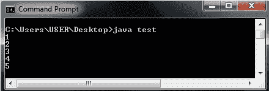

图 2.4 执行代码列表 2.14 的输出。

```java
}
```

列表 2.16 阐述 CONTINUE 语句的使用。

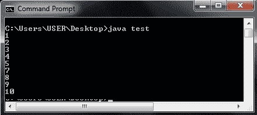

图 2.5 执行 Java 代码 2.15 的输出。

### WHILE 和 DO-WHILE

另外两种 Java 迭代语句是`WHILE`和`DO-WHILE`语句。这些循环的执行将持续直到指定的条件满足。由于这些循环操作中无法确保固定的迭代次数，这些循环也被称为不确定循环。这两个循环语句的通用语法如下所示。

```
```

列表 2.16 WHILE 语句。

图 2.6 执行代码 2.15 的输出。

列表 2.17 DO-WHILE 语句。

```java
case 3:
{
    statements;
}
```

在该语句中，会检查变量`k`的输入值。当其值为 0 时，执行放置在`Case 0`语句括号中的之间的语句。`CASE`语句只检查一个值。当变量值为 1 时，执行包含在`case 1`语句括号内的那些语句。通过这种方式，可以使用任意数量的`Case`语句并检查变量。甚至字符值也可以作为`case`语句的参数。在这种情况下，字符值将在单引号内使用，就像使用字符值一样。使用`switch`关键字的典型 Java 应用程序如列表 2.18。

```java
public class test {
    public static void main(String args[]) {
        int k = 0;
        do {
            break;
        }
        k++;
        } while (k < 15);
    }
}
```

列表 2.18 `switch`语句的用法。

继承属性允许一个类的对象获取其派生的另一个类对象的属性。此功能允许从现有对象创建新对象并修改相关的特征。通过扩展类，可以从基类派生任意数量的子类。从基类派生的所有类都与父类具有相同的属性，并继承其父类的方法。因此，无需单独定义子类的属性。如果需要，也可以向派生类添加新方法。此外，基类的任何功能都可以通过重新定义来被重写。这是面向对象程序中继承的主要优势。Java 使用`extends`关键字结合一个现有类来创建派生类。使用该关键字的一般语法如下：

```java
Class main {
```

继承和`extends`关键字的使用通过代码列表 2.19 中提供的以下应用程序进行了说明。

```java
class calculate {
    int z;

    public void add(int x, int y) {
        z = x + y;
        System.out.println("sum: " + z);
    }
}

public static void main(String args[]) {
    int a = 20, b = 10;
    calculator cal = new calculator();
    cal.add(a, b);
}
```

```java
String name = "Java";
String name = new String("Java");
```

方法重载的工作通过代码列表 2.20 中提供的 Java 代码进行了说明。在这里，`add()`方法执行两个操作——两个数字之和以及三个数字之和。

```java
class sum {
    static int add(int a, int b) {
        return a + b;
    }
}
```

列表 2.20 方法重载说明。

# 异常处理

```java
} finally {
    if (in != null) {
        in.close();
    }

    if (out != null) {
        out.close();
    }
}
```

图 3.1 典型的 DOM 表示。

DOM 类型数据表示提供以下优势：

标记语言的历史可以追溯到早期在文档中使用不同的标记进行编辑操作并修改打印格式。后来，该系统被用于创建计算机电子文档。这导致了用于创建电子文档的标记语言。这些文档基本上由不同的元素、代码和标签组成。HTML（超文本标记语言）是最早用于表示数据模型的语言之一。HTML 具有某些局限性，因为它们只能支持有限的结构。HTML 不允许任何特殊格式。HTML 具有某些局限性，因为它们只能支持有限的结构。HTML 不允许任何特殊格式。HTML 具有某些局限性，因为它们只能支持有限的结构。HTML 不允许任何特殊格式。HTML 具有某些局限性，因为它们只能支持有限的结构。HTML 不允许任何特殊格式。HTML 具有某些局限性，因为它们只能支持有限的结构。HTML 不允许任何特殊格式。HTML 具有某些局限性，因为它们只能支持有限的结构。HTML 不允许任何特殊格式。HTML 具有某些局限性，因为它们只能支持有限的结构。HTML 不允许任何特殊格式。HTML 具有某些局限性，因为它们只能支持有限的结构。HTML 不允许任何特殊格式。HTML 具有某些局限性，因为它们只能支持有限的结构。（译注：原文此处存在大量重复句子，翻译已已对应处理）。XML 是可扩展标记语言的缩写。XML 是 W3C 在 1998 年基于开放标准发布的，被称为所有标记语言之母体。XML 架构。

# 3.3 JSON 简介

在 21 世纪初出现的另一种数据表示模型是 JSON，它后来演变为存储和交换数据的国际标准。JSON 是 JavaScript 对象表示法的缩写。它是一种基于 JavaScript 的语言，允许在 HTML 文档中包含可执行内容。该语言以分号结束。`<script>`和`</script>`之间的示例如下：

```javascript
var price = 30;
var name = "age";
var age = 36;
```

可以使用点表示法访问对象值，如`book.isbn`、`book.name`等。JSON 实例被包含在方括号`[]`之间。JSON 数组与 JavaScript 数组相同。数组值可以是字符串、数字、布尔值等。

```json
{
  "book": [
    {
      "isbn": "978-81-203-5004-5",
      "name": "Software Engineering",
      "category": "Computer",
      "author": "K.L.James"
    }
  ]
}
```

# 3.4 JSON 优势

由于上述优势，JSON 演变为数据存储的标准。JSON 允许：

1. 同时与多个数据源交互。
2. 在处理时数据格式不同。
3. 使用不同的接口访问数据。
4. 从 Web 服务器传输数据。
5. 与多个视图交互，数据表示相同。

```xml
<item-details>
  <item-details>
    <code>1</code>
    <name>television</name>
    <price>8000</price>
  </item-details>
</item-details>
```

XML 的使用包括：

1. 定义不同的元素。
2. 为不同的元素选择合适的标签。
3. 元素名称之间允许空格。
4. 标签必须是成对的。
5. 元素名称是区分大小写的。
6. 元素名称由字母、数字或符号组成。
7. 元素名称必须以字母开头。
8. 元素名称不能以`xml`开头。
9. 元素名称必须是合法的。

```java
} finally {
    if (in != null) {
        in.close();
    }

    if (out != null) {
        out.close();
    }
}
```

```java
}
```

列表 3.3 两个 XML 实例。

通常在表示数据时可以看到没有值的空内容。此类空内容通过起始和结束标签之间的空格来表示。例如，假设书籍没有`isbn`，该元素在 XML 文件中表示为`<isbn/>`或短形式`<isbn/>`。可以通过代码列表 3.4 理解标签的使用，这是存储项的 XML 表示。

```xml
<item-details>
  <code>1</code>
  <name>television</name>
  <price>8000</price>
  <stock>10</stock>
  <price>21</price>
  <stock>35</stock>
</item-details>
```

| 项目 | JSON | XML |
|---|---|---|
| 内置数据类型支持 | 字符串、数字、数组、布尔值 | 仅字符串 |
| 数据可访问性 | 易于访问 | 需要解析 |
| 数据显示能力 | 无 | 有 |
| 数据读取 | 容易 | 困难 |
| 命名空间支持 | 不支持 | 支持 |

```html
<html>
  <body>
    <p id="element"></p>
    <script>
      var txt = '{"item":"CD", "price":360}';
      var obj = JSON.parse(txt);
      document.getElementById("element").innerHTML =
        obj.item + ", " + obj.price;
    </script>
  </body>
</html>
```

列表 3.8 JSON 字符串解析示例。

解析方法以 HTML 段落的名称作为参数。用于解析的字符串位于该段落中。通过配合语句使用`.innerHTML`关键字，标签的内部文本部分变得可读。运行该程序将在屏幕上显示项目名称及其价格。

由于 XML 文档中使用了标签，因此使用 JavaScript 方法`getElementsByTagName("tag name")`来解析此类文档。这是 JavaScript 用于处理对象的内置函数。该函数返回一个包含所有匹配指定标签名的元素集合数组。解析 XML 文档的典型代码如代码列表 3.7 所示。

```html
<html>
  <body>
    <p id="test"></p>
    <script>
      var parser, xmlDoc;
      var text =
        "<item><book>" +
        "<isbn>978-81-203-5004-5</isbn>" +
        "<name>Software Engineering</name>" +
        "<category>Computer</category>" +
        "<author>K.L.James </author>" +
        "<publisher>PHI</publisher>" +
        "</book></item>";

      parser = new DOMParser();
      xmlDoc = parser.parseFromString(text, "text/xml");
      document.getElementById("test").innerHTML =
        xmlDoc.getElementsByTagName("isbn")[0].childNodes[0].nodeValue;
    </script>
  </body>
</html>
```


## I. 空空题。
1. HTML 代表 ------------------ -------- ---- ----------------------------
2. XML 是 --------------------------------------------- --- ------ 的缩写。
3. JSON 是 --------------------- ------------------- --------- --------------------------
4. JSON 使用什么值对来表示数据 ---------------------- - ------------
5. XML 元素被放在 ---- ------------------------ -----------之间

### II. 简答
1. 解释 DOM 表示。
2. HTML 和 XML 有何区别？
3. 完成以下 XML 文档的结构：

- 启动新的 Android Studio 项目
- 打开现有 Android Studio 项目
- 从版本控制获取
- 导入项目（Gradle, Eclipse ADT 等）
- 导入代码示例

## 4.2 新 Android Studio 项目

| 文件夹 / 文件名 | 用途 |
| :--- | :--- |
| `src` | 包含主要的 Java 源文件，它是应用程序启动时执行的主要活动类，以及所有创建的 Java 类。在文件层次结构图中不可见。 |
| `res` | 包含不同子文件夹中的图像和布局文件 |
| `drawable` | 存储图像文件的子文件夹 |
| `layout` | 存储屏幕布局配置 xml 文件的子文件夹 |

3. 每个组件都是单独被激活的。
4. 每个组件的细节必须在应用程序中声明。
5. 必须指定适用于运行该组件的设备硬件配置。

Android 应用的组件名为活动（activities）、服务（services）、广播接收器（broadcast receivers）和内容提供者（content providers）。这些组件设计为独立工作并在之间共享数据。应用程序的每个组件都是用户或系统访问应用程序的入口。Android 应用不同组件之间的关系如图 5.3 所示。

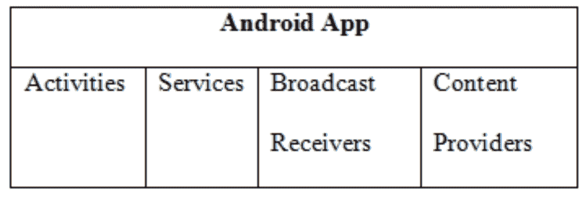
图 5.3 Android 应用组件

创建活动后，它会被启动以执行设计的任务。启动后的活动可以短暂暂停，然后恢复以继续任务。当任务完成后，活动停止。最后，活动被销毁。活动状态启动（start）、重启（restart）和恢复（resume）与不同时刻活动的启动相关。活动状态暂停（pause）和停止（stop）与不同实例的活动终止相关。所有这些生命周期状态都是通过调用对应的方法实现的。因此，Android 应用活动总共有七个可调用的生命周期方法。活动方法名称及其调用实例如表 5.2 所示。

表 5.2 Android 活动的生命周期方法。

| 方法名称 | 调用实例 |
| :--- | :--- |
| `onCreate()` | 活动创建 |
| `onStart()` | 活动启动 –（对用户可见） |
| `onResume()` | 活动恢复执行 |
| `onPause()` | 活动暂停 –（活动对用户不可见，另一个活动获得优先） |
| `onStop()` | 活动停止 –（活动不再可见） |

Android 应用程序启动时执行的第一个活动文件是 `MainActivity.java` 文件，它也是 Android 应用的主活动文件。此文件中定义的名为 `MainActivity` 的 Java 类在设备屏幕上创建一个默认窗口，其中系统地安排了按钮、编辑框等不同界面组件，以创建所需的屏幕视图。用于界面元素的布局细节定义在主布局文件中。该文件的默认 Java 代码包含最小的 Java 骨架代码，如图 5.5 所示。

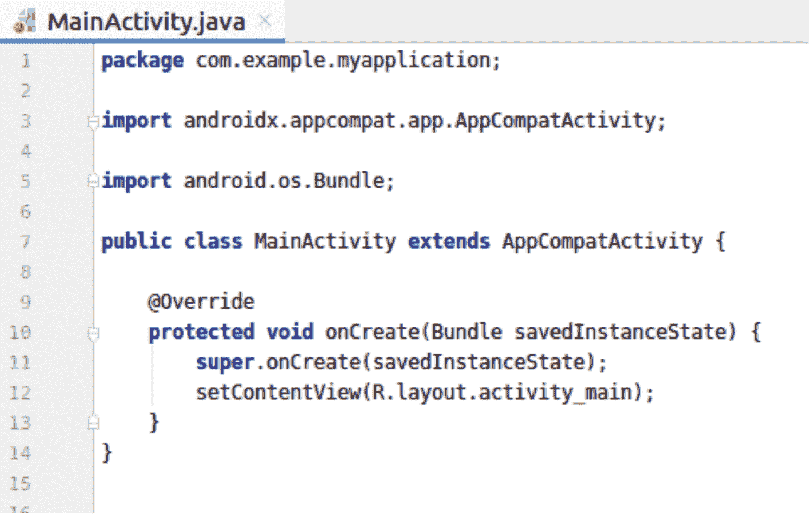
图 5.5 `MainActivity.java` 文件

该文件的第一个 Java 语句显示了应用程序项目的名称，如下所示。

```java
package com.example.myapplication;
```

```java
public class MainActivity extends AppCompatActivity { }
```

```java
setContentView(R.layout.activity_main);
}
```

此新定义的第一个语句是调用 `super.onCreate()` 方法，它会调用同名的父类进行执行。这是 Android 应用运行期间完成的操作。此语句的目的是在应用程序启动时保存设备当前的活动状态。这对于应用程序运行结束时恢复状态至关重要。通过这种方式，当应用程序停止运行时，设备状态将恢复到应用程序启动时存在的状态。

该文件的下一个语句旨在为启动屏幕创建布局界面。`setContentView()` 方法充当布局资源文件的指针。在这里，调用语句参数中指定布局资源文件为 `R.layout.activity_main`。此语句指向存储在 `R.layout` 文件夹中的名为 `activity_main.xml` 文件。`R` 是 resource（资源）的缩写，因此实际文件路径为 `app/res/layout`。此文件中定义的布局是运行应用程序时创建的第一个设备屏幕。预定义的 `onCreate()` 方法没有执行这些活动。因此，需要重新定义此文件。当创建一个新的 Android 项目时，系统默认在该文件中创建这三行代码。

## 5.6 Main Activity 布局文件
`MainActivity.java` 文件用于创建应用程序启动时显示在设备屏幕上的主界面屏幕布局的布局文件是 `activity_main.xml`。打开此文件会在右窗中显示该文件的 XML 代码，如图 5.6 所示。

```xml
<androidx.constraintlayout.widget.ConstraintLayout>
        android:text="Hello World!"
        app:layout_constraintBottom_toBottomOf="parent"
        app:layout_constraintLeft_toLeftOf="parent"
        app:layout_constraintRight_toRightOf="parent"
        app:layout_constraintTop_toTopOf="parent" />
</androidx.constraintlayout.widget.ConstraintLayout>
```

图 5.6 `activity_main.xml` 文件代码

此文件的第一个语句是出现在任何 XML 文件中的默认版本和编码细节声明。此默认 XML 文件定义了两个接口对象。第一个对象对应于应用程序使用的基础默认布局。第二个对象是 `TextView` 接口，在启动默认 Android 应用程序时，设备屏幕上在该界面显示默认文本 Hello World。此文件中默认定义的不同子句为应用程序中使用的界面元素设置了最小布局界面对象的属性值。这些属性使用不同的 XML 标签来设置值。属性元素指定了界面元素的大小，即界面元素的长度、宽度以及距离设备屏幕边缘的边距。

当 Design 窗口中添加或删除某些界面，或者在该窗口中更改它们的布局位置或大小时，此文件的内容会持续自动地更新。此 XML 文件的每个语句都定义了界面元素的属性参数。通过修改此 XML 文件中的属性值，可以对 Design 格中显示的界面元素的外观进行相应的修改。

Android 项目在空白屏幕布局上启动。默认的主布局文件在基础布局之上添加了一个 `TextView` 接口。通过删除在该基础布局上创建的默认 `TextView` 接口创建一个空白布局。空白屏幕布局的 XML 代码如图 5.7 所示。

```xml
<?xml version="1.0" encoding="utf-8"?>
```

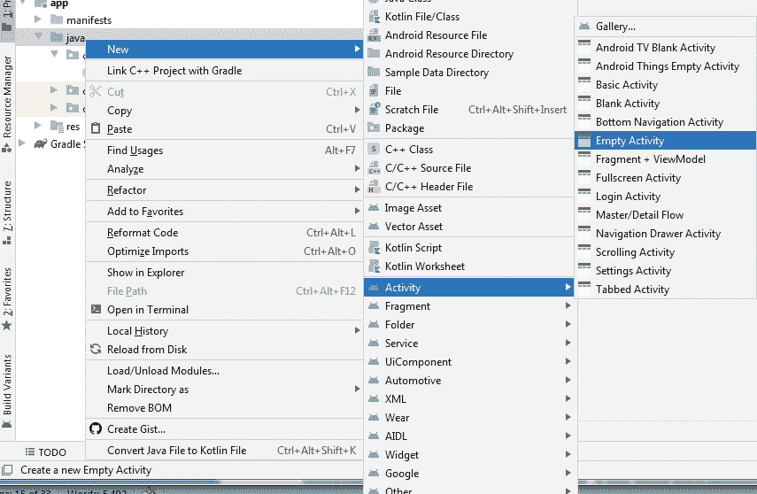
图 5.8 创建新的空 activity - 示例

屏幕上会出现一个标题为 "Configure Activity" 的新窗口，如图 5.9 所示。在此窗口显示的文本框中为 Activity 输入名称。也可以接受默认的 Activity 名称。在输入文件名时，系统也会自动为新创建的 activity 创建一个新的布局文件。创建的新布局文件名出现在下一个标题为 `Layout Name` 的文本框中。该文件名以 `activity_` 开头。在下一个文本框中输入包名或接受系统提供的默认值。将源语言选择为 Java。点击 Finish 按钮完成 Activity 的创建。

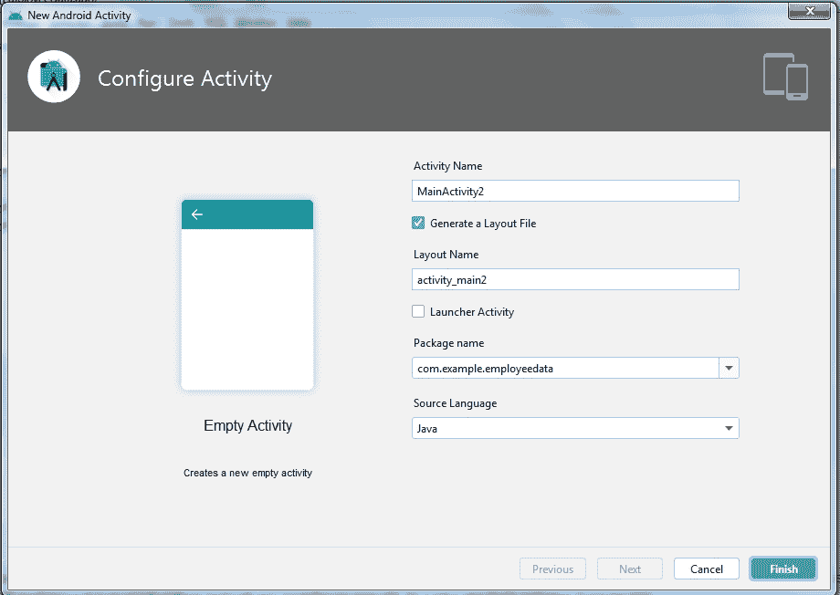
图 5.9 新 Android Activity 窗口

成功完成上述步骤后，创建的新 activity 文件名将出现在 Project 格中的 `java` 文件夹中。同时，主窗口中会出现新创建的 activity 和布局文件的标签页。见图 5.10。打开标签页将显示系统创建的默认骨架代码，并允许在这两个文件中添加或修改默认代码。通过这种方式，可以为应用程序执行的不同活动创建新的 activity 文件和相应的布局文件。可以单独创建一个新的 XML 布局文件，而不与 activity 文件一起创建，并将其添加到 Android 项目中。为此，请在 Project 格中右键点击名为 `java` 的文件夹，并在每次选择过程后出现的弹出窗口中选择 `New` > `XML` > `Layout XML File`。

隐式 intent 的工作原理如下步骤所示：
1. 创建新的 Android 项目。
2. 打开 `MainActivity.java` 文件。
3. 添加以下代码：

```java
package com.example.myapplication;

import android.os.Bundle;
import android.content.Intent;
import android.net.Uri;
import androidx.appcompat.app.AppCompatActivity;
```
图 5.11 隐式 intent

### 显式 Intent
显式 intent 的工作原理如下步骤所示：
1. 创建新的 Android 项目。
2. 创建名为 `MainActivity2` 的空 activity。
3. 打开 `MainActivity.java` 文件。
4. 添加以下代码：

```java
package com.example.myapplication;

import android.os.Bundle;
import android.content.Intent;
import androidx.appcompat.app.AppCompatActivity;

public class MainActivity extends AppCompatActivity {

    @Override
```
图 5.12 显式 intent

### 使用 Intent 传递数据
当应用程序中有多个活动时，在 activity 之间传递值至关重要。`putExtra()` 方法用于从源 activity 向目标 activity 发数据。该方法有两个参数，是一个具有唯一键的键值对。该语句的语法为：

```java
intent.putExtra("name1", name);
```

第二个 activity 使用两个方法连接第一个 activity 并从第一个 activity 获取值，这些分别是 `getIntent()` 和 `getStringExtra()` 方法。典型语句如下：

```java
import android.os.Bundle;

public class MainActivity extends AppCompatActivity {
    String d,e,f;
    Integer g;

    @Override
    protected void onCreate(Bundle savedInstanceState) {
        super.onCreate(savedInstanceState);
        setContentView(R.layout.activity_main);
        d = "Intent";
        e = "data passing";
        f = "example";
```
5. 打开 `MainActivity2.java` 文件。
6. 在此文件中添加必要的 Java 语句。该文件的最终内容如图 5.14 所示。

```java
package com.example.myapplication;

import android.content.Intent;
import android.os.Bundle;
import androidx.appcompat.app.AppCompatActivity;

public class MainActivity2 extends AppCompatActivity {
```

当从第一个 Activity 调用第二个 Activity 时，值将从第一个 Activity 传递到第二个 Activity。在布局 XML 文件中添加了相应的接口并显示接收到的值。这些未包含在上述文件中。

`Android Bundle` 是在 Android Activity 之间传递数据的另一种方式。它们在 Android 中始终配合 `intents` 使用。下面的代码片段演示了使用 bundles 的方法。第一个 Activity 如下代码：

```java
Intent action2 = new Intent(MainActivity.this, MainActivity2.class);
Bundle bundle = new Bundle();
bundle.putString("key", "value");
action2.putExtras(bundle);
startActivity(action2);
```

1. 文件定义了启动应用程序的方式以及可用的权限。

2. 文件提供了必要的应用程序信息，并描述了与应用程序相关的不同组件。

3. 文件包含了应用程序中每个活动（activity）的声明。

4. 文件为操作系统、应用程序构建工具和 Play Store 提供了应用程序所需的详细信息。

5. 该文件的内容用于构建、启动和发布应用程序。

6. 系统使用此配置文件的内容来判断应用程序组件的存在以及文件的可用性。

7. 该文件定义了访问系统受保护部分的权限级别。

8. 该文件定义了应用程序所需的硬件和软件特征，以便选择运行应用程序所需的硬件。

在创建每个项目时，系统默认创建该清单文件。随着应用程序构建的进行，通过添加新元素，文件内容会被不断修改。当双击文件名时，可以在编辑器窗格中看到该文件的 XML 代码。该文件的典型默认内容如图 5.15 所示。

图 5.15 `AndroidManifest.xml` 文件代码。

该文件以 XML 版本号和编码细节的标识开头。文件在此行下方会出现应用程序包名，它用于标识相关的包。此标识用于定位构建应用程序的核心组件的不同代码实体。当创建最终 Android 应用程序包 (APK) 时，构建工具会使用此包名来设置配置细节。文件使用 `<application>` 和 `</application>` 标签为与相关的不同属性设置值。文件的每一行都表示属性元素以及所包含组件属性的设置值。

```xml
<uses-permission android:name="android.permission.CAMERA" />
```

在清单文件中设置权限是一个简单的过程。当开发者在文件中开始输入标签时，屏幕上会弹出一个窗口。开发者可以滚动列表并从弹出窗口中选择所需的权限。选择过程可以从图 5.16 中理解。

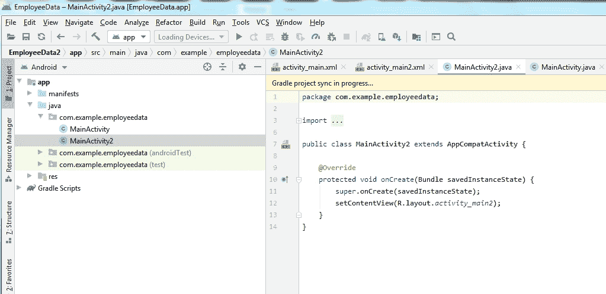
图 5.16 在清单文件中添加权限

可以通过 XML 文件中的过滤器语句在具有特定配置的设备中使用。下面的语句说明了此类语句。在这里，只有当具有指定的特征时，应用程序才能在摄像头上运行：

```xml
<uses-permission android:name="android.permission.CAMERA"
android:requiredFeature="@string/appbar_scrolling_view_behavior">
</uses-permission>

    </intent-filter>
</activity>
```


# 图 5.17 多活动应用程序清单文件

在没有用户交互的情况下，在后台长时间运行的应用程序组件被称为 Android 服务组件（Android service component）。由于此类组件在后台运行，因此任何前端操作都不会影响组件的执行。服务组件没有关联的用户界面。

服务组件对于定期更新数据和应用程序非常有用。播放音频文件、在设备之间传输文件、与其他设备联网等都是 Android 服务组件的一些活动。Android 服务分为两种类型，即`started`（启动）和`bound`（绑定）。

- **启动服务（started service）**在后台无限运行，并在操作完成或服务被销毁时自动停止。
- 当某些提供组件运行状态信息的服务绑定到该服务上时，该服务被称为**绑定服务（bound service）**。提供当前播放音频文件的信息、指示当前文件传输状态、显示当前网络状态等都是绑定服务提供的信息示例。

从组件中解绑绑定服务将使该服务作为未绑定服务运行。在需要时，可以通过调用`bind`方法再次进行绑定。这被视为重新绑定过程，并使用另一种方法来实现。服务组件的典型生命周期如图 5.18 所示。

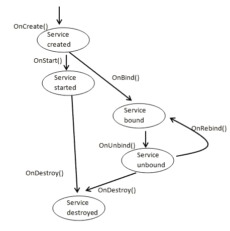

### 表 5.3 Android 服务的生命周期方法

| 方法名称 | 调用实例 |
| :--- | :--- |
| `onCreate()` | 服务创建 |
| `onStart()` | 服务启动 –（对用户可见） |
| `onBind()` | 与另一个服务绑定 |
| `onUnbind()` | 移除绑定 |
| `onRebind()` | 与另一个服务重新绑定 |
| `onDestroy()` | 活动结束执行 |

## 5.11 创建新 Service

`Service`类使用 Java 关键字`extends`创建为基类`Service`的子类或扩展，以便可以调用相关方法。创建`Service`组件的语句语法如下：

```java
public class newService extends Service { }
```

为了使创建的服务能够运行，必须在`Manifest`文件中使用`<service>`标签注册所有创建的服务。当创建一个新的服务文件`ix`时，系统会在清单文件中添加必要的语句。清单文件的内容如图 5.22 所示，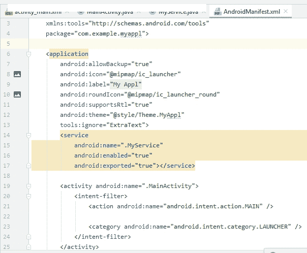图 5.22 添加了 Service 组件详情的 Manifest 文件。

与 Android activity 类似，Android`Service`组件使用 Android intents 启动。启动 Android`Service`的语句语法如下：

1. 创建一个新的 Android Studio 项目。
2. 创建一个名为`newService.class`的新 Java`Service`类。
3. 将此文件的默认代码替换为如下的新 Java 代码。

```java
package com.example.myapplication;

import android.app.Service;
import android.content.Intent;
import android.media.MediaPlayer;
import android.provider.Settings;

public abstract class newService extends Service {

    @Override
```

4. 打开`MainActivity.java`文件。
5. 使用以下语句导入必要的库文件。
`import android.content.Intent;`
6. 输入如下的 Java 语句来调用`Service`类。
`startService(new Intent(this,newService.class));`

`MainActivity.java`文件的最终代码如下：

```java
package com.example.myapplication;

import androidx.appcompat.app.AppCompatActivity;
import android.content.Intent;
import android.os.Bundle;

public class MainActivity extends AppCompatActivity {

    @Override
    protected void onCreate(Bundle savedInstanceState) {
        super.onCreate(savedInstanceState);
```

`Service`类中运行默认铃声的 Java 语句如下：

`player = MediaPlayer.create(this, Settings.System.DEFAULT_RINGTONE_URI);`

该语句创建了`MediaPlayer`类的一个实例。第二个参数指定了完整路径的文件名。下一个语句中出现的属性`setLooping`允许通过将参数值设置为`true`或`false`来设置是循环响铃还是仅响一次。通过调用`start()`方法开始铃声播放。

服务在后台持续运行，因此它们会消耗内存。当服务数量增加时，系统的内存可用性会减少，从而产生关键状况。当系统的可用空内存低于所需水平时，系统开始终止某些进程以获取系统获取足够的内存。当由于正常终止导致内存可用性增加时，被强制终止的 Android 服务将重启。是否重启这些已停止的服务取决于方法的返回值，该方法有三个选项，如下所示：

```java
return START_STICKY;
return START_NOT_STICKY;
```

`Broadcast Receiver`（广播接收器）组件响应来自其他应用程序或系统的广播消息。它们也可以发起广播，以通知其他应用程序某些事件的发生。该组件没有用户界面。此外，没有与该组件相关的启动或停止操作。一旦组件注册了事件广播，组件就会监听系统生成的特定广播意图，并在特定事件发生时触发。广播接收器组件的生命周期如图 5.23 所示。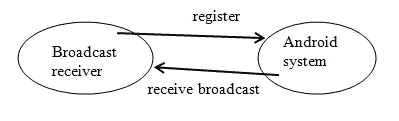图 5.23 广播接收器组件的生命周期。

## 5.14 创建新的广播接收器

使用 Android Studio IDE 创建`Broadcast Receiver`组件的方法是右键点击`java`文件夹，并在随后出现的窗口中选择`New > Other > Broadcast Receiver`选项。选择过程见图 5.24。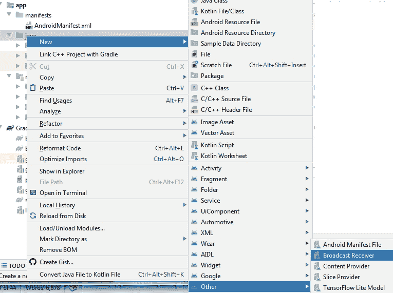图 5.24 创建广播接收器组件。

此步骤将打开图 5.25 所示的`Configure Component`（配置组件）窗口。为`Broadcast Receiver`类输入合适的名称，或接受文本框中显示的默认名称。选择源语言名称为`Java`，目标源文件为`main`。点击`Finish`按钮完成组件创建。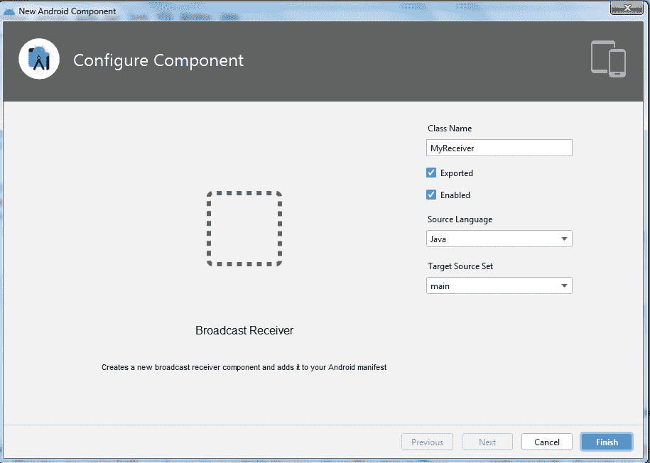图 5.25 配置广播接收器组件。

`Broadcast Receiver`类被创建，文件的默认代码显示在`Edit`窗格中，如图 5.26 所示。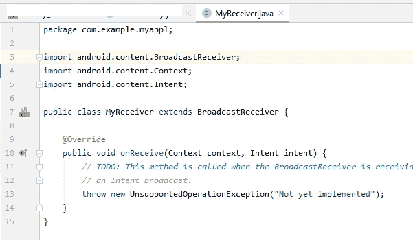图 5.26 广播接收器类代码。

`Broadcast Receiver`类使用 Java 关键字`extends`创建为超类`BroadcastReceiver()`的子类或派生类。创建该类的语法如下：

```java
public class MyReceiver extends BroadcastReceiver{ }

intent.setAction("");
sendBroadcast(intent);
```

创建了`intent`的新实例，并调用`setAction()`方法来创建广播。`sendBroadcast()`方法将`intent`发送给所有感兴趣的`BroadcastReceivers`。接收器不会回传任何结果，且接收器无法终止广播。该调用是异步的，在接收器运行时，程序会继续执行。创建的`Broadcast Receiver`类在 Manifest 文件中使用`<receiver>`标签进行注册，以启用该组件的使用。图 5.27 显示了 manifest 文件的内容。

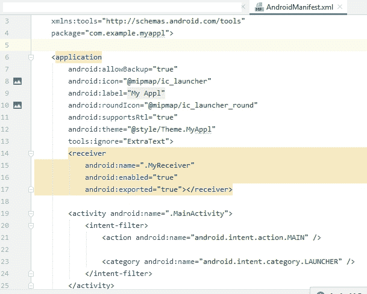
图 5.27 Manifest 文件代码

表 5.4 列出了广播接收器组件接收的一些系统生成意图。

表 5.4 系统生成的意图及其实例

| 系统意图 | 生成的实例 |
| :--- | :--- |
| `android.intent.action.BATTERY_LOW` | 电量低低 |
| `android.intent.action.BOOT_COMPLETED` | 启动完成 |
| `android.intent.action.CALL` | 拨打 |
| `android.intent.action.DATE_CHANGED` | 日期变更 |

6. 运行应用程序。

## 5.15 内容提供者（Content Provider）组件

内容提供者负责跨越应用程序边界共享数据。它们与 SQL 数据库交互以执行不同的数据操作。Android 通常将内容存储在`SQLite`数据库中。此类内容提供者充当数据存储的中心仓库，允许不同的应用程序访问数据。同时也允许更新数据库内容。使用合适的查询字符串查询内容提供者。表 5.5 列出了与内容提供者相关的方法及其用途。

内容提供者（Content providers）对于管理用户设备上的日历、Web 端操作、跟踪通话历史、管理不同的设备设置、维护字典服务、管理文件、联系人列表等是必要的。创建内容提供者的步骤与创建其他组件步骤步骤。由于该组件仅用于高级应用程序，因此不再对该组件进行详细讨论。

### 5.16 练习题

### I. 填空题
1. Android activity 是 --- ----------------------- ----------------------------------------------------
2. Android 生命周期状态是通过调用---- ----  -------------- ----------------- 实现的
3. Android 应用程序配置文件是  ------------- ----------------------------------------

---

# 第 6 章 用户界面设计

Android 应用程序是在经过多个阶段后创建的。这些过程的第一步是创建与应用程序用户交互的合适界面。用户通过这些界面与应用程序进行通信。本章重点关注为 Android 应用程序创建用户界面的基础知识、设置界面属性以及为界面元素属性插入新值。学习本章后，你将能够为 Android 应用设计简单的界面。

## 6.1 Android Views 和 View Groups

Android 用户界面的基本构建块被称为`view`（视图）。`View`定义为一个小型矩形框，它响应用户输入并负责处理事件。`View`代表设备屏幕上看到的任何内容，如按钮、复选框、文本字段等。`View`也代表了用于创建任何用户界面元素的对象的基类。每个`view`在屏幕上都有特定的位置、以像素为单位指定的适当尺寸，以及具有适当值和相关方法的其他属性。界面属性定义了描述对象的数据。方法定义了对象执行的操作。界面属性以及方法为应用程序提供了特定的外观和功能。

构成完整界面的不同视图元素排列在被称为`view groups`（视图组）的容器中。`view groups`可以同时包含视图对象和子视图组。因此，视图和视图组之间存在父子关系。`view`和`view group`之间的关系如图 6.1 所示。

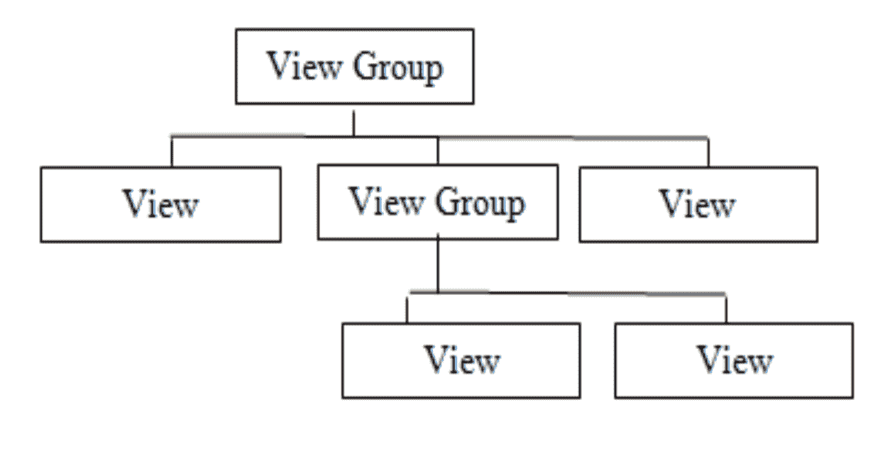

`Palette`面板中的第二个文件夹名为`Text`。该文件夹的元素在上述图中所示。任何应用程序中最常用且最简单的用户界面元素是各种`Text`界面，它们作为向系统输入数据以及显示输出的接口。这些界面显示为文本框，应用程序用它们在屏幕上显示消息，或在应用程序运行时接受用户输入。名为`Text`的文件夹具有`TextView`、`Plain Text`、`Password`等界面元素，如图所示。`TextView`元素用于显示应用程序输出，如不同的消息、警报和标签。此界面可以显示单词、句子、段落或整本书的内容。其他文本界面元素用于在应用程序运行时向应用输入数据。从界面元素的名称本身可以看出，不同的界面元素适用于向应用输入特定的数据值。例如，使用`Password (Numeric)`文本框界面适合输入数字密码，而不是使用纯文本框界面。

另一个常用的应用用户界面元素是`Button`元素。`Button`是屏幕上的一个区域，用户可以点击它来执行某些操作。`Buttons`文件夹包含不同类型的按钮，可以通过点击文件夹名称打开文件夹查看。第一个显示的图 6.3 显示了不同的按钮列表。列表顶部的界面`Button`是简单的推按钮类型。`Image button`（图像按钮）、`Check box`（复选框）、`Radio button`（单选按钮）和`Toggle button`（切换按钮）是一些其他常用的界面元素。下一个文件夹名为`Widgets`，它具有显示各种文件和活动进度状态的界面元素。该文件夹还有显示图像、视频、`progress bar`（进度条）、`seek bar`（滑动条）等界面，如上述图中第二个插图所示。

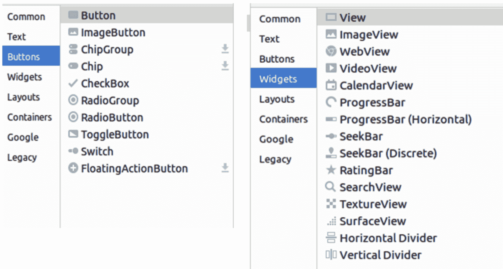
图 6.3 Named Buttons 和 Widgets 的文件夹中的界面元素

移动应用程序中的界面元素排列在不同的布局中。`Layouts`文件夹具有为设备屏幕界面对象设置不同布局的模板。打开文件夹显示文件夹内容，如图 6.4 所示。

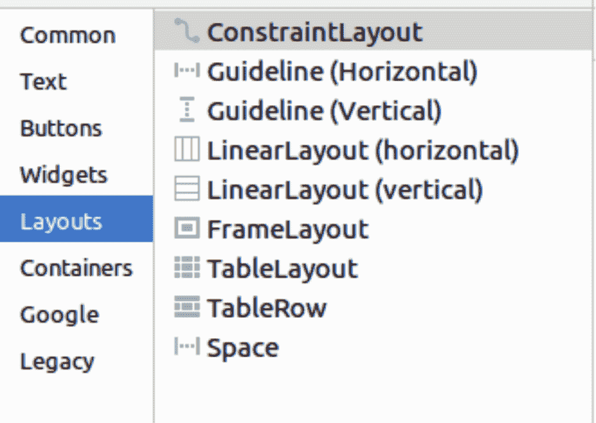
图 6.4 Named Layouts 的文件夹内容 - 示例图

应用设计师可用的常用布局类型有`Constraint`、`Guideline`（水平或垂直）、`Linear`（水平或垂直）、`Frame`、`Table`等。选择不同的布局选项允许以预定义的样式排列界面元素。如果在设计阶段没有定义特定的布局，应用程序将使用默认的父布局设计，即`Constraint`布局。表 6.1 列出了常用的组件布局类及其用处。

表 6.1 常用设计布局及其用途。

## 6.3 创建用户界面

如前所述，设计用户界面是创建移动应用程序的第一步。如前面的章节所示，要从头开始界面设计，第一步是删除默认界面对象并使布局为空。空布局的`Component Tree`窗格只有一个名为`ConstraintLayout`的默认根元素。在布局窗口上插入界面元素有两种方法。第一种方法的步骤说明如下：

1. 点击`Palette`窗口左侧面板显示的文件夹名称，该窗口会在右侧窗格显示界面元素。
2. 点击显示的所需的界面元素进行选择。所选对象将以高亮形式显示。
3. 按住左鼠标键，将元素拖动到布局窗格中所需的位置，然后释放鼠标键。
4. 界面元素将出现在`Layout`窗格中。
5. 通过点击并拖拽元素，将其移动到布局中的正确位置。

插入用户界面元素的第二种方法说明如下：

1. 打开`activity_main.xml`文件。
2. 插入所需界面元素的 XML 代码。
3. 保存文件。

## 6.4 创建 TextView 和 Button 界面

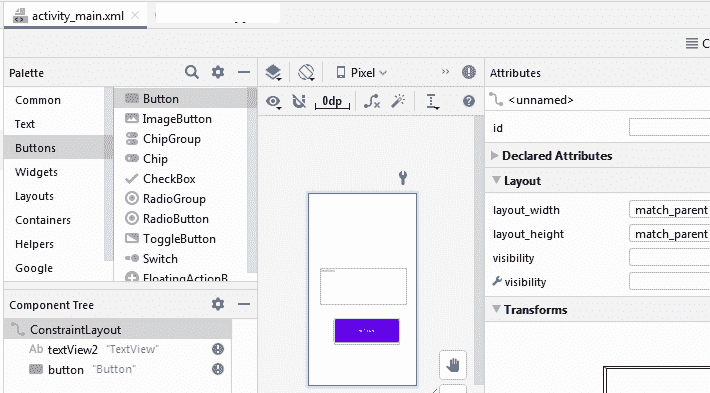
图 6.5 布局屏幕中插入的界面元素

5. 从菜单中选择`File`并选择`Save`选项保存项目。
6. 关闭项目并`Exit`。

在`activity_main.xml`文件中为界面元素添加 XML 代码也会在布局屏幕上添加界面元素。`TextView`和`Button`界面的代码如图 6.6 代码片段所示。

```xml
<TextView
    android:id="@+id/textView2"
    android:layout_width="327dp"
    android:layout_height="137dp"
    android:text="TextView"
    tools:layout_editor_absoluteX="46dp"
    tools:layout_editor_absoluteY="286dp" />
```

| 子句 | 含义 |
| :--- | :--- |
| `Android:id` | 组件的唯一标识符，用于在应用程序代码中引用 |
| `Android:layout_width``Android:layout_height` | 定义布局占据屏幕的方式。`fill_parent`完全填充屏幕，而`wrap_content`根据内容的大小调整尺寸 |
| `android:text` | 定义在界面元素中显示的文本 |
| `tools:layout_editor_absoluteX` | 定义离左边距的距离 |
| `tools:layout_editor_absoluteY` | 定义离顶边距的距离 |

通过类似的方式，可以将不同的界面元素放置在布局中以创建应用程序。

2. 使用`Attributes`格的滚动条滚动列表，从该窗口中找到所需的属性。
3. 点击显示属性值的文本框内部。此步骤将光标置在文本框内，从而能够为属性输入新值。
4. 在文本框中为属性输入新值。
5. 某些文本框在右端显示下拉箭头，可以使用它从下拉列表中选择并插入该属性的新值。
6. 所选属性的值将更改为新值。

通过修改布局 XML 文件中界面元素的属性值，可以产生相同的效果。所需的步骤如下：

1. 打开`activity_main.xml`文件。
2. 找到界面元素组。
3. 找到界面组中需要修改属性的属性句。
4. 通过在正确位置插入光标并输入新值来更改属性值。


5. 如果界面组中没有所需的属性值子句，请在组的闭合标签之前插入光标，并输入属性句及其值。

6. 自动补全功能允许快速输入属性元素名称。

1. 在`Component Tree`格中点击要调整大小的界面以选择它。对应于选中界面的`Attributes`窗口出现在右格中。

2. 在该格中找到属性`layout width`。

3. 通过将其值设置为`95dp`。

4. 在该格中找到属性`layout height`。

5. 通过将其值设置为`425 dp`。

`TextView`界面的尺寸已更改为设置的新尺寸，如图 6.8 所示。

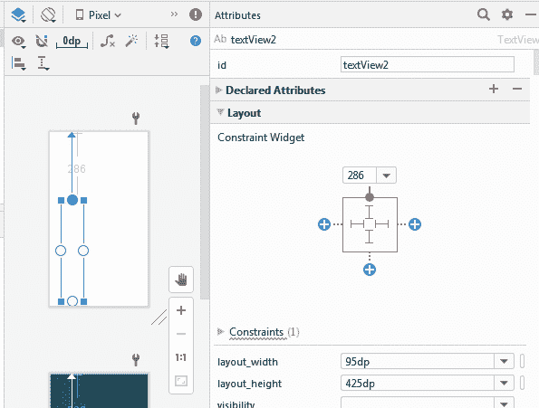

图 6.8 所示的`TextView`界面尺寸修改

`tools:layout_editor_absoluteX="46dp"` />

通过这种方式，可以修改不同界面元素的属性值。由于移动设备的小屏幕区域需要容纳多个界面元素，因此在设备屏幕布局上正确定位界面元素至关重要。此外，界面的定位不当会导致元素之间发生重叠。

在设备屏幕布局上定位界面元素的步骤说明如下：

1. 点击界面元素以选择该元素。

2. 按住左鼠标键，将元素拖动到所需的新位置。

3. 当对象处于新位置时，释放鼠标按钮。

这是在布局中将界面元素从一个位置移动到另一个位置的快速方法。当鼠标选择对象时，出现在对象四边中间部分的圆形手柄被称为约束句柄（constrained handles）。这些句柄用于在元素插入布局区域时，设置元素的左、上、右、下约束。正是这些约束的值定义了元素相对于基础布局或相邻界面元素顶、左、右、下边缘的位置。所有距离值均以`dp`单位指定。这种定位方法非常有帮助，因为元素可以在布局屏幕中进行精确定位。将元素的句柄与其他相邻元素建立至少两次连接，即可使元素处于约束状态。

在布局中精确定位元素的步骤说明在此：

`app:layout_constraintTop_toTopOf="parent" />`

## 6.7 接口命名

在设计布局中添加的每个接口元素，系统默认都会为其分配一个标识名称，例如`button`、`button2`、`button3`等，以便唯一标识它们。同一个标识符不会被分配给多个元素。Android 系统使用一种特定方法来唯一标识接口元素。当在布局中首次插入接口元素时，系统会将`Palette`（调色板）中指定的接口名称作为其标识名称。后续插入相同对象将通过在元素名称后加上从 2 开始的数字后缀来命名。例如，首次插入的`TextView`接口被赋予了标识名称`TextView`。随后插入的相同接口元素将命名为`TextView2`、`TextView3`等。为每个插入的元素分配的标识名称可以在`Component Tree`（组件树）窗格中看到。如果应用开发人员认为接口的另一个名称更合适，可以修改默认名称。

修改元素默认名称的步骤如下：

1. 从`Component Tree`窗格中选择所需的元素。该组件会在`Layout`（布局）窗格中显示为选中状态。

2. 在`Attributes`（属性）窗口中找到名为`id`的属性。通常它出现在`Declared Attributes`（已声明属性）部分。也可以通过滚动`All Attributes`（所有属性）部分的字母顺序列表来找到该属性。见图 6.10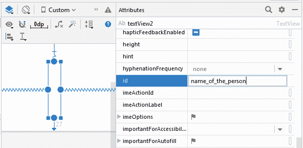图 6.10 属性面板中的标识符属性。

3. 点击文本框中的元素名称并输入新的标识名称。

4. 给出的新名称将替换`Component Tree`窗格中的元素名称。

通过修改布局 XML 文件中的属性子句`id`也可以修改接口名称，如下所示：

```xml

```

1. 在`Component Tree`窗格中选择接口。
2. 在`Attributes`窗口中沿属性名称滚动，并找到名为`text`的属性元素。
3. 点击参数值。
4. 在文本框中输入新名称。
5. 输入的新名称将替换`Component Tree`窗格以及`layout`窗格中接口中显示的值。

修改`Button`接口默认文本值的方法可以从图 6.12 中理解。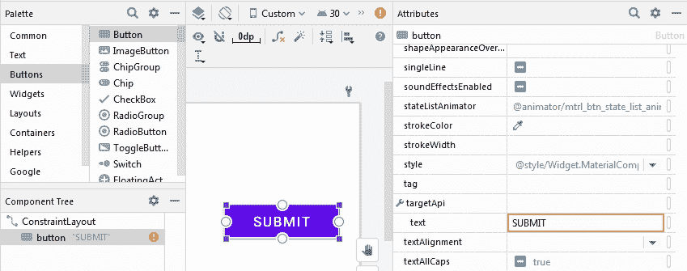图 6.12 修改组件说明

在这里，在`Attributes`窗口中将`Button`接口的`text`属性值更改为`SUBMIT`。新名称替换了`Component Tree`窗格以及`Layout`窗口中的名称。通过更改下述 XML 文件中属性`text`的值，也可以更改接口属性以显示文件中给出的新文本：

```xml
android:text="SUBMIT"
```

## 6.9 修改文本大小

应用程序运行时，接口元素上显示的默认文本通常以默认字体大小和样式显示。用于显示文本的字体大小、颜色和样式可以在设计期间或应用程序运行时进行修改。在设计期间通过修改`Attributes`窗口中上述属性的值可以修改接口元素的上述属性。在`Attributes`窗格中修改文本大小的步骤如下：

1. 选择接口元素。
2. 在`Attributes`窗口中找到`textSize`元素。
3. 点击值输入文本框。
4. 选择所需的文本大小，例如`30 sp`，或输入新值。

效果在设计面板中立时可见，`Button`接口上显示的文本大小变为`30sp`（缩放像素），其中`sp`是使用的单位。常用的测量单位是`sp`（缩放像素）或`dp`（密度无关像素），它们基于屏幕的物理密度。在`Layout`窗口中，显示的文本尺寸变大了。见图 6.13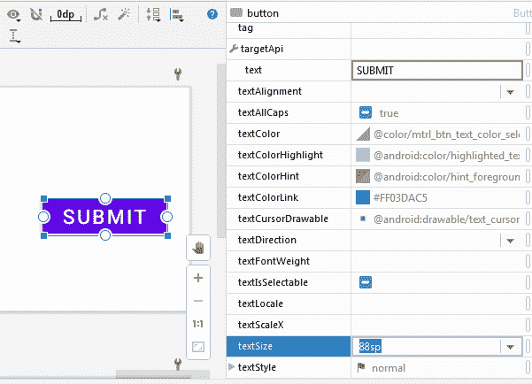图 6.13 修改文本属性

## 6.10 设置接口背景颜色

接口元素的背景颜色以及显示的文本颜色对查看的易用性和用户对程序的接受度有极大影响。因此，适当修改接口元素的这些属性，以增加不同利益相关者对程序的接受度。Android IDE 使用不同的颜色代码来设置不同的颜色。三种主色（红、蓝、绿）的值可以从 0 到 255 不等。在设计期间设置接口元素背景颜色的步骤如下：

1. 在`Attributes`窗口中选择接口元素。
2. 在`Attributes`窗口中滚动属性名称并找到`background`属性元素。
3. 从`Palette`中选择所需的颜色，如图 6.14 所示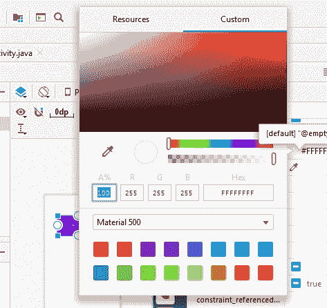图 6.14 调色板中的选项
4. 在`Attributes`窗口中选择`background`属性。
5. 在`Palette`中选择颜色。
6. 在`layout`窗口中设置`textColor`属性。

通过更改下述 XML 文件中的属性`text`值也可以更改接口属性以显示文件中给出的新文本：

```xml
android:background="#651E"
```

应用程序使用文本框有两种用途，例如以标签形式显示文本或作为输入接口。因此，在设计应用程序时使用了两种类型的文本框。`TextView`接口元素仅作为标签显示器，用于在应用程序运行时显示消息或文本。这些不能作为输入类型。Hello World 程序在`TextView`接口上显示默认文本的工作已经讨论过。移动应用程序需要输入各种详情，如姓名、密码、电子邮件、电话、邮地址等，这些使用了不同的输入接口。这些不同的文本框可以在`Palette`中的 Text 文件夹中选择。应用程序开发人员在开发并在布局屏幕上选择并插入合适的文本框作为用户输入框。`Plain Text`是 Text 文件夹的接口元素，其用途通过创建一个新的 Android Studio 项目如下所示：

1. 创建一个新的 Android Studio 项目。

2. 使布局为空。

3. 通过拖放操作将`Plain Text`接口插入布局屏幕。

4. 将接口元素的顶部和左边距设置为`100dp`。

`Attributes`窗口所示，接口的默认`text`属性值为`Name`图 6.16 Plain Text 接口

5. 点击工具栏上的运行图标运行项目。设备屏幕上的显示如图 6.17 所示图 6.17 应用程序运行时屏幕显示

将复制并粘贴以下 XML 代码到`activity_main.xml`文件也可以在布局屏幕中插入`Plain Text`接口：

```xml
<EditText
```

之前的接口与当前接口在标签名称使用上的主要区别在于，早期接口使用`<TextView`和`/>`标签，而此接口使用`<EditText`和`/>`标签。所有文本输入接口的属性都写在`<EditText`和`/>`标签之间。其他文本输入接口如密码、电子邮件、电话、时间、日期等也使用`<EditText />`标签。

当应用程序运行时，纯文本（Plain Text）接口显示设置的默认文本属性值。点击文本框会在输入文本框内显示闪烁的光标。同时，设备屏幕底部会出现虚拟键盘。应用程序用户可以通过直接在虚拟键盘上打字输入文本。纯文本组件像一个仅使用单一字体和式的微型文字处理器。按下虚拟键盘的退格键会删除光标左侧的字符。内置的自动修正功能会在用户在键盘上打字时自动显示完成建议。建议列表以下拉菜单的形式显示，用户从中可以选择一个项目替换编辑框的内容。建议列表从数据适配器获取，并且在输入指定数量的字符后才会出现。在按住输入文本时弹出的小窗口有助于对所选文本进行剪切、复制和粘贴等文字处理操作。

下一个 Android Studio 项目演示了修改与纯文本和`TextView`接口元素相关的某些常用属性的步骤。完成该项目的步骤如下：

1. 创建一个新的 Android Studio 项目。
2. 将布局置为空。
3. 通过拖放操作在布局（Layout）屏幕中添加一个`TextView`元素。将以下 XML 代码复制并粘贴到`activity_main.xml`文件中也可以在布局中添加一个`TextView`接口。

```xml
<TextView
    android:id="@+id/textView2"
    android:layout_width="wrap_content"
    android:layout_height="wrap_content"
    android:text="TextView"
    android:text="Name"
    tools:layout_editor_absoluteX="0dp"
    tools:layout_editor_absoluteY="261dp" />
```

在这里，XML 文件使用`<TextView />`标签作为标签文本框，使用`<EditText />`标签作为可类型文本框。

5. 在组件树（Component Tree）面板中选择`TextView`对象。
6. 找到并逐一将`text`、`background`、`text color`和`text size`属性对应的值更改为 6.2 中给出的新值。
7. 选择纯文本接口元素。
8. 根据上述表修改不同的属性值。

### 表 6.2 接口对象的属性和值

| 属性参数 | TextView | 纯文本 (Plain Text) |
| :--- | :--- | :--- |
图 6.19 插入密码组件 – 插图说明

上述两个接口元素的 XML 代码如下：

```xml
<EditText
    android:id="@+id/editTextTextPassword"
    android:layout_width="299dp"
    android:layout_height="100dp"
    android:ems="10"
    android:inputType="textPassword"
    tools:layout_editor_absoluteX="59dp"
    tools:layout_editor_absoluteY="148dp" />

<EditText
```

| 属性 | 用途 |
| :--- | :--- |
| 大写 (Capitalize) | 自动大写用户输入的内容 |
| 光标可见 (Cursor visible) | 使光标可见或隐藏 |
| 字体族 (Font family) | 设置字体族 |
| 对齐 (Gravity) | 指定内容在接口中的位置 |
| 提示 (Hint) | 显示的提示文本 |
| 密码 (Password) | 密码是否以点形式显示 |
| 文字对齐 (Text alignment) | 定义文本的对齐方式 |
| 文字样式 (Text style) | 定义文本的样式 |

通过创建更多使用这些接口属性的项目，可以理解这些接口的使用。

## 6.13 布局 (Layouts)

`xmlns:app="http://schemas.android.com/apk/res-auto"`
`xmlns:tools="http://schemas.android.com/tools"`
`android:layout_width="match_parent"`
`android:layout_height="match_parent"`
`tools:context=".MainActivity"/>`

在此布局工作时，插入的界面元素的位置是相对于布局中其他元素的位置确定的。正确定位新添加的界面元素的步骤如下：

2. 打开`activity_main.xml`文件。
3. 点击`Design`按钮查看`Palette`窗口。
4. 点击`Palette`窗口左列中名为`Layouts`的文件夹，它会显示可用的布局。
5. 从`palette`的右格选择所需的布局。所选布局将高亮显示。
6. 点击左鼠标键并将所选布局拖动到`Layout Editor`并放置在所需位置。
7. 松开鼠标按钮将元素释放在布局中的选定位置。
8. 插入的布局的轮廓出现在屏幕上。
9. 可以通过拖拽操作或修改 XML 文件中的值来修改新布局的位置和大小。

线性布局 (Linear layout) 将插入的界面元素按水平或垂直方向排列。因此，有两种线性布局，即水平线性布局和垂直线性布局。图 6.23 是在默认布局中插入`Linear Layout`（水平）时的屏幕显示。插入的布局名称出现在`Component Tree`窗格中。

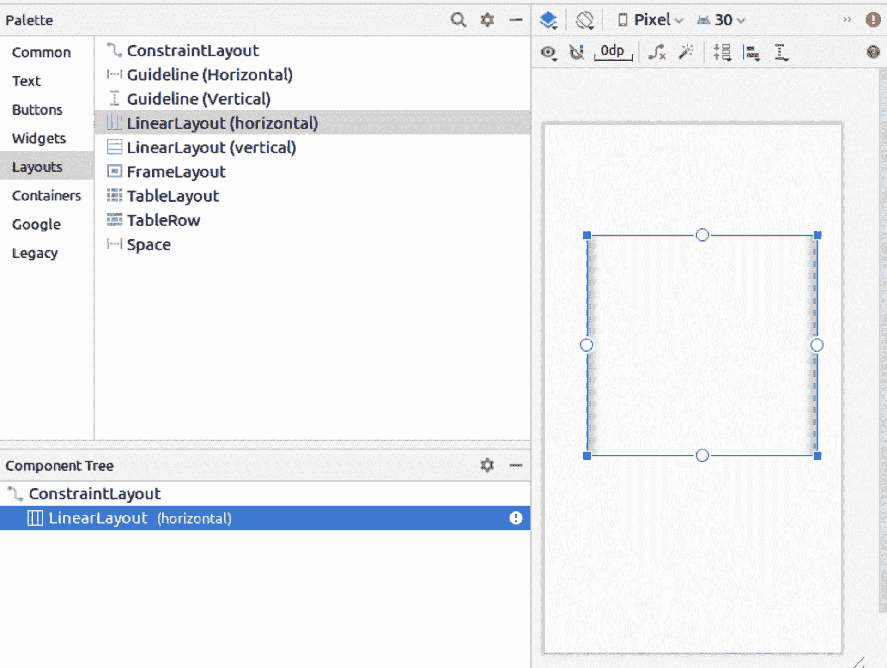
图 6.23 插入`LinearLayout`（水平）

在`activity_main.xml`文件中添加的以下 XML 代码同样在默认布局中插入了新布局。这里使用的 XML 标签是`<LinearLayout />`。该文件具有属性语句`android:orientation="horizontal"`。

图 6.24 `LinearLayout`（水平）和`LinearLayout`（垂直）示例

帧布局 (Frame layout) 是另一种类型的布局，用于锁定设备屏幕上的整个布局区域以显示单个项目。因此，帧布局区域内允许包含一个元素。如果在帧布局中添加了多个界面元素，这些元素将一个接一个地叠加。如果需要重叠显示（例如图像上方的文字），帧布局是合适的。通过为不同的界面元素使用不同的帧布局，这种布局有助于避免不同界面元素的重叠。此布局的属性位于`<FrameLayout`和`</FrameLayout>`标签之间。提供的 XML 代码用于创建帧布局界面元素。

```xml
<FrameLayout
    android:layout_width="409dp"
    android:layout_height="729dp"
    tools:layout_editor_absoluteX="1dp"
    tools:layout_editor_absoluteY="1dp"></FrameLayout>
```

以下示例说明了应用程序运行时在帧布局中显示插入的界面元素的方法。通过添加以下 XML 代码，在帧布局中插入了两个文本视图 (`TextView`)。

```xml
<FrameLayout
    android:layout_width="245dp"
    android:layout_height="360dp"
    tools:layout_editor_absoluteX="33dp"
    tools:layout_editor_absoluteY="115dp"
    text="welcome"/>
</FrameLayout>
```

# 开始编写 Java 代码

在前章中讨论了用于创建移动应用程序用户界面的不同方法。在布局屏幕中添加适当界面元素或修改它们的默认属性值可以增强应用程序的外观，但不能使其具备执行任何活动的能力。此外，增强应用程序外观的过程不会在活动 Java 文件中添加任何应用程序代码。要让插入的界面元素执行某些活动，需要在 Java 文件中添加所需的应用程序代码。应用程序代码是执行所需运行的 Java 命令集合。在本章中，我们将讨论使用 Java 语言编写应用程序代码以执行某些活动的方法。学习本章后，用户将能够开始为简单的 Android 编写 Java 代码。

`(variable name)=(Object name) findViewById(R.id.object-id);`

这里，`R`代表 Android 资源（resource）。该语句的意思是找到具有指定用户对象-id 名称的 Android 资源的系统标识名称，并将该值存储在指定的变量中。

当开发者在代码窗口中开始输入变量名或方法名时，Android Studio 的自动完成功能会在弹出窗口中显示以输入字母开头的变量和方法名列表。开发者可以从列表中选择所需的项并轻松地完成输入。当语句执行时，将获取界面的唯一系统引用并将其存储在指定的变量中。活动的进一步处理通过调用变量名后接点字符的适当方法来完成。

## 7.2 运行时属性修改


上述讨论的编码基础现在将通过创建一个新的 Android Studio 项目的示例进行说明。该新项目旨在使用 Java 代码在应用程序运行时修改 `TextView` 界面上显示的文本消息。步骤如下：

1. 创建一个新的 Android Studio 项目。
2. 创建默认项目。
3. 打开默认 `TextView` 界面元素的属性（Attributes）窗口。
4. 为界面元素的 `id` 属性分配一个名称。假设为 `TV`。
5. 使用下面的代码将界面的文本属性值设置为 Welcome：

```java
name.setText("Welcome ");
```

6. 使用以下语句将显示的字体大小设置为 22：

```java
name.setTextSize(22);
```

修改后的 `MainActivity.java` 文件如图 7.1 所示。

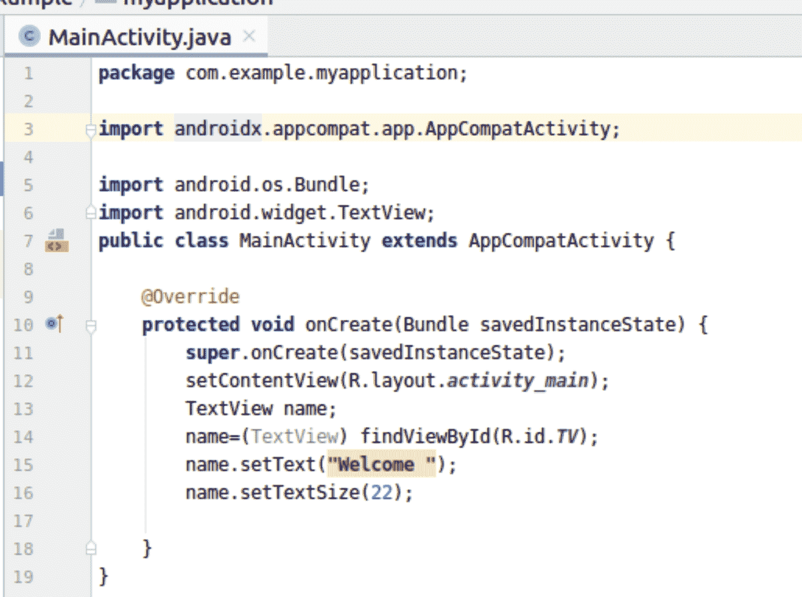

图 7.1 `MainActivity.java` 文件

7. 运行应用程序。屏幕显示如图 7.2 所示。

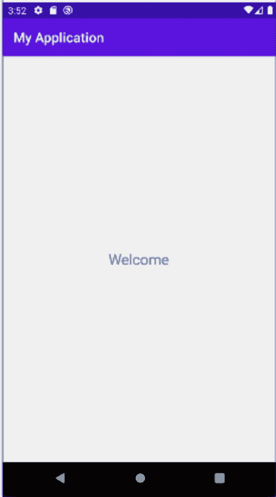

```java
activity_add();
```

当主类中添加创建新方法的代码时，系统会创建如下的新方法骨架。创建的方法的操作范围位于左右大括号之间：

```java
private void activity_add() {
}
```

8. 为此界面名为 `id` 的属性接受默认值。假设为 `textView`。

进一步的过程将在活动 Java 文件中完成。

9. 打开 `MainActivity.java` 文件。
10. 插入 `import` 语句以添加必要的库文件，使用以下语句：

```java
import android.widget.EditText;
```

### 创建新方法并获取界面引用

11. 使用语句 `activity2();` 创建名为 `activity2()` 的新方法。

12. 编写代码以获取名为 `textView2` 和 `textView` 接口的唯一系统引用，并将它们分别存储在声明的变量 `name1` 和 `name2` 中。必要的程序代码如下：

```java
name1 = (EditText) findViewById(R.id.textView2);
name2 = (TextView) findViewById(R.id.textView);
```

13. 使用代码在 `textView2` 接口中插入必要的文本值：

```java
name1.setText("James");
```

该应用程序使用 Java 方法 `getText().toString()` 通过文本接口元素接收输入值，并将其作为 `String` 类型数据存储在变量中。使用该方法的语法如下：

```java
String rec = edittext.getText().toString();
```

接收到的字符串通过字符串拼接操作与另一个字符串值 `Hello` 拼接，组合后的字符串值将显示在输出文本接口中。当应用程序运行时，也能看到输入文本接口中的文本值。通过这种方式，在应用程序运行期间可以接受不同的数据输入，将其存储在变量中，并进行处理和显示。应用程序运行时获得的设备屏幕显示如图 7.5 所示。

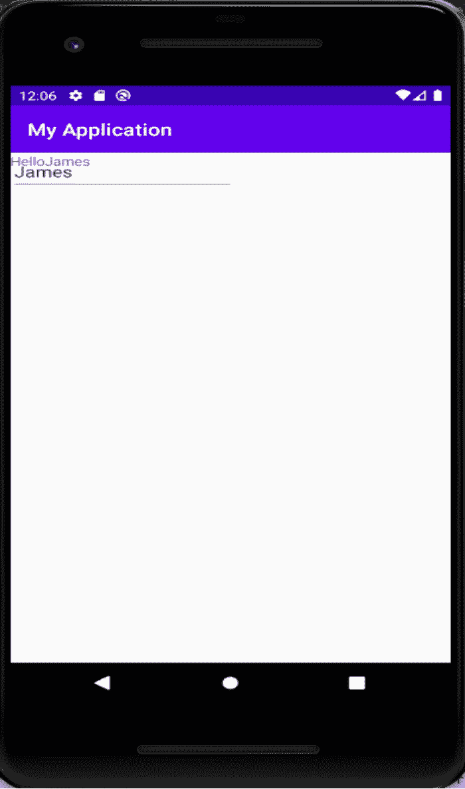

图 7.5 应用程序运行情况

由于通过 `EditText` 接口给出的值是作为字符串值接收的，因此无法用于数值计算。Java 方法 `parseInt()` 将字符串转换为数值值并存储在整数变量中以便计算。使用该方法的语法如下：

```java
int rec1 = Integer.parseInt(rec);
```

Java 也使用 `parseLong()` 方法将字符串值转换为浮点值。在某些情况下，需要将整数值转换以便在文本界面中显示。`valueOf()` 方法用于此目的。该语句的语法编写如下：

```xml
android:layout_height="wrap_content"

android:text="AutoCompleteTextView"

tools:layout_editor_absoluteX="120dp"

tools:layout_editor_absoluteY="418dp" />
```

要实现该项目，使用以下语句将界面元素的库文件导入 Java Activity 文件。

```java
ArrayAdapter<String> adapter = new ArrayAdapter<String>(
    this,
    android.R.layout.select_dialog_item,
    lang
);
```

使用以下语句将界面存储在声明的变量中。

```java
AutoCompleteTextView actv =
    (AutoCompleteTextView) findViewById(R.id.autoCompleteTextView);
```

完整的 Java 代码如图 7.6 所示。字符串数组存储了一些单词，当应用程序运行时显示在建议列表中。创建了一个包含单词列表的数组适配器类实例。当用户输入数组中单词的第一个字母时，相应的单词将会出现并可以被选择插入。通常，此界面在向应用程序输入数据时非常有用。

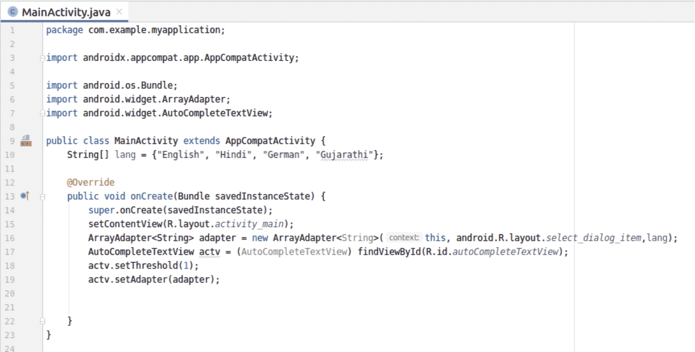

图 7.6 AutoComplete TextView – 完整的 Java 代码

## 7.6 Toast 提示（Toast Alert）

`TextView` 界面在应用程序运行时会在设备屏幕上显示适当的消息。在这里，界面元素上显示的文本将一直留在设备屏幕上直到被移除。为了仅在设备屏幕上显示特定时间的消息然后自动消失，应用程序使用了 `Toast` 语句。

`Toast` 适用于在设备屏幕上显示不同的通知。当执行语句时，`Toast` 消息出现在设备屏幕的底部。`Toast` 提示有两种类型，即普通 `Toast` 提示和自定义 `Toast` 提示。

普通 `Toast` 提示使用默认设置显示消息。可以通过更改布局属性或更改显示持续时间根据用户需求自定义 `Toast` 消息。布局自定义包括在消息旁边添加图像或 Logo、更改显示文本大小、更改显示背景等。此类自定义的消息被称为自定义 `Toast` 消息。

以下两个 Java 语句说明了使用 `Toast` 提示消息的语法：

```java
Toast.makeText(
    getApplicationContext(),
    "message",
    Toast.LENGTH_LONG
).show();

Toast.makeText(
    getApplicationContext(),
    "message",
    Toast.LENGTH_SHORT
).show();
```

```java
import android.widget.Toast;
```

通过按照以下步骤创建新项目，可以理解 `Toast` 提示语句的工作原理：

1. 创建一个新的 Android Studio 项目。
2. 通过删除默认界面使布局为空。
3. 在布局面板中拖放一个 `Button` 界面。或者在 `activity_main.xml` 文件中添加以下 XML 代码以插入按钮界面：

```xml
<Button
    android:id="@+id/button"
    android:layout_width="wrap_content"
```

Android Studio IDE 的自动补全功能有助于轻松完成代码语句的插入。在这里，图像位于插入文本的右侧。从项目面板可以看出，插入的 `ic_launcher.png` 图像文件位于名为 `mipmap` 的文件夹中。在这里，XML 文件中的属性句使用了文件的完整路径名。

6. 打开 `MainActivity.java` 文件。
7. 使用代码导入按钮界面的库文件：

```java
button1 = (Button) findViewById(R.id.button);
```

8. 使用代码为文本大小设置新值：

```java
button1.setTextSize(30);
```

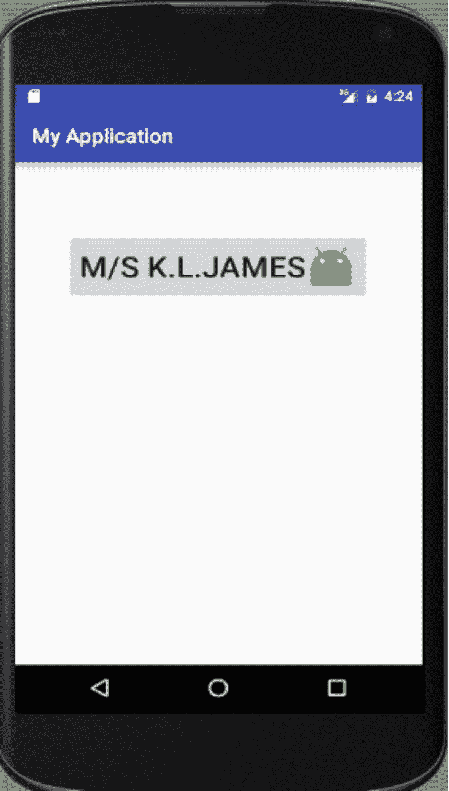

图 7.8 在按钮界面上显示文本和图像

应用程序开发中使用的按钮界面元素的常用属性及其用途如表 7.1 所示。

### 表 7.1 按钮界面的常用属性

| 属性 | 用途 |
| :--- | :--- |
| `background` | 将可绘制对象设置为背景 |
| `drawable Left` | 在文本左侧绘制的可绘制对象 |
| `drawable Right` | 在文本右侧绘制的可绘制对象 |
| `gravity` | 指定对象如何放置其内容 |

```java
@Override

public void onClick(View v) {

    /*用于事件功能的 Java 代码*/

}
```

下一个项目将用于说明创建一个 `Button` 接口的步骤，该接口通过显示 `Toast` 通知来响应用户的点击。项目所需的步骤如下：

1. 创建一个新的 Android Studio 项目。
2. 删除默认接口对象以使布局屏幕为空。
3. 拖放一个 `Button` 接口，或使用下面的 XML 代码实现相同功能：

```xml
<Button
    android:id="@+id/button"
    android:layout_width="wrap_content"
    android:layout_height="wrap_content"
    android:text="Button"
    tools:layout_editor_absoluteX="184dp"
    tools:layout_editor_absoluteY="226dp" />
```

完整的 Java 代码见图 7.9。

10. 运行应用程序。

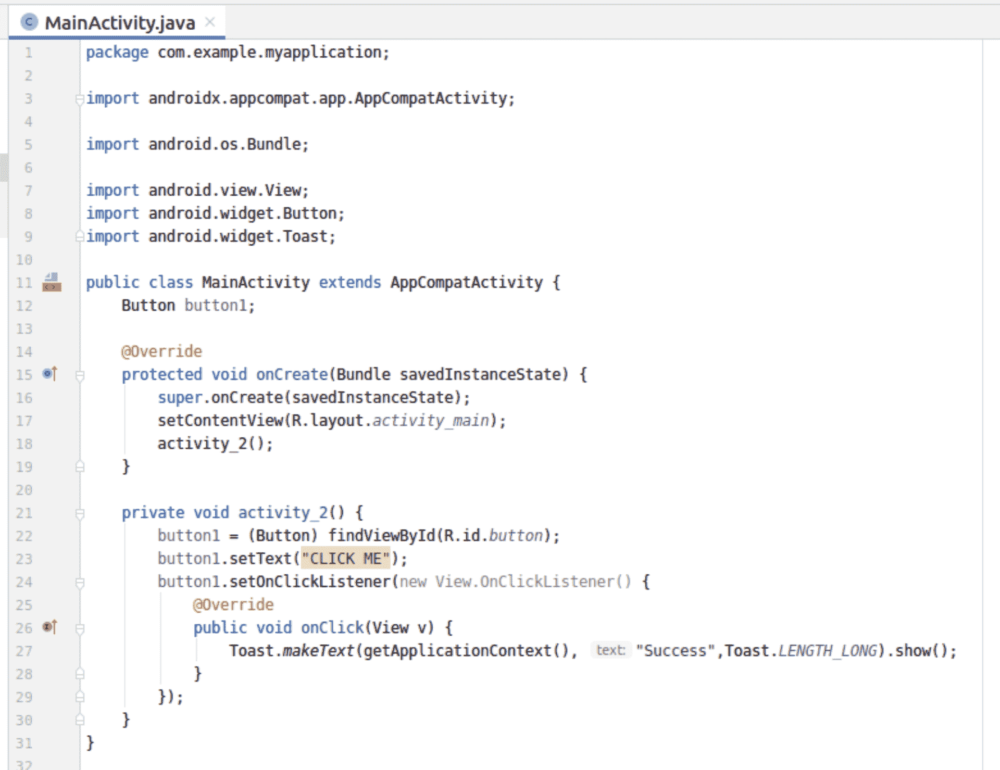

图 7.9 按钮点击事件的 Java 代码

屏幕显示结果如图 7.10 所示。屏幕上显示一个显示内容为 CLICK ME 的按钮。当用户点击按钮时，`Toast` 通知将在屏幕底部显示一会。

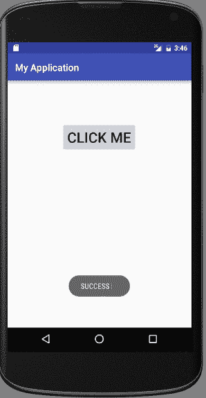

图 7.10 按钮通过点击 `Toast` 消息响应用户点击

应用程序中通常会有多个按钮接口。假设应用程序中使用了名为 `button1` 和 `button2` 的两个按钮接口。在调用它们执行操作之前，需要定义这两个按钮的 Java 事件过程代码。

第一个按钮点击事件的代码如下：

```java
button1.setOnClickListener(new View.OnClickListener() {
    @Override
    public void onClick(View v) {
        textVew1.setText("First button pressed");
    }
});
```

当点击第一个按钮时，系统执行为该按钮点击事件编写的事件过程指令。在这里，点击事件在 `TextView` 界面元素中设置了新文本。

第二个按钮点击事件的代码如下。该语句在文本框中设置了另一个通知：

```java
Button2.setOnClickListener(new View.OnClickListener() {
    @Override
    public void onClick(View v) {
        textVew1.setText("Second button pressed");
    }
});
```

按钮以外的接口也会响应用户点击事件。当有多个接口需要注册到 Activity 中的 `onListener` 方法时，为不同的界面元素使用多个事件类来处理点击事件是不切实际的。这种实现的简单方法是使用 Java 的 `Case` 语句来识别被点击的界面元素，然后根据被点击的元素分支执行不同的操作。

Java 将 `View.OnClickListener` 类声明为一个接口，通过使用 `implements` 关键字实现接口来使用与类相关的方法。实现语句的语法如下：

```java
public class MainActivity extends AppCompatActivity
        implements View.OnClickListener {
}
```

使用 Java `Case` 语句实现的典型语法如下代码所示：

```java
public class MainActivity extends AppCompatActivity
        implements View.OnClickListener {

    @Override
    public void onClick(View view) {
        switch (view.getId()) {
            case R.id.button1:
                break;
            case R.id.textView2:
                break;
            case R.id.button2:
                break;
            //处理多个视图点击事件
        }
    }
}
```

应用程序中使用的 `Button` 接口关联的其他常用方法及其描述见表 7.2。这些方法包含在事件监听器接口中。

### 表 7.2 与按钮接口关联的其他常用方法

| 方法 | 描述 |
| :--- | :--- |
| `onLongClick()` | 当用户触摸并按元素一秒钟时调用该方法。 |
| `onFocusChange()` | 当焦点改变时调用该方法。 |

## 7.9 图片按钮（Image Button）

按钮可以包含文本或嵌入其中的图像。有些按钮专门用于显示图像，这些按钮被称为图片按钮。在图片按钮中插入图像的步骤如下：

1. 启动一个新的空的 Android Studio 项目。
2. 在 `Project` 格中打开 `Buttons` 文件夹以查看界面元素。
3. 在 `Layout` 中选择并插入 `ImageButton` 接口。
4. 这将打开图 7.11 所示的 `Pick a Resource` 窗口。

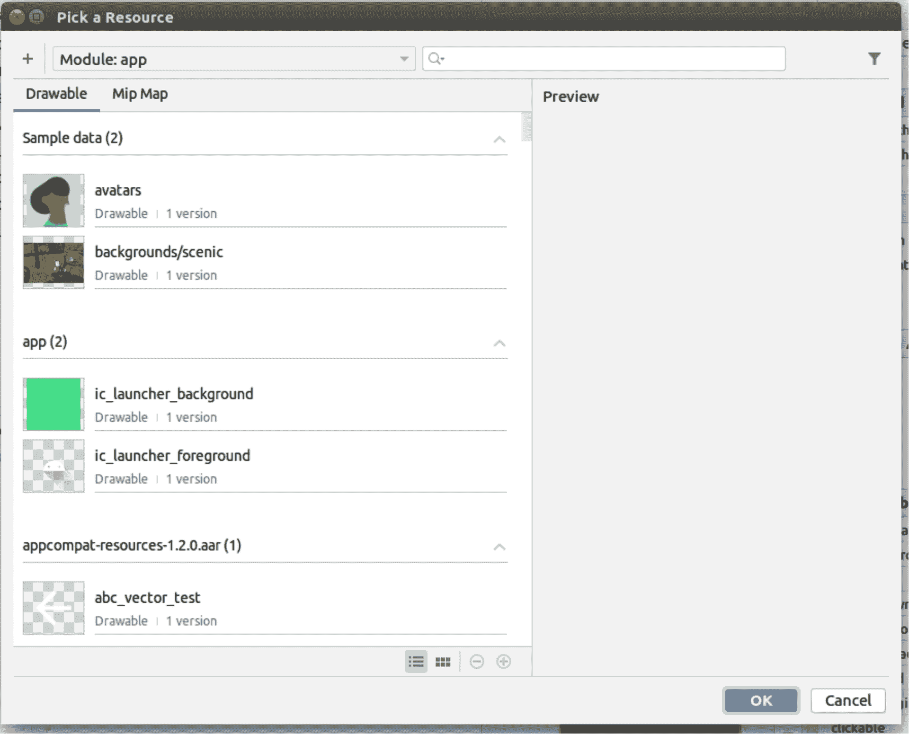

图 7.11 选择资源窗口

5. 此窗口有两个名为 `Drawable` 和 `Mip Map` 的标签页，它们是存储图像的文件夹。从显示中选择所需的图像并点击 `OK` 按钮。
6. 选中的图像将出现在图片按钮界面中，如图 7.12 所示。

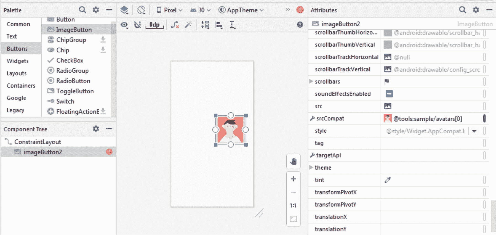

图 7.12 在 Layout 屏幕上添加图片按钮

在按钮中添加图像的 XML 代码包含在布局文件中，如下所示：

```xml
tools:src="@tools:sample/avatars"
```

图片按钮和推按钮（push button）看起来相似。从 `Attributes` 窗口可以看到，这两个按钮的主要区别在于图片按钮没有文本属性元素。图片按钮还响应用户对其点击、轻触事件。

实现 `ImageButton` 接口元素点击事件的 Java 代码与推按钮使用的相同。下一个项目演示了在图片按钮上实现点击事件。当点击按钮时，按钮显示的初始图像将更改为另一个图像。在应用程序运行时在图片按钮上设置新图像的 Java 代码如下：

```java
IB.setImageResource(R.mipmap.ic_launcher);
```

Java 文件的完整代码如图 7.13 所示。

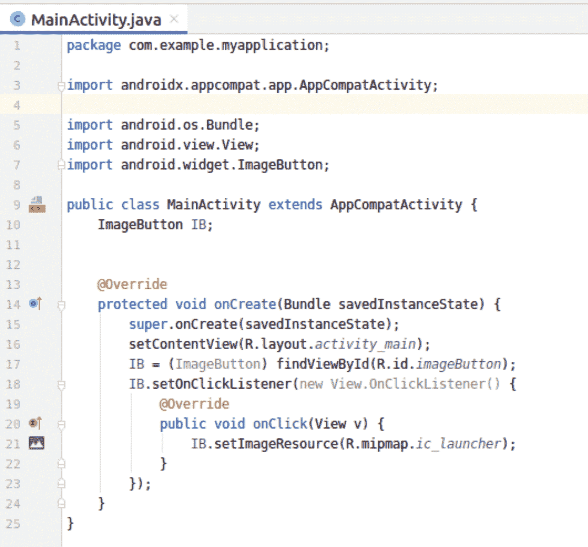

图 7.13 Activity Java 文件

应用程序使用 Java 方法 `setImageResource(image name)` 来显示语句中指定的图像。点击图片按钮时的屏幕显示如图 7.14 所示。

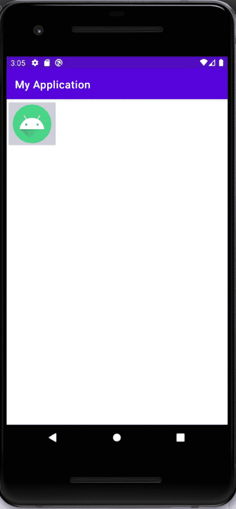

图 7.14 运行中的应用程序

## 7.10 单选按钮（Radio Button）

单选按钮与之前讨论的普通推按钮不同。普通推按钮具有平整矩形表面。单选按钮在平整矩形表面上放置了一个圆形按钮，用户在应用程序运行时轻触它以进行选择。

因此，单选按钮存在选中（checked）和未选中（unchecked）两种状态，用于表示对象的两种行为状态。假设应用程序需要对设备屏幕上显示的问题输入“是”或“否”。在这里，将单选按钮作为输入接口是理想的。

一旦按钮变为选中状态，它就不会自动变回未选中状态。用户必须点击已选中的单选按钮来更改其状态。单选按钮在应用程序中的外观如图 7.15 所示。


图 7.15 单选按钮

单选按钮在任何时间的状态都使用 `isChecked()` 方法检查。使用该方法的语法如下：

```java
if (button.isChecked()) {
} else {
}
```

可以通过以下项目理解将单选按钮作为用户输入接口的使用。在这里，应用程序根据用户在单选按钮上的选择显示不同的 `Toast` 消息。创建项目的步骤如下：

1. 启动 Android Studio IDE。
2. 创建新项目并使布局保持为空。
3. 通过拖放或在布局文件中添加以下 XML 代码向 `Layout` 插入 `RadioButton` 接口：

```xml
<RadioButton
    android:id="@+id/radioButton"
    android:layout_width="wrap_content"
    android:layout_height="wrap_content"
    android:text="RadioButton"
    tools:layout_editor_absoluteX="158dp"
    tools:layout_editor_absoluteY="206dp" />
```

4. 将单选按钮的初始状态设置为选中。为此，打开界面元素的 `Attributes` 格，并在名为 `checked` 的属性旁边的框上打钩，以便将其值更改为 `true`。在 XML 文件中添加以下属性也可以将单选按钮状态设置为选中状态：

```xml
android:checked="true"
```

5. 打开主 Activity Java 文件。
6. 使用 `import` 语句添加所需的库文件，如下：


```java
import android.widget.RadioButton;
import android.widget.Toast;
```

7. 添加检查单选按钮状态的 Java 代码，如下：

```java
if(button1.isChecked()) {
  Toast.makeText(getApplicationContext(), " Selected ", Toast.LENGTH_LONG).show();
}
else {
    Toast.makeText(getApplicationContext(), "Sorry", Toast.LENGTH_LONG).show();
}
```

主要的 Java 文件如图 7.16 所示。

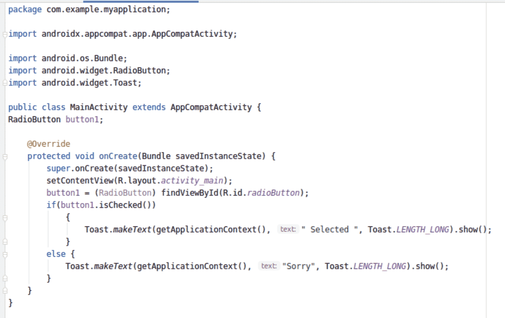

图 7.16 主活动文件

7. 运行应用程序。

8. 将单选按钮的 `checked()` 属性修改为未选中状态。

9. 再次运行应用程序。

活动文件中包含的 Java `if` 语句的工作原理为两个不同的单选按钮实例显示两个不同的 `Toast` 通知。图 7.17 显示了这两个设备屏幕截图。第一张截图是应用程序运行且单选按钮的 `checked` 属性设置为 `true` 时的显示。第二个显示是应用程序运行且 `checked` 属性设置为 `false` 时的屏幕截图。

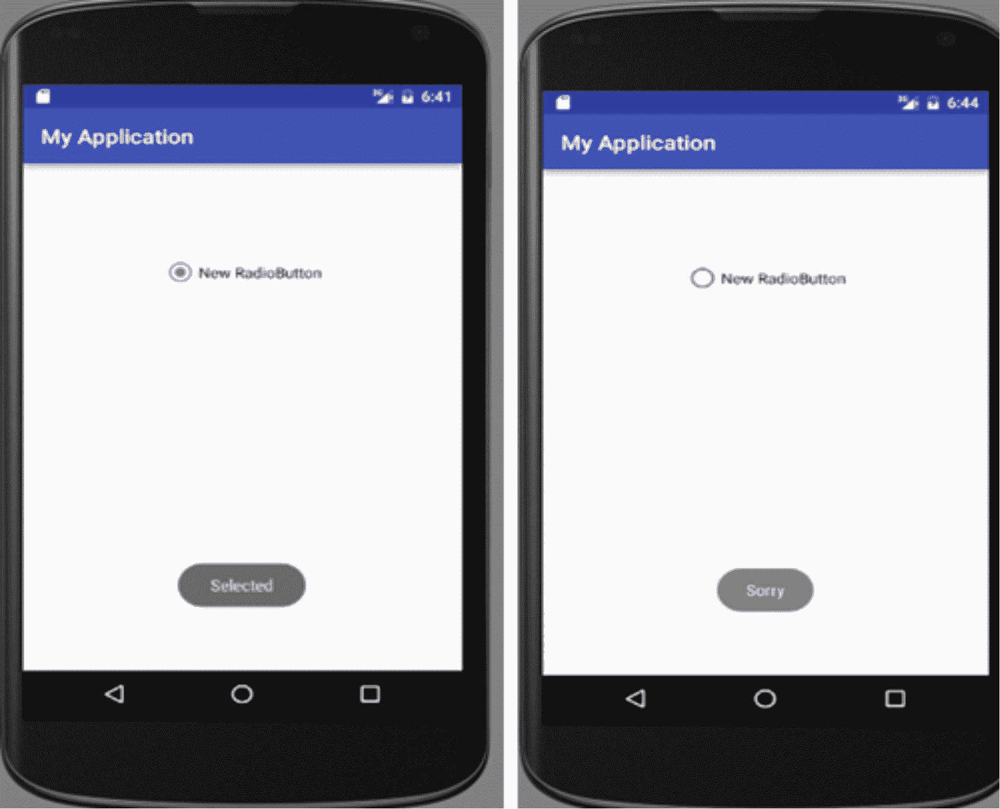

图 7.17 单选按钮的两种状态 - 工作原理图

## 7.11 Radio Group（单选组）

单选组接口用于将在布局中出现的多个单选按钮进行分组。当将多个单选按钮包含在一个单选组容器中时，组内只有一个单选按钮可以处于 `checked` 状态。如果组内的第二个单选按钮被选中，则现有的选中单选按钮将变为未选中状态。

放置在单选组容器内的单选按钮的工作原理通过以下示例进行了说明。在这里，我们正在创建一个新的 Android Studio 项目，在单选组容器内放置两个单选按钮。应用程序在设备屏幕顶部显示一个标签来选择国籍。提供的两个选项是“印度人”（Indian）和“外国人”（Foreign）。用户从两个选项中选择一个单选按钮。无法同时选择两个单选按钮，因为选择第二个按钮会将已选中的按钮变为未选中状态。做出选择后，点击提交按钮完成选择。应用程序会检查用户的选择，然后在按钮上显示选择结果。

到目前创建的所有项目都使用了默认布局，即 `Constraint layout`。此项目使用 `Linear Layout (Vertical)`（垂直线性布局）接口来构建应用程序，因为使用此布局时，界面元素可以垂直方向放置。因此，首先在默认布局上方添加 `Linear Layout (Vertical)`。应用程序所需的界面元素放置在此布局中。界面在应用程序中以垂直方式排列。

创建项目的步骤如下：

1. 创建一个新的 Android Studio 项目。
2. 删除默认界面元素使布局为空。
3. 在默认布局界面上插入 `Linear Layout (Vertical)` 接口。确保布局名称出现在 `Component Tree` 格中。
4. 插入一个 `Plain TextView` 接口用于显示标题。
5. 插入一个 `RadioGroup` 接口。
6. 在 `Radio Group` 容器内插入两个 `Radio Buttons` 接口。
7. 在布局的单选组外部插入一个 `Button` 接口。
8. 将 `textView` 接口的 `text` 属性设置为“Select your nationality”（选择您的国籍）。
9. 将第一个单选按钮的 `text` 属性设置为“Indian”。
10. 将第二个单选按钮的 `text` 属性设置为“Foreign”。
11. 将 `Button` 接口的 `text` 属性设置为“Submit”（提交）。

项目的设计布局如图 7.18 所示。

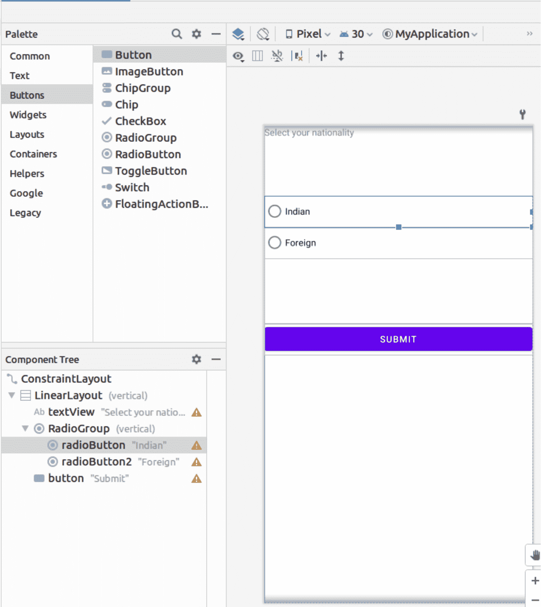

图 7.18 项目的设计布局

`activity_main.xml` 文件中的 XML 代码如图 7.19 所示。

```xml
<?xml version="1.0" encoding="utf-8"?>
<androidx.constraintlayout.widget.ConstraintLayout xmlns:android="http://schemas.android.com/apk/res/android"
    xmlns:app="http://schemas.android.com/apk/res-auto"
    xmlns:tools="http://schemas.android.com/tools"
    android:layout_width="match_parent"
    android:layout_height="match_parent"
    tools:context=".MainActivity">
    <LinearLayout
        android:layout_width="match_parent"
        android:layout_height="match_parent"
        android:orientation="vertical"
        tools:layout_editor_absoluteX="63dp"
        tools:layout_editor_absoluteY="100dp">
        <TextView
            android:id="@+id/textView"
            android:layout_width="match_parent"
            android:layout_height="107dp"
            android:text="Select your nationality" />
        <RadioGroup
            android:layout_width="match_parent"
            android:layout_height="196dp">
            <RadioButton
                android:id="@+id/radioButton"
                android:layout_width="match_parent"
                android:layout_height="wrap_content"
                android:text="Indian" />
            <RadioButton
                android:id="@+id/radioButton2"
                android:layout_width="match_parent"
                android:layout_height="wrap_content"
                android:text="Foreign" />
        </RadioGroup>
        <Button
            android:id="@+id/button"
            android:layout_width="match_parent"
            android:layout_height="wrap_content"
            android:text="Submit" />
    </LinearLayout>
</androidx.constraintlayout.widget.ConstraintLayout>
```

图 7.19 Activity_main.xml 文件

9. 打开 `MainActivity.java` 文件并按照图 7.20 所示完成 Java 代码。

```java
package com.example.myapplication;
import androidx.appcompat.app.AppCompatActivity;
import android.os.Bundle;
import android.view.View;
import android.widget.Button;
import android.widget.RadioButton;
public class MainActivity extends AppCompatActivity {
    RadioButton rb, rb2;
    Button but;
    @Override
    protected void onCreate(Bundle savedInstanceState) {
        super.onCreate(savedInstanceState);
        setContentView(R.layout.activity_main);
        rb = (RadioButton) findViewById(R.id.radioButton);
        rb2 = (RadioButton) findViewById(R.id.radioButton2);
        but = findViewById(R.id.button);
        but.setOnClickListener(new View.OnClickListener() {
            @Override
            public void onClick(View v) {
                if(rb.isChecked()) {
                    but.setText("Indian");
                }
                if(rb2.isChecked()) {
                    but.setText("Foreign");
                }
            }
        });
    }
}
```

图 7.20 MainActivity.java 文件代码

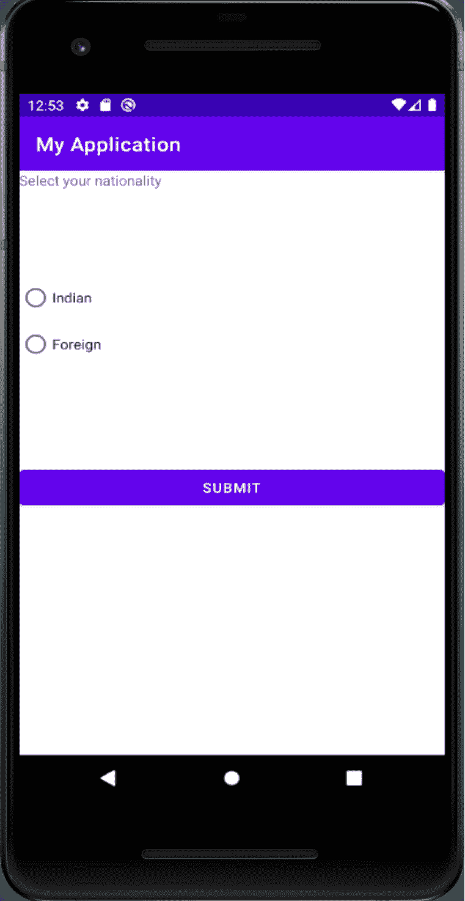

10. 运行应用程序。屏幕如图 7.21 所示。

11. 所有的接口都是垂直排列的。

图 7.21 运行应用程序

1. 通过点击第一个单选按钮选择屏幕上显示的第一个选项。按钮中显示的文本变为 Indian。
2. 通过点击第二个单选按钮选择第二个选项。按钮显示变为 Foreign。
3. 两个操作的屏幕显示如图 7.22 所示。

## 7.12 Box（复选框）

复选框接口的工作原理与单选按钮相同。该接口也存在选中或未选中的状态。无论使用多少个复选框，都可以选中任意数量的复选框，或者全部取消选中。当应用程序显示多个查询，需要用户从两个选项中选择其一，且用户需要从列表中进行选择时，使用复选框接口是正确的选择。复选框在用户更改它之前将保持其原有状态。可以检查复选框的状态，并根据当前状态采取相应的操作。复选框的状态使用 `isChecked()` 方法检查，其语法如下：

```java
if(cb.isChecked())
    // statement
else
    // statement
```

复选框接口可以在设计时间内通过设置 `checked` 属性设置为所需，也可以在活动文件中通过代码设置。可以通过以下使用 `checkbox`、`textView` 和 `button` 接口的项目了解 `checkbox` 的工作原理。

1. 创建一个新的 Android 项目。
2. 删除默认界面使布局为空。
3. 在默认布局界面上插入 `Linear layout (vertical)` 接口。
4. 插入一个 `Plain Text` 元素。
5. 将此接口的 `text` 属性设置为“Select the languages to read”（选择要阅读的语言）。
6. 在布局下方插入四个 `CheckBox` 接口。
7. 将第一个 `CheckBox` 的 `text` 属性设置为“English”。
8. 将第二个 `CheckBox` 的 `text` 属性设置为“Hindi”。
9. 将第三个 `CheckBox` 的 `text` 属性设置为“Malayalam”。
10. 将第四个 `CheckBox` 的 `text` 属性设置为“Tamil”。
11. 将第五个 `CheckBox` 的 `text` 属性设置为“French”。
12. 将第一个 `Button` 的 `text` 属性设置为“SUBMIT”。
13. 将第二个 `Button` 的 `text` 属性设置为“CLEAR”。
14. 将第二个 `textView` 的 `text` 属性设置为“Your Selection :”。

布局如图 7.23 所示。

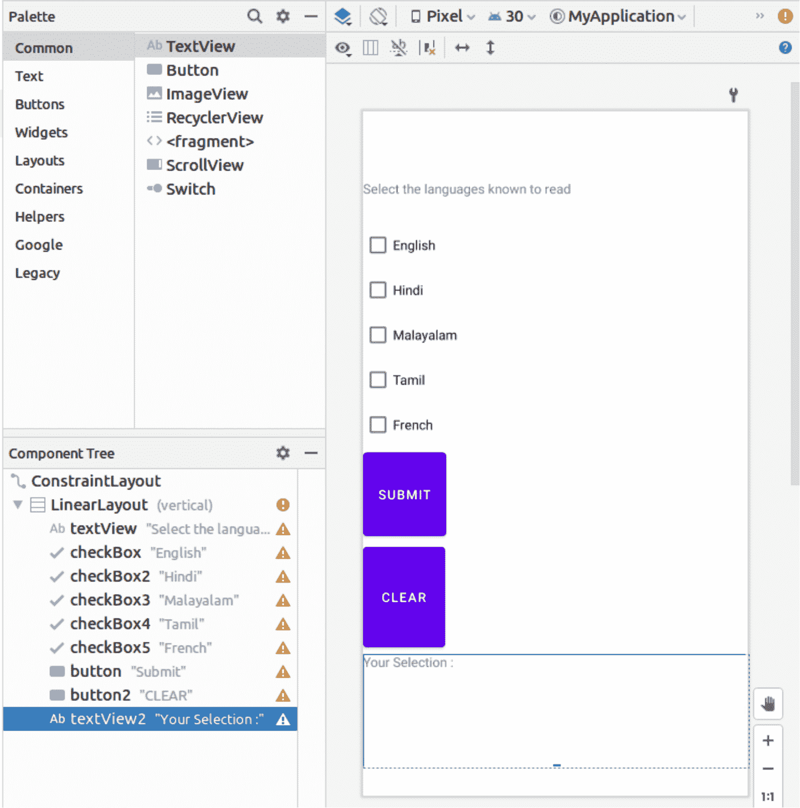

图 7.23 应用程序布局

1. 运行应用程序时的屏幕如图 7.24 所示。
2. 现在，点击前两个复选框选择前两个选项。点击 `Submit` 按钮。底部的选择结果如第二张屏幕截图所示。点击 `CLEAR` 按钮将清除选择详情。

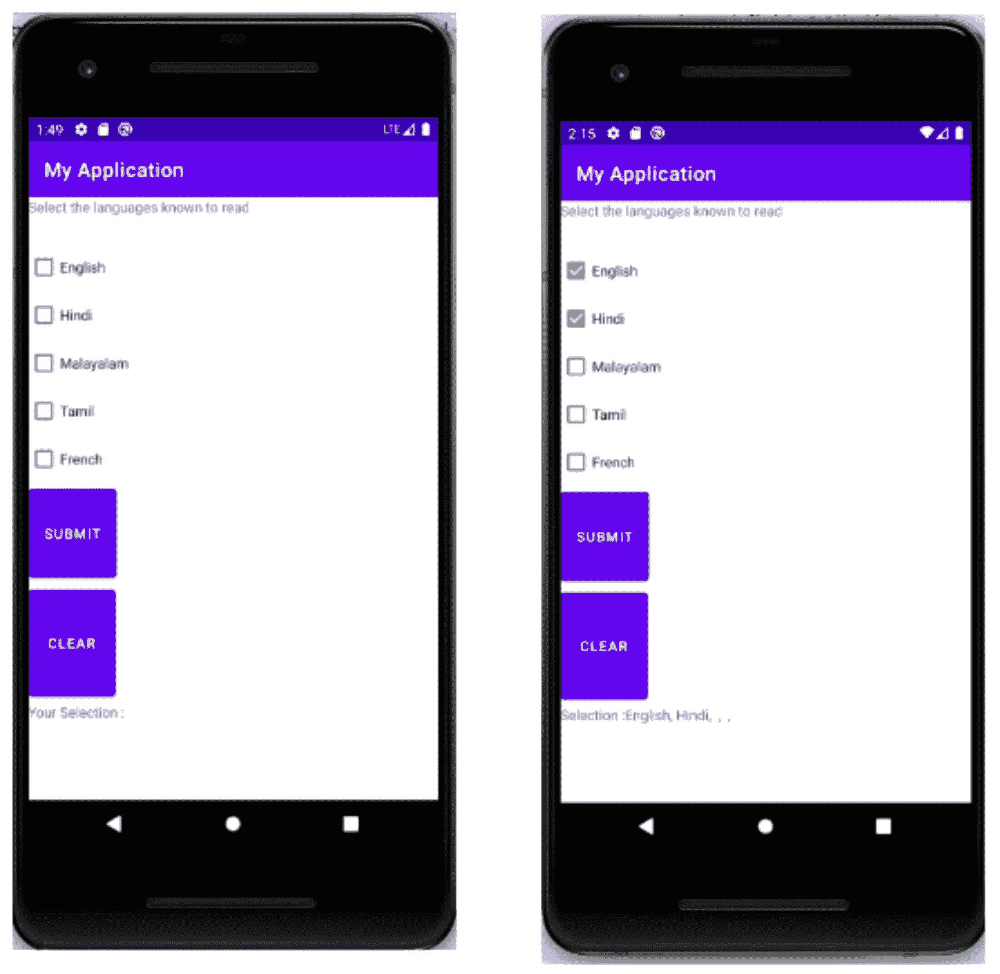

图 7.24 运行中的应用程序

完整的布局文件如图 7.25 所示。


```xml
<?xml version="1.0" encoding="utf-8"?>
<androidx.constraintlayout.widget.ConstraintLayout xmlns:android="http://schemas.android.com/apk/res/android"
    xmlns:app="http://schemas.android.com/apk/res-auto"
    xmlns:tools="http://schemas.android.com/tools"
    android:layout_width="match_parent"
    android:layout_height="match_parent"
    tools:context=".MainActivity">
    <LinearLayout
        android:layout_width="409dp"
        android:layout_height="627dp"
        android:orientation="vertical"
        app:layout_constraintStart_toOf="parent"
        tools:layout_editor_absoluteY="73dp">
        <TextView
            android:id="@+id/textView"
            android:layout_width="match_parent"
            android:layout_height="46dp"
            android:text="Select the languages to read" />
        <CheckBox
            android:id="@+id/checkBox"
            android:layout_width="match_parent"
            android:layout_height="wrap_content"
            android:text="English" />
        <CheckBox
            android:id="@+id/checkBox2"
            android:layout_width="match_parent"
            android:layout_height="wrap_content"
            android:text="Hindi" />
        <CheckBox
            android:id="@+id/checkBox3"
            android:layout_width="match_parent"
            android:layout_height="wrap_content"
            android:text="Malayalam" />
        <CheckBox
            android:id="@+id/checkBox4"
            android:layout_width="match_parent"
            android:layout_height="wrap_content"
            android:text="Tamil" />
        <CheckBox
            android:id="@+id/checkBox5"
            android:layout_width="match_parent"
            android:layout_height="wrap_content"
            android:text="French" />
        <Button
            android:id="@+id/button"
            android:layout_width="wrap_content"
            android:layout_height="30dp"
            android:layout_weight="1"
            android:text="Submit" />
        <Button
            android:id="@+id/button2"
            android:layout_width="wrap_content"
            android:layout_height="wrap_content"
            android:layout_weight="1"
            android:text="CLEAR" />
        <TextView
            android:id="@+id/textView2"
            android:layout_width="412dp"
            android:layout_height="50dp"
            android:layout_weight="1"
            android:text="Your Selection :" />
    </LinearLayout>
</androidx.constraintlayout.widget.ConstraintLayout>
```

图 7.25 布局文件

检查不同复选框状态的 Java 代码如图 7.26 所示。

```java
package com.example.myapplication;
import androidx.appcompat.app.AppCompatActivity;
import android.os.Bundle;
import android.view.View;
import android.widget.Button;
import android.widget.CheckBox;
import android.widget.TextView;
public class MainActivity extends AppCompatActivity {
    CheckBox cb, cb2, cb3, cb4, cb5;
    Button bt, bt2;
    TextView tv2;
    String s, s2, s3, s4, s5;
    @Override
    protected void onCreate(Bundle savedInstanceState) {
        super.onCreate(savedInstanceState);
        setContentView(R.layout.activity_main);
        cb = (CheckBox) findViewById(R.id.checkBox);
        cb2 = (CheckBox) findViewById(R.id.checkBox2);
        cb3 = (CheckBox) findViewById(R.id.checkBox3);
        cb4 = (CheckBox) findViewById(R.id.checkBox4);
        cb5 = (CheckBox) findViewById(R.id.checkBox5);
        bt = (Button) findViewById(R.id.button);
        bt2 = (Button) findViewById(R.id.button2);
        tv2 = (TextView) findViewById(R.id.textView2);
        bt.setOnClickListener(new View.OnClickListener() {
            @Override
            public void onClick(View v) {
                if(cb.isChecked())
                    s = cb.getText().toString();
                else
                    s = " ";
                if(cb2.isChecked())
                    s2 = cb2.getText().toString();
                else
                    s2 = " ";
                if(cb3.isChecked())
                    s3 = cb3.getText().toString();
                else
                    s3 = " ";
                if(cb4.isChecked())
                    s4 = cb4.getText().toString();
                else
                    s4 = " ";
                if(cb5.isChecked())
                    s5 = cb5.getText().toString();
                else
                    s5 = " ";
                tv2.setText("Selection :"+ s+", "+ s2+", "+ s3+", "+ s4+", "+ s5);
            }
        });
        bt2.setOnClickListener(new View.OnClickListener() {
            @Override
            public void onClick(View v) {
                tv2.setText("Selection :");
            }
        });
    }
}
```

图 7.26 活动文件的 Java 代码

## 7.13 Toggle Button（切换按钮）

另一种常用的按钮接口类型是切换按钮接口，它也存在表示为开启（ON）和关闭（OFF）的两种状态。每需要在这两个状态之间切换时，使用此接口是理想的选择。该接口位于 Android Studio 项目面板的`Buttons`文件夹中。通过通过拖放或在布局文件中添加 XML 代码，可以将接口添加到布局中。`activity_main.xml`文件使用`<ToggleButton />`标签插入接口，如下：

```xml
<ToggleButton
    android:id="@+id/toggleButton"
    android:layout_width="wrap_content"
    android:layout_height="wrap_content"
    android:text="ToggleButton"
    tools:layout_editor_absoluteX="150dp"
    tools:layout_editor_absoluteY="275dp" />
```

`android:textOn="enable"` 属性。其他可以修改的属性包括文本大小、文本样式、按钮大小、背景等。与任何按钮的设置类似，可以在显示文本的顶部、底部、左侧和右侧插入图标。

### 7.14 Switch

与切换按钮（toggle button）类似，另一种用于需要表示两种状态的界面元素是`Switch`按钮。该元素位于调色板（Palette）中的`Buttons`文件夹。与其他界面元素一样，选择该元素并将其插入布局窗口。切换按钮和开关按钮之间的主要区别在于它们的外观。布局 xml 文件使用`<Switch />`标签在应用程序中添加此组件。代码段如下。

```xml
<Switch
    android:id="@+id/switch1"
    android:layout_width="154dp"
    android:layout_height="237dp"
    android:text="Switch"
    tools:layout_editor_absoluteX="160dp"
    tools:layout_editor_absoluteY="253dp" />
```

布局界面如图 7.27 所示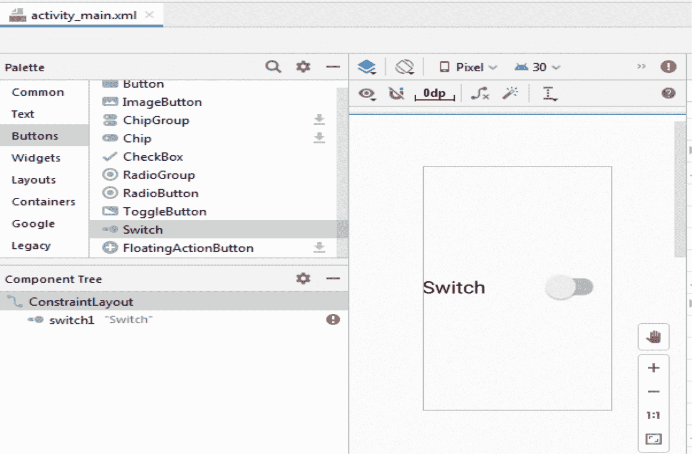

图 7.27 在布局面板中添加 Switch 按钮

可以通过在属性面板（Attributes pane）中设置不同的值来适当修改界面组件的尺寸和功能属性。`checked()`方法决定按钮在任何时刻的状态。

### 7.15 练习

**I. 填空题**

1. 从文本接口读取输入的 Java 方法是 ------ ----------------------------------

2. 将文本转换为字符串的 Java 方法语法是 -------------- - ------------------------ -

3. 具有平整矩形表面并响应用户点击的界面是 ---------------

4. 图像按钮中的图像存储在名为 -------------------- - ------------ 的文件夹中

5. 设置切换按钮两种状态的属性是 --------------------- -----------

**II. 简答题**

1. 陈述在 Android 应用程序中创建新方法的步骤。

2. 解释`AutoCompleteTextView`接口的作用。

3. 说明按钮（button）和图像按钮（image button）接口属性的区别。

4. 解释实现按钮点击事件的 Java 代码。

5. 为计算运行时给两个数字之和与差的应用程序编写 XML 和 Java 代码。

**III. 详细论述**

1. 创建点击按钮界面时显示 toast 消息的 Android 应用程序步骤，以及相关的 XML 和 Java 代码。

2. Android 应用程序中使用的不同按钮界面。

# 第 8 章：使用更多设计界面

前面的章节已经讨论了常用界面元素、其属性以及在应用程序中使用它们的步骤。我们现在讨论创建 Android 应用程序所需的另一些界面元素。这里讨论的界面包括`seekBar`、`progressBar`、`spinner`等。学习本章后，将能够使用不同的界面元素创建各种应用程序。

### 8.1 Seek Bar

`seekBar`接口是一个带有拖动块的界面元素。用户在应用程序运行时触摸`seekBar`接口的滑块并向左或向右方向移动，以为正在进行的活动设置新值。`seekBar`接口的一个熟悉且常见的操作是控制不同设备的屏幕亮度和扬声器音。为此，用户触摸进度条上的滑块，它会向前或向后绘制以更改参数值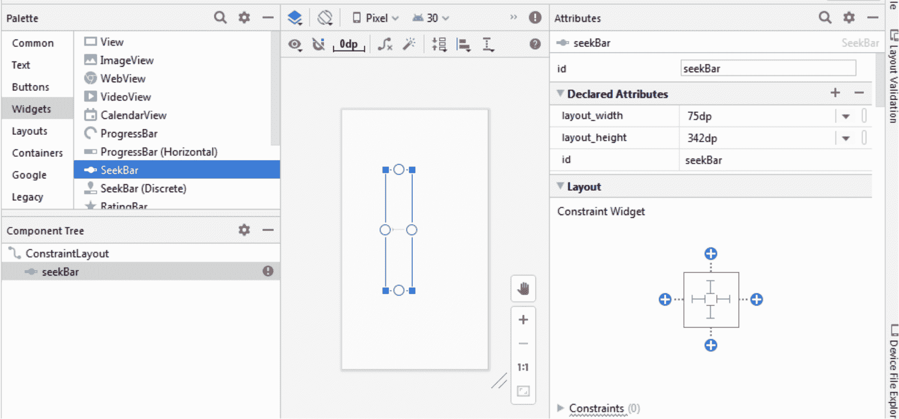

图 8.1 添加 SeekBar 组件示意图

`SeekBar`界面元素位于调色板中的`Widgets`文件夹中。见图 8.1。该界面元素像通常一样被添加到布局区域。为此，通过点击它来选择界面元素。然后按住鼠标键进行拖动，并释放到布局面板的正确位置。`activity_main.xml`文件使用`<SeekBar />`标签插入此界面元素，如图 8.2 所示。

```xml
<SeekBar
    android:id="@+id/seekBar"
    android:layout_width="wrap_content"
    android:layout_height="wrap_content"
    tools:layout_editor_absoluteX="195dp"
    tools:layout_editor_absoluteY="176dp" />
```

图 8.2 activity_main.xml 文件代码

控制界面元素活动的 Java 代码位于`MainActivity.java`文件中。使用如下所示的`import`语句向文件中添加必要的包文件。

```java
import android.widget.SeekBar;
```

添加的进度条具有默认标识符名称`seekBar`。监听方法`OnSeekBarChangeListener()`作为回调机制起，通知进度条进度的变化。监听器使用了三个方法，这三个方法在滑块被触摸、停止触摸和移动时变为激活。上述三个方法按以下方式调用：`onStartTrackingTouch(SeekBar seekBar)`、`onStopTrackingTouch(SeekBar seekBar)`和`onProgressChanged(SeekBar seekBar, int progress, boolean fromUser)`。

当添加监听器代码时，Android Studio 会自动在代码面板中插入实现这些方法的框架代码。根据应用程序的功能需求添加对应的代码。主活动 Java 文件的代码如图 8.3 所示。


```java
package com.example.myapplication;
import androidx.appcompat.app.AppCompatActivity;
import android.os.Bundle;
import android.widget.SeekBar;

public class MainActivity extends AppCompatActivity {
    SeekBar sb;
    @Override
    protected void onCreate(Bundle savedInstanceState) {
        super.onCreate(savedInstanceState);
        setContentView(R.layout.activity_main);
        sb = (SeekBar) findViewById(R.id.seekBar);
        sb.setOnSeekBarChangeListener(new SeekBar.OnSeekBarChangeListener() {
            @Override
            public void onProgressChanged(SeekBar seekBar, int progress, boolean fromUser) {}
            @Override
            public void onStartTrackingTouch(SeekBar seekBar) {}
            @Override
            public void onStopTrackingTouch(SeekBar seekBar) {}
        });
    }
}
```

图 8.3 控制 `seekBar` 界面的主文件 Java 代码。

带有滑块的进度条在启动应用程序时显示。通过添加适当的 `Toast` 消息代码，可以在设备屏幕上显示操作进度的相应消息。进度条的默认长度设置为 100。`seekBar` 的最大长度可以设置为 10、20、100、200 等值。进度条的特征（如长度、背景颜色等）通过更改属性面板中的不同属性来变化。表 8.1 解释了 `seekBar` 接口的一些主要属性及其用途。这些属性在布局文件或活动主文件中设置。

**表 8.1 `seekBar` 接口的主要属性及其用途**

| 属性 | 用途 |
| :--- | :--- |
| `background` | 设置可绘制对象作为界面的背景 |
| `indeterminate` | 设置不确定模式。播放不确定循环动画 |
| `longClickable` | 设置响应长按点击 |
| `max` | 设置最大值 |
| `padding` | 设置四个方向的内边距 |
| `progress` | 定义 0 到最大值之间的默认进度值 |
| `thumb` | 在 `seekBar` 上绘制一个滑块（拇块） |

另一种用于音乐播放器应用、评分应用以及高级系统的 `seekBar` 类型是离散型 `seekBar`。该界面元素的使用、属性和实现方法与上述讨论的普通 `seekBar` 接口相似。可以创建使用 `SeekBar (Discrete)` 接口的新项目，并学习在布局和主 Activity 文件中设置其不同属性的步骤。

## 8.2 进度条

`progressBar` 接口用于应用程序中，以图形化形式显示文件下载、应用程序安装等类似活动的进度。该接口用于在不同活动期间提供一种时间流逝的感觉。进度条以旋转轮或水平条的形式实现。这两种类型的实现分别使用了两种类型的界面元素，即 `ProgressBar` 和 `ProgrssBar(Horizontal)`。这两种进度条接口的 XML 代码如图 8.4 所示。

```xml
<ProgressBar android:id="@+id/progressBar" style="?android:attr/progressBarStyle" android:layout_width="wrap_content" android:layout_height="wrap_content" android:layout_centerHorizontal="true" android:layout_centerVertical="true" android:layout_marginTop="109dp" android:minWidth="50dp" android:minHeight="50dp" app:layout_constraintTop_toTopOf="parent" tools:layout_editor_absoluteX="166dp" />
<ProgressBar android:id="@+id/progressBar2" style="?android:attr/progressBarStyleHorizontal" android:layout_width="wrap_content" android:layout_height="wrap_content" android:layout_marginTop="126dp" android:max="100" android:minWidth="200dp" android:minHeight="50dp" android:progress="1" app:layout_constraintTop_toBottomOf="@+id/progressBar" tools:layout_editor_absoluteX="147dp" />
```

图 8.4 两种进度条接口的 XML 代码

XML 文件中指定的 `id` 属性是界面元素的标识符。`max` 属性定义了进度可以取的最大值。这是一个类似于 `100` 的整数值。此处该属性的 XML 代码如下。

`android:max="100"`

`progress` 属性定义了默认进度值，该值在 0 到最大值之间，是一个整数类型的值。此处 XML 代码所示。

`android:progress="1"`

表 8.2 描述了与此接口相关的一些关键属性。

**表 8.2 `progressBar` 接口的主要属性及其用途**

| 属性 | 用途 |
| :--- | :--- |
| `background` | 设置可绘制资源作为界面的背景 |
| `indeterminate` | 设置不确定模式。播放不确定的循环动画 |
| `longClickable` | 设置为响应长点击 |
| `max` | 设置最大值 |
| `padding` | 设置四个方向的内边距 |
| `progress` | 定义 0 到最大值之间的默认进度值 |
| `progressDrawable` | 使用可绘制资源来指示进度 |

`progressBar` 接口的工作原理通过创建一个新的 Android Studio 项目来演示，如下所示。该项目在设备屏幕上创建了两种类型的进度条和一个按钮界面。在应用程序运行时，点击按钮界面时，进度条（Progress Bar）会被激活。该项目通过创建一个 `Handler` 对象的实例来实现。使用 `Handler` 能够重复地运行特定的代码。在应用程序中使用 `Handler` 对象的通用语法如下。

```java
Handler handler = new Handler();
handler.postDelayed(new Runnable() {
    @Override
    public void run() {
        /* 重复运行的代码 */
    }
}, 1000); // 以毫秒为单位的时间延迟
```

该项目在 Java 类中使用了 Java 方法 `getProgress()` 从进度条中获取当前的进度值。该方法返回一个整数值。每个应用程序都有一条被称为线程的执行路径。`Runnable` 是由线程执行的实体，它包含一个名为 `run()` 的方法，该方法包含了线程执行的代码。该项目创建一个新的 runnable，它不断增加变量值并设置新的进度级别。Java 方法 `setProgress()` 用于实现此目的。实现该项目的步骤如下。

1. 创建一个新的 Android Studio 项目。
2. 创建一个空白布局窗口。
3. 使用拖拽方法插入 `ProgressBar`、`ProgressBar(Horizontal)` 和 `Button` 界面元素，或者打开 `activity_main.xml` 文件并添加两个进度条和按钮界面的 XML 代码。
4. 打开 `MainActivity.java` 文件。
5. 使用 `import` 语句导入必要的库文件。
6. 为 `Button` 界面创建点击事件类。
7. 创建一个新的 runnable 以持续增加变量值，直到达到进度条的最大值，这用于在每时刻为进度条设置新的进度级别。`MainActivity.java` 文件的代码如图 8.5 所示。

```java
package com.example.myapplication;
import androidx.appcompat.app.AppCompatActivity;
import android.app.ProgressDialog;
import android.os.Bundle;
import android.os.Handler;
import android.view.View;
import android.widget.Button;
import android.widget.ProgressBar;

public class MainActivity extends AppCompatActivity {
    ProgressBar PB, PB2;
    Button btn;
    int i = 0, j=0;
    Handler handler = new Handler();
    @Override
    protected void onCreate(Bundle savedInstanceState) {
        super.onCreate(savedInstanceState);
        setContentView(R.layout.activity_main);
        PB = (ProgressBar) findViewById(R.id.progressBar);
        PB2 = (ProgressBar) findViewById(R.id.progressBar2);
        btn = (Button) findViewById(R.id.button);
        btn.setOnClickListener(new View.OnClickListener() {
            @Override
            public void onClick(View v) {
                i= PB.getProgress();
                j= PB2.getProgress();
                new Thread(new Runnable() {
                    @Override
                    public void run() {
                        while (i<100){
                            i += 1;
                            j += 1;
                            handler.post(new Runnable() {
                                @Override
                                public void run() {
                                    PB.setProgress(i);
                                    PB2.setProgress(j);
                                }
                            });
                        }
                    }
                }).start();
            }
        });
    }
}
```

图 8.5 `MainActivity.java` 文件代码

运行应用程序时的设备屏幕如图 8.6 所示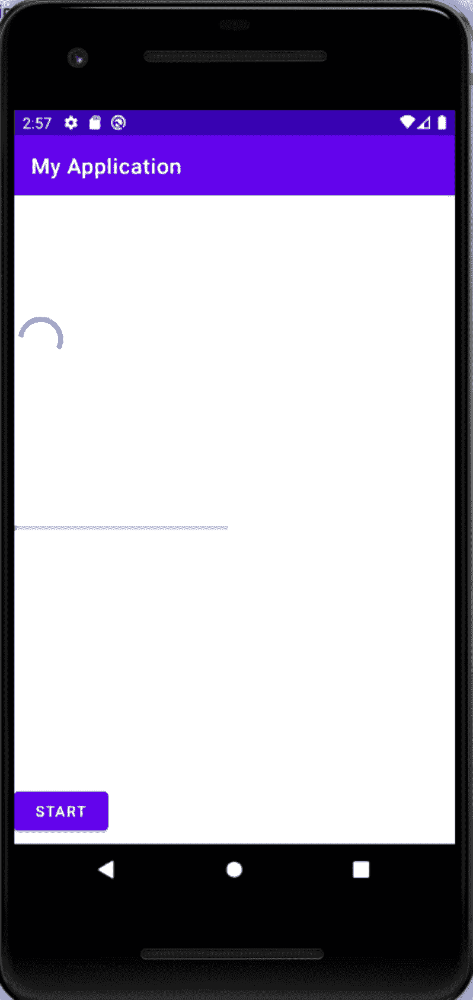

图 8.6 运行中的 `ProgressBar` 界面。

## 8.3 Spinner

在多个应用程序中，显示供用户选择的项数组的下拉列表是常见的。`Spinner` 接口用于实现在设备屏幕上显示包含多个项的下拉选择列表，以便用户在应用程序运行时可以从列表中选择所需的项。供用户选择的项数组存储为 XML 资源文件，存放在 `res\values\` 文件夹路径下。创建新数据文件的步骤如下。

1. 在 Project 格中右键点击名为 `values` 的文件夹，这将显示包含多个选项的弹出窗口。依次从第一个打开的窗口中选择 `New`，从第二个打开的窗口中选择 `File`。见图 8.7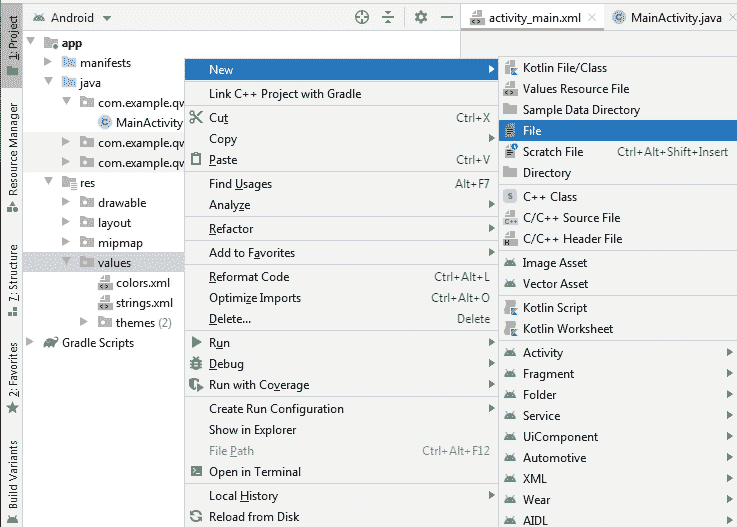

图 8.7 创建新数据文件 - 示例图

2. 成功完成上述步骤后，将显示一个用于设置新文件目标目录结构的新窗口。设置目标目录结构并点击 `OK` 按钮。见图 8.8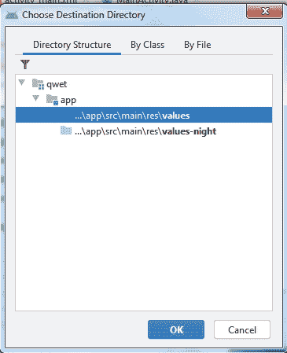

图 8.8 选择目标目录结构

3. 在显示的新窗口中，输入要创建的数据文件的名称。这里，名称输入为 `courses.xml`。新文件名出现在 Project 格中的文件层级结构中。右侧窗口也会出现一个输入数据值的空窗口。

XML 文档文件使用特定语法在其中添加所需数据。XML 文件的第一行是版本标识声明，该声明可以省略。该文件的根标签元素是 `<resources> </resources>`。根标签下方的下一个标签元素通过一个名称标识字符串数组。用于此目的的标签元素是 `<string-array> </string-array>`。该标签用于持有数组名称的属性元素是 `name`。数据元素安排在数组名称标签下的 `<item></item>` 之间。在 `spinner` 界面中显示的数据从此字符串数组获取。`courses.xml` 文件的内容如图 8.9 所示。

```xml
<?xml version="1.0" encoding="utf-8" ?>
<resources>
    <string-array name = "courses">
        <item> BA</item>
        <item>MA</item>
        <item>BSc</item>
        <item>MSC</item>
        <item>BCA</item>
        <item>MCA</item>
    </string-array>
</resources>
```

图 8.9 `courses.xml` 文件

通过这种方式创建用于 `spinner` 界面的 XML 数据文件。然后使用字符串数组和默认 `spinner` 布局创建一个数组适配器（array adapter）。接着将适配器应用于 `spinner`。通过创建一个新项目，可以理解 `spinner` 接口的实现及其工作原理。项目的步骤如下所示。

1. 创建一个新的 Android Studio 项目。
2. 创建一个空白布局窗口。
3. 使用拖拽方法在布局窗口中插入 `Spinner` 界面，或者打开 `activity_main.xml` 文件并添加图 10 中的 XML 代码。

```xml
<Spinner
    android:id="@+id/spinner"
    android:layout_width="match_parent"
    android:layout_height="wrap_content"
    android:layout_marginStart="10dp"
    android:layout_marginLeft="10dp"
    android:layout_marginTop="10dp"
    app:layout_constraintStart_toStart="parent"
    app:layout_constraintTop_toTopOf="parent" />
```

图 10 `Spinner` 界面 – XML 代码

4. 创建数据资源 XML 文件。
5. 打开 `MainActivity.java` 文件。
6. 使用 `import` 语句导入必要的库文件。
7. 使用字符串数组和默认布局创建一个数组适配器。`createFromResource()` 方法用于从字符串数组创建 `ArrayAdapter`。该语句的语法如下。

```java
ArrayAdapter<CharSequence> adapt = ArrayAdapter.createFromResource(this, R.array.courses, android.R.layout.spinner_item);
```

方法的第二个参数定义了要使用的资源文件，第三个参数定义了用于显示数组元素的布局。这里使用默认布局来显示数据元素。

8. 调用 `setAdapter()` 方法将布局应用到 `spinner`。activity 文件的完整代码如图 1 所示。


```java
package com.example.myapplication;

import androidx.appcompat.app.AppCompatActivity;

import android.os.Bundle;
import android.widget.ArrayAdapter;
import android.widget.Spinner;

public class MainActivity extends AppCompatActivity {
    @Override
    protected void onCreate(Bundle savedInstanceState) {
        super.onCreate(savedInstanceState);
        setContentView(R.layout.activity_main);

        Spinner spin = findViewById(R.id.spinner);
        ArrayAdapter<CharSequence> adapt = ArrayAdapter.createFromResource(
            this,
            R.array.courses,
            android.R.layout.spinner_item
        );

        spin.setAdapter(adapt);
    }
}
```

图 11 用于 `Spinner` 的 activity 文件。

9. 运行应用程序。运行应用程序时的屏幕如图 12 所示。

10. 应用程序运行时，列表项显示在列表列表中。点击右侧的箭头会显示列表中的项。

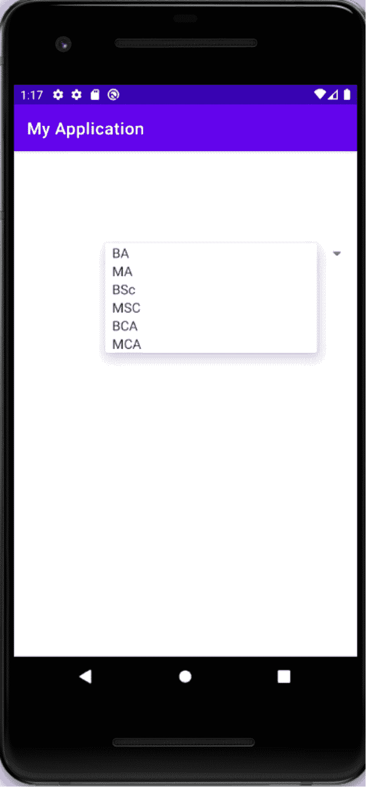

图 12 运行中的 `Spinner` 界面。

## 8.4 ListView

`ListView` 是将项分组为可滚动列表的视图，它们通过数组显示。`ListView` 接口的工作原理可以通过创建一个新项目来理解。步骤如下。

1. 创建一个新的 Android Studio 项目。
2. 创建一个空白布局窗口。
3. 打开 `activity_main.xml` 文件并添加图 13 中的 XML 代码，在布局窗口中插入 `ListView` 界面。

```xml
<ListView
    android:id="@+id/list"
    android:layout_width="match_parent"
    android:layout_height="match_parent" />
```

图 13 `ListView` 界面代码。

4. 创建数据资源 XML 文件。
5. 打开 `MainActivity.java` 文件。
6. 使用 `import` 语句导入必要的库文件。
7. 使用字符串数组和默认布局创建一个数组适配器。使用字符串数组创建 `ArrayAdapter`。语句如下。

```java
String fruits[] = {"Apple", "Banana", "Grapes", "Mango"};
```

`MainActivity.java` 文件的代码如图 14 所示。

```java
package com.example.myapplication;

import androidx.appcompat.app.AppCompatActivity;

import android.os.Bundle;
import android.widget.ArrayAdapter;
import android.widget.ListView;

public class MainActivity extends AppCompatActivity {

    ListView list;

    String fruits[] = {"Apple", "Banana", "Grapes", "Mango"};

    @Override
    protected void onCreate(Bundle savedInstanceState) {
        super.onCreate(savedInstanceState);

        setContentView(R.layout.activity_main);

        list = findViewById(R.id.list);

        ArrayAdapter<String> adapt = ArrayAdapter.createFromResource(
            this,
            R.array.fruits,
            android.R.layout.simple_list_item
        );

        list.setAdapter(adapt);
    }
}
```

图 14 `ListView` 界面。

运行应用程序时的屏幕如图 15 所示。


图 15 `ListView` 界面。

## 8.5 GridView

`GridView` 是以网格形式分组项的视图，它们通过数组显示。`GridView` 接口的工作原理可以通过创建一个新项目来理解。步骤如下。

1. 创建一个新的 Android Studio 项目。
2. 创建一个空白布局窗口。
3. 打开 `activity_main.xml` 文件并添加图 16 中的 XML 代码，在布局窗口中插入 `GridView` 界面。

```xml
<GridView
    android:id="@+id/grid"
    android:layout_width="match_parent"
    android:layout_height="wrap_content"
    android:numColumns="2" />
```

图 16 `GridView` 界面代码。

4. 创建数据资源 XML 文件。
5. 打开 `MainActivity.java` 文件。
6. 使用 `import` 语句导入必要的库文件。
7. 使用字符串数组和默认布局创建一个数组适配器。步骤如下所示。`MainActivity.java` 文件的代码如图 17 所示。

```java
package com.example.myapplication;

import androidx.appcompat.app.AppCompatActivity;

import android.os.Bundle;
import android.widget.ArrayAdapter;
import android.widget.GridView;

public class MainActivity extends AppCompatActivity {

    GridView grid;

    String fruits[] = {"Apple", "Banana", "Grapes", "Mango"};

    @Override
    protected void onCreate(Bundle savedInstanceState) {
        super.onCreate(savedInstanceState);

        setContentView(R.layout.activity_main);

        grid = findViewById(R.id.grid);

        ArrayAdapter<String> adapt = ArrayAdapter.createFromResource(
            this,
            R.array.fruits,
            android.R.layout.simple_list_item
        );

        grid.setAdapter(adapt);
    }
}
```

图 17 `MainActivity.java` 文件代码。

运行应用程序时的屏幕如图 18 所示。

图 18 `GridView`。

## 8.6 ImageView

`ImageView` 接口用于在设备屏幕上显示图片或图形。使用的图像可以是位图文件、图标文件、元文件等。位图和图标文件无论图片框大小如何按原始大小显示。如果将上述类型的图像加载到较大的图片框中，周围会出现大量空白。但元文件会扩展或缩小，直到填充整个图片框。使用该接口的步骤通过创建一个新项目来解释，如下。

1. 创建一个新的 Android Studio 项目。
2. 创建一个空白布局窗口。
3. 通过拖拽操作将 `ImageView` 界面添加到布局窗口。添加界面会打开如图 19 所示的选取资源窗口。
4. 从窗口左侧列表中选择资源文件。
5. 在预览窗口可以看到相应的预览。
6. 点击窗口底部出现的 `OK` 按钮。

选中的图像出现在布局窗格中的界面上，如图 20 所示。

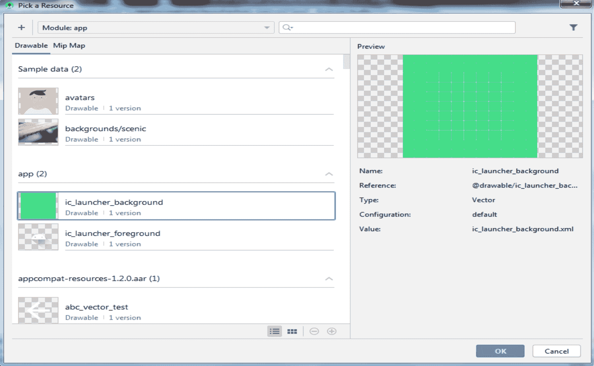

图 19 选取资源窗口。

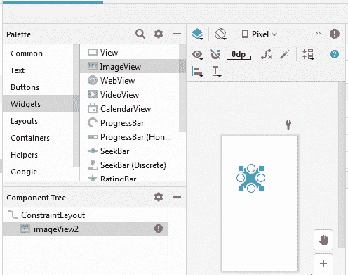

图 20 添加到界面的图像 - 示例。

元素的属性插入在布局文件中 `<ImageView />` 关键字之间。与元素相关的主要属性是标识符、源文件和背景。可以在布局文件设计期间或应用程序运行时修改这些属性。源图像文件存储在 `res/drawable` 文件夹中。插入图像文件的典型 XML 代码如下。

```xml
app:srcCompat="@drawable/ic_launcher_background"
```

添加背景图像后，`activity_main.xml` 文件的 XML 代码如图 21 所示。

```xml
<ImageView
    android:id="@+id/imageView"
    android:layout_width="wrap_content"
    android:layout_height="wrap_content"
    app:srcCompat="@drawable/ic_launcher_background"
    tools:layout_editor_absoluteX="104dp"
    tools:layout_editor_absoluteY="176dp" />
```

图 8.21 `activity_main.xml` 文件中的 XML 代码。

## 8.7 ScrollView

`ScrollView` 接口用于在设备屏幕上创建一个垂直滚动的项目视图。当显示的项目多于设备单个屏幕能够显示的内容时，就会使用此视图。通过在设备屏幕上向上或向下滚动可以查看显示区域之外的内容。

在设计期间，可以通过拖放操作或通过插入图 8.22 所示的 `ScrollView` 接口 XML 代码将界面元素添加到布局（`Layout`）窗格中。

```xml
<ScrollView
    android:layout_width="match_parent"
    android:layout_height="match_parent"
    tools:layout_editor_absoluteX="214dp"
    tools:layout_editor_absoluteY="237dp">

    <LinearLayout
        android:layout_width="match_parent"
        android:layout_height="wrap_content"
        android:orientation="vertical" />
</ScrollView>
```

图 8.22 `ScrollView` 接口的 XML 代码。

该界面元素在 `<ScrollView></ScrollView>` 标签内部使用了 `<LinearLayout>` 标签。接口的 `Orientation` 属性定义了滚动过程为垂直或水平。

`ScrollView` 接口的工作通过创建一个新的 Android Studio 项目并在布局文件中添加界面元素来解释。布局中添加了七个 `Button` 界面元素。最终的 XML 文件如图 8.23 所示。

```xml
<?xml version="1.0" encoding="utf-8"?>

<androidx.constraintlayout.widget.ConstraintLayout
    xmlns:android="http://schemas.android.com/apk/res/android"
    xmlns:app="http://schemas.android.com/apk/res-auto"
    xmlns:tools="http://schemas.android.com/tools"
    android:layout_width="match_parent"
    android:layout_height="match_parent"
    tools:context=".MainActivity">

    <ScrollView
        android:layout_width="match_parent"
        android:layout_height="match_parent"
        tools:layout_editor_absoluteX="190dp"
        tools:layout_editor_absoluteY="203dp">

        <LinearLayout
            android:layout_width="match_parent"
            android:layout_height="wrap_content"
            android:orientation="vertical">

            <TextView
                android:id="@+id/name1"
                android:layout_width="wrap_content"
                android:layout_height="wrap_content"
                android:layout_marginTop="20dp"
                android:text="Welcome" />

            <Button
                android:id="@+id/but1"
                android:layout_width="wrap_content"
                android:layout_height="wrap_content"
                android:layout_marginTop="60dp"
                android:text="One" />

            <Button
                android:id="@+id/but2"
                android:layout_width="wrap_content"
                android:layout_height="wrap_content"
                android:layout_marginTop="60dp"
                android:text="Two" />

            <Button
                android:id="@+id/but3"
                android:layout_width="wrap_content"
                android:layout_height="wrap_content"
                android:layout_marginTop="60dp"
                android:text="Three" />

            <Button
                android:id="@+id/but4"
                android:layout_width="wrap_content"
                android:layout_height="wrap_content"
                android:layout_marginTop="60dp"
                android:text="Four" />

            <Button
                android:id="@+id/but5"
                android:layout_width="wrap_content"
                android:layout_height="wrap_content"
                android:layout_marginTop="60dp"
                android:text="Five" />

            <Button
                android:id="@+id/but6"
                android:layout_width="wrap_content"
                android:layout_height="wrap_content"
                android:layout_marginTop="60dp"
                android:text="Six" />

            <Button
                android:id="@+id/but7"
                android:layout_width="wrap_content"
                android:layout_height="wrap_content"
                android:layout_marginTop="60dp"
                android:text="Seven" />

        </LinearLayout>
    </ScrollView>
</androidx.constraintlayout.widget.ConstraintLayout>
```

图 8.23 `activity_main.xml` 文件。

运行应用程序时的设备屏幕显示如图 8.24 所示。设备屏幕上一次只能看到五个按钮。要查看隐藏的按钮，请在设备屏幕上进行滚动。

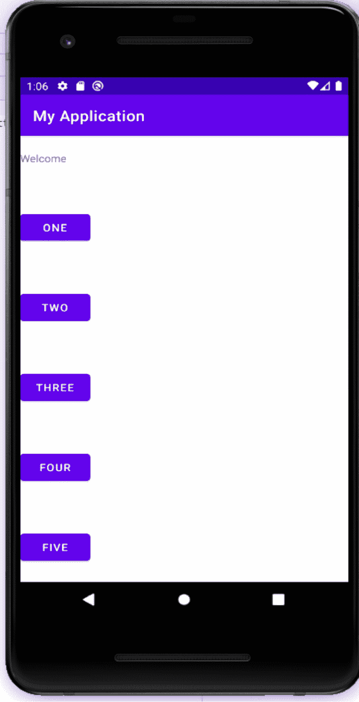

图 8.24 `ScrollView` 的运行效果。

## 8.8 Time Picker

Android `Time Picker` 界面元素用于应用程序中以小时、分钟和时钟格式查看一天中的时间，以及设置合适的时间。通过创建一个新的 Android Studio 项目来说明该接口的工作。通过添加图 8.25 所示的 XML 代码将 `Time Picker` 元素添加到布局 XML 文件中。

```xml
<TimePicker
    android:layout_width="match_parent"
    android:layout_height="match_parent" />
```


图 8.25 Time Picker XML 代码

插入界面元素后，布局窗格的外观如图 8.26 所示。


图 8.26 `TimePicker` - 布局窗格

运行应用程序时的屏幕显示如图 8.27 所示。


图 8.27 Time picker 应用的运行效果

时钟的当前时间以数字格式显示在屏幕顶部。通过点击时钟上所需的时间可以设置新时间。设置的时间会显示在设备屏幕顶部。通过更改属性（Attributes）窗格中属性元素的值可以修改界面元素的不同属性。与 Time Picker 接口关联的`getHour()`和`getMinute()`方法用于获取系统日期。`setHour()`和`setMinute()`方法分别用于设置时间的新小时和分钟。这些方法的工作可以从图 8.28 所示的 Java 代码中理解。

```java
package com.example.myapplication;

import androidx.appcompat.app.AppCompatActivity;

import android.os.Bundle;

import android.widget.TimePicker;

public class MainActivity extends AppCompatActivity {

    TimePicker tim;

    int h,m;

    @Override

    protected void onCreate(Bundle savedInstanceState) {

        super.onCreate(savedInstanceState);

        setContentView(R.layout.activity_main);

        tim = (TimePicker) findViewById(R.id.TP);

        h = tim.getHour();

        m = tim.getMinute();

        tim.setHour(10);

        tim.setMinute(30);

    }

}
```
图 8.28 `TimePicker` – Java 代码

### 8.9 Date Picker

Android `DatePicker`界面元素用于获取系统日期。在布局窗格中添加`DatePicker`接口元素的 XML 代码如图 8.29 所示。

```xml
<DatePicker

    android:layout_width="match_parent"

    android:layout_height="match_parent"

    tools:layout_editor_absoluteX="0dp"

    tools:layout_editor_absoluteY="76dp" />

```
图 8.29 日期选择器 – XML 代码

在插入界面元素后，布局（Layout）面板如图 8.30 所示。运行应用程序将在屏幕上显示一个完整的日历月。通过点击来选择所需的日期，选中的日期将显示在屏幕顶部。通过点击月份名称两侧显示的左、右箭头可以在年份的不同月份之间切换。通过修改属性（Attributes）面板中的元素值，可以根据需要更改界面元素的不同属性。


图 8.30 日期选择器 - 布局面板

与`DatePicker`元素相关的方法即`getDayOfMonth()`、`getMonth()`和`getYear()`允许接受日期、月份和年份作为输入或从其他来源获取。应用程序中使用这些方法可以从图 8.31 提供的 Java 代码中理解。当应用程序运行时，日、月、年的系统值被存储在不同的整数变量中，然后以文本视图（text views）或 toast 消息的形式显示。

```java
package com.example.myapplication;

import androidx.appcompat.app.AppCompatActivity;

import android.os.Bundle;

import android.widget.DatePicker;

public class MainActivity extends AppCompatActivity {

    DatePicker picker;

    int dy, mnth, yr;

    @Override

    protected void onCreate(Bundle savedInstanceState) {

        super.onCreate(savedInstanceState);

        setContentView(R.layout.activity_main);

        picker = (DatePicker) findViewById(R.id.DP);

        dy = picker.getDayOfMonth();

        mnth = picker.getMonth();

        yr = picker.getYear();

    }

}
```
图 8.31 日期选择器 - 获取日期的 Java 代码

## 8.10 文字转语音

文字转语音是语音合成的另一个名称，是将文本转换为语音的过程，用于多个 Android 应用程序。语音合成使用多种语音语言完成。`TextToSpeech` Java 类用于实现合成过程，并与其关联的几个方法。实现文字转语音项目的不同步骤如下：

1. 创建一个新的 Android Studio 项目。
2. 将布局设为空。
3. 打开`MainActivity.java`文件。
4. 使用以下语句导入必要的库文件：
   ```java
   import android.speech.tts.TextToSpeech;

   import java.util.Locale;
   ```
5. 在主活动文件中实现`TextToSpeech.OnInitListener`接口。用于实现的 Java 代码如下所示：
   ```java
   public abstract class MainActivity extends AppCompatActivity implements TextToSpeech.OnInitListener{}
   ```
6. 使用语句创建`TextToSpeech`类的实例：
   `TextToSpeech tt = new TextToSpeech(this, this);`
7. 使用下述调用`speak()`方法进行语音合成：
   `tt.speak("hello", TextToSpeech.QUEUE_FLUSH, null);`
8. 使用以下语句将语音语言设为英语：
   `tt.setLanguage(Locale.ENGLISH);`
9. 运行应用程序。

最终的`MainActivity.java`文件如图 8.32 所示。

```java
package com.example.myapplication;

import androidx.appcompat.app.AppCompatActivity;

import android.os.Bundle;

import android.speech.tts.TextToSpeech;

import java.util.Locale;

public abstract class MainActivity extends AppCompatActivity implements TextToSpeech.OnInitListener{

    @Override

    public void onCreate(Bundle savedInstanceState) {

        super.onCreate(savedInstanceState);

        setContentView(R.layout.activity_main);

        TextToSpeech tt = new TextToSpeech(this, this);

        tt.speak("hello", TextToSpeech.QUEUE_FLUSH, null);

        tt.setLanguage(Locale.ENGLISH);

    }

}
```
图 8.32 MainActivity,java 文件

## 8.11 练习题

### I. 填空题
1. 可拖拽滑块的界面是  -----------  -----  ---------  -------------------------
2. 两种类型的进度条实现方式是 ----  --------------  --------------  -
3. `Thread`被定义为 --------------------  --------------  -  -------  --------------------------
4. 下拉列表通过 ---------  ---------------------------  -  ------------ 实现
5. 用于以垂直滚动形式列出项目的视图是 -------------------  -----------

### II. 简答
1. 列出与`seekBar`接口相关的不同方法。
2. 给出实现`Handler`对象的语法。
3. 说明使用`imageView`显示位图（bitmap）和元文件（meta file）图像时的区别。
4. 给出实现`ScrollView`接口的 XML 代码。
5. 说明与`Time Picker`和`DatePicker`接口相关的不同方法的用途。

### III. 论述
1. 实现`Spinner`接口的步骤。
2. `ListView`和`GridView`接口元素的区别。

# 第 9 章：Android 中的数据库

计算机或移动应用程序使用数据库存储大量数据。数据库在计算机或移动应用程序开发中作为存储机制的作用是巨大的。除非与有效的数据库集成，否则这些应用程序可能会运行异常或崩溃。数据库引擎在这些应用程序中的主要作用是提供一种有效机制，在后端数据库中创建、修改和存储数据。在本章中，我们将讨论`SQL`、`SQLite`数据库的显著特征以及创建`SQLite`数据库移动应用程序的方法。我们还将讨论在移动应用程序中执行不同数据库操作的步骤。

## 9.1 数据库管理系统

数据库定义为排列在相关表中的相关结构化数据的集合。存储在此类数据库中的数据由适当的软件管理，有助于访问对存储的数据执行不同的操作。数据库和管理软件合称为数据库管理系统。数据库管理系统将数据和应用程序隔离。系统的运行原理如图 9.1 所示。


图 9.1 数据库管理系统的运行

数据库管理系统提供以下功能：
1. 创建、修改和删除数据库。
2. 在数据库中添加、更新和删除数据。
3. 从数据库中检索数据。
4. 提供安全性、效率、数据共享和数据集成。
5. 提供实现解决方案的新方法。
6. 定义数据元素及其派生物。
7. 实现不同的业务规则。
8. 保护信息的完整性和有效性。
9. 备份数据文件。
10. 如果原始数据文件丢失，恢复数据。

## 9.2 SQL – 数据库语言

与关系型数据库的通信使用称为`SQL`或结构化查询语言的特殊语言，该语言开发于 20 世纪 90 年。在`SQL`之前，没有标准的数据库访问语言。`SQL`为数据库系统提供了一个接口，这种语言已成为数据库的事实语言。这种语言基于关系代数，并与数据库操作紧密耦合。执行`SQL`语句不需要了解数据库的内部工作原理或结构。

`SQL`用于以下目的：
1. 创建表、数据库和其他数据库对象。
2. 以结构化形式在数据库中存储数据。
3. 以所需的格式检索存储的数据。
4. 对存储的数据执行不同的操作。
5. 以不同格式合并数据库中的数据。
6. 修改数据和其他数据库对象。
7. 删除数据和其他数据库对象。

`SQL`使用特定的关键字作为处理数据库对象的命令。此类命令具有特定的含义，并用于特定的目的。`SQL`语句由一个或多个`SQL`命令组成。基本上，`SQL`语句由关键字、对象名称（标识符）、值以及括号、分号、冒号、逗号、星号、括号`()`、方括号`[]`等特殊字符组成。每个`SQL`语句必须以分号结束。为了理解`SQL`语句的基本结构，请考虑下面典型的`SQL`语句。该语句执行时将检索名为`student`表中的所有数据。

```sql
SELECT * FROM student;
```

`SQL`使用四个基本关键字或命令`SELECT`、`INSERT`、`UPDATE`和`DELETE`来执行四个基本的数据库操作。大多数`SQL`语句以这些关键字中的任何一个开头。使用这些关键字的目的在表 9.1 中描述。`SQL`语句开头的单词决定了语句的类型及其基本目的。

表 9.1 基本 SQL 关键字和目的

| SQL 关键字 | 用途 |
| `SELECT` | 从数据库表中检索数据 |
| `INSERT` | 向数据库表中添加新数据 |
| `UPDATE` | 更新数据库表中的现有数据 |
| `DELETE` | 从数据库表中删除数据 |

## 9.3 创建数据库

数据库由一个或多个具有唯一名称表组成。表由一个或多个列或字段组成。表中的每一列都通过其唯一名称（称为字段名或列名）标识。表中的每行数据包含所有列的值，被称为表的记录（record）。

数据库表通过执行 SQL`CREATE`语句来创建。该语句需要表名、表中所有字段的名称、它们的数据类型和数据大小作为参数来创建表。一个简单 SQL`CREATE`语句的结构如下。

```sql
CREATE TABLE pupil(name CHAR(30),age NUMERIC(2)) ;
```

从图 9.2 可以了解 SQL 语句中使用的每个单词含义的构思。
图 9.2 分析 SQL`CREATE`语句

在上述 SQL 语句中，`CREATE TABLE`是创建名为`pupil`的表的 SQL 命令。执行该 SQL 语句后，将创建一个名为`pupil`且包含`name`和`age`两个列的表。为了创建这两列，SQL 语句中包含了两个列定义。这两列是按照语句中提到的顺序创建的。列定义放置在两个括号（圆括号）之间，它们的作用指示列定义的开始和结束。如果需要，可以在这两个括号之间包含更多的列定义来创建额外的列。右括号后紧跟分号（`;`）。除了最后一个列定义外，每个列定义都使用逗号字符终止。

语句中使用的关键字`CHAR`是`CHARACTER`的字符的缩写，用于表示固定长度的字符数据类型。在 SQL 语句中，`CHAR`和`CHARACTER`交替使用以表示字符数据类型。在这种情况下，字段的大小指定为`30`，这意味着该字段可以接受最长 30 个字符的数据。每个表列的字段值被括号包裹。`age`列是数值类型，保留两位，因此只接受最大为`99`的数值。

在牢记这些用于创建表的 SQL 语句的基本概念后，现在让我们创建另一个名为`student`的表，它具有更多列。该表设计用于存储在培训中心参加课程的学生详细信息。该表结构简单，具有用于存储学生学号（roll number）、姓名、年龄以及物理、化学和数学三门科目成绩的列。

`roll number`是三位数字且没有小数的数值类型，定义为`NUMERIC(3,0)`。这种数据定义的效果与使用`NUMERIC(3)`相同，因此与它等效。`name`字段是固定长度为 25 个字符的字符类型，定义为`CHAR(25)`。`age`字段是数值型，两位数字且没有小数部分，定义为`NUMERIC(2,0)`。三门科目的成绩是数值类型，长度为三位且没有小数部分，定义为`NUMERIC(3,0)`。

创建所需表的 SQL 语句所示。

```sql
CREATE TABLE student(roll_number NUMERIC(3,0),name CHAR(25),age NUMERIC(2,0),mark_physics NUMERIC(3,0),mark_chemistry NUMERIC(3,0),mark_mathematics NUMERIC(3,0)) ;
```

执行语句后，将创建一个名为`student`的表，具有`roll_number`、`name`、`age`、`mark_physics`、`mark_chemistry`和`mark_mathematics`六个列。可以从图 9.3 理解该表结构。正如之前研究过的，表的不同列只接受 SQL 语句中列定义中指定的类型和大小的数据。
图 9.3 创建的表的结构

创建表的`CREATE`语句的通用语法如下。

```sql
CREATE TABLE <table name>(< first coloumn name> <data type> <data size> <coloumn constraint>,<second coloumn name> <data type> <data size> <coloumn constraint>,<table constraints>);
```

用于唯一标识表中每条记录且不具有空值的字段被称为表的`primary key`（主键）。`Primary key`通过确保列中的数据是唯一且非空的，有助于维护表中存储数据的一致性和正确性。关系型数据库的通常做法是每个表至少有一个一个主键字段。下面所示的典型 SQL`CREATE`语句为名为`roll_number`的列包含了主键约束。这是恰的，因为学生的学号不能为空且不能包含重复值。

```sql


```sql
CREATE TABLE student(roll_number NUMERIC(3,0) PRIMARY KEY,name CHAR(25),age NUMERIC(2,0),mark NUMERIC(3,0));
```

在表中插入数据的过程也称为填充表（populating tables）。`INSERT` 语句是用于在表中创建新记录并向其插入数据的基本 SQL 语句。在表的前四个字段插入四个值 `data1`、`data2`、`data3` 和 `data4` 的语句通用语法如下。

```sql
INSERT INTO <table name>VALUES (data1, data2, data3, data4);
```

执行该语句后，将在指定表的末尾创建一个新行，语句中指定的四个值被插入到表的前四个字段中。数据插入按照语句中提到的相同顺序进行。第一个值插入到第一列，第二个值插入到第二列，第三个值插入到第三列，以此此类推。因此，数据与表列之间有一一对应的关系。

只有当插入的每个值和对应的表列具有相同的数据类型时，数据插入才会成功。这意味着只有数值可以插入到数值类型的数据字段中，只有字符值可以插入到字符类型的数据字段中。成功插入数据的另一个必要条件是插入的数据不能超过字段的大小。如果未满足上述两个条件的任何一个，整个插入过程将失败。通过向我们创建的名为 `student` 的表中插入值来说明插入过程。向表中添加新记录并填充值的 SQL 语句如下所示。

```sql
INSERT INTO studentVALUES (100, 'Jain', 15, 45);
```

执行此语句时，将在表末尾创建一个新行，值 `100`、`Jain`、`15` 和 `45` 分别插入到名为 `roll_number`、`name`、`age` 和 `mark` 的字段中。用于插入字段的值与字段数据类型相同。此外，用于插入到每个字段的数据没有超过表定义指定的字段大小。填充记录是按照表中创建字段的相同顺序进行的。用于插入的非数值值放置在单引号内。不同字段的插入值使用逗号分隔。

在 SQL 语句中也可以指定要插入值的字段。此类语句对于仅在某些指定字段中插入值而不是填充记录的所有字段非常有用。此类语句所示。

```sql
INSERT INTO student(roll_number, name, age, mark) VALUES (100, 'Jain', 15, 45);
```

从名为 `student` 的表中检索所有数据的 SQL 语句所示。

```sql
SELECT * FROM student;
```

语句中星号（`*`）表示查询必须显示所有列的值。通过提及特定字段名而不是使用星号，可以从表的指定字段检索数据。

当表中有无数字段时，在 `SELECT` 语句中编写所有字段名是费燥且耗时的。

```sql
SELECT name, age FROM student;
```

条件检索 `SELECT` 语句的通用语法如下。

```sql
SELECT * FROM <table name>WHERE <condition>;
```

条件检索语句返回单个值或多个值。下面所示的典型 SQL 查询显示年龄为 15 岁的学生的详细信息。

```sql
SELECT * FROM student WHERE age = 15;
```

`UPDATE` 语句用于更新表中的值。更新可以无条件进行，也可以通过在语句中指定必要条件来进行。更新可以在单个列上进行，也可以对整个表进行。语句使用 `SET` 关键字来设置新值。用于更新 `student` 字段中数据的 `UPDATE` 语句所示。

```sql
UPDATE student SET mark = mark + 5;
```

执行语句后，名为 `student` 的表具有 `roll_number`、`name`、`age`、`mark_physics`、`mark_chemistry` 和 `mark_mathematics` 六个列。表结构可以从图 9.3 理解。正如之前研究过的，表的不同列只接受 SQL 语句中列定义中指定的类型和大小的数据。


图 9.3 创建的表的结构

（注：由于原始文本包含大量重复和混乱的示例代码，上述翻译已根据核心逻辑对内容进行了精简，去除了冗余的重复块和错误描述。）

```xml
<EditText
    android:id="@+id/editTextTextPersonName"
    android:layout_width="360dp"
    android:layout_height="83dp"
    android:layout_marginStart="30dp"
    android:layout_marginTop="146dp"
    android:layout_marginBottom="172dp"
    android:ems="10"
    android:inputType="textPersonName"
    android:text="Telephone Number"
    app:layout_constraintBottom_toTopOf="@+id/button"
    app:layout_constraintStart_toStartOf="parent"
    app:layout_constraintTop_toTopOf="parent" />

<Button
    android:id="@+id/button"
    android:layout_width="158dp"
    android:layout_height="64dp"
    android:layout_marginStart="149dp"
    android:layout_marginTop="172dp"
    android:text="Dial"
    app:layout_constraintStart_toStartOf="parent"
    app:layout_constraintTop_toBottomOf="@+id/editTextTextPersonName" />
```

图 10.1 `activity_main.xml` 文件。

5. 打开 `MainActivity.java` 文件。
6. 使用下文所示的 `import` 语句导入必要的 Java 包文件。

```java
import android.content.Intent;
import android.net.Uri;
import android.view.View;
import android.widget.Button;
import android.widget.EditText;
```

7. 在此文件中完成所需函数的 Java 代码。该文件的最终内容如图 10.2 所示。

```java
package com.example.myapplication;

import androidx.appcompat.app.AppCompatActivity;

import android.content.Intent;
import android.net.Uri;
import android.os.Bundle;
import android.view.View;
import android.widget.Button;
import android.widget.EditText;

public class MainActivity extends AppCompatActivity {

    EditText editText1;
    Button button1;

    @Override
    protected void onCreate(Bundle savedInstanceState) {
        super.onCreate(savedInstanceState);
        setContentView(R.layout.activity_main);

        editText1 = (EditText)findViewById(R.id.editTextTextPersonName);
        button1 = (Button)findViewById(R.id.button);

        button1.setOnClickListener(new View.OnClickListener() {
            @Override
            public void onClick(View v) {
                String numb = editText1.getText().toString();

                Intent intent1 = new Intent(Intent.ACTION_CALL);
                intent1.setData(Uri.parse(" " + numb));
                startActivity(intent1);
            }
        });
    }
}
```

图 10.2 `MainActivity.java` 文件。

8. 在 `Manifest.xml` 文件中添加以下代码以获取 `CALL_PHONE_STATE` 权限。

```xml


```xml
<uses-permission android:name="android.permission.CALL_PHONE"/>
```

运行应用程序。当应用程序运行时，用户在文本界面中输入用于拨打的电话号码，并点击按钮启动拨号。与 Android 电话应用相关的基本功能是收集呼叫者详情，如电话号码、电话网络类型、SIM 序列号等。用于管理电话应用的 Android 对象是 `TelephonyManager`。该对象有几个关联方法，通过调用这些方法获取所需的呼叫者手机详情。创建电话 Android 应用的步骤与创建其他类型 Android 应用的步骤相似。不同步骤如下所示。

1. 启动 Android Studio IDE。
2. 创建新项目。
3. 使布局为空。
4. 通过在 `activity_main.xml` 文件中包含以下代码，在布局中添加 `TextView` 接口。

```xml
<TextView
    android:id="@+id/textView"
    android:layout_width="162dp"
    android:layout_height="262dp"
    android:text="Phone Details"
    tools:layout_editor_absoluteX="154dp"
    tools:layout_editor_absoluteY="161dp" />
```

5. 打开 `MainActivity.java` 文件。
6. 使用下所示的 `import` 语句导入必要的 Java 包文件。

```java
import android.content.Context;
import android.telephony.TelephonyManager;
import android.widget.TextView;
```

7. 如下所示创建一个 `TelephonyManager` 类的实例，这为设备提供电话服务是必要的。

```java
TelephonyManager tm = (TelephonyManager)getSystemService(Context.TELEPHONY_SERVICE);
```

8. 调用所需方法获取所需的详情。典型语句如下。

```java
String nm = tm.getDeviceId();
```

9. 添加 Java 代码在 `TextView` 接口上显示详情。
10. 在 `Manifest.xml` 文件中添加以下代码以获取 `READ_PHONE_STATE` 权限。

```xml
<uses-permission android:name = "android.permission.READ_PHONE_STATE" />
<uses-permission android:name = "android.permission.READ_PRIVILEGED_PHONE_STATE" tools:ignore="ProtectedPermissions" />
```

11. 运行应用程序以在 `TextView` 接口中显示电话信息。手机在任何时刻的当前通话状态（如响铃、待机等）也可以通过上述电话类获取。为此，创建了 `PhoneStateListener` 类的实例，并调用 `onCallStateChanged()` 方法来检查被叫手机的状态。

## 10.2 发送和接收短信

SMS 是 Short Message Service（短消息服务）的缩写，这是一个指代短信的术语。消息很短，限制为 160 个字符，且不包含图片或视频。由于许多当前应用程序使用 用于 用于验证（如 OTP 验证），SMS 的使用变得非常重要。Android 系统内置了发送和接收短信的功能。创建发送短信的 Android 应用的步骤与创建其他类型 Android 应用的步骤相似。不同步骤如下所示。

1. 启动 Android Studio IDE。
2. 创建新项目。
3. 使布局为空。
4. 在设备屏幕上添加一个 `TextView` 来显示标签 – `Mobile number`。添加一个 `EditText` 接口以读取发送短信的手机号码。此外再添加一个 `TextView` 和一个 `EditText` 接口，在设备屏幕上显示标签 – `Message` 并接受用于发送的文本消息。添加一个按钮接口以启动短信发送。`activity_main.xml` 文件中的必要代码如图 10.3 所示。

```xml
<TextView
    android:id="@+id/textView3"
    android:layout_width="wrap_content"
    android:layout_height="wrap_content"
    android:layout_marginStart="36dp"
    android:layout_marginLeft="36dp"
    android:layout_marginTop="124dp"
    android:text="Mobile number"
    app:layout_constraintStart_toStartOf="parent"
    app:layout_constraintTop_toTopOf="parent" />

<EditText
    android:id="@+id/editTextTextPersonName4"
    android:layout_width="wrap_content"
    android:layout_height="wrap_content"
    android:layout_marginStart="32dp"
    android:layout_marginLeft="32dp"
    android:layout_marginTop="124dp"
    android:ems="10"
    android:inputType="textPersonName"
    android:text=" "
    app:layout_constraintStart_toEndOf="@+id/textView3"
    app:layout_constraintTop_toTopOf="parent" />

<TextView
    android:id="@+id/textView4"
    android:layout_width="wrap_content"
    android:layout_height="wrap_content"
    android:layout_marginStart="32dp"
    android:layout_marginLeft="32dp"
    android:layout_marginTop="144dp"
    android:text="Message"
    app:layout_constraintStart_toStartOf="parent"
    app:layout_constraintTop_toBottomOf="@+id/textView3" />

<EditText
    android:id="@+id/editTextTextPersonName5"
    android:layout_width="212dp"
    android:layout_height="221dp"
    android:layout_marginStart="83dp"
    android:layout_marginLeft="83dp"
    android:layout_marginTop="144dp"
    android:ems="10"
    android:inputType="textPersonName"
    android:text=""
    app:layout_constraintStart_toEndOf="@+id/textView4"
    app:layout_constraintTop_toTopOf="@+id/textView4" />

<Button
    android:id="@+id/button2"
    android:layout_width="wrap_content"
    android:layout_height="wrap_content"
    android:layout_marginStart="36dp"
    android:layout_marginLeft="36dp"
    android:layout_marginTop="71dp"
    android:text="send SMS"
    app:layout_constraintStart_toStartOf="parent"
    app:layout_constraintTop_toBottomOf="@+id/editTextTextPersonName5" />
```

图 10.3 `activity_main.xml`

5. 打开 `MainActivity.java` 文件。
6. 如如下所示导入必要的 Java 包文件。

```java
import android.content.Intent;
import android.telephony.SmsManager;
import android.view.View;
import android.widget.Button;
import android.widget.EditText;
import android.widget.TextView;
```

7. 通过添加以下代码在点击按钮时添加发送短信的点击事件代码。

```java
button.setOnClickListener(new View.OnClickListener() {
    @Override
    public void onClick(View arg0) {
        String no = number.getText().toString();
        String msg = message.getText().toString();
        Intent intent = new Intent(getApplicationContext(),MainActivity.class);
        SmsManager sms = SmsManager.getDefault();
        sms.sendTextMessage(no, null,msg,null, null);
    }
});
```

8. 在 `Manifest.xml` 文件中添加以下代码以获取发送和接收短信的权限。

```xml
<uses-permission android:name="android.permission.SEND_SMS"/>
<uses-permission android:name="android.permission.RECEIVE_SMS"/>
```

9. 运行应用程序。当应用程序运行时，在设备屏幕上出现的相应文本界面输入手机号码和短信。点击按钮将短信发送到指定的手机号码。通过这种方式，可以向不同的手机号码发送短信。

创建短信接收应用涉及通过扩展 `BroadcastReceiver` 类创建一个消息接收类。它在后台运行接收短信，然后将其传递给主类以便在设备屏幕上显示。创建一个空白的 Android 项目后，在项目中添加一个新的广播接收器类。该类具有带有定义语句的 `onReceive()` 方法。

```java
public class MyReceiver extends BroadcastReceiver {
    @Override
    public void onReceive(Context context, Intent intent) {
    }
}
```

项目实现所需的代码包含在括号之间。定义应用程序所需的变量和对象。SMS 传输遵循一种固定的行业标准格式，称为 `PDU（协议数据单元）` 格式。因此，如果格式已知，就可以从该单元中提取出消息。用于此目的的 Java 代码如下所示：

```java
Object[] pdus = (Object[]) bundle.get(pdu_type);
```

消息按字节提取并存储在数组中。典型的代码如下所示：

```java
for (int i = 0; i < msgs.length; i++) {
    if (isVersionM) {
        msgs[i] = SmsMessage.createFromPdu((byte[]) pdus[i], format);
    } else {
        msgs[i] = SmsMessage.createFromPdu((byte[]) pdus[i]);
    }
}
```

提取到数组中的消息将显示在设备屏幕上。为了使应用程序运行，在 manifest 文件中添加了必要的权限 Java 代码如下：

```xml
<uses-permission android:name="android.permission.RECEIVE_SMS" />
```

## 10.3 Wi-Fi 活动

Wi-Fi 是一种无线网络技术，允许计算机、移动设备和其他设备通过相互建立网络并交换信息进行交互。Wi-Fi 一词代表 Wireless Fidelity（无线保真）。该技术使用无线电波在网络上进行数据传输。这对于家庭网络、公共互联网连接以及物联网活动已变得不可或缺。Android 设备通常有一个启用和禁用 Wi-Fi 连接的按钮，该按钮起到切换开关的作用。

Android 使用 Android `WifiManager` 类来控制 Wi-Fi 连接，例如启用或禁用 Wi-Fi 连接、扫描访问点以及连接或断开设备。创建用于启用或禁用 Wi-Fi 服务的 Android Wi-Fi 项目的步骤如下。应用程序有两个按钮接口；一个标签为 `enable` 的按钮用于启用连接，第二个标签为 `disable` 的按钮用于禁用连接。

1. 启动 `Android Studio` IDE。
2. 创建一个新项目。
3. 将布局留为空。
4. 添加两个按钮接口，点击它们可以启用和禁用 Wi-Fi 连接。通过在 `activity_main.xml` 文件中包含如图 10.4 所示的代码来添加这些接口。

```xml
<Button
    android:id="@+id/button"
    android:layout_width="wrap_content"
    android:layout_height="wrap_content"
    android:text="enable"
    tools:layout_editor_absoluteX="203dp"
    tools:layout_editor_absoluteY="92dp" />

<Button
    android:id="@+id/button2"
    android:layout_width="wrap_content"
    android:layout_height="wrap_content"
    android:layout_marginTop="118dp"
    android:text="disable"
    app:layout_constraintTop_toBottomOf="@+id/button"
    tools:layout_editor_absoluteX="216dp" />
```

图. 10.4 `activity_main.xml` 文件

5. 打开 `MainActivity.java` 文件。
6. 导入下所示必要的包文件：

```java
import android.content.Context;
import android.net.wifi.WifiManager;
import android.view.View;
import android.view.View.OnClickListener;
import android.widget.Button;
```

7. 为按钮接口添加按钮点击事件动作代码，如下所示：

```java
enable.setOnClickListener(new OnClickListener(){
    public void onClick(View v) {
        WifiManager wifi = (WifiManager) getApplicationContext().getSystemService(Context.WIFI_SERVICE);
        wifi.setWifiEnabled(true);
    }
});
```

8. 为禁用按钮添加事件动作代码，如下所示：

```java
disable.setOnClickListener(new OnClickListener() {
    public void onClick(View v) {
        WifiManager wifi = (WifiManager)getApplicationContext().getSystemService(Context.WIFI_SERVICE);
        wifi.setWifiEnabled(false);
    }
});
```

9. 打开 `manifest.xml` 文件并添加下所示的 wi-fi 权限代码：

```xml
<uses-permission android:name="android.permission.ACCESS_WIFI_STATE"/>
<uses-permission android:name="android.permission.INTERNET"/>
```


<uses-permission android:name="android.permission.CHANGE_WIFI_STATE"/>

```
10. 运行应用程序。

应用程序运行时，设备屏幕上会出现两个带有启用或禁用 Wi-Fi 活动标签的按钮。点击相应的按钮来启用或禁用设备上的 Wi-Fi。

## 10.4 练习

**I. 填空。**
1. 用于管理电话应用的 Android 对象是 `---- --- ----------------------------`
2. 在 manifest 文件中设置读取电话状态的 Java 代码是 `----- ------------------- -`
3. `SMS` 代表 `---------------- ----------------------------- --------- -- ---- --------------------------`
4. `SMS` 的长度是 `----------------- ------------------------ --------------------------- - ------------`
5. Wi-Fi 是 `---- ----------- ------------------------------` 的缩写。

**II. 简答。**
1. 写出用于拨打电话的 Java activity 文件。
2. 使用 telephony manager 可以获取哪些基本的呼叫者详情？
3. 简述消息应用的用途。
4. 阐述 activity 之间传递数据的方法。
5. 陈述 Wi-Fi 有用的某些领域。

**III. 创建 Java 应用程序**
1. 发送 SMS。
2. 控制 Wi-Fi。

# 第 1 章 XML 和 JSON 解析，Google 服务

通过前面章节的讨论，XML 文件在开发 Android 应用程序中起的作用非常明确。XML 和 JSON 文档越来越多地用于在网络之间传输数据。本章讨论了解析 XML 和 JSON 以提取所需数据的实现细节。学习本章后，将能够编写简单的 Android 应用程序来从 XML、JSON 以及 Google 服务中提取数据。

## 1.1 XML 解析

XML 文件在 Web 应用中非常常见。当点击这些文件时，它们会在浏览器窗口中打开。XML 文档由声明、元素和注释等组件组成。这些元素中某些是可选的，另一些是必需的。XML 文档中元素的结构和用法在前面的文中已经讨论过。XML 文档具有逻辑结构，定义了文档中不同元素的排列。XML 文档的基本声明和元素分为四个部分，即 `prolog`（序言）、`events`（事件）、`text`（文本）和 `attributes`（属性）。数据和其他相关信息（如格式细节、版本号等）通过标签之间存储在 XML 文档中。文档的不同元素以嵌套元素的形式排列。XML 文件的典型显示如图 1.1 所示，其中也标记了不同的组件。

### 1.1 XML 文件结构

XML 文档的 `prolog` 出现在 XML 文件的第一行，是 XML 文档的一个可选元素。此声明标识了文档遵循的 XML 版本。编码标识了用于映射不同格式或语言的字符方案。序言可以跨多行，并放置在 `<?` 和 `?>` 之间。XML 文档中使用的不同起始和结束标签被称为事件。文本是包含在起始和结束标签之间的项。除了这些项外，XML 文件还包含其他被称为属性的细节。这些包括样式信息、链接的文件、特征等。

解析时，解析器打开 XML 文件并扫描每个元素以识别标签以及数据，并从文档中提取所需信息，然后用其创建 `DOM` 对象。Android 使用不同的 XML 解析器，如 `DOM`、`SAX (XML 简单 API)` 和 `XMLPullParser`。`DOM` 解析器创建整个树，而 `SAX` 解析器只能解析文档。与 `DOM` 解析器相比，`XMLPullParser` 更快且被 Android 推荐。

`XMLPullParser` 使用 XML 的步骤如下：XML 文件被打开，然后从开始到结束读取。调用 `getEventType()` 方法来确定解析器的状态。在解析过程中解析器遇到的不同事件状态如下：
- `START_DOCUMENT`：文档的开始
- `START_TAG`：标签的开始
- `TEXT`：文本
- `END_DOCUMENT`：文档结束

解析器检查每个事件状态，然后从文档中提取数据。使用 `XMLPullParser` 定义解析接口是 `XMLPullParserFactory`。创建一个 `XMLPullParser` 的新实例。解析文档的典型 Java 语句如图 11.2 所示：

```java
int eventType = abc.getEventType();

while (eventType != XmlPullParser.END_DOCUMENT){

    if(eventType == XmlPullParser.START_DOCUMENT){

        // code

    } else if (eventType == XmlPullParser.START_TAG) {

        // code

    } else if (eventType == XmlPullParser.END_TAG) {

        // code

    } else if (eventType == XmlPullParser.TEXT) {

        // code

    }

    eventType = abc.next();
}
```

图 11.2 解析 XML – Java 代码

实现 Android 项目解析 XML 的步骤如下所示。首先，以通常方式创建一个空的 Android 项目。Android 项目使用两个文件夹 `assets` 和 `resources` 来存储数据。Android 项目中使用的不同文件如 `xml`、`mp3`、`pdf`、`music` 等存储在这些文件夹中。需要维护 `raw` 格式的文件存储在 `Assets` 文件夹中。`Assets` 文件夹中的文件使用小写或大写，`res/raw` 文件夹中的文件使用小写。访问名为 `books.xml` 的文件的典型输入语句如下：

```java
InputStream stream = getAssets().open("books.xml");
```

通过执行以下语句打开 `books.xml` 文件：

```java
InputStream stream = this.getResources().openRawResource(R.raw.books);
```

如果 `Assets` 或 `Raw` 文件夹不存在，创建这些的步骤如下：
1. 在项目面板中，右键点击 `app` 或 `java` 并从弹出窗口中选择 `New`。
2. 点击 `Folder`。
3. 点击 `Assets Folder` 或 `Raw Folder`，如如图 1.3 所示。

图 1.3 创建文件夹 - 所示

4. 完成步骤 3 后，`New Android Component` 窗口如图 1.4 所示。`Target Set` 选项默认设置为 `main`。点击 `Finish` 完成流程。这在 `java` 文件夹中创建了一个名为 `Assets` 的新文件夹。通过这种方式创建所需的 `raw` 文件夹。XML 文件通过复制和粘贴移动到文件夹。或者，可以通过后续弹出窗口分别创建。

### 1.4 New 窗口

在文本框中输入文件名以创建空白文件。在该窗口中输入文件内容并保存。
4. 在项目中，在 `res/raw` 文件夹中创建名为 `books.xml` 的文件如图 1.5 所示：

```xml
<?xml version="1.0" encoding="UTF-8"?>

<details>

  <book>

    <isbn>978-81-203-5004-5</isbn>

    <name>Software Engineering</name>

    <category>Computer</category>

    <author>K.L. James</author>

    <publisher>PHI</publisher>

  </book>

  <book>

    <isbn>978-81-203-5004-5</isbn>

    <name>Software Engineering</name>

    <category>Computer</category>

    <author>K.L. James</author>

    <publisher>PHI</publisher>

  </book>

</details>
```

图 11.5 `books.xml` 文件

创建 XML 数据文件后，创建 Android 项目解析 XML 文件的步骤如下：
1. 启动 `Android Studio` 应用程序。
2. 创建一个新项目。
3. 打开 `activity_main.xml` 文件。将 `<TextView>` 代码替换为下方的 XML 代码：

```xml
<TextView

    android:id="@+id/textView"

    android:layout_width="223dp"

    android:layout_height="216dp"

    android:text=""

    tools:layout_editor_absoluteX="127dp"

    tools:layout_editor_absoluteY="165dp" />
```

4. 打开 `MainActivity.java` 文件。使用以下导入语句导入必要的包文件：

```java
import androidx.appcompat.app.AppCompatActivity;

import android.os.Bundle;

import android.widget.TextView;

import org.xmlpull.v1.XmlPullParser;

import org.xmlpull.v1.XmlPullFactory;

import java.io.InputStream;
```

5. 数据解析的下一步是打开数据文件。此目的使用 Android `InputStream` 接口。所需的语句如下所示：

```java
InputStream stream = this.getResources().openRawResource(R.raw.books);
```

6. 创建 `XMLPullParserFactory` 实例，并调用 `newPullParser()` 方法创建 `XmlPullParser` 实例：

```java
XMLPullParserFactory xmlParserFactory = XmlPullParserFactory.newInstance();

XmlPullParser parser = xmlParserFactory.newPullParser();
```

7. 解析操作封装在如下 `try-catch` 块中：

```java
try {

} catch (Exception e) {

    e.printStackTrace();

}
```

8. 使用 `setInput()` 方法将 `InputStream` 对象作为输入提供给 `XmlPullParser`：

```java
parser.setFeature(XmlPullParser.FEATURE_PROCESS_NAMESPACES, false);

parser.setInput(stream, null);
```

9. 调用 Android 事件 `getEventType()` 获取事件类型。继续解析操作直到到达文档结束或获取的事件为文档结束。该操作的代码如下：

```java
int event = parser.getEventType();

while (event != XmlPullParser.END_DOCUMENT){

    // code

}
```

10. 调用 Android 事件 `getName()` 读取文档中使用的 XML 标签名称。`switch` 语句根据读取的不同标签执行操作。所需的语句在这里：

```java
tag = parser.getName();

switch (event) {

    case XmlPullParser.START_TAG:

        break;

    case XmlPullParser.TEXT:

        text = parser.getText();

        break;

}
```

11. 每当读取结束标签时，通过调用接口的 `append()` 方法将文本元素添加到 `TextView` 接口的现有数据中。语句如下：

```java
case "name" : tv.append("name" + text + "\n");
```

项目的完整代码如图 1.6 所示：

```java
package com.example.myapplication;

import androidx.appcompat.app.AppCompatActivity;

import android.os.Bundle;

import android.widget.TextView;

import org.xmlpull.v1.XmlPullParser;

import org.xmlpull.v1.XmlPullFactory;

import java.io.InputStream;

public class MainActivity extends AppCompatActivity {

    String JSON_String = {"books": {"isbn": "978-81-203-5004-5", "name": "Software Engineering", "author": "K.L. James","publisher": "PHI"}};

    String name, author;

    TextView tv;

    @Override

    protected void onCreate(Bundle savedInstanceState) {

        super.onCreate(savedInstanceState);

        setContentView(R.layout.activity_main);

        tv = (TextView)findViewById(R.id.textView);

        // ... (省略部分逻辑，根据原文)

        InputStream stream = this.getResources().openRawResource(R.raw.books);

        try {

            // ...

        } catch (Exception e) {

            e.printStackTrace();

        }

    }

}
```

（注：此处原文示例代码存在逻辑重复和格式混乱，翻译已根据原文结构保留）

12. 运行创建的应用程序。设备屏幕上显示如图 1.7 所示。
（注：此处原文编号 1.7 和 1.6 顺序颠倒，翻译按原文逻辑保留）

### 1.7 XML 解析数据

XML 文档中使用的标签由用户定义，因此由于相同标签的使用可能会冲突。通过启用命名空间避免这种冲突。命名空间概念有助于理解文档，并确保各种标签的唯一性。

## 1.2 JSON 解析

JSON 元素的结构在前面的章节中已经讨论过。JSON 解析涉及打开文件并从文件中检索所需值。JSON 文件包含四个元素，即 `isbn`、`name`、`author` 和 `publisher`。创建项目解析 JSON 字符串的步骤如下：

1. 启动 Android Studio 应用程序。
2. 创建一个新项目。
3. 打开 `activity_main.xml` 文件。将 `<TextView>` 代码替换为下方的 XML 代码：

```xml
<TextView

    android:id="@+id/textView"

    android:layout_width="223dp"

    android:layout_height="216dp"

    android:text=""

    tools:layout_editor_absoluteX="127dp"

    tools:layout_editor_absoluteY="165dp" />
```

4. 打开 `MainActivity.java` 文件。使用以下导入语句导入必要的包文件：

```java
import android.widget.TextView;

import org.json.JSONException;

import org.json.JSONObject;
```

5. 在文件中定义 JSON 字符串为 `String` 元素如下：

```java
String JSON_String = {"books": {"isbn": "978-81-203-5004-5", "name": "Software Engineering", "author": "K.L. James","publisher": "PHI"}};
```

6. 为了处理异常或错误，将 Java 语句封装在 `try – catch` 块中，如下：

```java
try {

} catch (JSONException e){

    e.printStackTrace();

}
```


7. 创建 JSON 类型的 JSON 对象。通过调用接口的 `append()` 方法将所需的字符串添加到 `TextView` 接口的现有数据中。语句如下：

```java
JSONObject obj = new JSONObject(JSON_String);

JSONObject books = obj.getJSONObject("books");

name = books.getString("name");

author = books.getString("author");

tv.append("Title : "+ name+"\n");

tv.append("Author : "+ author + "\n");
```

8. 调用 Android 事件 `getString()` 来读取字符串元素。项目的完整代码如图 1.8 所示：

```java
package com.example.myapplication;

import androidx.appcompat.app.AppCompatActivity;

import android.os.Bundle;

import android.widget.TextView;

import org.json.JSONException;

import org.json.JSONObject;

public class MainActivity extends AppCompatActivity {

    String JSON_String = {"books": {"isbn": "978-81-203-5004-5", "name": "Software Engineering", "author": "K.L. James","publisher": "PHI"}};

    String name, author;

    TextView tv;

    @Override

    protected void onCreate(Bundle savedInstanceState) {

        super.onCreate(savedInstanceState);

        setContentView(R.layout.activity_main);

        tv = (TextView)findViewById(R.id.textView);

        try {

            JSONObject obj = new JSONObject(JSON_String);

            JSONObject books = obj.getJSONObject("books");

            name = books.getString("name");

            author = books.getString("author");

            tv.append("Title : "+ name+"\n");

            tv.append("Author : "+ author + "\n");

        } catch (JSONException e) {

            e.printStackTrace();

        }

    }

}
```

图. 1.8 `MainActivity.java` 代码

## 1.4 位置服务

移动设备应该跟随用户移动。在移动设备上添加位置服务有助于以各种方式提供更好的体验，例如位置跟踪、地理围栏和活动识别。位置跟踪服务随时检测其当前位置。地理位置通过经度、纬度和时间戳等类似的位置详情指定。创建位置服务的移动应用程序的步骤如下：

1. 启动 Android Studio。
2. 创建新项目。
3. 在此项目中，我们创建一个按钮和 `textview` 接口。点击按钮运行应用程序。位置详情显示在 `textview` 接口中。为此，打开 `activity_main.xml` 文件。将现有的代码替换为下方的 XML：

```xml
<?xml version="1.0" encoding="utf-8"?>

<androidx.constraintlayout.widget.ConstraintLayout xmlns:android="http://schemas.android.com/apk/res/android"

    xmlns:app="http://schemas.android.com/apk/res-auto"

    xmlns:tools="http://schemas.android.com/tools"

    android:layout_width="match_parent"

    android:layout_height="match_parent"

    tools:context=".MainActivity">

    <Button

        android:id="@+id/button"

        android:layout_width="wrap_content"

        android:layout_height="wrap_content"

        android:text=" "

        tools:layout_editor_absoluteX="203dp"

        tools:layout_editor_absoluteY="138dp" />

    <TextView

        android:id="@+id/textView"

        android:layout_width="wrap_content"

        android:layout_height="wrap_content"

        android:layout_marginTop="118dp"

        android:text="disable"

        app:layout_constraintTop_toBottomOf="@+id/button"

        tools:layout_editor_absoluteX="216dp" />

</androidx.constraintlayout.widget.ConstraintLayout>
```

（注：原文此部分 XML 布局 ID 与描述存在冲突/逻辑混乱，翻译已根据原文结构保留）

