# Android 平板电脑初学者指南

Dan Gookin

《傻呆版 Android 手机》作者

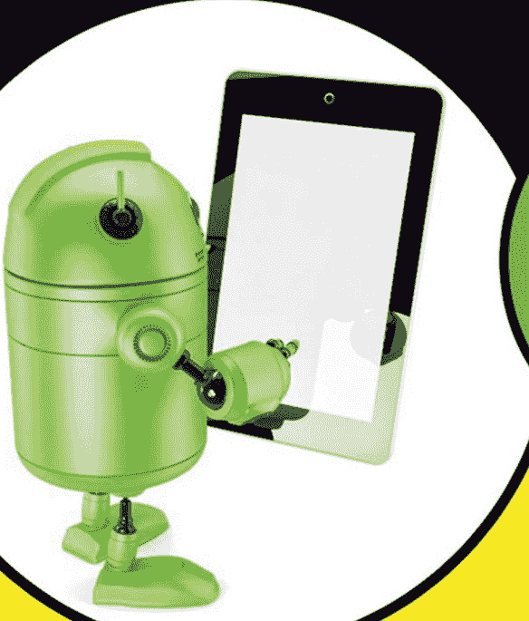


作者 Dan Gookin


## 目录摘要

- 锁定平板电脑
- 第三章：安卓平板电脑是如何工作的
- 第二部分：保持联系
- 第七章：平板电脑网页浏览
- 第 8 章：文本、语音与视频
    - 我们可以一起聚聚吗？
    - 使用 `Hangouts`
    - 给朋友发信息
    - 语音和视频聊天
    - 拨打 `Hangouts` 电话
    - 使用 `Skype` 与世界连接
        - 为您的平板电脑获取 `Skype`
        - 运行 `Skype`
        - 与另一 `Skype` 用户聊天
        - 在 `Skype` 上通话和视频通话
        - 拨打 `Skype` 电话
- 第 9 章：数字社交生活
    - 你的 `Facebook` 上的生活
    - 在平板电脑上运行 `Facebook`
    - 设置你的状态
    - 向 `Facebook` 上传照片或视频
    - 更改 `Facebook` 手机铃
    - 推特生活
    - 设置 `Twitter`
    - 发布推特
    - 更多社交网络机会
- 第 3 部分：OMNI 平板电脑
- 第 10 章：万事皆地图
    - 地图基础
    - 打开地图应用
    - 应用图层
    - 保存离线地图
    - 它知道你身在何处
    - 查找位置
    - 帮助他人找到你的位置
    - 寻找物品
    - 寻找特定地址
    - 寻找商家、餐厅或兴趣点
    - 搜索收藏或最近访问的地方
    - 安卓导航员
    - 设置你的家庭和工作位置
    - 从这里到那里
- 第 11 章：大家说“茄士！”
    - 安卓平板电脑相机基础
    - 介绍相机应用
    - 使用基础相机控制
    - 拍摄静态照片
    - 录制视频
    - 使用自拍定时
    - 查看你刚拍摄的内容
    - 相机设置与选项
        - 切换相机
        - 设置闪光灯
        - 选择分辨率和质量
        - 检查位置标记功能
        - 选择存储设备
- 第 12 章：图像管理
    - 数字相册
        - 查看照片和视频
        - 访问 `Google` 相册
        - 创建相册
        - 启动幻灯片
        - 查找照片的位置
    - 编辑与管理图像
        - 编辑图像
        - 取消图像编辑
        - 裁剪
        - 旋转照片
        - 删除照片和视频
        - 多选照片和视频
    - 免费照片与视频
    - 将视频发布到 `YouTube`
    - 与其他应用共享图像


# 第 4 部分：基础知识

## 第 13 章：音乐，音乐，音乐

* 在这里收听
* 浏览你的音乐库
* 播放曲目
* 添加下一首歌曲
* 为你的生活添加音乐
* 将音乐导入 `Google` 云端
* 直接同步音乐
* 整理你的音乐
* 查看你的播放列表
* 创建你自己的播放列表
  * 将歌曲队列保存为播放列表
  * 移除不需要的音乐
  * 来自流媒体的音乐

## 第 14 章：神奇的平板电脑功能

* 时钟
* 计算器
* 日历
* 浏览您的日程
* 查看预约
* 创建事件
* 电子书阅读器
* 游戏机
* `Google Now`
* 视频娱乐
* 享受 `YouTube`
* 购买和租赁电影

## 第 15 章：`Google Play` 购物

* 你好，`Google Play`
* 浏览 `Google Play`
* 获取项目
* 在 `Google Play` 上购买
* 租赁或购买视频
* `Google Play` 小技巧
* 使用愿望清单
* 共享 `Google Play` 项目
* 在设备上保留内容

## 第 16 章：无线生活

* 无线的奇妙世界
* 使用移动数据网络
* 了解 `Wi-Fi`
* 激活 `Wi-Fi`
* 连接到 `Wi-Fi` 网络
* 更新 `Wi-Fi` 网络密码
* 连接到隐藏的 `Wi-Fi` 网络
* 连接到 `WPS` 路由器
* 设置计费 `Wi-Fi` 连接
* 蓝牙世界
* 了解蓝牙
* 在您的平板电脑上激活蓝牙
* 配对蓝牙设备

## 第 17 章：连接、共享与存储

* `USB` 连接
* `3` 连接
* 将平板电脑连接到 `PC`
* 将平板电脑连接到 `Mac`
* 与电脑断开连接
* 文件来来回
* 在云端共享文件
* 使用 `USB` 线传输文件
* 添加打印服务


## 打印
221

## 播放您的媒体
222

## Android 平板存储

### 查看存储状态
223

### 管理文件
225

### 卸载 microSD 卡
225

### 格式化 microSD 存储
226

## 第 18 章：应用程序和小组件
227

### 主屏幕上的应用程序和小组件
227

### 在主屏幕添加应用程序
228

### 将应用程序放置在收藏栏上
229

### 放置小组件
230

### 调整小组件大小
231

### 移动启动器和小组件
232

### 从主屏幕移除项目
232

### 使用文件夹
233

### 应用程序管理

#### 查看您的应用程序
234

#### 更新应用程序
235

#### 卸载应用程序
236

#### 选择默认应用程序
237

#### 清除默认应用程序
238

#### 关闭运行异常的应用程序
239

#### 应用程序抽屉整理
240

## 第 19 章：定制您的 Android 平板电脑
241

### 主屏幕和显示设置
241

#### 装饰主屏幕
242

#### 挂上新壁纸
243

#### 管理主屏幕页面
244

#### 设置锁屏超时
245

#### 调整显示亮度
246

### 锁屏设置
246

#### 设置锁屏背景
246

#### 添加锁屏快捷方式
247

### 键盘设置
248

#### 生成键盘反馈
248

#### 确保预测文本已启用
248

#### 激活键盘手势
249

#### 开启语音输入
249

### 音频调整
250

## 第 20 章：Android 平板电脑安全

### 锁定你的平板电脑
251

#### 查找屏幕锁
251

#### 移除屏幕锁
253

#### 分配密码
253

#### 设置 PIN 码
253

#### 创建解锁图案
253

#### 使用指纹锁
255

### 其他平板电脑安全
255

#### 添加所有者信息文本
255

#### 显示锁屏通知
256

#### 寻找丢失的平板电脑
257

#### 加密你的平板电脑
258

#### 执行出厂数据重置
258

#### 这是每个人的平板电脑！
259

#### 添加另一个用户
259

#### 切换用户
261

#### 配置儿童账户
261

# 第 21 章：在外途中

## 你可以随身携带它
263

## 出发准备
263

## 前往机场
264

## 使用 Android 平板电脑飞行
265

## 到达目的地
266

## Android 平板电脑出国
266

## 使用海外电源
266

## 在异国访问 Wi-Fi
267

## 关闭数据漫游
267

# 第 22 章：维护、故障排除与帮助


# 目录

- 维护工作 ........................................................... 270
- 保持清洁 ........................................................... 270
- 备份你的东西 ........................................................ 270
- 更新系统 .......................................................... 271

xiv Android 平板电脑傻瓜

- 电池保养与充电 ...................................................... 272
- 监控电池 .............................................................. 272
- 确定什么在消耗能量 .................................................. 273
- 延长电池寿命 ...................................................... 274

- 故障排除 .............................................................. 275
- 解决问题 .............................................................. 275
- 查找帮助 .............................................................. 276
- 常见问题问答 .......................................................... 279
- “无法开启” .......................................................... 279
- “触摸屏不可用” ........................................................ 279
- “屏幕太暗” ............................................................ 279
- “电池不充电” .......................................................... 280
- “平板电脑发热导致关机” .............................................. 280
- “我的平板电脑无法工作” .............................................. 280

# 第 5 部分：十项

## 第 23 章：技巧、窍门与快捷方式

- 快速切换 .............................................................. 283
- 从电脑安装应用 ........................................................ 284
- 全屏截图 .............................................................. 285
- 避免流量费用 .......................................................... 286
- 共享数据 .............................................................. 287
- 桌面组件 .............................................................. 289
- 语音输入 .............................................................. 290
- 添加词典 .............................................................. 290
- 有用的小组件 .......................................................... 291
- 日历小组件 ............................................................ 291
- 联系人小组件 .......................................................... 291
- 电子书小组件 .......................................................... 292
- 网页书签小组件 ...................................................... 292
- 截屏 .............................................................. 293

# 第 24 章：记住的十件事

- 语音输入文本 .................................................... 293
- 调整平板电脑方向 .................................................. 294
- 使用快速设置 ...................................................... 294
- 利用键盘建议 ...................................................... 295
- 避开耗电大户 ...................................................... 295
- 解锁并启动 ...................................................... 295
- 打拨电话 ...................................................... 296
- 查看你的日程 .................................................... 296
- 为联系人拍照 .................................................... 297
- 使用 `Google Now` .......................................................... 297

## 第 25 章：十款实用应用 ................................................................. 299

- 航空公司应用 ............................................................ 299
- 游戏 .............................................................. 300
- `Google` 文档 ............................................................ 301
- `Kindle` .............................................................. 302
- `Flixster` 电影 ............................................................ 302
- 星空地图 (`Sky Map`) ............................................................ 302
- 电视替代方案 ............................................................ 302
- 翻译 (`Translate`) ............................................................ 303
- 录音机 (`Voice Recorder`) ............................................................ 303
- `Zedge` ............................................................ 304

## 索引 ............................................................ 305

# 引言

在智能手机和电脑之间，存在着 21 世纪的顶级设备。它可能是一个你从未用过，但很快就会无法离它的东西。它就是平板电脑——具体来说，`Android` 平板电脑。

`Android` 平板电脑是一种可以完全取代你的电脑以及你随身携带的几件电子设备的设备。它是一个全、轻量化、电池供电、长续航、完全移动、电信、信息和娱乐的设备。

噢，我还没说完完。

作为 `Android` 平板电脑的所有者，或对购买此类设备感兴趣的人，你希望从你的技术中获得最大的价值。也许你曾尝试通过随设备附带的那张薄薄的“入门指南”来自学相关知识。现在你转向了这本书，这是一个明智的选择。

新技术可能会让人望而畏惧。沮丧。无论如何，通过悠闲地阅读这本精彩、信息量丰富且偶尔带有趣味的书，你的体验将会变得更好。

# 关于本书

请不要从头到尾读完这本书。这是一本参考书。它的设计初衷是根据你的需要使用。在目录或索引中查找某个主题。找到关于你平板电脑的困扰你的问题或你好奇的事物。找到答案，然后继续过你的生活。

本书的核心思想是展示在 `Android` 平板电脑上如何操作，并帮助你享受这款设备，而不会让你被信息淹没或让你因恐惧而陷入绝望。

- 本书中的示例章节包括：
  - 解锁平板电脑
  - 激活语音输入
  - 从电脑导入联系人
  - 添加更多电子邮件账户
  - 拨打 `Hangouts` 电话
  - 在你的平板电脑上运行 `Facebook`
  - 帮助他人找到你的位置
  - 购买和租赁电影
  - 使用 `Android` 平板电脑进行飞行

你不需要记忆任何东西，没有神圣的咒语或动物祭品，绝对没有 `PowerPoint` 演示稿。相反，每个章节在解释一个主题时，都是你在这书中读到的第一个内容。书中不预设任何基础，且所有内容都有交叉引用。技术术语和主题在出现时，会被整齐地推到一旁，方便避开。这里的意图并不是让你学习任何东西。我在写这本书时的哲学是帮助你查阅、理解，并继续过你的生活。

# 如何使用本书

本书遵循了一些使用 `Android` 平板电脑的惯例。首先，无论你的平板电脑叫什么名字，是制造商的名称还是你自己起的昵称，书中都将你的平板电脑称为 `Android` 平板电脑，或者通常称为平板电脑。

你与 `Android` 平板电脑交互的方式是通过使用它的触摸屏——即设备面向你的玻璃部分。设备还带有物理按钮，以及孔洞和连接器。所有这些项目在第 1 章中都有描述。

触摸屏幕的各种方式在第 3 章中进行了解释和命名。

第 4 章介绍了 `Android` 平板电脑上的输入方法。当你厌倦打字时，可以使用屏幕键盘。

各种功能可以开启或关闭，书中通过开关按钮指示。例如：

1. 点击应用图标。
2. 打开设置。
3. 选择“关于平板电脑”。
4. 查看 `Android` 版本。

显示的数字表示 `Android` 系统版本。

要确认你的 `Android` 版本，请遵循以下步骤：

1. 点击应用图标。
2. 打开设置。
3. 选择“关于平板电脑”。如果你使用的是三星 `Galaxy` 平板电脑，你可能需要先点击屏幕顶部的“通用”选项卡。
4. 查看“`Android` 版本”。

如果这些步骤让你感到困惑，请复习本书的第一部分，然后再回来。（我会等你的。）


# 假设

尽管这本书是为初学者或容易感到畏惧的人编写的，但我做了一些假设。例如，我假设你是人类，而不是外星生物。

我最大的假设是：你有一个使用移动数据的平板电脑（即 `LTE`）或仅支持 `Wi-Fi` 的型号。本书涵盖了两者。

`Android` 系统有多个版本，或称为“口味”。这些版本包括豆黄（`Jelly Bean`）、巧克力棒（`Kit Kat`）、棉花（`Marshmallow`）和牛糖（`Nougat`）。要确认你的 `Android` 版本，请遵循以下步骤：

1. 在主屏幕点击应用图标。

参考第 3 章关于应用图标的描述。

2. 点击打开设置。
3. 选择“关于设备”。

该项目可能名为“关于手机”。

4. 查看“`Android` 版本”。

显示的数字表示 `Android` 系统版本。

更多假设：

你不需要电脑就能使用 `Android` 平板电脑。如果你有电脑，那很好。`Android` 平板电脑完美兼容 `PC` 和 `Mac`。当指令针对 `PC` 或 `Mac` 时，书中会说明。

在 `Android` 平板电脑上运行的程序是 `app`，应用程序的缩写。单个程序就是一个 `app`。

最后，本书假设你有一个 `Google` 账户，如果没有，第 2 章将解释如何配置。这样做吧。拥有 `Google` 账户可以开启许多实用功能、信息和程序，让你的平板电脑使用得更高效。

# 本书使用的图标

d435d3e2564e36f2ff421dc0a90f095_21_0.png

此图标标记了实用的提示或快捷方式。

d435d3e2564e36f2ff421dc0a90f095_21_1.png

此图标标记了执行某事的友好提醒。

d435d3e2564e36f2ff421dc0a90f095_21_2.png

此图标标记了不要执行某事的友好提醒。

d435d3e2564e36f2ff421dc0a90f095_21_3.png

此图标提醒你注意过度极客的信息和对当前主题的技术讨论。阅读这些信息是可选的，尽管它可能会让你赢得《危险一路答》中的双倍分。

# 接下来该哪里

开始阅读吧！从第 1 章开始，它的章节编号可能是“1”，而不是位于书中间位置的第 12 章。而且，正如我之前告诫的那样，不要从头到尾读这本书。它不是一部小说。

我的电子邮箱地址是 `dgookin@wambooli.com`。是的，这是我的真实地址。我会回复我收到的每一封邮件，如果你能保持问题简短并针对本书，我的回复速度会更快。虽然我喜欢和大家打招呼，但我无法回答技术支持问题、解决账单问题或帮助你排除平板电脑的故障。感谢理解。

我的网站是 `wambooli.com`。这本书在那个网站上有自己的页面，你可以在那里查看更新、新信息以及各种有趣的内容。经常光顾：

```
wambooli.com/help/android/tablets
```

出版商维护着一个支持页面，列出了本书不同版本之间发生的更新或更改。访问 `www.dummies.com`，搜索“`Android Tablets For Dummies`”，然后打开本书特定页面的“`Extras`”（额外内容）选项卡以查看更新或更改。或者点击“`Cheat Sheet`”（速查表）链接查看从文中提取的有用信息。

祝你喜欢这本书和 `Android` 平板电脑！

## 1 开始使用 `Android` 平板电脑

## 本部分

- 熟悉你的新 `Android` 平板电脑。
- 配置 `Android` 平板电脑。
- 发现开启平板、锁定屏幕和关闭平板的选项。
- 学习操作触摸屏的多种巧妙方法。
- 强迫自己喜欢屏幕键盘。

## 第 1 章 这种开箱即用的体验

要开始你的 `Android` 平板电脑之旅，请打开设备盒。所以，你可能已经这样做过了。我不怪你；在读这一章之前，我已经打开了我的 `Android` 平板电脑的盒子。没问题。然而，如果你能用温和的介绍和处理来伴随这种开箱体验，你的新之旅将更加顺利。

### 初始程序

如果你购买了蜂窝网络或 `LTE` 平板电脑，销售人员可能在你离开商店之前已经为你完成了一些配置。这太好了，因为 `LTE` 平板电脑在使用设备之前需要一些额外的设置。这项任务将在第 2 章中解释。现在，所有平板电脑用户（无论是 `LTE` 还是 `Wi-Fi`）都需要执行两项基本活动：拆箱，以及为电池充电。

- 本章内容
  - 拆箱平板
  - 为电池充电
  - 寻找平板的重要物品
  - 获取可选配件
  - 存放平板

## `Android` 平板电脑购买技巧

购买 `Android` 平板电脑时需要考虑的主要因素是屏幕尺寸以及你想要 `LTE` 还是仅限 `Wi-Fi` 设备。

较大的屏幕更清晰、更容易阅读，但较大的平板需要双手操作。较小的平板可能更方便。知道哪种尺寸最适合你的唯一方法是在购买前在商店里上手操作 `Android` 平板电脑。

`LTE` 平板使用移动数据网络访问互联网，就像手机一样。这种功能带有每月费用，但如果你在任何地方都需要访问互联网，它是值得的。`LTE` 和仅限 `Wi-Fi` 的平板都可以访问 `Wi-Fi` 网络。

有些平板电脑以 `microSD` 卡的形式提供可扩展存储。此功能允许你扩展设备的存储空间，并更轻松与计算机共享文件。

确保平板电脑有前后摄像头。摄像头分辨率并不那么重要，但如果你的平板电脑将是你唯一的数码相机，获得一个高分辨率后摄像头将是一个加分项。还要确认后摄像头带有闪光灯。


除了这些项目，大多数 Android 平板电脑都是相同的，只有软件上的区别。但请确保你的平板电脑使用的是 Android 系统并且可以访问 Google Play。一些低价、廉价平板会将你的购买限制在制造商的应用商店中。我会避免此类设备。

## 将平板从盒子里解放出来

由于资金充裕，你的联邦政府对人们如何使用电子设备进行了大量研究。穿着白大褂和戴护目镜的男女性确定，当你将 Android 平板电脑从盒子里取出时使用效果最好。感谢联邦资助！

我假设你很擅长拆箱，所以我可能不需要详细说明步骤。然而，我可以肯定，取出并丢弃那些贴在平板电脑正面、背面和侧面的保护塑料膜是完全没问题的。不要感到尴尬，三周后，你会发现还有还没撕掉的塑料膜。尽管撕并扔掉那些塑料膜吧。

除了平板电脑，你还会在盒子里找到以下物品：

- `USB 线`：你可以用它将平板电脑连接到计算机或墙插充电器。
- `电源适配器`：使用这个东西（`USB 线`）为平板电池充电。适配器可能由两部分组成，两部分都必须组装。
- `电源充电器和线`：这些包含在某些不使用 `USB` 线充电的平板电脑中。
- `无用的的小册`：如果你的平板电脑像我的一样，那个显示安全和保修信息的单薄设置指南比我们的文化对律师与技术作者的重视程度大得多。
- `4G SIM 卡槽`：对于 `LTE` 平板电脑，你需要一张 `4G SIM` 卡。如果你在手机店购买的平板，那里的人可能也把 `SIM` 卡槽放进了盒子里。你可以把它扔掉。


在拥有 Android 平板电脑期间，请保留盒子。如果你需要退回这个东西或将其寄往任何地方，原始盒子都是理想的容器。你也可以把所有无用的的小册和纸塞回盒子里。

## 为电池充电

我建议你对平板电脑做的第一件事就是给它充满电。按照以下步骤操作：

1. **如有必要，组装充电线。**
   将充电头（墙插适配器）连接到平板电脑自带的 `USB` 线上。
2. **将 `USB` 线的充电头部分插入墙插座。**
3. **将 `USB` 线的另一端插入平板电脑。**
4. **等待。**

当平板电脑充电时，你可能会在触摸屏上看到充电图标。这个图标让你知道平板运行正常——但如果电池图标没有出现，请不要惊慌。

平板在第一次充电时启动没关系，但请阅读第 2 章以了解如何在 Android 平板电脑上进行初始设置。

> 某些平板电脑使用自己的充电线，而不是 `USB` 线。

> 即使你的 Android 平板电脑从出厂时就是满电的，我仍然建议它进行初始充电，以至少熟悉这个过程。

平板插墙上充电比从计算机 `USB` 接口充电更高效。提到这个：

当平板连接到未开启的计算机 `USB` 接口时，它不会充电。

充电时完全可以使用平板。而且不需要等充满电。

有些平板电脑可以无线充电，但前提是你购买特殊的无线充电器。

我已经很久没见过可拆卸电池的 Android 平板电脑了。不可拆卸电池唯一的问题是，如果平板电脑无法充电，你需要退回整个设备以退款或更换。


## 板探索

大家都喜欢玩捉迷猫——除了涉及技术时。知道你的 Android 平板电脑关键物品的位置很重要。问题是，这些物品的位置并不一致，即使是同一制造商制造的平板。

### 在平板上寻找物品

注意图 1-1，这是我尝试说明通用 Android 平板电脑硬件功能的图。在你操作自己的平板时，参考此图定位一些关键功能。

平板正面重要的物品包括列表中的项目：

- `触摸屏`：平板最大的部分是它的触摸屏，占据了设备正面所有的区域。触摸屏是一个视触结合的设备：你看着它，但也用手指触摸来控制平板。
- `前摄像头`：Android 平板电脑的前摄像头位于触摸屏上方。在较大的平板上，当平板水平放置时摄像头位于顶部。（参考图 1-1 的左侧。）在小尺寸平板上，当平板垂直放置时摄像头位于顶部。（参考图 1-1 的右侧）。

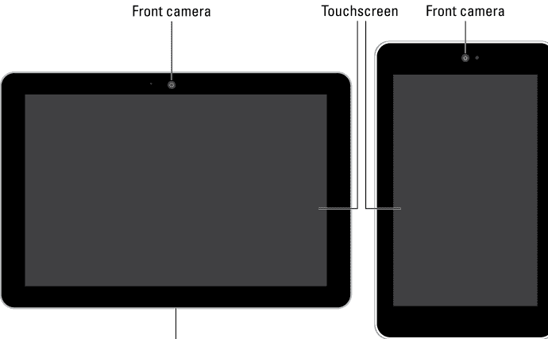

图 1-1: 在你的 Android 平板电脑上可以找到。

在你的 Android 平板电脑边缘的重要物品包括以下：

- `电源/锁定键`：此按钮（或键）可开启或关闭平板电脑，或解锁设备。执行这些活动的操作说明请见第 2 章。
- `音量键`：平板电脑的音量控制是二合一的按钮。按键的一侧增大音量，按另一侧降低音量。此键通常位于`电源/锁定键`旁边。它是两个键中较大的那个。
- `USB/电源接口`：这个插槽是插入 `USB` 线的地方，`USB` 线既可用于为电池充电，也可将你的 Android 平板电脑连接到计算机。
- `可拆卸存储插槽`：在此插槽中插入 `microSD` 卡，以扩展平板电脑的存储空间。细节将在下一节介绍。
- `SIM 卡盖`：此处用于访问 `LTE` 平板电脑的 `SIM` 卡，`SIM` 卡插入在盖下方的插槽中。
- `耳机孔`：这个孔是你可以连接标准耳机的地方。
- `扬声器`：平板电脑的左右两侧均有立体声扬声器，尽管较小尺寸的平板电脑可能将扬声器位于背面。
- `麦克风`：一个微小的圆形开口作为设备的麦克风。某些平板电脑可能具有两个麦克风孔。如果你找不到它们，不要担心；它们在那儿。

在你的 Android 平板电脑背面，你会发现一个或多个标志，以及平板电脑的主摄像头（或后置摄像头）。摄像头可能带有 `LED` 闪光灯。

- 三星平板电脑在触摸屏正下方设有 `Home` 键。此物理按钮与其他 Android 平板上的 `Home` 导航图标相同。
- 三星平板电脑还具有触控的`恢复`（`Rec`）和`返回`（`Back`）按钮。
- 注意不要将 `SIM` 卡槽与外部存储插槽混淆。它们不是一回事。你很少甚至不需要访问 `SIM` 卡。
- `SIM` 代表用户识别模块（`Subscriber Identity Module`）。蜂窝供应商使用 `SIM` 卡来识别你的平板电脑并跟踪通过移动数据网络传输的数据量。是的，这是为了让你准确计费。`SIM` 卡还为你的 `LTE` 平板电脑提供电话号码，尽管它仅仅是一个账号，而不是你可以拨打或用于发送短信的号码。


## 插入 `microSD` 卡

某些 Android 平板电脑提供 `microSD` 卡形式的可拆卸存储空间。它用于存储照片、视频、音乐、文件等。

`microSD` 卡非常小。（这是一个科学的描述。）该卡片放入平板电脑边缘的插槽中，也可以插入适配器并由计算机读取，就像任何可移动介质卡一样。

要向你的平板电脑插入 `microSD` 卡，请遵循以下说明：

1. 在平板电脑边缘找到 `microSD` 卡舱盖。

   图 1-2 展示了舱盖的外观，尽管它在你的平板电脑上看起来可能略有不同。卡片可能标记为 `microSD`。不要将其与 `SIM` 卡盖混淆。

   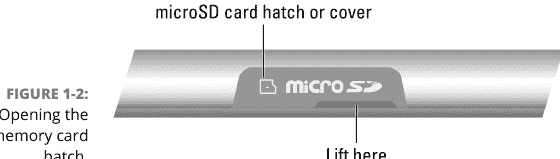

2. 翻开 `microSD` 卡插槽上的微小舱盖。

   打开 `microSD` 卡插槽上的微小舱盖。

   由于卡片也可以插入适配器并由计算机读取，你可以将其插入适配器。

3. 将 `microSD` 卡插入你的平板电脑。

   卡片插入适配器中。如果可以，你可以看到它。

   当卡片完全插入时，会发出轻微的咔哒声。

4. 关闭 `microSD` 卡舱盖。

   如果平板电脑已开启（并已配置），请忽略屏幕上的提示。

## 移除 `microSD` 卡

除了 `microSD` 卡，某些 Android 平板电脑还提供内部存储。当你需要移除它时，请按步骤操作：

1. 在平板电脑边缘找到 `microSD` 卡舱盖。
2. 翻开 `microSD` 卡插槽上的微小舱盖。
3. 从插槽中取出 `microSD` 卡。
4. 关闭 `microSD` 卡舱盖。

## 可选配件

当你发现有很多实用的平板电脑配件时，你的平板公司会非常高兴。你可以在购买平板电脑的地方或网上找到它们。这里是一些你可以考虑购买的物品：

- 耳机：你可以使用任何手机或便携媒体播放器耳机配合 Android 平板。将耳机插入平板电脑的耳机孔即可就绪。
- 保护壳、包和套：平板电脑套解决了“我该把它放在哪里？”的问题。还有兼作平板支架的特殊包。
- 屏幕保护膜：这些塑料膜贴在平板电脑正面，触摸屏上方。它们可以保护玻璃免受污渍和划痕，同时允许你使用触摸屏。
- 车载充电：使用车载充电为汽车内 Android 平板充电。它是一个插入汽车 12 伏电源（以前是烟器插）的适配器。如果你计划在汽车中使用 Android 平板的导航功能或在路上充电，车载充电是必备品。
- 键盘：你可以购买并使用任何蓝牙键盘配合你的平板电脑。有些是专门为平板电脑设计的，这比买任何旧蓝牙键盘都要好。有关蓝牙的详情请参阅第 16 章。

其他有趣的实用配件可能适用于你的平板电脑。在购买平板电脑的地方快速查看新的装饰和工具。

## 哪里存放你的平板电脑

就像你的车钥匙、眼镜、钱包和相位子枪一样，你的 Android 平板电脑应该存放在安全、易于找到且随手可及的地方，无论你是在家里、办公室、旅途中，还是在克林贡家星轨道。

## 为你的平板电脑找个家

我建议在每次使用完 Android 平板电脑后，都将其放回原。如果你有一台电脑，我的第一个建议是在电脑旁专门留一个位置。把充电线放在手边，或者直接将线插入电脑的 `USB` 端口，这样你就可以定期与电脑同步信息，更不用说保持平板电脑电量了。

存放平板电脑的另一个方便地方是床头柜。这很有意义，除了晚上用平板阅读或看视频外，它还可以作为闹钟。（参见第 14 章。）

最重要的是，避免将平板电脑放在别人可能会坐到、踩到或其他方式损坏它的地方。例如，不要把平板电脑留在柜台上或一叠报纸下面，否则可能会被不小心扔掉或放入垃圾桶。

千万不要把平板电脑放在椅子上！

只要你记得在用完后将平板电脑放回同一个位置，你就永远知道它在哪里。


## 带上你的 Android 平板电脑出门

如果你和我一样，你可能会随身携带 Android 平板电脑，或者从办公室、机场，甚至在乘坐警车时把它塞在裤子里。我希望你不要开车时使用平板电脑。无论如何，在旅途中，最好有一个便携的地方来存放你的平板电脑。

平板电脑的理想场所是一个专门设计的包或保护套。包可以防止设备在背包、手提包、随身行李或你未使用平板电脑时放置的任何地方免受磕碰、划伤，甚至意外开启。

另请参第 21 章有关在旅途中使用 Android 平板电脑的信息。

- 本章内容
- 开启 Android 平板电脑
- 解锁屏幕
- 配置账户
- 添加更多账户
- 锁定屏幕
- 关闭平板电脑

# 第 2 章 Android 平板电脑：开启与关闭

畅销书《傻瓜铅笔指南》（`Pencils For Dummies`）并没有介绍如何开启铅笔的章节。《傻瓜笔类指南》（`Pens For Dummies`）确实有一个“启用笔书写”的章节，但这并不是真正的开关问题，而且作者在书中详细描述了在铅笔上设置开关或电源按钮会有多么笨拙。你在这个这类事物都能被仔细描述的时代，难道不很幸运吗？

你的 Android 平板电脑比笔或铅笔复杂得多，而且通常更有用。作为一种先进的技术设备，你的平板电脑有一个开关按钮，准确地说，是一个`电源/锁定键`。这个键的功能不仅仅是开启或关闭 Android 平板电脑。

## 你好，Android 平板电脑

写这句话很容易：“开启你的 Android 平板电脑，按下按钮即可。”正如你可能担心的那样，对于复杂的设备来说，这种简单的指令是不可能的。

当你已经拥有 `Google` 或 `Gmail` 账户时，平板初始设置效果最好。如果你缺少此类账户，设置过程中会提示创建一个。

除非电池已充电，否则平板将不会启动。参见第 1 章。

## 首次开启你的平板电脑

当你第一次开启 Android 平板电脑时，需要完成设置过程。这是必须的，但只需要操作一次。如果你的平板电脑已经设置过，请跳到后面的“开启平板电脑”部分。

设置和配置过程的细节与平板设置略有不同。例如，某些平板电脑可能会提示你登录 `Dropbox` 等服务。使用移动数据网络的平板电脑可能要求你运行特定的设置应用，你将在配置过程中读到这些内容。通常来说，该过程涵盖了所有 Android 平板电脑的基本步骤。

我建议先阅读这些步骤，然后再开启平板电脑并完成它们。过程进行得很快，如果你在步骤之间花费太多时间等待，屏幕可能会变暗：

1. 按`电源/锁定键`开启平板电脑。几秒钟，你会看到平板电脑的标志，释放`电源/锁定键`。
2. 回答提示：
   - 选择你的语言
   - 连接移动数据
   - 连接到 `Wi-Fi` 网络
   - 设置时区
   - 登录你的 `Google` 账户或创建一个新账户
3. 点击`NEXT`按钮。在每个选择后，都点击`NEXT`按钮。
4. 点击`FINISH`按钮。设置完成后，你将进入主屏幕。

- 添加其他账户
- 设置位置
- 你的 `Google` 账户提供了 Android 平板电脑与 `Gmail` 消息、联系人、`Google` 日历预约以及来自其他应用程序数据之间的同步。


- 有关 Android 操作系统的更多信息，请参见后文侧边栏“这个 Android 人是谁？”

## 开启平板电脑

要开启 Android 平板电脑，长按`电源/锁定按钮`。几秒钟后，你会看到平板的启动标志，欣赏一段动画，甚至可能听到音乐。释放`电源/锁定键`；设备正在启动。

- 如果你加密了平板数据，必须在设备完全启动前进行屏幕锁。数据加密详情请参见第 20 章。
- 如果电池电量过低，即使插入充电器，平板也不会开启。在这种情况下，请等待电池充电。

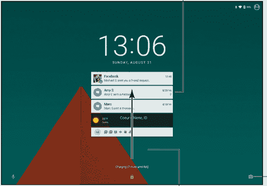

图 2-1: 锁屏。滑动屏幕以解锁，锁屏应用

## 使用锁屏

你必须通过滑动屏幕来关闭平板电脑的锁屏并查看主屏幕。这一个简单的步骤并没有真正让“锁屏”看起来很安全，对吧？为了增加更多的安全性，你可以应用比简单的“滑动锁定”以外的屏幕锁。这些屏幕锁类型包括：

- `图案锁定`：在屏幕上的九个点上划出预设的图案。
- `PIN`：输入数字解锁设备。
- `密码`：输入密码，密码可以包含字母、数字和符号。

这些屏幕锁中的每一个都会在你滑动屏幕之后、进入主屏幕之前出现。若要应用这些锁定，请参阅第 20 章。

- “滑动锁定”被认为是标准的 Android 屏幕锁：按照前一节中的指示滑动屏幕。
- 某些平板电脑可能提供标记为“无”（`None`）的屏幕锁。当应用此“锁”时，平板电脑解锁后主屏幕会立即出现。
- `PIN` 和密码锁定被认为是最安全的。若要使用某些平板电脑功能，你必须选择 `PIN` 或密码屏幕锁。
- 另请参阅第 20 章，获取有关特殊屏幕锁的信息，包括指纹锁、签名锁等。

## 解锁并运行应用

你平板电脑的锁屏可能包含应用图标，例如之前图 2-1 所示的相机图标。要解锁该平板电脑并运行它，请在触摸屏上拖动该图标。

如果你设置了安全锁定，解锁并运行应用将只会运行该应用。当你尝试访问其他平板电脑功能或应用时，系统会提示你处理屏幕锁。

## 这个叫 Android 的人到底是谁？

就像电脑一样，你的 Android 平板电脑有一个操作系统。它是负责平板电脑内所有软件（应用）的主程序。然而，与电脑不同，Android 是一种移动设备操作系统，主要设计用于平板电脑和手机手机。

Android 基于 `Linux` 操作系统，`Linux` 也是一种电脑操作系统，尽管它比 `Windows` 稳定得多且没有 Bug，但它的流行程度较低。`Google` 拥有、维护并开发 Android，这就是为什么你的在线 `Google` 信息会同步到你的平板电脑上。

Android 的吉祥物（如此处所示）经常出现在 Android 应用或硬件上。他没有官方名称，尽管大多数人称他为 `Andy`。

## 添加账户

你的 Android 平板电脑可以作为你各种在线化身的家园。该列表包括你的电子邮件账户、在线服务、订阅以及其他数字身份。我建议将这些账户添加到你的平板电脑中，以继续完成设置-配置过程。

在平板电脑开启并解锁的状态下，请按照以下步骤操作：

1. 点击`应用`（`Apps`）图标。
   应用图标位于主屏幕底部。它看起来与侧边栏显示的图标相似，尽管它有很多变体。变体请参阅第 3 章。
   当你点击`应用`图标时，你会看到应用抽，它列出了你平板电脑上所有可用应用。
2. 打开`设置`（`Settings`）应用。
   你可能需要滑动几次应用抽，翻阅各种图标来找到`设置`应用。
   点击`设置`图标后，`设置`应用就会运行。它显示了配置各种平板电脑选项和功能的命令。
3. 选择`账户`（`Accounts`）类别。
   某些平板电脑可能将该项目命名为`账户与同步`（`Accounts and Sync`）。
   成功后，你将看到平板电脑上的已有账户，类似于图 2-2 所示。
4. 点击`添加账户`（`Add Account`）。
   `添加账户`项目如图 2-2 所示。
5. 从列表中选择账户类型。
   例如，添加 `Facebook` 账户，选择 `Facebook`。
   如果你没有看到想要添加的精确账户类型，不要担心。你可能需要在账户出现之前先添加某个特定的应用。第 15 章涵盖了添加应用。
6. 按照指示登录你的账户。
   你所采取的步骤取决于你添加的账户类型。通常情况下，你使用已有的用户名和密码登录。

> 重复这些步骤以继续添加账户。完成后，点击主导航图标返回主屏幕。

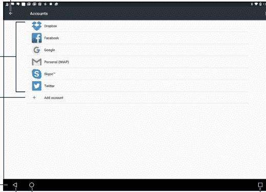

图 2-2: 设置应用中列出的账户。


- 关于向你的 Android 平板电脑添加电子邮件账户的特定信息，请参阅第 6 章。

- 第 9 章涵盖了你平板电脑上的社交网络。请参阅该章节获取添加`Facebook`、`Twitter`和其他社交网络账户的特定信息。

## 从旧平板电脑传输信息

这里有一项任务你不需要担心：与你旧平板电脑（或你当前的手机）相关的所有`Google`信息都会立即传输到你的新`Android`平板电脑。这些信息包括联系人、`Gmail`、事件和其他`Google`账户数据。你甚至可以在此部分安装你以前获得的（免费或购买）的应用。

当你向平板电脑添加其他账户时，与这些账户相关的信息也会被迁移。唯一不迁移的类别是安装在旧设备上的媒体。如果你已与在线共享服务同步了媒体文件，信息就可以轻松传输。否则，请参阅第 17 章有关将照片、视频和音乐移动到新`Android`平板电脑的信息。

## 你的 Android 平板电脑之日终

我知道三种方法与你的`Android`平板电脑道别；只有其中一种涉及高爆炸物的应用。其他方法记录在本节中。

## 锁定平板电脑

锁定平板电脑非常简单：只需按下并释放“电源/锁定”键。显示变黑；你的平板电脑已锁定。

- 你的`Android`平板电脑在锁定时仍然运行；它可以接收电子邮件、播放音乐并发出警报。在锁定期间，平板电脑使用的功率没有显示开启时那么多。

- 平板电脑大部分时间可能处于锁定状态。

- 锁定不会关闭。

- 你设置的任何定时器或闹将在平板电脑锁定时触发。有关设置闹钟的信息请参阅第 14 章。

- 要解锁你的平板电脑，按下并释放“电源/锁定”键。参见“解锁平板电脑”部分。有关设置平板电脑超时时间的信息，请参阅第 19 章。


## 关闭你的 Android 平板电脑

要关闭你的平板电脑，请按照以下步骤操作：

1. 按住并释放“电源/锁定”键。

你看到“设备选项”卡片，它可能包含一个项目：“关机”（`Power Off`）。某些平板电脑在此菜单上具有更多项目。

`img/d435d3e2564e3c6f2ff421dc0a90f095_45_0.png`

如果你不想关闭平板电脑，点击“返回”图标关闭“设备选项”卡片。

2. 点击“关机”项目。

如果出现确认消息，点击“确定”。`Android`平板电脑将关闭。

了解了一些基础操作后，你就离精通移动设备更近了。

## 触摸触摸屏

除了任何按钮和旋钮外，控制`Android`平板的方法就是用一或两个手指在触摸屏上进行操作。使用哪只手指并不重要，你也可以放心地尝试其他身体部位，尽管我觉得手指非常方便用。

以下是一些操作触摸屏的常用方法：

-   点击（`Tap`）： 基础的触摸屏技术是触摸它。你点击一个物体、图标、控制控件、菜单项、小部件等。点击操作类似于电脑上的鼠标点击。它也可能称为触摸（`touch`）或按下（`press`）。

-   双击（`Double-tap`）： 在同一位置双击屏幕可以用于放大图像或地图，也可以用于缩小。由于双击具有双重属性，我建议使用双指捏合（`pinch`）或双指张开（`spread`）操作来缩放。

-   长按（`Long-press`）： 按住屏幕的一部分并保持手指不要离开。根据你正在的操作，可能会弹出菜单或卡片，或者你长按的项目可能会被“选中”，以便你可以拖动（移动）它。长按也可能称为点击（`tap`）和保持（`hold`）。

-   滑动（`Swipe`）： 要进行滑动，将手指按在一个点，然后将手指移动到另一个点。滑动可以是向上、向下、向左或向右；触摸屏内容会你手指滑动的方向移动。滑动可以快也可以慢。它也被称为拨（`flick`）或滑动（`slide`）。

-   拖动（`Drag`）： 拖动是长按后滑动的组合操作，它可以移动屏幕上的项目。从长按开始，保持手指在屏幕上并滑动。抬起手指以完成操作。

-   捏合（`Pinch`）： 捏合涉及两个手指。

-   张开（`Spread`）： 捏合的反面是张开。你先用手指，然后张开它们。张开用于放大、增大图像或查看地图上的更多细节。它也被称为双指张开（`pinch open`）。

-   旋转（`Rotate`）： 几次点击即可让你通过用两个手指触摸并绕中心点旋转来旋转屏幕上的图像。如果你在这个操作上遇到困难，可以想象你正在转动保险箱旋盘。

戴着手套时你无法操作触摸屏，除非手套是专为使用电子触摸屏设计的，例如蝙蝠佩戴的手套。

## 使用导航图标

触摸屏下方有三个导航图标。它们可能作为触摸屏的一部分；或者在某些平板电脑上，它们可能是边框的一部分，甚至是物理按钮。这些图标在整个`Android`系统中具有特定功能。

传统的三个导航图标是返回（`Back`）、主页（`Home`）和最近（`Recent`）。表 3-1 展示了`Android`操作系统最新版本的导航图标外观。

表 3-1 导航图标种类

| 图标 | 棒棒糖 (`Lollipop`)、棉花糖 (`Marshmallow`)、山果糖 (`Nougat`) | `KitKat` 及更早 |

| --- | --- | --- |

| 主页 | ◯ | ⬏ |

| 返回 | ▷ | ↩ |

| 最近 | ⬜ | ⬡ |

`Home`： 无论你在平板电脑上做什么，点击此图标都会显示主屏幕。当你已经在查看主屏幕时，点击此图标可查看主（或中心）主屏幕页面。

`Back`： 返回图标有多个用途，所有这些都恰恰符合“返回”的概念。点击一次图标可以返回上一页、撤销屏幕上的菜单、关闭卡片等。

返回图标会改变其方向，如侧边栏所示。点击此图标可以隐藏屏幕键盘、取消语音转录或执行其他与返回导航图标类似的操作。

`Recent`： 点击最近图标显示总览视图（`Overview`），即最近打开或当前运行的应用程序列表。有关总览视图的更多信息，请参阅稍后的“在运行的应用程序之间切换”部分。

当某些应用程序运行时，三个导航图标可能会自动隐藏。要访问这些图标，请点击屏幕。对于某些全屏应用和游戏，从顶部向下滑动查看导航图标。

## 设置音量

平板电脑边缘的音量键控制平板扬声器发出的声音。按按键顶部增大音量。按键底部降低音量。当音量键位于平板电脑上沿时，按左侧增加音量，按右侧减小音量。

当你按下音量键时，触摸屏上会出现一个音量卡片，显示相对音量级别，类似于图 3-1 所示。你可以继续按音量键，或使用手指调整屏幕上的滑块并设置音量。

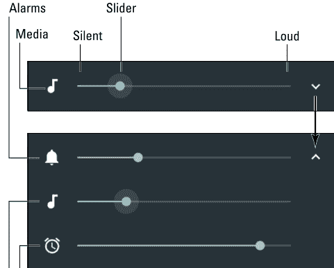

图 3-1：设置音量。媒体

并不是所有的音量看起来都像图 3-1 所示，尽管它们都有滑块控制。额外的控制允许你设置音量；点击卡片上的图标查看详情。如果卡片上出现设置图标，点击它进行更具体的调整。

-   当音量调到最低时，平板电脑将静音。

-   即使平板电脑被锁定，音量键仍然有效。这意味着如果你正在播放音乐只需要调整音量，无需解锁平板电脑。

-   某些平板电脑在静音时可能会进入振动模式，尽管每个平板电脑都有振动模式。

-   有关平板电脑音量控制的更多信息，请参阅第 19 章。

## 方向

你的`Android`平板电脑有一个名为加速度计的装置。它决定了平板电脑的指向方向，或者你是否将设备从竖直位置重新调整为水平位置（反之亦然），甚至是倒置。这样，平板屏幕显示的信息始终是竖直的，无论你如何拿。

要演示平板如何自动调整方向，将平板向左或向右旋转。大多数应用程序会根据你调整平板的方向来改变它们的方向，如图 3-2 所示的主屏幕。

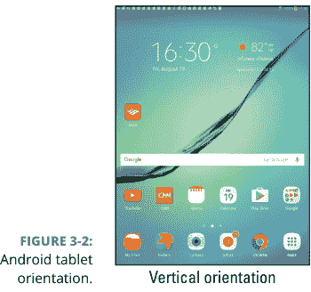

垂直方向

水平方向

旋转功能可能不适用于所有应用程序，甚至可能不适用于主屏幕。在这种情况下，打开浏览器应用来尝试旋转。

# 文件夹

状态栏  通知图标  状态图标

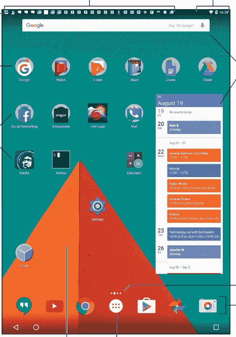

小部件

图 3-4：主屏幕。

主屏幕页索引

收藏栏

启动器  壁纸  应用程序图标

收藏栏：屏幕底部的图标列表包含用于常用启动器图标的槽位。收藏栏在每个主屏幕页的底部显示相同的图标。

应用程序图标：点击此图标可查看应用程序抽屉，它是你平板电脑上所有可用应用程序的集合。请参阅后文章节“在应用程序抽屉中查找应用”。

> 确保你认识主屏幕各个部分的名称。这些术语将贯穿全本书以及任何其他`Android`平板电脑文档。

> >> 主屏幕是完全可以自定义的。你可以从主屏幕上添加或删除启动器，添加小部件和插件和快捷方式，甚至可以更改壁纸（背景）图像。更多信息请参阅第 19 章。

- >> 触摸主屏幕上没有图标或控件的部分将没有任何反应。除非你正在使用动态壁纸功能。在这种情况下，触摸屏幕会根据所选壁纸的某种更改壁纸。你可以在第 19 章中阅读更多关于动态壁纸的知识。

- >> 你可能会看到附在主屏幕图标上的数字。这些数字表示待处理的操作，例如未读的电子邮件，通过侧边栏显示的图标进行指示。


# 访问多个主屏幕页

主屏幕不仅仅是你看到的内容。它实际上是一整套屏幕，每次只显示一个主屏幕面板。

要从一个面板切换到另一个面板，向左或向右滑动主屏幕。主屏幕页的左侧有页面，右侧也有。使用主屏幕页索引（参考图 3-4）确定你正在查看哪一个主屏幕页。

- >> 当你点击主导航图标时，你会回到上次查看的主屏幕页。要返回主主屏幕面板，再次点击主图标。

- >> 在某些平板电脑上，主主屏幕页由主屏幕页索引上的房屋图标显示。

- >> 可用主屏幕页的数量取决于平板电脑。有关添加或删除主屏幕页的信息，请参阅第 19 章。

- >> 某些平板电脑上最左侧的主屏幕页是`Google Now`应用。有关`Google Now`的信息，请参阅第 14 章。


# 查看通知

通知以图标的形式出现在主屏幕顶部，如之前图 3-4 所示。要查看或下拉通知抽屉，从屏幕顶部向下拖动手指。通知抽屉如图 3–5 所示。

向上或向下滑动通知列表以查看它们。要处理特定通知，点击它。接下来的发生的情况取决于通知或生成它的应用程序。通常，应用程序会运行并显示更多详情。

要忽略单个通知，向左或向右滑动。要清除所有通知，点击侧边栏显示的“清除通知”图标。你的平板电脑可能会显示“清除”按钮。如果“清除通知”图标不可见，请将通知抽屉一直滑动到顶部。

要隐藏通知抽屉，点击返回图标，向上滑动屏幕，点击主屏幕上的其他地方。

- - 如果你不处理通知，它们就会堆积起来！

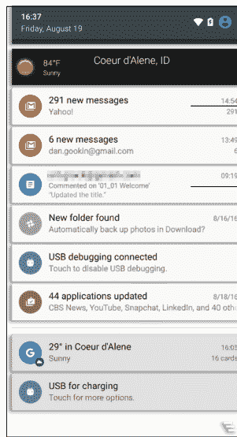

点击查看更多详情

向左或向右滑动以忽略

清除所有通知

图 3-5：

通知抽屉。

- - 当显示的通知多于显示范围时，“更多通知”图标将出现在状态栏的最左端，类似于侧边栏所示所示。

- - 忽略某些通知并防止它们在未来再次出现。例如，更新应用程序的通知会继续出现，日历提醒也是如此。

- - 正在进行的通知无法忽略。它们包括诸如`USB`（参考图 3-5）、蓝牙和`Wi-Fi`连接等项目。

- >> 某些应用程序（如`Facebook`和`Twitter`）在你未登录时不会显示通知。请参阅第 9 章。

- >> 每当新通知浮入时，你的`Android`平板电脑都会播放通知铃声。你可以选择播放哪种声音；更多信息请参阅第 19 章。

- >> 通知也可能出现在平板电脑的锁屏上。控制显示何种类型的通知将在第 20 章中介绍。

# 快速设置

`Android`平板电脑功能的许多常用设置位于快速设置抽屉中，它位于通知抽屉上方。使用快速设置访问常用的平板电脑功能或开启或关闭设置，例如蓝牙、`Wi-Fi`、飞行模式、自动旋转等。

要访问快速设置，从屏幕顶部向底部滑动两次。第一次你会看到导航抽屉；第二次你将看到快速设置，类似于图 3-6 所示。

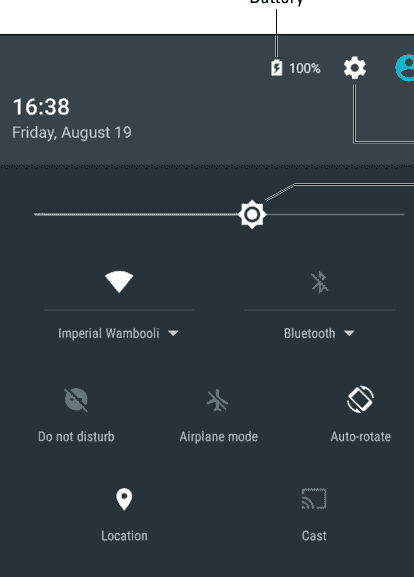

图 3-6：通知抽屉。

在通知抽屉上方显示快速设置。

查看所有快速设置

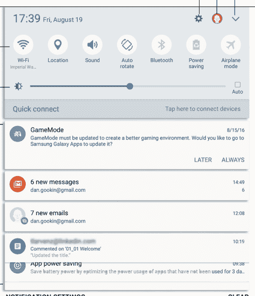

图 3-7：快速设置。

通知

连接 `Wi-Fi`

通知

清除

清除所有通知

# 应用的世界

在某些平板电脑上，主主屏幕页上方显示快速设置。这种显示方法类似于所示。

要查看所有应用，你必须访问应用程序抽屉：点击主屏幕上的应用程序图标。其外观取决于平板电脑。

# 在应用程序抽屉中查找应用

在你点击应用程序图标后，你会看到应用程序抽屉。在触摸屏上向左或向右滑动。

# 启动应用程序

要运行应用，点击其图标。应用程序将启动并接管屏幕并显示该应用程序的内容。

- 当你将应用添加到平板电脑时，它们出现在应用程序抽屉中。有关添加新应用，请参阅第 15 章。

- 应用程序抽屉可能将常用的应用位于顶部。这些应用是添加到主屏幕的候选对象。有关将应用添加到主屏幕的信息，请参阅第 18 章。

- 某些平板电脑允许你在应用程序抽屉中创建文件夹。这些文件夹包含多个应用，有助于保持整洁。要访问应用程序，点击文件夹图标。

# 退出应用程序

要运行应用，点击其图标。应用程序将启动并接管屏幕并显示该应用程序的内容。

要返回主主屏幕面板，再次点击主图标。

- 应用程序抽屉按字母顺序显示应用。在某些平板电脑上，你可以切换到非字母顺序的网格。在启用该功能时，你可以按照喜欢的顺序重新排列应用图标。


# 小部件

像应用一样，小部件出现在主屏幕上。要使用小部件，点击它。接下来的发生的情况取决于小部件及其执行的操作。

例如，`YouTube`小部件可以让你浏览视频。日历小部件显示你即将的日程。`Twitter`小部件可能会显示最近的推文。其他小部件可以有趣的事、显示有用信息或让你访问平板电脑的设置和功能。

新的小部件和小应用一样从`Google Play`获取。有关在主屏幕上使用小部件，请参阅第 18 章。

图 3-8：应用程序图标种类。


# 切换运行中的应用

你在平板电脑上运行的应用程序在从屏幕上移除时并不会关闭。在大多数情况下，它们会保持运行状态。若要在运行中的应用或你最近打开的任何应用之间切换，请点击“`Recent`”图标。你将看到概览（`Overview`）屏幕，类似于图 3-9 所示。

滑动列表查看所有应用。点击应用卡片切换到该应用。要退出概览，点击“返回”导航图标。

- 要从概览中移除应用，请将其滑出列表或点击`X`（关闭）图标，如图 3-9 所示。

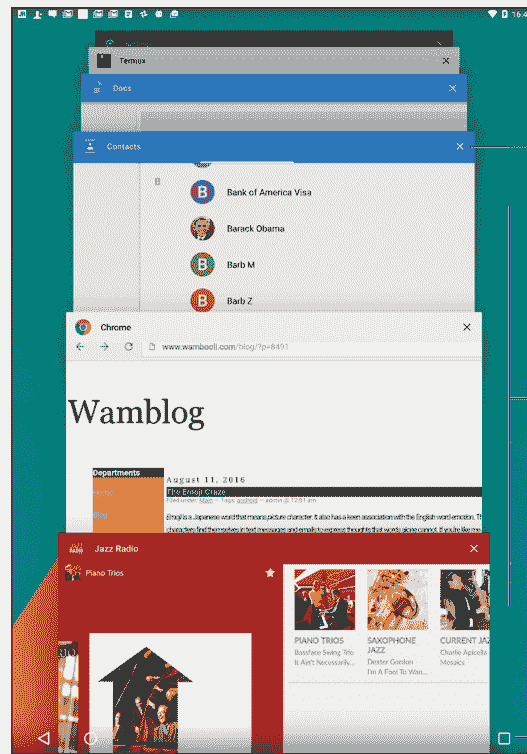

移除应用

最近应用

图 3-9：

概览显示了最近使用的应用。

最近图标

第 3 章 `Android`平板电脑工作原理 43

- 从概览中移除应用与退出应用基本相同。

- 对于缺少“`Recent`”图标的平板电脑，长按“`Home`”图标即可查看概览。

- `Android`操作系统可能会关闭一段时间未受到关注的应用。如果你发现概览中缺少某个应用，请不要感到惊讶。如果是这样，只需像往常一样启动它即可。


## Android 图标

除了导航图标外，在使用`Android`平板电脑时，还会出现各种其他图标。这些图标在应用以及`Android`操作系统中都具有常用功能。表 3–2 列出了最常见的图标及其功能。

表 3-2 常用图标

| 图标 | 名称 | 功能 |

| :--- | :--- | :--- |

| | 动作栏 (`Action Bar`) | 显示列表或菜单。这个微型图标出现在按钮或图像的右下角，表示附有操作（命令）。 |

| | 溢出菜单 (`Action Overflow`) | 显示操作列表，类似于菜单。 |

| | 添加 (`Add`) | 添加或创建项目。根据应用的不同，加号符号 (`+`) 可能与其他符号结合使用。 |

| | 关闭 (`Close`) | 移除卡片或清除输入字段中的文本。 |

| | 删除 (`Delete`) | 从列表中移除一个或多个项目，或删除消息。 |

| | 听写 (`Dictation`) | 激活语音输入。 |

| | 完成 (`Done`) | 退出动作栏或确认并保存编辑。 |

| 图标 | 名称 | 功能 |

| --- | --- | -- |

| ✎ | 编辑 (`Edit`) | 允许编辑项目、添加文本或填充字段。 |

| ☆ | 收藏 (`Favorite`) | 标记收藏项目，如联系人或网页。 |

| ↻ | 刷新 (`Refresh`) | 获取新信息或重新加载。 |

| 🔍 | 搜索 (`Search`) | 在屏幕、平板或互联网上搜索信息。 |

| ⚙ | 设置 (`Settings`) | 调整应用的选项。 |

| | 分享 (`Share`) | 通过特定应用（如`Gmail`或`Facebook`）共享信息。 |

| ≡ | 侧边菜单 (`Side Menu`) | 也称为汉堡菜单，点击可以查看大多数`Android`应用中可导航抽屉。 |

本书的各个章节都提供了在各种应用中使用这些图标的示例。它们的图片出现在书中相关的页边处。

- 各种应用的图标上还使用了其他常用符号。例如，标准的播放和暂停图标也被使用。

- 表 3-2 所示的分享图标有一个“邪恶双胎”。两个图标都代表分享操作。

- 三星平板电脑使用“更多”按钮来代替溢出菜单图标。事实上，在三星平板电脑上，你经常看到“`SAVE`”或“`CLEAR`”等文本按钮，而不是图标。

- 旧的三星平板电脑可能使用菜单图标来显示屏幕菜单。该图标的功能与表 3-2 所示的溢出菜单图标相同。该图标以按钮的形式出现在设备上。

- 页边显示了设置图标的另一种变体。它的用途与表 3-2 所示的齿轮图标相同，尽管这个较旧的设置图标正在被淘汰。

## 本章内容


- 使用屏幕软键盘
- 创建文本
- 输入特殊符号
- 使用语音输入听写文本
- 编辑文本
- 选择、剪切、复制和粘贴文本
- 检查拼写检查

# 第 4 章

# 创建和编辑文本

你的 Android 平板电脑没有键盘——至少没有实体键盘。为了满足平板电脑的文本输入需求，你使用一种被称为软键盘的东西。它的工作方式像实体键盘，但增加的烦恼是它没有物理按键。别担心！你可以为平板电脑添加一个实体键盘，甚至可以放弃打字和听写文本。

## 来看软键盘

每当需要文本输入时，软键盘就会在平板屏幕的下半部分出现。原生 Android 键盘（被称为 Google 键盘 Gboard）如图 4-1 所示。

无论键盘看起来什么样，所有的软键盘都基于传统的 QWERTY 布局：你使用 `A` 到 `Z` 的按键，尽管不是按这个顺序。你还会看到用于切换大小写的 `Shift` 键以及用于退格和删除的 `Delete` 键。你的平板电脑可能会显示更多按键（如 `Tab` 和 `Caps Lock`），也可能显示更少的按键。三星平板电脑使用图 4-2 所示的三星键盘。它的原理与 Google 键盘类似，但提供了其特殊功能，如图所示的 `Ctrl`（控制）键和光标。

第 4 章 创建和编辑文本 47

## 预测文本按键

删除

长按 7

听写

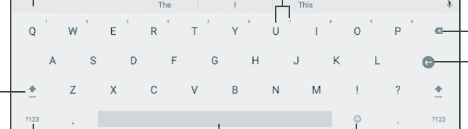

图 4-1：Google 键盘 `Shift` 数字键盘空格键

返回

表情键盘

预测文本按键

删除

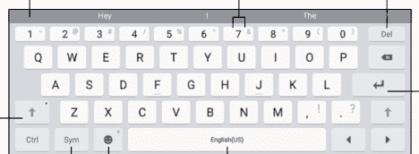

图 4-2：三星键盘 `Shift` 键盘

返回

返回键会根据你输入的内容改变外观。这些变化如图 4-3 所示。

图 4-3：Google 键盘返回键变体

以下是每个按键的功能：

软键盘底部中央的大按键是空格键。它两侧的其他按键根据你输入的内容的变化。例如，斜杠键或 `.com` 键可能会出现，以帮助输入网页或电子邮件地址。尽管这些和其他按键会变化，但基础字母键保持不变。

- 要显示软键盘，点击任何文本字段或屏幕上允许输入的地方。
- 如果你渴望实体键盘（至少是物理存在的键盘），你并没有办法。查看旁边的侧边栏“真实的键盘？”。
- 要隐藏软键盘，点击“返回”图标。它可能以隐藏图标的形式出现在页边。
- 三星键盘具有多功能键（参见图 4-2）。它的标签会变化，可能显示表情图标、设置图标或听写图标。长按多功能键查看其选项。

## 所有人都在触摸屏输入

在 21 世纪，打字已成为一项基本的人类活动。然而，在触摸屏键盘上打字仍然很奇怪。如果你是世界上打字最快的人，却只能在平板电脑屏幕上“盲打式”输入，不要感到难过。这是每个人都要面对的局限。你的 Android 平板电脑提供了一些技巧来让这种痛苦不那么难受。

## 逐个字符输入

屏幕键盘很容易理解：点击一个字母即可生成字符。在你打字时，你使用的按键会高亮显示。平板电脑可能会以轻微的点击声或振动形式提供一点反馈。

- 要输入大写字母，双击 `Shift` 键。`Shift` 键可能会显示高亮，`Shift` 符号可能会改变颜色，或者键上出现高亮标记，这表示大写锁定（`Shift Lock`）已开启。再次点击 `Shift` 键即可取消大写锁定。
- 最重要的是，在习惯屏幕键盘之前，尽量缓慢打字。
- 触摸屏上闪烁的光标显示新文本出现的位置，这与电脑上打字的方式类似。
- 当你出错时，点击 `Delete` 键进行退格并删除。
- 当你输入密码时，输入的字符会短暂显示，但出于安全考虑，它会被一个黑点代替。
- 请查看后文“文本编辑与修正”部分获取更多编辑文本的详细信息，以便修复那些无数拼写错误。


## 访问特殊字符

你不限于仅输入字母键盘上显示的字符。在 Google 键盘（`Gboard`）上，点击 `?123` 键访问两个额外的键盘布局，如图 4-4 所示。

要从数字键盘切换到符号键盘，点击 `{~<` 键。

点击 `1234` 进入数字输入面板。

点击 `😊` 键查看表情符号键盘。

点击 `ABC` 键返回字母键盘。

## 字母键盘

## 符号键盘

| 1 | 2 | 3 | 4 | 5 | 6 | 7 | 8 | 9 | 0 | ⌫ |
|---|---|---|---|---|---|---|---|---|---|---|
| @ | # | | | & | ( | + | | ) | ⌲ | | |
| | | | | | | / | * | | : | | ! | | | | |
| | | | | | | | | | | | | | |
| `ABC` | | | | | | | | | | | | | |

## 数字键盘

| ~ | | v | π | | x | = | | | ⌫ |
|---|---|---|---|---|---|---|---|---|---|
| £ | ¢ | € | W | A | * | | | } | | |
| `7123` | s | 2 | n | | @ | ⌫ | ] | > | | `7123` |
| `ABC` | | | | | | | | | |

## 符号符号

4 4-4:和符号键盘符号

## 数字输入键盘

## 表情符号键盘

## 数字键盘

在三星键盘上，点击 `Sym` 键访问符号。使用 `1/2` 和 `2/2` 键在两个符号键盘之间切换。

留意带有第二个字符的按键。参考图 4–1 和 4–2 查看屏幕键盘顶行的示例。秘诀是长按按键以访问第二个字符。

屏幕键盘上的其他按键也有特殊字符，尽管它们并不明显。再次长按按键查看可选字符弹出面板，类似于图 4-5 中 `A` 键所示的内容。

从弹出面板中选择字符。如果你选错了字符，点击屏幕键盘上的 `Delete` 键删除输入错误的符号。

## 使用预测文本快速打字

在你打字时，可能会在键盘上方看到一系列单词建议。这是平板电脑的预测文本功能。你可以利用它极大加快打字速度：在你打字时，点击屏幕键盘上的单词建议，该单词将插入文本中。

第 4 章 创建与编辑文本 51

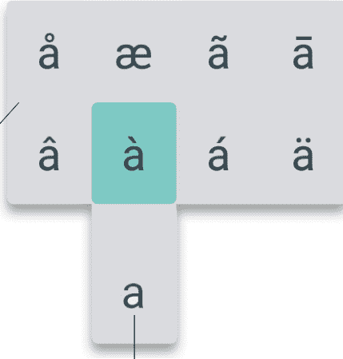

图 4-5:

特殊符号弹出面板。

按住并保持。

在字符上滑动手指进行选择。

如果没有出现所需的单词，请继续打字：预测文本功能根据你已输入的内容提供建议。

- 如果你看到加粗的预测文本，点击空格键插入该单词。并不是所有版本的屏幕键盘都支持此功能。
- 如果预测文本将你正确输入的单词替换为其他内容，点击 `Delete` 键。被替换的单词将恢复。
- 在某些版本的屏幕键盘上，你可以长按单词来查看相似词。
- 预测文本功能在输入密码或填写表单时不可用。
- 如果预测文本未激活，请参第 19 章了解激活方法。


## 不用手指打字

如果你真的追求速度，可以考虑手势输入。它允许你在不抬手指的情况下在字母上滑动。图 4-6 释了如何操作。


移动光标后，你可以继续输入、点击删除键进行退格和删除，或粘贴从其他处复制的文本。

- 你可能会看到光标标签上方出现“粘贴”命令按钮。使用此按钮粘贴文本，详见后文章节“剪切、复制和粘贴文本”。
- 三星键盘可能带有光标移动按键。你可以使用这些按键来移动光标，也可以使用手指按住屏幕移动的方法。

## 选择文本

在 Android 平板上选择文本就像在文字处理器中选择文本一样：你标记一个数据块的开始和结束位置。该文本块会在屏幕上高亮显示。然而，如何到达那里的操作一直是个谜团——直到现在！

要选择文本，请长按一个单词。成功后，你可以移动一段选中的文本块，如图 4–8 所示。

| 操作栏 | 操作溢出菜单 |
|---|---|
| 全选 | 剪切 | 复制 | 粘贴 | 插入链接 | ... |

> 噢，我在一个最秘密的地方藏了计划！

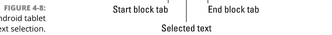

在触摸屏上移动开始和结束标记以定义选中的文本块。使用操作栏选择对文本进行的操作，如图 4–8 所示。点击操作溢出菜单查看更多命令。

要取消文本选择，请点击文本中的任意位置。

- 请查看下一节有关剪切和复制文本的信息。要删除选中的文本，点击屏幕键盘上的删除键。要替换文本，输入新内容。要将文本替换为之前剪切或复制的文本，请选择“粘贴”操作。
- >> 三星平板可能会显示带有图标的操作栏。操作栏可能出现在屏幕顶部。
- >> 操作栏上项目的种类取决于平板电脑的功能和已安装的应用程序。
- >> 在网页上选择文本与在任何其他应用中选择文本的方法相同。区别在于，文本只能从网页中复制，而不能剪切或删除。
- >> 看到屏幕键盘是你可以编辑和选择文本的良好指示。
- >> 操作栏的“全选”命令会将所有文本标记为一个单一块。


## 剪切、复制和粘贴文本

选中的文本已准备好进行剪切或复制，这与在你喜欢的文字处理器中的操作一样。选择文本后，从操作栏中选择合适的命令：“复制”复制文本或“剪切”剪切文本。

就像在电脑上一样，Android 平板上剪切或复制的文本存储在剪贴板上。要粘贴任何之前剪切或复制的文本，将光标移动到你想放置文本的位置。


要快速粘贴文本，点击光标标签，你可能会看到“粘贴”按钮出现，类似于边缘所示。点击该按钮粘贴文本。

- >> 某些平板电脑带有“剪贴板”应用，允许你浏览、查看和选择之前剪切或复制的文本或图像。你甚至可以在操作栏或屏幕键盘上找到“剪贴板”按钮。
- >> 你只能将文本粘贴到启用了文本的地方。如果你使用屏幕键盘，很有可能粘贴文本。


## 处理拼写错误

对于文字处理器来说，你的 Android 平板可能会突出显示拼写错误的单词。一个明显的红色下划线出现在可疑单词下方。

要解决这个问题，点击带下划线的单词。从显示的列表中选择替换词。如果单词拼写正确但 Android 平板未知，选择将其添加到个人字典。

- 单词在你输入时可能会自动纠正。要取消自动纠正，再次点击单词。从预测列表中选择单词。
- 是！你的平板电脑有个人字典。详情请见第 23 章。

# 2 联系

## 本部分 . . .

- 组织联系录中的联系人。
- 发送和接收电子邮件。
- 浏览网页。
- 使用 `Hangouts` 和 `Skype` 进行视频聊天。
- 通过社交应用程序分享你的生活。

## 本章

- 探索平板电脑的联系录
- 搜索和排序联系人
- 创建新联系人
- 导入人
- 编辑联系人
- 为联系人添加照片
- 删除联系人

## 第 5 章 你所有的朋友

为了最好利用你的平板电脑作为通信工具，你需要跟踪人们。不，这不是监视。这只是为了方便获取人的电子邮件地址、物理地址、网站、社交网络信息和电话——这非常有用。

### 平板的联系录

- >> 联系录应用名为“联系人”或“人员”。为了一致，本章称为“联系人”。
- 当你安装社交应用程序时，平板显示为“联系人”。

### 使用联系录

要查看 Android 平板的联系录，打开“联系人”应用。联系人应用按字母顺序显示所有联系人。图 5–1 展示了默认的联系人应用。在图 5–2 中，你看到了三星平板上的联系人应用。

| 收藏标签 | 编辑联系人 |
|---|---|
| 索引 | 收藏 |

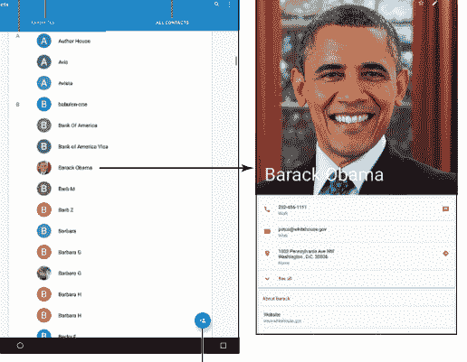

FIGURE 5-1:

默认的

联系人应用。

滑动手指滚动列表。使用索引（参考图 5-1 和 5-2）快速滚动到列表的特定部分。

对联系人可以执行的操作取决于显示的信息以及平板电脑上安装的应用程序。以下是一些常见操作：

| 索引 | 联系人应用操作 | 个人联系人的操作 |
|---|---|---|
| `Babylon-one` | | |
| `Bank Of America` | | |
| `Barack Obama` | | |
| `Barb M` | | |
| `Barb Z` | | |
| `Barack G` | | |
| `Barack H` | | |

FIGURE 5-2:

Galaxy

Tab S2

联系人应用。

联系人中显示的某些简要信息并没有关联的操作。例如，每当你点击联系人的生日信息时，平板电脑并唱《生日快乐》。

- 某些地址录会将联系人信息与联系人索引并排显示。如图 5-1 所示，联系信息显示在卡片上。要关闭卡片，请点击“返回”导航图标。
- 并非每个联系人都有照片，且照片可以来自多个来源（例如 `Gmail` 或 `Facebook`）。更多信息请参见后文章节“添加联系人照片”。
- 另请参见后文章节“合并相同联系人”，了解如何处理同一名人的重复条目。

## 排序通讯录

平板电脑的通讯录按特定顺序显示联系人。通常，该顺序是按名字字母顺序排序。如果你对现有安排不满意，可以进行更改。在使用联系人应用时请遵循以下步骤：

1. 点击“操作溢出”并选择“设置”。
   在联系人应用中，点击“分组”旁边的“更多”按钮，然后选择“设置”。
2. 选择“排序方式”。
3. 根据你想要的排序方式，选择“姓”或“名”。
4. 选择“姓名格式”。
5. 选择“名在前”或“姓在前”。

此命令指定了联系人在列表中的显示方式：名在前或姓在前。


> 记住：联系人应用通常按名字对条目进行排序，并以名字在前的方式列出。

## 搜索联系人

联系人应用没有提供所有联系人的总数。要么你的朋友非常少，要么你欠了很多人钱。如果是后者，你可以选择无限滚动联系人列表，或使用强大的“搜索”命令来快速找到联系人：

1. 点击“搜索”图标。
   在三星平板电脑版本的联系人应用中，点击如图 5-2 所示的搜索字段。
2. 开始输入联系人姓名。
   当你输入时，会出现一个匹配的联系人列表。列表会缩小范围。
3. 一旦看到匹配的人，点击该条目。

要清除搜索，点击搜索文本框右侧的 `X`。要退出搜索屏幕，点击“返回”导航图标。


不，你拥有的联系人数量与你在现实生活中受欢迎程度之间没有关联。

## 更多的朋友

有朋友很好。更多朋友更好。将所有这些朋友作为联系人应用中的条目是最好的。

## 从头创建联系人

有时当你实际上在现实世界遇到另一个人类时，有必要创建一个联系人。或者，也许你终于开始从旧笔记本中将信息传输到平板电脑。例如，你有要输入的信息，开始如下：

1. 点击联系人应用中的“添加联系人”图标。
   参考图 5-1 和图 5-2 查看图标样式，尽管不同的地址应用使用的图标略有不同。
2. 选择一个与联系人关联账户。
   我建议使用你的 Google 账户，但如果你倾向于其他账户（如 `Yahoo!`），请选择它。
   我建议使用你的 Google 账户。这样，联系人就会与互联网以及你拥有的任何其他 Android 设备同步。


不要选择“设备”账户。当你这样做时，联系信息将仅保存在你的 Android 平板电脑上。它不会与互联网或其他 Android 设备同步。

3. 尽可能地填写联系人信息。
   在各种框中输入你已知的信息文本。提供的信息越多越好。
   点击右侧的扬箭头或操作栏来设置更多详细信息，例如电话号码是手机、家庭、工作等。
   要添加第二个电话号码、电子邮件或位置，点击“新增”按钮，该按钮可能像一个加号图标。
   在“添加新联系人”屏幕的底部，你会找到“更多字段”或“其他字段”。当你可以为联系人添加更多详细信息（如生日或网站地址）时使用该按钮。
4. 点击“完成”图标或“保存”按钮完成编辑并添加新联系人。

如果你遵循了我在第 2 步的建议，新联系人将自动与你的 Google 账户同步。这就是 Android 操作系统的优点之一：你不需要重复劳动；你在平板电脑上创建的联系人会立即更新到互联网上的 Google 账户中。

## 从电子邮件消息创建联系人

建立平板电脑通讯录简单的方法之一是从电子邮件消息创建联系人。当你收到来自一个不在你 Android 平板电脑通讯录的人的消息时，或者当你收到一个在通讯录中但可能未输入电子邮件地址的人的邮件时，遵循以下通用步骤：

1. 查看邮件消息。
   你无法从收件箱直接添加联系人；点击消息查看其内容。
   参考图 5-1 和图 5-2 查看图标样式，尽管不同的地址应用使用的图标略有不同。
2. 选择一个与联系人关联账户。
   我建议使用你的 Google 账户，但如果你倾向于其他账户（如 `Yahoo!`），请选择它。
   我建议使用你的 Google 账户。这样，联系人就会与互联网以及你拥有的任何其他 Android 设备同步。
3. 一旦看到匹配的人，点击该条目。
   要清除搜索，点击搜索文本框右侧的 `X`。要退出搜索屏幕，点击“返回”导航图标。

*注：原文此处后续步骤与“搜索联系人”章节内容重复，以下为保留原文逻辑的整理：*

1. 点击“搜索”图标。
   在三星平板电脑版本的联系人应用中，点击如图 5-2 所示的搜索字段。
2. 开始输入联系人姓名。
   当你输入时，会出现一个匹配的联系人列表。列表会缩小范围。
3. 一旦看到匹配的人，点击该条目。
   要清除搜索，点击搜索文本框右侧的 `X`。要退出搜索屏幕，点击“返回”导航图标。


不，你拥有的联系人数量与你在现实生活中受欢迎程度之间没有关联。

## 更多的朋友

有朋友很好。更多朋友更好。将所有这些朋友作为联系人应用中的条目是最好的。

## 从头创建联系人


有时当你实际上在现实世界遇到另一个人类时，有必要创建一个联系人。或者，也许你终于开始从旧笔记本中将信息传输到平板电脑。例如，你有要输入的信息，开始如下：

1. 点击联系人应用中的“添加联系人”图标。

参考图 5-1 和图 5-2 查看图标样式，尽管不同的地址应用使用的图标略有不同。

2. 选择一个与联系人关联账户。

我建议使用你的 `Google` 账户，但如果你倾向于其他账户（如 `Yahoo!`），请选择它。

我建议选择你的 `Google` 账户。这样，联系人就会与互联网以及你拥有的任何其他 `Android` 设备同步。


不要选择“设备”账户。当你这样做时，联系信息将仅保存在你的 `Android` 平板电脑上。它不会与互联网或其他 `Android` 设备同步。

3. 尽可能地填写联系人信息。

在各种框中输入你已知的信息文本。提供的信息越多越好。

点击右侧的扬箭头或操作栏来设置更多详细信息，例如电话号码是手机、家庭、工作等。

要添加第二个电话号码、电子邮件或位置，点击“新增”按钮，该按钮可能像一个加号图标。

在“添加新联系人”屏幕的底部，你会找到“更多字段”或“其他字段”。当你可以为联系人添加更多详细信息（如生日或网站地址）时使用该按钮。

4. 点击“完成”图标或“保存”按钮完成编辑并添加新联系人。

如果你遵循了我在第 2 步的建议，新联系人将自动与你的 `Google` 账户同步。这就是 `Android` 操作系统的优点之一：你不需要重复劳动；你在平板电脑上创建的联系人会立即更新到互联网上的 `Google` 账户中。

# 从电子邮件消息创建联系人

建立平板电脑通讯录简单的方法之一是从电子邮件消息创建联系人。当你收到来自一个不在你 `Android` 平板电脑通讯录的人的消息时，或者当你收到一个在通讯录中但可能未输入电子邮件地址的人的邮件时，遵循以下通用步骤：

1. 查看邮件消息。

你无法从收件箱直接添加添加人；点击消息查看其内容。

参考图 5-1 和图 5-2 查看图标样式，尽管不同的地址应用使用的图标略有不同。

2. 选择一个与联系人关联账户。

我建议使用你的 `Google` 账户，但如果你倾向于其他账户（如 `Yahoo!`），请选择它。

我建议选择你的 `Google` 账户。这样，联系人就会与互联网以及你拥有的任何其他 `Android` 设备同步。

3. 一旦看到匹配的人，点击该条目。

要清除搜索，点击搜索文本框右侧的 `X`。要退出搜索屏幕，点击“返回”导航图标。

我想你也可以使用漂亮的图片，但那样有什么好玩的呢？

要使用平板电脑的相机拍摄联系人的照片，请遵循以下说明：

1. 找到并显示联系人信息。
2. 点击“编辑”（`Edit`）图标或“编辑”按钮。
3. 点击联系人照片或照片占位符。
4. 选择“拍摄”（`Take Photo`）。
5. 使用平板电脑相机拍摄照片。

第 11 章介绍了如何使用“相机”应用。前、后摄像头均可以使用（但不能同时使用）。点击快门图标进行拍照。

6. 检查照片。
7. 点击“完成”（`DONE`）图标确认新图像并为裁剪做准备。
8. 裁剪图像。

此时尚未进行设置。如果你想再次尝试，点击“重试”（`Retry`）图标，类似于侧边栏所示。重复步骤 5。

调整框，使其仅包围你想保留的图像部分。请参阅第 12 章，该章节专门介绍了如何使用裁剪工具。

9. 点击“完成”（`DONE`）按钮裁剪图像。
10. 点击“保存”（`SAVE`）按钮保存图像。

每你在平板电脑上引用该联系人，你拍摄的照片（参考步骤 4）就会出现。

你也可以使用存储平板电脑上的任何图像作为联系人照片。在步骤 4 中，选择“选择新照片”（`Select New Photo`）操作查看存储在平板电脑上或可用的图像。浏览并选择图像，然后进行裁剪。

## 创建收藏

收藏联系人是你联系得最频繁的人。这个人并不一定是你喜欢的人——只是一个你（可能不幸地）经常联系的人，例如你的博彩经理。

要将联系人设为收藏，显示联系人信息，并点击联系人照片旁的“收藏”（星形）图标，如图 5–1 所示。当星号被填充时，该联系人即为你的收藏之一，并存储在“收藏”组中。

要移除收藏，再次点击联系人的星号，它将失去高亮。

收藏联系人都位于“联系人”应用中的“收藏”标签页中。点击该标签页查看全部。（参考图 5–1）。

- 移除收藏不会删除联系人，而是将其从“收藏”组中移除。
- 顺便说一下，联系人并不知道是否在你的收藏列表中，所以不要认为不将他们设为收藏会伤害他们的感情。

## 合并相同联系人

你的平板电脑从多个源（如 `Gmail`、`Facebook` 和 `Skype`）获取联系人。由于由于，你可能会在平板电脑的通讯录中发现重复的联系人条目。与其纠结使用哪个条目，不如合并联系人。方法如下：

1. 快速滚动直到找到重复项。

嗯，可能不需要快速滚动，只需找到重复条目。通讯录是经过排序的，重复项通常靠得很近。

2. 编辑其中一个重复联系人。

显示联系人详情，然后点击“编辑”（`Edit`）图标。

在三星平板电脑的“联系人”应用中，点击联系人的“更多”（`MORE`）图标并选择“链接联系人”（`Link Contacts`）。跳到步骤 4。

3. 点击“操作更多”（`Action Overflow`）并选择“合并”（`Merge`）。

在某些平板电脑上，该操作可能显示为“合并”或“链接”。

选择操作后，你会看到一个平板电脑认为可能相同的联系人列表。你还会看到整个联系人列表，以防猜测错误。你的任务是找到重复联系人。

4. 在列表中选择匹配的联系人以合并这两个联系人。

如有必要，点击“链接”（`LINK`）按钮完成操作。

联系人已合并，在通讯录中显示为单个条目。

5. 如果发现额外的重复联系人，重复步骤 3 到 4。

6. 点击“完成”（`Done`）图标保存合并后的联系人。

合并后的联系人会在通讯录中不会被标记，但你可以轻松识别它们：在查看联系人信息时，合并的联系人显示为单个长条目，列出了提取联系人信息的多个源或账户。


## 分离联系人

分离联系人的话题与教养关系并不大，尽管吵闹的孩子是避免争吵的第一步。通讯录中的联系人可能没有争吵，但平板电脑偶尔会自动合并两个并不是同一个人的联系人。发生这种情况时，你可以执行以下步骤：

1. 编辑合并不当的联系人。

例如，我有一个叫 `Dan Gookin` 的 `Facebook` 朋友。我的平板电脑意外地将我的通讯录条目与另一个 `Dan Gookin` 合并了一起。

2. 点击“操作更多”（`Action Overflow`）并选择“分离”（`Separate`）。

该操作也可能被称为“分离联系人”（`Separate Contacts`）。

3. 点击“确定”（`OK`）按钮确认你正在分离联系人。

你不需要主动寻找合并不当的联系人，通常会偶然发现。当你发现它们时，请尽管分离它们，特别是当你检测到任何争吵倾向时。

## 删除联系人

偶尔考虑回顾一下你平板电脑的通讯录。清理那些你不再认识或已经忘记的人。这很简单：

1. 编辑遗忘的联系人。

2. 点击“操作更多”（`Action Overflow`）并选择“删除”（`Delete`）。

如果你没有看到“删除”选项，说明联系人是从其他源（如 `Facebook`）引入的。你需要使用该应用来解除联系人的关联。

3. 点击“确定”（`OK`）或“删除”（`DELETE`）按钮确认。

砰！他们消失了。


在某些平板电脑上，你可能会直接在联系人的详情卡上找到“删除”图标（侧边栏所示）。点击该图标将其移除，然后点击“确定”（`OK`）按钮删除联系人。


- 因为联系人列表与你的 `Google` 账户同步，该联系人也会在那里——以及其他 `Android` 设备上被移除。
- 删除联系人不会导致现实中的人物消失。

**警告**

# 本章内容

- 在你的平板电脑上配置电子邮件
- 接收电子邮件
- 阅读、回复和转发电子邮件
- 编写新邮件
- 处理邮件附件
- 更改你的邮件签名

# 第 6 章

# 你的电子邮件

困惑？不要担心。好消息是，无论平板电脑自带什么应用，`Gmail` 和邮件应用的工作方式都是一样的。

- `Gmail` 和邮件应用都位于应用程序抽中。你也可以在主屏幕上找到快捷方式。如果没有找到，请在 `Google` 文件夹中查找。
- `Gmail` 应用更新频繁。要查看本书出版后的任何更改，请访问我的页面 `wambooli.com/help`
- 虽然你可以使用平板电脑浏览器访问 `Gmail` 网站，但你应该使用 `Gmail` 应用来获取邮件。同样，你可以使用网页查看其他邮件，但建议使用邮件（或 `Gmail`）应用。
- 如果你忘记了 `Gmail` 密码，请访问此地址：`gmail.com/accounts/ForgotPassword`


# 设置第一个电子邮件账户

手机上的第一个电子邮件账户是你的 `Gmail` 账户，这是使用 `Android` 设备所需的。之后，你可以按照后文“添加电子邮件账户”的说明添加账户。

如果你的平板电脑带有邮件应用，设置第一个电子邮件账户的方法与添加额外的不同。你需要知道账户的登录信息（你的电子邮件地址）和密码。当你准备好信息后，在邮件应用中执行以下步骤配置你的第一个账户：

1. 启动邮件应用。

在应用程序抽中查找它。如果没有，请按照下一节所述使用 `Gmail` 应用。

你看到的第一个屏幕是“设置账户”（`Set Up Account`）或“设置电子邮件”（`Set Up Email`）。如果你已经运行过邮件应用，将进入邮件收件箱，你可以跳过这些步骤。有关添加账户的信息请见下一节。

2. 输入用于账户的电子邮件地址。

例如，如果你有一个 `Comcast` 电子邮件账户，请使用屏幕键盘在电子邮件地址框中输入你的 `me@comcast.net` 电子邮件地址。

在屏幕键盘上寻找 `.com` (点-com) 键，你可以用它更高效地输入你的电子邮件地址。

3. 输入账户密码。

4. 如果可用，设置默认账户选项。

默认账户是发送电子邮件的账户。请参阅后文章节“设置主账户”。

5. 点击“登录”按钮。

如果你足够幸运，一切都已连接成功，你就完成了。否则，你必须根据互联网服务提供商（`ISP`）提供的信息指定详情。请参阅后文章节“手动添加账户”。

配置好账户后，消息将立即同步到平板电脑。你可以在收件箱中找到消息。请参阅后文章节“消息！下一步该做什么”。

- 要配置你的电子邮件账户，请参阅后文章节“设置电子邮件选项”。
- 如果你使用 `Yahoo! Mail`，请下载 `Yahoo! Mail` 应用，它处理你的 `Yahoo!` 邮件比比电子邮件应用（或 `Gmail` 应用）好得多。`Yahoo! Mail` 应用让你能够访问可能使用并喜爱的其他 `Yahoo!` 功能。

## 添加电子邮件帐户

电子邮件应用以及最新版本的 `Gmail` 都可以配置为从多个源获取电子邮件。此功能允许你在平板电脑上收集所有电子邮件，而无需多个应用程序。这样，你所有的 `Windows Live`、`Cox Cable` 和 `Yahoo!` 消息都可以进入一个地方。

电子邮件和 `Gmail` 应用都提供了添加新电子邮件帐户的不同方法。更通用的方法是使用“设置”应用。请遵循以下说明：

1. 打开“设置”应用。

它位于应用程序抽屉中；点击主屏幕上的应用程序图标查看应用程序抽屉。

2. 选择“账户”。

3. 点击“添加账户”。

添加电子邮件帐户的三个选项是：

- 个人 (IMAP)：适用于网页版电子邮件账户，例如 `Microsoft Live`
- 个人 (POP3)：适用于传统的 `ISP` 电子邮件账户，例如 `Comcast`
- Exchange 或 `Microsoft Exchange ActiveSync`：适用于由 Exchange 服务器托管的企业电子邮件账户（`Outlook` 邮件）

有关 Exchange 选项的信息，请参阅后文章节“添加企业级电子邮件账户”。其他选项的操作也基本相同。事实上，在某些平板电脑上，单个选项（电子邮件）可能会同时取代两者。

4. 选择正确的个人电子邮件账户类型。

5. 输入你的电子邮件地址并点击“下一步”按钮。

6. 继续完成电子邮件设置，按照提示提供你的密码和其他账户信息。

大多数预设设置都是妥的。当被要求提供账户名称时，你可以选择你的账户名称以外的其他名称，例如将你的主 `ISP` 电子邮件账户命名为“主”。

新电子邮件账户在添加后会立即同步，你会看到收件箱。请参阅后文章节“检查收件箱”。

如果添加电子邮件账户没有按你的预期运行，请查看下一节。

某些 `Android` 平板电脑可能会将新电子邮件帐户添加到电子邮件应用，但其他设备可能会将账户添加到 `Gmail`。唯一的判断方法是同时打开两个应用并查看内部是否有该账户的邮件。


## 手动添加账户

如果你的电子邮件账户未识别，或者发生了其他错误，你就必须手动添加账户。前面章节中的步骤保持相同，但你需要提供更具体、更技术性的细节。这些信息包括服务器名称、端口地址、域名和其他不便的详细信息。

我的建议是联系你的 `ISP` 或电子邮件提供商：在他们的网站上查找将 `Android` 平板电脑连接到其电子邮件账户的具体说明。如果你找不到特定信息，请直接联系他们。

好消息是，如今手动设置非常罕见。大多数 `ISP` 和网页邮箱账户都可以像本章其他地方描述的那样无痛地添加。

## 添加企业级电子邮件账户

在平板电脑上设置你那邪恶公司电子邮箱最简单的方法是让 `IT` 人员为你完成。或者你可能很幸运，在组织的内网上找到指南。我提供这个提示是因为配置企业级电子邮件（也称为 Exchange 服务邮件）可能是一场困难且可怕的折磨。

自己添加账户是可能的，但你仍然需要详细信息。具体来说，你需要知道域名，该域名可能与公司的网站域名不同。可能还需要其他细节。

最重要的是，你必须为平板电脑应用安全的屏幕锁，以便访问 `Outlook` 邮件。这意味着你需要为设备添加 PIN 码或密码，这在第 20 章中有所介绍。如果没有增加安全级别，你就无法访问 Exchange 服务器。

还有更多！

你还需要授予“远程安全管理”权限。这意味着你组织的 `IT` 大师将有权远程删除你 `Android` 平板电脑上的所有信息。你必须激活此功能，它是设置过程的一部分。

额外的好处是你已经完成了，你将完全访问 Exchange 服务器信息。这包括你的电子邮件消息，以及企业通讯录和日历。有关平板电脑通讯录应用的信息请参阅第 5 章；日历应用涵盖在第 14 章。

## 消息！

新邮件会自动进入你的平板电脑，根据 `Gmail` 和电子邮件应用的同步计划进行抓取。在较新的平板电脑上，使用 `Gmail` 应用读取你的所有邮件。否则，使用 `Gmail` 应用读取非 `Gmail` 邮件。

## 获取新消息

新封电子邮件信件的到来由通知图标预示。每封邮件都会生成自己的版本。

对于新的 `Gmail` 消息，屏幕顶部会出现“新 `Gmail`”通知，如边边所示。

对于新的电子邮件消息，你会看到“新邮件”通知。

对于来自 Exchange 服务器的邮件，你可能会看到“新 Exchange”通知。

拉出通知抽屉查看邮件通知。点击通知即可进入邮箱阅读。

## 检查收件箱

要查看你的 `Gmail`，请启动 `Gmail` 应用。收件箱如图 6–1 所示。

账户 菜单 创建新消息

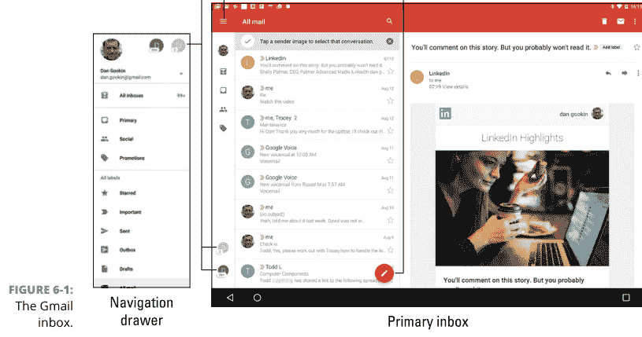

图 6–1：导航抽屉 `Gmail` 收件箱

要选择非 `Gmail` 账户，点击导航抽屉上的账户图标。（参考图 6–1。）你一次只能查看一个账户的收件箱。

如果你的平板电脑使用电子邮件应用，打开它查看收件箱。你可以查看单个账户的收件箱，也可以选择查看如图 6-2 所示的通用收件箱。

- `Gmail` 不会显示在电子邮件应用中。使用 `Gmail` 应用读取你的谷歌邮件。
- `Gmail` 应用缺少通用收件箱。查看特定收件箱，点击导航抽屉上的账户气泡，如图 6–1 所示。

## 操作栏

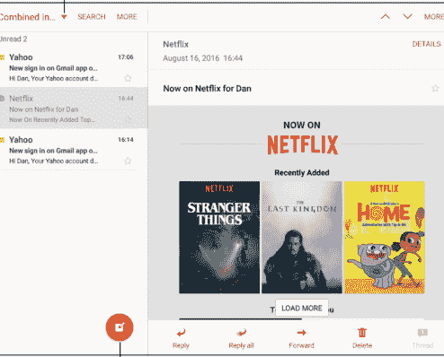

图 6-2：电子邮件应用中的消息。

## 创建新消息

- 电子邮件应用中收集多个电子邮件帐户都有颜色区分。当你查看通用收件箱时，每条消息左侧都会看到颜色代码——只要有多个账户的消息。
- 要要在电子邮件应用中查看单个账户的收件箱，从操作栏中选择账户，如图 6-2 所示。

## 阅读电子邮件

要查看特定的电子邮件消息，点击收件箱中的条目，如前文图 6-1 和 6-2 所示。或者你可以选择新的邮件通知。无论使用 `Gmail` 还是电子邮件应用，阅读和处理消息的操作都非常相似：

- 要阅读消息，用手指向上或向下滑动。
- 左右滑动可以在消息之间切换。
- 如果看不到收件箱，点击屏幕左上角的左箭头或折线号。

要处理消息，请使用出现在消息上方或下方的图标。这些图标与侧边栏显示的可能不完全相同，但它们涵盖了常见的电子邮件操作：

- 回复：点击此图标回复消息。将弹出一个新消息窗口，其“收件人”和“主题”字段将反映原始发件人（们）和主题。
- 回复所有人：点击此图标回复接收原始消息的所有人员，包括抄送（`Cc`）行中的人员。只有当每个人都必须收到你的回复副本时，才使用此选项。
- 转发：点击此图标将消息副本发送给其他人。
- 删除：点击此图标删除消息。

如果你没有看到所有这些图标，请在消息的“操作溢出”（`Action Overflow`）菜单中查找。你也可以尝试将平板电脑旋转至水平方向。

## 撰写新邮件消息

我经常使用我的 `Android` 平板电脑检查电子邮件，但不经常用它来撰写消息。那是因为大多数电子邮件并不要求立即回复。当需要时，你会发现 `Gmail` 和 `Email` 应用都能胜任这项任务。

## 从头开始编写消息


# 电子邮件应用基础

在 `Gmail` 和 `Email` 应用中，创建新的邮件回复的操作方式类似。关键在于找到“撰写”（`Compose`）图标。该图标如图 6–1 和 6–2 所示。

点击“撰写”图标后，你会看到一个新的消息卡片。你的任务是填写空白处，添加收件人、主题和消息正文。图 6–3 展示了新消息卡片的可能样式。如果你在电脑上写过邮件，这些功能对你来说应该很熟悉。

要发送消息，点击侧边栏显示的“发送”图标，或点击 `SEND`（发送）按钮。

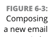

- 要选择发送所需的电子邮件帐户，点击新消息卡片顶部名称旁边的 `V` 形箭头或向下箭头（如图 6-3 所示）。否则，将使用主或默认电子邮件帐户。请参后文章节“设置主帐户”。
- 你只需要输入收件人姓名的几个字母。系统将从表格地址录中立即提取匹配的联系人并显示列表中。点击联系人即可自动填充“收件人”字段。
- 如果你看不到 `Cc` 和 `Bcc` 字段，点击图 6-3 所示的 `V` 形箭头以显示这些字段。你也可以点击“操作溢出”或 `MORE`（更多）按钮来选择“添加 `Cc`/`Bcc`”命令。
- 要取消消息，点击“操作溢出”或 `MORE` 按钮并选择 `Dis`（丢弃）。此操作也可能出现在撰写屏幕上。点击 `OK`（确定）或 `DISCARD`（丢弃）按钮确认。
- 通过从“操作溢出”中选择“保存草稿”操作来保存消息。消息将保存在草稿文件夹中。你可以在那里打开它们进行编辑或发送。
- 某些版本的 `Email` 应用具有格式化工具栏。使用该工具栏更改消息中文字的外。

## 向联系人发送电子邮件

撰写新消息的一种快速方便的方法是找到联系人，然后使用联系人的信息创建消息。请遵循以下步骤：

1. 打开平板电脑的通讯录应用。
2. 找到你想发送电子消息的联系人。
3. 点击联系人的电子邮件地址。
4. 选择 `Gmail` 来撰写消息。

关于通讯录应用的详情请参考第 5 章。

你也可以选择 `Email` 应用或其他特定应用，例如 `Yahoo! Mail` 或你从 `Google Play` 获取的自定义电子邮件应用。

此时，创建消息的操作如前一节所示。

## 消息附件


理解 `Android` 平板电脑上电子邮件附件的关键是寻找“回形针”图标。当你找到该图标时，可以处理传入邮件的附件，也可以向发出的邮件中添加附件。

### 接收附件

附件在 `Gmail` 和 `Email` 应用中的呈现方式不同，但你的目标都是：查看或保存附件。有时你可以两者兼得！

图 6–4 显示了 `Gmail` 和 `Email` 应用展示电子邮件附件的方法。要处理附件，请点击它。在大多数情况下，附件会在你的平板电脑上打开相应的应用程序。例如，`PDF` 附件可能由 `QuickOffice` 应用打开。

你可以对附件可以执行的潜在操作包括：

- 预览：打开附件进行查看。
- 保存到 `Google Drive`：将附件副本发送到你的 `Google Drive`（云）存储。
- 保存：将附件保存到平板电脑的存储中。
- 重新下载：从邮件服务器获取附件。


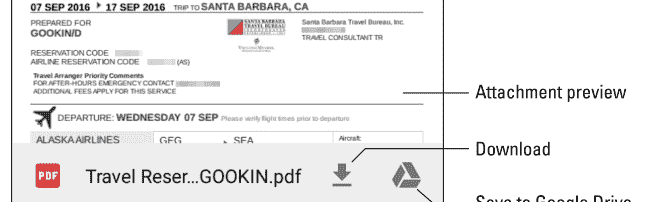

图 6-4：附件方法与困惑。

`Survey.docx`

`15 KB (100%)`

### 电子邮件附件

如果在电脑上接收邮件附件，你可能遇到的问题是平板电脑缺少处理附件所需的应用程序。当找不到应用时，你必须在未提及列表中搜索，或者回复消息并引导对方以常用格式重新发送附件。

- 有时，邮件消息中包含的不会显示。点击 `SHOW PICTURES`（显示图片）按钮查看图像。

常见的图像文件格式包括 `PNG` 和 `JPEG`。文档使用 `HTML`（网页）、`DOCX`（`Microsoft Word`）和 `PDF`（`Adobe Acrobat`）文件格式共享。

- 当有多个应用可以处理附件时，你会看到提示。选择一个并点击 `JUST THIS ONCE`（仅此一次）查看附件。关于默认应用提示的信息，请另参阅第 18 章。
- 附件保存在平板电脑内部存储或可移动存储（`microSD` 卡）的 `Downloads`（下载）文件夹中。关于 `Android` 平板电脑存储（包括如何查看下载的文件），请参阅第 17 章。


### 分享附件

在 `Android` 平板电脑上发送邮件附件时，不要考虑方法。相反附件：平板上的哪个应用创建了该附件？

第 6 章 你拥有电子邮件 81

当你知道这一点后，就可以按照以下步骤发送电子邮件附件了：

1. 打开创建你想要附加的项目的应用。

常用的共享应用有 `Photos`（照片）、`Gallery`（相廊）、网络浏览器应用、`Maps`（地图）、`Play Store`、`Drive` 或任何云存储应用等。

2. 查看你想共享的项目。
3. 点击 `Share`（分享）图标。

你会看到应用列表。

4. 选择 `Gmail` 或 `Email` 应用。
5. 按照本章前面介绍的方法完成消息。

你共享的项目会自动附加到消息中，或以链接形式包含。


共享项目是 `Android` 平板电脑将内容附加到邮件消息的方法。你可能更熟悉电脑的方法，即先撰写消息再附加。你也可以这样做：在新消息上，点击 `Attachment`（附件/回形针）图标（类似于侧边栏所示）或点击 `ATTACH`（附加）按钮。选择一个应用或类别，然后选择要共享的项目。

> 你可以附加的项目种类取决于平板电脑上安装了哪些应用。

## 电子邮件配置

你可以通过确认和自定义 `Android` 平板电脑上的电子邮件体验获得乐趣或浪费时间。你可以做的最有趣的事情是自定义帐户、修改或创建电子邮件签名，以及分配默认电子邮件帐户。


### 设置电子邮件帐户选项

设置电子邮件帐户选项，请遵循这些可能令人困惑的步骤：

1. 打开 `Settings`（设置）应用。

可以在应用抽屉找到该应用。

2. 选择 `Accounts`（帐户）。
3. 点击电子邮件帐户项目。

它的标题可能是 `Personal (IMAP)` 或 `Email` —— 这并不重要。（这是令人困惑的部分。）

4. 选择 `Account Settings`（帐户设置）。

现在你看到了平板电脑电子邮件帐户列表，以及一个 `General Settings`（常规设置）项目。这是你可以修改常规行为或更改特定帐户方面的屏幕。

例如，要修改特定帐户的设置，在执行这些步骤后选择该帐户。你可以将帐户名称设置为电子邮件地址以外的内容、设置姓名、选择签名（下一节介绍）、同步频率等。


更改电子邮件帐户选项后，点击 `Back`（返回）导航图标。

### 创建签名

不要成为那些电子邮件签名与每个人都一样的无知平板电脑用户。是的，我知道：这条消息是从你的三星平板电脑上发送的。无聊！

为什么不设置你自己的独特签名呢？我的签名是：

```
DAN
此邮件从我的 Android 平板电脑发送。
拼写错误无论多么幽默，都是无意的。
```

要为你的电子邮件帐户创建自定义签名，请遵循前一节的步骤 1 至 4，然后继续执行以下步骤：

5. 从屏幕左侧选择特定的电子邮件帐户。
6. 选择 `Signature`（签名）。

任何现有签名都会出现在卡片上，你可以编辑或替换它。

7. 输入您的签名。
8. 完成后点击“确定”。

你可以对每个电子邮件账户重复这些步骤（第 5 到 8 步），为每个账户应用唯一的签名。或者，你可以选择在第 7 步中创建的签名，并将该文本复制并粘贴到其他账户的签名卡中。

您设置的签名会自动附加到您发送的所有出站电子邮件中。

## 设置主电子邮件账户

当您有多个电子邮件账户时，主帐户——默认账户——是电子邮件应用程序发送消息时所使用的账户。要更改主邮件账户，请按照以下步骤操作：

1. 启动电子邮件应用。
2. 从操作栏中，选择“组合收件箱”或“组合视图”。
3. 点击“更多”（`MORE`）按钮并选择“设置”。
4. 在“电子邮件设置”屏幕上，再次点击“更多”按钮并选择“默认账户”。
5. 从列表中选择一个电子邮件账户并点击“完成”按钮。

您在电子邮件应用中编写并发送的消息将从您在第 5 步中指定的账户发送。

在电子邮件应用中，点击“发件人”字段旁边的箭头（`chevron`）来选择发送账户，如图 6–3 所示。


## 本章内容

- 在您的平板电脑上浏览网页
- 添加书签
- 使用标签页工作
- 在网页上搜索文本
- 共享网页
- 下载图像和文件
- 配置网页浏览器应用

# 第 7 章 平板电脑网页浏览

> “我确信万维网的设计是为了在计算机上查看的。显示器既大又宽敞。网页的显示非常充足，就像布莱克叔叔坐在沙发上看球赛一样。然而，屏幕越小，查看为那些宽敞显示器设计的网页就越困难。手机上的网页？太悲惨了。但在 `Android` 触板电脑上呢？”

您的平板电脑没有手机那种微型屏幕，也没有宽屏电脑显示器。相反，平板电脑的屏幕大小恰好介于两者，就像布莱克叔叔更年轻、更纤细的版本。这个尺寸对于浏览网页非常愉快，尤其是当您阅读了本章中的提示和建议之后。


- 如果您有 `LTE`，在开始上网之前请先激活 `Wi-Fi` 连接。移动数据（蜂窝）连接可以使用，但 `Wi-Fi` 连接不产生流量费用。
- 您在网络上访问的许多地方可以通过特定的应用程序进行更直接、更有效地访问。`Facebook`、`Gmail`、`Twitter`、`YouTube` 以及其他热门网络网站都有应用程序，您可能会发现您的平板电脑上已经安装了这些应用，或者可以在 `Google Play` 免费获取。

第 7 章 平板电脑网页浏览 87

## 网页浏览器应用

所有 `Android` 平板电脑都带有网页浏览应用。原生 `Android` 应用是 `Google` 自己的 `Chrome` 网页浏览器。您的平板电脑可能有另一个网页浏览器应用，可能名为 `Web`、`Browser` 或 `Internet`。

好消息是，所有网页应用的工作方式都相似，并提供类似的功能。隐藏消息是，大多数其他平板电脑网页浏览器仅仅是 `Chrome` 网页浏览器的臆测版本。令人清醒的消息是，我在本章中只介绍一个网页应用，即 `Chrome` 应用。

- 如果您的平板电脑没有 `Chrome` 应用，您可以在 `Google Play` 免费获取。参见第 15 章。
- 使用 `Chrome` 的一个优势是，您的书签、网页历史和其他功能会在您安装了 `Chrome` 的所有设备之间共享。因此，如果您将 `Chrome` 作为电脑的网页浏览器，那么在您的 `Android` 平板电脑上使用 `Chrome` 也是逻辑性的。
- 首次在某些三星平板电脑上启动网页浏览器应用时，您可能会看到注册页面。注册您的设备以接收各种赠送股票——或者不接收。注册是可选的。

## 平板电脑上的网络

如今，很难找到一个没有万维网经验的人。更常见的是，有人在计算机上用过网络，但尚未在移动设备上体验过互联网。如果您是其中之一，请将本节视为您的快速移动定向指南。

### 浏览网页

当您第一次打开 `Chrome` 应用时，您会看到最后查看的网页。在图 7-1 中，我当时正在维基百科，所以当我启动 `Chrome` 时，它返回了那个页面。

这里有一些实用的 `Android` 平板电脑浏览和查看技巧：


> 用手指划过触摸屏以平移和滚动网页。当页面大于平板电脑屏幕时，您可以向上、向下、向左或向右移动。

| 后退/前进 | 关闭标签页 | 无痕模式标签页 |
| :--- | :--- | :--- |
| 刷新 | 标签页 | 新标签页 | 地址框 | 收藏 |

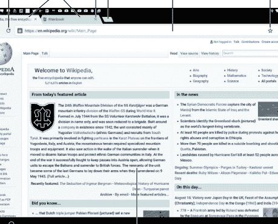

图 7–1：`Chrome` 应用显示了维基百科首页。

- 来自今日特写文章
  - 第 96 师（美国陆军）是二战期间美国陆军的一个步兵师……
- 在新闻中
  - 科学家发现了位于哥伦比亚的新物种……
  - 在巴基斯坦的洪灾中……
- 今天在这一天
  - 丝绸之路是连接东西方的网络……
  - 在意大利的海战中海军击败了……
- 今天在这一天
  - 1947 年 8 月 15 日，印度独立日纪念了……
- 你知道吗？
  - “`pips`”这个词是网页。

### 网页内容

> 用手指捏合或张开屏幕来缩小或放大。
> 您可能会看到为移动设备设计的网页。要查看非移动版，请点击操作切换并选择桌面视图。
> 您可以竖向手机屏幕以竖屏模式阅读网页。刷新网页。这样做可以让长文本更易于阅读。


### 访问网页

要访问网页，请点击地址框中的地址。（参见图 7-1）如果您不知道确切地址，也可以搜索词或短语。点击屏幕键盘上的 `Go` 按钮来搜索或访问。

平板电脑网页浏览 89

要“点击”页面上的链接，请用手指点击。如果您很难点击链接，请放大页面后重试。您还可以长按屏幕查看放大窗口。

- 在输入网页地址时寻找特殊键。某些平板电脑会显示 `.com`（点）或 `.www.` 键。这些键可以帮助您快速输入网页地址。
- 长按 `.com` 键查看其他顶级域名，如 `.org`、`.net` 等。
- 如果您看不到地址框，请从屏幕中心向下滑动。如果这样做不起作用，请点击上方的标签页。
- 要刷新网页，请点击刷新图标。（参见图 7-1。）如果您在屏幕上没看到它，点击操作图标找到重新加载。刷新更新经常变化的网站。使用该命令也可以重新加载可能未完全加载的网页
- 要停止网页加载，请点击地址框处出现的取消 (`X`) 图标。

### 保存收藏的网页（书签）

你可能把它们称为书签，但在移动世界中，你的 `Android` 设备对你喜爱的网页也同样称呼：`收藏`（`favorites`）。要将网页标记为收藏，请点击地址栏中出现的收藏（星形）图标。有关该图标的位置，请参阅图 7-1。

当你将网页标记为收藏时，或者当你加载网页时，星形图标会变为填充。要添加更多详细信息，点击该图标。你会看到“编辑书签”卡片，这让你纳奇为什么它不叫“编辑收藏”。看到了吧？一致性是 `Android` 世界中缺乏的一点。图 7-2 显示了“编辑书签”卡片，以及书签或收藏（或其他任何内容）文件夹树。

- 删除书签
- 编辑名称
- 桌面书签

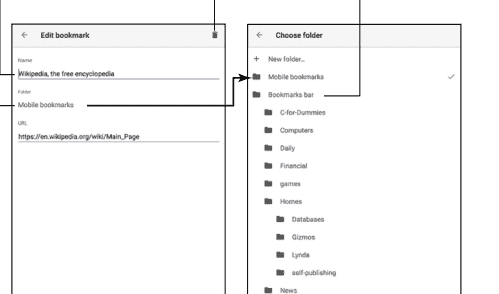

图 7-2：正在编辑收藏，呃，书签。

- 编辑书签卡片
- 文件夹

使用“编辑书签”卡片更改书签/收藏的名称。给出的名称通常比需要的长，因此点击该名称并使用屏幕键盘输入简短的内容。例如，将 `Wikipedia, the free encyclopedia` 编辑为简单的 `Wikipedia`。非常简单。

你还可以使用“编辑书签”卡片将书签放入特定的文件夹中。通常情况下，`Chrome` 倾向于将其显示在“移动设备书签”文件夹中，如图 7-2 所示。你你也可以选择“书签栏”，以防该书签在您使用的任何电脑的 `Chrome` 上也可用。

* 维百科

完成书签编辑后，点击返回导航图标。

- 要删除书签，请点击删除（垃圾桶）图标，如图 7-2 所示。
- 我必须承认，使用电脑时管理书签会更容易。
- 创建收藏网页并不等同于保存页面。请参见后文的章节“分享网页”。
- 找到要收藏网站的绝佳方法是查看网页历史记录：点击操作溢出菜单并选择“历史记录”。
- 在旧版本的 `Chrome` 应用中，“书签栏”文件夹被称为“桌面书签”。

### 访问收藏（已书签）网页

要在 `Chrome` 应用中查看书签，点击操作溢出菜单图标并选择“书签”。你会看到书签屏幕，它在 `Chrome` 中的出现方式就像网页一样。

- 点击文件夹以查看存储在该文件夹中的书签。
- 点击书签以访问该页面。
- 要快速访问已书签的网站，只需在地址栏中开始输入网站名称。从地址栏下方显示的匹配结果列表中点击该已书签网站。

## 在多个标签页上管理网页

`Chrome` 应用以及其他平板电脑浏览器都使用标签页界面来帮助你同时访问多个网页。请参阅图 7-1，查看 `Chrome` 应用屏幕上地址栏正上方匹配的几个标签页。

你可以通过标签页发现有趣的事：

- 打开空白标签页：要打开空白标签页，点击最后一个打开标签页右侧的标签页标签（如图 7-1 所示）。你也可以点击操作溢出菜单图标并选择“新标签页”。
- 在新标签页中打开链接：若要在另一个标签页中打开链接，长按该链接并选择“在新标签页中打开”。
- 在新标签页中打开书签：在新标签页中打开书签，长按该书签并选择“在新标签页中打开”。
- 切换标签页，点击其中一个。标签页会显示网页标题。（参阅图 7-1）。
- 要关闭标签页，点击其关闭（`X`）图标。
- 标签页在屏幕上从左到右排列。向左或向右滑动多余的标签页以查看未出现在屏幕上的。
- 如果关闭了所有标签页，你会在 `Chrome` 应用中看到空白屏幕。点击“添加（加号）”。

### 收藏


## 访问收藏（已书签）网页

在要在 `Chrome` 应用中查看书签，点击操作溢出菜单图标并选择“书签”。你会看到书签屏幕，它在 `Chrome` 中的出现方式就像网页一样。

- 点击文件夹以查看存储在该文件夹中的书签。
- 点击书签以访问该页面。
- 要快速访问已书签的网站，只需在地址栏中开始输入网站名称。从地址栏下方显示的匹配结果列表中点击该已书签网站。

## 在多个标签页上管理网页


## Chrome 应用及平板浏览器标签页管理

`Chrome` 应用以及其他平板电脑浏览器都使用标签页界面来帮助你同时访问多个网页。请参阅图 7-1，查看 `Chrome` 应用屏幕上地址栏正上方匹配的几个标签页。

你可以通过标签页发现有趣的事：

*   打开空白标签页：要打开空白标签页，点击最后一个打开标签页右侧的标签页标签（如图 7-1 所示）。你也可以点击操作溢出菜单图标并选择“新标签页”。
*   在新标签页中打开链接：若要在另一个标签页中打开链接，长按该链接并选择“在新标签页中打开”。
*   在新标签页中打开书签：在新标签页中打开书签，长按该书签并选择“在新标签页中打开”。
*   切换标签页：点击其中一个。标签页会显示网页标题。（参阅图 7-1）。
*   要关闭标签页，点击其关闭（X）图标。
*   标签页在屏幕上从左到右排列。向左或向右滑动多余的标签页以查看未出现在屏幕上的。
*   如果关闭了所有标签页，你会在 `Chrome` 应用中看到空白屏幕。点击“添加（加号）”。

## 保存收藏的网页（书签）

你可能把它们称为书签，但在移动世界中，你的 `Android` 设备对你喜爱的网页也同样称呼：**收藏**（favorites）。要将网页标记为收藏，请点击地址栏中出现的收藏（星形）图标。有关该图标的位置，请参阅图 7-1。

当你将网页标记为收藏时，或者当你加载网页时，星形图标会变为填充。要添加更多详细信息，点击该图标。你会看到“编辑书签”卡片，这让你纳奇为什么它不叫“编辑收藏”。看到了吧？一致性是 `Android` 世界中缺乏的一点。图 7-2 显示了“编辑书签”卡片，以及书签或收藏（或其他任何内容）文件夹树。

**删除书签**

**编辑名称**

**桌面书签**


**图 7-2：** 正在编辑收藏，呃，书签。

使用“编辑书签”卡片更改书签/收藏的名称。给出的名称通常比需要的长，因此点击该名称并使用屏幕键盘输入简短的内容。例如，将 **Wikipedia, the free encyclopedia** 编辑为简单的 **Wikipedia**。非常简单。

你还可以使用“编辑书签”卡片将书签放入特定的文件夹中。通常情况下，`Chrome` 倾向于将其显示在“移动设备书签”文件夹中，如图 7-2 所示。你也可以也可以选择“书签栏”，以防该书签在您使用的任何电脑的 `Chrome` 上也可用。

**维百科**

完成书签编辑后，点击返回导航图标。

*   要删除书签，请点击删除（垃圾桶）图标，如图 7-2 所示。
*   我必须承认，使用电脑时管理书签会更容易。
*   创建收藏网页并不等同于保存页面。请参见后文的章节“分享网页”。
*   找到要收藏网站的绝佳方法是查看网页历史记录：点击操作溢出菜单并选择“历史记录”。
*   在旧版本的 `Chrome` 应用中，“书签栏”文件夹被称为“桌面书签”。

### 访问收藏（已书签）网页

要在 `Chrome` 应用中查看书签，点击操作溢出菜单图标并选择“书签”。你会看到书签屏幕，它在 `Chrome` 中的出现方式就像网页一样。

点击文件夹以查看存储在该文件夹中的书签。

点击书签以访问该页面。

要快速访问已书签的网站，只需在地址栏中开始输入网站名称。从地址栏下方显示的匹配结果列表中点击该已书签网站。

### 在多个标签页上管理网页

`Chrome` 应用以及其他平板电脑浏览器都使用标签页界面来帮助你同时访问多个网页。请参阅图 7-1，查看 `Chrome` 应用屏幕上地址栏正上方匹配的几个标签页。

你可以通过标签页发现有趣的事：

*   打开空白标签页：要打开空白标签页，点击最后一个打开标签页右侧的标签页标签（如图 7-1 所示）。你也可以点击操作溢出菜单图标并选择“新标签页”。
*   在新标签页中打开链接：若要在另一个标签页中打开链接，长按该链接并选择“在新标签页中打开”。
*   在新标签页中打开书签：在新标签页中打开书签，长按该书签并选择“在新标签页中打开”。
*   切换标签页，点击其中一个。标签页会显示网页标题。（参阅图 7-1）。
*   要关闭标签页，点击其关闭（X）图标。
*   标签页在屏幕上从左到右排列。向左或向右滑动多余的标签页以查看未出现在屏幕上的。
*   如果关闭了所有标签页，你会在 `Chrome` 应用中看到空白屏幕。点击“添加（加号）”。

## 收藏


## 下载

`The most important thing you need to know about downloading is that it's transfer of information from another source to your gizmo. For your Android tablet, the other source is the Internet. The information that's transferred is accessed on a page. It can be a picture, a file, or something else that I can’t think of right now.`

*   `Downloading Complete` notification appears after your tablet has downloaded something. You can choose that notification to view the downloaded-item.
*   Most people use the term download when they really mean transfer or copy.
*   You use the `Play Store` app to install new apps on your tablet.

### 下载详情

`The web is full of links that don’t open in a web browser window. For example, some links automatically download, such as links to Microsoft Word documents or other types of files that a web browser is frightened to display.`

`To save other types of links that aren’t automatically download, long-press the link and choose the Save Link action. If this action doesn’t appear, your tablet is unable to save the link, because either the file is of an unrecognized type or there’s a security issue.`

### 查看您的下载内容

要浏览或查看已下载的项目，请打开“下载”应用。它位于应用程序抽中。

“下载”应用按字母顺序或日期列出下载的项目。要设置项目的显示方式，请寻找排序图标或点击“更多操作”（Action Overflow）来找到“排序”或类似的操作。

要查看下载内容，从列表中选择该项目。`Android` 平板将使用相应的应用程序查看下载内容。如果没有可用应用程序，系统会显示一条相应的消息告知你。

*   你可以选择“下载通知”来快速查看任何单个已下载的项目。


## 网页浏览器控制和设置

与我用过的其他任何 `Android` 应用相比，网页浏览器应用拥有更多的选项、设置和控制。我不想用每一个细微细节来烦扰你，只想介绍几个值得你关注的选项。

### 清除网页历史记录

当你不想让整个互联网知道你在看什么网页时，请像前面的章节“使用无痕模式”中描述的那样，打开无痕标签页。当你忘记这样做时，请按照以下步骤从浏览器历史记录中清除一个或多个页面：

1.  点击“更多操作”图标并选择。
2.  点击要删除的网页条目旁边的 X 图标。

它消失了。

当你想要删除所有网页浏览历史时，在执行完步骤 1 后，点击屏幕底部的按钮“清除浏览数据”。你会看到“清除浏览数据”。预勾选的项目就是你需要的，因此点击“清除数据”按钮来清除平板电脑的网页历史。

使用无痕标签页时，不需要清理网页浏览历史记录。

### 更改网页显示方式

正如我在本章开头所抱怨的那样，平板电脑上的网页显示效果永远没有电脑上的那么好。但你确实有一些选项可以让它更好看。

首先最重要的是，记住你可以水平或垂直放置设备，这将重新排列网页的显示方式。

你可以通过张开手指来缩放任何网页，但当你发现自己经常这样做时，请考虑重置屏幕尺寸：

1.  点击“更多操作”图标并选择“设置”。
2.  选择“辅助功能”。
    *   在某些网页浏览器应用中，此项目可能名为“屏幕和文字”。
3.  使用“字体缩放”滑块调整字体大小。

滑块下方的预览可以帮助你判断什么尺寸最合适。

### 设置隐私和安全选项

几乎每个 `Android` 平板的网页浏览器都提供了高级设置。你应该考虑的唯一问题是信息是如何保留和自动调用的。你可能想要禁用某些功能。

1.  点击“更多操作”图标并选择“设置”。
2.  选择“隐私”。
3.  点击“清除浏览数据”按钮。
4.  在想要从平板电脑存储中删除的项目旁勾选。
5.  点击“清除数据”按钮。

某些网页浏览器可能会提供记住表单数据或密码的选项。如果是这样，请取消这些项目的勾选。此外，如果有选项，请删除任何个人数据。

> 关于通用的网络安全，我的建议始终是保持机智，在网络上进行任何可疑操作之前先思考。运用常识。坏人获胜最有效的方法之一就是利用社会工程学试图诱骗你做一些你通常不会做的事，例如点击链接查看可爱的动画或名人或政客的裸骨照片。只要你动脑筋，你就是安全的。

另请参阅第 20 章，有关应用安全屏幕锁的信息，我强烈建议这样做。

*   本章内容
*   设置 `Google Hangouts`
*   进行视频聊天
*   在 `Hangouts` 中拨打电话
*   使用 `Skype` 发送短信
*   发起 `Skype` 视频通话
*   使用 `Skype` 拨打电话

# 第 8 章 文字、语音和视频

在 20 世纪 60 年代，视频一直是通信的圣杯，视频电话被誉为未来的先驱。电影《2001太空漫游》中，一个关键角色通过“贝尔网络”给他的女儿打了视频电话。（费用：1.70 美元）显然，在电话上看和说被认为是一件大事。

在那部电影发生的多年后，视频通话更通常地被称为视频聊天。这是你的 `Android` 平板电脑更有能力提供的功能，还有短信、语音聊天甚至是真实的通话。未来已经到来——2 分钟的视频通话不再需要花费 1.70 美元，而是免费的。

## 我们可以用 Hangouts 吗？

与在线朋友进行短信、语音聊天和视频聊的伟大 `Google` 方式是使用 `Hangouts` 应用。它是一个由 `Google` 设计的通信应用，让你与一个或多个朋友联系在一起，嗯，聚一聚。它也是一个很棒的通信工具。

**第 8 章 文字、语音和视频 99**

## 使用 Hangouts

你可能会发现 `Hangouts` 启动器潜伏在平板电脑的主屏幕上。检查 `Google` 文件夹。在应用程序抽屉中找到该应用。

当你首次启动 `Hangouts` 应用时，它可能会询问你是否想要拨打电话。当然，你需要登录你的 `Google` 账号。如果你没有账号，你需要创建一个。

一旦登录，你就可以开始和朋友们聊天了。要开始新聊天，点击消息图标并从列表中选择一个朋友。要开始群聊，点击消息图标并选择多个朋友。

要拨打电话，点击聊天窗口中的电话图标。要进行视频通话，点击聊天窗口中的摄像头图标。

要发送消息，在文本框中输入并点击发送图标。你还可以通过按住麦克风图标说话来发送语音消息。

要分享照片或视频，点击加号图标并从设备选择文件，或使用相机拍摄新的。

`Hangouts` 是一个多功能工具，允许你随时随与朋友和家人保持联系，无论他们在何处。探索一下，看看它能做什么吧！

## 图 8-3：有人想和你视频通话！

| Arthur Grockmeister 13:18 |
| :--- |
| 接入入的视频通话 |
| 拒绝 &nbsp;&nbsp;&nbsp;&nbsp; 接听 |
| 你正在拨打的对象 &nbsp;&nbsp;&nbsp;&nbsp; 切换摄像头 &nbsp;&nbsp;&nbsp;&nbsp; 添加联系人 |

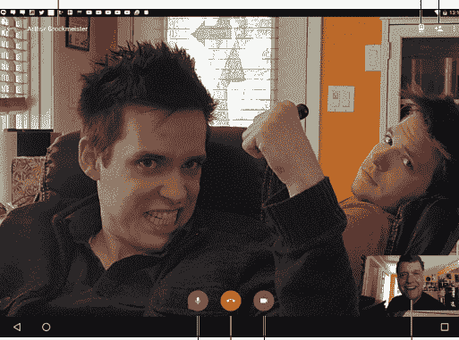

## 图 8-4：Hangouts 应用中的视频聊天。

静音 &nbsp;&nbsp;&nbsp;&nbsp; 关闭视频 &nbsp;&nbsp;&nbsp;&nbsp; 你 &nbsp;&nbsp;&nbsp;&nbsp; 结束视频聊天

屏幕上的控制控件（如图 8-4 所示）可能会在一秒后消失；点击屏幕即可再次查看控制控件。

要结束对话，点击“结束视频聊天”（End Video Chat）按钮。嗯，说再见吧，然后点击该按钮。

> 当你很无礼，或者只是不好看时，拒绝视频通话邀请。之后，你可以打开 `Hangouts` 应用，用短信消息或语音聊天回复拨打者。解释你的尴尬。

> 如果你想进行眼神交流，请直接看向平板电脑的前置摄像头。它位于触摸屏上方，处于居中位置或左侧或右侧。


**提示**

**第 8 章 文字、语音和视频 103**

## 打 Hangouts 电话

如果你获取了 `Hangouts` 拨号应用，就可以使用 `Hangouts` 拨打真实的电话。它异常地简单，操作方法如下：

1.  点击 `Hangouts` 应用中的“通话”（Phone Calls）标签页。其位置请参考图 8-1。如果你没有看到“通话”标签页，说明尚未安装 `Hangouts` 拨号应用。
2.  输入联系人名称或电话号码。
3.  点击匹配的联系人，或点击电话号码（当不属于联系人时）进行拨号。

电话已接入。

如果你更愿意直接拨号，请点击拨盘（Dialpad）图标，类似于边栏所示。输入电话号码，然后点击“拨号”（Dial）图标拨打。

点击红色的“结束通话”（End call）结束通话。

*   对于你正在拨打的人来说，接入的 `Hangouts` 来电看起来就像任何其他电话一样，尽管号码可能显示为“不可用”。
*   好消息是：`Hangouts` 通话是免费的！
*   坏消息是：你无法使用 `Hangouts` 拨打所有的号码。

## 使用 Skype 连接世界

`Skype` 是流行的互联网通信程序之一，允许你与其他 `Skype` 用户进行文字、语音或视频聊天。但最核心的功能是 `Skype` 拨打实实在在电话的能力，包括国际电话。

### 为平板电脑获取 Skype

典型的 `Android` 平板电脑没有预装 `Skype` 应用。要获取 `Skype`，请访问 `Google Play` 并获取 `Skype` 应用。如果你发现多个应用，请获取来自 `Skype` 公司官方的那个。

要使用 `Skype`，你需要一个 `Skype` 账户。你可以在首次打开应用时注册。你需要确认新账户，且该确认必须在开始使用应用之前完成。

*   让 `Skype` 扫描平板电脑地址录以查找联系人。此过程可能需要一段时间。
*   `Skype` 免费使用。聊天是免费的。与其他 `Skype` 用户语音和视频聊天也是免费的。当你想要拨打真实电话或与小组进行视频聊天时，你需要购买 `Skype` 积分（`Skype Credit`）。
*   在 `Hangouts` 应用中进行视频聊天不需要额外费用。
*   不要担心获取 `Skype` 号，除非你计划在平板电脑上接听 `Skype` 电话。这些电话包括来自任何电话的，而不只是使用 `Skype` 应用的移动设备。


### 运行 Skype

在初始登录 `Skype` 后，该应用会继续在你的平板电脑上运行。只有当你关闭平板电脑或故意退出 `Skype` 时，应用才会停止。

在 `Skype` 运行期间，你可以自由在平板电脑上做其他事情。如果有消息到达，会弹出 `Skype` 通知，类似于边栏所示。语音和视频聊天具有全屏邀请。

要退出 `Skype`，点击侧边菜单（Side Menu）图标，并在导航抽中选择“退出”（Sign Out）操作。点击“退出”按钮确认。

## 与另一个 Skype 用户聊天

`Skype` 的文字聊天与在手机上发短信类似。不同在于，类似于 `Hangouts` 应用的文字聊天，你只能给其他 `Skype` 用户发短信。如果他们其中一人出现在 `Skype` 联系人列表中并显示可用，按照以下步骤发起 `Skype` 聊天：

1.  在 `Skype` 主界面，点击“人员”（People）标签页选择联系人。
    *   “人员”标签页图标如图边栏所示。`Skype` 用户的状态出现在名称下方。状态为“可用”（Available）的用户理论上在线在线并愿意与你聊天。
2.  在“在此处输入消息”（Type a Message Here）框中输入你的文字。
    *   该框位于屏幕底部。
    *   在框下方，你会发现一行图标，代表你可以插入或附在短信消息中的各种项目。这些项目包括表情符号、多媒体和位置。
3.  点击发送图标发送你的消息。

当你发送消息时，它会出现在聊天窗口中。如果对方回复，他们的消息将出现在你的下方。

*   要删除消息，长按并选择删除。
*   要转发消息，长按并选择转发。
*   要举报消息，长按并选择举报。

## 拨打 Skype 电话

1.  在 `Skype` 应用中点击“通话”（Phone）标签页。“通话”标签页显示你拨过的任何通话。要拨打：
2.  点击屏幕底部的拨盘（Dialpad）图标。
3.  输入号码。或者你可以点击右上角的地址录图标选择联系人。
    *   拨打美国号码需要预设的 `+` 前缀，即使是本地号码。不要删掉它！
4.  点击屏幕底部的蓝色电话（Dial）按钮拨号。
5.  通话。


在通话期间，通话费用将显示在屏幕上。这样你就可以监控费用。

- 要结束通话，点击结束通话按钮。

遗憾的是，你无法在 Android 平板电脑上使用 Skype 接听电话。实现这种功能的唯一方法是购买 Skype 号码。在这种情况下，你可以使用 Skype 打和接听普通电话。


- 如果你计划使用 Skype 拨打电话，我建议准备一副好的耳机。
- 除了每分钟费用外，通话时可能被收取连接费。
- 你可以通过 Skype 网站 `skype.com` 查看最新的资费表，包括国内和国际电话。
- 你可以使用 Hangouts 应用进行免费通话，尽管它支持的号码范围不如 Skype 广（在本书出版时，Hangouts 无法拨打国际电话）。请参考之前的“打 Hangouts 电话”。
- 除非你为 Skype 购买了特定的号码，否则对方来电 ID 上显示的号码将出乎意料——通常是“未知”。因此，你可能想给要拨打的人发邮件，告诉他你正在打 Skype 电话。这样，电话就不会因为来电 ID 未被识别而被忽略。

## 本章内容

- >> 在平板电脑上获取 Facebook
- >> 在 Facebook 上分享你的生活
- >> 向 Facebook 发送照片或视频
- >> 配置 Twitter
- >> 创建推文
- >> 探索其他社交网络应用

# 第 9 章

## 数字社交生活

很久以前，社交网络取代了电子邮件成为使用互联网的首要原因。它几乎取代了电子邮件，无疑取代了个人个性化网站，并成为全球数百万人的痴迷。你的 Android 平板电脑已准备好满足你的社交网络需求。

## 你在 Facebook 上的生活

在所有社交网络网站中，Facebook 是王者。它是你与朋友叙旧、发送消息、表达想法、分享照片和视频、玩游戏以及比你想象中花费更多时间的在线场所。

- 访问 Facebook 的最佳方式是使用 Facebook 应用。某些平板电脑上预装了该应用。如果没有预装，你可以从 Google Play 免费获取 Facebook 应用。请参第 15 章。
- 你可以使用 Facebook 应用注册 Facebook 账号，也可以使用你已有的账号。
- 第一次登录 Facebook 后，你必须进行配置。我建议选择将 Facebook 与手机联系人同步的选项。


> Facebook 应用更新频繁。访问我的网站以查看任何新信息：
> `wambooli.com/help/android`

## 在你的平板电脑上运行 Facebook

Facebook 主界面有几个标签页，如图 9-1 所示。你可能最常用的标签页是消息动态（News Feed）。屏幕上还会出现与 Facebook 交互的其他选项，如图所示。

- 朋友请求
- 通知
- Facebook 联系人
- 消息动态
- 菜单
- 设置你的状态
- 上传照片
- 消息

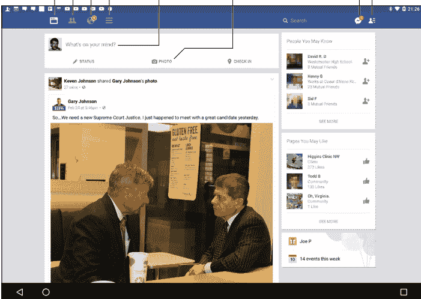

图 9-1：Android 平板电脑上的 Facebook。

要退出 Facebook，点击主页图标返回主屏幕。Facebook 应用将继续运行，直到你退出该应用或关闭你的 Android 平板。

要退出 Facebook 应用，点击菜单图标（参考图 9-1）并选择注销（`Log Out`）操作（位于列表底部）。点击 `LOG OUT` 按钮确认。

- 请参考第 18 章获取有关在主屏幕上放置 Facebook 应用启动器或 Facebook 小组件的信息。
- 要更新消息动态，从状态栏正下方向下滑动屏幕。
- 使用消息动态项目下方的点赞（`Like`）、评论（`Comment`）或分享（`Share`）图标分别点赞、评论或分享内容。现有评论仅在你选择“评论”项时才会显示。
- Facebook 应用会为新闻项目、提及、聊天等生成通知。在状态栏上与平板的其他通知一起查看它们。


## 设置你的状态

你在 Facebook 上除了拥有比任何人更多的朋友之外，生活的首要目标就是更新状态。这是与宇宙分享你想法的最佳方式，特别是当你在医生办公室等待切除扁桃石等亲密时刻。

要在 Facebook 应用中设置你的状态，请遵循以下步骤：

1. 切换到消息动态。
   点击消息动态图标。（参考图 9-1。）
2. 点击屏幕顶部的状态按钮。
   寻找“你在想什么”（`What's On Your Mind`）文本。点击它进入“发布到 Facebook”屏幕，你可以在那里输入你的感触。
3. 从账号下方的按钮选择受众。
   选择“公开”（`Public`）让所有人看到，或选择“朋友”（`Friends`）让只有你的朋友可以看到。点击“更多”（`More`）会显示其他选项。
4. 输入内容。
   如有必要，点击返回图标查看“你在想什么”文本。你输入的任何内容都会替换该文本。
5. 点击发布（`POST`）按钮分享你的想法。

要取消发布，点击返回图标。点击放弃发布（`DISCARD POST`）按钮确认。

如果你在主屏幕上添加了 Facebook 小组件，可以使用该小组件快速发布。


### 状态更新文本

选择受众

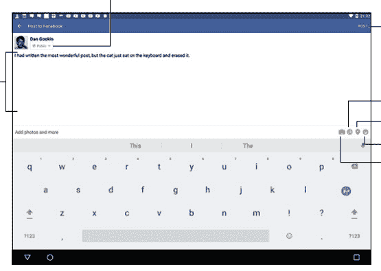

图 9-2：更新你的 Facebook 状态。

## 向 Facebook 上传照片或视频

你的 Android 平板带有摄像头。结合 Facebook 应用，你就拥有了一个将各种亲密和私人时刻分享给互联网窥探世界的合一设备。

要分享照片或视频，应用会弹出。点击“照片”（`Photo`）后，你有三个选择：

- 第一，使用图库中的现有图像。
- 第二，使用网络上的图像。
- 第三，使用相机。

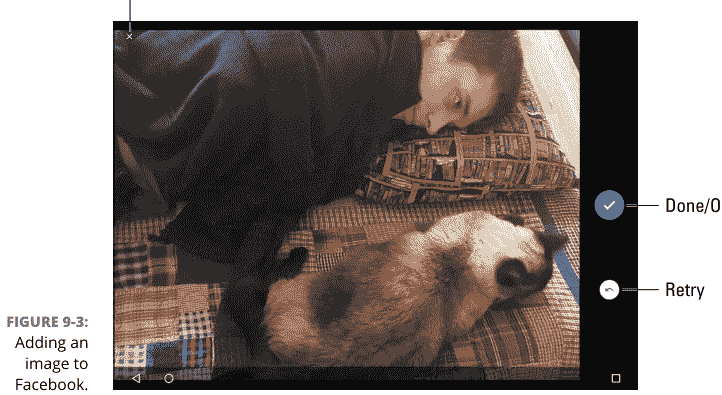

Twitter 应用程序带有可以固定到主屏幕的辅助小组件。使用这些小组件浏览最近推文或发布新推文。有关将小组件固定到主屏幕的信息，请参考第 18 章。

## 推特

要阅读推文，选择图 9-4 所示的“首页”类别。最近的推文以列表形式显示，最新的信息位于顶部。要更新列表，请从屏幕中间向下滑动。

要创建新推文，点击边边显示的“新推文”图标（并参考图 9-4）。使用图 9-5 所示的“新推文”界面编写你的推文。

| 分享位置 | 分享推文 |
| :--- | :--- |
| 分享图片或视频 | 剩余字符 |

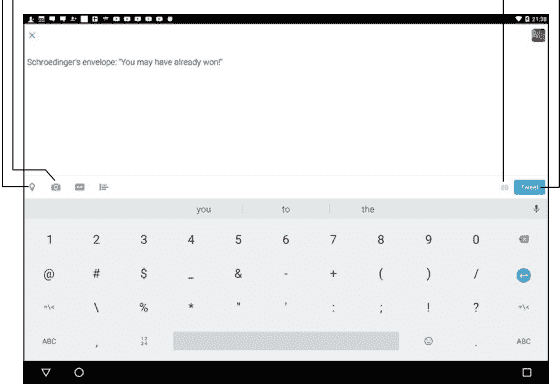

图 9-5：创建推文。

点击“位置”项将你的当前所在地添加到推文中。点击“照片”图标添加存储在平板电脑上的图像或视频。

## 更多社交网络机会

互联网充满了社交网络机会。Facebook 可能是其中的王者。

- Google+
- LinkedIn
- Meebo
- Myspace

这些服务的应用程序可以从 Google Play 获取。使用应用程序本身注册账户或登录现有账户。

- 有关 Google Play 的更多信息，请查看第 15 章。
- Google+ 是 Google 的社交网络应用程序，与 Hangouts 应用程序有关。有关使用 Hangouts 的信息请查看第 8 章。
- 如果你发现自己被社交网络网站和来源淹扰，可以考虑获取 HootSuite 应用程序。使用这一个应用程序在多个社交平台上分享你的想法。
- 与 Facebook 和 Twitter 一样，你的社交网络应用可能会出现在 Android 平板上的各种“共享”菜单中。这样，你就可以轻松与在线社交网络伙伴分享照片和其他类型的媒体。

点击“推特”按钮与推特世界分享你的想法。如果你退缩了，请点击“返回”导航图标并选择“删除”。

> 你创建推文时只有 140 个字符，包括空格。它包含空格。图 9-5 所示的字符计数器可以让你知道自己距离 140 个字符限制还有多远。
>
> Twitter 应用程序出现在其他应用程序的各种“共享”菜单中。使用这些共享菜单将你正在查看的任何内容发送到 Twitter，作为视频、网页、照片等的链接。


# 3 Omni 平板

## 本部分 ...

- 使用 Maps 应用程序不再迷路。
- 拍摄图像并录制视频。
- 组织和编辑图片及视频。
- 使用 Play Music 应用程序随地享受音乐。
- 使用日历应用程序保持任务。
- 在途中阅读电子书。

## 本章

- 使用 Maps 探索你的世界
- 为地图添加图层
- 保存地图备后用
- 查找你的位置
- 分享你的位置
- 搜索地点
- 将平板电脑用作导航仪

# 第 10 章

## 万事皆有地图

我希望传送门有一天能变成现实。能够瞬间旅行将非常方便，无需坐在狭窄的机舱内即可到达目的地。事实上，唯一的悬念是传送门是否也像航空旅行一样具有丢行李的倾向。

我们幸运的后代可能不会抱怨迷路了。这是因为得益于 Maps 应用程序，他们的 Android 平板电脑会准确告诉他们在哪里。他们将能够找到各种东西，从使用飞汽车的电影里的塔可到 Hello Kitty 光剑。因为这是未来，他们甚至可能使用未来版本的 Android 平板电脑找到他们丢失的行李。

## 地图 101

要找到你的位置以及远近物品的位置，请在你的 Android 平板上启动 Maps 应用程序。好消息是：你没有错误折叠 Maps 应用程序的风险。更好的消息是：Maps 应用程序绘制了整个国家，包括快速公路、公路、道路、街道、大道、车道、自行车道、地址、企业以及各种景点。

第 10 章 万事皆有地图 121

## 展开 Maps 应用程序

要启动 Maps 应用程序，点击平板电脑主屏幕上的启动器。你可能会在 Google 文件夹中找到启动器。而且，和平板电脑上所有的应用程序一样，你点击“应用”图标在应用程序屉中找到 Maps 应用程序。

如果你是第一次启动该程序，或者它最近更新过，你可以阅读“新”界面；点击“确定”或“知道了”继续。

你的平板电脑与全球定位系统 (GPS) 卫星通信以精确确定你的当前位置。位置在给定范围内是准确的，由屏幕上位置周围的蓝色圆圈表示，如图 10-1 所示。如果圆圈没有出现，要么你的位置太糟糕了，要么你需要放大。

- 搜索内容
- 景点

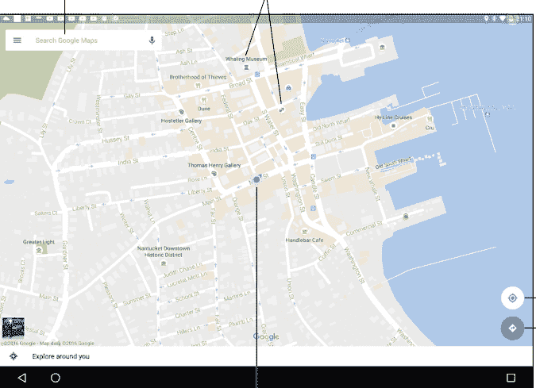

图 10-1：位置。

- 放大：让地图更大（更近）。
- 缩小：让地图更小（查看更多）。
- 平移：滚动。
- 旋转：调整地图方向。
- 透视：触摸屏幕进入透视。

容量。秘诀是保存你需要引用的地图部分。遵循以下步骤：

1. 查看你想要保存的地图区块。
   缩放、平移。在屏幕上框选你想要保存的区域。它可以根据你的需要大而或小。显然，越小的地图占用的存储空间越少。
2. 点击侧边菜单图标。
3. 从导航抽屉中选择“离线区域”（`Offline Areas`）。
   你之前保存的所有地图都会出现在列表中。
4. 点击“添加”图标。
5. 点击“下载”（`DOWNLOAD`）按钮。
6. 为地图输入标题。
7. 点击“保存”（`SAVE`）按钮。
   地图将出现在离线地图列表中。

要使用离线地图，显示导航抽屉并选择“离线区域”。点击离线地图查看，无论是否连接了互联网，它都会显示在屏幕上。

> - 离线地图有效期为 30 天。期过后，你必须更新地图以保持其最新。系统会提醒你进行更新。
> - 要更新离线地图，从“离线区域”屏幕上选择它并点击“更新”（`UPDATE`）按钮。
> - 离线地图不显示交通信息。
> - 你可以缩放并浏览离线地图，但无法对地图进行搜索。搜索只有在连接互联网时才有效。
> - 如果你正在旅行且平板电脑的 Wi-Fi 处于开启，离线地图可能会显示更新的位置信息。不要指望此功能能正常导航。


## 它知道你在哪儿

使用地图来寻找你要去的地方已经很常见了。新的概念是使用地图来发现你在哪儿。你不再需要担心迷路。Maps 应用可以立即显示你所在的位置以及周围的物体。

你甚至可以向平板电脑通讯录中的某人发送消息，让他们加入你——或者来救援你。

### 查找位置

Maps 应用将你的位置显示为屏幕上的一个蓝点。但它是在哪呢？意思是，如果你需要联系拖车公司，你不能只说：“我是绿色旁边灰色石板上的蓝点。”

好吧，你可以这么说，但可能没什么用。

要查看你的当前位置，点击地图上显示的“位置”图标。如果你需要信息，或者想获取任何随机地点的更多信息，长按 Maps 屏幕。会弹出一个卡片，类似于图 10-3 所示。该卡片为你提供大致地址。

- 街景视图
- 旅行位置
- 将位置标记为收藏
- 分享此位置
- 长按位置查看地址

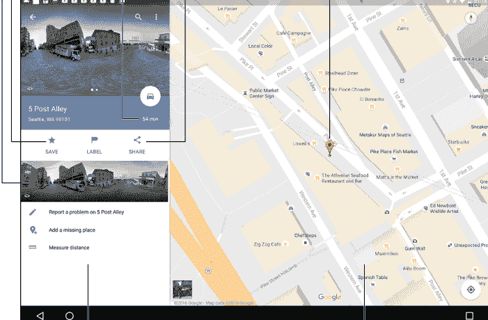

图 10-3：查找地址。

关于你当前位置的信息

街景视图

点击卡片以查看带有更多详细信息和额外信息的屏幕，如图 10-3 右侧所示。

- 此窍门仅在平板电脑接入互联网时有效。当没有互联网连接时，Maps 应用无法与 Google 地图服务器通信。
- “旅行”图标下（图 10-3 左上角的汽车所示）显示的时间，表示该地址距离你当前位置有多远。你还可能看到边栏显示的“路线”图标。
- 当你闲得慌时，可以玩玩“街景”命令。选择此选项将从 360 度视角显示位置。在街景视图中，你可以浏览景观、平移和倾斜，或者缩放查看细节以熟悉某个区域，例如——无论你是在熟悉一个位置还是在策划一次入室。

## 帮助他人找到你的位置

可以使用 Maps 应用将你的当前位置发送给朋友。如果你的朋友拥有与你的 Android 平板电脑类似的移动设备（手机或平板电脑），让他使用坐标获取前往你位置的路线。也许他会带一些药丸状的玉米饼！

要在电子邮件中发送你的当前位置，请遵循以下步骤：

1. 长按地图上的你的当前位置。
   要查看你的当前位置，首先点击 Maps 应用屏幕右下角的“位置”图标。
   在长按你的位置（或任何位置）后，你会看到显示出的卡片，显示大致地址，类似于图 10-3 右侧所示的卡片。
2. 点击卡片的“分享”图标。
3. 选择分享位置的应用。
   例如，选择 `Gmail` 在电子邮件消息中发送位置数据，选择 `Hangouts` 与某人即时聊天，或从列表中选择其他合适的应用。
4. 继续使用所选应用完成将你的位置发送给别人的过程。
   当接收者收到消息时，他们可以点击链接在 Maps 应用中打开他们的位置——如果他们有 Android 设备。当位置出现时，他们可以遵循我在后文章节“从这里到那里”中的建议来到达你的位置。也别把这书借给他们；让他们自己买一本。谢谢。

## 寻找物品

Maps 应用可以帮助你寻找现实世界中的地方，就像 Google 搜索应用帮助你在互联网上寻找地方一样。这两种操作基本上相同：打开 Maps 应用并在搜索框中输入内容。（参考搜索框）

查找地址

在搜索框中输入内容

（参考图 10-3）

要查看你的当前位置，首先点击 Maps 应用屏幕左下角的“位置”图标。

在长按你的位置（或任何位置）后，你会看到显示的卡片，类似于图 10-3 右侧所示的卡片。

2. 点击卡片的“分享”图标。
3. 选择分享位置的应用。
   例如，选择 `Gmail` 在电子邮件消息中发送位置数据，选择 `Hangouts` 与某人即时聊天，或从列表中选择其他合适的应用。
4. 继续使用所选应用完成将你的位置发送给别人的过程。
   当接收者收到消息时，他们可以点击链接在 Maps 应用中打开他们的位置——如果他们有 Android 设备。当位置出现时，他们可以遵循我在后文章节“从这里到那里”中的建议来到达你的位置。也别把这书借给他们；让他们自己买一本。谢谢。

*(注：由于输入文本中存在大量重复的占位符，译文已根据指令“不要重复输出原文”的原则进行了去重和逻辑整合)*


3. 从导航抽屉中选择“离线区域”（`Offline Areas`）。

你之前保存的所有地图都会出现在列表中。

4. 点击“添加”图标。

5. 点击“下载”（`DOWNLOAD`）按钮。

6. 为地图输入标题。

7. 点击“保存”（`SAVE`）按钮。

地图将出现在离线地图列表中。

要使用离线地图，显示导航抽屉并选择“离线区域”。点击离线地图查看，无论是否连接了互联网，它都会显示在屏幕上。

> **注意**
> - 离线地图有效期为 30 天。期过后，你必须更新地图以保持其最新。系统会提醒你进行更新。
> - 要更新离线地图，从“离线区域”屏幕上选择它并点击“更新”（`UPDATE`）按钮。
> - 离线地图不显示交通信息。
> - 你可以缩放并浏览离线地图，但无法对地图进行搜索。搜索只有在连接互联网时才有效。
> - 如果你正在旅行且平板电脑的 Wi-Fi 处于开启，离线地图可能会显示更新的位置信息。不要指望此功能能正常导航。


# 它知道你在哪儿

使用地图来寻找你要去的地方已经很常见了。新的概念是使用地图来发现你在哪儿。你不再需要担心迷路。`Maps` 应用可以立即显示你所在的位置以及周围的物体。

你甚至可以向平板电脑通讯录中的某人发送消息，让他们加入你——或者来救援你。

## 查找位置

`Maps` 应用将你的位置显示为屏幕上的一个蓝点。但它是在哪呢？意思是，如果你需要联系拖车公司，你不能只说：“我我是绿色旁边灰色石板上的蓝点。”

好吧，你可以这么说，但可能没什么用。

要查看你的当前位置，点击地图上显示的“位置”图标。如果你需要信息，或者想获取任何随机地点的更多信息，长按 `Maps` 屏幕。会弹出一个卡片，类似于图 10-3 所示。该卡片为你提供大致地址。

- 街景视图
- 旅行位置
- 将位置标记为收藏
- 分享此位置
- 长按位置查看地址


**图 10-3：查找地址。**

**关于你当前位置的信息**

- 街景视图

点击卡片以查看带有更多详细信息和额外信息的屏幕，如图 10-3 右侧所示。

- 此窍门仅在平板电脑接入互联网时有效。当没有互联网连接时，`Maps` 应用无法与 `Google` 地图服务器通信。
- “旅行”图标下（图 10-3 左上角的汽车所示）显示的时间，表示该地址距离你当前位置有多远。你还可能看到边栏显示的“路线”图标。
- 当你闲得慌时，可以玩玩“街景”命令。选择此选项将从 360 度视角显示位置。在街景视图中，你可以浏览景观、平移和倾斜，或者缩放查看细节以熟悉某个区域，例如——无论你是在熟悉一个位置还是在策划一次入室。

# 帮助他人找到你的位置

可以使用 `Maps` 应用将你的当前位置发送给朋友。如果你的朋友拥有与你的 `Android` 平板电脑类似的移动设备（手机或平板电脑），让他使用坐标获取前往你位置的路线。也许他会带一些药丸状的玉米饼！

要在电子邮件中发送你的当前位置，请遵循以下步骤：

1. 长按地图上的你的当前位置。

要查看你的当前位置，首先点击 `Maps` 应用屏幕右下角的“位置”图标。

在长按你的位置（或任何位置）后，你会看到显示的卡片，显示大致地址，类似于图 10-3 右侧所示的卡片。

2. 点击卡片的“分享”图标。

3. 选择分享位置的应用。

例如，选择 `Gmail` 在电子邮件消息中发送位置数据，选择 `Hangouts` 与某人即时聊天，或从列表中选择其他合适的应用。

4. 继续使用所选应用完成将你的位置发送给别人的过程。

当接收者收到消息时，他们可以点击链接在 `Maps` 应用中打开他们的位置——如果他们有 `Android` 设备。当位置出现时，他们可以遵循我在后文章节“从这里到那里”中的建议来到达你的位置。也别把这书借给他们；让他们自己买一本。谢谢。

## 寻找物品

`Maps` 应用可以帮助你寻找现实世界中的地方，就像 `Google` 搜索应用帮助你在互联网上寻找地方一样。这两种操作基本上相同：打开 `Maps` 应用并在搜索框中输入内容。

# 设置您的家庭和工作地点

在现实世界中，你最频繁的两个地方是居住和工作的地方。`Maps` 应用允许你为这些地点创建快捷方式。顺理成章，它们分别被称为“家”（`Home`）和“工作”（`Work`）。

要设置家庭和工作地点，请在 `Maps` 应用中按照以下步骤操作：

1. 点击侧边菜单显示导航抽屉。

2. 选择“我的地点”（`Your Places`）。

3. 在“标记”（`LABELED`）选项卡上，选择“家”。

4. 输入你的家庭地址。

5. 点击“工作”。

6. 输入你的工作地址。

在搜索地点或路线时，你可以使用家庭和工作快捷方式。例如，在搜索框中输入“家”，即可立即看到你居住的地方，或任何你称之为家的地方。要获取从当前位置到工作的路线，请将“工作”输入目的地。请继续阅读下一节。

> 如果你从“我的地点”菜单中选择“家”或“工作”，将在地图上显示该位置。
>
> 若要重置家庭或工作地点，请显示“地点”屏幕（参考步骤 1 和 2），但点击操作溢出图标（`Action Overflow`）并分别选择“编辑家庭”或“编辑工作”。

## 从这里到那里

`Maps` 应用中与地点相关的一个命令是获取路线。该命令被称为“路线”（`Route`），它会显示路线图标（见页边距）或交通模式，如汽车、自行车或公交。其工作原理如下：

1. 点击地点卡片上的路线图标。

点击路线图标后，你将看到一个与图 10-5 所示类似的屏幕。（当平板电脑垂直握持时，信息将显示在两个屏幕而不是一个。）

2. 设置起点。

起点列为“我的位置”（`Your Location`），即平板电脑的当前位置。你可以输入另一个地点，或使用前节介绍的家庭或工作快捷方式。

如果起点和目的地反了，请点击操作溢出并选择“反转”（`Reverse`）。


#### 目的地

| 起点位置 | 交通模式 |
| :--- | :--- |
| 目的地 | |
| 可选路线（灰色） | |
| 最佳路线（蓝色） | |

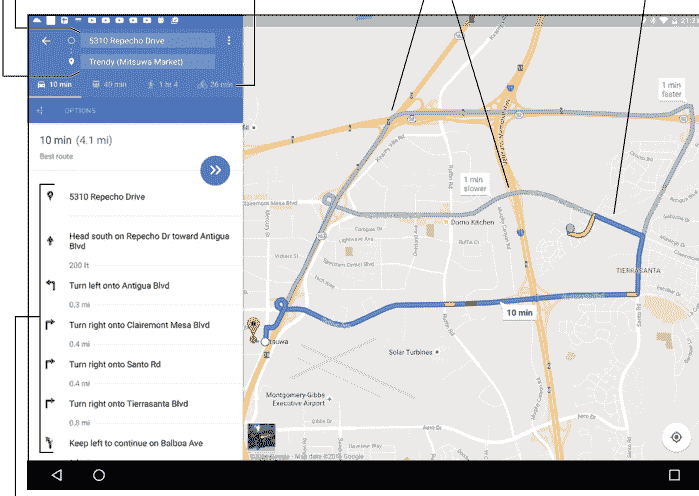

**图 10-5: 规划行程。**

## 路线

3. 选择交通工具。

可用选项取决于你所在的地点。在图 10-5 中，这些项目（从左到右）是：汽车、公共交通、步行和自行车。如果提供乘车代驾服务/网约车服务（如 `Uber` 或 `Lyft`），它们也可能出现。

4. 确保起点位置和目的地是你想要的内容。

如果顺序反了，请点击“切换”（`Swap`）图标。（参考图 10-5）。

5. 若要选择另一条路线，点击屏幕。

备选路线以灰色显示。（参考图 10-5。）当你选择其中一条时，检查路线卡片以观察时间和距离的差异。你也可以拖动地图上的路线线条来设置你的方向。

地图显示你的路线，在屏幕上高亮为蓝线。详细路线也会以红色显示，黄色表示交通拥堵。

要使用 `Maps` 应用的导航功能，请点击页边距显示的导航图标。语音指南会引导你，平板屏幕上还会提供交互反馈。如果你听腻了语音，请点击屏幕上的扬声器图标并设置“静音”选项。

要退出导航模式，点击屏幕上的“关闭”图标。

- `Maps` 应用会提醒你指定路线上的收费道路。在途中，如果有，你可以选择替代的非收费路线。导航期间系统会提示你切换路线；请见下一节。
- 如果你开车导航，我建议将平板电脑连接到汽车的 12 伏电源。导航消耗大量电。
- 导航在 `LTE` 平板电脑上效果最好。仅限 `Wi-Fi` 的平板电脑在没有互联网访问的情况下无法使用导航。参见前面的章节“保存离线地图”，尽管即使保存了地图，也可能无法导航。
- 你可能无法从 `Maps` 应用获得完美的路线，但对于你从未去过的地方，它是一个非常有用的工具。
- 平板电脑将保持在导航模式，直到你退出。在导航模式下，触摸屏上方可以看到导航通知。


**提示**


**记住**

# 第 11 章

所有人

- 理解相机应用
- 拍照或录制视频
- 包含你自己
- 激活闪光灯
- 设置分辨率和质量
- 控制位置

`Android` 平板电脑不是最好的相机，但对于你从未去过的地方，它是一个非常有用的工具。

为了向你展示不同的情况，图 11-2 显示了三星 `Galaxy Tab S2` 上的相机应用。这甚至不是你在所有三星平板上都能找到的应用；不，每一台都是独特的。

图 11-1 和 11-2 中都有相似的项目，这可能适用于你平板电脑的相机应用。有关拍照或录制视频的细节，请参考下一节。

## 介绍相机应用

`Google` 提供了一个标准的相机应用，称为 `Google Camera`。并不是所有的平板电脑都使用该应用；事实上，在各种平板电脑中，相机应用的差异最大。

通常情况下，相机应用至少有两种模式：静态（`Still`）和视频（`Video`）。其他模式可能提供如全景拍摄等额外功能。

相机应用还控制平板电脑的摄像头：主摄像头（位于背面）和前摄像头（位于正面）。

图 11-1 显示了静态模式下的相机应用主界面。要切换到视频模式，请如所示从左向右滑动屏幕。

拍摄模式 | 取景器 | 自拍计时

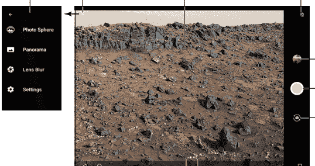

**图 11-1: 相机应用，静态模式。**

向右滑动视频模式 向左滑动静态模式

# 使用基础相机控制

在使用平板电脑拍摄静态照片或录制视频时，有以下建议：

- 平板电脑可以以横屏或竖屏方向作为相机使用。无论哪种方式都不用担心：图片都会以正确的方向保存。
- 只要平板电脑内部存储或外部存储空间未用尽，你就可以尽情拍摄照片或录制视频。
- 安装了 `microSD` 卡的平板电脑会自动将图像保存到该位置。否则，图像将保存在内部。
- 参见第 12 章获取有关预览和管理照片及视频的信息。

如果你正在录制视频，请务、务必使用横向的平板电脑。这是人们预期看到的视频方式，你的 `YouTube` 粉丝也会感谢这种正确的取向。

平板电脑的触摸屏充当取景器；你在屏幕上看到的内容与最终照片或视频中显示的完全一致。

点击屏幕对特定物体进行聚焦。你会看到一个聚焦环或方框，这确认了镜头的对焦状态。并不是所有的平板电脑都带有对焦焦摄像头；我没有见过任何可以对焦的前置摄像头。

- 在触摸屏上张开手指进行放大。
- 在触摸屏上捏拢手指进行缩小。

某些平板电脑使用音量键来放大或缩小：按音量+放大，按音量- 缩小。在其他相机上，按下音量键可以拍摄静态照片，该功能在录制视频时同样有效。

保持平板电脑稳定！我建议在拍摄静态照片和录制视频时使用双手。

手机将图片和视频存储在 `/DCIM/Camera` 文件夹中。静态图像以 `JPEG` 或 `PNG` 格式存储；视频以 `MPEG-4` 格式存储。

## 拍摄静态照片

拍摄静态图像只需要两个步骤。首先，确保相机应用处于“单拍模式”（`Single-Shot mode`）。其次，点击快门图标即可拍照。

在 `Google` 相机应用中，为了确保你处于单拍模式，请检查边栏显示的快门图标。（同时也请参阅图 11-2 以查看 `Galaxy Tab` 上快门图标的样子。）

- 你在相机应用取景器中看到的图像就是最终照片中看到的内容。
- 大多数相机应用在拍摄静态图像时会发出快门声。
- 在拍摄之前设置分辨率。请参阅后文章节“选择分辨率和质量”。

## 录制视频

要录制视频，请将相机应用切换到“视频模式”。快门图标将变为录制图标，类似于边栏所示和图 11-3 所示的图标。点击该图标开始录制。视频录制期间，经过的时间甚至可能消耗的存储空间出现在触摸屏上。

停止录制

录制时间 拍摄静态照片

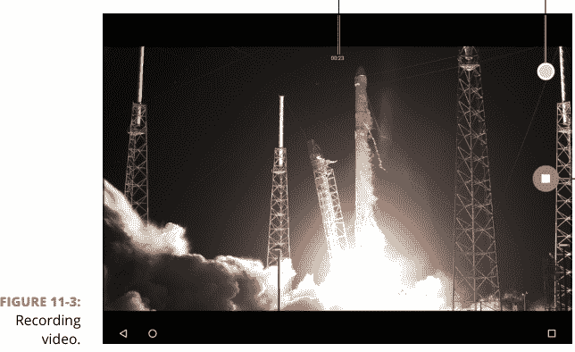

点击停止图标结束录制。

- 在原生 `Android` 应用中（如图 11-3 所示），从右向左滑动屏幕进入视频录制模式。
- 在某些三星平板电脑上，你点击相机应用屏幕上的录制按钮。（参阅图 11-2）。某些平板电脑可能带有“静态/视频”切换开关，可在相机应用的静态拍摄模式和视频模式之间进行切换。
- 某些相机应用具有暂停图标。点击该图标可以临时暂停录制。点击录制图标恢复。你录制的视频将保存为一个单一视频，而不是多个视频。
- 某些版本的相机应用可能允许你在平板电脑录制视频时获取静态图像：点击屏幕或按下音量键即可拍摄并保存静态照片。
- 录制视频时请保持平板电脑横放。

> **记住**

第 11 章 大家说“茄茄子！” 139

## 使用自拍

几乎所有 `Android` 平板电脑相机应用中都有一个常用功能：自拍。虽然它通常是禁用的，但你可以启用此功能，以便在点击单拍快门图标后延迟指定的秒数拍摄静态图像。据推，这可以留出足够的时间让你跑进平板电脑前面，这样你也能出现在照片中。

要激活自拍功能，点击其图标。在 `Google` 相机应用中，点击一次设置 3 秒延迟，再次点击设置 10 秒延迟。点击第三次禁用该功能。相机应用屏幕上的图标与表 11-1 所示的类似。

**表 11-1**

| 图标 | 设置 |
| --- | --- |
| 🚫 | 自拍功能已禁用；照片立即拍摄。 |
| `3s` | 在你点击图标 3 秒后拍摄照片。 |
| `10s` | 在你点击图标 10 秒后拍摄照片。 |

在你设置好定时器后，点击静态拍摄快门图标。然后冲到平板电脑前面，这样它就能拍摄你的照片。

噢：你可能想将平板电脑支撑在稳定的物体上，甚至可以使用三脚架架。没有三脚架，自拍功能几乎派不上用场。

- 在某些三星平板电脑上，你点击自拍图标（类似于边栏所示），并在弹出菜单中选择延迟。
- 当你想回到标准的静态拍摄模式，或者当你跑得精疲力竭时，请关闭自拍。


## 查看你刚刚拍摄的内容

要预览你刚刚拍摄的图像，或观看你刚刚录制的视频，请点击相机应用屏幕上的上一张图像缩略图。你可能向左或向右滑动上一张图像来查看其他最近拍摄的图像。点击返回导航图标返回相机应用。

- 在某些版本的 `Android` 相机应用中，可能不会显示上一张图像缩略图，从右向左滑动屏幕查看上一张图像。
- 查看刚拍摄的图像的一个原因是删除它。选择该图像或视频，然后点击删除（垃圾桶）图标。图像会被立即删除，尽管某些平板电脑可能会提示你确认；点击 `OK` 按钮删除图像或视频。
- 要管理所有拍摄的图像或存储在平板电脑中，请使用照片应用。参阅第 12 章。
- 如果你的照片或视频看起来模糊，请确保平板电脑背部的摄像头镜头没有脏。或者，你可能在设置平板电脑时忘记取下后置摄像头的塑料盖。


## 相机设置与选项

某些平板电脑的相机应用充满了功能、控制按钮以及你在好莱坞电影中才会看到的更具体的特效。也许我夸张了，但即使是最基本的相机应用也配备了任何业余摄影师所需的选项。

### 切换摄像头

利用平板电脑的前置摄像头你可以做的比那些臭名昭著的自拍多得多。你具体能做什么？我现在没想起来，但关键是在使用相机应用时能够在前后置摄像头之间切换。

切换摄像头图标通常位于相机应用主屏幕上，如图 11-1 和图 11-2 所示。这些图标的变体见图 11-4。如果你在平板电脑的相机应用屏幕上没有看到此类图标，请点击“更多”（`Action Overflow`）或“设置”图标来寻找切换摄像头图标或选项。

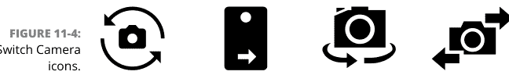

当你看到你自己时，说明你已成功切换了摄像头。拍摄照片，录制视频。

### 设置闪光灯

并不是所有的 `Android` 平板电脑后置摄像头都有闪光灯。前置也没有。

如果你的平板电脑带有闪光灯，你可以设置它的行为：点击屏幕上的闪光灯图标。点击该图标循环切换各种闪光选项，如表 11-2 所示。

**表 11-2**

| 设置 | 闪光灯触发时间 |
|---|---|
| 自动 | 在光线不足时 |
| 开启 | 始终 |
| 关闭 | 永远不，即使在光线不足时 |

如果你在屏幕上找不到闪光灯图标，点击“更多”或“设置”图标。我也见过某些相机应用带有抽屉，可以在其中找到闪光灯图标。寻找屏幕边缘的三角形或箭头，那可能是其中之一。

> 在拍摄面对明亮背景的人像时，开启闪光是一个好时机，例如艾伦奶奶在弹药工厂前展示她珍贵的桃子派。

### 设置分辨率和质量

...或照片大小。在设置分辨率之前，您还可以切换摄像头（后置或前置）。


> - 设置分辨率描述了图像中有多少像素或像素点。
> - 图片的分辨率越高，点越多，图像放大时的视觉效果就越好。
> - 前置摄像头的分辨率和视频质量选择较少，因为它不像后置摄像头那样精密。
> - 纵横比描述了水平相对于垂直的整体尺寸。`4:3` 的比例主要用于照片，且与平板屏幕比例相似。`16:9` 的比例是最宽的格式。
> - 视频质量设置 `HD` 和 `SD` 分别代表高定义和标准定义，`p` 值代表垂直分辨率，数值越高表示质量越高。
> - 万像素（`Megapixel`）是图像中存储信息量的单位。一百万像素大约相当于 100 万个像素或组成图像的单个点。它通常缩写为 `MP`。


# 检查位置标签功能

您的 `Android` 平板电脑不仅可以拍照，还能记录拍摄时所在的位置——只要您激活了该选项。此功能被称为位置标签（`location tag`）、地理标记（`geotag`）或 `GPS` 标记。要在 `Google` 相机中确认位置标签设置，请按照以下步骤操作：

1. 点击侧边菜单图标并选择设置。

2. 启用或禁用保存位置功能。


保存位置项目的主控制反映了位置标签的设置。

对于某些三星平板电脑上的相机应用，请按照以下步骤检查位置标签功能：

- 1. 点击相机应用主屏幕上的设置图标。

参考 11-2 页，尽管在 `Galaxy` 平板上该图标的位置可能不同。

- 2. 将位置标签项目的主控制设置为开启或关闭。

144 第 3 部分 Omni 平板

其他相机应用可能需要您经过各种步骤，例如在操作溢出或设置图标菜单中查找以找到位置标签项目。

- 取消位置标签功能不会删除已拍摄照片中的信息。

- 位置标签信息存储在图片本身中。这意味着其他设备、应用程序和电脑程序读取 `GPS` 信息以确定图像拍摄的位置。

- 关于查看照片位置的信息，请参见第 12 章。

## 选择存储设备

当您将 `microSD` 卡插入 Android 平板电脑的可移动存储插槽时，相机应用会自动选择该位置来保存新照片和视频。要确认或更改此设置，请在相机应用中执行以下步骤：

- 1. 点击操作溢出或设置图标。

- 2. 选择存储位置。

该选项的名称可能与“存储位置”不同，但含义相似。

- 3. 设置位置。

选项为设备或内部（针对平板的内部存储）；或 `microSD`、内存卡或外部存储（针对可移动媒体卡）。


记得

不是所有的平板电脑都配备可移动存储。

## 本章内容

- >> 查找图像和视频
- >> 在线查看您的照片
- >> 添加新建
- >> 查找图像的位置
- >> 编辑图像
- >> 裁剪和旋转照片
- >> 在 YouTube 上发布视频
- >> 分享图像和视频

# 第 12 章

图像管理

如果最终不能回顾、审阅、浏览并欣赏那些各种图像和视频，Android 平板电脑配备摄像头的意义何在？为了这个问题，您的平板电脑配备了数字相册。您可以使用它查看、管理和处理存储在平板中的图像。此外，您还可以导出图像，与远方的朋友分享，并欣赏来自 Google 以及您可能拥有的其他 Android 设备共享图像。

## 数字相册

用于查看照片和视频的 Android 原应用程序称为 `Photos`。它是第 11 章介绍的相机应用的天然伴侣。要启动该应用，点击其图标，它可能隐藏在主屏幕上，或者像所有应用一样位于应用抽屉中。

- `Photos` 应用不仅让您看照片和看视频，您还可以管理这些媒体、编辑并在网上分享您的视觉创作。

传统的 Android 平板电脑照片管理/相册应用是 `Gallery`。您可能仍然在平板电脑上找到 `Gallery` 应用，尽管本章专门针对 `Photos` 应用。

## 查看照片和视频

`Photos` 应用以多种方式组织您的照片和视频。图 12-1 中央的 `Photos` 屏幕按日期列出照片。点击屏幕底部的 `Photos` 图标以确保此视图处于激活状态。

查看您的相册，点击屏幕底部的 `Albums` 图标。相册与从 Google 账户访问的在线照片密切相关，这在本书的其他部分也会有介绍。

要查看图像，点击其缩略图。您将看到图像全屏显示，如图 12-1 右侧所示。向左或向右滑动屏幕浏览其他图像。

视频带有播放图标（如图 12-1 所示），但可能不容易看到。点击该图标播放视频。在视频播放时，点击屏幕显示控制。

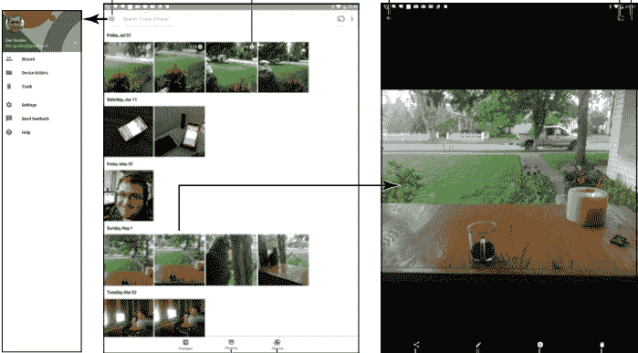 图 12-1：照片中的组织

导航

查看照片

分享

编辑

删除

> 在全屏查看图像时，导航图标会消失。点击屏幕查看其他图像或视频。

## 访问 Google 照片

`Photos` 应用与您的 Google 账户关联。要在电脑上访问这些照片，请访问 `photos.com`。您的 Android 设备会自动备份照片，如果您想关闭，请执行以下步骤：

- 1. 点击 `Photos` 应用中的侧边菜单。

- 2. 选择设置。

- 3. 选择备份同步。

- 4. 将备份同步的主控制设置为关闭。

根据您的设置，照片将备份到 Google 照片。更改此设置不会影响已备份的图像。

## 创建相册

如果您喜欢按相册而非日期组织平板上的图像，请执行以下步骤：

- 1. 查看想要添加相册的图像。

- 2. 点击操作溢出并选择添加到相册。

- 3. 从列表中选择现有相册，或点击新建。

要在相册和照片模式之间切换，请点击屏幕底部的相应图标，如图 12-1 所示。


## 幻灯片

`Photos` 应用可以显示您的图像幻灯片，但无需黑暗房间。要查看幻灯片，请执行以下步骤：

- 1. 全屏查看图像。

- 2. 点击操作溢出图标。

- 3. 选择幻灯片。

该相册或日期的图像将在屏幕上依次显示。点击导航图标退出幻灯片。

幻灯片不必留在平板电脑中。如果附近的 `HDMI` 电视或显示器带有 `Chromecast` 适配器，点击 `Chromecast` 图标。从列表中选择特定的 `Chromecast` 设备在大屏幕上查看幻灯片。请参见第 17 章了解更多关于使用 `Chromecast` 流传输媒体的详细信息。


## 查找照片的位置

除了拍照，您的平板电脑还会记录拍摄照片时的具体地理位置。根据平板电脑的不同，此功能被称为位置标签、`GPS` 标记或地理标记。要查看这些信息，请遵循以下步骤：

- 1. 在 `Photos` 应用中查看图像。

- 2. 点击信息图标。

图标位于图像下方，如边边所示。对于某些平板电脑，您可能需要点击操作溢出并选择详细信息。

信息卡显示有关图像拍摄时间、方式和地点的详细信息，如图 12-2 所示。地图信息可用，并出现在卡片上。

## 编辑与管理图像

编辑图像的最佳工具是配备了专业照片编辑软件的电脑，例如 `Photoshop` 或类似的程序（这些程序也被统称为“`Photoshop`”，因为这个词已经变成了一个通用术语）。尽管如此，你也可以使用“照片”应用来进行一些细微的合和视频剪辑。

## 编辑图像

要在“照片”应用中进入图像编辑模式，查看你想要修改的图像并点击“编辑”图标，如图侧边所示。如果你没有看到该图标，点击屏幕它就会显示出来。

编辑工具分为三类，显示在屏幕底部并在图 12-3 中所示：基本设置、图像效果以及裁剪/旋转。

图 12-2：图像详情，包括位置。


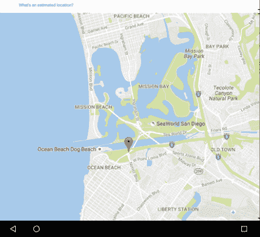

取消编辑

操作溢出


基本设置

裁剪/旋转

图 12-3： “照片”应用中的图像编辑。


图像效果

基本设置如图所示，位于图像下方。这些包括自动调整工具、亮度和对比度、色彩等。要使用某个工具，点击其图标，然后在屏幕上调整滑块以更改效果。满意后点击“完成”，如果改变主意则点击“取消”。

图 12-3 所示的中间类别是图像效果。点击效果即可将更改应用于图像。

裁剪/旋转工具将在后面的章节介绍。

更改立即应用于图像。要撤销这些更改，点击“操作溢出”并选择“撤销编辑”。否则，点击“保存”按钮保留修改后的图像。

152 第 3 部分 平板

# 取消编辑图像

你所做的更改直接应用于图像；不会保留副本。要移除之前应用的编辑、裁剪或效果，在“照片”应用中查看图像并按照以下步骤操作：

1. 点击“编辑”图标编辑图像。

2. 点击“操作溢出”。

3. 选择“撤销编辑”。

4. 点击“保存”按钮。

原始图像已恢复。

## 裁剪

裁剪图像是指剪掉你不需要的部分，就像用剪刀修剪你的照片一样，尽管这个过程非常简单。要裁剪图像，请遵循以下步骤：

1. 在“照片”应用中查看图像。

2. 点击“编辑”图标。

3. 点击“裁剪/旋转”图标。

4. 拖动四个角的任意一个来裁剪图像。

> 图标如图侧所示。屏幕的变化如图 12-4 所示。提供的工具用于裁剪和旋转图像。

当你拖动时，图像的部分会被移除。你也可以在裁剪框内移动图像进行裁剪操作。

5. 点击“完成”按钮。

图像已裁剪。你可以继续编辑，或点击“保存”按钮使更改永久生效。

如果你在点击“完成”后对更改不满意，点击“操作溢出”并选择“撤销编辑”。

使用“比例”（参见图 12-4）将裁剪框调整为新的呈现，例如正方形或宽屏。


裁剪角

裁剪框


图 12-4：旋转和裁剪图像。

取消

设置旋转角度

完成

设置比例

90° 工具

## 旋转图片

向他人展示图像可能会令人沮丧，尤其是当图像在竖直方向上无法填充屏幕时。要解决这个问题，请在“照片”应用中旋转图像。按照以下步骤操作：

1. 点击图像并点击“编辑”图标。

2. 选择“裁剪/旋转”工具。

3. 点击 90° 图标以 90 度增量旋转图像，或拖动滑块设置特定角度。

4. 点击“完成”图标保存更改。

参考图 12-4 查看这些按钮在编辑屏幕上的位置。

你可以继续编辑，或点击“保存”按钮使更改永久生效。

将图像旋转到特定角度也会裁剪图像。此删除步骤对于保持图像的比例是必要的。

## 删除图像和视频

从“照片”应用中移除不需要、尴尬或法律存疑的图像和视频是完全可能的，而且是理想的。


要清空垃圾桶，在查看图像或视频时，点击屏幕上的“删除”（垃圾桶）图标。它并没有真正消失，而是移动到了垃圾桶文件夹。在点击删除图标后，你可能还会看到“移动到垃圾桶”按钮。

- 如果你不点击删除图标，则无法删除该项目。它很可能是从网络照片共享服务或社交网站提取的副本。

- 要查看垃圾桶文件夹，点击侧边菜单并在导航抽屉中选择“垃圾桶”。

- 垃圾桶中的项目将在 60 天后自动删除。要加速删除，长按垃圾桶中的项目，然后点击屏幕顶部的删除图标。

## 选择多张照片和视频

在“照片”应用可以对图像和视频组应用三种命令：共享、复制到文件夹和删除。要选择一组，请遵循以下步骤：

1. 长按图像或视频以选择它。立即激活“图像选择”模式。你长按的缩略图会出现勾选标记。

2. 继续点击图像和视频以选择它们。

3. 对图像或视频组执行操作。

你在步骤 3 中可以执行的操作


- 选择：选择一个用于共享图像的选项，例如使用 `Gmail` 将整批内容作为附件发送。

- 复制到文件夹：选择一个将图像复制到它的文件夹，或创建一个新文件夹。

- 删除：项目将被移到垃圾桶文件夹。见前一节。

要取消选择项目，再次点击它们。要取消所有选择，点击返回图标。

## 发布视频到 YouTube

将你的珍贵时刻和记忆存在平板上是一个很好的解决方案，但你想把视频展示给观众看时，你需要一个 YouTube 账号。要上传视频，请遵循以下步骤：

1. 确保 Wi-Fi 连接已激活。

2. 打开“照片”应用。

3. 查看你想上传的视频。

4. 点击共享图标。如果你没有看到共享图标，点击屏幕。

5. 选择 YouTube。

详情界面出现。你可能会先看到关于剪辑视频的教程。

6. 如果必要，剪辑视频，拖动起始终点。当你拖动时，视频会进行预览，让你查看起始终点。

7. 输入视频标题。

8. 设置其他选项。输入描述、设置隐私级别、添加标签等。


9. 点击上传按钮。

你回到“照片”应用，视频正在上传。即使平板锁定或你在平板上进行其他操作，它也会继续上传。

当视频发送到 YouTube 时，会出现上传通知。当上传完成后，通知停止动画并变为“上传完成”图标。你还会收到一封 `Gmail` 邮件通知你的视频发布。

要查看你的视频，打开 YouTube 应用。有关该应用的详情请第 14 章。

# 与应用共享图像

几乎每个应用都想要参与分享，特别是涉及到照片和视频时。关键是在“照片”应用中全屏查看项目，然后点击侧边所示的共享图标。选择一个应用来共享图像或视频，该项目将立即发送到该应用。

## 本章内容

- 在 Android 平板上寻找音乐
- 欣赏乐曲
- 管理歌曲队列
- 将音乐添加到库中
- 收听网络电台

# 第 13 章

## 音乐，音乐，音乐

你的 Android 平板拥有一系列强大的功能，其中就播放音乐的能力。因此，它可以有效地取代你随身携带的任何唱片机，这正是 Android 平板这种全能型设备的设计初衷。除了你那些埃迪·坎托（`Eddie Cantor`）和宾格·克罗斯比（`Bing Crosby`）的唱片，你还可以向平板电脑的音乐库中添加新曲目。我听说那个叫埃尔维斯（`Elvis`）的新来脸真的很厉害。

## 在这里听

在你的 Android 平板上，音乐触手可及。插上耳机，唤出一个音乐播放应用，然后根据你的心情选择曲目。这个 Android 应用名为 `Play Music`。它是 Google 一系列“播放”应用之一，旨在为你提供娱乐和信息服务。

## 浏览你的音乐库

`Play Music` 应用开启了你平板电脑上的音乐大门。你可以选择听一段预设的音乐列表、购买音乐订阅服务，或者查看你已购买或传输到设备上的任何音乐。

最后这一类被称为你的音乐库。要查看它，请遵循以下说明：

- 1. 启动 `Play Music` 应用。

- 2. 点击侧边菜单（`Side Menu`）图标显示导航抽屉。

侧边菜单图标位于屏幕左上角，类似于边缘所示。如果是一个指向左的箭头，请点击该箭头直到侧边菜单出现。

- 3. 选择“音乐库”（`Music Library`）。

图 13-1 显示了选定音乐库界面的 `Play Music` 应用。音乐按类别组织，显示为屏幕上的标签。点击切换类别，或向左/右滑动屏幕以查看你的音乐库。

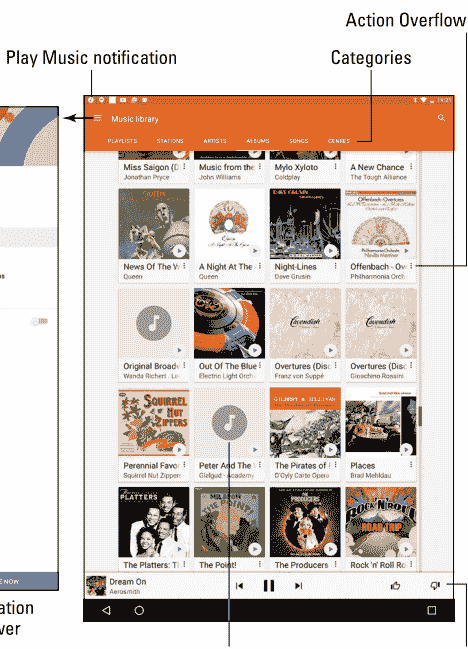

图 13-1:

`Play Music` 应用：专辑分类。

导航抽屉

通用专辑封面 当前播放歌曲

分类让你的音乐更容易找到，因为你并不总是记得歌曲、艺术家或专辑的名称。“流派”（`Genres`）类别适用于当你想听某种类型的音乐，但不知道（或不在乎）是谁录制的时候。

- 从导航抽屉中选择“现在收听”（`Listen Now`）类别来浏览你经常听的歌曲，或发现平板客人可能喜欢的曲目。你越频繁地使用 `Play Music` 应用，越能欣赏“现在列表”（`List Now`）类别中显示的结果。

- 歌曲和专辑具有“操作溢出”（`Action Overflow`）图标，如边缘所示。使用该图标查看与专辑或艺术家相关的操作。

- `Play Music` 使用两种类型的专辑艺术。对于购买的音乐或应用识别的音乐，会显示原始专辑封面。否则，应用将显示通用专辑封面。

- 当平板电脑无法识别艺术家时，它会使用标题“未知艺术家”（`Unknown Artist`）。这通常发生在你手动拷贝到平板电脑的音乐上，但也可能适用于你录制的音频录像。

- 你从 Google Play 获取的音乐不仅可以在平板电脑上播放，还可以出现在你的所有其他 Android 设备以及互联网上：访问 `play.google.com/music`

## 播放乐曲

当你找到了提升心情的合适曲目时，播放它吧！点击歌曲即可播放该歌曲。点击专辑查看专辑中的歌曲，或点击专辑上的大播放按钮（如边缘所示）来听整张专辑。

当歌曲播放时，屏幕底部会出现控制控件，如图 13-1 右下角所示。点击该条带可以全屏查看歌曲，如图 13–2 所示。

歌曲播放期间，你可以自由地在平板电脑上做任何其他事情。事实上，即使平板电脑锁定时，歌曲也会继续播放。点击边缘所示的 `Play Music` 通知可返回 `Play Music` 应用，或者你可以使用通知抽屉或锁界面上的控制控件来暂停歌曲或跳到下一首或上一首曲目。

歌曲结束后，播放列表中的下一首歌曲将播放。顺序取决于你如何开始歌曲。例如，如果你从专辑视图开始歌曲，该专辑中的所有歌曲将按照列出的顺序播放。


歌曲队列

专辑封面艺术

上一首歌曲

播放/暂停

下一首歌曲

`FIGURE 13-2:` 重复 随机

歌曲正在播放，

当你激活了随机（`Shuffle`）按钮时，下一首歌曲不会播放。（参考图 13-2）。在这种情况下，`Play Music` 应用会从列表中随机选择另一首歌。谁知道下一首是哪首？

当你开启重复（`Repeat`）选项时，下一首歌曲可能也不会播放：三个重复设置以及随机设置如表 13-1 所示。要更改设置，点击随机图标或重复图标。

## 随机和重复图标

| 图标 | 设置 | 点击图标后发生的情况 |
|---|---|---|
| ⇄ | 随机关闭 | 歌曲一个接一个播放。 |
| ↗ | 随机开启 | 歌曲按随机顺序播放。 |
| ↷ | 重复关闭 | 歌曲不重复。 |
| | 重复当前歌曲 | 同一歌曲反复播放。 |
| 🔁 | 重复所有歌曲 | 列表中的所有歌曲反复播放。 |

要停止歌曲播放，请点击图 13–2 中标记的暂停图标。


- 使用平板电脑侧面的音量键设置音量。
- 平板电脑上的音乐通过云端播放。这意味着在没有互联网连接时，音乐无法播放。
- 你可以下载音乐存储，无论是否有活动的互联网连接。详见第 15 章。
- 要更改歌曲顺序，点击图 13-2 所示的队列图标。使用列表中每首歌左侧的标签更改顺序；
- 使用平板电脑侧面的音量键设置音量。
- 平板电脑上的音乐通过云端播放。这意味着在没有互联网连接时，音乐无法播放。
- 你可以下载音乐存储，无论是否有活动的互联网连接。详见第 15 章。


# 管理音乐

- 要更改歌曲顺序，点击图 13-2 所示的队列图标。使用列表中每首歌左侧的标签更改顺序；
- 使用平板电脑侧面的音量键设置音量。
- 平板电脑上的音乐通过云端播放。这意味着在没有互联网连接时，音乐无法播放。
- 你可以下载音乐存储，无论是否有活动的互联网连接。详见第 15 章。

# 这是些什么？

意识到你可能不想再买一张《披头士白板专辑》，你可以从电脑将歌曲传输到你的 Google Play Music 库中。以下是操作步骤：

1. 在你的电脑上，找到你想要上传的音乐。

# 歌曲队歌曲

2. 打开电脑的网页浏览器并访问 `music.google.com`。

你会看到你的 Play Music 库副本，包括你的播放列表和任何最近的歌曲。你甚至可以直接在电脑上收听音乐，但现在：你有音乐要上传。

3. 在网页上，点击侧边菜单（`Side Menu`）按钮。

它位于窗口的左上角。

4. 向滚动命令列表并选择上传音乐（`Upload music`）。

5. 将音乐拖入浏览器窗口。

Google 可能会提示你配置 PC，请按照网页上的描述完成这些配置。按照步骤继续上传音乐。

> 你可以重复这些步骤来上传数万首歌。以前的限制是 25,000 首，但我相信 Google 最近增加了这个数字。
>
> 你上传的歌曲可以在 Android 平板电脑上可用，就像音乐库中的任何其他歌曲一样。

## 直接同步音乐

某些平板电脑允许你从电脑复制音乐。使用 USB 线将平板电脑连接到电脑。使用电脑上的音乐播放程序（例如 `Windows Media Player`）与你的 Android 平板电脑同步音乐，就像使用任何便携式音乐器一样。遵循以下步骤：

1. 将 Android 平板电脑连接到你的 PC。

   有关连接的详情请参阅第 17 章。

2. 在 PC 上，从自动播放通知或对话框中选择 `Windows Media Player`。

   如果没有出现自动播放对话框，请启动 `Windows Media Player` 程序。

3. 从同步列表（`Sync List`）中选择你的 Android 平板电脑，如图 13-3 所示。

   点击“下一个设备”链接，直到看到你的设备，例如图 13-3 显示的 `Galaxy Tab S2`。

4. 将音乐拖到同步区域。

   可以拖动单首歌或整个专辑。

5. 点击开始（`Start`）按钮将音乐从 PC 传输到平板电脑。

   开始同步（`Start Sync`）按钮可能位于列表顶部（如图 13-3 所示），也可能位于底部。

6. 关闭 `Windows Media Player` 并断开平板电脑。

## 同步标签

`Android 平板`

`点击同步`

`Android 平板电脑`

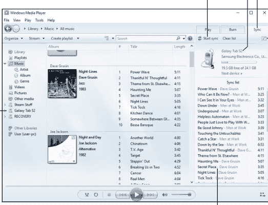

图 13-3: `Windows Media Player` 配合 Android 平板。

`将音乐拖到这里`

`要同步的音乐`

这种技术可能并不适用于所有的平板电脑。如果无效，请尝试前一节中上传音乐到 Google Play 的步骤。

> 你无法使用 `iTunes` 与 Android 设备同步音乐。废话。
>
> Android 平板电脑存储音乐的能力是有限的！复制歌曲时不要感到不知所措。在 `Windows Media Player` 中（参考图 13-3），容量温度计显示了平板电脑上使用了多少存储空间以及剩余多少可用空间。注意指示器！


**警告**

第 13 章 音乐，音乐，音乐 167

## 整理你的音乐

`Play Music App` 按专辑、艺术家、歌曲等对你的音乐进行分类，但除非你只有一个专辑并且喜欢其中所有的歌曲，否则这种组织方式并不理想。为了更好地管理你的音乐，你可以创建播放列表。这样，你可以按照你喜欢的顺序，根据任何心情收听你想听的音乐。

## 检查你的播放列表

要查看你已创建或在平板电脑上预设的任何播放列表，点击音乐库屏幕上的播放列表（`Playlists`）标签。屏幕上会显示可用的播放列表，类似于图 13-4 所示。

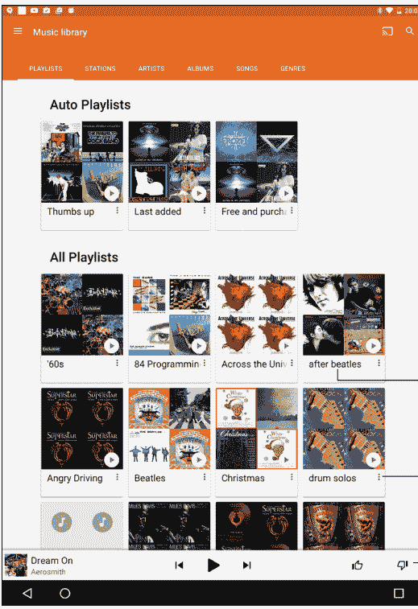

图 13-4: `Play Music App` 中的播放列表。

`播放列表名称`

`列表操作溢出（Action Overflow）`

`当前歌曲`

要查看播放列表中包含哪些歌曲，点击播放列表卡片。要播放播放列表中的歌曲，点击列表中的第一首歌。

当歌曲信息可能未完全导入你的 Android 平板电脑时，播放列表是组织音乐的一种有效方法。例如，如果你像我一样，可能有很多标记为“未知”（`Unknown`）的歌曲。解决这种情况的快速方法是以艺术家命名播放列表，并将那些未知歌曲添加到该列表中。

**提示**

## 创建你自己的播放列表

`Play Music App` 具有“自动”播放列表，其中三个如图 13–4 所示。除了这些，你看到的播放列表是你创建的。工作原理如下：

1. 找到一些你想添加到播放列表的音乐。
2. 点击专辑或歌曲旁的操作溢出（`Action Overflow`）图标。
3. 选择“添加到播放列表”（`Add to Playlist`）。

   确保你正在查看某首歌或专辑；否则“添加到播放列表”操作不会显示。

4. 选择现有的播放列表，或点击“新建播放列表”（`NEW PLAYLIST`）创建一个新的。

   如果你创建一个新播放列表，点击播放列表名称并点击“创建播放列表”（`CREATE PLAYLIST`）按钮。

歌曲或专辑将被添加到你选择的播放列表，或者置于你创建的新列表中。你可以通过重复这些步骤继续向播放列表添加歌曲。

> 你的平板电脑上有大量的播放列表，并可以在其中放入任意数量的歌曲。向播放列表添加歌曲不会影响平板电脑的存储容量。
>
> 要从播放列表中删除歌曲，打开播放列表，点击歌曲旁的操作溢出，并选择“从播放列表中移除”（`Remove from Playlist`）。
>
> 从播放列表中删除歌曲不会从库中删除歌曲；请参见后文章节“移除不需要的音乐”。
>
> 播放列表中的歌曲可以重新排序：在查看播放列表时，使用歌曲标题最左侧的标签将该歌曲在列表中向上或向下移动。
>
> 要删除播放列表，点击右上角的的操作溢出图标。（参考图 13–4。）选择删除并点击 `OK` 确认。

## 将歌曲队列保存为播放列表

如果你创建了一个歌曲队列，并且这是一个难忘的队列，请将该队列视为你可以反复收听的播放列表。遵循以下说明：

1. 点击歌曲队列（`Song Queue`）图标查看歌曲队列。

   详情请参阅“排队”部分。

2. 点击操作溢出并选择“队列”（`Queue`）。
3. 选择“新建播放列表”（`NEW PLAYLIST`）。
4. 填写新播放列表。
5. 点击“创建播放列表”（`CREATE PLAYLIST`）按钮。

歌曲位于它们自己的播放列表中，可以随时访问。

## 移除不需要的音乐

要移除某首歌或专辑，点击其操作图标。选择“删除”（`Delete`）。点击 `OK` 确认。再见，音乐。

你平板电脑上的大部分音乐实际上存储在云端。因此，移除音乐不会影响平板电脑。


## 流媒体音乐

虽然它们不是广播站，但互联网上的某些源——电台网站——播放音乐。这些互联网电台 App 可用：

- `Pandora Radio`
- `Spotify`
- `TuneIn`

`Pandora Radio` 和 `Spotify` 允许你根据心情和喜好选择音乐。给 App 的反馈越多，音乐选择就越好。

`TuneIn App` 让你访问全球数百个互联网电台。它们按类别组织，因此你可以找到任何你想要的内容。许多电台也是广播站，所以很有可能你可以找到一两个本地电台，并在你的 Android 平板电脑上收听。

这些 App 以及其他类似的 App 都是免费。在 `Google Play` 上也可以找到付费版本。付费版本通常提供无广告的无限音乐。

> Google 提供了一种无限收听服务。你可以点击导航抽屉中的“立即订阅”（`SUBSCRIBE NOW`）进行注册。（参考图 13-1）该服务免费 30 天，然后收取少量费用，目前为每月 9.99 美元。
>
> 最好在平板电脑通过 `Wi-Fi` 连接互联网时收听互联网电台。流媒体音乐以缓慢且稳定的速度消耗移动数据。
>
> 警惕通过你的平板电脑制造商或移动运营商提供的音乐订阅服务。我订阅过此类服务，结果发现它们因各种原因被终止了。为了避免失望，请坚持使用本节描述的服务，直到你觉得可以购买其他服务为止。
>
> 有关 `Google Play` 的更多信息，请参阅第 15 章。
>
> 通过互联网提供的音乐被称为流媒体（`streaming`）。这是因为音乐以从源持续下载的形式到达你的 Android 平板电脑。与你下载并保存的音乐不同，流媒体音乐是边下载边播放的，不会长期存储。

## 本章内容

- 唤醒你的 Android平板电脑
- 使用平板电脑进行计算
- 管理预约
- 阅读电子书
- 玩游戏
- 在 `YouTube` 上看视频
- 购买或租赁电影和电视节目

# 第14 章

## 惊人的平板电脑功能

尽管你的 Android 平板电脑可以做很多事情，但仍会发现一些局限性。例如，你不能把 Android 平板当作瑜伽垫。它也是一个糟糕的厨房菜板。尽管欧洲物理学家付出了努力，Android 平板根本无法与大型对撞机竞争。尽管如此，对于日常用途，我相信你的平板电脑完全胜任。

## 钟

你的 Android 平板电脑持续、准确地跟踪时间，时间显示在主屏幕顶部以及锁屏上。这很方便，但还不够，因此平板电脑会切换到一个显示时间并兼作闹钟的应用。

该应用可能被称为“`Clock`”（时）或“`Alarm`”（闹钟）。如果它叫“`Alarm`”，它可能只是一个基础闹钟。相反，“`Clock`”应用更像是一个计时应用，具有计时器、秒表和世界时功能。在这些活动中，设置闹钟是非常实用的：在该模式下，你的平板电脑变成了你的床头伴侣。

以下是在原生 Android `Clock` 应用中设置唤醒闹钟的方法：

1. 点击 `Alarm` 图标或点击 `Clock` 应用屏幕。
2. 点击 `Add`（添加）图标。

   某些钟可能直接显示一个新的闹钟卡片，因此你不需要添加任何内容。

3. 设置闹钟时间。

   点击小时、分钟。完成后点击 `OK`。新闹钟会出现在屏幕上，但你可以添加更多细节。

4. 填写有关闹钟的详细信息。

   设置闹钟铃声并分配一个标签，例如“去机场起床”。在三星平板电脑上，你可能需要点击 `OPTIONS`（选项）按钮来设置详情。

你创建的闹钟是激活状态。使用闹钟附近的总控制按钮，或点击 `Alarm` 图标来设置或重置闹钟。一次只有一组闹钟会触发，当你看到触摸屏顶部出现 `Alarm Set`（闹钟已设置）状态图标时，就可以确认闹钟已设置，类似于边边所示。

当闹钟触发时，点击 `Dismiss`（关闭）图标告诉平板电脑：“好的！我起床了！”或者你可以点击 `Snooze`（小睡），在几分钟后再次被骚扰。

- 你的平板电脑通过访问互联网时间服务器保持时间准确。永远不需要手动设置时间。
- 设置闹钟的信息会出现在 `Clock` 应用的屏幕和平板电脑的锁屏上。
- 取消闹钟不会删除闹钟。要删除闹钟，点击闹钟进行选择，然后点击 `Delete`（删除桶）图标或 `Cross`（`X`）图标。


- 要让闹钟在每周的特定几天响起，点击 `Repeat`（重复）复选框。选择你希望闹钟响起的日期。否则，闹钟只在你设置时响。

- 当你关闭 `Android` 平板电脑时，闹钟不会工作。但在平板电脑锁定时，闹钟会触发。

## 计算器

下次你做数学题时，不要费劲动脑筋。相反，拿出你的 `Android` 平板电脑并打开 `Calculator` 应用。原生 `Android` 计算器如图 14-1 所示。大多数 `Android` 平板电脑制造商都对这个应用进行了修改，因此你在平板电脑上看到的可能略有不同，尽管基本操作保持不变。

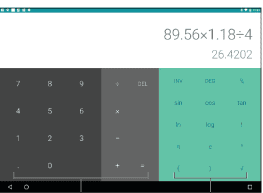

图 14-1：计算器应用。

典型的计算器按钮 恐怖的计算器按钮

点击 `Calculator` 应用屏幕上的各种按钮来输入你的等式。这些括号 `()` 按钮可以帮助确定长方程式中的哪个部分先计算。使用 `DEL`、`CLR` 或 `C` 键清除输入。

- 长按计算器的文本（或结果）来复制结果。这个技巧可能在每个计算器应用中都不起作用。

- 当 `Clear`（清除）按钮不可用时，长按 `DEL`、`CLR` 或 `C` 按钮。

- 我最经常使用 `Calculator` 应用来计算餐厅的小费。在图 14-1 中，正在为为 `$89.56` 的金额计算 `18%` 的小费，由四个人平均平分，尽管 `Jeremiah` 没喝任何啤酒。

## 日历

你的 `Android` 平板电脑是忙碌世界中旧式“球形链”的 21 世纪版本：日记本。多亏于 `Calendar` 应用和互联网上的 `Google Calendar` 服务，你可以扔掉你的日记本了。

好了，在你扔掉日记本之前，考虑将任何未来的预约和重复信息（如生日和周年纪念）复制到 `Calendar` 应用中。

`Google Calendar` 与你的 `Google` 账户配合跟踪你的日程和预约。你可以在网上访问 `Google Calendar`：

```
calendar.google.com
```

### 浏览你的日程

要查看接下来将发生什么，浏览即将到来的重要事件，或只需知道是月的哪一天，请打开 `Calendar` 应用。图 14-2 显示了 `Calendar` 应用的月视图和周视图。

| | | | | | 全天事件 | 添加事件 |
| --- | --- | --- | --- | --- | --- | --- |
| 今天 | 事件 | | 此时 | 侧边菜单 | 显示当前日期 | |
| | 2016年7月 | | | | | 2016年7月 - |
| | | | | | | 24 25 26 27 28 29 30 |
| | | | | | | |
| | | | | | | |
| | | | | | | |
| | | | | | | |
| | | | | | | |
| | | | | | | |
| | | | | | | |
| | | | | | | |
| | | | | | | |
| 月 | | | | | 周 |

图 14-2：日历应用。

要查看接下来将发生什么，浏览即将到来的重要事件，或只需知道是月的哪一天，请打开 `Calendar` 应用。图 14-2 显示了 `Calendar` 应用的月视图和周视图。

要在 `Calendar` 应用中选择视图，请点击 `Side Menu`（侧边菜单）。除了月和周，`Calendar` 应用还提供 `Schedule`（日程）视图和 `Day`（日）视图。

- 要查看接下来将发生什么，向左或右滑动屏幕以在月、周或日视图切换。
- 要返回日历，点击 `Back`（返回）图标。
- 如果列出了事件地点，你可以点击它打开 `Maps` 应用。查看活动举办地并获取路线，如第 10 章所述。
- 检查即将到来的预约的最佳方法是从导航抽屉中选择 `Schedule` 视图。
- `Calendar` 小部件（`widget`）也是直接从主屏幕查看即将到来的事件的好方法。有关将小部件应用于平板电脑屏幕的信息，请参见第 18 章。
- 生日和日历上的其他几个事件可能提取自手机的通讯录或社交网络应用。这可能解释了为什么有些事件列了两次——来自两个来源。
- `Google Now` 功能列出了任何近期预约或事件。请参见后文“`Google Now`”章节。
- 要查看事件详情，请点击它。当你使用月视图时，点击日期查看显示当天的事件。点击特定事件查看详情，如图 14-3 所示。

| 编辑事件 |
| --- |
| 周四 13:30 - 14:30 |
| 每月重复（每周四），直到 12/8 |
| `Post City` |
| 提前 25 分钟 |
| `CDA City` |

图 14-3：事件详情。

## 查看预约

你看到的细节取决于创建事件时记录了多少信息。有些事件只有极少的信息；另一些事件可能包含活动地点、时间以及会面等详情。

点击 `Close` 图标关闭事件详情，或点击 `Back` 返回。

### 创建事件

为了让日历变得有用，添加事件：预约、要做的事、会议以及全天事件（如生日或结肠镜检查）。在 `Calendar` 应用中按照以下步骤创建事件：

1. 转到事件日期，并点击事件开始的大约时间。

要在特定日期的特定时间，在周视图下操作更容易。

2. 点击 `Add Event` 图标（参考图 14-2）或点击第 1 步点击处出现的 `Add` 框。

出现创建事件卡。你现在的工作是填写空白以创建新事件。

## 3. 添加有关事件的信息。

你提供的信息越多，事件就越详细，你在 `Android` 平板和互联网上的 `Google` 日历上能做的也越多。以下是你在创建事件时可以设置的许多项目之一：

- **标题**：事件名称、你将会面的人或你要去的地方。
- **日历分类**：选择特定的日历来帮助组织并为你的事件着色。日历应用可能会默认选择“活动”日历。
- **时间/持续时间**：如果你遵循了本节的第 1 步，则不需要设置开始时间。否则，请指定事件开始和结束的时间，或者选择设置全天事件，例如生日或本应持续一小时的岳母访问。
- **地点**：输入位置，就像在“地图”（`Maps`）应用中搜索位置一样进行输入。
- **重复**：如果你没有看到此项目，请点击“更多选项”。使用“重复”设置来配置周期性发生的事件。
- **通知/提醒**：设置电子邮件、短信或日历通知来提醒即将到来的事件。

## 4. 点击保存按钮创建新事件。

新事件将出现在日历上，提醒你需要在某某日与某某做某事。

> >> 点击事件可进行修改。点击“编辑”图标（参见图 14-3）进行任何更改。

> >> 对于每周两次或每月两次的重复事件，请创建两个重复事件。例如，当你在第一个周一和第三周一有会议时，创建两个独立的事件：一个针对第一个周一，另一个针对第三周一。然后让每个事件每月重复一次。

> >> 要删除事件，请点击该事件将其取出。寻找“删除”按钮或图标。如果没有找到，点击卡片上的“操作更多”图标并选择“删除”。点击“确定”确认。对于重复事件，选择仅删除当前事件还是删除所有未来的事件。

> >> 设置事件的时区仅在事件发生在另一个时区或跨越时区时（例如航班）是必要的。在这种情况下，日历应用将根据你所在地自动调整事件的开始和结束时间。

如果你忘记设置时区并在世界范围内跳跃，你的事件将根据创建时的时区（即本地时间）设置。

事件提醒将以通知（显示在页边栏）、短信（`SMS`）或 `Gmail` 消息的形式出现。我更喜欢通知，它还会在平板电脑的锁屏上显示提醒。

## 电子书阅读器

纸质书太是 14 世纪的。如今，阅读材料以电子书的形式电子呈现。阅读电子书的绝佳方式是使用 `Play Books` 应用。

打开 `Play Books` 应用开始你的阅读体验。如果你一直在读一本书，该应用将打开到你上次阅读的页。否则，你将看到整个图书库，如图 14–4 所示。

要随时查看库，请点击侧边菜单（显示在页边栏）并从导航抽屉中选择“我的库”命令。库中的列表是你为 `Google` 图书账户获取的那些标题。滑动屏幕滚动选择内容。

点击书籍以打开它。如果你之前打开过这本书，你将返回到上次阅读的页面。否则，你将看到书籍的第一页。

图 14–5 展示了 `Play Books` 应用中的基础书籍阅读操作。将屏幕从右向左滑动以“翻页”，假设你正在阅读英语或其他从该方向开始阅读的语言。

`Play Books` 应用同时支持竖向和水平方向。要锁定屏幕方向，请从导航抽屉中选择“设置”并点击“自动旋转屏幕”项目。选择你希望锁定或不锁定屏幕。

如果你在库中没有看到书籍，点击“操作更多”图标并选择“刷新”。

你图书库中的书籍存储在互联网上，只有在网络连接活动时才能阅读。你可以通过将书籍下载到设备并在平板电脑上保留书籍。下载书籍的详情请参见第 15 章。

## 下载的书籍

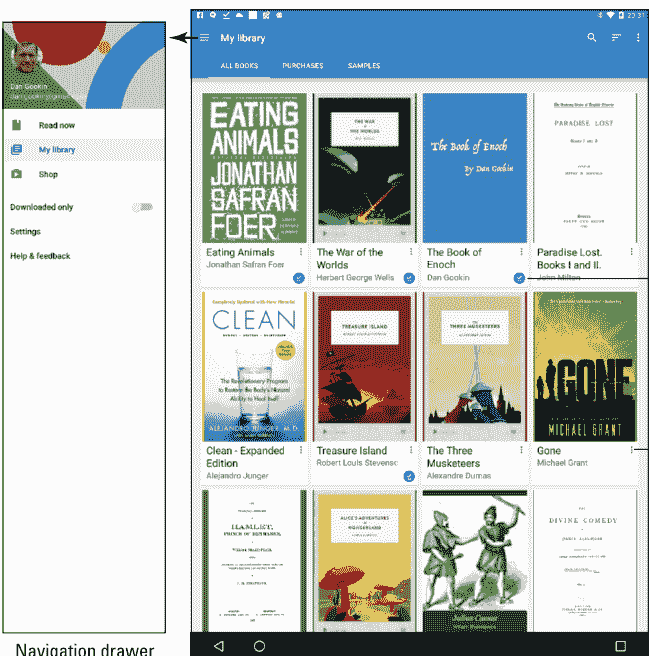

图 14-4:

`Play` 图库。

导航抽屉

书籍的操作更多

- >> 要从库中移除书籍，点击书籍封面上的“操作更多”图标并选择“从库中删除”命令。点击“删除”按钮确认。
- >> 如果屏幕上的控制控件（参见图 14-5）消失，点击屏幕再次显示它们。
- >> 点击 `Aa` 以显示调整屏幕文本和亮度的选项菜单。
- >> 与纸质书不同，电子书会锁定索引。那是因为数字页面上的文本可能会根据书籍的呈现而改变。因此，使用“搜索”命令（参见图 14-5）查找文本中的项目。

第 14 章 惊人的平板功能 181

## 调整文本显示

## 目录

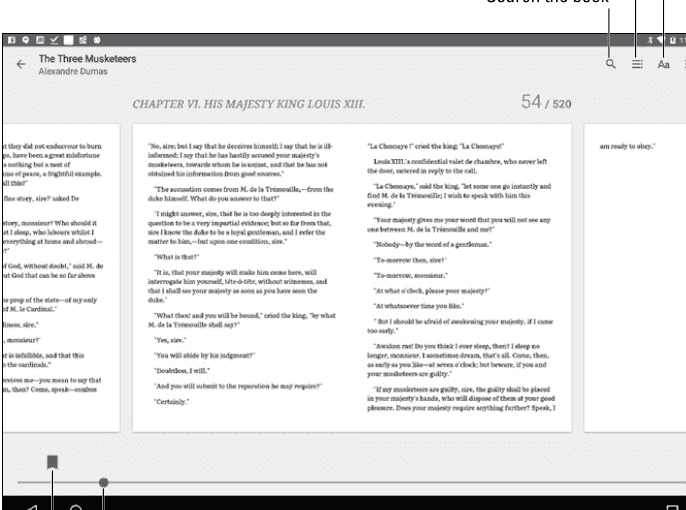

## 三剑客

54 / 520

他没有想到自己在身边呆了这么久，以至于孤独的想法都没有出现在脑海中。

（续）

* * 去 `Epcot` 的路线是什么？

* 最近的加拿大餐厅在哪里？

* 湖人队对阵凯尔特人比赛的比分是多少？

* 生命、宇宙以及万物的终极是什么？

当被问及此类问题时，`Google Now` 会通过卡片形式和语音回复进行回答。如果没有语音回复，你将看到 `Google` 搜索结果。

你可以使用 `Google Now` 通过口头控制你的平板电脑。要使用相机，可以说“`Okay, Google, take a picture`”或“`Okay, Google, record a video`”。未来的 `Google Now` 版本可能会提供额外的语音命令。

## 搜索内容

## 提问

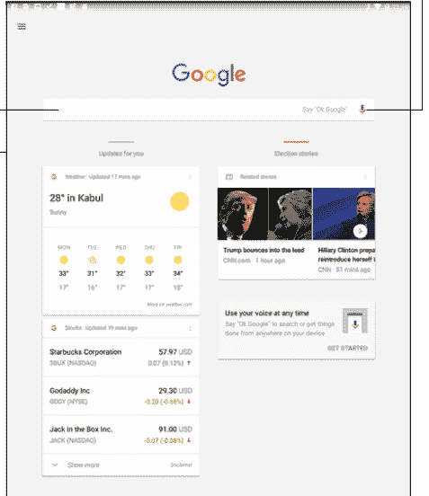

14-6:

`Google Now` 准备就绪了。

或播放。卡片

第 3 部分 全能平板电脑

你可以使用 `Google Now` 搜索互联网，就像使用 `Google` 主页一样。更有趣的是，你可以向 `Google Now` 提问；查看旁边的侧边栏“向 `Google Now` 下达命令”。

## 视频娱乐

将来，可能可以在 `Android` 平板电脑上观看“真正的”电视，但何必费此呢？你会发现平板电脑有很多视频应用可以满足你的观影欲望。最常用的两个是 `YouTube` 和 `Play Movies & TV`。所以，尽管你可能无法每天下午 5 点都收看当地的新闻团队节目，但你的平板电脑上并不缺少视频娱乐。

## 享受 YouTube

`YouTube` 这一互联网现象级应用证明了现实生活对于电视来说确实太无聊、太随机了。或者相反呢？无论如何，你都可以使用 `Android` 平板电脑上的 `YouTube` 应用查看最新的 `YouTube` 视频。

点击搜索图标找到你想要的视频。输入视频的名称、主题或任何搜索词来定位视频。有无数视频可供选择。

`YouTube` 应用会显示你订阅的所有频道的建议，这让你能够关注感兴趣的话题或 `YouTube` 内容提供者。

要查看视频，只需点击列表中的名称。

- 因为你拥有 `Google` 账号，所以你也有一个 `YouTube` 账号。我建议在 `Android` 平板电脑上使用 `YouTube` 时登录你的 `YouTube` 账号：点击操作溢出图标并选择登录（`Sign In`）命令。如果尚未登录，请登录。否则，你将看到账号信息、你的视频以及任何视频订阅。
- 参考第 12 章获取有关将你在 `Android` 平板电脑上录制的视频上传到 `YouTube` 账号的信息。
- 要以更大的尺寸查看视频，请将平板电脑旋转至水平方向。你也可以点击边缘显示的扩展（`Expand`）图标来全屏观看视频。
- 使用 `YouTube` 应用观看 `YouTube` 视频，而不是使用平板浏览器应用访问 `YouTube` 网站。
- 并非所有的 `YouTube` 视频都可以在移动设备上观看。


第 14 章 惊的平板功能 185

## 购买和租赁电影

你可以使用 `Play Movies & TV` 应用观看从 `Google Play` 租赁或购买的视频。打开应用并从主屏幕选择视频。你购买的项目显示在应用的库中。

实际的租赁或购买是在 `Play Store` 应用中完成的。经常检查该应用是否有免费赠品和折扣。有关租赁和购买电影节目的更多详情请参阅第 15 章。

- 在 `Play Store` 租赁的电影和节目在支付租赁费用后可观看长达 30 天。开始电影后，你可以在 24 小时内暂停并反复观看。
- 并非每部电影或电视节目都可以购买。有些仅限租赁。
- 你从 `Google Play` 购买的任何视频都可以在网上随时观看。访问：

```
play.google.com/movies
```

- 另请参考第 17 章获取有关从手机流传输视频到大屏显示器或 `HDTV` 的。


- 本章内容
- 在 `Google Play` 购物
- 下载应用
- 购买音乐、书籍和电影
- 创建愿望清单
- 向朋友发送应用建议
- 在平板电脑上保留媒体

第 15 章

## Google Play 购物

为你的 `Android` 平板电脑寻找更多应用、书籍、音乐和视频的地方是一个名为 `Google Play` 的数字市场。好消息是，大部分可用内容都是免费的。更好的消息是，非免费的内容很便宜。只需花费少量或免费，你就可以添加新应用和媒体来扩展 `Android` 平板电脑的功能。

## 你好，Google Play

尽管听起来像个童装店，但 `Google Play` 是为你 `Android` 平板电脑获取新应用、书籍、电影、音乐和其他宝贝的地方。`Google Play` 应用的名字是 `Play Store`。

在 `Google Play` 购物时，将平板电脑连接到 `Wi-Fi` 网络。`Wi-Fi` 不仅能提供速度，还能避免产生流量费用。有关连接平板电脑到 `Wi-Fi` 网络的详情请参阅第 16 章。

- >> 通过互联网连接从 `Google Play` 获取宝贝。因此：

>> 我强烈建议你在 `Google Play` 购物时将平板电脑连接到 `Wi-Fi` 网络。`Wi-Fi` 不仅能提供速度，还能避免产生流量费用。有关连接平板电脑到 `Wi-Fi` 网络的详情请参阅第 16 章。


>> `Play Store` 应用经常更新，所以它的界面可能会与书中看到的不同。有关更新信息和提示，请访问网站：

```
wambooli.com/help/android
```

>> `Google Play` 曾名为 `Android Market`，你可能仍然看到它被称为 `Market`。你可能看到 `Play Store` 这个术语，尽管它是应用的名字而非商店的名字。我猜它在未来版本中可能会更名为 `Google Play`。


## 浏览 Google Play

要访问 `Google Play`，打开商店应用。`Play Store` 有两个部分：应用和娱乐。


## 浏览

- 1. 如果可能，请激活 `Wi-Fi` 连接以避免产生流量费用。

有关将你的 `Android` 平板电脑连接到 `Wi-Fi` 网络的信息，请参阅第 16 章。

- 2. 打开 `Play Store` 应用。
- 3. 找到你想要的项目并打开其描述。

`Play Store` Store应用中的所有项目都有描述屏幕。它看起来与应用描述屏幕相似，如图 15-2 右侧所示的应用描述屏幕所示。

- 4. 点击按钮获取该项目。

免费应用显示“安装”（`INSTALL`）按钮。免费书籍显示“添加到收藏库”（`ADD TO LIBRARY`）按钮。对于免费电影、电视节目或音乐，请寻找“免费”（`FREE`）按钮。你可能还会看到某些项目显示“免费试用”（`Free Trial`）。在这种情况下，点击按钮查看或收听该媒体的免费示例。

付费项目显示显示价格的按钮。对于电影和电视节目，你可能会看到“租赁”（`Rent`）或“购买”（`Purchase`）按钮。请参见后文章节“租赁和购买视频”。

- 5. 点击“接受”（`Accept`）按钮。

对于某些访问平板电脑各种功能的应用，会出现一个“接受”按钮。该卡片并不是警告；它只是列出了应用想要使用的功能。如果你担心病毒，请参阅后文侧边栏“避免 `Android` 病毒”。

- 6. 对于付费项目，点击“购买”（`BUY`）按钮。

有关在 `Google Play` 购买项目的更多详细信息，请参阅下一节。

- 7. 等待项目变为可用。

媒体项目是即时可用的。应用会被下载并安装，这可能需要一些时间。在传输应用时，会显示“正在下载”（`Downloading`）通知。在应用下载期间，你可以放心地在平板上做其他事情。安装将自动完成。


- 8. 点击“打开”（`Open`）、播放”（`Play`）、收听”（`Listen`）、阅读”（`Read`）或类似的按钮，分别运行应用、观看视频、听音乐或阅读书籍。


媒体是即时可用的，因为它没有复制到你的平板电脑。相反，项目是通过流媒体传输的，或者仅在你请求时提供。只要有互联网连接，此过程就能正常工作。有关在没有互联网连接时访问媒体的信息，请参阅后文章节“在设备上保留内容”。

- 如果你尚未提供支付信息，Play Store 应用会提示你输入支付信息。此提示也会出现在免费项目上，在这种情况下，你可以跳过此提示：点击“跳过”（`SKIP`）按钮。你总可以在第一次购买东西时提供支付信息。


- 如果你在应用下载期间选择做其他事情，请参考状态栏以检查在边边中显示的“安装成功”（`Successfully installed`）通知。选择该通知以打开最近获取的应用。

- 你下载的应用会被添加到应用抽屉（`Apps drawer`）中，像平板电脑上的任何其他应用一样可以使用。

- 某些应用在安装后可能会在主屏幕上安装启动器（`Launcher`）图标。如果你想从主屏幕上删除该图标，请参阅第 18 章。

- 许多应用在首次打开时会提示权限。点击“允许”（`ALLOW`）或“拒绝”（`DENY`）。通常情况下，点击“允许”是可以的，但也请参阅旁边的侧边栏“避免 Android 病毒”。

- 你从 Google Play 获取的媒体通过特定应用访问：用于音乐的 Play Music

- 从 Google Play 获取项目后，你将收到一封 Gmail 邮件，确认你的购买情况（付费或免费）。

- 退款要快：对于已购买的应用

- 有关卸载应用的信息，请另参阅第 18 章。

- Google Play 目前不对已购买的媒体（包括音乐、书籍和电影）提供退款。


- 只要在应用下载时，请参考状态栏以检查在边边中显示的“安装成功”通知。选择该通知以打开最近获取的应用。媒体是即时可用，因为它没有复制到你的平板电脑。相反，项目是通过流媒体传输的，或者只在你请求时才提供。只要有互联网连接，此过程就能正常工作。有关在没有互联网连接时访问媒体的信息，请参阅后文章节“在设备上保留内容”。

- 你下载的应用会被添加到应用抽屉中，像平板电脑上的任何其他应用一样可以使用。

- 某些应用在安装后可能会在主屏幕上安装启动器图标。如果你想从主屏幕上删除该图标，请参阅第 18 章。

- 许多应用在首次打开时会提示权限。点击“允许”（`ALLOW`）或“拒绝”（`DENY`）。通常情况下，点击“允许”是可以的，但也请参阅旁边的侧边栏“避免 Android 病毒”。

- 你从 Google Play 获取的媒体通过特定应用访问：用于音乐的 Play Music

- 从 Google Play 获取项目后，你将收到一封 Gmail 邮件，确认你的购买情况（付费或免费）。

- 退款要快：对于已购买的应用

- 有关卸载应用的信息，请另参阅第 18 章。

- Google Play 目前不对已购买的媒体（包括音乐、书籍和电影）提供退款。

购买视频比租借要贵，但你可以随时在任何 Android 设备上观看该电影或电视节目。你还可以下载电影，这样即使在没有 Internet 连接的情况下也可以观看。

购买电影时，你的选择之一是购买 `SD` 版本还是 `HD` 版本。`SD` 版本更便宜，而 `HD` 版本仅在某些输出设备上以高分辨率播放。

- 有关 Play Movies & TV 应用的信息，请参阅第 14 章。

- 有关从手机流传输视频到大屏幕设备（如 `HDTV`）的信息，请参阅第 18 章。

## Google Play 小技巧

我不希望你成为 Google Play 专家。如果你和我一样，你只是想要获取应用、音乐、电影或任何你需要的东西然后继续你的生活。然而，Play 商店的功能远不止于获取新物品。

### 使用愿望清单

> 当你犹豫是否要在 Google Play 上购买付费应用、音乐、书籍或其他任何物品时，可以考虑将其添加到愿望清单：点击侧边栏显示的愿望清单图标。（参考图 15-2。）

要查看你的愿望清单，点击 Play Store 应用中的侧边菜单图标。（参考图 15-1）。从导航抽屉中选择“愿望清单”项目。你会看到你标记的所有物品。当你准备好购买时，选择一个并购买它！

### 分享 Google Play 项目

有时你非常喜欢你的 Google Play 购买，以至于无法抑制喜悦。当这种情况发生时，考虑分享该物品。遵循以下步骤：

1. 打开 Play Store 应用。
2. 浏览或搜索你想要共享的应用、音乐、书籍或其他物品。
3. 找到物品后，点击它查看其描述屏幕。
4. 点击共享图标。

你可能需要向下滑动屏幕找到侧边栏显示的共享图标。点击共享图标后，你会看到一个列出各种应用的菜单。

5. 选择一个应用。

例如，选择 Gmail 在邮件消息中发送 Google Play 链接。

6. 使用选定的应用分享链接。

接下来的情况取决于你选择了哪种共享方法。

遵循这些步骤的结果是你的朋友收到一个链接。那个人可以在他的 Android 设备上点击链接，立即跳转到 Play Store 应用，在那里可以获取物品。

### 将内容留在设备上

你从 Google Play 获取书籍、音乐、电影和电视节目并没有复制到 Android 平板电脑。相反，它们存储在互联网上。当你访问媒体时，它按需要流到你的设备中。这种设置运行良好，可以防止平板电脑耗尽存储空间，但它仅在有 Internet 连接时有效。

当你计划离开 Internet 连接时（例如在跨国飞行且不想支付机上 Wi-Fi 时），你可以下载 Play Store 的音乐、电子书和电影购买并将它们保存到平板电脑上。

要查看哪些媒体在你的平板电脑上，打开 Play Books、Play Music 或 Play Movies & TV 应用。按照以下步骤操作，这些步骤在每个应用中相同：

1. 点击侧边菜单图标。
2. 在导航抽屉中选择“仅限下载”项目。

要查看已下载（保存在平板电脑上）的物品，请确保主控制处于“开启”位置。

3. 从导航抽屉中选择“库”项目。

你只会看到平板电脑上的那些物品。你库的其他部分存储在互联网上。

要再次查看整个库，重复这些步骤，但在步骤 3 中将主控制滑到“关闭”位置。

下载到你平板电脑的物品具有“设备上”图标，类似于侧边栏显示的图标。该图标的颜色在 Play Music、Play Books 和 Play Movies & TV 应用之间有所不同。

要将物品留在平板电脑上，请寻找侧边栏显示的“下载”图标。点击该图标，物品将从互联网获取并存储在你的平板电脑上。

电影和音乐会占用 Android 平板电脑的存储空间，尤其是长片。下载这些物品对于短途旅行很好，但长期来看，考虑清理一些已下载的媒体。

要从平板电脑删除物品，点击“设备上”图标。选择“删除下载”操作，然后点击“移除”按钮确认。

不要担心删除下载的媒体。当 Internet 连接激活时，你可以随时访问已购买（或免费获得）的物品。你可以反复下载物品而无需再次付费。

# 4 基础知识

## 本部分内容

- 连接到 Wi-Fi 网络并使用 Internet。
- 在平板电脑和 PC 之间交换文件。
- 自定义平板电脑主屏幕。
- 增强平板电脑安全性。
- 使用你的 Android 平板电脑环游。
- 延长电池寿命并管理功耗。

## 本章内容

- 使用移动数据网络
- 启用 Wi-Fi
- 访问 Wi-Fi 网络
- 连接到 WPS 路由器
- 与蓝牙外配配
- 使用 Android Beam 传输信息

# 第 16 章：无线生活

曾经，真正先进的技术通过一团缠缠的电缆很容易识别。今天，情况恰恰相反。感谢于强大的电池和无线 Internet 访问，你的 Android 平板电脑过着无束的生活。欢迎来到轻松的数字生活。当然，偶尔需要停下来为那块强大的电池充电。

## 无线的奇妙世界

Android 平板电脑需要 Internet 连接。为了缓解这种需求，平板电脑以无线方式与信息高速公路通信。鉴于无线网络在全球的普及，寻找可用的无线网络已不再是大事。不，问题在于如何引导平板电脑建立连接。

### 使用移动数据网络

LTE Android 平板电脑使用移动数据网络连接到 Internet。这与智能手机使用的数字蜂窝网络相同。根据网络速度，有几种类型的网络：

- `4G LTE`：第四代广域数据网络，速度最快。
- `3G`：第三代网络，在没有 `4G` 信号时使用的最快网络。
- `1X`：提供几种原始、较慢的蜂窝数据信号。它们都属于 `1X` 体系。它很慢。

（注：此处原文中存在大量重复列表，已去重）

### 理解 Wi-Fi

要再次查看整个库，重复这些步骤，但在步骤 3 中将主控制滑到“关闭”位置。

（后续内容根据逻辑已完成去重处理）

要连接到新的 Wi-Fi 网络，请遵循以下步骤：

1. 打开设置应用，并选择 `Wi-Fi`。

在某些三星平板电脑上，您可以在“连接”选项卡中找到 `Wi-Fi` 项目。

2. 从列表中选择无线网络。

可用的 `Wi-Fi` 网络显示在屏幕上，类似于图 16-1 所示。如果没有列出无线网络，说明您在当前位置无法访问无线。

信号强度

`Wi-Fi` 主控制

受密码保护的网络

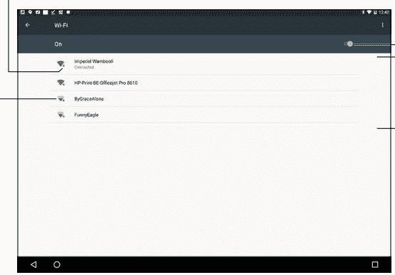

图 16-1：寻找无线网络。

可用的 `Wi-Fi` 网络

3. 如果出现提示，输入网络密码。

点击“显示密码”框，以便查看您正在输入的内容；某些网络密码可能长。

4. 点击“连接”按钮。

网络将立即连接。如果没有连接，请重试。

当平板电脑连接到无线网络时，您会看到 `Wi-Fi` 已连接状态图标，类似于侧边栏所示。此图标表示平板电脑的 `Wi-Fi` 已开启、已连接并正在与 `Wi-Fi` 网络通信。

某些公共网络对所有人开放，但您必须使用平板电脑的浏览器应用程序来找到登录网页。按照该页面的指示获取网络访问权限。要找到该页面，请浏览互联网上的任何页面，登录网页就会出现。

您的平板电脑会记住所有之前连接过的 `Wi-Fi` 网络。要查看列表，点击设置图标或操作溢出菜单并选择“已保存的网络”。要删除已保存的网络，点击该条目，然后点击“忘记”按钮。请参阅下一节获取有关操作已保存网络的详细信息。

并不是每个无线网络都有密码。没有密码会让连接速度更快，但在连接到网络时请务必小心。坏人可能会监控您的连接，窃密码和其他信息。


要断开 `Wi-Fi`，请关闭平板电脑的 `Wi-Fi`。请参考前节。

当您计划在一个地方停留较长时间时，请使用 `Wi-Fi`。与移动数据网络不同，`Wi-Fi` 广播信号范围有限。如果您走得太远，平板电脑将丢失信号并断开连接。


### 更新 Wi-Fi 网络密码

某些场所遵循良好的计算机安全规范并更改其 `Wi-Fi` 密码。当您访问一家迷人的咖啡馆并发现平板电脑没有重新连接到网络时，请按照以下步骤：

1. 获取新密码。

向负责人索要新密码，例如那个一直问你黑咖啡里是否要加“房间”的困惑女士。

2. 打开设置应用并选择 `Wi-Fi`。

3. 如果列表中没有出现给定的网络（参考图 16-1），点击操作溢出菜单或“更多”按钮并选择“已保存的网络”。

会显示已保存的网络列表——如果有已保存的网络的话。

4. 从列表中选择 `Wi-Fi` 网络。

例如，`Café Wambool` 更改了 `Wi-Fi` 密码。从列表中选择 `Wambool` 网络。

5. 点击“忘记”按钮。

6. 点击后退导航图标，然后重复前节的步骤以与网络建立新连接。

如果这些步骤不起作用，请确保您输入了正确的密码，禁用平板电脑的 `Wi-Fi` 无电，然后重新启用。

### 连接隐藏 Wi-Fi 网络

某些无线网络不广播名称，这增加了安全性但也让连接变得更加困难。在这种情况下，请按照以下步骤连接 `Wi-Fi` 网络：

1. 打开设置应用并选择 `Wi-Fi`。

对于某些三星平板电脑，在设置应用的“连接”选项卡中找到 `Wi-Fi` 项目。

2. 点击操作溢出菜单或“更多”按钮并选择“添加网络”。

该操作可能是“添加 `Wi-Fi` 网络”，或者以“+”图标的形式出现。

3. 输入网络名称。

网络名称框可能标记为 `SSID`。

4. 选择安全性设置。

5. 输入密码。

密码是可选的，参考之前的“连接 `Wi-Fi` 网络”章节关于无密码网络的说明。

6. 点击“保存”或“连接”按钮。

安全性设置和密码等详细信息是从网络名称或 `SSID` 获取的。`SSID` 代表服务集标识符。


### 连接 WPS 路由器

许多 `Wi-Fi` 路由器支持 `WPS`（`Wireless Protection Setup`，无线网络保护设置）。这是一种简单且安全的网络授权系统。如果路由器支持 `WPS`，请按照以下步骤将平板电脑快速连接到网络：


1. 点击路由器上的连接按钮。

该按钮标记为 `WPS` 或使用侧边栏所示的 `WPS` 图标。

2. 在平板电脑上打开设置应用并选择 `Wi-Fi`。

三星平板电脑查看“连接”选项卡以找到 `Wi-Fi`。

3. 如果屏幕上没有 `WPS` 选项，点击操作溢出菜单或“更多”并选择“高级”。

4. 选择 `WPS` 按钮或 `WPS PIN`，取决于路由器的实现方式。

如果是 `WPS` 按钮路由器，按下路由器上的 `WPS` 按钮。如果是 `WPS PIN` 路由器，在平板电脑屏幕上查看 `PIN`。在路由器上输入该数字。与路由器的连接可能需要几分钟，请耐心等待。好消息是，像所有 `Wi-Fi` 网络一样，一旦建立连接，将来会自动连接。

### 设置计费 Wi-Fi 连接

并不是所有的 `Wi-Fi` 网络都提供免费无限访问。某些连接是计费的。这意味着可能会按分钟或每兆字节收取上网费用。

要将 `Wi-Fi` 连接设置为计费，并确保不超过数据配额，请遵循以下步骤：

1. 正常连接到网络。

方法在本章前面。

2. 打开设置应用并选择“流量使用”。

此项目位于“无线与网络”区域，或在某些三星平板电脑的“连接”选项卡上。

3. 点击操作溢出菜单或“更多”按钮。

4. 选择“网络限制”。

此操作可能是“限制网络”。

5. 在列表中找到当前连接并将其主控制设置为“开启”。

当 `Wi-Fi` 连接被设置为计费时，平板电脑会监控并限制数据访问。当尝试大下载或上传时，您会收到警告。

## 蓝牙世界

蓝牙与蓝色或口腔卫生没有关系。不，它是用于两个或多个设备之间通信的无线协议。您的 Android 平板电脑恰好内部有一个蓝牙模块，因此它可以与键盘、耳机、打印机和带有激光的机器人鼠标等聊天。

### 理解蓝牙

要让蓝牙工作，您需要一个蓝牙设备，如无线键盘。目标是将该设备与平板电脑配对。操作如下：

1. 开启平板电脑和外设上的蓝牙功能。
2. 让外设变为可发现状态。

外设必须宣布它是可用的并愿意与附近的电子设备配合。

3. 在平板电脑上，从蓝牙设备列表中选择该设备。
4. 如果需要，确认连接。

例如，您可能被要求在平板上输入代码、在打印机上确认代码，或在带有按钮的外设上按下按钮。

5. 使用蓝牙设备。

您可以随心所欲地使用蓝牙设备。关闭平板电脑。当再次开启时，它们会自动重新连接。

蓝牙设备带有侧边栏所示的蓝牙标志。这是确保该设备与其他蓝牙设备兼容的保证。


### 在平板电脑上激活蓝牙

在使用任何蓝牙设备之前，您必须开启平板电脑的蓝牙功能。以下是在 Android 平板电脑上激活蓝牙的方法：

1. 打开设置应用。
2. 选择蓝牙。

在某些三星平板电脑上，点击“连接”选项卡以找到蓝牙项目。

3. 确保蓝牙主控制已设置为“开启（`On`）”位置。

向右滑动图标以激活。

当蓝牙开启时，会显示蓝牙状态图标。它使用侧边空白所示的蓝牙标志。

要关闭蓝牙，请重复本节的步骤，但在第 3 步中将主控制滑动到“关闭（`Off`）”位置。

你还可以在平板电脑的“快速设置”中找到蓝牙激活按钮，正如第 3 章所言。

### 与蓝牙外设配对

要让你的平板电脑与其他设备（如蓝牙键盘）建立蓝牙连接，请按照以下步骤操作：

1. 确保平板电脑的蓝牙无线电已开启。

参考前一节。

2. 将蓝牙外设设为可发现模式。

开启设备并确保其蓝牙无线电已开启。请注意，某些蓝牙外设具有独立的电源和蓝牙开关。如果是这样，按下蓝牙按钮或采取任何必要操作使外设变得可发现。

3. 在 Android 平板电脑上，打开“设置”应用。
4. 选择“蓝牙”。

在某些三星平板电脑上，点击“设置”应用中的“连接”选项卡以找到图 16-2 所示的内容。如果没有，点击“操作溢出”菜单并选择“刷新”。某些平板电脑可能使用“扫描”按钮或显示侧边所示的“刷新”图标。

5. 从列表中选择蓝牙外设。
6. 如必要，输入设备密码或其他通过方式确认连接。

例如，使用蓝牙键盘时，你可能会在平板电脑上看到提示，显示一系列数字。在键盘上输入这些数字，然后按回车（`Enter`）或返回（`Return`）键。该操作即完成了配对。

键盘耳机

蓝牙主控制

设备设置

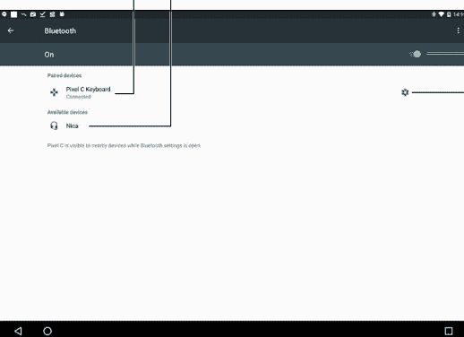

图 16-2：寻找蓝牙设备。

配对完成后，你就可以开始使用它了。

已连接设备出现在蓝牙设置窗口的“已配对设备”标题下，例如图 16–2 所示 `Pixel C` 键盘。

- 当你关闭平板电脑或禁用蓝牙无线电时，蓝牙外设会保持配对状态。再次开启时连接会自动重新建立。
- 如果要停止停止某设备，你需要取消配对。为此，点击“设置”图标（参考图 16-2）并点击设备项。点击“忘记”按钮或“取消配对”操作。
- 仅取消配对你计划不再使用的设备。否则，在使用完成后只需关闭蓝牙设备即可。


蓝牙无线电会消耗少量电量。对于平板电脑来说电量不多，但对于外设来说可能很多。如果你计划一段时间不使用该外设，请将其关闭。


## Android 快速传输 (Beam)

部分 Android 平板电脑配备 NFC 无线电，其中 NFC 代表近场通信，无线电是一种技术。NFC 允许你的平板电脑与其他 NFC 设备进行无线通信。该连接被用于快速传输信息。这项技术被称为 Android Beam。

210 第 4 部分 核心要素

要体验 Android Beam 功能，请确保平板电脑的 NFC 无线电已激活。按照以下步骤：

1. 打开“设置”应用。
2. 定位 NFC 项。

在原生 Android 设备上，选择“无线与网络”区域中的“更多”项。在具有此功能的三星平板电脑上，点击“连接”标题以找到 NFC 项。

如果你找不到 NFC 项，说明你的平板电脑缺少这项技术。

3. 确保 NFC 项已激活。

在 NFC 项旁边打上标记，或确保你的主控制处于“开启（On）”位置。

激活 NFC 后，你可以使用平板电脑与其他 NFC 设备进行通信，例如平板电脑、手机以及各种商户的支付系统。

要让 Android Beam 功能生效，将你的平板电脑接触另一个 NFC 设备，通常是背对背。只要两个设备都拥有 NFC 无线电且 Android Beam 功能处于激活，它们就可以共享信息。你可以传输诸如联系人、地图位置、网页、YouTube 视频或你在平板电脑触摸屏上看到的任何内容。

> 当两个 Android Beam 设备触碰时，你会在屏幕上看到提示：触碰传输（Touch to Beam）。点击屏幕，你正在查看的内容会立即发送到另一个设备。基本上就是这么简单。

> 一般来说，如果一个应用带有“分享”图标，你可以使用 Android Beam 在两个 NFC 设备之间共享项目。

> 两个设备在靠近时都会显示“触碰”提示。如果对方与你同时触摸他们的屏幕，信息就会在两个设备之间进行交换。

> NFC 区域通常位于平板电脑的背面。随你的 Android 平板电脑附带的简陋文档可能会标出具体位置。

> NFC 与某些三星平板电脑上找到的“附近设备”功能不同。“附近设备”功能用于通过网络共享媒体文件。


第 16 章 无线生活 211

## 本章内容

- 建立 USB 连接
- 设置连接类型
- 连接到 PC 或 Mac
- 使用云共享文件
- 使用 Android 平板电脑打印
- 执行文件管理
- 管理 microSD 卡

# 第 17 章

## 连接、共享与存储

我们的 Android 平板电脑并不是离线的。确实，它是无线的，但它需要与其他设备通信。你可以通过这些方式共享照片、电影和音乐。

### USB 连接

将 Android 平板电脑连接到电脑最直接的方法是使用线缆——具体来说是 USB 线缆。方便的是，线缆随平板附带。它的作用不仅仅是设备充电。

### 配置 USB 连接

每当你将 Android 平板电脑连接到电脑时，USB 连接会自动配置。一切本应正常工作。如果不是，你可以手动配置 USB 连接。按照以下步骤操作：

1. 向下滑通知栏。
2. 选择 USB 通知。

USB 图标位于侧边空白。

3. 选择一种连接选项。

USB 连接屏幕列出了几种配置 USB 连接的选项：

- **充电**：`USB` 连接为平板电脑充电。
- **文件传输**：也称为传输媒体文件 (`MTP`)，这种连接适用于传输文件。电脑将平板电脑视为 U 盘或其他设备。
- **照片传输 (`PTP`)**：在此模式下（可能标记为传输图像），电脑将平板电脑视为数字相机，最适合导入照片和视频。
- **MIDI**：选择此模式将平板电脑作为键盘或类似设备用于音乐输入。

选择模式后，你可能会在电脑上看到通知，提示对平板电脑进行操作。你的选择取决于你在第 3 步中选择了什么。


> 如果电脑无法识别平板，请选择另一种 USB 连接选项。

> 如果你使用的是 Mac，请参后文“将平板电脑连接到 Mac”。

> 当平板锁定时，电脑可能无法访问。解锁屏幕以解决此问题。

> 某些平板电脑可能使用自己的文件传输软件，这很烦人但你必须处理。例如，某些三星平板电脑需要使用 `Kies` 工具程序来传输文件。

如果你的 Android 平板电脑有一个 `microSD` 卡，它的存储空间也会挂载到电脑以及平板电脑的内部存储。你不需要为了建立 USB 连接而对其进行单独配置。

带有 `USB 3.0` 接口的平板电脑配有一根 `USB 3.0` 数据线。你仍然可以在设备上使用旧式的 `USB 2.0` `micro-USB` 数据线：将 `micro-USB` 插头连接到平板边缘 `USB 3.0` 接口大一侧。

>> 若要以超过 `USB 3.0` 数据线的速度传输数据，你必须将平板电脑的 `USB 3.0` 数据线连接到电脑上的 `USB 3.0` 端口。这些端口通常为蓝色。

>> Android 平板电脑缺乏通过 USB 连接添加外设（如鼠标或优盘）的能力。某些平板电脑可能带有提供此类连接功能的多媒体扩展坞，但直接 USB 连接是无法实现的。

>> `MTP` 代表媒体传输协议（`Media Transfer Protocol`）。此设置会让电脑认为平板是一个便携媒体播放器或 U 盘。`PTP` 图片传输协议（`Picture Transfer Protocol`）设置会误导电脑认为平板是一台数码相机。


### 将平板电脑连接到 PC

在 Android 平板电脑和 PC 建立 USB 连接后，会发生很多变化。不要被频繁的活动惊着了。

你可能会看到驱动程序正在安装。当连接新的 Windows 设备时，这是 Windows 的正常行为。

你可能还会看到通知，如图 17-1 所示的 `Windows 10` 通知。点击或触摸该通知查看如何处理新连接。

图 17-1：`Windows 10` 平板连接选项。

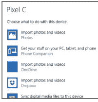

`Windows 10` 通知 平板连接选项

第 17 章 连接、共享与存储 215

例如，选择“打开设备以查看文件”（图 17-1 中未显示，但在选项的滚动列表中）。此选择会打开一个文件资源管理器窗口——列出 Android 平板上的文件和文件夹。或者你可以选择“导入照片和视频”来快速拷贝平板上的图片和电影。

- 你从项目列表中做出的选择会被 `Windows 10` 记住。下次你连接平板电脑时，该选项会被自动选中。
- 其他版本的 Windows 也显示操作列表，尽管它们出现在“自动播放”对话框中。与 `Windows 10` 一样，你选择一个特定项目，那么当平板连接时，该选项将始终被选中。
- 有关在平板和电脑之间传输文件的详细信息，请参见后文章节“文件的来回传输”。

### 将平板电脑连接到 Mac

你需要特殊的软件来处理 Android 到 Macintosh 的连接。因为 Mac 原生无法识别 Android 设备。很奇怪，对吧？好像 Apple 想要让你使用其他类型的传输。我不理解。

为了帮助在 Mac 上进行 USB 连接，请获取 Android 文件传输（`Android File Transfer`）程序。在你的 Mac 上，从此网站下载该程序：

```
android.com/filetransfer
```

安装软件并运行。从现在起，每当你将 Android 平板连接到 Mac 时，你会看到一个特殊的窗口出现，类似于图 17-2 所示。它列出了平板的文件夹和文件。按照本章后面的介绍，使用该窗口进行文件管理。

如果平板上插入了 `microSD` 卡，你会在 Android 文件传输程序窗口看到两个按钮：平板（`Tablet`）和卡（`Card`），如图 17-2 所示。点击其中任意一个查看该存储位置的文件和文件夹。

### 从电脑上断开平板连接

过程非常简单：当你完成电脑和平板之间文件、音乐或其他媒体的传输后，关闭电脑上打开的所有程序和文件夹——特别是你用来处理平板存储的那些程序。然后就可以断开 USB 线了。就这样。

### 内部存储

#### microSD 卡存储

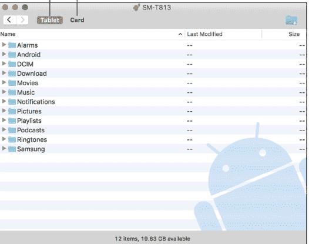

图 17-2：

Android 文件传输程序。

> 警告

在传输信息或电脑上打开着文件夹窗口时拔掉平板是一个坏主意。这样做可能会损坏平板的内部存储，导致存储其中的某些信息无法访问。为了安全起见，请在断开连接前关闭已打开的程序和文件夹窗口。

> 与 Macintosh 上的外部存储不同，当你访问完毕后不需要弹出平板存储。在 Mac 上退出 Android 文件传输程序，然后拔掉平板——或者反过来也可以。无论哪种操作，Mac 都不会生气。

### 文件的来回

USB 连接仅提供了平板与其他设备之间传输文件的唯一方法。文件也可以在云存储之间往返。当需要时，平板可以连接到打印机并生成触摸屏上显示的文件、照片或其他项目的纸质副本。

- 从电脑传输文件到平板并不保证你就能对其进行高效率操作。具体来说，不要从此处拷贝电子书到

第 17 章 连接、共享与存储 217


同样，为了让平板可以使用某个文件，请将该文件拷贝到电脑上的 `Google Drive` 文件夹中。当你下次访问平板上的 `Drive` 应用时，打开相应的文件夹并找到该文件。

- 其他云存储应用包括流行的 `Dropbox`、微软的 `OneDrive`、亚马逊云等。这些应用的工作原理都与 `Google Drive` 类似；只需在第 3 步选择正确的应用即可。

- 你可以通过 `Google Play` 获取 `Dropbox` 应用，但你还需要获取一个 `Dropbox` 账户，可能还需要为电脑下载 `Dropbox` 程序。访问 `dropbox.com` 开始使用。

- 云存储应用是免费的，你可以免费使用少量的存储空间。超出部分，你必须支付月费。


### 使用 USB 线传输文件

USB 连接仅提供了平板与其他设备之间传输文件的唯一方法。文件也可以在云存储之间往返。当需要时，平板可以连接到打印机并生成触摸屏上显示的文件、照片或其他项目的纸质副本。

- 从电脑传输文件到平板并不保证你就能对其进行高效率操作。具体来说，不要从此处拷贝电子书到

3. 选择添加服务或下载插件。

`Play` 商店应用将打开，并列出可用的打印服务。

4. 选择并安装打印服务。

例如，如果你使用佳能打印机，请选择并安装佳能打印服务。有关安装应用的详情，请参阅第 18 章。

服务安装后，或者确认该服务可用，你就可以从 Android 平板上打印任何内容。请继续阅读下。

#### 打印

在 Android 平板上进行打印并非不可能，实际上非常简单。如果平板电脑连接了带有可用打印机的 Wi-Fi 网络，并且该打印机已安装了打印服务，打印流程如下：

1. 查看你想打印的材料。

你可以打印网页、照片、地图或任何项目。

2. 点击“操作溢出”按钮或“更多”按钮，并选择“打印”操作。

如果你没有看到“打印”操作，说明你的平板电脑缺少此功能。

3. 选择打印机。

操作栏会显示当前打印机，如图 17-4 所示。要查看更多打印机，请点击如图所示的操作栏。你将看到 Wi-Fi 网络上所有可用打印机的列表。

4. 若要更改任何打印设置，点击“显示更多详情”箭头。

显示的项目允许你设置想要打印的页面、更改副本数量，并进行其他常用的打印机设置。

5. 点击“打印”按钮。

项目将进行打印。

并不是每个应用都支持打印。唯一的判断方法是执行本节的第 1 和第 2 步。如果你没有看到“打印”操作，则无法打印。

### 流传输你自己的媒体

你的平板电脑可能有一个很漂亮的大屏幕。你的高清电视或显示器可能有一个更大的屏幕。如果那个大屏幕的某个 HDMI 接口上连接了 `Chromecast` 接收器，你就可以从平板电脑将视频和音乐流传输到那个大尺寸设备。

#### 选择打印机操作栏

#### 显示更多详情

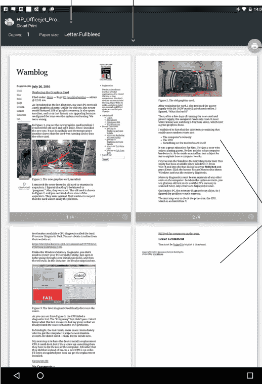

打印

打印预览

图 17-4：

Android 平板打印。

在安装并配置 `Chromecast` 后，按照以下步骤从平板电脑流传输媒体：

1. 打开播放你想观看或收听的媒体的应用。

兼容的应用包括 `Play Music`、`Play Movies & TV`、`YouTube`、`Netflix` 等。

2. 将高清电视或显示器调至相应的 HDMI 频道。

例如，如果 `Chromecast` 安装在 `HDMI` 输入 4，请将电视切换到该输入源。投屏接收器必须处于唤醒并激活状态。

3. 点击 `Chromecast` 图标。

图标与侧边显示的类似。如果你没看到它，说明 `Chromecast` 接收器未处于唤醒状态，或者媒体无法投屏到另一个设备。

4. 从列表中选择电视或显示器的 `Chromecast`。

5. 播放媒体。

媒体将在另一个设备上显示或被听到。

在投屏期间，你仍然可以使用平板电脑。屏幕上的应用可能会为你提供控制功能（如播放和暂停），或者显示有关媒体的附加信息。

要停止流传输，点击 `Chromecast` 图标，然后点击“断开连接”按钮。

### Android 平板存储

在你的 Android 平板电脑内部某处隐藏着一个存储设备。该存储的工作原理类似于计算机的硬盘，用途相同：长期保存应用、音乐、视频、图片以及许多其他信息。

- Android 平板电脑带有固定容量的内部存储。容量由制造商预设，通常在购买时提供选项。
- 典型的内部存储容量包括 `16GB`、`32GB`、`64GB` 等等。
- 某些 Android 平板电脑支持 `microSD` 卡形式的可移动存储。
- `GB` 代表千兆字节，即 10 亿字节（字符）的存储空间。一部典型的 2 小时电影约占用约 `4GB` 的存储空间，但你存储在平板上的大多数项目（例如音乐和图片）只占用极小部分空间。


#### 查看存储统计

你可以查看 Android 平板上的可用存储空间，按照以下步骤操作：

1. 打开“设置”应用。
2. 选择“存储和 USB”项。

在某些平板电脑上，此项被称为“存储”，并可以在“设置”应用的“常规”选项卡中找到。

你将看到与图 17-5 类似的界面。它详细列出了平板内部存储（如果可用，还有 `microSD` 卡）的存储空间信息。

#### 卸载 microSD 卡

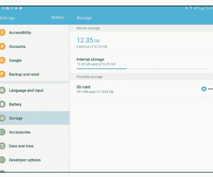

图 17-5：

Android 平板存储信息。

点击存储项或点击存储类别（如果已列出），以查看存储使用情况详情或启动关联应用。例如，点击“应用”项查看运行应用列表。选择“视频”查看存储在平板上的视频。

- 占用最多存储空间的内容是视频、音乐和图片，按顺序排序。
- 要查看有多少未占存储空间，请参考“可用”项。
- 如果“总值”远小于你 Android 平板的标称容量，不要觉得被骗。例如，你的平板可能有 `32GB` 存储，但存储应用报告的总空间为 `29.85GB`。缺失的空间被视为系统开销，政府出于税收目的占用的几个 GB 也是如此。


记住


技术细节

### 管理文件

你购买 Android 平板可能并不是因为你喜欢管理文件。（注：原文此处大量重复，已过滤）

## 本章内容

- 在主屏幕上整理应用
- 使用小部件（Widgets）
- 重新排列主屏幕
- 创建文件夹
- 执行应用更新
- 移除应用
- 选择默认应用
- 整理应用程序抽

# 第 18 章

## 应用与小部件

在 Android 平板电脑提供的 200 万多个应用中，你可能希望保留几个最喜爱的应用，以便随时使用。保持这些应用易于访问、整洁且井条的最佳方法是将它们的启动器图标（`Launcher icons`）放置在主屏幕上。事实上，设置主屏幕的目的为了方便使用常用应用和小部件。

### 主屏幕上的应用与小部件

你可以做一个无奈的旁观者，为应用没有在主屏幕上占据属于它们的一块之地而苦恼；也可以自定义主屏幕，显示那些你频繁使用的应用。


主屏幕上的应用图标被称为启动器（`launchers`）或启动器图标。

### 将应用添加到主屏幕

当你发现自己经常使用某个应用时，可以考虑在主屏幕上贴上上该应用的启动器。操作方法如下：

1. 访问你想放置启动器图标的主屏幕页面。该页面必须有足够的空间放置启动器图标。如果没有空间，向左或向右滑动屏幕寻找有空间的页面。或者，如果你正在按应用类型整理页面，请访问相应的页面。例如，在你的平板电脑上，第二个主页专门用于存放游戏。
2. 点击“应用”图标显示应用程序抽（`Apps drawer`）。
3. 长按你想添加到主屏幕的应用图标。

片刻后，你在第 1 步中选择的主屏幕页面会出现，类似于图 18-1 所示。

将图标拖到主屏幕上的某个位置

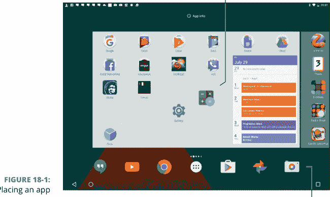

收藏栏（`Favorites tray`）

4. 将应用拖动到主屏幕页面的某个位置。
5. 抬起手指放置应用。


主屏幕上的启动器图标按网格对齐。其他启动器在找到位置时可能会晃动或跳动。这没关系。如果启动器不在你想要的精确位置也不要担心。稍后的章节“移动启动器和小部件”将描述如何重新排列主屏幕上的项目。

应用并没有移动：你看到的是一个启动器，它就像一个副本或快捷方式。你仍然可以在应用程序抽中找到该应用，但现在可以在主屏幕上更方便地使用该应用了。

- 新安装的应用通常会自动在主屏幕上固定启动器图标。
- 并不是每个应用都需要在主屏幕上有启动器图标。我建议只放置最常用的几个应用。
- 某些平板电脑使用应用程序抽的第一行来列出频繁访问的应用。查看应用程序抽以浏览常用应用，如果它们尚未添加，可以考虑将其添加到主屏幕。
- 主屏幕上创建的启动器数量不能超过网格容纳的数量。替代方案是可以通过移动一些启动器到另一个主屏幕页面来重新重新排列，这将在稍后的章节“移动启动器和小部件”中介绍。另见稍后的章节“使用文件夹”的另一种解决方案。如果你的平板电脑允许添加更多主屏幕页面，你可以通过这种方式解决问题；参见第 19 章。


## 将应用放入收藏栏

无论你查看哪个主屏幕页面，主屏幕底部的启动器行都保持不变。它被称为收藏栏（`favorites tray`），是你放置最常用应用的理想位置。

通过以下方式之一将启动器添加到收藏栏：

- 将启动器从收藏栏拖出，到主屏幕页面或移除/删除图标。此步骤将为收藏栏中的新图标腾出空间。
- 将启动器从主屏幕拖动到收藏栏，任何现有图标将与已有的图标交换位置。

在这两种方法中，第二种可能在所有平板电脑上都有效。事实上，第二种方法可能会在收藏栏上创建一个应用文件夹，这可能不是你想要的。（参见稍后的章节“使用文件夹”。）

最适合放置在主屏幕上的应用是那些能显示启动器通知的应用，类似于边栏所示的图标。这些应用包括 `Facebook`、`Twitter`、邮件应用等。


## 添加小部件

除了应用启动器，主屏幕也是你寻找小部件的地方。小部件的作用就像一个微型交互式或信息性窗口，通常提供进入平板电脑上另一个应用的入口。小部件可以显示时间、天气、推文或新视频，也可以作为你正在阅读的电子书占位符，或者代表地图上的联系人等。

要在主屏幕上添加小部件，请遵循以下步骤：

1. 切换到有足够空间放置新小部件的主屏幕页面。小部件有多种尺寸。尺寸通过启动器维度衡量：`1x1` 小部件占据的空间与启动器图标相同。`2x2` 小部件的高度宽度是启动器图标的两倍。
2. 按主屏幕的空白区域。你会看到主屏幕概览，以及底部的图标。
3. 点击小部件图标。出现小部件列表。
4. 长按你想添加的小部件。浏览找到小部件，它们按字母顺序排列并显示预览图。
5. 将小部件拖动到主屏幕。当你拖动时，现有的启动器和小和小会移动以腾出空间。
6. 抬起手指。如果小部件出现了边界，则可以调整大小。参见下一章节。

添加小部件后，系统可能会提示输入额外信息，例如天气小部件的位置、联系人小部件的名字等。

## 调整小部件大小

某些小部件是可以调整大小的。如果小部件出现了边界，则可以调整大小。参见下一章节。要调整大小，拖动其中一个

图 18-2：调整小部件大小


## 移动启动器和小部件

启动器图标和小部件固定在主屏幕上。开始时，长按

图 18-3：移动启动器图标


## 使用文件夹

为了进一步整理主屏幕，考虑将相似的应用聚集到文件夹中。例如，我有一个文件夹包含我所有的音乐应用。你的平板电脑可能自带 `Google` 文件夹，包含 `Google` 提供的所有应用。这些文件夹可以帮助组织应用，还能解决主屏幕拥挤的问题。

文件夹的创建方法取决于平板电脑。`Android` 创建文件夹的方法是将一个启动器图标拖到另一个图标上方。当两个启动器靠近时，圆圈会将它们包裹，这提供了创建文件夹的视觉反馈。

另一种技巧是寻找文件夹创建图标：将启动器图标拖到该图标上，这将创建一个新文件夹。或者，可能可以长按主屏幕并选择创建文件夹操作。将图标拖入新文件夹。

各种文件夹图标的示例如图 18-4 所示。


>> 要更改文件夹名称，打开文件夹并点击文件夹名称。使用屏幕上的键盘输入新名称。

>> 要从文件夹中移除启动器图标，打开文件夹并将图标拖出。当倒数第二个图标被拖出文件夹时，文件夹就会被删除。如果不是，请将最后一个图标拖出，然后按照前一节所述，像删除主屏幕上的任何其他项目一样删除文件夹。

## 应用管理

当我想管理 `Android` 平板电脑上的应用时，我会说：“噢，真烦（`pish`）！”那是因为首先，我很喜欢说 `pish` 这个词。但更重要的是，我并不真的需要管理应用。`Android` 操作系统会熟练地为你完成这项任务。尽管如此，你还有一些可以执行的职责。

## 检查您的应用

要查看从 `Google Play` 下载的应用，请遵循以下步骤：

1. 打开 `Play` 商店应用。
2. 确保你处于应用的顶层级。
3. 点击侧边菜单图标。
4. 从导航抽屉中选择“我的应用和游戏”。
5. 浏览您的应用。

点击返回导航图标，直到看到主屏幕。

如果你没有看到“我的应用和游戏”项，选择“应用和游戏”并重复步骤 3 和 4。

你的应用分为三类显示：订阅（`SUBSCRIPTIONS`）、已安装（`INSTALLED`）和全部（`ALL`），如图 18–5 所示。

- 订阅选项卡列出了经常性项目，例如视频订阅应用、杂志等。
- 已安装选项卡上列出的应用位于你的平板电脑上。

### 侧边菜单图标

### 需要更新的应用

平板电脑上的应用

所有所有的 `Android` 应用

更新应用


图 18-5：查找平板电脑上的所有应用。

全部选项卡上的应用包括平板电脑上的应用，以及你已下载但可能尚未安装的应用。

>> 点击列表中的应用查看其详情。应用详情屏幕上的某些选项和设置在本书章的其他地方有所讨论。

>> 已卸载的应用仍保留在全部列表中，因为你曾经下载过该应用。要重新安装它们（无需对付费应用再次付费），从全部列表中选择该应用并点击“安装”按钮。

## 更新应用

应用的新版本或更新一直在发生。它们是自动的。偶尔，你会被要求执行手动更新。如何判断呢？会出现“应用更新”通知，看起来类似于侧边栏所示。

要处理手动更新，打开 `Play` 商店查看所有已安装的应用；查看应用的详情在前一节中已介绍。你需要寻找的是“全部更新”按钮，用以应用必要的应用更新。如果提示接受应用权限，点击“接受”按钮。

第 18 章 应用和小小组件 235

你可以在 `Play` 商店应用中查看应用更新过程，或者离开去用你的平板电脑做点什么。

- 是的，你需要连接网络来更新应用。如果可能，请尝试使用 `Wi-Fi`，以免在蜂手机账单中产生流量费用。`Android` 应用不是超级巨大的，但为什么要冒这个险呢？
- 与更新大型计算机系统不同，如果更新过程中网络连接断开，应用更新将在连接重新建立后自动继续。
- 大多数应用会自动更新；你不需要做任何操作。更新会生成通知图标，如侧边所示。你可以随时忽略该通知。


## 安装应用

我可以想出几个移除应用的理由。我很乐意移除那些无法工作或以某种方式干扰我的应用。移除冗余应用也是完全可以的，例如当你寻找一个好听的音乐应用却得到一堆从未使用的应用时。

无论原因如何，请按照以下说明移除应用：

1. 打开 `Play` 商店应用。
2. 从导航抽屉中选择“我的应用和游戏”。
   如果你没有看到该项，选择“应用和游戏”并重复步骤 1 和 2。
3. 点击“已安装”选项卡。
4. 选择让你心烦的应用。
5. 点击“卸载”按钮。
6. 点击“确定”按钮。

应用已被移除。

即使在移除后，应用仍会出现在全部列表中，因为你曾经下载过它。但这并不意味着该应用仍已安装。

- 你可以随时重新安装已卸载的应用。这样做不需要再次付费。
- 可以从主屏幕移除应用并卸载应用。参考图 18-3：当你将图标拖出主屏幕时，将其拖到“卸载”图标而不是“移除”。应用随后会被卸载。
- 你无法移除制造商或移动运营商预装在平板电脑上的应用。我确定有技术方法可以卸载此类应用，但说真的，如果你发现无法移除它们，就不要使用它们了。


## 选择默认应用

经常可能会看到“完成操作...”提示，它可能与图 18-6 所示相似。无论外观如何，系统都会提示选择一个或多个应用来完成操作，并提供“仅一次”或“始终”的选择。

| 使用媒体存储完成操作 |
| :--- |
| 仅一次 始终 |
| 使用其他应用 |
| `Zedge` |

图 18-6：弹出了“完成操作...”的问题。

当你选择“始终”时，无论发生什么操作，都始终使用同一个应用：撰写电子邮件、听音乐、裁剪照片、导航等。

当你选择“仅一次”时，你会反复看到该提示。

我的建议是选择“仅一次”，直到你厌了看到“完成操作...”提示。届时，选择“始终”。

当然，担心的是你会犯错。继续阅读下一节。

某些平板电脑可能不提供“始终”或“仅一次”的选择。如果是，你选择的应用将用于完成操作。

## 清除默认应用

亲爱的读者，不要担心。你可以取消为“完成操作...”提示进行的设置。例如，如果你在图 18-6 中选择了 `Zedge` 应用，可以通过以下步骤取消该选择：

1. 打开设置应用。
2. 选择“应用”。
3. 选择始终打开的应用。
4. 在应用屏幕上，选择“默认打开”。
5. 点击“清除默认”按钮。

你必须记住你选择了哪个应用作为“始终”打开。

如果项目显示“已设置默认”，说明你操作正确。未被设置为默认的应用会显示“未设置默认”。

三星平板的操作步骤有所不同：

1. 打开设置应用。
2. 选择“应用”。
3. 选择始终打开的应用。
4. 在应用屏幕上，选择“默认打开”。
5. 点击“清除默认”按钮。

你必须记住你选择了哪个应用作为“始终”打开。

# 应用抽屉组织

某些平板电脑提供了用于在应用抽屉中排列应用的工具。这些工具允许你以字母顺序以外的展示应用、重新排列应用，甚至可以将应用收集起来并将它们放入文件夹中。

组织应用抽屉的关键是寻找屏幕上的“操作溢出”（`Action Overflow`）或其他操作。例如，某些三星平板电脑具有 `EDIT`（编辑）命令，用于排列应用抽屉中的图标。`A-Z` 命令则按字母顺序排列应用。

你可能会发现一个 `FOLDER`（文件夹）命令，它能让你能够构建应用抽屉文件夹；或者你也可以通过将图标相互拖动来创建文件夹，这与主屏幕上文件夹的工作方式类似。有关更多详细信息，请参阅本章节前面的“使用文件夹”部分。

## 本章内容

- 更改背景图片
- 操作主屏幕页面
- 在锁屏上放置快捷方式
- 更改屏幕亮度
- 控制锁屏通知
- 激活键盘功能
- 设置声音选项

# 第 19 章

# 自定义你的 `Android` 平板电脑

拥有一个 `Android` 平板电脑几十年而从未进行过自定义是完全可能的。这并不是说自定义是不可能的，而是因为大多数人根本就不在意。也许他们不知道如何自定义；也许他们没有尝试；或者他们极度担心平板电脑会报复。

胡说八道！

这是你的平板电脑！它具有巨大的潜力可以让你这个设备真正属于你。你可以改变它的外观，也可以改变它的声音。报复并不在考虑范围内。

# 主屏幕和显示设置

主屏幕是你 `Android` 平板电脑上发生操作的地方。为了帮助你完善主屏幕以满足你的需求，提供了多种自定义选项。你可以更改背景图片、控制自动锁定超时时间，甚至可以添加或删除主屏幕页面。本节将揭示这其中的秘密。

# 装饰主屏幕

要开始你的主屏幕装饰项目，长按主屏幕的空白区域。不要长按图标或小组件。成功后，你将看到主屏幕管理图标，如图 19-1 所示。


图 19-1：主屏幕菜单。主屏幕管理图标

为主屏幕管理呈现的图标或选项包括以下部分或全部：

- `壁纸`： 更改主屏幕上的背景图片。
- `小组件`： 在主屏幕上添加小组件。
- `设置`： 打开设置应用。
- `文件夹`： 创建主屏幕文件夹。
- `页面`： 添加、删除或管理主屏幕页面。

这些项目可能显示为图标（参考图 19-1），或者你可能会看到以列表形式呈现选项菜单。最常见的项目是前三个，如图 19-1 所示。

# 挂上新壁纸

主屏幕可以使用两种类型的壁纸：传统壁纸和动态壁纸。传统壁纸可以是任何图像，例如你拍摄的照片或平板电脑制造商提供的图像。动态壁纸可以是动画或交互式的。

要为主屏幕设置新壁纸，请遵循步骤：

1. 长按主屏幕。
2. 选择“壁纸”（`Wallpapers`）。在某些平板电脑上，该命令可能是 `Set Wallpapers`（设置壁纸）。
3. 点击壁纸查看预览。
   向左或右滑动列表以浏览选项。你会看到之前的壁纸图片，以及平板电脑制造商提供的图片。在右侧，你会找到动态壁纸。
   某些平板电脑可能会先提示你选择类别，例如“壁纸”（`Wallpapers`）、生活壁纸”（`Life Wallpapers`）和“图像”（`Images`）。
4. 点击“设置壁纸”（`Set Wallpaper`）按钮确认你的选择。

新壁纸将接管主屏幕。

如果你喜欢使用平板电脑照片库中的图像，点击步骤 3 中的“我的照片”（`My Photos`）或“来自库”（`From Gallery`）按钮。选择图像。在某些平板电脑上，你需要对图像进行裁剪；调整裁剪矩形。点击“完成”按钮设置壁纸。

> 在某些三星平板电脑上，壁纸屏幕顶部的标签允许你选择为主屏幕、锁屏或两者设置壁纸。参见后文章节“设置锁屏行为”。

> 当你选择自己的照片之一时，注意裁剪图像的方法。用手指在触摸屏上缩小，以确保整个图像在平板电脑的横向和垂直方向上都被完整裁剪。

> 动态壁纸可以从 `Google Play` 获取。请参见第 15 章。

> `Zedge` 应用 是一个从全球 `Android` 用户那里收集的壁纸图像库。`Zedge` 是一个免费应用。有关如何裁剪图像的更多信息，请参见第 12 章。


# 管理主屏幕页面

主屏幕上的页面数量不是固定的。你可以添加页面。你可以删除页面。你甚至可以重新排列页面。


图 19-2：主屏幕菜单。主屏幕管理这些项目可能显示为图标，或者你可能会看到以列表形式呈现的选项菜单。最常见的项目是前三个，如图 19-1 所示。

# 重新排列页面


图 19-2：主屏幕菜单。

# 设置屏幕锁定时间

你可以随时通过按下电源键来手动锁定平板电脑。如果一段时间没有操作，平板电脑会自动锁定。遵循以下步骤：

1. 打开设置应用并点击“显示”。在三星平板电脑上，你需要先在设备标签上查找“显示”。该项目可能是“显示和壁纸”。
2. 选择“睡眠”。在某些平板电脑上，该项目是“超时”。
3. 从列表中选择一个超时值。我倾向于使用十分钟。

锁定计时器测量无操作。如果不触摸屏幕，计时器就会开始。在超时前的几秒钟，屏幕会变暗。屏幕关闭后，平板电脑将锁定。如果你在此触摸屏幕，计时器将重置。

锁屏有自己的超时时间。如果你解锁平板电脑但没有锁定屏幕，它将在大约十秒后自动锁定。超时值可以调整。


# 调整亮度

你可以将屏幕亮度设置为非常暗或非常亮，也可以让平板电脑根据环境光线决定设置。遵循以下步骤：

1. 打开设置应用并点击“显示”。在三星平板电脑上，你需要先在设备标签上查找“显示”。
2. 选择“亮度级别”。


3. 调整滑块以改变屏幕强度。

如果你更喜欢让平板电脑为你调整亮度，将“自适应亮度”旁边的开关移动到“开启”位置，或者在“自动”框中打钩。并不是每个平板电脑都有此选项。

# 设置锁屏背景

对于大多数 Android 平板电脑，锁屏壁纸与主屏幕壁纸相同。然而，某些平板电脑允许设置独立的锁屏壁纸。

要确定你的平板电脑是否提供独立的锁屏壁纸，请按照之前“更换新壁纸”章节列出的相同操作。如果你看到设置锁屏壁纸的提示，请选择它。然后为锁屏选择一个与主屏幕不同的壁纸。

- 某些平板电脑在设置应用中有“锁定屏幕”项目。如果是，选择该项目来设置锁屏背景。

- 三星平板电脑在壁纸选择屏幕上方可能有“锁定屏幕”。请参考之前的“更换新壁纸”章节。

## 添加锁屏快捷键

某些 Android 平板电脑屏幕右下角有一个相机图标。滑动该图标即可在不完全解锁平板电脑的情况下运行相机应用。这是拍照的快速方法。

某些三星平板电脑允许锁屏上出现多五个启动器图标，但仅在选择了“滑动锁定”时有效。你可以使用这些屏幕启动器来解锁平板电脑并立即启动应用：在锁屏上滑动应用启动器。

要在某些三星平板电脑上配置锁屏快捷键，请遵循以下步骤：

1. **打开设置应用并选择锁定屏幕。**

   如果你找不到“锁定屏幕”项目，说明你的平板电脑不支持配置锁屏快捷键。

   在三星平板电脑上，该项目可能名为“锁定屏幕和安全”。你可以在“设备”选项卡上找到此项目。

2. **选择信息和应用快捷方式项目。**

   如果你没有看到此项目，请为你的平板设置滑动锁定。

3. **选择应用快捷方式。**

4. **选择要放置在锁屏上的应用。**

其他平板电脑使用不同的步骤添加锁屏快捷键。某些平板电脑允许从一系列应用中选择固定在锁屏上。其他可能允许选择一个或两个，或只需启用或禁用锁屏上的相机快捷键。

激活锁屏快捷键功能并选择使用哪些应用后，锁定你的平板电脑并解锁以检查你的选择。

## 键盘设置

Google 键盘（`Gboard`）有很多可用选项，其中一些启用特殊功能，另一些能让屏幕输入体验更加愉快。由你来判断这是否适用。

## 生成键盘反馈

屏幕键盘可以通过产生触感反馈来帮助打字。这种反馈表现为悦耳的点击声或平板的振动。检查这些设置，遵循以下步骤：

1. 打开设置应用并选择语言和输入。

2. 选择 `Google` 键盘，然后选择偏好。

3. 将按键点击声音主控制设置为“开启”。

三星平板电脑遵循一套不同的步骤：

1. 打开设置应用并选择语言和输入。

2. 选择三星键盘。

3. 选择点按反馈。

4. 将“声音”项目的主控制设置为“开启”。

在某些三星平板电脑上，请在“通用”或“控制”选项卡上查找此项目。

并不是所有的平板电脑都具有振动功能。

## 确保预测文本开启

使用 `Google` 键盘时，预测文本始终开启。并非所有的 Android 平板电脑都使用该键盘，因此为了确保该功能处于激活，请遵循以下步骤：

1. 打开设置应用并选择语言和输入。

2. 选择 `Google` 键盘，然后选择偏好。

   在三星平板电脑上，选择三星键盘项目。

3. 选择文本纠错或智能输入。

4. 确保文本纠错或智能输入上的所有主控制均已设置为“开启”。

如果你的平板电脑没有显示“预测”项目，它很可能是一直开启的且无法关闭。

关于使用预测文本功能的更多信息，请参见第 4 章。

## 激活键盘手势

手势输入允许你通过在屏幕键盘上滑动手指创建文本。第 4 章解释了详情，尽管此功能在你的平板电脑上可能未激活。为了确保这一点，请遵循以下步骤：

1. 打开设置应用并选择语言和输入。

2. 选择 `Google` 键盘，然后选择手势输入。

3. 确保所有主控制均设置为“开启”。

只需要启用“手势输入”项目，尽管激活其他项目会增强体验。

对于某些三星平板电脑，请遵循以下步骤：

1. 打开设置应用并选择语言和输入。

2. 选择三星键盘。

3. 选择智能输入。

4. 选择键盘滑动。

5. 确保已选择连续输入项目。

## 开启听写

语音输入在所有 Android 平板电脑上应该是激活的，但并没有保证。秘密在于找到键盘上的听写（麦克风）图标。该图标与边栏显示的相似。

在某些三星键盘上，长按多功能键可以找到听写图标。

当你找到听写键，并在沮丧地摔掉平板电脑之前，请遵循以下步骤确保此功能已激活：

1. 打开设置应用并选择语言和输入。

2. 选择 `Google` 语音输入法。

3. 确保该功能已启用。

如果找不到主控制或复选框，则 `Google` 语音输入法已处于激活。

关于禁用语音输入词汇过滤器的信息请见第 23 章。

## 音频调整

设置应用中的“声音与通知”屏幕是你控制 Android 平板电脑发出声音的地方。它不仅能响铃，还可以设置音量以及振动选项。

要亲自查看声音屏幕，打开设置应用并点击“声音与通知”项目。在某些平板电脑上，该项目名为“声音”。在某些三星平板电脑上，“声音”项目位于设置应用的“设备”中。

声音屏幕上值得的选项包括以下，尽管你平板电脑上使用的标题可能略有不同：

**默认铃声**：选择你想要听的铃声。

**振动**：选择平板电脑在通知时是否振动。如果你没看到此选项，说明平板不支持。

**音量**：设置铃声、媒体和闹钟的音量。

**通知**：设置通知如何显示。

**安全**：其他你平板电脑上的安全设置。

**本章内容**

- 添加或更改屏幕锁
- 设置屏幕锁
- 查找丢失的平板
- 擦除平板数据
- 创建账户
- 设置儿童账户

## 第 20 章：平板安全

在过去，你不需要登录。现在不同了。安全至关重要。我指的是不仅仅是简单的滑动锁定。

如果你在平板电脑上存放重要物品，或者访问安全的电子邮件服务器，你需要屏幕锁。

## 查找屏幕锁

平板电脑的屏幕锁密钥位于设置应用中。以下是进入方法：

1. 打开设置应用。

2. 选择 `Security`。

   此项目可能名为“锁定屏幕和安全”。在三星平板电脑上，在“设备”选项卡上找到“锁定屏幕”项目。

3. 选择 `Screen` 锁。

   如果你没有看到“屏幕锁”项目，请查找“设置屏幕锁定”或“更改锁定”。

4. 输入现有的屏幕锁以继续。

最后，你会看到“选择锁定类型”屏幕，它可能被称为“锁定类型”。

“选择锁定类型”屏幕显示了多种锁定类型。Android 屏幕锁包括：

**无**：平板电脑没有屏幕锁。按下电源/锁定键即可立即启动平板。

**滑动**：在屏幕上滑动手指来解锁平板电脑。

**图案**：在触摸屏上绘制图案来解锁平板电脑。

**PIN**：输入个人识别码 (`PIN`) 来解锁平板电脑。

**密码**：输入密码来解锁平板电脑。

可能还有其他锁定，指纹、人脸识别和签名。

> 最安全的锁定是 `PIN` 和密码。如果平板电脑有多个用户或儿童账户，或者访问安全的电子邮件服务器，则必须使用其中之一。

> 如果你的平板电脑已加密，可能会被要求使用屏幕锁（图案、`PIN`、密码）启动设备。我的建议是要求屏幕锁；选择“启动时需要锁定”选项，这正在应用。如果你忘记了 `PIN` 或密码屏幕锁，我不知道有任何恢复方法。如果你使用它们，请写在不显眼的地方，以防万一。

## 移除屏幕锁

在 Android 平板电脑上，与其说是移除屏幕锁，不如说是替换它。具体而言，若要移除图案、`PIN` 或密码屏幕锁，请设置为“滑动”锁定。请按照前一节的说明进入“选择锁定方式”屏幕，并将现有的屏幕锁更改为其他。

## 设置密码

锁定 Android 平板电脑最安全的方法是设置密码。密码可以包含数字、符号以及大写和小写字母。

要设置密码，请在“选择锁定方式”屏幕上选择“密码”；参考前面的“查找屏幕锁”章节。你选择的密码至少要有四个字符。密码越长越安全。

每当你解锁 Android 平板电脑或尝试更改屏幕锁时，系统都会提示你更改密码。点击“确定”按钮接受你输入的密码。

## 设置 PIN

`PIN` 锁安全性仅次于密码锁，是 Android 平板电脑最安全的锁定方式。要访问平板电脑，你必须输入 `PIN` 或个人识别码。这种屏幕锁也用作安全性较低的锁（如图案锁）的备份。

`PIN` 锁是一个 4 到 16 位的代码。它只包含 0 到 9 的数字。要为 Android 平板电脑设置 `PIN` 锁，请按照前面“查找屏幕锁”章节的说明，从列表中选择“`PIN`”。

使用屏幕键盘输入一次你的 `PIN` 并确认你记得它。点击“继续”按钮。再次输入相同的 `PIN` 以确认你记得它。点击“确定”。下次解锁平板电脑时，你需要输入 `PIN` 即可访问。

## 创建解锁图案

最流行的屏幕锁之一是“图案”。要解锁平板电脑，必须完全按照创建时的轨迹精确绘制特定的图案。要创建解锁图案，请遵循以下步骤：

1. 调出“选择锁定方式”屏幕。参考前面的“查找屏幕锁”章节。

2. 选择“图案”。如果你尚未设置图案锁，可能会看到一个描述该过程的教程；点击“下一步”按钮跳过这些枯燥的说明。

3. 如果出现“安全启动”屏幕，选择“需要图案以启动设备”选项并点击“继续”。或者，你也可以选择“不用”，但这安全性较低。

4. 绘制解锁图案。参考图 20-1。你可以按任何顺序连接圆点，但每个点只能连接一次。图案必须覆盖至少四个点。

   

5. 点击“继续”按钮。

6. 重新绘制图案。你需要向那个怀疑的平板电脑证明你记得这个图案。

7. 点击“确认”按钮。

你的平板电脑可能要求你输入 `PIN` 或密码作为图案锁的备份。如果是这样，请按照屏幕说明也设置该锁。

为了确保图案出现在锁定屏幕上，请在“显示图案”选项旁打钩。为了获得更高的安全性，你可以禁用此选项，但你必须记住图案的轨迹以及所在位置。

另外：清洁触摸屏！指纹残留可能会暴露你的图案。

## 使用指纹锁

虽然在 Android 平板电脑上不像 Android 手机那样流行，但某些设备配备了指纹锁。具体来说，在三星平板电脑上，`Home` 键兼指纹扫描仪。在配置扫描仪读取你的一个或多个指，并添加密码或 `PIN` 锁作为备份后，你就可以用手指触碰来解锁平板电脑了。

并不是所有指纹锁的配置都相同，但原理是相同的：不断练习指纹识别器，直到平板电脑对你的指纹特征有一个大致的了解。

要解锁平板电脑，点击或滑动指纹识别组件。在三星平板电脑上，在 `Home` 键上点击或滑动正确的指（或大拇指）。成功后，设备将解锁；如果失败次数过多，你可能需要输入 `PIN` 或密码。

- 你按照前面“查找锁定”章节中所述的方法，在“选择锁定方式”中选择“指纹”屏幕锁。

- 指纹锁不被认为是安全的。某些平板电脑允许你将其与安全锁结合使用。

## 其他平板电脑安全

屏幕锁只能挡住坏人。如果你真的想保护个人信息，或使用方法定位丢失或被盗的 Android 平板电脑，则需要进一步的安全措施。

## 添加所有者信息

如果你的 Android 平板电脑某天丢失了，如果有热心肠的人发现它就太好了。如果你能在锁定屏幕上提供一些信息帮助那个人找到你并归还设备，将更有帮助。这些信息被称为“所有者信息”。按照以下步骤将该文本添加到平板电脑的锁定屏幕：

1. 进入“设置”应用并选择“`Security`”。

2. 选择“锁定屏幕消息”。此项目也可能命名为“所有者信息”（`Owner` `Info`）。

3. 在框中输入文本。你可以输入多行文本，尽管信息在锁定屏幕上以单行显示。

   

4. 点击“保存”按钮。

在三星平板电脑上，按照以下步骤：

1. 进入“设置”应用并选择“`Security`”。

2. 选择“锁定屏幕消息”。此项目也可能命名为“所有者信息”。

3. 在框中输入文本。你可以输入多行文本，尽管信息在锁定屏幕上以单行显示。

4. 点击“保存”按钮。

当你准备好删除平板电脑的所有数据时，请按照以下步骤操作：

1. 打开“设置”应用并选择“备份与重置”。

   在某些三星平板电脑上，点击“通用”选项卡以找到“备份与重置”项目。

2. 选择“出厂数据重置”。

3. 点击“重置平板电脑”或“重置设备”按钮。

4. 如果提示，请解锁屏幕。

   这种程度的安全性可以防止他人闲闲时摆弄你的平板电脑。

5. 点击“清除所有内容”或“删除所有”按钮进行确认。

   你在平板电脑上设置或存储的所有信息都将被清除，包括你所有的账户、下载的应用程序、音乐——所有内容。

   

需要此操作的实际情况包括出售你的平板电脑或将其交给他人使用。这是执行出厂重置的完美时机。

## 这是每个人的平板电脑！

电脑长期以来一直具有在设备上允许多个用户的功能。每个人都有自己的登录信息，拥有独立的电子邮箱和其他在线账户、个性化设置和功能。对于电脑来说这是一个好主意，但对于平板电脑呢？

多用户使用的最佳解决方案是购买多台 Android 平板电脑。当这不切实际，而你真的想分享你喜爱的设备时，请配置设备让每个人都有自己的用户账户。这包括给孩子们准备账户。

## 添加另一个用户

你的平板电脑已经有一个账户了——你的！它显示为锁屏上的一个小圆圈，位于右上角，类似于 20–2 页中左侧所示的那个。

要添加账户，请先为你的账户应用安全的屏幕锁。参参见前面的章节“锁定你的平板电脑”。我强烈建议使用 `PIN` 或密码屏幕锁。

其次，找另一个人。虽然你作为平板电脑的“至尊主用户”可以创建新账户，但你需要另一个人来完成工作。


其次，按照以下步骤操作：

1. **打开“设置”应用并选择“用户”。**

   在某些三星平板电脑上，在“设备”选项卡或“通用”选项卡上寻找“用户”项目。

   如果你找不到“用户”类别，说明你的平板电脑不支持多用户。

2. **点击“添加用户”或“配置文件”项目。**

3. **选择用户。**

   关于限制账户类型的信息，请参见后文章节“配置儿童账户”。

第 20 章 Android 平板电脑安全 261

## 本章内容

- 带着 Android 平板电脑旅行
- 在飞机上使用平板
- 激活飞行模式
- 带着 Android 平板电脑出国
- 避免数据漫游费用

## 第 21 章 在途中

作为一种移动设备，你的 Android 平板电脑设计初衷就是随你前往任何地方。如果你把平板电脑用力扔出去，它可以飞到比你去得远的地方，但不是我的重点。因为它是无线的且电池容量充足，平板电脑的设计就是为了适应长途旅行。你可以把它带去哪里？它将如何生存？如果它自己跑了呢？它需要轮子吗？这些都是关于带平板电脑去别处的问题。

## 你可以随身携带

带着 Android 平板电脑你能走多远？你想去多远。只要你可以随身携带平板电脑，它就会随你去哪里。它的功能会根据你的环境而变化，你可以在出发前做一些准备。

## 出发准备

除非你被意外绑架，否则在你带着 Android 平板电脑旅行之前，你应该准备几样东西。

首先也是最重要的，当然是给它充电。在我第二天离开之前，晚上给你的 Android 平板电脑充电。平板电脑电池非常好，所以电量应该持续到你到达目的地之后。

其次，考虑在出发前加载一些阅读材料、音乐和几个应用。

最后，别忘记你的票！许多航空公司提供应用程序。这些应用程序可以让旅行变得轻松，因为它们会生成行程通知并提供及时的登机口变更或航班延误——此外，你可以使用平板电脑作为电子机票。搜索 `Google` `Play` 查看你的航空公司是否提供应用程序。

- 为了娱乐，考虑为路途中买一些电子书。我更倾向于在离开前查阅 `Google` `Play` 的在线库，而不是在机场的杂货店里漫无目的地苦苦寻找。

点击账户名称右侧的设置图标。你可以做这些操作：（等一下，这似乎是上一页或之前章节的片段）

- 点击账户名称将其替换为孩子的名字——或他们选择的任何名字。

- 如果你想在他们使用平板电脑时跟踪他们的位置，通过“位置访问”项目激活主控制。大多数父母倾向于不勾选此项。

- 滑动过列表，将主控制开启，如果你想在他们使用平板电脑时跟踪他们的位置。根据你认为允许的应用程序开启主控制。

某些显示显示如 `Google`、`Netflix` 和 `Play` `Movies` & `TV` 等应用程序的“设置”图标。点击该图标进行进一步调整。

参见关于切换账户的前一个章节。

264 第 4 部分 螺丝节点

> 扫描机场的 `Wi-Fi`。大多数机场不收（`Wi-Fi` 费）费用，尽管你可能在使用网络浏览器时需要同意条款。

## 飞行时使用 Android 平板电脑

在空中携带最新设备旅行确实是最酷的事情之一。就像在飞机上带手机一样，你必须遵守一些规则。

好消息是，因为你的 Android 平板电脑不是手机，所以你可以在飞行期间一直使用它。你只需要将平板电脑设置为飞行模式。在起飞前按照以下步骤操作：

1. 打开“设置”应用。

2. 点击“无线和网络”区域的项目。

   如果在“无线和网络”部分找到“飞行模式”项目，请选择该项目。

   在某些三星平板上，点击“连接”选项卡找到“更多”或“飞行模式”项目。

3. 将“飞行模式”项目的开关开启。

   平板电脑将关闭 `Wi-Fi`、蓝牙和 `GPS`。

当 Android 平板电脑处于飞行模式时，状态区域会出现特殊的图标，类似于边缘所示的那个。

要退出飞行模式，请重复本节提到的步骤。

> 飞行模式快速设置也可用：调出快速设置并点击飞行模式图标。参参见第 3 章更多关于快速设置的信息。

> 某些平板电脑在设备选项菜单中也有飞行模式操作：长按电源按钮并选择飞行模式。

> 如果航空公司提供车载无线网络，而你对为极慢的网络访问付费并不担心，你可以在设备进入飞行模式后重新激活平板电脑的 `Wi-Fi` 射。这样做后，使用网络浏览器应用显示任何页面。你看到的将是机上 `Wi-Fi` 访问界面。按照指示操作，支付昂贵的费用，你就可以上网了。

# 到达目的地

在到达目的地后，平板电脑可能会根据你的新位置更新日期和时间。你可能想要采取的额外步骤是设置平板的时区。通过这样做，你可以确保你的日程能够根据新位置进行相应调整。

要更改平板的时区，请遵循以下步骤：

1. 打开“设置”应用。

2. 选择“日期和时间”。

   在某些三星平板电脑上，点击“常规”标签以找到“日期和时间”项目。

3. 如果你发现“自动日期和时间”设置，请确保它是激活状态。

   如果是，平板会自动更新其时间参考。否则，继续执行第 4 步。


4. 选择“选择时区”。

5. 从列表中选择当前时区。

如果你为新位置设置了预约，请访问“日历”应用以确保它们的开始和结束时间已妥善调整。如果提示根据新时区更新预约时间，请执行操作。


> 当你旅行或再次更改时区时，请确保平板电脑也已更新。如果没有“自动时区”设置，请按照本节中的步骤重置平板的时区。

## Android 平板电脑出国

是的，你的 Android 平板电脑在海外可以使用。你需要考虑的两个资源是如何充电以及如何访问 Wi-Fi。只要你拥有这两者，基本上就准备就绪了。在使用 LTE 平板电脑时，还必须注意移动数据（蜂）漫游费用。

### 使用海外电源

你可以轻松地将外国交流电源适配器连接到平板电脑的交流电源插。你不需要电压转换器——只需要一个适配器。连接后，你就可以将平板电脑插入那些奇怪的海外插座，而无须烧坏任何东西。我在法国期间每天晚上都给我的 Android 平板电脑充电，效果非常好。

### 在国外访问 Wi-Fi

Wi-Fi 是非常通用的。各地都使用相同的协议和标准，因此如果平板电脑可以在当地星巴克访问 Wi-Fi，它就可以在 Wamboolaston 的 Malted Yak Batik 咖啡馆访问。只要有 Wi-Fi 可用，你的 Android 平板电脑就可以使用。

- 有关在 Android 平板电脑上使用 Wi-Fi 的详情，请参阅第 16 章。
- 网吧在海外比在美国更流行。它们是你连接平板电脑并跟进家里生活的最佳地点。
- 许多海外酒店提供免费 Wi-Fi 服务，尽管信号可能无法覆盖每个房间。如果你在大堂期间使用 Wi-Fi 网络，请不要惊讶。
- 获取 Skype 积分以使用你的 Android 平板电脑拨打海外电话。Skype 的国际费非常合理。通话通过互联网进行，因此当平板电脑接入 Wi-Fi 时，你就可以使用了。有关拨打 Skype 电话的更多信息，请参阅第 8 章。


**提示**

### 禁用数据漫游

当漫游应用于 LTE 平板电脑（具有蜂窝调制调器）时，具有完全不同的含义。每当你进入运营商的服务范围之外，平板电脑可能会连接到另一个移动数据网络。发生这种情况时，平板处于漫游状态。

漫游听起来很方便，但有一个问题：它几乎总是涉及使用另一个移动数据网络的额外费用——一种不愉快的额外费用。

放心吧：你的蜂窝平板电脑会在漫游时发出警报。漫游图标出现在状态栏，类似于侧边所示。你可能会在锁屏上看到“漫游”字样，并在通常本地运营商名称出现的地方看到外国蜂窝运营商的名称。

第 21 章 在途中 267

如果你想避免使用异地移动网络，并可能避免任何不愉快的费用，请禁用平板的“数据漫游”选项。遵循以下步骤：

1. 打开“设置”应用。
2. 在“无线和网络”部分，点击“更多”项目。
   - 在某些三星平板电脑上，点击“设置”应用中的“连接”标签。“更多”项目可能标记为“更多网络”。
3. 选择“蜂窝网络”。
   - 如果在无线和网络区域看到“移动网络”项目，请选择它，然后选择“全球数据漫游访问”。
4. 确保“数据漫游”选项已禁用或被拒绝。
   - 在某些平板电脑上，该选项的标题为“全球数据漫游访问”。选择它，然后选择“拒绝数据漫游访问”。

在某些三星平板电脑上，遵循以下步骤：

1. 打开“设置”应用并选择“蜂窝网络”。
2. 选择“数据漫游访问”。
3. 选择“拒绝数据漫游访问”选项并点击“确定”。


平板电脑在漫游期间可以通过 Wi-Fi 连接访问互联网。连接到 Wi-Fi 网络不会导致你的蜂窝账单产生额外费用。

> 在出国旅行之前，请联系你的蜂窝运营商并询问海外数据漫游。可能提供订阅服务或其他选项，特别是当你计划在海外停留较长时间时。
>
> 如果你担心漫游，只需将平板置于“飞行模式”，正如本章早些时候介绍的那样。在飞行模式下，你的平板电脑可以访问 Wi-Fi 网络，但它的蜂窝调制调器肯定被禁用了。


### 本章内容

- 清洁 Android 平板电脑
- 检查电池
- 节省电
- 解决烦人的问题
- 寻找支持
- 故障排除
- 获取答案

# 第 22 章 维护、故障排除与帮助

维护你的 Android 平板电脑比以前容易得多。在 20 世纪 70 年代，平板用户需要完全拆解设备，并用丝刷手工清洗每个螺丝和齿轮。需要一种特殊的布来吸收所有的电油。这是一场噩梦，这就是为什么大多数人以前从不进行维护。

今天，情况不同了。Android 平板电脑的维护相当轻松，只需经常清洁一下即可。除了涵盖维护外，本章还提供了使用电池的建议、实用的提示，并回答了一些常见问题。

第 22 章 维护、故障排除与帮助 269

## 维护工作

放心吧。维护平板电脑非常简单且快速。基本上，我可以用三个词来总结：保持整洁。除此之外，另一个值得关注的维护是备份平板上存储的信息。

### 保持整洁

你可能已经在保持你的 Android 平板电脑清洁了。也许你是那些用袖子擦拭触摸屏的人。当然，比袖子更好的是纤维布。这种物品在任何电脑或商店都能找到。


- 永远不要使用液体清洁触摸屏——尤其是氨或酒精。这些化学品会损坏触摸屏，使其无法检测你的输入。此外，它们会弄脏显示屏，使其难以观察。
- 当袖子甚至纤维布不起作用时，可以使用触摸屏安全的清洁剂。确保你买的是专为触摸屏设计的清洁剂。
- 如果屏幕变脏，可以考虑贴屏幕膜：这种特制的覆盖物防止屏幕被划伤或脏，但仍允许你的手指在触摸屏上操作。确保屏幕膜是为你的 Android 平板电脑品牌和型号设计的。

### 备份你的内容

对于 Android 平板电脑上的大部分信息，备份是自动的。你的 Google 账户会处理 `Gmail`、日历、联系人甚至你的应用程序。如果你不下载音乐、电子书或电影，就不需要手动备份。

要确认你的账户信息正在备份，请遵循以下步骤：

1. 打开“设置”应用并选择“账户”。
   - 在某些三星平板电脑上，点击“常规”标签以找到“账户”。
2. 选择“Google”以访问你的 Google 账户设置。
3. 确保列表中的每个项目的主控制开关都已启用。

这些是在平板电脑与你的互联网 Google 账户之间同步的项目。

你还没有完成！

4. 点击“返回”导航图标，直到返回“设置”应用主屏幕。
   - 在三星平板电脑上，你可以跳过此步骤，因为“设置”应用会在屏幕左侧显示分类。
5. 选择“备份与重置”。
6. 确保“备份我的数据”项目已开启或启用。

除了会自动备份的 Google 账户外，其余信息可以手动备份。你可以将文件从平板电脑的内部存储复制到云端或计算机作为备份。有关 Android 平板电脑与计算机之间协调文件的信息，请参阅第 17 章。

是的，我同意：手动备份并不是技术让生活变得更简单的例子。

## 更新系统

每隔一段时间，Android 平板电脑操作系统就会出一个新版本。这被称为 Android 更新是因为 Android 是操作系统的名称，而不是因为该 Android 平板电脑是某种机器人。

当发生自动更新时，你会看到警报或消息，指示可系统升级。该消息可能只是一个微小的通知图标，也可能是屏幕上的一个卡片，告知你需要进行更新。我的建议是：安装更新并解决它。不要拖延。

要手动检查更新，请遵循以下步骤：

1. 打开“设置”应用。
2. 选择“关于平板电脑”。此项目可能名为“关于设备”。
3. 选择“系统更新”。在某些三星平板电脑上，该项目名为“手动下载更新”。


如果有待处理的更新，你将看到列表。点击“重启并安装”按钮。否则，你可以点击“检查更新”按钮——尽管该按钮并不是魔法，在没有可用更新时点击它并不会强制更新。

- 如果可能，请在软件更新期间将平板电脑连接到电源。你不需要在操作过程中使用电池。
- 也可能发布非系统更新。例如，平板电脑制造商可能会向 Android 平板电脑的内部组件发送更新。这种更新通常被称为固件更新。对于 Android 更新，我的建议是接受所有的固件更新。

## 电池保养与充电

也许你在 Android 平板电脑上可以监控和维护最重要的项目就是它的电池。电池为设备运行提供必要的电能。没有电池电量，你的平板电脑基本上就是一个昂贵的锅垫。请关注电池。

### 监控电池

Android 平板电脑在屏幕顶部的状态区域（时间旁边）显示当前电池状态。使用的图标与图 22-1 所示类似。它们可能显示为黑底白色，或使用如图所示迷人的配色。


你可能还会看到电池耗尽的图标，但由于某种原因，我无法让 Android 平板电脑开机并显示该图标。

- 注意这些低电量警告！当电池电量低时，平板电脑会发出通知。当电池电量极低时，会发出另一声通知。
- 当电池电量低时，Android 平板电脑会自动关闭。


- 处理低电量的最佳方法是将平板电脑连接到电源：插入墙上插座或使用 `USB` 线连接到计算机。平板电脑会立即充电；此外，你可以在充电时使用设备。
- 平板电脑插入墙上插座比连接计算机充电效率更高。
- 你不需要完全充满 Android 平板电脑即可使用它。当你只有 20 分钟充电时间且只能获得 70% 的电量时，这很棒。嗯，这并不糟糕，但比低电量好得多。
- 电池百分比值是最佳估算。仅仅因为你使用平板电脑 8 小时后电池电表显示剩余 20%，并不意味着 20% 等于 2 小时的使用。在实践中，你剩余的时间要少得多。根据规律，当电池百分比值变得较低时，电池耗电速度似乎更快。


### 确定耗电源

Android 平板电脑足够智能，知道哪些功能和应用消耗最多的电池电量。你可以在电量使用界面自行查看，如图 22–2 所示。

要在你的平板电脑上查看电量使用界面，请遵循以下步骤：

1. 打开“设置”应用。
2. 选择“关于平板电脑”。
3. 选择“系统更新”。在某些三星平板电脑上，该项目名为“手动下载更新”。


如果有待处理的更新，你将看到列表。点击“重启并安装”按钮。否则，你可以点击“检查更新”按钮——尽管该按钮并不是魔法，在没有可用更新时点击它并不会强制更新。

- 如果可能，请在软件更新期间将平板电脑连接到电源。你不需要在操作过程中使用电池。
- 也可能发布非系统更新。例如，平板电脑制造商可能会向 Android 平板电脑的内部组件发送更新。这种更新通常被称为固件更新。对于 Android 更新，我的建议是接受所有的固件更新。

也许问题根本不在平板电脑本身，而在于 Wi-Fi 网络？某些网络有“租用时间”（lease time），到期你的平板电脑就会断开连接。如果是这样，请按照第 16 章的说明关闭平板电脑的 Wi-Fi，然后重新开启。这通常可以解决问题。

我听过的另一个问题是 Wi-Fi 路由器无法识别你的 Android 平板电脑。在这种情况下，路由器可能使用了旧技术，需要更换。特别是如果你的 Wi-Fi 路由器已经超过五年，请考虑购买一个新路由器。

## 音乐正在播放，而你想让它停止

你的平板电脑在你做其他事情时继续播放音乐，这太棒了。然而，让音乐快速停止需要一些技巧。你可以从多个位置访问 `Play Music` 程序的播放控制。例如，它们可以在锁屏上找到。你也可以在通知栏中找到它们。

## 程序运行失控

有时候，运行不正常的程序会让你知道。你会在屏幕上看到一个警告，宣布该程序的固执性状。当发生这种情况时，点击“退出”（`Quit`）按钮关闭程序。然后说一句：“呼！”

若要手动关闭程序，请参阅第 18 章。

## 你已穷尽办法

当所有方法都失败时，你可以采取极端措施，对你的 Android 平板电脑进行出厂重置。在执行这一步之前，你应该按照下一节的描述联系支持。

有关出厂数据重置的详情，请参考第 20 章。

## 寻找帮助和支持

需要帮助时，千万不要忽视 Android 平板电脑制造商提供的协助。如果你使用的是蜂窝平板电脑，请考虑联系运营商。哦，在你等待人工支持时，可以阅读我在这一节介绍的信息。

### 帮助应用

有些平板电脑自带“帮助”（`Help`）应用。它可能被称为“帮助”、“帮助中心”或类似的名称，它可能不是你从书中得到的那种通俗易懂、编写良好的助手——但比没有要好。

- 可能还会提供“引导导览”或“教程”应用，它可以帮助你理解如何使用手机的一些有趣功能。
- 同样可以在 `Play Books` 应用中查找“帮助”电子书。
- “设置”（`Settings`）应用带有搜索图标，可以帮你定位特定设置，而无需确切知道项目可能位于哪个类别。


### 制造商支持

作为你购买的回报，平板电脑制造商应该提供支持。支持可能是在线帮助网站的形式，但比没有要好。请参考表 22-1 的平板电脑制造商列表及其支持网站。

**表 22-1 Android 平板电脑制造商**

| 制造商 | 网站 |
| :--- | :--- |
| `HTC` | `www.htc.com/us/support` |
| `LG` | `www.lg.com/us/support` |
| `Motorola` | `www.motorola.com` |
| `Samsung` | `samsung.com/us/mobile/tablets` |

### 蜂窝支持

假设你是移动数据用户，请考虑联系运营商解决平板电脑问题。表 22-2 列出了美国蜂窝运营商的联系方式。

**表 22-2 美国蜂窝运营商**

| 运营商 | 免费电话 | 网站 |
| :--- | :--- | :--- |
| `AT&T` | `800-331-0590` | `www.att.com/esuport` |
| `Sprint Nextel` | `800-211-4727` | `sprint.com` |
| `T-Mobile` | `877-453-1304` | `www.t-mobile.com/Contact.aspx` |
| `Verizon` | `800-922-0204` | `verizon.com/support` |

### 应用支持

在使用平板电脑时遇到问题，请考虑联系开发者。如果应用出现问题，请尝试以下步骤：

1. 打开“设置”应用。
2. 查看通知栏。
3. 选择“应用”。
4. 找到该应用。
5. 点击“强制停止”。

如果 Google 应用出现问题，请尝试以下步骤：

1. 打开“设置”。
2. 查看通知栏。
3. 选择“应用”。
4. 找到该应用。
5. 点击“清除缓存”。

如果 Google 应用出现问题，请尝试以下步骤：

1. 打开“设置”。
2. 查看通知栏。
3. 选择“应用”。
4. 找到该应用。
5. 点击“清除数据”。

如果 Google 应用出现问题，请尝试以下步骤：

1. 打开“设置”。
2. 查看通知栏。
3. 选择“应用”。
4. 找到该应用。
5. 点击“卸载”。

如果 Google 应用出现问题，请尝试以下步骤：

1. 打开“设置”。
2. 查看通知栏。
3. 选择“应用”。
4. 找到该应用。
5. 点击“更新”。

如果 Google 应用出现问题，请尝试以下步骤：

1. 打开“设置”。
2. 查看通知栏。
3. 选择“应用”。
4. 找到该应用。
5. 点击“强制停止”。

如果 Google 应用出现问题，请尝试以下步骤：

1. 打开“设置”。
2. 查看通知栏。
3. 选择“应用”。
4. 找到该应用。
5. 点击“清除数据”。

如果 Google 应用出现问题，请尝试以下步骤：

1. 打开“设置”。
2. 查看通知栏。
3. 选择“应用”。
4. 找到该应用。
5. 点击“清除缓存”。

### Google 支持

在需要时，千万不要忽视 Android 平板电脑制造商提供的协助。

> `google.com/support`


## 关于平板电脑

当程序让你知道你的设备状态时，查看“关于平板电脑”。你可以在屏幕上看到警告。

- 型号：
- 系统版本：

## 有用的平板电脑问答

当程序让你知道你的设备状态时，查看“关于平板电脑”。你可以在屏幕上看到警告。

- 型号：
- 系统版本：

## 屏幕显示问题

当程序让你知道你的设备状态时，查看“关于平板电脑”。你可以在屏幕上看到警告。

- 型号：
- 系统版本：

# 第 5 部分 十之系列

## 本部分包含...

- 探索平板电脑的技巧与妙门。
- 记住十件重要的事情。
- 探索十款实用的应用程序。

### 本章内容

- 切换应用
- 使用电脑安装应用
- 拍摄全景照
- 监控数据流量
- 创建移动热点
- 观察平板电脑动画
- 移除语音脏词过滤
- 构建平板电脑字典
- 添加实用的主屏幕小部件
- 创建截屏

# 第 23 章 十个技巧、妙门与快捷方法


技巧（`tip`）是一个小小的建议，通常是根据经验或从经验人士那里传来的告诫。妙门（`trick`）是许多人并不知晓，通常会令人惊讶或惊喜。快捷方法（`shortcut`）是一种回家的快速方法，即使它要穿过古老的墓地，而你永远不知道惠斯斯斯斯老人（`Old Man Witherspoon`）到底是管理员还是僵尸。

我愿意认为生活中的一切都是使用 Android 平板电脑的技巧、妙门或快捷方法。尽管如此，我在这章中提炼了一份绝对值得注意的列表。

# 第23章 十个技巧、妙门与快捷方法

## 快速切换应用

Android 应用不会退出。确实，某些应用有“退出”或“注销”命令，但大多数应用在你做其他事情时会停留在平板电脑的内存中。Android 操作系统可能会杀掉过时的应用。在此发生之前，你可以灵活且快速地在所有运行的应用之间切换。

切换的关键是使用触摸屏底部的“最近”导航图标。图 23-1 展示了“最近”导航图标的两种常见形式。


点击“最近”图标并从列表中选择一个应用。上下滑动列表以查看可用内容。要关闭列表，点击“返回”图标或“首页”图标。

- 在缺少“最近”图标的平板电脑上，长按“首页”导航图标。
- 要从最近应用列表中移除应用，向左或向右滑动。这实际上等同于退出应用。
- 某些平板电脑可能带有任务管理器。它通常是最近应用列表项目的更具技术性的表示，并增加了内部应用和服务。
- 最近应用列表被称为“概览”（`Overview`），尽管我认识的所有人都称之为“最近应用列表”。

## 从电脑安装应用

你不需要使用 Android 平板电脑来安装应用。使用电脑，你可以访问 Google Play 网站浏览应用并远程安装该应用。这看起来既酷又有点吓人。其工作原理如下：

1. 使用电脑浏览器访问互联网上的 Google Play 商店：
```
play.google.com/store
```
将该网站收藏！
2. 浏览搜索。你可以寻找应用、书籍、音乐——应有尽有。
3. 点击“安装”按钮或“购买”按钮。如果提示登录 Google 账户，请登录。请使用与你在平板电脑上相同的账号。
4. 从“选择设备”菜单中选择你的 Android 平板电脑。如果你的平板电脑不在列表中，说明应用不兼容。这种情况会发生。此外，平板电脑可能使用的是其技术名称，而不是你熟悉的品牌名称。
5. 对于免费应用，点击“安装”按钮。对于付费应用，点击“继续”按钮，选择支付源，然后点击“购买”按钮。

安装开始进行。

如同魔法一般，应用已安装在你的 Android 平板电脑上——尽管你是使用电脑完成的。嘿，平板电脑甚至不需要在你的视线范围内，应用就会远程安装了。

## 拍摄全景

大多数版本的相机应用都带有全景拍摄模式。全景是一个宽幅镜头——它通过横向移动平板电脑扫描来实现。相机应用会将图像拼接以构建全景图像。

要拍摄全景照，请在相机应用中遵循以下步骤：

1. 选择相机应用的全景模式。对于原生 Android 应用，点击侧边菜单图标（屏幕左上角），然后点击边缘显示的全景图标。在某些三星平板电脑上，点击“模式”按钮并选择“全景”。
2. 保持平板电脑稳定，然后点击快门图标。
3. 按照屏幕所示向一个方向旋转，跟随动画。

观察图像渲染并保存。

全景最适合远景、宽幅镜头，或者可能是每个人都不太喜欢相处的家庭聚会。


## 避免流量费用

对于任何使用 LTE Android 平板电脑的人来说，一个重要问题是他们即将超出每月数据流量额度。移动流量费用非常费钱，但你的 Android 平板电脑有一个实用的工具帮助你避免超出。就是流量使用屏幕，如图 23-2 所示。

| 使用周期条 | 使用图表 |
| :--- | :--- |


**图 23-2：**

要访问流量使用屏幕，请遵循以下步骤：

1. 打开“设置”应用。
2. 在“无线和网络”区域，点击“更多”。在某些三星平板电脑上，点击“连接”标签页。

为了避免流量费用，请遵循以下步骤：

1. 打开“设置”应用。
2. 在“无线和网络”区域，点击“更多”。在某些三星平板电脑上，点击“连接”标签页。

要检查流量使用，请遵循以下步骤：

1. 打开“设置”应用。
2. 在“无线和网络”区域，点击“更多”。在某些三星平板电脑上，点击“连接”标签页。

要查看你的流量使用，请遵循以下步骤：

1. 打开“设置”应用。
2. 在“无线和网络”区域，点击“更多”。在某些三星平板电脑上，点击“连接”标签页。

- 当平板共享移动数据连接时，你可以继续使用平板。
- 某些移动网络运营商会限制平板创建移动 Wi-Fi 热点的能力，除非你支付额外费用。
- 共享移动数据网络连接会迅速消耗你的蜂窝流量。请小心！


### 让平板电脑做梦

你的平板是锁定了，还是进入了睡眠？我更倾向于认为平板在睡觉。这引发了一个问题：它会不会做梦？

当然会！只要你激活了“白天”（`Daytime`）功能、你的平板拥有此功能，并且保持连接电源，你就能看到这些梦。请遵循以下步骤：

1. 打开设置应用。
2. 选择“显示”，然后选择“幻灯”。
3. 确保“幻灯”开关处于“开启”位置。
4. 选择你想显示的白日类型。在某些三星平板电脑上，可以在“设备”选项卡下找到“显示”项目。“时钟”是一个受欢迎的选项，但我更喜欢“色彩”。某些白日梦包含“设置”图标。使用它来自定义你的白日梦外观。
5. 点击“操作更多”（`Action Overflow`）并选择“何时开始幻灯”按钮。
6. 选择“任一”（`Either`）选项。

当屏幕正常超时并锁定时，白日梦就开始了。所以如果你将平板设置为闲置 1 分钟后锁定，它就会做梦——只要它插着电源或连接了底座。

- 要打破梦境，请滑动屏幕。
- 平板在做梦时不会锁定。要锁定平板，请按电源/锁屏键。


## 为语音输入增加风味

我觉得尽管语音输入如此方便，但使用它的人还是太少了。无论如何，如果你用过语音输入，可能会注意到它偶尔会过滤掉你说出的某些词汇。也许你是那种无法容忍这种破事的人。

放松。你可以遵循以下步骤来解除语音过滤限制：

1. 启动设置应用。
2. 选择“语言和输入”。
3. 选择“Google 语音输入”。
4. 禁用“阻止攻击性词汇”选项。

在某些三星平板电脑上，点击“通用”选项卡找到“语言和输入”项目。如果那里没有，请查看“控制”选项卡。

什么是攻击性词汇呢？我认为“审查”本身就是一个攻击性词汇。但显然，只有少数几个词属于这一类，我不会把它们打印出来，因为平板的过滤器会保留首字母，通常会让这些脏话显而易见。`Dick`。

## 在语音输入中添加单词

打赌你并不知道你的平板带有语音输入功能。字典会跟踪单词——这些单词可能未被识别为拼写正确。

平板未知的单词会在屏幕上显示。有时单词会以不同的颜色或在不同的背景显示，有时则带有红色下划线。要将该单词添加到平板的语音输入中，请长按。你会看到“添加单词到语音输入”操作，这会将该词固定在平板的字典里。

要查看或编辑平板的字典，请遵循以下步骤：

1. 启动设置应用。
2. 选择“语言和输入”。
3. 选择“个人字典”。

在某些三星平板电脑上，点击“通用”选项卡找到此项目。

此操作在某些平板电脑上可能并不明显：先选择键盘，然后选择“字典”或“用户字典”命令。

在字典可见时，你可以查看单词、编辑它们、删除或手动添加新单词。要编辑或删除单词，请长按它。要添加单词，点击“添加”图标。

## 添加实用小部件

你的平板拥有各种小部件，可以用来装饰主屏幕。这可能非常有用，尽管你可能没有意识到，因为平板附带的示例小部件通常很乏力且平庸。

优质的小部件包括导航、联系人、电子书和网页收藏。添加其中任何一个小部件都很不错。以下是简短说明：

1. 长按有空间放置小部件的主屏幕页面。小部件的大小显示在小部件上，如第 18 章所述。
2. 选择“小部件”。
3. 将小部件拖到主屏幕。
4. 完成过程。

本节中每种类型的小部件建议都有特定的流程。

### 路线小部件

地图/路线小部件允许你身处何地快速召唤前往特定地点的路线。当你将小部件添加到主屏幕后，选择一种旅行方式和目的地。你可以输入联系人姓名、地址、商家名称等。添加一个快捷名称，这是一个适合主屏幕小部件的简短描述。点击“保存”按钮。

点击路线小部件即可使用。地图应用会立即启动并进入导航模式，引导你从当前所在地前往小部件所指的位置。

### 联系人小部件

对于你最常用的联系人，可以考虑添加联系人小部件：将联系人小部件添加到主屏幕，并从平板地址录中选择特定的联系人。代表该联系人的部件（如果有联系人照片）会出现在主屏幕上。点击小部件显示该联系人的信息，以及电子邮件链接、电话号码、地图位置以及该联系人提供的其他详情。

### 电子书小部件

当你沉浸在最新的故事中时，在主屏幕上放置一个 Google Play 图书/书籍快捷方式：选择“书籍”小部件，并选择你想访问数字库中的哪些电子书。点击小部件打开“图书”应用并直接跳转到你上次阅读的地方。

### 网页书签小部件

对于你喜爱的网站，考虑添加主页小部件。你可以使用小部件屏幕上的书签小部件，例如 `Chrome`/`Chrome` 书签。尽管如此，早期的方法是打开浏览器应用，导航到你想要的页面，点击“操作更多”并选择“添加到主屏幕”。

## 截图

截图（也称为屏幕截取）是平板触摸屏的图片。如果你在屏幕上看到有趣的内容，或者只是想为你的平板生活拍快照，请截图。

安卓标准的截图方法是同时按住音量减键和电源/锁屏键。成功后，屏幕图像会缩小，你可能会听到快门声，截图会被保存。

>> 有关 Android 平板电脑听写的更多信息，请参见第 4 章。
>> `Google Now` 不需要你点击麦克风图标。只需说出“OK Google”，它就会开始听。

## 平板电脑的方向

大尺寸的 Android 平板电脑默认为横向。较小的平板电脑则更适合竖向握。改变平板电脑的方向并不会违反任何规定。

`Chrome` 和 `Gmail` 等应用在横向模式下看起来好得多，而 `Play Books` 和 `Play Music` 等应用在竖向模式下效果更好。更改方向的关键是旋转平板电脑以查看你最喜欢的应用。

- 如果你偏好特定的方向，请使用设置平板电脑方向的快速设置项。请参见第 3 章。
- 并非所有应用都会改变其方向。某些应用——特别是游戏——仅以一种方向显示：横屏或竖屏。
- 电子书阅读器应用具有屏幕旋转设置，可以让你根据需要锁定方向，无论平板电脑处于什么状态。


## 使用快速设置

许多平板电脑控制功能都位于一个方便的位置：快速设置面板。向下拉即可开启或关闭平板电脑功能，如 `Wi-Fi`、蓝牙、屏幕方向和其他开关设置。使用快速设置面板比访问设置应用要快捷得多。

- 某些平板电脑拥有大量的快速设置，但一次只显示几个。尝试向左或右滑动快速设置以查看更多。
- 额外福利是，你可能会在快速设置面板中找到设置应用的快捷方式。

## 使用键盘建议

在输入文本时，不要忘记利用屏幕键盘上方出现的预测文本建议。事实上，你甚至不需要点击建议；只需触摸屏幕键盘上的空格键，即可将你的文本替换为高亮的建议。砰！单词就出现了。

有关使用键盘建议的信息，请参阅第 4 章。请参见第 19 章。

## 避免耗电大户

在 Android 平板电脑上，有三项耗电速度比庞大的外星舰队被一个只想女孩的勇敢英雄击败还要快：

- 屏幕
- 导航
- 无线电台

屏幕显然是你 Android 平板电脑不可或缺的一部分——但它也是一个耗电大户。自适应亮度（也称为自动亮度）设置是你使用屏幕省电的好朋友。请参见第 19 章。

导航确实方便，但电池耗电很快，因为平板电脑的触摸屏一直开着，而且扬声器一直在播报路线。如果可能，在导航时将平板电脑插入车载架。

无线电台包括 `Wi-Fi` 网络、蓝牙和 `GPS`。虽然它们需要额外的电源，但它们并不是像导航和屏幕那样的真正的耗电大户。尽管如此，当电量不足，考虑禁用这些项目。

有关管理平板电脑电池的更多信息，请参见第 22 章。

## 解锁并启动

许多 Android 平板电脑具有特殊的锁屏图标。例如，可能会看到代表相机应用的图标。三星平板电脑可以在锁屏上显示多个应用图标。滑动图标即可解锁并启动应用。该应用将立即运行。

>> 根据安装的屏幕锁，应用可能会运行但平板电脑不会解锁。要执行运行应用以外的任何操作，你必须处理屏幕锁。
>> 只有在设置了滑动锁时，三星平板电脑的锁屏图标才会启用。

## 打电话

是的，我知道：这不是手机。即使是使用移动数据的 Android 平板电脑也无法打电话。为什么要让这阻止你呢？

`Hangouts` 和 `Skype` 应用都让你拨打电话并和朋友进行视频聊天。为你的 `Skype` 账户充点值，你甚至可以拨打电话。详情请参见第 8 章。

## 检查你的日程

日历应用提醒你即将到来的日期，并通常能让你按计划进行。增强日历的好方法是使用主屏幕上的日历小组件。

日历组件列出当前日期以及一长串即将到来的预约。这是检查日程的好方法，特别是当你一直使用平板电脑时。我建议将日历组件直接放在主屏幕或中心屏幕面板上。

- 有关向主屏幕添加小组件的信息，请参见第 18 章；第 14 章涵盖了日历应用。
- 只要你在闲逛，在日历应用中设置预约时，记得指定位置信息。就像使用地图应用搜索一样输入该信息。这样在你查看事件时，通过点击位置项目即可快速导航到下一个预约。


**提示**

## 为联系人拍张照

这是我经常忘记的事：每当你靠近你的联系人之一时，给对方拍张照。当然，有些人会害羞，但大多数人会感到很荣幸。这样做的主意是使用平板电脑的通讯录，让你所有的联系人都有照片。

拍照时，在将其分配给联系人之前，务必展示给那个人看。让他们决定是否足够好。


## 使用搜索

`Google` 以其搜索能力闻名。如今，你已经在平板电脑上使用 `Google`。它是一个强大的工具。

- 有关向主屏幕添加小组件的信息，请参见第 18 章；第 14 章涵盖了日历应用。
- 只要你在闲逛，在日历应用中设置预约时，记得指定位置信息。就像使用地图应用搜索一样输入该信息。这样在你查看事件时，通过点击位置项目即可快速导航到下一个预约。


**图 25-1：** 热门游戏《植物大战僵尸》。

`Google Play` 上提供付费游戏的免费版或轻量版。尽管如此，一款付费游戏通常也需要 99 美分。每个月送自己一个新的付费游戏，或者在出发旅行前买一个来消遣自己。

**记住**

## Google Docs

在本书之前的版本中，我曾推荐过某个特定的笔记类应用，用于在你的平板电脑上记录信息、列表或其他文本。现在已没有必要使用此类应用了，因为你的 Android 平板电脑自带了 `Google Docs`。

`Google Docs` 实际上是一整套应用程序，包括文字处理、电子表格和演示文稿程序。我认识的很少有公司专门只使用 `Google Docs`，这主要是因为它提供了比 `Microsoft Office` 更好的文档共享功能。

在我的平板电脑上，我使用 `Google Docs` 编写快速笔记和维护列表。例如，我的购物清单就存在一个 `Google Doc` 中。要访问它，我打开 `Docs` 应用，然后选择一个文档缩略图。我可以阅读或编辑该文档。此外，因为文档与我的 `Google` 账户关联，我可以在任何电脑、笔记本电脑或其他互联网设备上编辑或查看文档。

# 第 25 章 十款实用的应用

## Kindle

是的，你的 Android 平板电脑自带 `Google Play Books` 应用。有时这还不够。考虑也获取一个 `Kindle` 应用吧。你不需要专门使用它，只是有更多选择的总是是好的。

从 `Google Play` 获取 `Kindle`。使用你的 `Amazon` 账户登录。如果你已经有了 `Kindle` 书籍，它们会出现在库中。如果没有，就去买几本书吧。`Kindle` 商店经常包含 `Google Play` 上没有提供的书籍。

## Movies by Flixster

`Movies by Flixster` 应用是你平板电脑通往好莱坞的门户。它列出了正在上映的电影、首映和新开业影片，并提供了你当地影院的链接，包含放映时间和其他信息。该应用还关联了热门的 `Rotten Tomatoes` 网站，用于评论和反馈。如果你喜欢看电影，你会发现 `Movies` 应用是你平板电脑应用库中非常有价值的补充。

## Sky Map

你是否曾仰望夜空并说：“那到底是什么鬼？”除非那是鸟、飞机、卫星或外星飞行器（`UFO`），否则 `Sky Map` 都能帮你发现高空中的神秘物体。事实证明，天空中某颗特别明亮的星实际上是木星。

`Sky Map` 应用就像一扇窗户，你可以透过它来识别夜空中的物体。只需启动应用并举起平板电脑。移动并倾斜设备来识别行星、恒星和星座。

## 电视替代方案

当你准备好取消有线电视时，你的 Android 平板电脑已经跃跃欲试，准备为你提供一系列替代性的电视和电影观看资源。这些应用提供了 `Google Play` 可用以及 `Play Movies & TV` 应用中可见之外的媒体选择。以下是我的建议：

- `Netflix`。该应用是免费的，但你必须拥有 `Netflix` 订阅才能访问内容。一旦拥有，你就可以在 Android 平板电脑上查看 `Netflix` 电影、电视节目和纪录片的库。
- `Hulu`。与 `Netflix` 类似，`Hulu` 为其订阅者提供当前的电视剧集、电影、外语和其他独特内容。


- `HBO Now`。如果你取消了有线电视但想念《游戏之王》，你可以获取`HBO Now`应用并直接订阅该服务。`HBO Now`提供了该网络播出过的每一个剧，以及其目前的电影供应。

- `CBSN`。当你想看新闻时，考虑获取`CBSN`应用，它显示`CBS`新闻的直播源。该应用是免费的。

还有其他可用应用，但通常要观看节目或活动，你目前需要有线电视订阅。上述列表的应用不需要这种负担。例如，`ESPN`和`CBS`应用让你观看体育和直播电视，但仅在你拥有活跃的有线订阅时有效。这种限制未来可能会发生。

## Translate

不仅`Google`的翻译应用能协助其他应用将语言翻译成英语，你可以直接使用该应用来帮你通过第三节的法语考试。我是认真的：我在社区学院上过意大利语课程，每个人都用这个应用来帮他们得了 C 等。为什么是 C？因为翻译还可以，但并不完美——而且教授知道你什么时候用了它。尽管如此，用它练习从中文到俄语的任何内容也很有趣。

## Voice Recorder

所有的所有的 `Android` 平板电脑都有麦克风和扬声器，那么录音器应用在哪里呢？别白找了。如果你需要记录你的脱口、对话或你用尤克里里弹出的新歌，请获取`Voice Recorder`应用。它有一个优雅而简单的界面：触摸巨大的`Record`（录制）开始录音。为自己记个备注，或者录制一个朋友模仿大卫鸭的声音。

之前的录音存储在`Voice Recorder`主界面的列表中。每个录音都显示其标题、录制日期和时间以及录制时长。

在`Google Play`可以找到几个语音录音应用。我推荐`Mamoru Tokashiki`开发的那个。

## Zedge

`Zedge`程序是一个寻找壁纸和铃声的有用资源——数量数以百万计。它是一个共享应用，所以你可以访问其他`Android`用户创建的壁纸和铃声，也可以分享自己的。如果你正在寻找特定的声音或用于主屏幕壁纸的特殊内容，`Zedge`是你开始的最佳地点。

在 25–2 中，你将看到来自`Zedge`提供的热门铃声列表。选择一个进行预览。如果你喜欢，可以将铃声下载到你的平板电脑，或将其设置为通知铃声，或为特定应用设置铃声。


图 25–2：

`Zedge`应用列出了热门铃声。

当你安装像`Zedge`这样的媒体应用时，当你选择铃声或选择壁纸时，将看到显示的默认应用卡。这些选项是由`Tablet Media`以及任何其他媒体应用预选的。你可以选择一个默认应用（例如`Zedge`），或者每次都提示。关于此项决定的更多信息，请参阅第 18 章。

- `ATTACH` 按钮，84

- 附件（回形针）图标，82, 84

- 附件
  - 接收，82–83
  - 共享，83–84

- 音频，调整，250

- 自动图标，142

## C

- 线缆
  - 电源线，11
  - `USB`，10, 264, 278

- 计算器应用，174–175

- 日历应用
  - 关于，175–176
  - 浏览日程，176–177
  - 检查计程，296
  - 创建事件，178–179
  - 用于飞行信息，264
  - 查看预约，177–178
  - 时区中的，266
  - 日历小组件，178

- 相机应用
  - 关于，135–137
  - 基础控制，137–138
  - 拍摄照片，138
  - 检查位置标记设置，144–145
  - 在相机应用中选择质量，143–144
  - 选择分辨率，143–144
  - 选择存储设备，145
  - 用于`Facebook`图片，113
  - 预览图像/视频，141
  - 录制视频，139
  - 自拍定时器，140
  - 设置闪光灯，142–143
  - 设置和选项，141–145
  - 切换摄像头，141–142

- 摄像头
  - 前置，12, 13
  - 切换，141–142
  - 用于内容照片，69

- 取消 (X) 图标，35, 54, 90

- 取消
  - 电子邮件消息，81
  - `Facebook`上的帖子，112
  - 选择，35
  - 文本选择，56

- `CBSN`应用，303

- `CC`字段，81

## B

- 返回按钮，14

- 返回导航图标，31, 85, 90, 92, 149, 150

- 背景（锁屏），246–247

- 备份，270–271

- 电池
  - 充电，11–12
  - 延长寿命，274–275
  - 管理，295
  - 监控，272–273
  - 故障排除，280
  - 查看使用情况屏幕，273

- `BCC`字段，81

- 闪烁的光标，50

- 蓝牙 (`Bluetooth`)
  - 关于，208
  - 激活，208–209
  - 配对外设，209–210
  - 关闭，274

- 蓝牙图标，209

- 蓝牙键盘，49

- 书签
  - 在标签页中打开，93
  - 移除，92
  - 网页，91–92

- 亮度
  - 调整显示亮度，246
  - 故障排除，279
  - 浏览。*另参见网页浏览*

- `Google Play`，188–190

- 音乐库，159–161

- 日程，176–177

- 在地图应用中查找商家，128–130

- 蜂窝网络，277

- 更改
  - 音频，250
  - 显示亮度，246
  - 事件，179
  - 取向，33–34, 294
  - `Facebook`铃声，114
  - 时区，266

- 充电器，11, 17, 264

- 为电池充电，11–12

- 充电图标，11

- 充电模式，214

- 检查
  - `Gmail`收件箱，78–79
  - 位置标记设置，144–145
  - 日程，296
  - `Skype`积分，106
  - 存储，223–224

- `Chrome`浏览器，88

- `Chromecast`适配器，150, 186, 221–223

- `Chromecast`图标，150, 186, 223

- 清洁，170

- `CLEAR`按钮，55

- 清除
  - 默认应用，238
  - 网页历史，96–97

- 闹钟应用，173–174

- 关闭 (X) 图标，44, 93, 178

- 关闭标签页，93

- 云端，共享文件，218–259

- 在地图应用中的颜色，133

- `.com`键，90

- 评论图标 (`Facebook`)，331

- 通信
  - `Hangouts`应用，99–104
  - `Skype`应用，104–107

- 指南针指针图标，123

- 组件（平板电脑），12–24

- 创建图标，80

- 电脑
  - 从电脑断开平板电脑，216–273
  - 从电脑导入联系人，67
  - 暂停应用，284–285

- 配置
  - 电子邮件，84–86
  - `Facebook`应用，109
  - 孩子账号，261–262
  - 锁屏快捷方式，247
  - 按计费 `Wi-Fi` 连接，207
  - `USB`连接位置标记设置，144
  - 确认。*另参见*无线网络
  - 到隐藏的 `Wi-Fi` 网络，206
  - 平板电脑到电脑，215–216
  - 故障排除，275–276
  - `USB`，213–217
  - 到 `Wi-Fi` 热，203–205
  - 到 `WPS` 路由器，206–207

- 联系人小组件，291–292

- 联系人。*另参见*通讯簿
  - 搜索，64–65
  - 结束电子邮件，82
  - 联系人应用，62。*另参见*通讯簿

- 继续 按钮，253

- 控制
  - 相机，137–138
  - 网页浏览，96–98

- 复制到专辑图标，155

- 复制文本，57

- 企业邮箱，76, 77

- 封面，17, 22

- 创建
  - 专辑，149–150
  - 联系人，65–67
  - 从邮件消息中的联系人，66–67
  - 签名，85–86
  - 事件，178–179
  - 通讯簿中的收藏，69–70
  - 键盘反馈，248
  - 移动热点，287–288
  - 播放列表，169
  - 推文，116
  - 解锁模式，253–255
  - 裁剪图像，153–154

- 裁剪/旋转工具，152

- `Crossy`应用，300

- 光标，移动，55–56

- 自定义
  - 关于，241
  - 音频，250
  - 显示，241–246
  - 主屏幕，33, 241–246
  - 键盘，248–250
  - 锁屏，246–247
  - 网页，97
  - 裁剪文本，57

- 听写图标，44, 249

- 听写键，53

- 字典，添加单词，290–291

- 调暗屏幕，274

- 方向小组件，291

- 禁用
  - 数据漫游，267–268
  - 位置标记功能，145
  - 移动热点，288
  - 震动选项，274
  - `Wi-Fi` 热，203

- `DISCARD` 按钮，112

- `DISCONNECT` 按钮，223
  - 从电脑断开，216–217
  - 来自 `Wi-Fi` 网络，205

- 忽略图标，174

- 忽略通知，38

- 屏幕键盘，49

- 快速设置 抽屉，40

- 显示亮度，246

- 自定义，241–246

- 锁屏通知，256–257

- 屏幕键盘，49

- 故障排除，279

- 停靠架，49

- `DOCX` (`Microsoft Word`) 格式，83

- 完成 图标，44

- 完成 键，49

- 点，144

- 双击，30, 122

- 再次下载操作，82

- 下载 图标，198
  - 下载关于，94–95
  - 文件，95
  - 从网页获取图像，95
  - 音乐，163
  - 查看下载，96

- 禁用数据漫游，267–268

- 数据流量费用，187–286

- 数据传输，215

- 数据使用费用，87

- 日视图（日历应用），176–177

- 白日功能，289

- `DCIM/相机` 文件夹，138

- 停用数据漫游，267–268

- 位置标记功能，145

- 移动热点，288

- 震动选项，274

- `Wi-Fi` 热，203

- 默认铃声，250

- 删除 (垃圾桶) 图标，44, 72, 80, 92, 141, 155

- 删除 键，50

- 删除另参见图像

- 取消选择项目，155

- 听写功能，53–55, 249–290, 293–294

- 拨号图标，104

- 拖动，30, 89

- 挂断电话图标，104

- 结束热点，288–289

- 视频聊天，103

- 创建事件，178–179

- 耳机，17

- 编辑器，180–282

- 编辑小组件，292

- 编辑卡片，91

- 编辑 图标，45, 76, 77

- 退出命令

- 飞行模式，265

- 退出电池寿命，274–258

- 外部存储槽，14

- 编辑联系人，68

- 图像，151–155

- 电子邮件。另参见邮件应用，73–74

- 添加账号，76

- 从邮件消息配置联系人，66–67

- 创建签名，85–86

- 读取电子邮件，79–80

- 面部锁，252

- `Facebook` 应用，109–110

- 更改铃声，114

- 在主屏幕上，229

- 发送，63, 82

- 设置状态，111–112

- 设置主账号，86

- 设置账号，74

- 读取电子邮件，79–80

- 上传图片/视频，112–113

- 执行出厂重置，258–259, 276

- 收藏 (星形) 图标，45, 70

- 通讯簿中的收藏，69–70

- 移除，70

- 搜索地图应用，128–130

- 文件传输，214

- 格式化 `microSD` 卡，226

- 购买，193–195

- 前进 图标，80, 90

- 获取视频，195–196

- `4G LTE`，202

- 租赁视频，195–196

- `4G SIM` 卡槽，11

- 共享项目，196–197

- 存储在设备上，197–198

- 支持，278

- 技巧，196–198

- 游戏应用，300–301

- 游戏，182

- `Google` 搜索小组件，93

- `GB` (千字节)，15, 223

- `Gookin, Dan` (作者)

- 轮图标，45

- 联系信息，5

- 流派分类（播放音乐应用），160

- 网站，74, 110

- `GPS` (全球定位系统) 卫星，122

- 地理标记，150–151

- `GPS` 标记，为项目选择，34–35

索引 311

## H

## I

`Hangouts` 应用

- 关于, 99
- 拨打电话, 104, 296
- 文字聊天, 101–102
- 使用, 100–101
- 视频聊天, 203

- `HBO Now` 应用, 303

- `HD` (高清), 144

- 耳机接口, 13

- 帮助与支持, 276–278。另见故障排除

- 帮助应用, 276–277

- `H/H+` 状态图标, 202

- 隐藏通知抽屉, 38

- 高清 (`HD`), 144

- 历史，清除, 96–97

- 历史页面, 90

- 主页图标, 31

- 主页键, 14, 22

- 主位置，设置(s), 131

- 主屏幕
  - 关于, 35
  - 访问多个页面, 37
  - 添加应用到, 228–229
  - 上的应用, 227–234
  - 组件, 35–37
  - 创建组合套, 39–40
  - 自定义, 36, 241–246
  - 管理页面, 244–245
  - 在上面放置小组件, 230
  - 从中移除项目, 232
  - 检查通知, 37–39
  - 设置壁纸, 243
  - 上的小组件, 227–234

- `HootSuite` 应用, 117

- 横向方向。另见横屏模式

- 酒店中的 `Wi-Fi`, 267

- `HTC` (网站), 277

- `HTML` (网页) 文件格式, 83

- `Hulu` 应用, 303

**图标。另见特定图标**

- 应用, 36
- 电池状态, 272
- 通用, 44–45
- 解释, 4
- 旧版, 233
- 导航, 13, 31–133
- 通知, 35, 36
- 状态, 35, 36

- 图片。另见照片
  - 为联系人添加, 68–99
  - 来自联系人的, 297
  - 裁剪, 153–154
  - 删除, 155
  - 编辑, 151–155
  - 查找位置, 150–151
  - 从网页上抓取, 95
  - 管理, 151–155
  - 预览, 141
  - 旋转, 154–155
  - 选择, 155
  - 与其他应用共享, 157
  - 编辑后, 153
  - 上传到 `Facebook`, 112–113
  - 查看, 148–149

- `IMAP`, 75

- 从电脑导入联系人, 67

- 收件箱 (`Gmail`), 78–79

- 无痕标签页, 93

- 信息卡, 150–151

- 插入 `microSD` 卡, 14–115

- 已安装类别，应用下的, 234–235

- 从电脑安装应用, 284–285

- 内部存储, 16

- 互联网咖啡馆, 267

- 互联网广播应用, 170–171

## J

- 插头，耳机, 13

- `Jet Car Stunts` 应用, 303

- 合并相同联系人, 70–71

- `JPEG` 文件格式, 83, 138

- 仅此一次之外, 83

- 锁定
  - 方向, 34
  - 表格, 27, 251–255
  - 长按, 30

- 丢失的平板电脑, 257–258

- 降低音量, 274

- `LTE` 平板电脑，与 `Wi-Fi` 平板电脑对比, 9–10

## K

- 键盘
  - 关于, 17
  - 自定义, 248–250
  - 横向方向下的, 34

- 键盘手势，激活, 249

- 键盘建议, 295

- `Kindle` 应用, 302

## M

- `Mac`
  - 连接到平板电脑, 216
  - 从其导入联系人, 67
  - 使用 `USB` 数据线传输文件, 220

- 维护
  - 关于, 269
  - 备份, 270–271
  - 电池, 272–275
  - 清洁, 270
  - 更新系统, 271–272

- 管理
  - 通讯录, 68–72
  - 应用, 234–239
  - 电池, 272–273, 295
  - 文件, 225
  - 文件夹, 233
  - 主屏幕页面, 244–245
  - 图片, 151–155
  - 多个网页上的, 92–93

- 操作触摸屏, 30–31

- 制造商支持, 277

- 地图，在上面查看设备, 63
  - 关于, 121
  - 应用层, 124
  - 组件, 122–123
  - 查找事物, 128–130
  - 获取路线指示, 131–133
  - 位置, 125–128
  - 作为导航仪, 130–133
  - 保存离线地图, 124–125
  - 设置家庭和工作位置, 313

## L

- 标记标签页 (地图应用), 130

- 迷宫宫应用, 34

- 横屏模式
  - 用于相机应用, 137–138
  - 用于 `Play Books` 应用, 181
  - 用于录制视频, 139
  - 故障排除, 280

- 启动器, 227, 232

- 层，应用, 124

- `LG` (网站), 277

- 点赞图标 (`Facebook`), 111

- 链接，在标签页中打开, 93


## M

- `列表视图` (日历应用), 176–177
- `立即播放` 类别 (`Play Music` 应用), 160
- `位置图标`, 123
- `位置标签`, 144–145, 150–151
- `位置技术`, 激活, 123
- **位置**
    - 在应用中查找, 126–127
    - 发送你的, 127–128
- **锁屏幕**
    - 自定义, 246–247
    - 设置, 246–247
    - 显示通知, 256–257
    - 使用, 23–24
- `地图标签页` (地图应用), 130
- `地图/方向小组件`, 291
- `媒体`。另见特定类型
- `购买`, 193–195
- `流媒体`, 221–223
- 查看设备上存储的内容, 197
- `媒体传输协议` (`MTP`), 215
- `菜单图标`, 45
- `消息`。另见邮件
- `计费 Wi-Fi 连接`, 设置, 207
- `微纤维布`, 17
- `克风`, 14
- `Flixster 电影`, 302
- **移动**
    - 将应用到 `microSD` 卡, 239
    - 光标, 55–56
    - 启动器, 232
    - 小组件, 232
- `MPEG-4` 文件格式, 138
- `MTP` (媒体传输协议), 215
- `多功能键`, 49, 249
- `音乐`。另见 `Play` 应用
- `音乐库`, 浏览, 159–161

## N

- 浏览网页时的导航, 90
- `导航图标`, 13, 32–133
- `导航模式`, 133
- `近场通信` (`NFC`), 210–211
- `Netflix` 应用, 303
- `网络`。另见无线
- `新邮件通知`, 78
- `新 Gmail` 通知, 77
- `新推文图标`, 116
- `下一键`, 49
- `NFC` (近场通信), 210–211
- `NFC` 广播, 210
- `通知图标`, 35, 36
- **通知**
    - `抽屉`, 隐藏, 38
    - `锁屏幕`, 256–257
    - 检查, 37–39
    - 上的, 37
- `麦风`
- **`microSD` 卡**
    - 格式化, 226
    - 插入, 14–115
    - 移动到, 239
    - 卸载, 225
    - `USB` 连接, 215
- `Microsoft Exchange`, 同步, 76
- 从 `Outlook` 导入, 67
- `Microsoft Word` (`DOCX`) 文件格式, 83
- `MIDI` 模式, 214
- `移动数据`, 共享, 287–289
- `移动网络`, 使用, 210
- `移动热点`, 创建, 287
- `移动性`, 关于, 163
    - 时区, 266
    - 漫游数据, 267–268
    - 国际旅行, 266
    - `Wi-Fi`, 离开, 267
    - 准备, 266–267
- `月视图`, 176–177
- `通知图标`, 38

## O

- 获取邮件, 77–78
    - 在设备上, 193–195
- `信息卡`, 142
    - 上的应用, 227
- 键盘下的, 248–49
- 在标签页中打开, 92
- `操作系统`, 245
- `选项`, 14–15
- `预览操作`, 82
- `预览图片/视频`, 140
- `打印服务`, 添加, 220–221
    - 从平板电脑打印, 221
- `隐私`。另见安全
- `关于`, 259
    - 添加用户, 259–261
    - 配置儿童账号, 261–262
    - 设置选项, 97–98
    - 切换用户, 261
- `TPP` (照片传输) 模式, 214

## Q

- `质量`, 在相机应用中选择, 143–144
- **队列**
    - 音乐的, 164–165
    - 保存为, 170
- **快速设置**
    - 创建, 39–40
    - 使用, 294
- `退出命令`, 41
- 退出应用, 41, 236
- `QWERTY` 布局, 47

## R

- `重复图标`, 162-163
- `阅读`
- `替换` (`REPLACE`) 按钮, 58
    - `电子邮件`, 79–80
    - `回复所有人图标`, 80
    - `推文`, 116
    - `回复图标`, 80
    - 在播放列表中重新排列歌曲, 169
    - 调整小部件大小, 231
    - 接收附件, 82–83
    - 在相机应用中选择分辨率, 143–144
    - `最近按钮`, 14
    - 在地图应用中查找餐厅, 128–130
    - `最近图标`, 31–32, 284
    - `回车键`, 48
    - 在地图应用中搜索最近地点, 130
- `审阅`
- `录制图标`, 139
- `预约`, 177–188
- `录制视频`, 139
    - 应用程序, 195, 234–235
- `刷新图标`, 45, 90
    - 下载, 96
    - 刷新 `Twitter` 应用, 115
    - 通知, 37–39
    - 重新加载网页, 90
    - 播放列表, 168–169
- `记忆图标`, 4
    - 已购买的应用程序, 195
    - 事件提醒, 179
    - 队列, 165
    - `可拆卸电池`, 12
    - 网页, 90
    - `可拆卸存储设备`, 223
    - `愿望清单`
    - `可拆卸存储卡槽`, 13
    - `手机铃`
- `移除` (`REMOVE`) 按钮, 198
    - 为 `Facebook` 更改, 114
    - `移除图标`, 232
    - 默认, 250
    - `移除`。另见“删除”
- `旋转`, 30
    - 应用程序, 43–44
    - `旋转功能`, 33–34, 155–155
    - 书签, 92
    - `路线命令` (`Route command`), 131
    - 联系人, 71–72
    - 获取路线指示, 131–133
    - 来自 `Hangouts` 应用的对话, 100
    - `路线图标`, 130
    - 事件, 179
- `运行`
    - `收藏`, 70
    - 来自主屏幕的项目, 352
    - `Facebook` 应用, 110–111
    - 来自表格的项目, 198
    - `Skype` 应用, 105
    - 文件夹中的启动器图标, 234

## S

- 地图应用中的图, 224
- 使用 `S Pen` 解锁, 22
- `microSD` 卡, 16
- `三` (网站), 277
- `音乐`, 170
- `卫星/街景图标` (地图应用), 124
- `屏幕锁`, 253
- `保存操作`, 82
    - 播放列表中的歌曲, 261
    - `保存` (`SAVE`) 按钮, 45, 152
    - 用户, 261
    - `保存` (星形) 图标, 130
    - 重命名文件夹, 234
    - 保存到 `Google Drive` 的操作, 82
    - `已保存标签页` (地图应用), 130
- `非 Gmail` 账户, 78
    - `电子邮件消息`, 81
    - `Google` 上的支付方式, 194
    - 收藏的网页 (书签), 91–92
    - 相机应用中的质量, 143–144
    - 离线地图, 124–125
    - 分辨率, 143–144
    - 播放列表歌曲队列, 170
    - 存储设备, 145
- `计划`
    - `文本`, 56–57
    - 浏览, 167–177
    - `视频`, 155
    - 检查, 296
    - `自定义定时`, 140
    - 屏幕调光, 274
    - `自定义定时图标`, 140
    - 屏幕锁超时, 245
    - `发送图标`, 80
- `发送`
    - 查找, 251–252
    - 电子邮件, 63, 82
    - 移除, 253
    - 给联系人的电子邮件, 82
    - 你的位置, 127–128
    - `截图`, 292
    - `分离联系人`, 71
- `滚动`
    - 服务集标识符 (`SSID`), 206
    - 联系人, 63
- `设置`
    - 网页, 89
    - 闹钟, 174
    - 相机应用, 141–145
    - `SD` (安全数字), 15
    - `SD` (标准适配器), 15
    - 光标位置, 55
    - `SD` 卡适配器, 71
    - 电子邮件账户选项, 85
    - `搜索命令` (播放音乐应用), 163
    - 闪光, 142–143
    - `搜索图标`, 45, 18
    - 主位置, 131
    - `搜索键`, 49
    - 键盘, 248–250
- `搜索`
    - 锁屏, 246–247
    - 联系人, 64–65
    - 计费 `Wi-Fi` 连接, 207
    - 地图应用中的收藏, 130
    - 地图应用中的最近地点, 130
    - 使用 `Google Now` 联网, 184
    - `PIN`, 253
    - 主要电子邮件账户, 86
    - 网页, 93
    - 隐私选项, 97–98
- `安全数字` (`SD`), 15
    - 屏幕锁超时, 245
- `安全`。另见“隐私”
    - `安全选项`, 97–98
    - `锁定平板`, 251–255
    - `Facebook` 中的状态, 111–112
    - 设置选项, 97–98
    - 事件的时区, 179
- `选择`
    - `切换`, 3
    - 默认应用程序, 237–238
    - 项目组, 34–35
    - `墙纸`, 243
    - `图像`, 155
    - 网页浏览, 96–98
    - 工作位置, 131
    - `设置图标`, 45, 242
- `Skype` 应用
    - `设置`
    - 关于, 104
    - 电子邮件应用, 74–75
    - 获取, 104–105
    - 第一个电子邮件账户, 74
    - 打拨电话, 106–107, 296
    - `Google Play` 上的支付方式, 194
    - 运行, 105
    - `Twitter` 应用, 115–116
    - 文本聊天, 105–106
- `共享图标`, 45, 84, 111, 113, 155, 157
    - `视频通话`, 106
    - `语音聊天`, 106
    - 附件, 83–84
    - `Skype` 积分, 267
    - 云端文件, 218–219
    - 保护壳, 17
    - `Google Play` 项目, 196–197
    - 幻灯片, 启动, 150
    - 其他应用程序的图像, 157
- `社交网络`
    - 移动数据, 287–289
    - 关于, 109, 117
    - 网页, 94
    - `Facebook` 应用, 109–114
    - `Shift` 键, 50
    - `Twitter` 应用, 114–117
- `拍摄`
    - 查看状态, 63
    - `全景`, 285–286
    - 歌曲队列, 163
    - 截图, 292
    - 排序, 64
    - 状态通知栏, 250
    - 扬声器, 14
    - 快捷键 (锁屏), 247
    - 特殊字符, 访问, 50–51
    - 拼写错误, 57–58
    - `显示列表` (`SHOW`), 129
    - `显示图片` (`SHOW PICTURES`), 83
    - 洗牌按钮, 162
    - `Skify` 应用, 170–171
    - 快门图标, 162–163
    - 展开, 30, 89
    - 侧边菜单, 45
    - `Sprint` (网站), 277
    - 信号强度图标, 202
    - 服务集标识符 (`SSID`), 206
    - 签名锁, 252
    - 标准定义 (`SD`), 144
    - 签名, 电子邮件, 85–86
    - `收藏` (`Star`) 图标, 45, 70
    - `保存` (`Star`) 图标, 130
- `登录`
- `启动`
    - 应用程序, 4, 295–296
    - `Google Now`, 183
    - `SIM` (订阅者身份), 14
    - 电子邮件消息, 80–81
    - `SIM` 卡盖, 13
    - `SIM` 卡槽, 11
    - 幻灯片, 150
    - `SIM` 卡槽, 14
    - `Skype` 应用上的视频聊天, 106
    - 单拍模式, 138
    - 跳过按钮, 192
    - 状态, 在 `Facebook` 中设置, 111–112
    - `Sky Map` 应用, 302
    - 状态图标, 35, 36
    - 静态快照, 捕捉, 138
    - 停止图标, 139
    - 停止网页, 90
- `存储`
    - 关于, 198, 223
    - 检查, 223–224
    - 内部, 16
    - 设备项目, 197–198
    - 你的平板电脑, 18
    - 存储设备, 选择, 145
    - 存储卡槽, 可移除, 13
    - 流媒体媒体, 163, 171, 221–223
    - 街景命令, 127
    - 订阅服务, 用于音乐, 171
    - 订阅类别, 应用程序, 234–235
    - `数独` 应用, 300
- 滑动, 20, 123, 141
    - 滑动锁, 23, 252
- `切换`
    - 专辑和照片模式, 150
    - 相机, 141–142
    - 切换和标签, 93
    - 运行应用程序, 43–44
    - 音乐, 261
- 触摸屏, 279
    - 关闭, 279
    - 开启, 279
    - `Wi-Fi`, 275–276
    - `Tune Radio` 应用, 170–171
- `关闭`
    - 蓝牙, 209, 274
    - 自定义定时, 140
    - 平板电脑, 288
    - 故障排除, 279
- `开启`
    - 飞行模式, 265
    - 听写, 249–250
    - 平板电脑, 20–22
    - 故障排除, 279
    - 推文, 116–117

## U

- 取消编辑, 153
- 卸载应用程序, 236–237
- `解锁`
    - 应用程序, 24
    - 平板电脑, 22, 23, 255, 295–296
- 卸载 `microSD` 卡, 225–226
- `全部更新` (`UPDATE ALL`) 按钮, 235
- `更新`
    - 应用程序, 235–236
    - `Facebook` 新动态, 111
    - 离线地图, 125
    - 系统, 271–272
    - `Wi-Fi` 网络密码, 205–206
- `上传`
    - 关于, 95
    - 照片到 `Facebook`, 112–113
    - 视频到 `Facebook`, 112–113
    - 视频到 `YouTube`, 156–157
    - 上传通知, 157
- `USB` 线, 10, 13, 219–220, 264, 273, 288
- `USB` 充电器, 264
- `USB` 连接
    - 配置, 214–215
    - 从电脑断开平板电脑, 216–217
    - 平板电脑到 `Mac`, 216
    - 平板电脑到 `PC`, 215–216
- `USB` 端口, 12, 214
    - 加密, 258
    - 查找, 257–258
    - 信息, 278
    - 工具栏, 格式化, 81
- `触摸屏`
    - 关于, 12, 13, 30–31
    - 故障排除, 279
- `触摸屏输入`
    - 关于, 50
    - 访问特殊字符, 50–51
    - 手势输入, 52–53
    - 一次一个字符, 50
    - 使用预测性文本, 51–52
- `传输`
    - 使用 `USB` 线的文件, 219–220
    - 来自旧平板电脑的信息, 27
    - `翻译` 应用, 303
- `垃圾桶` (删除) 图标, 44, 72, 80, 92, 141, 155
- `旅行`, 18
    - `旅行图标`, 127
- `故障排除`
    - 关于, 269, 275
    - 应用程序, 276
    - 电池, 280
    - 亮度, 279
    - 连接, 275–276
    - 显示, 279
    - 横屏模式, 280
    - 音乐, 276
    - 触摸屏, 279
    - 关闭, 279
    - 开启, 279
    - `Wi-Fi`, 275–276

## T

- `平板电脑`。*另见特定主题*
    - 连接到 `Mac`, 216
    - 连接到 `PC`, 215–216
    - 从电脑断开连接, 216–217
    - 加密, 258
    - 查找, 257–258
    - 信息, 278
    - 工具栏, 格式化, 81
- `触摸屏`
    - 关于, 12, 13, 30–31
    - 故障排除, 279
- `触摸屏输入`
    - 关于, 50
    - 访问特殊字符, 50–51
    - 手势输入, 52–53
    - 一次一个字符, 50
    - 使用预测性文本, 51–52
- `传输`
    - 使用 `USB` 线的文件, 219–220
    - 来自旧平板电脑的信息, 27
- `翻译` 应用, 303
- `垃圾桶` (删除) 图标, 44, 72, 80, 92, 141, 155
- `旅行`, 18
    - `旅行图标`, 127
- `故障排除`
    - 关于, 269, 275
    - 应用程序, 276
    - 电池, 280
    - 亮度, 279
    - 连接, 275–276
    - 显示, 279
    - 横屏模式, 280
    - 音乐, 276
    - 触摸屏, 279
    - 关闭, 279
    - 开启, 279
    - `Wi-Fi`, 275–276
- `三` (网站), 277
- `Tomlinson` (程序员), 73

## V

- `音量卡`, 32–33
- `vCard` 文件, 67-68
- `音量键`, 13, 163
- `车辆充电器`, 17

## W

- `语音控制`, 184
- `墙纸`, 35, 36, 243
- `Verizon` (网站), 273
- `墙纸图标`, 242
- 竖屏取向。参见“横屏 (`Portrait`)”
- `警告图标`, 4
- `振动`, 250, 274
- `网页书签小部件`, 292
- `视频通话`, 102
- `网页浏览`
    - `视频通话`, 102–103, 106
        - 关于, 87
    - `视频模式`, 139
        - 适用于 88 的应用
    - `视频`
        - 清除网页历史, 96–98
        - 删除, 155
        - 发布到 `YouTube`, 156–157
        - 控制和设置, 96–98
        - 预览, 141
        - 自定义网页, 97
        - 购买, 195–196
        - 下载, 94–96
        - 录制, 139
        - 在网页上查找文字, 94
        - 租赁, 195–196
        - 无痕模式标签页, 93
        - 搜索, 185
        - 在多个标签页上管理网页, 92–93
        - 选择, 155
        - 导航, 90
        - 上传到 `Facebook`, 112–113
        - 保存收藏的网页 (书签), 91–92
        - 查看, 149, 157, 185
    - 搜索网页, 93
    - `查看`
        - 设置隐私/安全选项, 97–98
        - 地图上的地址, 63
        - 分享网页, 84–90
        - 电池使用屏幕, 273
        - 查看网页, 88–90
        - 地图应用中的当前位置, 126
    - `网页`
        - 书签, 91–92
        - 图像, 148–149
        - 在网页上查找文字, 94
        - 设备上的媒体, 197
        - 从中提取图像, 95
        - 播放列表, 168–169
        - 在多个标签页上管理, 92–93
        - 社交网络状态, 63
        - 的取向, 89
        - 视频, 148–149, 157, 185
        - 平移, 89
        - 网页, 88–89
        - 刷新, 90
        - 病毒, 193
        - 检查, 90
        - 已访问标签页 (地图应用), 130


- 保存，91–92
- 访问
  - 滚动，89
  - 已书签的网页，273
  - 分享，94
  - `Google`照片，149
  - 网页，89–90
  - 查看，88–89
  - 停止，90
  - 访问，89–90, 92
- 语音传感器，55
- 语音聊天，在`Skype`应用上，106
- 录音器应用，303
- 音量，32–33, 250, 274

# 322 Android 平板电脑入门

## 网站

- `Windows Live Mail`，导入联系人，67
- `Android`文件传输程序，216
- `AT&T`，277
- `Windows`媒体播放器，167
- 傻瓜（`Dummies`），5
- 无线网络
  - 关于，201
  - `Google`，182
  - 激活`Android Beam`，210–211
  - `Google Drive`，218
  - 蓝牙，208–210
  - `Google`照片，149
  - 连接到隐藏的`Wi-Fi`网络，206
  - 连接到`Wi-Fi`网络，203–206
  - 连接到`WPS`路由器，206–207
- `Gookin, Dan`（作者），74, 110
- `HTC`，277
- `LG`，277
- 移动数据网络，205–206
- `Motorola`，277
- 设置计流量`Wi-Fi`连接，207
- `Play`商店应用，188
- `Wi-Fi`，202–203
- `Samsung`，277
- 愿望清单（`Google Play`），196
- `Sprint Nextel`，242
- 单词转词典，290–291
- `T-Mobile`，277
- 工作位置，设置，131
- `Verizon`，277
- `WPS`路由器，连接，206–207
- 周视图（日历应用），176–177
- `.www`键，90
- 小部件
  - 关于，35, 36, 42
  - 添加，219–292
  - 在主屏幕上，227–234
  - 移动，232
  - 放置在主屏幕，230
  - 从主屏幕移除，232
  - 调整大小，231
  - 小部件图标，242
  - 宽度，键盘，284
- `Wi-Fi`
  - 关于，202–203
  - 激活，203
  - 机场，265
  - 连接到隐藏网络，206
  - 连接到网络，203–206
  - 外，267
  - 故障排除，275–276
  - `Wi-Fi`设置，206–207
  - `Wi-Fi`状态图标，204
  - `Wi-Fi`平板，9–40

## X

- 取消（`Cancel`）图标，35, 90
- 关闭（`Close`）图标，44, 178
- `Plane`应用，300

## Y

- `Yahoo!`邮件应用，75
- `YouTube`应用，156–157, 185

## Z

- `Zedge`应用，243, 304
- 摄像头应用，138
- 地图应用，122–123, 130
- 网页，89–323

## 关于作者

`Dan Gookin`编写技术已有 25 年。他将对写作的热情相结合，创作了丰富而不枯燥的书。他编写了 130 多本书，印量数百万并翻译成多种语言。他最著名的作品是于 1991 年出版的原作，它是《纽约时报》最畅销的书。这本书引发了整个“傻瓜（`Dummies`）”系列。最受欢迎的书包括电脑傻瓜、笔记本电脑傻瓜和`Android`傻瓜。他还维护着巨大的网站`dummies.com`。`Dan`住在太平洋西北地区，在那里他喜欢和儿子一起玩游戏。

## 出版谢谢

- 采购编辑：`Katie Mohr`
- 项目编辑：`Paul Levesque`
- 校对：`Becky Whitney`
- 编辑助理：`Serena Novosel`
- 高级编辑助理：`Cherie Case`
- 制作编辑：`Tamil Varadharaj`
- 封面图片：`kirill_makarov/Shutterstock`

## iPad Mac

- 个人财务傻瓜，第 7 版，`978-1-118-11785-9`
- 地中海饮食傻瓜，`978-1-118-75125-3`
- 糖尿病傻瓜，第 4 版，`978-1-118-29447-5`
- `iPhone`傻瓜，第 7 版，`978-1-118-69083-3`
- `QuickBooks 2014`傻瓜，`978-1-118-72005-9`
- 小企业营销工具，第 3 版，`978-1-118-31383-7`
- 营养傻瓜，第 5 版，`978-0-470-93251-3`
- 原始饮食傻瓜，`978-1-118-29405-5`
- `Mac`合集傻瓜，第 4 版，`978-1-118-82210-4`

## 数字摄影

- 大数据傻瓜参考，`978-1-118-50422-2`
- 数字摄影合集傻瓜，第 2 版，`978-1-118-59082-9`
- 数据可视化合集，`978-1-118-50289-1`
- `OS X Mavericks`傻瓜，`978-1-118-69188-5`
- 数字单反视频与电影制作傻瓜，`978-1-118-36598-4`

## 语言与外语

- 面试傻瓜，第 4 版，`978-1-118-11290-8`
- 500 个西班牙语动词傻瓜，`978-1-118-02382-2`
- 社交媒体搜索傻瓜，第 2 版，`978-1-118-67856-5`

## 博客与社交媒体

- 个人品牌傻瓜，`978-1-118-11792-7`
- 英语语法傻瓜，第 2 版，`978-0-470-54664-2`
- `Facebook`傻瓜，第 5 版，`978-1-118-63312-0`
- 简历傻瓜，第 6 版，`978-0-470-87361-8`
- 法语合集傻瓜，第 2 版，`978-1-118-22815-9`
- 社交媒体互动傻瓜，第 6 版，`978-1-118-53019-9`
- `Photoshop Elements 12`，`978-1-118-72714-0`
- 基础傻瓜，第 2 版，`978-1-118-18422-6`
- 入门傻瓜，第 2 版，`978-1-118-59024-9`
- 意大利语傻瓜，第 2 版，`978-1-118-00465-4`
- 园艺傻瓜，第 2 版，`978-0-470-6178-6`
- 免费园艺傻瓜，`978-1-118-54754-0`

## 健康

- 增强免疫傻瓜，`978-1-118-40209-9`

## 商业

- 股票傻瓜，第 4 版，`978-1-118-36728-2`
- 投资傻瓜，第 6 版，`978-0-470-90545-6`

## 饮食与营养

- 低脂肪饮食傻瓜，`978-1-118-34585-6`

## 数学

- 代数傻瓜，第 2 版，`978-0-470-55964-2`
- 解剖生理学傻瓜，第 2 版，`978-0-470-92326-9`
- 天文学傻瓜，第 3 版，`978-1-118-37697-3`
- 生物学傻瓜，第 2 版，`978-0-470-59875-7`
- 化学傻瓜，第 2 版，`978-1-118-00730-3`
- 1001 代数傻瓜，`978-1-118-44662-1`

## Microsoft Office

- `Excel 2013`傻瓜，`978-1-118-50102-4`
- `Office 2013`合集傻瓜，`978-1-118-51636-2`
- `PowerPoint 2013`傻瓜，`978-1-118-50253-2`

## 音乐

- 蓝牙口琴傻瓜，第 3 版，`978-1-118-25269-7`
- 吉他傻瓜，第 3 版，`978-1-118-11554-1`
- `iPod` & `iTunes`傻瓜，第 10 版，`978-1-118-50864-0`

## 编程

- `C`语言语言入门傻瓜，`978-1-118-73763-7`
- `Excel VBA`傻瓜，第 3 版，`978-1-118-49037-2`
- `Java`傻瓜，第 6 版，`978-1-118-40780-6`

## 宗教与启示

- 圣经傻瓜，第 2 版，`978-0-76455-2960`
- 佛教傻瓜，第 2 版，`978-1-118-02379-2`
- 天主教傻瓜，第 2 版，`978-1-118-07778-8`

## 自助与人关系

- 克服压力焦虑傻瓜，`978-1-118-54645-1`
- 冥想傻瓜，第 3 版，`978-1-118-29144-3`

## 老年人

- 笔记本电脑傻瓜，第 3 版，`978-1-118-71105-7`
- 电脑傻瓜，第 3 版，`978-1-118-11553-4`
- `iPad`傻瓜，第 6 版，`978-1-118-72826-0`
- 社会安全傻瓜，`978-1-118-20573-0`

## 智能手机与平板电脑

- `Android`手机傻瓜，第 2 版，`978-1-118-72030-1`
- `Nexus`傻瓜，`978-1-118-77243-0`
- `Samsung Galaxy S4`傻瓜，`978-1-118-64222-1`

## Samsung Galaxy Tabs

傻瓜系列，`978-1-118-77294-2`

## 备考

- `ACT`傻瓜，第 5 版，`978-1-118-01259-8`
- `ASVAB`傻瓜，第 3 版，`978-0-470-63760-9`
- `GRE`傻瓜，第 7 版，`978-0-470-88921-3`
- 军官候选考试傻瓜，`978-0-470-59876-4`
- 医师助理考试傻瓜，`978-1-118-11556-5`
- 7系列考试傻瓜，`978-0-470-09932-2`

## 随身携带“自呆指南”，无处不在！

无论你是对电子书感兴趣，还是想从网上获取更多信息、离不开移动应用程序，亦沉浸在社交媒体中，“自呆”（`Dummies`）都能让一切变得简单。


- **访问我们**：`bit.ly/JEOO`
- **点赞我们**：`on.fb.me/1f1THNu`
- **加入我们**：`linkd.in/1gurkMm`
- **钉住我们**：`bit.ly/16ca0LD`
- **关注我们**：`bit.ly/ZDYtKR`
- **加入我们**：`bit.ly/1aQTUDQ`
- **观看我们**：`bit.ly/gbQQHN`
- **选购我们**：`bit.ly/4dEYw`

## 发挥“自呆指南”（For Dummies）的力量

“For Dummies”是参考类领域的全球领导者，也是世界上最受信赖和推崇的品牌之一。我们不再仅仅局限于书籍，客户现在可以通过他们喜欢的格式获取所需的“For Dummies”内容。让我们帮助您开发符合您的品牌并帮助您与客户建立联系的解决方案。

## 广告与赞助

在强大的多媒体网站上与高参与度的观众建立联系，并将您的信息与专家级指南并列。

精准广告 • 视频 • 电子邮件营销 • 微型网站 抽奖活动赞助


## 定制出版

通过创建让您与竞争对手脱颖而出、放大信息并鼓励客户做出购买决策的解决方案，以任何语言触达全球观众。

应用程序 • 书籍 • 电子书 • 视频 • 音频 • 网络研讨会


## 品牌授权与内容

利用全球最受欢迎参考品牌的实力，触达新的观众和分销渠道。


欲了解更多信息，请访问`www.Dummies.com/biz`


## Dummies 产品让生活更简单！

- `DIY`
- 消费产品
- 手工艺
- 软件
- 厨具
- 爱好
- 视频
- 音乐
- 以及更多！


欲了解更多信息，请访问`Dummies.com`并分类搜索商店。

`For Dummies`是`John Wiley & Sons, Inc.`的注册商标。

## WILEY 终端用户许可协议

访问`www.wiley.com/go/eula`以访问`Wiley`的电子书许可协议(`EULA`)。
