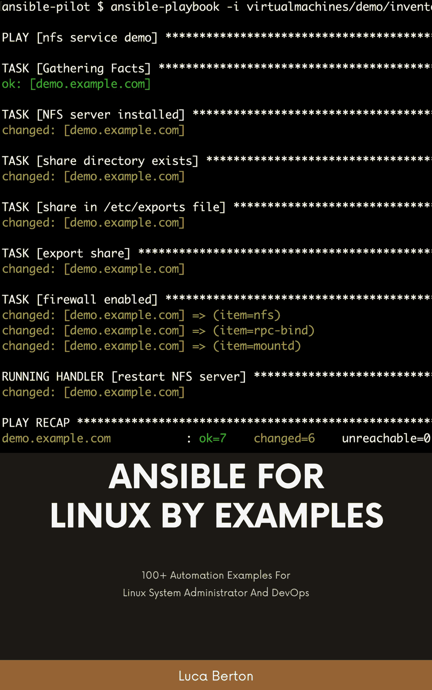

# Linux 的 Ansible 示例：面向 Linux 系统管理员和 DevOps 的 100+ 自动化示例




本书可在[`leanpub.com/ansibleforlinuxbyexamples`](http://leanpub.com/ansibleforlinuxbyexamples)购买。


---

这是一本来自 [Leanpub](https://leanpub.com) 的书。Leanpub 通过精捷出版（Lean Publishing）流程，为作者和出版商提供支持。[精捷出版](https://leanpub.com/manifesto) 是使用轻量级工具和多次迭代来发布进行中的电子书，以获取读者反馈，不断调整直到获得正确的书籍，并在获得支持后建立影响力。

---

# 引言

本书将介绍`Ansible`语言。

`Ansible`是一种流行的开源 IT 自动化技术，用于在各个领域进行应用程序脚本编写。它是免费、可移植、强大的，而且用起来非常简单且有趣。

本书是一本通过一些实战示例来学习`Ansible`自动化技术的工具。无论你是自动化领域的新手，还是一名专业的自动化工程师，本书的目标都是为了带你快速掌握核心`Ansible`语言的基础基础知识。

如今，任何一个成功的 IT 部门都需要为裸机服务器、虚拟机、云提供商、容器和边缘计算实现自动化。使用`Ansible`自动化技术让你的 IT 之旅自动化。

我将通过一个一个的示例教你如何完成最常见的系统管理员任务。

你将开始在红帽企业 Linux（Red Hat Enterprise Linux）、Ubuntu 和 macOS 上安装`Ansible`，使用最常用的软件包管理器和归档工具。

100 多节课程中的每一节都总结了一个模块：从最重要的参数到某些代码现场演示和实际用法。每段代码都已经在现实生活中经过了实战。每个视频都包含了控制台交互和验证。像创建文本文件、提取和归档、使用`HTTPS`或`SSH`连接获取仓库等单调活动，都可以几行代码实现自动化，而这些只是课程中包含的长列表中的一角。

有些`Ansible`代码适用于所有 Linux 系统，有些则专门针对红帽类、Debian 类和 Windows 系统。

20+ 节`Ansible`故障排除课程将教你如何阅读错误信息、如何复现问题，以及故障排除和解决的过程。

你准备好用`Ansible`自动化你的日常了吗？

## 谁是 Luca Berton

我是 Luca Berton，我们将一起度过许多愉快时光。首先，让我介绍一下。

我曾是位于捷克的红帽（Red Hat）`Ansible`技术支持工程师，尽管我是意大利人。我有超过 15 年的系统管理经验，在基础设施方面工作，无论是本地还是在主要的云提供商。

我是开源支持的热爱好者，通过在不同的公共活动中分享我的知识来支持社区。我还是家乡`Linux 用户小组`的联合创始人，自由软件运动创始人 Richard Stallman 曾访问过那里。我认为自己是一个懒人，所以我总是尝试用新方法来使工作中重复性任务的自动化。

在经历了多年的`Perl`、`Bash`和`python`脚本编写后，我进入了`Ansible`技术。我通过了认证，并与`Ansible Engineer`团队工作了一多一年。

我认为`Ansible`是目前最好的基础设施自动化技术，它是人类可读的，学习曲线易于接受，并且非常受市场招聘人员的青睐。

本终极指南包含了所有使用`Ansible`自动化显而易见和不那么易见的解决方案。在课程的每一节中，我将与你分享一个特定的用例、可能的解决方案、代码、执行以及目标系统的验证。所有这些解决方案都经过了实战测试，并被我用于日常自动化。你可以轻松地在课程之间跳转，并在需要时随时复习。

### 奖励与认可

#### 2022

- [Ansible 用户大会 - 从零到英雄：如何构建 Ansible Pilot 社区 - 作者 Luca Berton (Red Hat CZ) 15:15 - 16:00](https://www.ansible-anwender.de/post/2022/01/register/) 2022 年 2 月 15 日
- [红帽 Ansible Playbook 包含在 RHSB-2021-009 Log4Shell - 远程代码执行 - log4j (CVE-2021-44228)](https://access.redhat.com/security/vulnerabilities/RHSB-2021-009#diagnose) 2022 年 1 月 12 日
- [AWS 设置 sysctl 内核参数 — Ansible sysctl](https://awstip.com/set-sysctl-kernel-parameters-ansible-module-sysctl) 2022 年 1 月 12 日
- [红帽 Ansible Playbook 包含在 RHSB-2021-009 Log4Shell - 远程代码执行 - log4j (CVE-2021-44228)](https://access.redhat.com/security/vulnerabilities/RHSB-2021-009#diagnose) 2022 年 1 月 12 日
- [AWS 设置 sysctl 内核参数 — Ansible module sysctl](https://awstip.com/set-sysctl-kernel-parameters-ansible-module-sysctl) 2022 年 1 月 12 日

#### 2021

- [Ansible 牛报 #41 - 开发者社区通讯](https://mailchi.mp/redhat/the-bullhorn-41) 2022 年 1 月 7 日
- [Ansible 牛报 #34 - 开发者社区通讯](https://us19.campaign-archive.com/?u=56d874e027110e35dea0c&id=5f02182)

本课程将根据`Ansible`的演进跟踪更多内容。

---

你准备好享受乐趣了吗？

# 入门指南及示例

在本章中，你将发现`Ansible`的基础、架构和术语。

## 什么是 Ansible

在本章中，我将向你解释`Ansible`是什么以及为什么对你的 IT 部门如此强大。

### Ansible

- 基础设施自动化工具
- 开源基础设施代码

首先，让我们开始探索这项名为`Ansible`技术。它被归类为基础设施自动化工具，因此你可以轻松地自动化系统管理员任务。基础设施即代码是通过机器可读的定义文件管理和配置数据中心，而不是通过物理硬件或交互式配置工具。`Ansible`遵循 DevOps 原则。通过`Ansible`你可以在本地和主要的云提供商上部署基础设施即代码。

### Ansible 三大用例

- 配置
- 配置管理
- 应用部署

`Ansible`的三个主要用例是配置、配置以及应用部署。但在接触技术后，我相信你还可以发明更多使用方法！

#### 配置

- 设置 IT 基础设施的过程

让我们开始谈论配置：所有的系统管理员都知道管理统一集群的重要性。有些人仍然依靠软件创建工作站镜像。但有一个缺点，使用镜像技术只是对机器的时间快照。因此，每当你因为现代密钥激活系统需要重新安装软件，或手动更新到最新的安全补丁时，`Ansible`在自动化这一过程方面非常强大，能够创建一个更顺畅的过程。

#### 配置管理

- 使系统和软件处于预期且一致状态的过程

第二个关键用例是“配置管理”：以一致的方式保持你整个集群的最新，协调滚动更新并调度停机。通过`Ansible`你可以验证受托管主机的状态，并对其中一小部分主机采取操作。大量的模块适用于最常见的用例。更不用说检查你的集群对某些国际标准的合规性并执行解决方案的常见用例。

#### 应用部署

- 在测试、阶段和生产环境之间发布你的软件的过程

`Ansible`有用的第三个关键用例是应用部署。例如，它可以自动化你 Web 应用程序的持续集成/持续交付（CI/CD）工作流流水。你的 DevOps 团队会非常开心的！

## DevOps 中的 Ansible

`Ansible`用于在全球范围内应用 DevOps 原则。让我快速总结一下。

DevOps 是一种结合了软件开发（Dev）和 IT 运维（Ops）的实践。由于 DevOps 旨在成为一种跨部门的工作模式，实践该方法的人员使用不同的工具集，称为“工具链”（toolchains），而不是单一工具。这些工具链预计符合以下一个或多个类别，反映了开发和交付过程的关键方面。这七个类别分别是：

- **Code**：代码开发与评审、源代码管理工具、代码合并。
- **Build**：持续集成工具、构建状态。
- **Test**：持续测试工具，可对业务风险提供快速且及时的反馈。
- **Release**：制品仓库、应用部署前的分阶段环境。
- **Deploy**：变更管理、发布审批、发布自动化。
- **Operate**：基础设施配置与管理、基础设施即代码工具。
- **Monitor**：应用性能监控、终端用户体验。

## Ansible 的四个核心原则

1. **声明式（Declarative）**：你声明你想要什么，而不是如何实现。
2. **无代理（Agentless）**：你不需要安装代理。它利用了`OpenSSH`。
3. **幂等性（Idempotent）**：操作可以运行多次而不会产生初始操作之外的更改。
4. **社区驱动（Community driven）**：以集合（collections）和角色（roles）的形式发布在`Ansible Galaxy`中。

`Ansible`的四个核心原则是：声明式、无代理、幂等性和社区驱动。“声明式”意味着你可以以非常类似于编程语言的方式，在代码流中应用顺序、选择和迭代。“无代理”意味着你不需要在目标机器上安装和更新任何代理，它使用 SSH 连接和`python`解释器。该语言本身是“幂等”的，这意味着代码将检查被管理机器上的精确状态。这意味着，例如，你的代码第一次运行时会更改某些内容，随后的运行仅会验证没有发生变化并继续执行。最后一个原则是“社区驱动”，意味着存在一个名为“Ansible Galaxy”的公共存档，你可以在那里下载其他开源贡献者编写的代码。这些代码组织为角色（roles）和集合（collections），我们将在将来看到。

## Ansible 的六大价值

- **简单（Simple）**：人类可读的`YAML`。
- **强大（Powerful）**：配置管理、工作流编排、应用部署。
- **跨平台（Cross-platform）**：对所有主流操作系统、物理机、虚拟机、云和网络提供无代理支持。
- **与现有工具协作**：统一现有环境。
- **“内置电池”（batteries included）**：自带了 750 多个模块。
- **社区驱动**：每月下载量 25 万次，平均 3500 名贡献者，IRC 上有 1200 多用户。

现在让我们谈谈`Ansible`的六大价值。第一个是“简单”：代码是用`YAML`语言编写的，这是一种人类可读的数据序列化语言。它广为人知且易于学习，通常用于配置文件以及存储或传输数据的应用程序。`Ansible`是强大的，它在配置管理、工作流编排、应用部署方面经过了实战检验。第三个价值是天生的“跨平台”，对所有主流操作系统、物理机、虚拟机、云和网络供应商提供无代理支持。`Ansible`的另一个价值是它可以与现有工具协作，轻松地统一现有环境。“内置电池”意味着`Ansible`包含了 750 多个模块，以自动化最常见的任务。最后一个价值是`Ansible`是“社区驱动”的，每月有超过 250,000 次下载，平均有 3500 名贡献者，IRC 上有 1200 多用户。

## Ansible 历史

- **2012**：由 Michael DeHaan 开发
- **2015**：被红帽（Red Hat）收购
- **2016**：AnsibleFest 活动
- **2020**：红帽 Ansible 平台 1.0
- **2021**：红帽 Ansible 平台 2.1

`Ansible`历史上的主要事件如下。

`Ansible`的第一个版本于 2012 年 2 月 20 日公发布。`Ansible`工具由 Michael DeHaan 开发。`Ansible Inc.`（原名`AnsibleWorks Inc.`）是为了商业化支持和赞助该项目而成立的公司。

2015 年 10 月 16 日，红帽收购了`Ansible Inc.`，并将`Ansible`评估为“强大的 IT 自动化解决方案”，旨在帮助企业向无缝的 IT 迈进。

`AnsibleFest`是自 2016 年以来在伦敦和美国举办的 Ansible 用户及贡献者年度会议。

## Ansible、Ansible Tower 与 Ansible 自动化平台（Automation Platform）

- **Ansible**：社区驱动的项目，创新快速，开源，但仅提供命令行工具。
- **Red Hat Ansible Tower / Ansible Automation Platform**：这是一个由红帽设计的框架。它提供了一个 Web 界面来管理你的基础设施。

`Ansible`是一个社区驱动的项目，创新快速，开源，但仅提供命令行工具。

企业需要更多的服务和一些稳定的版本。例如，它们需要支持方面的 SLA。红帽为公司提供这种服务，即在 Ansible Tower 伞下，现在已更名为 Ansible Automation Platform（Ansible 自动化平台）。

`Ansible Tower`是一个 REST API、Web 服务和基于 Web 的控制台，旨在让具有不同技术水平和技能组合的 IT 团队更方便地使用`Ansible`。它是自动化任务的枢纽。该塔是由红帽支持的商业产品，但源自 2017 年开源的`AWX`项目。

红帽还维护`Ansible Engine`。通过`Ansible Engine`，企业可以以加固的安全方式访问底层 Ansible 的工具和创新。`Ansible Engine`由红帽开发，明确意图是作为企业平台使用。

## 入门

在本章中，我将向你解释如何开启`Ansible`技术的第一步。如何连接托管主机以及如何使用命令行执行一些简单任务。

### Ansible 架构

让我们开始谈论`Ansible`架构。安装`Ansible`的节点被称为“控制节点”（control node），它管理你所有的节点。另一方面，受控节点被称为“托管节点”（managed node）。目标节点可以是 Linux、Mac、Windows 以及各种网络设备。每个目标都有某些特殊性，例如不同的 Linux 发行版和模块用法。我们将在后续章节讨论这些特殊性。

### 运行你的第一个 Ansible 命令

```text
1 $ ansible all -m ping
2 host1.example.org | SUCCESS => {
3     "ansible_facts": {
4         "discovered_interpreter_python": "/usr/bin/python"
5     },
6     "changed": false,
7     "ping": "pong"
8 }
```

- `ping`模块在`all`主机上执行。
- `host1.example.com`了成功状态码。

现在我们准备好运行你的第一个 Ansible 命令了。在 Ansible 术语中，命令被称为`module`。第一行代码在`all`主机上执行了 Ansible`ping`模块。响应是`pong`。请注意，这意味着 Ansible 能够通过 SSH 用户名连接，使用公钥进行身份验证并执行本地`python`执行器。因此，它与网络中的任何`ping`完全不同。

## 在 Ansible 上运行即时命令

```text
1 $ ansible all -a "/bin/echo hello"
2 host1.example.org | CHANGED | rc=0 >>
3 hello
```

- `/bin/echo hello`命令在`all`主机上执行。
- `host1.example.com`返回了变更状态码并在标准输出上打印了`hello`。

`Ansible`可以在目标主机上执行某些命令，并在控制节点（`control node`）的控制报告状态。在示例中，`/bin/echo hello`命令在`all`主机上执行。`host1.example.com`返回了变更状态码并在标准输出上打印了`hello`。请注意，每你在远程机器上运行命令时，都会收到一个`changed`状态。

## 在 Ansible 上运行带权限管理的即时命令

```text
1 $ ansible all -m ping -u devops --become
2 host1.example.org | SUCCESS => {
3     "ansible_facts": {
4         "discovered_interpreter_python": "/usr/bin/python"
5     },
6     "changed": false
7     "ping": "pong"
8 }
```

- 以用户`devops`登录后，作为用户`root`在所有`all`主机上执行`ping`模块。
- `host1.example.com`返回了变更状态码并在标准输出上打印了`hello`。

在示例中，我以用户`devops`登录后，作为用户`root`对`all`主机运行了`ping`模块。`host1.example.com`返回了变更状态码并在标准输出上打印了`hello`。


# 总结

在本模块中我们学习了 Ansible 架构的基本概念、如何编写托管主机列表以及如何对它们执行一些简单命令。

## 清单（Inventory）

在本章中，我将向你解释什么是 Ansible 清单、为什么需要它、它的不同类型以及如何在日常工作中编辑和使用它。

```
1 清单是 Ansible 可以工作的主机集合。
2. 它们可以被分类为组/模式（groups/patterns）。
```

由 Ansible 管理的多主机列表被称为`inventory`。它从根本上说是你基础设施中节点或主机的列表，使用名为清单的列表或列表。你可以通过`groups`（组）或`patterns`（模式）组织你的清单，以选择你想让 Ansible 运行的主机或组。

### `all`关键字

```
1 关键字 all 包含清单中的所有主机，除了
2 pt localhost
```

特殊关键字`all`包含所用清单的所有主机。它在接下来的课程中非常有用。唯一的例外是需要指定的`localhost`。

### 简单的 INI 清单

- `./ini_simple_inventory`

```
1 one.example.com
2 
3 [webservers]
4 two.example.com
5 three.example.com
```

- 文件名：`ini_simple_inventory`
- `one.example.com`未分组
- `two.example.com`和`three.example.com`被组为`webserver`

根据文件类型，简单的清单类型是 INI 清单。默认位置是`/etc/ansible/hosts`，但你可以使用`-i`参数使用自定义清单。在示例中，主机`one.example.com`未分组，`two.example.com`和`three.example.com`被组为`webserver`。

### 简单的 YAML 清单

- `./simple_yaml_inventory.yml`

```
1 ---
2 all:
3   hosts:
4     one.example.com:
5   children:
6     webservers:
7       hosts:
8         two.example.com:
9         three.example.com:
```

- 文件名：`inventory.yml`
- `one.example.com`未分组
- `two.example.com`和`three.example.com`被组为`webserver`

你可以使用 YAML 语法表示相同的清单。在示例中，主机`one.example.com`未分组，`two.example.com`和`three.example.com`被组为`webserver`。

### 添加主机范围

- `./ini_range_inventory`

```
1 [webservers]
2 www[01:99].example.com
3 
4 [databases]
5 db-[a-f].example.com
```

- `webservers`组包含从`www01.example.com`到`www99.example.com`的所有主机
- `Databases`组包含从`db-a.example.com`到`db-f.example.com`的所有主机

`webservers`组包含从`www01.example.com`到`www99.example.com`的所有主机。

`Databases`组包含从`db-a.example.com`到`db-f.example.com`的所有主机。

### 多个组中的主机

- `./ini_groups`

```
1 [webservers]
2 one.example.com
3 two.example.com
4 
5 [prod]
6 two.example.com
7 three.example.com
```

- `two.example.com`和`three.example.com`被组为`webserver`。

Ansible 可以在目标主机上执行某些命令，并在控制节点（`control node`）的控制报告状态。在示例中，`/bin/echo hello`命令在`all`主机上执行。`host1.example.com`返回了变更状态码并在标准输出上打印了`hello`。

### 主机变量

- `./ini_host`

```
1 [webservers]
2 one.example.com
3 two.example.com
4 
5 [prod]
6 two.example.com
7 three.example.com
```

- `two.example.com`和`three.example.com`被组为`webserver`。

### 组变量

- `./ini_groups`

```
1 [webservers]
2 one.example.com
3 two.example.com
4 
5 [prod]
6 two.example.com
7 three.example.com
```

- `two.example.com`和`three.example.com`被组为`webserver`。

### 继承变量值

- `./ini_variableinheriting_inventory`

```
1 [asia]
2 host1.example.com
3 
4 [europe]
5 host2.example.com
6 
7 [webserver:children]
8 asia
9 europe
10 
11 [webservers:vars]
12 ntp_server=europe.pool.org
```

- `./variableinheriting_inventory.yml`

```
1 ---
2 children:
3   webservers:
4     children:
5       asia:
6         hosts:
7           host1.example.com:
8       europe:
9         hosts:
10           host2.example.com:
11     vars:
12       ntp_server: europe.pool.org
```

## 对`production`和`development`环境执行名为`playbook.yml`的 ansible playbook

每次执行可以使用多个清单文件（inventory）。在本例中，将针对`production`和`development`清单执行名为`playbook.yml`的 ansible playbook。

## localhost 清单文件

- `./ini_local_inventory`

```
1 localhost ansible_connection="local"
```

- 文件名：`inventory`
- 默认路径：`/etc/ansible/hosts`

清单中的一个特殊情况是`localhost`。你需要将连接类型指定为`local`，否则 Ansible 将假定为使用默认的 SSH 连接。

### 总结

现在你对 Ansible INI 和 YAML 清单文件、主机变量和组变量有了更深入的了解。

## Playbook

在本章，我将向你解释什么是 Ansible Playbook 以及你为什么需要它。我们将介绍如何开始从一个简单的 playbook 开始，从基础语法到如何添加更多任务。

```
1 一个 playbook 是一组针对清单执行的剧本\
2 （play）。
```

### YAML 语法

```
 1 # 这是一个 YAML 注释
 2 some data # 这也是一个 YAML 注释
 3 
 4 这是一个字符串
 5 '这是另一个字符串'
 6 "这是三个字符串"
 7 
 8 with_newlines: |
 9 Example Company
10 123 Main Street
11 New York, NY 10001
12 
13 without_newlines: >
14 这是一个长字符串
15 的示例，
16 不会换行，
17 它将变成
18 单独的句子。
19 
20 yaml_dictionary: {name1: value1, name2: value2}
21 
22 yaml_list1:
23 - value1
24 - value2
25 yaml_list2: [value1, value2]
```

每个 playbook 都基于 YAML 语法，因此文件易于阅读且符合人类习惯。YAML 是一种文本格式，你可以通过开头的三个横号和结尾的三个点来轻松识别它。三个点并不是强制性的，因此许多人直接省略它们。这种文件类型对元素之间的空格非常敏感。与某些编程语言不同，相同层级的元素必须保持相同的缩进，这非常重要。你可以使用符号`#`进行注释，即使是在带有之前代码的行中。字符串非常重要，你可以直接指定，也可以使用单引号或双引号。我建议通上使用双引号。通过管道符和块定义语句，你可以定义多行字符串。其他有用的数据结构是字典和列表，你可以在灰色区域看到它们的用法。

### `helloworld.yml`

- `helloworld.yml`

```
1 ---
2 - name: Hello World sample
3   hosts: all
4   tasks:
5     - name: Hello message
6       ansible.builtin.debug:
7         msg: "Hello World!"
8 ...
```

```
1 文件名：helloworld.yml
2 Playbook 的名称
3 执行的主机列表
4 任务列表
5 一个名为“Hello message”的任务
6 使用了模块 ansible.builtin.debug
7 debug 模块的参数“msg”
```

这是执行`helloworld.yml`后的输出。我希望你注意使用的命令是`ansible-playbook`。第一个参数是清单文件，第二个是 playbook。

在本次执行中，剧本针对`host1.example.com`节点执行。输出清晰地展示了执行步骤。当命令执行成功时，输出显示为绿色。警告将以橙色显示，错误显示为红色。细心的人可能注意到执行了一个额外任务名为`Gathering Facts`（收集因子），这是 Ansible 用于获取被管理节点的一些信息。我们将在下一节中更多地讨论因子收集。尝试自己执行这段代码，对这个输出摘要建立信心。它非常有用。当前有两个任务正在执行。

### 提示 1：`ansible-playbook --check`选项

```
 1 $ ansible-playbook -i inventory  --check  helloworld.yml
 2 PLAY [Hello World sample] *******************************\
 3 *********************************************************\
 4 ***********
 5 TASK [Gathering Facts] **********************************\
 6 *********************************************************\
 7 ********
 8 ok: [host1.example.com]
 9 TASK [Hello message] ************************************\
10 *********************************************************\
11 ******
12 ok: [host1.example.com] => {
13     "msg": "Hello World!"
14 }
15 PLAY RECAP **********************************************\
16 *****************************************************
17 host1.example.com       : ok=2    changed=0    unreachabl\
18 e=0    failed=0    skipped=1    rescued=0    ignored=0
```

`ansible-playbook`命令有一个非常有实用的选项`--check`。该选项用于对 playbook 执行进行干运行。这会导致 Ansible 报告如果执行 playbook 将发生哪些更改，但不会对被管理主机进行任何实际更改。

### 提示 2：`debug`日常用法

- `helloworld_debug.yml`

```
1 ---
2 - name: Hello World sample
3   hosts: all
4   tasks:
5     - name: Hello message
6       debug:
7         msg: "Hello World!"
8 ...
```

等待，基于提示 2 的：

```
1 ---
2 - name: Hello World sample
3   hosts: all
4   tasks:
5     - name: Hello message
6       debug:
7         msg: "Hello World!"
8 ...
```

```
1 文件名：helloworld_debug.yml
2 Playbook 的名称
3 执行的主机列表
4 任务列表
5 一个名为“Hello message”的任务
6 使用了模块 debug
7 debug 模块的参数“msg”
8 详细程度“2”
```

此提示允许你在 playbook 中保留调试代码，仅在需要时启用调试。例如，只有在调用 Ansible 时才会打印。

### `helloworld_debug.yml` - 执行部分 1

```
 1 ansible-playbook -i inventory helloworld.yml
 2 PLAY [Hello World sample] *******************************\
 3 *********************************************************\
 4 ***********
 5 
 6 TASK [Gathering Facts] **********************************\
 7 *********************************************************\
 8 ********
 9 ok: [host1.example.com]
 10 
11 TASK [Hello message] ************************************\
12 *********************************************************\
13 ******
14 skipping: [host1.example.com]
15 
16 PLAY RECAP **********************************************\
17 *****************************************************
18 host1.example.com       : ok=1    changed=0    unreachable\
19 =0    failed=0    skipped=1    rescued=0    ignored=0
```

这是`helloworld_debug.yml`在正常执行时的输出，意味着未处于调试模式。你可以注意到 hello message 被跳过了。

### `helloworld_debug.yml` - 执行部分 2


进入`/path/to/xxx`目录，找到`xxx.json`。

在表达式`cvar = avar + bvar`中，加法运算符（`+`）将`avar`与`bvar`相加，得到它们的和`cvar`

在`List.of(arg0, arg1, arg2)`中，`List`接口的工厂方法`of()`接受一系列的元素，返回包含它们的只读列表。

之后我们这样调用`cmd`命令：`cmd arg0 arg1 arg2`。

```
if (condVar > someVal) {console.log("xxx")}
```

---

```
 1 $ ansible-playbook -i inventory -vv helloworld_debug.yml
 2 PLAY [Hello World sample] *******************************\
 3 *********************************************************\
 4 ***********
 5 
 6 TASK [Gathering Facts] **********************************\
 7 *********************************************************\
 8 ********
 9 ok: [host1.example.com]
 10 
11 TASK [Hello message] ************************************\
12 *********************************************************\
13 ******
14 ok: [host1.example.com] => {
15     "msg": "Hello World!"
16 }
17 PLAY RECAP **********************************************\
18 *****************************************************
19 host1.example.com       : ok=2    changed=0    unreachabl\
20 e=0    failed=0    skipped=1    rescued=0    ignored=0
```

这是`helloworld_debug.yml`在调试级别二模式下执行时的输出，请注意命令行中的两个`V`。你可以注意到`hello message`被打印了。

#### 等幂性 (Idempotency)

```
1 等幂性
2 模块检查目标最终状态是否已经实\
3 实现，否则应用
```

Ansible 模块的一个重要特性是“幂等性”。这意味着在对目标节点上执行任何操作之前，模块将检查实际状态。如果实际状态与预期状态匹配，则将不会执行任何操作。如果当前状态偏离了预期状态，则会执行操作。请注意，如果你再次执行该 playbook，将发现状态符合预期，因此不再执行后续操作。这种属性被称为“幂等性”，你应该充分利用它。

### multipleplays.yml

```
 1 ---
 2 - name: first play
 3   hosts: web.example.com
 4   tasks:
 5     - name: first task
 6       ansible.builtin.yum:
 7         name: httpd
 8         status: present
 9     - name: second task
10       ansible.builtin.service:
11         name: httpd
12         enabled: true
13 - name: second play
14   hosts: database.example.com
15   tasks:
16     - name: first task
17       ansible.builtin.service:
18         name: mariadb
19         enabled: true
```

*   文件名：`multipleplays.yml`

内部包含两个针对`web.example.com`和`database.example.com`执行的 play。

`multipleplays.yml` playbook 包含两个 play。第一个 play 在`web.example.com`主机上执行，安装 apache Web 服务器并设置开机自启。第二个 play 将`database.example.com`上执行，并将`mariadb`数据库管理系统设置为开机自启。如你所见，使用多个 play 在不同的主机上执行不同的任务是非常强大的。现在 playbook 的定义变得更有意义了。

### privilege_escalation.yml

```
 1 ---
 2 - name: install httpd
 3   hosts: web.example.com
 4   become: true
 5   become_method: sudo
 6   become_user: root
 7   tasks:
 8     - name: install httpd
 9       ansible.builtin.yum:
10         name: httpd
11         status: present
```

*   `privilege_escalation.yml`

`become`指定需要进行权限提升。

`become_method`指定提升方法。

`become_user`指定目标用户（默认认为`root`）。

某些操作需要具有管理权限的用户来执行。在 Linux 中，通常是`root`用户。某些发行版允许使用`sudo`命令通过`wheel`组进行权限提升。在这个示例中，我要安装一个软件，因此需要权限提升。`yum`模块需要在受管节点上执行某些操作。在 playbook 中，如果没有必要，你可以禁用它。

### 最常用的 Ansible 模块

*   文件模块

    *   `copy`：将本地文件复制到受管主机

    *   `fetch`：从远程节点将文件复制到本地

    *   `file`：设置文件的权限和其他属性

    *   `lineinfile`：确保文件中包含或不包含某行特定内容

    *   `synchronize`：使用`rsync`同步内容

*   软件包模块

    *   `package`：使用自动检测的操作系统原生包管理器管理软件包

    *   `yum`：使用 YUM 包管理器管理软件包

    *   `apt`：使用 APT 包管理器管理软件包

    *   `dnf`：使用 DNF 包管理器管理软件包

    *   `gem`：管理 Ruby gems

    *   `pip`：从 PyPI 管理 Python 软件包

*   系统模块

    *   `firewalld`：使用`firewalld`管理任意端口和服务

    *   `reboot`：重启机器

    *   `service`：管理服务

    *   `user`：添加、删除和管理用户账户

*   网络工具工具模块

    *   `get_url`：通过 HTTP、HTTPS 和 FTP 下载文件

    *   `nmcli`：管理网络

    *   `uri`：与 Web 服务交互

### 总结

在本模块中，我们为后续的 Ansible Playbook 操作奠定了基础。继续下去，很快你就能自动化所有的系统管理员任务。

## 变量

在本章中，我将向你解释什么是 Ansible 变量、你为什么需要它们、不同类型以及在日常工作中如何编辑和使用它们。

```
1 变量为给定环境存储动态值。
```

在 Playbook 中，使用变量来存储你需要的所有动态值是一个良好的实践。通过编辑变量，你可以在未来根据业务需求通过相应的参数化来复用代码。

### 不允许的变量名

*   不能包含空格`my var`

*   不能包含点`my.var`

*   不能以数字开头`1stvar`

*   不能包含特殊字符`myvar$1`

Ansible 允许在变量名中使用字母和数字的任意组合。如果你计划使用数字，请注意不能放在开头，但这是信息技术世界的通用规则。

变量名的四个主要限制是：不允许空格、不允许包含点、不能以数字开头、不能包含特殊字符。在右侧你可以看到一些无效变量名的示例。

### variableprint.yml

*   `./variableprint.yml`

```
1 ---
2 - name: Variable print sample
3   hosts: all
4   vars:
5     fruit: "apple"
6   tasks:
7     - name: Print variable
8       ansible.builtin.debug:
9         msg: "Print the value of variable {{ fruit }}"
```

```
1 文件名：variableprint.yml
```

`variableprint.yml` playbook 与`helloworld.yml`类似。除了变量外，其语法和元素结构相似。变量存储字符串、数字以及更复杂的结构（如列表、字典）等信息。在这种情况下，变量名为`fruit`，值为`apple`。此时`debug`模块会将文本与该值拼接。

### variableprint.yml - 执行

```
1 $ ansible-playbook -i inventory variableprint.yml
2 PLAY [Variable print sample] ****************************
3 ***********************
4 
5 TASK [Gathering Facts] *********************************
6 ***********************
7 ok: [host1.example.com]
8 
9 TASK [Print variable] ***********************************
10 ***********************
11 ok: [host1.example.com] => {
12     "msg": "Print the value of variable apple"
13 }
14 
15 PLAY RECAP **********************************************
16 ***********************
17 host1.example.com	: ok=2    changed=0    unreachable=0   
18  failed=0    skipped=0    rescued=0    ignored=0
```

这是执行`variableprint.yml`的输出。该执行是成功的，如你在 play 总结区域和绿色所示。有两个任务正在执行。

### variableprint.yml - 额外变量

```
1 $ ansible-playbook -i inventory -e fruit=banana variabl
2 eprint.yml
3 PLAY [Variable print sample] ****************************
4 ***********************
5 
6 TASK [Gathering Facts] *********************************
7 ***********************
8 ok: [host1.example.com]
9 
10 TASK [Print variable] ***********************************
11 ***********************
12 ok: [host1.example.com] => {
13     "msg": "Print the value of variable banana"
14 }
15 
16 PLAY RECAP **********************************************
17 ***********************
18 host1.example.com	: ok=2    changed=0    unreachable=0   
19  failed=0    skipped=0    rescued=0    ignored=0
```

你可以从命令行指定值来覆盖 playbook 变量。在命令行设置的变量被称为额外变量。

`variableprint.yml`的执行输出与之前的一个非常相似。请注意，通过将字符串与变量值结合，获得了消息“Print the value of variable banana”的打印。从命令行传递的值将覆盖剧本中的任何值。

### 主机变量与组变量

* `inventory_host_variables`

```
1 [servers]
2 host1.example.com ansible_user=devops
```

* `inventory_group_variables`

```
1 [servers]
2 host1.example.com
3 host2.example.com
4 
5 [servers:vars]
6 user=alice
```

主机变量和组变量可以在你的清单文件中定义。在左列中，你可以看到一个主机变量的示例。变量`ansible_user`被赋值为值`devops`。该主机变量适用于`host1.example.com`。在右列中，你看到一个组变量的示例。变量`user`被赋值为`alice`。该组变量将以相同的值适用于`host1.example.com`和`host2.example.com`。

* `inventory_host_dir`

```
1 [servers]
2 host1.example.com
```

* `host_vars/demo1.example.com`

```
1 ansible_user=devops
```

* `inventory_group_dir`

```
1 [servers]
2 host1.example.com
3 host2.example.com
```

* `group_vars/servers`

```
1 user=alice
```

你也可以使用目录来填充主机和组变量以达到相同的结果。正如你所看到的，结果与之前的幻灯片相同，但使用了更多的文件。在左列中，你可以看到一个主机变量的示例。变量`ansible_user`被赋值为值`devops`。该主机变量适用于`host1.example.com`。在右列中，你看到一个组变量的示例。变量`user`被赋值为`alice`。该组变量将以相同的值适用于`host1.example.com`和`host2.example.com`。

### 数组变量

* `array.yml`

```
 1 ---
 2 - name: Array sample
 3   hosts: all
 4   vars:
 5     users:
 6       alice:
 7         firstname: Alice
 8         homedir: /users/alice
 9       bob:
10         firstname: Bob
11         homedir: /users/bob
```

```
1 file name: array.yml
2 用户被组织在层级数据结构中。
3 
4 Returns 'Alice'
5 users.alice.firstname
6 Returns 'Alice'
7 users['alice']['firstname']
```

数组是一种非常有用的数据结构。你可以在层级数据结构中组织信息。在示例中，用户列表 alice 和 bob 易于读的：每个元素都有一些属性：`firstname`和`homedir`。你可以使用点符号或方括号来访问数据。

### array.yml - 执行

```
 1 $ ansible-playbook -i inventory array.yml
 2 PLAY [Array sample] *********************************
 3 *************************************************
 4 *****
 5 TASK [Gathering Facts] *********************************
 6 *************************************************
 7 *****
 8 ok: [host1.example.com]
 9 TASK [Print the value of variable banana] ************
10 *************************************************
 11 ok: [host1.example.com] => {
12     "msg": "Print the value of variable banana: Alice"
13 }
14 PLAY RECAP *********************************************
15 *************************************************
16 host1.example.com          : ok=2    changed=0    unreachable
17 able=0    failed=0    skipped=0    rescued=0    ignored=0
```

`array.yml`的执行输出与之前的一个非常相似。请注意，通过将字符串与变量值结合，获得了消息“Print the value of variable banana”的打印。


### 注册变量

`registered.yml`

```yaml
---
- name: Installs a package and prints result
  hosts: all
  become: true
  tasks:
    - name: Install the package
      ansible.builtin.yum:
        name: wget
        state: installed
      register: install_result

    - name: debug
      ansible.builtin.debug:
        var: install_result
```

`registered.yml`

将标准输出存储在变量`install_result`中，也可以被打印。

另一个非常有用的数据结构是注册变量。你可以将任何命令的输出保存到注册变量中。在本示例中，将被打印出来。

### `registered.yml` - 执行

```text
$ ansible-playbook -i inventory registered.yml
PLAY [Installs a package and prints result] ****************
************************************************************
TASK [Gathering Facts] **************************************
************************************************************
ok: [host1.example.com]
TASK [Install the package] **********************************
************************************************************
ok: [host1.example.com]
TASK [debug] ************************************************
************************************************************
ok: [host1.example.com] => {
    "install_result": {
        "changed": false,
        "failed": false,
        "msg": "Nothing to do",
        "rc": 0,
        "results": []
    }
}
PLAY RECAP **************************************************
************************************************************
host1.example.com          : ok=3    changed=0    unreachable=0    failed=0    skipped=0    rescued=0    ignored=0
```

`registered.yml`的执行输出符合预期。首先，`yum`模块检查软件包是否存在，如果缺失则继续安装。设置过程的输出存储在注册变量中并打印在屏幕上。

### 总结

在本模块中，我们探索了 Ansible Playbook 内部变量的使用。你现在了解了用户定义、主机、组和注册变量等工具的使用。

## Facts 和魔法变量

在本章中，我将向你解释什么是 Ansible Facts（事实）和魔法变量，你为什么需要它们、不同的类型以及如何在你的日常工作中编辑和使用它们。

### Ansible Facts

`facts`是与远程主机相关的变量。

#### 列出所有机器的所有 facts（ad-hoc）

```text
$ ansible -m setup hostname
    "ansible_all_ipv4_addresses": [
        "REDACTED IP ADDRESS"
    ],
    "ansible_all_ipv6_addresses": [
        "REDACTED IPV6 ADDRESS"
    ],
    "ansible_apparmor": {
        "status": "disabled"
    },
    "ansible_architecture": "x86_64",
    "ansible_bios_date": "11/28/2013",
    "ansible_bios_version": "4.1.5",
    "ansible_cmdline": {
        "BOOT_IMAGE": "/boot/vmlinuz-3.10.0-862.14.4.el7.x86_64",
        "console": "ttyS0,115200",
        "no_timer_check": true,
        "nofb": true,
        "nomodeset": true,
        "ro": true,
        "root": "LABEL=cloudimg-rootfs",
        "vga": "normal"
    },
    "ansible_date_time": {
        "date": "2018-10-25",
        "day": "25",
        "epoch": "1540469324",
        "hour": "12",
        "iso8601": "2018-10-25T12:08:44Z",
        "iso8601_basic": "20181025T120844109754",
        "iso8601_basic_short": "20181025T120844",
        "iso8601_micro": "2018-10-25T12:08:44.109968Z",
        "minute": "08",
        "month": "10",
        "second": "44",
        "time": "12:08:44",
        "tz": "UTC",
        "tz_offset": "+0000",
        "weekday": "Thursday",
        "weekday_number": "4",
        "”weeknumber": "43",
        "year": "2018"
    },
    "ansible_default_ipv4": {
        "address": "REDACTED",
        "alias": "eth0",
    [...]
```

理解 Ansible 事实（facts）的最佳方法是使用这个简单的即时命令（ad-hoc command）自行列出它们。你将从主机获取的信息量之大让你感到惊讶。例如，当前的硬件配置：架构、处理器、内存、可用内存、存储配置等。还有关于软件配置的更多信息：操作系统、所使用的发行版、IP 地址、网络配置、存储配置等。

### 列出机器 playbook 中的所有事实

`facts_printall.yml`

```yaml
---
- name: facts_printall
  hosts: all
  tasks:
    - name: Print all facts
      ansible.builtin.debug:
        var: ansible_facts
```

你也可以从 Ansible playbook 获取相同数量的数据。在这个简单的示例中，你将列出清单文件中所有主机的 Ansible 事实。预期结果将与之前的即时执行结果相同。

### `facts_printall.yml` - 执行

```text
ansible-playbook -i inventory facts_printall.yml
PLAY [facts_printall] ****************************************
**************************************************************
TASK [Gathering Facts] ***************************************
**************************************************************
ok: [host1.example.com]
TASK [Print all facts] ***************************************
**************************************************************
ok: [host1.example.com] => {
    "ansible_facts": {
        "architecture": "x86_64",
        "bios_date": "10/12/2020",
        "bios_version": "N22ET66W (1.43 )",
        "br_4332d8483447": {
            "active": false,
            "device": "br-4332d8483447",
            "features": {
                "esp_hw_offload": "off [fixed]",
                "esp_tx_csum_hw_offload": "off [fixed]",
                "fcoe_mtu": "off [fixed]",
```

这是执行`facts_printall.yml`的输出。在此执行过程中，该 play 针对`host1.example.com`节点运行。输出非常长，包含。

要加密一个已存在的文件，请使用`ansible-vault encrypt filename`命令。`--output`选项可以将加密后的文件保存为新名称。如果省略此选项，原始文件将被加密后的文件覆盖。

### 解密现有文件

```text
$ ansible-vault decrypt vault1.yml --output=decrypted.yml
Vault password: password
Decryption successful
```

可以使用`ansible-vault decrypt filename`命令对现有的加密文件进行永久解密。在解密单个文件时，可以使用`--output`选项将解密后的文件保存为不同的名称。

### 修改加密文件的密码

```text
$ ansible-vault rekey secret.yml
Vault password: password1
New Vault password: password
Confirm New Vault password: password
Rekey successful
```

你可以使用`ansible-vault rekey filename`命令更改加密文件的密码。该命令可以一次性更改多个数据文件的密钥。它会提示输入原始密码，然后是新密码。

### Playbooks 和 Ansible Vault

```text
$ ansible-playbook playbook.yml
TASK [include_vars] *****************************************
*********************************fatal: [localhost]: FAILED! => {"ansible_facts": {}, "ansible_included_var_files": [], "changed": false, "message": "Attempting to decrypt but no vault secrets found"}

$ ansible-playbook --vault-id @prompt playbook.yml
Vault password (default): password

$ ansible-playbook --vault-password-file=vault-password.txt playbook.yml
```

要运行访问使用 Ansible Vault 加密文件的 playbook，你需要为`ansible-playbook`命令提供加密密码。如果不提供密码，playbook 将返回错误。要为 playbook 提供 vault 密码，请使用`--vault-id`选项。例如，要以交互方式提供 vault 密码，请如所示使用`--vault-id @prompt`。或者，你也可以使用密码文件。

### 总结

在本模块中，我们探索了 Ansible Vault 安全存储，用于在 Ansible 内部保存密钥和机密信息。正如我们所看到的，这些工具是强大的，并且完全集成在 Ansible 技术之中。

## 条件判断

在本模块中，我将向你解释什么是 Ansible 条件操作，以及你如何每天在你的 Ansible Playbook 中使用它们。

条件语句检查一个条件并据此改变程序的`behavior`（行为）。

让我们开始吧！为了编写实用的代码，我们几乎需要检查条件并相应改变程序行为的能力。条件语句赋予了我们这种能力。Ansible 的形式是`when`语句。Ansible 在条件判断中使用 Jinja2 测试（tests）和过滤器（filters）。Ansible 支持所有的标准测试和过滤器，并添加了一些。

### 使用“when”的基本条件

`conditional_basic_false.yml`

```yaml
---
- name: conditional_basic
  hosts: all
  vars:
    configure_nginx: false
  tasks:
    - name: reload nginx
      ansible.builtin.service:
        name: nginx
        state: reloaded
      when: configure_nginx
```

这是在 Ansible playbook 中使用`when`语句的基本用法示例。任务“reload nginx”只有在`configure_nginx`布尔变量被设置为“true”时才会执行。在这个示例中，它并非如此，因此我们预计该任务将被跳过。让我们看看执行代码的输出。

执行：

```text
$ ansible-playbook -i inventory conditional_basic_false.yml
PLAY [conditional_basic] *************************************
**************************************************************
TASK [Gathering Facts] ***************************************
**************************************************************
ok: [host1.example.com]
TASK [reload nginx] ******************************************
**************************************************************
skipping: [host1.example.com]
PLAY RECAP ***************************************************
**************************************************************
host1.example.com       : ok=1    changed=0    unreachable=0    failed=0    skipped=1    rescued=0    ignored=0
```


这是执行`conditional_basic_false.yml`的输出。在此执行中，play 针对“host1.example.com”节点执行。输出用绿色和蓝色高亮。如你所见，“reload nginx”任务被 Ansible 读取，但根据我们的条件语句被跳过了。

`conditional_basic_true.yml`

```yaml
 1 ---
 2 - name: conditional_basic
 3   hosts: all
 4   vars:
 5     configure_nginx: true
 6   tasks:
 7     - name: reload nginx
 8       ansible.builtin.service:
 9         name: nginx
10         state: reloaded
11       when: configure_nginx
```

这是在你的 Ansible playbook 中使用“when”语句的相同基本示例，但我们将变量值从“false”更改为了“true”。现在“reload nginx”任务将执行，因为`configure_nginx`布尔变量被设置为“true”。让我们看看这段代码的输出。

执行：

```text
 1 $ ansible-playbook --vault-id @prompt playbook.yml
 2 PLAY [conditional_basic] *********************************\
 3 *********************************************************\
 4 **********
 5 TASK [Gathering Facts] **********************************\
 6 *********************************************************\
 7 ********
 8 ok: [host1.example.com]
 9 TASK [reload nginx] *************************************\
10 *********************************************************\
11 *****
12 ok: [host1.example.com]
13 PLAY RECAP **********************************************\
14 *****************************************************
15 host1.example.com       : ok=2    changed=0    unreachable\
16 e=0    failed=0    skipped=0    rescued=0
```

这是执行`conditional_basic_true.yml`的输出。在此执行中，play 针对“host1.example.com”节点执行。输出用绿色高亮。如你所见，“reload nginx”任务被 Ansible 读取并在我们的条件语句中成功执行。

### 基于 ansible_facts 的条件判断

`conditional_facts.yml`

```yaml
1 ---
2 - name: conditional_facts
3   hosts: all
4   tasks:
5   - name: Shut down Debian-like systems
6     ansible.builtin.command: /sbin/shutdown -t now
7     when: ansible_facts['os_family'] == "Debian"
```

将条件判断和事实结合非常有用。因此你可以根据单个主机的条件、IP 地址、操作系统、文件系统状态等来调整你代码的执行。在这个示例中，如果目标系统是 Debian 系（即 Debian 和 Ubuntu 管理的主机），我们将执行关机。

执行：

```text
 1 $ ansible-playbook -i inventory conditional_facts.yml
 2 PLAY [conditional_facts] ********************************\
 3 *********************************************************\
 4 **********
 5 TASK [Gathering Facts] **********************************\
 6 *********************************************************\
 7 ********
 8 ok: [host1.example.com]
 9 TASK [Shut down Debian-like systems] ********************\
10 *********************************************************\
11 **********************
12 skipping: [host1.example.com]
13 PLAY RECAP **********************************************\
14 *****************************************************
15 host1.example.com                  : ok=1    changed=0   \
16 unreachable=0    failed=0    skipped=1    rescued=0    i\
17 gnored=0
```

这是执行`conditional_facts.yml`的输出。在本次执行中，剧本（play）针对`host1.example.com`节点执行。目标主机不是 Debian 类系统，因为你可以注意到名为`Shut down Debian-like systems`的任务状态为`skipped`（跳过）。

### 总结

条件语句非常重要，因为它们允许我们创建响应某些事件、条件或 Ansible Facts 的 Ansible Playbook。这些语句是智能 Ansible Playbook 的基础。

## 循环（Loop）

在本章中，我将为你解释什么是 Ansible 循环操作，以及你如何在 Ansible Playbook 中每天使用它们。

```text
1 使用 Loop 自动化重复任务
```

计算机在自动化重复任务方面非常出色。在不产生错误的情况下重复相同或相似的任务是计算机擅长而人类不擅长的事情。

重复执行一组语句被称为迭代。Ansible 有几条用于迭代的语句——`loop`语句和`with_items`语句。`with`语句依赖于插件。

- `loop_simple.yml`

```yaml
 1 ---
 2 - name: Check services
 3   hosts: all
 4   tasks:
 5   - name: httpd and mariadb are running
 6     ansible.builtin.service:
 7       name: "{{ item }}"
 8       state: started
 9     loop:
10       - httpd
11       - mariadb
```

简单的循环对列表中的每个项进行任务迭代。`loop`语句被添加到任务中，并以任务应迭代的项列表作为值。循环变量`item`在每次迭代期间迭代当前值。

- `loop_hash_or_dict.yml`

```yaml
 1 ---
 2 - name: Users exist and are in the correct groups
 3   hosts: all
 4   tasks:
 5   - name: Users exist and are in the correct groups
 6     ansible.builtin.user:
 7       name: "{{ item.name }}"
 8       state: present
 9       groups: "{{ item.group }}"
10     loop:
11       - name: alice
12         group: wheel
13       - name: bob
14         group: root
```

循环列表不需要是简单值的列表。在下面的示例中，列表中的每个项实际上是一个哈希（hash）或字典。示例中的每个哈希或字典都有两个键，`name`和`groups`，当前项循环变量中每个键的值可以通过`item.name`和`item.group`变量分别检索。

### `with_*`语句

- `with_items`

类似于用于简单列表的`loop`，适用于字符串列表或哈希/字典列表。如果提供了列表的列表，则将其扁平化为列表。

- `with_file`

此关键字需要一组控制节点的文件名。循环变量`item`持有文件的内容。

- `with_sequence`

需要参数根据数值序列生成值列表。

### `loop_with_items.yml`

```yaml
 1 ---
 2 - name: Example with_items
 3   hosts: all
 4   vars:
 5     data:
 6       - alice
 7       - bob
 8   tasks:
 9   - name: Print values of data
10     ansible.builtin.debug:
11       msg: "{{ item }}"
12     with_items: "{{ data }}"
```

在`loop_with_items.yml`剧本中，变量`data`是一个字符串列表。任务`Print values of data`使用`with_items`逐项迭代并打印到屏幕。

### 总结

循环语句对于自动化重复任务非常有用。循环是成功的 Ansible Playbook 的基础。

## 处理器（Handler）

在本章中，我将为你解释什么是 Ansible Handler 语句，以及你如何在 Ansible Playbook 中每天使用它们。

```text
1 Handler 在更改时运行操作
```

Handler 对于幂等性（idempotency）非常重要。它们允许仅在需要时执行某些步骤，并在不需要执行时节省计算机周期。

### `rollingupdate.yml`

```yaml
 1 ---
 2 - name: Rolling update
 3   hosts: all
 4   become: true
 5   tasks:
 6     - name: latest apache httpd package is installed
 7       ansible.builtin.yum:
 8         name: httpd
 9         state: latest
10       notify: restart apache
11
12   handlers:
13     - name: restart apache
14       ansible.builtin.service:
15         name: httpd
16         state: restarted
```

`rollingupdate.yml`由一个任务和一个 handler 组成。handler 代码仅在需要时执行。请注意，`notify`语句提到了要运行的 handler 名称。此剧本检查所有主机上的 apache http Web 服务器版本，如果有可用更新，`yum`模块将提供升级过程并在最后重启守护进程。如果不需要升级，则不需要 handler 代码。

一个更复杂的剧本可以有多个 handler，你可以通过名称进行引用。

## 角色（Role）

在本章中，我将为你解释 Ansible role 是关于代码复用的什么，以及你如何在你的 Ansible Playbook 中每天使用它们。

```text
1 Role 启用 Ansible 的代码复用
```

Roles 就像传统编程世界中的函数。使用 Ansible roles 可以更快速地开发 playbooks 并复用代码。

### Role 目录结构

```text
 1 tree
 2 user.example/
 3 ├── defaults
 4 ├── files
 5 ├── handlers
 6 ├── meta
 7 ├── README.md
 8 ├── tasks
 9 ├── templates
10 └── tests
11 └── vars
```

目录描述：

- `defaults`：`main.yml`包含角色的默认变量值，在使用角色时可以被覆盖。
- `files`：此目录包含由任务引用的静态文件。
- `handlers`：`main.yml`包含角色的 handler 定义。
- `meta`：`main.yml`文件包含关于角色的信息，如作者、许可证、平台和可选依赖项。
- `tasks`：`main.yml`文件包含角色的任务定义（这是角色定义其主要执行逻辑的地方）。
- `templates`：此目录包含 Jinja2 模板。
- `tests`：此目录可以包含用于测试角色的清单和`test.yml`剧本。
- `vars`：`main.yml`文件定义角色的变量。通常用于角色内部。这些变量优先级较高，不建议在剧本中更改。

并不是每个角色都会拥有所有这些目录。

### 在剧本中使用 Ansible roles

- `role_simple.yml`

```yaml
1 ---
2 - name: role example
3   hosts: all
4   roles:
5     - role1
6     - role2
```

```text
1 文件名: role_simple.yml
2 将`role1`和`role2`应用到`all`主机
```

- `role_vars.yml`

```yaml
1 ---
2 - name: role example
3   hosts: all
4   roles:
5   - role: role1
6   - role: role2
7     var1: value
8     var2: value
```

```text
1 文件名: role_vars.yml
2 将`role1`和`role2`应用到`all`主机
3
4 `Role2`有两个变量参数
```

### 执行顺序

- `role_vars.yml`

```yaml
 1 ---
 2 - name: order of execution example
 3   hosts: all
 4   pre_tasks:
 5     - debug:
 6         msg: 'pre-task'
 7       notify: my handler
 8   roles:
 9     - role1
10   tasks:
11     - debug:
12         msg: 'first task'
13       notify: my handler
14   post_tasks:
15     - debug:
16         msg: 'post-task'
17       notify: my handler
18   handlers:
19     - name: my handler
20       debug:
21         msg: Running my handler
```

对于剧本中的每个 play，任务按照任务列表中的顺序执行。在所有任务执行完毕后，任何被通知的 handler 都会被执行。

当将 role 添加到 play 时，role 任务会被添加到任务列表的开头。如果在 play 中包含了第二个 role，其任务列表将添加到第一个角色之后。

角色处理器（handlers）添加到 play（plays）的方式与角色任务（role tasks）添加到 play 的方式相同。每个 play 都定义了一个 handlers 列表。角色处理器首先添加到 handlers 列表，随后是 play 中`handlers`部分定义的任何处理器。在某些场景下，可能必要在执行角色之前执行某些 play 任务。为了支持此类场景，可以为 play 配置一个`pre_tasks`部分。此部分列出的任何任务都会在任何角色执行之前执行。如果这些任务中的任何一个任务通知了处理器，则这些处理器任务将在角色或普通任务之前执行。

play 同时也支持`post_tasks`关键字。这些任务在 play 的普通任务之后执行，并且它们通知的任何处理器都将运行。

## Ansible Galaxy

- [`galaxy.ansible.com/`](https://galaxy.ansible.com/)

### 手动从 Ansible Galaxy 安装角色

```bash
1 $ ansible-galaxy install geerlingguy.redis -p roles/
```

### 通过 Ansible Galaxy `requirements.yml` 从 Ansible Galaxy 安装角色

- `./requirements.yml`

```yaml
1 - src: geerlingguy.redis
2   version: "1.5.0"
```


```bash
ansible-galaxy install -r roles/requirements.yml -p roles
```

# Ansible 最佳实践

遵循 Ansible 最佳实践可以让你你的代码成功执行，简化故障排除过程，并对你的自动化之旅产生积极影响。

## 使用空格

在你的 YAML 代码中使用空格而不是制表符（tabs）。在每个块或任务之前添加新行可以让 playbook 变得易于阅读。

例如：

### 错误

```yaml
---
- hosts: all
  tasks:
  - ansible.builtin.yum:
      name: httpd
      state: latest
  - name: end message
    ansible.builtin.debug:
      msg: "httpd succesfully installed"
```

### 正确

```yaml
---
- hosts: all
  tasks:
  - ansible.builtin.yum:
      name: httpd
      state: latest

  - name: end message
    ansible.builtin.debug:
      msg: "httpd succesfully installed"
```

## 为每个步骤分配 `name`

始终为你的代码中的每个 Ansible 语句（Ansible Plays、Tasks、Blocks）设置 `name` 参数。

例如：

### 错误

```yaml
---
- hosts: all
  tasks:
  - ansible.builtin.yum:
      name: httpd
      state: latest
```

### 正确

```yaml
---
- name: install apache
  hosts: all
  tasks:
    - name: install apache packages
      ansible.builtin.yum:
        name: httpd
        state: latest
```

## 为变量使用人类可读且有意义的名称

变量对于存储参数或保存上一个任务的结果非常重要。

使用人类可读且有意义的名称可以增加你代码的复用性以及团队之间的可读性。

使用 `ansible-playbook` 命令的 `–extra-vars` 额外变量参数来在执行时覆盖变量也是很容易的。

例如：

### 错误

```yaml
httpkeepalive: 25
webpo: 80
aaaa: 8080
```

### 正确

```yaml
apache_max_keepalive: 25
apache_port: 80
tomcat_port: 8080
```

## 使用原生 YAML

使用原生 YAML 提高了代码的可读性，并允许你更快、更容易地发现错误。它还允许使用一些 YAML 检查器和解析器进行验证。

例如：

### 错误

```yaml
- name: install apache
  ansible.builtin.yum:
    name: apache-{{ apache_version }} state=present update_cache=yes disable_gpg_check=yes enablerepo=apache
  notify: restart apache
```

### 正确

```yaml
- name: install apache
  ansible.builtin.yum: apache-{{ apache_version }}
    state: present
    update_cache: yes
    disable_gpg_check: yes
    enablerepo: apache
  notify: restart apache
```

## 使用原生模块代替运行命令

始终优先使用原生模块代替命令模块。

原生模块为幂等性而构建，并在执行前内部有业务逻辑验证参数。

命令模块（`command`、`shell`、`raw` 和 `script`）很好，但应作为最后手段。

例如：

### 错误

```yaml
- name: Add repository into repo.d list
  become: true
  ansible.builtin.shell: 'echo -e "[google-chrome]\nname=google-chrome\nbaseurl=http://dl.google.com/linux/chrome/rpm/stable/x86_64\nenabled=1\ngpgcheck=1\ngpgkey=https://dl.google.com/linux/linux_signing_key.pub" > /etc/yum.repos.d/google-chrome.repo'
  args:
    creates: /etc/yum.repos.d/google-chrome.repo
  when: ansible_os_family == 'family'
```

### 正确

```yaml
- name: Add repository into repo.d list
  become: true
  ansible.builtin.shell: 'echo -e "[google-chrome]\nname=google-chrome\nbaseurl=http://dl.google.com/linux/chrome/rpm/stable/x86_64\nenabled=1\ngpgcheck=1\ngpgkey=https://dl.google.com/linux/linux_signing_key.pub" > /etc/yum.repos.d/google-chrome.repo'
  args:
    creates: /etc/yum.repos.d/google-chrome.repo
```

## 配置调试消息

在开发时，依赖 `debug` 来显示变量的内容非常有用的。

然而，这可能会很烦。设置 `verbosity` 参数为 `2` 允许你只在需要时看到消息。

例如：

### 错误

```yaml
- name: message output
  ansible.builtin.debug:
    msg: "This text displays"
```

### 正确

```yaml
- name: message output
  ansible.builtin.debug:
    msg: "This text displays"
    verbosity 2
```

## 以较低权限执行你的任务

这是一条关于以较低权限执行任务的通用建议。

在 Ansible 中，你可以在任务级别实现 `become: true`，而不是对所有任务都使用 root 用户。

例如：

### 错误

```yaml
---
- hosts: all
  tasks:
  - ansible.builtin.yum:
      name: httpd
      state: latest
  become: true
```

### 正确

```yaml
---
- name: install apache
  hosts: all
  tasks:
    - name: install apache packages
      ansible.builtin.yum:
        name: httpd
        state: latest
      become: true
```

## 使用版本控制

使用源码管理（SCM）来跟踪代码库（如 GitHub、GitLab、BitBucket）的修改，如果你是一个团队，这是必须的，并且允许同事之间共享代码，并确保你的执行节点是最新的。

## 使用注释

添加注释（以 `#` 开头的行），帮助他人（以及可能的未来的你）理解一个语句 play 或任务（或变量设置）做了什么、是如何做的以及为什么这样做。

# 安装 Ansible

在本章中，你将发现如何在目前常见的操作系统上安装 Ansible。

## Ansible 术语：`ansible` vs `ansible-core` 包

什么是 `ansible-core`？什么是 ansible community 包？Ansible 项目在 2.9 版本之后发生了什么变化？目前 ansible community 和 ansible-core 包及其用例的概述。

### 什么是 `ansible-core`？什么是 ansible community 包？

Ansible 项目在 2.9 版本之后发生了什么变化？

今天我们将讨论自 2021 年以来发布的 ansible community 和 ansible-core 包。

从 2.10 版本开始，Ansible 提供了两种交付物：一个名为 `ansible` 的社区包，以及一个名为 `ansible-core` 的极简语言和运行时（在 2.10 版本中称为 `ansible-base`）。请根据您的需求选择合适的 Ansible 风格和版本。

`ansible` 包包含了 Ansible 语言、运行时，以及一系列社区策划的集合（Collections）。它重现并扩展了 Ansible 2.9 中包含的功能。

您可以选择以下任何方式来安装 Ansible 社区包：

* 使用您的操作系统的包管理器安装最新发布版本（适用于 Red Hat Enterprise Linux、CentOS、Fedora、Debian 或 Ubuntu）。
* 使用 `pip`（Python 包管理器）安装。

# Ansible 社区包发布周期

Ansible 社区团队通常每年发布两个版本的社区包，采用滞后于 `ansible-core` 发布的灵活周期。该周期可以延长，以便在发布新版本之前对重大的更改进行适当的实现和测试。请查看 Ansible 路线图（Road map）获取即将发布的发布详情。在主版本之间，Ansible 团队每三周发布一个新的 Ansible 社区包次要版本。次要版本包含新的向后兼容特性、模块和插件，以及错误修复。

从 2.10 版本开始，Ansible 社区团队保证同时维护一个主社区包发布版本。例如，当 Ansible 5.0.0 发布时，团队将停止发布新的 4.x 版本。社区成员可以根据需要维护旧版本。

## ansible community

* 使用新版本命名（2.10，然后是 3.0.0）
* 遵循语义化版本规则
* 不使用语义化版本
* 同时仅维护一个版本
* 包含语言、运行时和选定的 Collections
* 在 Collection 仓库中开发和维护

## ansible-core（曾为 ansible-base 2.10）

* 继续“经典 Ansible”版本命名（2.11，然后是 2.12）
* 不使用语义化版本
* 维护最新版本加上之前的两个旧版本
* 包含语言、运行时和内置插件
* 在 `ansible/ansible` 仓库中开发和维护

## ansible-core

`ansible-core` 包主要用于只想安装所需集合的开发者和用户。

### 什么是 `ansible-core` 包？

Ansible Core 是一个命令行工具，主要用于只想安装所需集合的开发者和用户。

它包含极少量的模块和插件，并允许安装其他 Collections。它类似于 Ansible 2.9，但不再包含之后已移动到 Collection 中的内容。

Ansible core 或 `ansible-core` 是 Ansible 的主要构建模块和架构，包括：

* CLI 工具，如 `ansible-playbook`、`ansible-doc.` 等，用于驱动和与自动化进行交互。
* Ansible 语言使用 YAML 创建一套用于开发 Ansible Playbooks 的规则，并包括条件判断、块、包含、循环和其他 Ansible 指令等函数。
* 一个允许通过 Ansible collections 进行扩展的架构框架。

`ansible-core` 大约每年发布一次新的主版本。

## ansible community

Ansible 社区包提供了 Ansible 2.9 的功能，包含 85+ 个集合，其中有数千个模块和插件。

### 什么是 Ansible 社区包？

Ansible 社区包的每个主版本都会接受每个包含的 Collection 的最新版本以及 `ansible-core` 的最新版本。

Ansible 社区包的主版本可能包含包含的 Collections 中模块和其他插件以及/或核心功能的破坏性更改。

Ansible 包依赖于 `ansible-base`（很快变为 `ansible-core`）。因此当您执行 `pip install ansible` 时，`pip` 会自动安装 `ansible-core`。

Ansible 3.0.0 以后包含更多的 Collections，这得益于广泛的 Ansible 社区根据社区清单对 Collections 进行审核。

Ansible 社区团队通常每年发布两个版本的社区包，采用滞后于 `ansible-core` 发布的灵活周期。

### 链接

* [Ansible 3.0.0 问答](https://www.ansible.com/blog/ansible-3.0.0-qa)
* [发布与维护](https://docs.ansible.com/ansible/devel/reference_appendices/release_and_maintenance.html)
* [安装 Ansible](https://docs.ansible.com/ansible/latest/installation_guide/intro_installation.html)
* [Ansible 社区变更日志](https://docs.ansible.com/ansible/devel/reference_appendices/release_and_maintenance.html#ansible-community-changelogs)
* [Ansible Core Documentation](https://docs.ansible.com/ansible-core/devel/index.html)
* [pip install ansible-core](https://pypi.org/project/ansible-core/)
* [pip install ansible](https://pypi.org/project/ansible/)

# 如何在 RedHat Enterprise Linux（RHEL）8 中通过 Ansible Engine 安装 Ansible

使用 Ansible Engine 软件集合在 Red Hat Enterprise 8 中安装最新版本的 Ansible。

我将向您展示使用发行工具在 RHEL 8 内部安装和维护 Ansible 的简单方法。

## 如何在 RHEL 8 中安装 Ansible

使用发行工具在 Red Hat Enterprise Linux 8 中安装和维护 Ansible 的简单方法。

包含 Ansible 的仓库被称为 Ansible Engine 软件集合 `ansible-2.9-for-rhel-8-x86_64-rpms`。

```bash
# 如何在 Red Hat Enterprise version 8 中安装最新版本的 Ansible
sudo subscription-manager register
sudo subscription-manager repos --enable ansible-2.9-for-rhel-8-x86_64-rpms
sudo yum install ansible
```

```bash
#!/bin/bash
sudo dnf list available ansible
sudo dnf install ansible
sudo "rpm -qa | grep ansible"
sudo dnf list ansible
```

### 执行


#### 执行前

```bash
ssh devops@fedora.example.com
[devops@demo ~]$ sudo su
[root@demo devops]# cat /etc/redhat-release
Fedora release 35 (Thirty Five)
[root@demo devops]# hostnamectl
Static hostname: demo.example.com
Icon name: computer-vm
Chassis: vm
Machine ID: 1894b60f7c1a45b9a6fc87cf8a4bed54
Boot ID: 68bfe9b366c34c8d95df1a3774cf5641
Virtualization: oracle
Operating System: Fedora Linux 35 (Cloud Edition)
CPE OS Name: cpe:/o:fedoraproject:fedora:35
Kernel: Linux 5.14.10-300.fc35.x86_64
Architecture: x86-64
Hardware Vendor: innotek GmbH
Hardware Model: VirtualBox
[root@demo devops]# dnf list available ansible
```

```text
Fedora 35 - x86_64                                       3.3 MB/s |  61 MB     00:18

Fedora 35 openh264 (From Cisco) - x86_64                 2.7 kB/s | 2.5 kB     00:00

Fedora Modular 35 - x86_64                               1.6 MB/s | 2.6 MB     00:01

Fedora 35 - x86_64 - Updates                             1.1 MB/s |  15 MB     00:12

Fedora Modular 35 - x86_64 - Updates                     400 kB/s | 736 kB     00:01

Available Packages

ansible.noarch                                2.9.27-1.fc35    updates
```

```bash
[root@demo devops]# dnf install ansible
```

```text
Last metadata expiration check: 0:00:14 ago on Fri 03 Dec 2021 03:42:34 PM UTC.

Dependencies resolved.

========================================================
==========================================

Package                         Architecture     Version             Repository         Size

========================================================
==========================================

Installing:

ansible                         noarch           2.9.27-1.fc35            updates            15 M

Installing dependencies:

libsodium                       x86_64           1.0.18-8.fc35             fedora             161 k

python3-bcrypt                  x86_64           3.2.0-1.fc35              fedora             43 k

python3-jmespath                noarch           0.10.0-4.fc35             fedora             46 k

python3-ntlm-auth               noarch           1.5.0-4.fc35              fedora             53 k

python3-pynacl                  x86_64           1.4.0-4.fc35              fedora             108 k

python3-requests_ntlm           noarch           1.1.0-1.6.fc35            fedora             18 k

python3-xmltodict               noarch           0.12.0-13.fc35           fedora             22 k

sshpass                         x86_64           1.09-2.fc35              fedora             27 k

Installing weak dependencies:

python3-paramiko                noarch           2.7.2-6.fc35             fedora             288 k

python3-pyasn1                  noarch           0.4.8-7.fc35             fedora             134 k

python3-winrm                   noarch           0.4.1-4.fc35             fedora             80 k

Transaction Summary

========================================================
==========================================

Install  12 Packages

Total download size: 16 M

Installed size: 100 M

Is this ok [y/N]: y

Downloading Packages:

(1/12): python3-bcrypt-3.2.0-1.fc35.x86_64.rpm           317 kB/s |  43 kB     00:00

(2/12): python3-jmespath-0.10.0-4.fc35.noarch.rpm           223 kB/s |  46 kB     00:00

(3/12): libsodium-1.0.18-8.fc35.x86_64.rpm               704 kB/s | 161 kB     00:00

(4/12): python3-ntlm-auth-1.5.0-4.fc35.noarch.rpm           566 kB/s |  53 kB     00:00

(5/12): python3-pyasn1-0.4.8-7.fc35.noarch.rpm           1.5 MB/s | 134 kB     00:00

(6/12): python3-paramiko-2.7.2-6.fc35.noarch.rpm           1.4 MB/s | 288 kB     00:00

(7/12): python3-requests_ntlm-1.1.0-16.fc35.noarch.rpm           827 kB/s |  18 kB     00:00

(8/12): python3-pynacl-1.4.0-4.fc35.x86_64.rpm           935 kB/s | 108 kB     00:00

(9/12): python3-xmltodict-0.12.0-13.fc35.noarch.rpm           848 kB/s |  22 kB     00:00

(10/12): sshpass-1.09-2.fc35.x86_64.rpm           580 kB/s |  27 kB     00:00

(11/12): python3-winrm-0.4.1-4.fc35.noarch.rpm           1.3 MB/s |  80 kB     00:00

(12/12): ansible-2.9.27-1.fc35.noarch.rpm           1.4 MB/s |  15 MB     00:11

-----------------------------------------

Total                     1.3 MB/s |  16 MB     00:12

Running transaction check

Transaction check succeeded.

Running transaction test

Transaction test succeeded.

Running transaction

Preparing:        1/1

Installing: sshpass-1.09-2.fc35.x86_64                               1/12

Installing: python3-xmltodict-0.12.0-13.fc35.noarch                               2/12

Installing: python3-pyasn1-0.4.8-7.fc35.noarch                               3/12

Installing: python3-ntlm-auth-1.5.0-4.fc35.noarch                               4/12

Installing: python3-requests_ntlm-1.1.0-16.fc35.noarch                               5/12

Installing: python3-winrm-1.4.0-4.fc35.noarch                               6/12

Installing: python3-jmespath-0.10.0-4.fc35.noarch                               7/12

Installing: python3-bcrypt-3.2.0-1.fc35.x86_64                               8/12

Installing: libsodium-1.0.18-8.fc35.x86_64                               9/12

Installing: python3-pynacl-1.4.0-4.fc35.x86_64                               10/12

Installing: python3-paramiko-2.7.2-6.fc35.noarch                               11/12

Installing: ansible-2.9.27-1.fc35.noarch                               12/12

Running scriptlet: ansible-2.9.27-1.fc35.noarch                               12/12

Verifying: libsodium-1.0.18-8.fc35.x86_64                               1/12

Verifying: python3-bcrypt-3.2.0-1.fc35.x86_64                               2/12

Verifying: python3-jmespath-0.10.0-4.fc35.noarch                               3/12

Verifying: python3-ntlm-auth-1.5.0-4.fc35.noarch                               4/12

Verifying: python3-requests_ntlm-1.5.0-4.fc35.noarch                               5/12

Verifying: python3-winrm-0.4.1-4.fc35.noarch                               6/12

Verifying: python3-pyasn1-0.4.8-7.fc35.noarch                               7/12

Verifying: python3-pynacl-1.4.0-4.fc35.x86_64                               8/12

Verifying: python3-xmltodict-0.12.0-13.fc35.noarch                               9/12

Verifying: sshpass-1.09-2.fc35.x86_64                               10/12

Verifying: ansible-2.9.27-1.fc35.noarch                               11/12

Verifying: ansible-2.9.27-1.fc35.noarch                               12/12

Installed:

ansible-2.9.27-1.fc35.noarch                       libsodium-1.0.18-8.fc35.x86_64

python3-bcrypt-3.2.0-1.fc35.x86_64                 python3-jmespath-0.10.0-4.fc35.noarch

python3-ntlm-auth-1.5.0-4.fc35.noarch              python3-paramiko-2.7.2-6.fc35.noarch

python3-pyasn1-0.4.8-7.fc35.noarch                 python3-pynacl-1.4.0-4.fc35.x86_64

python3-requests_ntlm-1.1.0-16.fc35.noarch         python3-winrm-1.4.0-4.fc35.noarch

python3-xmltodict-0.12.0-13.fc35.noarch            sshpass-1.09-2.fc35.x86_64
```

```bash
Complete!
[root@demo devops]# rpm -qa | grep ansible
ansible-2.9.27-1.fc35.noarch
[root@demo devops]# ansible --version
ansible 2.9.27
  config file = /etc/ansible/ansible.cfg
  configured module search path = ['/root/.ansible/plugins/modules', '/usr/share/ansible/plugins/modules']
  ansible python module location = /usr/lib/python3.10/site-packages/ansible
  executable location = /usr/bin/ansible
  python version = 3.10.0 (default, Oct  4 2021, 00:00:00 ) [GCC 11.2.1 20210728 (Red Hat 11.2.1-1)]
[root@demo devops]# yum list installed google-chrome-stable
Error: No matching Packages to list
[root@demo devops]# yum list installed ansible
Installed Packages
ansible-2.9.27-1.fc35    @updates
[root@demo devops]#
```


以下为在 Fedora 35 和 CentOS Stream 9 中的 Ansible 安装与验证示例。

## 在 Fedora 35 中检查 Ansible 是否已安装

使用 `ssh` 命令登录远程主机，并切换到 `root` 用户：

```bash
$ ssh devops@fedora.example.com
[devops@demo ~]$ sudo su
[root@demo devops]# cat /etc/redhat-release
Fedora release 35 (Thirty Five)
[root@demo devops]# hostnamectl
```

输出示例：

```bash
 Static hostname: demo.example.com
       Icon name: computer-vm
         Chassis: vm
      Machine ID: 1894b60f7c1a45b9a6fc87cf8a4bed54
         Boot ID: 68bfe9b366c34c8d95df1a3774cf5641
  Virtualization: oracle
Operating System: Fedora Linux 35 (Cloud Edition)
     CPE OS Name: cpe:/o:fedoraproject:fedora:35
          Kernel: Linux 5.14.10-300.fc35.x86_64
    Architecture: x86-64
 Hardware Vendor: innotek GmbH
  Hardware Model: VirtualBox
```

检查 `ansible` 包是否已安装：

```bash
[root@demo devops]# dnf list installed ansible
Error: No matching Packages to list
```

查看可用的 `ansible` 包：

```bash
[root@demo devops]# dnf list ansible
Last metadata expiration check: 0:03:45 ago on Fri 03 Dec 2021 03:42:34 PM UTC.
Available Packages
ansible.noarch                                 2.9.27-1.fc35                                 updates
```

执行安装后的验证命令：

```bash
# 列出已安装的 ansible 相关包
[root@demo devops]# rpm -qa | grep ansible
ansible-2.9.27-1.fc35.noarch

# 查看 ansible 版本
[root@demo devops]# ansible --version
ansible 2.9.27
  config file = /etc/ansible/ansible.cfg
  configured module search path = ['/root/.ansible/plugins/modules', '/usr/share/ansible/plugins/modules']
  ansible python module location = /usr/lib/python3.10/site-packages/ansible
  executable location = /usr/bin/ansible
  python version = 3.10.0 (default, Oct  4 2021, 00:00:00) [GCC 11.2.1 20210728 (Red Hat 11.2.1-1)]

# 检查 google-chrome-stable 是否已安装（预期会失败）
[root@demo devops]# yum list installed google-chrome-stable
Error: No matching Packages to list

# 检查 ansible 是否已通过 yum 安装
[root@demo devops]# yum list installed ansible
Installed Packages
ansible.noarch                                2.9.27-1.fc35                                 @updates

# 使用 dnf 再次验证
[root@demo devops]# dnf list installed ansible
Installed Packages
ansible.noarch                                2.9.27-1.fc35                                 @updates
```

---

## 在 CentOS 9 Stream 中安装 Ansible

使用 `DNF` 和系统 `AppStream` 软件库是在 CentOS 9 Stream 中安装最新版本 Ansible 并保持更新的更简单方法。

### 安装方法概览

- 使用系统 `AppStream` 仓库中的 `ansible-core` 包。
- 使用 Extra Packages for Enterprise Linux - `EPEL Next` 额外软件包用于 CentOS Stream。

在 CentOS Stream 版本 9 内部安装和维护 Ansible 的简单方法是使用系统 `AppStream` 软件库。

另一种方法是使用额外的 `EPEL Next` 软件库。该仓库由 Fedora 特别兴趣小组维护，为 CentOS Stream 管理一组高质量的额外软件包，类似于针对 Red Hat Enterprise Linux (`RHEL`)、CentOS、Scientific Linux (`SL`) 以及 Oracle Linux (`OL`) 目标的 Extra Packages for Enterprise Linux (`EPEL`) 额外软件包。

### 相关链接

- [CentOS Stream 下载](https://www.centos.org/centos-stream/)
- [EPEL 9 现已可用](https://communityblog.fedoraproject.org/epel-9-is-now-available/)
- [介绍 CentOS Stream 9](https://blog.centos.org/2021/12/introducing-centos-stream-9/)
- [Extra Packages for Enterprise Linux (EPEL)](https://docs.fedoraproject.org/en-US/epel/)

### 演示

如何通过 `AppStream` 系统软件库在 CentOS Stream 版本 9 中安装 Ansible。

#### 安装脚本

`Install-Ansible-CentOS-Stream9.sh` 内容如下：

```bash
#!/bin/bash
sudo dnf install ansible-core
```

#### 执行

将上述脚本保存为 `Install-Ansible-CentOS-Stream9.sh`，然后在终端中运行：

```bash
chmod +x Install-Ansible-CentOS-Stream9.sh
sudo ./Install-Ansible-CentOS-Stream9.sh
```

执行后，Ansible 将安装到系统中。验证安装：

```bash
ansible --version
```

输出应显示 Ansible 版本信息，确认安装成功。


```bash
ssh devops@centos-stream.example.com
[devops@centos-stream ~]$ sudo su
[root@centos-stream devops]# cat /etc/redhat-release
CentOS Stream release 9
[root@centos-stream devops]# cat /etc/os-release
NAME="CentOS Stream"
VERSION="9"
ID="centos"
ID_LIKE="rhel fedora"
VERSION_ID="9"
PLATFORM_ID="platform:el9"
PRETTY_NAME="CentOS Stream 9"
ANSI_COLOR="0;31"
CPE_NAME="cpe:/o:centos:centos:9"
HOME_URL="https://centos.org/"
BUG_REPORT_URL="https://bugzilla.redhat.com/"
REDHAT_SUPPORT_PRODUCT="Red Hat Enterprise Linux 9"
REDHAT_SUPPORT_PRODUCT_VERSION="CentOS Stream"
[root@centos-stream devops]# hostnamectl
  Static hostname: centos-stream.example.com
        Icon name: computer-vm
          Chassis: vm
       Machine ID: 27ac33d81e2a400cbdaf6ae0b2b82e1d
          Boot ID: 4060493b76fc4cc680defa0ffe99af41
  Virtualization: oracle
  Operating System: CentOS Stream 9
      CPE OS Name: cpe:/o:centos:centos:9
           Kernel: Linux 5.14.0-17.el9.x86_64
    Architecture: x86-64
  Hardware Vendor: innotek GmbH
  Hardware Model: VirtualBox
[root@centos-stream devops]# dnf search ansible
Updating Subscription Management repositories.
Unable to read consumer identity
This system is not registered with an entitlement server.
You can use subscription-manager to register.
CentOS Stream 9 - BaseOS 1.2 MB/s | 1.6 MB 00:01
CentOS Stream 9 - AppStream 2.7 MB/s | 8.8 MB 00:03
Last metadata expiration check: 0:00:01 ago on Mon 06 Dec 2021 11:55:34 AM UTC.
================================ Name & Summary Matched:
ansible = =================================
ansible-collection-microsoft-sql.noarch : The Ansible collection for Microsoft SQL Server : management
ansible-freeipa-tests.noarch : ansible-freeipa tests
ansible-pcp.noarch : Ansible Metric collection for Performance Co-Pilot
ansible-test.x86_64 : Tool for testing ansible plugin and module code
====================================== Name Matched: ansible ======================================
ansible-core.x86_64 : SSH-based configuration management, deployment, and task execution system
ansible-freeipa.noarch : Roles and playbooks to deploy FreeIPA servers, replicas and clients
[root@centos-stream devops]# dnf info ansible-core
Updating Subscription Management repositories.
Unable to read consumer identity
This system is not registered with an entitlement server.
You can use subscription-manager to register.
Last metadata expiration check: 0:00:55 ago on Mon 06 Dec 2021 11:55:34 AM UTC.
Available Packages
Name         : ansible-core
Version      : 2.12.0
Release      : 1.el9
Architecture : x86_64
Size         : 2.4 M
Source       : ansible-core-2.12.0-1.el9.src.rpm
Repository   : appstream
Summary      : SSH-based configuration management, deployment, and task execution system
URL          : http://ansible.com
License      : GPLv3+
Description  : Ansible is a radically simple model-driven configuration management, multi-node deployment, and remote task execution system. Ansible works over SSH and does not require any software or daemons to be installed on remote nodes. Extension modules can be written in any language and are transferred to managed machines automatically.
[root@centos-stream devops]# dnf install ansible-core
Updating Subscription Management repositories.
Unable to read consumer identity
This system is not registered with an entitlement server.
You can use subscription-manager to register.
Last metadata expiration check: 0:01:13 ago on Mon 06 Dec 2021 11:55:34 AM UTC.
Dependencies resolved.
=========================================
==========================================
Package                       Architecture Version Repository Size
=========================================
==========================================
Installing:
ansible-core                  x86_64          2.12.0-1.el9 appstream 2.4 M
Installing dependencies:
emacs-filesystem              noarch          27.1-3.el9 appstream 9.2 k
git                           x86_64          2.31.1-2.el9.2 appstream 124 k
git-core                      x86_64          2.31.1-2.el9.2 appstream 3.6 M
git-core-doc                  noarch          2.31.1-2.el9.2 appstream 2.5 M
perl-Error                    noarch          0.17029-7.el9 appstream 42 k
perl-Git                      noarch          2.31.1-2.el9.2 appstream 43 k
python3-babel                 noarch          2.9.1-2.el9 appstream 6.0 M
python3-cffi                  x86_64          1.14.5-4.el9 appstream 254 k
python3-cryptography          x86_64          3.4.7-5.el9 appstream 780 k
python3-jinja2                noarch          2.11.3-4.el9 appstream 249 k
python3-markupsafe            x86_64          1.1-12.el9 appstream 35 k
python3-packaging             noarch          20.9-4.el9 appstream 78 k
python3-ply                   noarch          3.11-13.el9 appstream 107 k
python3-pycparser             noarch          2.20-5.el9 appstream 135 k
python3-pytz                  noarch          2021.1-4.el9 appstream 52 k
python3-resolvelib            noarch          0.5.4-5.el9 appstream 34 k
sshpass                       x86_64          1.09-4.el9 appstream 28 k
Transaction Summary
=========================================
==========================================
Install  18 Packages
Total download size: 16 M
Installed size: 75 M
Is this ok [y/N]: y
Downloading Packages:
... (下载略) ...
Transaction check
Transaction check succeeded.
Running transaction
Preparing: 1/18
Installing: git-core-2.31.1-2.el9.2.x86_64 1/18
Installing: git-core-doc-2.31.1-2.el9.2.noarch 2/18
Installing: sshpass-1.09-4.el9.x86_64 3/18
Installing: python3-resolvelib-0.5.4-5.el9.noarch 4/18
Installing: python3-pytz-2021.1-4.el9.noarch 5/18
Installing: python3-babel-2.9.1-2.el9.noarch 6/18
Installing: python3-ply-3.11-13.el9.noarch 7/18
Installing: python3-pycparser-2.20-5.el9.noarch 8/18
Installing: python3-cffi-1.14.5-4.el9.x86_64 9/18
Installing: python3-cryptography-3.4.7-5.el9.x86_64 10/18
Installing: python3-packaging-20.9-4.el9.noarch 11/18
Installing: python3-markupsafe-1.1-12.el9.x86_64 12/18
Installing: python3-jinja2-2.11.3-4.el9.noarch 13/18
Installing: perl-Error-0.17029-7.el9.noarch 14/18
Installing: perl-Git-2.31.1-2.el9.noarch 15/18
Installing: emacs-filesystem-27.1-3.el9.noarch 16/18
Installing: python3-babel-2.9.1-2.el9.noarch 17/18
Installing: ansible-core-2.12.0-1.el9.x86_64 18/18
Running scriptlet: ansible-core-2.12.0-1.el9.x86_64
Verifying: ansible-core-2.12.0-1.el9.x86_64 1/18
Verifying: emacs-filesystem-27.1-3.el9.noarch 2/18
Verifying: git-2.31.1-2.el9.2.x86_64 3/18
Verifying: git-core-2.31.1-2.el9.2.x86_64 4/18
Verifying: git-core-doc-2.31.1-2.el9.2.noarch 5/18
Verifying: perl-Error-0.17029-7.el9.noarch 6/18
Verifying: perl-Git-2.31.1-2.el9.2.noarch 7/18
Verifying: python3-babel-2.9.1-2.el9.noarch 8/18
Verifying: python3-cffi-1.14.5-4.el9.x86_64 9/18
Verifying: python3-cryptography-3.4.7-5.el9.x86_64 10/18
Verifying: python3-jinja2-2.11.3-4.el9.noarch 11/18
Verifying: python3-markupsafe-1.1-12.el9.x86_64 12/18
Verifying: python3-packaging-20.9-4.el9.noarch 13/18
Verifying: python3-ply-3.11-13.el9.noarch 14/18
Verifying: python3-pycparser-2.20-5.el9.noarch 15/18
Verifying: python3-pytz-2021.1-4.el9.noarch 16/18
Verifying: python3-resolvelib-0.5.4-5.el9.noarch 17/18
Verifying: sshpass-1.09-4.el9.x86_64 18/18
Installed products updated.
Installed:
  ansible-core-2.12.0-1.el9.x86_64
  emacs-filesystem-27.1-3.el9.noarch
  git-2.31.1-2.el9.2.x86_64
  git-core-2.31.1-2.el9.2.x86_64
  git-core-doc-2.31.1-2.el9.2.noarch
[root@centos-stream devops]# ansible --version
```

#### 执行前


## `dnf info ansible-core` 输出示例

```
 1 # dnf info ansible-core
 2 Updating Subscription Management repositories.
 3 Unable to read consumer identity
 4 This system is not registered with an entitlement server.\
 5  You can use subscription-manager to register.
 6 Last metadata expiration check: 0:00:55 ago on Mon 06 Dec\
 7  2021 11:55:34 AM UTC.
 8 Available Packages
 9 Name         : ansible-core
10 Version      : 2.12.0
11 Release      : 1.el9
12 Architecture : x86_64
13 Size         : 2.4 M
14 Source       : ansible-core-2.12.0-1.el9.src.rpm
15 Repository   : appstream
16 Summary      : SSH-based configuration management, deploy\
17 ment, and task execution system
18 URL          : http://ansible.com
19 License      : GPLv3+
20 Description  : Ansible is a radically simple model-driven\
21              : configuration management,
22              : multi-node deployment, and remote task exe\
23 cution system. Ansible works
24              : over SSH and does not require any software\
25  or daemons to be installed
26              : on remote nodes. Extension modules can be \
27  written in any language and
28              : are transferred to managed machines automa\
29 tically.
30 [root@centos-stream devops]#
```

执行命令后：

```
 1 # dnf info ansible-core
 2 Updating Subscription Management repositories.
 3 Unable to read consumer identity
 4 This system is not registered with an entitlement server.\
 5  You can use subscription-manager to register.
 6 Last metadata expiration check: 0:02:00 ago on Mon 06 Dec\
 7  2021 11:55:34 AM UTC.
 8 Installed Packages
 9 Name         : ansible-core
10 Version      : 2.12.0
11 Release      : 1.el9
12 Architecture : x86_64
13 Size         : 9.3 M
14 Source       : ansible-core-2.12.0-1.el9.src.rpm
15 Repository   : @System
16 From repo    : appstream
17 Summary      : SSH-based configuration management, deploy\
18 ment, and task execution system
19 URL          : http://ansible.com
20 License      : GPLv3+
21 Description  : Ansible is a radically simple model-driven\
22              : configuration management,
23              : multi-node deployment, and remote task exe\
24 cution system. Ansible works
25              : over SSH and does not require any software\
26  or daemons to be installed
27              : on remote nodes. Extension modules can be \
28  written in any language and
29              : are transferred to managed machines automa\
30 tically.
31 [root@centos-stream devops]#
```

## 如何在 SUSE Linux Enterprise Server (SLES) 15 SP3 中安装 Ansible

如何使用`SUSE Package Hub`仓库在 SUSE Linux Enterprise Server (SLES) 15 SP3 中安装并维护最新版本的 Ansible。

### 如何在 SLES 15 SP3 中安装 Ansible

* 使用 SUSE Package Hub 仓库

在 SUSE Linux Enterprise version 15 SP 3 中安装和维护 Ansible 更简单的方法是使用由 SUSE 社区维护的`SUSE Package Hub`仓库。

### 链接

* [SUSE Package Hub - 适用于 SUSE Linux Enterprise Server / Desktop 的社区包](https://packagehub.suse.com/)
* [如何使用`SUSEConnect`工具注册 SLES](https://www.suse.com/support/kb/doc/?id=000018564)
* [将 SUSE Package Hub 仓库添加到 SUSE Linux Enterprise Server](https://www.suse.com/support/kb/doc/?id=000018789)

### 演示

如何在 SUSE Linux Enterprise Server 15 SP3 中安装最新版本的 Ansible。

#### 代码

* Install-Ansible-SLES-15-SP3.sh

```
1 #!/bin/bash
2 SUSEConnect --status
3 SUSEConnect --list-extensions
4 SUSEConnect -p PackageHub/15.3/x86_64
5 zypper install ansible
6 zypper info ansible
7 ansible --version
```

#### 执行


以下是在SUSE Linux Enterprise Server 15 SP3上安装`ansible`的完整过程。

首先，通过SSH连接到`devops@sles.example.com`：
```
ssh devops@sles.example.com
```

切换到`root`用户：
```
devops@sles:~> sudo su
```

检查操作系统版本：
```
sles:/home/devops # cat /etc/os-release 
NAME="SLES"
VERSION="15-SP3"
VERSION_ID="15.3"
PRETTY_NAME="SUSE Linux Enterprise Server 15 SP3"
ID="sles"
ID_LIKE="suse"
ANSI_COLOR="0;32"
CPE_NAME="cpe:/o:suse:sles:15:sp3"
DOCUMENTATION_URL="https://documentation.suse.com/"
```

查看主机信息：
```
sles:/home/devops # hostnamectl 
   Static hostname: sles.example.com
   Transient hostname: sles
         Icon name: computer-vm
         Chassis: vm
     Machine ID: 4a241aac39fa4e75b13748c714c05c47
     Boot ID: 150e32975f4d4fdd801eb605f7e35393
   Virtualization: oracle
  Operating System: SUSE Linux Enterprise Server 15 SP3
      CPE OS Name: cpe:/o:suse:sles:15:sp3
         Kernel: Linux 5.3.18-57-default
   Architecture: x86-64
```

查看内核信息：
```
sles:/home/devops # uname -a
Linux sles 5.3.18-57-default #1 SMP Wed Apr 28 10:54:41 UTC 2021 (ba3c2e9) x86_64 x86_64 x86_64 GNU/Linux
```

检查系统注册状态：
```
sles:/home/devops # SUSEConnect --status
[{"identifier":"sle-module-basesystem","version":"15.3","arch":"x86_64","status":"Registered"},{"identifier":"SLES","version":"15.3","arch":"x86_64","status":"Registered","regcode":"****************","starts_at":"2021-12-07 00:00:00 UTC","expires_at":"2022-02-07 00:00:00 UTC","subscript_status":"ACTIVE","type":"evaluation"},{"identifier":"sle-module-server-applications","version":"15.3","arch":"x86_64","status":"Registered"}]
```

刷新软件仓库：
```
sles:/home/devops # zypper refresh
Repository 'SLE-Module-Basesystem15-SP3-Pool' is up to date.
Repository 'SLE-Module-Basesystem15-SP3-Updates' is up to date.
Repository 'SLE-Product-SLES15-SP3-Pool' is up to date.
Repository 'SLE-Product-SLES15-SP3-Updates' is up to date.
Repository 'SLE-Module-Server-Applications15-SP3-Pool' is up to date.
Repository 'SLE-Module-Server-Applications15-SP3-Updates' is up to date.
All repositories have been refreshed.
```

**搜索`ansible`：**

初始搜索时未找到匹配项：
```
sles:/home/devops # zypper search ansible
Refreshing service 'Basesystem_Module_15_SP3_x86_64'.
Refreshing service 'SUSE_Linux_Enterprise_Server_15_SP3_x86_64'.
Refreshing service 'Server_Applications_Module_15_SP3_x86_64'.
Loading repository data...
Reading installed packages...
No matching items found.
```

尝试安装时也未找到：
```
sles:/home/devops # zypper install ansible
Refreshing service 'Basesystem_Module_15_SP3_x86_64'.
Refreshing service 'SUSE_Linux_Enterprise_Server_15_SP3_x86_64'.
Refreshing service 'Server_Applications_Module_15_SP3_x86_64'.
Loading repository data...
Reading installed packages...
'ansible' not found in package names. Trying capabilities.
No provider of 'ansible' found.
Resolving package dependencies...
Nothing to do.
```

**检查可用的扩展和模块：**

```
sles:/home/devops # SUSEConnect --list-extensions
AVAILABLE EXTENSIONS AND MODULES
Basesystem Module 15 SP3 x86_64 (Activated)
    Deactivate with SUSEConnect -d -p sle-module-basesystem/15.3/x86_64
Containers Module 15 SP3 x86_64
    Activate with SUSEConnect -p sle-module-containers/15.3/x86_64
Desktop Applications Module 15 SP3 x86_64
    Activate with SUSEConnect -p sle-module-desktop-applications/15.3/x86_64
Development Tools Module 15 SP3 x86_64
    Activate with SUSEConnect -p sle-module-development-tools/15.3/x86_64
NVIDIA Compute Module 15 x86_64
    Activate with SUSEConnect -p sle-module-compute/15/x86_64
SUSE Linux Enterprise Workstation Extension 15 SP3 x86_64
    Activate with SUSEConnect -p sle-we/15.3/x86_64 -r ADDITIONAL CODE
Python 2 Module 15 SP3 x86_64
    Activate with SUSEConnect -p sle-module-python2/15.3/x86_64
SUSE Cloud Platform Tools Module 15 SP3 x86_64
    Activate with SUSEConnect -p sle-module-cap-tools/15.3/x86_64
SUSE Linux Enterprise Live Patching 15 SP3 x86_64
    Activate with SUSEConnect -p sle-module-live-patching/15.3/x86_64 -r ADDITIONAL CODE
SUSE Package Hub 15 SP3 x86_64
    Activate with SUSEConnect -p PackageHub/15.3/x86_64
Server Applications Module 15 SP3 x86_64 (Activated)
    Deactivate with SUSEConnect -d -p sle-module-server-applications/15.3/x86_64
Legacy Module 15 SP3 x86_64
    Activate with SUSEConnect -p sle-module-legacy/15.3/x86_64
Public Cloud Module 15 SP3 x86_64
    Activate with SUSEConnect -p sle-module-public-cloud/15.3/x86_64
SUSE Linux Enterprise High Availability Extension 15 SP3 x86_64
    Activate with SUSEConnect -p sle-ha/15.3/x86_64 -r ADDITIONAL CODE
Web and Scripting Module 15 SP3 x86_64
    Activate with SUSEConnect -p sle-module-web-scripting/15.3/x86_64
Transactional Server Module 15 SP3 x86_64
    Activate with SUSEConnect -p sle-module-transactional-server/15.3/x86_64
REMARKS
(Not available) The module/extension is not enabled on your RMT/SMT
(Activated) The module/extension is activated on your system
MORE INFORMATION
You can find more information about available modules here: https://www.suse.com/documentation/sles-15/single/art_modules/art_modules.html
```

**激活SUSE Package Hub模块：**

```
sles:/home/devops # SUSEConnect -p PackageHub/15.3/x86_64
Registering system to SUSE Customer Center
Updating system details on https://scc.suse.com ...
Activating PackageHub 15.3 x86_64 ...
-> Adding service to system ...
-> Installing release package ...
Successfully registered system
```

**再次搜索`ansible`：**

```
sles:/home/devops # zypper search ansible
Refreshing service 'Basesystem_Module_15_SP3_x86_64'.
Refreshing service 'SUSE_Linux_Enterprise_Server_15_SP3_x86_64'.
Refreshing service 'SUSE_Package_Hub_15_SP3_x86_64'.
Refreshing service 'Server_Applications_Module_15_SP3_x86_64'.
The gpg key signing file 'repomd.xml' will expire in 2 days.
   Repository: SUSE-PackageHub-15-SP3-Pool
   Key Name: openSUSE:Backports Project <openSUSE:Backports@build.opensuse.org>
   Key Fingerprint: 637BFF3D83F07AAE1C409C214D4051765
   Key Created: Wed Oct 2 15:53 2019
   Key Expires: Fri Dec 10 14:53 2021 (expires in 2 days)
   Rpm Name: gpg-pubkey-651765-5d94a381
Building repository 'SUSE-PackageHub-15-SP3-Backports-Pool' cache ...........done]
Loading repository data...
Reading installed packages...
Name | Summary | Type
---------------------------------------
ansible | SSH-based configuration management, deployment, and task execution | package
ansible-cmdb | Ansible Database | package
ansible-doc | Documentation for Ansible | package
ansible-test | Tool for testing ansible code | package
```

**查看`ansible`包信息：**

```
sles:/home/devops # zypper info ansible
Refreshing service 'Basesystem_Module_15_SP3_x86_64'.
Refreshing service 'SUSE_Linux_Enterprise_Server_15_SP3_x86_64'.
Refreshing service 'SUSE_Package_Hub_15_SP3_x86_64'.
Refreshing service 'Server_Applications_Module_15_SP3_x86_64'.
Loading repository data...
Reading installed packages...
Information for ansible:
--------------------------------
Repository: SUSE-PackageHub-15-SP3-Pool
Name: ansible
Version: 2.9.6-bp153.1.20
Arch: noarch
Vendor: openSUSE
Support Level: unknown
Installed Size : 96.0 MiB
Installed: Yes
Status: up-to-date
Source package : ansible-2.9.6-bp153.1.20.src
Summary: SSH-based configuration management, deployment, and task execution
Description: 
Ansible is a radically simple model-driven configuration management, multi-node deployment, and remote task execution system. Ansible works over SSH and does not require any software or daemons to be installed on remote nodes. Extension modules can be written in any language and are transferred to managed machines automatically.
```

**尝试安装时遇到依赖问题：**

此时系统已安装了`ansible`，但之前遇到过，以下是之前未激活`PackageHub`模块时的安装尝试及其依赖冲突解决过程。

以下是安装时的依赖冲突和解决流程（在激活`PackageHub`前）：

```
sles:/home/devops # zypper search ansible
Refreshing service 'Basesystem_Module_15_SP3_x86_64'.
Refreshing service 'SUSE_Linux_Enterprise_Server_15_SP3_x86_64'.
Refreshing service 'Server_Applications_Module_15_SP3_x86_64'.
Loading repository data...
Reading installed packages...
No matching items found.
```

```
sles:/home/devops # zypper install ansible
Refreshing service 'Basesystem_Module_15_SP3_x86_64'.
Refreshing service 'SUSE_Linux_Enterprise_Server_15_SP3_x86_64'.
Refreshing service 'SUSE_Package_Hub_15_SP3_x86_64'.
Refreshing service 'Server_Applications_Module_15_SP3_x86_64'.
Loading repository data...
Reading installed packages...
Resolving package dependencies...
Problem: nothing provides python3-coverage needed by ansible-2.9.6-bp153.1.20.noarch
Solution 1: do not install ansible-2.9.6-bp153.1.20.noarch
Solution 2: break ansible-2.9.6-bp153.1.20.noarch by ignoring some of its dependencies
Choose from above solutions by number or cancel [1/2/c/d/?] (c): 2
Resolving dependencies...
Resolving package dependencies...
The following 25 NEW packages are to be installed:
  ansible libsodium23 python3-Babel python3-Jinja2 python3-MarkupSafe python3-PyNaCl python3-PyYAML python3-appdirs python3-asncrypto python3-bcrypt python3-cffi python3-cryptography python3-jmespath python3-packaging python3-paramiko python3-passlib python3-ply python3-pyparser python3-pycryptome python3-pysin python3-pytz python3-setuptools python3-simplejson
The following package has no support from its vendor: ansible
25 new packages to install. Overall size: 28.3 MiB. Already cached: 0 B. After operation, 168.8 MiB will be used. Continue? [y/n/v...] (y): y
... (retrieval omitted for brevity) ...
```


#### 执行前

```
# zypper search ansible
Refreshing service 'Basesystem_Module_15_SP3_x86_64'.
Refreshing service 'SUSE_Linux_Enterprise_Server_15_SP3_x86_64'.
Refreshing service 'Server_Applications_Module_15_SP3_x86_64'.
Loading repository data...
Reading installed packages...
No matching items found.
sles:/home/devops # zypper install ansible
Refreshing service 'Basesystem_Module_15_SP3_x86_64'.
Refreshing service 'SUSE_Linux_Enterprise_Server_15_SP3_x86_64'.
Refreshing service 'Server_Applications_Module_15_SP3_x86_64'.
Loading repository data...
Reading installed packages...
'ansible' not found in package names. Trying capabilities.
No provider of 'ansible' found.
Resolving package dependencies...
Nothing to do.
sles:/home/devops #
```

#### 执行后

```
# zypper info ansible
Refreshing service 'Basesystem_Module_15_SP3_x86_64'.
Refreshing service 'SUSE_Linux_Enterprise_Server_15_SP3_x86_64'.
Refreshing service 'SUSE_Package_Hub_15_SP3_x86_64'.
Refreshing service 'Server_Applications_Module_15_SP3_x86_64'.
Loading repository data...
Reading installed packages...
Information for package ansible:
--------------------------------
Repository     : SUSE-PackageHub-15-SP3-Backports-Pool
Name           : ansible
Version        : 2.9.6-bp153.1.20
Arch           : noarch
Vendor         : openSUSE
Support Level  : unknown
Installed Size : 96.0 MiB
Installed      : Yes
Status         : up-to-date
Source package : ansible-2.9.6-bp153.1.20.src
Summary        : SSH-based configuration management, deployment, and task execution system
Description    : 
    Ansible is a radically simple model-driven configuration management, multi-node
    deployment, and remote task execution system. Ansible works over SSH and does
    not require any software or daemons to be installed on remote nodes. Extension
    modules can be written in any language and are transferred to managed machines
    automatically.
sles:/home/devops #
```

## 如何使用 PIP 安装 Ansible

如何使用 `PIP`（Python 包管理器）安装 Ansible？

`PIP` 是 Python 的包管理器，它负责处理所有过程并管理必要的依赖项。它可以直接从 `PyPI` 处理软件包的下载和安装过程。`PIP` 设计是不依赖操作系统的。

对于始终想要获取最新版本的开发者来说，这是一种解决方案。

另一种方法是使用特定操作系统的包管理器。

例如，Linux 使用 `yum`、`DNF` 和 `apt`，macOS 使用 `Homebrew`。

第二种方法更强调稳定性，因此可能无法获得最新版本。

所以，如果你确实需要 Ansible 的最新版本，我建议你使用 `PIP`。

### 使用 PIP 安装 Ansible Demo

如何使用 `PIP`（Python 包管理器）安装最新版本的 Ansible。

#### PIP 用户代码

* `install-pip-user.sh`

```
#!/bin/bash
python3 -m pip install --upgrade -user pip
python3 -m pip install --user ansible
install-pip-global.sh
```

#### PIP 全局代码

* `install-pip-global.sh`

```
#!/bin/bash
python3 -m pip install --upgrade pip
python3 -m pip install ansible
```

## 如何 RedHat Enterprise Linux 9 Beta 中安装 Ansible

如何在 RedHat Enterprise Linux 9 Beta 中安装包含在 RHEL 9 AppStream 仓库中的 Ansible Core (`ansible-core`)。

### 如何在 RHEL 9 Beta 中安装 Ansible

* RHEL 9 AppStream 仓库中包含的 Ansible Core 包 (`ansible-core`)。

好消息是，Ansible Core 包 (`ansible-core`) 已经内置包含在 RHEL 9 AppStream 仓库中了。

基础自动化不再需要像之前的版本那样添加额外的仓库（如 `Ansible Engine` 或 `EPEL`）。

然而，对于底层平台和 Core 维护模块的额外支持，需要 Ansible Automation Platform 订阅。

### 链接

* [RHEL 9 AppStream 包含的 Ansible Core 包的范围范围](https://access.redhat.com/articles/6325611)

* [在 RHEL 9 中使用 Ansible](https://access.redhat.com/articles/6393321)


```bash
$ ssh devops@rhel9.example.com
Last login: Fri Jan 21 17:32:05 2022 from 192.168.0.101
[devops@localhost ~]$ sudo su
[root@localhost devops]# cat /etc/redhat-release
Red Hat Enterprise Linux release 9.0 Beta (Plow)
[root@localhost devops]# cat /etc/os-release
NAME="Red Hat Enterprise Linux"
VERSION="9.0 (Plow)"
ID="rhel"
ID_LIKE="fedora"
VERSION_ID="9.0"
PLATFORM_ID="platform:el9"
PRETTY_NAME="Red Hat Enterprise Linux 9.0 Beta (Plow)"
ANSI_COLOR="0;31"
CPE_NAME="cpe:/o:redhat:enterprise_linux:9::baseos"
HOME_URL="https://www.redhat.com/"
DOCUMENTATION_URL="https://access.redhat.com/documentation/red_hat_enterprise_linux/9/"
BUG_REPORT_URL="https://bugzilla.redhat.com/"
REDHAT_BUGZILLA_PRODUCT="Red Hat Enterprise Linux 9"
REDHAT_BUGZILLA_PRODUCT_VERSION=9.0
REDHAT_SUPPORT_PRODUCT="Red Hat Enterprise Linux"
REDHAT_SUPPORT_PRODUCT_VERSION="9.0 Beta"
[root@localhost devops]# hostnamectl
Static hostname: n/a

Transient hostname: localhost
Icon name: computer-vm
Chassis: vm
Machine ID: e095682a704549189f7f89473724bc21
Boot ID: ab4c4523b571418fad3bd0c754e6063d
Virtualization: oracle
Operating System: Red Hat Enterprise Linux 9.0 Beta (Plow)
CPE OS Name: cpe:/o:redhat:enterprise_linux:9::baseos
Kernel: Linux 5.14.0-39.el9.x86_64
Architecture: x86-64
Hardware Vendor: innotek GmbH
Hardware Model: VirtualBox
[root@localhost devops]# uname -a
Linux localhost.localdomain 5.14.0-39.el9.x86_64 #1 SMP REEMPT Fri Dec 24 00:07:58 EST 2021 x86_64 x86_64 x86_64 GNU/Linux
[root@localhost devops]# dnf search ansible
Updating Subscription Management repositories.
Last metadata expiration check: 1:40:46 ago on Fri 21 Jan 2022 04:15:49 PM CET.
================================= Name & Summary Matched: ansible =================================
ansible-collection-microsoft-sql.noarch : The Ansible collection for Microsoft SQL Server management
ansible-freeipa-tests.noarch : ansible-freeipa tests
ansible-pcp.noarch : Ansible Metric collection for Performance Co-Pilot
ansible-test.x86_64 : Tool for testing ansible plugin and module code
====================================== Name Matched: ansible ======================================
ansible-core.x86_64 : SSH-based configuration management, deployment, and task execution system
ansible-freeipa.noarch : Roles and playbooks to deploy FreeIPA servers, replicas and clients
==================================== Summary Matched: ansible =====================================
rhc-worker-playbook.x86_64 : Python worker for Red Hat Connector that launches Ansible Runner
[root@localhost devops]# dnf info ansible-core
Updating Subscription Management repositories.
Last metadata expiration check: 1:41:06 ago on Fri 21 Jan 2022 04:15:49 PM CET.
Available Packages
Name         : ansible-core
Version      : 2.12.1
Release      : 1.el9
Architecture : x86_64
Size         : 2.4 M
Source       : ansible-core-2.12.1-1.el9.src.rpm
Repository   : rhel-9-for-x86_64-appstream-beta-rpms
Summary      : SSH-based configuration management, deployment, and task execution system
URL          : http://ansible.com
License      : GPL3+
Description  : Ansible is a radically model-driven configuration management, multi-node deployment, and remote execution system. Ansible works over SSH and does not require any software or daemons to be installed on remote nodes. Extension modules can be written in any language and are transferred to managed machines automatically.
[root@localhost devops]# dnf install ansible-core
Updating Subscription Management repositories.
Last metadata expiration check: 1:41:25 ago on Fri 21 Jan 2022 04:15:49 PM CET.
Dependencies resolved.
=================================================
==========================================
Package                 Arch    Version              Repository                              Size
=================================================
Installing: ansible-core            x86_64  2.12.1-1.el9         rhel-9-for-x86_64-appstream-beta-rpms  2.4 M
Installing dependencies: git                     x86_64  2.31.1-2.el9         rhel-9-for-x86_64-appstream-beta-rpms  128 k
Installing dependencies: git-core                x86_64  2.31.1-2.el9         rhel-9-for-x86_64-appstream-beta-rpms  3.6 M
Installing dependencies: git-core-doc            noarch  2.31.1-2.el9         rhel-9-for-x86_64-appstream-beta-rpms  154 k
Installing dependencies: perl-Digest             noarch  1.19-4.el9           rhel-9-for-x86_64-appstream-beta-rpms  28 k
Installing dependencies: perl-Digest-MD5         x86_64  2.58-4.el9           rhel-9-for-x86_64-appstream-beta-rpms  39 k
Installing dependencies: perl-DynaLoader         x86_64  1.47-479.el9         rhel-9-for-x86_64-appstream-beta-rpms  35 k
Installing dependencies: perl-Encode             x86_64  4:3.08-462.el9       rhel-9-for-x86_64-appstream-beta-rpms  1.7 M
Installing dependencies: perl-Errno              x86_64  1.30-479.el9         rhel-9-for-x86_64-appstream-beta-rpms  24 k
Installing dependencies: perl-Error              noarch  1:17029-7.el9      rhel-9-for-x86_64-appstream-beta-rpms  46 k
Installing dependencies: perl-Exporter           noarch  5.74-461.el9       rhel-9-for-x86_64-appstream-beta-rpms  33 k
Installing dependencies: perl-Fcntl              x86_64  1.13-479.el9         rhel-9-for-x86_64-appstream-beta-rpms  31 k
Installing dependencies: perl-File-Basename      noarch  2.85-479.el9         rhel-9-for-x86_64-appstream-beta-rpms  27 k
Installing dependencies: perl-File-Find          noarch  1.37-479.el9         rhel-9-for-x86_64-appstream-beta-rpms  35 k
Installing dependencies: perl-File-Path          noarch  2.18-4.el9           rhel-9-for-x86_64-appstream-beta-rpms  37 k
Installing dependencies: perl-File-Temp          noarch  1:0.231.100-4.el9    rhel-9-for-x86_64-appstream-beta-rpms  62 k
Installing dependencies: perl-File-stat          noarch  1.09-479.el9         rhel-9-for-x86_64-appstream-beta-rpms  27 k
Installing dependencies: perl-FileHandle         noarch  2.03-479.el9         rhel-9-for-x86_64-appstream-beta-rpms  25 k
Installing dependencies: perl-Class-Struct       noarch  0.66-479.el9         rhel-9-for-x86_64-appstream-beta-rpms  32 k
Installing dependencies: perl-Data-Dumper        x86_64  2.174-462.el9       rhel-9-for-x86_64-appstream-beta-rpms  58 k
Installing dependencies: perl-Digest             noarch  1.19-4.el9           rhel-9-for-x86_64-appstream-beta-rpms  28 k
Installing dependencies: perl-Digest-MD5         x86_64  2.58-4.el9           rhel-9-for-x86_64-appstream-beta-rpms  39 k
Installing dependencies: perl-Getopt-Long        noarch  1:2.52-4.el9         rhel-9-for-x86_64-appstream-beta-rpms  63 k
Installing dependencies: perl-Getopt-Std        noarch  1.12-479.el9         rhel-9-for-x86_64-appstream-beta-rpms  25 k
Installing dependencies: perl-Git                noarch  2.31.1-2.el9.2       rhel-9-for-x86_64-appstream-beta-rpms  44 k
Installing dependencies: perl-HTTP-Tiny          noarch  0.076-460.el9       rhel-9-for-x86_64-appstream-beta-rpms  57 k
Installing dependencies: perl-IO                 x86_64  1.43-479.el9         rhel-9-for-x86_64-appstream-beta-rpms  102 k
Installing dependencies: perl-IPC-Open3          noarch  1.21-479.el9         rhel-9-for-x86_64-appstream-beta-rpms  33 k
Installing dependencies: perl-IO-Socket          noarch  2.070-6.el9         rhel-9-for-x86_64-appstream-beta-rpms  217 k
Installing dependencies: perl-Mozilla-CA         noarch  20200520-6.el9       rhel-9-for-x86_64-appstream-beta-rpms  14 k
Installing dependencies: perl-NDBM_File          x86_64  1.15-479.el9       rhel-9-for-x86_64-appstream-beta-rpms  33 k
Installing dependencies: perl-MIME-Base64      x86_64  3.16-4.el9           rhel-9-for-x86_64-appstream-beta-rpms  34 k
Installing dependencies: perl-Net-SSLeay         x86_64  1.90-8.el9          rhel-9-for-x86_64-appstream-beta-rpms  377 k
Installing dependencies: perl-PathTools         x86_64  3.78-461.el9       rhel-9-for-x86_64-appstream-beta-rpms  92 k
Installing dependencies: perl-Pod-Escapes        noarch  1:0.07-460.el9       rhel-9-for-x86_64-appstream-beta-rpms  21 k
Installing dependencies: perl-Pod-Perldoc        noarch  3.28.01-461.el9      rhel-9-for-x86_64-appstream-beta-rpms  91 k
Installing dependencies: perl-Pod-Simple         noarch  1:3.42-4.el9         rhel-9-for-x86_64-appstream-beta-rpms  25 k
Installing dependencies: perl-Pod-Usage         noarch  4:2.01-4.el9         rhel-9-for-x86_64-appstream-beta-rpms  55 k
Installing dependencies: perl-POSIX             noarch  1.94-479.el9         rhel-9-for-x86_64-appstream-beta-rpms  107 k
Installing dependencies: perl-parent           noarch  0.238-460.el9       rhel-9-for-x86_64-appstream-beta-rpms  92 k
Installing dependencies: perl-podlators        noarch  1:4.14-460.el9       rhel-9-for-x86_64-appstream-beta-rpms  36 k
Installing dependencies: perl-procs            noarch  1.03-479.el9         rhel-9-for-x86_64-appstream-beta-rpms  45 k
Installing dependencies: perl-subs             noarch  1.03-479.el9         rhel-9-for-x86_64-appstream-beta-rpms  21 k
Installing dependencies: perl-vars             noarch  1.05-479.el9         rhel-9-for-x86_64-appstream-beta-rpms  22 k
Installing dependencies: python3-babel          noarch  2.9.1-2.el9         rhel-9-for-x86_64-appstream-beta-rpms  154 k
Installing dependencies: python3-cffi            x86_64  1.14.5-4.el9         rhel-9-for-x86_64-appstream-beta-rpms  257 k
Installing dependencies: python3-cryptography    x86_64  3.4.7-5.el9          rhel-9-for-x86_64-appstream-beta-rpms  784 k
Installing dependencies: python3-jinja2          noarch  11.3-4.el9         rhel-9-for-x86_64-appstream-beta-rpms  253 k
Installing dependencies: python3-markupsafe      x86_64  1.1-12.el9         rhel-9-for-x86_64-appstream-beta-rpms  38 k
Installing dependencies: python3-packaging       noarch  20.9-4.el9         rhel-9-for-x86_64-appstream-beta-rpms  81 k
Installing dependencies: python3-ply             noarch  11.13.el9         rhel-9-for-x86_64-appstream-beta-rpms  110 k
Installing dependencies: python3-pycparser       noarch  20-5.el9         rhel-9-for-x86_64-appstream-beta-rpms  110 k
Installing dependencies: python3-pyparsing       noarch  2.4.7-7.1.el9        rhel-9-for-x86_64-baseos-beta-rpms  154 k
Installing dependencies: python3-pytz            noarch  2021.1-4.el9         rhel-9-for-x86_64-appstream-beta-rpms  56 k
Installing dependencies: python3-resolvelib      noarch  0.5.4-5.el9          rhel-9-for-x86_64-appstream-beta-rpms  38 k
Installing dependencies: sshpass               x86_64  1.09-4.el9         rhel-9-for-x86_64-appstream-beta-rpms  29 k
Installing dependencies: perl-Socket-IP          noarch  0.41-5.el9         rhel-9-for-x86_64-appstream-beta-rpms  45 k
Installing dependencies: perl-Socket-SSL      noarch  2.070-6.el9         rhel-9-for-x86_64-appstream-beta-rpms  217 k
Installing dependencies: perl-Mozilla-CA      noarch  20200520-6.el9       rhel-9-for-x86_64-appstream-beta-rpms  14 k
Running scriptlet: ansible-core-2.12.1-1.el9.x86_64
Is this ok [y/N]: y
Running scriptlet: ansible-core-2.12.1-1.el9.x86_64
Verifying: python3-pyparsing-2.4.7-7.1.el9
Verifying: perl-libnet-3.13-4.el9
Verifying: perl-IPC-Open3-1.21-479.el9
Verifying: perl-Fileename-2.85-479.el9
Verifying: perl-File-Find-1.37-479.el9
Verifying: perl-File-Path-2.18-4.el9
Verifying: perl-File-Temp-1:0.231.100-4.el9
Verifying: perl-File-stat-1.09-479.el9
Verifying: perl-FileHandle-2.03-479.el9
Verifying: perl-Class-Struct-0.66-479.el9
Verifying: perl-Data-Dumper-2.174-462.el9
Verifying: perl-Digest-1.19-4.el9
Verifying: perl-Digest-MD5-2.58-4.el9
Verifying: perl-Getopt-Long-1:2.52-4.el9
Verifying: perl-Getopt-Std-1.12-479.el9
Verifying: perl-Git-2.31.1-2.el9.2
Verifying: perl-HTTP-Tiny-0.076-460.el9
Verifying: perl-IO-1.43-479.el9
Verifying: perl-IO-SSL-2.070-6.el9
Verifying: perl-Mozilla-CA-20200520-6.el9
Verifying: perl-NDBM_File-1.15-479.el9
Verifying: perl-MIME-Base64-3.16-4.el9
Verifying: perl-Net-SSLeay-1.90-8.el9
Verifying: perl-PathTools-3.78-461.el9
Verifying: perl-Pod-Escapes-1:0.07-460.el9
Verifying: perl-Pod-Perldoc-3.28.01-461.el9
Verifying: perl-Pod-Simple-1:3.42-4.el9
Verifying: perl-Pod-Usage-4:2.01-4.el9
Verifying: perl-POSIX-1.94-479.el9
Verifying: perl-parent-0.238-460.el9
Verifying: perl-podlators-1:4.14-460.el9
Verifying: perl-procs-1.03-479.el9
Verifying: perl-subs-1.03-479.el9
Verifying: perl-vars-1.05-479.el9
Verifying: python3-babel-2.9.1-2.el9
Verifying: python3-cffi-1.14.5-4.el9
Verifying: python3-cryptography-3.4.7-5.el9
Verifying: python3-jinja2-11.3-4.el9
Verifying: python3-markupsafe-1.1-12.el9
Verifying: python3-packaging-20.9-4.el9
Verifying: python3-ply-11.13.el9
Verifying: python3-pycparser-20-5.el9
Verifying: python3-pyparsing-2.4.7-7.1.el9
Verifying: python3-pytz-2021.1-4.el9
Verifying: python3-resolvelib-0.5.4-5.el9
Verifying: sshpass-1.09-4.el9
Verifying: perl-Socket-IP-0.41-5.el9
Verifying: perl-Socket-SSL-2.070-6.el9
Verifying: perl-Mozilla-CA-20200520-6.el9
Verifying: perl-NDBM_File-1.15-479.el9
Verifying: perl-MIME-Base64-3.16-4.el9
Verifying: perl-Net-SSLeay-1.90-8.el9
Verifying: perl-PathTools-3.78-461.el9
Verifying: perl-Pod-Escapes-1:0.07-460.el9
Verifying: perl-Pod-Perldoc-3.28.01-461.el9
Verifying: perl-Pod-Simple-1:3.42-4.el9
Verifying: perl-Pod-Usage-4:2.01-4.el9
Verifying: perl-POSIX-1.94-479.el9
Verifying: perl-parent-0.238-460.el9
Verifying: perl-podlators-1:4.14-460.el9
Verifying: perl-procs-1.03-479.el9
Verifying: perl-subs-1.03-479.el9
Verifying: perl-vars-1.05-479.el9
Verifying: python3-babel-2.9.1-2.el9
Verifying: python3-cffi-1.14.5-4.el9
Verifying: python3-cryptography-3.4.7-5.el9
Verifying: python3-jinja2-11.3-4.el9
Verifying: python3-markupsafe-1.1-12.el9
Verifying: python3-packaging-20.9-4.el9
Verifying: python3-ply-11.13.el9
Verifying: python3-pycparser-20-5.el9
Verifying: python3-pyparsing-2.4.7-7.1.el9
Verifying: python3-pytz-2021.1-4.el9
Verifying: python3-resolvelib-0.5.4-5.el9
Verifying: sshpass-1.09-4.el9
Verifying: perl-Socket-IP-0.41-5.el9
Verifying: perl-Socket-SSL-2.070-6.el9
Verifying: perl-Mozilla-CA-20200520-6.el9
Verifying: perl-NDBM_File-1.15-479.el9
Verifying: perl-MIME-Base64-3.16-4.el9
Verifying: perl-Net-SSLeay-1.90-8.el9
Verifying: perl-PathTools-3.78-461.el9
Verifying: perl-Pod-Escapes-1:0.07-460.el9
Verifying: perl-Pod-Perldoc-3.28.01-461.el9
Verifying: perl-Pod-Simple-1:3.42-4.el9
Verifying: perl-Pod-Usage-4:2.01-4.el9
Verifying: perl-POSIX-1.94-479.el9
Verifying: perl-parent-0.238-460.el9
Verifying: perl-podlators-1:4.14-460.el9
Verifying: perl-procs-1.03-479.el9
Verifying: perl-subs-1.03-479.el9
Verifying: perl-vars-1.05-479.el9
[root@localhost devops]# ansible --version
[root@localhost devops]#
```


### Ansible 安装信息

291 Installing: `ansible-core-2.12.1-1.el9.x86_64`

292 Running scriptlet: `ansible-core-2.12.1-1.el9.x86_64`

293 `ansible [2.12.1`

294 `config file = /etc/ansible/ansible.cfg`

295 `configured module search path = ['/root/.ansible/plugins/modules', '/usr/share/ansible/plugins/modules']`

296 `ansible python module location = /usr/lib/python3.9/site-packages/ansible`

297 `ansible collection location = /root/.ansible/collections:/usr/share/ansible/collections`

298 `executable location = /bin/ansible`

299 `python version = 3.9.9 (main, Nov 22 2021, 00:00:00) [GCC 11.2.1 20211019 (Red Hat 11.2.1-6)]`

300 `jinja version = 2.11.3`

301 `libyaml = True`

#### 执行前

```bash
 1 # dnf info ansible-core

 2 Updating Subscription Management repositories.

 3 Last metadata expiration check: 1:41:06 ago on Fri 21 Jan\
 4  2022 04:15:49 PM CET.

 5 Available Packages

 6 Name         : ansible-core

 7 Version      : 2.12.1

 8 Release      : 1.el9

 9 Architecture : x86_64

10 Size         : 2.4 M

11 Source       : ansible-core-2.12.1-1.el9.src.rpm

12 Repository   : rhel-9-for-x86_64-appstream-beta-rpms

13 Summary      : SSH-based configuration management, deploy\
14 ment, and task execution system

15 URL          : http://ansible.com

16 License      : GPLv3+

17 Description  : Ansible is a radically simple model-driven\
18  configuration management,

19              : multi-node deployment, and remote task exe\
20 cution system. Ansible works

21              : over SSH and does not require any software\
22  or daemons to be installed

23              : on remote nodes. Extension modules can be \
24  written in any language and

25              : are transferred to managed machines automa\
26 tically.

27 [root@localhost devops]#
```

#### 执行后

```bash
 1 # dnf info ansible-core

 2 Updating Subscription Management repositories.

 3 Last metadata expiration check: 1:42:32 ago on Fri 21 Jan\
 4  2022 04:15:49 PM CET.

 5 Installed Packages

 6 Name         : ansible-core

 7 Version      : 2.12.1

 8 Release      : 1.el9

 9 Architecture : x86_64

10 Size         : 9.3 M

11 Source       : ansible-core-2.12.1-1.el9.src.rpm

12 Repository   : @System

13 From repo    : rhel-9-for-x86_64-appstream-beta-rpms

14 Summary      : SSH-based configuration management, deploy\
15 ment, and task execution system

16 URL          : http://ansible.com

17 License      : GPLv3+

18 Description  : Ansible is a radically simple model-driven\
19  configuration management,

20              : multi-node deployment, and remote task exe\
21 cution system. Ansible works

22              : over SSH and does not require any software\
23  or daemons to be installed

24              : on remote nodes. Extension modules can be \
25  written in any language and

26              : are transferred to managed machines automa\
27 tically.

28 [root@localhost devops]#
```

# 如何在 Amazon Linux 2（AWS EC2）中安装 Ansible

如何使用 Amazon Extras Library `amazon-linux-extras` 和 EPEL（Enterprise Linux 额外包）仓库在 Amazon Linux 2 中安装 Ansible。

在 Amazon Linux 2 内部安装和维护 Ansible 的简单方法是使用 `Amazon Extras Library` 和 `EPEL` 仓库。

## 如何在 Amazon Linux 2 中安装 Ansible

- Extras Library 仓库中的 `ansible2` 主题。
- Enterprise Linux 额外包（EPEL）附加包中的 `ansible`，适用于 Red Hat Enterprise Linux（RHEL）、Rocky Linux 和 Scientific Linux（SL）、Oracle Linux（OL）以及 Amazon Linux。

好消息是，Ansible 已经包含在通过 `amazon-linux-extras` 命令提供的 Amazon Linux 2 仓库的 Extras Library 中。

另一种在 Amazon Linux 2 内部安装和维护 Ansible 的选项是使用 Enterprise Linux 额外包（EPEL）附加仓库。

该仓库由 Fedora 特别兴趣小组维护，并为 Red Hat Enterprise Linux（RHEL）、Rocky Linux 和 Scientific Linux（SL）、Oracle Linux（OL）以及 Amazon Linux 管理了一高质量的附加包。

## 链接

- [Amazon Linux 2](https://aws.amazon.com/it/amazon-linux-2/)
- [如何为我运行 CentOS、RHEL 或 Amazon Linux 的 Amazon EC2 实例启用 EPEL 仓库？](https://aws.amazon.com/it/premiumsupport/knowledge-center/ec2-enable-epel/)
- [Extras library（Amazon Linux 2）](https://docs.aws.amazon.com/AWSEC2/latest/UserGuide/amazon-linux-ami-basics.html#extras-library)
- [Extra Packages for Enterprise Linux（EPEL）](https://docs.fedoraproject.org/en-US/epel/)

## 演示

如何使用 Amazon Extras Library 和 EPEL 仓库在 Amazon Linux（EC2）2 中安装 Ansible。

### Amazon Extras Library 代码

- `Install-Ansible-Amazon Linux2-Amazon Extras Library.sh`

```bash
1 #!/bin/bash

2 $ sudo yum update -y

3 $ sudo amazon-linux-extras install ansible2 -y

4 $ ansible --version
```

### Amazon Extras Library 执行

# Amazon Linux 2 环境配置

```bash
 1 $ ssh -i key.pem ec2-user@34.241.249.206

 2

 3        __|  __|_  )

 4        _|  (     /   Amazon Linux 2 AMI

 5       ___|\___|___|

 6

 7 https://aws.amazon.com/amazon-linux-2/

 8 -bash: warning: setlocale: LC_CTYPE: cannot change locale\
9  (UTF-8): No such file or directory

10 [ec2-user@ip-172-31-36-49 ~]$ sudo su

11 [root@ip-172-31-36-49 ec2-user]# cat /etc/image-id

12 image_name="amzn2-ami-kernel-5.10-hvm"

13 image_version="2"

14 image_arch="x86_64"

15 image_file="amzn2-ami-kernel-5.10-hvm-2.0.20211201.0-x86_\
16 64.xfs.gpt"

17 image_stamp="7143-c998"

18 image_date="20211201182203"

19 recipe_name="amzn2 ami"

20 recipe_id="d46c60d3-613d-8f76-a3cd-4476-405e-a3e2-088c722\
21 9"

22 [root@ip-172-31-36-49 ec2-user]# cat /etc/os-release

23 NAME="Amazon Linux"

24 VERSION="2"

25 ID="amzn"

26 ID_LIKE="centos rhel fedora"

27 VERSION_ID="2"

28 PRETTY_NAME="Amazon Linux 2"

29 ANSI_COLOR="0;33"

30 CPE_NAME="cpe:2.3:o:amazon:amazon_linux:2"

31 HOME_URL="https://amazonlinux.com/"

32 [root@ip-172-31-36-49 ec2-user]# cat /etc/os-release

33 NAME="Amazon Linux"

34 VERSION="2"

35 ID="amzn"

36 ID_LIKE="centos rhel fedora"

37 VERSION_ID="2"

38 PRETTY_NAME="Amazon Linux 2"

39 ANSI_COLOR="0;33"

40 CPE_NAME="cpe:2.3:o:amazon:amazon_linux:2"

41 HOME_URL="https://amazonlinux.com/"

42 [root@ip-172-31-36-49 ec2-user]# yum update

43 Failed to set locale, defaulting to C

44 Loaded plugins: extras_suggestions, langpacks, priorities\
45 , update-motd

46 amzn2-core                                               \
47                    | 3.7 kB  00:00:00

48 amzn2extra-docker                                        \
49                    | 3.0 kB  00:00:00

50 amzn2extra-kernel-5.10                                   \
51                    | 3.0 kB  00:00:00

52 No packages marked for update

53 [root@ip-172-31-36-49 ec2-user]# amazon-linux-extras inst\
54 all ansible2

55 Installing ansible

56 Failed to set locale, defaulting to C

57 Loaded plugins: extras_suggestions, langpacks, priorities\
58 , update-motd

59 Cleaning repos: amzn2-core amzn2extra-ansible2 amzn2extra\
60 -docker amzn2extra-kernel-5.10

61 17 metadata files removed

62 6 sqlite files removed

63 0 metadata files removed

64 Failed to set locale, defaulting to C

65 Loaded plugins: extras_suggestions, langpacks, priorities\
66 , update-motd

67 amzn2-core                                               \
68                    | 3.7 kB  00:00:00

69 amzn2extra-ansible2                                      \
70                    | 3.0 kB  00:00:00

71 amzn2extra-docker                                        \
72                    | 3.0 kB  00:00:00

73 amzn2extra-kernel-5.10                                   \
74                    | 3.0 kB  00:00:00

75 (1/9): amzn2-core/2/x86_64/group_gz                      \
76                    | 2.5 kB  00:00:00

77 (2/9): amzn2-core/2/x86_64/updateinfo

78                    | 424 kB  00:00:00

79 (3/9): amzn2extra-docker/2/x86_64/primary_db

80                    | 86 kB  00:00:00

81 (4/9): amzn2extra-kernel-5.10/2/x86_64/updateinfo

82                    | 76 B  00:00:00

83 (5/9): amzn2extra-kernel-5.10/2/x86_64/primary_db

84                    | 5.3 MB  00:00:00

85 (6/9): amzn2extra-ansible2/2/x86_64/primary_db

86                    | 39 kB  00:00:00

87 (7/9): amzn2extra-docker/2/x86_64/updateinfo
```


88                    | 4.7 kB  00:00:00     

89 (8/9): amzn2extra-ansible/2/x86_64/updateinfo           

90                    | 76 B  00:00:00     

91 (9/9): amzn2-core/2/x86_64/primary_db                    

92                    | 58 MB  00:00:00     

93 Resolving Dependencies

94 --> Running transaction check

95 ---> ansible.noarch 0:2.9.23-1.amzn2 will be installed

96 --> Processing Dependency: sshpass for package: ansible-2.9.23-1.amzn2

97 --> Processing Dependency: python-paramiko for package: ansible-2.9.23-1.amzn2

98 --> Processing Dependency: python-keyarch for package: ansible-2.9.23-1.amzn2

99 --> Processing Dependency: python-httplib2 for package: ansible-2.9.23-1.amzn2

100 --> Processing Dependency: python-crypto for package: ansible-2.9.23-1.amzn2

101 --> Running transaction check

102 ---> python-keyarch.noarch 0:0.71c-2.amzn2 will be installed

103 ---> python2-crypto.x86_64 0:2.6.1-13.amzn2.0.3 will be installed

104 --> Processing Dependency: libtomcrypt.so.1()(64) for package: python2-crypto-2.6.1-13.amzn2.0.3.x86_64

105 ---> python2-httplib2.noarch 0:0.18.1-3.amzn2 will be installed

106 ---> python2-paramiko.noarch 0:0.16.1-3.amzn2.0.2 will be installed

107 --> Processing Dependency: python2-ecdsa for package: python2-paramiko-0.16.1-3.amzn2.0.2.noarch

108 ---> sshpass.x86_64 0:1.06-1.amzn2.0.1 will be stalled (waiting for dependencies)

109 --> Running transaction check

110 ---> libtomcrypt.x86_64 0:0.18.2-1.amzn2.0.1 will be installed

111 --> Processing Dependency: libtommath >=1.0 for package: libtomcrypt-0.18.2-1.amzn2.0.1.x86_64

112 --> Processing Dependency: libtommath.so.1()(64) for package: libtomcrypt-0.18.2-1.amzn2.0.1.x86_64

113 ---> python2-ecdsa.noarch 0:0.13.3-1.amzn2.0.1 will be installed

114 --> Running transaction check

115 ---> libtommath.x86_64 0:1.0.1-4.amzn2.0.1 will be installed

116 --> Finished Dependency Resolution

117 --> Dependencies Resolved

118 =================================================

119 ==========================================

120   Package                 Arch          Version           Repository                  Size

121 =================================================

122 ==========================================

123 Installing:

124   ansible                 noarch        2.9.23-1.amzn2    amzn2extra-ansible         17 M

125 Installing for dependencies:

126   libtomcrypt             x86_64        0.18.2-1.amzn2.0.1     amzn2extra-ansible         409 k

127   libtommath              x86_64        1.0.1-4.amzn2.0.1     amzn2extra-ansible         36 k

128   python-keyarch          noarch        0.71c-2.amzn2             amzn2extra-ansible         218 k

129   python2-crypto          x86_64        0:2.6.1-13.amzn2.0.3     amzn2extra-ansible         476 k

130   python2-ecdsa           noarch        0:0.13.3-1.amzn2.0.1     amzn2extra-ansible         94 k

131   python2-httplib2        noarch        0:0.18.1-3.amzn2         amzn2extra-ansible         125 k

132   python2-paramiko        noarch        0:0.16.1-3.amzn2.0.2     amzn2extra-ansible         259 k

133   sshpass                 x86_64        0:1.06-1.amzn2.0.1       amzn2extra-ansible         22 k

134 Transaction Summary

135 =================================================

136 ==========================================

137 Install 1 Package (+8 Dependent)

138 Total download size: 19 M

139 Installed size: 110 M

140 Is this ok [y/N]: y

141 Downloading packages:

142 (1/9) libtomcrypt-0.18.2-1.amzn2.0.1.x86_64 409 k

143 (2/9) libtommath-1.0.1-4.amzn2.0.1.x86_64 36 k

144 (3/9) python-keyarch-0.71c-2.amzn2         218 k

145 (4/9) python2-crypto-2.6.1-13.amzn2.0.3.x86_64 476 k

146 (5/9) ansible-2.9.23-1.amzn2                 noarch                 17 MB

147 (6/9) python2-ecdsa-0.13.3-1.amzn2.0.1     noarch                 94 k

148 (7/9) python2-httplib2-0.18.1-3.amzn2        noarch                 125 k

149 (8/9) sshpass-1.06-1.amzn2.0.1.x86_64               22 k

150 (9/9) python2-paramiko-1.16.1-3.amzn2.0.2.noarch    259 k

151 -----------------------------------------

152 ------------------------------------------

153 Total                     

154            44 MB/s |  19 MB  00:00:00

155 Running transaction check

156 Running transaction test

157 Transaction test succeeded

158 Running transaction

159   Installing : sshpass-1.06-1.amzn2.0.1.x86_64           1/9

160   Installing : python2-httplib2-0.18.1-3.amzn2.noarch    2/9

161   Installing : libtommath-1.0.1-4.amzn2.0.1.x86_64       3/9

162   Installing : libtomcrypt-1.18.2-1.amzn2.0.1.x86_64       4/9

163   Installing : python2-crypto-2.6.1-13.amzn2.0.3.x86_64       5/9

164   Installing : python-keyarch-0.71c-2.amzn2.noarch         6/9

165   Installing : python2-ecdsa-0.13.3-1.amzn2.0.1.noarch       7/9

166   Installing : python2-httplib2-0.18.1-3.amzn2.noarch        8/9

167   Installing : python2-paramiko-1.16.1-3.amzn2.0.2.noarch    9/9

168   Verifying : python2-ecdsa-0.13.3-1.amzn2.0.1.noarch         1/9

169   Verifying : libtommath-1.0.1-4.amzn2.0.1.x86_64         2/9

170   Verifying : python-keyarch-0.71c-2.amzn2.noarch         3/9

171   Verifying : python2-crypto-2.6.1-13.amzn2.0.3.x86_64       4/9

172   Verifying : ansible-2.9.23-1.amzn2.noarch                 5/9

173   Verifying : python2-ecdsa-0.13.3-1.amzn2.0.1.noarch       6/9

174   Verifying : python2-httplib2-0.18.1-3.amzn2.noarch        7/9

175   Verifying : python2-paramiko-0.16.1-3.amzn2.0.2.noarch    8/9

176   Verifying : sshpass-1.06-1.amzn2.0.1.x86_64               9/9

#### 执行后的 Amazon Extras 库

```
# rpm -qa | grep ansible
ansible-2.9.23-1.amzn2.noarch
```

#### EPEL 代码

*   `Install-Ansible-Amazon Linux2-EPEL.sh`

```
#!/bin/bash
sudo amazon-linux-extras install epel -y
sudo yum repolist
sudo yum-config-manager --enable epel
sudo amazon-linux-extras disable ansible2
sudo yum --enablerepo epel install ansible
ansible --version
```

#### EPEL 执行


```bash
# yum remove ansible
Failed to set locale, defaulting to C
Loaded plugins: extras_suggestions, langpacks, priorities, update-motd
Resolving Dependencies
--> Running transaction check
---> Package ansible.noarch 0:2.9.23-1.amzn2 will be erased
--> Finished Dependency Resolution
Dependencies Resolved
========================================================
==========================================
Package           Arch             Version              Repository                      Size
========================================================
==========================================
Removing:
ansible           noarch           2.9.23-1.amzn2       @amzn2extra-ansible2           105 M
Transaction Summary
========================================================
==========================================
Remove  1 Package
Installed size: 105 M
Is this ok [y/N]: y
Downloading packages:
Running transaction check
Running transaction test
Transaction test succeeded
Running transaction
  Erasing    : ansible-2.9.23-1.amzn2.noarch             1/1 
  Verifying  : ansible-2.9.23-1.amzn2.noarch             1/1
Removed:
  ansible.noarch 0:2.9.23-1.amzn2
Complete!
[root@ip-172-31-36-49 ec2-user]# amazon-linux-extras install all epel
Installing epel-release
Failed to set locale, defaulting to C
Loaded plugins: extras_suggestions, langpacks, priorities, update-motd
Cleaning repos: amzn2-core amzn2extra-ansible2 amzn2extra-docker amzn2extra-epel : amzn2extra-kernel-5.10
22 metadata files removed
8 sqlite files removed
0 metadata files removed
Failed to set locale, defaulting to C
Loaded plugins: extras_suggestions, langpacks, priorities, update-motd
amzn2-core                                                 3.7 kB  00:00:00
amzn2extra-ansible2                                      | 3.0 kB  00:00:00
amzn2extra-docker                                        | 3.0 kB  00:00:00
amzn2extra-epel                                          | 3.0 kB  00:00:00
amzn2extra-kernel-5.10                                   | 3.0 kB  00:00:00
(1/11): amzn2-core/2/x86_64/group_gz                     | 2.5 kB  00:00:00
(2/11): amzn2-core/2/x86_64/updateinfo                   | 424 kB  00:00:00
(3/11): amzn2extra-docker/2/x86_64/primary_db            |  86 kB  00:00:00
(4/11): amzn2extra-epel/2/x86_64/updateinfo              |   76 B  00:00:00
(5/11): amzn2extra-epel/2/x86_64/primary_db              | 1.8 kB  00:00:00
(6/11): amzn2extra-kernel-5.10/2/x86_64/updateinfo       |   76 B  00:00:00
(7/11): amzn2extra-kernel-5.10/2/x86_64/primary_db       | 5.3 MB  00:00:00
(8/11): amzn2extra-ansible2/2/x86_64/updateinfo          |   76 B  00:00:00
(9/11): amzn2extra-docker/2/x86_64/updateinfo            | 4.7 kB  00:00:00
(10/11): amzn2extra-ansible2/2/x86_64/primary_db         | 39 kB  00:00:00
(11/11): amzn2-core/2/x86_64/primary_db                  | 58 MB  00:00:00
Resolving Dependencies
--> Running transaction check
---> Package epel-release.noarch 0:7-11 will be installed
--> Finished Dependency Resolution
Dependencies Resolved
========================================================
==========================================
Package                  Arch               Version     Repository                   Size
========================================================
==========================================
Installing:
epel-release             noarch               7-11        amzn2extra-epel              15 k
Transaction Summary
========================================================
==========================================
Install  1 Package
Total download size: 15 k
Installed size: 24 k
Is this ok [y/d/N]: y
Downloading packages:
warning: /var/cache/yum/x86_64/2/epel/epel-release-7-11.noarch.rpm: Header V4/SHA256 Signature, key 0x352C64E5 is not trusted
Importing GPG key 0x352C64E5
Userid: "Fedora EPEL (7) <epel@fedoraproject.org>"Fingerprint: 91e9 7d7c 4a5e 96f1 7f3e 888f 6a2f eea2 352c4
Package    : epel-release-7-11.noarch (@amzn2extra-epel)
From       : file:///etc/pki/rpm-gpg/RPM-GEL-7
Running transaction check
Running transaction test
Transaction test succeeded
Running transaction
  Installing : epel-release-7-11
no/1
  Verifying:11
Installed:
  epel-release.noarch 7-11
Complete!
[root@ip-172-31-36-49 ec2-user]# repolist
Failed to set locale, defaulting to C
Loaded plugins: extras_suggestions, langpacks, priorities, update-motd
==========================================
repo id                  epel
name                    Extra Packages for Enterprise Linux 7
enabled                 true
priority                99
baseurl                 https://mirrors.fedoraproject.org/metalink?repo=epel-7&arch=x86_64
mirrorlist              =
mirrorlist_expire       86400
cache_dir               /var/lib/yum/repos/x86_64/epel
pkgdir                  /var/cache/yum/x86_64/2/epel/packages
gpgcheck                false
gpgkey                  file:///etc/pki/rpm-gpg/RPM-EL-7
caching                 all
includepkgs             false
metadata_expire         21600
metadata_expire_filter   read-only:ui_id                   epel/x64
[root@ip-172-31-36-49 ec2-user]# yum --enabl epel install ansible
Failed to set locale, defaulting to C
Loaded plugins: extras_suggestions, langpacks, priorities, update-motd
amzn2-core                               | 3.7 kB  00:00:00
amzn2extra-docker                                        | 3.0 kB  00:00:00
amzn2extra-epel                                          | 3.0 kB  00:00:00
amzn2extra-kernel-5.10                                   | 3.0 kB  00:00:00
epel/x86_64/metalink                                     | 21 kB  00:00:00
209 packages excluded due to repository priorities
Resolving Dependencies
--> Running transaction check
---> Package ansible.noarch 0:2.9.25-1.el7 will be installed
--> Finished Dependency Resolution
Dependencies Resolved
========================================================
==========================================
Package               Arch                 Version          Repository          Size
========================================================
==========================================
Installing:
ansible               noarch               2.9.25-1.el7        epel                17 M
Transaction Summary
========================================================
==========================================
Install  1 Package
Total download size: 17 M
Installed size: 103 M
Is this ok [y/d/N]: y
Downloading packages:
warning: /var/cache/yum/x86_64/2/epel/ansible-2.9.25-1.el7.noarch.rpm: Header V4/SHA256 Signature, key 0x352C64E5 is not trusted
Importing GPG key 0x352C64E5
Userid: "Fedora EPEL (7) <epel@fedoraproject.org>"Fingerprint: 91e9 7d7c 4a5e 96f1 7f3e 888f 6a2f eea2 352c4
Package    : ansible-2.9.25-1.el7.noarch (@epel)
From       : file:///etc/pki/rpm-gpg/RPM-GPG-KEY-7
Running transaction check
Running transaction test
Transaction test succeeded
Running transaction
  Installing : ansible-2.9.25-1.el7.noarch             1/1
  Verifying  : ansible-2.9.25-1.el7.noarch             1/1
Installed:
  ansible.noarch 0:2.9.25-1.el7
Complete!
[root@ip-172-31-36-49 ec2-user]# ansible --version
ansible 2.9.25
   config file = /etc/ansible/ansible.cfg
   configured module search path = [u'/root/.ansible/plugins/modules', u'/usr/share/ansible/plugins/modules']
   ansible python module location = /usr/lib/python2.7/site-packages/ansible
   executable location = /bin/ansible
   python version = 2.7.18 (default, Jun 10 2021, 00:11:02) [GCC 7.3.1 20180712 (Red Hat 7.3.1-13)]
[root@ip-172-31-36-49 ec2-user]# rpm -qa | grep ansible
ansible-2.9.25-1.el7.noarch
[root@ip-172-31-36-49 ec2-user]#
```

#### EPEL 执行后

```
1 # rpm -qa | grep ansible
2 ansible-2.9.25-1.el7.noarch
```

### 回顾

现在你知道了如何使用 Amazon Extras Library 和 EPEL 仓库在 Amazon Linux 中安装最新版本的 Ansible。

## 如何在 Debian 11 中安装 Ansible

在 Debian 11 中，使用 `APT` 和“main”默认仓库安装最新版本的 Ansible 并保持更新是更简单的方法。

### 如何在 Debian 中安装 Ansible

- 包含在“main”默认仓库中


好消息是 Ansible 包含在默认仓库中，因此你可以使用常用的包管理器 `apt` 简单地安装它。

你可以期待在“main”仓库中找到最新版本的 Ansible。

## 演示

如何使用 `apt` 包管理器和“main”默认仓库在 Debian 中安装 Ansible。

### 代码

* `install-ansible-debian.sh`

```bash
1 #!/bin/bash
2 $ sudo apt-get update
3 $ sudo apt-get install ansible
4 $ sudo apt list –installed ansible
```

### 执行


以下是在 Debian 11 (bullseye) 系统上安装并验证 `Ansible` 的完整操作记录。示例演示了从 SSH 登录、切换到 root 用户、更新软件包索引、搜索并安装 `ansible` 包，到最后确认安装版本和状态的整个过程。

首先，通过 SSH 连接到远程 Debian 主机：

```bash
ible-pilot $ ssh devops@debian.example.com
```

连接成功后，会显示系统欢迎信息，包括内核版本和系统发行版信息。然后切换到 root 用户以执行管理任务：

```bash
$ sudo su
root@debian:/home/devops#
```

检查操作系统版本，确认系统是 Debian GNU/Linux 11 (bullseye)：

```bash
root@debian:/home/devops# cat /etc/os-release
```

输出内容包含系统名称（`Debian GNU/Linux 11 (bullseye)`）、版本 ID（`11`）、版本代号（`bullseye`）以及相关的 URL 信息。

查看 Debian 具体版本号：

```bash
root@debian:/home/devops# cat /etc/debian_version
```

输出结果为 `11.1`，表明这是一个 Debian 11.1 系统。

在安装 `ansible` 之前，先更新软件包索引，确保可以获得最新的软件包列表：

```bash
root@debian:/home/devops# apt-get update
```

更新过程会从 Debian 的安全更新源和主软件源获取最新的软件包列表。

接下来，使用 `apt-cache search` 搜索与 `ansible` 相关的软件包：

```bash
root@debian:/home/devops# apt-cache search ansible
```

搜索结果显示了可用的 Ansible 相关包，包括 `ansible`（配置管理、部署和任务执行系统）、`ansible-lint`（Ansible playbook 的 lint 工具）等。

查看 `ansible` 软件包的详细信息，包括版本、依赖关系和描述：

```bash
root@debian:/home/devops# apt-cache show ansible
```

输出中，`Version` 字段显示版本为 `2.10.7+merged+base+2.10.8+dfsg-1`，`Description-en` 字段详细介绍了 Ansible 的功能特性，如基于 SSH 工作、无需在远程节点安装守护进程、模块可以用任何语言编写等。

现在安装 `ansible` 软件包：

```bash
root@debian:/home/devops# apt-get install ansible
```

系统会显示将要安装的额外依赖包列表（如 `python3-jinja2`、`python3-yaml` 等），并提示确认安装。输入 `y` 确认后，系统开始下载并安装所有必要的软件包。

安装过程会显示每个软件包的下载和安装进度，包括 `python3-cryptography`、`python3-jinja2`、`libyaml-0-2` 等核心依赖。

安装完成后，验证 `ansible` 是否成功安装及其版本信息：

```bash
root@debian:/home/devops# ansible --version
```

输出显示 `ansible 2.10.8`，并包含配置模块搜索路径和 Python 版本等信息。

最后，使用 `apt list` 和 `dpkg -l` 确认 `ansible` 的安装状态：

```bash
root@debian:/home/devops# apt list | grep ansible
root@debian:/home/devops# dpkg -l | grep ansible
```

两条命令的输出都显示 `ansible` 包已安装（状态为 `[installed]`），版本为 `2.10.7+merged+base+2.10.8+dfsg-1`，证明了 Ansible 配置管理工具已在当前 Debian 系统上成功部署。


#### 执行前

```text
 1 $ ssh devops@debian.example.com
 2 Linux debian 5.10.0-9-amd64 #1 SMP Debian 5.10.70-1 (2021\
 3 -09-30) x86_64
 4 The programs included with the Debian GNU/Linux system ar\
 5 e free software;
 6 the exact distribution terms for each program are describ\
 7 ed in the
 8 individual files in /usr/share/doc/*/copyright.
 9 Debian GNU/Linux comes with ABSOLUTELY NO WARRANTY, to th\
10 e extent
11 permitted by applicable law.
12 $ sudo su
13 root@debian:/home/devops# cat /etc/os-release 
14 PRETTY_NAME="Debian GNU/Linux 11 (bullseye)"
15 NAME="Debian GNU/Linux"
16 VERSION_ID="11"
17 VERSION="11 (bullseye)"
18 VERSION_CODENAME=bullseye
19 ID=debian
20 HOME_URL="https://www.debian.org/"
21 SUPPORT_URL="https://www.debian.org/support"
22 BUG_REPORT_URL="https://bugs.debian.org/"
23 root@debian:/home/devops# cat /etc/deb
24 debconf.conf    debian_version  
25 root@debian:/home/devops# cat /etc/debian_version 
26 11.1
27 root@debian:/home/devops# apt list ansible --installed
28 Listing... Done
29 root@debian:/home/devops# 
```

#### 执行后

```text
1 root@debian:/home/devops# apt list ansible --installed
2 Listing... Done
3 ansible/stable,now 2.10.7+merged+base+2.10.8+dfsg-1 all [\
4 installed]
5 root@debian:/home/devops# dpkg -l | grep ansible
6 ii  ansible                       2.10.7+merged+base+2.10\
7 .8+dfsg-1 all          Configuration management, deployme\
8 nt, and task execution system
9 root@debian:/home/devops#
```

# Ansible 用于 Linux

在本章中，你将发现最常用的 Ansible，用于自动化 Linux 系统管理员任务。

## Ansible 术语：`ansible_hostname`、`inventory_hostname` 与 `ansible_fqdn`

在 Ansible Playbook 的实际示例中，`ansible_hostname`、`inventory_hostname` 以及 `ansible_fqdn` 之间的区别是什么？

这两个 Ansible 内部变量有时会让人混淆，但它们在根本上是不同的。

### `ansible_hostname`、`inventory_hostname` 与 `ansible_fqdn`

#### `ansible_hostname` 和 `ansible_fqdn`

从目标机器的事实（facts）中读取主机名：

- `ansible_hostname` 从 `gather_facts` 期间收集的事实中读取主机名。
- 等同于 `uname -n` 或 `hostname` 命令。
- 需要启用 `gather_facts`，否则 `ansible_facts` 变量将无法在 playbook 中使用。
- 等于目标主机的主机名。
- 由于这是基于 `gather_facts` 步骤的，`ansible_hostname` 在临时命令中不可用。

#### `inventory_hostname`

从 Ansible 清单或主机文件读取：

- `inventory_hostname` 从清单配置或 hosts 文件中读取主机名。它可能与远程系统的主机名配置不同，也可能只是控制机上的一个名称。
- `inventory_hostname` 在你的 playbook 中始终可用。
- 可能与目标主机的主机名不同。
- 适用于 playbook 和临时命令。

### 演示

让我向你展示简单的 Ansible Playbook 中，`ansible_hostname`、`inventory_hostname` 以及 `ansible_fqdn` 内部变量之间的区别。

#### 代码

- `hostnames.yml`

```yaml
 1 ---
 2 - name: hostnames demo
 3   hosts: all
 4   gather_facts: true
 5   tasks:
 6     - name: print inventory_hostname
 7       ansible.builtin.debug:
 8         var: inventory_hostname
 9     - name: print ansible_hostname
10       ansible.builtin.debug:
11         var: ansible_hostname
12     - name: print ansible_fqdn
13       ansible.builtin.debug:
14         var: ansible_fqdn
```

- `inventory`

```ini
1 foo.example.com ansible_host=192.168.0.190
2 [all:vars]
3 ansible_connection=ssh
4 ansible_user=devops
5 ansible_ssh_private_key_file=~/.ssh/id_rsa
```

#### 执行

```text
 1 ansible-pilot $ ansible-playbook -i ansible\ statements/i\
 2 nventory ansible\ statements/hostnames.yml
 3 PLAY [hostnames demo] ***********************************\
 4 ******************************************
 5 TASK [Gathering Facts] **********************************\
 6 ******************************************
 7 ok: [foo.example.com]
 8 TASK [print inventory_hostname] *************************\
 9 ******************************************
10 ok: [foo.example.com] => {
11     "inventory_hostname": "foo.example.com"
12 }
13 TASK [print ansible_hostname] ***************************\
14 ******************************************
15 ok: [foo.example.com] => {
16     "ansible_hostname": "demo"
17 }
18 TASK [print ansible_fqdn] *******************************\
 19 ******************************************
20 ok: [foo.example.com] => {
21     "ansible_fqdn": "demo.example.com"
22 }
23 PLAY RECAP **********************************************\
 24 ******************************************
25 foo.example.com            : ok=4    changed=0    unreach\
26 able=0    failed=0    skipped=0    rescued=0    ignored=0
27 ansible-pilot $
```

#### 等等性

```text
 1 ansible-pilot $ ansible-playbook -i ansible\ statements/i\
 2 nventory ansible\ statements/hostnames.yml
 3 PLAY [hostnames demo] ***********************************\
 4 ******************************************
 5 TASK [Gathering Facts] **********************************\
 6 ******************************************
 7 ok: [foo.example.com]
 8 TASK [print inventory_hostname] *************************\
 9 ******************************************
10 ok: [foo.example.com] => {
11     "inventory_hostname": "foo.example.com"
12 }
13 TASK [print ansible_hostname] ***************************\
14 ******************************************
15 ok: [foo.example.com] => {
16     "ansible_hostname": "demo"
17 }
18 TASK [print ansible_fqdn] *******************************\
 19 ******************************************
20 ok: [foo.example.com] => {
21     "ansible_fqdn": "demo.example.com"
22 }
23 PLAY RECAP **********************************************\
 24 ******************************************
25 foo.example.com            : ok=4    changed=0    unreach\
26 able=0    failed=0    skipped=0    rescued=0    ignored=0
27 ansible-pilot $
```

### 总结

现在你对 Ansible 内部变量 `ansible_hostname`、`inventory_hostname` 以及 `ansible_fqdn` 有了更多了解。你知道如何根据你的 playbook 或模板的需求使用它们。

## 三种安全限制 playbook 执行到单台机器的方法

将潜在有害的 Ansible playbook 执行到单个主机的三种方法：

- 在运行时使用 `--limit`。
- 使用 `hosts: HOSTNAME` 的 Ansible playbook。
- 使用 `hosts: "{{ HOSTS }}"` 的 Ansible playbook。

让我们深入研究将 playbook 限制到单个主机的用例。我将展示实现此结果的三种方法：在运行时使用 `--limit` 参数、在 playbook 代码中限制主机名，以及更高级的方法是在 playbook 中定义一个按需填充的变量。

让我们讨论每种方案的优缺点。

### 演示

在以下演示场景中，我想针对 `demo.example.com` 主机执行我有害的 Ansible playbook。

这是我的演示清单文件：

```ini
1 [linux]
2 demo.example.com
3 demo2.example.com
4 
5 [all:vars]
6 ansible_connection=ssh
7 ansible_user=devops
8 ansible_ssh_private_key_file=~/.ssh/id_rsa
```

### Ansible 命令限制选项

- `ansible-playbook --limit HOSTNAME PLAYBOOK`

使用 `ansible-playbook` 命令的 `--limit` 参数是限制代码执行到单个主机的最简单的方法。

优点是，在仅针对单个主机执行之前，你不需要修改 Ansible Playbook 代码。

缺点是，你必须每次执行命令时都记住这一点，而人类有时并不那么可靠。

#### 代码

- `playbook.yml`

```yaml
1 ---
2 - name: harmful playbook
3   hosts: all
4   tasks:
5     - name: harmful task
6       ansible.builtin.debug:
7         msg: "harmful task"
```

#### 执行

```text
 1 ansible-pilot $ ansible-playbook --limit demo.example.com\
 2  -i limit/inventory limit/playbook.yml
 3 PLAY [harmful playbook] *********************************\
 4 ******************************************
 5 TASK [Gathering Facts] **********************************\
 6 ******************************************
 7 ok: [demo.example.com]
 8 TASK [harmful task] *************************************\
 9 ******************************************
10 ok: [demo.example.com] => {
11     "msg": "harmful task"
12 }
13 PLAY RECAP **********************************************\
14 ******************************************
15 demo.example.com           : ok=2    changed=0    unreach\
16 able=0    failed=0    skipped=0    rescued=0    ignored=0
17 ansible-pilot $
```

## 错误执行

如果我们忘记了 `--limit` 选项，结果可能会非常有害。


```text
 1 ansible-pilot $ ansible-playbook -i limit/inventory limit\
 2 /playbook.yml
 3 PLAY [harmful playbook] *********************************\
 4 ******************************************
 5 TASK [Gathering Facts] **********************************\
 6 ******************************************
 7 ok: [demo.example.com]
 8 ok: [demo2.example.com]
 9 TASK [harmful task] *************************************\
10 ******************************************
11 ok: [demo.example.com] => {
12     "msg": "harmful task"
13 }
14 ok: [demo2.example.com] => {
15     "msg": "harmful task"
16 }
17 PLAY RECAP **********************************************\
18 ******************************************
19 demo.example.com           : ok=2    changed=0    unreach\
20 able=0    failed=0    skipped=0    rescued=0    ignored=0\
21    
22 demo2.example.com          : ok=2    changed=0    unreach\
23 able=0    failed=0    skipped=0    rescued=0    ignored=0
24 ansible-pilot $
```

## Ansible Playbook hosts

- `hosts: HOSTNAME`
- `ansible-playbook PLAYBOOK`

在 Ansible Playbook 中使用 `hosts` 语句允许你为执行指定一个主机或主机组。

优点是，比起从命令行使用 `--limit` 参数手动指定主机名，这种方式更可靠。

缺点是，你每次都需要记得修改 Ansible Playbook 代码。如果你忘记这样做，你将在指定的主机上执行代码，这仍然是一个潜在的人为问题。

### code

- `playbook2.yml`

```yaml
1 ---
2 - name: harmful playbook
3   hosts: demo.example.com
4   tasks:
5     - name: harmful task
6       ansible.builtin.debug:
7         msg: "harmful task"
```

### execution

```text
 1 ansible-pilot $ ansible-playbook -i limit/inventory limit\
 2 /playbook2.yml
 3 PLAY [harmful playbook] *********************************\
 4 ******************************************
 5 TASK [Gathering Facts] **********************************\
 6 ******************************************
 7 ok: [demo.example.com]
 8 TASK [harmful task] *************************************\
 9 ******************************************
10 ok: [demo.example.com] => {
11     "msg": "harmful task"
12 }
13 PLAY RECAP **********************************************\
14 ******************************************
15 demo.example.com           : ok=2    changed=0    unreach\
16 able=0    failed=0    skipped=0    rescued=0    ignored=0
17 ansible-pilot $
```

## Ansible Playbook hosts advanced

- `hosts: "{{ HOSTS }}"`
- `ansible-playbook -e "HOSTS=demo.example.com" PLAYBOOK`

在 Ansible Playbook 中使用 `hosts` 语句允许你指定一个变量，你可以通过该变量来填充用于执行的主机或主机组。

基本上，如果你在命令行上盲目地执行 Ansible Playbook 代码，它是什么都没做什么的。唯一的处理方法是通过命令行通过额外变量来填充主机变量。

优点是，比起从命令行使用 `--limit` 参数手动指定主机名，这种方式更可靠。

这个选项结合了之前选项的优点也是我最喜欢的。

### code

- `playbook3.yml`

```yaml
1 ---
2 - name: harmful playbook
3   hosts: "{{ HOSTS }}"
4   tasks:
5     - name: harmful task
6       ansible.builtin.debug:
7         msg: "harmful task"
```

### execution

```text
 1 ansible-pilot $ ansible-playbook -i limit/inventory limit\
 2 /playbook3.yml -e HOSTS=demo.example.com
 3 PLAY [harmful playbook] *********************************\
 4 ******************************************
 5 TASK [Gathering Facts] **********************************\
 6 ******************************************
 7 ok: [demo.example.com]
 8 TASK [harmful task] *************************************\
 9 ******************************************
10 ok: [demo.example.com] => {
11     "msg": "harmful task"
12 }
13 PLAY RECAP **********************************************\
14 ******************************************
15 demo.example.com           : ok=2    changed=0    unreach\
16 able=0    failed=0    skipped=0    rescued=0    ignored=0
17 ansible-pilot $
```

### wrong execution

```text
 1 ansible-pilot $ ansible-playbook -i limit/inventory\
 2 /playbook3.yml
 3 [WARNING]: Could not match supplied host pattern, ignorin\
 4 g: HOSTS
 5 PLAY [harmful playbook] *********************************\
 6 ******************************************
 7 skipping: no hosts
 8 PLAY RECAP **********************************************\
 9 ******************************************
10 ansible-pilot $
```

### Links

- [Patterns: targeting hosts and groups](https://docs.ansible.com/latest/user_guide/intro_patterns.html)

## Ansible modules - command vs shell

当确实需要在 Linux 上执行命令时，对 `command` 和 `shell` 模块进行对比。

这两个模块经常混淆，但它们有本质区别。

### command vs shell

#### command

- 针对目标 Unix 类主机执行命令
- 它绕过了 shell
- 始终将状态设置为 true

#### shell

- 针对目标 Unix 类主机执行 shell 命令
- 重定向和 shell 内功能
- 始终将状态设置为 true

`command` 和 `shell` Ansible 模块在目标节点上执行命令。

通常情况下，使用专门的 Ansible 模块执行任务总是更好的。然而，有时唯一的方法是通过通过 `command` 或 `shell` 模块执行 Linux `command`。

让我再次强调，尽可能避免使用 `command/shell` 而替用更好的模块。

这两个模块均在目标节点上执行命令，但执行方式有显著不同。

`command` 模块是 Ansible 即时（Ad-hoc）模式下的默认模块。`command` 模块能够执行远程主机上的二进制文件。`command` 模块不受本地 shell 变量的影响，因为它绕过了 shell。同时，它可能无法运行“shell”内置功能和重定向。

## shell 模块

- 在目标上执行 shell 命令

`shell` Ansible 模块可能比 `command` 模块更具危险性，只有在你确实需要 shell 功能时才应该使用它。因此，如果你不需要将两个命令连接在一起（使用管道甚至仅使用 `&&` 或 `;`），你就不真的需要 `shell` 模块。同样，扩展 shell 变量或文件通配符需要 `shell` 模块。如果你不使用这些功能，请不要使用 `shell` 模块。我知道，有时这是唯一的办法。

### 链接

- [ansible.builtin.shell](https://docs.ansible.com/ansible/latest/collections/ansible/builtin/shell_module.html)
- [ansible.builtin.command](https://docs.ansible.com/ansible/latest/collections/ansible/builtin/command_module.html)

### demo

Ansible Playbook 中的 `command` 与 `shell` Ansible 模块对比。

让我向你展示 Ansible Playbook 中 `command` 与 `shell` Ansible 模块之间的区别。

### command 代码

```yaml
 1 ---
 2 - name: command module demo
 3   hosts: all
 4   tasks:
 5     - name: check uptime
 6       ansible.builtin.command: uptime
 7       register: command_output
 8     - name: command output
 9       ansible.builtin.debug:
10         var: command_output.stdout_lines
```

#### command execution

```text
11 command execution
12 ansible-pilot $ ansible-playbook -i virtualmachines/demo/\
13 inventory commmand_shell/uptime.yml
14 PLAY [command module demo] ******************************\
15 ******************************************
16 TASK [Gathering Facts] **********************************\
17 ******************************************
18 ok: [demo.example.com]
19 TASK [check uptime] *************************************\
20 ******************************************
21 changed: [demo.example.com]
22 TASK [command output] ***********************************\
23 ******************************************
24 ok: [demo.example.com] => {
25     "command_output.stdout_lines": [
26         " 12:51:34 up 8 min,  1 user,  load average: 0.00\
27 , 0.05, 0.06"
28     ]
29 }
30 PLAY RECAP **********************************************\
31 ******************************************
32 demo.example.com           : ok=3    changed=1    unreach\
33 able=0    failed=0    skipped=0    rescued=0    ignored=0
34 ansible-pilot $
```

### shell 代码

```yaml
35 ---
36 - name: shell module demo
37   hosts: all
38   tasks:
39     - name: list file(s) and folder(s)
40       ansible.builtin.shell: 'ls -l *'
41       register: command_output
42     - name: command output
43       ansible.builtin.debug:
44         var: command_output.stdout_lines
```

### shell 执行

```text
 1 ansible-pilot $ ansible-playbook -i virtualmachines/demo/\
 2 inventory commmand_shell/list_files.yml
 3 PLAY [shell module demo] ********************************\
 4 ******************************************
 5 TASK [Gathering Facts] **********************************\
 6 ******************************************
 7 ok: [demo.example.com]
 8 TASK [list file(s) and folder(s)] ***********************\
 9 ******************************************
10 changed: [demo.example.com]
11 TASK [command output] ***********************************\
12 ******************************************
13 ok: [demo.example.com] => {
14     "command_output.stdout_lines": [
15         "-rwxr-xr-x. 1 devops wheel 31 Mar 30 13:39 examp\
16 le.sh"
17     ]
18 }
19 PLAY RECAP **********************************************\
20 ******************************************
21 demo.example.com           : ok=3    changed=1    unreach\
22 able=0    failed=0    skipped=0    rescued=0    ignored=0
23 ansible-pilot $
```

### 错误的模块代码


以下是排版后的 Markdown 文档：

```yaml
1 ---
2 - name: shell module demo
3   hosts: all
4   tasks:
5     - name: list file(s) and folder(s)
6       ansible.builtin.command: 'ls -l *'
7       register: command_output
8    - name: command output
9       ansible.builtin.debug:
10         var: command_output.stdout_lines
```

### 错误的模块执行

```yaml
1 ansible-pilot $ ansible-playbook -i virtualmachines/demo/\
2 inventory commmand_shell/list_files_command.yaml
3 PLAY [shell module demo] ********************************\
4 ******************************************
5 TASK [Gathering Facts] **********************************\
6 ******************************************
7 ok: [demo.example.com]
8 TASK [list file(s) and folder(s)] ***********************\
9 ******************************************
10 changed: [demo.example.com]
11 TASK [command output] ***********************************\
12 ******************************************
13 ok: [demo.example.com] => {
14     "command_output.stdout_lines": [
15         "-rwxr-xr-x. 1 devops wheel 31 Mar 30 13:39 examp\
16 le.sh"
17     ]
18 }
19 PLAY RECAP **********************************************\
20 ******************************************
21 demo.example.com           : ok=3    changed=1    unreach
```

```yaml
1 ---
2 - name: debug module demo
3   hosts: all
4   vars:
5     fruit: "apple"
6   tasks:
7     - name: debug message
8       ansible.builtin.debug:
9         msg: "our fruit is {{ fruit }}"
10         verbosity: 2
```

## 编辑单行文本 - Ansible module `lineinfile`

让我们聊聊 Ansible 模块 `lineinfile`。

全称为 `ansible.builtin.lineinfile`，这意味着它是 `builtin` 模块集合的一部分，并随 ansible 一起发布。

这是一个非常稳定的模块，已经发布多年，并支持多种操作系统。

你可以在文件中插入、更新和删除单行文本。

### 参数

- `path` 字符串 - 文件路径

- `line` 字符串 - 文本

- `insertafter`/`insertbefore` 字符串 - 末尾(EOF)/正则表达式

- `validate` 字符串 - 验证命令

- `create` 布尔值 - 如果不存在则创建

- `state` 字符串 - 存在(`present`)/不存在(`absent`)

- `owner`/`group`/`mode` - 权限

- `setype`/`seuser`/`selevel` - SELinux

唯一要求的参数是 `path`，你可以在这里指定要编辑的文件系统路径。`line` 是我们想要插入文件中的文本行，简单！

默认情况下，文本将插入到文件末尾，但我们可以通过 `insertafter` 或 `insertbefore` 在特定位置进行个性化设置。

如果有可以验证文件的工具，我们可以在 `validate` 参数中指定它，这对于配置文件非常有用。

如果文件不存在，我们还可以 `create` 创建它！

通常情况下，我们想要插入一行文本，但也可以结合 `state` 参数的 `absent` 来删除。

让我同时也强调一下，我们还可以指定某些权限或 SELinux 属性。

### 演示

如何使用 `lineinfile` 模块和 Ansible Playbook 更改 Linux 中 `/etc/ssh/sshd_config` OpenSSH 配置文件的单行参数。

`lineinfile.yml`

```yaml
1 ---
2 - name: lineinfile module demo
3   hosts: all
4   become: true
5   tasks:
6     - name: allow password authentication
7       ansible.builtin.lineinfile:
8         state: present
9         dest: /etc/ssh/sshd_config
10         regexp: "^PasswordAuthentication"
11         line: "PasswordAuthentication yes"
12         validate: 'sshd -t -f %s'
```

## 编辑多行文本 - Ansible module `blockinfile`

让我们聊聊 Ansible 模块 `blockinfile`。

全称为 `ansible.builtin.blockinfile`，这意味着它是 `builtin` 模块集合的一部分，并随 ansible 一起发布。

这是一个非常稳定的模块，已经发布多年，并支持多种操作系统。

你可以在文件中插入、更新和删除一个块的多行文本。此块将由自定义的标记行包围，以便识别该编辑是由 Ansible 执行的。

另请 Ansible 排除 - 缩进错误。

### 主要参数

- `path` 字符串

- `block` 字符串

- `insertafter`/`insertbefore` 字符串

- `validate` 字符串

- `create` 布尔值

- `state` 字符串

- `marker_begin`/`marker_end` 字符串

- `mode`/`owner`/`group`

- `setype`/`seuser`/`selevel`

唯一要求的参数是 `path`，你可以在这里指定要编辑的文件系统路径。

`block` 参数是我们想要插入文件中的文本，简单！

默认情况下，文本将插入到文件末尾，但我们可以通过 `insertafter` / `insertbefore` 参数在特定位置进行个性化设置。

如果有可以验证文件的工具，我们可以在 `validate` 参数中指定，这对于配置文件非常有用。

如果文件不存在，我们可以创建它！

通常情况下，我们想要插入一个文本块，但也可以结合 `state` 参数的 `absent` 来删除。

我们的将被某些标记和注释包围，显示我们使用 Ansible 完成了这次编辑。我们也可以自定义文本。

让我同时也强调一下，我们还可以指定某些权限或 SELinux 属性。

### 演示

如何使用 Ansible Playbook 在 Linux 中创建一个多行文本文件。

```yaml
1 ---
2 - name: blockinfile module demo
3   hosts: all
4   become: true
5   tasks:
6 - name: Generate /etc/hosts file
7     ansible.builtin.blockinfile:
8       state: present
9       dest: /etc/hosts
10       content: |
11         192.168.0.200 demo demo.example.com
```

## 暂停执行 - Ansible module `pause`

让我们聊聊 Ansible 模块 `pause`。

该模块也支持 Windows 目标。

全称为 `ansible.builtin.pause`，这意味着它是 `builtin` 模块集合的一部分，并随 Ansible 一起发布。

默认行为是带有提示的暂停。

它会暂停 Ansible playbook 的执行一段时间，或者直到提示被确认。

### 参数

- `minutes` 字符串 - 正数分钟

- `seconds` 字符串 - 正数秒

- `prompt` 字符串 - “文本消息”

- `echo` 布尔值 - 是/否

默认行为是带有提示的暂停。

你可以使用 `minutes` 和 `seconds` 指定时间。从 2 版本开始，如果你指定 0 或负数分钟，它将无限等待。

### 演示

如何暂停 Ansible Playbook 的执行。

#### 代码

`pause.yml`

```yaml
1 ---
2 - name: pause module demo
3   hosts: all
4   vars:
5     wait_seconds: 10
6   tasks:
7     - name: pause for {{ wait_seconds | int }} (s)
8       ansible.builtin.pause:
9         seconds: "{{ wait_seconds | int }}"
```

#### 输出

```yaml
1 $ ansible-playbook -i demo/inventory pause.yml
2 PLAY [pause module demo] ********************************
3 ******************************************
4 TASK [Gathering Facts] ******************\
5 ******************************************
6 ok: [demo.example.com]
7 TASK [pause for 10 (s)] ***************************
8 ******************************************
9 Pausing for 10 seconds
10 (ctrl+C then 'C' = continue early, ctrl+C then 'A' = abor\
11 t) Press 'C' to continue the play or 'A' to abort 
12 ok: [demo.example.com]
13 TASK [message] *****************************************
14 ******************************************
15 ok: [demo.example.com] => {
16     "msg": "The end"
17 }
18 PLAY RECAP **********************************************
19 ******************************************
20 demo.example.com           : ok=3    changed=0    unreach\
21 able=0    failed=0    skipped=0    rescued=0    ignored=0
```

```yaml
1 $ ansible-playbook -i demo/inventory pause/pause.yml
2 PLAY [pause module demo] ********************************\
3 **********************************************************
4 TASK [Gathering Facts] **********************************\
5 **********************************************************
6 ok: [demo.example.com]
7 TASK [pause for 10 second(s)] ***************************\
8 **********************************************************
9 Pausing for 10 seconds
10 (ctrl+C then 'C' = continue early, ctrl+C then 'A' = abor\
11 t)
12 Press 'C' to continue the play or 'A' to abort 
13 fatal: [demo.example.com]: FAILED! => {"msg": "user reque\
14 sted abort!"}
15 NO MORE HOSTS LEFT **************************************\
16 **********************************************************
17 PLAY RECAP **********************************************\
18 **********************************************************
19 demo.example.com           : ok=1    changed=0    unreach\
20 able=0    failed=1    skipped=0    rescued=0    ignored=0
```

# 在 Ansible 主机上执行命令 - Ansible localhost

介绍如何使用连接插件 `local` 和正确的 Ansible 内部变量，在 `localhost` 上执行 Ansible 命令或任务。

当 Ansible 成为你日常工作流的一部分时，你自然希望也能自动化本地机器上的任务。

## 在 Ansible 主机上执行命令的选项

* `connection plugin`（连接插件）

* `delegate_to: localhost`

* `local_action`

在 Ansible 控制器主机上执行模块和命令有方法。

第一种也是我最喜欢的方法，是使用连接插件 `local` 并将其应用于 Playbook 的 Play 级别。棘手之处在于需要调整关于 Python 解释器的某些 ansible 变量。我认为这是目前最好的方法。

第二种方法是在任务级别（Task level）使用 `delegate_to`。它的优点是仅只将一个任务委托给 `localhost`，但仍然只需要隐式的 localhost 方案。

第三种方法是使用 `local_action` 语句。我个人并不喜欢它，但它是任务层面的另一种替代方案，与前一种相同。

### 链接

* [控制任务运行位置：委托与本地操作](https://docs.ansible.com/ansible/latest/user_guide/playbooks_delegation.html)

* [隐式 'localhost'](https://docs.ansible.com/ansible/latest/inventory/implicit_localhost.html)

### 演示

如何使用连接方法：`local` 在 Ansible 主机上执行命令。

#### 代码

```yaml
1 ---
2 - name: localhost demo
3   hosts: localhost
4   vars:
5     ansible_connection: local
6     ansible_python_interpreter: "{{ ansible_playbook_pyth\
7 on }}"
8   tasks:
9     - name: print hostname
10       ansible.builtin.debug:
11         msg: "{{ inventory_hostname }}"
```

#### 执行


# Ansible 基础操作示例

## 使用 `ansible-playbook` 执行本地 Playbook

在终端中执行以下命令：

```
ansible-pilot $ ansible-playbook ansible\ statements/loca\
lhost.yml
[WARNING]: No inventory was parsed, only implicit localho\
st is available
[WARNING]: provided hosts list is empty, only localhost i\
s available. Note that the implicit
localhost does not match 'all'
PLAY [localhost demo] ***********************************\
**********************************************************
TASK [Gathering Facts] **********************************\
**********************************************************
ok: [localhost]
TASK [print hostname] ***********************************\
**********************************************************
ok: [localhost] => {
    "msg": "localhost"
}
PLAY RECAP **********************************************\
**********************************************************
localhost                  : ok=2    changed=0    unreach\
able=0    failed=0    skipped=0    rescued=0    ignored=0
ansible-pilot $
```

#### 等幂性

重复执行相同的命令，结果保持一致：

```
ansible-pilot $ ansible-playbook ansible\ statements/loca\
lhost.yml
[WARNING]: No inventory was parsed, only implicit localho\
st is available
[WARNING]: provided hosts list is empty, only localhost i\
s available. Note that the implicit
localhost does not match 'all'
PLAY [localhost demo] ***********************************\
**********************************************************
TASK [Gathering Facts] **********************************\
**********************************************************
ok: [localhost]
TASK [print hostname] ***********************************\
**********************************************************
ok: [localhost] => {
    "msg": "localhost"
}
PLAY RECAP **********************************************\
**********************************************************
localhost                  : ok=2    changed=0    unreach\
able=0    failed=0    skipped=0    rescued=0    ignored=0
ansible-pilot $
```

# 将文件读取到主机的变量中 - Ansible lookup 插件文件

介绍如何自动化在 Ansible 主机上读取 `example.txt` 文件，将其赋值给变量并在 Ansible Playbook 代码中使用。

## Ansible 将文件读取到变量

* `ansible.builtin.file`
* 读取内容

深入了解 Ansible lookup 插件。插件是扩展 Ansible 功能的方式。通过 lookup 插件，你可以从外部源加载变量或模板。全名为 `ansible.builtin.file`，意味着它是“builtin”模块集合的一部分，并随 `ansible` 一起发布。`file` lookup 插件的作用是读取文件内容。必填参数是 `terms`，即路径。正常用法是将 lookup 插件赋值给可以在 playbook 中使用的变量。

### 演示

通过 Ansible Playbook 将文件读取到主机变量。

#### 代码

```
---
- name: read file on host
  hosts: all
  vars:
   contents: "{{ lookup('file','example.txt') }}"
  tasks:
   - name: print file
     ansible.builtin.debug:
      msg: "the content of file is {{ contents }}"
```

#### 执行

```
PLAY [read file] ********************************\
**********************************************************
TASK [Gathering Facts] **********************************\
**********************************************************
ok: [demo.example.com]
TASK [print file] ***********************************\
**********************************************************
ok: [demo.example.com] => {
    "msg": "the content of file is example contents"
}
PLAY RECAP **********************************************\
**********************************************************
demo.example.com           : ok=2    changed=0    unreach\
able=0    failed=0    skipped=0    rescued=0    ignored=0
```

#### 等幂性

重复执行，结果一致：

```
PLAY [read file] ********************************\
**********************************************************
TASK [Gathering Facts] **********************************\
**********************************************************
ok: [demo.example.com]
TASK [print file] ***********************************\
**********************************************************
ok: [demo.example.com] => {
    "msg": "the content of file is example contents"
}
PLAY RECAP **********************************************\
**********************************************************
demo.example.com           : ok=2    changed=0    unreach\
able=0    failed=0    skipped=0    rescued=0    ignored=0
```

# 重启远程主机 - Ansible 模块 `reboot`

让我们聊聊 Ansible `reboot` 模块。

全名为 `ansible.builtin.reboot`，意味着它是“builtin”模块集合的一部分，并随 `ansible-core` 一起发布。

此模块非常稳定，已发布多年，并支持多种操作系统。

其目的是重启远程机器，等待其关机、重新启动并响应命令。

对于 Windows 目标机器，请使用 `ansible.windows.win_reboot` 模块。

### 参数

* `reboot_timeout` 整数 - 600
* `msg` 字符串 - “由 Ansible 发起的重启”
* `reboot_command` 字符串 - “[特定于操作系统]”
* `pre_reboot_delay` 整数 - 0
* `post_reboot_delay` 整数 - 0
* `test_command` 字符串 - “whoami”
* `boot_time_command` 字符串 - “cat /proc/sys/kernel/random/boot_id”

该模块没有必性参数，但某些参数可能有所帮助。

让我总结一下最实用的参数。

`reboot_timeout` 定义了在机器恢复运行状态之前预期等待多长时间。由于重启过程和测试命令执行的影响，实际的超时时间是双倍。

重启过程的第一步是向所有登录用户打印消息。你可以保留默认的“由 Ansible 发起的重启”，或使用 `msg` 参数进行自定义。

其次是执行特定操作系统的重启命令。如果你需要特定的命令，请自定义 `reboot_command` 参数。

你还可以使用 `pre_reboot_delay` 或 `post_reboot_delay` 整数定义一些额外的延迟时间。两者的默认值均为 0。

一旦重启完成，Ansible 将使用测试命令完全验证工作站是否正常工作。默认命令是 `whoami`，但你可以使用 `test_command` 参数进行自定义。

该模块还可以返回通过内核读取引导过程过程的实际耗时，具体为 `/proc/sys/kernel/random/boot_id`。

### 示例

让我们来看一个真实的 Playbook，介绍如何使用 Ansible Playbook 重启远程主机。

* `reboot.yml`

```
---
- name: reboot module demo
  hosts: all
  become: true
  tasks:
    - name: reboot host(s)
      ansible.builtin.reboot:
        msg: "reboot by Ansible"
        pre_reboot_delay: 5
        post_reboot_delay: 10
        test_command: "whoami"
```

## 通过 HTTPS 检出 git 仓库 - Ansible `git` module

让我们来讨论 Ansible 模块 `git`。

它的全名为 `ansible.builtin.git`，这意味着它是 Ansible 自带的“builtin”模块集合的一部分，并随 Ansible 一起发布。

该模块非常稳定，已发布多年。

其目的是在受管理的主机上从 git 检出（checkouts）部署软件（或文件）。

如果你想通过 SSH 获取，请参考：通过 SSH 检出 git 仓库 - Ansible `git` module

### 参数与返回值

参数列表非常广泛，但我将总结一下最实用的。

* `repo` 路径
* `dest` 字符串
* `update` 布尔值

唯一的必性参数是 `repo` 和 `dest`。

`repo` 指定源仓库 URL。

`dest` 指定目标路径。

`update` 从已同步的源仓库获取新版本。

* `after` 字符串

最感兴趣的返回值是 `after`，它包含了更新过程后的最后提交。

### 示例

让我们来看一个真实的 Playbook，使用 Ansible 检出 git 仓库。

```
---
- name: git module demo
  hosts: all
  become: true
  tasks:
    - name: ensure git pkg installed
      ansible.builtin.yum:
        name: git
        state: present

    - name: checkout git repo
      ansible.builtin.git:
        repo: https://github.com/lucab85/ansible-pilot.git
        dest: /home/devops/ansible-pilot
```

## 通过 SSH 检出 git 仓库 - Ansible `git` module

让我们来讨论 Ansible 模块 `git`。

它的全名为 `ansible.builtin.git`，这意味着它是 Ansible 自带的“builtin”模块集合的一部分，并随 Ansible 一起发布。

该模块非常稳定，已发布多年。

其目的是在受管理的主机上从 git 检出（checkouts）部署软件（或文件）。

如果你想通过 HTTPS 获取，请参考：通过 HTTPS 检出 git 仓库 - Ansible `git` module

### 参数与返回值

参数列表非常广泛，但我将总结一下最实用的。

* `repo` 路径
* `dest` 字符串
* `update` 布尔值
* `key_file` 路径 - SSH 私钥

唯一的必性参数是 `repo` 和 `dest`。

`repo` 指定源仓库 URL。

`dest` 指定目标路径。

`update` 从已同步的源仓库获取新版本。

`key_file` 是 SSH 私钥。

请注意 `key_file` 是目标主机上的路径。

请注意，它需要 SSH 私钥。

* `after`

最感兴趣的返回值是 `after`，它包含了更新过程后的最后提交。

### 示例

让我们来看一个真实的 Playbook，使用 Ansible 检出 git 仓库。

* `git.yml`

```
---
- name: reboot module demo
  hosts: all
  become: true
  tasks:
    - name: reboot host(s)
      ansible.builtin.reboot:
        msg: "reboot by Ansible"
        pre_reboot_delay: 5
        post_reboot_delay: 10
        test_command: "whoami"
```

## 文件到远程主机 - 本地到远程 - Ansible `copy` module

让我们讨论 Ansible 模块 `copy`。

全名为 `ansible.builtin.copy`，这意味着它是 Ansible 自带的“builtin”模块集合的一部分，并随 Ansible 一起发布。

该模块非常稳定，已发布多年。

其目的是将文件复制到远程位置。

请注意，相反的操作是由 Ansible `fetch` module 完成的。

### 参数

* `dest` 路径 - 远程路径
* `src` 字符串 - 本地路径
* `backup` 布尔值 - 否是
* `validate` 字符串 - 验证命令
* `checksum` 字符串 2.5+
* `mode/owner/group`
* `setype/seuser/selevel`

唯一的必性参数是 `dest`，它指定远程路径。

`src` 指定控制端上的源文件。可以是相对路径或绝对路径。我绝对使用。

`backup` 布尔值允许在覆盖任何文件时创建一个备份。

如果有任何工具可以验证文件，我们可以在 `validate` 参数中指定它，这对配置文件非常有用。

我还要强调，我们可以指定权限和 SELinux 属性。

### 示例

使用 Ansible 的 `copy` 模块在 Linux 上将文件复制到远程主机。


## 代码

`copy.yml`

```yaml
---
- name: copy module demo
  hosts: all
  become: false
  tasks:
    - name: copy report.txt
      ansible.builtin.copy:
        src: report.txt
        dest: /home/devops/report.txt
        owner: devops
        mode: '0644'
```

`report.txt`

```text
test report.txt
```

## 从远程主机复制文件——远程到本地——Ansible fetch module

让我们讨论 Ansible 模块 `fetch`。

全名为 `ansible.builtin.fetch`，这意味着它是 Ansible 自带的“builtin”模块集合的一部分，并随 Ansible 一起发布。

该模块非常稳定，已发布多年。

其目的是从远程位置复制文件。

### 参数

- `dest` 路径
- `src` 字符串
- `fail_on_missing` 布尔值
- `validate_checksum` 布尔值
- `flat` 布尔值

参数列表非常广泛，但我将总结一下最实用的。

唯一要求的参数是 `dest`，它指定保存文件的目录，而 `src` 指定远程主机上的源文件。它必须是一个文件，而不是目录。

`fail_on_missing` 布尔值被设置为 `true`，因此如果文件不存在，任务将失败。

文件将被传输并在源端和目的端通过校验和进行验证。如果我们不想要这种行为，可以使用 `validate_checksum` 选项进行覆盖。

`flat` 允许你覆盖在目标路径后附加 `hostname/path/to/file` 的默认行为。

### 示例

让我们进入一个真实的 Ansible Playbook，从远程主机复制文件：

`fetch.yml`

```yaml
---
- name: fetch module demo
  hosts: all
  become: true
  vars:
    log_file: "/var/log/messages"
    dump_dir: "logs"
  tasks:
    - name: fetch log
      ansible.builtin.fetch:
        src: "{{ log_file }}"
        dest: "{{ dump_dir }}"
```

## 在 Linux 远程主机上启动机自启服务——Ansible 模块 service_facts、service

如何使用 Ansible 在远程主机上设置服务机自启。

- `ansible.builtin.service_facts`
- 将服务状态信息作为事实（fact）返回
- `ansible.builtin.service`
- 管理服务

让我们聊聊 Ansible 模块 `service_facts` 和 `service`。

首先，你需要获取目标机器上的服务信息。

此任务由 Ansible 模块 `service_facts` 执行。你无法启用一个并不存在的服务，对吧？

有效操作由 Ansible 模块 `service` 执行。

它的全名是 `ansible.builtin.service`，这意味着这两个模块都是 Ansible 内置 `builtin` 集合的一部分，并随 Ansible 一起分发。

该模块非常稳定且已发布多年，其目的是管理远程主机上的服务。

对于 Windows 目标，请改用 Ansible 模块 `ansible.windows.win_service`。

### 参数

- `name` 路径——服务名称
- `state` 字符串——`started` / `stopped` / `restarted` / `reloaded`
- `enabled` 布尔值——`no` / `yes`
- `arguments/args` 字符串——额外参数

参数列表很广泛，但我将总结最有用的部分。

唯一要求的参数是 `name`，它指定服务的名称。

在 `state` 和 `enabled` 参数之间至少有一个是强制性的。

`state` 参数定义了我们将采取的操作。

它有四种可选选项：

- `started` 和 `stopped` 选项允许你运行或停止服务。
- `restarted` 是停止和启动的组合——你还可以通过使用 `sleep` 参数自定义它们之间的秒数。
- `reloaded` 选项在服务需要重新加载配置文件时有用。

`enabled` 参数允许你决定服务是否应该在开机时启动。

`arguments` 或 `args` 参数允许你指定命令行提供的某些额外参数。

### 演示

如何使用 Ansible Playbook 在远程主机上设置服务机自启并启动。

这里包含了在 RedHat Enterprise Linux 8 上使用 `chronyd.service` NTP 服务器的代码和演示。

#### 代码

`service_enable_on_boot.yml`

```yaml
---
- name: service module demo
  hosts: all
  become: true
  vars:
    services_on_boot:
      - "chronyd.service"
  tasks:
    - name: populate service facts
      ansible.builtin.service_facts:
    - name: enable services on boot
      ansible.builtin.service:
        name: "{{ item }}"
        enabled: true
        state: started
      when: "item in services"
      with_items: '{{ services_on_boot }}'
```

#### 执行

```text
$ ansible-playbook -i virtualmachines/demo/inventory enable\ services\ on\ boot/service.yml
PLAY [service module demo] ******************************************
TASK [Gathering Facts] **********************************************
ok: [demo.example.com]
TASK [populate service facts] ***************************************
ok: [demo.example.com]
TASK [enable services on boot] **************************************
changed: [demo.example.com] => (item=chronyd.service)
PLAY RECAP **********************************************************
demo.example.com           : ok=3    changed=1    unreachable=0    failed=0    skipped=0    rescued=0    ignored=0
```

#### 执行前

```text
$ ssh devops@demo.example.com
[devops@demo ~]$ sudo su
[root@demo devops]# cat /etc/redhat-release
Red Hat Enterprise Linux release 8.4 (Ootpa)
[root@demo devops]# rpm -qa | grep chrony
chrony-3.5-2.el8.x86_64
[root@demo devops]# systemctl status chronyd.service
● chronyd.service - NTP client/server
   Loaded: loaded (/usr/lib/systemd/system/chronyd.service; disabled; vendor preset: enabled)
   Active: inactive (dead)
     Docs: man:chronyd(8)
           man:chrony.conf(5)
[root@demo devops]#
```

#### 执行后

```bash
$ ssh devops@demo.example.com
[devops@demo ~]$ sudo su
[root@demo devops]# systemctl status chronyd.service
● chronyd.service - NTP client/server
   Loaded: loaded (/usr/lib/systemd/system/chronyd.service; enabled; vendor preset: enabled)
   Active: active (running) since Mon 2021-11-29 11:29:53 UTC; 49s ago
     Docs: man:chronyd(8)
           man:chrony.conf(5)
  Process: 1729 ExecStartPost=/usr/libexec/chrony-helper update-daemon (code=exited, status=0/SUCCESS)
  Process: 1725 ExecStart=/usr/sbin/chronyd $OPTIONS (code=exited, status=0/SUCCESS)
 Main PID: 1727 (chronyd)
    Tasks: 1 (limit: 4943)
   Memory: 844.0K
   CGroup: /system.slice/chronyd.service
           └─1727 /usr/sbin/chronyd
Nov 29 11:29:53 demo.example.com systemd[1]: Starting NTP client/server...
Nov 29 11:29:53 demo.example.com chronyd[1727]: chronyd version 3.5 starting (+CMDMON +NTP +REFCLOCK)
Nov 29 11:29:53 demo.example.com chronyd[1727]: Frequency -491.773 +/- 29.501 ppm read from /var/lib/chrony/drift
Nov 29 11:29:53 demo.example.com chronyd[1727]: Using right/UTC timezone to obtain leap second data
Nov 29 11:29:53 demo.example.com systemd[1]: Started NTP client/server.
Nov 29 11:29:59 demo.example.com chronyd[1727]: Selected source 81.25.28.124
Nov 29 11:29:59 demo.example.com chronyd[1727]: System clock TAI offset set to 37 seconds
Nov 29 11:29:59 demo.example.com chronyd[1727]: System clock wrong by 1.840437 seconds, adjustment started
Nov 29 11:30:00 demo.example.com chronyd[1727]: System clock was stepped by 1.840437 seconds
[root@demo devops]# reboot
Connection to demo.example.com closed by remote host.
Connection to demo.example.com closed.
ansible-pilot $ ssh devops@demo.example.com
[devops@demo ~]$ sudo su
[root@demo devops]# systemctl status chronyd.service
● chronyd.service - NTP client/server
   Loaded: loaded (/usr/lib/systemd/system/chronyd.service; enabled; vendor preset: enabled)
   Active: active (running) since Mon 2021-11-29 11:31:32 UTC; 28s ago
     Docs: man:chronyd(8)
           man:chrony.conf(5)
  Process: 825 ExecStartPost=/usr/libexec/chrony-helper update-daemon (code=exited, status=0/SUCCESS)
  Process: 811 ExecStart=/usr/sbin/chronyd $OPTIONS (code=exited, status=0/SUCCESS)
 Main PID: 820 (chronyd)
    Tasks: 1 (limit: 4943)
   Memory: 1.5M
   CGroup: /system.slice/chronyd.service
           └─820 /usr/sbin/chronyd
Nov 29 11:31:32 demo.example.com systemd[1]: Starting NTP client/server...
Nov 29 11:31:32 demo.example.com chronyd[820]: chronyd version 3.5 starting (+CMDMON +NTP +REFCLOCK)
Nov 29 11:31:32 demo.example.com chronyd[820]: Frequency -389.145 +/- 224.519 ppm read from /var/lib/chrony/drift
Nov 29 11:31:32 demo.example.com chronyd[820]: Using right/UTC timezone to obtain leap second data
Nov 29 11:31:32 demo.example.com systemd[1]: Started NTP client/server.
Nov 29 11:31:39 demo.example.com chronyd[820]: Selected source 81.25.28.124
Nov 29 11:31:39 demo.example.com chronyd[820]: System clock TAI offset set to 37 seconds
Nov 29 11:31:39 demo.example.com chronyd[820]: System clock wrong by 2.026567 seconds, adjustment started
Nov 29 11:31:41 demo.example.com chronyd[820]: System clock was stepped by 2.026567 seconds
Nov 29 11:31:43 demo.example.com chronyd[820]: Selected source
```

## 在远程主机上停止并在启动时禁用服务

`service` 模块用于管理各种初始化系统上的服务。它支持 `systemd`、`init.d`、`SysVinit`、`OpenRC`、`SMF`、`Solaris`、`upstart` 和 `rc`。


全称为`ansible.builtin.service`，这意味着该模块是 Ansible `builtin` 集合的一部分，并随 Ansible 一起发布。该模块非常稳定，已发布多年，其目的是管理远程主机上的服务。对于 Windows 目标主机，请改用`ansible.windows.win_service`模块。

### 参数

- `name` 路径 - 服务名称
- `state` 字符串 - `started`/`stopped`/`reloaded`
- `enabled` 布尔值 - `no`/`yes`
- `arguments/args` 字符串 - 额外参数

参数列表是全局的，但我将总结最实用的部分：

唯一的强制参数是`name`，它指定服务。

至少需要`state`或`enabled`参数中的一个。`state`参数定义了我们要执行的操作。它有四种可选：`started`和`stopped`允许运行或停止服务；`restarted`是停止和启动的组合——你也可以使用`sleep`参数自定义秒数。`reloaded`选项适用于服务需要重新加载配置文件的情况。`enabled`参数允许你决定服务是否在启动时运行。`arguments`或`args`参数允许你指定命令行提供的某些额外参数。

### 示例

以下 Ansible Playbook 显示了如何在远程主机上控制服务

```yaml
---
- name: service demo
  hosts: all
  become: true
  tasks:
    - name: sshd
      ansible.builtin.service:
        name: sshd
        state: restarted
        enabled: true
```

## 在远程主机上并在启动时启用服务

`service_facts`模块用于收集目标主机上的服务信息。首先，你需要获取目标主机上的服务信息。此任务由`service_facts`模块完成。你无法启用一个不存在的服务，对吧？

```yaml
---
- name: 服务模块演示
  hosts: all
  become: true
  vars:
    disable_services:
      - "chronyd.service"
  tasks:
    - name: 填充服务事实
      ansible.builtin.service_facts:

    - name: 禁用服务
      ansible.builtin.service:
        name: "{{ item }}"
        enabled: false
        state: stopped
      when: "item in services"
      with_items: '{{ disable_services }}'
```

### 执行结果

```bash
$ ansible-playbook -i virtualmachines/demo/inventory services/service_stop_disable.yml
PLAY [服务模块演示] ******************************************
TASK [Gathering Facts] ******************************************
ok: [demo.example.com]
TASK [populate service facts] ******************************************
ok: [demo.example.com]
TASK [disable services] ******************************************
changed: [demo.example.com] => (item=chronyd.service)
PLAY RECAP ******************************************
demo.example.com           : ok=3    changed=1    unreachable=0    failed=0    skipped=0    rescued=0    ignored=0
```

#### 执行前

```bash
$ ssh devops@demo.example.com
[devops@demo ~]$ sudo su
[root@demo devops]# cat /etc/redhat-release 
Red Hat Enterprise Linux release 8.4 (Ootpa)
[root@demo devops]# rpm -qa | grep chrony
chrony-3.5-2.el8.x86_64
[root@demo devops]# systemctl status chronyd.service
● chronyd.service - NTP client/server
   Loaded: loaded (/usr/lib/systemd/system/chronyd.service; enabled; vendor preset: enabled)
   Active: active (running) since Mon 2021-11-29 11:31:32 UTC; 1 day 21h ago
     Docs: man:chronyd(8)
           man:chrony.conf(5)
  Process: 825 ExecStartPost=/usr/libexec/chrony-helper update-daemon (code=exited, status=0/SUCCESS)
  Process: 811 ExecStart=/usr/sbin/chronyd $OPTIONS (code=exited, status=0/SUCCESS)
 Main PID: 820 (chronyd)
    Tasks: 1 (limit: 4943)
   Memory: 1.3M
   CGroup: /system.slice/chronyd.service
           └─820 /usr/sbin/chronyd
Nov 30 13:59:47 demo.example.com chronyd[820]: Can't synchronise: no majority
Nov 30 14:20:47 demo.example.com chronyd[820]: Selected source 147.251.48.140
Nov 30 14:33:43 demo.example.com chronyd[820]: Selected source 89.221.218.101
Nov 30 14:39:26 demo.example.com chronyd[820]: Source 108.61.164.200 replaced with 5.79.75.37
Nov 30 15:01:14 demo.example.com chronyd[820]: Selected source 147.251.48.140
Dec 01 07:18:26 demo.example.com chronyd[820]: Forward time jump detected!
Dec 01 07:18:26 demo.example.com chronyd[820]: Can't synchronise: no selectable sources
Dec 01 07:20:35 demo.example.com chronyd[820]: Selected source 147.251.48.140
Dec 01 07:23:49 demo.example.com chronyd[820]: Selected source 89.234.64.77
Dec 01 07:33:31 demo.example.com chronyd[820]: Selected source 89.221.218.101
[root@demo devops]#
```

#### 执行后

```bash
$ ssh devops@demo.example.com
Last login: Wed Dec 1 08:39:40 2021 from 192.168.0.101
[devops@demo ~]$ sudo su
[root@demo devops]# systemctl status chronyd.service
● chronyd.service - NTP client/server
   Loaded: loaded (/usr/lib/systemd/system/chronyd.service; disabled; vendor preset: enabled)
   Active: inactive (dead)
     Docs: man:chronyd(8)
           man:chrony.conf(5)
Nov 30 15:01:14 demo.example.com chronyd[820]: Selected source 147.251.48.140
Dec 01 07:18:26 demo.example.com chronyd[820]: Forward time jump detected!
Dec 01 07:18:26 demo.example.com chronyd[820]: Can't synchronise: no selectable sources
Dec 01 07:20:35 demo.example.com chronyd[820]: Selected source 147.251.48.140
Dec 01 07:23:49 demo.example.com chronyd[820]: Selected source 89.234.64.77
Dec 01 07:33:31 demo.example.com chronyd[820]: Selected source 89.221.218.101
Dec 01 08:39:23 demo.example.com systemd[1]: Stopping NTP client/server...
Dec 01 08:39:23 demo.example.com chronyd[820]: chronyd exiting
Dec 01 08:39:23 demo.example.com systemd[1]: chronyd.service: Succeeded.
Dec 01 08:39:23 demo.example.com systemd[1]: Stopped NTP client/server.
[root@demo devops]# reboot
Connection to demo.example.com closed by remote host.
Connection to demo.example.com closed.
ansible-pilot $ ssh devops@demo.example.com
Last login: Wed Dec 1 08:40:41 2021 from 192.168.0.101
[devops@demo ~]$ sudo su
[root@demo devops]# uptime
 08:41:08 up 0 min,  1 user,  load average: 0.28, 0.06, 0.02
[root@demo devops]# systemctl status chronyd.service
● chronyd.service - NTP client/server
   Loaded: loaded (/usr/lib/systemd/system/chronyd.service; disabled; vendor preset: enabled)
   Active: inactive (dead)
     Docs: man:chronyd(8)
           man:chrony.conf(5)
[root@demo devops]#
```

## 应用文件模板 - Ansible 模板 - HTML 占位符

如何使用 Ansible 应用模板文件。

- `ansible.builtin.template`
- 将模板文件渲染到目标主机
- `ansible_managed`, `template_host`, `template_uid`, `template_path`, `template_fullpath`, `template_destpath`, 和 `template_run_date`

今天我们讨论 Ansible 模块`template`。

它的全名是`ansible.builtin.template`，它是`ansible-core`的一部分，并包含在所有的 Ansible 安装中。

它将模板文件渲染到目标主机。模板由 Jinja2 模板语言进行处理。

此外，你可以在模板中使用一些特殊变量：`ansible_managed`, `template_host`, `template_uid`, `template_path`, `template_fullpath`, `template_destpath`和`template_run_date`。

它支持多种操作系统。

对于基础文本格式化，请使用`ansible.builtin.copy`模块，或者对于空文件使用`ansible.builtin.file`模块。

对于 Windows，请使用`ansible.windows.win_template`模块。

### 参数

- `src` 路径 - 模板（`templates/`目录）
- `dest` 路径 - 目标位置
- `validate` 字符串 - 之前的验证命令（`%s`）
- `backup` 布尔值 - no/yes
- `mode`/`owner`/`group` - 权限
- `setype`/`seuser`/`selevel` - SELinux

让我强调一下最有用的参数。

必填参数是`src`和`dest`。

`src`参数指定模板文件名。模板通常存储在`templates`目录下并以`.j2`扩展结尾。

`dest`参数指定在远程机器上渲染模板的路径。

`validate`参数允许你在复制之前指定验证命令。这对于服务配置文件非常有用。

请注意特殊转义序列`%s`将由 Ansible 展开为目标路径。

如果启用了`backup`参数，Ansible 在拷贝到目标位置之前创建一个包含时间信息的备份文件。

### 演示

使用 Ansible Playbook 应用文件模板

#### 代码

- `template.yml`

```yaml
---
- name: 模板模块演示
  hosts: all
  become: true
  vars:
    page_title: "占位符"
    page_description: |
      这是我的占位符页面示例。
      支持多行 ;-)
  tasks:
    - name: 安装 Nginx
      ansible.builtin.apt:
        name: nginx
        state: latest
    - name: 应用页面模板
      ansible.builtin.template:
        src: templates/placeholder.html.j2
        dest: /var/www/html/index.html
```

- `templates/placeholder.html.j2`

```html
<html>
<head>
  <title>{{ page_title }}</title>
</head>
<body>
  <h1>{{ page_title }}</h1>
  <p>{{ page_description }}</p>
</body>
</html>
```

#### 执行过程


```
$ ansible-playbook -i virtualmachines/ubuntu/inventory apply template/template.yml

PLAY [template module demo] ****************************************************

TASK [Gathering Facts] ********************************************************
ok: [ubuntu.example.com]

TASK [install Nginx] **********************************************************
changed: [ubuntu.example.com]

TASK [apply page template] ****************************************************
changed: [ubuntu.example.com]

PLAY RECAP ********************************************************************
ubuntu.example.com         : ok=3    changed=2    unreachable=0    failed=0    skipped=0    ignored=0
```

#### 执行前

```
$ ssh devops@ubuntu.example.com
devops@ubuntu:~ $ sudo
root@ubuntu:/home/devops# lsb_release -a
No LSB modules are available.
Distributor: Ubuntu
Description: Ubuntu 20.04.3 LTS
Release: 20.04
Codename: focal
root@ubuntu:/home/devops# apt list installed -a
Listing... Done
nginx/focal-updates,focal-updates,focal-security 18.0-ubuntu1.2 all
nginx/focal,focal 17.10-ubuntu1 all

root@ubuntu:/home/devops# ls -al /var/
total 52
drwxr-xr-x 13 root root   4096 Oct 27 15:38 .
drwxr-xr-x 19 root root   4096 Oct 27 16:05 ..
drwxr-xr-x  2 root root   4096 Apr 15 2020 backups
drwxr-xr-x 12 root root   4096 Oct 27 15:43 cache
drwxrwxrwt  5 root root   4096 Oct 27 15:38 crash
drwxr-xr-x 41 root root   4096 Oct 27 15:49 lib
drwxrwsr-x  2 root staff   4096 Apr 15 2020 local
lrwxrwxrwx  1 root root      9 Oct 27 15:35 lock -> /run/lock
drwxrwxr-x 10 root syslog 4096 Nov 22 11:56 log
drwxrwsr-x  2 root mail   4096 Jul 31 2020 mail
drwxr-xr-x  2 root root   4096 Jul 31 2020 opt
lrwxrwxrwx  1 root root      4 Oct 27 15:35 run -> /run
drwxr-xr-x  2 root root   4096 Jul 10 2020 snap
drwxr-xr-x  4 root root   4096 Oct 27 15:35 spool
drwxrwxrwt  5 root root   4096 Nov 22 11:56 tmp
root@ubuntu:/home/devops# ls -al /var/www
ls: cannot access '/var/www': No such file or directory
```

#### 执行后

```
$ ssh devops@ubuntu.example.com
devops@ubuntu:~ $ sudo su
root@ubuntu:/home/devops# apt list installed -a
Listing... Done
nginx/focal-updates,focal-updates,focal-security,focal-security,now 18.0-ubuntu1.2 all [installed]
nginx/focal,focal 17.10-ubuntu1 all

root@ubuntu:/home/devops# ls -al /var/www/
total 12
drwxr-xr-x  3 root root   4096 Nov 22 12:06 .
drwxr-xr-x 14 root root   4096 Nov 22 12:06 ..
drwxr-xr-x  2 root root   4096 Nov 22 12:06 html
root@ubuntu:/home/devops# ls -al /var/www/html/
total
drwxr-xr-x  2 root root   4096 Nov 22 12:06 .
drwxr-xr-x  3 root root   4096 Nov 22 12:06 ..
-rw-r--r-- 1 root      173 Nov 22 12:06 index.html
-rw-r---- 1 root      612 Nov 22 12:06 index-dean.html
root@ubuntu:/home/devops# less /var/www/html/index.html
root@ubuntu:/home/devops# cat /var/www/html/index.html
<html>
<head>
<title>Placeholder</title>
</head>
<body>
<h1>Placeholder</h1>
<p>这是我的占位符示例。
支持多行 ;-)
</p>
</body>
```

## 在文件模板中使用循环 - Ansible 模块 - 生成主机

如何在文件模板中使用循环并到目标主机？这对于配置文件、网页等许多场景非常有用。

我将通过一些简单的代码向你展示现场演示。欢迎收看今天的 Ansible 节目。

### 文件模板中的 Ansible 循环

`ansible.builtin.template`

- 将文件模板化到目标主机

- `ansible_managed`, `template_host`, `template_uid`, `template_path`, `template_fullpath`, `template_destpath`, 和 `template_run_date`

今天我们讨论的是`template`模块。它的全名是`ansible.builtin.template`，它是`ansible-core`的一部分，包含在所有的 Ansible 安装中。它使用 Jinja2 语言将文件模板化到目标主机。你还可以在模板中使用特殊变量：`ansible_managed`、`template_host`、`template_uid`、`template_path`、`template_fullpath`、`template_destpath` 以及 `template_run_date`。

它支持多种操作系统。对于基本的文本格式，请使用`ansible.builtin.copy`模块，或者对于空文件使用`ansible.builtin.file`模块。对于 Windows，请使用`ansible.windows.win_template`模块。

### 参数

- `src`: 路径 (`templates/`)

- `dest`: 位置

- `validate`: 字符串（`%s`之前的验证命令）

- `backup`: 布尔值（no/yes）

- `mode`/`owner`/`group`: 权限

- `setype`/`seuser`/`selevel`: SELinux

对于`template`模块，唯一的必需参数是`src`和`dest`。`src`参数指定模板文件名。模板通常存储在`templates`目录下并带有`.j2`扩展名。`dest`参数指定远程机器上渲染模板的路径。`validate`参数允许你指定在拷贝之前运行的验证命令。这对于服务的配置文件非常有用。请注意，特殊转义序列`%s`将由 Ansible 替换为目标路径。如果启用了`backup`参数，Ansible 会拷贝之前创建一个包含时间信息的备份文件。此外我强调，我们还可以指定权限和 SELinux 属性。

### 演示

使用 Ansible Playbook 在文件模板中使用循环。你可以在这里找到更多关于魔法变量的信息：https://docs.ansible.com/ansible/latest/reference_appendices/special_variables.html

```
$ ssh devops@demo.example.com
Last login: Tue Nov 23 17:10:30 2021 from 192.168.0.101
[devops@demo ~]$ sudo su
[root@demo devops]# ls -al /etc/myhosts
ls: cannot access '/etc/myhosts': No such file or directory
[root@demo devops]# 
```

#### 执行后

```
$ ssh devops@demo.example.com
Last login: Tue Nov 23 17:32:39 2021 from 192.168.0.101
[devops@demo ~]$ sudo su
[root@demo devops]# ls -al /etc/myhosts 
-rw-r--r--. 1 root root 214 Nov 23 17:32 /etc/myhosts
[root@demo devops]# cat /etc/myhosts 
# Ansible managed
127.0.0.1   localhost localhost.localdomain localhost4 localhost4.localdomain4
::1         localhost localhost.localdomain localhost6 localhost6.localdomain6
192.168.0.190  demo.example.com demo
[devops@demo ~]$ exit
logout
Connection to demo.example.com closed.
ansible-pilot $ cat apply template/inventory 
demo.example.com ansible_host=192.168.0.190

[all:vars]
ansible_connection=ssh
ansible_user=devops
```

# 在 Linux 中调度 Cron 任务 - Ansible cron 模块

如何使用 Ansible 自动化 Linux 中 Cron 任务的调度。

- `ansible.builtin.cron`

- 管理`cron.d`和`crontab`条目

今天我们来讨论 Ansible 模块`cron`。

它的全称为`ansible.builtin.cron`，这意味着它是 Ansible 内置（builtin）模块集合的一部分并随 Ansible 一起发布。

这是一个非常稳定且已发布多年的模块，适用于不同的操作系统。

它负责管理`cron.d`和`crontab`条目。

对于 Windows 目标主机，请使用`ansible.windows.win_scheduled_task`模块。

### 参数

- `name` 字符串 - crontab 名称

- `state` 字符串 - present（存在)/absent（不存在）

- `job` 字符串 - 要执行的命令

- `user` 字符串 - 默认值为当前用户

- `minute`, `hour`, `day`, `month`, `weekday` 字符串 - `'*'`, `'1–31'`, `'*/2'`

- `special_time` - annually（每年）、daily（每天）、hourly（每小时）、monthly（每月）、reboot（重启）、weekly（每周）、yearly（每年）

- `cron_file` - 永远不要用于`/etc/crontab`

唯一的必填参数是`name`，你可以在此指定 crontab 条目的描述。

参数`state`设置 cron 任务在目标主机上是否存在。

参数`job`设置要执行的命令，或者在设置了 env 的情况下，设置环境变量的值。

参数`user`为 crontab 设置特定用户，未设置时，该参数默认为当前用户。

最重要的部分是运行 crontab 的时机，特别是：`minute`、`hour`、`day`、`month`、`weekday`。在该字段中，你可以使用星号运算符`"*"`来指定所有的分钟、小时、星期、日期和月份。你也可以通过单个数字、范围或间隔进行更具体的指定。

在`special_time`参数中还预定义了一些特殊时间。选项有：annually, daily, hourly, monthly, reboot, weekly, yearly。

让我也强调一下，如果你想要一个特定的名称而不是放在用户下，我们还可以指定`cron_file`。

### 链接

- [cron_module](https://docs.ansible.com/ansible/latest/collections/ansible/builtin/cron_module.html)

- [crontab.guru](https://crontab.guru/)

### 演示

如何使用 Ansible 在 Linux 中调度 Cron 任务。

#### 代码

- `cron.yml`

```
---
- name: cron module demo
  hosts: all
  tasks:
   - name: "example cronjob"
     ansible.builtin.cron:
      name: "test"
      state: present
      minute: "*/2"
      hour: "*"
      day: "*"
      month: "*"
      weekday: "*"
      job: 'logger "ansible-pilot"'
```

#### 执行


## 如何在命令行中向 Ansible Playbook 传递变量

在命令行中向 Ansible Playbook 传递变量？

* `--extra-vars "fruit=apple"`
* `--extra-vars '{"fruit":"apple"}'`
* `--extra-vars "@file.json"`
* `--extra-vars "@file.yml"`

今天我们讨论 Ansible 变量。在命令行中向 Playbook 传递变量简单的方法是使用`ansible-playbook`命令的`extra-vars`参数。这对于将你的 Ansible Playbook 与某些现有的自动化脚本结合非常有用。另一种变量的方法是命令行参数`--extra-vars "variable=value"`允许你从终端传递某些值。你也可以指定 JSON 格式的参数或包含 JSON 或 YAML 文件。

### demo

在命令行中传递额外变量。

#### code

```yaml
---
- name: extra variable demo
  hosts: all
  vars:
    fruit: "banana"
  task:
    - name: print message
      ansible.builtin.debug:
        msg: "fruit is {{ fruit }}"
```

#### 无额外变量执行

```bash
$ ansible-playbook --extra-vars="fruit=apple" -i virtualmachines/demo/inventory extra-variable/example.yml
PLAY [extra variable demo] ******************************
******************
TASK [Gathering Facts] *********************************
******************
ok: [demo.example.com]
TASK [message] *************************************
*************************
ok: [demo.example.com] => {
    "msg": "fruit is apple"
}
PLAY RECAP **********************************************
*************************
demo.example.com           : ok=2    changed=0    unreachable=0    failed=0    skipped=0    rescued=0    ignored=0
ansible-pilot $
```

#### 使用普通额外变量执行

```bash
$ ansible-playbook -i virtualmachines/demo/inventory --extra-vars="fruit=apple" extra-variable/example.yml
PLAY [extra variable demo] ******************************
******************
TASK [Gathering Facts] *********************************
******************
ok: [demo.example.com]
TASK [message] *************************************
*************************
ok: [demo.example.com] => {
    "msg": "fruit is apple"
}
PLAY RECAP **********************************************
*************************
demo.example.com           : ok=2    changed=0    unreachable=0    failed=0    skipped=0    rescued=0    ignored=0
```

#### 使用 JSON 额外变量执行

```bash
$ ansible-playbook -i virtualmachines/demo/inventory --extra-vars='{"fruit":"raspberry"}' extra-variable/example.yml
PLAY [extra variable demo] ******************************
******************
TASK [Gathering Facts] *********************************
******************
ok: [demo.example.com]
TASK [message] *************************************
*************************
ok: [demo.example.com] => {
    "msg": "fruit is raspberry"
}
PLAY RECAP **********************************************
*************************
demo.example.com           : ok=2    changed=0    unreachable=0    failed=0    skipped=0    rescued=0    ignored=0
```

## 跨行拆分字符串 - Ansible 字面量和折叠块标量运算符

如何在 Ansible 中将字符串跨行拆分？在通用的 YAML 语言中也是如此。

基本上，有两个不同的运算符：

* `|` - 字面块标量 (Literal Block Scalar)
* `>` - 折叠块标量 (Folded Block Scalar)

我很容易通过示例向你展示其行为。

### 示例

#### variable1 code

```yaml
variable_name: |
  line one
  line two
  line three
```

```yaml
variable_name: >
  line one
  line two
  line three
```

```
1 variable1: |
2  exactly as you see
3  will appear these three
4  lines of poetry
```

#### variable1 output

```
1  exactly as you see
2  will appear these three
3  lines of poetry\n
```

#### variable2 code

```
1 variable2: >
2  this is really a
3  single line of text
4  despite appearances
```

#### variable2 output

```
1 variable2: this is really a single line of text despite a\
2 pearances\n
```

欢迎来到示例章节。

让我们假设我们有两个多行变量`variable1`和`variable2`。

它们都是多行变量，但`variable1`使用了`|`字面块量（Literal Block Scalar）运算符，而`variable2`使用了`>`折叠块量（Folded Block Scalar）运算符。

结果是，`variable1`保持多行格式，而`variable2`则被折叠成单行，并将换行符替换为空格。

请注意，两个变量在字符串末尾都有一个换行符。

你想移除字符串末尾的换行符吗？只需在`|`或`>`运算符后添加一个`-`（减号）即可！

### demo

通过示例演示如何在 Ansible 中跨行编写字符串。

#### code1

```bash
$ ansible-playbook -i virtualmachines/demo/inventory schedule\ cron\ job\ task/cron.yml
PLAY [cron module demo] *********************************
******************************************
TASK [Gathering Facts] **********************************
******************************************
ok: [demo.example.com]
TASK [example cronjob] **********************************
******************************************
changed: [demo.example.com]
PLAY RECAP **********************************************
******************************************
demo.example.com           : ok=2    changed=1    unreachable=0    failed=0    skipped=0    rescued=0    ignored=0
```

```bash
$ ssh devops@demo.example.com
Last login: Wed Dec  8 15:30:58 2021 from 192.168.0.101
[devops@demo ~]$ crontab -l
#Ansible: test
*/2 * * * * logger "ansible-pilot"
[devops@demo ~]$ sudo tail -f /var/log/cron
Dec  8 15:26:47 rhel8 crond[905]: (CRON) INFO (Syslog will be used instead of sendmail.)
Dec  8 15:26:47 rhel8 crond[905]: (CRON) INFO (RANDOM_DELAY will be scaled with factor 43% if used.)
Dec  8 15:26:47 rhel8 crond[905]: (CRON) INFO (running with inotify support)
Dec  8 15:26:47 rhel8 CROND[916]: (root) CMD (bash -c '/bin/updatedb ; rm --force /etc/cron.d/updatedb')
Dec  8 15:28:52 rhel8 crontab[5139]: (devops) LIST (devops)
Dec  8 15:30:10 rhel8 crontab[5191]: (devops) LIST (devops)
Dec  8 15:30:45 rhel8 crontab[5453]: (devops) LIST (devops)
Dec  8 15:30:45 rhel8 crontab[5455]: (devops) REPLACE (devops)
Dec  8 15:30:58 rhel8 crontab[5706]: (devops) LIST (devops)
Dec  8 15:31:18 rhel8 crontab[5749]: (devops) LIST (devops)
Dec  8 15:32:01 rhel8 CROND[5760]: (devops) CMD (logger "ansible-pilot")
Dec  8 15:34:01 rhel8 CROND[5766]: (devops) CMD (logger "ansible-pilot")
Dec  8 15:36:01 rhel8 CROND[5770]: (devops) CMD (logger "ansible-pilot")
Dec  8 15:38:01 rhel8 CROND[5775]: (devops) CMD (logger "ansible-pilot")
Dec  8 15:40:01 rhel8 CROND[5781]: (devops) CMD (logger "ansible-pilot")
Dec  8 15:42:01 rhel8 CROND[5787]: (devops) CMD (logger "ansible-pilot")
Dec  8 15:44:01 rhel8 CROND[5791]: (devops) CMD (logger "ansible-pilot")
Dec  8 15:46:01 rhel8 CROND[5796]: (devops) CMD (logger "ansible-pilot")
^C
[devops@demo ~]$ sudo tail -f /var/log/messages 
Dec  8 15:41:43 rhel8 systemd[1]: Started Cleanup of Temporary Directories.
Dec  8 15:42:01 rhel8 systemd[1]: Started Session 18 of user devops.
Dec  8 15:42:01 rhel8 devops[5787]: ansible-pilot
Dec  8 15:42:01 rhel8 systemd[1]: session-18.scope: Succeeded.
Dec  8 15:44:01 rhel8 systemd[1]: Started Session 19 of user devops.
Dec  8 15:44:01 rhel8 devops[5791]: ansible-pilot
Dec  8 15:44:01 rhel8 systemd[1]: session-19.scope: Succeeded.
Dec  8 15:46:01 rhel8 systemd[1]: Started Session 20 of user devops.
Dec  8 15:46:01 rhel8 devops[5796]: ansible-pilot
Dec  8 15:46:01 rhel8 systemd[1]: session-20.scope: Succeeded.
Dec  8 15:48:01 rhel8 systemd[1]: Started Session 21 of user devops.
Dec  8 15:48:01 rhel8 devops[5807]: ansible-pilot
Dec  8 15:48:01 rhel8 systemd[1]: session-21.scope: Succeeded.
Dec  8 15:50:01 rhel8 systemd[1]: Starting activity tool...
Dec  8 15:50:01 rhel8 systemd[1]: sysstat-collect.service: Succeeded.
Dec  8 15:50:01 rhel8 systemd[1]: Started activity tool.
Dec  8 15:50:01 rhel8 systemd[1]: Started Session 22 of user devops.
Dec  8 15:50:01 rhel8 devops[5814]: ansible-pilot
Dec  8 15:50:01 rhel8 systemd[1]: session-22.scope: Succeeded.
Dec  8 15:52:01 rhel8 systemd[1]: Started Session 23 of user devops.
Dec  8 15:52:01 rhel8 devops[5818]: ansible-pilot
Dec  8 15:52:01 rhel8 systemd[1]: session-23.scope: Succeeded.
Dec  8 15:54:01 rhel8 systemd[1]: Started Session 24 of user devops.
Dec  8 15:54:01 rhel8 devops[5823]: ansible-pilot
Dec  8 15:54:01 rhel8 systemd[1]: session-24.scope: Succeeded.
Dec  8 15:56:01 rhel8 systemd[1]: Started Session 25 of user devops.
Dec  8 15:56:01 rhel8 devops[5827]: ansible-pilot
Dec  8 15:56:01 rhel8 systemd[1]: session-25.scope: Succeeded.
```


# Ansible 多行变量与文件读取示例

以下内容展示了 Ansible 中多行变量在不同语法下的处理方式，以及如何从远程主机读取文件内容。所有代码块均包含行号，用于展示执行结果与代码的对应关系。

## 代码与执行示例

### 原始代码 (`code1`)

该代码使用 `|` 和 `>` 定义多行变量，但在任务列表中 `variable2` 的打印任务缺少正确的列表缩进（`- name` 前缺少四个空格），这会导致语法错误。

```yaml
 1 ---
 2 - name: debug module demo
 3   hosts: all
 4   vars:
 5     variable1: |
 6       exactly as you see
 7       will appear these three
 8       lines of poetry
 9     variable2: >
10       this is really a
11       single line of text
12       despite appearances
13   tasks:
14     - name: print variable1
15       ansible.builtin.debug:
16         var: variable1
17 - name: print variable2
18       ansible.builtin.debug:
19         var: variable2
```

### 执行结果 (`execution1`)

由于 `code1` 中存在缩进错误，该 Playbook 无法正常运行，因此以下执行输出仅为理论上的预期结果，实际运行会报错。

```bash
 1 $ ansible-playbook -i virtualmachines/demo/inventory prin\
 2 t\ text\ variable\ during\ execution/multi-line.yml
 3 PLAY [debug module demo] ********************************\
 4 ******************************************
 5 TASK [Gathering Facts] **********************************\
 6 ******************************************
 7 ok: [demo.example.com]
 8 TASK [print variable1] **********************************\
 9 ******************************************
10 ok: [demo.example.com] => {
11     "variable1": "exactly as you see\nwill appear these t\
12 hree\nlines of poetry\n"
13 }
14 TASK [print variable2] **********************************\
15 ******************************************
16 ok: [demo.example.com] => {
17     "variable2": "this is really a single line of text de\
18 spite appearances\n"
19 }
20 PLAY RECAP **********************************************\
21 ******************************************
22 demo.example.com           : ok=3    changed=0    unreach\
23 able=0    failed=0    skipped=0    rescued=0    ignored=0
24 ansible-pilot $
```

### 修复后的代码 (`code2`)

此版本将 `|` 改为 `|-`，将 `>` 改为 `>-`，以去除变量内容末尾的换行符。但 `variable2` 的打印任务仍有缩进错误（第17行 `- name` 前少了四个空格）。

```yaml
 1 ---
 2 - name: debug module demo
 3   hosts: all
 4   vars:
 5     variable1: |-
 6       exactly as you see
 7       will appear these three
 8       lines of poetry
 9     variable2: >-
10       this is really a
11       single line of text
12       despite appearances
13   tasks:
14     - name: print variable1
15       ansible.builtin.debug:
16         var: variable1
17 -- name: print variable2
18       ansible.builtin.debug:
19         var: variable2
```

### 执行结果 (`execution2`)

由于 `code2` 中缩进错误，该 Playbook 无法正常运行，以下输出仅为理论上的预期效果。

```bash
 1 $ ansible-playbook -i virtualmachines/demo/inventory prin\
 2 t\ text\ variable\ during\ execution/multi-line.yml
 3 PLAY [debug module demo] ********************************\
 4 ******************************************
 5 TASK [Gathering Facts] **********************************\
 6 ******************************************
 7 ok: [demo.example.com]
 8 TASK [print variable1] **********************************\
 9 ******************************************
10 ok: [demo.example.com] => {
11     "variable1": "exactly as you see\nwill appear these t\
12 hree\nlines of poetry"
13 }
14 TASK [print variable2] **********************************\
15 ******************************************
16 ok: [demo.example.com] => {
17     "variable2": "this is really a single line of text de\
18 spite appearances"
19 }
20 PLAY RECAP **********************************************\
21 ******************************************
22 demo.example.com           : ok=3    changed=0    unreach\
23 able=0    failed=0    skipped=0    rescued=0    ignored=0
24 ansible-pilot $
```

### 完全正确的代码 (`code3`)

此版本修正了所有缩进问题，确保 `variable2` 的打印任务与 `variable1` 的打印任务处于同一列表层级，因此可以正常执行。

```yaml
 1 ---
 2 - name: debug module demo
 3   hosts: all
 4   vars:
 5     variable1: |-
 6       exactly as you see
 7       will appear these three
 8       lines of poetry
 9     variable2: >-
10       this is really a
11       single line of text
12       despite appearances
13   tasks:
14     - name: print variable1
15       ansible.builtin.debug:
16         var: variable1
17     - name: print variable2
18       ansible.builtin.debug:
19         var: variable2
```

### 执行结果 (`execution3`)

**正确缩进的代码执行结果**：

```bash
 1 $ ansible-playbook -i virtualmachines/demo/inventory prin\
 2 t\ text\ variable\ during\ execution/multi-line.yml
 3 PLAY [debug module demo] ********************************\
 4 ******************************************
 5 TASK [Gathering Facts] **********************************\
 6 ******************************************
 7 ok: [demo.example.com]
 8 TASK [print variable1] **********************************\
 9 ******************************************
10 ok: [demo.example.com] => {
11     "variable1": "exactly as you see\nwill appear these t\
12 hree\nlines of poetry"
13 }
14 TASK [print variable2] **********************************\
15 ******************************************
16 ok: [demo.example.com] => {
17     "variable2": "this is really a single line of text de\
18 spite appearances"
19 }
20 PLAY RECAP **********************************************\
21 ******************************************
22 demo.example.com           : ok=3    changed=0    unreach\
23 able=0    failed=0    skipped=0    rescued=0    ignored=0
24 ansible-pilot $
```

## 从远程主机读取文件内容

以下代码使用 `slurp` 模块读取远程主机上的 `/proc/cpuinfo` 文件，并利用 `debug` 模块打印其内容。

```bash
 1 ansible-pilot $ ansible-playbook -i virtualmachines/demo/\
 2 inventory read\ file\ from\ remote\ hosts/slurp.yml
 3 PLAY [slurp module demo] ********************************\
 4 ******************************************
 5 TASK [Gathering Facts] **********************************\
 6 ******************************************
 7 ok: [demo.example.com]
 8 TASK [slurp remote file] ********************************\
 9 ******************************************
10 ok: [demo.example.com]
11 TASK [print remote file] ********************************\
12 ******************************************
13 ok: [demo.example.com] => {
14     "msg": "processor\t: 0\nvendor_id\t: GenuineIntel\ncp\
15 u family\t: 6\nmodel\t\t: 158\nmodel name\t: Intel(R) Cor\
16 e(TM) i7-9750H CPU @ 2.60GHz\nstepping\t: 10\ncpu MHz\t\t\
17 : 2591.998\ncache size\t: 12288 KB\nphysical id\t: 0\nsib\
18 lings\t: 1\ncore id\t\t: 0\ncpu cores\t: 1\napicid\t\t: 0\
19 \ninitial apicid\t: 0\nfpu\t\t: yes\nfpu_exception\t: yes\
20 \ncpuid level\t: 22\nwp\t\t: yes\nflags\t\t: fpu vme de p\
21 se tsc msr pae mce cx8 apic sep mtrr pge mca cmov pat pse\
22 36 clflush mmx fxsr sse sse2 ht syscall nx rdtscp lm cons\
23 tant_tsc rep_good nopl xtopology nonstop_tsc cpuid tsc_kn\
24 own_freq pni pclmulqdq monitor ssse3 cx16 pcid sse4_1 sse\
25 4_2 x2apic movbe popcnt aes xsave avx rdrand hypervisor l\
26 ahf_lm abm 3dnowprefetch invpcid_single pti fsgsbase avx2\
27  invpcid rdseed clflushopt md_clear flush_l1d\nbugs\t\t: \
28 cpu_meltdown spectre_v1 spectre_v2 spec_store_bypass l1tf\
29  mds swapgs itlb_multihit srbds\nbogomips\t: 5183.99\nclf\
30 lush size\t: 64\ncache_alignment\t: 64\naddress sizes\t: \
31 39 bits physical, 48 bits virtual\npower management:\n\n"
32 }
33 PLAY RECAP **********************************************\
34 ******************************************
35 demo.example.com           : ok=3    changed=0    unreach\

6 able=0    failed=0    skipped=0    rescued=0    ignored=0
37 ansible-pilot $
```

## 幂等性说明

### 等等性 (idempotency)

`slurp` 模块是幂等的，它仅读取文件内容而不会对系统进行任何修改。无论执行多少次，返回的结果都保持不变。`debug` 模块同样只输出信息，不产生副作用。因此该 Playbook 是完全幂等的。

> **注意**：如果远程文件内容因外部原因改变，输出结果自然也会改变，但这不违反幂等性，因为 Playbook 本身不改变系统状态。


## 使用 `slurp` 模块读取远程文件

以下示例演示了如何使用 `ansible-playbook` 命令和 `slurp` 模块从远程主机读取文件内容。

### 执行命令

```bash
ansible-pilot $ ansible-playbook -i virtualmachines/demo/ inventory read\ file\ from\ remote\ hosts/slurp.yml
```

### 执行结果

```
PLAY [slurp module demo] ****************************************
TASK [Gathering Facts] ******************************************
ok: [demo.example.com]
TASK [slurp remote file] ****************************************
ok: [demo.example.com]
TASK [print remote file] ****************************************
ok: [demo.example.com] => {
    "msg": "processor\t: 0\nvendor_id\t: GenuineIntel\ncpu family\t: 6\nmodel\t\t: 158\nmodel name\t: Intel(R) Core(TM) i7-9750H CPU @ 2.60GHz\nstepping\t: 10\ncpu MHz\t\t: 2591.998\ncache size\t: 12288 KB\nphysical id\t: 0\nsiblings\t: 1\ncore id\t\t: 0\ncpu cores\t: 1\napicid\t\t: 0\ninitial apicid\t: 0\nfpu\t\t: yes\nfpu_exception\t: yes\ncpuid level\t: 22\nwp\t\t: yes\nflags\t\t: fpu vme de pse tsc msr pae mce cx8 apic sep mtrr pge mca cmov pat pse36 clflush mmx fxsr sse sse2 ht syscall nx rdtscp lm constant_tsc rep_good nopl xtopology nonstop_tsc cpuid tsc_known_freq pni pclmulqdq monitor ssse3 cx16 pcid sse4_1 sse4_2 x2apic movbe popcnt aes xsave avx rdrand hypervisor lahf_lm abm 3dnowprefetch invpcid_single pti fsgsbase avx2 invpcid rdseed clflushopt md_clear flush_l1d\nbugs\t\t: cpu_meltdown spectre_v1 spectre_v2 spec_store_bypass l1tf mds swapgs itlb_multihit srbds\nbogomips\t: 5183.99\nclflush size\t: 64\ncache_alignment\t: 64\naddress sizes\t: 39 bits physical, 48 bits virtual\npower management:\n\n"
}
PLAY RECAP ******************************************************
demo.example.com           : ok=3    changed=0    unreachable=0    failed=0    skipped=0    rescued=0    ignored=0
ansible-pilot $
```

### 验证 (verification)

通过 SSH 登录远程主机并直接查看 `/proc/cpuinfo` 文件内容进行验证：

```bash
ansible-pilot $ ssh devops@demo.com
Last login: Tue 25 14:29 from 192.168.0.10
[devops@demo ~]$ cat /proc/cpuinfo
processor : 0
vendor_id : GenuineIntel
cpu family : 6
model  : 158
model name : Intel(R) Core(TM) i7-9750H CPU @ 2.60GHz
stepping : 10
cpu MHz  : 2591.998
cache size : 12288 KB
physical id : 0
siblings : 1
core id: 0
cpu cores : 1
apicid : 0
initial apicid : 0
fpu : yes
fpu_exception : yes
cpuid level : 22
wp  : yes
flags  : fpu vme de pse tsc msr pae mce cx8 apic sep mtrr pge mca cmov pat pse36 clflush mmx fxsr sse sse2 ht syscall nx rdtscp lm constant_tsc rep_good nopl xtopology nonstop_tsc cpuid tsc_known_freq pni pclmulqdq monitor ssse3 cx16 pcid sse4_1 sse4_2 x2apic movbe popcnt aes xsave avx rdrand hypervisor lahf_lm abm 3dnowprefetch invpcid_single pti fsgsbase avx2 invpcid rdseed clflushopt md_clear flush_l1d
bugs  : cpu_meltdown spectre_v1 spectre_2 spec_store_bypass l1tf mds swapgs itlb_multihit srbds
bogomips : 5183.99
clflush size : 64
cache_alignment : 64
address sizes : 39 bits physical, 48 bits virtual
power management:
[devops@demo ~]$
```

---

## 读取环境变量 - Ansible `lookup env`

如何自动化读取 `HOME` 环境变量并在 `lookup env` 插件中使用于你的 Ansible Playbook 代码中。

### Ansible 读取环境变量

* `ansible.builtin.env`
* 读取环境变量的值

让我们深入研究 Ansible `env` 查找插件。

插件是扩展 Ansible 功能的一种方式。特别是通过 `lookup` 插件，你可以从外部源加载变量或模板。

它的全称为 `ansible.builtin.env`，是 `ansible-core` 的一部分，并包含在所有 Ansible 安装中。

`env` 查找插件的目的是读取环境变量的值。

### 参数与返回值

#### 参数

* `_terms` 字符串 - 环境变量

#### 返回值

* `_raw` 列表 - 来自环境变量的值

`env` 插件的参数。

唯一必需的参数是默认的 `_terms`，要读取的环境变量名称。通常用法是将查找插件赋值给变量名，但你也可以直接在 Ansible 任务中使用它。

### 示例 (demo)

使用 Ansible Playbook 读取环境变量。

#### 代码

```yaml
---
- name: environment demo
  hosts: all
  tasks:
     - name: display HOME
       ansible.builtin.debug:
         msg: "{{ lookup('env', 'HOME') }}"
```

#### 执行

```bash
ansible-pilot $ printenv | grep HOME
HOME=/Users/lberton
ansible-pilot $ ansible-playbook -i virtualmachines/demo/ inventory ansible\ statements/environment.yml
```

```
PLAY [environment demo] ****************************************
TASK [Gathering Facts] ******************************************
ok: [demo.example.com]
TASK [display HOME] ********************************************
ok: [demo.example.com] => {
    "msg": "/Users/lberton"
}
PLAY RECAP ******************************************************
demo.example.com           : ok=2    changed=0    unreachable=0    failed=0    skipped=0    rescued=0    ignored=0
ansible-pilot $
```

---

## 按任务或 play 设置远程环境 - Ansible 环境变量语句

如何在 Ansible Playbook 代码级别在 play 和任务中设置一个 `EXAMPLE` 环境变量，并使用 Linux 命令 `echo` 进行验证。

### 按 Ansible 任务或 play 设置远程环境

* `environment` 语句

你可以使用 Ansible 语句 `environment` 来设置远程环境。

`environment` 语句可以应用于任务级或 play 级。

这在设置企业环境中的代理（proxy）等情况下非常有用。

请注意，远程主机本身的环境将保持不变，它只影响 Ansible Playbook 的运行期间。

### 链接

* [设置远程环境](https://docs.ansible.com/ansible/latest/user_guide/playbooks_environment.html)

### demo

按 Ansible Playbook 任务或 play 级别设置环境。

#### code

```yaml
---
- name: remote environment demo
  hosts: all
  gather_facts: false
  environment:
    EXAMPLE: test1
  tasks:
    - name: diplay EXAMPLE
      ansible.builtin.command: "echo $EXAMPLE"
    - name: diplay EXAMPLE
      ansible.builtin.command: "echo $EXAMPLE"
      environment:
        EXAMPLE: test2
```

### execution

你需要使用详细输出选项（`-v`）运行 playbook，以便在控制台上看到标准输出。


## 使用 Ansible 命令行工具执行 Playbook

进入 `/path/to/xxx` 目录，找到 `xxx.json`。

在表达式 `cvar = avar + bvar` 中，加法运算符（`+`）将 `avar` 与 `bvar` 相加，得到它们的和 `cvar`。

在 `List.of(arg0, arg1, arg2)` 中，`List` 接口的工厂方法 `of()` 接受一系列的元素，返回包含它们的只读列表。

之后我们这样调用 `cmd` 命令：`cmd arg0 arg1 arg2`。

```bash
if (condVar > someVal) {console.log("xxx")}
```

---

### 第一个 Playbook 执行

```bash
ansible-pilot $ ansible-playbook -i virtualmachines/demo/ inventory ansible\ statements/environment-remote.yml
PLAY [remote environment demo] ******************************************
TASK [diplay EXAMPLE] ***************************************************
changed: [demo.example.com]
TASK [diplay EXAMPLE] ***************************************************
changed: [demo.example.com]
PLAY RECAP ****************************************************************
demo.example.com           : ok=2    changed=2    unreachable=0    failed=0    skipped=0    rescued=0    ignored=0
```

### 第一个 Playbook 详细执行

```bash
ansible-pilot $ ansible-playbook -i virtualmachines/demo/ inventory ansible\ statements/environment-remote.yml -v
No config file found; using defaults
PLAY [remote environment demo] ******************************************
TASK [diplay EXAMPLE] ***************************************************
changed: [demo.example.com] => {"ansible_facts": {"discovered_interpreter_python": "/usr/libexec/platform-python"}, "changed": true, "cmd": ["echo", "$EXAMPLE"], "delta": "0:00:00.002864", "end": "2022-02-21 09:05:33.059864", "msg": "", "rc": 0, "start": "2022-02-21 09:05:33.057000", "stderr": "", "stderr_lines": [], "stdout": "test1", "stdout_lines": ["test1"]}
TASK [diplay EXAMPLE] ***************************************************
changed: [demo.example.com] => {"changed": true, "cmd": ["echo", "$EXAMPLE"], "delta": "0:00:00.002800", "end": "2022-02-21 09:05:33.416884", "msg": "", "rc": 0, "start": "2022-02-21 09:05:33.414084", "stderr": "", "stderr_lines": [], "stdout": "test2", "stdout_lines": ["test2"]}
PLAY RECAP ****************************************************************
demo.example.com           : ok=2    changed=2    unreachable=0    failed=0    skipped=0    rescued=0    ignored=0
ansible-pilot $
```

### 幂等性检查

```bash
ansible-pilot $ ansible-playbook -i virtualmachines/demo/ inventory ansible\ statements/environment-remote.yml
PLAY [remote environment demo] ******************************************
TASK [diplay EXAMPLE] ***************************************************
changed: [demo.example.com] => {"ansible_facts": {"discovered_interpreter_python": "/usr/libexec/platform-python"}, "changed": true, "cmd": ["echo", "$EXAMPLE"], "delta": "0:00:00.002864", "end": "2022-02-21 09:05:33.059864", "msg": "", "rc": 0, "start": "2022-02-21 09:05:33.057000", "stderr": "", "stderr_lines": [], "stdout": "test1", "stdout_lines": ["test1"]}
TASK [diplay EXAMPLE] ***************************************************
changed: [demo.example.com] => {"changed": true, "cmd": ["echo", "$EXAMPLE"], "delta": "0:00:00.002800", "end": "2022-02-21 09:05:33.416884", "msg": "", "rc": 0, "start": "2022-02-21 09:05:33.414084", "stderr": "", "stderr_lines": [], "stdout": "test2", "stdout_lines": ["test2"]}
PLAY RECAP ****************************************************************
demo.example.com           : ok=2    changed=2    unreachable=0    failed=0    skipped=0    rescued=0    ignored=0
ansible-pilot $
```

### 执行前

```bash
ansible-pilot $ ssh devops@example.com
Last login: Fri Feb 18 16:07:48 2022 from 192.168.0.59
[devops@demo ~]$ echo $EXAMPLE
[devops@demo ~]$
```

### 执行后

```bash
ansible-pilot $ ssh devops.example.com
Last login: Mon Feb 21 07:05:33 2022 from 192.168.251.111
[devops@demo ~]$ echo $EXAMPLE
```

---

## 在 Linux 上永久设置系统级环境变量 - `/etc/environment` - Ansible `lineinfile` 模块

使用 Ansible 模块 `lineinfile` 编辑 `/etc/environment` 文件，自动化实现 Linux 系统级环境变量的自定义。

### 在远程 Linux 上永久设置系统级环境变量

*   `/etc/environment`
*   `/etc/profile.d` 目录

在 Linux 上配置系统级环境变量主要有两种方式：

*   `/etc/environment` 是一个系统级配置文件，意味着它被所有用户使用。它属于 root，因此你需要管理员权限或 sudo 才能进行修改。具体而言，该文件存储了系统级的 locale 和路径（path）设置。

*   `/etc/profile` 和 `/etc/profile.d/*.sh` 是全局初始化脚本。当通过控制台、终端、ssh 或图形界面进入 bash login shell 时，这些文件会被执行。不过，全局脚本会在用户脚本之前执行，`/etc/profile` 在退出之前会执行 `/etc/profile.d/` 中所有的 `*.sh` 脚本。

每个用户都可以自定义自己的 `~/.profile`，这是用户个人的 shell 初始化脚本。每个用户都有一个文件，并且可以编辑而不影响他人。这等同于每个用户的 `/etc/profile`。

```yaml
---
- name: set environment demo
  hosts: all
  gather_facts: false
  become: true
  vars:
    os_environment:
      - key: EDITOR
        value: vi
      - key: MY_ENV_VARIABLE
        value: ansiblepilot
  tasks:
    - name: customize /etc/environment
      ansible.builtin.lineinfile:
        dest: "/etc/environment"
        state: present
        regexp: "^{{ item.key }}="
        line: "{{ item.key }}={{ item.value }}"
      with_items: "{{ os_environment }}"
```

### 执行结果

```bash
ansible-pilot $ ansible-playbook -i virtualmachines/demo/ inventory ansible\ statements/set-environment.yml
PLAY [set environment demo] ******************************************
TASK [customize /etc/environment] ************************************
changed: [demo.example.com] => (item={'key': 'EDITOR', 'value': 'vi'})
changed: [demo.example.com] => (item={'key': 'MY_ENV_VARIABLE', 'value': 'ansiblepilot'})
PLAY RECAP ****************************************************************
demo.example.com           : ok=1    changed=1    unreachable=0    failed=0    skipped=0    rescued=0    ignored=0
ansible-pilot $
```

### 幂等性检查

```bash
ansible-pilot $ ansible-playbook -i virtualmachines/demo/ inventory ansible\ statements/set-environment.yml
PLAY [set environment demo] ******************************************
TASK [customize /etc/environment] ************************************
ok: [demo.example.com] => (item={'key': 'EDITOR', 'value': 'vi'})
ok: [demo.example.com] => (item={'key': 'MY_ENV_VARIABLE', 'value': 'ansiblepilot'})
PLAY RECAP ****************************************************************
demo.example.com           : ok=1    changed=0    unreachable=0    failed=0    skipped=0    rescued=0    ignored=0
ansible-pilot $
```

### 执行前

```bash
ansible-pilot $ ssh devops@demo.example.com
Last login: Tue Feb 22 18:45:12 2022 from 192.168.131.111
[devops@demo ~]$ sudo su
[root@demo devops]# printenv | grep EDITOR
[root@demo devops]# printenv | grep MY_ENV_VARIABLE
[root@demo devops]# cat /etc/environment 
[root@demo devops]#
```

### 执行后

```bash
ansible-pilot $ ssh devops@demo.example.com
Last login: Tue Feb 22 18:48:46 2022 from 192.168.131.111
[devops@demo ~]$ sudo su
[root@demo devops]# printenv | grep EDITOR
EDITOR=vi
[root@demo devops]# printenv | grep MY_ENV_VARIABLE
MY_ENV_VARIABLE=ansiblepilot
[root@demo devops]# cat /etc/environment 
EDITOR=vi
MY_ENV_VARIABLE=ansiblepilot
[root@demo devops]#
```

---

## Ansible 代码复用：使用 Ansible Galaxy Roles 和 Collections

在本章中，你将发现如何从 Ansible Galaxy 远程目录下载并使用 Ansible Roles 和 Collections（集合）。

### 下载并使用 Ansible Galaxy Role - `ansible-galaxy` 和 `requirements.yml`

如何下载并使用 Ansible Role `lucab85.ansible_role_log4shell` 来扫描我们的 Linux 机器，是否存在 Log4Shell 远程代码执行 Log4j (`CVE-2021–44228`) 漏洞，复用 Ansible Galaxy 目录发布的 Ansible 制品（任务、变量、默认值、处理器、模块和插件）。

### 什么是 Ansible Role？

*   可复用的 Ansible 产物
*   一个角色包含了任务、变量、默认值、处理器、模块或其他插件
*   易于通过 Ansible Galaxy 下载和共享

Ansible `Role` 是一组可复用的 Ansible 产物。

它解决特定的问题并包含所有相关的任务、变量、默认值、处理器、模块或其他插件。


对于用户来说，`Ansible Role` 易于通过 `Ansible Galaxy` 下载和共享。

对于开发者来说，`Ansible Role` 易于通过 `Ansible Galaxy` 上传和共享。此外，`Ansible Role` 有标准的目录结构和格式。

## 什么是 Ansible Galaxy？

* [Ansible Galaxy](https://galaxy.ansible.com/)
* [lucab85/ansible_role_log4shell](https://galaxy.ansible.com/lucab85/ansible_role_log4shell)

该网站的地址为 `https://galaxy.ansible.com/`。

搜索引擎、标签（`Tags`）和平台让你能够轻松找到内部的任何内容。

建议你仔细评估内容的质量。

质量指标通常是代码质量、支持的操作系统、文档、发布版本、下载次数以及作者。请注意该网站包含 `Ansible Roles` 和 `Collections`。今天我们关注的是 `Role`。

## 链接

* `https://docs.ansible.com/ansible/latest/user_guide/playbooks_reuse.html`
* `https://docs.ansible.com/ansible/latest/user_guide/playbooks_reuse.html#using-roles`
* `https://galaxy.ansible.com/`
* `https://galaxy.ansible.com/lucab85/ansible_role_log4shell`

### 演示

让我们进入实际场景，学习如何下载并使用 `Ansible Role` `lucab85.ansible_role_log4shell`。

#### 代码

* `role.yml`：

```yaml
---
- name: role
  hosts: all
  become: true
  roles:
    - role: lucab85.ansible_role_log4shell
      detector_path: "/var/www"
```

* `requirements.yml`：

```yaml
---
roles:
  - name: lucab85.ansible_role_log4shell
```

#### 下载前的执行

```
 1 ansible-pilot $ ansible-playbook -i virtualmachines/demo/\
 2 inventory/role.yml
 3 ERROR! the role 'lucab85.ansible_role_log4shell' was not \
 4 found in /Users/lberton/prj/github/ansible-pilot/galaxy/r\
 5 es:/Users/lberton/.ansible/roles:/usr/share/ansible/rol\
 6 es:/etc/ansible/roles:/Users/lberton/prj/github/ansible-p\
 7 ilot/galaxy
 8 
 9 The error appears to be in '/Users/lberton/prj/github/ans\
10 ible-pilot/galaxy/role.yml': line 5, column 8, but may\
11 be elsewhere in the file depending on the syntax pr\
12 oblem.
13 
14 The offending line appears to be:
15 
16   roles:
17      - role: lucab85.ansible_role_log4shell
18        ^ here
```

#### 下载执行

```
 1 $ ansible-galaxy install -r galaxy/requirements.yml
 2 Starting galaxy role install process
 3 - downloading role 'ansible_role_log4shell', owned by luc\
 4 ab85
 5 - downloading role from https://github.com/lucab85/ansibl\
 6 e-role-log4shell/archive/v0.4.1.tar.gz
 7 - extracting lucab85.ansible_role_log4shell to /Users/lbe\
 8 rton/.ansible/roles/lucab85.ansible_role_log4shell
 9 - lucab85.ansible_role_log4shell (v0.4.1) was installed s\
10 uccessfully
```

#### 下载后的执行

```


```

# 下载和使用 Ansible Galaxy Collection - `ansible-galaxy` 和 `requirements.yml`

如何下载并使用在 `Ansible Galaxy` 目录发布的 `Ansible Collection` `community.general`，该集合复用了 `Ansible` 产物（任务、变量、默认值、处理器、模块和插件）。

### 什么是 Ansible Collection？

- `Ansible` 内容的分发格式
- 它包含包，并通过 `collections` 分发剧本（`playbooks`）、角色（`roles`）、模块和插件
- 于通过 `Ansible Galaxy` 轻松下载和共享

`Ansible Collection` 是 `Ansible` 内容的一种分发格式。它解决了一个问题，并包含了所有相关的包，分发 `playbooks`、`roles`、模块和插件。对于用户来说，`Ansible Collection` 于通过 `Ansible Galaxy` 下载和共享。对于开发者来说，`Ansible Collection` 于通过 `Ansible Galaxy` 上传和共享。此外，`Ansible Collection` 具有标准的目录结构和格式。

### 什么是 Ansible Galaxy？

- `galaxy.ansible.com`

该网站地址为 `https://galaxy.ansible.com/`。

通过搜索引擎、`Tags`（标签）和 `Platform`（平台），可以轻松找到其中的任何内容。

我建议您在系统中使用之前，先仔细评估内容的质量。

质量指标通常包括代码质量保证、支持的操作系统和平台、文档、发布版本、`Changelog`（变更日志）是否存在、下载次数以及作者或创建者。

请注意，该网站包含 `Ansible Roles` 和 `Ansible Collections`。今天我们关注的是 `Ansible Role` 内容。

### 链接

- [Ansible Collections 列表](https://github.com/ansible-collections)
- [Ansible Collections 开发者指南](https://docs.ansible.com/ansible/latest/dev_guide/developing_collections.html)
- [Ansible Collections 迁移角色](https://docs.ansible.com/ansible/latest/dev_guide/migrating_roles.html)
- [`community.general` collection](https://docs.ansible.com/ansible/latest/collections/community/general/)

### demo

让我们在一个安装了 `ansible` 的系统中，进入如何下载和使用 `Ansible Galaxy Collection` `community.general` 的实际操作。

```
ansible-playbook -i virtualmachines/demo/inventory galaxy/role.yml 

PLAY [role demo] ****************************************

************************************

TASK [Gathering Facts] *********************************

************************************

ok: [demo.example.com]

TASK [lucab85.ansible_role_log4shell : dependency presents] *********************************

ok: [demo.example.com]

TASK [lucab85.ansible_role_log4shell : create detector directory] ***************************

changed: [demo.example.com]

TASK [lucab85.ansible_role_log4shell : download detector file] ******************************

ok: [demo.example.com]

TASK [lucab85.ansible_role_log4shell : download detector signature] *************************

ok: [demo.example.com]

TASK [lucab85.ansible_role_log4shell : gpg public key] *******************************

changed: [demo.example.com]

TASK [lucab85.ansible_role_log4shell : gpg verify detector] ****************************

changed: [demo.example.com]

TASK [lucab85.ansible_role_log4shell : remove any detector run directory] **************

ok: [demo.example.com]

TASK [lucab85.ansible_role_log4shell : create detector run directory] ******************

changed: [demo.example.com]

TASK [lucab85.ansible_role_log4shell : run detector/scanner] ***************************

changed: [demo.example.com]

TASK [lucab85.ansible_role_log4shell : files in detector run directory] ****************

ok: [demo.example.com]

TASK [lucab85.ansible_role_log4shell : print vulnerable path(s) found] *****************

ok: [demo.example.com] => {

  "vulnerable": {

      "changed": false,

      "examined": 1,

      "failed": false,

      "files": [],

      "matched": 0,

      "msg": "All paths examined",

      "skipped_paths": {}

  }

}

TASK [ansible-role-log4shell : remove detector directory] ***********************

changed: [demo.example.com]

PLAY RECAP **********************************************

***********************

instance                   : ok=14   changed=9    unreachable=0    failed=0    skipped=1    rescued=0    ignored=0

```

它适用于多种操作系统。

它管理文件和文件属性。

对于 `Windows` 目标，请使用 `ansible.windows.win_file` 模块。

### 主要参数

* `path` string (`dest`, `name`) - 文件路径
* `state` string - `file`/`absent`/`directory`/`hard`/`link`/`touch`

该模块包含一些参数来执行任何任务。

唯一要求的参数是 `path`，在其中你指定要编辑的文件的文件系统路径。

`state` 定义了我们要修改的对象类型，默认是 `file`，但对于我们的用例，我们需要 `touch` 选项。

### 演示

如何使用 `Ansible` 创建一个空的 `~/example.txt` 文件或更新已创建文件的时间。

* `file.yml`

```
 1 ---
 2 - name: file module demo
 3   hosts: all
 4   vars:
 5     myfile: "~/example.txt"
 6   tasks:
 7     - name: Creating an empty file
 8       ansible.builtin.file:
 9         path: "{{ myfile }}"
10         state: touch
```

## 创建文本文件 - Ansible 模块 copy

如何使用 `Ansible` 自动化创建文本文件。

让我们聊聊 `Ansible` 模块 `copy`。

它的全名是 `ansible.builtin.copy`，这意味着它是 `Ansible` 中 `builtin` 模块集合的一部分并随 `Ansible` 一起发布。

该模块非常稳定，已经发布多年。

它的目的是将文件复制到远程位置，但它也能创建一些简单的文本文件。

如果你需要更复杂的配置，最好依赖于 `template` 模块。

### 参数

* `dest` path - 目标文件
* `content` string - 文本
* `mode`/`owner`/`group` - 权限
* `setype`/`seuser`/`selevel` - `SELinux`

唯一要求的参数是 `dest`，它指定远程绝对路径目标。

`content` 参数直接将文件内容设置为指定的值。它仅在 `dest` 是一个文件时起作用。

请注意，如果你在 `content` 参数中使用变量，将导致不可预测的输出。

对于高级格式化或如果内容包含变量，请使用 `ansible.builtin.template` 模块。

让我也强调一下，我们还可以指定权限和 `SELinux` 属性。

### 演示

如何使用 `Ansible` 在 `Linux` 中创建一个空 `~/example.txt` 文件。

#### 代码

* `copy.yml`

```
 1 ---
 2 - name: copy module demo
 3   hosts: all
 4   vars:
 5     myfile: "{{ ~/example.txt }}"
 6   tasks:
 7   - name: create a text file
 8     ansible.builtin.copy:
 9       dest: "{{ myfile }}"
10       content: |
11         line 1
12         line 2
```

## 检查文件是否存在 - Ansible 模块 stat

如何用 `Ansible` 检查文件是否存在？

让我们聊聊 `Ansible` 模块 `stat`。

它的全名是 `ansible.builtin.stat`，这意味着它是 `Ansible` 中 `builtin` 模块集合的一部分并随 `Ansible` 一起发布。

这是一个非常稳定的模块，已经发布多年。

它适用于多种操作系统。

它检索文件条目或文件系统状态。

对于 `Windows` 目标请使用 `ansible.windows.win_stat` 模块。

### 强制性参数

* `path` string

### 主要返回值

* `stat` complex - 存在

唯一的强制参数是 `path`，它是要检查的对象的文件系统完整路径。

该模块返回一个复杂对象，我们感兴趣的属性是 `exists`。如果对象存在，该属性为 `true`。

### 演示

让我们进入一个真实的 `Playbook`，使用 `Ansible` 检查文件是否存在。

#### 代码

* `file_exist.yml`

```
 1 ---
 2 - name: check if a file exist
 3   hosts: all
 4   become: false
 5   vars:
 6     myfile: /home/devops/test.txt
 7   tasks:
 8     - name: check if a file exists
 9       ansible.builtin.stat:
```


```
10         path: "{{ myfile }}"
11       register: file_data
12 - - name: report file exists
13       ansible.builtin.debug:
14         msg: "The file {{ myfile }} exist"
15       when: file_data.stat.exists
16 - - name: report file not exists
17       ansible.builtin.debug:
18         msg: "The file {{ myfile }} doesn't exist"
19       when: not file_data.stat.exists
```

## 如何用 Ansible 创建目录？

如何使用 Ansible 自动化创建“example”目录。

*   `ansible.builtin.file`
*   管理文件和文件属性

今天我们来聊 Ansible 模块 `file`。

它的全名是 `ansible.builtin.file`，这意味着它是 Ansible 中 `builtin` 模块集合的一部分并随 Ansible 一起发布。

这是一个非常稳定的模块，已经发布多年。

它适用于多种操作系统。

它管理文件和文件属性。

对于 Windows 目标，请使用 `ansible.windows.win_file` 模块。

### 参数

*   `path` string (`dest`, `name`) - 文件路径
*   `state` string - `file`/`absent`/`directory`/`hard`/`link`/`touch`

该模块包含一些参数来执行任何任务。

唯一要求的参数是 `path`，在其中你指定要编辑的文件的文件系统路径。

`state` 定义了我们要修改的对象类型，默认是 `file`，但对于我们的用例，我们需要 `touch` 选项。

唯一的强制参数是 `path`，它是要检查对象的备系统完整路径。

## stat complex

该模块返回一个复杂对象，我们感兴趣的属性是 `isdir`。如果对象是目录，则该属性为 `true`。

#### Demo

让我们进入一个真实的 Ansible 剧本，来检查目录是否存在。

#### code

* `directory_check_exists.yml`

```
 1 ---
 2 - name: check if the directory exists
 3   hosts: all
 4   become: false
 5   vars:
 6     directory: "/tmp"
 7   tasks:
 8     - name: Check if the directory exists
 9       ansible.builtin.stat:
10         path: "{{ directory }}"
11       register: dir_to_check
12 
13     - name: Directory found
14       ansible.builtin.debug:
15         msg: "Directory {{ directory }} present"
16       when: dir_to_check.stat.isdir is defined and dir_to\
17 _check.stat.isdir
```

## 如何使用 Ansible 任务在远程系统上重命名文件或目录？

如何使用 Ansible 重命名文件/目录。

首先让我澄清一下，我想提出一个仅使用 Ansible 原生模块的解决方案，因此不需要使用 `shell` 模块来调用 Unix 工具 `mv`。

今天我们讨论 Ansible 的两个模块：`copy` 和 `file`。

它们的全称为 `ansible.builtin.copy` 和 `ansible.builtin.file`，意味着它们是随 Ansible 带的 `builtin` 模块集合的一部分。

这两个模块都非常稳定，并且发布了多年。

`copy` 模块的目的是将文件复制到远程位置。

一旦文件成功复制，我们就可以使用 `file` 模块来删除源文件。

### Parameters

#### Module copy

* `dest` 路径 - 目标
* `src` 字符串 - 来源
* `remote_src` 布尔值 - 否 / 是

#### Module file

* `path` 字符串 (`dest`, `name`) - 文件路径
* `state` 字符串 - `file`/`absent`/`directory`/`hard`/`link`/`touch`

参数列表非常广泛，但我将总结最实用的。

唯一的强制参数是 `dest`，它指定目标路径。

`src` 指定假设在控制主机上的源文件。它可以是相对或绝对路径。

从 2.0 版本开始，在 `copy` 模块中，你可以使用 `remote_src` 参数。

如果为 `True`，它将在远程/目标机器上搜索 `src`。

从 2.8 版本开始，`copy` 模块的 `remote_src` 支持递归复制。

唯一的强制参数是 `path`，你在此指定要编辑的文件的文件系统路径。

`state` 定义了我们正在修改的对象类型，默认是 `file`，但我们也可以处理目录、硬链接、符号链接，或使用 `touch` 选项更新访问时间。

对于我们的用例，我们将使用 `absent` 选项。

#### Demo

让我们进入一个真实的 Ansible 剧本，用 Ansible 重命名文件或目录。

#### code

* `rename/file.yml`

```
 1 ---
 2 - name: rename file or directory
 3   hosts: all
 4   vars:
 5     mysrc: "~/foo"
 6     mydst: "~/bar"
 7   tasks:
 8     - name: Check if file exists
 9       ansible.builtin.stat:
10         path: "{{ mysrc }}"
11       register: check_file_name
12 - name: print debug
13       ansible.builtin.debug:
14         var: check_file_name
15 - name: Copy file with new name
16       ansible.builtin.copy:
17         remote_src: true
18         src: "{{ mysrc }}"
19         dest: "{{ mydst }}"
20       when: check_file_name.stat.exists
21 - name: Remove old file
22       ansible.builtin.file:
23         path: "{{ mysrc }}"
24         state: absent
25       when: check_file_name.stat.exists
```

### execution

- 输出文件不存在：

```
 1 $ ansible-playbook -i demo/inventory rename/file.yml
 2 PLAY [rename file or directory] *************************\
 3 ****************************************************
 4 TASK [Gathering Facts] **********************************\
 5 ****************************************************
 6 ok: [demo.example.com]
 7 TASK [Check if file exists] *****************************\
 8 ****************************************************
 9 ok: [demo.example.com]
10 TASK [print debug] **************************************\
11 ****************************************************
12 ok: [demo.example.com] => {
13     "check_file_name": {
14         "changed": false,
15         "failed": false,
16         "stat": {
17             "exists": false
18         }
19     }
20 }
21 TASK [Copy file with new name] **************************\
22 ****************************************************
23 skipping: [demo.example.com]
24 TASK [Remove old file] **********************************\
25 ****************************************************
26 skipping: [demo.example.com]
27 PLAY RECAP **********************************************\
28 ****************************************************
29 demo.example.com           : ok=5    changed=2    unreach\
30 able=0
```

- 输出目录存在：

```
 1 $ ansible-playbook -i demo/inventory rename/file.yml
 2 PLAY [rename file or directory] *************************\
 3 ****************************************************
 4 TASK [Gathering Facts] **********************************\
 5 ****************************************************
 6 ok: [demo.example.com]
 7 TASK [Check if file exists] *****************************\
 8 ****************************************************
 9 ok: [demo.example.com]
10 TASK [print debug] **************************************\
11 ****************************************************
12 ok: [demo.example.com] => {
13     "check_file_name": {
14         "changed": false,
15         "failed": false,
16         "stat": {
17             "exists": true
18         }
19     }
20 }
21 TASK [Copy file with new name] **************************\
22 ****************************************************
23 changed: [demo.example.com]
24 TASK [Remove old file] **********************************\
25 ****************************************************
26 changed: [demo.example.com]
27 PLAY RECAP **********************************************\
28 ****************************************************
29 demo.example.com           : ok=5    changed=2    unreach\
30 able=0
```

```
 1 $ ansible-playbook -i demo/inventory rename/file.yml
 2 PLAY [重命名文件或目录] *************************\
 3 ****************************************************
 4 TASK [收集事实信息] **********************************\
 5 ****************************************************
 6 ok: [demo.example.com]
 7 TASK [检查文件是否存在] *****************************\
 8 ****************************************************
 9 ok: [demo.example.com]
10 TASK [打印调试信息] **************************************\
11 ****************************************************
12 ok: [demo.example.com] => {
13     "check_file_name": {
14         "changed": false,
15         "failed": false,
16             "stat": {
17             "atime": 1632319779.5021598,
18             "attr_flags": "",
19             "attributes": [],
20             "block_size": 4096,
21             "blocks": 0,
22             "charset": "binary",
23             "ctime": 1632319779.5021598,
24             "dev": 64768,
25             "device_type": 0,
26             "executable": true,
27             "exists": true,
28             "gid": 10,
29             "gr_name": "wheel",
30             "inode": 898820,
31             "isblk": false,
32             "ischr": false,
33             "isdir": true,
34             "isfifo": false,
35             "isgid": false,
36             "islnk": false,
37             "isreg": false,
38             "issock": false,
39             "isuid": false,
40             "mimetype": "inode/directory",
41             "mode": "0755",
42             "mtime": 1632319779.5021598,
43             "nlink": 2,
44             "path": "/home/devops/foo",
45             "pw_name": "devops",
46             "readable": true,
47             "rgrp": true,
48             "roth": true,
49             "rusr": true,
50             "size": 6,
51             "uid": 1001,
52             "version": "1317302979",
53             "wgrp": false,
54             "woth": false,
```


```text
55             "writeable": true,

56             "wusr": true,

57             "xgrp": true,

58             "xoth": true,

59             "xusr": true

60         }

61     }

62 }

63 TASK [复制文件] **********************************\

64 ****************************************************

65 ok: [demo.example.com]

66 TASK [重命名文件] *********************************\

67 ****************************************************

68 ok: [demo.example.com]
```

## 如何重命名文件或目录

上面的示例演示了如何使用 Ansible 来重命名文件或目录。

- `ansible-playbook` 是运行 Ansible Playbook 的命令。
- `-i demo/inventory` 指定清单文件路径。
- `rename/file.yml` 是包含重命名逻辑的 Playbook 文件。

在这个任务中，我们使用了 `file` 模块来检查文件状态、打印调试信息并执行重命名操作。

```text
 1 ansible-pilot $ ansible-playbook -i virtualmachines/demo/\
 2 inventory file_management/file_permission.yml

 3 PLAY [file module demo] *********************************\

 4 **********************************************************

 5 TASK [Gathering Facts] **********************************\

 6 **********************************************************

 7 ok: [demo.example.com]

 8 TASK [set execution permission] *************************\

 9 **********************************************************

10 ok: [demo.example.com]

11 PLAY RECAP **********************************************\

12 **********************************************************

13 demo.example.com           : ok=2    changed=0    unreach\
14 able=0    failed=0    skipped=0    rescued=0    ignored=0

15 ansible-pilot $
```

### 执行前

```text
1 ansible-pilot $ ssh devops@demo.example.com

2 Last login: Wed Mar 30 13:38:46 2022 from 192.168.0.59

3 [devops@demo ~]$ cat example.sh 

4 #!/bin/bash

5 echo "Hello World"

6 [devops@demo ~]$[devops@demo ~]$ ls -al example.sh 

7 -rw-r--r--. 1 devops wheel 31 Mar 30 13:39 example.sh

8 [devops@demo ~]$
```

### 执行后

```text
1 ansible-pilot $ ssh devops@demo.example.com

2 Last login: Wed Mar 30 13:40:36 2022 from 192.168.0.59

3 [devops@demo ~]$ ls -al example.sh 

4 -rwxr-xr-x. 1 devops wheel 31 Mar 30 13:39 example.sh

5 [devops@demo ~]$ ./example.sh 

6 Hello World

7 [devops@demo ~]$ cat example.sh 

8 #!/bin/bash

9 echo "Hello World"
```

## 删除文件或目录——Ansible 模块 `file`

一个关于如何使用 Ansible 删除“deleteme”文件或“deleteme”目录的真实示例。

让我们来聊聊 Ansible 模块 `file`。

它的全名是 `ansible.builtin.file`，这意味着它是 Ansible 内置（builtin）模块合集的一部分，并随 Ansible 一起发布。

这是一个非常稳定的模块，已经发布了多年。

它可以在不同的操作系统上运行。

它管理文件和文件属性。

对于 Windows 目标，请使用 `ansible.windows.win_file` 模块。

### 主要参数

- `path` 字符串（dest、name）——文件路径
- `owner` 字符串——用户
- `group` 字符串——组
- `mode` raw——例：`0644` 或 `u=rw,g=r,o=r`
- `state` 字符串——文件/不存在/目录/硬链接/链接/touch
- `setype/seuser/selevel`——SELinux

唯一要求的参数是“path”，你可以在此处指定要编辑的文件文件系统路径。

参数“owner”设置应该拥有该文件/目录的用户。

参数“group”设置应该拥有该文件/目录的组。

参数“mode”以 UNIX 方式设置文件/目录的权限。

`state` 定义了我们正在修改的对象类型，默认是“file”，但我们也可以处理目录、硬链接、符号链接，或者使用“touch”选项仅更新访问时间。

对于我们的用例，我们将使用“absent”选项。

让我也强调一下，我们还可以指定 SELinux 属性。

### 演示

如何使用 Ansible 删除“deleteme”文件或“deleteme”目录。

- `file.yml`

```yaml
 1 ---

 2 - name: file module demo

 3   hosts: all

 4   vars:

 5     mypath: "/home/devops/deleteme"

 6   become: false

 7   tasks:

 8     - name: "{{ mypath }}" 不复存在

 9       ansible.builtin.file:

10         path: "{{ mypath }}"

11         state: "absent"
```

## 下载文件——Ansible 模块 `get_url`

如何从 URL 下载 tar 包、验证校验和并使用 Ansible 分配权限。

让我们来聊聊 Ansible 模块 `get_url`。

它的全名是 `ansible.builtin.get_url`，这意味着它是 Ansible 内置（builtin）模块合集的一部分，并随 Ansible 一起发布，属于 `ansible-core` 的。

这是一个非常稳定的模块，已经发布了多年。

它可以在不同的操作系统上运行。

它从 HTTP、HTTPS 或 FTP 下载文件到节点。

对于 Windows 目标，请使用 `ansible.windows.win_get_url` 模块。

### 参数

- `url` 字符串——URL
- `dest` 字符串——路径
- `force` 字符串——no/yes
- `checksum` 字符串——`<algorithm>:<checksum|url>`
- `force_basic_auth/url_username/url_password/use_gssapi`——HTTP 基础认证/GSSAPI-Kerberos
- `headers` 字典——自定义 HTTP 头部
- `http_agent` 字符串——自定义 HTTP 头部

- `url`、`dest`、`force`、`checksum`、`force_basic_auth/url_username/url_password/use_gssapi`、`headers`、`http_agent`、`owner`、`group`、`mode`、`setype/seuser/selevel`

两个必需参数是 `url` 和 `dest`。

`url` 指定 URL。

`dest` 指定路径。

`force` 参数处理 no/yes。

`checksum` 指定 `<algorithm>:<checksum|url>`。

`force_basic_auth/url_username/url_password/use_gssapi` 处理 HTTP 基础认证/GSSAPI-Kerberos。

`headers` 字典允许自定义 HTTP 头部。

`http_agent` 用于自定义 HTTP 头部。

`owner`、`group`、`mode` 用于权限。

`setype/seuser/selevel` 用于 SELinux。

`url` 指定 URL。

`dest` 指定路径。

`force` 参数是 no/yes。

`checksum` 是 `<algorithm>:<checksum|url>`。

`force_basic_auth/url_username/url_password/use_gssapi` 用于 HTTP 基础认证/GSSAPI-Kerberos。

`headers` 用于自定义 HTTP 头部。

`http_agent` 用于自定义 HTTP 头部。

`owner`、`group`、`mode` 用于权限。

`setype/seuser/selevel` 用于 SELinux。

`url` 指定 URL。

`dest` 指定路径。

`force` 参数是 no/yes。

`checksum` 是 `<algorithm>:<checksum|url>`。

`force_basic_auth/url_username/url_password/use_gssapi` 用于 HTTP 基础认证/GSSAPI-Kerberos。

`headers` 用于自定义 HTTP 头部。

`http_agent` 用于自定义 HTTP 头部。

`owner`、`group`、`mode` 用于权限。

`setype/seuser/selevel` 用于 SELinux。

`url` 指定 URL。

`dest` 指定路径。

`force` 参数是 no/yes。

`checksum` 是 `<algorithm>:<checksum|url>`。

`force_basic_auth/url_username/url_password/use_gssapi` 用于 HTTP 基础认证/GSSAPI-Kerberos。

`headers` 用于自定义 HTTP 头部。

`http_agent` 用于自定义 HTTP 头部。

`owner`、`group`、`mode` 用于权限。

`setype/seuser/selevel` 用于 SELinux。

`url` 指定 URL。

`dest` 指定路径。

`force` 参数是 no/yes。

`checksum` 是 `<algorithm>:<checksum|url>`。

`force_basic_auth/url_username/url_password/use_gssapi` 用于 HTTP 基础认证/GSSAPI-Kerberos。

`headers` 用于自定义 HTTP 头部。

`http_agent` 用于自定义 HTTP 头部。

`owner`、`group`、`mode` 用于权限。

`setype/seuser/selevel` 用于 SELinux。

### 演示

如何从 URL 下载 tar 包、验证校验和并使用 Ansible 分配权限。

- `get_url.yml`

```yaml
 1 ---

 2 - name: get_url demo

 3   hosts: all

 4   become: false

 5   vars:

 6     myurl: "https://example.com/file.tar.gz"

 7     mycrc: "sha256:hashvalue"

 8     mydest: "/home/devops"

 9   tasks:

10     - name: download file

11       ansible.builtin.get_url:

12         url: "{{ myurl }}"

13         dest: "{{ mydest }}"

14         checksum: "{{ mycrc }}"

15         mode: "0644"

16         owner: devops

17         group: wheel
```

## 解压包——Ansible 模块 `unarchive`

下载 zip 文件并解压到用户目录。剧本还会处理必要的依赖项。

让我们来聊聊 Ansible 模块 `unarchive`。

它的全名是 `ansible.builtin.unarchive`，这意味着它是 Ansible 内置（builtin）模块合集的一部分，并随 Ansible 一起发布。

这是一个非常稳定的模块，已经发布了多年。

它可以在不同的操作系统上运行。

它在从本地机器复制后解压压缩包。

它可以处理目标主机。

请注意，对于 Unix 文件格式，它需要 tar 包（`.tar` 存档）。

对于 Windows 目标，请使用 Ansible `community.windows.win_unzip` 模块。

### 参数

- `src` 字符串——路径
- `dest` 字符串——路径
- `remote_src` 布值——no/yes
- `validate_certs` 布值——no/yes（仅限 https）
- `include/exclude` 列表——目录和文件项
- `extra_opts` 字符串——命令行选项
- `keep_newer` 布值——no/yes
- `mode/owner/group`——权限
- `setype/seuser/selevel`——SELinux

强制参数是 `src` 和 `dest`，它们是源和目标路径。`src` 非常特殊，因为它应该是 Ansible 控制器上的本地路径。

我们可以通过启用“remote_src”属性来切换到远程路径。

在 `src` 参数中，我们也可以输入 URL，因此压缩包将在解压之前被下载。

其他有用的参数是 `include` 和 `exclude`，它们允许我们指定要提取的归包子，具体为包含或排除的文件或目录列表。

以防万一我们需要额外的命令行选项，我们可以在 `extra_opts` 参数中指定它们。

如果文件已经存在于目标机器上，默认行为是不替换比归包文件中新的文件，你可以通过启用 `keep_newer` 参数来覆盖此行为。

让我也强调一下，我们还可以指定一些权限或 SELinux 属性。

### 演示

如何使用 Ansible Playbook 在 Ansible 中提取归包。

- `unarchive.yml`

```yaml
 1 ---

 2 - name: unarchive module demo

 3   hosts: all

 4   become: false

 5   vars:

 6     myurl: "https://github.com/lucab85/ansible-pilot/arch\
 7 ive/refs/heads/master.zip"

 8   tasks:

 9     - name: extractor presents

10       ansible.builtin.yum:

11         name:

12           - unzip

13           - tar

14         state: present

15       become: true

16 - name: extract archive

17       ansible.builtin.unarchive:

18         src: "{{ myurl }}"

19         dest: "/home/devops/"

20         remote_src: true

21         validate_certs: true
```


# 在 Linux 中创建符号链接（也称为 symlink 或软链接）：Ansible 文件模块

如何使用 Ansible 在 Linux 文件系统中创建一个指向`/proc/cpuinfo`的“example”符号/软链接。

## Ansible 创建符号链接

- `ansible.builtin.file`
- 管理文件和文件属性

让我们聊聊 Ansible 模块`file`。

全名为`ansible.builtin.file`，这意味着它是内置模块集合的一部分，并随 Ansible 一起发布。

这是一个非常稳定的模块，已经发布了多年。

它可以在不同的操作系统上运行。

它管理文件和文件属性。

对于 Windows 目标，请使用`ansible.windows.win_file`模块。

## Parameters

- `src` string - 符号链接路径
- `dest` string - 目标文件路径
- `state` string - 文件/不存在/符号链接/硬链接/链接/touch
- `mode/owner/group` - 权限
- `setype/seuser/selevel` - SELinux

该模块具有执行任何任务的参数。

两个必填字段是“`src`”和“`dest`”，它们指定链接和目标文件的文件系统路径。

`state`定义了我们要修改的对象类型，默认是“file”，但对于我们的用例，我们需要“link”选项。

让我也强调一下权限和 SELinux 参数。

## Demo

如何使用 Ansible 在 Linux 文件系统中创建一个指向`/proc/cpuinfo`的“example”符号/软链接。

### Code

文件名：`create_symlink.yml`

```yaml
---
- name: file module demo
  hosts: all
  vars:
    mylink: "~/example"
    mysrc: "/proc/cpuinfo"
  tasks:
    - name: Creating a symlink
      ansible.builtin.file:
        src: "{{ mysrc }}"
        dest: "{{ mylink }}"
        state: link
```

## Execution

```text
$ ansible-playbook -i demo/inventory create\ symlink/file\
.yml
PLAY [file module demo] *********************************
************************************
TASK [Gathering Facts] **********************************
************************************
ok: [demo.example.com]
TASK [Creating a symlink] *******************************
************************************
changed: [demo.example.com]
PLAY RECAP **********************************************
************************************
demo.example.com           : ok=2    changed=1    unreachable=0    failed=0    skipped=0    rescued=0    ignored=0
```

### Before Execution

```text
$ ssh devops@demo.example.com
[devops@demo ~]$ ls -al
total 16
drwx------. 4 devops wheel  111 Nov 14 14:26 .
drwxr-xr-x. 5 root   root    50 Nov  8 17:07 ..
drwx------. 3 devops wheel   17 Sep  6 05:53 .ansible
-rw-------. 1 devops wheel 3055 Nov 14 14:26 .bash_history
-rw-r--r--. 1 devops wheel   18 Dec  4  2020 .bash_logout
-rw-r--r--. 1 devops wheel  141 Dec  4  2020 .bash_profile
-rw-r--r--. 1 devops wheel  376 Dec  4  2020 .bashrc
drwx------. 2 devops wheel   94 Sep 16 10:09 .ssh
[devops@demo ~]$
```

### After Execution

```text
$ ssh devops@demo.example.com
[devops@demo ~]$ ls -al
total 16
drwx------. 4 devops wheel  126 Nov 14 14:29 .
drwxr-xr-x. 5 root   root    50 Nov  8 17:07 ..
drwx------. 3 devops wheel   17 Sep  6 05:53 .ansible
-rw-------. 1 devops wheel 3067 Nov 14 14:28 .bash_history
-rw-r--r--. 1 devops wheel   18 Dec  4  2020 .bash_logout
-rw-r--r--. 1 devops wheel  141 Dec  4  2020 .bash_profile
-rw-r--r--. 1 devops wheel  376 Dec  4  2020 .bashrc
drwx------. 2 devops wheel   94 Sep 16 10:09 .ssh
```

```text
$ ssh devops@demo.example.com
[devops@demo ~]$ ls -al
total 16
drwx------. 4 devops wheel 111 Dec  1 15:07 .
drwxr-xr-x. 4 root   root   35 Nov 28 16:46 ..
drwx------. 3 devops wheel  17 Nov 28 16:46 .ansible
-rw-------. 1 devops wheel 224 Dec  1 15:07 .bash_history
-rw-r--r--. 1 devops wheel  18 Dec  4  2020 .bash_logout
-rw-r--r--. 1 devops wheel 141 Dec  4  2020 .bash_profile
-rw-r--r--. 1 devops wheel 376 Dec  4  2020 .bashrc
drwx------. 2 devops wheel  29 Nov 28 16:46 .ssh
[devops@demo ~]$ echo test > example.txt
[devops@demo ~]$ cat example.txt
test
[devops@demo ~]$
```

### 执行后

```text
$ ssh devops@demo.example.com
[devops@demo ~]$ ls -al
total 24
drwx------. 4 devops wheel 142 Dec  1 15:09 .
drwxr-xr-x. 4 root   root   35 Nov 28 16:46 ..
drwx------. 3 devops wheel  17 Nov 28 16:46 .ansible
-rw-------. 1 devops wheel 276 Dec  1 15:08 .bash_history
-rw-r--r--. 1 devops wheel  18 Dec  4  2020 .bash_logout
-rw-r--r--. 1 devops wheel 141 Dec  4  2020 .bash_profile
-rw-r--r--. 1 devops wheel 376 Dec  4  2020 .bashrc
drwx------. 2 devops wheel  29 Nov 28 16:46 .ssh
-rw-r--r--. 1 devops wheel   5 Dec  1 15:08 example.txt
-rw-r--r--. 2 devops wheel   5 Dec  1 15:08 link
[devops@demo ~]$ cat link
test
[devops@demo ~]$ cat example.txt
test
[devops@demo ~]$ ls -al
total 24
drwx------. 4 devops wheel 142 Dec  1 15:09 .
drwxr-xr-x. 4 root   root   35 Nov 28 16:46 ..
drwx------. 3 devops wheel  17 Nov 28 16:46 .ansible
-rw-------. 1 devops wheel 276 Dec  1 15:08 .bash_history
-rw-r--r--. 1 devops wheel  18 Dec  4  2020 .bash_logout
-rw-r--r--. 1 devops wheel 141 Dec  4  2020 .bash_profile
-rw-r--r--. 1 devops wheel 376 Dec  4  2020 .bashrc
drwx------. 2 devops wheel  29 Nov 28 16:46 .ssh
-rw-r--r--. 1 devops wheel   5 Dec  1 15:08 example.txt
-rw-r--r--. 2 devops wheel   5 Dec  1 15:08 link
[devops@demo ~]$ chmod 777 link
[devops@demo ~]$ ls -al
total 24
drwx------. 4 devops wheel 142 Dec  1 15:09 .
drwxr-xr-x. 4 root   root   35 Nov 28 16:46 ..
drwx------. 3 devops wheel  17 Nov 28 16:46 .ansible
-rw-------. 1 devops wheel 276 Dec  1 15:08 .bash_history
-rw-r--r--. 1 devops wheel  18 Dec  4  2020 .bash_logout
-rw-r--r--. 1 devops wheel 141 Dec  4  2020 .bash_profile
-rw-r--r--. 1 devops wheel 376 Dec  4  2020 .bashrc
drwx------. 2 devops wheel  29 Nov 28 16:46 .ssh
-rw-r--r--. 1 devops wheel   5 Dec  1 15:08 example.txt
-rw-r--r--. 1 devops wheel   5 Dec  1 15:08 link
[devops@demo ~]$ touch link
[devops@demo ~]$ ls -al
total 24
drwx------. 4 devops wheel 142 Dec  1 15:09 .
drwxr-xr-x. 4 root   root   35 Nov 28 16:46 ..
drwx------. 3 devops wheel  17 Nov 28 16:46 .ansible
-rw-------. 1 devops wheel 276 Dec  1 15:08 .bash_history
-rw-r--r--. 1 devops wheel  18 Dec  4  2020 .bash_logout
-rw-r--r--. 1 devops wheel 141 Dec  4  2020 .bash_profile
-rw-r--r--. 1 devops wheel 376 Dec  4  2020 .bashrc
drwx------. 2 devops wheel  29 Nov 28 16:46 .ssh
-rw-r--r--. 1 devops wheel   5 Dec  1 15:10 example.txt
-rw-r--r--. 1 devops wheel   5 Dec  1 15:10 link
[devops@demo ~]$ touch link
[devops@demo ~]$ ls -al
total 24
drwx------. 4 devops wheel 142 Dec  1 15:09 .
drwxr-xr-x. 4 root   root   35 Nov 28 16:46 ..
drwx------. 3 devops wheel  17 Nov 28 16:46 .ansible
-rw-------. 1 devops wheel 276 Dec  1 15:08 .bash_history
-rw-r--r--. 1 devops wheel  18 Dec  4  2020 .bash_logout
-rw-r--r--. 1 devops wheel 141 Dec  4  2020 .bash_profile
-rw-r--r--. 1 devops wheel 376 Dec  4  2020 .bashrc
drwx------. 2 devops wheel  29 Nov 28 16:46 .ssh
-rw-r--r--. 1 devops wheel   5 Dec  1 15:10 example.txt
-rw-r--r--. 1 devops wheel   5 Dec  1 15:10 link
[devops@demo ~]$ ls -li
-rw-r--r--. 2 devops wheel   5 Dec  1 15:10 example.txt
-rw-r--r--. 2 devops wheel   5 Dec  1 15:10 link
[devops@demo ~]$
```


## 通过 SMB/CIFS 挂载 Windows 共享

如何通过 SMB/CIFS 挂载 Windows 共享。Ansible Playbook 代码将检查所需的软件包，创建挂载点并通过 SMB/CIFS 协议在目标机器上设置共享文件夹。

### Ansible 挂载 SMB/CIFS 文件系统

`ansible.posix.mount` 控制已激活和配置的挂载点。今天我们讨论 Ansible `mount` 模块。全名为 `ansible.posix.mount`，这意味着它是 `ansible.posix` 集合的一部分，用于与 POSIX 平台交互。该模块的目的是控制已激活和配置的挂载点。对于 Windows，请使用 `community.windows.win_mapped_drive` 模块。

### 参数

- `path` (string)：挂载点（例如 `/mnt`）
- `state` (string)：已挂载 (mounted) / 未挂载 (unmounted) / 存在 (present) / 重新挂载 (remounted)
- `src` (string)：设备或网络卷
- `fstype` (string)：ext4, xfs, iso9660, nfs, cifs 等
- `opts` (string)：挂载选项

该模块有很多参数可以执行任何任务。必需参数是 `path` 和 `state`。`path` 参数指定挂载点的路径（例如 `/mnt/`）。`state` 参数允许我们验证挂载点的特定状态。`mounted`、`unmounted` 和 `remounted` 更改设备状态。`present` 和 `absent` 仅更改 `/etc/fstab` 文件。

`src` 参数指定 NFS 或 SMB/CIFS 的设备或网络卷。`fstype` 参数指定文件系统类型。例如：ext4, xfs, iso9660, nfs, cifs 等。`opts` 参数允许我们指定某些随文件系统类型不同的挂载选项。

### 示例

让我们进入一个真实的 Ansible Playbook 来挂载 SMB/CIFS 文件系统。

#### 执行前的状态

```bash
$ ssh devops@demo.example.com
[devops@demo ~]$ sudo su
[root@demo devops]# mount
sysfs on /sys type sysfs (rw,nosuid,nodev,noexec,relatime,seclabel)
proc on /proc type proc (rw,nosuid,nodev,noexec,relatime)
devtmpfs on /dev type devtmpfs (rw,nosuid,seclabel,size=395492k,nr_inodes=98873,mode=755)
securityfs on /sys/kernel/security type securityfs (rw,nosuid,nodev,noexec,relatime)
tmpfs on /dev/shm type tmpfs (rw,nosuid,nodev,seclabel)
devpts on /dev/pts type devpts (rw,nosuid,noexec,relatime,seclabel,gid=5,mode=620,ptmxmode=000)
tmpfs on /run type tmpfs (rw,nosuid,nodev,seclabel,mode=755)
tmpfs on /sys/fs/cgroup type tmpfs (ro,nosuid,nodev,noexec,seclabel,mode=755)
cgroup on /sys/fs/cgroup/systemd type cgroup (rw,nosuid,nodev,noexec,relatime,seclabel,xattr,release_agent=/usr/lib/systemd/systemd-cgroups-agent,name=systemd)
pstore on /sys/fs/pstore type pstore (rw,nosuid,nodev,noexec,relatime,seclabel)
bpf on /sys/fs/bpf type bpf (rw,nosuid,nodev,noexec,relatime,mode=700)
cgroup on /sys/fs/cgroup/rdma type cgroup (rw,nosuid,nodev,noexec,relatime,seclabel,rdma)
cgroup on /sys/fs/cgroup/perf_event type cgroup (rw,nosuid,nodev,noexec,relatime,seclabel,perf_event)
cgroup on /sys/fs/cgroup/net_cls,net_prio type cgroup (rw,nosuid,nodev,noexec,relatime,seclabel,net_cls,net_prio)
cgroup on /sys/fs/cgroup/freezer type cgroup (rw,nosuid,nodev,noexec,relatime,seclabel,freezer)
cgroup on /sys/fs/cgroup/cpuset type cgroup (rw,nosuid,nodev,noexec,relatime,seclabel,cpuset)
cgroup on /sys/fs/cgroup/pids type cgroup (rw,nosuid,nodev,noexec,relatime,seclabel,pids)
cgroup on /sys/fs/cgroup/hugetlb type cgroup (rw,nosuid,nodev,noexec,relatime,seclabel,hugetlb)
cgroup on /sys/fs/cgroup/blkio type cgroup (rw,nosuid,nodev,noexec,relatime,seclabel,blkio)
cgroup on /sys/fs/cgroup/memory type cgroup (rw,nosuid,nodev,noexec,relatime,seclabel,memory)
cgroup on /sys/fs/cgroup/devices type cgroup (rw,nosuid,nodev,noexec,relatime,seclabel,devices)
cgroup on /sys/fs/cgroup/cpu,cpuacct type cgroup (rw,nosuid,nodev,noexec,relatime,seclabel,cpu,cpuacct)
none on /sys/kernel/tracing type tracefs (rw,relatime,seclabel)
configfs on /sys/kernel/config type configfs (rw,relatime)
/dev/mapper/rhel_rhel8-root on / type xfs (rw,relatime,seclabel,attr2,inode64,logbufs=8,logbsize=32k,noquota)
selinuxfs on /sys/fs/selinux type selinuxfs (rw,relatime)
systemd-1 on /proc/sys/fs/binfmt_misc type autofs (rw,relatime,fd=31,pgrp=1,timeout=0,minproto=5,maxproto=5,direct,pipe_ino=18292)
debugfs on /sys/kernel/debug type debugfs (rw,relatime,seclabel)
mqueue on /dev/mqueue type mqueue (rw,relatime,seclabel)
hugetlbfs on /dev/hugepages type hugetlbfs (rw,relatime,seclabel,pagesize=2M)
/dev/sda1 on /boot type xfs (rw,relatime,seclabel,attr2,inode64,logbufs=8,logbsize=32k,noquota)
tmpfs on /run/user/1001 type tmpfs (rw,nosuid,nodev,relatime,seclabel,size=82872k,mode=700,uid=1001,gid=1001)
[root@demo devops]# mount | grep share
[root@demo devops]# cat /etc/fstab
#
# /etc/fstab
# Created by anaconda on Wed Sep  1 00:06:23 2021
#
# Accessible filesystems, by reference, are maintained under '/dev/disk/'.
# See man pages fstab(5), findfs(8), mount(8) and/or blkid(8) for more info.
#
# After editing this file, run 'systemctl daemon-reload' to update systemd
# units generated from this file.
#
/dev/mapper/rhel_rhel8-root /                       xfs     defaults        0 0
UUID=ae6c1777-c1c9-42a1-8fcf-513077aac39b /boot          xfs     defaults        0 0
/dev/mapper/rhel_rhel8-swap none                    swap    defaults        0 0
[root@demo devops]#
```

#### 执行后的结果

```bash
$ ssh devops@demo.example.com
[devops@demo ~]$ sudo su
[root@demo devops]# mount
sysfs on /sys type sysfs (rw,nosuid,nodev,noexec,relatime,seclabel)
proc on /proc type proc (rw,nosuid,nodev,noexec,relatime)
devtmpfs on /dev type devtmpfs (rw,nosuid,seclabel,size=95492k,nr_inodes=98873,mode=755)
securityfs on /sys/kernel/security type securityfs (rw,nosuid,nodev,noexec,relatime)
tmpfs on /dev/shm type tmpfs (rw,nosuid,nodev,seclabel)
devpts on /dev/pts type devpts (rw,nosuid,noexec,relatime,seclabel,gid=5,mode=620,ptmxmode=000)
tmpfs on /run type tmpfs (rw,nosuid,nodev,seclabel,mode=755)
tmpfs on /sys/fs/cgroup type tmpfs (ro,nosuid,nodev,noexec,seclabel,mode=755)
cgroup on /sys/fs/cgroup/systemd type cgroup (rw,nosuid,nodev,noexec,relatime,seclabel,xattr,release_agent=/usr/lib/systemd/systemd-cgroups-agent,name=systemd)
pstore on /sys/fs/pstore type pstore (rw,nosuid,nodev,noexec,relatime,seclabel)
bpf on /sys/fs/bpf type bpf (rw,nosuid,nodev,noexec,relatime,mode=700)
cgroup on /sys/fs/cgroup/rdma type cgroup (rw,nosuid,nodev,noexec,relatime,seclabel,rdma)
cgroup on /sys/fs/cgroup/perf_event type cgroup (rw,nosuid,nodev,noexec,relatime,seclabel,perf_event)
cgroup on /sys/fs/cgroup/net_cls,net_prio type cgroup (rw,nosuid,nodev,noexec,relatime,seclabel,net_cls,net_prio)
cgroup on /sys/fs/cgroup/freezer type cgroup (rw,nosuid,nodev,noexec,relatime,seclabel,freezer)
cgroup on /sys/fs/cgroup/cpuset type cgroup (rw,nosuid,nodev,noexec,relatime,seclabel,cpuset)
cgroup on /sys/fs/cgroup/pids type cgroup (rw,nosuid,nodev,noexec,relatime,seclabel,pids)
cgroup on /sys/fs/cgroup/hugetlb type cgroup (rw,nosuid,nodev,noexec,relatime,seclabel,hugetlb)
cgroup on /sys/fs/cgroup/blkio type cgroup (rw,nosuid,nodev,noexec,relatime,seclabel,blkio)
cgroup on /sys/fs/cgroup/memory type cgroup (rw,nosuid,nodev,noexec,relatime,seclabel,memory)
cgroup on /sys/fs/cgroup/devices type cgroup (rw,nosuid,nodev,noexec,relatime,seclabel,devices)
cgroup on /sys/fs/cgroup/cpu,cpuacct type cgroup (rw,nosuid,nodev,noexec,relatime,seclabel,cpu,cpuacct)
none on /sys/kernel/tracing type tracefs (rw,relatime,seclabel)
configfs on /sys/kernel/config type configfs (rw,relatime)
/dev/mapper/rhel_rhel8-root on / type xfs (rw,relatime,seclabel,attr2,inode64,logbufs=8,logbsize=32k,noquota)
selinuxfs on /sys/fs/selinux type selinuxfs (rw,relatime)
systemd-1 on /proc/sys/fs/binfmt_misc type autofs (rw,relatime,fd=31,pgrp=1,timeout=0,minproto=5,maxproto=5,direct,pipe_ino=18292)
debugfs on /sys/kernel/debug type debugfs (rw,relatime,seclabel)
mqueue on /dev/mqueue type mqueue (rw,relatime,seclabel)
hugetlbfs on /dev/hugepages type hugetlbfs (rw,relatime,seclabel,pagesize=2M)
/dev/sda1 on /boot type xfs (rw,relatime,seclabel,attr2,inode64,logbufs=8,logbsize=32k,noquota)
tmpfs on /run/user/1001 type tmpfs (rw,nosuid,nodev,relatime,seclabel,size=82872k,mode=700,uid=1001,gid=1001)
```


```text
//windows-pc/share on /share type cifs (rw,relatime,vers=1.0,cache=strict,username=user,uid=0,noforce,gid=0,addr=192.168.43.5,file_mode=0755,dir_mode=0755,soft,nounix,rsize=4194304,wsize=1048576,actime=60)

[root@demo devops] touch /share/test

[root@demo devops] ls -al /share/test

-rwxr-xr-x 1 root root ...

[root@demo devops] ls -al /share/

total 0

drwxr-xr-x 2 root root ..

[root@demo devops] cat /etc/fstab

#etc/fstab

# Created by a on Wed Sep 21

# Accessible filesystems, by reference, are maintained in '/dev/disk/'.

# See man pages fstab(5), find(8), and mount(8) for more info.

# After editing this file, run 'systemctl daemon-reload' to update systemd units.

/dev/mapper/rhel_rhel8-root / type xfs defaults,UUID=ae6c777-c19-42a1-8fcf-5130 0

/boot none swap defaults 0

#VAG-BEGIN

# The contents below are automatically generated by Vagrant. Do not modify.

#VAG-END

//windows-pc/share /share cifs username=user,password

[root@demo devops]#
```

# 在 Linux 中挂载 NFS 共享：Ansible 模块

如何在 Linux 中挂载 NFS 共享。该 Ansible Playbook 代码的作用是检查所需的包、创建挂载点，并在 Linux 机器上使用 NFS4 协议设置共享文件夹。适用于 RedHat 类和 Debian 类系统。

## Ansible 在 Linux 中挂载 NFS 共享

今天我们来介绍 Ansible 的`mount`模块。它的全称是`ansible.posix.mount`，这意味着它是`ansible.posix`集合的一部分，用于与 POSIX 平台交互。该模块的目的是控制活动和已配置的挂载点。对于 Windows，请使用`community.windows.win_mapped_drive`模块。

## 参数

- `path`字符串：挂载点（例如`/mnt`）
- `state`字符串：已挂载 / 未挂载 / 存在 / 重新挂载
- `src`字符串：设备或网络卷
- `fstype`字符串：`ext4`、`xfs`、`iso9660`、`nfs`、`cifs`等
- `opts`字符串：挂载选项

该模块有许多参数可以执行任何任务。仅必需的参数是`path`和`state`。

`path`参数指定挂载点的路径（例如`/mnt/`）。`state`参数允许我们验证挂载点的特定状态。`mounted`、`unmounted`和`remounted`会更改设备状态。`present`和`absent`仅会更改`/etc/fstab`文件。

`src`参数指定用于 NFS 或 SMB/CIFS 的设备或网络卷。

`fstype`参数指定文件系统类型。例如`ext4`、`XFS`、`iso9660`、`NFS`、`CIFS`等。

`opts`参数允许我们指定某些挂载选项，这些选项随文件系统类型而异。

## 示例

让我们进入真实的 Ansible Playbook，在 RedHat 类和 Debian 类 Linux 上挂载 NFS 共享。

### 代码

- `mount_nfs.yml`

```yaml
---

- name: mount module demo
  hosts: all
  become: true

  vars:
    mynfs: "192.168.0.200:/nfs/share"
    mountpoint: "/share"
    permission: '0777'
    myopts: 'rw,sync'

  tasks:
    - name: utility present redhat-like
      ansible.builtin.yum:
        name:
          - nfs-utils
          - nfs4-acl-tools
        state: present
      when: ansible_os_family == 'RedHat'

    - name: utility present debian-like
      ansible.builtin.apt:
        name:
          - nfs-common
          - nfs4-acl-tools
        state: present
      when: ansible_os_family == 'Debian'

    - name: check mountpoint exist
      ansible.builtin.file:
        path: "{{ mountpoint }}"
        state: directory
        mode: "{{ permission }}"
        owner: root
        group: root

    - name: mount network share
      ansible.posix.mount:
        src: "{{ mynfs }}"
        path: "{{ mountpoint }}"
        fstype: nfs
        opts: "{{ myopts }}"
        state: mounted
```

### 执行

```text
 1 $ ansible-playbook -i virtualmachines/demo/inventory mount/drive/nfs.yml

 2 PLAY [mount module demo] ********************************

 3 ******************************************

 4 TASK [Gathering Facts] *********************************

 5 ******************************************

 6 ok: [demo.example.com]

 7 TASK [utility present redhat-like] **********************

 8 ******************************************

 9 changed: [demo.example.com]

10 TASK [utility present debian-like] **********************

11 ******************************************

12 skipping: [demo.example.com]

13 TASK [check mountpoint exist] ***************************

14 ******************************************

15 changed: [demo.example.com]

16 TASK [mount network share] ******************************

17 ******************************************

18 changed: [demo.example.com]

19 PLAY RECAP **********************************************

20 ******************************************

21 demo.example.com           : ok=4    changed=3    reachable=0    failed=0    skipped=1    rescued=0    ignored=0
```

### 执行前

```text
 1 $ ssh devops@demo.example.com

  2 [devops@demo ~]$ sudo su

  3 [root@demo devops]# cat /etc/redhat-release 

  4 Red Hat Enterprise Linux release 8.4 (Ootpa)

  5 [root@demo devops]# yum list nfs-utils

  6 Updating Subscription Management repositories.

  7 Last metadata expiration check: 0:28:59 ago on Wed 24 Nov

  8  2021 11:17:15 AM UTC.

  9 Available Packages

 10 nfs-utils.x86_64                    1:2.3.3-46.el8

 11              rhel-8-for-x86_64-baseos-rpms

 12 [root@demo devops]# showmount --exports 192.168.0.200

 13 bash: showmount: command not found

 14 [root@demo devops]# ls -al /share

 15 ls: cannot access '/share': No such file or directory

 16 [root@demo devops]# cat /etc/fstab

 17 #

 18 # /etc/fstab

 19 # Created by anaconda on Wed Sep  1 00:06:23 2021

 20 #

 21 # Accessible filesystems, by reference, are maintained un

 22 der '/dev/disk/'.

 23 # See man pages fstab(5), findfs(8), mount(8) and/or blkid

 24 d(8) for more info.

 25 #

 26 # After editing this file, run 'systemctl daemon-reload'

 27 to update systemd

 28 # units generated from this file.

 29 #

 30 /dev/mapper/rhel_rhel8-root /                       xfs

 31    defaults        0 0

 32 UUID=ae6c1777-c1c9-42a1-8fcf-513077aac39b /boot

 33          xfs     defaults        0 0

 34 /dev/mapper/rhel_rhel8-swap none                    swap

 35    defaults        0 0

 36 [root@demo devops]# mount

 37 sysfs on /sys type sysfs (rw,nosuid,nodev,noexec,relatime

 38 ,seclabel)

 39 proc on /proc type proc (rw,nosuid,nodev,noexec,relatime)

 40 devtmpfs on /dev type devtmpfs (rw,nosuid,seclabel,size=3

 41 95492k,nr_inodes=98873,mode=755)

 42 securityfs on /sys/kernel/security type securityfs (rw,no

 43 suid,nodev,noexec,relatime)

 44 tmpfs on /dev/shm type tmpfs (rw,nosuid,nodev,seclabel)

 45 devpts on /dev/pts type devpts (rw,nosuid,noexec,relatime

 46 ,seclabel,gid=5,mode=620,ptmxmode=000)

 47 tmpfs on /run type tmpfs (rw,nosuid,nodev,seclabel,mode=7

 48 55)

 49 tmpfs on /sys/fs/cgroup type tmpfs (ro,nosuid,nodev,noexe

 50 c,seclabel,mode=755)

 51 cgroup on /sys/fs/cgroup/systemd type cgroup (rw,nosuid,n

 52 odev,noexec,relatime,seclabel,xattr,release_agent=/usr/li

 53 b/systemd/systemd-cgroups-agent,name=systemd)

 54 pstore on /sys/fs/pstore type pstore (rw,nosuid,nodev,noe

 55 xec,relatime,seclabel)

 56 cgroup on /sys/fs/cgroup/systemd type cgroup (rw,nosuid,nodev,  7,  ,,,,,,,,,,,,,,,,,,,,,,,,,,,,,,,,,,,,,,,,,,,,,,,,,,,,,,,,,,,,,,,,,,,,,,,,,,,,,,,,,,,,,,,,,,,,,,,,,,,,,,,,,,,,,, 

  6,,,////////,,,,,,,,,,,

 666dev,noexec,relatime,seclabel,

 )

 66 cgroup on ///fs/cgroup/devdev type c ( (,,,,,

  76dev,noexec,relatime,seclabel,xgroup)

 70 cgroup on /sys/fs/cgroup/systemgroup type c ( (,nosnos,n

 52 odev,noexec,relatime,seclabel,xattr,release_agent=/usr/li

 53 b/systemd/systemd-cgroups-agent,name=systemd)

 54 pstore on /sys/fs/pstore type pstore (rw,nosuid,nodev,noe

 55 xec,relatime,seclabel)

 56 cgroup on /sys/fs/cgroup/systemd type cgroup (rw,nosuid,nodev,

 57 odev,noexec,relatime,seclabel,xattr,release_agent=/usr/li

 58 b/systemd/systemd-cgroups-agent,name=systemd)

 59 pstore on /sys/fs/pstore type pstore (rw,nosuid,nodev,noe

,,,,,,,,,,,,,,,,,,,,,,,,,,,,,,,,,,,,,,,,,,,,,,,,,,,,,,,,,,,

 60 cgroup on /sys/fs/cgroup/systemd type cgroup (rw,nosuid,nodev,

 61 odev,noexec,relatime,seclabel,xattr,release_agent=/usr/li

 62 b/systemd/systemd-cgroups-agent,name=systemd)

 63 pstore on /sys/fs/pstore type pstore (rw,nosuid,nodev,noe

 64 xec,relatime,seclabel)

 65 cgroup on /sys/fs/cgroup/systemd type cgroup (rw,nosuid,nodev,

 66 odev,noexec,relatime,seclabel,xattr,release_agent=/usr/li

 67 b/systemd/systemd-cgroups-agent,name=systemd)

 68 pstore on /sys/fs/pstore type pstore (rw,nosuid,nodev,noe

 69 xec,relatime,seclabel)

 70 cgroup on /sys/fs/cgroup/systemd type cgroup (rw,nosuid,nodev,
```


### 执行前

```bash
$ ansible-playbook -i virtualmachines/demo/inventory mount/drive/nfs.yml
```

运行 `mount module demo`：

```
任务 [收集信息] *********************************
******************************************
ok: [demo.example.com]
任务 [存在 redhat 类工具] **********************
******************************************
changed: [demo.example.com]
任务 [存在 debian 类工具] **********************
******************************************
skipping: [demo.example.com]
任务 [检查挂载点是否存在] ***************************
******************************************
changed: [demo.example.com]
任务 [挂载网络共享] ******************************
******************************************
changed: [demo.example.com]
运行总结 **********************************************
******************************************
demo.example.com           : ok=4    changed=3    reachable=0    failed=0    skipped=1    rescued=0    ignored=0
```

#### 执行前

```bash
$ ssh devops@demo.example.com
[devops@demo ~]$ sudo su
[root@demo devops]# cat /etc/redhat-release 
Red Hat Enterprise Linux release 8.4 (Ootpa)
[root@demo devops]# yum list nfs-utils
Updating Subscription Management repositories.
Last metadata expiration check: 0:28:59 ago on Wed 24 Nov 2021 11:17:15 AM UTC.
Available Packages
nfs-utils.x86_64                    1:2.3.3-46.el8
             rhel-8-for-x86_64-baseos-rpms
[root@demo devops]# showmount --exports 192.168.0.200
bash: showmount: command not found
[root@demo devops]# ls -al /share
ls: cannot access '/share': No such file or directory
[root@demo devops]# cat /etc/fstab
#
# /etc/fstab
# Created by anaconda on Wed Sep  1 00:06:23 2021
#
# 可访问的文件系统，通过引用维护在 '/dev/disk/.' 下。
# 访问 man pages fstab(5), findfs(8), mount(8) 和/或 blkid(8) 获取更多信息。
#
# 在编辑此文件后，运行 'systemctl daemon-reload' 以更新 systemd
# 由此文件生成的单元（units）。
#
/dev/mapper/rhel_rhel8-root /                       xfs
   defaults        0 0
UUID=ae6c1777-c1c9-42a1-8fcf-513077aac39b /boot
         xfs     defaults        0 0
/dev/mapper/rhel_rhel8-swap none                    swap
   defaults        0 0
[root@demo devops]# mount
sysfs on /sys type sysfs (rw,nosuid,nodev,noexec,relatime,seclabel)
proc on /proc type proc (rw,nosuid,nodev,noexec,relatime)
devtmpfs on /dev type devtmpfs (rw,nosuid,seclabel,size=395492k,nr_inodes=98873,mode=755)
securityfs on /sys/kernel/security type securityfs (rw,nosuid,nodev,noexec,relatime)
tmpfs on /dev/shm type tmpfs (rw,nosuid,nodev,seclabel)
devpts on /dev/pts type devpts (rw,nosuid,noexec,relatime,seclabel,gid=5,mode=620,ptmxmode=000)
tmpfs on /run type tmpfs (rw,nosuid,nodev,seclabel,mode=755)
tmpfs on /sys/fs/cgroup type tmpfs (ro,nosuid,nodev,noexec,seclabel,mode=755)
cgroup on /sys/fs/cgroup/systemd type cgroup (rw,nosuid,nodev,noexec,relatime,seclabel,xattr,release_agent=/usr/lib/systemd/systemd-cgroups-agent,name=systemd)
pstore on /sys/fs/pstore type pstore (rw,nosuid,nodev,noexec,relatime,seclabel)
```

#### 执行后

```bash
$ ssh devops@demo.example.com
[devops@demo ~]$ sudo su
[root@demo devops]# yum list nfs-utils
Updating Subscription Management repositories.
Last metadata expiration check: 0:31:28 ago on Wed 24 Nov 2021 11:17:15 AM UTC.
Installed Packages
nfs-utils.x86_64                   1:2.3.3-46.el8
            @rhel-8-for-x86_64-baseos-rpms
[root@demo devops]# showmount --exports 192.168.0.200
Export list for 192.168.0.200:
/nfs/share 192.168.0.200/24
[root@demo devops]# cat /etc/fstab
#
# /etc/fstab
# Created by anaconda on Wed Sep  1 00:06:23 2021
#
# Accessible filesystems, by reference, are maintained under '/dev/disk/'.
# See man pages fstab(5), findfs(8), mount(8) and/or blkid(8) for more info.
#
# After editing this file, run 'systemctl daemon-reload' to update systemd
# units generated from this file.
#
/dev/mapper/rhel_rhel8-root /                       xfs
   defaults        0 0
UUID=ae6c1777-c1c9-42a1-8fcf-513077aac39b /boot
         xfs     defaults        0 0
/dev/mapper/rhel_rhel8-swap none                    swap
   defaults        0 0
192.168.0.200:/nfs/share /share nfs rw,sync 0 0
[root@demo devops]# mount
sysfs on /sys type sysfs (rw,nosuid,nodev,noexec,relatime,seclabel)
proc on /proc type proc (rw,nosuid,nodev,noexec,relatime)
devtmpfs on /dev type devtmpfs (rw,nosuid,seclabel,size=395492k,nr_inodes=98873,mode=755)
securityfs on /sys/kernel/security type securityfs (rw,nosuid,nodev,noexec,relatime)
tmpfs on /dev/shm type tmpfs (rw,nosuid,nodev,seclabel)
devpts on /dev/pts type devpts (rw,nosuid,noexec,relatime,seclabel,gid=5,mode=620,ptmxmode=000)
tmpfs on /run type tmpfs (rw,nosuid,nodev,seclabel,mode=755)
tmpfs on /sys/fs/cgroup type tmpfs (ro,nosuid,nodev,noexec,seclabel,mode=755)
cgroup on /sys/fs/cgroup/systemd type cgroup (rw,nosuid,nodev,noexec,relatime,seclabel,xattr,release_agent=/usr/lib/systemd/systemd-cgroups-agent,name=systemd)
pstore on /sys/fs/pstore type pstore (rw,nosuid,nodev,noexec,relatime,seclabel)
bpf on /sys/fs/bpf type bpf (rw,nosuid,nodev,noexec,relatime,mode=700)
cgroup on /sys/fs/cgroup/cpuset type cgroup (rw,nosuid,nodev,noexec,relatime,seclabel,cpuset)
cgroup on /sys/fs/cgroup/rdma type cgroup (rw,nosuid,nodev,noexec,relatime,seclabel,rdma)
cgroup on /sys/fs/cgroup/pids type cgroup (rw,nosuid,nodev,noexec,relatime,seclabel,pids)
cgroup on /sys/fs/cgroup/hugetlb type cgroup (rw,nosuid,nodev,noexec,relatime,seclabel,hugetlb)
cgroup on /sys/fs/cgroup/cpu,cpuacct type cgroup (rw,nosuid,nodev,noexec,relatime,seclabel,cpu,cpuacct)
cgroup on /sys/fs/cgroup/free type cgroup (rw,nosuid,nodev,noexec,relatime,seclabel,freezer)
cgroup on /sys/fs/cgroup/blkio type cgroup (rw,nosuid,nodev,noexec,relatime,seclabel,blkio)
cgroup on /sys/fs/cgroup/net_cls type cgroup (rw,nosuid,nodev,noexec,relatime,seclabel,net_cls,netprio)
cgroup on /sys/fs/cgroup/perf_event type cgroup (rw,nosuid,nodev,noexec,relatime,seclabel,perf_event)
cgroup on /sys/fs/cgroup/memory type cgroup (rw,nosuid,nodev,noexec,relatime,seclabel,memory)
cgroup on /sys/fs/cgroup/devices type cgroup (rw,nosuid,nodev,noexec,relatime,seclabel,devices)
none on /sys/kernel/tracing type tracefs (rw,relatime,seclabel)
configfs on /sys/kernel/config type configfs (rw,relatime)
/dev/mapper/rhel_rhel8-root on type xfs (rw,relatime)
configfs
/dev/mapper/rhel_rhel8-root on type xfs (rw,relatime)
label
/dev/mapper/rhel_rhel8-root on type xfs (rw,relatime)
node6
/dev/mapper/rhel_rhel8-root on type xfs (rw,relatime)
nodev
/dev/mapper/rhel_rhel8-root on type xfs (rw,relatime)
label
/dev/mapper/rhel_rhel8-root on type xfs (rw,relatime)
node64
/dev/mapper/rhel_rhel8-root on type xfs (rw,relatime)
logbs
/dev/mapper/rhel_rhel8-root on type xfs (rw,relatime)
infs
/dev/mapper/rhel_rhel8-root on type xfs (rw,relatime)
atime
/dev/mapper/rhel_rhel8-root on type xfs (rw,relatime)
sec
```


`100 /dev/mapper/rhel_rhel8-root on type xfs (rw,relatime)`

`101 devfs`

`102 /dev/mapper/rhel_rhel8-root on type xfs (rw,relatime)`

`103 nodev`

`104 /dev/mapper/rhel_rhel8-root on type xfs (rw,relatime)`

`105 noexec`

`106 /dev/mapper/rhel_rhel8-root on type xfs (rw,relatime)`

`107 atime`

`108 /dev/mapper/rhel_rhel8-root on type xfs (rw,relatime)`

`109 configfs`

`110 /dev/mapper/rhel_rhel8-root on type xfs (rw,relatime)`

`111 atime`

`112 /dev/mapper/rhel_rhel8-root on type xfs (rw,relatime)`

`validate` 参数允许你在将文件复制到位置之前指定要运行的验证命令。这对于服务的配置文件非常有用。

请注意，特殊转义序列 `"%s"` 将被 Ansible 用目标路径进行扩展。

如果启用了 `backup` 参数，Ansible 会在复制到目标位置之前创建一个包含时间戳信息的备份文件。

让我也强调一下，我们还可以指定权限和 SELinux 属性。

### demo

如何使用 Ansible `template` 模块和 YAML 按特定顺序合并多个文件。

#### code

*   `a.txt`

```
1 A content
```

*   `b.txt`

```
1 B content
```

*   `includes.yaml`

```
1 input-files:
2   - concatenate/b.txt
3   - concatenate/a.txt
```

*   `concatenate.yml`

```
 1 ---
 2 - name: concatenate demo
 3   hosts: "{{ HOSTS }}"
 4   become: false
 5   gather_facts: true
 6   vars:
 7     myinput: "concatenate/includes.yaml"
 8     myoutput: "concatenate/output.txt"
 9   tasks:
10     - name: include file list
11       include_vars:
12         file: "{{ myinput }}"
13         name: files
14 
15     - name: concatenate
16       ansible.builtin.template:
17         src: templates/concatenate.j2
18         dest: "{{ myoutput }}"
```

*   `concatenate.j2`

```
1 
2 {{ lookup('file', i) }}
3 
```

### execution

```
 1 ansible-pilot $ ansible-playbook -e "HOSTS=localhost" con\
 2 catenate.yml 
 3 [WARNING]: No inventory was parsed, only implicit localho\
 4 st is available
 5 [WARNING]: provided hosts list is empty, only localhost i\
 6 s available. Note that the implicit
 7 localhost does not match 'all'
 8 PLAY [concatenate demo] *********************************\
 9 ******************************************
10 TASK [Gathering Facts] **********************************\
11 ******************************************
12 ok: [localhost]
13 TASK [include file list] ********************************\
14 ******************************************
15 ok: [localhost]
16 TASK [concatenate] **************************************\
17 ******************************************
18 changed: [localhost]
19 PLAY RECAP **********************************************\
20 ******************************************
21 localhost                  : ok=3    changed=1    unreach\
22 able=0    failed=0    skipped=0    rescued=0    ignored=0
23 ansible-pilot $
```

#### idempotency

```
 1 ansible-pilot $ ansible-playbook -e "HOSTS=localhost" con\
 2 catenate.yml
 3 [WARNING]: No inventory was parsed, only implicit localho\
 4 st is available
 5 [WARNING]: provided hosts list is empty, only localhost i\
 6 s available. Note that the implicit
 7 localhost does not match 'all'
 8 PLAY [concatenate demo] *********************************\
 9 ******************************************
10 TASK [Gathering Facts] **********************************\
11 ******************************************
12 ok: [localhost]
13 TASK [include file list] ********************************\
14 ******************************************
15 ok: [localhost]
16 TASK [concatenate] **************************************\
17 ******************************************
18 ok: [localhost]
19 PLAY RECAP **********************************************\
20 ******************************************
21 localhost                  : ok=3    changed=0    unreach\
22 able=0    failed=0    skipped=0    rescued=0    ignored=0
23 ansible-pilot $
```

#### before execution

```
 1 ansible-pilot $ ls -al concatenate
 2 total 24
 3 drwxr-xr-x  5 lberton  staff  160 Feb  1 15:40 .
 4 drwxr-xr-x  9 lberton  staff  288 Feb  1 15:08 ..
 5 -rw-r--r--  1 lberton  staff    9 Feb  1 15:18 a.txt
 6 -rw-r--r--  1 lberton  staff    9 Feb  1 15:18 b.txt
 7 -rw-r--r--  1 lberton  staff   56 Feb  1 15:48 includes.y\
 8 aml
 9 ansible-pilot $ cat concatenate/a.txt
10 A content%
11 ansible-pilot $ cat concatenate/b.txt 
12 B content%
13 ansible-pilot $ cat concatenate/includes.yaml 
14 input-files:
15   - concatenate/b.txt
16   - concatenate/a.txt
17 ansible-pilot $
```

#### after execution

```
 1 ansible-pilot $ ls -al concatenate
 2 total 32
 3 drwxr-xr-x  6 lberton  staff  192 Feb  1 15:50 .
 4 drwxr-xr-x  9 lberton  staff  288 Feb  1 15:08 ..
 5 -rw-r--r--  1 lberton  staff    9 Feb  1 15:18 a.txt
 6 -rw-r--r--  1 lberton  staff    9 Feb  1 15:18 b.txt
 7 -rw-r--r--  1 lberton  staff   56 Feb  1 15:48 includes.y\
 8 aml
 9 -rw-r--r--  1 lberton  staff   20 Feb  1 15:49 output.txt
10 ansible-pilot $ cat concatenate/output.txt 
11 B content
12 A content
13 ansible-pilot $
```

## 使用 Rsync 备份 - 本地到远程 - Ansible synchronize 模块

如何使用 Ansible `synchronize` 模块和 `rsync` 工具在 Linux 上自动备份 “examples” 目录，并尽量减少网络占用。

### 使用 rsync 进行 Ansible 备份

*   `ansible.posix.synchronize`
*   `synchronize` 是 `rsync` 的封装，使得 playbook 中的常见任务变得快速且简单。

让我们来介绍 Ansible 模块 `synchronize`。

全名是 `ansible.posix.synchronize`，这意味着它是针对 POSIX 平台集合的一部分。

它是 `rsync` 的封装，使得 playbook 中的常见任务变得快速且简单。

`rsync` 是一种工具，通过比较文件的修改时间和大小，在计算机与存储驱动器之间以及跨网络计算机之间高效地传输和同步文件。

本地主机和远程主机都必须安装 `rsync`。

目前，只有几种连接类型支持 `synchronize`（`ssh`、`paramiko`、`local` 和 `docker`），因为已经为这些连接类型确定了同步策略。

### 主要参数

*   `src` 字符串 - 源路径 - 绝对或相对
*   `dest` 字符串 - 目标路径 - 绝对或相对
*   `archive` 布尔值 - 镜像 Rsync 归档标志，启用递归、链接、权限、时间、所有者、组组标志以及 `-D`
*   `rsync_opts` 字符串 - 无/有

参数列表很长，但这些是 `synchronize` 模块最重要的选项。

必需的参数是 `src` 和 `dest`。

`src` 参数是强制的，指定源主机上要同步到目的的路径。

`dest` 也是如此，指定目标主机上要从源同步的路径。

最有用的参数是 `archive`，它镜像 Rsync 归档标志，启用递归、链接、权限、时间、所有者、组标志以及 `-D`。它默认启用，因此在大多数情况下不需要指定任何内容。请参阅手册以启用/禁用某些特定设置。

可以通过 `rsync_opts` 参数指定更多的 Rsync 参数。

### Links

*   [rsync](https://en.wikipedia.org/wiki/Rsync)
*   [ansible.posix.synchronize](https://docs.ansible.com/latest/collections/ansible/posix/synchronize_module.html)

### demo

使用 Ansible Playbook 通过 rsync 进行备份。

我将向你如何通过 `synchronize` 模块使用 `rsync` 工具在 Linux 机器上复制目录树。

#### code

```
 1 ---
 2 - name: synchronize module demo
 3   hosts: all
 4   become: false
 5   vars:
 6     source: '~/prj/github/ansible-pilot/copy\ files\ to\ \
 7 remote\ hosts/examples'
 8     destination: 'example-backup'
 9   tasks:
10     - name: rsync installed
11       ansible.builtin.package:
12         name: rsync
13         state: present
14       become: true
15     - name: data synchronization
16       ansible.posix.synchronize:
17         src: '{{ source }}'
18         dest: '{{ destination }}'
```

### execution

```
 1 ansible-pilot $ ansible-playbook -i virtualmachines/demo/\
 2 inventory copy\ files\ to\ remote\ hosts/rsync.yml
 3 PLAY [synchronize module demo] **************************\
 4 ******************************************
 5 TASK [Gathering Facts] **********************************\
 6 ******************************************
 7 ok: [demo.example.com]
 8 TASK [rsync installed] **********************************\
 9 ******************************************
10 ok: [demo.example.com]
11 TASK [data synchronization] *****************************\
12 ******************************************
13 changed: [demo.example.com]
14 PLAY RECAP **********************************************\
15 ******************************************
16 demo.example.com           : ok=3    changed=1    unreach\
17 able=0    failed=0    skipped=0    rescued=0    ignored=0
18 ansible-pilot $
19 幂等性
20 ansible-pilot $ ansible-playbook -i virtualmachines/demo/\
21 inventory copy\ files\ to\ remote\ hosts/rsync.yml
22 PLAY [synchronize module demo] **************************\
23 ******************************************
24 TASK [Gathering Facts] **********************************\
25 ******************************************
26 ok: [demo.example.com]
```


```text
27 TASK [rsync installed] **********************************
28 ******************************************
29 ok: [demo.example.com]
30 TASK [data synchronization] *****************************
31 ******************************************
32 ok: [demo.example.com]
33 PLAY RECAP **********************************************
34 ******************************************
35 demo.example.com           : ok=3    changed=0    unreach
36 able=0    failed=0    skipped=0    rescued=0    ignored=0
37 ansible-pilot $
```

### 执行前

```text
1 ansible-pilot $ ls -al copy\ files\ to\ remote\ hosts/exa\
2 mples
3 total 16
4 drwxr-xr-x  4 lberton  staff  128 Jan 17 11:54 .
5 drwxr-xr-x  9 lberton  staff  288 Mar 28 14:13 ..
6 -rw-r--r--  1 lberton  staff   16 Sep  4  2021 report.txt
7 -rw-r--r--  1 lberton  staff   16 Jan 17 11:52 report2.txt
8 ansible-pilot $ cat copy\ files\ to\ remote\ hosts/exampl\
9 es/report.txt
10 test report.txt
11 ansible-pilot $ cat copy\ files\ to\ remote\ hosts/exampl\
12 es/report2.txt
13 test report.txt
14 ansible-pilot $ ssh devops@demo.example.com
15 Last login: Mon Mar 28 12:22:14 2022 from 192.168.0.59
16 [devops@demo ~]$ ls -al
17 total 20
18 drwx------. 4 devops wheel  127 Mar 28 12:22 .
19 drwxr-xr-x. 4 root   root    35 Mar 24 17:44 ..
20 drwx------. 3 devops wheel   17 Mar 24 17:44 .ansible
21 -rw-------. 1 devops wheel  178 Mar 28 12:21 .bash_history
22 -rw-r--r--. 1 devops wheel   18 Jul 26  2021 .bash_logout
23 -rw-r--r--. 1 devops wheel  141 Jul 26  2021 .bash_profile
24 -rw-r--r--. 1 devops wheel  376 Jul 26  2021 .bashrc
25 drwx------. 2 devops wheel   29 Mar 24 17:44 .ssh
26 -rw-------. 1 devops wheel 1756 Mar 28 10:38 .viminfo
27 [devops@demo ~]$ rpm -qa | grep rsync
28 rsync-3.1.3-12.el8.x86_64
29 [devops@demo ~]$
```

### 执行后

```text
1 ansible-pilot $ ssh devops@demo.example.com
2 Last login: Mon Mar 28 12:24:57 2022 from 192.168.0.59
3 [devops@demo ~]$ ls -al
4 total 20
5 drwx------. 5 devops wheel  149 Mar 28 12:24 .
6 drwxr-xr-x. 4 root   root    35 Mar 24 17:44 ..
7 drwx------. 3 devops wheel   17 Mar 24 17:44 .ansible
8 -rw-------. 1 devops wheel  211 Mar 28 12:24 .bash_history
9 -rw-r--r--. 1 devops wheel   18 Jul 26  2021 .bash_logout
10 -rw-r--r--. 1 devops wheel  141 Jul 26  2021 .bash_profile
11 -rw-r--r--. 1 devops wheel  376 Jul 26  2021 .bashrc
12 drwx------. 2 devops wheel   29 Mar 24 17:44 .ssh
13 -rw-------. 1 devops wheel 1756 Mar 28 10:38 .viminfo
14 drwxr-xr-x. 3 devops wheel   22 Mar 28 12:24 example-backup\
15 up
16 [devops@demo ~]$ tree example-backup/
17 example-backup/
18 `-- examples
19     |-- report2.txt
20     `-- report.txt
21 1 directory, 2 files
22 [devops@demo ~]$
```

其他重要的参数是 `group` 和 `groups`。第一个（不带“s”后缀）表示用户的主组，第二个（带“s”后缀）用于设置其他组组成员。因此，请务必注意“s”的后缀，它可能会导致完全不同的配置。

通常情况下，我们希望创建一个用户主目录，因此 `create_home` 参数默认设置为 `yes`，但如果我们不需要主目录，也可以对其进行覆盖。

让我同时也强调一下，我们还可以使用许多选项来生成 SSH 密钥。指纹和公钥可以在返回值的长列表中找到。

### 创建用户

如何使用 Ansible Playbook 在 Linux 中创建用户。

`user.yml`

```yaml
---
- name: user module demo
  hosts: all
  become: true
  tasks:
    - name: user example present
      ansible.builtin.user:
        name: example
        password: "{{ 'password' | password_hash('sha512', 'mysecretsalt') }}"
        groups:
          - wheel
          - adm
        state: "present"
        shell: "/bin/bash"
        system: false
        create_home: true
        home: "/home/example"
        comment: "Ansible example"
        generate_ssh_key: true
```

## Ansible 删除用户账户

今天我们来讨论 Ansible 模块 `user`。

全名是 `ansible.builtin.user`，这意味着它是 Ansible 内置（builtin）模块集合的一部分，并随 Ansible 一起发布。

这是一个非常稳定且已发布多年的模块，用于管理用户账户。

它支持多种 Linux 发行版、SunOS、macOS 以及 FreeBSD。

该模块在 Linux 发行版使用 `userdel` 进行删除；在 FreeBSD 上，该模块使用 `pw userdel`；在 macOS 上，它使用 `dscl`。

对于 Windows，请使用 `ansible.windows.win_user` 模块。

### Parameters

- `name` 字符串 - 用户名
- `state` 字符串 - 存在（present）/不存在（absent）
- `remove` 布尔值 - `no` / `yes`

唯一要求的参数是 `name`，即用户名。`state` 允许我们创建或删除用户，在用例中，我们需要指定 `absent` 来删除用户。

如果我们想尝试删除与用户相关的目录，需要设置参数 `remove`。

其行为与 `userdel --remove` 相同。

用户主目录中的文件将与主目录本身以及用户的邮件池一起被删除。

文件系统中其他部分的文件将必须手动搜索并删除。

### 删除用户

让我们进入一个真实的 Ansible Playbook 来删除用户。

`delete_user.yml`

```yaml
---
- name: user module demo
  hosts: all
  become: true
  tasks:
    - name: user example not present
      ansible.builtin.user:
        name: example
        state: "absent"
        remove: true
```

## Ansible 修改用户密码

今天我们来讨论 Ansible 模块 `user`。

全名是 `ansible.builtin.user`，这意味着它是 Ansible 内置（builtin）模块集合的一部分，并随 Ansible 一起发布。

这是一个非常稳定且已发布多年的模块，用于管理用户账户。

它支持多种 Linux 发行版、SunOS、macOS 以及 FreeBSD。

对于 Windows，请使用 `ansible.windows.win_user` 模块。

### Parameters

- `name` 字符串 - 用户名
- `state` 字符串 - 存在（present）/不存在（absent）
- `password` 字符串 - Linux 加密，macOS 明文

唯一要求的参数是 `name`，即用户名。

在参数 `state` 中我们需要指定 `present` 选项，显然，我们无法更改一个不存在账户的密码。

最重要的参数是 `password`，它允许你指定新密码。

对于 macOS 目标，密码是明文的。

对于 Linux 目标，`password` 必须预先加密。我们可以使用 `password_hash` 过滤器来生成密码。请注意，你还可以指定加密算法以及盐（salt）以使你的密码更健壮。

### Demo

如何使用 Ansible 在 Linux 中更改用户账户密码。

`change_password.yml`

```yaml
---
- name: user module demo
  hosts: all
  become: true
  vars:
    myuser: "example"
    mypassword: "password"
  tasks:
    - name: change password
      ansible.builtin.user:
        name: "{{ myuser }}"
        state: present
        password: "{{ mypassword | password_hash('sha512') }}"
```

### Execution

```text
$ ansible-playbook -i demo/inventory change\ user\ passwo\
rd/user.yaml
PLAY [user module demo] **********************************
******************************************
TASK [Gathering Facts] **********************************
******************************************
ok: [demo.example.com]
TASK [change password] **********************************
******************************************
changed: [demo.example.com]
PLAY RECAP **********************************************
******************************************
demo.example.com           : ok=2    changed=1    unreach
able=0    failed=0    skipped=0    rescued=0    ignored=0
```

#### Verification

```text
$ sshpass -p 'password' example@demo.example.com
```

请注意：系统上必须安装 `sshpass`。

## Ansible 禁用用户账户

如何使用 Ansible 模块 `user` 通过 Ansible 禁用用户账户。

### Parameters

- `name` 字符串 - 用户名
- `state` 字符串 - 存在（present）/不存在（absent）
- `password_lock` 布尔值 - `no` / `yes`
- `shell` 字符串 - `"/sbin/nologin"`

唯一要求的是 `name`，即用户名。

`state` 参数允许我们创建或删除用户。

`password_lock` 参数指定锁定密码。

该参数在 Linux 系统上使用 `passwd` 工具通过将密码更改为匹配任何可能的加密值来禁用密码（它会在密码开头添加一个 `!`）。

此参数不会禁用用户，仅锁定密码。此参数并不意味着用户无法通过其他方法登录。

`shell` 参数指定用户 shell。一个非常特殊的是 `nologin`。当使用该 shell 的用户登录时，他们将收到一条显示“此账户目前不可用”的提示消息。此消息可以通过 `/etc/nologin.txt` 文件自定义。

### Demo

让我们进入一个真实的 Ansible Playbook 来禁用用户。

#### Code

`user_disable.yml`

```yaml
---
- name: user module demo
  hosts: all
  become: true
  vars:
    myuser: "example"
  tasks:
    - name: disable user
      ansible.builtin.user:
        name: "{{ myuser }}"
        state: present
        password_lock: true
        shell: "/sbin/nologin"
```

### Execution

```text
$ ansible-playbook -i demo/inventory disable\ user\ accou\
nt/user.yml

PLAY [user module demo] **********************************
******************************************

TASK [Gathering Facts] **********************************
******************************************
ok: [demo.example.com]

TASK [disable user] *************************************
******************************************
changed: [demo.example.com]

PLAY RECAP **********************************************
******************************************
demo.example.com           : ok=2    changed=1    unreach
```


# Ansible 用户模块

## 用户管理

### 参数

*   `name` 字符串 - 用户名
*   `state` 字符串 - 存在/不存在
*   `password_lock` 布尔 - 否/是
*   `shell` 字符串 - `/bin/bash`

唯一的必填参数是`name`，即用户名。

`state`参数允许我们创建或删除用户。

`password_lock`参数指定在密码被锁定时是否解锁用户密码。

此参数使用`passwd`工具通过将密码更改为不匹配任何可能的加密值的值来更改密码（它会在密码开头添加一个`!`）。为了让我们的用户正常使用，我们需要禁用此参数。

`shell`参数指定用户的 shell。两个非常特殊的 shell 是`nologin`和`false`。应用`/bin/bash`的值将恢复用户的访问权限。

### 演示

如何使用 Ansible 在 Linux 中启用一个没有密码锁定且具有适当 shell 的用户。

#### 代码

*   `user_enable.yml`

```yaml
---
- name: user module demo
  hosts: all
  become: true
  vars:
    myuser: "example"
  tasks:
    - name: enable user
      ansible.builtin.user:
        name: "{{ myuser }}"
        state: present
        password_lock: false
        shell: "/bin/bash"
```

#### 输出

```bash
$ ansible-playbook -i demo/inventory enable\ user\ accoun\
t/user.yml
PLAY [user module demo] *********************************\
******************************************
TASK [Gathering Facts] **********************************\
******************************************
ok: [demo.example.com]
TASK [enable user] **************************************\
******************************************
changed: [demo.example.com]
PLAY RECAP **********************************************\
******************************************
demo.example.com           : ok=2    changed=1    unreach\
able=0    failed=0    skipped=0    rescued=0    ignored=0
```

#### 验证

```bash
# getent passwd | grep example
example:x:1002:1002:Ansible example:/home/example:/bin/ba\
sh
# passwd -S example
example PS 2021-10-04 0 99999 7 -1 (Password set, SHA512 \
crypt.)
# grep example /etc/shadow
example:$6$mysecretsalt$MIJffjeQyfrKKrGkprGrDL/g2mCJa53ko\
LmYQuuLmY9y37pDvGKPXU1Ov3RbMi.tpQ9cWvxAzUVtBLe7KrZoU.:189\
04:0:99999:7:::
```

## Ansible 用户密码过期

如何使用 Ansible 的`user`模块在 Linux 上设置用户密码过期时间。

### Linux 密码老化策略


Linux 密码老化策略

此图表示了 Linux 密码老化策略。

需要强调的是，Ansible 原生模块`user`能够设置最小天数`-m`和最大天数`-M`参数。

最大天数设置了请求更新密码的策略，例如每隔 90 天需要更换一次。

最小天数设置了在再次更改密码前需要等待的最少天数，例如自上次更改 7 天后。

要禁用密码老化，请指定值为`99999`。

对于其他参数，你需要依赖`chage`命令行工具或通过 Ansible 的`shell`模块。

### 参数

*   `name` 字符串 - 用户名
*   `password_expire_min` 整数 - Linux 最小有效天数 (-m)
*   `password_expire_max` 整数 - Linux 最大有效天数 (-M)

该模块有很多参数可以执行任何任务。

唯一的必填参数是`name`，即用户名。

在`password_expire_min`参数中，你指定最小有效天数的值。

在`password_expire_max`参数中，你指定最大有效天数的值。

请注意，这些参数`仅限 Linux`。

### 演示

使用 Ansible Playbook 设置用户密码过期时间。

#### 代码

*   `user_password_expiration.yml`

```yaml
---
- name: user module demo
  hosts: all
  become: true
  vars:
    myuser: "example"
  tasks:
    - name: password expiration
      ansible.builtin.user:
        name: "{{ myuser }}"
        password_expire_min: 7
        password_expire_max: 90
```

#### 执行

```bash
$ ansible-playbook -i demo/inventory user\ expiration/use\
r.yml

PLAY [user module demo] *********************************\
*************************************************

TASK [Gathering Facts] **********************************\
*************************************************
ok: [demo.example.com]

TASK [password expiration] *********************************\
*************************************************
changed: [demo.example.com]

PLAY RECAP **********************************************\
******************************************
```

#### 执行前

```bash
$ ssh devops@demo.com
Last login: Mon Nov  8 17:07:10 2021 from 192.168.43.5
[devops@demo ~]$ sudo su
[root@demo devops]# chage --help
Usage: chage [options]
 -d, --lastday set last date
 -E, --expiredate set expiration date
 -h, --help display this help message
 -I, --inactive set inactive after
 -l, --list show account aging
 -m, --mindays set minimum days
 -M, --maxdays set maximum days
 -R, --root set directory into
 -W, --warningdays set warning days

 Options for: chage
 -d, --lastday set last date
 -E, --expiredate set expiration date
 -h, --help display this help message
 -I, --inactive set inactive after
 -l, --list show account aging
 -m, --mindays set minimum days
 -M, --maxdays set maximum days
 -R, --root set directory into
 -W, --warningdays set warning days

[root@demo devops]# chage -l example
Last password change: Nov 08, 2021
Password expires: never
Password inactive: never
Account expires: never
Minimum days between change: 0
Maximum days between change: 99999
Warning days before expires: 7
```

#### 执行后

```bash
$ ssh devops@demo.com
Last login: Mon Nov  8 17:09:16 2021 from 192.168.43.5
[devops@demo ~]$ sudo su
[root@demo devops]# chage -l example
Last password change: Nov 08, 2021
Password expires: Feb 06, 2022
Password inactive: never
Account expires: never
Minimum days between change: 0
Maximum days between change: 90
Warning days before expires: 7
[root@demo devops]# passwd example
Changing password for user example.
Current password:
New password:
BAD PASSWORD: The password is shorter than 8
Retype new password:
passwd: Authentication token error
[root@demo devops]# passwd example
Changing password for user example.
New password:
BAD PASSWORD: The password is shorter than 8
Retype new password:
passwd: all authentication updated successfully.
[root@demo devops]# su - example
[example@demo ~]$ passwd
Changing password for user example.
Current password:
New password:
BAD PASSWORD: The password is shorter than 8
passwd: Authentication token error
```

## Ansible 组模块

### 参数

*   `system` 布尔值 - 是/否
*   `gid` 整数 - 要设置的组 GID
*   `local` 字符串 - “local” 命令的备选方案

此模块包含一些用于执行任务的参数。

必需参数是`name`，即组名。

`state`参数允许我们创建或删除组，在我们的用例中，默认已设置为“present”（存在）以创建组。

`system`参数允许创建系统组，默认不是。

你可以通过使用`gid`参数来指定 GID（组标识符）。

如果你有中央认证系统，在实现了该功能的平台上，`local`参数允许使用`local`命令的备选方案。

### 演示

如何使用 Ansible 创建 Linux 组。

#### 代码

* `create_group.yml`

```yaml
---
- name: group module demo
  hosts: all
  become: true
  vars:
    mygroup: "example"
  tasks:
    - name: create group
      ansible.builtin.group:
        name: "{{ mygroup }}"
        state: present
```

#### 执行

```bash
$ ansible-playbook -i demo/inventory group/create.yml
PLAY [group module demo] ********************************\
******************************************
TASK [Gathering Facts] **********************************\
******************************************
ok: [demo.example.com]
TASK [create group] *************************************\
******************************************
changed: [demo.example.com]
PLAY RECAP **********************************************\
******************************************
demo.example.com           : ok=2    changed=1    unreach\
able=0    failed=0    skipped=0    rescued=0    ignored=0
```

#### 验证

```bash
$ ssh devops@demo.example.com
$ sudo su
# getent group | grep example

example:x:1001:
```


## Ansible 删除组账户

如何使用 Ansible 的`group`模块在 Linux 中删除组。

### 参数

*   `name` 字符串 - 组名
*   `state` 字符串 - present/absent
*   `local` 字符串 - “local”命令的备选方案

必需参数是`name`，即组名。

`state`参数允许我们创建或删除组,在我们的用例中将其设置为“absent”（不存在）以删除组。

如果你有中央认证系统，在实现了该功能的平台上，`local`参数允许使用`local`命令的备选方案。

### 演示

如何使用 Ansible 在 Linux 中删除组。

#### 代码

*   `group_delete.yml`

```yaml
---
- name: group module demo
  hosts: all
  become: true
  vars:
    mygroup: "example"
  tasks:
    - name: delete group
      ansible.builtin.group:
        name: "{{ mygroup }}"
        state: absent
```

#### 执行

```bash
$ ansible-playbook -i demo/inventory group/delete.yml
PLAY [group module demo] ********************************\
******************************************
TASK [Gathering Facts] **********************************\
******************************************
ok: [demo.example.com]
TASK [delete group] *************************************\
******************************************
changed: [demo.example.com]
PLAY RECAP **********************************************\
******************************************
demo.example.com           : ok=2    changed=1    unreach\
able=0    failed=0    skipped=0    rescued=0    ignored=0
```

#### 验证

```bash
$ ssh devops@demo.example.com
[devops@demo ~]$ sudo su
[root@demo devops]# getent group | grep example
[root@demo devops]# getent group
root:x:0:
bin:x:1:
daemon:x:2:
sys:x:3:
adm:x:4:
tty:x:5:
disk:x:6:
lp:x:7:
mem:x:8:
kmem:x:9:
wheel:x:10:
cdrom:x:11:
mail:x:12:
man:x:15:
dialout:x:18:
floppy:x:19:
games:x:20:
tape:x:33:
video:x:39:
ftp:x:50:
lock:x:54:
audio:x:63:
users:x:100:devops
nobody:x:65534:
dbus:x:81:
utmp:x:22:
utempter:x:35:
input:x:999:
kvm:x:36:
render:x:998:
systemd-journal:x:190:
systemd-coredump:x:997:
systemd-resolve:x:193:
tss:x:59:
polkitd:x:996:
ssh_keys:x:995:
unbound:x:994:
sssd:x:993:
chrony:x:992:
sshd:x:74:
vagrant:x:1000:
vboxsf:x:991:
slocate:x:21:
```

## Ansible 修改 Linux 上的主组

如何使用 Ansible`user`模块修改 Linux 上的主组。

### 参数

*   `name` 字符串 - 用户
*   `group` 字符串 - 用户的主组（仅一个）
*   `groups` 列表 - 用户将被添加的组
*   `append` 布尔值 - 是/否。如果是，则将用户添加到组中；如果否，则替换组。

必需参数是`name`，即用户名。`group`参数指定主组。

### 演示

使用 Ansible 修改 Linux 上的主组。

#### 代码

*   `user_group.yml`

```yaml
---
- name: user module demo
  hosts: all
  become: true
  vars:
    myuser: "example"
    mygroup: "users"
  tasks:
    - name: change primary group
      ansible.builtin.user:
        name: "{{ myuser }}"
        group: "{{ mygroup }}"
```

#### 执行

```bash
$ ansible-playbook -i inventory user_group.yml
PLAY [user module demo] ********************************\
******************************************
TASK [Gathering Facts] **********************************\
******************************************
ok: [demo.example.com]
TASK [change primary group] *****************************\
******************************************
changed: [demo.example.com]
PLAY RECAP **********************************************\
******************************************
demo.example.com           : ok=2    changed=1    unreach\
able=0    failed=0    skipped=0    rescued=0    ignored=0
```

### 验证

```bash
$ ssh devops@demo.example.com
$ sudo su
# id example
uid=1002(example) gid=100(users) groups=100(users),10(wheel)
# getent group | grep example
example:x:1002:
```

#### 执行前

```bash
# 在执行前的检查组状态
$ id example
uid=1002(example) gid=100(users) groups=100(users),10(wheel)
```

```bash
$ ssh devops@demo.example.com
[devops@demo ~]$ sudo su
[root@demo devops]# getent passwd | grep example
example:x:1002:100:Ansible example:/home/example:/bin/bash
[root@demo devops]# id example
uid=1002(example) gid=100(users) groups=100(users),10(whe\
el)
[root@demo devops]# groups example
example : users wheel
[root@demo devops]#
```

## Ansible 将用户添加到辅助组（组）

如何使用 Ansible 的`user`模块在 Linux 上将用户添加到第二个组。

另参见 Ansible 故障排除 - chgrp failed。

### 参数

*   `name` 字符串 - 用户名
*   `group` - 用户的主组（仅限一个）
*   `groups` 列表 /元素=字符串 - 用户将被添加的组列表
*   `append` 布尔值 - no/yes - 如果为 yes，将用户添加到`groups`中指定的组。如果为 no，则替换。

该模块有许多参数，让我重点介绍适用于我们用例的用法。

唯一必需参数是`name`，即用户名。

主组在`group`参数中指定，每个用户只需要属于一个组。

`groups`参数指定了用户将被添加的额外组列表。这种组有时也称为“辅助”（secondary）、“额外”（additional）或“补充”（supplementary）。

`append`参数非常重要。使用`yes`选项，用户将被添加到指定的组。

使用`no`选项，所有组成员都将被指定的组覆盖。

总结一下，如果你指定了`no`选项，你将丢失所有之前的组关联，请务必小心！

### 演示

如何使用 Ansible Playbook 在 Linux 中将用户添加到第二个组。

### 核心

*   `user_group_addsecondary.yml`

```yaml
---
- name: user module demo
  hosts: all
  become: true
  vars:
    myuser: "example"
    mygroups:
      - adm
      - sys
  tasks:
    - name: adding secondary group(s)
      ansible.builtin.user:
        name: "{{ myuser }}"
        groups: "{{ mygroups }}"
        append: true
```

#### 执行

```bash
$ ansible-playbook -i virtualmachines/demo/inventory user\
s_and_groups/user_group_addsecondary.yml
PLAY [user module demo] *********************************\
******************************************
TASK [Gathering Facts] **********************************\
******************************************
ok: [demo.example.com]
TASK [adding secondary groups] **************************\
******************************************
changed: [demo.example.com]
PLAY RECAP **********************************************\
******************************************
demo.example.com           : ok=2    changed=1    unreach\
able=0    failed=0    skipped=0    rescued=0    ignored=0
```

#### 执行前

```bash
$ ssh devops@demo.example.com
[devops@demo ~]$ sudo su
[root@demo devops]# cat /etc/os-release
NAME="Red Hat Enterprise Linux"
VERSION="8.5 (Ootpa)"
ID="rhel"
ID_LIKE="fedora"
VERSION_ID="8.5"
PLATFORM_ID="platform:el8"
PRETTY_NAME="Red Hat Enterprise Linux 8.5 (Ootpa)"
ANSI_COLOR="0;31"
CPE_NAME="cpe:/o:redhat:enterprise_linux:8::baseos"
HOME_URL="https://www.redhat.com/"
DOCUMENTATION_URL="https://access.redhat.com/documentatio\
n/red_hat_enterprise_linux/8/"
BUG_REPORT_URL="https://bugzilla.redhat.com/"
REDHAT_BUGZILLA_PRODUCT="Red Hat Enterprise Linux 8"
REDHAT_BUGZILLA_PRODUCT_VERSION=8.5
REDHAT_SUPPORT_PRODUCT="Red Hat Enterprise Linux"
REDHAT_SUPPORT_PRODUCT_VERSION=8.5
[root@demo devops]# getent passwd | grep example
example:x:1002:1002:Ansible example:/home/example:/bin/ba\
sh
[root@demo devops]# id example
uid=1002(example) gid=1002(example) groups=1002(example)\
10(wheel)
[root@demo devops]# groups example
example : example wheel
[root@demo devops]# grep example /etc/group
wheel:x:10:example
```

#### 执行后

```bash
$ ssh devops@demo.example.com
[devops@demo ~]$ sudo su
[root@demo devops]# getent passwd | grep example
example:x:1002:100:Ansible example:/home/example:/bin/bash
[root@demo devops]# id example
uid=1002(example) gid=100(users) groups=100(users),10(whe\
el)
[root@demo devops]# groups example
example : users wheel
[root@demo devops]#
```

# URI 模块演示

本文档演示如何使用 Ansible 的`uri`模块在 REST API 中执行基于令牌的认证（Token-Based Authentication）。

## API

浏览器结果 (`https://reqres.in/api/users?page=2`):

```json
{
  "page": 2,
  "per_page": 6,
  "total": 12,
  "total_pages": 2,
  "data": [
    {
      "id": 7,
      "email": "michael.lawson@reqres.in",
      "first_name": "Michael",
      "last_name": "Lawson",
      "avatar": "https://reqres.in/img/faces/7-image.jpg"
    },
    {
      "id": 8,
```


```json
{
  "email": "lindsay.fergususon@reqres.in",
  "first_name": "Lindsay",
  "last_name": "Ferguson",
  "avatar": "https://reqres.in/img/faces/8-image.jpg"
},
{
  "id": 9,
  "email": "tobias.funke@reqres.in",
  "first_name": "Tobias",
  "last_name": "Funke",
  "avatar": "https://reqres.in/img/faces/9-image.jpg"
},
{
  "id": 10,
  "email": "byron.fields@reqres.in",
  "first_name": "Byron",
  "last_name": "Fields",
  "avatar": "https://reqres.in/img/faces/10-image.jpg"
},
{
  "id": 11,
  "email": "george.edwards@reqres.in",
  "first_name": "George",
  "last_name": "Edwards",
  "avatar": "https://reqres.in/img/faces/11-image.jpg"
},
{
  "id": 12,
  "email": "rachel.howell@reqres.in",
  "first_name": "Rachel",
  "last_name": "Howell",
  "avatar": "https://reqres.in/img/faces/12-image.jpg"
}
],
"support": {
  "url": "https://reqres.in/#support-heading",
  "text": "为了保持 ReqRes 免费免费感谢您对服务器成本的贡献！"
}
}
```

#### 执行

```bash
$ ansible-playbook -i virtualmachines/demo/inventory interact webservices/list_users.yml

PLAY [uri module demo] *************************************************************************************

TASK [Gathering Facts] *************************************************************************************

ok: [demo.example.com]

TASK [list users] ***************************************************************************************************************************************************

ok: [demo.example.com]

TASK [debug] ************************************************************************************************************************************************

ok: [demo.example.com] => {
    "result.json.data": [
        {
            "avatar": "https://reqres.in/img/faces/7-image.jpg",
            "email": "michael.lawson@reqres.in",
            "first_name": "Michael",
            "id": 7,
            "last_name": "Lawson"
        },
        {
            "avatar": "https://reqres.in/img/faces/8-image.jpg",
            "email": "lindsay.fergususon@reqres.in",
            "first_name": "Lindsay",
            "id": 8,
            "last_name": "Ferguson"
        },
        {
            "avatar": "https://reqres.in/img/faces/9-image.jpg",
            "email": "tobias.funke@reqres.in",
            "first_name": "Tobias",
            "id": 9,
            "last_name": "Funke"
        },
        {
            "avatar": "https://reqres.in/img/faces/10-image.jpg",
            "email": "byron.fields@reqres.in",
            "first_name": "Byron",
            "id": 10,
            "last_name": "Fields"
        },
        {
            "avatar": "https://reqres.in/img/faces/11-image.jpg",
            "email": "george.edwards@reqres.in",
            "first_name": "George",
            "id": 11,
            "last_name": "Edwards"
        },
        {
            "avatar": "https://reqres.in/img/faces/12-image.jpg",
            "email": "rachel.howell@reqres.in",
            "first_name": "Rachel",
            "id": 12,
            "last_name": "Howell"
        }
    ]
}
```

```text
1 $ ansible-playbook -i virtualmachines/demo/inventory interact webservices/post_login.yml
2 PLAY [uri module demo] ******************************************
3 TASK [Gathering Facts] ******************************************
4 ok: [demo.example.com]
5 TASK [login] ***************************************************
6 ok: [demo.example.com]
7 TASK [token] ***************************************************
8 ok: [demo.example.com] => {
9     "result.json.token": "QpwL5tke4Pnpja7X4"
10 }
11 PLAY RECAP ****************************************************
12 demo.example.com           : ok=3    changed=0    unreachable=0    failed=0    skipped=0    rescued=0    ignored=0
```

### 代码登录失败

`post_login_incorrect.yml`

```yaml
---
- name: uri module demo
  hosts: all
  become: false
  vars:
    server: "https://reqres.in"
    endpoint: "/api/login"
  tasks:
    - name: login
      ansible.builtin.uri:
        url: "{{ server }}{{ endpoint }}"
        method: POST
        body_format: json
        body: '{
          "email": "wronguser",
          "password": "cityslicka"
        }'
        status_code: 200
        timeout: 30
      register: result
    - name: token
      ansible.builtin.debug:
        var: result.json.token
```

### 执行登录失败

```text
1 $ ansible-playbook -i virtualmachines/demo/inventory interact webservices/post_login_incorrect.yml
2 PLAY [uri module demo] ******************************************
3 TASK [Gathering Facts] ******************************************
4 ok: [demo.example.com]
5 TASK [login] ***************************************************
6 fatal: [demo.example.com]: FAILED! => {"access_control_allow_origin": "*", "alt_svc": "h3=\":443\"; ma=86400, h3-29=\":443\"; ma=86400, h3-28=\":443\"; ma=86400, h3-27=\":443\"; ma=86400", "cf_cache_status": "DYNAMIC", "cf_ray": "6bcf380f2d97694b-FRA", "changed": false, "connection": "close", "content_length": "26", "content_type": "application/json; charset=utf-8", "date": "Mon, 13 Dec 2021 12:33:06 GMT", "elapsed": 0, "etag": "W/\"1a-EGIcyP6BIiCXl5Gb1aph5CGf4VQ\"", "expect_ct": "max-age=604800, report-uri=\"https://report-uri.cloudflare.com/cdn-cgi/beacon/expect-ct\"", "json": {"error": "user not found"}, "msg": "Status code was 400 and not [200]: HTTP Error 400: Bad Request", "nel": "{\"success_fraction\":0,\"report_to\":\"cf-nel\",\"max_age\":604800}", "redirected": false, "report_to": "{\"endpoints\":[{\"url\":\"https:\\/\\/a.nel.cloudflare.com\\/report\\/v3?s=E27%2Fk34cldTXza60OIDyqOnqo3kO6HrRmrXN7DDi8bI%2F6Rrhytd%2F2mvOFfQ1tk7lOiv2KY5fBpdnUzz2tl7l9XVxIAwp8nW0VLVSGRJFILki0iTP7LymmUfVSEQ%3D\"}],\"group\":\"cf-nel\",\"max_age\":604800}", "server": "cloudflare", "status": 400, "url": "https://reqres.in/api/login", "via": "1.1 vegur", "x_powered_by": "Express"}
7 PLAY RECAP ****************************************************
8 demo.example.com           : ok=1    changed=0    unreachable=0    failed=1    skipped=0    rescued=0    ignored=0
```

## 在 Debian-like 系统上使用 Ansible 安装 Docker

### Debian-like 上的 Docker 安装

#### 教程：在 Debian 类系统（如 Ubuntu/Debian）上使用 Ansible 部署 Docker

#### 准备工作

##### 已经：在 Debian 类系统上安装了 Ansible

#### 简介

本教程将介绍如何使用 Ansible 自动化地在 Debian 兼容的发行版（如 Ubuntu 或 Debian）上安装 Docker。

#### 核心概念

我们将使用 `apt` 软件包管理器和相关的 Ansible 模块来完成任务。

在 Debian 类系统上安装 Docker。

### 步骤

在 Debian 类系统上安装 Docker，通常需要执行以下三个步骤：

1. **安装必要的软件包**：使用 `ansible.builtin.apt` 模块安装 `apt-transport-https`、`ca-certificates`、`lsb-release` 和 `gnupg`。
2. **添加签名密钥**：使用 `ansible.builtin.apt_key` 模块下载并添加 Docker 仓库的 GPG 签名密钥。
3. **添加仓库**：使用 `ansible.builtin.apt_repository` 模块将 Docker 官方仓库添加到系统的源列表中。
4. **安装 Docker**：最后，使用 `ansible.builtin.apt` 模块安装 Docker 软件包。

#### Ansible Playbook 示例

以下是一个完整的 Ansible Playbook 示例：

```yaml
---
- name: 安装 Docker
  hosts: all
  become: true
  tasks:
    - name: 安装 apt-transport-https
      ansible.builtin.apt:
        name:
          - apt-transport-https
          - ca-certificates
          - lsb-release
          - gnupg
        state: latest
        update_cache: true

    - name: 添加签名密钥
```


`ansible.builtin.apt_key`：

```yaml
- name: Add signing key
  ansible.builtin.apt_key:
    url: "https://download.docker.com/linux/{{ ansible_distribution | lower }}/gpg"
    state: present
```

- `name`: 将仓库添加到源列表
  ```yaml
  ansible.builtin.apt_repository:
    repo: "deb [arch={{ ansible_architecture }}] https://download.docker.com/linux/{{ ansible_distribution | lower }} {{ ansible_distribution_release }} stable"
    state: present
    filename: docker
  ```

- `name`: 安装 Docker
  ```yaml
  ansible.builtin.apt:
    name:
      - docker
      - docker.io
      - docker-compose
      - docker-registry
    state: latest
  ```

#### 预期输出

运行此 Playbook 后，你应该将看到类似下面的输出（具体输出取决于你的系统状态）：

```text
PLAY [安装 Docker] *****************************************
******************************************

TASK [Gathering Facts] *************************************
******************************************
ok: [demo.example.com]

TASK [安装 apt-transport-https] *******************************
******************************************
changed: [demo.example.com]
...
```

#### 执行代码

```yaml
---
- name: install Docker
  hosts: all
  become: true
  tasks:
    - name: Install apt-transport-https
      ansible.builtin.apt:
        name:
          - apt-transport-https
          - ca-certificates
          - lsb-release
          - gnupg
        state: latest
        update_cache: true

    - name: Add signing key
      ansible.builtin.apt_key:
        url: "https://download.docker.com/linux/{{ ansible_distribution | lower }}/gpg"
        state: present

    - name: Add repository into sources list
      ansible.builtin.apt_repository:
        repo: "deb [arch={{ ansible_architecture }}] https://download.docker.com/linux/{{ ansible_distribution | lower }} {{ ansible_distribution_release }} stable"
        state: present
        filename: docker

    - name: Install Docker
      ansible.builtin.apt:
        name:
          - docker-ce
          - docker-ce-cli
          - containerd.io
        state: latest
        update_cache: true
```

#### 执行命令

```bash
ansible-pilot $ ansible-playbook -i virtualmachines/ubuntu/inventory install\ Docker/debian.yml
```

**执行输出：**

```text
PLAY [install Docker] ***************************************
******************************************

TASK [Gathering Facts] **************************************
******************************************
ok: [ubuntu.example.com]

TASK [Install apt-transport-https] **************************
******************************************
changed: [ubuntu.example.com]

TASK [Add signing key] **************************************
******************************************
changed: [ubuntu.example.com]

TASK [Add repository into sources list] *********************
******************************************
changed: [ubuntu.example.com]

TASK [Install docker-ce] ************************************
******************************************
changed: [ubuntu.example.com]

PLAY RECAP **************************************************
******************************************
ubuntu.example.com         : ok=5    changed=4    unreachable=0    failed=0    skipped=0    rescued=0    ignored=0
ansible-pilot $
```

#### 验证执行

```text
ansible-pilot $ ansible-ansible-playbook -i virtualmachines/ubuntu/inventory install\ Docker/debian.yml
PLAY [install Docker] ***************************************
******************************************

TASK [Gathering Facts] **************************************
******************************************
ok: [ubuntu.example.com]

TASK [Install apt-transport-https] **************************
******************************************
ok: [ubuntu.example.com]

TASK [Add signing key] **************************************
******************************************
ok: [ubuntu.example.com]

TASK [Add repository into sources list] *********************
******************************************
ok: [ubuntu.example.com]

TASK [Install docker-ce] ************************************
******************************************
ok: [ubuntu.example.com]

PLAY RECAP **************************************************
******************************************
ubuntu.example.com         : ok=5    changed=0    unreachable=0    failed=0    skipped=0    rescued=0    ignored=0
ansible-pilot $
```

#### 执行前检查

```bash
$ ssh devops@ubuntu.example.com
Last login: Mon Nov 22 12:06:47 2021 from 192.168.0.102
$ lsb_release -a
No LSB modules are available.
Distributor ID: Ubuntu
Description: Ubuntu 20.04.3 LTS
Release: 20.04
Codename: focal
$ docker --version
-sh: 2: docker: not found
$ apt list installed docker-ce -a
Listing... Done
$ 
```

#### 执行后验证

```bash
$ ssh devops@ubuntu.example.com
Last login: Mon Jan 24 08:53:26 2022 from 192.168.0.102
$ sudo su       
root@ubuntu:/home/devops# cat /etc/apt/sources.list.d/docker.list 
deb [arch=amd64] https://download.docker.com/linux/ubuntu focal stable
root@ubuntu:/home/devops# docker --version
Docker version 20.10.12
root@ubuntu:/home/devops# apt list installed docker-ce -a
Listing... Done
docker-ce/focal,now:20.10.12-3-0~focal amd64
docker-ce/focal:20.10.11-3-0~focal amd64
docker-ce/focal:20.10.10-3-0~focal amd64
docker-ce/focal:20.10.9-3-0~focal amd64
docker-ce/focal:20.10.8-3-0~focal amd64
docker-ce/focal:20.10.7-3-0~focal amd64
docker-ce/focal:20.10.6-3-0~focal amd64
docker-ce/focal:20.10.5-3-0~focal amd64
docker-ce/focal:20.10.4-3-0~focal amd64
docker-ce/focal:20.10.3-3-0~focal amd64
docker-ce/focal:20.10.2-3-0~focal amd64
docker-ce/focal:20.10.1-3-0~focal amd64
docker-ce/focal:20.10.0-3-0~focal amd64
docker-ce/focal:19.03.15-3-0~focal amd64
docker-ce/focal:19.03.14-3-0~focal amd64
docker-ce/focal:19.03.13-3-0~focal amd64
docker-ce/focal:19.03.12-3-0~focal amd64
docker-ce/focal:19.03.11-3-0~focal amd64
docker-ce/focal:19.03.10-3-0~focal amd64
docker-ce/focal:19.03.9-3-0~focal amd64
docker-ce/focal:19.03.8-3-0~focal amd64
docker-ce/focal:19.03.7-3-0~focal amd64
docker-ce/focal:19.03.6-3-0~focal amd64
docker-ce/focal:19.03.5-3-0~focal amd64
docker-ce/focal:19.03.4-3-0~focal amd64
docker-ce/focal:19.03.3-3-0~focal amd64
docker-ce/focal:19.03.2-3-0~focal amd64
docker-ce/focal:19.03.1-3-0~focal amd64
```

对于 `ansible.builtin.rpm_key` Ansible 模块，我将使用两个参数：`key` 和 `state`。

`key` 参数指定仓库 GPG 签名密钥的 URL 或密钥 ID，而 `state` 用于验证执行后该密钥是否存在于我们的系统中。

对于 `ansible.builtin.yum_repository` Ansible 模块，我将使用四个参数：`name`、`baseurl`、`gpgcheck` 和 `gpgkey`。

`name` 参数指定仓库参数以及其 `baseurl` URL。

`gpgcheck` 参数根据 `gpgkey` 参数中指定的 URL 启用 GPG 验证。

对于 `ansible.builtin.yum` Ansible 模块，我将使用三个参数：`name`、`state` 和 `update_cache`。

`name` 参数指定包名（在我们的用例中为 Docker），`state` 用于验证执行后该包是否存在于我们的系统中。

在安装包之前，`update_cache` 会执行 yum 缓存更新，以确保下载软件包的最新版本。

### 链接

- [`docs.docker.com/engine/install/`](https://docs.docker.com/engine/install/)
- [`github.com/docker/docker.github.io/issues/13463`](https://github.com/docker/docker.github.io/issues/13463)

### 演示

使用 Ansible Playbook 在类 RedHat 系统中安装 Docker。

#### 代码

```yaml
---
- name: install Docker
  hosts: all
  become: true
  tasks:
    - name: set mydistribution
      ansible.builtin.set_fact:
        mydistribution: "{{ 'rhel' if (ansible_distribution == 'Red Hat Enterprise Linux') else (ansible_distribution | lower) }}"

    - name: Add signing key
      ansible.builtin.rpm_key:
        key: "https://download.docker.com/linux/{{ mydistribution }}/gpg"
        state: present
```


```yaml
- name: Add repository into repo.d list
  ansible.builtin.yum_repository:
    name: docker
    description: docker repository
    baseurl: "https://download.docker.com/linux/{{ mydistribution }}/$releasever/$basearch/stable"
    enabled: true
    gpgcheck: true
    gpgkey: "https://download.docker.com/linux/{{ mydistribution }}/gpg"

- name: Install Docker
  ansible.builtin.yum:
    name:
      - docker-ce
      - docker-ce-cli
      - containerd.io
    state: latest
    update_cache: true

- name: Start Docker
  ansible.builtin.service:
    name: "docker"
    enabled: true
    state: started
```

#### 执行

```text
ansible-pilot $ ansible-playbook -i virtualmachines/fedora35/inventory install\ Docker/redhat.yml
PLAY [install Docker] ******************************************

TASK [Gathering Facts] ****************************************
ok: [fedora.example.com]

TASK [set mydistribution] ************************************
ok: [fedora.example.com]

TASK [Add signing key] ****************************************
changed: [fedora.example.com]

TASK [Add repository into repo.d list] ************************
changed: [fedora.example.com]

TASK [Install Docker] *****************************************
changed: [fedora.example.com]

TASK [Start Docker] *******************************************
changed: [fedora.example.com]

PLAY RECAP ****************************************************
fedora.example.com         : ok=6    changed=4    unreachable=0    failed=0    skipped=0    rescued=0    ignored=0
ansible-pilot $
```

#### 等等性

```text
ansible-pilot $ ansible-playbook -i virtualmachines/fedora35/inventory install\ Docker/redhat.yml
PLAY [install Docker] ******************************************

TASK [Gathering Facts] ****************************************
ok: [fedora.example.com]

TASK [set mydistribution] ************************************
ok: [fedora.example.com]

TASK [Add signing key] ****************************************
ok: [fedora.example.com]

TASK [Add repository into repo.d list] ************************
changed: [fedora.example.com]

TASK [Install Docker] *****************************************
changed: [fedora.example.com]

TASK [Start Docker] *******************************************
changed: [fedora.example.com]

PLAY RECAP ****************************************************
fedora.example.com         : ok=6    changed=4    unreachable=0    failed=0    skipped=0    rescued=0    ignored=0
ansible-pilot $
```

```text
ansible-pilot $ ssh devops@fedora.example.com
Last login: Mon Jan 24 18:02:56 2022 from 192.168.0.102
[devops@fedora ~]$ sudo su
[root@fedora devops]# ls -al /etc/yum.repos.d/
total 32
drwxr-xr-x. 1 root root  350 Jan 24 18:00 .
drwxr-xr-x. 1 root root 2670 Jan 24 18:02 ..
-rw-r--r--. 1 root root  204 Jan 24 18:00 docker.repo
-rw-r--r--. 1 root root  728 Oct 11 17:29 fedora-cisco-openh264.repo
-rw-r--r--. 1 root root 1302 Oct 11 17:29 fedora-modular.repo
-rw-r--r--. 1 root root 1239 Oct 11 17:29 fedora.repo
-rw-r--r--. 1 root root 1349 Oct 11 17:29 fedora-updates-modular.repo
-rw-r--r--. 1 root root 1286 Oct 11 17:29 fedora-updates.repo
-rw-r--r--. 1 root root 1391 Oct 11 17:29 fedora-updates-testing-modular.repo
-rw-r--r--. 1 root root 1344 Oct 11 17:29 fedora-updates-testing.repo
[root@fedora devops]# cat /etc/yum.repos.d/docker.repo
[docker]
async = 1
baseurl = https://download.docker.com/linux/fedora/$releasever/$basearch/stable
enabled = 1
gpgcheck = 1
gpgkey = https://download.docker.com/linux/fedora/gpg
name = docker repository
[root@fedora devops]# rpm -qa | grep docker
docker-scan-plugin-0.12.0-3.fc35.x86_64
docker-ce-cli-20.10.12-3.fc35.x86_64
docker-ce-rootless-extras-20.10.12-3.fc35.x86_64
docker-ce-20.10.12-3.fc35.x86_64
[root@fedora devops]# yum list installed docker-ce
Installed Packages
docker-ce.x86_64                             3:20.10.12-3.fc35                              @docker
[root@fedora devops]# docker --version
Docker version 20.10.12, build e91ed57
[root@fedora devops]# docker run hello-world
Unable to find image 'hello-world:latest' locally
latest: Pulling from library/hello-world
2db29710123e: Pull complete
Digest: sha256:975f4b14f326b05db86e16de00144f9c12257553bba9484fed41f9b6f2257800
Status: Downloaded newer image for hello-world:latest
Hello from Docker!

This message shows that your installation appears to be working correctly.

To generate this message, Docker took the following steps:
  1. The Docker client contacted the Docker daemon.
  2. The Docker daemon pulled the "hello-world" image from the Docker Hub.
     (amd64)
  3. The Docker daemon created a new container from that image which runs the
     executable that produces the output you are currently reading.
  4. The Docker daemon streamed that output to the Docker client, which sent it
     to your terminal.

To try something more ambitious, you can run an Ubuntu container with:

$ docker run -it ubuntu bash

Share images, automate workflows, and more with a free Docker ID:

https://hub.docker.com/

For more examples and ideas, visit:
```

### 什么是 CodeReady Containers（原 OpenShift Local）

CodeReady Containers 允许您在本地运行一个完整的 OpenShift 集群。它是为开发人员设计的，用于在本地环境中测试和开发应用程序。

### 在 macOS 上安装 CodeReady Containers

CodeReady Containers 需要：

- 4 个虚拟处理器（vCPUs）
- 8 GB 内存
- 35 GB 磁盘空间

在 macOS 上运行 OpenShift 4 的简单方法：

[CodeReady Containers on your laptop](https://developers.redhat.com/blog/2019/09/05/red-hat-openshift-4-on-laptop)

### 安装步骤

```text
ansible-pilot $ crc status

Machine 不存在。使用 'crc start' 创建它。

ansible-pilot $ crc setup

CodeReady Containers 正在不断改进，我们希望

了解更多信息：https://developers.redhat.com/tool-data)

您的偏好可以通过手动更改：

'crc config set <yes/no>'

您愿意匿名贡献使用统计数据吗？

[y/N]: y

感谢您的帮助！可以使用命令

'crc config set no' 禁用遥测。

INFO 检查是否以非 root 运行
INFO 检查 admin-helper 可执行文件已缓存
INFO 检查过时的 admin-helper 文件
INFO 检查是否运行在支持的 CPU 架构上
INFO 检查最小内存要求
INFO 检查是否运行在 M1 CPU 上
INFO 检查 HyperKit 是否安装
INFO 检查 qcow-tool 是否安装
INFO 检查 crc-driver-hyperkit 是否安装
INFO 检查 CodeReady Containers 守护进程是否运行
INFO 检查用于状态的 launchd 配置是否存在
INFO 正在创建用于状态的 launchd 配置
INFO 检查 CodeReady Containers 状态栏是否运行
INFO 检查 CRC 包已解压在 '$HOME/.crc'
INFO 检查 /Applications/CodeReady Containers.app/Contents/Resources/crc_hyperkit_4.9.15.crcbundle 存在
INFO 正从 CRC 可执行文件提取包
INFO 确保目录 /Applications/CodeReady Containers.app/Contents/Resources 存在
INFO 正在解压 crc_hyperkit_4.9.15.crcbundle
crc.qcow2: 11.70 GiB / 11.70 GiB [-----------------------------------] 100.00%
```


# 您的系统已正确配置

您的系统已正确配置，可以使用 CodeReady Containers，现在可以运行 `crc start` 来启动 OpenShift 集群。

## 启动集群

```bash
$ crc start
INFO 正在检查是否以 root 用户运行              
INFO 正在检查 crc-admin-helper 可执行文件是否已缓存 
INFO 正在检查过时的 admin-helper 可执行文件 
INFO 正在检查是否在支持的 CPU 架构上运行 
INFO 正在检查最小 RAM 要求            
INFO 正在检查是否在 M1 CPU 上模拟运行
INFO 正在检查是否安装了 HyperKit            
INFO 正在检查是否安装了 qcow-tool           
INFO 正在检查是否安装了 crc-driver-hyperkit 
CodeReady Containers 需要一个 pull secret 密钥来从 Red Hat 下载内容。
您可以从 https://cloud.redhat.com/openshift/create/local 的 Pull Secret 部分复制。
? 请输入 pull secret 
INFO 正在加载包: crc_hyperkit_4.9.15...       
INFO 正在为 OpenShift 4.9.15 创建 CodeReady Containers VM... 
INFO 正在生成新的 SSH 密钥对...               
INFO 正在为 kubeadmin 用户生成新密码 
INFO 正在启动 OpenShift 4.9.15 的 CodeReady Containers VM... 
INFO CodeReady Containers 实例正在运行，IP 为 127.0.0.1 
INFO CodeReady Containers VM 正在运行           
INFO 正在更新 authorized keys...                  
INFO 正在检查内部和公共 DNS 查询...       
INFO 检查来自主机的 DNS 查询...                 
INFO 正在验证 kubelet 证书的有效性... 
INFO 正在启动 OpenShift kubelet 服务           
INFO 正在等待 kube-apiserver 可用... [大约需要 2 分钟] 
INFO 正在将用户的 pull secret 添加到集群...  
INFO 正在更新 SSH 密钥到 machine config resource... 
INFO 正在等待实例磁盘中的用户 pull secret 部分... 
INFO 正在更改 kubeadmin 用户的密码 
INFO 正在更新集群 ID...                       
INFO 正在将 root CA 证书更新到 admin-kubeconfig-client-ca configmap...
INFO 正在启动 OpenShift 集群... [等待集群稳定] 
INFO 所有 operators 均可用。正在确保稳定性... 
INFO Operators 运行稳定 (2/3)...                
INFO Operators 运行稳定 (3/3)...                
INFO 正在向 kubeconfig 添加 crc-admin 和 crc-developer context... 
OpenShift 集群已启动。

您可以通过 Web 控制台访问服务器：
  https://console-openshift-console.apps-crc.testing

以管理员身份登录：
  用户名: kubeadmin
  密码: YSW9N-SmFPP-jiu2f-nNmfc

以用户身份登录：
  用户名: developer
  密码: developer

使用 'oc' 命令行界面：
  $ eval $(crc oc-env)
  $ oc login -u developer https://api.crc.testing:6443
```

## 集群状态

```bash
$ oc status
在服务器 https://api.crc.testing:6443 上的 example 项目中
您没有任何服务、部署配置或构建配置。
运行 'oc new-app' 来创建应用程序。

$ crc status
CRC VM:          运行
OpenShift:       运行 (v4.9.15)
磁盘占用:      13.36GB / 32.74GB (在 CRC VM 内部)
缓存占用:     12.79GB
缓存目录: /Users/lberton/.crc/cache
```

`cluster example project`
OpenShift 集群已启动。

您可以通过 Web 控制台访问服务器：
  https://console-openshift-console.apps-crc.testing

以管理员身份登录：
  用户名: kubeadmin
  密码: WhDvM-c8WiV-zJ8iH-UKhKV

以用户身份登录：
  用户名: developer
  密码: developer

使用 'oc' 命令行界面：
  $ eval $(crc oc-env)
  $ oc login -u developer https://api.crc.testing:6443

```bash
$ eval $(crc oc-env)
$ oc login -u developer https://api.crc.testing:6443
已使用现有凭据登录到 "https://api.crc.testing:6443" 身份为 "developer"。
您没有任何项目。您可以尝试运行以下命令创建一个新项目：
`oc new-project <projectname>`

$ oc new-project example
现在使用现有凭据登录到 "https://api.crc.testing:6443" 身份为 "developer"。
您没有任何项目。您可以尝试运行以下命令创建一个新项目：
`oc new-project <projectname>`
```

### status

您可以通过 Web 控制台访问服务器：
https://console-openshift-console.apps-crc.testing

### Cluster stop

```bash
$ crc stop
INFO 正在停止 kubelet 和所有容器...
INFO 正在停止集群，这可能需要
分钟... 
集群已停止

$ crc status
CRC VM:          已停止
OpenShift:       已停止 (v4.9.15)
磁盘占用:      0B / 32.74GB (在 CRC VM 内部)
缓存占用:     12.79GB
缓存目录: /Users/lberton/.crc/cache
```

### Cluster restart

```bash
$ crc restart
INFO 正在停止 kubelet 和所有容器...
INFO 正在停止集群，这可能需要
分钟... 
集群已停止

$ crc status
CRC VM:          已停止
OpenShift:       已停止 (v4.9.15)
磁盘占用:      0B / 32.74GB (在 CRC VM 内部)
缓存占用:     12.79GB
缓存目录: /Users/lberton/.crc/cache
```

### 总结

现在你已经了如何在 MacOS 上安装 Red Hat CodeReady Containers，以及如何管理 OpenShift 4 集群（启动、停止、重启和状态查看）。

# 创建 Kubernetes K8s 或 OpenShift OCP 命名空间项目 - Ansible 模块 k8s

如何使用 Ansible 模块 `k8s` 自动化用于 Kubernetes K8s 或 OpenShift OCP 的“myapp”命名空间项目。

## Ansible 创建 Kubernetes 或 OpenShift 命名空间项目

* `kubernetes.core.k8s`
* 管理 Kubernetes (K8s) 对象

让我们聊 Ansible 模块 `k8s`。

它的全称为 `kubernetes.core.k8s`，这意味着它是 Ansible 用于与 Kubernetes 和 Red Hat OpenShift 集群交互的模块集合的一部分。

它管理 Kubernetes (K8s) 对象。

### 参数

* `name` string / `namespace` string - 对象名称 / 命名空间
* `api_version` string - “v1”
* `kind` string - 对象模型
* `state` string - 存在(present)/不存在(absent)/补丁(patched)
* `definition` string - YAML 定义
* `src` path - YAML 定义的路径
* `template` raw - YAML 模板定义
* `validate` dictionary - 验证资源定义

`k8s` 模块有一个很长的参数列表。让我总结一下最常用的。

大多数参数都非常通用，允许你将它们组合用于许多用例。

`name` 和 `namespace` 指定对象名称和/或对象命名空间。它们用于在不提供完整资源定义的情况下创建、删除或发现对象。

`api_version` 参数指定 Kubernetes API 版本，版本 1 的默认值为 “v1”。

`kind` 参数指定对象模型。

`state` 参数与其他模块一样，决定是否应该创建对象 - `present` 选项、补丁 - `patched` 选项，或删除 - `absent` 选项。

`definition` 参数允许你在创建或更新时时为对象提供一个有效的 YAML 定义（字符串、列表或字典）。

如果你倾向于指定一个文件作为 YAML 定义，`src` 参数提供了指向文件的路径，该文件包含要创建或更新的对象或对象的有效 YAML 定义。

你还可以使用 `template` 参数指定 YAML 定义模板。

你可能还会发现 `validate` 参数很有用，可以用于定义如何根据 Kubernetes schema 验证资源定义。请注意，这需要 `kubernetes-validate` Python 模块。

### 链接

* [kubernetes.core.k8s - Manage Kubernetes (K8s) objects - Ansible Documentation](https://docs.ansible.com/ansible/latest/collections/kubernetes/core/k8s_module.html)

### demo

如何使用 Ansible Playbook 创建 Kubernetes 命名空间项目。

此演示使用了 Red Hat CodeReady Containers OpenShift 4 集群。

#### code

```yaml
---
- name: k8s demo
  hosts: localhost
  gather_facts: false
  connection: local
  vars:
    project_name: "myapp"
  tasks:
    - name: create {{ project_name }} namespace
      kubernetes.core.k8s:
        api_version: v1
        kind: Namespace
```


```yaml
- name: flatpak configuration
  name: "{{ project_name }}"
  state: present
```

### 执行

```bash
ansible-pilot $ crc status

CRC VM:          Running
OpenShift:       Running (v4.9.15)
Disk Usage:      15.71GB of 32.74GB (Inside the CRC VM)
Cache Usage:     12.79GB
Cache Directory: /Users/lberton/.crc/cache

ansible-pilot $ crc start

INFO A CodeReady Containers VM for OpenShift 4.9.15 is already running
Started the OpenShift cluster.

The server is accessible via web console at:

https://console-openshift-console.apps-crc.testing

Log in as administrator:

Username: kubeadmin
Password: WhDvM-c8WiV-zJ8iH-UKhKV

Log in as user:

Username: developer
Password: developer

Use the 'oc' command line interface:

$ eval $(crc oc-env)
$ oc login -u developer https://api.crc.testing:6443

ansible-pilot $ eval $(crc oc-env)

ansible-pilot $ oc login -u kubeadmin https://api.crc.testing:6443

Logged into "https://api.crc.testing:6443" as "kubeadmin" using existing credentials.

You have access to 65 projects, the list has been suppressed. You can list all projects with 'oc projects'

Using project "example".

ansible-pilot $ ansible-playbook kubernetes/namespace.yml

[WARNING]: No inventory was parsed, only implicit localhost is available
[WARNING]: provided hosts list is empty, only localhost is available. Note that the implicit
localhost does not match 'all'

PLAY [k8s demo] *****************************************

TASK [create myapp namespace] ***************************

changed: [localhost]

PLAY RECAP **********************************************
localhost                  ok=1    changed=1

ansible-pilot $
```

#### 等幂性

```bash
ansible-pilot $ ansible-playbook kubernetes/namespace.yml

[WARNING]: No inventory was parsed, only implicit localhost is available
[WARNING]: provided hosts list is empty, only localhost is available. Note that the implicit
localhost does not match 'all'

PLAY [k8s demo] *****************************************

TASK [create myapp namespace] ***************************

ok: [localhost]

PLAY RECAP **********************************************
localhost                  ok=1    changed=0

ansible-pilot $
```

### 之前

```bash
ansible-pilot $ oc projects | grep myapp

default
example
myapp

ansible-pilot $
```

### 之后

```bash
ansible-pilot $
```

## 在类 Debian 系统上安装 flatpak

使用 Ansible `community.general.flatpak` 模块在类 Debian 系统上自动化安装 `flatpak`。该模块由 `community.general` 维护。

## 模块概述

`community.general.flatpak` 模块用于管理 flatpak 软件包。

### 参数说明

- `name`：flatpak 软件包名称。
- `state`：软件包状态，可选 `present` 或 `absent`。
- `method`：安装范围，可选 `system`（默认）或 `user`（用户级）。
- `remote`：远程仓库地址，默认为 `flathub`。
- `no_dependencies`：是否忽略依赖项，默认为 `no`。
- `executable`：flatpak 可执行文件的路径。

## 使用示例

以下是一个通过 Ansible Playbook 安装 `Zoom` 软件的示例。

### 代码

```yaml
---

- name: flatpak demo
  hosts: all
  become: true
  gather_facts: false

  tasks:
    - name: flatpak present
      ansible.builtin.apt:
        name: flatpak
        state: present

    - name: flathub flatpak repo
      community.general.flatpak_remote:
        name: flathub
        state: present
        flatrepo_url: https://dl.flathub.org/repo/flatpak.flatpakrepo
        method: system

    - name: install Zoom via flatpak
      community.general.flatpak:
        name: us.zoom
        state: present
        method: system
```

### 执行结果

```bash
ansible-playbook -i virtualmachines/ubuntu2110desktop/inventory/flatpak_debian.yml

PLAY [flatpak demo] *********************************

TASK [flatpak present] *********************************

changed: [ubuntu2110.example.com]

TASK [flathub flatpak repo] *****************************

changed: [ubuntu2110.example.com]

TASK [install Zoom via flatpak] *************************

changed: [ubuntu2110.example.com]

PLAY RECAP *************************************************

ubuntu2110.example.com: ok=3    changed=3  unreachable=0  failed=0  skipped=0  ignored=0
```

#### 等幂性

再次运行相同的 Playbook 以确保操作的幂等性。

```bash
ansible-playbook -i virtualmachines/ubuntu2110desktop/inventory/flatpak_debian.yml

PLAY [flatpak demo] *********************************

TASK [flatpak present] *********************************

ok: [ubuntu2110.example.com]

TASK [flathub flatpak repo] *****************************

ok: [ubuntu2110.example.com]

TASK [install Zoom via flatpak] *************************

ok: [ubuntu2110.example.com]

PLAY RECAP *************************************************

ubuntu2110.example.com: ok=3    changed=0  unreachable=0  failed=0  skipped=0  ignored=0
```

## 相关链接

- [Flatpak 技术](https://flatpak.org/)
- [Zoom flatpak](https://flathub.org/apps/details/us.zoom)

```bash
ansible-pilot $ ssh devops@ubuntu2110.example.com

Welcome to Ubuntu 21.10 (GNU/Linux 5.13.0-30-generic x86_64)

* Documentation:  https://help.ubuntu.com
* Management:    https://landscape.canonical.com
* Support:       https://ubuntu.com/advantage

0 updates can be applied immediately.

Last login: Wed Mar  2 06:33:23 2022 from 192.168.0.59

$ flatpak list

Name                   Application ID                    Version      Branch   Installation
Freedesktop Platform   org.freedesktop.Platform          21.08.10     21.08    system
Mesa                   org.freedesktop.Platform.GL.default 21.3.5      21.08    system
openh264               org.freedesktop.Platform.openh264 2.1.0        2.0      system
Zoom                   us.zoom.Zoom                      5.9.6.2225   stable   system

$ flatpak remotes

Name    Options
flathub system

$
```

## 在类 RedHat 系统中安装 Zoom flatpak：Ansible 模块 `flatpak`

如何使用 Ansible 模块 `flatpak` 在类 RedHat 系统中全范围内自动安装 Zoom flatpak。

### 在类 RedHat 系统中使用 Ansible 安装 Zoom flatpak

- `community.general.flatpak`
- 管理 flatpaks

让我们探索一下 Ansible 模块 `flatpak`。

它的全名为 `community.general.flatpak`，是由 Ansible 社区维护的 `community.general` 模块的一部分。

`flatpak` 模块的目的是在目标系统中管理 flatpaks。

### 参数

- `name` 字符串：flatpak 名称。
- `state` 字符串：`present`（存在）或 `absent`（不存在）。
- `method` 字符串：`system`（系统）或 `user`（用户）。
- `remote` 字符串：`flathub`。
- `no_dependencies` 字符串：`no` 或 `yes`。
- `executable` 字符串：`flatpak`。

让我来总结一下 `flatpak` 模块的参数。

唯一必需参数是 `name`，在其中您指定要安装或删除的 flatpak 名称。

参数 `state` 指定您是想执行安装操作（`present` 选项）还是删除操作（`absent` 选项）。

参数 `method` 指定您是想全系统范围内安装 flatpak（默认值）还是仅为当前用户安装。

以下参数更多用于高级用户。

例如，使用 `remote` 参数指定一个与默认的 `flathub` 不同的源；使用 `no_dependencies` 参数不安装依赖项；或者当 `executable` 与通常的 `flatpak` 不同时。

## 相关链接

- [Flatpak 技术](https://flatpak.org/)
- [Zoom flatpak](https://flathub.org/apps/details/us.zoom)

### 示例

如何使用 Ansible Playbook 在类 RedHat 系统中安装 Zoom flatpak。

#### 代码

```yaml
---

- name: flatpak module demo
  hosts: all
  become: true
  gather_facts: false

  tasks:
    - name: flatpak present
      ansible.builtin.yum:
        name: flatpak
        state: present

    - name: flathub flatpak repo
      community.general.flatpak_remote:
        name: flathub
        state: present
        flatpakrepo_url: https://dl.flathub.org/repo/flatpak.flatpakrepo
        method: system

    - name: install Zoom via flatpak
      community.general.flatpak:
        name: us.zoom.Zoom
        state: present
        method: system
```

### 执行

```bash
ansible-pilot $ ansible-playbook -i virtualmachines/fedora
```


## 在类 Debian 系统中安装 Spotify snap - Ansible 模块 `snap`

介绍如何使用 Ansible 模块 `snap` 在类 Debian 系统中全范围内自动安装 Spotify snap。

### Ansible 在类 Debian 系统上安装 Spotify snap

* `community.general.snap`
* 管理 snaps 软件包

让我们来了解一下 Ansible 模块 `snap`。

它的全名是 `community.general.snap`，是由 Ansible 社区维护的 `community.general` 模块的一部分。

`snap` 模块的作用是管理目标系统中的 snaps 包。

### 参数

* `name` 字符串 - snap 名称
* `state` 字符串 - present（存在）/absent（不存在）
* `channel` 字符串 - “stable”（稳定）
* `classic` 布尔值 - no/yes

让我总结一下 `snap` 模块的参数。

唯一要求的参数是 `name`，你可以在这里指定要安装或删除的 snap 名称。

参数 `state` 指定了你想执行安装操作（`present` 选项）还是删除操作（`absent` 选项）。

参数 `channel` 指定了要使用哪个通道，默认为 `stable` 通道。

参数 `classic` 限制性机制允许 snap 拥有与 `classic` 软件包同级别的系统访问权限。

### 链接

* [community.general.snap](https://docs.ansible.com/ansible/latest/collections/community/general/snap_module.html)
* [spotify snap](https://snapcraft.io/spotify)

### 演示

#### 代码

```yaml
---
- name: snap module demo
  hosts: all
  become: true
  gather_facts: false
  tasks:
    - name: snapd present
      ansible.builtin.apt:
        name: snapd
        state: present
    - name: install Spotify via snap
      community.general.snap:
        name: spotify
        state: present
```

#### 执行

```bash
ansible-pilot $ ansible-playbook -i virtualmachines/ubuntu2110desktop/inventory container/flatpak_update.yml
PLAY [flatpak update demo] ******************************************
TASK [update flatpak(s)] ******************************************
changed: [ubuntu2110.example.com]
PLAY RECAP ******************************************
ubuntu2110.example.com     : ok=1    changed=1    unreachable=0    failed=0    skipped=0    rescued=0    ignored=0
ansible-pilot $
```

#### 幂等性

```bash
ansible-pilot $ ansible-playbook -i virtualmachines/ubuntu2110desktop/inventory container/flatpak_update.yml
PLAY [flatpak update demo] ******************************************
TASK [update flatpak(s)] ******************************************
changed: [ubuntu2110.example.com]
```

#### 执行前

```bash
ansible-pilot $ ssh devops@ubuntu2110.example.com
Welcome to Ubuntu 21.10 (GNU/Linux 5.13.0-30-generic x86_64)
 * Documentation:  https://help.ubuntu.com
 * Management:     https://landscape.canonical.com
 * Support:        https://ubuntu.com/advantage
0 updates can be applied immediately.
Last login: Thu Mar  3 06:39:45 2022 from 192.168.0.59
$ flapak list
-sh: 1: flapak: not found
$ flatpak list
Name                   Application ID                    Version      Branch   Installation
Freedesktop Platform   org.freedesktop.Platform          21.08.11     21.08    system
Mesa                   org.freedesktop.Platform.GL.default   21.3.6       21.08    system
openh264               org.freedesktop.Platform.openh264     2.1.0        2.0      system
Zoom                   us.zoom.Zoom                      5.9.1.1380   stable   system
$
```

#### 执行后

```bash
ansible-pilot $ ssh devops@ubuntu2110.example.com
Welcome to Ubuntu 21.10 (GNU/Linux 5.13.0-30-generic x86_64)
 * Documentation:  https://help.ubuntu.com
 * Management:     https://landscape.canonical.com
 * Support:        https://ubuntu.com/advantage
0 updates can be applied immediately.
Last login: Thu Mar  3 07:05:53 2022 from 192.168.0.59
$ flatpak list
Name                   Application ID                    Version      Branch   Installation
Freedesktop Platform   org.freedesktop.Platform          21.08.11     21.08    system
Mesa                   org.freedesktop.Platform.GL.default   21.3.6       21.08    system
openh264               org.freedesktop.Platform.openh264     2.1.0        2.0      system
Zoom                   us.zoom.Zoom                      5.9.6.2225   stable   system
$
```

## 在 Fedora 35 上使用 Ansible 模块 `flatpak` 安装 Zoom

### 介绍

使用 Ansible 模块 `flatpak` 在 Fedora 35 上自动安装 Zoom。

### Ansible 在 Fedora 上安装 Zoom

* `community.general.flatpak`
* 管理 flatpak 软件包

让我们来了解一下 Ansible 模块 `flatpak`。

它的全名是 `community.general.flatpak`，是由 Ansible 社区维护的 `community.general` 模块的一部分。

`flatpak` 模块的作用是管理目标系统中的 flatpak 包。

### 参数

* `name` 字符串 - flatpak 名称
* `state` 字符串 - present（存在）/absent（不存在）
* `remote` 字符串 - flatpak 远程仓库名称
* `method` 字符串 - `user` 或 `system`

让我总结一下 `flatpak` 模块的参数。

唯一要求的参数是 `name`，你可以在这里指定要安装或删除的 flatpak 名称。

参数 `state` 指定了你想执行安装操作（`present` 选项）还是删除操作（`absent` 选项）。

参数 `remote` 指定了要使用的远程仓库，默认为 `flathub`。

参数 `method` 指定了安装范围，`user` 表示当前用户，`system` 表示系统范围。

### 链接

* [community.general.flatpak](https://docs.ansible.com/ansible/latest/collections/community/general/flatpak_module.html)
* [Zoom flatpak](https://flathub.org/apps/details/us.zoom.Zoom)

### 演示

#### 代码

```yaml
---
- name: flatpak module demo
  hosts: all
  become: true
  gather_facts: false
  tasks:
    - name: flatpak present
      community.general.flatpak:
        name: org.freedesktop.Platform
        state: present
    - name: flathub flatpak repo
      community.general.flatpak_remote:
        name: flathub
        state: present
        flatpakrepo_url: https://flathub.org/repo/flathub.flatpakrepo
    - name: install Zoom via flatpak
      community.general.flatpak:
        name: us.zoom.Zoom
        state: present
```

#### 执行

```bash
ansible-pilot $ ansible-playbook -i virtualmachines/fedora35/inventory container/flatpak_redhat.yml
PLAY [flatpak module demo] ******************************************
TASK [flatpak present] ******************************************
changed: [fedora.example.com]
TASK [flathub flatpak repo] ******************************************
changed: [fedora.example.com]
TASK [install Zoom via flatpak] ******************************************
changed: [fedora.example.com]
PLAY RECAP ******************************************
fedora.example.com         : ok=3    changed=3    unreachable=0    failed=0    skipped=0    rescued=0    ignored=0
ansible-pilot $
```

#### 幂等性

```bash
ansible-pilot $ ansible-playbook -i virtualmachines/fedora35/inventory container/flatpak_redhat.yml
PLAY [flatpak module demo] ******************************************
TASK [flatpak present] ******************************************
ok: [fedora.example.com]
TASK [flathub flatpak repo] ******************************************
ok: [fedora.example.com]
TASK [install Zoom via flatpak] ******************************************
ok: [fedora.example.com]
PLAY RECAP ******************************************
fedora.example.com         : ok=3    changed=0    unreachable=0    failed=0    skipped=0    rescued=0    ignored=0
ansible-pilot $
```

#### 执行前

```bash
ansible-pilot $ ssh devops@fedora.example.com
[devops@fedora ~]$ cat /etc/os-release
NAME="Fedora Linux"
VERSION="35"
ID=fedora
PRETTY_NAME="Fedora Linux 35"
VERSION_ID="35"
VERSION_CODENAME=v35
ANSI_COLOR="0;38;60"
LOGO=fedora-icon
HOME_URL="https://fedorapro.org/"
DOCUMENTATION_URL="https://docs.fedorapro.org/en-US/"
SUPPORT_URL="https://help.fedorapro.org/"
BUG_REPORT_URL="https://bugzilla.redhat.com/"
REDHAT_PRODUCT="Fedora"
REDHAT_PRODUCT_VERSION="35"
VARIANT="cloud"
```

#### 执行后

```bash
ansible-pilot $ ssh devops@fedora.example.com
[devops@fedora ~]$ cat /etc/os-release
NAME="Fedora Linux"
VERSION="35"
ID=fedora
PRETTY_NAME="Fedora Linux 35"
VERSION_ID="35"
VERSION_CODENAME=v35
ANSI_COLOR="0;38;60"
LOGO=fedora-icon
HOME_URL="https://fedorapro.org/"
DOCUMENTATION_URL="https://docs.fedorapro.org/en-US/"
SUPPORT_URL="https://help.fedorapro.org/"
BUG_REPORT_URL="https://bugzilla.redhat.com/"
REDHAT_PRODUCT="Fedora"
REDHAT_PRODUCT_VERSION="35"
VARIANT="cloud"
```


`8 PLAY RECAP` `**********************************************\`

`9 ******************************************`

`10 ubuntu2110.example.com`     : `ok=2`    `changed=0`    `unreachable=0`    `failed=0`    `skipped=0`    `rescued=0`    `ignored=0`

`11 ansible-pilot $`

#### 执行前

```
 1 ---
 2 - name: snap module demo
 3   hosts: all
 4   become: true
 5   gather_facts: false
 6   tasks:
 7     - name: snapd present
 8       ansible.builtin.apt:
 9         name: snapd
10         state: present
11     - name: install Spotify via snap
12       community.general.snap:
13         name: spotify
14         state: present
```

```
 1 ansible-pilot $ ssh devops@ubuntu2110.example.com
 2 Welcome to Ubuntu 21.10 (GNU/Linux 5.13.0-30-generic x86_64)
 3 * Documentation:  https://help.ubuntu.com
 4  * Management:     https://landscape.canonical.com
 5  * Support:        https://ubuntu.com/advantage
 6 0 updates can be applied immediately.
 7 Last login: Thu Mar  3 07:06:34 2022 from 192.168.0.59
 8 $ snap --version
 9 snap    2.54.3
10 snapd   2.54.3
11 series  16
12 ubuntu  21.10
13 kernel  5.13.0-30-generic
14 $ snap list
15 Name               Version             Rev    Tracking   Publisher   Notes
16 bare               1.0                 5      latest/stable    canonical✓  base
17 core               16-2.54.3           12725  latest/stable    canonical✓  core
18 core20             20220215            1361   latest/stable    canonical✓  base
19 firefox            97.0.1-1            1025   latest/stable/…  mozilla✓    -
20 gnome-3-38-2004    0+git.1f9014a       99     latest/stable/…  canonical✓  -
21 gtk-common-themes  0.1-59-g7bca6ae     1519   latest/stable/…  canonical✓  -
22 snap-store         3.38.0-66-gbd5b8f7  558    latest/stable/…  canonical✓  -
23 $ 
```

```
 1 ansible-pilot $ ssh devops@ubuntu2110.example.com
 2 Welcome to Ubuntu 21.10 (GNU/Linux 5.13.0-30-generic x86_64)
 3 * Documentation:  https://help.ubuntu.com
 4  * Management:     https://landscape.canonical.com
 5  * Support:        https://ubuntu.com/advantage
 6 0 updates can be applied immediately.
 7 Last login: Thu Mar  3 08:36:22 2022 from 192.168.0.59
 8 $ snap list
 9 Name               Version                     Rev    Tracking   Publisher   Notes
10 bare               1.0                         5      latest/stable    canonical✓  base
11 core               16-2.54.3                   12725  latest/stable    canonical✓  core
12 core18             20211215                    2284   latest/stable    canonical✓  base
13 core20             20220215                    1361   latest/stable    canonical✓  base
14 firefox            97.0.1-1                    1025   latest/stable/…  mozilla✓    -
15 gnome-3-28-1804    3.28.0-19-g98f9e67.98f9e67  161    latest/stable    canonical✓  -
16 gnome-3-38-2004    0+git.1f9014a               99     latest/stable/…  canonical✓  -
17 gtk-common-themes  0.1-59-g7bca6ae             1519   latest/stable/…  canonical✓  -
18 snap-store         3.38.0-66-gbd5b8f7          558    latest/stable/…  canonical✓  -
19 spotify            1.1.77.643.g3c4c6fc6        57     latest/stable    spotify✓    -
20 $
```

```
 1 ansible-pilot $ ssh devops@fedora.example.com
 2 [devops@fedora ~]$ dnf list snapd
 3 Last metadata expiration check: 0:27:34 ago on Fri 04 Mar 2022 05:16:58 AM UTC.
 4 Installed Packages
 5 snapd.x86_64                                 2.54.3-1.fc35                                 @updates
 6 [devops@fedora ~]$ lsmod | grep squashfs
 7 squashfs               69632  6
 8 [devops@fedora ~]$ ls -al /snap/
 9 total 4
10 drwxr-xr-x. 1 root root 126 Mar  4 10:43 .
11 drwxr-xr-x. 1 root root 234 Mar  4 10:43 ..
12 drwxr-xr-x. 1 root root  16 Mar  4 10:41 bare
13 drwxr-xr-x. 1 root root  14 Mar  4 10:42 bin
14 drwxr-xr-x. 1 root root  22 Mar  4 10:41 core18
15 drwxr-xr-x. 1 root root  20 Mar  4 10:43 gnome-3-28-1804
16 drwxr-xr-x. 1 root root  22 Mar  4 10:42 gtk-common-themes
17 -r--r--r--. 1 root root 590 Mar  4 10:40 README
18 drwxr-xr-x. 1 root root  24 Mar  4 10:40 snapd
19 drwxr-xr-x. 1 root root  18 Mar  4 10:42 spotify
20 [devops@fedora ~]$ snap list
21 Name               Version                     Rev    Tracking   Publisher   Notes
22 bare               1.0                         5      latest/stable  canonical✓  base
23 core18             20211215                    2284   latest/stable  canonical✓  base
24 gnome-3-28-1804    3.28.0-19-g98f9e67.98f9e67  161    latest/stable  canonical✓  -
25 gtk-common-themes  0.1-59-g7bca6ae             1519   latest/stable  canonical✓  -
26 snapd              2.54.3                      14978  latest/stable  canonical✓  snapd
27 spotify            1.1.80.699.gc3dac750        58     latest/stable  spotify✓    -
28 [devops@fedora ~]$
```

## 在类 Debian 系统的 Docker 容器中部署 Apache Web 服务器 - Ansible 模块 `docker_image` 和 `docker_container`

如何为类 Debian 系统自动化设置在 Docker 容器中运行 tag:latest 的分离式 Apache `httpd` Web 服务器，并将端口 8080 映射到 80，并自定义 web 根目录。

### 在类 Debian 系统的 Docker 容器中部署 Apache Web 服务器

*   安装软件包 ⇒ `ansible.builtin.apt`
*   docker py 模块 ⇒ `ansible.builtin.pip`
*   拉取镜像 ⇒ `community.docker.docker_image`
*   文档根目录 ⇒ `ansible.builtin.file`
*   自定义 `index.html` ⇒ `ansible.builtin.copy`
*   运行容器 ⇒ `community.docker.docker_container`

让我们来讨论如何为类 Debian Linux 系统在 Docker 容器中部署 `apache httpd` Web 服务器。

整个过程需要六个步骤，你可以使用不同的 Ansible 模块来实现自动化。

首先，你需要使用 `ansible.builtin.apt` Ansible 模块安装一些 Python 软件包和依赖项。

其次，你需要使用 `ansible.builtin.pip` Ansible 模块安装 Python 的 Docker 模块。

第三，你需要使用 `community.docker.docker_image` Ansible 模块拉取 docker hub 仓库的镜像。

第四，你需要使用 `ansible.builtin.file` 模块创建具有正确权限的文档根目录。

第五，你需要使用 `ansible.builtin.copy` Ansible 模块创建自定义的 `index.html`。你可以使用 `template` 模块升级这一步。

最后，你可以使用 `community.docker.docker_container` Ansible 模块通过设置正确的端口和卷设置来运行 `webserver` 容器。

### 链接

*   [docker hub 上的 `httpd` 镜像](https://hub.docker.com/_/httpd)
*   [`community.docker.docker_image`](https://docs.ansible.com/ansible/latest/collections/community/docker/docker_image_module.html)
*   [`community.docker.docker_container`](https://docs.ansible.com/ansible/latest/collections/community/docker/docker_container_module.html)

### 演示

如何使用 Ansible Playbook 在类 Debian 系统的 Docker 容器中设置 Apache Web 服务器。

#### 代码

```
---
- name: deploy httpd on container
  hosts: all
  become: true
  gather_facts: false
  vars:
    webroot: "/webroot/"
  tasks:
    - name: system packages present
      ansible.builtin.apt:
        name:
          - python3-pip
          - virtualenv
          - python3-setuptools
        state: latest
        update_cache: true

    - name: Docker Module for Python
      ansible.builtin.pip:
        name: docker

    - name: pull image
      community.docker.docker_image:
        name: httpd
        source: pull
        tag: latest

    - name: webroot present
      ansible.builtin.file:
        path: "{{ webroot }}"
        state: directory

    - name: custom index.html
      ansible.builtin.copy:
        dest: "{{ webroot}}index.html"
        content: |
          Custom Web Page

    - name: run httpd container
      community.docker.docker_container:
        name: webserver
        image: httpd
        state: started
        detach: true
        exposed_ports:
          - 80
        ports:
          - 8080:80
        volumes: "{{ webroot }}:/usr/local/apache2/htdocs/"
```

#### 执行

```
ansible-pilot $ ansible-playbook -i virtualmachines/ubuntu/inventory container/docker_httpd_debian.yml
PLAY [deploy httpd on container] ******************************************************************
TASK [system packages present] ********************************************************************
changed: [ubuntu.example.com]
```


## 执行结果

```text
TASK [Docker Module for Python] **************************

*****************************************

changed: [ubuntu.example.com]

TASK [pull image] *********************************

*****************************************

changed: [ubuntu.example.com]

TASK [webroot present] *********************************

*****************************************

changed: [ubuntu.example.com]

TASK [custom index.html] ****************************

*****************************************

changed: [ubuntu.example.com]

TASK [run httpd container] ****************************

*****************************************

changed: [ubuntu.example.com]

PLAY RECAP *************************************************

*****************************************

ubuntu.example.com : ok=6    changed=5    unreachable=0    failed=0    skipped=0    ignored=0
```

整个过程需要四个步骤，你可以通过不同的 Ansible 模块来实现这些自动化。

首先，你需要使用 `ansible.builtin.yum` Ansible 模块验证目标系统是否成功安装了 `podman` 及其依赖项。

其次，你需要使用 `ansible.builtin.copy` Ansible 模块创建自定义的 `index.html`。你可以使用 `template` 模块来升级此步骤。

第三，你需要使用 `containers.podman.podman_image` Ansible 模块从容器枢纽拉取镜像。

最后，你可以使用 `containers.podman.podman_container` Ansible 模块设置正确的端口和配置，运行 `webserver` 容器。

### 链接

- [containers.podman.podman_image](https://docs.ansible.com/ansible/latest/collections/containers/podman/podman_image_module.html)
- [containers.podman.podman_container](https://docs.ansible.com/ansible/latest/collections/containers/podman/podman_container_module.html)
- [httpd 镜像](https://hub.docker.com/_/httpd)

### 演示

如何使用 Ansible Playbook 在类 RedHat 系统的 Podman 容器中设置 Apache Web 服务器。

#### 代码

```yaml
---
- name: deploy httpd container
  hosts: all
  become: true
  gather_facts: false
  vars:
    webroot: "/webroot"
  tasks:
    - name: podman installed
      ansible.builtin.yum:
        name: podman
        state: latest

    - name: pull image
      containers.podman.podman_image:
        name: httpd
        pull: true
        tag: latest

    - name: webroot present
      ansible.builtin.file:
        path: "{{ webroot }}"
        state: directory
        owner: "root"
        group: "root"
        mode: '0777'
        setype: "container_share_t"

    - name: custom index.html
      ansible.builtin.copy:
        dest: "{{ webroot }}/index.html"
        content: |
          Custom Web Page
        setype: "container_share_t"

    - name: run httpd container
      containers.podman.podman_container:
        name: webserver
        image: httpd
        state: started
        detach: true
        expose:
          - 80
        ports:
          - 8080:80
        volume:
          - "{{ webroot }}:/usr/local/apache2/htdocs/:exec"
```

#### 执行

```bash
ansible-pilot $ ansible-playbook -i virtualmachines/demo/inventory container/podman_httpd_redhat2.yml

PLAY [deploy httpd on container] ************************
******************************************

TASK [podman installed] *********************************
******************************************
changed: [demo.example.com]

TASK [pull image] ***************************************
******************************************
changed: [demo.example.com]

TASK [webroot present] **********************************
******************************************
changed: [demo.example.com]

TASK [custom index.html] ********************************
******************************************
changed: [demo.example.com]

TASK [run httpd container] ******************************
******************************************
changed: [demo.example.com]

PLAY RECAP **********************************************
******************************************
demo.example.com           : ok=5    changed=5    unreachable=0    failed=0    skipped=0    rescued=0    ignored=0

ansible-pilot $
```

## 幂等性

```bash
ansible-pilot $ ansible-playbook -i virtualmachines/demo/inventory container/podman_httpd_redhat2.yml

PLAY [deploy httpd on container] ************************
******************************************

TASK [podman installed] *********************************
******************************************
ok: [demo.example.com]

TASK [pull image] ***************************************
******************************************
ok: [demo.example.com]

TASK [webroot present] **********************************
******************************************
changed: [demo.example.com]

TASK [custom index.html] ********************************
******************************************
ok: [demo.example.com]

TASK [run httpd container] ******************************
******************************************
changed: [demo.example.com]

PLAY RECAP **********************************************
******************************************
demo.example.com           : ok=5    changed=1    unreachable=0    failed=0    skipped=0    rescued=0    ignored=0

ansible-pilot $
```

### 执行后

```bash
ansible-pilot $ ssh devops@demo.example.com
Last login: Thu Mar 24 17:39:48 2022 from 192.168.0.59
[devops@demo ~]$ sudo su
[root@demo devops]# cat /etc/os-release
NAME="Red Hat Enterprise Linux"
VERSION="8.5 (Ootpa)"
ID="rhel"
ID_LIKE="fedora"
VERSION_ID="8.5"
PLATFORM_ID="platform:el8"
PRETTY_NAME="Red Hat Enterprise Linux 8.5 (Ootpa)"
ANSI_COLOR="0;31"
CPE_NAME="cpe:/o:redhat:enterprise_linux:8::baseos"
HOME_URL="https://www.redhat.com/"
DOCUMENTATION_URL="https://access.redhat.com/documentation/en-us/red_hat_enterprise_linux/8/"
BUG_REPORT_URL="https://bugzilla.redhat.com/"

REDHAT_BUGZILLA_PRODUCT="Red Hat Enterprise Linux 8"
REDHAT_BUGZILLA_PRODUCT_VERSION=8.5
REDHAT_SUPPORT_PRODUCT="Red Hat Enterprise Linux"
REDHAT_SUPPORT_PRODUCT_VERSION="8.5"

[root@demo devops]# podman images
REPOSITORY               TAG         IMAGE ID      CREATED       SIZE
docker.io/library/httpd  latest      b9bd7e513e0f  7 days ago    148 MB

[root@demo devops]# podman ps -a
CONTAINER ID  IMAGE                           COMMAND          CREATED         STATUS             PORTS          NAMES
804debe95694  docker.io/library/httpd:latest  httpd-foreground  58 seconds ago  Up 58 seconds ago  0.0.0.0:8080->80/tcp  webserver

[root@demo devops]# dnf info podman
Updating Subscription Management repositories.
Last metadata expiration check: 0:12:45 ago on Thu 24 Mar 2022 05:28:22 PM UTC.
Installed Packages
Name         : podman
Epoch        : 1
Version      : 3.4.2
Release      : 9.module+el8.5.0+13852+150547f
Architecture : x86_64
Size         : 48 M
Source       : podman-3.4.2-9.module+el8.5.0+13852+150547f7.src.rpm
Repository   : @System
From repo    : rhel-8-for-x86_64-appstream-rpms
Summary      : Manage Pods, Containers and Container Images
URL          : https://podman.io/
License      : ASL 2.0 and GPLv3+
Description  : podman (Pod Manager) is a fully featured container engine that is a simple
             : daemonless tool. podman provides a Docker-CLI comparable command line that
             : eases the transition from other container engines and allows the management of
             : pods, containers and images. Simply put: alias docker=podman.
             : Most podman commands can be run as a regular user, without requiring
             : additional privileges.
```


65              : 

66              : podman uses Buildah(1) internally to create container images.

67              : Both tools share image (not container) storage, hence each can use or

68              : manipulate images (but not containers) created by the other.

69              : 

70              : Manage Pods, Containers and Container Images

71              : podman Simple management tool for pods, containers and images

72 

73 [root@demo devops]# podman inspect webserver

74 [

75     {

76         "Id": "804debe95694391a50b4e597cda2cbe7d5e88bc89da9efaf2325c871fc3c1688",

77         "Created": "2022-03-24T17:39:49.78841153Z",

78         "Path": "httpd-foreground",

79         "Args": [

80             "httpd-foreground"

81         ],

82 [...]

```

 

适用于 RedHat 类系统的 Docker 容器中的 Apache Web 服务器

# Ansible Linux 安全

在本章中，你将发现如何执行最常见的 Linux 安全任务。

## 设置 sys 内内核参数 - Ansible 模块 sysctl

如何使用 Ansible 自动化设置或验证 Linux 内核参数 `vm.swappiness` 为 `5`。

### Ansible sysctl

今天我们讨论的是 `ansible.posix.sysctl` 模块。全名是 `ansible.posix.sysctl`，这意味着它是 `ansible.posix` 集合的一部分，用于与 POSIX 平台交互。该模块的作用是管理 `sysctl.conf` 文件中的项。

### 参数

* `name` (key) - 参数名
* `value` - 参数值
* `reload` - yes/no
* `state` - present/absent（存在/不存在）
* `sysctl_file` - `/etc/sysctl.conf`
* `sysctl_set` - no/yes - `sysctl`
* `ignoreerrors` - no/yes

让我总结一下 `sysctl` 模块的参数。唯一要求的参数是 `name`，你在此指定要访问或编辑的参数。`value` 设置 `sysctl` 参数的值。`reload` 默认为 `yes`，如果发生任何更改则重新加载配置文件。`state` 设置参数在 `sysctl` 文件中存在或不存在。`sysctl_file` 允许指定 `sysctl` 的配置文件，默认为 `/etc/sysctl.conf`。`sysctl_set` 允许你永久配置参数，重启后依然有效。`ignoreerrors` 允许忽略未知键的错误，默认为 `no`。

### 链接

[sysctl 模块](https://docs.ansible.com/ansible/latest/collections/ansible/posix/sysctl_module)

### 演示

如何使用 Ansible 在 Linux 中设置 sysctl 内核参数。

#### 代码
```yaml

---

- name: sysctl demo

  hosts: all

  become: true

  vars:

    sysctl_name: "vm.swappiness"

    sysctl_value: "5"

  tasks:

    - name: set sysctl

      ansible.posix.sysctl:

        name: "{{ sysctl_name }}"

        value: "{{ sysctl_value }}"

        state: present

        sysctl_set: true

        reload: true

```

#### 执行
```bash

$ ansible-playbook -i virtualmachines/demo/inventory sysctl.yml

PLAY [sysctl module demo]

TASK [Gathering Facts]

ok: [demo.example.com]

TASK [ansible.posix.sysctl]

changed: [demo.example.com]

PLAY RECAP

demo.example.com: ok=2    changed=1 unreachable=0    failed=0    skipped=0    rescued=0ignored=0

```

#### 等等性
```bash

$ ansible-playbook -i virtualmachines/demo/inventory sysctl.yml

PLAY [sysctl module demo]

TASK [Gathering Facts]

ok: [demo.example.com]

TASK [ansible.posix.sysctl]

ok: [demo.example.com]

PLAY RECAP

demo.example.com: ok=2    changed=0 unreachable=0    failed=0    skipped=0    rescued=0ignored=0

```

#### 执行前
```bash

$ ssh devops@demo.example.com

Last login: Fri Jan  7 07:26:29 2022 from 192.168.0.102

[devops@demo ~]$ sudo su

[root@demo devops]# sysctl -a | less

[root@demo devops]# sysctl vm.swappiness

vm.swappiness = 30

[root@demo devops]# cat /etc/sysctl.conf 

# sysctl settings are defined through files in

# /usr/lib/sysctl.d/, /run/sysctl.d/, and /etc/sysctl.d/.

#

# Vendors settings live in /usr/lib/sysctl.d/.

# 要覆盖整个文件，请在 /etc/sysctl.d/ 中创建一个同名文件

# 并写入新设置。要覆盖特定设置，请在 /etc/sysctl.d/ 中

# 创建一个字母顺序靠后的文件并写入新设置。

#

# 需需更多信息，请参阅 sysctl.conf(5) 和 sysctl.d(5)。

net.ipv6.conf.all.disable_ipv6=1

[root@demo devops]#

```

#### 执行后
```bash

[root@demo devops]#

```


```

 1 $ ssh devops@demo.example.com

 2 Last login: Tue Jan 11 17:41:18 2022 from 192.168.0.102

 3 [devops@demo ~]$ sudo su

 4 [root@demo devops]# sysctl vm.swappiness

 5 vm.swappiness = 5

 6 [root@demo devops]# reboot

 7 Connection to demo.example.com closed by remote host.

 8 Connection to demo.example.com closed.

 9 ansible-pilot $ ssh devops@demo.example.com

10 Last login: Tue Jan 11 17:41:44 2022 from 192.168.0.102

11 [devops@demo ~]$ sudo su

12 [root@demo devops]# sysctl vm.swappiness

13 vm.swappiness = 5

14 [root@demo devops]# cat /etc/sysctl.conf 

15 # sysctl settings are defined through files in

16 # /usr/lib/sysctl.d/, /run/sysctl.d/, and /etc/sysctl.d/.

17 #

18 # Vendors settings live in /usr/lib/sysctl.d/.

19 # To override a whole file, create a new file with the same in

20 # /etc/sysctl.d/ and put new settings there. To override

21 # only specific settings, add a file with a lexically later

22 # name in /etc/sysctl.d/ and put new settings there.

23 #

24 # For more information, see sysctl.conf(5) and sysctl.d(5).

25 net.ipv6.conf.all.disable_ipv6=1

26 vm.swappiness=5

27 [root@demo devops]# uname -a

28 Linux demo.example.com 4.18.0-348.el8.x86_64 #1 SMP Mon Oct 4 12:17:22 EDT 2021 x86_64 x86_64 x86_64 GNU/Linux

29 [root@demo devops]#

```

# 在 Linux 中加载和卸载内核模块 - Ansible 模块 modprobe

如何使用 Ansible 在示例机器上自动实现带有参数的“dummy”内核模块加载。

## 使用 Ansible 在 Linux 中加载和卸载内核模块

* `community.general.modprobe`
* 加载或卸载内核模块

今天我们来介绍 Ansible 模块 `modprobe`。

它的全称是 `community.general.modprobe`，这意味着它是 Ansible 社区维护的“community.general”模块集合中的一部分。

该模块的目的是加载或卸载内核模块。

### 参数

* `name` string - 内核模块名称
* `params` string - 模块参数
* `state` string - present（存在）/absent（不存在）- 加载 / 卸载

模块 [`modprobe`](https://docs.ansible.com/ansible/latest/collections/community/general/modprobe_module.html) 的参数。

唯一必需参数是 `name`，即完整的 Linux 内核模块名称。

`params` 参数允许您指定某些模块参数。默认为空字符串。

`state` 参数指定 Linux 内核模块的状态。选项 `present` 意味着模块必须加载。选项 `absent` 意味着模块必须被卸载。

### demo

使用 Ansible Playbook 在 Linux 中加载和卸载内核模块。

#### code

```yaml

 1 ---

 2 - name: modprobe module demo

 3   hosts: all

 4   become: true

 5   vars:

 6     module_name: "dummy"

 7     module_params: "numdummies=2"

 8   tasks:

 9     - name: load the module

10       community.general.modprobe:

11         name: "{{ module_name }}"

12         state: present

13         params: "{{ module_params }}"

```

### execution

```bash

 1 $ ansible-playbook -i virtualmachines/demo/inventory modprobe/modprobe.yml

 2 PLAY [modprobe module demo] ******************************************

 3 TASK [Gathering Facts] ******************************************

 4 ok: [demo.example.com]

 5 TASK [Add the dummy module] ******************************************

 6 changed: [demo.example.com]

 7 PLAY RECAP ******************************************

 8 demo.example.com           : ok=2    changed=1    unreachable=0    failed=0    skipped=0    rescued=0    ignored=0

 9 $ ansible-playbook -i virtualmachines/demo/inventory modprobe/modprobe.yml

10 PLAY [modprobe module demo] ******************************************

11 TASK [Gathering Facts] ******************************************

12 ok: [demo.example.com]

13 TASK [Add the dummy module] ******************************************

14 changed: [demo.example.com]

15 PLAY RECAP ******************************************

16 demo.example.com           : ok=2    changed=1    unreachable=0    failed=0    skipped=0    rescued=0    ignored=0

```

#### before execution

```bash

 1 $ ssh devops@demo.example.com

 2 Last login: Tue Jan 11 17:41:18 2022 from 192.168.0.102

 3 [devops@demo ~]$ sudo su

 4 [root@demo devops]# lsmod

 5 Module                  Size  Used by

 6 nft_fib_inet           16384  1

 7 nft_fib_ipv4           16384  1

 8 nft_fib_ipv6           16384  1

 9 nft_fib                16384  3 nft_fib_ipv6,nft_fib_ipv4

10 nft_reject_inet        16384  4 nf_reject_ipv4,nf_reject_ipv6

11 nf_reject_ipv4         16384  4

12 nf_reject_ipv6         16384  4

13 nft_reject             16384  4

14 nft_ct                 20480  9


# SELinux Policy and Modes

SELinux (Security-Enhanced Linux) 是一种提供强制访问控制（mandatory access control）的机制。

# SELinux 策略

SELinux (Security-Enhanced Linux) 是一种安全机制，提供强制访问控制（mandatory access control）。

## Overview

通过以下命令 `ssh` 到服务器并检查 `dummy` 状态：

```bash
$ ssh devops@demo.example.com
Last login: Wed Jan 12 07:35:19 2022 from 192.168.0.101
[devops@demo ~]$ sudo su
[root@demo devops]# lsmod | grep dummy
dummy                  16384  0
```

## 查看系统日志了解 SELinux 状态：

```bash
[root@demo devops]# less /var/log/messages 
[root@demo devops]# tail /var/log/messages
```

输出示例：

```text
Jan 12 07:35:04 demo systemd-udevd[4297]: Using default interface naming scheme 'rhel-8.0'.
Jan 12 07:35:04 demo systemd-udevd[4297]: link_config: autonegotiation is unset or enabled, the speed and duplex are not writable.
Jan 12 07:35:04 demo systemd-udevd[4297]: Could not generate persistent MAC addr for dummy1: No such file or directory
Jan 12 07:35:18 demo ansible-ansible.legacy.setup[4440]: Invoked with gather_subset=['all'] gather_timeout=10 filter=[] fact_path=/etc/ansible/facts.d
Jan 12 07:35:19 demo ansible-community.general.modprobe[42593]: Invoked with name =dummy state=present params=numdummies=2
```

## 模块加载状态

```text
15 nf_tables_set          49152  12
16 nf_chain_nat          16384  12
17 nf_nat                 45056  17
18 nf_conntrack          172032  2 nf_nat,nft_ct
19 nf_defrag_ipv6         20480  1 nf_conntrack
20 nf_defrag_ipv4         16384  1 nf_conntrack
21 ip_set                 49152  0
22 nf_tables             172032  259 nft_ct,nft_reject_inet,
23 nft_fib_ipv6,nft_fib_ipv4,nft_chain_nat,nf_tables_set,
24 _reject,nft_fib,nft_fib_inet
25 nfnetlink              16384  3 nf_tables,ip_set
26 intel_rapl_msr         16384  0
27 intel_rapl_common      24576  1 intel_rapl_msr
28 intel_pmc_core_pltdrv    16384  0
29 intel_pmc_core         45056  0
30 intel_powerclamp       16384  0
31 crct10dif_pclmul       16384  1
32 crc32_pclmul           16384  0
33 ghash_clmulni_intel    16384  0
34 rapl                   20480  0
35 pcspkr                 16384  0
36 joydev                 24576  0
37 video                  49152  0
38 i2c_piix              24576  0
39 xfs                  1544192  2
40 libcrc32c              16384  4 nf_conntrack,nf_nat\
41 bles,xfs
42 sd_mod                 53248  3
43 t10_pi                 16384  1 sd_mod
44 sg                     40960  0
45 ata_generic            16384  0
46 vboxvideo              45056  1
47 drm_ttm_helper         16384  1 vboxvideo
48 ttm                    77824  2 vboxvideo,drm_ttm_helper
49 drm_kms_helper        253952  1 vboxvideo
50 drm                   573440  5 drm_kms_helper,vboxvideo,
51 drm_ttm_helper,ttm
52 ata_piix               36864  2
53 libata                270336  2 ata_piix,ata_generic
54 crc32c_intel           24576  1
55 serio_raw              16384  0
56 e1000                 151552  0
57 syscopyarea            16384  1 drm_kms_helper
58 sysfillrect            16384  1 drm_kms_helper
59 sysimgblt              16384  1 drm_kms_helper
60 vboxguest             385024  1
61 fb_sys_fops            16384  1 drm_kms_helper
62 dm_mirror              28672  0
63 dm_region_hash         20480  1 dm_mirror
64 dm_log                 20480  2 dm_region_hash,dm_mirror
65 dm_mod                151552  9 dm_log,dm_mirror
```

## 模块信息

```text
[root@demo devops]# modinfo dummy
filename:       /lib/modules/4.18.0-348.el8.x86_64/kernel/drivers/net/dummy.ko.xz
version:        1.0
alias:          rtnl-link-dummy
license:        GPL
rhelversion:    8.5
srcversion:     FF01F2D4C53E7F939842380
depends:        
intree:         Y
name:           dummy
vermagic:       4.18.0-348.el8.x86_64 SMP mod_unload modversions 
sig_id:         PKCS#7
signer:         Red Hat Enterprise Linux kernel signing key
sig_key:        77:A4:0E:A4:5E:89:11:3E:DC:EE:6E:4B:55:AA:F2:1A:6C:4A:91:21
sig_hashalgo:   sha256
signature:      25:AD:03:5D:FD:85:A6:3D:E4:8F:3F:70:52:0F:97:20:C9:6A:C3:32:
  F9:15:C3:AE:E6:03:FB:7B:04:3E:0E:B3:50:0C:49:1A:D1:31:96:C3:
  6D:02:C4:32:C1:2A:D4:28:41:5B:CD:D9:C1:B2:D0:68:9C:24:D4:0E:
  EA:B6:8C:41:4A:76:49:64:02:D8:6E:9A:3F:92:91:C6:DF:3C:14:88:
  05:BE:62:CE:E9:19:F0:84:28:19:38:3A:D4:F8:28:C2:51:0F:46:6D:
  7A:9D:D5:8B:D5:A2:3C:93:08:4E:37:39:EA:98:7D:DE:15:9A:A3:54:
  D3:25:42:28:EF:72:A9:74:BA:8E:0B:3D:E3:84:38:BA:4D:4B:43:F2:
  DD:8D:BC:FF:6B:C0:41:31:8B:2B:88:C4:77:1E:8E:A0:4D:40:23:6E:
  BF:00:E1:2A:E2:04:49:F9:7F:8E:6C:1C:92:3D:68:D2:38:26:7B:75:
  2C:E5:56:73:A8:6A:7D:2E:15:06:34:87:2B:8F:6B:36:BC:08:48:9E:
  55:9E:D7:16:F7:5A:94:7F:BA:06:F8:85:3F:D1:91:7A:CB:33:E8:73:
  A9:2E:C8:B9:1F:F9:10:BB:D1:9A:FF:9B:CA:38:26:C2:A4:02:06:07:
  35:20:91:75:FA:D7:8A:AA:A7:44:76:97:2D:A5:73:6C:1E:F5:D6:BD:
  26:03:48:CA:96:34:48:5A:34:A0:7C:F1:C1:A8:73:D3:89
```

## 再次查看模块信息

```text
[root@demo devops]# modinfo dummy
filename:       /lib/modules/4.18.0-348.el8.x86_64/kernel/drivers/net/dummy.ko.xz
version:        1.0
alias:          rtnl-link-dummy
license:        GPL
rhelversion:    8.5
srcversion:     FF01F2D4C53E7F939842380
depends:        
intree:         Y
name:           dummy
vermagic:       4.18.0-348.el8.x86_64 SMP mod_unload modversions
sig_id:         PKCS#7
signer:         Red Hat Enterprise Linux kernel signing key
sig_key:        77:A4:0E:A4:5E:89:11:3E:DC:EE:6E:4B:55:AA:F2:1A:6C:4A:91:21
sig_hashalgo:   sha256
signature:      25:AD:03:5D:FD:85:A6:3D:E4:8F:3F:70:52:0F:97:20:C9:6A:C3:32:
  F9:15:C3:AE:E6:03:FB:7B:04:3E:0E:B3:50:0C:49:1A:D1:31:96:C3:
  6D:02:C4:32:C1:2A:D4:28:41:5B:CD:D9:C1:B2:D0:68:9C:24:D4:0E:
  EA:B6:8C:41:4A:76:49:64:02:D8:6E:9A:3F:92:91:C6:DF:3C:14:88:
  05:BE:62:CE:E9:19:F0:84:28:19:38:3A:D4:F8:28:C2:51:0F:46:6D:
  7A:9D:D5:8B:D5:A2:3C:93:08:4E:37:39:EA:98:7D:DE:15:9A:A3:54:
  D3:25:42:28:EF:72:A9:74:BA:8E:0B:3D:E3:84:38:BA:4D:4B:43:F2:
  DD:8D:BC:FF:6B:C0:41:31:8B:2B:88:C4:77:1E:8E:A0:4D:40:23:6E:
  BF:00:E1:2A:E2:04:49:F9:7F:8E:6C:1C:92:3D:68:D2:38:26:7B:75:
  2C:E5:56:73:A8:6A:7D:2E:15:06:34:87:2B:8F:6B:36:BC:08:48:9E:
  55:9E:D7:16:F7:5A:94:7F:BA:06:F8:85:3F:D1:91:7A:CB:33:E8:73:
  A9:2E:C8:B9:1F:F9:10:BB:D1:9A:FF:9B:CA:38:26:C2:A4:02:06:07:
  35:20:91:75:FA:D7:8A:AA:A7:44:76:97:2D:A5:73:6C:1E:F5:D6:BD:
  26:03:48:CA:96:34:48:5A:34:A0:7C:F1:C1:A8:73:D3:89
```


`Jan 12 07:35:19 demo chronyd[826]: Selected source 94.124.107.190 (2.rhel.pool.tp.org)`

`Jan 12 07:35:19 demo chronyd[826]: Selected source 213.19.2.54.227 (2.rhel.pool.tp.org)`

使用`modinfo`查看详情：

```bash
[root@demo devops]# modinfo dummy
```

```text
filename:       /lib/modules/4.18.0-348.el8.x86_64/kernel/drivers/net/dummy.ko.xz
version:        1.0
alias:          rtnl-link-dummy
license:        GPL
rhelversion:    8.5
srcversion:     FF01F2D4C53E7F939842380
depends:        
intree:         Y
name:           dummy
vermagic:       4.18.0-348.el8.x86_64 SMP mod_unload modversions
sig_id:         PKCS#7
signer:         Red Hat Enterprise Linux kernel signing key
sig_key:        77:A4:0E:A4:5E:89:11:3E:DC:EE:6E:4B:55:AA:F2:1A:6C:4A:91:21
sig_hashalgo:   sha256
signature:      ... (omitted)
```

## SELinux Modes

SELinux 主要有三种运行模式：

1.  **`enforcing`**: 强制模式，所有违反策略的操作都会被阻止。
2.  **`missive`**: 允许模式，违反策略的操作会被记录但不会阻止。
3.  **`disabled`**: 禁用模式，SELinux 不工作。

## 使用 Ansible 自动化 SELinux

使用 Ansible 的`ansible.posix.selinux`模块可以管理 SELinux 状态。

### Parameters

*   `state`: SELinux 状态，可选`enforcing`、`missive`或`disabled`。
*   `policy`: 策略类型，默认为`targeted`。
*   `configfile`: 配置文件路径，默认为`/etc/sel/config`。

### Example Playbook

以下是一个自动化设置 SELinux 的配置示例：

```yaml
---
- name: selinux demo
  hosts: all
  become: true
  vars:
    selinux_state: "enforcing"
    selinux_policy: "targeted"
  tasks:
    - name: SELinux policy and state
      ansible.posix.selinux:
        state: "{{ selinux_state }}"
        policy: "{{ selinux_policy }}"
      notify: relabel and reboot
  handlers:
    - name: relabel files on next boot
      ansible.builtin.file:
        path: "/.autorelabel"
        state: touch
      when:
        - selinux_state != 'disabled'
      listen: "relabel and reboot"
    - name: reboot host
      ansible.builtin.reboot:
      listen: "relabel and reboot"
```

## Resources

*   [Ansible selinux module documentation](https://docs.ansible.com/ansible/latest/collections/ansible/posix/selinux_module.html)
*   [Fedora: Changing SELinux states](https://docs.foraject.org/en-US/quick-docs/changing-selinux-states-and-modes/)

```bash
 1 $ ansible-playbook -i virtualmachines/demo/inventory selinux/policy_modes.yml
 3 PLAY [selinux module demo] ******************************
 4 ******************************************
 5 TASK [Gathering Facts] *********************************
 6 ******************************************
 7 ok: [demo.example.com]
 8 TASK [SELinux policy and state] *************************
 9 ******************************************
10 changed: [demo.example.com]
11 RUNNING HANDLER [relabel files on next boot] ************
12 ******************************************
13 changed: [demo.example.com]
14 RUNNING HANDLER [reboot host] ***************************
15 ******************************************
16 changed: [demo.example.com]
17 PLAY RECAP **********************************************
18 ******************************************
19 demo.example.com           : ok=4    changed=3    unreachable
20 able=0    failed=0    skipped=0    rescued=0    ignored=0
```

#### 等等性

```bash
 1 $ ansible-playbook -i virtualmachines/demo/inventory selinux/policy_modes.yml
 3 PLAY [selinux module demo] ******************************
 4 ******************************************
 5 TASK [Gathering Facts] *********************************
 6 ******************************************
 7 ok: [demo.example.com]
 8 TASK [SELinux policy and state] *************************
 9 ******************************************
10 ok: [demo.example.com]
11 PLAY RECAP **********************************************
12 ******************************************
13 demo.example.com           : ok=2    changed=0    unreachable
14 able=0    failed=0    skipped=0    rescued=0    ignored=0
```

#### 执行前

```bash
 1 $ ssh devops@demo.example.com
 2 [devops@demo ~]$ sudo su
 3 [root@demo devops]# getenforce
 4 Permissive
 5 [root@demo devops]# sestatus
 6 SELinux status:                 enabled
 7 SELinuxfs mount:                /sys/fs/selinux
 8 SELinux root directory:         /etc/selinux
 9 Loaded policy name:             targeted
10 Current mode:                   permissive
11 Mode from config file:          enforcing
12 Policy MLS status:              enabled
13 Policy deny_unknown status:     allowed
14 Memory protection checking:     actual (secure)
15 Max kernel policy version:      33
16 [root@demo devops]#
```

#### 执行后

```bash
 1 $ ssh devops@demo.example.com
 2 [devops@demo ~]$ sudo su
 3 [root@demo devops]# getenforce 
 4 Enforcing
 5 [root@demo devops]# sestatus 
 6 SELinux status:                 enabled
 7 SELinuxfs mount:                /sys/fs/selinux
 8 SELinux root directory:         /etc/selinux
 9 Loaded policy name:             targeted
10 Current mode:                   enforcing
11 Mode from config file:          enforcing
12 Policy MLS status:              enabled
13 Policy deny_unknown status:     allowed
14 Memory protection checking:     actual (secure)
15 Max kernel policy version:      33
```

## 在类 RedHat Linux 系统中配置内核参数 - Ansible 系统角色

如何使用来自 Ansible Galaxy 的 Linux 系统角色`linux-system-role.kernel_settings`自动配置类 RedHat Linux 系统中的内核参数（`sysctl`、`sysfs`和`hugepages`）。

### 在类 RedHat 系统中使用 Ansible 配置内核参数

- `linux-system-roles` Fedora, Enterprise Linux & CentOS
- `rhel-system-roles` 软件包 Red Hat Enterprise Linux

我们今天讨论的是`linux-system-role`。

这是一个你绝对需要加入 IT 知识库的“瑞士军刀”。

目前，有21个角色可以配置许多系统属性。

这些角色是针对类 RedHat 系统开发和测试的，但项目在未来可能会扩展。

它以名为`linux-system-role`的包形式适用于 Fedora、Enterprise Linux 和 CentOS。

在 Red Hat Enterprise Linux 中，它被命名为`rhel-system-roles`并从 RHEL 8 开始提供。

如果你想了解更多关于可用角色，可以立即跳转到 Ansible Galaxy 页面或官方网站。

### 链接

- https://galaxy.ansible.com/linux-system-roles
- https://linux-system-roles.github.io/

### 演示

使用 Ansible 系统角色在类 RedHat Linux 系统中配置内核参数。

#### 代码

```yaml
 1 ---
 2 - name: kernel_settings demo
 3   hosts: all
 4   become: true
 5   vars:
 6     kernel_settings_sysctrl:
 7       - name: fs.file-max
 8         value: 400000
 9       - name: kernel.threads-max
10         value: 65536
11     kernel_settings_sysfs:
12       - name: /sys/class/net/lo/mtu
13         value: 65000
14     kernel_settings_transparent_hugepages: madvise
15 roles:
16     - linux-system-roles.kernel_settings
```

#### 等等性

```bash
 1 $ ansible-playbook -i inventory kernel_settings.yml
 2 PLAY [kernel_settings demo] *****************************\
 3 ******************************************
 4 TASK [Gathering Facts] **********************************\
 5 ******************************************
 6 [DEPRECATION WARNING]: Distribution fedora 35 on host fed\
 7 ora.example.com should use
 8 /usr/bin/python3, but is using /usr/bin/python for backwa\
 9 rd compatibility with prior Ansible
10 releases. A future Ansible release will default to using \
11 the discovered platform python for this
12 host. See https://docs.ansible.com/ansible/2.9/reference_\
13 appendices/interpreter_discovery.html for
14 more information. This feature will be removed in version\
15  2.12\. Deprecation warnings can be
16 disabled by setting deprecation_warnings=False in ansible\
17 .cfg.
18 ok: [fedora.example.com]
19 TASK [linux-system-roles.kernel_settings : Set version sp\
20 cific variables] ************************
21 ok: [fedora.example.com]
22 TASK [linux-system-roles.kernel_settings : Ensure require\
23 d packages are installed] ****************
24 ok: [fedora.example.com]
25 TASK [linux-system-roles.kernel_settings : Ensure require\
26 d services are enabled and started] ******
27 ok: [fedora.example.com] => (item=tuned)
28 TASK [linux-system-roles.kernel_settings : Ensure kernel \
29 settings profile directory exists] *******
30 ok: [fedora.example.com]
```


## 在 Linux 上启用或禁用 SELinux - Ansible 模块

如何自动化 `httpd_use_nfs` SELinux 布值的启用并在重启后依然有效。

### Ansible 在 Linux 上启用或禁用 SELinux

*   `ansible.posix.seboolean`
* 切换 SELinux 布值

今天我们讨论 `seboolean` 模块。它的全名是`ansible.posix.seboolean`，这意味着它是与 POSIX 系统交互的模块集合的一部分。这是一个非常稳定且发布多年的模块，用于切换 SELinux 布值。它支持大量的 Linux 发行版和 POSIX 系统。它要求目标系统安装了`python3-libsemanage`或`libsemanage-python`软件包。

### 参数

*   `name` 字符串：布值名称
*   `state` 布尔值：no/yes
*   `persistent` 布尔值：no/yes
*   `ignore_selinux_state` 布尔值：no/yes

让我们查看`seboolean` Ansible 模块的参数。强制参数是`name`和`state`。`name`参数指定我们要修改的 SELinux 布值的名称。`state`参数允许在运行的系统中立即启用或禁用 SELinux 布值。`persistent`参数允许你指定状态更改是否应用到下次启动。特殊参数`ignore_selinux_state`对于无法获取当前 SELinux 状态的场景（如 chroot 环境）有用。

### 链接

*   [apache_selinux 手页](https://linux.die.net/man/8/apache_selinux)
*   [CentOS SELlinux 布值](https://wiki.centos.org/TipsAndTricks/SelinuxBooleans)
*   [Gentoo SELlinux 布值](https://wiki.gentoo.org/wiki/SELinux/Tutorials/Using_SELinux_booleans)
*   [RHEL8 - 使用 SELinux 布值调整共享 NFS 和 CIFS 卷的策略](https://access.redhat.com/documentation/en-us/red_hat_enterprise_linux/8/html-single/using_selinux/index#adjusting-the-policy-for-sharing-nfs-and-cifs-volumes-using-selinux-booleans_configuring-selinux-for-applications-and-services-with-non-standard-configurations)

### demo

如何使用 Ansible Playbook 在 Linux 上启用或禁用 SELinux 布尔值。

#### code

```yaml
---
- name: seboolean module demo
  hosts: all
  become: true
  vars:
    selinux_boolean: "httpd_use_nfs"
    selinux_value: true
  tasks:
    - name: package present
      ansible.builtin.package:
        name: "python3-libsemanage"
        state: present
    - name: set SELinux boolean
      ansible.posix.seboolean:
        name: "{{ selinux_boolean }}"
        state: "{{ selinux_value }}"
        persistent: true
```

### execution

```bash
$ ansible-playbook -i virtualmachines/demo/inventory selinux/selinux_boolean.yml
PLAY [seboolean module demo] ******************************************
TASK [Gathering Facts] ************************************************
ok: [demo.example.com]
TASK [package present] ************************************************
changed: [demo.example.com]
```

#### 验证

以下命令用于验证 SELinux 布值及系统设置：

```bash
[devops@fedora ~]$ sysctl kernel.threads-max
kernel.threads-max = 7414
[devops@fedora ~]$ cat /sys/class/net/lo/mtu
65001
[devops@fedora ~]$ cat /sys/kernel/mm/transparent_hugepages/enabled
always
[devops@fedora ~]$ madvise
never
```

以下是运行 Playbook 的完整输出示例：

```
 1 $ ansible-playbook -i inventory kernel_settings.yml
 2 PLAY [kernel_settings demo] ******************************************
 3 
 4 TASK [Gathering Facts] ***********************************************
 5 
 6 [DEPRECATION WARNING]: Distribution fedora 35 on host fedora.example.com should use
 7 /usr/bin/python3, but is using /usr/bin/python for backward compatibility with prior Ansible
 8 releases. A future Ansible release will default to using the discovered platform python for this
 9 host. See https://docs.ansible.com/ansible/2.9/reference_appendices/interpreter_discovery.html for
10 more information. This feature will be removed in version 2.12. Deprecation warnings can be
11 disabled by setting deprecation_warnings=False in ansible.cfg.
12 ok: [fedora.example.com]
13 TASK [linux-system-roles.kernel_settings : Set version specific variables] ************************
14 ok: [fedora.example.com]
15 TASK [linux-system-roles.kernel_settings : Ensure required packages are installed] ****************
16 ok: [fedora.example.com]
17 TASK [linux-system-roles.kernel_settings : Ensure required services are enabled and started] ******
18 ok: [fedora.example.com] => (item=tuned)
19 TASK [linux-system-roles.kernel_settings : Ensure kernel settings profile directory exists] *******
20 ok: [fedora.example.com]
21 TASK [linux-system-roles.kernel_settings : Generate a configuration for kernel settings] **********
22 ok: [fedora.example.com]
23 TASK [linux-system-roles.kernel_settings : Apply kernel settings] *********************************
24 changed: [fedora.example.com]
25 TASK [linux-system-roles.kernel_settings : tuned apply settings] *********************************
26 changed: [fedora.example.com]
27 TASK [linux-system-roles.kernel_settings : verify settings] ***********************
28 included: /usr/share/linux-system-roles/kernel_settings/tasks/verify_settings.yml for fedora.example.com
29 TASK [linux-system-roles.kernel_settings : check that settings are applied correctly] *************
30 ok: [fedora.example.com]
31 TASK [linux-system-roles.kernel_settings : get last verify results from log] **********************
32 skipping: [fedora.example.com]
33 TASK [linux-system-roles.kernel_settings : report errors that are not bootloader errors] **********
34 skipping: [fedora.example.com]
35 TASK [linux-system-roles.kernel_settings : notify user that reboot is needed to apply changes] ****
36 skipping: [fedora.example.com]
37 TASK [linux-system-roles.kernel_settings : set the flag that reboot is needed to apply changes] ***
38 skipping: [fedora.example.com]
39 RUNNING HANDLER [linux-system-roles.kernel_settings : reboot the managed host to apply kernel_settings changes] ***
40 skipping: [fedora.example.com]
41 RUNNING HANDLER [linux-system-roles.kernel_settings : clear the kernel_settings_reboot_required flag] ***
42 skipping: [fedora.example.com]
43 PLAY RECAP ***************************************************************
44 fedora.example.com         : ok=10   changed=2    unreachable=0    failed=0    skipped=6    rescued=0    ignored=0
45 [devops@fedora ~]$
```


# 11 TASK [set SELinux boolean]

```
changed: [demo.example.com]
```

# PLAY RECAP

```
demo.example.com           : ok=3    changed=2    unreachable=0    failed=0    skipped=0    rescued=0    ignored=0
```

```
ansible-pilot $
```

## idempotency

```bash
$ ansible-playbook -i virtualmachines/demo/inventory selinux/selinux_boolean.yml

PLAY [seboolean module demo] ******************************************
TASK [Gathering Facts] ******************************************
ok: [demo.example.com]
TASK [package present] ******************************************
ok: [demo.example.com]
TASK [set SELinux boolean] ******************************************
ok: [demo.example.com]
PLAY RECAP ******************************************
demo.example.com           : ok=3    changed=0    unreachable=0    failed=0    skipped=0    rescued=0    ignored=0

ansible-pilot $
```

## before execution

```bash
$ ssh devops@demo.example.com
[devops@demo ~]$ sudo su
[root@demo devops]# sestatus
SELinux status:                 enabled
SELinuxfs mount:                /sys/fs/selinux
SELinux root directory:         /etc/selinux
Loaded policy name:             targeted
Current mode:                   enforcing
Mode from config file:          enforcing
Policy MLS status:              enabled
Policy deny_unknown status:     allowed
Memory protection checking:     actual (secure)
Max kernel policy version:      33
[root@demo devops]# getsebool httpd_use_nfs
httpd_use_nfs --> off
[root@demo devops]#
```

## after execution

```bash
$ ssh devops@demo.example.com
[devops@demo ~]$ sudo su
[root@demo devops]# getsebool httpd_use_nfs
httpd_use_nfs --> on
[root@demo devops]# reboot
Connection to demo.example.com closed by remote host.
Connection to demo.example.com closed.
ansible-pilot $ ssh devops@demo.example.com
[devops@demo ~]$ sudo su
[root@demo devops]# getsebool httpd_use_nfs
httpd_use_nfs --> on
[root@demo devops]#
```

# 在 Linux 的 SELinux 策略中启用或禁用宽容域（Permissive Domain） - Ansible 模块 `selinux_permissive`

如何使用 Ansible 自动化针对单个进程或域的启用或禁用 SELinux 宽容策略，同时让整个系统处于强制模式（enforcing）策略下，并在重启后保持生效。

## SELinux 宽容域

### 什么是 SELinux？
Security-Enhanced Linux (SELinux) 是一种 Linux 内核安全模块，它提供了一种支持访问控制安全策略的机制，包括强制性访问控制 (MAC)。

#### 什么是 SELinux 宽容模式？
SELinux 宽容域（Permissive Domains）允许进程（域）以宽容模式运行，而不是让整个系统变为宽容模式。

### 在 SELinux 策略中启用或禁用宽容域
今天我们讨论 `selinux_permissive` 模块，它支持多种 Linux 发行版。`community.general.selinux_permissive` 允许你启用或禁用 SELinux 宽容域。

### 参数
- `domain` (string): 域名称。
- `permissive` (boolean): no/yes - 设置值。
- `no_reload` (boolean): `no`，表示在更改后重新加载策略。默认为 `no`。

### 链接
- [Ansible selinux_permissive 模块](https://docs.ansible.com/latest/collections/community/general/selinux_permissive.html)
- [PermissiveDomain](https://selinuxproject.org/page/PermissiveDomain)
- [semanage](https://www.redhat.com/sysadmin/semanage-keep-selinux-enforcing)

```bash
$ ansible-playbook -i virtualmachines/demo/inventory selinux/selinux_permissivedomain.yml

PLAY [selinux_permissive module demo] ******************************************
TASK [Gathering Facts] ******************************************
ok: [demo.example.com]
TASK [semanage present] ******************************************
ok: [demo.example.com]
TASK [Change the httpd_t domain to permissive] ******************************************
ok: [demo.example.com]
PLAY RECAP ******************************************
demo.example.com           : ok=3    changed=0    unreachable=0    failed=0    skipped=0    rescued=0    ignored=0

ansible-pilot $
```

#### 执行前前

```bash
$ ssh devops@demo.example.com
[devops@demo ~]$ sudo su
[root@demo devops]# sestatus
SELinux status:                 enabled
SELinuxfs mount:                /sys/fs/selinux
SELinux root directory:         /etc/selinux
Loaded policy name:             targeted
Current mode:                   enforcing
Mode from config file:          enforcing
Policy MLS status:              enabled
Policy deny_unknown status:     allowed
Memory protection checking:     actual (secure)
Max kernel policy version:      33
[root@demo devops]# semanage permissive -l
bash: semanage: command not found
[root@demo devops]#
```

#### 执行后

```bash
$ ssh devops@demo.example.com
[devops@demo ~]$ sudo su
[root@demo devops]# sestatus
SELinux status:                 enabled
SELinuxfs mount:                /sys/fs/selinux
SELinux root directory:         /etc/selinux
Loaded policy name:             targeted
Current mode:                   enforcing
Mode from config file:          enforcing
Policy MLS status:              enabled
Policy deny_unknown status:     allowed
Memory protection checking:     actual (secure)
Max kernel policy version:      33
[root@demo devops]# semanage permissive -l
Builtin Permissive Types

Customized Permissive Types

httpd_t
[root@demo devops]# reboot
Connection to demo.example.com closed by remote host.
Connection to demo.example.com closed.
ansible-pilot $ ssh devops@demo.example.com
[devops@demo ~]$ sudo su
[root@demo devops]# sestatus
SELinux status:                 enabled
SELinuxfs mount:                /sys/fs/selinux
SELinux root directory:         /etc/selinux
Loaded policy name:             targeted
Current mode:                   enforcing
Mode from config file:          enforcing
Policy MLS status:              enabled
Policy deny_unknown status:     allowed
Memory protection checking:     actual (secure)
Max kernel policy version:      33
[root@demo devops]# semanage permissive -l
Builtin Permissive Types

Customized Permissive Types

httpd_t
[root@demo devops]#
```

# 漏洞扫描器/检测器 Log4Shell 远程代码执行 Log4j (CVE-2021–44228) — Ansible `log4j-cve-2021–44228`

使用 Ansible Playbook 自动化 Red Hat 提供的 RHSB-2021–009 Log4Shell 远程代码执行 log4j (CVE-2021–44228) 漏洞扫描器/检测器。包含依赖项安装、GPG 密钥验证、漏洞扫描器/检测器运行以及在目标 Linux 机器上的结果显示。

## Log4Shell 远程代码执行 Log4j (CVE-2021–44228)

还记得 2014 年吗？Heartbleed 是 `OpenSSL` 中的一个漏洞，它是加密网站和软件时用于传输层安全 (TLS) 和安全套接层 (SSL) 协议的最流行的开源代码库。当时该漏洞允许读取机密信息，使黑客能够欺骗带有加密密钥的漏洞 Web 服务器。

回到现在！

Log4j - 被 Log4Shell 漏洞入侵的 Java 程序 - 是一个广泛使用的多平台开源 Java 日志框架库，由志愿者性质的 Apache 软件基金开发和维护。Log4j 广泛应用于服务器上，用于记录用户活动，以供安全或开发团队后续进行分析。

黑客可以利用 Log4Shell 漏洞访问各种设备上的敏感信息、植勒索软件攻击并接管机器来挖掘加密货币。该漏洞几乎是偶然发现的，当时微软宣布其在拥有的热门视频游戏《我的世界：Java 版》中发现了可疑活动。

该漏洞于 11 月 24 日由阿里巴巴云安全团队的赵兆磊正式发现。

该漏洞几乎是偶然发现的，当时微软宣布其在拥有的热门视频游戏《我的世界：Java 版》中发现了可疑活动。

该漏洞于 11 月 24 日由阿里巴巴云安全团队的赵兆磊正式发现。

该漏洞几乎是偶然发现的，当时微软宣布其在拥有的热门视频游戏《我的世界：Java 版》中发现了可疑活动。

### 链接

- [Log4Shell](https://en.wikipedia.org/wiki/Log4Shell)
- [CVE-2021–44228](https://cve.mitre.org/vuln/detail/CVE-2021-44228)
- [RHSB-2021–009](https://access.redhat.com/security/vulnerabilities/RHSB-2021-009)
- [代码内部：Log4Shell 如何工作](https://news.sophos.com/en-us/2021/12/inside-the-code-log4shell-works/)

### 演示

使用 Ansible 在 Linux 上自动化 Red Hat 检测器 Log4Shell 远程代码执行 Log4j (CVE-2021–44228) 的真实演示。

#### 代码

*   `vars.yml`

```yaml
# Red Hat 检测器: https://access.redhat.com/security/vulnerabilities/RHSB-2021-009
sh_detector: "cve-2021-44228--2021-12-20-1836.sh"
```


```yaml
4 sh_signature: 'cve-2021-44228--2021-12-20-1836.sh.asc'
5 detector_baseurl: 'https://access.redhat.com/sites/default/files/'
7 detector_path: "/var/"
8 detector_dir: "/tmp/cve-2021-44228/"
9 detector_run_dir: 'tmp'
10 detector_options: '-n -d --no-progress --scan {{ detector_path }}'
12 gpg_keyid: '7514F77D8366B0D9'
13 gpg_public_key: 'gpg --keyserver pgp.mit.edu --recv {{ gpg_keyid }}'
15 clean_run_before: true
16 delete_after: false
17 verify_gpg: true
```

- `log4j-cve-2021–44228.yml`

```yaml
---
- name: 用于 Apache Log4j (CVE-2021-44228) 的检测器
  hosts: all
  become: true
  tasks:
    - include_vars: vars.yml

    - name: 依赖是否存在
      ansible.builtin.package:
        name: unzip
        state: present
        update_cache: true

    - name: 创建检测器目录
      ansible.builtin.file:
        path: '{{ detector_dir }}'
        state: directory

    - name: 下载检测器文件
      ansible.builtin.get_url:
        url: "{{ detector_baseurl }}{{ item }}"
        dest: "{{ detector_dir }}{{ item }}"
        mode: '0755'
        owner: root
        group: root
      with_items:
        - '{{ sh_detector }}'
        - '{{ sh_signature }}'

    - name: 获取 GPG 公钥
      ansible.builtin.shell: '{{ gpg_public_key }}'
      when: verify_gpg == true

    - name: GPG 验证检测器
      ansible.builtin.shell: 'gpg --verify {{ detector_dir }}{{ sh_signature }} {{ detector_dir }}{{ sh_detector }}'
      when: verify_gpg == true

    - name: 删除任何存在的检测器运行目录
      ansible.builtin.file:
        path: '{{ detector_dir }}{{ detector_run_dir }}'
        state: absent
      when: clean_run_before == true

    - name: 创建检测器运行目录
      ansible.builtin.file:
        path: '{{ detector_dir }}{{ detector_run_dir }}'
        state: directory

    - name: 运行检测器/扫描器
      ansible.builtin.shell: '{{ detector_dir }}{{ sh_detector }} {{ detector_options }} --tmp {{ detector_dir }}{{ detector_run_dir }}'

    - name: 检测器运行目录中的文件
      ansible.builtin.find:
        paths: '{{ detector_dir }}{{ detector_run_dir }}'
      register: vulnerable

    - name: 打印找到的漏洞路径
      ansible.builtin.debug:
        var: vulnerable

    - name: 删除检测器目录
      ansible.builtin.file:
        path: '{{ detector_dir }}'
        state: absent
      when: delete_after == true
```

[GitHub 上带有爱 ❤️ 的代码](https://github.com/lucab85/log4j-cve-2021-44228)

#### 执行

```text
PLAY [用于 Apache Log4j (CVE-2021-44228) 的检测器] ***********************

TASK [Gathering Facts] **************************************************
ok: [demo]

TASK [include_vars] *****************************************************
ok: [demo]

TASK [依赖是否存在] ****************************************************
ok: [demo]

TASK [创建检测器目录] **************************************************
ok: [demo]

TASK [下载检测器文件] **************************************************
ok: [demo] => (item=cve-2021-44228--2021-12-20-1836.sh)
ok: [demo] => (item=cve-2021-44228--2021-12-20-1836.sh.asc)

TASK [获取 GPG 公钥] ***************************************************
changed: [demo]

TASK [GPG 验证检测器] **************************************************
changed: [demo]

TASK [删除任何存在的检测器运行目录] ************************************
changed: [demo]

TASK [创建检测器运行目录] **********************************************
changed: [demo]

TASK [运行检测器/扫描器] ************************************************
changed: [demo]

TASK [检测器运行目录中的文件] ******************************************
ok: [demo]

TASK [打印找到的漏洞路径] **********************************************
ok: [demo] => {
    "vulnerable": {
        "changed": false,
        "examined": 1,
        "failed": false,
        "files": [],
        "matched": 0,
        "msg": "All paths examined",
    }
}

TASK [删除检测器目录] **************************************************
```

```text
$ ssh devops@demo.example.com
[devops@demo ~]$ sudo su
[root@demo devops]# cat /etc/redhat-release
Red Hat Enterprise Linux release 8.4 (Ootpa)
[root@demo devops]# dnf install nfs-utils
Updating Subscription Management repositories.
Unable to read consumer identity
This system is not registered to Red Hat Subscription Management. You can use subscription-manager to register.
Last metadata expiration check: 0:28:38 ago on Fri 26 Nov 2021 03:38:17 PM UTC.
No match for argument: nfs-utils
Error: Unable to find a match: nfs-utils
[root@demo devops]# subscription-manager status
+-------------------------------------------+
System Status Details
+-------------------------------------------+
Overall Status: Unknown
System Purpose Status: Unknown
[root@demo devops]# subscription-manager list
+-------------------------------------------+
Installed Product Status
+-------------------------------------------+
Product Name:   Red Hat Enterprise Linux for x86_64
Product ID:     479
Version:        8.4
Arch:           x86_64
Status:         Unknown
Status Details:
Starts:
Ends:
[root@demo devops]# subscription-manager list --available --all
This system is not yet registered. Try 'subscription-manager register --help' for more information.
[root@demo devops]# subscription-manager refresh
This system is not yet registered. Try 'subscription-manager register --help' for more information.
[root@demo devops]#
```

#### 执行后

```text
$ ssh devops@demo.example.com
Last login: Fri Nov 26 16:09:35 2021 from 192.168.0.103
[devops@demo ~]$ sudo su
[root@demo devops]# subscription-manager status
+-------------------------------------------+
System Status Details
+-------------------------------------------+
Overall Status: Disabled
Content Access Mode is set to Simple Content Access. This host has access to content, regardless of subscription status.
System Purpose Status: Disabled
[root@demo devops]# subscription-manager list
+-------------------------------------------+
Installed Product Status
+-------------------------------------------+
Product Name:   Red Hat Enterprise Linux for x86_64
Product ID:     479
Version:        8.4
Arch:           x86_64
Status:         Not Subscribed
Status Details:
Starts:
Ends:
[root@demo devops]# subscription-manager list --available --all
+-------------------------------------------+
Available Subscriptions
+-------------------------------------------+
SKU:                 xxxxxxx
Contract:            xxxxxxxx
Pool ID:             xxxxxxxxxxxxxxxxxxxxxxxxxxxxxxxx
Provides Management: No
Available:           100
Suggested:           1
Service Type:        L1-L3
Roles:
Service Level:       Self-Support
Usage:
Add-ons:
Subscription Type:   Standard
Starts:              11/11/2021
Ends:                01/10/2022
Entitlement Type:    Physical
Subscription Name:   60 Day Product Trial of Red Hat Ansible Automation Platform, Self-Supported
                   (100 Managed Nodes)
Provides:            dotNET on RHEL Beta (for RHEL Server)
                   Red Hat Satellite
                   Red Hat CodeReady Linux Builder for x86_64
                   Red Hat Ansible Engine
```


Red Hat Enterprise Linux 订阅信息与命令输出如下：

## 可用订阅列表

以下是通过 `subscription-manager list --available --all` 命令获取的可用订阅信息：

```
SKU:                 xxxxxxx
Contract:            xxxxxxxx
Pool ID:             xxxxxxxxxxxxxxxxxxxxxxxxxxxxxxxx
Provides Management: No
Available:           100
Suggested:           1
Service Type:        L1-L3
Roles:               
Service Level:       Self-Support
Usage:               
Add-ons:             
Subscription Type:   Standard
Starts:              11/11/2021
Ends:                01/10/2022
Entitlement Type:    Physical
```

### 订阅名称

60 Day Product Trial of Red Hat Ansible Automation Platform, Self-Supported (100 Managed Nodes)

### 提供的产品

- dotNET on RHEL Beta (for RHEL Server)
- Red Hat Satellite
- Red Hat CodeReady Linux Builder for x86_64
- Red Hat Ansible Engine
- Red Hat Container Images Beta
- Red Hat Ansible Automation Platform
- Red Hat Enterprise Linux Atomic Host Beta
- Red Hat Container Images
- Red Hat Enterprise Linux High Availability for x86_64
- Red Hat Single Sign-On
- dotNET on RHEL (for RHEL Server)
- Red Hat CodeReady Linux Builder for x86_64 - Extended Update Support
- Red Hat Enterprise Linux Resilient Storage for x86_64 - Extended Update Support
- Red Hat Enterprise Linux High Availability for x86_64 - Extended Update Support
- Red Hat Enterprise Linux Resilient Storage for x86_64
- Red Hat Software Collections (for RHEL Server)
- Red Hat Satellite Capsule
- Red Hat Enterprise Linux Atomic Host
- Red Hat Developer Tools (for RHEL Server)
- Red Hat Software Collections Beta (for RHEL Server)
- Red Hat Enterprise Linux Server
- Red Hat Developer Tools Beta (for RHEL Server)
- Red Hat Enterprise Linux for x86_64
- Red Hat Enterprise Linux for x86_64 - Extended Update Support
- Red Hat Developer Toolset (for RHEL Server)

```
SKU:                 xxxxxxx
Contract:            xxxxxxxx
Pool ID:             xxxxxxxxxxxxxxxxxxxxxxxxxxxxxxxx
Provides Management: No
Available:           100
Suggested:           1
Service Type:        L1-L3
Roles:               
Service Level:       Self-Support
Usage:               
Add-ons:             
Subscription Type:   Standard
Starts:              11/11/2021
Ends:                01/10/2022
Entitlement Type:    Physical
```

## 命令执行记录

### 刷新订阅数据

```
[root@demo devops]# subscription-manager refresh
All data
```

### 安装 nfs-utils

```
[root@demo devops]# dnf install nfs-utils
Updating Subscription.
Last metadata expiration check: 0:02:31 ago on Fri 26 Nov 04:09:10 PM UTC.
Dependencies resolved.
```

#### 安装包信息

```
Package                Arch
Installing:
nfs-utils              x86_64      2.3-46.el    rhel-for-x86_64-baseos      500 k
dependencies:
gssproxy               x86_64      0.8-19.el    rhel-for-x86_64-baseos      119 k
keyutils               x86_64      1.5-10.el    rhel-for-x86_64-baseos      63 k
libverto-libevent      x86_64      0.3-5.el     rhel-for-x86_64-baseos      16 k
python3-pyyaml         x86_64      3.12-12.el   rhel-for-x86_64-baseos      193 k
quota                  x86_64      1:4.04-14.el8 rhel-for-x86_64-baseos     214 k
quota-nls              noarch      1:4.04-14.el8 rhel-for-x86_64-baseos     95 k
rpcbind                x86_64      1.2.5-8.el8  rhel-for-x86_64-baseos      70 k
```

#### 事务摘要

```
Transaction Summary
Install  8 Packages
Total download size: 1.2 M
Installed size: 3.7 M
Is this ok [y/N]: n
Operation aborted.
```

### 查看订阅状态

```
[root@demo devops]# subscription-manager status
+-------------------------------------------+
System Status Details
+-------------------------------------------+
Overall Status: Disabled
Content Access Mode is set to Simple Content Access. This host has access to content, regardless of subscription status.
System Purpose Status: Disabled
```

### 查看已安装产品

```
[root@demo devops]# subscription-manager list
+-------------------------------------------+
Installed Product Status
+-------------------------------------------+
Product Name:   Red Hat Enterprise Linux for x86_64
Product ID:     479
Version:        8.4
Arch:           x86_64
Status:         Not Subscribed
Status Details:
Starts:
Ends:
```

### 查看可用订阅

```
[root@demo devops]# subscription-manager list --available --all
+-------------------------------------------+
Available Subscriptions
+-------------------------------------------+
SKU:                 xxxxxxx
Contract:            xxxxxxxx
Pool ID:             xxxxxxxxxxxxxxxxxxxxxxxxxxxxxxxx
Provides Management: No
Available:           100
Suggested:           1
Service Type:        L1-L3
Roles:               
Service Level:       Self-Support
Usage:               
Add-ons:             
Subscription Type:   Standard
Starts:              11/11/2021
Ends:                01/10/2022
Entitlement Type:    Physical
Subscription Name:   60 Day Product Trial of Red Hat Ansible Automation Platform, Self-Supported (100 Managed Nodes)
Provides:            dotNET on RHEL Beta (for RHEL Server)
                     Red Hat Satellite
                     Red Hat CodeReady Linux Builder for x86_64
                     Red Hat Ansible Engine
                     Red Hat Container Images Beta
                     Red Hat Ansible Automation Platform
                     Red Hat Enterprise Linux Atomic Host Beta
                     Red Hat Container Images
                     Red Hat Enterprise Linux High Availability for x86_64
                     Red Hat Single Sign-On
                     dotNET on RHEL (for RHEL Server)
                     Red Hat CodeReady Linux Builder for x86_64 - Extended Update Support
                     Red Hat Enterprise Linux Resilient Storage for x86_64 - Extended Update Support
                     Red Hat Enterprise Linux High Availability for x86_64 - Extended Update Support
                     Red Hat Enterprise Linux Resilient Storage for x86_64
                     Red Hat Software Collections (for RHEL Server)
                     Red Hat Satellite Capsule
                     Red Hat Enterprise Linux Atomic Host
                     Red Hat Developer Tools (for RHEL Server)
                     Red Hat Software Collections Beta (for RHEL Server)
                     Red Hat Enterprise Linux Server
                     Red Hat Developer Tools Beta (for RHEL Server)
                     Red Hat Enterprise Linux for x86_64
                     Red Hat Enterprise Linux for x86_64 - Extended Update Support
                     Red Hat Developer Toolset (for RHEL Server)
SKU:                 xxxxxxx
Contract:            xxxxxxxx
Pool ID:             xxxxxxxxxxxxxxxxxxxxxxxxxxxxxxxx
Provides Management: No
Available:           100
Suggested:           1
Service Type:        L1-L3
Roles:               
Service Level:       Self-Support
Usage:               
Add-ons:             
Subscription Type:   Standard
Starts:              11/11/2021
Ends:                01/10/2022
Entitlement Type:    Physical
```


228 Provides Management: No

229 Available: 100

230 Suggested: 1

231 Service Type: L1-L3

232 Roles:

233 Service Level: Self-Support

234 Usage:

235 Add-ons:

236 Subscription Type: Standard

237 Starts: 11/11/2021

238 Ends: 01/10/2022

239 Entitlement Type: Physical

240 `[root@demo devops]# subscription-manager refresh`

241 All data

242 `[root@demo devops]# dnf install nfs-utils`

243 Updating Subscription.

244 Last metadata expiration check: 0:02:31 ago on Fri 26 Nov

245 04:09:10 PM UTC.

246 Dependencies resolved.

247 =================================================\

248 ==========================================

249 Package Arch

250 =================================================\

251 ==========================================

252 Installing:

253 nfs-utils x86_64 2.3-46.el

254 rhel-for-x86_64-baseos 500 k

255 dependencies:

256 gssproxy x86_64 0.8-19.el

257 rhel-for-x86_64-baseos 119 k

258 keyutils x86_64 1.5-10.el

259 rhel-for-x86_64-baseos 63 k

260 libverto-libevent x86_64 0.3-5.el

261 rhel--for-x86_64-baseos 16 k

262 python3-pyyaml x86_64 3.12-12.el

263 rhel-for-x86_64-baseos 193 k

264 quota x86_64 1:4.04-14.el8

265 rhel-for-x86_64-baseos 214 k

266 quota-nls noarch 1:4.04-14.el8

267 rhel-for-x86_64-baseos 95 k

268 rpcbind x86_64 1.2.5-8.el8

269 rhel-for-x86_64-baseos 70 k

270 Transaction Summary

271 =================================================\

272 ==========================================

273 Install 8 Packages

274 Total download size: 1.2 M

275 Installed size: 3.7 M

276 Is this ok [y/N]: n

277 Operation aborted.

278 `[root@demo devops]# subscription-manager status`

279 +-------------------------------------------+

280 System Status Details

281 +-------------------------------------------+

282 Overall Status: Disabled

283 Content Access Mode is set to Simple Content Access. This

284 host has access to content, regardless of subscription s

285 tatus.

286 System Purpose Status: Disabled

287 `[root@demo devops]#`

## 在类 RedHat 系统中安装软件包 - Ansible 模块 yum

在类 RedHat 系统中安装软件包以及特定版本的软件包：RedHat Enterprise Linux, CentOS, CentOS Stream, Fedora, ClearOS, Oracle Linux, EuroLinux, Fermi Linux, EulerOS, ROSA Linux, Springdale Linux, Asianux。

### 使用 Ansible 在类 RedHat 系统中安装软件包

让我们聊聊 Ansible 模块 `YUM` 和 `DNF`。

它们的全称为为 `ansible.builtin.yum` 和 `ansible.builtin.dnf`，这意味着它们是 ansible 内置（builtin）模块集合的一部分并随 ansible 一起发布。

这些模块非常稳定，已经发布了多年。

它们运行在类 RedHat 操作系统上，并使用 `yum`/`DNF` 软件包管理器管理软件包。

出于兼容性考虑，你可能使用 `yum` 模块多于 `DNF` 模块，因为后者是为现代操作系统设计的。

### 主要参数

* `name` 字符串
* `state` 字符串
* `update_cache` 布尔值
* `allow_downgrade` 布尔值

参数列表很广泛，但这四个是最重要的选项。

在 `name` 参数中，你将指定要安装的软件包名称或特定版本。

`state` 指定了我们想要执行的操作。在我们的案例中，安装的操作是“present or installed”（存在或已安装）。

我想提到一些可能对你有用的额外参数。

例如，`update_cache` 强制在安装之前更新存储库元数据。这对于确保存储库是最新的可能很有用。

`allow_downgrade` 是一个有趣的选项，允许你安装当前已安装软件包的旧版本（降级过程），默认禁用。

### 演示

如何使用 Ansible 在类 RedHat 系统中安装软件包。

#### 单个软件包

* 软件包安装

```
---
- name: yum module demo
  hosts: all
  become: true
  tasks:
    - name: install package
      yum:
        name: wget
        state: present
```

#### 特定软件包版本

* 特定软件包版本

```
---
- name: yum module demo
  hosts: all
  become: true
  tasks:
    - name: install package
      yum:
        name: wget11.19.5-7.el8
        state: present
        allow_downgrade: true
```

## 类 RedHat 系统的滚动更新 - Ansible 模块 yum

保持机器群的一致状态是系统管理员最耗费时间的任务之一。

我将向你展示如何在类 RedHat 系统中使用 Ansible 执行滚动更新。

### 使用 Ansible 在类 RedHat 系统中滚动更新软件包

让我们聊聊如何使用 Ansible 模块 `yum` 和 `DNF` 在类 RedHat 系统中执行滚动更新。

我们已经讨论过这些用于安装软件包的模块，但我们想考虑另一个用用例。

它们都使用 `yum`/`DNF` 软件包管理器管理软件包。

### 参数

* `name` 字符串
* `state` 字符串
* `update_cache` 布尔值
* `bugfix` 布尔值
* `security` 布尔值

参数列表很广泛，但今天我们关注用用例中的这四个选项。

`name` 可以是一个软件包，或者我们可以使用 `*`（星号）选择系统所有的软件包。

这种情况下 `state` 需要为“latest”（最新），以便我们针对每个软件包的最新版本。

`update_cache` 有助于在安装之前强制更新存储库元数据，默认为 no。

其他非常有趣的选项是 `bugfix` 和 `security`，它们允许你只更新标记为错误修复或安全相关的软件包。

### 演示

如何使用 Ansible Playbook 自动执行类 RedHat 系统的滚动更新。

* `yum.yml`

```
---
- name: rolling update demo
  hosts: all
  become: true
  tasks:
    - name: ensure pkg updated
      yum:
        name: nginx
        state: latest
        update_cache: true
```

* `yum-system.yml`

```
---
- name: rolling update demo
  hosts: all
  become: true
  tasks:
    - name: ensure system updated
      yum:
        name: "*"
        state: latest
        update_cache: true
```

## 在类 RedHat 系统中开放防火墙端口 - Ansible 模块 firewalld

如何使用 `firewalld` 和 Ansible 在类 RedHat 系统中开放 HTTP 和 HTTPS 防火墙端口。

### 使用 Ansible 在类 RedHat 系统中开放防火墙端口

今天我们讨论 Ansible 模块 `firewalld`。

全称为 `ansible.posix.firewalld`，这意味着它是针对 POSIX 平台集合的一部分。该模块需要 Ansible 2.9+。

它在带有 `firewalld` >= `0.2.11` 和 python `firewalld` 绑定的类 RedHat 系统上工作。

它通过 `firewalld` 管理任意端口/服务。

### 参数

* `state` 字符串 - enabled / present / absent / disabled
* `service` 字符串 - `firewall-cmd - get-services`
* `port` 字符串 - `PORT/PROTOCOL` 或 `PORT-PORT/PROTOCOL`
* `permanent` 布尔值 - no/yes
* `immediate` 布尔值 - no /yes

参数列表很广泛，但这些是我们最重要的选项。

`state` 参数用于 enabled, present, absent 或 disabled。

`service` 参数使用 `firewall-cmd - get-services`。

`port` 参数遵循 `PORT/PROTOCOL` 或 `PORT-PORT/PROTOCOL`。

`permanent` 参数为 no 或 yes。

`immediate` 参数为 no 或 yes。

`permanent` 参数定义配置是否在重启后持久化。注意，如果 `permanent` 为 no，则假设为 immediate。

`immediate` 参数将立即应用到系统。

### 演示

让我们进入一个真实演示，介绍如何使用 Ansible Playbook 在类 RedHat 系统中开放防火墙端口。

* `verify-firewall.sh`

```
# firewall-cmd --state
# systemctl statuswalld
# firewall-cmd --list-all
# firewall-cmd --list-services
# dnf info nginx
```

* `firewalld.yml`

```
---
- name: firewalld demo
  hosts: all
  become: true
  tasks:
    - name: nginx installed
      ansible.builtin.yum:
        name: nginx
        state: present
    - name: firewalld rules
      ansible.posix.firewalld:
        service: "{{ item }}"
        state: enabled
        permanent: true
        immediate: true
      with_items:
        - http
        - https
```


# 在类 RedHat 系统中安装 Google Chrome

使用 Ansible 模块 `rpm_key`、`yum_repository` 和 `yum`，在类 RedHat 工作站（RedHat Enterprise Linux、CentOS、CentOS Stream、Fedora 等）上安装最新的 Google Chrome 稳定版，并使用公共 GPG 密钥验证软件及设置 Google 存储库。代码已在 RHEL 8.4 上测试。

## 使用 Ansible 在类 RedHat 系统中安装 Google Chrome

- 添加 Google Chrome 密钥 ⇒ `ansible.builtin.rpm_key`
- 添加 Google Chrome 存储库 ⇒ `ansible.builtin.yum_repository`
- 更新 yum 缓存并安装 Google Chrome ⇒ `ansible.builtin.yum`

要在类 RedHat 系统上安装 Google Chrome，我们需要执行三个不同的步骤。

第一步是下载存储库的 GPG 签名密钥。你将使用 `ansible.builtin.rpm_key` Ansible 模块。

此加密密钥用于验证软件包和存储库的真实性，并确保软件与 Google 发布的版本相同。

第二步是将 Google Chrome 存储库添加到发行版中。这是一个额外的网站，是你的发行版软件包管理器 `yum/dnf` 查找软件的地方。

你将使用 `ansible.builtin.yum_repository` Ansible 模块。

第三步是更新可用软件包的 yum 缓存，并使用 `ansible.builtin.yum` Ansible 模块安装 Google Chrome。

## 参数概述

- `rpm_key` `state` `string` — 存在/不存在
- `yum_repository` `name` `string` — 仓库
- `yum_repository` `baseurl` `string` — URL
- `yum_repository` `gpgcheck` `boolean` — 启用 GPG 检查
- `yum_repository` `gpgkey` `string` — GPG 检查密钥 URL
- `yum` `name` `string` — 名称或特定包
- `yum` `state` `string` — 最新/存在/不存在
- `yum` `update_cache` `boolean` — 否/是

对于 `ansible.builtin.rpm_key` Ansible 模块，我将使用两个参数：“key”和“state”。

“key”参数指定仓库 GPG 签名密钥的 URL 或密钥 ID，而“state”用于验证执行后该密钥是否存在于我们的系统中。

对于 `ansible.builtin.yum_repository` Ansible 模块，我将使用四个参数：“name”、“baseurl”、“gpgcheck”和“gpgkey”。

“name”参数指定仓库参数以及其“baseurl” URL。

“gpgcheck”参数通过“gpgkey”参数指定的 URL 启用 GPG 验证。

对于 `ansible.builtin.yum` Ansible 模块，我将使用三个参数：“name”、“state”和“update_cache”。

“name”参数指定包名（在我们用例中为 Google Chrome），“state”用于验证执行后该包是否存在于我们的系统中。

在安装包之前，“update_cache”会执行 yum 缓存更新，以确保下载包的最新版本。

## 演示

使用 Ansible Playbook 在类 RedHat 系统中安装 Google Chrome。

### 代码

- `install_chrome_redhat.yml`

```yaml
---
- name: install Google Chrome
  hosts: all
  become: true
  tasks:
    - name: Add Yum signing key
      rpm_key:
        key: https://dl.google.com/linux/linux_signing_key.pub
        state: present

    - name: Add repository into repo.d list
      yum_repository:
        name: google-chrome
        description: google-chrome repository
        baseurl: http://dl.google.com/linux/chrome/rpm/stable/x86_64
        enabled: true
        gpgcheck: true
        gpgkey: https://dl.google.com/linux/linux_signing_key.pub

    - name: Install google-chrome-stable
      yum:
        name: "google-chrome-stable"
        state: latest
        update_cache: true
```

### 执行

输出：

```text
$ ansible-playbook -i demo/inventory install_chrome_redhat.yml

PLAY [install Google Chrome] ******************************************

TASK [Gathering Facts] ************************************************
ok: [demo.example.com]

TASK [Add Yum signing key] *********************************************
changed: [demo.example.com]

TASK [Add repository into repo.d list] *********************************
changed: [demo.example.com]

TASK [Install google-chrome-stable] ***********************************
changed: [demo.example.com]

PLAY RECAP *************************************************************
demo.example.com           : ok=4    changed=3    unreachable=0    failed=0    skipped=0    rescued=0    ignored=0
```

### 验证

```text
$ ssh devops@demo.example.com
$ sudo su -
# ls -l /etc/yum.repos.d/
total 420
-rw-r--r--. 1 root root   1485 Sep  4 17:28 epel-modular.repo
-rw-r--r--. 1 root root   1304 Sep  1 00:13 epel-playground.repo
-rw-r--r--. 1 root root   1564 Sep  4 17:28 epel-playground.repo.rpmnew
-rw-r--r--. 1 root root   1111 Sep  1 00:13 epel.repo
-rw-r--r--. 1 root root   1422 Sep  4 17:28 epel.repo.rpmnew
-rw-r--r--. 1 root root   1584 Sep  4 17:28 epel-testing-modular.repo
-rw-r--r--. 1 root root   1258 Sep  1 00:13 epel-testing.repo
-rw-r--r--. 1 root root   1521 Sep  4 17:28 epel-testing.repo.rpmnew
-rw-r--r--. 1 root root    205 Oct 12 14:50 google-chrome.repo
-rw-r--r--. 1 root root 391942 Oct  8 10:54 redhat.repo

# cat /etc/yum.repos.d/google-chrome.repo
[google-chrome]
async = 1
baseurl = http://dl.google.com/linux/chrome/rpm/stable/x86_64
enabled = 1
gpgcheck = 1
gpgkey = https://dl.google.com/linux/linux_signing_key.pub
name = google-chrome repository

# rpm -qa | grep google-chrome-stable
google-chrome-stable-94.0.4606.81-1.x86_64

[root@demo ~]# yum list installed google-chrome-stable
Updating Subscription Management repositories.

Installed Packages
google-chrome-stable.x86_64                      94.0.4606.81-1                      @google-chrome
```

# 在类 RedHat 系统中安装 Microsoft Edge

使用 Ansible 模块 `rpm_key`、`yum_repository` 和 `yum`，在类 RedHat 工作站上使用公共 GPG 密钥验证软件，安装最新版本的 Microsoft Edge 稳定版，并设置 Microsoft 仓库。代码已在 Fedora 34 中测试。

## Linux 版 Microsoft Edge

Microsoft Edge 可通过以下通道获取：

- 稳定版通道（Stable Channel）
- 测试版通道（Beta Channel）— 每 4 周大更新
- 开发版通道（Dev Channel）— 每周更新
- 金丝雀版通道（Canary Channel）— 每日更新

更多信息请访问 <https://www.microsoftedgeinsider.com/en-us/download/>

## 使用 Ansible 在类 RedHat 系统中安装 Microsoft Edge

- 添加 Microsoft Edge 密钥 ⇒ `ansible.builtin.rpm_key`
- 添加 Microsoft Edge 仓库 ⇒ `ansible.builtin.yum_repository`
- 更新 yum 缓存并安装 Microsoft Edge ⇒ `ansible.builtin.yum`

为了在类 RedHat 系统上安装 Microsoft Edge，我们需要执行三个不同的步骤。

第一步是下载仓库的 GPG 签名密钥。我将使用 `ansible.builtin.rpm_key` Ansible 模块。

该加密密钥用于验证包和仓库的真实性，确保软件与 Microsoft 发布的版本一致。

第二步是将 Microsoft 仓库添加到发行版中。它是你的发行版包管理器 `yum/dnf` 查找软件的额外网站。

我将使用 `ansible.builtin.yum_repository` Ansible 模块。

第三步是使用 `ansible.builtin.yum` 模块更新可用包的缓存并安装 Microsoft Edge。

### 代码

```yaml
---
- name: 安装 Microsoft Edge
  hosts: all
  become: true
  tasks:
    - name: 添加 Yum 签名密钥
      ansible.builtin.rpm_key:
        key: "https://packages.microsoft.com/keys/microsoft.asc"
        state: present

    - name: 将仓库添加到 repo.d 列表
      ansible.builtin.yum_repository:
        name: microsoft-edge
        description: microsoft-edge
        baseurl: "https://packages.microsoft.com/yumrepos/edge/"
        enabled: true
        gpgcheck: true
        gpgkey: "https://packages.microsoft.com/keys/microsoft.asc"

    - name: 安装 microsoft-edge-stable
      ansible.builtin.yum:
        name: "microsoft-edge-stable"
        state: latest
        update_cache: true
```

### 执行

```text
$ ansible-playbook -i fedora/inventory install_edge_redhat.yml

PLAY [安装 Microsoft Edge] ********************************************

TASK [Gathering Facts] ************************************************
ok: [fedora.example.com]

TASK [添加 Yum 签名密钥] ***********************************************
changed: [fedora.example.com]

TASK [将仓库添加到 repo.d 列表] ****************************************
changed: [fedora.example.com]

TASK [安装 microsoft-edge-stable] *************************************
changed: [fedora.example.com]

PLAY RECAP *************************************************************
fedora.example.com         : ok=4    changed=3    unreachable=0    failed=0    skipped=0    rescued=0    ignored=0
```

### 验证

```text
$ ssh devops@fedora.example.com
[devops@demo ~]$ sudo su
[root@demo devops]# yum list installed microsoft-edge-stable
Installed Packages
microsoft-edge-stable.x86_64                     95.0.1020.40-1                     @microsoft-edge
```


```text
8 [root@demo devops]# rpm -qa | grep microsoft-edge-stable
9 microsoft-edge-stable-95.0.1020.40-1.x86_64
10 [root@demo devops]# ls -al /etc/yum.repos.d/
11 total 40
12 drwxr-xr-x.  2 root root 4096 Nov  1 11:15 .
13 drwxr-xr-x. 77 root root 4096 Nov  1 11:16 ..
14 -rw-r--r--.  1 root root  728 Apr 12  2021 fedora-cisco-openh264.repo
16 -rw-r--r--.  1 root root 1302 Apr 12  2021 fedora-modular.repo
18 -rw-r--r--.  1 root root 1239 Apr 12  2021 fedora.repo
19 -rw-r--r--.  1 root root 1349 Apr 12  2021 fedora-updates-modular.repo
21 -rw-r--r--.  1 root root 1286 Apr 12  2021 fedora-updates.repo
23 -rw-r--r--.  1 root root 1391 Apr 12  2021 fedora-updates-testing-modular.repo
25 -rw-r--r--.  1 root root 1344 Apr 12  2021 fedora-updates-testing.repo
27 -rw-r--r--.  1 root root  190 Nov  1 11:16 microsoft-edge.repo
29 [root@demo devops]# cat /etc/yum.repos.d/microsoft-edge.repo
31 [microsoft-edge]
32 async = 1
33 baseurl = https://packages.microsoft.com/yumrepos/edge/
34 enabled = 1
35 gpgcheck = 1
36 gpgkey = https://packages.microsoft.com/keys/microsoft.asc
37 name = microsoft-edge
```

# NFS 服务器：在类 RedHat 系统中导出 NFS 共享

适用于 RHEL、CentOS、CentOS Stream 和 Fedora，使用 Ansible 模块`yum`、`file`、`lineinfile`、`command`、`firewalld`和`service`。

如何使用 Ansible 通过六个任务自动完成 NFS 服务器的配置：在类 RedHat 的 Linux 目标系统中安装软件包、创建 NFS 共享目录、在配置中添加共享、导出共享、重启 NFS 服务并设置开机自启，以及开启防火墙服务端口。

## 在类 RedHat 系统中导出 NFS 共享

- 安装软件包：`ansible.builtin.yum`
- 创建目录：`ansible.builtin.file`
- 在配置中添加共享：`ansible.builtin.lineinfile`
- 导出共享：`ansible.builtin.command`
- 重启服务：`ansible.builtin.service`
- 开放防火墙：`ansible.posix.firewalld`

我们来讨论如何在类 RedHat 的 Linux 系统中导出 NFS 共享。

整个过程需要六个步骤，你可以使用六个不同的 Ansible 模块来实现自动化。

首先，你需要使用`ansible.builtin.yum` Ansible 模块安装`nfs-utils`软件包及其依赖项。

其次，你需要使用`ansible.builtin.file` Ansible 模块创建共享目录并分配权限。

第三，你需要使用`ansible.builtin.lineinfile` Ansible 模块在`/etc/exports`文件中添加共享，该模块用于在文件中添加文本行。

第四，你需要通过`ansible.builtin.command` Ansible 模块执行`exportfs`命令行工具来导出共享，遗憾的是目前还没有专门的模块。

第五，你需要使用`ansible.builtin.service` Ansible 模块重启`nfs-server`服务及其所有依赖项。

第六，你需要使用`ansible.posix.firewalld` Ansible 模块开放相关的防火墙服务端口。

## 示例

使用 Ansible Playbook 在类 RedHat 系统中导出 NFS 共享。

### 代码

文件：`nfs_server_redhat.yml`

```yaml
---
- name: nfs 服务演示
  hosts: all
  become: true
  vars:
    share: "/nfs/share"
    options: "192.168.0.0/24(rw,sync,root_squash)"
    permission: '0777'
  tasks:
    - name: NFS 服务器已安装
      ansible.builtin.yum:
        name:
          - nfs-utils
          - nfs4-acl-tools
        state: present

    - name: 共享目录已存在
      ansible.builtin.file:
        path: "{{ share }}"
        state: directory
        mode: "{{ permission }}"
        owner: root
        group: root

    - name: 在 /etc/exports 文件中共享
      ansible.builtin.lineinfile:
        path: /etc/exports
        state: present
        line: '{{ share }} {{ options }}'
      notify: restart NFS server

    - name: 导出共享
      ansible.builtin.command: "exportfs -rav"

    - name: 防火墙已启用
      ansible.posix.firewalld:
        service: "{{ item }}"
        state: enabled
        permanent: true
        immediate: true
      with_items:
        - nfs
        - rpc-bind
        - mountd

  handlers:
    - name: restart NFS server
      ansible.builtin.service:
        name: nfs-server
        state: restarted
        enabled: true
```

### 执行

```text
$ ansible-playbook -i virtualmachines/demo/inventory services/nfs_redhat.yml
PLAY [nfs 服务演示] **************************************************************
TASK [Gathering Facts] **********************************************************
ok: [demo.example.com]
TASK [NFS 服务器已安装] **********************************************************
changed: [demo.example.com]
TASK [共享目录已存在] ************************************************************
changed: [demo.example.com]
TASK [在 /etc/exports 文件中共享] *************************************************
changed: [demo.example.com]
TASK [导出共享] ******************************************************************
changed: [demo.example.com]
TASK [防火墙已启用] **************************************************************
changed: [demo.example.com] => (item=nfs)
changed: [demo.example.com] => (item=rpc-bind)
changed: [demo.example.com] => (item=mountd)
RUNNING HANDLER [restart NFS server] *********************************************
changed: [demo.example.com]
PLAY RECAP **********************************************************************
demo.example.com           : ok=7    changed=6    unreachable=0    failed=0    skipped=0    rescued=0    ignored=0
```

### 执行前

```bash
$ ssh devops@demo.example.com
[devops@demo ~]$ sudo su
[root@demo devops]# cat /etc/redhat-release
Red Hat Enterprise Linux release 8.4 (Ootpa)
[root@demo devops]# rpm -qa | grep nfs-utils
[root@demo devops]# systemctl status nfs-server.service
Unit nfs-server.service could not be found.
[root@demo devops]# exportfs -s
bash: exportfs: command not found
[root@demo devops]# cat /etc/exports
[root@demo devops]# ls -al /etc/exports
-rw-r--r--. 1 root root 0 Sep 10  2018 /etc/exports
[root@demo devops]# ls -al /nfs/share
ls: cannot access '/nfs/share': No such file or directory
[root@demo devops]# firewall-cmd --state
running
[root@demo devops]# firewall-cmd --list-services
cockpit dhcpv6-client ssh
[root@demo devops]# firewall-cmd --list-all
public (active)
  target: default
  icmp-blockversion: no
  interfaces: eth0 eth1
  sources:
  services: cockpit dhcpv6-client ssh
  ports:
  protocols:
  masquerade: no
  forward-ports:
  source-ports:
  icmp-blocks:
  rich rules:
[root@demo devops]#
```

### 执行后

```bash
$ ssh devops@demo.example.com
最后登录时间: Sun Nov 28 16:52:14 2021 来自 192.168.0.103
[devops@demo ~]$ sudo su
[root@demo devops]# rpm -qa | grep nfs-utils
nfs-utils-2.3.3.el8.x86_64
[root@demo devops]# systemctl status nfs-server.service
● nfs-server.service - NFS 服务器和服务
   Loaded: loaded (/usr/lib/systemd/system/nfs-server.service); enabled; preset: disabled
   Drop-In: /run/systemd/generator/nfs-server.service.d/mounts.conf
   Active: active (exited) since Nov 28 16:51:22 UTC ago
   Process: 7484 ExecStart=/bin/sh -c systemctl reload
   Process: 7472 ExecStart=/usr/sbin/nfs (exited, status=SUCCESS)
   Process: 7471 ExecStart=/usr/sbin/exportfs -r (exited, status=SUCCESS)
   Main PID: 7484 (exited, status=SUCCESS)
Nov 28 16:51 demo.example.com systemd[1]: Starting NFS server and services...
Nov 28 16:51 demo.example.com systemd[1]: Started NFS server and services.
[root@demo devops]# exportfs -s
/nfs/share 192.168.0.0/24 (sync,hide,no_subtree_check,rw,secure,root_squash)
[root@demo devops]# cat /etc/exports
/nfs/share 192.168.0.0/24 (rw,sync,root_squash)
[root@demo devops]# ls -al /nfs/share
total 0
drwxrwxr-x. 2 root root 6 Nov 28 16:51 .
drwxr-xr-x. 3 root 9 Nov 28 16:51 ..
[root@demo devops]# firewall-cmd --state
running
[root@demo devops]# firewall-cmd --list-services
cockpit dhcpv6-client mountd nfs rpc-bind ssh
[root@demo devops]# firewall-cmd --list-all
public (active)
  target: default
  icmp-blockversion: no
  interfaces: eth0 eth1
  sources:
  services: cockpit dhcpv6-client mountd nfs rpc-bind ssh
  ports:
  protocols:
```


```text
38   masquerade: no
39   forward-ports:
40   source-ports:
41   icmp-blocks:
42   rich rules:
43 [root@demo devops]#
```

# 在 RedHat 类系统上部署 Apache httpd Web 服务器

如何使用 Ansible 模块 `yum`、`copy`、`service`、`firewalld` 在 RedHat 类系统上自动化部署带有自定义网页的 `httpd` Web 服务器，并处理下载、安装、启动并设置机自启，以及开放相关的防火墙端口。支持 RedHat Enterprise Linux、CentOS、CentOS Stream、Fedora、ClearOS、Oracle Linux、EuroLinux、Fermi Linux、EulerOS、ROSA Linux、Springdale Linux、Asianux。

## 在 RedHat 类系统上部署 Apache httpd Web 服务器

- 安装软件包 ⇒ `ansible.builtin.yum`
- 自定义 `index.html` ⇒ `ansible.builtin.copy`
- 启动服务 ⇒ `ansible.builtin.service`
- 开放防火墙 ⇒ `ansible.posix.firewalld`

让我们讨论一下如何在 RedHat 类 Linux 系统上部署 `httpd` Web 服务器。

整个过程需要四个步骤，你可以通过不同的 Ansible 模块来实现自动化。

1. 首先，你需要使用 `ansible.builtin.yum` Ansible 模块安装 `httpd` 软件包及其依赖项。
2. 其次，你需要使用 `ansible.builtin.copy` Ansible 模块创建自定义的 `index.html`。你可以使用 `template` 模块升级此步骤。
3. 接着，你需要启动 `httpd` 服务并设置为机自启，使用 `ansible.builtin.service` 模块完成所有操作。
4. 最后，你需要使用 `ansible.posix.firewalld` 模块开放相关的防火墙端口。

## Demo

使用 Ansible Playbook 在 RedHat 类系统上部署 `httpd` Web 服务器。

### Code

```yaml
---

- name: setup webserver
  hosts: all
  become: true
  tasks:
    - name: httpd installed
      ansible.builtin.yum:
        name: httpd
        state: latest

    - name: custom index.html
      ansible.builtin.copy:
        dest: /var/www/html/index.html
        content: |
          Custom Web Page

    - name: httpd service
      ansible.builtin.service:
        name: httpd
        enabled: true
        state: started

    - name: open firewall
      ansible.posix.firewalld:
        service: http
        permanent: yes
        state: enabled
```

### Execution

```bash
1 $ ansible-playbook -i inventory playbook.yml

PLAY [setup webserver] ***********************************************************

****************************************************************************************************

localhost: [localhost]                                                                  =ok

****************************************************************************************************

changed: [localhost] => (changed=1, msg="changed: yum")

changed: [localhost] => (changed=1, msg="changed: copy")

changed: [localhost] => (changed=1, msg="changed: service")

changed: [localhost] => (changed=1, msg="changed: firewall")

PLAY RECAP *************************************************************************************

localhost                  : ok=5    changed=4    reachable=1    unreachable=0    failed=0
```

### Idempotency

```bash
1 $ ansible-playbook -i inventory playbook.yml

PLAY [setup webserver] ***************************************************************************

****************************************************************************************************

localhost: [localhost]                                                                  =ok

****************************************************************************************************

ok: ************************************************************************************************

RECAP *************************************************************************************

localhost                  : ok=5    changed=0    reachable=1
```

```text
1 ansible-pilot $ ssh devops@demo.example.com
2 Last login: Sat Feb 12 10:08:51 2022 from 192.168.0.100
3 [devops@demo ~]$ sudo su
4 [root@demo devops]# cat /etc/os-release
5 NAME="Red Hat Enterprise Linux"
6 VERSION="8.5 (Ootpa)"
7 ID="rhel"
8 ID_LIKE="fedora"
9 VERSION_ID="8.5"
10 PLATFORM_ID="platform:el8"
11 PRETTY_NAME="Red Hat Enterprise Linux 8.5 (Ootpa)"
12 ANSI_COLOR="0;31"
13 CPE_NAME="cpe:/o:redhat:enterprise_linux:8::baseos"
14 HOME_URL="https://www.redhat.com/"
15 DOCUMENTATION_URL="https://access.redhat.com/documentatio\
16 n/red_hat_enterprise_linux/8/"
17 BUG_REPORT_URL="https://bugzilla.redhat.com/"
18 REDHAT_BUGZILLA_PRODUCT="Red Hat Enterprise Linux 8"
19 REDHAT_BUGZILLA_PRODUCT_VERSION=8.5
20 REDHAT_SUPPORT_PRODUCT="Red Hat Enterprise Linux"
21 REDHAT_SUPPORT_PRODUCT_VERSION="8.5"
22 [root@demo devops]# dnf list installed httpd
23 Updating Subscription Management repositories.
24 Error: No matching Packages to list
25 [root@demo devops]# rpm -qa | grep httpd
26 [root@demo devops]# cat /var/www/html/index.html
27 cat: /var/www/html/index.html: No such file or directory
28 [root@demo devops]# ls -al /var/www
29 ls: cannot access '/var/www': No such file or directory
30 [root@demo devops]#
```

### 执行后

```text
1 ansible-pilot $ ssh devops@demo.example.com
2 Last login: Sat Feb 12 10:12:47 2022 from 192.168.0.100
3 [devops@demo ~]$ sudo su
4 [root@demo devops]# dnf list installed httpd
5 Updating Subscription Management repositories.
6 Installed Packages
7 httpd.x86_64      2.4.37-43.module+el8.5.0+13806+b30d9eec\
8 .1       @rhel-8-for-x86_64-appstream-rpms
9 [root@demo devops]# rpm -qa | grep httpd
10 httpd-tools-2.4.37-43.module+el8.5.0+13806+b30d9eec.1.x86\
11 _64
12 httpd-filesystem-2.4.37-43.module+el8.5.0+13806+b30d9eec.\
13 1.noarch
14 httpd-2.4.37-43.module+el8.5.0+13806+b30d9eec.1.x86_64
15 redhat-logos-httpd-84.5-1.el8.noarch
16 [root@demo devops]# cat /var/www/html/index.html
17 自定义 页面
18 [root@demo devops]#
```


在类 RedHat 系统上的 Apache Web 服务器 `httpd`

## 总结

现在你已经了如何使用 Ansible 在类 RedHat 系统上部署 Apache `httpd` Web 服务器。

# 在类 RedHat 系统上部署 Squid 代理服务器

如何在类 RedHat 目标 Linux 系统上自动化配置 squid 代理服务器，包括安装软件包、设置配置文件、立即启动并开机启动服务，以及开放相关的防火墙端口。支持 RedHat Enterprise Linux、CentOS、CentOS Stream、Fedora、ClearOS、Oracle Linux、EuroLinux、Fermi Linux、EulerOS、ROSA Linux、Springdale Linux、Asianux。

## 在类 RedHat 上部署 Squid 代理

- 安装软件包 ⇒ `ansible.builtin.yum`
- 配置 ⇒ `ansible.builtin.template`
- 启动服务 ⇒ `ansible.builtin.service`
- 防火墙 ⇒ `ansible.posix.firewalld`

如何在类 RedHat Linux 系统上部署 squid 代理？

整个过程需要四个步骤，你可以通过不同的 Ansible 模块来实现自动化。

首先，你需要使用 `ansible.builtin.yum` 模块安装 `squid` 软件包及其依赖项。

其次，你需要使用 `ansible.builtin.template` 模块创建自定义配置。

然后，你需要使用 `ansible.builtin.service` 模块启动 `squid` 服务并设置开机自启以及所有依赖。

最后，你需要使用 `ansible.posix.firewalld` 模块开放相关的防火墙服务相关端口。

## 示例

使用 Ansible Playbook 在类 RedHat 上部署 squid 代理服务器。

### 代码

#### `proxy_redhat.yml`

```yaml
---
- name: setup proxy
  hosts: all
  become: true
  vars:
    squid_port: 3128
    localnet: "192.168.0.0/24"
  tasks:
    - name: squid installed
      ansible.builtin.yum:
        name: squid
        state: latest

    - name: squid configuration
      ansible.builtin.template:
        src: "templates/squid.conf.j2"
        dest: "/etc/squid/squid.conf"

    - name: squid service enabled
      ansible.builtin.service:
        name: squid
        enabled: true
        state: started

    - name: open firewall
      ansible.posix.firewalld:
        port: "{{ squid_port }}"
        state: enabled
        permanent: true
```

#### `templates/squid.conf.j2`

```yaml
---
- name: setup proxy
  hosts: all
  become: true
  vars:
    squid_port: 3128
    localnet: "192.168.0.0/24"
  tasks:
    - name: squid installed
      ansible.builtin.yum:
        name: squid
        state: latest

    - name: squid configuration
      ansible.builtin.template:
        src: "templates/squid.conf.j2"
        dest: "/etc/squid/squid.conf"

    - name: squid service enabled
      ansible.builtin.service:
        name: squid
        enabled: true
        state: started

    - name: open firewall
      ansible.posix.firewalld:
        port: "{{ squid_port }}"
        state: enabled
        permanent: true
```

### 执行


### 使用 Ansible 配置代理服务器

以下示例演示了如何使用 Ansible 配置代理服务器（Squid）。

首先，运行 Ansible Playbook：

```bash
ansible-pilot $ ansible-playbook -i virtualmachines/proxy/inventory/proxy_redhat.yml

PLAY [setup proxy] ********************************************************************

TASK [Gathering Facts] ***************************************************************
ok: [proxy.com]

TASK [squid installed] ***************************************************************
changed: [proxy.com]

TASK [squid configuration] ************************************************************
changed: [proxy.com]

TASK [squid service enabled] **********************************************************
changed: [proxy.com]

TASK [open firewall] *****************************************************************
changed: [proxy.com]

PLAY RECAP ***************************************************************************
proxy.com: ok=5    changed=4    unreachable=0    failed=0    skipped=0    ignored=0
lost=0    restarted=0
```

#### 幂等性 (Idempotency)

再次运行相同的 Playbook，所有任务都会变为`ok`状态，因为系统已经处于目标状态：

```bash
ansible-pilot $ ansible-playbook -i virtualmachines/proxy/inventory/proxy_redhat.yml

PLAY [setup proxy] ********************************************************************

TASK [Gathering Facts] ***************************************************************
ok: [proxy.com]

TASK [squid installed] ***************************************************************
ok: [proxy.com]

TASK [squid configuration] ************************************************************
ok: [proxy.com]

TASK [squid service enabled] **********************************************************
ok: [proxy.com]

TASK [open firewall] *****************************************************************
ok: [proxy.com]

PLAY RECAP ***************************************************************************
proxy.com: ok=5    changed=0    unreachable=0    failed=0    skipped=0    ignored=0
lost=0    restarted=0
```

#### 执行后

```bash
 1 ansible-pilot $ ssh devops@proxy.example.com
 2 Last login: Fri Feb 18 11:25:15 2022 from 192.168.0.59
 3 [devops@proxy ~]$ sudo su
 4 [root@proxy devops]# cat /etc/os-release 
 5 NAME="Red Hat Enterprise Linux"
 6 VERSION="8.5 (Ootpa)"
 7 ID="rhel"
 8 ID_LIKE="fedora"
 9 VERSION_ID="8.5"
10 PLATFORM_ID="platform:el8"
11 PRETTY_NAME="Red Hat Enterprise Linux 8.5 (Ootpa)"
12 ANSI_COLOR="0;31"
13 CPE_NAME="cpe:/o:redhat:enterprise_linux:8::baseos"
14 HOME_URL="https://www.redhat.com/"
15 DOCUMENTATION_URL="https://access.redhat.com/documentatio\
16 n/red_hat_enterprise_linux/8/"
17 BUG_REPORT_URL="https://bugzilla.redhat.com/"
18 REDHAT_BUGZILLA_PRODUCT="Red Hat Enterprise Linux 8"
19 REDHAT_BUGZILLA_PRODUCT_VERSION=8.5
20 REDHAT_SUPPORT_PRODUCT="Red Hat Enterprise Linux"
21 REDHAT_SUPPORT_PRODUCT_VERSION="8.5"
22 [root@proxy devops]# dnf list installed squid
23 Waiting for process with pid 5699 to finish.
24 Error: No matching Packages to list
25 [root@proxy devops]# rpm -qa | grep squid
26 [root@proxy devops]# cat /etc/squid/squid.conf
27 cat: /etc/squid/squid.conf: No such file or directory
28 [root@proxy devops]# exit
29 exit
30 [devops@proxy ~]$ exit
31 logout
32 Connection to proxy.example.com closed.
33 ansible-pilot $ curl -O -L "https://www.ansiblepilot.com/\
34 index.html" -x "proxy.example.com:3128"
35   % Total    % Received % Xferd  Average Speed   Time    \
36 Time     Time  Current
37                                  Dload  Upload   Total   \
38 Spent    Left  Speed
39   0     0    0     0    0     0      0      0 --:--:-- --\
40 :--:-- --:--:--     0
41 curl: (7) Failed to connect to proxy.example.com port 312\
42 8: Connection refused
43 ansible-pilot $
```

#### 执行后

```bash
 1 ansible-pilot $ ssh devops@proxy.example.com
 2 Last login: Fri Feb 18 11:29:25 2022 from 192.168.0.59
 3 [devops@proxy ~]$ sudo su
 4 [root@proxy devops]# cat /etc/os-release 
 5 NAME="Red Hat Enterprise Linux"
 6 VERSION="8.5 (Ootpa)"
 7 ID="rhel"
 8 ID_LIKE="fedora"
 9 VERSION_ID="8.5"
10 PLATFORM_ID="platform:el8"
11 PRETTY_NAME="Red Hat Enterprise Linux 8.5 (Ootpa)"
12 ANSI_COLOR="0;31"
13 CPE_NAME="cpe:/o:redhat:enterprise_linux:8::baseos"
14 HOME_URL="https://www.redhat.com/"
15 DOCUMENTATION_URL="https://access.redhat.com/documentatio\
16 n/red_hat_enterprise_linux/8/"
17 BUG_REPORT_URL="https://bugzilla.redhat.com/"
18 REDHAT_BUGZILLA_PRODUCT="Red Hat Enterprise Linux 8"
19 REDHAT_BUGZILLA_PRODUCT_VERSION=8.5
20 REDHAT_SUPPORT_PRODUCT="Red Hat Enterprise Linux"
21 REDHAT_SUPPORT_PRODUCT_VERSION="8.5"
22 [root@proxy devops]# dnf list installed squid
23 Updating Subscription Management repositories.
24 Installed Packages
25 squid.x86_64        7:4.15-1.module+el8.5.0+11469+24c223d\
26 9        @rhel-8-for-x86_64-appstream-rpms
27 [root@proxy devops]# rpm -qa | grep squid
28 squid-4.15-1.module+el8.5.0+11469+24c223d9.x86_64
29 [root@proxy devops]# cat /etc/squid/squid.conf
30 acl localnet src 192.168.0.0/24
31 acl SSL_ports port 443
32 acl CONNECT method CONNECT
33 acl Safe_ports port 21
34 acl Safe_ports port 80
35 acl Safe_ports port 443
36 http_access deny !Safe_ports
37 http_access deny CONNECT !SSL_ports
38 http_access allow localhost manager
39 http_access deny manager
40 http_access allow localnet
41 http_access allow localhost
42 http_access deny all
43 http_port 3128
44 coredump_dir /var/spool/squid 10000 16 256
45 refresh_pattern ^ftp:  1440 20% 10080
46 refresh_pattern ^gopher: 1440 0% 1440
47 refresh_pattern -i (/cgi-bin/|\?) 0 0% 0
48 refresh_pattern .  0 20% 4320
49 [root@proxy devops]# ls -al /var/spool/squid/
50 total 0
51 drwxr-x---. 2 squid squid  6 Jun 18  2021 .
52 [root@proxy devops]# exit
53 exit
```

#### 使用 Apache 虚拟主机

以下示例展示了如何配置 Apache HTTP 服务器的虚拟主机。

Apache 虚拟主机配置文件示例：

```
<VirtualHost *:{{ http_port }}>
  ServerAdmin webmaster@localhost
  ServerName {{ http_host }}
  ServerAlias www.{{ http_host }}
  ErrorLog /var/log/httpd/error.log
  CustomLog /var/log/httpd/access.log combined
  DocumentRoot "/var/www/{{ http_host }}"
</VirtualHost>
```

#### 执行

```bash
ansible-pilot $ ansible-playbook -i virtualmachines/demo/\
inventory services/httpd_redhat_vhost.yml

PLAY [setup webserver with vhost] *****************************************************

TASK [Gathering Facts] ****************************************************************
ok: [demo.example.com]

TASK [httpd installed] ****************************************************************
changed: [demo.example.com]

TASK [document root exist] ************************************************************
changed: [demo.example.com]

TASK [custom index.html] ****************************************************************
changed: [demo.example.com]

TASK [setup Apache virtualhost] ********************************************************
changed: [demo.example.com]

TASK [httpd service enabled] **********************************************************
changed: [demo.example.com]

TASK [open firewall] ******************************************************************
changed: [demo.example.com]

PLAY RECAP ****************************************************************************
demo.example.com           : ok=7    changed=6    unreach\
able=0    failed=0    skipped=0    rescued=0    ignored=0
ansible-pilot $
```

### 幂等性

```bash
ansible-pilot $ ansible-playbook -i virtualmachines/demo/\
inventory services/httpd_redhat_vhost.yml

PLAY [setup webserver with vhost] *****************************************************

TASK [Gathering Facts] ****************************************************************
ok: [demo.example.com]

TASK [httpd installed] ****************************************************************
ok: [demo.example.com]
```


`TASK [document root exist]` ******************************\

*****************************************

ok: [demo.example.com]

`TASK [custom index.html]` ********************************\

*****************************************

ok: [demo.example.com]

`TASK [setup Apache virtualhost]` *************************\

*****************************************

ok: [demo.example.com]

`TASK [httpd service enabled]` ****************************\

*****************************************

ok: [demo.example.com]

`TASK [open firewall]` ************************************\

*****************************************

ok: [demo.example.com]

`PLAY RECAP` **********************************************\

*****************************************

`demo.example.com`           : `ok=7`    `changed=0`    `unreachable=0`    `failed=0`    `skipped=0`    `rescued=0`    `ignored=0`

`ansible-pilot $`

#### 执行前

```1 TODO
```

#### 执行后

```1 `ansible-pilot $ ssh devops@demo.example.com`

  `Last login: Tue Mar  1 15:44:18 2022 from 192.168.0.59`

  `[devops@demo ~]$ sudo su`

  `[root@demo devops]# dnf list httpd`

  `Updating Subscription Management repositories.`

  `Last metadata expiration check: 0:01:21 ago on Tue 01 Mar\`
  `2022 03:43:25 PM UTC.`

  `Installed Packages`

  `httpd.x86_64      2.4.37-43.module+el8.5.0+13806+b30d9eec\`
  `.1       @rhel-8-for-x86_64-appstream-rpms`

  `[root@demo devops]# rpm -qa | grep httpd`

  `httpd-tools-2.4.37-43.module+el8.5.0+13806+b30d9eec.1.x86\`
  `_64`

  `redhat-logos-httpd-84.5-1.el8.noarch`

  `httpd-filesystem-2.4.37-43.module+el8.5.0+13806+b30d9eec.\`
  `1.noarch`

  `httpd-2.4.37-43.module+el8.5.0+13806+b30d9eec.1.x86_64`

  `[root@demo devops]# cat /etc/httpd/conf.d/example.com.conf`

  `<VirtualHost *:80>`

    `ServerAdmin webmaster@localhost`

    `ServerName example.com`

    `ServerAlias www.example.com`

    `ErrorLog /var/log/httpd/error.log`

    `CustomLog /var/log/httpd/access.log combined`

    `DocumentRoot "/var/www/example.com"`

  `</VirtualHost>`

  `[root@demo devops]# cat /var/www/example.com/index.html ` 

  `Custom Web Page`

  `[root@demo devops]# ls -al /var/www/example.com/`

  `total 4`

  `drwxr-xr-x. 2 apache root 24 Mar  1 15:43 .`

  `drwxr-xr-x. 5 root   root 52 Mar  1 15:43 ..`

  `-rw-r--r--. 1 root   root 16 Mar  1 15:43 index.html`

  `[root@demo devops]# ls -alZ /var/www/example.com/`

  `total 4`

  `drwxr-xr-x. 2 apache root unconfined_u:object_r:httpd_sys\`
  `_content_t:s0 24 Mar  1 15:43 .`

  `drwxr-xr-x. 5 root   root system_u:object_r:httpd_sys_con\`
  `tent_t:s0     52 Mar  1 15:43 ..`

  `-rw-r--r--. 1 root   root system_u:object_r:httpd_sys_con\`
  `tent_t:s0     16 Mar  1 15:43 index.html`

  `[root@demo devops]# systemctl status httpd`

  `● httpd.service - The Apache HTTP Server`

     `Loaded: loaded (/usr/lib/systemd/system/httpd.service)`

     `Active: active (running) since Tue 2022-03-01 15:43:25 UTC; 2min ago`

       `Tasks: 1 process (limit: 4914)`

            `Memory: 12.3M`

     `Log: journalctl -u httpd`
```

在 Debian 类系统中安装软件包的真实案例示例：`Debian`，`Ubuntu`，`Linux Mint`，`MX Linux`，`Deepin`，`AntiX`，`PureOS`，`Kali Linux`，`Parrot OS`，`Devuan`，`Knoppix`，`AV Linux`。

### 使用 Ansible 在 Debian 类系统中安装软件包

让我们来聊聊 Ansible 模块`APT`。

它的全称是`ansible.builtin.apt`，意味着它是 Ansible 内置`builtin`模块集合的一部分，并随 Ansible 一起发布。

该模块非常稳定，已经发布了多年。

它适用于 Debian 类操作系统，并使用`apt`软件包管理器来管理软件包。

它类似于用于 RedHat 类操作系统的`yum`或`DNF`模块。

### 主要参数

* `name`字符串
* `state`字符串
* `update_cache`布尔值

参数列表非常详尽，但这三个是最重要的选项。

在`name`参数中，你将指定要安装的包名称或特定版本。

`state`指定了我们想要执行的操作。在我们的案例中，安装的操作是`present`。

`update_cache`强制在安装之前更新存储库元数据。这对于确保存储库是最新的很有用。

### 演示

如何使用 Ansible 在 Debian 类系统中安装软件包。

```1 ---
2 - name: module apt demo
3   hosts: all
4   become: true
5   tasks:
6     - name: install package
7       apt:
8         name: curl
9         state: present
```

## Debian 类系统滚动更新 - Ansible 模块 apt

保持你的机器群处于一致状态是系统管理员耗时最长的任务之一。

我将向你展示如何在 Debian 类系统中用 Ansible 执行滚动更新。

### 使用 Ansible 在 Debian 类系统中滚动更新软件包

让我们来聊聊如何使用 Ansible 模块`apt`在 Debian 类系统上进行滚动更新。

我们已经讨论过这个用于安装软件包的模块，但我们现在想考虑另一个用例。

该模块允许你使用`apt`软件包管理器来管理软件包。

### 参数

* `name`字符串
* `state`字符串
* `update_cache`布尔值
* `upgrade` no/safe/full/dist

参数列表非常详尽，但今天我们关注用例中的这四个选项。

`name`参数可以是一个软件包，或者我们可以使用星号`*`选择系统的所有软件包。

在这种情况下，`state`需要为`latest`，以便我们的目标是每个包的最新版本。

`update_cache`有用于强制在安装之前更新存储库元数据。

另一个实用的选项是`upgrade`，有四种选择：

* `default`为`no`，
* 如果为`safe`，执行`aptitude safe-upgrade`，
* 如果为`full`，执行`aptitude full-upgrade`，
* 如果为`dist`，执行`apt-get dist-upgrade`。

### 演示

如何使用 Ansible Playbook 自动执行 Debian 类系统的滚动更新。

* `apt-nginx.yml`

``` 1 ---
2 - name: rolling update demo
3   hosts: all
4   become: true
5   tasks:
6     - name: ensure pkg updated
7       ansible.builtin.apt:
8         name: nginx
9         state: latest
10         update_cache: true
```

* `apt-system.yml`

``` 1 ---
2 - name: rolling update demo
3   hosts: all
4   become: true
5   tasks:
6     - name: ensure system updated
7       ansible.builtin.apt:
8         name: "*"
9         state: latest
10         update_cache: true
```

## 在 Debian 类系统中开启防火墙端口 - Ansible 模块 ufw

如何使用 Ansible 和`ufw`（简单防火墙）在 Debian 类系统中开启 HTTP 和 HTTPS 防火墙端口。

### 使用 Ansible 在 Debian 类系统中开启防火墙端口

让我们来聊聊 Ansible 模块`UFW`。

全称是`community.general.ufw`，意味着它是 Ansible 社区支持的集合的一部分。该模块需要 Ansible 2.9+。

它适用于 Debian 类系统，例如 `Debian`、`Ubuntu`和`Mint`等带有`ufw`防火墙的发行版。

该模块通过`UFW`管理防火墙。

### 参数

参数列表非常详尽，但这些是我们开启防火墙端口用例最重要的选项。

第一组参数控制`UFW`程序，第二组参数控制单个规则。

#### UFW 程序参数

* `default`字符串（策略） - allow / deny / reject
* `logging`字符串 - on / off / low / medium / high /full
* `state`字符串 - enabled / present / absent / disabled

让我们从三个 UFW 程序参数开始。

`default`参数（也称为`policy`）更改入或出站流量的默认策略。

`logging`参数切换`UFW`日志。记录的包使用`LOG_KERN` syslog 设施。

`state`参数指定启用或禁用防火墙。有四个选项：

* `enabled`重新加载防火墙并在启动时启用防火墙，
* `disabled`卸载防火墙并在启动时禁用防火墙，
* `reloaded`重新加载防火墙，
* `reset`禁用并重置防火墙为安装默认值。

#### 特定规则参数

* `rule`字符串 - allow / deny / limit / reject
* `name`字符串（应用） - `/etc/ufw/`
* `to_port`字符串
* `proto`字符串 - any / tcp / udp / icmp

现在让我们移动到特定规则参数。

`rule`参数有四个选项：`allow` / `deny` / `limit` / `reject`。

`name`参数（也称为`app`）使用`/etc/ufw/`。

`to_port`参数（也称为`port`）指定目标。

`proto`参数指定协议。

### 演示

让我们进入一个如何使用 Ansible Playbook 开启端口的真实演示。

* `verify-firewall.sh`

```1 # apt list
2 # sudo ufw status
```

* `ufw.yml`

```1 ---
2 - name: ufw demo
3   hosts: all
4   become: true
5   tasks:
6 - name: nginx installed
7       ansible.builtin.apt:
8         name: "nginx"
9         state: "present"
10         update_cache: true
11 - name: ufw enabled
12       community.general.ufw:
13         state: "enabled"
14         policy: "deny"
15         logging: "on"
16 - name: ufw rules
17       community.general.ufw:
18         rule: "allow"
19         port: "{{ item }}"
20         proto: "tcp"
21       with_items:
22         - "22"
23         - "80"
24         - "443"
```


## Debian 类系统中安装 Google Chrome - Ansible 模块 `apt_key`, `apt_repos`

如何在 Debian 类工作站（`Debian`, `Ubuntu`, `Linux Mint`, `MX Linux`, `Deepin`, `AntiX`, `PureOS`, `Kali Linux`, `Parrot OS`, `Devuan`, `Knoppix`, `AV Linux`）上通过 `GPG` 密钥并设置存储库安装最新版 Google Chrome。包含 `Ubuntu 20.04` 演示。

### Ansible 在 Debian 类系统中安装 Google Chrome

- 添加 Google Chrome 密钥 ⇒ `ansible.builtin.apt_key`
- 添加 Google Chrome 仓库 ⇒ `ansible.builtin.apt_repository`
- 更新 `apt` 缓存并安装 Google Chrome ⇒ `ansible.builtin.apt`

为了在 Debian 类系统中安装 Google Chrome，我们需要执行三个不同的步骤。

第一步是下载存储库的 `gpg` 签名密钥。你将使用 `ansible.builtin.apt_key` 模块。

此加密密钥验证软件包和存储库的真实性，并确保软件与 Google 发布的版本一致。

第二步是将 Google Chrome 仓库添加到发行版中。它是 `apt` 发行版软件包管理器查找软件的额外网站。你将使用 `ansible.builtin.apt_repository` 模块。

第三步是更新可用软件包的 `apt` 缓存并使用 `ansible.builtin.apt` 模块安装 Google Chrome。

### 参数

- `apt-key url` 字符串 - `URL`
- `apt-key state` 字符串 - `present`/`absent`

# 在类 Debian 系统中安装 Google Chrome

要使用 Ansible Playbook 在类 Debian 系统上安装 Google Chrome，我们将使用三个主要模块。

## 模块参数

- `apt_repository repo` string - 仓库
- `apt_repository state` string - 存在(`present`)/不存在(`absent`)
- `apt name` string - 名称或特定包名
- `apt state` string - 最新(`latest`)/存在(`present`)/不存在(`absent`)
- `apt update_cache` boolean - 是/否

## Ansible 模块用法

### `ansible.builtin.apt_key`
对于 `ansible.builtin.apt_key` Ansible 模块，我将使用两个参数：“`url`”和“`state`”。

“`url`”参数指定仓库 `GPG` 签名密钥的 `URL`，“`state`” 验证执行后该密钥是否存在于我们的系统中。

### `ansible.builtin.apt_repository`
对于 `ansible.builtin.apt_repository` Ansible 模块，我将使用两个参数：“`repo`”和“`state`”。

“`repo`”参数指定仓库参数，“`state`”验证执行后该仓库是否存在于我们的系统中。

### `ansible.builtin.apt`
对于 `ansible.builtin.apt` Ansible 模块，我将使用三个参数：“`name`”、“`state`”和“`update_cache`”。

“`name`”参数指定包名（在我们例中为 Google Chrome），“`state`”验证执行后该包是否存在于我们的系统中。

在安装包之前，“`update_cache`”会更新 `apt-cache`，以确保下载包的最新版本。

### 演示

使用 Ansible Playbook 在类 Debian 系统中安装 Google Chrome。

### 代码：`install_chrome_debian.yml`

```yaml
---
- name: install Google Chrome
  hosts: all
  become: true
  tasks:
    - name: Install apt-transport-https
      ansible.builtin.apt:
        state: latest
        update_cache: true
    - name: Add Apt signing key
      ansible.builtin.apt_key:
        url: "https://dl.google.com/linux/linux_signing_key.pub"
        state: present
    - name: Add repository into sources list
      ansible.builtin.apt_repository:
        repo: deb [arch=amd64] http://dl.google.com/linux/chrome/deb/ stable main
        state: present
        filename: google-chrome
    - name: Install google-chrome-stable
      ansible.builtin.apt:
        name: "google-chrome-stable"
        state: latest
        update_cache: true
```

#### 执行

```bash
$ ansible-playbook -i ubuntu/inventory install chrome/debian.yml
PLAY [install Google Chrome] **************************************************
TASK [Gathering Facts] ********************************************************
ok: [ubuntu.example.com]
TASK [Install apt-transport-https] ********************************************
changed: [ubuntu.example.com]
TASK [Add Apt signing key] ****************************************************
changed: [ubuntu.example.com]
TASK [Add repository into sources list] ***************************************
changed: [ubuntu.example.com]
TASK [Install google-chrome-stable] *******************************************
changed: [ubuntu.example.com]
PLAY RECAP ********************************************************************
ubuntu.example.com         : ok=5    changed=4    unreachable=0    failed=0    skipped=0    rescued=0
```

#### 验证

```bash
$ ssh devops@ubuntu.example.com
$ sudo -
# apt-cache search google-chrome
google-chrome-beta - 来自 Google 的浏览器
google-chrome-stable - 来自 Google 的浏览器
google-chrome-unstable - 来自 Google 的浏览器
# apt-cache show google-chrome-stable 
Package: google-chrome-stable
Version: 94.0.4606.81-1
Architecture: amd64
Maintainer: Chrome Linux Team <chromium-dev@chromium.org>
Installed-Size: 276179
Pre-Depends: dpkg (>= 1.14.0)
Depends: ca-certificates, fonts-liberation, libasound2 (>= 1.16), libatk-bridge2.0-0 (>= 2.5.3), libatk1.0-0 (>= 2.2.0), libatspi2.0-0 (>= 2.9.90), libc6 (>= 2.17), lcairo2 (>= 1.6.0), libcups2 (>= 1.6.0), libcurl3-gnutls | libcurl3-nss | libcurl4 | libcurl3, libdbus-1-3 (>= 1.5.2), libdrm2 (>= 2.4.38), libexpat1 (>= 2.0.1), libgbm1 (>= 8.1~0), libgcc1 (>= 1:3.0), libglib2.0-0 (>= 2.39.4), libgtk-3-0 (>= 3.9.10) | libgtk-4-1, libnspr4 (>= 2:4.9-2), libnss3 (>= 2:3.22), libpango-1.0-0 (>= 1.14.0), libx11-6 (>= 2:1.4.99.1), libxcb1 (>= 1.9.2), libxcomposite1 (>= 1:0.4.4-1), libxdamage1 (>= 1:1.1), libxext6, libxfixes3, libxkbcommon0 (>= 0.4.1), libxrandr2, libxshmfence1, wget, xdg-utils (>= 1.0.2)
Recommends:
```

对于 `ansible.builtin.apt_repository` Ansible 模块，我将使用两个参数：`repo` 和 `state`。

`repo` 参数指定仓库参数，`state` 用于验证执行后该仓库是否存在于系统中。

对于 `ansible.builtin.apt` Ansible 模块，我将使用三个参数：`name`、`state` 和 `update_cache`。

`name` 参数指定软件包名称（在我们用例中为 Google Chrome），`state` 用于验证执行后该软件包是否存在于系统中。

在安装软件包之前，`update_cache` 会对 `apt-cache` 执行更新，确保下载最新版本的软件包。

### 演示

使用 Ansible Playbook 在 Debian 类系统中安装 Google Chrome。

#### 代码

*`install_chrome_debian.yml`*

```yaml
---
- name: install Google Chrome
  hosts: all
  become: true
  tasks:
    - name: Install apt-transport-https
      ansible.builtin.apt:
        state: latest
        update_cache: true
    - name: Add Apt signing key
      ansible.builtin.apt_key:
        url: "https://dl.google.com/linux/linux_signing_key.pub"
        state: present
    - name: Add repository into sources list
      ansible.builtin.apt_repository:
        repo: deb [arch=amd64] http://dl.google.com/linux/chrome/deb/ stable main
        state: present
        filename: google-chrome
    - name: Install google-chrome-stable
      ansible.builtin.apt:
        name: "google-chrome-stable"
        state: latest
        update_cache: true
```

#### 执行

```bash
$ ansible-playbook -i ubuntu/inventory install chrome/debian.yml
PLAY [install Google Chrome] **************************************************
TASK [Gathering Facts] ********************************************************
ok: [ubuntu.example.com]
TASK [Install apt-transport-https] ********************************************
changed: [ubuntu.example.com]
TASK [Add Apt signing key] ****************************************************
changed: [ubuntu.example.com]
TASK [Add repository into sources list] ***************************************
changed: [ubuntu.example.com]
TASK [Install google-chrome-stable] *******************************************
changed: [ubuntu.example.com]
PLAY RECAP ********************************************************************
ubuntu.example.com         : ok=5    changed=4    unreachable=0    failed=0    skipped=0    rescued=0    ignored=0
```

#### 验证

```bash
$ ssh devops@ubuntu.example.com
$ sudo su -
# apt-cache search google-chrome
google-chrome-beta - The web browser from Google
google-chrome-stable - The web browser from Google
google-chrome-unstable - The web browser from Google
# apt-cache show google-chrome-stable 
Package: google-chrome-stable
Version: 94.0.4606.81-1
Architecture: amd64
Maintainer: Chrome Linux Team <chromium-dev@chromium.org>
Installed-Size: 276179
Pre-Depends: dpkg (>= 1.14.0)
```


### 依赖项与包信息

`Depends` 字段列出了安装该软件包所需的所有依赖项，包括 `ca-certificates`、`fonts-liberation`、`libasound2`（> 1.0.16）、`libatk-bridge2.0-0`（>= 2.5.3）、`libatk1.0-0`（>= 2.2.0）、`libatspi2.0-0`（>= 2.9.90）、`libc6`（>= 2.17）、`libcairo2`（>= 1.6.0）、`libcups2`（>= 1.6.0）、`libcurl3-gnutls`、`libcurl3-nss`、`libcurl4` 或 `libcurl3`、`libdbus-1-3`（>= 1.5.12）、`libdrm2`（>= 2.4.38）、`libexpat1`（>= 2.0.1）、`libgbm1`（>= 8.1~0）、`libgcc1`（>= 1:3.0）、`libglib2.0-0`（>= 2.39.4）、`libgtk-3-0`（>= 3.9.10）或 `libgtk-4-1`、`libnspr4`（>= 2:4.9-2~）、`libnss3`（>= 2:3.22）、`libpango-1.0-0`（>= 1.14.0）、`libx11-6`（>= 2:1.4.99.1）、`libxcb1`（>= 1.9.2）、`libxcomposite1`（>= 1:0.4.4-1）、`libxdamage1`（>= 1:1.1）、`libxext6`、`libxfixes3`、`libxkbcommon0`（>= 0.4.1）、`libxrandr2`、`libxshmfence1`、`wget` 以及 `xdg-utils`（>= 1.0.2）。

`Recommends` 字段建议安装 `libu2f-udev` 和 `libvulkan1`。

该软件包提供 `www-browser` 功能，优先级为 `optional`，所属部分为 `web`。

文件名：`pool/main/g/google-chrome-stable/google-chrome-stable_94.0.4606.81-1_amd64.deb`  
大小：90229076 字节  
SHA256 校验和：`bfe97cd8d9f941e4a1e73f53d9f941e4`

---

### 首次执行 Playbook

使用以下命令首次执行 Playbook：

```
ansible-pilot $ ansible-playbook -i virtualmachines/ubuntu/inventory services/httpd_debian.yml
```

执行结果如下：

```
PLAY [setup webserver] **********************************************************
TASK [Gathering Facts] **********************************************************
ok: [ubuntu.example.com]
TASK [apache installed] *********************************************************
changed: [ubuntu.example.com]
TASK [custom index.html] ********************************************************
changed: [ubuntu.example.com]
TASK [apache2 service enabled] **************************************************
ok: [ubuntu.example.com]
TASK [open firewall] ************************************************************
changed: [ubuntu.example.com]
PLAY RECAP **********************************************************************
ubuntu.example.com         : ok=5    changed=3    unreachable=0    failed=0    skipped=0    rescued=0    ignored=0
```

---

### 幂等性（Idempotency）

再次执行相同的 Playbook，以验证其幂等性：

```
ansible-pilot $ ansible-playbook -i virtualmachines/ubuntu/inventory services/httpd_debian.yml
```

执行结果如下：

```
PLAY [setup webserver] **********************************************************
TASK [Gathering Facts] **********************************************************
ok: [ubuntu.example.com]
TASK [apache installed] *********************************************************
ok: [ubuntu.example.com]
TASK [custom index.html] ********************************************************
ok: [ubuntu.example.com]
TASK [apache2 service enabled] **************************************************
ok: [ubuntu.example.com]
TASK [open firewall] ************************************************************
ok: [ubuntu.example.com]
PLAY RECAP **********************************************************************
ubuntu.example.com         : ok=5    changed=0    unreachable=0    failed=0    skipped=0    rescued=0    ignored=0
```

---

#### 执行前状态

执行 Playbook 之前，通过 SSH 连接到目标主机：

```
ansible-pilot $ ssh devops@ubuntu.example.com
```

首次连接时，会提示确认主机指纹：

```
The authenticity of host 'ubuntu.example.com (192.168.0.191)' can't be established.
ECDSA key fingerprint is SHA256:SLtrfIjRKhuJtdTxjJ4V9yk+o/gO3MZi59KHehOQ3Ao.
Are you sure you want to continue connecting (yes/no/[fingerprint])? yes
Warning: Permanently added 'ubuntu.example.com,192.168.0.191' (ECDSA) to the list of known hosts.
```

连接成功后，切换到 root 用户并检查系统信息：

```
$ sudo su
root@ubuntu:/home/devops# cat /etc/os-release 
NAME="Ubuntu"
VERSION="20.04.3 LTS (Focal Fossa)"
ID=ubuntu
ID_LIKE=debian
PRETTY_NAME="Ubuntu 20.04.3 LTS"
VERSION_ID="20.04"
HOME_URL="https://www.ubuntu.com/"
SUPPORT_URL="https://help.ubuntu.com/"
BUG_REPORT_URL="https://bugs.launchpad.net/ubuntu/"
PRIVACY_POLICY_URL="https://www.ubuntu.com/legal/terms-and-policies/privacy-policy"
VERSION_CODENAME=focal
UBUNTU_CODENAME=focal
```

检查 `apache2` 包的可用版本及是否已安装：

```
root@ubuntu:/home/devops# apt list apache2
Listing... Done
apache2/focal-updates 2.4.41-4ubuntu3.8 amd64
apache2/focal-updates 2.4.41-4ubuntu3.8 i386

root@ubuntu:/home/devops# apt list apache2 --installed
Listing... Done

root@ubuntu:/home/devops# dpkg -l | grep apache2
```

确认 Web 根目录不存在：

```
root@ubuntu:/home/devops# cat /var/www/html/index.html
cat: /var/www/html/index.html: No such file or directory

root@ubuntu:/home/devops# ls -al /var/www
ls: cannot access '/var/www': No such file or directory
```

---

#### 执行后状态

Playbook 执行完成后，再次通过 SSH 连接并检查状态：

```
ansible-pilot $ ssh devops@ubuntu.example.com
Last login: Mon Feb 14 14:26:02 2022 from 192.168.0.101
$ sudo su
root@ubuntu:/home/devops# apt list apache2
Listing... Done
apache2/focal-updates,focal-security,now 2.4.41-4ubuntu3.9 amd64 [installed]
apache2/focal-updates,focal-security 2.4.41-4ubuntu3.9 i386
```

确认所有相关软件包已安装：

```
root@ubuntu:/home/devops# dpkg -l | grep apache2
ii  apache2                              2.4.41-4ubuntu3.9                     amd64        Apache HTTP Server
ii  apache2-bin                          2.4.41-4ubuntu3.9                     amd64        Apache HTTP Server
ii  apache2-data                          2.4.41-4ubuntu3.9                     amd64        Apache HTTP Server
ii  apache2-doc                          2.4.41-4ubuntu3.9                     amd64        Apache HTTP Server
ii  apache2-extra                        2.4.41-4ubuntu3.9                     amd64        Apache HTTP Server
ii  apache2-common                       2.4.41-4ubuntu3.9                     amd64        Apache HTTP Server
ii  apache2-dev                          2.4.41-4ubuntu3.9                     amd64        Apache HTTP Server
ii  apache2-utils                        2.4.41-4ubuntu3.9                     amd64        Apache HTTP Server
ii  apache2-mod-php                     2.4.41-4ubuntu3.9                     amd64        Apache HTTP Server
ii  apache2-mod-php2.4                  2.4.41-4ubuntu3.9                     amd64        Apache HTTP Server
ii  apache2-bin                          2.4.41-4ubuntu3.9                     amd64        Apache HTTP Server
ii  apache2-data                          2.4.41-4ubuntu3.9                     amd64        Apache HTTP Server
ii  apache2-info                          2.4.41-4ubuntu3.9                     amd64        Apache HTTP Server
```

检查 `apache2` 服务状态：

```
root@ubuntu:/home/devops# systemctl status apache2
     ● apache2.service - Apache web server
     Loaded: /lib/system/apache2.service; enabled
     Active: active (running) since Mon 2022-02-14 14:26:02 UTC; 1 min ago
     Tasks: 7 process (limit: 4624)
     Memory: 5.2M used of 198M memory
     Main PID: 1234 (apache)
        └ Task: apache2 /var/log/apache2/error.log
```

---

### 关键操作说明

在 Playbook 中，第六十行附近需要使用 `ansible.builtin.service` 模块来启动 `apache2` 服务，并确保其设置为开机自启，同时处理所有相关的依赖项。

第七十行附近则需要使用 `community.general.ufw` 模块来打开防火墙中与 Web 服务相关的端口。

---

### Demo

本示例演示如何使用 Ansible Playbook 在基于 Debian 的系统上自动化部署 Web 服务器，具体为配置 Apache HTTPD 的虚拟主机。

### 代码文件：`httpd_debian_vhost.yml`

```yaml
---
- name: setup webserver vhost
  hosts: all
```


下面是提供的 Ansible Playbook 内容，用于在 Debian/Ubuntu 系统上配置 Apache HTTP 服务器。该 Playbook 包含一系列任务，用于安装 Apache、设置文档根目录、创建自定义 `index.html`、配置虚拟主机、启用新站点、禁用默认站点以及开放防火墙端口。

```yaml
---
- hosts: webserver
  become: true
  vars:
    app_user: "www-data"
    http_host: "example.com"
    http_conf: "example.com.conf"
    http_port: "80"
    disable_default: true
  tasks:
    - name: apache installed
      ansible.builtin.apt:
        name: apache2
        update_cache: true
        state: latest

    - name: document root exist
      ansible.builtin.file:
        path: "/var/www/{{ http_host }}"
        state: directory
        owner: "{{ app_user }}"
        mode: '0755'

    - name: custom index.html
      ansible.builtin.copy:
        dest: "/var/www/{{ http_host }}/index.html"
        content: |
          Custom Web Page

    - name: set up Apache virtualhost
      ansible.builtin.template:
        src: "templates/apache.conf.j2"
        dest: "/etc/apache2/sites-available/{{ http_conf }}"

    - name: enable new site
      ansible.builtin.command: "/usr/sbin/a2ensite {{ http_conf }}"
      notify: reload Apache

    - name: disable default Apache site
      ansible.builtin.command: "/usr/sbin/a2dissite 000-default.conf"
      when: disable_default
      notify: reload Apache

    - name: open firewall
      community.general.ufw:
        rule: allow
        port: "{{ http_port }}"
        proto: tcp

  handlers:
    - name: reload Apache
      ansible.builtin.service:
        name: apache2
        state: reloaded
```

`apache.conf.j2` 模板内容如下：

```apache
<VirtualHost *:{{ http_port }}>
  ServerAdmin webmaster@localhost
  ServerName {{ http_host }}
  ServerAlias www.{{ http_host }}
  ErrorLog ${APACHE_LOG}/error.log
  CustomLog ${APACHE_LOG}/access.log combined
  DocumentRoot "/var/www/{{ http_host }}"
</VirtualHost>
```

### 执行

```bash
ansible-pilot $ ansible-playbook -i virtualmachines/ubuntu/inventory services/httpd_debian_vhost.yml
PLAY [setup webserver] ****************************************
TASK [Gathering Facts] ****************************************
ok: [ubuntu.example.com]
TASK [apache installed] ***************************************
changed: [ubuntu.example.com]
TASK [document root exist] ************************************
changed: [ubuntu.example.com]
TASK [custom index.html] **************************************
changed: [ubuntu.example.com]
TASK [set up Apache virtualhost] ******************************
changed: [ubuntu.example.com]
TASK [enable new site] ****************************************
changed: [ubuntu.example.com]
TASK [disable default Apache site] ****************************
changed: [ubuntu.example.com]
TASK [open firewall] ******************************************
ok: [ubuntu.example.com]
RUNNING HANDLER [reload Apache] *******************************
changed: [ubuntu.example.com]
PLAY RECAP ****************************************************
ubuntu.example.com         : ok=9    changed=7    unreachable=0    failed=0    skipped=0    rescued=0    ignored=0
ansible-pilot $
```

### （几乎）幂等性

```bash
ansible-pilot $ ansible-playbook -i virtualmachines/ubuntu/inventory services/httpd_debian_vhost.yml
PLAY [setup webserver] ****************************************
TASK [Gathering Facts] ****************************************
ok: [ubuntu.example.com]
TASK [apache installed] ***************************************
ok: [ubuntu.example.com]
TASK [document root exist] ************************************
ok: [ubuntu.example.com]
TASK [custom index.html] **************************************
ok: [ubuntu.example.com]
TASK [set up Apache virtualhost] ******************************
ok: [ubuntu.example.com]
TASK [enable new site] ****************************************
changed: [ubuntu.example.com]
TASK [disable default Apache site] ****************************
changed: [ubuntu.example.com]
TASK [open firewall] ******************************************
ok: [ubuntu.example.com]
RUNNING HANDLER [reload Apache] *******************************
changed: [ubuntu.example.com]
PLAY RECAP ****************************************************
ubuntu.example.com         : ok=9    changed=3    unreachable=0    failed=0    skipped=0    rescued=0    ignored=0
ansible-pilot $
```

### 执行前

```bash
ansible-pilot $ ssh devops@ubuntu.example.com
Last login: Thu Feb 24 11:21:41 2022 from 192.168.76.111
$ sudo su
root@ubuntu:/home/devops# cat /etc/os-release 
NAME="Ubuntu"
VERSION="20.04.3 LTS (Focal Fossa)"
ID=ubuntu
ID_LIKE=debian
PRETTY_NAME="Ubuntu 20.04.3 LTS"
VERSION_ID="20.04"
HOME_URL="https://www.ubuntu.com/"
SUPPORT_URL="https://help.ubuntu.com/"
BUG_REPORT_URL="https://bugs.launchpad.net/ubuntu/"
PRIVACY_POLICY_URL="https://www.ubuntu.com/legal/terms-and-policies/privacy-policy"
VERSION_CODENAME=focal
UBUNTU_CODENAME=focal
root@ubuntu:/home/devops# apt list apache2
Listing... Done
apache2/focal-updates,focal-security 2.4.41-4ubuntu3.9 amd64
apache2/focal-updates,focal-security 2.4.41-4ubuntu3.9 i386
root@ubuntu:/home/devops# apt list apache2 --installed
Listing... Done
root@ubuntu:/home/devops# cat /etc/os-release
root@ubuntu:/home/devops# dpkg -l | grep apache
root@ubuntu:/home/devops# cat /etc/apache2/sites-available/example.com.conf
```

### 执行后

```bash
ansible-pilot $ ssh devops@ubuntu.example.com
Last login: Thu Feb 24 11:37:49 2022 from 192.168.76.111
$ sudo su
root@ubuntu:/home/devops# apt list apache2
Listing... Done
apache2/focal-updates,focal-security,now 2.4.41-4ubuntu3.9 amd64 [installed]
apache2/focal-updates,focal-security 2.4.41-4ubuntu3.9 i386
root@ubuntu:/home/devops# apt list apache2 --installed
Listing... Done
apache2/focal-updates,focal-security,now 2.4.41-4ubuntu3.9 amd64 [installed]
N: There is 1 additional version. Please use the '-a' switch to see it
root@ubuntu:/home/devops# apt list apache2 --installed -a
Listing... Done
apache2/focal-updates,focal-security,now 2.4.41-4ubuntu3.9 amd64 [installed]
apache2/focal 2.4.41-4ubuntu3 amd64
root@ubuntu:/home/devops# dpkg -l | grep apache2
ii  apache2                              2.4.41-4ubuntu3.9                     amd64        Apache HTTP Server
ii  apache2-bin                          2.4.41-4ubuntu3.9                     amd64        Apache HTTP Server (modules and other binary files)
ii  apache2-data                         2.4.41-4ubuntu3.9                     all          Apache HTTP Server (common files)
ii  apache2-utils                        2.4.41-4ubuntu3.9                     amd64        Apache HTTP Server (utility programs for web servers)
root@ubuntu:/home/devops# cat /etc/apache2/sites-available/example.com.conf
```


`<VirtualHost *:80>`

```
ServerAdmin webmaster@localhost
ServerName example.com
ServerAlias www.example.com
DocumentRoot /var/www/example.com
ErrorLog ${APACHE_LOG_DIR}/error.log
CustomLog ${APACHE_LOG_DIR}/access.log combined
```

`</VirtualHost>`

`root@ubuntu:/home/devops# ls -al /var/www/example.com/`

```
total 12
drwxr-xr-x 2 www-data root 4096 Feb 24 11:37 .
drwxr-xr-x 4 root     root 4096 Feb 24 11:37 ..
-rw-r--r-- 1 root     root   16 Feb 24 11:37 index.html
```

`root@ubuntu:/home/devops# cat /var/www/example.com/index.html`

```
Custom Web Page
```

`root@ubuntu:/home/devops# systemctl status apache2`

```
● apache2.service - The Apache HTTP Server
      Loaded: loaded (/lib/systemd/system/apache2.service; enabled; vendor preset: enabled)
      Active: active (running) since Thu 2022-02-24 11:37:04 UTC; 2min 41s ago
        Docs: https://httpd.apache.org/docs/2.4/
    Process: 4191 ExecReload=/usr/sbin/apachectl graceful (code=exited, status=0/SUCCESS)
    Main PID: 2318 (apache2)
       Tasks: 55 (limit: 1071)
      Memory: 5.7M
      CGroup: /system.slice/apache2.service
              ├─2318 /usr/sbin/apache2 -k start
              ├─4195 /usr/sbin/apache2 -k start
              └─4228 /usr/sbin/apache2 -k start
Feb 24 11:37:04 ubuntu systemd[1]: Starting The Apache HTTP Server...
Feb 24 11:37:04 ubuntu systemd[1]: Started The Apache HTTP Server.
Feb 24 11:37:12 ubuntu systemd[1]: Reloading The Apache HTTP Server.
Feb 24 11:37:13 ubuntu systemd[1]: Reloaded The Apache HTTP Server.
Feb 24 11:37:50 ubuntu systemd[1]: Reloading The Apache HTTP Server.
Feb 24 11:37:50 ubuntu systemd[1]: Reloaded The Apache HTTP Server.
```

`root@ubuntu:/home/devops# ufw status verbose`

```
Status: active
Logging: on (low)
Default: deny (incoming), allow (outgoing), disabled
New profiles: skip
To                         Action      From
--                         ------      ----
80/tcp                     ALLOW IN    Anywhere
22/tcp (OpenSSH)           ALLOW IN    Anywhere
80/tcp (v6)                ALLOW IN    Anywhere (v6)
22/tcp (OpenSSH) (v6))      ALLOW IN    Anywhere (v6)
```

`root@ubuntu:/home/devops# cat /var/log/apache2/access.log`

```
192.168.76.111 - [24/Feb/2022:11:41:21 +0000] "GET /favicon.ico HTTP/1.1" 200 299
192.168.76.111 - [24/Feb/2022:11:41:23 +0000] "GET /favicon.ico/ HTTP/1.1" 404 497
192.168.76.111 - [24/Feb/2022:11:41:23 +0000] "GET /app/touch-icon-pre.png HTTP/1.1" 404 497
192.168.76.111 - [24/Feb/2022:11:41:23 +0000] "GET /app/touch-icon.png HTTP/1.1" 404 496
```

## 在 Suse 类系统中安装某些软件包的 Ansible 模块

在 Suse 类系统中管理某些特定配置。

Debian 类系统上的 Apache 虚拟主机


针对 Suse 类系统的 Ansible Playbook 代码

如何在 Suse 类系统中用 Ansible 安装软件包？

让我们聊聊 `zypper` 模块。

它的全名是 `community.general.zypper`，这意味着它是 `Community General Collection` 的一部分，由 Ansible 社区贡献者维护。

它在 SUSE 和 openSUSE 上通过 `zypper` 软件包管理器管理软件包。

它的功能类似于用于 RedHat 类操作系统的 `yum` 或 `DNF` 模块，类似于用于 Debian 类操作系统的 `apt` 模块。

### 参数

- `name` 字符串 - 名称或特定软件包
- `state` 字符串 - 存在/不存在/最新
- `type` 字符串 - 包/补丁/模式/产品/源码/应用程序
- `update_cache` 布尔 - 否/是

参数列表相当长，但这四个是重要的选项。

在 `name` 参数中，你将指定要安装的软件包名称或特定版本。

`state` 指定要执行的操作。在我们的用例中，安装对应“present”。

`type` 要操作的软件包类型：包/补丁/模式/产品/源码/应用程序。`update_cache` 在安装前强制更新存储库元数据。这对于确保存储库是最新的非常有用。等同于命令行命令 `zypper refresh`。

### 演示

让我们进入一个真实的 Playbook，在 Suse 类系统中使用 Ansible 安装软件包。

#### 代码

*   `zypper.yml`

```yaml
---
- name: zypper module demo
  hosts: all
  become: true
  tasks:
    - name: install package
      community.general.zypper:
        name: dos2unix
        state: present
```

#### 执行结果

输出

```
 1 $ ansible-playbook -i suse/inventory install\ a\ package\\
 2  in\ Suse-like\ systems/zypper.yml
 3 PLAY [zypper module demo] *******************************\
 4 ******************************************
 5 TASK [Gathering Facts] **********************************\
 6 ******************************************
 7 [WARNING]: Platform linux on host suse.example.com is usi\
 8  ng the discovered Python interpreter at
 9 /usr/bin/python, but future installation of another Pytho\
10 n interpreter could change the meaning of
11 that path. See https://docs.ansible.com/ansible-
12 core/2.11/reference_appendices/interpreter_discovery.html\
13  for more information.
14 ok: [suse.example.com]
15 TASK [install package] **********************************\
 16 ******************************************
17 changed: [suse.example.com]
18 PLAY RECAP **********************************************\
19 ******************************************
20 suse.example.com           : ok=2    changed=1    unreach\
21 able=0    failed=0    skipped=0    rescued=0    ignored=0
```

#### 验证

```
 1 $ ssh devops@suse.example.com
 2 devops@suse:~> sudo su -
 3 suse:~ # zypper se -i dos2unix
 4 Loading repository data...
 5 Warning: Repository 'openSUSE-Leap-42.3-Update' appears t\
 6 o be outdated. Consider using a different mirror or serve\
 7 r.
 8 Warning: Repository 'openSUSE-Leap-42.3-Update-Non-Oss' a\
 9 ppears to be outdated. Consider using a different mirror \
10 or server.
11 Reading installed packages...
12 S  | Name     | Summary                                  \
13    | Type   
14 ---+----------+------------------------------------------\
15 ---+--------
16 i+ | dos2unix | Text converters to and from DOS/MAC to UN\
17 IX | package
```

在类 Suse 系统中安装 Google Chrome - Ansible 模块 `rpm_key`, `zypper_repo`

如何在类 Suse 的工作站（SUSE Linux Enterprise Server 和 openSUSE）上安装最新的 Google Chrome 稳定版，使用公共 GPG 密钥验证软件并设置 Google 仓库。

### 使用 Ansible 在类 Suse 系统中安装 Google Chrome

为了在类 Suse 系统上安装 Google Chrome，我们需要执行三个不同的步骤。

第一步是下载用于该仓库的 GPG 签名密钥。你将使用 `ansible.builtin.rpm_key` Ansible 模块。此加密密钥可以验证软件包和仓库的真实性，并确保软件与 Google 发布的版本一致。

第二步是向发行版中添加 Google Chrome 仓库。这是 `zypper`（你的发行版包管理器）查找软件的额外网站。你将使用 `community.general.zypper_repository` Ansible 模块。

第三步是刷新 `zypper` 缓存以获取软件包，并使用 `community.general.zypper` Ansible 模块安装 Google Chrome。

### 参数

*   `rpm_key` 键字符串 - URL
*   `rpm_key` 状态字符串 - present/absent

对于 `ansible.builtin.rpm_key` 模块，我将使用两个参数：`key` 和 `state`。`key` 参数指定仓库 GPG 签名密钥的 URL 或密钥 ID，`state` 验证执行后其是否存在于我们的系统中。

*   `zypper_repository` 名称字符串
*   `zypper_repository` 描述字符串 - 仓库
*   `zypper_repository` repo 字符串 - URL
*   `zypper_repository` auto_import_keys 布尔值 - GPG 签名

对于 `community.general.zypper_repository` 模块，我将使用四个参数：`name`/`description`、`repo` 和 `auto_import_keys`。`name` 和 `description` 参数指定 Suse 系统中的仓库名称及其 `repo` URL。`auto_import_keys` 参数启用 GPG 验证并导入相应的密钥。

*   `zypper` 名称字符串 - 名称或特定于包
*   `zypper` 状态字符串 - latest/present/absent
*   `zypper` update_cache 布尔值 - no/yes

对于 `community.general.zypper` 模块，我将使用三个参数：`name`、`state` 和 `update_cache`。`name` 参数指定包名（在我们用例中为 Google Chrome），`state` 验证执行后其是否存在于我们的系统中。在安装包之前，`update_cache` 会刷新 `zypper` 缓存，以确保下载最新版本的软件包。

### 演示

让我们进入真实的 Ansible Playbook，在类 Suse 系统中安装 Google Chrome。

#### 代码

`install_chrome_suse.yml`

```
 1 ---
 2 - name: install Google Chrome
 3   hosts: all
 4   become: true
 5   tasks:
 6     - name: Add rpm signing key
 7       ansible.builtin.rpm_key:
 8         key: https://dl.google.com/linux/linux_signing_ke\
 9  y.pub
10         state: present
11 - name: Add repository into repo list
12       community.general.zypper_repository:
13         name: google-chrome
14         description: google-chrome repository
15         repo: http://dl.google.com/linux/chrome/rpm/stabl\
16         e/x86_64
17         auto_import_keys: true
18         state: present
19         runrefresh: true
20         enable: true
21 - name: Install google-chrome-stable
22       community.general.zypper:
23         name: "google-chrome-stable"
24         state: latest
25         update_cache: true
```

#### 执行

```
 1 $ ansible-playbook -i suse/inventory install\ chrome\
 2 .yml
 3 PLAY [zypper module demo] *******************************\
 4 ******************************************
 5 TASK [install package] **********************************\
```


## Ansible 执行结果

```text
6 ******************************************
7 TASK [Gathering Facts] **********************************
8 ******************************************
9 [WARNING]: Platform linux on host suse.example.com is using the discovered Python interpreter at
10 /usr/bin/python, but future installation of another Python interpreter could change the meaning of
11 that path. See https://docs.ansible.com/ansible-
12 core/2.11/reference_appendices/interpreter_discovery.html
13 for more information.
14 ok: [suse.example.com]
15 changed: [suse.example.com]
16 PLAY RECAP **********************************************
17 ******************************************
18 suse.example.com           : ok=2    changed=1    unreachable=0    failed=0    skipped=0    rescued=0    ignored=0
```

### 在 Ansible 执行之前

```text
1 $ ssh devops@suse.example.com
2 devops@suse:~> sudo su -
3 suse:~ # zypper se -i dos2unix
4 Loading repository data...
5 Warning: Repository 'openSUSE-Leap-42.3-Update' appears to be outdated. Consider using a different mirror or server.
6 Warning: Repository 'openSUSE-Leap-42.3-Update-Non-Oss' appears to be outdated. Consider using a different mirror or server.
7 Reading installed packages...
8 S  | Name     | Summary                                  | Type
9 ---+----------+------------------------------------------+--------
10 i+ | dos2unix | Text converters to and from DOS/MAC to UNIX | package
11 No matching items for google-chrome-stable.
12 suse:~ # zypper repos
13 Priorities are without effect. All enabled repositories share the same priority.
14 # | Alias                             | Enabled | GPG Check | Refresh
15 --+-----------------------------------+---------+-----------+--------
16 1 | openSUSE-Leap-42.3-Non-Oss        | openSUSE-Leap-42.3-Non-Oss        | Yes     | (r ) Yes | No
17 2 | openSUSE-Leap-42.3-Oss            | openSUSE-Leap-42.3-Oss            | Yes     | (r ) Yes | No
18 3 | openSUSE-Leap-42.3-Update         | openSUSE-Leap-42.3-Update         | Yes     | (r ) Yes | No
```

### 在 Ansible 执行之后

```text
1 $ ansible-playbook -i suse/inventory install\ chrome\.yml
2 PLAY [zypper module demo] *******************************
3 ******************************************
4 TASK [install package] **********************************
5 ******************************************
6 TASK [Gathering Facts] **********************************
7 ******************************************
8 [WARNING]: Platform linux on host suse.example.com is using the discovered Python interpreter at
9 /usr/bin/python, but future installation of another Python interpreter could change the meaning of
10 that path. See https://docs.ansible.com/ansible-
11 core/2.11/reference_appendices/interpreter_discovery.html
12 for more information.
13 ok: [suse.example.com]
14 changed: [suse.example.com]
15 PLAY RECAP **********************************************
16 ******************************************
17 suse.example.com           : ok=2    changed=1    unreachable=0    failed=0    skipped=0    rescued=0    ignored=0
```

```text
1 $ ssh devops@suse.example.com
2 devops@suse:~> sudo su -
3 suse:~ # zypper se -i google-chrome-stable
4 Loading repository data...
5 Warning: Repository 'openSUSE-Leap-42.3-Update' appears to be outdated. Consider using a different mirror or server.
6 Warning: Repository 'openSUSE-Leap-42.3-Update-Non-Oss' appears to be outdated. Consider using a different mirror or server.
7 Reading installed packages...
8 S  | Name                 | Summary       | Type
9 ---+----------------------+---------------+--------
10 i+ | google-chrome-stable | Google Chrome | package
11 suse:~ # zypper repos
12 Repository priorities are without effect. All enabled repositories share the same priority.
13 # | Alias                             | Name                             | Enabled | GPG Check | Refresh
14 --+-----------------------------------+----------------------------------+---------+-----------+--------
15 1 | google-chrome                     | google-chrome repository         | Yes     | (r ) Yes  | Yes
16 2 | openSUSE-Leap-42.3-Non-Oss        | openSUSE-Leap-42.3-Non-Oss       | Yes     | (r ) Yes  | No
17 3 | openSUSE-Leap-42.3-Oss            | openSUSE-Leap-42.3-Oss           | Yes     | (r ) Yes  | No
18 4 | openSUSE-Leap-42.3-Update         | openSUSE-Leap-42.3-Update        | Yes     | (r ) Yes  | No
19 5 | openSUSE-Leap-42.3-Update-Non-Oss | openSUSE-Leap-42.3-Update-Non-Oss | Yes     | (r ) Yes  | No
20 suse:~ # zypper se -s google-chrome-stable
21 Loading repository data...
22 Warning: Repository 'openSUSE-Leap-42.3-Update' appears to be outdated. Consider using a different mirror or server.
23 Warning: Repository 'openSUSE-Leap-42.3-Update-Non-Oss' appears to be outdated. Consider using a different mirror or server.
24 Reading installed packages...
25 S  | Name                 | Type    | Version        | Arch   | Repository
26 ---+----------------------+---------+----------------+--------+-------------------------
27 i+ | google-chrome-stable | package | 94.0.4606.81-1 | x86_64 | google-chrome repository
```

# Ansible 故障排除：最常见的错误

常见的 Ansible 错误、如何排错以及修复。

## Ansible 故障排除：连接失败

连接失败错误是 Ansible 最常见的问题之一。

这类问题的根源直接取决于网络。因此，请切换到`ssh`命令行，并像排查`ssh`连接错误一样进行调试。

在接下来的示例中，`Operation timed out`（操作超时）是因为虚拟机没有启用网卡。

### 链接

- [网络调试与故障排除指南](https://docs.ansible.com/ansible/latest/network/user_guide/network_debug_troubleshooting.html)

### 演示

讨论 Ansible 故障排除的最佳方法是进入现场演示，向你实际展示连接失败错误以及如何解决它！

#### 错误

Ansible 依赖于与目标机器的`SSH`连接。让我们尝试手动操作：

```text
1 $ ssh username@hostname
2 Failed to connect to the host via ssh: ssh: connecto to host hostname port 22: Operation timed out
```

你需要验证源机器和目标机器之间的网络连接。

#### 修复

一旦修复了网络连接，你就可以成功连接到目标机器。

```text
1 $ ssh username@hostname
2 username@hostname:~$
```

## Ansible 故障排除：macOS fork 错误

如何排查自 macOS 10.13 High Sierra 以来可能出现的 macOS fork 错误。

### 演示

讨论 Ansible 故障排除的最佳方法是进入现场演示，向你实际展示 macOS fork 错误以及如何解决它！

#### 错误

```text
1 objc[22868]: +[__NSCFConstantString initialize] may have been in progress in another thread when fork() was called.
2 objc[22868]: +[__NSCFConstantString initialize] may have been in progress in another thread when fork() was called.
3 We cannot safely call it or ignore it in the fork() child process. Crashing instead. Set a breakpoint on objc_initializeAfterForkError to debug.
```

#### 修复当前会话

- fix - 仅限当前会话

```bash
1 export "OBJC_DISABLE_INITIALIZE_FORK_SAFETY=YES"
```

#### 修复所有未来的会话

- fix - 针对所有未来的会话

```bash
1 echo "OBJC_DISABLE_INITIALIZE_FORK_SAFETY=YES" >> .bash_profile
```

你可以通过以下命令验证终端的环境：

```text
1 $ env
2 [...]
3 OBJC_DISABLE_INITIALIZE_FORK_SAFETY=YES
```

## Ansible 故障排除：缩进错误

缩进错误是 Ansible 最常见的问题之一。在现场演示中，我们将从错误消息开始进行故障排除。我们将调查该问题的根源并将其修复。

### 演示

```yaml
1 ---
2 - name: blockinfile module demo
3   hosts: all
4   become: true
5   tasks:
6 - name: Generate /etc/hosts file
7   ansible.builtin.blockinfile:
8     state: present
9     dest: /etc/hosts
10    content: |
11      192.168.0.200 demo demo.example.com
```

#### 修复

```yaml
1 ---
2 - name: blockinfile module demo
3   hosts: all
4   become: true
5   tasks:
6     - name: Generate /etc/hosts file
7       ansible.builtin.blockinfile:
8         state: present
9         dest: /etc/hosts
10        content: |
11          192.168.0.200 demo demo.example.com
```

## Ansible 故障排除：语法错误

让我们一起排查 Ansible 致命错误“Syntax Error while loading YAML”，以找到 Playbook 代码中的问题行、根源、修复缺失的引号，并验证修复是否有效。

### 演示

#### 错误代码

- `report.txt`

```text
1 test report.txt
```

- `syntax_error.yml`

```yaml
1 ---
```


## Ansible 语法错误故障排除

在 Ansible 中，YAML 语法错误通常源于变量或模板表达式的引用方式不当。以下演示如何重现、诊断并修复此类错误。

### 错误代码

* `syntax_error.yml`

```yaml
1 ---
2 - name: win_copy module demo
3   hosts: all
4   become: false
5   gather_facts: false
6   vars:
7     source: "report.txt"
8     destination: "Desktop/report.txt"
9   tasks:
10     - name: copy report.txt
11       ansible.windows.win_copy:
12         src: "{{ source }}"
13         dest: "{{ destination }}"
```

### 错误执行

```bash
$ ansible-playbook -i win/inventory troubleshooting/syntax_error.yml

ERROR! We were unable to read either as JSON nor YAML, these are the errors we got from each:

JSON: Expecting value: line 1 column 1 (char 0)

Syntax Error while loading YAML.
found unexpected end of stream

The error appears to be in 'ansible-pilot/troubleshooting/syntax_error.yml': line 14, column 1, but may be elsewhere in the file depending on the exact syntax problem.

The offending line appears to be:

src: "{{ source }}"
dest: "{{ destination }}"
  ^ here

We could be wrong, but this one looks like it might be an issue with missing quotes. Always quote template expression brackets when they start a value. For instance:

with_items:
  - {{ foo }}

Should be written as:

with_items:
  - "{{ foo }}"
```

### 修复代码

* `syntax_fix.yml`

```yaml
1 ---
2 - name: win_copy module demo
3   hosts: all
4   become: false
5   gather_facts: false
6   vars:
7     source: "report.txt"
8     destination: "Desktop/report.txt"
9   tasks:
10     - name: copy report.txt
11       ansible.windows.win_copy:
12         src: "{{ source }}"
13         dest: "{{ destination }}"
```

### 修复执行

```bash
$ ansible-playbook -i win/inventory troubleshooting/syntax_fix.yml

PLAY [win_copy module demo] ******************************************

TASK [copy report.txt] **********************************************
ok: [WindowsServer]

PLAY RECAP **********************************************************
WindowsServer              : ok=1    changed=0    unreachable=0    failed=0    skipped=0    rescued=0    ignored=0
```

## Ansible 故障排除 - 未定义变量

如何在 Ansible 中重现未定义变量错误、进行故障排除并修复，以便能够成功在屏幕上打印变量的值。

### 演示

讨论 Ansible 故障排除最好的方法是进入现场演示，直观展示未定义变量错误及其解决方法。

### 错误代码

* `undefinedvariable_error.yml`

```yaml
1 ---
2 - name: debug module demo
3   hosts: all
4   tasks:
5     - name: debug message
6       ansible.builtin.debug:
7         msg: "{{ fruit }}"
```

### 错误执行

```bash
$ ansible-playbook troubleshooting/undefinedvariable_error.yml

PLAY [file module demo] ********************************************

TASK [Gathering Facts] **********************************************
ok: [demo.example.com]

TASK [debug message] ************************************************
fatal: [demo.example.com]: FAILED! => {"msg": "The task includes an option with an undefined variable. The error was: 'fruit' is undefined\n\nThe error appears to be in '/Users/lberton/prj/github/ansible-pilot/troubleshooting/undefinedvariable_error.yml': line 5, column 7, but may be elsewhere in the file depending on the exact syntax problem.\n\nThe offending line appears to be:\n\n  tasks:\n  - name: debug message\n      ^ here\n"}

PLAY RECAP **********************************************************
demo.example.com           : ok=1    changed=0    unreachable=0    failed=1    skipped=0    rescued=0    ignored=0
```

### 修复代码

* `undefinedvariable_fix.yml`

```yaml
1 ---
2 - name: debug module demo
3   hosts: all
4   vars:
5     fruit: "apple"
6   tasks:
7     - name: debug message
8       ansible.builtin.debug:
9         msg: "{{ fruit }}"
```

### 修复执行

```bash
$ ansible-playbook troubleshooting/undefinedvariable_fix.yml

PLAY [debug module demo] *******************************************

TASK [Gathering Facts] **********************************************
ok: [demo.example.com]

TASK [debug message] ************************************************
ok: [demo.example.com] => {
    "msg": "apple"
}

PLAY RECAP **********************************************************
demo.example.com           : ok=2    changed=0    unreachable=0    failed=0    skipped=0    rescued=0    ignored=0
```

## Ansible 故障排除 - 无效参数

如何在 Ansible 模块文件中重现 `invalid argument` 错误、进行故障排除并修复以便成功。

另阅：在 Linux 中创建符号链接（`symlink` 或软链接）- Ansible 模块文件。

### 演示

讨论 Ansible 故障排除最好的方法是进入现场演示，直观展示缺失的模块参数以及如何解决。

### 错误代码

* `invalidargument_error.yml`

```yaml
1 ---
2 - name: file module demo
3   hosts: all
4   vars:
5     mylink: "~/example"
6     mysrc: "/proc/cpuinfo"
7   tasks:
8     - name: Creating a symlink
9       ansible.builtin.file:
10         path: "{{ mylink }}"
11         dest: "{{ mysrc }}"
12         state: link
```

### 错误执行

```bash
$ ansible-playbook -i virtualmachines/demo/inventory troubleshooting/invalidargument_error.yml

PLAY [file module demo] ********************************************

TASK [Gathering Facts] **********************************************
ok: [demo.example.com]

TASK [Creating a symlink] *******************************************
An exception occurred during task execution. To see the full traceback, use -vvv. The error was: `OSError: [Errno 22]` Invalid argument: `b'/proc/cpuinfo'`

fatal: [demo.example.com]: FAILED! => {"changed": false, "module_stderr": "Shared connection to 192.168.0.190 closed.\r\n", "module_stdout": "Traceback (most recent call last):\r\n  File \"/home/devops/.ansible/tmp/ansible-tmp-1637075583.2696111-7687-94302336849468/AnsiballZ_file.py\", line 100, in <module>\r\n    _ansiballz_main()\r\n  File \"/home/devops/.ansible/tmp/ansible-tmp-1637075583.2696111-7687-94302336849468/AnsiballZ_file.py\", line 92, in _ansiballz_main\r\n    invoke_module(zipped_mod, temp_path, ANSIBALLZ_PARAMS)\r\n  File \"/home/devops/.ansible/tmp/ansible-tmp-1637075583.2696111-7687-94302336849468/AnsiballZ_file.py\", line 41, in invoke_module\r\n    run_name='__main__', alter_sys=True)\r\n  File \"/usr/lib64/python3.6/runpy.py\", line 205, in run_module\r\n    return _run_module_code(init_globals)\r\n  File \"/usr/lib64/python3.6/runpy.py\", line 96, in run_module_code\r\n    mod_name, mod_spec, pkg_name, script_name\r\n  File \"/usr/lib64/python3.6/runpy.py\", line 85, in _run_code\r\n    exec(code, run_globals)\r\n  File \"/tmp/ansible_ansible.builtin.file_payload_7ktwrx3h/ansible_ansible.builtin.file_payload.zip/ansible/modules/file.py\", line 966, in <module>\r\n  File \"/tmp/ansible_ansible.builtin.file_payload_7ktwrx3h/ansible_ansible.builtin.file_payload.zip/ansible/modules/file.py\", line 954, in main\r\n  File \"/tmp/ansible_ansible.builtin.file_payload_7ktwrx3h/ansible_ansible.builtin.file_payload.zip/ansible/modules/file.py\", line 688, in ensure_symlink\r\nOSError: [Errno 22] Invalid argument: b'/proc/cpuinfo'\r\n", "msg": "MODULE FAILURE\nSee stdout/stderr for the exact error", "rc": 1}
```

#### 高详细度执行（ `-vvv` ）

使用 `-vvv` 参数执行可获取更详细的调试输出，有助于定位问题根源。

---

## Ansible 执行日志分析

以下为使用 `-vvv` 参数执行上述命令时的日志分析（已去除行号并格式化）：

### 执行命令

```bash
ansible-playbook -i virtualmachines/demo/inventory troubleshooting/invalidargument_error.yml -vvv
```

### 环境配置信息

```text
ansible-playbook [core 2.11.6] 

  config file = None

  configured module search path = ['/Users/lberton/.ansible/plugins/modules', '/usr/share/ansible/plugins/modules']
```


`ansible` Python 模块位置 = `/usr/local/Cellar/ansible/4.8.0/libexec/lib/python3.10/site-packages/ansible`

`ansible` 集合位置 = `/Users/lberton/.ansible/collections:/usr/share/ansible/collections`

可执行文件位置 = `/usr/local/bin/ansible-playbook`

Python 版本 = `3.10.0`（默认，2021年10月13日，06:45:00）[`Clang 13.0.0`（`clang-1300.0.29.3`）]

Jinja 版本 = `3.0.2`

`libyaml` = `True`

未找到配置文件；使用默认设置

## 资源解析状态

- `host_list` 拒绝解析 `/Users/lberton/prj/github/ansible-pilot/virtualmachines/demo/inventory`，因为它未通过其 `verify_file()` 方法。
- `script` 拒绝解析 `/Users/lberton/prj/github/ansible-pilot/virtualmachines/demo/inventory`，因为它未通过其 `verify_file()` 方法。
- `auto` 拒绝解析 `/Users/lberton/prj/github/ansible-pilot/virtualmachines/demo/inventory`，因为它未通过其 `verify_file()` 方法。
- 使用 `ini` 插件解析了 `/Users/lberton/prj/github/ansible-pilot/virtualmachines/demo/inventory` 库存源。
- 跳过回调 `default`、`minimal`、`oneline`，因为我们已经有一个 `stdout` 回调。

## 任务执行过程

```text
PLAYBOOK: invalidargument_error.yml *********************

1 plays in troubleshooting/invalidargument_error.yml

PLAY [file module demo] *********************************

TASK [Gathering Facts]

task path: /Users/lberton/prj/github/ansible-pilot/troubleshooting/invalidargument_error.yml:2

<192.168.0.190> ESTABLISH SSH CONNECTION FOR USER: devops

SSH: EXEC ssh -C -o ControlMaster=auto -o ControlPersist=60s -o StrictHostKeyChecking=no -o 'IdentityFile="/Users/lberton/prj/github/ansible-pilot/demo/id_rsa"' -o KbdInteractiveAuthentication=no -o PreferredAuthentications=gssapi-with-mic,gssapi-keyex,hostbased,public key -o PasswordAuthentication=no -o 'User="devops"' -o ConnectTimeout=10 -o ControlPath=/Users/lberton/.ansible/cp/bf202c4314 192.168.0.190 '/bin/sh -c "echo ~devops & sleep 0"'
```

## Python 解释器发现

Ansible 尝试了多个路径下的 Python 解释器：

1. `/home/devops/.ansible/tmp/ansible-tmp-1637075611.201921-7700-238727032540101`
2. `/usr/bin/python3`
3. `/usr/bin/python3.9`
4. `/usr/bin/python3.8`
5. `/usr/bin/python3.7`
6. `/usr/bin/python3.6`
7. `/usr/bin/python3.5`
8. `/usr/bin/python3.4`
9. `/usr/bin/python3.3`
10. `/usr/bin/python3.2`
11. `/usr/bin/python3.1`
12. `/usr/bin/python`

## 模块执行与错误详情

```text
Using module file /usr/local/Cellar/ansible/4.8.0/libexec/lib/python3.10/site-packages/ansible/modules/setup.py
```

### 错误堆栈追踪 (Traceback)

```python
Traceback (most recent call last):

  File "/home/devops/.ansible/tmp/ansible-tmp-1637075612.284926-7710-26627377623200/AnsiballZ_file.py", line 100, in <module>

    _ansiballz_main()

  File "/home/devops/.ansible/tmp/ansible-tmp-1637075612.284926-7710-26627377623200/AnsiballZ_file.py", line 92, in _ansiballz_main

    invoke_module(zipped_mod, temp_path, ANSIBALLZ_PARAMS)

  File "/home/devops/.ansible/tmp/ansible-tmp-1637075612.284926-7710-26627377623200/AnsiballZ_file.py", line 41, in invoke_module

    run_name='__main__', alter_sys=True

  File "/usr/lib64/python3.6/runpy.py", line 205, in run_module

    return _run_module_code(code, init_globals, run_name, mod_spec)

  File "/usr/lib64/python3.6/runpy.py", line 96, in _run_module_code

    mod_name, mod_spec, pkg_name, script_name)

  File "/usr/lib64/python3.6/runpy.py", line 85, in _run_code

    exec(code, run_globals)

  File "/tmp/ansible_ansible.builtin.file_payload_gvofg1m/ansible_ansible.builtin.file_payload.zip/ansible/modules/file.py", line 966, in <module>

    File "/tmp/ansible_ansible.builtin.file_payload_gvofg1m/ansible_ansible.builtin.file_payload.zip/ansible/modules/file.py", line 954, in main

      File "/tmp/ansible_ansible.builtin.file_payload_gvofg1m/ansible_ansible.builtin.file_payload.zip/ansible/modules/file.py", line 688, in ensure_symlink

OSError: [Errno 22] Invalid argument: b'/proc/cpuinfo'
```

#### 结果

```json
fatal: [demo.example.com]: FAILED! => {

    "changed": false,

    "module_stderr": "Shared connection to 192.168.0.190 closed.\n",

    "module_stdout": "Traceback (most recent call last):\n  File \"home/devops/.ansible/tmp/ansible-tmp-1637075612.284926-7710-26627377623200/AnsiballZ_file.py\", line 100, in <module>\n    _ansiballz_main()\n  File \"home/devops/.ansible/tmp/ansible-tmp-1637075612.284926-7710-26627377623200/AnsiballZ_file.py\", line 92, in _ansiballz_main\n    invoke_module(zipped_mod, temp_path, ANSIBALLZ_PARAMS)\n  File \"home/devops/.ansible/tmp/ansible-tmp-1637075612.284926-7710-26627377623200/AnsiballZ_file.py\", line 41, in invoke_module\n    run_name='__main__', alter_sys=True\n  File \"/usr/lib64/python3.6/runpy.py\", line 205, in run_module\n    return _run_module_code(code, init_globals, run_name, mod_spec)\n  File \"/usr/lib64/python3.6/runpy.py\", line 96, in _run_module_code\n    mod_name, mod_spec, pkg_name, script_name)\n  File \"/usr/lib64/python3.6/runpy.py\", line 85, in _run_code\n    exec(code, run_globals)\n  File \"/tmp/ansible_ansible.builtin.file_payload_gvofg1m/ansible_ansible.builtin.file_payload.zip/ansible/modules/file.py\", line 966, in <module>\n  File \"/tmp/ansible_ansible.builtin.file_payload_gvofg1m/ansible_ansible.builtin.file_payload.zip/ansible/modules/file.py\", line 954, in main\n    File \"/tmp/ansible_ansible.builtin.file_payload_gvofg1m/ansible_ansible.builtin.file_payload.zip/ansible/modules/file.py\", line 688, in ensure_symlink\nOSError: [Errno 22] Invalid argument: b'/proc/cpuinfo'\n",

    "msg": "MODULE FAILURE\nSee stdout/stderr for the exact error",

    "rc": 1

}
```

### 总结

```text
PLAY RECAP **********************************************

demo.example.com           : ok=1    changed=0    unreachable=0    failed=1    skipped=0    rescued=0    ignored=0
```

- `ansible.builtin.file` 文档：https://docs.ansible.com/ansible/latest/collections/ansible/builtin/file_module.html

### 修复代码

- `invalidargument_fix.yml`

```yaml
 1 ---
 2 - name: file module demo
 3   hosts: all
 4   vars:
 5     mylink: "~/example"
 6     mysrc: "/proc/cpuinfo"
 7   tasks:
 8     - name: Creating a symlink
 9       ansible.builtin.file:
10         src: "{{ mysrc }}"
11         dest: "{{ mylink }}"
12         state: link
```

#### 修复执行

```text
 1 $ ansible-playbook -i virtualmachines/demo/inventory trou\
 2 bleshooting/invalidargument_fix.yml
 3 PLAY [file module demo] *********************************\
 4 ******************************************
 5 TASK [Gathering Facts] **********************************\
 6 ******************************************
 7 ok: [demo.example.com]
 8 TASK [Creating a symlink] *******************************\
 9 ******************************************
10 ok: [demo.example.com]
 11 PLAY RECAP **********************************************\
112 ******************************************
 13 demo.example.com           : ok=2    changed=0    unreach\
14 able=0    failed=0    skipped=0    rescued=0    ignored=0
```

## Ansible 故障排除 - 权限提升错误

权限提升错误是 Ansible 最常见的问题之一。

当 Ansible 连接的用户没有执行操作的权限时就会发生这种情况。解决方法就是切换到具有管理权限的用户。在 Ansible 中，你通过启用 `become` 语句执行此操作。

在后台，Ansible 使用普通用户连接到目标主机，切换到管理员用户，然后执行 playbook 代码。

标准的权限提升方法是 `sudo`，但还有其他可用方法，例如 `su`、`pfexec`、`doas`、`pbrun`、`dzdo`、`ksu`、`runas`、`machinectl`、Centrify 等。

### 链接

- [理解权限提升：become](https://docs.ansible.com/ansible/latest/user_guide/become.html)

#### Demo

讨论 Ansible 故障排除的最佳方式是进入现场演示，向你直观展示权限提升错误以及如何解决它！

#### 错误

```yaml
 1 ---
 2 - name: yum module demo
 3   hosts: all
 4   become: false
 5   tasks:
 6     - name: install package
 7       yum:
 8         name: git
 9         state: present
```

#### 修复

```yaml
 1 ---
 2 - name: yum module demo
 3   hosts: all
 4   become: true
 5   tasks:
 6     - name: install package
 7       yum:
 8         name: git
 9         state: present
```


## Ansible 故障排除 - 缺少 sudo 密码和 sudo 密码错误

如何复现`missing sudo password`（缺少 sudo 密码）和`incorrect sudo password`（sudo 密码错误）致命错误以及如何解决它们！

### Demo

讨论 Ansible 故障排除的最佳方式是进入现场演示，向你直观展示缺少 sudo 密码和 sudo 密码错误以及如何解决它们！

### 错误代码

*   `missingsudopassword_error.yml`

```yaml
---
- name: debug module demo
  hosts: all
  become: true
  tasks:
    - name: root test
      ansible.builtin.debug:
        msg: "privilege escalation successful"
```

### 错误执行

```
$ ansible-playbook -i demo/inventory troubleshooting/missingsingsudopassword_error.yml

PLAY [debug module demo] ******************************************
TASK [Gathering Facts] ********************************************
fatal: [demo.example.com]: FAILED! => {"msg": "Missing sudo password"}

PLAY RECAP **********************************************************
demo.example.com           : ok=0    changed=0    unreachable=0    failed=1    skipped=0    rescued=0    ignored=0
```

### 故障排除

```
$ ansible-playbook --help
usage: ansible-playbook [-h] [--version] [-v] [-k] [--private-key PRIVATE_KEY_FILE] [-u REMOTE_USER]
[...]
Privilege Escalation Options:
控制如何以及以哪个用户身份在目标主机上切换

--become-method BECOME_METHOD
使用的权限提升方法（默认=sudo），使用`ansible-doc -t become -l`来列出有效选项。
--become-user BECOME_USER
以此用户身份运行操作（默认=root）
-K, --ask-become-pass
询问权限提升密码
-b, --become          使用 become 运行操作（并不意味着密码提示）

$ ansible-playbook -i demo/inventory troubleshooting/missingsudopassword_error.yml -bK
BECOME password:

PLAY [debug module demo] ******************************************
TASK [Gathering Facts] ********************************************
fatal: [demo.example.com]: FAILED! => {"msg": "Incorrect sudo password"}

PLAY RECAP **********************************************************
demo.example.com           : ok=0    changed=0    unreachable=0    failed=1    skipped=0    rescued=0    ignored=0
```

### 验证

```
$ ssh devops@demo.example.com
Last login: Mon Nov  8 10:24:10 2021 from 192.168.43.5
[devops@demo ~]$ sudo su

We trust you have received the usual lecture from the local System
Administrator. It usually boils down to these three things:

#1) Respect the privacy of others.
#2) Think before you type.
#3) With great power comes great responsibility.

[sudo] password for devops:
Sorry, try again.
[sudo] password for devops:
Sorry, try again.
[sudo] password for devops:
sudo: 2 incorrect password attempts
[devops@demo ~]$ su -
Password:
Last login: Mon Nov  8 09:44:37 UTC 2021 on pts/0
[root@demo ~]# ls -al /etc/sudo
sudo.conf       sudoers         sudoers.d/      sudo-ldap.conf
[root@demo ~]# ls -al /etc/sudoers.d/
total 16
drwxr-x---.  2 root root   21 Nov  8 09:06 .
drwxr-xr-x. 87 root root 8192 Nov  8 09:14 ..
-r--r-----.  1 root root   45 Sep  1 00:19 vagrant
[root@demo ~]# vim /etc/sudoers.d/devops
[root@demo ~]# cat /etc/sudoers.d/devops
devops ALL=(ALL) NOPASSWD: ALL
[root@demo ~]# exit
logout
[devops@demo ~]$ whoami
devops
[devops@demo ~]$ sudo su
[root@demo devops]# whoami
root
[root@demo devops]# exit
exit
[devops@demo ~]$ exit
logout
Connection to demo.example.com closed.
```

### 修复

*   `/etc/sudoers.d/devops`

```
devops ALL=(ALL) NOPASSWD: ALL
```

### 修复执行

```
$ ansible-playbook -i demo/inventory troubleshooting/missingsingsudopassword_error.yml

PLAY [debug module demo] ******************************************
TASK [Gathering Facts] ********************************************
ok: [demo.example.com]

TASK [root test] ***************************************************
ok: [demo.example.com] => {
    "msg": "privilege escalation successful"
}

PLAY RECAP **********************************************************
demo.example.com           : ok=2    changed=0    unreachable=0
```

## Ansible 故障排除 - 缺少模块参数

拼写错误的参数名称将导致`missing module parameter`（缺少模块参数）致命错误。有时很难故障排除并找到错误的拼写。

### Demo

讨论 Ansible 故障排除的最佳方式是进入现场演示，向你直观展示缺少模块参数错误以及如何解决它！

### 错误代码

*   `missingparam_error.yml`

```yaml
---
- name: service module demo
  hosts: all
  become: true
  tasks:
    - name: sshd restart
      ansible.builtin.service:
        nme: sshd
        state: restarted
        enabled: true
```

在这个示例中，参数`nme`不存在，导致 Ansible 出现致命错误。解决方案很简单，仅仅只是一个拼写错误！

### 修复代码

*   `missingparam_fix.yml`

```yaml
---
- name: service module demo
  hosts: all
  become: true
  tasks:
    - name: sshd restart
      ansible.builtin.service:
        name: sshd
        state: restarted
        enabled: true
```

## Ansible 故障排除 - 下载失败

从互联网下载内容时，有时可能会遇到`failure downloading`错误。根本原因通常是 URL 拼写错误或网站移动了内容。该错误大多数时候是由 HTTP 404 错误引起的。在 Ansible 中使用之前，请在浏览器中双检 URL。

### 演示

错误的 URL (HTTP 404 错误) 导致 Ansible 错误`failure downloading`。

#### 代码

*   `failuredownloading_error.yml`

```yaml
---
- name: unarchive module demo
  hosts: all
  become: false
  vars:
    myurl: "https://github.com/lucab85/ansible-pilot/archive/refs/master.zip"
  tasks:
    - name: extract archive
      ansible.builtin.unarchive:
        src: "{{ myurl }}"
        dest: "/home/devops/"
        remote_src: true
        validate_certs: true
```

*   `failuredownloading_fix.yml`

```yaml
---
- name: unarchive module demo
  hosts: all
  become: false
  vars:
    myurl: "https://github.com/lucab85/ansible-pilot/archive/refs/heads/master.zip"
  tasks:
    - name: extract archive
      ansible.builtin.unarchive:
        src: "{{ myurl }}"
        dest: "/home/devops/"
        remote_src: true
        validate_certs: true
```

## Ansible 故障排除 - chgrp 失败

当你尝试更改文件权限时，你的 Ansible Playbook 可能会出现 "chgrp failed" 错误。让我们一起调查为什么发生这个错误以及如何解决！

### 演示

讨论 Ansible 故障排除最好的方法是进入现场演示，向你实际展示 chgrp failed 错误以及如何解决！

#### 代码

*   `fix_permission.sh`

```sh
# groups devops
devops : wheel
# useradd -a -G users devops
# groups devops
devops : wheel users
# id devops
uid=1001(devops) gid=10(wheel) groups=10(wheel),100(users)
```

## Ansible 故障排除 - Play 不是有效属性错误

如何复现、排查并修复"not a valid attribute for a Play"错误。

### 演示

讨论 Ansible 故障排除最好的方法是进入现场演示，向你实际展示`not a valid attribute for a Play`错误以及如何解决！

### 错误代码

*   `invalid_play_attribute_error.yml`

```yaml
---
- name: file module demo
  hosts: all
  vars:
    myfile: "~/example.txt"
  task:
    - name: Creating an empty
      ansible.builtin.file:
        path: "{{ myfile }}"
        state: touch
```

### 错误执行

*   输出

```
$ ansible-playbook -i demo/inventory troubleshooting/invalid_play_attribute_fix.yml
ERROR! 'task' is not a valid attribute for a Play
The error appears to be in 'ansible-pilot/troubleshooting/invalid_play_attribute_error.yml': line 2, column 3, but may
be elsewhere in the file depending on the exact syntax problem.
The offending line appears to be:
- name: file module demo
  ^ here
```

### 修复代码

*   `invalid_play_attribute_fix.yml`

```yaml
---
```


## Ansible 故障排除 - 模板化字符串时出现致命模板错误

如何复现、排查并修复“FATAL template error while templating string” Ansible 运行时错误。

### 演示

讨论 Ansible 故障排除最好的方法是进入现场演示，向你实际展示 `not a valid attribute for a Play` 错误以及如何解决！

### 错误代码

*   `template_error_string_error.yml`

```yaml
---
- name: file module demo
  hosts: all
  vars:
    myfile: "{{ ~/example.txt }}"
  tasks:
    - name: Creating an empty file
      ansible.builtin.file:
        path: "{{ myfile }}"
        state: touch
```

### 错误执行

*   输出

```
$ ansible-playbook -i demo/inventory troubleshooting/template_error_string_error.yml
PLAY [file module demo] *********************************************************
TASK [Gathering Facts] *********************************************************
ok: [demo.example.com]
TASK [Creating an empty file] **************************************************
fatal: [demo.example.com]: FAILED! => {"msg": "An unhandled exception occurred while templating '{{ ~/example.txt }}'. Error was a <class 'ansible.errors.AnsibleError'>, original message: template error while templating string: unexpected '~'. String: {{ ~/example.txt }}"}
PLAY RECAP *********************************************************************
demo.example.com           : ok=1    changed=0    unreachable=0    failed=1    skipped=0    rescued=0    ignored=0
```

### 修复代码

*   `template_error_string_fix.yml`

```yaml
---
- name: file module demo
  hosts: all
  vars:
    myfile: "~/example.txt"
  tasks:
    - name: Creating an empty file
      ansible.builtin.file:
        path: "{{ myfile }}"
        state: touch
```

### 修复执行

```
$ ansible-playbook -i demo/inventory troubleshooting/template_error_string_fix.yml
PLAY [file module demo] *********************************************************
TASK [Gathering Facts] *********************************************************
ok: [demo.example.com]
TASK [Creating an empty file] **************************************************
changed: [demo.example.com]
PLAY RECAP *********************************************************************
demo.example.com           : ok=2    changed=1    unreachable=0    failed=0    skipped=0    rescued=0    ignored=0
```

## PowerShell 与 sudo become 插件不兼容

如何复现、排查并解决 PowerShell shell family 与 sudo become plugin 不兼容的 Ansible 运行时错误。

### demo

以下代码复现了实际上的“the PowerShell shell family is incompatible with the sudo become plugin”错误以及其解决方法！

#### 错误代码

* `incompatiblesudo_error.yml`

```yaml
---
- name: win_reboot module demo
  hosts: all
  become: true
  tasks:
    - name: reboot host(s)
      ansible.windows.win_reboot:
```

#### 错误执行

```
$ ansible-playbook -i win/inventory troubleshooting/incompatiblesudo_error.yml
PLAY [win_reboot module demo] **************************************************
TASK [Gathering Facts] *********************************************************
fatal: [WindowsServer]: FAILED! => {"msg": "The powershell shell family is incompatible with the sudo become plugin"}
PLAY RECAP *********************************************************************
WindowsServer              : ok=0    changed=0    unreachable=0    failed=1    skipped=0    rescued=0    ignored=0
```

#### 修复代码

* `incompatiblesudo_fix.yml`

```yaml
---
- name: win_reboot module demo
  hosts: all
  become: false
  tasks:
    - name: reboot host(s)
      ansible.windows.win_reboot:
```

#### 修复执行

```
$ ansible-playbook -i win/inventory troubleshooting/incompatiblesudo_fix.yml
PLAY [win_reboot module demo] **************************************************
TASK [Gathering Facts] *********************************************************
ok: [WindowsServer]
TASK [reboot host(s)] **********************************************************
changed: [WindowsServer]
PLAY RECAP *********************************************************************
WindowsServer              : ok=2    changed=1    unreachable=0    failed=0    skipped=0    rescued=0    ignored=0
```

## 无密码账户

如何复现“usermod: unlocking the user’s password would result in a passwordless account.”错误以及其解决方法！

### demo

讨论 Ansible 故障排查的最佳方式是进入现场演示，向你实际展示 `usermod: unlocking the user's password would result in a passwordless account.` 错误及其解决方法！

#### 错误代码

* `passwordless_error.yml`

```yaml
---
- name: user module demo
  hosts: all
  become: true
  vars:
    myuser: "example"
  tasks:
    - name: create a disabled user
      ansible.builtin.user:
        name: "{{ myuser }}"
        state: present
        password_lock: true
    - name: enable user
      ansible.builtin.user:
        name: "{{ myuser }}"
        state: present
        password_lock: false
```

#### 错误验证

在目标系统中验证不存在名为 `example` 用户：

```
$ ssh devops@demo.example.com
Last login: Tue Oct  5 09:35:24 2021 from 192.168.0.100
[devops@demo ~]$ sudo su -
Last login: Tue Oct  5 09:34:55 UTC 2021 on pts/0
[root@demo ~]# getent passwd | grep example
[root@demo ~]# exit
logout
[devops@demo ~]$ exit
logout
```

#### 错误执行

输出

```
$ ansible-playbook -i demo/inventory troubleshooting/passwordless_error.yml
PLAY [user module demo] ********************************************************
TASK [Gathering Facts] *********************************************************
ok: [demo.example.com]
TASK [create a disabled user] **************************************************
changed: [demo.example.com]
TASK [enable user] *************************************************************
fatal: [demo.example.com]: FAILED! => {"changed": false,
```


`"msg": "usermod: unlocking the user's password would result in a passwordless account.\nYou should set a password with usermod -p to unlock this user's password.\n", "name": "example", "rc": 1}`

```
PLAY RECAP **********************************************
**********************************
demo.example.com           : ok=2    changed=1    unreachable=0    failed=1    skipped=0    rescued=0    ignored=
```

#### 修复代码

* `passwordless_fix.yml`

```yaml
---
- name: user module demo
  hosts: all
  become: true
  vars:
    myuser: "example"
    mypassword: "password"
  tasks:
    - name: create a disabled user
      ansible.builtin.user:
        name: "{{ myuser }}"
        state: present
        password_lock: true

    - name: enable user
      ansible.builtin.user:
        name: "{{ myuser }}"
        password: "{{ mypassword | password_hash('sha512') }}"
        state: present
        password_lock: false
```

#### 修复执行

输出

```
1 $ ansible-playbook -i demo/inventory troubleshooting/passwordless_fix.yml

PLAY [user module demo] *********************************
**********************************

TASK [Gathering Facts] *********************************
**********************************
ok: [demo.example.com]

TASK [create a disabled user] ***************************
**********************************
ok: [demo.example.com]

TASK [enable user] *************************************
**********************************
changed: [demo.example.com]

PLAY RECAP **********************************************
**********************************
demo.example.com           : ok=3    changed=1    unreachable=0    failed=0    skipped=0    rescued=0    ignored=0
```

#### 修复验证

```
1 $ ssh devops@demo.example.com
Last login: Tue Oct  5 09:37:07 2021 from 192.168.0.100
[devops@demo ~]$ sudo su -
Last login: Tue Oct  5 09:35:42 UTC 2021 on pts/0
[root@demo ~]# getent passwd | grep example
example:x:1002:1002::/home/example:/bin/bash
[root@demo ~]# passwd -S example
example PS 2021-10-05 0 99999 7 -1 (Password set, SHA512.)
[root@demo ~]# grep example /etc/shadow
example:$6$kg63VBL5Hw3AwjQt$GSn.Z7h3/ipgaY2p0ypSrymLN/2.lhZnMeONjkiaYc5o7R6TkfHtPJyXmKqoW3IQxw6Udxb2khiJ8NCVo4KM1:18905:0:99999:7:::
```

讨论 Ansible 故障排除的最佳方法是进入实战演示，向你实际展示用户模块的 bug 筛查以及可能的解决方案！

### 错误代码

* `userbug_error.yml`

```
 1 ---
 2 - name: user module demo
 3   hosts: all
 4   become: true
 5   vars:
 6     myuser: "example"
 7   tasks:
 8     - name: password expiration
 9       ansible.builtin.user:
10         name: "{{ myuser }}"
11         password_expire_min: 7
12         password_expire_max: 90
```

### 错误执行

```
 1 $ ansible-playbook -i demo/inventory troubleshooting/user\
 2 bug_error.yml.yml
 3 PLAY [user module demo] *********************************\
 4 *************************************************
 5 TASK [Gathering Facts] **********************************\
 6 *************************************************
 7 ok: [demo.example.com]
 8 TASK [password expiration] ******************************\
 9 *************************************************
10 changed: [demo.example.com]
11 PLAY RECAP **********************************************\
12 *************************************************
13 demo.example.com           : ok=2    changed=1    unreach\
14 able=0    failed=0    skipped=0    rescued=0    ignored=0
15 ansible-pilot $ ansible-playbook -i demo/inventory user\ \
16 expiration/user.yml
17 PLAY [user module demo] *********************************\
18 *************************************************
19 TASK [Gathering Facts] **********************************\
20 *************************************************
21 ok: [demo.example.com]
22 TASK [password expiration] ******************************\
23 *************************************************
24 ok: [demo.example.com]
25 PLAY RECAP **********************************************\
26 *************************************************
27 demo.example.com           : ok=2    changed=0    unreach\
28 able=0    failed=0    skipped=0    rescued=0    ignored=0
29 ansible-pilot $ ssh devops@demo.example.com
30 Last login: Mon Nov  8 17:09:16 2021 from 192.168.43.5
31 [devops@demo ~]$ sudo su
32 [root@demo devops]# chage -l example
33 Last password change     : Nov 08, 2021
34 Password expires     : Feb 06, 2022
35 Password inactive     : never
36 Account expires      : never
37 Minimum number of days between password change  : 0
38 Maximum number of days between password change  : 90
39 Number of days of warning before password expires : 7
```

我们期望 `Minimum number of days between password change`（密码更改之间的最小天数）的值为 `7`，但我们得到了 `0`。

### 故障排除

* [用户报告 - 用户模块无法正确处理密码过期参数 #75017](https://github.com/ansible/ansible/issues/75017)
* [拉取请求 - 用户模块密码过期修复 #75390](https://github.com/ansible/ansible/pull/75390)

### 解决方案

* `userbug_workaround.yml`

```
 1 ---
 2 - name: user module demo
 3   hosts: all
 4   become: true
 5   vars:
 6     myuser: "example"
 7   tasks:
 8     - name: password min expiration
 9       ansible.builtin.user:
10         name: "{{ myuser }}"
11         password_expire_min: 7
12 - name: password max expiration
13       ansible.builtin.user:
14         name: "{{ myuser }}"
15         password_expire_max: 90
```

### 解决方案执行

```
 1 $ ansible-playbook -i demo/inventory troubleshooting/user\
 2 bug_workaround.yml
 3 PLAY [user module demo] *********************************\
 4 *************************************************
 5 TASK [Gathering Facts] **********************************\
 6 *************************************************
 7 ok: [demo.example.com]
 8 TASK [password min expiration] **************************\
 9 *************************************************
10 changed: [demo.example.com]
11 TASK [password max expiration] **************************\
12 *************************************************
13 ok: [demo.example.com]
14 PLAY RECAP **********************************************\
15 *************************************************
16 demo.example.com           : ok=3    changed=1    unreach\
17 able=0    failed=0    skipped=0    rescued=0    ignored=0
18 ansible-pilot $ ssh devops@demo.example.com
19 Last login: Wed Nov 10 10:38:59 2021 from 192.168.43.5
20 [devops@demo ~]$ sudo su
21 [root@demo devops]# chage -l example
22 Last password change     : Nov 08, 2021
23 Password expires     : Feb 06, 2022
24 Password inactive     : never
25 Account expires      : never
26 Minimum number of days between password change  : 7
27 Maximum number of days between password change  : 90
28 Number of days of warning before password expires : 7
```

## Ansible 故障排除 - urlopen 错误

如何在 Ansible 中复现 `urlopen error`、进行故障排除并修复，以便在你的 playbook 中成功打开 URL。

错误或拼写错误的 URL 会导致 `urlopen error`。

另请：
* 向 REST API 端点发送 GET 请求 - 与 Web 服务交互 - `Ansible module uri`
* REST API 中基于令牌的身份验证 - 与 Web 服务交互 - `Ansible module uri` - 使用 REST API 令牌进行请求

### 演示

讨论 Ansible 故障排除的最佳方法是进入实战演示，向你实际展示 `urlopen error` 以及如何解决它！

### 错误代码

* `urlopen_error.yml`

```
 1 ---
 2 - name: uri module demo
 3   hosts: all
 4   become: false
 5   vars:
 6     server: "https://reqres.it"
 7     endpoint: "/api/users?page=2"
 8   tasks:
 9     - name: list users
10       ansible.builtin.uri:
11         url: "{{ server }}{{ endpoint }}"
12         method: GET
13         status_code: 200
14         timeout: 30
15       register: result
16 
17     - name: debug
18       ansible.builtin.debug:
19         var: result.json.data
```

### 错误执行

```
 1 $ ansible-playbook -i virtualmachines/demo/inventory trou\
 2 bleshooting/urlopen_error.yml
 3 PLAY [uri module demo] **********************************\
 4 ***********************
 5 TASK [Gathering Facts] **********************************\
 6 ***********************
 7 ok: [demo.example.com]
 8 TASK [list users] ***************************************\
```


```text
9 ***********************

10 fatal: [demo.example.com]: FAILED! => {"changed": false, \
11 "elapsed": 15, "msg": "Status code was -1 and not [200]: \
12 Request failed: <urlopen error [Errno -2] Name or service\
13 not known>", "redirected": false, "status": -1, "url": "\
14 https://reqres.it/api/users?page=2"}

15 PLAY RECAP **********************************************\
16 ***********************

17 demo.example.com           : ok=1    changed=0    unreach\
18 able=0    failed=1    skipped=0    rescued=0    ignored=0
```

### 修复代码

`urlopen_fix.yml`

```yaml
---
- name: uri module demo
  hosts: all
  become: false
  vars:
    server: "https://reqres.in"
    endpoint: "/api/users?page=2"
  tasks:
    - name: list users
      ansible.builtin.uri:
        url: "{{ server }}{{ endpoint }}"
        method: GET
        status_code: 200
        timeout: 30
      register: result

    - name: debug
      ansible.builtin.debug:
        var: result.json.data
```

## Ansible 故障排除——目标不存在（destination does not exist）

如何在 Ansible 中重现“目标不存在”错误、进行故障排除以及修复，以便能够通过 Ansible Playbook 成功地从 URL 下载文件到主目录。

在`dest`参数中使用本地路径会导致`destination does not exist`错误。

另请参阅：下载文件——Ansible module `get_url`。

### 演示

讨论 Ansible 故障排除的最佳方法是进入现场演示，向你实际展示`destination does not exist error`以及如何解决它！

#### 错误代码

`destinationdoesnotexist_error.yml`

```yaml
---
- name: get_url module demo
  hosts: all
  become: false
  vars:
    myurl: "https://releases.ansible.com/ansible/ansible-\
2.9.25.tar.gz"
    mycrc: "sha256:https://releases.ansible.com/ansible/a\
nsible-2.9.25.tar.gz.sha"
    mydest: "ansible-2.9.25.tar.gz"
  tasks:
    - name: download file
      ansible.builtin.get_url:
        url: "{{ myurl }}"
        dest: "{{ mydest }}"
        checksum: "{{ mycrc }}"
        mode: '0644'
```

#### 错误执行

```text
1 $ ansible-playbook -i virtualmachines/demo/inventory trou\
2 bleshooting/destinationdoesnotexist_error.yml

4 PLAY [get_url module demo] ******************************\
5 ************************************

7 TASK [Gathering Facts] **********************************\
8 ************************************
9 ok: [demo.example.com]

11 TASK [download file] ************************************\
12 ************************************
13 fatal: [demo.example.com]: FAILED! => {"changed": false, \
14 "checksum_dest": null, "checksum_src": "574e24659f555fe37\
15 0571167d3d44704671f1773", "dest": "ansible-2.9.25.tar.gz"\
16 , "elapsed": 3, "msg": "Destination  does not exist", "sr\
17 c": "/home/devops/.ansible/tmp/ansible-tmp-1640555219.326\
18 019-1431-267536126421544/tmpmx_ra0hd", "url": "https://re\
19 leases.ansible.com/ansible/ansible-2.9.25.tar.gz"}

21 PLAY RECAP **********************************************\
22 ************************************
23 demo.example.com           : ok=1    changed=0    unreach\
24 able=0    failed=1    skipped=0    rescued=0    ignored=0
```

#### 修复代码

`destinationdoesnotexist_fix.yml`

```yaml
---
- name: get_url module demo
  hosts: all
  become: false
  vars:
    myurl: "https://releases.ansible.com/ansible/ansible-\
2.9.25.tar.gz"
    mycrc: "sha256:https://releases.ansible.com/ansible/a\
nsible-2.9.25.tar.gz.sha"
    mydest: "ansible-2.9.25.tar.gz"
  tasks:
    - name: download file
      ansible.builtin.get_url:
        url: "{{ myurl }}"
        dest: "./{{ mydest }}"
        checksum: "{{ mycrc }}"
        mode: '0644'
```

#### 修复执行

```text
1 $ ansible-playbook -i virtualmachines/demo/inventory trou\
2 bleshooting/destinationdoesnotexist_fix.yml

4 PLAY [get_url module demo] ******************************\
5 ************************************

7 TASK [Gathering Facts] **********************************\
8 ************************************
9 ok: [demo.example.com]

11 TASK [download file] ************************************\
12 ************************************
13 changed: [demo.example.com]

15 PLAY RECAP **********************************************\
16 ************************************
17 demo.example.com           : ok=2    changed=1    unreach\
18 able=0    failed=0    skipped=0    rescued=0    ignored=0
```

#### 验证

```text
1 $ ssh devops@demo.example.com
2 [devops@demo.example.com]$ ls -al
3 total 13964
4 drwx------. 4 devops wheel      140 Dec 26 21:47 .
5 drwxr-xr-x. 5 root   root        50 Dec 15 13:00 ..
6 drwx------. 3 devops wheel      17 Dec 15 13:00 .ansible
7 -rw-------. 1 devops wheel      322 Dec 26 21:47 .bash_hi
8 story
9 -rw-r--r--. 1 devops wheel      141 Jul 26 09:51 .bash_lo
10 gout
11 -rw-r--r--. 1 devops wheel      141 Jul 26 09:51 .bash_pr
12 ofile
13 -rw-r--r--. 1 devops wheel      376 Jul 26 09:51 .bashrc
14 drwx------. 2 devops wheel      29 Dec 15 13:00 .ssh
15 -rw-r--r--. 1 devops wheel 14280306 Dec 26 21:47 ansible-\
16 2.9.25.tar.gz
```

## Ansible 故障排除——“role not found”错误

如何使用`ansible-galaxy`命令行工具和`requirements.yml`文件从 Ansible Galaxy 下载并使用`lucab85.ansible_role_log4shell` Ansible Role。

### 演示

创建一个`requirements.yml`并使用`ansible-galaxy`安装该 role。

#### 创建 requirements.yml

```yaml
roles:
  - name: lucab85.ansible_role_log4shell
```

#### 安装 role

运行以下命令安装该 role：

```bash
ansible-galaxy role -r requirements.yml
```

#### 运行 playbook

创建`role.yml`：

```yaml
---
- name: role demo
  hosts: all
  become: true
  roles:
    - role: lucab85.ansible_role_log4shell
      detector_path: "/var"
```

执行 playbook：

```bash
ansible-playbook role.yml
```

```text
1 $ ansible-playbook -i virtualmachines/demo/inventory trou\
2 bleshooting/role/role.yml
3 ERROR! the role 'lucab85.ansible_role_log4shell' was not \
4 found in /Users/lberton/prj/github/ansible-pilot/troubles\
5 hooting/role/roles:/Users/lberton/.ansible/roles:/usr/sha\
6 re/ansible/roles:/etc/ansible/roles:/Users/lberton/prj/gi\
7 thub/ansible-pilot/troubleshooting/role
8 The error appears to be in '/Users/lberton/prj/github/ans\
9 ible-pilot/troubleshooting/role/role.yml': line 6, column\
10 7, but (wait, the text says "column 7, but may")
11 be elsewhere in the file depending on the exact syntax pr\
12 oblem.
13 The offending line appears to be:
14 roles:
15     - role: lucab85.ansible_role_log4shell
16       ^ here
17 ansible-pilot $ ls -al ~/.ansible/roles
18 total 0
19 drwxr-xr-x  2 lberton  staff   64 Jan  7 08:19 .
20 drwxr-xr-x  8 lberton  staff  256 Jan  7 08:19 ..
21 ansible-pilot $
```

#### 修复代码

`requirements.yml`

```yaml
---
roles:
  - name: lucab85.ansible_role_log4shell
```

#### 修复执行

```bash
1 $ ansible-galaxy install -r troubleshooting/role/requirem\
2 ents.yml
3 Starting galaxy role install process
4 - downloading role 'ansible_role_log4shell', owned by luc\
5 ab85
6 - downloading role from https://github.com/lucab85/ansibl\
7 e-role-log4shell/archive/v0.6.1.tar.gz
8 - extracting lucab85.ansible_role_log4shell to /Users/lbe\
9 rton/.ansible/roles/lucab85.ansible_role_log4shell
10 - lucab85.ansible_role_log4shell (v0.6.1) was installed s\
11 uccessfully
12 ansible-pilot $ ls -al ~/.ansible/roles
13 total 0
14 drwxr-xr-x   3 lberton  staff   96 Jan  7 08:24 .
15 drwxr-xr-x   8 lberton  staff  256 Jan  7 08:19 ..
16 drwxr-xr-x   12 lberton  staff  384 Jan  7 08:24 lucab85.a\
17 nsible_role_log4shell
18 ansible-pilot $ ls -al ~/.ansible/roles/lucab85.ansible_r\
19 ole_log4shell
20 total 32
21 drwxr-xr-x   12 lberton  staff   384 Jan  7 08:24 .
22 drwxr-xr-x   3 lberton  staff    96 Jan  7 08:24 ..
23 -rw-rw-r--   1 lberton  staff    96 Jan  6 11:22 .ansible\
24 -lint
25 drwxr-xr-x   5 lberton  staff   160 Jan  7 08:24 .github
26 -rw-rw-r--   1 lberton  staff   121 Jan  6 11:22 .yamllint
27 -rw-rw-r--   1 lberton  staff  1068 Jan  6 11:22 LICENSE
```


```text
28 -rw-rw-r--   1 lberton  staff   3739 Jan  6 11:22 README.md
29 drwxr-xr-x   3 lberton  staff    96 Jan  7 08:24 defaults
30 drwxr-xr-x   4 lberton  staff   128 Jan  7 08:24 meta
31 drwxr-xr-x   3 lberton  staff    96 Jan  7 08:24 molecule
32 drwxr-xr-x   3 lberton  staff    96 Jan  7 08:24 tasks
33 drwxr-xr-x   3 lberton  staff    96 Jan  7 08:24 vars
34 ansible-pilot $ ls -al ~/.ansible/roles/lucab85.ansible_r\
35 ole_log4shell/*
36 -rw-rw-r--  1 lberton  staff  1068 Jan  6 11:22 /Users/lb\
37 erton/.ansible/roles/lucab85.ansible_role_log4shell/LICEN\
38 SE
39 -rw-rw-r--  1 lberton  staff   3739 Jan  6 11:22 /Users/lb\
40 erton/.ansible/roles/lucab85.ansible_role_log4shell/READM\
41 E.md
42 /Users/lberton/.ansible/roles/lucab85.ansible_role_log4sh\
43 ell/defaults:
44 total 8
45 drwxr-xr-x   1 lberton  staff   96 Jan  7 08:24 .
46 drwxr-xr-x  12 lberton  staff   384 Jan  7 08:24 ..
47 -rw-rw-r--   1 lberton  staff   528 Jan  6 11:22 main.yml
48 /Users/lberton/.ansible/roles/lucab85.ansible_role_log4sh\
49 ell/meta:
50 total 16
51 drwxr-xr-x   4 lberton  staff   128 Jan  7 08:24 .
52 drwxr-xr-x  12 lberton  staff   384 Jan  7 08:24 ..
53 -rw-rw-r--   1 lberton  staff    55 Jan  7 08:24 .galaxy_\
54 install_info
55 -rw-rw-r--   1 lberton  staff  1002 Jan  6 11:22 main.yml
56 /Users/lberton/.ansible/roles/lucab85.ansible_role_log4sh\
57 ell/molecule:
58 total 0
59 drwxr-xr-x   3 lberton  staff   96 Jan  7 08:24 .
60 drwxr-xr-x  12 lberton  staff   384 Jan  7 08:24 ..
61 drwxr-xr-x   4 lberton  staff   128 Jan  7 08:24 default
62 /Users/lberton/.ansible/roles/lucab85.ansible_role_log4sh\
63 ell/tasks:
64 total 8
65 drwxr-xr-x   3 lberton  staff   96 Jan  7 08:24 .
66 drwxr-xr-x  12 lberton  staff   384 Jan  7 08:24 ..
67 -rw-rw-r--   1 lberton  staff  2209 Jan  6 11:22 main.yml
68 /Users/lberton/.ansible/roles/lucab85.ansible_role_log4sh\
69 ell/vars:
70 total 8
71 drwxr-xr-x   3 lberton  staff   96 Jan  7 08:24 .
72 drwxr-xr-x  12 lberton  staff   384 Jan  7 08:24 ..
```

```text
1 $ ansible-playbook -i virtualmachines/demo/inventory troubleshooting/role.yml 
2 ERROR! the role 'lucab85.ansible_role_log4shell' was not found in /Users/lberton/prj/github/ansible-pilot/troubleshooting/role/roles:/Users/lberton/.ansible/roles:/usr/share/ansible/roles:/etc/ansible/roles:/Users/lberton/prj/github/ansible-pilot/troubleshooting/role
  The error appears to be in '/Users/lberton/prj/github/ansible-pilot/troubleshooting/role/role.yml': line 6, column 7, but may be elsewhere in the file depending on the exact syntax problem.
 The offending line appears to be:
 roles:
     - role: lucab85.ansible_role_log4shell
       ^ here
ansible-pilot $ ls -al ~/.ansible/roles
total 0
drwxr-xr-x  2 lberton  staff   64 Jan  7 08:19 .
drwxr-xr-x  8 lberton  staff  256 Jan  7 08:19 ..
ansible-pilot $
```

```bash
1 $ ansible-galaxy install -r troubleshooting/role/requirements.yml 
2 Starting galaxy role install process
3 - downloading role 'ansible_role_log4shell', owned by lucab85
4 - downloading role from https://github.com/lucab85/ansible-role-log4shell/archive/v0.6.1.tar.gz
5 - extracting lucab85.ansible_role_log4shell to /Users/lberton/.ansible/roles/lucab85.ansible_role_log4shell
6 - lucab85.ansible_role_log4shell (v0.6.1) was installed successfully
ansible-pilot $ ls -al ~/.ansible/roles 
total 0
drwxr-xr-x   3 lberton  staff   96 Jan  7 08:24 .
drwxr-xr-x   8 lberton  staff  256 Jan  7 08:19 ..
drwxr-xr-x  12 lberton  staff  384 Jan  7 08:24 lucab85.ansible_role_log4shell
ansible-pilot $ ls -al ~/.ansible/roles/lucab85.ansible_role_log4shell 
total 32
drwxr-xr-x   12 lberton  staff   384 Jan  7 08:24 .
drwxr-xr-x   3 lberton  staff    96 Jan  7 08:24 ..
-rw-rw-r--   1 lberton  staff    96 Jan  6 11:22 .ansible-lint
drwxr-xr-x   5 lberton  staff   160 Jan  7 08:24 .github
-rw-rw-r--   1 lberton  staff   121 Jan  6 11:22 .yamllint
-rw-rw-r--   1 lberton  staff  1068 Jan  6 11:22 LICENSE
-rw-rw-r--   1 lberton  staff  3739 Jan  6 11:22 README.md
drwxr-xr-x   3 lberton  staff    96 Jan  7 08:24 defaults
drwxr-xr-x   4 lberton  staff   128 Jan  7 08:24 meta
drwxr-xr-x   3 lberton  staff    96 Jan  7 08:24 molecule
drwxr-xr-x   3 lberton  staff    96 Jan  7 08:24 tasks
drwxr-xr-x   3 lberton  staff    96 Jan  7 08:24 vars
ansible-pilot $ ls -al ~/.ansible/roles/lucab85.ansible_role_log4shell/*
-rw-rw-r-- 1 lberton  staff  1068 Jan  6 11:22 /Users/lberton/.ansible/roles/lucab85.ansible_role_log4shell/LICENSE
-rw-rw-r-- 1 lberton  staff   3739 Jan  6 11:22 /Users/lberton/.ansible/roles/lucab85.ansible_role_log4shell/README.md
/Users/lberton/.ansible/roles/lucab85.ansible_role_log4shell/defaults:
total 8
drwxr-xr-x   1 lberton  staff   96 Jan  7 08:24 .
drwxr-xr-x  12 lberton  staff  384 Jan  7 08:24 ..
-rw-rw-r--   1 lberton  staff  528 Jan  6 11:22 main.yml
/Users/lberton/.ansible/roles/lucab85.ansible_role_log4shell/meta:
total 16
drwxr-xr-x   4 lberton  staff  128 Jan  7 08:24 .
drwxr-xr-x  12 lberton  staff  384 Jan  7 08:24 ..
-rw-rw-r--   1 lberton  staff   55 Jan  7 08:24 .galaxy_install_info
-rw-rw-r--   1 lberton  staff 1002 Jan  6 11:22 main.yml
/Users/lberton/.ansible/roles/lucab85.ansible_role_log4shell/molecule:
total 0
drwxr-xr-x   3 lberton  staff   96 Jan  7 08:24 .
drwxr-xr-x  12 lberton  staff  384 Jan  7 08:24 ..
drwxr-xr-x   4 lberton  staff  128 Jan  7 08:24 default
/Users/lberton/.ansible/roles/lucab85.ansible_role_log4shell/tasks:
total 8
drwxr-xr-x   3 lberton  staff   96 Jan  7 08:24 .
drwxr-xr-x  12 lberton  staff  384 Jan  7 08:24 ..
-rw-rw-r--   1 lberton  staff  2209 Jan  6 11:22 main.yml
/Users/lberton/.ansible/roles/lucab85.ansible_role_log4shell/vars:
total 8
drwxr-xr-x   3 lberton  staff   96 Jan  7 08:24 .
drwxr-xr-x  12 lberton  staff  384 Jan  7 08:24 ..
```

```yaml
---
- name: set environment demo
  hosts: all
  gather_facts: false
  vars:
    os_environment:
      - key: EDITOR
        value: vi
  tasks:
    - name: customize /etc/environment
      ansible.builtin.lineinline:
        dest: "/etc/environment"
        state: present
        regexp: "^{{ item.key }}="
        line: "{{ item.key }}={{ item.value }}"
      with_items: "{{ os_environment }}"
```

## 错误执行

```bash
ansible-pilot $ ansible-playbook -i virtualmachines/demo/\
inventory troubleshooting/permissiondenied_error.yml
PLAY [set environment demo] *****************************
******************************************
TASK [customize /etc/environment] ***********************
******************************************
An exception occurred during task execution. To see the full traceback, use -vvv. The error was: PermissionError: [Errno 13] Permission denied: b'/home/devops/.ansible/tmpansible-tmp-1645543127.772594-89712-144540003805636/tmpvhoh4q83' -> b'/etc/environment'
failed: [demo.example.com] (item={'key': 'EDITOR', 'value': 'vi'}) => {"ansible_facts": {"discovered_interpreter_python": "/usr/libexec/platform-python"}, "ansible_loop_var": "item", "changed": false, "item": {"key": "EDITOR", "value": "vi"}, "msg": "The destination directory (/etc) is not writable by the current user. Error was: [Errno 13] Permission denied: b'/etc/.ansible_tmp_hwdwg3denenvironment'"}
PLAY RECAP **********************************************
******************************************
demo.example.com           : ok=0    changed=0    unreachable=0    failed=1    skipped=0    rescued=0    ignored=0
ansible-pilot $
```

## 修复代码

```yaml
---
- name: set environment demo
  hosts: all
  gather_facts: false
  become: true
  vars:
    os_environment:
      - key: EDITOR
        value: vi
  tasks:
    - name: customize /etc/environment
      ansible.builtin.lineinline:
        dest: "/etc/environment"
        state: present
        regexp: "^{{ item.key }}="
        line: "{{ item.key }}={{ item.value }}"
      with_items: "{{ os_environment }}"
```

## 修复执行


```bash
ansible-pilot $ ansible-playbook -i virtualmachines/demo/\
inventory troubleshooting/permissiondenied_fix.yml
PLAY [set environment demo] *****************************
******************************************
TASK [customize /etc/environment] ***********************
******************************************
changed: [demo.example.com] => (item={'key': 'EDITOR', 'value': 'vi'})
PLAY RECAP **********************************************
******************************************
demo.example.com           : ok=1    changed=1    unreachable=0    failed=0    skipped=0    rescued=0    ignored=0
ansible-pilot $
```

## Ansible 故障排除——变量未定义！`ansible_hostname`

当变量没有拼写错误，但使用`ansible_hostname`内部变量和`gather_facts`布尔值未定义时的根本原因分析。

大多数情况下，原因是变量拼写错误或确实未定义。此用例的特殊之处在于内部变量`ansible_hostname`。

### 演示

讨论 Ansible 故障排除的最佳方法是进入现场演示，直观地展示“变量未定义！”以及如何解决它！

#### 错误代码

```yaml
---
- name: hostname demo
  hosts: all
  gather_facts: false
  tasks:
    - name: print hostname
      ansible.builtin.debug:
        var: ansible_hostname
```

#### 错误执行

```bash
ansible-pilot $ ansible-playbook -i virtualmachines/demo/\
inventory troubleshooting/variablenotdefined_error.yml
PLAY [hostname demo] ************************************
******************************************
TASK [print hostname] *******************
******************************************
ok: [demo.example.com] => {
  "ansible_hostname": "VARIABLE IS NOT DEFINED!"
}
PLAY RECAP **********************************************
******************************************
demo.example.com           : ok=1    changed=0    unreachable=0    failed=0    skipped=0    rescued=0    ignored=0
ansible-pilot $
```

#### 修复代码

```yaml
---
- name: hostname demo
  hosts: all
  gather_facts: true
  tasks:
    - name: print hostname
      ansible.builtin.debug:
        var: ansible_hostname
```

#### 修复执行

```bash
ansible-pilot $ ansible-playbook -i virtualmachines/demo/\
inventory troubleshooting/variablenotdefined_fix.yml
PLAY [hostname demo] ************************************
******************************************
TASK [Gathering Facts] *********************************
******************************************
ok: [demo.example.com]
TASK [print hostname] *********************************
******************************************
ok: [demo.example.com] => {
    "ansible_hostname": "demo"
}
PLAY RECAP **********************************************
******************************************
demo.example.com           : ok=2    changed=0    unreachable=0    failed=0    skipped=0    rescued=0    ignored=0
ansible-pilot $
```

## Ansible 故障排除——此命令必须在 root 用户下运行

权限错误信息是令人讨厌的 Ansible 问题。在现场演示中，我们将从错误消息开始故障排除。我们将调查问题的根本原因并使用包模块进行修复。

这种致命错误消息发生在我们在模块执行期间尝试执行更高权限的模块时。

这些情况通常与 Ansible Playbook 或 Ansible 配置有关。

### 演示

讨论 Ansible 故障排除的最佳方法是进入现场演示，直观地展示“此命令必须在 root 用户下运行”以及如何解决它！

此演示将尝试在目标系统上安装“rsync”包。

#### 错误代码

```yaml
---
- name: troubleshooting under the root user
  hosts: all
  become: false
  tasks:
    - name: rsync installed
      ansible.builtin.package:
        name: rsync
        state: present
```

#### 错误执行

```bash
ansible-pilot $ ansible-playbook -i virtualmachines/demo/\
inventory troubleshooting/under_root_user_error.yml
PLAY [troubleshooting under the root user] ***************
******************************************
TASK [Gathering Facts] *********************************
******************************************
ok: [demo.example.com]
TASK [rsync installed] *********************************
******************************************
fatal: [demo.example.com]: FAILED! => {"changed": false,
 "msg": "This command has to be run under the root user.",
 "results": []}
PLAY RECAP **********************************************
******************************************
demo.example.com           : ok=1    changed=0    unreachable=0    failed=1    skipped=0    rescued=0    ignored=0
ansible-pilot $
```

#### 修复代码

```yaml
---
- name: troubleshooting under the root user
  hosts: all
  become: true
  tasks:
    - name: rsync installed
      ansible.builtin.package:
        name: rsync
        state: present
```

```bash
ansible-pilot $ ansible-playbook -i virtualmachines/demo/\
inventory troubleshooting/under_root_user_fix.yml
PLAY [troubleshooting under the root user] **************
******************************************
TASK [Gathering Facts] ***********************************
******************************************
ok: [demo.example.com]
TASK [rsync installed] ***********************************
******************************************
ok: [demo.example.com]
PLAY RECAP **********************************************
******************************************
demo.example.com           : ok=2    changed=0    unreachable=0    failed=0    skipped=0    rescued=0    ignored=0
ansible-pilot $
```

# 感谢

提醒你一下，Ansible 是红帽（Red Hat）不断演进的产品。

在书中，我们涵盖了最常用的操作系统中最实日常代码和活动。

请将本书作为你日常生活的指南，但尽管发挥你的创造力去发明新的自动化工作流。

这就是 Ansible 开始变得真正有趣的地方，但也是本书的故事结束、他人的故事开始的地方。

关于读完本书后可以转向哪里寻求建议，请参阅前言中的推荐后续读列表。

祝你的旅程顺利。

***

当然，“永远要看到生活中阳光的一面！”
