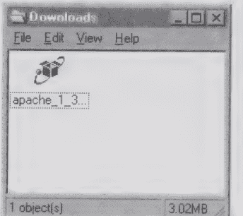
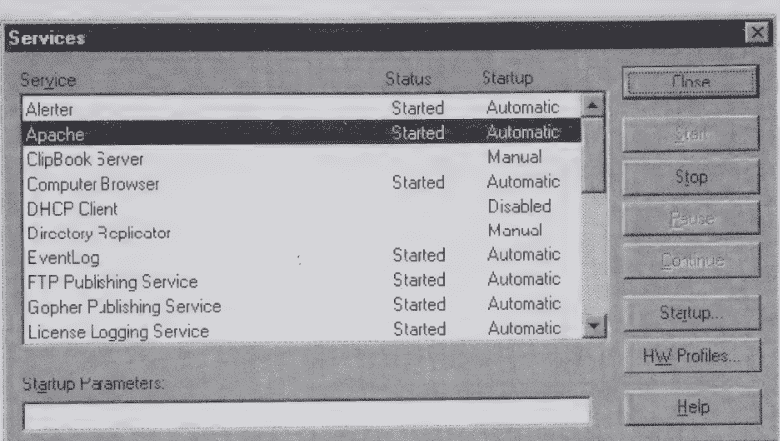
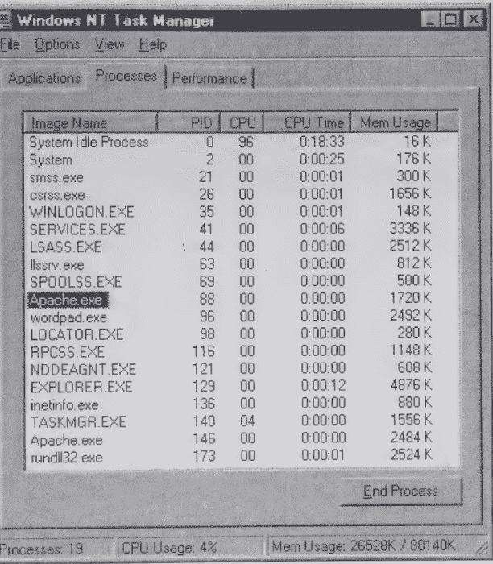
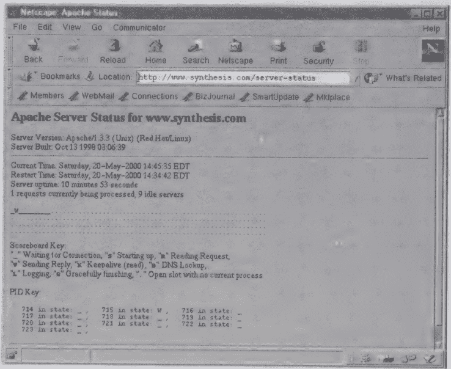
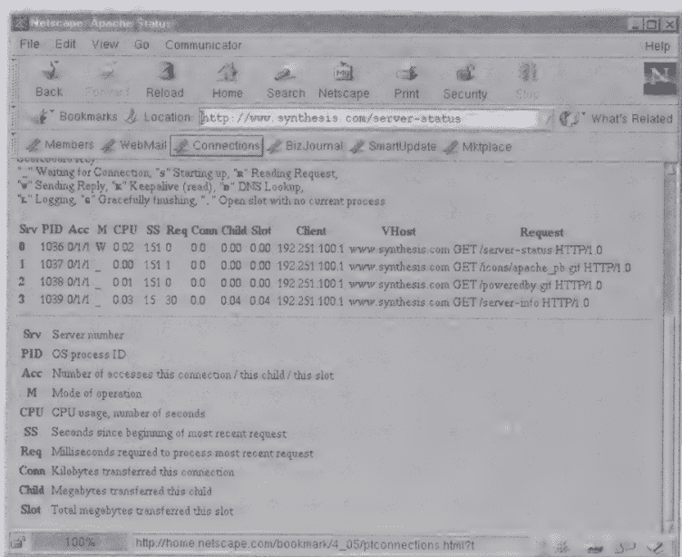
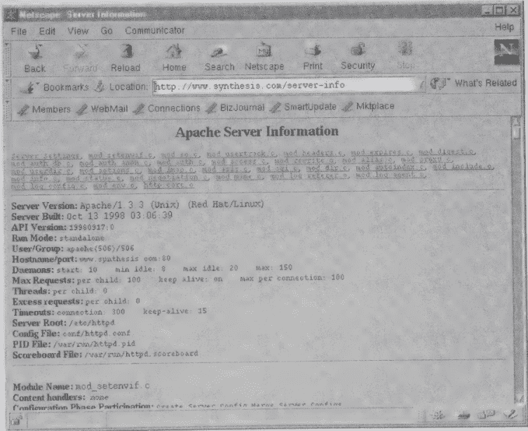
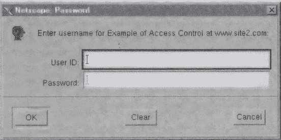
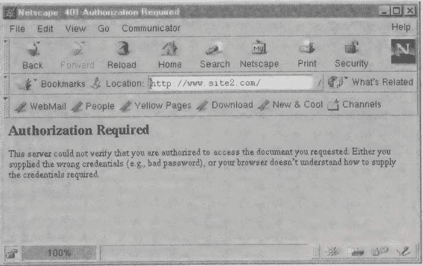
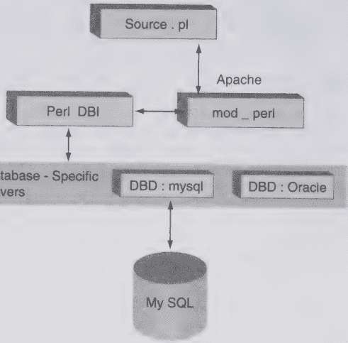
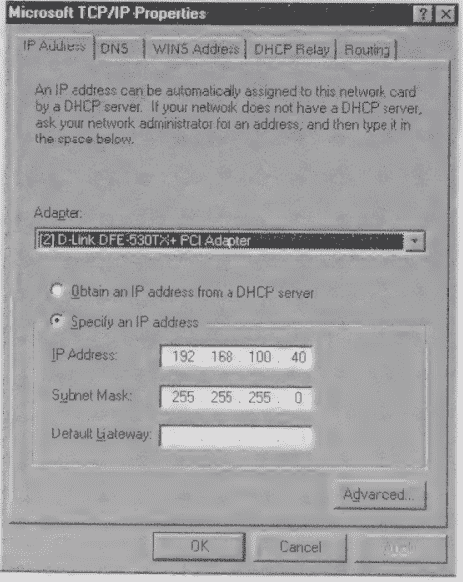

# Apache Web 服务器管理与电子商务手册


本书献给 Larry Hawkins 的纪念

2021 年由 Internet Archive 在 Kahle/Austin 基金会的资助下数字化

## 前言

### 摘要

本书旨在为 Apache Web 服务器提供一个广泛的教程和参考。本书假设读者具备一定的计算机基础，但不需要特定的网络背景。虽然主要讨论集中在电子商务上，但附录涵盖了各种周边信息，例如域名解析、TCP/IP 和正则表达式，这些对于创建一个可运行的 Web 服务器至关重要。此外，书中还从 Web 管理的角度涵盖了电子支付和数据库交互等对电子商务网站尤为重要的主题。

### Apache

Apache Web 服务器是开源软件运动的皇冠之珠。它无需任何费用即可获取，性能优于竞争对手，因此其使用范围比所有其他 Web 服务器的总和还要广泛。在撰写本文时，全球 61.5% 的网站都在使用 Apache 服务器。

开源软件的传播与生物自然选择非常相似——世界上的 Linux 和 sendmail 最终会登上 *Time* 杂志的封面并被炒作机器所吞噬，而无数的 DOS 实用程序则缓慢但不可避免地滑向历史的 `/dev/null`。如果 Apache 运行得不好，它不会如此受欢迎。

Apache 还有另一个在开源世界中并不太常见的优点：它足够简单，任何具备合理能力的计算机用户都能掌握。天知道我并不是微软的狂热粉丝，但如果你让我选择在 Linux 或 Windows 2000 之间教我的母亲快速上手，我选择 Windows 的速度会比你说出 "Thomas Penfield Jackson" 还要快。顺便说一句，这不是在诋毁 Linux；操作系统，尤其是多用户操作系统，极其复杂。使普通用户能够接触到它们的唯一方法就是将它们简化。

幸好，交给 Apache 处理的任务集并没有那么庞大。那些仅凭自信和冒险精神接触 Apache 的人会欣慰地发现，服务器本身的配置和维护实际上并不是一项特别复杂的任务。根据你的经验水平，诀窍可能在于掌握操作系统的基本概念，学习让机器执行你所需操作的命令，并吸收相关术语。如果你已经精通其中一个或多个主题，那么你 *真的* 将会迎来一个愉快的惊喜。

### 简史

Apache 服务器源自 Rob McCool 在国家超级计算机应用中心 (NCSA) 创建的 httpd 服务器。1995 年，httpd 是当时最受欢迎的 Web 服务器，但当 McCool 在 1994 年离开 NCSA 后，该程序的开发陷入停滞。一小群 Web 管理员组成了后来被称为 Apache 组的核心成员。成员包括：

- Brian Behlendorf
- Roy T. Fielding
- Rob Hartill
- David Robinson
- Cliff Skolnick
- Randy Terbush
- Robert S. Thau
- Andrew Wilson

在 Eric Hagberg、Frank Peters 和 Nicolas Pioch 的贡献下，Apache 组整合了已发布的 httpd 1.3 漏洞修复，添加了一些新功能，并在 1995 年 4 月发布了 Apache 0.6.2。

从那时起，这个被称为 Apache 组的团队一直在对基础软件进行微调和增强。现在几乎所有主流操作系统都提供了软件移植版本，尽管 Unix 平台仍然是先驱。

Apache Web 服务器是一些极其熟练的程序员通过大规模协调努力而取得的最终结果。你可能会问，是什么驱动他们免费提供 Apache 而不是排队等待 IPO。我在此引用 apache.org 网站的内容：

> Apache 的存在是为了提供一个健壮且商业级别的 HTTP 协议参考实现。它必须保持为一个平台，让个人和机构能够构建可靠的系统，无论是为了实验目的还是为了关键任务目的。我们认为在线出版的工具应该掌握在每个人手中，软件公司应该通过提供增值服务（如专业模块和支持等）来赚钱。我们意识到，一家公司“拥有”一个市场通常被视为一种经济优势——在软件行业，这意味着紧紧控制某种特定行为，以便所有其他人都必须付费。这通常是通过“拥有”公司开展业务的协议来实现的，而代价是所有其他公司。只要万维网的协议不被单一公司“拥有”，Web 对大大小小的公司来说就将是一个公平的竞争平台。因此，必须防止对协议的“所有权”，而一个健壮的协议参考实现的出现，且对所有公司绝对免费，是一件极其正确的事情。


## 开源软件

Apache 是一款开源产品。传统的套装软件通常仅包含可执行的目标代码，而不包含编译该代码的人类可读的源代码。Apache 和其他开源产品在分发时，不仅包含可执行的目标代码，还包含创建该代码的源代码文件。

从最终用户的角度来看，这非常有意义。例如，在我写这本书的时候，我的办公室遇到了一个问题。一个运行在大型商业操作系统上的大型商业软件套装进入了一种状态，即它停止响应输入，并且实际上无法被杀死（unkillable）。我们尝试了堆栈跟踪（stack trace）和其他一些方法，但如果没有源代码，我们真的能做的事情不多。我们最终导出了所有能导出的数据，并将其发送给软件供应商进行分析。据推测，他们会在一两周内给我们答复。

你可以想象，这非常令人沮丧。如果我们使用的是开源软件，即使不能彻底修复，我们可能也已经想出了一个临时解决方案。我们甚至不清楚问题到底出在哪里，即使知道了，我们也没有手段重新编译软件来修复它。我们完全听凭供应商的处置。

当然，这把双刃剑。因为没有人真正通过维护 Apache 的开源版本来获取报酬，所以如果你的服务器出了问题¹且你不知道如何修复，你无法在凌晨 2:00 拨打任何免费电话寻求帮助。支持以新闻组和网站的形式存在，但这取决于支持者的方便，而不是由“被支持者”的需求决定的。

Apache 和其他开源软件产品受益于它们在开发者社区中的持续曝光。由于每个开源项目参与开发的开发者数量比任何最富有的公司能负担得起的雇员都要多，缺陷源代码能被更快速地定位并修复。

我还认为，开源代码的初始质量往往高于商业开发的代码。因为开源开发者是出于对编程的纯粹热爱而驱动的，你往往能让最顶尖的人才在开源软件上工作。与之形成对比的是传统的软件公司，那里的大部分时间都花在开会、打电话和交易股票上。

## 本书结构

本书旨在供所有技能水平的 Apache 管理员使用。它假设读者对基本计算机概念有一定的了解，但不需要具备 Web 管理背景。对于完全接触 Apache 的新手，书中有一个详尽的入门章节，详细说明了你开始学习所需知道的一切。

在掌握了基本概念之后，你通常会有一两个想要尽快实现的“心仪功能”（例如虚拟主机 Virtual Hosting）。本书的章节被结构化为关于各种主题的独立文章，你可以按照任何你喜欢的顺序阅读。

Apache 在与现实世界的接触中变得日益精炼。每天都有新功能被提出并实现，有时作为核心服务器功能的增强，更多时候则是作为新的或改进的模块。因此，即使是专家用户，有时也需要扩展他们的能力范围。希望这本书即使对于经验丰富的 Apache 管理员也能有所启发。

最后，附录讨论了各种网络和编程主题。其中许多并非严格与 Apache 相关，但由于 Apache 需要一个正常运行的网络，你的 Web 管理职业生涯可能会涉及一定量的通用网络管理和编程技能。附录虽然不全面，但我认为它们会很有用。

# 第一部分：基础知识

第一部分涵盖了 Apache 管理的基本概念和技术。它将引导你完成获取并安装一个满足你需求的 Apache 服务器的过程。如果你之前没有接触过 Apache，你应该按顺序阅读前四章，特别是第一章“基本概念”。第一章到第四章的信息，加上附录，足以让你从零开始起步。

# 第二部分：高级管理

第二部分描述了 Apache 更高级的功能。一旦你掌握了基本概念，你可以根据自己的意愿在第二部分的各章节之间随意跳转。每一章都旨在作为一篇关于标题所示主题的自包含文章。

# 第三部分：电子商务

第三部分讨论电子商务网站特别感兴趣的主题，如数据库连接以及在 Web 上收款的机制。最后一章是关于创建电子商务站点基础设施的案例研究。

### 附录

附录包含的信息要么是太过于原始而无法融入正文（例如指令语法），要么更倾向于背景信息（例如附录 F “Unix 概念”）。有些以简短的教程文章形式呈现，有些则是纯粹的参考资料。

## 如何使用本书

在整本书中，你会发现示例命令和配置指令，它们总是伴随着至少一些解释，有时还有示例输出。通常，我不在常规章节中提供指令和系统命令的详细语法信息。这类信息可以在附录中找到，特别是附录 A “核心指令”和附录 B “其他指令”。希望你能从上下文中领悟到你不熟悉的任何命令的一般性质。

任何给定的 Apache 事务的成功或失败取决于内部服务器配置、传输的内容、底层操作系统的配置以及网络支持服务的变数。因此，无法绝对肯定这里提供的示例会在你的特定机器上运行。但我郑重承诺，我亲手输入了每一个示例，并且它们在我这里运行正常。

在某些情况下，特定章节的起始配置是在之前的章节中开发的。例如，第 8 章中进行安全加固的虚拟主机是在第 4 章中创建的。如果某个特定配置指令的含义不明确，请查阅索引并在之前的章节中阅读其来源。

请注意，示例 OS 命令坦率地说偏向于通用 Unix 环境，特别是 Linux。这并非巧合；我在写这本书时的主要测试服务器是一台 Linux 机器，尽管在 Windows NT、Windows 95 和 Mac OS X 上也进行了一些工作。

我非常喜欢的一个 Unix 惯例（但在 Apache 文档中通常看不到）是指定某个环境变量来包含冗长的目录路径。在整本书中，你有时会看到 Unix 系统变量

`$APACHE`

被用来指示 Apache 安装的主目录。（该目录在配置文件中被称为 **ServerRoot**。）

## 排版约定

示例命令和指令使用 Courier 字体，粗体且居中：

**ExampleDirective with parameters**

出现在正文中的指令用**粗体**标出。出现在正文中的目录路径和文件名使用 Courier 字体并加粗：**/sample/directory** 或 **filename**。偶尔我也无法克服小学时期的习惯，将**词汇词语**也用粗体列出。

较大段的示例配置文件通常用灰色背景以及左右边栏标出。

- DirectiveA
- DirectiveB
- DirectiveC
- DirectiveD

***

¹ 这虽然是真的，但仍有些误导。根据 Apache 许可证，只要你承认 Apache 组织最初编写了该代码，你几乎可以对源代码做任何你想做的事情，包括将其转售。因此，如果你愿意出钱，是可以获得技术支持的。


最后，我尝试使用一些有意义的标题来细分对单个指令的讨论。虽然大多数 Apache 指令的名称能让相当精通的计算机用户大致了解其功能（例如，**AddModule** 和 **Port**），但其他一些指令涉及的是 Apache 特有的功能，难以在二十个字符以内描述清楚（例如，**DocumentRoot**）。为了让你在翻阅本书时能更轻松地找到所需内容，我使用了诸如 *Where to Find HTML Files*: *DocumentRoot*（在哪里找到 HTML 文件：DocumentRoot）这样的标题。

总的来说，我认为这是一个相当不错的主意，并且我坚持这样做。然而，这产生了一个不可预见且相当令人遗憾的副作用：时不时地，我发现自己在讨论一个名称如此直观的指令，以至于我找不到更好的方式来重新措辞。我不能避免放置标题，因为那样会导致格式糟糕，我的编辑会对我大吼大叫。在这种情况下，我别无选择，只能对那些从指令名称中就已经显而易见的功能写出详细解释，例如 *Specify an SSL Level*: *SSLLogLevel*（指定 SSL 级别：SSLLogLevel）。

我提前向大家表示歉意。

如果你有任何问题、评论、更正或改进建议，请随时通过 s_hawkins@mindspring.com 与我联系。

## Hydra（海德拉）

作为后记，你们中的一些人可能会好奇封面上的那个小生物有什么意义。它叫作海德拉（hydra），是由一个名叫 Tom Post 的人绘制的。Prentice Hall 出版社的开源书籍封面艺术主题是神话中的怪兽，而海德拉实际上是非常适合 Apache 的选择。你看，Apache 通常在同一台机器上运行多个实例，这与海德拉的多个头部非常相似。明白了吗？感谢我的编辑 Miles Williams 挑选了一个长着尖牙的神话角色，而不是给我安排一只独角兽或宁芙（nymph）之类的东西。

# 第一部分
# 基础知识

## 基本概念

## 1.1 简介

本章介绍了作为 Apache Web 服务器基础的概念。本书的其他章节会相当随意地使用这里讨论的专业术语，因此，如果你不熟悉 *directive*（指令）、*module*（模块）等术语，你可能需要通读本章。

下面描述的大多数 Apache 特定技术都可以看出是从标准编程理论演变而来的。然而，如果你不是一名程序员，或者即使你只是 Apache 的初学者，阅读本章将有助于你加快攀登学习曲线的速度。

## 1.2 配置文件

Apache 是一款极具可配置性的软件。数百个配置变量有数千种可能的取值组合。使用过 Unix 或 DOS 的人无疑熟悉命令行选项的概念。指令背后的基本原理与命令行选项相同，但与其在每次调用 Apache 时在命令行上重新指定几十个或数百个配置变量，不如将这些值收集到配置文件中，由服务器在启动时自动读取。Apache 读取以确定其应当执行的操作的变量此前包含在三个文件中：

| 文件 | 描述 |
| :--- | :--- |
| httpd.conf | 主配置文件，包含指定服务器特定配置信息的变量。 |
| httpd.conf | 服务器资源管理——从历史上看，此文件包含指定如何使用服务器资源的变量。 |
| access.conf | 从历史上看，此文件包含与访问控制相关的变量。 |

目前，使用所有三个配置文件的做法已经过时了。为了向后兼容，这种做法仍然得到支持，但不被推荐。*如今，你通常会在* **httpd.conf** *文件中找到所有的配置指令。*

默认情况下，配置文件存储在 Apache 主目录下一个名为 **conf** 的子目录中。与 Apache 中的大多数其他内容一样，这些文件的位置和名称是可配置的，但为了讨论方便，我通常假设其处于默认位置。第 3 章“配置 Apache”包含了关于如何定位和指定 Apache 主目录及各种文件的更多信息。

## 1.3 指令

如上所述，Apache 的配置值由配置文件中的变量指定。这些变量被称为 *directives*（指令）。Apache 管理工作的百分之九十都花在研究你想设置哪些指令以及将其设置为什么值上。¹

请注意，*并非所有可能的指令* 都能被 Apache 自动识别。相当大的一部分指令（称为 *core directives*，核心指令）默认启用，但 Apache 是否识别其余指令取决于在你运行的特定 Apache 版本中编译进了哪些模块。如果你在配置文件中包含了一个指令但它似乎没有产生任何效果，那么你运行的可执行文件可能没有编译进相应的模块。要获取已编译模块的列表，请输入以下命令：

```
httpd -l
```

请注意，共享对象模块在运行时加载，不会由该命令显示。有关更多信息，请参阅本章中的“Modules”部分。

## 1.4 限制指令的作用范围

并非所有指令都具有全局适用性。有时，让某个特定指令在服务器的一个部分以某种方式设置，而在另一个部分以相反方式（或根本不设置）是有用的。

最明显的例子发生在托管多个站点时。同一个 Apache 服务器可以处理多个网站。这种做法在第 5 章“托管多个站点”中会更详细地讨论，但现在请先相信，两个站点（例如 www.christiansite.org 和 www.muslimsite.org）可以通过同一台机器上的同一个程序提供服务。在托管多个网站时，你通常希望为每个站点指定不同的指令；至少，它们会有不同的名称。

除了虚拟主机（稍后讨论）之外，特定指令的作用范围可以通过三种方式限制：

- 按目录，使用 `<Directory>` 指令、`<DirectoryMatch>` 指令或 `.htaccess` 文件
- 按 URL，使用 `<Location>` 和 `<LocationMatch>` 指令
- 按文件，使用 `<File>` 和 `<FileMatch>` 指令

¹ 另外百分之九十的时间花在调整你的编译设置上。

### 1.4.1 限制范围至目录，方法 1：`<Directory>` 和 `<DirectoryMatch>`

假设你有一个指令，希望仅将其应用于 `/home/site2` 目录及其任何可能的子目录。在这个例子中，指令实际执行什么并不重要，重要的是你希望它应用于以 `/home/site2` 为根的目录树块，而不是你的站点其余部分。在本例中，我将使用一个虚构的指令 **DirectiveA**。如果你想让 **DirectiveA** 应用于 `/home/site2` 及其任何子目录，而不应用于服务器的其余部分，请将其包含在如下所示的 `<Directory>` 括号中。

```
<Directory /home/site2>
    DirectiveA
</Directory>
```

图 1.1 DirectiveA 的作用范围。

**`<DirectoryMatch>`** 指令的工作方式与 **`<Directory>`** 指令非常相似，不同之处在于它接受一个正则表达式而不是实际的目录名作为参数。例如，

```
<DirectoryMatch "/home/site[1-3]">
    DirectiveA
</DirectoryMatch>
```

将匹配 `/home/site1`、`/home/site2` 和 `/home/site3` 目录。

### 1.4.2 限制范围至目录，方法 2：使用 .htaccess 文件

实现类似目标的另一种方法是创建一个包含配置指令的特殊文件，并将该文件存储在你希望配置信息生效的目录中。默认情况下，此类文件被命名为 `.htaccess`。如果这个名称不适合你，你可以通过 `AccessFileName` 指令将其更改为你喜欢的任何名称。

为了使 `.htaccess` 中的指令生效，必须首先告知 Apache 此类文件可能存在且应当寻找它们。这是通过 `AllowOverride` 指令实现的。然而，`AllowOverride` 不仅仅是一个简单的开关。它还可以用来指定在 `.htaccess` 文件中可以使用哪些*种类*的指令。可选选项在表 1.1 中指定。

| 选项 | 效果 |
| :--- | :--- |
| All | 允许使用所有指令 |
| None | 不允许任何指令；禁用文件搜索 |
| AuthConfig | 允许使用 `AuthDBMGroupFile`, `AuthDBMUserFile`, `AuthGroupFile`, `AuthName`, `AuthType`, `AuthUserFile`, `require` |
| FileInfo | 允许使用 `AddEncoding`, `AddLanguage`, `AddType`, `DefaultType`, `ErrorDocument`, `LanguagePriority` |
| Indexes | 允许使用 `AddDescription`, `AddIcon`, `AddIconByEncoding`, `AddIconByType`, `DefaultIcon`, `DirectoryIndex`, `FancyIndexing`, `HeaderName`, `IndexIgnore`, `IndexOptions`, `ReadMeName` |
| Limit | 允许使用 `allow`, `deny`, 和 `order` 指令 |
| Options | 允许使用 `Options` 和 `XBitHack` |

可以一次指定多个选项。例如，允许 `.htaccess` 文件的内容覆盖任何 `Options` 指令和 `FileInfo` 指令：

```
AllowOverride Options FileInfo
```

由于 `.htaccess` 文件不仅应用于其所在的目录，还应用于其子目录，这意味着当有人尝试访问 `/home/site2/cgi-bin` 中的文件时，Apache 必须在该目录*以及目录树中其之上的所有目录*中搜索名为 `.htaccess`（或你指定的名称）的文件。你可以想象，这会损害 Apache 的性能。如果没有迫切需要允许使用 `.htaccess` 文件，你应该按如下方式禁用它们：

```
AllowOverride none
```


## 1.4 限制指令的作用范围

### 1.4.3 将范围限制在 URL：`<Location>` 和 `<LocationMatch>`

正如 `<Directory>` 指令将括号内指令的作用范围限制在文件系统中的某个位置一样，`<Location>` 指令将括号内指令的作用范围限制在一个 URL 中。在实践中，`<Location>` 和 `<Directory>` 的效果可能完全相同。两者的区别在于，`<Location>` 指令不一定必须对应文件系统中的实际物理位置。

通常，位置指令指定一个子 URL，这意味着它是相对于特定服务器的。例如，假设你配置了一个名为 www.example.com 的服务器，并使用了以下位置指令：

```
```
<Location /status>
    SetHandler server-status
</Location>
```

在这种情况下，当请求以下 URL 时，Apache 将激活 server-status 处理器：

http://www.example.com/status

如果你从未听说过处理器（handlers），不必过于担心。它们是告诉 Apache 在访问某些位置时执行非默认操作的一种方式。在本章稍后部分将详细讨论。这里的关键点是，如果你没有指定服务器名称，Apache 将假设你指定的任何位置都是相对于本地服务器的。

### 1.4.4 将范围限制在虚拟主机

为了完整起见，这里我想提到，你还可以通过在本地服务器中创建虚拟主机来限制指令的作用范围。*虚拟主机（virtual host）*是指经过配置后能够响应多个服务器请求的 Apache 服务器。例如，一家小型 Web 托管公司可能在同一台硬件上运行数十个或数百个网站，并由同一个 Apache 实例提供服务。在正确配置的情况下，Apache 足够聪明，能够区分各个虚拟主机，并向外界伪装成每个主机都是一个完全独立的实体。实现这一目标的手段将在第 5 章中详细讨论。

### 1.4.5 按文件限制范围：`<File>` 和 `<FileMatch>`

`<Files>` 和 `<FilesMatch>` 指令在概念上与 `<Directory>` 和 `<DirectoryMatch>` 指令非常相似。当然，区别在于它们仅适用于单个文件，在 `<FilesMatch>` 的情况下，适用于通过正则表达式匹配的单个文件。例如，以下指令使 .htaccess 配置文件对任何人不可访问：

```
<Files .htaccess>
    Order deny, allow
    Deny from all
</Files>
```

请注意，与上述其他范围相关指令不同，`<File>` 和 `<FileMatch>` 可以有意义地包含在 `.htaccess` 文件中。

## 1.5 模块

如前所述，Apache 在所有实现中都包含了一块基础功能，称为*核心（the core）*。核心实现了指令的概念、读取配置文件的能力、一定的访问控制、自我扩展能力以及其他半打基础能力。具体而言，附录 A“核心指令”中找到的指令将始终存在于任何标准的 Apache 发行版中。

除此之外，Apache 的设计允许通过奖金代码子集来增强基本功能，这些子集可以被链接到特定的可执行文件中，也可以不被链接。这些子集被称为*模块（modules）*，标准发行版默认启用了相当多最实用模块。要生成可执行文件中包含的模块列表，请使用 `-l` 选项：

```
httpd -l
```

当前可执行文件是否包含某个特定模块，可以通过服务器管理员（大概就是你）在编译时控制，或者使用 **AddModule** 和 **ClearModuleList** 指令来控制。在共享对象文件的情况下，可以使用 **LoadModule** 指令在运行时动态控制模块（参见本章中的“动态共享对象”）。

加载模块的顺序非常重要，不应轻易更改。但是，如果你希望指定自己的加载顺序（并可能排除某些默认模块），可以使用 **ClearModuleList** 指令清空内部加载列表：

```
ClearModuleList
```

你应该立即使用一系列 **AddModule** 指令重新填充加载列表：

```
AddModule mod_access.c
```

被包含后，模块就是运行中的 httpd 进程的一个组成部分，具有相同的进程 ID 并可访问相同的系统资源。将其与你的网站中可能包含的 CGI 程序进行对比：CGI 进程与调用它们的 httpd 可执行文件是分离的，必须通过系统进程间通信资源与其通信，这是一种*慢得多*的方法。每当速度至关重要时，请编写模块。

Apache 在设计时就考虑到了模块。在其执行的不同阶段，核心 httpd 代码会轮询任何已被包含的可执行文件，以了解它们在如何处理配置文件、本地站点的 http 资源以及用户请求方面的意见。这一切都非常有条理。

创建自定义模块涉及的技术相当先进，但并非秘密。任何人都可以编写自己的 Apache 模块，而且很多人确实这么做了。事实上，一些最实用的模块是由第三方开发人员根据自己的需求编写的，随后才被包含在 Apache 发行版中。详见第 12 章“模块构建”，以更全面地了解模块创建过程。

## 1.6 动态共享对象

许多 Unix 实现提供了在运行时指定可执行文件的哪些部分应被包含、哪些部分应被排除的能力。这些预编译块的术语称为共享对象（shared objects）。Apache 广泛使用了共享对象能力。

如果一个模块要作为共享对象加载，必须使用 apxs (APache eXtenSion) 程序进行编译。第三方模块（mod_perl, mod_php）通常自带相应的操作指令。某些平台要求 Apache 核心功能具备动态共享对象 (DSO) 功能，以强制链接器导出符号表，供第三方模块随后使用。如果你需要在核心 Apache 功能上启用 DSO 功能，请在配置脚本中使用以下选项：

```
--enable-rule=SHARED_CORE
```

然后按照第 2 章“安装 Apache”中的讨论进行编译、重建并重新安装 httpd。

apache 模块 mod_so 允许你通过 LoadModule 指令在运行时指定要包含哪些共享对象模块。你需要在指令中指定模块名称和共享对象文件的路径。

```
LoadModule perl_module libexec/libperl.so
```

通常（且默认情况下），此类文件位于 ServerRoot 目录下的名为 libexec 的库目录中。

## 1.7 处理器

模块有时提供特定的处理器，它们是以不寻常的方式处理文件或请求的方法。有时处理器被命名以便在配置指令中被引用。命名处理器及其相关模块列在下面的表 1.2 中。

**表 1.2 命名处理器及其模块**

| 处理器 | 模块 | 效果 |
| :--- | :--- | :--- |
| send-as-is | mod_asis | 按原样提供文件和响应头。 |
| cgi-script | mod_cgi | 尝试执行并提供输出 |
| imap-file | mod_imap | 图像映射规则文件。 |
| server-info | mod_info | 显示服务器配置信息。 |
| server-parsed | mod_include | 定位并替换服务器端包含。 |
| server-status | mod_status | 显示服务器状态信息。 |
| type-map | mod_negotiation | 解析为类型映射文件。 |

如表 1.2 的模块部分所述，在访问其处理器之前，必须将该模块包含在当前的 httpd 可执行文件中。

可以通过 **AddHandler** 指令将处理器与文件扩展名相关联。例如，要告诉 Apache 将所有扩展名为 .pl 的文件传递给 cgi-script 处理器，请使用以下指令：

```
AddHandler cgi-script .pl
```

调用特定处理器的另一种方法是 **SetHandler** 指令。**SetHandler** 旨在用于 **`<Directory>`** 或 **`<Location>`** 容器指令中，因为它将处理器与特定位置的所有内容相关联。例如，要将 `/images` 目录中的所有文件视为图像映射规则文件，请使用以下指令：

```
<Location /images>
SetHandler imap-file
</Location>
```

## 1.8 MIME 类型

MIME 是 Multimedia Internet Mail Extensions 的缩写。MIME 类型的核心思想是使程序能够通过查看文件的扩展名来确定文件包含什么类型的数据。默认情况下，Apache 的 MIME 类型及其相关扩展名可以在 **conf** 目录中名为 **mime.types** 的文件中找到。当然，这是可配置的；使用 **TypesConfig** 指令将其设置为其他值。例如，

```
TypesConfig /etc/mime.types
```

将 **mime.types** 文件放在 **/etc** 目录中。

若要简单地将 MIME 类型与文件扩展名相关联，请使用 **AddType** 指令。例如，

```
AddType application/x-httpd-php .php
```


## 1.8 MIME 类型

告知 Apache 以 `.php` 结尾的文件包含经过 PHP4 增强的 HTML 数据。Apache 使用 MIME 类型来决定文件在交付给客户端之前需要进行什么样的预处理。在调整 MIME 类型时，建议您仅限于使用 **AddType** 指令，避免修改 **mime.types** 文件。

另一个有用的指令是 **DefaultType**。服务器应当告知客户端其正在传输的数据类型。使用 **DefaultType** 指令来指定在没有任何其他适用类型时要传输的默认类型。

```
DefaultType text/html
```

## 安装 APACHE

## 2.1 简介

本章详细介绍了获取、编译和安装 Apache Web 服务器所需的步骤。根据您运行的操作系统，其中某些或所有步骤可能是可选的。例如，Red Hat Linux 自带了一个安装好且可直接运行的 Apache 版本。然而，根据您的具体需求，您可能希望自定义安装或获得亲自编译 Apache 的经验。

## 2.2 硬件选择

硬件的选择在很大程度上取决于您最终打算用服务器做什么。例如，如果您只是为了积累经验或进行概念验证而尝试，几乎任何旧 PC 都可以。Apache 在低至 486 系列的机器上都能稳定运行。在高端方面，Apache 分发版可用于 HP-UX、AIX 和其他强力机器——请访问 apache.org 网站查看完整列表。

### 2.2.1 RAM

服务器性能最大的瓶颈是 RAM。Apache 的 Unix 分发版为每个客户端请求产生一个自身的克隆副本。¹ 您的目标是拥有足够的 RAM，以便所有这些子进程能够同时容纳在物理内存中。如果空间不足，操作系统将被迫将部分子服务器存储在虚拟内存（硬盘上），并以一个极其缓慢的过程在 RAM 中进行交换，这个过程被称为 *分页（paging）*。

在规划专业系统时，您应该首先决定要在服务器中包含哪些模块。编译服务器以包含这些模块而不包含其他模块，然后检查生成的 `httpd` 大小。将该大小乘以您希望同时服务的客户端请求数，然后将结果乘以 1.5，即可得出 RAM 需求的粗略估计。请注意，该公式仅用于防止对 RAM 的低估而导致尴尬。如果您能负担更多的 RAM，请购买。

> ¹ 在配置限制范围内——见第 3 章和第 10 章。

### 2.2.2 磁盘

硬盘有两种基本类型：IDE 和 SCSI。IDE 驱动器最常见且最便宜，可见于大多数消费级 PC。它们依赖 CPU 来控制所有读写访问，因此性能相对较低，尤其是在多磁盘系统中。

对于严肃的服务器，唯一实际的选择是 SCSI 硬件。SCSI（发音为 *scuzzy*）硬件比 IDE 硬件更智能。具体来说，它及其关联的控制器卡能够在不就每个小指令咨询 CPU 的情况下，执行基本的访问任务（磁盘读取、寻道定位）。它们比 IDE 驱动器快得多，当然，价格也贵得多。

建议为您的服务器购买至少两个 SCSI 驱动器——一个用于存放操作系统，一个用于 Apache。拥有两个磁盘将使操作系统能够同时访问 Apache 文件和操作系统文件，从而消除一个潜在的瓶颈。

通常，购买几个较小的磁盘比购买一两个大磁盘更好。无论何种类型，单个磁盘一次只能执行一个读/写操作。将读/写操作分布在多个磁盘上将提高性能。

根据您对停机时间的耐受程度，您可能希望考虑购买额外磁盘，以实现 RAID（冗余磁盘阵列）配置。RAID 2，或 *磁盘镜像（disk mirroring）*，在第二个磁盘上存储所有数据的相同副本，可在发生故障时使用。RAID 5 将数据的副本分布在三个磁盘上，使得单个磁盘故障不会破坏数据。但请注意，并非所有操作系统都支持 RAID。

## 2.3 系统准备

首先，您需要确定将运行在哪个操作系统平台上。您可以获得大多数 Unix 和 Linux 版本的预编译二进制文件。Unix 是 Apache 的原生环境，它在 Unix 平台上可能永远运行得最好。然而，它对 Windows 95、Windows 98、Windows 2000 和 Windows NT 也有相当强大的移植版本，而且最近，Apple 在其 OS X 服务器中也包含了一个版本。

大多数计算机用户对操作系统的选择有相当强烈的观点。显然，如果您在上述三种系统中的一种比其他两种更熟练、经验更丰富，那么您应该选择那个。如果您在上述三种操作系统中同样熟练（或同样不熟练），您可能会想选择 Unix 平台。我并不是说移植到 Win32 平台的版本运行得不好——它们运行得很好。但事实是，Apache 最初是为在 Unix 下运行而设计的，这一点显而易见。简要查看配置文件就会发现其中潜藏的 Unix 假设（多个子进程、目录使用 "/" 分隔符），这在一定程度上削弱了 Windows 移植版的优雅。

此外，当有新开发时，通常先在 Unix 实现上完成，然后再移植到其他平台。许多安全特性显然是为 Unix 环境设计的，需要强行塞入 Windows 和 Mac 中。最后，Unix 操作系统是三者中最便宜的。在撰写本文时，两者都

### 2.3.1 Unix 准备

Apache 肯定需要一部分磁盘空间（无论是独立的文件系统还是简单的目录）专门为其分配。您应该首先完成这项工作。

并不严格要求为 Apache 进程运行创建用户和组身份。软件作为默认系统身份之一（例如 `nobody`）也能正常工作。然而，这样做要好得多。一个 Apache 专属的用户身份既增强了安全性，又提升了美感，而且通常会让您看起来像个专业人士。

### 2.3.2 Unix 家目录

Apache 用户（将在下一步创建）应该有一块专门为其分配的磁盘空间。您可以使用 `mkdir` 命令在现有目录（例如 `/usr/local`，`/opt`）下创建一个子目录即可。

```
cd /opt; mkdir apache
```

然而，根据您最终计划的 Web 服务规模，您可能希望为 Apache 创建一个独立的文件系统。为此，首先分配磁盘空间（在 Linux 中使用 `cfdisk`），然后创建文件系统（使用 `mkfs`）并挂载（使用 `mount`）。

使用 `mkdir` 命令在 Apache 家目录下创建表 2.1 所示的子目录：

**表 2.1 Apache 用户的子目录**

| 子目录 | 用途 |
| :--- | :--- |
| bin | 包含可执行的 Apache 文件 (httpd) 和任何其他可执行实用程序。 |
| logs | 包含所有 Apache 专用日志文件。 |
| conf | 包含 Apache 配置文件。 |

通常，您希望 Apache 可执行文件以 root 身份运行。因此，允许 root 以外的任何人拥有或对上述目录具有写权限是一个潜在的安全漏洞。使用 `chown`、`chgrp` 和 `chmod` 命令来保护这些目录。

### 2.3.3 Unix 用户和组身份

用于方便创建新用户和组的实际命令在不同的 Unix 实现中有所不同。以下示例适用于 Linux。如果您运行的不是 Linux，您可以通过编辑 `/etc/passwd` 和 `/etc/group` 文件来创建新用户。表 2.2 中描述的 `/etc/group` 文件格式如下：

```
group:password:GID:user_list
```


#### 表 2.2 /etc/group 文件的元素

| 字段 | 用途 |
|-------|---------|
| **group** | 组名（建议使用 *Apache*）。 |
| **password** | 对于组，通常为空。 |
| **GID** | 唯一的数字组 ID。 |
| **user_list** | 用逗号分隔的组成员列表；名称必须与 */etc/passwd* 文件中的 **user** 条目匹配。 |

表 2.3 中描述的 */etc/passwd* 文件格式如下：
`user:encrypted password:UID:GID:user name:home directory:shell`

#### 表 2.3 /etc/passwd 文件中 Apache 用户记录的元素

| 字段 | 用途 |
|-------|---------|
| **user** | 用户的系统名称，可能是 *Apache* |
| **encrypted password** | 出于安全考虑，请放入一个星号。这实际上意味着*不存在密码*，并将防止任何人以用户 *Apache* 登录。当你需要切换为 Apache 用户时，先成为 root 用户，然后执行 `su –Apache`，这样可以绕过密码保护。 |
| **UID** | 系统用于标记所有由用户 *Apache* 拥有的文件和目录的唯一数字。 |
| **GID** | 在 */etc/group* 文件中找到的数字组 ID。 |
| **user name** | 用户的实际全名；通常例如 *Sue Smith* 或 *Bob Wilson*，但在本例中为 *Apache*。 |
| **home directory** | 使用创建为 Apache 主目录的目录或文件系统（如上例中的 */opt/apache*） |
| **shell** | */bin/false* |

在手动创建 */etc/passwd* 和 */etc/group* 文件条目时，必须小心使用准确数量的冒号，即使它们之间的条目为空。

如果你不习惯手动编辑关键系统文件，你的操作系统几乎肯定有一个程序或脚本可以为你完成这项工作。在 Linux 上，输入：

```
groupadd apache
```

接下来，创建一个名为 *Apache* 的用户，属于 Apache 组。

```
useradd -g apache apache
```

现在，确保之前创建的所有子目录都由 root 用户所有。

```
chown 0:0 -R /opt/apache
```

### 2.3.4 Windows 准备工作

除了提供安全保障（这并不绝对需要在前期完成）之外，Windows 安装不需要特殊的准备工作。

### 2.3.5 Mac OS X 准备工作

Mac OS X 预装了 Apache。

## 2.4 获取 Apache

Apache 提供了免费的编译二进制分发版和源代码分发版。在本配套光盘中，我包含了（在编写时）这两个版本的最新版本。取决于你阅读本书的时间，你可能已经拥有了所需的一切。如果你对包含的分发版满意，你可以点击光盘图标（Mac 和 Windows）或挂载磁盘（Unix），并根据需要复制文件。

或者，你可以直接从源头获取。Apache 的最终发布版始终可以在 http://www.apache.org/dist 找到。源代码下载（在使用前需要编译）位于 /dist 目录中。适用于各种平台的预编译二进制文件位于 /dist/binaries 下的各个子目录中。如果你下载的是二进制文件，请确保选择适合你平台的执行文件（例如，Windows 95/98/NT 选择 win32，Solaris 操作系统选择 Solaris）。

为了简化和加快传输，源代码分发版被合并成一个单一的可下载文件，并使用各种压缩工具之一进行压缩。在 Unix 上，在使用之前，你需要对分发版进行解压缩和解包。Win32 分发版是以自解压文件的形式提供的；你只需要双击它即可。

### 2.4.1 Unix

首先，将下载的文件移动到有足够空间存放解压和解包后文件的文件系统中（目前大约 1 M）。

```
mv apache_X.Y.Z.tar.Z /
```

然后，从存档中提取实际文件。

```
tar -xvzf apache_X.Y.Z.tar.gz
```

最后，将它们移动到你准备好的文件系统中。

```
mv apache_X.Y.Z /opt/apache
```

### 2.4.2 Windows

在 Windows NT 上，你应该首先确保安装了 Service Pack 3 或更高版本。除此之外，在所有 Win32 平台上的安装只需双击下载的文件即可。

## 2.5 编译 Apache

编译是指计算机将人类可读的源代码翻译成机器可执行的二进制代码的过程。在你能够使用下载的 Apache 源代码文件之前，必须将它们编译成可执行二进制文件，并存储在操作系统能够找到的地方。

### 2.5.1 背景信息：make

- Unix 文件几乎总是借助一个名为 **make** 的流行实用程序进行编译。make 实用程序接收两个输入：你希望组装成可执行整体的源代码和库。对于 Apache，这些内容要么是从网站下载的，要么（上帝保佑）已经存在于你的机器上。
- 一组用于组装源代码的规则。这些规则以名为 Makefile 的文本文件形式存在。Makefile 指定了诸如编译器、源代码文件及其依赖关系，以及你希望 **make** 为你实现的 goal（例如编译后的可执行文件、干净的目录或已安装的可执行文件）。

在创建和配置 Apache 期间，你会不时看到 Makefile。根据你想构建的服务器类型，你可能需要手动编辑其中一些文件。有关 make 实用程序的详细信息，请参阅你的系统文档。

### 2.5.2 APACI 方法

从历史上看，编译自定义版本的 Apache 涉及进入 **src** 目录并手动编辑配置文件，主要是为了告诉它们你希望在构建中包含哪些模块。在现代分发版中，情况不再如此，至少不一定是这样。你可以使用 Apaci 配置脚本来自定义你希望包含的模块，并完全通过命令行构建一个 **httpd** 可执行文件。

当然，如果你愿意，没有什么能阻止你进入 **src** 目录并用传统方式操作。当然，这种方法让你对包含的模块和编译方法有更精确的控制。在某些情况下，例如当你编译第三方模块时，无论你是否愿意，都必须这样做（有关手动配置 configure 脚本的进一步讨论，请参阅第 12 章）。不过，目前我将集中于使用 Apaci 的 *configure* 脚本，因为这是最简单的方法。

将你的工作目录更改为你最近解包的 Apache 分发版。在其中你应该能看到一个名为 *configure* 的脚本文件。我们将从默认安装开始，因此 configure 将接收一个参数 `--prefix`，它指示存储所有 Apache 信息的目录名称。延续我们的示例，该目录是 */opt/apache*。假设你使用相同的目录，你将如下调用 *configure* 脚本：

```
./configure --prefix=/opt/apache
```

你应该看到类似以下的输出：

```
Configuring for Apache, Version 1.3.12
+ using installation path layout: Apache (config.layout)
Creating Makefile
Creating Configuration.apaci in src
Creating Makefile in src
+ configured for Linux platform
+ setting C compiler to gcc
+ setting C pre-processor to gcc -E
+ checking for system header files
+ adding selected modules
+ checking sizeof various data types
+ doing sanity check on compiler and options
Creating Makefile in src/support
Creating Makefile in src/regex
Creating Makefile in src/os/unix
Creating Makefile in src/ap
Creating Makefile in src/main
```

这一切的最终结果是一个 Makefile。如前所述，Makefile 告诉系统的 **make** 实用程序如何将你下载的源代码与你自己的系统信息和工具相结合以构建一个可执行文件。要开始此过程，只需输入：

```
make
```

如果一切顺利，你应该在该目录中得到一个可执行版本的 **httpd**。² 要将其安装在你的系统上，请输入：

```
make install
```

² 你的编译器和库可能与创建 makefile 时使用的不完全相同。如果不同，当你尝试编译时会收到一个（或一堆）错误。此时你必须手动编辑 makefile，或者某些系统库文件，并将有问题的参数更改为与你的系统匹配。这是一个我们将轻快地称之为 *非trivial（不简单）* 的过程。命令 `find / -type f -print | grep <missing file>`（其中 `<missing file>` 部分被替换为缺失文件的实际名称）在你的系统中定位文件时可能会很有用。


该命令将产生另一组进度消息，在最后你应该会看到如下屏幕：

```
You now have successfully built and installed the
Apache 1.3 HTTP server. To verify that Apache actually
works correctly you now should first check the
(initially created or preserved) configuration files

/opt/apache/conf/httpd.conf

and then you should be able to immediately fire up
Apache the first time by running:

/opt/apache/bin/apachectl start

Thanks for using Apache.          The Apache Group
                               http://www.apache.org/
```

恭喜，最艰难的部分已经结束。默认情况下，你刚刚构建的 **httpd** 将包含表 2.4 中所示的模块。

**表 2.4** **httpd** 中包含的默认模块

| 模块 | 描述 |
|--------|-------------|
| http_core.c | 服务器的核心功能。 |
| mod_env.c | 允许将环境变量传递给 CGI 脚本。 |
| mod_log_config.c | 用户可配置的日志记录。 |
| mod_mime.c | 使 Apache 能够根据文件扩展名确定文档类型。 |
| mod_negotiation.c | 内容协商。 |
| mod_status.c | 将服务器状态信息显示为 Web 页面。 |
| mod_include.c | 使 Apache 能够提供有限的动态内容。 |
| mod_autoindex.c | 自动目录列表。 |
| mod_dir.c | 目录信息的基本显示。 |
| mod_cgi.c | 使动态内容的生成成为可能。 |
| mod_asis.c | 允许在没有 HTTP 标头的情况下传输文件。 |
| mod_imap.c | 处理图像映射文件。 |
| mod_actions.c | 使 Apache 能够使用 CGI 脚本处理某些类型的文件。 |
| mod_userdir.c | 使 Apache 能够从用户的家目录提供页面服务。 |
| mod_alias.c | 实现文件系统内的 URL 重定向和强制重新映射。 |
| mod_access.c | 访问控制。 |
| mod_auth.c | 有限的授权。 |
| mod_setenvif.c | 使 Apache 能够根据客户端信息设置环境变量。 |

这可能适合也可能不适合你的需求。如果不合适，你可以使用 **configure** 脚本来指定保留哪些模块以及剔除哪些模块。configure 脚本提供了大量选项；输入 **configure -h** 可查看完整列表。其中一些极其有用的选项是 **--enable-module** 和 **--disable-module**。例如，要构建一个包含上述所有默认模块以及 **mod_proxy** 的 **httpd**，你应该输入：

```
./configure --prefix=/opt/apache \
--enable-module=proxy
```

然后重新构建并安装生成的服务器。或者，你可以使用 --disable 选项从配置中移除默认模块。例如，以下命令将移除默认包含的 **mod_asis** 模块：

```
./configure --prefix=/opt/apache \
--disable-module=asis
```

每当你对 configure 脚本进行更改时，当然必须重新编译 Apache 才能使更改生效。当你得到了一个满意的可执行文件后，就可以进入流程的最后一步了。

## 2.6 安装 Apache

### 2.6.1 Unix

Apache 几乎可以在任何地方运行。然而，出于安全原因，将编译好的（或下载的）二进制可执行文件复制到目录树中的安全位置是一个不错的选择。

```
cp /opt/apache/src/httpd /usr/sbin
```

如果你选择这样做，还需要修改 **apachectl** 脚本，该脚本位于安装目录下的 **bin** 子目录中。使用你喜欢的文本编辑器，将该脚本中的 HTTPD 变量更改为指向 **httpd** 的新位置。

```
HTTPD=/usr/sbin/httpd
```

### 2.6.2 Windows

Windows 的安装过程几乎完全自动化。从 www.apache.org 获取的二进制发行版是自安装的。³ 只需双击下载的文件（见图 2.1）。你将被要求同意某些许可信息并选择安装 Apache 的目录。默认目录是 `C:\Program Files\Apache Group\Apache`。如果你计划将 Apache 作为 Windows NT 服务运行，你应该将其更改为 `C:\Apache`。否则，使用默认位置即可。


**图 2.1** Windows 二进制发行版。

除了选择可执行文件的根目录以及决定是否需要源代码外，安装过程基本是自动进行的。点击“完成”即可。

如果你运行的是 Windows NT，可以选择将 Apache 安装为服务运行。这是更推荐的方法，因为服务可以在 OS 启动时自动调用，并且在调用它们的用户注销后仍然运行。要将 Apache 安装为 Windows 服务，你可以从“开始”菜单下的 Apache 文件夹中选择 *Install Apache as Service* 选项。或者，从命令行输入以下内容：

```
apache -i
```

该命令将 apache 可执行文件安装为一个名为 Apache 的服务。在 1.3.7 之后的 NT 版本中，你可以为服务指定不同的名称。此外，NT 允许你在配置期间指定一个配置文件。

```
apache -i -n "httpd" -f "\\Odin\Apache\conf\httpd.conf"
```

上述命令安装了一个名为 **httpd** 的服务，其配置由 UNC 标识符 `\\Odin\Apache\conf\httpd.conf` 指定。

- 3. 通常更倾向于二进制安装，因为它们避开了某些注册表问题。

如果你使用的是 Windows NT，将 Apache 作为服务运行是首选方法。可以通过 **开始->设置->控制面板->服务** 访问服务实用程序（见图 2.2）。


**图 2.2** Windows NT 服务。

在此窗口中，你可以停止和重启 Apache 服务。通过选中它并点击“启动”按钮，你可以打开一个服务窗口，在其中选择 Apache 的启动方式。共有三个选项：

- **自动 (Automatic)。** Apache 将在启动时自动启动。
- **手动 (Manual)。** Apache 必须手动停止和启动。
- **禁用 (Disabled)。** 停止正在运行的 Apache 实例。

### 2.6.3 Mac OS X

Mac OS X 预装了一个 Apache Web 服务器的移植版本。

## 2.7 结论

到此为止，所有基础组件应该都已经成功安装。然而，在真正运行 Apache 之前，还有一些工作要做。请参阅第 3 章“配置 Apache”以获取如何为你的站点配置 Apache 的信息，以及第 4 章“启动、重启和停止”以获取如何调用可执行文件的详细信息。

## 配置 APACHE

## 3.1 简介

Apache 最多可以读取四个配置文件：httpd.conf、access.conf、srm.conf 和 mime.types。¹ 最初的意图是按功能隔离指令（例如，在 access.conf 中处理安全和访问控制，在 srm.conf 中处理服务器资源管理）。然而在实践中，事实证明这并不是个好主意。为了提高可读性，建议将所有配置指令保存在 httpd.conf 文件中。

> 如果你急于开始，可以删除默认文件的 `-dist` 扩展名，将文件中的任何目录规范更改为与你的本地值匹配，然后调用服务器。这可能会让你在某种程度上实现部分功能。但是，我强烈建议你在检查配置文件并测试所有内容之前，不要允许公众访问你的服务器。

你将需要对默认发行版进行一定程度的自定义。在本章中，我将逐行阅读默认配置文件，并讨论每个指令的可能值，包括背景信息以及各种选择之间的权衡。除了 **Proxy** 和 **VirtualHost** 指令（将在后续章节讨论）外，默认配置文件中的每个指令都会在一定程度上被提及。这里的目的是为你提供足够的信息，使你能够仅凭本书而无需其他参考资料，做出明智的配置决策。

- 1. 此外，mod_perl 和其他模块可以拥有自己的启动脚本。


## 3.2 模块

标准 Apache 发行版使用默认的模块列表，不涉及 **AddModule** 和 **ClearModuleList** 指令。尽管如此，我还是在本章中包含了一些关于它们的基本信息，因为它们显然非常重要，尤其是当你从事电子商务时。关于这些指令的更多讨论，请参阅第 12章“模块构建”。

### 3.2.1 统一配置文件

虽然默认情况下有三个独立的配置文件，但几乎所有人都认为这带来的麻烦多于其价值。你可能会发现将所有配置指令保存在一个单一文件 `httpd.conf` 中会更方便。幸运的是，这并不困难。要统一你的配置文件，只需将 **AccessConfig** 和 **ResourceConfig** 指令包含在 **httpd.conf** 文件中即可。Apache 足够聪明，能够从中自行理顺。

为了演示目的，我倾向于保持指令分离，但在性能上，无论分离还是统一配置文件都没有任何区别。请根据你的习惯选择即可。

## 3.3 httpd.conf

**httpd.conf** 文件是主服务器配置文件。在其中，你将设置最基本且至关重要的站点特定信息：服务器名称、网络信息、虚拟主机等等。

### 3.3.1 ServerType

该值可以是 *inetd* 或 *standalone*。在这里做出明智的选择需要一些关于 Unix 守护进程（daemons）的背景知识。守护进程是一个旨在后台运行（即不绑定到任何特定终端）的 Unix 程序，在不需要用户直接干预的情况下提供各种服务。示例服务包括处理 telnet 会话的通信 (**telnetd**) 或记录系统消息 (**syslogd**)。

有很多程序可以作为守护进程运行。事实上，如果它们同时被调用，即使是配置最豪华的系统也会在一定程度上出现性能瓶颈。你可以想象，这个问题在《时代》杂志的人听说互联网之前，很久以前就被一些聪明的年轻极客注意到、分析并解决了。

虽然运行在系统上的许多（如果不是大多数）守护进程在某个时间点会对你有用，但极少有它们是始终有用的。在大多数情况下，它们一旦被调用就只是闲置在那里，消耗系统资源，并在等待任务时总体上降低运行速度。显然，这是一件 *糟糕的事情*。为了应对这种情况，人们创建了一个程序，其唯一目的是监控系统对各种守护进程的请求，并根据需要启动它们。这个程序（我相信你现在已经猜到了）被命名为 **inetd**。

在对 **inetd** 及其昔日超级极客的无可置疑的美德大加赞赏之后，我很尴尬地告诉你，你可能 *不想* 以这种方式运行 Apache。问题在于，启动和停止一个程序涉及大量的系统开销，其中大部分来自于从硬盘读取可执行代码并将其放入内存中运行。磁盘访问需要时间，正如任何使用 28K 调制解调器访问网站的人都能告诉你的一样，这些微小的延迟会迅速累积。

当以 **standalone 模式**运行，Apache 总是会给你更好的性能。权衡之处在于 **inetd** 提供了一些你可能需要的安全机制。如果没有对 *inetd* 安全性的迫切需求（特别是，请参阅 Unix 系统文档中关于 `tcpd` 包装器的更多信息），你应该配置 Apache 以 standalone 模式运行。

```
ServerType standalone
```

### 3.3.2 指定监控哪个 TCP 端口：Port

一个 IP 连接由你所连接服务器的 IP 地址（例如 192.168.1.10）加上服务器监控连接的端口定义。在 Unix 机器上，端口与文本文件 `/etc/services` 中的服务名称相关联。显然，为了让任何两台机器建立有意义的连接，它们必须在通过哪个端口传递什么数据上达成一致。在大多数情况下，端口号很久以前就被“刻在石头上”了，现在被称为“熟知端口号（well-known port numbers）”。² 凑巧的是，客户端/服务器 Web 连接（http，或超文本传输协议）的端口号是 80。

```
Port 80
```

只有极少数情况可能会促使你更改这个数字。如果你运行的是一个你拥有绝对个人控制权的私有内网，你可以通过任何你喜欢的端口发送流量。代理服务器经常被配置为通过非标准端口提供服务。

然而，如果你计划使用 80 以外的端口，你必须配置所有客户端浏览器以意识到这一更改。（有关指令，请参阅第 6 章“代理服务器和缓存”）。客户端和服务器必须在端口号上达成一致，否则连接将毫无用处。因此，任何打算面向公众使用的服务器都应使用 80 端口。

> 2. 这在我看来有些不诚实。一个更合适的术语可能是“行业标准端口号”或“不可动摇的根深蒂固端口号”。另一方面，这个术语可能是由同一批人创造的，他们决定将构成现代电信骨干的所有真正有用的协议统称为轻描淡写的委婉语“请求评论（Request For Comment）”，即 RFC。TCP 标准有一个 RFC (RFC 793)，telnet 有另一个 (RFC 854)，如果你有兴趣，可以弄一份副本，阅读一遍并建议修改。如果你想出了好主意，它甚至可能会被采纳——其中大多数几十年没变过了，但这是可能的。将其与商业软件公司几乎每天提出并重新提出的一系列令人眼花缭乱的自称“行业标准”对比。这里的教训是，在计算机行业，就像在生活中几乎所有其他尝试一样，自我推销是令人怀疑的（例如，如果某样东西称自己为“权威指南”，它可能并不是。 ;-)

此外，如果你计划使用安全套接层 (SSL) 通信，你还需要启用 TCP 端口 443。

```
Port 443
```

有关 SSL 的更多信息，请参阅第 8 章“安全”。

另外请注意 Unix 的限制，它将所有低于 1023 的端口置于 root 用户的控制之下，因此其他用户无法访问。由于这个原因，无论客户端服务器最终在哪个 UID 下运行，你几乎肯定需要以 root 用户身份调用 httpd。

### 3.3.3 ClearModuleList

Apache 服务器自带一份默认的活动模块列表。如果你希望覆盖此列表，并且仅启用通过 **AddModule** 指令指定的模块，请在配置文件中包含 **ClearModuleList**。

```
ClearModuleList
```

### 3.3.4 AddModule

要启用一个已编译但当前未激活的模块，请使用 **AddModule** 指令。例如，要启用 `mod_auth_dbm` 模块的使用，请包含以下指令：

```
AddModule mod_auth_dbm.c
```

### 3.3.5 可读性与性能之争：HostnameLookups

在记录访问服务器的客户端时，你可以选择输入数字 IP 地址（例如 204.62.129.132）或与该地址关联的符号主机名（例如 `www.apache.org`）。显然，存储符号名称会使你的日志文件更具可读性。然而，对每个访问你站点的客户端进行 DNS 查找几乎肯定会使性能降低到极慢的速度。因此，在没有迫切需要完全解析名称的情况下，强烈建议你将 **HostnameLookups** 关闭。

```
HostnameLookups off
```

### 3.3.6 与系统安全协作：User 和 Group

正如在第 2 章“安装 Apache”中所讨论的，建议你为 Apache 创建一个专门的 Unix 系统用户。这避开了 Apache 以 root 用户权限运行时产生的各种潜在安全问题。

在下面的示例中，用户由其易读的符号名称 (apache) 指定，而组则使用与 Apache 组关联的数字指定。为了可读性，最好使用符号名称，但 Apache 对此并不在意。

```
User apache
Group 506
```


### 3.3.7 根据浏览器自定义输出：BrowserMatch

使用此指令根据尝试访问您的客户端浏览器的类型来设置环境变量，该类型由 User-Agent HTTP 请求头指示。这里的目的是提供一种机制，使您能够根据不同浏览器之间的差异来调整网站的行为。例如，您可能有一个非常先进的功能，在 Netscape 下运行良好，但在 Internet Explorer 下会崩溃。此指令允许您设置一个环境变量，您的 CGI 脚本（或任何其他程序）可以使用该变量根据访问的浏览器类型来自定义其输出。例如，以下指令在客户端使用 Netscape 2.x 浏览器时设置 **nokeepalive** 变量：

```
BrowserMatch Mozilla/2 nokeepalive
```

### 3.3.8 指定人工联系人：ServerAdmin

这是用户在遇到问题时发送电子邮件的地址。它会自动显示在某些错误页面中。

```
ServerAdmin you@yoursite.org
```

### 3.3.9 指定文件系统中的根基：ServerRoot

**ServerRoot** 目录是所有其他路径指定时的相对基准目录。**ServerRoot** 指令至关重要，因为大多数将文件或目录作为参数的指令都允许您指定绝对路径或相对于 **ServerRoot** 的相对路径。延续第 2 章开始的示例，您可能希望如下定义 **ServerRoot**：

```
ServerRoot /opt/apache
```

### 3.3.10 选择 IP 地址：BindAddress

使用此指令告知 Apache 应该关注本地机器上的哪个 IP 地址。如果您在这台机器上只有一个网络接口，则无需理会此指令。默认情况下，Apache 将监听主机上的所有连接接口，如果您只有一个接口，这无疑正是您想要的。

此指令的实际价值仅在您拥有多个网络接口时才体现。例如，要强制 Apache 仅监控 IP 地址 192.168.1.10，请使用以下指令：

```
BindAddress 192.168.1.10
```

> 3. 在 Unix 机器上，使用 `netstat -i` 命令显示您的网络接口。对于 Windows，请前往 开始 $\rightarrow$ 设置 $\rightarrow$ 控制面板 $\rightarrow$ 网络。

**提示**
> 在您配置和运行系统的过程中，如果您希望 Apache 忽略除本地机器以外的所有请求，可以将回环地址指定为您的 **BindAddress**：`BindAddress 127.0.0.1`。

**BindAddress** 的值可以指定为一个星号 (*)，表示本地机器上的所有网络接口；也可以是一个实际的数字 IP 地址，或者一个完全限定域名。请记住，在配置文件中使用域名需要进行 nslookup，因此会影响性能。要监控机器上所有可用的 IP 连接（默认行为），请使用以下指令：

```
BindAddress *
```

如果您希望监控两个或更多个不同的 IP 地址，但并非机器上所有可能的地址，则需要使用 **Listen** 指令。**BindAddress** 在同一个配置文件中多次使用是没有实际意义的。

### 3.3.11 指定错误消息文件：ErrorLog

此指令指定 Apache 写入错误消息的日志文件路径。路径可以是绝对路径或相对路径。如果指定的路径不以正斜杠字符 (/) 开头（这表示从文件系统根目录开始的绝对路径），则该路径将被假定为相对于 **ServerRoot** 目录的相对路径。例如，假设您的 **ServerRoot** 目录是 `/opt/apache`，那么指令

```
ErrorLog logs/error_log
```

表示错误文件位于 `/opt/apache/logs/error_log`。另一方面，指令

```
ErrorLog /var/logs/apache
```

则会导致所有错误消息都被写入到文件 `/var/logs/apache` 中。请确保 Apache 运行所使用的用户身份对您的错误日志文件具有写入权限。

### 3.3.12 指定记录文件传输的位置：TransferLog

此指令指定一个文件，用于存储进入和离开服务器的传输信息记录。指定的路径可以是绝对路径或相对路径（有关区别的更多信息，请参阅对 **ErrorLog** 指令的讨论）。

```
TransferLog logs/access_log
```

### 3.3.13 记录父进程 ID：PidFile

此指令指定存储 Unix 进程 ID 的文件。简而言之，进程 ID 是一个唯一数字，Unix 内核使用它来跟踪所有正在运行的进程。这个数字作为第一个 Apache (**httpd**) 进程被存储，主要是为了让系统稍后有办法杀死该进程及其子进程。指定的路径可以是绝对路径或相对路径。

```
PidFile logs/httpd.pid
```

### 3.3.14 进程间通信：ScoreBoardFile

为了让 Apache 能够与其运行过程中可能产生的任何克隆体（称为子进程）进行通信，它需要一块预留的内存区域作为消息板。通常且最好地，这块内存位于 RAM 中，因此对您（管理员）是完全透明的。然而，某些平台要求为此目的指定一个实际文件。在这种情况下，请使用 **ScoreBoardFile** 指令。请注意，指定的路径可以是绝对路径或相对路径。

```
ScoreBoardFile logs/apache_status
```

### 3.3.15 为您的服务器命名：ServerName

使用此指令指定一个替代主机名，该名称将代替实际的机器名返回给客户端。最常见的用途是用 *www* 替换实际的主机名。请注意，为了让外界能够访问您的主机，**ServerName** 指定的名称必须在相关的 DNS 服务器中已知。

```
ServerName www.example.com
```

### 3.3.16 CacheNegotiatedDocs

HTTP 1.1 标准定义了一组标头，Apache 将其发送给客户端和代理（至少是那些关注 HTTP 1.1 协议的代理），以告知它们哪些内容可以存储在缓存中，哪些不应该。默认情况下，所有协商内容都被标记为不可缓存。使用此指令可以覆盖该默认行为，并允许代理缓存此类文件。

```
CacheNegotiatedDocs
```

### 3.3.17 限制非活动连接：Timeout

此指令指定在 Apache 终止给定连接之前，该连接可以处于非活动状态的秒数。非活动状态的定义相当不精确。它是指自以下情况发生以来经过的指定秒数：

- 建立了连接或收到了 GET 请求
- 在传输不完整的情况下，自最后一次收到确认之日起的时间
- 通过 PUSH 或 PUT HTTP 请求收到一个数据包

请注意，300 秒（默认值）是一个非常长的时间。您可能希望将其设置得更低，这将通过终止死连接（以及少数仅仅是速度慢的连接）来提高性能。示例：

```
Timeout 150
```

### 3.3.18 启用持久连接：KeepAlive

启用后，此指令允许服务器利用浏览器维持持久连接的能力。持久连接允许客户端一次请求多个数据块。*启用 KeepAlive 选项符合所有人的利益*，因为它除了第一个和最后一个请求外，移除了所有启动和关闭 IP 连接所需的开销，从而 *提高整体性能*。

```
KeepAlive On
```

### 3.3.19 MaxKeepAliveRequests

此指令指定在单个持久连接期间允许的最大请求数（更多信息请参阅 **KeepAlive** 条目）。该数值应设置得较高以提高性能。值为 0 表示“无限制”。

```
MaxKeepAliveRequests 0
```

### 3.3.20 KeepAliveTimeout

使用此指令指定在持久连接会话期间，Apache 等待下一个请求的秒数。

```
KeepAliveTimeout 15
```

### 3.3.21 提高性能：MinSpareServers

为了获得最佳性能，让几个 Apache 服务器实例处于待命状态以等待请求是一个好主意。当有备用实例可用时，您无需在请求被服务之前等待新实例从磁盘复制到内存中。**MinSpareServers** 指令告诉 Apache 需要保持多少个自身的副本以处理突发的负载增加。与 **MaxSpareServers** 指令结合使用以优化系统性能。

```
MinSpareServers 5
```

### 3.3.22 限制资源消耗：MaxSpareServers

使用此指令指定等待处理负载峰值的最大备用服务器数量。更多说明请参阅 **MinSpareServers**。

```
MaxSpareServers 10
```


### 3.3.23 初始服务器数量：StartServers

此指令指定在启动时要创建的 httpd 实例数量。请注意，它不会覆盖 MinSpareServers 指令，并且在任何情况下，其他服务器都将根据需要被创建。只要数值大致在合理范围内，几乎任何值都可以。

```
StartServers 5
```

### 3.3.24 了解您的限制：MaxClients

此指令设置了同时运行的服务器进程数的硬上限。这实际上是对同时连接的客户端数量的限制，因此请务必不要将此值设置得太低。该值的合理估计可以通过以下方式计算：从系统的总可用 RAM 中减去您希望预留给其他进程的量，然后将结果除以单个 httpd 服务器的大小。

另请注意，运行的服务器进程数还受 HARD_SERVER_LIMIT 变量的限制，该变量被编译在二进制文件中。默认情况下，HARD_SERVER_LIMIT 设置为 256。

```
MaxClients 150
```

### 3.3.25 限制进程阻塞服务器的能力：MaxRequestsPerChild

此指令设置了特定子进程在退出前可以处理的请求数的上限。为什么需要这个？假设可执行文件或其任何支持库包含内存泄漏，它可以想象地吸干所有系统资源并导致机器阻塞或崩溃。例如：

```
MaxRequestsPerChild 30
```

### 3.3.26 限制指令作用域：<Directory>

正如在第 1 章“基本概念”中所讨论的，实际控制访问的指令（例如 Options, AllowOverride）通常被包裹在另一对指令中，以限制其作用域（例如 <Directory>）。例如，以下一对指令中的任何内容将仅适用于在 /opt/apache/htdocs 中找到的文件：

```
<Directory /opt/apache/htdocs>
</Directory>
```

**注意**
除非被其某个子目录中的配置指令覆盖，否则适用于某个目录的访问控制同样适用于其所有子目录。

### 3.3.27 Location

或者，一组权限的作用域可以被限制在站点内的一个特定 URI（统一资源标识符）位置。例如，要指示 Apache 拒绝除本地主机用户外任何人的对 URI **secure_stuff** 的所有访问：

```
<Location /secure_stuff>
    order deny, allow
    deny from all
    allow from 127.0.0.1
</Location>
```

### 3.3.28 Options

此指令与 .htaccess 文件、<Directory> 指令或 <Location> 指令结合使用，以指定可授予用户进程对该目录的访问类型。语法是 Options 单词，后跟表 3.1 中的一个或多个选项。

表 3.1 .htaccess、<Directory> 和 <Location> 的访问选项

| 选项（Options 后跟） | 目的 |
|---|---|
| All | 启用除 MultiViews 以外的所有选项。 |
| ExecCGI | 启用 CGI 脚本的执行。 |
| FollowSymLinks | 允许服务器跟随此目录中的符号链接。请注意，尽管服务器跟随符号链接，但它不会改变用于匹配 <Directory> 段的路径名。 |
| Includes | 启用服务器端包含（Server Side Includes）的使用。 |
| IncludesNOEXEC | 允许服务器端包含，但禁用 #exec 命令和对 CGI 脚本的 #include。 |
| Indexes | 当启用此选项时，如果请求了一个映射到目录的 URL 且该目录中没有 DirectoryIndex 文件（通常是 index.html），则服务器将返回该目录内容的格式化列表。 |
| MultiViews | 允许内容协商的 MultiViews。 |
| SymLinksIfOwnerMatch | 仅在目标文件或目录的所有者与链接所有者相同时才跟随符号链接。 |

在多个选项可能适用于单个目录的情况下，最具体的选项会覆盖所有其他选项。选项不会合并。但是，如果 Options 指令上的所有选项前都有 + 或 – 符号，则选项按如下方式合并：

- 前缀为 + 的选项将被添加到当前激活的选项列表中
- 前缀为 – 的选项将从当前激活的列表中移除

### 3.3.29 AllowOverride

正如在第 1 章“限制作用域”部分中所讨论的，控制访问的一种机制是在每个目录中包含一个名为 .htaccess 的文件。由于此文件中包含的指令可能与 Options 指令（见上文）指定的指令冲突，因此提供了 AllowOverride 指令来指定两者中由谁主导。可能的值为 All, None, 或 Options, FileInfo, AuthConfig, 和 Limit 的任何组合。有关此指令的更多详细信息，请参阅附录 A。

```
AllowOverride None
```

如果您希望在 .htaccess 以外的文件中指定覆盖值，可以使用 AccessFileName 指令指定该文件名。请注意，将 AllowOverride 设置为 on 会导致 Apache 搜索给定文件的整个目录树祖先（例如，在访问 /apache/htdocs/index.html 时，它必须在 /、/apache 和 /apache/htdocs 中寻找配置文件）以查找配置文件，因此不利于性能。

### 3.3.30 order

此指令是 mod_access 默认部分。order 指令指定是先考虑 allow 指令还是 deny 指令。要决定选择哪个顺序，只需回答一个问题：您打算授予访问权限的主机是否比您拒绝的更多。如果是，请使用：

```
order allow,deny
```

否则使用：

```
order deny,allow
```

### 3.3.31 allow

allow 指令指定允许访问服务器资源的主机或域。该值可以用数字（例如 192.168.20）或符号名称（righthere.net）指定。但请注意，使用符号主机或域名指定访问将需要进行名称查找，从而损害性能。如果您选择以符号方式指定整个域，请务必使用前导点（例如，.sample.org 而不是 sample.org）。

```
allow from all
```

### 3.3.32 deny

deny 指令指定被拒绝访问服务器资源的主机或域。该值可以用数字（192.168.20）或符号名称指定。如果您选择以符号方式指定整个域，请务必使用前导点（.sample.org 而不是 sample.org）。

```
deny from all
```

### 3.3.33 HTML 文件的存放位置：DocumentRoot

此指令指定一个目录的路径，（默认情况下）所有请求的文档都将从中检索。请注意，符号链接和别名可能会有效地允许用户访问其他目录。请注意，对此指令的糟糕选择（例如，将其设置为机器的根目录 "/"）可能会造成巨大且不必要的安全漏洞。更好的做法是为 Apache 创建一块磁盘空间，并将 **DocumentRoot** 目录作为该空间的一部分。继续第 2 章开始的示例配置：

```
DocumentRoot /opt/apache/htdocs
```

### 3.3.34 用户主页的存放位置：UserDir

此指令指定用户主目录下子目录的名称，当收到 ~user 请求时会引用该目录。

```
UserDir public_html
```

### 3.3.35 如何构建和/或检索索引：DirectoryIndex

当 Apache 将一个 URL 解析为目录时，它将返回此指令指定的文件或文件。按照惯例，该文件是 *index.html*，但它可以是您喜欢的任何文件。如果您指定了一个文件名列表，Apache 将返回在目录中找到的列表中的第一个成员。

```
DirectoryIndex index.html index.htm index.cgi index.shtml
```

如果列表中没有任何项匹配，Apache 将生成目录内容的实际列表并将其返回给用户。从安全角度来看，这并不理想，因此您可能希望在列表末尾包含一个指向包含“Not found”或类似消息的默认文件的绝对路径。

### 3.3.36 FancyIndexing

当设置为 on 时，FancyIndexing 会生成一个包含“图标 (Icon)”、“名称 (Name)”、“最后修改时间 (Last Modified)”、“大小 (Size)”和“描述 (Description)”列的文件表。

```
FancyIndexing on
```

### 3.3.37 AddIcon, AddIconByType, AddIconByEncoding

AddIcon 指令允许您将二进制图像文件与文件类型关联。当生成索引时，将显示关联的图像文件。更多信息请参阅附录 B。


### 3.3.38 DefaultIcon

使用此指令来指定一个默认图像，当在 **AddIcon** 指令中没有找到明确的匹配项时，该图像将与目录列表一起显示。

```
DefaultIcon /icons/unknown.gif
```

### 3.3.39 AddDescription

当你希望在服务器生成的索引中为文件包含一段简短描述时，请使用此指令。

```
AddDescription "Access Policy" README.HTML
```

### 3.3.40 ReadmeName

使用此指令来指定 README 文件的名称，以便 **mod_autoindex** 模块将其包含在自动生成的目录索引中。

```
ReadmeName README.html
```

### 3.3.41 HeaderName

此指令指定一个文件的名称，该文件将被前置到自动生成的目录索引中。

```
HeaderName HEADER
```

### 3.3.42 IndexIgnore

使用此指令来指定一组不包含在自动生成的目录索引中的文件。

```
IndexIgnore */.??* *~ #* */HEADER* */README* */RCS
```

### 3.3.43 AccessFileName

此指令指定文件的名称，如果在特定目录中找到该文件，它将被读取以获取访问控制指令。

```
AccessFileName .htaccess
```

### 3.3.44 DefaultType

此指令告诉服务器，当无法从文件名扩展名确定实际类型时，默认使用哪种 MIME 类型。通常文本是一个不错的选择：

```
DefaultType text/plain
```

### 3.3.45 AddLanguage

此指令使服务器能够根据文档名称中是否包含指定的后缀来识别特定文档的语言。例如，如果你使用以下指令：

```
AddLanguage en .en .english
```

浏览器将判定 filename.html.en 和 filename.html.english 文件包含英文文本。

当然，除非客户端指定了其偏好的语言类型，否则此信息对浏览器几乎没有用处。

### 3.3.46 LanguagePriority

提供此指令是为了在协商内容时解决可能出现的冲突。请按偏好程度递减的顺序列出语言。

```
LanguagePriority en fr de
```

### 3.3.47 Alias

使用此指令将对不存在的子目录的请求重定向到系统上的实际位置。

```
Alias /icons/ /usr/local/etc/httpd/icons/
```

### 3.3.48 ScriptAlias

此指令指定哪些目录包含服务器脚本。格式为 **ScriptAlias** **fakename realname**。

```
ScriptAlias /cgi-bin/ /usr/local/etc/httpd/cgi-bin/
```

### 3.3.49 AddType

**AddType** 指令将 MIME 类型与文件名扩展名相关联。其最终效果类似于将相同信息添加到 **mime.types** 文件中——具体来说，Apache 将 Content-Type 传回给客户端并寄希望于其能正确处理。客户端会使用该类型信息来处理从 Apache 接收到的数据。

### 3.3.50 AddHandler

Apache 的默认配置为 Unix 平台提供了七个不同的内容处理程序（handler），并为 Windows 提供了另一个。**AddHandler** 指令用于将处理程序与一种或多种文件类型相关联。内置的处理程序列在表 3.2 中。

| 处理程序 | 用途 |
|---------|---------|
| cgi-script | 将 URL 作为 CGI 脚本执行。 |
| imap-file | 假设指定的 URL 包含可显示的图像。 |
| isapi-isa | 仅限 Windows。当访问 URL 时加载 ISA 格式的 DLL。 |
| server-info | 生成包含服务器配置信息的页面。 |
| server-parsed | 解析此类文件以寻找服务器端包含（SSI）。 |
| server-status | 生成包含服务器状态信息的页面。 |
| type-map | 将指定的 URL 视为类型映射表。 |

此外，你也可以创建自己的处理程序。详见第 12 章“模块构建”的进一步讨论。

例如，以下指令将 cgi-script 处理程序与 .pl 和 .ksh 文件扩展名相关联：

```
AddHandler cgi-script .pl .ksh
```

或者，处理程序也可以与特定位置相关联。

```
<Location /cgi>
AddHandler cgi-script
</Location>
```

## 3.4 仅限 Windows

Apache 的 Windows 配置在根本上与 Unix 配置相似。一个或多个配置文件（如 httpd.conf 和 srm.conf）位于 Apache 根目录下的 conf 子目录中。指令本身在绝大多数情况下是相同的，使用方式相同，且效果相同。

一个可能会让你惊讶的相似之处是，尽管 Windows 文件系统使用的命名约定与 Unix 文件系统不同，但即使在 Windows 上，Apache 的内部处理也假设在目录规范中使用正斜杠 (/) 作为分隔符。没错，即使 Windows 并不那样操作，在目录规范中仍请使用正斜杠 (/) 作为分隔符。指定驱动器盘符是可选的。在没有显式指定盘符的情况下，Apache 将假设所有引用都指向包含 Apache 可执行文件的驱动器。

### 3.4.1 与 Unix 的区别

在 Unix 环境中，Apache 使用一个单独的进程来处理每个客户端请求。Windows 环境中的 Apache 是多线程的，因此不需要这样做。然而，父子进程范式在 Apache 的设计中根深蒂固，以至于在 Win32 移植版本中将其彻底消除并不实际。因此，在 Windows 机器上，你通常会看到正好两个 Apache 进程（父进程和子进程）在运行。客户端请求由子进程内的独立线程处理。

由于设计差异，在 Windows 环境中必须使用一些不同的指令。

### 3.4.2 MaxRequestsPerChild

此指令实际上会强制单个子进程在服务一定数量的请求后退出。由于通常只有一个子进程，建议管理员在 Windows 系统上将此数值设置为一个非常高值。

### 3.4.3 ThreadsPerChild

此指令限制子进程尝试处理的并发请求数量。其目的是防止执行中的进程数量超过系统资源。默认值为 50，但应根据你系统的能力进行调整。

## 3.5 仅限 Mac OS X

信不信由你，OS X 的核心是 BSD 4。在其之上是一个复杂且美观的 GUI，这具有鲜明的 Mac 特色。我强烈怀疑 OS X 的最终发行版将为 OS X 的 Apache 服务器部分提供某种美观的 GUI，但在本书印刷时可用的 OS X 发行版中并未包含 GUI。无论是否有 GUI，你都可以通过 ASCII 文件在 OS X 上配置 Apache。要启动终端应用程序：

- 1. 点击屏幕底部的桌面图标。
- 2. 在“文件”下拉菜单中，选择“新建 Finder 窗口”。
- 3. 点击 Terminal.app 启动终端应用程序。

### 3.5.1 服务器名称

要在 Mac OS 上设置 Apache 服务器的名称，请进入“系统偏好设置”的“网络”部分，点击“服务”选项卡，然后输入服务器名称。

下表显示了 Unix 世界中已知的 Apache 相关文件及其对应的 OS X 文件。

| 标准文件 | OS X 文件 |
| --- | --- |
| httpd | /usr/sbin/apache |
| httpd.conf | /Local/Library/Webserver/Configuration/apache.conf |
| srm.conf | <未使用--请参阅 apache.conf> |
| access.conf | <未使用--请参阅 apache.conf> |
| apachectl | /usr/sbin/apachectl |

下表显示了 Unix 世界中已知的 Apache 相关目录及其对应的 OS X 目录。

| 标准目录 | OS X 目录 |
| --- | --- |
| $APACHE/conf | /local/library/WebServer/Configuration |
| $APACHE/cgi-bin | /local/library/WebServer/CGI-Executables |
| $APACHE/htdocs | /local/library/WebServer/Documents |
| $APACHE/logs | /local/library/WebServer/Logs |

OS X 预编译了大多数常用模块作为共享对象。OS X 模块位于：

```
/System/Library/Apache/Modules
```

以下是 beta 发行版中包含的模块列表：

- httpd.exp
- libdav.so
- libproxy.so
- libssl.so
- mod_access.so
- mod_actions.so
- mod_alias.so
- mod_asis.so
- mod_auth.so
- mod_auth_anon.so
- mod_auth_dbm.so
- mod_autoindex.so
- mod_cern_meta.so
- mod_cgi.so
- mod_digest.so
- mod_dir.so
- mod_env.so
- mod_expires.so


```apache
mod_headers.so
mod_imap.so
mod_include.so
mod_info.so
mod_log_config.so
mod_mime.so
mod_mime_magic.so
mod_negotiation.so
mod_rewrite.so
mod_setenvif.so
mod_speling.so
mod_status.so
mod_unique_id.so
mod_userdir.so
mod_usertrack.so
mod_vhost_alias.so
```

它们可以像往常一样通过 `LoadModule` 指令加载。示例请参阅配置文件。

### 3.5.2 inetd

在 OS X 上，`inetd` 的 `ServerType` 选项不可用。`ServerType` 必须设置为 "standalone"。

## 启动、重启与停止

## 4.1 简介

本章将探讨在您的系统上启动、重启和停止 Apache Web 服务器的复杂细节。涵盖的内容包括命令行选项、服务器在启动时的行为，以及当然还包括实际调用服务器的各种方法。对于那些现在只想启动或停止服务器，而不想阅读十页关于 PID 和信号的冗长篇幅的用户，请随意使用 1.3 以后版本中提供的 **apachectl** 脚本。

```
$APACHE/bin/apachectl [start|stop|restart]
```

在尝试使用新配置启动 Apache 之前，您可能希望使用 **apachectl** 的 **configtest** 选项对其进行测试。

```
$APACHE/bin/apachectl configtest
```

**apachectl** 还有其他选项，但 `start`、`stop`、`restart` 和 **configtest** 应该足以让您上手。

### 4.1.1 Win32 环境

由于 Windows 和 Unix 操作系统范式之间存在根本差异，在 Win32 系统上启动和停止 Apache 所需的步骤与在各种 Unix 版本上的相同任务几乎没有相似之处。因此，建议 Windows 用户直接跳转到本章中各个“Windows”章节。

## 4.2 启动 Apache

Apache 启动有两种方式：要么作为独立（standalone）服务器，要么由 **inetd** 守护进程根据需要启动。¹ 您的站点运行方式部分由 **ServerType** 指令决定，该指令可设置为 standalone 或 inetd（详见第 3 章“配置 Apache”）。

> 1. 关于 **inetd** 守护进程的更多信息，请参阅附录 F “Unix 概念”。

apachectl 脚本可用于测试您的配置是否存在语法错误或不可用的指令。

```
apachectl configtest
```

建议先进行测试，因为 apachectl 的 start 选项返回的错误信息并不多。如果一切检查通过（显示 “Syntax OK”），您可以按照以下方式启动 Apache：

```
apachectl start
```

一般来说，如果启动时出现问题，您会收到一条错误消息。为了进行非正式测试，您可以将浏览器指向其中一个 URL。图 4.1 显示了一个示例 Web 页面。


**图 4.1** 示例 Web 页面。

如果没有任何结果，请检查 Apache 是否正在运行。

```
ps aux | grep httpd
```

这将生成系统上运行的进程列表，并仅筛选出 Apache 服务器进程，如图 4.2 所示。

```
root      29619  0.0  0.3  7740  332 ?  S  Jul18  0:00 /opt/apache/bin/httpd
apache    29620  0.0  1.3  8140 1336 ?  S  Jul18  0:00 /opt/apache/bin/httpd
apache    29621  0.0  2.0  8160 1984 ?  S  Jul18  0:00 /opt/apache/bin/httpd
apache    29622  0.0  1.4  8116 1408 ?  S  Jul18  0:00 /opt/apache/bin/httpd
apache    29623  0.0  1.3  7764 1260 ?  S  Jul18  0:00 /opt/apache/bin/httpd
apache    29624  0.0  1.3  7764 1256 ?  S  Jul18  0:00 /opt/apache/bin/httpd
apache    29626  0.0  1.1  7920 1140 ?  S  Jul18  0:00 /opt/apache/bin/httpd
apache    23874  0.0  1.5  7764 1456 ?  S  Jul20  0:00 /opt/apache/bin/httpd
apache    23875  0.0  1.0  7740  968 ?  S  Jul20  0:00 /opt/apache/bin/httpd
apache    23876  0.0  1.0  7740  968 ?  S  Jul20  0:00 /opt/apache/bin/httpd
```
**图 4.2** httpd 进程。

如果您看到了服务器 (httpd) 进程的实例但无法查看 Web 页面，一种可能性是您的浏览器无法解析您提供的主机名。通过将浏览器指向一个 IP 地址（例如 http://192.168.100.1）来验证这一假设。

如果这样做能得到结果，那么您的问题在于名称解析。真正的解决方案是让 DNS（或者在内网情况下，可能是某些本地 host 文件）意识到您的存在，这个过程通常涉及填写表格并给某人开支票。详情请咨询您的 ISP。

解决名称解析问题的另一个临时方案是在您的 hosts 文件中显式指定服务器名称和 IP 地址。在 Unix 机器上，该文件位于 `/etc` 目录中；在 Windows 机器上，如果尚未创建，可以在 Windows 主目录下创建。无论使用什么平台，条目的格式都是相同的。

```
numeric_IP/fully_qualified_domain [optional aliases]
```

在实际操作中，看起来像这样：

```
192.168.100.1 www.fakesite.com fake
```

如果您无法连接到 Apache 且没有显示错误消息，请参考本章中关于故障排除（Troubleshooting）的章节。

### 4.2.1 通过 inetd 调用

出于性能原因，您最好将 Apache 作为独立进程运行。但是，如果您需要 `inetd` 提供的 tcp wrappers 额外安全性，可以通过在 `/etc/inetd.conf` 文件中添加以下行来通过 `inetd` 调用 Apache：

```
httpd stream tcp nowait httpd /opt/apache/bin/httpd -f /opt/apache/conf/httpd.conf
```

您系统上可执行文件和配置文件的实际位置可能有所不同。

### 4.2.2 在 Windows 下启动

在所有类型的 Windows 系统中，可以通过在“开始”菜单中选择“Start Apache”来启动 Apache。这种方法将 Apache 作为控制台应用程序运行，类似于图 4.3 所示。


**图 4.3** 作为 Windows 控制台应用程序运行的 Apache。

只要您的 Apache 服务器在运行，这个窗口就会一直存在。它可以被最小化。

将 Apache 作为控制台应用程序运行在一定程度上限制了您。例如，没有良好的方法可以在启动时自动调用该应用程序。不幸的是，对于 Windows 95 和 Windows 98 用户，控制台应用程序方法是您的唯一选择。

在 Windows NT 环境中，您还可以将 Apache 作为服务运行（详情请参阅第 3 章）。这是首选方法，因为服务可以在启动时自动调用，并且在启动它们的用户注销后仍然可以运行。要在 Windows NT 下启动 Apache 服务，请在命令行输入：

```
NET START APACHE
```

要停止 Apache 服务，请输入：

```
NET STOP APACHE
```

如果您不喜欢命令行，Windows NT 用户可以通过“服务”屏幕启动 Apache：开始 ▸ 设置 ▸ 控制面板 ▸ 服务。

如果在启动时没有自动调用，请突出显示该服务并点击“启动”。您可以使用 NT 任务管理器（Ctrl+Alt+Delete，然后选择任务管理器）来验证 Apache 是否正在运行，如图 4.4 所示。



### 4.2.3 在 Mac OS X 下启动

要在 Mac OS 上启动 Apache 服务器，请进入“系统偏好设置”的“网络”部分，点击“服务”选项卡，并将“Web 服务器”单选按钮从“关闭”改为“开启”。或者，您可以使用 **apachectl** 脚本从命令行启动：

```
apachectl start
```

在 OS X 上，Apache 进程名为 **apache**，而不是 **httpd**。要检查其是否正在运行，请使用以下命令：

```
ps aux | grep apache
```

当您在第 2 章“安装 Apache”中将 Web 服务器单选按钮从“关闭”改为“开启”时，服务器会自动启动。将浏览器指向 Mac 主机。如果一切顺利，应该会出现一个显示 "Powered by Mac OS X" 的屏幕。

## 4.3 命令行选项

如前所述，Apache 可以直接从命令行调用。正如您所预期的，有多种命令行选项，其中一些提供了与配置指令相同的功能。一般来说，依赖配置文件中的指令比在命令行中输入或编写脚本配置特定值是更好的做法。

命令行选项区分大小写，列于表 4.1 中。

**表 4.1 Apache 命令行选项**

| 命令行 | 用途 |
|---|---|
| -d serverroot | 使用此选项为 **ServerRoot** 指令指定初始值。请注意，命令行指定的值与配置文件指定的值之间任何冲突都将以配置文件为准。根据操作系统类型的默认 **ServerRoot** 值为：Unix: /usr/local/apache, Windows: /apache, OS/2: /os2httpd, OS X: /Local/Library/Webserver |
| -D name | 定义一个名称，稍后可在 IfDefine 指令中使用。IfDefine 指令用于有条件地启用或禁用各种功能。 |
| -f config_file | 使用此指令指定包含配置指令的文件。文件可以指定为绝对路径或相对路径；默认值为 **ServerRoot** 下 conf 目录中的 httpd.conf 文件。 |
| -C "directive" | 此选项告诉 Apache 在读取配置文件 *之前* 运行指定的指令。 |
| -c "directive" | 此选项告诉 Apache 在读取配置文件 *之后* 运行指定的指令。 |
| -X | 仅用于内部调试目的的单进程模式运行；守护进程不会从终端分离，也不会 fork 任何子进程。请 *不要* 使用此模式提供普通 Web 服务。 |
| -v | 显示版本信息并退出。 |
| -V | 显示构建日期、基础版本和一些编译时选项。 |
| -L | 列出指令、它们的预期参数以及每个指令预期上下文的描述。（Apache 1.3.4 及更高版本）。 |
| -l | 对于 Apache 1.3.4 及更高版本：显示所有编译进服务器的模块。对于 Apache 1.2 到 1.3.3：列出指令、它们的预期参数以及每个指令预期上下文的描述。 |


| 命令行 | 用途 |
|--------------|---------|
| `-h` | 对于 Apache 1.3.4 及更高版本，显示命令行选项并退出。 |
| `-S` | 显示可执行文件对配置文件中 vhost 设置的解析，但不启动服务器。 |
| `-t` | 彻底测试模式。读取并解析配置文件，但不启动服务器。如果配置文件格式正确，将显示 "Syntax OK" 并以零状态执行。否则，它将显示相应的错误消息并以非零状态执行。请注意，这种形式的测试会验证所有 **DocumentRoot** 目录是否存在且确实是目录，这可能会比较耗时。如需快速检查，请使用 `-T` 选项。 |
| `-T` | 非彻底测试模式。读取并解析配置文件，但不启动服务器。如果配置文件格式正确，将显示 "Syntax OK" 并以零状态执行。否则，它将显示相应的错误消息并以非零状态执行。不检查 **DocumentRoot** 条目；如需更彻底的检查，请使用 `-t` 选项。 |
| `-k` *option* | 仅限 Windows 实现。向 Apache 发送信号以关闭或重启，具体取决于 *option* 的值（“shutdown” 或 “restart”）。 |
| `-?` | 对于小于或等于 1.3.3 的版本，显示 httpd 的命令行选项。后续版本使用 `-h` 选项实现相同功能。 |

## 4.4 重启 Apache

当你对配置文件进行更改时，Apache 需要重启才能注意到这些更改。如你所记得的，我们较为宽泛地称之为 “Apache” 的执行进程，实际上是同一个程序的多个实例同时在执行。每当客户端请求连接时（在 **MaxClients** 指令指定的限制范围内），Apache 就会产生一个自身的副本以服务于客户端请求。最终效果是在一台繁忙的服务器上，你可能会有数百个 **httpd** 守护进程副本同时在执行。

```bash
ps -aux | grep httpd
```

单独杀死所有子进程需要输入大量指令，但幸运的是这并非必要。Apache 充分利用了 Unix 进程间通信机制，即 **signals**（信号），它允许父进程告诉子进程何时停止执行。

### 4.4.1 父进程与子进程

Unix 没有提供从零开始创建新进程的机制。相反，每当需要新进程时，某些其他进程（例如，你的 shell 程序：**csh**、**ksh**、**bash** 等）必须通过 `fork()` 系统调用请求创建其自身的一个副本。由此产生的新进程（称为**子进程**）是发起系统调用的进程（**父进程**）的精确副本，唯一的区别是进程 ID 是新的。

此时，我们在同一台机器上运行着两个几乎完全相同的进程；使用的内存量相同，变量值相同，依此类推。显然，为了完成任何有意义的工作，必须有某种机制来替换子进程的内容。`exec()` 系统调用用于用一个新程序覆盖*调用它的进程*中当前正在发生的所有事情。

为什么你应该关心这个？Apache 父进程跟踪其子进程的 PID（进程标识号），并拥有向它们发送信号所需的系统权限。因此，你可以将父进程作为向所有子进程发送信号的中继。你只需要知道父进程的 PID。这可以在 **ServerRoot** 的 logs 子目录下名为 **httpd.pid** 的文件中找到，或者可能位于 `PidFile` 指令指定的其他位置。继续使用我们的示例配置，该文件将是：

```
/opt/apache/logs/httpd.pid
```

或

```
$APACHE/logs/httpd.pid
```

现在你只需要决定发送哪个信号。

### 4.4.2 信号

Unix 在标准发行版中提供了多种信号。所有这些信号都会停止运行中的进程，但程序员需要留意传入的信号并提供适当的处理机制。Apache 对其中的三种信号有明确响应，列在表 4.2 中。

#### 表 4.2 信号及其含义

| 信号 | 响应 |
| --- | --- |
| TERM | 杀死子进程且不重启，完成后退出。 |
| HUP | 杀死子进程，重新读取配置文件，重新打开日志文件，并重启子进程。 |
| USR1 | 父进程请求其子进程完成正在处理的工作（即服务客户端请求），并在有空闲时间时退出。子进程将根据需要被新的子进程替换，新进程已读取并合并（推测为）新的配置信息。 |

信号通过 **kill()** 系统调用发送。如果你知道父进程的 PID，可以直接输入该数字。语法如下：

```
kill -TERM 12345
```

一种更优雅的方法是使用 **PidFile** 的内容（默认值为 **$APACHE/logs/httpd.pid**）。示例：

```
kill -TERM `cat $APACHE/logs/httpd.pid`
```

有时这需要一段时间。你可以通过输入以下命令跟踪进度：

```
tail -f /opt/apache/logs/error_log
```

### 4.4.3 Windows

在 Windows 95 和 Windows 98 环境中，你可以通过命令行按如下方式重启 Apache：

```
Apache -k restart
```

对于 Windows NT，命令略有不同。假设你的本地 Apache 服务名为 http：

```
Apache -n "http" -k restart
```

这将向服务发送重启信号。如果你不习惯使用命令行，另一个选择是从“开始”菜单的 Apache 组中先选择“Stop Apache”，然后选择“Start Apache”。

### 4.4.4 Mac OS X

在 Mac OS X 下重启，请使用 apachectl 脚本。

```
apachectl restart
```

## 4.5 停止 Apache

如果你只想停止系统中所有 Apache 实例，可以发送 kill 信号。

```
kill -TERM `cat $APACHE/logs/httpd.pid`
```

或者，你可以使用 **apachectl** 脚本。

```
$APACHE/bin/apachectl stop
```

### 4.5.1 信号

如前所述，Unix 提供了多种方式来向进程发送退出信号。根据所需效果，你可以从以下信号中选择：

- **TERM.** 告诉父进程杀死所有子进程。这可能需要一段时间，但完成后父进程自身也会退出。使用此信号时，任何当前正在处理的请求将被丢弃，且不接受新请求。
- **HUP.** 与 TERM 信号类似，HUP 信号导致父进程杀死其可能拥有的任何子进程。然而，在杀死所有子进程后，父进程会重新读取其配置文件，重新打开日志文件，并重新开始工作。
- **USR1.** USR1 信号旨在用于优雅重启。收到该信号后，父进程会提醒子进程应该退出，但*仅在它们完成服务客户端之后*。下一代子进程将使用新的配置信息（如果有）。

### 4.5.2 Windows

在 Windows 环境中，你可以从“开始”菜单的 Apache 项中选择“Stop Apache”，或者在控制台中输入：

```
apache -k
```

Windows NT 控制台命令有通常的变体（需包含服务名称）。

```
apache -n "http" -k shutdown
```

对于那些快速翻阅的人，这种情况下的服务名称 (http) 在你的系统上可能不同。点击 Apache 窗口并按下 `<Ctrl>-C` 组合键同样有效。

### 4.5.3 Mac OS X

要在 Mac OS X 上停止 Apache 服务器，请进入“系统偏好设置”的“网络”部分，点击“服务”选项卡，然后点击“停止”单选按钮。或者，你可以使用 apachectl 脚本。

```
apachectl stop
```

> 注意，当使用 HUP 信号时，如果配置文件中存在错误，子进程将无法重启。在重启前，请使用 httpd 的 -t 或 -T 命令行选项来测试错误。


## 4.6 故障排除

如果您的服务器无法启动，最好的排查地点是服务器的错误日志。（请参阅 **httpd.conf** 文件中的 **ErrorLog** 指令，以获取您系统中错误日志的确切位置。）Apache 在出现问题时能提供非常具有参考价值的诊断信息。

下面的列表包含了一些在启动时可能出现的常见错误、简要说明及其相关的解决方案。如果您遇到了不在列表中的错误，我能给您的最佳建议是仔细阅读错误信息。尽管表面上看很复杂，但程序员在编写代码时包含错误信息，通常是为了向用户传递有意义的信息。只要有一点信心和耐心，这些信息通常是可以被破解的。

- **fcntl: F_SETLKW: No record locks available.** 这个略显晦涩的系统编程错误意味着 Apache 无法获得某个系统资源的锁。在这种情况下，“锁”是指由操作系统和应用程序（如 **httpd**）协作使用的一种数据结构，用以表明该程序正对某些系统资源进行临时但排他的控制。如果您在启动时遇到此错误，几乎可以肯定您需要更改锁文件的位置。（请在索引中查找 **LockFile** 以获取更多信息。）如果您已经成功运行了一段时间后出现此错误，您可能需要重新编译操作系统内核以包含更多锁。

- **Cannot determine host name. Use ServerName directive to set it manually.** 这个错误非常直观。Apache 无法确定系统如何自称，而这是它启动所需的必要信息。您应该编辑 **httpd.conf** 文件，添加一条取消注释的（即前面没有 # 符号）指令，例如：
```
ServerName www.example.com
```
或
```
ServerName localhost
```

- **setgid: Invalid argument.** 您指定的 **Group** 指令在运行该程序的机器上实际上并不存在。请创建一个与该名称匹配的组条目，或修改现有的 **Group** 指令以匹配您机器上的组。

- **Linux Problems.** 如果 Apache 在 Linux 机器上启动失败并提示 `shmget: function not found` 之类的错误，那么您的机器内核在构建时没有包含 Sys V IPC（进程间通信）功能。在运行 Apache 之前，您必须重新构建 Linux 内核以包含此功能。

- **Windows Problems.** 如果 Apache 在 Windows 95 机器上启动失败并提示 `Unable to Locate WS2_32.DLL` 之类的错误，您需要安装 Winsock 2 软件。Winsock 2 增加了额外的网络功能，这是 Apache 运行所必需的。该软件可从 `http://www.microsoft.com/windows95/downloads` 下载。

- **Error 1067.** 如果在 NT 机器上运行失败并出现 1067 错误，您需要设置服务器名称或其他配置参数。

# 第二部分：高级管理

## 托管多个站点

### 5.1 简介

到目前为止，我们的讨论仅限于最简单的情况——即在单台主机上安装单个 Apache 服务器实例，监控单个 IP 地址，以服务于单个站点的客户端请求。现实生活很少如此简单。在实践中，您更有可能需要支持数十个甚至数百个站点，且每个站点都带有令人头疼的特定资源需求和配置要求。

Apache 可以配置为监控多个 IP 地址（详见 **BindAddress** 和 **Listen** 指令）。在每个 IP 地址上，它可以监控多个端口。¹ 对于它监控的每个 IP 地址和端口组合，可以配置一个或多个主机站点。本章详细介绍了配置 Apache 托管多个站点的三种方法。

1. 用户主页 (User Home Pages)
2. 基于名称的虚拟主机 (Virtual Hosting by Name)
3. 基于 IP 地址的虚拟主机 (Virtual Hosting by IP address)

第一种方法，**用户主页**，是最简单的，但最不容易满足付费客户的需求。在这种方法中，某个目录被指定为用户目录，Apache 将主页请求重定向到位于该目录下的单个用户主目录。

**虚拟主机**是 Apache 的一项功能，它允许单个服务器进程处理来自各种不同站点的请求。Apache 可以配置为通过**名称**、**IP 地址**或两者的结合来区分虚拟主机请求。通过 **VirtualHost** 指令，Apache 可以配置为对每个单独的站点应用不同的指令（从而表现出不同的行为）。默认情况下，虚拟主机继承主服务器实例的属性。然而，几乎所有主服务器指令都可以使用 **VirtualHost** 指令进行覆盖或补充。

出于经济原因，虚拟主机极其受欢迎。单台物理主机就可以支持数十个甚至数百个低到中等流量的站点。但请注意，为了实现这一点，您必须向全球的 DNS 管理机构注册多个域名。通常，这涉及支付多笔费用。虚拟主机可以通过名称或 IP 地址来实现。

> 1. 关于 *IP 地址* 和 *端口* 术语的更详细讨论，请参阅附录 C “TCP/IP 概念”。

在第二种方法，**基于**名称的虚拟主机**中，多个服务器名称被链接到单个 IP 地址。随着 IP 地址的日益稀缺，这可能是你们大多数人将使用的方法。

正如您可能已经猜到的，在第三种方法，基于 **IP 的虚拟主机**中，单台机器充当多个 IP 地址的主机。这曾经是实现多站点托管的唯一方法，如果您需要支持来自旧版浏览器的流量，这可能仍然是最佳选择。² IP 地址可以与多个网络接口卡 (NIC) 相关联。或者，许多操作系统允许您使用单张网卡监控多个 IP 地址。

与往常一样，Apache 必须重启才能识别配置更改。

### 5.2 用户主页

用户主页方法采用 `UserDir` 指令将 URL 映射到系统上的另一个目录，如图 5.1 所示。


#### 5.2.1 UserDir `some_directory`

此形式的指令用于指定 Web 内容将位于用户主目录的某个特定子目录下。当使用此形式的 `UserDir` 指令时，Apache 接收如下形式的请求：

```
http://www.example.com/~userguy
```

> 2. 实现早于 1.1 版本的 HTTP 标准的浏览器无法处理基于名称的虚拟主机，原因将在后文解释。

并使用系统资源定位名为 **userguy** 的用户主目录。假设它位于 **/home** 目录下，那么 **userguy** 主目录的绝对路径就是 **/home/userguy**。如果以下指令生效：

```
UserDir some_directory
```

Apache 将在 **/home/userguy** 目录下的名为 **some_directory** 的目录中搜索可显示的 Web 内容。³ 继续我们的例子，这将把我们带到：

```
/home/userguy/some_directory
```

#### 5.2.2 UserDir /an/absolute/path

另一种方法指定存储所有用户 Web 内容的某个目录的绝对路径。此方法假设每个用户在指定的 UserDir 下都有其自己的子目录。例如，如果 Apache 收到一个 URL：

```
http://www.example.com/~timmy/x-files.html
```

且以下指令生效：

```
UserDir /var/user/webspace
```

它将返回：

```
/var/user/webspace/timmy/x-files.html
```

#### 5.2.3 UserDir /an/absolute/*/with/wildcard

在三种 **UserDir** 变体中，这种形式可能最不容易被滥用。在这种方法中，您指定用户存储 Web 文档的目录绝对路径。但是，在实际用户名的位置，您放置一个星号 (*)。当 Apache 收到特定用户的请求时：

```
http://www.example.com/~susie
```

它会解析出用户名（由 ~ 符号指示），并用该用户名替换星号。例如，如果我们使用了如下的 **UserDir**：

```
UserDir /home/*/public_html
```

Apache 会将 URL 映射到目录：

```
/home/susie/public_html
```

> 3. 默认值为 public_html。

### 5.3 IP 地址和端口

在配置虚拟主机之前，您需要让 Apache 监听正确的端口。默认情况下，Apache 为服务器上所有可用的地址监控 IP 端口 80。这可能

能够完全实现你想要的功能。在你想自定义地址和端口监控的范围内，本节讨论的指令可以让你实现这一目标。

#### 5.3.1 指定 IP 地址：BindAddress address

**BindAddress** 指令指示 Apache 监控一个特定的 IP 地址或一组地址。以下指令指示 Apache 监听 192.168.1.10 这个 IP 地址：

```
BindAddress 192.168.1.10
```

你也可以使用星号来告诉它监听所有活动的 IP 地址。

```
BindAddress *
```

#### 5.3.2 指定单个 IP 端口：Port portnum

默认情况下，Apache 仅监听给定 IP 地址的 80 端口。这通常是合理的，因为 80 端口是 HTTP 协议指定的“周知端口（well known port）”，因此也是公众 Web 浏览器尝试连接的端口。

另一方面，你可能希望更改此默认设置，从而将访问权限限制在那些知道你正在监控哪个秘密端口的浏览器上。这种情况的典型例子是你将 Apache 作为代理服务器运行，但在配置某家极度谨慎公司的内网时，这也很有用。请注意，与（在下一节讨论的）**Listen** 指令不同，一次只能适用一个 **Port** 指令。例如，要强制 Apache 监听 4444 端口：

```
Port 4444
```

#### 5.3.3 指定一个或多个 IP 端口：Listen

与 **Port** 不同，**Listen** 指令不会覆盖其他 **Listen** 指令。要指示 Apache 监听 80 端口（标准 HTML）和 8888 端口（神秘的本地端口），请使用以下内容：

```
Listen 80
Listen 8888
```

此外，**Listen** 指令也可用于指定 IP 地址。假设上述示例正在监控 IP 地址 192.168.1.2，那么以下 **Listen** 命令将产生相同的实际效果：

```
Listen 192.168.1.2:80
Listen 192.168.1.2:8888
```

#### 5.3.4 配置多个 IP 地址

在单个系统上放置多个 IP 地址有两种方法。

- 购买并配置多个网卡。
- 在某些系统中，你可以使用 **ifconfig** 命令使单个网卡（NIC）监控多个 IP 地址。

### 5.4 基于名称的虚拟主机

我想，购买多个网卡这件事应该是自明之理。但使用 **ifconfig** 命令可能并非如此。**ifconfig**（接口配置）实用程序有两个主要目的：

- 显示接口的现有配置信息。
- 修改或向接口添加配置信息。

第一种形式很实用，尽管与 Apache 没有直接关系。输入 **ifconfig** 并指定你感兴趣的网卡名称。

```
/home/root> ifconfig eth0
```

```
eth0 Link encap:Ethernet HWaddr 00:20:78:17:9A:EB
inet addr:192.168.1.1 Bcast:192.168.1.255
mask:255.255.255.0
UP BROADCAST RUNNING MULTICAST MTU:1500 Metric:1
RX packets:260652 errors:0 dropped:0 overruns:0 frame:0
TX packets:565370 errors:0 dropped:0 overruns:0 carrier:0
collisions:0
```

另一方面，你有时可以使用 **ifconfig** 来指定新信息。以下命令创建了一个名为 eth0:1 的虚拟设备，它监控一个不同的 IP 地址 (192.168.100.2)。

```
/home/root> ifconfig eth0:1 192.168.1.2 netmask 255.255.255.0
```

如果配置成功，设备 eth0:1 的行为就像它物理存在一样，能够响应 ping 和客户端请求，就像你花五十美元去买了一块新网卡一样。

### 5.4 基于名称的虚拟主机

基于名称的虚拟主机是 HTTP 标准中一个相对较新的发展。在这种方法中，多个不同的域名与单个 IP 地址相关联。所有域名都经过注册，所有请求都被转发到同一个 IP。收到请求后，服务器通过 HOST 请求头来区分请求，将其与服务器上配置的任何虚拟主机进行匹配。

这是一个很好的系统，无疑在一定程度上减缓了 IP 地址枯竭的速度。问题在于，只有符合 HTTP 1.1 标准的浏览器才会提供 HOST 请求头。如果有人使用古董浏览器尝试访问你的基于名称的虚拟主机，你将会遇到问题。

配置基于名称的虚拟主机是一个三步过程：

- 为你的虚拟主机创建并注册一个新名称。
- 让 DNS 意识到你的现有 IP 地址从此也将适用于新的虚拟主机名。
- 告诉 Apache 如何处理发送到该虚拟主机的请求。

#### 5.4.1 DNS 与名称注册

域名服务 (DNS) 就像是互联网的黄页。它是一个关于 IP 地址及其关联域名的分布式数据库。如果没有 DNS 或类似的东西，互联网就无法实现。当你使用浏览器提交请求时，你输入的 URL 在其 IP 地址在 DNS 数据库中被找到之前是毫无用处的。

随着互联网的不断扩张，优质域名的供应量正在减少。所有可能的三个字母的域名都已被注册，所以不要费劲了。大多数英文单词也同样被抢占了。新域名的申请可以在 http://www.networksolutions.com 提交（见图 5.2）。


图 5.2 域名注册。

一旦你拥有了一个可以接受的域名，最困难的部分就结束了。很有可能你不需要自己在 DNS 数据库中输入信息。对于大多数人来说，DNS 注册只需填写一份表格并将其提交给某个 ISP 的相关人员。

DNS 是一个*分布式*数据库；也就是说，它并不完全（甚至大部分不）存在于单个服务器上。你的请求可能会在多个服务器之间转发，直到找到匹配项并返回给你。因此，一个新创建的 URL 需要数小时或数天时间才能在 DNS 网络中传播。

### 5.5 在 Apache 上配置基于名称的虚拟主机

好消息是，配置基于名称的虚拟主机相对简单。实际上只有两个步骤，不过公平地说，第二步可能会有点复杂。

1. 使用 NameVirtualHost 指令指定一个将用于虚拟主机的 IP 地址。
2. 使用 VirtualHost 指令对，将仅适用于你的虚拟网站的任何指令区分开来。

### 5.5.1 为基于名称的虚拟主机启用 IP：**NameVirtualHost**

将 **NameVirtualHost** 指令放在 `httpd.conf` 配置文件中，以指定将托管虚拟站点的 IP 地址。例如：

```
NameVirtualHost 192.168.1.1
```

这会提醒 Apache，可能会有请求通过 192.168.1.22 IP 地址发送给默认服务器以外的服务器。为了让 Apache 利用此信息，你还必须使用下一节讨论的 VirtualHost 分隔符来指定虚拟主机特定的指令。

可选地，你可以在 **NameVirtualHost** 指令中指定端口号。

```
NameVirtualHost 192.168.1.1:80
```

基于名称的虚拟主机仅适用于符合 HTTP 1.1 或更高版本的 Web 客户端。原因是 HTTP 1.1 提供了 HOST 指令，该指令通过名称指定 Web 浏览器请求信息的宿主站点（和端口）。如果没有 HOST 信息，Apache 将无法判断客户端请求的是与给定 IP 地址关联的哪个站点。

#### 5.5.2 启用虚拟主机：VirtualHost

VirtualHost 指令是一个“容器”；它成对出现，用于界定虚拟主机特定指令的开始和结束。延续上面的例子，我们有：

```
<VirtualHost 192.168.1.1>
ServerName www.example1.org
DocumentRoot /some/other/directory
</VirtualHost>
```

这里需要注意的主要一点是，包含在 `<VirtualHost>` 分隔符内部的两个指令仅适用于由 ServerName 指定的虚拟主机。被 `<VirtualHost>` 包围的指令会覆盖该 IP 的默认指令。包裹在 `<VirtualHost>` 容器中的指令数量没有数值限制，但在合理性方面存在一些限制。请参阅表 5.1。


表 5.1 虚拟主机中不可用的指令

| 指令 | 描述 |
|---|---|
| BindAddress | listen 指令用于指定 IP 地址，以及可能的端口。如果该项尚未配置妥当并正常运行，则无法建立任何虚拟主机连接。 |
| Listen | Listen 指令用于指定 IP 地址，以及可能的端口。如果该项尚未配置妥当并正常运行，则无法建立任何虚拟主机连接。 |
| MaxSpareServers | 任何给定时间处于空闲状态的备用服务器集合并非针对特定主机。 |
| MinSpareServers | 任何给定时间处于空闲状态的备用服务器集合并非针对特定主机。 |
| MaxRequestsPerChild | 任何给定时间处于空闲状态的备用服务器集合并非针对特定主机。 |
| PidFile | 指定包含原始服务器进程 PID 的文件位置。 |
| ServerRoot | 指定全局配置文件的位置。 |
| ServerType | 确定服务器是由 **inetd** 调用还是作为独立守护进程运行。 |
| TypesConfig | MIME 类型必须进行全局配置。 |
| NameVirtualHost | 此操作应仅在 VirtualHost 括号之外进行。 |

#### 5.5.3 默认虚拟主机

如果你使用关键字 _default_ 代替 IP 地址，那么当你提供的配置信息将在传入请求未能匹配到任何其他虚拟主机时，被用作默认配置。虽然这样做并非绝对必要，但这是一个良好的习惯。你目前的配置可能足够简单，以至于你可以合理地确信不会出现未匹配的请求，但极有可能这种情况会发生改变。

```xml
<VirtualHost _default_>
    ...default directives...
</VirtualHost>
```

#### 5.5.4 IP 地址还是域名？

如果你仔细查看本章讨论的命令（VirtualHost, BindAddress 等）的语法，你会发现其中许多命令允许你指定域名而不是 IP 地址。例如，

```xml
<VirtualHost www.idiots_anonymous.org>
...blah, blah, blah...
</VirtualHost>
```

在技术上是可行的，而且事实上比使用 IP 地址更具可读性。然而遗憾的是，这在性能上是一场噩梦。如果你通过名称指定，你将迫使 Apache 在每次接收到查询时都在 DNS 中查找该名称。由于 DNS 查询通常跨网络连接运行，这一个错误就可能导致网络连接变得慢到无法使用。

### 5.6 基于 IP 的虚拟主机

基于 IP 的虚拟主机不依赖于客户端浏览器发送 Host: 请求头（这仅发生在符合 HTTP 1.1 标准的浏览器中），因此，根据你的站点需求，这可能是唯一的选择。以下步骤描述了基于 IP 的虚拟主机流程：

- 1. 为你的虚拟主机创建并注册一个新名称。
- 2. 配置你的系统以监听新的 IP 地址（参见本章前面关于 IP 地址和端口的章节）。
- 3. 让 DNS 获知新的 IP 地址和主机名。
- 4. 告知 Apache 如何处理指向该虚拟主机的请求。

上述大多数要求已经讨论过。有关创建和注册主机名的信息，请参阅本章中的“基于名称的虚拟主机”部分。名称创建的过程完全相同。但是，在将虚拟主机名称注册到 DNS 时，你还需要包含新的 IP 地址。

配置系统监听新 IP 地址的内容在本文章之前的“IP 地址和端口”章节中讨论过。

配置 Apache 进行基于名称的虚拟主机与基于 IP 的虚拟主机之间的主要区别在于，在基于 IP 的虚拟主机中，你不需要使用 **NameVirtualHost** 指令。要在 IP 地址 192.168.1.2 上创建名为 **www.example2.com** 的虚拟主机，请包含以下指令：

```xml
<VirtualHost 192.168.1.2>
    ServerName www.example2.com
</VirtualHost>
```

#### 5.6.1 结合基于名称和基于 IP 的虚拟主机

并没有理由不能在同一个系统上同时实现两者。首先，设置你想要的任何基于 IP 的虚拟主机，然后处理基于名称的虚拟主机。一旦 **NameVirtualHost** 指令被应用于某个特定 IP 地址，该地址就不能再用于基于 IP 的虚拟主机。

### 5.7 虚拟主机配置内容

在上面的示例中，我特意保持了被包裹在 `<VirtualHost>` 定界符中的指令精简。从技术上讲，你不需要在括号之间放置 *任何* 内容，尽管如果它们不包裹任何东西，那么它们的存在显然是没有意义的。本节建议几个很可能需要设置为虚拟主机特定的指令。

在配置虚拟主机指令时，请记住虚拟主机继承主 Apache 服务器的属性。你的虚拟主机配置应该覆盖或扩展主服务器的配置，而不是重复它。

至少，你会希望为每个虚拟主机配置 `ServerName`。

```
ServerName www.site2.com
```

`DocumentRoot`（文档搜索的起点）是另一个不错的选择。我认为你会同意，为不同客户的 Web 文档设立独立目录是一件毫无疑问的好事。

```
DocumentRoot /home/site2
```

`ServerAdmin` 指令允许你为每个虚拟主机的管理员指定一个不同的电子邮件地址。这就是 Apache 在发生运行时问题时发送电子邮件通知的指定“受害者”。

```
ServerAdmin admin@site2.com
```

`ErrorLog` 和 `TransferLog` 文件也很常用，因为使用这些指令可以简化调试和流量分析。但请注意，Unix 系统（包括 Linux）通常会对单个进程可以打开的文件数量设置限制。为每个虚拟主机指定单独的日志文件可能会让你很快超过该限制。遗憾的是，关于如何更改你可能拥有（或没有）的系统限制的信息，我必须请你参考你的系统文档。如果你怀疑可能超过了此限制，请检查系统中的 `syslog` 文件。Unix 在记录这类违规行为方面表现得相当出色。

# 第 6 章：代理服务器与缓存

## 6.1 简介

代理服务器是一台被配置为转发入站或出站网络流量请求的计算机。它可能也可能不本地存储请求的资源。在大多数情况下，它仅充当中介，接收其客户端集合的请求，将请求传递给外部世界的远程服务器，并将收到的任何答复转发回原始客户端。还可以配置代理服务器在本地缓存热门的 Web 资源，从而提高性能。

在图 6.1 中，名为 Odin 的机器被配置为为其本地子网充当代理服务器。在这个例子中，关于 Odin 有两点值得注意：

- Apache 服务器正在运行并被配置为充当代理
- Odin 同时连接到本地内网 (192.168.100.1) 和更广泛的互联网 (135.186.123.123)。

代理客户端（Loki 和 Fenris）与 Odin 处于同一个本地子网 (192.168.100)，并且已被配置为将互联网请求转发给 Odin。

虽然这不完全在本书的范围内，但需要注意的是，除非你也配置本地网络上的客户端机器来利用该配置，否则将 Apache 配置为代理是没有意义的。具体操作过程将在本章末尾讨论。

（图 6.1 代理服务器：显示 Loki, Fenris, Odin 与互联网站点 www.yahoo.com 和 www.apache.org 之间的连接）

## 6.2 为什么要这么做？

代理服务器像所有中介一样，会带来一定的开销。我们将看到，将 Apache 设置为仅充当代理并不是那么糟糕——只需几个指令即可。然而，如果你决定启用热门网页的缓存，则有更多决策需要做出。显然，缓存还会占用本地机器的磁盘空间资源。配置客户端正确使用代理可以自动化，但通常需要引导新用户完成一系列相对简单的浏览器配置。当然，如果你每周得操作五十次，这看起来可能就不那么简单了。那么为什么要付出这些努力呢？

使用代理的优势可以用一个词概括：集中化。与其让二十名开发人员通过二十个拨号连接访问互联网，不如让所有互联网流量通过一条高带宽线路路由。你可以实现对访问站点的集中日志记录。你可以阻止员工访问色情内容和其他令人反感的内容。如果你选择在本地缓存热门站点，你的外部带宽占用将下降，平均请求周转时间将得到改善。

### 6.2.1 端口

配置一个非默认值（80）的端口来处理你的代理服务器请求是个不错的主意。无论如何你都需要修改本地浏览器的配置，为代理服务预留一个独立的端口可以让代理服务请求与非代理服务请求之间有清晰的划分。在以下示例中，一个虚拟主机被配置为监听 8888 端口以接收代理请求。回想一下，**Listen** 指令用于全局启用对特定端口的监听。

```
Listen 8888
<VirtualHost 192.168.100.1:8888>
    ...directives...
</VirtualHost>
```

## 6.3 配置代理服务器

包含代理功能的模块在默认情况下并未编译进去。因此，在执行任何其他操作之前，你必须获取 **mod_proxy** 并将其包含在执行内核中。将 **mod_proxy** 添加到配置文件并重新编译 Apache。完成后，你需要用新的改进版本替换旧的 **httpd** 可执行文件，并重启 Apache.¹

启用基础代理服务仅需一条指令。

```
ProxyRequests On
```

一旦启用，Apache 将接收来自代理客户端的传入请求，传递该请求并转发结果。如果这看起来简单得毫无必要，那么你是一个真正的程序员。

***

¹ 有关此过程的更多详细信息，请参阅第 2 章“安装 Apache”和第 4 章“启动与停止”。


在下面的示例中，首先配置 Apache 监听 8888 端口的传入流量。接着，为 8888 端口上的默认 IP 创建一个名为 *proxy.asgard.com* 的虚拟主机（Virtual Host）。

```
Listen        8888
```

```
<VirtualHost        192.168.100.1:8888>
    ServerName proxy.asgard.com
    ProxyRequestsOn
</VirtualHost>
```

### 6.3.1 限制对指定站点的访问

正如我提到的，运行 Apache 作为代理服务器的优势之一是能够限制对你不认可的站点的访问。访问限制是以文本字符串而非 IP 地址指定的。Apache 不会转发与 **ProxyBlock** 指令中指定的字符串匹配的请求。例如：

```
ProxyBlock kiddiporn.com snuffilm.org
```

### 6.3.2 将请求转发到另一个代理服务器

在你的网络中有多个代理服务器的情况下，你可能希望在它们之间分担处理请求的责任。**ProxyRemote** 指令将针对特定站点或特定交易类型的请求转发到特定的服务器。例如：

```
ProxyRemote ftp http://ftpsrvr.local.com:8080
```

### 6.3.3 为远程代理设置例外

如果你指定了广泛的域名范围转发到远程代理服务器，你可能还想包含一些例外情况。这类似于访问控制中的 *全部拒绝/少数允许* 方法。用于指定 **ProxyRemote** 指令例外的指令是 **NoProxy**。例如：

```
NoProxy .example.com
```

这将防止对本地域名资源的请求被路由到远程代理服务器。

### 6.3.4 将自己伪装成远程站点的镜像

如果仅仅在远程服务器之间转发请求还不够，你可以将本地目录设置为该站点的伪镜像。向 **ProxyPass** 指令提供本地子目录的名称和远程站点的 URL，所有发送到该子目录的请求都将被重新路由到远程站点。

假设你的本地站点名为 *www.example.edu*。你希望让子目录 */distant/mirror* 看起来实际上是站点 *www.tuchman.edu* 的镜像。以下指令：

```
ProxyPass /distant/mirror http://www.tuchman.edu
```

将导致对 `http://www.example.edu/distant/mirror` 的本地请求通过代理被重新路由到 `http://www.tuchman.edu`。

### 6.3.5 指定默认域名

通过指定默认域名，你可以节省一定的输入时间。当使用 **ProxyDomain** 指令时，所有未明确指定域名的请求都将被映射到默认域名，该域名通常应该是你的本地内网。

```
ProxyDomain .example.com
```

这让你在输入类似 *http://www* 时可以偷懒，它们会被自动路由到 *http://www.example.com*。

### 6.3.6 访问控制

控制谁可以访问你的代理服务器的一种方法是使用通配符来指定代理控制下的所有目录。

```
<Directory proxy:*>
    order deny,allow
    deny from [list of IP's]
    allow from [list of IP's]
</Directory>
```

## 6.4 缓存

缓存是指在远程服务器上存储最近访问过的 Web 页面（或任何内容）的副本，以期望在不久的将来它们会被再次请求。如果有人在页面关闭十分钟后再次请求，你就节省了解析域名、联系远程服务器以及获取请求响应所需的时间。如果在指定的时间限制内没有人请求，副本将从你的机器上删除，你唯一的损失是临时占用了一些磁盘空间。

### 6.4.1 启用缓存：CacheRoot

与代理服务一样，开启磁盘缓存的过程简单得令人惊讶。单个指令 **CacheRoot** 即可控制磁盘缓存的启用或禁用。要启用磁盘缓存，请指定存储缓存文件的目录。

```
CacheRoot /cache
```

### 6.4.2 指定缓存大小：CacheSize

默认缓存大小（5 K）小得离谱。要指定非默认的缓存大小，请使用 **CacheSize** 指令。缓存大小以 KB 为单位。例如：

```
CacheSize 10240
```

设置目标缓存大小为 10 MB。需要注意的是，**CacheSize** 指令指定的不是上限，而是一个目标值。当使用的磁盘空间超过指定值时，文件将开始被删除。你应该将 **CacheSize** 设置为实际可用缓存空间的 70% 左右。

### 6.4.3 指定深度：CacheDirLevels

你可以选择使用 **CacheDirLevels** 指令来指定 **CacheRoot** 目录下方子目录的深度限制。若要将缓存深度限制在 CacheRoot 以下最多三层，请设置：

```
CacheDirLevels 3
```

### 6.4.4 限制路径长度：CacheDirLength

另一种限制缓存信息量的方法是指定缓存文件路径长度的上限。若要将代理缓存子目录名称的上限指定为 25 个字符，请设置：

```
CacheDirLength 25
```

### 6.4.5 指定过期时间

理想情况下，文档的过期时间随文档一起提供。在垃圾回收过程中，Apache 会遵循其找到的任何文档上的过期日期。然而，由于许多网站管理员对自己的价值有着过高的估计，Apache 提供了几个指令来覆盖不切实际或不存在的过期日期。这些指令如表 6.1 所示。

**表 6.1** 覆盖过期日期的 Apache 指令

| 指令 | 用途 |
| :--- | :--- |
| CacheMaxExpire | 过期时间的绝对上限，以小时为单位。默认值为 24。 |
| CacheDefaultExpire | 当文件在进入时没有过期日期时，使用此指令指定的小时数。默认值为 1。 |
| CacheLastModifiedFactor | 当文件在进入时没有过期日期时，计算当前时间与文件最后修改时间之间的时间间隔，并将结果乘以 CacheLastModifiedFactor，以确定 Apache 在将文件标记为过期前等待多长时间。 |

### 6.4.6 指定清理间隔：CacheGcInterval

Apache 会定期筛选所有缓存文件并删除已过期的文档。这个过程被称为 *垃圾回收（garbage cleanup）*。此时，Apache 还会强制执行 **CacheSize** 建议的任何空间限制。垃圾回收之间的时间间隔使用 **CacheGcInterval** 指令以小时为单位指定。请注意，你可以指定小数小时。例如：

```
CacheGcInterval .5
```

告知 Apache 每 30 分钟运行一次垃圾回收。

### 6.4.7 从缓存中排除：NoCache

如果你想确保始终获取某些文件的最新版本，可以使用 **NoCache** 指令将它们从缓存过程中排除。**NoCache** 接收一个词组、主机名、域名或它们的组合列表，所有这些都将被排除在缓存过程之外，从而在每次请求时重新获取。

```
NoCache news www.fool.com
```

另外请注意，使用星号 (*) 调用 NoCache 将完全禁用缓存。

```
NoCache *
```

## 6.5 为代理配置浏览器

正如我之前提到的，除非你也配置本地子网上的浏览器来利用这些服务，否则将 Apache 配置为代理服务器几乎没有意义。本节详细介绍了配置 Netscape Navigator 和 Microsoft Internet Explorer 将其 www 请求路由到本地代理服务器的步骤。

为了举例，假设我已将服务器 *odin.asgard.com* 配置为代理服务器。

### 6.5.1 Netscape Communicator

配置 Netscape Communicator 将请求路由到指定代理服务器共有四个步骤。

- 1. 在 Netscape 中，下拉“编辑”（Edit）菜单并选择“首选项”（Preferences）。这将显示一个如图 6.2 所示的屏幕。


图 6.2 Netscape 首选项窗口。

- 2. 在左侧窗口中，点击“高级 (Advanced)”项目旁边的加号以显示扩展列表。从扩展列表中选择“代理 (Proxies)”。
- 3. 点击“手动 (Manual)”单选按钮，然后点击下方的“查看 (View)”按钮。将显示如图 6.3 所示的窗口。

**图 6.3** Netscape 手动代理配置窗口。

- 4. 输入您站点配置的代理服务器 URL。此外，您可能还希望指定一个非默认的端口。完成所有配置后，点击“确定 (OK)”按钮以实施更改。

### 6.5.2 Internet Explorer

配置 Internet Explorer 访问代理服务器涉及四个步骤：

- 1. 启动 Internet Explorer。下拉“查看 (View)”菜单并选择“Internet 选项 (Internet Options)”菜单项。这将显示“Internet 选项”窗口。
- 2. 在“Internet 选项”窗口中，点击“连接 (Connection)”选项卡。
- 3. 点击“为上网自动检测设置”或“为 LAN 使用代理服务器 (Access the Internet using a Proxy Server)”复选框，然后点击“高级 (Advanced)”按钮以显示“代理设置”窗口，如图 6.4 所示。

**图 6.4** Internet Explorer 代理设置。

- 4. 输入您本地网络上配置的代理服务器的 URL 和端口。完成后，点击“确定 (OK)”按钮以实施更改。

# 第 7 章：日志与监控

## 7.1 简介

一旦安装并运行了 Apache，密切关注其运行状态是一个良好的实践。您需要了解的大部分信息都记录在称为日志文件的文本文档中，这些文件的位置和性质在很大程度上是可配置的。通过编译并启用模块，可以获得更多信息，这些模块能够显示有关运行中服务器的信息。本章将介绍如何配置 Apache 以显示您感兴趣的信息，以及在信息显示后如何对其进行解读。

### 7.1.1 日志

Apache 产生两种主要类型的日志：错误日志和传输日志。各个模块可能会产生自己的额外日志，但此处不予讨论。您可以指定触发错误日志所需的严重级别，但不能指定记录的信息类型。您可以指定存储的事务信息类型，但没有规定如何指定信息的详细级别。

### 7.1.2 模块

Apache 提供了两个模块用于动态生成和显示运行服务器状态的信息。第一个是 **mod_status**，它提供性能信息的快照，并可以选择生成每个子进程的详细信息。第二个是 **mod_info**，它显示服务器当前配置的详细信息。每个模块都会生成可通过 Web 浏览器访问的 HTML 输出。

> 1. 撰写技术资料最糟糕的一点可能是，人们经常被迫将最显而易见的事情说得像某种深刻的启示一样。是的，密切关注 Apache 的运行状态确实是“良好的实践”。顺便说一句，我也支持世界和平，反对癌症。

## 7.2 错误日志

错误日志是一个文件，Apache 在其中记录关于服务器事件的信息，通常（但并非总是）是糟糕的服务器事件。“错误日志”这个术语在某种程度上具有误导性；您可以将“错误”日志级别配置得足够低，以至于 Apache 记录几乎发生的一切事情。默认情况下，Apache 将错误存储在 `ServerRoot` 目录下的 `logs` 目录中名为 `error_log` 的文件中。

`$APACHE/logs/error_log`

在 Unix 系统上，可以将 Apache 错误消息重定向到系统错误日志。为此，在 `ErrorLog` 指令中使用 `syslog` 单词代替目录规范。

`ErrorLog syslog`

如果您希望完全放弃错误记录，请使用 `/dev/null` 设备路径作为错误日志。

`ErrorLog /dev/null`

请注意，上述操作并不会 *禁用* 错误日志记录。Apache 仍然会花时间写出它生成的任何错误消息；它们只是不会被存储在任何地方。一个更好的替代方案是将日志级别设置得非常低。

虽然无法禁用错误日志记录，但您可以使用 `ErrorLog` 指令来指定日志信息的存储位置。例如，要将所有错误消息存储在目录 `/var/log/httpd.error_log` 中：

`ErrorLog /var/log/httpd.error_log`

此外，Apache 识别八个不同的错误级别，列于表 7.1 中。`LogLevel` 指令使用这些级别来决定向错误日志写入多少信息。

**表 7.1 八个错误级别**

| LogLevel | 含义 |
| :--- | :--- |
| debug | 记录每一个极其微小的细节。 |
| info | 信息性消息。 |
| notice | 重要但非关键。 |
| warn | 警告，可能很重要。 |
| error | 糟糕。采取行动。 |
| crit | 非常糟糕。快速采取行动。 |
| alert | 灾难性的。 |
| emerg | 爆炸了（崩溃）。 |

2. 回想一下，在第 2 章中我们开始使用 Unix 系统变量 $APACHE 来指代 ServerRoot。
3. /dev/null 是一个特殊的 Unix 设备文件，被用作一种电子垃圾桶。

您可能希望将 **LogLevel** 设置为 warn 或 error。低于 warn，您的日志将充斥着琐事；高于 error，您可能会错过真正重要的错误消息。

## 7.3 传输日志

传输日志（也称为访问日志）记录了进入和离开服务器的信息详情。该功能由 **mod_log_config** 模块提供，该模块已取代 **mod_log_common** 成为首选的日志模块。

与错误日志不同，传输日志不是必须的。由于记录信息需要花费一定的时间，您可能希望完全放弃传输日志。然而，它们为分析本地流量提供了一种便捷的机制，因此通常会在一定程度上被使用。

### 7.3.1 虚拟主机的独立日志

为虚拟主机创建独立的日志是完全允许的。只需在 **VirtualHost** 指令的作用域内指定一个独特的日志文件和/或格式。如果没有此类指令，虚拟主机的日志将与主机的其余部分使用相同的文件和格式（如果有的话）进行记录。

### 7.3.2 激活日志：TransferLog

使用 **TransferLog** 指令来指定传输日志文件的位置（绝对路径或相对于 **ServerRoot** 的路径）。传输日志的标准位置是 **ServerRoot** 的 logs 子目录中名为 **access_log** 的文件。

`TransferLog logs/access_log`

默认情况下，每次传输会记录七项信息。这些信息列于表 7.2 中。

**表 7.2 传输文件日志中记录的默认信息**

| 日志元素 | 描述 |
| :--- | :--- |
| host | 客户端的 IP 地址或全限定域名。 |
| ident | 远程客户端用户的身份。为了使此功能生效，必须启用 **IdentityCheck** 且客户端必须响应请求。 |
| authuser | 随密码保护文档请求提供的用户 ID。 |
| date | 请求的时间和日期。格式：`[dd/mm/yy:hh:mm:ss zone]`。 |
| request | 来自客户端的请求行。 |
| status | 返回给客户端的状态码。 |
| bytes | 响应客户端请求时返回的字节数。 |

可以使用 **LogFormat** 指令自定义访问日志的格式。服务器识别多种变量（列于表 7.3 中）以包含在传输日志条目中。这些变量可以按任何顺序指定。例如，**TransferLog** 指令指示服务器记录客户端的主机名 (`%h`)、请求的日期和时间 (`%t`) 以及返回的字节数 (`%b`)。

`LogFormat "%h %t %b"`

为了使日志更具可读性，您可以为输出字符串包含标签。

`LogFormat "Host=%h Date=%t BytesReturned=%b"`

**表 7.3 LogFormat 变量**

| 变量 | 含义 |
| :--- | :--- |
| %A | 本地 IP 地址，用于区分虚拟主机。 |
| %a | 远程 IP 地址。 |
| %b | 服务器响应的 **Content-Length** 标头。 |
| %{variable}e | 变量是一个服务器环境变量。 |
| %f | 请求文档的完整路径 |
| %h | 客户端的主机名或 IP 地址。 |
| %{header}i | 指定来自客户端请求（输入）的 HTTP 标头。 |
| %l | 客户端的远程用户名。注意，必须启用 IdentityCheck 才能生效。 |
| %{Note}n | Note 指定 Apache 用于模块与核心之间通信的内部变量。 |
| %{header}o | 指定来自服务器响应（输出）的标头。 |
| %P | 处理该请求的子进程 ID。 |
| %p | 接收客户端请求的 TCP 端口。 |
| %r | HTTP 请求的第一行（指定方法）。 |
| %s | 原始请求的 HTTP 状态码。 |
| %>s | 原始请求产生的最终 HTTP 状态码。 |
| %T | 处理该请求所需的秒数。 |
| %t | 请求的时间和日期。 |
| %U | 客户端请求的 URL。 |

### 7.3.3 自定义日志格式


**表 7.3** LogFormat 变量（续）

| 变量 | 描述 |
| --- | --- |
| %u | 在经过身份验证的请求中，指定远程用户的用户 ID。 |
| %V | 由 UseCanonicalName 指令指定的服务器名称。 |
| %v | 由 ServerName 指令指定的服务器名称。 |

### 7.3.4 重置日志

Apache 新用户经常犯的一个错误发生在日志文件开始变得臃肿时。你的自然反应可能是删除或清除该文件，认为 Apache 会打开一个新文件并重新开始。事实并非如此。Apache 维护一个内部变量，用于跟踪下一个空白空间在文件中的位置。这个值被称为**偏移量（offset**，当它所指向的文件被移动或销毁时，该值不会被重置。因此，Apache 将在与旧文件完全相同的位置开始在新文件中写入。唯一的区别是，旧文件包含 *x* 个字符的日志信息，而新文件则包含 *x* 个字符的随机垃圾数据。这可能不是你想要的结果。

要重置日志进程使其从文件开头开始写入，请先移动或删除旧的日志文件，然后使用 HUP 信号重启服务器。

```
kill -1 `cat http.pid`
```

## 7.4 使用 mod_status

**mod_status** 模块有两种形式的输出。默认形式生成一个称为“计分板（scoreboard）”的 ASCII 图形，它编码了所有潜在子进程的信息以及一些使用统计数据。如果你需要更多信息，可以启用 *ExtendedStatus* 指令来提供关于每个子进程状态的详细信息。但请注意，启用 *ExtendedStatus* 指令会导致相当显著的性能下降，因此通常这不是一个好主意。

### 7.4.1 配置 Apache 使用 mod_status

**mod_status** 模块默认不被编译在内。为了使用它，你首先需要将其包含在运行的内核中。有关编译 Apache 和/或单个模块的更多信息，请参阅第 2 章“安装 Apache”。

将 **mod_status** 模块包含在内核后，接下来需要通过将其与目录位置关联来启用它的使用。回想一下，**mod_status** 生成用于输出的 HTML 代码。要访问该输出，你必须指定一个目录位置（通过 **Location** 指令），该位置将触发 **server-status** 处理程序的调用。在你的 **httpd.conf** 文件中包含以下内容：

```
<Location /server-status>
    SetHandler server-status
</Location>
```

要访问服务器状态信息，请将浏览器指向服务器上的 `/server-status` 位置，如图 7.1 所示。


**图 7.1** 基础服务器状态信息。

计分板上的每个位置代表一个潜在的子进程。该位置上的 ASCII 字符描述了子进程的状态。这些在表 7.4 中有详细说明。

**表 7.4 计分板**

| ASCII 字符 | 说明 |
|------------------|-------------|
| . | 进程未执行。点号作为占位符显示，用于指示可能执行的进程数量。 |
| _ | 进程存在，但处于空闲状态。 |
| W | 进程正在向客户端写入。 |
| L | 进程正在写入日志。 |
| S | 进程正在被激活。 |
| K | 进程处于“Keepalive”状态，等待客户端的另一个请求。 |
| G | 子进程已收到优雅关闭（graceful shutdown）信号。（详见第 4 章） |
| R | 进程正在读取客户端请求。 |
| D | 进程正在解析名称或 IP 地址。 |

### 7.4.2 性能问题：大量的 D

如果计分板显示大量进程正处于解析 IP 地址或名称的过程中，你可能需要修改一个或多个配置指令。许多指令（例如 **VirtualHosts**）允许你指定名称或 IP 地址。虽然使用域名可以让你的配置文件更具可读性，但你的服务器在每次使用该域名时都被迫进行解析。根据 DNS 服务器的位置（本地或远程），这对服务器性能来说要么是很糟糕，要么是非常糟糕。计分板中出现许多 D 就表明存在此类问题。只要有选项，请在配置文件中用 IP 地址代替域名来解决此问题。

### 7.4.3 性能问题：大量的 L

如果大量进程处于记录日志的过程中（由过多的 L 表示），你可能需要重新评估日志文件的存放位置。例如，不要直接记录到磁带设备或通过 NFS 挂载的文件系统。

### 7.4.4 生成详细的进程信息

如前所述，也可以配置 **mod_status** 来生成关于单个进程的更详细信息。这在诊断性能问题或其他问题时偶尔可能是必要的。然而，作为通用做法，建议你坚持使用 **mod_status** 提供的基础信息，因为生成扩展状态信息会产生大量开销。要生成详细的进程信息，请设置：

```
ExtendedStatus On
```

这将生成如图 7.2 所示的输出。



| Srv | PID | Acc | M | CPU | SS | Reg | Conn | Child | Slot | Client | VHost | Request |
|-----|-----|-----|---|-----|----|-----|------|-------|------|--------|-------|---------|
| 0 | 1036 | 0/1/1 | W | 0.02 | 151 | 0 | 0.00 | 0.00 | 0.00 | 192.251.100.1 | www.synthesis.com | GET /server-status HTTP/1.0 |
| 1 | 1037 | 0/1/1 | _ | 0.00 | 151 | 1 | 0.0 | 0.00 | 0.00 | 192.251.100.1 | www.synthesis.com | GET /icons/apache_pb.gif HTTP/1.0 |
| 2 | 1038 | 0/1/1 | _ | 0.01 | 151 | 0 | 0.0 | 0.00 | 0.00 | 192.251.100.1 | www.synthesis.com | GET /poweredby.gif HTTP/1.0 |
| 3 | 1039 | 0/1/1 | _ | 0.03 | 15 | 30 | 0.0 | 0.04 | 0.04 | 192.251.100.1 | www.synthesis.com | GET /server-info HTTP/1.0 |

**图 7.2** 详细服务器状态信息。

请注意，列的描述包含在输出内容的下方。

### 7.4.5 重启服务器

当 Apache 被优雅重启时（例如，通过 **USR1** Unix 系统信号），服务器统计数据不会被重置。然而，在收到 **HUP** 或 **TERM** 信号后，它们会被重置。

## 7.5 使用 mod_info

**mod_info** 模块显示关于服务器当前配置的信息。这包括：

- 已编译在内的模块
- 影响这些模块的配置指令

与 mod_status 一样，你必须首先确保该模块已编译在内且处于激活状态。（该过程与上述“配置 Apache 使用 mod_status”讨论的类似，只不过你使用的是 mod_info）。

将 mod_info 包含在运行的 httpd 服务器后，你需要将其配置为某个 URL 的处理程序，以便访问其输出。例如：

```
<Location /server-info>
    SetHandler server-info
</Location>
```

这告诉 Apache 将所有对 server-info 子目录的访问请求转发给 mod_info 处理程序。配置完成后，你只需将浏览器指向你在 Location 指令中指定的任何位置即可显示信息。这将生成类似于图 7.3 的大量输出。


**图 7.3** 服务器信息。

输出内容将跨越多个屏幕。最顶端部分包含指向活动模块信息的超链接。其下方是通用服务器信息的列表，随后是关于特定模块的信息。

> **注意**：为了让 **mod_info** 提供所示的详细信息，运行 **httpd** 服务器的用户必须对配置文件具有读取权限。

### 7.5.1 提供额外的模块信息

如果你希望指定由 **mod_info** 显示的额外信息（文本或 HTML 代码），可以使用 **AddModuleInfo** 指令。

```
AddModuleInfo mod_custom.c "<A HREF=/docs/mod_custom/index.html>Notes</A>"
```


## 安全性

## 8.1 简介

无论您的网站需求如何，您都应该关注基础安全性（目录权限、`<Directory>` 访问等）。然而，那些打算建立电子商务网站的人需要对安全性 *痴迷*。它应该让你夜不能寐。当客户使用信用卡在您的网站上购买商品时，他或她是在将敏感信息托付给您。如果您未能采取合理的安全预防措施，导致客户的信用卡号从您的网站被盗，您很可能会被起诉到破产。

基于此，我们将讨论网站安全性。在 Apache 的语境下，安全性涵盖的范围非常广。首先，我们将触及操作系统的基础安全，并讨论堵住一些明显漏洞的方法。我列出了一些建议的进一步研究渠道。接下来，我们将回顾配置 Apache 以增强安全性的一些方法；本节还包括如果您想要一个安全的系统，有哪些事情是 *不能* 做的。第三，我们将讨论用户身份验证。目前有多种可用于用户身份验证的机制。有些方法根据发出请求的位置授予访问权限；另一些则依赖于用户名和密码的身份验证方案。最后，我们将讨论如何使用 SSL（安全套接层）在 Apache 中实现安全的数据传输。

## 8.2 配置技巧

如果没有一个相当安全的操作系统平台，采取其他类型的预防措施是没有意义的。本节描述了一些您可以在操作系统和 Apache 配置级别采取的基本步骤，以提高服务器安全性。

### 8.2.1 保护您的目录

由于 Apache 通常以 root 身份启动，如果 **允许** 非 root 用户对包含其二进制文件和配置文件的目录具有写权限，这将是一个安全漏洞。请确保以下所有目录均由 root 所有，且除 root 以外任何人均不可写：

```
$APACHE
$APACHE/bin
$APACHE/logs
$APACHE/conf
```

特别需要注意的是，配置目录不应能被 Apache 用户 ID 读取或写入。

### 8.2.2 制定书面安全策略

将安全策略书面化将迫使您理清思路，并且在起诉违规者时可能在法律上是必要的。这些策略应在您的整个组织中传达，并在登录时显著显示。在您的策略中，详细说明谁被允许访问您的机器、何时被允许访问，以及登录后被允许执行的操作。

### 8.2.3 运行专用服务器

您的服务器不应该是您的开发机。如果您的机器只负责处理 Web 请求，您可以删除不必要的服务，例如 telnet 和 ftp，因为这些服务可能会被利用。此外，拥有服务器登录权限的人越少，无论是由于意外还是刻意而造成安全漏洞的可能性就越小。

### 8.2.4 及时更新补丁

几乎每个软件供应商（无论是商业的还是其他的）都会定期发布升级版本，以修复最近发现的 Bug 和安全漏洞。每月您应该花几个小时为您的操作系统和主要软件安装包下载并应用补丁。将此项列入您的日程表。

### 8.2.5 拒绝访问

您的默认策略应该是从根目录开始向下 **拒绝** 访问：

```
<Directory />
    Order deny,allow
    Deny from all
</Directory>
```

在此目录之下，您可以根据需要启用访问。

```
<Directory /opt/apache/htdocs>
    Order deny,allow
    Allow from all
</Directory>
```

### 8.2.6 CGI

根据定义，CGI 脚本和程序是不安全的，因为它们 **允许** 任意用户在您的系统上运行程序。无论是由于意外还是刻意，每一个新编写的程序都带来了另一个可被利用的漏洞可能性。以下是一些让 CGI 脚本使用更安全的小贴士。

- 让自己和系统上的任何开发人员了解什么是安全漏洞。例如，您应该始终测试用户输入字符串的大小，以避免缓冲区溢出攻击。有许多专门研究安全性的网站，以下是部分示例：
  - http://www.10pht.com
  - http://www.privacy.org
  - http://www.hideaway.net
  - http://www.genocide2600.com
- 在没有清晰了解其功能之前，不要运行从 Web 下载的可执行文件。
- 将您的 CGI 脚本和程序存储在一个单一的子目录中。每一个新位置都带来了遗漏和错误的可能。此外，如果您将文件分布得太散，您可能甚至记不住可执行文件在哪里，更不用说保护它们了。

### 8.2.7 PHP

早期版本的 PHP 包含一个缓冲区溢出漏洞，可能允许用户在本地机器上执行任意程序。该问题在最近的版本中已得到修复，因此请确保您的 PHP 版本是最新的。

### 8.2.8 服务器端包含 (SSI)

服务器端包含可以被配置为潜在地允许用户在服务器上运行任意程序。如果您允许使用服务器端包含，应该使用 `Options` 指令禁用执行权限。

```
Options IncludesNOEXEC
```

### 8.2.9 禁用自动索引

`mod_autoindex` 模块会自动生成一个列表，显示每个不包含 `index.html` 文件的目录的内容。黑客可以利用此信息来识别可利用的文件。您可能想要在编译时将其剔除，或者使用 `ClearModuleList` 指令禁用它。

### 8.2.10 禁用用户覆盖

如果您允许用户指定自己的访问权限，您就是在自找麻烦。此外，`.htaccess` 文件对性能不利。因此，`AllowOverrides` 指令应设置为 `None`。

```
AllowOverrides None
```

### 8.2.11 加密敏感数据

无论您认为您的系统多么安全，将敏感数据（信用卡、个人信息）存储在公众可访问的机器上都是一个糟糕的主意。特别是在信用卡号的情况下，我建议您删除或加密任何您可能保存的数据文件。您可以从 http://www.mit.edu/network/pgp.html 免费获取优秀的加密软件。

## 8.3 基础身份验证

Apache 提供了几种根据用户域名或服务器对用户进行身份验证的机制。在本节中，我将描述这些机制的配置和使用。

### 8.3.1 基于主机的身份验证：mod_access

**mod_access** 模块默认包含在标准发行版中。它提供了一种基础形式的访问控制，使您能够根据请求访问的主机身份来指定访问权限。主机和域名可以通过 IP 地址或名称来指定。

### 8.3.2 order

**order** 指令告诉 Apache 评估 **deny** 和 **allow** 指令的顺序。可能的值列在表 8.1 中。

**表 8.1 Order 指令的值**

| 值 | 说明 |
|-------|-------------|
| order deny, allow | 当您打算拒绝大多数主机的访问但允许少数主机访问时使用。 |
| order allow, deny | 当您打算允许大多数主机的访问但拒绝少数主机访问时使用。 |
| order mutual-failure | 主机必须匹配 allow 列表且不在 deny 列表中才能被授予访问权限。 |

### 8.3.3 allow

使用此指令指定允许访问指定目录的主机或域名。

若要向任何想要访问的人授予对目录 **/some/directory** 的访问权限：

```
<Directory /some/directory>
    allow from all
</Directory>
```

请注意，像上面这样的大范围授权可能会被全部或部分覆盖，具体取决于 *order* 和 *deny* 指令的值。

若要向 *.asgard.com* 域中的每个人授予对目录 /some/directory 的访问权限：

```apache
<Directory /some/directory>
    order deny, allow
    deny from all
    allow from .asgard.com
</Directory>
```

您可以基于子网允许访问。Apache 将从右侧第一个八位组开始，从左到右匹配指定的子网。例如，要向 192.168.100 子网上的每个人授予对目录 /some/directory 的访问权限：

```apache
<Directory /some/directory>
    order deny, allow
    deny from all
    allow from 192.168.100
</Directory>
```

要向 192.168 子网上的每个人授予访问权限：

```apache
<Directory /some/directory>
    order deny, allow
    deny from all
    allow from 192.168
</Directory>
```

可选地，在指定子网时，您也可以包含一个子网掩码（在本例中为 255.255.252.0）。

```apache
<Directory /some/directory>
    order deny, allow
    deny from all
    allow from 153.168.242.0/255.255.252.0
</Directory>
```

最后，您可以指定一个完全限定域名 (FQDN)：

```apache
<Directory /some/directory>
    order deny, allow
    deny from all
    allow from fenris.asgard.com
</Directory>
```

或者一个完整的 IP 地址：

```apache
<Directory /some/directory>
    order deny, allow
    deny from all
    allow from 192.168.100.80
</Directory>
```


### 8.3.4 allow from env

**allow** 指令的一个变体允许你根据环境变量的值来授予访问权限。通常，这与 **BrowserMatch** 指令配合使用，以便根据浏览器类型授予各种指令的访问权限。例如：

```
BrowserMatch ^Mozilla netscape_yes
```

```
<Directory /opt/apache/htdocs>
  order deny, allow
  deny from all
  
  allow from env=netscape_yes
</Directory>
```

此外，**SetEnvIf** 指令可用于设置环境变量，以便随后由 **allow from env** 和 **deny from env** 指令进行审查。

### 8.3.5 deny

**deny** 变量的语法变体（IP、域名、部分 IP、部分域名、单词 *all*）与 **allow** 指令相同。我不再重复列举；请参阅前一节关于 **allow** 指令的示例。

### 8.3.6 deny from env

正如可以基于某些环境变量的存在来授予访问权限（见上文 **allow from env**），如果设置了某些环境变量，也可以拒绝访问。

## 8.4 基于用户的身份验证

有多种模块可用于根据用户信息过滤访问。一般来说，它们都要求用户输入用户名和密码组合，并将其与某个内部数据库进行验证。这些模块之间的主要区别在于密码存储的性质。

无论你选择哪种身份验证方法，**AuthName** 和 **AuthType** 指令始终是必需的。

### 8.4.1 标记限制区域：AuthName

所有身份验证机制都要求你使用 **AuthName** 来标记你正在控制访问的目录。你指定的内容将包含在显示给用户的弹出窗口中。例如，要在显示窗口中包含“Restricted Site”字样，请使用以下指令：

```
AuthName "Restricted Site"
```

### 8.4.2 限制访问：require

大多数访问控制模块使用 **require** 指令。若要简单地基于有效的用户 ID 和密码组合启用访问控制，请使用关键字 *valid-user*。

```
require valid-user
```

或者，你可以指定一个将被授予访问权限（在验证通过后）的用户列表。

```
require valerie joey bobby
```

如果你创建了组文件并使用 **AuthGroupFile** 指令让 Apache 感知到它，你可以让访问取决于某个组的成员身份。假设 Valerie、Joey 和 Bobby 统称为 *mathdept* 组。如果是这样，

```
require mathdept
```

就等同于之前的示例。有关如何指定组的详细信息，请参阅关于 **AuthGroupFile** 指令的条目（见下文）。

### 8.4.3 指定身份验证方法：AuthType

**AuthType** 指令接受一个参数，指示身份验证是基本（basic）还是摘要（digest）认证。*Basic* 意味着密码将以明文形式从客户端传输到服务器。显然，这是一个安全问题。数据流路径上的任何人都可以抓取包含身份验证信息的数据包。

另一种选择，摘要认证（digest authentication），使用 MD5 加密在传输前对数据包进行混淆。不幸的是，并非所有浏览器都支持摘要认证，因此其价值有限。

要指定基本认证，请使用以下指令：

```
AuthType basic
```

### 8.4.4 mod_auth

**mod_auth** 模块默认包含在标准发行版中。它根据存储在标准文本文件中的信息授予或拒绝访问。

### 8.4.5 使用 htpasswd 创建授权文件

在你能使用 **mod_auth** 之前，必须先创建一个密码文件，以便它有内容与用户登录信息进行比较。标准 Apache 发行版包含一个名为 **htpasswd** 的可执行文件，专门用于此目的。其语法为：

```
htpasswd -c passwordfile username
```

其中 **-c** 选项告诉 **htpasswd** 创建一个新密码文件。**username** 参数是必需的。**htpasswd** 程序是交互式的；系统会提示你输入并验证用户密码，如下例所示：

```
/etc/security> htpasswd -c local_passwd userguy
Adding password for userguy.
New password:
Re-type new password:
/etc/security>
```

你输入的密码将使用 `crypt()` 加密，并与明文用户名一起存储在你指定的密码文件中。如果你只想向现有的密码文件添加新用户，请省略 `-c passwordfile` 选项。

### 8.4.6 启用访问控制：AuthUserFile

创建密码文件后，你需要告诉 Apache 在哪里找到它。**AuthUserFile** 指令接受一个参数，指定使用 `htpasswd` 创建的用户文件的绝对路径。

```
AuthUserFile /etc/security/local_passwd
```

### 8.4.7 批量访问控制：AuthGroupFile

为了缩短 **require** 指令中的用户列表，你可以选择创建组授权文件。文件中的每一行由一个组名、一个冒号以及一个由逗号分隔的用户列表组成。要让 Apache 感知到位于 **/etc/security** 目录下名为 **.grouplist** 的组文件，请使用以下指令：

```
AuthGroupFile /etc/security/.grouplist
```

随后可以在 **require** 指令中使用文件中定义的组名，而无需逐一列出用户。

### 8.4.8 将控制权移交给低级模块：AuthAuthoritative

在 **mod_auth** 拒绝访问的情况下，你可以选择允许该目录可能生效的其他任何授权模块检查其数据库以获取访问权限。在 **AuthAuthoritative** 设置为 off 的情况下，排名较低¹ 的下一个授权模块将有机会对用户进行授权。

```
AuthAuthoritative off
```

### 8.4.9 综合应用：mod_auth 示例

回顾一下，所有身份验证方法都需要使用 **AuthName** 和 **AuthType** 指令，而且 **mod_auth** 还需要某种形式的 **Require** 指令。以下示例将 *www.site2.com* 的访问权限限制为仅限授权用户。

```
<Directory /home/site2 >
	AuthName "Example of Access Control"
	AuthType Basic
	AuthUserFile /etc/security/.htpasswd
	Require valid-user
</Directory>
```

请记得 */home/site2* 是 *www.site2.com* 的 **DocumentRoot** 目录。当用户尝试访问 *www.site2.com* 时，他们会看到如图 8.1 所示的界面。


*图 8.1 mod_auth 访问控制界面。*

当用户提交有效的用户 ID 和密码时，他/她将被授予访问该站点的权限。如果无法提供可行的用户 ID 和密码组合，用户将看到如图 8.2 所示的界面。


*图 8.2 默认错误文档。*

请注意，上述屏幕仅为访问失败时显示的默认屏幕。若要指定在此类情况下显示其他屏幕，请使用 **ErrorDocument** 指令。

```
ErrorDocument 401 /site_error.html
```

### 8.4.10 mod_auth_dbm

如前所述，**mod_auth_*** 模块之间的主要区别在于它们存储密码的方式。回想一下，**mod_auth** 模块使用一个包含用户名和加密密码的简单文本文件，在行话中被称为 *flat file*（扁平文件）。这种存储方法要求 Apache 每次需要验证用户时，都必须从顶部开始按顺序搜索文件。这种搜索方式对于小型用户数据库² 是足够的，但当你的授权用户数量增加到一定程度时，会影响性能。这个具体临界点取决于你使用的 DBM 实现，但对于超过几百个用户的情况，我会考虑使用 **mod_auth_dbm**。

### 8.4.11 创建索引数据库：dbmmanage

**mod_auth_dbm** 模块提供了一种更好的搜索大型用户数据库的方法。关键区别在于 DBM 为条目集合维护了一个索引，从而大大缩短了搜索时间。为了利用这一点，你必须使用 **dbmmanage** 工具创建用户数据库。其语法如下：

```
dbmmanage filename [command] [username]
```

其中 command 是表 8.2 中列出的命令之一。

**表 8.2 dbmmanage 工具命令**

| 命令 | 含义 |
| :--- | :--- |
| adduser | 向数据库添加新用户。 |
| check | 检查用户是否已存在。 |
| delete | 删除用户。 |
| import | 从标准输入导入用户集合。 |
| update | 修改现有用户密码。 |
| view | 显示数据库内容。 |

---
1. 排名由其在配置文件中出现的顺序决定。
2. 如果你是一名计算机顾问，现在是展示大O符号（big-O notation）的好时机。假设你在开会，有人提到 mod_auth。你会说：“嗯，那只不过是 O(N)，显然是不可接受的。”如果每个人都茫然地点头并假装听懂了，请将你的费用提高 25%。但请谨慎使用，因为你很可能会被扇耳光。


## 8.4 基于用户的身份验证

例如，要将用户 `usertwo` 添加到位于 `/etc/security/httpdbase` 的 `dbm` 数据库中：

```
dbmmanage /etc/security/httpdbase adduser usertwo
```

系统将提示您输入并确认为该用户选择的密码。

### 8.4.12 启用 DBM 访问控制：AuthDBMUserFile

创建 DBM 数据库后，接下来需要告知 Apache 在哪里可以找到它。使用 **AuthDBMUserFile** 指令来指定 DBM 数据库文件的绝对路径。

```
AuthDBMUserFile /etc/security/httpdbase
```

### 8.4.13 AuthDbmAuthoritative

如果您希望 `mod_auth_dbm` 对特定目录的访问控制拥有最终决定权，请使用 **AuthDBMAuthoritative** 指令。

```
AuthDbmAuthoritative on
```

### 8.4.14 AuthDbmGroupFile

与 `mod_auth` 一样，`mod_auth_dbm` 提供了一种将用户集合关联到组的机制。DBM 组文件以用户名作为键，并包含一个由逗号分隔的用户列表。

### 8.4.15 mod_auth_db

另一个可选的身份验证模块是 **mod_auth_db**。该模块使用 Berkeley DB 文件来存储用户/密码对，如果您的系统不支持 DBM，这可能是唯一的选择。其指令的使用方式与 `mod_auth_dbm` 相同，无需进一步解释，因此我仅将其列出。

| 指令 | 用途 |
|-----------|---------- |
| AuthDBMUserFile | &lt;DB 文件的绝对路径&gt; |
| AuthDBMGroupFile | &lt;组文件的绝对路径&gt; |
| AuthDBMAuthoritative | &lt;on\|off&gt; |

### 8.4.16 mod_auth_anon

`mod_auth_anon` 模块是控制站点访问的另一种方式，尽管这种控制极其微弱。该模块几乎允许任何人访问，但可以要求他们在进入前输入一些信息。其思路是让潜在用户输入一个通用的用户名（通常是 "anonymous"），并将他们的电子邮件地址作为密码。在实践中，没有有效的方法来强制执行电子邮件地址要求——只要包含 at 符号 (@) 和点号 (.) 即可通过——因此您基本上只能听凭公众的意愿。不过，大多数人都足够礼貌，至少会伪造一个。Mod_auth_anon 还提供了记录用户输入内容的日志功能。

### 8.4.17 指定有效用户：Anonymous

如前所述，授予匿名访问的常规用户名是 “anonymous”。虽然较少见但偶尔也会看到 “guest”。为除这两个用户之外的任何其他用户设置匿名访问可能会让上网公众感到困惑和不满。要指定在伪 ID “anonymous” 和 “guest” 下授予匿名访问，请输入：

```
Anonymous anonymous guest
```

### 8.4.18 记录访问日志：Anonymous_LogEmail

传统的网络礼仪规定，在访问提供匿名访问的站点时，应当提供自己的电子邮件地址以代替密码。如果您希望在访问日志中记录提供的密码以便日后审查，可以使用 Anonymous_LogEmail 指令进行指示：

```
Anonymous_LogEmail on
```

### 8.4.19 强制要求输入内容：Anonymous_MustGiveEmail

如果您希望强制用户提供电子邮件地址以代替密码，请将此指令设置为 on。但请注意，无法保证用户输入的内容是有效的，甚至无法保证其格式正确。

```
Anonymous_MustGiveEmail on
```

### 8.4.20 极其简单的格式检查：Anonymous_VerifyEmail

如果您希望检查强制用户输入的内容是否至少包含 @ 和 . 这两个字符，可以随意启用此指令。

```
Anonymous_VerifyEmail on
```

### 8.4.21 Anonymous_NoUserID

在我看来，强迫人们输入一个空用户名弊大于利。如果您想省去这场戏的这一部分，直接进入伪造电子邮件地址阶段，可以通过启用 Anonymous_NoUserID 指令来实现。

```
Anonymous_NoUserID on
```

### 8.4.22 Anonymous_Authoritative

将此指令设置为 `on` 表示，在针对该目录可能存在其他访问控制机制的情况下，关于访问控制的最终决定将由 **mod_auth_anon** 提供。

```
Anonymous_Authoritative on
```

如果您希望允许其他访问控制模块有机会对用户进行身份验证，请使用：

```
Anonymous_Authoritative off
```

## 8.5 SSL

TCP/IP 协议的设计初衷是提供一种鲁棒的数据传输机制。为此，设计者使路由机制足够灵活，能够查看从 A 到 B 的多种路径，并选择当前最合理的一条。因此，无法预测某个特定数据包在您的计算机与其最终目的地之间所采取的路径。从安全角度来看，人们不得不假设数据包正被无数聪明且心怀不轨的恶徒收集并重新组装，希望利用您的信用卡购买中枢神经系统兴奋剂和儿童色情制品。显然，这是不可接受的。

如前所述，HTTP 协议没有提供严肃的安全数据传输机制。如果您需要将信息从客户端浏览器传输到服务器并希望具有合理的安全预期，最佳选择是安全套接层（Secured Sockets Layer），即 SSL。SSL 由 Netscape 公司发明，旨在促进电子商务。它使用一种称为*公钥加密*（public-key encryption）的数据加密系统，使浏览器能够对数据进行加密，而服务器可以轻松地将其解密。如果有人截获并重新组装了传输内容，理论上可以通过按顺序逐个尝试所有可能的解密密钥来将其解密。然而，这样做所需的时间（数十年）使其在实践中不可行。

在 Web 上安全传输信息的能力对于电子商务至关重要，并且对于许多其他 Web 应用程序也非常方便。如果您在想为什么 SSL 功能没有被纳入默认的 Apache 发行版中，答案是美国政府。在冷战期间，美国颁布了禁止将加密技术出口到美国境外地法律。即使在美国境内，出版与加密相关的论文和书籍显然也受到限制。我在大学期间（1987-1993年）尝试为一门课程写一篇关于加密的研究论文，惊讶地发现几乎没有可用信息，至少在大学图书馆系统中没有。³ 1994 年，我在佐治亚州农村一个小学院的图书馆里发现了一本 1950 年左右关于密码学的薄书。

几个月后，我惊讶地在 Barnes & Noble 书店看到了现在无处不在的 Bruce Schneier 所著的 *Applied Cryptography*。显然，Web 的兴起激发了足够的公众兴趣，以至于不再可能悄悄地压制此类出版物。⁴ 然而，尽管新闻自由法适用于任何印刷在纸上的内容（包括加密软件源代码的装订副本），但它们尚未被解释为涵盖软件。在美国，将加密软件运送到美国境外仍然是犯罪，正如 Phil Zimmerman 的案例所示，⁵ 他们在起诉违规者方面是非常认真的。不仅如此，SSL 实现中的某些技术还拥有专利。由于这些原因，在原版 Apache 发行版上安装 SSL 是一件中等至严重的麻烦事。

### 8.5.1 公钥加密

加密是将一段数据序列变为不可读的过程。通常，这个过程使用一个或多个被称为*密钥*（keys）的数据字符串。公钥加密是一种使用一个密钥（密钥 A）对数据进行加密的方法，使其随后只能使用第二个密钥（密钥 B）来解密。使用密钥 A 加密的数据只能用密钥 B 解密；使用密钥 B 加密的数据只能用密钥 A 解密。

其中一个密钥被免费发放给公众（公钥），而另一个则被视为严守的秘密（私钥）。希望与您进行安全通信的人会获取您的公钥并用其加密消息。在收到加密消息后，您使用自己的私钥解密消息，并可能撰写回复。

### 8.5.2 SSL 的商业实现

如果在阅读接下来的几个章节后，您觉得有更好的方式来度过下午，还有其他几种选择。虽然上述法律障碍使得很难获得启用 SSL 的免费 Apache 实现，但如果您愿意花钱，这些实现并不难获得。

商业 Linux 发行商最近开始将他们的软件分为服务器版本和桌面版本进行营销。服务器版本（价格通常高出五倍）通常包含一个启用了 SSL 的 Apache 版本。我个人还没有使用过其中任何一个。

- 3. 我没开玩笑——那里什么都没有。没有论文，没有书，甚至连简单的参考资料都没有。我隐约记得在一篇关于数据加密标准（当时银行用于加密电子资金传输的标准）的论文中读到，NSA 压制了此类资料的出版，我想这可能就是原因。不幸的是，我无法找到那篇参考资料，我不确定是我真的读到了，还是这只是一个偏执的幻想。如果您知道真相，我将不胜感激如果您能给我发封电子邮件。
- 4. 有趣的是，在撰写本文时，*Applied Cryptography* 在捷克共和国的销量排在第 13 位，在匈牙利排在第 6 位，仅次于 *现代家庭主妇精炼裂变材料指南*。
- 5. Phil Zimmerman 发明了 PGP，并将其发布给任何感兴趣的人下载，包括外国国民。


但我怀疑它们运行得很好。Caldera 提供了最便宜的版本，价格约为 80 美元。你可以在 Best Buy 购买。

此外，还有一些公司销售 Apache 的商业实现版本。

- **Stronghold** 包含最新版本的 Apache、一些便捷的基于 Web 的配置工具、SSL 以及软件支持。更多信息请访问 *http://www.c2.net*。
- **Raven** 销售启用了 SSL 的 Apache 二进制文件。更多信息请访问 *http://www.covalent.net*。

### 8.5.3 mod_ssl

在权衡了商业解决方案的价格后，你可能会决定自行安装。Apache 的 **mod_ssl** 模块是一个免费的 SSL 实现，可以从 *http://www.modssl.org* 获取。

访问该网站并下载它。要使用 **mod_ssl**，你还需要 open-SSL 库。这些库也可以在 *http://www.openssl.org* 免费下载。

一旦获取这些文件，请将它们放置在目录树中你认为合适的位置，例如 **/opt**（这是第三方软件的指定目录）。

```
cp openssl-X_Y_Z.tar.gz /opt
tar xvfz openssl-X_Y_Z.tar.gz
```

发行版包含一个 **INSTALL** 文件，其中包含如何编译源代码以及将其放置在自定义位置的指南。标准的编译过程如下：

```
./config
make
make test
make install
```

**./config** 会将你的新库放置在默认位置 **/usr/local/ssl**。编译完成后，接下来你需要解压 **mod_ssl** 模块本身。我认为这组文件应该放在你的 Apache 主目录下（但你可以将其放在任何你喜欢的地方）。

```
cp mod_ssl-A_B_C-X_Y_Z.tar.gz /opt/apache
tar xvfz mod_ssl-A_B_C-X_Y_Z.tar.gz
```

当前的 **mod_ssl** 发行版会在构建过程中为你重新编译并重新安装 Apache。关于此过程的详细信息，我建议参考你刚刚解压的 **INSTALL** 文件。不过，根据你的安装位置和各种产品的当前版本，它看起来大约是这样的：

```
./configure \
--with-apache=../apache_1.3.x \
--with-ssl=../openssl-0.9.x \
--with-rsa=../rsaref-2.0/local \
--with-mm=../mm-1.0.x \
--with-crt=/path/to/your/server.crt \
--with-key=/path/to/your/server.key \
--prefix=/path/to/apache \
```

这应该会在你指定的 **/path/to/apache** 目录中创建一个新的 **Makefile**（用于 Apache）。如果你还没有证书，不必担心——你可以在安装过程中创建一个临时证书。进入你指定的 **/path/to/apache** 目录并输入：

```
make
make certificate
make install
```

第一个 **make** 将重新构建 Apache 以包含 **mod_ssl** 功能。第二个将允许你生成一个测试证书，最后一个将实际安装启用 **mod_ssl** 的新版本 Apache。

### 8.5.4 证书

证书是你向浏览 Web 的公众证明你身份的一种方式。出于测试目的，你可以按照上述方法生成自己的证书。然而，除非你使用商业签名的证书，否则大多数客户端浏览器在开始 SSL 通信时，会向用户显示某种警告消息。

你使用证书颁发机构提供的私钥来加密某些数据。当客户端请求安全连接时，你响应以下项目：

- 由某个认可的证书颁发机构签名的服务器证书
- 用于计算的某些明文标识消息

客户端使用证书颁发机构的公钥来解密你传输的消息。解密后的消息包含你的公钥。接下来，你向客户端发送一条使用你的私钥加密的消息。该消息包含某些使用你的公钥加密的数据。客户端使用第一步中获得的受信任公钥来解密你刚刚发送的消息。它随后加密明文消息，并将结果与第二条消息的内容进行比较。如果两者匹配，客户端将得出结论，确认你的身份真实，随后即可开始业务往来。

商业证书可以从 http://www.verisign.com 和 http://www.thawte.com 购买。

### 8.5.5 使用 SSL

假设你正在为一个电子商务网站实现功能，我们称之为 **www.securesite.com**。本节讨论如何使用 **mod_ssl** 的指令来启用该网站内信息的安全传输。

通常，SSL 在虚拟主机的上下文中运行。首先使用 **NameVirtualHost** 和 `<VirtualHost>` 指令来启用基于名称的虚拟主机，从而为我们提供需要保护的对象（有关虚拟主机的更多信息，请参阅第 5 章“托管多个站点”）。

```
NameVirtualHost 64.82.73.226
<VirtualHost 64.82.73.226>
    ServerName www.securesite.com
    DocumentRoot /home/site3
</VirtualHost>
```

### 8.5.6 启用 SSL 通信：SSLEngine

为了使用 SSL，你首先需要启用它。**SSLEngine** 指令是一个简单的开启/关闭开关。

```
SSLEngine on
```

### 8.5.7 指定证书：SSLCertificateFile

接下来，你需要告诉 SSL 在哪里可以找到之前获取的证书文件。此文件应存储在目录树的安全位置。使用 **SSLCertificateFile** 指令指定该文件的绝对路径。

```
SSLCertificateFile /var/ssl/server.crt
```

### 8.5.8 指定密钥：SSLCertificateKeyFile

虽然在技术上可以将证书和密钥合并到一个文件中，但这样做是不良习惯。假设用于解密的私钥未包含在指定的证书文件中，你还需要指定证书密钥文件的位置。这通过 **SSLCertificateKeyFile** 指令来实现。

```
SSLCertificateKeyFile /var/ssl/server.key
```

### 8.5.9 SSLCACertificatePath

此指令指定目录树中可以找到证书颁发机构（CA）证书文件的位置。

```
SSLCACertificatePath /some/secure/directory
```

### 8.5.10 SSLCACertificateFile

此指令指定包含你的证书颁发机构证书的文件路径。

```
SSLCACertificateFile /path/to/certificate
```

### 8.5.11 启用 SSL 日志：SSLLog

SSL 提供了自己的日志机制。显然，这对于调试不可避免的启动问题非常方便，而且通常建议保持运行。使用 **SSLLog** 指令指定此文件的位置，可以是绝对路径，或者在没有前导斜杠的情况下，相对于 ServerRoot 的路径。请注意，此指令本身并不能启用 SSL 日志（请参阅下文的 SSLLogLevel）。

```
SSLLog /var/log/ssllog
```

### 8.5.12 指定 SSL 日志级别：SSLLogLevel

与 Apache 类似，SSL 提供了多种日志级别。按详细程度递增的顺序，它们列在表 8.3 中。

**表 8.3 SSL 日志级别**

| 日志级别 | 含义 |
|-----------|----------|
| none | 不记录日志。 |
| error | 仅记录致命消息。 |
| warn | 适用于日常使用，但需定期清理日志。 |
| info | 适用于大多数调试工作。 |
| trace | 包含的信息可能比你想要的更多。 |
| debug | 极其庞大且冗长的细节。 |

为了在不被海量信息淹没的情况下提前获知正在发展的问题，我建议使用 warn 级别。

```
SSLLogLevel warn
```

配置起来大概像这样。

```
NameVirtualHost 64.82.73.226
<VirtualHost 64.82.73.226>
    ServerName www.securesite.com
    DocumentRoot /home/site3
    SSLEngine on
    SSLCertificateFile /var/ssl/server.crt
    SSLCertificateKeyFile /var/ssl/server.key
    SSLLog /var/log/ssllog
    SSLLogLevel warn
</VirtualHost>
```

### 8.5.13 SSLVerifyClient

使用此值来指定关于客户端证书的策略。选项有 0（不需要）、1（可选）或 2（强制）。

```
SSLVerifyClient 1
```


### 8.5.14 SSLVerifyDepth

证书颁发机构（Certificate Authorities）有时依赖其他证书颁发机构来验证自己的身份。该变量设置了你愿意追溯的链接数量。主要用于客户端证书的验证。否则，请不要更改默认值。

```
SSLVerifyDepth 3
```

## 动态内容 (DYNAMIC CONTENT)

## 9.1 简介

大多数网站和所有电子商务网站都会利用一定数量的动态内容。传统的 Web 页面是静态的——无论外部变量（如时间、访问者等）如何，其外观都保持不变。*动态内容*（Dynamic content）是一个流行术语，指在访问时生成部分或全部外观的 Web 页面。

Apache 有两种主要的动态内容生成机制。在服务器端包含（Server-Side Include, SSI）方法中，**httpd** 守护进程会检查传出的 HTML 内容是否包含 SSI 关键字，并将这些关键字替换为环境变量或程序的输出。通用网关接口（Common Gateway Interface, CGI）是一种协议，允许 Apache 调用本地系统程序，例如 Perl（Practical Extraction and Report Language）脚本或 C 二进制文件，并将该程序输出的 HTML 文本发送给客户端浏览器。

在本章中，我们将详细介绍在 Apache 服务器上启用动态内容生成所需的步骤。请注意，虽然为了示例目的提供了一定数量的 CGI 启用和 SSI 启用代码，但本章并非旨在教授创建动态 Web 页面的艺术教程。

## 9.2 服务器端包含 (Server-Side Includes)

服务器端包含（SSI）是一种向 Web 页面添加有限数量动态内容的方法。在这种方法中，服务器可访问的部分或全部内容被标记为 HTML 中可能嵌入了 SSI 代码。在提供此类页面时，Apache 首先会检查其中是否存在任何 SSI 关键字，并根据找到的指令修改发送给客户端浏览器的输出。

### 9.2.1 SSI 与服务器性能

请注意，默认情况下禁用了服务器端包含功能。主要原因是性能损耗。一个被迫实际检查其发送的部分或全部内容的 Apache 服务器，显然比一个简单地分发页面而不检查内容的服务器工作速度要慢。因此，建议将 SSI 的使用限制在尽可能少的文件和/或目录中。

### 9.2.2 启用 SSI

服务器端包含功能由 **mod_include** 模块提供。任何处理程序（handler）为 **server-parsed** 的文档都将由该模块处理。此外，为了向后兼容，任何 MIME 类型为 `text/x-server-parsed-html` 或 `text/x-server-parsed-html3` 的文档都将由 **mod_include** 解析。

**mod_include** 模块默认包含在标准 Apache 发行版中，因此你很可能已经拥有它。如果没有，则必须重新编译 Apache，有关如何将模块添加到配置文件并重新构建 Apache 的详细信息请参阅相关文档。

SSI 是作为一项选项启用的。例如，要开启 SSI，请使用以下指令：

```
Options +Include
```

一种稍微更安全地启用 SSI 的方法是使用 **IncludeNOEXEC** 指令，它指示 Apache 不要运行脚本。

```
Options +IncludeNOEXEC
```

为了使 SSI 生效，你需要使用上述示例中的至少一个。另外请注意，如果你的 **AllowOverride** 指令被设置为 **none**，则无法启用 SSI。

如前所述，出于性能原因，将 SSI Web 页面与非 SSI 页面分开是一个好主意。有两种主要方法可以实现这一点。你可以设定一个专门存放启用 SSI 文件的位置，或者允许它们存在于任何位置但指定它们具有特定的文件名扩展名。

请注意，由于 SSI 功能是一个选项，而选项仅在某些范围限制（例如 `.htaccess` 文件、**<Location>** 指令或 **<Directory>** 指令）的上下文中有效，因此你实际上被迫按位置限制 SSI。不过，你可以将该位置设置为你的 **DocumentRoot** 目录，从而使其在事实上成为全局生效。

### 9.2.3 按位置实现 SSI

像往常一样，指令的范围可以通过将其包含在 **<Location>** 指令对、**<Directory>** 指令对中，或者将其放入该目录下的 `.htaccess` 文件中来限制。

```
<Location /ssidir>
	Options +Include
</Location>
```

### 9.2.4 按文件扩展名实现 SSI 第 1 种方法：AddHandler

另一种限制 Apache 在提供服务前检查文件数量的可能手段是为包含 SSI 关键字的文件指定新的文件扩展名。例如，如果你系统上的 SSI 输出被限制在具有 `.shtml` 扩展名的文件中，你可以使用 **AddHandler** 指令让服务器意识到这一点。

```
AddHandler server-parsed .shtml
```

上述指令告诉服务器检查任何扩展名为 `.shtml` 的文件，并在将其提供给客户端之前进行适当的 SSI 替换。并不要求必须使用 `.shtml` 这一特定扩展名，但这是一种惯例。如果没有迫切的理由另行选择，这是一个不错的选择。

同样值得一提的是，**AddHandler** 指令并非 SSI 文件特有。它是将文件类型链接到 Apache 内部内容处理程序的一种通用方法。在本章后面关于 CGI 的讨论中，你还会看到它被提及。

### 9.2.5 按文件扩展名实现 SSI 第 2 种方法：AddType

在将 `.shtml` 扩展名与正确的内部处理程序关联之后，现在需要告诉任何客户端浏览器你所做的操作。浏览器期望被告知它们正在接收什么类型的内容。**AddType** 指令将文件扩展名与传递给客户端浏览器的内容类型相关联。在以下示例中，服务器被指令告知任何客户端，具有 `.shtml` 扩展名的文件包含 `text/html` 数据。

```
AddType text/html .shtml
```

或者，可以使用 **AddType** 指令完全绕过 **AddHandler** 指令。例如：

```
AddType application/x-server-parsed .shtml
```

### 9.2.6 基础 SSI 检测：XBitCrack

**mod_include** 模块唯一的指令是 **XBitCrack**。当设置为 on 时，它告诉服务器将所有在文件系统中可执行且 MIME 类型为 `text/html` 的文档视为 SSI 文档。

```
XBitCrack on
```

除了 *off* 和 *on* 之外，**XBitCrack** 的另一个选项是 *full*，它告诉 Apache 在传输文件时包含 **Last-Modified** 标头，从而允许代理服务器对其进行缓存。

## 9.3 Include 列表

本节列出了有意义的 SSI include 指令及其使用示例。

### 9.3.1 设置 SSI 选项：config

**config** include 允许你指定三件事：

- **errmsg** 是在 SSI 解析过程中发生错误时发送给客户端的文本消息。
- **sizefmt** [bytes|abbrev] 指定显示文件大小时使用的格式。
- **timefmt** 指定显示日期值时使用的格式字符串。

```
<!--#config errmsg="There was an error during SSI parsing"-->
```

### 9.3.2 显示配置变量：echo

**echo** 命令允许你显示环境变量的值。

```
<!--#echo var="$APACHEDIR"-->
```

### 9.3.3 运行脚本程序：exec

要在 SSI 页面中运行另一个程序，请使用 **exec** 命令。该程序可以是可执行二进制文件，在这种情况下使用 **cmd** 参数：

```
<!--#exec cmd="/bin/date"-->
```

或者某种 CGI 脚本，在这种情况下使用 **cgi** 参数：

```
<!--#exec cgi="/cgi-bin/program.pl"-->
```

请注意，启用 CGI 执行带有固有的安全风险，不应轻率决定。

### 9.3.4 显示文件大小：fsize

要以 **config sizefmt** 命令指定的格式显示文件的大小，请使用 **fsize** 命令。

```
<!--#config sizefmt="bytes"-->
```

```
<!--#fsize file="/bin/date" -->
```

### 9.3.5 显示文件最后修改时间：flastmod

要以 **config timefmt** 命令指定的格式显示某个文件的最后修改时间：

```
<!--#config timefmt="%m %d %h:%m" -->
```

```
<!--#flastmod file="/bin/whatever" -->
```

### 9.3.6 条件执行：if 和 elif

SSI 提供了一些基础的流程控制。要条件性地执行某个语句，请将其包裹在 **if** 命令中。可选地，你还可以使用 **elif** 语句。

```
<!--#if expr="$var1 = true" -->
Var 1 is true
<!--#elif expr="$var1 = false" -->
Var 1 is false
<!--#endif -->
```

### 9.3.7 显示其他文件：include

要将另一个文件（指定为绝对路径）的内容作为当前文档输出的一部分显示，请使用 **include** 指令：

```
<!--#include file="/etc/motd" -->
```


或者，也可以指定为 URL，

```
<!--#include virtual="http://www.some.com"-->
```

### 9.3.8 显示所有环境变量：printenv

要显示当前环境的所有变量（在调试时非常方便），

```
<!--#printenv -->
```

### 9.3.9 更改变量值：set

要创建某个变量并为其指定一个值，请使用 set 命令。

```
<!--#set var="v1" value="the value" -->
```

## 9.4 CGI

CGI 是在访问文件时生成输出的最佳通用方法。CGI 不限定于某种语言。任何能够输出有效 HTML 代码的程序或脚本（从 COBOL 到 Perl）都可以使用。但在实践中，你会发现某些语言比其他语言更适合进行 CGI 内容生成。特别是 Perl，在处理 HTML 等文本字符串方面非常有用。

### 9.4.1 CGI 环境变量

CGI 程序需要某种方法来确定是谁调用了它们以及它们应该执行什么操作。为此，Apache 将设置表 9.1 中列出的环境变量。

表 9.1 CGI 环境变量

| 变量 | 说明 |
|----------|----------|
| PATH_INFO | 请求资源的相对路径。 |
| PATH_TRANSLATED | 请求资源的绝对路径。 |
| QUERY_STRING | 客户端提供的参数。 |
| REMOTE_HOST | 仅在服务器编译时未包含 MINIMAL_DNS 时才设置。 |
| REMOTE_IDENT | 仅在 IdentityCheck 设置为 on 时才设置。 |
| REQUEST_METHOD | 脚本被调用的方式（GET, POST）。 |
| REMOTE_USER | 仅在 CGI 脚本需要身份验证时才设置。 |
| SCRIPT_NAME | 可执行文件的名称。 |

### 9.4.2 配置 Apache

使用 CGI 脚本需要一定的服务器配置。仅仅创建一个输出 HTML 的脚本或程序文件是不够的。Apache 必须意识到该文件是要被执行并返回其内容的，而不是简单地将文件本身发送给客户端。有两种方法可以实现这一点。

- 您可以指定服务器上的某个位置包含要执行的文件。
- 您可以将 CGI 内容处理器与文件类型相关联。

### 9.4.3 启用 CGI：Options +ExecCGI

默认情况下，无论 MIME 类型或目录位置如何，Apache 甚至都不会尝试执行任何文件。在 **ScriptAlias**、**SetHandler** 或 **AddHandler** 生效之前，您必须显式启用 CGI 执行。这是通过 **Options** 指令实现的。例如，

```
<Directory /usr/local/cgi-bin>
    Options +ExecCGI
</Directory>
```

在 `/usr/local/cgi-bin` 目录中启用了 CGI 处理。**ExecCGI** 选项前的加号 (+) 告诉 Apache 将 **ExecCGI** 添加到该目录当前已生效的选项列表中。如果没有加号，Apache 将认为 **ExecCGI** 本身就是该目录的完整选项列表。

另请注意，在进行任何实际处理之前，您还必须让 Apache 意识到该位置的文件（或指定类型的文件）是 CGI 脚本。详情请参阅以下章节。

### 9.4.4 指定脚本文件位置：ScriptAlias

**ScriptAlias** 指令是 **mod_alias** 模块的一部分。与 **Alias** 指令类似，它允许您指定一个不在 **DocumentRoot** 目录下的位置用于存储文件。然而，**Alias** 指令仅将客户端请求重定向到指定目录，而 **ScriptAlias** 还会将该目录的内容标记为可执行。

例如，假设您的服务器 **ServerRoot** 位于目录树的 `/opt/apache` 中。按照惯例，CGI 脚本和程序通常存储在名为 **cgi-bin** 的子目录中。出于安全原因，您希望将所有 CGI 程序存储在文件系统的其他位置。如下指令：

```
ScriptAlias  /cgi-bin/ /usr/local/cgi-bin/
```

会将所有对 `/opt/apache/cgi-bin` 内容的请求重定向到 `/usr/local/cgi-bin` 目录。一旦找到文件，Apache 将执行该文件（或至少尝试执行），并返回输出结果而不是直接提供文件本身。您完全可以使用类似的方式使用 **Alias** 指令，并通过 **SetHandler** 和/或 **AddHandler** 指令将文件标记为可执行。但在我看来，如果您打算集中管理 CGI 文件位置，使用 **ScriptAlias** 来标识该位置会让配置文件更具可读性。

### 9.4.5 将整个目录标记为可执行：SetHandler

如果出于某种原因您不想使用 **ScriptAlias** 指令，您仍然可以使用 **SetHandler** 指令将某个位置的所有文件标记为可执行。该指令被包裹在分级指令中，例如 **\<Directory\>** 或 **\<Location\>**，或者可以出现在 **.htaccess** 文件中。它告诉 Apache 该位置内的所有文件都应被视为可执行文件。例如，

```
<Directory /usr/local/cgi-bin>
    SetHandler cgi-script
</Directory>
```

### 9.4.6 为文件扩展名指定处理器：AddHandler

另一种让 Apache 将各种类型的文件识别为脚本的方法是将内部处理器与文件扩展名相关联。（有关处理器的概念介绍，请参阅第 1 章“基本概念”。）例如，以下指令告诉 Apache 将以 **.pl** 或 **.cgi** 结尾的文件识别为 CGI 脚本，并由 **mod_cgi** 模块提供的 cgi-script 处理器进行处理（在这种情况下，意味着执行）。

```
AddHandler cgi-script .pl .cgi
```

### 9.4.7 指定可执行 MIME 类型：AddType

Apache 认为是可执行 MIME 类型实例的文件会被自动执行。您需要与脚本文件关联的类型是 **application/x-httpd-cgi**。假设您位置中的脚本文件都以 **.pl** 结尾。要将它们与正确的 MIME 类型关联，请使用：

```
AddType application/x-httpd-cgi .pl
```

有关 MIME 类型的背景信息，请参阅第 1 章。

### 9.4.8 调试 CGI：ScriptLog 指令

当 CGI 脚本无法正常工作时，客户端唯一感知到的是机器没有获取到请求的页面。这使得调试 CGI 脚本比平时更困难。不过，**mod_cgi** 模块允许您将 CGI 脚本生成的任何错误消息发送到日志文件中。为此提供了三个配置指令。

- **ScriptLog**。当此指令存在时，执行 CGI 脚本生成的错误消息将被发送到指定的目录。如果未指定该指令，则不记录错误。**ScriptLog** 文件可以用绝对路径或相对于服务器根路径的形式指定。

```
ScriptLog /var/logs/cgilog
```

- **ScriptLogBuffer**。为了限制日志文件的增长速度，此指令限制了记录的任何 PUT 或 POST 值的大小。默认值为 1024 字节。

```
ScriptLogBuffer 256
```

- **ScriptLogLength**。此指令限制记录错误的文件的最大大小。当文件达到该大小时，将不再记录进一步的错误。大小以字节为单位。默认值为 10385760。

```
ScriptLogLength 20000000
```

## 9.5 控制资源使用

根据您的网站使用 CGI 资源的强度，您可能会发现处理器在生成动态输出时负载过高。即使是一个编写糟糕的单一脚本也可能垄断系统资源。除了您可以在操作系统层面设置的控制外，Apache 还提供了三个指令来限制 CGI 程序对系统的资源消耗。

- **RLimitCPU** 设置 CGI 子进程可以使用 CPU 的最大秒数。

```
RLimitCPU 20
```

- **RLimitMEM** 设置子进程可被分配的最大字节数。

```
RLimitMEM 10000000
```

- **RLimitNPROC** 设置服务器一次可派生的最大子进程数。

```
RLimitNPROC 200
```

### 9.5.1 mod_perl

Perl 脚本语言可能是处理 HTML 等文本字符串的最强大工具。因此，CGI 脚本经常用 Perl 编写。如果您计划使用 Perl 进行 CGI 脚本编写，建议研究 **mod_perl** 的使用。

**mod_perl** 模块由 Doug MacEachern 开发，是一个以 Apache 模块形式实现的完整功能 Perl 解释器。由于体积较大，它不包含在默认发行版中，但可以从 Apache 网站免费下载。请参阅第 12 章，

关于获取和安装 **mod_perl** 过程的更详尽讨论，请参阅“模块构建（Module Construction）”。

**mod_perl** 对 CGI 脚本的性能提升源于它完全包含在 **httpd** 可执行文件中。这消除了通常与 CGI 程序执行相关的一些磁盘访问和进程创建开销。

如果你希望使用 **mod_perl** 来运行 CGI 程序，请使用以下配置：

```
<Location /perl>
SetHandler perl-script
PerlHandler Apache::Registry
Options +ExecCGI
</Location>
```

## 9.6 FastCGI

传统的 CGI 脚本面临严重的性能问题。由于 CGI 进程与 **httpd** 进程是分离的，它在完成请求后会自动终止。通常，客户端会在同一个会话中多次请求访问同一个脚本，每次访问都会产生启动成本（磁盘访问、CPU 时间）。

**FastCGI** 模块正是为了解决这个问题而创建的。当它被启用时，CGI 脚本可以被缓存并直接在内存中运行，而不需要不断地加载和初始化。此外，**FastCGI** 增强了可移植性，因为 **FastCGI** 脚本可以在任何运行 **FastCGI** 的服务器上使用。

### 9.6.1 获取与安装

**FastCGI** 可以从 http://www.fastcgi.com 免费下载。

按通常方式解压。

```
tar xvzf mod_fastcgi_X.X.X.tar.gz
```

要将 **mod_fastcgi** 编译进 **httpd** 可执行文件中，首先将刚刚解压的源码目录移动到 **/src/modules/fastcgi**。

```
mv mod_fastcgi.X.X.X /opt/apache/src/modules/fastcgi
```

接下来，在 **/opt/apache** 目录中，使用以下选项重新运行 **./configure** 脚本：

```
--activate-module=/src/modules/fastcgi/libfastcgi.a
```

重新构建并安装 Apache。

```
make
```

```
make install
```

要将 **mod_fastcgi** 编译为共享对象文件（推荐方法），首先解压目录。然后进入解压后的目录并使用 **apxs** 进行编译。

```
apxs -o mod_fastcgi.so -c *.c
```

安装编译好的可执行文件：

```
apxs -i -a -n fastcgi mod_fastcgi.so
```

验证你的 **httpd.conf** 文件现在包含类似如下的条目：

```
LoadModule libexec/mod_fastcgi.so
```

此外，如果你使用 **ClearModuleList** 来指定自己的模块，则需要 **AddModule mod_fastcgi**：

```
AddModule mod_fastcgi.c
```

安装完成后，你可以使用 **FastCGI** 处理程序 (**fastcgi-script**) 来替代标准的 **CGI** 处理程序 (**cgi-script**)。不过，为了防止未来的意外故障，建议将处理程序定义包裹在 **IfModule** 条件语句中。

```
<IfModule mod_fastcgi.c>
    AddHandler fastcgi-script .fcgi
</IfModule>
```

**FastCGI** 允许你指定某个脚本应随服务器启动并保留在内存中，而不是等待 URL 访问。要在启动时将脚本加载到内存中，请使用 **FastCgiServer** 指令。

```
FastCgiServer /opt/apache/cgi-bin/handy.fcgi
```

此外，**FastCGI** 脚本可以通过 **suexec** 启动，这可以授予临时的超级用户权限。为了使用此功能，必须首先显式启用它。

```
FastCgiSuexec on
```

### 9.6.2 进程间通信：FastCgiIpcDir

Apache 使用套接字（socket）与 **FastCGI** 脚本通信。套接字是一种通常用于网络连接的编程结构，但也适用于本地机器内部的连接。包含这些套接字的默认目录值为 **/tmp/fcgi**，但你可以通过 **FastCgiIpcDir** 指令将其设置为任何你喜欢的路径。

```
FastCgiIpcDir /some/directory
```

## 性能调优

## 10.1 简介

在之前的章节讨论中，我一直尝试花时间指出你的配置选择对服务器性能的潜在影响。但现实地看，我知道你们大多数人体内的咖啡因含量太高，以至于无法关注那些琐碎的细节，在疯狂追求基础功能时直接翻过了我精心措辞的警告。本章的目标就是帮助你纠正这些错误。

### 10.1.1 使用 vmstat

Unix 的 **vmstat**（虚拟内存状态）实用程序是你诊断 RAM 不足的主要手段。虚拟内存是由操作系统预留的硬盘空间，用于处理物理 RAM 需求溢出的情况。虚拟内存有效地增加了服务器一次能运行的进程规模和数量，但会对性能造成极大的损害。你应该确保尽量少地使用虚拟内存，如果可能的话，完全不要使用。

用于监控虚拟内存使用最常见的 Unix 工具是 **vmstat**。vmstat 在不同平台上的实现有所不同（具体请参阅 man 手册），但下面的输出非常典型。

```
procs                    memory          swap    io    system          cpu
r  b  w  swpd  free  buff  cache  si  so   bi  bo  in   cs  us  sy  id
0  0  0  19076 8704 13940 30740   0   0    0   1   1  108 45   0   0  99
```

在这个特定的显示中，**si** 和 **so** 列表示换入和换出虚拟内存的页数。请注意，它们目前都为 0，这正是你希望看到的。这说明有足够的物理 RAM 来容纳所有服务器进程及其子进程。偶尔的虚拟内存交换是正常的，但大量交换则表明 RAM 存在瓶颈。

### 10.1.2 精简 httpd

正如我们讨论过的，你可以在编译时通过限制仅包含实际打算使用的模块来控制 **httpd** 可执行文件的大小。要生成已编译进的模块列表，请运行：

```
httpd -l
```

新手管理员往往倾向于安装二进制发行版，从而完全避开编译过程。这可以理解，但可能会产生长期的性能影响，因为 1) 你可能不需要默认发行版中的每一个部分，且 2) 如果你不能尽早掌握编译过程，你就失去了一些最有效的控制服务器能力和性能的手段。讽刺的是，通过 *apaci* 配置管理器进行编译通常是非常轻松的。示例请参阅**第 2 章**“安装 Apache”。

自定义构建的明显性能优势在于，如果单个 **httpd** 可执行实例更小，你就可以在可用 RAM 中容纳更多实例，从而一次为更多客户端提供服务。

### 10.1.3 活跃服务器

Apache 提供了几个指令，使你能够控制在给定时间内可用的服务器实例数量。这些指令列在表 10.1 中。

**表 10.1 服务器实例数量相关指令**

| 指令 | 描述 |
|-----------|-------------|
| StartServers | 启动时创建的子 **httpd** 实例数量。注意，这个值几乎无关紧要，因为它会立即被 MaxSpareServers 和 MinSpareServers 覆盖。 |
| MaxSpareServers | 任何给定时间内可用的最大空闲子服务器进程数。当超过此数值时，父 **httpd** 会杀死一个或多个 httpd 实例，直到其处于配置限制范围内。 |
| MinSpareServers | 任何给定时间内可用的最小空闲子服务器进程数。 |
| MaxClients | 该值设置了任何给定时间内系统中活跃进程数的上限。它会覆盖使用 *Max*- 和 *MinSpareServers* 计算出的值。增加 256 的默认值需要你修改 `HARD_SERVER_LIMIT` 变量并重新编译 Apache。 |
| MaxRequestsPerChild | 该指令用于帮助防止内存泄漏。在处理了指定数量的请求后，它会杀死一个子服务器（从而释放其分配的资源）。在所有情况下都应将其设置为高值 (>1000)，如果你确信你的 OS 不会泄漏，则可设置为无限（值 0 代表无限请求）。 |

### 10.1.4 `.htaccess` 文件

当启用 `.htaccess` 文件时，Apache 不仅被迫考虑当前目录的 `.htaccess` 设置，还要考虑一直向上追溯到根目录的每一个父目录。这意味着会产生磁盘访问——而且是非常频繁的访问。正如我们所见，磁盘访问

速度极其缓慢。因此，在没有迫切需求的情况下，你应该禁用 **.htaccess** 文件的使用。

```
AllowOverride None
```

```

或者，你可以使用容器指令（例如 `<Directory>` 或 `<Location>`）来限制 **.htaccess** 文件的作用范围。这样仍然会产生磁盘访问，但至少不会在每次访问文件时都发生。

### 10.1.5 DNS 解析

通常来说，在配置文件中的任何地方使用符号主机名（symbolic host names）都是一个糟糕的主意。这种做法的诱惑力（尤其是在测试系统环境下）是可以理解的，因为符号名称比 IP 地址更符合人类的阅读习惯。然而，随之而来的性能下降远超你可能获得的所有好处（比如，拥有一个美观的日志文件）。

DNS 解析是一个缓慢的过程。通常情况下，每次在配置文件中引用符号名称时，都需要建立一个或多个网络连接。连接建立后，请求必须被提交，并在 DNS 服务器端被处理，甚至在返回任何答案之前可能还需要转发到另一台服务器。

特别是，你应该避免在表 10.2 所列的指令中使用符号名称。

**表 10.2 不适用于符号名称的指令**

| 指令 | 设置 |
|-----------|----------|
| allow, deny | ｜ 仅使用 IP 地址。 |
| HostNameLookups | 应设置为 off。 |
| ProxyBlock, NoProxy, NoCache | 仅使用 IP 地址。 |

### 10.1.6 日志记录

日志记录过程具有双重负面影响：它需要不成比例的大量 CPU 时间，并且产生大量的磁盘访问。因此，在生产环境中，你可能希望将错误日志级别设置得较低。

```
LogLevel Error
```

但请注意，你不要完全禁用它，甚至不要将其设置得太低，否则你可能会丢失真正重要的错误消息。

### 10.1.7 扩展状态信息

当你将 **mod_status** 的 **ExtendedStatus** 功能设置为 on 时，Apache 将生成关于客户端请求的详细信息。这在某些情况下可能会很有用（例如流量分析），但在生产环境中这是一个“糟糕的选择”。在没有具体且迫切的需求时，应将其禁用。

### 10.1.8 缓存

缓存的做法是告诉代理服务器将请求文档的副本保留一段时间，从而减少对常用请求文档的网络访问次数。如果你的服务器被配置为代理服务器（详见第 6 章“代理服务器与缓存”的讨论），你可能也希望启用缓存。

### 10.1.9 启用 KeepAlives

默认情况下，Apache 会尝试在多个 HTTP 请求之间保持连接处于激活状态。这减少了建立网络连接所涉及的开销。我在这里提到这一点仅是为了完整性；除非刻意操作，否则很难把这个配置搞糟。只要确保你 *没有* 设置：

```
KeepAlive off # 这很糟糕。千万不要这样做。
```

### 10.1.10 控制 CGI 进程资源使用

Apache 提供了三个指令，可用于限制由失控的 CGI 脚本造成的损害（`RLimitCPU`、`RLimitMEM`、`RLimitNPROC`）。有关其用法的详细信息，请参阅第 9 章“动态内容”。

### 10.1.11 将最常用的文件加载到 RAM 中：`mod_mmap_static`

`mod_mmap_static` 模块利用了某些 Unix 实现中的静态内存映射功能。通过该模块的唯一指令 **MMapFile**，你可以指示 Apache 在启动时将常用文件存储在内存中。这将减少在整个执行会话中由磁盘访问引起的延迟。然而，其益处仅限于静态文件。特别是，你不应尝试使用 **MMapFile** 指令加载 CGI 脚本。

```
MMapFile /opt/apache/htdocs/index.html
```

`mod_mmap_static` 包含在默认发行版中，但未被编译或激活。

## 10.2 Windows 性能

上述讨论的部分指令（如 **MaxClients** 和 **StartServers**）并不真正适用于 Windows 机器，因为 Windows 拥有一个单一的多线程子进程来服务所有客户端请求。不过，你可以通过 **ThreadsPerChild** 指令实现类似的效果。由于 Windows 机器上同时服务客户端请求的数量受限于子进程中的线程数，因此 Windows 上的 **ThreadsPerChild** 指令在功能上等同于 Unix 上的 **MaxClients** 指令。要将并发连接数限制为 128，请使用以下指令：

```
ThreadsPerChild 128
```

## URL 重写

## 11.1 简介

Mod_rewrite 是一个 URL 重写模块，它允许你根据模式匹配、环境变量甚至数据库查询来重写接收到的 URL 请求。其强大的功能和灵活性使其被包含在 Apache 标准发行版中，但由于体积较大，默认情况下它没有被加载。

要加载 mod_rewrite，请在配置文件中包含以下指令：

```
AddModule mod_rewrite.c
LoadModule rewrite_module libexec/mod_rewrite.so
```

Mod_rewrite 有一个糟糕的——但并非特别客观的——名声，被认为难以理解。虽然不可否认它是 Apache 最复杂的模块之一，但它远没有达到像 sendmail 那样极其繁琐的复杂度，甚至不如某些商业软件许可证那样刻意晦涩。学习 mod_rewrite 最困难的部分可能是学习阅读和编写正则表达式。如果你已经对其相当熟悉，那么应该不会有太大困难。如果不是，请参阅附录 I 的简短教程。

> **注意**
> mod_rewrite 功能的作用范围不一定是全局的。可以使用标准容器（如 **Directory** 或 **VirtualHost**）来限制指令，或者将其封装在每目录配置文件（如 **.htaccess**）中。

## 11.2 mod_rewrite 核心要点

我认为将 mod_rewrite 特征化为由三个核心组件构成是公平的。虽然除此之外还有很多修饰功能，但我认为 mod_rewrite 的核心是表 11.1 中列出的指令。

**表 11.1 mod_rewrite 核心指令**

| 指令 | 功能 |
|---|---|
| RewriteEngine | 开启或关闭 URL 重写。 |
| RewriteRule | 基于模式匹配指定 URL 重写规则。 |
| RewriteCond | 指定在 URL 被重写之前必须满足的前置条件。 |

### 11.2.1 启用 mod_rewrite：RewriteEngine

**RewriteEngine** 指令用于开启或关闭 URL 重写。要启用 URL 重写，请使用以下指令：

```
RewriteEngine on
```

### 11.2.2 基于模式匹配重写 URL：RewriteRule

**RewriteRule** 指令是 **mod_rewrite** 的核心。它接收两个参数：一个用于匹配的正则表达式和用于替换它的值。这看起来很简单，但模式匹配和替换参数的语法可能会变得非常复杂。

**RewriteRule** 的语法如下：

```
RewriteRule pattern substitution [flag]
```

其中 **flag** 是表 11.2 中显示的数值之一。

**表 11.2 RewriteRule 标志值 (flag)**

| 标志 | 效果 |
|---|---|
| R, redirect | 强制执行外部重定向。 |
| F, forbidden | 强制返回 HTTP 响应 403 (forbidden)。 |
| G, gone | 强制返回 HTTP 响应 410 (gone)。 |
| P, proxy | 强制将替换部分交给内部代理。需要 mod_proxy。 |
| L, last | 停止重写过程。 |
| N, next | 从第一条规则重新运行重写过程，但这次不再使用原始 URL，而使用到目前为止生成的 URL。 |
| C, chain | 将当前规则与下一条规则链接起来。 |
| T=mtyp | 强制使用指定的 MIME 类型。 |
| NS, nosubreq | 如果是通过内部子请求调用的，则告诉重写引擎跳过此规则。 |
| QSA, qsappend | 告诉重写引擎在替换字符串中追加查询字符串，而不是替换它。 |
| PT, passthrough | 允许其他重写模块（如 mod_alias）对 mod_rewrite 的输出进行后续处理。 |

以下三个示例按照复杂度递增的顺序，阐述了各种模式匹配技术。本节所有示例均假设基础 URL 为 **www.example1.com**。此外，请记住，为了使 **RewriteRule** 生效，你必须先使用 **RewriteEngine** 指令激活 **mod_rewrite**。

**示例 11.1**

要告诉 mod_rewrite 将形式为 `www.example1.com/obsolete` 的请求重写（实际上是重新路由）为 `www.example1.com/newandimproved`，请使用以下指令：

```
RewriteRule ^/obsolete.html /newandimproved.cgi
```

**示例 11.2**

假设你希望在不对服务器流量造成过多干扰的情况下，对包含 **DocumentRoot** 的文件系统进行维护。要将网站上的所有流量重定向到备份目录 **/apache_backup**，请使用以下规则：

```
RewriteRule ^/$ /apache_backup [R]
```

**示例 11.3**

假设你收到形式为 `www.example1.com/~someguy` 的请求，你需要将它们重写为相应的标准 URL 格式。（本例假设你在 DocumentRoot 下有一个 **/usr** 子目录。）以下规则：

```
RewriteRule ^/~([^/]+)/(.*) /usr/$1/$2 [R]
```

会将上述形式的 URL 重写为 `www.example1.com/usr/someguy` 格式。


实际 URL

```
before
http://www.example1.com / ~userguy
```

```
after
http://www.example1.com/usr/userguy
```

#### 正则表达式

模式 (pattern)

```
^ / ~ ([^/]+)/? (.*)
```

替换 (replacement)

```
/usr/$1/$2
```

##### 正则表达式组件

- . = 任意字符
- * = 前一个字符出现零次或多次
- .* = 任意字符序列
- (.*) = 括号将此字符序列标记为第 2 个令牌，$2
- / = 实际的 ASCII 字符 '/'
- ? = 匹配前一个字符零次或一次
- /? = 正则表达式可能包含第二个斜杠
- / = 实际的 ASCII 字符 '/'
- ^ = 当在方括号中使用时，会对随后的模式取反
- [^/] = 除斜杠 '/' 之外的任意字符
- + = 匹配前一个模式 1 次或多次
- ~ = 字面量字符波浪号 '~'
- / = 字面量字符斜杠 '/'
- 当在方括号 ([ ]) 之外使用时，脱字符 ^ 匹配行首

图 11.1 解构正则表达式。

### 11.2.3 指定前提条件：RewriteCond

`RewriteCond` 指令本身并不重写任何内容。它与 `RewriteRule` 指令配合使用，用于指定某些前提条件，在重写引擎尝试匹配 `RewriteRule` 指定的模式之前，必须满足这些条件。

多个 `RewriteCond` 变量可以串行使用（逻辑与 AND）。如果你希望在系列 `RewriteCond` 指令中有一个或多个评估为真时（逻辑或 OR）执行相关的 `RewriteRule`，请使用 `OR` 标志。

`RewriteCond` 的语法如下：

```
RewriteCond testvar condpattern flag
```

其中 `testvar` 必须来自表 11.3 中的列表。

#### 表 11.3 测试变量

| 类别 | 变量 |
|----------|----------|
| HTTP 标头 | HTTP_USER_AGENT |
| | HTTP_REFERER |
| | HTTP_COOKIE |
| | HTTP_FORWARDED |
| | HTTP_HOST |
| | HTTP_PROXY_CONNECTION |
| | HTTP_ACCEPT |
| 连接与请求 | REMOTE_ADDR |
| | REMOTE_HOST |
| | REMOTE_USER |
| | REMOTE_IDENT |
| | REQUEST_METHOD |
| | SCRIPT_FILENAME |
| | PATH_INFO |
| | QUERY_STRING |
| | AUTH_TYPE |
| 服务器内部 | DOCUMENT_ROOT |
| | SERVER_ADMIN |
| | SERVER_NAME |
| | SERVER_ADDR |
| | SERVER_PORT |
| | SERVER_PROTOCOL |
| | SERVER_SOFTWARE |
| 系统相关 | TIME_YEAR, TIME_MON, TIME_DAY, TIME_HOUR, TIME_MIN, TIME_SEC, TIME_WDAY, TIME |
| 特殊变量 | API_VERSION, THE_REQUEST, REQUEST_URI, REQUEST_FILENAME, IS_SUBREQ |

**condpattern** 参数指定某种模式，用于与 **testvar** 进行比较。指定的模式可以使用表 11.4 中列出的任何前缀。

#### 表 11.4 condpattern

| 模式 | 效果 |
|:---------|--------|
| `!` | 在模式字符串前加上 '!' (非) 字符，指定一个不匹配的模式。 |
| `<CondPattern` | 如果比较的字符串在词法上低于指定的 **CondPattern**，则返回 True。 |
| `>CondPattern` | 如果比较的字符串在词法上高于指定的 **CondPattern**，则返回 True。 |
| `=CondPattern` | 逐字符比较两个字符串。 |
| `-d` | 如果 TestString 指定的是有效目录的路径，则返回 True。 |
| `-f` | 如果 TestString 指定的是有效常规文件的路径，则返回 True。 |
| `-s` | 如果 TestString 指定的是一个大小大于零的常规文件路径，则返回 True。 |
| `-l` | 如果 TestString 指定的是符号链接的路径，则返回 True。 |
| `-F` | 如果 TestString 指定的是服务器可访问的有效常规文件路径，则返回 True。该合格测试涉及子请求，因此如果使用不当，会降低服务器性能。 |
| `-U` | 如果 TestString 指定的是有效 URL 的路径，则返回 True。 |

此外，您可以通过追加以下内容为 `CondPattern` 设置特殊标志：

| 标志 | 描述 |
|------|-------------|
| nocaseNC | 使用此标志使测试不区分大小写。 |
| ornextOR | 使用此标志将规则条件结合，如同使用逻辑或 (OR)。 |

#### 示例 11.4

以下指令测试 `SERVERPORT` 环境变量的值是否为 443。

```
RewriteCond SERVERPORT =443
```

#### 示例 11.5

以下指令测试 `SERVERPORT` 环境变量的值是否为 443 或 80。当任一条件为真时，将检查相关的 **RewriteRule**。

```
RewriteCond SERVERPORT =443 OR
RewriteCond SERVERPORT =80
```

#### 示例 11.6

以下指令测试 `SERVERPORT` 环境变量的值是否为 443 且 `REMOTEHOST` 不等于 **badguy**。只有当这两个条件都满足时，才会检查相关的 **RewriteRule**。

```
RewriteCond SERVERPORT =443
RewriteCond REMOTEHOST !badguy
```

## 11.3 高级 mod_rewrite

除了核心功能外，**mod_rewrite** 还提供了一系列更高级的功能。最重要的一点是，你可以配置 **mod_rewrite** 咨询文本文件、数据库文件或可执行程序，以获取用于重写 URL 的信息。此外，正如你可能预料的那样，**mod_rewrite** 提供了自己的日志设施（**RewriteLog** 和 **RewriteLogLevel**）。你可以指定虚拟服务器在多大程度上受父级配置的影响（**RewriteOptions**）。最后，你可以为每个目录的重写指定一个基础 URL（**RewriteBase**）。

### 11.3.1 查找内容：RewriteMap

**RewriteMap** 指令配置某个外部资源（如纯文本文件、数据库文件或某种可执行文件）的名称和位置，以便稍后在 **RewriteRule** 指令中使用。（本节末尾有一个关于如何在 **RewriteRule** 指令中使用已配置的 **RewriteMap** 的示例。）

```
RewriteMap MapName MapType:MapSource
```

**MapName** 参数设置映射的名称，以便稍后在 **RewriteRule** 中使用。**MapName** 将通过以下结构之一在重写规则中使用：

```
${ MapName : LookupKey }
${ MapName : LookupKey | DefaultValue }
```

当使用此类规则时，将在 **MapName** 指定的映射中查找 **LookupKey**。

**MapType** 和 **MapSource** 是以下内容的组合：

- 标准纯文本
- 随机纯文本
- 哈希文件
- 内部函数
- 外部重写程序

#### 标准纯文本

**MapType:** `txt`

**MapSource:** `/path/to/map/file`

当 **MapType** 为字符串 `txt` 时，**MapSource** 应指向一个格式如下的 Unix 文本文件：

```
longdata    abbreviation
```

在实践中，它看起来像这样：

```
##
##### map1.txt -- rewriting map
##

Ralf.S.Engelschall    rse
Mr.Joe.Average        joe
```

###### 示例 11.7

假设上述映射文件位于 `/opt/apache/maps/map1.txt`，你可以这样使用它：

```
RewriteMap real-to-user txt:/opt/apache/maps/map1.txt
```

#### 随机纯文本

**MapType:** `rnd`

**MapSource:** `/path/to/unix/file`

使用此功能时，找到的值（例如 `www1|www2|www3|www4`）将使用管道符号作为分隔符解析为令牌，然后随机选择其中一个令牌（例如 `www3`）返回。为什么要这样做？此功能可用于代理设置以实现负载均衡。

##### 示例 11.8

假设你有一个 **map.txt** 文件，内容如下：

```
##
#### map2.txt -- rewriting map
##

static    www1|www2|www3|www4
dynamic www5|www6
```

该文件存储在目录 **/opt/apache/maps** 中。你可以使用以下指令：

```
RewriteMap servers rnd:/opt/apache/maps/map2.txt
```

#### 哈希文件

**MapType:** `dbm`

**MapSource:** `/path/to/unix/file`

在这种情况下，源文件是一个二进制 **NDBM** 文件，它是由纯文本格式（如上所述）的文件创建的，但经过了格式化以便实现极快的查找。

##### 示例 11.9

假设你有一个 NDBM 文件位于 **/opt/apache/maps/map3.ndbm**。你可以使用以下指令访问它：

```
RewriteMap quick_servers dbm:/opt/apache/maps/map3.ndbm
```


#### 内部函数

MapType: **int**
Apache 内部函数

此处，源是一个 Apache 内部函数。目前，你不能创建自己的内部函数，但表 11.5 中列出的函数已经存在。

##### 表 11.5 函数

| 函数 | 描述 |
|----------|-------------|
| toupper | 将查找的键转换为全部大写。 |
| tolower | 将查找的键转换为全部小写。 |
| escape | 将查找的键中的特殊字符转换为十六进制编码。 |
| unescape | 将查找的键中的十六进制编码还原为特殊字符。 |

##### 示例 11.10

假设你想将接收到的任何 URL 转换为全部小写字母。可以使用以下函数来实现：

```
    RewriteMap lcase int:tolower
```

#### 外部重写程序

MapType: **prg**
MapSource: **/path/to/executable/file**

在这种形式中，源是一个可执行程序或脚本。创建此类程序时要小心——如果它们挂起，Apache 也会随之挂起。

##### 示例 11.11

假设你的网站需要某种奇特的 URL 转换。你编写了一个名为 **funky.pl** 的 Perl 脚本来执行此操作，并将其存储在 **/usr/bin** 中。然后可以通过以下方式调用：

```
    RewriteMap funky prg:/usr/bin/funky.pl
```

##### 示例 11.12

假设你想根据客户端请求的 URL 的某些随机特性来分发服务器负载。你创建了一个简单的文本映射文件 **dist.txt**，它将以字母 a 到 f 开头的 URL 与一个特定的服务器关联，g 到 l 与另一个服务器关联，依此类推。该映射文件存储在 **/etc** 目录中。使用 **RewriteMap** 使服务器感知到它，并使用名称 **distributed**，如下所示：

```
RewriteMap distributed txt:/etc/dist.txt
```

接下来，使用 **RewriteRule** 访问该映射。

```
RewriteRule ^/(.)(.*) ${distributed:$1|www.default.com}$1 $2 [R,L]
```

第一个标记 `(.)` 剥离第一个字符并将其存储在 **$1** 中。第二个标记 `(.*)` 包含原始字符串的其余部分。第一个标记与存储在 **distributed** 中的键进行匹配，并预计返回一个新的服务器。如果没有匹配项，则使用服务器 **www.default.com**。最后，将原始字符串附加到新服务器的末尾。

### 11.3.2 日志记录：RewriteLog, RewriteLogLevel

**mod_rewrite** 模块可以将它执行的操作信息存储在由管理员指定的日志中。要激活此功能，请使用 **RewriteLog** 指令，该指令仅接收一个参数，即日志文件的路径。

```
RewriteLog /var/logs/rewritelog
```

可用的日志级别从 0（无日志）到 9（极其详尽）。使用 **RewriteLogLevel** 指令指定你的偏好。

```
RewriteLogLevel 3
```

### 11.3.3 继承：RewriteOptions

**RewriteOptions** 指令被构想为一个多用途的配置指令，但目前唯一的选项是虚拟主机和目录是否应从其各自的父级继承配置属性（例如，映射或条件）。要启用继承，请使用以下指令：

```
RewriteOptions inherit
```

### 11.3.4 指定基础目录：RewriteBase

当你在单个目录配置文件（例如 **.htaccess**）中使用重写规则时，可以使用此指令指定一个替代路径，该路径将用于替代目录树中的当前位置。

```
RewriteBase /some/other/path
```

## 第 12 章：模块构建

## 12.1 简介

Apache 项目的设计目标之一是产生可以由第三方设计者扩展的软件。为此，Apache API（应用程序编程接口）使你能够调整服务器处理的几乎每一个方面。这意味着你可以创建自己的指令，并自定义 Apache 在处理任何阶段执行的操作。

你可以想象，需要考虑的对象和方法数量极其庞大，远超单章所能充分涵盖的范围。我在本节中的目标仅仅是提供一个关于创建 Apache 模块所涉及的概念和方法的介绍。

若要详细研究 Apache API，真正只有一处可以参考：Lincoln Stein 和 Doug MacEachern 所著的 *Writing Apache Modules with Perl and C*。

本章提供的信息应该足够让你研究一段时间。涵盖的主题包括 **mod_perl** 的获取和编译（在与其他第三方模块一起编译时，这是一个相当艰巨的任务）以及创建一个可运行的 Perl 处理程序。诚然，该处理程序的功能不多，但一旦它能运行，你就可以将它返回的类似“hello-world”的内容替换为你喜欢的任何内容。

### 12.1.1 mod_perl

按照最初的构想，Apache API 仅限于 C 语言编程。然而，在 1996 年，一位名叫 Doug MacEachern 的人创建了 **mod_perl**，这是一个作为 Apache 模块实现的、功能齐全的 Perl 解释器。**mod_perl** 模块让你能够通过方法调用和对象访问几乎所有可通过 C API 获得的功能。这是一件好事，因为用 Perl 实现的模块往往比等效的 C 程序简洁得多，而且性能下降非常小。确实，为了获得最高可能的性能，你仍然需要用 C 编写模块，但对于其他绝大多数情况，使用 Perl 效果更好。

## 12.2 安装 mod_perl

**mod_perl** 模块未包含在默认发行版中，但可以从 *http://perl.apache.org* 免费下载。

前往该网站并下载它。发行版是以 tar 格式打包并压缩的。使用以下命令解压：

```
tar -zxvf mod_perl-X.XX.tar.gz
```

这将创建 **mod_perl-X.XX** 目录。将其设为当前目录：

```
cd mod_perl-X
```

发行版附带了一个脚本 **Makefile.PL**，可用于生成适合你系统的 **Makefile**。它有多种选项，列在表 12.1 中，你需要仔细阅读以确定你的系统需要哪些选项。

#### 表 12.1 Makefile.PL 控制项

| 选项 | 描述与示例 |
|--------|-------------------------|
| ADD_MODULE | 此选项指定除默认模块之外，你可能希望构建到 **httpd** 可执行文件中的任何额外模块。`ADD_MODULE=proxy,info` |
| APACHE_PREFIX | 使用此项指定 Apache 安装的根目录。`APACHE_PREFIX=/opt/apache` |
| APACHE_SRC | 使用此项指定 Apache 源码树的位置。`APACHE_SRC=/opt/apache/src` |
| APACI_ARGS | Apache 配置脚本所需的任何额外参数。参数应包含在引号中，单个参数用逗号分隔。`APACI_ARGS="--enable-module=ssl, --with-ssl=/opt/openssl-0.9.5.a"` |
| DO_HTTPD | 如果你想跳过交互式提示直接构建服务器，请使用此选项。`DO_HTTPD=1` |
| DYNAMIC | 使用此选项将 Apache::* API 扩展构建为共享库。`DYNAMIC=1` |

#### 表 12.1 Makefile.PL 控制项（续）

| 控制项 | 描述 | 设置 |
|---------|-------------|--------|
| EVERYTHING | 使 mod_perl 能够在 Apache 请求周期的所有阶段执行处理。 | EVERYTHING=1 |
| PERL_DEBUG | 构建带有 C 源代码调试功能的 mod_perl。 | PERL_DEBUG=1 |
| PERL_DESTRUCT_LEVEL | 使用此选项告诉 mod_perl 在服务器关闭期间执行额外的检查。有效级别为 1 和 2。 | PERL_DESTRUCT_LEVEL=1 |
| PERL_TRACE | 为 mod_perl 启用运行时诊断。 | PERL_TRACE=1 |
| PREP_HTTPD | 使用此选项防止构建实际的 httpd 可执行文件，仅构建 Perl 部分。 | PREP_HTTPD=1 |
| SSL_BASE | 在具有 SSL 模块的服务器上构建 mod_perl 时，使用此选项指定 SSL 库的位置。 | SSL_BASE=/opt/openssl-0.9.5.a |
| USE_APACI | 使用 Apache AutoConf 接口而非 src/configuration。 | USE_APACI=1 |
| USE_APXS | 告诉 mod_perl 使用 apxs 工具构建自身，该工具独立于源码目录树构建模块。 | USE_APXS=1 |
| USE_DSO | 告诉 mod_perl 将自身构建为动态共享对象。 | USE_DSO=1 |
| WITH_APXS | 使用此参数指定 Apache 扩展工具的位置。通常仅在主 Apache 安装目录下找不到 apxs 二进制文件时使用。 | WITH_APXS=some/directory/path |


或者，您可以通过在编译时设置希望调用处理程序的阶段，将处理范围限制在请求周期的特定阶段。Makefile.PL 选项及相应的 Apache 指令列于表 12.2 中。

#### 表 12.2 Makefile.PL 选项

| Makefile.PL 选项 | 相应的 Apache 指令 |
| --- | --- |
| PERL_DISPATCH=1 | PerlDispatchHandler |
| PERL_CHILD_INIT=1 | PerlChildInitHandler |
| PERL_CHILD_EXIT=1 | PerlChildExitHandler |
| PERL_INIT=1 | PerlInitHandler |
| PERL_POST_READ_REQUEST=1 | PerlPostReadRequestHandler |
| PERL_TRANS=1 | PerlTransHandler |
| PERL_HEADER_PARSER=1 | PerlHeaderParserHandler |
| PERL_ACCESS=1 | PerlAccessHandler |
| PERL_AUTHEN=1 | PerlAuthenHandler |
| PERL_AUTHZ=1 | PerlAuthzHandler |
| PERL_TYPE=1 | PerlTypeHandler |
| PERL_FIXUP=1 | PerlFixupHandler |
| PERL_HANDLER=1 | PerlHandler |
| PERL_LOG=1 | PerlLogHandler |
| PERL_CLEANUP=1 | PerlCleanupHandler |

### 12.2.1 构建 mod_perl

如上所示，Makefile.PL 有很多选项。坦率地说，您不太可能在第一次尝试时就完全配置正确。因此，建议您创建一个脚本文件来调用 Makefile.PL。如果您正在构建一个启用 mod_perl 的 httpd（而不是共享对象文件或库），可以使用如下脚本：

```
perl Makefile.PL \
   PREFIX=/opt/apache \
   APACHE_PREFIX=/opt/apache \
   APACHE_SRC=/opt/apache/src \
   DO_HTTPD=1 \
   EVERYTHING=1
```

这将生成 **Makefile**。要构建新的 **httpd**，请输入

```
make
```

并以通常的方式安装。这样运行效果很好，但您会注意到生成的 **httpd** 不包含 **mod_ssl** 或任何其他非默认模块。如果您计划运行一个包含除 **mod_perl** 以外第三方模块的 **httpd**，我建议您将 **mod_perl** 构建为动态模块。

```
perl Makefile.PL \
    USE_APXS=1 \
    WITH_APXS=/opt/apache/bin/apxs \
    EVERYTHING=1
```

运行 **make** 来创建 libexec.so，然后

```
make install
```

将其安装在 **libexec** 目录中并修改您的 **httpd.conf** 文件。至此，您应该已经准备好开始创建自己的模块了。

## 12.3 Apache API

Apache 以一系列步骤处理接收到的每个请求。在每个步骤中，Apache 都会检查是否指定了处理程序。这些步骤包括：

- 将请求的 URI 转换为文件
- 验证用户身份
- 检查客户端是否具有访问权限
- 确定 MIME 类型
- 响应生成
- 日志记录

在这些阶段中的每一个阶段，都可以使用 **mod_perl** 提供的指令来调用处理程序。Apache 将一个 **request_rec ($r)** 结构作为唯一参数传递给每个处理程序。有关 **mod_perl** 提供的完整方法和类列表，请参阅附录 J。

## 12.4 创建处理程序

成功安装 **mod_perl** 后，您无疑会想编写自己的 Apache 模块。这个主题本身就可以写成一本书，但下面的资料应该足以让您入门。

### 12.4.1 Perl 模块的位置

Apache 需要知道如何找到您编写的模块。默认情况下，**mod_perl** 将在 **ServerRoot** 及其下的 **lib/perl** 目录中查找。在这两者中，显然 `lib/perl` 是最佳选择，因为您的 **ServerRoot** 目录现在无疑已经足够杂乱了。如果这两个位置都不合适，请使用 `PerlSetEnv` 指令来修改 **PERL5LIB** 环境变量。

```
PerlSetEnv PERL5LIB /some/other/location
```

此外，由于您的大部分工作可能会在 Apache:: 命名空间中完成，您需要在库文件所在的任何位置下创建一个 **Apache** 子目录。

```
mkdir /opt/apache/lib/perl/Apache
```

或者，您可能希望创建一个 Perl 脚本 (`setup.pl`) 作为启动文件调用。

```perl
#!/usr/bin/perl
BEGIN {
    use Apache ();
    use lib Apache->server_root_relative('lib/perl');
}
1;
```

该文件可以通过 **PerlRequire** 指令调用，如下所示：

```
PerlRequire conf/setup.pl
```

### 12.4.2 请求对象

请求对象是服务器与其模块之间通信的主要手段。其实现的完整细节和利用方式超出了本书的范围，但附录 J 告知了您可以使用的资源，下面的示例应该能让您大致了解如何使用它。通俗地说，请求对象用于以下操作：

- 访问有关连接（`get_server_port()` 方法）和客户端（`get_remote_host()` 方法）的信息
- 接收 POST 提交的数据或上传的文件（`read()` 方法）
- 将数据交付给客户端浏览器（`print()` 方法）
- 访问或修改 HTTP 标头（`header_out()` 方法）
- 向日志文件写入信息（`log_error()` 方法）

### 12.4.3 基础模块

下面的模块在与某个 `<Location>` 关联时，被调用会生成一个简单的 HTML 页面。

```perl
1. package Apache::BasicModule;
2. use Apache::Constants qw(OK);

3. sub handler {
4.     my $req_obj=shift;

5.     $req_obj->content_type('text/html');
6.     $req_obj->send_http_header;
7.     $req_obj->print(
8.         "<HTML><HEAD>",
9.         "<TITLE> Basic Handler </TITLE>",
10.        "</HEAD><BODY>",
11.        "<H1> This is a test handler.</H1>",
12.        "</BODY></HTML>");
13.     return OK;
14. }
15. 1;
```

第 1 行声明此模块是 Apache 命名空间的一部分。第 2 行使模块能够访问 `Apache::Constants` 类，该类包含常量、方法、响应代码等。

第 3 行开始了该微型模块的核心部分，一个名为 **handler** 的子程序。当对我们在下一小节中指定的 <**Location**> 发起请求时，Apache 将调用此子程序。在第 4 行中，由服务器传递进来的请求对象被存储在变量 **$req_obj** 中。

第 5 行将 MIME 类型设置为 **text/html**，第 6 行使用请求对象的 **send_http_header()** 函数发送 HTTP 标头。第 7 至 12 行使用请求对象的 print 方法写入几行 HTML 以转发给客户端。

### 12.4.4 调用基础模块

在这种特定情况下，我们将把刚刚编写的处理程序与一个目录位置 **perl-demo** 关联起来。

```
<Location /perl-demo>
    SetHandler perl-script
    PerlHandler Apache::BasicHandler
</Location>
```

**<Location>** 指令提醒 Apache **/perl-demo** 位置是特殊的。**SetHandler** 指令告诉 Apache 使用 **mod_perl** 来处理涉及该目录的所有请求。最后，**PerlHandler** 指令告诉 **mod_perl** 使用 **BasicHandler** 模块来服务于该位置的请求。

当您将浏览器指向 **perl-demo** 时，应该会看到一个类似于图 12.1 的界面。


图 12.1 基础模块的输出。

## 12.5 Perl API 配置指令

表 12.3 中列出的指令与 Perl API 相关。

#### 表 12.3 Perl API 相关指令

| 指令 | 描述与示例 |
| --- | --- |
| PerlFreshRestart | 此指令告诉 `mod_perl` 每当服务器重启时，重新加载 `%INC` 中发现的所有模块。`PerlFreshRestart on` |
| PerlModule | 此指令告诉 Apache 在 `@INC` 路径中搜索与指定名称匹配的 `.pm` 文件，并如果找到则加载它。`PerlModule Apache::BasicHandler` |
| PerlRequire | 此指令从磁盘加载 Perl 文件，就像 `PerlModule` 一样。但是，它将模块文件的路径作为参数。`PerlRequire /opt/apache/lib/perl/Apache/BasicHandler.pm` |

## 12.6 处理程序指令

表 12.4 中列出的指令用于安装将在 Apache 生命周期特定点被调用的模块。它们 each 都将模块名称（例如 `Apache::BasicHandler`）作为唯一参数。

#### 表 12.4 调用模块的指令

| 指令 | 阶段 |
| --- | --- |
| PerlChildInitHandler | 此指令安装一个在子进程启动后立即被调用的处理程序。 |
| PerlPostReadRequestHandler | 此指令安装一个在 Apache 进程每次接收到客户端请求时被调用的处理程序。 |
| PerlInitHandler | 此指令安装在处理 HTTP 请求时第一个被调用的处理程序。 |
| PerlTransHandler | 此指令指定一个在 Apache 将 URI 请求解析并转换为实际文件后被调用的处理程序。 |
| PerlHeaderParserHandler | 此指令在 URI 转换后被调用。其重要之处在于，它是 URI 被明确映射到实际文件的第一个阶段（因此可用于 `<Directory>`、`<Location>` 和其他物理容器中）。 |
| PerlAccessHandler | 此指令调用一个根据客户端浏览器的属性进行访问控制检查的处理程序。 |
| PerlAuthenHandler | 此指令调用一个通过用户名/密码验证来验证用户身份的处理程序。 |
| PerlAuthzHandler | 此指令调用一个检查已通过身份验证的用户访问权限的处理程序。 |
| PerlTypeHandler | 此指令用于调用一个评估请求文档并为其分配临时 MIME 类型的处理程序。 |
| PerlFixupHandler | 此指令指定一个在类型检查 (`PerlTypeHandler`) 和内容生成 (`PerlHandler`) 之间的时间间隔内运行的处理程序。如果您想到在那个时间点需要执行的操作，请使用此指令。 |


#### 表 12.4 调用模块的指令（续）

| 指令 | 描述 |
| :--- | :--- |
| **PerlHandler** | 此指令指定在内容生成阶段将被调用的模块。正如你所想象的，它是最受欢迎的 Perl 模块类型。 |
| **PerLogHandler** | 此指令指定在清理（cleanup）之前将被调用的处理器。无论你最终记录什么，由该指令调用的模块都会接收到 Apache 关于最近完成的事务的所有已知信息，目的是让相关模块自行决定要写入什么以及丢弃什么。 |
| **PerlCleanupHandler** | 此指令指定在清理阶段将被调用的处理器，用于删除临时文件、释放共享内存以及总体上清理环境。 |
| **PerlChildExitHandler** | 此指令指定在子服务器进程死亡前刚刚被调用的处理器。 |

## 12.7 性能考量

**mod_perl** 模块非常庞大，因此会以惊人的速度耗尽你的可用 RAM。除非你采取预防措施，否则随着系统将巨大的 **httpd** 进程在交换空间中换入换出，这很快会导致抖动（thrashing），仅偶尔停下来做实际工作。防止这种情况的理想方法是运行两台物理服务器，一台运行启用 **mod_perl** 的 **httpd** 服务器并处理与 **mod_perl** 相关的请求，另一台运行一个未编译 **mod_perl** 的较小 **httpd** 服务器。将所有与 **mod_perl** 相关的请求转发到相应的服务器。

如果两台服务器超出了你的预算，但你有两个 **IP** 地址可以使用，你可以通过在同一台机器上运行两组服务器来在一定程度上限制 RAM 的消耗速度。使用 **BindAddress** 指令强制启用 **mod_perl** 的服务器处理针对 **IP** 地址 A 的请求，而第二组服务器（不使用 **mod_perl**）则处理来自 **IP** 地址 B 的请求。

# 第三部分：电子商务

### 13.1 简介

虽然本章无疑最贴合初创企业家的心愿，但资金转账的技术细节在很大程度上是你与银行之间的事情。我能做的最好的就是尝试列出各种选项并建议进一步研究的方向。

### 13.2 信用卡

信用卡正迅速成为电子商务的标准工具。几乎所有互联网用户都拥有或可以使用某种形式的信用卡，无论是标准的 Visa 卡，某种启用了 Visa 功能的支票借记卡，或者至少是你在深夜电视广告中看到的那些担保卡。既然你希望通过网站赚钱，那么接受信用卡付款符合你的利益。

为了负责任地实现这一点，你需要为服务器启用 SSL（安全套接字层）。有关此过程的描述，请参阅第 8 章“安全”。你不应该要求客户通过不安全的通道传输信用卡信息。一旦启用 SSL，你可以在网页中插入一个 **https** 链接，将客户浏览器引导至可以提交信用卡信息的页面。

#### 13.2.1 信用卡号验证

输入的信用卡号可以使用 ISO 2894 指定的校验码算法进行验证。

- 1. 按如下方式为每位数字分配权重值：
    - a. 如果卡号有偶数位，第一位数字的权重为 2。如果卡号有奇数位，第一位数字的权重为 1。
    - b. 后续数字的权重在 1 和 2 之间交替。
- 2. 将每个数字乘以其权重。
- 3. 对于权重值大于 9 的每个数字，从该值中减去 9。
- 4. 将数字的权重相加，并将结果除以 10。结果应该没有余数。

在验证信用卡信息后，使用银行提供的软件对交易进行授权。如果扣款获得授权，请根据你与银行商定的批处理间隔，将信用卡信息加密并存储在网络中的安全位置，以便提交一批交易。如果你将未加密的信用卡信息留在机器的任何地方，就是在自找麻烦。

除非用于定期计费，否则不应长期存储信用卡信息。

### 13.3 自动清算系统

自动清算系统（ACH）传输是收取定期账单的一种流行手段。ACH 直接从支票账户或储蓄账户中扣款。它并不真正适合一次性付款，因为在设置过程中需要一定量的文书工作。¹

ACH 流程相对简单。你从客户那里收集各种信息（姓名、账号等），并使用这些信息创建一个用于传输给银行的数据文件。银行接收该文件，验证格式并将其传递给联邦储备委员会。大约一天后，你就收到了钱。

### 13.4 基于公钥加密的商业产品

目前有许多公司试图将自己打造为电子商务解决方案的必要组成部分。在我看来，它们的不可或缺性在很大程度上仍存疑，但根据你的需求，你可能会考虑使用第三方软件作为自行编写的替代方案。

#### 13.4.1 电子现金（e-Cash）

digicash 系统是由 David Chaum 博士开发的一种有趣的公钥加密技术实现。它允许消费者在不披露身份的情况下进行购物，这无疑引起了在线色情行业的极大兴趣。然而，在撰写本文时，电子现金存在以下显著缺点：

- 电子现金依赖于消费者和商人都必须在某个支持电子现金的金融机构注册。仔细想想，这个要求与信用卡并没有区别。然而，电子现金缺乏 Visa 卡近乎普遍可用性的优势。
- 在美国不可用。

¹ 美国最近通过了一项法律，赋予电子签名法律效力，因此银行最终可能会消除对实际纸质授权的要求。

#### 13.4.2 CyberCash

CyberCash 是另一家探索公钥加密支付可能性的公司。他们提供一个名为 Merchant Connection Kit 的 Web 友好 API，其中包含 C 和 Perl 工具。你使用 MCK 在你的应用程序和他们的 CashRegister 服务之间建立连接。

CashRegister 充当你与客户之间的中间人。当客户表达购买意愿时，他们提供的信息将被加密并通过 CashRegister 转发给 CyberCash。CyberCash 将信息转发给你的银行，银行要么授权要么拒绝交易，并将决定通知 CyberCash。CyberCash 将信息返回给你，随后你完成购买。

此外，你可以使用 API 为循环计费场景构建批处理文件。该过程与 ACH 处理类似，但针对的是信用卡而非支票和储蓄账户。当客户输入信息时，你将其存储在服务器上，直到准备好发送一批数据。定期地，你使用这些信息格式化一个计费文件并提交给 CyberCash。他们处理计费并将资金转账给你。

最后，如果你计划通过电话接受付款，MCK 包含一个用于在 Web 上手动授权信用卡购买的实用程序。你登录到 CyberCash 的安全服务器，输入客户信息，并记录授权结果（或未授权）。

欲了解更多详情，请参考 *http://www.cybercash.com*。

### 13.5 SET

SET（安全电子交易）是由 Visa 和 MasterCard 共同开发的一种协议。其核心思想是在进行任何信息交换之前，使用数字证书对商户和客户进行相互认证。这解决了 Web 购物公众日益增长的担忧，即交易另一端的商户可能不是合法商户。

SET 要求消费者在进行任何购买之前必须同时获得电子钱包和数字证书。通常，不便性是新标准的一个致命缺陷。然而，SET 具有以下优点：

- 拥有消费巨头 Visa 和 MasterCard 的支持。
- 获得主流浏览器的支持。
- 所采用的加密方法并不那么严苛，以至于不会导致美国政府限制 SET 技术的出口。

SET 的另一个优点是它可以给消费者一定的隐私。当你使用 SET 购买时，商户最终可能仅从 SET 机构收到一个简单的验证，确认你的付款已被接受。地址信息甚至你的姓名不一定是交易的一部分。当然，如果你购买的是实物商品，你仍然需要提供配送地址，这可能会在一定程度上削弱隐私优势。同样，SET 银行在交易的固有部分中不需要知道你购买了什么，而只需要知道购买的金额。


## 第 14 章 数据库交互

## 14.1 简介

任何不简单的电子商务尝试都需要一定程度的数据库交互。即便没有其他需求，数据库也是跟踪订单履行过程的事实标准要求。此外，你的内容设计人员无疑也会渴望将其用于购物车软件、产品信息存储以及任何你能想到的其他用途。

Apache 没有提供任何直接的关系数据库交互方案。提供数据库访问的授权模块（`mod_auth_dbm`、`mod_auth_db` 等）的功能极其有限，可以忽略不计。在撰写本文时，还没有实现完整关系数据库功能的模块。

从实际操作来看，你在数据库需求方面或多或少将被迫寻求第三方供应商。本章的目的是描述解决数据库交互问题最常见的方案。

## 14.2 数据库

理智选择数据库的考量因素在很大程度上超出了本书的范围。对于大多数 Web 管理员来说，这并不是什么大问题，因为数据库的选择通常是由他人决定的。任何现有的企业无疑都会有一个需要对接的遗留数据库。如果没有，你可能会发现自己面对的是一名数据库管理员、一份预算，或者其他某种阻碍你实现“正确方案”的不可逾越的障碍。本节是为那些幸运地拥有选择和安装自己数据库的奢侈权利，但对此几乎一窍不通的人提供的参考。经验丰富的 DBA 请随意跳过本节。

### 14.2.1 MySQL

MySQL 数据库是一个功能强大的数据库，提供适用于 Unix 和 Win32/NT 平台的开源发行版。它提供了一个高性能、可扩展的关系数据库，对于那些预算很少或没有预算的人来说，这无疑将非常有吸引力。

MySQL 对大多数（但并非所有）用途都是免费的。你需要查阅其许可协议了解详情，但一般来说，如果你打算将 MySQL 作为你销售的任何产品或服务的组成部分，你需要支付许可费，目前不限用户数为 200 美元。旧版本在 GPL 协议下完全免费。

有各种新闻组和邮件列表提供免费的技术支持。此外，MySQL 网站上还提供付费的商业技术支持许可。其文档质量非常出色；我特别推荐由 New Riders 出版，Paul DuBois 编写的 *MySQL*。

MySQL 的主要缺点是它没有实现事务，因此没有提交（commit）或回滚（rollback）能力。事务是一个数据库编程概念，将一组语句放在一个组中。**COMMIT** 和 **ROLLBACK** 是告诉数据库必须将该组作为一个单元执行的方法——不允许部分执行。如果该组中的一部分失败，则整个任务集将被撤销。事务功能在很大程度上可以使用 **LOCK TABLE** 语句来模拟，但习惯了 **COMMIT** 和 **ROLLBACK** 的开发人员在缺乏这些功能时会感到抱怨。

欲了解更多信息并下载 MySQL，请访问 http://www.mysql.com。

### 14.2.2 Oracle

Oracle 是数据库世界中无可争议的霸主。Oracle 为所有主要平台销售功能完备的关系数据库。Oracle 拥有强大的技术支持组织，提供 24 小时电话服务。作为行业领导者，Oracle 自然拥有最丰富的第三方文档选择。在当地书店几乎可以找到你需要的任何资料。

Oracle 平台的最大缺点是价格，对于某些用户来说可能过高。不过，Oracle 最近为 Linux 平台发布了一个价格极其亲民的 Oracle 8i 版本。

### 14.2.3 Informix

Informix 是首批为 Linux 平台提供移植版本的商业供应商之一。Informix 销售多种功能完备的关系数据库，以及一些增值 Internet 软件包。从历史上看，Informix 一直是技术开发的领导者，甚至领先于 Oracle。他们提供多种实惠的产品。提供评估副本。详见 www.informix.com。

以下章节中的示例假设存在一个名为 `ec_example` 的 MySQL 数据库。

## 14.3 交付数据库内容

让我们假设数据库选择的问题已经得到了圆满解决。现在我们的注意力转向通过 Web 交付数据库内容的问题。在本节中，我们将考虑三种不同的方法：CGI、Apache 模块和第三方封装（wraparound）。

### 14.3.1 使用 mod_perl 和 Perl DBI 的 CGI 方案

没有什么能阻止你编写一个访问数据库的 CGI 脚本或程序。上述每个数据库平台都提供了一个 C 语言应用程序编程接口（API），允许你编写带有嵌入式数据库功能的 C 程序。**mod_perl** 模块包含了几乎所有 C 语言 API 的功能，并将其实现为对象和方法，详见第 12 章。

### 14.3.2 Perl DBI

纯 CGI 数据库连接的主要限制是它们是非持久的。每次客户端请求触发数据库访问时，必须创建到数据库的新连接。一旦客户端请求得到响应，连接就会终止。你可以想象，这在性能上是一场噩梦。

Apache::DBI 是 **mod_perl** 解决持久连接问题的方案。显然，它要求安装 **mod_perl**，以及 Perl DBI 和任何你可能需要的系统特定数据库驱动程序。请查看 Perl 网站 *http://www.perl.com* 以获取下载和文档。

可以通过在 **httpd.conf** 文件中添加

```
PerlModule::DBI
```

或者在 Perl 启动文件中添加

```
use Apache::DBI ();
```

来启用 Apache::DBI。一旦启用，在使用 **mod_perl** 时，你将自动获得持久的数据库连接。

Perl DBI 充当你与连接特定数据库所需的驱动程序之间的中间层。其理念是通过在你和数据库之间创建一层间接层，使你能够开发可跨数据库平台移植的应用程序。实现完美移植的主要障碍是 SQL 的实现因数据库平台而异（例如，COMMIT 和 ROLLBACK 在 Oracle 上有效，但在 MySQL 上无效）。

### 14.3.3 句柄（Handles）

**数据库句柄（database handle）** 是 Perl DBI 中对特定数据库连接的表示。使用 Perl DBI 创建数据库句柄并访问本地数据库相对简单。要建立一个在 **httpd** 生命周期内持久存在的连接，请使用 *DBI->connect* 方法：

```
$dbh = DBI->connect($datasource,$username,$password)
```

其中 **datasource** 的形式为：

```
dbi:database_type:database_name
```

而 **username** 和 **password** 正是你所预期的内容。连接成功后，使用数据库句柄来准备一个 **语句句柄（statement handle）**。

```
$qry = $dbh->prepare( "SELECT field1, field2 FROM some_table");
```

最后，执行查询。

```
$qry->execute();
```

图 14.1 显示了 Perl DBI 与 Apache 之间的关系。


图 14.1 Perl DBI 和 Apache。

下面的示例是对第 12 章“模块构建”中创建的 **BasicHandler.pm** 模块的修改。

```perl
package Apache::BasicHandler;
use Apache::Constants qw(OK);
use Apache::DBI ();

sub handler {
	my $req_obj=shift;

	$req_obj->content_type('text/html');
	$req_obj->send_http_header;


	$req_obj->print(
	"<HTML><HEAD><TITLE>",
		" Perl DBI Demo </TITLE></HEAD>",
	"<BODY><H1> This example illustrates MySQL",
		" access via the perl DBI </H1>");


	my $dbh = DBI->connect("dbi:mysql:ec_example","httpd","")
			or die "Can't connect to MySQL\n";

	my $sqry = $dbh->prepare( "SELECT * FROM ccard" )
			or die "Can't prepare SQL statement\n";
}
```

```perl
$qry->execute
            or die "Can't execute SQL statement\n";

my @row;
while ( @row = $qry->fetchrow_array() )
    {
    $req_obj->print("@row <BR>");
    }

$req_obj->print("</BODY></HTML>");
}
return OK;

1;
```

上述示例使用 **DBI->connect** 访问数据库，该方法会生成一个数据库句柄 `$dbh`。接着，它使用该数据库句柄从文本字符串准备一个查询，最后使用请求对象的 print 方法生成如图 14.2 所示的输出。


**图 14.2** Perl DBI 演示。

### 14.3.4 ColdFusion

ColdFusion 是一款商业产品，旨在简化客户端浏览器与任意数量的数据库服务器、电子邮件服务器和编程工具之间的交互。

ColdFusion 随一套名为 ColdFusion Studio 的可视化开发环境一起销售，Web 设计师似乎对其非常青睐。根据您的需求，仅此一点就足以证明其不菲的购买价格是合理的。它允许您使用类似于 Visual Basic 的拖放界面来开发应用程序，如图 14.3 所示。


**图 14.3** ColdFusion Studio。

ColdFusion 的强大优势在于，它能够促进客户端、服务器和数据库之间复杂的交互，而无需开发人员进行大量的打字工作。最终产品看起来也非常专业，如下例（在 Windows 平台上使用 Studio 约 20 分钟开发完成）所示：

```html
<html
<head>
<title>CREDIT CARD INFO.</title>
<meta name="GENERATOR" content="Microsoft FrontPage 3.0">
</head>

<body>

<cfparam name="id" default="99">

<cfquery name="cinfo_all"
         datasource = "vansys">
         select * from ccard
</cfquery>

<cfquery name="crinfo_one"
        datasource = "vansys"
        select * from ccard
        where custid = '#id#'
</cfquery>

<cfform name="crinfo" method="post" action="ccard.cfm">
<table border=1 cellpadding=1 cellspacing=1>
<tr>
    <td bgcolor=f0f0f0>     <b><i>S.No</i></b>   </td>
    <td bgcolor=f0f0f0>     <b><i>Customer Id</i></b>   </td>
    <td bgcolor=f0f0f0>     <b><i>Customer Name</i></b>   </td>
    <td bgcolor=f0f0f0>     <b><i>Card Type</i></b>   </td>
    <td bgcolor=f0f0f0>     <b><i>Card Number</i></b>   </td>
    <td bgcolor=f0f0f0>     <b><i>Expiry Date</i></b>   </td>
</tr>

<cfoutput query="crinfo_all" startrow="1"
maxrows="#crinfo_all.RecordCount#">
<tr>
    <td valign=top>    #crinfo_all.CurrentRow#</td>
    <td valign=top>  <a
href="ccard.cfm?id=#crinfo_all.custid#"> #crinfo_all.custid#
</a></td>
    <td valign=top> #crinfo_all.custname#</td>
    <td valign=top> #crinfo_all.cardtype#</td>
    <td valign=top> #crinfo_all.cardno#</td>
    <td valign=top> #crinfo_all.cardexpdate#</td>
</cfoutput>
</tr>
</table>
<br><br><br>
```

客户详情（CUSTOMER DETAILS）

```html
<cfoutput>
<p>Name <input
type="text" name="T1" size="20" value="#crinfo_one.custname#"> ID.
<input
type="text" name="T2" size="6" value="#crinfo_one.custid#"></p>
```

信用卡详情（CREDIT CARD DETAILS）

```html
<cfoutput>
<p>Type <input
type="text" name="T3" size="20" value="#crinfo_one.cardtype#"><br>
Num.<input
type="text" name="T4" size="20" value="#crinfo_one.cardno#"> Exp<input
type="text" name="T5" size="20" value="#crinfo_one.cardexpdate#"></p>
</cfoutput>
```

```html
</cfform>
</body>
</html>
```

缺点是，ColdFusion 是为 Windows 平台设计的，这一点很明显。ColdFusion 唯一官方支持的开源平台是 Red Hat Linux。公司的文档中包含许多关于平台的隐含假设，这些假设在 Unix 上根本不成立。然而，让 ColdFusion 应用程序在 Linux（特别是 Red Hat）下运行绝对并非不可能。您可以从 *http://www.allaire.com* 获取评估副本以及关于如何购买 ColdFusion 的详细信息。

## 14.4 PHP

PHP 代表 Personal Hypertext Preprocessor（个人超文本预处理器）。它是一种服务器端脚本语言；在其众多优点中，包括能够简洁地生成数据库连接。传说 PHP 起初只是一个名为 Rasmus Lerdorf 的人用来跟踪其在线简历访问者的工具。

### 14.4.1 获取与安装

PHP 4 版本最近发布，可从 *http://www.php.com* 下载。下载后，按常规方式解压：

```bash
tar xvzf php-4.0.1pl2.tar.gz
```

与 Apache 类似，它自带一个可以生成 **makefile** 的 configure 脚本。根据您传递给此脚本的选项，它可以静态地编译进 Apache。

```bash
./configure --with-apache=/opt/apache
```

或者，如果您愿意，也可以将其编译为共享对象文件（shared object file）。

```bash
./configure --with-apxs=/opt/apache/bin/apxs
```

同样，如果您的第三方模块（**mod_perl**, **mod_ssl**）列表较多或预计会增加，您可能会更倾向于将其安装为共享对象文件。使用 MySQL 的用户可能还想使用 **--with-mysql** 选项，这将简化开发阶段的数据库连接。

```bash
--with-mysql=/path/to/mysql
```

configure 脚本成功执行后，您可以使用 **make** 工具构建并安装模块（或 **httpd** 可执行文件）。

```bash
make
make install
```

**make install** 部分还会修改您的 **httpd.conf** 文件，以便在启动时激活共享对象文件。不过，在重启服务器之前，您需要将 **php** 文件扩展名（如下例中的 **.php** 和 **.phps**）与正确的 MIME 类型相关联。

```apache
AddType application/x-httpd-php .php
AddType application/x-httpd-php .phps
```

最后，测试您的新配置文件并重启 Apache。

### 14.4.2 使用 PHP

不久前，编写 CGI 脚本还是一个中度到严重的难题。但现在不再如此——无论您偏好哪种语言，您必须承认 PHP 非常易于使用。如下例所示，只需几条语句，您就可以创建数据库连接，执行 SQL 语句，并将结果检索到经过 PHP 增强的 **.html** 文件中进行处理。下面的示例是一个简单的检索和显示，但对您执行的 SQL 语句类型没有限制。

```php
<HTML>
<HEAD>
<TITLE><B>PHP Example Page</B></TITLE>
</HEAD>
<BODY>
<H1> PHP </H1>
<H2> The results below are generated dynamically </H2>
<H2> based on a PHP query to a MySQL database. </H2>

<?
$mysql_handle = mysql_connect("localhost", "httpd", "")
    or die("Could Not Connect");

mysql_select_db("ec_example") or die("Could not select database");

$query = "SELECT * FROM ccard ";
$result = mysql_query($query) or die("Query Failed");

for ($i=0; $i <= mysql_num_rows($result) - 1; $i++ )
{
    if (!mysql_data_seek($result, $i))
    {
        printf("Cannot seek to row %d\n", $i);
        continue;
    }

    if(!($row=mysql_fetch_object($result)))
        continue;
    printf("%s %s %s %s <BR>\n",$row->type, $row->name, $row->number,
$row->expires);
}
    mysql_free_result($result);
?>
</BODY>
</HTML>
```

首先，它使用 `mysql_connect()` 连接到本地主机的数据库，并提供 **httpd** 作为用户名。在这种情况下，不需要密码。它设置了一个 for 循环，对 `$result` 使用 `mysql_num_rows()` 函数，以便在检索到的每行数据上执行一次。单个行通过 `mysql_fetch_object()` 检索。生成的输出如图 14.5 所示。


### 14.4.3 使用 PHP 插入数据

使用 PHP 插入数据同样快速且轻松。您构建一个包含 INSERT 语句的查询字符串，并将该字符串存储在文本变量中（见下文）：

```php
$query = "INSERT INTO some_table VALUES ('a', 'b', 'c', 'd','d')";
```

请注意：如果您提供的值不够，或者值不符合表定义所施加的限制，那么您的查询将无法执行。一旦确认无误，请使用 `mysql_query()` 函数调用来执行查询。

```php
$order = mysql_query($query)
```

如果您在具有自增主键的表上进行插入，可以使用 `mysql_insert_id()` 函数访问最后一次插入创建的主键。

```php
$pkey = mysql_insert_id();
```

第一次就写对查询语句很难，而且查询在执行时失败也比较常见。您应该始终测试查询的结果，并在查询失败时让脚本采取相应的操作。

```php
if(!(mysql_query($query))) die ("Query bombed.");
```


### 14.4.4 选择数据库交互方式

可以说，Perl DBI 最强大的卖点在于 Perl 是一种通用编程语言。ColdFusion 和 PHP 都需要一定的语法技巧才能访问通用编程工具。此外，Perl 拥有广泛的追随者，而 PHP 和 ColdFusion 的技能集技能相对没那么普遍。

ColdFusion 价格相对昂贵，但你花钱买到了很多功能。它也变得相当流行。即使你的网站是由第三方托管的，他们的服务器很可能也启用了 ColdFusion。相比之下，很多开发人员甚至从未听说过 PHP。

在功能集方面，ColdFusion 最接近的竞争对手是 PHP。两者的工作方式大致相同，即在 HTML 文本中嵌入非 HTML 代码。ColdFusion 最大的优势是用于创建网页的图形化工作室。PHP 相比 ColdFusion 的最大优势是成本（免费 vs 1,000 美元或更多）。PHP 和 ColdFusion 的学习曲线不像 Perl 那样陡峭，如果你需要培训员工，这应该是一个考虑因素。

## 改革文件

## 上海市建设项目规划资源

第一条 为了实现本市建设项目高质量发展，根据《自然资源部关于以"多审合一、多证合一"改革为引领，提升规划资源服务水平的要求》精神，结合本市实际，制定本办法。

- （一）工业项目、产业类项目单独供地，带方案出让土地，用地规划许可和工程规划许可融合，简化工程规划许可证和施工许可证。
- （二）推行网上统一申请、审批、监管、代办、领证一次完成。
- （三）优化验收。联合验收申请，一次验收。验收后即时或者承诺限时内办理不动产登记。
- （四）推行区域评估制度，评估结果可供建设使用。

第二条 实行用地规划许可和工程规划许可合一，拿地即开工。对于符合条件的产业类社会投资的项目，签署土地出让合同，缴纳出让金、缴纳税款后，核发用地和工程规划许可证。简化工程许可和施工许可证发放，加快开工速度。

第三条 对于产业类社会投资的项目，联合验收可以申请分期验收、分期核实。符合规划资源审核规定的，规划资源部门可以作为一次联合验收通过，并局部办理不动产登记。对分期建设的项目，可以按照规划资源核实通过率申请不动产登记。

第四条 加强事中事后监管，依托信息平台，开展规划资源审批、监管、验收、不动产登记全流程管理，提高监管效能和服务水平。

## 示例电子商务网站

## 15.1 介绍

在本章中，我们将利用前面讨论过的一些工具和技术来构建一个模型电子商务网站。正如在介绍中所提到的，本书的目标读者是具有不同程度计算机设计和网络经验的互联网 DIY 爱好者。到目前为止，我们讨论了 Apache 服务器的安装和维护；在本章中，我们将展示你可以用它做的一些事情。

对于那些计划建立自己的在线商店的人来说，这个网站可以被视为一个概念演示。该网站完全使用公有领域软件创建，其中大部分包含在随书附带的 CD-ROM 中。此外，网站中使用的 PHP 源代码和 SQL 脚本你可以根据需要进行扩展和修改。

这次讨论已远远超出了通常认为的服务器管理范围；它进入了 Web 开发的领域。我包含这些信息的目的如下：

- 展示开源软件的强大功能和灵活性。
- 提供一个你可以根据需求修改的电子商务框架。
- 指出新手设计者最容易犯的一些常见错误。
- 为进一步研究提供方向。

请注意，本章公然忽略了图形设计和 HTML 编码的问题。我们将假设，只要需要，巧妙设计的静态网页会通过某种外部来源“神奇地”出现。这里的讨论将集中在如何使用 Apache 服务器、`mod_php` 和 MySQL DBMS 动态生成 HTML 代码。完成此任务的基础架构包括：

- 一个用于存储产品、客户及其购买内容的数据库。
- 一种搜索数据库并将结果作为网页返回的机制。
- 一个用于存储选中商品以便稍后购买的购物车。
- 一个简单的订单结构。

虽然前几章提到的一些工具是商业软件（例如 Stronghold, ColdFusion），但在本章中，我将把讨论限制在免费可用的软件库中。随书附带的 CD-ROM 中包含以下软件：

- Apache
- mod_php
- MySQL database

请注意，这里明显省略了 openSSL 库和 mod_ssl。它们并不难获得（参见第 8 章“安全”），但因为本书可能会在美国境外销售，所以我们不能将它们包含在 CD-ROM 中。

## 15.2 设计

在合理的情况下，该网站是无状态的。链接的设计使得你可以在页面之间来回跳转，而无需过多担心你携带了哪些变量。

有时这样做并不实用。例如，虽然你几乎可以在任何时候查看购物车中的商品，但只能从**商品（item）**界面将商品*添加*到购物车中，而该界面一次只显示一个商品。同样，在调用目录或搜索界面之前，你无法显示商品界面。最后，结账流程是线性且相当僵化的。

### 15.2.1 购物车

购物车在数据库中实现为一个表。该表的主键是复合主键，由 `cart_num` 字段和 `line_num` 字段组成（在本章的“数据库设计”部分讨论）。为了跟踪目的，网站上的每个客户在购物车表中至少会有一条记录（在他们第一次访问主页时创建），我们称之为“跟踪记录”，无论他们是否在购物车中存储了任何东西。当第一个商品被添加到购物车时，跟踪记录将被删除。跟踪记录与表中的常规条目之区别在于：1) 其 `line_num=0`，且 2) 其 `inventory_num=0`。

### 15.2.2 订单

在这种设计中，一个订单由两种类型的记录组成。每个订单有一个单一的 `order_master` 记录。它存储指向客户表和地址表中相关条目的索引，以及订单和发货日期信息。

关于实际订购内容的性质和价格的详细信息存储在一个或多个 `order_detail` 记录中。一个特定的订单主记录可以关联任意数量的这类详细记录。这意味着要查看一个订单，你需要汇总所有 `order_detail` 记录和唯一的 `order_master` 记录，并将它们格式化为某种有意义的显示形式。这看起来可能有点繁琐，但它可以让你避开“一个订单允许多少行项目？”这个问题。

## 15.3 数据库设计

在本节中，我们将讨论数据库设计过程中最常见且最具破坏性的两个错误：缺乏*主键（primary key）*和未能进行*规范化（normalize）*。然而，为了理解讨论，你至少需要对关系数据库的概念有初步的了解。幸运的是，它们相对简单。

### 15.3.1 关系数据库

从技术上讲，数据库是任何在计算机上存储数据的方法，甚至包括文件中的一组词汇。然而，在近几十年中，“数据库”一词几乎专门用于实现关系模型的数据库。关系数据库是被用户视为一组表的数据库。表由*行（rows）*和*列（columns）*组成。每一行是一个记录；每一列是一个字段。

举一个简单的例子，以示例网站的 Address 表为例。它有五列。

| addr# | attn: | street | city | state | zip |
|---|---|---|---|---|---|

在许多情况下，你希望数据相对自由（例如，street 列包含没有特定顺序的字母和数字），但在其他时候，你希望将数据限制在某种特定类型（日期、整数），以便稍后对其执行操作。DBMS 允许你在定义表时限制存储在列中的数据类型。

```sql
CREATE TABLE address
(
addr_id    INT UNSIGNED NOT NULL AUTO_INCREMENT PRIMARY KEY,
attn       VARCHAR(30),                    # Name of recipient
street1    VARCHAR(30) NOT NULL,          # Street address
street2    VARCHAR(30),
city       VARCHAR(20) NOT NULL,          # Name of city
state      CHAR(2) NOT NULL,              # Two letter state abbreviation
zip        VARCHAR(10) NOT NULL           # Zip code, possibly w. extension
)
```

### 15.3.2 错误 #1：没有主键

这很自然地引出了我对数据库设计的第一个警告——缺乏主键。*主键*是一个或多个字段，用于唯一地标识给定行中的数据。在上面的例子中，主键分别是 **order#** 和 **addr#**。请注意，没有特别的需求需要向网站的最终用户*显示*这些数字；它们*纯粹是为了作为主键而存在*。在技术上，创建不包含主键的表是可能的，甚至围绕这样的表编写一个可运行的系统也是可能的。然而，这样做是一个极其严重的设计错误。


在某些情况下，适合作为主键的候选字段可以在你存储在表中的数据中找到。例如，ISBN 编号¹ 是唯一的，如果你在创建一张存储书籍信息的表，那么它将是一个非常合适的主键。没有理由不使用那些你本就打算存储的数据作为主键。

或者，也可以创建由两个或多个字段组成的主键。例如，如果你在创建一张关于立体声音响的表，你可以将制造商（Sony, Pioneer）和产品编号（VX132, QZX820）组合在一起作为复合主键。单独使用产品编号作为主键并不是个好主意，因为没有法律规定 Sony 和 Pioneer 不能给他们的产品编相同的号。这种情况可能不会发生，但你知道当我们凭假设行事时会发生什么。

当存储的数据中没有明显的候选主键时，第三种主键生成方法就派上用场了。在这种情况下，你可以直接使用一个数字。例如，`order#` 字段是订单表的主键。这个数字可以由 DBMS 自动创建，或者你也可以在应用程序层面上完成，只需注意不要使用重复的值。

### 15.3.3 外键

`order_master` 表中的每一行包含以下列（字段）：

`cust#, shipto, billto`

以上所有字段均为整数，且都指向其他某个表的主键。`cust#` 字段指向包含客户信息的表（尚未显示）的主键，而 `shipto` 和 `billto` 字段包含指向 `Address` 表记录的数字。表 A 中指向表 B 记录主键的字段被称为外键。通过使用存储在订单表中的 `cust#` 值来查找客户表中的相关条目，我们可以确定订单 12345 正在发货给 Bob Jones。通过使用 `shipto` 和 `billto` 字段查找地址表中的记录，我们可以确定该订单将发货给位于 123 4th St 的 Bill Jones，并由位于 345 6th St 的 Sue Smith 支付，依此类推。

一般来说，使用外键来引用存储在其他表中的数据，而不是存储该数据的副本，是一种良好的设计。

### 15.3.4 错误 #2：未能对数据库进行规范化

热情且一致地使用主键，将极大地帮助你消除数据库设计中另一个常见的错误：未能进行规范化。数据的规范化是一个相当正式的过程，用于精炼数据存储的格式，使其满足某些精确的限制。在我上学的时候，有七种公认的范式（1NF, 2NF, 3NF, Boyce-Codd NF, 4NF, PJ/NF）；毫无疑问，此后又创建了其他范式。前三种范式对实际应用具有直接且明显的好处。我怀疑剩下的那些范式被创建很大程度上是为了让某些人能获得终身教授职衔。

## 15.3 数据库设计

直观地说，数据库规范化包括将数据分解为相关的块，并将这些块存储在表中。上面的订单表就是一个很好的例子——上述外键的使用使得大量数据仅存储在少数几个字段中。新手数据库设计者很容易产生一种诱惑，即创建一个包含所有可能需要的数据的大表。例如，一个设计用于存储订单信息的表可能会包含五个或六个用于账单地址的字段（姓名、地址、城市、州、邮编），另外五个或六个用于发货地址，以及用于存放二三十个订单明细行的空间（编号、描述、成本、销售税、小计等等）。

这样做的问题在于，数据库和操作系统被迫假设你会使用所有这些空间，即使你只在其中一两个可能字段中存储数据。你分配的存储空间将很快被大部分为空的记录填满，运行时性能将下降，而且不久之后，当你尝试围绕这种古怪的表结构设计应用程序时，最终会导致数据值损坏或毫无意义。

更好的设计是拥有大量相对较小的表，每行由一个主键唯一标识。存储在表中的数据值应该是彼此独立的，这样当你更改某一行时，不必编写应用程序去更新另一行。你可能记得这个逻辑，但下一个接手你代码的人不会记得。这种强迫性的数据拆分起初看起来可能很反常，但你会习惯的。依赖你的应用程序来查找并将数据以美观的格式显示。

在实践中，你的数据库应具有以下属性：

- 应该存在主键。建议此键由单个字段组成，最好是数字，但如果你觉得必须这样做，也可以使用两个或更多字段。如果可能，请向你的 DBMS 标识你的主键字段。
- 字段中的数据应该是 *原子的（atomic）*；也就是说，你永远不需要解析某个字段的部分内容。例如，如果你有一个名为 `address` 的单个字段，它是一个包含姓名、地址、城市、州和邮编的长文本字符串，那么你的数据就不是原子的，因为你可能想从地址字段中提取邮政编码。这是 *糟糕的*。
- 你的数据库中不应有其值由数据库中其他字段的值决定的字段（*相互独立性*）。这是一个设计错误，因为很难强制执行“当字段 A 改变时字段 B 必须改变”的限制。例如，如果你有一个包含多个项目行的订单记录，订单的总价应该在每次显示表单时重新计算，而不是作为表中的一个字段存储。

如果你有兴趣深入了解数据库背后的理论，C. J. Date 编写的 *An Introduction to Database Systems* 第 7 卷被认为是一本经典之作。

以下脚本（包含在 CD-ROM 中）用于创建示例站点使用的 **ecom** 数据库：

```sql
CREATE TABLE ccard 
(
    card_id     INT UNSIGNED NOT NULL AUTO_INCREMENT PRIMARY KEY,
    cust_id     INT NOT NULL, # Link to associated customer
    type        VARCHAR(20) NOT NULL, # Visa, MasterCard, ...
    name        VARCHAR(40) NOT NULL, # Card holder name
    number      VARCHAR(20) NOT NULL, # Card number
    expires     DATE NOT NULL # Expiration date on card
)
```

# 注意，路由号码、账号和支票号码可以
# 共同用作主键，但对我来说这有点繁琐。

```sql
CREATE TABLE check
(
    check_id    INT UNSIGNED NOT NULL AUTO_INCREMENT PRIMARY KEY,
    cust_id     INT, # Associated customer
    check_num   SMALLINT NOT NULL, # Number on check
    name        VARCHAR(20), # Name on check
    routing_num CHAR(12), # Routing number
    acct_num    CHAR(12) # Account number
)
```

```sql
CREATE TABLE customer
(
    cust_id     INT UNSIGNED NOT NULL AUTO_INCREMENT PRIMARY KEY,
    first_name  VARCHAR(15) NOT NULL, # First name
    middlel     VARCHAR(15), # Middle name
    last_name   VARCHAR(15) NOT NULL, # Last name
    title       VARCHAR(4), # Mr, Mrs, Dr.
    suffix      VARCHAR(5) # Ph.D., Jr., III,
)
```

# order_num + line_num --> primary key

```sql
CREATE TABLE order_line
(
    order_num     INT UNSIGNED NOT NULL, # Link to master order record
    line_num      SMALLINT NOT NULL, # Line item number
    quantity      SMALLINT NOT NULL,
    inventory_num INT UNSIGNED NOT NULL, # Pointer to product table
    price         DOUBLE NOT NULL # In $$
)
```

```sql
CREATE TABLE order_master
(
    order_num   INT UNSIGNED NOT NULL AUTO_INCREMENT PRIMARY KEY,
    cust_id     INT UNSIGNED NOT NULL, # Pointer to customer table
    shipto      INT UNSIGNED NOT NULL, # Pointer to address table
    billto      INT UNSIGNED NOT NULL, # Pointer address table
    # (possibly same as shipto)
)
```

```sql
ordered DATE NOT NULL, # date ordered
paid DATE NOT NULL, # date payment received
shipped DATE NOT NULL, # date shipped
pmt_type SMALLINT NOT NULL, # 0 = Not paid, 1 = credit card, 2 = check, ...(?)
check INT, # Pointer to check table
ccard INT, # Pointer to ccard table
)

CREATE TABLE product
(
inventory_num INT UNSIGNED NOT NULL AUTO_INCREMENT PRIMARY KEY,
product_num VARCHAR(20) NOT NULL, # Manufacturer's product number
manufacturer VARCHAR(20), # Manufacturer (Sony, Ford, ...)
name VARCHAR(20) NOT NULL, # Name of product (for use in description)
description VARCHAR(80) NOT NULL, # English description, free form, <= 1 line
category VARCHAR(10) NOT NULL, # Inventory category. Required.
subcat1 VARCHAR(10), # 1st level of subcategory Optional.
subcat2 VARCHAR(10), # 2nd level of subcategory. Optional.
the_hype TEXT, # a shortish description for use in the ads
image VARCHAR(255), # Absolute path to image file stored in system
in_stock INT UNSIGNED NOT NULL, # Quantity in stock
price DOUBLE # Price of item
)
```

### 15.3.5 数据录入

为了简化本示例，我们将假设数据库的实际字段是由善良的“小妖精”填写的，你将带着一个完美且没有数据录入错误的数据库进入数据访问阶段。然而，生活在现实世界中的人们可能会从以下建议中获得一些启发。

只要有可能，你应该尽量避免让用户直接通过键盘在字段中输入。没有两个人会对同一个对象进行完全相同的描述。如果你不让数据输入过程变得非常严格且规范化，那么想要访问存储的数据将几乎是不可能的。假设你经营一家在线马具店，销售二十种马鞍。如果你雇人为你的库存进行数据录入，并给他们自由输入的机会，你可能会得到这样的条目：“Lovely english-style riding saddle. Kreeem colured leather, with a middle sized size. Reel nice.”（非常漂亮的英式骑行马鞍。奶油色皮革，中号。真的很好。）

数据描述问题因英语语言固有的多变性而进一步恶化。只有极少部分人能在输入几个词以上而不产生拼写错误。除非你愿意打赌你的客户和员工会以完全相同的方式拼错单词，否则你应该尽可能为数据录入提供下拉框。每当你消除一次拼写错误的机会，你就为自己节省了清理数据的时间。

最后，购买并连接一个能够扫描 UPC 符号的扫描枪相对便宜且简单。你也需要一个。

## 15.4 网站

在本节中，我们将介绍示例电子商务网站的结构和构建。由于大部分代码（特别是生成按钮的部分）在整个网站中是重复的，我不会完整地展示或讨论任何脚本。如果你好奇，或者希望根据自己的需求对其进行修改，可以在本书随附的 CD 中找到源代码。实际的网站由七个脚本组成，如表 15.1 所示。

表 15.1 示例网站脚本

| 脚本 | 描述 |
| :--- | :--- |
| index.php | 首页。 |
| catalog.php | 自动生成一个目录页，包含网站上所有待售商品，并按类别排列。 |
| result.php | 显示搜索结果。 |
| item.php | 显示单个商品的详细信息，包括图片（如果可用）。 |
| cart.php | 显示和/或向购物车的内容中添加商品。 |
| checkout.php | 获取构建订单所需的信息。 |
| mk_order.php | 构建订单记录。 |

请注意，提供的软件只是一个框架。为了在你的网站上使用它，你需要进行一定 amount 的定制。有些需要做的事情很明显，有些则不那么明显。对于每个页面，我都提供了进一步开发的建议。你可以随意使用、修改和分发。如果你想出了一个非常满意且愿意分享的增强功能，请通过电子邮件发送给我：shawkins@synthesis-software.com，我会将其发布在网站上。如果你想获取最新版本，可以在 http://www.synthesis-software.com/apache_book/updates 获取。

### 15.4.1 index.php

`index.php` 脚本生成一个启动页（如图 15.1 所示），其中包含五个按钮：搜索 (Search)、目录 (Catalog)、查看/修改 (View/Modify)、购物车 (Cart) 和结账 (Checkout)。


**图 15.1** index.php

第一部分是顶部处理 **cart_num** 的段落。**cart_num** 变量用作购物车表的索引。它在调用每个脚本时作为参数传递。下面的代码段在不存在 **cart_num** 时会生成一个新的。

```php
if($cart_num == "")
{
    $mysql_handle = mysql_pconnect("localhost", "httpd", "") or die("Could
    Not Connect");
    mysql_select_db("ecom") or die("Could not select database");
    $result = mysql_query("SELECT MAX(cart_num) AS maximum FROM cart") or
    die("Couldn't query cart_num");
    if(!($row=mysql_fetch_object($result))) die("Couldn't fetch
    cart_num");
    $cart_num = $row->maximum + 1;
    mysql_free_result($result);
}
```

另外请注意，我们使用的是 `mysql_pconnect` 而不是 `mysql_connect`。如果数据库已经被访问过，持久连接功能可以节省一点启动时间。

一旦 `cart_num` 创建完成，它将用于所有后续的脚本调用中：

```php
print ("<TD><A HREF=\"catalog.php?cart_num=$cart_num\"> ");
```

HREF 标签中的 `cart_num=$cart_num` 部分使得存储在 `$cart_num` 中的值作为名为 `cart_num` 的变量传递给被调用的脚本（在本例中为 `catalog.php`）。此外，可以通过使用 `&` 将多个 `variable=$value` 对连接在一起。

如果你打算使用这个，你会希望在屏幕的右侧部分添加一些内容。此外，上述新购物车编号的生成方法适用于低流量网站，但在并发访问的情况下不能保证 `cart_num` 的唯一性。

### 15.4.2 catalog.php

目录屏幕将生成一个包含产品数据库全部内容的单个 HTML 页面。如图 15.2 所示，产品名称显示为指向 `item.php` 脚本的超链接，该脚本提供产品的完整信息并允许你将商品放入购物车。


**图 15.2** 目录屏幕。

页面的核心实现为一个单一的 FOR 循环，它获取产品表中所有按类别排序的记录。名称、描述和价格会被打印出来（名称是指向商品脚本的超链接）。每当脚本看到一个新类别时，它会跳过几个空格并打印出类别名称。

```php
# For each category, get all items within that category.
$query = " SELECT inventory_num, product_num, name, category,
description, price FROM product ORDER BY category";
$result = mysql_query($query) or die("Query Failed");

$cnt = mysql_num_rows($result);

for ($j=0; $j <= mysql_num_rows($result) - 1; $j++ )
{
    if (!mysql_data_seek($result, $j))
    {
        printf("Cannot seek to row %d\n", $j);
        continue;
    }
    if(!($row=mysql_fetch_object($result)))
        continue;

    if($current_category != $row->category)
    {
        $current_category=$row->category;
        printf("<BR><B>Category: %s </B><BR>\n",$row->category);
    }

    print("<A HREF=\"item.php?inv_num=$row->inventory_num&cart_num=$cart_num\"> <B>$row->name</B></A>");
    printf(" %s <B>Price:</B> $%4.2f <BR>",$row->description,
    $row->price);
}
```

### 15.4.3 result.php

`result.php` 脚本可以通过在网站中几乎任何位置输入查询词并按下搜索按钮来调用。它会生成一个如图 15.3 所示的屏幕。


**图 15.3** 搜索结果。

除了（随处可见的）**$cart_num** 变量外，该脚本还接收一个名为 **$srch_str** 的参数，其中包含用户在按下搜索按钮前在输入框中输入的任何内容。

当脚本被调用时，它使用 **strtok()** 函数将 **$srch_str** 解析为独立的单词，并假设空格字符为分隔符。

```php
$token=strtok($srch_str, " ");
```

请注意，在初次调用 **strtok()** 之后，你不需要再将搜索字符串作为参数传递。

```php
$token=strtok(" ");
```

根据设计，空查询不返回任何结果。

```php
if($srch_str=="")
{
    $where_clause= " WHERE 1=0 ";
}
```

然后，每个 token 会被插入到一个冗长的 **where** 子句中，该子句会检查产品数据库中每个商品的名称、类别、可能的子类别以及 **the_hype**。

```php
while($token)
{
    if($where_clause =="") # 1st token
```


```php
{
$where_clause= " WHERE name LIKE '%$token%' ";
}
else # More than 1 token to search on
{
$where_clause= " $where_clause OR name LIKE '%$token%' ";
}

$where_clause= " $where_clause OR category LIKE '%$token%' ";
$where_clause= " $where_clause OR subcat1 LIKE '%$token%' ";
$where_clause= " $where_clause OR subcat2 LIKE '%$token%' ";
$where_clause= " $where_clause OR the_hype LIKE '%$token%' ";
$token=strtok( " ");
}
```

根据数据的格式，您可能希望修改 `where_clause` 的构建方式，使其更具限制性。按照目前的写法，它会检索数据库中匹配用户搜索字符串中即使只有一个 token 的所有内容。如果用户输入的是精准查询，这没问题，但例如查询中的 *the* 这个词，可能会匹配数据库中每一个 **the_hype** 字段。

### 15.4.4 item.php

项目界面可能是该站点最整洁的界面。当用户点击单个项目时，会从目录或结果界面调用此界面。它会查询数据库以获取完整的产品信息，并生成如图 15.4 所示的界面。


**图 15.4** 项目界面。

由于它仅由 **result.php** 和 **catalog.php** 界面调用，我们假设该脚本被传递了一个 **$inv_num** 变量，该变量对应于产品表中某条记录的 **inventory_num** 字段。我们使用该值来构建 **where_clause**，并使用 **where_clause** 来选择产品数据库中关于该特定项目的所有信息。

```php
$where_clause= " WHERE inventory_num = '$inv_num' ";
```

除了图像外，您在图 15.4 界面上看到的所有信息都来自数据库。图像文件的位置存储在一个字段中。在构建项目页面时，脚本首先检查文件是否存在，然后要么围绕该图像构建页面，要么跳过图像而采用纯文本页面。

```php
if(file_exists("$row->image"))
{
	print("image\" ALIGN=\"LEFT\" HSPACE=\"30\" VSPACE=\"40\" >");
}
```

请注意，这是唯一允许您将项目添加到购物车界面。

### 15.4.5 cart.php

**cart.php** 脚本要么将新项目添加到您的购物车中，要么显示已存在的项目。从视觉上看，它没什么特别的，如图 15.5 所示。


**图 15.5** 购物车界面。

尽管如此，它的后台运行了大量操作。首先，它会检查是否传递了 `$new_item` 作为参数。如果是，则需要将该项目添加到购物车中。

购物车中的项目按顺序编号。在向购物车添加新项目时，它会获取当前已存在最大的行项目编号，将其加一，并将结果用作新的 `$line_num`。`cart_num`、`line_num` 和 `new_item`（记得 `new_item` 是产品数据库的一个索引）将被插入到购物车表中。

如果 `line_num` 为 1（表示这是购物车中的第一个项目），我们还需要删除新客户第一次访问站点时创建的跟踪记录。

```php
if($new_item != "")
{
	$result = mysql_query("SELECT MAX(line_num) AS maximum FROM cart WHERE cart_num = '$cart_num'") or die("Couldn't get next max line_num");
}

if(!($row=mysql_fetch_object($result)))
	die("Couldn't fetch line_num");

$line_num=$row->maximum + 1;
```

```php
$query = "INSERT INTO cart VALUES ('$cart_num','$line_num','','$new_item','')";
$result = mysql_query($query) or die("Couldn't insert into cart.");

if($line_num==1)
{
    $result = mysql_query("DELETE FROM cart WHERE cart_num='$cart_num' AND line_num='0'")
    or print("Error: Couldn't delete null row. <BR>\n");
}
```

无论它是被调用以添加新项目还是仅为了显示现有项目，它都需要显示购物车的当前内容。

### 15.4.6 checkout.php

当用户按下结账按钮时，站点的任何位置都会调用此脚本。这是一个包含大量需要填写信息的长界面，如图 15.6 所示。


**图 15.6** 结账界面。

checkout.php 的主要目的是收集用于创建订单的信息。我们已经将订单中的项目存储在购物车表中，并通过我们一直在传递的 $cart_num 变量进行引用。现在我们需要获取客户的信息。

在此界面上，客户输入关于其自身的常规信息（姓名、地址、城市、州、邮编），并按下屏幕底部的发送按钮。他们输入的所有信息都通过独立变量（$name, $street1, $street2）传递给 mk_order 脚本。

```php
print("<FORM ACTION=\"mk_order.php?cart_num=$cart_num\" METHOD=\"POST\">");

print("<B> Title <B> (Dr. Mrs., Mr., ...) <BR>");
print("<INPUT TYPE=\"TEXT\" NAME=\"title\"  MAXLENGTH=\"4\" SIZE=\"4\" ><BR>");

print("<B> First Name <B><BR>");
print("<INPUT TYPE=\"TEXT\" NAME=\"first_name\"  MAXLENGTH=\"15\" SIZE=\"15\"  ><BR>");

print("<B> Middle Initial <B><BR>");
print("<INPUT TYPE=\"TEXT\" NAME=\"middle\" MAXLENGTH=\"15\" SIZE=\"15\"  ><BR>");

print("<B> Last Name <B><BR>");
print("<INPUT TYPE=\"TEXT\" NAME=\"last_name\"  MAXLENGTH=\"15\" SIZE=\"15\" ><BR>");

print("<B> Suffix <B> (Jr., III, ...) <BR>");
print("<INPUT TYPE=\"TEXT\" NAME=\"suffix\"  MAXLENGTH=\"5\" SIZE=\"5\"  ><BR>");

print("<B> Street <B> <BR>");
print("<INPUT TYPE=\"TEXT\" NAME=\"street1\"  MAXLENGTH=\"30\" SIZE=\"30\"  ><BR>");

print("<B> Street 2 <B> <BR>");
print("<INPUT TYPE=\"TEXT\" NAME=\"street2\"  MAXLENGTH=\"30\" SIZE=\"30\"  ><BR>");

print("<B> City <B> <BR>");
print("<INPUT TYPE=\"TEXT\" NAME=\"city\"  MAXLENGTH=\"20\" SIZE=\"20\"  ><BR>");

print("<B> State <B> <BR>");
print("<INPUT TYPE=\"TEXT\" NAME=\"state\"  MAXLENGTH=\"2\" SIZE=\"2\" ><BR>");

print("<B> Zip <B> <BR>");
print("<INPUT TYPE=\"TEXT\" NAME=\"zip\" MAXLENGTH=\"10\" SIZE=\"10\" ><BR>");

print("<INPUT TYPE=\"SUBMIT\" NAME=\"Submit\" VALUE=\"Send It\">");
```

### 15.4.7 mk_order.php

最后但同样重要的一点是，从之前的界面汇总并传递过来的信息将被用于构建订单。首先，mk_order.php 使用从 checkout.php 传递过来的变量创建客户记录。

```php
$query = "INSERT INTO customer VALUES ('','$first_name','$middle','$last_name','$title','$suffix')";
$customer = mysql_query($query) or die("Couldn't create customer");
$cust_id = mysql_insert_id();
```

因为 cust_id 在客户表定义中被标记为自动递增的主键，因此可以使用 `mysql_insert_id()` 函数返回由 insert 语句生成的 cust_id 值。

cust_id 在创建地址记录时被使用。

```php
$full_name = "$first_name $last_name";
$query = "INSERT INTO address VALUES ('','$full_name','$street1','$street2','$city','$state','$zip')";
$address = mysql_query($query) or die("Couldn't create address id");
$addr_id = mysql_insert_id();
```

随后，$addr_id 在创建 order_master 记录时被使用。

```php
$today = date("Ymd",time());
$query = "INSERT INTO order_master VALUES ('','$cust_id','$addr_id','$addr_id','$today','$today','$today','1','','')";
$order = mysql_query($query) or die("Fatal: mk_order.php: Couldn't create order_master.");
$order_num = mysql_insert_id();
```

最后，也是最有趣的部分，$order_num 字段被用于创建订单详细记录。请记得，每个 order_master 记录可以拥有任意数量的订单详细记录，每个行项目一条。目前，每个行项目的数量为 1，尽管 order_detail 表结构中为多数量预留了空间。

首先，我们检索购物车中的所有项目。其中的每一个都将用于在订单详细表中创建一条记录。由于价格没有存储在购物车中，您需要在将价格存储在详细记录之前查询项目价格。请注意，这并不违反函数依赖规则；我们不希望根据未来的价格波动来更新项目售出时的价格。最后，让我再次指出，订单详细记录的主键是复合主键，由 order_num 和 line_num 字段组成。


```php
$cart = mysql_query("SELECT * FROM cart WHERE cart_num = '$cart_num'") or die("Fatal: checkout.php: Couldn't get cart info.");
$cnt = mysql_num_rows($cart);
for ($j=0; $j <= mysql_num_rows($cart) - 1; $j++ )
{
    if (!mysql_data_seek($cart, $j))
    {
        printf("Cannot seek to row %d\n", $j);
        continue;
    }
    if(!($cart_row=mysql_fetch_object($cart))) continue;
    $query = " SELECT price AS line_price FROM product WHERE inventory_num = '$cart_row->inventory_num' ";
    $price_rslt = mysql_query($query) or die("Fatal: mk_order.php: Couldn't create order_master.");
    if(!($row=mysql_fetch_object($price_rslt))) die("Couldn't fetch price.");
    $line_price = $row->line_price ;
    $query = "INSERT INTO order_line VALUES ('$order_num','$cart_row->line_num','1','$cart_row->inventory_num','$line_price')";
    $line_rslt = mysql_query($query) or die("Fatal: mk_order.php: Couldn't create order_line.");
}
```

如果一切顺利，脚本将打印出一条“您的订单已提交”的消息。在实际操作中，更好的做法是显示订单并让用户进行审核，将 <I Accept> 按钮作为跳转到安全页面的链接（出于责任原因，此处未包含该页面），该页面用于接收信用卡信息并将订单发送到某个打印机。

## 核心指令 (CORE DIRECTIVES)

## A.1 简介

本节包含 Apache 核心指令的语法、用法信息及示例。有关相关概念及其用途的背景信息，请参阅索引。

## A.2 核心指令

### A.2.1 AccessConfig

```
Syntax: AccessConfig filename
Default: AccessConfig conf/access.conf
Context: server config, virtual host
```

此指令用于指定一个包含额外指令的文件。服务器将在完成读取 **ResourceConfig** 文件后读取此文件。文件名是相对于 **ServerRoot** 目录指定的。

**示例**

若要告知 Apache 从存储在 **conf** 目录下的 **site_specific** 文件中读取若干额外指令，请在您的 **ResourceConfig** 文件中包含以下指令：

```
AccessConfig conf/site_specific
```

**示例**

若要禁用此功能，请包含以下内容：

```
AccessConfig /dev/null
```

### A.2.2 AccessFileName

```
Syntax: AccessFileName filename
Default: AccessFileName .htaccess
Context: server config, virtual host
```

此指令用于告知服务器您存放访问控制列表的文件名称。服务器将在*文档路径的每个目录*中查找该名称的文件，前提是该目录启用了访问控制文件。

**示例**

若要告知 Apache 访问控制规范将存在于名为 **.htaccess** 的文件中，请包含以下指令：

```
AccessFileName .htaccess
```

例如，如果使用了此指令且 Apache 收到针对文件 `/usr/local/web/index.htm` 的请求，Apache 在返回文档之前将检查以下每个文件中的指令：

- /usr/.htaccess
- /usr/local/.htaccess
- /usr/local/web/.htaccess

显然，检查所有这些目录的访问文件会导致性能下降。可以通过以下指令全局禁用此功能。

```
<Directory />
    AllowOverride None
</Directory>
```

### A.2.3 AddModule

```
Syntax: AddModule module module ...
Context: server config
Compatibility: AddModule is available only in Apache 1.2 and later.
```

此指令可用于启用已编译但未处于活动状态的模块。要清除服务器的默认活动模块列表，请使用 **ClearModuleList** 指令。

**示例**

要启用 mod_perl 模块，请包含以下指令：

```
AddModule mod_perl
```

### A.2.4 AllowOverride

**语法：** AllowOverride *override override ...*  
**默认值：** AllowOverride All  
**上下文：** directory

此指令会影响 `.htaccess` 文件或由 `AccessFileName` 指令指定的任何其他访问控制文件的行为。根据 *override* 变量的值，此指令将通过*表 A.1* 中列出的一种方式影响访问控制。

**表 A.1 影响访问控制的覆盖变量 (Override Variables)**

| 覆盖变量 | 效果 |
| :--- | :--- |
| None | 服务器将不读取该文件。 |
| All | 服务器将执行所有指令。 |
| AuthConfig | 启用身份验证指令 (`AuthDBMGroupFile`, `AuthDBMUserFile`, `AuthGroupFile`, `AuthName`, `AuthType`, `AuthUserFile`, require 等) 的使用。 |
| FileInfo | 启用控制文档类型的指令 (`AddEncoding`, `AddLanguage`, `AddType`, `DefaultType`, `ErrorDocument`, `LanguagePriority`) 的使用。 |
| Indexes | 启用控制目录索引的指令 (`AddDescription`, `AddIcon`, `AddIconByEncoding`, `AddIconByType`, `DefaultIcon`, `DirectoryIndex`, `FancyIndexing`, `HeaderName`, `IndexIgnore`, `IndexOptions`, `ReadmeName`) 的使用。 |
| Limit | 启用控制主机访问的指令 (allow, deny, 和 order) 的使用。 |
| Options | 启用控制目录特定功能的指令 (`Options`, `XBitHack`) 的使用。 |

### A.2.5 AuthName

**语法：** AuthName *auth-domain*  
**上下文：** directory, `.htaccess`  
**覆盖：** AuthConfig

使用此指令设置目录的身份验证领域 (authorization realm) 名称。身份验证领域提供给客户端，以便用户知道应输入哪个用户名和密码。它总是与 **AuthConfig**、require 以及 **AuthUserFile** 和 **AuthGroupFile** 指令的某种组合配合使用。

**示例**

要指定一个名为 **business_a** 的身份验证领域，请包含以下指令：

```
AuthName business_a
```

### A.2.6 AuthType

**语法：** AuthType type  
**上下文：** directory, .htaccess  
**覆盖：** AuthConfig

此指令设置目录的用户身份验证类型。目前，唯一的可能类型是 Basic。它与 **AuthName**、**require** 以及 **AuthUserFile** 和 **AuthGroupFile** 指令的某种组合配合使用。

**示例**

要指定 Basic 身份验证类型，请使用以下指令：

```
AuthType Basic
```

### A.2.7 BindAddress

**语法：** BindAddress saddr  
**默认值：** BindAddress *  
**上下文：** server config

Unix 服务器可以配置为监听服务器上的每个 IP 地址或单个 IP 地址的连接。saddr 参数列在表 A.2 中。

**表 A.2 saddr 参数**

| 参数 | 含义 |
| :--- | :--- |
| * | 监听所有相关 IP 地址的连接 |
| \<IP address> | 仅监听指定 IP 地址的连接 |
| \<Fully Qualified Domain Name> | 仅监听指定域名的连接 |

**注意**

此指令是实现虚拟主机的一种方法。详情请参阅第 5 章“托管多个站点”。

### A.2.8 ClearModuleList

**语法：** ClearModuleList  
**上下文：** server config  
**兼容性：** ClearModuleList is available only in Apache 1.2 and later.

每个服务器都有一个预先指定的活动模块列表。要清除该列表，请使用 **ClearModuleList** 指令。如果您使用了此指令，您应该计划使用 **AddModule** 指令构建一个替代列表。

**示例**

要清除内置的活动模块列表，请包含以下指令：

```
ClearModuleList
```

### A.2.9 DefaultType

**语法：** DefaultType mime-type  
**默认值：** DefaultType text/html  
**上下文：** server config, virtual host, directory, .htaccess  
**覆盖：** FileInfo

Apache 需要能够告知客户端其分发的文档的 MIME 类型，即使文档类型无法从文件扩展名中确定。此指令允许用户指定一个默认文档类型，当服务器无法找到更合适的类型时将使用它。

**示例**

要指定默认类型为 **text/html**：

```
DefaultType text/html
```


### A.2.10 \<Directory>

**语法：** \<Directory *directory*> ... \</Directory>

**上下文：** 服务器配置，虚拟主机

这些指令用于将一组其他指令包裹起来，使得该组指令仅应用于指定的目录及其子目录。请注意，可以使用通配符 * 和 ? 来指定任何单个字符 (?) 或任何字符集合 (*)。有关限制指令范围的更多信息，请参阅第 1 章“基本概念”。

Directory 规范不支持嵌套。此外，在多个目录段匹配某个文档的目录或父目录的情况下，指令将按照匹配长度由短到长的顺序依次应用。同时请记住，.htaccess 文件中的指令仍然有效。

```
<Directory /home/site2>
    DirectiveA
</Directory>
```

### A.2.11 DocumentRoot

**语法：** DocumentRoot *directory-filename*

**默认值：** DocumentRoot /usr/local/etc/httpd/htdocs

**上下文：** 服务器配置，虚拟主机

此指令允许您指定一个非默认的根目录。该目录路径将被前缀到 URL 中的任何路径规范之前。例如，如果您指定的 **DocumentRoot** 为 */usr/businessa*，那么 URL *http://www.businessa.com/index.html* 将指向文档 */usr/businessa/index.html*。

使用此指令指定的位置至关重要，因为许多其他指令允许您指定相对于 **DocumentRoot** 而非相对于文件系统根位置的路径。

**注意**

在指定 **DocumentRoot** 路径时，末尾包含斜杠（例如 */somedir/*）始终是错误的。

要告诉 Apache 您的网站根目录是 **/usr/businessa**，请使用以下指令：

```
DocumentRoot /usr/businessa
```

### A.2.12 ErrorDocument

**语法：** ErrorDocument error-code document

**上下文：** 服务器配置，虚拟主机，目录，.htaccess

**覆盖级别：** FileInfo

默认情况下，Apache 通过输出硬编码的错误消息来处理错误。**ErrorDocument** 指令允许您将该行为更改为以下情况之一：

输出自定义消息：

```
ErrorDocument 403 "Having problems. Come back later."
```

重定向到本地 URL：

- ErrorDocument 401 /customererror.html
- ErrorDocument 404 /cgi-bin/customererror.pl

重定向到外部 URL：

```
ErrorDocument 500 http://www.blah.com/cgi-bin/boo-boo
```

**注意**

如果您使用 **ErrorDocument 401** 指令，它必须指向一个本地文档。

### A.2.13 ErrorLog

**语法：** `ErrorLog filename`

**默认值：** `ErrorLog logs/error_log`

**上下文：** 服务器配置，虚拟主机

此指令允许您指定服务器记录错误消息的日志文件名。它可以是绝对路径（以 **/** 开头，提供相对于机器根目录的信息）或相对于 **Server-Root** 目录的路径。

#### 示例

要指定错误日志位置为 `/var/adm/logs/http.log`：

```
ErrorLog /var/adm/logs/http.log
```

### A.2.14 \<Files>

**语法：** `<Files filename> ... </Files>`

**上下文：** 服务器配置，虚拟主机，htaccess

**兼容性：** 仅在 Apache 1.2 及以上版本中可用。

此指令允许您通过文件名指定访问控制。出现在标签之间的指令将仅应用于指定的文件名。针对目录和 URL 位置也有类似的指令。\<Files> 段在配置文件中按出现顺序处理，在读取 \<Directory> 段和 `.htaccess` 文件之后，但**在 \<Location> 段之前**。

请注意，指定的文件名可以是精确的字面文件名（例如 `text1.html`），也可以是字面量和通配符字符的组合（例如 `text?.html`, `te*.html`）。

#### 示例

要将（虚构的）指令 **DirectiveA** 应用于所有以字符序列 **srh** 开头的文件，请使用以下指令：

```
<Files srh*>
    DirectiveA
</Files>
```

### A.2.15 Group

**语法：** `Group unix-group`
**默认值：** `Group #-1`
**上下文：** 服务器配置，虚拟主机

此指令允许您指定一个 Unix 组身份（如 `/etc/group` 文件中所示），服务器在处理请求时将使用该组身份。

#### 示例

要指定 Unix 组身份为 **httpg**，请包含以下指令：

```
group httpg
```

**注意**

出于安全原因，建议您专门创建一个组用于处理 Apache 请求。

### A.2.16 HostNameLookups

**语法：** `HostNameLookups boolean`
**默认值：** `HostNameLookups on`
**上下文：** 服务器配置，虚拟主机

当设置此指令时，将启用 DNS 查询，并在日志文件中使用主机名而非 IP 地址。请注意，查询 DNS 信息的过程可能会显著降低服务器性能，因此强烈不建议这样做。

#### 示例

要降低您的服务器性能：

```
HostNameLookups on
```

### A.2.17 IdentityCheck

**语法：** `IdentityCheck boolean`

**默认值：** `IdentityCheck off`

**上下文：** 服务器配置，虚拟主机

当设置时，此指令允许根据 RFC1413 的规定，为每个连接记录远程用户名。请注意，为了使此功能生效，客户端机器必须运行 identd 或类似的名称服务。boolean 的值可以是 on 或 off。

#### 示例

要启用身份检查：

```
IdentityCheck on
```

**注意**

为每个请求检索名称所需的开销极有可能显著降低服务器速度。不建议在小型内部网络以外的任何环境中使用。

### A.2.18 \<IfModule>

**语法：** `<IfModule [!]module-name> ... </IfModule>`

**默认值：** 无

**上下文：** 所有

此指令允许用户指定一组指令，根据 module-name 的值决定是否执行。当 module-name 被编译进 Apache 时，相关指令将被执行；否则将被忽略。如果使用了可选的感叹号，则反转结果（例如，给定测试 !modulea，仅当 modulea **未**被编译进 Apache 时，指令才会被执行）。

### A.2.19 KeepAlive

**语法：** (Apache 1.1) KeepAlive *max-requests*
**默认值：** (Apache 1.1) KeepAlive 5

**语法：** (Apache 1.2) KeepAlive `on`/`off`
**默认值：** (Apache 1.2) KeepAlive On

**上下文：** 服务器配置

在 Apache 1.1 中，此指令允许您指定每个客户端 **KeepAlive** 请求数量的上限。在 Apache 1.2 及更高版本中，该值也可以设置为 On（启用持久连接）或 Off（禁用持久连接）。另请参阅 **MaxKeepAliveRequests** 指令。

#### 示例

要指定每个连接的 **KeepAlive** 请求上限为 10，请使用以下指令：

```
KeepAlive 10
```

#### 示例

要禁用 **KeepAlives**（通常这不是个好主意），请使用以下指令：

```
KeepAlive off
```

### A.2.20 KeepAliveTimeout

**语法：** KeepAliveTimeout *seconds*

**默认值：** KeepAliveTimeout 15

**上下文：** 服务器配置

此指令允许您指定（以秒为单位）Apache 在关闭连接之前等待下一个请求的时间。

#### 示例

要指定在非活动连接关闭前的时限为 10 秒：

```
KeepAliveTimeout 10
```

### A.2.21 Listen

**语法：** Listen [IP address:]port number

**上下文：** 服务器配置

此指令告诉 Apache 在多个 IP 地址或端口上监听连接。默认行为是在所有 IP 地址上监听连接，但仅限于 **Port** 指令指定的端口。**Listen** 指令通常用于具有多个 IP 连接的系统，以便仅在指定的网卡上启用监控。

#### 示例

要告诉 Apache 监控 443 端口的传入连接：

```
Listen 192.168.100.1:443
```

### A.2.22 \<Limit>

**语法：** `<Limit method method ... > ... </Limit>`

**上下文：** 任何

\<Limit> 语法允许用户列出仅适用于所列 HTTP 访问方法的访问控制指令。

#### 示例

若要仅在 DELETE 请求时要求有效用户身份验证（详见第 8 章“安全性”的讨论），请使用以下指令：

```
<Limit DELETE>
    require valid-user
</Limit>
```

### A.2.23 \<Location>

**语法：** `<Location URL> ... </Location>`

**上下文：** 服务器配置，虚拟主机

此指令允许您指定针对所列 URL 的特定访问控制限制。适用于所列 URL 的指令应列在 \<Location> 和 \</Location> 指令之间。


#### 示例

若要将（虚构的）指令 **DirectiveA** 仅应用于本地站点的 **/server-info** 部分，请使用以下指令：

```
<Location /server-info>
    DirectiveA
</Location>
```

### A.2.24 LockFile

```
Syntax:   LockFile filename
Default:  LockFile logs/accept.lock
Context:  server config
```

此指令用于指定 **LockFile** 的路径。当 Apache 在编译时使用了 USE_FCNTL_SERIALIZED_ACCEPT 或 USE_FLOCK_SERIALIZED_ACCEPT 时，将使用该文件。**LockFile** 的位置不应在 NFS 挂载的目录下。

#### 示例

若要指定位于 **/var/httpd/lock** 的 **LockFile**，请使用以下指令：

```
LockFile /var/httpd/lock
```

### A.2.25 MaxClients

```
Syntax:   MaxClients number
Default:  MaxClients 256
Context:  server config
```

此指令允许您指定将要创建的子服务器进程数的上限，从而有效地限制可支持的并发请求数量。

#### 示例

若要将并发连接数限制为 100，请使用以下指令：

```
MaxClients 100
```

### A.2.26 MaxKeepAliveRequests

**语法：** MaxKeepAliveRequests *number*  
**默认值：** MaxKeepAliveRequests 100  
**上下文：** server config

当 **KeepAlive** 指令设置为 on 时，此指令设置每个连接允许的请求数上限。如果设置为 0 以外的任何值（0 表示无限制），则应将其设置为较高值，以最大限度地提高服务器性能。

#### 示例

若要将每个连接允许的请求数限制为 200，请使用以下指令：

```
MaxKeepAliveRequests 200
```

### A.2.27 MaxRequestsPerChild

**语法：** MaxRequestsPerChild *number*  
**默认值：** MaxRequestsPerChild 0  
**上下文：** server config

此指令允许您指定任何给定子服务器进程将处理的请求数上限。在处理完指定数量的请求后，子进程将自动终止。如果设置为 0，则没有限制。

设置此指令有两个原因：

- 它限制了由于内存泄漏可能造成的损害程度。
- 它减少了峰值负载时间后残留的冗余进程数量。

#### 示例

若要强制子服务器在处理 50 个客户端请求后终止，请使用以下指令：

```
MaxRequestsPerChild 50
```

### A.2.28 MaxSpareServers

**语法：** MaxSpareServers *number*  
**默认值：** MaxSpareServers 10  
**上下文：** server config

此指令设置空闲子服务器进程数的上限。当达到指定数量时，Apache 将杀死所有多余的进程。

#### 示例

若要指示 Apache 在空闲服务器数量超过 20 个时开始杀死多余服务器，请使用以下指令：

```
MaxSpareServers 20
```

### A.2.29 MinSpareServers

**语法：** MinSpareServers *number*  
**默认值：** MinSpareServers 5  
**上下文：** server config

此指令指定空闲子服务器进程数的下限。当空闲子服务器进程数低于此限制时，Apache 将以每秒一个的速度启动新的子进程。

#### 示例

若要指示 Apache 在空闲服务器数量少于 10 个时开始 fork 出空闲服务器：

```
MinSpareServers 10
```

### A.2.30 Options

**语法：** Options `[+|-]option` `[+|-]option` ...  
**上下文：** server config, virtual host, directory, .htaccess  
**覆盖：** Options

此指令控制特定目录中可用的服务器功能。Options 的值可以是单词 "none"，或者表 A.3 中列出的一个或多个选项。

**表 A.3 Options 取值**

| 选项 | 效果 |
| --- | --- |
| All | 启用除 MultiViews 以外的所有选项。 |
| ExecCGI | 启用 CGI 脚本的执行。 |
| FollowSymLinks | 允许服务器跟随此目录中的符号链接。请注意，尽管服务器跟随符号链接，但它**不会**更改用于与 `<Directory>` 部分匹配的路径名。 |
| Includes | 启用服务器端包含（SSI）的使用。 |
| IncludesNOEXEC | 允许服务器端包含，但禁用 #exec 命令和对 CGI 脚本的 #include。 |
| Indexes | 当启用此选项时，如果请求的 URL 映射到目录，且该目录中没有 DirectoryIndex 文件（通常是 *index.html*），则服务器将返回该目录内容的格式化列表。 |
| MultiViews | 允许内容协商的 MultiViews。 |
| SymLinksIfOwnerMatch | 仅在目标文件或目录的所有者与链接所有者相同时，才跟随符号链接。 |

在多个选项可能适用于单个目录的情况下，最具体的选项将覆盖所有其他选项。选项不会被合并。但是，如果 **Options** 指令中的所有选项前都带有 + 或 – 符号，则选项将按如下方式合并：带有 + 的选项被添加到当前活动选项列表中，带有 – 的选项从当前活动列表中移除。

#### 示例

若要在目录 **/home/sample** 已生效的选项列表中添加执行 CGI 程序的权限，请使用以下指令：

```
<Directory /home/sample>
    Options +ExecCGI
</Directory>
```

#### 示例

若要为目录 **/home/sample** 创建一个仅包含执行 CGI 程序权限的新选项列表，请使用以下指令：

```
<Directory /home/sample>
    Options ExecCGI
</Directory>
```

## A.2 核心指令

### A.2.31 PidFile

**语法：** PidFile *filename*  
**默认值：** PidFile logs/httpd.pid  
**上下文：** server config

此指令允许您指定记录守护进程当前进程 ID 的文件名。如果文件名不以 / 开头，则假定其相对于 **ServerRoot** 目录。

#### 示例
若要告诉 Apache 将 **PidFile** 放置在 */some/secure/location* 文件中，请使用以下指令：

```
PidFile /some/secure/location
```

### A.2.32 Port

**语法：** Port *number*  
**默认值：** Port 80  
**上下文：** server config

传输 HTTP 连接的标准端口是 80。如果出于某种原因，您和您的客户端进程同意在另一个端口上运行，您可以使用此指令指定该端口。最高可能的端口号为 65535。许多端口（尤其是编号低于 1024 的端口）被保留给其他协议。

#### 示例
若要告诉 Apache 监控 443 端口（SSL 端口），请使用以下指令：

```
Port 443
```

### A.2.33 require

**语法：** require *entity-name entity entity...*  
**上下文：** directory, .htaccess  
**覆盖：** AuthConfig

此指令允许您指定可以访问特定目录的用户或组。实体名称（Entity name）可以是 user、group 或 valid-user。在 valid-user 的情况下，所有有效用户都可以访问该目录。否则，访问权限仅限于指定的用户或组。

#### 示例
若要将访问权限限制在用户 bob, timmy 和 susie，请使用以下指令：

```
require user bob timmy susie
```

### A.2.34 ResourceConfig

**语法：** ResourceConfig filename  
**默认值：** ResourceConfig conf/srm.conf  
**上下文：** server config, virtual host

此指令指定一个包含额外指令的文件，服务器在完成 **httpd.conf** 文件读取后将读取该文件。文件名几乎总是相对于 **ServerRoot** 目录。要禁用此功能，请使用 **/dev/null** 作为文件名。

#### 示例
若要指定一个位于 **/some/secure/directory** 的 ResourceConfig 文件，请使用以下指令：

```
ResourceConfig /some/secure/directory
```

### A.2.35 RLimitCPU

**语法：** RLimitCPU # or 'max' [# or 'max']  
**默认值：** 未设置时使用操作系统默认值  
**上下文：** server config, virtual host

第一个（必需的）参数为所有进程设置软资源限制。第二个（可选的）参数设置最大资源限制。参数可以是数字或单词 'max'，后者表示操作系统允许的最大值。CPU 限制的单位为每个进程的秒数。

#### 示例
若要指定每个进程的上限为 20 秒：

```
RLimitCPU 20
```


### A.2.36 RLimitMEM

**语法：** RLimitMEM # 或 'max' [# 或 'max']

**默认值：** 未设置时使用操作系统默认值

**上下文：** 服务器配置 (server config), 虚拟主机 (virtual host)

该指令接受两个参数之一。使用第一个参数为所有进程设置软资源限制，第二个参数设置最大资源限制。参数可以是实际数字（表示每个进程分配的字节数），也可以是单词 'max'（指操作系统允许的最大值）。内存限制以字节为单位指定。

#### 示例

为每个进程指定约 20M 的上限：

```
RLimitMEM 20000000
```

### A.2.37 RLimitNPROC

**语法：** RLimitNPROC # 或 'max' [# 或 'max']

**默认值：** 未设置时使用操作系统默认值

**上下文：** 服务器配置 (server config), 虚拟主机 (virtual host)

使用此指令来限制可从 Apache 服务器进程派生的子进程（如 CGI 脚本）的数量。根据设计，此指令对运行的 Apache 服务器进程数量没有影响。但是，它假设子服务器进程是在 root 以外的 UID 下运行的。

如果 CGI 脚本不是在与 Apache 使用的系统 ID 不同的某个系统 ID 下运行，你可能会最终导致服务器进程也被阻塞。

#### 示例

要将派生进程的数量限制为 100，请使用以下指令：

```
RLimitNPROC 100
```

### A.2.38 Satisfy

**语法：** Satisfy 'any' 或 'all'

**默认值：** Satisfy all

**上下文：** 目录 (directory), .htaccess

此指令适用于资源同时具有用户名/密码访问控制和客户端/主机访问控制的情况。默认值 'all' 表示客户端必须满足所有适用的访问控制。备选值 'any' 则允许客户端在满足其中任何一个（或两者）访问控制限制时访问资源。

#### 示例

要强制 **/home/sample** 目录的潜在用户同时满足用户名/密码访问控制限制和客户端/主机访问控制限制，请使用以下指令：

```
<Directory /home/sample>
    Satisfy all
</Directory>
```

### A.2.39 ScoreBoardFile

**语法：** ScoreBoardFile *文件名*  
**默认值：** ScoreBoardFile logs/apache_status  
**上下文：** 服务器配置 (server config)

在某些架构上，此指令是必需的，用于指定服务器用于父进程和子进程之间通信的文件位置。

#### 示例

要将 **ScoreBoardFile** 位置指定为 */etc/httpd/logs/sbf*，请使用以下指令：

```
ScoreBoardFile /etc/httpd/logs/sbf
```

### A.2.40 SendBufferSize

**语法：** SendBufferSize *字节数*  
**上下文：** 服务器配置 (server config)

使用此参数以字节为单位指定 TCP 缓冲区大小。此指令用于在高速延迟环境下修改旧的操作系统默认值。

#### 示例

要指定约 2M 的 TCP 缓冲区，请使用以下指令：

```
SendBufferSize 2000000
```

### A.2.41 ServerAdmin

**语法：** ServerAdmin *电子邮件地址*

**上下文：** 服务器配置 (server config), 虚拟主机 (virtual host)

使用此指令指定一个电子邮件地址，当网站出现问题时，服务器将向该地址发送电子邮件通知管理员。

#### 示例

要指定管理员电子邮件地址为 admin@yoursite.org，请使用以下指令：

```
ServerAdmin admin@yoursite.org
```

### A.2.42 ServerAlias

**语法：** ServerAlias *主机1* *主机2* ...

**上下文：** 虚拟主机 (virtual host)

在执行基于 Host 标头的虚拟主机配置时，使用此指令为主机指定备用名称。

#### 示例

要指定别名为 site2，请使用以下指令：

```
ServerAlias site2
```

### A.2.43 ServerName

**语法：** ServerName *完全限定域名*

**上下文：** 服务器配置 (server config), 虚拟主机 (virtual host)

在指定重定向 URL 时，使用此指令设置服务器的主机名。如果不使用此指令，服务器将使用与其 IP 地址关联的服务器名称，这可能符合也可能不符合你的需求。

#### 示例

要指定服务器名称为 *www.example.com*，请使用以下指令：

```apache
<VirtualHost 192.168.100.1>
    ServerName www.example.com
</VirtualHost>
```

### A.2.44 ServerPath

**语法：** ServerPath *路径名*

**上下文：** 虚拟主机 (virtual host)

在执行基于 Host 标头的虚拟主机配置时，使用此指令为主机设置遗留的 URL 路径名。

#### 示例

要将服务器路径设置为 */usr/oldsite*，请使用以下指令：

```apache
ServerPath /usr/oldsite
```

### A.2.45 ServerRoot

**语法：** ServerRoot *目录文件名*

**默认值：** ServerRoot */usr/local/etc/httpd*

指定服务器的主目录。请注意，此指令极其重要，因为它是所有配置文件相对路径的根目录。也可以通过 –d 命令行选项来指定。

#### 示例

要指定 Apache 服务器的根目录为 */usr/apache*，请使用以下指令：

```apache
ServerRoot /usr/apache
```

### A.2.46 ServerType

**语法：** ServerType *类型*

**默认值：** ServerType **standalone**

**上下文：** 服务器配置 (server config)

使用此指令指定系统如何启动服务器。类型可以是 *inetd* 或 *standalone*。当指定 inetd 时，守护进程将由 `inetd.conf` 配置文件中指定的 inetd 守护进程调用。当守护进程作为独立进程运行时，它在启动时由系统启动脚本之一调用。

请注意，当使用 inetd 方法时，每次请求 HTTP 连接都会启动一个新的服务器进程实例。这是两种方法中效率较低的一种，但可能更安全。

如果你的网站即使只有中等程度的繁忙，standalone 选项也是唯一可行的方案。

#### 示例

要将 Apache 作为独立服务器调用，请使用以下指令：

```
ServerType standalone
```

### A.2.47 StartServers

**语法：** StartServers *数量*

**默认值：** StartServers **5**

**上下文：** 服务器配置 (server config)

使用此指令指定启动时创建的子服务器进程数量。请注意，任何给定时间内运行的子进程数量都是动态控制的（参见 *MaxSpareServers*、*MinSpareServers* 等），因此此参数仅在启动后立即产生影响。

#### 示例

为了抢占先机并以 20 个服务器启动 Apache，请使用以下指令：

```
StartServers 20
```

### A.2.48 TimeOut

**语法：** TimeOut 数量

**默认值：** TimeOut 300

**上下文：** 服务器配置 (server config)

TimeOut 指定 Apache 在以下情况下的等待时间（以秒为单位）：

- 1. 接收 GET 请求时
- 2. 在 POST 或 PUT 请求中等待下一个数据包到达时
- 3. 在响应的 TCP 数据包传输中等待 ACK 时

要指定 3 分钟的超时值，请使用以下指令：

```
TimeOut 180
```

### A.2.49 User

**语法：** User unix-userid

**默认值：** User #-1

**上下文：** 服务器配置 (server config), 虚拟主机 (virtual host)

使用此指令指定服务器响应请求时使用的用户 ID。Unix-userid 可以指定为用户名，或者 # 符号后跟用户 ID 数字。这两个值都可以在 /etc/passwd 文件中找到。出于安全原因，建议为 Apache 运行创建一个完全新的用户 ID。¹

要指定 httpd 进程在用户身份 apache 下运行，请使用以下指令：

```
User apache
```

> 1. 根据目前的刑事法律，如果你足够愚蠢，在公开可访问的网站上以 root 身份运行 Apache Web 服务器，那么 Oliver Wendell Jones 可能会将你新婚之夜的拍立得照片作为他的主页发布，而你将没有任何民事或刑事追索权。在 1999 年的一项裁决中，一名最高法院大法官（代表 7-2 的多数意见）表示：“他做了什么？哈哈哈哈哈哈！真是个白痴。我打赌他肯定还经常在电话营销员那里买东西。”

### A.2.50 VirtualHost

**语法：** `<VirtualHost addr[:port] ...> ... </VirtualHost>`

**上下文：** `server config`

使用这些指令来包裹一组仅适用于指定虚拟主机的指令。指定的地址可以是实际的 IP 地址或完全限定域名。特殊名称 `_default_` 可用于包裹在没有其他具体适用指令时将要使用的指令。

#### 注意

虚拟主机是一个相当复杂的过程。请参阅第 5 章以进一步讨论此问题。

#### 示例

要监控 IP 地址 192.168.100.1 以接收名为 *www.site2.com* 的 *基于名称的* 虚拟主机的请求，请使用以下指令：

```
NameVirtualHost 192.168.100.1
<VirtualHost 192.168.100.1>
    ServerName www.site2.com
</VirtualHost>
```

#### 示例

要监控 IP 地址 192.168.100.20 以接收名为 *www.site2.com* 的 *基于 IP 的* 虚拟主机的请求，请使用以下指令：

```
<VirtualHost 192.168.100.20>
    ServerName www.site2.com
</VirtualHost>
```


## 其他指令

## B.1 mod_access

该模块包含在 `mod_access.c` 文件中，并且默认编译。它提供了基于客户端主机名或 IP 地址的访问控制。

### B.1.1 allow

**语法：** allow from `host` host ...
**上下文：** directory, .htaccess
**覆盖：** Limit
**状态：** Base
**模块：** mod_access

使用此指令来指定哪些主机被允许访问某个特定的指令。*host* 参数是表 B.1 中列出的其中之一。

**表 B.1** **allow** 指令的主机参数

| 参数 | 效果 |
|-----------|--------|
| all | 允许所有主机访问。 |
| 域名 | 允许名称为或以该字符串结尾的主机访问。 |
| 完整 IP 地址 | 允许该 IP 地址的主机访问。 |
| 部分 IP 地址 | IP 地址的前 1 到 3 个字节，用于子网限制。 |

**示例**

要允许指定域中的所有主机访问：

```
allow from .ncsa.uiuc.edu
```

> **注意：** 这是一个整体组件比较；**blah.edu** 将不会匹配 **blahblah.edu**。

### B.1.2 allow from env

**语法：** allow from env=variablename
**上下文：** directory, .htaccess
**覆盖：** Limit
**状态：** Base
**模块：** mod_access
**兼容性：** Apache 1.2 及以上版本

allow from env 指令通过环境变量的存在或不存在来控制对目录的访问。在为单个浏览器自定义网页时非常方便。

**示例**

假设在 allow from env 语句之前的某个时间点设置了环境变量 brwsr1（使用 BrowserMatch 指令）。以下示例将允许使用 brwsr1 的用户进入 for_brwsr1 目录。

```
BrowserMatch ^somebrowser/2.0 brwsr1
<Directory /for_brwsr1>
    order allow,deny
    allow from env=brwsr1
    deny from all
</Directory>
```

### B.1.3 deny

**语法：** deny from host host ...
**上下文：** directory, .htaccess
**覆盖：** Limit
**状态：** Base
**模块：** mod_access

使用此指令来限制指定主机访问特定目录。host 参数是表 B.2 中显示的其中之一。

**表 B.2** deny 指令的主机参数

| 参数 | 效果 |
| --- | --- |
| all | 拒绝所有主机访问。 |
| 域名 | 拒绝名称为或以该字符串结尾的主机访问。 |
| 完整 IP 地址 | 拒绝该 IP 地址的主机访问。 |
| 部分 IP 地址 | 拒绝 IP 地址匹配指定部分的主机访问。 |

**语法：** deny from env=variablename
**上下文：** directory, .htaccess
**覆盖：** Limit
**状态：** Base
**模块：** mod_access
**兼容性：** Apache 1.2 及以上版本

使用此指令根据指定环境变量的存在或不存在来拒绝访问特定目录。另请参阅 allow from env。

```
BrowserMatch ^somebrowser/0.9 brwsr2
<Directory /for_brwsr1>
    order deny,allow
    deny from env=brwsr2
    allow from all
</Directory>
```

### B.1.4 order

**语法：** order ordering
**默认值：** order deny,allow
**上下文：** directory, .htaccess
**覆盖：** Limit
**状态：** Base
**模块：** mod_access

*order* 指令用于告诉 Apache 以何种顺序评估 **deny** 和 **allow** 指令。可能的值及其效果列在表 B.3 中。

**表 B.3** order 指令的值和效果

| 值 | 效果 |
|-------|--------|
| deny,allow | 所有 deny 指令在任何 allow 指令之前被评估。初始状态为 OK。 |
| allow,deny | 所有 allow 指令在任何 deny 指令之前被评估。初始状态为 FORBIDDEN。 |
| mutual-failure | 为了获得访问权限，主机必须出现在 allow 列表中且不能出现在 deny 列表中。 |

**示例**

要设置最高级别的访问限制，请使用以下指令：

```
order mutual-failure
```

## B.2 mod_actions

该模块允许你在客户端访问指定类型的文件时运行 CGI 脚本，从而简化执行文件处理脚本的过程。它仅在 Apache 1.1 或更高版本中可用。

### B.2.1 Action

| 特性 | 详情 |
|---|---|
| **语法：** | Action *mime-type* `cgi-script` |
| **上下文：** | server config, virtual host, directory, .htaccess |
| **覆盖：** | FileInfo |
| **状态：** | Base |
| **模块：** | mod_actions |
| **兼容性：** | Action 仅在 Apache 1.1 及更高版本中可用。 |

当客户端请求指定 *mime-type* 的文件时，此指令会调用指定的 *cgi-script*。它使用标准的 CGI **PATH_INFO** 和 **PATH_TRANSLATED** 环境变量发送所请求文档的 URL 和文件路径。

**示例**

假设你有一个自定义 MIME 类型 **mt1**，你希望由 **hndl_mt1** 脚本处理。使用 Action 指令将 hndl_mt1.pl 脚本与 MIME 类型为 **mt1** 的文件关联起来：

```
Action mt1 hndl_mt1.pl
```

### B.2.2 Script

| 特性 | 详情 |
|---|---|
| **语法：** | Script *method* `cgi-script` |
| **上下文：** | server config, virtual host, directory |
| **状态：** | Base |
| **模块：** | mod_actions |
| **兼容性：** | Script 仅在 Apache 1.1 及更高版本中可用。 |

此指令添加一个操作，当使用 *method* 方法请求文件时，将激活一个 *cgi-script*，*method* 可以是 `GET`、`POST`、`PUT` 或 `DELETE` 之一。它使用标准的 CGI **PATH_INFO** 和 **PATH_TRANSLATED** 环境变量发送所请求文档的 URL 和文件路径。

请注意，Script 命令仅定义默认操作。如果调用了能够内部处理请求方法的 CGI 脚本或其他资源，它将直接处理。另请注意，仅在存在查询参数（例如 `foo.html?hi`）时才会调用 method 为 GET 的 script。否则，请求将正常进行。

**示例**

要将 PUT 方法与脚本 /cgi-bin/put.pl 关联，请使用以下指令：

```
Script PUT /cgi-bin/put.pl
```

## B.3 mod_alias

此模块中的指令允许你使用指定的别名访问主机文件系统的部分内容。

### B.3.1 Alias

| 特性 | 详情 |
|---|---|
| 语法: | Alias *url-path directory-filename* |
| 上下文: | server config, virtual host |
| 状态: | Base |
| 模块: | mod_alias |

此指令允许你将不位于 DocumentRoot 下的文档存储在本地文件系统的某些部分。路径以 **url-path** 开头的 URL（经 % 解码）将自动映射到指定的 **directory-filename**。

**示例**

要将以 **cgi-bin** 结尾的 URL 与目录 **/var/secure/cgi-bin** 关联（该目录通常位于文件系统中安全性更高的部分）：

```
Alias cgi-bin /var/secure/cgi-bin
```

### B.3.2 Redirect

| 特性 | 详情 |
|---|---|
| 语法: | Redirect [ *status* ] *url-path url* |
| 上下文: | server config, virtual host, directory, .htaccess |
| 状态: | Base |
| 模块: | mod_alias |
| 兼容性: | directory 和 **.htaccess** 上下文仅在 1.1 及更高版本中可用。*status* 参数仅在 Apache 1.2 或更高版本中可用。 |

使用 **redirect** 指令将旧 URL 转换为新 URL。新 URL 将自动返回给客户端，客户端将尝试访问新地址。请注意，此指令始终优先于 Alias 和 ScriptAlias 指令。另请注意，指定的路径必须是绝对路径，而不是相对于 **DirectoryRoot** 的路径。**status** 参数（在 Apache 1.2 或更高版本中可用）的效果如**表 B.4** 所示。

**表 B.4** status 参数的效果

| Status 参数 | 效果 |
|-----------------|--------|
| none | 临时重定向 (HTTP 状态 302) |
| permanent | 永久重定向 (HTTP 状态 301) |
| temp | 临时重定向 (HTTP 状态 302) |
| seeother | 返回 "see other" 重定向 (HTTP 状态 303) |
| gone | 返回 "gone" 重定向 (HTTP 状态 410) |

> **注意：** 如果你首先通过 `http_protocol.c` 中的 `send_error_response` 函数向 Apache 代码告知状态，你可以指定除上述列表之外的状态码。

**示例**

要将所有包含路径 `/cgi-bin` 的请求重定向到 URL `www.cgiserv.com/cgi-bin`：

```
Redirect /cgi-bin www.cgiserv.com/cgi-bin
```

### B.3.3 RedirectTemp

**语法：** RedirectTemp *url-path url*

**上下文：** server config, virtual host, directory, .htaccess

**状态：** Base

**模块：** mod_alias

**兼容性：** 此指令仅在 Apache 1.2 中可用。

此指令指定（正如你所猜的）一个临时重定向，HTTP 状态 302。它可以与 Redirect temp 指令/参数对互换。

**示例**

要临时将所有包含路径 `/cgi-bin` 的请求重定向到 URL `www.cgiserv.com/cgi-bin`：

```
RedirectTemp /cgi-bin www.cgiserv.com/cgi-bin
```


### B.3.4 RedirectPermanent

| 语法 | RedirectPermanent url-path url |
| :--- | :--- |
| 上下文 | server config, virtual host, directory, .htaccess |
| 状态 | Base |
| 模块 | mod_alias |
| 兼容性 | 该指令仅在 1.2 版本中可用 |

此指令指定一个永久重定向，HTTP 状态码为 301。它可以与 Redirect 指令/参数对（permanent）互换使用。

> **示例**
>
> 要将所有包含路径 **/cgi-bin** 的请求永久重定向到 URL **www.cgiserv.com/cgi-bin**：
>
> ```
> Redirect /cgi-bin www.cgiserv.com/cgi-bin
> ```

### B.3.5 ScriptAlias

| 语法 | ScriptAlias url-path directory-filename |
| :--- | :--- |
| 上下文 | server config, virtual host |
| 状态 | Base |
| 模块 | mod_alias |

此指令与 Alias 指令非常相似，不同之处在于它指定目标目录包含 CGI 脚本。以指定的 **url-path** 开头的 URL 将被映射到以 *directory-filename* 开头的脚本。

> **示例**
>
> 要将所有涉及路径部分 **/cgi-bin/** 的请求重新路由到目录 **/sbin/cgi-bin**（该目录被标记为可执行目录），请使用以下指令：
>
> ```
> ScriptAlias /cgi-bin/ /sbin/cgi-bin
> ```

## B.4 mod_auth

该模块的指令涉及通过文本文件进行的用户身份验证。请注意，这些指令在安全性方面提供的保障并不多；为此，您需要使用 SSL。详情请参阅第 8 章。

### B.4.1 AuthGroupFile

- **语法：** AuthGroupFile *filename*
- **上下文：** directory, .htaccess
- **覆盖：** AuthConfig
- **状态：** Base
- **模块：** mod_auth

使用此指令指定包含用于用户身份验证的用户组列表的文本文件的绝对路径。文件的格式应如下：每行以字母数字组成的分组名称开始，后跟一个冒号，然后是由空格分隔的用户名称列表。搜索大型组文件会严重消耗系统资源，应尽量避免。请使用 **AuthDBMGroupFile** 指令来替代大型组文件。出于安全原因，**AuthGroupFile** 应存储在用户无法访问的位置。

> **示例**
>
> 要指定位于 */etc/secure/groupfile* 的 **authgroupfile**，请执行以下操作：
>
> ```
> AuthGroupFile /etc/secure/groupfile
> ```

### B.4.2 AuthUserFile

- **语法：** AuthUserFile *filename*
- **上下文：** directory, .htaccess
- **覆盖：** AuthConfig
- **状态：** Base
- **模块：** mod_auth

使用此指令指定包含用于用户身份验证的用户名称列表的文本文件的绝对路径。用户文件的格式如下：每行以字母数字组成的用户名称开始，后跟一个冒号，然后是通过 **crypt()** 加密的用户密码。为了提高效率，当用户文件开始变得庞大时，请将其替换为 **AuthDBMUserFile** 指令。

> **示例**
>
> 要指定位于 */etc/secure/userfile* 的 **authuserfile**，请执行以下操作：
>
> ```
> AuthUserFile /etc/secure/userfile
> ```

### B.4.3 AuthAuthoritative

- **语法：** AuthAuthoritative < on(default) | off >
- **上下文：** directory, .htaccess
- **覆盖：** AuthConfig
- **状态：** Base
- **模块：** mod_auth

**AuthAuthoritative** 指令的值告诉 Apache 是否允许其他授权模块有机会为在 **mod_auth** 中身份验证失败的用户提供授权。默认值为 yes——也就是说，当使用 **mod_auth** 时，它是授权的最终决定。然而，一种常见的做法是同时也允许通过数据库身份验证模块之一（如 **mod_auth_db.c**、**mod_auth_dbm.c** 等）进行授权。

> **示例**
>
> 假设您配置了两个安全模块 **mod_auth.c** 和 **mod_auth_anon.c**。要告诉 **mod_auth.c** 在 **mod_auth** 身份验证失败时允许 **mod_auth_anon.c** 对用户进行身份验证，请使用以下配置：
>
> ```
> AuthAuthoritative off
> ```

## B.5 mod_auth_anon

该模块中的指令实现了一种类似于 **匿名 ftp** 访问的访问系统；也就是说，您拥有一个等于 “anonymous” 的用户 ID，密码为电子邮件地址。结合数据库访问控制模块之一使用，您可以在不完全封锁公众的情况下跟踪用户访问。进一步讨论请参阅第 8 章。

### B.5.1 Anonymous

- **语法：** Anonymous *user user* ...
- **默认：** none
- **上下文：** directory, .htaccess
- **覆盖：** AuthConfig
- **状态：** Extension
- **模块：** mod_auth_anon

使用此指令指定一个或多个允许无需密码验证即可访问的用户 ID。按照惯例，如果您想允许公众访问，列表中应包含 ID "anonymous"。

> **示例**
>
> 要启用伪用户名 'anonymous' 和 'guest' 的访问，请使用以下指令：
>
> ```
> Anonymous user guest
> ```

### B.5.2 Anonymous_Authoritative

| 语法 | Anonymous_Authoritative on \| off |
| :--- | :--- |
| 默认 | Anonymous_Authoritative off |
| 上下文 | directory, .htaccess |
| 覆盖 | AuthConfig |
| 状态 | Extension |
| 模块 | mod_auth_anon |

当 **Anonymous_Authoritative** 指令设置为 on 时，它是唯一的授权方法。因此，如果您未能通过匿名授权，将无法获得访问权限。如果设置为 off，您仍然可以通过多种其他方法获得访问权限。

> **示例**
>
> 要指定 mod_auth_anon 是访问控制的最终决定，请使用以下指令：
>
> ```
> Anonymous_Authoritative on
> ```

### B.5.3 Anonymous_LogEmail

| 语法 | Anonymous_LogEmail on \| off |
| :--- | :--- |
| 默认 | off |
| 上下文 | directory, .htaccess |
| 覆盖 | AuthConfig |
| 状态 | Extension |
| 模块 | mod_auth_anon |

当此指令设置为 on 时，匿名用户输入的伪密码将被记录在 `httpd-log` 文件中。按照惯例，这个伪密码应该是一个有效的电子邮件地址，但现在的孩子们没有礼貌。

> **示例**
>
> 要启用在匿名登录过程中记录作为密码提供的电子邮件地址：
>
> ```
> Anonymous_LogEmail on
> ```

### B.5.4 Anonymous_MustGiveEmail

- **语法：** Anonymous_MustGiveEmail on | off
- **默认：** off
- **上下文：** directory, .htaccess
- **覆盖：** AuthConfig
- **状态：** Extension
- **模块：** mod_auth_anon

当设置为 on 时，输入的伪密码不能为空。然而，此指令无法防止用户输入垃圾内容。

> **示例**
>
> 要强制用户在匿名访问期间至少输入几个随机字符作为密码，请使用以下配置：
>
> ```
> Anonymous_MustGiveEmail on
> ```

### B.5.5 Anonymous_NoUserID

- **语法：** Anonymous_NoUserID on | off
- **默认：** Anonymous_NoUserID off
- **上下文：** directory, .htaccess
- **覆盖：** AuthConfig
- **状态：** Extension
- **模块：** mod_auth_anon

当设置为 on 时，用户无需在 userID 或密码字段中输入任何内容即可获准访问。如果您对粗俗语言比较敏感，这可能是最安全的配置。

> **示例**
>
> 要启用无需用户 ID 的匿名访问（实际上与没有访问控制相同，但对用户来说稍微烦人一点），请使用以下指令：
>
> ```
> Anonymous_NoUserID on
> ```

### B.5.6 Anonymous_VerifyEmail

- **语法：** Anonymous_VerifyEmail on | off
- **默认：** Anonymous_VerifyEmail off
- **上下文：** directory, .htaccess
- **覆盖：** AuthConfig
- **状态：** Extension
- **模块：** mod_auth_anon

这个指令有一种过度的自我价值感。当设置为 on 时，它会检查匿名用户输入的伪密码中是否至少包含一个 @ 和一个 .，以鼓励输入真实的电子邮件地址。但请注意，没有什么能阻止类似 eat@my.shorts 这样的输入，而且由于必须想出一个看似合法的密码而带来的不便，可能会激发那些本不识字的用户创作出近乎诗意的粗口。

> **示例**
>
> 要强制用户提供一个至少包含 @ 和 . 的伪密码，请使用以下指令：
>
> ```
> Anonymous_VerifyEmail on
> ```

## B.6 mod_auth_db

该模块的指令提供了通过 Berkeley DB 文件进行访问身份验证的功能。

### B.6.1 AuthDBGroupFile

- **语法：** AuthDBGroupFile filename
- **上下文：** directory, .htaccess


**Override:** AuthConfig
**Status:** Extension
**Module:** mod_auth_db

该指令指定一个包含用户列表及其所属组的文件绝对路径。该文件以用户名作为键，用户的值是由逗号分隔的其所属组列表。明确禁止出现空格和冒号。该文件应存储在它所保护的文件层次结构之外，且不应被公众访问。

**示例**

要将 **mod_auth_db** 组文件位置指定为 **/var/secure/dbgroup**：

```
AuthDbGroup /var/secure/dbgroup
```

### B.6.2 AuthDBUserFile

**Syntax:** AuthDBUserFile *filename*
**Context:** directory, .htaccess
**Override:** AuthConfig
**Status:** Extension
**Module:** mod_auth_db

该指令指定一个包含用于用户身份验证的用户列表和密码的文件绝对路径。该文件以用户名作为键，用户的值为 **crypt()** 加密后的密码。该键值对后面可以可选地跟一个冒号以及任何您喜欢的内容。冒号后的所有内容都将被忽略。该文件应存储在公众无法访问的地方。

**示例**

要将 **mod_auth_db** 用户文件位置指定为 **/var/secure/userdb**：

```
AuthDbGroup /var/secure/userdb
```

### B.6.3 AuthDBAuthoritative

**Syntax:** AuthDBAuthoritative < on(default) | off >
**Context:** directory, .htaccess
**Override:** AuthConfig
**Status:** Base
**Module:** mod_auth

当设置为 on 时，在此级别可以完全拒绝访问。当设置为 off 时，仍可以通过某些低级别模块的身份验证来获得对资源的访问权限。

**示例**

如果您希望 **mod_auth_db** 在用户身份验证方面具有最终决定权，请将 **AuthDBAuthoritative** 设置为 on。

```
AuthDBAuthoritative on
```

## B.7 mod_auth_dbm

该模块中的指令实现了使用 DBM 文件进行用户身份验证。进一步讨论请参阅第 8 章。

### B.7.1 AuthDBMGroupFile

| 字段 | 值 |
| :--- | :--- |
| **Syntax** | AuthDBMGroupFile filename |
| **Context** | directory, .htaccess |
| **Override** | AuthConfig |
| **Status** | Extension |
| **Module** | mod_auth_dbm |

该指令指定一个包含用于身份验证的用户组列表的 DBM 文件的绝对路径。组文件以用户名作为键。用户的值是由逗号分隔的该用户所属组列表。明确禁止出现空格和冒号。该文件应存储在它所保护的目录层次结构之外，且不应被公众访问。

**示例**

要指定位于 **/etc/secure/dbmgroup** 的 DBM 组文件，请使用以下指令：

```
AuthDBMGroupFile /etc/secure/dbmgroup
```

### B.7.2 AuthDBMUserFile

- **Syntax:** AuthDBMUserFile filename
- **Context:** directory, .htaccess
- **Override:** AuthConfig
- **Status:** Extension
- **Module:** mod_auth_dbm

该指令指定一个包含用于用户身份验证的用户列表的 DBM 文件的绝对路径。用户文件以用户名作为键。用户的值是 `crypt()` 加密后的密码，后面可选地跟一个冒号和任意数据。该文件应存储在它所保护的目录层次结构之外，且不应被公众访问。

**示例**

要指定位于 `/etc/secure/dbmuser` 的 DBM 用户文件，请使用以下指令：

```
AuthDBMUserFile /etc/secure/dbmuser
```

### B.7.3 AuthDBMAuthoritative

- **Syntax:** AuthDBMAuthoritative < on(default) | off >
- **Context:** directory, .htaccess
- **Override:** AuthConfig
- **Status:** Base
- **Module:** mod_auth

当此指令被明确设置为 off 时，如果在客户端提供的 `userID` 没有匹配的 `userID` 或规则，则可以由低级别模块（如在 **Configuration** 和 `modules.c` 文件中指定的）执行身份验证和授权。

**示例**

要指定 `mod_auth_dbm` 在用户身份验证方面具有最终决定权，请使用以下指令：

```
AuthDBMAuthoritative on
```

## B.8 mod_browser

该模块的指令允许根据浏览器自定义设置环境变量。这里的理念是，您可以将不同的用户引导至针对其浏览器能力而优化的网页。

### B.8.1 BrowserMatch

| 字段 | 值 |
| :--- | :--- |
| Syntax | BrowserMatch `regex` attr1 attr2... |
| Context | server config |
| Status | base |
| Module | mod_browser |
| Compatibility | Apache 1.2 及以上版本 |

使用此指令根据客户端传递的 **User-Agent** 标头的值来设置本地环境变量。第一个参数是一个正则表达式，如果匹配成功，则将其余参数设置为环境变量。

**示例**

当 **User-Agent** 标头以字符序列 **Mozilla** 开头时，要将名为 **browser** 的环境变量设置为 **netscape**，请使用以下指令：

```
BrowserMatch ^Mozilla forms jpeg=yes browser=netscape
```

### B.8.2 BrowserMatchNoCase

| 字段 | 值 |
| :--- | :--- |
| Syntax | BrowserMatchNoCase `regex` attr1 attr2... |
| Context | server config |
| Status | base |
| Module | mod_browser |
| Compatibility | Apache 1.2 及以上版本 |

**BrowserMatchNoCase** 指令在语义上与 **BrowserMatch** 指令相同。但是，它提供了不区分大小写的匹配。

**示例**

当 **User-Agent** 字符串包含字符序列 **win** 时，以下指令将名为 **platform** 的环境变量设置为 **windows**：

```
BrowserMatchNoCase win platform=windows
```

## B.9 mod_cern_meta

该模块中的指令允许您在输出给定文件的常规标头之外，还输出 CERN HTTPD **元文件标头（metafile headers）**。

### B.9.1 MetaDir

- **Syntax:** MetaDir _directory name_
- **Default:** `MetaDir .web`
- **Context:** server config
- **Status:** Base
- **Module:** mod_cern_meta
- **Compatibility:** MetaDir 仅在 Apache 1.1 及更高版本中可用。

此指令用于指定文件系统中存储用作标头的元文件的位置。通常，这是包含被访问文件的目录的一个子目录。

要指定元文件与被访问文件位于同一目录中，请使用以下指令：

```
MetaDir .
```

### B.9.2 MetaSuffix

- **Syntax:** MetaSuffix _suffix_
- **Default:** `MetaSuffix .meta`
- **Context:** server config
- **Status:** Base
- **Module:** mod_cern_meta
- **Compatibility:** MetaSuffix 仅在 Apache 1.1 及更高版本中可用。

此指令指定包含元数据的文件的后缀。

当设置为 **.meta** 时，Apache 在提供 **index.html** 文件时，将把名为 **index.html.meta** 的文件内容作为标头返回。要启用此行为，请使用以下指令：

```
MetaSuffix .meta
```

## B.10 mod_cgi

该模块允许浏览器返回由可执行脚本或编译程序动态生成的内容。进一步讨论请参阅第 9 章。

### B.10.1 ScriptLog

| 字段 | 值 |
| :--- | :--- |
| Syntax | ScriptLog filename |
| Default | none |
| Context | resource config |
| Status | mod_cgi |

使用此指令指定记录 CGI 脚本错误的文件的路径。如果此变量未设置，则不会创建错误日志。当然，日志文件必须对 CGI 进程可写。此指令旨在作为调试工具使用，而不是在生产环境中全天候使用。

**示例**

要告知 Apache 将 CGI 运行时错误记录到文件 /var/logs/cgilog.txt 中，请使用以下指令：

```
ScriptLog /var/logs/cgilog.txt
```

### B.10.2 ScriptLogLength

| 字段 | 值 |
| :--- | :--- |
| Syntax | ScriptLogLength size |
| Default | 10385760 |
| Context | resource config |
| Status | mod_cgi |

使用此指令指定 CGI 脚本日志文件大小的上限（以字节为单位）。一旦文件增长到此大小，将不再向其中写入进一步的信息。

**示例**

要为 ScriptLog 文件指定大约 20M 的上限大小，请使用以下指令：

```
ScriptLogLength 20000000
```


### B.10.3 ScriptLogBuffer

| 语法 | ScriptLogBuffer *size* |
| :--- | :--- |
| 默认值 | 1024 |
| 上下文 | 资源配置 (resource config) |
| 状态 | mod_cgi |

使用此指令为记录到文件中的单个 PUT 或 POST 实体正文的大小设置上限。这可以防止文件增长过快。

**示例**

要将默认值扩展到 2048 字节，请使用以下指令：

```
ScriptLogBuffer 2048
```

## B.11 mod_digest

该模块提供使用 MD5 摘要认证 (Digest Authentication) 的用户身份验证。它默认不被编译。更多信息请参阅第 8 章。

### B.11.1 AuthDigestFile

| 语法 | AuthDigestFile *filename* |
| :--- | :--- |
| 上下文 | 目录 (directory), .htaccess |
| 覆盖 | AuthConfig |
| 状态 | 基础 (Base) |
| 模块 | mod_digest |

使用此指令指定包含 MD5 摘要认证格式的用户列表和编码密码文件的绝对路径。请注意，**AuthType** 指令必须设置为 **Digest**，且您必须使用 **AuthDigestFile** 而非 **AuthUserFile**。

**示例**

要指定位于 /etc/secure/authdigest 的 auth_digest 文件：

```
AuthDigestFile /etc/secure/authdigest
```

## B.12 mod_dir

使用此模块中的指令来控制创建和显示目录索引的方式。按照惯例，索引来自名为 **index.html** 的文件。不过，文件名可以设置为任何名称。或者，您可以配置 Apache 来生成并格式化目录中文件的列表。

### B.12.1 AddAlt

- **语法：** AddAlt string file...
- **上下文：** 服务器配置, 虚拟主机, 目录, .htaccess
- **覆盖：** Indexes
- **状态：** 基础 (Base)
- **模块：** mod_dir

当 **FancyIndexing** 开启时，此指令可用于指定一个文本字符串（而非默认图标）显示在文件旁边。

### B.12.2 AddAltByEncoding

- **语法：** AddAltByEncoding string MIME-encoding ...
- **上下文：** 服务器配置, 虚拟主机, 目录, .htaccess
- **覆盖：** Indexes
- **状态：** 基础 (Base)
- **模块：** mod_dir

当 **FancyIndexing** 开启时，此指令可用于指定一个文本字符串，以替代指定 *MIME-encoding* 文件的默认图标。

为 MIME 类型为 x-compress 的文件显示字符串 **compress**：

```
AddAltByEncoding "compress" x-compress
```

### B.12.3 AddAltByType

- **语法：** AddAltByType string MIME-type MIME-type...
- **上下文：** 服务器配置, 虚拟主机, 目录, .htaccess
- **覆盖：** Indexes
- **状态：** 基础 (Base)
- **模块：** mod_dir

当 FancyIndexing 开启时，此指令可用于指定一个文本字符串（而非默认图标）显示在指定 MIME-type 的文件旁边。

以下指令将为 MIME 类型为 text/html 的文件显示字符串 "text or html"：

```
AddAltByType "text or html" text/html
```

### B.12.4 AddDescription

- **语法：** AddDescription string file file...
- **上下文：** 服务器配置, 虚拟主机, 目录, .htaccess
- **覆盖：** Indexes
- **状态：** 基础 (Base)
- **模块：** mod_dir

使用此指令为文件设置要显示的描述。file 参数可以是完整或部分文件名、通配符表达式，或者是待描述文件的文件扩展名。

为图像文件 /web/pics/housepets.gif 添加描述 "Foolish Young Dogs"：

```
AddDescription "Foolish Young Dogs" /web/pics/housepets.gif
```

### B.12.5 AddIcon

- **语法：** AddIcon icon file file...
- **上下文：** 服务器配置, 虚拟主机, 目录, .htaccess
- **覆盖：** Indexes
- **状态：** 基础 (Base)
- **模块：** mod_dir

使用此指令指定包含图标文件的路径或 URL，该图标将显示在指定文件旁边。名称可以指定为 **^^DIRECTORY**、**^^BLANKICON**、文件扩展名、通配符表达式、部分文件名或完整文件名。图标可以指定为相对 URL，或者采用 (alttext, url) 的形式，其中 alttext 是用于非图形浏览器显示的文本字符串。

**示例**

为扩展名为 **.pl** 或 **.ksh** 的文件显示存储在 **script.xbm** 中的图标：

```
AddIcon /icons/script.xbm .pl .ksh
```

### B.12.6 AddIconByEncoding

- **语法：** AddIconByEncoding icon mime-encoding mime-encoding ...
- **上下文：** 服务器配置, 虚拟主机, 目录, .htaccess
- **覆盖：** Indexes
- **状态：** 基础 (Base)
- **模块：** mod_dir

使用此指令为指定 MIME-encoding 的文件设置要显示的图标。*icon* 通常是一个 **%-escaped**（百分号转义）的 URL，相对于图标路径指定。或者，*icon* 可以采用 **(alttext,url)** 格式，其中 *alttext* 是为非图形浏览器提供的图标文本标签。

**示例**

为 MIME 类型为 x-compress 的文件显示图标 **compress.xbm**：

```
AddIconByEncoding /icons/compress.xbm x-compress
```

### B.12.7 AddIconByType

- **语法：** AddIconByType icon mime-type mime-type ...
- **上下文：** 服务器配置, 虚拟主机, 目录, .htaccess
- **覆盖：** Indexes
- **状态：** 基础 (Base)
- **模块：** mod_dir

使用此指令为指定 MIME-type 的文件设置要显示的图标。*icon* 值可以是相对于图标的 (**%-escaped**) URL，或者采用 ***(string, url)*** 格式，其中 *string* 是为非图形浏览器提供的图标文本标签。*MIME-type* 是匹配所需 MIME 类型的通配符表达式。

**示例**

对于匹配 MIME 类型 `image/*` 的文件，使用以下指令以文本字符串 `IMG` 代替图像文件 `/icons/image.xbm`：

```
AddIconByType (IMG,/icons/image.xbm) image/*
```

### B.12.8 DefaultIcon

- **语法：** DefaultIcon *url*
- **上下文：** 服务器配置, 虚拟主机, 目录, .htaccess
- **覆盖：** Indexes
- **状态：** 基础 (Base)
- **模块：** mod_dir

使用此指令为 **FancyIndexing** 指定一个在没有已知特定图标时显示的文件图标。

**示例**

要指定在没有任何其他规则适用时显示位于 URL `/icon/unknown.xbm` 的图标，请使用以下指令：

```
DefaultIcon /icon/unknown.xbm
```

### B.12.9 DirectoryIndex

- **语法：** DirectoryIndex *local-url local-url ...*
- **默认值：** DirectoryIndex index.html
- **上下文：** 服务器配置, 虚拟主机, 目录, .htaccess
- **覆盖：** Indexes
- **状态：** 基础 (Base)
- **模块：** mod_dir

通常，此指令指定访问目录时要显示的首个文件名（例如 `index.html`）。它也可以用于指定要显示或执行的备用文件。

**示例**

如果目录中既不存在 **index.html** 也不存在 **alt-index.html**，则以下指令将执行 CGI 脚本 **index.pl**：

```
DirectoryIndex index.html index.txt /cgi-bin/index.pl
```

### B.12.10 FancyIndexing

- **语法：** FancyIndexing boolean
- **上下文：** 服务器配置, 虚拟主机, 目录, .htaccess
- **覆盖：** Indexes
- **状态：** 基础 (Base)
- **模块：** mod_dir

使用此指令开启或关闭 **FancyIndexing** 过程。

**示例**

要启用 **FancyIndexing**，请使用以下指令：

```
FancyIndexing on
```

### B.12.11 HeaderName

- **语法：** HeaderName filename
- **上下文：** 服务器配置, 虚拟主机, 目录, .htaccess
- **覆盖：** Indexes
- **状态：** 基础 (Base)
- **模块：** mod_dir

使用此指令指定要插入到任何索引列表顶部的文件名。文件名是相对于被索引目录指定的。

**示例**

要在任何索引列表前添加文件 **site-banner.html**，请使用以下指令：

```
HeaderName site-banner.html
```

### B.12.12 IndexIgnore

- **语法：** IndexIgnore *file file ...*
- **上下文：** 服务器配置, 虚拟主机, 目录, .htaccess
- **覆盖：** Indexes
- **状态：** 基础 (Base)
- **模块：** mod_dir

此指令可用于指定不包含在任何生成的目录列表中的文件（例如可执行脚本）。文件可以指定为完整或部分文件名、通配符表达式或文件扩展名。

**示例**

要告知 Apache 在构建目录列表时忽略文件 **.htaccess** 和所有以 **.pl** 结尾的文件，请使用以下指令：

```
IndexIgnore README .htaccess .pl
```

### B.12.13 IndexOptions

- **语法：** IndexOptions *option option ...*
- **上下文：** 服务器配置, 虚拟主机, 目录, .htaccess
- **覆盖：** Indexes
- **状态：** 基础 (Base)
- **模块：** mod_dir

使用此指令控制索引过程。选项列在表 B.5 中。

#### 表 B.5 IndexOptions

| 选项 | 效果 |
| :--- | :--- |
| FancyIndexing | 开启目录的华丽索引 (fancy indexing)。 |
| IconsAreLinks | 对于华丽索引，使图标成为文件名的锚点的一部分。 |
| ScanHTMLTitles | 在生成华丽索引列表时，从 HTML 文档中提取文档标题。警告：会导致严重的资源消耗。 |
| SuppressLastModified | 生成华丽索引列表时不包含最后修改日期。 |
| SuppressSize | 在华丽索引列表中不包含文件大小。 |
| SuppressDescription | 在进行华丽索引时，不包含文件描述（如果有）。 |

默认情况下，没有启用任何选项。多个选项指定不会合并。


#### 示例

若要启用花式索引并禁用生成的描述中对文档的描述，请使用以下指令：

```
<Directory /home/site2/>
IndexOptions FancyIndexing SuppressDescription
</Directory>
```

### B.12.14 ReadmeName

- **语法：** ReadmeName *filename*
- **上下文：** server config, virtual host, directory, .htaccess
- **覆盖：** Indexes
- **状态：** Base
- **模块：** mod_dir

此指令可用于指定一个文件，将其附加到目录列表的末尾。

#### 示例

若要在生成的每个目录列表末尾附加一个名为 **readme** 的文件，请使用以下指令：

```
ReadmeName README
```

## B.13 mod_env

此指令主要用于方便地将环境变量传递给 CGI 脚本，以及从调用 Apache 的系统进程中获取环境变量。

### B.13.1 PassEnv

- **语法：** PassEnv *variable variable ...*
- **上下文：** server config, virtual host
- **状态：** Base
- **模块：** mod_env
- **兼容性：** PassEnv 仅在 Apache 1.1 及更高版本中可用。

使用此指令指定从服务器自身环境中传递给 CGI 脚本的环境变量。

#### 示例

若要将环境变量 INFORMIXDIR 传递给子进程（例如 CGI 脚本），请使用以下指令：

```
PassEnv INFORMIXDIR
```

### B.13.2 SetEnv

| 项目 | 值 |
|---|---|
| **语法：** | SetEnv variable value |
| **上下文：** | server config, virtual host |
| **状态：** | Base |
| **模块：** | mod_env |
| **兼容性：** | SetEnv 仅在 Apache 1.1 及更高版本中可用。 |

使用此指令设置一个环境变量，随后该变量将被传递给 CGI 脚本。

#### 示例

若要设置环境变量 INFORMIXDIR 以便将其传递给子进程，请使用以下指令：

```
SetEnv INFORMIXDIR /usr/local/informix
```

### B.13.3 UnsetEnv

| 项目 | 值 |
|---|---|
| **语法：** | UnsetEnv variable variable ... |
| **上下文：** | server config, virtual host |
| **状态：** | Base |
| **模块：** | mod_env |
| **兼容性：** | UnsetEnv 仅在 Apache 1.1 及更高版本中可用。 |

使用此指令从传递给 CGI 脚本的环境变量集中移除指定的环境变量。

#### 示例

若要从传递给子进程的环境变量集中移除变量 INFORMIXDIR，请使用以下指令：

```
UnsetEnv INFORMIXDIR
```

## B.14 mod_expires

此模块中的指令用于控制传递给客户端的 Expires HTTP 响应头的值。

### ExpiresActive

- **语法：** ExpiresActive *boolean*
- **上下文：** server config, virtual host, directory, .htaccess
- **覆盖：** Indexes
- **状态：** Extension
- **模块：** mod_expires

此指令用于切换 **Expires HTTP** 响应头的生成。

#### 示例

若要启用 **Expires HTTP** 响应头的生成，请使用以下指令：

```
ExpiresActive on
```

### ExpiresByType

- **语法：** ExpiresByType mime-type `<code>seconds`
- **上下文：** server config, virtual host, directory, .htaccess
- **覆盖：** Indexes
- **状态：** Extension
- **模块：** mod_expires

此指令用于指定返回给客户端进程的 **Expires HTTP** 响应头的值。`<code>` 可以是 M，表示指定值相对于最后修改时间；或者是 A，表示指定值相对于最后访问时间。

#### 示例

若要指定 html 文档在最后访问时间一周后过期，请使用以下指令：

```
ExpiresByType text/html A604800
```

### B.14.3 ExpiresDefault

- **语法：** ExpiresDefault `<code>seconds`
- **上下文：** server config, virtual host, directory, .htaccess
- **覆盖：** Indexes
- **状态：** Extension
- **模块：** mod_expires

使用此指令指定用于计算指定领域内所有文档过期时间的默认算法。代码值与 **ExpiresByType** 中使用的类似。

#### 示例

若要指定文档在最后一次修改后一个月过期：

```
ExpiresDefault M2592000
```

## B.15 mod_headers

该模块包含一个单一指令 **Header**，可用于微调默认的 HTTP 响应头。

### B.15.1 Header

- **语法：** Header [ set | append | add ] *header value*
- **语法：** Header unset *header*
- **上下文：** server config, virtual host, access.conf, .htaccess
- **状态：** optional
- **模块：** mod_header

使用此指令替换、合并或删除 HTTP 响应头。执行的操作必须是表 B.6 中所示的操作之一。

**表 B.6 Header 指令的操作**

| 操作 | 效果 |
|--------|--------|
| set | 用新值替换指定的响应头（如果存在）。 |
| append | 将指定的响应头附加到任何具有相同名称的现有响应头之后。 |
| add | 将此响应头添加到现有响应头集中，即使已经存在同名响应头。 |
| unset | 删除找到的第一个具有指定名称的响应头。 |

#### 示例

若要将 server 响应头的值设置为 "**Fenris**" 并覆盖任何先前的值：

```
Header set Server "Fenris"
```

## B.16 mod_imap

此模块旨在取代 CGI 图像映射（imagemap）程序的功能。它提供了 imap-file 处理程序。它包含在默认发行版中。

图像映射是具有定义明确的组件的图像，可以通过点击这些组件来触发每个组件对应的独立响应。

### B.16.1 ImapMenu

- **语法：** ImapMenu option
- **上下文：** server config, virtual host, directory, .htaccess
- **覆盖：** Indexes
- **模块：** mod_imap.c
- **兼容性：** ImapMenu 仅在 Apache 1.1 及更高版本中可用。

使用此指令指定在调用 **imap** 文件且没有有效坐标时采取的操作。选项可以是表 B.7 中列出的选项之一。

**表 B.7 ImapMenu 选项**

| 选项 | 效果 |
|--------|--------|
| none | 不生成菜单，执行默认操作。 |
| formatted | 忽略图像映射文件中的注释。打印一个一级标题，然后是一个水平线（hrule），然后是链接，每个链接各占一行。菜单具有一致的、简洁的外观，类似于目录列表。 |
| semiformatted | 在图像映射文件中出现注释的地方打印注释。空行转换为 HTML 换行符。不打印标题或水平线，但除此之外，菜单与格式化菜单相同。 |
| unformatted | 打印注释，忽略空行。不打印任何未在图像映射文件中出现的内容。所有换行和标题必须作为注释包含在图像映射文件中。这为您提供了对菜单外观最大的灵活性，但要求您将 imap 文件视为 HTML 而非纯文本。 |

### B.16.2 ImapDefault

- **语法：** ImapDefault [error, nocontent, referer, URL]
- **上下文：** server config, virtual host, directory, .htaccess
- **覆盖：** Indexes
- **模块：** mod_imap.c
- **兼容性：** ImapDefault 仅在 Apache 1.1 及更高版本中可用。

使用此指令指定图像映射文件中的默认值。如果未指定，默认操作为 nocontent，这意味着向客户端发送 204 No Content。

#### 示例

若要指定默认图像映射文件为 mysite.html：

```
ImapDefault mysite.html
```

### B.16.3 ImapBase

- **语法：** ImapBase [map, referer, URL]
- **上下文：** server config, virtual host, directory, .htaccess
- **覆盖：** Indexes
- **模块：** mod_imap.c
- **兼容性：** ImapBase 仅在 Apache 1.1 及更高版本中可用。

此指令设置图像映射文件中使用的默认基准路径。它可以被图像映射文件中的 base 指令覆盖。

#### 示例

若要指定基准图像映射目录为 `/images/`，请使用以下指令：

`ImapBase /images/`

## B.17 mod_include

**mod_include** 模块提供了对 HTML 文档的动态服务器端修改。详见第 9 章。

### B.17.1 XBitHack

- **语法：** XBitHack status
- **默认值：** XBitHack off
- **上下文：** server config, virtual host, directory, .htaccess
- **覆盖：** Options
- **状态：** Base
- **模块：** mod_include

当设置为 on 或 full 时，XBitHack 允许解析普通 HTML 文档（MIME 类型为 `text/html` 的文档）。状态列在表 B.8 中。

**表 B.8 XBitHack 的状态**

| 状态 | 效果 |
|---------|-------- |
| off | 无。 |
| on | 所有设置了用户执行（user-execute）位的文件都将被解析。 |
| full | 所有设置了用户执行位或组执行（group-execute）位的文件都将被 mod_include 解析。 |

## B.18 mod_info

**mod_info** 模块允许管理员（或潜在的所有人）通过 Web 页面访问有关服务器配置的信息。详见第 7 章。

### B.18.1 AddModuleInfo

- **语法：** AddModuleInfo module-name string
- **上下文：** server config, virtual host


## B.19 mod_isapi

- 状态：基础 (base)
- 模块：mod_browser
- 兼容性：Apache 1.3 及以上版本。

此指令允许您在显示输出时，包含关于指定模块名称的附加信息。

#### 示例

要在显示 mod_info 数据屏幕时包含指向 mod_info 信息的超文本链接，请使用以下指令（这是一整行，我只是因为空间不足而分行）：

```
AddModuleInfo mod_auth.c 'See <A HREF="http://www.apache.org/docs/mod/mod_info.html">http://www.apache.org/docs/mod/mod_info.html</A>'
```

## B.19 mod_isapi

**mod_isapi** 模块在 Win32 环境下运行 Apache 时，为 Internet Server Application Programming Interface (ISAPI) 扩展提供支持。要启用此模块，请将 **isapi-isa** 处理程序与以 **dll** 结尾的文件关联：

```
AddHandler isapi-isa dll
```

## B.20 mod_log_agent

**mod_log_agent** 模块用于记录客户端用户代理（user agent），具体由传入请求的 **UserAgent** 标头指示。

### B.20.1 AgentLog

- **语法：** AgentLog file-pipe
- **默认值：** AgentLog logs/agent_log
- **上下文：** 服务器配置 (server config), 虚拟主机 (virtual host)
- **状态：** 扩展 (Extension)
- **模块：** mod_log_agent

此指令指定 Apache 记录传入用户代理请求的位置。请注意，除了通常的文件名（相对路径或绝对路径）之外，此指令还接受一个管道值，后接某个系统命令或可执行程序（通常是编写用于从标准输入接收此类数据的程序）。

要将接收到的 **UserAgent** 标头通过管道传输到本地计数程序 **countagent.pl**，请使用以下指令：

```
AgentLog | countagent.pl
```

## B.21 mod_log_common

自 Apache 1.2 起，**mod_log_common** 已被 **mod_log_config** 取代。

## B.22 mod_log_config

**mod_log_config** 模块用于使用公共日志格式 (Common Log Format) 记录发送到服务器的请求。此外，可以使用 **LogFormat** 指令指定自定义日志格式。更多信息请参阅第 7 章。

### CookieLog

| 特性 | 值 |
| :--- | :--- |
| 语法 | CookieLog filename |
| 上下文 | 服务器配置, 虚拟主机 |
| 模块 | mod_cookies |
| 兼容性 | 仅适用于 Apache 1.2 及以上版本。 |

使用此指令指定用于记录 cookie 的文件。

要在文件 */var/log/cookies* 中记录 cookie，请使用以下指令：

```
CookieLog /var/log/cookies
```

### B.22.1 CustomLog

| 特性 | 值 |
| :--- | :--- |
| 语法 | CustomLog file-pipe format-or-nickname env={!]<environment-variable |
| 上下文 | 服务器配置, 虚拟主机 |
| 状态 | 基础 (Base) |
| 模块 | mod_log_config |
| 兼容性 | 昵称 (Nickname) 仅适用于 Apache 1.3 或更高版本。 |

使用此指令指定写入日志条目的路径（绝对路径或相对路径）。如果格式参数包含空格，则空格应包含在双引号中。可以使用由 **LogFormat** 指令指定的格式昵称。

如果您希望根据某个环境变量的值有条件地进行记录，请将该变量及其所需值作为参数包含在内。

#### 示例

要将日期、主机、客户端和返回字节记录到文件 */var/log/bytlog*，请使用以下指令：

```
CustomLog /var/log/bytlog "date host ident byte"
```

#### 示例

要将 Netscape 客户端浏览器的日期、主机、客户端和返回字节记录到文件 */var/log/netscape*，请使用以下指令（请注意，此示例假设您根据浏览器类型设置浏览器环境变量）：

```
CustomLog /var/log/bytlog "date host ident byte" browser=netscape
```

### B.22.2 LogFormat

- **语法：** LogFormat format [nickname]
- **默认值：** LogFormat "%h %l %u %t \"%r\" %s %b"
- **上下文：** 服务器配置, 虚拟主机
- **状态：** 基础 (Base)
- **模块：** mod_log_config
- **兼容性：** 昵称仅适用于 Apache 1.3 或更高版本。

使用此指令指定由 **TransferLog** 指令写入的日志格式。请注意，如果您为通过此指令指定的格式附加一个昵称，您可以在其他指令中使用该昵称来指定格式，而无需进行繁琐的输入。格式字符串中使用的变量见第 7 章。

仅指定昵称的 **LogFormat** 指令本身不执行任何操作。必须在其他地方调用该昵称才能产生效果。

#### 示例

要为日志格式字符串 "**%h %l %u %t \"%r\" %s %b**" 指定昵称 *standard*，请使用以下指令：

```
LogFormat "%h %l %u %t \"%r\" %s %b" standard
```

### B.22.3 TransferLog

- **语法：** TransferLog file-pipe
- **默认值：** 无
- **上下文：** 服务器配置, 虚拟主机
- **状态：** 基础 (Base)
- **模块：** mod_log_config

此指令指定写入 **TransferLog** 数据的日志文件。或者，可以通过 Unix 管道将输出发送到另一个命令。

**示例**

将 **TransferLog** 数据通过管道传输到 **wc** 程序（诚然这是一个简单的例子，但您能明白其意图）：

```
TransferLog | wc
```

## B.23 mod_log_referer

自 Apache 1.3.5 起，此模块已被弃用。您最好使用（有条件的）**CustomLog** 来记录引用服务器上文档的文档。

## B.24 mod_mime

此模块提供了一种根据文件扩展名确定 MIME 类型的方法。有关处理程序的更多讨论，请参阅第 1 章。

### B.24.1 AddEncoding

- **语法：** AddEncoding mime-enc extension extension...
- **上下文：** 服务器配置, 虚拟主机, 目录, .htaccess
- **覆盖：** FileInfo
- **状态：** 基础 (Base)
- **模块：** mod_mime

使用此指令告诉 Apache，某种文件扩展名表示特定的 MIME 类型。

#### 示例

要将 MIME 类型 **x-gzip** 与文件扩展名 **.gz** 关联，请使用以下指令：

```
AddEncoding x-gzip .gz
```

### B.24.2 AddHandler

- **语法：** AddHandler handler-name extension extension...
- **上下文：** 服务器配置, 虚拟主机, 目录, .htaccess
- **状态：** 基础 (Base)
- **模块：** mod_mime
- **兼容性：** AddHandler 仅适用于 Apache 1.1 及更高版本。

使用此指令告诉 Apache，具有指定扩展名的文件应传递给指定的处理程序。

#### 示例

要将处理程序 **cgi-script** 与以扩展名 **.pl** 结尾的文件关联，请使用以下指令：

```
AddHandler cgi-script .pl
```

### B.24.3 AddLanguage

- **语法：** AddLanguage mime-lang extension extension...
- **上下文：** 服务器配置, 虚拟主机, 目录, .htaccess
- **覆盖：** FileInfo
- **状态：** 基础 (Base)
- **模块：** mod_mime

使用此指令将文件名扩展名（例如 **.en**, **.fr**）映射到由 **mod_mime** 提供的内部语言表示（例如 **en**, **fr**）。通常用于内容协商。

#### 示例

将文件扩展名 .en 与 en 英语语言类型关联：

```
AddLanguage en .en
```

### B.24.4 AddType

- **语法：** AddType mime-type extension extension...
- **上下文：** 服务器配置, 虚拟主机, 目录, .htaccess
- **覆盖：** FileInfo
- **状态：** 基础 (Base)
- **模块：** mod_mime

使用 **AddType** 指令将新的文件名扩展名添加到扩展名列表中，使得以此类扩展名结尾的文件具有指定的 MIME 类型。

**示例**

要指定以 GIF 结尾的文件为 MIME 类型 `image/gif`：

```
AddType image/gif .GIF
```

### B.24.5 ForceType

- **语法：** ForceType media-type
- **上下文：** 目录, .htaccess
- **状态：** 基础 (Base)
- **模块：** mod_mime
- **兼容性：** ForceType 仅适用于 Apache 1.1 及更高版本。

此指令用于 `<Directory>`、`<Location>` 或 **.htaccess** 容器中，强制 Apache 将该位置的所有文件视为指定类型。

**示例**

要告诉 Apache `/usr/local/images` 目录中的所有文件均为 MIME 类型 `image/gif`，请使用以下指令：

```
<Directory /usr/local/images>
    ForceType image/gif
</Directory>
```


### B.24.6 SetHandler

- **语法：** SetHandler handler-name
- **上下文：** directory, .htaccess
- **状态：** Base
- **模块：** mod_mime
- **兼容性：** SetHandler 仅在 Apache 1.1 及更高版本中可用。

使用 **SetHandler** 指令来告知 Apache，某些位置（通过 `<Directory>`、`<Location>`、`.htaccess` 指定）的所有文件都将由特定的处理器（handler）来处理。

#### 示例

若要告知 Apache 对 `/usr/local/cgi-bin` 目录中的所有文件使用 **cgi-script** 处理器，请使用以下指令：

```
<Directory /usr/local/cgi-bin>
    SetHandler cgi-script
</Directory>
```

### B.24.7 TypesConfig

- **语法：** TypesConfig filename
- **默认值：** TypesConfig conf/mime.types
- **上下文：** server config
- **状态：** Base
- **模块：** mod_mime

使用此指令来指定 MIME 类型配置文件的位置。该位置必须相对于 **ServerRoot** 来指定。不建议尝试自定义此文件。相反，任何额外的 MIME 类型应使用 **AddType** 指令来指定。

#### 示例

假设 **ServerRoot** 指令为 `/opt/apache`，则以下指令将指向位于 `/opt/apache/conf/MIME.types` 的 MIME 类型文件：

```
TypesConfig conf/MIME.types
```

## B.25 mod_mime_magic

当包含在运行的服务器中时，**mod_mime_magic** 指令将尝试通过查看文件内容的前几个字节来确定其 MIME 类型，就像 Unix 的 `file` 命令那样。

### B.25.1 MimeMagicFile

- **语法：** MimeMagicFile magic-file-name
- **上下文：** none
- **默认值：** server config, virtual host
- **状态：** Extension
- **模块：** mod_mime_magic

使用此指令来 1) 启用该模块，以及 2) 指定配置文件的位置。

**示例**

假设 ServerRoot 目录是 /opt/apache，以下指令将启用 mod_mime_magic，并使用位于 /opt/apache/conf/magic 的配置文件：

`MimeMagicFile conf/magic`

## B.26 mod_mmap_static

此模块允许对频繁请求的静态文件使用 **mmap()** 进程。详见第 10 章的进一步讨论。

### B.26.1 MMapFile

- **语法：** MMapFile filename ...
- **默认值：** None
- **上下文：** server-config
- **覆盖：** 不适用
- **状态：** Experimental
- **模块：** mod_mmap_static
- **兼容性：** 仅在 Apache 1.3 或更高版本中可用。

使用 **MMapFile** 指令来指定一个或多个在服务器启动时映射到内存中的文件。

**示例**

若要在启动时将文件 `/opt/apache/htdocs/index.html` 映射到内存中，请使用以下指令：

`MMapFile /opt/apache/htdocs/index.html`

## B.27 mod_negotiation

此模块包含在 `mod_negotiation.c` 文件中，并且默认编译在内。它提供了内容协商功能。内容协商是服务器从几个相似的文档中选择一个最符合客户端能力和需求地文档并返回的过程。

### B.27.1 CacheNegotiatedDocs

- **语法：** CacheNegotiatedDocs
- **上下文：** server config
- **状态：** Base
- **模块：** mod_negotiation
- **兼容性：** CacheNegotiatedDocs 仅在 Apache 1.1 及更高版本中可用。

当设置时，**CacheNegotiatedDocs** 允许代理服务器缓存内容协商后的文档。

**示例**

若要允许代理服务器缓存内容协商后的文档，只需使用该指令（它没有参数）。

`CacheNegotiatedDocs`

### B.27.2 LanguagePriority

- **语法：** LanguagePriority MIME-lang MIME-lang...
- **上下文：** Server config, virtual host, directory, .htaccess
- **覆盖：** FileInfo
- **状态：** Base
- **模块：** mod_negotiation

使用此指令为语言变体指定优先级。当客户端未指定偏好时，将考虑此优先级。

**示例**

若要告知 Apache 按偏好递减的顺序提供英语、法语和德语文档：

`LanguagePriority en fr de`

## B.28 mod_proxy

此模块在 Apache 下实现了代理服务。详见第 6 章的进一步讨论。

## B.29 mod_rewrite

**mod_rewrite** 模块提供了一种在运行时重写请求 URL 的机制。它使用正则表达式来指定模式，并将其与 URL 请求进行匹配。进一步讨论请参阅第 10 章。

### B.29.1 RewriteEngine

| 字段 | 值 |
| :--- | :--- |
| 语法 | RewriteEngine {on,off} |
| 默认值 | RewriteEngine off |
| 上下文 | server config, virtual host, directory, .htaccess |
| 覆盖 | FileInfo |
| 状态 | Extension |
| 模块 | mod_rewrite.c |
| 兼容性 | Apache 1.2 |

使用此指令来切换运行时 URL 重写引擎的开启和关闭。请注意，虚拟主机的重写能力必须显式启用。

**示例**

要启用 URL 重写，请使用以下指令：

`RewriteEngine on`

### B.29.2 RewriteOptions

- **语法：** RewriteOptions Option
- **默认值：** None
- **上下文：** server config, virtual host, directory, .htaccess
- **覆盖：** FileInfo
- **状态：** Extension
- **模块：** mod_rewrite.c
- **兼容性：** Apache 1.2

此指令用于为当前的每台服务器或每个目录配置设置特殊选项。目前，唯一可用的选项是 *inherit*，它允许子配置（例如虚拟主机、子目录）继承父配置。

**示例**

要启用重写配置继承，请使用以下指令：

```
RewriteOptions inherit
```

### B.29.3 RewriteLog

- **语法：** RewriteLog Filename
- **默认值：** None
- **上下文：** server config, virtual host
- **覆盖：** 不适用
- **状态：** Extension
- **模块：** mod_rewrite.c
- **兼容性：** Apache 1.2

使用此指令指定一个文件，重写引擎将把执行的任何重写操作记录在该文件中。该文件可以指定为绝对路径或相对路径。

**示例**

要指定位于 `/var/logs/rewritelog` 的重写日志，请使用以下指令：

```
RewriteLog /var/logs/rewritelog
```

### B.29.4 RewriteLogLevel

- **语法：** RewriteLogLevel Level
- **默认值：** RewriteLogLevel 0
- **上下文：** server config, virtual host
- **覆盖：** 不适用
- **状态：** Extension
- **模块：** mod_rewrite.c
- **兼容性：** Apache 1.2

使用此指令来指定服务器在记录重写日志时的“热衷程度”。量表从 0（不记录）到 9（比喝了咖啡的吉娃娃还要啰嗦）。高日志级别会严重影响服务器性能。

**示例**

要启用中度日志记录：

```
RewriteLogLevel 2
```

### B.29.5 RewriteLock

- **语法：** RewriteLock Filename
- **默认值：** None
- **上下文：** server config
- **覆盖：** 不适用
- **状态：** Extension
- **模块：** mod_rewrite.c
- **兼容性：** Apache 1.3

指定将用作同步锁文件的文件。此文件用于与 **RewriteMap** 程序通信。

**示例**

要指定锁文件路径为 /var/lock/rewritelock：

```
RewriteLock /var/lock/rewritelock
```

### B.29.6 RewriteMap

- **语法：** RewriteMap MapName MapType:MapSource
- **默认值：** 默认不使用
- **上下文：** server config, virtual host
- **覆盖：** 不适用
- **状态：** Extension
- **模块：** mod_rewrite.c
- **兼容性：** Apache 1.2 (部分), Apache 1.3

使用此指令定义一个重写映射（rewrite map），该映射可通过键查找映射函数来插入和替换字段，从而在规则替换字符串中使用。用法详见第 11 章。

### B.29.7 RewriteBase

- **语法：** RewriteBase BaseURL
- **默认值：** 默认为物理目录路径
- **上下文：** directory, .htaccess
- **覆盖：** FileInfo
- **状态：** Extension
- **模块：** mod_rewrite.c
- **兼容性：** Apache 1.2

在目录配置（`<Directory>`, `.htaccess`）上下中使用此指令，通过所访问的目录显式设置 URL 基础路径（Base URL）。

**示例**

假设您的虚拟站点文件在服务器上的物理位置是 `/some/directory`。您希望重写引擎意识到它们是通过 URL `/site2` 访问的。请在该目录的 `.htaccess` 文件中使用以下内容：

```
RewriteBase /site2
```

### B.29.8 RewriteCond

- **语法：** RewriteCond TestString CondPattern
- **默认值：** None
- **上下文：** server config, virtual host, directory, .htaccess
- **覆盖：** FileInfo
- **状态：** Extension
- **模块：** mod_rewrite.c
- **兼容性：** Apache 1.2 (部分), Apache 1.3


使用此指令来设置调用 **RewriteRule** 指令（执行实际工作）的条件。一个或多个 **RewriteCond** 指令应与 **RewriteRule** 结合使用。参数说明如下。

#### TestString

TestString 是一个纯文本字符串，可以包含或不包含以下结构：

- **$N** 其中 0 <= N <= 9。这些 **RewriteRule** 反向引用用于引用对应 **RewriteRule** 指令中由括号界定的标记。
- **%N** 其中 1 <= N <= 9。这允许您引用当前条件集中最后一个匹配的 **RewriteCond** 指令模式中由括号界定的标记。
- **%{ NAME_OF_VARIABLE }** 来自下方列表的变量。这些变量全部对应于同名的 HTTP MIME 标头、Apache 服务器的 C 变量或 Unix 系统的结构体字段。

| 类别 | 变量 |
|---|---|
| HTTP 标头 | HTTP_USER_AGENT, HTTP_REFERER, HTTP_COOKIE, HTTP_FORWARDED, HTTP_HOST, HTTP_PROXY_CONNECTION, HTTP_ACCEPT |
| 连接与请求 | REMOTE_ADDR, REMOTE_HOST, REMOTE_USER, REMOTE_IDENT, REQUEST_METHOD, SCRIPT_FILENAME, PATH_INFO, QUERY_STRING, AUTH_TYPE |
| 服务器内部 | DOCUMENT_ROOT, SERVER_ADMIN, SERVER_NAME, SERVER_ADDR, SERVER_PORT, SERVER_PROTOCOL, SERVER_SOFTWARE |

- **系统相关 (System Stuff)**
    - TIME_YEAR
    - TIME_MON
    - TIME_DAY
    - TIME_HOUR
    - TIME_MIN
    - TIME_SEC
    - TIME_WDAY
    - TIME

- **特殊变量 (Specials)**
    - API_VERSION
    - THE_REQUEST
    - REQUEST_URI
    - REQUEST_FILENAME
    - IS_SUBREQ

CondPattern 是一个标准扩展正则表达式，包含一些补充内容，详见表 B.9。

**表 B.9 标准扩展正则表达式的补充**

| 模式 | 效果 |
|---------|--------|
| ! | 在模式字符串前加上 !（非）字符指定一个非匹配模式。 |
| <CondPattern | 如果比较的字符串在词典顺序上低于指定的 CondPattern，则返回 True。 |
| >CondPattern | 如果比较的字符串在词典顺序上高于指定的 CondPattern，则返回 True。 |
| =CondPattern | 逐字符比较两个字符串。 |
| -d | 如果 TestString 指定的是一个有效的目录路径，则返回 True。 |
| -f | 如果 TestString 指定的是一个有效的常规文件路径，则返回 True。 |
| -s | 如果 TestString 指定的是一个大小大于零的常规文件路径，则返回 True。 |
| -l | 如果 TestString 指定的是一个符号链接路径，则返回 True。 |
| -F | 如果 TestString 指定的是一个服务器可访问的有效常规文件路径，则返回 True。该限定测试涉及子请求，因此如果使用不当会降低服务器性能。 |
| -U | 如果 TestString 指定的是一个有效的 URL 路径，则返回 True。 |

此外，您可以通过追加以下内容为 CondPattern 设置特殊标志：

| 模式 | 效果 |
|---------|--------|
| nocase\|NC | 使用此标志使测试不区分大小写。 |
| ornext\|OR | 使用此标志将规则条件结合，如同使用逻辑“或”一样。 |

#### 示例

若要将 (仅文本) 浏览器 Lynx 请求的任何 URL 重写为主页 **textonly.html**，请使用以下指令：

```
RewriteCond %{HTTP_USER_AGENT} ^Lynx.*
RewriteRule ^/$ /textonly.html [L]
```

### B.29.9 RewriteRule

- **语法：** RewriteRule Pattern Substitution
- **默认值：** 无
- **上下文：** 服务器配置, 虚拟主机, 目录, .htaccess
- **覆盖：** FileInfo
- **状态：** 扩展
- **模块：** mod_rewrite.c
- **兼容性：** Apache 1.2 (部分), Apache 1.3

使用 **RewriteRule** 指令来定义单条重写规则。请注意，配置文件中规则列出的顺序决定了它们被应用的顺序。Pattern 使用正则表达式指定，该表达式将被应用于调用规则时处于活动状态的 URL。

#### 示例

为了强制在引用目录 **somedir** 的 URL 后添加末尾斜杠（末尾斜杠问题），请使用以下指令：

```
RewriteEngine on
RewriteRule ^somedir$ somedir/ [R]
```

## B.30 mod_setenvif

使用此模块根据客户端请求的值有条件地设置环境变量。

### B.30.1 BrowserMatch

- **语法：** BrowserMatch regex envar[=value] [...]
- **默认值：** 无
- **上下文：** 服务器配置
- **覆盖：** 无
- **状态：** 基础
- **模块：** mod_setenvif
- **兼容性：** Apache 1.2 及以上版本（在 Apache 1.2 中，此指令位于现已废弃的 mod_browser 模块中）。

此指令用于根据 User-Agent HTTP 请求标头字段的值来设置某些环境变量。

**示例**
当 User-Agent 标头为 MSIE 时，将 **browser** 环境变量设置为 **explorer**，请使用以下指令：
`BrowserMatch MSIE browser=explorer`

### B.30.2 BrowserMatchNoCase

- **语法：** BrowserMatchNoCase regex envar[=value] [...]
- **默认值：** 无
- **上下文：** 服务器配置
- **覆盖：** 无
- **状态：** 基础
- **模块：** mod_setenvif
- **兼容性：** Apache 1.2 及以上版本（在 Apache 1.2 中，此指令位于现已废弃的 mod_browser 模块中）。

此指令与 BrowserMatch 完全相同，不同之处在于匹配时不考虑数据的字母大小写。

**示例**
当 User-Agent 标头为 MSIE、msis 或可能是 MSIe 时，将 **browser** 环境变量设置为 **explorer**，请使用以下指令：
`BrowserMatchNoCase MSIE browser=explorer`

### B.30.3 SetEnvIf

- **语法：** SetEnvIf attribute regex envar[=value] [...]
- **默认值：** 无
- **上下文：** 服务器配置
- **覆盖：** 无
- **状态：** 基础
- **模块：** mod_setenvif
- **兼容性：** Apache 1.3 及以上版本；Request_Protocol 关键字和环境变量匹配仅在 1.3.7 及更高版本中可用。

使用此指令根据客户端请求的值设置服务器环境变量。表 B.10 中列出了几个最常用的基于条件的取值。

**表 B.10 SetEnvIf 的条件值**

| 属性 | 描述 |
|---|---|
| Remote_Host | 发出请求的客户端主机名。 |
| Remote_Addr | 发出请求的客户端 IP 地址。 |
| Remote_User | 已认证的用户名。 |
| Request_Method | 正在使用的请求方法（例如 POST, GET）。 |
| Request_Protocol | 发出请求时所用协议的名称和版本（例如 HTTP/0.9, HTTP/1.1 等）。 |

**示例**
当 URI 访问 Perl 脚本时，将 `cgi_yn` 系统变量设置为 `y`：
```
SetEnvIf Request_URI "\.pl$" cgi_yn=y
```

### B.30.4 SetEnvIfNoCase

- **语法：** SetEnvIfNoCase attribute regex envar[=value] [...]
- **默认值：** 无
- **上下文：** 服务器配置
- **覆盖：** 无
- **状态：** 基础
- **模块：** mod_setenvif
- **兼容性：** Apache 1.3 及以上版本

与 **SetEnvIf** 相同，但匹配时不区分大小写。

## B.31 mod_so

使用此模块在运行时将各种模块加载到 Apache 中。请注意，它在 Windows 上默认启用，但在 Unix 上不启用。

### B.31.1 LoadFile

- **语法：** LoadFile filename filename ...
- **上下文：** 服务器配置
- **状态：** 基础
- **模块：** mod_so

使用此指令在服务器启动或重启时链接指定的对象文件或库。

### B.31.2 LoadModule

- **语法：** LoadModule module filename
- **上下文：** 服务器配置
- **状态：** 基础
- **模块：** mod_so

使用此指令链接对象文件或库，并将相应的模块结构添加到活动模块列表中。

**示例**
在运行时加载位于 ServerRoot 下 module 子目录中的 mod_status 模块：
```
LoadModule status_module modules/mod_status.so
```

## B.32 mod_speling

此模块尝试通过忽略大小写并允许最多一个拼写错误，来纠正用户可能输入的 URL 拼写错误。

### B.32.1 CheckSpelling

- **语法：** CheckSpelling on/off
- **默认值：** CheckSpelling Off
- **上下文：** 服务器配置, 虚拟主机, 目录, .htaccess
- **覆盖：** Options
- **状态：** 基础
- **模块：** mod_speling

此指令用于开启或关闭 URL 拼写检查功能。

**示例**
启用拼写检查：
```
CheckSpelling on
```

## B.33 mod_status

此模块用于将运行时性能信息显示为一个网页。更多讨论请参阅第 7 章。

### B.33.1 ExtendedStatus

- **语法**: ExtendedStatus On|Off
- **默认值**: ExtendedStatus Off
- **上下文**: 服务器配置
- **状态**: 基础
- **模块**: mod_status
- **兼容性**: ExtendedStatus 仅在 Apache 1.3.2 及更高版本中可用。

使用此指令告知服务器为每个请求存储扩展状态信息。请注意，扩展状态信息是针对整个服务器存储或不存储的；它不能应用于虚拟主机级别。

**示例**
启用扩展状态信息跟踪：
```
ExtendedStatus on
```

## B.34 mod_unique_id

此模块为每个请求生成一个标记，保证在所有请求中都是唯一的。（仅限 Unix 机器）它没有指令。进一步讨论请参阅第 16 章。


## B.35 mod_userdir

该模块包含在 **mod_userdir.c** 文件中，并且默认编译。它提供了用户特定的目录功能。详见第 5 章的进一步讨论。

### B.35.1 UserDir

**语法：** UserDir directory/filename
**默认值：** UserDir public_html
**上下文：** server config, virtual host
**状态：** Base
**模块：** mod_userdir

此指令指定文件系统中用户主目录下的一个子目录，当请求用户文档时，请求将被路由到该目录。

**示例**
要告知 Apache 将用户文档的请求应路由到主目录下的 **htdocs** 子目录，请使用以下指令：
`UserDir htdocs`

## B.36 mod_usertrack

**mod_usertrack** 模块（原名为 **cookies** 模块）提供了：

### B.36.1 CookieExpires

**语法：** CookieExpires expiry-period
**上下文：** server config, virtual host
**状态：** optional
**模块：** mod_usertrack

使用此指令来指定 cookie 的有效期。该模块识别以下英文单词：*years, months, weeks, hours, minutes,* 和 *seconds*。如果仅使用数字，则默认为秒。

**示例**
要告知 Apache cookie 在 1 周 2 天 3 小时后过期，请使用以下指令：
`CookieExpires "1 week 2 days 3 hours"`

### B.36.2 CookieName

| 字段 | 值 |
| :--- | :--- |
| 语法: | CookieName token |
| 默认值: | Apache |
| 上下文: | server config, virtual host, directory, .htaccess |
| 状态: | optional |
| 模块: | mod_usertrack |
| 兼容性: | Apache 1.3.7 及更高版本 |

默认情况下，该模块用于跟踪的 cookie 名称为 *Apache*。不过，您可以使用此指令更改该名称。

**示例**
要将 cookie 的名称更改为 **httpd**，请使用以下指令：
`CookieName httpd`

### B.36.3 CookieTracking

| 字段 | 值 |
| :--- | :--- |
| 语法: | CookieTracking on$\|$off |
| 上下文: | server config, virtual host, directory, .htaccess |
| 覆盖: | FileInfo |
| 状态: | optional |
| 模块: | mod_usertrack |

此指令用于在每台服务器或每个目录的基础上启用 cookie 跟踪。启用后，Apache 将为所有新请求发送用户跟踪 cookie。

**示例**
要启用用户跟踪，请使用以下指令：
`CookieTracking on`

## TCP/IP 概念

## C.1 简介

TCP/IP 代表传输控制协议/因特网协议（Transport Control Protocol/Internet Protocol），这可能没能给你提供太多信息。在计算机术语中，协议是一套公开的标准，用于定义跨网络的通信顺序和性质。协议背后的理念是为网络软件程序员提供一套规则，如果严格遵守这些规则，即使是两个完全独立编写的程序（例如 Internet Explorer 和 Apache Web 服务器）也能开启会话、通信信息并优雅地断开连接。

从技术上讲，TCP/IP 不是一个协议，而是一组协议的集合。TCP 部分关注将数据格式化为称为“数据包”的离散单元，在网络中传输这些数据包，并确保它们安全到达。IP 部分则关注网络寻址以及数据包在网络旅途中采取的路由。

## C.2 IP 地址

IP 地址是一个 32 位的数字，当与网络掩码（netmask）结合使用时，它可以标识主机在网络中的位置。IP 地址通常以点分十进制形式编写。
`145.186.47.50`

请注意，这种格式仅为了方便人类阅读。计算机直接处理 32 位的二进制数。为了使 IP 地址的值可读，我们在字节边界处放置点，并将字节值转换为十进制数，如图 C.1 所示。


同样值得注意的是，可用 IP 地址的数量受限于 32 位的长度。作为一个对比示例，一个 3 位十进制数可能只有 1,000 个可能的值，
10³ = 1,000
其中 10 是单个数字可能的取值数量，3 是给定的位数。同样地，可能的 IP 地址数量被限制在 2（二进制系统中单个数字可能的取值数量）的 32 次方（给定的位数）之间。
2³² = 4,294,967,296

虽然 4,294,967,296 听起来像个很大的数字，事实上确实很大，但它并不是无限大的。遗憾的是，将 IP 地址分为不同类别的副作用（见附录中的地址类别）是可用地址远少于 4,294,967,296 个。事实上，少到我们快要用完了。目前有一项计划将 IP 地址标准从 32 位更改为 128 位，但实际操作起来，其麻烦程度至少不亚于当年被炒作的 Y2K（千年虫）问题。¹

## C.3 网络掩码

TCP/IP 学习曲线中最陡峭的部分可能是网络掩码的概念。回想一下，将 32 位地址分成四个整齐的小字节块仅仅是为了方便人类。在实践中，边界可以在任何地方，而不仅仅在字节边界上。

- **网络位（Network bits）** 是 IP 地址中指定节点所属网络的部分。
- **主机位（Host bits）** 是 IP 地址中指定节点在子网络内编号的部分。

网络位和主机位之间边界的位置由网络掩码定义。

为了理解网络掩码，你必须知道如何将点分十进制数转换为相应的二进制值。在十进制算术中，我们有个位、十位、百位等，如图 C.2 所示。


**图 C.2 十进制幂。**

同样，在二进制算术中，有 1 位、2 位、4 位、8 位等，如图 C.3 所示。


**图 C.3 二进制幂。**

### C.3.1 示例说明

如果你曾经操作过收银机，你就知道找零的方法是从最大面值的货币（不超过应找零金额）开始计算，直到最小面值。

假设你应该给顾客找 28 美元。你不能给她一张 100 美元或 50 美元的钞票，因为那超过了你欠她的金额。小于应找金额的最大面值是 20 美元，所以你先给她一张 20 美元。

| 应找金额 | 已找金额 | 剩余欠款 |
| :--- | :--- | :--- |
| $28 | $20 | $8 |

现在你还欠她 8 美元。你不能再给她一张 20 美元，因为找多了；10 美元也不行。小于应找金额的最大面值是 5 美元，所以你找出一张 5 美元钞票并相应地调整小计。

| 应找金额 | 已找金额 | 剩余欠款 |
| :--- | :--- | :--- |
| $28 | $20 + $5 | $3 |

再给 5 美元就太多了。不会超过应找金额的最大面值是 1 美元钞票。

| 应找金额 | 已找金额 | 剩余欠款 |
| :--- | :--- | :--- |
| $28 | $20 + $5 + $1 | $2 |

你能给顾客另一张 1 美元钞票吗？可以，因为 1 美元小于你仍然欠她的金额 2 美元。

| 应找金额 | 已找金额 | 剩余欠款 |
| :--- | :--- | :--- |
| $28 | $20 + $5 + $1 + $1 | $1 |

再一次，小于或等于你仍然欠款金额的最大值是 1 美元钞票，所以找第三张 1 美元。

| 应找金额 | 已找金额 | 剩余欠款 |
| :--- | :--- | :--- |
| $28 | $20 + $5 + $1 + $1 + $1 | $0 |

***

¹ 凑巧的是，就像世界上每一个身体健康的程序员一样，我也花了一定时间处理 Y2K 问题。你可能还记得，Y2K 是由冷战时期目光短浅的程序员在变量中未能为四位年份提供足够空间而引起的。解决方案是让 90 年代（实际上是 1990 年代，哈哈）目光短浅的程序员实施如下方案：

```
if (2_digit_year >= 50) then
    {
    let century = 19
    }
else
    {
    let century = 20
    }
```

当然，这在 2049 年之前都能正常工作，到那时，任何使用这些所谓“修复”的遗留代码都必须被重新搜寻并再次修复。我有时怀疑，如果人类的天性真的有一个致命缺陷，那可能不是缺乏同情心或过度好战，而是我们处理数字的能力实在不够强。


### C.3.2 十进制转二进制

将十进制转换为二进制的过程非常相似。在接下来的示例序列中，0 代表 0，1 代表 1，而 “–” 则用作占位符，表示我们尚未确定该位的值。因此，当我们开始时，会有八个横杠，对应字节中的每一位。

`_ _ _ _ _ _ _ _`

假设你想知道数字 137 的二进制值。查阅图 C.3，字节中最左侧的位值是 128。因为 128 小于 137，所以你可以使用它，因此在最左侧位标记 1。

`1 _ _ _ _ _ _ _`

这涵盖了我们要转换为二进制的 137 中的 128。

| 十进制数字 | 已计出 | 剩余欠值 |
|:---|:---|:---|
| 137 | 128 | 9 |

你不能使用 64，因为 64 大于 9，所以在 64 的位置标记 0。

`1 0 _ _ _ _ _ _`

| 十进制数字 | 已计出 | 剩余欠值 |
|:---|:---|:---|
| 137 | 128 + 0 | 9 |

同样地，你不能使用 32 或 16（根据图 C.3，接下来的两个可能性），因为这两个值都大于剩余欠值 9。因此，你需要在 32 位和 16 位都标记 0，以表明这些位未被使用。

`1 0 0 0 _ _ _ _`

| 十进制数字 | 已计出 | 剩余欠值 |
|:---|:---|:---|
| 137 | 128 + 0 + 0 + 0 | 9 |

现在我们到了 8 的位置，而 8 实际上小于剩余欠值 9。所以，在 8 的位置标记 1，表示该位被使用。

`1 0 0 0 1 _ _ _`

| 十进制数字 | 已计出 | 剩余欠值 |
|:---|:---|:---|
| 137 | 128 + 0 + 0 + 0 + 8 | 1 |

答案的剩余部分可能很明显，但为了演示目的，我将详细说明。比 8 低的下一个“面值”是 4。由于 4 大于 1，我们不能使用它。在 4 的位置标记 0。

`1 0 0 0 1 0 - -`

| 十进制数字 | 已计出 | 剩余欠值 |
|---|---|---|
| 137 | 128 + 0 + 0 + 0 + 8 + 0 | 1 |

下一个较低的面值 2 同样大于 1。在 2 的位置标记 0。

`1 0 0 0 1 0 0 -`

| 十进制数字 | 已计出 | 剩余欠值 |
|---|---|---|
| 137 | 128 + 0 + 0 + 0 + 8 + 0 + 0 | 1 |

终于，我们来到了 1 的位置。因为 1 等于剩余欠值，我们有幸在 1 的位置标记 1，并结束本次练习。

`1 0 0 0 1 0 0 1`

| 十进制数字 | 已计出 | 剩余欠值 |
|---|---|---|
| 137 | 128 + 0 + 0 + 0 + 8 + 0 + 0 + 1 | 0 |

现在我们知道十进制数字 137 的二进制表示是 10001001。同样的过程可以用来确定任何小于或等于 255 的十进制数字的二进制表示，255 是最大的 8 位数字。对于大于 255 的数字，你需要扩展图 C.3。

### C.3.3 将网络掩码转换为二进制

由于 IP 地址和网络掩码习惯上已经分成了 1 字节的段，上述过程应该足以支撑你的网络职业生涯。例如，网络掩码

`255.255.252.0`

可转换为以下四个 8 位段：

`11111111.11111111.11111100.00000000`

另一个常见的网络掩码 255.255.255.0 的转换结果如下：

`11111111.11111111.11111111.00000000`

### C.3.4 使用网络掩码

网络掩码的概念非常简单。正如我之前所说，网络掩码定义了 IP 地址的主机部分和网络部分之间的边界。

例如，假设我们有一个 IP 地址 145.186.47.50，如图 C.1 所示。相应的二进制值为：

`145.186.47.50 = 10010001.10111010.00101111.00110010`

假设此 IP 地址使用网络掩码 255.255.252.0，其二进制值为：

`255.255.252.0 = 11111111.11111111.11111100.00000000`

确定地址的哪一部分是网络，哪一部分是主机的方法是将 IP 地址值叠在网络掩码之上。IP 地址中任何在下方网络掩码中对应值为 *1* 的位，都属于 IP 地址的 *网络* 部分。IP 地址中任何在下方网络掩码中对应值为 *0* 的位，都属于 IP 地址的 *主机* 部分。

```
IP Address:  10010001.10111010.00101111.00110010
Netmask:     11111111.11111111.11111100.00000000
Network Part: 10010001.10111010.0010011
Host Part:                          11.00110010
```

### C.3.5 地址类

IP 地址根据其包含的网络位数被分为不同的类。这些类显示在表 C.1 中。

**表 C.1 IP 地址类**

| 类 | 第一个字节的值 | 网络掩码 |
|-------|---------------------|---------|
| A | < 128 | 255.0.0.0 |
| B | 128 到 191 | 255.255.0.0 |
| C | 192 到 223 | 255.255.255.0 |
| 保留 | > 223 | |

## C.4 IP 端口

除了 32 位的 IP 地址外，协议还提供了一个额外的 16 位数字，称为 *端口* (port)。尽管它相对不为人所知，但 IP 端口是一项关键信息，实际上部分定义了 IP 连接。²

> ². 从技术上讲，一个 IP 连接由两个套接字组成，一个本地套接字和一个远程套接字。每个套接字由一个 IP 地址/端口号组合组成。

在 Unix 系统上，端口号及其对应的服务定义在 `/etc/services` 文件中，这里列出了一小部分示例。

```plaintext
tftp        69/udp
gopher      70/tcp   # gopher server
rje         77/tcp
finger      79/tcp
http        80/tcp   # www used by some broken
www         80/tcp   # progs, http more correct
link        87/tcp   # ttylink
kerberos    88/udp   kdc       # Kerberos udp
kerberos    88/tcp   kdc       # Kerberos tcp
supdup      95/tcp   # BSD supdupd(8)
hostnames   101/tcp  hostname # usually to sri-nic
iso-tsap    102/tcp
x400        103/tcp  # ISO Mail
x400-snd    104/tcp
csnet-ns    105/tcp
pop-2       109/tcp  # PostOffice V.2
```

请注意，80 端口（http）被清晰地定义了。如果由于某种原因，80 端口的定义在你的服务文件中被注释掉了，Apache 将无法工作。Unix 依赖 `/etc/services` 文件来告知它需要关注哪些端口，它将忽略其中未列出的所有端口。对应的 Windows 文件也叫作 `services`，位于 Windows 目录中，通常是 `C:\Windows`。

# 名称解析

## D.1 简介

名称解析是将主机名转换为 IP 地址以及反向转换的过程。令人困惑的是，虽然 IP 地址是从左到右解析的，但相关的域名是从右到左限定的。表 D.1 列出了常用的顶级域名。

**表 D.1 顶级域名**

| 域名 | 使用者 |
|---|---|
| com | 商业组织。 |
| edu | 教育机构。 |
| gov | 政府组织。 |
| mil | 军事组织（陆军、海军）。 |
| net | 历史上，此域名为网络组织保留，但由于 IP 地址供应减少，近期已开放给任何能支付注册费的人。 |
| org | 最初为非商业组织（如慈善机构）保留，现在 .org 任何人都可以使用。 |
| int | 国际组织。 |

你解析地址或域名的具体方法取决于系统的配置。可能的信息源包括：

- 本地机器上的静态文件，例如 `/etc/hosts` 或 `C:\WINDOWS\hosts`
- 本地维护的信息服务，例如 NIS
- 权威的全球服务 DNS（域名系统）

### D.1.1 /etc/hosts

`/etc/hosts` 文件是一个静态文本文件，用于将 IP 地址与主机名关联。每行以一个 IP 地址开始。在 IP 地址右侧是一个或多个主机名。最左侧的主机名被认为是官方主机名；其他任何名称都被认为是别名。`/etc/hosts` 文件被用于所有 Unix 和许多 Windows 机器。它看起来像这样：

```
192.168.100.1    odin.example.com
192.168.100.80   fenris.asgard.com fenris
192.168.100.10   loki.asgard.com loki
```

### D.1.2 nslookup

**nslookup** 工具是 Unix 中用于解析主机名和 IP 地址的标准工具。此外，它会告诉你为了解析你的查询而咨询了哪些资源。例如，

`nslookup www.apache.org`

会返回类似以下内容：

```
Server: ns2.mindspring.com
Address: 207.69.188.186

Non-authoritative answer:
Name:   www.apache.org
Address: 63.211.145.10
```

如今，大多数 **nslookup** 可执行文件会查阅配置文件 **/etc/nsswitch.conf**，以了解可用的名称解析资源（主机文件、DNS 服务器）以及查阅它们的顺序。

```
# /etc/nsswitch.conf
#
# Name Service Switch configuration file.
#

passwd:    compat
shadow:    compat
group:     compat

hosts:     files nis dns
networks:  nis files dns

ethers:    nis files
protocols: nis files
rpc:       nis files
services:  nis files
```

如果你计划允许全世界访问你的服务器，你必须在 DNS 进行注册。这可以在 *http://www.networksolutions.com* 完成（需付费）。


## 附录 E：网络故障排除

在我开始啰嗦网卡配置和路由之前，我想先通过几个注意事项来免责。首先，本章讨论的概念和技术并非 Apache 所特有，因此实际上并不属于本书的内容。我将它们包含在内是因为根据我的经验，当用户抱怨 Web 服务器宕机时，大约 50% 的情况最终发现是某种与 Apache 无关的网络混乱（snafu）。

其次，这并不是对网络技术和概念的完整论述。要真正公正地对待这个主题，你可能需要三卷由极小字体印刷的密集技术术语。相反，我希望做的是识别出导致全球 80% 到 90% 网络中断的那少数几个问题。

第三，下面显示的示例命令不一定在你的系统上生效。你越接近硬件层面（而网卡相对而言非常接近硬件），Unix 系统之间的差异就越大。据我所知，本附录中显示的命令在所有 Unix 变体中都存在。但另一方面，我确信输出结果、使用的选项以及语法在某种程度上都各不相同。如果某个特定命令按照显示的方式无法运行，请阅读你的 man 手册页。

### E.1 物理连接故障

教条认为，全球 50% 以上的网络问题与软件配置完全无关。我个人倾向于认为这个比例偏高，但 25% 可能是合理的。以下是你可能会遇到的一些常见问题。

- 1. 连接松动。在 UTP（非屏蔽双绞线）中这种情况较少见，但一些旧的同轴电缆连接相当不稳定。当你遇到网络问题时，首先且最简单的检查项就是确保所有连接都紧固。
- 2. 电缆损坏。电缆是网络中最暴露的部分。它们会被踢到、被踩到、被绊倒，甚至被啃咬。
- 3. 端口故障。一旦你确定连接和电缆没问题，尝试插入不同的端口。
- 4. 网卡故障。如果所有方法都失败了，更换网卡。这种方法的缺点是，除非新网卡的型号与旧网卡完全相同，否则你可能会引入新问题。但这就是生活，生活往往很艰难。

> 提示：在没有电缆测试仪的情况下，保留一根“已知良好”的电缆用于诊断是一个不错的主意。

> 提示：自己制作电缆比购买预制电缆要便宜得多。在大多数计算机和电子商店，优质的压线钳售价最高约为 40 美元。再花 50 美元，你可以买到 200 米的 Cat-5 UTP 和一盒接头。相比之下，一根 30 米长的预制电缆售价高达 79.99 美元。

#### E.1.1 物理连接问题的诊断

20 分钟前一切还正常，而且你 *完全* 没有更改软件设置。

### E.2 Unix/Linux 软件诊断

如果你相当确信网络硬件没有问题，但网络仍然无法联网，那么剩下的唯一可能就是软件。成功的 Web 服务器连接取决于两个组件：

- 简单的网络连通性
- 服务的配置（包括 httpd）

网络连通性包括 IP 地址、子网掩码、以太网卡配置和名称解析等内容。而服务配置则自然地取决于你正在处理的具体服务。

**表 E.1 网络命令**

| 如果你需要 | 使用 |
|---|---|
| 查找网络接口卡名称 | netstat -i |
| 查找默认路由 | netstat -r |
| 测试两个主机之间的连接 | ping |
| 查看或修改网络接口设置 | ifconfig |
| 添加或删除路由信息 | route |
| 确定你的名称解析方法 | nslookup |
| 查找特定主机名或 IP 地址 | nslookup |

首先要测试的是网络连通性。假设你正尝试访问名为 loki 的主机上的 Web 服务器。使用以下命令测试你是否具有简单的连通性：

```
ping loki
```

**ping** 命令除了向指定主机（或网关）发送请求，要求该主机返回一个确认数据包外，不执行任何其他操作。如果运行成功，你会得到如下输出：

```
PING loki (192.251.100.10): 56 data bytes
64 bytes from 192.251.100.10: icmp_seq=0 ttl=32 time=0.8 ms
64 bytes from 192.251.100.10: icmp_seq=1 ttl=32 time=0.7 ms

--- loki ping statistics ---
2 packets transmitted, 2 packets received, 0% packet loss
round-trip min/avg/max = 0.7/0.7/0.8 ms
```

如果上述版本的 **ping** 不起作用，你可以尝试其他方法。请注意，在上面的示例中，你正尝试通过 *名称* 联系主机。这假设你的计算机知道 *如何将计算机名称*（上例中的 loki）*翻译成* *数字 IP 地址*。这并不一定成立¹，而且事实上这可能就是你的问题所在。

为了在 *不* 依赖名称解析软件的情况下测试与主机的连接，请使用主机的 IP 地址而不是名称。

```
ping 192.251.100.10
```

如果通过 IP 地址 ping 能成功，但通过主机名 ping 失败，那么你的问题至少部分在于名称解析机制。一个快速且粗糙的解决方法是将主机名和 IP 地址添加到本地机器的 **/etc/hosts** 文件中²。如果你不使用 DNS，那么这就是你唯一需要做的。如果你使用 DNS（你可以通过尝试 **nslookup** 命令来判断），你需要将机器信息添加到 DNS 数据库中，和/或排除与 DNS 服务器连接的故障。

---
¹ 将数字 IP 地址转换为符号主机名以及反向转换的过程被称为 *名称解析*。通常，这通过静态 hosts 文件（在 Unix/Linux 机器上始终是 **/etc/hosts**）或使用域名服务 (DNS) 来实现。

² 主机文件也可用于 Windows 机器。在 Windows 根目录中创建一个名为 **hosts** 的文件，通常是 **C:\WINDOWS**，对于 NT 机器则是 **C:\WINNT**。

### E.3 无法 Ping 通时需要检查的事项

计算机与 IP 网络的连接主要由两点定义：IP 地址和子网掩码。如果这两个值中任何一个不够完美，你的 IP 连接就无法工作。

首先，使用 **netstat** 命令确定你尝试连接的 LAN（局域网）接口。顾名思义，**netstat** 工具用于确定网络连接的状态。**Netstat** 在各种 Unix 系统中的实现有所不同，但我不知道（他小心地说道）有哪个变体不支持 **-r** 选项，该选项可提供路由信息。输入以下命令：

```
netstat -r
```

这应该返回类似于以下内容的输出：

Kernel IP routing table

| Destination | Gateway | Genmask | Flags | MSS Window | irtt | Iface |
|---|---|---|---|---|---|---|
| 192.251.100.0 | * | 255.255.255.0 | U | 1500 0 | 0 | eth0 |
| 135.187.35.0 | ^ | 255.255.252.0 | U | 1600 0 | 0 | eth1 |
| 127.0.0.0 | * | 255.0.0.0 | U | 3584 0 | 0 | lo |
| default | odin | 0.0.0.0 | UG | 1500 0 | 0 | eth0 |

在最左侧一列中，找到你尝试发送数据包的 Destination（目的地）。延续我们在 **ping** 章节中开始的示例，我们将查看 192.251.100.0 这个 Destination。请注意，Destination 的值并不完全匹配目标机器的 IP 地址（名为 loki 的 **机器** 为 192.251.100.10，而 loki 的 **子网** Destination 值为 192.251.100.0——在 IP 编址中，0 通常被用作一种通配符）。

无论如何，一旦你在最左侧一列中识别出你的子网，请查看 Iface 列以确认你正在使用哪个网络接口。在上面的示例中，应该是 eth0。一旦知道了接口名称，你就可以使用 **ifconfig** 命令来确定其网络属性。

```
ifconfig eth0
```

**ifconfig** 命令的实现差异很大，但它们始终包含 IP 地址、子网掩码以及网卡是否为 UP（启动）状态的信息。下面是一个来自 Red Hat Linux 5.2 的示例。

```
eth0        Link encap:Ethernet  HWaddr 00:20:78:17:9A:EB
            inet addr:192.251.100.1  Bcast:192.251.100.255
            Mask:255.255.255.0
            UP BROADCAST RUNNING MULTICAST  MTU:1500  Metric:1
            RX packets:90 errors:0 dropped:0 overruns:0 frame:0
            TX packets:1031 errors:0 dropped:0 overruns:0 carrier:0
            collisions:0
            Interrupt:11 Base address:0xef80
```

请注意，输出中包含了 **UP** 这个词。这表明操作系统不仅认可该网卡的存在，而且该网卡愿意接受输入。如果

如果输出结果中不包含 word UP，你就需要尝试将其设置为 UP 状态。这同样可以通过 `ifconfig` 命令来完成。

```bash
ifconfig eth0 up
```

导致以太网卡无法激活的原因多种多样，令人眼花缭乱。你可能没有为所使用的网卡安装正确的驱动程序（这在 Linux 中很常见；请检查制造商的网站和/或购买一个已知有驱动程序的网卡）。驱动程序可能有 bug（请检查制造商的网站以获取补丁和更新的驱动程序）。你尝试使用的 IP 地址或子网掩码可能违反了相关 RFCs³ 中某些深奥且冷门的规定（在这种情况下，请使用已知的正确 IP 地址和子网掩码来测试网卡）。网卡本身可能损坏或有缺陷（尝试更换网卡）。

如果 `ifconfig` 命令显示网卡处于 UP 状态，请尝试 ping 自己的 IP 地址。如果这可行但你仍然无法连接到外部世界，那么你的问题很可能与物理连接有关。

#### E.3.1 重新配置网络卡

`ifconfig` 命令也可用于设置网络卡的值。请记住，`ifconfig` 命令在不同版本的 Unix 中略有不同，因此在输入之前一定要查阅你的手册。但为了演示目的，我将使用以下命令，在 HP UX 11.0 上，该命令会将网卡的 IP 地址设置为 192.251.100.32，子网掩码为 255.255.255.0：

```bash
ifconfig lan1 192.251.100.32 netmask 255.255.255.0
```

### E.4 如果你能成功 Ping 通

如果你能在两台机器之间成功地互相 ping 通，那么情况相对乐观。几乎可以肯定，你连接中遇到的任何问题都是由于服务的配置方式引起的。以下技术在诊断和修复问题时可能会很有用。

#### E.4.1 服务是否在运行？

使用 `ps` 命令来测试服务（为了本书的目的，指 `httpd`）是否在运行。在下面的示例中，**-e** 选项生成相关数据的扩展列表，**-f** 选项生成系统中所有运行进程的完整列表。在 Linux 环境中，可以使用 `ps aux` 完成类似的任务。命令行中的 `| grep httpd` 部分将输出重定向到 `grep`（全局正则表达式解析器）命令，其作用是在大量文本中搜索特定的字符序列，在本例中即为 httpd。

> **3.** RFC 代表 "Request For Comment"（征求意见稿）。RFC 是计算机和电子工程领域多种主题的事实标准，包括但不限于以太网标准 (RFC ***) 和 TCP/IP 协议族 (RFC ***)。

```bash
ps -ef | grep httpd #HP-UX
ps aux | grep httpd #Linux
```

如果上述命令没有返回任何输出，你需要重启 httpd 守护进程。

#### E.4.2 你的服务器是否在监听端口？

Unix 机器必须被告知去监听特定的端口。默认情况下，大多数系统的配置是监听 80 端口上的 http 请求。⁴ 然而，这确实会造成一定的安全漏洞，因此之前的系统管理员可能已从 /etc/services 文件中删除了这一行。要检查此问题，请运行以下命令：

```bash
cat /etc/services | grep 80
```

你应该得到类似下面的输出：

```
http 80/tcp
```

如果输出为空白，则情况不妙。这意味着你的计算机没有在监听 80 端口的 http 连接。在你的 services 文件中添加一行如 “http 80/tcp”。如果行首有一个井号 (#) 同样很糟糕；这意味着该服务被注释掉了。要解决这个问题，请使用你喜欢的文本编辑器删除行首的井号。

#### E.4.3 以 Root 身份运行

这对 httpd 问题没有特别大的帮助，但在许多其他情况下有效，因此为了完整性，我将其提及。尝试在以 root 用户运行的情况下访问服务。如果这样可以运行，但作为普通用户运行则不行，那么你的问题在于文件权限。使用 `ls -l` 命令显示权限，使用 `chmod` 命令修改权限。

> **4.** 其他服务监听其他端口。例如，简单邮件传输协议 (SMTP) 位于 25 端口，telnet 协议监听 23 端口。这些特定的数字并没有什么神奇之处；理论上，你可以将 httpd 服务设置为在 1234 端口运行。只要所有连接到你的浏览器都知道你的古怪习惯，一切都会正常运行。但是，如果你希望允许外部世界访问你的服务器，你应该绝对坚持使用默认值。

## 附录 F: UNIX 概念

### F.1 配置文件

在本节中，我列出了你在担任 Apache 管理员期间将会接触到的几个标准 Unix 系统配置文件。这个列表远非完整。如果你在这里找不到你寻找的内容，你可能想查看你尝试配置的可执行文件的 **man** 页面。例如，

```bash
man sendmail
```

将显示有关 **sendmail** 守护进程的配置和使用的一些信息。

**/etc/hosts.** 这个文件实际上是一个扁平文件数据库，它将 IP 地址与主机名和别名关联起来。

**/etc/services.** 这个文件将服务名称与数字端口关联起来。与数字端口关联的服务名称被 **inetd** 守护进程（见本附录中关于守护进程的章节）用于确定它需要监听哪个端口以接收传入请求。

**/etc/passwd.** 这个文件是系统的用户信息数据库。条目形式如下，并在表 F.1 中进行了说明。

```
name:encrypted_password:UID:GID:user name:home_directory:shell
```

**表 F.1 用户信息数据库条目**

| 条目 | 描述 |
| :--- | :--- |
| username | 你在登录提示符处输入的任何名称。 |
| UID | 与你的名称关联的数字用户 ID。严格来说，你的 UID 是你在系统上的身份；名称值纯粹是为了方便人类阅读。 |
| GID | 与 UID 类似，但定义的是组身份而非用户身份。 |
| user name | 英文用户名，例如 Scott Hawkins。如果需要可以省略，除了 finger 命令外它几乎没被使用。 |
| /home/directory | 用户主目录的绝对路径。 |
| shell | 用户登录时由系统调用启动的登录 shell (ksh, bash 等)。 |

**/etc/group.** 这是系统存储组定义的地方。它包含一个字母数字组成的组名、一个数字组 ID 以及一个表示该组成员的字母数字用户名列表¹。

### F.2 进程

**进程** (process) 是一个当前正在运行的程序。它由程序的执行指令、程序数据和栈数据组成。进程通过其编号唯一标识，称为进程 ID 或 pid。

进程总是由其他进程通过 **fork()** 系统调用创建。例如，当你输入 **ls** 并按下 \<enter> 时，作为 shell 的进程会分叉，创建它自己一个几乎完全相同（除了 pid 以外所有内容都相同）的副本。然后，该副本立即通过运行 **exec()** 系统调用将系统资源的控制权交给 **ls** 程序。通过这种方式，所有进程都衍生自 **init**。

通过 **fork()** 创建的进程被称为 *子进程* (child)，进行分叉的进程被称为 *父进程* (parent)。在某些进程信息列表中，你会看到一个 *PPID* 字段；它包含该进程父进程的进程 ID。

进程之间可以通过 *信号* (signals) 进行通信，信号是对应于各种系统事件的标准数字消息（详见 **/usr/include/linux/signal.h**）。

进程具有 *优先级* (priority)，这是一个介于 –19（最高优先级）和 20（最低优先级）之间的数值，内核用它来计算谁将获得下次使用 CPU 的机会。默认情况下，进程创建时的优先级为 0。

进程可以在 *前台*（在你的显示器上可见地执行）或 *后台*（运行但不在你的终端控制下）运行。你可以明确地将运行中的进程在前台和后台之间移动（参见表 F.2 中关于 **&**、**^Z**、**bg**、**fg** 和 **jobs** 的条目）。

**僵尸进程** (zombie process) 是一个已经被杀死且系统资源已释放，但尚未从运行进程列表中删除的进程。

表 F.2 列出了一些直接处理进程的命令。

**表 F.2 进程命令**

| 命令 | 描述 |
| :--- | :--- |
| & | 在后台运行指定的进程。 |
| ^Z | 挂起当前前台进程。 |
| bg | 将指定的进程放入后台。 |
| fg | 将指定的进程带到前台。 |

> **1.** 请注意，列出的用户名必须与 /etc/passwd 文件中的某个条目匹配才有意义。


#### 表 F.2 进程命令（续）

| 命令 | 描述 |
|---|---|
| fuser | 显示使用指定文件的任何进程的 pid。 |
| jobs | 显示后台进程列表。 |
| kill | 停止进程的执行。 |
| killall | 杀死所有执行指定命令的进程。 |
| nice | 更改进程的优先级。 |
| nohup | 运行一个将忽略信号的进程。 |
| pidof | 定位并打印指定程序的 pid。 |
| ps | 获取进程状态信息。 |
| pstree | 显示运行进程的家族树。 |
| renice | 更改运行进程的 ID。 |
| top | 显示 CPU 使用情况信息。 |

请参阅您的系统文档以获取有关如何使用这些进程的信息。

### F.3 守护进程 (Daemons)

守护进程是 Linux 世界中不可见的“苦力”。*daemon* 是一个在后台运行（即不绑定到任何特定终端）并执行某些系统任务的程序。通常，该系统任务是响应某些用户程序对信息的请求（例如 `rwhod`）、对某些系统资源的访问请求（例如 `lpd`），或促进两个系统之间或同一系统两个部分之间的通信（例如 `httpd`、`telnetd`、`talkd`）。

守护进程通常在无需人工干预的情况下启动。这通过以下三种方式之一实现：

- 在启动时由 **rc** 脚本调用
- 在启动时由 **init** 调用
- 根据需要由 **inetd** 守护进程调用，有时通过 **tcpd**

请注意，**inetd** 依赖于 **/etc/services** 文件来获取关于监控哪些端口以响应哪些服务请求的信息。

*Internet 端口* 是与特定服务关联的逻辑网络连接。请注意，这与您可能插入串行线的实际物理端口截然不同。当全球的网络程序员聚集在一起，决定从现在起某个端口号将与某个服务关联时，Internet 端口就诞生了。端口号本身没有什么特别之处，只是大家都同意它们是什么以及代表什么。`/etc/services` 文件包含了您机器的端口/服务关联关系。

守护进程配置的最终目标是使它们处于一种状态，即能够根据需要启动和关闭，而完全无需任何人工干预。为此，创建了 **inetd** 程序（其本身也是一个守护进程）。**Inetd** 监控某些端口以接收 Internet 服务请求，并根据需要调用与这些端口关联的守护进程。要将守护进程置于 **inetd** 的控制之下，您必须在 `/etc/inetd.conf` 文件中添加一行如下格式的内容（详见表 F.3）：

```
service socket_type protocol wait user program arguments
```

#### 表 F.3 将守护进程置于 inetd 的控制之下

| 条目 | 描述 |
|-------|-------------|
| service | 在 `/etc/services` 中定义的网络服务。 |
| socket_type | 其中之一 (`stream` \| `dgram` \| `raw` \| `rdm` \| `seqpacket`)。 |
| protocol | 在 `/etc/protocols` 中指定的有效协议（例如 tcp, udp）。 |
| wait | wait 或 nowait。 |
| user | 运行该服务的用户名。 |
| program | 当 **inetd** 在相关套接字上收到请求时要执行的程序。 |
| arguments | 与要运行的程序相关联的参数。 |

出于性能原因，您可能不想在 **inetd** 下运行 **httpd**。**inetd** 守护进程在端口 80（或 443，或系统配置的其他端口）收到请求时，会根据需要启动副本。这意味着每次 Web 浏览器尝试连接时，都必须从磁盘中提取并启动一个全新的 **httpd** 副本。这个过程涉及的开销将严重影响服务器的性能。

相比之下，当 Apache 以独立模式 (standalone) 运行时，内存中会保持一定数量的空闲子进程，等待服务下一个客户端连接。这种做法消除了根据需要启动 **httpd** 实例所产生的延迟。更多详情请参阅关于 **MaxSpareServers** 和 **MinSpareServers** 的讨论。

### G.1 简介

Windows NT 的控制范式几乎完全基于 GUI。这里使用单选按钮代替命令行选项，使用选项卡项目代替配置文件。对于习惯于 Unix 环境的人来说，这可能会有点令人不安，但一旦你搞清楚所有东西在哪里，操作起来并不困难。

本附录中的许多指示将涉及进入和退出某些网络窗口。当你看到如下形式的指示时：

```
Start | Settings | Control Panel
```

它的意思是点击“开始”按钮，选择“设置”选项，然后打开“控制面板”。

以下是为游览 NT 的 Unix 原生用户提供的一些实用技巧列表。

- Windows NT 的管理员用户类似于 Unix 的 root 用户。在 NT 中执行大多数操作都需要管理员权限。或者，您可以使用“域用户管理器”授予权限。可以通过以下路径访问该实用程序：
```
Start | Programs | Administrative Tools (common)
```
- 与纯 Windows 不同，您不必在每次进行微小的配置更改后都重启。
- 大多数系统硬件和配置属性都通过“控制面板”控制。对于 Apache 管理员来说，最感兴趣的将是“网络”部分。
- 在 Windows 环境中，网络资源有时使用通用命名约定 (UNC) 指定。语法如下：
```
\\computername\\shared_resource\\subdir1\\...\\subdirN\\filename
```
例如，以下是一个有效的共享名称：
```
\\Loki\\hplj5
```

#### G.1.1 网络

出于营销和历史原因，Windows NT 提供了多种网络协议。您唯一可能感兴趣的是 TCP/IP。您可以通过以下菜单顺序访问机器的 TCP/IP 属性：

Start | Settings | Control Panel | Network

接下来，选择“协议”选项卡。突出显示 TCP/IP 协议按钮并点击“属性”。这将弹出如图 G.1 所示的窗口。


图 G.1 Windows NT 中的 TCP/IP。

从这里，您可以通过点击相应的选项卡并像往常一样输入信息来控制您的 TCP/IP 和 DNS 属性。

## HTTP 状态码

## H.1 简介

本附录列出了 HTTP 状态码及其相关的符号常量，并提供了每个状态码的简短描述。

- 1xx：信息性。请求已收到，继续处理。
- 2xx：成功。操作已被成功接收、理解并接受。
- 3xx：重定向。必须采取进一步操作才能完成请求。
- 4xx：客户端错误。请求包含错误语法或无法完成。
- 5xx：服务器错误。服务器未能完成一个显然有效的请求。

## H.2 1xx：信息状态码

### H.2.1 100 Continue
客户端应继续发送请求。

### H.2.2 101 Switching Protocols
服务器理解客户端请求切换到升级协议，并愿意遵守。

## H.3 2xx：成功

### H.3.1 200 OK: HTTP_OK
请求已成功。

### H.3.2 201 Created: HTTP_CREATED
请求已完成，导致创建了一个新请求。（对 PUT 的典型响应。）

### H.3.3 202 Accepted: HTTP_ACCEPTED
请求已被接受处理，但处理尚未完成。

### H.3.4 203 Non-Authoritative Information: HTTP_NON_AUTHORITATIVE
返回的信息是从第三方副本中收集的。

### H.3.5 204 No Content: HTTP_NO_CONTENT
服务器已完成请求，但请求没有产生可返回的数据。

### H.3.6 205 Reset Content
用户代理应重置导致发送请求的文档视图。

### H.3.7 206 Partial Content
服务器已完成对该文档的部分 GET 请求。

## H.4 3xx：重定向

### H.4.1 300 Multiple Choices: HTTP_MULTIPLE_CHOICES
此标头用于内容协商，以表明可能有多个文档可以满足请求。

### H.4.2 301 Moved Permanently: HTTP_MOVED_PERMANENTLY
请求的文档已永久移动到新的 URI。

### H.4.3 302 Found: HTTP_FOUND
请求的资源已临时移动到新的 URI。

### H.4.4 303 See Other: HTTP_SEE_OTHER
请求的响应可以在不同的 URI 下找到，并且*应该*使用 GET 方法在该资源上检索。


### H.4.5 304 Not Modified: HTTP_NOT_MODIFIED

如果客户端执行了条件 GET 请求且访问被允许，但文档未被修改，服务器*应当*响应此状态码。

### H.4.6 305 Use Proxy: HTTP_USE_PROXY

请求的资源*必须*通过 **Location** 字段给出的代理进行访问。*Location* 字段提供了该代理的 URI。

### H.4.7 307 Temporary Redirect: HTTP_TEMPORARY_REDIRECT

请求的资源暂时位于不同的 URI 下。由于重定向*可能会*偶尔发生变化，客户端*应当*在未来的请求中继续使用 **Request-URI**。

## H.5 4xx: 客户端错误

### H.5.1 400 Bad Request

由于语法错误，服务器无法理解该请求。

### H.5.2 401 Unauthorized

该请求需要用户身份验证。

### H.5.3 402 Payment Required

目前尚未完全定义，但你可以猜到其意图。

### H.5.4 403 Forbidden

服务器理解该请求，但拒绝执行。授权也无法解决此问题。

### H.5.5 404 Not Found

服务器没有找到任何与 **Request-URI** 匹配的内容。

### H.5.6 405 Method Not Allowed

**Request-Line** 中指定的方法不允许用于 **Request-URI** 所标识的资源。

### H.5.7 406 Not Acceptable

请求所标识的资源仅能生成响应实体，其内容特性根据请求中发送的 accept 标头是不被接受的。

### H.5.8 407 Proxy Authentication Required

此代码与 401 (Unauthorized) 类似，但它表明客户端必须首先向代理进行身份验证。

### H.5.9 408 Request Time-out

客户端在服务器准备等待的时间内未产生请求。

### H.5.10 409 Conflict

由于与资源的当前状态发生冲突，请求无法完成。

### H.5.11 410 Gone

请求的资源在服务器上不再可用，且不知道其转发地址。

### H.5.12 411 Length Required

服务器拒绝接受没有定义 Content-Length 的请求。

### H.5.13 412 Precondition Failed

在服务器上测试时，一个或多个请求标头字段中给出的前提条件被评估为 false。

### H.5.14 413 Request Entity Too Large

服务器拒绝处理请求，因为请求实体大于服务器愿意或能够处理的大小。

### H.5.15 414 Request-URI Too Large

服务器拒绝服务该请求，因为 Request-URI 超过了服务器愿意解释的长度。

## H.6 5xx: 服务器错误

### H.6.1 500 Internal Server Error

某些原因导致服务器崩溃（barf）。

### H.6.2 501 Not Implemented

服务器不支持完成请求所需的功能。

### H.6.3 502 Bad Gateway

服务器在充当网关或代理时，从尝试完成请求时访问的上游服务器收到了一个无效响应。

### H.6.4 503 Service Unavailable

由于服务器临时过载或维护，服务器目前无法处理该请求。

### H.6.5 504 Gateway Time-out

服务器在充当网关或代理时，没有及时收到上游服务器的响应。

### H.6.6 505 HTTP Version not supported

服务器不支持或拒绝支持请求消息中使用的 HTTP 协议版本。

#### 正则表达式

## I.1 简介

正则表达式的正式定义极具数学色彩（令人痛苦），但我将其包含在这里，作为给那些考虑在计算机科学领域进行研究生学习的人的警告。

假设你有一组符号（称为“字母表”，但不一定是从 a 到 z），用符号 Σ 表示。没有成员的集合（空集）用符号 φ 表示。符号 ∪ 表示两个集合的并集（例如，{1,2,3} ∪ {2,3,4} 是 {1,2,3,4}）。Kleene 星号 * 表示前一个符号重复零次或多次。最后，符号 α 和 β 用作变量。

字母表 Σ 上的正则表达式是满足以下条件的字母表字符串：

- 1. φ 和 Σ 的每个成员都是正则表达式。
- 2. 如果 α 和 β 是正则表达式，那么 αβ 也是。
- 3. 如果 α 是正则表达式且 β 是正则表达式，那么 α∪β 也是。
- 4. 如果 α 是正则表达式，那么 α* 也是。
- 5. 任何不符合 1 到 4 的都是非正则表达式。

在实践中，你可以将*正则表达式*视为计算机科学家、语言学家和其他极客用来精确指定字符序列的一种速记方式。

如上所述，正则表达式传统上用神秘的希腊字母表示。然而，由于 ASCII 表中没有为这种胡闹提供条款，正则表达式的在线表示严格依赖于可输入字符。下面列出了一些更有用的字符及其含义。*如果你希望在正则表达式中使用以下字符的字面值*（例如，让 . 表示句尾的句点，而不是匹配任何字符），*请在该字符前加上反斜杠*。例如，**wor..** 将匹配 *worry*、*worst* 和 *words*，但 **wor\.** 将匹配 *word.*、*work.* 等。

### I.1.1 特殊字符

^ 行首。例如，以下内容将匹配任何以字母 abcd 开头的行：

```
^abcd
```

$ 行尾。例如，以下内容将匹配任何以字母 abcd 结尾的行：

```
abcd$
```

. 匹配任何单个字符。

### I.1.2 指定集合

要指示某些字符序列应被视为一个单一单元，请将其包裹在方括号中。例如，

```
[0123456789]
```

将匹配任何单个数字。你也可以通过指定 ASCII 字符从 0 到 9 的范围来实现同样的效果：

```
[0-9]
```

指定大写和小写字母的范围 [A–Z] 和 [a–z] 同样很方便。

此外，字符 ^ 在方括号外部使用时表示行首，在方括号内部使用时则用于否定模式。例如，以下正则表达式匹配任何非数字的内容：

```
[^0-9]
```

### I.1.3 前一个模式的重复

通常很方便地指示一个指定模式将重复若干次。为此提供了以下符号。

- ? 匹配前一个字符或集合 0 或 1 次。
- + 匹配前一个字符或集合 1 次或多次。
- * 匹配前一个字符或集合 0 次或多次（注意这与上述 Kleene 星号的关联）。

**示例**
要匹配 0 或 1 个元音字母，请使用以下正则表达式：
```
[aeiou]?
```

**示例**
要匹配 1 个或多个数字，请使用以下正则表达式：
```
[0-9]+
```

**示例**
要匹配第一个字符是字母的行，请使用以下正则表达式：
```
^[A-Za-z]
```

### I.1.4 指定和使用 Token

如果你预见到在指定替换字符串时需要引用你的模式字符串，你会希望将其标记为 token。Token 由圆括号界定。例如，以下字符串：

```
[A-Za-z]*([0-9])[A-Za-z]*
```

匹配任意数量的字母（大写或小写），紧跟一个数字，然后再跟任意数量的字母。字符串中的 token 是那个单个数字。在替换字符串中，它被引用如下：

```
$1
```

第二个 token 将是 $2，第三个是 $3，依此类推。


## 附录 J

## MOD_PERL API

## J.1 简介

以下章节列出了 **mod_perl** API 的元素。**$r** 变量是指向请求对象的引用，当 Perl 处理程序被调用时，该对象会自动传递给它们。

### J.1.1 客户端请求方法

```perl
$r = Apache->request();
$str = $r->args();
$c = $r->connection
$str = $r->content();
$str = $r->filename( $newval );
$r->finfo();
$str = $r->get_remote_host( $lookup_type);
$str = $r->get_remote_logname();
$str = $r->header_in( $hdr , $newval );
$bool = $r->header_only();
$href = $r->headers_in();
$str = $r->method( $newval );
$num = $r->method_number( $nv);
$u = $r->parsed_uri();
$str = $r->path_info( $newval );
$str = $r->protocol();
$bool = $r->proxyreq( $newval);
$r->read( $buf, $bytes_to_read );
$s = $r->server # 参见 Apache::Server
$str = $r->the_request();
$str = $r->uri( $newval );
```

### J.1.2 服务器响应方法

```perl
$num = $r->bytes_sent();
$r->cgi_header_out( $hdr , $newval);
$str = $r->content_encoding( $newval );
$aref = $r->content_languages( $newval);
$str = $r->content_type( $newval);
$r->custom_response( $code, $uri );
$str = $r->err_header_out( $hdr , $newval );
$href = $r->err_headers_out();
$str = $r->handler( $newval);
$str = $r->header_out( $hdr , $newval );
$href = $r->headers_out();
$bool = $r->no_cache( $newval );
$num = $r->request_time();
$num = $r->status( $newval );
$str = $r->status_line( $newval );
```

### J.1.3 向客户端发送数据

```perl
$r->print( @list );
$r->printf( $format, @args );
$r->rflush();
$r->send_cgi_header( $str );
$len = $r->send_fd( $filehandle );
$r->send_http_header( $content_type );
```

### J.1.4 服务器核心函数

```perl
$r->chdir_file( $file );
$r->child_terminate();
$r->hard_timeout( $msg );
$r->internal_redirect( $newplace );
$r->internal_redirect_handler( $newplace );
$bool = $r->is_initial_req();
$bool = $r->is_main();
$r->kill_timeout();
$str = $r->location();
$req = $r->last();
$req = $r->main();
$req = $r->next();
$str = $r->notes( $k ,$v ); # 或 $stab = $r->notes()
$req = $r->prev();
$r->register_cleanup( $code_ref );
$r->reset_timeout();
$r->soft_timeout( $msg );
$str = $r->subprocess_env( $k , $v );
```

### J.1.5 服务器配置方法

```perl
$str = $r->dir_config($k);
$str = $r->document_root();
$str = $r->get_server_name();
$num = $r->get_server_port();
$str = $r->server_root_relative( $obj );
```

### J.1.6 Apache::Log 类

```perl
$str = $r->as_string();
$r->log_reason( $message, $file );
$r->log_error( $message );
$r->warn( $message );
$log = $r->log();
$log = $s->log();
$log->emerg( $str ... $code_ref );
$log->alert( $msg ... $code_ref );
$log->crit ( $msg ... $code_ref );
$log->error ( $msg ... $code_ref );
$log->warn ( $msg ... $code_ref );
$log->notice( $msg ... $code_ref );
$log->info ( $msg ... $code_ref );
$log->debug ( $msg ... $code_ref );
```

### J.1.7 访问控制方法

```perl
$opts = $r->allow_options();
$str = $r->auth_name(  $newval );
$str = $r->auth_type();
($rc, $pw) = $r->get_basic_auth_pw();
$r->note_basic_auth_failure();
$aref = $r->requires();
$flag = $r->satisfies();
$bool = $r->some_auth_required();
```

### J.1.8 mod_perl 特定方法

```perl
$str = $r->current_callback();
$bool = $r->define( $name );
Apache->exit(  $code );
$fh = Apache->gensym();
$aref = $r->get_handlers( $str );
Apache->httpd_conf( $str );
$bool= $r->module( $name );
$bool = Apache->perl_hook( $name );
$r->post_connection( $code_ref );
$r->push_handlers( $str => $code_ref );
$r = Apache->request(  $r );
$r->set_handlers( $str => $aref );
```

### J.1.9 Apache::SubRequest 类

```perl
$subr = $r->lookup_uri($uri);
$subr = $r->lookup_file($filename);
$rc =  $subr->run();
```

### J.1.10 Apache::Server 类

```perl
$s =  Apache->server
$bool = $s->is_virtual();
$s->log_error();
$aref = $s->names();
$s = $s->next();
$num = $s->port();
$str = $s->server_admin();
$str = $s->server_hostname();
$num = $s->timeout( $newval );
$s->warn();
```

### J.1.11 Apache::Connection 类

```perl
$bool = $c->aborted();
$str = $c->auth_type();
$addr = $c->local_addr();
$addr = $c->remote_addr( $addr );
$str = $c->remote_host();
$str = $c->remote_ip( $ip );
$str = $c->remote_logname();
$str = $c->user( $username );
```

### J.1.12 Apache::Table 类

```perl
$tab = Apache::Table->new( $r , $size );
$tab->add( $key, $str_or_aref );
$tab->clear();
$tab->do( $code_ref );
$tab->merge( $key, $str_or_aref );
$tab->set( $key, $str );
$str = $tab->get( $key );
$tab->unset($key);
```

### J.1.13 Apache::URI 类

```perl
$uri = Apache::URI->parse( $r , $string_uri );
$str = $uri->unparse();
$str = $uri->component( $newval );
```

（其中 component 是以下之一：fragment, hostinfo, hostname, password, path_info, path, port, query, rpath, scheme, user）

### J.1.14 Apache::Util 类

```perl
$str = Apache::Util::escape_html( $html );
$str = Apache::Util::escape_uri( $uri );
$str = Apache::Util::ht_time($time , $fmt , $bool );
$secs = Apache::Util::parsedate( $date_str );
$num = Apache::Util::size_string( $num );
$str = Apache::Util::unescape_uri( $uri );
$str = Apache::Util::unescape_uri_info( $uri );
```

## PHP 语句

## K.1 简介

asdf

## K.2 Apache 函数

**apache_lookup_uri.** 对指定的 URI 执行部分请求，并返回关于它的所有信息。

```cpp
class apache_lookup_uri(string filename);
```

**apache_note.** 获取并设置 Apache 请求备注。

```cpp
string apache_note(string note_name [, string note_value])
```

**getallheaders.** 获取所有 HTTP 请求头。

```cpp
array getallheaders(void);
```

**virtual.** 执行一个 Apache 子请求。

```cpp
int virtual(string filename);
```

## K.3 高精度数学函数

**bcadd.** 将两个任意精度的数字相加。

```cpp
string bcadd (string left operand,
        string right operand [, int scale])
```

**bccomp.** 比较两个任意精度的数字。

```cpp
int bccomp (string left operand, string right operand [, int
scale])
```

**bcdiv.** 将两个任意精度的数字相除。

```cpp
string bcdiv (string left operand, string right operand [, int scale])
```

**bcmod.** 获取任意精度数字的模。

```cpp
string bcmod(string left operand, string modulus);
```

**bcmul.** 将两个任意精度的数字相乘。

```cpp
string bcmul (string left operand, string right operand [, int scale])
```

**bcpow.** 将一个任意精度的数字提升到另一个幂次。

```cpp
string bcpow (string x, string y [, int scale])
```

**bcscale.** 为所有 bc 数学函数设置默认的精度参数。

```cpp
string bcscale(int scale);
```

**bcsqrt.** 获取任意精度数字的平方根。

```cpp
string bcsqrt(string operand, int scale);
```

**bcsub.** 从一个任意精度数字中减去另一个。

```cpp
string bcsub (string left operand, string right operand [, int scale])
```

## K.4 数组函数

**array.** 创建一个数组。

```cpp
array array(...);
```

**array_count_values.** 统计数组中所有值出现的次数。

```cpp
array array_count_values(array input);
```

**array_flip.** 交换数组的所有键和值。

```cpp
array array_flip(array trans);
```

**array_keys.** 返回数组的所有键。

```cpp
array array_keys (array input [, mixed search_value])
```

**array_merge.** 合并两个或多个数组。

```cpp
array array_merge (array array1, array array2 [, array ...])
```

**array_pad.** 使用指定的值将数组填充到指定长度。

```cpp
array array_pad(array input, int pad_size, mixed pad_value);
```

**array_pop.** 弹出数组末尾的元素。

```cpp
mixed array_pop(array array);
```

**array_push.** 将一个或多个元素推入数组末尾。

```cpp
int array_push (array array, mixed var [, mixed ...])
```

**array_reverse.** 返回一个元素顺序相反的数组。

```cpp
array array_reverse(array array);
```

**array_shift.** 弹出数组开头的元素。

```cpp
mixed array_shift(array array);
```

**array_slice.** 提取数组的一个切片。

```cpp
array array_slice (array array, int offset [, int length])
```

**array_splice.** 删除数组的一部分并用其他内容替换。

```cpp
array array_splice (array input, int offset [, int length [, array
replacement]])
```

**array_unshift.** 将一个或多个元素推入数组开头。

```cpp
int array_unshift(array array, mixed var, ...);
```

**array_values.** 返回数组的所有值。

```cpp
array array_values(array input);
```

**array_walk.** 对数组的每个成员应用用户函数。

```cpp
int array_walk(array arr, string func, mixed userdata);
```

**arsort.** 对数组进行逆序排序并保持索引关联。

```cpp
void arsort(array array);
```

**asort.** 对数组进行排序并保持索引关联。

```cpp
void asort(array array);
```

**compact.** 创建一个包含变量及其值的数组。

```cpp
array compact(string varname | array ...);
```

**count.** 统计变量中的元素数量。

```cpp
int count(mixed var);
```


### current.

返回数组中的当前元素。

```
mixed current(array array);
```

### each.

返回数组中的下一个键值对。

```
array each(array array);
```

### end.

将数组的内部指针设置为最后一个元素。

```
end(array array);
```

### extract.

从数组中将变量导入到符号表中。

```
void extract(array var_array, int ...);
```

### in_array.

如果值存在于数组中，则返回 true。

```
bool in_array(mixed needle, array haystack);
```

### key.

从关联数组中获取键。

```
mixed key(array array);
```

### krsort.

按键逆序对数组进行排序。

```
int krsort(array array);
```

### ksort.

按键对数组进行排序。

```
int ksort(array array);
```

### list.

将变量分配得像数组一样。

```
void list(...);
```

### next.

推进数组的内部数组指针。

```
mixed next(array array);
```

### pos.

从数组中获取当前元素。

```
mixed pos(array array);
```

### prev.

回退内部数组指针。

```
mixed prev(array array);
```

### range.

创建一个包含整数范围的数组。

```
array range(int low, int high);
```

### reset.

将数组的内部指针设置为第一个元素。

```
mixed reset(array array);
```

### rsort.

逆序对数组进行排序。

```
void rsort(array array);
```

### shuffle.

打乱数组。

```
void shuffle(array array);
```

### sizeof.

获取数组中的元素数量。

```
int sizeof(array array);
```

### sort.

对数组进行排序。

```
void sort(array array);
```

### uasort.

使用用户定义的比较函数对数组进行排序，并保持索引关联。

```
void uasort(array array, function cmp_function);
```

### uksort.

使用用户定义的比较函数按键对数组进行排序。

```
void uksort(array array, function cmp_function);
```

### usort.

使用用户定义的比较函数按值对数组进行排序。

```
void usort(array array, function cmp_function);
```

## K.5 GZlib

对 gzip 压缩文件执行操作。

### gzclose.

关闭已打开的 gz-文件指针。

```
int gzclose(int zp);
```

### gzeof.

测试 gz-文件指针是否到达文件末尾。

```
int gzeof(int zp);
```

### gzfile.

将整个 gz-文件读取到数组中。

```
array gzfile(string filename [, int use_include_path]);
```

### gzgetc.

从 gz-文件指针中获取字符。

```
string gzgetc(int zp);
```

### gzgets.

从文件指针中获取一行。

```
string gzgets(int zp, int length);
```

### gzgetss.

从 gz-文件指针中获取一行并去除 HTML 标签。

```php
string gzgetss (int zp, int length [, string allowable_tags]);
```

### gzopen.

打开 gz-文件。

```php
int gzopen (string filename, string mode [, int use_include_path]);
```

### gzpassthru.

输出 gz-文件指针上所有剩余的数据。

```php
int gzpassthru(int zp);
```

### gzputs.

写入 gz-文件指针。

```php
int gzputs (int zp, string str [, int length]);
```

### gzread.

二进制安全的 gz-文件读取。

```php
string gzread(int zp, int length);
```

### gzrewind.

重置 gz-文件指针的位置。

```php
int gzrewind(int zp);
```

### gzseek.

在 gz-文件指针上进行寻道。

```php
int gzseek(int zp, int offset);
```

### gztell.

告知 gz-文件指针的读/写位置。

```php
int gztell(int zp);
```

### gzwrite.

二进制安全的 gz-文件写入。

```php
int gzwrite(int zp, string string, int length);
```

### readgzfile.

输出一个 gz-文件。

```php
int readgzfile(string filename, int ...);
```

### gzcompress.

对字符串进行 gz-压缩。

```php
string gzcompress (string data [, int level]);
```

### gzuncompress.

解压缩 gz-压缩的字符串。

```php
string gzuncompress (string data [, int length]);
```

## K.6 DBM

对 DBM 数据库执行操作。

- **dba_close.** 关闭数据库。
  ```php
  void dba_close(int handle);
  ```

- **dba_delete.** 删除由键指定的条目。
  ```c
  string dba_delete(string key, int handle);
  ```

- **dba_exists.** 检查键是否存在。
  ```c
  bool dba_exists(string key, int handle);
  ```

- **dba_fetch.** 获取由键指定的数据。
  ```c
  string dba_fetch(string key, int handle);
  ```

- **dba_firstkey.** 获取第一个键。
  ```c
  string dba_firstkey(int handle);
  ```

- **dba_insert.** 插入条目。
  ```c
  bool dba_insert(string key, string value, int handle);
  ```

- **dba_nextkey.** 获取下一个键。
  ```c
  string dba_nextkey(int handle);
  ```

- **dba_popen.** 持久化打开数据库。
  ```c
  int dba_popen (string path, string mode, string handler [, ...]);
  ```

- **dba_open.** 打开数据库。
  ```c
  int dba_open (string path, string mode, string handler [, ...]);
  ```

- **dba_optimize.** 优化数据库。
  ```c
  bool dba_optimize(int handle);
  ```

- **dba_replace.** 替换或插入条目。
  ```c
  bool dba_replace(string key, string value, int handle);
  ```

- **dba_sync.** 同步数据库。
  ```c
  bool dba_sync(int handle);
  ```

## K.7 Date and Time Functions (日期和时间函数)

- **checkdate.** 验证日期/时间。
  ```c
  int checkdate(int month, int day, int year);
  ```

- **date.** 格式化本地时间/日期。
  ```c
  string date(string format, int timestamp);
  ```

- **getdate.** 获取日期/时间信息。
  ```
  array getdate(int timestamp);
  ```

- **gettimeofday.** 获取当前时间。
  ```
  array gettimeofday(void);
  ```

- **gmdate.** 格式化 GMT/CUT 日期/时间。
  ```
  string gmdate(string format, int timestamp);
  ```

- **gmmktime.** 获取 GMT 日期的 UNIX 时间戳。
  ```
  int gmmktime (int hour, int minute, int second, int month, int day, int year [, int is_dst]);
  ```

- **gmstrftime.** 根据区域设置格式化 GMT/CUT 时间/日期。
  ```
  string gmstrftime(string format, int timestamp);
  ```

- **localtime.** 获取本地时间。

- **microtime.** 返回带微秒的当前 UNIX 时间戳。
  ```
  string microtime(void);
  ```

- **mktime.** 获取日期的 UNIX 时间戳。
  ```
  int mktime(int hour, int minute, int second, int month, int day, int year);
  ```

- **strftime.** 根据区域设置格式化本地时间/日期。
  ```
  string strftime(string format, int timestamp);
  ```

- **time.** 返回当前 UNIX 时间戳。
  ```
  int time(void);
  ```

- **strtotime.** 将几乎任何英文文本日期时间描述解析为 UNIX 时间戳。
  ```
  int strtotime (string time [, int now]);
  ```

## K.8 dBASE Functions (dBase 函数)

与 dBase 数据库交互。

### dbase_create.

创建 dBase 数据库。

```
int dbase_create(string filename, array fields);
```

### dbase_open.

打开 dBase 数据库。

```
int dbase_open(string filename, int flags);
```

### dbase_close.

关闭 dBase 数据库。

```
bool dbase_close(int dbase_identifier);
```

### dbase_pack.

压缩 dBase 数据库。

```
bool dbase_pack(int dbase_identifier);
```

### dbase_add_record.

向 dBase 数据库添加记录。

```
bool dbase_add_record(int dbase_identifier, array record);
```

### dbase_replace_record.

替换 dBase 数据库中的记录。

```
bool dbase_replace_record(int dbase_identifier, array record, int dbase_record_number);
```

### dbase_delete_record.

从 dBase 数据库中删除记录。

```
bool dbase_delete_record(int dbase_identifier, int record);
```

### dbase_get_record.

从 dBase 数据库中获取记录。

```
array dbase_get_record(int dbase_identifier, int record);
```

### dbase_get_record_with_names.

以关联数组形式从 dBase 数据库中获取记录。

```
array dbase_get_record_with_names (int dbase_identifier, int record);
```

### dbase_numfields.

找出 dBase 数据库中有多少个字段。

### dbase_numrecords.

找出 dBase 数据库中有多少条记录。

```
int dbase_numrecords(int dbase_identifier);
```

## K.9 DBM Functions (DBM 函数)

### dbmopen.

打开 DBM 数据库。

```
int dbmopen(string filename, string flags);
```

### dbmclose.

关闭 DBM 数据库。

```
bool dbmclose(int dbm_identifier);
```


dbmexists. 检测 DBM 数据库中是否存在某个键的值。

```
bool dbmexists(int dbm_identifier, string key);
```

dbmfetch. 从 DBM 数据库中获取某个键的值。

```
string dbmfetch(int dbm_identifier, string key);
```

dbminsert. 在 DBM 数据库中为某个键插入一个值。

```
int dbminsert(int dbm_identifier,
    string key, string value);
```

dbmreplace. 替换 DBM 数据库中某个键的值。

```
bool dbmreplace(int dbm_identifier,
    string key, string value);
```

dbmdelete. 从 DBM 数据库中删除某个键的值。

```
bool dbmdelete(int dbm_identifier, string key);
```

dbmfirstkey. 从 DBM 数据库中检索第一个键。

```
string dbmfirstkey(int dbm_identifier);
```

dbmnextkey. 从 DBM 数据库中检索下一个键。

```
string dbmnextkey(int dbm_identifier,
    string key);
```

dblist. 描述正在使用的 DBM 兼容库。

```
string dblist(void);
```

## K.10 目录函数

chdir. 更改目录。

```
int chdir(string directory);
```

dir. 目录类。

```
string tempnam(string dir, string prefix);
```

closedir. 关闭目录句柄。

```
void closedir(int dir_handle);
```

opendir. 打开目录句柄。

```
int opendir(string path);
```

**readdir.** 从目录句柄中读取条目。

```
string readdir(int dir_handle);
```

**rewinddir.** 重置目录句柄。

```
void rewinddir(int dir_handle);
```

## K.11 动态加载函数

**dl.** 在运行时加载 PHP 扩展。

```
int dl(string library);
```

## K.12 加密函数

**mcrypt_get_cipher_name.** 获取指定加密算法的名称。

```
string mcrypt_get_cipher_name(int cipher);
```

**mcrypt_get_block_size.** 获取指定加密算法的块大小。

```
int mcrypt_get_block_size(int cipher);
```

**mcrypt_get_key_size.** 获取指定加密算法的密钥大小。

```
int mcrypt_get_key_size(int cipher);
```

**mcrypt_create_iv.** 从随机源创建初始化向量 (IV)。

```
string mcrypt_create_iv (int size, int source);
```

**mcrypt_cbc.** 以 CBC 模式加密或解密数据。

```
string mcrypt_cbc (int cipher, string key, string data, int mode [, string iv]);
```

**mcrypt_cfb.** 以 CFB 模式加密或解密数据。

```
int mcrypt_cfb(int cipher, string key, string data, int mode, string iv);
```

**mcrypt_ecb.** 以 ECB 模式加密或解密数据。

```
int mcrypt_ecb(int cipher, string key, string data, int mode);
```

**mcrypt_ofb.** 以 OFB 模式加密或解密数据。

```
int mcrypt_ofb(int cipher, string key, string data, int mode, string iv);
```

## K.13 FilePro

**filepro.** 读取并验证映射文件。

```
bool filepro(string directory);
```

**filepro_fieldname.** 获取字段名称。

```
string filepro_fieldname(int field_number);
```

**filepro_fieldtype.** 获取字段类型。

```
string filepro_fieldtype(int field_number);
```

**filepro_fieldwidth.** 获取字段宽度。

```
int filepro_fieldwidth(int field_number);
```

**filepro_retrieve.** 从 FilePro 数据库中检索数据。

```
string filepro_retrieve(int row_number, int field_number);
```

**filepro_fieldcount.** 查找 FilePro 数据库中有多少个字段。

```
int filepro_fieldcount(void);
```

**filepro_rowcount.** 查找 FilePro 数据库中有多少行。

```
int filepro_rowcount(void);
```

## K.14 文件系统函数

**basename.** 返回路径的文件名部分。

```
string basename(string path);
```

**chgrp.** 更改文件组。

```
int chgrp(string filename, mixed group);
```

**chmod.** 更改文件模式。

```
int chmod(string filename, int mode);
```

**chown.** 更改文件所有者。

```
int chown(string filename, mixed user);
```

**clearstatcache.** 清除文件状态缓存。

```
void clearstatcache(void);
```

**copy.** 复制文件。

```
int copy(string source, string dest);
```

**delete.** 一个虚拟的手册条目。

```
void delete(string file);
```

**dirname.** 返回路径的目录名部分。

```
string dirname(string path);
```

**diskfreespace.** 返回目录中的可用空间。

```
float diskfreespace(string directory);
```

**fclose.** 关闭已打开的文件指针。

```
int fclose(int fp);
```

**feof.** 测试文件指针是否到达文件末尾。

```
int feof(int fp);
```

**fgetc.** 从文件指针中获取字符。

```
string fgetc(int fp);
```

**fgetcsv.** 从文件指针中获取一行并解析为 CSV 字段。

```
array fgetcsv(int fp, int length, string separator);
```

**fgets.** 从文件指针中获取一行。

```
string fgets(int fp, int length);
```

**fgetss.** 从文件指针中获取一行并去除 HTML 标签。

```
string fgetss(int fp, int length, string separator);
```

**file.** 将整个文件读取到数组中。

```
array file (string filename [, int use_include_path]);
```

**file_exists.** 检查文件是否存在。

```
int file_exists(string filename);
```

**fileatime.** 获取文件的最后访问时间。

```
int fileatime(string filename);
```

**filectime.** 获取文件的 inode 更改时间。

```
int filectime(string filename);
```

**filegroup.** 获取文件组。
`int filegroup(string filename);`

**fileinode.** 获取文件 inode。
`int fileinode(string filename);`

**filemtime.** 获取文件修改时间。
`int filemtime(string filename);`

**fileowner.** 获取文件所有者。
`int fileowner(string filename);`

**fileperms.** 获取文件权限。
`int fileperms(string filename);`

**filesize.** 获取文件大小。
`int filesize(string filename);`

**filetype.** 获取文件类型。
`string filetype(string filename);`

**flock.** 可移植的建议性文件锁。
`bool flock(int fp, int operation);`

**fopen.** 打开文件或 URL。
`int fopen(string filename, string mode [, int use_include_path]);`

**fpassthru.** 输出文件指针上所有剩余的数据。
`int fpassthru(int fp);`

**fputs.** 写入文件指针。
`int fputs(int fp, string str [, int length]);`

**fread.** 二进制安全的文件读取。
`string fread(int fp, int length);`

**fseek.** 在文件指针中寻道。
`int fseek(int fp, int offset);`

**ftell.** 获取文件指针的读/写位置。
`int ftell(int fp);`

- **fwrite.** 二进制安全的文件写入。
  ```c
  int fwrite(int fp, int buffer);
  ```

- **is_dir.** 判断文件名是否为目录。
  ```c
  bool is_dir(string filename);
  ```

- **is_executable.** 判断文件名是否可执行。
  ```c
  bool is_executable(string filename);
  ```

- **is_file.** 判断文件名是否为常规文件。
  ```c
  bool is_file(string filename);
  ```

- **is_link.** 判断文件名是否为符号链接。
  ```c
  bool is_link(string filename);
  ```

- **is_readable.** 判断文件名是否可读。
  ```c
  bool is_readable(string filename);
  ```

- **is_writeable.** 判断文件名是否可写。
  ```c
  bool is_writeable(string filename);
  ```

- **link.** 创建硬链接。
  ```c
  int link(string target, string link);
  ```

- **linkinfo.** 获取关于链接的信息。
  ```c
  int linkinfo(string path);
  ```

- **mkdir.** 创建目录。
  ```c
  int mkdir(string pathname, int mode);
  ```

- **pclose.** 关闭进程文件指针。
  ```c
  int pclose(int fp);
  ```

- **popen.** 打开进程文件指针。
  ```c
  int popen(string command, string mode);
  ```

- **readfile.** 输出文件。
  ```c
  int readfile (string filename [, int use_include_path]);
  ```

- **readlink.** 返回符号链接的目标。
  ```c
  string readlink(string path);
  ```

**rename.** 重命名文件。

```
int rename(string oldname, string newname);
```

**rewind.** 重置文件指针的位置。

```
int rewind(int fp);
```

**rmdir.** 删除目录。

```
int rmdir(string dirname);
```

**stat.** 提供关于文件的信息。

```
array stat(string filename);
```

**lstat.** 提供关于文件或符号链接的信息。

```
array lstat(string filename);
```

**symlink.** 创建符号链接。

```
int symlink(string target, string link);
```

**tempnam.** 创建唯一的文件名。

```
string tempnam(string dir, string prefix);
```

**touch.** 设置文件的修改时间。

```
int touch(string filename, int time);
```

**umask.** 更改当前的 umask。

```
int umask(int mask);
```

**unlink.** 删除文件。

```
int unlink(string filename);
```

## K.15 FDF 函数

操作 PDF 文档中的表单。

**fdf_open.** 打开 FDF 文档。

```
int fdf_open(string filename);
```

**fdf_close.** 关闭 FDF 文档。

```
void fdf_close(int fdf_document);
```

**fdf_create.** 创建一个新的 FDF 文档。

```
int fdf_create(void);
```


fdf_save. 保存 FDF 文档。

```
int fdf_save(string filename);
```

fdf_get_value. 获取字段的值。

```
string fdf_get_value(int fdf_document,
    string fieldname);
```

fdf_set_value. 设置字段的值。

```
void fdf_set_value(int fdf_document,
    string fieldname, string value,
    int isName);
```

fdf_next_field_name. 获取下一个字段名称。

```
string fdf_next_field_name(int fdf_document,
    string fieldname);
```

fdf_set_ap. 设置字段的外观。

```
void fdf_set_ap(int fdf_document, string field_name, int face,
    string filename, int page_number);
```

fdf_set_status. 设置 /STATUS 键的值。

```
void fdf_set_status(int fdf_document,
    string status);
```

fdf_get_status. 获取 /STATUS 键的值。

```
string fdf_get_status(int fdf_document);
```

fdf_set_file. 设置 /F 键的值。

```
void fdf_set_file(int fdf_document,
    string filename);
```

fdf_get_file. 获取 /F 键的值。

```
string fdf_get_file(int fdf_document);
```

## K.16 FTP 函数

与文件传输协议（FTP）相关的函数。

ftp_connect. 建立 FTP 连接。

```
int ftp_connect (string host [, int port])
```

ftp_login. 登录 FTP 连接。

```
int ftp_login(int ftp_stream, string username, string password);
```

ftp_pwd. 返回当前目录名称。

```c
int ftp_pwd(int ftp_stream);
```

ftp_cdup. 切换到父目录。

```c
int ftp_cdup(int ftp_stream);
```

ftp_chdir. 更改 FTP 服务器上的目录。

```c
int ftp_chdir(int ftp_stream, string directory);
```

ftp_mkdir. 创建目录。

```c
string ftp_mkdir(int ftp_stream, string directory);
```

ftp_rmdir. 删除目录。

```c
int ftp_rmdir(int ftp_stream, string directory);
```

ftp_nlist. 返回给定目录下的文件列表。

```c
int ftp_nlist(int ftp_stream, string directory);
```

ftp_rawlist. 返回给定目录下文件的详细列表。

```c
int ftp_rawlist(int ftp_stream, string directory);
```

ftp_systype. 返回远程 FTP 服务器的系统类型标识符。

```c
int ftp_systype(int ftp_stream);
```

ftp_pasv. 开启或关闭被动模式。

```c
int ftp_pasv(int ftp_stream, int pasv);
```

ftp_get. 从 FTP 服务器下载文件。

```c
int ftp_get(int ftp_stream, string local_file, string remote_file,
int mode);
```

ftp_fget. 从 FTP 服务器下载文件并保存到已打开的文件中。

```c
int ftp_fget(int ftp_stream, int fp, string remote_file, int
mode);
```

ftp_put. 将文件上传到 FTP 服务器。

```c
int ftp_put(int ftp_stream, string remote_file, string local_file,
int mode);
```

ftp_fput. 从已打开的文件上传到 FTP 服务器。

```c
int ftp_fput(int ftp_stream, string remote_file, int fp, int
mode);
```

ftp_size. 返回给定文件的大小。

```
int ftp_size(int ftp_stream, string remote_file);
```

ftp_mdtm. 返回给定文件的最后修改时间。

```
int ftp_mdtm(int ftp_stream, string remote_file);
```

ftp_rename. 重命名 FTP 服务器上的文件。

```
int ftp_rename(int ftp_stream, string from, string to);
```

ftp_delete. 删除 FTP 服务器上的文件。

```
int ftp_delete(int ftp_stream, string path);
```

ftp_site. 向服务器发送 SITE 命令。

```
int ftp_site(int ftp_stream, string cmd);
```

ftp_quit. 关闭 FTP 连接。

```
int ftp_quit(int ftp_stream);
```

## K.17 哈希函数

与 **mhash** 协议相关的函数。

mhash_get_hash_name. 获取指定哈希的名称。

```
string mhash_get_hash_name(int hash);
```

mhash_get_block_size. 获取指定哈希的块大小。

```
int mhash_get_block_size(int hash);
```

mhash_count. 获取最高可用的哈希 ID。

```
int mhash_count(void );
```

mhash. 计算哈希值。

```
string mhash(int hash, string data);
```

## K.18 HTTP 函数

操作发送到远程客户端的输出。

header. 发送原始 HTTP 标头。

```
int header(string string);
```

setcookie. 发送 Cookie。

```
int setcookie(string name, string value, int expire, string path,
string domain, int secure);
```

## K.19 Informix

与 Informix 数据库进行交互。

ifx_connect. 打开 Informix 服务器连接。

```
int ifx_connect ([string database [, string userid [, string
password]]])
```

ifx_pconnect. 打开持久性 Informix 连接。

```
int ifx_pconnect ([string database [, string userid [, string
password]]])
```

ifx_close. 关闭 Informix 连接。

```
int ifx_close ([int link_identifier])
```

ifx_query. 发送 Informix 查询。

```
int ifx_query (string query [, int link_identifier [, int
cursor_type [, mixed blobidarray]]])
```

ifx_prepare. 为执行准备 SQL 语句。

```
int ifx_prepare (string query, int conn_id [, int cursor_def,
mixed blobidarray])
```

ifx_do. 执行之前准备好的 SQL 语句。

```
int ifx_do(int result_id);
```

ifx_error. 返回最后一次 Informix 调用地错误代码。

```
string ifx_error(void);
```

ifx_errormsg. 返回最后一次 Informix 调用的错误消息。

```
string ifx_errormsg ([int errorcode])
```

ifx_affected_rows. 获取受查询影响的行数。

```
int ifx_affected_rows(int result_id);
```

ifx_getsqlca. 获取查询后 sqlca.sqlrerd[0..5] 的内容。

```
array ifx_getsqlca(int result_id);
```

ifx_fetch_row. 将行作为枚举数组获取。

```c
array ifx_fetch_row (int result_id [, mixed position])
```

ifx_htmltbl_result. 将查询的所有行格式化为 HTML 表格。

```c
int ifx_htmltbl_result(int result_id [, string html_table_options])
```

ifx_fieldtypes. Informix SQL 字段列表。

```c
array ifx_fieldtypes(int result_id);
```

ifx_fieldproperties. SQL 字段属性列表。

```c
array ifx_fieldproperties(int result_id);
```

ifx_num_fields. 返回查询中的列数。

```c
int ifx_num_fields(int result_id);
```

ifx_num_rows. 计算查询中已获取的行数。

```c
int ifx_num_rows(int result_id);
```

ifx_free_result. 释放查询资源。

```c
int ifx_free_result(int result_id);
```

ifx_create_char. 创建一个 char 对象。

```c
int ifx_create_char(string param);
```

ifx_free_char. 删除 char 对象。

```c
int ifx_free_char(int bid);
```

ifx_update_char. 更新 char 对象的内容。

```c
int ifx_update_char(int bid, string content);
```

ifx_get_char. 返回 char 对象的内容。

```c
int ifx_get_char(int bid);
```

ifx_create_blob. 创建一个 blob 对象。

```c
int ifx_create_blob(int type, int mode, string param);
```

ifx_copy_blob. 复制给定的 blob 对象。

```c
int ifx_copy_blob(int bid);
```

ifx_free_blob. 删除 blob 对象。

```c
int ifx_free_blob(int bid);
```

ifx_get_blob. 返回 blob 对象的内容。

```
int ifx_get_blob(int bid);
```

ifx_update_blob. 更新 blob 对象的内容。

```
int ifx_update_blob(int bid, string content);
```

ifx_blobinfile_mode. 获取所有 select 查询的默认 blob 模式。

```
void ifx_blobinfile_mode(int mode);
```

ifx_textasvarchar. 设置默认文本模式。

```
void ifx_textasvarchar(int mode);
```

ifx_byteasvarchar. 设置默认字节模式。

```
void ifx_byteasvarchar(int mode);
```

ifx_nullformat. 设置获取行时的默认返回值。

```
void ifx_nullformat(int mode);
```

ifxus_create_slob. 创建并打开一个 slob 对象。

```
int ifxus_create_slob(int mode);
```

ifx_free_slob. 删除 slob 对象。

ifxus_close_slob. 删除 slob 对象。

```
int ifxus_close_slob(int bid);
```

ifxus_open_slob. 打开一个 slob 对象。

```
int ifxus_open_slob(long bid, int mode);
```

ifxus_tell_slob. 返回当前文件或寻址位置。

```
int ifxus_tell_slob(long bid);
```

ifxus_seek_slob. 设置当前文件或寻址位置。

ifxus_read_slob. 读取 slob 对象的 n 字节。

```
int ifxus_read_slob(long bid, long nbytes);
```

ifxus_write_slob. 将字符串写入 slob 对象。

```
int ifxus_write_slob(long bid, string content);
```


## K.20 邮件函数

发送电子邮件。

**mail.** 发送邮件。
```php
bool mail (string to, string subject, string message [, string additional_headers])
```

## K.21 数学函数

**abs.** 绝对值。
```php
mixed abs (mixed number)
```

**acos.** 反余弦。
```php
float acos (float arg)
```

**asin.** 反正弦。
```php
float asin (float arg)
```

**atan.** 反正切。
```php
float atan (float arg)
```

**atan2.** 两变量的反正切。
```php
float atan2 (float y, float x)
```

**base_convert.** 在任意进制之间转换数字。
```php
string base_convert(string number, int frombase, int tobase);
```

**bindec.** 二进制转十进制。
```php
int bindec (string binary_string)
```

**ceil.** 向上舍入分数。
```php
int ceil (float number)
```

**cos.** 余弦。
```php
float cos (float arg)
```

**decbin.** 十进制转二进制。
```php
string decbin (int number)
```

**dechex.** 十进制转十六进制。
```php
string dechex (int number)
```

**decoct.** 十进制转八进制。
```php
string decoct (int number)
```

**deg2rad.** 将角度数值转换为等效的弧度值。
```php
double deg2rad (double number)
```

**exp.** e 的幂...
```php
float exp (float arg)
```

**floor.** 向下舍入分数。
```php
int floor (float number)
```

**getrandmax.** 显示最大可能的随机值。
```php
int getrandmax(void );
```

**hexdec.** 十六进制转十进制。
```php
int hexdec (string hex_string)
```

**log.** 自然对数。
```php
float log (float arg)
```

**log10.** 以 10 为底的对数。
```php
float log10 (float arg)
```

**max.** 查找最大值。
```php
mixed max(mixed arg1, mixed arg2, mixed argn);
```

**min.** 查找最小值。
```php
mixed min(mixed arg1, mixed arg2, mixed argn);
```

**mt_rand.** 生成一个更好的随机值。
```php
int mt_rand(int mt_rand ([int min [, int max]]))
```

**mt_srand.** 为更好的随机数生成器设置种子。
```php
void mt_srand(int seed);
```

**mt_getrandmax.** 显示最大可能的随机值。
```php
int mt_getrandmax(void );
```

**number_format.** 格式化数字，包含千分位分隔符。
```php
string number_format(float number, int decimals, string dec_point, string thousands_sep);
```

**octdec.** 八进制转十进制。
```php
int octdec (string octal_string)
```

**pi.** 获取 pi 的值。
```php
double pi(void );
```

**pow.** 指数表达式。
```php
float pow(float base, float exp);
```

**rad2deg.** 将弧度数值转换为等效的角度值。
```php
double rad2deg (double number)
```

**rand.** 生成一个随机值。
```php
int rand ([int min [, int max]])
```

**round.** 对浮点数进行舍入。
```php
double round(double val);
```

**sin.** 正弦。
```php
float sin (float arg)
```

**sqrt.** 平方根。
```php
float sqrt (float arg)
```

**srand.** 为随机数生成器设置种子。
```php
void srand(int seed);
```

**tan.** 正切。
```php
float tan (float arg)
```

## K.22 MS-SQL

Microsoft SQL server 函数。

**mssql_close.** 关闭 MS SQL server 连接。
```php
int mssql_close ([int link_identifier])
```

**mssql_connect.** 打开 MS SQL server 连接。
```php
int mssql_connect ([string servername [, string username [, string password]]])
```

**mssql_data_seek.** 移动内部行指针。
```c
int mssql_data_seek(int result_identifier, int row_number);
```

**mssql_fetch_array.** 将行获取为数组。
```c
int mssql_fetch_array(int result);
```

**mssql_fetch_field.** 获取字段信息。
```c
object mssql_fetch_field (int result [, int field_offset])
```

**mssql_fetch_object.** 将行获取为对象。
```c
int mssql_fetch_object(int result);
```

**mssql_fetch_row.** 将行获取为枚举数组。
```c
array mssql_fetch_row(int result);
```

**mssql_field_length.** 获取字段的长度。
```c
int mssql_field_length (int result [, int offset])
```

**mssql_field_name.** 获取字段的名称。
```c
int mssql_field_name (int result [, int offset])
```

**mssql_field_seek.** 设置字段偏移量。
```c
int mssql_field_seek(int result, int field_offset);
```

**mssql_field_type.** 获取字段的类型。
```c
string mssql_field_type (int result [, int offset])
```

**mssql_free_result.** 释放结果内存。
```c
int mssql_free_result(int result);
```

**mssql_get_last_message.** 返回来自服务器的最后一条消息。
```c
string mssql_get_last_message
```

**mssql_min_error_severity.** 设置最低错误严重级别。
```c
void mssql_min_error_severity
```

**mssql_min_message_severity.** 设置最低消息严重级别。
```c
void mssql_min_message_severity (int severity)
```

**mssql_num_fields.** 获取结果中的字段数量。
```c
int mssql_num_fields (int result)
```

**mssql_num_rows.** 获取结果中的行数。
```c
int mssql_num_rows(string result);
```

**mssql_pconnect.** 打开持久的 MS SQL 连接。
```c
int mssql_pconnect ([string servername [, string username [, string password]]])
```

**mssql_query.** 发送 MS SQL 查询。
```c
int mssql_query (string query [, int link_identifier])
```

**mssql_result.** 获取结果数据。
```c
int mssql_result(int result, int i, mixed field);
```

**mssql_select_db.** 选择 MS SQL 数据库。
```c
int mssql_select_db (string database_name [, int link_identifier])
```

## K.23 杂项函数

不适合归入其他类别的函数。

**connection_aborted.** 如果客户端断开连接，则返回 true。
```c
int connection_aborted(void );
```

**connection_status.** 返回连接状态位域。
```c
int connection_status(void );
```

**connection_timeout.** 如果脚本超时，则返回 true。
```c
int connection_timeout(void );
```

**define.** 定义一个命名常量。
```c
int define (string name, mixed value [, int case_insensitive])
```

**defined.** 检查给定的命名常量是否存在。
```c
int defined(string name);
```

**die.** 输出一条消息并终止当前脚本。
```c
void die(string message);
```

**eval.** 将字符串作为 PHP 代码执行。
```c
void eval(string code_str);
```

**exit.** 终止当前脚本。
```c
void exit(void);
```

**func_get_arg.** 从参数列表中返回一项。
```c
int func_get_arg(int arg_num);
```

**func_get_args.** 返回包含函数参数列表的数组。
```c
int func_get_args(void );
```

**func_num_args.** 返回传递给函数的参数数量。
```c
int func_num_args(void );
```

**function_exists.** 如果给定的函数已被定义，则返回 true。
```c
int function_exists(string function_name);
```

**get_browser.** 告知用户的浏览器能够支持什么。
```c
object get_browser ([string user_agent])
```

**ignore_user_abort.** 设置客户端断开连接是否应终止脚本执行。
```c
int ignore_user_abort ([int setting])
```

**iptcparse.** 将二进制 IPTC http://www.xe.net/iptc/ 块解析为单个标签。
```c
array iptcparse(string iptcblock);
```

**leak.** 内存泄漏。
```c
int leak (void)
```

**pack.** 将数据打包成二进制字符串。
```c
string pack (string format [, mixed args ...])
```

**register_shutdown_function.** 注册一个在关闭时执行的函数。
```c
int register_shutdown_function (string func)
```

**serialize.** 生成一个值的可存储表示形式。
```c
string serialize(mixed value);
```

**sleep.** 延迟执行。
```c
void sleep(int seconds);
```

**uniqid.** 生成一个唯一 ID。
```c
int uniqid (string prefix [, boolean lcg])
```

**unpack.** 从二进制字符串中解包数据。
```c
array unpack(string format, string data);
```

**unserialize.** 从存储的表示形式创建 PHP 值。
```c
mixed unserialize(string str);
```

**usleep.** 以微秒为单位延迟执行。
```c
void usleep(int micro_seconds);
```

## K.24 mSQL 函数

与 mSQL 数据库交互。

**msql.** 发送 mSQL 查询。
```c
int msql(string database, string query, int link_identifier);
```

**mysql_affected_rows.** 返回受影响的行数。
```c
int mysql_affected_rows(int link_identifier);
```

**mysql_close.** 关闭 mSQL 连接。
```c
int mysql_close(int link_identifier);
```

**mysql_connect.** 打开 mSQL 连接。
```c
int mysql_connect(string hostname);
```

**mysql_create_db.** 创建 mSQL 数据库。
```c
int mysql_create_db (string database_name [, int link_identifier])
```

**mysql_createdb.** 创建 mSQL 数据库。
```c
int mysql_createdb (string database_name [, int link_identifier])
```

**mysql_data_seek.** 移动内部行指针。
```c
int mysql_data_seek(int query_identifier, int row_number);
```

**mysql_dbname.** 获取当前 mSQL 数据库名称。
```c
string mysql_dbname(int query_identifier, int i);
```

**mysql_drop_db.** 删除 (drop) mSQL 数据库。
```c
int mysql_drop_db(string database_name, int link_identifier);
```

**mysql_error.** 返回最后一次 mSQL 调用地错误消息。
```c
string mysql_error( );
```


## K.24 mSQL 函数

### msql_fetch_array
将行获取为数组。
```c
int msql_fetch_array (int query_identifier [, int result_type])```

### msql_fetch_field
获取字段信息。
```c
object msql_fetch_field(int query_identifier, int field_offset);
```

### msql_fetch_object
将行获取为对象。
```c
int msql_fetch_object (int query_identifier [, int result_type])```

### msql_fetch_row
将行获取为枚举数组。
```c
array msql_fetch_row(int query_identifier);
```

### msql_fieldname
获取字段名称。
```c
string msql_fieldname(int query_identifier, int field);
```

### msql_field_seek
设置字段偏移量。
```c
int msql_field_seek(int query_identifier, int field_offset);
```

### msql_fieldtable
获取字段所属的表名。
```c
int msql_fieldtable(int query_identifier, int field);
```

### msql_fieldtype
获取字段类型。
```c
string msql_fieldtype(int query_identifier, int i);
```

### msql_fieldflags
获取字段标志。
```c
string msql_fieldflags(int query_identifier, int i);
```

### msql_fieldlen
获取字段长度。
```c
int msql_fieldlen(int query_identifier, int i);
```

### msql_free_result
释放结果集内存。
```c
int msql_free_result(int query_identifier);
```

### msql_freeresult
释放结果集内存。

### msql_list_fields
列出结果字段。
```c
int msql_list_fields(string database, string tablename);
```

### msql_listfields
列出结果字段。

### msql_list_dbs
列出服务器上的 mSQL 数据库。
```c
int msql_list_dbs(void);
```

### msql_listdbs
列出服务器上的 mSQL 数据库。

### msql_list_tables
列出 mSQL 数据库中的表。
```c
int msql_list_tables(string database);
```

### msql_listtables
列出 mSQL 数据库中的表。

### msql_num_fields
获取结果中的字段数量。
```c
int msql_num_fields(int query_identifier);
```

### msql_num_rows
获取结果中的行数。
```c
int msql_num_rows(int query_identifier);
```

### msql_numfields
获取结果中的字段数量。
```c
int msql_numfields(int query_identifier);
```

### msql_numrows
获取结果中的行数。
```c
int msql_numrows(void);
```

### msql_pconnect
打开持久的 mSQL 连接。
```c
int msql_pconnect(string hostname);
```

### msql_query
发送 mSQL 查询。
```c
int msql_query(string query, int link_identifier);
```

### msql_regcase
创建用于不区分大小写匹配的正则表达式。

### msql_result
获取结果数据。
```c
int msql_result(int query_identifier, int i, mixed field);
```

### msql_select_db
选择 mSQL 数据库。
```c
int msql_select_db(string database_name, int link_identifier);
```

### msql_selectdb
选择 mSQL 数据库。

### msql_tablename
获取字段的表名。
```c
string msql_tablename(int query_identifier, int field);
```

## K.25 MySQL 函数

与 MySQL 数据库进行交互。

### mysql_affected_rows
获取上一次 MySQL 操作受影响的行数。
```php
int mysql_affected_rows ([int link_identifier])
```

### mysql_change_user
在当前活跃连接上更改登录用户。
```php
int mysql_change_user (string user, string password [, string database [, int link_identifier]])
```

### mysql_close
关闭 MySQL 连接。
```php
int mysql_close ([int link_identifier])
```

### mysql_connect
打开到 MySQL 服务器的连接。
```php
int mysql_connect ([string hostname [:port] [:path/to/socket] [, string username [, string password]]])
```

### mysql_create_db
创建 MySQL 数据库。
```php
int mysql_create_db (string database_name [, int link_identifier])
```

### mysql_data_seek
移动内部结果指针。
```php
int mysql_data_seek(int result_identifier, int row_number);
```

### mysql_db_query
向 MySQL 发送 MySQL 查询。
```php
int mysql_db_query (string database, string query [, int link_identifier])
```

### mysql_drop_db
删除 (drop) MySQL 数据库。
```php
int mysql_drop_db (string database_name [, int link_identifier])
```

### mysql_errno
返回上一次 MySQL 操作的错误消息编号。
```php
int mysql_errno ([int link_identifier])
```

### mysql_error
返回上一次 MySQL 操作的错误消息文本。
```php
string mysql_error ([int link_identifier])
```

### mysql_fetch_array
将结果行获取为关联数组。
```php
array mysql_fetch_array (int result [, int result_type])
```

### mysql_fetch_field
从结果中获取列信息并以对象形式返回。
```php
object mysql_fetch_field (int result [, int field_offset])
```

### mysql_fetch_lengths
获取结果中每个输出的长度。
```php
array mysql_fetch_lengths(int result);
```

### mysql_fetch_object
将结果行获取为对象。
```php
object mysql_fetch_object (int result [, int result_type])
```

### mysql_fetch_row
将结果行获取为枚举数组。
```php
array mysql_fetch_row(int result);
```

### mysql_field_name
获取结果中指定字段的名称。
```php
string mysql_field_name(int result, int field_index);
```

### mysql_field_seek
将结果指针设置到指定的字段偏移量。
```php
int mysql_field_seek(int result, int field_offset);
```

### mysql_field_table
获取指定字段所在的表名。
```php
string mysql_field_table(int result, int field_offset);
```

### mysql_field_type
获取结果中指定字段的类型。
```php
string mysql_field_type(int result, int field_offset);
```

### mysql_field_flags
获取结果中与指定字段相关的标志。
```php
string mysql_field_flags(int result, int field_offset);
```

### mysql_field_len
返回指定字段的长度。
```php
int mysql_field_len(int result, int field_offset);
```

### mysql_free_result
释放结果集内存。
```php
int mysql_free_result(int result);
```

### mysql_insert_id
获取上一次 INSERT 操作生成的 ID。
```php
int mysql_insert_id ([int link_identifier])
```

### mysql_list_fields
列出 MySQL 结果字段。
```php
int mysql_list_fields (string database_name, string table_name [, int link_identifier])
```

### mysql_list_dbs
列出 MySQL 服务器上可用的数据库。
```php
int mysql_list_dbs ([int link_identifier])
```

### mysql_list_tables
列出 MySQL 数据库中的表。
```php
int mysql_list_tables (string database [, int link_identifier])
```

### mysql_num_fields
获取结果中的字段数量。
```php
int mysql_num_fields(int result);
```

### mysql_num_rows
获取结果中的行数。
```php
int mysql_num_rows(int result);
```

### mysql_pconnect
打开到 MySQL 服务器的持久连接。
```php
int mysql_pconnect ([string hostname [:port] [:path/to/socket] [, string username [, string password]]])
```

### mysql_query
向 MySQL 发送 SQL 查询。
```php
int mysql_query (string query [, int link_identifier])
```

### mysql_result
获取结果数据。
```php
int mysql_result (int result, int row [, mixed field])
```

### mysql_select_db
选择一个 MySQL 数据库。
```php
int mysql_select_db (string database_name [, int link_identifier])
```

### mysql_tablename
获取字段的表名。
```php
string mysql_tablename(int result, int i);
```

## K.26 网络函数

在网络层面与系统进行交互。

### checkdnsrr
检查与给定的 Internet 主机名或 IP 地址相对应的 DNS 记录。
```php
int checkdnsrr (string host [, string type])
```

### closelog
关闭与系统日志记录器的连接。
```php
int closelog(void);
```

### debugger_off
禁用内部 PHP 调试器。
```php
int debugger_off(void);
```

### debugger_on
启用内部 PHP 调试器。
```php
int debugger_on(string address);
```

### fsockopen
打开 Internet 或 Unix 域套接字连接。
```php
int fsockopen (string [udp://]hostname, int port [, int errno [, string errstr [, double timeout]]])
```


## K.26 网络函数

**gethostbyaddr.** 获取与给定 IP 地址对应的 Internet 主机名。

```
string gethostbyaddr(string ip_address);
```

**gethostbyname.** 获取与给定 Internet 主机名对应的 IP 地址。

```
string gethostbyname(string hostname);
```

**gethostbynamel.** 获取与给定 Internet 主机名对应的 IP 地址列表。

```
array gethostbynamel(string hostname);
```

**getmxrr.** 获取与给定 Internet 主机名对应的 MX 记录。

```
int fsockopen (string [udp://]hostname, int port [, int errno [, string errstr [, double timeout]]])
```

**getprotobyname.** 获取与协议名称关联的协议号。

```
int getprotobyname(string name);
```

**getprotobynumber.** 获取与协议号关联的协议名称。

```
string getprotobynumber(int number);
```

**getservbyname.** 获取与 Internet 服务和协议关联的端口号。

```
int getservbyname(string service, string protocol);
```

**getservbyport.** 获取与端口和协议对应的 Internet 服务。

```
string getservbyport(int port, string protocol);
```

**openlog.** 打开与系统日志记录器的连接。

```
int openlog(string ident, int option, int facility);
```

**pfsockopen.** 打开持久的 Internet 或 Unix 域套接字连接。

```
int pfsockopen (string hostname, int port [, int errno [, string errstr [, int timeout]]])
```

**set_socket_blocking.** 设置套接字的阻塞/非阻塞模式。

```
int set_socket_blocking(int socket descriptor, int mode);
```

**syslog.** 生成一条系统日志消息。

```
int syslog(int priority, string message);
```

## K.27 NIS 函数

与网络信息服务器 (Network Information Server) 进行交互。

- **yp_get_default_domain.** 获取机器的默认 NIS 域。
  ```c
  int yp_get_default_domain(void );
  ```
- **yp_order.** 返回映射的顺序号。
  ```c
  int yp_order(string domain, string map);
  ```
- **yp_master.** 返回映射的主 NIS 服务器的机器名称。
  ```c
  string yp_master(string domain, string map);
  ```
- **yp_match.** 返回匹配的行。
  ```c
  string yp_match(string domain, string map, string key);
  ```
- **yp_first.** 返回指定映射中的第一个键值对。
  ```c
  string[] yp_first(string domain, string map);
  ```
- **yp_next.** 返回指定映射中的下一个键值对。
  ```c
  string[] yp_next(string domain, string map);
  ```

## K.28 ODBC 函数

与 Open DataBase Connect 协议相关的函数。

- **odbc_autocommit.** 切换自动提交行为。
  ```c
  int odbc_autocommit(int connection_id [, int OnOff])
  ```
- **odbc_binmode.** 处理二进制列数据。
  ```c
  int odbc_binmode(int result_id, int mode);
  ```
- **odbc_close.** 关闭 ODBC 连接。
  ```c
  void odbc_close(int connection_id);
  ```
- **odbc_close_all.** 关闭所有 ODBC 连接。
  ```c
  void odbc_close_all(void);
  ```
- **odbc_commit.** 提交 ODBC 事务。
  ```c
  int odbc_commit(int connection_id);
  ```

**odbc_connect** 连接到数据源。

```c
int odbc_connect (string dsn, string user, string password [, int cursor_type])
```

**odbc_cursor** 获取游标名称。

```c
string odbc_cursor(int result_id);
```

**odbc_do** `odbc_exec()` 的同义词。

```c
string odbc_do(int conn_id, string query);
```

**odbc_exec** 准备并执行 SQL 语句。

```c
int odbc_exec(int connection_id, string query_string);
```

**odbc_execute** 执行已准备的语句。

```c
int odbc_execute (int result_id [, array parameters_array])
```

**odbc_fetch_into** 将一行结果获取到数组中。

```c
int odbc_fetch_into (int result_id [, int rownumber, array result_array])
```

**odbc_fetch_row** 获取一行结果。

```c
int odbc_fetch_row (int result_id [, int row_number])
```

**odbc_field_name** 获取列名。

```c
string odbc_field_name (int result_id, int field_number)
```

**odbc_field_type** 字段的数据类型。

```c
string odbc_field_type(int result_id, int field_number);
```

**odbc_field_len** 获取字段的长度（精度）。

```c
int odbc_field_len(int result_id, int field_number);
```

**odbc_free_result** 释放与结果关联的资源。

```c
int odbc_free_result(int result_id);
```

**odbc_longreadlen** 处理 LONG 列。

```c
int odbc_longreadlen(int result_id, int length);
```

**odbc_num_fields** 结果中的列数。

```c
int odbc_num_fields(int result_id);
```

**odbc_pconnect.** 打开一个持久的数据库连接。

```
int odbc_pconnect (string dsn, string user, string password [, int cursor_type])
```

**odbc_prepare.** 为执行准备一条语句。

```
int odbc_prepare(int connection_id, string query_string);
```

**odbc_num_rows.** 结果中的行数。

```
int odbc_num_rows(int result_id);
```

**odbc_result.** 获取结果数据。

```
string odbc_result(int result_id, mixed field);
```

**odbc_result_all.** 将结果打印为 HTML 表格。

```
int odbc_result_all (int result_id [, string format])
```

**odbc_rollback.** 回滚事务。

```
int odbc_rollback(int connection_id);
```

**odbc_setoption.** 调整 ODBC 设置。如果发生错误则返回 false；否则返回 true。

```
int odbc_setoption(int id, int function, int option, int param);
```

**odbc_tables.** 获取存储在特定数据源中的表名列表。返回一个包含该信息的结果标识符。

```
int odbc_tables (int connection_id [, string qualifier [, string owner [, string name [, string types]]]])
```

**odbc_tableprivileges.** 列出表及其关联的权限。

```
int odbc_tableprivileges (int connection_id [, string qualifier [, string owner [, string name]]])
```

**odbc_columns.** 列出指定表中的列名。返回一个包含该信息的结果标识符。

```
int odbc_columns (int connection_id [, string qualifier [, string owner [, string table_name [, string column_name]]]])
```

**odbc_columnprivileges.** 返回一个结果标识符，可用于获取列列表及其关联的权限。

```
int odbc_columnprivileges (int connection_id [, string qualifier [, string owner [, string table_name [, string column_name]]]])
```

**odbc_gettypeinfo.** 返回一个结果标识符，包含数据源支持的数据类型信息。

```
int odbc_gettypeinfo (int connection_id [, int data_type])
```

**odbc_primarykeys.** 返回一个结果标识符，可用于获取构成表主键的列名。

```
int odbc_primarykeys (int connection_id, string qualifier, string owner, string table)
```

**odbc_foreignkeys.** 返回指定表中的外键列表，或在其他表中引用指定表主键的外键列表。

```
int odbc_foreignkeys (int connection_id, string pk_qualifier, string pk_owner, string pk_table, string fk_qualifier, string fk_owner, string fk_table)
```

**odbc_procedures.** 获取存储在特定数据源中的存储过程列表。返回一个包含该信息的结果标识符。

```
int odbc_procedures (int connection_id [, string qualifier [, string owner [, string name]]])
```

**odbc_procedurecolumns.** 检索关于存储过程参数的信息。

```
int odbc_procedurecolumns (int connection_id [, string qualifier [, string owner [, string proc [, string column]]]])
```

**odbc_specialcolumns.** 返回能够唯一标识表中一行的最优列集，或者在事务更新行内任何值时自动更新的列。

```
int odbc_specialcolumns (int connection_id, int type, string qualifier, string owner, string table, int scope, int nullable)
```

**odbc_statistics.** 检索关于表的统计信息。

```
int odbc_statistics (int connection_id, string qualifier, string owner, string table_name, int unique, int accuracy)
```

## K.29 Oracle

与 Oracle 数据库进行交互。

**ora_bind.** 将 PHP 变量绑定到 Oracle 参数。

```
int ora_bind (int cursor, string PHP variable name, string SQL parameter name, int length [, int type])
```

**ora_close.** 关闭 Oracle 游标。

```
int ora_close (int cursor)
```

**ora_columnname.** 获取 Oracle 结果列的名称。

```
string ora_columnname(int cursor, int column);
```


### Ora_ColumnType
获取 Oracle 结果列的类型。
```
string Ora_ColumnType(int cursor, int column);
```

### Ora_Commit
提交 Oracle 事务。
```
int ora_commit (int conn)
```

### Ora_CommitOff
禁用自动提交。
```
int ora_commitoff (int conn)
```

### Ora_CommitOn
启用自动提交。
```
int ora_commiton (int conn)
```

### Ora_Error
获取 Oracle 错误消息。
```
string Ora_Error(int cursor_or_connection);
```

### Ora_ErrorCode
获取 Oracle 错误代码。
```
int Ora_ErrorCode(int cursor_or_connection);
```

### Ora_Exec
在 Oracle 游标上执行已解析的语句。
```
int ora_exec (int cursor)
```

### Ora_Fetch
从游标中提取一行数据。
```
int ora_fetch (int cursor)
```

### Ora_GetColumn
从提取的行中获取数据。
```
mixed ora_getcolumn (int cursor, mixed column)
```

### Ora_Logoff
关闭 Oracle 连接。
```
int ora_logoff (int connection)
```

### Ora_Logon
打开 Oracle 连接。
```
int ora_logon (string user, string password)
```

### Ora_Open
打开 Oracle 游标。
```
int ora_open (int connection)
```

### Ora_Parse
解析 SQL 语句。
```
int ora_parse (int cursor_ind, string sql_statement, int defer)
```

### Ora_Rollback
回滚事务。
```
int ora_rollback (int connection)
```

## K.30 Oracle 8
与 Oracle 8 数据库进行交互。

- **OCIDefineByName.** 在 SELECT 期间的定义步骤中使用 PHP 变量。
```
int OCIDefineByName (int stmt, string Column-Name, mixed &variable [, int type])
```

- **OCIBindByName.** 将 PHP 变量绑定到 Oracle 占位符。
```
int OCIBindByName (int stmt, string ph_name, mixed &variable, int length [, int type])
```

- **OCILogon.** 建立与 Oracle 的连接。
```
int OCILogon (string username, string password [, string db])
```

- **OCIPLogon.** 连接到 Oracle 数据库并使用持久连接登录。返回一个新会话。
```
int OCIPLogon (string username, string password [, string db])
```

- **OCINLogon.** 连接到 Oracle 数据库并使用新连接登录。返回一个新会话。
```
int OCINLogon (string username, string password [, string db])
```

- **OCILogOff.** 断开与 Oracle 的连接。
```
int OCILogOff(int connection);
```

- **OCIExecute.** 执行语句。
```
int OCIExecute (int statement [, int mode])
```

- **OCICommit.** 提交待处理的事务。
```
int OCICommit(int connection);
```

- **OCIRollback.** 回滚待处理的事务。
```
int OCIRollback(int connection);
```

- **OCINewDescriptor.** 初始化一个新的空描述符 LOB/FILE（默认是 LOB）。
```
string OCINewDescriptor (int connection [, int type])
```

- **OCIRowCount.** 获取受影响的行数。
```
int OCIRowCount(int statement);
```

- **OCINumCols.** 返回语句中结果列的数量。
```
int OCINumCols(int stmt);
```

### OCIResult
返回提取行的列值。
```
mixed OCIResult(int statement, mixed column);
```

### OCIFetch
将下一行提取到结果缓冲区。
```
int OCIFetch(int statement);
```

### OCIFetchInto
将下一行提取到结果数组中。
```
int OCIFetchInto (int stmt, array &result [, int mode])
```

### OCIFetchStatement
将结果数据的所有行提取到数组中。
```
int OCIFetchStatement(int stmt, array &variable);
```

### OCIColumnIsNULL
测试结果列是否为 NULL。
```
int OCIColumnIsNULL(int stmt, mixed column);
```

### OCIColumnSize
返回结果列的大小。
```
int OCIColumnSize(int stmt, mixed column);
```

### OCIServerVersion
返回包含服务器版本信息的字符串。
```
string OCIServerVersion(int conn);
```

### OCIStatementType
返回 OCI 语句的类型。
```
string OCIStatementType(int stmt);
```

### OCINewCursor
返回一个新的游标（语句句柄）。用于绑定引用游标 (ref-cursors)！
```
int OCINewCursor(int conn);
```

### OCIFreeStatement
释放与语句相关的所有资源。
```
int OCIFreeStatement(int stmt);
```

### OCIFreeCursor
释放与游标相关的所有资源。
```
int OCIFreeCursor(int stmt);
```

### OCIColumnName
返回列名。
```
string OCIColumnName(int stmt, int col);
mixed OCIColumnName(int stmt, int col);
```

### OCIColumnType
返回列的数据类型。
```
mixed OCIColumnType (int stmt, int col)
```

### OCIParse
解析查询并返回一个语句。
```
int OCIParse(int conn, string query);
```

- **OCIError.** 返回 `stmt|conn|global` 的最后一个错误。如果没有发生错误，则返回 false。
```
int OCIError ([int stmt|conn|global])
```

- **OCIInternalDebug.** 启用或禁用内部调试输出。默认情况下，它是禁用的。
```
void OCIInternalDebug(int onoff);
```

## K.31 Perl 兼容正则表达式
操作 Perl 风格的正则表达式。

- **preg_match.** 执行正则表达式匹配。
```
int preg_match (string pattern, string subject [, array matches])
```

- **preg_match_all.** 执行全局正则表达式匹配。
```
int preg_match_all (string pattern, string subject, array matches [, int order])
```

- **preg_replace.** 执行正则表达式搜索和替换。
```
mixed preg_replace(mixed pattern, mixed replacement, mixed subject);
```

- **preg_split.** 使用正则表达式分割字符串。
```
array preg_split (string pattern, string subject [, int limit [, int flags]])
```

- **preg_quote.** 对正则表达式字符进行转义。
```
string preg_quote(string str);
```

- **preg_grep.** 返回匹配模式的数组条目。
```
array preg_grep(string pattern, array input);
```

## K.32 POSIX 函数
与 POSIX 函数的子集进行交互。

- **posix_kill.** 向进程发送信号。
```
bool posix_kill(int pid, int sig);
```

- **posix_getpid.** 返回当前进程标识符。
```
int posix_getpid(void );
```

- **posix_getppid.** 返回父进程标识符。
```
int posix_getppid(void);
```

- **posix_getuid.** 返回当前进程的真实用户 ID。
```
int posix_getuid(void);
```

- **posix_geteuid.** 返回当前进程的有效用户 ID。
```
int posix_geteuid(void);
```

- **posix_getgid.** 返回当前进程的真实组 ID。
```
int posix_getgid(void);
```

- **posix_getegid.** 返回当前进程的有效组 ID。
```
int posix_getegid(void);
```

- **posix_setuid.** 设置当前进程的有效 UID。
```
bool posix_setuid(int uid);
```

- **posix_setgid.** 设置当前进程的有效 GID。
```
bool posix_setgid(int gid);
```

- **posix_getgroups.** 返回当前进程的组集。
```
array posix_getgroups(void);
```

- **posix_getlogin.** 返回登录名。
```
string posix_getlogin(void);
```

- **posix_getpgrp.** 返回当前进程组标识符。
```
int posix_getpgrp(void);
```

- **posix_setsid.** 使当前进程成为会话首领。
```
int posix_setsid(void);
```

- **posix_setpgid.** 为作业控制设置进程组 ID。
```
int posix_setpgid(int pid, int pgid);
```

- **posix_getpgid.** 为作业控制获取进程组 ID。
```
int posix_getpgid(int pid);
```

- **posix_getsid.** 获取进程的当前 sid。
```
int posix_getsid(int pid);
```

### posix_uname
获取系统名称。
```c
array posix_uname ( void );
```

### posix_times
获取进程时间。
```c
array posix_times ( void );
```

### posix_ctermid
获取控制终端的路径名。
```c
string posix_ctermid ( void );
```

### posix_ttyname
确定终端设备名称。
```c
string posix_ttyname( int fd );
```

### posix_isatty
确定文件描述符是否为交互式终端。
```c
bool posix_isatty( int fd );
```

### posix_getcwd
当前目录的路径名。
```c
string posix_getcwd( void );
bool posix_getcwd( string pathname, int mode );
```

### posix_getgrnam
根据名称返回组信息。
```c
array posix_getgrnam( string name );
```

### posix_getgrgid
根据组 ID 返回组信息。
```c
array posix_getgrgid( int gid );
```

### posix_getpwnam
根据用户名返回用户信息。
```c
array posix_getpwnam( string username );
```

### posix_getpwuid
根据用户 ID 返回用户信息。
```c
array posix_getpwuid( int uid );
```

### posix_getrlimit
返回关于系统资源限制的信息。
```c
array posix_getrlimit ( void );
```

## K.33 程序执行函数
允许您执行其他程序的函数。

### escapeshellcmd
转义 shell 元字符。
```c
string escapeshellcmd( string command );
```


**exec.**

执行外部程序。

```
string exec (string command [, string array [, int return_var]])
```

**passthru.**

执行外部程序并显示原始输出。

```
void passthru (string command [, int return_var])
```

**system.**

执行外部程序并显示输出。

```
string system (string command [, int return_var])
```

## K.34 Recode

利用 GNU recode 功能。

**recode_string.**

根据 recode 请求对字符串进行重新编码。

```
string recode_string(string request, string string);
```

**recode.**

根据 recode 请求对字符串进行重新编码。

```
string recode_string (string request, string string)
```

**recode_file.**

根据 recode 请求进行文件到文件的重新编码。

```
bool recode_file(int input, int output);
```

## K.35 Sessions Functions

在随后的访问会话中保留数据。

**session_start.**

初始化会话数据。

```
bool session_start(void);
```

**session_destroy.**

销毁所有注册到会话的数据。

```
bool session_destroy(void);
```

**session_name.**

获取和/或设置当前会话名称。

```
string session_name ([string name])
```

**session_module_name.**

获取和/或设置当前会话模块。

```
string session_module_name ([string module])
```

**session_save_path.**

获取和/或设置当前会话保存路径。

```
string session_save_path ([string path])
```

**session_id.**

获取和/或设置当前会话 ID。

**session_register.**

将一个或多个变量注册到当前会话。

```
bool session_register (mixed name [, mixed ...])
```

**session_unregister.**

从当前会话中取消注册变量。

```
bool session_unregister(string name);
```

**session_unset.**

释放所有会话变量。

```
void session_unset(void);
```

**session_is_registered.**

查询变量是否已在会话中注册。

```
bool session_is_registered(string name);
```

**session_get_cookie_params.**

获取会话 cookie 参数。

```
array session_get_cookie_params (void);
```

**session_set_cookie_params.**

设置会话 cookie 参数。

```c
void session_set_cookie_params (int lifetime [, string path [, string domain]])
```

**session_decode.**

从字符串解码会话数据。

```
bool session_decode(string data);
```

**session_encode.**

将当前会话数据编码为字符串。

```
bool session_encode(void);
```

## K.36 SNMP Functions

简单网络管理协议（SNMP）函数。

**snmpget.**

获取一个 SNMP 对象。

```c
string snmpget (string hostname, string community, string object_id [, int timeout [, int retries]])
```

**snmpset.**

设置一个 SNMP 对象。

```c
bool snmpset (string hostname, string community, string object_id, string type, mixed value [, int timeout [, int retries]])
```

**snmpwalk.**

从代理获取所有 SNMP 对象。

```php
array snmpwalk (string hostname, string community, string object_id [, int timeout [, int retries]])
```

**snmpwalkoid.**

查询关于网络实体的信息树。

```php
array snmpwalkoid (string hostname, string community, string object_id [, int timeout [, int retries]])
```

**snmp_get_quick_print.**

获取 UCD 库 `quick_print` 设置的当前值。

```php
boolean snmp_get_quick_print(void);
```

**snmp_set_quick_print.**

设置 UCD SNMP 库中 `quick_print` 的值。

```php
void snmp_set_quick_print(boolean quick_print);
```

## K.37 String Functions

以各种方式操作字符串值。

**AddCSlashes.**

以 C 风格使用反斜杠对字符串进行转义。

```php
string addcslashes (string str, string charlist)
```

**AddSlashes.**

使用反斜杠对字符串进行转义。

```php
string addslashes (string str)
```

**bin2hex.**

将二进制数据转换为十六进制表示。

```php
string bin2hex(string str);
```

**Chop.**

删除末尾的空白字符。

```php
string chop (string str)
```

**Chr.**

返回一个特定的字符。

```php
string chr (int ascii)
```

**chunk_split.**

将字符串分割成较小的块。

```php
string chunk_split (string string [, int chunklen [, string end]])
```

**convert_cyr_string.**

在不同的西里尔字符集之间进行转换。

```php
string convert_cyr_string(string str, string from, string to);
```

**count_chars.**

返回关于字符串中所用字符的信息。

```php
mixed count_chars (string string [, mode])
```

**crypt.**

对字符串进行 DES 加密。

```
string crypt (string str [, string salt])
```

**echo.**

输出一个或多个字符串。

```
echo (string arg1, string [argn]...)
```

**explode.**

通过字符串分割字符串。

```
array explode(string separator, string string);
```

**flush.**

刷新输出缓冲区。

```
void flush(void);
```

**get_html_translation_table.**

返回 `htmlspecialchars()` 和 `htmlentities()` 使用的转换表。

```
string get_html_translation_table (int table)
```

**get_meta_tags.**

从文件中提取所有 meta 标签的内容属性并返回一个数组。

```
array get_meta_tags (string filename [, int use_include_path])
```

**htmlentities.**

将所有适用的字符转换为 HTML 实体。

```
string htmlentities(string string);
```

**htmlspecialchars.**

将特殊字符转换为 HTML 实体。

```
string htmlspecialchars(string string);
```

**implode.**

使用字符串连接数组元素。

```
string implode(string glue, array pieces);
```

**join.**

使用字符串连接数组元素。

```
string join(string glue, array pieces);
```

**levenshtein.**

计算两个字符串之间的 Levenshtein 距离。

```
int levenshtein (string str1, string str2)
```

**ltrim.**

删除字符串开头的空白字符。

```
string ltrim(string str);
```

**md5.**

计算字符串的 md5 哈希值。

```
string md5(string str);
```

**Metaphone.**

计算字符串的 metaphone 键。

```
string metaphone (string str)
```

**nl2br.**

将换行符转换为 HTML 换行符。

```
string nl2br(string string);
```

**Ord.**

返回字符的 ASCII 值。

```
int ord (string string)
```

**parse_str.**

将字符串解析为变量。

```
void parse_str(string str);
```

**print.**

输出一个字符串。

```
print(string arg);
```

**printf.**

输出一个格式化字符串。

```
int printf (string format [, mixed args...])
```

**quoted_printable_decode.**

将 quoted-printable 字符串转换为 8 位字符串。

```
string quoted_printable_decode (string str)
```

**QuoteMeta.**

对元字符进行转义。

```
string quotemeta (string str)
```

**rawurldecode.**

解码 URL 编码的字符串。

```
string rawurldecode(string str);
```

**rawurlencode.**

根据 RFC1738 进行 URL 编码。

```
string rawurlencode(string str);
```

**setlocale.**

设置区域信息。

```
string setlocale(string category, string locale);
```

**similar_text.**

计算两个字符串之间的相似度。

```
int similar_text (string first, string second [, double percent])
```

**soundex.**

计算字符串的 soundex 键。

```
string soundex(string str);
```

**sprintf.**

返回一个格式化字符串。

```
string sprintf (string format [, mixed args...])
```

**strcasecmp.**

二进制安全的忽略大小写字符串比较。

```
int strcasecmp(string str1, string str2);
```

**strchr.**

查找字符首次出现的位置。

```
string strchr(string haystack, string needle);
```

**strcmp.**

二进制安全字符串比较。

```
int strcmp(string str1, string str2);
```

**strcspn.**

查找不匹配掩码的初始段长度。

```
int strcspn(string str1, string str2);
```

**strip_tags.**

从字符串中删除 HTML 和 PHP 标签。

```
string strip_tags (string str [, string allowable_tags])
```

**StripCSlashes.**

取消由 `addcslashes` 转义的字符串转义。

```
string stripcslashes (string str)
```

**StripSlashes.**

取消由 `addslashes` 转义的字符串转义。

```
string stripslashes (string str)
```

**stristr.**

忽略大小写的 `strstr()`。

```
string stristr(string haystack, string needle);
```

**strlen.**

获取字符串长度。

```
int strlen(string str);
```

**strpos.**

查找字符串首次出现的位置。

```
int strpos (string haystack, string needle [, int offset])
```

**strrchr.**

查找字符串中字符最后一次出现的位置。

```
string strrchr(string haystack, string needle);
```

**str_repeat.**

重复一个字符串。

```
string str_repeat(string input, int multiplier);
```

**strrev.**

反转一个字符串。

```
string strrev(string string);
```

**strrpos.**

查找字符串中字符最后一次出现的位置。

```
int strrpos(string haystack, char needle);
```

**strspn.**

查找匹配掩码的初始段长度。

```
int strspn(string str1, string str2);
```


- **strstr.** 查找字符串首次出现的位置。
`string strstr(string haystack, string needle);`

- **strtok.** 对字符串进行分词。
`string strtok(string arg1, string arg2);`

- **strtolower.** 将字符串转换为小写。
`string strtolower(string str);`

- **strtoupper.** 将字符串转换为大写。
`string strtoupper(string str);`

- **str_replace.** 将 haystack 中所有出现的 needle 替换为 str。
`string str_replace(string needle, string str, string haystack);`

- **strtr.** 翻译特定字符。
`string strtr(string str, string from, string to);`

- **substr.** 返回字符串的一部分。
`string substr (string string, int start [, int length])`

- **substr_replace.** 替换字符串中某一部分的文本。
`string substr_replace (string string, string replacement, int start [, int length])`

- **trim.** 去除字符串开头和结尾的空白字符。
`string trim(string str);`

- **ucfirst.** 将字符串的第一个字符转换为大写。
`string ucfirst(string str);`

- **ucwords.** 将字符串中每个单词的第一个字符转换为大写。
`string ucwords(string str);`

## K.38 Sybase 函数

与 Sybase 数据库管理系统（DBMS）进行交互。

- **sybase_affected_rows.** 获取上次查询中受影响的行数。
`int sybase_affected_rows ([int link_identifier])`

- **sybase_close.** 关闭 Sybase 连接。
```c
int sybase_close(int link_identifier);
```

- **sybase_connect.** 打开 Sybase 服务器连接。
```c
int sybase_connect(string servername, string username, string password);
```

- **sybase_data_seek.** 移动内部行指针。
```c
int sybase_data_seek(int result_identifier, int row_number);
```

- **sybase_fetch_array.** 将行作为数组获取。
```c
int sybase_fetch_array(int result);
```

- **sybase_fetch_field.** 获取字段信息。
```c
object sybase_fetch_field(int result, int field_offset);
```

- **sybase_fetch_object.** 将行作为对象获取。
```c
int sybase_fetch_object(int result);
```

- **sybase_fetch_row.** 将行作为枚举数组获取。
```c
array sybase_fetch_row(int result);
```

- **sybase_field_seek.** 设置字段偏移量。
```c
int sybase_field_seek(int result, int field_offset);
```

- **sybase_free_result.** 释放结果集内存。
```c
int sybase_free_result(int result);
```

- **sybase_num_fields.** 获取结果集中的字段数。
```c
int sybase_num_fields(int result);
```

- **sybase_num_rows.** 获取结果集中的行数。
```c
int sybase_num_rows(string result);
```

- **sybase_pconnect.** 打开持久的 Sybase 连接。
```c
int sybase_pconnect(string servername, string username, string password);
```

- **sybase_query.** 发送 Sybase 查询。
```c
int sybase_query(string query, int link_identifier);
```

- **sybase_result.** 获取结果数据。
```c
int sybase_result(int result, int i, mixed field);
```

- **sybase_select_db.** 选择 Sybase 数据库。
`int sybase_select_db(string database_name, int link_identifier);`

## K.39 URL 函数

对 URL 字符串进行编码和解码。

- **base64_decode.** 解码使用 MIME base64 编码的数据。
`string base64_decode(string encoded_data);`

- **base64_encode.** 使用 MIME base64 对数据进行编码。
`string base64_encode(string data);`

- **parse_url.** 解析 URL 并返回其组成部分。
`array parse_url(string url);`

- **urldecode.** 解码 URL 编码的字符串。
`string urldecode(string str);`

- **urlencode.** 对字符串进行 URL 编码。
`string urlencode(string str);`

## K.40 变量函数

设置并测试变量特性。

- **call_user_func.** 调用由第一个参数指定的用户函数。
`mixed call_user_func(string function_name [, mixed parameter [, mixed ...]])`

- **doubleval.** 获取变量的双精度浮点数值。
`double doubleval(mixed var);`

- **empty.** 确定变量是否已设置。
`int empty(mixed var);`

- **gettype.** 获取变量的类型。
`string gettype(mixed var);`

- **intval.** 获取变量的整数值。
`int intval(mixed var [, int base])`

- **is_array.** 判断变量是否为数组。
```c
int is_array(mixed var);
```

- **is_double.** 判断变量是否为双精度浮点数。
```c
int is_double(mixed var);
```

- **is_float.** 判断变量是否为浮点数。
```c
int is_float(mixed var);
```

- **is_int.** 判断变量是否为整数。
```c
int is_int(mixed var);
```

- **is_integer.** 判断变量是否为整数。
```c
int is_integer(mixed var);
```

- **is_long.** 判断变量是否为整数。
```c
int is_long(mixed var);
```

- **is_object.** 判断变量是否为对象。
```c
int is_object(mixed var);
```

- **is_real.** 判断变量是否为实数。
```c
int is_real(mixed var);
```

- **is_string.** 判断变量是否为字符串。
```c
int is_string(mixed var);
```

- **isset.** 确定变量是否已设置。
```c
int isset(mixed var);
```

- **print_r.** 打印关于变量的可读信息。
```c
void print_r(mixed expression);
```

- **settype.** 设置变量的类型。
```c
int settype(string var, string type);
```

- **strval.** 获取变量的字符串值。
```c
string strval(mixed var);
```

- **unset.** 取消设置给定的变量。
```c
int unset(mixed var);
```

- **var_dump.** 导出关于变量的信息。
```c
void var_dump(mixed expression);
```

# 术语表

**绝对路径 (absolute path)** 指相对于机器根目录指定的目录路径。对比相对路径。

**ASCII 表 (ASCII table)** 一个标准化的转换表，将单字节 256 个可能数值中的 128 个映射到常见的字母数字字符（A-Z, a-z, 0-9, !, @, # 等）以及许多控制字符。

**位 (bit)** 一个二进制数字，要么是 0，要么是 1。

**字节 (byte)** 八个位的集合。

**Cat-5 UTP** 5 类非屏蔽双绞线网络电缆，一种廉价且高效的计算机连线方式。

**编译 (compilation)** 将人类可读的源代码文件转换为计算机可执行二进制文件的过程。

**核心指令 (core directives)** Apache 指令的一个子集，这些指令始终处于启用状态。

**定界符 (delimiter)** 计算机科学术语，意为“分隔”或“定义边界”。例如，`<VirtualHost>` ... `</VirtualHost>` 指令对界定了仅适用于指定虚拟主机的一组指令。定界的概念根源于英语的习惯用法，但在人们开始实现需要明确指示输入字符串上下文何时切换的编译器和其他自动机后真正流行起来。其他常见的定界符还包括数组中使用的方括号 ([]) 和 C 语言各种方言中使用的花括号 ({})。

**指令 (directive)** 一个 Apache 配置变量，通常出现在三个标准配置文件（*httpd.conf*, *srm.conf*, *access.conf*）之一中，但偶尔也在命令行中指定。

**HTML** 超文本标记语言。HTML 是一组代码，使 Web 浏览器能够将 ASCII 文件转换为精美的图像。

**HTTP** 超文本传输协议。HTTP 是一组由客户端程序（如 Netscape 或 Internet Explorer）和服务器程序（如 Apache 或 IIS）遵守的规则，定义了构成 Web 会话的通信阶段。

**网络掩码 (netmask)** 一个 32 位数字，指定 IP 地址的网络部分与同一地址的主机部分之间的边界。参见附录 C。

**偏移量 (offset)** 一个通用编程概念，将内存中的位置指定为相对于某个大致任意起始点的距离。例如，在写入文件时，存储下一个字符的内存点由以下伪公式指定：

```
next_spot = file_start + count_of_characters_in_file
```

其中 `count_of_characters_in_file` 的值就是一个偏移量。

- **分页 (paging)** 将内存块（页）从 RAM 交换到硬盘虚拟内存部分的过程。其最终效果是欺骗操作系统使其使用比实际拥有的物理内存更多的内存，但会对性能产生巨大的影响。

- **协议 (protocol)** 一套已公布的标准，用于定义跨网络的通信顺序和性质。

- **正则表达式 (regular expression)**

- **相对路径 (relative path)** 相对于另一个目录（通常情况下，至少在 Apache 中是 **ServerRoot**）指定的某个目录或文件的路径。

- **符号链接 (symbolic link)** 在 Unix 文件系统中，符号链接是一种特殊类型的文件，其本身不包含数据，而是指向另一个（希望）包含数据的文件。这是为同一个文件创建多个名称的一种方法。

- **UTP** 非屏蔽双绞线，一种网络电缆。如果你使用 UTP，请确保购买 5 类线 (Cat-5)。

- **虚拟主机 (Virtual hosting)** 在同一台服务器上放置多个 Internet 站点的做法。


# 索引

## 符号
- $APACHE xix
- & 278
- .htaccess 4, 6, 7, 8, 118
- /etc/group 16, 278
- /etc/hosts 269, 277
- /etc/nsswitch.conf 270
- /etc/passwd 16, 277
- 格式 (format) 16
- /etc/services 27, 277, 279
- /usr/include/linux/signal.h 278
- : Anonymous_VerifyEmail 98

## 数字
- 100 283
- 101 283
- 200 283
- 201 283
- 202 284
- 203 284
- 204 284
- 205 284
- 206 284
- 300 284
- 301 284
- 302 284
- 303 284
- 304 285
- 305 285
- 307 285
- 400 285
- 401 285, 286
- 402 285
- 403 285
- 404 285
- 405 285
- 406 286
- 407 286
- 408 286
- 409 286
- 410 286
- 411 286
- 412 286
- 413 286
- 414 286
- 500 287
- 501 287
- 502 287
- 503 287
- 504 287
- 505 287

## A
- 访问 (access)
  - 推荐策略 88
- access.conf 3, 25, 41
- AccessConfig 181
- AccessFileName 37, 182
- ACH 146
- Action 210
- AddAlt 226
- AddAltByEncoding 226
- AddAltByType 226
- AddDescription 37, 227
- AddEncoding 242
- AddHandler 10, 38, 108, 113, 243
- AddIcon 36, 227
- AddIconByEncoding 228
- AddIconByType 228
- AddLanguage 38, 243
- AddModule 8, 26, 28, 121, 182
- AddModuleInfo 238
- AddType 10, 38, 109, 113, 244
- AgentLog 239
- Alias 38
- 别名 (alias) 211
- allow 35, 87, 88, 89, 90, 91, 92, 99, 102
  - 来自环境变量 (from env) 92
- allow from env 208
- AllowOverride 6, 35, 108
  - 禁用 6
  - 选项 6
- AllowOverrides
  - 安全 89
- Anonymous 98, 215
- Anonymous_Authoritative 99, 216
- Anonymous_LogEmail 216
- Anonymous_MustGiveEmail 98, 217
- Anonymous_NoUserID 98, 217
- Anonymous_VerifyEmail 218
- Apache
  - 命令行选项 48
  - 编译 18
  - CGI 配置 112
  - 目录权限 87
  - 历史 xvi
  - 安装 22
  - 获取 18
  - 重启 50
  - 启动 43
  - 停止 52
  - 子目录 15
- Apache 用户组 xvi
- apachectl 43, 44, 47, 52, 53
- APACI 19
- 认证 (auth) 97
- AuthAuthoritative 94, 215
- AuthDBAuthoritative 219
- AuthDBGroupFile 218
- AuthDBMAuthoritative 221
- AuthDbmAuthoritative 97
- AuthDbmGroupFile 97, 220
- AuthDBMUserFile 97, 221
- AuthDBUserFile 219
- AuthDigestFile 225
- 身份验证 (Authentication)
  - 基础验证 90
  - 基于用户的验证 92
- AuthGroupFile 93, 94, 214
- AuthName 92, 94, 95, 183
- Authorization 285
- AuthType 92, 93, 94, 95, 184
- AuthUserFile 94, 214

## B
- 后台进程 (background process)
  - 定义 278
- bg 278
- BindAddress 29, 57, 60, 64, 184
- BrowserMatch 29, 222, 255
- BrowserMatchNoCase 222, 255

## C
- CacheDefaultExpire 72
- CacheDirLength 72
- CacheDirLevels 72
- CacheGcInterval 73
- CacheLastModifiedFactor 72
- CacheMaxExpire 72
- CacheNegotiatedDocs 31, 247
- CacheRoot 71, 72
- CacheSize 71, 73
- 缓存 (Caching) 71, 120
  - 启用 72
  - 缓存大小 72
- 缓存 (caching)
  - 排除 73
- 无法确定主机名 (Cannot determine host name) 53
- 证书 (certificate)
  - 测试 102
- 证书 (Certificates) 102
- CGI 111
  - 控制资源使用 114
  - 启用 112
  - 环境变量 111
  - 安全 88
- cgi-script 39
- CheckSpelling 257
- chgrp 15
- 子进程 (child) 50
- 子进程 (child process)
  - 定义 278
- chmod 15
- chown 15, 17
- ClearModuleList 8, 26, 28, 185
- ColdFusion 153
- 命令行选项 (Command Line Options) 48
- 编译 (Compiling) 18
- conf 3
- 配置 (Configuration)
  - 安全提示 87
  - 测试 44
- 配置文件 (Configuration Files) 3
- 配置 (configure) 19
- Content-Length 286
- CookieExpires 259
- CookieLog 240
- CookieName 260
- CookieTracking 260
- 核心指令 (core directives)
  - 定义 4
- 信用卡 (Credit Card)
  - 验证算法 145
- 信用卡 (Credit Cards) 145
- CustomLogSyntax 240
- CyberCash 147

## D
- 守护进程 (daemon)
  - 定义 279
- 守护进程 (daemons) 26
- 描述 (description) 26
- 数据库 (Database) 149
- 数据库 (database)
  - 通过 CGI 访问 150
- dbmmanage 96
- 专用服务器 (Dedicated Server) 88
- DefaultIcon 37, 229
- DefaultType 11, 37, 185
- deny 88, 90, 91, 92, 94, 208
  - 来自环境变量 (from env) 92
- 指令 (directives)
  - 定义 4
  - 限制作用域 4
- Directory 33, 186
- 指令 (directive) 4, 5, 6, 7, 10
- DirectoryIndex 36, 229
- DirectoryMatch
  - 使用 5
- 磁盘 (Disks) 14
- DNS
  - 与性能 119
- DNS 与域名注册 62
- DocumentRoot 36, 66, 186
- DSO 9
- 动态内容 (Dynamic Content) 107
- 动态共享对象 (Dynamic Shared Objects) 9

## E
- eCash 146
- elif 110
- 加密 (encryption) 90
- Error 1067 54
- 错误日志 (Error Logs) 78
- ErrorDocument 96, 187
- ErrorLog 30, 66, 78, 188
- 以太网 (Ethernet) 61
- ExpiresActive 234
- ExpiresByType 234
- ExpiresDefault 235
- ExtendedStatus 83, 119, 258

## F
- FancyIndexing 36, 230
- FastCGI 115
- FastCgiIpcDir 116
- FastCgiServer 116
- FastCgiSuexec 116
- fcntl: F_SETLKW: No record locks available 53
- fg 278
- File 4, 7, 8
- FileMatch 4, 7, 8
- Files 188
- ForceType 244
- 前台 (foreground)
  - 定义 278
- 前台进程 (foreground process)
  - 定义 278
- fsize 110
- fuser 279

## I
- 在...下调用 (invoking under) 45
- Informix 150
- 互联网端口 (internet port) 279
- IP 地址 (IP Address)
  - 详解 264
- IP 地址 (IP Addresses) 59, 261
  - 配置多个 60
- isapi-isa 39

## J
- 任务 (jobs) 278, 279

## K
- KeepAlive 32, 191
- KeepAlives 120
- KeepAliveTimeout 32, 191
- kill 51
- kill 命令 279
- killall 279

## L
- LanguagePriority 38, 247
- Limit 192
- 限制作用域 (Limiting Scope)
  - 虚拟主机 7
- 将作用域限制为 URL 7
- Listen 57, 60, 64, 70, 192
- LoadModule 8, 9, 121, 257
- Location 4, 7, 10, 34, 192, 285
- LocationMatch 4, 7
- LockFile 193
- 日志格式 (log format)
  - 自定义 80
- 日志格式 (Log Formats) 80
- LogEmail 98
- LogFormat 80, 241
- 日志记录 (Logging) 119
- 日志记录 (logging) 239
- LogLevel 78, 79
  - 选项 78
- 日志 (Logs) 77
  - 重置 81
- lpd 279

## M
- Mac OS X
  - 配置 40
  - 默认模块 42
  - 目录位置 41
  - 文件位置 40
  - 安装 24
  - 准备 17
  - 重启 52
  - 启动 Apache 47
- make 19
- Makefile.PL
  - 与 mod_perl 133
- MaxClients 33, 118, 120, 193
- MaxKeepAliveRequests 32, 194
- MaxRequestsPerChild 33, 40, 118, 194
- MaxSpareServers 32, 118, 194
- MetaSuffix 223
- MIME 类型 (MIME Types) 10
- MimeMagicFile 246
- MinSpareServers 32, 118, 195
- mkdir 15
- MMapFile 246
- mod_access 90, 207
- mod_actions 210
- mod_alias 211
- mod_auth 93, 213
- mod_auth_anon 97, 215
- mod_auth_db 218
- mod_auth_dbm 96, 220
- mod_browser 222
- mod_cern_meta 223
- mod_digest 225
- mod_dir 226
- mod_env 232
- mod_fastcgi 115, 116
- mod_headers 235
- mod_imap 236
- mod_include 108, 238
- mod_info 77, 84, 85, 86, 238
- mod_isapi 239
- mod_log_agent 239
- mod_log_common 240
- mod_log_config 240
- mod_log_referer 242
- mod_mime 242
- mod_mime_magic 246
- mod_mmap_static 120, 246
- mod_negotiation 247
- mod_perl 114, 133
  - 构建 136
- mod_proxy 248
- mod_rewrite 121, 248
  - 影响范围 121
- mod_setenvif 254
- mod_so 256
- mod_speling 257
- mod_ssl 101
- mod_status 81, 258
- mod_unique_id 258
- mod_userdir 259
- mod_usertrack 259
- 模块 (Module)
  - 使用 mod_perl 创建 138
  - 使用 mod_perl 调用 139
- 模块 (Modules) 8, 26, 77
- 模块 (modules)
  - 默认 20
  - 禁用 21
  - 启用 22
- 列出激活的 4
- 列出当前的 8
- Mozilla 29
- MySQL 149

## N
- 基于名称的虚拟主机 (Name Based Virtual Host) 63
- NameVirtualHost 63, 64, 65
- 子网掩码 (Netmasks) 262
  - 转换为二进制 266
  - 使用 267
- 网络 (Network) 271
  - 故障排除 271
- 网络服务 (network services) 275
- nice 279
- NoCache 73
- nohup 279
- nokeepalive 29
- nslookup 270

## O
- 开源软件 (Open Source Software) xvii
- openssl 101
- Option 195
- Options 34, 108
- Oracle 150
- order 35, 90, 209

## P
- 父进程 (parent) 50
- 父进程 (parent process)
  - 定义 278
- PassEnv 232
- 补丁 (Patches) 88
- 性能调优 (Performance Tuning) 117
- PerlAccessHandler 136, 141
- PerlAuthenHandler 136, 141
- PerlAuthzHandler 136, 141
- PerlChildExitHandler 136, 142
- PerlChildInitHandler 136, 141
- PerlCleanupHandler 136, 142
- PerlDispatchHandler 136
- PerlFixupHandler 136, 141
- PerlFreshRestart 140
- PerlHandler 136, 139, 141, 142
- PerlHeaderParserHandler 136, 141
- PerlInitHandler 136, 141
- PerlLogHandler 136, 142
- PerlModule 140
- PerlPostReadRequestHandler 136, 141
- PerlRequire 138, 140
- PerlSetEnv 138
- PerlTransHandler 136, 141
- PerlTypeHandler 136, 141
- PHP 156
  - 安装 156
  - 安全 89
  - 使用 157
- PID 278
- PidFile 31, 197
- pidof 279
- Ping 275
- 端口 (Port) 27, 197
  - SSL 28
- 端口 (port) 276
  - 指定单个 60
  - 指定多个 60
- 端口 (Ports) 59, 267
- PPPID 278
- --prefix 19
- printenv 111
- 优先级 (priority)
  - 定义 278
- 进程 (Process) 278
  - 定义 278
- 进程 (processes) 50
- 代理 (Proxy) 73
  - 配置浏览器 73
- 代理服务器 (Proxy Server) 67
  - 配置 69
  - 转发请求 70
  - 实用性 69
- 代理端口 69
- ProxyBlock 70
- ProxyDomain 71
- ProxyPass 70
- ProxyRemove 70
- ProxyRequests 69
- ps 44, 279
- pstree 279
- 公钥加密 (Public Key Encryption) 100

## R
- RAID 2 14
- RAID 5 14
- RAM 13
- Raven 101
- ReadmeName 37, 232
- Redirect 211
- RedirectPermanent 213
- RedirectTemp 212
- renice 279
- 请求对象 (Request Object) 138
- Request-Line 285
- Request-URI 285, 286
- require 92, 93, 94, 97, 197
- ResourceConfig 198
- 重启 (restart) 50
  - Mac OS X 52
  - Windows 50, 51
- RewriteBase 127, 131, 251
- RewriteCond 122, 125, 127, 251
- RewriteEngine 122, 248
- RewriteLock 250
- RewriteLog 127, 131, 249
- RewriteLogLevel 127, 131, 250
- RewriteMap 128, 129, 130, 131, 251
- RewriteOptions 127, 131, 249
- RewriteRule 122, 123, 125, 127, 128, 131, 254
  - 相关标志 122
- RLimitCPU 114, 198
- RLimitMEM 114, 199
- RLimitNPROC 114, 199
- rwhod 279

## S
- Satisfy 199
- 作用域 (Scope)
  - 按文件限制 7
  - 限制为 URL 7
- 计分板 (scoreboard)
  - 性能问题 83
- 计分板显示 (Scoreboard Display)
  - 含义 82
- ScoreBoardFile 31, 200
- 脚本 (Script) 210
- ScriptAlias 38, 112, 213
- ScriptLog 114, 224
- ScriptLogBuffer 114, 225
- ScriptLogLength 114, 224
- SCSI 硬件 14
- 安全 (Security) 87
- SendBufferSize 200
- 服务器端包含 (Server Side Include) 107
- 服务器端包含 (Server Side Includes) 107
- ServerAdmin 29, 66, 201
- ServerAlias 201
- server-info 39
- ServerName 31, 66, 201
- server-parsed 39
- ServerPath 202
- ServerRoot 29, 78, 202
- 服务器 (Servers)
  - 活动服务器数量 118
- server-status 39
- ServerType 26, 203
- 服务 (service)
  - 将 Apache 作为 NT 服务启动 46
- 服务 (services) 27
- SET 147
- set 111
- SetEnv 233
- SetEnvIf 256
- SetEnvIfNoCase 256
- setgid: Invalid argument 54
- SetHandler 113, 245
- 共享对象文件 (shared object file) 9
- shmget: function not found 54
- 信号 (Signals) 51
- 信号 (signals) 50
- srm.conf 25, 39, 41
- SSI 107, 108, 109, 110
  - 与性能 107
  - 按位置 108
  - 启用 108
  - 包含列表 109
  - mod_include 108
- SSL 99
  - 商业实现 100
  - 使用 102
- SSLCACertificateFile 103
- SSLCACertificatePath 103
- SSLCertificateKeyFile 103
- SSLEngine 103
- SSLLog 103
- SSLLogLevel 104
- SSLVerifyClient 104
- SSLVerifyDepth 105
- 独立运行 (standalone) 27
- StartServers 33, 203
- 停止 (stop)
  - Mac OS X 53
  - unix 52
  - Windows 52
- Stronghold 101
- 系统准备 (System Preparation) 14

## T
- TCP/IP 261
- tcpd 27
- telnetd 279
- TERM 51
- ThreadsPerChild 40, 120
- TimeOut 204
- Timeout 31
- top 279
- 传输日志 (Transfer Logs) 79
- TransferLog 30, 66, 79, 242
- 故障排除 (Troubleshooting) 53
  - 网络 271
- type-map 39
- TypesConfig 10, 243
- 排版惯例 (Typographical Conventions) xix

## U
- Unix 准备 (Unix Preparation) 15
- Unix 用户和组标识 (Unix User and Group Identities) 16
- UnsetEnv 233
- URL 重写 (URL Rewriting) 121
- 用户 (User) 28, 204
- 用户认证 (User Authentication) 90
- 用户主页 (User Home Pages) 58
- 用户主页 (user home pages) 57
- useradd 17
- 基于用户的认证 (User-Based Authentication) 92
- UserDir 36, 58, 59, 259
- USR1 51


## V

虚拟主机 (Virtual Host)
- 按 IP 65
- 默认 64
- 启用 IP 63
- 基于名称 63
- 独立的传输日志 79
- 不可用的指令 64
- 何时配置 66

按 IP 实现虚拟主机 65
virtual hosting by IP 58

按名称实现虚拟主机 61
virtual hosting by name 58

VirtualHost 57, 63, 64, 65, 66, 205
vmstat 117
重启 (restart) 51
启动 Apache 45

## W

Windows
- 基础知识 281
- 配置 39
- 将 Apache 安装为服务 23
- 在 Windows 下安装 Apache 18, 22
- 性能指令 120
- 准备工作 17

## X

XBitCrack 109
XBitHack 238

## Z

僵尸进程 (zombie process)
- 定义 278

## 关注 PH PTR 在线动态！

我们致力于站在专业计算机科学和工程领域的最前沿。当你访问 **www.phptr.com** 时，你会发现以下内容：

- **特别关注领域**：提供我们最新的书籍、系列丛书、软件、每月精选、相关链接和其他实用信息，帮助你高效完成工作。

**优惠，优惠，优惠！** 快来我们的促销版块，获取零售商为你提供的专属最新折扣。

**需要寻找书店？** 很有可能在你附近就有销售大量 PTR 出版物的书商。请在 www.phptr.com 查找附近的 Magnet 书店。

**PH PTR 有什么新动态？** 我们不仅为专业社区出版书籍，我们本身就是社区的一部分。查看我们的会议日程，参加作者聊天，获取你感兴趣话题的最新评论和新闻稿。

**立即订阅！** 加入 PH PTR 的每月电子邮件通讯！

想要随时掌握你感兴趣领域的最新动态？在我们的网站上选择一个目标类别，我们将为你提供 PH PTR 最新产品、作者活动、评论和相关领域会议的资讯。

立即访问我们的邮件室进行订阅！ **http://www.phptr.com/mail_lists**

**来自你熟悉且信任的专家解决方案。**

- 文章
- 免费图书馆
- 书籍
- 专家问答
- 培训
- 职业中心
- 下载
- MyInformIT

- 登录
- 注册
- 关于 informIT

- 操作系统
- Web 开发
- 编程
- 网络
- 认证
- 数字媒体/摄影

## www.informit.com

- 免费、深入的文章和补充资料
- 在你需要的时候，掌握你需要的技能
- 从行业领先的书籍、电子书和培训产品中选择
- 在需要时获得答案 —— 来自实时专家或 InformIT 的综合图书馆
- 获得行业认证并提升你的职业生涯

立即访问 InformIT，获取来自 **PH PTR** 的优秀内容

Prentice Hall 和 InformIT 是 Pearson plc 的商标 /
版权所有 © 2000 Pearson

- 免费内容

## 许可协议与有限保修

在打开此软件介质包之前，请仔细阅读以下条款和条件。本法律文件是你与 PRENTICE-HALL, INC.（以下简称“公司”）之间的协议。打开此密封的软件介质包，即表示你同意受这些条款和条件的约束。如果你不同意这些条款和条件，请勿打开此软件介质包。请立即将未打开的软件介质包及所有随附物品退还至你获取它们的地方，以获得全额退款。

**1. 许可授予：** 考虑到你支付了许可费（该费用包含在你购买本产品支付的价格中），并且你同意遵守本协议的条款和条件，公司授予你在单个地点、单台计算机（即单 CPU）上使用和显示随附软件程序（以下简称“软件”）副本的非排他性权利，前提是你必须遵守本协议的条款。公司保留本协议中未明确授予你的所有权利。

**2. 软件所有权：** 你仅拥有记录或固定了“软件”的磁性或物理介质（随附的软件介质），但公司保留原始软件介质副本以及所有后续软件副本的所有权利、所有权和所有权，无论原始副本或其他副本以何种形式或介质存在。本许可并非将原始“软件”或任何副本出售给你。

**3. 复制限制：** 本“软件”及随附的印刷材料和用户手册（以下简称“文档”）受版权保护。你不得复制“文档”或“软件”，但你可以为了备份或存档目的制作一份“软件”副本。对于因你未遵守本限制条款而导致或鼓励的任何复制或版权侵权行为，你可能需要承担法律责任。

**4. 使用限制：** 你不得将“软件”联网，或在同一时间在多台计算机或计算机终端上使用。你可以将“软件”从一台计算机物理转移到另一台计算机，前提是每次仅在单台计算机上使用“软件”。你不得向他人分发“软件”或“文档”的副本。未经公司事先书面同意，你不得对“软件”或“文档”进行反向工程、反汇编、反编译、修改、改编、翻译或创建衍生作品。

**5. 转让限制：** 随附的“软件”仅许可给你，未经公司事先书面同意，不得转让给任何人。任何未经授权的“软件”转让将导致本协议立即终止。

**6. 终止：** 本许可在终止前有效。如果你未能遵守本许可的任何规定或限制，本许可将自动终止且无需公司通知，并失效。终止后，你应该销毁“文档”和所有“软件”副本。本协议中关于保修、责任限制、补救措施或损害赔偿以及我们的所有权权利的所有条款在终止后依然有效。

**7. 其他：** 本协议应根据美利坚合众国法律和纽约州法律解释，并使公司及其关联公司和受让人受益。

**8. 有限保修与保修免责声明：** 公司保证，“软件”在按照“文档”正确使用时，其运行将与“文档”中对“软件”的描述基本一致。公司不保证“软件”将满足你的要求，也不保证“软件”的运行将是不间断或无误的。公司保证，在正常使用下，交付“软件”的介质自购买之日起三十（30）天内不存在材料和工艺缺陷。根据这些有限保修，你的唯一补救措施和公司的唯一义务是（由公司选择）：退回保修项目以退还你支付的任何款项，或更换该项目。根据保修更换的“软件”或介质不得延长原保修期。上述有限保修不适用于公司诚实地认为曾受到误用、疏忽、安装不当、维修、更改或由你造成的损坏的任何“软件”。除上述明确保修外，公司拒绝所有明示或暗示的保修，包括但不限于对适销性和针对特定用途适用性的暗示保修。除上述明确保修外，公司不对“软件”在正确性、准确性、可靠性、及时性或其他方面的使用或使用结果做出任何保证、担保或陈述。

在任何情况下，公司或其雇员、代理、供应商或承包商均不对因本协议授予的许可而引起的或与之相关的任何偶然、间接、特殊或后果性损害，或因任何人受伤、财产丢失或损坏而导致的可用性损失、数据丢失、收入或利润损失或其他损失，或第三方的索赔承担责任，即使公司或公司的授权代表已被告知发生此类损害的可能性。在任何情况下，公司对“软件”损害的赔偿责任不得超过你为该“软件”实际支付的金额（如有）。

某些司法管辖区不允许限制暗示保修或对偶然、间接、特殊或后果性损害承担的责任，因此上述限制可能并不总是适用。本协议中的保修赋予你特定的法律权利，你可能还拥有根据当地法律而有所不同的其他权利。

### 确认

你确认已阅读本协议，理解本协议，并同意受其条款和条件的约束。你还同意本协议是你与公司之间协议的完整且排他的陈述，并取代所有口头或书面的提案或先前协议，以及你与公司或公司任何代表之间关于本协议主题的所有其他沟通。

如果你对本协议有任何疑问，或出于任何原因希望联系公司，请通过以下地址书面联系。

Robin Short
Prentice Hall PTR
One Lake Street
Upper Saddle River, New Jersey 07458


### 关于光盘

本 CD-ROM 包含本书课程中所讨论的许多软件软件包的可执行文件和源代码。明显缺失的是任何与安全套接层（SSL）相关的内容，出于法律原因，我们被禁止将其包含在内。如果您需要该软件，请参阅书正文以获取从 Web 获取的详细信息。光盘内容按 Linux 和 Windows 操作系统平台分别隔离。

此外，还包含了第 15 章中讨论的示例网站的代码。该代码位于 "website" 目录中。源代码根据 GPL 协议分发。许可信息包含在根目录中。解压和安装软件的说明请见书正文。

### 技术支持

Prentice Hall 不为本 CD-ROM 提供技术支持。但是，如果介质出现问题，您可以通过向以下地址发送电子邮件来获取更换副本：

disc_exchange@prenhall.com

### 保修限制

在打开软件介质包装之前，请阅读随附的协议和本标签。

一旦打开此密封的软件介质包装，即表示您接受并同意下面打印的条款和条件。如果您不同意，请勿打开包装，直接将密封包装退回。

软件介质按“原样”分发，不提供保修。作者、软件开发人员、出版商或 Pearson Education, Inc. 均不对软件程序及其质量、准确性或针对特定用途的适用性做出任何明示或暗示的陈述或保证。因此，对于由介质中所含程序直接或间接引起或据称引起的任何责任、损失或损害，无论是对您还是对任何其他个人或实体，均不承担任何责任。这包括但不限于服务中断、数据丢失、课堂时间损失、咨询或预期利润损失，以及因使用这些程序而导致的间接损害。如果介质有缺陷，您可以将其退回以更换。

## 互联网/万维网

### APACHE
### Web 服务器管理与电子商务手册
### SCOTT HAWKINS

使用 Apache 构建顶级的电子商务网站！

Apache 不仅仅是排名第一的 Web 服务器，它还是全球领先电子商务网站的骨干。在这本综合指南中，Apache 专家 Scott Hawkins 涵盖了配置、管理、自定义和排除 Apache 服务器故障的方方面面，并演示了如何基于 PHP 和 MySQL（领先的开源脚本和数据库解决方案）构建强大的电子商务应用程序！

### 您完整的 Apache 教程与资源！

- 安装、配置与调优
- 安全交易
- 数据库集成
- 代理服务器
- 模块创建
- mod_perl API
- 安全套接层 (SSL)
- CGI 配置
- 虚拟主机
- MIME 处理
- 身份验证与缓存
- 动态内容分发

您将发现其他 Apache 指南中没有的高级管理内容，此外还有详细的附录，涵盖 Apache 指令、关键 TCP/IP 和名称解析概念、HTTP 标头代码、mod_perl API 等更多内容。

一套完整的电子商务工具包！随附的 CD-ROM 包含 Apache 二进制文件和源代码、MySQL、PHP4、mod_perl 以及使用这些工具构建的即开即用电子商务应用程序。

## 关于作者

SCOTT HAWKINS 是 AT&T 的一名顾问，现居乔治亚州亚特兰大，自 1992 年起就是 Linux® 用户。他是 *Linux Desk Reference* 的作者，并与 Ellie Quigley 合著了 *The Complete Linux Shell Programming Training Course*。

$44.99 美元 | $68.00 加元
Prentice Hall
Upper Saddle River, NJ 07458
www.phptr.com

ISBN 0-13-089873-2
90000
9781301898739
