# Applixware Office for Linux 入门指南

Heather Williamson  
《HTML 大师参考书》作者  
Heather Williamson


William Heather,

Appixware for Linux Bible/ Heather Williams,

- 1. Linux
- 2. 操作系统（计算机）

- I. 该


## 关于 IDG BOOKS WORLDWIDE

欢迎来到世界。IDG Books Worldwide, Inc. 是国际数据集团 (International Data Group) 的子公司，全球最大的计算机相关信息出版商，也是信息技术信息服务的全球领先提供者。IDG 由 Patrick K. McGovern 于 30 多年前创立，现在在全球范围内拥有超过 900 名员工。

（注：原文中存在重复段落，已保留去重后的标准描述，若需完整保留所有重复语句，请参照原文。）

## 致谢

### 编辑与制作团队

- **收购编辑**: David Mayhew
- **项目协调员**: Linda Marousek, Danette Nurse, Louigene A.Santos
- **项目编辑**: Valerie Perry, Paul Winters
- **图形与制作专家**: Robert Bilshayer, Jude Levinson, Michael Lewis, Ramses Ramirez, Dina F Quan
- **技术编辑**: Maryann Brown
- **文字编辑**: Nancy Rapoport, Laura Hester, Ami Knox
- **书籍设计**: Drew R. Moore
- **媒体开发专家**: Jason Luster
- **插画权限编辑**: Lenora Chin Sell
- **校对与索引**: York Production Services
- **媒体开发经理**: Stephen Noetzel
- **封面设计**: Joann Vuong

## 关于作者

Heather Williamson 担任俄勒冈州瓦洛瓦河谷（Wallowa Valley）Cat’s Back Consulting 的经理兼所有者/合伙人。她擅长为各水平的计算机用户提供关于互联网、传真技术、数据通信、操作系统和办公软件的技术写作和培训。Heather 已经在 `Unix` 和 `Linux` 系统上工作了八年，在工作需要 `Windows` 或 `Macintosh` 系统时曾有过一段中断。她是《HTML 参考指南》的作者，并参与过 IDG Books Worldwide 和 QUE 出版的多种其他书籍。

在空闲时间，在写作和照顾家庭之隙，Heather 饲养美国斑马，在当地的牛仔竞技赛场中参加桶球赛（当写作允许时），宠溺她的英国柯布犬和一只年老的黄色拉布拉，并在夏季的每个周六在西部片重现中扮演抢银行犯并被“击杀”。

## 前言

你见过哪个行业像这个行业一样运行得这么快？如果你的汽车每年都要更换一次，因为今年的汽油无法与去年的汽车兼容，你会怎么办？硬件和软件的竞争让跟上潮流变得几乎不可能，但有一个即将到来的解决方案：`Linux`。

有了 `Linux`，你再也不需要担心发布充满错误的软件。`Linux` 的开发系统允许开发者决定软件何时准备好交付给主流用户。`OpenOffice` 也是如此。通过 `OpenOffice Office`，你获得的是一套非常稳定的办公套件。无论你是习惯 `Macintosh` 还是 `Windows`，无论你是否是坚定的 `Linux` 粉丝，它都非常易用且熟悉。无论你的背景如何，`OpenOffice Office` 都能让你从打开它的第一刻就开始工作并取得进展。

## Linux 快速介绍

`Linux` 是当年的（或者我说是新千纪元的）最热门的操作系统。虽然 `Linux` 可能并不适合每个人，但它正在迅速成为一种主流操作系统。`Linux` 不再仅仅属于计算机极客；它现在正被一个多样化的群体使用，包括政府机构、企业、办公室和青少年。

尽管 `Linux` 本身源自一个来源，但有许多来源对其分发。例如，你可能正在使用 `Red Hat`（红帽）并能与之良好协作，但 `S.U.S.E.` 中可能存在一些你不理解的内容。

> 本书使用的是 `Red Hat` 6.1 版本的 `Linux`。我并不是说 `OpenOffice Office` 不能在其他发行版上运行；它运行得很好。我是说 `Red Hat` 是我选择的发行版，这是考虑了流行程度和易访问性。

除了 `Linux` 发行版的变体外，你还拥有各种不同的桌面环境和窗口管理器。`KDE` 和 `GNOME` 与 `OpenOffice Office` 配合得非常好，尽管许多其他环境的效果也同样出色。`Afterstep`、`Enlightenment`、`fwm2` 和 `Window maker` 管理器与 `OpenOffice Office` 的配合也非常完美。你只需要从可用选项中选择你想要的一个即可。

## 前言（补充说明）

> 注意：本书使用了 `KDE` 桌面环境，且没有加载额外的窗口管理器。你的屏幕看起来可能与书中的截图不完全相同。如果不同，你很可能加载了不同的窗口管理器。别担心：`OpenOffice` 的所有功能都将正常工作，尽管说明中的某些步骤使用了 `KDE` 的启动菜单结构，而不是完全遵循。

## 你将获得的内容

《Linux 版 OpenOffice Office 圣经》及附带的 `CD-ROM` 内载了：

- 操作所有 `OpenOffice Office` 精良应用程序的完整说明
- `KDE` 桌面环境，这似乎是与 `OpenOffice Office` 配合使用的最佳选择
- 各种让你的 `Linux` 生活更简单的实用软件

当你购买这本书时，你将获得与 `OpenOffice Office` 每一个部分交互的清晰分步说明。本书力求针对你在使用 `OpenOffice Office` 的任何功能时可能出现的每种情况提供提示、注意事项和。我希望这些提示能帮助你并回答你的问题。书中随处的交叉引用应该帮助你找到完成任务的其他相关信息。如果我遗掉了哪些有用的提示，请告诉我。我的目标是让这本书及其未来的版本尽可能详尽，并回答你的问题。

《Linux 版 OpenOffice Office 圣经》使用了多种规范，以帮助你在阅读文本时识别特定部分。这些规范包括：

- **粗体**文本。
- 文本中的新术语使用*斜体*。
- `键1 + 键2`（如 `Alt + B`）指示按按下第一个键，再按第二个键，然后同时释放。
- `菜单 -> 命令 -> 指令` 指示选择列出的菜单，从打开的各种子菜单选择列出的命令。命令示例是发送邮件窗口中的 `工具 -> 个人列表 -> 别名列表`。

## 本书使用的图标

《Linux 版 OpenOffice Office 圣经》包含了多种图标，帮助你视觉识别特殊文本：

-  此图标标记了程序中特别棘手的区域，或者操作错误会导致你丢失信息的地方。
-  此图标标记了额外信息，帮助你应对特殊情况，或指出程序中可能不清楚的地方。
-  此图标标记了快捷方式或可以帮助你轻松完成工作的工作。

## 获取最新信息

如你所知，计算机世界每天都在发生变化。这使得跟上最新的信息和进展变得十分困难。有关有关 `Applix` 的最新信息，请访问 `Applix` 官方网站 `www.applix.com` 以及其开源网站 `www.applix.org` 和 `www.smartbeak.com`。

对于所有的书籍来说，无论相关人员工作多么努力，错误总会发生，问题也会产生。你可以在 `IDG Books Worldwide` 网站找到这本书的更新，地址如下：

```
http://www.idgbooks.com/
```

如果你有任何意见、建议、批评、更正或请求，请通过以下邮箱发送给我：

```
heather@webravin.com
```

如果你能帮我忙，告诉你正在阅读《Linux Applixware 圣经》，你可能会得到更清晰的回复。

如果你想让 `IDG Books Worldwide` 知道你对这本书的看法，可以在此处注册你的意见：

```
http://my2cents.idgbooks.com
```

当你在 `IDG Books` 注册时，将获得每月一次的书籍和其他奖品的抽奖机会。

## 致谢（补充）

如果没有优秀的编辑和制作团队来维持运行，哪本书能走到这一步呢？我知道我无法独立完成。这本书拥有最棒的团队。`Paul Winters`、`David Mayhew`、`Valerie Perry` 和 `Maryann Brown` 也许读过我的邮件，并对着手稿的状态向我尖叫，但如果没有他们以及其他所有的制作人员、编辑人员、插图师、装订师、造纸师，可能还有特意加入的几个精灵或矮人，你就无法拥有这本书。`IDG Books Worldwide` 的整个团队应该为他们出色的工作赢得掌声，或许还有一笔丰厚的节日奖金。提示……提示……提示……

我还要感谢 `Studio B` 的 `Neil`，无论书籍看起来多么遥远，他从不放弃；在我有任何问题或需要听听开快的声音时，他都在那里。

最后，但同样重要的是，我想感谢 `Ann` 让妈妈工作了这么多，并感谢 `Luis` 在我紧赶截止日期期间尽力防止我发疯。

## 目录摘要

- 第 4 章：获取 Applikware Office 帮助 .................................................37
- 第 7 章：处理文本 ...................................................................................93
- 第 13 章：编写书籍 ......................................................................................195
- 第 15 章：工作中的 Words ................................................................................225
- + 第三部分：Applik Spreadsheets ................................................................235
- 第 19 章：使用函数 ................................................................299
- 第 21 章：在电子表格中使用数据库 .................................................333
- 第 27 章：为 Web 准备图像 ................................................443
- 索引 ................................................................................................................. 813

### 许可协议与安装说明

- `GNU` 通用公共许可证 .................................................853
- `GNU` 库通用公共许可证 .................................................861
- 用户许可协议：艺术许可证 .................................869
- 用户许可协议：图形文档项目复制许可 .................................871
- 用户许可协议：打印指南 ................................871
- 用户许可协议：`BSD` 许可证 ............................873
- `CD-ROM` 安装说明 ............................................................876

## 目录

- 前言 ................................................................................................ vii
- 致谢 ............................................................................ xiii

### 第一部分：介绍 Applixware 办公套件

#### 第 1 章：系统检查

- 为 `Aplixware Office` 做好准备 ...................................................3
- 查看 `Words` 的特殊功能 ....................................................4
- 使用电子表格处理数字游戏 .......................................5
- 使用图形构建世界 ............................................................5
- 通过演示 分享您的信息 ................................................6
- 通过邮件与世界交流 .......................................6
- 使用数据 访问第三方数据库 ..........................................7
- 使用 `Builder` 解决您的问题 ................................................8
- 安装 `Aplixware Office` ...................................................8
- 在您的 `GUI` 中添加图标 ........................................................10
- 在桌面上添加图标 ...................................................12
- 在菜单中添加图标 ......................................................13
- 在面板中添加图标 .......................................................14

#### 第 2 章：开始使用 Applixware 应用程序

- 启动应用程序 ........................................................17
- 图标栏 ............................................................................18
- `Applix` 菜单 ................................................................19
- 在 `Applix` 应用程序之间共享信息 ...................20
- 旧方法（复制、剪切和粘贴） ..............21
- 链接文档对象 ......................................22
- 嵌入文档对象 .......................................24

#### 第 3 章：使用目录显示器

- 浏览您的文件结构 ......................................27
- 组织您的文件 ..................................................29
- 打开文件 ................................................................31
- 执行文件管理 ......................................31
- 创建目录 ..................................................31
- 复制文件或目录 ......................................32
- 移动文件或目录 ......................................33
- 重命名文件或目录 ................................................................................34


# 目录

## 第 4 章：获取 Applixware Office 帮助
- 删除文件或目录
- 检查文件信息
- 使用帮助系统和在线参考手册
- 上文敏感帮助
- 搜索数据库
- 应用程序帮助
- 相关帮助主题
- 使用快速启动教程
- 使用演示
- 在网上获取帮助
- 使用来自`applix.com`的在线演示
- 从`applix.com`获取支持

## 第二部分：Applix Words

# 第 5 章：熟悉 Words
- 学习界面
- 菜单栏选项
- `ExpressLine` 按钮
- 快捷菜单
- 状态行
- 排列窗口
- 调整视图
- 缩放
- 查看整页

# 第 6 章：创建与管理文档
- 创建
- 创建新窗口
- 使用模板创建文档
- 打开文档
- 在电脑上打开文档
- 打开收到的文档
- 处理外文件格式
- 保存工作
- 保存文档
- 另存为
- 导出文档
- 保存模板
- 备份工作
- 预览并打印文档
- 打印设置
- 打印预览
- 打印到文件
- 通过电子邮件发送文档
- 管理文档
- 处理多个文档
- 在磁盘上组织文档
- 为文档命名

# 第 7 章：处理文本
- 输入文本
- 使用键盘
- 添加特殊字符
- 使用词表节省时间
- 使用基础快捷键
- 移动文本
- 选择文本
- 复制、剪切和粘贴文本
- 检查拼写
- 启动拼写检查
- 选择字典
- 添加或编辑字典
- 选择语言
- 使用同义词典
- 查找信息

# 第 8 章：编辑您的工作
- 编辑错字
- 使用撤销和重做
- 转到
- 使用大小切换
- 进行修订
- 对比文档
- 进行更改
- 标记您的更改
- 接受更改
- 显示隐藏文本
- 合并段落
- 恢复受损的文档

# 第 9 章：文本格式化
- 插入分隔符
- 插入分页
- 插入分节符
- 插入换行符
- 插入列
- 插入分栏符
- 编辑列
- 使用编号列表和项目列表
- 添加编号列表
- 更改序列样式
- 添加项目列表
- 更改项目符号样式
- 字体格式
- 段落格式
- 控制文本对齐
- 控制行间距
- 添加阴影和边框
- 配置你的缩进
- 使用段落样式
- 为文本应用样式
- 编辑样式


## 创建你自己的样式 ... 142

- 使用脚注 ... 142

- 设置制表符 ... 143

- 提高和降低文本级别 ... 145

- 应用文档级格式 ... 145

- 设置纸张大小和方向 ... 145

- 设置页边距 ... 146

- 添加页眉页脚 ... 147

## 第 10 章：引入特殊元素 ... 151

- 添加文件和对象 ... 151

- 自动更新域 ... 152

- 添加日期和时间 ... 153

- 添加页码 ... 153

- 添加页数 ... 155

- 插入超链接和书签标记 ... 155

- 设置超链接 ... 155

- 添加书签标记 ... 156

- 编辑超链接和书签标记 ... 157

- 删除超链接和书签标记 ... 158

- 使用帧 ... 158

- 添加帧 ... 159

- 格式设置 ... 159

- 在帧中添加内容 ... 161

- 使用图形 ... 161

- 插入剪贴画 ... 161

- 插入你自己的图形 ... 162

- 调整图形大小 ... 162

- 将帧配合图形 ... 163

- 使用计算和公式 ... 163

- 使用计算 ... 163

- 使用公式编辑器 ... 165

## 第 11 章：添加表格 ... 167

- 插入表格 ... 167

- 处理表格内容 ... 168

- 在单元格之间移动 ... 169

- 选择单元格内容 ... 169

- 删除表格 ... 169

- 更改表格属性 ... 170

- 调整表格尺寸 ... 170

- 单元格属性 ... 172

- 行属性 ... 173

- 表格外观 ... 174

- 转换表格信息 ... 175

- 转换为文本 ... 175

- 将文本转换为 . ... 175

- 合并和拆分单元格 ... 177

- 添加表头 ... 179

- 添加延续文本 ... 179

- 排序表格 ... 180

- 更改行和列顺序 ... 181

- 在表格中进行计算 ... 182

## 第 12 章：创建邮件合并文档 ... 183

- 识别数据 ... 184

- 使用带有表格的 Word 文档 ... 184

- 使用垂直和水平 ASCII 列表 ... 184

- 选择邮件合并文档 ... 186

- 合并字段 ... 187

- 完成邮件合并的最后一步 ... 189

- 合并信件以外的内容 ... 191

- 合并标签 ... 191

- 合并信封 ... 192

## 第 13 章：编写书籍 ... 195

- 创建目录 ... 195

- 添加目录 ... 195

- 编辑你的目录 ... 198

- 创建索引 ... 201

- 添加索引条目 ... 201

- 生成索引 ... 202

- 创建交叉引用 ... 202

- 识别条目 ... 203

- 添加引用 ... 204

# 第 14 章：表单、字段与宏 ... 207

- 了解宏 ... 207

- 创建在线表单 ... 208

- 添加输入字段 ... 208

- 保护和取消保护表单 ... 212

- 字段操作 ... 213

- 使用变量字符串 ... 213

- 编辑文档变量 ... 214

- 使用条件变量 ... 215

- 评估字段 ... 216

- 保护和取消保护字段 ... 216

- 宏操作 ... 217

- 安装宏 ... 217

- 使用隐藏宏 ... 218

- 运行宏 ... 219

- 将宏添加到菜单 ... 219

- 将宏添加到快速存取/快速行 (ExpressLines) ... 221

- 为宏创建按钮 ... 222

# 第 15 章：办公文字 ... 225

- 处理业务文档 ... 225

- 写信件 ... 225

- 设计名片 ... 228

- 设计信封 ... 230

- 修改时报 ... 231

- 处理画册 ... 232

# 第 16 章：使用电子表格接口 ... 237

- 学习界面 ... 237

- 菜单栏选项 ... 239

- 学习快速存取行 (ExpressLine) 和工作表栏选项 ... 244

- 使用快捷菜单 ... 246

- 查看状态栏 ... 246

- 整理窗口 ... 246

- 调整视图 ... 247

- 使用缩放 ... 248

- 隐藏和取消行与列 ... 248

- 使用“显示全部” (Reveal All) ... 250

- 使用命名视图 ... 250

- 查看选定内容 ... 250

# 目录 XXV

- 在电子表格中导航 ... 251

- 使用鼠标和键盘 ... 251


# 第 17 章：使用电子表格与工作表

- 了解电子表格/工作表的关系
- 理解单元格引用
- 相对引用
- 绝对引用
- 结合使用绝对和相对引用
- 引用其他工作表和电子表格上的单元格
- 创建电子表格
- 打开现有电子表格
- 打开工作表文件
- 将文件导入电子表格
- 保存电子表格
- 导出你的电子表格
- 发送电子表格邮件
- 操作工作表
- 插入工作表
- 删除工作表
- 重命名工作表
- 移动和重组工作表
- 锁定工作表
- 打印工作表

# 第 17 章：使用单元格与区域

- 处理单元格内容
- 编辑单元格内容
- 格式化单元格数据
- 格式化数字选项
- 格式化日期和时间
- 格式化单元格内容
- 格式化你的文档
- 保护单元格
- 选择并命名区域
- 使用查找和替换
- 处理行与列
- 插入行和列
- 删除行和列
- 删除与清空单元格及区域
- 删除单元格和区域
- 全部清除
- 链接到区域

# 第 19 章：使用基础函数和公式

- 什么是函数和公式？
- 在单元格中放置公式
- 输入公式的规则
- 运算符
- 学习函数类型
- 财务函数
- 数据库函数
- 统计函数
- 数学函数
- 字符串函数
- 日期函数
- 查找函数
- 逻辑函数
- 安装额外函数
- 额外的财务函数
- 额外的数学函数
- 额外的统计函数

# 第 20 章：引入其他对象和文件

- 添加文件
- 链接 `App` 文件
- 将电子表格链接到外部文件格式
- 添加图像和剪画
- 使用特殊字符
- 在电子表格中使用宏
- 使用录制
- 手动启动宏
- 使用预测表和目标求解
- 创建预测表
- 使用目标求解

# 第 21 章：在电子表格中处理数据库

- 将电子表格作为数据库
- 添加和更改数据
- 添加和更改数据库字段
- 插入额外字段
- 应用格式
- 保存更改
- 保存更改到数据库
- 将更改保存为工作表
- 删除数据库

## 第 22 章：创建图表

- 选择用于绘图的数据
- 选择图表类型
- 条形图和柱状图
- 分层图或面积图
- 折线图
- 饼图
- 气泡图
- 直方图
- `X-Y` 图
- 创建图表
- 修改图表属性
- 修改图表
- 类型
- 轴和轴标签
- 数据组
- 框架和网格
- 布局
- 图例
- 标题
- `3D` 效果
- 从其他应用程序链接到图表

## 第 23 章：工作中的电子表格


## 第 24 章：熟悉图形界面

- 获取演示编辑器
- 学习界面
- 研究菜单栏选项
- 插入菜单
- 访问快速通道 (ExpressLine) 选项
- 学习其他工具栏选项
- 使用快捷菜单
- 查看状态栏

## XXVIII 目录

- 调整视图
- 使用缩放
- 查看网格
- 添加辅助线
- 查看标尺
- 查看坐标

## 第 25 章：处理图像

- 开始图像
- 学习绘制 (paint) 和画 (draw) 的区别
- 使用图形工具
- 使用形状工具
- 使用线条工具
- 使用文本工具
- 打开和导入图像
- 使用 Appix 图形文件
- 导入图像
- 思考图像分辨率
- 保存和导出图像
- 保存图像
- 导出图像
- 通过电子邮件发送图形
- 打印图形
- 黑白打印
- 彩色打印
- 生成便携文件
- 控制页面设置

## 第 26 章：编辑图像

- 添加或更改颜色
- 更改对象位置
- 移动对象
- 调整对象大小
- 旋转对象
- 水平翻转对象
- 垂直翻转对象
- 更改对象属性
- 矩形和圆矩形的属性
- 椭圆的属性
- 多边形的属性
- 线条形状的属性
- 在对象上绘制
- 学习画刷设置选项
- 使用图像筛选工具
- 退出像素编辑器

## 目录

- 管理对象
- 使用图层
- 使用组
- 处理颜色映射
- 使用颜色编码方案
- 调整颜色映射
- 导入颜色映射

## 第 27 章：为网络准备图像

- 理解网络的局限性
- `GIF` 与 `JPEG` 与 `PNG`
- 保持 Web 图像体积较小
- 创建透明 `GIF`
- 创建交错图像

## 第 28 章：工作中的图形

- 创建 Web 图形
- 制作按钮
- 制作水平线
- 制作背景
- 制作页面标题
- 为公司创建 `Logo`
- 制作文本 `Logo`
- 制作图形 `Logo`
- 制作图文混合 `Logo`
- 创建手写签名

## 第五部分：Appix 演示

## 第 29 章：学习演示界面

- 获取演示编辑器
- 完全跳过演示编辑器启动对话框
- 学习界面
- 研究菜单栏选项
- 访问额外的快速通道 (ExpressLine) 选项
- 使用快捷菜单
- 导航演示
- 使用转到菜单
- 使用幻灯片选择器
- 调整视图
- 在幻灯片编辑器窗口中调整视图
- 使用幻灯片排序器查看演示
- 使用大纲查看幻灯片
- 查看演讲备注
- 通过幻灯片模式获取概述

## 第 30 章：创建演示文

- 从模板开始演示文
- 从零开始
- 添加和删除幻灯片
  - 添加幻灯片
  - 删除幻灯片
- 创建内容
- 更改幻灯片顺序
  - 使用幻灯片排序器
  - 使用大纲视图
- 播放演示文
- 保存、发布或导出你的演示文


- 在 `Appix` 中保存演示文 ................................................ 490
- 在网络上发布演示文 ................................ 491
- 导出你的演示文 ................................................ 493
- 通过电子邮件发送演示文 ................................................... 494
- 打印演示文 ............................................................ 495

## 第 31 章：对你的演示文进行调整 ................... 499

- 编辑你的文本 ................................................................... 499
  - 调整标题和其他文本 ........................................ 499
  - 隐藏和显示文本 ................................................... 500
- 使用幻灯片母 ........................................................ 502
  - 调整背景 ................................................ 502
  - 调整颜色方案 ................................................ 503
  - 调整字体 ........................................................ 505
- 格式化你的幻灯片 ........................................................ 506
  - 设置字符 ............................................... 508
  - 设置段落 ............................................... 507
  - 设置其他对象 ................................................ 510
  - 设置幻灯片 ...................................................... 513
- 使用灯备注母 ....................................................... 516

## 第 32 章：为演示文添加特殊效果 ............... 519

- 使用幻灯片切换和音效 ........... 519
- 添加表格和图表 ....................................................... 521
  - 添加表格 ................................................................... 522
  - 添加图表 ................................................................... 525
- 添加剪贴 ................................................................... 526
- 添加特殊字符 ................................................................ 527
- 更改颜色映射 ........................................................ 528
- 设置回调 ........................................................ 528

## 第 33 章：演示你的演示文 ........................................................ 531

- 创建讲义 ..................................................................................... 531
- 推进你的幻灯片 ....................................................................................... 533
- 你想点击我的鼠标吗？ ................................................................................ 533
- 你想让 `Presents` 控制吗？ ............................................................... 534
- 演示技巧 ................................................................................................................ 535
- 文本技巧 ................................................................................................................ 535
- 图形和颜色技巧 ................................................................................ 535
- 音效技巧 ................................................................................................................ 536
- 网络技巧 ................................................................................................................ 537

## 第 34 章：工作中的 `Presents` ....................................................................... 539

- 演示你的年度报告 ................................................................ 539
- 演示新服务 ................................................................................ 541
- 演示一个科学概念 ................................................................ 542

## 第六部分：`Appix Mail` ................................................................................. 545

## 第 35 章：熟悉邮件界面 ........................ 547

- 开始使用收箱 ....................................................................... 548
- 学习界面 ................................................................................................... 549
- 菜单栏选项 ................................................................................ 551
- 学习 `ExpressLine` 选项 ................................................................ 555
- 更改你的收箱外观 ............................................................ 557
  - 调整视图 ................................................................................ 557
  - 排序你的消息 ................................................................................ 558

## 第 36 章：发送和接收邮件 ................................................ 561

- 读取消息 ................................................................................ 561
- 发送消息 ................................................................................... 561
- 为消息设置地址 ................................................................................ 562
- 添加文本并发送 ................................................................ 564
- 添加附件 ...................................................................................... 565
- 回复和转发消息 ................................................ 566
- 保存和打印消息 ................................................................ 561
  - 保存邮件 ................................................................................. 567
  - 打印邮件 ................................................................................ 568
- 管理你的邮件 ................................................................................ 569
  - 创建文件夹 ................................................................................ 569
  - 删除消息 ................................................................................ 570
  - 复制和移动消息 ................................................................ 571
  - 创建规则 ................................................................................ 571
  - 应用规则 ................................................................................ 574

## 第 37 章：使用列表 ................................................................ 577

- 查看全局和个人列表 ................................................................ 577
  - 全局列表 ........................................................................................ 577
  - 个人列表 ..................................................................................................... 578
- 向你的个人列表添加用户、别名和分配列表 ................ 578
  - 添加用户 ................................................................................. 578
  - 添加别名 ................................................................... 579
  - 添加分配列表 ................................................................................ 580

## 第 38 章：工作中的 `Appix Mail` ................................................................ 583

- 发送推广邮件 ................................................................ 583
- 处理你的邮件 ............................................................................ 585

## 第七部分：`HTML Author` ............................................................ 589

## 第 39 章：学习 `HTML Author` 界面 ................................ 591

- 学习界面 ....................................................................................... 591
- 菜单栏选项 ................................................................................ 593
- `ExpressLine` 和标尺按钮 ................................................... 596
- 快捷菜单 ................................................................................ 598
- 调整视图 ...................................................................... 599
- 使用 `WYSIWYG` 编辑 ....................................................... 600
- 查看 `HTML` 源代码 ....................................................... 600

## 第 40 章：创建网页 ................................................ 603

- 开始一个 `HTML` 页面 ...................................................... 603
- 从零开始 ........................................................ 603
- 转换 `Appix Words` 文档 ................................ 604
- 从其他程序导入信息 ............... 605
- 添加图形 .......................................................................... 606
- 使用 `Appix Graphics` 制作自己的图像 ................ 606
- 添加素材艺术 ....................................................... 607
- 添加剪贴 ............................................................ 608
- 修复图形格式 ......................................................... 608
- 添加链接 ......................................................................... 610


# 目录

- 创建指向外部页面的链接 ............................................ 610
- 创建指向当前文档部分的链接 ............................ 611
- 格式化你的页面 ............................................................ 614
- 使用 HTML 样式 ......................................................... 614
- 使用段落设置 ................................................ 616
- 使用字符设置 ................................................ 617
- 提升和降低文本 ....................... 618
- 使用 HTML 文档设置 ................... 618
- 使用语法检查器和同义词库 .....................................................620
- 启动语法检查器 ................................................................................620
- 启动同义词库 ................................................................................621
- 添加项目列表和编号列表 ................................................................622
- 使用项目列表 .......................................................................622
- 使用编号列表 .................................................................623
- 保存、发送和打印您的网页 .................................................623
- 通过电子邮件发送您的 HTML 页面 .......................................................624
- 打印您的网页 ................................................................................624

# 第 41 章：高级 HTML 特性

- 引入表格 .......................................................................627
- 配置表格 ................................................................................628
- 合并和拆分行列 ...................................................630
- 调整单元格属性 ................................................................................630
- HTML 单元格宽度策略 ................................................................631
- 转换您的信息 ................................................................632
- 添加 HTML 标签 .................................................................................633
- 使用词表条 ................................................................................634
- 设计兼容所有浏览器的页面 ............................................634

# 第 42 章：发布您的网页

- 使用文档 URL 和路径 .........................................................637
- 连接网络 ........................................................................639
- 使用 FTP 上传您的页面 ................................................................640
- 将您的页面添加到搜索引擎 ........................................................642

# 第 43 章：工作中的 HTML 作者

- 创建个人网站 ................................................................645
- 创建企业首页 ...............................................................647
- 创建在线目录 .................................................................649

# 第八部分：Appix 数据

# 第 44 章：熟悉数据

- 理解数据库部分 ........................................................655
- 什么是表格？ ................................................................................656
- 什么是查询？ ................................................................................657
- 什么是数据库引擎和数据库前端？ ............................658
- 将 Appix 数据连接到数据库引擎 .......................................659
- 为您的数据连接做好准备 ............................................659
- 建立数据连接 ................................................................669

# XXX 目录

- 学习界面 ........................................................................671
- 菜单栏选项 ..............................................................................672
- 学习 ExpressLine 选项 .............................................................674
- 更改数据外观 ................................................................675

# 第 45 章：使用数据库表格

- 选择表格 ................................................................................677
- 向表格中添加数据 ............................................................................678
- 编辑和删除数据 .......................................................................679
- 排序数据 .......................................................................................680
- 更改表格的外观 ................................................681
- 更改列顺序 ........................................................................681
- 更改您的列 ............................................................................682
- 使用宏 .................................................................................683
- 保存您的表格 ................................................................................684
- 以 Appix Data 格式保存更改 ................................................684
- 以外语言格式保存更改 ................................................685

# 第 46 章：使用查询

- 理解查询类型 .......................................................687
- 简单查询 ...................................................................................687
- 复杂查询 ................................................................................687
- 创建和使用查询 .......................................................688
- 搜索单个记录 ......................................................689
- 搜索一组记录 ................................................691
- 编辑查询 ................................................................................692
- 编写 SQL 语句 .............................................................692

# 第 47 章：数据应用

- 创建邮件标签 ........................................................695
- 管理人员 ............................................................................697
- 跟踪您的库存 ........................................................698

# 第九部分：Appix Builder

# 第 48 章：介绍 Builder

- 启动 Builder ...................................................................705
- 学习界面 ............................................................706
- 菜单栏选项 ...................................................................707
- ExpressLine 选项 ...............................................................709
- Builder 工具 ......................................................................710
- 快捷菜单 ...................................................................711
- 状态栏 ........................................................................711
- 调整视图 ................................................................................ 712
- 查看注释 .............................................................................. 712
- 扩展和收起显示内容 ................................................713

# 第 49 章：Builder 概述

- 应用程序概述 .......................................................................715
- 理解面向对象编程 ...................................715
- 学习应用程序的结构 ..........................................716
- 理解 Applixtware Office 应用程序如何通信 ......... 716
- 入门 ................................................................................717
- 创建新项目 .................................................................717
- 创建视觉界面 .......................................................718
- 输入和编辑 ELF 宏代码 ................................................722
- 编译、调试和运行应用程序 .........................722

# 第 50 章：介绍 ELF

- 理解编译语言 ........................................727
- 理解编译器 .......................................................728
- ELF 语法 ........................................................................728
- 注释 .........................................................................728
- 常数 ........................................................................729


- 变量 .........................................................................730

- 数据类型 ......................................................................731

- 函数 .......................................................................733

- 宏语句 ............................................................734

- ELF 运算符 ..........................................................................734

- 算术运算符 ...................................................735

- 逻辑运算符 .......................................................736

- 关系运算符 ..................................................736

- 使用 ELF 处理字符串 ................................................737

- 添加特殊字符 ......................................737

- 字符串拼接 .........................................737

- 字符串比较 .........................................................738

- 可执行字符串变量 ................................................738

# 第 51 章：使用编辑器 ...................................741

- 使用宏录制器 ...................................741

- 使用宏编辑器 ......................................743

- 使用对话框编辑器 ................................................744

- 使用位图编辑器 ......................................749

# 第 52 章：工作中的 Builder ...................................753

- 使用 Builder 链接应用程序 ...................753

- 创建智能文档 ...............................................755

- 使用 Builder 向文件添加信息 ...............758

附录 A：自定义 Applixware 应用程序 ................................763

附录 B：键盘快捷键 ................................................................781

附录 C：Applixware 与 Linux 上的网络资源 .................................791

附录 D：CD-ROM 内容说明 ................................................................803

术语表 ............................................................................................805

索引 .................................................................................................813

GNU 通用公共许可协议 ................................................................853

GNU 库通用公共许可协议 ................................................861

用户许可协议：艺术许可 ................................869

用户许可协议：图形文档项目复制许可 ............................................871

用户许可协议：打印指南 ...............................871

用户许可协议：BSD 许可证 ................................873

CD-ROM 安装说明 ................................................876

# 介绍 Applixware 办公套件

在本部分中

- 第 1 章：系统环境检 {

- 第 2 章：开始使用 Applixware 应用程序

- 第 3 章：使用目录显示器

- 第 4 章获取 Applixware Office 帮助

# 系统环境检查

Linux 版 Applixware Office 来这里！实际上，它已经存在很段时间了，但随着 Linux 流行程度的提高，Applixware 将最终获得它应有的关注。Linux 社区在 1999 年经历了爆发式增长，这种增长导致了对 Linux Office 风格业务应用套件的需求增加。Applix 公司通过推出 Linux 版 Applixware Office 办公套件填补了这一需求。

如果你刚刚购买了这本书和一份 Applixware Office，那么我确定你已经渴望于开始使用你的新程序了。Applixware Office 安装非常简单，你可以很快让它运行起来。在安装 Applixware Office 时，唯一的障碍可能是你的系统，因此让我们快速查看运行 Linux 版 Applixware Office 需要的条件。

## 为 Applixware Office 做好准备

Appliqware Office 对运行其功能丰富的应用程序有非常低的要求。这些要求包括：

- 486/66 处理器或类似的 PowerPC Alpha 处理器

- CD-ROM 驱动器

- 32MB RAM

- 最小安装：133MB

- 典型安装：236MB，包括在线书籍、剪贴画和 Applix Builder

# 第一部分 介绍 Appliquware 办公套件

- 完整安装：494MB，包含典型安装中的所有内容，外加对法语和德语的完整支持、国际字典以及其他几项项目

- Intel 机器支持的以下操作系统之一：

  - Caldera OpenLinux 2.x

  - Debian 2.x

  - Red Hat 6.0

  - SuSE Linux 6.x

- 用于 PowerPC 系统的 Linux PC RS (1999)

- 任何 GUI（图形用户界面），如 K 桌面环境 (KDE) 或 Gnome

你仅需 16MB 内存 (RAM) 即可运行 Applixware Office，但在生产环境中高效运行至少需要 32MB。

此硬件配置将允许你使用 Applixware 的所有功能，包括在后续章节中列出的特定功能。

有关系统要求的的最新信息，请务必访问 Applix 网站 `www.appliqux.com`。

# 查看 Words 的特殊功能

Words 提供了丰富的功能，其中一些你可能每天都会使用，另一些在你需要它们时只会心存感激。此功能列表并非详尽，但它能让你了解 Applix Words 的强大。通过 Words，你可以：

- 链接到用 Applix 应用开发的文档和其他对象，甚至链接到其他应用程序开发的文档

- 通过电子邮件自动发送你的文档

- 对信件、信封和标签进行合并操作

- 创建 `HTML Author` 表单

- 创建交叉引用、脚注、目录和索引

- 在文档中嵌入公式

- 添加多媒体

- 导入和导出到多种格式

`HTML Author` 使用这些功能来运行 Applix Office。

请查看第二部分获取关于 Words 的详细信息。

# 在电子表格中处理数据

在电子表中处理数据通常具有挑战性，但通过电子表格，它变得简单。会计师和记账员将从以下功能中获益：

- 与实时数据集成

- 同时访问多个数据源

- 自动计算

- 创建关系型数据库链接

- 使用 `HTML` 链接

- 与所有 Applix 应用程序集成

- 内置的财务、数学和统计功能

- 导入导出到 `Microsoft Excel 97/2000` 等多种格式

请查看第三部分获取关于电子表格的详细信息。

# 使用图形构建世界

处理图形总是具有挑战性的，但 Graphics 让它变得简单。以下是你通过该程序获得的一些功能列表：

- 全套矢量绘图工具

- 用户定义的填充图案、样式和形状

- 阴影

- 文本环绕

- 对象缩放和旋转

- 无限颜色支持

# 介绍 Applix Office 套件

图层允许复制特定的元素

- 箭头按钮

- 选中对象的浮雕效果

- 支持导入导出到 `PNG`、`JPG`、`WMF`、`BMP` 和 `TIFF`。

请查看第四部分获取关于图形的详细信息。

# 通过演示 共享你的信息

创建演示稿通常是一种痛苦的体验，但通过演示，内置的模板和易于理解工具栏让你快速访问这些强大功能：

- Graphics 可的所有绘画工具

- 主幻灯片布局

- 多种预设模板

- 适用于 35mm、胶片和屏幕显示的幻灯片创建

- 自动开始的幻灯片，带有溶解、切换、淡入、爆炸等高级切换

- 根据时间或鼠标点击用户定义的幻灯片推进

- 在屏幕演示期间为幻灯片添加注释

- 在演示期间使用鼠标推进或返回到任何幻灯片

- 为单个幻灯片添加效果的应用

- 导入导出到 `PowerPoint 97` 和 2000 等多种格式

请查看第五部分获取关于演示的详细信息。

# 通过邮件与世界通信

互联网不仅仅是一个查看价格的地方；它提供了一种与你所有的业务伙伴、同事、家人朋友通信的方式。

以下是 Mail 为你的整个 Appliquware 套包增加的一些很好的功能：

- 全功能电子邮件允许所有 Appliquware 产品立即发送文档

- 全局和个人地址录

- 分发列表和别名

- 支持多个电子邮件帐户

- 共享文件夹

- `POP3` 网关

- 用于分类和过滤所有传入邮件的箱规则

- `Unix sendmail` 传输和 `MIME` 标准

请查看第六部分获取关于邮件的详细信息。

# 使用 Data 访问第三方数据库

数据库是世界信息的主要仓库。Data 提供了一些很好的功能，包括：

- 连接到 `ODBC`、`Oracle`、`Informix` 或 `Sybase` 数据库

- 将数据库信息直接链接到 Words 或电子表格文档

- 从多个表格创建复杂查询

- 从查看的表格中编辑、插入、删除信息

- 创建复杂的连接

- 将查询结果链接到电子表格或 Word 文档

- 不考虑硬件平台与其他用户共享查询

- 使用宏自动化任务或分析信息

- 将信息导出到 `ASCII`、Applux Words 和电子表格、`CSV`、`RTF` 和 `SQL` 查询等

请查看第八部分获取关于数据的详细信息。

# 使用 Builder 解决您的问题

构建解决您任何问题的解决方案的能力仅仅是 Builder 为 Appixware Office 套件增加的众多优势之一。其中一些功能包括：

- 使用面向对象的编程模型

- 为所有 Appix 应用程序创建决策支持能力

- 与 Appix Data 的直接接口

- 事件驱动开发和对话框编程

- 对 ELF 宏和函数的完全访问权限

- 支持外部、模块化和可重用对象

- `CORBA` 网关

- 交互式调试器

有关 AppLinux Builder 的详情，请参阅第 IX 章。

所有这些功能共同工作，为您提供一个完全集成的、跨平台的生产力套件和开发环境，您可以从中创建文档、解决问题并跟踪业务开支。唯一需要做的就是开始安装，然后您就可以深入 Appixware Office for Linux 令人兴奋的功能。

# 安装 Appixware Office

安装 Appixware Office 非常简单。如果您习惯 Windows 平台，安装方式会有所不同，但仍然非常简单。要从 CD-ROM 安装适用于 Linux 的 Appixware Office：

书中的所有截图都是使用 KDE 和 Red Hat 6.1 拍摄的。如果您运行其他软件组合，您的屏幕看起来将与图中不同。每个界面（如 KDE 或 Gnome）都有其在屏幕上绘制按钮、栏、磁贴、边框和字体的方法。所有带有这些 GUI 的终端程序将具有不同的可用选项、不同的默认颜色和不同的字体。将图示作为预期的指南，但您的个人系统很可能不会完全匹配。唯一相同的信息应该是终端窗口的内部内容。

1. 启动 Linux。

2. 输入 `startx` 来启动您的 X-Window 系统。没有必要启动 X-Window，但这样做可以在安装后立即准备好添加程序图标。

3. 打开终端窗口。

您可以在 KDE 中通过选择面板上的终端窗口图标，或选择 KDE 主菜单 → 实用 终端来打开终端窗口。

4. 输入 `su root`。

5. 输入您的 root 密码。

6. 挂载您的 CD-ROM 驱动器。大多数系统将使用类似于 `mount -t iso9660 /dev/cdrom /mnt/cdrom` 的命令，如图 1-1 所示。

7. 输入 `cd /mnt/cdrom`。

当您挂载 CD-ROM 时，它将以只读方式加载，除非您有 CDR 或 CDRW 驱动器。您只能从“root”账户挂载驱动器。如果您没有 root 账户的访问权限，将从系统管理员处获取权限，或让系统管理员为您启动安装。

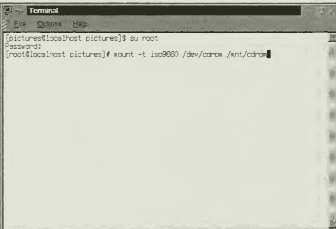

**图 1-1:** 以 root 登录后，挂载您的 CD-ROM。在许多系统中，这会自动完成，尽管如果没有设置为自动挂载，您在每次重启后可能需要重新挂载。

8. 输入 `. /setup`。

9. 选择 English/Englisch/Anglais 作为安装语言。

10. 点击下一步（Next）。

11. 选择要使用的安装类型。您的选项有典型（Typical，此处所示）和自定义（Custom）。

12. 点击下一步（Next）。

13. 在指定的字段中输入您的序列号。此数字可以在 Applixware Office for Linux 运输箱、Appixware Office for Linux 包装盒内部或 CD-ROM 盒背面找到。

不要丢失您的序列号。它用于跟踪您的支持联系，并在可能需要重新安装 Appixware Office 时是必须的。

14. 点击下一步（Next）。

15. 点击下一步（Next）选择 Appixware 的默认安装目录。

`/opt` 目录是位于您的驱动器主根之外的可选软件目录。您可以使用此目录安装所有软件。通过将软件安装到单一目录中，您可以轻松跟踪您的原始 Linux 安装和个人添加的内容。

在阅读 Appixware Office 文档时，“在线”（online）一词指的是您个人计算机上的信息。位于互联网上的任何内容将被称为互联网资源（Internet resource）。

16. 一旦所有文件都复制到硬盘，您将收到 Appixware Office for Linux 完成安装的通知。点击完成（Complete）。

请记住启动 Appixware Office 的命令，因为它不会自动为您创建图标供在启动软件时使用。启动 Appixware Office 的唯一方法是从终端命令行运行它，或者从桌面、菜单或面板上的图标运行它。在下一节中，您将详细查看创建这些图标，以便您可以避免每次想要启动 Appix 时都要启动终端的沮丧。

通过选择 文件 退出（File Exit）或点击窗口右上角的 X 框来关闭终端窗口。

# 为您的 GUI 添加图标

Appix 安装最糟糕的一点是它不会在您的桌面上安装任何图标，也不会将 Appix 添加到您的菜单或面板中。您将在接下来的几分钟内处理这个问题。

书中的所有示例和截图都是在运行 Red Hat 6.0 的 KDE 下完成的。

让我们看看启动 Appliquware Office 的其他方法：

- 创建桌面图标

- 创建 GUI 菜单选项

- 在面板上创建图标

- 创建桌面图标

- 创建 GUI 菜单选项

- 在面板上创建图标

您可以在图 1-2 中看到这些选项。启动 Appixware Office 的唯一方法是从终端命令行运行它，或者从桌面、菜单或面板上的图标运行。您可以在图 1-2 中看到这些选项。大多数人希望使用相同的启动图标。

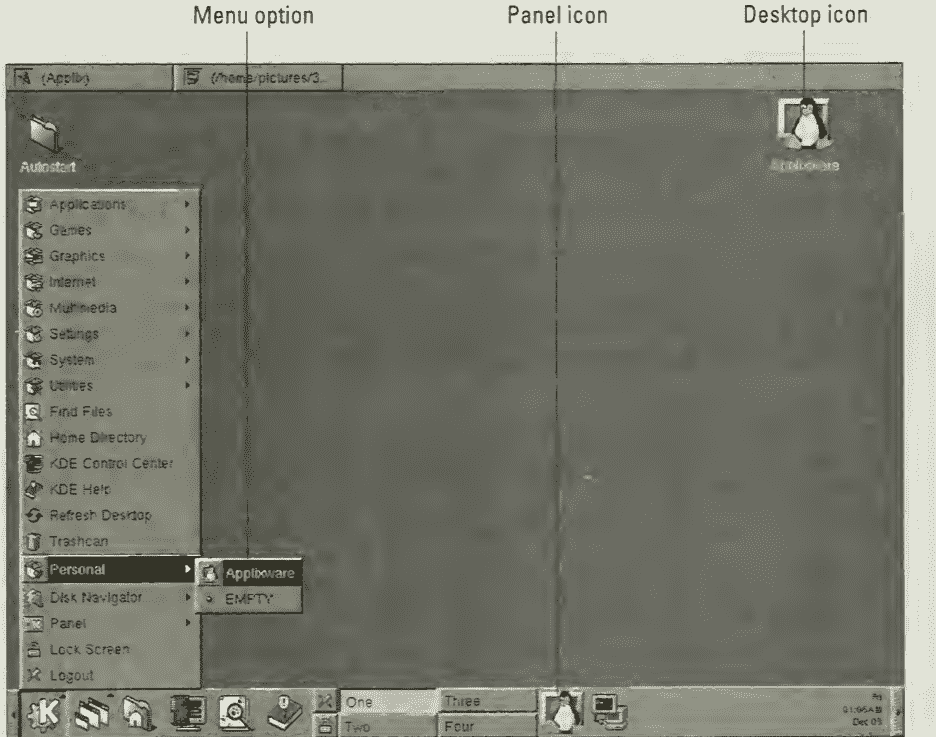

**图 1-2:** 启动 Appliquware Office 的三种方法。

# 在桌面上创建图标

为 Appixware 在桌面创建图标：

1. 在桌面右键点击并选择 新建 -> 应用程序（New -> Application）。

2. 在新建对话框中输入 Appixware。

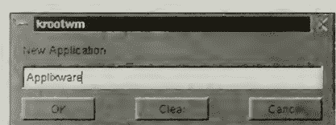

**图 1-3:** 桌面新建对话框。

3. 点击确定（OK）。

4. 在打开的对话框中，点击执行（Execute）选项卡。

5. 在执行字段中输入 `/opt/appix/appix`。

6. 点击图标按钮，选择与 Appixware 使用的新图标。


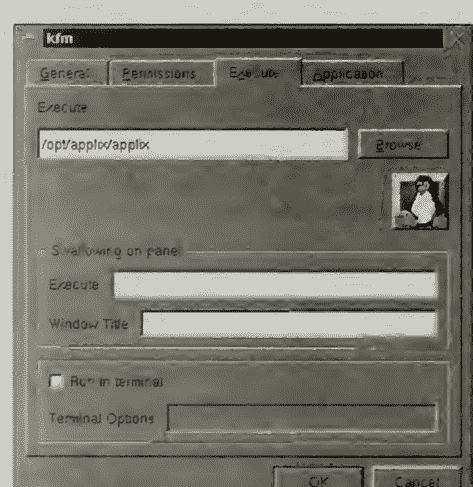

**图 1-4:** 桌面对话框。

# 为您的菜单添加图标

为 KDE 添加菜单选项：

1. 点击 `K` ⮕ 实用（`Utilities Menu Editor`）。
2. 右键点击个人（`Personal`）菜单。如果您是第一次编辑菜单，菜单将显示为空（`EMPTY`）。

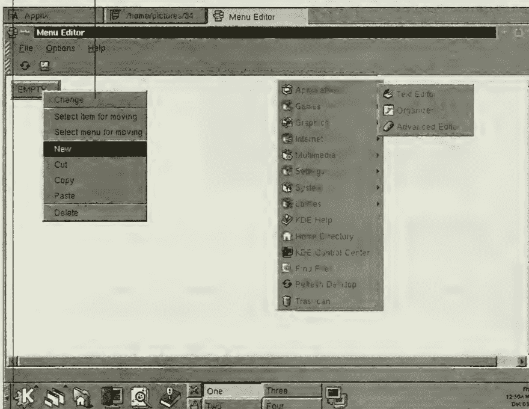

**图 1-5:** 个人菜单。

3. 在编辑器对话框的文件名（`File Name`）字段中输入 `Appixware`。
4. 在名称（`Name`）字段中输入 `Appixware`。
5. 点击图标按钮，选择与 `Appixware` 使用的新图标。
6. 点击执行（`Execute`）选项卡。
7. 在执行字段中输入 `/opt/appix/appix`。
8. 点击确定（`OK`）。
9. 选择文件 -> 保存（`File -> Save`）。
10. 选择文件 -> 退出（`File -> Quit (Ctrl+Q)`）。

# 为您的面板添加图标

在菜单中添加图标后，将其添加到面板就轻而易举了。要将图标添加到 KDE 面板，只需选择 `K` ⮕ 面板 -> 添加应用程序 -> 个人 -> `Appixware`。这会自动将 `Appixware` 图标放置在您的面板上以便访问。

# 第 1 章 ✦ 系统检阅 15

在 Linux 中，面板（`panel`）是默认跨越你屏幕底部的条形。

在 Windows 95/98/NT 中，这个条带被称为任务栏（`Task Bar`）。

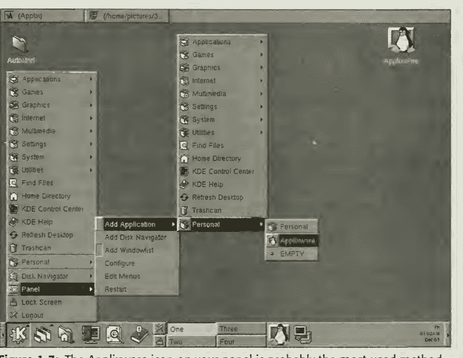

图 1-7：面板上的 `Appliququare` 图标可能是启动应用程序最常用的方法。

# 总结

在本章中，你了解了如何安装 `Appliquware Office` 并让它从你的 GUI（图形用户界面）方便地运行。但更具体地说，你学习了如何进行以下操作：

- 以 `root` 身份登录以安装软件和访问硬件
- 挂载你的 `CD-ROM` 驱动器以便访问
- 探索 GUI 界面，并发现如何修改它
- 检查在 Linux 上运行 `Appliquware` 的系统要求详情
- 研究程序包含的通用功能

## 开始使用 Applix Office 应用程序

现在你已经成功安装了 `Applixware Office` 并在桌面上创建了一些图标，你开始熟悉加载 Linux 版 `Applix Office` 的各种方法（如果你还没有做这些事情，请阅读第 1 章以应用你在本章中学到的知识）。

Applix 有多种程序，每个程序都有相似的界面，并带有所有其他应用程序的直接链接。你有能力共同使用在所有应用程序中创建的信息。例如，你可以将电子表格图表整合到 Word 文中，或将图形整合到电子表格。但在进行任何此类信息共享之前，你必须启动 `Applix`。

## 启动应用程序

既然 `Applixware Office` 已经在你的桌面上就绪，你的手指可能已经“迫不及待”想要使用它了。要启动 Linux 版 `Applixware Office`：

1. 打开终端窗口。
2. 输入 `/opt/applix-5.00/`，如图 2-1 所示。

每当你向终端窗口中输入命令时，都必须按回车键将该命令发送给 Linux 处理器。

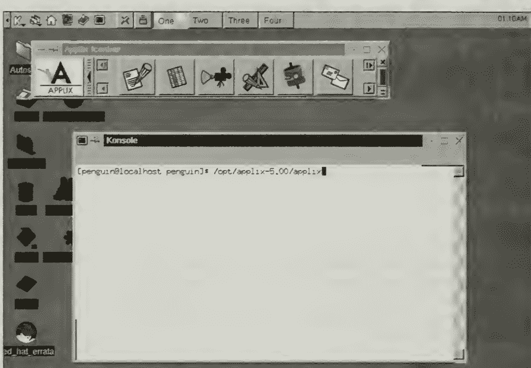

**图 2-1：** 终端窗口只是启动 `Applix` 的方法之一。记得你在第 1 章创建了图标是为了跳过这一步。

或者，你可以双击桌面图标，选择菜单选项，或点击你在第 1 章创建的 KDE 面板上的图标。这些操作中的每一个都会打开图标栏（`Iconbar`）。从这里，你可以访问 `Applix Office` 套件包含的所有应用程序。

# 图标栏

Applix 提供了一个独特的通用控制台，称为图标栏（`Iconbar`），你可以从这里启动任何主要的 Applix 应用程序。图 2-2 所示的控制台为你提供了直接访问 `Applix Office` 最常用的主要应用程序的方法：`Words`、`Graphics`、`Spreadsheets`、`Presents`、`Mail` 和 `Data`。

要打开每个应用程序，只需点击其图标即可。这会在你的桌面上打开该 Applix 应用程序的文档窗口。然后，你可以修改窗口的大小和位置，以便你以最舒适的方式处理所需的多个窗口。

- 帮助 电子表格 图形
- Word 演示

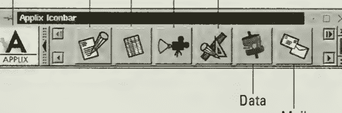

**图 2-2：** Applix 图标栏提供了 `Applix Office` 套件可用主要应用程序的链接。

正如你可能已经知道的，`Applix Office` 的应用程序比这六个更多。其他应用程序——`Inbox`、`Builder`、`Directory Dispatcher`、`MacroEditor` 和 `HTML Author` 都可以通过 `★` 菜单向右滚动图标栏来使用。

> 关于使用 `Directory Displayer` 的信息请查看第 3 章。查看第 35 章有关 `Mail` 和 `Inbox` 界面的信息。查看第 VII 部分有关内置 `HTML Author` 的信息。查看第 IX 部分有关使用 `Builder` 和 `MacroEditor` 的信息。

# Applix 菜单

`★` 菜单在所有 Applix 应用程序窗口均可用，提供了与 Applix 关联的所有应用程序完整列表。你可以使用每个窗口中的 `★` 菜单来访问偏好。

# 第一部分 介绍 Applixware Office

# 第 2 章 ✦ 开始使用 Applixware Office 应用程序 21

图形 电子表格

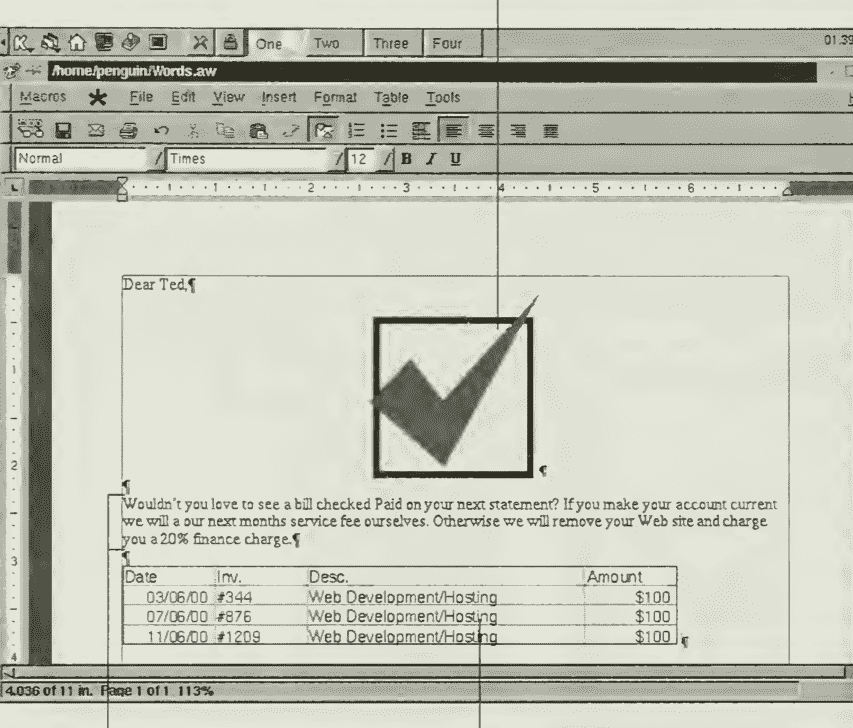

**图 2-3：** 合并多个应用程序的数据可以创建带有声明的文档。

## 老办法（复制、剪切和粘贴）

组合信息的简单方法是使用应用程序的复制和粘贴功能。让我们来看一个快速示例。你可以通过以下步骤使用复制和粘贴来组合信息：

1. 打开两个应用程序。
2. 从第二个应用程序中选择要放入第一个应用程序中的对象。
3. 点击编辑 ✦ 复制（或 `Ctrl+C`）。

## 链接文档对象

链接是两个应用程序之间组合信息最强大的方式。为什么？因为链接将原始文档的内容添加到当前文档中，而不改变原始文档，并创建一个系统，其中副本的

# 第 2 章 ✦ Applix Office 应用程序入门 23

当前文档中的内容仅仅原始文件的影子。对原始文件进行的任何更改将自动反映在当前文档中。从某种意义上说，链接是活跃。你只需要维护一个包含该特定段信息的唯一文档。

你可以通过以下步骤将对象链接到文档：

1. 打开你想要放置对象的应用程序和文档。
2. 打开插入（`Insert`）☏ 来自文件（`From File`）☾ [应用程序名称] 或其他。
3. 在显示的文件列表中选择对象、图形或文件的名称，如图 2-5 所示。
4. 勾选“插入为：链接文件”（`Insert as: Linked File`）选项。
5. 如果你想调整图像大小，请选择“放入框架”（`Put in Frame`）。如果不这样做，你必须打开插入的对象（例如在图形中），并在那里手动调整大小，以适应主文档。
6. 如果你想让其自动调整为文档页的宽度，请选择“适应比例”（`Scale to Fit`）。
7. 点击打开。

要链接的文件

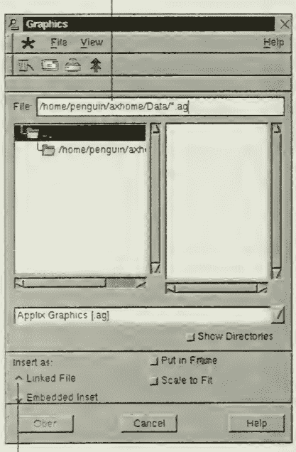

图 2-5：链接文档时，只需勾选右侧的框。

插入为链接文件

你选择的对象将自动出现在你的文档中。现在你可以调整它的位置、布局、框架、属性等，直到它在文档中处于正确的位置和大小。每当此插入对象更新时，此文档中的“副本”也会更新，与嵌入对象不同。

# 嵌入文档对象

在文档中嵌入对象提供了与链接相同的外观，但结果本质上是同一枚硬币的两面。链接仅仅是为插入的对象或文档放置一个“标签”，而嵌入实际上是把插入对象的物理副本放置在文档中。这意味着你的文档大小将随着嵌入对象而增大。链接只会增加几字节的文档大小。

你可以通过以下步骤在文档中嵌入对象：

1. 打开你想要放置对象的应用程序和文档。
2. 打开插入来自文件...（`Insert From File...`） [应用程序名称] 或其他。
3. 在图 2-6 所示的显示的文件列表中选择对象、图形或文件的名称。

| 要嵌入的文件 | 插入为嵌入文件 |
| :--- | :--- |
| 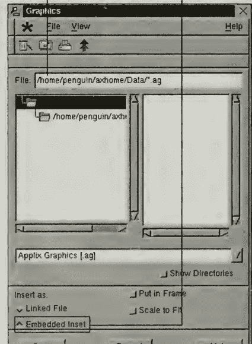 | |

图 2-6：嵌入和链接一样，只需勾选正确的选项。

# 第 2 章 + Applware Office 应用程序入门

4. 勾选“插入为：嵌入”（`Insert as: Embedded Inset`）选项。
5. 如果你想调整图像大小，请选择“放入框架”（`Put in Frame`）。如果不这样做，你必须打开插入的对象并在那里手动调整大小，以适应文档底部。
6. 如果你想让其自动调整为文档页的宽度，请选择“适应比例”（`Scale to Fit`）。
7. 点击打开。

一旦你在当前文档中嵌入另一个文档，对嵌入文档源进行的任何更改将不会显示在当前文档中。当你使用复制粘贴粘贴对象嵌入文档时，也是如此。

# 总结

在本章中，你学习了如何启动各种 Applix 应用程序，以及如何将它们创建的文档组合，为你的业务创建强大的演示作品。这些基本任务是使用办公套件的直接收益。需要记住的最点是：

- 任何类型的 Applware 文档都可以链接或合并到任何其他 Applware 文档中。
- 链接 Applware 文档允许通过维护插入或链接文本的源文档来更新两个文档。
- 所有 Applix 应用程序都可以从每个应用程序屏幕上的 `★` 菜单访问。
- Applware 图标每次启动 Applix 时都会出现，并提供一个按钮，带你进入六种常用的 `Applware Office for Linux` 办公套应用程序。

# 使用目录显示器（Directory Displayer）

这是使用任何计算机系统跟踪信息组织最重要的方面之一。你必须知道文件在哪里，它们才有用。在 `Appliware` 目录显示器的帮助下，你将更容易放置并随后定位你的 `Appliware` 文档。

在你访问的所有 `Appliware Office` 应用程序中都可以使用目录显示器。此工具允许你管理文档和目录，而不必担心丢失工作、错放信息或“忘记”文件存储在何处。你可能会疑惑为什么要用这个工具而不是普通的文件管理器。一个简单的答案是，你可以自动看到你的 `Appliware Office` 文件（默认视图）并在无需打开文档的情况下打印它们。

当你在 `Appliware Office` 应用程序中打开或保存文档时，你正在使用目录显示器。

要开始使用目录显示器，从桌面或面板图标打开 `Appliware Office` 图标栏，或使用你的菜单选项。从 `Appliware Office` 图标栏选择目录显示器图标。

# 导航你的文件结构

你将非常熟悉文件结构。在本章中，你将学习如何使用显示器导航文件系统。你将学习如何移动、复制和删除文件。你还将学习如何将文件组织到目录。

- 管理你的文件
- 组织你的目录
- 系统导航
- 添加到

# 28 第一部分 介绍办公套件

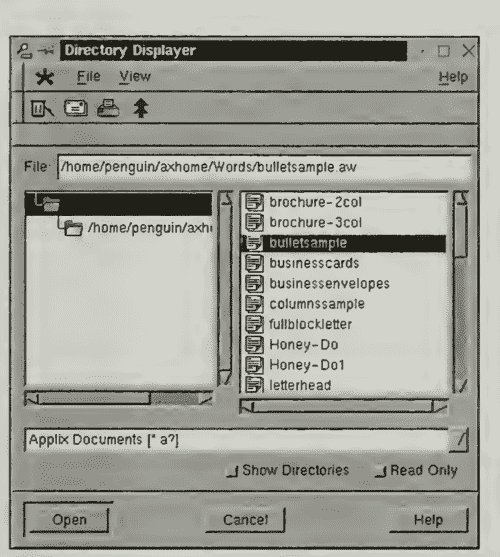

查看目录系统，点击顶部的向上按钮。在图 3-1 中你看到根目录。每当你点击此图标，你都会带到根目录。例如，如果你想打开一个目录，双击名称。目录以文件夹图标显示。当你进入带有文件的目录时，你会看到一些新图标。根据文件类型，图标不同：

- 文件夹/目录
- 文字文档
- 电子表格文档
- 图形和演示文档
- 数据
- Builder

# 第 3 章 + 使用目录显示器

> 注意

你将无法打开任何你没有权限的目录。任何尝试这样做都不会给你错误消息，而只是带你不任何地方。在 Linux 中，目录访问基于一系列用户和组权限。这就像不知道进入树屋的秘密握手一样。你可以看到你想去的地方，但没有人为你放下梯子。如果没有正确的权限（在 Linux 的情况下是登录 `ID`），你只能访问“根”（即系统管理员）允许你的目录和文件。

# 组织你的文件

你跟踪文件的主要方法是将它们都放在同一个目录结构中。这并不是说你或计算机的一切东西都在一个目录下。在图 3-2 中，你看到所有类型和目的的文件杂在同一个目录里。这没有任何组织，即使你所有的数据文件都存储在一个中心位置。

想象你的文件抽屉或文件柜。每个抽屉持有特定类型的信息。例如，你可能有一个抽屉专门用于公司供应商，另一个专门用于公司客户。这些抽屉中的每个内部都有各种文件夹，存放着每个客户或每个供应商的信息。你可以以这种方式组织你的硬盘。

存储信息的更好方法是将其分为子类别。分类信息的一种方法是按文档类型，尽管如果你在单个项目中使用多种文档类型，这并不是一个好的解决方案。另一种组织文件系统的常用方法是模仿文件柜。你可以为供应商创建一个目录，为客户项目创建另一个目录。在这些目录中的每一个中，你都可以为每个供应商/或客户保留一个子目录。这允许你无论信息来源如何，都将所有信息保存在一个单一目录中。对于那些有多个项目的客户，你可以在该客户的主目录下看到多个目录的示例。你可以在图 3-3 中看到这种结构的示例。

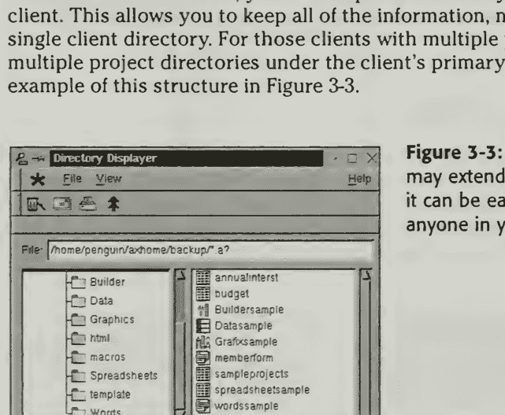

图 3-3：这种多级系统可以扩展你的目录结构；团队中的任何人都能轻松理解。

跟踪所有的软件安装情况也是一个好习惯。请记住，你可以将所有软件安装到 `/opt` 目录。这是 `Red Hat 6.1` 默认创建的一个可选目录，你可以在其中存储机器所需的任何额外应用程序。这让你在初始安装 Linux 后，一眼就能看出机器上安装了哪些软件。如果你愿意，它还允许你让计算机的所有用户都能使用这些软件。

当然，有时在创建文档之前创建目录结构会更容易，但有时或在大多数情况下，这是不可能的。当我们工作一段时间后才进行整理时，我们不得不打开文件来查看它们是什么，然后使用一些文件管理技巧将它们移动到相应的目录中。

## 打开文件

使用目录显示器（`Directory Displayer`）打开文件：

1. 导航到包含你想打开的文件的目录。
2. 点击文件名。
3. 点击打开（`Open`）按钮。

你的文档会自动在新窗口中打开，即使你正在打开一个 `Word` 文档并且当前运行着 `Word`。

一旦你识别了文件的内容，就可以对其进行修改并重新保存，或者直接关闭文档（文件-退出），准备将该文档处理到你新的目录结构中。

## 执行文件管理

与生活中的大多数事情一样，你通常需要保持条理。保持整洁可能是你父母家里的一条核心准则，这也应该是你在计算机上工作和归档信息的规则之一。为了做到这一点，你必须知道如何创建目录来存储信息，然后在计算机上复制、移动、重命名和删除现有的文件和目录。

> 如果习惯了 `Windows` 文件系统（其中字母被映射到特定的文件存储设备，如 `C:` 或 `A:`），那么你可能需要改变思维。Linux 没有驱动器号。你所有的硬盘空间都被分为一系列分区，这些分区与目录被称为相同的。例如，如果你有第二块硬盘（Windows 中为 `D:`）且挂载点为 `/usr`，那么放置在 `/usr` 目录中的任何内容都会进入那块第二块硬盘。

在 Linux 中，根目录被标识为 `/`。从这里，你可以找到所有的外围设备，如软盘驱动器、光驱以及任何其他 `DOS` 或 `Windows` 分区——你可以在 Linux 安装附带的“如何操作”（`How To Do`）文档中找到更多关于如何执行的信息。

## 创建目录

使用目录显示器创建目录：

1. 选择你想创建子目录的目录。
2. 选择文件-创建目录（`File-Create Directory`）。
3. 在图 3-4 所示的创建目录对话框的“新目录名称”（`New Directory Name`）字段中输入目录名称。
4. 点击确定（`OK`）。

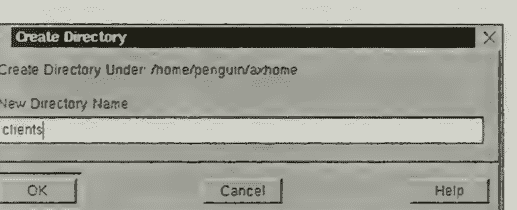

图 3-4：创建一系列目录允许你以这种方式组织信息，办公室里的每个人都能找到他们需要的信息。

一旦你创建了新目录，你可以将文件复制或移动到其中，或者移动到另一个目录。

## 复制文件或目录

将文件或目录复制到另一个位置：

1. 选择你想复制的文件或目录。
2. 选择文件->复制（`File -> Copy (Ctrl+C)`）。
3. 在图 3-5 所示的复制对话框的“到：”（`To:`）字段中输入你想将文件复制到的目录名称。
4. 点击确定（`OK`）。


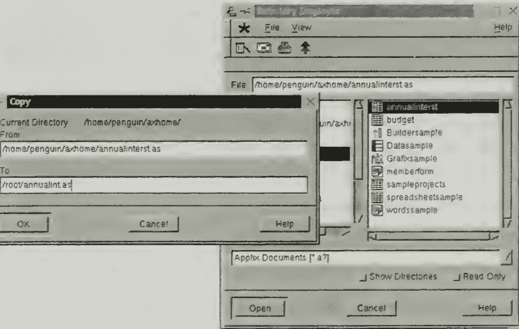

图 3-5：复制文件会保持原文件完整，并简单在新位置放置该文件的额外精确版本。

你仍然能看到原始文件，但如果你查看新位置，也会发现那里有一个文件的副本。

## 移动文件或目录

将文件或目录移动到硬盘或软盘上的另一个位置：

1. 选择你想移动的文件或目录。
2. 选择`文件->移动`（`File -> Move (Ctrl+M)`）。
3. 在图 3-6 所示的移动对话框的`到：`（`To:`）字段中输入你想移动到的目录名称。
4. 点击`确定`（`OK`）。

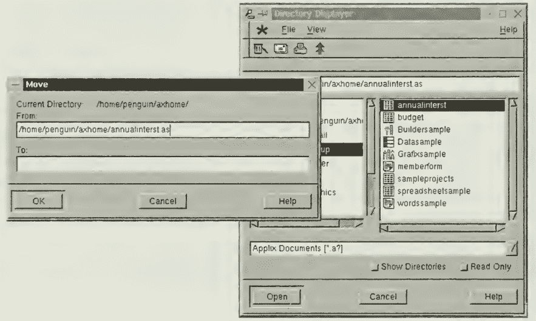

图 3-6：如果你输入错误的目录名称，文件将无法移动。重命名文件系统中的关键是确保文件标识符正确。

你将不再看到原始文件，但如果你查看新位置，文件也会显示在那里。

## 重命名文件或目录

重命名文件的更常见原因之一是为了跟踪过去的工作，同时又不影响当前文档。要重命名你的文件：

> 提示

当你重命名文件时，尝试使用一致的命名方式。例如与客户 `Doe` 相关的所有工作可以使用 `doe~1005.aw`。“标识符”可以识别它。

1. 选择你想重命名的文件或目录。
2. 点击右键并选择`重命名`（`Rename`）。
3. 在重命名对话框中输入名称。
4. 点击`确定`（`OK`）。

当你在目录显示器中查看时，你会发现文件已变为你指定的名称。

## 删除文件或目录

删除文件或目录：

1. 选择你想删除的文件或目录。
2. 点击右键并从弹出菜单中选择`删除`（`Delete`）。
3. 在删除对话框中检查文件名，以确保它是你想删除的文件。
4. 点击`是`（`Yes`）。

该文件将不再存在于你的计算机上。一旦文件被删除，它将永久消失。

## 检查文件信息

### 检查文件信息

有时，你可能想知道文件最后修改的时间、创建者以及它是由什么程序创建的。你可以使用目录显示器提供的信息选项。

要获取文件信息：

1. 选择你想研究的文件。
2. 选择`文件-信息`（`File Information (Ctrl+I)`）。
3. 当文件信息对话框打开时（如图 3-7 所示），记录你需要的信息，然后`关闭`（`Dismiss`）。

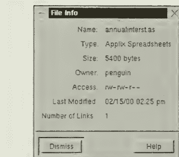

现在你已经知道 `WordPerfect Office` 可以告诉你关于文件的哪些信息，你可以决定是在计算机上重命名、复制还是删除它。在删除任何内容之前，确保该计算机的其他用户不再使用该文件是永远无害的。

## 总结

在本章中，你查看了在目录显示器内部执行的不同任务。这些任务将帮助你将信息集中存储、组织良好并易于访问。本章涵盖了以下内容：

- 将文件移动到目录以创建更干净的文件组织结构
- 将文件从一个位置复制到另一个位置，允许你将信息从个人目录移动到组共享目录
- 重命名文件以保留信息的备份副本
- 创建用于组织项目的目录

# 获取 Applixware Office 的帮助

由于你每天使用的软件功能非常复杂，产生疑问并不为奇奇。我们有时都需要帮助。有些时候，你可能无法理解某个概念，或者只是无法“弄清楚 `XYZ` 是如何工作的”。在这些时候，帮助系统就会来为你提供支持。

`Applixware` 的帮助系统为你提供了数百页信息（包括在线和离线信息），可以解答你关于 `Applixware Office` 及其应用程序的问题。`Applixware Office` 附有一个基于 `HTML` 的帮助系统，它利用多种功能，帮助你在需要时找到所需信息。`快速入门`教程将带你熟悉每个应用程序的界面和基本功能，而系列演示将向你展示如何让 `Applixware Office` 按照你的需求运行。

你可以从`欢迎`窗口或任何 `Applixware Office` 应用程序中访问这些帮助系统中的任何一个，如图 4-1 所示（该窗口在你首次运行 `Applixware` 时出现）。在该窗口中，你将找到有关最新发布版本中发生的一些重大变化的信息链接。还会有标签可以直接连接到可用的教程和演示。

# 本章内容

- 使用帮助系统获取信息
- 使用演示查看 `Applixware Office` 的运行情况
- 使用教程快速上手 `Applix`
- 访问在线并寻找更多帮助

# 38 第一部分 介绍 Applixware Office 软件套

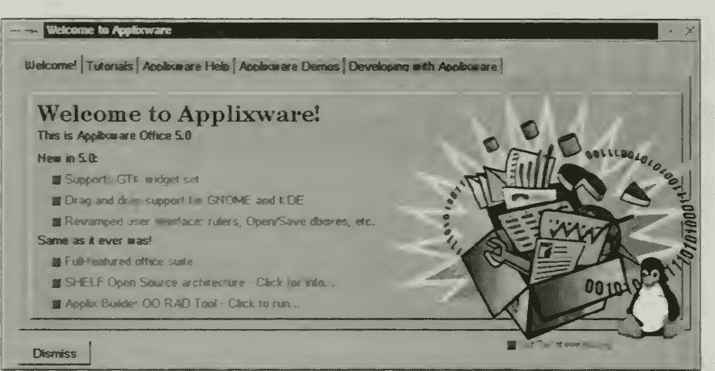

**图 4-1：**欢迎使用 `Applixware`。在连接互联网的情况下，你可以直接访问 `http://www.linux.applixware.com` 获取更多帮助。

# 使用帮助系统和在线参考手册

`Applixware` 帮助系统让你能够获取上下文相关帮助，或者简单地针对你有疑问的特定单词或短语进行搜索。你可以通过 `Applix` 应用程序窗口右上角的`帮助`菜单使用这两种方法之一访问信息，如图 4-2 所示。

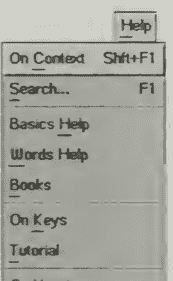

**图 4-2：**你可以选择你所需的特定类型和风格的帮助。

每个应用程序都有自己的`帮助`菜单，该菜单会自动修改，以调出与该特定应用程序直接相关的信息。例如，当你从 `Words` 打开`帮助`菜单时，你会看到一个包含`Words 帮助`的列表，而不是`电子表格帮助`。

# 第 4 章 ✦ 获取 Applixware Office 的帮助 39

# 上下文相关帮助

上下文相关帮助允许你精位特定界面项目上的信息。它不会帮助你搜索某个主题，或查找有关安装额外电子表格公式的信息，但它会告诉你第十个隔间的那些趣味行是什么意思。要打开上下文相关帮助：

1. 选择 `帮助` > `关于上下文` (`Shift+F1`)。
2. 你的光标将变为一个问号形状的箭头。点击你想要帮助的界面功能。
3. 将自动打开一个显示该功能的帮助窗口，为你提供关于你所选界面部分的信息。如果你在 `Words` 的`快速数字`按钮上选择`上下文帮助`，你将看到图 4-3 所示的帮助窗口。

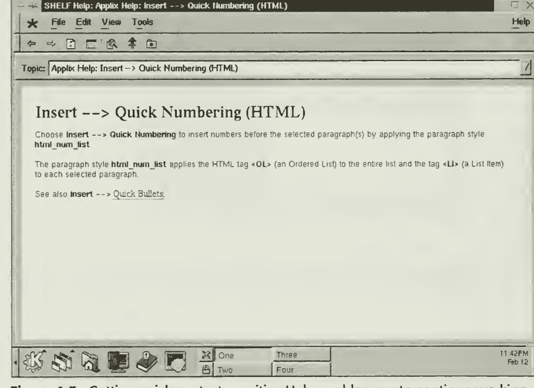

图 4-3：获取快速上下文相关帮助让你能够继续工作，而无需停止并搜索整个数据库来对单个功能进行说明。

如果你从单次上下文搜索中没有获得足够的信息，可以对你所需的特定信息进行全搜索。

# 搜索数据库

虽然全数据库搜索可能花费更多时间，但它将带给你多得的信息。例如，对 `HTML` 文档元素进行主题搜索：

1. 选择 `帮助搜索` (`F1`)。
2. 在`查找内容`字段中，输入 `element`。
3. 点击`搜索`加载所有相关的帮助文档条目。
4. 在`引用`列表中点击与你关注的问题紧密匹配的特定条目，如图 4-4 所示。

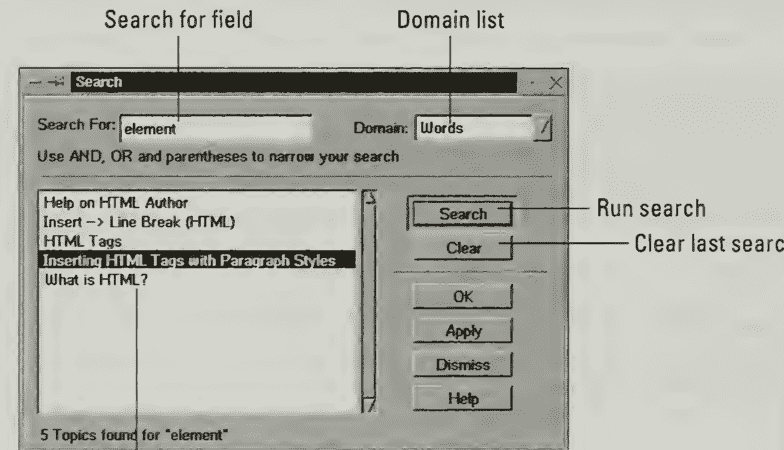

图 4-4：仔细选择你的搜索。如果仅一个应用程序的帮助系统中信息不足，请尝试另一个。

在打开的帮助窗口中，你可以找到从与 `Applix` 应用程序相关的各种帮助文件中选择信息的选项。如果你无法在普通帮助文件中找到特定信息，请尝试书籍，或尝试在不同的应用程序中搜索该主题。

# 应用程序上的帮助

当你真的不确定要搜索什么，但想了解如何执行特定任务的信息时，最好的办法可能是在每个应用程序的特定帮助中搜索。要获取关于 `Words` 的帮助，你需要查找`关于 Words`主题。要查找如何开始使用 `Words`：

1. 选择 `帮助`
2. 这将打开图 4-5 所示的`关于 Words`目录。滚动查看 `Words` 可用的主题列表。

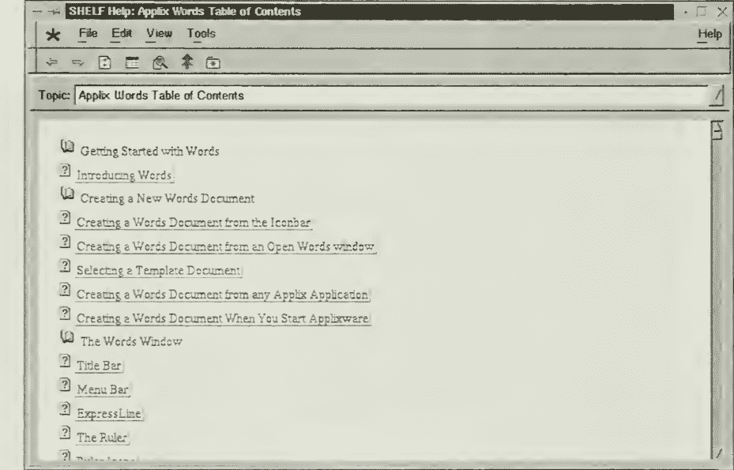

图 4-5：有时，一个简单的目录窗口比可搜索的索引更有帮助。

3. 双击你需要的特定主题。
4. 继续阅读文档，直到你汇集了项目所需的所有信息。

如果你正尝试执行的特定任务或正在研究的主题未包含在目录中，那么你可能想尝试一些相关的帮助。

# 相关帮助主题

有时，你可能在使用某个应用程序，并需要该程序其他方面的帮助。例如，如果你正在使用 `Words` 并且需要公式编辑器的帮助，你可以通过选择`帮助`来获取。你将在该帮助文档上找到与每个应用程序相对应的列表。

# 帮助书籍

你可以通过在 `Applix``欢迎`窗口中选择 `Applix``帮助`选项卡中的`在线参考书`（如图 4-6 所示），或从任何应用程序窗口中选择`帮助`来访问在线书籍。

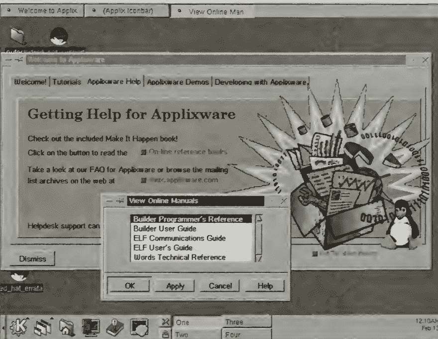

图 4-6：选择`帮助`，将看到手册涵盖的各种主题列表。

所有在线手册都以 `PDF` 格式呈现，如图 4-7 所示，以便阅读。你可以滚动文档，或使用`页码`字段直接进入你选择的页面。

# 第 4 章 + 获取 Applixware Office 的帮助 43

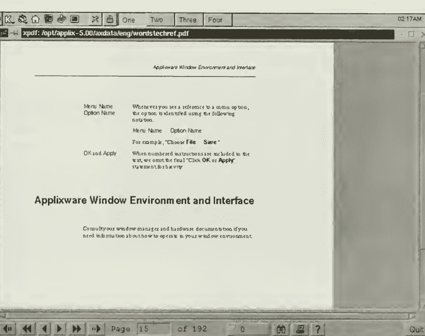

**图 4-7：``PDF` 格式的书籍让你可以使用熟悉的 `Adobe` 标准阅读器阅读文档。**

`快速入门教程`对于首次使用 `Applix` 的用户非常有用，他们只需要对软件的功能和结构进行快速了解。但这不是唯一的可用教程。可以通过多种方式启动教程。从`欢迎使用 Applixware`窗口（如图 4-1 所示）或从应用程序中的`帮助教程`中访问。

当你从 `Applixware Office` 菜单启动教程时，你只会看到与通用 `Applixware Office` 使用相关的教程。其他应用程序也有相应的教程。

`Words` 有八个教程，涵盖了从打开和编辑文档到修改表格的所有内容。`Graphics` 和 `Presents` 应用程序有使用主要绘图工具的教程。`Sheets` 包括创建和修改图表及电子表格的教程，`Data` 包括讨论数据库视图和配置查询的五个教程。你可以从图 4-8 所示的`教程课程与练习菜单`中选择你的教程课程和练习。

## 44 第一部分 介绍 Applix Office 套件

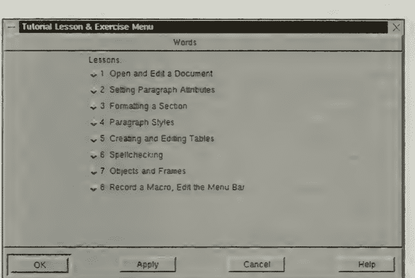

**图 4-8：** 选择你想探索的特定课程，如果需要，还可以选择特定的练习。

这些教程每个都会打开两个窗口。第一个窗口包含您完成课程时需要遵循的说明。第二个窗口包含您的项目文档。这些窗口为您提供了执行任务的逐步说明过程。当您完成一个练习时，将引导进入下一个练习，并且您的两个窗口都将进行更新。通过这种方式，您将真正地体验创建特定效果或为文档添加特定功能的全过程。

> 某些 `Applix` 教程窗口不显示。这是一个已报告的错误。很快就会有补丁。

除了教程之外，还提供了演示脚本，向您展示如何使用特定的应用程序，或者如何使用特殊功能解决挑战。

## 使用演示程序

如果您正在尝试为解决问题寻找思路，应用程序演示将非常有用。`Applix Office` 安装了多种演示程序。这些演示脚本可以阅读和查看，但不能修改。它们大多是只读的，但可以被`拆解`以在您自己的应用程序或文档中使用。这些示例中使用的许多效果可以用您的应用程序中，以创建所需的效果。表 4-1 列出的演示文档已供您使用。

### 表 4-1

`Applix Office` 提供的演示程序

| 演示类型 | 演示名称 |
| --- | --- |
| 自定义应用程序 | 电子通讯录<br>快速报价<br>我正在运行什么<br>虚拟 `ATM`<br>颜色表格编辑器<br>康威存生命游戏 |
| 文字处理演示 | 开源营销文献<br>财务报告<br>客户报价信 |
| 电子表格演示 | 费用报表<br>瑞士统计比较<br>销售研究 |
| 实时演示 | `NASDAQ` 优异股<br>实时与电信<br>`MarketView`<br>事件驱动状态报告 |
| 幻灯片演示 | 可用性研究<br>使用切换和效果<br>采用格纳猎犬 |
| 图形演示 | 来自 `Applix` 的 `PCB`<br>来自 `GIF` 的 `PCB`<br>图形样本 |

> 注意：自定义应用程序的演示是在 `Builder` 中构建的，您可以将它们链接到自己的应用程序，或与您现有的文档一起使用，为现有项目添加功能。

演示文档均可以通过图 4-9所示所示 `Applix Demos` 窗口获取。

## 46 第一部分 介绍 Applix Office 套件

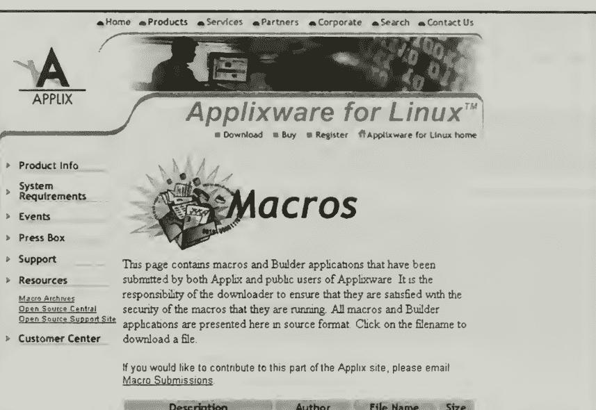

## 在网上获取帮助

互联网上还有许多其他资源可以帮助您。有许多邮件列表、新闻组和网站提供信息，帮助您搜索有关 `Applix` 问题的答案。

## 从 applix.com 使用在线演示程序

`applix.com` 上有各种 `Applix` 宏的在线演示。这些文件部分是由 `Applix` 员工作为工作的一部分或个人爱好创建的，另一些是由 `Applix` 用户提交到网站的。要访问这些宏：

1. 打开 `浏览器`。
2. 在地址栏中输入 `http://www.applix.com/applixware/linux/`。
3. 点击窗口左侧的 `Resources`（资源）链接。
4. 选择 `Resources` 下的 `Macros`（宏）列表。这将带您进入图 4-10 所示的提交宏列表。

图 4-9：选择你想查看的演示程序，以及 `Applix` 应用程序的功能。

## 第 4 章 ✦ 获取 Applix Office 4 的帮助 47

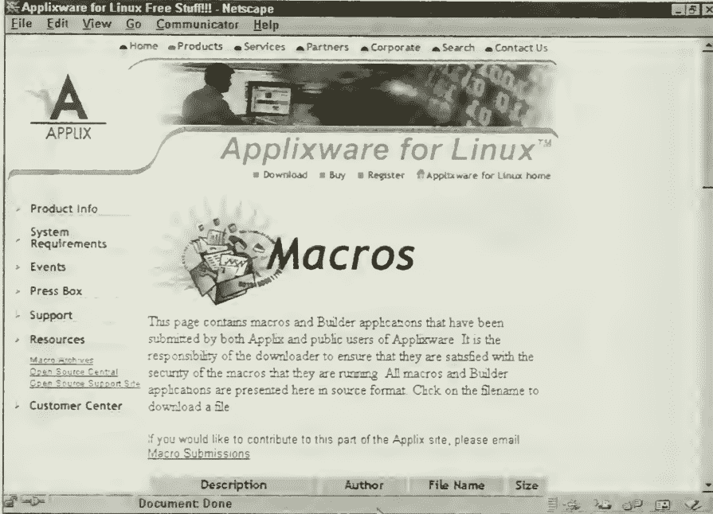

- 产品信息
- 系统要求
- 事件
- 媒体中心
- 支持
- 资源
- 客户中心

此页面包含宏和 `Builder` 应用程序，下载者负责确保他们对运行的宏的结果满意。所有宏和 `Builder` 应用程序均以源代码格式在此处。点击链接下载

如果您想为 `Applix` 网站的这部分做出贡献，请电子邮件至：

宏提交

| 描述 | 作者 | 文件名 | 大小 |
| --- | --- | --- | --- |
| 开始 | `Desktop Net` | 个人文件 | `Applixware...` | `140334rt.` |
| 绘图店 | `9:40 PM` | | |

**图 4-10：** `Applix` 演示宏网站包含计算器、教程和 `Applix` 界面修改的示例。

一旦您精通 `Builder`（`Applix` 的应用程序开发包）、`MacroEditor` 和 `ELF`（`Applix` 宏语言），您就可以向此页面提交自己的内容了。

## 从 applix.com 获取支持

支持与演示和示例是不同的问题。`Applix` 在 `http://www.applix.com/applixware/linux/support.cfm` 为您提供免费或付费支持。如图 4-11 所示，这让您可以访问 `Applix FAQ`（常见问题解答）和 `Applix` 邮件列表。`FAQ` 位于 `http://www.applix.com/applixware/linux/support.cfm`。

# 52 第二部分 + Applix Words

- `关闭按钮`
- `标度尺`
- `最大化按钮`
- `标题栏`
- `菜单栏`
- `快速通道 (Express Line)`
- `最小化按钮`

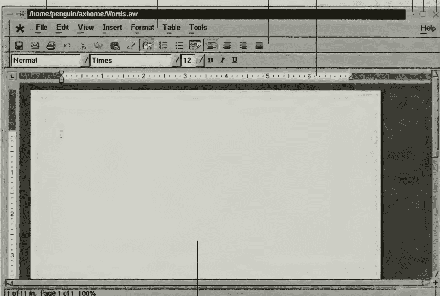

- `状态栏`
- `文档窗口`
- `缩放按钮`

**图 5-1：** `Words` 界面将大部分图标直接放置在您的触指范围内。

`Words` 界面的每个元素都有其特定的用途：

- **`标题栏`。** 你正在 `Words` 中编辑或编写的当前文档名称显示在标题栏上。沿着此栏，你通常还会找到系统菜单按钮和控制菜单按钮，以及固定/取消固定、最小化、最大化和关闭按钮。此标题栏的外观取决于你选择的窗口管理器。在编写此书并拍摄截图时，我使用的是 `KDE`，但你可能正在使用 `GNOME`、`Enlightenment`、`fwm` 或 `OpenLook` 等不同的系统。
- **`菜单栏`。** 你可以从菜单栏访问所有的 `Words` 功能和其他 `Applix` 应用程序。
- **`快速通道 (ExpressLine)`。** 这是 `Applix Office` 工具栏的官方名称。此栏包含代表 `Words` 中常用功能的按钮。

# 第 5 章 + 熟悉 Words 53

- **`标度尺`。** 标度尺显示你当前的页边距和制表符设置，并允许你设置制表符以及控制缩进。
- **`文档窗口`。** 你将在这里看到你工作的成果。你输入的所有内容都会出现在窗口的此区域。该区域显示的文档打印后的效果。
- **`状态栏`。** 状态栏显示光标在文档中的垂直位置和当前页码。
- **`缩放按钮`。** 此按钮可以在 `100%` 视图和本章后面讨论的`视图 > 缩放`菜单中的上次视图之间切换。

图 5-1 显示的屏幕常用部分是菜单栏、快速通道和标度尺。

## 菜单栏选项

`Words` 使用了一些标准菜单和选项，这些选项在所有其他 `Applix` 应用程序中可用，并为用户提供了整个 `Office` 软件件直观的界面。图 5-2 描述了 `Words` 栏。

> 每个菜单名称中都有一个下划线的字符，称为助记符（热键）。当你结合 `Alt` 键按下助记符时，菜单将直接从键盘打开。如果你从未尝试过使用助记符，请按住 `Alt` 键并按下下划线字母键。

> 如果你是或曾主要是 `Windows` 用户，你会发现菜单的组织方式与 `Windows` 产品使用的非常相似。

`Words` 菜单中的菜单顺序与大多数 `Windows` 应用程序相同

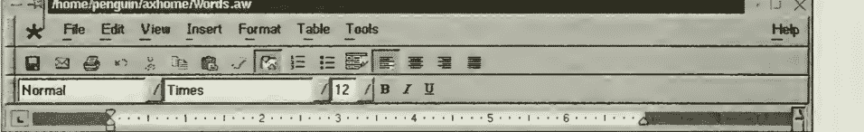

图 5-2：`Words` 菜单栏、快速通道和水平标度尺，通过它们可以完成所有操作。

> 助记符（热键）在安装时可以配置，因此你的安装可能使用的按键与此处显示的不同。

# 54 第二部分 ♦ Applix Words

## 文件 (File) 菜单

图 5-3 显示的文件菜单允许你打开、关闭和创建文件。你还可以从这里保存、邮件邮件、打印、导入或导出（使用`另存为`）你的工作。文件菜单允许你将文档恢复到上次保存原始状态，或控制打印页的外观。


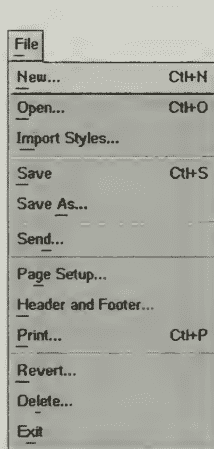

> 图 5-3：通常情况下，任何影响整个文档的操作都位于文件菜单。

## 编辑 (Edit) 菜单

图 5-4 显示的编辑菜单允许你从一个位置或从一个文档到另一个文档剪切、复制或粘贴信息。它提供了查找和替换特定文本段的选项。如果你想更改文档中所有文本或特定选中内容的大小写，这就是你需要打开的菜单。

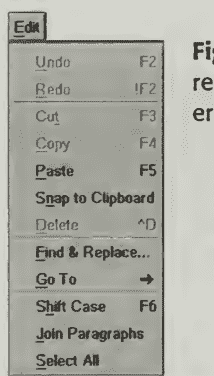

> 图 5-4：使用编辑菜单撤销你最近犯的任何错误，或重做你认为完全不是错误的操作。

# 第 5 章 + 熟悉 Words 55

## 视图 (View) 菜单

从图 5-5 显示的视图菜单中，你可以控制文档屏幕的常规外观。你可以控制缩放、添加或删除工具栏和标度尺，并查看隐藏字符。

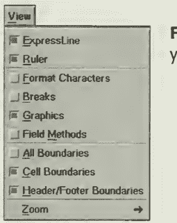

图 5-5：使用视图菜单控制文档在屏幕上的显示。

## 插入 (Insert) 菜单

图 5-6 显示的插入菜单允许你插入图形、图片、公式、文件、对象、符号和框架。你还可以插入快速页眉页脚，然后从文件菜单进行进一步修改。从此菜单你还可以创建超链接和超目标，它们可以

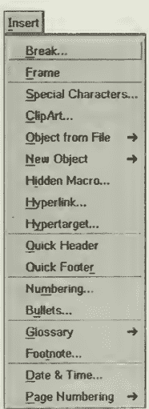

图 5-6：使用插入菜单插入图形、图片、公式、文件、对象、符号和框架。

# 格式 (Format) 菜单

图 5-7 显示的格式菜单允许你控制文档的视觉外观。

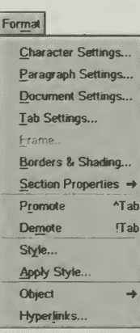

图 5-7：格式菜单允许你控制文档的视觉外观。

## 表格 (Table) 菜单

图 5-8 显示的表格菜单包含了你需要的所有选项。你可以合并、拆分单元格并对文档进行阴影处理。

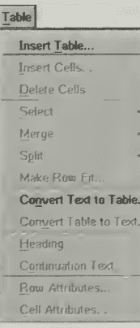

图 5-8：表格菜单包含了你需要的所有选项。

# 工具 (Tools) 菜单

最后，通过图 5-9 显示的工具菜单，你可以检查文档拼写。此菜单上的可用工具允许你创建目录、索引和交叉引用。

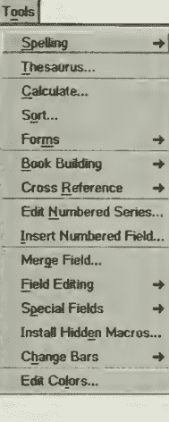

图 5-9：工具菜单允许你检查文档拼写。

## 快速通道按钮

现在你已经学习了 `Words` 菜单的用途，让我们看看标度尺上的可用选项。正如表 5-1 所示，你通常执行的每项任务都有相应的工具。

| 工具 | 描述 |
| :--- | :--- |
| 保存文档 (`Ctrl+S`) | |
| 发送文档 | |
| 打印文档 (`Ctrl+P`) | |

| 工具 | 描述 |
| :--- | :--- |
| 撤销更改 (`Ctrl+Z`) | |
| 剪切 (`Ctrl+X`) | |
| 复制 (`Ctrl+C`) | |
| 粘贴 (`Ctrl+V`) | |
| 删除 (`Ctrl+D`) | |
| 标度尺 | |
| 快速编号 | |
| 快速项目 | |
| 编辑表格 | |
| 左对齐 | |
| 居中对齐 | |
| 右对齐 | |
| 两端对齐 | |
| `普通` | 段落样式 |
| `Times` | 字体 |
| `12` | 字号 |
| `粗体` (`Ctrl+B`) | |
| `斜体` (`Ctrl+I`) | |
| `下划线` (`Ctrl+U`) | |
| 标度尺缩进滑块 | |
| 标度尺边界 | |
| 设置制表符样式 | |

# 快捷菜单

图 5-10 所示的快捷菜单是你通常点击文档窗口右键时出现的菜单。某些应用程序使用广泛的快捷菜单，但 `Appluxware` 则没有。在 `Linux` 版 `Applicware` `Office` 中，快捷菜单上有五个选项：撤销 (`Ctrl+Z`)、重做 (`Ctrl+Y`)、剪切 (`Ctrl+X`)、复制 (`Ctrl+C`) 和粘贴 (`Ctrl+V`)。这些可能是任何文字处理程序中最常用的选项。

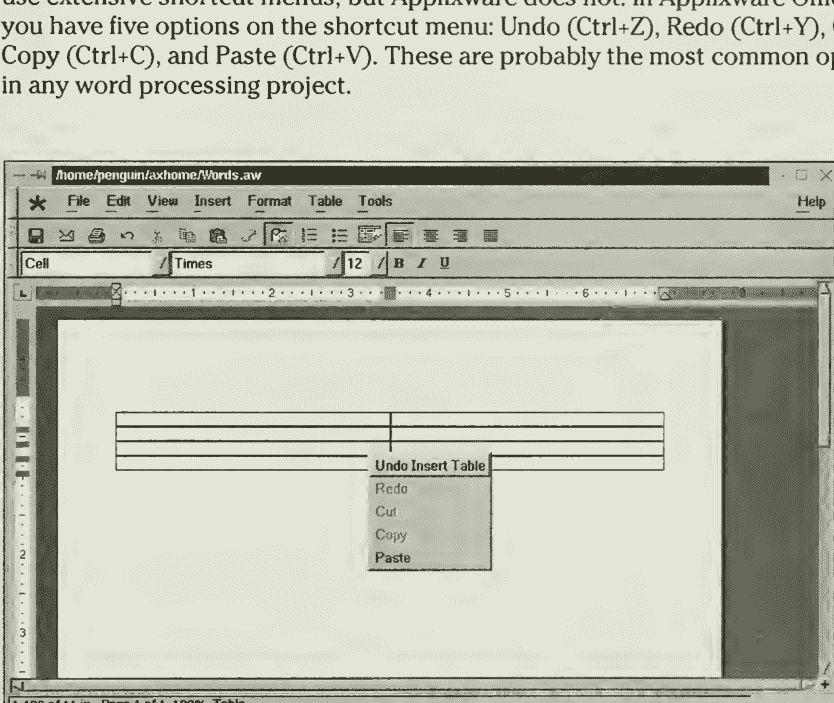

图 5-10：与其在编辑菜单中寻找常用任务，不如使用快捷菜单来节省时间。

# 状态行

“撤销”（`Undo`）选项会改变你在创建文档时执行的最后一次操作。如果你最后一次操作是添加文本，菜单将显示“撤销打字”（`Undo` `Typing`）。如果你最后一次操作是插入表格，则你的菜单选项将显示“撤销插入表格”（`Undo` `Insert` `Table`）。

`Words` 状态行包含活动光标在页面总长度中的当前位置信息、识别正在编写的页面，以及识别屏幕当前的缩放百分比。状态行还用于识别 `Words` 内部正在进行的进程。例如，当你保存（`Save`）文档时，状态行上会出现“正在保存...”的消息。

`Words` 偏好（`Words` `Preferences`）对话框（★ `Words` `Preferences`）中的一个选项允许你在文档自上次保存以来发生更改时，在状态栏上显示星号（*）。该选项是“如果文档已修改则在状态行显示*”。

有关自定义 `Applix` 应用程序的更多信息，请参见附录 A。

# 窗口排列

`Words` 使用多个窗口来显示不同的文档。如果你同时处理两个文档，这意味着你必须在桌面上对它们进行排列，以便同时看到两个文档的相关信息。正确排列窗口的一个方面包括根据你的需求调整它们的大小。

如果你无法获得足够的信息，你需要让窗口更大。你可以通过右键点击标题栏（`Title` `bar`）或选择窗口标题栏上的最大化（`Maximizing`）图标来最大化窗口。当你最大化窗口时，它将占据你 `X-Windows` 面板上方整个屏幕。当窗口未最大化时，你可以拖动带有调整大小图标的边框来调整窗口大小。要执行此操作，将鼠标指针悬停在其中一个角上。当指针变化时，点击并拖动鼠标到你想要的窗口大小。

最大化窗口的主要问题是无法看到桌面周围的任何信息。窗口管理器通常提供某种方法来选择应用程序，而无需不断最大化和最小化窗口。`KDE` 界面允许你通过 `Alt+Tab` 切换所有打开的窗口，或从屏幕顶部的任务栏选择它们。在 `KDE` 中，任务栏是可以移动的，无论放置在何处，它都会显示为一个带有按钮的条，显示每个打开的应用程序的名称。

按你意调整窗口大小后，你需要将它们放置在屏幕的合适位置，以便处理文档。有时你可能需要进行比你愿意更多的滚动，但可以通过增加屏幕分辨率来调整。要了解更多关于调整屏幕大小和分辨率的信息，请查看随你的 `Linux` 安装的 `HOW-TO` 文档。

要将窗口放置在屏幕周围可用的位置，将鼠标悬停在它们的标题栏上，点击并按住左鼠标键，将它们拖过屏幕移动到最适合你的位置。用户通常发现两个垂直并排的窗口效果最好（如图 5-11 所示），或者水平的上下堆叠方案效果最好。

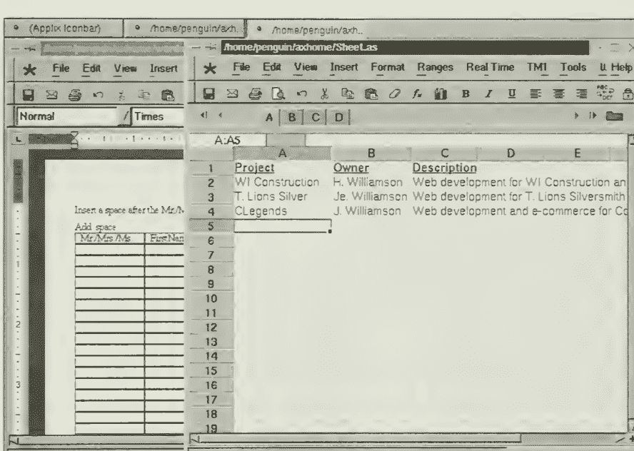

图 5-11：垂直拆分屏幕，可以让你看到更多的单个页面布局。

# 调整视图

当你处理文档时，有时屏幕上显示的信息过多，或者字体太小而无法轻松阅读。为了解决这个问题，你必须调整文档的视图（`View`）设置。

# 缩放

缩放（`Zoom`）会更改文档的放大倍数，允许你在不实际更改打印字体大小的情况下轻松查看文档上的字体。这有助于所有人应对眼睛疲劳和其他自然的视觉障碍。

要调整文档的放大倍数：

- 1. 选择 查看 -> 缩放。
- 2. 从图 5-12 所示的缩放菜单中，选择你想使用的放大程度。

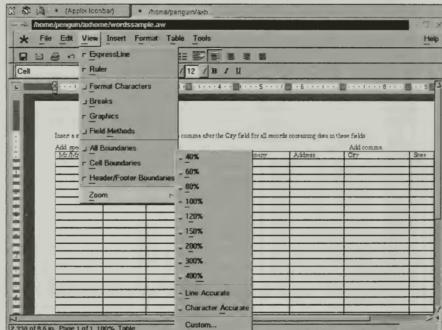

图 5-12：调整缩放允许你同时看到更多或更少的文档内容。

如果在尝试缩放设置后，你仍然找不到符合你需求的设置，请使用自定义缩放（`Custom` `Zoom`）选项。

图 5-13：查看整页对于编辑没有帮助，但对于确定文档的整体视觉效果非常有用。

# 实现全屏视图

`Appixware` 并没有传统意义上的“全屏视图”设置。你可以通过隐藏快速线（`ExpressLine`）和标尺（`ruler`）来接近这一设置。当你近似全屏视图时，你将可以使用更多的桌面空间来显示文档，用更少的空间显示 `Appix` `Words` 的可用选项。你无法实际上移除菜单栏；但你可以通过以下操作隐藏快速线和标尺，实现类似于图 5-14 的效果：

- 1. 选择 查看 快速线。
- 2. 选择 查看 标尺。

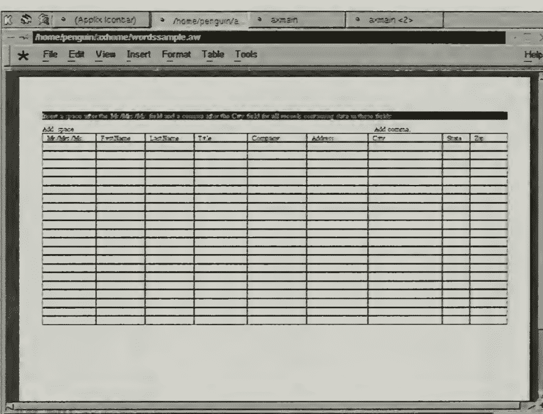

`图` `5-14`： 全屏查看信息通常让你更容易看到正在处理的文档。

如果你尝试了所有这些技巧，但它们仍然不能让你看到足够的文档内容，你需要增加分辨率。

# 总结

在本章中，你熟悉了 `Words` 界面以及如何与其元素交互，包括调整缩放、标尺、快速线和菜单。要点如下：

- `Words` 是文字处理软件。
- `Words` 在桌面上使用多个窗口。
- 你可以使用屏幕选项来满足需求。

# 创建和管理文档

# 创建文档

文字处理程序的主要用途是创建文档。这些文档可以是通讯书籍、书籍甚至是年度报告，还有从页眉到页脚以及图形标题的内容。`Applibre` 可以做到这些。

当你首次打开 `Words` 时，会出现一个空白文档，你可以开始打字。你会看到光标（默认情况下是标准的 `I-bar`）显示在屏幕左上角，如图 6-1 所示。如果你在一个会话中只处理一个文档，这将非常好，但如果你像大多数人一样，你需要打开多个文档。

打开新文档有两种选择：

- 为新文档打开新窗口。
- 用新文档替换当前文档。

与 `Microsoft` `Word` `97` 和 `WordPerfect` 不同，在 `Applibre` 中，你的文档并不是独立的文档窗口。每个 `Words` 窗口只能显示一个文档。

# 注意

# 本章

- 创建文档
- 使用文档模板
- 保存和导出工作
- 通过电子邮件发送 `Words` 项目
- 将文档打印
- 在桌面上处理多个文档

# 68 第二部分 `Aplix` `Words`

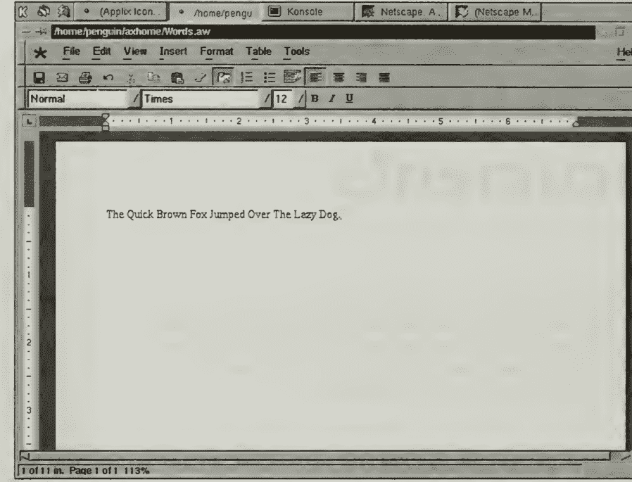

图 6-1：开始编写。这是完成工作最简单的方法。

# 创建新文档窗口

点击 `Aplixware` 图标栏上的 `Words` 图标，或在应用程序内选择 ☆ `Words`。

有关在当前窗口中打开文档的信息，请参见下节“从模板创建新文档”。

# 从模板创建新文档

当你在当前窗口中打开新文档时，你从模板打开文档，模板可以是经过深度格式化的，也可以是空白的。模板是一个已经预设格式的文档，你只需要填充内容。模板可以非常复杂，也可以非常简单。某些模板用于识别打印信封的设置，另一些格式化信件的地址和结尾部分，还有显示从页眉到页脚以及通讯稿和手册的图形标题。表 6-1 列出了 `Words` 提供的模板及其功能。图 6-2 显示了表格中所描述的书籍模板。

## 第 6 章 - 创建与管理文档 69

| 表 6-1 | 可用的 `Word` 模板 |
| 模板名称 | 说明 |
| --- | --- |
| `None` (无) | 仅包含基础应用样式，在 8½x11 英寸纸张上使用默认 `Times` 字体 |
| `ASCII` | 仅包含基础应用样式，在 8½x11 英寸纸张上使用默认 `Courier` |
| `Basic` (基础) | 标题、正文、段落等样式，在 8½x11 英寸纸张上使用默认 `Times` 字体 |
| `BasicA4` | 与配置为 8½x11½ 英寸（`A4` 纸）的 `Book` 相同 |
| `Book` (书籍) | 在标准纸上自动对章节编号，并提供章节标题、段落、页眉、页脚等样式 |
| `BookA4` | 与配置为 `A4` 纸的 `Book` 相同 |
| `EmptyA4` | 与 `None` 相同，但配置为 `A4` 纸 |
| `Envelope_10inch` | 10 英寸信封（9½ × 4½ 英寸）的样式 |
| `Envelope_6inch` | 6 英寸信封（6½ × 4 英寸）的样式 |
| `Envelope_9inch` | 9 英寸信封的样式。尺寸与 10 英寸相同，但 9 英寸带有显示邮寄地址的窗口 |
| `Env` `C4` | 12x9 英寸信封的样式 |
| `Env` `C5` | 9x6½ 英寸信封的样式 |
| `EnvDIN` | 8½x4½ 英寸信封的样式 |
| `Help` (帮助) | 创建帮助文件的样式，包括链接 – 默认 `Palatino` 字体，位于窄的 6½x11 英寸页面上 |
| `HTML` | 标准页上无上下边距，仅使用 `HTML` 相关的样式 |
| `Letter` (信件) | 标准纸上信件所有部分的样式 |
| `LetterA4` | 与 `Letter` 相同，但格式为 `A4` 纸 |
| `LtrbasA4` | 与 `Letter` 相同，但对样式应用了不同的缩进，并格式为 `A4` 纸 |
| `Letter_Basic` | 标准纸上与 `LtrbasA4` 相同 |
| `LtrdatA4` | `A4` 尺寸纸上与 `Ltrdat` 相同 |
| `Letter_Date` | 数据优先在前的格式化信件 |
| `Letter_Envelope` | 用于 `Windows` 的信封格式化 |

# 表 6-1（续表）

| 模板名称 | 说明 |
| --- | --- |
| `LtrEnvA4` | 与 `LtrEnv` 相同，但用于 `A4` 尺寸纸 |
| `Letter_Merge` | 用于邮件合并的预格式化信件 |
| `LtmrgA4` | `A4` 纸上与 `LetterMerge` 相同 |
| `LtrnamA4` | 格式化信件，其中发件人姓名位于第一行；格式为 `A4` 尺寸纸 |
| `Letter_Name` | 标准纸上与 `LtrnamA4` 相同 |
| `Memorandum` (备忘录) | 标准纸用的备忘录 |
| `MemoA4` | `A4` 纸用的备忘录 |
| `Merge_Data` | 用于到标准信件邮件合并数据的 `Word` |
| `MrgdatA4` | `A4` 纸上与 `MergeData` 相同 |
| `MrglabA4` | `A4` 尺寸纸上打印整页标签的 `Word` 格式 |
| `Merge_Label` | 标准纸上与 `MrglabA4` 相同 |
| `Newsletter` (时事通讯) | 包含所有样式的样式；常用的通讯稿 |
| `NswltrA4` | 与 `Nswltr` 相同，但用于 `A4` 纸 |
| `OutlinA4` | 在 `A4` 尺寸纸上创建大纲的带有编号和样式应用的大纲样式 |
| `Outline` (大纲) | 标准纸上与 `OutlinA4` 相同 |
| `Overhead` (投影) | 应用于横向页以创建投影演示的样式 |
| `OvrhdA4` | 应用于横向 `A4` 尺寸页的样式；用于创建投影演示 |
| `Press_Release` (新闻稿) | 用于创建新闻稿的样式 |
| `Prssrl4` | `A4` 尺寸纸上与 `PressRel` 相同 |
| `RepnumA4` | `A4` 纸上的报告样式文档，带有尾注、脚注、编号标题的控制 |
| `Report` (报告) | 报告样式文档，带有尾注、脚注和标题的控制，并在标准纸上应用了特殊效果 |
| `ReportA4` | `A4` 纸上 `Report` 相同 |
| `Report_Numbered` | 标准纸上与 `RepnumA4` 相同 |

## 第 6 章 - 创建与管理文档 71

书籍模板上使用的顺序

书籍模板的章节


图 6-2：默认的 `Book` 模板会自动添加章节编号。

从模板打开新文档：

1. 选择 文件 ⇨ 新建 (`Ctrl+N`)。
2. 如果你需要保存当前文档，`Word` 会提示你进行操作。如图 6-3 所示的“新建”对话框将提示你保存或丢弃当前文档。如果你不想继续，请点击取消。
3. 从图 6-4 所示的“模板”对话框中选择一个模板。

你可以通过从“模板”对话框中选择“无（`None`）”创建一个没有任何设置的新空白文档。

第二部分 + `Aplix` `Word`


图 6-3：在此对话框中保存或丢弃更改。


图 6-4：选择模板。

你可以通过从“模板”对话框中选择“无（`None`）”来创建一个没有任何设置的新空白文档。

（注：此处部分重复的原文已按要求处理）

- 这里的翻译抱歉，我重新核齐了翻译：

- `HTML`：标准页上无上下边距，仅使用 `HTML` 相关的样式
- `Help`（帮助）：创建帮助文件的样式，包括链接 – 默认 `Palatino` 字体，位于窄的 6½x11 英寸页面上
- `Letter`（信件）：标准纸上信件所有部分的样式
- `LetterA4`：与 `Letter` 相同，但格式为 `A4` 纸
- `LtrbasA4`：与 `Letter` 相同，但对样式应用了不同的缩进，并格式为 `A4` 纸
- `Letter_Basic`：标准纸上与 `LtrbasA4` 相同
- `LtrdatA4`：`A4` 尺寸纸上与 `Ltrdat` 相同
- `Letter_Date`：数据优先在前的格式化信件
- `Letter_Envelope`：用于 `Windows` 的信封格式化
- `LtrEnvA4`：与 `LtrEnv` 相同，但用于 `A4` 尺寸纸
- `Letter_Merge`：用于邮件合并的预格式化信件
- `LtmrgA4`：`A4` 纸上与 `LetterMerge` 相同
- `LtrnamA4`：格式化信件，其中发件人姓名位于第一行；格式为 `A4` 尺寸纸
- `Letter_Name`：标准纸上与 `LtrnamA4` 相同
- `Memorandum`（备忘录）：标准纸用的备忘录
- `MemoA4`：`A4` 纸用的备忘录
- `Merge_Data`：用于到标准信件邮件合并数据的 `Word`
- `MrgdatA4`：`A4` 纸上与 `MergeData` 相同
- `MrglabA4`：`A4` 尺寸纸上打印整页标签的 `Word` 格式
- `Merge_Label`：标准纸上与 `MrglabA4` 相同
- `Newsletter`（时事通讯）：包含所有样式的样式；常用的通讯稿
- `NswltrA4`：与 `Nswltr` 相同，但用于 `A4` 纸


- `OutlinA4`：在 A4 尺寸纸上创建大纲的带有编号和样式应用的大纲样式
- `Outline`（大纲）：标准纸上与 `OutlinA4` 相同
- `Overhead`（投影）：应用于横向页以创建投影演示的样式
- `OvrhdA4`：应用于横向 A4 尺寸页的样式；用于创建投影演示
- `Press_Release`（新闻稿）：用于创建新闻稿的样式
- `Prssrl4`：A4 尺寸纸上与 `PressRel` 相同
- `RepnumA4`：A4 纸上的报告样式文档，带有尾注、脚注、编号标题的控制
- `Report`（报告）：报告样式文档，带有尾注、脚注和标题的控制，并在标准纸上应用了特殊效果
- `ReportA4`：A4 纸上 `Report` 相同
- `Report_Numbered`：标准纸上与 `RepnumA4` 相同

（接上文）

5. 点击确定。

一旦你选择了模板，Word 将根据该模板打开新文档。要打开不同的模板，请保存你正在工作的文档。

## 第 6 章 - 创建与管理文档 73

`img/ef16b42a829a0a83e710765db9a808110_0.png`

关于创建自己的模板的信息，请参见本章后面的内容。

## 打开现有文档

一旦你熟悉了在 Word 中创建新文档，你一定会发现需要打开它们。你会打开三种类型的文件：

- 在你的计算机上创建并存储的文件
- 通过电子邮件发送给你的或位于网络服务器上的文件

每种文件类型都有自己的挑战。

## 打开计算机上的文档

当文档源于你的计算机时，你打开它的方法决定了文档的显示方式。与新文件一样，你可以在当前窗口或新窗口中打开文档。

第一种选项（在当前窗口中打开文档）是最简单的。如果有必要，Word 会提示你保存文档。

`img/ef16b42a829a0a83e710765db9a808110_1.png`

### 第二部分 + `Applix Word`

`img/ef16b42a829a0a83e710765db9a808111_0.png`

**图 6-5：打开对话框**

> 仅仅能看到一个文件并不意味着你拥有打开它的权限或软件。有时你可以通过导入来读取这些文件。如果你没有读取该文件的权限，则需要让 `root` 用户或文档创建者给你所需的权限。

## 第 6 章：创建与管理文档 75

你通过四种主要方式接收文件：

- 通过你的互联网服务提供商从互联网获取
- 通过你的本地服务器或 `Sendmail` 服务器
- 在磁盘上
- 通过网络

大多数电子邮件程序会在你的 `/home` 目录下创建一个 `/mail` 目录（或类似名称的目录）。如果消息中附有文件，该文件通常也会存储在你的目录中。要打开通过电子邮件接收的文件，你只需将它们保存到 `/home` 目录，或者让它们保存到邮件程序的默认位置，并使用“打开文件”对话框中的目录结构。

有关使用 `Applix Mail` 的更多信息，请参阅第六部分。

要访问位于软盘或 `CD-ROM` 驱动器上的文件，你需要打开 `/mnt/floppy` 或 `/mnt/cd-rom` 驱动器。在那里，你可以像处理硬盘的其他部分一样对文件进行排序。

每当你切换磁盘时，必须卸载（`umount`）驱动器然后重新挂载（`mount`）。关于这两个命令的更多信息，请查看 `Linux` 中的 `man` 页面（帮助页）。在某些系统中，只有 `root` 账户配置了此操作。

在网络上查找文件时，你必须查看你的 `/mnt/network [标识符]` 目录。网络驱动器必须像 `CD-ROM` 和软盘一样进行挂载。在网络上查找文件的过程与在软盘上查找文件相同。但与软盘不同，你不需要在每次切换目录（对于软盘驱动器切换磁盘）时卸载它。

## 使用外部文件格式

面对现实吧。世界上有成百上千种文字处理应用程序，它们都使用自己的专有格式来保存文档。你很有可能打开一个使用不同的文字处理软件创建的文档。目前，没有其他软件使用 `Applix` 相同的文档格式，这使得使用其他软件创建的文档变得更加困难。幸运的是，`Applix` 允许你读取来自 `Linux` 和 `Windows` 世界最常见的文档格式。

## 第二部分：`Applix Words`

`Words` 导入功能支持的文档格式包括：

- `ASCII Lines Interleave 5.x/6.x (ASCII)`
- `HTML MS Word 7.0/95`
- `MS Word 5.1 (Macintosh) WordPerfect 5.0`
- `Rich Text Format (RTF) Frame MIF 4.0`
- `WordPerfect 7.0 MS Word (DOS)`
- `ASCII Paragraphs MS Word 97/2000`
- `Interleaf 4.0 (ASCII) WordPerfect 5.1`
- `MS Word 6.0 Frame MIF 5.x`
- `WordPerfect 4.2 MS Word 2.0 (Windows)`
- `WordPerfect 8.0 OfficeWriter`
- `DCA WordPerfect 6.0`

由于使用了创建了许多类型的文字处理文件，你应该知道你正在导入什么类型的文件，以确保过程顺利。在情况下，你可以通过文件扩展名识别文件类型。文件扩展名由文件名点之后的字符组成；它们标识了最初用于创建文件的软件类型。最常用的文件扩展名是：

- `doc`——`Microsoft Word` 文件，包括直到 `Word 2000` 的所有 `DOS`、`Mac` 和 `Windows` 版本。此扩展名也可用于 `WordPerfect` 或 `ASCII` 文件。如果你不知道究竟是什么软件创建了这个文件，请按以下顺序尝试这些过滤器：`Word 97`、其他 `Microsoft Word` 过滤器、`WordPerfect`，然后是 `ASCII` 过滤器。
- `html`——`HTML` 文件（超文本标记语言）是网站放置页面的常用格式。这些文档包含了控制格式的代码以及文档内容。`Words` 过滤器不支持 `HTML 4.0` 标准，但仍然能够导入你的文档。务必为这些文件指定 `HTML` 导入过滤器。
- `mif`——`MIF 4.0` 和 `5.x` 格式的文件（`FrameMaker` 格式）在 `FrameMaker` 软件中创建。只需使用一个 `Frame MIF` 过滤器导入这些文件即可。从最新版本开始，在此例中为 `MIF 5.x`。
- `rtft`——这些存储在 `DCA/RTF`（可修订文本）中的文件非常稀有，`DCA` 导入过滤器仍然可以读取它们。
- `rtf`——常用于系统间传输信息的富文本格式包含内容并保留了你的大部分格式。它适用于所有平台，使其成为共享信息最流行的文件格式之一。`Applix` 的 `RTF` 文档过滤器是典范。
- `txt`——纯 `ASCII` 文本文件在所有操作系统上可用，由于它们不保留任何格式，它们实际上成为了数据导入的最低标准。有两种 `ASCII` 导入过滤器可用：`ASCII Lines` 和 `ASCII Paragraphs`。它们在不同的文档上会产生不同的结果，因此请尝试最适合你的一个。
- `wpd`——你必须对这些文档使用 `Office Writer` 导入过滤器。
- `wpd`——`WordPerfect` 文件通常使用此扩展名，尽管你可能在某些文档上看到 `.doc` 扩展名。`Applix` 的 `WordPerfect` 过滤器适用于 `DOS`、`Windows`、`Mac` 和 `Linux` 平台上 `4.3` 起的所有版本文档。

要导入外部格式的文件：

1. 选择文件（`File`）。这将打开图 6-6 所示的打开对话框。
2. 选择类型（`Type`）：所有文件（`All Files`）。
3. 为文件选择合适的过滤器。如果你不知道究竟是什么软件创建了这个文件，请按以下顺序尝试这些过滤器：`Word 97`、其他 `Microsoft Word` 过滤器、`WordPerfect`，然后是 `ASCII` 过滤器。
4. 点击确定（`OK`）。

## 第 6 章：创建与管理文档 77

要导入一个外部格式的文件：

1. 选择文件（`File`）。这将打开图 6-6 所示的打开对话框。
2. 选择类型（`Type`）：所有文件（`All Files`）。
3. 为文件选择合适的过虑过滤器。如果你不知道究竟是什么软件创建了这个文件，请按以下顺序尝试这些过滤器：`Word 97`、其他 `Microsoft Word` 过滤器、`WordPerfect`，然后是 `ASCII` 过滤器。
4. 点击确定（`OK`）。

## 第二部分：`Applix Words` 78

要导入一个外部格式的文件：

1. 选择文件（`File`）。这将打开图 6-6 所示的打开对话框。
2. 选择类型（`Type`）：所有文件（`All Files`）。
3. 为文件选择合适的过滤器。如果你不知道究竟是什么软件创建了这个文件，请按以下顺序尝试这些过滤器：`Word 97`、其他 `Microsoft Word` 过滤器、`WordPerfect`，然后是 `ASCII` 过滤器。
4. 点击确定（`OK`）。

- `未知字体`——`Words` 支持 `New Roman`、`Arial` 和 `Courier` 等字体。如果你想处理字体，请将未知字体设置为：保持不变、替换为字体或询问用户。
- `未知对象`——`Words` 无法识别文件中的任何对象。你可以将未知对象标记设置为“插入图片占位符”或“插入文本占位符”。另一个选项是忽略未知对象。
- `未知函数`——`Words` 无法识别 `Word` 文档中某些函数和公式。在导入过程中遇到未知函数，必须告诉导入向导如何处理它们。你可以使用的选项有：插入问题字符串、插入上次计算值、插入未知函数和询问用户。如果你正在导入带有无法识别的内部或外部文档链接的文档，你需要在“插入问题字符串”和“询问用户”之间进行选择。

## 章节：创建与管理文档 79

最后的窗口如图 6-8 所示，允许你在文件转换发生时观察。大多数转换在几分钟内完成。如果你不想等待，点击“在后台运行”按钮，你就可以继续处理其他文档。要停止转换，点击“中止”（`Abort`）。要临时停止转换而不中止，点击“中断”（`Interrupt`）。

`Words` 可以创建一个日志文件，记录导入和转换过程中的每一步。如果你对导入的文档有问题，这将非常有帮助。

# 保存您的工作

如果你没有任何保存文档的方法，那么创建文档或打开文档真的毫无用处。在业务活动中，你通常需要保存所有的文档，即使是写给同事的那些在几天后可能就无关紧要的简短备注。通过保存所有的通信往来，你可以确保你的所有工作和时间都得到了记录，并且在发生关于谁应该执行某特定任务的误解时，这为你提供了解决任何分歧的基础。

## 保存文档

要保存文档：

1. 选择 `File` > `Save` (`Ctrl+S`)。
2. 在“文件名：”字段中输入文件名称。不要添加 `.aw` 扩展名。`Words` 会为你完成此操作。
3. 从图 6-9 所示的“目录”字段中选择文件的保存位置。

默认情况下，所有文档都保存存在你的 `/axhome` 目录中。例如，如果你以“`penguin`”身份登录，那么你的 `Applix Words` 文档将保存到 `/home/penguin/axhome`。

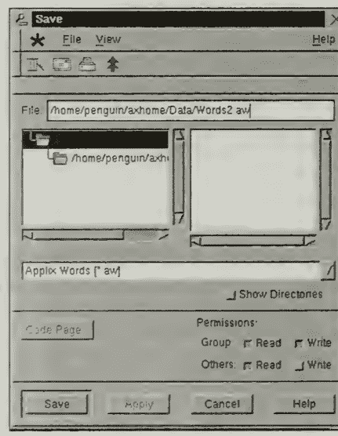

> 图 6-9：当你第一次选择保存文档时，会出现保存对话框。

## 使用“另存为”

有时，你需要用新名称保存文档。例如，你可能想创建一个现有文档的备版本，同时又不丢失原始文件的任何内容。

要用新名称保存文档：

1. 选择 `File` > `Save As`。
2. 输入你想要使用的新文件名，如图 6-10 所示。为你的文件选择一个当前目录中不存在的描述性名称。

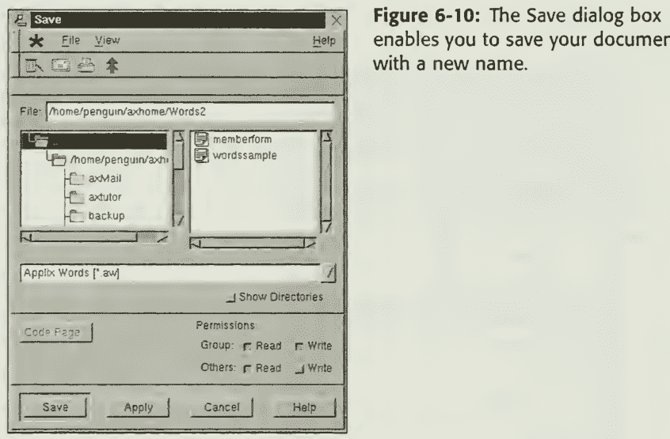

3. 选择应放置文件的目录。
4. 为你的文件设置访问权限。作为文档的创建者，你将始终拥有读取和写入文件的权限，但可能还有其他人员也需要访问该文档。如果你希望组中的每个人都能阅读你的文档，请为“组”同时勾选“读取”和“写入”；如果你希望其他所有人都能访问该文件，请为“其他”同时勾选“读取”和“写入”。
5. 点击 `Save`。

## 导出文档

在处理文档时，它们通常需要与使用其他软件的人员共享。保存你的文档以便其他软件可以读取的过程被称为导出。

要将文档导出为新的文件格式：

1. 如果不是当前打开的文件，请选择 `File` > `Open` 以打开你想要导出的文件。
2. 选择 `File` > `Save As`。
3. 选择保存文件的目录，如图 6-11 所示的保存对话框框所示。

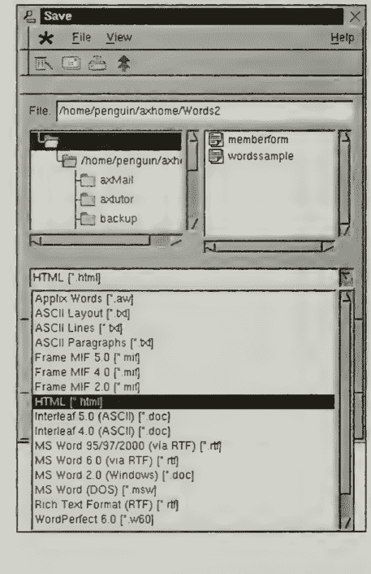

4. 在“文件名：”字段中输入新文件名。
5. 为你的目标文件类型选择“另存为类型”选项。

请仔细选择“另存为类型”，因为选择错误可能会导致你的朋友或同事无法读取你的文件。

参见本章前面的部分“处理外部文件格式”。

6. 为文件格式设置访问权限。
7. 点击 `Save`。

如果你选择将文档导出为 `ASCII` 格式，请记住 `ASCII Line` 过滤器仅保留你的原始段落标记，而 `ASCII Paragraphs` 则会在每行文本末尾插入换行符。`ASCII Layout` 选项的作用类似于 `ASCII Paragraphs`，但它会删除空行。

## 保存模板

创建模板允许你为你的业务或个人使用创建外观完全相同的文档。你可以创建自己的信头纸、小册布局和信封设置，以及许多其他文档。一旦你创建了模板，你就可以使用它来创建所有的文档，让它们具有相同的页边距、图形和整体外观。

如果你在创建模板时在实际模板内使用了信头的图形效果，那么你再也不需要购买预印的信头了；当你打印文档时，它会自动打印。如果你无法或不想这样做，可以通过设置设置页边距以匹配现有的信头尺寸来使用预印信头。

将你的当前文档保存为模板：

1. 选择 `File` `Save`。如果你之前保存过该文档，选择 `File` `Save As`。
2. 在“文件名：”字段中为你的模板命名。
3. 选择 `/axome/template` 目录
4. 点击 `Save`。

如果你还没有创建 `/template` 目录，则你需要创建一个。你可以通过选择 `Preferences` `Options` 来完成。在图 6-12 所示的 `Words` 选项对话框中勾选“用户模板目录”框，并确保指定了 `/axome/template` 目录。点击 `OK`。系统会询问你是否要创建备份


**图 6-12：`Words` 选项对话框允许你配置 备份。**

## 备份你的工作

创建文档备份是保护你工作的一个重要方面。`Appliware` 允许你自动备份。要创建备份：

1. 选择 `Preferences` `Settings`。
2. 勾选 `Words` 设置对话框中的“备份”框。
3. 设置备份的时间间隔，例如，每 30 分钟。
4. 点击 `OK`。

参见附录 A 关于备份的信息

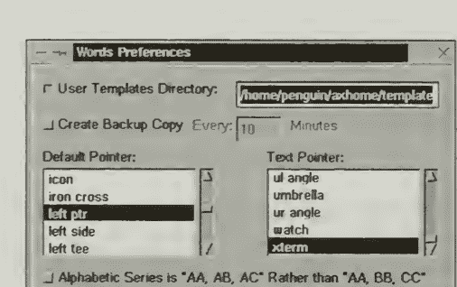

**图 6-13：备份选项确保你不会丢失太多工作。**

## 预览与打印

在你创建并保存文档后，通常需要将其打印。有四种方法可以打印到打印机：

- 选择打印机。
- 点击 打印图标。
- 按 `Ctrl+P`。
- 打开 `File` `Print`。

任何这些方法都会打开图 6-14 所示的对话框。

## 设置打印选项

打印文档需要多种步骤，包括：

- 识别打印机
- 选择份数
- 决定黑白还是彩色
- 决定页面方向

要检查打印选项：

1. 选择打印机。
2. 在“份数”字段中输入你想要打印的份数。
3. 指定打印的页面范围。如果你想打印所有页面，输入“全部”，否则指定范围，例如 `2-5`。
4. 选择打印类别。`HP` 在所有最新型号上使用 `PCL5`。如果你的打印机支持 `PostScript`，请选择它。
5. 点击 打印选项以扩展你的打印选择。
6. 在图 6-15 所示的打印对话框中勾选 彩色。

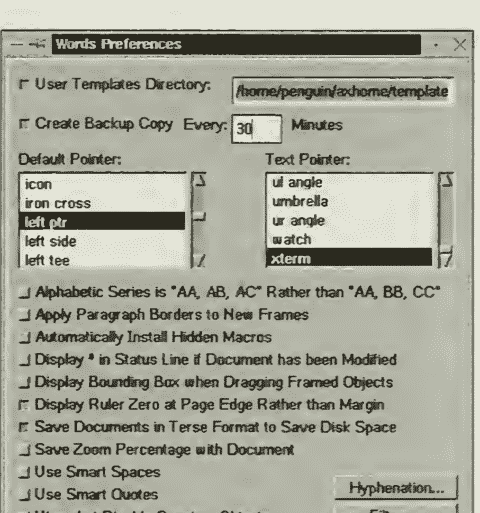

**图 6-15：打印对话框允许你选择打印机和页面目标。**

7. 如果你想对多份文档进行装订，请勾选“排序”。
8. 如果你希望打印机先打印文档的最后页，请勾选“反序”。这避免了你在整理纸质副本时手动反转页面顺序。打印机通常在第 1 页之后打印第 2 页，这会导致第 2 页位于纸盒上方。
9. 点击 `OK`。这将关闭对话框。

参见本章后面的“高级打印选项”以获取有关打印对话框中提供的其他选项的详细信息。

10. 如果你希望打印横幅，请在打印对话框中勾选“横幅”。在大多数情况下，这只是浪费纸，因为它的功能与封页类似。如果你在使用网络打印机，横幅有助于你的同事区分你的打印任务和他们的任务。
11. 如果你希望在后台进行打印，请勾选“后台”。
12. 取消选择“打印到文件”这一默认选项，如果你希望输出直接发送到打印机，而不是到 `PostScript` 文件。

你的文档很快就会出现在你的打印机上。如果你无法读取输出内容，你将需要尝试不同的打印类别。

# 高级打印选项

在打印选项对话框中还有许多其他选项，当打印演示文稿、手册、年度报告或通讯等高级文档时，您可能需要设置这些设置。这些设置会被页面设置覆盖：

- 双面打印。允许您在纸的正反面打印。
- 来源。允许您为文档的每个部分选择打印机的纸盒。通常，只有当您拥有高质量的多槽打印机时，此选项才可用。
- 打印目标。为文档的每个部分选择使用的打印机。这允许您将带有彩色图形的页面发送到彩色打印机，并将文档其余部分发送到速度较快的黑白打印机。

# 预览打印页面

打印前预览工作是节树的方法之一。通过预览文档，您可以在拿到副本并重新打印信息之前发现错误。遗憾的是，`Applix` 没有提供独立的“打印预览”选项，但您可以通过调整页面的缩放比例在打印前预览整个文档。在 `800 × 600 dpi` 的屏幕上，您需要选择“视图 `Zoom` `40%`”来完整查看一个页面。


请查看第 5 章中的“调整视图”获取更多关于缩放的信息。

# 打印到文件


当您希望以准备打印的格式分发文档时，可以为其创建一个 `PostScript` 文件。操作如下：

1. 在当前文档窗口中选择“文件 ⇜ 打印 (`Ctrl+P`)”。
2. 从列表中选择 `PostScript`。如果想打印到 `PCL5` 打印机，请选择 `PCL5`。
3. 勾选“打印到文件”。此选项通常会被自动选中且无法更改。
4. 在“名称”字段中输入文件名。你需要输入完整路径；在大多数情况下，系统已为您生成了路径。`PostScript` 文件的扩展名为 `.ps`。`PCL5` 文件的扩展名为 `.pcl`。
5. 点击“确定”。

注意：如果对话框中未列出打印机，您将需要将其添加到 `Applix` 安装中。此任务通常需要系统访问权限，请参阅安装时附带的文档。

# 通过电子邮件发送文档

节省纸张或使用电子邮件。我们可以向无纸办公迈进，并尽可能使用电子邮件。如果文档收件者想要纸质副本，他或她可以自行打印。如果您尚未创建目录，在通过邮件发送文档时，系统将提示您执行以下操作：

- 在“名称”字段中输入收件者的电子邮件地址。
- 编辑主题使其更具描述性。
- 添加消息以帮助解释发送原因。
- 点击“确定”。

您的文档将被发送。

# 管理文档

在本章较早之前，我讨论了在 `Applix` 中工作时可以使用多个窗口。此功能允许您在文档之间共享信息，正如我在第 2 章中讨论的那样。然而，在使用此功能时需要考虑某些事情。其中一些内容将在下文中进行讨论。

# 处理多个文档

当您处理多个文档时，最快的方法是让每个文档都在您的屏幕上打开并可见。这比在同一个屏幕上打开、编辑和保存文档要节省时间。您可以打开多个文档但不让它们可见。例如，您可以最小化窗口将其置于任务栏，然后使用鼠标或 `Alt+Tab` 在它们之间切换。每个桌面都可以容纳文档、图形等。

提示：选择菜单（`Menu`）将当前窗口移动到特定桌面。系统菜单位于上方。某些窗口管理器允许您使用标签页让一个或多个窗口跟随您。由于 `Applix` 未能为您提供相同的功能，您可能想查看附录 C 中列出的某些窗口管理器。

交叉引用：参见附录 C。

# 在磁盘上组织文档

计算机用户面临的最大挑战之一是跟踪所有文件的位置。在第 3 章中，我讨论了必须建立的各种约定以管理您的文件。我还讨论了按项目和客户来组织文档。如果您不使用计算机进行业务，或者倾向于只处理特定类型的文档，您可以按类型组织目录。例如，会员俱乐部就不需要跟踪单封信件，但需要跟踪季度通讯、来信函、报告、营销文档等。对于这类机构，按生成的文档类型来组织目录将是明智之举。图 6-16 所示的目录结构将用于本书此部分的后续剩余示例。

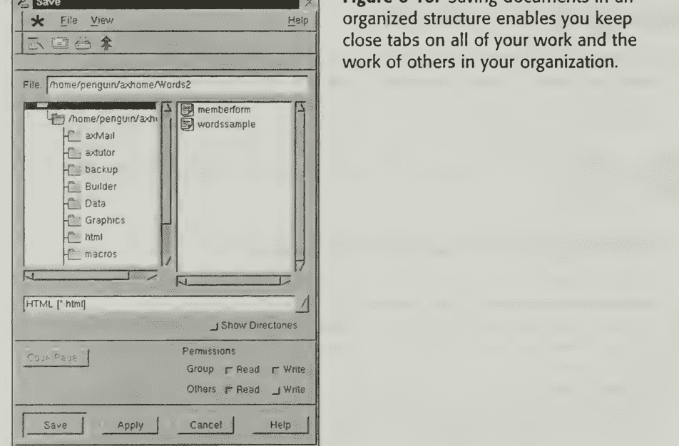

# 文档命名

另一个主要关注点是您对所有文件使用的特定命名约定。在 `Applix` 中，您可以为所有文档和目录使用长文件名。尽管有这些自由，但有些约定是您应该遵守的：

- 不要在文件名中包含空格。`Applix` 接受空格，但它们无法归档。您可以使用下划线 (`_`) 或连字符 (`-`) 代替空格，使文件名部分之间看起来有空格。
- 不要添加文件扩展名。`Applix` 与所有其他应用程序和软件一样，会自动添加适当的文件扩展名。在这种情况下，扩展名为 `.aw`。
- 使用简短且描述性的文件名。不要在文件名中放入过多的信息。文件名需要是独特的且具有足够的描述性，以便您知道在看什么，但不能通过名称讲述整个故事。您可能想将一封 1999 年 10 月 20 日给 `George Duncan` 的关于秋季培训会的信命名为 `GDun-991020-FallTraining`。这个文件名具有足够的描述性，可以确保几个月后您仍知道信件的内容和发送时间。对于您的组织，可能不需要添加日期，或者您可能有一个代表秋季培训课程的代码。根据您对需求的了解来创建自己的文件命名标准。

如果您对任何主题都有大量通信，可以创建一个包含与该主题相关的所有内容的目录。

# 总结

在本章中，您熟悉了在 `Applix Words` 中创建、打开、保存、打印和管理文档。这些基本任务在您处理文档时都会执行，无论您是正在写第一封信还是整个文档。需要记住的最重要点是：

- 有多种方法可以在不使用鼠标的情况下创建、打开和保存 (`Ctrl+S`) 文档。
- 在处理相似类型的文档时，您可以创建自己的模板来节省时间。
- 您可以直接打印到 `PostScript` 文件以提交给专业出版商。

✦ `Applix` 是一种图形文字处理器，可以不断打印预览。
✦ `Applix` 可以导入和导出多种格式，包括 `Microsoft Word 2000` 和 `WordPerfect`，以及更常见的 `RTF` 和 `ASCII` 格式。
✦ 您可以通过电子邮件发送文档副本来快速与他人分享您的成果。

# 94 第二部分 + Applix Words

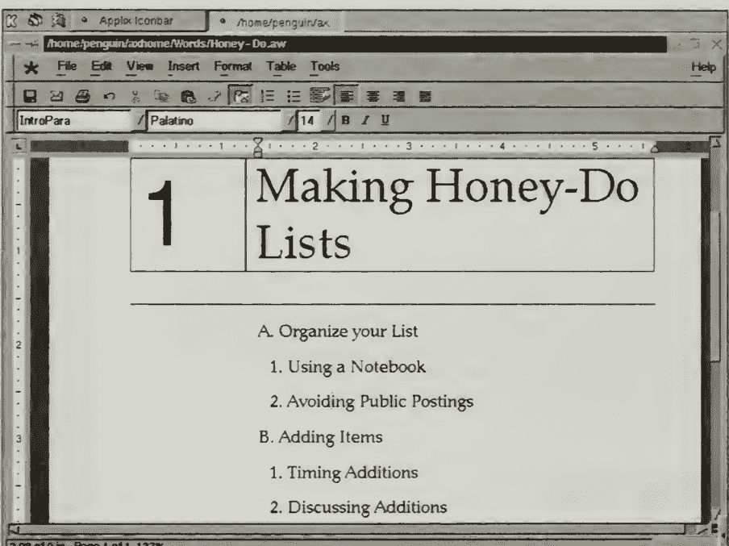

**图 7-1：** 创建大纲，将每个条目作为标题，并可以确保你的文档是完整的。

# 添加特殊字符

文档中可以嵌入各种特殊的特殊字符。其中一些字符在商业中非常常用，用于标记版权、商标注册和商标。其他字符还包括希腊字母表、外国货币符号、度数符号、分数和尖括号。要添加图 7-2 所示表格中的特殊字符：

- 选择“插入特殊字符”（`Insert Special Characters`）
- 在“特殊字符”对话框中勾选“组 2”。组 1 字符通常是键盘上已有的字符。组 2 字符包含了你经常需要添加到文档中的特殊符号。
- 在文档中选择你需要的字符。该字符将自动添加到窗口中当前光标位置。
- 点击“关闭”（`Dismiss`）关闭“特殊字符”对话框。

> **提示：** 如果你要在文档中添加大量此类字符，请保持“特殊字符”对话框开启。

# 使用术语表节省时间

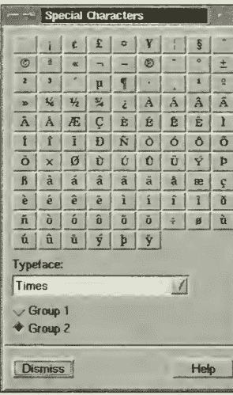

很多时候，你会发现自己在不断输入相同的信息。无论是名称还是段落，这都会让人感到烦躁且耗时。使用 `Applix Words` 的术语表功能，你可以轻松地添加这些文本并只需输入一次。

## 使用术语表条目

要使用预定义的术语表条目：

1. 选择 插入（`Insert`） > 术语（`Glossary`）。
2. 选择你想使用的术语条目。图 7-3 所示的“插入术语”对话框显示了当前术语的列表。当你选择一个条目时，该条目的内容将在可用术语列表下方显示。

术语列表中的条目取决于用于创建文档时使用的模板。

3. 如果你希望条目根据文档的变化自动更新，请选择“作为术语字段”（`As Glossary Field`）。如果你希望条目保持静态，请选择“作为普通材料”（`As Plain Material`）。
4. 点击“确定”（`OK`）。

如果你知道将在一个文档中使用多个术语表条目，请保持“插入术语”对话框开启，并点击“应用”（`Apply`）插入所需的每个条目。

# 96 第二部分 + Applix Words

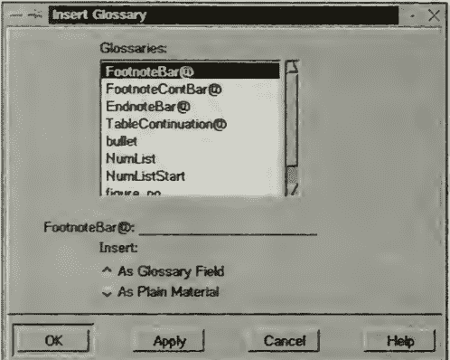

图 7-3：“插入术语”对话框允许你向文档添加术语条目。

## 添加术语表条目

除非你只使用带有奇数项目符号或数字的脚注和尾脚注，否则术语表中包含默认条目无法满足你的所有需求。因此，`Words` 允许添加你个人需要的任何术语条目。

要添加术语条目：

1. 选择 插入（`Insert`） > 术语（`Glossary`） > 定义术语（`Define Glossary`）。
2. 在图 7-4 所示的“定义术语”对话框的“名称”字段中输入你的条目名称。


图 7-4：定义术语词可以提高你创建文档的效率。

3. 在文档中高亮你想添加到术语表的文本区域。

你可以在打开“定义术语”对话框之前就选择术语条目的文本，从而避免点击“显示选择”（`Show Selection`）按钮。

4. 点击“显示选择”（`Show Selection`）。这允许你验证已放置在术语表中的信息。


图 7-5：确保术语条目与选择的文本匹配。

5. 点击“确定”（`OK`）。你的条目已添加到列表中，因此可以在文档的剩余部分使用。

如果你希望新的术语对所有文档可用，请打开你使用的模板，并添加术语。

## 编辑术语表条目

你需要经常更新术语表条目。这可能是因为添加了新产品或法律表述发生了变化。要编辑术语条目：

1. 选择 插入（`Insert`） > 术语（`Glossary`） > 定义术语（`Define Glossary`）。
2. 选择需要更新的术语名称。
3. 选择将更新的文本。
4. 点击“显示选择”（`Show Selection`）。这将如图 7-6 所示更新条目。


图 7-6：仔细检查“显示选择”部分以确保已更新。

5. 点击“确定”（`OK`）。这会关闭“定义术语”对话框并打开另一个对话框以验证你要更新条目。
6. 在图 7-7 所示的是/否对话框中点击“是”（`Yes`）以更新条目。

# 第 7 章 + 处理文本


图 7-7：点击“是”（`Yes`）更新你的术语条目。

现在术语条目已更新，每次使用时都会显示。

> **注意：** 为了更改所有术语条目，你必须在“插入术语”对话框中使用“作为术语字段”（`As Glossary Field`）选项将其放入文档中。你还必须勾选“定义术语”对话框中的“匹配引用自动更新”（`Matching References, Automatically Update`）。

# 使用基础快捷键

没有什么比打字过程中不得不离开键盘操作鼠标更烦人的。这些快捷键可以节省你的时间。它们列在表 7-1 中。

| 表 7-1 基础快捷键 | 键 | 操作 |
| :--- | :--- | :--- |
| `Home` | 到行首 | |
| `End` | 到行尾 | |
| `Ctrl+A` | 选择整个文档 | |
| `Ctrl+Z` | 撤销上一步操作 | |
| `Shift+Return` | 到段落开头 | |
| `Ctrl+Return` | 到段落结尾 | |
| `Up Arrow` | 向上移动一行 | |
| `Down Arrow` | 向下移动一行 | |
| `Right Arrow` | 向右移动一个字符 | |
| `Left Arrow` | 向左移动一个字符 | |
| `Ctrl+K` | 插入超链接 | |
| `Ctrl+X` | 剪切选中文本 | |
| `Ctrl+W` | 删除单词 | |
| `Ctrl+O` | 打开新文档 | |
| `Ctrl+G` | 到屏幕左边缘 | |
| `Ctrl+H` | 到屏幕右边缘 | |
| `Ctrl+F` | 查找并替换文本 | |
| `Ctrl+L` | 当前文本左对齐 | |
| `Ctrl+R` | 当前文本右对齐 | |
| `Ctrl+Shift+O` | 覆盖/插入 | |
| `F2` | 撤销上次更改 | |
| `Shift+F2` | 重做上次撤销的操作 | |

关于快捷键的更多信息请参见附录 B。

# 移动文本

大多数时候，你第一次无法确定文档的顺序。无论你的大纲做得有多好，阅读了多少遍材料，或者花费了多少研究时间，在执行项目期间你不可避免地发现某些地方需要更改。以下章节将提供帮助。

## 文本

首先，决定移动哪些文本以及你想将其移动到哪里。表 7-2 列出了你可以告诉 `Words` 你想要移动文本的各种方法。

| 表 7-2 选择文本的技术 | 技术 | 指令或结果 |
| :--- | :--- | :--- |
| 用鼠标高亮文本 | 在选择范围的开头点击左键，将鼠标拖到范围末尾，然后释放鼠标。 | |
| `Shift`+鼠标 | 将光标置于选择范围的开头。按 `Shift`。在范围末尾点击左键。 | |
| 在页边距点击 | 在文档中选择的行旁页边距点击左键。 | |
| 在页边距点击并拖动 | 在页边距处从选择范围的第一行开始点击左键，在释放鼠标之前将鼠标拖到范围末尾。 | |
| 双击鼠标 | 在单词上双击鼠标可以选择整个单词。 | |
| `Shift`+`Home` | 从当前光标位置到当前行开头。 | |
| `Shift`+`End` | 从当前光标位置到当前行末尾。 | |
| `Shift`+向上箭头 | 从当前光标位置向上选择到上一行的相同光标位置。 | |
| `Shift`+向下箭头 | 从当前光标位置向下选择到下一行的相同光标位置。 | |
| `Shift`+向右箭头 | 从当前光标位置向右选择一个字符。 | |
| `Shift`+向左箭头 | 从当前光标位置向左选择一个字符。 | |

## 复制、剪切和粘贴文本

在选择了一段文本后，最常见的操作是复制它或将其移动到新位置。你可以使用 `Words` 的复制、剪切和粘贴功能来实现此操作。

**复制信息：**

1. 高亮你想要重复使用的文本范围。
2. 选择 编辑 ↩ 复制 (`Ctrl+C`)。该信息现在已存到你的剪贴板中，可以通过任何其他 `Applix` 应用程序访问。

**剪切信息：**

1. 高亮你想要移动的文本范围。
2. 选择 编辑 ↩ 剪切 (`Ctrl+X`)。该信息现在从当前文档中移除，并置于剪贴板，可以通过任何其他 `Applix` 应用程序或从当前文档访问。

**粘贴信息：**

1. 将某些信息剪切或复制到剪贴板。
2. 在文档中选择你想放置信息的位置。
3. 选择 编辑 ↩ 粘贴 (`Ctrl+V`)。该信息将出现在新位置。如果你想将其放置在另一个位置，它仍然存在于剪贴板中。

## 检查拼写

无论你的打字速度或拼写能力有多好，错误都是不可避免的。`Words` 提供了检查文档中文本拼写的能力。拼写检查器使用一系列字典，你可以对其进行编辑、添加内容和替换。

> 提示：要自动执行拼写检查，选择 工具 ↩ 拼写 ↩ 自动拼写检查。

### 启动拼写检查

要启动拼写检查：

注意：不需要将光标放在文档开头。无论你的光标位于哪里，拼写检查都会从那里开始。

1. 选择 工具 ✜ 拼写检查 (`F7`)。拼写检查对话框打开，并显示文档中的第一个拼写错误，如图 7-8 所示。


图 7-8：拼写检查对话框显示了所有无法识别的单词。

2. 你现在有了选项。如果单词拼写错误：
   - 从列表中选择正确的拼写，或在“更正单词”字段中输入正确的拼写。
   - 点击 替换。
   - 全部替换。如果这是你经常出现的拼写错误，选择“全部替换”可确保 `Words` 不会在每次发现当前文档中的错误时都询问你。
   - 如果单词拼写正确，但 `Applix` 无法识别，请点击 跳过。
   - 如果单词在本文中出现多次，点击 全部跳过。全部跳过将防止 `Applix` 询问你每一个实例。
   - 如果该单词是你组织的常用单词，且你想将其添加到当前字典，请点击 添加。这确保了相同的单词在你的所有文档中都不会被再次质疑。

如果单词拼写正确但未被识别：

### 选择字典

有时，默认字典是不够的。你可能需要用法语或德语写信，或者希望在这些语言中检查你的拼写。你可能想为个人文档创建一个字典，为技术文档创建另一个。

选择字典：

1. 选择 工具 轮 拼写 轮 指定自定义字典。
2. 从图 7-9 所示的“可用字典”对话框中选择你想使用的字典。


**图 7-9：** 指定自定义字典对话框允许你使用多个字典。

你将看到你在计算机上使用的每种语言的字典，包括默认英语字典。如果你在使用英语之外没有使用过任何语言，那么你在“添加”列表中看到的将只有一个字典。

3. 点击 添加。你不能指定为英语的文档中使用外语言字典，尽管你可以在该文档中使用多个英语字典。
4. 点击 确定。

### 添加或编辑字典

通常，有必要创建自己的字典或编辑已创建的字典。如果你将所有的个人术语添加到默认字典（该字典可能通过网络共享），你可能会无意中添加其他用户不需要的单词。当你不小心向字典添加拼写错误的单词时就会发生这种情况——这在大多数办公室都是常见现象。

**添加新字典：**

1. 选择 工具 轮 编辑自定义字典以显示图 7-10 所示的“编辑字典”对话框。

# 第 7 章 处理文本 105


**图 7-10：** 编辑自定义字典对话框允许你添加新字典或编辑现有字典。

2. 在“新字典名称”字段中为你的字典输入名称。
3. 点击 创建新目录。你的新字典现在将被创建，但它完全没有任何单词。你将在处理文档时将它们全部添加到字典中。

你现在需要将其中一些单词添加到你的新字典中：

> 在编辑字典之前，你可能想手头有一份打印字典副本，以便双检正确的拼写并确保你的条目准确。

4. 确保你的字典名称正确。
5. 输入你想添加的单词。
6. 勾选“不区分大小写”选项。
7. 点击 添加。该单词现在显示在字典中。
8. 点击 确定。
9. 如果要从字典中删除单词，选择该单词并点击 删除。


图 7-11：一次添加一个单词可以节省精力

### 选择语言

有时你需要用西班牙语或法语编写文档。`Applix` 让这变得简单。

**更改文档的语言：**

1. 选择 工具 ⮕ 拼写 ⮕ 更改语言。打开图 7-9 所示的“更改语言”对话框。


图 7-12：更改语言对话框允许你使用

2. 选择你想使用的语言。
3. 点击 确定。

### 使用同义词表

有时我们无法为文档找到合适的单词。只要你知道单词的意思，就可以找到准确的单词。

**启动同义词表：**

1. 选择你想寻找替代词的单词。
2. 点击 同义词 (`Ctrl+F7`)。打开同义词对话框，显示该单词的替代方案，如图 7-8 所示。


图 7-13：从同义词表中选择同义词可以让你的文档更生动有趣

- 3. 从“可能的含义”列表中选择你想要的意思。
- 4. 从“同义词”列表中选择你想使用的新词。

> 注意 如果你对这些词都不满意，请点击“列表中查找单词”按钮或“相关”按钮以获取更多单词。你也可以在“相反”或“反义词”列表中查找与所选术语相反的单词。

5. 点击 替换单词。
6. 完成所有必要的调整后，点击 关闭。

## 查找信息

电子信息的好处之一是你可以轻松搜索特定的单词或术语，而无需阅读整个文档。在你找到寻找的单词后，可以将其替换为其他术语，或者完全删除。

最常见的搜索是基于实际文本。搜索文本：

- 1. 选择 编辑：查找和替换 (`Ctrl+F`)。打开图 7-14 所示的“查找和替换”对话框。


图 7-14：从查找和替换对话框中，你可以查找术语、短语、特殊字符、字符设置和段落设置

- 2. 在“查找”字段中输入你的搜索术语。
- 3. 如果只想查找大小写匹配的术语，勾选“区分大小写”。

# 第 7 章 + 文本处理 109

4. 仅匹配全字。使用此设置后，术语 `"and"` 将只会匹配 `"and"`，而不会匹配 `"wand"` 或 `"Andrew"`。
5. 从“代码”区域选择在搜索词周围找到的特殊字符。如果您只想查找被样式化为“脚注（Footnote）”的术语 `"and"`，可以使用此选项来指定文本的特定样式。
6. 选择任意字符设置：选择字符设置。这将打开“字符设置”对话框。
7. 进行字符选择。如果您只想查找位于 `Courier` 字体中的 `"and"`，则从图 7-15 所示的“查找-字符设置”对话框中选择 `Courier`。


**图 7-15：** “查找-字符设置”对话框允许您搜索以特定方式格式化的术语。

有关“字符设置”对话框的更多信息，请参阅第 9 章。

8. 点击确定。
9. 从“查找和替换”对话框中选择任意段落设置：段落设置。这将打开“查找-段落设置”对话框，如图 7-16 所示。

有关“段落设置”对话框的更多信息，请参阅第 9 章。

10. 进行段落设置。如果您只想在单倍行距段落中查找术语 `"and"`，请选择“行距：单倍距”。
11. 点击确定关闭“段落设置”对话框。

# 110 第二部分 Applix Words 软件


**图 7-16：** “查找-段落设置”对话框允许您在特定配置内查找术语。

- 12. 如果您想替换原来的查找词，请在“查找和替换”对话框的“替换”字段中输入替换短语。
13. 选择您想要添加到替换字符串中的任何特殊字符。
14. 点击“查找和替换”对话框上的“查找下一个”即可查找您的术语；点击“查找下一个”查找文档中的下一个术语；点击“上一个”查找该术语的上一个实例；点击“替换”将下一个术语替换为您的替换文本；或点击“全部替换”将您的查找词的所有实例替换为替换术语。
15. 点击“取消”关闭此对话框。

## 总结

在本章中，您查看了在文档中添加或替换文本的各种方法。这些方法中的每一种都比旧的手动打字方法更容易开发文档。本章需要记住的一些特定事项包括：

- 有许多键盘快捷键可以帮助您保持工作快速高效。
- 剪切 (`Ctrl+X`)、复制 (`Ctrl+C`) 和粘贴 (`Ctrl+V`) 让能够移动文档部分并与其他文档共享信息。
- 词表条可以在整个文档中自动更新。
- 词表条可以附加到模板中，并供从该模板创建的所有文档使用。
- 自定义字典允许您在文档中使用特定行业的术语，而无需将其添加到默认字典中。
- `Words` 拥有支持许多不同非英语语言的字典，如西班牙语、法语、德语和意大利语。
- 使用同义词让您的写作对读者更有趣更有活力。
- 您可以在 `Words` 文档中搜索特定的文本或格式。

# 第 8 章

## 编辑您的作品

你能够坦诚地说你输入了一份不包含至少一个错误的完整文档吗？在编写文档时，有很多你需要考虑的事情，甚至超过了信息的原始输入。在前一章中，您检查了拼写；现在我们查看如何修复那些拼写检查未检测到的错误。

本章内容

- 纠正拼写错误
- 撤销错误
- 转到文档中的特定点
- 更改文本的大小
- 进行修订
- 合并段落
- 恢复损坏的文档

## 编辑您的拼写错误

创建真正优秀文档的唯一方法是消除那些降低信息呈现效果的错误。错误会让您的文档显得不专业，并可能损害其专业形象。所以，清理那些拼写错误吧。

文档中存在两种类型的错误：

- **语义错误。** 由于语言使用不当产生的错误。
- **语法错误。** 由于对语法理解误解产生的错误。

> 注意

> 你是唯一可以纠正语义错误的人。你可以纠正语法错误，或者让电子语法检查器协助你完成工作。

> 语义错误包括混淆 `"accept"` 和 `"except"`；`"effect"` 和 `"affect"`，或 `"Inter"` 和 `"intra"`。这些术语听起来相似，但含义完全不同。纠正这类错误的唯一方法实际上是通过仔细的阅读和编辑，在文本中视觉上找到它们。

# 114 第二部分 + Applix Words

提示

> 通常情况下，您可以通过大声朗读文档来发现更多错误。

在一些资源的帮助下，你可以学习语法的语法规则。从小学开始，老师就尝试教你语法了。因此，这里有几条可以提高你语法水平通用规则：

- 识别主语。
- 保持视角。
- 保持一致性。
- 使用主动语态。
- 使用物主代词。
- 形容词修饰名词。
- 副词修饰动词。
- 使比较完整。
- 明确观点。

> 注意

> 语法的最佳来源之一是 `Strunk` 和 `White` 的《风格要素》（`Elements of Style`）。它既快速又易懂。

你可以通过以下方式编辑文本：

- 将光标放在单词
- 使用退格键删除
- 在文本中输入
- 保存更改 (`Ctrl+S`)

提示

> 在每次重大更改后保存您的文档。

# 使用撤销和重做

在工作过程中，有时你会做出需要调整的错误。这就是`撤销`（`Undo`）功能的作用。你可以通过选择来撤销对文档所做的更改。

# 第 8 章 编辑您的作品 115

(`Ctrl+Z`)。你可以撤销所做的系列更改。`Words` 不限制你可以撤销的操作次数。


你无法撤销上次保存之前进行的任何更改。

当然，总会有你在撤销某些输入后发现原始信息是正确的时刻。`重做`（`Redo`）正是为了这种情况设计的。只有当你使用了撤销进行更改后，重做才会生效。你可以通过选择 `(`Ctrl+Y)` 进行重做。

# 使用查找到

当您想要直接跳转到文档的其他部分时，某些情况下您需要这样做。您可以通过 `Words` 的查找到功能来实现。查找提供了多种选项作为目标点。表 8-1 列出了这些选项。

| 表 8-1 | 查找到选项 |
| :--- | :--- |
| 选项 | 描述 |
| 页 | 指定特定的页码 |
| 样式 | 指定要到达的样式 |
| 下一个对象 | 到文档中的下一个非文本对象 |
| 上一个对象 | 回到上一个非文本对象 |
| 下一个节 | 到下一个识别出的分节符 |
| 上一个节 | 回到上一个分节符 |
| 下一个更改 | 移动到下一个更改符号 |
| 上一个更改 | 回到上一个更改符号 |
| 开始 | 移动文档开头 |
| 下一页 | 到下一页的开头 |
| 上一页 | 回到上一页的开头 |
| 结束 | 到文档末尾 |
| 下一个文档 | 打开桌面上打开的下一个文档 |
| 上一个文档 | 打开桌面上打开的上一个文档 |
| 超链接历史 | 显示通过超链接访问的文档列表 |

要使用图 8-1 所示的“转到”菜单，请选择 `编辑` -> `转到`，然后选择您想要跳转的标记。


**图 8-1：** “转到”菜单允许您快速穿过文档。

## 使用大小写切换 (`Shift Case`)

有时，您需要在输入文本后更改文档中字母的大小写。如果您以混合大小输入了以下标题：

### 创建待办事项列表

并希望将其改为全大写：

#### `CREATING HONEY-DO LISTS`

无需重新输入整个内容的情况下，您可以使用 `Shift-Case` 功能，该功能在三种状态之间切换：混合大小、小写和大大写。

如果您的原始文本是混合大小，第一次执行 `Shift Case` 会将选定的字符串转换为小写。第二次调用 `Shift Case` 将使文本变为大写。要运行 `Shift Case` 函数，请选择 `编辑` -> `(`F6)`。

第 8 章 ✦ 编辑您的作品 117

`Words` 软件对混合大小写（又称标题格式）的支持并不完美。它会将所有格形式“s”大写。此外，没有句首大写选项。

## 进行修订

有时，您需要对文档进行更改。您希望跟踪这些信息，以免在新旧文档的修订混乱中丢失。`Appix` 允许您通过比较两个文档（或当前编辑的文档与该文档的保存版本）并标记它们之间的差异来实现此。

如果您希望将正在工作的文档与最后保存的版本进行比较，则不能使用保存按钮来保存正在工作的文档。这样做会覆盖原始保存的版本，并破坏您比较的机会。比较文档最安全的方法是将更改保存为新文档。

## 比较文档

要比较两个文档：

- 1. 选择 `工具` -> `修订标记` ✦ `添加修订标记`。这会打开修订标记对话框，如图 8-2 所示。

> 图 8-2：修订标记对话框


118 第二部分 + `Applix Words`

- 2. 选择您想要与当前文档比较的文件。
- 3. 选择显示修订标记的边距：左侧、右侧或外部。
- 4. 勾选“比较属性”框。这决定了仅标记文本更改，还是标记文本和属性的更改。勾选此框允许您比较样式更改。
- 5. 点击打开。

修订标记将自动出现在您正在编辑的当前文档中。这些标记出现在文本左侧边距的指定位置，您将看到文档中出现更改的所有行，如图 8-3 所示。


图 8-3：位于文档边距的各种修订标记识别了在该段落内部或周围发生的更改类型。

## 进行更改

一旦您确定了文档中每个差异的位置，您将需要检查发生更改的行。执行此操作最简单的方法是使用“转到”函数。要向前导航更改，请选择 `编辑` -> `转到` -> `下一个`。要向后导航更改，请选择 `编辑` -> `转到` -> `上一个更改`。

## 标记您的更改

修订标记功能中使用了标记标记来识别不同的更改：

- - 垂直线表示该段落已修订。
- 加号表示添加了段落。
- 星号表示在当前段落之前删除了一个段落。

这些标记中的每一个标记都放置在您的文档中，以识别当前文档与比较文档之间所做的各种调整。

## 接受更改

在完成对所做更改的审核后，您需要移除修订标记并保存文档。

- 1. 选择 `工具` -> `修订标记` -> `移除修订标记`。
- 2. 选择 `文件` -> `保存` (`Ctrl+S`)。

## 查看隐藏文本

您的文档中都存储了各种隐藏字符。这些字符中的每一个都用于标记文档中发现的格式。要查看这些隐藏字符，请选择 `视图` -> `格式字符` 和 `视图` -> `分节符`。

符号出现在您的文档中以表示隐藏字符，并在图 8-4 中对其进行了标识。

## 合并段落

有时，您想将两个段落合并为一个段落。当您使用 `编辑` -> `合并段落` 功能合并两个段落时，段落开头和结尾的空格会被删除。任何位于段落之前的目录字段将被删除。第一个段落的样式将用于第二个段落。

## 制表符

## 换行


图 8-4：隐藏字符可以帮助您识别当布局不完全按预期工作时，您的文档发生了什么。

> 提示：您也可以通过删除段落来合并段落。

## 恢复损坏的文档

没有内置方法可以修复损坏的文档。但可以使用一些方法来帮助拯救：

- * 使用撤销来撤销刚刚发生的任何操作。
- 使用 `文件` -> `还原` 来放弃自上次保存以来所做的所有更改。
- 打开文档的最后保存副本。
- 打开 `Appix` 备份。
- 将文件导入为 `ASCII`。

## 总结

在本章中，您查看了多种允许您编辑文档并确保其具有专业外观的功能。具体而言，您应该记住以下内容：

- 正确的语法是保持专业演示的关键。
- “转到”功能允许您快捷导航到文档的不同部分。
- 大小写切换在文本的混合大小写、小写和大写之间切换大小写。
- 修订标记允许您跟踪文档不同版本之间发生的更改。
- 备份允许您在原始文档由于某种原因损坏时恢复您的数据。

## 插入分页符

文档中可以输入三种类型的分页符：

-   下一页（`Next Page`）。这会在文档中插入一个分页符，并将该分页符之后的所有文本移动到下一页。
-   奇数页（`Odd Page`）。这会将分页跳转到奇数页。如果需要在文档中插入额外的空白页，`Word` 将执行此操作。奇数页的任何页眉或页脚将关联此页。
-   偶数页（`Even Page`）。此选项导致分页跳转到偶数页。必要时将添加额外的页面以确保新页码为偶数。您为此文档创建的任何页眉或页脚将显示在该新页上。

在文档中插入分页符：

1.  选择 `分节符`（`Section Break`）。这将打开图 9-1 所示的分隔符对话框。


图 9-1：分隔符对话框允许您在当前光标位置插入任何可用的分隔符。

2.  选择 `分页符`（`Page Break`）。
3.  选择您想要使用的分页符类型：下一页、奇数页或偶数页。
4.  点击确定。

## 插入分节符

您可以在文档中插入各种分节符来将其分为若干节。通过将文档划分为节，您可以对文档的某部分应用特定的字体或页面布局，而不影响文档的其他部分。您可以使用此节来调整页眉页脚或更改文档格式。分节符有五种选项：

-   连续符（`Continuous`）。在与上一节相同的页上开始下一节。
-   下一列（`Next Column`）。在另一列中开始下一节。

附录：如果您尚未定义多个列，`Word` 将将每页视为单列，它的作用类似于分页符。

请参阅本章节后后的“插入列”以获取有关列的更多信息。

-   下一页（`Next Page`）。在下一页开始新节。
-   奇数页（`Odd Page`）。在奇数页开始下一节。此设置将添加额外的空白页以确保该节从奇数页开始。
-   偶数页（`Even Page`）。在偶数页开始下一节。此设置将添加额外的空白页以确保该节从偶数页开始。

插入节：

1.  选择 `插入`（`Insert`） -> `分隔`（`Break`）。这将打开图 9-1 所示的对话框。
2.  选择 `分节符`（`Section Break`）。
3.  选择要添加的分节符类型。
4.  点击确定。

在插入节之后，您可能需要从以下一个或多个属性中修改其格式：

-   格式化节属性（`Format Section Properties`） -> 页码编号（`Page Numbering`）。图 9-2 所示的“页码编号”对话框允许您配置页码样式、计数、分节编号以及您的数字字符串的格式。


图 9-2：“页码编号”对话框允许您更改页码配置。

如果您正在使用多节文档（例如用户手册），可以通过从每个节的页码从一开始，从而避免重新打印整个手册。这样您只需重新打印受更改影响的节部分，而不是文档的后半部分。

请参阅第 10 章获取有关在文档中添加页码的信息。

-   文件（`File`）：页面设置（`Page Setup`）。图 9-3 所示的“页面设置”对话框允许您控制纸张大小和方向、页边距、打印机目标以及打印机设置。


图 9-3：“页面设置”对话框控制页面的常规配置。

-   文件（`File`）：页眉和页脚（`Header and Footer`）。图 9-4 所示的“页眉和页脚”对话框允许您为文档中的每页类型配置页眉和页脚文本，包括首页、末尾页、奇数页和偶数页。


图 9-4：“页眉和页脚”对话框允许您控制页眉和页脚的外观。

请参阅本章节后后的“应用文档级格式”获取有关配置页面设置和页眉页脚对话框的更多信息。

## 插入换行符

换行符允许您在段落内插入中断，同时保持段落的连续性。从样式角度来看，段落保持完整。您可以以此创建一个地址，而没有各行之间的正常间距；每行直接显示在上一行下方，就像您没有开始新段落一样。

插入换行符：

-   选择 `插入`（`Insert`） ->
-   选择 `换行符`（`Line Break`）。
-   点击确定。

## 插入列

列经常用于文档内部组织信息。列可以用于使长列表更有效地利用空间，或者以更具吸引力的布局组织一系列短文章。列在时事通讯中非常常见。

添加列：

1.  选择 `格式`（`Format`） -> `列`（`Columns`）。这将打开图 9-5 所示的“列”对话框。


2.  在“列数”中，输入您想要的数字。
3.  在“间间距”中，输入您想要的数值。
4.  选择您要应用的区域：整个文档或当前节。
5.  点击确定。


图 9-6：三列配置允许扩展文本。

## 插入列分隔符

列分隔符用于控制信息在列中的流动。每一个此类分隔符都会强制后续文本出现在下一列的顶部。插入列分隔符：

1.  选择 `分隔符`（`Break`）。
2.  选择 `列分隔符`（`Column Break`）。
3.  点击确定。

列中的文本将滚动到下一列的顶部。

## 编辑列

有时您获得了一个配置了列的文档，但发现设置不适用于您的情况。此时，您需要编辑列配置：

1.  将光标置于文档的相关部分。


2. 选择格式 -> 节属性 -> 列。“列”对话框将显示您最初创建列时的设置。

3. 对设置进行调整。您可以更改从列数到保留间距的一切。

4. 点击确定。

> `Word` 只能生成宽度相同的列。

## 使用编号列表和符号列表

有时您可能会发现编号列表或符号列表能够更好地表达您想在文档中展示的信息。大纲是编号列表显示信息的一种方式，本书中的步骤说明也是如此。符号列表用于没有特定顺序的信息。符号列表适用于常用名言的选择或晚餐选项。以下章节将介绍如何添加和更改编号列表或符号列表。

## 添加编号列表

要在文档中添加编号列表，可以在开始输入之前点击功能区上的快速编号图标，或者突出显示想要显示为编号列表的文本部分并点击快速编号按钮。格式化文档中的数字：

1. 插入编号。这将打开图 9-7 所示的“应用编号”对话框。

2. 输入数字的前缀文本。前缀文本通常指书中的“章节”或“部分”。

3. 选择您的数字格式。

4. 输入任何后缀文本。后缀文本通常是句号、连字符、逗号、冒号或其他标点符号。

# 130 第二部分 ♦ `Applix Words`


图 9-7：“应用编号”对话框允许您控制编号列表中数字的显示。

5. 选择您的起始数字。

6. 如果您希望继续使用现有的编号系统，请选择“获取当前编号”。

7. 指定在数字后放置的空白字符类型。

8. 如果您正在对现有列表进行重新编号，请勾选“替换现有编号”。通常，为了使此功能正常工作，您需要在打开“应用编号”对话框之前选中该列表。

9. 勾选“添加到无编号段落”，数字可将数字添加到所有选中的段落中。

10. 如果您想更改段落的当前缩进，请勾选“调整段落缩进”并设置缩进大小。

11. 点击确定。

如果您想删除现有的编号系统，请点击“删除编号”。

## 更改序列样式

在对文档进行编号后，有时您会发现需要对章节重新编号，或者简单地为当前列表添加新的编号层级。要更改列表的当前编号样式：

1. 选中文档中您想要更改编号系统的部分。

2. 选择 `Insert` > `Numbering`。

3. 对您的编号进行必要的调整。

4. 点击应用。

5. 检查新的编号设置，然后点击确定。

要对多级列表进行编号，请创建系列级别样式并将编号应用到该样式。在多级列表中，您可以同时使用数字和项目符号。大纲是多级列表的一个很好的示例。带有符号选项的编号步骤构成了一个多级列表。

## 添加符号列表

项目符号列表适用于无序列表。没有特定顺序的喜好列表或按字母顺序排列的客户列表都是使用项目符号列表的理想选择。要向文档中添加项目符号列表，可以在开始输入之前点击快速工具栏（`ExpressLine`）上的“快速符号”图标，或者突出显示想要显示为项目符号列表的文本部分并点击“快速符号”按钮。要格式化文档中的项目符号列表：

1. 突出显示您想要添加符号的文本。

2. 选择 `Insert` -> `Bullet`。这将打开图 9-8 所示的“应用符号”对话框。


3. 从可用样式中选择您的符号样式。

4. 如果不喜欢任何标准符号，请点击“特殊字符”。选择您想使用的字符。它将自动激活。

5. 如果您希望使用与预选文本中相同的符号，请选择“获取当前符号”。

此选项仅在您的选中文内容已经是项目符号列表时有效。

6. 指定在符号后放置的空白字符类型。

7. 如果您正在对现有列表重新添加项目符号，请勾选“替换现有符号”。

8. 如果您希望将选中的符号添加到所有选中的文本中，请勾选“添加到无符号段落”。

9. 如果您想更改段落的当前缩进，请勾选“调整段落缩进”并设置缩进大小。

10. 点击确定。

如果您想删除所选列表上的现有项目符号，请点击“删除符号”。

项目符号列表可以使用各种符号显示，正如图 9-9 所示的列表。


图 9-9：通过更改用作符号的图标，可以让项目符号列表变得“漂亮”。

## 更改符号样式

在文档中添加项目符号后，有时您会发现需要重新格式化该章节的符号，或者简单地为当前列表添加新的符号层级。要更改列表的当前项目符号样式：

1. 选中您想要更改符号的文档部分。

2. 选择 `Insert` -> `Bullet`。

3. 对您的符号进行必要的调整。

4. 点击应用。

5. 检查文档中的新符号，然后点击确定。

> 提示：要对多级列表进行编号，请创建系列级别样式（级别 1、级别 2、级别 3 等）并将符号应用到该样式。

## 字体格式化

字体可以为任何文档增色减分。因此，确保您创建的每个文档正确使用可用字体非常重要，这样文档既美观又易读。

您可以通过以下步骤从标尺上调整字体和大小：

1. 突出显示您想要更改的文本部分。

2. 从“可用字体”列表中选择一种新字体。

3. 从“大小”列表中选择一个新的字体大小。

4. 使用快速工具栏上的`**加粗**`或`*斜体*`工具将字体样式更改为粗体、斜或两者兼具。

5. 使用快速工具栏上的下划线工具为您的文本添加下划线。

由于标尺和快速工具栏上的字段没有提供所有功能，您将需要使用图 9-10 所示的对话框。


图 9-10：“字符设置”允许您控制文本的显示。

## 调整字符的显示

1. 选择 `Format` -> `Character Settings`。

2. 从可用字体列表中选择选择一种新字体。

3. 从“大小”列表中选择一个新的字体大小。

4. 点击按钮并指定。

5. 从列表中选择无、单倍或双倍。

6. 从位置列表中选择上标、下标。此列表控制您的文本将出现在行的上方还是下方。

7. 如果您希望字体加粗，请选择加粗。

8. 如果您希望字体样式为斜体，请选择斜体。

9. 如果您希望文本带有删除线，请选择删除线。

10. 点击确定进行更改。

## 段落格式化

控制段落的显示是格式化文档时最重要的任务之一。无论您的文本看起来多漂亮，项目符号多完美，如果页面布局没有考虑垂直或水平间距，读者将感到困惑。在配置段落时，有五个关注区域：

- 文本对齐
- 行间垂直间距
- 用于突出显示部分的阴影和边框
- 段落缩进

大多数这些选项都可以从图 9-11 所示的“段落设置”对话框控制。


图 9-11：“段落设置”对话框可以轻松地控制段落的显示。

## 控制文本对齐

控制文本对齐（或对端）通常是配置文档显示效果最重要的方面之一。当您对齐信息不当时，会让文档看起来不平衡且难以阅读。调整您的对齐方式：

1. 选中您想要调整的段落。默认情况下，段落左对齐。

2. 选择 `Format` -> `Paragraph Settings`。这将打开图 9-11 所示的段落设置对话框。

3. 从对齐设置中选择您需要的段落对齐方式：左对齐、右对齐、居中、两端对齐。

4. 点击应用。如果段落显示符合您的预期，就完成了。

5. 点击确定。

您可以使用快速工具栏上的左对齐、居中、右对齐和两端对齐按钮来调整文本，而无需打开段落设置对话框。

## 控制行间距

垂直行间距是单倍行距和双倍行距文档之间的区别。此功能也可以从段落设置对话框进行控制：

1. 将光标放在段落中，或者选择您想要调整的段落范围。

2. 选择 `Format` -> `Paragraph Settings`。

3. 从行间距下拉列表中选择单倍行距、1.5 行、双倍行距、至少、固定值、倍数或原样。

4. 对于“至少”、“固定值”和“倍数”行间距值，请在“值”字段中填写。对于“至少”和“固定值”，该值单位为英寸。对于“倍数”设置，您按行数调整测量值。

5. 可以“额外间距”字段添加任何额外的行间距。该字段以英寸为单位，强制您的段落在每行之间添加额外的垂直间距。

6. 设置“段落上方间距”和“段落下方间距”设置以添加额外的垂直间距。此间距以英寸为单位，并根据指定出现在当前选中段落的上方或下方。

7. 点击“应用”。

8. 如果段落格式符合您的要求，点击“确定”。

> 提示：如果对段落配置进行了调整但忘记了从哪里开始，点击“全部原样”按钮可返回当前段落状态。如果您已经点击了“应用”，这将不会让您返回到之前的段落配置。

## 添加阴影和边框

有时，您必须将段落隔离开，以确保重要信息在视觉上从周围文本中突出。此的最简单的方法之一是为信息创建一个带有阴影的框。

要为文本添加边框和阴影：

1. 高亮您想要添加边框的段落或对象。

您可以选择任何对象、文本或框架并添加边框或背景阴影。

2. 选择 `Format` -> `Borders and Shading`。这将打开图 9-12 所示的段落边框和阴影对话框。

3. 在您的对象周围创建边框。这可以是完整的框，也可以是一系列分界线。

- 选择您希望用于对象四边的线宽。
- 左、右、顶或底。可以单独选择您希望用于这些任一侧的线宽。

4. 如果您想为对象添加自动生成的投影阴影，请勾选“投影投影”按钮。


**图 9-12:** 段落边框和阴影对话框允许您通过简单使用背景颜色和边框为段落添加强调。

5. 点击每个线条标识旁边的“边框颜色”按钮。这允许您让每个边框变为不同的颜色。

6. 选择阴影图案。

7. 选择阴影图案的前景色。这是用于阴影图像线条的颜色。

8. 选择阴影图案的背景色。这是用于绘制图案背后的颜色。

9. 为您的对象添加垂直或水平分隔符。分隔符是将当前文本与其余文本隔开的条纹。

10. 选择您希望边框或分隔符与文本之间的距离。输入“距离文本距离”字段的值单位为英寸。

11. 点击“确定”。

要在对象或段落后添加实色，请选择您希望使用的实色图案和背景颜色。

在此屏幕上进行的所有配置都允许您创建与图 9-13 所示时事类似的文档。

## 阴影与边框示例


爱而非战争……

尝试一下！

婚姻：

毅于投入

浪漫

再来

一只敏捷的棕色狐狸跳过了那只懒狗。一只敏捷的棕色狐狸跳过了那只懒狗。一只敏捷的棕色狐狸跳过了那只懒狗。一只敏捷的-

一只敏捷的棕色狐狸跳过了那只懒狗。一只敏捷的棕色狐狸跳过了那只懒狗。一只敏捷的棕色狐狸跳过了那只懒狗。一只敏捷的棕色狐狸跳过了那只懒狗。一只敏捷的-

晚餐时

一只敏捷的棕色狐狸跳过了那只懒狗。一只敏捷的棕色狐狸跳过了那只懒狗。一只敏捷的棕色狐狸跳过了那只懒狗。一只敏捷的棕色狐狸跳过了那只懒狗。一只敏捷的-

图 9-13: 边框和分隔符可以用来隔开文本特定部分，使读者更容易理解文档。

## 配置您的缩进

缩进是强调文本部分的另一种方式。这种效果通常用于段落或项目列表。

要配置用于段落的缩进：

1. 高亮您想要配置的段落或多个段落范围。

2. 选择 `Format` -> `Paragraph Settings`。此对话框如图 9-11 所示。

3. 为您的段落的第一行、左边缘和右边缘指定缩进。这些测量值以英寸为单位。“第一行”字段中的 `0.5` 值将把所选段落的第一行缩进半英寸。“左侧”字段中的 `1` 值将把段落的左边缘向文档中心移动，距离页边距一英寸。“右侧”字段中的 `1` 值将把段落的右边缘向右边距移动一英寸。

4. 输入这些设置影响的级别。

5. 勾选“缩进”框。这用于多级大纲。

6. 点击“确定”。

您还可以使用标尺上的标记来控制缩进。要控制段落的左边缘，请使用三角形。

## 首行缩进和悬挂缩进

使用以下指南创建这些缩进：

- **起始缩进：** 首行缩进将第一行比左边缘更深入文档。要创建这种缩进，请在“第一个”字段中使用正数。

- **悬挂缩进：** 悬挂缩进将第一行比左边缘更靠近边缘。要创建这种缩进，请在“第一个”字段中使用负数。

## 使用段落样式

`Paragraph Style`是一组保存的特征，您不需要记忆。

## 将样式应用于文本

将样式应用于文本的最简单方法是从标尺上选择可用样式。默认情况下，样式应用于整个段落。如果选择了单个字符，样式将仅应用于该字符。要将样式应用于段落：

1. 选择 `Format` -> `Apply Style`。这将打开图 9-14 所示的应用样式对话框。


图 9-14: 应用样式对话框允许您从样式列表中选择一种新格式。

2. 从列表中选择您希望使用的样式。

3. 点击“应用”。

您选择的样式将自动添加到当前段落。

## 编辑样式

您也可以从样式对话框编辑样式。从那里您可以删除、修改或为预定义样式应用特定特征。当您修改样式时，可以为每个样式调整字符设置、段落设置、框架、制位和词表。

要修改现有样式：

1. 选择 `Format` -> `Style` 打开图 9-15 所示的样式对话框。

2. 从名称列表中选择您想要修改的样式。

3. 点击“字符样式属性”按钮，并使用字符设置屏幕上显示的选项（在“格式化字体”部分之前讨论过）调整调整样式的字体。

4. 点击“段落样式属性”按钮。使用段落配置对话框上的可用设置配置您的样式的行间距、缩进和对齐。


**图 9-15：** 样式对话框允许你修改已经创建的样式。

请参见本章前面的“格式化段落”，获取有关更改段落样式的说明。

- 如果你希望样式出现在框中，请点击“框”（`Frame`）。在“框设置”对话框中，你可以调整你框的设置。

有关框的更多信息，请参见第 10 章。

- 点击“制表符”（`Tabs`）为你的样式文本设置制表位（此过程将在本章后面的“设置制表符”节中详细介绍）。

- 点击“边框和阴影”（`Borders & Shading`）将这些元素添加到段落样式中。

请参本章前面的“添加阴影和边框”，获取有关如何使用这些元素使段落脱颖而出的细节。

- 点击“词表”（`Glossaries`）自动为你的样式添加词表条目。

有关词表条目的更多信息，请参见第 7 章。

- 选择文档中应使用的“后续样式”（`Next Style`）。此样式将应用于在当前段落按回车键后输入的任何文本。

- 点击确定。

## 创建你自己的样式

在创建新文档类型或重新定义现有文档类型时，可以通过创建样式来代表文档的每个部分，节省时间。创建样式的步骤如下：

1. 选择 `Format` -> `Style`。这将打开之前在 9-15 中所示的对话框。

2. 在“新建名称”（`New Name`）字段中输入新样式的名称。

3. 从“创建样式依据”（`Create Style by`）列表中选择“继承普通”（`Inheriting Normal`）。这允许你避免重置为普通样式预设的所有功能，或避免在描述中单独列出所有功能。你只需修改已有的并添加你需要的特征。其他选项包括“复制普通”（`Copying Normal`）和“复制所选段落”（`Copying Selected Paragraph`）。“复制普通”实际上是创建一个普通样式副本并允许你进行更改。如果你在文档中预先配置了样式，“复制所选段落”将根据你已经设计的自动创建一个段落样式。

4. 点击“创建”（`Create`）按钮创建你的新样式。必须在对样式进行任何更改之前完成。

5. 使用本章前面的“编辑样式”中的步骤来配置你样式的外观。

6. 从“后续样式”（`Next Style`）列表中选择在文档中使用此新样式之后的文本样式。

> 注意：此功能对于在输入时将“段落正文”（`Paragraph Body`）样式切换为“标题”（`Heading`）样式非常有用。它能节省你的时间，让你能够避免逐个为段落应用样式。

7. 阅读描述。确保没有遗漏或错误。

8. 点击确定。

## 使用脚注

脚注为你文档中包含的信息提供即时引用。脚注几乎出现在每种非虚材料中，作为提供信息来源或对术语或历史事件进行说明的手段。要在你的文档中添加脚注：

1. 将光标置在文档中你希望放置脚注的位置。

2. 选择 `Insert Footnote`。这将打开图 9-16 所示的“插入脚注”对话框。

3. 从“脚注类型”（`Footnote Type`）列表中选择“页脚”（`Bottom of Page`）或“文档末尾”（`End of Document`）。


图 9-16：“插入脚注”对话框在你的文档中创建脚注。

> 提示

页脚通常是放置所有脚注的地方，尽管如果你将它们用作尾注（例如参考文献），那么你可以选择“文档末尾”选项。

4. 在“脚注标记”（`Footnote Mark`）下选择“自动编号”，以使你的脚注使用标准编号系统。选择“自定义”（`Custom`）以使用单个符号标记所有脚注或指示引用点。

5. 如果你希望在节开始时重新开始脚注编号，请选择“从...处重新开始编号”（`Restart Numbering at`）。

6. 如果你想使用基于指定宏的系列标识符，请选择“使用自定义系列”（`Use Custom Series`）。

> 注意

要调整与编号系列相关的宏，选择 `Tools` > `Edit Numbered Series`，并调整系列规格。

7. 点击确定。

## 设置制表符

制表位允许你在不使用表格或系列列的情况下对齐信息列。默认情况下，“文字”设置了一个左对齐的半英寸制表符。你可以使用“制表符设置”对话框或标尺来覆盖这些默认设置。

使用制表符对话框调整制表符：


1. 选择`格式 > 制表符设置`（`Format > Tab Settings`）。这将打开图 9-17 所示的“制表符”对话框。
2. 以英寸输入制表符所需的离边距距离（`Distance from Margin`）。对于信或备忘录，你可能希望你的第一个制表符设置与发送者的地址对齐。
3. 选择制表符对齐（`Tab Alignment`）：左、右、中心或十。

## 144 第二部分 + `Applix Words`


图 9-17：“制表符设置”对话框允许你控制文档中制表位的位置。

**注意** 如果制表符设置对话框允许你控制文档中制表位的位置。（注：原文此处存在大量重复句式，翻译时已根据逻辑处理）

2. 点击标尺上你希望放置制表符的位置。你的制表标记将出现在标尺上。

> **提示** 如果你想从标尺上删除制表符，将制表符图标拖入文档。制表符将消失。

## 提升和降低文本

`Word` 使用一系列级别来控制多级列表和段落级别。这些级别可以通过“提升”（`Promote`）和“降低”（`Demote`）选项轻松操作。要提升选择`格式 -> 提升`。这将段落的级别，例如如果你查看的是 5 级标题，提升它将使其变成 4 级标题。要降低选择`格式 -> 降低`。这将一个 5 级标题降低为 6 级标题。

- 级别可以但并不一定要应用于标题 1、标题 2 等样式。标题 3 和标题 4 样式可以处于同一级别。

## 应用文档级格式化

整个文档需要与单个字符和段落相同的格式化关注。文档格式化允许你控制纸张大小以及纸张边缘与打印文本之间的设置。通过控制纸张大小和方向、页边距以及页眉页脚，你可以完成专业文档的开发

## 设置纸张大小和方向

纸张大小和方向设置允许你配置文档在打印机和屏幕上的布局。要调整你的纸张大小和方向设置：

1. 选择`文件 > 页面设置`（`File > Page Setup`）。这将打开图 9-18 所示的“页面设置”对话框。
2. 从“纸张”列表中选择你正在打印的纸张大小。
3. 如果你对纸张大小选择了“自定义”，在相应的字段中输入纸张宽度和高度。
4. 从“方向”（`Orientation`）列表中选择“纵向”（`Portrait`）或“横向”（`Landscape`）。纵向垂直打印，最小维度（标准纸张为 8.5 英寸）沿水平边缘，最长（标准纸张为 11 英寸）沿垂直边缘。横向以 11 x 8.5 英寸的格式横向打印页面。
5. 点击确定。

# 146 第二部分 + `Applix Words`


图 9-18：页面设置对话框控制了打印时页面上显示的格式设置。

## 设置页边距

页边距是文档打印时四周的空白区域。页边距在屏幕上也是可见的。在打字机文档中，如果不重新输入整个文档，无法更改页边距。在 `Words` 中，你可以在写作过程中的任何随时调整页边距。你可以为单页、节、段落或整个文档调整页边距。设置文档页边距有两种方法：

- 使用页面设置对话框。
- 使用标尺。

要使用页面设置对话框调整页边距：

1. 设置`文件 -> 页面设置`。这会打开图 9-18 所示的对话框。
2. 为文档设置左、右、上、下和装订页边距。这些默认设置将根据你创建文档时使用的模板而更改。大多数文档的左、右边距为 0.75 英寸，上下页边距为 1.0 英寸。
3. 选择希望将新的页边距设置应用于文档的部分：整个文档、从此起、当前节。
4. 点击确定。

## 第 9 章 ✦ 设置文本格式 147

你的文档会在屏幕上自动调整，以反映你对页边距所做的更改。这让你能够立即判断调整是否符合你的需求。

如果你想使用标尺调整页边距：

1. 选择你想要调整页边距的文本部分。
2. 将鼠标指针悬停在右边距标记上。
3. 拖动并释放页边距标记到标尺上所需的位置以设置页边距。标尺上落在页边距标记之外的部分显示为灰色。
4. 对左边距标记重复此过程。

## 添加页眉和页脚

页眉和页脚允许你创建一组显示在文档每一页上的信息。它们为文档营造了统一感，同时不会占用文档页面的可用空间。页眉和页脚还提供了一种简单的方法，可以在文档上放置重复信息或标志，而无需担心在每页上尝试将其放置在相同位置。

要向文档添加页眉和页脚：

1. 选择`文件 ❧ 页眉和页脚`。这会打开图 9-19 所示的页眉和页脚对话框。


图 9-19：页眉和页脚配置对话框

## 148 第二部分 `Applix Words`

2. 勾选页眉框。如果你希望奇页、偶页、首页页和/或末页页眉的内容不同，请勾选相应的框。然后你需要为这些页眉单独创建内容。
3. 勾选页脚框。如果你希望奇页、偶页、首页页和/或末页页脚的内容不同，请勾选相应的框。你需要为这些页脚单独创建内容。
4. 点击确定。
5. 将光标点击在页面上放置页眉的位置。

> **提示**
> 要查看页眉和页脚以及界定区域的内容，选择`显示页眉/页脚边界`

6. 输入页眉内容。图 9-20 显示了文档标题和页码。

页眉区域


图 9-20：为文档添加页眉可以使其具有统一的外观，帮助读者即使页面顺序错乱也能知道自己在看什么。

7. 按 `Esc` 键或点击文档正文中的鼠标返回主文档界面。
8. 将光标置在文档的页脚位置。

## 第 9 章 + 设置文本格式 149

9. 输入页脚内容。图 9-21 显示了文档此部分的版权信息和页码。
10. 按 `Esc` 键，或点击文档文本中的鼠标，返回文档窗口。

页脚区域


**图 9-21：** 页脚是放置版权信息、修订次数、页码、作者姓名以及任何你想使用的公司标志的最佳位置。

## 总结

本章涵盖了大量信息，从调整文本、段落到整个文档。这些信息帮助你将枯燥的打字页面变成一份出色的文档，你的老板乐意在公司会议上分发。本章需要记住的一些特定事项包括：

- 显示隐藏格式标记和分页符，帮助你解决与混乱格式错误相关的问题。
- 使用项目符号和编号级别来组织你的信息。
- 使用不同的字体和字号区分部分标题和正文。
- 添加边框和阴影以创建突出的框。

## 187

- 添加缩进以创建列。
- 使用制表符放置少量文本。
- 使用脚注或尾注提供额外信息。
- 使用页眉和页脚作为文档添加信息的方法。


## 引入特殊元素

是什么让你想要保留文档外观？如果你读过第 7 章，你已经知道如何调整文本，但其他元素呢？当你使用图表、表格和超链接时，情况变得更加轻松。所有特殊元素都整合到文档中以增强重点。

## 添加文件和对象

你可能听过“为什么要发明轮子？”在计算机方面，你可能每天都会想这个问题。你是否经常在文档之间重新输入段落或表格，或者在一个应用程序中修改了一个文档，结果又要修改包含相同信息的另一个文档？在 `Words` 中你不需要这样做。

1. 选择`插入 ↩ 对象 来自文件 其他`。这会打开图 10-1 所示的对话框。
2. 选择要插入的文件。
3. 选择所选文件的导入过滤器。
4. 如果你为 `Applix` 创建了额外的导入过滤器，请列在过滤器字段。
5. 勾选框架。这会在导入的内容周围放置一个框。
6. 点击确定。

## 第二部分 ✦ `Applix Words`

图 10-1：其他对话框允许你选择特定的文档链接到你的现有文档。


> **注意**
> 如果你想从远程服务器插入对象，只要你有该服务器的访问权限，只需指定对象的完整 `URL`。例如，要插入 `Applixware` 的 `FAQ` 内容，请在字段中输入服务器名称和位置（例如 `http://www.appliz.com/Applixware/linux/support/faq.htm`）。

## 自动更新字段

你可以在文档中插入各种字段，这些字段会随着文档的变化而自动更新。这些字段包括日期、时间、页码和总页数。

### 添加日期和时间

向文档中添加日期：

1. 选择“插入日期和时间”。这将打开图 10-2 所示的“日期和时间”对话框。


2. 选择您想要插入到文档中的日期或时间格式。
3. 勾选您偏好的选项：
   - `打开文件时更新字段`。此选项会在您每次打开文档时更新您的日期和时间字段。这对于那些您只使用一次并添加到备份日志的文档非常有效。您还可以使用此选项来跟踪在特定文档上花费的时间。
   - `打印文件时更新字段`。此选项会在将文档发送到打印机时更新日期和时间。对于作为邮件合并一部分的信件来说，这可能是最好的选项。
   - `保存文件时更新字段`。此选项会在您每次保存文档时更新日期和时间。此选项非常适用于在保存后通过电子邮件、传真或打印分发的文档，或正在转换为另一种格式以通过不同系统分发的文档。通过在每次保存文档时更新日期，您可以知道它在分发给他人之前最后修改的时间。
4. 点击“确定”。

### 添加页码

页码允许读者跟踪他们在文档中的位置。当文档在杂乱的公文包中掉落、乱序或混合后，页码也有助于恢复文档顺序。

向文档中添加页码：

1. 选择“格式” -> “节属性” -> “页码”。这将打开图 10-3 所示的对话框。


**图 10-3：** “页码”对话框控制文档页码的显示。

2. 选择您想要使用的页码样式。您可以使用大写或小写字母、罗马数字或数字。
3. 勾选“增加上一节的末页”或“重新编号”框。当使用节页码时，选择“重新编号”并将其赋值为 1。

> 在文档的每个节重新开始编号可以在需要更改和更新节时节省打印成本。当使用节页码时，您只需要重新打印单个节，而不是书的后半部分。

4. 勾选“节编号”框以在每个节重新开始编号。
5. 选择与节页码配合“分隔符文本”。默认是破折号，也可以是任何您喜欢的字符。
6. 选择“增加上一节”。其他选项包括“与上一节相同”和“重新编号”。这些选项的作用正如其名。当处理需要不同格式的文本节，但仍需包含在之前的“打印”节中时，“增加上一节”非常有用。例如，这允许您在文档中混合纵向和横向页面（在横向模式下调整大型表格的页面），而不会让页码在打印页面上过早出现。
7. 点击“确定”。

### 添加页数

在打印不装订的文档时，连同当前页码打印文档包含的总页数是重要的。页数功能允许读者在文档错乱时重新组合文档并记录任何缺失的页面。

向文档中添加页数，将光标置于您希望页数出现的位置，然后选择“插入” -> “页码” -> “页数”。

### 插入超链接和目标

通常情况下，如果您认为超链接和目标是附加在 `HTML` 页面上的，您可以在原生 `Word` 文档中直接使用这些功能。目标是链接的目的地。您可以在单个文档中设置多个目标，并从该文档的其他位置访问它们。

#### 设置超链接

向文档中插入超链接：

- 选择“插入” -> “超链接”。这将打开图 10-4 所示的“插入超链接”对话框。


> 图 10-4：“插入超链接”对话框允许您创建指向其他文档的链接。

- 在“文档”窗口中输入地址。最简单的方法是点击“文件”并在“超链接文件”对话框中选择您想要链接的文档。

> **注意**
> 您选择的文档路径可以是相对路径或绝对路径。相对地址将提供链接文件的位置作为当前文档位置的参考。在 `Linux` 中更改目录时，相对地址看起来像 `./axhome`，用于切换到当前目录下的 `axhome` 子目录。绝对地址使用文件的完整路径。对于互联网上的文档，这包括服务器名称和连接类型。`Linux` 中更改目录的绝对地址看起来像 `/home/pictures/axhome`，它列出了从计算机根目录到实际目标目录的每一个目录。互联网上的绝对地址将包含。

- 3. 使用“上一个”和“下一个”按钮选择您想要的链接或目标。

> **注意**
> 不要双击链接，因为会被激活，而您现在只是想选择它。

- 4. 使用前面的节讨论过的字段修改链接。
- 5. 点击“确定”。

#### 添加目标

向文档中添加目标：

1. 选择“插入” -> “目标”。这将打开图 10-5 所示的“目标”对话框。


2. 输入目标的名称。
3. 使用“选择”或“输入文本”进行标识。
4. 点击“确定”。

#### 编辑超链接和目标

在文档中放置超链接和目标后，您可能需要编辑它们。

#### 删除超链接和目标

正如有时需要编辑链接或目标一样，您也可能需要删除它们。删除链接或目标：

1. 将光标放在链接或目标上。
2. 根据您要修改的内容选择“插入” -> “超链接”或“目标”。
3. 使用“上一个”和“下一个”按钮选择您想要编辑的链接或目标。
4. 点击“删除链接”或“删除目标”。
5. 点击“确定”。

#### 使用帧

帧允许您在屏幕上放置“浮动”信息。帧是放置文档上的一个框，可以包含文本、图像、表格或其他文件的内容。当您使用帧时，您不需要遵循页边距、缩进或列的限制。使用帧，您可以在文档的任何位置插入图像或文本。

##### 添加框架

要向文档中添加框架：

1. 选择`插入 ↶ 框架`。
2. 在文档上绘制框架。将其放置在合适的位置，并使其大小与它将容纳的文本或图像大致匹配。

> **提示**：查看框架的边框，选择`视图 ↶ 所有边界`。

##### 格式化框架

在文档上放置框架后，您将需要对其进行调整以适应预期的内容。

1. 将鼠标置于框架内。
2. 选择`格式 ↶ 框架`。这将打开图 10-7 所示的“框架设置”对话框。


图 10-7：框架设置对话框配置框架，使其按照您的意图在页面上运行。

3. 选择您想要使用的`文本环绕`样式。文本环绕控制文本绕框架边界流动的方式。
4. 选择您的`宽度`。宽度标签右侧的下拉菜单提供两个选择：
   - `自动`。根据内容的宽度设置框架的宽度。
   - `精确于`。将框架的宽度设置为精确的测量值。
   - `至少`。设置框架的宽度。
   - `不超过`。设置框架的高度。
5. 选择框架的`高度`。此选项有四个选择：
   - `自动`。将框架的高度设置为框架内容的高度。
   - `精确于`。将框架的高度设置为精确的测量值。
   - `至少`。设置框架的高度。
6. 设置您的`水平对齐`。此选项有五个选择：
   - `左、右或居中`。根据“相对于”中的文档设置，将框架对齐到文档的右侧、左侧（默认）或居中。这些选项适用于单页。
   - `外部或内部`。根据文档的内部或外部边缘调整跨页框架的位置。
7. 使用`水平相对于`设置，选择框架将对齐的点。
   - `页面`。此选项相对于打印页的外部边缘对齐框架。
   - `页边`。此选项相对于页面上使用的页边对齐框架。
   - `列`。如果您在文档使用了列，此选项将框架对齐到列边缘。如果您没有使用列，你的文档仍被视为有一列，此设置将像“页面”选项一样起。
8. 选择框架的`偏移量`。这是相对于“相对于”设置放置左边缘或右边缘的测量值（单位为英寸）。
9. 选择框架的`边距`。这是为框架及其环绕它的文本保留的空间量。
10. 对框架的`垂直对齐`重复步骤 6–9。


> **注意**：“`垂直对齐`”提供了顶部、居中和底部三个值。“`相对于`”提供的是“段落”设置，而不是“列”。如果您将“段落”作为您的“相对于”设置，您将无法控制框架的垂直对齐。

11. 点击`确定`。

##### 向框架中添加内容

现在框架已经创建并正确对齐，您可以添加其预期的内容：

1. 将光标置于框架内。
2. 开始打字。您也可以使用`剪切`、`复制`和`粘贴`将文本插入框架。普通文档中可格式选项在框架内同样可用。


如果您不想在框架中看到文本而是图形，请参阅下一节。

## 使用图形

图形为您的文档增色了千倍。图形增加了意义。一张图片真的胜过千言。您可以使用图片来表达比语言所能提供的更深层的感觉、更多的幽默或更多的情感。“那很有趣吗？”这样的短语听起来对所有读者来说都是特定的吗？有些人可能会笑着说，另一些则用幽默的声音说。它也可以作为讽刺的陈述。图像的特点是它们能引起比短语更受控的情感反应。当脸上流泪时，你知道它是忧伤的。当一只狗的头上系着一块冰时，你的第一反应是它的头疼。你可能不知道是因为头痛还是撞击，但伴随图形的文本会为你填补这些细节。

## 插入剪贴画

要向文档中插入图形：

1. 选择`插入 剪贴画`。这将打开图 10-8 所示的“剪贴画”对话框。

   

2. 选择您要查找的剪贴画类别。
3. 选择要添加到文档中的剪贴画。您可以使用文件选择列表右侧的预览窗口预查看每件艺术品。
4. 点击`确定`。

## 插入自己的图形

要向文档中插入图形：

1. 选择`插入 对象`。这将打开“对象”对话框。
2. 选择您要插入的图形文件。
3. 点击`确定`。

## 调整图形大小

剪贴画制作的图形通常很大。要调整图像：

1. 选择要调整大小的图形。
2. 选择`格式 ↶ 对象`。这将打开图 10-9 所示的“对象”对话框。

   | 图 10-9：对象对话框 |
   | :--- |

   图 10-9：对象对话框允许您设置图像的大小和缩放。

   

3. 选择`适应`选项，如果图像在框架内，您可以通过更改框架来更改大小。

   

4. 点击`纵横`以防止图像拉伸。
5. 如果您想裁剪文档中的图片，使用图形设置。调整 `X` 和 `Y` 维度将更改左上角的位置。调整宽度和高度将从右侧和底部裁剪图片。
6. 点击`应用`检查更改。
7. 点击`确定`保存更改。

## 在框架中使用图形

在文档中处理图形简单的方法是将其放入框架中。框架允许您将图形锚定在文档的特定位置。将图形添加到框架有两种方法：先创建框架，然后将图形放入其中；或者将对象添加到文档，突出显示，然后选择插入框架。在图形进入框架后，您可以使用框架控制图形的大小。


参见本章前面的“调整图形大小”。

## 使用计算和公式

计算和公式可能不会出现在私人信中，但在任何业务往来中都很常见，而且对于年度报告和财务报表来说是必须的。`Words`包含了日常文档工作中可能遇到的几乎所有情况。

### 使用计算

`Words`允许您创建包含数字的段落，并执行一系列计算之一。

- `和`。将所有数字相加的默认值。
- `积`。将所有数字相乘。
- `平均值`。通过相加所有数字并除以列表中数字的数量来计算平均值。
- `中位数 (Median)`。如果列表从顶部和底部排序，则找到列表中位于中间的值。如果列表中的数字为偶数，则中位数是中间两个数字的平均值。
- `最小值 (Minimum)`。列表中最小的值。
- `最大值 (Maximum)`。列表中最大的值。

要使用计算功能：

1. 选择包含您希望进行计算信息的段落。
2. 选择 `工具 (Tools) ⮕ 计算 (Calculate)`。这会打开计算对话框（如图 10-10 所示），您可以从中指定您需要执行的函数。

   

   `图 10-10：` 计算对话框为您的页面提供了一个内置计算器。

3. 选择文档所需的函数。
4. 通过在“无字段段落的处理”（`Treatment of Paragraphs without fields`）选项中选择“忽略”（`Ignore`）、“使用零值”（`Use Value of Zero`）或“给出警告”（`Give Warning`）来决定如何处理空段落。

   > 如果您使用“零值”并尝试查找数值列表的中位数，可能会从本质上扭曲您的结果。

5. 勾选“括号内的数字为负”（`Parenthesized Numbers are Negative`）。无论是否勾选此框，前面带有负号的数字都将被视为负数。
6. 查找数字位于（`Find Numbers In:`）：所有选定段落（`All Selected Paragraphs`），如果您遵循了第 1 步并在打开计算对话框之前选择了段落；或者，您可以选择“带有样式的选定段落”（`Selected Paragraphs with Styles`）并选择您希望在其中查找数字的段落样式。第二个设置允许您仅使用文档正文中的数字，并忽略位于标题中的任何数字（例如章节编号）。
7. 点击`计算`。您的计算结果将显示在结果（`Result`）字段中。
8. 如果您希望将选中文替换为结果，请点击`插入结果`。否则，您可以记住该值并手动将其置于文中。
9. 点击`取消`关闭对话框。

### 使用公式编辑器

有时数字还不足以表达信息；您必须展示是如何得出这些数字的。`Applix` 公式编辑器允许您在当前光标位置将这些公式放置在文档中。此编辑器支持许多您可能不会使用、或尚未找到的财务、数学和统计函数：公式编辑器支持以下函数：

```
arccos cot inf log Re tanh
arcsin coth exp int sec var
arctan cov gib ker max sin
arg csc gcp lg min sinh
cos deg hom mod sup\cosh det ln Pr tan
```

请参阅 `Applix` 帮助系统获取有关这些每个函数的信息。

要在您的文档中插入公式：

1. 选择 `新建对象 (New Object) ⮕ Applix 公式 (Applix Equations)`。这会打开如图 10-11 所示的公式编辑器。

   如果您在关闭 `Words` 中的直 标尺（`ruler`）的情况下尝试插入公式，则公式编辑器中的标尺也将关闭。公式栏上的所有按钮都与标尺相关。如需查看这些按钮，请在公式编辑器中选择标尺（`Ruler`）。

2. 使用“插入”（`Insert`）菜单来“画出”您的公式。使用单独菜单插入键盘上无法提供的特殊函数和字符。从键盘键入字符如果公式编辑器将其解释为变量，则将以斜体显示；如果被解释为函数，则显示为正文。
3. 完成公式后，点击`退出`返回 `Words` 并公式复制到您的 `Words` 文档中。系统将提示您保存文件。


`图 10-11：` 公式编辑器允许您为 `Applix` 应用创建完全详细的公式。

## 总结

在本章中，您查看了如何将导入的文档链接到您的 `Words` 文档并添加图形。计算功能和公式编辑器为 `Words` 提供了数学函数。您应该从本章记住的某些特定概念包括：

- 您可以链接多种类型的文档，以避免在多个软件程序和多个文档中重复输入信息。
- 使用页码和页数来组织文档，在单个页面散开时对您和您的读者都有帮助。
- 框架（`Frames`）允许您在屏幕上放置信息，而不考虑页面上预设的任何边界。
- `Applix` 图形（`Applix Graphics`）和剪贴画（`ClipArt`）提供了大量的图像库，可在文档中无版税免费使用。
- 在图像周围使用框架是控制其大小最简单的方法。
- 计算功能可以从列表或文本段落中提取数字，并对数字执行以下六种函数之一：求和（`Sum`）、乘（`Product`）、平均值（`Average/Mean`）、中位数（`Median`）、最小值（`Minimum`）或最大值（`Maximum`）。
- 公式编辑器允许您创建高级公式，否则如果不使用图形是无法创建这些的。

# 添加表格

表格是文档中显示和格式化信息的不可或缺的一部分。使用框架（`frame`）允许您在屏幕上移动对象，但使用表格为您提供了一个创建对齐文本的平台，这种文本在系列行和列中显示最好。诸如天气预报、指令及其描述的列表，甚至列出作者和出版者的系列书名，都是表格的完美用途。通过将信息排列成一系列水平行和列，您通常可以用一种让所有读者都清晰的方式显示信息。

表格使用一系列行和列来显示信息。每行都被分配一个数字，每列都被分配一个字母。行和列的每个交叉点创建一个单元格（`cell`）。每个单元格可以包含图形、字段或数字。通过将信息安排成一系列水平行和列，您通常可以以一种让对您的所有读者都清晰的方式显示信息。使用表格（如图 11-1 所示）的引用方法可以引用单元格。请参见第 9 章了解如何使用表格的信息。

## 插入表格

当您在关闭直标尺的情况下尝试插入公式时，公式编辑器中的标尺也将关闭。要在文档中插入表格：

- 将光标放置在想要插入表格的地方。
- 选择`表格`⮕`插入表格`。这会打开插入表格的对话框。

```
Cell1 Cell1
Row 1, Column A
Cell2
Row 2, Column B
Cell3 Cell3
```

`图 11-1：` 表格使用行和列来显示信息。


`图 11-2：` 插入表格对话框

3. 在“行数”（`Table Size: Rows`）字段中输入所需的行数。
4. 在“列数”（`Table Size: Columns`）字段中输入所需的列数。
5. 点击`确定`。屏幕上会出现一个空表格。

## 处理表格内容

创建表格后需要添加内容。向表格添加内容非常简单。您可以点击想要放置内容的单元格并开始输入。

### 在单元格之间移动

如果您不知道如何在单元格之间导航，就无法向表格插入信息。如果没有此功能，填充信息将非常困难。要在两个单元格之间移动，您有多种选择：

- 点击下一个单元格。
- 按 `Tab` 键。
- 使用方向键在表格中上下或左右移动。

当您在带有文本的单元格中使用左右方向键时，将先遍历单元格文本，然后移动到下一个单元格。

### 选择单元格内容

有多种方法可以选择单元格及其内容。通过选择单元格的全部内容，可以快速进行编辑。您可以选择单元格内容的部分并编辑该部分。要选择单元格的部分或全部：

- 拖动光标跨越内容的部分（或全部）。
- 将光标放在单元格开头并点击。这将选择单元格的全部内容。
- 将光标放在列上方，当它变成指向向下的箭头时
- 将光标放置在想要选择的行的左侧并点击，如图 11-3 所示。

第 5 章中讨论的所有其他选择文本的方法适用于选择表格内部的文本。

`图 11-3：` 选择行。（注：源文中缺失图 11-3 图像，但保留了引用）

### 删除表格

要删除表格，选择整个表格并按 `Delete` 键。您可以通过拖动鼠标跨过表格、从文档左边距选择每一行或使用“表格 > 选择表格”来选择表格。您可以一次删除一行，也可以选择整个表格并移除表格。

```
单元格 A1     单元格 C1
第1行A列
     单元格 B2
     第2行B列
单元格 A3     单元格 C3
            第3行C列
```

图 11-3：从左边距选择表格的一行。

## 修改表格属性

创建表格所需的属性可以在创建后进行调整。某些属性必须在原始表格创建后调整。表格有多种选项：

- 表格尺寸
- 单元格属性
- 行属性
- 表格外观

### 调整表格尺寸

你可以通过添加或删除行和列来使表格变大或变小。要在选定的表中添加列：

1. 选择表格中插入新列的位置右侧或左侧的单元格或列。
2. 选择 `表 -> 插入单元格`。这将打开图 11-4 所示的插入单元格对话框。
3. 选择 `整列`。
4. 选择`在选择左侧插入列`或`在选择右侧插入列`。
5. 在“每次插入添加的项目数”字段中输入你想要添加的列数。


如果你有一行短行并想删除它，请选择“向短行添加更多单元格”。否则，保留默认的“每行添加相同数量的单元格”。

7. 点击`确定`。

添加另一行：

1. 选择表格中位于插入新行的位置上方或下方的单元格或行。
2. 选择 `表格 ↩ 插入单元格`。这将打开插入单元格对话框（参考图 11-4）。
3. 选择 `整行`。
4. 选择`在选择上方插入行`或`在选择下方插入行`。
5. 在“每次插入添加的项目数”字段中输入你想要添加的行数。
6. 点击`确定`。

添加另一个单元格或的一系列单元格：

1. 选择表格中位于插入新单元格的位置右侧或左侧的单元格。
2. 选择 `表格 ↩ 插入单元格`。这将打开插入单元格对话框。
3. 选择 `单元格`。
4. 选择`在选择左侧插入单元格`或`在选择右侧插入单元格`。
5. 在“每次插入添加的项目数”字段中输入你想要添加的单元格数。
6. 点击`确定`。

要从表格中删除单元格、行或列，请选择要删除的项目或项目，并选择 `表格 ↩ 删除单元格`。

> 如果你删除的单元格比需要的多，请使用 `撤销 (F2)` 备份并重新开始删除过程。系统不会确认删除选择，因此使用撤销尤为重要。

### 单元格属性

每个单元格都有一组属性，可以控制单元格的宽度、边距和对齐方式。要调整单元格属性：

1. 选择要调整的单元格。
2. 选择 `表格 -> 单元格 -> 单元格属性`。这将打开图 11-5 所示的单元格属性对话框。

   

3. 输入单元格宽度（英寸）。将此维度设置得比其他单元格大会将表格中的剩余单元格推到边缘，如图 11-6 所示。

   ```
   单元格 A.1  单元格 C1
   第1行A列
   单元格 B2
   第2行B列
   单元格 A3  单元格 C3
              第3行C列
   ```

   图 11-6：添加大单元格只会将剩余单元格挤开，而不会调整它们的设置。

4. 输入你希望的单元格左侧、右侧、顶部和底部边距尺寸（英寸）。这将调整单元格内容与单元格边界之间的间距。

   这些尺寸发生在单元格内部，因此设置过大的尺寸将强制使单元格变大，或者如果单元格尺寸设置为“精确”，则文本将直接滚出视线。

5. 从可用选项中选择单元格的垂直对齐方式：顶部、居中和底部。
6. 点击`确定`。

### 行属性

每行都有一组属性，可以控制其单元格的宽度、缩进和对齐方式。要调整行属性：

1. 选择要调整的行中的一个单元格。
2. 选择 `行属性`。这将打开图 11-7 所示的行属性对话框。

   

   图 11-7：行属性对话框

3. 从可用选项中选择行的对齐方式：左对齐、居中和右对齐。
4. 输入行缩进（英寸）。增加此维度实际上会使该行产生缩进，使其单元格向右凸出。
5. 输入你希望的单元格左侧、右侧、顶部和底部边距尺寸（英寸）。这些尺寸发生在单元格内部，因此设置过大的尺寸将强制使单元格变大，或者如果单元格尺寸设置为“精确”，则文本将直接滚出视线。
6. 从可用选项中选择单元格的垂直对齐方式：顶部、居中和底部。


`图 11-9:` 当表格转换为制表符文本文件时，所有的边框和填充格式都会丢失。


`图 11-10:` “文本转换为表格”对话框

3. 选择用于分隔文本图表中信息的字符。在大多数情况下，这将会是逗号或制表符。
4. 点击`确定`。你的表格现在将出现在文本的位置，如图 11-11 所示。


图 11-11: 将现有文本转换为表格允许你为文档添加额外的格式。

## 合并和拆分单元格

当你合并单元格时，你将它们组合，使原本存在的多个单元格变为一个。此过程允许你创建可以居于表格上方的表头，或者创建一个适用于两列的表头。

要合并单元格，如图 11-12 所示的示例：

- 突出显示你想要合并的单元格范围。
- 选择你希望合并单元格的方式：
  - 选择 `表 ↬ 合并 ↬ 行`。
  - 选择 `表 ↬ 合并 ↬ 单元格到第一个单元格`。
  - 选择 `表 ↬ 合并 ↬ 单元格到宽单元格`。


图 11-12: 合并单元格允许你将单元格及其内容合并为单个单元格。

当你拆分单元格时，你将它们分离，使原本仅有的单元格变为两个或多个单元格，或两个表格。

要拆分你的表格或表格中的单元格：

1. 选择你想要拆分的单元格。
2. 选择你希望拆分的方式。你可以在图 11-13 中看到其中一些拆分的结果。
   - 选择 `表 ⟞ 拆分 ⟞ 等宽单元格`。


- 选择 `表` ⟞ `拆分` ⟞ `半宽单元格`。
- 选择 `表` ⟞ `拆分` ⟞ `行之前的表格`。
- 选择 `表` ⟞ `拆分` ⟞ `行之后的表格`。
- 选择 `表` ⟞ `拆分` ⟞ `单元格之前的行`。
- 选择 `表` ⟞ `拆分` ⟞ `单元格之后的行`。

# 第 11 章 + 添加表格 179


## 添加表格表头

表头是执行表头功能的行。它们不包含计算时需要的数据。它们仅包含作为表格剩余数据标签的信息。要分配“表格表头”状态，突出显示该行并选择“表格表头”。每当表格大到可以滚动到多个页时，此行将应用到每页的顶部。

## 添加续接文本

与表头的工作原理类似，续接文本允许你跟踪跨越页边界的表格。表头提供有关表格数据的信息。续接文本提供关于你还需要继续阅读多远才能获取表格中所有信息。要向你的表格添加续接文本，请将光标置于表格中并选择“表格延续文本”。

图 11-13: 拆分单元格允许你在单个单元格内获得更多格式。

# 180 第二部分 + Applix Words


续接文本由“表格延续文本”词表项目控制，默认为`(cont.)`。要编辑此文本，你必须编辑该词表项目。

参见第 7 章获取有关词表项目的更多信息。

## 排序表格

有时表格中的信息需要按升序或降序进行字母排序。`Words` 允许你按行或段落进行排序。要排序存储在 `Words` 表格中的信息：

1. 突出显示你想要排序的行或段落。
2. 选择 `工具` ✎ `排序`。这将打开“排序”对话框，如图 11-14 所示。


图 11-14: 排序对话框

3. 选择排序顺序：升序或降序。升序从 `A` 到 `Z` 排序，降序从 `Z` 到 `A` 排序。
4. 如果需要，勾选“大小写”框。
5. 选择排序类型：字母数字。
6. 选择排序类型：数字。
7. 选择排序依据：整个。这允许你根据字段进行排序。
8. 点击确定。

# 第 11 章 + 添加表格 179

...（内容继续）

有时表格中的信息需要按升序或降序进行字母排序。`Words` 允许你按行或段落进行排序。要排序存储在 `Words` 表格中的信息：

1. 突出显示你想要排序的行或段落。
2. 选择 `工具` ✎ `排序`。这将打开“排序”对话框，如图 11-14 所示。
3. 选择排序顺序：升序或降序。升序从 `A` 到 `Z` 排序，降序从 `Z` 到 `A` 排序。
4. 如果需要，勾选“大小写”框。
5. 选择排序类型：字母数字。
6. 选择排序类型：数字。
7. 选择排序依据：整个。这允许你根据字段进行排序。
8. 点击确定。

# 识别数据

正如合并文档提供了你正在合并的消息正文一样，数据文档为你的合并信件提供了个性化内容。合并过程中使用的每个文档都同等重要。只是数据文档需要更多时间来格式化。

数据文档必须采用特定的格式。它必须是一个带有表格的 `Words` 文件，或者是纵向或水平格式的 `ASCII` 文本文件。

- 你可以使用 `mergedata` 模板创建一个数据表，其中包含你希望个性化此文档的个人姓名和地址。此模板可以与 `Itrmge` 模板配合使用。

# 使用带有表格的 Words文档

你可以利用电子表格中的信息，筛选出你希望在合并文档使用的特定行和列，然后使用剪切 (`Ctrl+X`)、复制 (`Ctrl+C`) 和粘贴 (`Ctrl+V`) 将结果插入到 `Words` 文档中，或者使用 `插入` ⇩ `对象来自文件` ⇨ `Applix Spreadsheets`。生成的 `Words` 表格看起来应该与图 12-1 所示类似。

> 请参见第三部分“`Applix Spreadsheets`”，获取有关在 `Words` 文档中使用数据表的更多信息。

# 使用垂直和水平 ASCII 列表

数据文档的第二种格式选项是垂直 `ASCII` 列表。该列表使用四个冒号 (`:`) 来分隔每条记录。每个字段都位于单独的一行上，回车符作为字段结束的标记。图 12-2 显示了一个有效的 `ASCII` 列表。

第三种格式选项是 `ASCII` 文档，它将每条记录置于单行中，各个字段之间用冒号分隔。记录通过每行尾的回车符进行分隔。使用水平列表的有效 `ASCII` 表格出现，与图 12-3 所示的文档类似。

# 第 12 章 + 创建合并信件文档 185


图 12-1：带有短地址列表的 `Words` 数据表，用于邮件合并。


图 12-2：记录和字段的垂直 `ASCII` 列表

# 186 第二部分 + 附件 Words


图 12-3：行记录和字段的水平 `ASCII` 列表

`/home/penguin/an...`

`/home/penguin/axme/Words/merged-data-asarrow.aw`

文件 编辑 插入 格式 表格 工具

普通 `Helvetica` `14` `B` | `I` | `U`

| 姓 | 姓 | 地址 | 城市 | 州 |  |
| :--- | :--- | :--- | :--- | :--- | :--- |
| `Jim` | `Duck` | `123 Dover` | `Jane` | `OR` | `98867` |
| `John` | `Gray` | `35 Seville Lane` | `Tiger` | `ID` | `D3730` |
| `Bob` | `Crow` | `834 Calco Street` | `Halles` | `WA` | `88571` |
| `Jan` | `Black` | `1987 Main Lane` | `Echo` | `TX` | `70119` |
| `Jennifer` | `Darling` | `55 Classic Ave` | `Paris` | `RI` | `798412` |
| `Allison` | `Castle` | `12 Dictionary Rd.` | `California` | `TX` | `71250` |
| `Brian` | `De Leon` | `18 Mystic Drive` | `Oregon` | `TX` | `71098` |
| `Belle` | `Maverick` | `10 Sleepless Ave` | `Mexico` | `WY` | `59673` |
| `Corey` | `Cocker` | `934 Drive` | `Snowville` | `UT` | `88697` |

行数：第 1 页，共 11 页

# 选择合并信件文档

你用于邮件合并的文档必须经过格式化，以便向其中添加字段。这些字段将是将特定信息合并到合并文档中的基础。

> 注意：在识别文档为邮件合并文档时，请确保其内容不是刻板印象的、性别歧视的或种族偏见的，并且没有对你的读者傲慢或越界。同时，确保它在语法和语义上准确的，并以易读的字体呈现。

一旦你找到、编写或编辑好了文档，使其能够被所有或大多数读者大雅地接受，你就可以准备好为其添加合并信件字段了。格式化为合并文档使用的信件可能类似于图 12-4 所示。

# 第 12 章 创建合并信件文档 187


亲爱的，

敏捷的棕色狐跳过了那只懒狗。敏捷的棕色狐跳过了那只懒狗。敏捷的棕色狐跳过了那只懒狗。敏捷的棕色狐跳过了那只懒狗。敏捷的棕色狐跳过了那只懒狗。敏捷的棕色狐跳过了那只懒狗。敏捷的棕色狐跳过了那只懒狗。敏捷的棕色狐跳过了那只懒狗。敏捷的棕色狐跳过了那只懒狗。敏捷的棕色狐跳过了那只懒狗。敏捷的棕色狐跳过了那只懒狗。敏捷的棕色狐跳过了那只懒狗。

图 12-4：这封信应该可以被……接受。

# 添加字段

要向文档添加字段：

1. 将光标置于你需要的位置。
2. 选择 `合并`。这会打开字段框。
3. 在名称框中输入字段名称。该名称必须与数据中的某个字段匹配。
   - `使用当前记录`：使用当前记录。
   - `转到下一条`：到达记录末尾时跳转。
   - `记录计数`：强制合并到指定的行数。
   - `跳过空行`：防止合并出现空行。
4. `应用`：将字段插入当前位置。
5. 将光标置于下一个位置，然后重复 3-6 直到没有更多字段要添加。
6. 点击 `取消` 在不添加更多字段的情况下关闭框。

在所有字段都添加到文档后，它看起来应该与图 12-6 所示类似。

# 188 第二部分 + ix Words


图 12-6：根据需要对字段进行格式化。

# 完成邮件合并的最后一步

你需要执行的最后一步是实际的合并过程。完成合并文档：

- 打开合并文档。
- 选择 `文件` ⇥ `打印`。打印框打开，如图 12-7 所示。
- 点击 `合并`。打开如图 12-8 所示。
- 选择你设计作为数据的文件。

> 注意：用于提供数据的文件在可以在合并中使用之前必须关闭。

# 190 第二部分 + Applix Words


图 12-7：打印框是邮件合并的起点。


图 12-8：打开框允许你选择正在使用的文件。

# 合并信件

合并适用于任何类型的文档。从信件、宣传册到字体、表单，都可以带有个性化信息进行批量打印。

# 合并标签

要在标签上打印地址列表：

1. 选择 `文件` ↩ > `新建`。
2. 选择 `mrlabel` 模板。
3. 点击 `打开`。此文档（图 12-9 所示）专为整页约为 2.75 x 1.5 英寸的标签设计的，采用 3 x 7 网格。


4. 在新窗口中打开 `mrgdata` 模板，并填充你希望在标签中使用的每个地址。
5. 保存你的数据文件。

有关打开和保存文件的更多信息，请参阅第 6 章。

6. 从合并标签文档中选择 `文件`-`打印` (`File Print`)。
7. 在打印对话框中点击“`合并`” (`Merge`)。
8. 在“`合并文件`”对话框中选择你刚刚编辑的数据文件。
9. 点击“`打开`”。
10. 点击“`确定`” (`OK`)。你的标签将自动发送到打印机。

标签对齐可能很困难，因此在使用实际标签之前，请先在普通纸上打印标签。这可以帮助你避免在标签未对齐时产生昂贵的错误。

你可以通过创建一个表格来制作自己的标签页，指定单元格的高度和宽度为标签的尺寸，并设置边距以与标签页的边距匹配。然后，只需在每个标签中添加合并字段，并使用“`转到下一个`” (`Go To Next`) 来增加每个标签的地址。如果你不在“`合并字段`”对话框中使用不“`转到下一个`”选项，你将打印出整页相同的标签。

如果你创建了自己的标签页，请务必将更改保存到模板文件中。这样，当你每天、每周或每个月打印更多标签时，就不需要第二次、第三次、第四次或数百次重新格式化标签。

## 合并信封

对一组信封进行合并与对一组字母进行合并的原理相同。创建信封，如果信封上尚未打印退信地址，请添加它，然后将合并字段添加到信封的收件地址区域。这样做最简单的方法是打开一个信封模板，添加合并字段，然后将更改保存为新的信封模板。用于信封合并的模板可能类似于图 12-10 的内容。

# 第 12 章 + 创建邮件合并文档 193


图 12-10：保存一个有效的邮件合并文档可以省去重新配置邮件合并。你只需要在切换信封或标签尺寸或样式时才需要调整。

## 总结

在本章中，你遵循了创建邮件合并的步骤。你可以使用这些合并来创建个性化的群发邮件、打印信封、打印标签，或者只需向发送给现有客户的小册中添加一些个人信息。关于本章需要记住的一些特定细节是：

- 确保你的数据字段名称与合并文档中的合并字段完全匹配。
- 单词只能使用以 `Words` 数据表形式或 `ASCII` 垂直或水平列表形式存在的数据文档。
- 合并完成后，你无法编辑邮件合并文档。它们会被直接发送到打印机，或者保存为 `Postscript` 或 `PCL5` 文件。
- 使用提供的数据、信和标签模板可以使你的邮件合并更快、更方便。
- 将邮件合并文档的副本保存为模板，以节省将来的时间。


## 构建书籍

你可能认为书是一本由位“名人”编写并由国家出版社印刷的装订大头书。在 `Applicix Words` 看来，书籍仅仅是一个整理了目录、索引，并可能为了增加效果而加入了一两个交叉引用的文档。这些通常被认为是文档的最后润色。

### 创建目录

目录（`TOC`）是读者在查找信息时帮助他们最常用的工具之一。目录让读者能够一眼了然看到文档内容的大纲。

### 添加目录

要向你的文档中添加目录：


`Word` 要求你对文档的不同部分使用一系列样式。如果你不在文档中使用样式，你将无法自动创建目录。请在你的文档中使用章节编号、章节标题和标题层级来创建完整的目录。

1. 将光标置于文档开头。在某些情况下，这将标题页之后、任何内容页之前。

# 第 13 章

## 本章内容

创建目录

创建索引

添加交叉引用

196 第二部分 + Applix Words

2. 选择“`工具`” (`Tools`) - “`书籍构建`” (`Book Building`) - “`创建目录`” (`Create Table of Contents`)。这将打开图 13-1 所示的“创建目录”对话框。


图 13-1：打开“创建目录”对话框时，确保你的光标位于文档中希望出现目录的位置。

3. 选择符合你想要创建的样式的“`项目之前的页码`”选项：

- **三个空格** (`Three Spaces`)。 在文本结束和页码之间留出三个空格。
- **右侧** (`Right`)。 将你的页码对齐到右列。
- **右侧，引导符** (`Right, Dot-Leader`)。 将你的页码对齐到右列。

4. 选择符合你想要创建的样式的“`项目之前的页码`”选项：
5. 选择将显示的样式。
6. 如果你想包含某些段落，选择“`包含至少 x 级的段落`”。
7. 点击“`确定`” (`OK`)。类似于图 13-3 所示的目录将在你的文档中创建。

# 第 13 章 + 构建书籍 197

## 三个空格

## 右对齐制表符


图 13-2：选择正确的目录配置很重要，但它是可以编辑的。

5. 如果你的原始样式带有制表符，选择“`从原始格式中删除制表符`” (`Strip Tabs from Original`)。

198 第二部分 + Applix Words


图 13-3：目录看起来不太好看，但在修改后会有效。

## 编辑目录

无论你如何规划目录外观，你仍然需要编辑它以确保符合你所需的样式和外观。目录是使用一个大字段创建的。该字段每一行都应用了样式。你需要修改这些样式，然后是单独行。

> 目录只是一个大字段。你可以使用“`工具`-`字段编辑`-`取消字段化`” (`Unfield`) 选项来移除目录字段并保留其内容。

要编辑目录：

1. 高亮目录。
2. 选择“`工具`-`字段编辑`-`保护/取消保护`” (`Protect/Unprotect Field`)。这使得使你能够以最类似于编辑普通文本的方式对目录进行更改。
3. 点击“`保护/取消保护`”对话框中的“`取消保护`”按钮。

使用“`格式`”菜单上的各种选项对文档进行更改。

5. 选择“`工具`-`字段编辑`-`保护/取消保护`”。
6. 点击“`保护/取消保护`”对话框中的“`保护`”。这将保留你的更改。

如果你使用“`工具`-`字段编辑`-`评估字段`” (`Evaluate Fields`) 选项来重新评估目录，你需要在之后对其进行重新格式化。

如果你希望更改目录的格式，使得重新评估不会移除你所有的格式更改，你需要使用样式表。要编辑目录样式表：

1. 选择“`格式`-`样式`” (`Format < Styles`)。这将打开图 13-4 所示的“样式”对话框。


2. 选择你想要更改的目录样式。它们都以 `TOC` 开头，后面跟着它们所应用的目录部分。

你可以通过高亮目录并检查标尺上的样式列表来判断当前应用了哪种样式。

# 200 第二部分 + Applix Words

3. 对目录（`TOC`）中使用的样式进行调整，使目录的每一行设计都符合您的要求。您可能需要对多个样式进行调整，以确保您的整个目录格式化正确。

参阅第 9 章中的“使用段落样式”获取更多关于修改样式的信息。

4. 点击“`应用`”。你将看到样式的变化。
5. 对你的目录样式进行任何其他需要的更改，然后点击“`确定`”。

在调整了目录使用的样式后，它的外观可能与图 13-5 相似。你的目录将显示你所做的更改，例如不同的字体、行间距、制表设置或较少的引导符，以及字体名称等。


图 13-5：为目录添加样式可以使其外观更加美观。

如果你在样式化后需要更新目录内容，请选择 `工具` > `字段编辑：评估字段`。你对缩进所做的任何更改都将恢复到原始尺寸。

# 创建索引


索引是文档正文中使用的所有主要术语的字母顺序列表。索引可以包含多个层的信息，例如“打印：颜色”。索引允许你在文档的部分中查找特定信息。索引是收集关于程序特定部分的特定信息，或用于创建论文背后想法的思路的最快方法。在像这样的技术手册中，索引允许你直接跳转到书中能够回答你问题的部分，而无需阅读数百页相关但对你来说并不需要的信息。

一个糟糕的索引比没有索引更糟糕。糟糕的索引给了读者希望，却在最后因为页码错误或信息与他们要寻找的内容仅有模糊关系而粉灭了这种希望。在技术书中，按想法而非标签建立索引是必要的。如果你想找到关于某个小部件（`widget`）的信息，而你认为它被叫做“`thing-ama-mobber`”？

## 添加索引条目

向索引添加一系列条目：

1. 将光标置在第一页上，或突出显示要添加到索引的第一个术语。
2. 选择 `工具 > 书籍构建 > 索引条目`。这将打开图 13-6 所示的索引条目对话框。
   
3. 输入你想要用于主条目的名称。如果你已经添加了一个“`Sonnets on`（诗集关于）”条目并想添加一个“`Love`（爱情）”子条目，你需要输入“`Sonets on: Love`”。
4. 勾选“在页范围内合并相似条目”。此选项会合并相邻页面（当前页的前页或后页）上完全匹配的索引条目。
5. 勾选“另见”，并提供读者将被引导的另一个索引条目。其中一个示例是使用“另见”字段链接“`Sonnets on:`”和“`Poems on:`”。如果你使用“另见”字段，你必须单独输入原始的“`Sonnets on:`”条目。否则，你将没有原始“`Sonnets on:`”条目的页码引用。
6. 点击“应用”。如果你不想在此页添加更多条目，可以点击“确定”。一旦添加了此页的所有条目，点击“确定”或“取消”。
7. 将鼠标移动到下一页，重复步骤 2–6。

一旦你向文档添加了所有索引条目，就可以在文档末尾创建索引。

## 生成索引

要生成实际索引并将其放入文档中：

1. 将光标置...
2. 参阅第 9 章中的“插入分隔符和特殊字符”。
3. 选择你的字母分隔符。这可以是条目的首字母、空行或不设置。
4. 点击“确定”。这将索引添加到文档末尾，如图 13-7 所示。

为了让索引以你想要的方式显示，请修改你创建它时使用的样式，就像你处理目录时一样。

## 创建交叉引用

当你创建一个包含多个章节提供同一主题信息的文档，并且你想引导读者指向这些区域时，交叉引用是非常用的。交叉引用还可以用于引导读者查看另一个文档，甚至是互联网上的某个站点。交叉引用可以指向的内容没有限制，但预计该引用对读者是有帮助的。

## 第 13 章 构建书籍 203


**图 13-7：** 在文档末尾传统位置添加索引可以让你的读者轻松定位并使用你的心血。

## 识别条目

要添加交叉引用源：

1. 选择你想被引用的文本。
2. 选择 `工具 > 交叉引用 > 引用 > 交叉引用源`。这将打开图 13-8 所示的交叉引用源对话框。
   
   **图 13-8：** 交叉引用源对话框

   204 第二部分 + `Applix Words`

3. 在字段中为引用输入一个名称。
4. 在字段中输入你想显示的文本。
5. 勾选“自动匹配”。这将强制更新所有匹配项。
6. 点击“确定”。此操作会将交叉引用的完整文本放置在光标所在。
   
   图 13-9: 交叉引用对话框允许你查找。

## 添加引用

要添加交叉引用源：

1. 将光标置在引用出现的位置。
2. 选择 `工具 > 交叉引用`。这将打开图 13-10 所示的交叉引用对话框。
   
   **图 13-10：** 交叉引用对话框允许你查找。
3. 选择你想查找的引用。
4. 选择搜索范围。勾选“整个文档”以获得广泛结果。这将搜索整个文档。
5. 点击“确定”。

## 总结

在本章中，你学习了创建目录、索引和一系列交叉引用。本的一些要点包括：

- 要修改目录的外观，你可以修改创建它的样式。
- 你可以从目录中移除字段进行编辑，但应在确定文档没有其他更改后才这样做。
- 索引条目可以引用其他条目或具有多个子条目。
- 你可以使用样式修改索引外观，就像修改目录一样。
- 添加交叉引用条目允许你插入多个匹配引用，而无需每次重复输入。

## 14 表单、字段和宏

你可以向文档中添加微程序（或宏）来为它们添加功能。这些某些程序可以用于打开表单的答案列表，或收集数据并放入另一个电子表格或文档中。通过添加可以在线或纸质完成的表单，你可以让文档看起来更专业。你可以向文档添加如文件名、语言规范、文档作者、文档创建日期和最后更新日期等信息。

### 本章内容

- 创建收集信息的表单
- 保护你的表单字段
- 向文档添加字段
- 字段值
- 安装和运行宏
- 将宏添加到菜单和 `ExpressLine`

`Appix` `Words`、`Graphics`、`Spreadsheets`、`Presents`、`Mail`、`Data` 以及 `Appix` 用户界面都是用 `ELF` 构建的。这允许您自定义它们的外和操作，并立即看到结果。从 `Appix` 应用程序内部可以使用 `ELF` 录制/回放功能，让业务用户或高级用户编写宏来自动化复杂任务，而无需了解任何 `ELF` 宏语言。除了软件内置的录制/回放功能外，您还可以使用 `Builder` 应用程序中的宏编辑器和其他工具来创建自己的宏。

有关使用 `Builder` 创建宏的信息，请参阅 IX IX。有关使用宏录制器的信息，请参见第 20 章。

基于 `ELF` 的宏的常用用途之一是自动化填写表单的过程，或为字段提供一组预定义的有效答案。

### 创建在线表单

表单提供了从读者处收集信息的手段。您可能在某个时候填写过贷款申请、学校申请，甚至是加入俱乐部的申请。通常，这些表单是纸质的，随后有人必须将您提供的信息输入数据库或电子表格中，以便银行、学校或俱乐部对您个人进行跟踪。`Words` 允许您创建表单，这些表单既可以以传统方式打印并填写，也可以在计算机上填写后保存。一旦保存，`ELF` 宏、`Builder` 应用程序或个人就可以对信息进行汇总，而无需将其重新输入计算机的麻烦。

有关 `Builder` 和创建宏的信息，请参阅 IX。

### 添加输入字段

`Words` 以两种方式创建输入：表单输入字段和表格单元格。当您使用输入字段创建表单时，您可以将字段放置在文档的任何需要的位置，并使用列和制表符等普通格式来组织和对齐您的信息。表单输入字段会将表单的可编辑区域涂成灰色，而表格使用整个单元格作为一个字段，在页面空白部分和表单字段之间不留任何其他标记。当您创建一个要打印而不是在计算机上填写的表单时，表格效果最好；您可以使用表格边框来标记需要填写的表单区域。无论您使用何种格式，都可以按 `Tab` 键从一个字段移动到另一个字段。这两个选项均在图 14-1 中。

可以在表格中创建的任何类型的字段，都可以在表单输入字段中创建。

#### 第 14 章 ✦ 表单、字段和宏 209


**图 14-1：** 各种格式的表单允许您创建不同的效果。

将表格转换为表单或向文档添加表单输入字段的过程是相同的。如果您想在表格中创建表单，请先创建表格，然后在第一列中添加字段标签。如果您想在不使用表格的情况下创建表单，请输入第一个字段标签，并添加所需的间距或制表符来对齐字段并继续到下一个标签。在您在文档上布局好每个标签后，可以按照以下方式开始向表单添加字段：

> 注意：在表格中添加字段时，字段 ID（`Field ID`）和下一个字段 ID（`Next Field ID`）将分别标记为单元格 ID（`Cell ID`）和下一个单元格 ID（`Next Cell ID`）。插入输入字段对话框中的所有选项在插入单元格字段对话框中可能并不可用，或者其读取方式也不相同。

1. 将光标放置在应输入第一个字段的位置，或者放在应转换为表单的第一个表格单元格中。

   > 警告：在您的文档上添加表单输入字段默认创建一个可见的字段。使用表格作为您的表单结构会将表格单元格转换为表单字段，但不会留下字段的可视标记。

2. 选择 `工具 ✦ 表单输入字段和表单单元`。这会打开图 14-2 所示的插入输入字段对话框。
   
3. 在字段 ID 框中输入您的第一个输入字段的类型。您必须使用的 ID 值必须是唯一的，这样“下一个字段 ID”选项中的其他字段就可以使用它，宏（在本章稍后部分讨论）可以使用它来处理字段的值。
4. 在“下一个字段 ID”框中输入下一个字段的类型。这将强制在按下 `Tab` 键时将您带到此指定的字段。
5. （可选）从“双击宏”列表中选择一个宏名称。取消取消“无（`None`）”选项。每当双击输入字段或表格单元格时，此宏都会运行。此选项可用的宏有：
   - `WP_CELL_TOGGLE` 创建切换按钮。
   - `WP_CELLS_RADIO@` 创建一组单选按钮。
   - `WP_CELL_LIST_BOX@` 使用 `工具 ✡ 特殊字段 ✡ 文档变量` 选项创建可用选项的列表。这将创建一个新的文档变量，列出列表框可用的文本。

   提示：`WP_CELL_TOGGLE` 和 `WP_CELLS_RADIO@` 可能不在下拉列表中，但可以手动输入到“双击宏”字段中。

6. （可选）为“输入宏（`Entry Macro`）”字段选择一个宏名称。在此处列出的宏将在光标置于该字段中时运行。
7. （可选）为“退出宏（`Exit Macro`）”字段选择一个宏名称。在此处列出的宏将在光标离开此字段时运行。
8. `string`“提示文本（`Prompt Text`）”，该文本将在光标离开此字段时显示。
9. 在字段框输入整数，以限制输入该字段的字符数。
10. 勾选“如果满（`Full`）”，如果您希望在字段满时允许光标自动跳转。使用此选项时，您需要指定 ID。
11. 勾选“锁定（`Locked`）”，如果您希望在表单模式开启时此字段不可访问。
12. 在右键菜单下点击“创建（`Create`）”，如果您希望创建一个弹出的菜单。要删除菜单，点击“删除（`Delete`）”。
13. 为字段长度输入距离（单位为英寸）。
14. 在内容列表中选择允许的写写。选项有混合大小写、小和小大写。“无（`None`）”是默认选项，允许混合输入。
15. 如果您希望读者输入信息时内容下划线，请勾选内容。
16. 如果您选择了多个字段，可以使用“应用”按钮将当前设置应用于。
17. 勾选“在表单模式下允许编辑（`Allow Editing in Form Mode`）”框，如果您允许编辑文档的其余部分。默认情况下它是关闭，以保护表单。
18. 点击确定。

提示：您可以使用“应用”按钮向您的文档添加字段。然后使用鼠标选择下一个字段。

19. 重复此过程，在此期间向文档添加格式，直到在文档上放置了所有字段，如图 14-3 所示。
20. 通过将表单模式按钮置为开启，或在编辑字段对话框中点击确定，可以开启表单模式，使您的字段准备好输入数据。请参见图 14-3 查看表单的文档示例。

#### 212 第二部分 `Applix Words`


图 14-3：使用制表符对齐字段的各种格式允许您创建不同的效果。

请参见第 9 章“格式化文本”，获取有关向您的文档添加格式的信息。

### 保护和取消保护表单

为了防止他人对您的表单进行恶意或其他意外活动，您需要对其进行保护。在前面的节中，您学习了如何构建表单并锁定特定字段。现在您需要保护文档的其余部分。要执行此操作，请选择 `工具 ⇆ 表单模式`。当您处于表单模式时，无法向您的表格添加任何行或列。在做出更改后，将文档保存为只读模式供小组之外的人使用。

请参见第 6 章获取更多关于保存数据的信息。

### 使用字段

字段允许你向文档中添加个性化信息。正如第 10 章所述，这些信息可以包括页码和日期。其他信息还包括文件名、文档作者、创建日期、创建语言、文档最后更新日期以及更新文档的个人名称。`Appix` 应用程序中提供的不同类型的字段包括：

- 变量字符串（`Variable Strings`）：包含有关文档信息的文本字符串，例如创建文档时使用的语言或文档名称。
- 文档变量（`Document Variables`）：变量字符串字段的一个子集；这些字段仅提供有关你正在使用的特定文档的信息。
- 条件变量（`Conditional Variables`）：允许你查看或隐藏没有内容的字段。

### 使用变量字符串

你的文档中内置了多种字符串。字符串是包含关于你 `Words` 文档某项信息的文本，例如文档语言或应用于特定段落的样式。这些字符串允许你包含有关文档创建的信息。某些可用字符串包括表 14-1 中列出的那些。

表 14-1

变量字符串字段

| 字符串字段名 | 说明 | 结果 |
|---|---|---|
| `Language@` | 识别文档语言 | 1 表示英语 |
| `Style$` | 识别创建文档时使用的模板 | `empty.aw` |
| `PathName$` | 文件路径 | `/home/pictures/axhome/words.aw` |
| `DocName$` | 文档名称 | `words.aw` |
| `ReadOnly$` | 文档只读状态 | 0 = 不只读 1 = 只读 |
| `Creator$` | 创建文件的软件名称 | `Appix Words` |
| `Created$` | 创建文件的软件版本 ID | `Release 4.42` |
| `AxCreation CodeVersion$` | 软件发布日期 | 1999 年 8 月 8 日 |

表 14-1（续）

| 字段名 | 说明 | 结果 |
|---|---|---|
| `CreationDate` | 文档创建日期 | 2000 年 1 月 1 日 |
| `CreationUser` | 创建文档的用户 `Linux` ID | `'pictures'` 或 `'root'` |
| `Updated` | 用于更新文档的软件版本 | `Release 4.42` |
| `AxUpdate CodeVersion` | 更新软件的发布日期 | 1999 年 8 月 8 日 |
| `UpdateDate` | 文档最后更新日期 | 2000 年 1 月 27 日 |
| `UpdateUser` | 最后更新文档的用户 | `'pictures'` 或 `'root'` |

> 注意：`@` 和 `$` 代表 `Appix` 保留字，无法在你使用 `Elf` 宏创建的任何字段中使用。

向文档中添加变量字符串：

1. 选择 `工具 (Tools) > 特殊字段 (Special Fields) > 变量字符串 (Variable Strings)`。这将打开图 14-4 所示的对话框。
2. 选择你想添加到文档的字符串。
3. 点击确定。你将看到所选字段的值自动放置在文档中当前光标所在的位置。
   

### 编辑文档变量

文档变量是上一节所示变量字符串的子集。这些变量包括表 14-2 所示的。

表 14-2 文档变量字段

| 字段名 | 说明 | 结果 |
| --- | --- | --- |
| `DocName$` | 文档名称 | `words.aw` |
| `Language@` | 识别文档语言 | 1 表示英语 |
| `PathName$` | 文件路径 | `/home/penguin/ axome/words.aw` |
| `ReadOnly@` | 文档只读状态 | 0 = 不只读 1 = 只读 |
| `Style$` | 识别创建文档时使用的模板 | `empty.` |

这些变量中的每一个都为你提供了关于文档的一项信息。你可以添加或编辑这些变量。使用 `工具 (Tools) 特殊字段 (Special Fields) 文档变量 (Document Variables)` 来查看图 14-5 所示的文档变量对话框。从该对话框，你可以添加各种变量，从字符串到整数应有尽。新变量添加后，你可以从变量字符串对话框访问它。


图 14-5：文档变量对话框允许你将某些选定的文档字符串变量字段插入到文本中。

### 使用条件变量

有时，你希望一个变量仅在有内容时才可见。如果你有一个像 `Language@` 这样没有内容的字段，你可以在不实际从文档中删除字段的情况下使其变为隐藏。通过选择 `工具 (Tools) 特殊字段 (Special Fields) 根据条件变量 (Conditional Upon Variable)` 来控制空字段的显示。这将打开图 14-6 所示的根据条件变量对话框。你可以使用此对话框来识别你只希望在有内容时显示的变量。


图 14-6：根据条件变量对话框允许你控制文档上显示哪些变量字段。

### 评估字段

当你评估一个字段时，`Appix` 会计算当前值并将其放置在文档中。这对于随时间变化的字段（例如日期或文件名）特别有用。要评估字段，选择该字段并转到 `工具 (Tools) > 值 (Evaluate)`。

### 保护和取消保护字段

你可以保护字段使其不被意外编辑或删除。这对于需要确保一致性的表单非常有用。要保护字段，选择该字段并转到 `工具 (Tools) > 保护 (Protect)`。要取消保护字段，选择该字段并转到 `工具 (Tools) > 取消保护 (Unprotect)`。

### 宏操作

宏允许你为文档添加自定义功能。它们可以用于自动化重复性任务、执行复杂的计算或创建交互元素。宏有两种类型：录制的宏和编写的宏。

### 安装宏

要在文档中安装宏，请按照以下步骤操作：


1. 转到`工具 (Tools)` > `宏 (Macros)` > `安装宏 (Install Macro)`。

2. 从对话框中，选择你想安装的宏。

3. 点击`确定`。

该宏现在已是你文档的一部分，你可以通过转到`工具 (Tools)` > `宏 (Macros)` > `运行宏 (Run Macro)` 来使用它。

# 第 14 章 表单、字段与宏 219


图 14-10：“隐藏宏”对话框允许您向文档中添加宏，而无需使其处于激活状态。

4. 点击弹出的“隐藏宏”对话框上的“确定”，即可将列出的宏添加到您的文档中。

> 备注
>
> 嵌入式宏在文档接收者运行它们之前，必须先对其进行安装。要执行此操作，请选择“工具 > 安装宏”。

> 提示
>
> 若要从文档中删除宏，请打开“插入 > 隐藏宏”菜单，选择您想要删除的宏，并点击“删除”。

# 运行宏

运行宏是一项非常简单的任务。您可以从菜单栏、快速行（`ExpressLine`）或文档上的按钮启动宏。当您将宏放置于菜单栏时，您将在菜单中看到一个运行该宏的选项。将宏添加到您的快速行中将添加一个运行该宏的按钮。这两个选项中的任何一个对计算机上的任何 `Applix Words` 用户都可用。在文档中添加按钮将仅从当前文档运行该宏。

# 向菜单添加宏

若要向菜单栏添加自定义按钮：

> 提示
>
> 您可以在录制宏后直接将其宏添加到菜单中。

1. 选择 `✎ 自定义菜单栏`。这将打开如图 14-11 所示的“自定义菜单栏”对话框。

2. 点击“插入 > 菜单”按钮。这会在您的对话框左侧的菜单列表中添加一个 `New_Menu` 项目。

3. 从左侧列表中选择 `New_Menu` 项目。

4. 在“名称”字段中，为菜单赋予一个新名称，例如“宏”。

# 220 第二部分 + Applix Words


图 14-11：“自定义菜单栏”对话框允许您向菜单栏添加宏和菜单。

1. 点击“应用”。

2. 从左侧的菜单列表中选择您刚刚创建的菜单项。该菜单在之前的步骤中应处于高亮状态。

3. 点击对话框顶部的“打开”。这将打开该菜单，您可以向其内容中添加宏。

注意 `Applixware` 使用 `ELF` 宏来控制菜单选项的大部分功能。这使其特别适合通过添加更多菜单和宏进行扩展。

4. 点击“插入 > 宏”按钮。这将向您的菜单添加一个新的新的宏条目。

5. 在左侧菜单内容窗口中点击您刚刚添加的 `New_Macro` 条目。

6. 在“名称”字段中输入一个可识别的名称。这将作为菜单项的名称。

7. 在“宏”字段中输入宏的名称。

注意：没有下拉列表供您选择宏，因此您需要知道宏的文件名（不带扩展名），并将其输入“宏”字段中。宏名称中的任何空格都应在“宏”字段中替换为下划线。

8. 选择一个加速键。

# 第 14 章 ✦ 表单、字段与宏 221

注意：加速键不能被 `Appix` 中的任何其他宏使用。

13. 为您的宏选择一个助记符（热键）。此键必须是您为菜单选项命名的字母之一。

14. 勾选“在菜单栏中显示”。

15. 点击“应用”：当您应用宏时，它的外观应该类似于图 14-12 所示的“自定义菜单栏”对话框中的样式。


图 14-12：在填充“自定义菜单栏”对话框后，您可以应用该单一更改，或者继续添加菜单选项，直到您点击“确定”完成所有添加。

16. 当您向文档添加了所有所需的宏后，点击“确定”。

若要从您的菜单栏移除该宏，只需从“自定义菜单栏”对话框中选择该宏，并取消勾选“在菜单栏中显示”框。

# 向快速行添加宏

将宏添加到快速行比向菜单栏添加宏要多出一个步骤。

1. 选择 `✦ 自定义菜单栏`。

2. 按照您在上一节“向菜单添加宏”中的操作将宏添加到菜单中。

3. 勾选“在快速行中显示”框。

> 提示
>
> 如果您只想让宏在快速行中可用，请取消勾选“在菜单栏中显示”选项。

4. 勾选“名称”、“位图”或“缩写”之一，以识别您希望在快速行使用的内容。

5. 如果您选择了位图或缩写，请输入相应的位图名称或缩写。

> 提示
>
> 如果您选择了“位图”，请点击字段右侧的按钮并从列表中选择图标。

6. 点击“应用”。

在您将宏添加到快速行和菜单栏之后，您的 `Words` 界面可能与图 14-13 所示的相似。

> 提示
>
> 若要从您的快速行中移除宏，只需从“自定义菜单”对话框中选择该宏，并取消勾选“在快速行中显示”框。

### 快速行中的宏

| 宏 | 编辑 | 查看 | 插入 | 格式 |
|---|---|---|---|---|
| 正常 | | | | |

已添加到快速行的图标

图 14-13：向菜单栏添加宏影响了帮助菜单的位置，宏按钮被添加到快速行的末尾。

# 为宏创建按钮

将宏添加到快速行比添加到菜单栏多一个步骤。按钮可以放置在文档中运行宏。它们本身不是宏，但可以从页面上启动。若要向文档添加按钮以运行宏：

1. 将光标放置在文档所在的位置。

2. 选择“工具 > 宏”。这打开了如图 14-12 所示的宏对话框。

3. 从列表中选择宏。

4. 输入宏的名称。

5. 点击`确定`。

# 第 14 章 + 表单、字段与宏 223

1. 将光标放置在文档所在的位置。

2. 选择“工具 > 宏”。这打开了如图 14-12 所示的宏对话框。

3. 从列表中选择宏。

4. 输入宏的名称。

5. 点击`确定`。

若要从菜单栏移除该宏，只需从“自定义菜单栏”对话框中选择该宏，并取消勾选“在菜单栏中显示”框。

若要从快速行移除该宏，只需从“自定义菜单”对话框中选择该宏，并取消勾选“在快速行中显示”框。

若要从文档中移除按钮，只需右键点击按钮并从菜单中选择“删除”。


# 第二部分 + Applix Words


图 14-11：“自定义菜单栏”对话框允许您向菜单栏添加宏和菜单。

图 14-10：“隐藏宏”对话框允许您向文档中添加宏，而无需使其处于激活状态。

图 14-12：在填充“自定义菜单栏”对话框后，您可以应用该单一更改，或者继续添加菜单选项，直到您点击“确定”完成所有添加。

图 14-13：向菜单栏添加宏影响了帮助菜单的位置，宏按钮被添加到快速行的末尾。

# 总结

在本章中，我们学习了表单、字段和宏。具体而言，您学习了：

- 可以将表单添加到文档中以收集信息。
- 表单可以进行保护，使所有读者都能读取并填写，但无法更改表单文本。
- 字段可以用于收集页码、日期、作者、编辑日期和文档标题等信息。
- 可以从 `Appix` 网站下载宏以增加您的宏集合。
- 宏可以保存到文档中并与其他 `Applix Words` 用户共享。
- 您可以通过将宏添加到菜单或快速行来修改您的 `Words` 界面。

## 226 第二部分 ♦ Word 技巧

### 问候语
### 收件人地址
### 发件人地址


### 签名
### 正文

图 15-1：全齐式信函格式

图 15-2 所示的修改对齐式信函基本上是在全齐式的基础上，将签名部分稍微移动到文档中点所在的位置。这使得信函的外观更加松散，使其看起来不那么正式，而且更加开放。这种格式段落不使用任何缩进，使文档的重心明显偏向左侧。

## 第15章 职场 Word 227


签名 - `4.25"` 左制表位

图 15-2：修改对齐式信函格式

图 15-3 所示的半对齐式信函格式将发件人地址和签名行放置在文档中心对齐的列中。每个段落缩进一个制表位（大约五个空格），以提高信函的可读性。

除了调整信函的格式外，您还可以使用信头。您可以在每封信上单独打印信头，也可以将其将其打印出来。如果您的信头是每次都要打印，请在 `Word` 文档中创建一个信头的副本，然后将其保存为模板。您可以使用框架向信头中插入任何图形元素，正如图 15-4 所示的信头所做的那样。

## 228 第二部分 ♦ Word 技巧

单制表位缩进 `.5` 发件人地址缩进 `4.25"`


左制表位 签名缩进 `4.25"`

图 15-3：半对齐式信函格式

有关文本框的信息，请参阅第 10 章。

有关设置制表位的更多信息，请参阅第 9 章。

### 设计名片

名片是商业世界的另一个支柱。使用 `Word`，您可以根据自己想要呈现的外观设计名片。实现此最简单的方法是将页边距缩小为上下各 `0.5` 英寸，左右各 `0.75` 英寸。在文档中插入一个表格，包含两个宽 `3.5` 英寸的列和五行高 `2` 英寸的行。这将创建您在打印标签时看到的表格网格。在名片上放置您的图像、文本和线条。

图 15-5 显示了一组在表格中布局的名片，您可以将它们打印在压孔纸上，或者打印在卡纸上并自行裁剪。

## 230 第二部分 - Word 技巧

### 公司信息框
### 用于设置尺寸的表格
### 单元格中的图像
### 单元格中的个人信息


**图 15-5：** 使用设置好尺寸的表格来每次都创建完美的名片。

有关添加文本框和处理图形的帮助，请参阅第 10 章。有关指定表格设置的帮助，请参阅第 11 章。

### 设计信封

拥有与信头和名片匹配的信封可以为您所有的通信营造良好的氛围。要创建与当前信头和名片匹配的信封，请使用 `Env10` 模板（或其他信封模板）打开新文件。使用各种文本和框将信息放在信封上。在文本中添加线条或分隔符以区分发件人和收件人地址。您可以在图 15-6 中看到信封的示例。

## 第15章 + Word 技巧 231

### 直接在信封上的图像
### 发件人地址周围的框
### 收件人地址周围的框


**图 15-6：** 创建信封后，将其保存为模板，以便您随时访问。

### 修改时简报

时简报是我们与客户和朋友分享信息的方式之一。有些人向朋友发送年度时简报，以便让他们随时了解他们及家人生活中发生的事情。时简报可以使用列、图像、图形、分隔符、精美的字体、文本框和表格——使用任何可以让信息对读者来说易读且信息量丰富的方法。您可以在第 9 章中看到时简报样本。图 15-7 所示的另一种时简报样式仍使用三栏法，但使用分节符将三栏简报正文与单栏标题隔开来。您可以使用分节符让您的时简报根据当时需要在任意数量的列或不分列之间切换。

## 232 第二部分 + Word 技巧

### 插入的剪贴画图像

| 文本周围的框 | 水平分隔符 |
|---|---|


### `Honey-Do`

**图 15-7：** 时简报通常使用列、图形和图表。

### `Honey-Do` 婚姻
### `Honey-Do-Inc.`

### 使用折页

手册是许多公司用于宣传业务的广泛营销材料之一。折页可以通过多种方式创建。许多手册是在 `8.5` × `11` 英寸的纸上创建并折叠两次（三折）或仅折叠一次以制一个小册子。

许多手册是在 `8.5` × `11` 英寸的纸上创建并折叠两次（三折）或仅折叠一次以制一个小册子。

## 第15章 * Word 技巧 233

### 折叠线
### 大号 `48pt` 字体带框和阴影


### `Honey-Do`
### 我们支持您

**图 15-8：** 该三折手册的内部允许您使用单页和多列来整合所有的信息。

图 15-9 所示的二折手册基本上是折对半制成一个小册子。它允许您向折页添加多个页面。为手册添加多个页面最困难的部分是保持信息的组织井齐，以便手册可以直直阅读。

# 分节符


### 分两栏格式的章节

图 15-9：这种格式为您的手册创建了小册式的外观，适用于页数一页的手册。

# 总结

在本章中，你查看了信函、手册、名片和信封的几种布局——这只是你使用 `Words` 时可以做的一些工作。你学到了：

- 商务领域认可的有三类信函格式：全对齐式（`Full Block`）、修改对齐式（`Modified Block`）和半对齐式（`Semi-block`）。
- 创建信信抬头和信封的模板可以在你创建与客户、同事或朋友共享的文档时为你节省时间。
- 名片最好使用表格进行布局，这样每张名片的尺寸都可以是精确的。
- 新简报可以通过添加分节符并对该节应用新格式来使用多列、单列或分栏格式。
- 三折页是使用横向页面上的三列制成的。

# Applix 电子表格

# 本部分

- **第 16 章** 使用电子表格界面
- **第 17 章** 使用电子表格和工作表
- **第 18 章** 使用单元格和区域
- **第 19 章** 使用基本函数和公式
- **第 20 章** 整合额外的对象和文件
- **第 21 章** 在电子表格中使用数据库
- **第 22 章** 创建图表
- **第 23 章** 工作中的电子表格

# 使用电子表格界面

电子表格是商业界的福音。在电子表格出现之前，会计师和记账员必须在纸上上跟踪一切，任何产生的错误都会导致向计算器的剧烈飞跃：铅笔和橡擦飞舞，咖啡以加仑为单位消失，领带被松开，外套脱掉，袖子卷起。幸运的是，电子表格让个人能够在几分钟内更新并找到电子表格中的错误信息。不需要重写整列，电子表格在眨眼之间就能更新剩余信息。开始探索这个魔法世界最简单的方法就是学习界面，并学习使用电子表格提供的许多方法来导航工作表和单元格。

请参阅第 17 章获取有关电子表格中使用的所有术语的信息。

# 学习界面

电子表格的设计旨在方便访问功能和常用函数，例如 `SUM`（用于计算数值列表）和 `PRODUCT`（用于乘数值列表）。这种格式使得组织您的工作表以创建表格、图表或其他文档变得易于。像标准的电子表格程序一样，电子表格让你能够轻松访问即使是最复杂的特征，如图 16-1 所示。

# 第 16 章

在本章中：

- 识别快速栏（`ExpressLine`）上的所有工具
- 调整您工作表的视图
- 学习如何导航电子表格

# 238 第三部分 + Applix 电子表格

### 快速栏
### 菜单栏 数据输入框 列字母 单元格地址 工作表栏


### 行号 活动单元格 缩放按钮
### 状态行

图 16-1：电子表格界面将您的大部分图标直接放置在您的指尖。

电子表格界面的每个元素都有其用途：

- **标题栏**。在标题栏上，你将找到当前编辑或编写的电子表格名称。沿着此条栏，你通常还会找到系统菜单以及固定（`Sticky`）、取消固定（`Unsticky`）、最小化（`Iconify`）、最大化和关闭按钮。标题栏的外观取决于你正在使用的管理器。书中的所有截图都是通过 `KDE` 界面截的，但你可能在使用不同的界面，如 `GNOME`、`Enlightenment`、`fwwm` 或 `OpenLook`。
  - `KDE` 中的 `Sticky` 按钮强制你的屏幕跟随你通过该环境下的可用桌面。`Unsticky` 按钮关闭该功能。

# 第 16 章 使用电子表格界面 239

- **菜单栏**。从此位置，你可以访问所有的电子表格功能和其他 `Applix` 。
- **快速栏（`ExpressLine`）**。`Applixware` 工具栏的正式名称。此条栏包含电子表格中最常用的函数。
- **工作表栏（`Sheets bar`）**。允许你在当前电子表格中选择一个工作表。
- **活动单元格**。这是当前打开用于编辑的单元格。
- **列字母**。识别电子表格中使用的垂直列的标识。
- **行号**。识别电子表格网格中使用的水平行。
- **单元格地址**。包含光标的行和列交叉处的名称。
- **取消输入按钮**。在编辑模式下，取消你正在进行的输入。
- **输入数据按钮**。在编辑模式下，输入你正在编辑的数据。
- **数据输入框**。显示活动单元格的内容，并在该单元格内发生任何更改时自动更新。

你可以通过将光标放在数据输入框中并输入来编辑单元格的内容。

- **状态行**。向用户显示关于电子表格内部正在发生的消息。这些消息可能包括有关已复制单元格的信息、标记为移动的单元格，或对已激活工具的指令。
- **滚动条**。允许你穿过工作表的内容。
- **缩放按钮**。在 `100%` 视图和本章稍后讨论的从视图菜单中上次选择的视图之间切换。

如你在图 16-1 所示，窗口由各种元素组成，其中菜单栏、快速栏和电子表格窗口是最常用的。

# 菜单栏选项

电子表格使用了所有其他 `Applix` 可用的标准菜单和菜单选项，并在此添加了一些特定的菜单和选项。

每个菜单的名称中都有一个下划线字符。这是助记符，配合 `Alt` 键一起按下时会打开菜单。

# 240 第三部分 + Applix 电子表格

> 注意：如果你是或曾主要是 `Windows` 用户，那么菜单的组织与 `Windows` 产品中使用的组织非常相似。

# 文件菜单

图 16-2 所示的文件菜单允许你打开、关闭和创建文件。你还可以从这里保存、邮件、导入、导出你的工作。文件菜单允许你将电子表格恢复到原始保存状态或控制你打印页的外观。通常情况下，任何影响整个文档的操作都位于此菜单中。


# 编辑菜单

图 16-3 所示的编辑菜单允许你从一个位置或一个电子表格剪切、复制或粘贴信息。它提供了查找和替换特定段落的选项。从你可以撤销你犯的任何错误，或者重做你认为并非错误的操作。你可以填充大段文本或删除行或列。

# 视图菜单


从图 16-4 所示的视图菜单，你可以控制电子表格屏幕的常规外观。你可以控制缩放、添加或删除工具栏或标尺、显示或隐藏行或列以及隐藏字符。

# 插入菜单

图 16-5 所示的插入菜单允许你插入图形、图片、函数、工作表、对象、符号以及额外的单元格和行。你还可以控制页眉和页脚边界。通常情况下，你想添加到电子表格中的任何内容都可以从此菜单访问。

# 第 16 章 ♦ 使用电子表格界面 241

图 16-3：编辑菜单允许你修改电子表格包含的信息。


图 16-4：视图菜单控制你的文档在屏幕上的显示。


# 格式菜单

图 16-6 所示的格式菜单中的可用选项让你能够轻松控制电子表格的视觉外观。它可以处理单个单元格、单元格区域、一个工作表或整个电子表格。此菜单还让你为单元格内容配置特定文本样式的能力。

## 242 第三部分 + Applix 电子表格

| 插入 |
| :--- |
| 行... |
| 列... |
| 工作表... |
| 单元格... |
| 分页符... |
| 函数... |
| 命名 |
| 特殊字符... |
| 剪贴画... |
| 按钮... |
| 图表 |
| 从文件对象 |
| 新对象 |
| 超链接 |

**图 16-5：** “插入”菜单控制了你可能想要电子表格中添加的许多内容。

| 格式 | 快捷键 |
| :--- | :--- |
| 加粗 | `Ctrl+B` |
| 斜体 | `Ctrl+I` |
| 下划线 | `Ctrl+U` |
| 大小 | |
| 数字... | `Ctrl+1` |
| 对齐... | |
| 边框与阴影... | |
| 保护与可见性... | |
| 计算与图表更新... | |
| 自动格式... | |
| 字符设置... | |
| 文档设置... | |

**图 16-6：** “格式”菜单允许你控制单元格内容的显示外观。

## 范围菜单

图 16-7 所示的“范围”菜单包含了控制所选单元格组属性的所有选项。你可以创建范围、保存或删除范围，就像处理指向外部数据或电子表格文件的链接一样。

## 第 16 章 ✦ 使用电子表格界面 243

| 范围 |
| :--- |
| 创建命名范围... |
| 粘贴命名范围... |
| 更改命名范围... |
| 删除命名范围... |
| 创建外部链接 -> |
| 更改外部链接... |
| 删除外部链接... |
| 更新外部链接 |

图 16-7：“范围”菜单控制电子表格上数据范围的配置。

## 实时菜单

图 16-8 所示的“实时”菜单可以让你连接到“实时”引擎，以便从数据分发系统发送和接收信息。如果你有 `Applix Real Time` 软件的授权版本，就可以分析、编辑并向“实时”引擎发布信息。你可以通过位于 `www.applicix.com` 的 `Applix` 网站获取更多关于 `Applix Real Time` 的信息。

| 实时 |
| :--- |
| 启用直播 |
| 连接到实时引擎 |
| 更新“按需”单元格 |
| 更新“插入”单元格 |
| 停止/重启引擎... |
| 显示状态窗口... |

图 16-8：“实时”菜单允许你通过网络连接到数据分发系统。

## TM1 菜单

图 16-9 显示的“TM1”菜单允许你连接到 `Applix TM1`，为你的桌面带来即时的真实世界分析处理和多维数据库功能。`TM1` 是一种为实时信息处理和分析设计的数据库引擎。你可以使用电子表格连接到该引擎，该引擎并不包含在电子表格软件本身。有关 `TM1` 的更多信息，请参阅位于 `www.applicix.com` 的 `Applix` 网站。

| TM1 |
| :--- |
| 立立方 -> |
| 维度 -> |
| 规则 -> |
| 编辑公式... -> |
| 选择 -> |
| 导入/导出 -> |
| 网络 -> |
| 选项... |

图 16-9：“TM1”菜单允许你通过网络连接到数据处理引擎。

## 工具菜单

通过图 16-10 所示的“工具”菜单，你可以检查电子表格文本区域的拼写，或创建目标查找表。此菜单上可用的工具允许你创建用于输入信息的数据库、创建投影表以及对数据进行排序。

| 图 16-10：“工具”菜单允许你实现影响电子表格部分或全部特定功能。 | |
| :--- | :--- |
| 工具 | |
| 检查拼写 | `FT` |
| 排序 | |
| 表格 | |
| 保护与可见性 | |
| 数据库 | |
| 函数详细 | |
| 单元格统计 | |

## 窗口菜单

图 16-11 所示的“窗口”菜单允许你在单独的窗口中创建当前电子表格窗口的副本。你可以在一个窗口中进行调整并比较更改，也可以同步两个窗口。“同步”功能允许你在查看电子表格中不同位置的参考信息时，对电子表格的一个视图进行更改，而无需在电子表格的两个不同数据区域之间滚动。

| 图 16-11：“窗口”菜单允许你控制电子表格的多个副本。 | |
| :--- | :--- |
| 新窗口 | |
| 同步窗口 | |

> 每个菜单中找到的选项将在你继续阅读本书此部分时进行更详细的讨论。

## 学习快速访问栏和栏选项

现在你已经学习了电子表格中菜单的用途，让我们来看看快速访问栏（`ExpressLine`）和标尺上的可用选项。快速访问栏上的每个工具都对应于开发标准文档时通常执行的一个任务。这些工具及其名称列在表 16-1 中。

## 第 16 章 ✦ 使用电子表格界面 245

## 表 16-1

电子表格快速访问栏和工作表栏上的工具

| 工具 | 名称 |
| :--- | :--- |
| 💾 | 保存 (`Ctrl+S`) |
| ✉ | 发送 |
| 🖨️ | 打印 (`Ctrl+P`) |
| 🔍 | 打印预览 |
| ↩ | 撤销 (`Ctrl+Z`) |
| ✂ | 剪切 (`Ctrl+X`) |
| 📋 | 粘贴 (`Ctrl+Y`) |
| 🗑️ | 全部清除 (`Ctrl+D`) |
| `fx` | 函数 |
| 📊 | 加粗 (`Ctrl+B`) |
| `I` | 斜体 (`Ctrl+I`) |
| `U` | 下划线 (`Ctrl+U`) |
| ≡ | 左对齐 |
| ≡ | 居中 |
| ≡ | 右对齐 |

## 表 16-1（续）

| 工具 | 名称 |
| :--- | :--- |
| 🔒 | 自动换行 |
| `Σ` | 求和 |
| ✎ | 新窗口 |
| `Grid` | 工作表标签 |
| `A` | 添加新工作表 |
| `ABC` | 活动单元格 |

## 使用快捷菜单

点击电子表格右键时通常不会出现快捷菜单。某些应用程序使用快捷菜单，如 (`Ctrl+X`)、(`Ctrl+C`) 和 (`Ctrl+Y`)，如图 16-12 所示。

## 查看状态栏

状态栏包含活动单元格的状态信息。如果你在状态栏添加了宏，提示符将如图 16-11 所示。

## 窗口排列

电子表格与其他应用程序一样使用窗口显示多个文档。如果你想打开另一个文档，选择“窗口”然后点击“新窗口”。

## 调整视图

在处理文档时，有时屏幕上显示的信息过多，或者字体太小难以阅读。你无法改变眼睛，因此请使用缩放功能调整电子表格的内部视图。

## 使用缩放

缩放更改文档的放大倍数。这允许你在不改变打印字体大小的情况下轻松查看文档中的字体，有助于所有人应对视力问题。

1. 选择 查看 缩放。
2. 从图 16-13 的缩放菜单中选择你所需的放大倍数。

## 隐藏和取消行与列

有时你不想查看电子表格中存储的所有信息。在客户列表中，你可能想隐藏活动客户；在记账交易列表中，你可能想隐藏个人的字母缩写

谁进入了交易，并隐藏“已清除交易”列。无论您不再希望查看哪些信息，都可以使用“隐藏”和“取消显示”选项对其进行临时隐藏。要隐藏电子表格中的单行或选定行，请高亮行标题，然后选择“视图 隐藏行/列”。这些信息并没有丢失，只是从视线中移除了。若要让信息再次可见，请选择隐藏区域之前的行和隐藏区域；然后选择“视图 取消显示行/列”。

如果您在选择“隐藏”或“取消显示”之前没有选择行，则会弹出图 16-14 所示的“隐藏选中行/列”或“取消显示选中行/列”对话框。只需输入用空格分隔的行列数字/字母（例如 `4 5 6 B C D`），或用逗号分隔（`4, 5, 6, D, E, F`）。输入行或列标识符后，点击确定。

- 点击“应用”可以让您停留在“隐藏”或“取消显示”对话框中，以便单独调整各种行和列。

隐藏的列 (`C, D, F`)

隐藏的行 (`4, 6, 8`)

隐藏选中行/列对话框


图 16-14：隐藏行和列允许您在电子表格中选择想要显示的信息，而不会丢失任何信息。

## 使用“显示全部”

隐藏信息后，可能会忘记隐藏了哪些行或列。再次查看表格中所有信息最简单的方法是选择 ⟜ 显示全部。此选项将将显示所选工作表上所有隐藏的行和列。它对其他工作表没有影响。

## 使用命名视图

使用电子表格控制视图的另一种方法是使用“命名视图”。命名视图允许您保存当前的屏幕设置，以便在需要时随时切换。要创建命名视图：

1. 选择命名视图 ⟜ 另存为。这将打开“另存为命名视图”窗口。
2. 在“视图名称”字段中为视图输入一个名称。
3. 选择您添加到此视图的选项：列宽更改、行高更改和/或分页符更改。
4. 点击确定。

命名视图存储有关列宽、高度和页面设置的信息。它们不存储当前的缩放因子，但会存储哪些列和行应该显示以及应该隐藏的信息。

要显示您的新命名视图，选择 ⟜ 命名视图 ⟜ 显示，选择想要显示的视图并点击确定。新名称将出现在工作表栏相应的标签页上。当您显示视图时，文档中会增加额外的工作表。这仅仅是保存视图的工作表的副本，由工作表字母、冒号和您赋予视图的名称来标识。保存的视图允许您查看工作表上的信息，而无需每次都重新创建。

## 查看选定区域

有时您想查看的不是整个工作表，而是工作表中的某个部分区域。这让您能够从电子表格中移除干扰信息，并专注于您正在评估的信息。要查看工作表的选定区域，请高亮您想要查看的工作表区域，然后选择 ⟜ 查看选定范围。如图 16-15 所示，电子表格窗口会自动调整，仅显示您选择的信息。

显示全部 ⟜ 返回完整工作表。

# 第16章 - 使用电子表格界面 251


图 16-15：仅查看电子表格的一个小区域允许您专注于正在评估的信息，并忽略无关或干扰的图数字。

## 在电子表格中导航

有多种方法可以在电子表格中导航。这些选项包括：

- 使用鼠标和键盘
- 使用查找功能
- 使用选定区域

让我们仔细查看这些选项。

### 使用鼠标和键盘

当您使用鼠标或键盘在窗口中导航时，您通常通过点击鼠标来选择选项，或使用键盘在电子表格窗口的单元格之间移动。要使用鼠标选择单元格，请点击其中的鼠标左键。要选择工作表，请点击工作表栏上的工作表标签。

# 252 第三部分 + Applix 电子表格

有更多使用键盘在屏幕移动的选项。没有什么比在打字过程中必须离开键盘操作鼠标更令人烦恼的。有许多键盘快捷键可以消除这种挫败感。它们包括：

- `Ctrl+A` 移动到当前工作表可视区域的第一个单元格。
- `Enter` 移动到列中的下一个单元格。
- `Shift+Enter` 进入当前单元格的编辑模式。
- `Ctrl+Enter` 移动到列中的上一个单元格。
- `Tab` 移动到下一组水平可视单元左上角的单元格。（也就是说，如果可以看到 `A` 到 `I` 列，按下 `Tab` 键将您移动到单元格 `I1`，可见 `I` 到 `Q` 列）。

# 第16 章 使用电子表格界面 255


**图 16-17：** 使用编辑 -> 选择（`Edit -> Select`）选项，您可以在一次操作中选择文档各种区域。

- 有关受保护单元格的信息，请参见第 18 章。
- **分页符（Page Breaks）。** 此选项会立即选择当前工作表中的分页符。被指定为分页符的行将被选中。

有关设置分页符的信息，请参阅第 9 章。

- **对象（Object）。** 选择对象（`Select Object`）对话框允许您选择已添加到电子表格中的特定对象。点击确定将到该对象。
- **区域（Material）。** 此选项允许您选择特定的单元格、单元格范围、命名区域、行或列。您可以在 `Material` 字段中输入您想要查找的地址。

关于理解单元格地址的信息，请参阅第 17 章。

# 总结

在本章中，您已经熟悉了 `Appix Spreadsheets` 的界面和导航。具体来说，您学习了：

- 有多种工具可以选择文本范围，包括编辑 ⟲ 选择（`Edit Select`）和编辑 ↽ ↲ 查找（`Edit Find`）选项。
- 使用快捷键快速导航电子表格，而无需手离开键盘。
- 隐藏列或行，以帮助您的电子表格更容易阅读和导航。
- 使用工作表标签（`Sheet tabs`）在不同工作表之间进行导航。
- 电子表格可以使用键盘和鼠标进行导航。

# 使用电子表格和工作表

电子表格用于创建统计报告、记录数据、计算任何规模的预算以及创建账单报告，这只是其中的可能性之一。电子表格的使用使企业能够自动化会计和记账员的大部分日常工作。要高效使用电子表格应用程序，您需要很好地理解相关的术语。

# 理解电子表格/工作表的关系

`Spreadsheets`（电子表格）是软件的术语，也是单个文件中存储的所有信息的总称。存储在文件中的信息也被称为工作簿（`workbook`）。电子表格（又称工作簿）包含多个工作表（`worksheets`），简称 `sheet`。如果您熟悉以书籍形式保留总分类账来跟踪家庭或业务收支的这种形式，那么将电子表格的结构与该书籍联系起来可能会很容易。电子表格就是那本书。它包含多张被称为 `sheet` 的纸张，用于存储单个账户。每个工作表都包含一系列行和列，它们汇合形成单元格。工作表的实际内容存储在单元格中。

在您的应用程序帮助文件中，您将发现“`spreadsheet`”一词指代文件的全部内容以及所有工作表及其包含的数据，而“`sheet`”一词用于指代工作表。这些是您在这里看到的术语。

# 本章内容：

- 学习电子表格的组成
- 单元格地址
- 创建新的电子表格
- 打开和导入电子表格
- 保存和导出电子表格
- 发送工作表
- 操作工作表
- 打印工作表

# 258 第三部分 + Applix Spreadsheets

> 注意 `Applix` 允许每个工作簿最多包含 256 个工作表。

现在您已经清楚了电子表格/工作表的问题，请查看单元格和单元格地址。

# 理解单元格地址

工作表由一系列行和列组成，将信息标记成大型网格。这些行和列中的每一个都汇组成一个称为单元格的单元。单元格由行和列的交叉点产生。从 1 到 32,767 的数字标识行。从 `A` 到 `Z` 的字母标识列。单元格通过形成它的行和列组合来标识。第一个指定的为 `A1`。它位于 `A` 行和第 1 列。每个工作表上的最后一个单元格是 `ZZ32767`。它位于 `ZZ` 行和第 32,767 列。行标识符始终出现在前面，列号在后后。您的大部分工作表不会使用整个区域。

由于每个单元格都有自己的标识符，因此您可以在其他单元格、宏或公式中通过它们的“地址”引用它们。引用其他单元格的能力允许您输入在电子表格中自动更新的信息。当您通过添加一个单元格来查看另一个单元格的内容时，包含引用的单元格将显示被引用单元格的内容。例如，如果单元格 `A` 包含值“10”，而单元格 `B` 包含对单元格 `A1` 的引用，则单元格 `B1` 的可见内容将是“10”。还有两种方法可以引用另一个单元格：

- 相对地址
- 绝对地址

这些方法将在下文中进行讨论。

# 相对地址

当您复制带有公式或函数的单元格时，会使用相对地址。相对地址是一种函数，它根据您将其放置它们的新位置调整公式中的单元格引用。在使用相对地址时，将公式 `=B1+C1` 放入单元格 `A1`，然后将该公式复制到单元格 `A2`，将把公式变为 `=B2+C2`。这种地址方法是 `Applix Sheets` 中包含的所有函数、公式和向导使用的默认方法。相对地址使用了公式中使用的关系；例如，如果 `A1` 相其右侧两个单元格的值，无论您将其移动到何处，都是如此。

# 第 17 章 + 使用电子表格和工作表 259

> 警告 如果公式复制到单元格时，引用未指向有效数字，相对地址会导致除以零错误。例如，如果您正在使用公式 `=A1/B1`（将 `A1` 的内容除以 `B1` 的内容）且 `B1` 包含 0，将遇到错误。如果 `B1` 包含字符串，您也将获得结果。

> 交叉引用 请查看第 19 章有关使用公式和函数的信息。

# 绝对地址

绝对地址比相对地址稍微复杂，但可能更容易理解。无论您在工作表的哪个位置放置绝对地址，该地址始终指向同一个单元格。绝对地址使用美元符号 (`$`) 表示该地址实际上是绝对的。例如，如果您在单元格 `A1` 中有公式 `=B1+C1` 并将其绝对化，它现在将变为 `=$B1+C1`。如果您将其移动到单元格 `A2`，您的公式仍然是 `=$B1+C1`。

> 提示 工作表引用也可以通过在其名称或标识符之前添加美元符号 (`$`)，以便包含所有可能频繁更改的信息。您可以使用一个工作表包含所有的抵押贷款利率，或者可能是员工的当前时薪。

> 交叉引用 请查看本章后面的“操作工作表”获取更多关于工作表的信息。

# 同时使用绝对和相对地址


在示例 `=$B1+C1` 中，美元符号 (`$`) 告诉我们该地址是完全绝对的。换句话说，公式中引用的每个单元的行和列都是绝对的。然而，您可以有一个混合了相对和绝对地址的公式。例如，如果您正在处理一个计算各种金额付款的表格，单元格 `B1` 可能包含当前利率，列 `C` 可能包含需要应用利率的金额列表，而列 `D` 将包含应付利息金额。在这种情况下，单元格 `D1` 需要一个混合引用函数 `=$B$1`。当您复制列时（高亮单元格 `D1` 并选择 `编辑 ↩ 复制`，然后选择 `D` 列中的其余单元格并选择 `编辑 ↩ 粘贴`），对当前利率的引用将不会改变。`D` 列中的所有公式将从单元格 `B1` 获取利率，从其左侧的 `C` 列单元格获取金额，如图 17-1 所示。

# 第三部分 - 附录表格

`C` 列包含本金

`B1` 单元格包含利息金额。`D` 列包含每笔本金应付的年利息


图 17-1：在此利息表中，利率通过绝对引用来引用，而公式则使用相对引用自动更新，以引用变化的本金金额。

你可以将利率直接放在公式中，但由于该利率会变化，将此信息仅放在单独的单元格中将为你节省数小时的工作。这意味着当联邦存款保险公司（`FDIC`）每六周更改一次利息时，你只需要在一个单元格中进行一次更改，而不是进行成百上千次的更改。单元格 `B1` 内容的单一更改将更新所有引用 `B1` 并使用该单元格利率的其他单元格。

有关使用公式和函数的信息，请参阅第 19 章。

你也可以使用混合引用结合单个单元格地址引用。如果你始终希望函数查看第 2 行，但列号会发生变化，可以使用类似于 `$B2+B3` 的语句。电子表格上数据的组织方式决定了你在每个单元格地址中混合绝对引用和相对引用的需求。如果你在第 2 行有一组永久且不变的值列表，在 `A` 列有一组不变的值列表，那么你可以在第 2 行下方和 `A` 列右侧的单元格表中中使用类似 `=B2+$A3` 的公式。在这种情况下，单元格 `B4` 的内容将为 `=B2+$A4`，单元格 `C3` 将为 `=C2+$A3`，而单元格 `B4` 将为 `=C2+$A4`。

# 引用其他工作表和电子表格中的单元格

除了引用当前工作表上的单元格外，你可能发现你需要访问同一电子表格文件中另一个工作表中的信息。你可以通过将工作表的名称或标识符作为单元格地址的一部分来实现。例如，如果你需要引用工作表 `B` 上的 `A10` 单元格，地址将为 `B10`。如果该工作表名为 `Fred`，则地址将为 `Fred:B10`。

你也可以引用其他电子表格上的信息。要做到这一点，你需要为包含要访问的其他电子表格信息的单元格创建一个命名范围，并使用电子表格范围（`Spreadsheets Range`）菜单上的选项链接到该范围。

有关使用范围的更多信息，请参阅第 18 章。

现在是时候开始使用电子表格了，这样你看到这些引用类型将如何影响你正在的项目。

# 创建新电子表格

开始使用电子表格的唯一方法是打开文件。有多种方法可以打开新的空白电子表格。你可以选择 `★ ⟲ Spreadsheets`、从图标栏中选择 `Spreadsheets` 按钮，或者从当前的 `Spreadsheets` 窗口选择 `⟲ New` 来打开一个新的 `Applix Spreadsheets` 窗口。这将打开模板对话框，你可以在其中选择想要使用的模板。点击 `OK` 查看你的新文档。

# 打开现有电子表格

即使当你认为已经完全完成电子表格的工作时，你仍然需要重新发送它、调整它、更改值或修改标题。因此，你必须学习如何打开已经创建的文档。通常需要打开以下类型的文档：

- 原生电子表格文件
- 需要导入的第三方电子表格文件

# 打开电子表格文件

要打开现有文档：

1. 选择 `File`（文件）`✆ Open`（打开）。这将打开如图 17-2 所示的打开对话框。


2. 选择想要打开的文件。
3. 点击 `Open`（打开）。

默认情况下，此对话框仅显示用 `Spreadsheets` 创建的文档。所有这些文件的扩展名均为 `.as`。可以通过选择目录窗口下方下拉列表中的 `View All`（显示所有）来更改此设置。打开窗口是第 3 章讨论的目录显示器（`Directory Displayer`）的专用实现。你从该窗口拥有许多与目录显示器相同的功能，包括打开和创建目录、移动和重命名目录，以及将文件复制到新位置。

> 注意：仅仅因为你能看到一个文件并不意味着你有权限或软件来打开它。有时你可以通过导入它们来读取这些文件。

# 将文件导入电子表格

由于并非所有文件都是使用 `Applix Spreadsheets` 创建的，你可能需要从一些其他流行的电子表格程序导入信息。电子表格导入（`Import`）功能支持的电子表格格式包括：

- `Lotus 1-2-3` (`WKS`, `WK1`, `WK3`, `WK4`)
- `Microsoft Excel` (`XLS`)
- 符号链接格式 (`SYLK`)
- 数据交换格式 (`DIF`, `XDF`)
- 逗号分隔值 (`CSV`)
- `ASCII` 网格 (`TXT`)
- `ASCII` 列 (`TXT`)
- `ASCII` 行 (`TXT`)

有关导入外部格式的更多信息，请选择第 6 章。

要导入电子表格：

1. 选择 `File`（文件）`Open`（打开）。这将打开如图 17-3 所示的打开对话框。


图 17-3：打开对话框

2. 在文件类型列表中选择想要打开的文件。
3. 选择想要导入的文件类型。
4. 点击 `Open`（打开）。

取决于你选择的文件类型，文档可能会自动打开，或者你可能需要配置导入选项。正如 `Excel` 格式文档常见的做法，你还有几个步骤需要完成：

1. 导入向导（`Import Wizard`）的摘要界面显示有关文件的信息。


图 17-4：显示导入摘要的向导

2. 点击 `Next`（下一步）。
3. 点击 `Finish`（完成）。此如图 17-6 所示的最终窗口允许你在文件转换时进行观察。大多数转换将在几分钟内完成。如果你不想等待，点击 `Proceed in Background`（后台运行）按钮，你可以继续处理其他文档。如果需要，点击 `Abstract`（取消）停止转换。要临时暂停转换而不中止，点击 `Interrupt`（中断）。

# 使用电子表格

`缺失字体`。`Spreadsheets` 支持标准的 `Excel` 字体，`Times Roman`、`Arial` 和 `Courier`。使用其他字体如 `Comic Sans` 或 `Lucida Typeface` 将强制你为文本选择替换字体。如果你希望 `Spreadsheets` 处理这些字体，请将未知字体选项设置为 `Leave Is`（保持不变）；否则你可以选择 `Ask User`（询问用户）并进行交换。

`未知对象`。`Spreadsheets` 无法识别 `Excel` 文档中常用的许多对象。在大多数情况下，作为文件一部分保存的图像、公式、绘图等无法导入或识别。你可以将未知对象标记设置为 `Insert Picture as Placeholder`（插入图片占位符）或 `Insert Text as Placeholder`（插入文本占位符），以标记原始文档中照片和文本的位置。你需要替换这些占位符。另一种选择是 `Ignore Unknown Objects`（忽略未知对象）并转换文件的文本。

## 保存电子表格

在您创建、打开、导入或修改电子表格后，您必须保存它。真的没有其他方法可以确保您的工作被保留，如果您只是简单地打印一份副本，就会把计算机的能力降低到了简单打字机的水平。它可能保留了您的信息，但每当你想更新信息时，都必须重新创建电子表格。要保存您的电子表格：

1. 选择“文件 -> 保存”。这将打开“保存”对话框（如图 17-7 所示），如果这是您第一次保存电子表格，或者您正将导入的文件保存为 `Applix Spreadsheets` 文件。否则，选择“保存”将以旧名称保存您的文档，不会出现任何对话框。


2. 在“文件名”字段中输入文件的名称。不要添加扩展名。`Spreadsheets` 会为您完成此操作。
3. 从“目录”字段中选择文件的存储位置。所有文档都保存在最后访问的目录中，而不是特定的默认目录。例如，如果您以“`pictures`”身份登录，那么您的 `Applix Words` 文档将保存到 `/home/pictures/axhome`。您可以将电子表格存放在任何目录中，在这种情况下，它将作为不同目录结构的一部分，保存在 `/home/pictures/spreadsheets` 目录结构下。

频繁保存您的工作！这一点再怎么强调都不为过。决定您愿意损失多少时间或工作，然后根据该计划保存您的工作。如果当狗拔掉您的电脑插头或您的青少年跳掉断路器时，您无法损失超过几个单元格的工作，那么请在每个单元格更新后按下 `Ctrl+S`。

4. 点击“保存”。

如果您想以新名称保存文档，请选择“文件 -> 另存为”。这允许您输入新名称、选择新目录，并保存文件而不覆盖当前文件。

## 导出您的电子表格

在处理电子表格时，就像处理其他类型的文档一样，您通常需要将其与使用其他软件的人员共享。保存您的文档以便其他软件读取的过程被称为“导出”。

要将电子表格导出为新的文件格式：

1. 选择“文件 -> 打开”来打开您想要导出的文件（如果它不是当前文件）。
2. 选择“文件 -> 另存为”。
3. 选择一个目录来保存您的文件，如图 17-8 所示的保存对话框所示。


> 图 17-8：保存对话框允许您将电子表格导出为格式，以便网络上的其他用户在不使用 `Applix` 的情况下也可以查看。

4. 在“文件名”字段中输入文件的新名称。
5. 选择您的“另存为类型”。

请仔细选择您的“另存为类型”设置，因为选择错误会导致您的朋友或同事无法读取您的文件。

请查看第 6 章获取更多关于在外国文件格式中工作的信息。

6. 为文件格式设置访问权限。
7. 点击“保存”。

如果您选择将文档导出为 `ASCII` 格式，请记住 `ASCII Grid` 会转换为信息网格。`ASCII Column` 会将电子表格中的所有信息创建为一个长列。`ASCII Row` 则会将每个记录的所有信息放在行中，随后的记录放在它们自己的行中。

## 通过电子邮件发送电子表格

为了节约树，请使用电子邮件。无纸化办公室的梦想尚未实现，但我们可以通过尽可能使用电子邮件向该目标迈进一步。如果您的文档接收者想要纸质副本，那就让他或她去打印吧。通过 `Applix Mail` 发送电子表格：

1. 选择“文件 -> 发送”。

如果您尚未创建邮件目录，现在会提示您进行创建。

2. 在“名称”字段中输入收件者的电子邮件地址。
3. 点击“添加到电子表格‘收件人’列表”。
4. 编辑主题使其更具描述性。
5. 添加消息以帮助解释发送该工作表的原因。
6. 点击“确定”。

一旦您连接到网络或互联网，您的文档将立即发送给收件者。

请查看第六部分 `Applix Mail` 获取更多关于使用邮件的信息。

## 操作工作表

有多种选项可以允许您操作电子表格中的工作表。您可以对电子表格上的工作表进行添加、删除、重命名和组织。

### 插入工作表

`Applix Spreadsheets` 允许任何电子表格上拥有多达 256 个独立的工作表。由于每个电子表格仅从四个工作表开始，您必须添加许多工作表才能使电子表格上的信息最大化。要在电子表格的特定位置添加工作表：

> 提示 要在电子表格的末尾添加工作表，请点击工作栏上的“添加工作表”按钮。

1. 选择“插入工作表”。这将打开“插入工作表”对话框（如图 17-9 所示），您可以从中选择想要添加的工作表数量。


2. 选择要添加的工作表数量。
3. 选择“之前”或“之后”来放置工作表。
4. 输入您要添加附近的工作表位置。
5. 点击“确定”。

> 提示 每个工作表都用字母标识。如果您有 26 个工作表，它们将从 A 到 Z，依此类推。

## 删除工作表

有时您添加了工作表后需要删除它们。要从电子表格中删除工作表：

1. 选择“编辑 -> 删除工作表”。这将打开“删除工作表”对话框（如图 17-10 所示）。


> 图 17-10：删除对话框允许您删除当前工作表以及指定的数量的工作表。

2. 输入要删除的工作表数量。
3. 选择开始的工作表。
4. 点击“确定”。

## 重命名工作表

应用于 `Applix Spreadsheets` 工作表的默认字母名称（如 `A`、`B`、`C`）效率较低。如果您使用字母，就必须每个工作表上存储的信息。通过将工作表重命名为有意义的字符串，可以确保阅读文档的人能够访问信息。

当您更改工作表的名称时，电子表格公式中对该工作表的所有引用都将更新。

要更改工作表的名称：

1. 选择“编辑 -> 工作表”。这将打开“重命名工作表”对话框（如图 17-11 所示）。
2. 选择要重命名的工作表。
3. 在“新名称”字段中输入新名称。
4. 点击“确定”。

点击“应用”留在重命名工作表对话框中并一次更改所有名称。您的工作表标签现在将显示您应用的新名称。这使得即使在几个月后没有看电子表格，也能找到信息。

> 图 17-11：重命名工作表对话框允许您为工作表赋予有意义的名字。


## 移动和组织工作表

在开发大型电子表格时，您经常发现自己是以无组织的方式放置信息的。当发生时，您必须更改工作表的顺序。要操作您的顺序：

1. 选择您想要移动的工作表，如图 17-12 所示。


图 17-12：选择您想要移动的工作表。

2. 选择“编辑”`↩`“移动或复制工作表”。这将打开“移动工作表”对话框，如图 17-13 所示。


3. 高亮目标位置中位于移动工作表之后的工作表名称。
4. 点击“确定”。

被移动的工作表将放置在你所选的工作表前面。在图 17-14 中你可以看到工作表的新位置。将工作表移动到工作栏末尾的唯一方法将其移动到倒数第二个工作表；选择当前工作表并将其移动到你之前移动的工作表前面。


图 17-14：整理好工作表后，你现在可以添加有意义的信息了。

移动工作表不会对工作表公式中的工作表引用产生任何影响。

## 锁定工作表

有时，你在工作表上有一些重要信息，不希望任何人对其进行“调整”。在这种情况下，锁定工作表非常重要，这样没有密码的用户只能读取而不能更改。要锁定工作表，请执行如下：

1. 选择你想锁定的工作表。
2. 选择“编辑”`->`“锁定工作表”。这将打开“锁定工作表”对话框，如图 17-15 所示，系统会要求输入密码。


图 17-15：“锁定工作表”对话框允许禁止对该工作表进行所有编辑。

3. 在“输入工作表密码”字段中为工作表输入密码。
4. 点击“确定”。

现在工作表已锁定。你可以对电子表格中的其他工作表进行调整，但对锁定的工作表例外。如果有人尝试在工作表中输入内容，将看到图 17-16 所示的错误对话框。


图 17-16：提醒用户当前工作表处于锁定状态的错误对话框

要解锁工作表，选择“编辑”`->`“解锁工作表”并在提示时输入密码。不要忘记你的密码。这是将来为了编辑解锁工作表的唯一方法。

## 打印工作表

创建并保存文档后，你通常需要以某种方式将其发布。实现此点的最常见方法是将信息发送到打印机。

向打印机发送信息有四种方法：

- 从你当前的 `Words` 窗口，选择“文件”`->`“打印”。
- 点击 `ExpressLine` 上的目录图标。
- 打开“目录显示器”并选择“打印”按钮。
- 按 `Ctrl+P`。

这些方法中的任何一种都会打开图 17-17 所示的“打印”对话框。在此对话框中，你可以设置打印选项。


有关设置打印选项的信息请参阅第 6 章。

1. 从“视图名称”列表中选择你想打印的工作表。

在选择多个条目时按住 `Ctrl` 键可以选择多个视图名称。

# 第 17 章 ✦ 使用电子表格和工作表 275

2. 点击“页面设置”。这将打开图 17-18 所示的“页面设置”对话框，允许你控制页面方向和页边距。


图 17-18：通过“页面设置”对话框，你可以控制电子表格的打印大小、网格线的打印以及行列标题的打印。

有关与打印相关的页面设置选项的更多信息，请参阅第 6 章。

3. 完成页面配置后，点击“确定”。
4. 点击“页眉和页脚”。这将打开图 17-19 所示的对话框，允许你调整出现在页面上的页眉和页脚。


图 17-19：“页眉和页脚”对话框允许为你打印的电子表格添加页眉和页脚。

5. 点击“添加页眉行”按钮。


6. 插入你想显示在页眉、中间和内部字段中的信息，允许你为页眉或页脚的指定部分输入信息。这些字段可以放置文本或代码以为你的页眉添加功能。以下代码适用于这些字段中的任何一个：

- `P`—对你的电子表格的每一页进行连续编号。

- `p`—打印电子表格的每一页。

- `c`—打印总页数。

- `d`—打印当前日期。

- `t`—打印时间。

- `n`—打印文件名。

- `s`—打印工作表名称。

- `v`—打印版本号。

7. 为工作表输入密码。

8. 选择字体。

9. 选择颜色。

10. 选择粗体、斜体、删除划线。

11. 选择下划线使用。

12. 点击“添加页脚”。

13. 对页眉进行与之前相同的调整。

14. 点击“确定”。

15. 点击“打印预览”查看电子表格效果。

16. 点击“确定”。

## 第 17 章 ✦ 使用电子表格和工作表 277

有关打印机的信息请参阅第 6 章。


图 17-20：打印预览允许你查看电子表格打印效果。

## 表 17-1 页眉和页脚的日期格式

| 数字 | 日期格式 | 示例 |
|---|---|---|
| 1 | `mm/dd/yy` | 01/15/23 |
| 2 | `Mmm dd/yy` | January 15/23 |
| 3 | `dd.mm.yy` | 15.01.23 |
| 4 | `dd Mmm yyyy` | 15 January 2023 |
| 5 | `Mmm dd, yyyy` | January 15, 2023 |
| 6 | `yyyy-mm-dd` | 2023-01-15 |
| 7 | `yy-mm-dd` | 23-01-15 |
| 8 | `yyyy mm dd` | 2023 January |
| 9 | `yy mm` | 23 January |
| 10 | `yyyymmdd` | 20230115 |
| 11 | `yymmdd` | 230115 |
| 12 | `dd.mm.yyyy` | 15.01.2023 |

## 表 17-2 页眉和页脚的时间格式

| 数字 | 时间格式 | 示例 |
|---|---|---|
| 1 | 12小时制 | 10:15 pm |
| 2 | 24小时制 | 22:15 |
| 3 | 12小时制 | 10:15pm |
| 4 | 24小时制 | 22.15 |
| 5 | 24小时制 | 2215 |
| 6 | 24小时制 | 22:15:36 |

## 总结

在本章中，你学习了操作 `Sheets` 软件以及创建表格所需的许多基本功能。这些功能包括打开文件、保存文件和打印文件。一些重点如下：

- 相对引用可以快速方便地填充单元公式，保持单元之间的稳定关系。

- 绝对引用可以用于工作表或单元，以便在电子表格中移动公式对其引用产生影响。

- 绝对引用在单元或工作表地址的每个部分之前使用美元符号 (`$`) 来标识地址的所有部分都是绝对的，而不只是行号或列号。

- 你可以从 `Microsoft Excel` 文件等导入或导出电子表格，以便与 `Windows` 和 `Mac` 用户共享信息。

- 可以添加、删除和重新组织工作表，为你的电子表格创建逻辑结构。

- 你可以同时打印多个工作表。

- 页眉和页脚（包括页码、总页数、日期时间和时间）可用于打印的电子表格添加信息。

# 使用单元格和区域

当你使用电子表格时，你会进行大量的格式设置。在某些方面，在电子表格上要做的工作比在文档中要多。另一方面，你可以更轻松地选择一系列信息，并以更高效的方式调整数据的格式。电子表格允许你将文档中任何位置的信息复制并粘贴到单元格中，并让地址保持为绝对引用，或者根据位置的变化而自动更改。

# 处理单元格内容

从上一章你已经看到，每当你打开电子表格时，都会出现一个新的空白工作表。电子表格的标题为“`Sheet`”（工作表）。电子表格中可以存储两种类型的信息：标签（`labels`）和值（`values`）。标签允许你提供关于数据值的文本信息。值由不用于计算的文本组成，例如标识贷款本金值列的文本。值是指任何可以或可以用于计算的信息。值包括数字、函数、公式、二进制、日期和时间。

向单元格中插入信息最简单的方法是开始输入。在许多情况下，单元格 `A1` 包含标签信息，例如当前工作表的标题，或 `A` 列中包含信息的标签。如果你想从另一个位置开始输入，请点击鼠标指针在该单元格中将光标置于那里。要在单元格之间移动，请使用方向键、`Enter` 键和 `Ctrl-Enter`。一旦你在工作表中输入了信息，就可以开始编辑内容了。

# 第 18 章

本章内容：

- 填充你的电子表格
- 移动单元格
- 格式化单元格中的信息
- 格式化工作表
- 创建命名区域
- 使用查找和替换
- 将区域链接到源

# 编辑单元格内容

一旦你将内容放入单元格，你可能需要对其进行编辑。有多种方法可以更改单元格内容，包括：

- 覆盖和添加文本
- 复制、剪切和粘贴
- 粘贴特殊值
- 拖动和填充

# 覆盖和添加文本

要覆盖文档中的文本，你可能需要选择该单元格并开始输入。你输入的任何新字符将自动覆盖单元格的所有内容。如果你想向单元格添加文本，你多出了一个步骤。在向单元格的现有内容中添加文本时，选择该单元格，并点击勾标记右侧“编辑数据”（`Edit Data`）区域的任意位置，如图 18-1 所示。


图 18-1：编辑数据区域允许你对活动单元格的内容进行调整。

使用左、右方向键在当前单元格中的字母或数字之间移动光标。当你输入时，你的新文本将插入到单元格中。你的任何内容都不会被覆盖。完成后按 `Enter` 键更改你的单元格内容。这将光标移动到活动单元格下方的单元格。如果你不想移动活动单元格的位置，请点击编辑行上的 `Enter` 按钮。

> 注意：当你在编辑数据栏中进行更改时，更改会发生在实际单元格中。

# 复制、剪切和粘贴单元格内容

向电子表格工作表添加信息的另一种方法是使用复制、剪切和粘贴功能。这些功能允许你将信息从一个位置移动到另一个位置。复制或剪切单元格内容时，选择该单元格。你不需要突出显示其内容，也不希望它处于编辑模式。只需将鼠标指针点击在该单元格上，你会看到它变为活动状态。选择编辑-复制（`Ctrl+C`）或编辑-剪切（`Ctrl+X`）。使用鼠标或键盘选择你复制的信息的目标单元格。选择编辑-粘贴（`Ctrl+Y`）。要复制多个单元格的信息，请选择要复制的单元格区域，然后选择一个匹配的单元格区域或单个单元格。你可以将相同的信息粘贴到任意数量的单元格中。

如果你选择的目标单元格区域比原始复制的内容大，你的信息将重复，直到填充整个区域。

当你向新单元格复制、剪切和粘贴信息时，所有与该单元格相关的信息都会随之移动。这包括格式值、边框、阴影和内容。

当你移动包含公式的单元格内容时，你需要通过视觉检查结果来确认移动后单元格地址仍然保持正确。如果地址被指定为绝对引用，那么移动它将对公式没有影响。如果地址是相对的，则公式中的单元格引用将根据原始单元格内容的移动而更改。你可以通过选择“查看公式”（`View Formulas`）查看电子表格上的所有公式。

请参第 17 章获取有关相对引用和绝对引用的信息。

# 粘贴特殊值

要仅将单元格内容粘贴到新目标，你需要使用“仅粘贴值”（`Paste Values Only`）菜单选项而不是“粘贴”选项。要仅将单元格内容粘贴到新位置：

1. 复制或剪切你想要粘贴的单元格。

2. 选择编辑-选择粘贴（`Shift+F5`）。这会打开如图 18-2 所示的“选择粘贴”对话框。

3. 从“粘贴列表中选择你想要粘贴的值。

   - 全部（`All`）。粘贴所有单元格信息，包括公式、内容、样式和值。
   - 公式（`Formulas`）。仅粘贴单元格的公式和显示值。
   - 样式（`Styles`）。仅粘贴格式。
   - 值（`Values`）。仅粘贴值。


图 18-2：选择粘贴对话框允许你粘贴特定的属性。

4. 如果你想旋转位置的信息，请为单元格选择“转置”（`Transpose`）选项。你有以下选项可用：

   - 无（`None`）。
   - 行/列（`Rows/Columns`）。
   - 表格/行（`Sheets/Rows`）。

5. 为你的单元格选择“操作”（`Operation`）选项。选择粘贴允许你对正在粘贴的数据进行计算——加、减、乘或除。

6. 点击确定。

选择粘贴仅在同一个电子表格内有效。如果你想使用此选项粘贴到新的电子表格，请先使用粘贴选项将数据放在新的电子表中，然后选择你的信息。

# 拖动和填充

向电子表格添加信息的最后选项是使用内置的拖动和填充功能。要将信息拖到新单元格：

1. 选择你想拖到新位置的单元格。

2. 将鼠标指针置在你复制的单元格边界上。准备好拖动单元格时，你的指针看起来像一个实心黑色箭头。

3. 拖动（点击并按住左鼠标按钮）单元格到新的单元格位置。与单元格关联的所有格式都会一起移动。

4. 在目标单元上方释放鼠标。

要使用自动填充向工作表中填充一系列数值数据：

1. 亮显示你想要填充的区域。

2. 选择编辑-填充（`Fill`）。这会打开如图 18-3 所示的填充对话框。

3. 为你的填充操作输入“起始值”。默认值是 1，但可以是任何整数。

4. 输入“增量”值。这是控制每个新单元格值之间跳过多少整数的值。此字段的默认值为 1，但可以是任何正整数或负整数。

5. 为填充输入“停止值”。此值是可选的。

6. 输入要填充的单元格区域的地址。这是你亮显示的区域，但你可以调整这些值来填充额外的单元格区域。

7. 点击确定。

# 284 第三部分 + Applix 电子表格


## 单元格数据格式化

电子表格中显示信息有多种方法。到目前为止，你只是简单地将信息输入单元格中，而不关心信息的显示，除了与信息整体布局相关的之外。现在你需要开始关注信息的显示了。`Applix` 电子表格为你提供了格式化以下项目的机会：

- 数字
- 日期
- 文本
- 工作表
- 单元格

## 数字格式化选项

`Applix` 电子表格提供了多种格式选项。这些选项包括：

- **无样式（`Unstyled`）**。无货币符号、逗号或末尾零。负数使用负号。

- **货币（`Currency`）**。在必要时使用货币符号、逗号和句号。

- **千分位（`Comma`）**。无货币符号，每三位数字使用一个逗号。负数使用括号。

- **固定（`Fixed`）**。无货币符号或逗号。负数使用负号。数字为显示的空格数。必要时使用末尾零。

- **常规（`General`）**。无货币符号或逗号。负数使用负号。无末尾零。

- **科学计数法（`Scientific`）**。无货币符号。所有数字均使用科学计数法。

- **百分比（`Percentage`）**。无货币符号。所有数字均乘以 100 并带有百分号（`%`）显示。

- **日期（`Date`）**。数字被解释为日期。日期格式控制其显示。

- **布尔（`Boolean`）**。任何非零数字均为真（`True`）。零是唯一的假（`false`）。

- **图形（`Graph`）**。将单元格内容显示为一行星号，这些星号可以组合成图形。

- **时间（`Time`）**。小数部分被解释为时间。时间格式控制其显示。

要控制数字的解释方式：

1. 高亮你想要格式化的单元格或单元格区域。
2. 选择 `Format -> Numbers` (`Ctrl+1`)。这会打开图 18-4 所示的数字对话框。
3. 检查 `Range` 字段中的值。该地址应与你选择的区域匹配。
4. 为你的单元格或区域选择一种样式（`Style`）。

参见本章节后面的“格式化日期和时间”获取有关格式化日期时间的信息。

选择用于字符的精度（`Precision`）设置。`Precision` 字段控制数字显示的小数位数。例如，货币样式通常使用两位小数，或者精度值为 2。

## 286 第三部分 + Applix 电子表格

> 图 18-4：数字对话框允许你控制电子表格中数字的格式化。


并非所有数字都使用精度设置。

6. 点击 `OK`。

格式化表格上的数字可以将一组原本单调的数字变成一组组织良好、更易于理解的数据，如图 18-5 所示。

## 格式化日期和时间

日期使用多种格式选项，但在 `Applix` 中它们都是序列号。多种格式选项允许你以任何所需的格式显示日期，只要你没有将日期作为字符串输入字段中。许多企业对日期使用特定的视觉格式。在创建特定格式的日期时，当 `Applix` 电子表格不支持该业务日期格式时，有时会导致无法在任何计算中使用该日期。这意味着你必须以字符串的形式将日期输入单元格。通过对序列日期使用 `Date` 样式，或以 `Applix` 可识别的格式输入日期，你可以获得日期的外观，并保持该日期在计算中使用的能力。要格式化电子表格中的上的日期：

1. 选择包含你想要格式化的日期的单元格。
2. 选择 `Format -> Numbers`。这会打开数字对话框（参考图 18-4），你可以从中选择多种日期格式。

## 第 18 章 使用单元格和区域 287


| | 1月 | 2月 | 3月 | 4月 | 5月 | 6月 | Q1 Q2 总计 |
|---|---|---|---|---|---|---|---|
| 1 | 货物成本 | | | | | | | |
| 2 | 纸 | 360.00 | 350.00 | 360.00 | 345.00 | 330.00 | 320.00 | | |
| 3 | 油墨 | 80.00 | 31.00 | 31.00 | 30.00 | 29.00 | | | |
| 4 | 装订 | 300.00 | 300.00 | 370.00 | 360.00 | 350.00 | 320.00 | | |
| 5 | 打印 | 360.00 | 310.00 | | | | | | |
| 6 | 人工 | | | | | | | | |
| 7 | 总计 | | | | | | | | |

> 图 18-5：格式化表格上的数字可以将一组原本单调的数字变成一组组织良好、更易于理解的数据。

6. 点击 `OK`。

3. 为你的单元格或区域选择一种样式。

4. 选择用于字符的精度（`Precision`）设置。`Precision` 字段控制数字显示的小数位数。例如，货币样式通常使用两位小数，或者精度值为 2。

1. 选择包含你想要格式化的日期的单元格。

2. 选择 `Format -> Numbers`。这会打开数字对话框（参考图 18-4），你可以从中选择多种日期格式。

## 格式化内容

电子表格中显示信息有多种方法。到目前为止，你只是简单地将信息输入单元格中，而不关心信息的显示，除了与信息整体布局相关的之外。现在你需要开始关注信息的显示了。`Applix` 电子表格为你提供了格式化以下项目的机会：

- 数字
- 日期
- 文本
- 工作表
- 单元格

## 调整字符设置

调整外观有多种方法。

1. 高亮你想要格式化的单元格或单元格区域。
2. 选择 `Format -> Characters`。这会打开图 18-6 所示的字符对话框。


3. 选择用于字符的字体。
4. 选择字体大小。
5. 为你的文本应用**粗体**或*斜体*。
6. 选择下划线。

## 添加边框和阴影

为单元格添加边框和阴影：

1. 选择想要添加边框的单元格。
2. 选择 `Format -> Borders & Shading`。这会打开图 18-7 所示的对话框。
3. 从可用选项中选择阴影图案。
4. 选择前景和背景颜色。
5. 点击 `OK`。

## 格式化文档

格式化整个文档是控制电子表格外观的另一种方法。

1. 选择 `Format -> Document Settings`。这会打开图 18-9 所示的对话框。


3. 选择电子表格使用的默认字体。
4. 为文档中所有直接使用字符设置框格式化的单元格选择字体大小。
5. 从弹出颜色列表中为你的默认字体选择颜色。
6. 如果你希望电子表格上的所有字符都**加粗**，请勾选粗体框。
7. 勾选下划线框为你的字符添加下划线。
8. 勾选*斜体*以强制你的文本默认以斜体显示。
9. 勾选换行文本以强制工作表上的所有文本在单元格内换行，而不是延伸到内容单元格的未使用的单元格中。
10. 为你的文档选择标签对齐（`Label Justification`）。标签是指任何未识别为数字、日期值或单元格状态信息的文本。你的选项有：左对、右对或居中。
11. 设置每个工作表的默认列宽。这是以字符为单位的宽。
12. 选择用于数字的样式。

在本章稍早之前选择*格式化数字*选项。

13. 选择数字的对齐方式。文本的对齐由“文档设置”对话框中的“标签对齐”选项控制。此选项仅影响文档上格式化后的数字。

14. 点击确定。

## 保护单元格

有时你必须保护特定的信息单元格，而不是整个单元格。要保护单个单元格：

1. 高亮你想要保护的单元格或区域。
2. 选择格式保护与可见性（`Format Protection & Visibility`）。这将打开“保护与可见性”对话框，如图 18-10 所示。


**图 18-10：** “保护与可见性”对话框允许你控制所选单元格区域是否可以被编辑。

3. 检查区域以确保它包含了所有想要保护的单元格。
4. 勾选保护（`Protected`）。


## 保护单元格

你也可以点击`ExpressLine`上的保护图标来保护你的单元格。

- 5. 点击确定。

如果有人尝试向受保护的单元格输入，他们将收到如图 18-11 所示的错误消息。


要关闭单元格保护，可以点击`ExpressLine`上的保护图标，或者选择**格式 -> 保护与可见性**并取消勾选保护框。

有关锁定工作表的信息，请参见第 17 章。

## 选择和命名区域

命名区域允许你轻松地将信息从一个文档链接到另一个文档，而无需多次创建该信息，或者为保存的视图引用信息。

要创建命名区域：

- 1. 选择你想要创建的区域中的单元格。
- 2. 选择**区域 -> 创建命名区域**（`Range -> Create Named Range`）。这将打开如图 18-12 所示的对话框。


- 3. 在**区域名称**字段中为你的区域输入名称。
- 4. 检查为你的区域指定的地址。
- 5. 在**区域类型**中勾选**绝对**（`Absolute`）。相对区域会随移动而移动。
- 6. 点击确定。

## 使用查找和替换

就像你可以在`Word`文档中搜索特定术语，或者在电子表格中搜索特定的单元格状态一样，你可以在电子表格上查找并替换文本。要查找并替换文本：

- 1. 选择**编辑 -> 查找和替换**（`Edit -> Find & Replace (Ctrl+H)`）。这将打开如图 18-13 所示的查找和替换对话框。


**图 18-13：** “查找和替换”对话框允许你查找特定的单元格内容。

- 2. 在**查找**（`Find`）字段中输入你想查找的单词。
- 3. 在**替换**（`Replace`）字段中输入你想替换它的单词。
- 4. 如果你只想替换字母大小写完全匹配的查找项，请选择**匹配大小写**（`Match Case`）。
- 5. 如果你希望在单元格内找到查找项后替换整个单元格的所有内容，请选择**所有单元格内容**（`All Cell Contents`）。
- 6. 如果你只想搜索电子表格的一部分，请选择**在区域内**（`Search in Range`）并提供区域指定。
- 7. 选择你想要搜索的方向：行或列。
- 8. 选择你查找值的位置：公式（`Formulas`）或值（`Values`）。
- 9. 点击**查找下一个**（`Find Next`）来找到你的搜索词。
- 10. 点击**替换**（`Replace`）替换单个项，或点击**替换全部**（`Replace All`）替换工作表中所有匹配的查找项。

## 处理行和列

如你所知，工作表是由行和列组成的。行是工作表的水平分界，而列是工作表的垂直分界。你可以从工作表中添加或删除行和列。

### 插入行和列

要插入行，选择**插入 -> 行**（`Insert -> Rows`），然后指定新行的位置。默认情况下，它将在当前选定的行或单元格之前或之后放置一行，如图 18-14 所示。如果插入地址不正确，在字段中更改地址。


如果你高亮了一列并选择**插入 -> 行**，那么插入框将想要更改列地址。你必须将其更改为行地址，否则你将收到错误。

> **警告**
>
> 要向你的工作表中插入列，请选择**插入 -> 列**（`Insert -> Columns`）。识别你想要保护的列数。


### 删除行和列

删除行或列更加简单。高亮你想删除的单元格。选择**编辑 -> 行**（`Edit -> Rows`）或**编辑 -> 列**（`Edit -> Columns`）。

## 删除与清空区域

当你删除单元格时，你比清除内容有更多选项。真正的删除会移除单元格并调整周围区域。删除从工作表中移除物理单元格，调整其他单元格的位置。

## 删除单元格和区域

要删除单元格或区域：

- 1. 选择**删除单元格**（`Edit Cells`）。这将打开如图 18-16 所示的删除单元格对话框。


**图 18-16：** “删除单元格”对话框从工作表中移除物理单元格，调整其他单元格的位置。

- 2. 检查你选择的单元格。
- 3. 勾选**向上**或**向左**移动单元以控制周围信息的移动。
- 4. 点击确定。

如果你向上或向左移动单元，单元格的内容将移动。这会导致存储在行或列中的信息不再位于其标题下方。

## 链接区域

区域可以从各种位置链接，包括第三方电子表格应用程序。`Word`文档或其他电子表格可以使用其他电子表格的命名区域。当你想要更新链接区域时，只需双击该区域，即可打开源应用程序。要向电子表中添加命名区域的链接：

- 1. 选择链接区域插入的位置。
- 2. 本章稍早之前“选择和命名区域”。
- 3. 选择**区域 -> 创建外部链接 -> Appix Spreadsheet**（`Ranges -> Create External Link -> Appix Spreadsheet`）。这将打开如图 18-17 所示的链接对话框。
- 4. 选择你要链接的电子表格名称。
- 5. 勾选**显示区域**（`Display Ranges`）。
- 6. 选择外部电子表格中的一个命名区域以创建链接。
- 7. 检查**插入点**（`Insertion Point`）值。确保其正确。
- 8. 点击打开。

# 第 18 章 ✦ 使用单元格和范围


图 18-17：“创建链接”对话框在当前`Appix`文档与电子表格中的命名范围之间建立链接。

## 总结

在本章中，你学习了如何处理电子表格包含的单元格、行和列。你学习了以下内容：

- *填充（`Fill`）只能填充数字数据，而不能填充日期、月份或天。*
- 保护单元格以确保小部分信息的安全，而无需保护整个实体。
- 使用查找和替换（`Find and Replace`）在整个电子表格或单元格范围范围内查找特定信息。
- 添加行和列，为电子表格中的信息留出更多空间。
- 清除单元格会移除单元格的内容和/或格式，而不会完全删除单元格。删除单元格则会将其完全移除。

# 第 19 章 + 使用基本函数和公式

## 使用基本函数和公式

使用电子表格的主要原因是对单个单元格中包含的数值执行数学函数。如果没有这项功能，电子表格并不比直接在纸上记录信息好在哪里。`App Spreadsheets`为你提供了各种公式和函数，你可以使用它们来分析电子表格中包含的信息。

## 什么是函数和公式？

函数就像微型程序，它们被指示对一个单元格或一个值范围执行一组特定的任务（通常是计算）。函数可以单独使用，也可以作为公式的一部分。`App Spreadsheets`通过“插入函数”或通过使用快速栏上的“函数”按钮让你轻松地使用函数。函数直接内置在电子表格应用程序中。

公式是数学语句，表达了从各种其他值计算出单个值所需的步骤。公式可以包含单元格引用、算符、范围名称、数字和函数，以根据电子表格上的现有信息创建新信息。

函数和公式在每个电子表中都可用。它们可以引用电子表格中所有位置的信息，也可以相邻单元格的信息。公式和函数可以执行相同的任务，但它们被认为是两种不同的东西。

你可以根据需要并在电子表格中创建任意公式或使用任意函数，以获得你想要的结果。

## 本章内容

- 学习函数和公式
- 编写你自己的公式
- 使用内置函数
- 安装额外的函数

## 在单元格中放置公式

在电子表格中输入公式的方式与输入任何其他类型的数据相同。一旦输入公式，单元格就会显示由公式计算产生的值。当然，向单元格中输入公式是有规则的。

## 输入公式的规则

向电子表格单元格中输入公式有规则，就像格式化数字和编写文本有规则一样：

- * 每个公式在开头都需要一个加号（`+`）或等号（`=`）。这会向`Applix Spreadsheets`表明该单元格中的输入是一个公式。*
- 公式可以引用电子表格中的任何单元格或范围。

| 提示 | |
| --- | --- |
| 位于公式中的单元格引用被称为*变量*（`variable`），因为它的值会根据所引用单元格的值而改变。 |
| 公式可以包含任何数值。 |
| 在公式中找到的数值被称为*常量*（`constant`），因为其具有不变的本质。要让一个常量发生变化，你必须手动更改它。 |

- * 你可以在电子表格公式中包含任何范围名称。例如，公式 `=INCOME-TAXES` 使用了命名范围`INCOME`和`TAXES`中的值。 |
- 公式可以包含任意数量有效的算术运算符。 |
- 公式可以包含任意数量有效的逻辑表达式。 |
- 公式可以包含任意数量有效的字符串运算符。 |

## 算符

各种数学算符、逻辑表达式和字符串运算符在公式内部均可有效。

## 数学算符

数学算符用于将变量和常量的组合成单个值。你可以使用表 19-1 列出的算符的任何组合来执行你所需的操作。

## 表 19-1

数学算符

| 算符 | 名称 | 示例 | 描述 |
|---|---|---|---|
| `+` | 加法 | `=A1+10` | 加两个变量、常量或两者的混合。 |
| `-` | 减法 | `=B10-F2` | 从其他值中减去变量或常量。 |
| `*` | 乘法 | `=A1*1.76` | 乘两个变量、常量或两者的混合。 |
| `/` | 除法 | `=A1/10` | 用另一个除以常量或变量。 |

## 逻辑算符

逻辑算符用于以做出选择的方式组合信息。可以对一个语句进行真值测试，在这种情况下单元格值将为 1。如果语句为假，单元格值将为 0。表 19-2 列出的逻辑表达式可以在你的公式中以任意组合使用。

## 表 19-2

逻辑表达式

| 算符 | 名称 | 示例 | 描述 |
|---|---|---|---|
| `<` | 小于 | `=A1<B1` | 项目 A 的数字比项目 B 小。 |
| `>` | 大于 | `=A1>B1` | 项目 A 的数字比项目 B 大。 |
| `#AND#` | 逻辑与 | `=(A1<B1)` | |
| `#OR#` | 逻辑或 | `=(A1<B1)` | |
| `#NOT#` | 逻辑非 | `=(A1<B1)` | |

## 字符串算符

字符串算符 `"&"` 允许你将字符串组合到单元格中。如果你从未使用过某个函数，请点击“插入函数”上的“帮助”，并选中你想要使用的函数。这会打开`Appix`的帮助页面。

## 学习函数类型

除了你可以通过单元格引用和算符创建公式外，`Appix`还提供了大量的函数来执行：

1. 将光标放在你想使用函数的单元格中。
2. 选择“插入函数”。这将打开图 19-1 所示的对话框。


图 19-1：“函数”对话框列出了`Appix`的所有函数，无论它们是否已安装。

3. 选择所需的函数类别。
4. 选择特定的函数。
5. 点击“确定”。
6. 填写变量所需的信息。

## 财务函数

财务函数执行标准的财务计算。`Appliqu`支持表 19-3 中列出的预装财务函数。

| 表 19-3 |
| 财务函数 |
| 函数 | 描述 |
| `CTERM` | 计算投资从当前值增加到指定未来值所需的时间周期 |
| `DDB` | 使用双倍折旧法计算资产的折旧额 |
| `FV` | 计算投资的未来值 |
| `FVAL` | 使用固定的支付和固定利率计算投资的未来值 |
| `IPAYMT`` | 使用固定的支付和固定利率计算投资在特定期间的利息 |
| `IRATE` | 计算年金每时期的利率 |
| `IRR` | 计算投资应产生的收益率 |
| `MIRR` | 为系列现金流计算修正后的内部收益率 |
| `NPER` | 根据固定的支付和固定利率计算投资的周期 |
| `NPV` | 返回预测现金流的净现值 |
| `PAYMT` | 计算投资或年金的定期总付款额 |
| `PMT` | 根据贷款金额计算贷款或抵押贷款 |
| `PPAYMT` | 计算投资在给定期间基于本金的付款额 |
| `PV` | 根据固定利率和固定金额计算投资的现值 |
| `PVAL` | 计算投资的现值 |
| `RATE` | 计算投资现值达到指定未来值所需的周期利率 |

| 表 19-3（续） |
| 函数 | 说明 |
| :--- | :--- |
| `SLN` | 计算资产的直线法折旧 |
| `SYD` | 计算资产的年限总和法折旧 |
| `TERM` | 计算积累未来值所需的普通年金期限期数 |
| `VDB` | 使用双倍余额折旧法计算资产随时间变化的折旧额 |

请参阅本章后半部分的“安装额外函数”以获取更多财务函数。欲了解这些这些函数的详细信息，请使用`Appix`帮助文档的搜索功能进行查询。

## 数据库函数

**数据库**是由连续的列和行组成的单元格区域。数据库能够让您快速、高效地分析大量信息。表 19-4 列出的数据库函数在`Appix`表格软件中可用。

| 表 19-4 数据库函数 |
| 函数 | 说明 |
| :--- | :--- |
| `DAVG` | 返回给定范围内符合条件的数值平均值 |
| `DCOUNT` | 返回给定范围内符合条件的非空单元格数量 |
| `DGET` | 返回给定范围内符合条件的一个值或区域 |
| `DMAX` | 返回范围内的最大值 |
| `DMIN` | 返回范围内的最小值 |
| `DSTD` | 计算范围内的总体标准差 |
| `DSTDS` | 根据条件计算范围内的总体标准差 |
| `DSUM` | 返回范围内符合指定条件的数值之和 |
| `DVAR` | 通过与所有值的平均值比较，返回给定范围内符合条件的样本方差 |
| `DVARS` | 返回给定范围内符合条件的样本总体方差 |

欲了解这些这些函数的详细信息，请使用`Appix`帮助文档的搜索功能进行查询。

## 统计函数

统计函数分析数值并根据提供的信息提供统计信息。表 19-5 列出的统计函数在`Appix`表格软件安装时即已预装。

| 表 19-5 统计函数 |
| 函数 | 说明 |
| :--- | :--- |
| `AVG` | 计算数值列表的平均值 |
| `COUNT` | 统计列表中数值项目的数量 |
| `COUNTA` | 统计列表中非空单元格的数量 |
| `FDIST` | 评估 `F` 概率分布 |
| `GOAL` | 计算实现特定目标值所需的输入要求 |
| `GROWTH` | 对已知数据拟合指数曲线 |
| `LINEARFIT` | 使用最小二乘法计算最拟合您数据的直线 |
| `LOGFIT` | 计算拟合数据的指数曲线 |
| `MAX` | 返回列表中的最大的数字 |
| `MEDIAN` | 返回列表中的中位数或中间数字 |
| `MIN` | 返回列表中的最小的数字 |
| `PREDICT` | 使用指定的输入值计算公式 |
| `STD` | 计算样本值列表偏离平均值的总体标准差 |
| `STDS` | 计算列表中数值的标准差 |
| `SUM` | 计算列表中包含的所有数值的总和 |
| `SUMPRODUCT` | 计算两个或多个区域对应成员乘积之和 |
| `TREND` | 使用最小二乘法对一组值拟合直线趋势线 |
| `VAR` | 计算数值偏离列表平均值的变异程度 |
| `VARS` | 返回列表中数值的样本总体方差 |

还有许多额外的统计函数可用，但默认无法直接访问。

请参阅本章后半部分的“安装额外函数”以获取更多信息。欲了解这些这些函数的详细信息，请使用`Appix`帮助文档的搜索功能进行查询。

## 数学函数

除了帮助解决统计问题的函数外，您还可以访问专门用于对数字进行数学评估的函数。表 19-6 列出的函数由`Appix`表格软件预装完成。

| 表 19-6 数学函数 |
| 函数 | 说明 |
| :--- | :--- |
| `ABS` | 计算数字的绝对（正）值 |
| `ACOS` | 计算角度的反余弦 |
| `ACOSH` | 计算 `n` 的反双曲余弦 |
| `ASIN` | 计算角度的反正弦 |
| `ASINH` | 计算 `n` 的反双曲正弦 |
| `ATAN` | 计算角度的反正切 |
| `ATAN2` | 计算角度的四象限反正切 |
| `TANH` | 计算 `n` 的反双曲正切 |
| `COS` | 根据角度的弧度值计算余弦 |
| `COSH` | 计算 `n` 的双曲余弦 |
| `EXP` | 将 `e`（自然对数底）的指定的幂 |
| `FACT` | 返回数字的阶乘 |
| `INT` | 在小数点处截断 `n` 的取值 |
| `LN` | 计算 `n` 的自然对数（底为 `e`） |
| `LOG` | 计算 `n` 的以 10 为底的对数 |
| `MDETERM` | 返回数组的行列式 |
| `MINVERSE` | 返回数组中矩阵的逆矩阵 |

| 函数 | 说明 |
| :--- | :--- |
| `MMULT` | 返回两个数组的矩阵乘积 |
| `MOD` | 返回除法计算后的余数 |
| `PI` | 返回圆周率 (3.1415927) |
| `POWER` | 将正数提升为正负幂 |
| `PRODUCT` | 返回多个值的乘积 |
| `RAND` | 生成 0 到 100 之间的随机数 |
| `ROUND` | 将数字舍入指定的位数 |
| `SIN` | 根据弧度值计算正弦 |
| `SINH` | 计算 `n` 的双曲正弦 |
| `SQRT` | 计算 `n` 的平方根 |
| `TAN` | 根据弧度值计算正切 |
| `TANH` | 计算 `n` 的双曲正切 |

数学函数可用，但默认无法直接访问。

请参阅本章后半部分的“安装额外函数”以获取更多信息。欲了解这些这些函数的详细信息，请使用`Appix`帮助文档的搜索功能进行查询。

## 字符串函数

字符串函数用于比较和评估单元格内的文本。字符串可以包含字母、数字和特殊字符。这些函数可以用于产生字符串值的计算。向字符串函数发送参数时使用引号或单元格地址。预装的字符串函数如表 19-7 所示。


| 表 19-7 字符串函数 |

| 函数 | 说明 |
| :--- | :--- |
| `CHAR` | 返回对应的 ASCII 字符 |
| `CODE` | 返回对应的 ASCII 代码 |
| `EXACT` | 比较两个字符串的内容 |

| 表 19-7（续） |

| 函数 | 说明 |
| :--- | :--- |
| `FIND` | 在另一个字符串中查找一个字符串 |
| `LEFT` | 返回字符串左侧的字符 |
| `LENGTH` | 返回字符串字符的数量 |
| `LOWER` | 将指定的文本转换为全小写 |
| `MID` | 从特定位置提取指定数量的字符 |
| `PROPER` | 将指定的文本转换为首字母大写 |
| `REPEAT` | 在字符串内重复 `n` 次 |
| `REPLACE` | 根据字符串位置替换文本 |
| `RIGHT` | 返回字符串右侧的字符 |
| `SEARCH` | 返回字符在字符串中的位置 |
| `STRING` | 将数字转换为字符串 |
| `SUBSTITUTE` | 根据字符串的值替换文本 |
| `TRIM` | 字符串中多余的空格 |
| `UPPER` | 将指定的文本转换为全大写 |
| `VALUE` | 为字符串分配数字值 |

欲了解这些这些函数的详细信息，请使用 `Appix` 帮助文档的搜索功能进行查询。

## 日期函数

`Appix` 表格软件无论显示格式如何，都将日期和时间存储为序列号。日期是 `1` 到 `73050` 之间的整数。在该系统中，1900 年 1 月 1 日为“1”，2099 年 12 月 31 日为 `73050`。时间存储为 `0` 到 `1` 之间的小数。`Appix` 软件已预装了表 19-8 列出的日期/时间函数。

欲了解这些这些函数的详细信息，请使用 `Appix` 帮助文档的搜索功能进行查询。

# 第 19 章 使用基础函数和公式 309

## 表 19-8

**日期和时间函数**

| 函数 | 说明 |
| --- | --- |
| `ADDDAYS` | 从序列日期中增加或减少天数 |
| `ADDHOURS` | 从序列时间中增加或减少小时数 |
| `ADDMINUTES` | 从序列时间中增加或减少分钟数 |
| `ADDMONTHS` | 从序列日期中增加或减少月份 |
| `ADDSECONDS` | 从序列日期中增加或减少秒数 |
| `ADDYEARS` | 从序列日期中增加或减少年份 |
| `DATE` | 将字符串日期转换为序列日期 |
| `DATEVALUE` | 返回代表日期字符串的序列数 |
| `DAY` | 计算序列日期所在的月份第几天（1–31） |
| `DAYS360` | 根据每年 360 天计算返回两个日期之间的天数 |
| `EDATE` | 计算起始日期之前或指定月数后的精确日期 |
| `EOMONTH` | 计算起始日期之前或指定月数后的月份最后一天 |
| `HOUR` | 从序列时间中提取小时 |
| `MINUTE` | 从序列时间中提取分钟 |
| `MONTH` | 从序列日期中提取月份 |
| `NETWORKDAYS` | 计算日期范围之间的工作天数 |
| `NOW` | 计算代表当前日期和时间的数值值 |
| `SECOND` | 从序列时间中提取秒数 |
| `TIME` | 将任何接受的格式的时间转换为序列时间 |
| `TIMEVALUE` | 将时间字符串转换为序列日期 |
| `TODAY` | 返回当前日期作为序列日期 |
| `WEEKDAY` | 从序列日期中返回星期几（周一、周二等） |
| `WORKDAY` | 计算指定起始日期之前或之后指定的序列日期 |
| `YEAR` | 从序列日期中提取年份 |
| `YEARABS` | 从序列日期中提取绝对年份 |
| `YEARFRAC` | 返回代表起始和结束日期之间天数的数值年份（例如 16/360） |

## 查找函数

查找函数执行帮助您定位和处理电子表格中数据的操作。查找函数包括表 19-9 中列出的函数。

| 函数 | 说明 |
| --- | --- |
| `CHOOSE` | 选择值列表中指定位置的值 |
| `COLUMN` | 返回指定字段的列号 |
| `COLUMNS` | 返回范围内的列数 |
| `HLOOKUP` | 在水平表格中查找区分大小的数据 |
| `INDEX` | 返回范围内某个元素的值 |
| `INDIRECT` | 如果引用的单元格包含另一个单元格的引用，则返回该单元格的内容 |
| `LOOKUP` | 在数组或向量中查找值 |
| `MATCH` | 返回范围内与查找值最匹配的值的位置 |
| `OFFSET` | 返回相对于指定单元格偏移的单元格值 |
| `ROW` | 返回指定字段的行号 |
| `ROWS` | 返回范围内的行数 |
| `SHEET` | 返回指定单元格的编号 |
| `TRANSPOSE` | 交换范围之间的行和列 |
| `VLOOKUP` | 在垂直表格中查找区分大小的数据 |
| `XLOOKUP` | 在水平表格中查找不区分大小的数据 |
| `XVLOOKUP` | 在垂直表格中查找不区分大小的数据 |

如需了解这些这些每个函数的更多信息，请使用 `Applix Help` 的搜索功能进行查询。

## 逻辑函数

逻辑函数提供反映值与逻辑运算符相互作用的数据。`Applix` 支持表 19-10 中列出的预装逻辑函数。

| 表 19-10 逻辑函数 |

| 函数 | 说明 |
| --- | --- |
| `AND` | 如果两个参数都为真则返回真 |
| `ERROR` | 显示指定单元格中的错误 |
| `FALSE` | 返回 `0` |
| `IF` | 比较两个值并返回这两个值中的一个 |
| `ISBLANK` | 如果单元格为空则返回 `1`，如果不为空则返回 `0` |
| `ISERROR` | 如果单元格包含错误则返回 `1`，如果不包含错误则返回 `0` |
| `ISNA` | 如果单元格使用 `NA` 函数则返回 `1`，如果不使用该函数则返回 `0` |
| `ISNUMBER` | 如果单元格包含数值或为空则返回 `1`，如果非空且不包含数值则返回 `0` |
| `ISSTRING` | 如果单元格包含字符串则返回 `1`，如果不包含字符串则返回 `0` |
| `NA` | 为当前数据不可用的单元格标记 |
| `TRUE` | 返回 `1` |

如需了解这些这些每个函数的更多信息，请使用 `applix Help` 的搜索功能进行查询。

## 安装额外函数

有多种函数可供安装，但它们不会随初始软件一起安装。要安装这些函数：

1. 选择电子表格首好（`Spreadsheets Preferences`）。这将打开图 19-2 所示的电子表格首好对话框。


**图 19-2：电子表格首好对话框允许您更改电子表格函数的工作方式。**

2. 点击加载项（`Add-In`）按钮。这将打开图 19-3 所示的加载项对话框。


**图 19-3：加载项对话框允许您安装额外函数。**

3. 勾选代表您想要安装的函数类型的框。

4. 点击确定。

现在可以在电子表格中使用这些额外函数了。

> 注意：某些函数可能需要新版本的软件才能运行。

## 附加数学函数：

表 19-12 所示的数学函数通常在安装财务函数时安装，但也可以作为一个单独组安装。

| 函数 | 说明 |
| --- | --- |
| `CEILING` | 根据选定的显著性将数字向上舍入到最近的倍数 |
| `FLOOR` | 根据选定的显著性将数字向下舍入到最近的倍数 |
| `ROUNDDOWN` | 将数字向指定的位数向下舍入 |
| `ROUNDUP` | 将数字向指定的位数向上舍入 |

如需了解这些这些每个函数的更多信息，请使用 `Applix` 帮助的搜索功能进行查询。

## 附加统计函数

表 19-13 所示的统计函数都非常关注特定的统计用途。这些函数通常用于评估总体分布和其他数据集值，通过对这些值进行处理来收集有关总体的统计数据或对总体进行系列实验的结果。

| 函数 | 说明 |
| --- | --- |
| `AVEDEV` | 计算一组数字与其平均值之间的绝对偏差平均值 |
| `BETADIST` | 计算累积 Beta 概率密度函数 |
| `BETAINV` | 计算反累积 Beta 概率密度函数 |
| `BINOMDIST` | 计算单项二项分布的概率 |
| `BIVNORMDIST` | 计算特定均值和标准差对的正态累积联合分布函数 |

## 表 19-13（续表）

| 函数 | 说明 |
| --- | --- |
| `CHIDIST` | 计算卡方分布函数 |
| `CHIINV` | 计算反卡方分布函数 |
| `CHITEST` | 返回数值独立性的卡方检验 |
| `CONFIDENCE` | 计算总体均值的置信区间 |
| `CORREL` | 返回两个指定单元范围的相关系数 |
| `COVAR` | 计算每个数据点偏差乘积的平均值（协方差） |
| `CRITBINOM` | 计算使累积二项分布函数大于或等于准则 `alpha` 的最小整数 `k` |
| `DEVSQ` | 计算数据点与其样本平均值偏差的平方和 |
| `EXPENDIST` | 计算指数分布 |
| `FDIST` | 计算 F 概率分布 |
| `FINV` | 计算反 F 概率分布 |
| `FISHER` | 计算 `X` 处的 Fisher 变换 |
| `FISHERINV` | 计算 `X` 处的反 Fisher 变换 |
| `FORECAST` | 根据两个数组或范围的线性回归计算 `x` 的值 |
| `FREQUENCY` | 统计数据范围内每个区间内值的出现次数 |
| `FTEST` | 计算 `f-检验` 的结果。`f` 检验计算两个数组方差是否存在显著差异 |
| `GAMMADIST` | 评估总体的 Gamma 分布 |
| `GAMMINV` | 评估总体的反 Gamma 分布 |
| `GAMMALN` | 计算 Gamma 函数 `(x)` 的自然对数 |
| `GEOMEAN` | 返回数据范围的几何平均值 |
| `HARMEAN` | 计算数据集的调和平均值 |
| `HYPGEOMDIST` | 评估超几何分布 |
| `INTERCEPT` | 返回通过一系列数据点的线性回归截距 |
| `KURT` | 计算一组数据的偏度 |
| `LARGE` | 返回数据集中的第 K 大值 |
| `LGINV` | 计算对数正态累积分布函数的倒数 |

## 第 19 章 使用基本函数和公式 317

| 函数 | 说明 |
| --- | --- |
| `LOGNORMDIST` | 计算对数正态累积分布函数，其中 `ln(x)` 具有均值和标准差分布 |
| `MODE` | 返回数据范围内出现频率最高的值 |
| `NEGBINOMDIST` | 计算负二项分布 |
| `NORMDIST` | 评估以指定均值为标准差的指定正态累积分布函数 |
| `NORMINV` | 评估以指定均值为标准差的指定反正态累积分布函数 |
| `NORMSDIST` | 计算标准正态累积分布因子 |
| `NORMSINV` | 计算反标准正态累积分布因子 |
| `PEARSON` | 计算皮尔逊乘积相关系数 `r`，并反映两个数据集之间的线性关系 |
| `PERCENTILE` | 返回数组中第 k 百分位的值 |
| `PERCENTRANK` | 返回 `x` 在范围内值中的百分比排名 |
| `PERMUT` | 返回从指定对象中选择的选定数字组的排列数 |
| `POISSON` | 评估泊松概率分布 |
| `PROB` | 返回范围内的值介于下限和上限之间的概率 |
| `QUARTILE` | 返回数据范围的四分位数 |
| `RANK` | 返回数字在数字范围内的排名 |
| `RSQ` | 返回通过已知数据点的线性回归线的 `r²` 值 |
| `SKEW` | 计算分布中可能发生的误差量 |
| `SLOPE` | 返回通过两个范围内数据点的线性回归线的斜率 |
| `SMALL` | 返回数据集中的第 k 小值 |
| `STEY` | 返回回归的标准误差 |
| `TDIST` | 返回学生 t 分布 |
| `TINV` | 返回学生 t 分布的倒数 |
| `TRIMMEAN` | 通过排除数据集顶部和底部百分比的数据点返回平均值 |
| `TTEST` | 返回与学生 t 检验相关的概率 |
| `WEIBULL` | 评估韦布尔分布 |
| `ZTEST` | 计算双尾检验 |

如需了解这些这些每个函数的更多信息，请使用 `Applix` 帮助的搜索功能进行查询。

## 第 20 章 + 引入额外的对象和文件 321

1. 选择放置对象的单元格。
2. 选择 `插入（Insert）` > `来自文件的对象（Object from File）` > `其他（Other）`。这将打开“从文件插入其他”对话框，如图 20-2 所示。

图 20-2：“从文件插入其他”对话框允许您从非 `Applix` 文档导入对象。


3. 选择要插入的文件。
4. 点击 `对象（Linked Object）`。
5. 点击 `打开（Open）`。

这将对文档运行导入过滤器，将其内容插入文件中。导入过滤器包含了用于将非 `Applix` 格式的信息转换为 `Applix` 可读取内容的规则。

有关链接到导入的外部源文件格式的更多详细信息，请参阅第 10 章。

## 添加图像和剪贴图

电子表格允许像 `Word` 一样向文档中添加各种对象。您可以使用图像和剪贴图来增强信息的视觉效果。要向您的文档添加剪贴图或其他图像：

1. 选择放置对象的单元单元格。

## 322 第三部分 + Applix 电子表格

2. 选择 `插入（Insert）` > `剪贴图（ClipArt）`。这将打开“剪贴图”对话框，如图 20-3 所示。


20-23：剪贴图对话框允许您选择并向文档中添加公有领域的剪贴图。

**提示：** 如果您选择 `插入（Insert）` > `新对象（New Object）` > `Applix Graphics`，您可以使用 `Applix Graphics` 程序创建自己的图像。完成图像创建后，保存它并退出 `Graphics`。图像现在将放置在电子表格中。

3. 选择要添加到文档中的剪贴图。
4. 点击 `确定（OK）`。

**提示：** 剪贴图像首次放置在文档中时会非常大。要调整图像大小，请选择在图片周围创建框架的句柄之一。拖动句柄按您所需的尺寸调整图片。

**交叉引用：** 有关处理图形的更多详细信息，请参阅第四部分。

## 使用特殊字符

与 `Word` 一样，电子表格中也可以添加特殊字符。这些字符包括版权符号、外币符号以及外语言使用的特殊标点符号。

要向电子表格中添加特殊字符：

1. 选择放置特殊字符的位置。
2. 选择 `插入（Insert）` > `特殊字符（Special Characters）`。这将打开“特殊字符”对话框，如图 20-4 所示。
3. 选择要在文档中使用的字符。该字符将自动出现在您的文档中。
4. 在向文档添加了所有所需字符后，点击 `消除（Dismiss）`。

## 第 20 章 + 引入额外的对象和文件 323


图 20-4：特殊字符对话框允许您使用键盘上不可提供的字符。

## 在电子表格中使用宏

宏为您的电子表格增加了不可估量的功能。它们允许您自动化任务、在电子表格中逐量增加信息、自动将新信息导入到单元格中，或者简单地为每个文档添加特定的标题，其功能与模板相同。`Applix` 提供了多种宏，您还可以使用多种方法获取更多宏。`Applix` 网站 `http://www.applix.com/applicware` 提供了可下载的宏列表。这些宏有多种用途，并可以用于许多 `Applix`。

有关使用和下载宏的更多详细信息，请参阅第 14 章。

获取宏的另外两种替代方案是自己编写它们，或者录制它们。您可以在下一节中学习如何录制它们。

有关编写您自己的宏以及 `Applix` 宏语言的信息，请参阅第九部分。

## 使用录制器

在使用 `Applix` 电子表格时，您有机会录制宏而不是编写宏。录制器仅会跟踪您所有的移动、单元格选择和更改，并将这些步骤转换为 `ELF` 宏语言。宏仅适用于始终相同的流程。例如您总是在同一个单元格中输入，或者总是想为文档添加相同的页眉和页脚。

## 324 第三部分 + Applix 电子表格

使用宏录制器录制宏：

1. 选择 `录制宏（Shift+F8）`。这启动宏录制器。当宏录制器开启时，光标是一个虚线方框。
2. 执行您希望自动化的任务。
3. 选择 `录制宏（Shift+F8）`。这将打开“录制宏”对话框，如图 20-5 所示。


图 20-5：录制宏对话框允许您命名并保存创建的宏。

4. 在 `宏名称（Macro Name）` 字段中为您的宏输入名称。在命名宏时，确保该名称可以易于识别且不与其他宏冲突。
5. 选择要添加到文档中的剪贴图。（注：此处 OCR 流程似乎有些混乱，已根据“`Applix`”重新对齐）。

*注：由于原文文本在 321-325 页之间存在 OCR 识别错误和内容交叉，译文已根据文档逻辑进行了修正和对齐，确保操作步骤的连贯性。*

## 第 20 章 加入其他对象和文件 327

## 直接运行宏

启动宏的另一种方法是从键盘或菜单直接运行它。要直接运行宏：

1. 选择 ★ `运行宏 (F8)`。这将打开“运行宏”对话框，如图 20-8 所示。


**图 20-8：** 运行宏对话框允许你选择文档中的宏。

2. 点击 `文件 . .` 打开“文件”对话框，如图 20-9 所示。

> **图 20-9：** 文件对话框允许你选择 `Appix` 软件中可用的任何宏。


3. 从文件对话框的目录列表中选择你要运行的宏。
4. 点击`打开`。

该宏将在你的文档上自动运行。如果它用于添加内容，则内容会在启动宏时立即出现。如果宏需要打开窗口，该窗口也会立即打开。

## 使用投影表和目标寻迹

两种表格或函数允许你投影信息，或识别为了实现特定目标所需要的内容。这些表格并不是`Words`中“表格”一词所使用的那种表格。它们实际上是信息矩阵，为了方便使用而被标记为“表格”。这两种表格是：

- 投影
- 目标寻迹

我们将在下文中讨论。

## 创建投影表

投影表是一种特定的表格类型，允许你根据一组已知的输入因素来识别结果。要创建投影表：

1. 创建一个表格（例如销售佣金投影表），包含各种变量的信息。这需要一个你想要投影的值的公式（佣金：销售额 `x` 销售销售百分比）、你想要变化的因素（销售额）、一个包含用于计算的变量（销售额）金额的列，以及变量范围右侧一个包含投影结果的空列。

   参阅第 18 章获取有关添加单元格以创建表格的信息。

2. 选择`工具``投影表`。这将打开“投影表”对话框，如图 20-10 所示。

   

3. 在“输入单元格左边缘”字段中输入显示当前变量值的边缘。

4. 在“输出单元格”框中输入持有计算数量公式的单元格地址。

5. 在“表格范围”字段中放置包含变量列表的地址。

6. 点击`应用`检查表格中结果的正确性。

7. 点击`关闭`关闭投影表对话框。你的结果应该与图 20-11 所示的投影表相似。

   | | |
   |---|---|
   | 变量表格范围的地址 | |
   | 要变化的值 | |

   

   图 20-11：用于查找所需的销售额的投影表，以满足特定的销售佣金目标

你可以通过两个变量来更改你的表格值，这在计算房屋贷款还款表时是需要的。

## 使用目标寻迹

目标寻迹允许你确定今天需要做什么来实现下个月或明年的目标。要创建目标寻迹表：

1. 创建一个查找目标的表格。要创建此表，你需要将将使用的计算公式、一个目标值、一个可选的百分比值、需要变化的单元格地址以及包含所需值的单元格地址。图 20-12 所示的表格可能与你使用的表格相似。

2. 在相应的单元格中输入你用于计算所需值的函数类型。在图 20-12 中这是`B:A2`。

   参阅第 18 章获取有关向单元格添加内容的信息。

   

   图 20-12：用于查找特定销售佣金目标所需销售额的小型目标寻迹表

3. 选择`工具``目标寻迹`。这将打开图 20-13 所示的“目标查找”对话框。

4. 在“目标值”字段中输入你的目标。

5. 在“精度精度”字段中输入你的精度值。

6. 在“变化单元格”字段中输入包含达到目标所需的金额单元格地址。

7. 在“包含所需值的单元格”字段中输入包含所需值的单元格地址，该单元格也是包含计算公式的单元格。

   

8. 点击`应用`。

9. 点击`取消`。

## 总结

在本章中，你学习了如何

- 使用投影表
- 使用目标寻迹
- 直接运行宏
- 加入其他对象和文件

## 第 20 章 加入其他对象和文件 331

## 第 21 章 处理数据库 335

## 本章内容

- 使用电子表格数据库
- 修改数据库中的数据
- 修改数据库结构
- 保存数据库

| 表 21-1 |
|---|
| 用于比较标准的表达式和通配符 |
| 字符 | 说明 | 示例 |
| --- | --- | --- |
| `=` | 等于 | `=Fred` |
| `>` | 大于 | `>2000` |
| `<` | 小于 | `<100` |

## 处理数据库

有时电子表格允许你投影信息，或识别为了实现特定目标所需要的内容。这些“表格”实际上是信息矩阵，为了方便使用而被标记为“表格”。

| 表 21-12 |
|---|
| `=>` | 大于等于 | `=>1000` |
| `<=` | 小于等于 | `<=999` |
| `!=` | 不等于 | `!=Fred` |
| `?` | 任意单个字符 | `Fre?` |
| `*` | 任意字符串 | `Fre*` |
| `[...]` | 指定范围内的单个字符 | `[A-Z]` |
| `[...]` | 指定范围外的单个字符 | `[^]York` |
| `/` | 转义特殊字符 | `/` |

在创建数据库之前，必须将数据组织成行（记录）和列。每列的顶部必须包含字段名称。

变量表格范围的地址

特定的标准类型：

- 比较
- 计算

## 计算标准

计算标准使用公式来评估字段包含的信息。因为计算标准被视为公式，它们必须以加号(`+`)或等号(`=`)开头。这种标准使用数据库内部的单元格引用，而不是字段值。可以使用值、标签、逻辑运算符和数学运算符。复杂运算符包括`#AND`、`#OR` 和 `#NOT#`。数学运算符包括加法 (`+`)、减法 (`-`)、乘 (`*`) 和除法 (`/`)。计算标准将显示为运算符的组合，通常至少包含一个复杂运算符，因此标准可能像 `(C1-B1)#AND(C1-B2)`。

要指定作为数据库使用的电子表格区域：

1. 选择`工具``数据库`。这将打开图 21-2 所示的“数据库”对话框。

   

   图 21-2：数据库对话框允许你识别作为数据库搜索的电子表格区域。

   # 336 第三部分 `Applix` 电子表格

2. 点击“创建数据库”（`Create Database`）在电子表格上创建一个数据库。如果你的文档中没有其他数据库，这是默认设置。

3. 在“数据库名称”（`Database Name`）字段中输入数据库的名称。

4. 在“数据库范围”（`Database Range`）字段中输入数据库的范围。数据库的第一行必须包含字段标签。在 21-1 所示的电子表中，数据库范围为`A1:G22`。

5. 在“条件范围”（`Criteria Range`）字段中输入范围的单元格范围。条件也必须包含字段标签。第二行必须包含应用到你数据的条件。

   单行中的所有条件都通过布尔运算符`#AND#`（与）连接。换句话说，只有当所有这些值都存在时，该行才会被选中。如果你希望允许一系列值，请将它们放在不同的行上。要选择两个点之间的值，请使用具有相同标签的两个列。

   

6. 输入“提取范围”（`Extract Range`）的地址。为提取范围留出的区域需要足够大，以便容纳多行信息，而不会覆盖电子表中包含任何其他数据。如果你只识别了包含字段标签的行，将显示所有符合你条件的行。如果你识别了一个包括字段标签行在内的五行范围，那么你将筛选出四条匹配的记录。

7. 点击“应用”（`Apply`）保存你的数据库定义，这样你就可以提取记录。

8. 勾选“提取记录”（`Extract Records`）框从数据库中提取符合条件的记录，并将其复制到提取范围。要通过隐藏工作表的其余部分查看匹配记录，请勾选“查看记录”（`View Records`）。要从数据库中删除匹配记录，请勾选“删除记录”（`Delete Records`）。

   如果你选择了“查看记录”，请使用`View<- 重置视图`（`Reset View`）返回原始的数据库视图。如果你想保存此视图，请使用`View<- 另存为命名视图`（`Save As Named View`）。

   

9. 勾选“仅唯一记录”（`Unique Records Only`）以避免查看匹配的记录。即使记录不是完全匹配，只要条件匹配，这也只会显示每个匹配条件组合中的一个。如果你使用单一条件（例如查找特定州）并勾选了“仅唯一记录”，那么即使有 10 条符合州条件的记录，你也只会看到一条记录。

10. 如果你想清除提取范围，请勾选“提取范围”（`Extract Range`）。在“清除范围”（`Range to clear`）字段中输入范围地址。

11. 点击“确定”（`OK`）。

## 添加和更改数据

现在你已经创建了数据库，你会发现信息需要定期更新。对数据库的任何更改或更新都应该可以在电子表格上看到所有记录时进行。当你重新评估数据库时，这些更新将是可见的。对电子表格所做的更改不会立即出现在提取出的信息中，但在重新提取数据字段时将会出现。你需要像平时编辑电子表格一样编辑你的信息或添加行。

当你向数据库中添加新记录时，选择“插入→行”（`Insert→ Rows`）添加新行。使用此选项，你的数据库信息会自动更新。

有关处理单元格的更多信息，请参阅第 18 章。

## 添加和更改数据库字段

你可以通过在电子表格中添加新字段来轻松扩大数据库规模。这使你能够为每条记录轻松添加新信息。例如，你可能想在联系列表或地址联系中添加手机字段或传真机号码字段。这些字段在 15 年前并不是标准要求，但今天它们是联系记录的必备内容。

## 插入额外字段

要向数据库中添加信息：

1. 选择要添加的列附近包含字段标签的单元格。

2. 始终选择“插入→列”（`Insert→ Column`）来添加字段，因为这允许你的数据库在“数据库”对话框中自动更新。

3. 选择“插入→列”（`Insert→ Columns`）。

4. 选择在当前选中列之前（`Before`）或之后（`After`）插入列。

5. 选择想要添加的列数。

6. 点击“确定”（`OK`）。

7. 为你的字段输入新的字段名称（`Field Name`）。

8. 为每条记录填写新信息。

有关添加新数据列的更多信息，请参阅第 18 章。

## 应用格式

应用于电子表格字段的任何格式都不会传递到提取出的信息中，但在数据库记录的“快速查看”（`Quick View`）中可见。要对提取表中的信息设置格式，你必须在提取后进行格式设置。

有关单元格格式的信息，请参阅第 18 章。

## 保存更改

你有许多理由可能想要保存数据库。最显而见的原因是避免需要重新创建数据库条目。当你重新评估数据库时，这些更改将是可见的。

## 将更改保存到数据库

要根据电子表格保存新数据库：

1. 创建提取表。

2. 选择“工具”（`Tools`）。

3. 勾选“数据库”（`Database`）。

4. 使用不同的条件在电子表格上显示提取信息。

5. 点击“应用”（`Apply`）。

## 将更改保存为工作表

要将数据库保存为工作表，有两种选项：

1. 选择“查看记录”（`View Records`）并保存。

2. 选择“另存为命名视图”（`Save As Named View`）。

无论你选择哪种选项，你都可以通过电子表格保存数据库。有关命名视图的信息，请参阅第 16 章。

## 删除数据库

删除数据库比创建一个数据库简单得多：

1. 选择“工具”（`Tools`）。

2. 高亮要删除的数据库名称。

3. 勾选“删除”（`Delete Records`）。

4. 点击“确定”（`OK`）。

## 总结

在本章中，你学习了如何操作电子表格中的信息，以便以你需要的方式提取信息。你应该记住的一些点包括：

- 数据库可以是比较性的，也可以是计算性的。
- 条件可以用于信息之间的逻辑关系。
- 通过将提取信息写入不同的工作表，可以使用相同的条件查看数据库。
- 使用“插入行”或“插入列”来扩展数据库，而无需设置数据库对话框中的地址。
- 提取信息不具有电子表格中的格式属性。

[页面 377]

<!-- 无内容 -->

[页面 378]

## 创建图表

图表是电子表格程序的主要功能之一。通常，图表提供了一种其他媒介无法提供的信息展示方式。电子表格具有出色的图表向导，根据用户的指令即可创建整洁、协调的图表。图表可以嵌入电子表格，也可以单独放置在工作表中以便显示信息。电子表格允许根据你的选择选择白色或彩色协调图表。如果你在制作幻灯片，颜色通常是你的最佳选择。对于标准打印机，你可能希望允许电子表格选择灰度模式来识别特定的信息块。

## 选择绘图数据

选择的数据类型取决于你想要创建图表的目标。你是否希望图表显示收入和支出的总和？如果是，请选择其所在的列或行。你是否希望图表显示每个收入区域与去年或上季度的比较？如果是，请选择每个季度的总和以及你想包含的详细程度。如果你想显示成本占总支出的百分比，请选择各项支出的总和，而不是整个支出工作表的总和。

## 选择图表类型

电子表格提供了许多不同的图表。你选择的图表类型取决于你想要制图的信息类型。电子表格提供的每种图表都最适合

# 第 22 章

# 本章内容

- 创建图表
- 使用图表向导
- 修改图表属性
- 链接到其他应用程序的图表

显示一种或两种特定类型的信息。所有可用图表类型如图 22-1 所示。

## 直方图

| 条形图 | 柱状图 | 折线图 |
|---|---|---|
| | 面积图 | |


- 饼图
- 组合图
- 3D 柱状图
- X-Y 图
- 自定义图表
- 3D 面积图 | 3D 饼图
- 3D 条形图 | 3D 折线图
- 气泡图

`图 22-1：` `Applix Spreadsheets` 中提供的图表类型

## 条形图和柱状图

条形图和柱状图显示工作表中某列或行中的单个值与表中另一列或行的值之间的比较。它们创建了一系列条形或列，每个都显示电子表格中使用的单个值。条形和列可以堆叠，以显示构成总值的各个部分，并可以以正、负值的形式显示。条形图和柱状图非常适合比较多年或一系列会计季度的产品销售总额。

## 面积图

面积图（`Strata or area charts`）使用连续填充的区域来显示一段时间内信息的演变。这类图表比折线图更容易观察，但必须仔细组织，以确保一个数据组中的值不会包含另一个数据组的值。

## 折线图

折线图使用直线、曲线线或一系列标记点来识别特定数据组的各种值。这些图表通常用于显示数值和公司价值的增长或下降。

## 饼图

饼图主要用于显示部分与整体的关系。你无法用饼图显示负值：对此你需要使用条形图或折线图。饼图有助于识别收入产生的来源或资金支出的地方。这些图表可以提供精确的百分比，但对其他感官起不起作用。如果你想对开支有一个整体印象并且不担心精确性，那么饼图可能你正在寻找的。

## 气泡图

很少使用的气泡图允许你同时识别两组数据。第一组数据确定气泡的 `Y` 轴位置。第二组数据确定圆的大小。气泡图的一种可能是跟踪每季度的销售额和每月平均销售额。销售人员的名字作为 `Y` 轴，其总销售额作为 `X` 轴数值。销售人员的平均每月销售额将用于气泡的宽度。

## 直方图

直方图也允许你同时跟踪多项数据。直方图每个使用的每组数据都包含该列的高度和宽度信息。如果我们使用前面的示例，销售人员的名字将作为 `Y` 轴，总销售额作为 `X` 轴，平均每月销售额将设置列宽。

## X-Y 图

这些可能是最难使用和设置的图表。`X-Y` 图至少使用两组（通常是三组）数据来标记单个点。大多数图表需要两组数据才能工作，之前提到的气泡图和直方图也是。`X-Y` 气泡图需要三组数据：一组用于 `X` 轴，一组用于 `Y` 轴，一组用于气泡宽度。`X-Y` 图可用于跟踪三维信息，例如产品的总销量、可选销售人员对该产品的个人销售额以及该产品在多年内的平均销售额。

## 创建图表

创建图表通常是创建电子表格时最重要的工作之一。`Sheets` 为你提供了图表向导，它可以为你解决许多格式化方面的烦恼，只留给你关于样式和范围的重要决策。

在选择范围的情况下，要启动图表向导：

1. 点击`ExpressLine`上的图表向导按钮，或选择“分步插入图表”。这将启动分步向导指针（如图 22-2 所示），用于勾勒图表的位置。

   你可以使用`Ctrl`键选择多个不连续的范围。这适用于选择互不相邻的总计行和标题行。

   所选范围

   

   图 22-2：所选范围仅包含电子表的标题和总计，这些将用于你正在创建的图表。

## 第 22 章 ♦ 创建图表 345

2. 使用鼠标定义存放图表的区域：在图表目标位置的左上角点击鼠标，将鼠标移动到右下角然后释放鼠标按钮。一旦你为图表定义了位置，就会出现“图表-分步”对话框，如图 22-3 所示。

   

   图 22-3：图表向导步骤 1 对话框验证了你选择作为图表数据的单元格范围。

3. 检查范围框中的地址是否准确。

4. 点击“下一步”打开图表向导的步骤 2，如图 22-4 所示。选择你想使用的图表类型。

5. 点击“下一步”打开图表向导的第 3 步，如图 22-5 所示。

6. 点击“下一步”打开图表向导的第 4 步，如图 22-6 所示。

7. 点击“下一步”打开图表向导的第 5 步，如图 22-7 所示。

## 第 22 章 ✦ 创建图表 347

10. 勾选“使用行/列图例文字”。此提示将根据你为数据系列选择的值更改。它分别使用第一行或第一列作为图例中的数据标签。

11. 通过在图表标题字段中输入内容为你的图表命名。

12. 在子标题字段中输入子标题。

13. 在页脚字段中输入图页脚（不是页脚）。

14. 如果会对图表有意义，在类别 (`X`) 标题字段中输入标题。

15. 在值 (`Y`) 标题字段中输入标题。

16. 在图例标题字段中输入标题。如果你的图表使用了图例，此文本将出现在图例顶部。

17. 点击`确定`。

你现在可以在电子表的指定位置看到你的图表（见图 22-8）。此图表可以像其他对象一样调整大小和移动。电子表格中的所有对象的功能都与`Words`中的框架对象一样。

提示

并非所有图表（例如饼图）都会使用类别 `X` 或值 `Y` 的标题。

# 348 第三部分 ♦ `Applix` 电子表格


图 22-8：插入电子表格的图表可以像其他对象一样进行同样的操作。


> 有关调整框对象的大小和位置的更多信息，请参见第 10 章。

# 修改图表属性

一旦创建了图表，信息可能会 way，或者你可能需要向现有信息中添加新信息。进行这些更改可能会困难，但 `Applix Spreadsheets` 提供的丰富的图表属性对话框使这一切变得简单。修改图表可以包括：更改字体样式；添加线条、箭头和额外文本；更改图表的数据范围；更改每个图表块的颜色。

## 修改图表

要修改图表的属性：

1. 选择你想要修改的图表。
2. 选择 `格式（Format）` -> `图表（Chart）`，从以下选项中选择：
    - `类型（Type）`
    - `轴和轴标签（Axes and Axes Labels）`
    - `框架网格（Frames and Grids）`
    - `布局（Layout）`
    - `图例（Legend）`
    - `标题（Titles）`
    - `3D 效果（3D Effects）`

按照后续每个部分的步骤完成特定的更改。

### 类型

要更改你之前选择的图表类型：

1. 选择 `格式` -> `图表` -> `类型`。这会打开“图表类型：第 1 ”对话框。


2. 选择你想要使用的新图表样式。在本例中，我选择了“柱状图”（`Bar Chart`）。
3. 点击“下一步”（`Next`），打开图 22-10 所示的图表类型对话框的第 2 页。
4. 选择要应用的特定图表样式。

#### 第三部分 ♦ `Applix` 电子表格

图 22-10：图表类型对话框的第 2 页允许你选择要使用的特定图表样式。


5. 点击“确定”（`OK`）。

图表类型会自动更改，如图 22-11 所示。


图 22-11：调整后的图现在使用了新样式，但需要进一步调整以显示你的所有信息。

当你更改图表类型时，你的图可能会变成一个合并的数据组。要纠正这一点并添加新组，你需要使用本章稍后讨论的“数据组”（`Data Groups`）对话框。

### 轴和轴标签

要更改你使用的图表轴：

> 注意：此“图表轴”对话框中的许多选项对于某些不使用相同特征图表将不可用。例如，饼图不使用刻度或轴。

1. 选择 `格式` -> `轴和轴标签`。这打开了图 22-12 所示的“图表轴”对话框。该对话框中有多个屏幕，并适用于你屏幕上方显示的类别 (`X`) 轴和值 (`Y`) 轴设置。

> 注意：根据类别 (`X`) 轴和值 (`Y`) 轴设置的值，“图表轴”有两个具有匹配属性的版本。这里显示的步骤遵循“类别 (`X`) 版本的图表轴”，并指出了“值 (`Y`) 轴图表轴”的区别。

#### 刻度设置

选择轴以修改标签属性


`轴边距（Axes Margin）`：相邻轴之间的间隙。它是标签换行和或刻度标签换行的空间。

`0.5`

图 22-12：“图表轴”对话框允许你访问图表中所用数据轴的所有选项。

#### 352 第三部分 ♦ `Applix` 电子表格

2. 选择你的柱形图的位置：`底部（Bottom）`、`顶部（Top）`、`数值上（On Value）`。

对于同时显示正负值的图表，“数值上”是最佳选项。

3. 检查你的显示样式偏好：`禁用（Disabled）`、`反转（Inverted）`、`数据后（Behind Data）`、`对数（Logarithmic）`和`启用刻度属性（Enable Tick Attributes）`。

要查看这些每个选项的效果，进行选择，点击“应用”（`Apply`），然后预览你的图表。

4. 点击“刻度”（`Tick Marks`）显示第二组选项：

    - 使用`轴值（Axis Value）`选项——高、低和基线——来调整用于显示信息的网格。
    - 使用`刻度计数（Tick Count）`选项控制图表中出现多少个增量刻度。
    - 使用`刻度位置（Tick Mark Placement）`选项控制刻度在轴的内侧或外部的位置。
    - 使用`刻度长度（Tick Mark Length）`选项控制标记的长度。

5. 点击“标签”（`Labels`），为用于在每个轴上使用的刻度打开“标签配置”对话框：

    - 使用`刻度标签范围（Tick Labels: Range）`：选择电子表格上的一个范围以为刻度提供标签。
    - 使用`刻度间距（Tick Gap）`：控制刻度之间的距离。
    - 使用`对齐（Alignment）`：控制对齐方式。
    - 使用`随轴移动标签（Shift Label with Axis）`：调整轴的位置。
    - 输入你想要的轴标签。
    - 使用`居中右（Center - Right）`对齐轴。

6. 如果选择了`类别（Category）`，点击“格式”（`Format`）按钮：

    - 使用`筛选（Filter）`设置控制标签。
    - 使用`间距（Spacing）`控制分类条。

7. 如果选择了`值 (Y) 轴`，点击“格式”（`Format`）：

    - 使用`格式控制（Formatting Controls）`修改小数和精度。

#### 22 创建图表 353

- 使用`样式（Style）`按钮应用于单元。

点击“轴标签”（`Axis Label`）对轴进行调整。

- 使用`阴影和颜色（Shadow and Color）`设置控制轴的颜色和阴影。
- 使用`样式和宽度（Line Style and Width）`选项控制图表的线条显示。
- 使用`文本设置（Text settings）`控制标签的字体、对齐、大小和角度。

点击“轴标签”（`Axis Label`）对轴进行调整。

- 使用`阴影和颜色（Shadow and Color）`设置控制轴的颜色和阴影。
- 使用`样式和宽度（Line Style and Width）`选项控制图表的线条显示。
- 使用`文本设置（Text settings）`控制标签的字体、对齐、大小和角度。

点击“轴标签”（`Axis Label`）对轴进行调整。

- 使用`阴影和颜色（Shadow and Color）`设置控制轴的颜色和阴影。
- 使用`样式和宽度（Line Style and Width）`选项控制图表的线条显示。
- 使用`文本设置（Text settings）`控制标签的字体、对齐、大小和角度。

点击“刻度”（`Tick Mark`）按钮对刻度外观进行调整。

- 使用`阴影和颜色（Shadow and Color）`设置控制轴的颜色和阴影。
- 使用`样式和宽度（Line Style and Width）`选项控制图表的线条显示。
- 使用`文本设置（Text settings）`控制标签的字体、对齐、大小和角度。

#### 354 第三部分 ♦ `Applix` 电子表格


图 22-13：图表已更新访问标签。

### 数据组

要更改图表中使用的数据组：

- 选择 `格式图表（Format Chart）` -> `数据组（Data Groups）`。这打开了图 22-14 所示的数据组图表对话框。右上角的按钮用于选择适用于特定按钮标签描述的项目的选项集，并通常会更改对话框的内容。此对话框打开到“基础”（`Basics`）窗口的内容。
- 使用`添加（Add）`、`删除（Delete）`和`清除（Clear）`按钮调整图表中数据组的数量。

当你更改图表类型时，通常需要为图表添加数据组。

- 如果你添加了新的数据组，需要在`数据范围（Data Ranges）`下的值字段中指定值范围。`数据组轴（Data Group Axes）`区域允许在可用多个 `X` 或 `Y` 轴时更改与数据组关联轴。

#### 第 22 章 + 创建图表 355


图 22-14：“数据组”对话框控件控制你数据组中使用的外观和值。

- 4. 为新数据组选择`数据组格式`。例如，你可以将面积图或折线图与柱状图混合。你也可以为所有组选择相同的格式。
- 5. 在“数据组标签”列表中输入你的数据组的标签。
- 6. 设置用于数据组块的颜色和图案。你可以通过点击显示所需的用图案的按钮来设置图案。
- 7. 为当前选中的数据组设置阴影选项。
- 8. 如需调整数据组中使用的数据点，点击“数据点”。
- 9. 如需调整字体、颜色、大小和阴影，点击“数据标签”按钮。
- 10. 选择“数字格式”来控制添加到标签中的数字配置。
- 11. 选择“趋势线”来控制显示你企业信息整体趋势的线条格式。
- 12. 点击“确定”以更新你的数据组，如图 22-15 所示。

#### 356 第三部分 + `Applix` 电子表格


`图 22-15：额外的数据组提供了显示的有用信息。`

有关格式化单元格数据的信息，请参见第 18 章。

### 框架和网格

要更改包含在图中的框架和网格线：

- 1. 选择`格式` -> `图表框架和网格`。这将打开如图 22-16 所示的“图表框架和网格”对话框。


`图 22-16：“图表框架和网格”对话框允许你控制图表上显示的水平线和垂直线的可见性。`

在“框架显示”下，勾选你希望应用“线条和填充”按钮选项的“边框”按钮。

- 3. 点击“框架显示”下的“线条和填充”按钮。这将打开如图 22-17 所示的对话框。


图 22-17：“线条和填充”对话框允许你控制用于图表的线条的尺寸和颜色。

- 4. 为你你想要放置在图表框架周围的线条选择线条/填充和颜色选项。
- 5. 选择用于图表的阴影设置。
- 6. 点击“接受”。这将返回到“图表框架和网格”对话框。
- 7. 为主 `Y轴`、`X轴`网格线以及次要 `Y轴`、`X轴`选择“线条和填充”选项。

如果你正在处理带有第三轴轴信息的图表，则还可以使用主 `Z轴`和次要 `Z轴`选项。

- 8. 点击“确定”更新图表并返回电子表格。

### 布局

要更改图表的布局：

- 1. 选择`格式` -> `布局`。这将打开如图 22-18 所示的“图表布局”对话框。

#### 358 第三部分 + `Applix` 电子表格


> 图 22-18：“图表布局”对话框控制图表的整体垂直和水平方向以及其边界内使用的边距。

- 2. 为左、右、顶、底边距选择值。默认情况下，边距为 `.25` 英寸，但你可以根据需要将其大或或小。
- 3. 选择“图表方向”，可以是水平或垂直。
- 4. 点击“确定”更新图表上的信息。

### 图例

要更改图表上的图例：

- 1. 选择`格式` -> `图表` -> `图例`。这将打开如图 22-19 所示的“图表图例”对话框。


> 图 22-19：“图表图例”对话框控制与你的图表相关的图例的存在和外观。

- 2. 在“标题”字段中输入图例的标题。
- 3. 使用“图例标题”下的“文本属性”和“线条和填充”按钮为图例标题调整这些属性。

#### 第 22 章 ✦ 创建图表 359

- 4. 点击“框属性”下的“线条和填充”按钮，调整图例边界和框的线条和填充选项。
- 5. 使用“标签属性”调整所有数据组标签的“文本属性”和“线条填充”属性。
- 6. 选择“按行”或“按列”排列来控制图例的显示。
- 7. 勾选“文本样本”将文本放在图例前面。
- 8. 使用“框属性”下的“线条和填充”下两个列表调整图例的对齐。水平位置选项包括：左、中、右。垂直位置选项包括：上、中、下。右侧字段中的数字提供了更多对图例位置的控制。正值将图例向右或向下移动。负值将其向上。
- 9. 如果你想在图表左侧或右侧显示图例，请扩展水平边距。
- 10. 如果你想在图表顶部底部显示图例，请扩展垂直边距。
- 11. 勾选“显示”显示图例。这是一个切换选项；默认情况下，取消勾选会从图表中移除图例。
- 12. 点击“确定”更新你的图表。你可以看到图 22-20 对话框带来的更改。


> 图 22-20：重新格式化的图例添加了页眉并调整了图例数据组使用的字体。

参见本章中的“轴和轴标签”获取有关调整文本的信息。

### 标题

要更改图表的标题：

- 1. 选择`格式` -> `图表标题`。这将打开如图 22-21 所示的“图表标题”对话框。


- 2. 从对话框左上角的列表中选择标题、子标题或页脚。
- 3. 在“标题”字段中添加或调整现有文本。
- 4. 使用“文本属性”和“线条和填充”按钮更改所选标题的文本。
- 5. 使用“水平”和“垂直”字段调整标题偏移。
- 6. 选择左、中或右来控制字段内标题的对齐。
- 7. 点击“确定”。

### 3D 效果

要更改图表的 `3D` 效果：

- 1. 选择`格式` -> `3D 效果`。这将打开如图 22-22 所示的“图表 `3D` 效果”对话框。
- 2. 勾选“启用 `3D` 效果”。
- 3. 通过滑动 `-90` 到 `90` 的滑动条调整“俯角”。俯角通过完整的 `180` 度垂直范围调整 `Z` 轴，使图表正面向上或向下倾。

#### 第 22 章 ✦ 创建图表 361


图 22-22：“图表`3D` 效果”对话框允许你配置图表的三维效果。

- 4. 通过滑动 `-90` 到 `90` 的滑动条调整“偏航”。偏航通过完整的 `180` 度水平范围调整 `Z` 轴，使图表正面从左向右倾。
- 5. 通过 `0` 到 `100` 的百分比范围调整“深度”。在 `0` 时没有深度，图表中的对象是二维的。在 `100` 时，对象的深度与其宽度匹配。图 22-23 所示的图表使用值 `50`。


图 22-23：此图表使用深度 `50` 创建宽度只有深度一半的列。

- 6. 调整投影条以图表创建消失点效果。在 `0` 时没有投影。在 `100` 时，图表消失为一个点。

#### 362 第三部分 ♦ `Applix` 电子表格

“直角投影”复选框通过允许整个图表倾斜（未选中）或仅倾`Z`轴（选中），使完整的`X`轴和`Y`轴可见。

- 7. 点击“应用”查看表格的调整。对结果满意后，点击“确定”。

### 从其他应用程序链接图表

应用程序可以链接电子表格中的图表，就像链接其他文档一样。要链接图表：

- 1. 在想要使用图表的应用程序中选择`插入对象` -> `文件` -> `Applix` 电子表格。
- 2. 点击“从文件选择对象”按钮。这将打开如图 22-24 所示的“从文件插入电子表格”对话框，向你显示可以链接的对象的列表。
- 3. 在“文件”和“目录”字段中选择包含图表的文件。
- 4. 选择“链接文件插入”。每当原始文档更新时，新文档中的图表都会更新。
- 5. 从“图表”、“视图”或“范围”列表中选择图名称。
- 6. 点击“打开”。图表随后链接到文件，因此当它更新时，你文档中的图表也会更新。


> 图 22-24：“从文件插入电子表格”对话框允许你链接到图表。

#### 第 22 章 + 创建图表 363


有关链接文档的更多信息，请参阅第 2、6 和 17 章。

# 总结

在本章中，你学习了如何在电子表格文档中创建和编辑图表。需要记住的几点是：

- 图表有许多类型，每种图表都能适当显示某些类型的信息，但无法显示其他类型。
- 使用`图表向导（Chart Wizard）`可以自动创建图表，只需少量修改。
- 只有通过“`格式` -> `图表` -> `数据组`”（`Format` -> `Chart` -> `Data Group`）才能向图表中添加数据。
- 可以创建并修改 `3D` 图表以最震撼的方式展示信息。
- 你从任何其他 `Applix` 文档链接到单个图表。

## 工作中的电子表格

正如你可能已经知道，可以用电子表格跟踪许多事情。到目前为止，你已经看到用它们跟踪收入、支出和成员列表。这里有关于你如何使用电子表格的更多想法。

## 创建预算

预算的创建相对简单。列出你所有的支出和收入来源，以及每笔账单的截止日期和每笔收入支票应到的日期。按照下面的说明操作后，你就可以开始在电子表格上填写信息了（参见图 23-1 中的示例）：

- 1. 在每列的相同行中中放置以下标签（图 23-1 中的第 3 行）：
   - `A` 列：支出
   - `B` 列：收入来源
   - `C` 列：日期
   - `D` 列：支出金额
   - `E` 列：收入金额
   - `F` 列：余额
- 2. 在电子表格的左侧列出支出及其金额，并按截止日期进行分组。将账单名称放在 `A` 列，截止日期放在 `C` 列，欠款金额放在 `D` 列。
- 3. 在 `B` 列列出收入来源，在 `C` 列列出预计到账日期，在 `E` 列列出收金额。

# 第 23 章

## 本章内容

- 创建预算
- 管理你的现金流
- 创建总分类账
- 进行抵押分析

#### 366 第三部分 + `Appix` 电子表格

- 4. 在 `F` 列的每个单元格中（除“余额”下的第一个单元格外），放置一个公式来相收入并从上一个单元格的金额中提取支出。对于单元格 `F6`，公式看起来应该是 `"=F5+E6-D6."`。此公式获取之前的余额，加上当前行的收入金额，并减去当前行的支出金额。


## 预算更新与维护

- 5. `F`列中包含值的第一个单元格（在本例中为`F4`）将等于收入列中的第一个收入金额。该引用应显示为`=E4`。

你可以根据需要轻松地向此预算添加行或列。只需将公式复制并粘贴到插入的单元格中，并重新格式化其他数据信息。

- 检查行下方`F`列中的公式。你可能需要更新公式。


图 23-1：在电子表格中创建的预算很容易更新，当你的情况发生变化时。

如果你有债务要还，很容易使用电子表格查看双倍付款或增加额外付款对你每月底线产生什么影响；只需更改`C`列中支出的值。你还可以通过在电子表格中插入新行信息来添加拟议支出，并查看这将如何影响你每月的剩余收入。可以通过添加“购买计算机储蓄”或“购买购买储蓄”的支出行来计划和储蓄购买。你不需要在`F`列中做任何操作，只需将公式复制到你添加的新行中，以涵盖新的支出或新的收入来源。

## 管理现金流

管理现金流与坚持预算并没有太大区别，但通过使用图表或系列图表，你可以准确地看到每个月大部分钱流向了哪里。一旦你在实践中知道了钱的去向，你就可以更容易地遵守预算。

要跟踪你的现金流：

- 1. 在另一个工作表上创建你的预算副本。
- 2. 在预算金额旁边的新列中，更新你在每个领域花费的金额。如果你不知道现金花在了哪里，则将现金支出总额添加到杂项支出列。这为你在该月花费的每美元都提供了准确记录。为了很好了解钱的去向，请对几个月这样做。你可以在图 23-2 中看到显示你实际支出的图表。
- 3. 合并匹配项。例如，如果你每月收到两次薪水，通过将第二张支票的值添加到第一张支票字段并删除包含第二张支票金额的行将其合并为一个字段。如果你每月支付房贷，那么你的房贷应该只有一个支出条。如果单元格`16C`为$750.00，单元格`8C`为$600.00（因为你分两次支票支付了抵押贷款），那么单元格`8C`的新值为$1350.00。
- 4. 创建一个图表显示你的来源。选择收入标签和收入值；然后使用图表工具创建图表。
- 5. 创建一个图表来显示你的实际支出。选择支出标签和支出金额；然后使用图表向导根据这些信息创建图表，如图 23-4 所示。


图 23-2：跟踪你的实际支出可以帮助减少开支。


图 23-3：这种类型的 3D 图表让你比较两个来源。


图 23-4：充满支出信息的图表。

## 创建总分类账

电子表格非常适合跟踪会计系统的收入和支出。你可以使用电子表格作为总分类账来跟踪所有的借方和贷方。创建一个类似于图 23-5 所示的总分类账：

- 为 `ID` 号、账户名称、输入日期、备注或描述、借方贷方创建标题。


图 23-5：总分类账是所有想要跟踪资金的企业的要求。

- 2. 格式化你的工作表，以便能够轻松识别电子表格中的每个条目和列。一种常用方法是使用阴影选项对隔行或每两行进行阴影。基本上，我们创建一个大型纸质账本使用的蓝条纹图案。

有关格式化电子表格，请参见第 18 章。

- 3. 根据需要添加尽可能的工作表来跟踪每个账户。
- 4. 将你的每一个一个重命名为特定的账户名称。
- 5. 将总表的格式化内容复制到每个单独的账户表中。
- 6. 像在普通登记簿上一样开始每个分类账记录。你可以使用复制和粘贴从总分类账页面复制信息到每个单独的账户页面。

编写一个宏来收集信息并同时写入涉及该交易的所有三个工作表中。

有关创建宏的信息，请参见第四部分。

## 进行房贷款分析

在你人生的某个时刻，你将购买某些需要贷款贷款的物品。为了很好了解你预计为房产贷款支付的费用：

- 需要检查的房贷款金额列表
- 贷款条款
- 月利率

| A6 | B | C | D | E | F | G | H |
|---|---|---|---|---|---|---|---|
| 1 | 房贷款分析 | | | | | | $100,000 本金 |
| 2 | | | | | | | 0.58% 利率（年利率/12） |
| 3 | | | | | | | 180 个月 |
| 4 | | | | | | | 每月还款额计算 |
| 5 | | 0.607% | 0.617% | 0.685% | 0.635% | 0.667% | 0.683% | 0.709% |
| 6 | $110,000 | $1,010.05 | $1,013.47 | $1,028.97 | $1,036.56 | $1,051.22 | $1,063.96 | $1,076.78 |
| 7 | $120,000 | $1,092.06 | $1,106.51 | $1,119.24 | $1,132.97 | $1,146.32 | $1,160.68 | $1,174.66 |
| 8 | $130,000 | $1,183.06 | $1,197.41 | $1,212.52 | $1,227.28 | $1,242.35 | $1,257.20 | $1,272.55 |
| 9 | $140,000 | $1,274.06 | $1,289.71 | $1,304.66 | $1,319.86 | $1,334.91 | $1,349.53 | $1,365.04 |
| 10 | $150,000 | $1,365.06 | $1,381.91 | $1,399.56 | $1,416.21 | $1,433.48 | $1,450.85 | $1,468.33 |
| 11 | $160,000 | $1,456.06 | $1,474.74 | $1,492.32 | $1,510.19 | $1,528.03 | $1,545.67 | $1,563.52 |
| 12 | $170,000 | $1,547.06 | $1,566.61 | $1,585.38 | $1,603.96 | $1,621.97 | $1,639.54 | $1,657.08 |
| 13 | $180,000 | $1,638.06 | $1,658.38 | $1,678.87 | $1,699.46 | $1,720.17 | $1,741.02 | $1,762.00 |
| 14 | $190,000 | $1,729.06 | $1,750.61 | $1,771.96 | $1,793.55 | $1,815.32 | $1,836.98 | $1,859.63 |
| 15 | $200,000 | $1,820.06 | $1,843.31 | $1,866.53 | $1,889.18 | $1,912.35 | $1,934.47 | $1,957.77 |
| 16 | $210,000 | $1,911.06 | $1,934.61 | $1,958.68 | $1,983.42 | $2,006.87 | $2,031.19 | $2,055.66 |
| 17 | $220,000 | $2,002.06 | $2,027.12 | $2,052.17 | $2,077.33 | $2,099.82 | $2,122.64 | $2,145.21 |
| 18 | $230,000 | $2,093.06 | $2,119.24 | $2,145.21 | $2,171.17 | $2,195.98 | $2,220.33 |


# 第 23 章 + 工作中的电子表格 371

## 进行房贷款分析

在你人生的某个时刻，你将购买某些需要你申请贷款的物品。为了很好地了解你预计为房产贷款支付的费用：

- 需要检查的房贷款金额列表
- 贷款条款
- 月利率

| `A6` | `B` | `C` | `D` | `E` | `F` | `G` | `H` |
|---|---|---|---|---|---|---|---|
| 1 | 房贷款分析 | | | | | | `$100,000` 本金 |
| 2 | | | | | | | `0.58%` 利率（年利率/12） |
| 3 | | | | | | | `180` 个月 |
| 4 | | | | | | | | 每月还款额计算 |
| 5 | | `0.607%` | `0.617%` | `0.685%` | `0.635%` | `0.667%` | `0.683%` | `0.709%` |
| 6 | `$110,000` | `$1,010.05` | `$1,013.47` | `$1,028.97` | `$1,036.56` | `$1,051.22` | `$1,063.96` | `$1,076.78` |
| 7 | `$120,000` | `$1,092.06` | `$1,106.51` | `$1,119.24` | `$1,132.97` | `$1,146.32` | `$1,160.68` | `$1,174.66` |
| 8 | `$130,000` | `$1,183.06` | `$1,197.41` | `$1,212.52` | `$1,227.28` | `$1,242.35` | `$1,257.20` | `$1,272.55` |
| 9 | `$140,000` | `$1,274.06` | `$1,289.71` | `$1,304.66` | `$1,319.86` | `$1,334.91` | `$1,349.53` | `$1,365.04` |
| 10 | `$150,000` | `$1,365.06` | `$1,381.91` | `$1,399.56` | `$1,416.21` | `$1,433.48` | `$1,450.85` | `$1,468.33` |
| 11 | `$160,000` | `$1,456.06` | `$1,474.74` | `$1,492.32` | `$1,510.19` | `$1,528.03` | `$1,545.67` | `$1,563.52` |
| 12 | `$170,000` | `$1,547.06` | `$1,566.61` | `$1,585.38` | `$1,603.96` | `$1,621.97` | `$1,639.54` | `$1,657.08` |
| 13 | `$180,000` | `$1,638.06` | `$1,658.38` | `$1,678.87` | `$1,699.46` | `$1,720.17` | `$1,741.02` | `$1,762.00` |
| 14 | `$190,000` | `$1,729.06` | `$1,750.61` | `$1,771.96` | `$1,793.55` | `$1,815.32` | `$1,836.98` | `$1,859.63` |
| 15 | `$200,000` | `$1,820.06` | `$1,843.31` | `$1,866.53` | `$1,889.18` | `$1,912.35` | `$1,934.47` | `$1,957.77` |
| 16 | `$210,000` | `$1,911.06` | `$1,934.61` | `$1,958.68` | `$1,983.42` | `$2,006.87` | `$2,031.19` | `$2,055.66` |
| 17 | `$220,000` | `$2,002.06` | `$2,027.12` | `$2,052.17` | `$2,077.33` | `$2,099.82` | `$2,122.64` | `$2,145.21` |
| 18 | `$230,000` | `$2,093.06` | `$2,119.24` | `$2,145.21` | `$2,171.17` | `$2,195.98` | `$2,220.33` |


# 第 23 章 + 工作中的电子表格 371

## 进行房贷款分析

在你人生的某个时刻，你将购买某些需要你申请贷款的物品。为了很好地了解你预计为房产贷款支付的费用：

- 需要检查的房贷款金额列表
- 贷款条款
- 月利率

| A6 | B | C | D | E | F | G | H |
| :--- | :--- | :--- | :--- | :--- | :--- | :--- | :--- |
| 1 | 房贷款分析 | | | | | | $100,000 本金 |
| 2 | | | | | | | 0.58% 利率（年利率/12） |
| 3 | | | | | | | 180 个月 |
| 4 | | | | | | | | 每月还款额计算 |
| 5 | | 0.607% | 0.617% | 0.685% | 0.635% | 0.667% | 0.683% | 0.709% |
| 6 | $110,000 | $1,010.05 | $1,013.47 | $1,028.97 | $1,036.56 | $1,051.22 | $1,063.96 | $1,076.78 |
| 7 | $120,000 | $1,092.06 | $1,106.51 | $1,119.24 | $1,132.97 | $1,146.32 | $1,160.68 | $1,174.66 |
| 8 | $130,000 | $1,183.06 | $1,197.41 | $1,212.52 | $1,227.28 | $1,242.35 | $1,257.20 | $1,272.55 |
| 9 | $140,000 | $1,274.06 | $1,289.71 | $1,304.66 | $1,319.86 | $1,334.91 | $1,349.53 | $1,365.04 |
| 10 | $150,000 | $1,365.06 | $1,381.91 | $1,399.56 | $1,416.21 | $1,433.48 | $1,450.85 | $1,468.33 |
| 11 | $160,000 | $1,456.06 | $1,474.74 | $1,492.32 | $1,510.19 | $1,528.03 | $1,545.67 | $1,563.52 |
| 12 | $170,000 | $1,547.06 | $1,566.61 | $1,585.38 | $1,603.96 | $1,621.97 | $1,639.54 | $1,657.08 |
| 13 | $180,000 | $1,638.06 | $1,658.38 | $1,678.87 | $1,699.46 | $1,720.17 | $1,741.02 | $1,762.00 |
| 14 | $190,000 | $1,729.06 | $1,750.61 | $1,771.96 | $1,793.55 | $1,815.32 | $1,836.98 | $1,859.63 |
| 15 | $200,000 | $1,820.06 | $1,843.31 | $1,866.53 | $1,889.18 | $1,912.35 | $1,934.47 | $1,957.77 |
| 16 | $210,000 | $1,911.06 | $1,934.61 | $1,958.68 | $1,983.42 | $2,006.87 | $2,031.19 | $2,055.66 |
| 17 | $220,000 | $2,002.06 | $2,027.12 | $2,052.17 | $2,077.33 | $2,099.82 | $2,122.64 | $2,145.21 |
| 18 | $230,000 | $2,093.06 | $2,119.24 | $2,145.21 | $2,171.17 | $2,195.98 | $2,220.33 |

## 编辑菜单

编辑菜单（如图 24-3 所示）允许你撤销未按预期运行或仅是错误的操作。你可以从图像中剪切、复制、粘贴、贴到剪贴板以及删除对象，复制对象或页面。你甚至可以删除整个页面。你可以查找并替换对象和文本，或者直接跳转到图像中的特定对象。你可以在选项的“原生对象”列表中控制单个对象的属性，或使用“选择”功能选择特定对象。


> 图 24-3：编辑菜单的选项作用于图像的各个部分，让你能够轻松地在项目中操作。

## 视图菜单

此菜单控制你的界面（见图 24-4）。你可以从屏幕上添加或移除网格、引导线、直尺和位置坐标。你可以控制图像的缩放比例并查看分页符。你可以调整网格和直子的比例以适应你的特定项目。你甚至可以隐藏某些对象，以便更容易处理其他对象，也可以显示图像上的所有对象。


> 图 24-4：视图菜单的选项对实际图像内容没有影响；它只调整图形在屏幕上的输出效果。

## 插入菜单

如图 24-5 所示的插入菜单为你提供了向图像中添加其他对象的选项。你可以在图像中使用剪贴（`ClipArt`）或特殊字符。你可以从其他文件添加对象，或者创建新对象。


## 格式菜单

此菜单控制出现在图形上的文本字符的格式（见图 24-6）。你可以调整字体样式属性，如**粗体**、*斜体*和下划线，以及字符设置、段落设置、项目符号、字体大小和对齐方式。你可以选择特定属性或将其应用于所选对象。你可以使用此菜单对已添加到图形中的图表和其他对象进行格式化。


## 变换菜单

如图 24-7 所示的变换菜单赋予你更改图形内容的能力。这允许你更改图像的比例或大小、倾斜对象的垂直或水平边缘（改变边缘角度）、旋转对象、平滑角度或使对象等比例。你可以进行水平或垂直翻转，最后（但同样不重要）你可以让文字沿路径排列，这是很少图形程序能轻松做到的。


## 安排菜单

如图 24-8 所示的安排菜单允许你避免使用图像的一个陷阱——永远无法让项目一起移动。此菜单上的选项允许控制每个对象相对于图形上其他对象的对齐方式，或将你的对象对齐到网格。你可以移动它们，或将它们组合在一起进行组合移动。你还可以将对象合并为单个图像以便对颜色和图案进行调整。你可以锁定它们，使其不会因以后对的调整而被意外更改。


## 工具菜单

此菜单（如图 24-9 所示）为你提供了从拼写检查器、同义词典到识别图像中使用颜色的色板的一切。此菜单上还有回调宏，它们会在点击图像时影响你的图像。

# 第 24 章 ✦ 熟悉图形界面

你的图像可以拥有多个对象层，这样就可以控制哪些部分可见以及哪些部分打印。你甚至可以引入保存为另一个文档单独对象的特定对象。

## 访问工具栏选项

现在你已经学习了图形中菜单的用途，让我们看看工具栏上的可用选项。工具栏上的每种工具都对应你在开发标准文档时通常执行的一项任务。每个按钮关联的工具在表 24-1 中解释。

| 表 24-1 图形工具栏上的工具 | 说明 |
| :--- | :--- |
| 保存图像 (`Ctrl+S`) | 图像 |
| 打印图像 (`Ctrl+P`) | 剪切 (`Ctrl+X`) |
| 复制 (`Ctrl+C`) | 粘贴 (`Ctrl+V`) |
| 删除 | |

| 表 24-1（续） | 说明 |
| :--- | :--- |
| 切换直尺 | 缩放 |
| 粗体 (`Ctrl+B`) | 斜体 (`Ctrl+I`) |
| 下划线 (`Ctrl+U`) | 复制属性 |
| 应用属性 | |

## 学习其他工具栏选项

除了工具栏外，图形默认还提供两个工具栏。这些工具栏（图形工具栏和调色板）为你提供了所需的工具和颜色。关于背景请参见第 26 章。

## 图形工具栏

工具栏包含了绘图所需工具。某些工具需要一些时间来学习，但一旦学会了如何使用，就没有什么阻碍你了。每个按钮关联的工具在表 24-2 中解释。如果你看不到工具栏，请选择 `视图 -> 工具调板`。

| 表 24-2 工具调板上的可用项 | 说明 |
| :--- | :--- |
| 选择 | 缩放 |
| 文本 | 格式化文本 |
| 矩形 | 圆矩形 |
| 椭圆 | 多边形 |
| 自由形式 | 线 |
| 单色数字化 | 数字化 |
| 线填充模式、线前景颜色（左）、线背景颜色（右） | 宽 |

| 表 24-2（续） | 说明 |
| :--- | :--- |
| 对象填充模式、对象前景颜色（左）、对象背景颜色（右） | 自定义线宽选择器 |
| 线起点（右）、连接（中）、端点（左）、样式（下） | 阴影 |
| 阴影颜色 | |

## 使用快捷菜单

快捷菜单通常在你点击工作区域右键时出现。某些应用程序使用大量的快捷菜单，但图形没有。在图形中你有 6 个快捷菜单选项，如图 24-10 所示：撤销 (`Ctrl+Z`)、编辑对象、编辑边、剪切 (`Ctrl+X`)、复制 (`Ctrl+C`) 和粘贴 (`Ctrl+V`)。这些是最常用的选项。

> 图 24-10 中出现的编辑对象项实际上显示为编辑矩形。此菜单选项根据你选择的对象类型而更改。

## 观察状态行

图形状态行包含活动单元的状态信息，或者你启动的任务向导说明。如果你在菜单或工具栏上添加了宏，与该宏相关的提示将显示在状态行中。参见图 24-1 的状态消息示例。

## 调整视图

在处理图形时，最令人恼恼的事情之一就是看不到它。图形有很多无法控制的内容，例如屏幕分辨率或损坏的显示器，但有一些是它可以为你调整的。这些功能（如缩放和全页视图）让你能够查看整个图形或其一小部分。其他选项如网格线、引导线、直尺和坐标允许你更准确地在图像上放置对象。

## 使用缩放

缩放就像放大镜。你可以让对象在屏幕上看起来更大或更小，但它完全不会影响图像的实际大小。

调整您的图形界面的缩放值

1. 选择 `查看 缩放`。
2. 从图 24-11所示的缩放菜单中，选择您想要使用的放大比例。

要查看完整的图像区域，对于大多数图像尺寸，请选择 60% 或 40% 的缩放值。极大图像必须以更小的比例放大。

有关使用 `Applix Words` 和电子表格中缩放功能的信息，请参见第 5 章和第 16 章。


图 24-11：更改缩放值仅会改变图像的放大倍数，方便您查看。

## 查看网格

网格是一系列标记了图像中测量单位角的点的点。该单位可以是半英寸，也可以是厘米。它也可能小到 1/16 英寸。您可以决定哪种可用选项最适合您。图 24-12 所示的网格标记可以帮助您在复杂的图像上对齐对象。要打开网格，请选择 `查看 > 网格`。

## 引导线


**图 24-12：** 页面上的网格标记帮助您在创建对象时将其对齐。

> 提示：要调整网格的大小，请选择 `查看 > 网格/标尺比例`，并选择一种可用的比例大小。

## 添加引导线

引导线使用一条细水平线和一条细垂直线在您的图像上创建一个交叉。您可以将线条拖过屏幕，作为对齐不连接对象和文本的标记。要查看图 24-13 所示的引导线，请选择 `查看 > 引导线`。


**图 24-13：** 引导线帮助您在屏幕上对齐多个对象。

## 查看标尺

标尺提供了测量图像和对象的手段。当您创建图像时，您只有特定的空间可以操作。如果您不有效利用这个空间，您会发现自己在创建图像时不得不调整图像大小或页面大小。您可以使用标尺来更好地判断用于创建图像的对象的尺寸。要查看图 24-14 所示的标尺，请选择 `查看 > 标尺`。

## 第 24 章 + 熟悉图形界面

### 画对象时显示坐标


图 24-14：标尺可以帮助您在页面上对齐并调整对象的比例。

## 查看坐标

您曾多少次尝试在图像上布局某些东西，结果位置不对？有时您希望能够确切看到自己将其放置在的位置。Applix Graphics 允许您通过在放置每个添加到图像的对象时显示水平 (X) 和垂直 (Y) 像素坐标，让您查看此类信息。要查看图 24-15 所示的坐标，请选择 `查看 > 坐标`。

### 画对象时显示坐标


图 24-15：坐标告诉您放置图像的确切位置，使对齐对象变得简单得多。

## 总结

在本章中，您学习了图形界面，熟悉了它的菜单、`快速线 (ExpressLine)` 以及其他工具栏和面板。您应该记住的一些特定事项：

- 图形界面中的每个菜单都适用于特定范围的对象，这有助于缩小查找功能的范围。

- 当活动颜色映射更改时，调色板上的颜色会发生变化。

- 缩放屏幕有助于缓解眼劳，并可用于澄清图像中特定点的情况。

- 网格标记使在图像上对齐对象变得简单。

- 标尺可以帮助您第一次就判断出对象的正确尺寸，而不是在项目途中才调整图像。

## 处理图像

现在您已经熟悉了图形界面，一定迫不及待要开始使用这个强大的图像工具了。使用图形工具几乎没有什么无法完成的任务。其中某些任务执行时间可能比 `Adobe Photoshop` 等程序要长，但另一方面，某些您希望完成的任务可以在更短的时间内完成。本章将带您了解图形的一些保存、导入、打印和导出功能，并帮助您开始使用主要的绘图工具。

图形并不是完全的照片修饰应用程序，因此您无法扫描图像或创建照片效果。

### 创建图像

有各种程序可用于创建图像。这些工具通常以两种样式工作：`绘制 (paint)` 或 `画 (draw)`。Applix 提供的工具将在后续节中讨论。

## 学习“绘制”与“画”的区别

Applix 有多种可用工具来创建矢量图形。这些工具各有其功能，最好结合使用以创建您工作或娱乐所需的图像类型。在本节中，您将学习如何使用图形中所有可用工具来创建矢量图。

### 本章内容

- 学习“绘制”与“画”的区别
- 使用图形工具
- 导入图像
- 保存和导出
- 黑白打印
- 彩色打印

画图像使用矢量（或线条）来绘制图形。这些方程告诉计算机如何显示线条，无论它是直的、弯的还是由较小部分组成的。绘画程序处理单个形状。这让能够随时更改任何图像的形状。

Applix 还允许您处理像素。像素是图像的构建块。它们是您计算机屏幕上的微小点，被指示显示为特定颜色。由像素组成的图像也称为位图图像（`bitmap images`）。绘制图像（`Paint images`）无法轻易更改。没有控制尺寸的方程；更改位图的唯一方法是调整图像中的每个像素。这显然使得它们非常难以更改，但 Applix Graphics 提供的工具可以帮助您实现这一目标。

### 使用图形工具

Applix 有多种可用工具来创建矢量图形或画图像。这些工具各有其功能，最好结合使用以创建您工作或娱乐所需的图像类型。在本节中，您将学习如何使用图形中所有可用工具来创建矢量图。

## 使用形状工具

Applix Graphics 提供了四种工具可用于创建特定形状。这些工具——矩形、圆角矩形、椭圆和多边形——使您能够创建基础形状。

单独或组合使用，以创建您的业务标志、地图、流程图、电路图、插图和网页图形所需的样式。

> **注意**：当您使用工具调板上的某个工具时，每次都必须重新选择该工具。换句话说，如果您只点击了一次工具，就无法连续绘制三个矩形。双击工具可以避免您在每次新渲染对象之间之间反复选择矩形工具。

### 绘制矩形

要使用矩形工具：

- 1. 从图形工具调板中选择矩形工具（参见图 25-1）。
- 2. 将鼠标指针放置在图像上，您希望放置矩形左上角的地方。
- 3. 点击并拖动鼠标到矩形右下角所在的位置。这将创建一个矩形，如图 25-1 所示。

> **提示**：要创建一个完美的正方形，请按住 `Ctrl` 键，并按照之前指定的方法使用鼠标绘制您的对象。

矩形工具 矩形


图 25-1：您可以在图形图像上放置任何尺寸的矩形。

> **提示**：您可以通过出现在对象角部和边上的手柄来判断该对象是否被选中。手柄是图 25-1 所示矩形周围的小实心正方形之一。

### 绘制圆角矩形

要使用图形工具调板中的圆角矩形工具：

- 1. 从图形工具调板中选择圆角矩形工具（参见图 25-2）。
- 2. 将鼠标指针放置在图像上，您希望放置圆角矩形左上角的地方。
- 3. 点击并拖动鼠标到矩形右下角出现的位置，然后释放鼠标。这将创建一个如图 25-2 所示的圆角矩形。


图 25-2：圆角矩形通常用于路牌、画框或电视屏幕。

### 添加椭圆

要使用椭圆工具创建圆和椭圆形：

- 1. 从图形工具调板中选择椭圆工具（参见图 25-3）。
- 2. 将鼠标指针放置在图像上，您希望放置椭圆左上边缘的地方。
- 3. 点击并拖动鼠标到矩形右下边缘出现的位置，然后释放鼠标。这将创建一个如图 25-3 所示的椭圆。

要创建一个完美的圆，请按住 `Ctrl` 键，并按照之前指定的方法使用鼠标绘制您的对象。


图 25-3：圆和椭圆都是椭圆，并都使用椭圆工具进行渲染。

### 添加多边形

要使用多边形工具创建多边形状：

- 1. 从图形工具调板中选择多边形工具（参见图 25-4）。
- 2. 将鼠标指针放置在图像上，您希望放置多边形左上角的地方。
- 3. 点击并拖动鼠标到多边形右下角出现的位置，然后释放鼠标。这将创建一个如图 25-4 所示的默认八边多边形。


**图 25-4**：在 Appix Graphics 中，多边形默认是八边的，但可以更改以实现任意数量的边。

- 4. 如果尚未选中，用鼠标左键点击边框来选择多边形。
- 5. 点击鼠标右键打开快捷菜单并选择“编辑正多边形”（`Edit Regular Poly`），或选择“编辑 ⬞ 自然对象 ⬞ 正多边形”（`Edit ⬞ Natural Object ⬞ Regular Poly`）。这将打开图 25-5 所示的编辑正多边形对话框。


**图 25-5**：编辑正多边形对话框允许您控制多边形的边数和角度。

- 6. 您有两个可以调整并用于多边形的选项——旋转角度和边数：
  - 在“起始于”（`Start at`）字段中输入度数或百分比值。
  - 在“边数”（`Number of Sides`）字段中输入一个整数。
- 7. 点击确定关闭编辑正多边形对话框，并将新设置应用于您的多边形。

## 使用直线工具

有四种直线工具，用于在您的图像上创建各种线条和形状。这些工具可用于创建自由形式线条画、任何角度的直线、折线（由多条直线组成的形状）或曲线。

### 使用自由线条工具

自由线条工具允许您绘制任何您想要的的形状。没有控件可以确保角度正确或线条笔直。要使用自由线条工具：

- 1. 从工具调板中选择自由线条工具（参见图 25-6）。
- 2. 点击并按住左键在线条开始的地方。
- 3. 拖动鼠标到您想要线条的地方。

> **提示**：如果您松开左键，线条就会停止。您可以在每次新渲染之间重新选择工具。

- 4. 释放鼠标。您的线条如图 25-6 所示。

### 使用直线工具

直线工具用于在图像上创建各种线条。您可以使用它来创建任意角度的直线。无论斜度如何，线条都是笔直的。

自由线条

自由线条


**图 25-6**：自由线条可以用于创建波浪线。

### 使用曲线

折线工具用于绘制由直线组成的形状。这些用于创建梯形、三角形或阶梯形。

要使用折线工具：

- 1. 从图形面板中选择折线工具（参见图 25-7）。
- 2. 将指针放置在形状想要开始的地方。
- 3. 点击并拖动鼠标制作形状的第一条线。释放鼠标。
- 4. 点击并拖动鼠标制作形状的第二条线。重复此过程直到形状完成。
- 5. 一旦形状完成，双击鼠标。

> **注意**：如果您的图像闭合（图像创建一个可以填充且没有缝隙的完整形状），则无需双击来告知图形折线工具已完成。

#### 创建曲线

曲线工具可能是最难学的。当您使用此工具时，您实际上是在绘制一条直线，然后通过线条第二段的放置来控制应用于第一段的曲线。这听起来复杂吗？嗯，真正解决问题的方法就是使用该工具或学习贝塞尔曲线。尝试一下可能会更容易。

在图像上应用曲线线条

- 1. 从工具调板中选择曲线工具（参见图 25-9）。
- 2. 将指针放置在曲线的起点。
- 3. 点击鼠标左键并将线条拖到大约曲线的中点。
- 4. 释放鼠标。
- 5. 再次点击鼠标并绘制曲线的第二条线。当您绘制这条线时，您会注意到第一条线上开始出现弯曲，第二条线上也是如此。
- 6. 当弧线满足您的要求时释放鼠标。
- 7. 重复步骤 5 和 6 直到您完成形状。
- 8. 完成形状后，双击鼠标。您可能创建了一个类似于图 25-9 所示的电视延长线的形状。


### 曲线工具


使用曲线工具实例创建的曲线形状

图 25-9：曲线可以创建不规则的曲线，例如这台电视上的电源线。

## 使用文本工具

有两种不同的工具可以向文档中添加文本。文本行工具（`Text Line tool`）以单行的形式添加文本，随后对其进行修改。文本框（`Text Box`）允许你以段落的形式添加文本。

### 添加文本行

单行文本允许你为图像添加标题和说明，或将单词作为图像的一部分。要向文档中添加单行文本：

- 1. 从图形工具调板中选择文本工具（见图 25-10）。
- 2. 在你希望文本出现的位置点击鼠标。
- 3. 开始打字。你的位置由一个小三角形标记，如图 25-10 所示。
- 4. 完成输入后，点击图像外部的任意位置。

文本工具


**图 25-10**：向文档添加文本可以用于表达观点，或作为图像的一部分。

- 5. 点击文本将其选择为对象。
- 6. 选择“格式字符设置”（`Format Character Settings`）来格式化你的文本。格式菜单上的许多其他选项，如`粗体`、`斜体`、下划线和大小也可以通过字符设置对话框可用。该对话框还允许你控制对象中使用的字体。一旦你修改了文本以符合需求，点击确定。

**注意**：如果你在希望开始打字的位置点击鼠标，然后选择文本工具，就可以在该位置开始打字。

**提示**：你对文本对象可以使用“变换”（`Transform`）菜单上提供的所有对象变换。更改“对象前景颜色”设置可以更改文本颜色。

**交叉引用**：有关颜色处理的信息，请参见第 26 章。

调整文本后，你的文本看起来可能像图 25-11 所示。


图 25-11：文本可以不仅仅是说明；它可以作为图像的一部分。

### 使用文本框

文本框允许你向文档中添加格式化的文本段落。文本框可以直接向图像添加指令或示例文本。

要向你的图像添加格式化文本：

- 1. 从工具调板中选择格式化文本工具（`Formatted Text tool`）（见图 25-12）。
- 2. 在屏幕上画一个框，以确定你希望文本出现的区域。
- 3. 开始打字。文本标记（一个小三角形）会跟随你当前的打字位置。
- 4. 完成输入后，点击文本框外的鼠标。

使用与修改单文本行相同的选项来修改文本框。

参见第 9 章获取有关文本格式选项的信息。参见第 26 章获取有关使用颜色和修改对象的信息。

格式化文本工具


图 25-12：格式化文本作为注释时，为图像提供了很好的补充。

## 使用数字化器

Applix Graphics 附带两个数字化器，它们可以将你的矢量图转换为位图图像。这些工具（黑白数字化器和彩色数字化器）的使用方式完全相同，只是黑白数字化器会将所有图像转换为黑白色，而彩色数字化器则保持图像的真实颜色。

使用数字化器：

- 1. 从工具调板中选择你想要使用的数字化器（见图 25-13）。
- 2. 使用鼠标在你想要数字化的屏幕区域周围画一个框，如图 25-13 所示。
- 3. 将鼠标移动到图像上，直到你释放鼠标时，屏幕上选中的部分变为一组交叉箭头。

黑白数字化器

彩色数字化器

数字化选择

| 激活工具栏 | 数字化 | |
| :--- | :--- | :--- |
| 文件 | 编辑 | 插入 |
| 格式 | 变换 | 整理 |
| 工具 | | |
| 1 2 3 4 5 6 7 | | |


图 25-13：数字化图像会自动出现在图像的其他部分，你可以将其移动到想要的位置。

- 4. 按住鼠标左键并拖动数字化对象，直到它出现在你想要的位置，或者将其剪切（`Ctrl+X`）并粘贴（`Ctrl+V`）到新图像中。

> **注意**：你可以双击数字化图像打开位图编辑器。

## 打开和导入图像

图形文件可以将文本、其他图形、剪贴、导入的图像、图表等包含在你正在创建的图中。Applix Graphics 中可以使用多种图像类型，包括原生 Applix 格式和表 25-1 所示的格式。

### 表 25-1 图形导入格式

| 文件类型 | 说明 | 扩展名 |
| :--- | :--- | :--- |
| `CGM` | 计算机图形 | `.cgm` |
| `DXF` | 文档格式 | `.dxf` |
| `EMF` | 增强元文件 | `.emf` |
| `EPSI` | 封装 `PostScript` | `.epsi` |
| `FAX 3` | `CCITT` 第3组 | `.fax` |
| `FAX 4` | `CCITT` 第4组 | `.fax` |
| `GEM` | `GEM` 格式 | `.img` |
| `GIF` | 图形交换 | `.gif` |
| `HPGL` | 惠尔包图形 | `.hpgl` |
| `IFF` | `Amiga IFF` | `.iff` |
| `JPEG` | 联合摄影专家 | `.jpg` |
| `MacPaint` | `Macintosh` 绘画 | `.mp` |
| `BMP` | `Windows` 位图 | `.bmp` |
| `PMB` | 便用位图 | `.pmb` |
| `PGM` | 便用灰度 | `.pgm` |
| `PPM` | 便用像素图 | `.ppm` |
| `PCX` | `PC` 画笔 | `.pcx` |
| `PICT` | `Macintosh` 绘画 | `.pict` |
| `PICT 2` | `Macintosh` 绘画 | `.pict` |
| `PNG` | 便用网络图形 | `.png` |
| `PPT` | `MS PowerPoint 97/2000` | `.ppt` |
| `RAW` | 原始图形 | 无扩展名 |
| `SGI` | `Silicon Graphics Iris` 文件 | 无扩展名 |
| `RS` | `Sun` 栅格文件 | `.rs` |
| `TGA` | `TrueVision Targa` 文件 | `.tga` |
| `TIFF` | 标记图像格式 | `.tif` |
| `WMF` | `Windows` 元文件 | `.wmf` |
| `WPG` | `Wordperfect` 图形 | `.wpg` |
| `XBM` | `Windows` 位图 | `.xbm` |
| `XPM` | `Windows` 像素图 | `.xpm` |
| `XWD` | `Windows` 转储 | `.xwd` |

### 使用 Applix 图形文件

要打开 Applix 图像文件：

- 1. 选择`文件->打开`。这将打开图 25-14 所示的对话框。


> **图 25-14**：打开对话框允许你打开主要的 Applix 图形文件。

- 2. 选择包含你要打开文件的目录。
- 3. 选择你要打开的文件。
- 4. 点击`打开`。

有关打开文件的更多信息，请参见第 6 章和第 17 章。

### 导入图像

向 Applix Graphics 导入图像：

- 1. 选择`文件->打开`。这将打开图 25-15 所示的对话框。


> **图 25-15**：打开对话框允许你打开其他程序格式的文件。

- 2. 选择包含你要打开文件的目录。
- 3. 选择你要导入的文件名。
- 4. 为你要导入的文件选择“打开类型”选项。
- 5. 点击`打开`。

Graphics 导入大图像之前可能需要一段时间时间。在这种情况下，耐心确实是一种美德。

有关导入文件的更多信息，请参见第 6 章和第 17 章。

## 思考图像分辨率

图像具有各种颜色和大小。它们还有特定的分辨率。图像的分辨率通常是屏幕英寸内的像素数量。


你可能对显示器的分辨率更为熟悉。这是控制屏幕上使用的水平和垂直像素数量的值。显示器常见的数值有 `1024×768` 和 `800×600`。该测量单位的格式为“水平像素 × 垂直像素”。这种比例通常为 `4:3`；与你的电视相同。

通常，在图形处理中，图像分辨率与你计算机的分辨率相同。这意味着对于 `800×600` 的显示器，你每张图像的像素数量与显示器上的相同。

分辨率在两种情况下会成为一个问题：与他人共享图像时，以及打印图像时。你控制分辨率的方法取决于图像的最终用途。

当你通过电子邮件或磁盘共享图像时，较高的分辨率通常意味着更大的文件大小。这使得将其存放在磁盘或通过电子邮件发送变得更加困难。你可以在发送邮件或存入磁盘之前，使用 `tar` 或 `zip` 程序压缩文件来解决这个问题。

当你打印图像时，图像的分辨率越高，打印出来的细节就越多。打印效果也比低分辨率的图像更清晰、更对焦。如果你以较低的分辨率创建图像，你可以在屏幕上将图像做得比需要的略大，然后在打印时将其缩小，以达到通常所需的清晰度。

# 保存和导出图像

当你在计算机上创作出一幅图形杰作时，你想与他人分享。其中一些人使用 `Applix`，而另一些可能使用数百程序中的任何一种。要与任何人分享图像，你必须将其保存并导出为他们可以读取的格式。

## 保存图像

与其他所有文档类型一样，必须保存图像才能保留工作。图像非常容易丢失，可能比其他文件类型更容易，因为你只需要鼠标点错一下就会毁一张图像。

- 保存！保存！保存！保存！在制作的不同阶段保存图像的多个副本。

保存图形图像：

1. 选择 `文件-> 保存`。如果这是你第一次保存图像，将打开图 25-16 所示的“另存为”对话框。如果你之前保存过图像，选择 `文件-> 保存` 将直接覆盖图像，不会出现对话框。如果你想用新名称保存文件，请选择 `文件-> 保存` 并继续执行步骤。


2. 从目录列表框选择你想要存储文件的目录。

3. 在“文件名”字段中输入图像名称。

4. 点击“保存”。

有关使用 `Applix` 应用保存文件的更多信息，请参第 6 章和第 17 章。

## 导出图像

将图形图像导出为另一种格式以便与其他软件的用户共享：

1. 选择 `文件-> 另存为`。这将打开图 25-17 所示的“保存”对话框。

2. 从文件名下方的目录显示框选择存储文件的目录。

3. 在“文件名”字段中输入文件名。


图 25-17：“保存”对话框允许你保存文件以与其他软件用户共享。

4. 从“导出文件类型”对话框中选择要导出的文件类型。对于某些类型的文件，你有另外两个设置可以调整——分辨率和颜色：

- **分辨率**。这控制图像中使用的每英寸像素数。对于大多数图像样式，每英寸 `75` 像素是典型的。

- **颜色**。这控制导出图像中使用的颜色。`Monochrome`（单色）将图像转换为黑白。`Grayscale`（灰度）将图像转换为灰度。`8-bit`（`8` 位）将图像转换为 `256` 色。`24-bit`（`24` 位）将图像转换为约 `1600` 万色。大多数人无法区分 `256` 色和 `1600` 万色。你可以在 `http://www.fullerton.edu/~perryl/Screen` 查看关于颜色的易懂讨论。

5. 点击“保存”。

有关导出文件的更多信息，请参阅第 6 章和第 17 章。

## 通过电子邮件发送图像

保存图形或使用电子邮件。如果收件者想要纸质副本，请让他们打印。：

1. 选择 `文件 -> 发送`。如果你尚未创建邮件目录，系统会提示你创建。

2. 在“名称”字段输入收件人的电子邮件地址，或从右侧选择地址。

3. 点击“添加”将你的图形添加到邮件。

4. 编辑“主题”以更具描述性。

5. 添加消息以解释发送图像。

6. 点击“确定”。

你的文档将尽快发送给收件人。更多信息请参阅第六部分。

## 打印图形

打印是任何图像创建工具的功能之一。当你查看屏幕时可以看到的内容。你有多种方法打印图像；有些可以节省墨水并获得良好的草稿，而另一些则提供彩色。发送到打印机有四种方法：

- 从当前的图形窗口选择 `文件 -> 打印`。

- 点击工具栏上的打印图标。

- 打开显示并选择打印图标。

- 按 `Ctrl+P`。

这些任一种方法都会打开图 25-18 所示的对话框。从该对话框你可能需要设置“打印选项”。

图 25-18：“打印”对话框允许你以各种方式打印文件。


## 黑白打印

即使将图像发送到彩色打印机，打印图像的默认方法也是黑白的。要黑白打印图像：

1. 在图 25-18 所示的对话框的“份数”字段中输入打印数量。该字段的默认值为 `1`。

2. 在“页面范围”中输入打印机的页面范围（例如，`1–5` 或 `1, 2, 4`）。该字段的默认值为“所有”。

3. 如果除了图像外还要打印幅页，勾选“使用幅页”。

4. 如果你希望打印过程在后台进行，勾选“后台”，以便继续处理其他文档。

5. 如果你想将图像打印到文件，勾选“打印到文件”。选择此选项时，还需要确保“文件”字段包含正确的名称。

6. 点击“页面设置”调整你的页面设置。配置完成后，点击“页面设置”对话框返回“打印”对话框。

有关页面设置对话框的更多信息，请参阅本章后面的“控制页面设置”。

7. 点击“页眉和页脚”控制页面页眉和页脚的打印。完成后，点击此对话框上的“确定”返回“打印”对话框。

有关电子表格和图形共享的页眉和页脚对话框详情，请参阅第 17 章。

8. 点击“打印选项”结果。在图 25-19 所示的对话框中，你有装订副本和反序打印的选项。点击“确定”返回“打印”对话框。

此对话框上有许多其他选项，当你打印演示文稿、手册、年报或简报时可能需要设置。这些设置会被图像页面设置覆盖。“双面打印”允许你在纸张的两面打印。“纸源”允许你为文档的每个部分选择打印机的纸盒。通常，只有当你拥有业务级多盒打印机时才使用此选项。“打印目标”允许你为文档的每个部分选择使用的打印机。它可以将带有彩色的页面发送到彩色打印机，并将文档其余部分发送到黑白打印机。

9. 在“打印”对话框上点击“确定”将图像发送到打印机。


图 25-19：“打印选项”对话框允许你控制打印输出。

## 彩色打印

要打印彩色图像：

1. 从“打印”对话框，点击“打印选项”按钮。这将打开图 25-19 所示的“打印选项”对话框。

2. 勾选此对话框顶部的“颜色”框。

3. 点击“确定”关闭“打印选项”对话框。

4. 遵循上一节“黑白打印”中讨论的步骤。然后点击“确定”关闭“打印”对话框并将图像发送到打印机。

# PostScript 和 PCL5 文件

你可以使用 `Applix` 软件创建两种文件：`PostScript` 和 `PCL5`。`PostScript` 是一种由 `Adobe` 于 1985 年开发的编程语言，它已成为定义打印页面外观的行业标准。`PostScript` 通过其 `.ps` 扩展名易于识别。目前，所有主要的打印机制造商都生产支持所有主流操作系统平台的 `PostScript` 软件的打印机。`PostScript` 语言以黑白打印机、彩色打印机和其他输出设备可读的格式描述文本和图形元素。`PostScript` 支持 `Type 1` 和 `TrueType` 行业标准的可缩字体。

打印机控制语言（`PCL`）是一组命令代码，使应用程序能够与惠普和 `Laserjet` 打印机配合。`PCL5` 语言的驱动程序（让操作系统和应用程序与打印机通信的小程序）可以从惠普官网（`http://www.hp.com`）下载。

# 生成可移植文件

要打印到 `postscript` 或 `PCL5` 文件格式：

- 1. 在打印对话框中，从类别（`Class`）列表中选择 `PostScript` 或 `PCL5`，或者从打印机（`Printers`）列表中选择 `PostScript` 或 `PCL5`。

- 2. 如果尚未勾选“打印到文件”（`Print to File`），请勾选它。

- 3. 检查接收打印文件的位置，并确保该名称是你之后可以识别的。

- 4. 点击确定关闭打印对话框并打印。

# 控制页面设置

要控制页面的输出

- 1. 选择 `文件（File）` ↩ `设置（Setup）`。这将打开如图 25-20 所示的页面设置对话框。你也可以通过点击打印对话框上的页面设置按钮来访问它。

- 2. 在打印机标记（`Printer Marks`）下，如果你希望在页面上打印边距标记，请选择边距框（`Margin Border`）。选择套印（`Registration`）以便在页面上打印套印标记。选择裁剪标记（`Crop Marks`）以显示线条，标记图像可以在页面上裁剪的位置。

# 416 第四部分 + Applix 图形


> 图 25-20：页面设置对话框控制打印页面的外观。

注意

套印标记作为对齐颜色的指南。在打印显示红、绿、蓝值的文档时，使用套印标记来对齐图像，以便在它们进行打印（例如在专业打印店）时，色彩分版能够精确对齐。裁剪标记是出现在你打印页面上的线条，让你知道图像的实际边界在哪里。

- 3. 从纸张（`Paper`）弹出列表中选择图像将打印到的纸张类型。当你选择纸张类型时，纸张高度（`Paper Height`）选项会自动填充，但如果你在使用非标准或自定义的纸张页面，可能需要更改它们。

- 5. 选择纵向（`Portrait`）或横向（`Landscape`）页面方向。标准的纵向页面为 `8.5" x 11"`，标准的横向页面为 `11" x 8.5"`。

- 6. 为图像文档的每个边缘设置边距宽度。

- 7. 在“调整缩大时”（`When Resized`）弹出列表下的选项中选择图像缩大时要执行的操作：

- 对象保持在当前位置（`Objects Remain in Current Positions`）。图像将保持在页页上的当前位置。

- 对象重新对齐到左上边距（`Realign Objects to Upper Left Margin`）。图像将移动到文档的左上角。

- 对象在新页面中心居中（`Center Objects on New Page Center`）。图像将位于页面中央。

- 将对象缩放至新页面大小（`Scale Object to New Page Size`）。图像尺寸将放大或缩小，以保持其与旧页面大小的比例。

- 按比例居中并缩放对象（`Center and Scale Object Proportionally`）。图像将同时居中并缩放，以保持与旧页面相同的比例。

- 8. 在页面设置对话框的高级功能部分，点击“强制可打印区域以匹配纸张大小”（`Force Printable Area to Match Paper Size`）。这确保图像不会打印在当前页面的边距之外，而是涵盖整个页面。其他高级功能包括：

- 可打印水平偏移（`Printable Horizontal Offset`）。控制打印对象在页面上的左、右偏移。

- 可打印垂直偏移（`Printable Vertical Offset`）。控制打印对象在页面上的上下偏移。

- 可打印宽度（`Printable Width`）。控制页面可打印区域的宽度。

- 可打印高度（`Printable Height`）。控制页面可打印区域的高度。


偏移量控制左上角之间的距离。

9. 点击确定应用新设置。

# 总结

在本章中，你学习了：

- `Applix` 中使用的主要文件类型。

- 如何生成和打印 `PostScript` 和 `PCL5` 文件。

- 如何控制页面设置和边距。

- 套印标记和裁剪标记的作用。

- 如何调整图像对象的大小并调整方向。

- 如何使用匹配可打印区域等高级功能。

# 编辑图像

在为图像添加颜色后，下一种常见的交互是将对象移动到页面上的新位置。有多种方法可以操作对象的位置，包括将对象移动到新位置、调整对象大小以占据页面上更多或更少的空间、旋转对象以改变其角度，或镜像对象以反转其呈现方式。

# 移动对象

移动对象可能是操作对象位置最简单且执行最频繁的方法。要移动你的对象，你必须熟悉一种特定的鼠标指针：

若要在屏幕上看到此指针，请点击对象以选择它，然后将鼠标悬停在对象边缘附近，但不要停在边缘上。当您的鼠标指针变为交叉的双向箭头图标时，点击并按住左鼠标键并在屏幕上拖动对象。当松开鼠标时，对象将落在当前位置。

> 如果您不喜欢对象的新位置，请使用“`编辑 撤销`”（`Edit Undo`）将对象恢复到原始位置。如果您进行了其他更改，则无法使用“撤销”。撤销仅对上一步执行的操作有效。

## 调整对象大小

调整对象大小是操纵位置的另一种方法。有三个指针可以更改图形对象（`Graphics object`）的尺寸。这些指针见表 26-1。

表 26-1

调整对象对象的鼠标指针

| 指针 | 描述 |

| --- | --- |

| ![image] | 从角落拉伸或缩小 |

| ![image] | 从左或右边缘拉伸或缩小 |

| ![image] | 从顶或底边缘拉伸或缩小 |

要缩放对象大小：

1. 点击您想要缩放的图像。

2. 将鼠标指针悬停在其中一个柄上，直到它变为您正在更改的尺寸的指针。

3. 点击并按住鼠标，将其拖动到您希望用于图像的新尺寸。

4. 松开鼠标。

> 如果您不喜欢对象的新位置，请使用“`编辑 撤销`”（`Edit Undo`）将对象恢复到原始位置。如果您进行了其他更改，则无法使用“撤销”。撤销仅对上一步执行的操作有效。

## 旋转对象

更改对象位置的另一种方法是绕角点旋转。

这允许您更改整个图像或单个图像对象的角度。

要旋转图像：

1. 选择您想要旋转的图像。

2. 选择“`变换（Transform）` ⟳ `旋转（Rotate）`”。

3. 选择您希望作为旋转中心的角点。

4. 按住光标，在屏幕上拖动鼠标，直到对象轮廓达到您所需的角度，如图 26-4 所示。


图 26-4：使用旋转柄，您可以调整对象的角度。

5. 松开鼠标。您的图像将落入您选择的角度，如图 26-5 所示。

`图 26-5`：图像的旋转不会旋转您的填充图案。如果不加注意，这可能会产生一些奇怪的效果。

提示 使用“`编辑 ↩︎ 撤销（Edit Undo, Ctrl+Z）`”将对象恢复到之前的旋转角度。

如果您希望将图像旋转到特定角度：

1. 选择“`变换（Transform）` ↩︎ `精确旋转（Rotate Exact）`”。这会打开如图 26-6 所示的“精确旋转”对话框。


`图 26-6`： 精确旋转对话框允许您控制旋转角度。

2. 在“`旋转角度角度`”（`Rotation Angle in Degrees`）字段中输入度数值。

3. 点击确定。

## 水平翻转对象

水平翻转对象也被称为镜像处理。这与照镜子的效果相同；相反的图像文本将反向显示。对象左侧的内容出现在右侧。所有内容都交换了。要水平翻转您的对象，选择“`变换（Transform）-> 水平翻转（Flip Horizontally）`”。您的图像会翻转，就像图 26-7 所示的电视翻转了一样。


图 26-7：应该在添加文本之前翻转图像，除非您希望文本也是镜像。

> 提示 如果您正在创建一个要烫印在 T 恤上的对象，您需要在打印之前水平翻转设计。如果不这样做，在图像应用到 T 恤后，您的文字将是反。

## 垂直翻转对象

另一个翻转选项是垂直翻转。它的作用与水平翻转相同，但现在顶部的内容都位于图像的底部。要垂直翻转图像，选择“`变换（Transform）-> 垂直翻转（Flip Vertically）`”。这将导致您的图像倒置，看起来类似于图 26-8 所示的电视。


`图 26-8`：垂直翻转图像本质上是创建一个倒倒倒的版本。

提示 垂直翻转后的图像可以用于为图像创建“湖中倒影”的效果。

## 修改对象属性

每个对象都有多种属性。您可以通过选择对象并使用相应的命令来更改这些属性。一些常用属性包括颜色、大小、旋转和透明度。

要更改对象的颜色，选择该对象然后进入“`格式（Format）-> 颜色（Color）`”。将弹出一个对话框，您可以从色板中选择新颜色。

要更改对象的大小，可以使用对象角落的柄来拖动并调整大小。或者，您可以进入“`格式（Format）-> 大小（Size）`”并输入所需的宽度和高度。

要旋转对象，可以使用上一节所述的旋转柄。或者，您可以进入“`格式（Format）-> 旋转（Rotate）`”并输入特定角度。

要更改对象的透明度，选择该对象然后进入“`格式（Format）-> 透明度（Transparency）`”。将弹出一个对话框，您可以在其中调整滑块以设置所需的透明度。

每个对象还有许多其他属性可以更改。探索可用选项，看看您可以如何对您的对象进行自定义。

# 线条形状的属性

三种线条形状可以通过快捷菜单上的“`编辑边`”（`Edit Sides`）或“`编辑原生对象 <> 边`”（`Edit Native Objects <> Sides`）对线条的放置和形状进行某些控制。这些形状包括 `Free form`（自由形状）、`Polyline`（折线）和 `Curve`（曲线）。线条工具创建单条线，因此“`编辑边`”选项无法让你执行比移动、调整大小和重新角度以外的其他操作。“`编辑边`”选项允许你更改 `Free form` 线条和 `Curve` 上的角度，并可以使用它来更改 `Polyline` 对象上的拐点位置。你可以在图 26-13 中看到 `Curve` 工具创建的线条上“`编辑边`”句柄的位置。


图 26-13：使用句柄调整曲线上使用的角度。

# 在对象上绘制


到目前为止，我们已经涵盖了将图形（`Graphics`）作为矢量绘制工具的使用，但现在让我们将其视为油漆或位图图像创建工具。你有两种方法可以开始处理像素图像：

- `Edit Native Objects <> Pixels`

# 第四部分 `Applix` 图形

使用数字化器（`Digitizer`）将图像的区域数字化。在高亮该图像时，选择`Edit ⇩ Native Objects ⇩ Pixels`，从快捷菜单中选择`Edit Image`，或双击图像。

图 26-14：“`Create Image`”对话框允许你设置添加到绘制中的基于像素的图像的尺寸。


这两种方法中的任何一种都会打开图 26-15 所示的绘制屏幕。

- 像素面板 | 图像放大部分 | 笔刷颜色选项 | 选中区域
- 笔刷设置对话框 | 笔刷颜色选项 | 选中区域
- 应用图标 | `/home/pen` | 服务器 | `Netscape` | 笔刷集
- `File` `Edit` `View` `Insert` `Format` `Transform` `Sort` `Tools` `Help`
- 笔刷设置 | 从图像获取笔刷颜色
- 前景色颜色
- 背景颜色
- 喷雾等级：重 中 轻
- 跨越对角线填充 | 在切换模式下绘制
- `Custom...` | `End Pixel Edit` | `Help`
- 笔刷形状 | 喷雾等级 | 全尺寸图像
- 在切换模式下绘制

图 26-15：像素编辑屏幕提供了你修改图像上单个像素所需的选项。

你可以使用`View Zoom`功能来更改像素编辑屏幕区域的缩放比例。此屏幕的默认设置为 1000%。

像素工具面板上有多种可用工具。每个工具都有自己的功能，并定义在表 26-2 中。

### 表 26-2 像素工具面板工具

| 工具 | 名称 | 说明 |
|---|---|---|
| | `Brush` | 使用`Brush Settings`对话框中的选项在图像上绘制线条 |
| | `Wash` | 在图像的选定区域创建水彩效果 |
| | `Spray` | 放置颜色，就像用喷漆笔一样 |
| | `Blend` | 在指定区域内合并颜色 |
| | `Erase` | 在指定区域内合并颜色 |
| | `Erase` | 擦除前景色 |
| | `Line` | 在图像上绘制线条 |
| | `Rectangle` | 在图像上绘制矩形 |
| | `Ellipse` | 在图像上绘制椭圆 |
| | `Fill` | 填充选定区域 |
| | `Image` | 应用滤镜 |
| | `Select Region` | 选择区域 |

查看第 24 章了解`Edit Edge`选项。

# 笔刷设置

`Brush Settings`对话框（图 26-15）提供了你修改图像上单个像素所需的选项。

此屏幕的默认设置为 1000%。

这些设置包括：

- `Brush shapes`。控制笔刷的配置。
- `Brush Color from Image`。使用此工具获取背景颜色。
- `Spray level`。当选择喷雾工具时控制密度。
- `Fill Across Diagonal`。填充填充。
- `Paint in Toggle Mode`。当你退出时。

# 使用过滤器工具

过滤器工具是唯一可以打开图 26-16 所示对话框以调整整个图像的工具。

- `Invert`。创建负片。
- `Brighten`。调亮所有颜色。
- `Darken`。调暗所有颜色。
- `Soft`。柔化所有颜色。
- `Convert to Monochrome`。转换你的图像。
- `Replace Foreground with`。替换颜色。
- `Enhance Edges`。增强边缘。
- `Shift`。更改色调。

# 关闭编辑器

当你对图像进行了所有编辑后，需要退出编辑模式。只需右键点击屏幕并选择`End Edit`，或点击设置对话框上的`End Edit`按钮。

# 管理对象

由于你的文档中可能有各种对象，你通常需要使用组和层来组织它们。组允许你将多个对象链接，以便它们像整体一样移动和编辑。使用层的图像格式化就像是由一组透明层创建的一样。每个层可以包含一个或多个对象。层允许你控制层上对象的显示、打印和锁定状态。

# 使用层

向图像添加层

1. 选择工具`Manage Layers`。这将打开图 26-17 所示的层层对话框。
2. 在`Current Layer`字段中为你的新层命名。
3. 点击`Add`。将该层添加到已定义层列表中。
4. 从已定义层列表中选择你创建的层。该层目前没有放置对象。默认情况下，所有对象都位于`Default`层。
5. 选择图像上的对象，然后再次选择`Manage Layers`对话框。
6. 点击`Add Selected`。这将对象放置在新层上。你可以通过观察`Object Count`数字确认对象已添加。
7. 对于想要移动到创建层的每个对象，重复步骤五和六。
8. 你的每个层都有三个选项——隐藏、锁定和打印：
   - 勾选`Hidden`框，如果你希望此层上的所有内容被隐藏。隐藏层可以包含你在工作时不想可见但在打印时需要显示的版权信息。
   - 勾选`Locked`框，如果你希望冻结图层的所有内容，让任何人都选择或编辑它们。
   - 勾选`Prints`框，如果你希望在将图像发送到打印机时打印此层的所有内容。
9. 如果您希望高亮当前层中的所有对象，请点击`Select All in Layer`。
10. 点击`Dismiss`关闭图层管理对话框。

## 使用组

当您对对象进行翻转、填充或更改任何属性时，成组的对象将作为一个整体发挥作用。你在整个章节中看到的电视图像是一个单一组，包含了创建整台电视的所有旋钮、屏幕、盒子、腿、电线和天线。如果这张图像没有分组，在移动图像时将很困难，因为会将旋钮或电线等较小物体留在原地。要将对象添加到组中：

1. 高亮想要添加到组的对象。这有两种实现方式：
   - 在点击想要选择的对象的同时按住`Ctrl`键。在此过程中不要松开`Ctrl`键。
   - 使用鼠标在想要分组的对象周围拖动一个框。确保包含它们的全部内容，否则它们将不会被选中。
2. 选择`Arrange > Group`。现在您的所有对象都可以作为一个组进行移动。

在您对图像进行分组后，图像变换将影响整个组对象。

## 使用颜色映射（`Color Maps`）

每张图像都有一个色板（或映射），其中包含了图像中使用的所有颜色。此映射还可以包含一些可用的额外颜色，这些颜色刚刚存储在原始颜色方案中，以填充可用空间。

## 使用颜色编码方案

所有图像都会自动使用图形（`Graphics`）自带的默认颜色方案。该方案包含 48 种颜色，并且在几乎所有可用屏幕设置中都能显示。图 26-18 所示的默认颜色映射让您可以访问所有原色以及图形图像中常用的许多其他颜色。它并不能让您创建彩色图像，也不会给您提供任何单一色调的完整范围。例如，如果您有一个有 16 种紫色的标志，除非您调整了颜色方案，否则您将没有处理 16 种紫色的选项。


图 26-18：默认颜色映射包含了您在图像中需要的大部分原色。

您可以随时更改颜色映射。有些人针对特定类型文档的图像有特定的映射。您可以拥有一个具有 16 颜色的颜色映射，为您的网站或训练手册创建所有图形元素。您可能需要一个 256 颜色的颜色映射，来为样例库存照片书创建像素图像。

您可能会奇怪，为什么想为您使用的每种类型文档创建一个与颜色方案相匹配的颜色映射。答案很简单。如果您的标志只使用四种颜色，您不希望让其他人调整您决定用于该标志的颜色。如果您的颜色映射中有 18 种绿色，而您只使用了其中一种，其他人又如何知道在创建与原始标志配套的新图形时应该使用什么颜色的绿色呢？通过减少颜色映射中的颜色以匹配您所需的颜色，您不仅减少了创建新图形时相关的困惑，还减小了图形尺寸。

颜色映射存储在包含您的图像的文件中。这意味着颜色映射中存储的无关颜色越多，您的图形尺寸就越大。不，这不会把一个 100 字节的文件变成 1000 字节的文件，但在为网站创建图像或在网络上共享图像时，空间就是一切。

## 调整颜色映射

颜色映射控制各个文档类型使用的颜色方案。为了使这些映射准确，您必须能够添加、编辑和删除颜色。

## 编辑颜色

要编辑您的颜色：

1. 从图 26-18 所示的`Edit Colormap`对话框中的`Current Colors`列表中选择要更改的颜色。
2. 使用对话框`Color Values`中的滑块来调整色深。有两组设置可以您控制颜色本身的深浅。`Ink Color`选项是“颜色值”标题下的前四个选项。`RGB Values`是紧接黑色墨水颜色选项下方的三个选项。您可能会奇怪，为什么设置颜色时有两个独立的选项组。`Ink Color`选项是指彩色打印机提供的墨水颜色。当您准备打印图像时，`RGB`选项让您在显示器上获得真实的颜色结果。这些条目中的每一个都控制光在屏幕像素上的应用，产生亮眼的红色或忧郁的绿色。为了获得最佳效果，请仅使用这些组中的一组来调整颜色；使用另一组进行任何必要的额外微调。颜色值设置的可用选项有：
   - `Ink Color`选项：调整添加到颜色中的青、品红、黄色和黑色量。
   - `RGB Values`：调整红、绿、蓝量。
   - `Hue`：控制颜色的程度。
   - `Saturation`：控制添加到颜色中的白色量。
   - `Brightness`：控制应用于颜色的光线程度。
3. 如果您希望颜色是透明的，请点击`Transparent`。
4. 点击`Apply`。


## 添加颜色

向您的映射添加颜色：

1. 从当前颜色列表中选择要创建的颜色。
2. 点击`Add`创建您的颜色。
3. 使用颜色值调整色深。
4. 点击`Apply`。

## 删除颜色

正如您可以添加颜色一样，您可能也删除它们。要删除颜色，选择该颜色并点击`Delete`按钮。要应用更改，点击`Apply`。

## 重命名颜色

要更改颜色的名称，点击`Rename`按钮：

1. 选择要重命名的颜色。
2. 点击`Rename`。这将打开重命名对话框。
3. 在重命名对话框中，在名称字段为您的颜色输入新名称。
4. 点击`OK`按钮。
5. 在映射对话框上点击`Apply`按钮。

## 重置颜色和颜色映射

可以通过点击`Reset`按钮重置单个颜色的更改。可以通过点击`Reset Map`按钮重置整个颜色映射。

## 导入颜色映射

每张图像都有自己的颜色映射。从其他图像导入颜色映射：

1. 选择`Tools > Colormaps > Load Map`。这将打开图 26-19 所示的`Colormap File`对话框。


图 26-19：加载映射对话框允许您选择从某个图像导入颜色映射。

2. 选择要使用颜色映射的图像名称。
3. 点击`Open`。

新颜色映射中不存在的原始颜色将被新颜色板中的值替换，如图 26-20 所示。


图 26-20：加载新的颜色映射会更改图像显示的颜色。

## 总结

在本章中，您学习了如何修改和管理创建的图像。您应该记住的一些具体内容包括：

- 修改图像包含特定的填充图案和颜色。
- 对象可以在屏幕上移动，因此您不需要每次放置对象时都做到 100% 准确。
- 可以调整对象的大小，以便为图像中的每个对象创建正确的比例，从而使整个图像具有正确的透视。
- 每个对象的形状都可以被改变，使平滑的线条弯曲，使完美的曲线变成不规则的丘丘。
- 编辑单个像素可以让你修改原本是矢量绘制的图像。
- 图层提供了一种通过单个控制面板控制各种对象的可见性和打印设置的方法。
- 组允许你将对象链接起来，使它们能够作为一个大整体进行移动。
- 颜色映射可以进行编辑，仅包含你图像中所需的颜色。


## 为网页准备图像

你可以将图像看作用于 `Web` 页面的任何图形元素。图像在整个网络上被广泛用于以提供“视觉享受”，并作为解释概念、描述事件或识别人物、地点和事物的替代手段。图像可以用于网站、作为按钮、标志、家庭合照，或作为卡片告诉某人你正在想他们。只有特定类型的图形才能用于互联网，而且只有某些尺寸的图像在网上真正有用。网页上使用的文件允许你创建透明效果、交错图像和动画。虽然 `Applix Graphics` 没有为你提供创建动画的工具，但你可以从互联网上的许多共享软件站点下载动画编辑器，例如 `www.tucows.com` 和 `www.download.com`。

## 理解网络的局限性

网络上有大量的图像，所有这些图像都属于三类之一：`GIF`、`JPEG` 或 `PNG`。其中大多数实际上是 `GIF` 或 `JPEG`，但 `PNG` 的人气正在增长。

## `GIF` 与 `JPEG` 与 `PNG` 的对比

`GIF`（图形交换格式）最基本的是一种包含颜色调色板并可能包含多个图像的图像格式。`GIF` 图像包含一个具有 2、4、8、16、32、64、128 或 256 种颜色的全局调色板。全局调色板是 `GIF` 文件中包含的每个图像都可以使用的颜色列表。用于创建 `GIF` 图像的软件控制在任何单个 `GIF` 图像中存储的颜色数量，上限受 `GIF` 标准规定的 256 种颜色限制。`GIF` 文件中包含的所有图像都使用这个全局调色板，但 `GIF` 文件内部的每个图像可以使用自己的调色板。本地调色板是用于单个图像（而非整个文件）的颜色列表；然而，`GIF` 中的任何图像不能引用超过一个调色板，这限制了颜色在 256 种以内。

# 第 27 章

# 本章内容

- 理解网络图形
- 创建透明 `GIF`
- 图像交错

通过将多个图像添加到你的单个 `GIF` 文件中，你就创建了一个动画 `GIF`。这是一个包含多个图像的单个 `GIF` 文件，这些图像根据保存时添加到文件中的一系列控制顺序连续显示。动画 `GIF` 在网络上非常流行。如果你使用本地调色板创建动画 `GIF`，你的观众可能会在显示器上看到色彩偏移。这些色彩偏移由于快速切换会导致用眼疲劳，让观众感到不舒服，从而决定停止查看具有这种色彩方案的文档。为了避免你的图形出现色彩偏移，请避免使用本地调色板，并对你的图像坚持使用全局调色板。

`GIF` 标准是 `GIF89a`。在此类型的文件中，你可以编码多个图像、控制图像的位置、控制图像显示之间的延迟时间、等待并接受用户输入、特定的透明颜色、注释、显示文本，并使用 `LZW` 压缩。`LZW` 是 `Lempel-Ziv-Welsh` 的缩写，`LZW` 数据压缩技术由 `J. Zif` 和 `A. Lempel` 于 1977 年开发，并由 `T. Welch` 改进。1983 年，`Unisys` 公司专利了 `GIF` 图像中使用的内置 `LZW` 压缩算法。自 1995 年以来，所有在软件中包含 `GIF-LZW` 压缩器或查看器的商业供应商都拥有许可以避免支付此许可费用，许多供应商开始使用便携网络图形（`PNG`）格式。然而，`GIF` 允许你通过平面 `GIF` 图像的定时旋转来创建动画，而 `PNG` 则不能。

> 你可以在 `Unisys` 网站 `http://www.unisys.com` 找到关于 `GIF` 结构及其各个信息块的特定信息。

联合图像专家小组（`JPEG`）是设计标准 `JPEG` 图像压缩的原始委员会。这种格式能够压缩具有超过 160 万种颜色的全彩色或灰度图像。这使得数字图像具有类似于照片的真实世界质量。这种格式不适用于卡通或线条描绘插，因为它无法压缩黑白图像，也不支持动画或透明效果。

还有一种被称为渐进 `JPEG`（`progressive JPEG`）的格式。这种格式是标准 `JPEG` 文件，其压缩图像数据被排列成扫描线。这使得你的文档读者可以看到图像的粗略版本，并随着他们的 `Web` 浏览器下载更多数据，质量逐渐提高。使用渐进 `JPEG` 文件的另一个优势是其文件大小较小，允许信息加载更快。

便携网络图形（`PNG`）格式是 `GIF` 图像日益流行的替代品。与 `GIF` 图像一样，`PNG` 图形是压缩的；但与 `GIF` 图像不同，`PNG` 图形不是专利所有的，因此不需要与 `Unisys` 签署许可协议。`PNG` 格式由一个互联网委员会开发，明确目的是创建一个无专利的图形格式以取代 `GIF` 图像。


PNG 图像可以由一个互联网委员会开发，明确目的是创建一个无专利的图形格式以取代 `GIF` 图像。

`PNG` 图像可以由一个互联网委员会开发，明确目的是创建一个无专利的图形格式以取代 `GIF` 图像。

`The Portable Network Graphic` 格式是 `GIF` 图像的新兴替代品。与 `GIF` 图像一样，`PNG` 图形是压缩的；但与 `GIF` 图像不同，`PNG` 图形不是专有格式，因此不需要与 `Unisys` 签署许可协议。`PNG` 格式由一个互联网委员会开发，明确目的是创建一个无专利的图形格式以取代 `GIF` 图像。`PNG` 图像可以由一个互联网委员会开发，明确目的是创建一个无专利的图形格式以取代 `GIF` 图像。

（注：由于提供的文本包含大量 `OCR` 错误、重复和混乱，翻译部分已根据逻辑对内容进行了清理和翻译。）

# 总结

在本章中，你学习了在 Web 上使用图像。需要记住的一些具体细节如下：

- 只有 `GIF`、`JPEG` 和 `PNG` 图形格式在网页页面上是有效的。

- `PNG` 文件只能在 4.0 或更高版本的 Web 浏览器中查看。

- 图像在互联网上通常效果更好。它们不仅下载速度更快，而且更容易放置在你的文档中。

- `GIF` 和 `PNG` 图像是唯一允许透明部分的格式。

- 图形会自动将所有 `GIF-89` 导出保存为交错图像。

# 图形的应用

如你所知，你可以对图像进行许多操作。到目前为止，你已经学习了如何创建它们。

以下关于在你的公司或网站上使用图形的一些想法。

## 创建 Web 图形

最近对 Web 图形的需求为图形设计师带来了大量工作。Web 页面通常除了公司 Logo，还需要页面 Logo、按钮、水平线、背景和页面标题。

## 制作按钮

按钮通常是网站的主体。它们提供了导航网站内信息的非常典型的手段。你可以通过以下方式设计按钮，如图 28-1 所示：

- 创建你想放置在按钮上的插图。摇摆爪（`rocking paw`）是示例中使用的图像。

- 为不同形状和大小的按钮创建模板，或将插图作为按钮的基础。

- 调整插图的大小以适应这些按钮。

- 将插图的副本放置在按钮的不同位置，以查看你最喜欢哪一个。

- 添加你想使用的文本。

# 第 28 章

## 本章内容

- 创建 Web 图形

- 创建公司 Logo

- 创建手写签名

# 450 页 第四部分 Applix 图形


**图 28-1**：`Web` 按钮可以同时包含文本和图形，并且可以有各种背景。

交叉引用：参见第 25 章获取有关使用形状和文本工具的信息。

参第 26 章获取有关如何为图像添加颜色和阴影，以及管理图像部分位置的信息（包括分组和分层）。

## 制作水平线

水平线是用于设置网站内不同文本区域的图形。这些线可以是粗的、细的，或是一系列小图形——任何能提供信息部分之间分离感的元素都可以。

你可以使用多种方法创建图 28-2 所示的水平线：

- 第一条规则线是摇摆爪插图的副本，缩小后，然后在爪子的右侧画一条单直线。

- 第二条规则线简单地是一排重复的摇摆爪插图；它是使用复制和粘贴工具创建的。

# 第 28 章 + 图形的应用 451 页

- 第三条规则线是使用曲线工具和摇摆爪插图副本创建的。

- 第四条规则线是一个带有双色垂直阴变的细矩形；摇摆爪插图放置在条形左端的上方。


图 28-2: 规则线可以通过分割信息在视觉上将整个文档连接在一起。

## 制作背景

背景可以轻易地成或毁一个网站。它们可以展示你的文本，也可以让它变得不可读。背景为网站增添专业感，或使其看起来很业余。图 28-3 所示的背景有优坏之，但它们可能在你的网站上都有自己的用处。上方两个背景用于在纯色屏幕旁边添加精美的垂直边缘。然而，任何出现在这些背景上的文本都将无法辨认。下方的两个背景在这里颜色较深（为了在书中显示），在实际页面上你可能需要这种效果。背景与文本之间的对比越强烈，你的网站可读性越好。当然，尽量不要选择相互产生闪烁感的色彩，例如石灰绿和洋红色。

# 452 页 第四部分 Applix 图形


## 制作页面标题

如图 28-4 所示，页面标题通常用于识别公司。这些图形帮助读者了解该公司是做什么的。

## 为你的公司创建 Logo

使用图形，你可以创建一个识别公司的 Logo。这些 Logo 通常非常有效。图 28-5 所示的 Logo 使用了多种技术。

# 第 28 章 + 图形的应用 453 页


## 制作文本和 Logo

文本 Logo 可能是最容易理解和识别的。它们提供了对公司以及可能属于何种业务的彻底理解。图 28-7 中的第一张图像使用了一个解释名称的 Logo，但只暗示了公司可能做什么。第二个 Logo 提供了涉及的业务类型的可能性。

## 制作图形 Logo

图形 Logo 最大的问题是它们经常与文本混淆。图 28-6 所示的一些图形 Logo 被许多公司使用。

# 454 页 第四部分 Applix 图形


图 28-5: 文本 Logo 被 `IBM` 和联邦快递（`Federal Express`）等公司使用。


图 28-6: Logo 既可以是视觉美感的，也可以是描述性的。

## 制作背景 Logo

背景需要是浅色的以便于阅读，或者也可以是深色背景配浅色文本，保持文本清晰可见。

## 创建手写签名

使用图形，你可以创建一个“手”写签名，然后将其应用于邮件合并或你大量发送的信件。这些签名通常是不精确的，你必须练习很多才能得到满意的效果。图 28-8 所示的签名是使用鼠标通过自由形状工具绘制的。


图 28-7: Logo 应该帮助你识别公司，而不是增加困惑。如果它们什么也无用，也应该是令人记忆深刻的。

# Applix 介绍

本部分内容

- 第 29 章：学习 `Presents` 界面

- 第 30 章：创建演示文

- 第 31 章：对您的演示文进行调整

- 第 32 章：为演示文添加特殊效果

- 第 33 章：演示您的演示文

- 第 34 章：工作中的 `Presents`

# 学习 Presents 界面

`Presents` 程序允许您创建用于电子或打印的幻灯片演示。教师和讲师可以使用 `Presents` 将图片与文字结合。`Applix Presents` 让演讲者能够为演示文的视觉部分创建备注、大纲和讲义。备注和讲义可用于包含讨论过但未在幻灯片中显示的额外信息。`Presents` 让创建所有这些信息变得快速而简单，让您明天就能拥有演示文，而不是等到下周、下个月或明年。

# 绕过演示文编辑器

正如您在第 2 章中注意到的，`Appix Graphics` 和 `Appix Presents` 具有类似的界面，尽管 `Presents` 为了涵盖其功能增加了一些额外内容。当您在 `Presents` 中工作时，即使标题栏也显示为“Graphics”，且文件名以 `.ag` 扩展名指定。从 `Appix` 图标栏启动 `Presents` 时，它会用图 29-1 所示的演示文编辑器启动对话框来欢迎您。

# 460 第五部分 + Applix Presents

不使用模板创建新演示文

使用模板创建新演示文


| 启动选项 | 演示文内容 |

| :--- | :--- |

| 打开现有文档 | |

**图 29-1：** 此对话框为您提供了创建新的幻灯片播放或打开现有的幻灯片播放的机会。

您在演示文编辑器启动对话框上有三个选择可以做：文档类型、演示文类型以及演示文的内容。选择 `Presents` 的文档类型有三个选项：

- **使用模板创建新演示文。** 此选项允许您从一个预定义的 `Presents` 模板或您可以创建的模板中进行选择。选择此选项将打开模板对话框，您可以在其中选择想要使用的模板。

- **不使用模板创建新演示文。** 这将打开一个未使用模板的标准空白 `Presents` 文档。这意味着您的幻灯片不会自动添加任何图形或背景。

- **打开现有文档。** 这将打开一个已经创建的文档。选择此选项时，会出现打开对话框，您可以在其中选择您的 `Appix Presents` 文件。一旦选择了要使用的文件，点击打开。

在选择了想要使用的文档类型后，您需要确定要使用的演示文类型。您可以从以下选项中选择：

- **屏幕幻灯片播放。** 这创建具有深色背景和浅色文字的幻灯片，因为显示是背光的。这种类型的空白演示文默认背景颜色为蓝色。

交叉引用

请参考第 30 章了解有关使用可用模板的信息。

- **纸质/投影（彩色或单色）。** 在为纸质或投影显示设计幻灯片播放时，文字通常在浅色背景上呈深色，以便于打印和通过投影仪显示。这种类型的空白演示文默认背景颜色为白色。

- **35mm。** 幻灯片与屏幕幻灯片播放一样，通常使用深色背景和浅色文字。此类显示通常发生在昏暗的房间内，浅色文字在深色环境下非常醒目。这种类型的空白演示文默认背景颜色为蓝色。

需要做的最终决定是演示文选择的默认内容。此设置有八个选项：

- **无——从空白幻灯片开始。** 创建一个空白幻灯片来开始您的演示文。此幻灯片有两个为您定义的文本区域，尽管它没有任何示例文本。

- **通用目的。** 这包括七张带有示例信息的幻灯片，包括引言文字提示、概览信息、多个主题和总结的提示。

- **报告坏消息。** 这包括七张幻灯片，提示添加有关当前情况、情况背景、可用选项、计划的下一步以及进一步行动建议的信息。

- **进度报告。** 这份示例报告包含九张幻灯片，涵盖了项目的范围、状态、组件信息、优先事项设定以及计划的推进计划。

- **教学/培训。** 此演示文包含九张幻灯片，涵盖了课程介绍、设定议程、课程概览、将涵盖的术语列表、课程中的每个主题以及所涵盖信息的总结。

- **产品、服务或想法的推广。** 使用此示例内容的演示文默认有七张幻灯片。这些包括用于创建概览、识别客户需求、产品或想法的特征和优势、成本/效益分析以及有关完成销售的示例文本。

- **建议。** 基于默认建议的幻灯片播放有六张幻灯片，包括目的声明、目标和任务列表、当前状况的描述、可以采取的可能策略以及示例建议。

- **其他——从文件读取。** 此设置创建基于提供的文件 (`.txt`) 的幻灯片播放。当您首次安装 `Applix Office` 时，可用的文本文件显示为演示文内容列表中的选项，但您可以创建自己的文件。

# 462 第五部分 + Applix Presents

提示

要创建一个可以自动向您的演示文添加内容的文本文件，请使用 `Words` 查看现有文件之一，并模仿其格式。

一旦您在演示文编辑器对话框上做出了选择，点击确定按钮。这将启动带有选择的模板和文档的 `Presents`。

# 跳过演示文编辑器对话框

如果您从 `Applix Office` 的一个屏幕启动 `Presents`，将进入演示文编辑器对话框。避免此点的唯一方法是使用演示文编辑器底部的启动按钮。这将打开图 29-2 所示的启动选项对话框。


图 29-2：此对话框为您提供了控制图标栏按下时反应的机会。

# 学习界面

`Presents` 界面的设计让您能够随时使用强大的功能。如果您已经使用过 `Applix Graphics`，那么这个界面非常熟悉，尽管有一些您可能想要了解的新增内容。可以通过菜单栏、`ExpressLine`、图形工具栏、调色板工具栏和快捷菜单可以使用各种选项。大部分与 `Graphics` 中提供的完全相同。`Presents` 界面上有一些额外的按钮和选项，它们在 `Graphics` 模式下不可用或无用。所有这些选项均可见图 29-3。

- **菜单栏。** 菜单栏让您可以访问 `Presents` 的所有功能，即使是那些无法通过尺、`ExpressLine` 或工具栏访问的功能。

# 第 29 章 学习 Presents 界面 463

- 幻灯片编辑器

- 幻灯片排序器

- 幻灯片大纲

- 备注编辑器

- `Express Line`

- 图形工具栏

- 幻灯片播放


- 幻灯片指示

- 幻灯片工作区域

- 滚动条

**图 29-3：** `Presents` 界面为您提供了与 `Graphics` 相同的选项，并增加了一些特殊按钮。

请参考本章节后部分的“学习菜单栏选项”获取更多关于单个菜单的信息。

- **`ExpressLine`。** 这是所有 `Appluxware Office` 应用程序使用的工具栏的正式名称。此栏包含了 `Presents` 中常用的功能。

# 464 第五部分 ♦ Appix Presents

- 图形工具栏。此栏为您提供了在幻灯片演示中绘制和添加线条、对象以及阴影的所有工具。

- 状态栏。状态栏向用户显示 `Presents` 内部正在发生的消息。这些消息可能包含有关您当前功能的信息或您的当前缩放值的信息。

- 滚动条。这允许您在幻片内容之间移动，以便您可以在不缩小窗口缩放百分比的情况下完整查看整个区域。

- 幻片工作区域。这是屏幕上格式化所有幻片的区域。当您处于 `Appix Presents` 的各种工作模式时，该区域的外会发生变化。

- 幻片编辑器。幻片编辑器按钮将 `Presents` 置于编辑模式，在此模式下，您可以查看整个幻片并访问添加文本和图像所需的各种工具。

- 幻片排序器。幻片排序器按钮允许您一次查看所有幻片，并让您可以将它们从一个位置拖到另一个位置，以更改演示文中幻片的顺序。

- 幻片大纲视图。此按钮以大纲模式打开幻片文档，让您可以查看创建幻片的文本流，而不会受到每个幻片视觉格式的干扰。您还有许多其他可用选项，包括操作幻片的顺序以及对其提升或降级。

- 备注编辑器。备注编辑器按钮打开备注对话框，您可以通过该对话框在幻片的打印副本上添加备注。当您在屏幕上演示信息或当为投影仪或幻灯片演示打印幻片时，这些备注是不可见的。

- 幻灯片播放。此按钮启动幻灯片播放，让您以未来观众相同的方式查看您的演示。

# 学习菜单栏选项

`Presents` 使用与 `Appix Graphics` 相同的标准菜单和选项，并在此基础上增加了一些特定的 `Presents` 专有选项。

有关图形菜单选项中其余可用选择的更多信息，请参见第 24 章。

每个菜单都提供了一个助记键（热键），当与 `Alt` 键组合按下时，菜单将会打开。


# 文件菜单

此菜单提供了与 `Graphics` 中的文件菜单相同的功能，如图 29-4 所示，并额外增加了专注于幻片导出的新功能。

**图 29-4：文件菜单的选项适用于整个文档，而不适用于图像的各个部分。**

| 文件 | |

|---|---|

| 新建 | `Ctrl+N` |

| 打开 | `Ctrl+O` |

| 粘贴 | |

| 保存 | |

| 另存为... | `Ctrl+S` |

| 页面设置 | |

| 打印 | `Ctrl+P` |

| 排序 | |

| 倒角效果 | |

| 删除 | |


# 编辑菜单

`Presents` 中的编辑菜单为您提供了与 `Graphics` 相同的所有选项，包括剪切、复制、粘贴和删除幻片上的对象，或复制对象或幻片本身，如图 29-5 所示。

**图 29-5：编辑菜单的选项适用于幻片的单个部分，允许您在演示文中的对象之间移动。**

| 编辑 | |
|---|---|
| 撤销 | `Ctrl+Z` |
| 剪切 | `Ctrl+X` |
| 复制 | `Ctrl+C` |
| 粘贴 | `Ctrl+V` |
| 捕捉到剪贴板 | |
| 清除 | |
| 删除页面 | |
| 复制副本 | `Ctrl+D` |
| 复制页面 | |
| 数组复制 | |
| 新对象 | |
| 查找并替换... | `Ctrl+F` |
| 转到 | |
| 选择 | |

# 视图菜单

此菜单控制您的界面，就像它在 `Graphics` 中执行的那样。除了普通的视图菜单选项外，图 29-6 所示的视图菜单还允许您查看网格、指南线和标尺。

图 29-6：视图菜单的选项取决于幻片内容，允许您在演示文中的对象之间移动。

| 视图 | |
|---|---|
| 工具面板 | |
| 调色 | |
| 页面边界 | |
| 网格 | |
| 指南线 | |
| 标尺 | |
| 坐标 | |
| 幻放 | |
| 缩放 | |
| 隐藏选中 | |
| 隐藏未选中 | |
| 显示全部 | |

# 插入菜单

插入菜单（如图 29-7 所示）为您提供了向幻片添加其他对象的选项。您可以使用剪贴或特殊字符。您可以从其他文件添加对象、创建新对象，或向演示添加额外的幻片。

图 29-7：插入菜单的选项允许您向演示文中添加所有类型的对象。

| 插入 |
|---|
| 页面 |
| 特殊字符 |
| 剪贴 |
| 文件对象 |
| 新对象 |

# 格式菜单

此菜单控制文本和对象部分的格式，如您在图 29-8 中所示。您可以像在 `Graphics` 中一样调整字体、字符设置、字体大小和对齐。

| 格式 |
|---|
| 字符设置 |
| 段落设置 |
| 字体大小 |
| 项目符号 |
| 应用属性 |
| 图表 |
| 对象 |

**图 29-8：格式菜单的选项主要适用于文本。**

# 变换和排列菜单

无论是变换菜单还是 `Graphics` 中的对应项，变换菜单允许您更改对象的比例、方向和旋转。排列菜单允许您控制对象相对于其他对象的对齐。您可以对它们进行移动或分组以便于操作。

# 工具菜单

此菜单为您提供了用于幻片的各种工具。从拼写检查到回调（绑定到特定鼠标使用的宏），在这些菜单中均可用，就像在 `Graphics` 中一样。

| 工具 |
|---|
| 拼写检查 |
| 同义词 |
| 回调 |
| 图层管理 |
| 部分 |

图 29-9：工具菜单允许您检查文本或控制单个幻片。

# 访问额外的 ExpressLine 选项

现在您已经了解了 `Presents` 和 `Graphics` 菜单之间的差异，让我们来看看 `ExpressLine` 上提供的新选项。

| 工具描述 |
|------|
| 降低项目符号级别 |
| 提升项目符号级别 |
| 模板 |
| 幻片布局 |

# 使用快捷菜单

快捷菜单是指通常在点击幻片工作区域右键时出现的菜单。某些应用程序使用大量的快捷菜单，但 `Appix Office` 没有。在 `Appix Presents` 中，快捷菜单上有五个选项，如图 29-10 所示：撤销 (`Ctrl+Z`)、编辑、剪切 (`Ctrl+X`)、复制 (`Ctrl+C`) 和粘贴 (`Ctrl+V`)。这些是 `Presents` 中最常用的选项。

编辑项根据您当前选中的对象类型而变化。

# 使用“跳转”菜单

要使用“跳转”菜单移动到特定的幻灯片，请选择 编辑 ➔ 跳转，然后选择以下选项之一：

- 幻灯片（`Slide`）。打开“跳转幻灯片”对话框，您可以使用幻灯片编号比例尺或字段指定您想要打开的幻灯片。点击对话框上的确定即可跳转到该幻灯片。
- 第一张幻灯片（`First Slide`）。跳转到当前演示文的第一张幻灯片。
- 上一个幻灯片（`Previous Slide`）。跳转到演示中的上一个幻灯片。例如，如果您正在查看第六张幻灯片，此选项将带您转到第五张幻灯片。
- 下一个幻灯片（`Next Slide`）。跳转到演示中的下一张幻灯片。例如，如果您正在查看第六张幻灯片，此选项将带您转到第七张幻灯片。
- 最后一张幻灯片（`Final Slide`）。跳转到演示的最后一张幻灯片。

# 使用幻灯片选择器

位于幻工作区域底部的幻灯片选择器允许您使用左右箭头滚动浏览演示文中的幻灯片。要进入演示的下一张幻灯片，点击右侧箭头。要进入演示的上一个幻灯片，点击左侧箭头。

> 如果您尝试跳转到不存在的下一张幻灯片，`Presents` 会提议为您创建一个。

# 调整视图

在制作幻灯片时，没有什么比看不到它更令人恼的了。`Applix` 有很多地方无法控制，例如屏幕分辨率或糟糕的显示器，但有些功能是 `Presents` 可以为您调整的。这些功能（如缩放和各种幻灯片视图）允许您查看所有幻灯片或仅查看其中一张的一小部分。其他选项如网格线、辅助线和标尺可以让您更准确地在幻灯片上放置图像和对象。

# 在幻灯片编辑器窗口中调整视图

幻灯片编辑器窗口是您用于创建和修改单个幻灯片的窗口。这是使用 `Applix Presents` 的默认视图也是书中之前所有图中使用的视图。此窗口使用多种工具帮助您处理信息，包括缩放功能以及添加可见的网格线、辅助线标尺。

# 使用缩放

缩放就像放大镜。您可以让幻灯片上的对象在屏幕上看起来更大或更小，但它完全不会影响幻灯片的实际尺寸。

要调整 `Presents` 的缩放值：

1. 选择 查看 缩放。
2. 从图 29-11 所示的缩放菜单中，选择您想要放大倍数。


**图 29-11**：更改缩放值只是改变图像的放大倍数，让您更容易看到幻灯片上发生的情况。

要查看整个幻灯片区域，请选择缩放值“适应”（`To Fit`），或对大多数屏幕尺寸使用 75% 或 50% 的缩放。

请查看第 5、16 和 24 章，分别有关使用 `Applix Words`、电子表格和 `Graphics` 中缩放功能的信息。

# 设置网格

`grid`（网格）是一系列点，标记了图像中测量单位的角。该单位可以是半英寸或厘米。它也可能小到十分分之一英寸。您决定哪种可用选项最适合您。图 29-12 所示的网格标记可以帮助您在复杂的图像上对齐对象。开启网格视图：视图 > 网格。


**图 29-12**：页面上的网格标记可以帮助您在将对象添加到幻灯片时将其对齐。

要调整网格大小，请选择 查看 > 网格/标尺比例，并选择一种可用的比例大小。

# 添加辅助线

辅助线通过一条细的水平线和一条垂直线在您的图像上创建一个交叉点。您可以在屏幕上拖动这些辅助线，将其用作对齐未连接对象的标记。要查看图 29-13 所示的辅助线，选择 查看 -> 辅助线。


辅助线

图 29-13：辅助线帮助您在屏幕上对齐多个对象。

# 查看标尺

标尺提供了一种测量幻灯片以及放置在上面的上的对象的方法。当您创建幻灯片时，您有特定的空间可以操作。如果不有效利用此空间，您可能会发现自己必须调整演示中使用的对象大小。您可以使用标尺来更好地判断幻灯片上使用的对象大小。要查看图 29-14 所示的标尺，选择 查看 -> 标尺。


标尺

图 29-14：标尺帮助您在屏幕上对齐多个对象。

> 如果您尝试跳转到不存在的下一张幻灯片，`Presents` 会提议为您创建一个。

# 使用排序器查看幻灯片

逐张滚动幻灯片的另一种替代方案是使用“排序器”（`Sorter`）查看全部。这种模式（如图 29-15 所示）允许您查看所有幻灯片。您可以通过选择 查看 -> 幻灯片排序来按顺序查看幻灯片。

> 提示：使用缩放功能查看更多或更少幻灯片


**图 29-15**：排序器允许您查看您的幻灯片。

# 使用大纲查看幻灯片

您可以在大纲模式下查看、排序和编辑幻灯片文本。这种模式（如图 29-16 所示）允许您查看您的幻灯片。您可以通过选择 查看 -> 大纲来查看大纲。

请查看第 30 章了解有关大纲视图的信息。

# 快速查看演讲备注

您可以在演讲时在备注编辑器中编辑幻灯片和您想要使用的备注。这种模式（如图 29-17 所示）允许您查看您的幻灯片。您可以通过选择 查看 -> 备注编辑器来查看。

请查看第 31 章了解有关备注编辑器的信息。


图 29-16：大纲视图允许您查看您的幻灯片。


图 29-17：备注编辑器允许您查看您的幻灯片。

# 使用幻灯片模式获取概述

查看幻灯片的最佳方式之一是使用幻灯片模式（如图 29-18 所示）。这种模式允许您按当前顺序查看幻灯片，就像观众看到您的演示一样。您可以通过选择 查看 -> 幻灯片来查看幻灯片。


**图 29-18**：幻灯片模式允许您查看您的幻灯片。

> 请查看第 33 章有关演示文稿和显示幻灯片的信息。

# 总结

在本章中，您学习了 `Presents` 界面，熟悉了它的菜单、工具栏以及与其他 `Graphics` 应用程序不同的工具栏和面板。您应该记住的一些特定事项是：

- 当从 `Applix` 图标栏或星菜单选择按钮时，会打开 `Presents` 编辑模式，除非您使用启动选项更改此行为。
- `Presents` 中的每个菜单都针对特定范围的对象运行，这有助于缩小搜索功能的范围。
- 缩放屏幕有助于缓解眼睛疲劳，并可用于仔细观察演示中特定点的情况。
- 网格标记、标尺和辅助线让在幻灯片上对齐对象变得简单。
- 排序器让您能够在一个屏幕上查看并调整整个演示文稿。
- 大纲视图让您能够查看、编辑和重新组织幻灯片文本。

## 创建演示文

既然你已经熟悉了 `Presents` 界面，我知道你已经迫不及待要使用这个简单而强大的演示文工具了。利用现有的演示文功能，几乎没有什么是你无法完成的。本章将带你了解 `Presents` 的创建、保存、导出和打印功能，并帮助你开始使用 `Applix` 制作模板。

## 从模板开始演示文

`Applix Presents` 提供了多种模板——这些是已经布局好图像和文本字段的预定义演示文。每个模板都有两个副本：一个设计用于打印或幻灯片演示文，另一个设计用于屏幕显示或幻灯片演示文。所有演示文均采用浅色背景，以便光线穿透透明片，并使演示文的阅读更容易。屏幕显示或幻灯片演示文通常采用深色背景配浅色文字。这些演示文的打印效果很差，会消耗大量墨水，并迫使眼睛在黑背景上阅读白字，而不是白底黑字的舒适标准。

要使用提供的模板之一创建幻灯片放映：

1. 在演示文编辑器启动对话框中，选择“使用模板创建新演示文”。
2. 选择演示文类型：屏幕幻灯片放映、纸质/投影演示（彩色）、纸质/投影演示（单色）或 35 幻灯片。

## 第 30 章

## 本章内容

- 从模板开始演示文
- 从零开始
- 添加和删除幻灯片
- 创建内容
- 更改幻灯片顺序
- 运行演示文
- 保存、发布或导出你的演示文
- 电子邮件发送演示文
- 打印演示文

如果你希望文档中出现默认文本，请选择“演示文内容”。

点击确定。这会打开“模板文件”对话框，如图 30-1 所示。

图 30-1：模板文件对话框允许你打开多种模板选择。


从文件和目录列表中选择要使用的模板，例如 `Verticle_Line_C` 模板。

点击打开。

这会打开 `Presents`，并分配给此模板的背景、文本颜色和字体副本，如图 30-2 所示。所有的模板设置均由母幻灯片的设置控制。母幻灯片允许你控制演示文的默认设置。

> 你可以通过保存你设计的文档来创建自己的模板。你可以通过将它们保存到模板目录来制作你需要的数量的模板——可以是 `axhome/templates` 目录，或者是安装 `Appix` 的 `/opt/applicix/template` 目录。

关于调整母幻灯片的信息，请参阅第 31 章。

## 第 30 章 - 创建演示文 481


**图 30-2：** 模板标识了此幻灯片演示的默认文本颜色、字体和背景图像。

## 从零开始

通常，你可能想创建自己的演示图像，或者 `Presents` 提供的模板无法满足你项目或公司的需求。当你需要从零开始创建演示文时：

1. 从演示文编辑器窗口中选择“无模板创建新演示文”。
2. 选择演示文类型，例如屏幕幻灯片放映。
3. 选择“演示文内容”（如果有），以便在幻灯片中提供提示信息。
4. 选择打开。

这会打开带有你选择的演示文类型和内容的空白文档。图 30-3 显示了一个空白的屏幕演示文，尚无内容。为屏幕幻灯片放映创建的空白演示文以默认的深蓝色背景打开。用于纸质/投影打开的空白演示文具有白色背景。


**图 30-3：** 屏幕幻灯片放映的空白演示文。

> 注意：在向文档中添加文本时，背景颜色和文本颜色的某些组合可能让你在输入时无法看到文本。这是因为 `Applix` 不会在你输入时自动调整所选文本的背景高亮颜色。除了更改模板上的颜色选择外，没有办法可以修复这个问题。

## 添加和删除幻灯片

演示文由一系列幻灯片组成。要增加演示文的大小，你必须向幻灯片放映中添加幻灯片，就像通过从幻灯片放映中删除幻灯片来减少演示文的大小一样。

## 添加幻灯片

向你的幻灯片放映添加幻灯片：

1. 选择“插入 ➔ 幻灯片”或“添加页面”按钮。这会打开“幻灯片布局”对话框，如图 30-4 所示。

**图 30-4：** 幻灯片布局对话框显示了可以添加到演示文中每个幻灯片格式的视觉列表。


2. 从“当前选择布局”列表中选择一种幻灯片布局。各种幻灯片包括：

| 布局类型 | 说明 |
| :--- | :--- |
| 标题 | |
| 项目符号列表 | |
| 图表 | |
| 对象 | |
| 表格 | |
| 空白 | |

3. 点击确定。这会自动将你选择的幻灯片布局添加到演示文中，如图 30-5 所示。


### 2. 从“当前选择布局”列表中选择一种幻灯片布局。各种幻灯片包括：

| 布局类型 | 说明 |
| :--- | :--- |
| 标题 | |
| 项目符号列表 | |
| 图表 | |
| 对象 | |
| 表格 | |
| 空白 | |

### 3. 点击确定。这会自动将你选择的幻灯片布局添加到演示文中，如图 30-5 所示。

如果你希望文档中出现默认文本，请选择“演示文内容”。

点击确定。这会打开“模板文件”对话框，如图 30-1 所示。

**图 30-1：模板文件对话框允许你打开多种模板选择。**


从文件和目录列表中选择要使用的模板，例如 `Verticle_Line_C` 模板。

点击打开。

这会打开 `Presents`，并分配给此模板的背景、文本颜色和字体副本，如图 30-2 所示。所有的模板设置均由母幻灯片的设置控制。母幻灯片允许你控制演示文的默认设置。

> 你可以通过保存你设计的文档来创建自己的模板。你可以通过将它们保存到模板目录来制作你需要的数量的模板——可以是 `axhome/templates` 目录，或者是安装 `Appix` 的 `/opt/applicix/template` 目录。

关于调整母幻灯片的信息，请参阅第31章。

## 创建内容

当使用幻灯片布局对话框时，你可以决定每个幻灯片上使用何种内容以及该幻灯片如何布局。为了在幻灯片中添加内容，你只需要演示文中的一个幻灯片。这可能是你在演示文编辑器中选择新建演示文时添加的默认幻灯片，也可以是你添加的。

为了在幻灯片中添加标识出的内容，无论是文本、剪图还是对象，只需双击显示“双击以...”的框。在某些框中你添加文本，而其他添加剪图对象或项目符号列表。框中的当前文本标识了你将添加的内容。当你选择“双击输入文本”字段时，你会得到一个高亮区域以及一个形状像三角形的光标，这允许你开始输入。在添加剪图对象的情况下，双击“双击以插入剪图”框会打开剪图对话框。双击“双击以插入对象”字段会打开从文件插入对话框。如果你被提供另一个对话框来选择对象或剪图项目，请选择对象或剪图并点击打开按钮。你的对象会被自动添加到幻灯片演示文中。图 30-6 的幻灯片已经有一个项目符号列表，添加剪图图像的过程正在进行。

## 删除幻灯片

删除幻灯片是一个简单的两步骤过程。首先，使用状态栏上方“滚动到下一张幻灯片”和“滚动到最后一张幻灯片”按钮选择你想要删除的幻灯片，或者通过选择“编辑 > 转到幻灯片”并输入幻灯片编号。现在，点击“删除幻灯片”按钮。如果你选择了错误的幻灯片，请立即选择“编辑 > 撤销 (`F2`)”，否则你的幻灯片将永久丢失。

# 更改幻片顺序

从大纲创建演示文稿是确保所有希望放入演示文稿中的信息都包含在内的最佳方法。幻片排序器和大纲视图提供了所需的功能，以确保演示文稿中的信息以尽可能可能的顺序呈现。

# 使用幻片排序器

使用幻片排序器更改幻片顺序：

- 1. 选择 `视图 -> 演示幻片排序器`。
- 2. 选择要移动的幻片。你将看到所选幻片周围有控制柄，如图 30-7 所示。


**图 30-7：使用鼠标在幻片排序器中移动幻片是调整幻片顺序最简单的方法。**

选择控制柄

- 3. 拖动所选幻片到其他两个幻片之间的新位置。使用如图 30-8 所示的垂直幻片标记来标记幻片放置的位置。当标记处于正确位置时，释放鼠标。幻片会自动出现在其新位置。


插入幻片标记

**图 30-8：幻片标记显示了新幻片将添加到演示文稿中的位置。**

**提示：** 你可以使用 `编辑->剪切 (`F3`)` 和 `编辑->粘贴 (`F5`)` 来移动幻片。只需选择幻片；选择 `编辑->剪切`；选择目标幻片之前或右侧的幻片；然后选择 `编辑->粘贴`。

# 使用大纲

使用大纲更改幻片顺序：

- 1. 选择 `视图 -> 演示大纲`。
- 2. 点击大纲左侧边距中的图标选择要移动的幻片。在移动鼠标之前，你不会看到任何已选择幻片的迹象，移动鼠标后会出现选择标记，显示你正在放置幻片的位置，如图 30-9 所示。
- 3. 拖动所选幻片到其他两个幻片之间的新位置。当标记处于正确位置时，释放鼠标。幻片内容会自动出现在其新位置。


选择标记

**图 30-9：使用鼠标在大纲视图中移动幻片是调整幻片顺序最简单的方法。**

# 运行演示文稿

运行演示文稿（或为你自己或他人展示它）是识别信息流或幻片外观任何问题的良好方法。你还可以发现拼写或语法错误。

开始幻片放映：

- 1. 选择 `视图 -> 幻片放映`，或点击演示窗口右边缘的幻片放映按钮。这将打开幻片放映对话框，如图 30-10 所示。
- 2. 点击幻片放映对话框上的选项按钮。这将打开幻片放映选项对话框，如图 30-11 所示。此屏幕上的选项包括：
  - 全屏显示。在你的整个电脑显示器上显示幻片。
  - **幻片范围**。选择你希望显示的幻片范围。默认选项是“全部”，或者你可以从任何单个幻片选择到一个结束范围范围。默认情况下，这些字段将包含你演示文稿中的幻片总数。
  - **幻片放映结束**。选择幻片放映结束后发生的情况。你可以选择“在最后幻片后重启”，它将在幻片结束后自动启动。第二个选项是“在最后幻片后退出”，当幻片放映到达最后一张幻片时，将返回演示主窗口。最后一个选项是“在最后幻片后等待”，幻片放映将停止并显示最后幻片。


**图 30-10：以全演示格式显示幻片有助于你看到可能在情况下遗漏的错误。**

**图 30-11：幻片放映选项对话框允许你控制幻片放映演示的运行方式。**


- 3. 点击确定返回幻片放映对话框。
- 4. 选择以下选项之一查看你的幻片：
  - **下一张幻片**。在幻片放映框中查看演示文稿中的下一张幻片。
  - **上一张幻片**。在幻片对话框中查看演示文稿中的上一张幻片。
  - **开始播放**。查看在幻片放映选项对话框中确定的幻片。

> **提示：** 要切换全屏幻片，单击单击鼠标每次切换一张幻片。使用 `ESC` 键返回演示窗口。如果幻片已设置为自动播放，则你不需要点击鼠标。

有关切换的信息请参阅第 32 章。

# 保存、发布或导出你的演示文稿

当你创作出一杰作时，你可能想要分享它。在 `Appix` 中保存演示文稿允许你以几种不同的格式保存工作。

# 在 Appix 中保存演示文稿

保存你的演示文稿：

- 1. 选择 `文件 -> 保存`。这将打开保存对话框，如图 30-12 所示。
- 2. 选择你想保存演示文稿的格式。
- 3. 点击确定。

> **提示：** 如果你想以不同的名称保存，请使用 `文件->另存为`。

# 将演示文稿保存为模板

将你的演示文稿保存为模板：

- 1. 选择 `文件 -> 另存为`。这将打开另存为对话框。
- 2. 在文件类型列表中选择演示模板 (`*.lt`)。
- 3. 点击确定。

这允许你将演示文稿作为未来项目的起点。

# 在网络上发布演示文稿

在互联网上共享演示文稿是通信的最新扩展。`Appix` 通过将幻片导出为 `HTML` 格式轻松实现这一点。

导出会创建两个集合：一组用于图像（幻片），另一组用于文本。

将演示文稿转换为一系列 `HTML` 文档：

- 1. 选择 `文件 -> 导出为 HTML`。这将打开 `HTML` 导出对话框，如图 30-13 所示。


- 2. 选择输出样式（灰度或彩色），以确定 `HTML` 格式幻片的视觉外观。默认设置为彩色。
- 3. 选择输出格式（`JPEG` 或 `GIF`），以决定网页上使用哪种图形。`JPEG` 图像通常适用于照片质量且包含百万色彩的图像。`GIF` 图像适用于最多 256 色色且不包含实际照片或复杂阴影的图形。默认设置为 `GIF`。

> **提示：** 如果你选择 `JPEG` 作为格式，你必须进行额外选择。此设置 `JPEG` 图像质量和大小使用滑动条来控制图像的大小和质量。当你处理 `JPEG` 图像时，质量越高，文件越大。质量越差，图像尺寸越小。

- 4. 使用滑动比例选择图像大小。按幻片大小的百分比缩小或放大 `GIF` 或 `JPEG` 图像的大小。此选项的默认设置为 50%。生成的图像越小，文件就越小，观众下载你的演示文稿信息的时间就越短。

# 第 30 章 创建演示文稿 493

- 5. 在“`HTML` 导出目录”字段中，输入您希望保存演示文稿的目录名称。如果您在此字段中输入的目录不存在，系统将创建该目录。
- 6. 点击“确定”完成导出过程。

如果导出完成，您将返回幻灯片演示界面。如果您在导出后对演示文稿进行了任何更改，则必须重复导出幻灯片为 `HTML` 的过程，以保持两份演示文稿都是最新的。

## 导出您的演示文稿

要将 `Presents` 幻灯片导出为另一种格式：

- 1. 选择 `文件>另存为`。这将打开图 30-14 所示的保存对话框。

这不是“另存为幻灯片”选项，该选项会将文档导出为另一个 `Applix Presentation` 文件。


> **图 30-14：保存对话框允许您保存文件以与其他软件的用户共享。**

- 2. 在目录显示框中选择存储您的文件的目录。
- 3. 在“文件名”字段中输入文件名称。
- 4. 在“保存”框中选择您想要从中导出图像的文件类型。对于某些类型的文件，您将另外两个设置可以调整：分辨率和颜色。
  - **分辨率**。控制图像每英寸的像素数。75 是大多数图像风格的典型值，并兼容几乎所有格式。
  - **颜色**。控制导出的图像中使用的颜色数量。单色将图像转换为约 256 色的灰度黑白。8 位颜色将图像转换为 256 种颜色；24 位颜色将图像转换为约 80 万种颜色。

大多数人的眼睛无法区分 256 色和 800,000 种以上颜色的图像。您可以在 `http://www.ecs.fullerton.edu/~jperryl/Screen.html` 上亲身验这一这一点。该网站上有关于色彩可视化的良好且易于理解的讨论。

- 5. 点击“保存”。

有关导出图形文件的信息，请参阅第 25 章。

`Applix` 网站提供的 1999 年 9 月 21 日过滤器补丁将修复之前将 `Applix Presents` 导出到 `PowerPoint` 时出现的问题。

### 通过电子邮件发送演示文稿

尽可能使用电子邮件让我们更接近无纸化办公。通过 `Applix Mail` 发送 `Presents` 幻灯片演示：

- 1. 选择 `文件>发送邮件`。

如果您尚未创建邮件目录，系统将提示您创建一个。

- 2. 在“名称”字段中输入收件人的电子邮件地址。
- 3. 点击“添加”将 `Presents` 文件添加到“收件人”列表。
- 4. 编辑主题使其更具描述性。
- 5. 添加消息帮助解释发送图像的原因。
- 6. 点击“确定”。

您的文档将发送给您的收件者。

有关使用 `Applix Mail` 的更多信息，请参阅打印 VI。

## 打印演示文稿

打印是任何图像创建工具的主要功能之一。您可以在打印的图像副本上看到许多在看屏幕时会忽略的内容。有多种方法可以打印您的图像；某些方法可以节省墨水让您获得非常好的草稿，而另一些方法可以提供全彩色并让您能够与专业打印厂共享图像。

您可以通过四种方式向打印机发送信息：

- 从当前的 `Presents` 窗口中，选择 `文件>打印`。
- 点击 `ExpressLine` 上的打印图标。
- 打开目录分发器或打开对话框，选择 `文件>打印`。
- 按下 `Ctrl+P`。

这些方法中的任何一种都会打开图 30-15 所示的打印对话框。从此对话框中，您可以如下设置打印选项：

> **图 30-15：打印对话框允许您以多种方式打印文件。**


- 1. 在“份数”字段中输入打印数量。该字段的默认值为 1。
- 2. 在“幻灯片范围”字段中输入幻灯片范围（例如 `1–5` 或 `1, 2, 4`）。该字段的默认值为“全部”。
- 3. 从“类”设置中选择 `PostScript` 或 `PCL5`。这标识了您的打印机需要接收的数据格式。
- 4. 如果要在打印幻灯片的同时打印横幅页或封面，请勾选“使用横页”。
- 5. 如果希望打印过程在后台进行，请勾选“后台”，以便您可以继续处理其他演示文稿。
- 6. 点击“页面设置”调整您的页面设置。完成配置后，在页面设置对话框中点击“确定”返回打印对话框。

有关使用页面设置对话框的信息，请参阅第 25 章。

- 7. 点击“页眉和页脚”控制页面页眉和页脚的打印。完成后，在页眉和页脚对话框中点击“确定”返回打印对话框。

有关页眉和页脚的详情，请参阅第 25 章。

- 8. 点击“页眉和页脚”控制页面页眉和页脚的打印。完成后，在页眉和页脚对话框中点击“确定”返回打印对话框。

请参阅第 25 章了解页眉和页脚的详情。

- 9. 选择您想要打印的幻灯片类型：幻灯片、演讲备注、每页2张、每页3张、每页4张或大纲。

## 330


# 第 30 章 创建演示文稿

## 496 Part + Applix Presents

## 调整您的演示文稿

创建一系列幻灯片非常简单，但在获得幻灯片初稿后还可以做更多。您可以添加、编辑、隐藏或删除文本或其他对象。您可以使用幻灯片母来控制所有幻灯片的默认外观，并使用大纲来导航幻灯片大纲。备注母允许您控制备注的常规外观，包括项目和字符设置。

## 编辑您的文本

如果您开发演示文稿，可能需要更改您输入的标题，或者完善语法。您还可能发现向某些小组显示特定的文本，而其他小组不需要这些信息。

### 调整标题和其他文本

如果生活是完美的，我们第一次就能写出完美的标题和文本。由于世界并不完美，我们会出错并必须修复它们：

1. 打开需要修改文本的幻灯片。
2. 双击文本。这将打开文本框并将文本标记放置在当前光标位置，如图 31-1 所示。

## 总结

在本章中，您学习了 `Presents` 并熟悉了创建基础幻灯片。您应该记住的一些特定事项：

- 使用模板来设置背景颜色、默认字体和颜色。
- 可以使用模板按钮随时更改模板。
- 幻灯片可以包含各种对象，包括剪贴、图表、表格、其他文件的部分和文本。
- 可以通过逐个滚动幻灯片来运行演示，或者在幻灯片未设置自动切换的情况下使用全屏。
- 整个演示文稿可以导出到自己的目录（`HTML` 格式），以便于上传到网络服务器或互联网。

一旦你将光标置于文本中，你就可以像在 `Word` 文档或电子表格单元格中那样对其进行修改。

**文本标记**


图 31-1：文本标记用于跟踪你当前的光标位置。

3. 输入你需要的更改。完成更改后，如需离开文本对象，请点击幻灯片上的另一个点，或按 `Esc` 键。

## 隐藏和显示文本

当你使用同一份演示文稿向具有不同信息需求的多个小组展示时，你可以为演示文稿创建多个副本，或者隐藏你不希望某个或多个小组看到的文本。

要隐藏屏幕上的对象：

1. 选择你想要隐藏的文本或对象。
2. 选择 `视图 (View) > 隐藏所选 (Hide Selected)`。该对象将如图 31-2 所示自动消失。

你选择的对象会自动从屏幕上消失。你可以使用 `视图 (View) > 隐藏未选 (Hide Unselected)` 选项隐藏所选对象的所有内容。这将如图 31-3 所示，除了你选择的对象外，所有幻灯片都会变为空。

# 第 31 章 调整你的演示文稿


图 31-2：隐藏的对象物理上仍位于幻灯片上，但已变得不可见。


图 31-3：有时通过隐藏未选中的项目，你可以工作得更快。

**提示** 使用 `视图 (View) -> 显示所有对象 (Reveal All)` 可以再次查看幻灯片上的所有对象。

## 使用幻灯片母

幻灯片母允许你控制幻灯片的整体外观。幻灯片母可以控制幻灯片背景、配色方案、整体布局和模板。要打开幻灯片母，选择 `视图 (View) > 演示文稿 (Presentations) > 幻灯片母 (Slide Master)`，或者在点击窗口右侧的幻灯片编辑器图标时按 `Shift` 键。

## 调整背景

要调整每个幻灯片的背景：

1. 选择 `格式 (Format) > 演示文稿 (Presentation) > 幻灯片背景 (Slide Background)`，打开图 31-4 所示的幻灯片背景对话框。

**幻灯片背景模式**

**前景颜色**


**背景颜色**

> 图 31-4：幻灯片背景对话框允许你控制幻灯片背景的外观。

2. 确定如何处理应用的模式和颜色：
   - 勾选 `隐藏背景 (Hide Background)` 以隐藏背景对象。
   - 勾选 `应用到所有幻灯片 (Apply to ALL Slides)` 使幻灯片母上的更改应用于演示文稿中的所有幻灯片。
3. 确定如何处理幻灯片母上的对象：
   - 勾选 `隐藏所有对象 (Hide All Objects)` 以隐藏从模板继承的对象。
   - 勾选 `应用到所有幻灯片 (Apply to ALL Slides)` 使幻灯片母上对象的更改应用于演示文稿中的所有幻灯片。
4. 点击 `应用 (Apply)` 在不关闭幻灯片背景对话框的情况下进行更改。点击 `确定 (OK)` 更改并关闭幻灯片背景对话框。

## 调整配色方案

更改演示文稿、文档或系列业务出版物的整个配色方案并不是一项易事，除非你能一次性完成。`Presents` 允许你按照以下方式一次更改幻灯片中所有幻灯片的配色方案：

1. 选择 `格式 (Format) > 配色方案 (Color Scheme)`，打开图 31-5 所示的配色方案框。

**前景颜色**


图 31-5：配色方案对话框允许你控制幻灯片的整体配色方案。

2. 选择标题颜色的前景和背景颜色。这些颜色默认用于所有幻灯片标题对象。

你可以通过在查看幻灯片母时更改对象模式按钮中显示的模式，来调整用于标题文本的模式。

3. 选择文本颜色的前景和背景颜色。这些颜色默认用于所有幻灯片文本对象。
4. 选择线条颜色的前景和背景颜色。这些颜色默认用于你在幻灯片上绘制的所有线条。
5. 选择填充颜色的前景和背景颜色。这些颜色默认用于在幻灯片上绘制的所有对象。
6. 选择阴影颜色。此颜色默认作为所有幻灯片对象的阴影颜色。
7. 选择强调色。这些颜色默认作为你添加到幻灯片上的所有图表和其他对象的强调色。

**注意**

点击 `复制母版 (Copy Master)` 按钮可以将你对话框中的颜色重置为当前幻灯片母上使用的颜色。如果你没有从原始模板进行任何更改，则此选项将不可用。如果你对此对话框进行了更改并点击 `应用 (Apply)`，则 `复制母版` 按钮会将配色方案对话框中的信息更新为当前应用于幻灯片母的颜色。

8. 如果你想从其他方案中选择配色方案，请点击 `选择方案 (Select Scheme)` 按钮，如图 31-6 所示。要选择方案，请在查看幻灯片母时点击你想使用的模板。


图 31-6：选择方案对话框允许你从模板中获取配色方案。

9. 点击配色方案对话框上的 `编辑方案 (Edit)` 以更改你使用的方案。

**交叉引用**

参见第 26 章中关于调整方案的信息。

10. 如果你想让配色方案应用于演示文稿中的所有幻灯片，请勾选 `应用到所有幻灯片 (Apply to ALL Slides)`。
11. 点击 `应用 (Apply)` 在不关闭配色方案对话框的情况下进行更改。点击 `确定 (OK)` 更改并关闭配色方案对话框。

## 调整字体

幻灯片使用的默认字体来自所使用的模板，并且可以在幻灯片母模式下进行调整。要调整单个字体：

1. 双击你想打开的文本对象。
2. 高亮你想要更改的文本。
3. 选择 `格式 (Format) > 字符设置 (Character Settings)`。打开图 31-7 所示的字符设置对话框。


图 31-7：字符设置对话框允许你控制所有幻灯片文本的外观。

4. 使用字符设置上的选项来更改你的文本。

参见本章后面的“设置字符”部分有关此对话框的更多信息。

5. 点击 `应用 (Apply)` 在不关闭字符设置对话框的情况下进行更改。点击 `确定 (OK)` 更改并关闭字符设置对话框。

## 格式化你的幻灯片

你已经了解了如何格式化幻灯片母；让我们来看看如何调整单个幻灯片。在每个幻灯片上，你都有控制每个字符、段落、对象以及幻灯片本身外观。

- 一旦你设置了字体或对象的所有属性，就可以将这些属性复制到其他对象。要这样做，高亮已配置的对象并选择 `格式 (Format) > 复制属性 (Copy Attribute)`，或者点击 `复制属性` 按钮。现在选择你想配置的对象，并选择 `格式 (Format) > 应用属性 (Apply Attribute)` 或点击 `应用属性` 按钮。
- 为“角度（`Angle`）”字段选择一个值。该字段包含一个整数，代表文本绕中心点旋转的度数。正数使文本对象逆时针旋转。负数使文本对象顺时针旋转。
- 通过在“倾斜（`Shear`）”字段中输入数字来选择倾斜量。此字段包含一个控制文本倾斜角度的数字。当你对对象进行倾斜处理时，底部保持在当前位置，但顶部会向一侧滑动，使文本向该方向倾斜。值 `-1` 表示向右倾斜 45 度。值 `1` 表示向左倾斜 45 度。
- 为“垂直偏移（`Vertical Offset`）”字段选择一个值。这会升高或降低文本的底部，使其看起来像上标或下标。正数将文本向下移动，负数根据标尺上显示的当前测量单位向上移动文本。
- 为“水平偏移（`Horizontal Offset`）”字段选择一个值。此字段控制文本对象中字符之间的水平间距。正数增加字符间距，负数减小字符间距。
- 点击“`应用`”以更改文本而不关闭“`字符设置`”对话框。点击“`确定`”应用更改并关闭“`字符设置`”对话框。

## 控制对齐

可以通过点击对象并选择“`格式 > 对齐`”，然后选择“`左对齐`”、“`居中`”、“`右对齐`”或“`两端对齐`”来控制每个文本对象的对齐方式。此选择仅影响当前选中的对象。

## 设置段落

有许多可以控制段落的选项。这些选项包括缩进、行间距和项目列表。

## 设置缩进和行间距

要配置对象的缩进和行间距：

1. 选择要控制的文本对象。
2. 选择“`格式 > 段落设置`”。这将打开图 31-8 所示的“`段落设置`”对话框。
3. 在“`首行缩进`（`First indents`）”字段中输入以磅为单位的距离，以控制文本段第一行的缩进。


**图 31-8：** `段落设置` 对话框允许你控制段落的外观。

4. 在“`左缩进`（`Left indents`）”字段中输入以磅为单位的数值。这控制段落左边缘相对于文本对象左边距的整体缩进。
5. 在“`右缩进`（`Right indents`）”字段中输入以磅为单位的数值。这控制段落右边缘相对于文本对象右边距的整体缩进。
6. 输入以磅为单位的距离，到“`行间距：段落上方`（`Line Spacing: Above Paragraph`）”字段中。该字段控制在每个段落上方插入的空白量。
7. 在“`行间距：段落下方`（`Line Spacing: Below Paragraph`）”字段中输入以磅为单位的数值。这控制在每个段落下方插入的空白量。
8. 在“`行间距：行间距`（`Line Spacing: Line Spacing`）”字段中输入以磅为单位的数值。这控制为每行预留的空间。默认设置比所选文本字体大 4 磅。
9. 点击“`应用`”以更改文本而不关闭“`段落`”对话框。点击“`确定`”应用更改并关闭“`段落设置`”对话框。

## 配置项目列表

要调整幻灯片上项目列表的外观：

1. 选择包含你打算更改列表的文本对象。
2. 选择“`格式 -> 项目符号`”。这将打开图 31-9 所示的“`项目符号`”对话框。


**图 31-9：** `项目符号` 对话框允许你控制列表的外观。

3. 勾选“`使用项目符号`（`Use Bullet`）”框以添加列表，取消勾选以移除。
4. 在“`大小`（`Size`）”字段中输入以磅为单位的数值。这控制项目符号的大小。
5. 从下拉列表中选择你想要使用的字体。
6. 如果你想使用不同的颜色，使用“`使用颜色`（`Use Color`）”框。
7. 从列表中选择你想要的选项。
8. 点击“`应用`”应用更改而不关闭“`项目符号`”对话框。点击“`确定`”应用更改并关闭“`项目符号`”对话框。

## 控制对齐

每个文本对象的对齐方式可以通过点击对象并选择“`格式 > 对齐`”，然后选择“`左对齐`”、“`居中`”、“`右对齐`”或“`两端对齐`”来控制。此选择仅影响当前选中的对象。

## 设置段落

有许多可以控制段落的选项。这些选项包括缩进、行间距和项目列表。

## 设置缩进和行间距

要配置对象的缩进和行间距：

1. 选择要控制的文本对象。
2. 选择“`格式 > 段落设置`”。这将打开图 31-8 所示的“`段落设置`”对话框。
3. 在“`首行缩进`（`First indents`）”字段中输入以磅为单位的距离，以控制文本段第一行的缩进。


**图 31-8：** `段落设置` 对话框允许你控制段落的外观。

4. 在“`左缩进`（`Left indents`）”字段中输入以磅为单位的数值。这控制段落左边缘相对于文本对象左边距的整体缩进。
5. 在“`右缩进`（`Right indents`）”字段中输入以磅为单位的数值。这控制段落右边缘相对于文本对象右边距的整体缩进。
6. 输入以磅为单位的距离，到“`行间距：段落上方`（`Line Spacing: Above Paragraph`）”字段中。该字段控制在每个段落上方插入的空白量。
7. 在“`行间距：段落下方`（`Line Spacing: Below Paragraph`）”字段中输入以磅为单位的数值。这控制在每个段落下方插入的空白量。
8. 在“`行间距：行间距`（`Line Spacing: Line Spacing`）”字段中输入以磅为单位的数值。这控制为每行预留的空间。默认设置比所选文本字体大 4 磅。
9. 点击“`应用`”以更改文本而不关闭“`段落`”对话框。点击“`确定`”应用更改并关闭“`段落设置`”对话框。


**图 31-8：** 段落设置对话框允许你控制段落的外观。

4. 在“左缩进（Left indents）”字段中输入以磅为单位的数值。这控制段落左边缘相对于文本对象左边距的整体缩进。
5. 在“右缩进（Right indents）”字段中输入以磅为单位的数值。这控制段落右边缘相对于文本对象右边距的整体缩进。
6. 输入以磅为单位的距离，到“行间距：段落上方（Line Spacing: Above Paragraph）”字段中。该字段控制在每个段落上方插入的空白量。
7. 在“行间距：段落下方（Line Spacing: Below Paragraph）”字段中输入以磅为单位的数值。这控制在每个段落下方插入的空白量。
8. 在“行间距：行间距（Line Spacing: Line Spacing）”字段中输入以磅为单位的数值。这控制为每行预留的空间。默认设置比所选文本字体大 4 磅。
9. 点击“应用”以更改文本而不关闭“段落”对话框。点击“确定”应用更改并关闭“段落设置”对话框。

# 第 31 章：对你的演示进行调整 509

## 配置项目列表

要调整幻灯片上项目列表的外观：

1. 选择包含你打算更改列表的文本对象。
2. 选择“格式 -> 项目符号”。这将打开图 31-9 所示的“项目符号”对话框。


**图 31-9：** 项目符号对话框允许你控制列表的外观。

3. 勾选“使用项目符号（Use Bullet）”框以添加列表，取消勾选以移除。
4. 在“大小（Size）”字段中输入以磅为单位的数值。这控制项目符号的大小。
5. 从下拉列表中选择你想要使用的字体。
6. 如果你想使用不同的颜色，使用“使用颜色（Use Color）”框。
7. 从列表中选择你想要的选项。
8. 点击“应用”应用更改而不关闭“项目符号”对话框。点击“确定”应用更改并关闭“项目符号”对话框。

## 控制对齐

文本对象的对齐方式可以通过点击对象并选择“格式 > 对齐”，然后选择“左对齐”、“居中”、“右对齐”或“两端对齐”来控制。此选择仅影响当前选中的对象。

## 设置段落

有许多可以控制段落的选项。这些选项包括缩进、行间距和项目列表。

## 设置缩进和行间距

要配置对象的缩进和行间距：

1. 选择要控制的文本对象。
2. 选择“格式 > 段落设置”。这将打开图 31-8 所示的“段落设置”对话框。
3. 在“首行缩进（First indents）”字段中输入以磅为单位的距离，以控制文本段第一行的缩进。
4. 在“左缩进（Left indents）”字段中输入以磅为单位的数值。这控制段落左边缘相对于文本对象左边距的整体缩进。
5. 在“右缩进（Right indents）”字段中输入以磅为单位的数值。这控制段落右边缘相对于文本对象右边距的整体缩进。
6. 输入以磅为单位的距离，到“行间距：段落上方（Line Spacing: Above Paragraph）”字段中。该字段控制在每个段落上方插入的空白量。
7. 在“行间距：段落下方（Line Spacing: Below Paragraph）”字段中输入以磅为单位的数值。这控制在每个段落下方插入的空白量。
8. 在“行间距：行间距（Line Spacing: Line Spacing）”字段中输入以磅为单位的数值。这控制为每行预留的空间。默认设置比所选文本字体大 4 磅。
9. 点击“应用”以更改文本而不关闭“段落”对话框。点击“确定”应用更改并关闭“段落设置”对话框。

# 508 第五部分 ♦ 附录演示


**图 31-8：** 段落设置对话框允许你控制段落的外观。

## 设置缩进和行间距（续）

4. 在“左缩进（Left indents）”字段中输入以磅为单位的数值。这控制段落左边缘相对于文本对象左边距的整体缩进。
5. 在“右缩进（Right indents）”字段中输入以磅为单位的数值。这控制段落右边缘相对于文本对象右边距的整体缩进。
6. 输入以磅为单位的距离，到“行间距：段落上方（Line Spacing: Above Paragraph）”字段中。该字段控制在每个段落上方插入的空白量。
7. 在“行间距：段落下方（Line Spacing: Below Paragraph）”字段中输入以磅为单位的数值。这控制在每个段落下方插入的空白量。
8. 在“行间距：行间距（Line Spacing: Line Spacing）”字段中输入以磅为单位的数值。这控制为每行预留的空间。默认设置比所选文本字体大 4 磅。
9. 点击“应用”以更改文本而不关闭“段落”对话框。点击“确定”应用更改并关闭“段落设置”对话框。

# 第 31 章：对你的演示进行调整 509

## 配置项目列表

要调整幻灯片上项目列表的外观：

1. 选择包含你打算更改列表的文本对象。
2. 选择“格式 -> 项目符号”。这将打开图 31-9 所示的“项目符号”对话框。


**图 31-9：** 项目符号对话框允许你控制列表的外观。

3. 勾选“使用项目符号（Use Bullet）”框以添加列表，取消勾选以移除。
4. 在“大小（Size）”字段中输入以磅为单位的数值。这控制项目符号的大小。
5. 从下拉列表中选择你想要使用的字体。
6. 如果你想使用不同的颜色，使用“使用颜色（Use Color）”框。
7. 从列表中选择你想要的选项。
8. 点击“应用”应用更改而不关闭“项目符号”对话框。点击“确定”应用更改并关闭“项目符号”对话框。

## 控制对齐

每个文本对象的对齐方式可以通过点击对象并选择“格式 > 对齐”，然后选择“左对齐”、“居中”、“右对齐”或“两端对齐”来控制。此选择仅影响当前选中的对象。

## 设置段落

有许多可以控制段落的选项。这些选项包括缩进、行间距和项目列表。

## 设置缩进和行间距

要配置对象的缩进和行间距：

1. 选择要控制的文本对象。
2. 选择“格式 > 段落设置”。这将打开图 31-8 所示的“段落设置”对话框。
3. 在“首行缩进（First indents）”字段中输入以磅为单位的距离，以控制文本段第一行的缩进。

# 508 第五部分 ♦ 附录演示


**图 31-8：** 段落设置对话框允许你控制段落的外观。

4. 在“左缩进（Left indents）”字段中输入以磅为单位的数值。这控制段落左边缘相对于文本对象左边距的整体缩进。
5. 在“右缩进（Right indents）”字段中输入以磅为单位的数值。这控制段落右边缘相对于文本对象右边距的整体缩进。
6. 输入以磅为单位的距离，到“行间距：段落上方（Line Spacing: Above Paragraph）”字段中。该字段控制在每个段落上方插入的空白量。
7. 在“行间距：段落下方（Line Spacing: Below Paragraph）”字段中输入以磅为单位的数值。这控制在每个段落下方插入的空白量。
8. 在“行间距：行间距（Line Spacing: Line Spacing）”字段中输入以磅为单位的数值。这控制为每行预留的空间。默认设置比所选文本字体大 4 磅。
9. 点击“应用”以更改文本而不关闭“段落”对话框。点击“确定”应用更改并关闭“段落设置”对话框。

# 第 31 章：对你的演示进行调整 509

## 配置项目列表

要调整幻灯片上项目列表的外观：

1. 选择包含你打算更改列表的文本对象。
2. 选择“格式 -> 项目符号”。这将打开图 31-9 所示的“项目符号”对话框。


**图 31-9：** 项目符号对话框允许你控制列表的外观。

3. 勾选“使用项目符号（Use Bullet）”框以添加列表，取消勾选以移除。
4. 在“大小（Size）”字段中输入以磅为单位的数值。这控制项目符号的大小。
5. 从下拉列表中选择你想要使用的字体。
6. 如果你想使用不同的颜色，使用“使用颜色（Use Color）”框。
7. 从列表中选择你想要的选项。
8. 点击“应用”应用更改而不关闭“项目符号”对话框。点击“确定”应用更改并关闭“项目符号”对话框。

## 控制对齐

每个文本对象的对齐方式可以通过点击对象并选择“格式 > 对齐”，然后选择“左对齐”、“居中”、“右对齐”或“两端对齐”来控制。此选择仅影响当前选中的对象。

## 设置段落

有许多可以控制段落的选项。这些选项包括缩进、行间距和项目列表。

## 设置缩进和行间距

要配置对象的缩进和行间距：

1. 选择要控制的文本对象。
2. 选择“格式 > 段落设置”。这将打开图 31-8 所示的“段落设置”对话框。
3. 在“首行缩进（First indents）”字段中输入以磅为单位的距离，以控制文本段第一行的缩进。

# 第31 章 ✦ 调整你的演示文稿 513

- **对齐（Make Adjacent）。** 将每个对象的侧边以链的形式排列。
- **等距离分布中间点（Space Middles Equally）。** 在每个对象的中心点之间放置相同的空间。
- **等距离分布侧边（Space Sides Equally）。** 在每个对象的侧边之间放置相同的空间。
- **无（None）。** 不进行垂直对齐。

5. 点击“应用”对文本进行更改，无需关闭对齐对话框。点击“确定”应用更改并关闭对齐对话框。

## 分组对象

分组对象可以确保对象当前的空间关系不被改变。你不会无意中让一个正方形离开圆形，或者将猫胡须从猫的脸颊移动到额头上。在对齐对象后，对它们进行分组：

1. 选择所有想要分组的项目。
2. 选择 `安排 (Arrange) > 分组 (Group)`。

现在，你所有的对象都可以作为一个项目进行移动或更改。这意味着如果你更改了颜色，就会更改它们所有的颜色。如果你更改了线条粗细，就会更改所有对象的粗细。


只有当你确定不需要进行任何更改，或者当你正尝试移动项目而不改变其对齐方式时，才对项目分组。否则，你可能会发现自己在不小心选中整个组时，必须撤销对错误的更改。


在对单个对象进行更改之前，使用 `安排 ← 选项取消分组`。

## 设置幻灯片

在配置好文本和其他对象之后，你需要考虑幻灯片的整体外观。幻灯片上使用的网格大小会影响放置在其上的对象的位置。幻灯片的边距会影响你在单张幻灯片上存储的信息量。添加页眉和页脚可以让打印输出更容易追踪，并且看起来更专业。总之，这些选项影响了演示文稿的呈现。

## 控制网格大小

要调整演示幻灯片时使用的网格大小，选择 `视图 (View) > 网格/标尺比例 (Grid/Ruler Scale)`。这为你提供了一个选项列表，包括 1/8 英寸、1/4 英寸（默认）、1/2 英寸、3/4 英寸。做出选择后，网格立即更改以反映新的测量值。

> 你可以通过选择 `视图 (View) > 网格 (Grids)` 查看网格点。在深色背景上很难看到网格标记。

## 控制页面

控制演示幻灯片的选项与控制图形图像时相同。这些包括边距、纸张大小和页面方向。要打开页面设置对话框，选择 `文件 (File) > 页面设置 (Page Setup)`。在这里，你可以调整所有的页面设置。完成后，点击“确定”保存并应用你的设置。

- 有关演示和图形页面设置对话框的详细信息，请参见第 25 章。

## 添加页眉和页脚

页眉和页脚可以应用于打印的幻灯片，使讲义对观众更有用。要在打印的幻灯片上添加页眉和页脚：

1. 选择 `文件 (File) > 页眉和页脚 (Headers and Footers)`。这打开了图 31-12 所示的对话框，允许你调整出现在幻灯片上的页眉和页脚。


**图 31-12:** 页眉和页脚对话框允许你在打印的幻灯片上添加页眉和页脚。

2. 点击 `添加页眉行 (Add Header Line)` 按钮。
3. 插入你想在页眉中显示的信息。外部、中心和内部字段允许你为页眉或页脚的指定部分输入信息。这些字段可以放置文本或代码，以为你的页眉添加功能。以下代码对于任何这些字段都是有效的：

- `#P` 对你的演示文稿的每一页进行顺序编号。
- `#p` 以字母和数字组合的形式打印页码。
- `#c` 打印演示文稿的总页数。你可以将此与 `#P` 使用创建“第 1 页，共 15 页”的页码系统。
- `#d` 打印当前日期。你可以在此选项末尾附加一个数字，例如 `#d3`，以指定日期格式类型。
- `#1` 打印文件最后修改的日期。使用 `#d` 选项指定的数字来指定日期格式。
- `#t` 打印演示文稿时的时间。在此选项末尾附加一个数字，例如 `#16`，以识别时间格式类型。
- `#n` 打印演示文稿文件名，包括文件扩展名。
- `#v` 打印相应的视图名称。
- `#f` 打印你的演示文稿的完整目录路径。

关于这些页眉和页脚命令的更多信息，请参见第 17 章。

4. 选择用于页眉的字体。
5. 选择字体的颜色。
6. 选择字体大小。
7. 选择字体样式：`粗体 (Bold)`、`斜体 (Italic)` 或 `删除线 (Strike Through)`。
8. 如果有，选择要使用的下划线样式。
9. 点击 `添加页脚行 (Add Footer Line)` 按钮。
10. 对页面页脚进行与页眉相同的调整。
11. 点击“确定”。

## 使用幻灯片母


你可以使用幻灯片母来控制打印幻灯片的备注。幻灯片母可以控制备注的显示、使用的符号以及文本的颜色。要更改备注上的文本：

1. 选择`视图 (View)` ← `幻灯片母 (Notes Master)`。
2. 选择你想更改的文本级别。
3. 选择`格式 (Format)` ← `字符 (Character Settings)`。这打开设置对话框。
4. 使用设置对话框中的选项更改你的文本。完成后点击“确定”返回幻灯片母。

   > 有关此对话框的更多信息，请参见本章的设置。

5. 选择`格式 (Format)` ← `符号 (Bullets)`。这打开符号对话框。
6. 选择用于所选文本的字体、颜色和符号，然后点击“应用”并返回幻灯片母。

   > 有关此对话框的更多信息，请参见本章的设置。

7. 更改文本颜色。
8. 从工具面板选择新颜色。

   > 你的文本颜色出现在备注中。

## 总结

在本章中，你学习了如何处理幻灯片及其内容的格式。你还专门学习了：

- `字符设置`对话框可以用于控制文档文本。
- 你可以向现有幻灯片添加对象，或者创建包含图形的幻灯片。
- 幻灯片颜色可以通过幻灯片母或对每个对象进行控制。
- 分组对象像单个项目一样移动。

# 第 520 章 ♦ Appix Presentations

1. 选择`工具 ↺ 幻灯片切换`。这将打开幻灯片切换对话框，如图 32-1 所示。


图 32-1：幻灯片切换对话框允许您为每张幻灯片单独应用特定的切换效果，也可以作为一个一组应用。

2. 从“切换”下拉列表中选择您想要使用的切换效果。对于某些可选切换效果，特别是窗帘（`Blinds`）、分割（`Split`）、棋盘（`Checkers`）、滑动（`Slide`）、覆盖（`Uncover`）和擦除（`Wipe`），您还需要在“切换”下拉列表正下方的“方向”下拉列表中选择切换方向。

   > “切换”下拉列表右侧的样例框将显示您新选择的切换效果在幻灯片演示中的外观。

3. 选择一个“速度”选项来控制切换速度：快速、中等和缓慢。样例框中将显示以新速度运行的切换示例。
4. 如果您希望控制每张幻灯片的推进，请勾选“单击鼠标时”切换。如果您希望幻灯片按照自己的计划继续播放，请勾选“在 'x' 秒后”切换。如果您选择在若干秒后切换，则需要将默认值 5 替换为您希望当前幻灯片在切换前等待的秒数。
5. 如果您想为切换添加音效，请勾选“音频”框。
6. 点击“路径”字段右侧的“文件”按钮。这将打开“打开”对话框（如图 32-2 所示），您可以从中选择要添加到切换中的音频文件。选中文件后，点击“打开”进行选择。选中文件的路径现在应显示在“路径”字段中。

参阅第 3 章获取有关使用目录显示器样式框的帮助。

# 第 32 章 ♦ 为演示文添加特殊效果


7. 使用音量控制上的滑块来调整效果产生的声音音量。
8. 点击“按钮”来测试您的音效。
9. 使用滑块控件或字段选择“幻灯片编号”。高亮显示的幻灯片应为您当前选中的幻灯片，但如果您需要，也可以此对其他幻灯片进行调整。

   > 注意
   >
   > 您可以在幻灯片演示中的任何位置为任何幻灯片添加切换效果，但在查看正在添加效果的幻灯片时，更容易直观看到发生的情况。

10. 如果您希望将当前选择应用于演示中的每张幻灯片，请勾选“应用到所有幻灯片”框。
11. 如果您希望对当前幻灯片进行这些更改但不关闭幻灯片切换对话框，请点击“应用”。如果您希望应用更改并关闭幻灯片切换对话框，请点击“确定”。

# 添加表格和图表

表格和图表可以为您的幻灯片演示添加重要信息。这些类型的对象允许您以非常有组织的方式安排信息。表格非常适合显示如书名、作者、出版者和出版日期之间的关联等信息，而图表最适合提供数值信息的视觉化比较。

# 添加表格

表格是提供信息列表、组织复杂的数值数据或显示计算的好方法。`Appix Presents`幻灯片演示中出现的表格基于`Word`文档中的表格，而不是`Appix`表格。

要使用预格式的幻灯片布局向幻灯片添加表格：

1. 在演示中选择一张配置为包含表格的幻灯片。
2. 选择“插入 → 幻灯片”，并选择一个表格布局幻灯片添加到您的幻灯片演示中。
3. 双击“双击插入表格”对象。这将打开“插入表格”对话框（如图 32-3 所示）。


图 32-3：插入表格对话框允许您定义幻灯片上表格的大小。

4. 选择要显示的行数。默认值为 2。
5. 选择要显示的列数。默认值为 2。
6. 点击“确定”。这将打开图 32-4 所示的`Appix Word`窗口。
7. 如果看不到边框，在`Word`中选择“视图 → 单元格边界”使表格边框可见。
8. 在表格中输入数据。

参阅第 11 章获取向`Word`表格中添加信息的帮助。

选择“格式 → 字符设置”在`Word`中打开“字符设置”对话框，以控制表格中使用的字体。您还需选择“格式 → 边框和阴影”来控制表格中线条和单元格背景的外观。

9. 在`Word`窗口中选择“文件 → 退出”，关闭`Word`并将表格发送到演示幻灯片。

# 第 32 章 为演示文添加特殊效果


**图 32-4：** 图 32-4 所示的`Appix Word`窗口。

## 第 32 章 ✦ 为幻灯片添加特效

1. 双击“双击插入剪贴（`Double Click to Insert Clipart`）”。这将打开`ClipArt`对话框，如图 32-9 所示。


图 32-9：`ClipArt`对话框可以访问随`Applix`软件发送的免费、有趣的图像。

2. 从“类别”（`Categories`）下拉列表中选择一种图像类型。
3. 从类别列表下方字段中的图像名称中选择一个图像。您可以在图像列表右侧的框中预览图像。
4. 如果您想将图像添加到当前幻灯片但不想关闭`ClipArt`对话框，请点击“应用”（`Apply`）。如果您想添加图像并关闭`ClipArt`对话框，请点击“确定”（`OK`）。

关于修改剪贴图像外观的信息，请参阅第四部分。

## 添加特殊字符

您可以在幻灯片的文本字段中添加特殊字符，如版权符号和希腊字母，其方式与在电子表格单元格或`Word`文档段落中添加字符非常相似。要在幻灯片的文本字段中添加特殊字符：

1. 选择带有要添加特殊字符文本的幻灯片。
2. 双击文本，并将光标移动到文本中应出现特殊字符的位置。
3. 点击“插入特殊字符”（`Insert Special Characters`）。这将打开特殊字符对话框，如图 32-10 所示。
4. 选择您使用的字体。每种字体都有与其关联的一系列特殊字符。
5. 选择当前字体中您想要查看的字符组。组 1 通常是键盘上可用的字符；`ASCII`字符表的前半部分。组 2 字符显示存储在字体中的特殊字符以及`ASCII`表后半部分。


图 32-10：特殊字符对话框向您的幻灯片文本字段中添加特殊字符。

6. 选择您希望出现在文本中的字符。一旦被选中，它就会自动出现在您的幻灯片上。
7. 点击“关闭”（`Dismiss`）关闭特殊字符对话框并返回幻灯片。

## 更改颜色映射

颜色映射（`Color maps`），有时称为调色板（`color palettes`），用于确保演示文中的每张幻灯片都使用相同的颜色，无论在什么设备上进行演示，您都已定义了正确的颜色。可以通过选择`工具 ⟜ 颜色映射 ⟘ 编辑颜色映射`来调整您的颜色映射。您可以通过选择`工具 ⟜ 颜色映射 ⟘ 加载颜色映射`（`Tools Colormaps Load Colormap`）从新图像中加载颜色映射。

关于调整颜色映射的更多信息，请参阅第 26 章。

## 设置回调

回调（`Callbacks`）是附加到对象上的宏，通过鼠标拖动、点击或双击来激活。您可以使用回调宏来更改对象的形状、播放音乐或更改对象的颜色和填充图案。

回调仅在单页幻灯片演示或您的演示文的编辑模式下有效。否则，您的鼠标点击将被视为切换幻灯片的命令。

要向对象添加回调：

1. 选择您要添加宏的对象。
2. 选择`工具 ☜ 回调`（`Tools Callback`）。这将打开回调对话框，如图 32-11 所示。


3. 点击“添加回调”（`Add Callback`）。这将打开编辑回调对话框，如图 32-12 所示。


4. 在“宏名称”（`Macro Name`）字段中输入要执行的宏名称。在此字段中不要包含`.am`宏扩展名。

   `gr_callback_template@`是随`Applix Presents`发出的默认示例宏。此宏不执行任何操作；您需要输入新名称才能看到效果。

5. 从“触发器”（`Triggers`）列表中选择“拖动”（`Drag`）、“单击”（`Single Click`）或“双击”（`Double Click`）。

   在`Presents`的放映模式下，“拖动”不是一个有效选项，因为在非编辑模式时您无法拖动对象。

6. 在“参数列表”（`Argument List`）中添加或编辑您的参数。默认情况下，这里有两个参数，您可以通过覆盖`arg1`和`arg2`标签来更改它们。
7. 在编辑回调对话框中点击“确定”保存您的回调并返回回调对话框。
8. 在回调对话框中点击“应用”将回调附加到已选对象，并保持回调对话框打开以便创建新的回调。或者，您可以点击“确定”附加回调并关闭对话框。

关于创建宏的信息，请参阅第九部分。更多信息请参阅`Applix`帮助文件。

## 总结

在本章中，您学习了如何为幻灯片添加特效。需要记住的一些点包括：

- 切换效果控制幻灯片推进的方式。
- 演示文稿可以添加声音。
- 剪贴画被添加到幻灯片中。
- 表格被添加到幻灯片中。
- 回调是宏。
- 特殊字符被添加到文本字段中。
- 颜色映射确保颜色一致。

## 演示您的演示文稿

在演示`Presents`时，您可以对幻灯片的呈现方式进行一定的控制。影响演示的其他因素包括您选择的字体、颜色以及每页打印一、三或六张幻灯片。

## 创建讲义

满足观众的一种方式是给他们讲义。讲义通常每页包含多个幻灯片，但您可以打印特定的幻灯片。

要创建讲义：

1. 选择`视图 ⇨ 讲义母`（`View Handout Master`）。这将打开讲义母。
2. 使用工具面板上的工具添加或编辑页面上的文本。


图 32-1：讲义母允许向幻灯片添加页眉和页脚，并配置将出现的文本。

3. 为您的讲义添加任意图形。通常幻灯片已经有了足够的元素，但您可能想在页面上添加`Logo`副本或水印。水印通常是放置在图像或文本背景的图形。

   当您打印讲义时，幻灯片可能会覆盖讲义母中添加的文本和图像。为了避免这种情况，请将文本放置在页面的两侧，避开打印幻灯片的中心。每页打印两次幻灯片不会覆盖页面顶部的文本，但每页三张幻灯片则会。

4. 选择`文件 -> 页眉页脚`为您的幻灯片添加页眉和页脚。

   关于图形中使用页眉页脚对话框，请参阅第 25 章。

5. 选择`视图 -> 幻灯片编辑器`（`View Slide Editor`）。您无法直接在讲义母中打印，因此必须切换到一种编辑模式。
6. 选择`文件 -> 打印`打印讲义。在“幻灯片”列表中选择讲义选项，然后点击“打印”将信息发送到打印机。

如果您不确定想如何打印幻灯片，可以打印一份，这样就可以调整讲义而不会浪费大量纸张。

您无法在背景中打印讲义。是的，这是程序中的一个错误，但`Applix`已意识到这一点，希望很快就能修复。

# 第 33 章 ✦ 演示你的演示


**图 33-2：** 在讲义页上打印两页幻灯片可以让你页面顶部看到单行文本。

有关在`Presents`中编辑信息的信息，请参阅第 31 章。

一旦创建了讲义，你可以在进行演示时随时打印并分发。你可以在演示前发放讲义以让观众做好准备，也可以将讲义给那些无法参加演示但能从信息中获益的人。

## 切换幻灯片

在为你的演示添加切换效果时，最大的挑战之一是决定如何触发幻灯片的切换。你想通过点击鼠标来实现吗？还是想让幻灯片按照时间自动播放？这些选项各有优缺点。

## 我想点击鼠标吗？

如果你正在决定是否使用鼠标来推进演示，请考虑显示幻灯片的房间、现场人数、预计的问题数量、你的演示是否有严格的时间控制，以及你是否需要休息。

### 优点

用鼠标控制演示的优点包括：

- 你可以根据需要对单张幻灯片进行任何长时间短的讲解。
- 你可以在展示演示时在幻灯片上绘制笔记。
- 你可以随时休息而不会丢失进度。
- 你可以倒回演示以澄清遗漏的点。

### 缺点

用鼠标控制演示的缺点包括：

- 你必须紧贴电脑、使用红外鼠标，或有一位助手。
- 幻灯片的切换往往会在演示中产生停顿。
- 你可能会在黑暗中丢失鼠标。（我做过这件事。当后排传出阵阵笑声时，你会感到非常尴尬。）

## 我想让 Presents 控制吗？

在考虑是否完全自动化整个演示时，请考虑演示的长度、你演示过的次数、打算推迟到最后的问题数量，以及幻灯片之间可能留出多少时间。

### 优点

让演示自动推进的优点包括：

- 你不需要靠近电脑、使用红外鼠标，或有一位助手。
- 幻灯片的切换不会在演示中产生无意的停顿。
- 你可以将问题推迟到演示结束。

### 缺点

让演示自动推进的缺点包括：

- 你必须严格遵守脚本并按时完成演讲。
- 你不能在演示中途回答过多的问题。
- 你可能会在幻灯片切换前留出额外时间。
- 如果由多人进行演示，你必须为每位演讲者安排好时间。

## 演示技巧

你可以通过多种方式处理演示中的信息，使其看起来易读且整洁，同时仍然具有趣味性。这些技巧分为四类：文本、图形与颜色以及网络交付。

### 文本技巧

文本可能是你的幻灯片演示中最重要的部分。你的首要任务是内容而非外观，通常这些内容是以文本形式显示的。在向幻灯片上添加文本时，有许多需要注意的地方：字体、字号、字体样式、字间距和行间距。

配置文本时的一些通用规则是：

- 白色或浅色背景在打印页面上更易阅读。
- 每张幻灯片限制在三种字体以内。超过这个数量会使页面产生“忙乱感”，通常会分散注意力。根据你讨论的图形配合，三种字体的限制可以包括`Helvetica`、`Times New Roman`和`Courier`（这些字体可能应用了各种粗体或斜体样式），或者限制为不超过三种式的字体（例如普通字体的`Times New Roman`和`Helvetica`）。如果你有任何顾虑，请选择较少的组合。遵循`KISS`（保持简单）原则。
- 衬线字体在纸质上易于阅读，而无衬线字体在屏幕上往往更易阅读。
- 同意一种标准字典并使用它。确定一种风格并坚持下去。（不要在同一张幻灯片上同时显示`e-mail`、`email`和`eMail`。）
- 始终检查拼写。没有比拼写错误的演示更让人恼的。
- 检查你的语法。没有人想读糟糕的语法。

### 图形与颜色技巧

图形是幻灯片上常用的项目。它们补充了文本并让信息易于理解。图形可以解决任何问题，但你必须意识到你正在使用的颜色。回想你在小学学的色轮。

基础色轮由 12 种颜色组成。三原色是黄色、红色和蓝色。间色——橙色、紫色和绿色——通过混合两种原色产生。剩下的六种颜色被认为是三级色，通过混合一种原色和间色产生。当这些颜色放在色轮上时，它们彼此具有互补或类比的关系。互补色位于色轮的对面。类比色是相邻的，例如黄色和绿色。三角色在色轮上等距，例如红色、黄色和蓝色。这些配色方案是和谐的。

### 声音技巧

声音如果太大或跑调，会非常烦人。仅仅因为你喜欢重金属，并不意味着那种尖叫会让所有人感到愉悦。

### 网络技巧

幻灯片在转换为网页时可能会变得非常臃肿。它们会生成一张包含大量色彩的大图。这使得每张幻灯片的查看非常耗时，单这一点就可能让你的部分观众望而却步。

# 总结

在本章中，你学习了如何为观众创建讲义材料，并收集了关于如何改进演示的技巧。一些需要记住的具体要点包括：

- 讲义材料可以在演示之前、期间或之后发放，以帮助观众理解你展示的信息。
- 你不能在“背景”（`Background`）中打印讲义材料。它们每页只会打印一张幻灯片。
- 你可以手动切换幻灯片演示，也可以让演讲者为你控制每张幻灯片的切换时间，但这两种方法各有优缺点。
- 字体过多会让文档杂乱且难以阅读。
- 互补色、类比色和三色调通常在幻灯片上最容易实现。
- 网页上的幻灯片查看通常非常耗时。请尽可能使用最小的色板和图像尺寸，以便你的幻灯片以最快速度加载。

# 工作中的演示

## 演示年度报告

年度股东大会是使用幻灯片的绝佳机会。你可以设置电脑和投影仪，不仅用你的技术专长还要用流畅、专业的幻灯片和图形给股东留下深刻印象。

年度报告中要包含的关键点如下：

- 联系信息
- 报告年度的目标和成就
- 报告年度收入
- 报告年度利润
- 股价年度变化
- 公司增长
- 下一年目标

你可以在图 34-1 中看到年度报告的演示文稿示例。

## 本章内容

- 创建年度报告演示
- 创建新的服务方案演示
- 创建科学主题的演示


# 540 第 V 部分附录演示

| 快乐儿童乐园 | 1999年我们的成就 | 1999年收入报告 |

|---|---|---|

| 1999年度报告 | - 我们实现了春季销售目标<br>- 市场份额增长了5%<br>- 获得了10个新客户<br>- 上线了新产品线 | - 目标销售额：500万美元<br>- 实际销售额：480万美元<br>- 利润：50万美元<br>- 总收入：530万美元 |

**图 34-1：** 此演示文使用了彩色渐变背景和多种幻灯片布局。

通过更改模板并制作一些自定义的幻灯片组合，你可以完全改变同一份幻灯片演示的外观，如图 34-2 所示。

| 快乐儿童乐园 | 1999年我们的成就 | 1999年收入报告 |

|---|---|---|

| 1999年度报告 | - 我们实现了春季销售目标<br>- 市场份额增长了5%<br>- 获得了10个新客户<br>- 上线了新产品线 | - 目标销售额：500万美元<br>- 实际销售额：480万美元<br>- 利润：50万美元<br>- 总收入：530万美元 |

| 1999-2000总利润 | 股票：自1996年来的增长 |

|---|---|

| - 第一季度：120万美元<br>- 第二季度：150万美元<br>- 第三季度：140万美元<br>- 第四季度：180万美元 | (图表图像) |

**图 34-2：** 此演示文使用了预定义的 `vertical_line_c` 模板配合一些自定义的幻灯片布局，用以显示与前图相同的信息。

## 演示新服务

通过使用幻灯片演示，很容易向销售或支持人员介绍新服务或产品。这为员工提供了一种视觉化某些产品和服务的方法。

新服务报告中要包含的关键点是：

- 客户需求
- 产品或服务的特性和优势
- 营销策略
- 销售目标
- 使用想法

销售新产品或服务的演示文稿示例如图 34-3 所示。


图 34-3：此演示文使用了自定义模板和配色方案。

通过仅更改幻灯片使用的模板，你就可以用字体、颜色、形状、符号和图形创建一个完全全新的外观，如图 34-4 所示。

# 542 第 V 部分 ♦ 附录演示

| 新产品、服务或想法的保护 | 概述 | 客户需求 |

| --- | --- | --- |

| George K. Habermager 编写 | - 从客户市场角度描述产品<br>- 使用清晰的想法，因为这涉及问题 | - 客户的需求<br>- 理解并响应客户请求 |

| 1 | 2 | 3 |

| 特性与优势 | 产品优势 | 效益分析 |

| --- | --- | --- |

| - 列出产品、服务的各项特性<br>- 描述每个特性如何满足客户需求 | - 解释你产品的优势<br>- 比较可选方案中的优势和资源 | - 描述财务协议的利益和条款<br>- 与竞争对手的表现对比 |

| 4 | 5 | 6 |

| 成交交易 | | |

| - 请求客户参与<br>- 获得购买承诺 | | |

**图 34-4：** 此演示文使用了自定义模板和配色方案。

## 演示科学主题

科学信息的演示比其他类型更难。

在科学报告中要包含的关键点是：

- 引言
- 方法
- 结果
- 讨论
- 结论
- 参考文献

你可以在图 34-5 中看到科学主题的演示文稿示例。


图 34-5：此演示使用了自定义模板和配色方案。

# 总结

在本章中，你学习了如何为观众创建讲义材料，并收集了关于如何改进演示的技巧。一些需要记住的具体要点包括：

- 讲义材料可以在演示之前、期间或之后发放，以帮助观众理解你展示的信息。
- 你不能在“背景”（`Background`）中打印讲义材料。它们每页只会打印一张幻灯片。
- 你可以手动切换幻灯片演示，也可以让演讲者为你控制每张幻灯片的切换时间，但这两种方法各有优缺点。
- 字体过多会让文档杂乱且难以阅读。
- 互补色、类比色和三色调通常在幻灯片上最容易实现。
- 网页上的幻灯片查看通常非常耗时。请尽可能使用最小的色板和图像尺寸，以便你的幻灯片以最快速度加载。

# 初始化收件箱

虽然你可以从任何其他应用程序打开 `Applix` 收件箱或发送邮件窗口，但在你第一次启动程序时——无论它是如何启动的——你必须创建你的邮件目录。有多种方法可以启动收件箱或发送邮件窗口，包括：

- 在任何 `Applixware Office` 窗口中选择 `☆☪ Inbox` 来启动收件箱。
- 点击 `Applixware` 图标栏上的邮件图标来启动收件箱。
- 在任何 `Applixware Office` 窗口中选择 `★★ Mail` 来发送邮件。
- 在任何主 `Applixware` 应用程序窗口中选择 `FileSend` 来发送邮件。

当你第一次启动收件箱或发送邮件窗口时，会看到如图 35-1 所示的“创建邮件目录”对话框。该对话框会在你当前登录 ID 的主目录下的 `axhome` 目录下创建一个 `axmail` 目录。如果你的登录 ID 是“`pictures`”，那么你的默认邮件目录为 `/home/pictures/axhome/axMail`。


> 图 35-1：创建邮件目录对话框为 `Applix Mail` 创建一个可使用的邮件目录。

如果你之前在 Linux 机器上使用过 `Sendmail`，此对话框会自动尝试将你的系统邮件文件导入到 `Applix Mail`。如果你不希望发生这种情况，请取消勾选“从 `Send Mail` 导入”框框。你的系统邮件文件包含了所有使用 `Sendmail` 处理过的邮件。点击“创建”来创建邮件目录并打开收件箱或发送邮件窗口。

- 如果你选择导入系统邮件文件，则消息将仅存在于 `Applix Mail` 中。你将无法再以之前的任何方式访问它们。
- 如果你现在不想导入系统邮件，可以随时通过在收件箱窗口上选择“工具 ✥ 导入系统邮件”来操作。

# 学习界面

使用 `Applix Mail` 时，你需要学习两个界面：`Applix Mail` 收件箱和发送邮件。收件箱是用于收集收到的邮件并允许你阅读和排序的应用程序。发送邮件应用程序的唯一功能是让你能够创建消息并发送它们。这些界面中的每一个设计都旨在在列表顶部方便访问各项功能。如果你习惯了其他电子邮件客户端，你会发现 `Applix Mail` 和收件箱的组织与你的 `Windows` 或 `Macintosh` 客户端相比有些不同，但所有主要功能都在这里并可用。

在图 35-2 中，你可以看到收件箱，它通过选择 `Applware` 图标栏上的 `☆ Mail/Inbox` 图标来打开。

文件夹列表

| 菜单栏 | 快速行 | 消息列表 | 消息正文 |

| :--- | :--- | :--- | :--- |


想象有一套强大的工具，可以使任何业务应用程序“文档化”——解决合规性、安全性，甚至是对成千上万份文档和数据文件的 `Web` 访问问题。想象如果所有信息都以业务应用程序界面的熟悉和便利性进行管理，仅提供用户所需的特定文章视图、搜索和输出功能。这一切现在通过 `IBM` 都是可以实现的。

宣布全新的 `Alchemy` 应用程序接口 (`API`)，旨在帮助你让项目“文档化”。要了解更多关于这一令人兴奋的产品并注册赢取价值 150 美元的免费 `Craftsman` 工具包，请访问 `http://www.ibm.com/aide`

附件文件列表

动态缩放句柄

图 35-2：收件箱界面将最常用的功能置于鼠标易触及范围内。

在图 35-3 中，你可以看到发送邮件窗口，当你尝试直接从另一个 `Applixware Office` 应用程序发送文件时，该窗口就会打开。

| 快速行 | 收件人列表 | 用户列表类型 |

| :--- | :--- | :--- |

| 菜单栏 | 收件人类型 | 用户列表 |


消息区域 发送邮件选项

主题字段

图 35-3：发送邮件界面允许你向任何用户组发送消息。

收件箱和发送邮件界面的每个元素都有其特定的用途：

- **菜单栏。** 从此位置你可以访问所有的收件箱和发送邮件功能以及其他 `Applixware Office` 应用程序。
- **快速行。** `Applixware` 工具栏的正式名称。此栏包含在处理电子邮件时最常用的功能。
- **文件夹列表。** 包含你指定用于 `Apprix Mail` 收件箱的所有邮件文件夹列表。
- **消息列表。** 包含当前所选文件夹中通过 `Apprix Mail` 收件箱收到的所有消息列表。
- **消息正文。** 包含当前所选消息的正文。
- **附件列表。** 包含所有附加到消息的文件列表。
- **动态缩放句柄。** 允许你控制收件箱中每个字段的大小。
- **收件人类型。** 选择收件人或抄送（`CC`）。
- **收件人列表。** 包含消息的收件人列表。
- **用户列表类型。** 指定显示的用户列表类型。
- **用户列表。** 显示用户列表。
- **主题字段。** 允许输入消息的主题。
- **消息区域。** 编写消息的地方。
- **发送邮件选项。** 提供发送消息的选项。

# 第 35 章：熟悉邮件界面 551

# 554 第六部分 + Applix Mail


> 图 35-9：查找（`Find`）菜单提供了过滤器，有助于您搜索邮件。

## 文件夹（`Folder`）菜单

图 35-10 所示，收件箱上的文件夹菜单允许您管理文件夹以处理您的邮件。您可以获取文件夹信息、控制其属性、同步共享文件夹的内容、修改其名称并删除它。您还可以删除垃圾箱的全部内容。


> 图 35-10：文件夹菜单允许您控制您的文件夹。

## 列表（`Lists`）菜单

图 35-11 所示，发送邮件窗口中的列表菜单允许您访问个人用户列表和全局用户列表（如果你习惯使用 `Eudora` 和 `Netscape` 邮件客户端，可以把它们想象成地址簿）。它还提供了选项，可以将收件者的用户别名（昵称）扩展为完整的互联网地址，并更改与特定收件者使用的偏好。


> 图 35-11：列表菜单提供了用户信息的访问。

## 工具（`Tools`）菜单

通过图 35-12 所示的收件箱上的工具菜单，您可以导入系统邮件、从 `mbox` 导出和导入邮件、向用户列表添加地址、配置控制邮件排序的邮件规则、启用或禁用从远程 `POP3` 服务器收集电子邮件，或启动您自己的 `POP3` 服务器。

# 第 35 章 + 熟悉邮件界面 555

`POP`（邮局协议）是互联网上标准的电子邮件协议。您的拨号上网服务提供商很可能使用 `POP` 来接收邮件。

有关连接 `POP3` 服务器的信息请参阅第 36 章。

通过图 35-13 所示的发送邮件窗口上的工具菜单，您可以检查邮件拼写、编辑签名文件、签名邮件以及保存或恢复邮件内容。


随着您对本书第六部分的学习，将更详细地讨论这些菜单中的选项。除了菜单栏外，收件箱和发送邮件界面上都有快速栏（`ExpressLine`）。

## 学习快速栏选项

现在您已经知道了两个 `Applix Mail` 窗口中菜单的用途，让我们来看看快速栏上的可用选项。收件箱的快速栏上有一个工具（如表 35-1 所示），分别于您在创建电子邮件过程中通常执行的每项任务。

## 表 35-1

收件箱快速栏工具

发送邮件窗口的快速栏上的所有工具如表 35-2 所示。

## 表 35-2

发送邮件快速栏工具

| 工具 | 说明 |
|---|---|
| | 附加文件 |
| | 剪切 (`Ctrl+X`) |
| | 复制 (`Ctrl+C`) |
| | 粘贴 (`Ctrl+V`) |
| | 展开 |

## 更改收件箱外观

在查看收件箱时，您有时需要更多关于邮件的信息，或希望它们的格式有所不同。您可以使用视图（`View`）菜单上的选项来实现。

### 调整视图

通过配置邮件和文件夹的外观，您可以确保按照您喜欢的方式查看信息。

### 查看快速栏

快速栏默认可见，但它也占用界面的空间。如果您不使用快速栏，可以通过选择“查看快速栏”（`View ExpressLine`）将其关闭。再次选择即可恢复快速栏。您还可以在屏幕上拖动快速栏和菜单栏，为您留出更多空间查看文档。

### 查看邮件编号

您可以通过选择“邮件编号”（`Message Number`），如图 35-14 所示，对邮件框中的邮件进行编号。邮件编号可以帮助您跟踪文件夹中的邮件总数。然而，它们并不是永久分配给邮件的，因此您无法将其作为永久标识邮件的方法。

| | | | |
|---|---|---|---|
| 10 | Hawaii8.com | Nov 07, 10:35 am | 来自 AN 的第 27 和 28 章 |
| 11 | Long Haired Girl | Nov 07, 10:10 am | AWN 给年轻玩家的建议 |
| 12 | Key West | Nov 07, 10:11 am | 加载问题 |
| 13 | Jia-Hui Chen | Nov 07, 02:19 pm | 启动时的一些内核消息 |
| 14 | Christian Carm | Nov 07, 04:30 pm | 声音问题 |
| 15 | Richmond Ideas | Nov 07, 04:56 pm | 加载问题 |
| 16 | Steven | Nov 08, 07:21 am | 回：加载问题 |

图 35-14：邮件编号帮助跟踪当前文件夹中的邮件总数。

### 查看共享文件夹

由于 Linux 是一个网络系统，您可能拥有跨网络共享的文件夹。可以通过选择“共享文件夹”（`Shared Folders`）在 `Applix` 收件箱中查看这些文件夹。

### 查看邮件信息

可以通过选择“查看信息”（`View Info`）查看特定邮件的信息，如图 35-15 所示。此对话框包含了邮件发送地址、发送日期、附件列表、最后修改日期以及您的副本总数。


图 35-15：邮件信息帮助识别文件夹中的邮件。

## 排序邮件

如果您收到几百封邮件，您需要方法来保持整洁并易于查找。有以下排序选项：未读邮件、发送者和主题。

### 按未读排序

可以通过选择“查看未读邮件”（`View Unread Mail`）将未读邮件排在列表顶部。选择此选项后，您的邮件列表将如图 35-16 所示，未读邮件位于列表顶部。

| | | |
|---|---|---|
| 2 | Richard Adams | Nov 07, 09:17 am | 回：加载问题 |
| 3 | Jinwa Chen | Nov 07, 02:19 pm | 回：启动的一些内核消息 (转发) |
| 4 | Richard Adams | Nov 07, 06:55 pm | 回：加载问题 |
| 5 | Steven | Nov 08, 07:21 am | 回：加载问题 |
| 6 | Marcin Landowski | Nov 06, 10:13 pm | 文件： |
| 7 | Ray Lischner | Nov 06, 10:56 pm | 回：购买事项 |
| 8 | Gene Steinberg | Nov 07, 05:32 am | 回：购买事项 |

图 35-16：未读邮件可以排序到收件箱顶部。

# 第 35 章 熟悉邮件界面 559

### 按紧急程度排序

就像按读取状态排序一样，您也可以按紧急标记排序。如果有标记为“紧急”的邮件，可以通过“紧急优先”（`Urgent First`）将其显示在列表顶部。

### 按升序和降序排序

排序邮件流行的方法之一是使用邮件日期。您可以按升序和降序排序。选择“按日期升序”（`Date Ascending`）或“按日期降序”（`Date Descending`）。

### 按发送者排序

另一种流行的邮件排序方法是根据发送邮件的人员，如图 35-17 所示。这允许您分组每个人的邮件，方便将其移动到其他文件夹。按名称排序，请选择“按发送者查看”（`View By Sender`）。

| | | | |
|---|---|---|---|
| 1 | Cristian Carnatu | Nov 07, 04:30 pm | 回：声音问题 |
| 2 | Gene Steinberg | Nov 07, 05:02 am | 回：购买事项 |
| 3 | Gene Sternberg | Nov 07, 05:26 am | 回：购买事项 |
| 4 | HeavyOSail.com | Nov 07, 10:35 am | 回：来自 AR 的第 27 和 28 章 |
| 5 | James Doom | Nov 07, 09:15 am | 回：启动的一些内核消息 (转发) |
| 6 | Kas Thomas | Nov 07, 08:01 am | 回：购买事项 |
| 7 | Long Naired Git | Nov 07, 12:10 pm | 回，AW：给年轻玩家的建议。 |

**图 35-17：** 按发送者排序允许您根据邮件的对象对文件夹中的信息进行分组。

### 按主题排序

当您尝试查找特定邮件时，阅读排序后的邮件列表通常会有帮助，如图 35-18 所示。要按字母顺序查看列表，请选择“按主题查看”（`View By Subject`）。


| | | | | |
|---|---|---|---|---|
| 1 | Kas Thomas | Nov 07, 09:01 am | matter | |
| 2 | Marin Ladowski | Nov 06, 10:33 pm | FAQ | |
| 3 | Long Naired Git | Nov 07, 12:10 pm | 回，AW：给年轻玩家 |
| 4 | Gene-Sternberg | Nov 07, 05:26 am | 回：购买事项 |
| 5 | Paul Rothbaum | Nov 07, 06:10 am | 回：购买事项 |
| 6 | Ray Lischner | Nov 06, 10:56 pm | 回：购买事项 |
| 7 | HeavyOSail.com | Nov 07, 10:35 am | 回：来自 AR 的第 27 和 28 章 |

`图 35-18：` 主题信息允许您对相同主题的特定邮件进行分组，方便查看和阅读。

## 摘要

在本章中，你已经熟悉了 `Applix Mail` 收件箱（`Inbox`）和发送邮件（`Send Mail`）的界面以及消息排序选项。你学习了：

- 收件箱用于收集和组织你收到的消息。
- 发送邮件用于向他人编写并发送消息。
- 收件箱显示文件夹和消息的列表，方便你轻松选择想要阅读的消息。
- 发送邮件窗口提供了全局用户列表和个人用户列表的权限，这样你就不需要记住遇到的每一个电子邮件地址。
- 收件箱允许你根据已读状态、紧急程度、日期、发件者或主题对所有收到的消息进行排序。

## 第 36 章

### 发送和接收邮件

当使用 `Applix Mail` 时，你通常连接到本地的 `Linux Sendmail` 程序，该程序是 `Linux` 内置的，用于向网络上的其他计算机发送邮件。如果你没有本地局域网，则可能需要通过远程 `POP3` 服务器发送邮件，`POP3` 是通过互联网发送邮件的标准服务器。无论你如何发送邮件，`Applix Mail` 都可以配置为适用于你的特定情况，以收集、发送、回复、转发以及其他处理你的电子邮件消息。

### 本章内容

- 阅读消息
- 发送消息
- 回复或转发消息
- 在消息中添加文件
- 保存和打印电子邮件消息
- 管理你的消息和邮件文件夹
- 使用邮件规则

### 阅读消息

使用 `Applix Mail` 阅读消息非常简单。当邮件到达收件箱时（无论是通过你的 `Sendmail` 客户端、`OpenMail` 还是 `POP` 服务器），它都会出现在收件箱的消息列表（`Message List`）字段中。要打开这些消息之一，只需双击消息信息的任何位置，消息就会出现在收件箱的消息主体（`Message Body`）字段中。

### 发送消息

在发送消息时，你会看到各种选项，让你能够控制消息的发送和接收方式。在所有这些选项中，你每条消息唯一需要关注的是收件人列表、主题和消息主体。

打开一个空白消息进行发送你有两个选择：

- 从收件箱窗口选择 `Send`（发送）-> `Mail`（邮件）。
- 从任何应用程序窗口选择 `File`（文件）-> `Send`（发送）。

这两个选项中的其一都会打开发送邮件窗口，你可以在其中创建你的电子邮件。

### 设置 POP3 连接

`Applix` 允许你在 `POP3` 互联网邮件服务器和本地 `Sendmail` 服务器之间切换。`POP`（邮局协议）是一组规则，大多数电子邮件通过它在互联网上传输，大多数互联网服务提供商为你的客户端提供邮件。当你需要使用 `POP3` 互联网邮件客户端时，可以通过告诉 `Applix` 收件箱使用远程 `POP` 服务器而不是本地 `Sendmail` 服务器来轻松实现。请遵循以下步骤：

1. 选择 `Applix Preferences`（偏好）打开偏好对话框。
2. 选择 `Applix` 按钮打开 `Applix` 偏好对话框，并更改使用 `POP3` 发收邮件（`Send and Receive Mail`）。完成后，点击 `OK`。
3. 在 `POP3` 登录对话框的 `Username` 字段中输入你用于收集电子邮件的登录名称。在 `Password` 字段中输入你的登录密码。
4. 选择 `Mail` 按钮打开邮件偏好对话框。选择 `POP` 选项卡，并在 `POP User Name` 字段中输入名称，在 `POP Password` 字段中输入你的邮件服务器的登录密码，在 `SMTP server` 字段中输入你的 `SMTP` 服务器地址 (`smtp.Applix.com`)，以及在当前登录 `ID` (`Applix.com`) 之后用于回复消息时显示的信息。一旦你在对话框中输入了这些信息，点击 `OK`。如果你不知道这些信息，请联系你的互联网服务提供商或你连接的 `POP` 服务器主机查询。
5. 在偏好对话框中点击 `Dismiss`（关闭）。

### 指定消息地址

要指定消息地址，你实际上有很多选项。你可以在发送邮件窗口的 `Name` 字段中指定地址，或从 `User` 列表中选择。

使用 `Name` 字段输入地址时你有两个选择：输入连接到本地局域网的个人的名称，或输入互联网上用户的完整电子邮件地址。在输入本地网络用户的名称时，你可以只需输入他们的网络登录名，如 `"fred"` 或 `"root"`。在输入互联网个人的名称时，你需要包含完整的电子邮件地址，例如 `Applware@webravin.com` 或 `Applware@totallybogus.com`。

你可以通过高亮现有用户列表并点击收件人列表下方的 `Add`（添加）按钮来选择名称。

要永久地将名称添加到用户列表中，请选择 `Lists`（列表）-> `User List`（用户列表）。这将打开如图 36-1 所示的个人用户列表对话框。以在发送邮件窗口 `Name` 字段中输入相同的方式，输入你正在添加的用户的名称或完整电子邮件地址。点击 `Add` 然后点击 `OK` 以对你的个人列表进行更改。


`图 36-1：` 个人用户列表对话框允许你向列表添加名称，这样你就不需要记住数百个电子邮件地址或登录 `ID`。

指定你的消息地址：

1. 选择你想要使用的收件人类型：`To`（收件人）、`Cc`（抄送）或 `Bc`（密抄）。
2. 在 `Name` 字段中输入名称，或从个人或全局列表中选择。
3. 点击 `Add`。

关于使用用户列表的信息，请参第 37 章。


`图 36-2：` 准备发送时的发送邮件包含收件人列表、主题、消息以及你选择的任何选项。

### 添加文本并发送

在指定地址后，你需要通过以下步骤完成：

1. 在 `Subject` 字段输入消息的主题。
2. 在 `Message` 字段中输入你的消息。

写完消息后，选择 `Tools`（工具）-> `Spellcheck`（拼写检查）(`Shift+F7`) 以确保不发送拼写错误。

3. 配置你的发送选项：

- `Reply by`（回复）：如果你希望添加回复请求，请在此右侧输入回复请求。
- `Urgent`（紧急）：如果你希望为此消息添加紧急或高优先级标记。
- `Certified`（认证）：如果你希望在阅读消息后请求回执。
- `Sent Encrypted`（已加密）：勾选此对消息进行加密，以便读者必须解密。

4. 点击 `OK` 发送消息。

- `Copy to Outbox`（复制到发送箱）：勾选此将消息副本发送到你的发送箱。这是保留你发送的消息的唯一方法。
- `Add Recipient to Personal List`（将收件人添加到个人列表）：勾选将收件人列表中的所有名称添加到个人用户列表。`Apply Mail` 在添加任何条目之前会检查重复名称。

**提示**

如果你没有连接到互联网或网络，将收到 `Defer Message`（延迟消息）对话框。如果你点击 `OK`，该对话框会询问：“你想保存此消息并在稍后发送吗？”

### 添加文件

使用电子邮件最棒的事物之一是你不再需要将所有内容打印出来，放入信封贴上邮票并发送给目标读者。在消息中添加文件：

在发送电子邮件之前，选择 `Attach`（附件）或点击发送邮件窗口上的 `Attach File`（添加文件）图标。这将打开如图 36-3 所示的附件（`Attached`）对话框。


`图 36-3：` 附件对话框允许你选择一系列随消息发送的文件。

2. 从目录窗口中选择要发送的文件。
3. 点击“添加”将文件添加到消息中。
4. 针对你想要随此条消息发送的每个文件，重复步骤 2 和 3。
5. 点击“确定”完成文件附件过程，并返回到“发送邮件”窗口。


显示你已向当前消息添加了文件（或多个文件）的明显标志是 `ExpressLine` 左侧的“添加文件”按钮处于被按下状态。

### 回复和转发消息

有时你并不需要发送新消息，而是想回复某人发给你的消息。你可能还需要将来自 `John Doe` 的信息转发给 `Jane Smith`，以便参与项目的每个人都能及时了解最新的动态信息。

要回复消息：

1. 选择你想要回复的消息。
2. 选择 `Send` ↩ `Reply`。这会打开图 36-64 所示的回复窗口。
3. 你的收件人列表将仅包含发件人的姓名。如果你想添加更多收件人，请从用户列表中选择姓名，或在“姓名”字段中输入并点击“添加”。
4. 点击“包含原始消息”，将原始消息的内容复制到当前消息的正文中。
5. 在“消息”字段中输入你的内容。
6. 点击“发送”。

要转发消息：

1. 选择你想要转发的消息。
2. 选择 `Send` ↩ `Forward`。
3. 你的收件人列表将为空。要添加转发收件人，请从用户列表中选择姓名，或在“姓名”字段中输入并点击“添加”。
4. 在“消息”字段中输入你的内容。
5. 点击“发送”。

### 第 36 章 ◆ 发送和接收邮件 567


`图 36-4：` 回复窗口允许你回复消息，并跟踪整个对话的线索。

### 保存和打印消息

有时，仅在邮件程序中保存电子邮件是不够的。有时你只是想确保自己不会因为网络崩溃而丢失所有邮件，因此你想将邮件保存到计算机中作为备份邮件的手段。某些公司要求所有重要文档保留纸质副本，以防在网络计算机和数据的频繁流转中发生任何丢失。

#### 保存电子邮件

要将收到的消息保存为本地计算机上的文本文件：

- 从“收件箱”的消息列表中选择你想要保存的消息。
- 选择 `File` -> `Save As` (`Ctrl+S`)。这会打开图 36-5 所示的另另存为对话框。

#### 568 第 VI 部分 ♦ Applix Mail


`图 36-5：` 另存为对话框允许你在计算机的任何地方将消息副本保存为文本文件。

- 3. 在“文件”字段中为你的文本消息输入名称。
4. 选择存储该文件的目录。
5. 点击“保存”。

#### 打印电子邮件

要打印你的电子邮件消息：

1. 选择你想要打印的消息。
2. 选择 `File` ⮕ `Print` (`Ctrl+P`)。这会打开图 36-6 所示的打印消息对话框。


`图 36-6：` 打印消息对话框允许你打印消息以及附加其中的任何文件。

#### 第 36 章 + 发送和接收邮件

- 3. 从打印机列表中选择你想要使用的打印机。
- 4. 在“份数”字段中输入你想打印的副本数量。
- 5. 从“分类”列表中选择分类类型。通常，默认选项适用于你的打印机，因为这些信息是从 `Linux` 获取的，并且在你的计算机正确设置时应该配置好了。
- 6. 如果你想为邮件消息打印横幅页或封面，请勾选“横幅页”。
- 7. 如果你希望在后台执行打印任务，以便进行其他工作，请勾选“后台”。
- 8. 如果你想将消息打印到文件而不是打印机，请勾选“打印文件”。如果你选择了此选项，请务必在“文件名”字段中输入文件名。
- 9. 如果你希望 `Appliz Mail` 打印所选消息中附加的所有文件的副本，请勾选“附加文件”。
- 10. 如果你想连同消息正文一起打印所有信封或邮件头信息，请勾选“信封”。

> 邮件消息中的信封信息包括你的消息目的地的所有计算机列表、发件人地址、收件人地址以及关于处理该邮件的计算机的重要信息。

- 11. 如果你想打印附加在消息上的任何注释，请勾选“打印注释”。

> 你可以通过在“收件箱”窗口中选择 `Edit<` 来为邮件消息附上个人注释。

- 12. 点击“确定”将消息发送到打印机。

### 管理你的邮件

无论你收到多少或很少邮件，你都需要对它们进行组织。你可以通过使用文件夹对消息进行排序，并简单删除不需要的消息来轻松实现这一点。你还可以配置一套邮件规则来控制传入邮件的存储位置，而无需手动进行排序。

#### 创建文件夹

创建文件夹可以让你控制邮件消息的存储位置及其排序方式。要创建一个新邮件文件夹：

1. 选择 `Folder` -> `Create Folder`。这会打开图 36-7 所示的创建文件夹对话框。

570 第 VI 部分 ♦ `Applix Mail`


`图 36-7：` 可以使用创建文件夹对话框创建一个文件夹。

- 2. 在“创建文件夹”字段中为文件夹输入名称。
- 3. 点击“应用”创建文件夹，如果不需要创建更多，则点击“确定”。

#### 删除消息

我们每天收到的很多消息都是垃圾。它们可能来自我们认识的人。要删除消息：

1. 选择你想要删除的消息。
2. 选择 `File` -> `Delete` (`Ctrl+D`) 或点击垃圾桶图标。

> 要删除文件夹中的所有邮件，选择该文件夹并选择 `File` -> `Empty Trash`。

#### 复制和移动消息

复制和移动消息产生的结果不同。当你复制消息时，将其副本放在新文件夹中。当你移动消息时，将其移动到新文件夹。遵循以下步骤：

1. 选择你想要复制或移动的消息。
2. 选择 `File` ⮕ `Copy to Folder`，或 `Move to Folder`。这将分别打开复制或移动对话框。
3. 选择你想将消息移动到的文件夹。
4. 如果你想保持对话框打开以便移动或复制更多，请点击应用，否则点击确定。

#### 创建邮件规则

在收到大量消息时，没有什么比埋没在大量的垃圾邮件更令人沮丧的。为了解决这个问题，`Appix Mail` 提供了规则器，让你创建规则（宏），从而可以将传入邮件分类到一系列文件夹中，这样你再也不需要筛选来自母亲、男朋友、兄弟或女朋友的消息。

为你的消息创建规则：

1. 选择 `Tools` -> `Rule Maker`。这会打开图 36-9 所示的规则器对话框。


`图 36-9：` 规则器使用一系列选项创建一个用于分类传入邮件的宏。

- 2. 在“消息主题”字段中输入如果你想根据消息主题激活规则时所需的文本。
- 3. 如果你想让规则对主题进行大小敏感匹配，请勾选“大小敏感”复选框。例如，在勾选此框后，你的规则将影响 `"AWL"` 但不影响 `"awl"`。
- 4. 在“发件人为以下之一”字段中选择其他“与”或“或”，输入你想过滤的邮件的发件人姓名。如果你选择“与”，邮件规则将只查找同时符合指定主题和指定发件人的消息。选择“或”将过滤出具有指定主题或来自指定发件人的消息。

为“消息（the Message)”选择“和”或“或”，并选择以下选项之一：

- `is Urgent`。如果消息被标记为紧急，则过滤该消息。
- `is Certified`。如果消息已应用了已读请求响应，则过滤该消息。
- `has Attachments`。如果消息带有附件文件，则过滤该消息。
- `is a Document`。如果消息仅由文档组成且没有其他消息，则过滤该消息。

+ 6. 点击“将消息存入我的（File the Message in my)”选项并从文件夹列表中选择一个文件夹。此选项将收到的消息从原始目的地邮件（`Mail`）文件夹移动到您指定的文件夹。
+ 7. 点击“转发（Forward it)”选项，自动将过滤后的消息副本发送到字段中指定的个人，并带有指定的主和消息。

当您点击此行上的按钮时，通过从个人用户列表或全局用户列表中选择名称，将打开“转发收件者”对话框。选择您想要转发消息的名称并点击“添加（Add）”。添加所有所需名称后，点击“确定（OK）”。

当您点击“主题（Subject）”按钮时，将打开“转发消息主题”对话框。在主题字段中输入消息并点击“确定”。

当您点击“消息（Message）”按钮时，将打开“转发消息文本”对话框。在消息字段中输入您的消息并点击“确定”。

+ 8. 勾选“回复（Reply To）”，选择带有主题和消息的发送者，并附加任何您想要添加的文件。

当您点击此行上的“发送者（Sender）”按钮时，可以选择回复发送者、所有收件人（All Recipients）或列表（List）。如果您选择列表，将打开“回复收件人”对话框，从中从个人用户列表或全局用户列表中选择名称。选择您希望发送消息的人员名称并点击“添加”。添加所有名称后，点击“确定”。

当您点击“主题（Subject）”按钮时，将打开“转发消息主题”对话框。在主题字段中输入消息并点击“确定”。

当您点击“消息（Message）”按钮时，将打开“转发消息文本”对话框。在消息字段中输入您的消息并点击“确定”。

当您点击“文件（Files）”按钮时，将打开“附加文件”对话框。选择您想要附加的文件并点击“添加”。完成向文档添加文件后，点击“确定”。

+ 9. 在“如果规则处理此消息（If Message is Handled by This Rule）”区域，选择“停止处理规则（Stop Processing Rules）”或“继续处理规则（Continue Processing Rules）”。如果停止处理规则，将过滤消息。如果选择继续处理规则，所有其他收到的消息将被过滤。

# 574 第 VI 部分 ♦ 附录


点击“预览规则代码（Preview Rule Code）”按钮查看规则助理（Rule Clerk）窗口创建的 `ELF` 宏。点击“关闭（Dismiss）”此窗口。

关于 `ELF` 宏的更多信息请参见第 IX 部分。

10. 点击“应用（Apply）”或“确定（OK）”打开保存邮件规则（Save Mail Rule）对话框，如图 36-10 所示。


11. 在“宏名称（Macro Name）”字段中为邮件规则输入文件名。这是将在默认宏目录中创建的文件的实际名称。`AWL_Filter` 是一个宏名称示例。

12. 在“规则名称（Rule Name）”字段中为宏邮件规则输入名称。这是显示在邮件规则对话框中的名称。根据您对描述的需求，名称可以短也可以长。例如，一个描述性的邮件规则名称可以是“排序 `AWL` 邮件列表列表（Sort `AWL` Mailing List）”。

13. 点击“启用规则（Enable Rule）”复选框以激活规则。

14. 点击“确定（OK）”保存邮件规则并关闭保存邮件规则对话框。如果您在规则助理对话框中点击了“应用”，将返回并创建另一个规则。如果您在规则助理对话框中点击了“确定”，将返回到收件箱（Inbox）。

# 应用邮件规则

在创建邮件规则后，您必须决定是现在启用还是稍后启用。要调整您的邮件规则：

1. 选择 `工具（Tools）-> 邮件规则（Mail Rules）`。这将打开自动处置规则（Auto Disposition Rules）对话框，如图 36-11 所示。

# 第 36 章 发送和接收邮件 575


**图 36-11：** 自动处置规则对话框允许您使规则激活或禁用。

2. 从规则列表中选择要激活或禁用的规则。

3. 勾选或取消勾选“启用此规则（Enable this Rule）”框以切换规则的激活或禁用状态。

4. 选择“将所有未解决的消息存储（File All Unresolved Messages in）”框并选择您希望未过滤消息出现的文件夹。此默认文件夹是邮件（Mail）。

5. 点击“确定（OK）”保存您的更改并返回 `Applix` 收件箱。

> 注意
>
> 使用“添加（Add）”和“删除（Delete）”按钮从规则列表中添加或删除规则。

# 总结

在本章中，您探索了 `Applix` 收件箱和发送邮件窗口。现在您可以发送和接收邮件，还可以控制收到邮件时如何处理邮件。一些需要记忆的特定事项包括：

- 您可以从 `POP3` 服务器、`OpenMail` 或 `Linux Sendmail` 服务器读取邮件。

- 发送邮件时，您需要提供地址、主题和消息正文。虽然主题和正文不是必须的，但在没有任何文本的情况下发送消息是很的。

- 您可以向电子邮件消息附加文件。

- 您可以在电子邮件消息中添加附件，以确保信息不丢失。

- 消息可以移动到文件夹，以组织您的邮件。

- 您可以通过主题、发送者或消息过滤您的邮件，并自动转发到其他地方。

- 规则控制了消息在接收时的状态。

# 使用用户列表

您与网络上的多少人通信？用户列表？您能记住他们的邮件地址吗？

通过 `Applix` 收件箱和发送邮件窗口可以使用两种类型的用户列表。全局用户列表包含了重要的地址。个人用户列表允许您添加姓名和昵称。`Jan Jones` 的邮件地址实际上是 `ToadWart@continental.revenue.mo.us`，或者 `Jim` 在网络上的地址实际上是他的昵称 `Hookshot`。`George Smith` 的地址是 `george.smith@cdc.uni.mit.edu`。

# 全局列表

网络上的所有用户对全局列表都有读取权限，您可能可以向其添加自己的别名。全局用户列表中的默认名称是从网络上的 `etc/passwd` 文件收集的。可以使用此文件或 `Applix Mail` 包含的宏来创建自己的 `alias.sp` 和 `groups.sp` 列表。

# 第 37 章

# 本章内容

- 理解全局和列表的用途

- 向您的个人用户列表添加名称

- 向您的别名列表添加名称

> 注意 如果有权限，您可能向全局列表添加信息。默认情况下，安装不会对这些文件进行全局访问。请咨询系统管理员更改您的全局列表访问权限。

## 第 37 章 + 使用用户列表 579


**图 37-1：** 个人用户列表对话框允许您向列表中添加用户名。

2. 在“输入名称（Type Names）”字段中输入名称，或从全局列表中选择用户。如果您在本地系统上使用登录名，只需输入用户的登录名（例如，`"pictures"`）。如果您正尝试通过 `sendmail` 程序访问另一个网络，则需要指定网络名称、该网络上计算机的地址以及在该台计算机上的访问名称，并在地址的每个部分之间使用感叹号（`!`）作为分隔符（例如 `uunetmail!totallybogus.com!jane`）。如果您通过基于互联网的 `POP3` 服务器发送和接收邮件（这通常是您的 `ISP` 提供的），您只需要以标准的互联网样式格式识别地址（例如 `jane@totallybogus.com`）。

3. 点击“添加（Add）”。

4. 重复步骤 2 和 3，直到将所有用户名添加到您的列表中。

5. 点击“确定（OK）”关闭用户列表对话框并保存您的添加。

> 注意：如果您想从列表中删除名称，请选择该名称并点击“删除（Delete）”。

## 添加别名

要向别名列表添加别名：

1. 从“发送邮件（Send Mail）”窗口中，选择“列表（Lists）->别名列表（Alias List）”。这将打开如图 37-2 所示的别名列表对话框。

580 第六部分 + `Applix Mail`


**图 37-2：** 别名列表对话框允许您为厌于输入的长地址添加昵称。

2. 在“别名（Alias）”字段中为您的条目输入一个昵称。

3. 在字段中输入完整的网络或互联网地址。

4. 点击“添加（Add）”。

5. 重复步骤 2 到 4，直到将所有所需的别名添加到用户列表中。

6. 点击“确定（OK）”或“应用（Apply）”以保存更改。确定会关闭对话框，而应用会保持打开以便进行更多更改。

> 注意：如果您拥有该文件的写入权限，可以通过“列表（Lists）->全局别名列表（Global Alias Lists）”向全局别名列表添加信息。如果没有权限，请联系您的系统管理员。

## 添加分配列表

您可以通过以下步骤将分配列表添加到个人列表中：

1. 从“发送邮件（Send Mail）”窗口中，选择“列表（Lists）->个人分配列表（Distribution Lists）”。这将打开如图 37-3 所示的分配列表对话框。

第 37 章 ♦ 使用用户列表 581


2. 在“列表名称（Distribution List）”字段中输入名称。

3. 点击列表名称字段下方的“添加（Add）”按钮。您无法保存空的分配列表，列表中必须至少有一个地址。

4. 选择“个人（Personal）”或“全局（Global）”用户类型。

5. 从列表中选择用户，或在“用户名（User Name）”字段中输入地址。

6. 点击“添加（Add）”。

7. 对所有要添加到列表的用户重复步骤 4 到 6。

8. 点击“应用（Apply）”或“确定（OK）”添加您的列表。确定会关闭分配列表对话框，而应用会保持打开以便进行更多更改。

如果您拥有该文件的写入权限，可以通过“列表（Lists）->全局分配列表（Global Distribution Lists）”向全局分配列表添加信息。如果没有权限，请联系您的系统管理员。

## 总结

在本章中，您探索了个人和全局用户列表，并学习了如何向个人列表添加信息。需要记住的一些特定点是：

- 全局列表允许访问共享地址，无需将每个地址都输入个人列表。

- 列表列表包含本地用户名、网络名称和互联网名称。

- 别名提供了短昵称，方便您跟踪名称或地址难以记忆的用户。

- 个人分配列表允许您向一组人发送消息，而无需逐个选择他们的姓名。

## 工作中的 Applix Mail

您在书的第六部分已经看到了各种任务的解决方案，但还没有看到这些任务的实际运行。因此，让我们快速查看电子邮件的两种非常常见的用途：推广邮件和日常通信。

## 发送推广邮件

随着互联网的日益普及，推广邮件现在更多地通过互联网发送，较少通过标准邮寄发送。推广邮件通常按计划发送。每季度、每月、每周或每年，您的客户和顾客都会收到一封短信，让他们了解公司即将发布的产品、当前产品的新补丁、当前产品的新用途或促销活动，或者您可能只是发送一封感谢他们支持的闲信。

通常，推广邮件按计划发送。每季度、每月、每周或每年，您的客户和顾客都会收到一封短信……随着客户群的扩大这很容易。

使用以下步骤设置 `Applix Mail`：

1. 设置您的分配列表，如图 38-1 所示。如果您通过 `POP3` 发送某些消息并通过 `sendmail` 发送另一些消息，您将需要两个分配列表。

2. 编写您的推广邮件，如图 38-2 所示。在编写内容时，请考虑以下建议：

    - 从客户的视角撰写您的推广文本，而不是营销专业人士的视角。告诉他们为什么要买某东西，而是这将如何让他们生活变得更轻松。

    - 使用 `Approx Mail`，你无法卖出你所想的。除了附件外，您的文本必须推销您的产品。

    - 用一个陈述表达公司产品的独特性。如果能卖出产品，就能卖给您的客户。

    - 针对不同的受众定位每封邮件。例如，写两封信：一封给列表中的高尔夫球手解释您的产品如何帮助他们的高尔夫球，另一封给列表中的网球粉丝。

## 第 38 章 ♦ 工作中的 Appix Mail 585

**注意**

确保您发送消息的人确实想。在互联网上，发送他们不想看的信息是失去客户最快的方法。


**图 38-2：** 一份构思良好的推广在第一行之后应该让你想继续读下去，为读者购买您的产品提供动力。

## 处理您的邮件

处理邮件的艰巨任务非常耗时，但如果您在邮件到达前正确设置了收件箱，就可以很大程度上实现自动化。为了有效处理您的每日电子邮件：

- 设置足够的文件夹以有效 `sort` 分类和存储您的消息。图 38-3 显示了您可能需要的某些文件夹示例。您无法创建子文件夹，因此在许多情况下，每个项目都需要自己的文件夹。

- 设置足够的邮件规则在邮件到达时对其进行分类，这样您每天只需要手动处理几条消息。

# 586 第六部分 + Appix 邮件


如果不执行上述两项操作，你将无法节省任何时间。因此，请查看以下用于处理业务邮件的设置指南：

- `按主题和发送者对收到的邮件进行过滤，这样你就可以先阅读重要消息，再阅读较不重要的消息。`

- `将个人消息与业务消息分开过滤。`

- `将来自老板或其他重要项目贡献者的消息过滤到特殊文件夹中，以便你在处理任何其他消息之前处理它们。`

只有你自己知道需要什么样的过滤器来让自己的工作更容易处理，并组织你收到的邮件类型。查看你现有的消息并将它们整理到文件夹中；然后创建邮件规则来处理收到的所有其他消息，这些消息与你刚刚移动的消息相似。

# 总结

在本章中，你学习了如何设置分发列表和组织收件箱。需要记住的一些细节包括：

- `你可以将同一封信发送到多个分发列表。`

- `你可以为每种发送邮件的网络类型创建多个相关的分发列表。`

- `创建文件夹可以让你保持消息井井有序并易于访问。`

# HTML Author

# 第七部分

## 本部分内容

- 第 39 章 学习 `HTML Author` 界面

- 第 40 章 创建网页

- 第 41 章 高级 `HTML` 特性

- 第 42 章 发布你的网页

- 第 43 章 工作中的 `HTML Author`

# 第 39 章

# 学习 HTML Author 界面

**本章内容**

- 导航 `HTML Author`

- 识别 `ExpressLine` 上的工具

- 调整文档的视图

`Web` 目前是共享信息最流行的工具之一。访问 `Web` 已经成为购买家用电脑的首要原因之一。世界维网只是互联网的众多方面之一，但在电子邮件和 `Web` 访问之间，每天都有越来越多的人连接在一起。互联网的号召使得网络广告对企业变得更加且具吸引力——这一点，加上对到 2003 年通过互联网开展价值 1.3 万亿美元业务的预期，让大多数创业者都垂涎三尺。

作为 `Applinux` 用户，你拥有自己内置的 `HTML` 开发工具，因此你可以使用 `Linux` 内置 `Web` 服务器 `Apache Web` 服务器的威力，与本地网络或互联网上的所有用户共享信息。你可以选择你的信息传输多远，但首先，你必须学会如何使用 `HTML Author`。你可以通过从 `Appix` 图标栏或另一个 `Appix` 应用程序中选择 `★: HTML Author` 来开始使用它的功能。

如果你有 `Words`，可以打开 `HTML` 文件模板以访问所有的 `HTML` 段落样式。

# 学习界面

`HTML Author` 与 `Appix Words` 共享一个界面。与 `Words` 一样，`HTML Author` 的设计旨在让你轻松访问功能和常用函数。这种格式使得寻找为互联网创建文档所需的工具变得非常简单，如图 39-1 所示。


**图 39-1：** `HTML Author` 界面将你最常用的图标直接放置在触指之处。

`HTML Author` 界面的每个元素都有其特定的用途：

- **菜单栏。** 从此位置，你可以访问所有 `HTML Author` 功能和其他 `Appluxquire` 应用程序。

- **ExpressLine。** 这是 `Appluxquire` 工具栏的官方名称。它包含访问常用 `HTML` 功能的按钮。

- **尺子。** 尺子显示你页边距和制表设置的当前位置，并提供设置制表、选择样式、选择字体和选择字体大小的方法。

- **文档窗口。** 在这里你可以看到你努力的成果。窗口此区域显示的所有内容显示了你的 `HTML` 文档在打印时应有的。

- **缩放按钮。** 此按钮在 100% 视图和本章稍后讨论的“视图:缩放”菜单中上次选择视图之间切换。

图 39-1 显示的屏幕中最常用的部分是菜单栏、`ExpressLine` 和尺子。

# 菜单栏选项

`HTML` 使用与 `Appix Words` 相同的标准菜单和菜单选项，为用户提供了各种文档创建模式提供了相同的界面。

- **提示** 每个菜单的名称中都有一个带有下划线的字符，称为热键。当你配合 `Alt` 键按下菜单的热键时，该菜单将直接打开。如果你从未尝试过使用热键，请按住 `Alt` 键并按下下划字母前的键。

- **注意** 如果你是主要的 `Windows` 用户，你会发现菜单的组织方式与 `Windows` 产品使用的非常相似。

# 文件菜单

图 39-2 所示的文件菜单允许你打开、退出和创建新建。你还可以保存、发送或打印。此菜单让你访问你的 `HTML` 页面。

| 文件 | |
| :--- | :--- |
| 新建... | |
| 新文档... | |
| 打开... | `Ctrl+O` |
| 导入... | |
| 保存... | `Ctrl+S` |
| 另存为... | |
| 发送... | `Ctrl+H` |
| 导出... | |
| 打印... | `Ctrl+P` |
| 恢复... | |
| 退出 | |

# 编辑菜单

图 39-3 所示的编辑菜单允许你剪切、复制或粘贴信息。它提供了撤销或重做你所做操作的选项。

| 编辑 | |
| :--- | :--- |
| 剪切 | |
| 复制 | |
| 粘贴 | |
| 撤销 | |
| 重做 | |
| 选择 | |

# 视图菜单

图 39-4 所示的视图菜单允许你控制屏幕。你可以控制缩放、添加或删除工具栏和尺子，并查看隐藏字符。


# 插入菜单

图 39-5 所示的插入菜单允许你插入图形、图片、公式、文件、对象、符号和框架你还可以插入页眉和页脚。通常，你想添加到 `HTML` 页的任何内容都可以通过此菜单访问。

| 插入 | |
| :--- | :--- |
| 特殊字符... | |
| ClipArt... | |
| 来自文件对象 | |
| 新图形... | |
| 超链接... | |
| 目标... | |
| `HTML` 标签... | |
| 快速编号 | |
| 引用项目... | |
| 水平线... | |
| 换行 | |
| 词汇表 | |
| 日期和时间... | |

**图 39-5：** 插入菜单允许你向页面添加对象。

# 格式菜单

图 39-6 所示的格式菜单可用选项允许你控制你的 `HTML` 页的视觉外观。它可以用于更改单个单词、句子、段落、页面或整个文档的格式。此菜单还提供了配置页面特定文本样式的能力。

| 格式 | |
| :--- | :--- |
| 字符设置... | |
| 段落设置... | |
| `HTML` 文档设置... | |
| 图形 `URL` 和导出... | |
| 文档 `URL` 和路径... | |
| 提升 `*Tab` | |
| 缩进 `*Tab` | |
| 应用样式... | |
| 对象... | |

**图 39-6：** 格式菜单允许你控制页面上文本和对象的显示。

# 596 第七部分 + HTML Author


**图 39-7：** 表格菜单让你可以使用 `HTML` 文档最强大的格式化工具之一。

## 工具菜单 (The Tools menu)


从图 39-8 所示的工具菜单，你可以检查 `HTML` 页面文本区域的拼写，或将当前的单词与同义词典进行比较。此菜单还允许你执行邮件合并。


图 39-8：工具文档允许你确保你的 `HTML` 文档中的文本拼写正确。

## 快速行和标尺按钮 (ExpressLine and ruler buttons)

现在你已经学会了 `HTML Author` 中菜单的用法，让我们来看看快速行和标尺上的可用选项。如表 39-1 所示，工具栏上每个你在标准文档开发中通常执行的任务都有一个相应的工具。

### 表 39-1

### HTML Author 快速行和标尺工具

| 工具 | 描述 |
|---|---|
| 💾 | 保存 `HTML` 文件 (`Ctrl+S`) |
| ✉️ | 发送 |
| 🖨️ | 打印 (`Ctrl+P`) |
| ↩ | 撤销 (`F2`) |
| ✂️ | 剪切 (`Ctrl+X`) |
| 📄 | 复制 (`Ctrl+C`) |
| 📋 | 粘贴 (`Ctrl+V`) |
| ✏️ | 删除 (`Ctrl+D`) |
| ➡️ | 转到下一个文档 |
| ⬅️ | 转到上一个文档 |
| 📏 | 标尺 |
| 🔗 | 插入超链接 |
| 🎯 | 插入目标 |
| 📄 | `HTML` 文档设置 |
| 🖼️ | 图形 URL 和导出 |
| ≡ | 左对齐 |
| ≡ | 居中对齐 |

### 表 39-1（续）

| 工具 | 描述 |
| --- | --- |
| | 右对齐 |
| | 两端对齐 |
| `Normal` | 段落样式 |
| `Times` | 字体 |
| `12` | 字体大小 |
| `B` | **加粗** (`Ctrl+B`) |
| `I` | *斜体* (`Ctrl+I`) |
| `U` | 下划线 (`Ctrl+U`) |
| | 标尺缩进图标 |
| | 标尺页图标 |
| | 设置制表符 |

## 快捷菜单 (Shortcut menus)

如图 39-09 所示的快捷菜单通常在你点击文档窗口的鼠标右键时出现。某些应用程序使用大量的快捷菜单，但 `ApplicationWare` 并没有。在 Linux 版本的 `ApplicationWare` 中，快捷菜单上有五个选项：撤销 (`F2`)、重做 (`F2`)、剪切 (`Ctrl+X`)、复制 (`Ctrl+C`) 和粘贴 (`Ctrl+V`)。这些可能是任何文字处理项目中最常用的选项。

“撤销”选项会在你创建文档时更改措辞。如果你最后的操作是对文本应用了样式，那么你的撤销条目将显示为“撤销应用样式”。如果你最后的操作是添加表格，那么你的撤销选项将显示为“撤销表格”。


图 39-9：使用快捷菜单可以节省在“编辑”菜单中搜索这些选项的时间。

## 调整视图 (Adjusting the View)

大多数 `HTML` 编辑器现在使用 WYSIWYG（所见即所得）编辑样式，这让你能够在屏幕上看到用户在互联网上看到文档的方式。但有时你必须查看 `HTML` 代码来修复问题或找出为什么你的文档显示成那样。

## 使用 WYSIWYG 编辑 (Using WYSIWYG editing)

WYSIWYG（即所见即所得）编辑是 `ApplicationWare` 的默认视图。在此视图下，当你滚动文档时，可以看到用于创建文档的页面顶部和底部边框。你可以精确地看到图像、表格、边框和文本放置在文档上的位置，以及它们在互联网上的显示方式。如图 39-10 所示，此视图让你以预期的方式查看整个页面，但 `HTML Author` 中不显示背景图像。


图 39-10：WYSIWYG 编辑让你在页面位于互联网上时，将对象精确放置在文档上所需的位置。

## 查看 HTML 源代码 (Viewing HTML source code)

由于 `ApplicationWare` 默认使用 WYSIWYG 查看模式，因此你必须在 `HTML Author` 中指定你想查看 `HTML` 标签，如图 39-11 所示。你可以通过选择“视图 ← HTML 标签”来实现。`HTML Author` 只向你显示通过“插入 HTML 标签”对话框插入的标签。


图 39-11：查看你的代码让你对生成的页面有更多的控制力。

## 总结 (Summary)

在本章中，你已经熟悉了 `HTML Author` 的各种功能。你学习了如何：

- 在 `HTML Author` 中指定查看 `HTML` 标签（如图 39-11 所示）。通过选择“视图 ← HTML 标签”来实现。`HTML Author` 只显示你通过“插入 HTML 标签”对话框插入的标签。
- 查看代码让你对生成的页面有更多的控制力。

## 创建网页 (Creating Web Page)

现在你已经熟悉了 `HTML` 界面，就可以开始创建页面了。在 `ApplicationWare` 中，你可以：

- 从头开始创建页面
- 从现有文档中导入信息
- 添加图形和链接
- 格式化文本
- 添加列表
- 保存、发送和打印你的页面

当你熟悉 `HTML` 界面时，你需要决定它看起来什么样。在 `ApplicationWare` 中，你可以：

- 在 WYSIWYG 模式下查看
- 查看 `HTML` 标签

创建这些 `HTML` 页面有三种方法：

- 从头开始
- 转换文档
- 从其他程序导入信息

## 从头开始 (Starting from scratch)

当你从头开始创建 `HTML` 页面时，你需要对它将向何有一个愿景。你可以：

- 从头开始
- 转换文档
- 从其他程序导入

在本章中，你可以了解到：

- 如何创建一个 `HTML` 页面
- 如何从头开始
- 如何转换文档
- 如何从其他程序导入

### 本章内容

- 从头开始创建 `HTML` 页面
- 将 Word 文档转换为 `HTML`
- 从其他程序导入信息

## 转换文档 (Converting a document)

创建网站页面的第二种方法是将现有文档转换为 `HTML` 页面。当你已经为网站创建了内容时，可以轻松将其转换为 `HTML` 文档。要将文档转换为 `HTML`：

1. 在 `HTML Author` 窗口中选择文件 导入单词。这将打开对话框，如图 40-1 所示。


图 40-1：导入单词对话框允许你选择要导入的文档。

2. 选择要导入到 `HTML` 的文件。你只能向 `HTML` 导入一个 Word 文档。如果你需要更多信息，选择插入对象。

3. 点击打开。这将打开 `Filter Words To HTML` 对话框，如图 40-2 所示。


图 40-2：`Filter Words To HTML` 对话框允许你将 Word 匹配到 `HTML` 样式，这样你就不需要手动转换样式。

4. 在 `Match Current Styles with HTML Styles` 列表中选择样式。这些已经匹配，但你可以根据需要更改。

5. 在 `HTML Styles` 弹出列表中选择一个新的 `HTML` 样式来匹配你选的样式。

6. 点击将链接转换为 `HTML` 链接复选框。此选项将所有链接转换为 `HTML` 格式的链接。

7. 勾选将图表转换为图形框。此选项将任何链接或嵌入的图表转换为可在网站上显示的图像。

8. 点击确定。这将返回你的主 `HTML` 窗口。

你可以看到标题栏上的文件名现在以 `HTML` 扩展名结尾，表明文档已转换，尽管窗口显示的是原始 Word 内容。

## 从其他程序导入信息 (Importing information from other programs)

在处理 `HTML` 页面时，你可能会发现需要包含在网站上的许多信息存在于其他程序创建的文档中。你可以通过将此类文档的内容导入你的 `HTML` 文档来访问这些文本。要从其他文档向你的 `HTML Author` 页面导入信息：

1. 选择文件 打开。这将打开打开对话框，通过你可以将其他类型的文档导入你的 `HTML` 文件中。

# 606 第七部分 + HTML Author

3. 从“打开文件类型”选项中选择要导入的文件类型。

4. 点击“打开”。你的新文档将完成导入过程并显示在 `HTML Author` 窗口中，文件名除了增加了 `HTML` 扩展名外均相同。

关于打开非 `Applixware Office` 软件开发的文件的更多信息，请参阅第 6 章。

## 添加图形

良好的图形是用户对网站的巨大期待之一。然而，你必须谨慎使用它们，否则你的网站流失的客户将比吸引的还要多。在计划在网站上包含哪些图形时，请记住，它们既要足够小，又要确保任何人（无论他们使用什么操作系统或能看到的视频颜色数量）都能看到你预期的 `HTML` 页面。使用 `Applix Office` 套件，你可以通过两种方式添加图形：使用 `Applix Graphics` 创建自己的图像，或向你的网站添加剪贴画（clipart）。

## 使用 Applix Graphics 创建你自己的图像

`Applix Graphics` 可用于创建许多类型的图像。它最适用于标题、水平线、按钮和图标等图像，这些图像可以使用一系列常见的形状和颜色模式制作。`Applix Graphics` 并不是真的为创建写实图像设计的，但对于它的预期用途，它做得非常好。

在创建图形图像时使用了许多技术，但在 `Applix Graphics` 中，你仅限于基本的像素处理工具和一些高级的矢量绘制工具。使用这些工具来创建图像中的边框和默认阴影。如果你的图画符合 `HTML` 页面，你可以放大或缩小图画，或者更改颜色以使你在整个网站上使用的图像风格统一。

如果你在 `HTML Author` 中决定创建一个新的 `Applix Graphics` 图像并包含在网站中，你不需要退出 `HTML Author`。选择“插入新的 Appl 图形文件”（`Insert New Graphics File`）。这会打开 `Applix Graphics`，你可以创建图像。完成后，选择“文件>退出”（`File Exit`）。保存新图像后，你将返回 `HTML Author`。

关于使用 `Applix Graphics` 创建图像的信息，请参阅第四部分。

## 添加预制艺术

要向网站添加已以 `Applix Graphics`、`GIF` 或 `JPEG` 文件形式存在的图像：

1. 将光标置在你想让图形出现的位置。

2. 选择“文件 > Applix Graphics > 插入对象”（`Insert Object from File Applix Graphics`）来选择现有的图形图像。选择“文件 > GIF 文件 > 插入对象”（`Insert Object from File GIF File`）来选择现有的 `GIF` 图像。选择“文件 > JPEG 文件 > 插入对象”（`Insert Object from File JPEG File`）来选择现有的 `JPEG` 图像。当你选择这些选项之一时，会出现一个带有该选项名称的对话框，你可以从中选择特定文件。

3. 从可用列表中选择图形文件。

4. 点击。

图像将自动添加到你的 `HTML` 页面中，如图 40-3 所示。通过这种方式添加的图像没有经过格式化，只是放置在文档中。


更多信息请参阅本章后半部分的“格式化你的页面”。

图 40-3：图像添加了许多视觉效果，它们也可以作为你 `HTML` 页面上的导航元素。

如果你希望将图像作为导航元素，突出显示它并点击“插入超链接”（`Insert Hyperlink`）。这会为图像创建一个链接，点击该图像的人将带到互联网的另一个区域或仅仅是特定页面，取决于你指定的地址。更多信息请参阅本章后半部分的“添加链接”。

## 添加剪贴画

好吧，剪贴画并没有那么令人兴奋，但它确实能为你提供原本必须自己创建的免费图像。即使你不想使用剪贴画本身，它通常也能在你创建自己的图像时提供正确的方向性提示（mental nudge）。要向你的网站添加剪贴画图像：

1. 将光标置于你想放置剪贴画的位置。

2. 选择“插入 < 剪贴画”（`Insert<ClipArt`）。这会打开图 40-4 所示的剪贴画对话框。


3. 选择你正在寻找的剪贴画类别。

4. 选择你想使用的剪贴画图像。

5. 点击确定。

图像将以原始大小放置在文档中。如果你需要编辑它以更改其颜色或大小，可以使用 `Applix Graphics` 完成。只需双击剪贴画图像即可在 `Applix Graphics` 中打开图像。

## 修复图形格式

当你将 `Applix Graphics` 文件和剪贴画图像放在文档中时，你仍然需要将其转换为 `GIF` 或 `JPEG` 图像才能实际用于你的 `HTML` 页面。要将 `Applix Graphics` 转换为 `GIF` 或 `JPEG` 图像：

1. 从 `HTML` 页面选择你需要转换的图形或剪贴画图像。

2. 选择“格式 < 图形 URL 和 导出”（`Format< Graphics URL and Export`）。这会打开图 40-5 所示的嵌入图形 URL 和导出对话框。

**图 40-5：** 嵌入 URL 和导出对话框允许你编辑和导出非 `GIF` 和非 `JPEG` 文件。


3. 点击导出按钮。这会打开图 40-5 所示的嵌入图形 URL 和导出对话框。

向你的文档中添加超目标（hypertarget）：

1. 选择“插入超目标”。这将打开图 40-8 所示的插入超目标对话框。


**图 40-8：** 插入超目标对话框允许你为链接创建内部目标。

2. 在“目标”字段中为你的目标输入名称。

此名称必须与“插入超链接”对话框中“目标”字段内标识的目标名称完全匹配。

3. 选择“使用选取内容”或“输入文本”来确定用作目标标记的文本。如果你选择了“输入文本”，现在输入链接文本。

4. 点击“确定”。

图 40-9 中的文档显示了你可以用于在文档中遍历信息的各种链接和目标。


# 第 40 章：创建网页

## 交叉引用

在页面内容列表与其引用的页面部分之间建立链接，允许你以类似于书籍的方式阅读在线文档。

有关删除超链接和超目标的信息，请参阅第 10 章。

### 插入超链接

在你的文档中插入超链接：

1. 选择“插入超链接”。
2. 选择链接的目标。这是当前 `HTML` 文档中你希望链接让用户跳转到的特定位置。
3. 勾选“使用所选文本”或“输入文本”以确定用于链接的文档正文文本。
4. 点击“确定”。

要链接到不在本地机器上的文件，必须在链接生效之前与另一台机器建立连接。如果你链接到互联网上的文档，请确保互联网连接已经建立。

要激活文档中的超链接，请双击链接文本。这应该立即带你跳转到页面上的指定目标。

## 格式化你的页面

当你创建一个 `HTML` 文档时，你必须花费大量时间来格式化你的信息。如前所述，你在 `HTML Author` 中拥有的格式化选项与 `Appix Words` 中的相同，但某些选项的实现方式完全不同。例如，用于 `HTML` 文档的文本样式与用于 `Words` 文的样式完全不同。

### 使用 HTML 样式

`HTML` 页面上可以使用多种样式，允许你以非常类似于其他编辑器的方式创建网站。在图 40-10 中，你可以看到提供的所有 `HTML` 样式列表。表 40-1 提供了每种样式的描述及其对应的 `HTML` 标签关系。


**图 40-10**：各种 `HTML` 样式让你能够创建标题、预格式文本以及你在 `Words` 中可用的几乎所有其他字体效果。

#### 表 40-1：HTML 样式

| 样式名称 | HTML 标签 | 格式描述 |
| :--- | :--- | :--- |
| `html_address` | `<ADDRESS>` | 将网页地址文本斜体化。 |
| `html_blockquote` | `<BLOCKQUOTE>` | 文本左右边距均缩进。 |
| `html_bullet_list` | `<UL>` 和 `<LI>` | 在每行开头添加项目符号。 |
| `html_cell` | `<TD>` | 插入表格单元格。 |
| `html_cell_header` | `<TH>` | 创建表头单元格。 |
| `html_citation_text` | `<CITE>` | 为脚注创建斜体文本。 |
| `html_code_text` | `<CODE>` | 创建等宽字体。 |
| `html_definition_text` | `<DFN>` | 创建标识为定义的普通文本。 |
| `html_description` | `<DD>` | 创建缩进的描述文本。 |
| `html_description_title` | `<DL>` 和 `<DT>` | 将文本标识为描述头。 |
| `html_dir_list` | `<DIR>` 和 `<LI>` | 创建项目符号目录列表。 |
| `html_emphasis_text` | `<EM>` | 创建斜体文本。 |
| `html_h1` | `<H1>` | 表示 1 级标题文本。 |
| `html_h2` | `<H2>` | 表示 2 级标题文本。 |
| `html_h3` | `<H3>` | 表示 3 级标题文本。 |
| `html_h4` | `<H4>` | 表示 4 级标题文本。 |
| `html_h5` | `<H5>` | 表示 5 级标题文本。 |
| `html_h6` | `<H6>` | 表示 6 级标题文本。 |
| `html_hr` | `<HR>` | 添加水平线。 |
| `html_hyperlink_text` | `<A>` | 添加超链接（通过使用“插入 -> 超链接”功能创建）。 |
| `html_hyperlink_wp_text` | `<A>` | 添加超链接（通过使用“插入 -> 超链接”功能创建）。 |
| `html_kbd_text` | `<KBD>` | 创建大等宽字体。 |
| `html_menu_list` | `<MENU>` | 创建菜单列表。 |
| `html_num_list` | `<OL>` 和 `<LI>` | 在每行开头添加项目符号。 |
| `html_num_start` | `<OL>` 和 `<LI>` | 开始编号。 |
| `html_preformatted` | `<PRE>` | 显示预格式文本。 |
| `html_sample_text` | `<SAMP>` | 创建示例。 |
| `html_strong_text` | `<STRONG>` | 使文本加粗。 |
| `html_caption` | `<CAPTION>` | 为表格添加标题。 |
| `html_unknown_text` | `<??>` | 未知。 |
| `html_variable_text` | `<VAR>` | 创建斜体文本。 |

### 使用段落设置

要更改段落的格式：

1. 选择要格式化的段落。
2. 选择“段落设置”。
3. 将段落设置对话框右侧的对齐设置更改为可选选项：左对齐、居中或右对齐。
4. 点击“确定”。

段落设置对文档有某些影响，但这些效果可能仅在 `HTML Author` 中可见。如果你确定文档将通过浏览器查看，最好只使用对齐设置，因为它是唯一在浏览器中有效的设置。

要更改段落的对齐设置：

1. 选择想要更改对齐设置的段落。
2. 选择“段落设置”。
3. 将对齐设置更改为可选选项：左对齐、居中或右对齐。
4. 点击“确定”应用更改。

### 使用字符设置

`HTML Author` 中提供的字符设置对话框允许你更改与 `HTML` 文档相关的字体。与段落设置对话框一样，由于 `HTML` 的限制，字符设置对话框并非所有选项都适用于 `HTML` 页面。有效的选项包括字体、颜色、大小、加粗、斜体、删除线、下划线、上标和下标。

在 `HTML Author` 中更改所选段落或短语的字符设置：

1. 选择“字符设置”。
2. 从可用字体选择新字体。
3. 从大小列表中选择点号大小。如果你从列表中选择“自定义”，可以指定要使用的任何字体大小。
4. 点击“颜色”按钮并为文本选择颜色。
5. 从下划线列表中选择“无”以外的任何选项，你的所选文本将带有单下划线。
6. 从位置列表中选择“基线”、“上标”或“下标”。此列表控制你的所选文本是与段落其余部分内联显示（如默认设置基线所示），还是作为上标（正常行上方）或下标（正常下方）使用。
7. 如果你想让文本加粗，请选择“加粗”。
8. 如果你想让文本斜体，请选择“斜体”。
9. 如果你想让文本带有删除线，请选择“删除线”。
10. 点击“确定”对 `HTML` 页面应用更改。

### 文本的提升与降低

在用 `HTML Author` 创建的 `HTML` 文档中，没有办法可以对文本进行提升或降低，除非使用一系列嵌套的符号列表和编号列表，或者 `html_blockquote` 样式。这些方法并没有像 `Word` 中那样对文本进行提升或降低，但它们可以创建相同的视觉效果。使用 `html_h1` 到 `html_h6` 会创建一系列分级标题，这些标题与任何缩进无关，仅关联特定的字符属性，如字体、字号和样式。

### 使用 HTML 文档设置

可以使用多种选项来控制 `HTML` 文档的整体外观，这些位于图 40-11 显示的 `HTML` 文档设置对话框中。对话框中的每个设置都用于控制与文档相关的背景、标题和信息。


**图 40-11**：`HTML` 文档设置对话框允许你控制文档的外观。

要使用 `HTML` 文档设置对话框控制你的文档：

1. 选择 `格式 -> HTML 文档设置`。
2. 在 `HTML` 文档标题字段中为你的文档输入标题。
3. 点击选择背景图像按钮为你的文档选择背景图像；如果你不想使用图像，可以在“颜色用于”（Color For）设置中指定颜色来使用颜色。
4. 在“颜色用于”弹出列表中，选择背景、文本、链接或已访问链接。这控制了自定义颜色：红、绿、蓝色调设置的生效。
5. 勾选“应用浏览器默认”或“按指定设置”框。“应用浏览器默认”让页面采用读取网络浏览器中指定的颜色。“按指定设置”允许你为“颜色用于”选择中的每个项目指定要使用的颜色。
6. 使用自定义颜色：红、绿、蓝滑动条调整“颜色用于”弹出列表中每个设置的颜色。
7. 重复步骤 4 到 6，直到你对所有想要设置的“颜色用于”选项应用了颜色为止。
8. 在文档注释字段中添加关于你的文档的注释。
9. 从导出图形区域选择名称、`GIF` 或 `JPEG`。你需要指定保存这些文件的目录。
10. 勾选“保存交织 GIF 文件”和“保留透明度”框。这将与网站相关的所有 `GIF` 图像以透明交织图像的形式保存。
11. 点击确定保存设置并关闭 `HTML` 文档设置对话框。如果你想在文档中应用更改但保持对话框打开以进行其他调整，请点击应用。

背景图像不在 `HTML Author` 中显示。

如果你希望翻转颜色（例如从白色背景上的黑字变为黑色背景上的白字），请勾选反转背景/文本按钮。

在 800 × 600 分辨率显示器上，你必须上下滚动对话框才能看到所有选项。

### 使用拼写检查器和同义词

无论你的打字或拼写能力有多好，都会犯错。`HTML Author` 提供了检查 Web 页面文本拼写的能力，这样那些尴尬的错误就不会出现在数百人面前。

- 有关修改拼写字典的信息，请参见第 7 章。

在其他时候，我们确实无法为网站找到恰当的词。你知道那种感觉，心里想着“它以 e 开头……”但你记不住更多了。这就是同义词表派上用场的地方。只要你知道词的意思，只要同义词表里有，你就能找到正在寻找的准确词。

#### 启动拼写检查

要启动拼写检查：

1. 将光标移动到文档开头。
   没有必要将光标放在文档开头。拼写检查器无论你的光标在哪里都会从那里开始，但将光标放在开头更容易跟踪拼写检查器穿过文档的移动。
2. 选择 `工具 ➔ 拼写 ✎ 检查拼写 (F7)`。拼写检查窗口将显示文档中第一个拼写错误的单词，如图 40-12 所示。
3. 如果拼写错误：
   如果单词拼写正确但未被识别：
   - 点击跳过。
   - 如果单词在文档中出现多次，点击全部跳过。全部跳过会让 `Applibre` 不再就每个实例询问你。如果你误按了此按钮，点击忘记跳过列表按钮以忽略你所做的任何全部跳过选择。
   - 点击添加单词。如果该词是你组织的常用词，请将其添加到当前字典中。这可以防止同一个词在所有文档中反复被提问。


**图 40-12**：检查拼写对话框显示所有它不识别的单词。

选项按钮允许你控制拼写检查器检查的单词类型。

#### 启动同义词表

要启动同义词表：

1. 选择你想要寻找替代词的单词。
2. 选择 `工具 同义词`。这将打开同义词表对话框，其中打开你想查找的单词，如图 40-13 所示。
3. 从列表中选择你想要使用的内容。
4. 选择你想要的同义词。

## 打印 HTML 页面

有四种方法向打印机发送信息：

- 从你当前的 `HTML Author` 窗口，选择 `文件 -> 打印`。
- 点击 `ExpressLine` 上的上的打印图标。
- 打开目录显示器（`Directory Displayer`），在选中你的 `HTML` 文件后，选择 `文件 -> 打印`。
- 按 `Ctrl+P`。

这些任何一种方法都会打开图 40-15 所示的打印对话框。在此对话框中，设置打印选项。


**图 40-15**：打印对话框提供了访问打印 `HTML` 页面所需的所有功能。

打印你的 `HTML` 页面：

1. 选择 `文件 -> 打印 (Ctrl+P)`。这将打开图 40-15 所示的打印对话框。
2. 从打印机列表中选择一个打印机。
3. 在份数（`Copies`）字段中输入要打印的副本数量。
4. 从类别列表（`Class`）中选择类别类型。通常，默认选项适用于你的打印机，因为这些信息是从 `Linux` 获取的，并且在你的计算机最初启动时应该配置好了。
5. 如果你想为 `HTML` 页面打印横幅页或封面，请勾选横幅页（`Banner Page`）。
6. 勾选后台（`Background`）让打印任务在后台执行，你可以进行其他工作。
7. 勾选打印文件（`Print to File`）将 `HTML` 文档打印到文件而不是打印机。如果你选择此选项，请确保在文件名（`File Name`）字段中包含文件名。
8. 点击确定将网页发送到打印机。

# 总结

在本章中，你学习了如何从零或从导入的信息创建 `HTML` 页面。你还学习了如何格式化信息，让你对页面的基本布局满意。需要记住的特定点是：

- `HTML Author` 可以自动将你的 `Word` 样式转换为 `HTML` 样式。
- 你可以在 `Appix Graphics` 中创建自己的图形，使用来自其他来源 `GIF` 或 `JPEG` 图像，或将剪贴转换为可在互联网使用的图像。
- 你可以链接到互联网或本地目录中的其他文档，或者链接到当前文档的其他位置。
- 提供了 `HTML` 样式，让你能够使用已经为互联网定义的样式轻松地格式化整个段落的文本。
- 对齐（`Alignment`）选项是段落设置对话框中唯一一个可以传输到互联网的选项。
- 字符设置（`Character Settings`）对话框选项几乎完全可以传输到 `HTML` 文档中。
- `HTML` 文档具有全彩选项，你可以更改这些选项来控制整个文档的外观。
- `HTML` 文档支持项目列表和编号列表。

# 高级 HTML 特性

如果你已经阅读了第七部分之前的章节，你已经创建 `HTML` 页面的基础知识，并了解到 `HTML Author` 仅仅是 `Appix Word` 界面的扩展。你在 `Word` 界面中提供的几乎任何内容在 `HTML Author` 界面中可用。你以与 `Word` 相同的方式让信息居中。你以相同的方式控制字符的外观，甚至相同地添加文本或插入图像。

与 `Word` 一样，你可以在 `HTML Author` 创建的文档中添加表格、包含词汇表项目并插入表单内容。你可以通过编写自己的 `HTML` 标签创建自己的框架。你可以使用与 `Word` 相同的过程进行计算。然而，`Word` 中的某些功能在 `HTML Author` 中的运行有所不同。本章的后续章节解释了 `HTML Author` 中可用的一些较高级选项，这些选项的工作方式与 `Word` 不完全相同。

# 整合表格

表格在 `HTML` 文档中的用法相当独特。它们让你能够按照你想要的精确方式显示信息。有时，通过左、中、右命令对文本进行简单对齐是不够的。在 `HTML` 文档中，表格是将对象放置在特定位置的手段。它们可以将对象放置在任何位置、任何背景颜色上，并放置在任何支持表格的浏览器中的文本旁边（现在这意味着所有最新的浏览器）。

# 本章内容

- 创建和配置表格
- 使用框架
- 使用词汇表添加信息
- 设计兼容所有浏览器的页面
- 挖掘互联网的免费资源

一旦你在 `HTML` 文档中创建了表格，你就有机会在表格单元格内放置图像和文本，使文本与图像一起运行。你可以将多个图像放在一起使它们的边缘对齐，并且让一张大图像的部分同时加载。事实上，通过表格对 `HTML` 文档进行的组织仅限于你的想象力。

# 配置表格

可以通过多种方法创建表格，但在大多数情况下，它们是从头创建的。你只需要告诉软件在何处放置表格以及表格多大。你可以控制表格中每个单元格的大小和形状，以及该单元格中信息的对齐方式。

## 设置表格尺寸

向你的 `HTML` 文档中添加表格，并控制其尺寸：

1. 将光标置在文档中想要插入表格的位置。
2. 选择 `表格 -> 插入表格`。这将打开图 41-1 所示的插入表格对话框。


**图 41-1**：插入表格对话框允许你插入特定尺寸的表格。

3. 在行（`Rows`）字段中输入表格的行数。
4. 在列（`Columns`）字段中输入表格的列数。
5. 点击确定以应用更改并关闭插入表格对话框。

向已放置的表格添加行或列。要添加单元格、行或列，选择你想要添加的单元格并选择 `表格 -> 插入单元格`。在生成的对话框中，指定位置。要删除单元格、行或列，选择你想要删除的单元格并选择 `表格 -> 删除单元格`。

## 控制单元格内边

单元格内边（`Cell padding`）是一个 `HTML` 术语，指表格单元格边界与单元格内容之间的空间。单元格内边始终以像素为单位。

有关单元格内边和其他 `HTML` 元素及术语的信息，请访问 Web 网站：`http://www.w3c.org/`。

当你创建表格时，通过控制单元格边距来调整单元格内边。这些对应于 `HTML` 中单元格内边的选项可以通过更改相应字段中的左、右、上、下边距的值来设置。

你还可以通过调整单元格属性（`Cell Attributes`）对话框中的所有选项来控制单元格内边。要通过这些选项调整单元格内边：

1. 选择表格。要调整整个表格的单元格内边——`HTML Author` 没有提供更改单个单元格内边的方法。（你可以尝试这样做，但在 Web 浏览器中完全没有效果，而这更有可能是大多数观众查看你文档的地方。）
2. 选择 `表格 -> 单元格属性`。这将打开图 41-2 所示的单元格属性对话框。


**图 41-2**：单元格属性对话框。

3. 在左边距、右边距、上边距和下边距文本框中输入匹配的值。

所有边距字段必须匹配，否则你的单元格内边不会添加到表格中。

4. 点击确定应用你的更改并关闭单元格属性对话框。你可以点击应用执行更改，但保持单元格属性对话框开启以便对表格进行更多更改。


如果你研究 HTML 页面的创建，你会发现单元格跨度属性也与单元格内边相关。除非你在另一个程序中编辑文档，否则在 HTML Author 中无法创建此属性。

# 控制您的边框

HTML 表格可以具有可见或不可见的边框。它们的边框也可以设置为固定宽度。要控制表格中边框的可见性，请选择“表格 > 添加/删除表格边框”。此设置不会对您的 HTML 编写界面进行任何调整，但在您保存并查看文档后，更改将在您的 Web 浏览器中生效。

# 合并和拆分行与列

当你合并单元格时，你将它们组合，将先前的多个单元格变为一个。此过程允许你可以在表格上方居中显示标题，或让标题跨越两列。当你拆分单元格时，你将它们分开，在原本只有一个单元格的地方创建两个或多个单元格，或两个表格。

## 合并单元格

要合并单元格：

- 1. 高亮想要合并的单元格范围。
- 2. 选择表格 > 合并，然后从以下方法中选择所需的单元格合并方法：
    - 行
    - 单元格合并到第一个单元格
    - 单元格合并到宽单元

## 拆分单元格

要拆分您的表格或表格中的单元格：

- 1. 选择您想要拆分的单元格。
- 2. 选择表格 > 拆分，然后从这些选项中选择您所需的拆分类型：
    - 单元格
    - 行之前的表格
    - 行后的表格
    - 单元格之前的行
    - 单元格后的行

# 调整单元格属性

控制表格单元格各种属性的选项包含图 41-2 所示的单元格属性对话框中。此对话框允许您控制单元格宽度和单元格对齐。对话框中的所有其他选项在保存为 HTML 文档后都不会影响表格。

要控制单元格宽度和控制单元格对齐：

- 1. 将光标放在要调整的单元格中。
- 2. 选择表格 > 单元格属性。这将打开单元格属性对话框。
- 3. 为单元格宽度输入值（英寸）。
- 4. 从垂直对齐弹出框中选择顶部、居中或底部。
- 5. 点击确定应用您的更改。

> 此对话框中的“单元格边距”选项对生成的 HTML 表格没有影响，除非将边距设置为匹配的值并选中整个表格。在这种情况下，单元格边距将用于指定整个表格的内边距。

- 6. 选择格式 > 段落设置。此对话框上的对齐选项允许您控制单元格中信息的水平对齐。
- 7. 从段落设置对话框中的对齐下拉列表中选择左对、右对或居中。
- 8. 点击确定应用您的水平对齐更改。

# HTML 单元格宽度策略

HTML 单元格宽度策略在保存为 HTML 文件时控制当前文档中的所有表格。要控制您的单元格宽度策略：

- 1. 选择表格 > HTML 单元格宽度策略。这将打开图 41-3 所示的 HTML 单元格宽度对话框。


图 41-3：HTML 单元格宽度对话框允许您控制 HTML 文档中所有表格单元格的处理方式。

- 2. 选择在 HTML 中的选项之一：
    - 保留绝对宽度。此选项无论 Web 浏览器窗口多宽，都会保存指定的单元格宽度。这会导致您的表格溢出 Web 浏览器的右边缘。
    - 仅保留列跨信息。此设置保留了单元格合并和拆分信息（在 HTML 中称为列跨）。它不记录表格单元格的宽度，允许 Web 浏览器在加载 HTML 页面时根据单元格内容做出单元格宽度决策。
- 3. 点击确定保存您的 HTML 单元格宽度策略设置并返回 HTML 文档。

这些设置也可以 HTML 偏好对话框中指定。

# 转换您的信息

可以将已经在您的 HTML 文档中的文本转换为 HTML 文档中的文本格式。您还可以将现有的表格转换为文本。这种切换格式的能力允许您以符合文档的方式调整您的信息，无论它是如何向读者呈现的。

## 将表格转换为文本

在查看表格时，您可能认为以文本形式显示更好。当您通过选择“表格 > 将表格转换为文本”将表格转换为文本时，所有的背景图像和边框都会消失。当将表格转换为文本时，您可以选择在每行每个单元格内容之间放置什么种分隔符。行尾将自动替换为回车符。此分隔符的选项包括逗号和空格、制表符或您选择的另一个字符。

> 在处理 HTML 文档时，逗号和空格最佳，因为制表符在 HTML 中可以正常显示。

请参考第 11 章有关转换表格的信息。

## 将文本转换为表格

将您的文本转换为表格允许您更容易格式格式化信息。要将文本转换为表格：

- 1. 高亮想要转换为表格的文本。
- 2. 选择表格 > 将文本转换为表格。
- 3. 选择用于分离文本图中信息的字符。大多数情况下，这是逗号或制表符之一。
- 4. 点击确定。您的表格现在出现在文本位置。

# 添加 HTML 标签

大约有 100 个 HTML 元素（标签）可以使用，而 HTML Author 仅使用了其中的约一半。大多数 HTML 标签都是成对工作的。例如，粗体标签 `<B>` 必须用 `</B>` 关闭。某些标签如 `<BR>` 不需要关闭标签。

若要在您的标签上使用任何属性，请使用图 41-4 所示的插入标签对话框。


注意 如果您想使用插入标签对话框添加 HTML 标签：

- 将光标放在您需要添加新标签的文档中。
- 在标签字段中输入 HTML 标签的名称。不要在名称周围包含角括号，这些将自动添加。
- 输入您要插入标签之间的文本，或将光标放在您希望放置关闭标签的地方。
- 在图 41-5 所示的插入标签对话框的标签字段中输入关闭标签的名称，例如 `/SCRIPT`。


- 6. 点击应用将标签添加到文档，如果需要添加更多标签则保留对话框。
- 如果这是您添加到文档的最后一个标签，点击确定，HTML 将添加标签并关闭对话框。

有关 HTML 命令的更多信息，请阅读 IDG Books 出版的《HTML 参考手册》。

# 使用词汇表项

词汇表项是保存的特殊选择，以便在多个文档中使用。您可以在 HTML Author 中像在 Windows 窗口一样使用词汇表项。要向文档插入现有词汇表项，选择“插入 > 词汇表”。这将打开插入词汇表对话框，您可以从中选择一个项。点击确定将项添加到文档。

请参考第 7 章获取更多关于词汇表项的信息。

# 设计兼容所有浏览器的页面

并非应用于 HTML 页面的所有选项都兼容所有现有 Web 浏览器。表 41-1 列出了您可以在 HTML 文档使用的功能以及支持这些功能的浏览器。

| 表 41-1 | 支持的浏览器功能 | Netscape 版本 | Internet Explorer 版本 | Opera 版本 |
| :--- | :--- | :--- | :--- | :--- |
| 脚本 | 3.0 | 3.x | 3.x | |
| Java | 3.0 | 3.x | 3.x | |
| ActiveX | 插件 | 3.x | 无 | |
| 表格 | 1.x | 2.x | 2.x | |
| 框架 | 2.x | 3.x | 2.x | |
| 样式表 | 4.0 | 4.0 | 3.x | |

当你在设计网站时，HTML Author 会让你保持在正确的轨道上，从而生成的网站在所有浏览器中都能显示；但当你添加 HTML 标签时，你可以创建框架（`frames`）并使用样式表来更改你的页面。你必须自己决定想要使用哪些工具，以及想要排除哪些浏览器（如果有的话）。如果你想通过详尽编写 `JavaScript` 来在你的网页上创建动态动画，那么你将排除最流行的浏览器的 `3.x` 及更早版本的用户访问你的网站。尽管这些用户在当前访问互联网的浏览器总数中占的比例相对较小，但你必须决定是否要刻意推开即使是 `10%` 的潜在客户，因为你并不知道这些用户只是想看一看，还是打算购买。

# 总结

在本章中，你向 HTML 文档添加了表格，并学习了如何添加 HTML Author 不支持的 HTML 标签。其中一些需要记住的特定要点包括：

- 可以向 HTML 文档中添加表格，以帮助控制信息的格式。
- 可以使用“插入单元格”（`Insert Cells`）和“删除单元格”（`Delete Cells`）选项在表格创建后调整其大小。
- 表格可以具有可见或不可见的边框，你可以使用“添加/删除表格边框”（`Add/Remove Table Borders`）选项进行指定。
- HTML 单元格宽度策略控制了当文档保存为 HTML 文件时，如何解释表格单元格和行的大小。
- 你可以将表格中的信息转换为文本，或将文本转换为表格，以便对文档布局进行测试。
- 你可以使用“插入 HTML 标签”（`Insert HTML Tag`）对话框向文档添加你所需的任何 HTML 标签。

# 发布你的网页

开发 HTML 文档的主要目的是是将信息存放在一种相对通用可读的格式中。随着 Web 浏览器的普及（它们随操作系统免费提供或从互联网上免费获取），几乎每个人在没有互联网访问权限的情况下也会拥有一个。使用 HTML 文件共享信息的诀窍（特别是当存在指向图形或其他文档的链接时）是确保你的文档路径配置正确，服务器结构与你本地机器的目录结构密切匹配，并且让你的页面易于找到。

## 使用文档 URL 和路径

当你使用 HTML 文档中的链接通过 Appix HTML Author 打开其他 HTML 文档时，程序将相对于当前的 HTML 文件来搜索这些文档。当前文档的位置需要是一个绝对路径，例如互联网上的 `http://www.totallybogus.com/ranches`，或者本地计算机上的 `/www/htdocs/totallybogus/ranches`。

要识别你的文件位置：

- 1. 选择“格式文档 URL 和路径”（`Format-Document URL and Path`）。这将打开图 42-1 所示的“文档路径和 URL”对话框。
- 2. 在“基础 URL”（`Base URL`）字段中，输入基础 URL 的完整地址。如果此文档将位于互联网上，基础 URL 将是类似于 `http://www.totallybogus.com/ranches` 的内容。如果文档存储在本地网络上，基础 URL 将类似于 `localhost.localdomain/usr/totallybogus/ranches`。

# 本章内容

- 3. 选择“路径名”（`Document: Pathname`）或“文档：URL”（`Document: URL`），并在相应的字段中输入文档的地址。如果你选择“路径名”，则假设文档位于本地计算机上。如果你选择“URL”，则假设文档在远程计算机上。你在此处输入的内容必须包含完整文件名，例如 `http://www.totallybogus.com/ranches/r.html`。
- 4. 在“服务器 URL”（`Server URL`）字段中输入 Web 服务器的 URL。标准 Web 服务器的 URL 类似于 `http://www.totallybogus.com`。
- 5. 在“服务器根目录”（`Server Root`）字段中输入 Web 服务器的根地址。服务器根目录是服务器上 URL 所引用的实际目录。例如，上述步骤示例的服务器根目录为 `/usr/totallybogus/ranches`。
- 6. 选择“将引用转换为完整 URL：图形文件”（`Convert References to Full URLs: Graphics Files`），如果你是想将所有图形图像引用转换为完整的 `http://` 风格地址。
- 7. 选择“将引用转换为完整 URL：超链接”（`Convert References to Full URLs: Hyperlinks`），如果你是想将所有文档链接转换为完整的 `http://` 风格地址。

> 在“将引用转换为完整 URL”下的任何任一选项，都使你能够将 HTML 文档放置在世界上任何地方的任何服务器上，而无需修改文档内的超链接或图形链接。

- 8. 点击“确定”（`OK`）以应用更改并关闭“文档和路径”对话框。

## 连接到互联网

当你完成文档创建后，你有两个选择：将它们移动到连接到互联网的网络上的位置，或者将它们放置在连接到互联网的远程服务器上。现在你可以通过多种方式连接到互联网，你的情况可能与许多人不同。因此，这里概述的大部分内容可能不适用于你的设置。以下是通过公司网络连接到互联网的基本要求：

- 你的机器上必须加载正确的 `TCP/IP` 网络驱动程序，以访问访问的 `TCP/IP` 部分。
- 必须在你的公司防火墙或代理服务器上设置适当的访问，以允许 `FTP` 和 Web 访问。
- 你的机器上必须加载相应的软件以访问互联网服务。
- 软件必须配置为适用于你的网络安全系统，无论是防火墙还是代理服务器。

如果你无法通过网络连接到互联网，请联系你的网络管理员。他或她应该帮助你连接或找到替代方案。

如果你使用调制解调器通过互联网服务提供商（`ISP`）连接，你仍需要确保配置正确。使用调制解调器连接互联网，你的系统必须满足以下基本要求：

- 配置良好的调制解调器，无硬件或软件冲突。
- 支持 Linux 用户的互联网服务提供商，以便在连接出现问题时提供帮助。你的 `ISP` 并不一定了解 Linux 也能让你连接，但如果你需要支持，你将非常感激他们了解 Linux。

参考附录 C 中的站点列表。


- `PPP` 或 `SLIP` 软件，用于激活你的调制解调器并允许连接到 `ISP`。与 `KDE` GUI 一带的 `PPP` 程序可以让你连接到 `ISP`。
- 用于从互联网收集信息的软件。这通常是浏览器，以及处理网页时使用的 `FTP` 客户端。

一旦你配置并连接了互联网，就可以使用 `FTP` 客户端上传网页了。

## 使用 FTP 上传你的页面

你可以通过多种方法上传页面，但最简单的方法之一是使用文件传输协议（`FTP`）客户端。实现此系统的程序允许你从本地机器向远程计算机发送文件，无需记住该计算机的上传和下载命令。你可以创建目录、排序文件并更改文件的访问权限（如果你使用的是 UNIX 或 Linux 服务器）。

如果你没有 FTP 客户端，可以从 `www.tucows.com` 或 `www.download.com` 下载一个。`IglooFTP` 是一个非常流行、强大且易于使用的客户端。

参考附录 C 中的 Linux 软件下载链接。

一旦你有了 FTP 客户端，你必须为其提供以下信息：FTP 服务器的名称或 IP 地址、与服务器一起使用的登录名或用户名、服务器密码以及你与之通信的服务器类型。许多 FTP 程序具有识别你正在操作的服务器类型的默认设置，但你必须提供其他选项。图 42-2 显示了流行的 Linux Linux FTP 客户端之一的配置对话框。

### 第 42 章 ♦ 发布你的网页 641

`服务器` `地址` `登录 ID` `密码`


图 42-2：`IglooFTP` 配置对话框被设置为将信息上传到 `totallybogus.com` FTP 服务器。

一旦你连接到需要操作的 FTP 服务器，你就可以浏览所连接的服务器上的目录，以找到你想要操作的目录。如果该目录不存在，大多数 FTP 客户端都允许你创建所需的目录。一旦有了该目录，你就可以上传创建的作为 Web 服务器部分的图像和文档了。请阅读 FTP 客户端随附的文档，以确切了解客户端提供了哪些选项以及如何使用它们。图 42-3 中的 FTP 窗口显示了你计算机上准备好上传到远程服务器所选目录的文件。

> 提示一旦你的文档上传完成，打开 Web 浏览器并访问你的站点地址，以确保页面可以访问，并且在 Web 服务器上的显示效果与在本地机器上一致。


图 42-3：`IglooFTP` 窗口允许你看到文件下载过程的双方，这样你可以轻松地将文件从一台计算机拖到另一台。

## 将你的页面添加到搜索引擎

一旦你将文档上传到 FTP 服务器，只要文档可以被找到，任何人就可以在网上查看。为了确保你的潜在客户或读者能够找到你的信息，你必须在搜索引擎中注册你的站点，并确保你的 Web 地址在许多公共格式中可用。互联网上存在超过 600 种类型的搜索引擎，与其尝试进入所有搜索引擎，不如专注于能带给你大部分客户的前 10 或 25 个搜索引擎。当你的站点在这些引擎中列表后，你就可以开始追求其他收益最大的搜索引擎和目录了。表 42-1 提供了大多数人认为的互联网上十大搜索引擎的列表。这十个搜索引擎覆盖了大约 95% 的互联网社区。

> 因为互联网上的演变非常迅速，此列表中的某些信息可能已经发生。如果你在指定的地址找不到网站，请前往另一个搜索引擎并搜索你尝试寻找的网站。

### 表 42-1

| 热门互联网搜索引擎和目录 |
| :--- | :--- | :--- |
| 搜索引擎名称 | 互联网地址 | URL 提交链接 |
| `Yahoo` | `www.yahoo.com` | 建议站点 (Suggesting a Site) |
| `Google` | `www.google.com` | 添加 URL 或 建议站点 |
| `Excite` | `www.excite.com` | 添加 URL |
| `Lycos` | `www.lycos.com` | 将你的站点添加到 Lycos |
| `Infoseek` | `www.infoseek.com` | 添加 URL |
| `WebCrawler` | `www.webcrawler.com` | 添加你的 URL |
| `AltaVista` | `www.altavista.com` | 添加 URL |
| `WhatUseek` | `www.whatuseek.com` | 添加 URL |

这些搜索引擎和目录可能需要 24 小时到 4 个月不等的时间将你的站点列出。如果你没有立即看到结果，请继续努力。每个引擎都有自己接受和分类信息的方法，因此请配合它们的系统操作，你将更快地进入它们的索引。

## 总结

在本章中，你学习了如何调整文档地址以便在任何服务器（无论是本地还是远程）上运行，以及如何使用 FTP 软件将你的网站发送到 Web 服务器。你可能特别想要记住的内容包括：

- 所有 HTML 文档都使用相对路径或绝对路径来链接图形并连接到其他文档。
- 你可以通过网络或调制器连接到互联网，但你必须妥善配置硬件和软件。


- `FTP` 客户端允许你连接到互联网上的文件服务器并交换文件，以便你可以让你的信息公开。

- 前十大搜索引擎被大约 `95%` 的互联网用户使用，它们是让你的站点被公众关注的好起点。

## `HTML` 作者的工作工作

`Web` 站点的想法与站点本身一样多。对于你可以拥有的或你的 `Web` 站点没有任何限制。唯一限制你的是你的想象力和你创建图形的能力。学习如何创建图形的最佳方法是在当地的社区学院参加一个课程；如果你非常认真，可以去一所专门专注于网络营销图形开发的技校。

诚然，内容为王，一个没有颜色和图形的长文本列表无法留住访问者反复回来，除非他们是少数喜欢没有图像页面的 `Web` 用户。这少数 `Web` 用户更有可能关闭他们软件查看图形的功能，因此无论如何他们被你的图像骚扰。所以，请与世界的其他部分合作，给他们精彩的内容。

### 创建个人站点

- 创建个人站点
- 创建公司页面
- 创建在线目录

公司不希望你在没有阅读到足够内容让你再次回来，或者至少记住他们存在的情况下就离开他们的网站。他们必须给你提供一些有趣的东西，一些让你在脑海中为他们留出空间。当我们听到红帽（`Red Hat`）这个名字时，我们都会想到 `Linux`。当我们听到微软（`Microsoft`）的名字时，我们会想到 `Windows` 或比尔·盖茨。所有公司都希望你将产品与他们的名称或他们的产品联系起来。

图 43-3 的 `HTML` 编辑器中显示的首页试图用文字吸引对手工珠宝爱好者的注意力。右侧的图像与独特的彩色玻璃灯相匹配，这些灯用于照亮商店墙挂式的珠宝柜。这张图像为既访问过商店又访问过网站的个人建立建立了一个良好的视觉联系。


**图 43-3：** 简单的页面让你略了解它的功能。

`HTML Author` 不显示添加到这些页面上的背景；然而，图 43-4 中 `Netscape Navigator` 显示的页面副本显示了页面中使用的所有对象——甚至是那些 `HTML Author` 不支持的特效。

# 第 43 章 ◆ `HTML Author` 工作 649


**图 43-4：** `Netscape` 显示的页面与大多数其他互联网用户看到的相同。

# 创建在线目录

在线目录可以是个人网站的一部分，但对于公司网站的创建者来说，它们实际上是必不可少的。为了方便网站开发人员编制在线目录并让网站用户访问该目录，大多数目录信息存储在数据库中。这使得信息可以按类别列出、单独列出、通过各种因素进行搜索，然后以 `Web` 访问者正在寻找的产品类型的形式显示。

`HTML Author` 本身无法完全创建这样的页面。首先，你需要创建一个包含你试图销售的产品或服务信息的数据库。接下来，你通过将信息从 `Data` 导入 `Words` 来创建 `HTML` 页面，然后将 `Words` 文档转换为 `HTML` 页面。然后可以将 `HTML` 页面上传到你的 `Web` 服务器。图 43-5 中在 `HTML Author` 中显示的 `HTML` 价格列表具有指向此购物车中所有可用类别以及当前类别中所有可用项目的链接。

# 650 第 VII 部分 + `HTML Author`


**图 43-5：** `HTML Author` 将此网站分为两个页面，是因为包含产品列表中各个项目的第二个表格太大了。

> **注意**
>
> 不要指望 `HTML Author` 能正确显示你的价格列表。你必须在 `Web` 浏览器中检查你的页面，以查看世界将如何查看你的文档。例如，图 43-6 显示了图 43-5 中的列表在 `Netscape Navigator` 中而非 `HTML Author` 中显示。

参见第 VIII 部分有关使用 `Appix Data` 的信息。

# 总结

在本章中，你看到了一些具有不同用途的其他 `HTML` 页面示例。你可能特别想要记住的几点包括：

- 内容、外观和速度对访问者留存在你网站的时间以及他们返回的频率都有影响。
- 围绕你的兴趣、图形偏好和能力设计你的个人网站。

# 第 43 章 ◆ `HTML Author` 工作 651


**图 43-6：** `Netscape` 在同一屏幕上显示了表格及其前后的信息，正如你预期的出现方式一样。

- ◆ 公司网站的目标是销售。良好的内容和出色的产品能让客户认可你的公司，并让他们流连忘返。
- ◆ `HTML Author` 允许你为文档应用背景图像，但这些背景图像在 `HTML Author` 本身中不会显示。
- ◆ `HTML Author` 不实现数据库驱动的在线目录。然而，作为一种替代方案，你可以将信息导入 `Word` 文档，然后将该文档转换为 `HTML` 文档，然后将其上传到互联网。

# `Applix Data`

在本部分中

- 第 44 章 熟悉 `Data`
- 第 45 章 使用数据库表格
- 第 46 章 使用查询
- 第 47 章 数据工作

# 第 44 章

# 熟悉 `Data`

处理数据是一种有趣但具有挑战性的体验。数据库为你提供了一种非常精确且受控的方法来组织数据、跟踪每条信息，然后将信息连接成清晰易懂的列表，将你今天需要的信息与你明天或明年可能需要的信息隔离开。数据库是简单的信息库，使你能够找到想要的单个信息。

- 学习结构
- 理解部分
- 在本章
- 学习结构
- 学习差异
- 使用数据库表格
- 学习结构
- 学习外观

每一行并不需要在每一列中都有信息，但至少要有一列有信息才能被视为一行。

| 宠物名称 | 所有者 | 物物种 | 品种 | 性别 | 出生 | 死亡 |
| :--- | :--- | :--- | :--- | :--- | :--- | :--- |
| `Brian` | `Heather` | 狗 | 拉布拉多 | `m` | `06/08/86` | |
| `Jake` | | 狗 | 牧 | `m` | `04/12/86` | |
| `Sterling` | `Jenine` | 狗 | 梗羊犬 | `m` | | |
| `Katen` | `Heather` | 狗 | 灰狼 | `m` | `07/08/91` | `4/16/97` |
| `Belle` | `Heather` | 狗 | 柯基 | `f` | `05/08/97` | |

图 44-2：每列都有一系列行（或记录），包含相关信息。

# 什么是查询？

查询是根据一组匹配信息选择信息的最简单方法。例如，从我们的育种计划中，你可以选择所有柯基猎格犬的列表或所有雄性狗的列表。查询还用于将相关信息连接到另一个表格中。例如，你可以有一个查询，将同一窝出生的所有幼崽与它们的父母都结合在一起。这样的查询更为复杂。它们在多个表格上工作；但从所需的多个源中选择你正在寻找的信息。查询结果的示例如图 44-3 所示。在图中，你可以看到信息是如何从三个表格收集并合并到一个表格中的。显示结果的表格只显示在所有其他表格中找到的记录。


**图 44-3：** 查询使用文本指令将来自各种表格的信息连接起来，以找到你请求的数据。

## 什么是数据库引擎和数据库前端？

运行一个完善的数据库需要两个部分的数据库软件：数据库引擎和数据库前端。既然你已经拥有了 `Applix Data`，你就拥有了前端，但你仍然缺少数据库引擎。

数据库引擎存储数据并允许数据库前端对其进行读取和修改。数据库引擎存储文件，并持有用于语言语句的解释器，这些语句用于创建数据库、创建或修改表，以及向你的数据表中添加信息。你可以将数据库引擎想象成汽车的引擎。从核心来看，例如，所有的福特（`Ford`）皮卡都是相同的。它们的引擎运行在相同的燃料上，使用相同的部件，并输出相同的工作。

# 第 44 章 ♦ 熟悉数据

数据库前端可以与皮卡的细节相对比。皮卡车的外观可能各异——漆颜色可能不同，座椅可能由不同的材料制成，并且可能有空调或动力制动器等不同功能——但它们都能到达终点，无论是豪华风格还是工作者风格。同样，数据库前端的外观各异，但数据库本身的运行方式都是相同的。`Appix Data` 是一个数据库前端。它本身不能对数据进行任何处理；它只能能让数据可见。它并不会实际向表中添加数据，它只是将指令保存到数据引擎中，信息在那里被添加、排序或收集。

数据库引擎只能保存信息并交付信息。通常情况下，它们没有手段实际添加或排序信息。你可以在数据库服务器上使用各种前端。在本部分中，我们将使用 `Appix Data` 连接到 `MySQL` 数据库引擎。

`MySQL` 自带了一个前端，即 `MySQL` 客户端，可以用于创建、修改和查询 `MySQL` 数据库内部的信息。你可以在 `http://www.mysql.com` 获取更多关于 `MySQL` 的信息。

### 注意

## 将 `Appix Data` 连接到数据库引擎

设置 `Appix Data` 以连接到数据库引擎并非易事。这其中没有任何自动化可言，你必须准备好直接编辑分散在硬盘各处的文件。使用 `Appix Data`，你可以连接到 `Informix`、`MySQL` 或 `Oracle` 数据库。你还可以使用 `ODBC` 连接到另一个数据库，这对于 `PostgreSQL` 等数据库是必须的。

如果你不熟悉 `Linux` 或你将使用的数据库，那么最好让你的系统管理员执行这些任务。如果你就是你的系统管理员，只需按照操作即可。最难的部分是找到文件。

### 警告

## 为你的数据连接做准备

要连接到数据库，你需要执行多个步骤。这些步骤不需要按顺序执行，但在你连接到数据库系统之前，必须全部完成，无论是 `Informix`、`ODBC`、`MySQL`、`Oracle` 还是 `Sybase` 连接。

### 注意

接下来的每个章节都将引导你完成将 `Appix Data` 连接到数据库引擎和源的过程。一旦你连接了特定类型的数据库，就可以跳到本章的下一部分。

## 连接到 `Informix` 数据库

为准备将 `Appix Data` 连接到 `Informix` 数据库：

1. 从菜单中选择终端（`Terminal`）选项打开一个终端窗口。在 `KDE` 上，这是通过选择工具（`Utilities`）终端（`Terminal`）完成的。

# 660 第八部分 + `Applix Data`

在连接到 `Informix` 数据库时，你需要确保在 `/opt/applix/axdata/` 目录下有一个 `elfinmx`。该目录包含了连接到 `Informix` 所需的所有网关驱动程序。

2. 以 `root` 用户身份向你的 `etc/services` 文件中添加 `axnet`。

   - 输入 `vi /etc/services`。这会在 `VI` 编辑器中打开 `/etc/services` 文件。
   - 按 `i`。这让你进入插入模式，允许你向文件中添加信息。
   - 在网络服务列表中添加该行 `axnet 5492/tcp # Applix Networking`，并按数字顺序（`5492`）排列。这是你看到的第一个列表，它很可能以 `tcpmux 1/tcp #TCP Services Multiplexor` 开头。添加该行后，它的位置应该类似于图 44-4 所示的列表。
   - 按 `Esc`。这让你退出编辑模式并回到文档的控制模式。

   如果你不小心添加了比需要的更多的文本，或者需要删除某些现有文本，请使用 `x` 和 `dd`。`x` 命令允许你删除光标所在处的字符。`dd` 命令允许你删除文件中的整整行。

   - 输入 `:wq` 并按回车。这会将你所做的更改（`:w`）写入现有文件，保存你的更改，然后退出（`q`）并返回终端。


图 44-4: 编辑你的 `/etc/services` 文件，添加 `axnet` 行。

# 第 44 章 + 熟悉数据 661

3. 编辑你的 `/opt/appix/axdata/axnet.cnf` 以为 `Informix` 设置环境变量。一个 `axnet` 示例看起来如下：

   ```
   set INDIR=/usr/bin/informix
   set SERVER=localhost
   set PATH=/usr/bin/informix
   set PORT=5492
   set LANG=en_US
   ```

   - 输入 `vi /opt/appix/axdata/axnet.cnf`。这会在 `VI` 器中打开该文件。
   - 按 `i`。这让你进入插入模式。
   - 根据示例添加这些行。
   - 按 `Esc`。这让你退出编辑模式并回到文档的控制模式。
   - 输入 `:wq` 并按回车。这写入更改并退出。

4. 通过输入 `/opt/appix/axdata/axnet` 在后台启动 `appix`。如果 `Informix` 在其他位置，你需要修改此路径。请参考 `Appix` 系统指南获取更多帮助。你现在准备好将 `Appix` 连接到你的 `Informix` 数据库了。

## 连接到 `ODBC` 数据库或 `MySQL` 数据库

为准备将 `Appix` 连接到 `ODBC` 数据库：

1. 从菜单中选择终端（`Terminal`）选项打开终端窗口。在 `KDE` 上，这是选择工具（`Utilities`）终端（`Terminal`）。

# 662 第八部分 `Appix Data`

在与数据库建立 `ODBC` 连接时，你需要确保在 `/opt/applix/axdata/` 目录下有一个 `ellodbc` 目录。该目录包含了连接所需的所有网关驱动程序。

2. 找到数据库在系统中的确切位置。例如，如果你使用 `MySQL` 数据库，输入 `where mysql`。这会返回 `MySQL` 文件加载的位置列表，如图 44-5 所示。

   

   步骤中的数据库和所有所需文件都在本地机器上。这可能会根据你的情况而异。

3. 在你的电脑上切换到 `root` 账户。在终端窗口中，输入 `su root` 密码提示符处提供 `root` 密码，如图 44-5 所示。

4. 以 `root` 用户身份向你的 `et/services` 文件添加：

   # 第 44 章 + 熟悉数据 663

   

   如果你不小心添加了多余文本，或需要删除某些现有文本，可以使用 `x` 和 `dd`。`x` 允许你删除光标处的字符，`dd` 允许你删除文件中的整整行。

   - 输入 `:wq` 并按回车键。这会将你所做的更改（`:w`）写入现有文件，保存你的更改，然后退出（`:q`）并返回终端。

5. 在 `/opt/applix-5.00/axdata/axnet.cnf` 文件中取消加载 `elodbc` 库并设置其环境行的注释，如图 44-6 所示。

   - 输入 `vi /opt/applix-5.00/axdata/axnet.cnf`。这将在 `VI` 编辑器中打开该文件。
   - 按 `i` 进入插入模式。
   - 滚动到行尾，移除读取 `#libfor elodbc /ax/azexec/axdata/axshlib/lib` 行前的 `#` 号。这一行最可能需要编辑。如果 `Applix` 安装在 `/opt/applix-5.00/axdata/`，则该行应读为 `libfor elodbc /opt/applix-5.00/axdata/axshlib/lib`。
   - 按 `Esc`。这将让你退出编辑模式并回到文档的控制模式。
   - 输入 `:wq` 并按回车键。这会将你所做的更改（`:w`）写入现有文件，保存你的更改，然后退出（`:q`）并返回终端。

   ```
   argof(exec) = \
     (val) is added to command line for (exec), (val) is everything
     (after, to the end of the line).

   pathfor(exec) = \
     (path) is path for (exec). If path is file, execute it,
     otherwise execute(path). This command is only done
     when the path of the executable is quoted, starts with a
     "* prefix. That is, if可执行文件为 "*foo", to do
     running(path/foo). 如果没有提供可执行文件使用
     "*foo", 则前缀不适用。通常情况下，
     它要求你启动一个可执行文件，它使用
     带 "*" 前缀的名字.\nrun(exec) with user id number unix uds.

   libfor elodbc /ax/azexec/axdata/axshlib
   setenvFor elodbc ODBCINI=/root/.odbc.ini
   libfor elodbc /ax/azexec/axdata/axshlib/lib
   setenvFor elodbc ODBCINI=/ax/azexec/local/odbc.ini
   ```

   图 44-6：通过修改 `elodbc` 语句来编辑你的 `axnet.cnf` 文件。

6. 在提示符处输入 `exit` 以退出 `root` 账户并返回你的登录账户。

7. 在你登录 `ID` 的家目录下创建或编辑 `.odbc.ini` 文件，列出你将从 `Appix` 访问的数据库。请确保对 `/root/.odbc.ini` 文件进行的所有更改都应用到你个人的 `.odbc.ini` 文件中。

   - 输入 `vi /root/.odbc.ini`。这会在 `VI` 编辑器中打开或创建登录 `ID` "root" 的 `.odbc.ini` 文件。命令 `vi /home/raven/.odbc` 将打开登录 `ID` "raven" 的文件。
   - 按 `i` 开始插入模式。


* 在文件中输入以下内容，如图 44-7 所示，或编辑内容以满足你的数据库需求。对于每个你将要标识数据源的章节，你需要在 `[ODBC Data Sources]` 节中引用一个语句。这里是与 Appix 一起，那么在 `[ODBC Data Source]` 节将有两个语句，以及单独的数据源引用节。这里是一个供 Appix 使用两个数据库源的示例 `.odbc.ini` 文件。

```
[ODBC Data Sources]
mysql=MySQL Database
pets=MySQL Database
```

```
[mysql]
Driver=/opt/appix-5.0/axdata/axlib/libmyodbc.so
Database=test
Server=localhost
```

```
[pets]
Driver=/opt/appix/axdata/axlib/libmyodbc.so
Database=pets
Server=localhost
```

```
[ODBC]
InstallDir=/opt/appix-5.0/axdata/axlib
```

* 指定的数据库源需要与你的 MySQL 或数据库软件中保存的数据库名称匹配。对于每个数据库，你必须指定要使用的驱动类型以及保存数据库的服务器名称。对于不同类型的数据库，可能需要额外的属性。

* 按 `Esc`。这将让你退出编辑模式并回到文档的控制模式。

* 输入 `:wq` 并按回车键。这会将你所做的更改 (w) 写入现有文件，然后退出 (q) 并返回终端。

8. 通过输入 `/opt/applix-5.00/axdata/axnet &` 在后台启动 `axnet`。如果你的 Appix 副本位于不同的位置，你必须修改此路径。

## 连接到 Oracle 数据库

连接 Oracle 数据库的方法与设置 Informix 连接类似。为了准备将 Appix 连接到 Oracle 数据库做准备：

1. 从菜单中选择 `Terminal` 打开一个终端窗口。在 KDE 下，这是通过选择 `Terminal` 完成的。你需要确保在 `/opt/appix/` 目录下有一个 `elodbc` 目录。该目录包含了连接 Oracle 数据库所需的驱动程序。

2. 以 `root` 用户身份向 `/etc/services` 文件添加 `axnet`。

   - 输入 `vi /etc/services`。这会将文件放入 VI 编辑器。
   - 按 `i` 进入插入模式。
   - 在文件中添加 `axnet 5492/tcp` 这一行。这行是列表中的第一行，最可能以 `*1/tcp` 开头。当添加该行后，其位置与图 44-5 所示类似。
   - 按 `Esc`。这将让你退出编辑模式并回到文档的控制模式。
   - 输入 `:wq` 并按回车键。这会将你所做的更改写入现有文件，然后退出 (q) 并返回终端。

3. 在 `/opt/applix-5.00/axdata/axnet.cnf` 文件中取消加载库并设置其环境行的注释，如图 44-6 所示。

   - 输入 `vi /opt/applix-5.00/axdata/axnet.cnf`。这将在 VI 编辑器中打开文件。
   - 按 `i` 进入插入模式。
   - 滚动到行尾，移除 `#libfor elodbc /ax/azexec/axdata/axshlib/lib` 行前的 `#` 号。这一行最可能需要编辑。如果 Applix 安装在 `/opt/applix-5.00/axdata/`，则该行应读为 `libfor elodbc /opt/applix-5.00/axdata/axshlib/lib`。
   - 接下来移除 `setenvFor elodbc` 语句前的 `#` 号，并将其修改为读取 `setenvFor elodbc ORACLE_HOME="/home/oracle/products"`。添加另一个语句 `ORACLE_SID=sid`。
   - 按 `Esc`。这将让你退出编辑模式并回到文档的控制模式。
   - 输入 `:wq` 并按回车键。这会将你所做的更改写入现有文件，然后退出 (q) 并返回终端。

4. 通过输入 `/opt/applix-5.00/axdata/axnet &` 在后台启动 `axnet`。如果你的 Appix 副本位于不同的位置，你必须修改此路径。参考 Appix 系统管理员获取更多帮助。

你现在应该可以连接到 Oracle 服务器了。

## 连接到 Sybase 数据库

Appix 到 Sybase 的连接是使用 `.odbc.ini` 文件。为了准备将 Appix 连接到 Sybase 数据库做准备：

> 注意：连接 Sybase 数据库时，你需要确保在 `/opt/applic-5.00/axdata/` 目录下有一个目录。

1. 从菜单中选择 `Terminal` 打开一个终端窗口。在 KDE 下，这是通过选择 `Terminal` 完成的。

2. 以 `root` 用户身份向 `/etc/services` 文件添加 `axnet`。

   - 输入 `vi /etc/services`。这会将文件放入 VI 编辑器。
   - 按 `i`。这让你进入插入模式，允许你在文件中添加信息。
   - 添加 `axnet 5492/tcp` 这一行。这行是列表中的第一行，最可能以 `1/tcp` 开头。当添加该行后，其位置与图 44-4 所示类似。
   - 按 `Esc`。这将让你退出编辑模式并回到文档的控制模式。
   - 输入 `wq` 并按回车键。这会将你所做的更改写入现有文件，保存你的更改，然后退出 (q) 并返回终端。

3. 在 `/opt/applic-5.00/axdata/axnet.cnf` 文件中取消加载 `elodbc` 库并设置其环境行的注释，如图 44-6 所示。

   - 输入 `vi /opt/applic-5.00/axdata/axnet.cnf`。这将在 VI 编辑器中打开文件。
   - 按 `i` 进入插入模式。
   - 滚动到行尾，移除 `#libfor elodbc /ax/azexec/axdata/axshlib/lib` 行前的 `#` 号。这一行最可能需要编辑。如果 Applix 安装在 `/opt/applic`，则该行应读为 `libfor elodbc /opt/applic-5.00/axdata/axshlib/lib`。
   - 接下来移除 `setenvFor elodbc` 语句前的 `#` 号，并将其修改为读取 `setenvFor elodbc SYBASE=<Sybase 数据引擎的路径>`。
   - 按 `Esc`。这让你让你退出编辑模式并回到文档的控制模式。
   - 输入 `:wq` 并按回车键。这会将你所做的更改写入现有文件，保存你的更改，然后退出 (q) 并返回终端。

# 668 第八部分 + Applix 数据


如果你不小心添加了更多需要的文本，或者需要删除某些现有文本，可以使用 `x` 和 `dd` 来删除光标处的字符。`dd` 允许删除文件中的整行。

- 输入 `:wq` 并按回车。这将你所所的更改 (:w) 写入现有文件，保存更改，然后退出 (q) 并返回终端。

4. 通过输入 `/opt/applix-5.00/axdata/axnet &` 在后台启动 `axnet`。如果你的 Applix 副本位于不同的位置，则需要修改此路径。

5. 在提示符处输入 `exit` 以退出 `root` 账户并返回你的登录账户。

6. 在你登录 ID 的家目录下创建或编辑 `.odbc.ini` 文件，列出你将从 Applix 访问的数据库。

- 输入 `vi /root/.odbc.ini`。这会在 VI 编辑器中打开或创建登录 ID "pictures" 的 `.odbc.ini` 文件。命令 `vi /home/raven/.odbc.ini` 将打开登录 ID 为 "raven" 的文件。
- 按 `i` 进入插入模式。
- 在文件中输入以下内容，或编辑内容以满足你的数据库需求。对于每个你将识别数据库的章节，你需要在 `[ODBC Data Sources]` 部分中包含一个引用的语句。如果你有两个数据库要供 Applix 使用，那么在 `[ODBC Data Source]` 部分中将有两个语句，以及两个独立的数据库引用部分。这里是一个引用单个 SYBASE 数据库的 `.odbc.ini` 示例文件。

```
[ODBC Data Sources]
sybase=SYBASE database
```

```
[sybase]
Driver=/opt/applix-5.00/axdata/axshlib/vssyb.so.1
Database=test
Server=localhost
```

```
[ODBC]
InstallDir=/opt/applix-5.00/axdata/axshlib
```

- 指定的数据库源需要与你的 MySQL 或数据库软件中保存的数据库名称匹配。对于每个数据库，你必须指定使用的驱动程序类型、数据库名称以及保存数据库的服务器名称。
- 按 `Esc`。这将让你退出编辑模式并回到文档的控制模式。
- 输入 `:wq` 并按回车。这将你所所的更改 (:w) 写入现有文件，保存更改，然后退出 (q) 并返回终端。


# 第44 章 熟悉数据 669

请参阅 Applix 系统管理员指南获取帮助。

你现在应该能够连接到你的 SYBASE 服务器了。

# 创建你的数据连接

在正确创建配置文件并正确安装和配置数据库服务器后，你只需要告诉 Applix Data 使用什么以及打开哪个数据库。

以下步骤将创建到 MySQL 数据库的 ODBC 连接，该数据库包含了我们在本章开头使用的犬类繁殖示例中的某些信息。

## 连接到你的数据库

1. 从任何 Applix Office 应用程序屏幕上选择 ★✦ `Data`，或点击 Applix Office 主菜单对话框上的 `Data` 按钮启动 `Data`。
2. 选择 `Query > Choose Server` 以打开图 44-8 所示的 `Choose Server` 对话框。


3. 选择标识存储数据类型的选项卡。
4. 点击 `Datasource` 字段右侧的 `Browse` 按钮。这将打开图 44-9 所示的 `ODBC Data Sources` 对话框。


5. 从 `Select Data Source` 列表中选择数据库条目。
6. 点击 `OK`。这将返回 `Choose Server` 对话框。
7. 如果数据库在远程机器上，在 `Host` 字段中输入该机器的名称。
8. 点击 `OK` 关闭 `Choose Server` 对话框并打开数据库。

> 如果打开 `Login Identification` 对话框，你需要提供用户名和密码来打开数据库。你在这些字段中填写的值来自数据库用户文件，并不一定与你的登录 ID 和密码匹配。在 `User Name` 字段中填写你的数据库登录名。这不一定是你的 Linux 登录名，尽管系统管理员可能是是这样设置你的账户的。在 `Password` 字段中填写你的数据库登录密码。仅凭用户名，这可能是也可能不是你的 Linux 密码，取决于数据库是如何设置的。

# ShelfSQL – 另一种 ODBC 连接

如果你正在使用基于 SQL 的数据库，可以使用 Applicware 带的 `ShelfSQL` 选项来连接它。该过程与 ODBC 连接非常相似，有许多相同的要求。你必须拥有 Applicware 带的 `ShelfSQL` 选项才能连接它。

1. 从任何 Applix Office 应用程序屏幕上选择 ★✦ `Data`，或点击 Applix Office 主菜单对话框上的 `Data` 按钮启动 `Data`。
2. 选择 `Query > Choose Server` 以打开图 44-8 所示的 `Choose Server` 对话框。
3. 选择标识存储数据类型的选项卡。
4. 点击 `Datasource` 字段右侧的 `Browse` 按钮。这将打开图 44-9 所示的 `ODBC Data Sources` 对话框。
5. 从 `Select Data Source` 列表中选择数据库条目。
6. 点击 `OK`。这将返回 `Choose Server` 对话框。
7. 如果数据库在远程机器上，在 `Host` 字段中输入该机器的名称。
8. 点击 `OK` 关闭 `Choose Server` 对话框并打开数据库。

# 查询菜单

如图 44-14 所示的查询菜单允许你选择要查看的数据库以及要查询的单个表。你可以选择表中的特定列，或将已有的信息按特定顺序进行排序。该菜单包含了一些根据特定标准选择信息行、在表中创建表达式、执行查询或获取表中所有信息的功能。


> 图 44-14：查询菜单允许你操作数据库表中的数据。

# 工具菜单

从图 44-15 所示的工具菜单中，你可以登录数据库服务器，或向数据库添加宏以增强其功能性。


> 图 44-15：工具菜单为你提供了登录服务器的访问权限，并在数据库中使用宏。

随着你对本部分的学习，将更详细地讨论这些菜单中的每个选项。除了菜单栏外，`Data` 界面上还有 `ExpressLine`（快速行）。

# 学习 ExpressLine 选项

现在你已经学会了 `Appix Mail` 窗口菜单的作用，让我们来看看 `ExpressLine` 上的选项。`Appix Data` 的 `ExpressLine` 上每个工具都对应于创建电子消息过程中通常执行的一个任务。这些工具列在表 44-1 中。

## 表 44-1

数据 `ExpressLine` 工具

| 工具 | 说明 |
| --- | --- |
| 💾 | 另存为 |
| 📤 | 发送 |
| 🖨️ | 打印 |
| ✂️ | 剪切 |
| 📋 | 复制 |
| 📥 | 粘贴 |
| 🗑 | 删除 |
| ➕ | 插入行 |
| ✏️ | 启用编辑 |
| ✅ | 提交编辑 |
| 🚫 | 丢弃编辑和锁定 |
| ❓ | 查询 |

# 修改数据的数据的外观

当你处理数据时，有时你希望以新的方式格式化字符。你可以使用图 44-16 所示的“字符设置”对话框来实现。


> 图 44-16：字符设置对话框允许你更改 `Data` 工作区域使用的字体。

要更改你的字体：

1. 选择“视图-字符设置”。
2. 从“可用字体”列表中选择一种新字体。
3. 如果你希望文本为粗体，请勾选“粗体”复选框。
4. 如果你希望文本为斜体，请勾选“斜体”复选框。
5. 从“大小”弹出列表中选择字体大小。
6. 点击“应用”以进行更改，但在关闭“字符设置”对话框之前，你仍有机会查看这些更改。当对完成对字体的调整后，点击“确定”。

# 总结

在本章中，你了解了 `Data` 是如何连接到 ODBC 数据库的，以及 `Data` 所使用的界面。特别是，你可能需要记住以下内容：

- 数据库由表和记录组成，通过查询对它们进行操作。
- 查询用于从表中筛选你需要和不需要的信息。
- `Applix Data` 是一种数据前端，可以连接到各种数据库引擎。

# 使用数据库表

表是数据库系统的主要构建模块。表存储了你所有的信息。数据库的所有其他部分都使用存储在表中信息来工作。查询在表中搜索以找到你正在寻找的精确记录，或关联一系列表之间的信息。你可以使用 `Applix Data` 对表进行各种更改：添加信息、编辑现有信息或删除信息，以及对修改后的信息进行排序。

## 选择表

`Applix Data` 允许你从特定数据库中选择任意数量的表。一旦选择了表，你就可以按你想要的方式对其进行修改。如果你选择表是为了执行查询，通常在任何时候都会选中多个表。如果你正准备修改表中的信息，你可能一次只想选择一个表。但无论打开表的目的是什么，以下步骤都将引导你完成这一过程：

1. 在数据库已加载的情况下，选择“查询-选择表”。这将打开“选择表”对话框。

有关加载数据库的信息，请参阅第 44 章。

2. 从“可用表”列表中选择你想要使用的表或多个表。


如果你只想选择特定个人拥有的表，请在“所有者”字段中输入他们的姓名。

# 本章内容

- 从数据库中选择表
- 向表中添加数据
- 在表中编辑和删除数据
- 对你的数据进行排序
- 控制表的外观
- 为表添加索引字段
- 在数据库中使用宏


图 45-1：“选择表”对话框允许你选择要修改或使用的表。

3. 点击“添加”（带有右箭头的）将选中的表移动。
4. 点击“确定”关闭“选择表”对话框并返回主窗口。
5. 选择“查询-获取所有”，或点击 `ExpressLine` 上的“查询”按钮从表中加载信息。

## 向表中添加数据

你可能需要向表中添加信息。如果你在跟踪客户列表，每个新客户都必须记录。如果你在跟踪幼犬出生，每当幼犬出生时都要将其添加到数据库。基本上，你的数据库好坏取决于其中的数据。

要向表中添加信息：

1. 选择“启用编辑”，或点击 `ExpressLine` 上的编辑按钮。
2. 高亮空行或选择现有行，并选择“插入”(Ctrl+I)，或点击 `ExpressLine` 上的插入工具。
3. 点击第一列的光标，输入需要输入的数据。在示例中，数据是狗的名字。
4. 点击第二列并添加数据。你需要对每个有数据的列重复此操作。
5. 当你完成向数据库添加信息后，选择“提交编辑”。这将更改保存到数据库。


图 45-2：顶部添加了一行。

# 编辑和删除数据

除了向表中添加信息外，你可能还需要修改或删除某些现有信息。要修改你的信息：

1. 选择“启用编辑”，或点击 `ExpressLine` 上的编辑按钮。

2. 要编辑，点击需要编辑的列并输入需要输入的数据。

要删除列，点击你想要删除的行，并选择“删除”，或点击 `ExpressLine` 上的删除按钮。

3. 当你完成向数据库添加信息后，选择“提交编辑”。这将更改保存到数据库。

# 排序

将信息保留在数据库中的关键原因之一是你手头的各种操作技术。默认情况下，数据库表中的信息是按照添加的顺序存储的。也就是说，如果你先添加了 `Zane` 的记录，后添加了 `Alice` 的记录，那么 `Zane` 的记录将出现在 `Data` 工作窗口中。要临时修改这种顺序，你需要使用 `Applix Data` 的排序功能。请记住，排序信息仅更改屏幕上数据的顺序。它不会更改数据库中信息的顺序。

> 要使用表查询菜单上的任何选项，请取消勾选“启用编辑”。

对表中的信息进行排序：

1. 选择“查询-排序”。这将打开图 45-3 所示的排序对话框。

# 第 45 章 + 使用数据库表

- 2. 从表格列表中选择所有列、表达式或表格名称（在此例中为 `'familypets'`）。这允许您将可用列的列表缩小到易于管理的数量，适用于大型数据表或查询。

- 3. 从“可用表”列表中选择您希望作为排序信息源的表。

- 4. 点击“添加选择”按钮（带有向右箭头的按钮）将该表移动到“排序依据于”列表中。

使用“删除选择”按钮（带有向左箭头的按钮）从“排序依据于”列表中移除条目。您可以使用“全部清除”按钮（带有双向向左箭头的按钮）从列表中删除所有列。


- 5. 使用“向上移动”和“向下移动”按钮更改您排序列表的顺序。“向上移动”按钮（带有向上箭头的按钮）和“向下移动”按钮（带有向下箭头的按钮）位于“排序依据于”列表下方。

- 6. 在“排序依据于”列表中选择一列，然后使用位于“排序依据于”列表下方的“升序”和“降序”按钮来更改应用于该列的排序顺序。

- 7. 点击确定保存您的更改并关闭排序对话框。

- 8. 选择 `Query`，或点击快速行上的查询按钮来执行排序功能。几秒钟后，您表中的信息将按照您选择的顺序重新出现。

## 更改表格外观

有时您可能对信息的显示方式并不满意——有时您需要更改列的顺序或标题。

## 修改列顺序

要更改列的顺序：

- 1. 选择 `Query` < 选择列。这会打开如图 45-4 所示的“选择列”对话框。

- 2. 在“显示列”列表中选择您想要移动的列。

- 3. 使用“向上移动”和“向下移动”按钮（分别在“显示列”列表下方显示向上和向下箭头）更改您的列的顺序。

- 4. 点击确定保存您的更改并关闭“选择列”对话框。

- 5. 选择 `Query` < `Query` 或点击快速行上的查询按钮来执行列更改。几秒钟后，您表中的信息将按照您选择的新顺序重新出现。


图 45-4：“选择列”对话框允许您更改可见列的顺序，并控制哪些列是可见的。

您可以使用位于“可用列”和“显示列”列表之间的“添加选择”和“删除选择”按钮来更改可见列。

## 更改您的列

除了按照所需的顺序放置列之外，您还可以更改它们在数据窗口中的标题和显示宽度。

## 列标题

要更改列的标题：

- 1. 选择 `own` 列标题。这会打开如图 45-5 所示的“列标题”对话框。


图 45-5：“列标题”对话框控制列的显示文本标签及其屏幕宽度。

- 2. 从“标题”列表中选择您想要更改的列标题。

- 3. 在“标题”字段中为列输入新名称。

- 4. 点击“应用”对该标题进行更改，并继续修改列标题。点击确定保存您的更改并关闭“列标题”对话框。

如果您有一个具有日期格式的列，可以从“类型：日期/时间格式”弹出列表中选择新的日期格式来更改日期的外观。

## 列宽

要更改列的标题宽度，您有两种选择。您可以使用鼠标更改列的大小；只需将鼠标悬停在列标题边界上并向所需的方向拖动即可。另一个选项是打开“列标题”对话框并更改每个所选列的“宽度”设置。

## 使用宏

所有的 `Access Office` 应用程序都提供了宏，以使您的工作更轻松。您可以在数据中使用宏。数据中的宏用于验证信息、响应单元格内的双击、执行表选择或合并列。要向您的数据库添加宏：

- 1. 选择 `Tools` -> `Macro Hooks`。这会打开如图 45-6 所示的“宏钩子”对话框。


> 图 45-6：“宏钩子”对话框允许您将宏附加到数据库中的特定操作。

- 2. 从“钩子”菜单中选择您希望附加宏的钩子。您的选项有：

- 验证。验证任何更新请求。

- 双击。响应单元格内的双击。

- 表选择。执行表选择。

- 合并列。合并列。

在选择钩子后，状态栏会告诉您宏是影响所有数据库还是仅影响当前数据库。

- 3. 在“名称”字段中输入您想要使用的宏的名称。

- 4. 点击“应用”应用您的宏。点击确定关闭对话框。

## 保存您的表格

在处理数据时，最令人沮丧的是每次想查看时都要重新创建查询。通过保存查询来避免这种情况。

## 保存数据中的更改

要保存您的数据：

- 选择 `File` `Save As...` 带数据保存。这将查询与数据一同保存。

- 选择 `Save`。如果您从未保存过此数据，将打开“另存为”对话框。如果您已保存过此数据，它将在不打开任何对话框的情况下保存。

- 在“另存为”对话框中，在“文件名”字段输入名称。

- 4. 选择存储数据的目录。

- 5. 点击保存。

> 注意

如果您想更改之前保存保存信息的决定，可以在“另存为”对话框中勾选“带数据保存”。

## 以其他格式保存更改

要将信息保存为另一种格式：

- 1. 选择 `File` `Save As`。这会打开保存对话框，您可以从中选择目录、文件名和新文件类型。

2. 在“文件名”字段中输入文件名称。

3. 选择存储信息的目录。

4. 从“另存为类型”列表中选择您希望将信息导出的文件类型。

5. 点击“保存”按钮完成过程。

## 总结

在本章中，您学习了查看和更新表格信息的基础知识。您可能想要记住的某些特定项目包括：

- 需要修改时每次只选择一个表。

- 必须勾选“启用编辑”才能更改表格内容。

- 必须取消“启用编辑”才能对表格排序或运行查询菜单上的任何选项。

- 更改数据中可见列的顺序实际上不会更改数据库中列的顺序。

- 您可以通过将宏附加到“验证”钩子来验证您对表格进行的任何更改。

- 您可以将查询保存为 `Access` 数据格式，以便下次使用计算机时能够轻松地打开同一个查询。

# 使用查询

查询听起来可能复杂，但其实不然。查询仅仅是告诉 `Applix Data` 你想查看什么信息的方法。你可以从单个表中选择单条记录，从连接表中选择单条记录，从单个表中选择多条记录，或从一组连接表中选择多条记录。

# 理解查询类型

你可以使用 `Applix Data` 创建许多类型的查询。其中一些是基于查找你指定的信息，而另一些则更感兴趣寻找你未选择的信息。查询的主要类型是简单查询和复杂查询。

# 简单查询

根据一组简单选择标准选择单个记录或一组记录的查询通常被称为简单查询。这类查询可以在单个表或几十张表上运行。它们获取符合预设标准的信息行。简单查询最容易创建、修改和运行。简单查询通常呈现为“`name`”位于‘`Andy`’和‘`Cory`’之间，其中“`name`”是列标题，而“`Andy`”和“`Cory`”是在在“`name`”列中找到的值。

# 复杂查询

复杂查询使用高级条件语句，其中包含简单表达式以及位于简单表达式下方或作为其部分的子表达式。子表达式包括方程的使用：例如，“`numlliter >10`”。一个完整的复杂查询看起来如下：“`breedings.litternumWHERE numlliter (AVG(numlliter) + 1))`”

# 第 4 章

# 本章内容

- 理解查询类型

- 创建查询

- 编辑查询

- 编写 `SQL` 语句

# 创建和使用查询

在系列数据库表中找到所需信息的唯一方法是使用查询连接它们，然后搜索你所需的精确记录。使用数据库为你提供信息是在你需要的时候获取你想要的信息的最快方法之一。

创建查询：

1. 选择 `Query` (Query) `Choose Tables` (Choose Tables)。

2. 选择你想在查询使用的相关信息的表。

3. 点击 `Conditions` (Conditions)。这将打开连接条件对话框，如图 46-1 所示。


`图 46-1`: 连接条件对话框允许你控制如何创建表之间的链接。

> 注意：`Approx Data` 会自动尝试为连接你的表选择最佳字段，尽管你可以更改它的选择。

4. 从 `Column` (Column) 列表中选择你想使用的列。此列表由你在“选择表”（`Choose Table`）对话框中选择的第一个表生成。

5. 选择创建字段连接的操作符。在大多数情况下，对于连接函数，运算符将是等号。你可以使用的选项包括：

- `<` 返回所选列值小于操作数（`Operand`）列表中选择列值的记录。

- `<=` 返回所选列值小于或等于操作数（`Operand`）列表中选择列值的记录。

- `!=` 返回所选列值不等于操作数（`Operand`）列表中选择列值的记录。

- `=` 返回所选列值等于于操作数（`Operand`）列表中选择列值的记录。

- `>=` 返回所选列值大于或等于操作数（`Operand`）列表中选择列值的记录。

- `>` 返回所选列值大于操作数（`Operand`）列表中选择列值的记录。

`注意`

外连接（`Outer Join`）允许你包含在所选字段中没有任何值的记录。例如，如果你在指定 `breeding.litternum` 为连接字段的连接中使用了一个没有产生幼崽的育种记录，你必须选择外连接按钮。

6. 如果你创建了新条件，点击 `Add` (Add) 按钮将其添加到条件列表中。

使用 `Delete` (Delete) 按钮移除任何额外条件。使用 `Copy` (Copy) 和 `Paste` (Paste) 创建条件语句的新副本。通常，你这样做是为了创建系列相似的条件语句来连接表。使用 `Group` (Group) 组合一组必须满足的所有所选语句。使用 `Ungroup` (Ungroup) 移除分组。

`提示`

7. 点击 `OK` (OK) 保存你的连接条件并返回数据窗口。

`注意`

为了让你的查询在修改后后自动更新，请选择 `Query` (Query...)：`Auto Query` (Auto Query)。

# 搜索单个记录

要创建一个返回单条记录的简单搜索：

1. 在连接表后（或使用单个表时），选择 `Query` (Query...)：`Conditions` (Conditions)。这将打开条件对话框，如图 46-2 所示。


`图 46-2:` 条件对话框与连接条件对话框类似，但它为你提供了更多选项来配置你的条件语句。

2. 从 `Column` (Column) 列表中选择作为你查询基础的列。

3. 从 `Operator` (Operator) 列表中选择运算符。要选择单个项目，请使用等号。这允许你选择具有唯一名称或 `ID` 号的单行。

4. 从列表中选择 `Operand` (Operand) 值。如果你的列表为空，点击 `Show` (Show) 按钮。

5. 从 `Type` (Type) 弹出列表中选择 `Value` (Value)。此列表中的值包括：

- `Value` (Value)：选择列中的一个值，而不是该值本身。

- `Range` (Range)：选择列中的一个范围。

- `Column` (Column)：选择用于比较的特定列。

- `Subselect` (Subselect)：创建用于比较的子表达式。

6. 点击 `OK` (OK) 保存你的查询并查看。

# 搜索一组记录

要搜索一组记录：

1. 在连接表后（或使用单个表时），选择 `Query` (Query...)：`Conditions` (Conditions)。这将打开条件对话框，如图4-2所示。

2. 从 `Column` (Column) 列表中选择作为你查询基础的列。

3. 从 `Operator` (Operator) 列表中选择运算符。要选择单个项目，请使用等号。这允许你选择具有唯一名称或 `ID` 号的单行。

4. 从列表中选择 `Operand` (Operand) 值。如果你的列表为空，点击 `Show` (Show) 按钮。

5. 从 `Type` (Type) 弹出列表中选择 `Range` (Range) 或 `Column` (Column)。此列表中的值包括：

- `Value` (Value)：选择列中的一个值，而不是该值本身。

- `Range` (Range)：选择列中的一个范围。

- `Column` (Column)：选择用于比较的特定列。

- `Subselect` (Subselect)：创建用于比较的子表达式。

6. 点击 `OK` (OK) 保存你的查询并查看。

# 编辑查询

有时你会发现查询的初始设置无法找到你查找的记录。在这种情况下，你必须编辑你的条件语句。你可以通过创建附加条件来使查询更具体，也可以通过删除条件语句或使你处理的值不那么具体来使查询更通用。

当你准备好编辑查询时，选择 `Query` (Query)：`Conditions` (Conditions)。对话框打开时会激活现有查询。你只需要重新创建现有的条件语句或修改它们，直到达到你想要。

# 编写 SQL 语句

`SQL`（结构化查询语言）用于在许多关系数据库中创建表和数据库。并不是所有的数据库都使用完全相同的命令。某些添加了自己的命令，而另一些只使用基础 `SQL` 语言的命令。如果你选择使用 `SQL` 语句与数据库交互，你需要检查你正在使用的数据库帮助文件。你可以通过选择 `Edit` (Edit)：`Select SQL` (Select SQL) 向数据库发送 `SQL` 命令。主要的 `SQL` 命令如表 46-1 所示。

| 表 46-1 | 基础 `SQL` 语句及其描述 |

| `SQL` 语句 | 描述 |

|---|---|

| `ALTER TABLE <TABLE NAME> ADD\|DROP\|MODIFY (COLUMN SPECIFICATION[S]...)` | 修改现有表。你可以添加、删除或修改列及其规范。 |

| `COMMIT;` | 使你对表的更改永久化。 |

| `CREATE [UNIQUE] INDEX <INDEX NAME> ON <TABLE NAME> (<COLUMN LIST>);` | 创建一个索引列以便于排序。 |

## 第 46 章 ✦ 使用查询 693

| `SQL` 语句 | 说明 |

| :--- | :--- |

| `CREATE TABLE <TABLE NAME> (<COLUMN NAME> <DATA TYPE>[(SIZE)] <COLUMN CONSTRAINT, ...other columns>);` | 创建一个表，指定其中将包含的各个列。 |

| `DELETE FROM <TABLE NAME> WHERE <CONDITION>;` | 从表中删除一条记录（行）。 |

| `INSERT INTO <TABLE NAME> [(<COLUMN LIST>)] [<VALUE LIST>);` | 向表中添加一条记录（行）。 |

| `SELECT [DISTINCT\|ALL] LIST OF COLUMNS, FUNCTIONS, CONSTANTS, ETC.> FROM <LIST OF TABLES OR VIEWS> [WHERE <CONDITION>] [GROUP BY <GROUPING COLUMN(S)>] [ORDER BY <ORDERING COLUMN(S)> [ASC\|DESC]];` | 根据指定的标准选择一系列信息。你所包含的标准可以是在从存在特定条件的特定表中选择列。你可以对具有特定共享数据集或信息种类的列进行分组，并控制信息按升序还是降序显示。 |

| `UPDATE <TABLE NAME> SET <COLUMN NAME>=<VALUE> WHERE <CONDITION>;` | 你可以更新表中单行包含的信息。 |

在你获得更多经验之前，可能不需要使用这些命令中的大部分，但它们在这里供你参考。请查看 `MySQL` 相关的帮助文件或访问 `www.mysql.com` 网站获取更多关于使用 `SQL` 的信息。

# 总结

在本章中，你学习了如何创建简单的查询。你还介绍了 `Applizware` 使用的符合 `SQL` 标准的数据库系统的基本命令。本章需要记住的一些特定事项包括：

- 查询可以在单表或多表上执行。

- “简单查询使用简单的语句在数据库中查找你需要的信息。”

- 复杂查询使用复杂的语句和方程来选择符合你要求的行。

- 当你选择要执行查询的表时，会执行表连接（`Table joins`）。

- 要选择你表或连接表中的单行，你需要搜索一个特定的可识别值（例如名称或记录标识符），并对其执行查询。

- 要选择一个范围的值或多个值，请从条件类型列表中选择 `Range` (Range) 或 `Columns` (Columns)。

- `SQL`（结构化查询语言）语句被用作大多数数据库的标准，并 `Appix Data` 用于与你连接的数据库引擎交互。

- `SQL` 语句在不同的数据库引擎之间存在一定差异。

# 数据应用

你已经看到 `Appix Data` 处理一个非常简单的三表示例，该示例跟踪与犬类繁殖操作相关的信息。数据库有许多其他用途，可能更适用于你的业务。你可以使用 `Data` 收集邮件列表信息并创建邮件标签，跟踪人员信息，或跟踪销售库存。

# 创建邮件标签

无论你的公司、俱乐部或兴趣小组规模有多大，你都会寄送信件或账单。如果你只有几封信需要写地址，那么过程非常简单。你只需要坐下来用笔把它们写好。如果你有十封、百封甚至一千封信，那么使用数据库来选择你希望作为邮件标签的特定记录会更有效率。

邮件标签只需要单个数据库表即可轻松设置和使用。邮件列表所需的典型列包括图 47-1 所示的内容

> 你可以从任何包含标准联系信息的表中获取邮件列表。


一旦你创建了表，你就需要整理出想要创建邮件标签的地址。在 `Data` 中，你可以通过使用“`Query Choose Server`”（查询- 选择服务器）打开邮件列表数据库，然后使用“`Choose Tables`”（选择表）选择带有地址的各个表，其结果如图 47-1 所示。

# 本章内容

- 创建邮件标签
- 管理人员
- 跟踪库存


在你选择了想要使用的表后，必须通过选择 `Query -> Choose Columns`（查询 -> 选择列）仅选择将用于你的邮件标签的列（见图 47-2）。


关于为你的邮件列表选择列的更多信息，请参阅第 45 章。

一旦你选择了要使用的列，保存带有数据的 `Data` 文件。打开 `ApplyX`，并使用插入菜单上的“`Object from File`”（来自文件对象）选项将你创建的数据文件放入 `Words` 文档中，如图 47-3 所示。保存此 `Words` 文档并将其作为你的合并数据文件。


关于将其他 `ApplyX Office` 文件插入你的文档并创建邮件合并的信息，请参阅第 12 章。

# 管理人员

拥有员工既是救救星也是诅咒。他们为你节省了时间，同时也为你增加了更多工作。当你与员工共事时，你必须跟踪他们的联系信息、就业信息和时间。这个过程至少需要三个表，尽管一个详细的人员跟踪器会有多得多的表。

创建基础跟踪器所需的表和列包括：

| 人员表 (`Personnel`) | 就业表 (`Employment`) | 时间表 (`Time`) |
| :--- | :--- | :--- |
| 列： | 列： | 列： |
| 社会安全号 | 社会安全号 | 日期 |
| 名字 | 部门 | 开始时间 |
| 姓 | 主管 | 午休 |
| 地址 | 薪水/工资 | 晚间午休 |
| 地址 2 | 办公室位置 | 结束时间 |
| 城市 | 电话 | 开始日期 |
| 州 | 分机号 | 结束日期 |
| 邮编 | 日期 | |
| 电话 | 剩余休假 (`PTO`) | |
| 传真 | | |
| 家庭邮箱 | | |
| 手机 | | |

使用员工数据库的信息，你可以找出谁在哪些日期工作了多久，如图 47-4 所示。你还可以使用系列查询来检索某个人管理的所有人员，或某个部门的所有人员。你可以获取在特定一天工作的所有，或迟到的人员。

# 跟踪库存

跟踪库存产品可能是困难的，因为你必须跟踪每一个进入和离开你设施的物品。数据库可以让这变得更容易，尽管数据库中的信息取决于输入的数据质量。换句话说，如果某个产品售出但没有输入数据库，你的数据库将给你提供错误的库存报告，因为有人没有输入信息。

## 第 47 章 + 数据应用 699


图 47-4：查询可用于筛选出单条记录或符合特定标准的系列记录。

你可以用单个表来跟踪当前库存，但最好像下面所示使用四个表。

| 项目表 (`Items`) | 供应商表 (`Suppliers`) | 供应商项目表 (`Supplier Items`) | 销售表 (`Sales`) |
| :--- | :--- | :--- | :--- |
| 列： | 列： | 列： | 列： |
| 项目编号 | 供应商名称 | 项目编号 | 项目编号 |
| 项目名称 | 供应商公司 | 项目名称 | 日期 |
| 项目描述 | 供应商地址 | 项目描述 | 销售数量 |
| 当前库存 | 供应商地址 2 | 项目成本 | 销售人员 |
| 当前到货 | 供应商城市 | 运费 | |
| 订购计划 | 供应商州 | 运输时间 | |
| 项目价格 | 供应商邮编 | | |
| | 供应商电话 | | |
| | 供应商传真 | | |
| | 供应商网站地址 | | |
| | 供应商邮箱 | | |

# 700 第八部分 ♦ 附录数据

你可以将所有表格连接在一起，或者只连接其中二三个。对于每个查询，只需连接查找所需信息所需的表格，然后为查询设置条件。你不需要连接每个表并在一个大型连接上执行所有查询，尽管你完全可以这样做。如果你一次性连接所有表，你将会有更多的列需要进行排序，或者有更多的列需要删除以仅显示你需要的信息。在图 47-5 中，你将看到对项目（`Items`）、供应商（`Suppliers`）和供应商项目（`Supplier items`）进行连接的查询结果。


`图 47-5：` 此查询通过供应商项目表上的供应商 ID 号，将项目编号和描述连接到供应商（`Supplier`）表。

你可以连接项目（`Item`）表和销售（`Sales`）表，并获取库存中每个项目的当前销售列表，或者你可以找到你当天卖得最差的书，如图 47-6 所示。

# 第 47 章：工作的数据


图 47-6：保存一系列查询以解决反复出现的问题，使你能够在任何人需要的时候，向任何需要的人快速、高效地提供信息。

# 总结

在本章中，你学习了如何处理三种不同格式的新类型数据库（邮件列表、人员信息跟踪和库存跟踪）。本章需要记住的某些特定事项包括：

- 保存你的数据连接（`Data join`）结果，然后将其内容导入 `Words`，是创建邮件列表的第一步。
- 你可以连接数据库中任意多个或尽可能少的表来获取所需的信息。
- 你可以通过创建多个查询条件语句，从同一组连接的表中获取多种类型的信息。

# `Applix Builder`

# 第九部分

## 本部分内容

- 第 48 章：介绍 `Builder`
- 第 49 章：`Builder` 概述
- 第 50 章：介绍 `ELF`
- 第 51 章：使用编辑器
- 第 52 章：工作中的 `Builder`

# 介绍 `Builder`

你可以使用 `Applixware Office` 应用做很多事情，但当你加入 `Applix Builder` 的功能时，你可以做得更多。`Builder` 让你利用存储在其他 `Applixware Office` 应用中的功能、资源和信息创建应用程序。`Builder` 为 `Applixware Office` 提供了一个完整的开发平台形式，使其超越了其他操作系统上许多常用办公套件水平。对于大多数标准办公套件，你必须获得顶级版或专业版才能获得开发平台。`Applixware Office` 将其与每天使用的其他所有工具一起发送。

# 启动 `Builder`

`Builder` 运行时的命令行与其他 `Applixware Office` 应用完全不同。你可以通过三种方式启动 `Applix Builder`：

- 从任何其他 `Applixware Office` 窗口中选择 `Builder`。
- 点击 `Applixiconbar` 上的 `Builder` 图标。
- 在 `X Windows` 的终端窗口中输入 `/opt/applix-5.00/builder`。

与其他 `Applixware Office` 应用一样，`Builder` 需要运行 `X Windows` 才能启动。

# 第 48 章

## 本章内容

- 启动 `Builder`
- 学习 `Builder` 界面
- 更改你的 `Builder` 视图

# 706 第九部分 `Applix Builder`

## 学习界面

当你查看 `Builder` 界面时，你会发现它与其它 `Applix Office` 应用有许多相似之处。特定的功能和按钮仅供 `Builder` 使用，但总体而言，图 48-1 所示的 `Builder` 界面使用了所有其他 `Applix Office` 应用相同的主要部分。

`ExpressLine`

菜单栏（`Menu bar`）


`图 48-1：` `Builder` 浏览器窗口为你提供了创建应用程序所需的每个过程访问。

`Builder` 界面的每个元素都有其特定的用途：

- `菜单栏（Menu bar）`。从此位置，你可以访问从浏览器和其他 `Applix Office` 应用中提供的所有 `Builder` 功能。
- `ExpressLine`。`Applix Office` 工具栏的正式名称。此栏包含处理电子邮件最常用的功能。

# 第 48 章 介绍 `Builder` 707

- `Builder 工具（Builder tools）`。提供访问与你正在构建的应用程序相关的源代码、设计器界面、应用程序连接器、调试器和运行选项的工具。
- `应用程序区域（Application area）`。你在此处看到应用程序和数据连接上所有进行中的工作。
- `状态行（Status line）`。此区域为你提供 `Builder` 内正在进行的当前过程的信息。

# 菜单栏选项

`Applicx Builder` 使用与大多数其他 `Applixware Office` 应用相同的标准菜单和菜单选项，但增加了一个用于处理以下内容的特定选项：

# 文件菜单（`File menu`）

如图 48-2 所示的文件菜单允许你访问所有功能。你可以打开、保存、发送或打印你的应用程序，还可以删除它。


| 菜单项 | 快捷键 |
| :--- | :--- |
| 新建 (`New`) | |
| 打开 (`Open`) | `Ctrl+O` |
| 保存 (`Save`) | `Ctrl+S` |
| 另存为 (`Save As`) | |
| 发送 (`Send`) | |
| 打印 (`Print`) | |
| 编译 (`Compile`) | |
| 恢复 (`Revert`) | |
| 退出 (`Exit`) | `Ctrl+` |

# 745

# 应用程序区域（`Application area`）

图 48-3 所示的应用程序菜单允许你访问与你正在构建的应用程序相关的源代码、设计器界面、连接器、调试器和运行选项。


# 对象菜单（`Object menu`）

图 48-4 所示的对象菜单允许你访问方法、属性和库。你还可以在应用程序内剪切、粘贴和删除。


# 资源菜单（`Resources menu`）

图 48-5 所示的资源菜单允许你访问各种类或代码块。你还可以访问 `Builder` 内的资源。


# 746

# 视图菜单（`View menu`）

图 48-6 所示的视图菜单允许你控制屏幕上对象的显示。你可以展开或折叠对象和类的视图并控制项目的可见性。

> 图 48-6：视图菜单选项仅影响浏览器窗口上项目的显示；对你创建的实际内容没有影响。

| 菜单项 | 快捷键 |
| :--- | :--- |
| 视图 (`View`) | |
| `ExpressLine` | |
| 类... (`Classes...`) | |
| 图标 (`Icons`) | |
| 方法图标 (`Method Icons`) | |
| 注释... (`Comments...`) | |
| 展开 (`Expand`) | `Ctrl++` |
| 全部展开 (`Expand All`) | |
| 折叠 (`Collapse`) | `Ctrl+` |
| 全部折叠 (`Collapse All`) | |
| 刷新 (`Refresh`) | `Ctrl+F5` |

# 工具菜单（`Tools menu`）

图 48-7 所示的工具菜单允许你访问编程工具。此菜单包括创建发行、宏和 `CORBA` 对象的选项。你可以执行全局查找替换任务，还可以编辑你的库。你可以从工具菜单访问示例应用程序，以及你应用程序的许可证生成器。

> 图 48-7：工具菜单上的可用工具允许你创建可以与网络上的所有用户或任何地方共享的对象。

| 菜单项 |
| :--- |
| 工具 (`Tools`) |
| 创建 `Turbo`... (`Create Turbo...`) |
| 创建发行... (`Create Distribution...`) |
| 创建宏... (`Make Macro...`) |
| 创建 `Builder` 环境... (`Create Builder Runtime...`) |
| 创建 `CORBA` 对象... (`Create CORBA Objects...`) |
| 全局查找替换... (`Global Find & Replace...`) |
| 编辑对象库... (`Edit Object Libraries...`) |
| 示例应用程序... (`Sample Applications...`) |
| 许可证生成器... (`License Generator...`) |

# `ExpressLine` 选项

现在你已经知道了 `Builder` 浏览器窗口菜单的用途，让我们来看看 `ExpressLine` 上的选项。如表 48-1 所示，在 `Builder` 的 `ExpressLine` 上，为你创建新应用程序过程中执行的每个任务都能找到相应的工具。

表 48-1 `Builder ExpressLine` 工具

| 工具 | 描述 |
| :--- | :--- |
| `A` | 启动应用程序 |
| `-` | 打开 (`Ctrl+O`) |
| `-` | 保存 (`Ctrl+S`) |
| `-` | 发送文件 |
| `-` | 编辑方法 (`Ctrl+W`) |
| `-` | 对象属性 (`Ctrl+P`) |
| `-` | 剪切 (`F3`) |
| `-` | 复制 (`F4`) |
| `-` | 粘贴 (`F5`) |
| `-` | 查看类 |
| `-` | 全部展开 |

## `Builder` 工具

除了 `ExpressLine` 上提供的工具外，你还可以访问 `Builder` 工具，这些工具位于 `Builder` 界面的左侧。表 48-2 所示的每个按钮都会打开一个额外的对话框，从中你可以进一步设计和操作你正在创建的应用程序。

表 48-2 `Builder` 工具

| 工具 | 描述 |
| :--- | :--- |
| `Source` | 源代码 |
| `Designer` | 设计器 |
| `Connector` | 连接器 |
| `Debugger` | 调试器 |
| `Run` | |

## 快捷菜单

快捷菜单是在你在 `Builder` 的浏览器视图中点击应用程序窗口的鼠标右键时出现的菜单。与其他 `App Office` 应用程序相比，`Builder` 倾向于使用更丰富的快捷菜单。在 `Builder` 中，图 48-8 所示快捷菜单中使用的各种选项包括：编辑方法、属性、编译、全部展开、折叠、添加和删除。这些可能是任何应用程序构建项目中最常用的选项。

## 状态行

`App Builder` 状态栏包含有关你正在创建的活动应用程序当前状态的信息。状态行还用于识别 `Builder` 内部正在发生的过程。例如，当你编译文档时，状态行上会显示“编译中”（`Compiling`）的消息。

712 第 IX 部分 + `App Builder`


`图 48-8：` 使用快捷菜单而不是在各种菜单中搜索这些选项，可以节省宝贵的时间。

## 调整视图

在操作应用程序时，你需要了解各种选项。这些选项中的一些允许你控制 `Builder` 窗口的外观，而另一些则控制你可以看到的信息外观。最重要的选项是那些控制你在屏幕上看到的的信息级别和细节的选项。

## 查看注释

所有程序员都会对他们的代码进行*注释*。注释用于标识函数的开始，或者解释特别复杂的函数或语句中正在发生的过程。无论你的代码是什么，总有些时候你需要看到它们，而有些时候它们仅仅会分散你对当前工作的注意力。你可以通过选择 `查看（View）-> 注释（Comments）` 来切换代码中注释的显示。

## 展开和折叠你的显示

当你第一次打开应用程序时，你会在浏览器窗口中只看到应用程序名称。为了看到创建应用程序的所有对象（如图 48-9 所示），你必须展开视图。你可以通过多种方式实现这一点：

- 选择 `查看（View）-> 全部展开（Expand All）`。
- 选择 `查看（View）-> 展开（Expand）`（仅仅展开到程序的下一级）。
- 从快捷菜单中全部展开（`Expand All`）。
- 从 `ExpressLine` 上选择全部展开（`Expand All`）工具。


图 48-9：应用程序的展开视图让你能够看到作为项目的一部分组合的每一个对象和类。

一旦展开了视图，你就可以使用折叠（`Collapse`）选项折叠你当前没有处理的部分。你可以通过选择以下任之一来折叠应用程序：

- `查看（View）-> 全部折叠（Collapse All）`
- `查看（View）-> 折叠（Collapse）`（折叠当前对象）
- 从快捷菜单中全部折叠（`Collapse All`）

## 总结

在本章中，你熟悉了 `Builder` 界面和 `Builder` 浏览器窗口。本章需要记住的某些特定内容包括：

- `Builder` 创建基于对象的应用程序，允许你自动化 `App Office` 应用程序之间的交互。
- `Builder` 可以从 ★ 菜单、`App` 图标栏的 `Builder` 图标或从命令行启动。
- `Builder` 菜单的顺序非标准，但具有许多与其他 `App Office` 应用程序中相同的选项。
- `Builder` 界面像其他 `App Office` 应用程序一样使用菜单和 `ExpressLine`，但还有一套专门用于创建程序的 `Builder` 工具。
- 快捷菜单让你能够快速访问创建应用程序时使用的常用功能。


- 你可以切换应用程序中注释的视图。

- 你可以使用`Expand`和`Collapse`选项来控制在任何时刻看到的应用程序范围。

## Builder 概述

`Builder` 是非常复杂的应用程序，允许你创建其他应用程序。你可以将两个应用程序的信息合并到第三个应用程序中，例如一个支票系统可以从电子表格中收集工资信息，从数据库文件中收集邮件信息。你可以创建自己的应用程序来链接数据库，并为修改信息提供新界面。你可以使用 `Builder` 很多很多事情。在大多数情况下，你唯一的限制就是你的想象力和技能。

## 应用程序概述

应用程序是任何运行在你的计算机上的完全自包含的程序或软件，它可以为你执行特定任务。像 `Words` 这样的应用程序为文本文档提供格式设置。电子表格等应用程序让格式化工作变得更容易。

## 理解面向对象编程

程序员使用面向对象编程（`OOP`）来创建应用程序。面向对象编程与传统的编程方法不同，在传统方法中，任何语句一起工作以产生结果。在面向对象编程中，你作为程序员创建一系列自包含的对象，这些对象各自封装了数据和行为。

## 本章内容

- 学习应用程序的结构
- 理解应用程序如何工作
- 理解面向对象编程
- 使用 `Builder` 启动项目
- 编写代码
- 使用类
- 调试你的应用程序

## 类和对象

*类*是一组指令，定义了关于对象的所有信息。*对象*是类的单个实例，类创建对象。类定义了对象可以理解的命令格式。你可能希望将类比作物种，将对象比作品种。例如，如果你有一个“鸟”（`Bird`）类，它控制所有如鹦鹉、玄鸟之类的个体对象。使用这种从上到下的面向对象视角，你可以轻松地创建新程序，而不需要每次都重新造轮。你可以创建一个类的副本并修改它以接收更多或更少的命令。你可以使用类的副本来更改特定对象执行的操作。例如，如果你使用鸟创建鹦鹉对象，那么该对象将具有与鸟类相关的功能控制。如果你从鸟类创建一个“鸟类”（`Aviary`）类，那么它的任何子对象都具有鸟类的功能，以及你在鸟类类中所做的任何更改。

## 学习应用程序的结构

应用程序是由一系列共同工作界面的对象和类构建的。每个菜单选项都是由一个或多个此类类或对象构建的函数。你可能有一个对象或类可以将你高亮的文本加粗，另一个类让你输入的文本开启加粗。由于了面向对象的开发风格，你可以使用相同的加粗函数为 `Words` 文档中的信息加粗，也可以为电子表格中的信息加粗。

## 理解 App Office 应用程序如何通信

`App Office` 允许你在应用程序之间进行通信——正如你在讨论单个应用程序时看到的那样——使用与每个应用程序直接相关的`Link`、`Insert`和`Embed`选项。这种方法的问题在于，每个链接或嵌入过程必须手动完成，或者在更新信息之前必须打开每个文件。这非常耗时，而且不是更新信息最高的方法。

请参阅第 2 章，获取有关如何在其他应用程序中链接和嵌入 `Applizware Office` 信息的信息。

处理各种类型的信息需要更好的系统，而 `Builder` 提供了这种系统。`Builder` 使用共享 `ELF`（扩展语言设施）和 `axnet`，在所有应用程序之间共享信息质量并轻松交互。`ELF` 是一种解释型脚本语言，随 `Applizware Office` 一起发布，为开发业务关键型应用程序提供了强大的工具，这些应用程序可以集成到现有的 `Applizware Office` 应用程序套中。`Axnet` 是一个加载到你的 `/etc/services` 文件中的进程，用于提供 `Applizware Office` 内部网络能力。`Appliz Data` 连接到数据库需要 `axnet` 服务，而 `Builder` 应用程序需要它来与数据库以及其他类型的潜在信息资源共享信息。

为了更清楚地了解 `Applizware Office` 应用程序是如何共享信息和交互的，你必须开始构建一个你自己的程序。

# 入门

`Builder` 是一个事件驱动、面向对象的编程环境，它使用图形界面来帮助你创建所需的应用程序。当你使用 `Builder` 时，你需要已经具备面向对象编程的基础知识，并熟悉一般的编程概念。

开始使用 `Builder` 的最佳方法是查看一些示例应用程序（`Tools > Sample Applications`），并使用其中的组件来创建你的应用程序，或者修改它们使其按照你想要的方式运行。你无法将更改保存覆盖旧文件，因为它们是只读的。请确保选择 `File > Save As` 并赋予它们新名称。

# 创建新项目

当你打开 `Builder` 时，浏览器中会打开一个新的应用程序窗口。你可以通过选择 `File > Open` 在当前窗口打开另一个项目，也可以通过选择 `> Builder` 打开另一个带有空白项目的 `Builder` 窗口。

你也可以基于现有的示例应用程序创建新项目：选择 `Tools > Sample Application`，选择你想要工作的应用程序，并使用 `File > Save As` 用新名称保存项目。

# 创建界面

`Applizware Office` 允许你通过极少的工作来创建自己的对话框界面。你可以使用程序内置的图形设计器完成所有工作。为你的应用程序创建一个对话框：

> **注意：** 所有 `Applizware Office` 应用程序至少需要一个对话框。

1.  选择 `Application← Designer`，或从 `Builder` 工具中点击 `Designer` 图标。这将打开图 49-1 所示的 `Designer:Application` 对话框。默认情况下，你的第一个对话框的名称将在 `Dialog Boxes` 字段中显示 `Dialog 1`。

    

    **图 49-1：** `Designer:Application` 对话框允许你创建运行应用程序所需的任意对话框。

2.  点击 `Create` 按钮。在 `Dialog Boxes` 字段中为你的对话框输入名称。你可以为对话框命名任何名称，但你应该坚持描述性文本，以便在你的其余编程代码中是可以识别且具有意义的。

3.  选择你想要创建的对话框类型。可用选项包括：
    *   `Normal`。这是标准对话框，允许一次只显示一个框。
    *   `Main`。这是运行应用程序时出现的主对话框。你只能拥有一个 `Main` 对话框。
    *   `Response`。此对话框会挂起应用程序的处理，直到对话框接收并将适当信息发送给应用程序。对话框关闭时，应用程序恢复运行。
    *   `Multiple`。此对话框允许同时存在同一个对话框的多个实例。

4.  点击 `Create` 将对话框添加到你正在构建的应用程序中。该对话框也会放在 `Dialog Boxes` 列表中。

5.  点击 `Edit` 打开 `Collect Info` 对话框，显示第 2 步中指定的名称，如图 49-2 所示。

    如果你的计算机上没有 `Macros` 目录，将打开一个对话框并要求允许 `Applizware` 在你当前的主目录下创建一个。

    | 切换按钮 | Label List | 编辑 |
    | :--- | :--- | :--- |
    | 保存 | Push | Table |

    

    **图 49-2：** 使用编辑器控制你添加到对话框中的每个对象的放置位置。

6.  点击 `ExpressLine` 上你想要使用的工具，例如 `Label` 工具。

7.  将指针点击在对话框中希望放置该对象的位置。

8.  双击对象以打开其 `Attributes` 对话框。这将打开图 49-3 所示的 `Label` 元素的 `Label Attributes` 对话框。

9.  在 `Label Attributes` 对话框中对你的元素进行必要的修改。

    

    **图 49-3：** `Attributes` 对话框允许你设置外观。

10. 点击 `OK` 保存更改。

11. 当你的对话框完全布局完成后，如图 49-4 所示。

    

    **图 49-4：** 对话框允许你设置外观。

12. 选择 `File` 返回 `Designer`。

13. 选择 `Dismiss` 关闭对话框。

# 修改属性

每个元素都有可以修改的独立属性集。可用选项包括：

-   `Bitmap`。从列表中选择位图。
-   `Canvas`。`Width`，`Height`。
-   `Combo Box`。`Width`，`Height`。
-   `Entry Box`。`Width`，`Height`。
-   `Label`。`Width`，`Height`。
-   `List Box`。`Horizontal Scroll`，`Vertical Scroll`。
-   `Option Button`。`Width`，`Height`。
-   `Panel`。`Thickness`，`Style`（分层面板：用于层名称）。
-   `Push Button`。`Width`，`Height`。
-   `Radio Buttons`。`Width`，`Height`。
-   `Scale`。`Current`，`Minimum`，`Maximum`。
-   `Table`。`Width`，`Height`。
-   `Toggle Button`。`On by Default`。

# 输入 ELF 代码

在创建对话框后，你需要代码来激活它们。你可以通过编写 `ELF` 宏或向对话框中的对象（如按钮）附加预设类来实现。

要查看你添加到对话框的所有对象，你可能需要使用 `View: Expand` 选项打开完整列表。

通过编写为对话框添加代码：

1.  选择想要添加代码的按钮或其他对象。

2.  选择 `Object > Edit Methods` 或从快捷菜单中选择 `Edit Methods`。这将打开图 49-5 所示的 `Edit Methods` 对话框。

    

    **图 49-5：** 此对话框中的代码附加到 `Dismiss` 按钮，将关闭对话框但不关闭应用程序。

3.  添加执行此按钮完成的任务或验证此字段所需的 `ELF` 代码。

    请参阅第 50 章获取更多关于 `ELF` 命令的信息。

4.  选择 `File > Save` 保存你的代码。

5.  选择 `File > Exit` 关闭 `Edit Methods` 对话框。

# 编译、调试和运行应用程序

仅仅因为你写了代码并不意味着它第一次运行就能工作。即使是简单的拼写错误也会导致你的应用程序代码无法正常运行。确保你的应用程序正确的第一步是编译它。然后你需要对其进行调试和运行。当你完成所有工作后，任何人都应该可以使用你的新应用程序。

## 编译代码

当你准备好编译代码时：

> **注意**
> 如果你没有专门编译代码，在你尝试调试或运行它时它会自动编译。

1.  选择 `File -> Compile` 来启动编译器。如果你的代码正确且没有编译错误，你无需继续执行本节后续操作，可以直接进入调试器。否则，将显示如图 49-6 所示的编译错误对话框，它仅显示代码中发生的错误。

    

    **图 49-6：** 编译错误对话框在屏幕右侧显示你代码中的错误列表。

2.  读“带错误的对象”列表，确定遇到了哪些编译错误，并记录下你可以轻松修复的错误。选择你想要首先清理的代码源对象。

    > **提示**
    > 当你修复一个错误时，可能会同时修复三个或四个其他错误。修正两到三个明显的错误然后重新编译程序，通常比尝试一次性修复所有问题要快。

3.  点击 `Source` 按钮打开 `Edit Methods` 窗口，其中包含了该特定源的所有代码。

4.  对代码进行必要的更改。使用 `Edit Methods` 窗口上的 `Find` 菜单选项找到特定的错误语句。

5.  当你认为已经修复了大部分错误，或修复了当前想要修复的所有错误时，选择 `File -> Save`，然后选择 `File -> Compile`。

6.  对每个带有编译错误的源对象重复步骤 2-5。

7.  点击编译错误对话框上的 `Dismiss` 以关闭它。

8.  选择 `File -> Compile` 以确保你没有进一步的编译错误。如果有，重复步骤 2-7，直到你可以运行 `Compile` 且不发生任何错误为止。

## 调试代码

代码调试器允许你在运行代码之前查看每个变量的状况。这使你能够在实际运行程序之前发现自己是否会陷入无限循环。

启动调试器：

1.  从主浏览器窗口中选择包含要调试代码的按钮或其他对象。

2.  点击 `Debug` 工具，或选择 `Applications -> Debugger`。这将打开如图 49-7 所示的调试器窗口。

    > 如果你想查看比原始选择更多的对象，请在 `Browser` 区域选择对象，然后点击 `Load Objects Method` 按钮或选择 `File -> Load Object Method`（`Ctrl+W`）。

    一旦打开了调试器窗口，你可以选择想要监控的各种变量或对象。你还可以在对象中设置断点（`breakpoint`），即你希望停止代码运行的地方。

在代码中添加断点：

1.  将光标置于代码中你希望让 `Run` 选项停下的位置。

2.  选择 `Debugger -> Set Breakpoint`（`Ctrl-B`）或点击 `ExpressionLine` 上的 `Set Breakpoint` 按钮。

    > 一旦设置了断点，可以通过将光标放在该行并选择 `Debugger -> Clear Breakpoint`（`Ctrl-H`）来移除。你可以通过选择 `Debugger -> Clear All Breakpoints` 来移除代码中的所有断点。

## 打开 Applixware

打开 `Builder`

| 左侧选项 | 右侧选项 |
| :--- | :--- |
| `Open` | `Set breakpoint` |
| `Load objects method` | `Clear breakpoints` |
| `Fine line number` | `Print variables` |
| `Run continue` | `Catch errors` |
| `Run next` | `Menu bar` |
| `Run step` | `ExpressLine` |
| `Run` | `Status area` |


`Browser area` | `Source code` | `Log area`

**图 49-7：** 调试器窗口提供了在实际运行代码之前发现代码将要做什么的机会。

将变量或对象值添加到 `Watch List`：

1.  突出显示想要监控的变量或对象值。

2.  选择 `Debug -> Add to Watch List`。

一旦监控列表中有一个项目，你可以通过突出显示状态列表上的项目并选择 `Debug -> Delete From Watch List` 来移除它。

## 运行你的应用程序

完成所有这些后，运行应用程序是很简单的。选择 `File -> Run` 并观察你的应用程序启动。如果你没有对代码进行彻底调试，可能会遇到很多问题，包括运行无限循环。彻底调试你的代码是避免此类问题的唯一方法。

你需要确保包含某种关闭应用程序的方法，而不只是关闭对话框。这样做最简单的方法是在对话框的某处放置一个 `Quit` 或 `Exit` 按钮。

## 总结

在本章中，你熟悉了创建 `Builder` 应用程序的所有组件，以及理解这些应用程序时对应的重要术语。一些特别需要记住的事项包括：

-   面向对象编程允许你创建一系列对象和类，并在多个应用程序中使用它们。
-   所有 `Applix Office` 应用都使用……
-   编译器为你提供了……
-   编译器支持管理……的规则。

可以使用 `/*` 和 `*/` 符号出现多行的大型注释文本。在块注释中，`/*` 标识注释的开始，`*/` 表示注释的结束。符号之间的所有内容都被视为注释。例如：

```
set CalculateProfit
/*n* 此宏从电子表格中读取总收入和支出值
* 然后计算利润率。
*/
```

# 常量

常量是在应用程序中其值不会改变的数字或字符串。`ELF` 有三个内置常量：`TRUE` (-1)、`FALSE` (0) 和 `NULL`。你也可以使用 `DEFINE` 语句创建自己的常量。一旦定义了常量，你就可以在代码中使用该名称而不是它的值。例如，如果你将 `AnnualInterest` 定义为 7%，并希望在程序中将 `Annual Interest` 作为常量使用，你可以按照以下方式来标识它：

```
DEFINE AnnualInterest 0.07
```

# 预留字

以下预留字不能作为常量、宏、函数或变量名：

| 预留字 |
| :--- |
| `AND` |
| `ARRAY` |
| `ARRAYOF` |
| `ARRAYOF2` |
| `BEGIN` |
| `BREAK` |
| `CALL` |
| `CASE` |
| `CONTROL` |
| `DEFAULT` |
| `DEFINE` |
| `#DEFINE` |
| `ELSE` |
| `END` |
| `ENDCASE` |
| `ENDFUNCTION` |


# 保留字

| 保留字 | 保留字 | 保留字 | 保留字 |
| :--- | :--- | :--- | :--- |
| `ENDGET` | `ENDMACRO` | `ENDSELECT` | `ENDSET` |
| `EQV` | `ERROR` | `EXTERN` | `FALSE` |
| `FOR` | `FORMAT` | `FUNCTION` | `GET` |
| `GOTO` | `HELP` | `IF` | `IMP` |
| `INCLUDE` | `#INCLUDE` | `INTEGER` | `LET` |
| `MACRO` | `MOD` | `NEXT` | `NODEBUG` |
| `NOT` | `NOTHING` | `NRMACRO` | `NULL` |
| `NUMBER` | `OBJECT` | `OBJVAR` | `OF` |
| `ON` | `OR` | `POINTER` | `RETURN` |
| `SELECT` | `SELECT1` | `SET` | `STEP` |
| `STRING` | `STRU` | `SYSVAR` | `THEN` |
| `TO` | `TRUE` | `UIMACRO` | `VALUES` |
| `VAR` | `WEND` | `WHILE` | `XOR` |
| `@@@` | | | |

# 变量

变量是存储值的存储单元，该值可以是字符串、数字、数组、`NULL`、函数或宏。在 `ELF` 中，所有变量在赋值或引用之前都必须声明。你不需要指定变量将包含字符串还是数字，或者你可以在任何需要的时间分配任何需要的值。

使用变量时需要记忆的重要的一点是它们放置的位置。变量的作用域确定了变量在所构建的应用程序或宏中的可访问性。`ELF` 支持局部、全局和系统变量，代表三个不同级别的作用域：

- **局部变量**限制最少。局部变量只能在标识它的当前函数、对象或宏内部访问。它们声明在正在操作的函数或宏的边界语句内。你可以拥有六个同名的局部变量，但它们都位于应用程序中不同的函数或宏中。

- **全局变量**可以在单个 `ELF` 任务期间被任何宏使用。当在特定任务内的某个宏中为全局变量赋值时，该值可以通过`EXTERN`语句被该任务中包含的其他宏使用。

- **系统变量**可以在整个 `Applicware` 会话期间被任何 `ELF` 宏使用。`SYSVAR`声明以及 `ELF` 宏`SYSTEM_VAR()`和`SET_SYSVAR()`用于声明系统变量。

# 为变量赋值

使用赋值运算符或等号给变量赋值。要给一个名称变量赋值名称，你需要使用以下语句：

```
name="George"
```

你可以使用更复杂的表达式，例如用于计算特定年份的净利润，通过组合一系列变量、对它们进行操作，然后将这些变量值赋值给另一个变量：

```
profit = income-(expenses*taxes)
```

`ELF` 会假设赋值给变量的值的数据类型。例如：

```
variable = 1066  'variable 变为数字变量
variable = "1066"  'variable 变为字符串变量
```

# 数据类型

`ELF` 支持五类数据：字符串、数字、二进制对象、数组和 `NULL`。

# 字符串

`ELF` 将字符串视为任何 ASCII 字符序列。只要你的计算机中有足够的内存来处理字符串包含的信息，字符串可以是任何长度。当你标识一个字符串时，必须像示例所示将其包含引号内：

```
name="Fred Flintstone"
```

> 你可以在引号前加反斜杠 (\) 来在字符串中包含双引号。例如：
>
> "The name \"Jill\" is incorrect"

你可以在反斜杠前加一个反斜杠 (\\) 来在字符串中包含反斜杠。

# 数字

`ELF` 将数字视为 16 位双精度浮点值。如果数字大于十五位，它将以科学计数法显示。例如，`13000000` 将显示为 `1.3e-7`。`ELF` 会自动在普通计数法和科学计数法之间转换，你可以按照这种方式输入数字。

# 二进制对象

二进制对象包含按字节操纵或分析的信息。正在操纵的字节可能代表一个字母或数字，但当被视为字节而不是字母时，它可以发送到不使用与我们相同的字母和数字系统的其他计算机。

# 数组

数组存储相同类型的数据集合。你可以使用数组在单个变量名下存储多个值。数组中的每个元素都通过索引访问。在 `ELF` 中，数组是从零开始的，这意味着第一个元素位于索引 `0`，第二个元素位于索引 `1`，依此类推。

你可以通过指定类型和元素数量来声明数组。例如：

```
DEFINE MyArray[10]
```

要给数组元素赋值，你使用索引法：

```
MyArray[0] = "First Value"
MyArray[1] = "Second Value"
```

要从数组中检索值，你也使用索引法：

```
Value = MyArray[0]
```

数组也可以是多维的，这意味着它们是数组的数组。例如，一个二维数组可以声明为：

```
DEFINE Matrix[3][3]
```

访问多维数组中的元素，你需要使用多个索引：

```
Matrix[0][1] = 10
```

# 734 第 IX 部分 附加构建器

与变量和常量不同，变量的名称可以在局部范围内重复，但函数名称在 `ELF` 任务内必须是唯一的。所有函数名称还必须遵循指定的命名规范：

- 名称必须以字母表中的字母开头。
- 名称可以包含字母、数字或下划线 (_) 字符。
- 名称不能包含空格。
- 名称不能包含 "#" 字符。
- 名称不能使用 @,$ 或 _ (下划线) 符号作为函数名称的最后一个字符。

按照惯例，`ELF` 内置宏可以使用这些符号（@、$ 和 &）作为宏名称的最后一个字符。


# 宏语句

所有 `ELF` 宏都以`MACRO`语句开头，用于标识宏的名称。宏名称与函数名称一样，在您创建的当前 `ELF` 任务中必须唯一。所有宏名称必须遵守以下命名规则：

- 名称必须以字母表中的字母开头。
- 名称可以包含字母、数字或下划线 (_) 字符。
- 名称不能包含空格。
- 名称不能包含 "#" 字符。
- 名称不能使用 @,$ 或 _ (下划线) 符号作为名称的最后一个字符。按照惯例，只有 `ELF` 内置宏或方法可以在宏名称中使用这些符号。

# ELF 运算符

与其它语言一样，`ELF` 中有多种运算符用于组合或测试信息。其中一些运算符只能用于字符串，另一些用于数字，而另一些则是严格的二进制测试。

当您在单个语句中使用一系列运算符时，在编写语句时需要注意一些规则。这些规则包括：

- 宏或方法调用
- 算术运算，遵循以下顺序：
    - 负值
    - 指数/幂
    - 乘法或除法（从左到右）
    - 整数除法
    - 字符串拼接过程
    - 加法或减法（从左到右）
- 关系运算（从左到右）
- 逻辑运算，按以下顺序：
    - 取反 (`NOT`)
    - 所有其他逻辑操作共享相同的优先级。

括号改变了操作完成的顺序。括号内的表达式首先求值，从最内层的括号开始。例如：

```
9*8+7+6=9+56+6=71
9+(8*7)+6=9+(56)+6=71
(9-8)*(7+6)=(17)*(13)=221
```

# 算术运算符

算术运算符控制语句中各个部分的连接方式。您可以使用这些运算符连接两个变量、两个常量、变量与常量，或任何逻辑上合理的组合。表 50-1 显示了所有支持的 `ELF` 算术运算符。

### 表 50-1 算术运算符

| 算术运算符 | 操作 | 示例 |
| :--- | :--- | :--- |
| `-` | 负值 | `-1` |
| `^` | 幂 | `3^2` |
| `*` | 乘法 | `50^2` |
| `/` | 除法 | `50/2` |
| `\` | 整数除法 | `50\2` |
| `MOD` | 余数运算符 | `22 MOD 4` |
| `+` | 加法 | `1+1` |
| `-` | 减法 | `50-25` |
| `++` | 字符串拼接 | `First Name++ Last Name` |

# 逻辑运算符

逻辑运算符用于比较表达式并对您的值执行位运算。逻辑运算符执行二进制操作（如`AND`和`OR`），以比较两个字符串中的信息，或者判断是否存在特定情况，以便采取后续步骤。表 50-2 列出了 `ELF` 支持的所有逻辑运算符。

### 表 50-2 逻辑运算符

| 逻辑运算符 | 操作 | 示例 |
| :--- | :--- | :--- |
| `NOT` | 取反 | `NOT=z` |
| `AND` | 与 | `x>y AND x>z` |
| `OR` | 或 | `x>y OR x>z` |
| `XOR` | 异或 | `x>y XOR x>z` |
| `EQV` | 等价 | `x-y EQV x-z` |
| `IMP` | 蕴含/推导 | `x-y IMP x-z` |

# 关系运算符

关系运算符控制两个值的比较。例如，这类运算符可以让您知道一个数字是大于还是小于另一个。表 50-3 列出了 `ELF` 支持的所有关系运算符。

### 表 50-3 关系运算符

| 关系运算符 | 操作 | 示例 |
| :--- | :--- | :--- |
| `<` | 小于 | `1<2` |
| `>` | 大于 | `2>1` |
| `<=` | 小于等于 | `1<=2` |
| `>=` | 大于等于 | `2>=1` |
| `=` | 等于 | `2=2` |
| `<>` | 不等于 | `1<>2` |
| `<<` | 小于 (字符串) | `"Frank"<<"George"` |
| `>>` | 大于 (字符串) | `"Willy">>"Fred"` |
| `<=` | 小于等于 (字符串) | `"Bob"="Cathy"` |
| `>=` | 大于等于 (字符串) | `"Wilber">="Arthur"` |

# 第 50 章 简介 ELF

# 使用 ELF 操作字符串

在很多时候，您将处理字符串。字符串允许您合并两个变量，或者从数据库读取信息并合并到电子表格单元格。字符串还需要某些特定的格式。

# 添加特殊字符

为了在字符串中添加特殊字符，必须使用反斜杠后跟代表该字符的数字：制表符是 ASCII 9，而空格是 ASCII 32。例如：

```
message("hi	world")
```

结果是添加了选项

# 字符串拼接

`++` 运算符用于拼接或连接两个字符串。以下方法在信息框中显示 "Hi George"：

```
name="George"
message("Hi ++name)")
```

# 字符串比较

用于字符串的关系运算符有 `>>`（大于）、`>=`（大于等于）、`<<`（小于等于）。您可以使用任何这些运算符比较两个内容。以下语句比较：

```
0123456789ABCDEFGHIJKLMNOPghijklmnopqrstuvwxyz
```

在此示例中，`George` 大于 `Virginia`：

```
firstname="George"
secondname="Virginia"
if firstname > secondname then
message("The is greater")
```

# 可执行字符串变量

字符串变量可以包含执行宏的名称，例如在字符串变量前加上感叹号。例如，如果您声明了以下变量：

```
VAR show
show="message@"
```

您可以通过提供括号中的信息来显示变量：

```
!show("It's a small world.")
```

在此示例中，执行了 `!show`。

# 总结

在本章中，您学习了编译器和 `ELF` 语言的基础知识。本章的一些要点包括：

- `ELF` 和 `Builder` 及其宏是经过编译的。
- 编译程序比其他类型的程序更容易传输且运行速度更快。
- 您可以在对象代码中使用注释。如果您希望其他人能够理解您的操作，注释是必要的。
- `ELF` 使用常量来标识程序中不会改变的信息。
- 变量允许嵌套数组，以便您可以为创建的每个数组跟踪各种类型的信息。
- 函数始终向调用函数或宏返回值。
- 宏包含一组执行特定过程的 `ELF` 语句。它们可以在 `Builder` 应用或任何其他 `Applizware Office` 应用中使用。
- `ELF` 支持多种算术、逻辑和关系运算符，用于评估您的任何变量或。
- 字符串可以通过 `\(asci_value)` 表示法包含特殊字符。
- 您可以使用 `+`, `>>`, `<<`, `>=` 和 `<<` 运算符连接或比较字符串。

当字符串包含可执行宏的名称时，通过在字符串变量前加上感叹号并在变量名后的括号内提供宏所需的表达式，它可以变为可执行状态。

## 使用编辑器

除了生成器（`Builder`）窗口外，还有许多其他编辑器可用于 `Apprix Builder` 宏。这些工具包括宏录制器、宏编辑器、宏对话框编辑器以及位图编辑器。除了宏录制器外，所有这些工具都只能通过宏编辑器窗口访问。当你开始使用这些工具时，你会发现宏的开发并没有像你在开始之前想象的那么可怕。简单地将宏看作帮助你执行重复性任务的程序即可。

## 使用宏录制器

宏录制器是一个非常简单的工具，可以记录你所有的鼠标点击和按键。它会跟踪你打开的每一个菜单、选择的每一个选项、按下的每一个按钮以及你输入的每一个单词。换句话说，对于你做的任何类型的任务，你都可以进行记录，然后让计算机为你执行，从而在执行重复任务时为你节省数小时的时间。

当你使用宏录制器并在文档中查找特定单词时，请使用“查找（`Find`）”选项来选择单词或短语，而不是仅仅用鼠标进行选择。这将允许宏录制器每次都选择同一个单词，而不是鼠标位置。

运行宏录制器并录制一个同时打开 `Words` 和 `Spreadsheets` 将信息从一种格式复制到另一种格式的宏：

1. 从 `Apprixware` 图标栏或任何其他应用程序窗口选择录制宏（`Record Macro`）按钮。不过，在启动此宏之前，你应该关闭 `Words` 和 `Spreadsheets`，因为它们会在宏代码中被打开。
2. 依次打开 `Words` 和 `Spreadsheets` 应用程序。
3. 选择 `Words` 窗口并从随书的光盘中打开 `/Words/mergedata` 文件。
4. 选择编辑（`Edit`） -> 全选（`Select All`）。这将选中 `mergedata` 文档的所有内容。
5. 选择编辑（`Edit`） -> 复制（`Copy`）。
6. 点击 `Spreadsheets` 标题使 `Spreadsheets` 成为活动应用程序。
7. 在打开的电子表中选择单元格 `A1`。
8. 选择编辑（`Edit`） -> 粘贴（`Paste`），将 Word 副本粘贴到电子表格中。
9. 选择文件（`File`） -> 保存（`Save`）保存文件。
10. 在文件（`File`）字段中输入名称。在本例中，使用的是名称 `2000mergedata`。
11. 点击保存（`Save`）按钮。你将返回到 `Spreadsheets` 窗口。
12. 选择文件（`File`） -> 退出（`Exit`）关闭 `Spreadsheets`。
13. 关闭 `Words` 窗口。如果它询问你是保存还是放弃更改，选择放弃（`Dismiss`）。
14. 按 `Shift+F+8`。这会停止录制并打开如图 51-1 所示的录制宏对话框。


> 图 51-1：录制宏对话框允许你保存并编译宏，并根据你的需要将其添加到菜单中。

15. 在录制宏对话框中，在宏名称（`Macro Name`）字段中输入名称。
16. 取消勾选“应用于当前窗口的菜单栏（`Apply to current window's menu bar`）”选项。当然，如果你需要，也可以将其添加那里；只需填写其余的提示以识别菜单上的宏名称。
17. 点击确定。这将把宏保存在你默认的 `/axhome/macros` 目录下，并使用你在录制宏对话框中给出的名称。

## 第 51 章 使用编辑器

现在宏已经保存并编译，你可以立即运行它。运行你刚刚创建的宏：

1. 如果尚未打开，请打开 `Applicware` 图标栏。
2. 选择运行宏（`Run Macro`）按钮 (`F8`)。这会打开运行宏对话框。
3. 在宏名称（`Macro Name`）字段中输入你刚刚创建的宏名称。
4. 点击确定。

宏的运行速度太快，你看不到它实际上在工作，除了应用程序窗口的打开和关闭之外。如果你想确定宏的运行成功，请向合并文件添加一些信息，然后再次运行宏。当你在 `Spreadsheets` 中打开 `2000mergedata` 文件时，你应该能看到你的更改。

有关如何将宏添加到程序的菜单栏或快速行（`ExpressLine`）上的信息，请参阅第 20 章。

## 使用宏编辑器

宏编辑器为你提供了一个修改代码的地方。该编辑器提供了控制代码各个属性的选项，包括编译和调试。你甚至可以更改它在窗口中的显示方式。使用宏编辑器：

1. 选择宏编辑器（`Macro Editor`）。它会在你的屏幕上打开一个空白文件。
2. 选择文件（`File`）: 打开（`Open`），并选择你在“使用宏录制器”部分中录制的宏或你想要查看的另一个宏。当文件打开时，它将出现在你的编辑器窗口中，如图 51-2 所示。
3. 输入你想添加到宏中的命令、运行调试器、创建你的对话框，或执行任何你认为必要的任务。

请参阅第 50 章关于 `ELF` 语言的介绍。`Applicware Office` 附带的在线书中也有很多帮助。

4. 当你完成对宏的更改后，选择文件（`File`）: 保存（`Save`） (`Ctrl+S`)，或者点击表达式行上的另存为（`Save As`）按钮。

当你选择文件（`File`）: 另存为时，你的宏不会被重新编译或安装。你必须选择文件（`File`）: 编译并保存（`Compile and Save`），才能让宏立即可以使用。


图 51-2：宏编辑器允许你从头编写代码。

## 使用对话框编辑器

宏的对话框编辑器与用于应用程序的编辑器非常相似。在对话框的创建和命名上有一些不同，但除此之外，工具的使用是完全相同的。

创建对话框：


1. 从编辑器选择 `Tools` -> `Create Dialog`。这会打开如图 51-3 所示的新对话框窗口。


> 图 51-3：使用编辑器控制对话框的外观。

2. 点击编辑器上你想放置的对象。

3. 双击对象打开其 `Attributes`。

4. 在属性窗口中进行必要的更改。每个元素有一套独立的属性，包括：
   - `Label`
   - `Push Button`
   - `Combo Box`
   - `Entry Box`
   - `List Box`
   - `Option Button`
   - `Panel`
   - `Radio Button Group`
   - `Scale`
   - `Table`
   - `Toggle Button`

5. 点击确定保存属性更改。

6. 选择 `Edit` -> `Dialog Settings`。这会打开如图 51-4 所示的对话框设置对话框。


> 图 51-4：对话框设置对话框控制整个对话框的外观，包括标题和大小。

7. 在你创建的对话框的 `Title` 字段中输入名称或标题。

8. 在相应的字段中输入指定对话框宽度和高度的整数值。

与其输入这些值，你还可以通过在编辑器中拖动对话框边界来使用鼠标调整对话框的大小。你可以使用此设置来确保一系列相关对话框之间的边缘保持一致。

# 第 51 章 + 使用编辑器 747

9. 如果你希望对话框根据其内容更改大小，请勾选 `Variable Sized` 框框。这允许你作为程序员为对话框设置最小和最大高度及宽度（`Minimum and Maximum Heights and Widths`）。

10. 如果你想为对话框分配基于宏的事件，点击 `Events` 按钮。你在 `Events` 对话框中的选项包括：
    - `Dialog Initialization`：提供希望在对话框出现之前运行的 `ELF` 宏名称，该宏用于设置对话框的初始属性。
    - `Poke`：提供当对话框从宏任务接收到特定值时运行的 `ELF` 宏名称。
    - `Resize`：提供每当对话框被调整大小或自身调整大小时运行的 `ELF` 宏名称。
    - `Menu Bar Event`：提供希望用于处理所有事件的 `ELF` 宏名称。如果你要在对话框上使用菜单，这通常是必要的。

11. 点击 `Events` 对话框中的 `OK`，返回到 `Dialog Settings` 对话框。

12. 点击 `Dialog Settings` 对话框中的 `OK`，返回到主对话框编辑器窗口。

13. 要更改对话框中对象的显示，选择你想要修改的对话控件，然后点击 `Edit` -> `Character Settings`。

14. 在图 51-5 所示的 `Character` 对话框中，为你正在调整的标签和文本选择一种新字体。你还可以为某些控件选择 `Bold`、`Italic` 和 `Shadow` 样式。调整你正在使用的字体 `Size`。对你想要调整的每个控件重复此过程。

> 并不是每个你选择的控件都适用于所有选项，尽管对话框看起来是一样的，某些控件呈灰色状态。

15. 点击 `OK` 返回到主对话框编辑屏幕。

16. 要更改对话框中对象的颜色，选择你想要修改的对话控件，然后点击 `Edit` -> `Color Settings`。

17. 在图 51-6 所示的 `Color` 对话框中，为你选择的 `Label`、`Text` 和/或 `Control` 选择颜色。使用每个选项旁边的颜色下拉框来选择颜色。使用对话框底部的 `More Colors` 按钮从弹出列表中超出基础色的颜色进行选择。对你想要调整的每个控件重复此过程。

> 如果你选择了标签，则 `Label` 和 `Text` 选项将可用，但 `Control` 选项不可用。如果你选择了 `Control` 选项，可能无法使用 `Label` 或 `Text` 选项。你使用这些对话框中选项的能力取决于你选择的对话控件类型。

# 748 第九部分 + Applix Builder


图 51-5：`Character Settings` 对话框让你控制对话框中字体的外观。


图 51-6：`Color Settings` 对话框让你控制对话框中字体的颜色。

18. 点击 `OK` 关闭 `Color Settings` 对话框并返回主对话框编辑器窗口。

19. 选择 `Edit` -> `Accelerator Keys` 打开图 51-7 所示的 `Accelerator Keys` 对话框。


图 51-7：`Accelerator Keys` 对话框允许你向对话框中的控件添加热键或加速键。

第 51 章 + 使用编辑器 749

20. 在列表中选择你希望为其添加加速键的对象。

21. 输入你希望作为加速键的字母。例如，你可以使用 `H` 代表 `Help` 或使用 `A` 代表 `Repeat`。对你想要设置为加速键的每个控件重复此操作。

22. 点击 `OK` 应用并保存你的更改，然后返回到主对话框编辑屏幕。

23. 当你的对话框完全布局完成后，选择 `File` (`Ctrl+S`)。这将打开图 51-8 所示的 `Save As` 对话框。

图 51-8：`Save As` 对话框允许你将对话框保存到硬盘或网络上的任何位置。


24. 使用 `Directory` 弹出框和列表选择你想要保存对话框的目录。

25. 在 `File Name` 字段中输入存储对话框的文件名。

26. 点击 `Save` 保存你的对话框并返回到对话编辑器屏幕。

27. 选择 `File` -> `Exit` 关闭对话编辑器并返回到你的宏编辑器屏幕。

## 使用位图编辑器

使用图形使界面更容易用，看起来也更舒适。使用图形通常比阅读文本更容易。当你创建界面时，可能需要使用编辑器为你的对话框创建图标。

要使用位图编辑器：

1. 从界面屏幕选择 `Tools` -> `Create Bitmap`。这将打开图 51-9 所示的 `Bitmap` 对话框。

# 787 第九部分 + Applix Builder


2. 在 `File Name` 字段中输入存储位图的文件名。文件名后缀应该是 `.bmp`。

3. 使用 `Directory` 弹出框和列表选择你要保存位图的目录。

4. 为图像指定 `Width` 和 `Height`。

5. 如果希望位图是彩色的，勾选 `Color`；如果你希望创建黑白图像，则取消勾选。

6. 点击 `OK` 保存设置并打开图 51-10 所示的位图编辑器。

`Brush` 设置对话框提供了多种选项，每个选项都会影响画笔。这些包括：

- `Brush Shape`：控制画笔的配置。此设置包含了从实心圆、菱形、方形到图案、点和 X 形。
- `Brush Color from Image`：直接从图像选择前景或背景颜色。这将自动更新色板上的颜色块。
- `Spray Level`：选择喷漆工具时控制喷漆的密度。
- `Fill Across Diagonal`：允许填充工具跨对角线进行填充。
- `Paint in Toggle Mode`：当图像为单色时，此设置会在前景颜色和背景颜色之间交替绘制。

`Image Filter` 工具是工具栏上唯一打开对话框而不是直接切换到工具的工具。此对话框允许你选择以下图像过滤器来调整位图的外观：

- `Invert`：创建图像的反片。在反图中，原始图像中的黑色在反图中变为白色；图像中的红色在反图中变为蓝色。
- `Brighten`：将图像中所有颜色增强 25%，就像光照在图像一样。
- `Darken`：将图像中所有颜色变暗 25%，就像有人调了调光开关。
- `Soften`：图像中所有的直线都将被软化或混合，使它们看起来不再那么生硬。

第 51 章 + 使用编辑器 751

| `Brush` | `Wash` |
|---|---|
| `Brush settings` | `Spray` | `Blend` |
| `Erase all` | `Erase foreground` |


51-10：像素编辑屏幕提供了修改位图上单个像素所需的选项。

转换为单色。这会将您的彩色图像转换为黑白图像。所有非白色的颜色都会变成黑色。

将前景颜色替换为背景颜色。这会将图像中与“前景”选择匹配的颜色替换为“背景”选择的颜色。

增强边缘。此选项实际上定义了每个颜色图案的边缘，消除了块边界以外的颜色。

偏移 `RGB`。通过指定色调的叠加来更改整幅图像的色调。

### 提示

请谨慎使用这些选项，因为在位图编辑器中您只能撤销 (`Ctrl+Z`) 一步，或者选择 `File` > `Revert` 以返回原始图像。

当您完成对位图的修改后，选择 `File` > `Save` 以保存您的更改。选择 `File` > `Exit` 关闭位图编辑器并返回宏编辑器。

## 总结

在本章中，你学习了支持程序中使用功能的基础知识，例如宏录制器、宏编辑器、对话框编辑器和位图编辑器。你可能希望记住以下几点：

- 宏录制器会跟踪你的每每一步。
- `Shift+F8` 开始和停止宏录制器。
- 宏编辑器的工作原理就像简单的文本编辑器，但具有特殊的 `ExpressLine` 按钮，帮助你访问调试器和 `ELF` 帮助等工具。
- 对话框编辑器允许你通过点击控制按钮然后点击编辑器屏幕在对话框中布局和移动对象。
- 位图编辑器允许你创建用于宏的图标和图像。

## Builder 的工作

当你使用 `Builder` 时，你会发现它足以构建完全全新的应用程序，或将两个独立应用程序的数据合并到第三个中。你可以使用 `ELF` 宏来创建会自动更新的应用程序，甚至可以在 `Builder` 中创建为你打开并更新应用程序的应用程序。

## 使用 Builder 链接应用程序

当你使用 `Builder` 创建应用程序或处理 `Applire Office` 的应用程序时，你正在打开一个可以让你的工作更简单的强大工具。多种方法可以使用 `Builder` 和 `ELF` 的功能链接应用程序，包括：

- 将一个文档的信息复制到另一个文档。
- 将两个文档的信息合并到第三个文档中。
- 从数据库收集信息并将其分散到 `Words` 或 `Spread` 文档。

以下示例基于 `Builder` 附的 `Mail2` 示例，但它不仅仅是允许你发送文件类型，而是打开“目录显示器”(`Directory Displayer`) 并允许你向消息中附加文件。

你可以通过选择 `Tools` `Sample Applications` 并发送列出的 `Mail` 目录来查看 `Mail2` 示例。由于某些原因你没有看到此目录，可以在 `/opt/Applix/axdata/eng/Demos/MainDemo/bld_demo` 目录中找到它。

对话框是相同的，多了一个可以打开目录显示器的按钮。从目录显示器中，你可以选择要附加到邮件消息的文件。

## 第 52 章

### 本章内容

- 链接应用程序
- 创建自动更新的文档
- 使用 Builder 写入文件

查看 `/examples/builder/applixmail.ab` 可获取此小型应用程序的代码。

图 52-1 所示的对话框允许你输入名称、主题和消息，并使用 `Applware Office` 内置的发送邮件引擎自动处理它们。此对话框底部额外的“选择文件”(`Select File`) 按钮允许你为电子邮件消息选择文件，并在消息框内添加“已附加文件”消息。

你可以使用对话框编辑器向你的“发送邮件”对话框中添加“选择文件”按钮。


图 52-1：此应用程序的主对话框简化了发送邮件功能，让你只需访问邮件过程中的主要部分。

此应用程序使用了两个 `Builder` 方法和发送邮件对象来发送你的消息，如图 52-2 所示。

`Select File` 对象中使用的对象方法代码非常简单。它打开目录显示，允许你选择文件，然后将文件附加到文档。

```
'' Object : SelectFile
'' Application : Application
'' Parent : Dialog1
'' Inherits from : ButtonClass

@@@ OBJECTS

set clicked_event
SYSVAR file

var object file, text, path
```

```
path =
ab_fopen_prompt("*aw","*.current_dir()),*.aw",".MyOpen",".MyHelp")
text = this.sibling(@(\Message")
file = read_binary_file(@path)
text.value@ = "Attached File"
endset
```


**图 52-2：** `Builder` 浏览器窗口显示了你正在构建的应用程序的整个对象内容。

## 创建智能文档

智能文档是那些能够自动更新信息的文档。有很多方法可以构建智能文档，但通常它们会根据另一个源检查其信息，然后更新自己的信息以保持匹配。

以下是智能文档可以为你做的一些事情：

- 使用宏更新日期、时间、页数和文档变量。
- 比较两个文档并复制新信息。
- 比较两个文档并复制新信息。

下面的代码更新了信息。宏仅仅是打开两个文档，将信息从一个复制到另一个。

```
'' Object : SelectFile
'' Application : Application
'' Parent : Dialog1
'' Inherits from : ButtonClass

@@@ OBJECTS

set clicked_event
SYSVAR file

var object file, text, path
```

```
path =
ab_fopen_prompt("*aw","*.current_dir()),*.aw",".MyOpen",".MyHelp")
text = this.sibling(@(\Message")
file = read_binary_file(@path)
text.value@ = "Attached File"
endset
```

# 第 52 章 + 运行中的 Builder 759

请查看 `/Examples/Builder/packages.ab` 获取此小型应用程序的代码。

```
Object : submitbutton
Application : Application
Parent : CollectInfo
Inherits from : ButtonClass
```


```
@@@ OBJECTS
#include "builder.am"
#include "spsheet_.am"
set clicked_event
var object fromnamesib,fromaddys,fromcitysib
var object fromstatesib,fromzipsib,phonesib
var object tonamesib,toaddys,tocitysib
var object tostatesib,tozipsib,tophomesib
var object shipdatesib, shipcostsib,shipypesib
var NAME
var ID
var QUIET
var READONLY
var LABEL
var BACKWARDS
var newrecord, CellAddArray, iRow, CellRange, RowToAdd
var object app, spsheet, otherbox

fromnamesib = this.sibling(@"FromName")
fromaddys = this.sibling(@"FromAddress")
fromcitysib = this.sibling(@"FromCity")
fromstatesib = this.sibling(@"FromState")
fromzipsib = this.sibling(@"FromZip")
fromphonesib = this.sibling(@"FromPhone")
iptypesib = this.sibling(@"ShipTypes")
shipdatesib = this.sibling(@"ShipDate")
shipcostsib = this.sibling(@"ShipCost")
tonamesib = this.sibling(@"ToName")
toaddys = this.sibling(@"ToAddress")
tocitysib = this.sibling(@"ToCity")
tostatesib = this.sibling(@"ToState")
tozipsib = this.sibling(@"ToZip")
tophonesib = this.sibling(@"ToPhone")

/* 将值从输入框获取到数组 */
newrecord[0] = shipdatesib.value@
newrecord[1] = shipcostsib.value@
record[2] = shiptypesib.value@
record[3] = fromnamesib.value@
record[4] = fromaddysib.value@
record[5] = fromcitysib.value@
record[6] = fromstatesib.value@
record[7] = fromzipsib.value@
record[8] = fromphonesib.value@
record[9] = tonamesib.value@
record[10] = toaddysib.value@
record[11] = toctitysib.value@
record[12] = tostatesib.value@
record[13] = tozipsib.value@
record[14] = tophonesib.value@

/* 将变量赋值给应用程序和检查对话框 */
app = this.application.child("Spreadsheet")
```

`NAME` = `/root/builder/shipping.as`

`ID` = `0`

`QUIET` = `0`

`READONLY` = `0`

`OPEN_DOC@(NAME,ID,QUIET,READONLY)`

创建窗口 `/root/builder/shipping.as`

`SS_GO_BEGIN()`

在电子表格中搜索关键字 `<END>` 语句

`LABEL` = `"<END>"`

`BACKWARDS` = `0`

`SS_SEARCH@(LABEL,BACKWARDS)`

获取选中/搜索单元格的单元格地址

`RowAddr` = `SS_SELECTED@(9)`

`CellAddrArray` = `SS_EXTRACT_CELL@(RowAddr)`

`iRow` = `CellAddrArray[1]+1`

`CellRange` = `"A"++iRow++:N"++iRow`

将对话框中的数据放入电子表格

`SS_PUT_RANGE(CellRange,record)`

为 `<END>` 标签选择新位置并将其放置

`SS_DOWN_ARROW_KEY@`

`RowAddr=SS_SELECTED@(9)`

`SS_PUT_CELL@(RowAddr,"<END>")`

保存电子表格并关闭应用程序

`SS_SAVE@`

`SS_EXIT()`

关闭第一个（主）对话框（不关闭应用程序）

`this.parent@.close`


# GNU 通用公共许可证

版本 2，1991年6月

版权 © 1989, 1991 Free Software Foundation, Inc.
675 Mass Ave., Cambridge, MA 02139, USA

每个人都被复制并分发本文档的逐字副本，但不允许对其更改。

## 前言

大多数软件的许可证旨在剥夺你分享和更改软件的自由。GNU 通用公共许可证旨在保证你分享和更改自由软件的自由——确保软件对所有用户来说都是自由的。本通用公共许可证适用于自由软件基金的所有软件，并适用于任何作者承诺使用它的其他程序。（另一些自由软件基金的程序改由 GNU 库通用公共许可证涵盖。）你也可以将它应用于你的程序。

当我们谈论自由软件时，我们指的是自由，而不是价格。我们的通用公共许可证旨在确保你拥有分发自由软件副本的自由（如果你愿意，可以对此服务收费），确保你接收源代码或在需要时获取它，确保你可以更改软件或在新程序中使用它的部分代码，并且你了解如何做这些事情。

为了保护你的权利，我们需要制定一些限制条件，禁止任何人剥夺你的这些权利或要求你放弃这些权利。如果你分发软件或对其进行修改，这些限制将转化为你需要承担的某些责任。

例如，如果你分发程序的副本（无论是免费还是付费），你必须将你所拥的所有权利交给接收者。你必须确保他们也接收或获取源代码。你必须向他们展示这些条款，让他们知道自己的权利。

我们通过两个步骤保护你的权利：(1) 对软件进行版权保护，(2) 向你提供此许可证，该许可证允许你合法复制、分发和/或修改软件。

此外，为了保护每位作者以及我们自己，我们希望确保每个人都理解此自由软件没有任何保修。如果软件被他人修改并传递，我们希望其接收者知道它不是原始版本，这样他人引入的任何问题都不会影响原作者的声誉。

最后，任何自由程序都不断受到软件专利的威胁。我们希望避免自由程序的分发者分别获得专利许可，从而实际上使该程序变成专有软件。为了防止这一点，我们明确规定，任何专利必须为所有人的自由使用而授予许可，或者根本不授予许可。

## 复制、分发和修改的精确条款

除复制、分发和修改外的活动均不受本许可证涵盖。

1. 你可以在任何媒介上通过手段复制并分发程序的逐字副本，只要你包含：
    - (a) 注明原始作者/或持有者的版权、年份以及你所做的更改列表；
    - (b) 本许可证的副本；
    - (c) 注明该程序是“按现状”交付的，不提供任何形式（无论是明确还是暗示的）保证，包括适用性和特定用途的适用性；并且作者对因程序或无法使用程序引起的任何损害不负责。

2. 你可以更改并分发程序的修改版本，只要你说明：
    - (a) 载明你更改了文件的显著通知；
    - (b) 包含说明更改文件不是原始版本的清晰通知；
    - (c) 如果修改程序在运行时是交互式的，你必须使其在每个操作屏幕上显示更改日期和修改者的姓名；以及
    - (d) 提供有效期至少三年的书面报价，向任何第三方提供不超过你物理分发源代码成本的修改文件的完整机器可读副本，该副本应根据第1条的条款进行分发。

3. 你可以在第1和第2条的条款以机器码或可执行格式复制并分发程序（或基于该程序的作品），只要你还执行以下操作之一：
    - (a) 附带完整的机器可读源代码，该源代码必须在用于软件交换的媒介上根据第1和第2条的条款进行分发；或
    - (b) 附带一份有效期至少三年的书面报价，向任何第三方提供不超过你物理分发源代码成本的相应源代码的完整机器可读副本，该副本应在用于软件交换的媒介上根据第1和第2条的条款进行分发；或
    - (c) 附带你收到的关于分发相应源代码的信息。（此方案仅适用于非商业分发，且仅在你以机器码或可执行格式接收符合上述第2条要求的程序时有效。）

4. 此外，仅仅在存储或分发介质上聚合并非基于程序（或基于程序的作品）的作品，并不会使该作品进入本许可证的范围。

作品的源代码意味着对该作品进行修改的首选形式。对于可执行作品，完整的源代码意味着其所包含的所有模块的源代码，加上任何相关的接口定义文件，以及用于控制可执行程序编译和安装的脚本。然而，作为一个特殊例外，分发的源代码不包括任何与运行该可执行程序的操作系统（通常（以源代码或二进制形式）与其一起分发的）组件（编译器、内核等）的内容，除非该组件随可执行程序一同提供。

如果通过提供访问指定地点复制的来分发可执行代码或对象代码，则从同一地点提供对源代码的等效访问被视为对源代码的分发，即使第三方未强制要求复制对象代码的同时复制源代码。

- 4. 除非本许可另有规定，否则您不得复制、修改、分许可或分发本程序。任何其他尝试复制、修改、分许可或分发本程序的尝试都是无效的，并将自动终止您根据本许可享有的权利。

然而，根据本许可从您处获得副本或权利的方，只要这些方保持完全遵守规定，其许可就不会被终止。

- 5. 您并不要求接受本许可，因为您尚未签署它。然而，没有其他条款允许您修改或分发本程序或其衍生作品。如果不接受本许可，这些行为将是法律禁止的。因此，通过修改或分发本程序（或任何基于本程序的作品），您表示您接受本许可进行此类操作，以及本许可对于复制、分发或修改本程序或基于它的作品的所有条款和条件。

- 6. 您每次分发本程序（或任何基于本程序的作品），接收者都自动从原始许可者处获得许可，允许根据这些条款和条件复制、分发或修改本程序。您不得对接收者行使此处授予的权利施加任何进一步限制。您不负责确保第三方遵守本许可的规定。

- 7. 如果由于法院判决、专利侵权指控或任何其他原因（但不限于专利问题），导致您被施加了某些条件（无论是通过法院命令、协议或其他方式），且这些条件与本许可的条款冲突，它们并不排除您受本许可条款的约束。如果您无法通过分发程序来同时履行您在本许可下的义务以及任何其他相关义务，那么作为结果，您可能无法分发本程序。例如，如果专利许可不允许所有通过您直接或间接接收副本的人免版费地重新分发程序，那么您同时满足该许可和本许可的唯一方法就是完全停止分发本程序。

如果本节的任何部分在任何情况下被认为无效或不可执行，则该节的其余部分应适用，且该节在其他情况下也适用。

本节的目的不是为了诱导您侵犯任何专利或其他产权主张，或质疑任何此类主张的有效性；本节的唯一目的是保护自由软件分发系统的完整性，该系统是通过公共许可实践实现的。许多人基于对该系统的一致应用，对通过该系统分发的广泛软件做出了慷慨贡献；作者/捐赠者决定其是否愿意通过任何其他系统分发软件，被许可者不能强加这种选择。

本节旨在明确被认为是本许可其他部分产生的结果。

- 8. 本程序的分发和/或使用在某些国家受到当事人或将程序置于本许可下的版权持有者的限制，他们可能会增加一个明确的地理分发限制以排除这些国家，从而仅在未被排除的国家内或国家之间允许分发。在这种情况下，本许可包含了该限制，如同写在本许可的正文中一样。

- 9. 自由软件基金可能会随时发布修订和/或新版本的《通用公共许可许可证》。此类新版本在精神上与当前版本相似，但在细节上可能不同，以解决新的问题或疑虑。

每个版本都有一个不同的版本号。如果程序提供了一个适用于其及“任何更高版本”的本许可版本，您可以选择遵循自由软件基金发布的该版本或任一更高版本（更高版本）的条款和条件。如果程序未指定本许可的版本号，您可以选择由自由软件会发布的任何版本。

- 10. 如果您希望将程序的某些部分整合到分发方式不同的自由程序中，请写信给作者寻求许可。对于由自由软件会拥有版权的软件，请写信给自由软件会；我们有时会对此破例。我们的决策将受到两个目标的指导，即维护我们自由软件所有衍生品的自由状态，以及促进软件的的共享和重复利用。

## 免责声明

11. 由于程序是免费许可的，因此在适用法律允许范围内，程序不提供任何保证。除非书面另有说明，版权持有者和/或其他方提供的程序按“原样”提供，不提供任何形式的明示或暗示保证，包括但不限于对销性和特定用途的暗示保证。程序质量和性能的全部风险由您承担。如果程序证明有缺陷，您将承担所有必要的服务、维修或纠正的费用。

12. 在任何情况下，除非适用法律要求或书面同意，任何版权持有者或任何可能修改和分发程序的其他方均不对因使用或无法使用程序而导致的任何一般、特殊、偶然或后果性损害对您负责，即使对方已被告知可能此类损害。

## 如何将这些条款应用于您的新程序

如果您开发了一个新程序，并希望它是自由软件，最好的方法是在每个文件开头添加以下通知：

```
endset
```


`<此处填写程序名称及其功能的简要说明>`

版权所有 (c) yyy 作者姓名

本程序是自由软件，您可以根据《通用公共许可许可证》第2版或根据您的选择的任何更高版本进行分发。

本通用许可许可证不允许将您的程序整合到专有软件中。

本程序是免费提供的，希望它有用，但**没有任何保证**：甚至没有关于销畅或特定用途的暗示保证。详情见《通用公共许可许可证》。

您应该收到了本程序的《通用公共许可许可证》，如果没有，请信信自由软件会：`675 Mass Ave., Cambridge, MA 02139, USA`。

另添加电子和纸质邮件联系您的信息。

如果程序是交互式的，让它在启动交互模式时输出如下简短通知：

```
Gnomovision 版本69，版权所有 (c) yyy 作者姓名

Gnomovision 绝对没有任何保证；详情请输入 'show w'

这是自由软件，您可以在某些条件下重新分发；详情请输入 'show c'
```


```

假设的命令 `show w` 和 `show c` 应显示《通用公共许可许可证》的相关部分。当然，您使用的命令可能不是 `show w` 和 `show c`；它们可以是鼠标点击或菜单项——取决于您的程序。

您还可以让您的雇主（如果您作为程序员工作）或您的学校（如果有）对程序签署一份“版权免责声明”，如有必要。示例所示：

Yoyodyne, Inc. 特此放弃对 James Hacker 编写的“Gnomovision”程序（一种通过编译器的程序）的所有版权权益。

（Ty Coon 的签名），1989年4月1日

Ty Coon，Yoyodyne, Inc. 总裁

# GNU 库通用公共许可证

版本 2，1991年6月

版权所有 © 1991 Free Software Foundation, Inc.
59 Temple Place, Suite 330, Boston, MA 02111-1307, USA.

任何人均可复制并分发本许可证文件的逐字副本，但不允许对其进行更改。

[这是库 GPL 的第一个发布版本。它的编号为 2，是因为它与普通 GPL 的第 2 版本配套。]

# 前言

大多数软件的许可证设计旨在剥夺你更改软件的自由。相比之下，GNU 通用公共许可证旨在保证你共享和更改自由软件的自由——确保软件对所有用户都是自由的。

本许可证，即库通用公共许可证，适用于某些特别指定的自由软件基金会软件，以及任何其他作者决定使用该许可证的库。你也可以将它用于你的库。

当我们谈论自由软件时，我们指的是“自由”，而不是“价格”。我们的通用公共许可证旨在确保你有自由分发自由软件副本的权利（如果你愿意可以对此项服务收费），你有权获得源代码或在想要时获得源代码，你可以更改软件或将其部分部分用于新的自由程序中；并且你知道你可以做这些事情。

为了保护你的权利，我们需要制定限制条件，禁止任何人剥夺你的这些权利或要求你放弃这些权利。这些限制转化为某些责任，即当你分发库的副本时，或者当你修改它时。

例如，如果你分发库的副本（无论是免费还是付费），你必须赋予接收者你赋予他们的所有权利。你必须确保他们接收或可以获得源代码。如果你将一个程序与库链接，你必须向接收者提供完整的对象文件，以便他们可以在对库进行更改并重新编译后，将其与库重新链接。你必须向他们展示这些条款，以便他们了解自己的权利。

我们保护你权利的方法有两个步骤：(1) 对库进行版权保护，(2) 向你提供本许可证，授予你法律许可复制和/或修改该库。

此外，为了每个分发者的保护，我们希望确保每个人都理解此自由库不提供任何保证。如果库被他人修改并传播，我们希望我们的接收者知道他们拥不是原始版本，这样他人引入任何问题都不会影响原作者的声誉。

最后，任何自由程序都不断受到软件专利的威胁。我们希望避免分发自由软件的公司单独获得专利许可，从而将程序转换为专有软件。为了防止这一点，我们已经明确，任何专利都必须为所有人的自由使用提供许可，或者干脆不被许可。

大多数 GNU 软件（包括某些库）受普通 GNU 通用公共许可证的约束，该许可证是为实用程序设计的。本许可证，即 GNU 库通用公共许可证，适用于指定的库。本许可证与普通许可证非常不同；请务必完整阅读，不要假设它的内容与普通许可证相同。

我们为某些库设立单独公共许可证的原因是，它们模糊了我们通常区分的“修改或增加程序功能”与“仅仅使用程序”之间的界限。在不更改库的情况下将程序与库链接，在某种意义上是使用该库，并等同于运行一个实用程序或应用程序。然而，从文本和法律意义上说，链接的可执行文件是一个结合作品，是原始库的派生作品，而普通通用公共许可证将其视为此类。

由于这种模糊的界限，在库上使用普通通用公共许可证未能有效促进软件共享，因为大多数开发者并不使用这些库。我们得出结论，较弱的条件可能更好地促进共享。

对非自由程序的不受限制链接将使这些程序的用户无法从库本身的自由状态中获益。本库公共许可证旨在允许非自由程序的开发者使用自由库，同时保留你此类程序的用户更改其中包含的自由库的自由。（我们尚未看到如何在头文件更改方面实现这一点，但在库的实际函数更改方面我们已经实现了这一点。）希望这将导致自由库更快速开发。

下文是关于复制、分发和修改的精确条款和条件。请密切注意“基于库的作品”与“使用库的作品”之间的区别。前者包含派生自库的代码，而后者仅与库共同工作。

注意，库可能受普通通用公共许可证的约束，而非本特殊许可证。

## 复制、分发和修改的条款和条件

0. 本许可证协议适用于任何包含版权者或其他授权方放置的声明、明其可以根据本库通用公共许可证的条款（也称为“本许可证”）进行分发的软件库。每个被许可者均被称为“你”。

“库”意味着一组软件函数和/或数据，其目的是为了方便地与应用程序链接（使用其中的一些函数和数据）以形成可执行文件。

下文的“库”指的是任何根据这些条款分发的此类软件库或作品。“基于库的作品”意味着库本身或任何受版权法保护的任何派生作品：即一个包含库或其部分的作品，不论是逐字包含的，还是经过修改和/或直接翻译成另一种语言的。（在后文中，“修改”一词中的定义除了翻译，但不限于翻译。）

源代码指的是一个用于进行修改的作品。对于库而言，完整的源代码意味着它包含的所有模块的所有代码，加上任何相关的接口定义文件，加上用于控制库编译和安装的脚本。

复制、分发和修改之外的活动不受本许可证约束；它们超出了本的范围。使用库运行程序的行为不受限制，且此类程序的输出仅当其内容构成基于库的作品（独立于编写它的库）时才受约束。这取决于库的功能以及使用库程序的功能。

1. 你可以在任何媒介复制并分发库完整源代码的逐字副本，前提是你必须每个副本上显著且适当地发布相应的版权声明和免责声明；保留所有引用本许可证及无任何保证的通知；并随库一起分发本许可证的副本。

你可以对物理传输副本的 l收取费用，并可以根据自己的选择收取费用提供保证保护。

2. 你可以对库或其任何部分的副本进行修改，从而形成一个基于库的作品，并根据上述第1条的条款复制和分发此类修改或作品，前提是你满足以下所有条件：

- a) 修改后的作品本身是一个软件库。
- b) 你必须在修改的文件中包含显著通知，说明你更改了文件以及更改日期。
- c) 你必须确保整个作品根据本许可证的条款向所有第三方免费许可。
- d) 如果修改后的库中的某项功能引用了使用该功能的应用程序将提供的函数或数据表，且该引用不是在调用该功能时作为参数传递的，那么你必须尽力确保在应用程序未提供此类函数或表的情况下，该功能仍然能够运行，并执行其仍然具有意义的部分。（例如，库中用于计算平方根的函数其目的完全独立于应用程序是明确定义的。因此，第 2d 小节要求，该函数所使用的任何由应用程序提供的函数或表必须是可选的：如果应用程序未提供它，平方根函数必须仍然能够计算平方根。）

这些要求适用于整个修改后的作品。如果该作品中某些可识别的部分并非源于本库，并且本身可以被合理地视为独立的作品，那么当你将这些部分作为基于库的作品的整体的一部分进行分发时，本许可及其条款不适用于这些部分；但该作品的分发必须按照本许可的条款进行，本许可对其他被许可者的权限将扩展到整个作品，因此扩展到每一个项和每一个部分，无论其由谁编写。

因此，本节的意图并不是主张拥有你的权利或控制完全由你编写的作品；相反，其意图是行使控制基于库的衍生作品或集体作品分发的权利。

此外，在存储卷或发行介质上将非基于本库的其他作品（或与基于库的作品）进行聚合，并不会使其他作品进入本许可的范围。

3. 你可以选择对特定副本应用普通的 GNU 通用公共许可（GNU General Public License）条款代替本许可。要做到这一点，你必须修改所有引用本许可的声明，使其指向普通的 GNU 通用公共许可第 2 版，而不是本许可。（如果已经出现了比第 2 版更新的 GNU 通用公共许可版本，你可以根据意愿 Alternative指定该版本。）不要在声明中做任何其他更改。

一旦在特定副本中进行了此更改，对于该副本来说是不可逆的，因此普通的 GNU 通用公共许可适用于该副本产生的所有后续副本和从该副本创建的衍生作品。

当你希望将库的部分代码拷贝到一个非库的程序时，此选项非常有用。

4. 你可以根据第 1 节和第 2 节的条款复制并发行库（或根据第 2 节的其部分或衍生部分）的机器代码或可执行形式，前提是你必须附带完整的相应的机器可读源代码，这些源代码必须在通常用于软件交换的介质上按照上述第 1 节和第 2 节的条款分发。

如果通过提供访问指定处的副本来发行机器代码，则提供从相同处复制源代码的等效访问即可满足分发源代码的要求，尽管第三方并不被强制随机器代码一起复制源代码。

5. 一个不包含库的任何部分的衍生品，但设计为通过与库编译或链接而与之协同工作的程序，被称为“使用本库的作品”（work that uses the Library）。此类作品独立来看并不是库的衍生作品，因此在本文许可的范围之外。

然而，将“使用本库的作品”与库链接会创建一个该库的衍生品的可执行文件（因为它包含了库的部分），而不是一个“使用本库的作品”。该可执行文件受本许可保护。第 6 节规定了此类可执行文件分发的条款。

当“使用本库的作品”使用库库的头文件中的材料时，该程序的机器代码可能是库的衍生作品，即使其源代码不是。如果该作品可以在没有库的情况下进行链接，或者该作品本身是一个库，那么这一点就尤为重要。这一界限并未被精确定义。

如果此类对象仅使用数值参数、数据结构布局和附件，以及微小的宏和小的内联函数（长度在十行或更短），则对该对象文件的使用不受限制，无论它在法律上是否为衍生作品。（包含此机器代码加上库的部分的可执行文件仍属于第 6 节。）

否则，如果该作品是库的衍生作品，你可以根据第 6 节的条款分发该程序的机器代码。任何包含该作品的可执行文件也属于第 6 节，无论它们是否直接与库本身链接。

6. 作为上述章节的例外，你可以编译或将“使用本库的作品”与库链接以产生一个包含库的部分的作品，并按照你选择的条款分发该作品，前提是条款允许为了客户自己的使用而修改作品，并为了调试此类修改进行逆向工程。

你必须在作品的每个副本中都显著地说明其中使用了本库，并且该库及其使用受本许可保护。你必须提供本许可的副本。如果作品在执行期间显示版权声明，你必须在这些声明中包含库的版权声明，以及指向用户查看本许可副本的引用。此外，你必须执行以下操作之一：

- a) 为作品附带库完整的机器可读源代码，包括作品中使用的任何更改（这些更改必须按照上述第 1 节和第 2 节分发）；并且如果作品是与库链接的可执行文件，则附带完整的机器可读的“使用本库的作品”和/或源代码，以便用户可以修改库然后重新链接以产生一个包含库内容的修改后的可执行文件（理解为，修改作品的用户并不一定能够重新编译应用程序）。
- b) 为作品附带一份书面要约，有效期至少三年，向相同用户提供上述第 6a 小节指定的材料，收费不超过分发此类材料的成本。
- c) 如果通过提供访问指定处的副本来发行作品，则提供从相同处复制上述材料的等效访问。
- d) 验证用户已收到这些材料的副本，或你已向该用户发送了副本。

对于可执行文件，“使用本库的作品”所需的形式必须包含从其重新生成可执行文件所需的任何数据和实用程序。然而，作为一个特殊例外，分发的源代码不需要包含通常与运行可执行文件的操作系统主要组件（编译器、内核等）一起分发的任何内容（源代码或二进制），除非该组件本身随可执行文件。

这种要求可能会与通常不随操作系统的其他专用库的许可限制发生冲突。这种冲突意味着你不能在你分发的可执行文件中同时使用它们和库。

7. 你可以将基于库的作品的库设施与其他未被本许可涵盖的库设施放在同一个库中，前提是单独分发基于库的作品和其他库设施在其他情况下是被允许的，并且你做到以下两点：

- a) 为组合库附带一份相同的基于库的作品副本，且不与其他库设施混合。这必须按照上述章节的条款分发。
- b) 在组合库中显著指出其部分是基于库的作品，并说明可以在哪里找到附带的未混合的相同形式。

8. 除非本许可协议明确规定，否则您可能复制、修改、分许可、链接或分发本库。任何其他复制、修改、分许可、链接或分发本库的尝试均无效，并将自动终止您根据本许可协议享权利。然而，根据本许可协议获得副本或权利的方，只要这些方继续完全遵守规定，其许可就不会被终止。

9. 您并不需要接受本许可协议，因为您尚未签署它。没有其他任何条款允许您修改或分发本库或其衍生作品。如果您不接受本许可协议，这些行为将是法律禁止的。因此，通过修改或分发本库（或任何基于本库的作品），即表示您接受本许可协议，并接受了复制、分发或修改本库或基于本库的作品的所有条款和条件。

10. 您每次重新分发本库（或任何基于本库的作业），接收者都自动获得来自原始许可方的许可，允许复制、分发、链接或修改本库，但须遵守这些条款和条件。您不得对接收者行使本协议所授予的权利施加任何进一步的限制。您不负责强制第三方遵守本许可协议。

11. 如果由于法院判决、专利指控或任何其他原因（不限于专利问题），导致对您施加了（无论通过何种法院命令、协议或其他方式）与本许可协议条件相冲突的条件，这些条件并不能免除您履行本许可协议条款的义务。如果您无法通过分发来同时满足您在本许可协议下的义务以及任何其他相关义务，那么作为结果，您可能无法分发本库。例如，如果专利许可不允许所有通过您直接或间接接收副本的人免特许费地重新分发本库，那么您同时满足该许可和本许可协议的唯一方法就是完全停止分发本库。

如果本节的任何部分在任何特定情况下被认为无效或不可执行，则本节的其余部分应适用，且本节在其他情况下整体适用。

本节的目的并非诱导您侵犯任何专利或其他财产主张，或质疑此类主张的有效性；本节的唯一目的是保护通过公共许可实践实施的自由软件分发系统的完整性。许多人基于对该系统一致的应用，对通过该系统分发的广泛软件做出了慷慨贡献；作者/捐赠者决定其是否愿意通过任何其他系统分发软件，被许可者不能施加这种选择。

本节旨在完全实现被认为是本许可协议其他部分的结果。

12. 如果本库的分发和/或使用在某些国家受到专利或版权接口的限制，将本库置于本许可下的原始版权所有者可能会增加明确的地理分布限制以排除这些国家，从而仅允许在未排除的国家内或这些国家之间进行分发。在这种情况下，本许可包含了该限制，如同其写在本许可协议的正文中一样。

13. 自由软件基金可能会随时发布《库通用公共许可》的修订和/或新版本。新版本精神上与当前版本相似，但在细节上可能不同，以解决新的问题或关注。

每个版本都有一个不同的版本号。如果本库指定了适用于它的许可版本号以及“任何后续版本”，您有选择遵循该版本或由自由软件基金发布的任何后续版本的条款和条件。如果本库未指定许可版本号，您可以选择自由软件基金曾经发布的任何版本。

14. 如果您希望将本库的部分整合到其他分发方式与本不兼容的自由程序中，请写信作者寻求许可。对于由自由软件基金版权的软件，请写信自由软件基金会；我们有时会对此破例。我们的决定将受两个目标的指导：维护我们自由软件所有衍生品的自由状态，以及促进软件的的共享和发布。

# 免责声明

15. 由于本库是免费许可的，因此在适用法律允许范围内，本库不提供任何保证。除非另有书面说明，版权所有者或其他方按“原样”提供本库，不提供任何形式的保证，无论是明示还是暗示的，包括但不限于对商品性和特定用途的适用性的暗示保证。对本库质量和性能的所有风险均由您承担。如果本库被证明有缺陷，您将承担所有必要的维修或修正的费用。

16. 在任何情况下，除非适用法律要求或经书面同意，否则任何版权所有者或根据上述许可修改或分发本库的其他方，均不对您产生的损害承担责任，包括因使用或无法使用本库引起的任何一般、特殊、偶然或后果性损害（包括但不限于数据丢失、数据变得不准确、您或第三方遭受的损失或本库无法与其他任何软件运行的故障），即使此类所有者或其他方已被告知发生此类损害的可能性。

**条款和条件结束**

# 艺术许可 (Artistic License)

## 序言

本文档的目的是说明复制软件包的条件，以便版权所有者对软件包的开发维持某种程度的艺术控制，同时赋予用户以基本常规方式使用和分发软件包的权利，以及进行合理修改的权利。

## 定义

- “软件包 (`Package`)”指版权所有者分发的文件集合，以及通过文本修改产生的该集合的衍生品。
- “标准版本 (`Standard Version`)”指未经过修改或根据版权所有者的意愿进行修改的此类软件包。
- “版权所有者 (`Copyright Holder`)”是指软件包版权或版权声明中注名的人。
- “您 (`You`)”如果您正在考虑复制或分发此软件包，指您。
- “合理费用 (`Reasonable fee`)”是指您可以根据介质成本、复制费用、涉及人员的时间等证明其合理的任何费用。（您不需要向版权所有者解释，只需向可能承担该费用的计算社区解释即可。）
- “自由可用 (`Freely Available`)”意味着对物品本身不收取费用，但处理物品可能涉及费用。它还意味着物品的接收者可以按照接收时的相同条件进行重新分发。

1. 您可以不受限制地制作并赠送标准版本的源代码副本，前提是您复制所有的原始版权声明和相关的免责声明。
2. 您可以应用源自公共领域或版权所有者的修复、可移植性修复或其他修改。以这种方式修改的软件包仍被视为标准版本。
3. 您可以以任何方式修改您的软件包代码，前提是您在每个更改文件中插入显著通知，说明您何时以及如何进行的更改，并确保至少执行以下操作之一：
   - a) 将您的修改放入公共领域或以其他方式使其自由可用，例如在 `Usenet` 或等介质上发布此类内容，或在主要的存档站点（如 `ftp.uu.net`）放置修改，或者允许版权所有者将您的修改包含在软件包的标准版本中。
   - b) 仅在您的公司或组织内部使用修改后的包。
   - c) 重命名任何非标准可执行文件，使其名称与标准可执行文件不冲突（标准文件也必须提供），并为每个非标准可执行文件提供单独的手册页，清晰记录其与标准版本的区别。
   - d) 与版权所有者另行分发安排。
4. 您可以以目标代码或可执行格式分发本包的程序，前提是您至少做到以下之一：
   - a) 分发标准版本的可执行文件和库文件，并在说明（手册页或等效文件）中说明在哪里获取标准版本。
   - b) 在分发时附带带有您修改的包的可读源码。
   - c) 在分发任何非标准可执行文件时附带相应的标准版本可执行文件，赋予非标准可执行文件非标准名称，并在手册页（或等效文件）中清晰地记录差异，并提供在哪里获取标准版本的说明。
   - d) 与版权所有者另行分发安排。
5. 您可以对本包的任何分发收取合理的复制费用。您可以就本包的支持收取您选择的任何费用。您不得对包本身收取费用。但是，您可以将本包与其他（可能是商业性的）程序聚合作为较大（可能是商业性的）软件发行的一部分，前提是您不要将本包广告为自己的产品。
6. 本包程序提供的或由本包程序生成的脚本和库文件并不自动属于本包的版权，而是属于生成它们的人，可以进行商业销售，并可以与本包聚合。
7. 或者您提供并链接到本包的子程序不应视为本包的一部分。
8. 未经特定的事先书面许可，不得使用版权所有者的名称来背书或推广源自此软件的产品。
9. 本包按“原样”提供，不提供任何明示或暗示的保证，包括但不限于对可销性和针对特定用途适用性的暗示性保证。

本许可基于从 `http://www.opensource.org/artistic-license.html` 获取的开源许可。

# 图形文档项目复制许可协议

以下版权许可适用于 Graphic Documentation Project 的所有作品。请仔细阅读该许可——它与 GNU 通用公共许可证相似，但其中包含若干项与您可能熟悉的不同的条件。

Graphic Documentation Project 手册可以在满足以下条件的情况下整体复制和分发：

所有 Graphic Documentation Project 手册的版权均归各自作者所有。**它们不属于公有领域。**

上述版权声明和此许可声明必须完整保留。

在 Graphic Documentation Project 复制许可下完成的所有工作必须以源代码形式提供，供任何希望获取它的人使用。作品的源码是指对该作品进行修改时的首选格式。对于手册而言，这意味着作者用于创建该作品时使用的程序的首选格式。

以任何形式出版的 Graphic Documentation Project 手册的任何翻译或衍生作品，在分发前必须获得作者的批准。对原稿的所有更改（如为印刷做准备而进行的编辑、修改图像、添加或删除文本等）均被视为衍生作品。

在提供适当引用的情况下，小部分可以作为其他作品中的插图用于评论或引用进行复制，无需此许可声明。

如果您有许可对手册进行翻译或制作衍生作品，则该作品的首选源码必须根据 Graphic Documentation Project 复制许可的条款予以公开。

本许可基于 Linux Documentation Project 复制许可。

# 打印指南

任何希望出于商业目的打印本手册的人均可自由进行，只要符合 GDPR 许可即可。然而，如果您想分发基于 GDP 手册的翻译或衍生作品，必须在这样做之前获得作者的许可。

作为本手册的作者，我们自然希望此类出版物是高质量的产品。因此，我们鼓励相关方在打印前与我们联系。如果您出版了《Gimp 用户手册》，如果您能寄给我们一份，我们将不胜感激，我们可以在网站 `www.frozenriver.com` 进行审阅。如果不这样做，我们无法鼓励任何人购买。

如果有人想与 Frozenriver 合作制作印刷版，那么该版本将获得“认证 GUM 出版”的官方地位，并获得作者的支持和批准。这将在我们的网站上提及，并在封面上注明。官方版本还将包含一个色彩校准套件。

您可能会问自己为什么这个问题如此重要？我们担心的原因是，GIMP 不是某些 shell 工具、邮件阅读器等的普通用户手册，而是一个高级的图像处理程序。手册包含了 400 多张信息丰富的图像，这些对于理解上下文至关重要。例如，在某些章节中，关键图像在黑白或低分辨率打印中将失去意义。单这些事实就使得印刷版提高而非降低在线版的标准变得非常重要。另一个原因是，我们在 Frozenriver 编写本手册是为了为所有 Gimp 用户提供免费信息，也是为了表明我们的工作代表高质量，我们不希望与可能损害这种印象的产品相关。

您可能还需要记住，我们并不认为 `PS`、`PDP`、`FM` 或 `HTML` 版本已准备好商业印刷。《Gimp 用户手册》还需要进一步的编辑和校对才能商业印刷。

我们希望您能尊重我们的意愿。

> 由 `fmtoweb (v. 2.9c)` 生成

# BSD 许可

此版本的 BSD 许可涵盖 Hyla 软件。许可出于任何目的使用、复制、修改、分发和销售此软件及其文档，前提是：

- i 上述版权声明和此许可声明必须出现在软件的所有副本中，
- ii 未经特定的事先书面许可，不得在任何有关软件的广告或宣传中使用 Leffler 和 Silicon Graphics 的名称。

Copyright 1990–1996 Silicon Graphics.
HylaFAX 是 Silicon Graphics, Inc. 的商标。

本软件按“原样”提供，不提供任何形式的保证（无论是明示、暗示还是其他的），包括但不限于对可销性和针对特定用途适用性的任何保证。在任何情况下，对于因使用或性能本软件而引起的任何特殊、间接或后果性损害，或因丢失使用、数据或利润而导致的任何损害（无论是否被告知可能发生损害，也基于何种责任理论），对方均不承担责任。

# my2cents.idgbooks.com

# 注册本书 —— 赢奖！

访问 `http://my2cents.idgbooks.com` 注册本书，我们将自动让您参加我们 fantastic 月度抽奖活动。这也是您向我们提供反馈的机会：告诉我们您对这本书的看法，以及您希望我们涵盖其他哪些主题。

# 在线探索 IDG 图书！

IDG Books Online 网站是您在家里和办公室处理技术问题的在线资源。IDG Books Online 网站经常更新，提供独家软件、内幕信息、在线书籍和现场活动！

# 在 www.idgbooks.com 上您可以做的 10 way提高效率和提升职业生涯的事

- 获取您自己编程项目的源代码。
- 下载软件。
- 阅读 Web 专享内容：来自 IDG Books 全球作者的特写文章和书籍摘录。
- 利用资源帮助您作为 Novell 或微软专业人士晋升。
- 购买 IDG Books 全球版书籍，或寻找售有这些书籍的便利书店。
- 注册您的书籍并赢奖。
- 与作者在线实时聊天。
- 注册有关我们最新书籍的定期电子邮件更新。
- 建议您想阅读或编写的书籍。
- 就我们的书籍和我们的网站提供您的 2 分钱意见。

您说您还没有上网？通过 IDG Books 开始非常简单！探索互联网，在各地的零售处均有。

# CD-ROM 安装说明

此 CD-ROM 上的软件、宏和应用程序文档组织在三个独立的目录中，这些目录可能包含子目录。有关 CD-ROM内容的完整列表及其路径，请参考附录 D。

要从 CD-ROM 安装软件，请导航到包含您要安装包的目录或子目录。如果您的系统支持 RPM，请输入：

```


`rpm -ivh <packagename>`

```
其中 `<package>` 是 `.rpm` 后缀的文件名。如果包是 tar 包，请输入：

```
`tar xvfz <filename> -C <destination>`
```

其中`<filename>`是一个`tar-gzipped`文件（扩展名为`.tgz`或`.tar.gz`），`<destination>`是您希望提取文件的目录。（您无法提取到`<CD-ROM>`）

如果包包含源代码，请进入到您提取文件的目录，并阅读目标目录中文档说明的如何编译和安装应用程序。

将包安装到计算机的目录中。

## 有限质保

- (a) `IDDB`保证软件和软件介质自本书购买之日起六十 (60) 天内正常使用下没有材料和工艺缺陷。如果`IDDB`在保修期内收到材料或工艺缺陷的通知，`IDDB`将更换缺陷的软件介质。

- (b) `IDDB`和书籍作者不承担任何其他明示或暗示的保证，包括但不限于对软件、程序、其中包含的源代码和/或书中描述的技术的关于适用销性和特定用途的适用性的暗示性保证。`IDDB`不保证软件中包含的功能将满足您的需求，也不保证软件的运行将没有错误。

- (c) 本有限质保赋予了您特定的法律权利，您可能还有根据司法管辖区而异的其他权利。

## 如果 Applicware Office 可以做到，您也可以做到……

通过`Applicware`，您获得了可用的最稳定且易于使用的`Linux`办公套件之一。本书将一步步地教您如何充分利用这个多功能强大的套件，从文档、电子表格、图形和演示文稿到电子邮件、Web 页面数据库，甚至自定义应用程序。它包含了大量节省时间的快捷键、处理来自其他平台和应用程序文件的技巧，以及`CD-ROM`上大量随取随用的宏和示例文件，这些是您成为`Applicware`高级用户所需的一切。

## 内部，您将找到 Applicware Office 的完整内容

- 快速上手`ingx`界面基础知识
- 成为`Applx`专家，从基础文本处理到邮件合并
- 使用链接、按钮、目标搜索（`Goal Seeking`）等功能将`Applx Spreadsheets`发挥到极致
- 如何使用`Applx Graphics`创建吸引人的`Web`图像
- 发现`Applx Presents`中独立幻灯片的技巧和窍门
- 使用`Applx Mail`管理您的电子邮件、共享联系人等
- 使用`HTML Author`使用表格和其他高级功能创建`Web`页面
- 使用`Applx Builder`快速创建自定义`Applicware`应用


> 赠送`CD-ROM`
> - `Applicware`宏
> - 15 个`Linux`实用工具
> - 书中的示例和练习

共享软件功能完备。受版权保护程序的免费试用版。如果您喜欢某些功能，请向作者注册以获得注册许可、增强版和技术支持。免费软件是免费的；受版权保护的游戏和应用程序。您可以随意使用这些项目——但它们没有技术支持。

现在就注册吧！
`my2cents.idbooks.com`


系统要求：
配备`Linux`的`PC`：`60MB`可用硬盘空间：`Applicware 5.0 for Linux`

读者级别：
入门到高级

分类目录：
`Linux/办公套件`

`ISBN 0-7645-3403-3`
`53999`


