# Arch Linux

## 献词

谨以此书献给我已故的妻子 Georgina Acheampong Brookes——她令人思念，留下我和两个孩子。

## 免责声明

如果你的电脑运行良好，只要你谨慎行事并遵循说明，应该不会有问题。然而，如果你的电脑变得无法使用，或者你擦除了硬盘准备安装却忘记了上面还有东西，而且你没有远见去备份，实际上也不想擦除，那么：

就像尤达可能不会说的那样："原力并非如此强大，我无法预测所有事情可能出意外的每一种排列组合"。或者你错误地理解了说明，或者从其他来源获取了命令，那么不要怪我。

我的建议是这样的。你可以在 eBay 上花大约 60 英镑买到一台能正常工作的四核 H.P 500G 笔记本电脑，如果需要的话，再花大约 14 英镑买块新电池——我知道这在 2023 年是可能的，因为我就是那个价买的。我甚至还增加了内存，因为在 HP 255 G1 上有两个插槽。我从以下网站购买了兼容的内存：

[https://www.offtek.co.UK](https://www.offtek.co.UK)

为了好玩，我决定把 SSD 也换了，我从 Crucial 买了一块兼容的 SSD。BIOS 很旧，但 SSD 被识别了。如果笔记本电脑出现无法修复的故障，我仍然可以保留我的 SSD 数据，通过一个适配器或其他兼容设备来访问。

所以，花最少的钱买一台便宜的笔记本电脑，上面没有任何你的东西，先在那上面安装 Arch 吧。

## 关于作者

1975 年，在达勒姆技术学院 Framwellgate Moor 校区，我们非常幸运，有人决定将"计算机科学"作为 O.N.D 科学课程的一个模块。

于是有一天，我在那里使用一种类似打字机的设备，在 IBM 卡片上打孔，这样我输入的 FORTRAN IV 代码就可以运行了。这涉及到将卡片堆叠到料斗中。

我打赌你在想 1975 年……这家伙现在一定是个巫师了吧。并非如此，我几乎听不懂 ICT 老师在说什么，当他说题目里可能有"and"和"and"，或者一个 AND 和一个 OR，还有一个名字与 cabbage 押韵的人（查尔斯·巴贝奇）时，我觉得他可能需要心理治疗。

总之，我去大学学习生物学，过了很长一段时间我才把计算机作为爱好重新捡起来。我其实很庆幸自己不够聪明，无法与理查德·斯托曼相提并论，因为这使我不会忽略那些相对新手遇到的困难。那些真正聪明的人只是假设，代码指令如此简单明了，每个人出生时就应该知道。因此他们往往遗漏了关键信息，而你实际上需要这些信息，没有就会卡住。

我可以告诉你，我的很多方法都涉及反复试验，直到找到可行的办法。

目前，从技术角度，我维护 `latex2html` 的 install slackbuild 脚本：

https://slackbuilds.org/repository/15.0/academic/latex2html/?search=latex2html

我还为 Slackware 维基撰写了一些文档：

https://docs.slackware.com/howtos:misc:anatomy_of_a_slackbuild

https://docs.slackware.com/howtos:misc:approach_to_web_development_on_slackware

我在论坛上的用户名是 `captain-sensible`，在以下 Codeigniter 论坛：

https://forum.codeigniter.com/

## 本书中使用的字体和语法

在终端模拟器中输入的代码行看起来像这样：

```
[andrew@darkstar:~]$   pwd
```

你在终端的提示符会有点类似，但主要是要说明在上面的例子中，命令是在终端提示符下输入的，不仅如此，在上面这个例子中，命令是在具有普通用户权限的终端中输入的。这由 `$` 符号表示。你还可以看到用户名是 `andrew`，机器的主机名是 `darkstar`。`~` 符号表示，从终端工作的上下文来看，它来自用户 `andrew` 的主目录。

如果用户被设置为具有 `sudo` 权限，那么可以通过使用类似以下命令获得等效的 `root` 权限：

```
[andrew@darkstar:~]$   sudo  ...command
```

```
[root@darkstar:/home/andrew]#
```

上面的提示符末尾显示了 `#` 符号，表示输入的任何命令都将具有完整的 `root` 权限

在终端中输入的命令及其后续输出可以这样区分：

```
[andrew@darkstar:~]$ pwd
/home/andrew
```

`pwd` 命令（当前工作目录）下方的文本显示为 `/home/andrew`。对于从通用提示符在终端中显示命令，我使用：

```
[prompt:~] $
```

当一行代码没有足够的空间显示但在此处换行为 2 行时，将使用红色箭头表示两行应作为终端中的一行代码使用：

```
[andrew@darkstar:~]$   sudo pacman -U
/var/cache/pacman/pkg/calibre-6.15.1-1-x86_64.pkg.tar.zst
```

`html` 标记文本看起来像这样：

```
<!DOCTYPE html>
<html lang="en">
```

文件名或路径像这样：

```
/etc/hosts
```

## Linux 简介

我从对 Linux 一无所知的人那里听到的说法是，它太复杂了，不值得费那个劲。我不接受大多数人无力掌握这种说法。让我们回到历史上只有一辆汽车的时候，骑马的人们侧目看着它。他们可能会说什么？

我没法用汽车；它不吃草。看起来极其复杂，它永远不会流行起来。

嗯，似乎数以百万计的人愿意接受轻微的学习曲线来驾驶汽车，如果有合适的动机的话。那么 Gnu/Linux 能提供什么作为动机呢？对我来说主要的观察是，当我使用 Windows 并开始探索诸如 Web 开发之类的东西，需要新软件才能做到时，我必须每次都掏钱。然后更多情况是，当主要的新版本发布时，又得再掏一次。操作系统也是如此。例如 Windows 98 或 XP，安全更新不再提供，迫使你购买下一个最新版本。

使用 Gnu/Linux，绝大多数发行版的操作系统都是"像啤酒一样免费"和"像言论一样自由"。软件也是如此。这是可能的，因为 GNU 许可证允许某人访问内核代码等，我想从那里开始，一个庞大的社区成长起来，人们相互协作。所以基本上我们都做出贡献，这样人们可以使用我的贡献，我也使用他们的贡献。这一切都非常透明、道德和友好。好吧，我这么说；只是不要去 Linuxquestions.org 的 Slackware 论坛问"Slackware 是不是死了"。

从技术上讲，Linux 这个词特指称为"内核"的软件，而围绕内核工作并与内核一起工作的其他支持软件称为 GNU。碰巧的是，很多会与内核一起使用的代码已经被理查德·斯托曼等人编写好了。如果你想向 GNU 和理查德·斯托曼致意，你应该正确地说 Slackware GNU/Slackware，这是理查德·斯托曼在一封电子邮件中向我指出的。

现在有许多 GNU/Linux 的不同实现形式，共同点是内核，但已经编写了与之交互的其他软件，使得感觉、外观和方法各不相同。这以不同 Linux 发行版的形式输出，例如 Mint、Debian、Slackware、Red Hat 和 Arch。

Debian 和 Slackware Linux 有一个相关的时间线，它们是仍然存在的最古老的两个。至于你想从哪个开始，这要看具体情况。如果你想被迫学习如何使用命令行和了解系统，Slackware 很好，而像 Mint 这样的发行往往在本质上对初学者更友好。

我在论坛上看到有人成功地从 Windows 直接过渡到 Arch。我将尝试帮助直接从 Windows 过来的人能够安装 Arch Linux。我写的所有内容都将从我作为普通用户的角度出发，使用我发现有用的东西。

我对 Mint 这类 Debian 衍生版的看法是，表面上它很友好，但如果你不小心，它们的包管理系统可能会充满烦恼。我个人不喜欢 Mint 及其同类发行版的包管理系统，那里有一个古怪的标签系统，我觉得很令人困惑。

此外，我曾多次陷入所谓的"依赖地狱"——就是当你想安装的软件需要下载其他软件（依赖项）时，你的电脑却说不行（是的，就像《小不列颠》里大卫·沃廉姆斯演的那样——"电脑说不行"），因为依赖冲突。长话短说，并不像想象中那么容易解决，而且你可能会暂时发现自己陷入困境、孤立无援。我成功通过命令行解决了这个问题，不过我想我会说先从菜单中的工具开始管理。

我在 Slackware 上从未遇到过这种问题，在 Arch Linux 上也从未遇到过。在 Arch Linux 中，软件包是旧版本的新版本，并且有一个符合逻辑的标签来表明这一点。所以你要么对新版本满意，要么不满意；但有一种方法可以保留旧版本。因此这是一个非常优雅且简洁的系统。Arch 在有选择的地方会给你选择权；Arch 在下载时还会始终检查冲突，让你在问题变成麻烦之前就有机会处理。

Slackware 仍然 heavily 依赖手动安装软件包。这有时相当繁琐，但好处是你将被迫使阅读并了解依赖项，然后安装它们。所以你会学到很多。如果你想看看有哪些发行版可供选择，可以看看：

https://distrowatch.com/

各发行版之间的主要区别部分在于历史渊源，即大多数发行版都是基于 Slackware、Redhat、Debian 和 Suse 这几个"父辈"发行版。之后就是安装的难易程度、使用和呈现方式了。此外，有些发行版是所谓的"定点发行版（point release）"，另一些则是"滚动发行版（rolling release）"。在"滚动发行版"中，软件包包括新内核都会定期发布，这样你可以边用边更新整个系统。理论上，一旦你安装了 Arch，就再也不用重新安装它了，只需更新即可。到目前为止，我的经验确实如此。

"定点发行版"是指 Linux 发行版从旧版本到新版本的重大飞跃。我在 Mint 上成功地从一个大版本更新到另一个大版本；Slackware 也是如此。然而，我听说不少人最终因为各种原因不得不进行全新安装。相信我，那是相当痛苦且耗时的，不得不重新安装 `/android-email-clients/thunderbird` 等邮件客户端、网页服务器，以及所有你忘了但一路安装过来的额外软件包。然后还要重新配置它们。而在 Arch 上，我每天花几分钟，在终端提示符下运行一条简单的命令：

```
[andrew@darkstar:~]$ sudo pacman -Syu
```

我每天运行这条命令，它会更新我的整个系统，包括任何新的内核更新。虽然有点重复枯燥，但我只需提醒自己，与定点发行版相比，它能帮我省去多少时间和痛苦。

## Arch 安装

### 前言

想当年，如果你想安装 Slackware 这样的系统，你可能会用到好几张软盘，后来光盘出现了（通常作为 Linux 杂志的赠品附赠）。就在几年前，据我记忆中安装 Slackware 需要 4 张光盘。后来 DVD 出来了，所以你可以用一张 DVD 光盘安装 Slackware Linux。DVD 的内容可以被提取并保存为 `.ISO` 文件，这种形式使得分发变得更加容易和方便。

所以基本上，时至今日，你可以用来启动一个 Live Linux 发行版（和/或）安装它的文件，就只以单个 ISO 文件的形式存在。基本上，ISO 文件的下载链接会列在各个 Linux 发行版的主页上。通常下载文件存放在世界各地的计算机上，这就是所谓的"镜像"。例如看看

[https://archlinux.org/download/](https://archlinux.org/download/)

在上面你会看到不同国家的 Arch Linux 镜像列表；选择离你最近的镜像。下图显示了一个英国的镜像，`bytemark`。查看文件列表，`archlinux-x86_64.ISO` 是你需要用于安装的 ISO。你可以左击链接下载，或者获取链接地址并使用 `wget`，如果你有使用 Linux 的朋友的话。其他文件用于检查下载的完整性。它只有 813 MB；这是有原因的；完整安装所需的软件包将在安装过程中下载。

由于安装过程中会下载大量软件包，你需要良好的互联网连接和带宽。

我曾在非洲加纳待过一段时间，那里的网络既不稳定又昂贵。我无法安装 Arch，但可以安装 EndeavourOS；那是因为我使用下载管理器在互联网连接恢复后断点续传（试了好几次），而且 EndeavourOS 有一个无需互联网即可安装的选项。让我们快速看一下如何检查完整性：

我会通过右击链接并选择"另存为"来保存 `sha256sums.txt`，这会弹出一个对话框，允许我将文件保存到 Arch OS 的桌面。你可以将 Arch 安装 ISO 和文本文件都保存到格式化为 `ventoy` 的 U 盘上，如果你使用的是 Windows，也可以用它来检查。我只是在向你展示程序和一种方法。你可以从以下地址获取 Windows 的 gui `gtkhash`：

https://github.com/tristanheaven/gtkhash/releases/tag/v1.5

然而，无论你如何检查，关键点是你在 ISO 上生成的校验和应该与 Arch 镜像网站提供的字母数字值匹配

在上图中，命令：

```
[andrew@darkstar:~/Desktop]$ sha256sum archlinux-x86_64.iso
```

的输出是：`329b00c3e8cf094a28688c50a066b5ac6352731ccdff467f9fd7155e52d36cec`

这与使用 `sha256` 方法的文本匹配

## ISO 文件

所以我们已经确定，如今你只需要一个 Linux ISO 文件就可以安装它；但是你怎么把它用到 USB 上呢？嗯，我在论坛上看到过这样的说法："我买了一个新的 USB 盘；我把 Linux ISO 放到上面，但无法从它启动"。这是因为据我所知，你可以直接把 Linux ISO 拖到 USB 上就能启动的唯一方式，是使用 "Ventoy 格式化的 USB 盘"，我们稍后会看一下。所以 ISO 必须"恰当地"放到盘上。将 ISO "恰当地"放到 USB 上的一种方式是使用 Linux `dd` 命令，例如：

```
dd bs=4 if=archlinux-2021.04.01-x86_64.iso of=/dev/sdb  status=progress && sync
```

在上面，`dd` 是命令，字母 "dd" 后面是命令的选项标志。`bs=4` 告诉 `dd` 以 4 字节为块大小写入数据；默认是 512 字节。这是个人偏好的问题。现在很多人使用 `dd` 命令时相当紧张，那是因为如果你搞错了，它有可能将你的电脑硬盘 wiped clean（完全擦除）。

大声念出缩写有助于理解，"if" 的意思是 input file（输入文件）；在我们的例子中，对于 arch 来说，这将是 ISO 文件。注意——命令不喜欢 `if`、等于号和文件之间有任何空格。"of" 的意思是 output of file（输出文件），换句话说，你希望 ISO 去哪里。用一点常识，再加上：

```
sudo fdisk -l
```

你可以确定 USB 块设备的正确名称。首先，USB 盘大约在 2-32 GB 之间；如今硬盘从 50 GB 往上都有。让我们看看下面的输出：

```
1) Disk /dev/sdb: 29.72 GiB, 31914983424 bytes, 62333952 sectors
Disk model: SD/MMC/MS PRO
Disklabel type: dos

2) Disk /dev/sdc: 14.46 GiB, 15525216256 bytes, 30322688 sectors
Disk model: v212w

2a) Device   Boot Start      End  Sectors  Size Id Type
/dev/sdc1    8064 30322687 30314624 14.5G  c W95 FAT32 (LBA)
```

在 1) 中有个提示 "SD" 是的，那是连接到我的笔记本电脑上的 SD 卡。在 2) 中，`v212w` 是我买的 H.P 品牌 USB 盘。所以如果 arch ISO 文件在我的主目录中，要"DD"ISO 到上面的 USB，命令将是：

```
dd bs=4 if=archlinux-2021.04.01-x86_64.iso of=/dev/s Sherlock Holmes
```


注意在`2a)`中，这是盘上`/dev/sdc`的`fat32`类型单一分区。你在`dd`命令中不使用分区引用，只用主块设备的信息，在上面这个例子中就是`/dev/sdc`。

`dd`命令的另一个问题是，默认情况下你看不到发生了什么，所以我会在命令末尾添加：

```
status=progress
```

上面的参数会显示进度状态（我每次使用时都是如此），另外`"&& sync"`确保文件被干净地复制到U盘上，任务干净利落地完成。简单说，这是为了确保文件复制过程不会被排队稍后处理，也不会在你看着它的时候还没完成。

`dd`命令的一个问题是，由于它是Linux命令，如果你在Windows上就没有它。我曾尝试过`rufus`（https://rufus.ie/en/）和`etcher`（https://www.balena.io/etcher），它们是将ISO文件以适当方式写入U盘的工具。现在我必须再次详细说明我所说的"适当"是什么意思。嗯，你不能拿一个全新的U盘，直接把ISO文件拖放上去。我知道论坛里有人试过这样做；这是行不通的。`dd`命令会完成需要做的事情，`rufus`和`balena`也是如此。

## Ventoy

不过，有一个系统确实允许你直接拖放ISO文件，但前提是你已经使用`Ventoy`格式化了U盘。

[Ventoy](https://www.ventoy.net/en/index.html)（https://www.ventoy.net/en/index.html）

`Ventoy`是一款很棒的软件，有Windows和Linux两个版本。一旦你用`Ventoy`格式化过U盘，不仅可以拖放一个Linux ISO文件，还可以放几个，具体取决于U盘大小，而且会出现启动菜单让你选择要启动哪个。如果你前往：

[https://github.com/ventoy/Ventoy/releases](https://github.com/ventoy/Ventoy/releases)

你会在`assets`中看到一个名为`ventoy-versionNumber-windows.zip`的文件，如果你的电脑运行Windows就选择这个；如果你的电脑运行Linux，就选择`ventoy-versionNumber-linux.tar.gz`。解压下载的文件，Windows上可以用`winzip`之类的工具，Linux上在终端使用类似`tar -xvzf ventoy-versionNumber-linux.tar.gz`的命令。

完成后，比如说放到你的桌面，你会看到什么呢？

在Windows版本中，从`zip`解压出来的目录里你应该能看到：

```
ventoy-1.0.8-windows

├── altexe

├── boot

├── FOR_X64_ARM.txt

├── log.txt

├── plugin

├── ventoy

├── Ventoy2Disk.exe

├── Ventoy2Disk.ini

├── VentoyPlugson.exe

├── VentoyVlnk.exe
```

所以只需双击`Ventoy2Disk.exe`，就会弹出一个图形界面。Linux版本解压`tar`后，你应该会在目录中看到一些其他文件：

```
ventoy-1.0.88-Linux

├── CreatePersistentImg.sh

├── ExtendPersistentImg.sh

└── Ventoy2Disk.sh
```

当你打开Linux终端时，默认会位于你的`home`目录。我解压的目录在我的桌面上，所以我需要使用以下命令进入：

```
andrew@darkstar ~]$ pwd

/home/andrew
```

```
[andrew@darkstar ~]$ cd Desktop/ventoy-1.0.88-Linux
```

然后运行：

```
./VentoyGUI.x86_64
```

如果提示权限被拒绝，意思就是它没有执行权限，所以：

```
[andrew@darkstar ~]$ sudo chmod +x VentoyGUI.x86_64
```

然后再试一次。你应该会看到如下图所示的图形界面；它有一个下拉菜单来选择你的U盘。一个刷新图标，在我的截图中，格式化`/dev/sdc`已经完成了83%。Windows和Linux版本的界面相似。

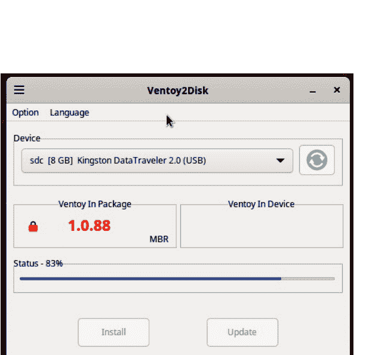

如果你有个朋友在使用Linux发行版，你也可以通过Linux终端调用`Ventoy2Disk.sh`脚本。格式化U盘`/dev/sdc`的基本用法是：在终端提示符下进入解压后的`ventoy`目录，然后从终端提示符执行：

```
./Ventoy2Disk.sh --help

[andrew@darkstar:~]$ cd Desktop/ventoy-1.0.91

[andrew@darkstar:Desktop/ventoy-1.0.91]$ ./Ventoy2Disk.sh    --help
```

```
****************************************************

  Ventoy: 1.0.91  x86_64

  longpanda admin@ventoy.net

  https://www.ventoy.net

****************************************************

Usage: Ventoy2Disk.sh CMD [ OPTION ] /dev/sdX

CMD:

-i  install Ventoy to sdX (fails if disk already installed with Ventoy)

-I  force install Ventoy to sdX (no matter if installed or not)

-u  update Ventoy in sdX

-l  list Ventoy information in sdX

-r SIZE_MB  preserve some space at the bottom of the disk (only for install)

-s/-S    enable/disable secure boot support (default is enabled)

-g    use GPT partition style, default is MBR (only for install)

-L    Label of the 1st exfat partition (default is Ventoy)

-n    try non-destructive installation (only for install)
```

格式化完成后，把U盘拔出来再重新插入。除了U盘的标签被改为`"Ventoy"`之外，没有太多线索表明还发生了什么变化。但实际上，U盘已经被格式化成两个分区——一个挂载时你看不见，另一个你能看见，就是可以用来拖放Linux ISO文件的那个。所以当你的U盘连接上时，它会显示为一个名为`"ventoy"`的图标，左键点击它就可以进入可用的分区。让我们把Arch安装ISO和Mint xfce都放到`Ventoy`格式化过的U盘上。你可以直接把它们拖到空闲空间上，这样也能工作，但稍后我们会优化我们的结构，最好先按照以下方式设置：

```
[andrew@darkstar:media/andrew]$ tree -L 2 ventoy
```

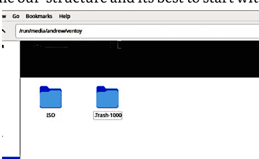

```
ventoy

└── ISO

    ├── archlinux-2023.01.01-x86_64.iso

    └── linuxmint-21.1-xfce-64bit.iso
```

U盘的标签是`ventoy`，我有一个名为`"ISO"`的目录。在可用空间内有一个叫做`"ISO"`的目录。那个目录里有2个`iso`文件。如果你看右边的图片，当`ventoy`U盘连接到我的笔记本上时，它自动挂载在`/run/media/andrew/Ventoy`。我所做的就是鼠标右键，"创建新文件夹"并命名为`"ISO"`，然后把两个ISO文件都放到那个目录里，它们并排在一起。

如前所述，Arch ISO可以从以下地址下载：
https://mirror.bytemark.co.uk/archlinux/iso/2023.05.03/

Mint xfce从：
https://www.linuxmint.com/edition.php?id=304

所以现在你的`ventoy`格式化U盘上已经有了Arch Linux和Mint Linux。

## 安装过程概述、思考和检查

在继续之前，让我们先概览一下将要发生的事情，收集一些信息，如有必要做一些预先准备。一旦你启动`arch`安装ISO，首先你会注意到它只有命令行，没有漂亮的图形界面。这可能会让那些喜欢图形界面的人感到一点焦虑。

另外，安装需要连接到带宽良好的互联网，因为安装ISO实际上并不包含你完整安装所需的所有软件包；这就是为什么它只有大约800MB的原因。你将借助命令获取所需的软件包。所以确保你知道你的WiFi名称和密码短语（即密码）。

此外，你还需要为PC或笔记本电脑的显卡，或内置图形硬件安装正确的驱动程序。所以你需要查明规格参数。你肯定不想在安装过程中再去查这些。另外，安装程序不会自动知道你已有的分区，也不会自动挂载它们。这些你都得自己做。

你知道你的硬盘大小吗？你打算如何划分分区比例？让我们看看我的笔记本电脑，使用`gparted`在其中一台上查看。

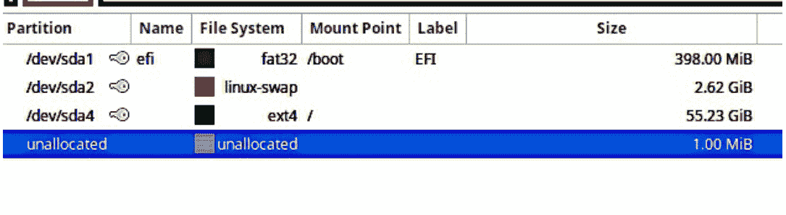

| Partition | Name | File System | Mount Point | Label | Size |
|---|---|---|---|---|---|
| /dev/sda1 | efi | fat32 | /boot | EFI | 398.00 MiB |
| /dev/sda2 | | linux-swap | | | 2.62 GiB |
| /dev/sda4 | | ext4 | / | | 55.23 GiB |
| unallocated | | unallocated | | | 1.00 MiB |

这是另一台HP 255 G1笔记本电脑的截图。出厂日期是2013年。我从`Crucial`换了一块固态硬盘，安装起来并不太难。我没法获取BIOS更新。这是一张`gParted`截图。

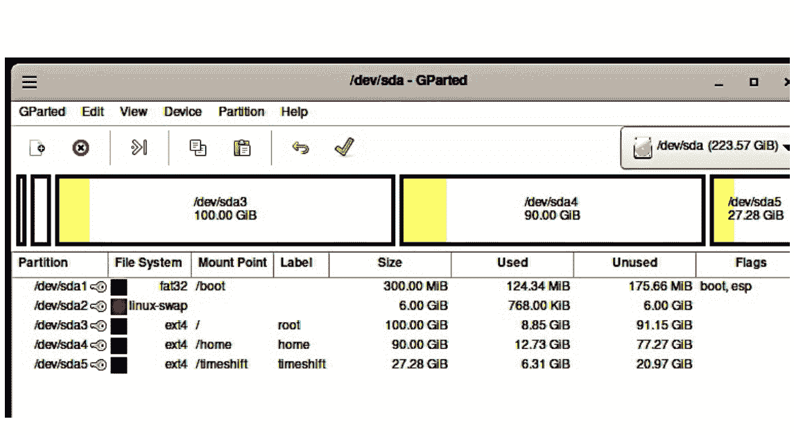

在硬盘较小的笔记本电脑上，我有一个非常基本的设置：

- `efi`分区，类型为`efi` `Fat32`
- 根分区，类型为`ext4`
- 交换分区，类型为`swap`

用户目录设置在根分区内，这意味着会加剧安装软件空间不足的问题。如果我让`home`目录失控，那就会占用根系统和安装新软件可用的空间。

现在在上面的截图中你可以看到，我有一块更大的硬盘可以折腾。根据使用`Arch`的经验，对于我的需求，我可以安装几乎所有需要的软件，`home`最多占用50G左右。所以100G给`root`对我来说绰绰有余；特别是因为我还有单独的`home`驱动器。

`gParted`在管理标志方面非常方便，我用它来勾选分区`/dev/sda1`的`boot`标志，这是`efi`分区，也是引导加载程序将要使用的分区。

一台64位UEFI计算机需要一个`EFI`分区和一个`GPT`类型的分区表。如今`SWAP`的大小大约是内存大小 + 2GB。你可以看看我在我的HP 255 G1笔记本电脑上的配置。你需要根据自己的需求来确定最佳方案。如果你要进行大量图形处理，处理占用大量空间的文件，那么你需要一个较大的`home`目录来存放它们。

现在你可以从Arch安装命令行完成所有操作；但你也可以使用`gParted`以图形化方式完成。所以如果你把Mint ISO放到你的`Ventoy` U盘上，关机然后按下电源按钮。然后在开始启动时立即按下你的PC启动选项键，对于惠普（H.P）通常是F9，对于BIOS是F10。这是我其中一个挂载在`/run/media/andrew`的U盘的结构：

```
/run/media/andrew/ventoy

└── ISO

    ├── archlinux-2023.01.01-x86_64.iso

    └── linuxmint-21.1-xfce-64bit.iso
```

好的，让我们首先从`Ventoy` U盘启动Mint。现在你需要完全关机，开机但立即按下启动选项键。

在惠普（H.P）上是F9。你可以先看一下BIOS设置，在冷启动时按F10。我已启用从USB启动，关闭安全启动（`secure boot`），启用传统启动（`legacy boot`）。

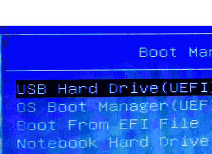

所以我连接了我的`Ventoy`格式化U盘，开机并按下F9键。左侧的图像显示了我的选项。顶部高亮显示的是金士顿（`Kingston`）品牌的USB。

就是这个，如果现在按下回车键，那么我应该能看到`Ventoy`的启动画面。

稍微耐心一点，你应该就能看到Mint Live的漂亮绿色界面。现在因为是图形界面，在继续安装Arch之前先玩一玩是很好的选择。我的Mint启动得很顺利。

如果你的不行，你可能需要尝试另一个USB U盘，并检查ISO的完整性。校验和的说明在Mint网站上。`linuxmint-21.1-xfce-64bit.iso`比`mate`版本更轻量，但我检查过，它默认安装了`inxi`、`gParted`、`Nano`和`Timeshift`。我发现它在仅有4GB内存的笔记本电脑上运行得相当流畅和快速。

让我们利用它；从终端提示符获取图形信息的命令是：

```
[prompt:~]$ inxi -G
```

在右侧的图像中，我正在使用从USB启动的Mint xfce live版，我打开了一个终端并输入了相同的命令。

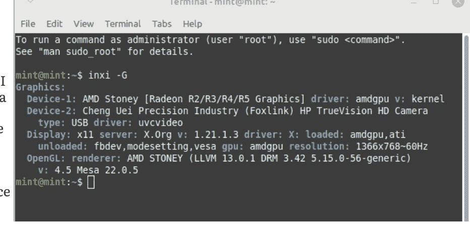

你可以看到我的图形设备被识别为`AMD`。

从命令行你也可以使用：

```
[prompt:~]$ lspci -v | grep -A1 -e VGA -e 3D
```

记下你的信息；当你到达安装桌面阶段时，你需要这些信息，因为需要安装相应的显卡驱动。我的显卡硬件是`AMD`，所以当我到达安装桌面阶段时，我通过`pacman`安装：

```
[prompt:~]$ sudo pacman -S xf86-video-amdgpu
```

对于英特尔（`Intel`）：

```
[prompt:~]$ sudo pacman -S xf86-video-intel mesa
```

对于英伟达（`nVIDIA`）：

```
[prompt:~]$ sudo pacman -S nvidia nvidia-utils
```

`inxi`是一个有用的工具，可以用来查找你的CPU和其他信息。命令是：

```
[prompt:~]$ inxi -C
```

查看完整信息：

```
[prompt:~]$ inxi --help
```


既然我们已经运行着 Mint live，我们可以用它来准备一些技能并熟悉终端的使用。你可以选择 `gParted`，它是 `parted` 的 GUI 版本，可以用来查看电脑硬盘上的分区，以及连接了运行 Mint live 的 USB。如果你愿意，也可以用它来准备分区。

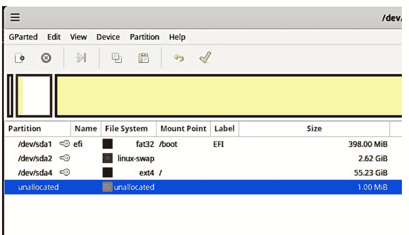

上图是我的惠普（H.P）笔记本电脑的硬盘，我买它的时候预算有点紧张。我有一个 FAT32 类型的 EFI 分区，在 `/dev/sda1` 分区上。交换分区（Swap）在 `/dev/sda2`，我的主要安装在 `/dev/sda4`，大约 55GB，文件类型为 ext4。

我在这台笔记本上编写 Arch Linux 书籍，并且也用它进行 Web 开发。所以以今天的硬盘标准来看，至少说明如果你节俭一些，你的 Arch 安装以及随后你发现需要的所有软件包并不会占用太多空间。

在主要安装过程中，我解释了如何使用 `fdisk` 创建分区；但你也可以在 Mint live 中使用 `parted` 设置分区，然后只需选择这些分区即可。你可以练习格式化连接在另一个 USB 端口上的另一个 USB U 盘。我建议你熟悉一些 Mint live 工具，比如使用 `nano`，它比 VIM 更容易使用。

当然，很有可能你会发现你非常喜欢 Mint，决定就安装它了。如果你这样做，非常简单，只需鼠标左键点击安装图标即可。你随时可以回来安装 ARCH。我在这个阶段想要做的是解决可能出现的一些问题。例如，如果你看上面的图像，Arch 安装在 `/dev/sda4`。

那么用户 home 目录安装在哪里呢？嗯，在我的笔记本上，我没有创建单独的 home 分区。如果你不创建，当你使用创建用户的命令时，系统会寻找单独的 home 分区，如果找到，就把用户目录放在那里。如果找不到，就像我的情况一样，它就会在主 Arch 安装架构中创建用户目录作为子目录。

使用 `gParted` 的过程只是浏览菜单并做出正确的选择。要清除你电脑上的所有内容，从设备的下拉菜单中选择（通常是 `/dev/sda`），然后选择“创建分区表”。

对于 UEFI 计算机，选择 GPT 选项。现在如果你在你的 PC 上看到一个 EFI 分区，比如如果你正在运行 Windows 10 但想清除它，如果它足够大（至少 300MB），你可以保留该分区。在这种情况下，不要创建分区，只需删除 EFI 分区下面的其他所有内容。如果你想创建一个新的 EFI 分区，选择 EFI 或 FAT32 类型。

注意顶部菜单中的绿色对勾。你必须鼠标左键点击它，`gParted` 才会执行你的选择。我通常一次做一件事，每次点击绿色对勾。如果菜单项变灰，到菜单中取消挂载，取消挂载你要操作的分区。创建 EFI 分区后，进入标志（flags）并勾选启动（boot）和 ESP 选项。

现在你可以用一个 USB U 盘来练习使用 `gParted`，以及我稍后介绍的 `fdisk`。在使用命令行方面有信心，知道如何使用 `nano`，能够舒适地使用终端，然后再尝试 Arch 安装，这对你是最好的选择。让我们在你运行 Mint 时看一下 `nano`。

在 Mint live 上打开一个终端，输入：

```bash
[andrew@darkstar:~]$ touch play.txt
```

这将在 home 目录中创建一个名为 `play.txt` 的文件，如果你想确认，可以通过图形显示的文件目录结构来导航查看。

输入：

```bash
[andrew@darkstar:~]$ nano play.txt
```

`play.txt` 打开后当然是空白的。输入一些内容，然后执行：

```text
ctrl+o
```

按回车键，然后执行：

```text
ctrl+x
```

好的，让我们离开 Mint live，看看能否从 Arch 安装 ISO 启动。完全关机，开机，按下启动选项键（通常是惠普电脑上的 F9）。

这次从 Ventoy 提示符选择 Arch 安装 ISO。耐心等待，给它时间加载。你会看到文字在屏幕上闪烁，某个时刻会提到“Welcome to Arch”。会有更多文本输出，然后停在：

```text
root@archiso ~#
```

在提示符下输入一些文本，看看文本是否与按键匹配。

试一下 Shift 键 + @ 键，你得到的是 & 符号还是其他东西。

基本上，你的键盘布局将是你所说语言的国家代码。

对于英国：

```bash
root@archiso ~# loadkeys uk
```

对于德国：

```bash
root@archiso ~# loadkeys de
```

稍后我们会使用 `chroot`，所以请注意提示符将从上面变为：

```text
root@archiso:/#
```

另外值得现在一提的是，要退出 `chroot` 回到主 ISO 安装提示符，你输入 `exit`。`archiso ~#` 中的 `#` 表示我们处于 root 权限的上下文中。

好的，所以我们已经小试牛刀。我将展示关闭安装的命令。之后就是思考一下，掂量掂量你是否准备好安装 Arch 并放手一搏了？我想补充一点，在 2013 年的惠普笔记本上安装 Arch 的经验是，我发现它无法启动，但 rEFInd 仍然能让操作系统运行起来。所以我想说，把 rEFInd 做到 USB U 盘上，准备好，以防万一。

要干净地关闭正在运行的 Arch 安装，使用以下命令：

```bash
root@archiso ~# shutdown now -h
```

## 主要安装过程

从 Arch 安装提示符开始，有几个命令可以查看你当前 PC 硬盘的样子；尝试以下命令之一：

```bash
fdisk -l
blkid
lsblk
```

如果你已经完成了分区并且也格式化好了分区，那么使用上述命令来提醒自己哪个是哪个，然后跳到我们挂载分区的部分。假设你还没有对磁盘进行分区。我们将从 Arch 安装提示符使用 `fdisk` 命令来完成。

顺便说一下，你可以在 USB U 盘上练习使用 `fdisk`，即使出错了也不是什么大不了的事。如果我在 Arch ISO 安装提示符下运行 `fdisk -l`：

```bash
root@archiso ~# fdisk -l
```

我在其他输出中看到：

```text
Disk /dev/sda: 58.24 GiB, 62537072640 bytes, 122142720 sectors
```

好的，所以我的硬盘是 `/dev/sda`。所以开始分区应该是：

```bash
root@archiso ~# fdisk /dev/sda
```

- `+500M`（500 兆字节）
- `+30G`（30 吉字节）

输入字母 `g`；这将创建一个 GPT 类型的分区表。顺便说一下，在你输入 `w` 之前不会写入任何内容。要创建分区，输入 `n`。

你会看到一堆数字和一个关于分区应该从哪开始的建议提示。对于所有分区起始建议，选择默认选项，按回车键。当你到达第一个分区的最后一个扇区阶段时，输入以下形式的大小：

```text
+400M
```

然后按回车键。暂时不要担心分区文件类型。

那么，你为第一个分区（EFI）输入的大小应该是类似这样的：`+400M`。

当你输入分区结束的数值后，系统会确认并显示一个分区编号。重复这个过程，再次输入 `n`；接受默认起始位置，然后输入你想要的分区大小。

当所有分区都创建完成后，输入 `w` 来使更改生效。然后你可以使用第 14 页的任意一个命令来显示（检查可能更准确）你的磁盘现在是什么样子。

假设我们现在有：

```text
/dev/sda1   用于 EFI
/dev/sda2   用于 swap
/dev/sda3   用于 root 安装
```

注意，如果你不设单独的 `/home` 分区，也没问题。当你通过 `useradd` 命令创建用户时，用户的目录将在 root 分区内创建。如果你确实有 `/home` 分区，那么该命令会在 `/home` 内创建用户账户。

所以现在我们要格式化分区：

```bash
root@archiso ~# mkfs.fat -F32 /dev/sda1
root@archiso ~# mkswap /dev/sda2
root@archiso ~# swapon /dev/sda2
root@archiso ~# mkfs.ext4 -b 2048 /dev/sda3
```

上面最后一行中的 `-b 2048` 是一个标志，告诉系统以每次 2048 字节的数据块来创建文件系统。

你可以使用 `e2label` 命令来给分区打标签，例如：

```bash
root@archiso ~# e2label /dev/sda6 home
```

下一阶段，我们要“挂载”我们的分区。简单地说，“挂载”就是使分区处于可用状态，可以进行操作。

> **注意**
>
> 在已安装系统的结构中，通常有名为 `mnt` 和 `run` 的目录。当你把比如 U 盘插入笔记本时，类似 `/dev/sdb1` 的分区会自动挂载到 `run` 目录。我们将要挂载 root 目录，也就是我们的 Arch 安装位置到 `/mnt`。Arch 安装系统允许我们将分区挂载到 `/mnt`。其他分区我们需要创建挂载的位置。Root 将挂载到 `/mnt`；EFI 分区将挂载到 `/mnt/boot`。稍后详述。

所以现在我们要挂载用于 Arch Linux 系统主安装的分区。在我的例子中是 `/dev/sda4`。我把 EFI 分区放在 SWAP 分区前面，这是明智的，因为我可以缩小 SWAP 分区，然后扩展 EFI 分区到创建的空间中。事实证明我确实需要这样做！

在我的分区标签中，我没有 `/dev/sda3` 分区。这没关系。在 `/etc/fstab` 中我已经明确说明了各是什么：

```fstab
### /dev/sda4 LABEL = /

UUID=38b6759b-fc65-4606-9414-c1d17bcdc3c4    /    ext4  defaults    0    1
```

你可以在 `fstab` 中通过 UUID 或标签来引用分区。所以从 Arch 安装提示符命令来挂载 root 分区，你的安装将放在我的例子中是：

```bash
root@archiso ~# mount /dev/sda4 /mnt
```

接下来我们要挂载 EFI 分区，在我的例子中是 `/dev/sda1` 到 `/mnt/boot`。

不过我们需要通过以下命令创建那个叫 `boot` 的挂载点：

```bash
root@archiso ~# mkdir /mnt/boot
```

然后挂载：

```bash
root@archiso ~# mount /dev/sda1 /mnt/boot
```

> **注意**
>
> 如果你为 home 和 timeshift 创建了分区，那么 `/dev/sdaX` 是 home，timeshift 是 `/dev/sdaY`：在我的 HP 255 G1 笔记本的情况下，如第 10 页的图像所示，当时是：

```bash
root@archiso ~# mkdir /mnt/home
root@archiso ~# mount /dev/sda4 /mnt/home

root@archiso ~# mkdir /mnt/timeshift
root@archiso ~# mount /dev/sda5 /mnt/timeshift
```

现在分区已经挂载好了，我们将创建一个 `fstab` 条目：

```bash
root@archiso ~# genfstab -U /mnt >> /mnt/etc/fstab
```

如果它报错，你可以一步步来：

```bash
root@archiso ~# mkdir /mnt/etc
root@archiso ~# touch /mnt/etc/fstab
root@archiso ~# genfstab -U /mnt >> /mnt/etc/fstab
```

`genfstab` 是 Arch ISO 的一个脚本功能，你可以通过以下命令检查：

```bash
root@archiso ~# cat /mnt/etc/fstab
```

> **注意**
>
> 你可以在你的运行中的 Arch 上以适当的方式重新生成 `fstab` 条目（如果你需要或想要的话），到那时首先通过 `pacman` 安装：

```bash
sudo pacman -S --needed arch-install-scripts
```

```bash
# genfstab -U -p / >> /etc/fstab
```

`genfstab -U` 中的 `-U`：

```bash
root@archiso ~# genfstab -U
```

输出到 `fstab` 的分区以 UUID 引用，而 `-L` 会以标签输出，即 `/dev/sdax`。

可以使用：

```bash
root@archiso ~# genfstab -L
```

但不要同时使用两者，否则 `fstab` 会同时包含两种类型的条目，导致系统混乱。

## 连接互联网

好的，为了下载要安装到我们当前已挂载的 root 分区的软件包，我们现在需要连接到互联网。我通过 WiFi 连接，这样就没有短线连接到集线器，你不会在一只手输入命令另一只手做笔记的时候被绊倒。

所以分区已经挂载并且会保持挂载状态，别担心，连接到互联网不会影响这个。目前我们在 Arch ISO 安装提示符：

```text
root@archiso ~#
```

Arch 安装 ISO 具有显示可用 WiFi 名称的功能，不仅如此，还能连接到它们。它能做到这一点是因为作为可用工具的一部分，安装 ISO 包含了 `iwd` 软件包。

在这一点上，我想说 Arch 的安装确实需要几个步骤。在某一时刻，一旦 Arch 核心安装完成并装了一些其他东西，你可以退出 ISO 安装并重启到你新安装的系统，在你安装 X 服务器 `xorg` 和图形相关的东西之前，但如果你不安装 `iwd` 软件包，你就会陷入困境并完全停止，这样你就无法用它来连接 WiFi。

另外请注意需要一个像 `Alacritty` 这样的终端模拟器。你需要安装终端才能使用 `pacman`。

在 `root@archiso ~#` 输入 `iwctl station list`：

```bash
root@archiso ~# iwctl station list
```

这会显示 WiFi 的句柄名称，我的是 `wlan0`。注意最后是个零。如果你不小心只输入了 `iwctl`，然后按回车，你的提示符会变成 `[iwd]#`，要回到 `root@archiso ~#`，只需输入 `exit`。

现在让我们用 `wlan0` 的句柄名称来查看 WiFi 列表：

```bash
root@archiso ~# iwctl station wlan0 get-networks
```

你现在应该能看到可连接的 WiFi 列表，包括你的。你肯定已经准备好知道你的 SSID（即 WiFi 名称）和它的密码即口令了吧？好的，我会用 `<your WiFi name>` 代表你的 WiFi 名称，用 `<passphrase>` 代表它的密码。让我们连接：

```bash
root@archiso ~# iwctl station wlan0 connect <your WiFi name>
```

你会看到：

```text
passphrase
```

输入 `<passphrase>`。

希望你现在会看到：

```text
root@archiso ~#
```

我有没有连上？让我们使用 Google DNS `8.8.8.8`，在 Arch ISO 提示符输入：

```bash
root@archiso ~# ping -c 5 8.8.8.8
```

你现在应该能看到数据包等，然后输出 5 次后停止。如果没有，按 `ctrl+c`。

## 安装基础系统

好的，我们现在准备安装了。在提示符输入：

```bash
root@archiso ~# pacstrap /mnt base linux linux-headers linux-firmware base-devel vim nano grub alacritty efibootmgr
```

如果空间紧张，无法把所有东西放在一行，输入第一行，在第一行末尾输入 `\`，`\` 两侧要空格，你会得到一个类似 `>` 的提示符，输入命令的剩余部分然后按回车。

如果不安装 `base-devel`，你会发现无法编辑 `sudoers`。如果此时不安装合适的编辑器，也不安装终端，你会发现无法继续，因为如果没有终端你就无法启动 `pacman` 命令，如果没有编辑器你就无法编辑，而你又不能下载编辑器因为你没有终端；嗯，值得深思。

所以 `vim` 是个编辑器，`nano` 也是，你可以不用 `vim` 只要装了 `nano`。`Grub` 将是我们的引导加载程序，`alacritty` 是终端，`efibootmgr` 是一个用于在 UEFI 上更改启动顺序的工具。

好的，按回车，应该开始下载一大堆东西。完成后，它会将 Arch Linux 核心系统安装到你的 root 分区。现在我们要基于我们安装的核心系统来工作。我们要怎么做呢？

很简单，我们会使用 `chroot` 命令，总的来说我们会从我们核心安装的系统来工作。现在实际上它不会运行，所以 `systemd` 不会运行。在 `chroot` 之后做类似这样的命令是没有意义的：

```bash
sudo timedatectl set-ntp true
```

因为操作系统和 `systemd` 没有运行；然而来自基础安装系统的脚本可以运行。

好的，让我们 `chroot`，从 Arch ISO 安装提示符输入：

```bash
root@archiso ~# arch-chroot /mnt
```

如果没有错误，那你只会看到提示符的外观稍有变化：

```text
root@archiso:/#
```

你不需要进入 `/mnt` 目录或做任何事；任何命令都将基于已安装但未运行的系统的上下文。这意味着 `systemd` 不会运行；然而来自脚本的命令可以运行。

另外我们无法获取 `systemd` 单元的状态，但我们可以启用单元，使它们在启动时自动启动。稍后再详述。要退出 `chroot` 输入：

```bash
root@archiso:/# exit
```

好的，现在还有一些东西需要下载：

```bash
root@archiso:/# pacman -S wireless_tools wpa_supplicant dialog iwd os-prober mtools dosfstools networkmanager network-manager-applet
```

上面是一整行。你也可以用 `pacman` 一个个安装，例如：

```bash
root@archiso:/# pacman -S wireless_tools
```


现在，我们将对已经安装但尚未运行`systemd`的系统进行一些配置。这是因为配置主要涉及用数据填充文件，或者创建文件然后再用数据填充。

## 设置时区

清单上的第一件事是设置时区。让我们提醒自己，我们目前处于`chroot`环境中，这意味着我们输入的内容，是以我们部分安装的系统为上下文的。当`Arch`启动并运行时，你将可以访问`systemd`及其`journalctl`、`systemctl`和`timedatectl`。然而`systemd`尚未启动运行。我不想让读者承受太多安装前的东西，所以没有在安装前言中涉及时区。

但没问题；有两种方法。在`chroot`提示符下输入：

```
root@archiso : / # ln -sf  /usr/share/zoneinfo/Europe/London  /etc/localtime
```

这会将时区设置为`GMT`，当系统启动后你可以重新设置它。另一种方法是退出`chroot`，回到`Arch ISO`安装提示符。不用担心，你挂载的分区会一直保持挂载状态，直到你卸载它。所以你可以直接回去。

要查看所有时区列表，从`Arch`安装`ISO`提示符输入：

```
root@archiso ~# timedatectl list-timezones
```

你应该能够使用键盘上下键滚动浏览列表。当你看到后，记下它。然后按`Q`退出列表。

别忘了回到`chroot`，所以输入：

```
root@archiso ~#  arch-chroot    /mnt
```

然后假设你最近的时区是`Africa/Accra`，那么你输入：

```
root@archiso : / # ln -sf  /usr/share/zoneinfo/Africa/Accra  /etc/localtime
```

好了，时区设置完成。

`etc`目录是`Linux`系统配置的主要位置。例如，你会在那里找到`HTTP`，其中包含`Apache`网页服务器和任何虚拟主机文件的配置。该命令基本上是从`/usr/share/zoneinfo/<地区>/<城市>`到文件`/etc/localtime`建立一个链接。

## 硬件时钟

现在我们将使用以下命令将硬件时钟设置为系统时钟：

```
root@archiso : / # hwclock --systohc
```

## 本地化

```
root@archiso : / # nano /etc/locale.gen
```

该命令将在`nano`中打开文件`/etc/locale.gen`。我们之前提到过使用`nano`，以尽量让我们所做的这一切不那么痛苦。文件`/etc/locale.gen`是一个长列表，格式为：`<locale> <charset>`，前面带有`#`。要启用列表中的任何项目，只需从你所选行的前面移除`#`追上即可。我的区域设置是英国英语，我想要`utf-8`，所以在`nano`中上下移动光标，查找`#en_GB.UTF-8 UTF-8`。然后我将光标定位在`#`前面，按一次键盘退格键来移除`#`。所以我`/etc/locale.gen`中的条目看起来像这样：

```
en_GB.UTF-8 UTF-8
```

然后我输入`ctrl + o`，这会高亮显示`nano`将要保存到的文件，基本上只需按回车键即可保存到文件。然后输入`ctrl + x`退出`nano`编辑器。

## 主机名

什么是主机名，简单来说就是计算机的名称，它将在网络上显示。所以我决定我的计算机叫做`"darkstar"`，这非常原创，是我在`Slackware`上使用的名字。所以要将我的计算机命名为`"darkstar"`，我只需输入：

```
root@archiso : / # echo darkstar > /etc digging忘 /etc/hostname
```

### 创建 `/etc/hosts` 文件并用所需的最少内容填充

有一个命令可以从终端使用，名字有点奇怪，但它的作用是在指定位置创建一个你给定名称的文件。例如，让我们创建`/etc/hosts`

```
root@archiso : / # touch /etc/hosts
```

然后编辑我们的文件：

```
root@archiso : / # nano /etc/hosts
```

现在在`nano`编辑器中准确输入你在下面看到的内容，除了将`"darkstar"`替换为你给计算机起的名字`zzo`

```
127.0.0.1   localhost
::1          localhost
127.0.1.1   darkstar.localdomain   darkstar
127.0.0.3   joesoapdev
```

> **注意**
> 如果你在电脑上进行网页开发，你需要编辑`/etc/hosts`。在上面最后一行中，我添加了：
> `127.0.0.3   joesoapdev`
> 现在随着网页服务器运行，如果我直接输入到网页浏览器地址栏：`127.0.0.3`，那么我的网页开发项目`joesoapdev`的着陆页将会显示的

## 安装引导加载程序

这是人们会感到紧张的地方，因为如果出错的话。让我们回顾一下；我们的`efi`分区，在我的情况下是第一个，`/dev/sda1`，目前在所有实际用途中都挂载到了`/boot`。这是因为根目录挂载到了`/mnt`，并且我们已经`chroot`了`/mnt`。换句话说，`/boot`是一个相对路径，会被找到，因为我们的`chroot`提示符是在`/mnt`的上下文中工作的。那么，安装`grub`作为我们引导加载程序的命令将是：

```
root@archiso : / #  grub-install --target=x86_64-efi   --efi-directory=/boot --bootloader-id=GRUB   --recheck
```

这说得通吗？`grub-install`是安装`GRUB`的命令，`--target=x86_64-efi`表示这是一台`64`位电脑，主板是`UEFI`。`--efi-directory=/boot`表示放置引导条目的位置是`/boot`，因为那是我们挂载`efi`分区的地方。该命令会创建一个`efi`目录，所以不用担心那个。那`--bootloader-id=GRUB`呢？嗯，那只是一种分配标签的方式，你可以使用`--bootloader-id=MyArchInstall`如果你喜欢的话

然后最后

```
root@archiso : / # grub-mkconfig   -o    /boot/grub/grub.cfg
```

上面那行是`"o"`不是`0`（零）。这会创建`grub`配置内容。收尾工作，我们最好创建一个`root`密码，我们在启动我们沉睡的已安装操作系统时需要它

```
root@archiso : / #  passwd root
```

输入你的`root`密码并记下来。剩下的就是安装桌面、安装显卡驱动、创建用户账户。还要编辑`sudoers`，使用户能够以相当于`root`权限的方式运作。还会有一些其他安装后的调整。稍后我将涉及维护任务。

你会发现当你的`Arch`操作系统运行时，它会产生日志报告，这些确实很有用，但会不断累积。文件会在你的用户账户缓存目录中累积，如果你决定进行网页开发，那么`Apache`日志的产生也会让日志开始累积。我将解决所有这些问题，并向你介绍`systemd`。还有什么，嗯，我们需要安装防火墙。可能还有其他一些事情。你可能感到有点不知所措，但好消息是，当一切设置好并运行后，实际上没什么要做的，除了更新你的系统，这作为用户只需一个命令。

```
sudo  pacman -Syu
```

在使用`pacman`之前，有一个小命令，用来初始化密钥等。还要安装一个电子邮件账户。然后我将回顾我发现有用的`pacman`命令。

## 后记

嗯，我们有了`Arch`的核心安装；我们现在可以使用`"exit"`命令退出`chroot`，关机，重启，并能够进行`root`的文本登录。麻烦是我们可能会遇到一些问题；我们启动的`Arch`安装`ISO`有`IWD`软件包的可用性，这是一个允许我们通过`WIFI`连接互联网的软件包。你可以安装`IWD`，而且只要我们安装了终端模拟器，我们就可以从我们安装并运行的系统中完成所有事情。但那是更多的工作要做。所以在这个阶段，我们将留在`chroot`中继续。

如果你查看文件`/etc/pacman.conf`，它说：

> 注意：在首次使用`pacman`之前，你必须运行`pacman-key --init`；然后可以使用`pacman-key --populate archlinux`将本地密钥环填充所有官方`Arch Linux`打包者的密钥。

所以我们现在可以做。

```
root@archiso : / # pacman-key --init
root@archiso : / # pacman-key --populate archlinux
root@archiso : / # pacman -Syy
```

现在让我们添加一个名为`gina`的用户，这样当我们启动我们的新`Arch`时，我们可以用非`root`模式工作。

```
[root@darkstar:~]# useradd -m -G wheel -s /bin/bash gina
```

为`gina`创建密码

```
[root@darkstar:~]# passwd gina
```

它会要求你再输入一次。现在我们有了一个用户，而且总是最好避免以`root`身份工作。麻烦是我们的用户权限有限。我们需要编辑`sudoers`列表。对于`sudoers`列表，你必须小心一点。这是一个当正确编辑后，会给`wheel`组中的用户赋予权限的地方，通过使用`sudo`。它总是用`visudo`命令完成。在上面的行中，我规定我想使用`nano`编辑器来执行该操作。让我们编辑`sudoers`：

```
root@archiso : / # EDITOR=nano visudo
```

使用`nano`移除你看到的引用`wheel`的第一行中的`#`，即`%wheel ALL=(All) All`，按键盘键`Ctrl + o`，然后按回车键写入文件，然后按`Ctrl + x`退出。我想说两件事。你可能会发现你以用户身份登录有困难，但以`root`身份登录却没有。有几个原因。如果你编辑了`sudoers`，但没有安装`"sudo"`，你会发现安装该软件包后才能登录。另一个是`systemd-homed`可能没有在运行，用例如以下方式检查：`systemctl status systemd-homed`。

## 安装图形环境——桌面

在`Arch`之前，我尝试过不少`Linux`发行版及其桌面。我喜欢简洁但功能齐全的东西。`XFCE`在`Slackware`上表现不错；我就是受不了那些图标上下弹跳的桌面。在`Arch`上，我尝试过`GNOME`、`Budgie`、`LXDE`、`Openbox`，但还是更喜欢`Cinnamon`。`Cinnamon`实际上是`Gnome`的一个分支，但默认情况下你可以在桌面上放置主页、回收站等图标。

要在`Arch`上使用`Cinnamon`桌面，你还需要一个显示管理器，以及图形登录界面，也就是`greeter`。我们还需要`xorg`以及适合你显卡硬件的驱动。

所以我之前提到过我们需要这些信息，并展示了如何使用`inxi`获取。我的是：`AMD Stoney [Radeon R2/R3/R4/R5 Graphics]`

因此，要为拥有`AMD`显卡硬件的`Arch`安装`Cinnamon`桌面。

```
root@archiso : / # pacman -S xorg
```

注意，在上面的命令中，`"xorg"`这个词实际上在`pacman`中表示一个组下载。所以上面的命令会安装所有`x`服务器相关的组件。接下来我要为我的笔记本电脑安装显卡驱动。我之前已经给出了其他选项，如果你需要`Intel`或`Nvidia`的驱动。

```
root@archiso : / # pacman -S xf86-video-amdgpu
```

现在我们将安装`Cinnamon`桌面及所需的软件包

```
root@archiso : / # pacman -S cinnamon lightdm lightdm-gtk-greeter
```

现在让我们回顾一下当前的进度和正在运行的内容。我们是从`Arch ISO`安装系统工作的，处于`chroot`环境中，也就是处于已安装系统的上下文中。现在简单提一下`systemd`。什么是`systemd`？简而言之，它是你操作系统的系统和服务管理器。问题是，它实际上并没有在运行。不过没关系，它的工作方式是你可以在尚未运行的系统的`chroot`环境中启用单元，这样这些单元会在系统启动时自动启动。

最重要的是让我们能够启动图形桌面。所以让我们启用我们的桌面管理器，我的情况是`lightdm`。这就是你需要启用的全部内容，以便能够进行图形登录并启动桌面。

```
root@archiso : / # systemctl enable lightdm
```

你应该会看到正在创建链接。这就是`systemd`启用服务的方式

```
root@archiso : / # systemctl enable NetworkManager
```

好了，我想我们现在可以退出`chroot`，关机，然后重新开机时能够以普通非`root`用户登录，但仍然能够获取`root`权限来执行操作。

退出`chroot`：

```
root@archiso : / # exit
```

关机：

```
root@archiso ~# shutdown now -h
```

## 安装后的调整和补充

在本节之后，我将介绍如何在`Arch`操作系统出现问题时进行救援。如果你有一个能正常工作的系统，你几乎可以做任何事情；例如安装长期支持内核（`LTS`），然后移除当前内核。安装另一个桌面。

但是，如果你无法让操作系统启动和运行，你就什么都做不了。

现在有一个可能比写系统救援更值得介绍的操作，那就是设置防火墙。

我使用`"简易防火墙"`（*Uncomplicated Firewall*，`UFW`），它也有图形界面。我通过网页上的`Shield up`服务测试了我的笔记本电脑，网址是

[https://www.grc.com](https://www.grc.com)

基本上，该网站可以实时测试你的电脑，查看端口被恶意入侵的脆弱程度。我得到的结果是它们无法入侵。他们的确切信息是`"目标 IP 地址上的设备未响应我们的 UPnP 探测！"`你自己可以试试。

让我们安装`UFW`及其图形界面

```
[andrew@darkstar:~]$ sudo pacman -S ufw gufw
```

上面的命令将安装简易防火墙及其配套的图形界面

```
[andrew@darkstar:~]$ sudo systemctl enable ufw
```

```
[andrew@darkstar:~]$ systemctl status ufw
```

```
• ufw.service - CLI Netfilter Manager
  Loaded: loaded (/usr/lib/systemd/system/ufw.service; enabled; preset: disabled)
  Active: active (exited) since Mon 2023-03-
```

不要被`"preset:disabled"`吓到。我的理解是，这意味着该单元不会自动运行，你必须先启用它，然后它才会在每次启动时启动

## 救援与修复

## 桌面图形问题

我在安装`Arch Linux`后立即介绍救援，原因很简单：你最不想发现的就是系统坏了，`Arch`操作系统无法启动。那意味着不得不开始学习如何修复它的知识曲线。在压力之下学习可不是什么好事。

我要看的第一个问题是图形问题。大多数人来自`Windows`，在那里你看不到操作系统启动时后台发生了什么，直接被带到图形登录界面。使用`Arch`和其他`Linux`发行版，你可以简单地绕过启动到图形环境，改为启动到命令行。

基本上，如果你能成功启动到命令行，登录后发现你有互联网连接并且`pacman`软件包管理器功能正常，那么可以假设，如果你之前在启动和登录图形环境时遇到问题，那就是窗口管理器/桌面有问题。

我最近就遇到了`Cinnamon`的这样的问题；我想我可以翻阅`systemd`日志，或者既然我一直想尝试`Budgie`桌面，为什么不一举两得呢，看看能否进入命令行，如果可以，安装并配置`budgie`作为默认启动。

好的，首先我们如何绕过启动到图形`greeter`？很简单，我们将通过在`grub`启动阶段添加参数`3`来请求启动到运行级别`3`。要做到这一点，在冷启动开机并看到`grub`启动画面后，只需按键盘上的`"e"`键，这将弹出一个`"设置参数"`的选项。

使用上下键移动到以`"Linux vmlinuz ...."`开头的行。（见下图）。

在该行的末尾加一个空格，然后输入单个数字`"3"`，不带引号。

输入数字`3`后，不要按回车键，而是同时按`ctrl`键和`x`键。这将使系统启动到运行级别`3`。

你应该会看到屏幕上闪过大量文本代码，完成后你会看到计算机的主机名和`"login"`提示。

所以输入你通常的登录名，然后你会得到用户密码提示。完成上述操作后，我看到了：

```
[andrew@darkstar:~]$
```

接下来我测试互联网是否连接，通过执行命令：

```
[andrew@darkstar:~]$ ping 8.8.8.8
PING 8.8.8.8 (8.8.8.8) 56(84) bytes of data.
```

输出为：按`Ctl+c`停止，然后输入以下命令检查`pacman`：

```
[andrew@darkstar:~]$ pacman -Syy
```

输出显示仓库已同步

接下来想到的是，如果我要安装`budgie`，应该使用什么显示管理器，顺便问一下，我的系统目前默认使用什么显示管理器？

这个命令应该能显示：


```bash
[andrew@darkstar:~]$ systemctl status display-manager
```

```text
● lightdm.service - Light Display Manager
```

公平地说，我知道这一点，因为我知道我在安装 Cinnamon 桌面时安装并启用了它。如果你知道自己在使用 Gnome 并安装了 GDM，想尝试 budgie，怎么办？

没问题，一种方法是先用`systemctl`禁用 GDM，安装 lightdm，启用 lightdm。

例如：

```bash
[andrew@darkstar:~]$ sudo systemctl disable gdm.service
[andrew@darkstar:~]$ sudo pacman -S lightdm
[andrew@darkstar:~]$ sudo systemctl enable lightdm
```

上面的命令将使`lightdm`在下次启动时运行。

如果你用下面的命令用`pacman`搜索 budgie，它会显示 "budgie" 这个词代表一组软件包，而不是一个。

```bash
[andrew@darkstar:~]$ pacman -Ss budgie
```

```text
extra/budgie-backgrounds 3.0-1 (budgie)
    The default background set for the Budgie Desktop

extra/budgie-control-center 1.4.0-1 (budgie)
    Budgie's main interface to configure various aspects of the system

extra/budgie-desktop 10.9.1-2 (budgie)
    A familiar, modern desktop environment

extra/budgie-desktop-view 1.3-2 (budgie)
    Desktop icons implementation for the Budgie Desktop

extra/budgie-extras 1.7.1-1
    Additional Budgie Desktop components from the Ubuntu Budgie team

extra/budgie-screensaver 5.1.0-2 (budgie)
    Screensaver for the Budgie Desktop

extra/budgie-session 0.9.1-1 (budgie)
    The Budgie Desktop session handler

extra/magpie-wm 0.9.3-1
    Budgie's X11 window manager and compositor library forked from Mutter
```

好的，看起来不错，所以，要安装 budgie 桌面软件包组：

```bash
[andrew@darkstar:~]$ sudo pacman -S budgie
```

接下来我希望 budgie 成为默认桌面环境。由于我已经安装了 xorg 服务器，我将编辑`.xinitrc`文件，如果你点击文件管理器的"显示隐藏文件"，你会在你的主目录中找到它。

由于该文件在你的主目录中，不需要 sudo 权限，你可以用任何合适的文本编辑器（如 geany）编辑该文件。

在底部我有条目：

```bash
exec budgie-desktop
```

当 budgie 桌面环境已安装并且`.xinitrc`已编辑后，重新启动时你应该会发现系统启动到图形登录界面。

操作系统得以启动运行的一部分软件是引导管理器。我曾在 Slackware 上使用过 Lilo 引导管理器，但最常见的引导管理器可能是 Grub，即 GRand Unified Bootloader（大统一引导加载器）。你可以在以下网址详细了解 grub：

[https://www.gnu.org/software/grub/](https://www.gnu.org/software/grub/)

如果 grub 出现问题，Arch 操作系统将无法启动，你可能会进入一个`grub >`提示符，即命令行场景；你可以在这个提示符下修复问题，但这很可能不是你希望遇到的情况。

对于包括 Grub 在内的核心操作系统常见问题，更好的做法是准备一个备用计划，并具备实施该计划的方法以及使用所搭建工具的知识。当你对 grub 一无所知、不知道如何操作、在从未经历过的情况下不理解眼前的内容时，那种感觉可不太好。我可以告诉你，这绝不是一个愉快的学习曲线。

因此，我将介绍一些你可以采取的方法，为紧急情况做好准备。假设无法启动到登录界面的问题仅涉及引导管理器，那么如果能启动系统并登录，就可以修复引导管理器，因为你将拥有一个正在运行的系统，所有工具都可以使用。

## rEFInd

rEFInd 是一个工具，即使引导管理器出现问题，它也能让你的操作系统正常启动运行。参见：

[https://www.rodsbooks.com/refind/index.html](https://www.rodsbooks.com/refind/index.html)

要使用它，我们需要从以下地址下载一个 USB 闪存驱动器镜像文件：

[https://www.rodsbooks.com/refind/getting.html](https://www.rodsbooks.com/refind/getting.html)

具体来说，我们将使用`DD`命令将文件`refind-flashdrive-0.13.3.2.img`写入 USB 闪存盘，然后就可以用它来启动我们的操作系统。rEFInd 顾名思义适用于具有 GPT 分区表、EFI 分区以及`grub.efi`等文件的 64 位计算机，它不仅能很好地找到这些文件，还能使用它们来启动你的系统。

和之前一样，将一个全新的 USB 闪存盘连接到你的电脑，并找到电脑识别的块设备名称。例如，在终端提示符下使用：`fdisk -l`

假设我的 USB 是`/dev/sdc`，那么我的命令是：

```bash
sudo dd if=/path/to/refind-flashdrive-0.14.2.img of=/dev/sdc
```

[注意 if、等号和 /path 之间没有空格]

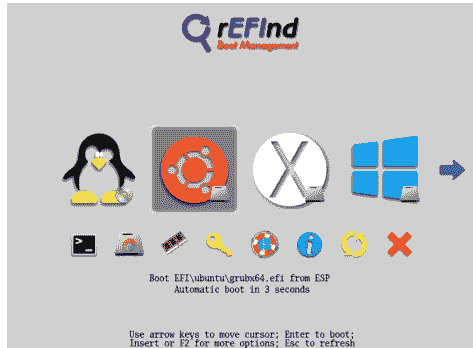

启动后，rEFInd 将以上图所示的形式，通过图标展示它所找到的内容。在这张图中，Ubuntu 被找到并高亮显示。

按下回车键将尝试启动 Ubuntu。

在右侧的图片中显示了选项，并且发现了 Arch。

顺便说一下，Rodney 在一次沟通中告诉我，如果你在看到启动选项时按下 F10 键，就会对你所看到的选项进行截图，并将该截图保存到根系统中。

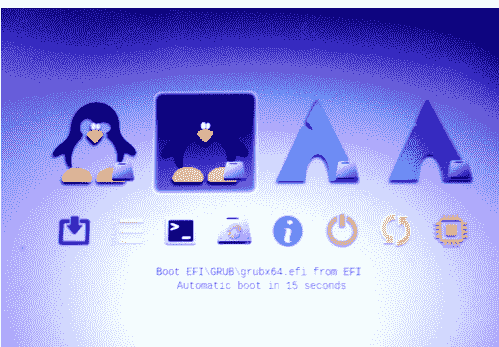

要使用 USB 闪存盘上的 rEFInd，将其连接到你的电脑，然后关闭电脑电源。在你按下开机按钮后，立即按下能给你提供启动选项的按键；在我的惠普笔记本电脑上，这个按键是 F9。

找到你看到的第一个提及 USB 的条目，例如：`USB hard drive (uefi) Kingston`

确保它被高亮显示，然后按下回车键。

如果你能启动 Arch 操作系统，就可以开始检查启动项是否有问题。你可以使用`efibootmgr`来完成，它在主软件仓库中可用，因此可以使用`pacman`安装。

```text
[andrew@darkstar:~]$ efibootmgr

BootCurrent: 0000

Timeout: 15 seconds

BootOrder: 0000,9999

Boot0000* GRUB	HD(1,GPT,96fb1b5b-4349-4cce-bcea-5330528e2565,0x800,0xc7000)/File(\EFI\GRUB\grubx64.efi)
```

我已经对我的输出做了不少清理。好的，启动顺序是 0000,9999，这很好。假设你发现启动顺序是：9999,0000

要将启动顺序更改为你想要的，在我的情况下是 0000，命令如下：

```bash
sudo efibootmgr -o 0000,9999
```

[其中 o 是小写字母 o，不是数字零！]

要删除某个条目，比如 9999，命令是：

```bash
sudo efibootmgr -b 9999 -B 9999
```

好的，这是你可以设置并在无法启动时尝试的一个方法。另一个方法，如果你从 Windows 过来的话，就像大多数人一样，你可能已经见过它的"恢复"功能。

简单来说，当系统运行正常时，会对系统进行一次快照。如果出了问题，其概念就是将系统恢复到一切正常运行时的快照状态。

稍微有点麻烦的是，假设你发现无法启动系统，你可能会发现用一个无法运行的系统将其恢复到之前运行时的状态有些困难。

你能做到这一点的方法是使用一台已适当安装了 Linux 发行版到 USB 闪存盘的电脑来启动。使用 USB 闪存盘上的操作系统，你将能够访问一个程序（如果存在的话），找到主计算机操作系统正常运行时的快照，并将系统恢复到该快照状态。

嗯，一个能够在定期计划时间或在你需要时创建快照的程序叫做 Timeshift。它也可以用于将计算机操作系统恢复到某个快照。

## Timeshift

所以 Timeshift 是一个很棒的程序，可以帮助你将电脑恢复到 Arch 正常工作的某个时间点。为此，你需要做好以下几件事：

1. 你需要在正常工作的电脑上安装 Timeshift。
2. 你需要在正常工作的电脑上配置 Timeshift，使其知道在电脑正常运行时将"快照"保存到哪里。
3. 你需要将该快照存储在便于访问的地方。
4. 你还需要让 Timeshift 作为已适当安装到 USB 闪存盘上的 Linux 发行版的默认程序可用。

那么让我们来解决这些需求：

不久前，在 Arch 上安装 Timeshift 需要去 AUR，这意味着我必须解释如何从 AUR 获取软件包并安装它。现在它已可从主软件仓库获取，因此可以使用`pacman`安装。

```bash
[andrew@darkstar:~]$ sudo pacman -S timeshift
```

Timeshift 快照需要存储在某个地方；一个好地方就是电脑本身的硬盘上。为了演示我是如何设置电脑的，让我展示一张图片。

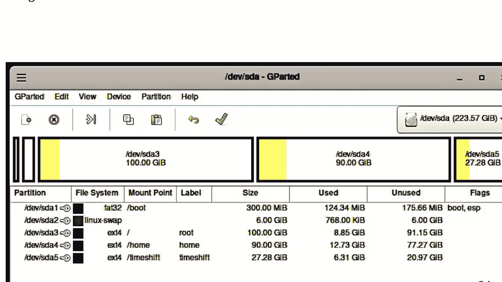

如果你看这张图片，它使用 gParted 显示了我用来写这本书的笔记本电脑上的分区。你会看到我有通常的 EFI 分区、交换分区、根分区、home 分区，最后我还有一个文件类型为 ext4、大小约 27G、专门用于 Timeshift 快照的分区。

之前我使用过 SD 卡和其他选项来存储 Timeshift 快照，但这种方式所有东西都在一个地方，不会丢失，而且我发现用这种方式创建 Timeshift 快照非常快。根据我的经验，单个 Timeshift 快照最多占用约 8G 的文件空间。我已经分配了足够的空间来存储大约 3 个快照。我不需要更多文件空间，因为在创建新快照之前，我会使用 Timeshift 删除最旧的快照。要设置 Timeshift，从主菜单中选择。鼠标左键单击向导图标。

### 设置 Timeshift

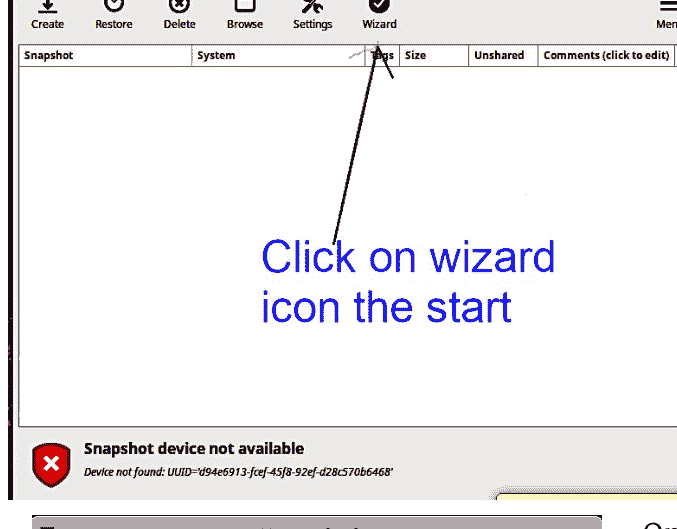

如果你看左侧图片中的菜单，你可以看到有创建、恢复和浏览的菜单图标。

在使用 Timeshift 之前，需要先设置它，告诉它快照将保存到哪里以及使用什么文件格式。因此在进行任何操作之前，先点击向导图标。

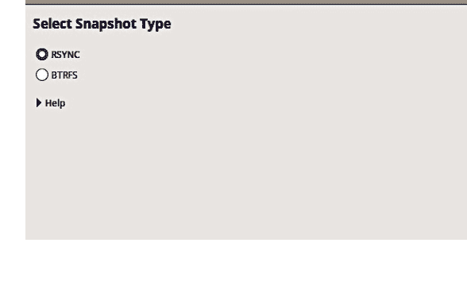

点击向导图标后，你会看到如左侧图片所示的选项。

由于我们安装的文件系统是 ext4，我们将选择使用 rsync；实际上它已经为我们选好了。

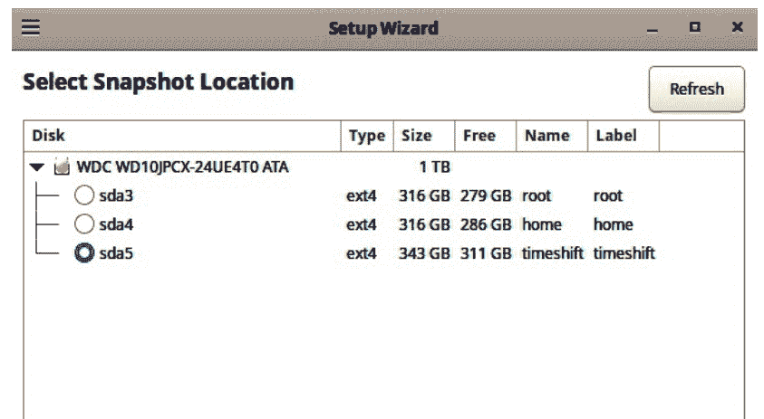

这里 Timeshift 显示了存储快照的合适位置。

如前所述，我已经为快照设置了一个专用分区`/dev/sda5`。所以我做出了该选择并点击了下一步。

Timeshift 然后会询问自动创建快照的频率；我个人取消选择左侧的所有选项。这是因为我喜欢在创建新快照之前手动删除最旧的快照。我也倾向于将 Timeshift 快照与我的工作流程同步。

通常是在完成完整的系统更新之后。

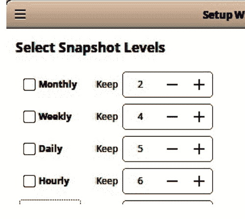

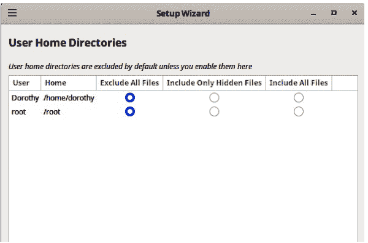

然后 Timeshift 会询问关于用户主目录的问题。左侧图片中的`root`目录并非操作系统安装所在的根目录，而是 root 用户的个人目录。顺便说一下，root 的名字是 Dorothy。好吧，我是在朋友的笔记本电脑上写这本书的。

root 和 Dorothy 的个人目录中的文件对启动所需的内容没有影响，这就是为什么我把它们排除在外了。

在做出是否包含用户目录的选择后，接下来你会看到设置向导已完成，并且向导对话框可以关闭。此时你有两个选择：点击创建图标，或者关闭 Timeshift 图形用户界面，从命令行进行操作。

在命令行使用 Timeshift 的语法非常直接。你需要 sudo 权限，所以基本上是`sudo timeshift`加上一个标志，例如：

```bash
[andrew@darkstar:~]$ sudo timeshift --list
```

该命令的输出如下所示：

```text
[andrew@darkstar:~]$ sudo timeshift --list

Mounted '/dev/sdc1' at '/run/timeshift/3655/backup'

Device : /dev/sdc1

UUID : d94e6913-fcef-45f8-92ef-d28c570b6468

Path : /run/timeshift/3655/backup

Mode : RSYNC

Status : OK

1 snapshots, 32.3 GB free

Num Name Tags Description

0 > 2023-05-18_10-25-21 0
```

删除快照的命令是：

```bash
[andrew@darkstar:~]$ sudo timeshift --delete
```

注意，我没有输入任何要删除的快照详细信息。这是因为我将通过 Timeshift 为每个快照分配的编号作为参考来被要求输入。

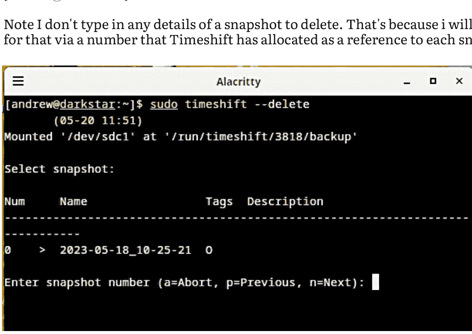

所以要删除列出的快照，我只需在提示符处输入：0

创建新快照的命令大致如下，我添加了一条注释，在使用`timeshift --list`时会显示：

```bash
[andrew@darkstar:~]$ sudo timeshift --create --comments ' 2nd snapshot'
```

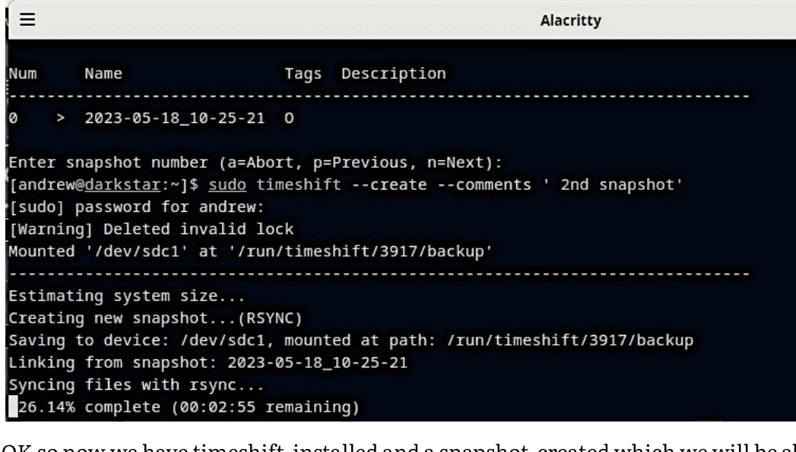

好的，现在我们已经安装了 Timeshift 并创建了一个快照，我们可以轻松地访问它。

接下来是关于从 U 盘启动 Live Linux 发行版的过程，以及在需要时将选定的快照恢复到从中启动 U 盘和 Linux 发行版的计算机。

在此之前有几件事需要注意。第一，由于 Arch 是滚动更新版本，你的操作系统更新会很频繁。这意味着你也必须频繁地创建新快照，并根据需要删除旧快照以腾出空间。

现在，将计算机恢复到某个快照的过程涉及从 U 盘启动例如 Mint 或其他 Linux 发行版。你需要从菜单中选择 Timeshift，并再次通过 GUI 向导操作，这次你使用的是从 U 盘启动的 Linux 上的 Timeshift。

例如，你仍然会再次选择 rsync，这样 Timeshift 可以确认你想使用 rsync，然后你会从 Timeshift 给出的导航列表中选择快照所在的位置。如果像我在朋友的笔记本电脑上那样，我设置了一个标记为 "timeshift" 的专用分区，那么找到快照并不太困难。

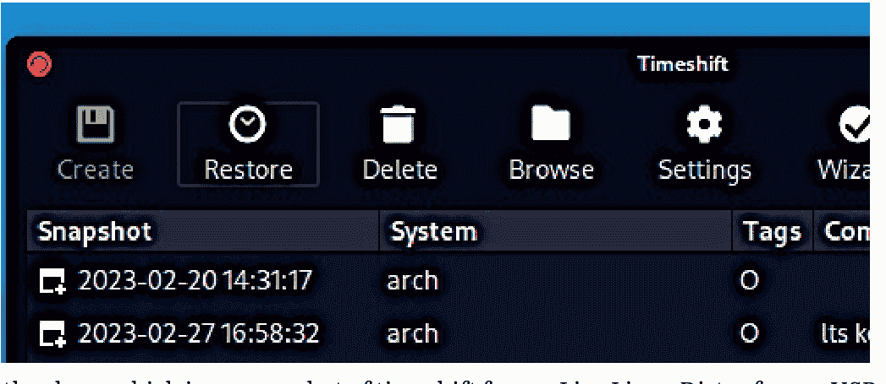

上图是从 U 盘启动的 Live Linux 发行版上的 Timeshift 截图，Timeshift 在我导航的帮助下成功找到了快照。所以要继续的话，通常只需用鼠标左键点击你想要恢复的快照（通常是最新的快照）。然后从菜单中点击恢复选项。

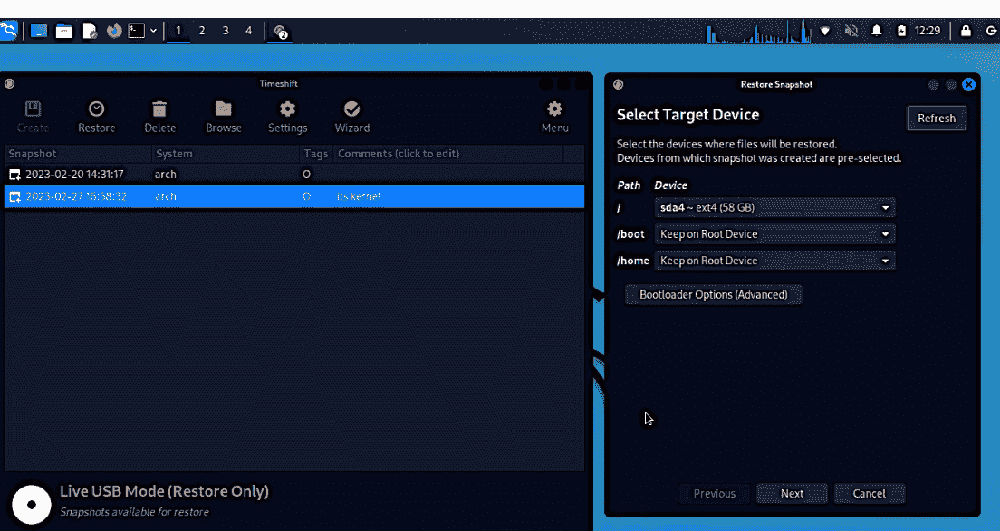

看上面的图片，你可以看到我正在使用从 U 盘启动的 Kali Linux live。如果你发现默认没有安装某些软件，在 Kali 的情况下，你可以从命令行使用：

```bash
$ apt search timeshift
$ sudo apt install timeshift
```

这会给你临时使用任何已安装程序的能力，但下次从 U 盘启动时它就会消失。使用 Ventoy 有一种方法可以实现持久化，这样下次启动时你安装的任何东西都会保留。此外，你的 WiFi 配置也会被记住，这很方便。

接下来出现的选项如上面快照右侧所示是目标设备。它显示了默认选择。我的 HP 笔记本电脑上的主要 Arch 安装在分区`/dev/sda4`上，所以上述选择对我来说是正确的。我在根安装上有一个 boot 目录。

这台 HP 笔记本电脑的硬盘容量较小，所以我没有设置单独的家目录分区。

`/dev/sda1`是我的 EFI 分区。

`/dev/sda2`是交换分区。

最后一个分区是`/dev/sda4`。

boot 目录被列为根目录中的目录之一。

这是我的 boot 目录内容，如果你想和你的比较的话：

```text


# boot

```text
boot

├── amd-ucode.img

├── EFI

│   ├── arch

│   └── GRUB

├── grub

│   ├── fonts

│   ├── grub.cfg

│   ├── grubenv

│   ├── locale

│   ├── themes

│   └── x86_64-efi

├── initramfs-linux-lts-fallback.img

├── initramfs-linux-lts.img

└── vmlinuz-linux-lts
```

所以对于我的 HP 笔记本电脑，我保留了 Timeshift 给出的选择。

是的，保持那样选择即可。我安装时没有为家目录设置专用分区，所以我的家目录实际上是主根安装内部的一个子目录。所以保留那个选择。基本上接下来只需点击下一步。希望你会看到恢复过程在你眼前完成，并以“no errors”结束。

## U 盘上的 Linux —— 瑞士军刀

为了尝试降低学习曲线，我之前建议将 Linux Mint 和 Arch 安装 ISO 一起放到 U 盘上。这是因为 Timeshift 作为默认包已经安装，所以你不必费心尝试安装它。

当 Linux 发行版完全安装在你的计算机硬盘上时，安装的软件会在你启动时可用。通过 U 盘以 live 方式使用的 Linux 发行版行为略有不同，它们在 RAM 中运行；你可以安装 ISO 附带的额外软件并使用它，但下次从 U 盘启动时它就会消失。这完全与 Linux 以 ISO 形式在 RAM 中运行的方式有关，RAM 是临时的。

U 盘上的 Linux 发行版可以是非常有效的瑞士军刀；你可以使用 `gParted` 以图形方式格式化硬盘，运行 `fsck` 可以扫描计算机硬盘上的文件系统错误并修复它们。

我发现有一些我想要的程序默认没有安装，我希望它们在我从 U 盘启动 Linux 发行版时随时可用。所以现在我来看看如何使用 Ventoy 配合 U 盘上的 Linux Live 发行版 ISO 并实现持久化。

有一些从 U 盘运行的 Linux 可以做到的事情，是从硬盘运行的 Linux 发行版无法做到的。

其中之一是运行 `fsck` 命令，例如：

```bash
$ sudo fsck -vy /dev/sda2
```

上面的 `/dev/sda2` 是我笔记本电脑上的分区之一。你无法在运行中的操作系统上直接对笔记本电脑的分区运行 `fsck`；这是因为为了能够对分区运行 `fsck`，该分区必须被卸载；笔记本电脑上正在运行的 Linux 发行版的分区正在使用中且已挂载。

有一种方法可以让 U 盘上的 live Linux 操作系统记住你的 WiFi 设置，并保留你发现需要下载和安装的任何内容。

使用 Ventoy 会有一点额外的工作要做；它涉及创建一个用于持久化的 `.dat` 文件并添加一个 `ventoy.json` 条目。我认为这是值得的，因为结合使用具有持久化的 Kali live，你可以准备并随时准备好一把瑞士军刀来修复问题。我将给你提供你需要的基本要点，但你可以在 Ventoy 网站上看到更多信息。

<https://www.ventoy.net/en/plugin.html>

<https://www.ventoy.net/en/plugin_entry.html>

现在我想第一个问题会是：

我们知道以 ISO 文件形式的 Linux 操作系统可以从 U 盘启动并运行，但哪些 Linux 发行版候选看起来不错，它们在响应速度方面快、已经安装了很多东西，而且它们也能很好地与用于实现持久化的文件配合工作？

好吧，我可以为你节省大量时间和麻烦；我已经尝试使用不同的 USB 上的 Linux live 操作系统，使用 Ventoy 时我发现 Kali Linux 工作良好，启动后你从终端运行命令时它们以“root”权限操作。我还发现，如果你想在非运行中的 PC 操作系统桌面区域保存某些内容，比如图像截图，Kali Linux 会将其放到那里而不会抱怨。

使用 Mint 时你会得到“permission denied”（权限被拒绝），而当你有问题时你不想费心折腾。一旦我得到了为 Kali 创建合适 dat 文件的正确命令，它就能很好地工作了。

让我给你概述一下你需要什么以及你可以拥有什么。你能否在 U 盘上同时放置 Kali Linux 和 Arch 安装 ISO 并实现持久化——是的，你可以。首先，我将向你展示一个持久化正常工作的 USB 盘上的 Kali Linux 的结构。

我建议选择 16G 的 U 盘；顺便说一下，你不必把它和 Arch ISO 放在同一个 U 盘上，相反，你可以在同一个 U 盘上放置大约 4 到 5 个不同的发行版。你可以让一些没有持久化功能，一些有。这完全取决于你如何设置结构，在正确的位置放置正确的文件，然后配置 `Ventoy.json` 文件。下面我使用终端中的 `tree` 命令来获取我的 Ventoy 格式化 U 盘的结构布局：

```bash
[andrew@darkstar:media/andrew]$ tree -L 2 Ventoy
```

```text
Ventoy

├── ISO

│   └── kali-linux-2022.4-live-amd64.iso

├── persistence.dat

└── ventoy

    └── ventoy.json
```

上面的“Ventoy”是 U 盘连接到我的笔记本电脑时的标签。在我的 Arch 笔记本电脑上，它挂载到：

```text
/run/media/andrew/Ventoy
```

所以在 Ventoy 目录内，有两个目录，一个叫“ISO”，另一个叫“ventoy”。我第一次使用 Ventoy 时就觉得很困惑；你的 U 盘标签是“Ventoy”，而里面又有个目录叫“ventoy”。ISO 目录则是你拖放 Live Linux ISO 文件的地方。

在 Ventoy 目录中，有一个名为 `ventoy.json` 的单独文件，以及一个 `persistence.dat` 文件，它们与 ventoy 和 ISO 目录位于同一层级。

默认情况下，Ventoy 系统会首先在名为“ISO”的目录中查找 ISO 文件。你需要使用从以下地址下载的解压文件中的脚本来创建 `persistence.dat`：

<https://github.com/ventoy/Ventoy/releases>

使用 Linux 通过终端创建 dat 文件时，你需要先切换到解压后的 Ventoy 下载目录，然后执行：

```bash
sudo ./CreatePersistentImg.sh -l persistence -c persistence.conf
```

这会在解压后的 ventoy 下载文件中创建一个名为“persistence.dat”的 dat 文件，位置与 `CreatePersistentImg.sh` 脚本相同。如果在终端中运行此命令时遇到任何失败，例如：

```bash
[andrew@darkstar:~]$ sudo chmod +x CreatePersistentImg.sh
```

这将为脚本赋予执行权限。

如果在读写 `persistence.dat` 文件时遇到任何问题，你可以使用：

```bash
[andrew@darkstar:~]$ chmod 666 persistence.dat
```

现在只需将 `CreatePersistentImg.sh` 拖放到格式化为 Ventoy 的 U 盘上即可。

最后一步是创建一个包含一些数据的 `ventoy.json` 文件，这基本上让 Ventoy 系统知道哪个 Linux ISO 将使用 dat 文件。你可以使用文本编辑器来创建 `ventoy.json` 文件并填入我下面要展示的内容。

我的 `ventoy.json` 文件内容：

```json
{
  "control": [
    { "VTOY_DEFAULT_MENU_MODE": "0" },
    { "VTOY_filt_DOT_UNDERSCORE_FILE": "1" },
    { "VTOY_DEFAULT_SEARCH_ROOT": "/ISO" }
  ],
  "persistence": [
    {
      "image": "/ISO/kali-linux-2022.4-live-amd64.iso",
      "backend": "/persistence.dat"
    }
  ]
}
```

前几行描述了 Ventoy 系统的基本设置。例如，我定义了查找 ISO 文件的默认位置是 ISO 目录。在 persistence 块中，我指定了应该使用 `persistence.dat` 文件的 ISO。这个文件很容易出错。你可以使用网上的 json 验证软件来确保语法正确。我认为新版本甚至附带了一个新脚本来帮助完成这项工作。

现在，由于它已为 Kali 配置了持久化，如果你愿意，实际上可以通过以下方式更新 U 盘上的操作系统：

```bash
kali@kali:~$ sudo apt update

kali@kali:~$ sudo apt full-upgrade -y
```

不过，运用横向思维，最好还是直接用更新后的 ISO 文件替换旧的，然后重新生成 dat 文件。

## 安装后

### 初步了解维护

我不知道你的情况如何，但当别人给我或我自己购买新东西时，我会有点像唐纳德·拉姆斯菲尔德时刻。就拿笔记本电脑上的 Linux 操作系统来说，**已知的已知**是，我的笔记本电脑需要供电才能让 Linux 操作系统持续运行。我是否插上了笔记本电脑的充电单元，并且它正在工作。

然后是**已知的未知**；我想我得保持操作系统更新。最后是——任何我需要做的来保持操作系统精简或可能导致问题的事情。

关于更新系统，我之前提到过你必须初始化 `pacman` 密钥。Arch Linux 的主要完整系统更新命令很简单：

```bash
[andrew@darkstar:~]$ sudo pacman -Syu
```

现在你可以通过经验发现什么可能导致问题，但我会告诉你我发现需要注意的事项。我想我们要粗略地看一下 `systemd` 及其相关的有用命令。我将使用汽车和汽车启动马达的比喻。

对于汽车，你可以想象如果有一点惯性，那么要让汽车引擎运转起来，就需要推一把，可以这么说。说得很简单；但事实是汽车有“启动马达”就是干这个的。

好吧，现在如果我们粗略地将同样的想法应用到计算机上，你可能会想象要让计算机操作系统启动并运行，会有各种步骤和阶段。

不必太复杂地说，计算机使用虚拟内存或 RAM；为了让计算机操作系统运行，首先需要加载、读取和执行它。在较老的 Linux 发行版中（以及今天仍然如此，如 Slackware 15），初始程序是 `init`；它运行 `/etc/rc.d/rc.S` 脚本，启用虚拟内存并挂载文件系统。

俗话说没有什么是一成不变的，另一种启动和管理计算机操作系统的方法被引入了。`Systemd` 由 Lennart Poettering 和 Kay Sievers 于 2010 年开发，此后已成为许多 Linux 发行版的默认 init 系统。如前所述，不使用 systemd 的最古老的 Linux 发行版之一是 Slackware。我曾经是 Slackbuilds 的维护者和贡献者（技术上仍然是），在论坛上可以看到类似“我宁死也不用 systemd”的评论。

是的，极客们有时确实会有点戏剧化。是时候承认了，我相当喜欢 `systemd`，因为它使用起来相当简单且非常高效。

所以总结来说，`systemd`（对于那些使用它的 Linux 发行版）是一个启动 Linux 操作系统运行并帮助管理它的系统。在管理系统中有一个叫做 `journalctl` 的东西。如果你运行这个命令，你会看到相当多的选项：

```bash
[andrew@darkstar:~]$ journalctl --help
```

无论如何，你可以想象 systemd 系统的开发者肯定会考虑用户如何获取任何正在发生的事情的信息。好吧，systemd 一直在产生日志文件。它们非常有用，因为如果你的系统出现任何故障，你可以使用命令来过滤日志以帮助找出问题所在。

从维护的角度来看，日志文件的数量相当可观，它们会占用磁盘空间。当你遇到问题时，你肯定会查看最近的日志文件，然后你真的不需要那些旧的日志文件。简而言之，你只需要保留一定数量的最近日志文件，因为你已经看过与问题相关的旧日志了，不是吗！运行此命令查看 journal 日志文件占用了多少空间：

```bash
[andrew@darkstar:~]$ journalctl --disk-usage
```

所以这个命令你肯定需要每周运行一次左右：

```bash
[andrew@darkstar:~]$ sudo journalctl --vacuum-size=10M
```

从终端运行上述命令的作用是将 journal 日志记录量减少到 10 兆字节。稍后我将查看我发现有用的命令，包括利用 `journalctl` 命令。

现在另一个可能耗尽磁盘空间的领域与 Arch Linux 的更新过程有关。运行此命令：

```bash
[andrew@darkstar:~]$ ls /var/cache/pacman/pkg
```

你会看到一堆文件；我系统中的一个文件示例是：

```text
webkit2gtk-2.40.0-2-x86_64.pkg.tar.zst
```

供你参考，像上面的 zst 文件与当你从 ARCH AUR 获取 `PKGBUILD` 文件时产生的文件类型完全相同，例如我从

<https://aur.archlinux.org/packages?O=0&K=sqliteman>

获取了 sqliteman 的 PKGBUILD。

产生的文件是：

```text
sqliteman-1.2.2-12-x86_64.pkg.tar.zst
```

所以你可能猜到 zst 文件是软件可以从中安装的包形式。`/var/cache/pacman/pkg` 的理念是保留较旧 zst 文件的副本，以防最新的版本出现问题。你可以回退到较旧的可用版本。然而你只需要保留几个最近的版本。

我们可以从终端使用一个叫做 `paccache` 的工具来帮助我们修剪 `/var/cache/pacman/pkg` 中保留的包版本数量到我们想要的数量。但首先我们需要安装它所属的包。

通过以下方式安装 `pacman-contrib`：

```bash
[andrew@darkstar ~]$ sudo pacman -S pacman-contrib
```

现在将 `/var/cache/pacman/pkg` 中的所有包修剪为例如保留 2 个版本：

```bash
[andrew@darkstar:~]$ sudo paccache -rk 2
```

该命令还会告诉你释放了多少空间；考虑到你需要经常运行 `pacman -Syu`，那么你也应该经常运行 `paccache`。快速说明一下为什么你需要经常运行 `pacman -Syu`：这虽然没发生在我身上，但简而言之 Arch Linux 是滚动发布，而且内核和软件包的新版本更新速度相当快。

理论上讲，如果你落后太多，会积累出一批无法更新的软件包，因为你从未获取所需的那些更新。我发现的另一个考虑因素是更新的大小和涉及的软件包数量。由于预算限制，我买了一台只有 60G 硬盘的笔记本电脑。我有我需要的一切，但有时空间会很紧张。所以对我来说，经常获取更新从而每次更新量较小是明智的。

更新后我会修剪 `/var/cache/pacman/pkg`。

另一个可能膨胀积累的地方是你的用户 `.cache` 空间。要查看使用情况，使用此命令：

```bash
sudo du -sh ~/.cache/
```

要清理你的用户缓存，以普通用户身份登录：

```bash
[andrew@darkstar:~]$ rm -rf ~/.cache/*

zsh: sure you want to delete all 8 files in /home/andrew/.cache [yn]? y
```

在我继续之前，假设你已经安装了 Cinnamon 桌面，让我们对其进行一些调整。我喜欢一个简洁的桌面，上面有图标。在 Cinnamon 中，需要做一点工作才能实现这一点。这只需要安装 `xdg-user-dirs`，然后以 root 身份运行 `xdg-user-dirs`。之后，进入 Cinnamon 菜单，首选项，桌面，并移动滑块来启用可以显示哪些图标。

现在将安装 `xdg-user-dirs`，这样我们就可以显示我们的目录：

```bash
[root@darkstar:~]# pacman -S xdg-user-dirs
```

并运行下面的命令来给我们提供该选项。

```bash
[root@darkstar:~]# xdg-user-dirs-update
```


好的，现在是一个很好的时机来关机，然后重新启动并以非 root 用户登录，使用我们新安装的图形环境。

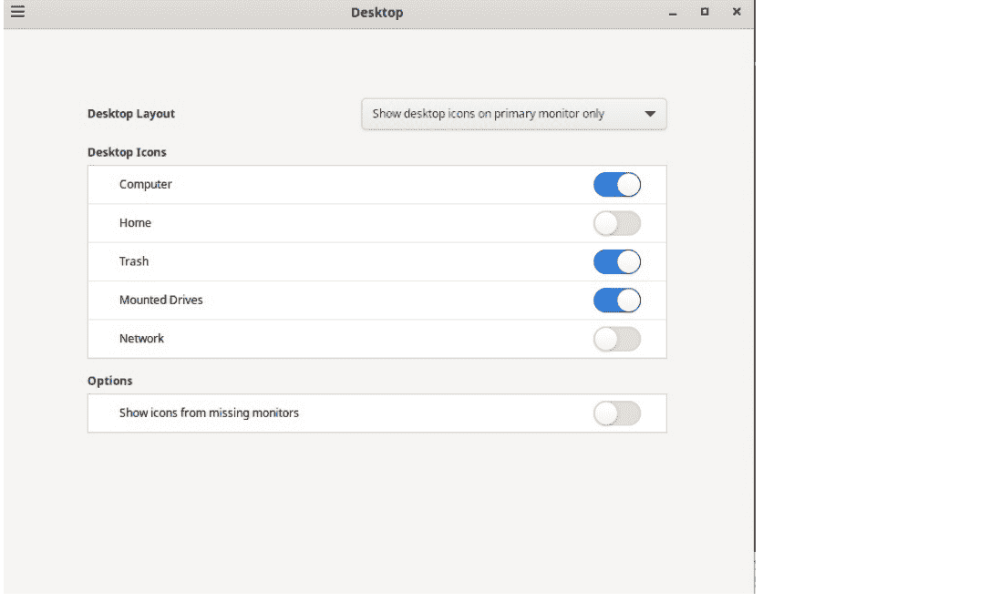

## 更深入了解 Systemd

如果你想想一辆汽车，基本上当你感觉你能理解什么控制着这辆车并且也能做到时，完全的信任感才会到来。Systemd 从一开始就一直在运行。我想尝试为你揭开 `systemd` 的神秘面纱。如果你能与之互动，那么我想你会对你的操作系统感到更舒适。

在旧的 SysV 系统中，有一些脚本在运行时可以被称为“守护进程”。例如在 Slackware Linux 中，你有`/etc/rc.d/rc.wireless`，来自 Slackware 网站的说明是：

`rc.wireless` 这个脚本设置 PCI、USB 和 32 位 Cardbus 无线设备——**不**包括 16 位 PCMCIA 卡（那些是在`/etc/pcmcia/`中配置的）。基本上，如果你想让你的 WiFi 工作，你必须首先给予 `rc.wireless` 脚本执行权限来运行，然后它会自动在下一次启动时作为“守护进程”运行。这就是 Slackware 适合学习的原因，除非你让它们工作，否则 things 不会工作。

Systemd 有自己的概念，它引用事物的方式以及让事物启用和运行的方法。我想做的是通过创建我们自己非常小的 systemd 生态系统中的齿轮来让你了解所涉及的内容，并以一种被认可、接受和有效的方式来做。

简洁地说，systemd 通过作用于单元来管理操作系统服务和系统，这些单元主要可以被定义为服务。一个单元是通过“单元文件”来定义的，这是一个纯文本的类 ini 风格文件，包含描述该单元并定义其行为方式的配置指令。

我们将创建一个单元文件。要获得完整的详细信息，请参阅示例 `man` 命令。所有属于你已安装 Linux 操作系统一部分的 systemd 文件都可以在`/lib/systemd/system/`中找到。要获得输出，你可以从终端提示符使用例如：

```bash
[andrew@darkstar:~]$ ls /lib/systemd/system/
```

不要动`/lib/systemd/system/`中的那些文件，不要碰它们。我将展示如何首先创建一个脚本，该脚本将用于修剪我们的日志日志数量，这样你就不必手动操作了。我们将创建一个 systemd 单元来控制该脚本并提供相关信息。

这将给出 systemd 的基本介绍和对事物工作方式的基本理解。你会看到新的 systemd 单元文件将存储在`/etc/systemd/system`。

之后，我想看看如何利用 systemd 来获取信息以及如何获取。我们需要一个文本编辑器来做到这一点，我使用 `geany`。我用它来进行 PHP 编程和其他功能。如果你没有，那么让我们使用 `pacman` 来安装它及其插件：

```bash
[andrew@darkstar:~]$ pacman -S geany geany-plugins
```

所以让我们看看我们要创建的脚本。在任何终端模拟器中输入的命令，我们可以用来首先查看日志日志量，然后控制我们系统中日志日志数据量的是：

```bash
journalctl --disk-usage

sudo journalctl --vacuum-size=10M
```

在上述情况下，我将日志日志量减少到 10 兆字节。那是存储中的那些。但我们也可以将该命令放入脚本中。

当脚本运行时，它也会运行该命令。因为我们将把脚本放在`/usr/bin`中，它将具有 root 权限。让我们使用 `geany` 来创建一个我们将使用 systemd 来管理的脚本，从菜单启动 `geany`，然后在 geany 菜单上左键单击文件 -> 新建。

在空白处输入下面的 2 行：

```bash
#!/bin/bash

journalctl --vacuum-size=3M
```

然后文件 -> 另存为 -> `clean.sh`，这将在你的主目录中保存一个文件 `clean.sh`。接下来，因为我们要将脚本移动到`/usr/bin`，我们要确保它具有正确的所有权和权限，所以打开一个终端并运行：

当你打开终端时，默认情况下它会从处于你的主目录的上下文打开。Geany 也应该将脚本存储到主目录，所以你应该不需要更改目录。

```bash
[andrew@darkstar:~]$ sudo chown root:root clean.sh

[andrew@darkstar:~]$ sudo chmod +x clean.sh
```

上面的 2 个命令给予了 root 权限，并且使脚本可执行。

接下来我们将通过命令将脚本 `clean.sh` 移动到`/usr/bin`：

```bash
[andrew@darkstar:~]$ sudo mv clean.sh /usr/bin/
```

现在我们将创建一个 systemd 单元来利用该脚本。这将通过适当且标准化的 `systemctl` 使用方式，使我们能够启用、禁用、获取状态等我们的单元，而该单元反过来控制脚本的使用。

我们将把我们的单元称为“clean”，就 systemd 而言，它的全名将是“clean.service”。好的，从终端开始创建我们的服务。

```bash
sudo systemctl edit --force --full clean.service
```

在我的系统上，这样做会打开一个 nano 文本编辑器，文件的保存目的地是`/etc/systemd/system`。

在 nano 的空白屏幕中，准确输入以下内容：

```ini
[Unit]

Description=example use of systemd unit files

[Service]

ExecStart=/bin/bash /usr/bin/clean.sh

Environment=SYSTEMD_LOG_LEVEL=debug

[Install]

WantedBy=multi-user.target
```

以 nano 的正常方式保存文件：

```text
Ctrl + o
按回车键
Ctrl + x
```

让我们看看我们的服务是否能被找到：

```bash
[andrew@darkstar:~]$ systemctl list-unit-files
```

让我们解释服务单元中的三个元素：

- `[Unit]` - 包含不依赖于单元类型的通用选项。这些选项提供单元描述，指定单元的行为，并设置与其他单元的依赖关系。
- `[Service]` - 在这里我定义了指向我们脚本的路径及其名称，当我们使用 `start` 命令时，或者在启动时如果我们使用 `enable` 命令——我稍后会在下文中解释。
- `[Install]` - 在我们的单元中，我在这里定义了我希望我们的单元如果被启用则在启动时启动，所以我把目标设置为“multi user”。

如果你需要编辑你的服务，使用如下命令：

```bash
sudo systemctl edit clean.service
```

这会创建一个部分编辑，它会保护已经写好的内容，所以只用于额外的内容。对于完整编辑，使用：

```bash
[andrew@darkstar:~]$ sudo systemctl edit --full clean.service
```

编辑后，你需要运行：

```bash
[andrew@darkstar:~]$ sudo systemctl daemon-reload
```

使用终端来获取我们单元中的内容：

```bash
[andrew@darkstar:~]$ systemctl cat clean.service
```

就我而言，我做了一个部分编辑并添加了一条注释，它进入了`# /etc/systemd/system/clean.service.d/override.conf`。

只要你遵循创建、编辑服务单元的正确协议，你就会没问题。

让我们看看 systemd 是否认可我们的单元：

```text
[andrew@darkstar:~]$ systemctl status clean                  (04-17 09:18)

○ clean.service - example use of systemd unit files

     Loaded: loaded (/etc/systemd/system/clean.service; disabled; preset: disabled)

     Drop-In: /etc/systemd/system/clean.service.d

            └─override.conf

     Active: inactive (dead)
```

所以在上面显示服务被禁用了，是的，我们还没有启用它。据我所知，preset 意味着它不会设计为自动运行，除非手动启用。让我们启用并运行。

```bash
[andrew@darkstar:~]$ sudo systemctl enable clean.service

Created symlink /etc/systemd/system/multi-user.target.wants/clean.service → /etc/systemd/system/clean.service.

[andrew@darkstar:~]$ sudo systemctl start clean.service
```

注意在上面一行中，如果你没有收到错误，你可以假设服务已启动。要获得更多信息，让我们使用 `status` 动词。

```text
[andrew@darkstar:~]$ sudo systemctl status clean.service

○ clean.service - example use of systemd unit files

     Loaded: loaded (/etc/systemd/system/clean.service; enabled; preset: disabled)

     Drop-In: /etc/systemd/system/clean.service.d

            └─override.conf

     Active: inactive (dead) since Tue 2023-04-18 12:31:12 BST; 19s ago

    Duration: 35ms

     Process: 6945 ExecStart=/bin/bash /usr/bin/clean.sh (code=exited, status=0/SUCCESS)

    Main PID: 6945 (code=exited，只在有主PID的情况下显示，main PID 不能与组 PID 混淆)

        CPU: 18ms

Apr 18 12:31:12 darkstar journalctl[6946]: Vacuuming done, freed 17.0M of archived jour...
```

如你所见，服务现在已启用，所以它现在会在启动时运行。有一个日志缓存被保留，但是修剪我们的日志不应该影响并阻止我们在启动时出现任何错误时阅读输出。它基本上会修剪已经被归档的日志。

## 访问和使用 systemd 信息

要显示启动日志，可以使用以下命令：

```bash
[andrew@darkstar:~]$ journalctl -b
```

要显示启动时的错误，使用这个：

```bash
[andrew@darkstar:~]$ journalctl -b -p err
```

通过时间来缩小问题范围：

```bash
[andrew@darkstar:]$ journalctl -b -p err --since=20:00 --until=20:15
```

你甚至可以使用 `journalctl` 查看 Apache 网页服务器：

```text
andrew@darkstar:]$ journalctl -u httpd --since=00:00  --until=9:30

(04-19 09:56)

-- No entries --
```

### 使用 UID 和时间段

```bash
[andrew@darkstar:~]$ journalctl _UID=1000 --since="2023-04-21 12:00:00"
```

你可以使用以下命令查看单元（unit）的安全性：

```bash
[andrew@darkstar:]$ systemd-analyze security
```

### man 手册页

```bash
[andrew@darkstar:]$ man systemd.unit

[andrew@darkstar:]$ man systemd-system.conf

[andrew@darkstar:]$ apropos systemd
```

## 来看看 pacman 和相关命令

为了优化下载，我们需要用距离你最近的镜像源来填充`/etc/pacman.d/mirrorlist`文件。一种简单的方法是访问 <https://archlinux.org/mirrorlist/>，在国家列表中向下滚动到你所在的位置，然后点击生成列表。选中生成的列表，滚动鼠标高亮显示，右键点击复制。

```bash
[andrew@darkstar ~]$ sudo nano /etc/pacman.d/mirrorlist
```

将光标移到你想要的标题下方，如左图所示。

同时使用三个键 `Ctrl + Shift + V` 将列表粘贴到 nano 编辑器中。

每行前面都有一个井号字符，用退格键删除你想删除的数量，大概 7 个。`Ctrl + o`，按回车，`Ctrl + x`。

左侧光标在一行的井号后对齐，准备使用退格键将其删除。

完成后按 `Ctrl + o`，按回车，`Ctrl + x` 退出。

pacman 的配置文件位于：

`/etc/pacman.conf`

我想知道有多少人会去那里阅读文件。这句话有点隐藏在其中：

> 注意：首次使用 pacman 前必须运行 `pacman-key --init`；然后可以用 `pacman-key --populate archlinux` 将本地 # 密钥环填充所有官方 Arch Linux # 打包者的密钥。

我在安装部分已经涵盖了上述内容，但值得再次强调。

如果你想安装 wine 并使用其库，你必须将 multilib 条目编辑成这样：

```ini
[multilib]

Include = /etc/pacman.d/mirrorlist
```

也就是说，你必须删除 `#`，既要从 `#[multilib]` 前面删除，也要从上面第二行前面删除。

软件包以 tar.zst 文件的形式存储在`/var/cache/pacman/pkg`中。

我省略了 tar.zst.sig 条目。

假设 pacman 安装了最新版本但有问题。让我们看看当前的这个：

你可以这样查询：

```text
[andrew@darkstar:~]$ ls /var/cache/pacman/pkg/calibre*               (04-19 10:20)

/var/cache/pacman/pkg/calibre-6.15.0-1-x86_64.pkg.tar.zst

/var/cache/pacman/pkg/calibre-6.15.1-1-x86_64.pkg.tar.zst

/var/cache/pacman/pkg/calibre-6.15.1-2-x86_64.pkg.tar.zst

/var/cache/pacman/pkg/calibre-6.15.1-2-x86_64.pkg.tar.zst.sig

[andrew@darkstar:~]$ pacman -Qi calibre

Name            : calibre

Version         : 6.15.1-2

Description     : Ebook management application

Architecture    : x86_64

URL             : https://calibre-ebook.com.......etc
```

我要用这种方式回退到倒数第二个版本：

```bash
[andrew@darkstar:~]$ sudo pacman -U

/var/cache/pacman/pkg/calibre-6.15.1-1-x86_64.pkg.tar.zst
```

现在我通过编辑`/etc/pacman.conf`来阻止 pacman 更新到有问题的软件包，所以我编辑`/etc/pacman.conf`并添加以下行：

```ini
#Pacman 不会升级 IgnorePkg 和 IgnoreGroup 成员中列出的软件包
IgnorePkg=calibre
```

然后我会测试这是否有效：

```text
[andrew@darkstar:~]$ sudo pacman -Syu              (04-19 10:31)

:: 正在同步软件包数据库...

core 已是最新

extra        1763.6 KiB  5.02 MiB/s 00:00 [-----------------------------] 100%

community     7.2 MiB  6.50 MiB/s 00:01 [-----------------------------] 100%

multilib 已是最新

:: 正在开始完整系统升级...

warning: calibre: 忽略软件包升级 (6.15.1-1 => 6.15.1-2)

正在解决依赖关系...

正在查找冲突软件包...等等
```

是的，所以从上面可以看出，我成功回退到了软件包 6.15.1-1 并阻止了升级到 6.15.1-2。

如果内核有问题，你也可以采用同样的方法。

好的，现在来看一些我发现有用的命令：

```bash
[andrew@darkstar:~]$ pacman -Rns $(pacman -Qtdq)
```


上面这条命令会查找不再被任何其他软件包需要的软件包并将其移除。在 Arch Linux 上安装软件包时，要么是从官方仓库安装的，你大多不用担心，因为它们会自动更新。其他的则来自 AUR。

这些软件包我采用的方法是保留在我的主目录中创建的目录。现在以`telegram-desktop-bin`为例，因为我来自 Slackware 并且是个有点控制狂的人，我喜欢手动做所有事情。所以当我认为是时候更新软件包时，我的方法（以`grapejuice`为例）会是这样的：

```
[andrew@darkstar:~]$ cd grapejuice
[andrew@darkstar:~/grapejuice]$ git pull
remote: Enumerating objects: 11, done. remote: Counting objects: 100% (11/11), done.
```

等等，这样就更新了源代码。现在运行：

```
[andrew@darkstar:~/grapejuice]$ makepkg
```

这会创建一个更新的`tar.zst`，你可以通过数字看出哪个是最新的，最大的数字就是最新的。然后要更新：

```
[andrew@darkstar:~]$ sudo pacman -U telegram-desktop-bin-4.7.1-1-x86_64.pkg.tar.zst
```

现在你可以直接浏览你的主文件夹看看你有什么，另一种分离和获取你已安装软件包列表的方法是使用`pacman`命令。

```
[andrew@darkstar:~]$ pacman -Q
```

上面这条会输出所有软件包，包括 AUR 的。

```
[andrew@darkstar:~]$ pacman -Qqem
```

上面这条只输出从 AUR 安装的软件包。

```
[andrew@darkstar:~]$ pacman -Qen
```

上面这条只显示使用`pacman`从官方仓库显式安装的软件包。

下面的命令会移除一个软件包、其现在不再需要的依赖项以及与该软件包关联的配置文件。

```
[andrew@darkstar:~]$ sudo pacman -Rns pkgName
```

例如：

```
[andrew@darkstar:~]$ sudo pacman -Rns geany
```

列出软件包的信息：

```
[andrew@darkstar:~]$ pacman -Qii pkgName
```

搜索软件包，例如搜索`kitty`：

```
[andrew@darkstar:~]$ pacman -Ss kitty
community/kitty 0.28.0-1
一个现代的、可扩展的、功能丰富的、基于 OpenGL 的终端模拟器
```

我已经引用过这个了（安装软件包），但再提醒一下，例如：

```
[andrew@darkstar:~]$ pacman -S kitty
```

这条命令显示其他哪些软件包依赖于它；当你想清理时很有用。这里看看什么依赖于它。

获取命令标志的帮助，例如`-R`是移除，我有什么选项：

```
[andrew@darkstar:~]$ pacman -R --help
```

## Arch 用户仓库（AUR）

软件包管理器`pacman`用于从主官方仓库获取软件。但有一个非常值得一看的仓库，里面提供了 Arch Linux 用户提供的软件。从 AUR 获取软件的方法与通常的`pacman`方法略有不同。

所以我将介绍从 AUR 获取`brave`网页浏览器、安装它以及如何更新它的方法和步骤。在此书的先前版本中，我介绍了从 AUR 获取`Timeshift`的过程，但它现在已经可以直接使用`pacman`获取了。

Arch Linux 的网站是：
[https://archlinux.org/](https://archlinux.org/)

在顶部右侧菜单中有一个链接到 AUR 的菜单；显然你需要在安装 Linux 时就已经包含了获取网页浏览器的步骤，或者我认为在主要安装之后的非常短时间内。

点击该菜单链接会带你到：
[https://aur.archlinux.org/](https://aur.archlinux.org/)

该页面右侧有一个搜索文本框。输入不带引号的"brave"会显示以下页面：

| 名称 | 版本 | 投票数 | 流行度 | 描述 |
|---|---|---|---|---|
| brave-bin | 1:1.65.114-1 | 762 | 14.87 | 默认阻止广告和跟踪器的网页浏览器 |
| brave-beta-bin | 1.66.83-1 | 40 | 0.69 | 默认阻止广告和跟踪器的网页浏览器 |
| brave | 1.52.129-1 | 145 | 0.26 | 默认阻止广告和跟踪器的网页浏览器 |
| brave-nightly-bin | 1.67.26-1 | 25 | 0.10 | 默认阻止广告和跟踪器的网页浏览器 |
| brave-git | 1.25.33.g0126e4e-1 | 28 | 0.03 | 默认阻止广告和跟踪器的网页浏览器 |
| brave-extension-bitwarden-git | 2024.2.1.r14420.g7240285-1 | 1 | 0.01 | Brave 的 Bitwarden 浏览器扩展 |
| profile-sync-daemon-brave | 2022.08.18-1 | 3 | 0.00 | Brave 浏览器对 profile-sync-daemon 的支持 |
| unbrave-git | r5046.f567e657-1 | 2 | 0.00 | 默认阻止广告和跟踪器的网页浏览器 |

查看网页图片可以看到，AUR 上已有不止一位成员提供了能够获取和安装 Brave 浏览器的软件。使用 Arch 的用户在试用并测试了提供的软件后，根据使用体验进行了投票。存在多个版本的原因有很多，例如就`scribus`而言，有一位用户为特定版本`scribus 1.4.8 stable`提供了软件。

无论如何，**brave-bin**的票数最多，所以我们将通过鼠标左键点击最左侧作为超链接的蓝色文字"brave-bin"来查看它。这样做会跳转到以下页面：

| 字段 | 值 |
|---|---|
| Git 克隆 URL： | https://aur.archlinux.org/brave-bin.git (read-only, click to copy) |
| 软件包基础： | brave-bin |
| 描述： | 默认阻止广告和追踪器的网络浏览器（二进制版本） |
| 上游 URL： | https://brave.com |
| 关键词： | brave, browser |
| 许可证： | BSD, MPL2, custom:chromium |
| 冲突： | brave |
| 提供： | brave, brave-browser |
| 提交者： | toropisco |
| 维护者： | alerque (alosarjos) |
| 最后打包者： | alosarjos |
| 票数： | 762 |
| 热门度： | 14.28 |
| 首次提交： | 2016-04-06 13:16 (UTC) |
| 最后更新： | 2024-04-17 19:28 (UTC) |

+   **依赖项 (8)**
- alsa-lib
- gtk3 (gtk3-ubuntu$^{AUR}$, gtk3-no_deadkeys_underline$^{AUR}$, gtk3-patched-filechooser-icon-view$^{AUR}$, gtk3-classic-xfce$^{AUR}$, gtk3-classic$^{AUR}$)
- libxss
- nss (nss-hg$^{AUR}$)

顶部写着"read only click to copy"，如果你用鼠标左键点击文本`https://aur.archlinux.org/brave-bin.git`，它会复制该 URL，我们将使用它来获取构建实际安装包所需的前置软件。我们将从命令行执行此操作。所以打开一个终端模拟器；我使用的是 Alacritty。

你需要在浏览器窗口和终端窗口之间来回切换。所以用鼠标左键点击链接：

[https://aur.archlinux.org/brave-bin.git](https://aur.archlinux.org/brave-bin.git)

然后在 Alacritty 终端中粘贴该链接，左键点击 Alacritty 的边框窗口以设置焦点，然后使用快捷键`ctrl + shift + v`。

接着将鼠标光标移到粘贴文本的前面，输入"git clone"（不带引号），然后你应该会得到类似这样的内容：

```
[andrew@Darkstar ~]$ git clone https://aur.archlinux.org/brave-bin.git
```

然后按回车键。

如果你随后查看主目录，应该会看到一个名为"brave-bin"的目录。

所以我们将从终端中进入该目录，使用：

```
[andrew@darkstar ~]$ cd brave-bin
```

让我们列出里面的内容：

```
[andrew@darkstar brave-bin]$ ls
PKGBUILD brave-bin.sh brave-browser.desktop
```

现在我们可以尝试构建一个`.zst`软件包，用于安装 Brave，使用：

```
[andrew@darkstar brave-bin]$ makepkg -s
```

`s`标志用于尝试查看是否可以拉取所需的依赖软件。注意`makepkg`命令不使用`sudo`。你会遇到失败，并列出需要的软件包。当然，你本可以更谨慎一些，在网页上查看列出的 8 个所需依赖项并提前安装它们。查看第 59 页的图片，依赖项按名称列出，列出的软件的蓝色文字是超链接，因此点击文字会带你去获取它们的地方。

多次尝试后：

```
[andrew@darkstar brave-bin]$ makepkg -s
```

如果你看到它开始运行代码，最终以以下结果结束：


..这意味着`.zst`软件包已成功生成。再次使用`ls`列出命令..

```
[andrew@darkstar brave-bin]$ ls
PKGBUILD                brave-bin.sh    src
brave-bin-1.65.114-x86_64.zip       brave-browser.desktop
brave-bin-1:1.65.114-1-x86_64.pkg.tar.zst pkg
```

我们现在可以使用以下命令安装 Brave 浏览器：

```
[andrew@darkstar brave-bin]$ sudo pacman -U brave-bin-1:1.65.114-1-x86_64.pkg.tar.zst
```

现在手动更新 Brave 软件，请确保你的终端模拟器位于`brave-bin`目录内，然后简单地运行命令：

```
[andrew@darkstar brave-bin]$ git pull
```

如果软件维护者已经进行了更新，你会看到显示"deletions"等字样的文本。然后再次运行：

```
[andrew@darkstar brave-bin]$ makepkg -s
```

你应该会看到一个更新的 Brave 版本，从其名称中版本号的数字更高可以看出是新版。接下来安装，运行：

```
[andrew@darkstar brave-bin]$ sudo pacman -U brave-bin-new-version-name.tar.zst
```

## 额外内容

### Scribus 文件拼写检查

我使用 AUR 中的`scribus 1.4.8 stable`编写了这本书。对于拼写检查，我倾向于先完成我的`scribus`文档，其格式为`FileName.sla`；然后从终端切换到文档所在位置并运行：

```
[andrew@darkstar:~]$ aspell --lang=en --encoding=utf-8 --mode=sgml --add-sgml-check=ch check FileName.sla
```

显然你需要安装`aspell`；我的情况是：

```
[andrew@darkstar:~]$ pacman -Qi aspell
Name        : aspell
Version     : 0.60.8-3
Description : A spell checker designed to eventually replace Ispell
```

以及

```
extra/aspell-en 2020.12.07-1 [installed]
    English dictionary for aspell
```

### 常规安全审计

```
[andrew@darkstar:~]$ pacman -S lynis
[andrew@darkstar:~]$ sudo lynis audit system
```

### 磁盘空间

占用磁盘空间最多的前 10 个条目：

```
[andrew@darkstar:~]$ sudo du -h | sort -n -r | head -n 10
```

使用`pacman`安装的`Filelight`是一个很好的可视化显示空间使用情况的工具。你可以选择性查看 home、root。

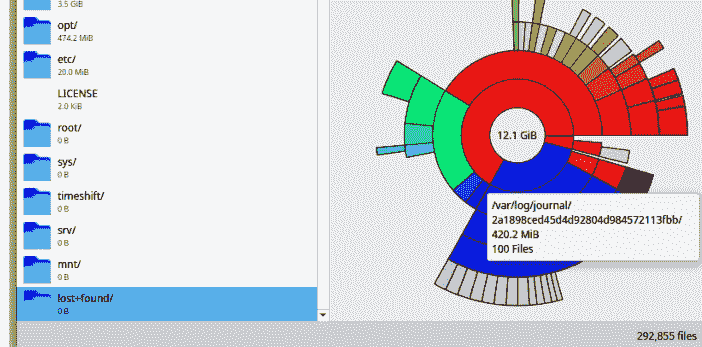

如果你将鼠标光标悬停在饼图的切片上，弹出窗口会显示指向相关目录等的路径。

从安卓手机录制的音频并转换为 mp4；你显然需要安装`ffmpeg`。

```
[andrew@darkstar:~]$ ffmpeg -i simplescreenrecorder-2023-01-08_15.27.44.mkv -vcodec copy -acodec copy -scodec mov_text output.mp4
```

## 安装额外字体

```
sudo pacman -S noto-fonts ttf-ubuntu-font-family ttf-dejavu ttf-freefont ttf-liberation ttf-droid ttf-inconsolata ttf-roboto terminus-font ttf-font-awesome -noconfirm -needed
```

对于手动安装字体，假设你从以下网站获取了字体：

https://www.fontsquirrel.com/

然后举例来说，在以下位置你会有一个名为 Bentham 的子目录：

/usr/share/fonts/

包含以下文件：

```
Bentham
├── Bentham.otf
└── SIL Open Font License.txt
```

要更新系统上的新字体，运行：

```
[andrew@darkstar:~]$ sudo fc-cache
```

## 病毒扫描

我的电脑从未中过病毒，但我曾在 fat32 格式的 U 盘上感染过病毒，如果与使用 Windows 的朋友共享，可能会成为问题。要扫描在 Arch 上挂载于`/run/media/andrew/SPARE`的 U 盘，使用`clamav`的方式大致如下：

```
[andrew@darkstar:~]$ sudo clamscan -r -v --infected --remove=yes /run/media/andrew/spare
```

如果你想扫描自己的计算机，大致如下：

```
sudo clamscan -r -v --infected --remove=yes --exclude-dir=/sys/ --exclude-dir=/proc/ --exclude-dir=/dev/ /
```


排除`/proc/`等位置的原因是，据我了解这些区域是虚拟的，如果尝试扫描它们会导致速度变慢。你必须谨慎使用`--remove=yes`，以防误报。

## 查找内容

在挂载于`/run/media/andrew/TOSHIBA EXT`的外部硬盘上，我想看看是否已经有一个名为`IMG_20160420_093807.jpg`的图片副本。

```
[andrew@darkstar:~]$ find /run/media/andrew/"TOSHIBA EXT" -name IMG_20160420_093807.jpg -print
```

## 简单天气报告

```
[andrew@darkstar:~][1]$ curl wttr.in/Southend-on-sea
```

(04-27 12:30)

Southend-on-sea 的天气预报：

```
\ /   晴朗
 .-.   +12(9) °C
—( )—  ← 24 km/h
`-'    10 km
 / \   0.0 mm
```

## 保存/移动

```
[andrew@darkstar:~/Desktop]$ rsync -av archlinux-x86_64.iso /run/media/andrew/Ventoy/ISO/
```

`rsync`是一个很棒的工具，用于复制包含所有子目录及其内容的目录。在上述命令中，根据我的终端所在位置，我位于 Desktop，其中有一个 iso 文件。我想将其复制到挂载于`/run/media/andrew/Ventoy`的 U 盘上名为"ISO"的目录中。

要移动 iso 文件，你可以使用`mv`命令。


```bash
[andrew@darkstar:~/Desktop]$ mv archlinux-x86_64.iso /run/media/andrew/Ventoy/ISO/ && sync
```

## Tor

在当今世界，我们似乎越来越多地受到监控，而且似乎都没有征求过我们的同意。Tor 通过将你的网络流量重定向到一系列不同的路由器（称为节点）来工作。所以我见过的情况是，某个页面试图确定我的位置，结果显示我在德国。基本上你可以浏览网页，简而言之，就是不让别人追踪你去哪里。还有另一个用途，就是对网站进行渗透测试（当然是白帽），这样从你发起测试的 IP 地址就无法被确定。

现在可能不是一眼就能看出来的，但如果你想访问`https://www.torproject.org/`了解 Tor，你可能会发现浏览器阻止了你——当然，这是我使用 Virgin 宽带时遇到的情况。所以你可能需要做的第一件事是进入你的互联网设置。

使用 Virgin 的话，你必须登录"my virgin"并关闭 child safe。然后通过`pacman`安装：

```bash
[andrew@darkstar ~]$ sudo pacman -S tor torbrowser-launcher torsocks
```

然后启用 tor：

```bash
[andrew@darkstar ~]$ systemctl enable tor
[andrew@darkstar ~]$ systemctl start tor
```

```bash
[andrew@darkstar ~]$ sudo nano /etc/tor/torrc
```

找到显示`#ControlPort 9051`的行，通过删除前面的井号来取消注释。在 nano 中，将光标移到 C 前面，然后按退格键。按 Crtl + o，回车，Ctrl + x。

现在我们通过从菜单启动 tor 浏览器来检查，并访问`https://check.torproject.org`（确保你的 wifi 已开启且已连接）它会确认一切是否正常。有关文档，请参见 man pages 中的 tor，或`https://www.torproject.org/docs/tor-manual.html`。

使用 tor 的示例（也许你的朋友请你做一些白帽的安全检查）：

```bash
[andrew@darkstar ~]$ sudo wpscan --url https://someDomain.com --proxy socks5://127.0.0.1:9050 --enumerate u
```

```bash
[andrew@darkstar ~]$ pacman -Ss wpscan

extra/wpscan 1:3.8.22-3
```

黑盒 WordPress 漏洞扫描器。

你可以使用`wpscan`来测试 Wordpress 网站，如果你在开发环境中并通过`/etc/hosts`设置了登录页面，比如`127.0.0.3`。

## Android 手机

在过去，我会拿相机来拍照，但 inevitably 我虽然有相机，却还是用手机拍照。如今智能手机的拍照规格与相机相比非常有竞争力，大多数人现在只会使用手机。我仍然喜欢把照片放在笔记本电脑上；更大的屏幕更适合编辑。

有几种方法可以把照片从手机传到笔记本电脑。对于单张照片，我只是用雅虎邮箱把照片发给自己，发到我的谷歌邮箱，然后从邮件中挑选照片。

要让手机物理挂载到电脑上，你只需要一根两端分别是 USB 公头和 micro Android 公头的数据线，连接到手机和笔记本电脑的端口。

在 Arch Linux 上，你需要安装以下软件包：

- `gvfs-mtp`
- `android-file-transfer`
- `android-udev`
- `libmtp`

当上述软件包安装完毕，你的手机通过合适的线缆连接后，你应该能在笔记本电脑桌面上看到手机的图标。当你点击它时显示空白，那是因为你可能已经超时退出了手机，这与手机的安全性有关，不允许任何人访问文件，除非他们已登录手机。所以你需要去手机上重新登录自己。这次当你点击手机图标时，你应该会看到类似这样的内容：

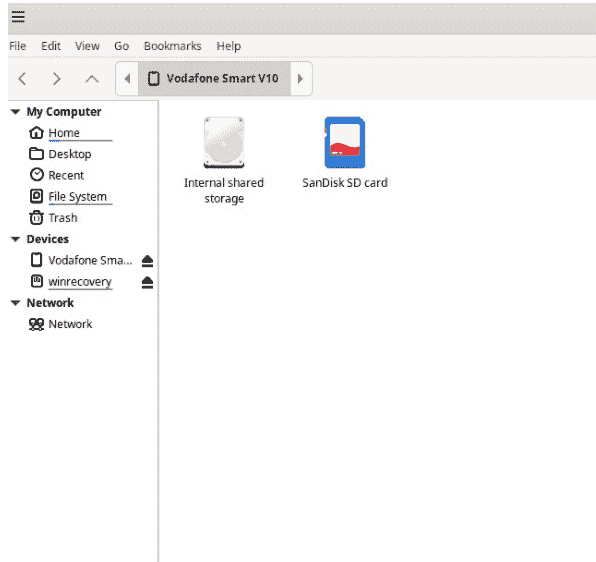

手机相机照片在`DCIM camera`中，whatsapp 图片在`WhatsApp/Media/WhatsApp Images`中。

你可以直接拖放到笔记本电脑桌面上。

## 打印机

对于 Linux，我一直认为惠普打印机最有可能兼容。对于打印机来说，小型个人打印机有点像印钞许可证；我可以告诉你，我的 HP Smart Tank Wireless 455 不属于那个类别；它侧面有墨水仓，墨水相对便宜，而且他们说随附的墨水能用 2 年，他们并没有太离谱。我在想它能用多久？对他们来说太不经济了？

Arch 的软件包：

```text
[andrew@darkstar ~]$ pacman -Ss hplip

extra/hplip 1:3.23.5-1

    Drivers for HP DeskJet, OfficeJet, Photosmart, Business Inkjet and some LaserJet
```

以 root 身份运行`sudo hp-setup`。

CUPS（通用 Unix 打印系统）这个名字是过去从 Unix 系统打印的系统的遗留。使用 cups，你可以通过 URL 获得一个友好的图形界面，通常是：

`localhost:631`

在该地址，你可以添加和管理打印机。让我们安装这个软件包：

```bash
[andrew@darkstar ~]$ sudo pacman -S cups
```

检查其状态：

```bash
[andrew@darkstar ~]$ systemctl status cups

○ cups.service - CUPS Scheduler
    Loaded: loaded (/usr/lib/systemd/system/cups.service; disabled; preset: disabled)
    Active: inactive (dead)
TriggeredBy: ○ cups.socket
      Docs: man:cupsd(8)
```

启用 cups：

```bash
[andrew@darkstar ~]$ systemctl enable cups
```

启动 cups：

```bash
[andrew@darkstar ~]$ systemctl start cups
```

一旦 cups 启动并运行，你可以像这样使用命令行：

```bash
[andrew@darkstar Desktop]$ lpstat -p -d

printer HP_Smart_Tank_Wireless_450_series is idle.  enabled since Fri Jun 23 08:23:21 2023

no system default destination
```

让我们看一下 GUI：

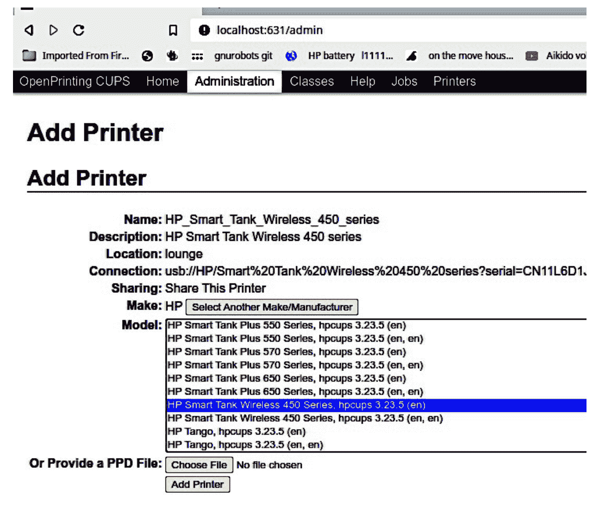

要进入 CUPS 图形界面，我只需打开浏览器并访问 URL：

[http://localhost:631/](http://localhost:631/)

选择 Administration 菜单选项，然后选择"add printer option"，只需选择与我的打印机规格最接近的选项即可，如你所见是 450 系列。填写空白处非常简单，比如"Location"我就输入了"my office"。有一点可以节省你的时间，就是勾选"share printer"的复选框。你还有机会查看如何设置默认值，比如 A4 等。

## Web 开发

### 简介

我听很多人说他们使用 wix 和其他网站来构建网页。我的看法是，这有点像目标是砌一堵墙，而你控制一个机器人一块一块地放砖。所以这样做了 5 年，你仍然不能自己砌一块砖。但如果你从慢开始，一步一步，一次一个元素，那么用不到 5 年，你就再也不用依赖任何东西或任何人来构建网页了。我们会慢慢来，轻松学习。html5 是最新的规范，你可以在以下网址阅读全部内容：

`https://html.spec.whatwg.org/`

安装 geany 后，你可以通过以下方式生成一个现成的 html5 规范文件：

`file->new with template-> file_html5.html`

这就是我得到的结果：

```html
<!DOCTYPE html>

<html lang="en">

<!--

  untitled.html

    Copyright 2023 Unknown <andrew@darkstar>

  This program is free software  etc etc

-->

<head>

<meta charset="utf-8" />

<title>untitled</title>

<meta name="generator" content="Geany 1.38" />

</head>

<body>

</html>
```

相对于你可能在其他 html 生成软件中看到的，上面的代码相当简洁。有几点要提一下：html 就是他们所说的"标记语言"，它全部关于如何配置事物的外观。所以当你编辑了一行代码时，先别急着在简历上写"内核黑客"！

保存时我们需要给文件命名。现在你可能在想的一个问题是，当网页服务器上有一堆 html 文件时，服务器怎么知道要从哪个文件开始渲染？简单的答案是，网页服务器被配置为查找`index.html`、`index.php`文件。渲染的意思是获取标记并用它来显示网页。

html 和 php 的区别在于，html 文件过去被称为"静态页面"；这是因为它们的内容始终相同，除非你登录到你的托管服务进行实时编辑，或者你制作一个编辑过的版本并上传到你的网页托管，这将覆盖旧页面。访问共享托管的网页服务器通常通过 cPanel 等方式完成。

另一方面，PHP 是一个功能完备的面向对象编程（OOP）语言，其变量作为值的占位符，可以在运行时动态更改。如果你使用`pacman`搜索 PHP，截至 2023 年 6 月，你会看到以下内容：

```bash
[andrew@darkstar Desktop]$ pacman -Ss php
```

**extra/php 8.2.7-1**

一种通用脚本语言，特别适用于 Web 开发。

（如果你只是用 pacman 搜索，不需要 sudo。）

那么让我们安装 php：

```bash
[andrew@darkstar Desktop]$ sudo pacman -S php
```

检查一下：

```bash
[andrew@darkstar Desktop]$ php -v

PHP 8.2.7 (cli) (built: Jun 10 2023 08:47:39) (NTS)

Copyright (c) The PHP Group

Zend Engine v4.2.7, Copyright (c) Zend Technologies

[andrew@darkstar ~]$
```

现在使用我们的终端，我们将创建一个目录，并将一个 html 文件放入其中：

```bash
[andrew@darkstar ~]$ cd Desktop
[andrew@darkstar Desktop]$ mkdir webplay
```

通过使用导航保存的方式，使用 geany 菜单我们可以将文件`index.html`保存到`webplay`目录。

现在我们将使用 php 内置的功能，通过终端来提供我们的文件：

```bash
[andrew@darkstar Desktop]$ php -S localhost:8080 -t webplay

[Sat Jun 24 09:37:26 2023] PHP 8.2.7 Development Server (http://localhost:8080) started
```

（不要关闭你的终端，关闭后服务就会停止。）

现在打开一个你选择的浏览器，在地址栏顶部（而不是 Google 搜索框中）输入：

`localhost:8080`

你看到了什么，没错，跟我一样，一个空白页面。

我们得到一个空白页面，是因为虽然在文件`index.html`中有几行文本，但它们都是样式的占位符，没有实际内容。让我们修复一下，在`webplay`上左键单击，右键单击 -> 用 geany 打开`index.html`。

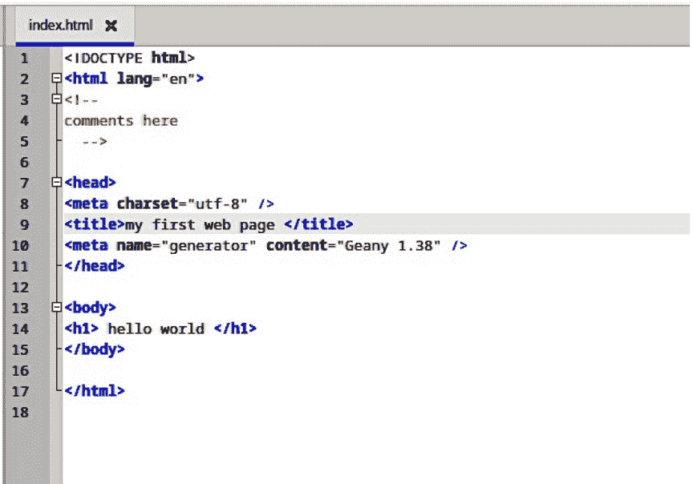

现在刷新你的浏览器：

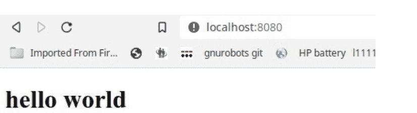

现在让我们将`index.html`重命名为`index.php`，你可以通过鼠标右键单击文件来完成。

所以现在我们有了：

```text
[andrew@darkstar Desktop]$ tree -L 1 webplay

webplay

└── index.php
```

刷新浏览器，显示的内容应该没有区别。基本上，当一个文件具有`.php`扩展名时，HTML 标记仍然会被渲染，但变量也会被执行。

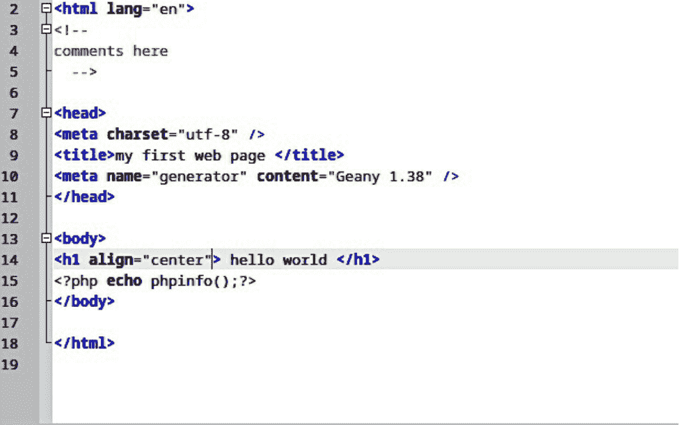

刷新浏览器：

`hello world`

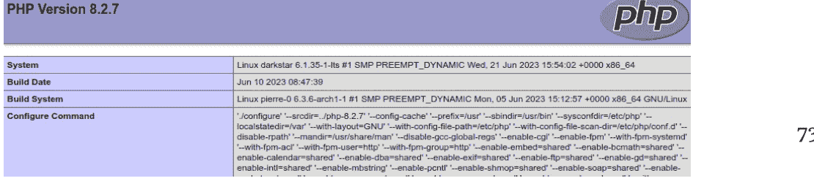

`phpinfo();`

是 PHP 的一个内置函数。当你打开浏览器并在地址栏中输入 URL 或点击链接时，你实际上是在连接到一个持有网页的服务器，并且你正在请求该页面在你的浏览器中被渲染和显示。

当你拨打固定电话给某人时，有一个流程和协议。网络方面区别不大。在幕后，客户端计算机（你的）通过 Web 浏览器开始一个"握手"，并就它们如何相互通信达成一致。如果你查看地址栏，以前你会看到 http，它代表超文本传输协议；现在你 mostly 看到 https，这是安全的。

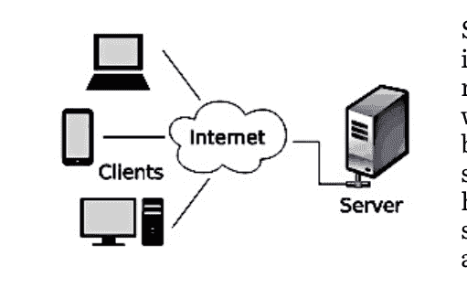

所以在左边的图中，你的计算机通过互联网服务提供商能够向持有你想要访问的网页的服务器发出请求。对于我们的`index.PHP`文件，我们使用了 PHP 内置的服务器功能，这是一个最简单的系统。我们将继续深入一点，然后看看使用我们自己的功能完备的 Web 服务器"apache"，它将在我们的机器上运行，我们将通过"localhost"连接到它。

Web 开发的真正强大之处在于，当你能够实现与数据库的交互时。记录形式的数据可以被存储、检索等，如今通常被称为"CRUD"操作。

我们将初步看一下这个问题，至少向你展示它可能并不像你想象的那么难。

我们将使用 sqlite 来实现，它是一个"无服务器"数据库，这意味着与 MySQL 不同，它不需要在后台运行守护进程。不要产生认知扭曲，认为 sqlite 不如 MySQL 安全。这取决于如何使用它。直接访问数据库可能更难，但如果你看看 WordPress，让这个 CMS 向"用户"展示数据库中的内容是非常容易的，除非已经采取了措施。大多数使用 WordPress 的活跃网站通常都没有采取这些措施。

好的，让我们安装 sqlite 和它的浏览器：

```bash
[andrew@darkstar ~]$ sudo pacman -S sqlite sqlitebrowser
```

我们可以使用命令行来创建数据库；我们也可以使用命令行来填充数据库的字段和数据，但使用 GUI 更容易。首先，我们将导航到我们的目录：

```bash
[andrew@darkstar ~]$ cd Desktop/webplay
[andrew@darkstar webplay]$
```

```text
[andrew@darkstar webplay]$ sqlite3 myDatabase.db

SQLite version 3.42.0 2023-05-16 12:36:15

Enter ".help" for usage hints.

sqlite>
```

上面的`sqlite>`意味着我们已经进入了 sqlite 提示符；我们将退出并查看是否有任何内容列出：

```text
sqlite> ctl+D
```

```bash
[andrew@darkstar webplay]$ ls

index.php  myDatabase.db

[andrew@darkstar webplay]$
```

好的，现在我们有了一个数据库，它只是一个文件。让我们启动 sqlitebrowser：

```bash
[andrew@darkstar webplay]$ sqlitebrowser
```


使用菜单“文件”->“打开数据库”，你应该看到`myDatabase.db`被高亮显示。点击打开按钮。你应该看到这样。它显示 GUI 已经打开了我们的数据库`myDatabase.db`，但里面什么都没有。所以接下来，看图片左侧，你可以看到“创建表”。

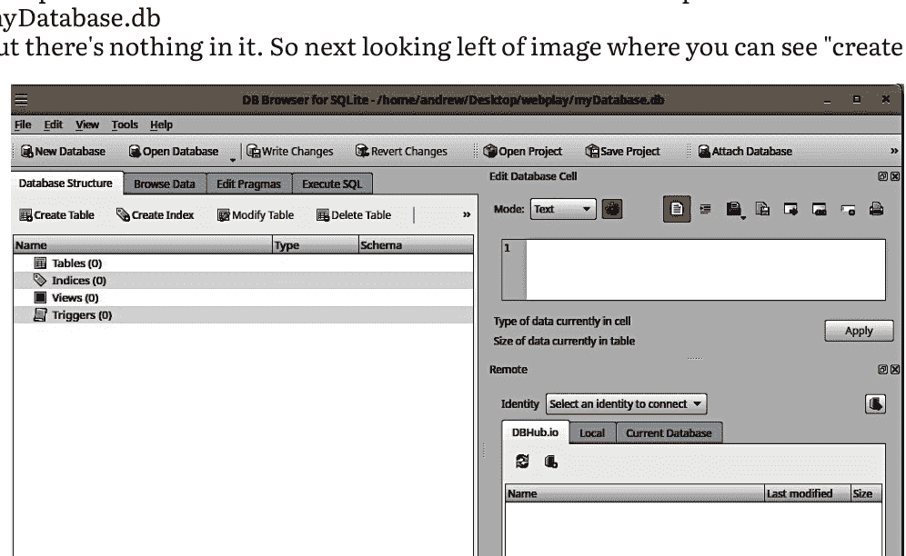

75

我们将创建一个表，创建字段，然后用几条记录填充它。

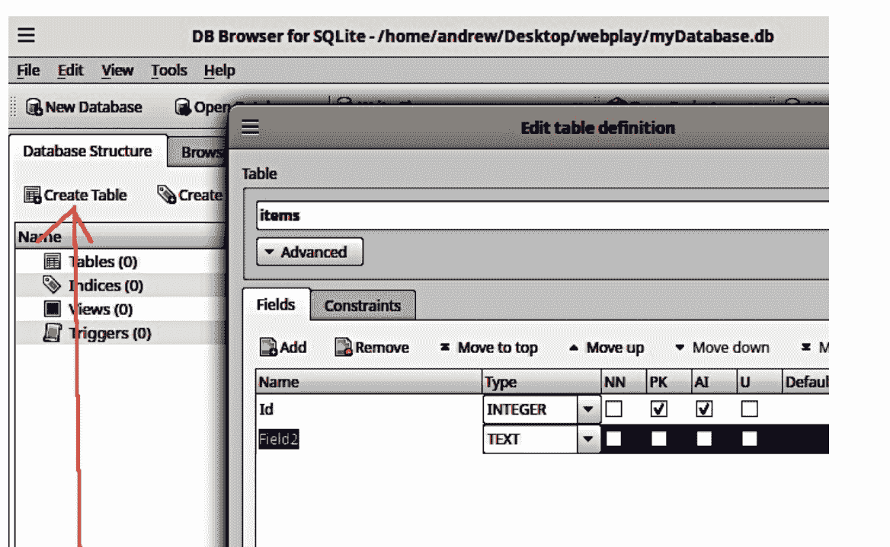

在上面的操作中，点击“创建表”会弹出一个新的 GUI 窗口。我打算只创建三个字段：`Id`、`item`、`Price`。数据库需要对每条没有重复的记录进行引用。我已经勾选了 PK 和 AI 复选框。AI 是自动递增，这将有助于我们使用`php`填充表时。你在上面看到我已经点击了添加按钮来创建第一个字段，并再次点击以创建第二个字段。

这样做之后，你可以看到“占位符”文本`Field2`，点击那个高亮的文本并输入第二个字段的名称。在我的例子中是`Items`。对于`sqlite`，每条记录的唯一引用（在我们的例子中名为`Id`）必须是整数。之后，字段的类型可以是`"text"`，它将愉快地接收字母数字。

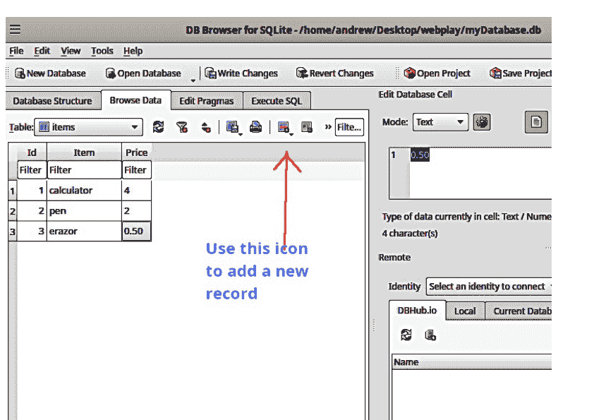

既然我们的文件已经就绪，我们现在可以通过点击打印图标右侧的图标来创建记录，然后在`item`列和`price`列中输入内容，因为`Id`字段是自动递增的。确保你左键点击了“写入更改”。当你退出 GUI 时，可能会再次询问你是否要保存。点击是。

我们不会太深入地使用命令行来查询我们的数据库，但我们可以用它来验证在使用 PHP 之前我们已经有数据了。

```bash
[andrew@darkstar webplay]$ ls

index.php  myDatabase.db

[andrew@darkstar webplay]$ sqlite3 myDatabase.db

SQLite version 3.42.0 2023-05-16 12:36:15

Enter ".help" for usage hints.

sqlite> .databases

main: /home/andrew/Desktop/webplay/myDatabase.db r/w

sqlite> .tables

items

sqlite> select * from items;

1|calculator |4

2|pen|2

3|eraser|0.50

sqlite>
```

从命令行查询`sqlite`数据库是一项需要掌握的技能和品味，如果你想了解更多，这个网站很好。

[https://www.sqlite.org/cli.HTML](https://www/suchite.org/cli.HTML)

值得一说的是，SQLite 可以支持高达 281 TB 数据的数据库。我认为这对大多数人来说已经足够了，我真的不知道为什么更多人不用`sqlite`。当我们开始使用 CodeIgniter 时，你会看到它确实简化了生活。我在我所有的网站中都使用`sqlite`，而且它从未成为安全问题。

现在让我们看看如何使用我们的`index.php`连接到`sqlite`数据库，并使用我们的数据库文件名来渲染数据：

```text
[andrew@darkstar Desktop]$ tree -L 1 webplay

webplay

├── index.php

└── myDatabase.db
```

我们需要在`/etc/php/php.ini`中启用`extension=sqlite3`，通过从` ;extension=sqlite3`中删除“;”。

我们还需要安装`php-sqlite`：

```bash
[andrew@darkstar ~]$ sudo pacman -S php-sqlite
```

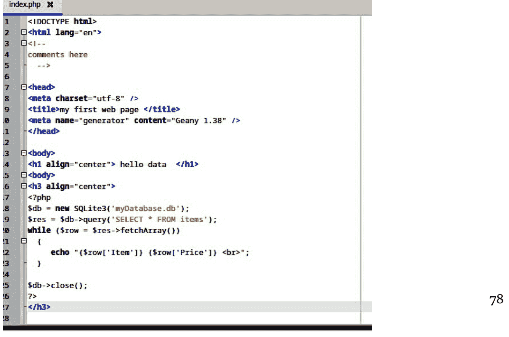

以下是我们在`index.php`中的代码，以防你无法看到上面的图片。不幸的是，标准截图的 DPI 通常只有约 75 DPI。

```php
<!DOCTYPE html>

<html lang="en">

<!--

comments here

沿袭 -->

<head>

<meta charset="utf-8" />

<title>my first web page </title>

<meta name="generator" content="Geany 1.38" />

</head>

<body>

<h1 align="center"> hello data </h1>

<body>

<h3 align="center">

<?php

$db = new SQLite3('myDatabase.db');

$res = $db->query('SELECT * FROM items');

while ($row = $res->fetchArray())

{

    echo "{$row['Item']} {$row['Price']} <br>";

}

$db->close();

?>

</h3>
```

旁边是渲染后的输出：

**hello data**

calculator 4  
pen 2  
eraser 0.50

几点说明：我们使用了已安装的 PHP，要让它运行起来，我们不得不编辑一些配置文件并安装软件包。所有这些都是基于我们已安装系统的上下文进行的。

关于 XAMPP（来自“Apache Friends”，至少他们以前叫这个名字）之类的产品，简单提一句。在 Linux 上安装 XAMPP 后，它会放到`/opt`目录。使用它时，你需要记住的是：编辑`/etc/php/php.ini`据我所知对 XAMPP 绝对没有任何影响，也不会起作用。这是因为 XAMPP 实际上并没有被“安装”。它作为一个“嵌入式”系统工作，所以自带了所需的全部内容。如果你使用 XAMPP，可能会非常困惑，因为在你的实际系统上安装和配置的内容与嵌入式 XAMPP 中的内容之间存在 dichotomy（二分对立）。

我以前玩过 XAMPP，而且使用原生 Apache 确实有其学习曲线。我将尝试带你走过这个过程，并让 CodeIgniter4 运行起来。

## HTML5 和 PHP 的呈现与样式

简单说一下 HTML5 和 PHP 的呈现与样式。回顾一下，PHP 基本上与 HTML 相同，只是文件扩展名为`.php`，并且包含以下形式的代码块：

```php
<?php       ?>
```

简单说一下呈现方面，过去几年变化很大，以前为了获得理想的外观，不得不在表格中嵌套表格，简直是一种“灾难”。层叠样式表（CSS）的发展带来了巨大的改变。现在关于选择可能会让人不知所措。但就像所有事情一样，从一小步开始。你可以将样式放在`<head>`和`</head>`之间，像这样：

```html
<style>

h3{

        color:maroon;

}

</style>
```

或者在`<head>`和`</head>`之间放一行链接到外部样式表的代码：

```html
<link rel="stylesheet" type="text/css" href="style.css " />
```

以上假设样式表位于网站根目录，并使用“相对 URL”。这变得越来越复杂，所以我觉得最好让别人去做这项工作，直接利用他们已有的成果。我自己就用 Bootstrap，参见[https://getbootstrap.com/docs/3.3/getting-started/](https://getbootstrap.com/docs/3.3/getting-started/)。

稍后我会看看如何在 CodeIgniter PHP 框架中使用 Bootstrap。

我们继续，原始 PHP 还可以，但对于大型 Web 应用，到了某个时候你会发现只见树木不见森林。然后你会开始想，我需要某种逻辑架构、结构以及使用方法。

嗯，这已经由创建 PHP 框架（如 CodeIgniter4）的开发者们完成了。

## CodeIgniter

CodeIgniter 由 Rick Ellis 开发，于 2006 年由 EllisLab 发布。它曾经非常流行，后来失宠并有点迷失了方向。

**CodeIgniter ®**

是 CodeIgniter 基金会的注册商标，于 2019 年从英属哥伦比亚理工学院转让而来。CodeIgniter 商标由 CodeIgniter 基金会所有，并可能已注册。CodeIgniter 目前正在积极开发中，截至 2023 年版本为 4.3.6。

### 免责声明

我在本出版物中撰写的关于 CodeIgniter 的任何内容均未经 CodeIgniter 基金会或任何 CodeIgniter 开发者认可。

还有其他 Web 系统，比如 WordPress，它是一个内容管理系统（CMS）；我很喜欢它的插件系统，并且自己也写过一个插件。我的立场是，WordPress 主要面向不编程的人群。如果你看看它的内部工作原理，从 PHP 的 OOP `类::方法`角度来看，并不是很优雅。

WordPress 确实有大量的插件目录，这是它的主要吸引力所在。我喜欢 CodeIgniter 的地方在于，我发现很容易编写自己的 PHP 类及其方法来实现我想要的功能，并能将它们无缝集成到框架中使用。使用 CodeIgniter，你可以轻松拥有以 PHP 类及其方法形式的插件。你可能需要自己编写或找人来做，但我看到越来越多可用于 CodeIgniter 的代码正在出现，比如 Shield，这是一个用于身份验证和授权的代码。

作为后续 Web 开发的一部分，我将介绍如何安装 CodeIgniter、从其中获取一些基本功能、进行版本控制，并使其具有响应式网页设计，无论是在笔记本电脑还是手机上查看。首先我们需要一个开发环境，在本例中将是 Apache Web 服务器。

## Apache Web 服务器

计算机领域不断进步，随着“云”的出现而变化——这是某个营销大师想出的花哨术语，实际上等同于“嘿，你的东西仍然在别人的电脑上，即使虚拟化是其中的一部分”。

所以随着云计算的兴起，场景正在发生变化，但 Apache 仍然占据着很大的 Web 托管份额；主要是 Apache 运行在 Linux 上。如果你开始在自己的机器上玩代码和 Apache，当你将网站部署到实时托管环境时会很有帮助。

好的，我们将安装 Apache Web 服务器，然后逐步修改配置，让它按照我们想要的方式为我们工作。稍后我将使用`composer`安装 CodeIgniter，设置好以便可以访问着陆页并链接到数据库。

目前，我们先安装 Apache 并让它运行起来，提供单个`index.php`文件，然后我们再继续。我们必须处理权限问题，我认为这往往会让人们倾向于使用 XAMPP，如果他们发现自己无法按想要的方式让它工作的话。我想起来会补充其他内容。

### 安装 Apache

```bash
[andrew@darkstar ~]$ sudo pacman -S apache php-apache
```

启用它，使其在每次启动时自动运行：

```bash
[andrew@darkstar ~]$ sudo systemctl enable httpd
```

我不想重启，但仍想运行 Apache，所以我要启动它：

```bash
[andrew@darkstar ~]$ sudo systemctl start httpd
```

注意，启用/启动服务的方法采用以下形式：

`systemctl`“动词”“服务单元”

让我们检查一下状态：

```text
[andrew@darkstar ~]$ systemctl status httpd

● httpd.service - Apache Web Server

     Loaded: loaded (/usr/lib/systemd/system/httpd.service; enabled; preset: disabled)

     Active: active (running) since Wed 2023-06-28 09:53:17 BST; 18s ago
```

我没有粘贴完整的输出，但“Active: active(running)”这几个字意味着一切正常。

我在 Linux 方面有几条准则，似乎一直帮助我保持良好状态；我来告诉你它们是什么：

1. 先让东西工作起来，但要尽量减少复杂性，然后在此基础上继续。
2. 你以 root 权限花的时间越多，就越有可能滥用权力并搞砸某些东西。
3. 如果你不理解某件事，就继续阅读直到你理解为止。

所以考虑到上面的第 1 条，我们将回到 HTML 文件，将该文件放在桌面上，复制到我们的 Web 托管目录，看看在 Web 浏览器中渲染是否正常，然后再看看编辑的方法。

所以从菜单启动 Geany，创建一个名为`index.html`的 HTML5 模板文件：

```html
<!DOCTYPE html>

<html lang="en">

<head>

<meta charset="utf-8" />

<title>untitled</title>

<meta name="generator" content="Geany 1.38" />

</head>

<body>

<h1>hello </h1>

</body>

</html>
```

打开终端并导航到 Desktop：

```bash
[andrew@darkstar ~]$ cd Desktop

[andrew@darkstar Desktop]$
```

列出文件，看看它是否存在：

```bash
[andrew@darkstar Desktop]$ ls | grep 'index.html'

index.html
```

将它复制到`/srv/http/`：

```bash
[andrew@darkstar Desktop]$ sudo cp index.html /srv/http/
```

看看它是否已到达：

```bash
[andrew@darkstar Desktop]$ ls /srv/http/ | grep 'index.html'

index.html
```

现在看看它是否能正常渲染；启动 Web 浏览器，Web 服务器的 URL 是`127.0.0.1`，所以我们直接将其输入到 Web 浏览器顶部的地址栏中。

是的，HTML 渲染正常。

一个值得一看的文件是`httpd.conf`。

让我们看看这个文件：

```bash
[andrew@darkstar Desktop]$ cat -n /etc/httpd/conf/httpd.conf | less

（按键盘上的 q 退出 cat 命令）
```

向下滚动到第 201 和 202 行，我看到：

```text
201 User http

202 Group http
```

通常在 Linux 文件系统中，root 是 king（王者）。看看以下命令的输出：

```bash
[andrew@darkstar ~]$ ls -la /etc
```

你会看到 root:root。

现在 Apache 略有不同；基本原理是 root 参与 Apache 的启动过程，然后有一个“交接”过程，Apache 最终以`http:http`用户和组的身份运行。

在 Linux 上使用 Apache 的一个恼人问题是，作为普通用户，你会发现无法用普通用户权限编辑 http 中的文件。当然，作为 Web 开发者，这正是你想要，而且需要做的事情。更好的方法是先在开发环境中搭建你的 Web 项目，把问题都处理好，然后再更新到正式服务器，而不是通过 cPanel 直接编辑生产环境的文件。

在生产服务器上，目录权限通常是`755`，文件权限是`644`。

解决编辑问题的一种方法，是将`/srv/http`的组所有权设置为`http`，然后为`http`组添加写权限。同时，将自己作为用户添加到`http`组中。这样你应该就能编辑了。有一点可能会让你栽跟头，那就是你需要注销并重新登录才能生效。我们来操作一下。

如果你忘了自己是谁：

```bash
[andrew@darkstar ~]$ whoami

andrew
```

让`andrew`加入尊贵的`http`俱乐部：

```bash
[andrew@darkstar Desktop]$ sudo usermod -a -G http andrew
```

上面这条命令让`andrew`用户加入`http`组，同时保留已加入的其他组成员身份。接下来我们将`/srv/http`的组所有者改为`http`，并为该组添加写权限。

```bash
[andrew@darkstar Desktop]$ sudo chgrp --recursive http /srv/http

[andrew@darkstar Desktop]$ sudo chmod --recursive g+w /srv/http
```

记得注销并重新登录，或重启系统，以使更改生效。我们稍后会进一步细化权限。接下来试试 PHP 文件。一种方法是使用`mv`命令将`index.html`重命名为`index.php`。

```bash
[andrew@darkstar ~]$ mv /srv/http/index.html index.php
```

我们来创建`httpd.conf`的备份：

```bash
[andrew@darkstar conf]$ sudo cp /etc/httpd/conf/httpd.conf /etc/httpd/conf/httpd_bk.conf
```

这样如果我们搞砸了任何东西，我们还有原始文件可以参考。

再来看看`/etc/httpd/conf/httpd.conf`：

```bash
[andrew@darkstar ~]$ cat -n /etc/httpd/conf/httpd.conf | less
```

在第 289-291 行，它基本上是在说只识别 html 后缀的索引文件。

```apache
<IfModule dir_module>

    DirectoryIndex index.html
```


</IfModule>

所以我们要用`nano`编辑该文件，在`index.html`后面添加`index.php`。

按`alt+shift+3`显示行号，然后到第`290`行，添加`index.php`。

现在这些行看起来像这样：

```
<IfModule dir_module>
    DirectoryIndex index.html index.php
</IfModule>
```

还有一点工作要做，所以先不要关闭`nano`。到第`66`行，在`LoadModule mpm_event_module modules/mod_mpm_event.so`前面加上`#`号；在第`67`行，去掉`LoadModule mpm_prefork_module modules/mod_mpm_prefork.so`前面的`#`。

在第`190`行之后添加：

```
LoadModule php_module modules/libphp.so
AddHandler php-script .php
```

大约在第`529`行（包含列表的末尾）添加：

```
Include conf/extra/php_module.conf
```

重启 Apache：

```
[andrew@darkstar conf]$ sudo systemctl restart httpd
```

回顾一下，`/srv/http`中的文件是：

```
<!DOCTYPE html>
<html lang="en">
<head>
<meta charset="utf-8" />
<title>untitled</title>
<meta name="generator" content="Geany 1.38" />
</head>
<body>
<h1>hello </h1>
<?php
echo "<h1>hello from  apache</h1>";
?>
</body>
</html>
```

现在使用 URL `127.0.0.1`的输出是：

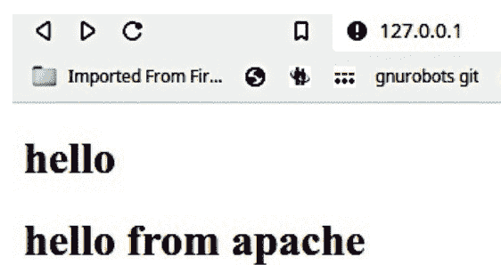

## Composer

一个 Web 项目的代码，如果其核心是`CodeIgniter4`的话，很可能会发生变化，你可能想要更新 CI4 的核心，特别是在有安全更新的时候。这就可能带来焦虑。

你希望更新是无缝的、同质的，具有全面的兼容性。这就是`composer`真正发挥作用的地方。关键是，软件的安装方式往往有多种选择。有些提供整个项目的 zip 包，同时也可以用`composer`安装。现在，你可能会理所当然地认为，zip 下载的代码和使用`composer`的代码会完全一样。嗯，通常我是个很淡定的人，你可能会看出我是个像 Ringo Star 那样打招呼风格的人，说着"和平与爱"，同时用手比划着 V 字爱的手势。但当我发现，软件开发者对同一版本的代码竟然提供不同的代码时，我 tends to shoot from the hip（忍不住要开喷）。总之，需要指出的是，如果你用 zip 形式下载`CodeIgniter4`，然后想用`composer`来更新，这恐怕会导致一个让人抓狂的场景，大概不会有任何爱与和平的感觉。所以，用`composer`安装吧，你知道可以用`composer`更新，一切都会好的。

说完这些我感觉好多了，正如心理学界所说"说出来比憋着好"。那么什么是`composer`？在这里阅读完整故事：

[https://getcomposer.org/](https://getcomposer.org/)

简单来说，它是一个你从命令行使用的软件，你可以用一行命令安装另一个完整的软件包，比如`CodeIgniter4`，或者同样参与过 Twitter 的前端`Bootstrap`。它会在你的 Web 根目录放置一个`composer.json`文件。该文件以文本形式保存你用`composer`安装了什么的引用。你可以调整文本，以限制软件到特定版本，或者设置成当运行`composer update`时，将列出的内容更新到最新版本。

实际上，这意味着如果你的 Web 使用`CodeIgniter4`、`Bootstrap`、`PHPMailer`等组件，你可以通过终端命令用`composer`保持全部更新。我还得提另一个工具，它能让你避免潜在的愤怒，那就是版本控制。它救过我的次数多到数不清。这个我稍后会说。

你可以在以下网址浏览可以用`composer`安装的包：
[https://packagist.org/](https://packagist.org/)
它提到了安装`composer`的步骤；别管那些，我们用 Arch 的方式来安装。

```
[andrew@darkstar ~]$ pacman -Ss composer
extra/composer 2.5.8-1
  Dependency Manager for PHP
[andrew@darkstar ~]$ sudo pacman -S composer
[sudo] password for andrew:
resolving dependencies...
```

通过`pacman`安装意味着你可以用`pacman`管理这个包。

最好在你想要的软件网站上 double check 一下，看看是否有任何差异。我注意到`packagist`上的`composer`安装方式，和我通常采用的方式不同。

## CodeIgniter 4

要通过终端安装最新的`CodeIgniter4`，首先切换到要安装的目录。另外一点，趁我还没忘，不要用`sudo`或`root`来运行`composer`；从`$`提示符下使用它。如果你想把笔记本上的版本更新到生产环境。我发现最省心、零焦虑的方式就是直接在笔记本上用`composer`更新所有内容。把开发版本以适当的方式打包；这个后面再说，然后 simply upload 打包好的组件，通过`cPanel`解压。新的代码会覆盖旧的 [note screen shot CI4 on live web]

即使使用`composer`，`CodeIgniter`也有几个版本，我们来看看，从`appstarter`开始。我们将安装`appstarter`版本的 CI4，放在`/srv/http`下的子目录中。

```
[andrew@darkstar ~]$ cd /srv/http
[andrew@darkstar http]$ ls
index.php
[andrew@darkstar http]$ composer create-project codeigniter4/appstarter joesoapdev --no-dev
```

在上面，`joesoapdev`将是`http`内子目录的名称，我使用`--no-dev`是因为我想从精简开始，如果需要其他东西可以稍后再加。
好的，运行没有问题，但有一个提示：

> [
Running update with --no-dev does not mean require-dev is ignored, it just means the packages will not be installed. If dev requirements are blocking the update you have to resolve those problems.
]

我预期会有`vendor`目录，但它缺失了；然而当我从终端切换到`joesoapdev`目录并运行：

```
[andrew@darkstar joesoapdev]$ composer update --no-dev
```

这是我得到的：

```
[andrew@darkstar http]$ tree -L 1 joesoapdev
joesoapdev
├── LICENSE
├── README.md
├── app
├── builds
├── composer.json
├── composer.lock
├── env
├── phpunit.xml.dist
├── preload.php
├── public
├── spark
├── tests
├── vendor
└── writable
```

现在让我给你看看我在使用 CI4 的实时托管环境上所部署的内容，这正是你所需要的。

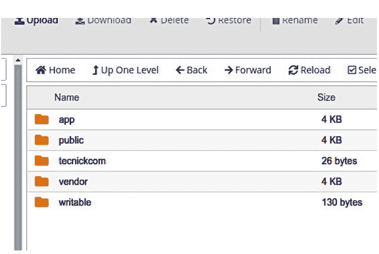

还有一个`tecnickcom`目录，那只是我最初设置它时的样子。

在下一页，我会展示我的网络托管结构图，并解释它是如何设置的。

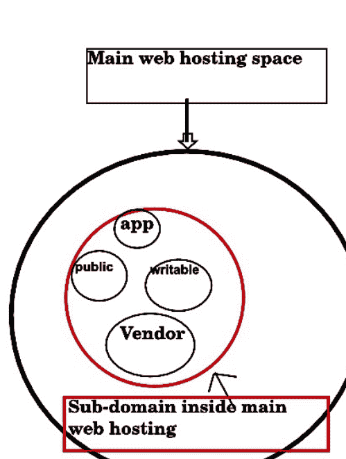

为了安全起见，`CodeIgniter`的设计使得只有`public`目录中的内容可以从 web 访问。如果你打算只在你的主托管环境中部署 CI4 而不放其他东西，那么你部署的方式应该是，将`public`目录中的内容放到你的主 web 托管根目录中。

你可以把其他的组件`app`、`writable`和`vendor`打包到一个目录中，并将这个目录放在主托管目录的上一级。然后你需要编辑`public`目录中的`index.php`。下面这一行就是你需要修改的：

```
require FCPATH . '../app/Config/Paths.php';
```

你可以在上面的行中引用包含`app`、`writable`和`vendor`的目录名称，比如说你把它叫做`othercomponents`，就变成类似这样：

```
require FCPATH . '../othercomponents/app/Config/Paths.php';
```

现在对于我在子目录上的设置，做法略有不同。在我的托管环境中使用`cPanel`，我必须使用附加域名（add on domains），让域名指向托管空间，并设置文档根目录为：

```
domainName.org/public
```

如果使用子域名，在我的托管环境中，任何人使用我的某个域名时，URL 都会指向上面图中子域名的`public`目录。

我在`packagist`上查看了 CI4 的地址：
https://packagist.org/packages/codeigniter4/framework

推荐的安装方式大致如下：

```
[andrew@darkstar http]$ composer create-project codeigniter4/framework myweb2 --no-dev
```

其中`myweb2`会是子目录的名称；我之所以说"会是"，是因为我遇到了一个问题，提示`intl`在我的平台上不可用。让我们快速看一下`/etc/php/php.ini`：

```
[andrew@darkstar ~]$ grep -n 'intl' /etc/php/php.ini
929:;extension=intl
```

好的，我找的扩展在第`929`行，但`intl`没有被启用，所以我们把它启用吧，因为不启用的话其他东西肯定会出问题。所以使用`nano`，我把该行前面的`;`去掉，现在变成：

```
extension=intl
```

```
& 从第 938 行
extension=pdo_sqlite
ctl+o, 回车, ctl+x
```

好的，这次没问题了。我们用`tree`命令看看目录结构，如果你没有这个命令，请通过`pacman`安装：

```
[andrew@darkstar http]$ tree -L 1 myweb2
myweb2
├── LICENSE
├── README.md
├── app
├── composer.json
├── composer.lock
├── env
├── phpunit.xml.dist
├── preload.php
├── public
├── spark
├── system
├── tests
├── vendor
└── writable
```

这个版本不太干净，同时有`vendor`和`system`文件夹。我的脑子比较小，很容易被搞糊涂，所以我更喜欢先用`app starter`的方法。

现在我们来设置`/etc/hosts`文件，以便按照我们想要的方式展示我们的着陆页。

目前在`/etc/hosts`中：

```
## Static table lookup for hostnames.
## See hosts(5) for details.
127.0.0.1 localhost
::1
127.0.1.1 darkstar.localdomain darkstar
```

我要用`nano`把它编辑成：

```
## Static table lookup for hostnames.
## See hosts(5) for details.
127.0.0.1 localhost
::1
127.0.1.1 darkstar.localdomain darkstar
127.0.0.3 joesoapdev
```

我以前有过多个子域名，使用以下方式设置了它们的着陆页：

- `127.0.0.3`
- `127.0.0.4`
- `127.0.0.5`
- `127.0.0.6`

一切正常，每个本地 URL 都会为不同的 web 开发项目展示对应的着陆页。基本上与实时环境类似的设置，只不过我要到购买域名的服务商那里，将域名指向我的托管空间。我在托管空间中添加了域名，然后编辑域名/子域名的文档根目录，使其指向`CodeIgniter`的`public`目录。

现在我们要使用虚拟主机来解决这个问题：我们需要将 web 环境的文档根目录指向`public`目录。你可以通过向`/etc/httpd/conf/httpd.conf`添加代码目录来实现，但如果你有好多个开发项目，更整洁的做法是编辑`/etc/httpd/conf/httpd.conf`，让它查找并接收使用虚拟主机文件，然后将这些适当命名的文件放在`/etc/httpd/conf/vhosts`中。

让我们从编辑`/etc/httpd/conf/httpd.conf`开始：

大约在第`292`行，你会看到这一行：

```
AllowOverride None
## 把这行注释掉，变成
#AllowOverride None
## 然后在下面写
AllowOverride All
```

大约在第`519`行，你会看到：

```
## Virtual hosts
#Include conf/extra/httpd-vhosts.conf
```

去掉`Include`那行前面的井号，使它变成：

```
Include conf/extra/httpd-vhosts.conf
```

在`httpd.conf`大约第`542`行，我检查了这行是否存在，如果没有的话加上：

```
Include conf/extra/php_module.conf
```

我们需要一个目录来放置虚拟主机文件，恰当地叫它`vhosts`。所以我们来创建它。

```
[andrew@darkstar ~]$ cd /etc/httpd/conf
[andrew@darkstar conf]$
[andrew@darkstar conf]$ ls
extra httpd.conf httpd_bk.conf httpd_bk2.conf magic mime.types
[andrew@darkstar conf]$ sudo mkdir vhosts
[sudo] password for andrew:
```

现在我们的`httpd`目录结构看起来是这样的：

```
[andrew@darkstar etc]$ tree -L 2 httpd
httpd
├── conf
│   ├── extra
│   ├── httpd.conf
│   ├── httpd_bk.conf
│   ├── httpd_bk2.conf
│   ├── magic
│   ├── mime.types
│   └── vhosts
└── modules -> /usr/lib/httpd/modules
```

现在我们可以打开`geany`，为我们的 web 开发环境`joesoapdev`创建一个虚拟主机文件。文件的属性为纯文本。

回顾一下我们在`/etc/hosts`中的条目：

```
[andrew@darkstar etc]$ cat /etc/hosts
## Static table lookup for hostnames.
## See hosts(5) for details.
127.0.0.1  localhost
::1
127.0.1.1  darkstar.localdomain darkstar
127.0.0.3  joesoapdev
```

我们将在虚拟主机文件中反映这一点，如下：

```
[andrew@darkstar etc]$ cat /etc/httpd/conf/vhosts/joesoapdev
<VirtualHost 127.0.0.3:80>
    ServerAdmin webmaster@joesoapdev
    DocumentRoot "/srv/http/joesoapdev/public"
    ServerName joesoapdev
    ServerAlias joesoapdev
    ErrorLog "/var/log/httpd/joesoapdev-error_log"
    CustomLog "/var/log/httpd/joesoapdev-access_log" common
    <Directory "/srv/http/joesoapdev/public">
        Order allow,deny
        Allow from All
        AllowOverride All
```


`Require all granted`

`</Directory>`

`</VirtualHost>`

如果我进入`/var/log/httpd`，这就是我有的：

```
[andrew@darkstar etc]$ ls /var/log/httpd
access_log  error_log  joesoapdev-access_log  joesoapdev-error_log
```

所以如果我们遇到错误，这些日志文件会很方便。顺便说一下，在服务器上，这些文件可能会开始堆积，但你可以安装`logrotate`来清理它们。

编辑`/etc/logrotate.conf`并添加日志文件：

```
/var/log/httpd/joesoapdev-access_log
{
minsize 1M
rotate 1
}
```

然后手动运行：

```
[andrew@darkstar ~]$ sudo logrotate -vf /etc/logrotate.conf
```

```
[andrew@darkstar Desktop]$ sudo mv joesoapdev /etc/httpd/conf/vhosts
```

`writable`目录需要读写权限。

```
[andrew@darkstar ~]$ cd /srv/http/joesoapdev
[andrew@darkstar joesoapdev]$ ls writable
cache debug bar logs session uploads
```

```
[andrew@darkstar joesoapdev]$ sudo chmod 777 writable -R
```

打开`env`文件进行编辑，`geany`就很好用。

第 17 行我们将改为：

`CI_ENVIRONMENT = development`

第 25 行我们去掉`#`，使其成为：

`app.baseURL = 'http://127.0.0.3/'`

`127.0.0.3`是我们为 web 开发环境`joesoapdev`配置的服务器着陆页 URL。

第 137 行我们去掉`#`，使其成为：

`logger.threshold = 9`

将`env`文件保存为`.env`（前面有个点），我们把它保存为带点（或句点）的文件名，因为系统在配置上会查找那个文件。

我们可以使用`systemd`检查`httpd.conf`和虚拟主机文件。

```
[andrew@darkstar ~]$ sudo apachectl -S
[andrew@darkstar ~]$ sudo apachectl
AH00526: Syntax error on line 530 of /etc/httpd/conf/httpd.conf:
Invalid command 'Inclue', perhaps misspelled or defined by a module not included in the server configuration
```

所以我遇到了几个错误。好了，我重新编辑了`httpd.conf`，并使用`alt+c`在`nano`中查看当前所在的行号。

完成后，我重启了 Apache：

```
[andrew@darkstar ~]$ sudo systemctl restart httpd
[andrew@darkstar ~]$ sudo systemctl status httpd
● httpd.service - Apache Web Server
   Loaded: loaded (/usr/lib/systemd/system/httpd.service; enabled; preset: disabled)
   Active: active (running) since Fri 2023-06-30 16:21:20 BST; 9s ago
```

Apache 运行正常，让我们在地址栏中输入`http://127.0.0.3`看看能得到什么。如果你看右下角，我点击了火焰图标，它展开后显示了动态路由、事件等信息。

我们将进一步深入 CodeIgniter4，并将我们的数据库移动到`writable`目录。数据库里虽然几乎没什么数据，但总比什么都没有好。

```
[andrew@darkstar ~]$ ls Desktop/webplay
index.php  myDatabase.db
```

```
[andrew@darkstar ~]$ sudo mv Desktop/webplay/myDatabase.db /srv/http/joesoapdev/writable/
```

在整体设计中，CodeIgniter 被设计成只有`public`目录的内容对 Web 开放，以提供更高的安全性。我们将使用一个 URL 来触发从数据库获取数据，并在视图中显示它。简单提一下 CodeIgniter 的架构。为了有一定的条理性，CI4 基于**模型、视图、控制器**原则。每个单元都有自己的功能和职责。

### MVC

（模型、视图、控制器）

控制器是一个 PHP 类，负责将数据传递给视图。视图基本上是一个包含大量 HTML 标记的 PHP 文件。数据库是存储数据的地方；与数据库的直接接触通过**模型**完成，模型也是一个 PHP 类。控制器可以请求模型将数据插入数据库或从中检索数据。

你可能会问，什么可以触发控制器或向它输入信息呢？是的，这通过配置路由来实现，将路由与 URL 模式匹配，并分配类:方法来处理被触发的事件。

所以我们将会配置一个路由，当在浏览器地址栏中输入时，会将我们填充到数据库中的数据检索出来并显示在视图中。这需要几个步骤。我们先来涵盖这样一个主题：所有网页都有一些共同之处，那就是页眉和页脚。

现在我们已经有了数据库，也知道它在哪里，所以让我们编辑`.env`文件，以便能够连接它。

```
#--------------------------------------------------------------------
## DATABASE
#--------------------------------------------------------------------
database.default.hostname = localhost
database.default.database = '/srv/http/joesoapdev/writable/myDatabase.db'
## database.default.username =
## database.default.password =
database.default.DBDriver = SQLite3
# database.default.DBPrefix =
database.default.port = 3306
```

上面关于数据库路径的行快速说明一下；你可以在`.env`中编辑，也可以在`app/config/Database.php`中使用`ROOTPATH`，但`.env`只是一个文本文件，无法识别`ROOTPATH`这样的常量，所以我使用了完整路径。

接下来我们创建一个路由，使得 URL：
[http://joesoapdev/getdata](http://joesoapdev/getdata) 或 [http://127.0.0.3/getdata](http://127.0.0.3/getdata)
能够从我们的数据库中检索数据。我们先从简单开始，先指定一个路由，触发控制器的方法，并从它那里获得一些反馈。我们编辑

`app/Config/Routes.php`

在`$routes->get('/', 'Home::index')`这一行下面，我们添加
`$routes->get('/getdata', 'Datacontroller::getdata');`

我们创建一个名为`Datacontroller.php`的文件，内容如下；它将被保存到：
`/srv/http/joesoapdev/app/Controllers/Datacontroller.php`

```
<?php

namespace App\Controllers;

class Datacontroller extends BaseController

{

    public function data()

    {

        echo " hello from data controller";

    }

}
```

先验证`joesoapdev/getdata`能够成功触发控制器及其方法，即：
`Datacontroller::data`

接下来我们将测试是否能连接到数据库，我们一步一步来，所以先在控制器中做，之后再转移到模型。CI4 使用的数据库是

`myDatabase.db`

表: `items`
`Id` : Int
`Item`: text
`Price`: text

`Datacontroller.php`的代码现在是：

```
<?php

namespace App\Controllers;

use CodeIgniter\Database\ConnectionInterface;

class Datacontroller extends BaseController

{

    public function data()

    {

        $db = \Config\Database::connect();

        $query = $db->query('SELECT * FROM items');

        $results = $query->getResult();

        foreach ($results as $stuff)

        {

            echo "Id is :". $stuff->Id."<br>";

            echo "Item is :" .$stuff->Item."<br>";

            echo "Price is :". $stuff->Price ."<br>";

        }

    }

}
```

我们可以在右侧的图像中看到数据成功输出了。

所以现在我们来看看视图，以及如何向视图渲染数据；每个网页都有共同的页脚和页眉，如果我们能有一个模板页面，只注入与特定页面相关的数据，那就太好了。

我们可以做到这一点，因为 CI4 允许利用**布局**。我们先来做这个，并在页眉中添加一个样式表的链接。一个非常简单的例子，但这个概念可以很容易地进一步扩展。例如，你可以将页面链接到 Bootstrap，以便访问其强大的布局功能，然后只需再添加一个你自己的样式表，在 bootstrap 样式表之后调用，这意味着两者共有的部分将被最后加载的样式表中的内容覆盖。这就是我所采用的方法。这样你就可以根据自己的喜好调整外观。

我们将通过创建`sounds`、`images`、`fonts`、`js`目录来建立一些结构，放在 CI4 的`public`目录中。我们将使用命令行，一行完成：

```
[andrew@darkstar Desktop]$ cd /srv/http/joesoapdev
[andrew@darkstar joesoapdev]$ ls
LICENSE  app  composer.json  phpunit.xml.dist  public  tests  writable
README.md  builds  composer.lock  preload.php  spark  vendor
[andrew@darkstar joesoapdev]$ cd public
[andrew@darkstar public]$ mkdir images js sounds fonts
[andrew@darkstar public]$ ls
favicon.ico  fonts  images  index.php  js  robots.txt  sounds
[andrew@darkstar public]$
```

我们将为所有网页创建一个 Web 模板文件，先用`geany` -> 新建，选择 html5 模板，然后保存为 php 后缀；我的叫做`webLayout.php`

```
<!DOCTYPE html>
<html lang="en">
<head>
<meta charset="utf-8" />
<title>template </title>
<meta name="generator" content="Geany 1.38" />
<link rel="stylesheet" type="text/css" href ="<?php echo base_url("css/myStyle.css"); ?>">
</head>
<body>
<h1>hellow world from layout template</h1>
<?=$this->renderSection('content')?>
</body>
</html>
```

```
myStyle.css

h1

{

color:blue;

}

h4

{

font-family: "Times New Roman", Times, serif;

color:maroon;

}
```

将生成一个视图来利用我们的`webLayout.php`。我把这个叫做`info.php`，可以用于多种用途。

```
info.php

<?=$this->extend('webLayout') ?>

<?=$this->section('content') ?>

<?php echo $info;?>

<?php

foreach ($theData as $stuff)

{

    echo "<h4>Id is :". $stuff->Id."</h4>";

    echo "<h4> Item is :" .$stuff->Item."</h4>";

    echo "<h4>Price is :". $stuff->Price ."</h4>";

    echo "<br>";

}

?>

<?=$this->endSection()?>
```

```
<?=$this->extend('webLayout') ?>

<?=$this->section('content') ?>

<?php echo $info; ?>

<?php

foreach ($theData as $stuff)

{

    echo "<h4>Id is :". $stuff->Id."</h4>";

    echo "<h4> Item is :" .$stuff->Item."</h4>";

    echo "<h4>Price is :". $stuff->Price ."</h4>";

    echo "<br>";

}

?>

<?=$this->endSection()?>
```

所以总结一下。以`/getdata`结尾的 URL 通过路由配置触发控制器。

控制器连接到数据库，通过句柄`$data`（一个数据数组）将数据传递给视图。

我们将数据渲染到视图中。

控制器确实应该只做它该做的事，并尽量减少冗余；因此，我们将把大部分代码从控制器转移到模型。所以我创建了一个名为`Datamodel.php`的模型，它物理上位于：
`/srv/http/joesoapdev/app/Models`

模型的代码如下：

```
<?php namespace App\Models;

use CodeIgniter\Database\ConnectionInterface;

use CodeIgniter\Model;

class Datamodel extends Model

{

    protected $table     = 'items';

    protected $primaryKey = 'Id';

    protected $allowedFields = ['Item','Price'];

    protected $db;

    public function getAll()

    {

        $this->db = \Config\Database::connect();

        return $this->findAll();

    }

}
```

有几件事需要注意，`Model`类有一些内置功能，所以我们将利用它们来获取数据。我们定义了表名、主键名称和其他字段。在控制器中，我们将实例化上述模型，并使用实例化的对象来获取数据。控制器`Datacontroller`中的代码现在是：

```
<?php namespace App\Controllers;

use CodeIgniter\Controller;

use \App\Models\Datamodel;

class Datacontroller extends BaseController

{

    public function data()

    {

        $handle= new Datamodel();

        $result= $handle->getAll();

        $data =[

            'info'=> ' checking stage of development',

            'theData'=>$result,

        ];

        echo view('info',$data);

    }

}
```

因为我们在名为`getAll()`的类方法中使用了内置的`findAll()`，我们将把数据的渲染方式从对象形式改为数组形式。因此，我们在视图`info.php`中使用的代码现在是：

```
<?=$this->extend('webLayout') ?>
```


`<?=$this->section('content') ?>`

```
<?php echo $info;?>
```

```
<?php

foreach ($theData as $stuff)

{

    echo "<h4>Id is :". $stuff['Id']."</</h4>";

    echo "<h4> Item is :" .$stuff['Item']."</h4>";

    echo "<h4>Price is :". $stuff['Price'] ."</h4>";

    echo "<br>";

}

?>
```

`<?=$this->endSection()?>`

输出是完全一样的。所以这真的足以让你开始入门了。CodeIgniter 的文档位于：

https://codeigniter4.github.io/userguide/index.html

一旦你用 sqlite 让一切运行起来，你可以切换到 maria 或其他 MySQL；我自己并没有发现这样做有什么优势。

在控制器中，你可以使用 try catch 代码块来例如，在尝试渲染之前检查数据库中是否有任何数据。我是用以下方法实现的：

```
$db = \Config\Database::connect("default");

$query = $db->query("SELECT COUNT(*) FROM portfolio ");

$count = $query->getRowArray();

return $count;
```

所以现在我们已经让 CodeIgniter4 的基本功能运行起来了。要进一步学习，只需阅读文档：

https://codeigniter4.github.io/userguide/index.html

遇到问题时，可以去论坛寻求帮助：

https://forum.codeigniter.com/

然而，我们可以看看如何进行版本控制，我发现如果你搞砸了、代码根本用不了的时候，这是一个救命稻草；你至少可以回退到上次正常工作的状态。为此我们将设置 git。另外，我们还可以看看如何使用 Bootstrap 为 CI4 引入样式和响应式网页。我们将看看如何使用 SASS，它在样式方面比纯 CSS 更高效，以及如何覆盖 Bootstrap CSS；还有使用 Grunt，这是一个 JavaScript 任务运行器，用于将 SASS 转换为 CSS。

## Git

我现在在一台新的（eBay 上的旧 HP）电脑上，所以首先要在全局设置 git；然后我会用终端切换目录到我的 web 应用的 web 根目录，并运行 `init` 命令来专门为该 web 应用启动版本控制。

好的，我启动了终端 Alacritty，正如你从 `~` 看到的，终端正在从我的主目录开始工作

```
[andrew@darkstar ~]$
```

现在使用 git，我知道它会想知道应该启动哪个软件来显示代码差异引起的冲突并能够合并它们。我一直用的是 "meld"，我知道这台笔记本上没有，所以现在要安装它。在设置 git 全局配置之前我需要先装好它。

```
[andrew@darkstar ~]$ pacman -Ss meld

extra/meld 3.22.0-2 [installed]

    Compare files, directories and working copies
```

哦，我错了，我已经装好了。我知道我有 geany，所以：

```
[andrew@darkstar ~]$ git config --global user.name "andy brookes"

[andrew@darkstar ~]$ git config --global core.editor geany

[andrew@darkstar ~]$ git config --global color.uc auto

[andrew@darkstar ~]$ git config --global merge.tool meld

[andrew@darkstar ~]$ git config --global user.email andybrookestar@gmail.com
```

```
[andrew@darkstar ~]$ git config --list

user.name=andy brookes

user.email=andybrookestar@gmail.com

core.editor=geany

color.uc=auto

merge.tool=meld
```

好的，我的 CodeIgniter web 文档根目录位于路径：
`/srv/http/joesoapdev`

所以我要切换到 web 根目录并执行 git 启动命令：

```
[andrew@darkstar ~]$ cd /srv/http/joesoapdev

[andrew@darkstar joesoapdev]$ git init
```

```
hint: Using 'master' as the name for the initial branch. This default branch name

hint: is subject to change. To configure the initial branch name to use in all

hint: of your new repositories, which will suppress this warning, call:

hint:

    git config --global init.defaultBranch <name>

hint: Names commonly chosen instead of 'master' are 'main', 'trunk' and

hint: 'development'. The just-created branch can be renamed via this command:

hint:

    git branch -m <name>

Initialized empty Git repository in /srv/http/joesoapdev/.git/
```

如你所见，它没有报错，还给了我们一些有用的提示。我们有上次努力的代码，所以我想确保所有内容都被添加，并设置一个初始起点注释和一个标签，以便在需要时轻松到达每个阶段：

```
[andrew@darkstar joesoapdev]$ git add  .

[andrew@darkstar joesoapdev]$ git commit -a -m  "starting point"

[master (root-commit) fb76749] starting point

95 files changed, 8463 insertions(+)
```

注意上面 `git add` 后面跟着一个点，即一个句点，在几个空格之后，这会将我的 web 文档中的所有内容添加进来。现在我要添加一个标签，并看看我的 web 文档的 git 树。

```
[andrew@darkstar joesoapdev]$ git tag -a  v1.0 -m " first point of dev"
```

这并不完全是我们开发的真正第一个点，因为我们已经写了一些代码，但是嘿，它都能正常工作。现在让我们看看树里有什么：

```
[andrew@darkstar joesoapdev]$ git  --all
```

你应该会看到类似下面图片的内容

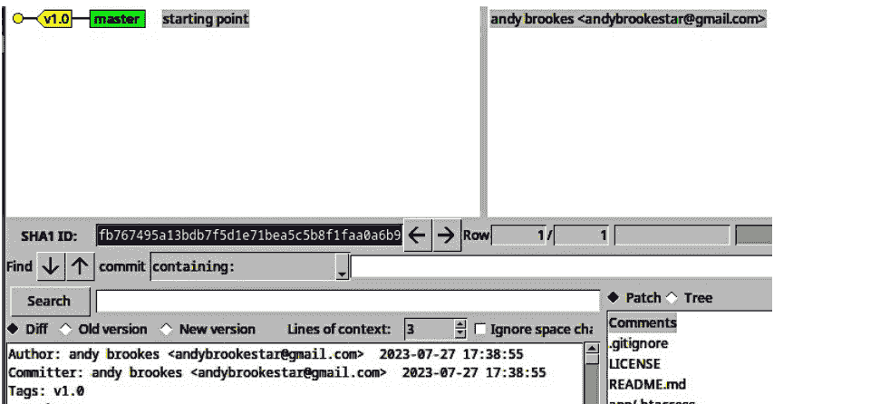

我只显示了执行命令后出现的输出图片的一部分

```
[andrew@darkstar ~]$ gitk  --all
```

现在，随着代码的进展，进行另一次提交的时机是在你向前推进了几步之后，流程总是一样的。让终端位于你的 web 根目录位置，也就是你想要更新 git 的地方，我的情况就是 `/srv/http/joesoapdev`，然后：

```
[andrew@darkstar joesoapdev]$ git add  .

[andrew@darkstar joesoapdev]$ git commit -a -m "some relevant comment "

[andrew@darkstar joesoapdev]$ git tag -a  v1.1  -m  "  "
```

用逻辑递进的名字创建一个新标签，例如，上次是 `v1.0`，所以下次我们设为 `1.1`

除非你启用"查看隐藏文件"，否则你看不到，但 git 会在 web 根目录的 `.git` 目录中放置它的数据。现在对于开发来说，有很多你想要的东西，但不想上传到服务器。例如，`node_modules` 是一个在我的 web 根目录中的目录，我在开发时需要它，但上线时并不需要，所以我在位于 web 根目录的 `.gitignore` 文件中添加一条：

```
node_modules/*
```

这样可以减轻 git 要存储的内容的负担。另外，我使用 `rsync` 先从我的开发目录过滤到我的桌面上的一个目录。如果你没有 `rsync`，用 `pacman` 安装它。首先我将终端的目录切换到 `/srv/http/` 例如：

```
[andrew@darkstar ~]$ cd /srv/http

[andrew@darkstar http]$ ls

index.php  joesoapdev

[andrew@darkstar http]$ rsync joesoapdev/  -avu --exclude .git  --exclude node_modules  --exclude README.md    /home/andrew/Desktop/joesoap4liveserver/
```

这个命令会将 `joesoapdev` 目录内的内容放入我桌面上名为 `joesoap4liveserver` 的目录中。这样我就不会搞乱我的开发目录，并且可以开始删除我不想上传到直播服务器的内容。从桌面我用终端将每个目录压缩成 zip。首先我们需要安装 `zip`：

```
[andrew@darkstar ~]$ sudo pacman -S zip
```

将 `app` 目录压缩成 zip：

```
[andrew@darkstar joesoap4liveserver]$ zip  -r  app.zip app
```

然后我只用将 `app.zip` 上传到直播 web 托管，并使用我 web 托管上的 cPanel 解压，其他目录也是同样的做法。如果你不使用子目录和子域名，那么 `public` 目录**里面**的内容将直接放入你的 web 托管根目录。将其他目录打包到一个目录中，在你的 web 托管上将该目录放在 web 根目录级别之上，并编辑 `index.php` 中的路径，以便系统能找到 `app` 等。

## Bootstrap5

为 PHP 网站（包括 CodeIgniter4）使用 Bootstrap 对于前端开发来说非常棒。据我所知，Bootstrap 是由 Twitter 的开发者们设计的。Bootstrap 持续开发中，所以这意味着你不需要自己去开发；它功能相当强大，特别是现在它基于 flexbox，并且首先针对移动响应式设计。所以我打算将其用于我们 CodeIgniter 的前端展示。

当你安装 CodeIgniter 时，它有一个名为 `home` 的默认路由，在 `app/Config/Routes.php` 文件的第 14 行定义。在路由定义的第 32 行，它设置了：

```
$routes->get('/', 'Home::index');
```

因此，当 URL 仅访问域名名或我的情况下 `127.0.0.3` 时，它将调用控制器类 `home` 及其方法 `index`（`index` 是默认方法）。查看控制器类 `home` 的 `index` 方法，它有：

```
return view('welcome_message');
```

如果你在 `views` 中查看，你会看到 `welcome_message.php`。现在我们想开始处理我们的默认安装，使其成为我们想要的网站。我的方法是让事物保持原样运行，先以任何方式让新功能运行起来，最后根据需要进行调整。所以我不会主张立即替换默认的着陆页。相反，我将开发一个新的原型着陆页；然后当它运行时，只需稍作调整，即可将其设为默认着陆页。

基本上，我将目标设定为一个带有导航栏菜单的网站，菜单包含首页、关于我、联系我，并且在小型浏览设备（即手机）上能折叠为"汉堡包"导航图标。

那么，我们需要什么来使用 Bootstrap 呢？过去我曾使用 `composer` 将 Bootstrap SASS 安装到 Vendor 目录；实际上，所有需要做的就是用一个自定义样式表覆盖 Bootstrap。所以，你只需要拥有 Bootstrap 功能（我认为只有 `popper` 缺失）即可，自 Bootstrap 5 起：

```
bootstrap.css

bootstrap.bundle.js
```

你可以通过实时链接获取，但我将通过调用样式表到一个单一文件中，以覆盖样式表，并在我的网页头部引用它。

所以我从以下地址获取了 Bootstrap：

https://getbootstrap.com/docs/5.3/getting-started/download/

点击 Compiled CSS and JS 按钮并解压。我发现你只需要 2 个文件：
- `bootstrap.css`
- `bootstrap.bundle.js`

我将逐步使用 `sass` 作为我的自定义样式表，因为 `sass` 比 CSS 更实用；届时我会设置一个任务运行器来将 `custom.sass` 转换为 `custom.css`。至少有几个我以前用过的，比如 Gulp 和 Grunt。Grunt 应该足够了。

另外，我会选择并使用一些漂亮的字体，并且至少会使用 Font Awesome 中的一个图标，比如 Facebook，因为我觉得它们看起来整洁又清晰。那么，让我们看看我将在 CodeIgniter 的 `public` 目录中使用的目录架构：

```
[andrew@darkstar joesoapdev]$ tree -L 1 public

public

├── css

├── favicon.ico

├── fonts

├── images

├── index.php

├── js

├── robots.txt

└── sounds
```

因为稍后我们将使用的 `Gruntfile.js` 将位于 web 根目录，所以我会在 web 根目录下有一个名为 `scss` 的目录，并在其中放置一个名为 `custom.scss` 的文件。

顺便说一句，当你输出 `base_url()` 时，它等效于你的域名，在我的开发环境中是 `http://127.0.0.3/`；另外，由于 CodeIgniter 是从 `public` 目录运行的，如果你想在视图中引用某些内容，它将采用以下形式：

```
<script src="<?php echo base_url('js/bootstrap.bundle.js');?>"></script>
```

在上面的例子中，如果 bootstrap js 文件放置在名为 `js` 的目录中，它将引用这些文件，该目录位于 `public` 中（你不需要写 `public`，因为 CI4 是从 `public` 运行的）。`js` 前面不需要加斜杠，因为输出 `base_url()` 时末尾已有斜杠。

所以，看看 `tree` 命令的输出。CSS 文件将放入 `css` 目录，图片放入 `images` 目录，sass 文件放入 `scss` 目录，网络字体放入 `fonts` 目录，声音文件放入 `sounds` 目录。所以将 `bootstrap.css` 放入 `css` 目录，将 `bootstrap.bundle.js` 放入 `js` 目录。我将在我们的 `webLayout.php` 文件中仅使用一个样式表引用；我将通过调用我想要的其他样式表来实现这一点。对于 Font Awesome，我将通过将这一行放入 `webLayout.php` 的 header 部分来获取它：

```
<link rel="stylesheet" href="https://maxcdn.bootstrapcdn.com/font-awesome/4.5.0/css/font-awesome.min.css">
```

有一件事你必须做，就是在网页的 header 部分设置视口。我们将对所有页面使用一个布局，页面作为内容实际上会被注入到布局文件 `webLayout.php` 中。

所以现在让我们编辑我们的布局模板，即 `app/views` 目录中的 `webLayout.php`；我放置了：

```
<meta name="viewport" content="width=device-width, initial-scale=1" >
```

在 header 部分。现在我可能对 bootstrap 的字体不会太满意，所以我还会创建一个 `custom.css`，以及一个 `font-face.css`，并将它们都放入 `public/css` 中。我将编辑我的 `Style.css`。我将从之前的 `Style.css` 中取出以下代码，并将其放入 `custom.css`：

```
h1

{

color:green;

}

h4

{

font-family: "Times New Roman", Times, serif;

color:maroon;

}
```

所以现在我的 `Style.css` 中唯一的文本条目将是：

```
@import url("bootstrap.css");

@import url("custom.css");
```


@import url("font-face.css");

所有额外的样式代码都将放入`custom.css`中，顺序很重要，因为我想让`bootstrap.css`在前，`custom.css`在后，这样`bootstrap`和`custom.css`中相同的内容将被`custom.css`中的内容覆盖。另外，通过这种方式，`custom.scss`中的任何代码（将被转换为`css`）不会影响我们在`Style.css`中设置的方式。我们之前已经设置了只有一个布局页面，任何视图的`content`基本上在渲染时注入到布局中。

所以我们主要想处理的文件将是`webLayout.php`，对该文件所做的任何更改，在渲染任何视图时都会被渲染并可视地显示。我们网站的基本视觉效果如左图所示。

所以实际上，我们想要的只是让三个`div`（division）按照正确的顺序堆叠成一列，并且内容能响应设备的视口大小。我们可以很容易地将这一点应用到我们的`webLayout.php`文件中，通过定义`divs`和少量其他代码，让我们看看目前有什么。

这是目前`webLayout.php`在`views`中的样子，我移除了`<h1>`以及关于它是由`geany`生成的注释：

```
<!DOCTYPE html>

<html lang="en">

<head>

<meta charset="utf-8" />

<meta name="viewport" content="width=device-width, initial-scale=1" >

<title>

<?php echo $title ?>

</title>

<link rel="stylesheet" type="text/css" href ="<?php echo base_url("css/myStyle.css"); ?>">

<link rel="stylesheet" href="https://maxcdn.bootstrapcdn.com/font-awesome/4.5.0/css/font-awesome.min.css">

</head>

<body>

<?=$this->renderSection('content')?>

<script src="<?php echo base_url('js/bootstrap.bundle.js');?>"></script>

</body>

</html>
```

我在`header`部分添加了`<?php echo $title ?>`，稍后我们将通过控制器向该变量传递数据。

接下来让我们创建一个将成为我们主页的页面，我们称之为`landingPage.php`，我们可以直接使用`geany`创建并将其保存在`views`中。目前我只在里面放置：

```
<?=$this->extend('webLayout') ?>

<?=$this->section('content') ?>

<h1>Hello world </h1>

<?=$this->endSection()?>
```

简洁明了，不是吗？所以该视图扩展了我们的`webLayout.php`文件。我们使用以下方式定义将有效地注入到`webLayout.php`中的内容的开始和结束：

```
<?=$this->section('content') ?>  //content 的开始
```

```
<?=$this->endSection()?>  //content 的结束)
```

如果你查看`webLayout.php`，上面的内容会被放置在这里：

```
<?=$this->renderSection('content')?>
```

所以我们现在需要在`app/Config/Routes.php`中定义一个路由，以便从URL调用该视图。我将使用控制器类`Home.php`来完成，我会创建另一个方法。

我在控制器类`Home.php`中添加了以下方法：

```
public function landingpage()

{

    $data= [

        'title'=>' landing page',

    ];

    return view('landingPage.php',$data);

}
```

在`app/Config/Routes.php`中，我添加了：

```
$routes->get('/home','Home::landingpage');
```

因此，访问以下网址：

```
http://127.0.0.3/home
```

我得到了如下的结果：

至少可以看出，网址`http://127.0.0.3/home`成功调用了`Home`控制器类及其定义的方法；所以到目前为止一切顺利。现在可能是用`git`进行另一次提交的好时机，提交信息如下：

```
[andrew@darkstar joesoapdev]$ git add .

[andrew@darkstar joesoapdev]$ git commit -a -m " phasing in bootstrap "

[master d367d0d] phasing in bootstrap

 27 files changed, 20083 insertions(+), 26 deletions(-)
```

```
[andrew@darkstar joesoapdev]$ git tag -a v1.1 -m " "
```

`-m`是用于注释的标志位，我已经养成了习惯，即使引号之间什么都不写，我也会把它写出来。

接下来，我想我们要添加`Bootstrap`代码，它将设置三个部分，使它们能够实现`flexbox`功能。代码基本如下：

```
<div class="d-flex flex-column mb-3">

    <div>This div will contain the head section of the visible part of our web </div>

    <div>main body of web page </div>

    <div> footer of page </div>

</div>
```

当你查看上一页底部的代码时，它看起来并不复杂，对吧？而且在我们使用它之前先将其设置好，会让我们更容易理解。好的，让我们把这段代码放入我们的主网页布局文件`webLayout.php`中。另外，让我们在页脚中放一个`Facebook`图标。

那么现在`webLayout.php`中的标记代码是：

```
<!DOCTYPE html>

<html lang="en">

<head>

<meta charset="utf-8" />

<title><?php echo $title ?> </title>

<meta name="generator" content="Geany 1.38" />

<link rel="stylesheet" type="text/css" href="<?php echo base_url("css/myStyle.css"); ?>">

<link rel="stylesheet" href="https://maxcdn.bootstrapcdn.com/font-awesome/4.5.0/css/font-awesome.min.css">

</head>

<body>

<div class="d-flex flex-column mb-3">

    <div class ="headsection"> </div>

    <div class ="contentsection"><?=$this->renderSection('content')?></div>

    <div class ="footersection">

    <a href="https://www.facebook.com/"> <i class="fa fa-facebook-official fa-3x" aria-hidden="true"></i> </a>

    </div>

</div>

<script src="<?php echo base_url('js/bootstrap.bundle.js'); ?>"></script>

</body>

</html>
```

我们将在`custom.css`中添加以下内容：

现在这是我们的`home.php`视图：

```
div.headsection {

  height:270px;

background-color:yellow;

  }

div.contentsection

{

background-color:beige;

}

div.footersection

{

height:150px;

background-color:pink;

}
```

上面我们首页的图像看起来有点像某种意大利冰淇淋的口味，但我喜欢用颜色来区分`div`，这样我可以看到`div`的大小以及各个部分的位置；之后只需简单地移除这些颜色即可。那么现在，我们可以说已经引入了`Bootstrap`，但其实我们并不知道它是否真的有效，对吧？所以现在我想添加一个来自`Bootstrap`的导航栏菜单。我喜欢保持代码的定义清晰。如果我把`Bootstrap`的导航栏代码直接加到`webLayout`中，在我看来会显得很"杂乱"，我喜欢一目了然。因此，我们将创建一个名为`navbar.php`的文件，并将其放入我们的`views`目录中。现在只需简单地复制粘贴到该文件中，如果你访问：

```
https://getbootstrap.com/docs/5.3/components/navbar/
```

有一个复制到剪贴板的图标，让操作变得非常简单。以下是代码：

```
<nav class="navbar navbar-expand-lg bg-body-tertiary">

  <div class="container-fluid">

    <a class="navbar-brand" href="#">Navbar</a>

    <button class="navbar-toggler" type="button" data-bs-toggle="collapse" data-bs-target="#navbarSupportedContent" aria-controls="navbarSupportedContent" aria-expanded="false" aria-label="Toggle navigation">

      <span class="navbar-toggler-icon"></span>

    </button>

    <div class="collapse navbar-collapse" id="navbarSupportedContent">

      <ul class="navbar-nav me-auto mb-2 mb-lg-0">

        <li class="nav-item">

          <a class="nav-link active" aria-current="page" href="#">Home</a>

        </li>

        <li class="nav-item">

          <a class="nav-link" href="#">Link</a>

        </li>

        <li class="nav-item dropdown">

          <a class="nav-link dropdown-toggle" href="#" role="button" data-bs-toggle="dropdown" aria-expanded="false">

            Dropdown

          </a>

          <ul class="dropdown-menu">

            <li><a class="dropdown-item" href="#">Action</a></li>

            <li><a class="dropdown-item" href="#">Another action</a></li>

            <li><hr class="dropdown-divider"></li>

            <li><a class="dropdown-item" href="#">Something else here</a></li>

          </ul>

        </li>

        <li class="nav-item">

          <a class="nav-link disabled" aria-disabled="true">Disabled</a>

        </li>

      </ul>

      <form class="d-flex" role="search">

        <input class="form-control me-2" type="search" placeholder="Search" aria-label="Search">

        <button class="btn btn-outline-success" type="submit">Search</button>

      </form>

    </div>

  </div>

</nav>
```

好的，你现在明白为什么我不想把所有这些代码都放进我们的`webLayout.php`文件中了。那么，我们如何将那段代码引入`webLayout.php`呢？

只需一行代码：

```
<?= $this->include('navbar') ?>
```

我将把它放在我们`div contentsection`的最顶部，也就是这行下面：

```
<div class ="contentsection">
```

为确认起见，以下是我们现在的`webLayout.php`文件内容：

```
<!DOCTYPE html>

<html lang="en">

<head>

<meta charset="utf-8" />

<title><?php echo $title ?> </title>

<meta name="generator" content="Geany 1.38" />

<link rel="stylesheet" type="text/css" href ="<?php echo base_url("css/myStyle.css"); ?>">

<link rel="stylesheet" href="https://maxcdn.bootstrapcdn.com/font-awesome/4.5.0/css/font-awesome.min.css">

</head>

<body>

<div class="d-flex flex-column mb-3">

    <div class ="headsection"> </div>

    <div class ="contentsection">

        <?= $this->include('navbar') ?>

        <?=$this->renderSection('content')?></div>

    <div class ="footersection">

    <a href="https://www.facebook.com/">  <i class="fa fa-facebook-official fa-3x" aria-hidden="true"></i></a>

        </div>

</div>

<script src="<?php echo base_url('js/bootstrap.bundle.js');?>"></script>

</body>

</html>
```

放一张太大的图片没什么意义，因为可展示的内容不多，但从左边的图像中可以看出（希望如此），代码片段：

```
<?= $this->include('navbar') ?>
```

是有效的，而且`Bootstrap`也在正常工作，因为导航栏不仅显示了，而且能够响应——当我鼠标左键点击下拉箭头时，菜单项可以展开；当我缩小视口大小时，菜单也转换成了"汉堡"式导航。

现在我要看看如何引入一种花哨的字体示例；这可能不符合你的品味，但其原理以及你要查找和使用的方法是相同的。

我访问了`https://www.fonts4free.net/amadeus-regular-font.HTML`，选择了`Amadeus regular`，下载了名为`Amadeus Regular.zip`的压缩文件，解压后，将文件`Amadeus Regular.ttf`重命名为`AmadeusRegular.ttf`，以避免使用带空格的文件名时必然出现的问题。接下来，我将`AmadeusRegular.ttf`上传到：

```
https://www.fontsquirrel.com/tools/webfont-generator
```

打开终端，我切换到了`fonts`目录，并新建了一个名为`amadeus`的目录：

```
[andrew@darkstar Desktop]$ cd /srv/http/joesoapdev/public/fonts

[andrew@darkstar fonts]$

[andrew@darkstar fonts]$ mkdir amadeus
```


在 `fontsquirrel` 网站上，我勾选了恰当的选项：

我将压缩包直接下载到了`/srv/http/joesoapdev/public/fonts/amadeus`目录内，因为这个 `zip` 没有外层包裹。然后在终端中解压。解压后 `CI4 public/fonts/amadeus` 目录内的文件如下：

```
[andrew@darkstar fonts]$ tree -L 1 amadeus

amadeus

├── amadeus-demo.html

├── amadeus-webfont.eot

├── amadeus-webfont.svg

├── amadeus-webfont.ttf

├── amadeus-webfont.woff

├── amadeus-webfont.woff2

├── amadeus.zip

├── generator_config.txt

├── specimen_files

└── stylesheet.CSS
```

现在如果你查看，会有一份样式表概述如何使用该字体。不过，如果我们想要使用这些字体，路径需要调整，因为我们要从样式表位于`public/css`的上下文来定义。

从位于`public/css`的样式表中被引用的上下文到`public/fonts`的路径，需要先向上回到`public`一级，然后进入`fonts`，因此相对路径大致为：

```
../fonts/
```

因此，将上面列出的`stylesheet.css`中的代码粘贴到 CI4 网站根目录`/public/css`下的`font-face.css`中，并修正路径。`font-face.css`中的内容如下：

```
@font-face {

    font-family: 'amadeus_regularamadeusRg';

    src: url('amadeus-webfont.eot');

    src: url('../fonts/amadeus-webfont.eot?#iefix') format('embedded-opentype'),

        url('../fonts/amadeus-webfont.woff2').styleable;

        url('../fonts/amadeus-webfont.woff') format('woff'),

        url('../fonts/amadeus-webfont.ttf') format('truetype'),

        url('../fonts/amadeus-webfont.svg#amadeus_regularamadeusRg') format('svg');

    font-weight: normal;

    font-style: normal;

}
```

好的，为了使用它，我们现在在`custom.css`中创建一个条目，如下所示：

```
h1.amadeus {

    font-family: 'amadeus_regularamadeusRg';

    color: #ff00ff;

    font-weight: regular;

    font-size: 5rem;

    text-shadow: -1px 0 black, 0 1px black, 1px 0 black, 0 -1px black;

    text-align:center;

}
```

此外，我还会在`custom.css`中添加一个条目，用于在页眉区域显示一张 `logo` 图片。我需要先将一张合适的图片放到`public/images`中，我有一张名为`logo3.png`的图片。

经过几次调整后，`custom.css`现在看起来如下：

```
h1.amadeus {

  font-family: 'amadeus_regularamadeusRg';

  color: #ff00ff;

  font-weight: regular;

  font-size: 5rem;

  text-shadow: -1px 0 black, 0 1px black, 1px 0 black, 0 -1px black;

  text-align:center;

  }

div.headsection {

  flex-basis:250px;

  background-color:yellow;

  }

div.contentsection

{

background-color:beige;

}

div.footersection

{

height:150px;

background-color:pink;

}

div.headsection div.logo {

  display: flex;

  width: 80px;

  align-self: flex-start; }

div.headsection div.logo img {

  left-margin: 1rem;

  width: 100%; }

div.contentsection

{

flex-basis:200px;

}
```

现在我将编辑`webLayout.php`，并在`headsection`的 `div` 中添加如下代码：

```
<div class ="headsection">

    <div class="logo">

        " >

    </div>

    <h1 class ="amadeus" >My Web Site </h1>

</div>
```

`http://127.0.0.3/home` 显示的内容如下：

好的，从左侧图片中可以看到，我们有一个 URL：

`http://127.0.0.3/home`

左侧有一个 `logo`。`Amadeus` 字体正确居中显示。`Bootstrap` 导航栏已存在并正常工作，并且 CI4 网站处于开发模式，因此我们可以在底部看到输出。

基本上，这就是网站的一个起步模板。

现在只需要开发控制器、启用会话，然后你就可以拥有一个可以通过你的域名 URL 来管理的内容管理系统。我知道这一点，因为我已经做过了。它有点过时，下载也基本停止了，但如果你刚开始，可以下载并用它来逆向工程我的方法。其 URL 为：

`https://sourceforge.net/projects/codeigniter4cms/`

好的，接下来我们在 Web 开发中可能要看的是一个任务运行器，它可以用来将 `Sass` 转换为 `CSS`。

## Grunt

任务运行器有几种选择，`Gulp` 是其中之一，`Grunt` 是另一个。我发现 `Grunt` 更容易理解并运行起来。

首先，确认一下我目前在`joesoapdev`网站根目录下的文件和目录结构：

```
[andrew@darkstar http]$ tree -L 1 joesoapdev

joesoapdev

├── Gruntfile.js

├── LICENSE

├── README.md

├── app

├── builds

├── composer.json

├── composer.lock

├── node_modules

├── package-lock.json

├── package.json

├── phpunit.xml.dist

├── public

├── scss  // inside this directory i have a file custom.scss

├── spark

├── tests

├── vendor

└── writable
```

接下来可能会有人问，为什么要用 `SASS`？顺便说一下，`Bootstrap` 仍然提供它，所以我想他们能看到一些好处。嗯，你可以用 `Sass` 做一些普通 `CSS` 做不到的事情。

`Sass` 具有诸如将颜色定义为变量的功能，例如：`$turquoise:#16a0a0;`

只需引用变量名，该颜色就可以在 `scss` 文件的任何地方使用；还有“mixins”。请查看 `Sass` 网站：

`https://sass-lang.com/`

因此，任务运行器可以执行诸如将 `Sass` 转换为 `CSS` 的操作；它还可以刷新浏览器，但我们会保持简单。要记住的是，从样式开发的角度来看，我们将从使用`custom.css`添加和开发，切换到使用`custom.scss`工作。`Grunt` 会帮我们把`custom.scss`中的 `Sass` 转换为`custom.css`。`webLayout.php`中的样式表引用仍然是`myStyle.css`，它会引入`custom.css`，因此当你查看落地页时，不会知道正在使用 `Sass`。

要实现 `Grunt` 的功能，需要做一些准备工作；它需要依赖项才能运行。

我通过 `pacman` 在系统范围内安装了：

### *sass:*

```
[andrew@darkstar ~]$ pacman -Qi sass

Name            : dart-sass

Version         : 1.64.1-1
```

### *Ruby:*

```
[andrew@darkstar ~]$ pacman -Qi ruby

Name            : ruby

Version         : 3.0.5-1
```

### *grunt-cli:*

```
[andrew@darkstar ~]$ sudo pacman -S grunt-cli

resolving dependencies...

looking for conflicting packages...

Packages (4) c-ares-1.19.1-1  nodejs-20.4.0-1  nodejs-nopt-7.2.0-1  grunt-cli-1.4.3-2
```

正如所见，它同时引入了 `Node.js`。

### *npm:*

```
andrew@darkstar joesoapdev]$ sudo pacman -S npm

[sudo] password for andrew:

resolving dependencies...

looking for conflicting packages...

Packages (3) node-gyp-9.4.0-1  semver-7.5.0-1  npm-9.8.1-1
```

之后，我切换到网站根目录：

```
[andrew@darkstar ~]$ cd /srv/http/joesoapdev

and started setting up package.json via

[andrew@darkstar joesoapdev]$ npm init
```

我们已经安装了一些包，使得部分功能可以在系统范围内使用；但现在我们要使用 `npm` 在开发目录本地为 `Grunt` 安装依赖。这些是我发出的命令，因为我知道我可能会需要 `Grunt` 的插件。

注意终端所在的位置是`joesoapdev`的网站根目录。

```
[andrew@darkstar joesoapdev]$ npm install grunt --save-dev

[andrew@darkstar joesoapdev]$ npm install grunt-sass --save-dev

[andrew@darkstar joesoapdev]$ npm install grunt-contrib-watch --save-dev

[andrew@darkstar joesoapdev]$ npm install grunt-contrib-copy --save-dev

[andrew@darkstar joesoapdev]$ npm install grunt-contrib-sass --save-dev

[andrew@darkstar joesoapdev]$ npm install node-sass --save-dev

[andrew@darkstar joesoapdev]$ npm install grunt-contrib-jshint --save-dev
```

回顾一下相关目录和文件的结构，一个名为`scss`的目录与`public`目录处于同一级别。

在`public`中，我有：

```
[andrew@darkstar joesoapdev]$ tree -L 2 public

public

├── css

│   ├── bootstrap.css

│   ├── custom.css

│   ├── custom.css.map

│   ├── font-face.css

│   └── myStyle.css

├── favicon.ico

├── fonts

│   └── amadeus

├── images

│   ├── header.png

│   └── logo3.png

├── index.php

├── js

│   └── bootstrap.bundle.js

├── robots.txt

└── sounds
```

在我们的名为`webLayout.php`的网页模板中，唯一引用的样式是：

`myStyle.css`。

使用适当的语法，同级别的其他样式表——或者应该说是其他样式表的内容——被引入进来。

当我们运行 `Grunt`（我们马上就要讲到），它会将位于`scss`目录中的`custom.scss`（与`public`同级）转换为 `CSS`，并将输出放入`custom.css`。

要做到这一点，我们现在只需要一个`Gruntfile.js`，其中的代码要适合我们想做的事情，并考虑到文件的位置。我用来实现这一点的代码在下一页。

位于`joesoapdev`网站根目录下的`Gruntfile.js`内容如下：

```
module.exports = function(grunt) {

  grunt.initConfig({

    sass: {

      dist: {

        options: {

          style: 'compressed',

        },

        files: [{ expand: true,cwd: 'scss', src: ['**/*.scss'], dest: 'public/css', ext: '.css' }]

      },

    },

    watch: {

      sass: {

        files: ['**/*.scss'],

        tasks: ['sass:dist']

      }

    }

  });

  grunt.loadNpmTasks('grunt-contrib-sass');

  grunt.loadNpmTasks('grunt-contrib-watch');

  grunt.registerTask('default', ['sassFolder:dist']);

};
```

现在的语法比较棘手，如果你遗漏了什么，要么会报错，要么无法运行，或者两者兼有。我使用这个网站来检查：

`https://esprima.org/demo/validate.html`

这个 `grunt` 文件顶部引用了 `grunt`，然后是一些配置。任务定义完成后，加载插件。要使用 `grunt`，终端应位于网站根目录，也就是 `Grunt` 文件所在的位置；查看文件：`sass:dist` 被标记为默认任务，因此以下任一命令都可以运行：

```
[andrew@darkstar joesoapdev]$ grunt

或

[andrew@darkstar joesoapdev]$ grunt sass
```

这一行告诉系统要查找什么以及在哪里查找：

```
files: [{ expand: true,cwd: 'scss', src: ['**/*.scss'], dest: 'public/css', ext: '.css' }]
```

`**/*.scss` 简洁地告诉系统查找任何 `.scss` 文件；因为在与 `Grunt` 文件同一目录下有个名为`scss`的目录，里面包含`custom.scss`。文件很容易找到，没有歧义。`public/css` 表示转换后的 `scss` 到 `css` 的输出位置。

大概就是这样了。响应式网页的基础已经搭建完成，以及使用版本控制的开发环境。

还会有一些细微的调整，比如为自定义字体添加断点，在我们的例子中就是`h1.amadeus`。在`custom.scss`文件中，这是处理该问题的基本方法：

```
h1.amadeus {

  font-family: 'amadeus_regular amadeusRg';

  color: #ff00ff;

  font-weight: regular;

  font-size: 5rem;

  text-shadow: -1px 0 black, 0 1px black, 1px 0 black, 0 -1px black;

  text-align:center;

}
```

```
/* --------------------------------------------------------------------------

* 

* 第一个断点

* --------------------------------------------------------------------------

* 

*/

@media (max-width: 480px)

{

    h1.amadeus

    {

        font-size:2.0rem;

    }

}
```

> 注意
> 随着屏幕尺寸变化，你想要修改的样式需要放在 `@media` 的开启和关闭花括号之间

你可以根据相关性添加额外的断点。

我只添加了我想要修改的内容，也就是字体大小。当然，你也可以添加元素如何堆叠的样式，比如从行排列改为列排列等。


第二个媒体断点

```
@media (min-width : 481px) and (max-width:767px)
{
    h1.amadeus
    {
        font-size:2.5rem;
    }
}
```

手机尺寸和分辨率不断变化，但我上次做网页时使用了：

```
@media (max-width: 480px)
@media (min-width : 481px) and (max-width:767px)
@media (min-width:768px) and (max-width:1024px) and (orientation:landscape)
@media (min-width:768px) and (max-width:1024px) and (orientation:portrait)
```

这需要了解人们最常使用的手机尺寸，然后使用网页开发工具进行调试，在其中可以使用屏幕尺寸来测试显示效果。

目前就这些了。希望你喜欢阅读这篇文章，并能有所收获。

祝你的操作系统和网页开发一切顺利。
