# ASE 考试准备：发动机维修，测试 A1

## 出版信息

- 技术与贸易专业业务部门副总裁：Gregory L. Clayton
- 专业运输行业培训解决方案总监：Kristen L. Davis
- 产品经理：Katie McGuire
- 编辑助理：Danielle Filippone
- 营销总监：Beth A. Lutz
- 营销经理：Jennifer Barbic
- 高级生产总监：Wendy Troeger
- 生产经理：Sherondra Thedford
- 内容项目管理：PreMediaGlobal
- 高级艺术总监：Benj Gleeksman

## 读者须知

出版商不对本文所述的任何产品提供保证或担保，也不对本文包含的任何产品信息进行任何独立分析。出版商不承担，并明确否认除制造商提供的信息之外获取并包含信息的任何义务。明确警告读者考虑并采取本文所述活动可能指示的所有安全预防措施，并避免所有潜在危险。通过遵循本文包含的指示，读者自愿承担与此类指示相关的所有风险。出版商不做任何形式的陈述或保证，包括但不限于对特定用途的适用性或适销性的保证，也不对本文所述材料进行任何此类暗示陈述，且出版商对该类材料不承担任何责任。对于因读者使用或依赖本材料而全部或部分导致的任何特殊、后果性或惩罚性损害，出版商概不负责。

## 前言

作为 Cengage Learning 的一部分，Delmar 非常高兴您选择使用我们的 ASE 考试准备指南来帮助您准备发动机维修 (A1) ASE 认证考试。本指南旨在通过为您提供测试过程的概览和介绍，向您介绍发动机维修 (A1) 认证考试的任务列表，让您了解在成功执行每个任务领域相关职责时所需的知识和技能，并为您提供几套旨在模拟实际考试内容的准备考试，以期评估您的整体备考情况，从而帮助您准备正式考试。

如果您对所测试的学科具有基本的工作知识，您会发现本书是一本极好的指南，能帮助您理解成功通过 ASE 认证考试所需的“必须掌握”的项目。本手册不是教科书。其目标是让已经具备必要经验和知识的人员尝试应对 ASE 认证过程的挑战。本指南不能替代 ASE 要求的主宰与该考试相关的车辆维修技术所需的实践经验和理论知识。如果您无法理解本书中大部分的准备题及其相应的解析，那么您可能需要更多的车间实践经验或进一步的学习。

本书首先提供测试过程的概览和介绍。本节概述了我们建议您如何准备、在实际考试当天会有什么预期以及成功的整体方法。接下来的部分是对 ASE 任务列表的详细概述，包括成功回答每个特定任务相关问题必须具备的知识和技能的解释。在任务列表之后，我们提供了六套模拟准备考试，供您用来评估理解程度以及需要改进的领域，以便成功通过 ASE 考试。Delmar 是首个也是唯一一个提供如此多独特准备考试的考试准备机构。我们增强了指南以包含此支持，旨在为您提供目前最优质的准备产品。本指南的第 6 部分包含每套准备考试的答案 Key 以及每个问题的答案解析。每个答案解析还包含一个指向其评估的相关任务或任务的引用。这将为您提供一种快速简便的方法，以便在需要时随时查阅任务列表。本书的最后一节包含您在尝试每套准备考试时可以使用的空白答题卡表格，以及一个术语表。

## 我们对卓越的承诺

感谢您选择 Delmar, Cengage Learning 来满足您的 ASE 考试准备需求。所有的作者、编辑和 Delmar 工作人员都非常努力地工作，使这份考试准备指南达到顶尖水平。我们深信，在您准备实际 ASE 考试的过程中，您会发现本指南易于使用且极其有益。

Delmar, Cengage Learning 寻找了全国最优秀的领域专家来帮助开发《ASE 考试准备：汽车技术员认证系列，发动机维修 (A1)》，第 5 版。准备题由一组经过认证的领域专家编写并审核，以确保我们产品具有最高质量和有效性。

如果您对本指南或该系列中的任何指南有任何疑问，请访问我们的网站：`http://www.trainingbay.cengage.com`。

如需获取 ASE 认证的在线测试准备解决方案，请访问我们的网站 `http://www.techniciantestprep.com` 了解更多信息。

## 关于作者

Charles Ginther 自 1987 年起获得汽车领域 ASE 大师级身份，在汽车行业拥有 24 年的经验。Charles 是一位汽车教育工作者，在高等教育领域担任了 8 年的兼职教师和 16 年的全职教师。其服务经历包括：担任北美汽车教师委员会 (NACAT) 官员以及北美汽车教师委员会南卡罗来纳州分会 (NACAT/SC) 的创始秘书/财务主管。

## 关于系列顾问

Mike Swaim 自 1978 年起一直担任爱达荷州科达伦北爱达荷学院的汽车技术讲师。他自 1974 年起成为汽车服务卓越 (ASE) 认证的大师级技师，并持有移动空调协会 (Mobile Air Conditioning Society) 的终身认证。他担任了 Delmar, Cengage ASE 测试准备系列中 2011 年全部九项汽车/轻型卡车认证考试 (A 系列) 的系列顾问，并且是《ASE 测试准备：汽车认证系列，底盘专家认定 (X1)》第 5 版的作者。

# 第一节：ASE 的历史与目的

ASE 最初名为国家汽车服务卓越学院 (NIASE)。它由一组行业领导者于 1972 年创立，是一个非营利独立实体，唯一目标是为消费者提供一种手段，以区分不合格技师和合格技师。它通过对维修和服务专业人员进行测试和认证来实现这一目标。虽然它仍被称为国家汽车服务卓越学院，但现在简称为 "ASE"。

如今，ASE 在汽车、中/重型卡车、碰撞修复与重新喷漆、校车、公交车、零件专家、汽车服务顾问以及其他行业相关领域提供 40 多项认证考试。目前，全国有超过 385,000 名专业人员持有现行有效的 ASE 认证。这些专业人员受雇于新车和卡车经销商、独立维修厂、车队、服务站、特许服务设施等。

ASE 的认证考试由行业驱动，涵盖了几乎所有公路车辆服务领域。考试旨在强调与工作相关的技能知识。获得认证需要通过至少一项考试并证明具有两年的相关工作经验。为了维持认证，持有 ASE 凭证的人员必须每五年重新测试一次。

虽然 ASE 认证是认可个体技师技能和能力的一种针对性手段，但 ASE 还有一个旨在为高素质的维修、支持和零件企业提供认可的项目。蓝色印章卓越认可计划 (Blue Seal of Excellence Recognition Program) 允许企业展示其技师队伍及其对卓越的承诺。成为蓝色印章认可企业的要求之一是，该设施必须有至少 75% 的技师通过 ASE 认证。此外还适用其他标准，项目详情可在 ASE 网站上找到。

ASE 意识到，服务于维修行业的教育项目也需要一种方式来证明其拥有足够的师资、设施和设备，从而为希望成为服务专业人员的学生提供高质量教育。通过 ASE、行业和教育领导者的共同努力，一个名为国家汽车技术教育基金会 (NATEF) 的非营利组织于 1983 年成立，用于评估和认可学术项目。如今，有 2,000 多个教育项目通过了 NATEF 认证。

如需了解关于 ASE、NATEF 或其任何项目的更多信息，可以使用以下联系方式：

- National Institute for Automotive Service Excellence (ASE)
- 101 Blue Seal Drive S.E.
- Suite 101
- Leesburg, VA 20175
- 电话：703-669-6600
- 传真：703-669-6123
- 网站：`www.ase.com`

## 概述与简介

参与国家汽车服务卓越 (ASE) 自愿认证计划，为您提供了证明自己是一名合格且熟练的专业技师的机会，证明您拥有在当今现代车辆上成功工作的所需“诀窍”。

### 考试管理

注意：2011 年 11 月之后，ASE 将不再提供纸笔认证考试。2012 年将没有冬季测试窗口，ASE 将从 2012 年 4 月起专门提供并支持 CBT 测试。

ASE 提供基于计算机的测试 (CBT) 考试，在全国各地的测试中心进行。建议您访问 ASE 网站 `http://www.ase.com` 并查看此类考试的条件和要求。还有一个考试演示页面，允许您在注册之前亲自体验此类考试的运行方式。

CBT 考试每年提供四次，每次为期两个月的窗口期，每个测试窗口之间间隔一个月不考试：

- 1月/2月——冬季测试窗口
- 4月/5月——春季测试窗口
- 7月/8月——夏季测试窗口
- 10月/11月——秋季测试窗口

请注意，测试窗口和时间可能会有所变化。建议您访问 ASE 网站 `http://www.ase.com` 查看最新的测试时间表。

### 理解测试题基础

ASE 考试题目由服务行业专家编写。考试中的每个问题都是在 ASE 主持的“题目编写”研讨会期间创建的。在这些研讨会上，来自制造商（国产和进口）、售后零件和设备制造商的专业服务代表、在职技师以及技术教育工作者聚集在一起分享想法，并将这些想法转化为实际的考试题目。由这些专家编写的每个考试题目必须通过所有小组成员的审核。这些题目旨在解决技师在日常工作中实践的维修和诊断知识与技能的实际应用。

在题目编写研讨会之后，所有题目都会在全国技师样本中进行预测试和质量检查。符合 ASE 质量和准确性标准的题目将被纳入考试的计分部分；而被“拒绝”的题目则被发回重新设计或完全舍弃。

根据认证考试的主题，您将被要求回答 40 到 80 个多选题。您可以通过查看本书第 4 节的任务清单，来确定在发动机维修 (A1) 认证考试中预计会被问到的近似题目数量。五年一次的重新认证考试将涵盖相同的内容；然而，重新认证考试中每个内容区域的题目数量将减少约一半。

注意：考试中可能包含仅用于统计研究目的的题目。您对这些题目的回答不会影响您的得分，但由于您不知道哪些是这类题目，因此您应该回答考试中的所有问题。

通过使用包括年龄、种族和其他背景信息的交叉样本在内的多种标准，ASE 能够保证考试题目不对任何特定群体产生偏见。任何显示出对特定群体有偏见的题目都会被舍弃。

### 考试策略

在开始考试之前，快速浏览一遍试卷，确定您需要回答的问题总数。了解这一点将有助于您在整个考试过程中管理时间，确保有足够的时间回答所有出现的问题。在标记答案之前，请完整阅读每个问题。按题目在试卷上出现的顺序回答。将不确定的问题留白，直接进入下一个问题。在完成其他题目后，您可以回到这些未回答的问题。在您的潜意识有了更多时间思考后，这些问题在稍后时间可能更容易回答。此外，您可能会在其他问题中发现有助于您回忆某些答案的信息。

多项选择题有时具有挑战性，因为经常有几个选项看起来是可能的，或者部分正确，因此很难决定最合适的答案选项。在这种情况下，最好的策略是先在查看答案选项之前确定正确答案。如果您看到了您决定好的答案，仍应仔细检查其他选项，以确保没有比您的答案更正确的。如果您不知道或不确定答案，请仔细阅读每个选项，并尝试排除您确定错误的选项。这样，您通常可以通过排除法得出正确选择。

如果您已经完成了整场考试，仍然不知道某些问题的答案，那么就猜测。是的，猜测。这样您至少有 25% 的机会答对。虽然您的得分基于正确回答的问题数量，但任何留白或未回答的问题都会被自动计为错误。

关于应试技巧，您在准备 ASE 考试时可能会听到很多“民间”智慧。例如，有人会建议您避免选择使用某些词汇的选项，如“所有 (all)”、“没有 (none)”、“总是 (always)”、“从不 (never)”、“必须 (must)”和“仅 (only)”等。他们声称这是因为生活中没有什么绝对的事情。他们会建议您选择使用允许一定例外情况的词汇的选项，如“有时 (sometimes)”、“频繁 (frequently)”、“罕见 (rarely)”、“经常 (often)”、“通常 (usually)”、“很少 (seldom)”和“正常情况下 (normally)”。他们还会建议您避免选择第一个和最后一个选项 (A 或 D)，因为他们认为出题者更倾向于将正确答案放在选项中间 (B 或 C)。另一个经常被提及的建议是选择比其他三个选项短或长得多的选项，因为这样正确的可能性更大。有些人建议您永远不要更改答案，因为您的第一直觉通常是正确的。另一个“民间”智慧领域则专门关注您问题回答中创建的任何重复模式（例如，A, B, C, A, B, C, A, B, C）。

许多人可能会说这种“民间”智慧确实有一定的道理，虽然对于某些考试来说这可能是正确的，但对于 ASE 认证考试而言并不适用。ASE 通过全国范围内的技术人员样本对所有考试问题和测试试卷进行验证，只有那些符合 ASE 质量和准确性标准的题目和试卷才会被纳入考试的计分部分。任何有偏见的题目或模式都会被全部舍弃，因此，你在实际的 ASE 考试中极不可能遇到这种“民间”智慧的情况。

## 考试准备

Delmar, Cengage Learning 希望确保为您提供尽可能详尽的准备指南。为了证明这一点，我们在本指南中加入了数百道准备题。这些问题的设计旨在为您提供尽可能多的机会，帮助您成功通过 ASE 考试。我们在本书中推荐并概述的准备方法旨在帮助您在证明自己已经熟练掌握哪些任务领域内容的同时，帮助您建立信心，并明确在正式考试前应更详细地复习哪些领域。

我们建议您在准备过程中的第一步应该是彻底复习本书的第 3 节。本节包含了您在 ASE 考试中会遇到的问题类型的描述和解释。

一旦您了解了问题的呈现方式，我们建议您彻底复习本书的第 4 节。本节包含的信息将帮助您理解考试将评估的内容，特别是每个具体任务领域预计会出现多少道题。

作为第三个准备步骤，我们建议您完成本书第 5 节中的第一次模拟准备考试。一次回答一个问题。在回答每个问题后，请查看第 6 节中的答案和问题解释信息。本节将为您提供即时响应反馈，让您在整个首次准备考试过程中，能够逐题评估自己的进度。如果在阅读问题解释后，您觉得不理解正确答案的推理过程，请返回复习第 4 节中与该问题相关的任务列表概述。每个问题解释中都包含一个被评估任务领域的清晰标识符（例如，任务 A.1）。如果此时您仍然觉得对材料没有深入理解，请寻找该主题的可靠信息源，如教育课程、教科书或其他相关的专题学习资源，并进行额外的学习。

在完成第一次模拟准备考试并复习答案后，您就可以进行下一次准备考试了。本书第 5 节共提供了六套练习考试。对于第二次准备考试，我们建议您像参加实际考试一样回答问题。不要使用任何参考资料，也不要允许任何干扰，以便感受自己在实际考试中的表现。回答完所有问题后，请使用第 6 节中的答案键对结果进行评分。对于每一个回答错误的问题，请研究答案解释和/或相关任务领域的概述。尝试确定失分的根本原因。最容易纠正的是学习正确的技术内容。最难纠正的是导致您得出错误结论的行为。如果您掌握了相关信息但仍然答错，很可能是需要纠正某种考试行为。例如，阅读速度过快而忽略了影响推理的词语。如果您能识别出导致答错的原因，您就可以消除该原因并提高分数。

以下是准备考试时应遵循的一些基本指南：

- 将学习重点放在您的薄弱领域。
- 在判断自己是否理解某项内容时要对自己诚实。
- 经常学习，但每次时间不宜过长。
- 学习时远离所有干扰因素。
- 请记住，学习的目标不仅仅是通过考试，真正的目标是学习。
- 进行身体准备：考试前保证充足的睡眠，进食能提供能量但不会引起不适的食物。
- 提前到达考点，以避免在考生签到时长时间等待。
- 利用好考试的所有可用时间。如果提前完成，请利用剩余时间检查答案。
- 不要留空任何题目。如果绝对必要，请猜测。所有未回答的问题将自动计为错误。

以下是您需要带到考点的物品：

- 有效的政府或学校签发的带照片的身份证件
- 您的考点准考证
- 一块手表（并非所有考点都有时钟）

> 注意：考场内不允许携带书籍、计算器和其他参考资料。此列表的例外是英外字典或词汇表。所有物品在测试前后都将经过检查。

## 考试期间的预期情况

参加 CBT（计算机化考试）时，一旦您在测试中心就座，在参加认证考试之前，您将接受一个简短的指导，以熟悉计算机交付的测试。CBT 考试允许每道题仅选择一个答案。您也可以根据需要多次更改答案。当您选择第二个选项时，CBT 将自动取消选中您的第一个选项。如果您想跳过某个问题以便稍后返回，可以使用“标记”功能，这使您能够在准备好时快速识别并复习问题。在完成考试之前，您还将有机会复习答案并处理任何未回答的问题。

## 测试时间

每场 ASE CBT 考试都有固定的时间限制。具体考试时间将根据考试领域而有所不同，范围从半小时到两小时不等。除了完成考试分配的时间外，您还将获得额外的 30 分钟，以确保您有足够的时间执行所有必要的签到程序、完成简短的 CBT 指导，并可能完成赛后调查。

您可以在一次测试预约中注册并参加多场 CBT 考试。一次 CBT 预约的最大时间分配为四个半小时。如果您注册的考试过多，所需时间超过此限制，您的考试将被安排在多次预约中。这意味着您可能在同一天的上午和下午都有考试，或者根据您的个人偏好和测试中心的安排，被安排在不同的日期。

请务必理解，如果您迟到参加 CBT 测试预约，您将无法补回任何丢失的时间。您在预约中仅剩原定的时间来完成考试。

此外，虽然大多数人能在允许的时间内完成 CBT 考试，但由于特定个人时间限制所带来的隐含压力，有些人可能会感到匆忙或无法完成测试。在注册 CBT 考试之前，您应查看将提出的考试问题数量以及该考试分配的时间，以确定您是否对指定的时间限制感到舒适。

作为一个整体的时间管理建议，您应该监控自己的进度，并为每道考试题目花费的时间设定一个遵循的时间限制。这应基于您将回答的问题总数。

此外，非常重要的一点是，如果在考试期间您因任何原因希望离开考室，必须先获得许可。如果您提前完成了考试并希望在指定的会议预约结束前离开考点，仅在指定的离场时段内允许这样做。

## 理解考试评分方式

如果您了解 ASE 认证考试的评分方式，您将能更好地看待这些考试。ASE 考试由一个与 ASE 或汽车行业没有利益关系的独立组织评分。对于 CBT 考试，您将立即收到考试分数。

每道题的权重相同。例如，如果有 50 道题，每道题占总分的 2%。

您的考试结果可以告诉您：

- 您的知识在哪些方面等于或超过了胜任工作所需的水平，或者
- 您在哪些方面可能需要更多准备。

您的 ASE 考试分数报告分为内容“任务”区域；它将显示每个内容区域的问题数量以及您的正确答案数量。这些数字提供了关于您在考试每个领域表现的信息。然而，由于考试的每个内容区域的问题数量可能不同，在问题较少的领域获得较高的正确率可能无法抵消在问题较多领域较低正确率带来的影响。

需要注意的是，一个人不会在 ASE 考试中“不及格”。未能通过的技术人员仅会被告知“需要更多准备”。虽然百分比的巨大差异可能表明存在问题领域，但考虑每个领域提出的问题数量至关重要。由于每场考试都评估服务专业涉及的所有领域，因此您应在每个领域做好准备。某个领域的低分可能会导致您无法通过整个考试。如果您没有通过考试，可以在任何安排考试的时间重新参加。

不存在所谓的“平均分”。您不能通过将每个任务领域给出的百分比相加并除以领域数量来确定您的总分。这样行不通，因为每个任务领域的问题数量通常不同。例如，一个包含 20 道题的任务领域比一个包含 10 道题的任务领域对总分的影响更大。

您的考试报告应能让您直观地看到结果，并让您更好地理解每个任务领域的优势和需要改进的领域。

## ASE 考试的问题类型

### 第 3 节

不仅要了解考试将评估哪些内容领域，还要了解考试问题的呈现方式，这将使你获得成功通过 ASE 认证考试所需的信心。以下示例将帮助你识别 ASE 考试中使用的题型，并协助你避免在答题时出现常见错误。

大多数初次认证测试由 40 到 80 个多项选择题组成。五年一次的再认证考试涵盖的内容与初次考试相同；然而，每个内容领域的实际题目数量将减少约一半。有关初次发动机维修 (`A1`) 认证考试预期题目数量的具体细节，请参阅本书第 4 节。

多项选择题是测试知识的一种高效方式。要正确回答这些问题，你必须将每个选项都视为一种可能性，然后选择最能解决问题的选项。为此，请仔细阅读问题的每个词。在读完整个问题之前，不要假定你已经知道问题在问什么。

在实际的 ASE 考试中，大约 10% 的问题会引用插图。这些图纸包含正确回答问题所需的信息。在尝试回答问题之前，应仔细研究插图。当插图详细显示一个系统时，在查看问题和可能的答案之前，请先审视该系统并尝试弄清楚该系统是如何工作的。这种方法将确保你不是基于错误的假设或部分数据来回答问题，而是审视了所呈现的整个场景。

### 多项选择/直接问题

ASE 考试中最常见的问题类型是直接多项选择题。这类问题包含一个引导性陈述（称为“题干”），随后是四个选项：三个错误答案（称为“干扰项”）和一个正确答案（称为“关键项”）。

编写此类问题时的目的是使干扰项具有诱导性，从而吸引缺乏经验的技术人员不小心选择其中之一。这类问题能清晰地反映技术人员的知识水平。

以下是一个直接风格问题的示例：

1. 在柴油发动机上，下列哪项可用于测量曲轴主轴承间隙？

- A. 百分表 (Dial indicator)
- B. 塑胶量规 (Plastigauge®)
- C. 外径千分尺 (Outside micrometer)
- D. 刻度卡尺 (Dial caliper)

答案 A 错误。百分表用于测量端隙或跳动，对于测量曲轴主轴承间隙没有用处。

**答案 B 正确。** 塑胶量规是测量曲轴主轴承间隙最常用的方法。

答案 C 错误。外径千分尺用于测量零件的外形尺寸；但仅靠它无法测量曲轴主轴承间隙。

答案 D 错误。刻度卡尺用于测量外部深度或内部尺寸，但不是测量曲轴主轴承间隙的有效工具。

### 完成题

完成题与直接题类似，不同之处在于陈述可以通过四个选项中的任何一个来完成，从而形成一个完整的句子。

以下是一个完成题的示例：

2. 一台柴油发动机出现加速踏板位置诊断故障码。技术人员在用扫描工具观察加速踏板位置传感器电压的同时，摇晃线束。传感器电压发生了变化。该诊断故障码最可能的原因是：

- A. 扫描工具故障。
- B. ECM 故障。
- C. 加速踏板位置传感器接线故障。
- D. ECM 电源故障。

答案 A 错误。如果在移动线束时电压值发生变化，没有理由认为扫描工具故障。

答案 B 错误。如果在移动线束时电压值发生变化，没有理由认为 ECM 故障。

**答案 C 正确。** 如果在移动线束时电压值发生变化，最可能的原因是线束。

答案 D 错误。如果与 ECM 相关的所有其他项目都正常，且在移动线束时电压值发生变化，最可能的原因是线束。

### 技术员 A、技术员 B 问题

这种题型通常与 ASE 考试相关联。实际上，它是将两个对错判断陈述组合在一起，例如：“技术员 A 说……”和“技术员 B 说……”，随后跟上“谁是正确的？”。

在这类问题中，你必须判断陈述中的一个、两个或两个都不正确。要正确回答此类问题，必须仔细阅读每位技术员的陈述并独立判断其正确性。

有时这类问题以关于某些分析或维修程序的陈述开始。该陈述提供了理解技术员 A 和技术员 B 所讨论条件的设定或背景信息，随后是关于问题原因、正确检查、识别或维修选择的两个陈述。

分析这类问题比其他类型稍微简单一些，因为只有两个观点需要考虑，尽管仍然有四个选项。

再次强调，技术员 A 和技术员 B 问题实际上是双重对错题。分析这类问题的最佳方法是分别考虑每位技术员的陈述。问自己：“A 是正确的还是错误的？B 是正确的还是错误的？”一旦你完成了对每个选项的独立评估，你就能成功确定“谁是正确的？”这个问题的正确选项。

需要记住的一个重点是，ASE 的技术员 A/B 问题中，技术员 A 和 B 绝不会直接产生冲突。这就是为什么你必须独立评估每个陈述的原因。

技术员 A/技术员 B 风格问题的示例片段如下：

1. 柴油发动机前部的附件驱动装置发出噪音。技术员 A 说，可以拆除蛇形带以帮助确定它是否为噪音源。技术员 B 说，在皮带上滴水可以帮助确定皮带是否为噪音源。谁是正确的？

- A. 仅 A
- B. 仅 B
- C. A 和 B 均正确
- D. A 和 B 均错误

答案 A 错误。技术员 B 也是正确的。

答案 B 错误。技术员 A 也是正确的。

**答案 C 正确。** 两位技术员都正确。可以拆除皮带并短时间运行发动机，以确定皮带是否为噪音源。此外，如果在运行的皮带上滴几滴水后噪音消失，技术员就知道皮带是噪音源。

答案 D 错误。两位技术员都正确。

### 除外问题 (EXCEPT Questions)

ASE 考试中使用的另一种题型是：除了一个选项外，其余所有选项均正确。为了帮助轻松识别此类问题，每当它出现在考试中时，“EXCEPT”（除外）一词总是以大写字母显示。此外，还会有一个警告陈述提醒你接下来的问题与考试中其他问题不同。在 “EXCEPT” 类型的问题中，选项中实际上只会列出一个 *错误* 的选项，而那个错误的选项就是该问题的关键。也就是说，错误的陈述被视为该问题的正确答案。

请务必缓慢且彻底地阅读这类问题；否则，你可能会忽略问题的实际要求，并在选择第一个正确陈述时就回答了问题。

这类问题的示例如下：

1. 正在检查一台柴油发动机的机油泄漏情况。下列所有方法都可以用于帮助定位泄漏源，除了：

- A. 黑光灯 (Black light)。
- B. 白色粉末 (White powder)。
- C. 真空表 (Vacuum gauge)。
- D. 机油染料 (Oil dye)。

答案 A 是错误的。黑光灯可以用作定位泄漏源的辅助手段。

答案 B 是错误的。白色粉末可以用作定位泄漏源的辅助手段。

答案 C 是正确的。真空表不用于定位发动机机油泄漏。

答案 D 是错误的。机油染料可以用作定位发动机机油泄漏的辅助手段。

### 最不可能 (LEAST LIKELY) 问题

“最不可能”问题与“排除”问题类似。请寻找最不可能是所描述情况的原因（最不正确）的选项。为了帮助轻松识别此类问题，无论它们在考试中如何出现，“LEAST LIKELY”一词将始终以大写字母显示。此外，在提出“最不可能”问题之前，您会收到提醒。在选择答案之前，请仔细阅读整个问题。

此类问题的示例显示如下：

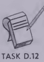

1. 一辆配备柴油发动机的车辆在牵引拖车时过热。以下哪个是最不可能的原因？

- A. 风扇离合器打滑
- B. 风扇离合器卡死
- C. 进气冷却器堵塞
- D. 散热器堵塞

答案 A 是错误的。打滑的风扇离合器可能无法完全接合，导致无法提供足够的空气流经散热器以保持发动机冷却。

答案 B 是正确的。卡死的风扇离合器会一直运行；这可能会导致动力不足的投诉，但不会导致发动机过热。

答案 C 是错误的。堵塞的进气冷却器同样会限制空气流经散热器，这可能导致发动机过热。

答案 D 是错误的。堵塞的散热器可能导致发动机过热。

## 总结

本节概述的问题类型是您在任何 ASE 认证考试中唯一会遇到的类型。ASE 不使用任何其他类型的问题，如填空题、正误判断题、单词匹配题或论文题。ASE 也不要求您绘制图表或草图来支持您的答案选择，尽管上述任何问题类型都可能包含插图、图表或原理图以阐明问题。如果回答问题需要公式或图表，系统将为您提供。

### 任务清单概览

## 简介

本书的本节概述了此次特定认证考试的内容领域或*任务清单*，以及关于考试涵盖内容的书面概览。

任务清单描述了技术人员成功执行每个技能领域相关工作所需的实际知识和技能。该任务清单是您理解预期测试领域的基本指南，以及每个单独领域的权重（包括您在 ASE 认证考试期间预计在该领域遇到的近似问题数量）。需要注意的是，特定领域的考试问题数量仅作为指南。ASE 建议，考试中的问题数量可能与任务清单上列出的数量不一致。任务清单旨在明确告知您 ASE 期望您掌握的知识，并帮助您做好测试准备。

与该任务清单在实际 ASE 考试中所扮演的角色类似，Delmar, Cengage Learning 以此任务清单为指南，在本书的第 5 节中开发了六套准备考试。需要注意的是，虽然 ASE 和 Delmar, Cengage Learning 都使用相同的任务清单作为创建这些测试问题的指南，但您在本书中看到的任何测试问题都不会出现在实际的 ASE 正式考试中。您使用的任何考前准备资料都是如此。真实的考试题目*仅*在实际的 ASE 考试期间可见。

### 任务清单概览

发动机维修 (`A1`) 任务清单聚焦于六个核心领域，您在认证考试中预计总共会遇到约 50 个问题，具体分布如下：

- A. 通用发动机诊断 (15 题)
- B. 气缸盖和气门机构诊断与维修 (10 题)
- C. 发动机缸体诊断与维修 (10 题)
- D. 润滑和冷却系统诊断与维修 (8 题)
- E. 燃油、电气、点火和排气系统检查与服务 (7 题)

基于此信息，此处显示的图表是一个通用指南，展示了实际认证考试中最关注的领域。这些数据可以帮助您在准备考试时合理分配时间。

**注意：** 您在 ASE 认证考试中实际遇到的问题数量可能与任务清单提供的信息略有出入，因为考试中可能包含仅用于统计研究的问题。请记住，您对这些研究问题的回答不会影响您的得分。

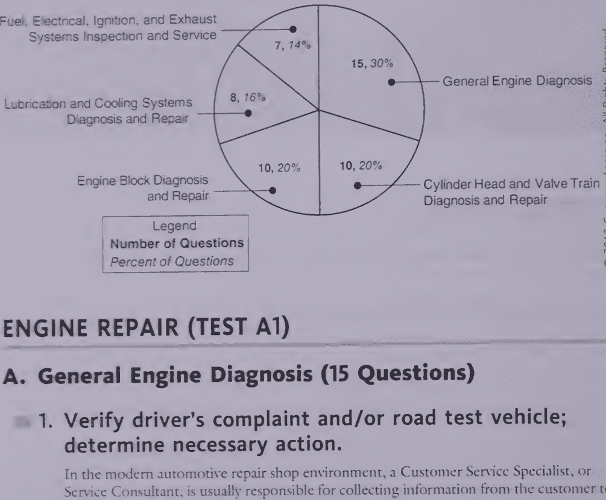

© 2012 Cengage Learning, All Rights Reserved

# 发动机维修 (TEST A1)

## A. 通用发动机诊断 (15 题)

### 1. 核实驾驶员的投诉和/或对车辆进行路试；确定必要的行动。

在现代汽车维修店环境中，客户服务专员或服务顾问通常负责从客户那里收集信息，以协助技术人员解决客户的问题。凭借这些信息、技术员的技能以及大量的直觉，技术人员必须确定特定问题的原因。

技术人员可以利用的最重要工具之一是预测试行驶。在这次行驶中，他可能能够确定问题以及可能导致或与该问题相关的其他状况。在核实客户的担忧后，技术人员必须确定最有效的诊断路径。大多数经验丰富的技术人员会检查可用的信息系统，查看他们诊断的问题是否在技术服务公告或服务活动中有所描述。在某些情况下，可能需要让客户驾驶车辆，技术人员作为乘客，以便客户能够模拟出投诉时的确切场景。

一旦问题被发现并解决，最终的路试可以让技术人员确认问题确实已解决，并且在维修后没有出现其他问题。

### 2. 确定无启动、有启动但无法着车或启动困难的情况是发动机机械问题，还是由其他车辆子系统引起。

如果启动机无法驱动发动机运转（`crank`），问题可能从启动马达故障到发动机内部部件断裂不等。如果启动马达在激活时没有声音，首先禁用点火系统，然后尝试手动沿正常旋转方向旋转曲轴皮带轮。如果曲轴可以自由旋转两整圈，下一步是对车辆的启动系统进行诊断。

如果您无法手动旋转曲轴，发动机可能发生了液锁（`hydrostatically locked`）或内部部件断裂。要检查是否液锁，请拆除所有火花塞并尝试再次旋转曲轴。如果油或冷却液从火花塞孔中喷出，这表明气缸垫损坏、气缸盖或缸体变形、气缸盖或缸体开裂，或者客户行驶过深水区。从火花塞孔中喷出水可能表明客户驶过了深水坑，并通过进气口吸入了水。

如果在拆除火花塞后仍完全无法旋转曲轴，或无法旋转至少一整圈，则发动机可能已卡死或内部零件断裂。拔出油尺检查曲轴箱油位。如果油尺上没有油迹，则可能是活塞在缸套中卡死，或者连杆与曲轴卡死。如果油位充足，则可能是断裂的部件卡在缸体内部的运动部件之间，从而阻止部件旋转。

许多顶置凸轮轴 (`OHC`) 发动机是非自由运转的或称为“干涉”发动机。在这些发动机上，无启动情况可能是由活塞与气门接触引起的。这种情况在正时带打滑或断裂时经常发生，但在配备正时链条和链轮的发动机上也会发生。在许多皮带驱动的 `OHC` 发动机上，可以轻松地松开或拆除部分正时带盖。如果可能，请执行此操作并检查皮带失效的明显迹象。

如果客户陈述启动机能驱动发动机但无法着车（或启动时间很长），在您尝试自行启动发动机之前，请确认气门机构运行正常。如果正时带或链条断裂或跳齿，额外的启动尝试可能会导致严重的发动机损坏。

无法启动或启动困难的投诉可能是由点火故障、燃油/排放控制系统故障或发动机内部部件严重磨损引起的。这些投诉也可能是由气门机构正时部件断裂或打滑引起的，尤其是在自由运转发动机上。断裂的正时装置可能导致某些气缸压力良好，而其他气缸则没有压力。打滑的正时装置可能导致所有气缸压力较低。要确定皮带或链条是否正常工作，请在观察分电器转子或凸轮轴的同时手动旋转曲轴。如果这些部件未能随曲轴一起旋转，则正时带或链条已断裂。对于未按原设备制造商 (`OEM`) 间隔更换的正时带，其齿被曲轴链轮撕掉是很常见的。在视觉检查期间，正时带看起来正常，但在发动机转动时无法旋转。如果它们随曲轴一起旋转，请确认转子或凸轮轴的正确索引，以确定皮带或链条是否打滑。旋转曲轴，直到 1 号气缸的活塞处于压缩行程的上止点 (`TDC`)。然后检查分电器转子或凸轮轴的位置以确保其正确。

在实际工作中，大多数技术人员会在检查燃油或机械问题之前先检查是否有火花。检查火花的过程需要使用一种称为“火花测试仪”的工具代替其中一个火花塞，并启动发动机以视觉观察火花。某些无分电器点火系统与此类测试不兼容，可能需要使用适当的二次点火示波器程序进行测试。

喷射发动机通常由电动泵提供高压燃油。为了验证燃油泵是否运行且燃油是否到达发动机，请找到向节气门体或燃油喷射轨提供燃油的燃油管。安装燃油压力表后，将钥匙开启/发动机关闭 (`ON/OFF`)。验证压力表是否显示充足的压力。如果压力表没有显示压力或显示压力极低，请进行燃油系统诊断。如果燃油压力充足，则开始对燃油喷射控制系统进行诊断。

### 第 4 节 任务清单概览

#### 发动机维修 (A1)

##### 3. 检查发动机总成是否存在燃油、机油、冷却液及其他泄漏；确定必要措施。

流体泄漏源往往难以定位。确定泄漏流体的类型可以减少可能的泄漏点数量。

机油通常从失效的垫片和密封件处泄漏，但也可以从开裂的铸件、失效的压力开关或发送单元以及松动的锥形油道堵塞件处泄漏。机油可能从发动机的高处区域（如 V 型发动机进气歧管后密封件）泄漏并沿发动机向下流动，最终出现在油底壳后部。不要假设“潮湿”区域就是泄漏源。请清洁该区域并运行发动机以检查是否有新鲜流体。此外，不要立即假设泄漏的密封件或垫片失效。过度的窜气或失效的压力控制阀 (`PCV`) 系统可能会使曲轴箱增压，从而迫使机油通过状态良好的密封件或垫片渗出。难以找到的机油泄漏可以通过向曲轴箱倒入少量荧光染料并运行发动机来定位。当用紫外灯照射发动机时，含有染料的机油会发出荧光，从而揭示泄漏点。也可以使用白色气溶胶足粉来帮助查找泄漏。首先，彻底除油泄漏周围的区域。在该区域喷洒白色气溶胶足粉。启动并运行车辆，然后观察该区域。白色足粉提供了亮色背景，使泄漏检测更容易一些。

燃油可能从松动的连接处或损坏的部件中泄漏。检查软管卡箍和燃油管接头是否松动。检查软管是否有膨胀、裂纹以及磨损损坏。检查金属管路是否有裂纹和腐蚀。检查 `O` 型圈连接处是否泄漏，以及燃油压力调节器（通常安装在节气门体单元或喷油嘴导轨上）是否泄漏。

密封气缸体及有时密封气缸盖冷却系统通道的软金属堵塞件有许多种称呼。本文将使用 *`core plug`*（芯塞），但请注意它们也被称为 *`expansion plugs`*（膨胀塞）或 *`freeze plugs`*（冻结塞），这些术语可以互换使用。

腐蚀的芯塞是常见的冷却液泄漏点，失效的软管和水泵也是如此。同时检查冷却液温度传感器、发送单元和热真空开关。某些发动机在气缸体和/或气缸盖的背面设有芯塞。如果发动机消耗冷却液，但你找不到冷却液泄漏的证据，请检查机油量和状态。冷却液可能泄漏到了曲轴箱中。冷却液也可能泄漏到燃烧室中。

对于配备动力转向的车辆，请检查液位。泄漏的动力转向液可能会被误认为机油或变速箱油。在检查油液泄漏时，请注意油液的颜色。褐色到黑色通常表示机油，红色通常表示自动变速箱油，透明色通常表示动力转向液。

##### 4. 隔离发动机噪音和振动；确定必要措施。

不同类型的发动机零件失效通常会发出独特的声响。首先，确保噪音确实来自发动机。失效的水泵、发电机、动力转向泵、空调压缩机或空气注入泵发出的噪音看起来像是来自发动机内部。松动或断裂的附件安装支架也可能产生听起来像发动机内部问题的噪音。使用听诊器听每个附件，以确定它是否是噪音源。如果有疑问，可临时拆除附件的驱动带以防止其运行。

失效的曲轴主轴承或连杆轴承通常会发出音调非常低沉的敲击声。主轴承敲击声通常是一种砰砰声，在发动机初次启动时最明显。连杆轴承也会产生沉重的敲击声，且机油压力可能较低，尤其是在怠速时。在气缸平衡测试期间，当带有失效连杆轴承的气缸被禁用时，敲击声会减弱。松动的飞轮螺栓可能会在怠速时产生砰砰声。凸轮轴轴承通常除非严重磨损，否则不会产生噪音。

磨损的活塞和气缸在加速时会产生敲击声（`rapping noise`）。在进行气缸平衡测试时，当失效气缸被禁用时，活塞噪音可能会增加（与连杆轴承失效时的反应相反）。间隙过大的活塞销在发动机怠速时经常发出“双击”声。

挺柱也会发出独特的噪音，一种响亮的滴答声（`ticking sound`）。将挺柱（或其他配气机构）噪音与连杆噪音区分开的一种方法是记住：凸轮轴的运行速度是曲轴速度的一半。漏油严重的挺柱在发动机启动后滴答响几秒钟是很常见的。一旦建立起充足的机油压力，噪音就会消失。

振动可能由发动机附件部件引起，但更多是由内部发动机失效（如轴承或活塞）引起。某些振动是由失效的振动减震器引起的。由失效振动减震器引起的振动可以通过其特征来识别，因为它们通常仅在特定的 RPM 下出现，例如 750、1,500 和 2,250。振动也可能由时间不对的平衡轴引起。这些轴由链条、皮带或齿轮驱动。

### 5. 诊断机油过量消耗、冷却液消耗、异常发动机排气颜色和气味的原因；确定必要措施

机油过量消耗可能是由于机油从发动机泄漏，或机油被吸入气缸并被烧掉。在指责内部部件之前，请绝对确认机油没有从发动机泄漏。在某些情况下，机油仅在发动机运行时泄漏。如有必要，在发动机运行期间将车辆升起在举升机上以检查泄漏。还应检查散热器和/或冷却液回收罐是否有机油泄漏进入冷却系统的迹象。

机油可以通过几种不同方式进入气缸，包括：活塞环磨损；气缸壁有划痕；气门导管、密封件和气门杆磨损；涡轮增压器密封件磨损；以及机油回油通道堵塞。通常情况下，“烧机油”的发动机会排出蓝灰色废气。这在加速和减速时可能更加明显。不要将由于机油消耗引起的蓝灰色烟雾与空燃比过浓时产生的黑色废气混淆。

气缸盖或气缸体中堵塞的机油回油通道即使在活塞环和导管状态良好时，也可能导致机油过量消耗。要检查此项，请取下机油加注盖或安装在气门室盖上的其他部件并启动发动机。如果发动机运行期间盖子内部的油位稳步上升并达到气门导管顶部，则回油通道已堵塞。虽然这些通道通常可以清除油泥，但油泥表明发动机维护不良。清除通道可能会降低机油消耗，但发动机在不久的将来可能会出现其他问题。在冷却系统中发现的机油可能是从内部机油冷却器（在散热器水箱中）或 OHC 发动机的缸垫中泄漏的。

进行压力测试（任务 A.8）和气缸泄漏测试（任务 A.9），以确认活塞环/气缸或气门导管是否磨损。

如果发动机带有涡轮增压，首先按照非涡轮增压发动机的方式进行机油消耗诊断。虽然涡轮增压器常被认为是机油过量消耗的原因，但保修期内退回的涡轮增压器中约有一半并非缺陷产品。如果在涡轮压缩机壳体或进气歧管中发现机油，请检查从涡轮壳体到缸体的机油回油管。如果回油管被阻塞，压力下的机油将被迫通过涡轮密封件并经进气道进入发动机。同时检查 PCV 系统。如果在“全开”条件下 PCV 阀不关闭，曲轴箱将产生压力。这可能会使涡轮机油回油通道增压，从而将机油压入涡轮壳体。

与机油消耗一样，冷却液消耗可能是由冷却液从冷却系统泄漏或冷却液泄漏到发动机（或乘客舱）引起的。首先，通过进行冷却系统压力测试（任务 D.3）排除外部泄漏作为冷却液消耗的原因。如果在测试期间冷却系统压力下降但未发现泄漏，请检查机油量和状态。泄漏到曲轴箱中会提高油位。如果冷却液被吸入燃烧室，排气将呈灰色或白色。即使在水分通常从排气系统中被清除的时间之后，发动机仍会持续排出这种烟雾。在配备电子发动机控制系统的车辆上，通过排气系统的冷却液会“毒害”氧传感器。

一些发动机问题可以通过听尾管的排气脉冲来诊断。如果所有气缸都正常点火，排气应该是稳定的脉冲。定期出现的噗噗声通常表示由压力、点火或燃油系统缺陷引起的气缸失火。不规律出现的噗噗声通常是由点火或燃油系统缺陷引起的。发动机怠速也可能不稳定。

在剧烈加速时出现的尖锐尖叫声可能是由排气系统中的微小泄漏引起的，特别是在排气歧管或排气管中。这种泄漏在怠速时也可能表现为滴答声。

另一种常见的发动机噪音是怠速和低发动机转速时的尖锐哨声。检查进气歧管垫片是否有真空泄漏。同时检查真空软管是否开裂或断开。当发动机加速且进气真空度降低时，真空泄漏的哨声会逐渐减小。

配备催化转换器的汽车排气系统中发出强烈的硫磺味或臭鸡蛋味，可能表明空燃比过浓。

### 6. 执行发动机真空测试；确定必要措施

真空测试可用于帮助精准定位发动机问题的原因。真空表应直接连接到进气歧管。

在运行正常的发动机上，发动机怠速时真空表读数应在 17 到 22 in. Hg（45 和 28 kPa 绝对压力）之间且保持稳定。一些异常的真空表读数及其相关的典型问题如下：

1. 读数略低但稳定，可能表示点火提前角滞后。
2. 读数非常低但稳定，可能表示进气歧管有严重泄漏。
3. 气门烧损或泄漏可能导致真空表波动。
4. 气门弹簧疲软可能导致真空表波动。
5. 缸垫泄漏可能导致真空表波动。
6. 如果气门卡住，真空表会产生波动。
7. 如果在发动机加速并保持在较高速度时，真空表指针逐渐下降，则说明催化转换器或其他排气系统部件受阻。

### 7. 进行气缸功率平衡测试；确定必要的措施

在健康的发动机中，每个气缸贡献的功率量是相等的。隔离一个或多个气缸中可能出现的功率损失的一种常用方法是功率平衡测试。在大多数发动机中，此测试通过短时间禁用单个气缸的点火，以测量该气缸不贡献功率时发生的 RPM（每分钟转速）下降。点火禁用的时间应尽可能短，以防止损坏催化转换器。不贡献功率或性能较弱的气缸在被禁用时，RPM 下降幅度很小或几乎没有。在端口燃油喷射发动机上，许多制造商提供了通过动力总成控制模块（PCM）和扫描仪进行气缸平衡测试的功能。大多数车载诊断（OBD）II 车辆能快速捕捉并识别效率低下的气缸，并显示指向感知问题及受影响气缸的代码。

当某个或某些特定气缸未通过功率平衡测试时，就有必要确定原因是机械性的（气门、发动机内部效率）还是与发动机管理相关的。发动机管理问题可能包括泄漏或电损坏的端口燃油喷射器（完全不供油）、故障的点火部件（如火花塞、无分电器点火系统（DIS）线圈、火花塞导线等）。功率平衡测试通常是气缸压力测试和/或漏气测试的前奏。这些测试将确认机械问题，而使用数字存储示波器或扫描仪进行的电诊断可以确定发动机管理问题。

### 8. 进行气缸启动压力测试；确定必要的措施

在进行压力测试之前，必须禁用点火和燃油喷射系统。在压力测试期间，节气门被强行打开，发动机在每个气缸上分别经过四个压缩冲程。记录每个冲程的压力读数并与制造商的规格进行比较。如果发动机性能可以接受，所有气缸的压力读数略低无需担心。但如果压力读数波动超过 20%（最高值与最低值之间），则需要引起关注。应进行湿法压力测试以帮助精准定位低压力的原因。要进行湿法测试，向气缸中注入几喷油，等待 30 到 60 秒让油流向活塞环，然后重新测试压力。如果压力明显提高，最可能的原因是活塞环和/或气缸套磨损。湿法测试通常无法密封泄漏的垫片或气门，如果这些部件出现故障，压力读数将几乎没有改善。压力读数可解释如下：

- 当所有气缸的压力读数大致相等，但显著低于规格时，可能是活塞环或气缸壁磨损。如果所有气缸压力都低且发动机在启动时旋转自由，请检查气门正时。正时皮带或链轮可能发生了跳齿。
- 一个或多个气缸压力读数低，表明活塞环磨损、气门泄漏、气缸垫冲掉、凸轮轴磨平或气缸盖开裂。进行漏气测试将缩小问题原因的范围。
- 两个相邻气缸压力读数低，可能是由于气缸垫泄漏或气缸盖开裂。
- 气缸压力为零通常是由活塞打孔或排气门严重烧毁引起的。如果压力为零是由活塞打孔引起的，发动机将出现严重的窜气（`blow-by`）。
- 压力高于规格通常表明燃烧室内存有积碳。

### 9. 进行气缸漏气测试；确定必要的措施

在气缸漏气测试期间，当排气门和进气门均关闭时，将来自车间空气源的受控气量强行压入气缸。漏气测试仪上的压力表显示气缸的漏气百分比。压力表读数为 0% 表示没有气缸漏气。如果读数为 100%，则表示气缸完全无法保压。

如果气缸漏气超过 20%，请通过监听空气是否从尾管、曲轴箱（通过机油加注口或 PCV 阀）和/或进气道（节气门体或化油器）逸出，以确定泄漏源。空气从尾管逸出表明排气门泄漏。当空气从 PCV 阀或气门室盖开口逸出时，表明活塞环泄漏。如果空气从节气门体或化油器顶部逸出，则进气门泄漏。取下散热器盖并检查冷却液是否有气泡，这表明气缸垫泄漏或缸盖开裂。取下所有火花塞。空气从相邻的火花塞孔逸出可能表明气缸垫损坏，或者缸体或气缸盖有裂纹。

## B. 气缸盖和气门机构诊断与修理（10 个问题）

### 1. 拆卸气缸盖，分解、清洁并准备检查

仅在发动机冷却时才拆卸气缸盖。拆卸温热的气缸盖可能会导致缸盖变形，尤其是铝制缸盖。

拆除气缸盖螺栓，拆卸顺序应与拧紧顺序相反。记录特殊螺栓的位置。将气缸盖从发动机上拆下。气缸盖可能非常沉重，因此请请求助手帮忙，尤其是当发动机仍安装在车辆中时。

使用弹簧压盘压缩气门弹簧，然后取下气门锁环（`keepers`）。释放压盘，并从缸盖上取下压盘、旋转件、弹簧和弹簧座。将所有部件放入整理盒中，以便它们能返回原气缸。检查气门杆顶端是否有“蘑菇头”变形。如果存在，在将气门从缸盖中取出之前，必须用锉刀修整顶端。将气门从气缸盖中取出并放入整理盒。

从 OHC（顶置凸轮轴）设计发动机中拆卸气缸盖时，必须先将正时皮带或链条与凸轮轴断开。具体操作步骤因制造商而异。在某些采用链条驱动凸轮轴的发动机上，凸轮轴链轮从凸轮轴上卸下。然后拆除气缸盖总成，将链条和链轮保留在发动机原位。在某些采用皮带驱动凸轮轴的发动机上，松开皮带张紧器并将皮带从凸轮轴链轮上滑出。在其他发动机上，必须将正时盖和皮带完全从发动机上拆除。如果要从发动机上拆除正时皮带并重复使用，请在皮带上标记旋转方向。重新安装皮带时，确保其旋转方向一致。在拆除气缸盖之前，绝不要在正时装置松动或拆除后启动发动机。在正时皮带松动或断开时启动发动机可能会导致立即且严重的发动机损坏。

基本的气缸盖拆卸程序因制造商而异。在某些 OHC 发动机上，在松开并拆除气缸盖螺栓后，气缸盖、凸轮轴和摇臂（如果使用）作为总成一起拆除。在某些发动机上，必须先拆除摇臂轴和摇臂总成（包括凸轮轴轴承的上半部分），以便接触到气缸盖安装螺栓。相关信息请参考相应的维修手册。

随着铝制缸盖和缸体的出现，为重新组装而进行的部件清洁方式发生了剧烈变化。这些部件的许多表面被抛光至接近镜面质量。在适当的脱脂溶液中清洁这些部件后，可用软钢丝轮手动清除积碳，或在类似玻璃喷砂的研磨柜中清除。无论采取哪种方式，必须小心确保垫片表面保持原始状态。在抛光表面使用修整轮会导致新垫片过早失效。在清除沉积物和旧垫片材料后，必须仔细清洗缸盖，以确保没有碎片堵塞通道。许多制造商建议使用塑料刮刀和垫片软化化学剂来清除旧垫片。请务必了解制造商的建议，以保证高质量的修理。

### 2. 目视检查气缸盖是否有裂纹、变形、腐蚀、泄漏以及通道状况；确定所需的修理

虽然任何发动机的气缸盖都应仔细检查，但具有严重机械问题（气缸垫冲掉、冷却液消耗、过热、油泥等）的发动机缸盖应给予特别关注。首先观察旧的气缸垫，确定是否有可见的问题区域。如果存在一个或多个，将该区域与气缸盖上的接触区域相对比。

检查气缸盖是否有裂纹，特别注意燃烧室以及进排气门之间的区域。可使用电磁型检测仪和铁屑（MAGNAFLUX®）来检查铸铁缸盖的裂纹。铝制缸盖可使用渗透染料定位裂纹。机加工店通常可以通过压力测试定位难以发现的裂纹。在这种测试中，所有冷却通道都被金属板封堵。然后向冷却水套充满压缩空气，并将缸盖浸入水槽中。从缸盖逸出的气泡揭示了泄漏区域。

使用直尺和塞尺在多个位置检查气缸盖的变形情况。查阅制造商的维修手册获取准确规格。变形过大的气缸盖必须重新研磨表面或更换。

在 OHC 发动机上，在对缸盖进行表面研磨和重新安装之前，务必检查缸盖凸轮轴侧的变形情况。如果变形超过制造商规格，凸轮轴将会卡死、弯曲并可能断裂。

尽可能彻底地检查气缸盖中的冷却通道。将手电筒照入通道，寻找腐蚀、生锈和被困的碎片。如果冷却水套出现严重点蚀迹象，则应更换气缸盖。

### 3. 在允许的情况下检查并修复损坏的螺纹；安装芯塞和油道塞

在拆卸或安装组件时，仔细检查所有螺栓、螺柱、孔和螺母的螺纹是否损坏。螺纹被剥离、错位、有缺口、卷边或生锈都可能导致扭矩值出现误差。使用压缩空气清除孔中的异物。卡在孔中的异物（如金属碎屑和液体）可能会导致螺栓触底，在未获得所需夹紧力的情况下就达到了扭矩值。检查螺栓和螺柱的杆部是否有扭曲或过扭矩断裂的迹象。更换有缺陷的螺栓和螺柱。确保螺母没有变形或裂纹，并更换自锁螺母及有缺陷的螺母。清洁并修整孔中的螺纹。如果螺纹损坏到无法使用的程度，请对孔进行钻孔和攻丝，并安装经认可的 `HeliCoil` 螺纹衬套。使用经认可的螺柱提取器取出断裂的螺柱和螺栓。

芯塞（`Core plugs`）是冲压金属塞；这些塞子倾向于由内而外地劣化，因此无法通过外部观察来确定其状态。在气缸盖大修期间，这些塞子必须全部更换。如果它们在发动机运行期间发生泄漏，也需要更换。芯塞通常是金属杯状，使用正确的驱动工具将其击入到位。技术人员在安装前通常会在塞子的外缘涂抹密封胶。市面上还有售后提供的橡胶膨胀塞，可以在发动机仍留在车内时用于更换塞子。

油道塞（`Oil gallery plugs`）可以是锥形管塞或直螺纹 O 型圈型。锥形管塞在安装前应涂抹薄薄一层密封胶；而直螺纹 O 型圈型则不应涂胶。两种类型的塞子都应使用扭矩扳手安装。

- 直螺纹 O 型圈接头
- 锥形管塞

### 4. 检查、测试并验证气门弹簧的垂直度、压力和自由高度对比；必要时予以更换

气门弹簧测试仪用于测量气门弹簧的压力或张力。必须仔细检查气门弹簧，确保弹簧的自由高度符合规格，且弹簧没有向一侧倾斜。弹簧在平面上放置时必须完全垂直。弹簧在静止时必须能够达到指定的压力，这被称为气门弹簧安装高度。它还必须能在最大气门升程时达到特定压力。弹簧测试仪用于在各自的高度测量这些压力。

在大多数情况下，如果弹簧失效，它将无法产生足够的压力。这会导致发动机在较高转速时气门出现“飘浮”或反弹。较低的弹簧压力通常会导致弹簧断裂，从而使气门掉入气缸。在极少数弹簧产生压力过大的情况下，可能会导致凸轮、从动件或挺杆的过度磨损。

### 5. 检查气门弹簧座、旋转件、锁止件/锁片以及锁止槽

必须检查气门弹簧座和锁止件/锁片的磨损、划痕或损坏情况。一旦出现任何这些情况，请更换相关组件。

气门旋转件（`Valve rotators`）可以在拆除气缸盖和分解之前进行检查，因为它们通常无法拆解。旋转件可以位于气门弹簧顶部（内置在弹簧座中）或气门弹簧与气缸盖之间。要测试旋转件，在弹簧座顶部点上一小滴油漆。然后启动发动机，使其在约 1,500 rpm 的转速下运行。弹簧座应缓慢旋转，旋转方向并不重要。如果弹簧座不旋转，请更换旋转件。

在某些情况下，可以在拆除气缸盖后诊断有缺陷的旋转件。检查气门杆顶端的磨损模式。如果顶端有一道浅槽或沟槽横贯，表明气门没有旋转。对于任何出现此情况的气门，请更换其旋转件。

检查加工在气门杆上的气门锁止件/锁片槽。检查是否有损坏和磨损，特别是圆肩部分。如果肩部不平整或变圆，请更换气门。观察锁止件/锁片在气门弹簧座中的深度。如果它们不平整，可能表明存在磨损，这会导致它们脱离弹簧座。锁止件/锁片失效可能会导致严重的发动机损坏。

### 6. 更换气门杆密封件

服务许多配气机构组件时不需要拆除气缸盖。这包括气门弹簧、油封、弹簧座和气门锁止件。当气缸盖安装在缸体上时，可以使用爪式气门弹簧压缩机来压缩气门弹簧，但这要求通过火花塞孔将车间气源连接到气缸中。当气门弹簧被拆除时，此气压将把气门固定在原位，防止气门掉入气缸。

对于配备伞形气门密封件的发动机，将新密封件套在气门杆上。操作时要小心，避免在气门杆锁止槽上损坏新密封件。损坏的密封件会导致过高的机油消耗。某些密封件带有安装工具，该工具仅是一个短塑料套管，在安装密封件之前将其套在每个气门杆的顶端。套管向下延伸足够远，以覆盖锁止槽。安装每个密封件后，将其压在气门导管顶部并取下安装工具。

对于配备正压型（`positive-type`）气门密封件的发动机，安装步骤相同，但有一个重要区别。正压型密封件必须被压在气门导管的顶部。每个密封件都有某种固定装置将其固定在导管上。有些密封件有一个环绕密封件的扁平圆形弹簧；有些使用 `Garter` 弹簧将密封件固定在原位；其他则在内径上有模制凸起，与气门导管上加工的凹槽配合。无论采用哪种固定方法，请确保气门导管密封件牢固地固定在导管上。某些制造商指定应使用专用工具将正压密封件压入气门导管。欲了解更多信息，请参阅车辆维修手册。

### 7. 检查气门导管磨损；检查气门杆与导管的间隙；确定所需的修复措施

应使用孔规测量气门导管的顶部、中部和底部。在相同的三个位置使用千分尺测量气门杆直径，并从导管测量值中减去杆测量值以获得间隙。

测量杆与导管间隙的另一种方法是将气门安装在导管中，使气门离开其座圈约 1/8 英寸（3.18 mm）。将百分表安装在气门边沿或锁止槽下方的气门杆上。在观察百分表间隙读数的同时，将气门左右移动。将读数除以二即可获得杆与导管的间隙。

如果间隙超过规格，可以更换气门导管或将其扩孔并安装薄壁衬套。过大的气门杆与导管间隙可能导致气门密封不当并降低压缩压力。过大的气门杆与导管间隙还可能导致机油消耗增加。

### 8. 检查气门和气门座；确定所需的修复措施

尽管大多数维修店不再进行气门和座圈的翻新，但技术人员仍需能够检查气门和座圈的状态，以确定故障原因。老旧发动机和许多大排量的轻型卡车发动机更容易出现磨损。这些发动机中的气门比小型发动机中的气门大，因此在保持形状和将热量散发到气门座圈方面更容易出现问题。在这些较大的气门中，排气气门在剧烈使用下出现“郁金香形”变形或裂纹并不罕见。同样地，由于铝制气缸盖能够将过多的热量从排气气门中抽出，从而消除了大多数此类情况。缺点是，导致气门损坏的情况现在极有可能转而损坏气缸盖。多气门发动机和较小排量的发动机表现出极佳的气门和座圈寿命。在大多数情况下，气门和座圈的寿命将与发动机一样长。常见的故障包括在干涉发动机中正时带断裂导致的气门损坏，以及气门头上的积碳导致与座圈接触不良并丢失压力。

在检查气门和座圈时，我们要寻找气门形状的明显变化。座圈与气门的接触区域对于良好密封至关重要。配气机构的设计是提升气门并将其轻轻放下。如果配气机构中出现过大的气门间隙，结果可能是加速气门座圈磨损。该表面的任何不规则都可能导致气门无法密封，从而导致气缸失火。气门必须完全密封，才能使气缸在压缩冲程和做功冲程期间都能达到全压。

### 9. 检查气门弹簧安装（组装）高度和气门杆高度；确定所需的修复措施

测量从气缸盖上的弹簧座表面到气门杆顶端的安装气门杆高度。如果杆安装高度大于规格，则说明气门杆被拉伸，或者从气门面或座圈上切除的材料过多。安装新气门并再次测量杆高度。如果测量值仍然过高，请更换座圈或气缸盖。过大的气门杆高度会使液压气门挺杆中的柱塞向下移动，并可能导致配气机构组件触底。

测量从顶部弹簧座下边缘到弹簧座的安装气门弹簧高度。如果此测量值过大，请在气门弹簧底部与气缸盖上的弹簧座表面顶部之间安装垫片。过大的气门弹簧安装高度会降低气门弹簧张力，这可能会导致在高转速下出现气门飘浮和气缸失火。

### 10. 检查推杆、摇臂、摇臂支点和轴是否有磨损、弯曲、裂纹、松动以及油道堵塞；根据需要进行修理或更换

应检查推杆是否弯曲以及端部是否有磨损。将推杆在水平面上滚动以检查其是否弯曲。推杆弯曲通常表明气门机构存在干涉，例如气门卡死、气门调整不当或由于气门正时错误导致的机械干涉。如果推杆设有向摇臂供油的油道，请确保该油道没有堵塞。

磨损的摇臂、轴或支点会导致气门调整不当，并使气门机构发出咔哒声。检查摇臂轴在摇臂接触区域是否有磨损和划痕。检查轴是否有裂纹、弯曲以及油道塞（如果配备）是否松动/泄漏。检查摇臂在支点区域和气门杆顶端接触区域是否有划痕。磨损的摇臂应予以更换。

### 11. 检查并更换液压或机械挺柱/间隙调节器

技术人员通常采取由外向内的顺序来诊断液压气门机构问题。在大多数情况下，客户会抱怨发动机中存在滴答声或咔哒声。我们使用听诊器来精确定位噪音位置，并进行必要的拆卸以找到出问题的部件。了解液压间隙调节器（包括传统的 V8 型挺柱）的工作原理至关重要。这些部件的制造公差极小，通常在`.0001`英寸级别。其内部设有弹簧，用于将气门机构部件保持在原位。然而，该弹簧并不负责控制气门间隙；这是发动机油压的功能。液压间隙调节器在发动机运行时时刻维持着气门机构部件的预紧力。

液压间隙调节器的尺寸不等，从凸轮在缸体内的发动机中直径约 1 英寸，到许多小型多气门发动机中仅`.25`英寸不等。由于其公差非常精密，它们与脏油的兼容性较差，而脏油是导致失效的主要原因。在挺柱（间隙调节器）直接运行在凸轮轴上的应用中，有两种设计：平顶挺柱（flat tappet）和滚子设计（roller design）。

平顶挺柱设计在初始状态下底部略微凸起，促使其在凸轮轴斜面使其升降时随之旋转。这种运动使油在凸轮和挺柱的接触面上持续流动。检查此类损坏时，请寻找表面暗淡、点蚀或凹陷的接触面。如果出现此类损坏，凸轮轴也必须更换。

滚子挺柱最初用于赛车发动机，因为它能够跟踪巨大且复杂的凸轮轴凸起轮廓。由于圆柱体在凸轮轴表面滚动，凸轮与挺柱之间的接触面积非常小，且摩擦力明显低于平顶挺柱设计。原厂设备制造商（OEM）开始采用这种设计以减少内部摩擦并获得更好的燃油经济性。该设计的液压部分与其他设计相同。滚动部件通常不会失效，除非其无法滚动。此处同样要注意点蚀迹象或无法轻松滚动的部件。滚子决定了挺柱不能旋转，因此凸轮和滚子均由钢制成。在大多数应用中，未失效的旧滚子挺柱可以安装在新凸轮轴上。而平顶挺柱设计则无法做到这一点——新挺柱可以安装在旧凸轮轴上，但旧挺柱不能安装在新凸轮轴上。

当任何一种设计出现液压失效时，该单元需更换为新部件。在极少数情况下，间隙调节器可能会以某种方式失效而导致气门保持开启状态。这可能会导致气门损坏，特别是排气门。

### 12. 对配备机械或液压挺柱的发动机进行气门调整

气门间隙调整步骤和机构因制造商而异。在某些发动机上，气门在冷机状态下进行调整；而在其他发动机上，发动机应处于工作温度。请参考相应的维修手册获取指示。

在一些配备机械气门挺柱的发动机上，摇臂的气门杆端设有调整螺钉和锁紧螺母。其他发动机则使用无需锁紧螺母的过盈配合螺钉。调整步骤通常包括旋转曲轴，使正在调整的汽缸内的活塞处于压缩行程的上死点（TDC）。然后将塞尺插入调整螺钉和气门杆之间。如果间隙过大，则松开调整螺钉锁紧螺母（如果配备），并旋转调整螺钉。当间隙正确时，正确厚度的塞尺在轻微推入时可在调整螺钉和气门杆之间滑动。间隙正确后，拧紧锁紧螺母（如果配备）。

某些配备机械气门挺柱的 OHC（顶置凸轮轴）发动机在每个挺柱或弹簧座中设有可拆卸的金属垫片。测量间隙的方法是在活塞处于压缩行程上死点时，将塞尺置于凸轮凸起与挺柱或弹簧座之间。垫片有多种厚度可选，以将间隙调整至规定值。该方法的另一种变体是不使用可拆卸垫片，必须将整个气门挺柱更换为具有正确厚度的挺柱。

一些气门机构采用液压气门挺柱，并使用自锁螺母固定单个摇臂支点。这些气门机构需要对摇臂螺母进行初始调整，以定位挺柱柱塞。在气门关闭时，松开摇臂螺母，直到摇臂末端与气门杆之间出现间隙。缓慢顺时针旋转摇臂螺母，直到达到“零间隙”状态。此时挺柱尚未预紧，但所有部件刚刚接触。下一步是施加制造商规定的预紧力。在大多数应用中，这相当于`.030-.060`英寸的挺柱预紧量。此处必须严格遵守制造商的规格，因为挺柱必须能够补偿气门机构部件在发动机从冷机到完全热机运行期间的膨胀和收缩。

配备液压挺柱和螺柱安装摇臂的发动机气门机构也可以在发动机运行时进行调整。拆除气门室盖后，在摇臂上安装防油罩，以防止机油溅到排气歧管和其他附近零件上。启动发动机并松开摇臂固定螺母，直到听到咔哒声。然后缓慢拧紧螺母，直到咔哒声消失。从此时起，每次缓慢拧紧螺母约 1/4 圈，直到达到规定的旋转圈数。每旋转 1/4 圈后等待几秒钟，以便挺柱泄压。一次性过度旋转或旋转过多的调整螺钉可能会导致活塞与气门接触。

### 13. 检查并更换凸轮轴（包括检查驱动齿轮磨损和背隙、端隙、链轮和链条磨损、顶置凸轮轴驱动链轮、驱动带、皮带张紧度、张紧器、凸轮轴磁电环/信号轮以及可变气门正时部件）

当凸轮轴齿轮直接与曲轴齿轮啮合时，可用一个抵住其中一个凸轮轴齿轮齿的百分表来测量齿轮背隙。前后摇动凸轮轴齿轮，并记录百分表上的最大读数。

一些配备正时链条和链轮的发动机设有液压张紧器。张紧器利用润滑系统中的压力油来消除正时链条的游隙。部分制造商建议测量张紧器的安装长度以确定链条磨损情况。如果张紧器长度超过制造商规格，请更换正时链条。

在许多 V 型凸轮轴在缸体内的发动机中，在安装凸轮轴链轮和链条之前，必须将曲轴链轮上的正时标记与凸轮轴链轮上的正时标记对齐。在这些发动机上，可以通过在其中一个凸轮轴链轮固定螺栓上安装套筒和灵活接杆来测量正时链条的拉伸和磨损。在不移动曲轴齿轮的情况下前后摇动凸轮轴链轮，并测量凸轮轴链轮上其中一个链节销的移动量。

配备正时皮带的发动机应按照发动机制造商推荐的里程间隔更换皮带。在更换皮带期间，应检查曲轴、凸轮轴以及惰轮或其他链轮。检查链轮齿是否有磨损和损坏。检查惰轮或链轮的轴承是否干涸或松动。

许多配备 DIS（无分布点点火系统）的车辆使用凸轮轴位置传感器代替分电器来确定 1 号汽缸的位置。这通常用于使燃油喷射事件与点火事件同步。凸轮传感器通常是一个磁电霍尔开关，通过凸轮轴或凸轮轴驱动齿轮上的 1 号对齐凸起或加工面从凸轮轴获取信号。

检查凸轮轴时，寻找点蚀、表面暗淡或润滑不良的迹象。链传动的凸轮轴或曲轴齿轮会出现类似于链条齿反向的磨损。这种情况需要更换。链条挠度是正时链条状态的主要指标。参考制造商的建议来确定链条状态。许多链传动发动机使用由液液压链条张紧器张紧的链条导轨。务必检查这些导轨的表面磨损。如果链条在导轨上磨出了沟槽，则可能需要更换。在带有液压张紧器的发动机中重新组装正时部件时，可能需要将张紧器压缩并用销钉固定，直到所有部件安装到位。

具有可变气门正时的发动机将在气门机构部件中配备允许油流的执行装置和监控凸轮轴位置的传感器。在进行气缸盖维修期间，必须检查这些部件的磨损情况和运行是否正常。

凸轮轴端隙通常使用百分表测量。规格取决于凸轮轴的尺寸。正常的端隙规格可能为`0.002"–0.008"`。过大的凸轮轴端隙可能是由于止推轴承磨损或凸轮轴本身的止推面磨损造成的。止推轴承应予以更换；如果凸轮轴上的止推面磨损，则需更换凸轮轴。

### 14. 检查并测量凸轮轴轴颈和凸轮凸起；测量凸轮轴升程

要检查凸轮轴的直线度，将凸轮轴外部轴承轴颈放置在 V 型块上，并将百分表置于中间凸轮轴承轴颈处。旋转凸轮轴以确定径向跳动。如果凸轮轴不直，请予以更换。

要测量凸轮凸起，使用千分尺测量从凸起最高点到凸起另一侧某一点的距离；记录测量值。在距离第一次测量位置 90° 处再次测量凸起；用第一次测量值减去第二次测量值，即可得出凸轮轴凸起升程。如果升程不在规格范围内，请更换凸轮轴。

使用千分尺测量每个凸轮轴轴颈的直径。在多个位置测量该直径。如果直径小于规定值，请更换凸轮轴。

在凸轮轴仍留在发动机中的情况下，也可以通过拆除气门室盖并在气缸盖上安装百分表来测量凸轮轴凸起升程。布置百分表，使其接触推杆顶端（拆除摇臂时）或推杆正上方的摇臂（摇臂仍在原位时）。百分表的测杆必须与推杆平行。手动转动曲轴，并记录百分表的最高和最低读数。这两个数值之差即为凸轮轴凸起升程。

### 15. 检查凸轮轴孔的磨损、损坏、圆度偏差和对齐情况；确定所需的修理方案

对于凸轮轴在缸体内的状态，检查凸轮轴轴承孔是否有划痕或其他损坏。轻微的刻痕或毛刺可以用金相布（砂纸）去除。如果轴承孔严重损坏，应更换缸体。

对于没有可拆卸轴承盖的顶置凸轮轴发动机，检查轴承孔是否损坏。轻微的刻痕或毛刺可以用金相布去除。如果凸轮轴运行卡顿，或轴承衬套磨损不均匀，请使用直尺检查轴承孔的对齐情况。如果孔位不对齐，说明气缸盖翘曲，应将其校直或更换。

对于具有可拆卸凸轮轴轴承盖的顶置凸轮轴发动机，凸轮轴通常直接与铝制气缸盖接触。拆下轴承盖和凸轮轴后，将直尺横跨在凸轮轴承表面以测量轴承对齐情况。测量直尺与每个轴承孔之间的间隙以确定孔位对齐情况。当凸轮轴轴承孔对齐不当时，请更换气缸盖。检查轴承表面是否有划痕或其他损坏。要测量轴承孔的圆度偏差，请安装轴承盖并将固定螺栓按规格拧紧。然后使用伸缩量规测量孔周边的多个位置的直径。如果轴承表面和孔状态良好，请使用`Plastigauge®`（塑料量规）来测量轴承间隙。

### 16. 检查气门正时；将凸轮轴与曲轴同步

在拆除正时带或正时链条盖后，可以通过观察凸轮轴和曲轴链轮上的标记位置来检查凸轮轴正时。这些标记必须按照车辆制造商维修手册中的指示对齐。

在许多 OHV 推杆发动机上，曲轴链轮安装在曲轴前端，旋转曲轴使 1 号活塞处于上死点 (TDC)。此时，冲压在曲轴链轮上的标记应直接指向凸轮轴方向。然后将凸轮轴链轮临时固定在凸轮轴上，并旋转凸轮轴，直到凸轮轴链轮上的标记直接指向曲轴方向。随后在不让凸轮轴旋转的情况下将链轮从凸轮轴上拆下。将正时链条套在凸轮轴齿轮上，使凸轮轴齿轮上的标记直接向下，然后将链条绕在曲轴链轮上。当凸轮轴链轮安装到凸轮轴上时，曲轴和凸轮轴链轮上的正时标记应彼此相对。

配备正时带的单顶置凸轮轴 (SOHC) 发动机通常采用类似步骤。在将曲轴定位使 1 号活塞处于 TDC 且曲轴齿轮正时标记与缸体上的正时标记对齐后，旋转凸轮轴使凸轮轴链轮上的标记与气缸盖上的标记对齐。然后安装正时带。

双顶置凸轮轴 (DOHC) 发动机的正时校对步骤因制造商而异。在某些发动机上，凸轮轴链轮是通过过盈配合安装在凸轮轴上的。在这些发动机上，正时带安装后可以旋转凸轮轴。当凸轮轴旋转到正确位置时，拧紧将链轮锁定在凸轮轴上的螺栓。其他 DOHC 发动机则采用与许多 SOHC 发动机类似的步骤。

可以通过观察气门位置与活塞位置的关系来检查气门正时。当任何一个活塞处于压缩行程的 TDC 时，该气缸的进气门和排气门应完全关闭。当活塞处于排气行程的 TDC 时，进气门应开始开启，排气门应开始关闭。这个位置被称为*气门重叠*。如果气门相对于曲轴位置的开启不正确，则正时不对。在更换正时部件后，应通过将曲轴完整旋转两圈，最终停在 1 号气缸 TDC 压缩行程来重新检查正时标记对齐情况；所有正时标记应全部对齐。如果标记未对齐，必须按照 OEM 步骤重新校正发动机正时。错误的气门正时可能会导致动力不足，在极端情况下，由于活塞与气门接触会导致气门弯曲。

### 17. 检查气缸盖结合面的状态和光洁度；重新组装并安装垫片和气缸盖；根据制造商的步骤更换/拧紧螺栓

清洁并检查缸体平面，为安装气缸盖做准备。确保所有气缸盖定位销（如果使用）都已安装在缸体内。使用螺纹清理器清理气缸盖螺栓的螺纹孔。使用压缩空气将螺纹孔中的任何碎片吹出。使用压缩空气清洁表面或开口时，务必佩戴护目镜。如果螺纹孔中残留碎片或液体，在拧紧气缸盖螺栓时会导致扭矩读数错误。这可能会导致冷却液或燃烧气体泄漏。如果是盲孔，孔底的液体或碎片可能会在拧紧螺栓时导致缸体开裂。

许多较新的发动机配备了*屈服扭矩 (TTY)* 气缸盖螺栓。这些螺栓通常先拧紧到特定的扭矩，然后再旋转指定的度数。TTY 螺栓在拧紧过程中会发生永久性拉伸，从而产生更均匀的夹紧力。大多数（但非全部）TTY 螺栓在松开后必须更换为新螺栓。请查阅制造商维修手册获取信息。

大多数现代气缸垫在安装时为干装，不需要使用任何类型的密封胶。在将气缸垫放置在缸体上时，请确保遵循所有方向标记（上、前、左、右等）。

在仔细检查气缸孔内是否有工具、车间抹布、掉落的紧固件等后，将气缸盖放置在发动机缸体上。检查制造商关于螺纹润滑剂或密封胶的建议。拧入盲孔的螺栓通常用几滴发动机油润滑——部分涂在螺纹上，部分涂在螺栓头底面。拧入水套的螺栓通常涂有防水密封胶。

将气缸盖螺栓插入孔中并手动拧紧。然后按照发动机制造商指定的步骤和顺序，将螺栓拧紧至规定扭矩。

## C. 发动机缸体诊断与修理（10 个问题）

### 1. 拆卸并分解发动机缸体；清洁并准备组件以进行检查和重新组装

将发动机安装在支架上，拆下油底壳放油螺塞。将发动机拆卸过程中积在油底壳中的油排到接油盘中。将挺杆从缸体中取出，并存放在整理盒中以便后续检查。将发动机缸体倒置，拆除油底壳螺栓，并将油底壳从缸体上拆下。如果油底壳用室温硫化 (RTV) 密封胶“粘”在缸体上，请用橡胶锤敲击油底壳的强角将其松开。

检查曲轴和连杆轴承盖，查看是否标有位置和方向标记。主轴承盖通常在每个盖子上铸有数字和箭头。箭头通常指向发动机的前端（正时装置端）。连杆通常在连杆体和盖上的盖部分离线附近冲压有气缸编号。记录所有连杆的数字（或连杆喷油孔）所指的方向。如果连杆盖或主轴承盖没有标记，请使用编号冲头、中心冲或划线锥为每一个标记。

检查气缸孔顶部是否有环槽脊（积碳脊）。如果环槽脊严重，在尝试拆除活塞/连杆组件之前应将其去除。使用脊切削器去除脊（任务 C.4）。

松开连杆盖螺栓或螺母并拆下盖子。将用过的轴承衬套与对应的盖子保存在一起以便后续检查。如果螺栓固定在连杆体中不可脱落，请在每个螺栓上套一段短燃油管，在拆除活塞/连杆时保护曲轴轴颈。

小心地将每个活塞/连杆组件从气缸中推出来。当组件被取出后，立即重新安装其配套的连杆盖和螺母。

从曲轴前端拆下谐波平衡器或皮带轮毂螺栓，然后拆下平衡器或毂。有些可以直接从前端滑出，但大多数是压入配合。使用专门的谐波平衡器拆卸/安装工具来拆除压入式平衡器。使用爪式拉拔器拆除压入式平衡器会永久损坏平衡器。

拆除正时链条/正时带盖螺栓并取下盖子。在配备正时链条张紧装置的发动机上，如果可能，请压缩并锁定张紧器滑靴。从缸体前端拆除张紧器和任何正时链条导轨。如果曲轴前端有甩油环，请将其拆除。

对于凸轮轴在缸体内的发动机，拆下螺栓固定的凸轮轴链轮及正时链条。如果设有凸轮轴止推板，请拆除止推板螺栓和止推板。如果发动机的“V”型槽中安装有平衡轴，请拆除轴传动机构。

对于配备一体式曲轴后主油封的发动机，将油封从孔中撬出，或将油封安装板及油封从发动机后部拆下。拆除曲轴主轴承盖螺栓和轴承盖。将曲轴从缸体中提起。

对于凸轮轴在缸体内的发动机，小心地将凸轮轴从气缸体中取出，注意避免划伤轴承孔或凸轮轴凸起。使用凸轮轴轴承安装/拆卸工具将轴承从孔中压出。

如果发动机具有缸体安装的平衡轴，请现在按照发动机制造商的说明将其拆除。

用钝凿击打一个边缘使任何堵盖（core plugs）松动。不要用力过猛击打堵盖，也不要尝试将堵盖直接打入水套中。如果堵盖被打入缸壁，可能会导致缸壁凸起。当堵盖在孔中倾斜时，用钳子夹住堵盖边缘将其从缸体中拉出。拆除所有油道堵塞件。

发动机零件可以通过几种不同的方式清洗。铁件或钢件可以浸泡在装满加热碱性溶液的槽中（即热槽清洗）。这将去除油污、油泥、坚硬的烧结碳沉积物以及冷却通道中的矿物质沉积。切勿将任何铝制零件放入热槽中，因为腐蚀性溶液会腐蚀铝。拆除所有堵盖和油道堵塞件可以使化学清洗剂完全从缸体的内部通道中冲洗掉。

许多车间拥有冷溶剂零件清洗机。中小尺寸的零件可以放入清洗机中并用溶剂喷淋。可以使用刷子或刮刀去除零件上的顽固沉积物。

发动机零件也可以在热清洗机中清洗。这些实际上是大烤箱，将零件加热到 650 至 800°F（343 至 427°C）之间以氧化污染物。热清洗过程结束后，通过喷丸或清洗零件来去除灰分。热清洗机内部的温度也可以降低，以便在不损坏铝制零件的情况下对其进行清洗。

无论使用哪种清洗方法，始终要仔细检查气缸体、缸盖、曲轴和所有其他零件中的油道。如果发动机遭受了重大故障（如轴承烧毁/打滑，或凸轮轴和挺柱严重磨损），这一点尤为重要。金属颗粒会卡在油道中且难以清除。用通条清理所有小直径通道，确保其畅通无阻。使用细长的刷子（称为枪管刷）彻底清洁油道。

### 2. 目视检查气缸体是否有裂纹、腐蚀，检查通道状态、堵盖和油道孔状态、表面翘曲以及表面光洁度和状况；确定必要的处理措施

在拆卸并彻底清洗后，必须仔细目视检查缸体是否有裂纹。任何有疑问的区域可以在机加工车间使用染料和 MAGNAFLUX（磁粉）检测进行进一步检查。特别注意可能存在腐蚀的区域，因为这会影响重新组装时的密封效果。密封冷却液的区域（如水泵通道和堵盖孔）较为脆弱。对于铸铁缸体，通过堵盖孔观察气缸壁非常重要。如果存在大量点蚀，可能需要更换缸体，以避免在扩缸（over-boring）后出现内部泄漏。当冷却系统状况极差且生锈时，应对此类情况保持谨慎。

接下来，检查油道是否有可能脱落并在重新组装时损坏发动机的油泥或铸造毛刺。检查所有密封表面是否有点蚀或翘曲，并确保其符合制造商设定的表面条件。如有疑问，请寻求资深机械师的建议。大多数晚期型号发动机使用的缸垫在安装时不使用任何密封胶，因此表面状况和清洁度对于成功密封至关重要。在检查缸盖表面或缸体平面度时，如果用直尺和塞尺能测出任何翘曲，则应对平面进行重新研磨。

## 第 4 节 任务列表概览

### 发动机维修 (A1)

#### 3. 在允许的情况下检查并修复损坏的螺纹；安装堵盖和油道堵塞件

检查气缸体中所有螺纹孔，特别是缸盖螺栓孔。检查孔内是否有在气缸体清洗过程中遗漏的油泥或碎片。在每个缸盖螺栓螺纹孔中运行适当尺寸的螺纹清理器（`thread chaser`），确保螺纹干净。在缸盖螺栓上滴几滴油，手动将其旋入每个孔中。

如果螺栓孔中的螺纹损坏，可以将孔钻至较大尺寸并重新攻丝。在加大孔中安装螺纹修复衬套或 `HeliCoil` 螺纹衬套。结果是得到一个与原尺寸相同的螺纹孔。目前有不同类型和品牌的螺纹衬套可用。在大多数情况下，将衬套旋到特殊的安装工具上，涂上螺纹锁固胶，然后旋入加大孔中。随后拆除安装工具，用锤子和冲子将衬套底部的引导端（`tang`）打断。

检查油道堵塞件螺纹孔是否有污垢或损坏。不要将丝锥深入旋入这些孔中，因为它们通常采用锥管螺纹。用枪管刷清理油道，确保所有碎片已被清除。在新的油道堵塞件上涂特氟龙带或耐油密封胶，然后将其旋入缸体。不要过度拧紧堵塞件。如果油道末端有小型堵盖，在新堵盖边缘涂耐油密封胶，然后将其压入缸体。堵盖安装后，使用冷凿和锤子在孔口末端进行交叉打标（`cross stake`）。

在安装新堵盖之前，用金刚砂布清理堵盖孔。如果孔损坏，可以通过将其镗至下一个指定的加大堵盖尺寸来修复。加大尺寸的堵盖上标有字母“`OS`”。在安装新堵盖前，在密封边缘涂上不硬化、耐水的密封胶。使用适当的专用安装工具将堵盖压入缸体。确保堵盖正对着压入孔中，以防止泄漏。

#### 4. 检查并测量气缸壁；珩磨并清洁气缸壁；确定是否需要进一步处理

使用百分表孔规在三个垂直位置测量气缸直径。这些位置分别是：气缸顶部环槽脊下方、环行程中心，以及环行程最低处上方。气缸锥度是指环行程顶部直径与环行程底部直径之间的差值。

在三个垂直测量位置的每个位置，分别测量气缸在推力方向和轴向方向的直径。气缸圆度偏差（`out of round`）是指气缸在推力方向和轴向方向直径之间的差值。如果圆度偏差超过规格，请对气缸重新镗孔。

如果气缸磨损、圆度偏差和锥度均在规格范围内，则可以对气缸进行去釉（`deglazing`）。轻微磨损的气缸应使用刷珩磨（`brush hone`）进行去釉，这种方式去除材料的速度非常慢。中度磨损的气缸（仍在规格范围内）可以使用安装在气缸珩磨机上的 220 或 280 粒度磨石进行去釉。珩磨操作完成后，气缸应呈现 50° 到 60° 的交叉网纹图案。去釉后，应使用热肥皂水和硬刷子清洁气缸。普通溶剂无法去除气缸壁孔隙中的磨料——请使用热肥皂水。当使用干净的无绒布擦拭且布不脏时，孔洞即为清洁。孔洞清洁后，冲洗缸体并彻底干燥。在所有加工表面涂一层制造商推荐的发动机油。

如果一个气缸需要重新镗孔，大多数制造商建议将所有气缸镗至相同尺寸。气缸重新镗孔通常使用名为镗孔杆（`boring bar`）的专用设备。镗孔后必须进行珩磨。通常使用珩磨机完成此操作。气缸珩磨后，应遵循前述气缸去釉中的缸体清洁程序。

#### 5. 检查曲轴的端隙、轴颈损坏、键槽损坏、止推法兰和密封表面状况以及目视表面裂纹；检查油道状况；测量轴颈磨损；检查曲轴磁电环/信号轮（如适用）；确定必要的处理措施

必须在多个不同点检查曲轴，以确保发动机性能可靠。

端隙（`End-play`）是指曲轴在缸体中前后移动的量。其中一个曲轴轴承提供止推表面以控制前后移动。曲轴磨损或轴承磨损会导致端隙过大，这可能会影响配备手动变速器的车辆的离合器操作、导致皮带对齐问题、起动机啮合问题，甚至损坏自动变速器油泵或变矩器。该测量是在曲轴和主轴承安装在缸体中时，通过使用水平安装或平行于曲轴的百分表来测量总的前后移动量。

可以通过将曲轴放置在一组 V 型块中，并使用百分表测量主轴承表面的径向跳动来测量其直线度。另一个判断曲轴弯曲的良好迹象是，一两个主轴颈的轴承磨损比其他轴颈严重。但这本身不能作为唯一指标，因为每个轴颈的轴承间隙也可能是一个影响因素。

必须检查曲轴轴承表面的裂纹和磨损沟槽。如果此处发现问题，必须更换曲轴、重新研磨表面和/或进行修理。使用小型油道刷清理油道，确保没有任何堵塞。

参考提供的图表，我们需要进行一些测量，以确定是否有必要对曲轴进行表面研磨。使用千分尺，我们需要确定 A 点和 B 点之间的差值。这将告诉我们轴承表面是否出现锥度。将 A 与 C 以及 B 与 D 的对比将告诉我们是否存在失圆情况。如果曲轴均匀，可以通过将测量结果与曲轴规格进行对比，使用标准轴承来确定轴承间隙。如果曲轴尺寸不大于最小规格，则可能需要将曲轴研磨至下一个欠尺寸等级并使用相应的轴承。

#### 6. 检查并测量主轴承孔和轴盖对齐情况；标记轴盖的位置和方向

在安装轴承盖之前，检查主轴承孔的对齐情况。缸体应放置在平面上，而不是由飞轮端悬挂在发动机支架上。将直尺横跨在轴孔上，并使用塞尺检查对齐情况。如果轴承孔不对齐，可以对缸体进行线镗孔（`line bored`）。

检查轴承盖和缸体的配合面是否有刻痕和毛刺。这些可以使用锉刀去除。确保轴承盖已标记好正确的安装位置和方向。如果轴盖被互换且无法确定正确位置，则必须对缸体进行线镗孔。

在测量主轴承孔直径时，必须安装轴承盖并将螺栓正确地扭矩紧固。在三个方向上检查孔径。垂直测量值不应大于其他任何方向。较大的垂直读数表明轴孔被拉伸（变形）。只要垂直读数不是最大值，小于 0.001 英寸 (0.025 mm) 的失圆测量值是可以接受的。不正确的轴孔对齐和轴孔尺寸可以通过线镗孔来修正。此操作由机加工店执行，涉及拆除轴承盖并从与缸体配合的轴盖表面铣掉少量材料。然后重新安装轴盖并按规格扭矩紧固。使用名为“线镗扩孔机”（`line hone`）的专用设备将主轴承孔“校正”至其原始直径。

#### 7. 安装主轴承和曲轴；检查轴承间隙和轴向窜动（`end-play`）；按照制造商的程序更换/紧固螺栓

使用溶剂清洗缸体和轴承盖中的主轴承孔，并让孔表面干燥。不要在孔内涂油。处理新轴承衬套时，小心避免用手指触摸轴承表面。用浸有溶剂的布擦拭轴承衬套的背面并使其干燥。将轴承衬套安装在缸体和主轴承盖孔中。上轴承半圆通常有沟槽，且每个都包含一个供油孔。确保轴承中的油孔与轴承孔中的油孔对齐。确保每个轴承衬套上的凸耳紧密地贴合在轴承孔的槽口中。

小心地将曲轴放入缸体中。

要测量轴承间隙，在每个轴颈上安装一条 `Plastigauge`（塑料量规）。安装轴承盖和螺栓，将轴承盖螺栓紧固至指定扭矩。拆除轴承盖螺栓和轴承盖。将轴承轴颈上被压扁的 `Plastigauge` 条宽度与 `Plastigauge` 包装上提供的刻度进行对比，以确定轴承间隙。

曲轴轴向窜动可以通过在曲轴止推轴颈和其中一个主轴承的止推唇之间插入塞尺来测量。在某些发动机上，使用百分表在用撬棍移动曲轴的同时测量曲轴轴向窜动。过大的轴向窜动可能会导致轴承过早磨损，或者由于曲轴在缸体中前后晃动而产生噪音。

如果轴承间隙和轴向窜动在规格范围内，则拆除主轴承盖和曲轴。如果使用两片式后主油封，在缸体和后主轴承盖的沟槽中安装绳型或分体唇形油封。在主轴承衬套上涂油，将曲轴放入缸体，并安装主轴承盖。

安装轴承盖螺栓并按规格扭矩紧固。某些发动机配备了 `TTY`（一次性扭紧）主轴承盖螺栓，这些螺栓在松开后必须更换。请检查制造商的服务手册，确定您维修的发动机是否使用了 `TTY` 主轴承盖螺栓。

#### 8. 检查凸轮轴轴承是否有过度磨损以及对齐情况；必要时更换轴承；安装凸轮轴、正时链条和齿轮；检查轴向窜动

检查凸轮轴轴承是否有划痕、粗糙和磨损。应使用伸缩量规在两个不同位置测量凸轮轴轴承或轴承孔。使用千分尺测量凸轮轴轴颈，用轴承直径减去轴颈直径以获得间隙。如果磨损超过规格，请更换轴承。

拆卸和安装凸轮轴轴承所需的工具类型取决于发动机设计。大多数上顶气门 (`OHV`) 的缸内凸轮轴发动机将使用凸轮轴衬套驱动器和锤子。选择合适尺寸的芯棒以匹配轴承。转动手柄使芯棒紧压凸轮轴轴承，然后通过锤击将轴承击出。同样的工具用于更换轴承。某些 `OHC`（顶置凸轮轴）发动机需要特殊的拆装器。

切勿尝试使用衬套驱动器拆装 `OHC` 缸盖中的凸轮轴轴承。由于锤击，轴承支撑件可能会弯曲或断裂，尤其是在铝制缸盖上。

在安装凸轮轴轴承时，轴承衬套在轴承孔中正确定位非常重要。务必确保轴承衬套中的任何油孔与轴承孔中的供油通道对齐。这可能意味着衬套被定位在孔的前端、后端，甚至中心。只要油孔对齐，具体位置并不重要。

许多顶置凸轮轴发动机没有可更换的凸轮轴轴承——凸轮轴轴颈直接在加工在铝制缸盖中的轴承孔内运行。检查这些发动机轴承表面的划痕、粗糙度和磨损。使用伸缩量规在两个不同位置测量轴承孔。使用千分尺测量凸轮轴轴颈，用轴承直径减去轴颈直径以获得间隙。如果磨损超过规格，请更换缸盖。

当凸轮轴轴承孔加工在缸盖中时，应拆除轴承盖，并将直尺横跨在所有轴承孔上。在直尺和每个轴承孔之间插入塞尺以测量任何不对齐的情况。不对齐表明缸盖可能翘曲。请让机加工店检查此情况。缸盖有时可以矫正。严重翘曲的缸盖应予以更换。

凸轮轴轴向窜动通常使用百分表检查。典型的规格为 `0.002"-0.008"`。大于规格的轴向窜动可能是由磨损的凸轮轴止推垫圈或凸轮轴上磨损的止推面引起的。如果止推垫圈或凸轮轴磨损，则予以更换。小于规格的凸轮轴轴向窜动通常是由于技术人员未能正确组装组件造成的。过大的凸轮轴轴向窜动可能会导致凸轮轴位置传感器损坏。

#### 9. 检查辅助轴（平衡轴、中间轴、惰轮轴、反平衡轴或消音轴）、驱动件/齿轮以及支撑轴承是否有损坏和磨损；将平衡轴与曲轴同步；确定必要的处理措施

平衡轴常见于许多 4 缸和 6 缸发动机中。有些以曲轴速度旋转，而有些以曲轴速度的两倍旋转。拆卸和安装程序差异很大，因此请参考制造商的服务手册获取维修信息。

一些平衡轴安装在缸体底部，由曲轴通过链条驱动。一些是由加工在曲轴盘上的大齿轮驱动的。皮带驱动的平衡轴通常安装在缸体底部内部，非常类似于缸内凸轮轴发动机的凸轮轴。在一些常见的 V 型发动机中，平衡轴安装在缸体中，直接位于凸轮轴上方，并由凸轮轴齿轮驱动。

拆除后，应使用与测量凸轮轴跳动相同的程序检查平衡轴的跳动。应使用测量曲轴轴颈锥度的相同程序测量平衡轴轴颈的锥度。安装平衡轴时，必须将其与曲轴正确同步，否则发动机启动时可能会出现严重的发动机振动。

#### 10. 检查、测量、维修或更换活塞及活塞/腕销；识别由连杆对齐问题引起的活塞和轴承磨损模式；确定必要的处理措施

检查活塞是否有裂纹和过热导致的损坏。出现这些情况的活塞应予以更换。检查活塞裙部是否有不均匀磨损和划痕。紧邻腕销孔的活塞裙边缘磨损可能是由弯曲或扭曲的连杆引起的。

使用活塞环槽清理工具清洁活塞环槽。小心避免移除槽底的材料。确保油环槽底部的排油孔没有堵塞。

要测量活塞环侧隙，将新环放入活塞环槽中，并在环与槽之间放置一个塞尺。如果活塞环侧隙过大，则应更换活塞。

如果活塞通过了上述检查，请检查活塞销衬套是否磨损。将连杆主体轻轻固定在虎钳中（使用软爪保护套），并尝试使活塞相对于连杆向侧向摆动，方向与正常的活塞/连杆运动方向成直角。如果能感觉到任何间隙，说明活塞销孔、活塞销或连杆小端衬套已磨损，必须将活塞和连杆分离。如果没有明显的间隙且活塞将被重复使用，则无需分离组件。

活塞必须与其气缸孔配合。如果活塞与气缸壁的间隙过大，可能会感觉到活塞敲击（`piston slap`）。如果间隙不足，则会发生活塞拉缸（`piston scuffing`）。通过测量气缸孔和活塞直径来检查活塞间隙。

要测量活塞直径，将千分尺放置在接触活塞推力面（与活塞或活塞销孔成直角面）的位置。具体的测量位置根据制造商而有所不同。不过，大多数制造商指定的位置在活塞销中心线下方约 3/4 英寸处。

轴承磨损模式可以帮助技术人员识别磨损或损坏的组件。对角线方向磨损的轴承表明连杆弯曲或扭曲。连杆弯曲或扭曲可能是由于活塞顶部有液体导致液锁（`hydraulic lock`）引起的。轴承外边缘的磨损表明发生了半径骑行（`radius ride`）。半径骑行通常发生在曲轴的圆角半径未正确加工的情况下。正常的连杆轴承磨损表现为连杆轴承上半部的磨损速度快于下半部。然而，如果上半部轴承严重磨损而下半部轴承几乎没有磨损，则应怀疑发动机出现了“低速大负荷”（`lugging`）现象。

#### 11. 检查连杆是否损坏、孔状态及销配合情况；确定必要的处理措施

检查连杆是否有裂纹和明显损坏。拆除盖形螺母、盖帽和轴承衬套。检查盖帽螺栓在连杆主体中是否没有松动。

检查轴承衬套是否有不均匀磨损。如果轴承的前后边缘比中心区域磨损更严重，则连杆可能弯曲或扭曲。如果轴承衬套在分界线区域磨损更多，则连杆大端孔可能被拉伸。机加工车间有专门的量具用于检查连杆的弯曲/扭曲。如果连杆的弯曲或扭曲超过规格，请更换连杆。

测量连杆大端孔的锥度、圆度以及孔尺寸是否正确。如果其中任何尺寸不在规格范围内，则应修复或更换连杆。

对于采用自由浮动活塞销的活塞/连杆组件，拆除销挡圈或卡环，并将活塞销从孔中滑出。注意活塞与连杆的相对方向，然后将活塞和连杆分离。对于采用过盈配合活塞销的活塞/连杆组件，使用合适的压机和适配器拆除活塞销。测量连杆小端孔（或“眼”）的直径。如果孔径超过规格，可以尝试扩孔并安装超尺寸活塞销。某些连杆眼配有压入式衬套。对于这类连杆，如果孔磨损，可以安装新衬套。新衬套必须经过扩孔以适应活塞销。

如果连杆臂上有喷油孔，请确保从该孔到大端孔的通道没有堵塞。

#### 12. 检查、测量并安装或更换活塞环；组装活塞和连杆；安装活塞/连杆组件；检查轴承间隙和侧向间隙；安装连杆轴承；按照制造商的步骤更换/拧紧紧固件

在安装新活塞环之前，必须检查并调整环端隙。将活塞环压缩到刚好能放入气缸的程度。将活塞倒置（活塞顶端朝下）放入气缸中，并将活塞环推至气缸底部附近。活塞环距离底部应约为 0.5 英寸。使用塞尺测量活塞环两端接合处的间隙。如果间隙太小，必须锉平环端以增大间隙。如果间隙太大，则是选择了错误的活塞环，或者气缸镗孔/珩磨不正确。

如果活塞和连杆之前被分开了，请重新组装。将连杆眼放置在活塞内部，确保部件方向正确。大多数活塞的活塞顶端有一个凹口或箭头，必须指向发动机前部。连杆的方向根据发动机制造商而有所不同。请参阅拆卸时记录的笔记或查阅维修手册获取信息。对于采用自由浮动活塞销的发动机，将销浸在发动机油中并安装到孔中。安装新的挡圈或卡环。在安装过盈配合活塞销时，许多制造商建议在安装销之前加热连杆眼。一些制造商还建议使用活塞加热器对活塞进行加热。在根据需要加热组件后，使用压机和合适的适配器安装活塞销。

在活塞上安装活塞环时，先安装油环。按照随环提供的说明，根据膨胀间隙确定上下轨道的间隙位置。油环轨道可以螺旋式地旋入槽内。安装气密环时，确保环上冲压的任何标记均朝上。先安装底部气密环，然后使用活塞环扩张器安装顶部气密环，以防止环变形或断裂。请勿将气密环螺旋式地安装到活塞上，这会导致环变形，使其像锁紧垫圈一样。

清洁连杆和大端盖中的轴承孔，并让孔表面干燥。处理新轴承衬套时，小心避免手指接触轴承表面。将轴承衬套安装在连杆和盖孔中。如果连杆有喷油孔，请确保轴承上的油孔与连杆主体上的油孔对齐。确保每个轴承衬套上的凸耳紧密地装入其轴承孔槽中。

在将活塞/连杆组件安装到缸体之前，在连杆螺栓上套入短段的燃油管（或“筷子”），并按照制造商的说明定位活塞环端隙。如果没有提供说明，通常按照以下方式定位间隙：

- 1. 油环膨胀间隙面向发动机前部，直接位于活塞销中心线之上。
- 2. 上油环轨道间隙与膨胀间隙成 45 度角（在一侧）。
- 3. 下油环轨道间隙与膨胀间隙成 45 度角（在另一侧）。
- 4. 底部气密环间隙位于活塞左侧（与活塞销成 90 度角）。
- 5. 顶部气密环间隙位于活塞右侧（与活塞销成 90 度角）。

旋转曲轴，将待安装的活塞/连杆对应的曲轴销置于下止点（`BDC`）。使用干净的机油润滑活塞、活塞环、活塞销和气缸孔。在活塞上安装环压缩机，并将活塞/连杆滑入缸体。将连杆主体推向曲轴销，拆除橡胶保护套，临时安装连杆盖和螺母。安装其余的活塞/连杆组件。

要测量轴承间隙，拆下连杆盖并在曲轴轴颈上放置一条 `Plastigauge`（压力 gauge）胶带。安装轴承盖和螺母，将螺母拧紧至规定的扭矩。拆除轴承盖螺母和轴承盖。将轴承轴颈上被压扁的 `Plastigauge` 胶带宽度与 `Plastigauge` 包装上提供的刻度进行对比，以确定轴承间隙。清除 `Plastigauge` 后，用发动机油润滑连杆轴承和曲轴轴颈，安装盖帽并将紧固件拧紧至规格扭矩。在安装每个活塞和连杆组件后，旋转曲轴几次是一个良好的习惯。如果存在任何卡滞，你将立即知道哪个气缸受到了影响。

通过在连杆侧面与曲轴轴颈边缘之间插入塞尺来测量每个连杆的侧向间隙。或者，一些制造商会使用百分表来进行此测量。如果侧向间隙超过规格，则连杆侧面或曲轴轴颈已磨损。过大的侧向间隙会导致气缸壁上的油量过多，并导致机油消耗增加。

#### 13. 检查、重新安装或更换曲轴止振片（谐波平衡器）

拆卸和安装止振片需要专用工具。使用普通的外部齿轮拉拔器拆卸止振片可能会损坏止振片。

检查止振片内毂和外惯性环之间的橡胶。如果橡胶出现裂纹、被油浸透、劣化或从止振片中突出，请更换止振片。如果止振片上的惯性环松动，或在毂上向前或向后偏移，请更换止振片。惯性环还可能在毂上发生旋转，导致点火正时参考值不正确。检查止振片毂是否有裂纹或键槽损坏。如果出现其中任何一种情况，请更换止振片。检查毂上的密封接触区域是否有磨损槽或划痕。如果出现其中任何一种情况，请更换止振片或在毂上安装一个套筒以提供新的密封接触区域。

#### 14. 检查曲轴法兰和飞轮配合面；检查并更换曲轴引导轴承/衬套（如果适用）；检查飞轮/弹性盘是否有裂纹和磨损（包括飞轮齿圈）；测量飞轮径向跳动；确定必要的处理措施

检查曲轴法兰和飞轮与曲轴的配合面是否有金属毛刺。使用细砂纸去除任何金属毛刺。确保曲轴法兰中的螺纹状态良好。如果飞轮螺栓和固定件（如果配备）有可见损坏，请予以更换。安装飞轮、固定件和螺栓，并按照发动机制造商提供的扭矩和顺序拧紧螺栓。

检查飞轮在离合器接触区域是否有划痕和裂纹。轻微的划痕和凸起可以通过对飞轮进行研磨表面处理来去除。如果存在深裂纹或深槽，则应更换飞轮。

将百分表安装在发动机缸体或飞轮壳上，并将百分表触针抵在飞轮的离合器接触区域。旋转飞轮以测量飞轮的径向跳动。如果跳动超过规格，请更换飞轮。

### 15. 检查并更换油底壳和盖板

始终检查钣金油底壳上的密封垫安装表面是否有翘曲，并检查固定螺栓孔是否出现凹陷。凹陷的安装孔和翘曲的安装表面必须通过将其锤平来校正。使用直尺验证密封垫表面是否平整。

密封垫用于密封两个平面之间的轻微偏差。油底壳密封垫或摇臂盖密封垫通常由软木、橡胶，或橡胶与软木、橡胶与硅胶的组合制成。在较旧的发动机上，正时盖、水泵和节温器壳的密封垫由经过特殊处理的纸制成。在较新的发动机上，这些相同的部件使用合成橡胶`O`型圈或硅胶“面条”密封件与缸体密封。某些纸质密封垫可能需要使用不凝固的密封胶；关于密封垫上密封胶的使用，请始终遵循`OEM`和密封垫制造商的指南。合成橡胶和硅胶密封件通常在不涂覆涂层或胶水的情况下安装。

### 16. 根据制造商的规格，使用密封垫、密封件、原位成型（管状涂敷）密封胶和螺纹密封胶组装发动机；重新安装发动机

密封垫密封技术在相对较短的时间内发生了巨大变化。这要求技术人员在如何密封多种类型的密封垫方面拥有庞大的知识基础。最新类型的密封垫是固定式硅胶或橡胶密封垫，它们安装在切割或铸造在其中一个部件配合面上的槽道中。这些密封垫非常可靠，依赖于表面张力和挤压来密封。其中许多密封垫在低压环境下可重复使用。用于油底壳等区域的可重复使用密封垫是此类密封垫的混合版本，其中密封垫固定在高密度塑料中，并使用`TTY`螺栓（扭转至屈服螺栓）来对部件进行张紧。这些密封垫全部在非常干净的表面上干燥安装。`RTV`密封胶在某些应用中被用于完全取代密封垫。在这些情况下，涂敷过程至关重要。密封胶中的任何气泡或间隙以后都会演变成泄漏。这类密封胶有许多品种。在带有计算机控制的车辆中，使用与氧传感器兼容的密封胶非常重要。在硫化过程中以及之后一段时间内释放的气体会导致氧传感器失效。另一种无密封垫环境是厌氧密封胶，它在无氧环境下干燥。这种密封胶用于两个机械加工的配合面必须密封，且在组装时必须保持精密位置或间隙的应用场景。

密封件通常采用唇形密封的形式，套在轴上，允许被密封的部件移动。这些密封件依赖于它们所密封的油来提供润滑。由于这个原因，这类密封件的故障率最高。后主轴密封（无论是全圆型还是分体型）就是这种密封件的例子。这些密封件配合的表面容易受到磨损，随着时间的推移会留下沟槽。如果不去除这些沟槽、更换部件或安装修理套筒，可能会导致重复更换密封件。安装密封件时，建议在安装前轻微润滑轴以及与轴接触的密封表面；这将有助于防止密封件过早失效。

在所有以密封为目标的情况下，清洁度是成功的关键。使用不留残余物的清洁剂至关重要。氯化清洁剂或变性酒精是最佳选择。

在许多应用中，在螺栓穿过含液体区域的地方需要使用螺纹密封胶来控制冷却液或机油。使用专为该应用设计的密封胶非常重要，因为某些密封胶可能会被油或冷却液溶解。

在重新安装发动机时，应注意防止线束被夹在发动机与变速器之间和/或发动机与支架之间。线束和软管应将固定夹重新安装在正确的位置。未能正确固定这些部件可能会导致磨损性损坏。

## D. 润滑和冷却系统诊断与修理（8 个问题）

### 1. 诊断发动机润滑系统问题；进行油压测试；确定必要措施

在大多数情况下，发动机润滑问题的诊断更多是事后取证而非预防性的。机油对于润滑以及发动机内部冷却至关重要。当部件没有获得足够的机油时，它会迅速失效。机油相关故障最常见的原因就是简单的机油脏污。当机油分解时，它会开始粘附在发动机内部表面，形成油泥或漆膜，从而阻塞油道或油路。由于内部通道非常细小，挺柱和气门间隙调节器对这些问题尤为敏感。像节温器卡在开启状态这样简单的问题，会导致发动机无法达到工作温度，从而促进油泥的形成。这些油泥可能会流回油底壳并阻塞机油泵吸油管。

在油路系统的诊断方面，技术人员经常被要求确定低油压读数的原因。这需要拆除油压传感器或开关，并使用机械压力表检查油压。制造商有自己的规格和要求进行测试的不同`RPM`读数，因此除非制造商告诉你，否则不要假设`20 psi`就是低压。

在完全失去油压的情况下，有两个常见原因。油泵中的压力释放阀可能卡在开启位置，导致泵内旁通。另一个常见原因是油泵吸油管被油泥堵塞。这两者都是维护不善的结果。低油压可能由上述原因、轴承间隙过大（高里程发动机常出现此问题）、机油滤清器安装过紧或某些其他内部泄漏引起。高油压通常仅由压力释放阀卡在关闭位置、使用了比要求`viscosity`（粘度）更高的机油或安装了错误的油泵引起。这种情况通常只发生在用大流量或高压泵替代原厂设计的情况下。

如果所有压力均符合规格，但压力表读数超出规格，则必须考虑并测试电气部件或油压报警系统。

### 第 4 节 任务列表概述

#### 发动机修理（A1）

##### 2. 拆卸并检查油泵（包括齿轮、转子、壳体和吸油组件）；测量油泵间隙；检查压力释放装置和泵驱动装置；确定必要措施

检查油泵压力释放阀是否有卡滞和磨损。如果该阀卡在关闭位置，油压将过高。压力释放阀卡在开启位置会导致低油压。压力释放弹簧强度不足会导致机油过多地返回油底壳，并可能导致低油压或低油量。

对于转子式油泵，使用千分尺测量内转子和外转子的厚度。当任一转子的厚度小于规定值时，请更换转子或油泵。以下油泵测量应使用塞尺进行：

- 使用塞尺放置在直尺和盖板之间，测量泵盖的平面度。
- 测量外转子与壳体之间的间隙。
- 在安装转子的状态下，测量内转子与外转子之间的间隙。
- 测量转子顶部与横跨油泵顶部的直尺之间的间隙。

对于齿轮式油泵，检查齿轮和壳体是否有划痕和过度磨损。在重新组装齿轮泵时，请务必对齐冲印在泵齿上的任何匹配标记。

如果发现任何油泥，应仔细清洗油泵吸油管，最好是更换。虽然更换机油滤清器看似理所当然，但不要忘记排除滤清器安装过紧导致供油问题的情况。

##### 3. 检查、测试并更换发动机内部和外部机油冷却器

发动机机油冷却器通过去除润滑油中的热量来帮助发动机散热。这些冷却器有许多不同的变体。有些是外部安装的油-气冷却器；这些通常安装在散热器前面，将润滑油的热量直接传递给空气。其他样式将润滑油的热量传递给发动机冷却液，再由冷却液将热量传递给空气。第二种样式可以位于发动机缸体腔内，集成在机油滤清器安装底座中，或集成在散热器中。如果油-气冷却器泄漏，泄漏将发生在外部，通常容易诊断。如果油-水冷却器泄漏，则会出现机油与冷却液混合的情况。

检查冷却液中是否有机油的方法很多，例如在润滑系统中寻找乳白色灰色油泥，或在冷却液中寻找油膜。如果机油中含有冷却液……

如果怀疑有问题时，让发动机静置一夜，然后松开放油螺栓。如果出现的第一滴液体是冷却液颜色（绿色、红色、橙色等），则机油中含有冷却液。如果第一滴是清水，则怀疑的污染物不是冷却液而是水。如果第一滴是机油，则没有污染。可以使用车间气源对机油冷却器进行加压并将其浸入热水中以检查是否泄漏。通常，泄漏的机油冷却器应予以更换而非修理。

机油冷却器的全面保养应作为发动机大修的一部分，或者在水中有油、油底壳中有水或滤清器中出现乳白色灰色污泥时进行。在所有这些情况下，均适用制造商的具体指令。检查机油冷却器挡板可能因振动而摩擦管路的地方。这种常见的故障会导致泄漏。如果您发现此类迹象，请更换冷却器。寻找阻塞液体流动的垫片颗粒和碎片并彻底清理。如果发动机发生了严重的轴承故障，机油冷却器将充满金属颗粒。在这种情况下，不应尝试清理冷却器，而应直接更换。检查管路和软管是否有泄漏迹象。使用小型灯光检查软管内部，因为它们通常从内部开始劣化。更换任何有内部裂纹的软管。

##### 4. 向曲轴箱加注机油并安装发动机机油滤清器

在更换机油和滤清器时，关注细节至关重要。使用正确粘度的发动机机油这一点无论如何强调都不为过。一些制造商现在要求使用非常特定的发动机机油，例如`0W-20`，或按照极严苛的公差制造的专用合成油，以至于市场上只有一两种机油能满足这些规格。在某些情况下，机油只能从经销商处获得。使用不正确的机油可能会导致保修失效并造成发动机损坏。发动机机油应仅从干净的密封容器中倾倒。如果机油存储在散装容器中并使用运输罐将机油移至发动机，必须格外小心地确保这些物品保持清洁。

多年来，机油滤清器一直采用旋入式可更换滤芯罐样式。在这种样式中，滤清器永久安装在罐体中，技术人员只需将旧滤清器拧下，清洁发动机上的密封接触区域，在密封圈上抹上净油，重新安装滤清器，并在密封圈接触底座后拧紧`3/4`圈。许多制造商现在已转向可更换滤芯式的滤清器，类似于`1965`年之前大多数发动机所使用的类型。在这种系统中，滤芯可以从壳体中取出。更换机油期间唯一丢弃的物品是滤芯本身和密封`O`型圈。这种样式的滤清器产生的废物较少；然而，它增加了机油滤清器保养的复杂性。由于新滤芯在搬运过程中会接触到污垢，因此必须小心确保新滤芯不被污染。新`O`型圈必须安装在适当的位置并涂润滑脂。滤清器会有扭矩规格，必须严格遵守。

油底壳可以是冲压式或铝制的。重新安装放油螺栓时，使用扭矩扳手非常重要。过度拧紧放油螺栓是一个常见的错误。最终这将导致油底壳螺纹损坏，从而需要修理。放油螺栓通常为直螺纹`O`型圈样式，使用铜垫圈或`O`型圈来实现密封。这个密封垫圈或`O`型圈在每次更换机油时都需要更换。

推荐的发动机机油更换间隔差异很大。虽然大多数技术人员会建议每`3,000 miles`更换一次机油，但原厂机油寿命监测器可能会将其延长至`10,000 miles`。在向客户提供建议时，必须仔细解释延长机油更换间隔的优缺点。

在为新发动机或大修后的发动机注入机油时，必须对润滑系统进行预充油。在某些发动机上，可以通过钻机带动机油泵旋转来实现；然而，由于现在很少有新发动机采用由分电器驱动的机油泵，这种情况正变得越来越少。另一种方法是通过阻止燃油输送来防止发动机启动，并使用启动马达带动发动机运转，直到压力表显示有油压。另一种方法是使用专门的润滑系统预充油工具，将其连接到发动机的油道，在发动机启动前将加压的机油强行压入系统。

##### 5. 进行冷却系统压力测试；进行冷却液荧光染料测试；确定必要的处理措施

每当需要频繁补充冷却液时，应进行压力测试以定位泄漏源。压力测试可以轻松定位大多数外部泄漏。由于防冻液在任何泄漏处都会留下薄膜，因此通常可以通过良好的视觉检查来定位泄漏。冷态泄漏是由于密封部件（尤其是软管夹）的收缩引起的。它们在工作温度下通常会停止泄漏。硅胶软管因其更长的使用寿命而经常被使用。请使用它们所需的专用夹具，并小心地正确拧紧，因为它们对过度拧紧非常敏感。冷却系统压力测试套件包括一个手动泵和压力表，以及适配不同散热器和压力盖的必要适配器。使用必要的适配器将泵连接到散热器，并将压力泵至冷却系统的压力范围内。在寻找可见泄漏迹象的同时，观察系统保持压力的能力。

散热器盖也可以使用泵和压力表组件进行测试。散热器盖的额定值是指克服盖子弹簧压力并使密封件脱离所需的压力。当这种情况发生时，冷却液会被引导至膨胀水箱。当发动机关闭后冷却系统冷却时，压力会下降。当压力下降到大气压力比冷却液压力高约`0.25 psi`时，盖子中的真空阀会脱离，冷却液在大气压力的作用下从膨胀水箱被强制回流到散热器。当此阀门无法打开时，散热器软管可能会被“吸”扁。

内部泄漏更难发现，通常是因为在不该出现冷却液的地方（如机油、燃油或排气中）发现了冷却液而定位。定位内部冷却液泄漏的一种非常有效的方法是染料法。在冷态冷却系统中加入荧光染料，重新安装散热器盖，然后加热发动机。为了定位泄漏，技术人员随后使用黑光灯和黄色眼镜寻找发光区域。最初，黑光灯很昂贵且灯泡易碎；现在这类灯的制造方式与手电筒非常相似，且价格低廉。

另一种冷却液测试方法是使用燃烧泄漏测试仪。该测试仪安装在散热器注水口，将蓝色测试液倒入测试仪，然后启动发动机。随着发动机升温，膨胀冷却液产生的蒸汽被强行通过测试仪。如果蒸汽中含有燃烧室气体，液体将由蓝色变为黄色。

##### 6. 检查并测试散热器、加热芯、压力盖和冷却液回收系统；根据需要更换

检查散热器是否有明显损坏或缺陷。检查是否有弯曲的散热鳍片以及被污垢、道路碎片或昆虫堵塞的鳍片。这些情况会大大降低散热效率并导致发动机过热。如果损坏不严重，通常可以使用为此目的设计的专用梳子将弯曲的鳍片拉直。污垢和昆虫可以使用低压水流或压缩空气清除。

检查散热器是否有泄漏或潮湿点。铜/黄铜散热器中破裂的焊缝和被腐蚀的管路可能会导致冷却液极缓慢地泄漏而没有形成水洼。铝/塑料散热器中塑料水箱破裂和水箱垫片泄漏的情况也是如此。难以发现的泄漏可以通过拆卸散热器、堵住进出口接头并使用冷却系统测试仪对散热器加压来定位。将散热器浸在水槽中并检查是否有气泡。

检查散热器盖是否有腐蚀以及垫片是否损坏或劣化；同时检查散热器注水口的密封座。如果盖垫片或注水口密封座损坏，冷却系统可能无法产生足够的压力以防止沸腾溢出。冷却液将被强行挤出冷却系统，流到地面上或进入冷却液回收水箱（如果车辆配备的话）。发动机可能会过热。

如果车辆配备了冷却液回收系统，请检查散热器盖顶部的垫片。如果该垫片缺失或泄漏，冷却液在发动机升温时可能会被强行压入回收水箱，但在冷却期间可能无法被抽回散热器。检查连接散热器注水口和储液罐的软管是否有扭结、损坏或连接松动。这些情况也可能导致冷却液流向水箱但不能返回散热器。检查冷却液储液罐是否有裂纹、接头松动或其他损坏。一些回收系统使用一种允许一段软管下垂到冷却液中的储液罐盖。如果此软管缺失或损坏，冷却液在发动机冷却时无法返回散热器。

##### 7. 检查、更换并调整驱动皮带、张紧器和皮带轮

检查附件驱动皮带的状态和张紧度。对于传统的`V`型带，皮带的侧面是摩擦面，因此请检查侧面是否有裂纹、发亮（玻璃化）或绳索材料松脱。如果皮带出现任何这些情况，请予以更换。如果`V`型带严重磨损，它可能会接触到皮带轮的底部。请更换严重磨损的皮带。如果皮带仅在单侧严重磨损，请检查皮带轮的对齐情况。`V`型带皮带轮的对齐误差必须在每英尺（`30.5 cm`）皮带跨度`1/16 inch（1.6 mm）`以内。如果皮带轮未对齐，请检查附件安装螺栓是否松动、垫圈是否缺失或支架是否弯曲。

`V`型带的张紧度可以使用多种专用测试仪进行检查。使用的一种测试仪是将工具放置在皮带跨度的中心位置。通过挤压工具手柄，工具表盘将显示皮带张紧度（通常以磅为单位）。还可以通过用直尺测量皮带的挠度来检查皮带张紧度。用拇指按压跨度中间的皮带，同时将直尺放在皮带旁边。如果皮带张紧度正确，每英尺（`30.5 cm`）皮带跨度的挠度应为`0.5 inch（12.7 mm）`。

中度松动或磨损的皮带在发动机加速时可能会产生尖叫声。严重磨损或松动的皮带可能会导致电池电量不足、发动机过热或缺乏动力转向辅助。皮带过紧可能会导致突然断裂，或损坏发电机前轴承。皮带过紧还可能导致曲轴前主轴承的上半部分过早磨损。

当重新定位附件设备（发电机、动力转向泵等）以调整皮带张力时，请始终寻找制造商提供的撬动点。某些设备设有可插入大型螺丝刀或撬杠的槽口。其他设备则设有内置的方孔，以适配`0.5 inch`的断路杆或棘轮扳手。切勿撬动动力转向泵壳体来紧固驱动皮带。这些壳体并非设计用于承受此类粗暴操作，否则会被损坏，并可能导致液体泄漏。

检查多楔带（`Serpentine belts`）是否有缺失的肋条、外缘磨损、间距小于`2 inches`的裂纹以及严重的釉化现象。出现其中任何一种情况都需要立即更换。

多楔带或`V`型肋带也必须保持适当的张紧度，但这些皮带通常配备有自动张紧器。随着`V`型肋带的伸长，张紧器会自动调整皮带张力。这些张紧器通常具有内置的磨损指示刻度。只要张紧器上的箭头位于两条线之间，皮带就未过度伸长。当箭头移出线条时，必须更换皮带。

许多车辆配备了塑料张紧轮和惰轮。检查这些部件的磨损至关重要。当它们磨损时，会导致皮带张力下降甚至损坏皮带。

##### 8. 检查并更换发动机冷却系统和加热系统的软管、管道及接头

检查所有冷却系统软管是否有松动的卡箍、泄漏和损坏。寻找裂纹、磨损、凸起和膨胀。检查由于靠近排气系统部件而导致热损坏而产生的硬点。同时寻找由接触附件安装支架或其他部件引起的亮斑。这些亮斑可能表明存在会导致软管爆裂的薄弱点。检查软管是否因接触发动机油、动力转向液或自动变速器油而出现柔软或黏稠区域。

沿整个长度挤压每根软管，以检查是否有硬化或柔软区域。挤压时同时倾听是否有劈啪声或碎裂声，这表明增强织物有缺陷或内衬已劣化。下水管通常含有钢制弹簧以防止软管塌陷，因此您可能无法进行挤压测试。

如果对软管状态有疑问，请将其拆下并检查内衬。如果内衬出现裂纹或其它劣化，请更换软管。

拆除损坏的软管时要小心。剧烈的扭转和拉扯可能会损坏加热芯或散热器水箱。如果软管粘在接头上，请将软管末端切开以便于拆除。

安装新软管时，确保其安装妥当。避免扭曲或拉伸软管。软管过短可能会在发动机加速移位时失效。

##### 9. 检查、测试并更换节温器、冷却液旁通管和节温器壳体

节温器在从发动机上拆下后可以进行测试。将节温器浸入盛有水的盘中，并在水中放入温度计。将节温器和温度计悬挂在盘底上方。如果让它们躺在盘底，将无法获得准确的测试结果。在观察节温器阀门和温度计的同时加热水。当温度计上的温度达到节温器上冲压的额定温度时，节温器阀门应开始开启。如果节温器在额定温度下不开启，请将其更换。

务必使用具有正确温度额定值的节温器进行更换。不要为了尝试加快发动机预热时间而安装“更高温”的节温器。发动机的预热速度不会改变，但运行温度会升高。不要从过热的发动机中拆除功能正常的节温器。虽然这可能会使发动机停止过热，但冷却液流经发动机的速度过快，无法充分吸收热量。冷却系统中会产生热点，尤其是在气缸盖中，这可能导致缸盖开裂。

确保按照正确的方向和方位安装节温器。许多节温器都有一个箭头，指示冷却液流经节温器的方向。某些节温器在安装法兰边缘设有排气孔、“摇摆”销（`jiggle pin`）或止回球组件。该装置允许`trapped air`（积气）通过节温器，必须正确定向。在大多数情况下，该装置必须指向上方。请查阅发动机制造商的服务手册获取指令。

检查节温器壳体和旁通软管（如果配备）是否有裂纹、劣化和堵塞。节温器壳体通常由钣金或轻质合金制成，如果未按建议间隔更换冷却液，这些材料会迅速腐蚀。更换已劣化的节温器壳体或旁通软管。

## 10. 检查并测试冷却液；排空、冲洗并按建议填充冷却液；根据需要排放空气

冷却系统维护是不同维修场所的技术人员处理方式不同的一个课题。我们将提供适用于所有维修技术人员的通用信息。在一次 ASE 测试编写研讨会中，参与者必须就测试内容达成一致，因此除非被认为是行业标准，否则制造商特定的项目不会出现在测试中。在参加测试时，牢记这一点非常重要。

在测试冷却液时，有多种方法可以得出结果，但最终结果是一样的。我们想了解冷却液在防冻、防沸、PH 值、防腐蚀保护以及在某些车辆中的亚硝酸盐水平。让我们快速回顾一下每个领域。

防冻和防沸保护在很大程度上是相关联的。大多数制造商一致认为，50% 水和 50% 冷却液的混合物在这一领域能兼顾两者的优势，并提供最佳的部件保护。所有制造商也会一致同意，您应确保在车辆中使用正确的冷却液，不要混合不同类型的冷却液，也不要更换为非该车型设计的冷却液。

PH 值是冷却液酸性或碱性性质的测量值。随着冷却液的老化，它会向 PH 标尺的酸性端移动。大多数亚洲制造的车辆目标值在 7-9 左右，而大多数美国和欧洲制造的车辆目标值在 8-9.5 之间。PH 值读数低可能是由于防冻液劣化或水比例过高，因为水的酸性比冷却液混合物更强。数值过高可能是由于在维护期间添加了过多的防冻液或防腐蚀剂。

在正常使用中，配备高功率点火系统（尤其是 DIS 系统）的车辆会导致冷却液带电，这会促使系统中的杂质附着在金属部件上，并可能导致散热器堵塞。这通常只能通过更换防冻液或使用某些离子化冷却液回收系统来反转系统电荷来纠正。

使用回收/循环设备维护冷却系统时会添加防腐蚀保护剂，且防冻液本身就含有此类成分。这是一个难以测试的领域，也是不支持冷却液循环的制造商之间争论的焦点。

随着更多柴油车进入消费市场，最后一个变得更为关键的领域是亚硝酸盐。当亚硝酸盐失去平衡时，会在发动机运行期间导致小气泡聚集在铸件上。随着时间的推移，这些气泡像小切削刀一样将铸件刻出痕迹。众所周知，柴油燃烧过程中固有的振动会导致系统中的气泡在气缸壁上产生泄漏。目前有可检测亚硝酸盐水平的试纸，但目前只有少数几家制造商对其有具体规范。

在某些车辆上，填充冷却液时冷却系统中容易产生气囊。如果这些气囊没有被排出，可能会导致发动机过热甚至气缸盖开裂。一些发动机在节温器壳体或发动机冷却液通道上安装了排气接头，以释放积气。松开该接头，直到所有空气排出。对于没有排气接头的发动机，请找到冷却系统的最高点。如果该点是软管连接处，请松开软管以排出空气。如果没有可排气的最高点，可以使用一些专用工具帮助冷却液从底部向上推动，在启动车辆之前排除任何气锁。

## 11. 检查并更换水泵

检查水泵的软管连接处、安装密封垫和密封件是否有泄漏。如果将冷却系统压力测试仪连接到散热器填充口，可能更容易发现缓慢或难以发现的泄漏。

定位并检查水泵壳体上的通风孔或泄水孔（weep hole）。该孔通常位于壳体底部，如有必要请使用小型检查镜。如果水泵密封件泄漏，冷却液通常会从泄水孔滴出。非常缓慢的泄漏可能仅在孔周围留下冷却液残留物。如果泄水孔有冷却液迹象，请更换水泵。

缺陷的水泵轴承可能会在怠速时发出轰鸣声。在某些情况下，轴承在被渗过泵密封件的冷却液污染后开始失效。

在发动机关闭状态下，抓住风扇叶片或水泵皮带轮，尝试将其左右移动。这将揭示水泵轴承是否有松动。如果轴承有任何左右移动，则应更换水泵。

更换水泵时，务必将新泵与旧泵进行对比。两个水泵看起来可能非常相似，但它们的叶轮旋转方向可能相反。在这种情况下，叶轮叶片的形状会有所不同，安装错误的水泵会导致发动机过热。

在许多发动机上，部分水泵安装螺栓延伸到缸体水套中。务必在这些螺栓上使用指定的密封胶，否则冷却液可能会从发动机泄漏。螺栓还可能会卡死，导致未来的维护变得困难。请参阅制造商的服务手册以确定哪些螺栓进入了水套。

## 12. 检查并测试风扇（电子和机械风扇）、风扇离合器、风扇罩、导流板及冷却风扇电路；根据需要进行修理或更换

在后轮驱动车辆上，发动机冷却风扇通常安装在水泵轴上，并由曲轴通过皮带驱动。普通的直接驱动风扇叶片组件应检查安装螺栓是否松动、叶片是否有裂纹以及铆钉是否松动（如果风扇叶片是铆接在轮毂上的）。任何有裂纹的风扇组件都应立即更换。

具有温度敏感离合器的风扇应检查轴承是否损坏、液体是否泄漏以及离合器是否卡死或空转。在发动机关闭状态下，尝试用手旋转风扇。它应当在有一定阻力的情下平稳旋转。如果轴承感觉粗糙，或风扇无阻力旋转，请更换离合器组件。抓住风扇叶片并尝试将风扇左右摇动。过大的间隙表明轴承损坏，应更换离合器。检查离合器前部的双金属线圈。如果线圈潮湿或覆盖着污垢和油泥，则说明硅油从油库中泄漏，应更换离合器。

要检查风扇离合器是否卡死，请启动发动机并观察风扇转速。当发动机冷启动时，即使在发动机转速升高时，风扇也不应通过散热器吸入过多空气。随着发动机升温，风扇的转速和噪音应明显增加。如果风扇噪音和转速似乎过高，请停止发动机并在风扇皮带轮和风扇离合器背面做油漆标记。连接发动机正时灯并启动发动机。当正时灯指向风扇离合器背面时，油漆标记应相对移动。如果在发动机转速变化时油漆标记保持在一起，则离合器已卡死，必须更换。

前轮驱动车辆通常配备电动风扇。风扇仅在必要时运行。有些风扇具有高低两种速度；有些则只有一种速度。风扇的运行通常由冷却液温度和/或空调系统运行触发。在某些系统中，温度敏感的风扇开关被螺纹安装在散热器水箱或发动机部件中以感应冷却液温度。当冷却液温度接近正常工作范围的上限时，开关触点闭合以开启风扇。当冷却液温度降至预设值时，开关触点断开以关闭风扇。有些开关直接为风扇电机提供电源或接地；有些则激活继电器，进而为风扇供电。在其他系统中，风扇运行由 PCM 控制，PCM 通过其发动机冷却液温度传感器获取冷却液温度信息。当冷却液温度达到预设值时，计算机激活风扇并继续监测冷却液温度。当温度降至预设值时，计算机关闭风扇。另外请注意，一些由 PCM 控制的风扇根据负载以可变速度运行。

冷却液温度开关可以是常开或常闭的，且传感器电阻规格各异。请参考车辆制造商的服务手册，以确定您所操作的系统是如何运行的。

当车辆配备空调时，开启空调系统通常会自动激活发动机冷却风扇。但在某些情况下，直到制冷剂压力达到预设值，风扇才会开启。同样，请参考车辆制造商的服务手册获取相关信息。

风扇罩和导风板是车辆冷却系统的重要组成部分；它们应当在位且无损坏。风扇罩的作用是让圆形风扇在整个散热器芯后方创建低压区。导风板的作用是在散热器前方创建高压区。这两个部件在不同情况下都能促进空气流经散热器。风扇罩在低速时维持良好的气流，而导风板在高速行驶时维持良好的气流。这提醒我们，在高速行驶时过热的车辆可能是导风板有问题，而在交通拥堵时过热的车辆可能是风扇罩有问题。最常见的问题是风扇罩和/或导风板破损或缺失。

## 13. 验证发动机相关警告指示灯的正常运行

运行温度可以通过仪表盘或指示灯告知驾驶员。指示灯通常仅指示过热状态，而仪表盘则指示近似的运行温度。指示灯由一个温度操作开关控制。仪表盘由一个热敏电阻控制。要检查指示灯运行情况，请确保指示灯在灯具自检期间亮起，然后将传感器上的电线移除并将其接地，观察指示灯是否亮起。如果亮起，则运行正常。要测试仪表盘，请移除发送单元上的电线，并在电线与地线之间安装服务文献中指明的适当电阻。检查仪表读数是否指示正确的温度。

## E. 燃油、电气、点火和排气系统检查与服务（7 个问题）

### 1. 检查、清洁或更换燃油喷射系统组件、进气歧管和密封垫

与发动机维修相关的燃油和空气感应系统组件要求我们在进行发动机大修时，必须对相关项目进行维护和检查。让我们从上至下开始。

在许多后期车型中，这些系统最显著的外部组件是空气流量传感器。虽然通过传感器的空气经过了过滤，但它们仍然会变脏，并可能导致新发动机或维修后的发动机出现行驶性能问题，这可能会损害活塞环的密封或影响发动机运行温度。空气流量计通常需要使用合适的进气溶剂进行清洁，以去除可能包裹并绝缘温度传感球，从而导致 PCM 误算空气流量的碎片和污垢。

接下来的组件在节气门体和端口喷射车辆中都很常见，即节气门体。通常我们要检查节气门体内部、节气门板后面以及怠速空气控制通道中是否有污垢积聚。在维护这些部件时，遵循制造商的建议至关重要，因为使用错误的清洁剂可能会损坏整个部件。通常使用车间抹布擦拭是安全的，且在大多数情况下可以去除沉积物。化油器清洁剂甚至某些感应系统清洁剂可能会去除旨在防止污垢的涂层，从而导致怠速过高或不稳定。

气路中的下一个部件是进气歧管。在更换或重新密封进气歧管时，检查水路周围是否有翘曲或腐蚀非常重要。污垢沉积物通常可以在重新组装前在零件清洗机中清除。在清洁之前，务必移除所有电气开关。大多数进气歧管密封垫旨在无需密封胶即可安装，且大多数与气缸盖垫非常相似。正确的扭矩对于密封垫的持久性能至关重要。

还必须考虑安装在发动机上的燃油组件。这包括燃油喷射车辆上的燃油轨和压力调节器、旧车上的化油器、燃油喷射器以及相关的传感器和执行器。

化油器在很大程度上在 1995 年之后就几乎不再应用。在 1985 年之前，大多数国产和亚洲制造的车辆都采用化油器。必须检查化油器及相关的真空管路是否存在泄漏或劣化。

燃油轨和压力调节器通常仅在发生故障时才需要维护。在维修或更换期间，建议更换喷油嘴 O 型圈，以避免在工作完成后出现耗时的泄漏问题。压力调节器通常通过管路或节气门体（在 TBI 发动机上）中的通道向歧管提供真空源。确保此管路或通道畅通且状态良好至关重要，以避免由高燃油压力引起的燃油过量情况。

应检查燃油喷射器是否有泄漏迹象。应更换 O 型圈，并注意任何可能劣化的布线。

最后一个区域包括与这些系统相关的传感器和执行器。许多车辆在进气歧管上安装有空气和冷却液温度传感器。如果热敏电阻型空气温度传感器上积聚了沉积物，应予以检查并更换；清洁往往会损坏它们。在维护过程中应小心处理节气门位置传感器和歧管压力传感器，所有电气布线也应同样小心处理。可以清洁的怠速控制装置应在歧管拆卸时进行维护。许多怠速控制装置配有空气软管。应检查这些软管是否有裂缝或泄漏，因为这可能会导致未过滤的空气进入进气道。

### 2. 检查、维护或更换空气过滤器、过滤器壳体和进气管道

检查空气过滤器壳体以及将新鲜空气引导至壳体的任何管道。管道通常从散热器支撑架或内翼子板延伸至空气过滤器壳体。确保这些管道存在且未损坏。

检查空气过滤器壳体本身。确保壳体安装牢固，软管或管道连接紧密。在化油器和 TBI 发动机上，确保空气过滤器壳体与化油器或 TBI 单元之间的密封垫存在且状态良好。检查壳体盖或盖子以确保其安装正确，且任何密封件或密封垫材料状态良好。密封区域周围的灰尘条纹或其他碎片表明密封件存在泄漏。确保所有固定盖子或盖罩的卡扣或蝶形螺母齐全且运行正常。在配备空气流量传感器（大多数多点喷射 [MPI] 发动机）的发动机上，需要检查从空气过滤器壳体到节气门体的管道是否有裂缝和泄漏。裂缝会导致发动机吸入未计量的空气，从而引起行驶性能问题。

检查空气过滤器是否有损坏或过度污垢。检查过滤器或过滤器壳体上的说明标签。如果存在，请遵循制造商的建议，特别是关于过滤器元件更换间隔的建议。

### 3. 检查涡轮增压器/机械增压器；确定必要措施

应检查涡轮增压器/机械增压器及其所有安装支架、隔热罩和管道是否有损坏。更换或修理损坏或缺失的组件。

检查涡轮增压器/机械增压器系统的进气端是否有泄漏。如果压缩机壳体之前的进气系统存在泄漏，污垢可能会进入涡轮增压器并损坏压缩机或涡轮叶片。当压缩机叶轮壳体与气缸之间的进气系统存在泄漏时，涡轮增压压力会降低。

涡轮增压器/机械增压器的增压压力可以用连接到进气歧管的压力表进行测试。增压压力应在剧烈车辆行驶时的加速情况下进行测试。过高的增压压力可能是由废气门卡死在关闭位置、废气门隔膜泄漏或废气门连杆断开引起的。而涡轮增压压力降低则可能是由废气门卡死在开启位置引起的。

在诊断涡轮增压车辆出现蓝色排气烟雾的原因时，首先应将其视为非涡轮增压发动机进行机油消耗诊断。虽然涡轮增压器经常被认为是机油过度消耗的罪魁祸首，但保修退回的涡轮增压器中约有一半是没有缺陷的。有关涡轮增压发动机机油过度消耗的更多信息，请参阅任务 A.5。

### 4. 测试发动机起动系统；确定所需的维修项目

要确定电池的充电状态，请测量开路电压。首先，通过在电池端子之间连接 50 安培的负载 10 秒钟来消除电池表面电荷。然后等待 10 分钟使电池稳定。将两根电池电缆从电池上断开，并使用电压表测量端子间的电压。在消除表面电荷后，充满电的电池开路电压将至少为 12.6 伏。如果开路电压低于 12.4 伏，则在进一步测试前必须对电池进行充电。

确定电池供电能力的最佳方法是进行负载测试或容量测试。在负载测试期间，使用负载测试仪以其标称冷启动电流（CCA）额定值的一半对电池进行 15 秒的放电。在负载仍然施加的情况下，记录此时的电池电压。如果在电池温度约为 70°F (21°C) 时进行测试，电池电压读数在 9.6V 或更高则表明电池状态良好。

放电的电池可以进行快充或慢充。如果时间允许，慢充始终是首选。慢充允许充电过程中发生的化学变化在电池极板的整个厚度上进行，而不仅仅是在极板表面。慢充还可以降低电池在充电期间过热（并导致永久性损坏）的可能性。

我们要测试的下一个项目是起动机。我们要检查电流需求以及是否有任何异常声音。根据发动机和起动机的设计，大多数起动机需要 150-250 安培的电流来带动发动机运转。如果起动机电流抽载过高，可能存在内部问题，例如电枢拖曳或衬套磨损。外部问题（如发动机驱动附件过紧或卡死，甚至自动变速箱的前泵）也可能是导致起动机电流抽载高于正常值的原因。留意是否有噪音或非常响亮的起动噪音。某些车辆需要垫片来正确安置起动机。如果车辆原装有垫片，请确保在重新组装时将其更换。如果起动机电流抽载低且发动机旋转迅速但无法启动，请怀疑正时链条或正时带跳齿或断裂。

电池电缆需要承载高电流。测试电池电缆最有效的方法是进行电压降测试。将电压表跨接在电缆两端并起动发动机。在发动机起动时读取电表。电池电缆的典型电压降规范值为 0.3 伏。该测试应在电路的两侧分别进行。读数高于规范值则表明电阻高于可接受范围。如果电压降发生在电缆末端，则可更换端子。如果选择此方法，应小心确保缩短的电缆长度足以去除所有腐蚀。许多技术人员会更换整根电缆。

### 5. 检查并更换曲轴箱通风系统组件

曲轴箱通风系统有两个目的。首先，它清除曲轴箱的窜气和压力。其次，它将曲轴箱气体引入发动机，在燃烧过程中将其烧掉。

检查系统时，寻找是否有龟裂、膨胀或扭结的软管。含有曲轴箱通风阀的一侧处于真空状态；连接到空气滤清器或进气管的一侧是排气侧。空气从过滤后的进气侧被吸入以通风曲轴箱，然后通过阀门被吸入进气流中。如果通风阀软管扭结或堵塞，阀门将无法打开。这将导致曲轴箱压力过高，可能导致密封垫和密封件泄漏。这还可能导致空气滤清器组件中积油。

### 6. 检查并安装点火系统组件；调整点火正时

对于配备分电器（distributor）的发动机，检查分电器盖是否龟裂、磨损或损坏。将每根火花塞导线依次从盖子上拔出，检查端子是否烧焦或腐蚀。检查火花塞电缆的绝缘层是否烧焦、被挤压、切断或被油浸透。更换损坏的电缆。取下盖子并检查其内部。如果盖子的端子过度磨损或腐蚀，请将其更换。检查是否有碳迹（carbon tracking），如果发现，请更换盖子。检查通往点火线圈的高压电缆。点火线圈有时会漏油，这会使电缆软化并损坏。如果发现油迹，请更换点火线圈和电缆。检查分电器转子接触点是否烧焦、点蚀或过度磨损。

对于配备固态点火的发动机，如果配备了离心提前机构和真空提前机构，请对其进行检查。检查磁阻元件（reluctor）或极片，确保其未接触磁拾取器或拾取线圈。更换损坏的部件。机械提前机构随着发动机转速的增加而提前点火正时。通过握住转子并尝试使其向转子旋转方向转动，检查提前机构是否卡死。转子应在弹簧压力下向旋转方向移动，但不应向相反方向移动。当转子移动时，转子下方或触点板下的枢轴配重应向外移动。真空提前装置根据发动机负载控制点火提前量。要测试提前装置，请将手动真空泵连接到装置上的软管接头，并在操作泵时观察触点板。随着泵的操作，触点板应向与分电器转子相反的方向旋转。如果装置无法保持真空，则隔膜损坏，必须更换真空提前装置。如果装置能保持真空但触点板不动，则触点板可能卡死。检查枢轴点是否生锈，或是否有异物（如掉落的点触固定螺钉）卡在触点板和分电器壳体之间。

拆卸并检查火花塞。使用合适的套筒以防止损坏火花塞。在发动机冷却时拆卸火花塞，尤其是发动机具有铝制缸盖时。在发动机发热时从铝制缸盖中拆卸火花塞可能会损坏铝螺纹。如果火花塞状态良好，在火花塞螺纹上涂抹少量抗咬合剂（anti-seize compound）。用手将火花塞旋入缸盖，以避免出现错牙。按照规范拧紧火花塞。

在大多数（但非全部）配备分电器式点火系统的发动机上，可以通过旋转分电器来调整点火正时。1972 年以后生产的车辆在发动机舱内有排放标签，概述了调整点火正时的必要步骤。请遵循这些说明。在典型流程中，首先将发动机加热至正常工作温度。然后断开真空提前软管（如果配备）并堵住软管。将频闪点火正时灯连接到 1 号气缸火花塞电缆并启动发动机。将怠速调整至规范值，然后将正时灯对准安装在正时盖上的金属标记片。如有必要，旋转分电器，使曲轴皮带轮、谐波平衡器或飞轮中的缺口与正时标记对齐。对于 DIS（无分布点点火系统），检查点火线圈组、火花塞导线和模块是否有电弧迹象；更换任何损坏的部件。检查曲轴和凸轮轴传感器的状态。龟裂或严重被油浸透的组件应予以更换。

### 7. 检查并诊断排气系统；确定所需的维修项目

排气歧管可以用铸铁或钣金制成。钣金歧管通常由不锈钢制成。检查排气歧管是否有裂纹和泄漏。在采用计算机控制燃油供应系统的车辆上，空气通过氧传感器之前的裂纹或泄漏进入排气系统，可能会导致驾驶性能和排放控制系统问题。更换有裂纹的歧管。

化油器和 TBI 发动机上的排气歧管可能配备有歧管热控制阀。当发动机冷启动时，该阀门关闭，将热排气气体引导至进气歧管底部，直接位于化油器或 TBI 装置下方。气体加热歧管，从而改善冷机状态下的燃油气化。随着发动机升温，不再需要额外的热量，阀门随之开启。如果歧管热控制阀卡在开启位置，或者在发动机冷启动时无法关闭，发动机在加速期间可能会出现顿挫。如果阀门卡在关闭位置，发动机功率将降低且进气歧管会过热。进气歧管底部可能会出现裂纹。

在发动机冷却并关闭状态下，检查阀门是否能自由移动。旧款发动机使用双金属恒温弹簧来操作阀门。握住阀门配重并前后旋转。在某些应用中，阀门使用真空执行器开启和关闭。将真空泵连接到执行器并施加真空以测试阀门。阀轴和衬套应定期使用含有石墨的专用溶剂进行润滑。请查阅车辆制造商的服务手册了解润滑剂信息。

## 简介

本节包含一系列六套独立的准备考试，您可以利用这些考试来帮助确定自己是否已做好充分准备，以成功通过发动机维修（A1）ASE 认证考试。在本书的第 7 节中，您可以找到空白的答案表单，用于填写每套准备考试的答案。使用这些空白表单，您可以多次尝试这六套独立考试，而无需担心看到之前的回答。

在完成每套准备考试后，您可以使用本书第 6 节中的答案键和解析来确定您的考试分数。每个问题的解析中都包含了该问题所评估的具体任务领域。如果您需要参考第 4 节中的任务列表以获得额外支持，这些补充参考信息可能会非常有用。

## 准备考试 1

1. 技术员 A 说，在诊断过程中，试驾客户的车辆以验证故障情况非常重要。技术员 B 说，检查相关的技术服务公告（TSB）总是一个好主意。谁是正确的？
   - A. 仅 A
   - B. 仅 B
   - C. A 和 B 均正确
   - D. A 和 B 均错误

2. 技术员 A 说，主轴承油隙可以用 `Plastigauge®`（塑料量规）来检查。技术员 B 说，主轴承油隙可以用塞尺来检查。谁是正确的？
   - A. 仅 A
   - B. 仅 B
   - C. A 和 B 均正确
   - D. A 和 B 均错误

3. 技术员 A 说，在更换发动机重新连接燃油管路时，必须更换燃油管上的 O 型密封圈。技术员 B 说，喷油嘴 O 型圈在重新安装时应予以更换。谁是正确的？
   - A. 仅 A
   - B. 仅 B
   - C. A 和 B 均正确
   - D. A 和 B 均错误

4. 客户汽车上的机油滤清器出现鼓胀。技术员 A 说这可能是由滤清器安装不当引起的。技术员 B 说这可能是由压力调节阀卡死在关闭状态引起的。谁是正确的？
   - A. 仅 A
   - B. 仅 B
   - C. A 和 B 均正确
   - D. A 和 B 均错误

5. 正在检查一台 OHC（顶置凸轮轴）发动机的气缸盖。平面翘曲度超过了最大允许值。技术员 A 说必须更换气缸盖。技术员 B 说气缸盖可能可以通过校直、铣平后重新使用。谁是正确的？
   - A. 仅 A
   - B. 仅 B
   - C. A 和 B 均正确
   - D. A 和 B 均错误

6. 技术员 A 说，涡轮增压器的增压压力由废气门（wastegate）控制。技术员 B 说，废气门由发动机真空度控制。谁是正确的？
   - A. 仅 A
   - B. 仅 B
   - C. A 和 B 均正确
   - D. A 和 B 均错误

7. 以下所有情况均会导致发动机机油压力低，除了：
   - A. 凸轮轴轴承磨损。
   - B. 机油集滤器部分堵塞。
   - C. 曲轴轴承磨损。
   - D. 推杆通道受限。

8. 在上图所示中，技术员正在检查什么？
   - A. 气缸盖翘曲
   - B. 活塞突出量
   - C. 表面光洁度
   - D. 气缸盖螺栓孔对齐情况

9. 客户担心在高速行驶时性能不佳。技术员与车主讨论了车辆的维修历史，得知最近更换了正时皮带、水泵和曲轴油封，问题在此之后出现。性能不佳最可能的原因是什么？
   - A. 附件驱动皮带（serpentine belt）松动。
   - B. 火花塞导线布线错误。
   - C. 凸轮轴与曲轴不同步。
   - D. 催化转换器受限。

10. 技术员 A 说，如果进气软管组件连接不当，可能会导致性能不佳。技术员 B 说，所有车辆都使用 MAP 传感器来告诉电子控制模块（ECM）进气量。谁是正确的？
    - A. 仅 A
    - B. 仅 B
    - C. A 和 B 均正确
    - D. A 和 B 均错误

11. 客户的投诉是早晨初次启动时尾管排出蓝色烟雾，但烟雾似乎很快消失。技术员 A 说蓝色烟雾是由燃烧室内的机油燃烧引起的。技术员 B 说机油可能是通过损坏的气门导管密封件进入燃烧室的。谁是正确的？
    - A. 仅 A
    - B. 仅 B
    - C. A 和 B 均正确
    - D. A 和 B 均错误

12. 一台顶置气门发动机中的所有挺杆都出现了凹陷（凹形）。技术员 A 说挺杆可以在无需更换其他部件的情况下进行更换。技术员 B 说可以用滚子挺杆更换以延长寿命。谁是正确的？
    - A. 仅 A
    - B. 仅 B
    - C. A 和 B 均正确
    - D. A 和 B 均错误

13. 技术员 A 说，受限的 PCV 阀软管可能会导致空气滤清器中积油。技术员 B 说，受限的 PCV 阀软管会导致加速时发动机顿挫。谁是正确的？
    - A. 仅 A
    - B. 仅 B
    - C. A 和 B 均正确
    - D. A 和 B 均错误

### 第 5 节 准备考试示例

#### 发动机维修（A1）

14. 技术员 A 说，在拆卸发动机期间，可以打开空调压缩机的软管以释放压力，从而拆除压缩机。技术员 B 说，空调系统中的制冷剂必须使用空调回收机回收。谁是正确的？
    - A. 仅 A
    - B. 仅 B
    - C. A 和 B 均正确
    - D. A 和 B 均错误

15. 拆下气缸盖后，技术员正在检查气缸垫。他发现 2 号气缸的防火环（fire ring）断裂。技术员 A 说这可能是由气缸内爆震引起的。技术员 B 说这可能是由于使用了错误的机油引起的。谁是正确的？
    - A. 仅 A
    - B. 仅 B
    - C. A 和 B 均正确
    - D. A 和 B 均错误

16. 客户的投诉是发动机启动时转速很快但无法启动。技术员 A 说这可能是由电池引起的。技术员 B 说这可能是由正时皮带断裂引起的。谁是正确的？
    - A. 仅 A
    - B. 仅 B
    - C. A 和 B 均正确
    - D. A 和 B 均错误

17. 技术员 A 说，电池端子的腐蚀可能会导致启动转速慢。技术员 B 说，启动电路中的高电阻可能会导致启动转速低且电流抽吸量高。谁是正确的？
    - A. 仅 A
    - B. 仅 B
    - C. A 和 B 均正确
    - D. A 和 B 均错误

18. 技术员 A 说，安装气缸垫时，阅读气缸垫上印制的方向指示非常重要。技术员 B 说，方向安装不正确的气缸垫可能会限制冷却液流向气缸盖。谁是正确的？
    - A. 仅 A
    - B. 仅 B
    - C. A 和 B 均正确
    - D. A 和 B 均错误

19. 技术员 A 说，可以使用 RTV 密封胶代替密封垫来密封油底壳。技术员 B 说，RTV 密封胶可以用在气缸垫上。谁是正确的？
    - A. 仅 A
    - B. 仅 B
    - C. A 和 B 均正确
    - D. A 和 B 均错误

20. 一个正常工作的催化转换器将 HC、CO 和 NOx 转换为：
    - A. O₃、H₂O 和 NO
    - B. H₂O、CO₂ 和 NO
    - C. H₂O、NO 和 N₂
    - D. H₂O、CO₂ 和 N₂

21. 客户投诉在从停止状态加速时有砰砰声和震动。以下哪项是最可能的原因：
    - A. 轮胎不平衡
    - B. 发动机机脚垫断裂或失效
    - C. 火花塞失火
    - D. 制动盘翘曲

22. 上图中的量规用于执行：
    - A. 压力测试。
    - B. 气缸功率平衡测试。
    - C. 气缸漏气测试。
    - D. 真空测试。

23. 在拆卸气缸盖期间，一个气缸盖螺栓在与缸体平面齐平处断裂。技术员 A 说，剩余的螺栓可以通过钻孔并使用螺栓提取器来取出。技术员 B 说，断裂的螺栓可以完全钻大孔并安装一个超大尺寸的气缸盖螺栓。谁是正确的？
    - A. 仅 A
    - B. 仅 B
    - C. A 和 B 均正确
    - D. A 和 B 均错误

24. 正在检查气门弹簧，结果未达到开启压力标准。技术员 A 说在重新组装气缸盖时应安装气门弹簧垫圈。技术员 B 说应更换弹簧。谁是正确的？
    - A. 仅 A
    - B. 仅 B
    - C. A 和 B 均正确
    - D. A 和 B 均错误

25. 技术员 A 说，对于车龄超过 15 年的车辆，可以合法地拆除催化转换器。技术员 B 说，催化转换器会显著限制排气流量。谁是正确的？
    - A. 仅 A
    - B. 仅 B
    - C. A 和 B 均正确
    - D. A 和 B 均错误

26. 技术员 A 说，任何有裂纹的附件驱动皮带（serpentine belt）必须更换。技术员 B 说，附件驱动皮带在磨合后必须重新张紧。谁是正确的？
    - A. 仅 A
    - B. 仅 B
    - C. A 和 B 均正确
    - D. A 和 B 均错误

27. 曲轴箱中加入了荧光染料以帮助定位机油泄漏。当染料暴露在以下哪种光线下会发光：
    - A. 频闪灯。
    - B. 红外光。
    - C. 黑光灯（紫外灯）。
    - D. 蓝光。

28. 气门导管磨损可能会引起以下所有问题，除了：
    - A. 燃烧气体泄漏。
    - B. 机油消耗过多。
    - C. 气门密封不均。
    - D. 曲轴箱窜气（Blowby）。

29. 技术员 A 说，平衡轴正时不对可能会导致严重的发动机震动。技术员 B 说，平衡轴总是相对于凸轮轴进行正时设置的。谁是正确的？
    - A. 仅 A
    - B. 仅 B
    - C. A 和 B 均正确
    - D. A 和 B 均错误

30. 气门杆安装高度过高。以下所有方法均可用于修正安装高度，除了：
    - A. 切削气门顶端。
    - B. 更换气门座圈。
    - C. 为气门垫片调整。
    - D. 更换气门。

31. 以下所有情况均为催化转换器堵塞导致的结果，除了：
    - A. 熄火。
    - B. 功率损失。
    - C. 功率增加。
    - D. 发动机过热。

32. 技术员 A 说机油滤清器可能包含一个止回阀。技术员 B 说机油滤清器会包含一个旁通阀。谁是正确的？
    - A. 仅 A
    - B. 仅 B
    - C. A 和 B 均正确
    - D. A 和 B 均错误

33. 客户抱怨早晨冷启动时有敲击声，运行一分钟内消失。技术员 A 说这可能是由于连杆轴承间隙过大引起的。技术员 B 说这可能是由于活塞裙边磨损引起的活塞敲击（piston slap）。谁是正确的？
    - A. 仅 A
    - B. 仅 B
    - C. A 和 B 均正确
    - D. A 和 B 均错误

34. 发动机怠速时，连接到进气歧管的真空表如上图所示波动。这些波动可能是由以下原因引起的：
    - A. 点火正时过迟。
    - B. 排气系统受阻。
    - C. 节气门处的进气歧管泄漏。
    - D. 气门粘滞。

35. 技术员 A 说在测量活塞环端隙时，只需测量每组环中的一个即可验证是否安装正确。技术员 B 说应将每个单独的环放入其对应的气缸中并测量环端隙。谁是正确的？
    - A. 仅 A
    - B. 仅 B
    - C. A 和 B 均正确
    - D. A 和 B 均错误

36. 技术员 A 说在上图中，正在检查油泵驱动齿轮与从动齿轮的间隙。技术员 B 说正在检查驱动齿轮与油泵壳体的间隙。谁是正确的？
    - A. 仅 A
    - B. 仅 B
    - C. A 和 B 均正确
    - D. A 和 B 均错误

37. 技术员 A 说在进行任何其他缸盖修理之前，必须重新修整气门座圈。技术员 B 说在切削座圈之前，必须检查并修理气门导管。谁是正确的？
    - A. 仅 A
    - B. 仅 B
    - C. A 和 B 均正确
    - D. A 和 B 均错误

38. 技术员 A 说可能需要特殊的拆卸和安装工具来拆装谐波平衡器（harmonic balancer）。技术员 B 说如果橡胶惯性环出现劣化，则必须更换平衡器。谁是正确的？
    - A. 仅 A
    - B. 仅 B
    - C. A 和 B 均正确
    - D. A 和 B 均错误

39. 正在进行气缸功率平衡测试以确定哪个气缸导致失火。技术员 A 说当失火气缸被禁用时，转速（RPM）下降很少或根本不下降。技术员 B 说当失火气缸被短接时，会导致转速增加。谁是正确的？
    - A. 仅 A
    - B. 仅 B
    - C. A 和 B 均正确
    - D. A 和 B 均错误

40. 上图中的测试仪可用于测试以下所有项，除了：
    - A. 冷却系统泄漏。
    - B. 散热器盖压力释放阀。
    - C. 加热芯泄漏。
    - D. 冷却液比重。

41. 技术员 A 说测量活塞直径的正确位置是在第一道环槽上方的活塞顶端。技术员 B 说测量活塞直径的正确位置是在活塞裙部，刚好在活塞销下方。谁是正确的？
    - A. 仅 A
    - B. 仅 B
    - C. A 和 B 均正确
    - D. A 和 B 均错误

42. 在上图中，技术员 A 说 C 是油环组的一部分。技术员 B 说 A 是顶层压缩环，并且上面可能有一个标记指示环的顶部。谁是正确的？
    - A. 仅 A
    - B. 仅 B
    - C. A 和 B 均正确
    - D. A 和 B 均错误

43. 在上图中，发动机温度开关上的接地电路开路可能会导致：
    - A. 冷却风扇持续运行。
    - B. 开启空调时风扇不运行。
    - C. 冷却风扇电机烧毁。
    - D. 发动机过热。

44. 进行气缸泄漏测试后，一个气缸失败，泄漏率超过 50%。技术员注意到散热器中出现气泡。最可能的泄漏源是什么？
    - A. 进气门泄漏
    - B. 活塞环磨损
    - C. 缸盖开裂
    - D. 缸垫泄漏

45. 一辆搭载 4 缸发动机的小型皮卡因发动机前部有咔哒声被送入车间。技术员 A 说该噪音可能是由正时链条过松引起的。技术员 B 说正时链条导轨可能磨损。谁是正确的？
    - A. 仅 A
    - B. 仅 B
    - C. A 和 B 均正确
    - D. A 和 B 均错误

46. 技术员 A 说在进行气缸泄漏测试时，10% 的泄漏量是可以接受的。技术员 B 说可接受的泄漏量是因为活塞环密封不完全。谁是正确的？
    - A. 仅 A
    - B. 仅 B
    - C. A 和 B 均正确
    - D. A 和 B 均错误

47. 技术员 A 说具有 0.020 英寸环脊（ring ridge）的气缸可以通过珩磨后重复使用。技术员 B 说为了拆除活塞组件，可能必须去除环脊。谁是正确的？
    - A. 仅 A
    - B. 仅 B
    - C. A 和 B 均正确
    - D. A 和 B 均错误

48. 发动机在运转时有沉闷的敲击声，且敲击频率随发动机转速增加而增加。该噪音最可能的原因是：
    - A. 挺柱磨损。
    - B. 灵活盘（flexplate）开裂。
    - C. 水泵轴承问题。
    - D. 连杆轴承间隙过大。

49. 技术员 A 说散热器盖压力阀缺陷可能导致发动机运行温度过低。技术员 B 说散热器盖真空阀缺陷可能导致上散热器软管塌陷。谁是正确的？
    - A. 仅 A
    - B. 仅 B
    - C. A 和 B 均正确
    - D. A 和 B 均错误

50. 车辆无法启动（crank）。技术员 A 说这可能是由气缸液锁（hydrolock）引起的。技术员 B 说可能是燃油泵缺陷。谁是正确的？
    - A. 仅 A
    - B. 仅 B
    - C. A 和 B 均正确
    - D. A 和 B 均错误

## 准备考试 2

1. 客户抱怨早晨初次启动时排气管排出蓝烟，但随后迅速消散。技术员 A 说蓝烟是由燃烧室内的机油燃烧引起的。技术员 B 说机油可能是通过劣化的气门杆密封件进入燃烧室的。谁是正确的？
   - A. 仅 A
   - B. 仅 B
   - C. A 和 B 均正确
   - D. A 和 B 均错误

2. 在对一台 4 缸发动机进行启动压缩测试时，技术员注意到一个气缸的压力读数为 60 psi（44 kPa），而其他气缸的读数为 135 psi（931 kPa）。技术员 A 说进行气缸泄漏测试将能指出压力泄漏的位置。技术员 B 说车辆的气门杆密封件有泄漏。谁是正确的？
   - A. 仅 A
   - B. 仅 B
   - C. A 和 B 均正确
   - D. A 和 B 均错误

3. 客户抱怨机油消耗过多且车道上有油迹。经检查，气门室盖垫、油底壳和前曲轴油封似乎都在泄漏。技术员 A 说问题在于垫片劣化，必须更换。技术员 B 说缺陷的 PCV 阀可能导致这些泄漏。谁是正确的？
   - A. 仅 A
   - B. 仅 B
   - C. A 和 B 均正确
   - D. A 和 B 均错误

4. 客户说即使在高速行驶时，他的油压表依然保持在低位。技术员 A 说这可能是由于曲轴主轴承磨损引起的。技术员 B 说这可能是由活塞环泄漏引起的。谁是正确的？
   - A. 仅 A
   - B. 仅 B
   - C. A 和 B 均正确
   - D. A 和 B 均错误

5. 客户抱怨发动机启动转动缓慢但无法着火。技术员 A 说这可能是由电池引起的。技术员 B 说这可能是由正时带断裂引起的。谁是正确的？
   - A. 仅 A
   - B. 仅 B
   - C. A 和 B 均正确
   - D. A 和 B 均错误

6. 技术员 A 说可以使用 RTV 密封胶代替垫片来密封下进气集管。技术员 B 说可以使用 RTV 密封胶代替水泵垫片。谁是正确的？
   - A. 仅 A
   - B. 仅 B
   - C. A 和 B 均正确
   - D. A 和 B 均错误

7. 客户抱怨加速时有震动，而在达到稳定速度时震动停止。以下哪项是最可能的原因？
   - A. 轮胎失衡
   - B. 机脚垫（发动机支架）断裂或失效
   - C. 发动机冷却风扇弯曲或断裂
   - D. 制动盘翘曲

8. 在准备拆卸发动机时，应进行以下哪些操作？
   - A. 排空发动机冷却液。
   - B. 排空发动机机油。
   - C. 断开燃油管路。
   - D. 以上所有项

9. 一名技术员正在进行气缸泄漏测试，3 号气缸的泄漏率为 45%。技术员最不可能在哪个位置寻找泄漏的空气？
   - A. 冷却系统
   - B. 进气系统
   - C. 排气系统
   - D. 变速箱油尺

### 第 5 节 模拟考试

#### 发动机维修（A1）

10. 技术员 A 说空气滤清器中的积油可能是由活塞环磨损引起的。技术员 B 说空气滤清器中的积油可能是由 PCV 阀或软管缺陷引起的。谁是正确的？
    - A. 仅 A
    - B. 仅 B
    - C. A 和 B 都正确
    - D. A 和 B 都不正确

11. 正在进行气缸功率平衡测试。技术员 A 说功率平衡测试使用的是压力表。技术员 B 说失火气缸在被短路时会导致转速（RPM）轻微下降或完全没有变化。谁是正确的？
    - A. 仅 A
    - B. 仅 B
    - C. A 和 B 都正确
    - D. A 和 B 都不正确

12. 技术员 A 说当其气缸被接地时，连杆敲击声会变小。技术员 B 说活塞销松动会导致双击声。谁是正确的？
    - A. 仅 A
    - B. 仅 B
    - C. A 和 B 都正确
    - D. A 和 B 都不正确

13. 一位客户说他的车时速无法超过 50 英里。技术员在发动机上安装了真空计，注意到在怠速时真空度正常且稳定。当他将转速提高到 2,000 rpm 并保持时，注意到真空度稳步下降。以下最可能的原因是什么？

- A. 进气歧管泄漏
- B. 火花塞失火
- C. 排气系统堵塞
- D. 活塞环磨损

14. 发动机舱有冷却液泄漏，但技术员无法判断泄漏点。技术员 A 说可以将荧光染料加入冷却系统中，在黑光灯检测下即可显示泄漏点。技术员 B 说应给冷却系统加压，然后寻找泄漏点。谁是正确的？

- A. 仅 A
- B. 仅 B
- C. A 和 B 都正确
- D. A 和 B 都不正确

15. 技术员 A 说主轴承油隙可以使用`Plastigauge®`检查。技术员 B 说主轴承油隙可以使用塞尺检查。谁是正确的？

- A. 仅 A
- B. 仅 B
- C. A 和 B 都正确
- D. A 和 B 都不正确

16. 正在更换火花塞。技术员 A 说铂金火花塞的间隙不需要检查。技术员 B 说更换的火花塞必须与原装的具有相同的热值范围和款式。谁是正确的？

- A. 仅 A
- B. 仅 B
- C. A 和 B 都正确
- D. A 和 B 都不正确

17. 为了帮助定位漏油点，曲轴箱中加入了荧光染料。技术员 A 说在泄漏点使用红外光可以看到染料。技术员 B 说黑光灯会使染料可见。谁是正确的？

- A. 仅 A
- B. 仅 B
- C. A 和 B 都正确
- D. A 和 B 都不正确

18. 技术员 A 说在安装橡胶气门室盖垫时应涂抹薄薄一层`RTV`密封胶以确保良好的密封。技术员 B 说`RTV`是一种密封垫制造胶，不应涂抹在橡胶气门室盖垫上。谁是正确的？

- A. 仅 A
- B. 仅 B
- C. A 和 B 都正确
- D. A 和 B 都不正确

19. 凸轮轴支架孔中的螺纹损坏了。技术员 A 说可以使用合适尺寸和螺纹螺距的丝锥重新攻丝以恢复螺纹。技术员 B 说可能必须使用`HeliCoil`螺纹嵌入件来恢复螺纹。谁是正确的？

- A. 仅 A
- B. 仅 B
- C. A 和 B 都正确
- D. A 和 B 都不正确

20. 正在向发动机重新安装油底壳。技术员 A 说油底壳可以使用`RTV`密封。技术员 B 说必须安装新的密封垫。谁是正确的？

- A. 仅 A
- B. 仅 B
- C. A 和 B 都正确
- D. A 和 B 都不正确

21. 技术员 A 说平衡轴的旋转方向与曲轴相反。技术员 B 说平衡轴总是相对于曲轴进行定时的。谁是正确的？

- A. 仅 A
- B. 仅 B
- C. A 和 B 都正确
- D. A 和 B 都不正确

22. 客户担心在高速公路行驶时的性能不佳。技术员与车主讨论了车辆的维修历史，得知最近更换了正时皮带、水泵和曲轴油封，且问题是在此之后开始出现的。性能不佳最可能的原因是什么？

- A. 附件皮带（Serpentine belt）松动。
- B. 火花塞导线布线错误。
- C. 凸轮轴和曲轴不同步。
- D. 催化转换器受限。

23. 在拆卸缸体期间，技术员注意到第一主轴颈的上轴承和最后一个主轴颈的下轴承磨损较大。技术员 A 说这可能是由于附件皮带过紧引起的。技术员 B 说这是由缺油引起的。谁是正确的？

- A. 仅 A
- B. 仅 B
- C. A 和 B 都正确
- D. A 和 B 都不正确

24. 技术员 A 说在更换发动机重新连接燃油管路时，必须更换燃油管上的`O`型密封圈。技术员 B 说在重新安装喷油器时应更换其`O`型圈。谁是正确的？

- A. 仅 A
- B. 仅 B
- C. A 和 B 都正确
- D. A 和 B 都不正确

25. 以下所有情况都可能导致起动机电磁开关无法接合，除了：

- A. 电枢轴弯曲。
- B. 离合安全开关短路。
- C. 点火开关断路。
- D. 空挡安全开关断路。

26. 技术员 A 说在拆卸发动机缸体期间，所有零件必须按顺序保存以便稍后检查。技术员 B 说应在连杆盖上做标记，以识别它们来自哪个气缸。谁是正确的？

- A. 仅 A
- B. 仅 B
- C. A 和 B 都正确
- D. A 和 B 都不正确

27. 技术员 A 说怠速时真空计读数在 16 到 21 in. Hg 之间是正常的。技术员 B 说真空计读数稳定但偏低可能表明气门定时滞后。谁是正确的？

- A. 仅 A
- B. 仅 B
- C. A 和 B 都正确
- D. A 和 B 都不正确

28. 技术员 A 说安装的气门杆高度过高可能会导致气门烧毁。技术员 B 说安装的气门杆高度过短可能会导致性能不佳。谁是正确的？

- A. 仅 A
- B. 仅 B
- C. A 和 B 都正确
- D. A 和 B 都不正确

29. 技术员 A 说不需要镗缸的气缸壁可以清洁后直接重复使用，无需进一步处理。技术员 B 说气缸壁应进行去光处理并清洁，以便在磨合期间保持润滑油。谁是正确的？

- A. 仅 A
- B. 仅 B
- C. A 和 B 都正确
- D. A 和 B 都不正确

30. 技术员 A 说与客户沟通以确保理解其投诉是良好的做法。技术员 B 说对车辆进行试驾以复现客户的投诉非常重要。谁是正确的？

- A. 仅 A
- B. 仅 B
- C. A 和 B 都正确
- D. A 和 B 都不正确

31. 在上图（此处指原图）中，技术员最可能在检查：

- A. 气门导管磨损。
- B. 气门杆安装高度。
- C. 气门座同心度。
- D. 气门座角度。

32. 发动机冷却时上散热器软管塌陷可能是由以下原因引起的：

- A. 散热器盖压力密封件缺陷。
- B. 上散热器软管故障。
- C. 节温器卡在开启状态。
- D. 散热器盖真空阀缺陷。

33. 技术员 A 说在拆解过程中，应保持主轴承和连杆轴承的顺序，以便识别异常磨损。技术员 B 说应检查主轴承孔的对齐情况。谁是正确的？

- A. 仅 A
- B. 仅 B
- C. A 和 B 都正确
- D. A 和 B 都不正确

34. 配有催化转换器的车辆排气中出现过浓的硫磺味可能是以下情况的迹象：

- A. 燃油混合气过稀。
- B. 冷却液泄漏进入燃烧室。
- C. 燃油混合气过浓。
- D. 真空泄漏。

35. 技术员 A 说从缸体上拆卸缸盖时，拆除缸盖螺栓的顺序并不重要。技术员 B 说最好在缸盖仍然温暖时将其拆除，以防止平面变形。谁是正确的？

- A. 仅 A
- B. 仅 B
- C. A 和 B 都正确
- D. A 和 B 都不正确

36. 技术员 A 说某些附件皮带很容易布线错误，从而导致皮带尖叫。技术员 B 说大多数车辆在用户手册中都有皮带布线图。谁是正确的？

- A. 仅 A
- B. 仅 B
- C. A 和 B 都正确
- D. A 和 B 都不正确

37. 进行压力测试时，所有气缸的结果都均匀，但低于指定的压缩压力。这可能表明：

- A. 缸盖垫冲坏。
- B. 活塞环和气缸磨损。
- C. 缸盖有裂纹。
- D. 活塞上有积碳。

38. 上图所示的工具用于：

- A. 拆卸曲轴轴承
- B. 仅拆卸凸轮轴轴承
- C. 拆卸活塞
- D. 拆卸和安装凸轮轴轴承

39. 一辆车因机油消耗过多而被送修。技术员 A 说，不定期更换机油会导致油环粘连。技术员 B 说，气门烧蚀会导致机油消耗过多。谁是正确的？

- A. 仅 A
- B. 仅 B
- C. A 和 B 均正确
- D. A 和 B 均不正确

40. 上图中的技术员最可能是在：

- A. 检查机油泵驱动齿轮与从动齿轮的间隙
- B. 检查机油泵壳体的平整度
- C. 检查机油泵齿轮与泵体的间隙
- D. 检查机油泵压力释放阀

## 第 5 节：模拟考试

### 发动机维修（A1）

41. 技术员 A 说，大多数发动机冷却风扇通过`ECM`控制。技术员 B 说，冷却风扇可以根据发动机温度或空调选择而开启。谁是正确的？

- A. 仅 A
- B. 仅 B
- C. A 和 B 均正确
- D. A 和 B 均不正确

42. 技术员正准备检查铝制缸盖是否有裂纹。以下所有方法都是可接受的，除了：

- A. 染料渗透法
- B. 水槽压力测试
- C. 目视检查
- D. 磁粉检测法（`Magnafluxing`）

43. 以下哪种工具最可能用于测量活塞环端隙？

- A. 外径千分尺
- B. 塞尺
- C. 刻度卡尺
- D. 百分表

44. 如果节温器失效并保持在开启位置，以下所有情况都可能发生，除了：

- A. 计算机控制系统运行不稳定
- B. 燃油经济性差
- C. 冷却液流失
- D. 热车时间比正常时间长

45. 技术员 A 说，气门系相关的噪音听起来像是发动机中部的沉重敲击声。技术员 B 说，气门系相关的噪音是发动机顶部的轻微哒哒声或咔哒声。谁是正确的？

- A. 仅 A
- B. 仅 B
- C. A 和 B 均正确
- D. A 和 B 均不正确

46. 技术员 A 说，平衡轴可能安装在凸轮轴上方。技术员 B 说，平衡轴可能安装在发动机底部。谁是正确的？

- A. 仅 A
- B. 仅 B
- C. A 和 B 均正确
- D. A 和 B 均不正确

47. 技术员 A 说，乙二醇和水的混合物会提高冷却液的凝固点。技术员 B 说，乙二醇和水的混合物会降低冷却液的沸点。谁是正确的？

- A. 仅 A
- B. 仅 B
- C. A 和 B 均正确
- D. A 和 B 均不正确

48. 在拆卸缸盖后，技术员注意到缸垫中的冷却液通道孔已被腐蚀，尺寸与缸体和缸盖的通道相同。技术员 A 说，这可能会导致发动机在高速行驶时过热。技术员 B 说，缸垫中的孔明显小于缸体和缸盖中的冷却液通道孔。谁是正确的？

- A. 仅 A
- B. 仅 B
- C. A 和 B 均正确
- D. A 和 B 均不正确

49. 参考上图中的曲轴，以下哪个说法最不可能是正确的？

- A. B 表示连杆轴颈
- B. C 表示曲轴止推面
- C. A 表示交叉钻的供油孔
- D. C 表示主轴承轴颈

50. 技术员 A 说，与传统的缸盖螺栓相比，`TTY`螺栓（转角紧固螺栓）能提供更均匀的夹紧力。技术员 B 说，`TTY`螺栓先被拧紧到指定的扭矩，然后再旋转指定的度数。谁是正确的？

- A. 仅 A
- B. 仅 B
- C. A 和 B 均正确
- D. A 和 B 均不正确

## 准备考试 3

1. 技术员 A 说，反流冷却系统比传统流动系统的发动机预热更快。技术员 B 说，反流冷却系统将冷却液先导向缸体，然后导向缸盖。谁是正确的？

- A. 仅 A
- B. 仅 B
- C. A 和 B 均正确
- D. A 和 B 均不正确

2. 技术员 A 说，作为诊断程序的一部分，试驾客户的车辆以验证问题至关重要。技术员 B 说，检查相关的技术服务公告（`TSB`）总是一个好主意。谁是正确的？

- A. 仅 A
- B. 仅 B
- C. A 和 B 均正确
- D. A 和 B 均不正确

3. 技术员 A 说，在测量活塞环槽与环的间隙时，应将活塞环放入槽中并用塞尺测量间隙。技术员 B 说，环槽间隙与活塞环端隙相同。谁是正确的？

- A. 仅 A
- B. 仅 B
- C. A 和 B 均正确
- D. A 和 B 均不正确

4. 技术员 A 说，气门弹簧必须在开启高度和关闭高度下进行压力测试。技术员 B 说，如果关闭高度时的压力较低但开启高度时压力良好，则弹簧可以重复使用。谁是正确的？

- A. 仅 A
- B. 仅 B
- C. A 和 B 均正确
- D. A 和 B 均不正确

5. 对一台 4 缸发动机进行压力测试后，结果显示 1 号和 3 号气缸压力较低。技术员 A 说，这可能是由气缸之间的缸垫冲坏引起的。技术员 B 说，气缸泄漏测试将有助于精准定位问题。谁是正确的？

- A. 仅 A
- B. 仅 B
- C. A 和 B 均正确
- D. A 和 B 均不正确

6. 技术员 A 说，功率平衡测试用于确定低压力测试结果的原因。技术员 B 说，功率平衡测试用于确定性能不足的气缸。谁是正确的？

- A. 仅 A
- B. 仅 B
- C. A 和 B 均正确
- D. A 和 B 均不正确

7. 技术员 A 说，后主密封圈漏油可能是由活塞环磨损引起的。技术员 B 说，后主密封圈漏油可能是由`PCV`阀或软管缺陷引起的。谁是正确的？

- A. 仅 A
- B. 仅 B
- C. A 和 B 均正确
- D. A 和 B 均不正确

8. 一名技术员正在进行气缸泄漏测试，3 号和 4 号气缸的泄漏率为 65%。技术员最不可能在哪个地方寻找泄漏的空气？

- A. 相邻气缸
- B. 进气系统
- C. 排气系统
- D. 变速箱油尺

9. 技术员 A 说，气门杆安装高度是从气门导管底部测量到安装气门的顶部。技术员 B 说，气门杆安装高度是从弹簧座测量到安装气门的顶端。谁是正确的？

- A. 仅 A
- B. 仅 B
- C. A 和 B 均正确
- D. A 和 B 均不正确

10. 技术员 A 说，磨损的连杆轴承听起来像是发动机底部的沉重敲击声。技术员 B 说，活塞销松动会产生双击声。谁是正确的？

- A. 仅 A
- B. 仅 B
- C. A 和 B 均正确
- D. A 和 B 均不正确

11. 如果要重建缸体，在拆解过程中应拆除以下所有部件，除了：

- A. 核心（冻结）塞
- B. 油道塞
- C. 缸内凸轮轴轴承
- D. 气缸套

12. 从尾管排出的废气呈蓝色。技术员 A 说这是由发动机运行过浓引起的。技术员 B 说这是由冷却液进入燃烧室引起的。谁是正确的？

- A. 仅 A
- B. 仅 B
- C. A 和 B 均正确
- D. A 和 B 均不正确

13. 技术员在发动机上安装了真空表，注意到怠速时读数正常，但当`RPM`升高时，指针在 12 到 24 in. Hg 之间迅速波动。以下最可能的原因是什么？

- A. 进气歧管泄漏
- B. 火花塞失火
- C. 气门弹簧疲软
- D. 活塞环磨损

14. 技术员 A 说，在配备`MAP`传感器的车辆上，进气管道是不必要的。技术员 B 说，完好的进气管道对发动机的寿命至关重要。谁是正确的？

- A. 仅 A
- B. 仅 B
- C. A 和 B 均正确
- D. A 和 B 均不正确

15. 发动机出现极低油压。技术员 A 说这可能是由压力释放阀卡死在关闭位置引起的。技术员 B 说低油压会导致气门系咔哒声。谁是正确的？

- A. 仅 A
- B. 仅 B
- C. A 和 B 均正确
- D. A 和 B 均不正确

16. 技术员 A 说，镗孔后对发动机缸体进行热槽清洗（`hot tanking`）就足以在重新组装前完成清洁。技术员 B 说，用肥皂热水和镗孔刷清洁缸孔和缸体可确保清除所有机械加工微粒。谁是正确的？

- A. 仅 A
- B. 仅 B
- C. A 和 B 均正确
- D. A 和 B 均不正确

### 第 5 节：样本准备考试——发动机维修（A1）

17. 技术员 A 说，运行（动态）压力测试用于检查气缸的呼吸情况。技术员 B 说，运行（动态）压力测试用于检查气缸的密封性。谁是正确的？

- A. 仅 A
- B. 仅 B
- C. A 和 B 都正确
- D. A 和 B 都不正确

18. 技术员 A 说，错误的阀门调整可能会导致阀门弯曲。技术员 B 说，错误的阀门调整不会影响性能。谁是正确的？

- A. 仅 A
- B. 仅 B
- C. A 和 B 都正确
- D. A 和 B 都不正确

19. 曲轴检查应包括以下所有项，除了：

- A. 连杆轴颈直径和锥度。
- B. 主轴颈直径和锥度。
- C. 使用百分表检查翘曲。
- D. 曲轴长度。

20. 技术员 A 说，正时调整检查是使用正时灯完成的。技术员 B 说，正时调整可能需要使用扫描工具。谁是正确的？

- A. 仅 A
- B. 仅 B
- C. A 和 B 都正确
- D. A 和 B 都不正确

21. 对一台 4 缸发动机进行气缸启动压力测试的结果显示 3 号气缸压力低。技术员在气缸中注入一汤匙机油并重新测试。压力读数增加了 40%。压力的增加表明：

- A. 进气门泄漏。
- B. 缸垫烧毁。
- C. 排气门烧蚀。
- D. 活塞环磨损。

22. 一辆行驶了 110,000 英里的车辆被送到维修店检查油压低的问题。技术员 A 说，应首先使用机械压力表检查油压，以排除压力发送单元的问题。技术员 B 说，油压低可能是由曲轴主轴承磨损引起的。谁是正确的？

- A. 仅 A
- B. 仅 B
- C. A 和 B 都正确
- D. A 和 B 都不正确

23. 正在对一个 8 缸缸体进行检查，发现 4 号气缸的缸孔中间有一个小裂缝。技术员 A 说，该气缸可以通过加套筒进行修复。技术员 B 说，裂缝可以通过焊接和镗孔修复。谁是正确的？

- A. 仅 A
- B. 仅 B
- C. A 和 B 都正确
- D. A 和 B 都不正确

24. 涡轮增压器的排气口覆盖着机油。以下哪项是最可能的原因？

- A. 阀杆油封泄漏
- B. `PCV`系统堵塞
- C. 涡轮增压器油封泄漏
- D. 发动机活塞环磨损

25. 正在讨论正时带的更换。首先应该做的是什么？

- A. 拆卸谐波平衡器。
- B. 拆卸水泵。
- C. 对齐所有正时标记。
- D. 松开正时带张紧器。

26. 在对一台端口喷射发动机进行功率平衡测试期间，发现一个气缸的转速几乎没有变化。以下哪个是最可能的原因？

- A. 曲轴位置传感器故障
- B. 节气门处真空泄漏
- C. 火花塞导线缺陷
- D. 凸轮轴位置传感器故障

27. 技术员 A 说，有深度划痕的缸孔可以使用圆珠珩磨工具（`dingleberry hone`）修复。技术员 B 说，锥度为 0.008 英寸的缸孔不需要重新镗孔。谁是正确的？

- A. 仅 A
- B. 仅 B
- C. A 和 B 都正确
- D. A 和 B 都不正确

28. 技术员 A 说，被更换的 13 lb. 散热器盖可以用 15 lb. 的盖子代替，以获得更好的保护。技术员 B 说，测试时在 10 lbs. 即释放压力的 13 lb. 盖子是可以使用的。谁是正确的？

- A. 仅 A
- B. 仅 B
- C. A 和 B 都正确
- D. A 和 B 都不正确

29. 技术员 A 说，节温器卡在开启状态会导致冷却系统压力高。技术员 B 说，损坏的散热器压力盖会导致散热器上水箱爆裂。谁是正确的？

- A. 仅 A
- B. 仅 B
- C. A 和 B 都正确
- D. A 和 B 都不正确

30. 上图中的测量值 B 超过了规定值。技术员 A 说，可以通过在阀门弹簧下方插入垫圈来纠正。技术员 B 说，这可能会导致阀门密封不良。谁是正确的？

- A. 仅 A
- B. 仅 B
- C. A 和 B 都正确
- D. A 和 B 都不正确

31. 技术员 A 说，在 1 英寸空间内有三个或更多裂纹的多楔带（蛇形带）应予以更换。技术员 B 说，皮带接触面不平整的光面皮带轮应予以更换。谁是正确的？

- A. 仅 A
- B. 仅 B
- C. A 和 B 都正确
- D. A 和 B 都不正确

32. 技术员 A 说，在上面的图中，正在测量活塞直径。技术员 B 说，活塞应在靠近底部的裙部进行测量。谁是正确的？

- A. 仅 A
- B. 仅 B
- C. A 和 B 都正确
- D. A 和 B 都不正确

33. 一台顶置凸轮轴发动机过热并烧毁了缸垫。缸盖已被拆除。以下所有项都需要检查，除了：

- A. 缸盖平面是否翘曲。
- B. 凸轮轴孔是否翘曲。
- C. 凸轮轴随动件是否损坏。
- D. 缸盖是否有裂纹。

34. 技术员 A 说，应检查推杆发动机的凸轮轴凸起磨损情况。技术员 B 说，应检查凸轮轴是否翘曲。谁是正确的？

- A. 仅 A
- B. 仅 B
- C. A 和 B 都正确
- D. A 和 B 都不正确

35. 技术员正在检查发动机的冷却液软管。技术员 A 说，应检查它们是否有裂纹。技术员 B 说，如果软管在挤压时发出嘎吱声，说明软管内部有沉积物，应予以更换。谁是正确的？

- A. 仅 A
- B. 仅 B
- C. A 和 B 都正确
- D. A 和 B 都不正确

36. 技术员 A 说，上图中 A 点的线路开路将导致启动机无法接合。技术员 B 说，如果空挡安全开关开路，启动机将不会接合。谁是正确的？

- A. 仅 A
- B. 仅 B
- C. A 和 B 都正确
- D. A 和 B 都不正确

37. 当检查阀门弹簧是否翘曲时，操作方法是：

- A. 在平面上滚动。
- B. 压缩以查看其是否向外弯曲。
- C. 将其直立放置在平面上并紧靠直尺，然后旋转。
- D. 测量其自由长度。

38. 在测试冷却液时，以下哪项最**不**太可能被测试？

- A. 防冻保护
- B. pH 值
- C. 流量
- D. 电流

39. 三种类型的阀杆油封是：

- A. 唇形、O 型环和浮动式。
- B. O 型环、正向式和盒式。
- C. 正向式、伞形和唇形。
- D. 正向式、O 型环和伞形。

40. 以下哪项最**不**太需要进行曲轴研磨？

- A. 轴颈不圆
- B. 轴颈锥度过大
- C. 轴颈轻微划痕
- D. 止推轴承表面损坏

41. 技术员 A 说，磨损的阀导管衬套可以通过滚花加工来修复。技术员 B 说，磨损的阀导管衬套必须更换。谁是正确的？

- A. 仅 A
- B. 仅 B
- C. A 和 B 都正确
- D. A 和 B 都不正确

42. 正在将缸盖重新安装到短缸体上。技术员 A 说，在安装前应使用丝锥清理缸盖螺栓孔。技术员 B 说，在安装前有必要润滑缸盖螺栓的螺纹。谁是正确的？

- A. 仅 A
- B. 仅 B
- C. A 和 B 都正确
- D. A 和 B 都不正确

43. 技术员 A 说，在切削 45 度阀座后，使用 30 度角来定位阀门与阀座的接触点。技术员 B 说，使用 60 度角来定位阀门与阀座的接触点。谁是正确的？

- A. 仅 A
- B. 仅 B
- C. A 和 B 都正确
- D. A 和 B 都不正确

44. 发动机启动缓慢且无法启动。技术员 A 说，发动机必须以 450 rpm 的转速启动。技术员 B 说，车辆的电池可能电量不足。谁是正确的？

- A. 仅 A
- B. 仅 B
- C. A 和 B 都正确
- D. A 和 B 都不正确

45. 发动机有冷却液流失，但技术员无法确定泄漏位置。技术员 A 说，将冷却系统加压至 25 psi，然后检查泄漏。技术员 B 说，微小的泄漏可能仅在热机停机后立即变得明显。谁是正确的？

- A. 仅 A
- B. 仅 B
- C. A 和 B 都正确
- D. A 和 B 都不正确

46. 在真空测试期间，注意到随着发动机转速增加，指针快速波动，但在怠速时稳定且正常。最可能的原因是什么？

- A. 活塞环磨损
- B. 阀门粘滞
- C. 阀门弹簧疲软
- D. 排气系统堵塞

47. 技术员 A 说，上图显示的是一个一体式主轴承和止推轴承的两个半部分。技术员 B 说，一台发动机中有两个这样的轴承。谁是正确的？

- A. 仅 A
- B. 仅 B
- C. A 和 B 都正确
- D. A 和 B 都不正确

48. 技术员正准备将缸盖安装到一台已安装凸轮轴的 4 缸 OHC 发动机上。以下哪项操作最**不**太可能执行？

- A. 使用底孔丝锥清理缸盖螺栓孔。
- B. 在缸盖螺栓及其垫圈上涂薄薄一层油。
- C. 将 1 号活塞置于上止点 (TDC)。
- D. 清理平面上的任何油污残留。

49. 水泵安装孔的螺纹损坏。技术员 A 说，可以将螺纹钻大，然后使用适当尺寸和螺距的丝锥攻丝，以安装直径更大的螺栓。技术员 B 说，可以使用 HeliCoil 螺纹衬套恢复螺纹。谁是正确的？

- A. 仅 A
- B. 仅 B
- C. A 和 B 都正确
- D. A 和 B 都不正确

50. 在对一台 4 缸发动机进行启动压力测试后，进行了运行（动态）压力测试。结果表明 3 号气缸的运行压力明显低于其他三个气缸。四个气缸的启动压力都在 +/- 10% 范围内。3 号气缸的运行压力测试结果表明：

- A. 该气缸的排气受阻。
- B. 该气缸的进气受阻。
- C. 三元催化转换器堵塞。
- D. 空气滤清器堵塞。

## 准备考试 4

1. 客户称即使在高速行驶时，油压表读数仍然较低。技术员 A 说这可能是由曲轴主轴承磨损引起的。技术员 B 说这可能是由活塞环泄漏引起的。谁是正确的？

- A. 只有 A
- B. 只有 B
- C. A 和 B 都正确
- D. A 和 B 都不正确

2. 技术员正在诊断一项间歇性的无启动（no-crank）问题。以下哪项最不可能是导致该问题的原因？

- A. 电池正极接头连接不良
- B. 起动机接地电路电阻过高
- C. 发动机液锁（Hydro-locked）
- D. 点火开关磨损

3. 在准备拆卸发动机时，应该执行以下哪项操作？

- A. 排空发动机冷却液。
- B. 排空发动机机油。
- C. 断开燃油管路。
- D. 以上所有项

4. 一位驾驶 1994 年款车辆的客户抱怨在经过车头时能闻到强烈的燃油味。以下哪项最不可能是其原因？

- A. 喷油嘴密封件泄漏
- B. 饱和的蒸发排放碳罐
- C. 燃油管 O 型圈破裂
- D. 燃油泵泄漏

5. 技术员 A 说长效冷却液可提供 5 年/150,000 英里的防锈和防冻保护。技术员 B 说长效冷却液可提供 5 年/150,000 英里的防锈和防腐蚀保护。谁是正确的？

- A. 只有 A
- B. 只有 B
- C. A 和 B 都正确
- D. A 和 B 都不正确

6. 技术员正在进行气缸启动压缩测试。技术员 A 说 35% 的偏差是可以接受的。技术员 B 说最高和最低气缸结果之间的偏差不应超过 20%。谁是正确的？

- A. 只有 A
- B. 只有 B
- C. A 和 B 都正确
- D. A 和 B 都不正确

7. 在上图中，技术员 A 说 A 是油水分离器。技术员 B 说它是一个用于减少进气噪音的共振腔。谁是正确的？

- A. 只有 A
- B. 只有 B
- C. A 和 B 都正确
- D. A 和 B 都不正确

8. 在进行压缩测试后，确定发动机气缸盖垫冲掉（blown head gasket）。以下哪项最不可能是其结果？

- A. 高于正常的压缩读数
- B. 机油呈乳白色/棕色
- C. 散热器中有气泡
- D. 排气管冒白烟

9. 在带有催化转换器的车辆中，排气管出现甜味和白烟可能是以下哪项的迹象：

- A. 燃油混合气过稀。
- B. 冷却液泄漏到燃烧室。
- C. 燃油混合气过浓。
- D. 真空泄漏。

10. 技术员 A 说含有锈迹的冷却液可能会导致水泵叶轮失效。技术员 B 说水泵叶轮可能是塑料材质的。谁是正确的？

- A. 只有 A
- B. 只有 B
- C. A 和 B 都正确
- D. A 和 B 都不正确

11. 催化转换器过热导致其发出亮红色光并加热乘客侧地板。排气管还发出强烈的硫磺味。其原因可能是：

- A. 发动机中使用了不适当的冷却液。
- B. 真空泄漏。
- C. 燃油辛烷值过低。
- D. 燃油混合气过浓。

12. 技术员 A 说燃油喷射发动机的怠速低于正常值可能是由真空管断裂引起的。技术员 B 说进气歧管真空泄漏可能会导致在怠速和低发动机转速时出现失火。谁是正确的？

- A. 只有 A
- B. 只有 B
- C. A 和 B 都正确
- D. A 和 B 都不正确

13. 在真空测试期间，注意到当发动机加速时，真空度下降至接近零，然后回升到正常水平。技术员 A 说这是活塞环磨损。技术员 B 说这表明气门弹簧弱。谁是正确的？

- A. 只有 A
- B. 只有 B
- C. A 和 B 都正确
- D. A 和 B 都不正确

14. 技术员 A 说某些 RTV 密封胶可能会损害氧传感器。技术员 B 说 RTV 是一种厌氧密封胶。谁是正确的？

- A. 只有 A
- B. 只有 B
- C. A 和 B 都正确
- D. A 和 B 都不正确

15. 一辆前轮驱动车辆在加速时发动机跳动并撞击发动机盖底面。检查发动机支架，虽然没有一个看起来是断裂的，但前支架被机油覆盖。技术员 A 说发动机支架完好，并非发动机跳动的原因。技术员 B 说机油来自充满液体的液压发动机支架，这会导致发动机过度跳动。谁是正确的？

- A. 只有 A
- B. 只有 B
- C. A 和 B 都正确
- D. A 和 B 都不正确

16. 涡轮增压压力降低可能是由以下原因引起的：

- A. 废气门阀门卡在开启状态。
- B. 废气门隔膜泄漏。
- C. 废气门连杆断开。
- D. 废气门卡在关闭状态。

17. 在更换加热器软管时，技术员发现软管卡在软管接头（nipple）上。以下哪项是解决该问题的最佳方案？

- A. 使用钳子将软管拧下来。
- B. 将螺丝刀插入软管和接头之间将其撬开。
- C. 用手旋转软管并同时向外拉。
- D. 将软管沿长度方向切开并剥离。

18. 技术员正在测试催化转换器是否堵塞。技术员 A 说可以使用真空表。技术员 B 说可以使用温度传感探头。谁是正确的？

- A. 只有 A
- B. 只有 B
- C. A 和 B 都正确
- D. A 和 B 都不正确

19. 车辆停放一夜后，初次启动时有轻微的敲击声，短时间后消失。最可能的原因是：

- A. 机油液位低。
- B. 连杆轴承磨损。
- C. 挺杆泄漏过大。
- D. 机油泵压力不足。

20. 技术员 A 说运行（动态）压缩测试应在禁用火花塞且拔掉该气缸喷油嘴的情况下进行。技术员 B 说怠速时的运行压缩测试结果应约为启动压缩测试结果的 50%。谁是正确的？

- A. 只有 A
- B. 只有 B
- C. A 和 B 都正确
- D. A 和 B 都不正确

21. 在检查发动机连杆轴承时，注意到一组连杆轴承的下轴承一侧和上轴承的相反侧有磨损。这可能是由以下原因引起的：

- A. 润滑不足。
- B. 连杆轴颈呈锥形。
- C. 连杆扭曲。
- D. 曲轴变形。

22. 对一台运行粗糙的 1998 年款 8 气缸发动机（配有四个点火线圈组）进行气缸功率平衡测试。位于相反缸盖上的两个气缸显示转速（RPM）没有下降。技术员 A 说这两个气缸的点火线圈可能失效。技术员 B 说凸轮轴与曲轴不同步会导致这种情况。谁是正确的？

- A. 只有 A
- B. 只有 B
- C. A 和 B 都正确
- D. A 和 B 都不正确

23. 被杂物堵塞的空气滤清器可能导致以下所有情况，除了：

- A. 性能下降。
- B. 加速迟缓。
- C. 燃油经济性提高。
- D. 燃油经济性降低。

24. 正在检查气门弹簧。以下所有项都将进行检查，除了：

- A. 检查弹簧自由高度。
- B. 检查开启张力。
- C. 检查关闭张力。
- D. 检查弹簧直径。

25. 飞轮的齿圈在多个位置严重磨损。技术员 A 说这会导致起动机驱动齿轮啮合不良。技术员 B 说这会导致起动机电流低于正常值。谁是正确的？

- A. 只有 A
- B. 只有 B
- C. A 和 B 都正确
- D. A 和 B 都不正确

26. 进行了一次气缸泄漏测试，结果如下：

| 1号缸 | 2号缸 | 3号缸 | 4号缸 |
| :--- | :--- | :--- | :--- |
| 15% | 95% | 95% | 10% |

技术员 A 说这些结果表明气缸盖垫冲掉。技术员 B 说 1 号缸和 4 号缸在可接受范围内。谁是正确的？

- A. 只有 A
- B. 只有 B
- C. A 和 B 都正确
- D. A 和 B 都不正确

27. 技术员 A 说上图中的 X 可以在不拆卸缸盖的情况下更换。技术员 B 说必须拆卸缸盖才能更换图中的 Y。谁是正确的？

- A. 只有 A
- B. 只有 B
- C. A 和 B 都正确
- D. A 和 B 都不正确

28. 正在检查车辆的冷却液流失情况。发动机舱内没有冷却液流失的迹象。技术员 A 说冷却液流失可能是由损坏的散热器盖引起的。技术员 B 说加热器芯（heater core）可能在泄漏。谁是正确的？

- A. 只有 A
- B. 只有 B
- C. A 和 B 都正确
- D. A 和 B 都不正确

29. 车辆启动正常，但启动时间一直较长（启动缓慢）。以下哪项最不可能是其原因？

- A. 燃油滤清器部分堵塞
- B. 燃油泵单向阀失效
- C. 喷油嘴泄漏
- D. 燃油压力调节器缺陷

30. 技术员 A 说主轴承衬套下半部分的过度磨损是由长时间怠速运行引起的。技术员 B 说这种磨损可能是由长时间高转速运行引起的。谁是正确的？

- A. 只有 A
- B. 只有 B
- C. A 和 B 都正确
- D. A 和 B 都不正确

31. 已经进行了气缸启动压缩测试；结果均远低于制造商的规格。技术员 A 说应进行湿式气缸压缩测试，以排除气门作为可能的原因。技术员 B 说应进行功率平衡测试以识别问题。谁是正确的？

- A. 只有 A
- B. 只有 B
- C. A 和 B 都正确
- D. A 和 B 都不正确

32. 缸盖已被送至机加工店进行研磨（resurfaced）。技术员 A 说带砂纸的打磨机可以将表面调平并使其光滑。技术员 B 说表面光洁度对于气缸盖垫的正确密封和寿命至关重要。谁是正确的？

- A. 只有 A
- B. 只有 B
- C. A 和 B 都正确
- D. A 和 B 都不正确

33. 已经进行了真空测试，2,500 rpm 时的结果如上图所示。技术员 A 说，极低的读数可能是由阀门粘连引起的。技术员 B 说，低且稳定的读数可能是排气系统严重受限的结果。谁是正确的？

- A. 只有 A
- B. 只有 B
- C. A 和 B 均正确
- D. A 和 B 均错误

34. 在上图中，技术员 A 说显示的是座圈宽度。技术员 B 说显示的是座圈与阀门面之间的干涉角。谁是正确的？

- A. 只有 A
- B. 只有 B
- C. A 和 B 均正确
- D. A 和 B 均错误

35. 在将活塞销压入活塞和连杆时，技术员**最不 likely（最不可能）**执行以下哪个步骤？

- A. 对齐活塞和连杆中的孔道。
- B. 加热连杆小端。
- C. 确保活塞和连杆上的位置标记方向正确。
- D. 加热活塞销。

36. 技术员 A 说，如果阀门弹簧的自由长度在规格范围内，则不需要进行张力测试。技术员 B 说，不方正的阀门弹簧可能会导致阀座磨损不均匀。谁是正确的？

- A. 只有 A
- B. 只有 B
- C. A 和 B 均正确
- D. A 和 B 均错误

37. 技术员 A 说，平板挺凸轮轴上的排气凸起可能比进气凸起磨损更严重。技术员 B 说，这是由于阀门开启期间压力增加所致。谁是正确的？

- A. 只有 A
- B. 只有 B
- C. A 和 B 均正确
- D. A 和 B 均错误

38. 技术员 A 说，应检查曲轴键槽是否有崩边和磨损。技术员 B 说，有裂纹的曲轴可以通过焊接后重复使用。谁是正确的？

- A. 只有 A
- B. 只有 B
- C. A 和 B 均正确
- D. A 和 B 均错误

39. 技术员 A 说，平板挺凸轮轴上的凸起面是平的。技术员 B 说，平板挺将具有凹面。谁是正确的？

- A. 只有 A
- B. 只有 B
- C. A 和 B 均正确
- D. A 和 B 均错误

40. 技术员 A 说，缸体中的油道堵塞塞子可能是管螺纹的。技术员 B 说，油道堵塞塞子可能是杯形塞。谁是正确的？

- A. 只有 A
- B. 只有 B
- C. A 和 B 均正确
- D. A 和 B 均错误

41. 技术员 A 说，可以使用正时灯检查正时链条是否拉伸。技术员 B 说，拉伸的链条可能会导致间歇性的性能下降。谁是正确的？

- A. 只有 A
- B. 只有 B
- C. A 和 B 均正确
- D. A 和 B 均错误

42. 冷却系统中的节温器有助于防止：

- A. 过热。
- B. 过冷。
- C. 暖风芯泄漏。
- D. 软管劣化。

### 43

上图所示的电磁型检测仪配合铁屑，可用于检查以下哪个部件的裂纹：

- A. 铝制进气歧管。
- B. 活塞。
- C. 铝制气缸盖。
- D. 铸铁气缸盖。

### 44

推杆发动机上的摇臂比率为 1.5:1。这意味着：

- A. 0.350 英寸的凸轮升程将导致阀门开启 0.175 英寸。
- B. 0.350 英寸的凸轮升程将导致阀门开启 0.525 英寸。
- C. 0.350 英寸的凸轮升程将导致阀门开启 0.350 英寸。
- D. 0.350 英寸的凸轮升程将导致阀门开启 0.700 英寸。

### 45

正在检查附件驱动带。技术员 A 说，当发动机在未开启空调的情况下运行时，自动张紧器不应振动。技术员 B 说，所有由皮带驱动的皮带轮必须对齐。谁是正确的？

- A. 只有 A
- B. 只有 B
- C. A 和 B 均正确
- D. A 和 B 均错误

### 46

缸体中的气缸顶部有明显的脊线。技术员 A 说，这可能是由燃烧室中过多的燃油引起的。技术员 B 说，这可能是由于环隙过紧引起的。谁是正确的？

- A. 只有 A
- B. 只有 B
- C. A 和 B 均正确
- D. A 和 B 均错误

### 47

技术员 A 说，机械增压器的润滑由发动机润滑系统完成。技术员 B 说，机械增压器油是独立的，应根据制造商的规格进行更换。谁是正确的？

- A. 只有 A
- B. 只有 B
- C. A 和 B 均正确
- D. A 和 B 均错误

### 48

技术员 A 说，缸内凸轮轴孔不会变形，因此不需要检查。技术员 B 说，所有缸内凸轮轴轴承通常大小相同。谁是正确的？

- A. 只有 A
- B. 只有 B
- C. A 和 B 均正确
- D. A 和 B 均错误

### 49

技术员 A 说，油泵可以通过分电器由凸轮轴驱动。技术员 B 说，油泵可以由曲轴驱动。谁是正确的？

- A. 只有 A
- B. 只有 B
- C. A 和 B 均正确
- D. A 和 B 均错误

### 50

在上图中，技术员正在：

- A. 测量主轴承间隙。
- B. 测量连杆轴承间隙。
- C. 检查曲轴变形。
- D. 检查止推轴承间隙。

## 准备考试 5

### 1

客户投诉发动机舱发出巨大的噪音。以下哪个最**不可能**引起该噪音？

- A. 排气歧管裂纹
- B. 真空泄漏
- C. 弹性盘（flexplate）裂纹
- D. 活塞上的积碳

### 2

上图显示技术员正在：

- A. 安装缸内凸轮轴轴承。
- B. 清洁凸轮轴供油孔。
- C. 拆卸缸内凸轮轴轴承。
- D. 检查轴颈油孔和凸轮轴承油孔的对齐情况。

### 3

一辆高里程车辆仅在高速行驶时过热。以下最可能是原因的是：

- A. 节温器卡死在关闭位置
- B. 散热器盖真空阀损坏
- C. 冷却风扇失效
- D. 散热器芯被沉积物堵塞

### 4

一个额定 600 冷启动电流 (CCA) 的电池，以其额定 CCA 的一半负载测试 15 秒。结果显示为 10.1 伏。这表明该电池：

- A. 已损坏，应予以更换。
- B. 需要充电。
- C. 状态良好。
- D. 应在负载下重新测试 30 秒。

### 5

技术员 A 说，全浮动活塞销将运行在连杆小端的钢衬套中。技术员 B 说，使用的是青铜衬套。谁是正确的？

- A. 只有 A
- B. 只有 B
- C. A 和 B 均正确
- D. A 和 B 均错误

### 6

技术员 A 说，O 型环式阀杆油封在安装弹簧和压盖之后安装。技术员 B 说，正锁式阀杆油封安装在阀杆上。谁是正确的？

- A. 只有 A
- B. 只有 B
- C. A 和 B 均正确
- D. A 和 B 均错误

### 7

一辆车因机油损耗过多而被送来。技术员 A 说，损耗可能是通过后主密封圈泄漏的。技术员 B 说，损坏的阀杆油封会导致机油消耗过多。谁是正确的？

- A. 只有 A
- B. 只有 B
- C. A 和 B 均正确
- D. A 和 B 均错误

### 8

技术员 A 说，活塞环隙过宽可能会导致环卡死和断裂。技术员 B 说，活塞环隙过紧会导致燃烧气体窜气（blowby）。谁是正确的？

- A. 只有 A
- B. 只有 B
- C. A 和 B 均正确
- D. A 和 B 均错误

### 9

一位客户向您抱怨车辆在长时间驾驶后油压下降。以下最可能的原因是：

- A. 主轴承磨损
- B. 油泵压力不足
- C. 油压传感器损坏
- D. 油底壳中的杂质堵塞了吸油滤网

## 第 5 节模拟准备考试

### 发动机维修 (A1)

### 10

技术员 A 说，上图显示了正确密封阀门的阀头温度。技术员 B 说，该图显示了未与座圈正确接触的阀门阀头温度。谁是正确的？

- A. 只有 A
- B. 只有 B
- C. A 和 B 均正确
- D. A 和 B 均错误

### 11

发动机起动转速非常慢且可能无法启动。以下哪个**最不可能**是原因？

- A. 起动机处电阻过大
- B. 电池电量弱
- C. 正时带断裂
- D. 点火开关触点磨损

### 12

技术员 A 说，所有前轮驱动发动机都可以通过发动机舱顶部拆除。技术员 B 说，某些前轮驱动车辆的发动机必须从车辆下方拆除。谁是正确的？

- A. 只有 A
- B. 只有 B
- C. A 和 B 均正确
- D. A 和 B 均错误

### 13

客户的车辆在车道的发动机后部漏油。技术员 A 说，泄漏可能来自后主密封圈。技术员 B 说，如果目视检查不能确定泄漏点，应在油中加入荧光染料。谁是正确的？

- A. 只有 A
- B. 只有 B
- C. A 和 B 均正确
- D. A 和 B 均错误

## 第 5 节模拟准备考试

### 发动机维修 (A1)

### 14

在上图中，技术员正在检查：

- A. 机油压力。
- B. 发动机真空度。
- C. 燃油压力。
- D. PCV 系统。

### 15

在对一台运行不良的发动机进行真空检查时，发现真空度稳定在 8 到 14 in. Hg 之间。技术员 A 说这可能是由气门弹簧弱引起的。技术员 B 说点火正时偏差可能会导致这个问题。谁是正确的？

- A. 仅 A
- B. 仅 B
- C. A 和 B 均正确
- D. A 和 B 均不正确

### 16

在检查散热器冷却液液位时，注意到冷却液上有红色油点漂浮。技术员 A 说这是铁锈，应该冲洗系统。技术员 B 说这可能是变速箱油，且内置在散热器中的冷却器发生了泄漏。谁是正确的？

- A. 仅 A
- B. 仅 B
- C. A 和 B 均正确
- D. A 和 B 均不正确

### 17

技术员对一台发动机进行了压力测试，发现 1 号和 3 号气缸压力低。他在诊断中下一步应该进行什么测试？

- A. 功率平衡测试
- B. 气缸泄漏测试
- C. 湿压力测试
- D. 动态压力测试

### 18

技术员 A 说，在推杆式发动机中，液压挺柱在极高转速运行期间可能会泵起。技术员 B 说这可能会导致气门弯曲。谁是正确的？

- A. 仅 A
- B. 仅 B
- C. A 和 B 均正确
- D. A 和 B 均不正确

### 19

技术员试驾了客户的车辆，但无法复现客户所投诉的问题。他的下一步应该是：

- A. 要求服务接单员致电客户获取更多信息。
- B. 将车辆交给客户并评价“未发现问题”。
- C. 根据客户的投诉进行维修。
- D. 致电客户获取更多信息，例如问题何时发生以及发生频率。

### 20

技术员 A 说所有活塞销都位于活塞裙部的中心。技术员 B 说某些活塞销可能是偏移的。谁是正确的？

- A. 仅 A
- B. 仅 B
- C. A 和 B 均正确
- D. A 和 B 均不正确

### 21

对一台 4 缸发动机进行了曲轴启动压力测试，结果如下：

| 1 号气缸 | 2 号气缸 | 3 号气缸 | 4 号气缸 |
|---|---|---|---|
| 135 psi | 20 psi | 20 psi | 130 psi |

技术员 A 说应该对 2 号和 3 号气缸进行湿测试。技术员 B 说结果表明 2 号和 3 号气缸之间的气缸垫被烧毁。谁是正确的？

- A. 仅 A
- B. 仅 B
- C. A 和 B 均正确
- D. A 和 B 均不正确

### 22

一个多楔带刚刚被更换；它在早晨和加速期间发出尖叫声。技术员 A 说这可能是由皮带轮槽磨损引起的。技术员 B 说张紧器力度不足可能会导致该问题。谁是正确的？

- A. 仅 A
- B. 仅 B
- C. A 和 B 均正确
- D. A 和 B 均不正确

### 23

上图所示的压力表组用于执行：

- A. 机油压力测试。
- B. 压力测试。
- C. 气缸泄漏测试。
- D. 真空测试。

### 24

技术员 A 说 RTV（室温硫化硅胶）可用于将节气门喷射组件密封到进气歧管上。技术员 B 说 RTV 是一种垫片制造材料，不应涂在另一个垫片上。谁是正确的？

- A. 仅 A
- B. 仅 B
- C. A 和 B 均正确
- D. A 和 B 均不正确

### 25

一辆客户车辆的排气烟雾为白色且带有甜味。技术员 A 说这表明气缸内处于浓混合状态。技术员 B 说这表明气缸内正在烧机油。谁是正确的？

- A. 仅 A
- B. 仅 B
- C. A 和 B 均正确
- D. A 和 B 均不正确

### 26

技术员 A 说大多数新设计的发动机使用低张力活塞环。技术员 B 说低张力活塞环可减少气缸内的摩擦并有助于提高燃油经济性。谁是正确的？

- A. 仅 A
- B. 仅 B
- C. A 和 B 均正确
- D. A 和 B 均不正确

### 27

当启动机无法带动发动机运转时，应首先执行以下哪项操作？

- A. 测量电池静态电压。
- B. 拆卸并检查火花塞。
- C. 检查燃油压力。
- D. 使用远程启动按钮跳过启动电磁开关。

### 28

在上图中，技术员 A 说 A 是配重块。技术员 B 说它是一个磁电环（reluctor ring）。谁是正确的？

- A. 仅 A
- B. 仅 B
- C. A 和 B 均正确
- D. A 和 B 均不正确

### 29

以下所有情况都是导致发动机机油压力低的原因，除了：

- A. 曲轴主轴承磨损。
- B. 机油泵压力释放阀弹簧弱。
- C. 压力释放阀卡死在关闭位置。
- D. 推杆机油通道受阻。

### 30

技术员 A 说额定 180 度的节温器在该温度下完全打开。技术员 B 说节温器在 180 度时开始打开。谁是正确的？

- A. 仅 A
- B. 仅 B
- C. A 和 B 均正确
- D. A 和 B 均不正确

### 31

技术员 A 说如果拆卸正时皮带并打算重复使用，必须标记旋转方向。技术员 B 说被机油污染的正时皮带可以清洗后重复使用。谁是正确的？

- A. 仅 A
- B. 仅 B
- C. A 和 B 均正确
- D. A 和 B 均不正确

### 32

技术员 A 说旧冷却液没有危险，可以排入车间排水沟。技术员 B 说旧冷却液应以环保的方式处理。谁是正确的？

- A. 仅 A
- B. 仅 B
- C. A 和 B 均正确
- D. A 和 B 均不正确

### 33

经检查，磨损较严重的曲轴轴承是那些距离机油泵最远的轴承；越靠近机油泵，磨损越不明显。这种磨损最可能的原因是什么？

- A. 发动机在低转速下过载
- B. 附件皮带过紧
- C. 干启动
- D. 曲轴变形

### 34

发动机怠速不稳，且技术员注意到发动机舱传出高频哨声。以下哪项是最可能的原因？

- A. 风扇皮带打滑
- B. 排气管泄漏
- C. 发电机轴承缺陷
- D. 进气系统真空泄漏

### 35

上图显示技术员正在：

- A. 安装气门导管。
- B. 测量阀杆安装高度。
- C. 测量气门导管的磨损情况。
- D. 拆卸气门导管。

### 36

在上图中，技术员 A 说如果 A 和 B 之间的距离太宽，会导致无法启动的情况。技术员 B 说传感器 B 是一个热敏电阻。谁是正确的？

- A. 仅 A
- B. 仅 B
- C. A 和 B 均正确
- D. A 和 B 均不正确

### 37

技术员 A 说排气歧管裂纹会导致燃油经济性变差。技术员 B 说排气歧管裂纹会导致氧传感器读数不正确。谁是正确的？

- A. 仅 A
- B. 仅 B
- C. A 和 B 均正确
- D. A 和 B 均不正确

### 38

缺陷水泵可以通过以下所有方法诊断，除了：

- A. 使用压力测试仪。
- B. 水泵冷却液泄漏。
- C. 水泵区域发出研磨声。
- D. 温度计读数低于正常值。

### 39

在上图中，技术员 A 说 A 是中冷器。技术员 B 说机械增压器是由废气驱动的。谁是正确的？

- A. 仅 A
- B. 仅 B
- C. A 和 B 均正确
- D. A 和 B 均不正确

### 40

关于 TTY 螺栓（转角紧固螺栓），以下所有说法均正确，除了：

- A. 提供更均匀的夹紧力。
- B. 通常需要特殊的紧固程序。
- C. 使用后必须始终丢弃。
- D. 可用于连杆应用。

### 41

在上图中，技术员 A 说 A 点的保险丝烧断将导致左侧冷却风扇无法工作。技术员 B 说 B 点的保险丝烧断将导致左侧冷却风扇无法低速运行。谁是正确的？

- A. 仅 A
- B. 仅 B
- C. A 和 B 均正确
- D. A 和 B 均不正确

### 42

技术员 A 说燃油喷射器由曲轴位置传感器控制。技术员 B 说可以使用 Noid 灯检查喷射器触发信号。谁是正确的？

- A. 仅 A
- B. 仅 B
- C. A 和 B 均正确
- D. A 和 B 均不正确

### 43

技术员 A 说必须检查气门锁片是否有磨损、裂纹和圆角。技术员 B 说还必须检查气门锁片的锁定槽是否磨损。谁是正确的？

- A. 仅 A
- B. 仅 B
- C. A 和 B 均正确
- D. A 和 B 均不正确

### 44

在上图中，气门间隙是如何调节的？

- A. 通过在 W 点添加垫片
- B. 通过在 X 点添加垫片
- C. 通过旋转螺母 Z
- D. 通过更换推杆

### 45

技术员 A 说某些制造商使用传感器来指示空气滤清器的状态。技术员 B 说空气滤清器的状态显示在仪表盘上。谁是正确的？

- A. 只有 A
- B. 只有 B
- C. A 和 B 都正确
- D. A 和 B 都不正确

### 46

顶置凸轮轴发动机的凸轮轴孔不使用轴承衬套。技术员 A 说如果凸轮轴与孔的间隙超过规格，可以安装轴承衬套来纠正该问题。技术员 B 说必须更换缸盖。谁是正确的？

- A. 只有 A
- B. 只有 B
- C. A 和 B 都正确
- D. A 和 B 都不正确

### 47

凸轮轴卡死（bind）最**不可能**的原因是：

- A. 轴承安装不当
- B. 孔对齐不良
- C. 轴承间隙过大
- D. 轴颈盖混淆

### 48

在对一台端口喷射发动机进行功率平衡测试期间，发现一个气缸的 RPM 几乎没有变化。以下哪项是最可能的原因？

- A. 曲轴位置传感器故障
- B. 节气门处有真空泄漏
- C. 火花塞导线缺陷
- D. 凸轮轴位置传感器故障

### 49

技术员 A 说在更换喷油嘴之前，释放喷油轨上的压力非常重要。技术员 B 说根据喷射系统的不同，燃油压力可能在 50 psi 或更高。谁是正确的？

- A. 只有 A
- B. 只有 B
- C. A 和 B 都正确
- D. A 和 B 都不正确

### 50

冷启动后，客户注意到发动机发出响亮的咔哒声或砰砰声，随着发动机变暖，声音逐渐减小。技术员 A 说这可能是由连杆轴承磨损引起的。技术员 B 说这可能是由挺柱泄压引起的正常发动机噪音。谁是正确的？

- A. 只有 A
- B. 只有 B
- C. A 和 B 都正确
- D. A 和 B 都不正确

## 准备考试 6

### 1

技术员 A 说在拆卸带自动变速器的发动机时，变速器扭矩转换器随发动机一起拆除。技术员 B 说在拆卸之前必须将所有附件从发动机上拆除。谁是正确的？

- A. 只有 A
- B. 只有 B
- C. A 和 B 都正确
- D. A 和 B 都不正确

### 2

在拆卸过程中，注意到几个气门杆顶端严重出现“蘑菇头”变形。技术员 A 说在拆除气门之前，必须用锉刀修整变形的顶端。技术员 B 说这可能是由气门间隙过大引起的。谁是正确的？

- A. 只有 A
- B. 只有 B
- C. A 和 B 都正确
- D. A 和 B 都不正确

### 3

技术员 A 说中冷器可用于冷却超级增压器吸入的空气，使其在进入燃烧室前降低温度。技术员 B 说这是为了防止超级增压器过热。谁是正确的？

- A. 只有 A
- B. 只有 B
- C. A 和 B 都正确
- D. A 和 B 都不正确

### 4

技术员正在调查发动机舱下传出的间歇性砰砰声，该声音在 RPM 升高时出现。以下哪项是该噪音最**不可能**的原因？

- A. 进气门粘滞
- B. 点火正时不正确
- C. 进气门弹簧断裂
- D. 连杆轴承磨损

### 5

技术员 A 说推杆可用于向摇臂输送机油。技术员 B 说弯曲的推杆可能表明气门被活塞撞击。谁是正确的？

- A. 只有 A
- B. 只有 B
- C. A 和 B 都正确
- D. A 和 B 都不正确

### 6

客户质疑其排气管持续排出大量蓝烟。技术员 A 说问题可能是主轴承磨损。技术员 B 说这可能是由燃烧室中燃油过多引起的。谁是正确的？

- A. 只有 A
- B. 只有 B
- C. A 和 B 都正确
- D. A 和 B 都不正确

### 7

正在为一台发动机纵置的后轮驱动车辆更换水泵。最**不可能**需要拆除的部件是：

- A. 冷却风扇
- B. 风扇皮带
- C. 散热器
- D. 风扇罩

### 8

技术员 A 说上图中的 A 表示气门边宽（valve margin）。技术员 B 说典型的气门边宽测量值不应低于 0.031"。谁是正确的？

- A. 只有 A
- B. 只有 B
- C. A 和 B 都正确
- D. A 和 B 都不正确

### 9

对一台性能低下的发动机进行了启动压缩压力测试。测试失败，所有气缸均显示低压力。技术员进行了湿式压缩测试，所有气缸的压力大幅增加。技术员 A 说湿式压缩测试结果表明缸垫密封不良。技术员 B 说湿式压缩测试结果表明气缸和活塞环磨损。谁是正确的？

- A. 只有 A
- B. 只有 B
- C. A 和 B 都正确
- D. A 和 B 都不正确

10. 正在为发动机重新安装油底壳。技术员 A 说可以使用 RTV 密封油底壳。技术员 B 说可以安装新的垫片。谁是正确的？

A. 只有 A

B. 只有 B

C. A 和 B 都正确

D. A 和 B 都不正确

11. 技术员 A 说只要是以乙二醇为基础的所有冷却液都是相同的。技术员 B 说不同的冷却液类型可以混合使用而没有问题。谁是正确的？

A. 只有 A

B. 只有 B

C. A 和 B 都正确

D. A 和 B 都不正确

12. 以下哪种工具用于测量气门与导管的间隙？

A. 测微计和塞尺

B. 刻度卡尺和塞尺

C. 塞尺和机械员直尺

D. 小孔量规和测微计

13. 技术员 A 说在开始拆卸发动机缸体之前，如果制造商尚未标注，必须对所有主轴承盖的位置和方向进行标记。技术员 B 说裂缝设计（`cracked design`）的连杆盖应标明原始方向和气缸。谁是正确的？

A. 只有 A

B. 只有 B

C. A 和 B 都正确

D. A 和 B 都不正确

14. 车辆出现间歇性无法启动（`no-crank`）情况；起动机继电器已更换。以下哪项最**不可能**是原因？

A. 电池连接松动

B. 空档安全开关磨损

C. 起动机上的电池正极导线开路

D. 点火开关磨损

15. 在上图中，技术员 A 说 A 是辅助加热器。技术员 B 说 A 是自动变速箱油冷却器。谁是正确的？

A. 只有 A

B. 只有 B

C. A 和 B 都正确

D. A 和 B 都不正确

16. 以下哪项最**不可能**是发动机机油泄漏的位置？

A. 油底壳垫片

B. 气门室盖垫片

C. 机油压力传感器

D. 上进气歧管垫片

17. 在上图中，气门面上的阀座-气门接触区域过高，且阀座过宽。技术员 A 说用 45 度角将阀座变窄。技术员 B 说用 30 度角对阀座进行顶切（`top cut`）。谁是正确的？

A. 只有 A

B. 只有 B

C. A 和 B 都正确

D. A 和 B 都不正确

### 第 5 节 示例准备考试

#### 发动机维修 (A1)

18. 上图显示技术员正在：

A. 检查轴颈直径

B. 抛光轴颈

C. 检查曲轴的径向跳动（`runout`）

D. 对曲轴进行退磁处理

19. 技术员 A 说 V 型皮带过紧会磨损水泵轴承。技术员 B 说 V 型皮带过紧会导致 1 号曲轴轴颈轴承的上半部分磨损。谁是正确的？

A. 只有 A

B. 只有 B

C. A 和 B 都正确

D. A 和 B 都不正确

20. 正在进行功率平衡测试以确定性能低下的气缸。技术员 A 说在性能不佳的气缸上 RPM 会下降。技术员 B 说在性能良好的发动机中，所有气缸的结果应在 +/- 10% 以内。谁是正确的？

A. 只有 A

B. 只有 B

C. A 和 B 都正确

D. A 和 B 都不正确

21. 技术员 A 说所有活塞销都是压入式安装在连杆中的。技术员 B 说某些活塞销是全浮动式的。谁是正确的？

A. 只有 A

B. 只有 B

C. A 和 B 都正确

D. A 和 B 都不正确

22. 进行了气缸漏气测试，其中一个气缸失效，漏气率超过 80%。技术员 A 说漏气可能是进入了冷却系统。技术员 B 说在散热器中测试燃烧气体可以确认该诊断。谁是正确的？

A. 只有 A

B. 只有 B

C. A 和 B 都正确

D. A 和 B 都不正确

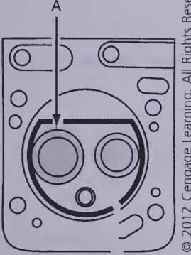

23. 技术员 A 说上图中的 A 是排气门。技术员 B 说排气门总是比进气门小。谁是正确的？

A. 只有 A

B. 只有 B

C. A 和 B 都正确

D. A 和 B 都不正确

24. 技术员 A 说大多数气缸磨损发生在活塞环行程的中心。技术员 B 说大多数气缸磨损发生在活塞环行程的底部。谁是正确的？

A. 只有 A

B. 只有 B

C. A 和 B 都正确

D. A 和 B 都不正确

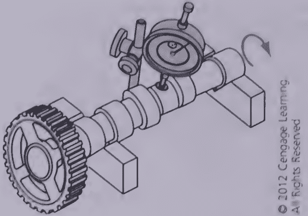

25. 在上图中，技术员 A 说正在检查凸轮轴凸起升程。技术员 B 说正在检查凸轮轴的径向跳动。谁是正确的？

A. 只有 A

B. 只有 B

C. A 和 B 都正确

D. A 和 B 都不正确

26. 将真空表连接到发动机，观察到指针在 14–18 in. Hg 之间快速波动；且波动随转速（`RPM`）增加而增大。技术员 A 说进气歧管受阻。技术员 B 说气门弹簧可能疲劳或断裂。谁是正确的？

A. 只有 A

B. 只有 B

C. A 和 B 都正确

D. A 和 B 都不正确

27. 发动机在走走停停的交通中过热，但在高速公路上不过热。技术员 A 说可能是散热器盖缺陷导致的。技术员 B 说可能是电动冷却风扇失效导致的。谁是正确的？

A. 只有 A

B. 只有 B

C. A 和 B 都正确

D. A 和 B 都不正确

28. 涡轮增压发动机排气管排出过多蓝烟的**最不可能**原因是：

A. 活塞环磨损。

B. 气门导管密封件损坏。

C. `PCV` 阀卡在开启位置。

D. 涡轮增压器密封件磨损。

29. 技术员 A 说在重新加工气门座之前，应先对磨损的气门导管进行修复或更换。技术员 B 说在修复气门导管之前，应先更换气门座。谁是正确的？

A. 只有 A

B. 只有 B

C. A 和 B 都正确

D. A 和 B 都不正确

30. 以下所有选项都是 `PCV` 阀卡在开启位置的症状，**除了**：

A. 发动机怠速不稳。

B. 空燃比过稀。

C. 空气过滤器中有窜气。

D. 发动机熄火。

31. 正在使用气缸漏气测试诊断发动机失火。技术员 A 说 20% 的漏气率是可以接受的。技术员 B 说空气从进气歧管流出表明气缸盖有裂纹。谁是正确的？

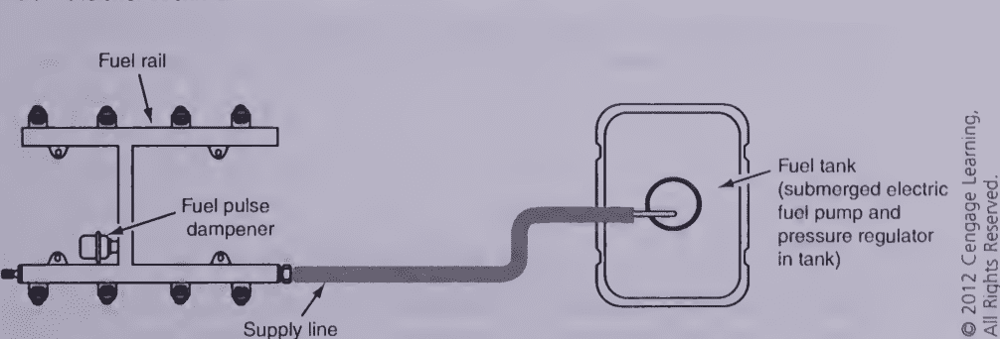

A. 只有 A

B. 只有 B

C. A 和 B 都正确

D. A 和 B 都不正确

32. 技术员 A 说上图显示的是无回油燃料系统。技术员 B 说燃油泵和压力调节器位于油箱中。谁是正确的？

A. 只有 A

B. 只有 B

C. A 和 B 都正确

D. A 和 B 都不正确

33. 技术员 A 说典型的活塞与缸孔间隙为 0.020 到 0.030 英寸。技术员 B 说典型的活塞与缸孔间隙为 0.001 到 0.002 英寸。谁是正确的？

A. 只有 A

B. 只有 B

C. A 和 B 都正确

D. A 和 B 都不正确

34. 技术员 A 说进气管入口位于发动机舱内。技术员 B 说在检查或更换空气过滤器时，应检查入口是否有污染物。谁是正确的？

A. 只有 A

B. 只有 B

C. A 和 B 都正确

D. A 和 B 都不正确

35. 技术员 A 说气门卡死或粘滞可能会导致气门弯曲。技术员 B 说正时皮带跳齿三个齿可能会导致气门弯曲。谁是正确的？

A. 只有 A

B. 只有 B

C. A 和 B 都正确

D. A 和 B 都不正确

36. 技术员 A 说发动机油冷却器可能位于散热器水箱的其中一个中。技术员 B 说变速箱油冷却器可能位于散热器水箱的其中一个中。谁是正确的？

A. 只有 A

B. 只有 B

C. A 和 B 都正确

D. A 和 B 都不正确

37. 技术员 A 说必须检查故障点火线圈组上的火花塞线是否有缺陷。技术员 B 说大多数线圈组被认为是浪费火花（`Waste Spark`）系统。谁是正确的？

A. 只有 A

B. 只有 B

C. A 和 B 都正确

D. A 和 B 都不正确

38. 技术员 A 说在对具有机械调节功能的发动机进行气门调节时，活塞必须处于排气行程的下止点（`BDC`）。技术员 B 说某些机械气门调节是通过更换杯盘上的可拆卸垫片（`lash pads`）来完成的。谁是正确的？

A. 只有 A

B. 只有 B

C. A 和 B 都正确

D. A 和 B 都不正确

39. 发动机可以启动（`cranks`）但无法着车。以下哪项**不是**发动机启动并运行的必要条件？

A. 压缩压力

B. 机油压力

C. 燃油压力

D. 火花

40. 一名技术员开始执行维修车辆的诊断程序。以下哪项是他**最不可能**采取的步骤？

A. 对车辆进行路试。

B. 向客户询问关于问题的更多信息。

C. 确保原始投诉的问题已修复。

D. 从最困难的测试开始。

41. 技术员 A 说使用直尺和塞尺检查主轴承孔的对齐情况。技术员 B 说不对齐的主轴承孔可以通过线镗（`line boring`）来纠正。谁是正确的？

A. 只有 A

B. 只有 B

C. A 和 B 都正确

D. A 和 B 都不正确

42. 技术员 A 说缸体中的上油道可以用管塞密封。技术员 B 说必须拆除油道塞才能正确清洗油道。谁是正确的？

A. 只有 A

B. 只有 B

C. A 和 B 都正确

D. A 和 B 都不正确

43. 技术员 A 说气门传动机构相关噪音可能是由机油量低引起的。技术员 B 说气门传动机构相关噪音可能是由需要调节的气门引起的。谁是正确的？

A. 只有 A

B. 只有 B

C. A 和 B 都正确

D. A 和 B 都不正确

44. 一名技术员正在为客户的车辆更换机油，需要知道该加入什么粘度的机油。技术员 A 说只要是多级油，粘度并不重要。技术员 B 说技术员应该查看机油加注盖或用户手册。谁是正确的？

A. 只有 A

B. 只有 B

C. A 和 B 都正确

D. A 和 B 都不正确

## 第 5 节 模拟准备考试

#### 发动机维修 (A1)

45. 技术员 A 说在从 `OHC`（顶置凸轮轴）发动机中拆除气缸盖时，可能必须先拆除凸轮轴。技术员 B 说气缸盖在拆除前应该是冷状态。谁是正确的？

A. 只有 A

B. 只有 B

C. A 和 B 都正确

D. A 和 B 都不正确

46. 客户担心车辆行驶约 20 英里后油压表下降，尽管启动时是正常的。关机后检查油尺，显示低于添加线。静置后检查油尺，油位显示为满。以下哪项是最可能的原因？

A. 凸轮轴轴承磨损

B. 后主密封圈泄漏

C. 气缸盖中的回油孔堵塞

D. 机油泵压力不足

47. 技术员 A 说在发动机重新组装期间，应检查所有连杆轴承间隙。技术员 B 说连杆轴承衬套应略高于连杆和盖帽；这被称为轴承压紧（`bearing crush`）。谁是正确的？

A. 只有 A

B. 只有 B

C. A 和 B 都正确

D. A 和 B 都不正确

48. 在对 4 缸发动机进行启动压缩测试时，技术员注意到一个气缸的压力读数为 60 psi (44 kPa)，而其他气缸的读数为 135 psi (931 kPa)。技术员 A 说进行气缸漏气测试将能指出压力泄漏的位置。技术员 B 说该车辆的气门导管磨损。谁是正确的？

A. 只有 A

B. 只有 B

C. A 和 B 都正确

D. A 和 B 都不正确

49. 以下哪项可能会导致过热症状，即使发动机温度正常？

A. 节温器卡在关闭位置

B. 散热器盖缺陷

C. 温度传感器单元缺陷

D. 缺少节温器

50. 客户抱怨在从停止状态加速时有巨大的砰砰声。技术员 A 说这可能是由磨损的曲轴止推轴承引起的。技术员 B 说这可能是由裂开的灵活盘（`flexplate`）引起的。谁是正确的？

A. 只有 A

B. 只有 B

C. A 和 B 都正确

D. A 和 B 都不正确

## 简介

本节包含每场准备考试的答案解析，随后是详细的逐题答案解释，以及一个用于识别每道具体题目所评估的指定任务领域的参考表。如果您需要参考本书第 4 节中的任务列表以获得额外支持，这些附加参考信息可能会非常有用。

## 准备考试 1—答案解析

| | | | | | | | | | |

|---|---|---|---|---|---|---|---|---|---|

| 1. C | 2. A | 3. C | 4. B | 5. B | 6. C | 7. D | 8. A | 9. C | 10. A |

| 11. C | 12. D | 13. A | 14. B | 15. A | 16. B | 17. A | 18. C | 19. A | 20. D |

| 21. B | 22. A | 23. A | 24. B | 25. D | 26. D | 27. C | 28. D | 29. A | 30. C |

| 31. C | 32. C | 33. B | 34. D | 35. B | 36. A | 37. B | 38. C | 39. A | 40. D |

| 41. D | 42. C | 43. D | 44. D | 45. C | 46. C | 47. B | 48. D | 49. B | 50. A |

## 准备考试 1—详细解释

技术员 A 说，在诊断过程中，试驾客户的车辆以验证问题至关重要。技术员 B 说，检查相关的技术服务公告 (`TSB`) 总是个好主意。谁是正确的？

A. 仅 A

B. 仅 B

C. A 和 B 均正确

D. A 和 B 均错误

答案 A 错误。技术员 B 也是正确的。

答案 B 错误。技术员 A 也是正确的。

答案 C 正确。两位技术员都正确。试驾可以让您确认客户的投诉，而检查技术服务公告可以节省诊断时间。

答案 D 错误。两位技术员都正确。

技术员 A 说，主轴承油隙可以使用 `Plastigauge®` 检查。技术员 B 说，主轴承油隙可以使用塞尺 (`feeler gauge`) 检查。谁是正确的？

A. 仅 A

B. 仅 B

C. A 和 B 均正确

D. A 和 B 均错误

答案 A 正确。仅技术员 A 正确。主轴承油隙可以使用 `Plastigauge®` 测量，方法是在安装轴承后将 `Plastigauge®` 放置在轴颈上并拧紧盖帽。取下盖帽并使用 `Plastigauge®` 刻度尺；记录间隙。

答案 B 错误。塞尺不是检查主轴承油隙的工具。它无法贴合轴颈以提供准确的读数。

答案 C 错误。仅技术员 A 正确。

答案 D 错误。技术员 A 正确。

技术员 A 说，在更换发动机并重新连接燃油管路时，必须更换燃油管上的 `O` 型密封圈。技术员 B 说，喷油嘴 `O` 型圈在重新安装时应予以更换。谁是正确的？

A. 仅 A

B. 仅 B

C. A 和 B 均正确

D. A 和 B 均错误

答案 A 错误。技术员 B 也是正确的。

答案 B 错误。技术员 A 也是正确的。

### 第 6 节 答案解析：发动机维修 (A1)

4. 客户车辆上的机油滤清器鼓起。技术员 A 说，这可能是由于滤清器安装不当引起的。技术员 B 说，这可能是由于压力调节器卡死在关闭位置引起的。谁是正确的？

A. 仅 A

B. 仅 B

C. A 和 B 均正确

D. A 和 B 均错误

答案 A 错误。安装不当会导致严重的机油泄漏。

答案 B 正确。仅技术员 B 正确。如果油泵上的压力释放阀卡死，机油压力将超过制造商的规格，导致机油滤清器鼓起或爆裂。

答案 C 错误。仅技术员 B 正确。

答案 D 错误。技术员 B 正确。

5. 正在检查一台 `OHC` 发动机的气缸盖。平面翘曲度大于最大允许值。技术员 A 说，必须更换气缸盖。技术员 B 说，气缸盖可能能够被校直、重复使用并重新测试。谁是正确的：

A. 仅 A

B. 仅 B

C. A 和 B 均正确

D. A 和 B 均错误

答案 A 错误。气缸盖可以通过校直和平面研磨来修复。

答案 B 正确。仅技术员 B 正确。翘曲的气缸盖可以通过校直和平面研磨进行修复。

答案 C 错误。仅技术员 B 正确。

答案 D 错误。技术员 B 正确。

6. 技术员 A 说，涡轮增压器的增压压力由废气门 (`wastegate`) 控制。技术员 B 说，废气门由发动机真空度控制。谁是正确的：

A. 仅 A

B. 仅 B

C. A 和 B 均正确

D. A 和 B 均错误

答案 A 错误。技术员 B 也是正确的。

答案 B 正确。技术员 A 也是正确的。

答案 C 正确。两位技术员都正确。涡轮增压的量由废气门控制，废气门根据发动机真空度开启或关闭。

答案 D 错误。两位技术员都正确。

7. 以下所有项均为发动机机油压力低的原因，除了：

A. 凸轮轴轴承磨损。

B. 机油吸油筛部分堵塞。

C. 曲轴轴承磨损。

D. 推杆通道受阻。

答案 A 错误。凸轮轴轴承磨损会导致机油流失增加，从而导致发动机机油压力低。

答案 B 错误。部分堵塞的吸油筛会限制通过油泵的机油流量，导致压力降低。

答案 C 错误。曲轴轴承磨损会导致机油流失，从而导致机油压力低。

**答案 D 正确。** 推杆通道受阻仅会阻止机油到达摇臂，而不会导致整体机油压力低。

8. 在上图中，技术员正在检查什么？

A. 气缸盖翘曲度

B. 活塞突出量

C. 表面光洁度

D. 气缸盖螺栓孔对齐情况

**答案 A 正确。** 技术员正在使用直尺和塞尺检查翘曲度。

答案 B 错误。活塞突出量使用深度计测量。

答案 C 错误。表面光洁度使用轮廓仪 (`profilometer`) 检查。

答案 D 错误。检查气缸盖螺栓对齐情况需要将气缸盖安装在缸体上。

9. 客户担心在高速行驶时性能不佳。技术员与车主讨论了车辆的维修历史，得知最近更换了正时皮带、水泵和曲轴油封，问题是在此之后开始出现的。性能不佳最可能的原因是什么？

A. 附件皮带 (`serpentine belt`) 松动。

B. 火花塞导线布线错误。

C. 凸轮轴和曲轴不同步。

D. 催化转换器受阻。

**答案 A 错误。** 附件皮带松动会产生尖叫声，但不会影响性能。

**答案 B 错误。** 火花塞导线布线错误会导致失火，并且在任何时候性能都会不佳。

**答案 C 正确。** 如果在正时校对期间凸轮轴和曲轴的位置不正确，那么在较高的发动机转速下，更换皮带后的性能会受到影响。

**答案 D 错误。** 转换器受阻会在任何速度下都导致性能问题。

## 10.

技术员 A 说，如果进气软管总成安装不当，可能会导致性能不佳。技术员 B 说，所有车辆都使用 MAP 传感器来告知电子控制模块（ECM）进入的空气量。谁是正确的？

- A. 仅 A
- B. 仅 B
- C. A 和 B 均正确
- D. A 和 B 均错误

**答案 A 正确。** 仅技术员 A 正确。如果进气软管总成安装不当，会导致未经计量的空气进入发动机，从而可能导致发动机抖动且性能不佳。

**答案 B 错误。** MAP 传感器只是告知 ECM 进入进气道空气量的方法之一。许多制造商在进气管道中使用空气流量传感器（MAF sensor）。

**答案 C 错误。** 仅技术员 A 正确。

**答案 D 错误。** 技术员 A 正确。

## 11.

客户投诉在早晨初次启动时，尾管排出蓝色烟雾，但烟雾似乎很快就消失了。技术员 A 说，蓝色烟雾是由燃烧室内的机油燃烧引起的。技术员 B 说，机油可能是通过劣化的气门导管密封件进入燃烧室的。谁是正确的？

- A. 仅 A
- B. 仅 B
- C. A 和 B 均正确
- D. A 和 B 均错误

**答案 A 错误。** 技术员 B 也是正确的。

**答案 B 错误。** 技术员 A 也是正确的。

**答案 C 正确。** 两位技术员都正确。在冷启动时迅速消失的蓝色烟雾表明，在热机停机后，气门导管密封件允许机油沿着气门杆流入燃烧室。

**答案 D 错误。** 两位技术员都正确。

### 任务 B.11

## 12.

顶置气门发动机中的所有挺柱都是杯形（凹形）的。技术员 A 说挺柱可以在无需更换其他零件的情况下直接更换。技术员 B 说可以用滚子挺柱来更换以延长寿命。谁是正确的？

- A. 只有 A
- B. 只有 B
- C. A 和 B 都正确
- D. A 和 B 都不正确

**答案 A 错误。** 挺柱磨损意味着凸轮轴凸起也发生了磨损。如果在不更换凸轮轴的情况下更换挺柱，它会在短时间内失效。

**答案 B 错误。** 滚子挺柱不能与平板挺柱凸轮轴配合使用。平板挺柱凸轮轴的凸起略有锥度以使挺柱旋转；而滚子凸轮轴的凸起表面是平坦的。

**答案 C 错误。** 两位技术员都不正确。

**答案 D 是正确的。** 两位技术员都不正确。凸轮轴和平板挺柱在磨合期和正常使用过程中会磨合匹配。如果其中一个被更换，建议将这两个部件同时更换。滚子挺柱将仅与平板挺柱凸轮轴的一个微小区域接触，它们并非为平板挺柱凸轮轴的轮廓而设计。

### 任务 E.5

## 13.

技术员 A 说，PCV 阀软管受阻可能会导致空气滤清器中积油。技术员 B 说，PCV 阀软管受阻会导致加速时发动机出现顿挫。谁是正确的？

- A. 只有 A
- B. 只有 B
- C. A 和 B 都正确
- D. A 和 B 都不正确

**答案 A 是正确的。** 只有技术员 A 正确。PCV 阀受阻会导致曲轴箱压力增加，并可能导致空气滤清器中积油。

**答案 B** 错误。PCV 软管受阻不会导致顿挫。但软管破裂可能会导致顿挫，因为未经计量空气进入了进气歧管。

**答案 C** 错误。只有技术员 A 正确。

**答案 D** 错误。技术员 A 正确。

### 任务 C.1

## 14.

技术员 A 说，在拆卸发动机期间，可以打开空调压缩机的软管以释放压力，以便拆除压缩机。技术员 B 说，空调系统中的制冷剂必须使用空调回收机进行回收。谁是正确的？

- A. 只有 A
- B. 只有 B
- C. A 和 B 都正确
- D. A 和 B 都不正确

**答案 A** 错误。绝不允许将制冷剂排放到大气中。

**答案 B 是正确的。** 只有技术员 B 正确。所有制冷剂必须回收至制冷剂回收机中。

**答案 C** 错误。只有技术员 B 正确。

**答案 D** 错误。技术员 B 正确。

## 15.

一个气缸盖已被拆除，技术员正在检查气缸垫。他发现 2 号气缸的燃烧环（fire ring）破裂。技术员 A 说这可能是由气缸内爆震引起的。技术员 B 说这可能是由于使用了错误的机油引起的。谁是正确的？

- A. 只有 A
- B. 只有 B
- C. A 和 B 都正确
- D. A 和 B 都不正确

**答案 A 是正确的。** 只有技术员 A 正确。气缸内的爆震会导致燃烧环过度弯曲并破裂。

**答案 B** 错误。错误的机油不会影响燃烧环。但是，它可能会影响轴承的磨损。

**答案 C** 错误。只有技术员 A 正确。

**答案 D** 错误。技术员 A 正确。

## 16.

客户投诉发动机启动时曲轴转动很快但无法启动。技术员 A 说这可能是由电池引起的。技术员 B 说这可能是由正时皮带断裂引起的。谁是正确的？

- A. 只有 A
- B. 只有 B
- C. A 和 B 都正确
- D. A 和 B 都不正确

**答案 A** 错误。电池电量不足会导致启动转速缓慢。

**答案 B 是正确的。** 只有技术员 B 正确。正时皮带断裂会导致发动机迅速空转。

**答案 C** 错误。只有技术员 B 正确。

**答案 D** 错误。技术员 B 正确。

## 17.

技术员 A 说，电池端子的腐蚀可能会导致启动速度缓慢。技术员 B 说，起动电路中的高电阻可能会导致启动速度低且电流抽取高。谁是正确的？

- A. 只有 A
- B. 只有 B
- C. A 和 B 都正确
- D. A 和 B 都不正确

**答案 A 是正确的。** 只有技术员 A 正确。电池端子腐蚀会导致高电阻和启动机启动速度缓慢。

**答案 B** 错误。起动电路中的高电阻可能会导致启动速度低，但会导致电流抽取降低。

**答案 C** 错误。只有技术员 A 正确。

**答案 D** 错误。技术员 A 正确。

# 第 6 节 答案及解析

## 发动机维修（A1）

### 任务 B.17

## 18.

技术员 A 说，在安装气缸垫时，阅读气缸垫上印有的方向指示至关重要。技术员 B 说，方向不正确的气缸垫可能会限制冷却液流向缸盖。谁是正确的？

- A. 只有 A
- B. 只有 B
- C. A 和 B 都正确
- D. A 和 B 都不正确

**答案 A** 错误。技术员 B 也是正确的。

**答案 B** 错误。技术员 A 也是正确的。

**答案 C 是正确的。** 两位技术员都正确。有指定方向的气缸垫会在垫片上印有指示。如果气缸垫安装反了，或者安装在了 V 型发动机缸体的错误一侧，可能会遮挡冷却液或机油通道。

**答案 D** 错误。两位技术员都正确。

### 任务 C.16

## 19.

技术员 A 说，可以用 RTV 密封胶代替密封垫来密封油底壳。技术员 B 说，RTV 可以用于气缸垫。谁是正确的？

- A. 只有 A
- B. 只有 B
- C. A 和 B 都正确
- D. A 和 B 都不正确

**答案 A 是正确的。** 只有技术员 A 正确。RTV 是一种密封垫制造剂，适用于代替密封垫来密封油底壳。

**答案 B** 错误。气缸垫不应涂抹任何密封胶。RTV 可能会导致气缸垫失效。

**答案 C** 错误。只有技术员 A 正确。

**答案 D** 错误。技术员 A 正确。

### 任务 E.7

## 20.

一个工作正常的催化转换器将 HC、CO 和 NOx 转换为：

- A. O₃、H₂O 和 NO
- B. H₂O、CO₂ 和 NO
- C. H₂O、NO 和 N₂
- D. H₂O、CO₂ 和 N₂

**答案 A** 错误。转换器不会将 HC、CO 和 NOx 转换为 O₃、H₂O 和 NO。

**答案 B** 错误。转换器不会将 HC、CO 和 NOx 转换为 H₂O、CO₂ 和 NO。

**答案 C** 错误。转换器不会将 HC、CO 和 NOx 转换为 H₂O、NO 和 N₂。

**答案 D 是正确的。** 一个工作正常的催化转换器将 HC 转换为 H₂O，将 CO 转换为 CO₂，将 NOx 转换为 N₂。

## 21.

客户抱怨在从静止状态加速时有砰砰声和震动。以下哪项是最可能的原因？

- A. 轮胎不平衡
- B. 发动机支架断裂或薄弱
- C. 火花塞失火
- D. 制动盘变形

**答案 A** 错误。轮胎不平衡产生的震动会在汽车行驶时感觉到，而不是在从静止加速时。

**答案 B 是正确的。** 断裂或薄弱的发动机支架会允许发动机在加速时发生偏移，从而在从静止加速时产生砰砰声和震动。

**答案 C** 错误。火花塞失火会导致震动，但不会在加速时产生砰砰声。

**答案 D** 错误。制动盘变形会在停车时产生震动，而不是在启动时。

## 22.

上图中的量具用于执行：

- A. 压力测试（Compression test）
- B. 气缸功率平衡测试（Cylinder power balance test）
- C. 气缸漏气测试（Cylinder leakage test）
- D. 真空测试（Vacuum test）

**答案 A 是正确的。** 图中显示的是一个压力表（压缩压力表）。

**答案 B** 错误。气缸功率平衡测试通常使用发动机分析仪进行。

**答案 C** 错误。气缸漏气测试仪是不同的设备。

**答案 D** 错误。真空测试使用真空表进行。

## 23.

在拆卸气缸盖期间，一个缸盖螺栓在与缸体平面齐平处断裂。技术员 A 说可以用钻孔并在剩余螺栓中使用螺栓取出器来将其移除。技术员 B 说可以将断裂的螺栓完全钻大，然后安装一个加大尺寸的缸盖螺栓。谁是正确的？

- A. 仅 A
- B. 仅 B
- C. A 和 B 均正确
- D. A 和 B 均错误

**答案 A 正确。** 只有技术员 A 正确。使用适当尺寸的钻头钻孔并使用螺栓取出器移除螺栓是最佳选择。

**答案 B 错误。** 安装更大直径的缸盖螺栓需要将缸盖孔钻大，这会导致气缸盖该区域的夹紧力产生差异。

**答案 C 错误。** 只有技术员 A 正确。

**答案 D 错误。** 技术员 A 正确。

## 24.

正在检查气门弹簧，结果发现其未达到开启压力规范。技术员 A 建议在重新组装气缸盖时安装气门弹簧垫圈。技术员 B 建议更换弹簧。谁是正确的？

- A. 仅 A
- B. 仅 B
- C. A 和 B 均正确
- D. A 和 B 均错误

**答案 A 错误。** 安装气门弹簧垫圈可能会导致弹簧死锁（spring bind），且垫圈会同时增加关闭压力和开启压力。

**答案 B 正确。** 只有技术员 B 正确。如果弹簧未能达到指定值，建议更换弹簧。

**答案 C 错误。** 只有技术员 B 正确。

**答案 D 错误。** 技术员 B 正确。

## 25.

技术员 A 说，对于车龄超过 15 年的车辆，可以合法地拆除催化转换器。技术员 B 说，催化转换器会显著限制排气流量。谁是正确的？

- A. 仅 A
- B. 仅 B
- C. A 和 B 均正确
- D. A 和 B 均错误

**答案 A 错误。** 根据法律规定，配备有催化转换器的车辆不得将其拆除，除非是用新的转换器将其更换，否则将受到法律处罚。

**答案 B 错误。** 发动机管理系统是针对配备转换器车辆的排气流量进行调校的。虽然排气流量的限制很小，但在排气系统的设计过程中已经将其考虑在内。

**答案 C** 错误。两位技术员均不正确。

**答案 D 正确。** 两位技术员均不正确。催化转换器是车辆排放系统的一部分，在车辆使用寿命的任何时候，未经更换新件都不能合法拆除。发动机经过调校，在转换器的微小限制下才能正常运行，改装排气可能会导致发动机性能下降。

## 26.

技术员 A 说，任何有裂纹的多楔带（serpentine belt）都必须更换。技术员 B 说，多楔带在磨合后必须重新地紧固。谁是正确的？

- A. 仅 A
- B. 仅 B
- C. A 和 B 均正确
- D. A 和 B 均错误

**答案 A** 错误。除非在 1 英寸的皮带长度内有三道裂纹，否则皮带上的小裂纹是正常的。

**答案 B** 错误。多楔带不像 V 型带那样有磨合期，不需要重新调整张紧力。

**答案 C** 错误。两位技术员均不正确。

**答案 D** 正确。两位技术员均不正确。在 1 英寸长度内有三道裂纹的多楔带必须更换；不符合此标准的微小裂纹不需要更换皮带。V 型带在磨合期间会稍微拉伸，需要重新调整张紧力，而多楔带不会拉伸，也不需要重新调整张紧力。

## 27.

为了帮助定位漏油点，曲轴箱中加入了荧光染料。当染料暴露在以下哪种光线照射下时会发光？

- A. 闪光灯
- B. 红外线光
- C. 黑光灯（紫外线灯）
- D. 蓝光

**答案 A** 错误。闪光灯不会使染料发光。

**答案 B** 错误。红外线光不会使染料发光。

**答案 C** 正确。黑光灯（紫外线）会使染料发光。

**答案 D** 错误。蓝光不会使染料发光。

## 28.

气门导管磨损可能会导致所有这些问题，除了：

- A. 燃烧气体泄漏
- B. 机油消耗过多
- C. 气门密封不均
- D. 曲轴箱窜气（Blowby）

**答案 A** 错误。气门导管磨损可能会导致气门密封不当，从而导致燃烧气体从气门处泄漏。

**答案 B** 错误。气门导管磨损会导致机油消耗，因为气门在导管中会倾斜；多余的机油会通过气门杆密封圈沿气门杆向下流。

**答案 C** 错误。气门导管磨损会导致气门与座圈接触不均匀，导致气门座圈磨损且气门密封不均。

**答案 D 正确。** 气门导管磨损不会导致窜气；这是由活塞环磨损引起的。

### 任务 C.9

## 29.

技术员 A 说，平衡轴正时不对可能会导致严重的发动机振动。技术员 B 说，平衡轴总是相对于凸轮轴进行正时调校的。谁是正确的？

- A. 仅 A
- B. 仅 B
- C. A 和 B 均正确
- D. A 和 B 均错误

**答案 A 正确。** 只有技术员 A 正确。如果平衡轴的正时不对，它会放大正常的发动机振动。

**答案 B 错误。** 平衡轴通常是相对于曲轴进行正时调校的。

**答案 C** 错误。只有技术员 A 正确。

**答案 D** 错误。技术员 A 正确。

### 任务 B.9

## 30.

气门杆安装高度过高。以下所有方法均可用于纠正安装高度，除了：

- A. 切除气门顶端
- B. 更换座圈
- C. 给气门加垫片（Shimming）
- D. 更换气门

**答案 A** 错误。可以通过切除气门顶端来纠正安装的杆高度。

**答案 B** 错误。在对座圈进行修复时，会导致气门在其中密封得更深，从而增加杆的安装高度。如果座圈被切削过多，可能需要更换座圈来纠正杆的安装高度。

**答案 C 正确。** 气门弹簧可能需要加垫片，但气门本身不能加垫片。

**答案 D** 错误。更换气门可以用来纠正杆的安装高度。

### 任务 E.7

## 31.

以下所有情况都会是催化转换器堵塞的结果，除了：

- A. 熄火
- B. 功率损失
- C. 功率增加
- D. 发动机过热

**答案 A** 错误。熄火可能是转换器堵塞的结果。排气流量受限可能会导致在气门重叠期间，排气进入进气歧管，从而引起熄火。

**答案 B** 错误。部分堵塞的转换器将无法高效地将废气从气缸中排出，导致功率损失。

**答案 C 正确。** 转换器堵塞会导致功率下降，甚至完全没有功率，因为气缸无法排空燃烧后的气体。

**答案 D** 错误。转换器堵塞会导致发动机过热。排气大约移除了燃烧期间产生热量的 30%；转换器堵塞将阻止热量的排出。

## 32.

技术员 A 说，机油滤清器可能包含一个止回阀。技术员 B 说，机油滤清器包含一个旁通阀。谁是正确的？

- A. 仅 A
- B. 仅 B
- C. A 和 B 均正确
- D. A 和 B 均错误

**答案 A** 错误。技术员 B 也是正确的。

**答案 B** 错误。技术员 A 也是正确的。

**答案 C 正确。** 两位技术员均正确。机油滤清器中的止回阀在发动机停止运行时，不会让机油流回机油底壳。旁通阀在某些条件下允许大部分机油绕过过滤材料，直接进入机油道。

**答案 D** 错误。两位技术员均正确。

### 任务 D.4

## 33.

客户抱怨早晨冷启动时有敲击声，但在运行一分钟内消失。技术员 A 说这可能是由连杆轴承间隙过大引起的。技术员 B 说这可能是由活塞裙边磨损引起的活塞敲击（piston slap）。谁是正确的？

- A. 仅 A
- B. 仅 B
- C. A 和 B 均正确
- D. A 和 B 均错误

**答案 A** 错误。连杆噪音在热机过程中不会消失，且随着机油升温，强度反而会增加。

**答案 B 正确。** 只有技术员 B 正确。活塞敲击的特点是在冷启动期间发动机发出敲击或拍击声，随着发动机升温和活塞膨胀，这种声音会消失。

**答案 C** 错误。只有技术员 B 正确。

**答案 D** 错误。技术员 B 正确。

### 任务 A.4

## 34.

在发动机怠速时，连接到进气歧管的真空表如上图所示波动。这些波动可能是由以下原因引起的：

- A. 点火正时过迟
- B. 排气系统受限
- C. 节气门处的进气歧管泄漏
- D. 气门粘滞

**答案 A** 错误。点火正时过迟会导致低且稳定的读数。

**答案 B** 错误。节气门处的进气歧管泄漏会导致极低且稳定的读数。

**答案 C** 错误。排气系统受限会导致在发动机转速升高并保持稳定后，真空度缓慢下降。

**答案 D 正确。** 如果气门在其导管中粘滞，它可能无法完全关闭，导致压力损失和真空表的脉动。

### 任务 A.6

### 任务 C.12

## 35.

技术员 A 说，在测量活塞环端隙时，只需测量每组环中的一个即可验证配合是否正确。技术员 B 说，应将每个单独的活塞环放入其对应的气缸中并测量端隙。谁是正确的？

- A. 仅 A
- B. 仅 B
- C. A 和 B 均正确
- D. A 和 B 均错误

> **答案 A 错误。** 所有活塞环都应测量以确保端隙正确。

> **答案 B 正确。** 仅技术员 B 正确。所有活塞环应在其将要安装的气缸中进行测量，以确保正确的端隙，并补偿活塞环与气缸之间的微小差异。

> **答案 C 错误。** 仅技术员 B 正确。

> **答案 D 错误。** 技术员 B 正确。

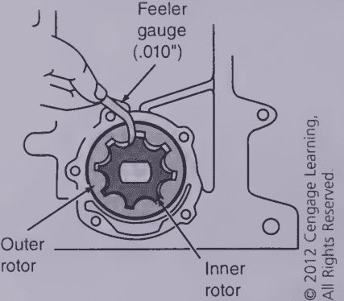

## 任务 D.2

### 36.

技术员 A 说，在上方图中，正在检查油泵驱动齿轮与从动齿轮的间隙。技术员 B 说，正在检查驱动齿轮与泵体的间隙。谁是正确的？

- **A.** 仅 A
- **B.** 仅 B
- **C.** A 和 B 均正确
- **D.** A 和 B 均错误

> **答案 A 正确。** 仅技术员 A 正确。正在检查的是驱动齿轮与从动齿轮的间隙。
>
> **答案 B 错误。** 正在检查的是驱动齿轮与从动齿轮的间隙。
>
> **答案 C 错误。** 仅技术员 A 正确。
>
> **答案 D 错误。** 技术员 A 正确。

### 37.

技术员 A 说，在进行任何其他缸盖维修之前，必须重新修整气门座圈。技术员 B 说，在切削座圈之前，必须检查并修理气门导管。谁是正确的？

- A. 仅 A
- B. 仅 B
- C. A 和 B 均正确
- D. A 和 B 均错误

> 答案 A 错误。必须先修理气门导管。
>
> **答案 B 正确。** 仅技术员 B 正确。气门导管构成了气门座圈的中心点，因此在正确修理气门座圈之前必须先修理导管。
>
> 答案 C 错误。仅技术员 B 正确。
>
> 答案 D 错误。技术员 B 正确。

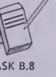

### 38.

技术员 A 说，拆卸和安装谐波平衡器可能需要特殊的拉出器和安装工具。技术员 B 说，如果橡胶惯性环出现劣化，则必须更换平衡器。谁是正确的？

- A. 仅 A
- B. 仅 B
- C. A 和 B 均正确
- D. A 和 B 均错误

> 答案 A 错误。技术员 B 同样正确。
>
> 答案 B 错误。技术员 A 同样正确。
>
> **答案 C 正确。** 两位技术员都正确。拆卸和重新安装平衡器需要专用拉出器。惯性环的任何劣化都会导致平衡器失效并增加振动。
>
> 答案 D 错误。两位技术员都正确。

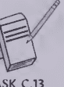

### 39.

正在进行气缸功率平衡测试，以确定哪个气缸导致了失火。技术员 A 说，当失火气缸被禁用时，转速（RPM）下降很少或根本不下降。技术员 B 说，当失火气缸被短路时，会导致转速增加。谁是正确的？

- A. 仅 A
- B. 仅 B
- C. A 和 B 均正确
- D. A 和 B 均错误

> **答案 A 正确。** 仅技术员 A 正确。在功率平衡测试期间，当每个气缸被短路时会记录转速下降量。如果所有气缸产生的功率大致相同，转速下降应在 +/- 10% 以内。如果某个气缸不能产生足够的功率，它就无法对发动机性能做出贡献，因此转速的下降会小得多，或者根本不下降。
>
> 答案 B 错误。在功率平衡测试期间，每个气缸只会产生转速下降，不会产生转速增加。
>
> 答案 C 错误。仅技术员 A 正确。
>
> 答案 D 错误。技术员 A 正确。

## 第 6 节 答案及解析

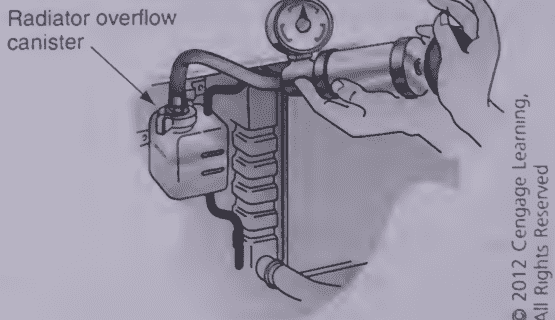

### 任务 D.6

### 40.

上图中的测试仪可用于测试以下所有项，**除了**：

- A. 冷却系统泄漏。
- B. 散热器盖压力释放阀。
- C. 暖风水箱（加热芯）泄漏。
- D. 冷却液比重。

> 答案 A 错误。冷却液压力测试仪用于查找冷却液泄漏。
>
> 答案 B 错误。冷却液压力测试仪可用于查找有缺陷的散热器盖压力释放阀。
>
> 答案 C 错误。冷却液压力测试仪可用于查找泄漏的暖风水箱。
>
> **答案 D 正确。** 冷却液压力测试仪无法测试比重；为此需要使用折射仪。

### 任务 C.10

### 41.

技术员 A 说，测量活塞直径的正确位置是在第一道环槽上方的活塞顶。技术员 B 说，测量活塞直径的正确位置是在活塞身（trunk）上，就在活塞销下方。谁是正确的？

- A. 仅 A
- B. 仅 B
- C. A 和 B 均正确
- D. A 和 B 均错误

> 答案 A 错误。测量活塞直径的正确位置是在活塞裙部（skirt）。
>
> 答案 B 错误。测量活塞直径的正确位置是在活塞裙部。
>
> 答案 C 错误。两位技术员都不正确。
>
> **答案 D 正确。** 两位技术员都不正确。活塞直径是在活塞身或裙部、距离活塞销 90 度且靠近底部的方向进行测量的。

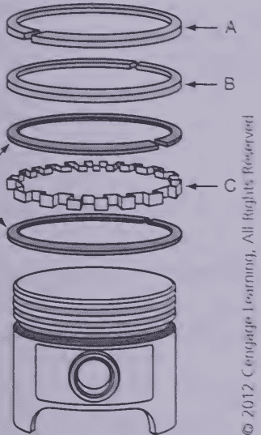

### 42.

在上图中，技术员 A 说 C 是油环组的一部分。技术员 B 说 A 是顶层压缩环，并且上面可能有一个标记显示环的顶部。谁是正确的？

- A. 仅 A
- B. 仅 B
- C. A 和 B 均正确
- D. A 和 B 均错误

> 答案 A 错误。技术员 B 同样正确。
>
> 答案 B 错误。技术员 A 同样正确。
>
> **答案 C 正确。** 两位技术员都正确。C 是油环组的膨胀撑环，A 是顶层压缩环，并且可能带有用于标识顶部的标记。
>
> 答案 D 错误。两位技术员都正确。

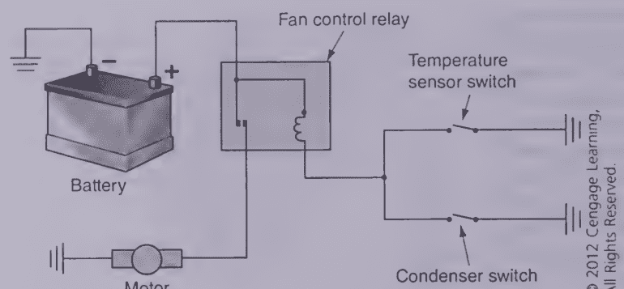

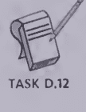

### 43.

在上图中，发动机温度开关上的开路接地电路可能会导致：

- A. 冷却风扇持续运行。
- B. 当空调启动时风扇不运行。
- C. 冷却风扇电机烧毁。
- D. 发动机过热。

> 答案 A 错误。电路开路会导致风扇不运行。
>
> 答案 B 错误。空调开启时，冷凝器开关会将风扇电路接地。
>
> 答案 C 错误。开路接地电路不会烧毁冷却风扇电机。
>
> **答案 D 正确。** 如果冷却风扇在规定温度下没有开启，发动机可能会过热。

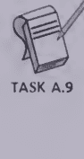

### 44.

进行气缸泄漏测试后，一个气缸失败，泄漏率超过 50%。技术员注意到散热器中出现了气泡。最可能的泄漏源是什么？

- A. 进气门泄漏
- B. 活塞环磨损
- C. 缸盖开裂
- D. 缸盖垫泄漏

> 答案 A 错误。进气门泄漏会导致空气通过节气门板逃逸。
>
> 答案 B 错误。活塞环磨损会导致空气进入油底壳，在机油尺处可听到逃逸的空气声。
>
> 答案 C 错误。虽然缸盖开裂会导致泄漏进入冷却系统，但它不是最可能的来源。
>
> **答案 D 正确。** 如果缸盖垫在气缸和水路之间失效，会导致空气被推入冷却系统；这些空气将以气泡的形式出现在散热器中。

### 45.

一辆搭载 4 缸发动机的小型皮卡被送进车间，原因是发动机前端有咔哒咔哒的异响。技术员 A 说，该噪音可能是由过松的正时链条引起的。技术员 B 说，正时链条导轨可能已经磨损。谁是正确的？

- A. 仅 A
- B. 仅 B
- C. A 和 B 均正确
- D. A 和 B 均错误

> 答案 A 错误。技术员 B 同样正确。
>
> 答案 B 错误。技术员 A 同样正确。
>
> **答案 C 正确。** 两位技术员都正确。拉伸的正时链条会导致发动机前端出现咔哒声。正时链条导轨磨损也可能导致链条抖动产生异响。
>
> 答案 D 错误。两位技术员都正确。

### 46.

技术员 A 说，在进行气缸泄漏测试时，10% 的泄漏量是可以接受的。技术员 B 说，可接受的泄漏量是由于活塞环密封不完全造成的。谁是正确的？

- A. 仅 A
- B. 仅 B
- C. A 和 B 均正确
- D. A 和 B 均错误

> 答案 A 错误。技术员 B 同样正确。
>
> 答案 B 错误。技术员 A 同样正确。
>
> **答案 C 正确。** 两位技术员都正确。活塞环有规定的安装环隙。在气缸泄漏测试期间，该间隙会导致约 10% 的空气泄漏到曲轴箱中。
>
> 答案 D 错误。两位技术员都正确。

### 47.

技术员 A 说，具有 0.020 英寸环脊（ring ridge）的气缸可以通过珩磨（honed）后重复使用。技术员 B 说，为了拆除活塞组件，可能必须先去除环脊。谁是正确的？

- A. 仅 A
- B. 仅 B
- C. A 和 B 均正确
- D. A 和 B 均错误

> 答案 A 错误。具有 0.020 英寸环脊的气缸必须进行大孔径镗削。
>
> **答案 B 正确。** 仅技术员 B 正确。在不去除环脊的情况下拆除活塞可能会导致活塞环或活塞环槽破裂。
>
> 答案 C 错误。仅技术员 B 正确。
>
> 答案 D 错误。技术员 B 正确。

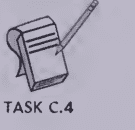

### 48.

一台发动机在运行时有沉闷的敲击声，且敲击频率随发动机转速（RPM）的增加而增加。这种噪音最可能的原因是：

- A. 液压挺柱磨损。
- B. 柔性盘（飞轮壳）裂纹。
- C. 水泵轴承问题。
- D. 连杆轴承间隙过大。

> 答案 A 错误。挺柱磨损产生的噪音将是发动机顶部的轻微哒哒声。
>
> 答案 B 错误。柔性盘裂纹通常在发动机转速增加且变速箱压力平衡后会变得安静。
>
> 答案 C 错误。磨损的水泵轴承会发出咆哮声或研磨声，而不是敲击声。
>
> **答案 D 正确。** 连杆轴承间隙过大会导致发动机底部发出沉闷的敲击声，且该声音随发动机转速增加而增强。

### 49.

技术员 A 说，散热器盖压力阀缺陷可能导致发动机运行温度过低。技术员 B 说，散热器盖真空阀缺陷可能导致上散热器软管塌陷。谁是正确的？

- A. 仅 A 正确
- B. 仅 B 正确
- C. A 和 B 都正确
- D. A 和 B 都不正确

> 答案 A 错误。压力阀缺陷可能导致发动机关闭时冷却液沸腾溢出。由此导致的冷却液损失可能会导致发动机过热。
>
> **答案 B 正确。** 仅技术员 B 正确。无法打开的缺陷真空阀可能会导致上散热器软管塌陷。随着冷却液冷却并收缩，冷却系统内可能会形成真空。
>
> 答案 C 错误。仅技术员 B 正确。
>
> 答案 D 错误。技术员 B 正确。

### 50.

车辆无法起 cranks（起动马达不转）。技术员 A 说这可能是由气缸液击（hydrolock）引起的。技术员 B 说燃料泵可能存在缺陷。谁是正确的？

- A. 仅 A 正确
- B. 仅 B 正确
- C. A 和 B 都正确
- D. A 和 B 都不正确

> **答案 A 正确。** 仅技术员 A 正确。气缸内的液击将导致发动机无法转动。
>
> 答案 B 错误。燃料泵无法导致发动机无法起 crank（马达不转）。它会导致发动机无法启动（start）。
>
> 答案 C 错误。仅技术员 A 正确。
>
> 答案 D 错误。技术员 A 正确。

## 准备考试 2—答案 Key

- 1. C
- 2. A
- 3. C
- 4. A
- 5. A
- 6. B
- 7. B
- 8. D
- 9. D
- 10. C
- 11. B
- 12. C
- 13. C
- 14. C
- 15. A
- 16. B
- 17. B
- 18. B
- 19. C
- 20. C
- 21. C
- 22. C
- 23. A
- 24. C
- 25. A
- 26. C
- 27. C
- 28. C
- 29. B
- 30. C
- 31. C
- 32. D
- 33. C
- 34. C
- 35. D
- 36. A
- 37. B
- 38. D
- 39. A
- 40. C
- 41. C
- 42. D
- 43. B
- 44. C
- 45. E
- 46. C
- 47. D
- 48. C
- 49. B
- 50. C

## 准备考试 2—解析

### 1.

客户投诉的是早晨初次启动时排气管排出蓝色烟雾，且烟雾似乎迅速消散。技术员 A 说蓝色烟雾是由燃烧室内的机油燃烧引起的。技术员 B 说机油可能是通过劣化的气门导管密封件进入燃烧室的。谁是正确的？

- A. 仅 A 正确
- B. 仅 B 正确
- C. A 和 B 都正确
- D. A 和 B 都不正确

> 答案 A 错误。技术员 B 也是正确的。
>
> 答案 B 错误。技术员 A 也是正确的。
>
> 答案 C 正确。两位技术员都正确。在初次冷启动时迅速消散的蓝色烟雾是气门导管密封件失效的迹象，导致在热机关闭后，机油沿气门杆流进燃烧室。
>
> 答案 D 错误。两位技术员都正确。

## 第 6 节 答案 Key 与解析

### 发动机维修 (A1)

### 2.

在对一台 4 缸发动机进行起动压力测试时，技术员注意到一个气缸的压力读数为 60 psi (44 kPa)，而其他气缸的读数为 135 psi (931 kPa)。技术员 A 说进行气缸漏气测试将能指出压力泄漏的位置。技术员 B 说该车辆存在气门导管密封件泄漏。谁是正确的？

- A. 仅 A 正确
- B. 仅 B 正确
- C. A 和 B 都正确
- D. A 和 B 都不正确

> **答案 A 正确。** 仅技术员 A 正确。进一步缩小单个气缸低压力原因的下一步应该是气缸漏气测试。
>
> 答案 B 错误。气门导管密封件泄漏不会导致压力损失。
>
> 答案 C 错误。仅技术员 A 正确。
>
> 答案 D 错误。技术员 A 正确。

### 3.

客户投诉油耗过高且车道上出现油迹。经检查，发现气门室盖垫、油底壳和前主轴密封件均有泄漏。技术员 A 说问题是密封垫劣化，必须予以更换。技术员 B 说缺陷的 PCV 阀可能是导致泄漏的原因。谁是正确的？

- A. 仅 A 正确
- B. 仅 B 正确
- C. A 和 B 都正确
- D. A 和 B 都不正确

> 答案 A 错误。技术员 B 也是正确的。
>
> 答案 B 错误。技术员 A 也是正确的。
>
> **答案 C 正确。** 两位技术员都正确。密封垫可能已经劣化需要更换。而缺陷的 PCV 阀会导致曲轴箱压力过高，从而导致密封件和垫片泄漏。
>
> 答案 D 错误。两位技术员都正确。

### 4.

客户说即使在高速行驶时，他的油压表读数依然较低。技术员 A 说这可能是由曲轴主轴承磨损引起的。技术员 B 说这可能是由活塞环泄漏引起的。谁是正确的？

- A. 仅 A 正确
- B. 仅 B 正确
- C. A 和 B 都正确
- D. A 和 B 都不正确

> **答案 A 正确。** 仅技术员 A 正确。主轴承磨损会导致在所有速度下油压都偏低。
>
> 答案 B 错误。活塞环泄漏会导致压力损失，但不会影响油压。
>
> 答案 C 错误。仅技术员 A 正确。
>
> 答案 D 错误。技术员 A 正确。

### 5.

客户投诉发动机起动时转速缓慢但无法启动。技术员 A 说这可能是由电池引起的。技术员 B 说这可能是由正时皮带断裂引起的。谁是正确的？

- A. 仅 A 正确
- B. 仅 B 正确
- C. A 和 B 都正确
- D. A 和 B 都不正确

> 答案 A 正确。仅技术员 A 正确。电池电量弱会导致起动转速缓慢。
>
> 答案 B 错误。正时皮带断裂会导致发动机快速空转。
>
> 答案 C 错误。仅技术员 A 正确。
>
> 答案 D 错误。技术员 A 正确。

### 6.

技术员 A 说可以用 RTV 密封胶代替垫片来密封下进气歧管集管。技术员 B 说可以用 RTV 密封胶代替水泵垫片。谁是正确的？

- A. 仅 A 正确
- B. 仅 B 正确
- C. A 和 B 都正确
- D. A 和 B 都不正确

> 答案 A 错误。RTV 在接触汽油时会劣化。
>
> 答案 B 正确。仅技术员 B 正确。RTV 是水泵垫片的合适替代品。
>
> 答案 C 错误。仅技术员 B 正确。
>
> 答案 D 错误。技术员 B 正确。

### 7.

客户抱怨在加速时有震动，但在恒速行驶时震动消失。以下哪项是最可能的原因？

- A. 轮胎失准
- B. 发动机机脚垫损坏或老化
- C. 发动机冷却风扇弯曲或断裂
- D. 制动盘翘曲

> 答案 A 错误。轮胎失准产生的震动通常在时速 35 英里（MPH）以上时才能感觉到，而不仅仅是在加速时。
>
> 答案 B 正确。损坏或老化的发动机机脚垫会导致发动机在加速时发生位移，从而产生震动。
>
> 答案 C 错误。冷却风扇弯曲或断裂会导致持续的震动。
>
> 答案 D 错误。制动盘翘曲会导致在刹车时产生震动，而不是在启动加速时。

### 8.

在准备拆卸发动机时，以下哪项操作是需要执行的？

- A. 排空发动机冷却液。
- B. 排空发动机机油。
- C. 断开燃油管路。
- D. 以上全部正确。

> 答案 A 错误。由于软管与发动机相连，因此必须排空发动机冷却液。
>
> 答案 B 错误。由于在拆除发动机后必须拆除油底壳和过滤器，因此必须排空机油。
>
> 答案 C 错误。由于燃油管路与发动机相连，在拆除发动机之前必须将其断开。
>
> 答案 D 正确。所有的液体都应从发动机中排出，并且断开燃油管路。

### 9.

一位技术员正在进行气缸漏气测试，3 号气缸的漏气率为 45%。技术员最不可能在哪个位置寻找泄漏的空气？

- A. 冷却系统
- B. 进气系统
- C. 排气系统
- D. 变速箱油尺

> 答案 A 错误。应检查冷却系统。
>
> 答案 B 错误。应检查进气系统。
>
> 答案 C 错误。应检查排气系统。
>
> 答案 D 正确。变速箱不会显示发动机气缸的空气泄漏。

### 10.

技术员 A 说空气滤清器中的机油积聚可能是由活塞环磨损引起的。技术员 B 说空气滤清器中的机油积聚可能是由 PCV 阀或软管缺陷引起的。谁是正确的？

- A. 仅 A
- B. 仅 B
- C. A 和 B 都正确
- D. A 和 B 都不正确

> 答案 A 错误。技术员 B 也是正确的。
>
> 答案 B 错误。技术员 A 也是正确的。
>
> **答案 C 正确。** 两位技术员都正确。活塞环磨损会导致过多的窜气，而缺陷的 PCV 阀或软管会导致曲轴箱压力异常，这两种情况都可能导致机油积聚在空气滤清器中。
>
> 答案 D 错误。两位技术员都正确。

答案 C 正确。两位技术员都正确。磨损的活塞环会导致过度的窜气，从而在曲轴箱内产生压力，使机油被吹入空气滤清器。缺陷的`PCV`系统也会产生类似的影响。

答案 D 错误。两位技术员都正确。

11. 正在进行气缸功率平衡测试。技术员 A 说功率平衡测试使用压力表。技术员 B 说失火气缸在被短接时，会导致`RPM`小幅下降或完全没有变化。谁是正确的？

- A. 仅 A
- B. 仅 B
- C. A 和 B 都正确
- D. A 和 B 都不正确

答案 A 错误。压力表用于检查压缩压力。

**答案 B 正确。** 仅技术员 B 正确。在功率平衡测试期间，记录每个气缸被短接时的`RPM`下降情况。如果所有气缸产生的功率大致相同，则`RPM`下降应在 `+/−10%` 范围内。如果某个气缸不能产生足够的功率，它就无法对发动机性能做出贡献，因此`RPM`的下降会小得多或根本没有下降。

答案 C 错误。仅技术员 B 正确。

答案 D 错误。技术员 B 正确。

12. 技术员 A 说，当气缸接地时，连杆敲击声会变轻。技术员 B 说，活塞销松动会引起双击声。谁是正确的？

- A. 仅 A
- B. 仅 B
- C. A 和 B 都正确
- D. A 和 B 都不正确

答案 A 错误。技术员 B 也是正确的。

答案 B 错误。技术员 A 也是正确的。

**答案 C 正确。** 两位技术员都正确。当气缸的火花塞导线接地时，连杆敲击声会变轻，因为它不再承受燃烧压力。当活塞到达上止点 (`TDC`) 或下止点 (`BDC`) 并改变方向时，松动的活塞销会引起双击声。

答案 D 错误。两位技术员都正确。

13. 一位客户说他的车时速无法超过 50 英里。技术员在发动机上安装了真空表，并注意到怠速时真空度正常且稳定。当他将`RPM`提升到 `2,000 rpm` 并保持时，他注意到真空度稳步下降。以下哪个是最可能的原因？

- A. 进气歧管泄漏
- B. 火花塞失火
- C. 排气系统堵塞
- D. 活塞环弱化

答案 A 错误。进气歧管泄漏会导致怠速时真空度低。

答案 B 错误。火花塞失火会导致怠速不稳和真空度波动。

**答案 C 正确。** 排气系统堵塞会导致过高的背压，排气气体无法从气缸中高效排出，从而稀释进气混合气并导致功率输出下降。

答案 D 错误。活塞环弱化会导致怠速时的真空度读数较低。

任务 D.5

14. 发动机舱有冷却液泄漏，但技术员无法判断泄漏来源。技术员 A 说可以将染料放入冷却系统中，然后在黑光灯检查下显示出泄漏点。技术员 B 说应对冷却系统加压，然后寻找泄漏。谁是正确的？

- A. 仅 A
- B. 仅 B
- C. A 和 B 都正确
- D. A 和 B 都不正确

答案 A 错误。技术员 B 也是正确的。

答案 B 错误。技术员 A 也是正确的。

**答案 C 正确。** 两位技术员都正确。放入冷却系统的特殊染料将随冷却液循环，泄漏点在黑光灯下会很明显。冷却液压力测试用于寻找冷却液泄漏，它可以在系统保持压力的同时让技术员寻找泄漏点。

答案 D 错误。两位技术员都正确。

任务 C.7

15. 技术员 A 说主轴承油隙可以用`Plastigauge®`检查。技术员 B 说主轴承油隙可以用塞尺检查。谁是正确的？

- A. 仅 A
- B. 仅 B
- C. A 和 B 都正确
- D. A 和 B 都不正确

**答案 A 正确。** 仅技术员 A 正确。主轴承油隙可以通过`Plastigauge®`检查：将`Plastigauge®`置于安装好轴承的轴颈上并拧紧盖帽；拆除盖帽，使用`Plastigauge®`刻度盘记录间隙。

答案 B 错误。塞尺不是检查主轴承油隙的工具。它不能贴合轴颈以提供准确的读数。

答案 C 错误。仅技术员 A 正确。

答案 D 错误。技术员 A 正确。

任务 E.6

16. 正在更换火花塞。技术员 A 说铂金火花塞的间隙不需要检查。技术员 B 说更换的火花塞必须与原装件具有相同的热值范围和款式。谁是正确的？

- A. 仅 A
- B. 仅 B
- C. A 和 B 都正确
- D. A 和 B 都不正确

答案 A 错误。应始终仔细检查火花塞间隙以确保间隙正确。虽然铂金火花塞在工厂预设了间隙，但火花塞如果被掉落，可能会导致间隙闭合。

**答案 B 正确。** 仅技术员 B 正确。虽然火花塞制造商很多，但更换的火花塞必须与原装件具有相同的热值范围和成分，以在长时间运行且不失效的情况下提供良好的火花。

答案 C 错误。仅技术员 B 正确。

答案 D 错误。技术员 B 正确。

### 第 6 节 答案及解析

#### 发动机维修 (A1)

17. 为了帮助定位机油泄漏，曲轴箱中加入了荧光染料。技术员 A 说在泄漏点使用红外光可以看到染料。技术员 B 说黑光灯会使染料可见。谁是正确的？

- A. 仅 A
- B. 仅 B
- C. A 和 B 都正确
- D. A 和 B 都不正确

任务 A.3

答案 A 错误。红外光不会使染料发光。

**答案 B 正确。仅技术员 B 正确。黑光灯会使荧光染料发光。**

答案 C 错误。仅技术员 B 正确。

答案 D 错误。技术员 B 正确。

18. 技术员 A 说在安装橡胶气门室盖垫时应涂抹一层薄薄的`RTV`，以确保良好的密封。技术员 B 说`RTV`是一种密封胶，不应涂抹在橡胶气门室盖垫上。谁是正确的？

- A. 仅 A
- B. 仅 B
- C. A 和 B 都正确
- D. A 和 B 都不正确

任务 C.15

答案 A 错误。`RTV`是一种密封材料。橡胶气门室盖垫再涂抹`RTV`意味着使用了双层垫片。此外，由于`RTV`在固化前很滑，可能会导致橡胶垫片移位。

**答案 B 正确。仅技术员 B 正确。`RTV`设计用于独立作为密封垫使用。**

答案 C 错误。仅技术员 B 正确。

答案 D 错误。技术员 B 正确。

19. 凸轮轴塔孔的螺纹损坏了。技术员 A 说可以使用正确尺寸和螺纹牙距的丝锥重新攻丝以恢复螺纹。技术员 B 说可能需要使用`HeliCoil`螺纹嵌入件来恢复螺纹。谁是正确的？

- A. 仅 A
- B. 仅 B
- C. A 和 B 都正确
- D. A 和 B 都不正确

任务 B.3

答案 A 错误。技术员 B 也是正确的。

答案 B 错误。技术员 A 也是正确的。

**答案 C 正确。两位技术员都正确。如果损坏不严重，可以用正确的丝锥攻丝以刷新螺纹。如果没有足够的金属用于重新攻丝，则可以使用`HeliCoil`螺纹嵌入件。**

答案 D 错误。两位技术员都正确。

20. 正在将油底壳重新安装到发动机上。技术员 A 说可以使用`RTV`密封油底壳。技术员 B 说必须安装新的密封垫。谁是正确的？

- A. 仅 A
- B. 仅 B
- C. A 和 B 均正确
- D. A 和 B 均错误

答案 C 是**正确**的。两位技术员都正确。`RTV`是一种密封胶，因此可以使用`RTV`或安装新的密封垫。

答案 A 是错误的。技术员 B 也是正确的。

答案 B 是错误的。技术员 A 也是正确的。

答案 D 是错误的。两位技术员都正确。

21. 技术员 A 说平衡轴的旋转方向与曲轴相反。技术员 B 说平衡轴总是与曲轴保持同步。谁是正确的？

- A. 仅 A
- B. 仅 B
- C. A 和 B 均正确
- D. A 和 B 均错误

答案 C 是**正确**的。两位技术员都正确。平衡轴的旋转方向与曲轴相反。平衡轴总是与曲轴保持同步。

答案 A 是错误的。技术员 B 也是正确的。

答案 B 是错误的。技术员 A 也是正确的。

答案 D 是错误的。两位技术员都正确。

22. 客户担心车辆在高速行驶时性能不佳。技术员与车主讨论了车辆的维修历史，得知最近更换了正时带、水泵和曲轴油封，问题是在此之后开始出现的。导致性能不佳最可能的原因是什么？

- A. 附件驱动带（`Serpentine belt`）过松。
- B. 火花塞导线布线错误。
- C. 凸轮轴和曲轴不同步。
- D. 催化转换器堵塞。

答案 C 是**正确**的。如果在更换正时带期间凸轮轴和曲轴的位置没有设置正确，在发动机较高转速（`RPM`）时，性能可能会受到影响。

答案 A 是错误的。附件驱动带过松会产生尖叫声，但不会影响性能。

答案 B 是错误的。火花塞导线布线错误会导致持续的失火和性能不佳。

答案 D 是错误的。催化转换器堵塞会在任何速度下都导致性能问题。

### 第 6 节 答案及解析

#### 发动机维修 (A1)

23. 在拆卸缸体时，技术员注意到主轴承的磨损在第一个主轴颈的上轴承和最后一个主轴颈的下轴承处较大。技术员 A 说这可能是由附件驱动带过紧引起的。技术员 B 说这是由缺油引起的。谁是正确的？

- A. 仅 A
- B. 仅 B
- C. A 和 B 均正确
- D. A 和 B 均错误

**答案 A 是正确的。** 只有技术员 A 正确。如果附件驱动带过紧，它会向上拉曲轴前端，导致第一个主轴承轴颈的上轴承磨损，以及最后一个主轴颈的下轴承磨损。

**答案 B 是错误的。** 缺油会导致所有主轴承的下半部分出现明显磨损。

**答案 C 是错误的。** 只有技术员 A 正确。

**答案 D 是错误的。** 技术员 A 是正确的。

24. 技术员 A 说，在更换发动机重新连接燃油管路时，必须更换燃油管路上的`O`型密封圈。技术员 B 说，在重新安装喷油嘴时应更换喷油嘴`O`型圈。谁是正确的？

- A. 仅 A
- B. 仅 B
- C. A 和 B 均正确
- D. A 和 B 均错误

**答案 A 是错误的。** 技术员 B 也是正确的。

**答案 B 是错误的。** 技术员 A 也是正确的。

**答案 C 是正确的。** 两位技术员都正确。必须同时更换燃油管路密封件和喷油嘴密封件，以确保没有燃油泄漏。

**答案 D 是错误的。** 两位技术员都正确。

25. 以下所有情况都可能导致启动电磁开关无法接合，除了：

- A. 电枢轴弯曲。
- B. 离合器安全开关短路。
- C. 点火开关断路。
- D. 空挡安全开关断路。

**答案 A 是正确的。** 电枢轴弯曲不会阻止启动电磁开关接合，尽管它可能会阻止启动机转动。

**答案 B 是错误的。** 离合器安全开关短路可能会导致启动继电器的电源接地，从而使电磁开关无法接合。

**答案 C 是错误的。** 点火开关断路将无法为启动电路提供电源。

**答案 D 是错误的。** 空挡安全开关断路将不允许电源流向启动继电器。

任务 C.11

26. 技术员 A 说，在拆卸发动机缸体期间，所有零件必须按顺序存放以便后续检查。技术员 B 说，连杆盖应进行标记，以识别它们来自哪个气缸。谁是正确的？

- A. 仅 A
- B. 仅 B
- C. A 和 B 均正确
- D. A 和 B 均错误

答案 A 是错误的。技术员 B 也是正确的。

答案 B 是错误的。技术员 A 也是正确的。

**答案 C 是正确的。** 两位技术员都正确。在拆卸过程中，所有零件应按顺序存放，以便进行检查和故障诊断。如果`V`型发动机的连杆被安装到缸体与原来相反的一侧，可能会出现活塞拖拽和卡死现象。

答案 D 是错误的。两位技术员都正确。

任务 A.6

27. 技术员 A 说，怠速时真空表读数为 `16` 到 `21 in. Hg` 是正常的。技术员 B 说，真空表读数稳定但较低可能表明气门正时延迟。谁是正确的？

- A. 仅 A
- B. 仅 B
- C. A 和 B 均正确
- D. A 和 B 均错误

答案 A 是错误的。技术员 B 也是正确的。

答案 B 是错误的。技术员 A 也是正确的。

**答案 C 是正确的。** 两位技术员都正确。根据发动机的大小和配置，正常的真空读数范围在 `16` 到 `21 in. Hg` 之间。稳定但较低的真空读数可能是由于凸轮轴与曲轴关系延迟导致气门开启过晚引起的。

答案 D 是错误的。两位技术员都正确。

任务 B.9

28. 技术员 A 说，安装的气门杆高度过高可能会导致气门烧毁。技术员 B 说，安装的气门杆高度过短可能会导致性能下降。谁是正确的？

- A. 仅 A
- B. 仅 B
- C. A 和 B 均正确
- D. A 和 B 均错误

答案 A 是错误的。技术员 B 也是正确的。

答案 B 是错误的。技术员 A 也是正确的。

**答案 C 是正确的。** 两位技术员都正确。安装高度过高可能导致气门无法完全关闭，从而导致气门烧毁。安装高度过短则会导致气门开启时间不足，无法正确地填满气缸。

答案 D 是错误的。两位技术员都正确。

29. 技术员 A 说，不需要镗缸的缸壁可以在无需进一步维护的情况下直接清洁并重复使用。技术员 B 说，缸壁应进行去光处理并清洁，以便在磨合期间保持润滑油。谁是正确的？

- A. 仅 A
- B. 仅 B
- C. A 和 B 均正确
- D. A 和 B 均错误

答案 A 是错误的。缸壁应进行去光处理，以便新活塞环能够正确地就位。

答案 B 是正确的。只有技术员 B 正确。缸壁应进行去光处理并清洁，以帮助新活塞环正确就位。

答案 C 是错误的。只有技术员 B 正确。

答案 D 是错误的。技术员 B 是正确的。

30. 技术员 A 说，与客户交流以确保理解其投诉的是一种良好的做法。技术员 B 说，试驾车辆以复现客户投诉的情况非常重要。谁是正确的？

- A. 仅 A
- B. 仅 B
- C. A 和 B 均正确
- D. A 和 B 均错误

答案 A 是错误的。技术员 B 也是正确的。

答案 B 是错误的。技术员 A 也是正确的。

答案 C 是正确的。两位技术员都正确。清晰地理解客户的问题将节省识别问题的时间，而试驾通常对于验证和理解投诉是必要的。

答案 D 是错误的。两位技术员都正确。

31. 在上图（此处指原图）中，技术员最可能正在检查：

- A. 气门导管磨损。
- B. 气门杆安装高度。
- C. 气门座同心度。
- D. 气门座角度。

答案 A 是错误的。气门导管磨损应使用小孔量规和百分表测量。

答案 B 是错误的。气门杆安装高度的检查方法是将气门安装在座圈中，然后测量气缸盖表面（或弹簧座）与气门顶端之间的距离。

答案 C 是正确的。技术员正在使用安装在气门导管导向孔中的同心度量规来检查气门座的同心度。

答案 D 是错误的。气门座角度是通过使用正确的角度气门座研磨工具来设置的。

##### 任务 D.6

32. 发动机冷却时，上散热器软管塌陷可能是由以下原因引起的：

- A. 散热器盖压力密封件缺陷。
- B. 上散热器软管故障。
- C. 节温器卡在开启位置。
- D. 散热器盖真空阀缺陷。

答案 A 错误。散热器盖压力密封件缺陷会导致冷却液沸腾溢出。

答案 B 错误。故障的散热器软管在压力下会膨胀。

答案 C 错误。卡在开启位置的节温器会导致发动机无法在应有的时间内达到工作温度。

**答案 D 正确。** 散热器盖真空阀缺陷会导致冷却系统在冷却时产生真空，并可能导致上软管塌陷。

##### 任务 C.6

33. 技术员 A 说在拆卸过程中，主轴瓦和连杆瓦应保持顺序以识别异常磨损。技术员 B 说应检查主轴瓦孔是否存在对中不良。谁是正确的？

- A. 仅 A
- B. 仅 B
- C. A 和 B 均正确
- D. A 和 B 均不正确

答案 A 错误。技术员 B 也是正确的。

答案 B 错误。技术员 A 也是正确的。

**答案 C 正确。** 两名技术员都正确。保持主轴瓦和连杆瓦的顺序可以让技术员识别异常的磨损模式。如果磨损模式表明主孔可能存在对中不良，则应使用直尺和塞尺进行检查。

答案 D 错误。两名技术员都正确。

##### 任务 A.5

34. 安装了催化转换器的车辆在排气中出现过浓的硫磺味可能是以下情况的迹象：

- A. 空燃比过稀。
- B. 冷却液泄漏到燃烧室中。
- C. 空燃比过浓。
- D. 真空泄漏。

答案 A 错误。空燃比过稀不会导致硫磺味。

答案 B 错误。冷却液泄漏到燃烧室会导致排气呈白色并带有甜味。

**答案 C 正确。** 空燃比过浓会导致排气中产生强烈的硫磺味，因为多余的燃料在转换器中被燃烧。

答案 D 错误。真空泄漏会导致怠速不稳，且随着发动机转速增加而减轻。

35. 技术员 A 说，当缸盖从缸体上拆除时，拆卸缸盖螺栓的顺序并不重要。技术员 B 说，最好在缸盖还温热时将其拆除，以防止平面表面翘曲。谁是正确的？

- A. 仅 A
- B. 仅 B
- C. A 和 B 均正确
- D. A 和 B 均不正确

答案 A 错误。缸盖螺栓应按照扭矩顺序的相反顺序拆除。

答案 B 错误。在缸盖还温热时拆除可能会导致平面表面翘曲。

答案 C 错误。两名技术员都不正确。

**答案 D 正确。** 两名技术员都不正确。缸盖螺栓应按照扭矩顺序的相反顺序拆除；在缸盖还温热时拆除可能会导致其翘曲。

##### 任务 B.1

36. 技术员 A 说，某些多楔带（`serpentine belts`）很容易走线错误，导致皮带尖叫。技术员 B 说，大多数车辆在用户手册中都有皮带走线图。谁是正确的？

- A. 仅 A
- B. 仅 B
- C. A 和 B 均正确
- D. A 和 B 均不正确

**答案 A 正确。** 仅技术员 A 正确。多楔带的走线可能很复杂，因为它必须采取特定的路径，以便在所有负载下为所有附件维持足够的张力以驱动它们。

答案 B 错误。大多数制造商在引擎盖下方贴有带有皮带走线图的标牌。用户手册中没有该图纸。

答案 C 错误。仅技术员 A 正确。

答案 D 错误。技术员 A 正确。

##### 任务 D.7

37. 在进行气缸压力测试时，所有气缸的结果都均匀，但低于指定的压力值。这可能表明：

- A. 气缸垫冲掉（损坏）。
- B. 活塞环和气缸磨损。
- C. 缸盖开裂。
- D. 活塞上的积碳。

答案 A 错误。气缸垫损坏通常不会影响所有气缸。

**答案 B 正确。** 如果怀疑活塞环和气缸磨损，请对所有气缸进行湿式压力测试。如果压力增加，这是活塞环磨损的有力迹象。

答案 C 错误。缸盖开裂不会影响所有气缸。

答案 D 错误。活塞上的积碳会导致压力增加。

##### 任务 B.15

38. 上图所示的工具用于：

- A. 拆卸曲轴轴承。
- B. 仅拆卸凸轮轴轴承。
- C. 拆卸活塞。
- D. 拆卸和安装凸轮轴轴承。

答案 A 错误。该工具用于凸轮轴轴承的拆卸和安装。

答案 B 错误。该工具也用于安装凸轮轴轴承。

答案 C 错误。该工具用于凸轮轴轴承的拆卸和安装。

**答案 D 正确。** 该工具既用于拆卸也用于安装凸轮轴轴承。

##### 任务 A.5

39. 一辆机油消耗过多的车辆被送来维修。技术员 A 说，缺乏定期更换机油会导致油环粘结。技术员 B 说，气门烧损会导致机油消耗过多。谁是正确的？

- A. 仅 A
- B. 仅 B
- C. A 和 B 均正确
- D. A 和 B 均不正确

**答案 A 正确。** 仅技术员 A 正确。缺乏定期更换机油会导致发动机内部组件上积聚漆膜（`varnish`）。这种漆膜积聚会导致控油环粘在槽内，并在气缸壁上留下机油，这些机油在燃烧过程中被烧掉。

答案 B 错误。气门烧损会导致发动机性能下降，但不会导致机油消耗过多。

答案 C 错误。仅技术员 A 正确。

答案 D 错误。技术员 A 正确。

### 第 6 节 答案及解析

#### 发动机修理 (A1)

40. 上图中的技术员最有可能在：

- A. 检查油泵驱动齿轮与从动齿轮的间隙。
- B. 检查油泵壳体的平整度。
- C. 检查油泵齿轮与泵体之间的间隙。
- D. 检查油泵压力释放阀。

答案 A 错误。油泵驱动齿轮与从动齿轮的间隙通常使用放置在两个油泵齿轮之间的量规杆来检查。

答案 B 错误。检查油泵壳体的平整度应在直尺和壳体表面之间进行，而不是在齿轮组件上进行。

答案 C 正确。技术员正在检查泵齿轮与泵体之间是否存在过大间隙。

答案 D 错误。油泵压力释放阀安装在泵壳外部，通过测试弹簧压力来检查。

##### 任务 D.2

41. 技术员 A 说，大多数发动机冷却风扇由 ECM 控制。技术员 B 说，冷却风扇可以根据发动机温度或 A/C 选择而开启。谁是正确的？

- A. 仅 A
- B. 仅 B
- C. A 和 B 均正确
- D. A 和 B 均不正确

答案 A 错误。技术员 B 也是正确的。

答案 B 错误。技术员 A 也是正确的。

答案 C 正确。两名技术员都正确。现代冷却风扇根据发动机温度或 A/C 选择通过 ECM 启用。

答案 D 错误。两名技术员都正确。

##### 任务 D.12

42. 技术员正准备检查铝制缸盖是否有裂纹。以下所有方法都是可接受的，除了：

- A. 荧光渗透法 (Dye)。
- B. 在水槽中进行压力测试。
- C. 目视检查。
- D. 磁粉检测法 (Magnafluxing)。

答案 A 错误。荧光渗透法用于检查铝制缸盖的裂纹。

答案 B 错误。压力测试用于检查铝制缸盖的裂纹。

答案 C 错误。总是需要进行裂纹目视检查。

答案 D 正确。铝制缸盖没有磁性，因此磁粉检测法不起作用。

43. 以下哪种工具最可能用于测量活塞环端隙？

- A. 外径千分尺
- B. 塞尺
- C. 刻度卡尺
- D. 百分表 (Dial indicator)

答案 A 错误。外径千分尺用于测量外径。

答案 B 正确。活塞环端隙使用塞尺测量。

答案 C 错误。刻度卡尺用于外径、内径或深度测量。

答案 D 错误。百分表用于测量端隙/轴向间隙 (end-play)。

44. 如果节温器卡在开启位置，以下所有情况都可能发生，除了：

- A. 电脑控制系统运行异常。
- B. 燃油经济性差。
- C. 冷却液丢失。
- D. 暖机时间比平时长。

答案 A 错误。节温器开启会导致发动机升温缓慢或永远无法达到正常工作温度，导致电脑在开环状态下停留更长时间。

答案 B 错误。节温器开启导致发动机暖机缓慢，会引起燃油经济性下降。

答案 C 正确。节温器开启不会导致沸腾溢出和冷却液丢失。

答案 D 错误。暖机时间长于正常时间是节温器失效在开启位置的结果。

**45.** 技术员 A 说气门传动机构相关的噪音听起来像是在发动机中间的沉闷敲击声。技术员 B 说气门传动机构相关的噪音是发动机顶部的轻微哒哒声或咔哒声。谁是正确的？

- A. 只有 A
- B. 只有 B
- C. A 和 B 都正确
- D. A 和 B 都不正确

答案 A 错误。气门传动机构的噪音来自发动机顶部，听起来是轻微的哒哒声或咔哒声。

答案 B 正确。只有技术员 B 正确。气门传动机构的噪音是来自发动机顶部的轻微咔哒声或哒哒声。

答案 C 错误。只有技术员 B 正确。

答案 D 错误。技术员 B 正确。

任务 A 4

**46. 技术员 A 说平衡轴可以安装在凸轮轴上方。技术员 B 说平衡轴可以安装在发动机底部。谁是正确的？**

- A. 只有 A
- B. 只有 B
- C. A 和 B 都正确
- D. A 和 B 都不正确

答案 A 错误。技术员 B 也是正确的。

答案 B 错误。技术员 A 也是正确的。

答案 C 正确。两位技术员都正确。根据发动机设计的不同，平衡轴可以安装在凸轮轴上方或发动机底部。

答案 D 错误。两位技术员都正确。

任务 C 9

**47. 技术员 A 说乙二醇和水的混合物会提高冷却液的冰点。技术员 B 说乙二醇和水的混合物会降低冷却液的沸点。谁是正确的？**

- A. 只有 A
- B. 只有 B
- C. A 和 B 都正确
- D. A 和 B 都不正确

答案 A 错误。适当比例的乙二醇和水混合物会降低冷却液的冰点。

答案 B 错误。适当比例的乙二醇和水混合物会提高冷却液的沸点。

答案 C 错误。两位技术员都不正确。

答案 D 正确。两位技术员都不正确。适当的混合物会降低冰点并提高沸点。

任务 D 10

##### 任务 B.2

**48. 在拆卸缸盖后，技术员注意到缸盖垫片中的冷却液通道孔已腐蚀至与缸体和缸盖通道相同的大小。技术员 A 说这可能会导致发动机在高速行驶时过热。技术员 B 说垫片中的孔实际上比缸体和缸盖中的冷却液通道孔小得多。谁是正确的？**

- A. 只有 A
- B. 只有 B
- C. A 和 B 都正确
- D. A 和 B 都不正确

答案 A 错误。技术员 B 也是正确的。

答案 B 错误。技术员 A 也是正确的。

答案 C 正确。两位技术员都正确。缸盖垫片中扩大的冷却液通道孔可能会导致冷却液在高转速（RPM）下通过缸盖的速度过快，以至于无法吸收足够的热量导致发动机过热。缸盖垫片中的孔被设计得明显更小，是为了减缓冷却液流量，从而实现更好的热传递以防止过热。

答案 D 错误。两位技术员都正确。

##### 任务 C.S

**49. 参考上图中的曲轴，以下哪个说法最不可能（LEAST LIKELY）：**

- A. B 表示连杆轴颈。
- B. C 表示曲轴止推面。
- C. A 表示交叉钻的供油孔。
- D. C 表示主轴承轴颈。

答案 A 错误。B 确实表示连杆轴颈。

答案 B 正确。C 表示主轴承轴颈，而不是曲轴止推面。

答案 C 错误。A 确实表示供油孔。

答案 D 错误。C 表示主轴承轴颈。

**50. 技术员 A 说与传统的缸盖螺栓相比，TTY 螺栓能提供更均匀的夹紧力。技术员 B 说 TTY 螺栓先被拧紧到指定的扭矩，然后旋转指定的度数。谁是正确的？**

- A. 只有 A
- B. 只有 B
- C. A 和 B 都正确
- D. A 和 B 都不正确

答案 A 错误。技术员 B 也是正确的。

答案 B 错误。技术员 A 也是正确的。

**答案 C 正确。** 两位技术员都正确。TTY 螺栓确实能提供更均匀的夹紧力，并且在初始扭矩之后会旋转一个指定的角度。

答案 D 错误。两位技术员都正确。

## 准备考试 3—答案集

- 1. A
- 2. C
- 3. A
- 4. A
- 5. B
- 6. B
- 7. C
- 8. D
- 9. B
- 10. C
- 11. D
- 12. D
- 13. C
- 14. B
- 15. B
- 16. B
- 17. A
- 18. A
- 19. D
- 20. C
- 21. D
- 22. C
- 23. D
- 24. C
- 25. C
- 26. C
- 27. D
- 28. D
- 29. B
- 30. C
- 31. C
- 32. C
- 33. C
- 34. C
- 35. C
- 36. C
- 37. C
- 38. C
- 39. D
- 40. C
- 41. B
- 42. C
- 43. A
- 44. B
- 45. B
- 46. C
- 47. A
- 48. C
- 49. B
- 50. B

# 第 6 节 答案集与解析

#### 发动机维修 (A1)

### 准备考试 3—解析

任务 D.S

**1. 技术员 A 说反流冷却系统比常规流动系统能更快地使发动机升温。技术员 B 说反流冷却系统将冷却液先引导至缸体，然后再引导至缸盖。谁是正确的？**

- A. 只有 A
- B. 只有 B
- C. A 和 B 都正确
- D. A 和 B 都不正确

**答案 A 正确。** 只有技术员 A 正确。反流冷却系统先将冷却液引导通过缸盖（发动机最热的部分），然后再通过缸体；这样发动机升温更快，且在暖机期间产生的排放更少。

答案 B 错误。反流冷却系统将冷却液引导至缸盖，然后引导至缸体。

答案 C 错误。只有技术员 A 正确。

答案 D 错误。技术员 A 正确。

任务 A.I

**2. 技术员 A 说作为诊断程序的一部分，试驾客户的车辆以验证故障至关重要。技术员 B 说检查相关的技术服务公告（TSB）总是个好主意。谁是正确的？**

- A. 只有 A
- B. 只有 B
- C. A 和 B 都正确
- D. A 和 B 都不正确

答案 A 错误。技术员 B 也是正确的。

答案 B 错误。技术员 A 也是正确的。

**答案 C 正确。** 两位技术员都正确。试驾可以让你确认客户的投诉，而检查技术服务公告可以节省诊断时间。

答案 D 错误。两位技术员都正确。

任务 C.12

**3. 技术员 A 说在测量活塞环槽与环的间隙时，应将环放入槽中并用塞尺测量间隙。技术员 B 说环槽间隙与环端隙间隙相同。谁是正确的？**

- A. 只有 A
- B. 只有 B
- C. A 和 B 都正确
- D. A 和 B 都不正确

**答案 A 正确。** 只有技术员 A 正确。环与环槽之间的间隙必须在制造商的规格范围内。间隙过大会导致环颤动并造成损坏；间隙过小则会导致环在槽中卡死并抱死，从而导致压力损失。

答案 B 错误。环与环槽之间的间隙通常在 0.0005 到 0.001 英寸之间；环端隙要大得多。应检查每个发动机的制造商规格以确保合适的配合。

答案 C 错误。只有技术员 A 正确。

答案 D 错误。技术员 A 正确。

**4. 技术员 A 说气门弹簧必须在开启高度和关闭高度都进行压力测试。技术员 B 说如果关闭高度的压力低但开启高度的压力良好，则弹簧可以重复使用。谁是正确的？**

- A. 只有 A
- B. 只有 B
- C. A 和 B 都正确
- D. A 和 B 都不正确

**答案 A 正确。** 只有技术员 A 正确。必须在气门开启高度和关闭高度都进行压力测试，以确保气门在任何时候都具有适当的张力。

答案 B 错误。压力必须在两个测试高度都符合规格，才能正确控制气门的张力。

答案 C 错误。只有技术员 A 正确。

答案 D 错误。技术员 A 正确。

**5. 对一台 4 缸发动机进行压力测试后，结果显示 1 号和 3 号气缸压力低。技术员 A 说这可能是由气缸之间的缸盖垫片冲坏引起的。技术员 B 说气缸泄漏测试将有助于精准定位问题。谁是正确的？**

- A. 只有 A
- B. 只有 B
- C. A 和 B 都正确
- D. A 和 B 都不正确

答案 A 错误。1 号和 3 号气缸不是相邻气缸。缸盖垫片不可能在这两者之间冲坏。

**答案 B 正确。** 气缸泄漏测试将有助于精准定位压力损失的源头。

答案 C 错误。只有技术员 B 正确。

答案 D 错误。技术员 B 正确。

**6. 技术员 A 说功率平衡测试用于精准定位压力测试结果低的原因。技术员 B 说功率平衡测试用于精准定位性能不足的气缸。谁是正确的？**

- A. 只有 A
- B. 只有 B
- C. A 和 B 都正确
- D. A 和 B 都不正确

答案 A 错误。气缸泄漏测试被用于精准定位低压力的原因。

**答案 B 正确。** 只有技术员 B 正确。在功率平衡测试期间，每个气缸被依次短路。RPM 下降最少的气缸就是性能不足的气缸。

答案 C 错误。只有技术员 B 正确。

**7.** 技术员 A 说，后主密封圈（rear main seal）漏油可能是由活塞环磨损引起的。技术员 B 说，后主密封密封圈漏油可能是由 PCV 阀或软管缺陷引起的。谁是正确的？

- A. 只有 A
- B. 只有 B
- C. A 和 B 都正确
- D. A 和 B 都不正确

答案 A 不正确。技术员 B 也是正确的。

答案 B 不正确。技术员 A 也是正确的。

**答案 C 正确。** 两位技术员都正确。活塞环磨损会导致过多的窜气（blowby），在曲轴箱内产生压力，从而导致机油从后主密封圈泄漏。缺陷的 PCV 系统也会产生类似的影响。

答案 D 不正确。两位技术员都正确。

**8.** 一名技术员正在进行气缸泄漏测试，#3 和 #4 气缸的泄漏率为 65%。技术员最**不**太可能在哪个位置寻找泄漏的空气？

- A. 相邻气缸
- B. 进气系统
- C. 排气系统
- D. 变速箱油尺

答案 A 不正确。如果两个相邻气缸有类似的泄漏率，则可能是这两个气缸之间的气缸垫被冲坏了。

答案 B 不正确。应该检查进气系统。

答案 C 不正确。应该检查排气系统。

**答案 D 正确。** 变速箱不会显示发动机气缸的空气泄漏。

**9.** 技术员 A 说，气门杆安装高度是从气门导管底部测量到安装气门的顶部。技术员 B 说，气门杆安装高度是从弹簧座测量到安装气门的顶端。谁是正确的？

- A. 只有 A
- B. 只有 B
- C. A 和 B 都正确
- D. A 和 B 都不正确

答案 A 不正确。气门杆安装高度是从气门座测量到气门顶端的。

**答案 B 正确。** 只有技术员 B 正确。气门杆安装高度是从气门座测量到气门顶端的。

答案 C 不正确。只有技术员 B 正确。

答案 D 不正确。技术员 B 正确。

**10.** 技术员 A 说，连杆轴承磨损听起来像是发动机底部的深沉敲击声。技术员 B 说，活塞销松动会引起双击声。谁是正确的？

- A. 只有 A
- B. 只有 B
- C. A 和 B 都正确
- D. A 和 B 都不正确

答案 A 不正确。技术员 B 也是正确的。

答案 B 不正确。技术员 A 也是正确的。

**答案 C 正确。** 两位技术员都正确。连杆轴承磨损产生的噪音来自发动机底部，是一种深沉的敲击声。当活塞到达上死点（TDC）或下死点（BDC）并改变方向时，松动的活塞销会产生双击声。

答案 D 不正确。两位技术员都正确。

**11.** 如果要重建缸体，在拆卸过程中应拆除以下所有零件，**除**外：

- A. 芯塞（防冻塞）。
- B. 油道塞。
- C. 缸内凸轮轴轴承。
- D. 气缸套。

答案 A 不正确。应拆除芯塞以便清洗水套。

答案 B 不正确。必须拆除油道塞，以便清除油道中的旧油残留物。

答案 C 不正确。必须拆除并更换凸轮轴轴承。

**答案 D 正确。** 气缸套通常是铸在原地的，除非通过镗孔，否则无法拆除。

**12.** 从尾管排出的废气呈蓝色。技术员 A 说这是由发动机运行过浓引起的。技术员 B 说这是由冷却液进入燃烧室引起的。谁是正确的？

- A. 只有 A
- B. 只有 B
- C. A 和 B 都正确
- D. A 和 B 都不正确

答案 A 不正确。尾管排出的黑烟表示混合气过浓。

答案 B 不正确。冷却液进入燃烧室会导致废气呈白色。

答案 C 不正确。两位技术员都不正确。

**答案 D 正确。** 两位技术员都不正确。尾管排出的蓝烟表示机油在燃烧室中被烧掉。

**13.** 技术员在发动机上安装了真空表，注意到怠速时读数正常，但当转速（RPM）升高时，指针在 12 到 24 in. Hg 之间快速波动。以下哪个是最可能的原因？

- A. 进气歧管泄漏
- B. 火花塞失火
- C. 气门弹簧弱
- D. 活塞环弱

答案 A 不正确。进气歧管泄漏会导致怠速时真空度低。

答案 B 不正确。火花塞失火会导致怠速不稳且真空度波动。

**答案 C 正确。** 气门弹簧弱会导致发动机转速升高时气门关闭缓慢或密封不良，从而产生波动的指针。

答案 D 不正确。活塞环弱会导致怠速时真空度读数低。

**14.** 技术员 A 说，在配备 MAP 传感器的车辆上，进气管道是不必要的。技术员 B 说，完整的进气管道对发动机的寿命至关重要。谁是正确的？

- A. 只有 A
- B. 只有 B
- C. A 和 B 都正确
- D. A 和 B 都不正确

答案 A 不正确。尽管配备 MAP 的发动机不在管道中测量空气流量，但管道确实会影响发动机在不同速度下的呼吸效率。

**答案 B 正确。** 只有技术员 B 正确。完整的进气系统可以防止灰尘、花粉等进入发动机并导致加速磨损。

答案 C 不正确。只有技术员 B 正确。

答案 D 不正确。技术员 B 正确。

**15.** 发动机出现油压极低的情况。技术员 A 说这可能是由压力释放阀卡死在关闭位置引起的。技术员 B 说低油压会导致气门机构发出咔嗒声。谁是正确的？

- A. 只有 A
- B. 只有 B
- C. A 和 B 都正确
- D. A 和 B 都不正确

答案 A 不正确。压力释放阀卡死在关闭位置会导致高油压。

**答案 B 正确。** 只有技术员 B 正确。低油压将表现为气门机构发出的咔嗒声或滴答声，因为该区域是最后一个接收压力油的地方。

答案 C 不正确。只有技术员 B 正确。

答案 D 不正确。技术员 B 正确。

**16.** 技术员 A 说，镗孔后对发动机缸体进行热槽清洗（hot tanking）在重新组装前就足够了。技术员 B 说，用热肥皂水和镗孔刷清洗缸孔和缸体可以确保去除所有加工颗粒。谁是正确的？

- A. 只有 A

- B. 只有 B
- C. A 和 B 都正确
- D. A 和 B 都不正确

答案 A 不正确。必须使用硼孔刷配合肥皂和水刷洗缸孔，以去除加工颗粒。

**答案 B 正确。** 只有技术员 B 正确。清洗缸体及其缸孔的正确方法是使用肥皂、水和镗孔刷。然后应对缸体进行防锈处理。

答案 C 不正确。只有技术员 B 正确。

答案 D 不正确。技术员 B 正确。

### 17.

技术员 A 说，运行（动态）压缩测试用于检查气缸的呼吸情况。技术员 B 说，运行（动态）压缩测试用于检查气缸的密封情况。谁是正确的？

- A. 只有 A
- B. 只有 B
- C. A 和 B 都正确
- D. A 和 B 都不正确

**答案 A 正确。** 只有技术员 A 正确。运行压缩测试用于检查气缸呼吸，而起动压缩测试用于检查气缸密封。

答案 B 不正确。起动压缩测试用于检查气缸密封，而非呼吸情况。

答案 C 不正确。只有技术员 A 正确。

答案 D 不正确。技术员 A 正确。

### 18.

技术员 A 说，气门调整不当可能会导致气门弯曲。技术员 B 说，气门调整不当不会影响性能。谁是正确的？

- A. 只有 A
- B. 只有 B
- C. A 和 B 都正确
- D. A 和 B 都不正确

**答案 A 正确。** 只有技术员 A 正确。调整过紧的气门可能会导致气门弯曲。

答案 B 不正确。气门调整不当会导致发动机性能问题。

答案 C 不正确。只有技术员 A 正确。

答案 D 不正确。技术员 A 正确。

### 19.

曲轴检查应包括以下所有内容，除了：

- A. 连杆轴颈直径和锥度。
- B. 主轴颈直径和锥度。
- C. 使用百分表检查翘曲。
- D. 曲轴长度。

答案 A 错误。应检查连杆轴颈的磨损情况。

答案 B 错误。应检查主轴颈的磨损情况。

答案 C 错误。应检查曲轴的翘曲情况。

**答案 D 正确。** 曲轴的总长度不会改变，不需要检查。

### 20.

技术员 A 说，点火提前角调整检查是使用时间灯（点火正时灯）完成的。技术员 B 说，点火提前角调整可能需要扫描工具。谁是正确的？

- A. 只有 A
- B. 只有 B
- C. A 和 B 均正确
- D. A 和 B 均错误

答案 A 错误。技术员 B 也是正确的。

答案 B 错误。技术员 A 也是正确的。

**答案 C 正确。** 两位技术员都正确。根据制造年份和设备的具体情况，点火正时可以通过时间灯设置，也可以通过扫描工具经由 ECM 设置。

答案 D 错误。两位技术员都正确。

### 21.

对一台 4 缸发动机进行气缸曲轴运转压缩测试，结果显示 3 号气缸压缩压力低。技术员在气缸中注入一汤匙机油并重新测试，压缩读数增加了 40%。压缩压力的增加表明：

- A. 进气门泄漏。
- B. 气缸垫冲掉（损坏）。
- C. 排气门烧毁。
- D. 活塞环磨损。

答案 A 错误。在气缸中加入机油不会使泄漏的进气门密封效果更好。

答案 B 错误。气缸中的机油不能密封泄漏的气缸垫。

答案 C 错误。在气缸中加入机油不能密封烧毁的排气门。

**答案 D 正确。** 将机油注入气缸会暂时密封活塞环，从而导致压缩读数增加。

## 第 6 节答案及解析

### 发动机修理（A1）

### 22.

一辆行驶了 110,000 英里的车辆被送到维修店检查油压低的问题。技术员 A 说，应首先使用机械压力表检查油压，以排除压力传感器是故障原因。技术员 B 说，油压低可能是由曲轴主轴承磨损引起的。谁是正确的？

- A. 只有 A
- B. 只有 B
- C. A 和 B 均正确
- D. A 和 B 均错误

答案 A 错误。技术员 B 也是正确的。

答案 B 错误。技术员 A 也是正确的。

**答案 C 正确。** 两位技术员都正确。应首先使用机械油压表检查油压，以排除传感器或仪表盘压力表故障。主轴承磨损会导致油压低，甚至极低。

答案 D 错误。两位技术员都正确。

### 23.

在检查一个 8 缸缸体时，注意到 4 号气缸的缸孔中间有一条小裂缝。技术员 A 说，该气缸可以通过加套筒（sleeve）进行修理。技术员 B 说，裂缝可以通过焊接并重新镗孔修复。谁是正确的？

- A. 只有 A
- B. 只有 B
- C. A 和 B 均正确
- D. A 和 B 均错误

答案 A 错误。气缸孔裂缝不能用套筒修理；必须更换缸体。

答案 B 错误。气缸孔裂缝不能焊接；必须更换缸体。

答案 C 错误。两位技术员并非都不正确（此处原文指 Neither Technician is incorrect 为逻辑错误，译为：两位技术员均不正确）。

**答案 D 正确。** 两位技术员都不正确。气缸孔裂缝无法修复。燃烧产生的高温和高压会导致套筒在缸孔中移位，或导致焊接的缸孔再次开裂。必须更换缸体。

### 24.

涡轮增压器的排气口覆盖着机油。以下哪项是最可能的原因？

- A. 气门导管密封件泄漏
- B. PCV 系统堵塞
- C. 涡轮增压器油封泄漏
- D. 发动机活塞环磨损

答案 A 错误。气门导管密封件泄漏会导致机油在燃烧室中被烧掉。

答案 B 错误。PCV 系统堵塞会导致燃烧室烧机油或产生外部泄漏。

**答案 C 正确。** 如果涡轮增压器油封泄漏，液态机油可能会被吸入涡轮增压器的出口。

答案 D 错误。发动机活塞环磨损会导致性能下降并在燃烧室中烧机油。

### 25.

正在讨论更换正时皮带。应该做的第一件事是什么？

- A. 拆除谐波平衡盘。
- B. 拆除水泵。
- C. 对齐所有正时标记。
- D. 释放正时皮带张紧器。

答案 A 错误。平衡盘应在对齐正时标记之后拆除。

答案 B 错误。水泵可能不需要拆除。

**答案 C 正确。** 其他选项可能都需要执行，但第一步应该是对齐正时标记。

答案 D 错误。这只能在对齐正时标记之后进行。

### 26.

在对一台端口喷射发动机进行功率平衡测试时，发现一个气缸的 RPM 几乎没有变化。以下哪项是最可能的原因？

- A. 曲轴位置传感器故障
- B. 节气门处有真空泄漏
- C. 火花塞线缺陷
- D. 凸轮轴位置传感器故障

答案 A 错误。曲轴位置传感器故障会影响所有气缸，而不仅仅是一个。

答案 B 错误。节气门处的真空泄漏会影响所有气缸。

**答案 C 正确。** 如果该气缸的火花塞线缺陷，该气缸将无法点火，无法提供动力。

答案 D 错误。凸轮轴位置传感器故障会影响所有气缸。

### 27.

技术员 A 说，有深划痕的气缸孔可以使用圆球珩磨刷（dingleberry hone）修复。技术员 B 说，锥度为 0.008 英寸的气缸孔不需要重新镗孔。谁是正确的？

- A. 只有 A
- B. 只有 B
- C. A 和 B 均正确
- D. A 和 B 均错误

答案 A 错误。气缸孔中的深划痕不能用圆球珩磨刷去除；需要使用油石珩磨或重新镗孔。

答案 B 错误。锥度为 0.008 英寸的气缸孔必须镗直，以确保活塞环能够正确密封。

答案 C 错误。两位技术员均不正确。

**答案 D 正确。** 两位技术员都不正确。上述两种气缸孔情况都需要对气缸进行重新镗孔。

## 第 6 节答案及解析

### 28.

技术员 A 说，被更换的 13 lb. 散热器盖可以用 15 lb. 的盖子代替，以获得更好的保护。技术员 B 说，一个在测试时 10 lbs. 就释放压力的 13 lb. 盖子可以使用。谁是正确的？

- A. 只有 A
- B. 只有 B
- C. A 和 B 均正确
- D. A 和 B 均错误

**答案 A 错误。** 13 lb. 的盖子只能更换为相同额定值的盖子。

**答案 B 错误。** 散热器盖应在超过其额定压力之前保持压力。

**答案 C 错误。** 两位技术员均不正确。

**答案 D 正确。** 两位技术员都不正确。散热器盖的额定值不应更改；用 15 lb. 盖子代替 13 lb. 盖子可能会导致冷却系统泄漏。在达到额定值之前就释放压力的散热器盖可能会导致发动机过热。散热器盖每增加 1 lb. 的压力，冷却液的沸点就会提高 3 度。一个在 10 lb. 而非额定 13 lb. 时释放的盖子，会导致冷却液在达到正确压力之前提前 9 度沸腾。

### 29.

技术员 A 说，节温器卡在开启状态会导致冷却系统压力高。技术员 B 说，散热器压力盖缺陷会导致散热器上水箱爆裂。谁是正确的？

- A. 只有 A
- B. 只有 B
- C. A 和 B 均正确
- D. A 和 B 均错误

**答案 A 错误。** 节温器卡在开启状态会导致压力低而非压力高。

**答案 B 正确。** 只有技术员 B 正确。不能在指定压力下释放的压力盖可能会导致压力积聚到使散热器损坏的程度。

**答案 C 错误。** 只有技术员 B 正确。

**答案 D 错误。** 技术员 B 是正确的。

## 第 6 节答案及解析

### 发动机维修（A1）

#### 任务 B.9

### 30.

上图中的测量值 B 超过了规定值。技术员 A 说可以通过在气门弹簧下方插入垫圈来修正。技术员 B 说这可能会导致气门密封不良。谁是正确的？

- A. 仅 A
- B. 仅 B
- C. A 和 B 均正确
- D. A 和 B 均错误

答案 A 错误。技术员 B 也是正确的。

答案 B 错误。技术员 A 也是正确的。

答案 C 正确。两位技术员都正确。弹簧的安装高度可以通过弹簧垫圈进行修正。如果弹簧作用在气门上的张力不够强，气门关闭的速度将慢于凸轮 lobes 渐缩率，导致气门可能无法紧密地贴合在座圈上。

答案 D 错误。两位技术员都正确。

#### D.7

### 31.

技术员 A 说，在一英寸空间内有三个或更多裂纹的蛇形带应予以更换。技术员 B 说，在皮带接触表面不均匀的光滑表面皮带轮应予以更换。谁是正确的？

- A. 仅 A
- B. 仅 B
- C. A 和 B 均正确
- D. A 和 B 均错误

答案 A 错误。技术员 B 也是正确的。

答案 B 错误。技术员 A 也是正确的。

答案 C 答案正确。两位技术员都正确。在一英寸范围内有三个或更多裂纹的蛇形带应予以更换。磨损不均匀的光滑表面皮带轮会导致皮带承受压力不均，从而引起打滑或过早失效。

答案 D 错误。两位技术员都正确。

### 32.

技术员 A 说，在上面的图中，正在测量活塞直径。技术员 B 说，活塞应该在底部正上方的裙部进行测量。谁是正确的？

- A. 仅 A
- B. 仅 B
- C. A 和 B 均正确
- D. A 和 B 均错误

答案 A 错误。技术员 B 也是正确的。

答案 B 错误。技术员 A 也是正确的。

**答案 C 正确。** 两位技术员都正确。活塞直径在裙部较低位置、距离活塞销 90 度的位置进行测量。

答案 D 错误。两位技术员都正确。

### 33.

一个顶置凸轮轴发动机过热并导致气缸盖垫冲掉。气缸盖已被拆除。除了以下哪项，所有项目都需要检查：

- A. 气缸盖平面是否翘曲。
- B. 凸轮轴孔是否翘曲。
- C. 凸轮轴从动件是否损坏。
- D. 气缸盖是否有裂纹。

答案 A 错误。平面表面需要检查是否翘曲。

答案 B 错误。如果平面翘曲，凸轮轴孔也可能翘曲，应当进行检查。

**答案 C 正确。** 凸轮轴从动件不需要检查。

答案 D 错误。应通过压力测试检查气缸盖是否有裂纹，裂纹可能是由过热引起的，也可能是导致过热的原因。

### 34.

技术员 A 说，推杆发动机的凸轮轴应检查凸轮磨损情况。技术员 B 说，凸轮轴应检查是否翘曲。谁是正确的？

- A. 仅 A
- B. 仅 B
- C. A 和 B 均正确
- D. A 和 B 均错误

答案 A 错误。技术员 B 也是正确的。

答案 B 错误。技术员 A 也是正确的。

**答案 C 正确。** 两位技术员都正确。推杆发动机的凸轮轴应同时检查翘曲和凸轮磨损。

答案 D 错误。两位技术员都正确。

#### D.8

### 35.

技术员正在检查发动机的冷却液软管。技术员 A 说应该检查是否有裂纹。技术员 B 说如果软管在挤压时发出嘎吱声，说明软管内部有沉积物，应予以更换。谁是正确的？

- A. 仅 A
- B. 仅 B
- C. A 和 B 均正确
- D. A 和 B 均错误

答案 A 错误。技术员 B 也是正确的。

答案 B 错误。技术员 A 也是正确的。

**答案 C 正确。** 两位技术员都正确。冷却液软管的任何劣化都是更换的理由。挤压时出现裂纹或嘎吱声表明应立即更换软管并冲洗冷却系统。

答案 D 错误。两位技术员都正确。

#### E.4

### 36.

技术员 A 说，上图中 A 点的线路断路将导致启动机无法接合。技术员 B 说，如果空挡安全开关断路，启动机将无法接合。谁是正确的？

- A. 仅 A
- B. 仅 B
- C. A 和 B 均正确
- D. A 和 B 均错误

答案 A 错误。技术员 B 也是正确的。

答案 B 错误。技术员 A 也是正确的。

**答案 C 正确。** 两位技术员都正确。A 点断路将阻止电流从电池流向启动机。空挡安全开关断路将导致继电器保持开启状态，从而无法闭合从电池到启动机的电流路径。

答案 D 错误。两位技术员都正确。

### 37.

检查气门弹簧是否翘曲时，操作方法是：

- A. 在平面上滚动。
- B. 压缩以观察是否向外弯曲。
- C. 将其立在平面上，贴靠直尺并旋转。
- D. 测量自由长度。

答案 A 错误。弹簧应在直尺旁旋转。

答案 B 错误。压缩弹簧可能无法显示变形。

**答案 C 正确。** 将立起的弹簧贴靠直尺旋转是检查弹簧翘曲的正确方法。

答案 D 错误。弹簧自由长度是一项单独的弹簧测量项目。

### 38.

在测试冷却液时，以下哪项最不可能是测试内容？

- A. 防冻保护
- B. pH 值
- C. 流量
- D. 电流

答案 A 错误。防冻保护总是需要检查的。

答案 B 错误。应检查 pH 值。此测试能更好地了解冷却液中添加剂的状态。

**答案 C 正确。** 流量不进行检查；那是水泵的功能。

答案 D 错误。建议检查杂散电流。电流流动会导致软管迅速劣化，并在散热器和加热芯中产生反复出现的针孔漏点。

### 39.

三种类型的气门导管密封件是：

- A. 唇形、O 型环和浮动式。
- B. O 型环、正向锁定式和盒式。
- C. 正向锁定式、伞形和唇形。
- D. 正向锁定式、O 型环和伞形。

答案 A 错误。仅答案 D 正确。

答案 B 错误。仅答案 D 正确。

答案 C 错误。仅答案 D 正确。

**答案 D 正确。** 目前使用的三种气门导管密封件是正向锁定式、O 型环和伞形密封件。

### 40.

以下哪项最不需要对曲轴进行研磨？

- A. 轴颈失圆
- B. 过度的轴颈锥度
- C. 轻微的轴颈划痕
- D. 损坏的止推轴承表面

答案 A 错误。失圆的轴颈必须校正。

答案 B 错误。过度的轴颈锥度需要通过研磨来修正。

**答案 C 正确。** 轻微的轴颈划痕可以使用特殊的带砂纸打磨机进行抛光。

答案 D 错误。损坏的止推轴承表面必须修复。

#### B.7

### 41.

技术员 A 说，磨损的气门导管衬套可以通过滚花加工来修复。技术员 B 说，磨损的气门导管衬套必须更换。谁是正确的？

- A. 仅 A
- B. 仅 B
- C. A 和 B 均正确
- D. A 和 B 均错误

答案 A 错误。气门导管衬套是钢管，比滚花工具硬；它会损坏工具。

**答案 B 正确。** 仅技术员 B 正确。磨损的气门导管衬套应被拆除并更换为新衬套。

答案 C 错误。仅技术员 B 正确。

答案 D 错误。技术员 B 正确。

#### B.17

### 42.

气缸盖正被重新安装到短缸体上。技术员 A 说，在安装前应使用丝锥清理气缸盖螺栓孔。技术员 B 说，在安装前有必要润滑气缸盖螺栓螺纹。谁是正确的？

- A. 仅 A
- B. 仅 B
- C. A 和 B 均正确
- D. A 和 B 均错误

答案 A 错误。技术员 B 也是正确的。

答案 B 错误。技术员 A 也是正确的。

**答案 C 正确。** 两位技术员都正确。气缸盖螺栓孔应使用丝锥清理，以清洁螺纹并防止扭矩不准确。气缸盖螺栓应轻微润滑，以防止扭矩不准确。

答案 D 错误。两位技术员都正确。

#### B.8

### 43.

技术员 A 说，在切割完 45 度气门座圈后，使用 30 度角来确定气门与座圈的接触位置。技术员 B 说，使用 60 度角来确定气门与座圈的接触位置。谁是正确的？

- A. 仅 A
- B. 仅 B
- C. A 和 B 均正确
- D. A 和 B 均错误

**答案 A 正确。** 仅技术员 A 正确。为了调整气门与座圈的接触，使用 30 度角进行定位。

答案 B 错误。60 度角用于对座圈进行底切，以便在座圈过宽时将其收窄。

答案 C 错误。仅技术员 A 正确。

答案 D 错误。技术员 A 正确。

### 44.

发动机启动时转速缓慢且无法启动。技术员 A 说发动机必须以 450 rpm 的转速运转才能启动。技术员 B 说车辆的电池可能电量不足。谁是正确的？

- A. 仅 A
- B. 仅 B
- C. A 和 B 都正确
- D. A 和 B 都不正确

答案 A 错误。发动机启动所需的最低转速为 250 rpm。

答案 B 正确。仅技术员 B 正确。如果车辆电池电量不足，将无法提供足够的电流使发动机达到至少 250 rpm 的转速。

答案 C 错误。仅技术员 B 正确。

答案 D 错误。技术员 B 正确。

### 45.

发动机有冷却液泄漏，但技术员无法确定泄漏位置。技术员 A 建议将冷却系统加压至 25 psi，然后检查泄漏。技术员 B 说小型泄漏可能仅在热机停机后立即明显。谁是正确的？

- A. 仅 A
- B. 仅 B
- C. A 和 B 都正确
- D. A 和 B 都不正确

答案 A 错误。冷却系统的加压不应超过散热器盖的额定值。

答案 B 正确。仅技术员 B 正确。当发动机在达到工作温度后停机时，冷却系统中的压力会增加。这可能会导致泄漏变得明显。

答案 C 错误。仅技术员 B 正确。

答案 D 错误。技术员 B 正确。

### 46.

在真空测试期间，注意到随着发动机 RPM 的增加，指针迅速摆动，但在怠速时稳定且正常。最可能的原因是什么？

- A. 活塞环磨损
- B. 气门粘连

- C. 排气系统堵塞

答案 A 错误。活塞环磨损会导致真空读数低，因为气缸密封不严。

答案 B 错误。气门粘连将表现为稳定且正常的真空读数，但偶尔会出现剧烈的下降。

答案 C 正确。气门弹簧疲软会导致随着 RPM 增加指针迅速摆动。气门关闭缓慢会导致气缸排气不良。

答案 D 错误。排气系统堵塞会导致在 RPM 稳定保持在`1,800 rpm`以上时真空读数低，但在怠速时读数可能正常。

### 任务 C.7

47. 技术员 A 说上图显示的是一个整体式主轴承和止推轴承的两个半部分。技术员 B 说发动机中有两个这样的轴承。谁是正确的？

- A. 仅 A
- B. 仅 B
- C. A 和 B 都正确
- D. A 和 B 都不正确

**答案 A 正确。** 仅技术员 A 正确。该图显示的是一个整体式主轴承和止推轴承。

答案 B 错误。每个发动机仅有一套止推轴承。

答案 C 错误。仅技术员 A 正确。

答案 D 错误。技术员 A 正确。

### 任务 B.17

48. 技术员正准备在一个已安装凸轮轴的 4 缸 OHC 发动机上安装气缸盖。以下哪项操作**最不可能**执行？

- A. 使用底孔攻丝器清理气缸盖螺栓孔。
- B. 在气缸盖螺栓及其垫圈上涂抹薄薄的一层油。
- C. 将 1 号活塞置于上止点（TDC）。
- D. 清理接触面上的任何油残留物。

答案 A 错误。气缸盖螺栓孔应使用攻丝器清理以确保螺纹干净。

答案 B 错误。涂抹薄薄的一层油可以使螺栓在不发生卡死（避免导致欠扭矩）的情况下达到正确的扭矩。

**答案 C 正确。** 如果在安装气缸盖时活塞处于 TDC，气门可能会损坏。

答案 D 错误。所有接触面必须保持干净，以防止气缸盖垫被污染。

## 第 6 节 答案及解析

#### 发动机维修（A1）

49. 水泵安装孔中的螺纹损坏。技术员 A 说可以将螺纹扩孔，然后使用适当尺寸和螺纹螺距的丝锥攻丝，以使用更大直径的螺栓。技术员 B 说可以使用`HeliCoil`螺纹嵌入件恢复螺纹。谁是正确的？

- A. 仅 A
- B. 仅 B
- C. A 和 B 都正确
- D. A 和 B 都不正确

答案 A 错误。虽然可以为了使用更大直径的螺栓而扩孔，但水泵在相应孔周围可能没有足够的表面积来扩孔。这不是修复螺纹的首选方法。

**答案 B 正确。** 仅技术员 B 正确。修复螺纹的首选方法是使用`HeliCoil`螺纹嵌入件，将螺纹恢复到原始尺寸和螺纹螺距。

答案 C 错误。仅技术员 B 正确。

答案 D 错误。技术员 B 正确。

50. 在对 4 缸发动机进行启动压缩测试后，又进行了运行（动态）压缩测试。结果表明 3 号气缸的运行压缩比明显低于其他三个气缸。所有四个气缸的启动压缩值在 ± 10% 以内。3 号气缸的运行压缩测试结果表明：

- A. 该气缸的排气受阻。
- B. 该气缸的进气受阻。
- C. 催化转换器堵塞。
- D. 空气滤清器堵塞。

答案 A 错误。该气缸的排气流受阻会导致运行压缩测试结果更高。3 号气缸的气门粘连或排气口受阻会导致气缸无法排空，随后的进气冲程将增加该气缸的压力。

**答案 B 正确。** 3 号气缸的进气受阻会导致运行压缩测试结果大大降低，因为该气缸在进气冲程中吸入的空气较少。

答案 C 错误。催化转换器堵塞会导致运行压缩测试结果高于预期，因为所有气缸都无法正常排空。

答案 D 错误。空气滤清器堵塞会限制所有气缸的进气，而不仅仅是 3 号气缸。

## 准备考试 4——答案表

| 问题 | 答案 | 问题 | 答案 | 问题 | 答案 | 问题 | 答案 | 问题 | 答案 |
| :--- | :--- | :--- | :--- | :--- | :--- | :--- | :--- | :--- | :--- |
| 1 | A | 11 | D | 21 | C | 31 | D | 41 | C |
| 2 | C | 12 | B | 22 | A | 32 | B | 42 | B |
| 3 | D | 13 | D | 23 | C | 33 | B | 43 | D |
| 4 | D | 14 | A | 24 | D | 34 | B | 44 | B |
| 5 | B | 15 | B | 25 | A | 35 | D | 45 | C |
| 6 | B | 16 | A | 26 | C | 36 | B | 46 | A |
| 7 | B | 17 | D | 27 | A | 37 | C | 47 | B |
| 8 | A | 18 | C | 28 | C | 38 | A | 48 | D |
| 9 | B | 19 | C | 29 | D | 39 | D | 49 | C |
| 10 | C | 20 | C | 30 | D | 40 | C | 50 | D |

## 准备考试 4——解析

1. 客户说即使在高速行驶时，他的油压表读数也很低。技术员 A 说这可能是由曲轴主轴承磨损引起的。技术员 B 说这可能是由活塞环泄漏引起的。谁是正确的？

- A. 仅 A
- B. 仅 B
- C. A 和 B 都正确
- D. A 和 B 都不正确

答案 A **正确**。仅技术员 A 正确。主轴承磨损会导致所有速度下的油压都偏低。

答案 B 错误。活塞环泄漏会导致压缩损失，但不会影响油压。

答案 C 错误。仅技术员 A 正确。

答案 D 错误。技术员 A 正确。

2. 技术员正在诊断间歇性无法启动（no-crank）的问题。以下哪项**最不可能**导致此问题？

- A. 电池正极接头连接不良
- B. 起动机接地电路电阻过高
- C. 发动机液锁（Hydro-locked）
- D. 点火开关磨损

答案 A 错误。电池正极接头连接不良由于电阻过高，可能导致间歇性无法启动的情况。

答案 B 错误。起动机接地电路中的高电阻可能导致间歇性无法启动。

答案 C 正确。如果发动机液锁，它将不会是一个间歇性问题；而是一个持续性的无法启动。

答案 D 错误。点火开关磨损可能导致启动电路的间歇性导通。

3. 在准备拆卸发动机时，会进行以下哪些操作？

- A. 排出发动机冷却液。
- B. 排出发动机机油。
- C. 断开燃油管路。
- D. 以上所有操作

答案 A 错误。排出发动机冷却液、机油以及断开燃油管路全部都需要执行。

答案 B 错误。排出发动机冷却液、机油以及断开燃油管路全部都需要执行。

答案 C 错误。排出发动机冷却液、机油以及断开燃油管路全部都需要执行。

答案 D 正确。应排干发动机中的所有液体并断开燃油管路。

4. 一位驾驶 1994 年款车辆的客户抱怨在经过车头时有强烈的燃油味。以下哪项**最不可能**是原因？

- A. 喷油器密封圈泄漏
- B. 饱和的蒸发排放活性炭罐
- C. 燃油管 O 型圈破裂
- D. 燃油泵泄漏

答案 A 错误。喷油器密封圈泄漏可能会导致进气歧管上的燃油泄漏。

答案 B 错误。如果油箱经常过满，蒸发排放活性炭罐可能会被原油浸透。许多早期的炭罐位于发动机舱内。

答案 C 错误。发动机处的燃油管 O 型圈泄漏会导致发动机舱内出现燃油泄漏。

答案 D 正确。到 1994 年，所有发动机都采用了燃油喷射，且电动燃油泵位于油箱中；燃油泵泄漏不会导致（车头）燃油味。

5. 技术员 A 说长寿命冷却液可提供 5 年/150,000 英里的防锈和防冻保护。技术员 B 说长寿命冷却液可提供 5 年/150,000 英里的防锈和防腐蚀保护。谁是正确的？

- A. 仅 A
- B. 仅 B
- C. A 和 B 均正确
- D. A 和 B 均错误

答案 A 错误。长寿命冷却液仅提供 5 年/150,000 英里的防锈和防腐蚀保护，不提供防冻保护。

答案 B 正确。仅技术员 B 正确。长寿命冷却液仅保证防锈和防腐蚀保护，而非防冻保护。

答案 C 错误。仅技术员 B 正确。

答案 D 错误。技术员 B 正确。

6. 技术员正在进行气缸曲轴压缩测试。技术员 A 说 35% 的偏差是可以接受的。技术员 B 说最高和最低气缸结果之间的偏差不应超过 20%。谁是正确的？

- A. 仅 A
- B. 仅 B
- C. A 和 B 均正确
- D. A 和 B 均错误

答案 A 错误。大多数制造商允许压缩测试结果有 20% 的差异。

答案 B 正确。仅技术员 B 正确。大多数制造商允许压缩测试结果有 20% 的差异。

答案 C 错误。仅技术员 B 正确。

答案 D 错误。技术员 B 正确。

7. 在上图中，技术员 A 说 A 是一个油水分离器。技术员 B 说它是一个用于减少进气轰鸣声的谐振器。谁是正确的？

- A. 仅 A
- B. 仅 B
- C. A 和 B 均正确
- D. A 和 B 均错误

答案 A 错误。进气系统中不应该有足够的水分到需要安装分离器的程度。

答案 B 正确。仅技术员 B 正确。进气管道中的谐振器可减少因空气被吸入发动机而引起的进气轰鸣声。

答案 C 错误。仅技术员 B 正确。

答案 D 错误。技术员 B 正确。

8. 在进行压缩测试后，确定发动机气缸盖垫冲坏（漏气）。以下哪项是**最不可能**出现的结果？

- A. 高于正常的压缩读数
- B. 油液呈乳白色/棕色
- C. 散热器中出现气泡
- D. 白色排气烟雾

答案 A 正确。气缸盖垫冲坏会导致压缩压力降低，而不是升高。

答案 B 错误。冷却液与机油混合会导致机油看起来像乳白色。

答案 C 错误。允许燃烧气体进入冷却系统的气缸盖垫泄漏会导致散热器中出现气泡。

答案 D 错误。允许冷却液进入燃烧室的气缸盖垫泄漏会导致排气呈白色。

### 第 6 节 答案及解析

#### 发动机维修（A1）

9. 配备催化转换器的车辆在排气中出现甜味和白烟，可能是以下什么的迹象：

- A. 燃料混合气过稀。
- B. 冷却液泄漏进入燃烧室。
- C. 燃料混合气过浓。
- D. 真空泄漏。

答案 A 错误。燃料混合气过稀不会产生甜味。

答案 B 正确。冷却液泄漏进入燃烧室会导致排气呈白色并带有甜味。

答案 C 错误。燃料混合气过浓可能会导致排气中产生强烈的硫磺味，因为多余的燃料在转换器中被烧掉。

答案 D 错误。真空泄漏会导致怠速不稳，且随着发动机转速增加而减轻。

10. 技术员 A 说含有锈迹的冷却液可能会导致水泵叶轮失效。技术员 B 说水泵叶轮可能是塑料材质的。谁是正确的？

- A. 仅 A
- B. 仅 B
- C. A 和 B 均正确
- D. A 和 B 均错误

答案 A 错误。技术员 B 也是正确的。

答案 B 错误。技术员 A 也是正确的。

答案 C 正确。两位技术员都正确。冷却液中的锈迹是一种磨料，可能会磨损叶轮叶片，导致冷却液循环不足或不循环。目前使用的一些水泵采用塑料叶轮。

答案 D 错误。两位技术员都正确。

11. 催化转换器过热导致其发出亮红色光芒并加热乘客侧地板。排气中还有强烈的硫磺味。其原因可能是：

- A. 发动机中的冷却液不当。
- B. 真空泄漏。
- C. 燃料辛烷值过低。
- D. 燃料混合气过浓。

答案 A 错误。不当的冷却液不会影响转换器。

答案 B 错误。真空泄漏不会导致排气异味。

答案 C 错误。错误的燃料辛烷值可能会导致爆震，但不会导致转换器过热。

答案 D 正确。燃料混合气过浓会导致多余的燃料在转换器中燃烧并使其过热，从而产生强烈的硫磺味。

12. 技术员 A 说燃油喷射发动机的怠速低于正常值可能是由真空管断裂引起的。技术员 B 说进气歧管真空泄漏可能会导致在怠速和低发动机转速时出现失火。谁是正确的？

- A. 仅 A
- B. 仅 B
- C. A 和 B 均正确
- D. A 和 B 均不正确

答案 A 错误。断裂的真空管可能会导致怠速高于正常值，因为 ECM 会增加燃油量以修正发动机中的稀薄状态。

答案 B 正确。仅技术员 B 正确。断裂的真空管可能会在怠速或低转速时导致失火。真空泄漏将未计量的空气引入进气道，导致气缸内出现稀薄状态并引起失火。

答案 C 错误。仅技术员 B 正确。

答案 D 错误。技术员 B 正确。

13. 在真空测试期间，注意到当发动机加速时，真空度下降到接近零，然后回升到正常水平。技术员 A 说这是活塞环磨损。技术员 B 说这表明气门弹簧弱。谁是正确的？

- A. 仅 A
- B. 仅 B
- C. A 和 B 均正确
- D. A 和 B 均错误

答案 A 错误。活塞环磨损会导致真空度低但稳定，通常在`8 到 10 in. Hg`之间。

答案 B 错误。当发动机平稳加速时，弱气门弹簧会导致指针出现不规律的波动。

答案 C 错误。两位技术员都错误。

答案 D 正确。两位技术员都错误。真空度下降到接近零并恢复正常表示运行正常。

14. 技术员 A 说某些`RTV`密封胶可能会对氧传感器有害。技术员 B 说`RTV`是一种厌氧密封胶。谁是正确的？

- A. 仅 A
- B. 仅 B
- C. A 和 B 均正确
- D. A 和 B 均不正确

答案 A 正确。仅技术员 A 正确。某些旧配方的`RTV`烟雾可能会损坏氧传感器。新配方不会损坏氧传感器，并且包装上应注明。

答案 B 错误。`RTV`是一种好氧密封胶；它需要空气才能固化。

答案 C 错误。仅技术员 A 正确。

答案 D 错误。技术员 A 正确。

15. 一辆前轮驱动车辆的发动机在加速时跳动并撞击发动机盖底面。检查发动机支架，虽然没有发现断裂，但前支架上覆盖着油渍。技术员 A 说发动机支架完好，并非发动机跳动的原因。技术员 B 说油来自填充液体的液压发动机支架，这会导致发动机过度移动。谁是正确的？

- A. 仅 A
- B. 仅 B
- C. A 和 B 均正确
- D. A 和 B 均不正确

答案 A 错误。如果发动机在加速期间摇晃到撞击发动机盖，通常是因为前支架损坏。前支架通常是填充液体的液压支架，如果油液泄漏，它将失效。

答案 B 正确。仅技术员 B 正确。填充液体的液压发动机支架越来越普遍。如果液体从支架中泄漏，它将无法控制发动机的移动，在某些车辆上，发动机可能会撞击发动机盖底面。

答案 C 错误。仅技术员 B 正确。

答案 D 错误。技术员 B 正确。

16. 涡轮增压压力降低可能是由以下原因引起的：

- A. 废气门阀门卡在开启位置。
- B. 废气门隔膜泄漏。
- C. 废气门连杆断开。
- D. 废气门卡在关闭位置。

答案 A 正确。卡在开启位置的废气门将使所有废气绕过涡轮叶轮。

答案 B 错误。废气门隔膜泄漏会导致过高的增压压力。

答案 C 错误。废气门连杆断开将导致持续的高增压压力。

答案 D 错误。卡在关闭位置的废气门会导致过高的增压压力。

17. 正在更换一个加热软管，技术员发现它卡在软管接头（nipple）上。以下哪项是解决该问题的最佳方案？

- A. 使用钳子将软管扭下来。
- B. 在软管和接头之间插入螺丝刀将其撬开。
- C. 用手扭动软管并同时将其拉出。
- D. 将软管沿长度方向切开并剥离。

答案 A 错误。使用钳子将软管扭下会损坏软管接头，导致新软管难以密封。

答案 B 错误。螺丝刀同样会损坏软管接头。

答案 C 错误。用手扭动软管可能会将软管接头从加热芯中折断。加热芯很容易损坏。

答案 D 正确。卡住的软管应切开并剥离，以避免损坏软管接头或加热芯。

### 第 6 节 答案及解析

#### 发动机维修（A1）

18. 技术员正在测试催化转换器是否堵塞。技术员 A 说可以使用真空表。技术员 B 说可以使用温度传感器探头。谁是正确的？

- A. 仅 A
- B. 仅 B
- C. A 和 B 均正确
- D. A 和 B 均错误

答案 A 错误。技术员 B 也是正确的。

答案 B 错误。技术员 A 也是正确的。

答案 C 正确。两位技术员均正确。当发动机在`2,000 rpm`下运行时，如果催化转换器堵塞，真空表将显示极低的真空度。用于测量催化转换器进口和出口温度的温度传感器探头也可以指示转换器是否堵塞。正常情况下，出口温度应比进口温度高出约 10%。

答案 D 错误。两位技术员均正确。

19. 车辆停放一夜后，首次启动时出现轻微的敲击声，随后在短时间内消失。最可能的原因是：

- A. 机油量低。
- B. 连杆轴承磨损。
- C. 液压挺柱漏油过多。
- D. 机油泵压力不足。

答案 A 错误。如果机油量低，噪音将不会消失。

答案 B 错误。如果连杆轴承发出噪音，那将是更深沉的敲击声，且可能不会消失。

答案 C 正确。如果挺柱在停放后发生漏油，当油压升高时，它们会迅速充油并恢复安静。

答案 D 错误。如果噪音是由机油泵压力不足引起的，它将不会消失。

20. 技术员 A 说，在进行运行（动态）压缩测试时，应禁用火花塞并拔掉该气缸的燃油喷射器插头。技术员 B 说，怠速时的运行压缩测试结果应约为启动压缩结果的 50%。谁是正确的？

- A. 仅 A
- B. 仅 B
- C. A 和 B 均正确
- D. A 和 B 均不正确

答案 A 错误。技术员 B 也是正确的。

答案 B 错误。技术员 A 也是正确的。

答案 C 正确。两位技术员均正确。运行压缩测试是在禁用被测气缸的火花和燃油的情况下进行的。压缩测试仪将进入火花塞孔，因此点火线圈或火花塞导线必须接地或拔掉。必须禁用喷油器以防止燃油冲刷气缸。运行压缩测试的怠速结果应约为启动压缩结果的 50%。

答案 D 错误。两位技术员均正确。

21. 在检查发动机连杆轴承时，注意到一组连杆轴承的下轴承一侧和上轴承的相反侧有磨损。这可能是由以下原因引起的：

- A. 润滑不足。
- B. 连杆轴颈呈锥形。
- C. 连杆扭曲。
- D. 曲轴变形。

答案 A 错误。润滑不足会导致所有轴承磨损。

答案 B 错误。锥形连杆轴颈会对轴承的两半产生相同位置的影响。

答案 C 正确。扭曲的连杆会导致下轴承的一侧和上轴承的另一侧承受压力。

答案 D 错误。曲轴变形会影响主轴承的磨损。

22. 对一台运行粗糙的 1998 年款 8 缸发动机（配有四个点火线圈组）进行气缸功率平衡测试。位于相反缸盖上的两个气缸显示转速（RPM）没有下降。技术员 A 说这两个气缸的点火线圈可能损坏。技术员 B 说凸轮轴与曲轴不同步会导致这种情况。谁是正确的？

- A. 仅 A

- B. 仅 B
- C. A 和 B 均正确
- D. A 和 B 均错误

答案 A 正确。仅技术员 A 正确。如果失效的气缸由同一个线圈组驱动，那么损坏的线圈组可能是问题所在。

答案 B 错误。凸轮轴与曲轴不同步会导致发动机运行粗糙，但该问题会体现在多个气缸上。

答案 C 错误。仅技术员 A 正确。

答案 D 错误。技术员 A 正确。

23. 被杂质堵塞的空气滤清器可能会导致以下所有情况，除了：

- A. 性能下降。
- B. 加速迟缓。
- C. 燃油经济性提高。
- D. 燃油经济性降低。

答案 A 错误。堵塞的空气滤清器会导致性能下降。

答案 B 错误。堵塞的空气滤清器会导致加速迟缓。

答案 C 正确。堵塞的空气滤清器会导致燃油经济性低于正常水平，而不是提高。

答案 D 错误。堵塞的空气滤清器会导致燃油经济性降低。

24. 正在检查气门弹簧。除了以下哪项，其他项都需要检查：

- A. 检查弹簧自由高度。
- B. 检查开启张力。
- C. 检查关闭张力。
- D. 检查弹簧直径。

答案 A 错误。弹簧自由高度是需要检查的。

答案 B 错误。开启张力是需要检查的。

答案 C 错误。关闭张力是需要检查的。

答案 D 正确。弹簧直径不是需要检查的数值。

25. 飞轮的齿环齿在多个位置严重磨损。技术员 A 说这可能会导致起动机驱动齿轮啮合不良。技术员 B 说这可能会导致起动机电流低于正常值。谁是正确的？

- A. 仅 A
- B. 仅 B
- C. A 和 B 均正确
- D. A 和 B 均错误

答案 A 正确。仅技术员 A 正确。飞轮齿环上缺失或磨损的齿可能会导致驱动齿轮跳齿或卡死。

答案 B 错误。如果起动机啮合或卡死，电流将保持正常或高于正常值。

答案 C 错误。仅技术员 A 正确。

答案 D 错误。技术员 A 正确。

26. 已进行气缸泄漏测试，结果如下：

| 1 号缸 | 2 号缸 | 3 号缸 | 4 号缸 |
| :--- | :--- | :--- | :--- |
| 15% | 95% | 95% | 10% |

技术员 A 说这些结果表明气缸垫被冲掉了（损坏）。技术员 B 说 1 号缸和 4 号缸在可接受范围内。谁是正确的？

- A. 仅 A
- B. 仅 B
- C. A 和 B 均正确
- D. A 和 B 均错误

答案 A 错误。技术员 B 也是正确的。

答案 B 错误。技术员 A 也是正确的。

答案 C 正确。两位技术员均正确。两个相邻气缸显示出过度泄漏，表明 2 号和 3 号气缸之间可能存在气缸垫损坏。气缸泄漏的可接受限度为 20%，因此 1 号和 4 号气缸在泄漏限度之内。

答案 D 错误。两位技术员均正确。

任务 B.6

27. 技术员 A 说，上述图中的 X 可以在不拆卸缸盖的情况下更换。技术员 B 说，必须拆卸缸盖才能更换图中的 Y。谁是正确的？

- A. 仅 A
- B. 仅 B
- C. A 和 B 均正确
- D. A 和 B 均错误

答案 A 正确。仅技术员 A 正确。在向气缸充气以将气门固定在原位并拆除锁片后，可以将气门弹簧拆除。

答案 B 错误。Y 是气门导管密封圈，可以使用与拆卸气门弹簧相同的步骤进行拆除和更换。

答案 C 错误。仅技术员 A 正确。

答案 D 错误。技术员 A 正确。

任务 A.5

28. 正在检查一辆车辆的冷却液流失情况。发动机舱内没有冷却液流失的迹象。技术员 A 说冷却液流失可能是由损坏的散热器盖引起的。技术员 B 说加热芯可能在泄漏。谁是正确的？

- A. 仅 A
- B. 仅 B
- C. A 和 B 均正确
- D. A 和 B 均错误

答案 A 错误。技术员 B 也是正确的。

答案 B 错误。技术员 A 也是正确的。

答案 C 正确。两位技术员均正确。损坏的散热器盖将无法使系统建立压力，并可能导致沸腾溢出。泄漏的加热芯可能会将液体漏到乘客舱的地板上，而不会在发动机盖下显现。

答案 D 错误。两位技术员均正确。

29. 车辆启动机运转正常，但启动时间始终较慢。以下哪项是最不可能的原因？

- A. 燃油滤清器部分堵塞
- B. 燃油泵单向阀失效
- C. 喷油器泄漏
- D. 燃油压力调节器缺陷

答案 A 错误。部分堵塞的燃油滤清器会限制流向喷油器的燃油量。

答案 B 错误。燃油泵单向阀缺陷会导致熄火后管路中的燃油流回油箱。泵必须重新填充管路才能建立燃油压力。

答案 C 错误。喷油器泄漏可能会导致淹缸或使燃油冲刷气缸壁，从而导致压缩压力低并延长启动时间。

答案 D 正确。燃油压力调节器缺陷将导致燃油无法返回油箱。这可能会引起性能问题，但不会导致启动时间始终延长。

30. 技术员 A 说，主轴承衬套下半部分的过度磨损是由长时间怠速运行引起的。技术员 B 说这种磨损可能是由长时间高转速引起的。谁是正确的？

- A. 只有 A
- B. 只有 B
- C. A 和 B 都正确
- D. A 和 B 都不正确

答案 A 错误。长时间怠速运行不会导致这种磨损，因为怠速期间曲轴承受的压力很小。

答案 B 错误。长时间高转速不会导致这种磨损，因为此时油压较高。

答案 C 错误。两位技术员都不正确。

答案 D 正确。两位技术员都不正确。发动机过载（在转速过低时承受较高负载）会导致曲轴将油膜从轴承下半部分挤出。

31. 已经进行了气缸启动压缩测试；结果均远低于制造商的规格。技术员 A 说应该进行湿式气缸压缩测试以排除气门作为可能的原因。技术员 B 说应该进行功率平衡测试以确定问题。谁是正确的？

- A. 只有 A
- B. 只有 B
- C. A 和 B 都正确
- D. A 和 B 都不正确

答案 A 错误。湿式压缩测试不用于检查气门密封性。该测试用于检查活塞环泄漏。如果湿式压缩测试后的结果明显增加，则表明活塞环磨损。

答案 B 错误。功率平衡测试用于识别性能不佳的气缸。接下来的测试应该是湿式气缸压缩测试。

答案 C 错误。两位技术员都不正确。

答案 D 正确。两位技术员都不正确。湿式气缸压缩测试用于检查密封不良的活塞环，而功率平衡测试用于识别与其他气缸相比功率输出较低的气缸。

任务 B.17

32. 气缸盖已送到机加工店进行平面铣削。技术员 A 说带式砂光机可以使表面找正并使其光滑。技术员 B 说表面光洁度对于气缸盖垫的正确密封和寿命至关重要。谁是正确的？

- A. 只有 A
- B. 只有 B
- C. A 和 B 都正确
- D. A 和 B 都不正确

答案 A 错误。带式砂光机会使表面呈现粗糙的光洁度，并且可能导致气缸盖两端的厚度不一致。

答案 B 正确。只有技术员 B 正确。表面光洁度对于气缸盖垫的正确密封和寿命至关重要。如果表面光洁度不正确，铸铁缸体和铝制缸盖之间不同的膨胀率会导致气缸盖垫失效。

答案 C 错误。只有技术员 B 正确。

答案 D 错误。技术员 B 正确。

任务 A.6

33. 已经进行了真空测试，2,500 rpm 时的结果如上图所示。技术员 A 说极低的读数可能是由气门粘滞引起的。技术员 B 说低且稳定的读数可能是由于排气系统严重受阻的结果。谁是正确的？

- A. 只有 A
- B. 只有 B
- C. A 和 B 都正确
- D. A 和 B 都不正确

答案 A 错误。气门粘滞会导致读数在正常范围内，但会间歇性地突然下降并立即恢复。

答案 B 正确。只有技术员 B 正确。严重受阻的排气系统会导致这些读数。排气气体无法排出燃烧室，导致真空读数较低。

答案 C 错误。只有技术员 B 正确。

答案 D 错误。技术员 B 正确。

## 第 6 节 答案详解

### 发动机维修 (A1)

34. 在上图中，技术员 A 说显示的是阀座宽度。技术员 B 说显示的是阀座与阀面之间的干扰角。谁是正确的？

- A. 只有 A
- B. 只有 B
- C. A 和 B 都正确
- D. A 和 B 都不正确

答案 A 错误。显示的是气门与阀座的干扰角。

答案 B 正确。只有技术员 B 正确。显示的是气门与阀座的干扰角。如果规定了干扰角，通常是 1 度的差异。

答案 C 错误。只有技术员 B 正确。

答案 D 错误。技术员 B 正确。

35. 在将活塞销压入活塞和连杆时，技术员最不可能执行以下哪个步骤？

- A. 对齐活塞和连杆中的孔。
- B. 加热连杆小端。
- C. 确保活塞和连杆上的位置标记方向正确。
- D. 加热活塞销。

答案 A 错误。必须对齐活塞和连杆才能安装活塞销。

答案 B 错误。加热连杆小端是为了使其膨胀，以便于安装。

答案 C 错误。必须对齐活塞和连杆的对齐标记，以确保活塞在气缸孔中的方向正确。

答案 D 正确。如果加热活塞销，它会膨胀，从而无法进入连杆孔。

36. 技术员 A 说，如果气门弹簧的自由长度在规格范围内，则不需要进行压力测试。技术员 B 说，不方正的气门弹簧可能会导致气门座磨损不均。谁是正确的？

- A. 只有 A
- B. 只有 B
- C. A 和 B 都正确
- D. A 和 B 都不正确

答案 A 错误。必须在开启和关闭高度下对气门弹簧进行压力测试；自由长度仅是测量指标之一。

答案 B 正确。只有技术员 B 正确。不方正的气门弹簧会导致阀座磨损不均。变形的弹簧会导致气门的一侧接触压力比另一侧大。

答案 C 错误。只有技术员 B 正确。

答案 D 错误。技术员 B 正确。

37. 技术员 A 说，平板挺柱凸轮轴上的排气凸起可能比进气凸起磨损更严重。技术员 B 说这是由于气门开启期间压力增加引起的。谁是正确的？

- A. 只有 A
- B. 只有 B
- C. A 和 B 都正确
- D. A 和 B 都不正确

答案 A 错误。技术员 B 也是正确的。

答案 B 错误。技术员 A 也是正确的。

答案 C 正确。两位技术员都正确。排气门在燃烧冲程结束时开启，此时气缸内存在一定压力，这会导致平板挺柱发动机的排气凸起严重磨损。

答案 D 错误。两位技术员都正确。

38. 技术员 A 说应检查曲轴键槽是否有崩口和磨损。技术员 B 说有裂纹的曲轴可以通过焊接重新使用。谁是正确的？

- A. 只有 A
- B. 只有 B
- C. A 和 B 都正确
- D. A 和 B 都不正确

答案 A 正确。只有技术员 A 正确。应检查键槽是否损坏，否则会导致平衡盘移位。

答案 B 错误。有裂纹的曲轴必须更换。焊接裂纹曲轴不是正确的维修方法，因为曲轴在运行中会迅速失效。

答案 C 错误。只有技术员 A 正确。

答案 D 错误。技术员 A 正确。

39. 技术员 A 说，平板挺从动件凸轮轴的凸起面是平的。技术员 B 说，平板挺从动件将具有凹面。谁是正确的？

- A. 只有 A
- B. 只有 B
- C. A 和 B 都正确
- D. A 和 B 都不正确

答案 A 错误。平板挺凸轮轴将具有轻微的侧向锥度，以引起挺柱旋转并减少磨损。

答案 B 错误。平板挺从动件的末端将稍微凸起，以辅助挺柱旋转，从而减少挺柱和凸轮轴的磨损。

答案 C 错误。两位技术员都不正确。

答案 D 正确。两位技术员都不正确。平板挺凸轮轴的表面呈轻微锥形，且挺柱将具有凸面。

任务 B.11

40. 技术员 A 说，缸体中的油道堵塞件可能是管螺纹的。技术员 B 说，油道堵塞件可能是杯状堵塞件。谁是正确的？

- A. 只有 A
- B. 只有 B
- C. A 和 B 都正确
- D. A 和 B 都不正确

答案 A 错误。技术员 B 也是正确的。

答案 B 错误。技术员 A 也是正确的。

答案 C 正确。两位技术员都正确。缸体的油道中可能仅有管螺纹堵塞件，或者可能同时具有管螺纹堵塞件和杯状堵塞件。

答案 D 错误。两位技术员都正确。

任务 C.3

41. 技术员 A 说，可以使用正时灯检查正时链条的拉伸情况。技术员 B 说，链条拉伸可能会导致间歇性的性能不佳。谁是正确的？

- A. 只有 A
- B. 只有 B
- C. A 和 B 都正确
- D. A 和 B 都不正确

答案 A 错误。技术员 B 也是正确的。

答案 B 错误。技术员 A 也是正确的。

答案 C 正确。两位技术员都正确。在发动机运转时，可以在发动机节气门迅速打开并释放的同时观察正时标记。链条过度拉伸会导致转速下降时正时标记出现剧烈波动。由于曲轴与凸轮轴的相对位置不断变化，拉伸的链条可能会导致性能下降。

答案 D 错误。两位技术员都正确。

任务 B.13

## 第 6 节 答案解析

### 发动机维修 (A1)

任务 D.9

42. 冷却系统中的节温器有助于防止：

- A. 过热。
- B. 过冷。
- C. 加热芯泄漏。
- D. 软管劣化。

答案 A 错误。节温器的主要职责是防止过冷。

答案 B 正确。节温器通过开启和关闭来使发动机保持在正常温度，并防止过冷。

答案 C 错误。加热芯泄漏是由腐蚀引起的。

答案 D 错误。软管劣化是由污染物和老化引起的。

任务 B.2

43. 上图所示的电磁式检测仪配合铁屑，可用于检查以下部件的裂纹：

- A. 铝制进气歧管。
- B. 活塞。
- C. 铝制汽缸盖。
- D. 铸铁汽缸盖。

答案 A 错误。铝不是铁磁性金属，因此磁铁无法用于裂纹检查。

答案 B 错误。活塞由铝合金制成，是非铁磁性的。

答案 C 错误。铝是非铁磁性的，因此不会被磁铁吸引。

答案 D 正确。铸铁缸盖是铁磁性的，能够传导磁场。

任务 B.10

44. 推杆发动机上的摇臂比率为 1.5:1。这意味着：

- A. 0.350 英寸的凸轮升程将导致气门开启 0.175 英寸。
- B. 0.350 英寸的凸轮升程将导致气门开启 0.525 英寸。
- C. 0.350 英寸的凸轮升程将导致气门开启 0.350 英寸。
- D. 0.350 英寸的凸轮升程将导致气门开启 0.700 英寸。

答案 A 错误。气门将开启 0.525 英寸。

答案 B 正确。1.5:1 的摇臂比率意味着气门的移动距离是推杆的 1.5 倍，即 0.525 英寸。

答案 C 错误。气门将开启 0.525 英寸。

答案 D 错误。气门将开启 0.525 英寸。

45. 正在检查附件驱动带。技术员 A 说，在发动机运转且 A/C 未接合时，自动张紧器不应振动。技术员 B 说，所有由皮带驱动的皮带轮必须对齐。谁是正确的？

- A. 只有 A
- B. 只有 B
- C. A 和 B 都正确
- D. A 和 B 都不正确

答案 A 错误。技术员 B 也是正确的。

答案 B 错误。技术员 A 也是正确的。

答案 C 正确。两位技术员都正确。在发动机运转且 A/C 压缩机未接合时，自动张紧器不应振动或跳动；如果出现这种情况，说明皮带张力在不断加载和卸载，会导致提前失效。如果皮带驱动的皮带轮之间不对齐，会导致皮带磨损，并可能导致皮带脱落。

答案 D 错误。两位技术员都正确。

46. 缸体内的汽缸顶部有明显的脊线。技术员 A 说，这可能是由燃烧室内的过量燃料引起的。技术员 B 说，这可能是由于活塞环间隙过紧引起的。谁是正确的？

- A. 只有 A
- B. 只有 B
- C. A 和 B 都正确
- D. A 和 B 都不正确

答案 A 正确。只有技术员 A 正确。燃烧室内的过量燃料会冲刷掉汽缸壁顶部的机油，导致过度磨损。

答案 B 错误。活塞环间隙过紧会导致活塞环在升温时在汽缸中卡死，从而导致活塞环断裂和活塞损坏。

答案 C 错误。只有技术员 A 正确。

答案 D 错误。技术员 A 正确。

47. 技术员 A 说，超级增压器的润滑是由发动机润滑系统完成的。技术员 B 说，超级增压器油是独立的，应根据制造商的规范进行更换。谁是正确的？

- A. 只有 A
- B. 只有 B
- C. A 和 B 都正确
- D. A 和 B 都不正确

答案 A 错误。超级增压器自带机油，不使用发动机机油润滑。

答案 B 正确。只有技术员 B 正确。超级增压器自带机油，且该机油应根据制造商的规范进行更换。

答案 C 错误。只有技术员 B 正确。

答案 D 错误。技术员 B 正确。

48. 技术员 A 说，缸内凸轮轴孔不会变形，因此不需要检查。技术员 B 说，所有缸内凸轮轴轴承的大小通常相同。谁是正确的？

- A. 只有 A
- B. 只有 B
- C. A 和 B 都正确
- D. A 和 B 都不正确

答案 A 错误。缸内凸轮轴孔可能会变形，应当进行检查。

答案 B 错误。缸内凸轮轴轴承的直径通常有所不同，前端较大，向孔深处略微减小。这有助于防止凸轮轴在前后方向上窜动。

答案 C 错误。两位技术员都不正确。

答案 D 正确。两位技术员都不正确。如果缸体承受了极端热量或压力，所有孔（包括缸内凸轮轴孔）都应检查是否变形。凸轮轴孔的直径通常略有不同，以帮助控制发动机运行期间凸轮轴的前后移动。

49. 技术员 A 说，油泵可能通过分电器由凸轮轴驱动。技术员 B 说，油泵可能由曲轴驱动。谁是正确的？

- A. 只有 A
- B. 只有 B
- C. A 和 B 都正确
- D. A 和 B 都不正确

答案 A 错误。技术员 B 也是正确的。

答案 B 错误。技术员 A 也是正确的。

答案 C 正确。两位技术员都正确。油泵可以通过分电器由凸轮轴驱动，也可以由曲轴末端驱动。

答案 D 错误。两位技术员都正确。

50. 在上图中，技术员正在：

- A. 测量主轴承间隙。
- B. 测量连杆轴承间隙。
- C. 检查曲轴变形。
- D. 检查止推轴承间隙。

答案 A 错误。技术员正在检查止推轴承间隙。

答案 B 错误。技术员正在检查止推轴承间隙。

答案 C 错误。技术员正在检查止推轴承间隙。

答案 D 正确。技术员正在使用百分表和螺丝刀检查止推轴承间隙。

## 准备考试 5—答案对照表

| 问题 | 答案 | 问题 | 答案 | 问题 | 答案 |

| :--- | :--- | :--- | :--- | :--- | :--- | :--- |
| 1 | B | 21 | C | 41 | A |
| 2 | D | 22 | C | 42 | B |
| 3 | D | 23 | C | 43 | C |
| 4 | C | 24 | B | 44 | C |
| 5 | B | 25 | D | 45 | A |
| 6 | A | 26 | C | 46 | B |
| 7 | C | 27 | A | 47 | C |
| 8 | D | 28 | B | 48 | C |
| 9 | D | 29 | D | 49 | C |
| 10 | B | 30 | B | 50 | D |
| 11 | C | 31 | A | | |
| 12 | B | 32 | B | | |
| 13 | C | 33 | C | | |
| 14 | C | 34 | D | | |
| 15 | B | 35 | C | | |
| 16 | B | 36 | D | | |
| 17 | C | 37 | C | | |
| 18 | C | 38 | D | | |
| 19 | D | 39 | A | | |
| 20 | B | 40 | C | | |

## 准备考试 5—解析

1. 客户抱怨发动机舱传出巨大的噪音。以下哪项**最不可能**导致该噪音？
- A. 排气歧管开裂
- B. 真空泄漏
- C. 挠盘（`flexplate`）开裂
- D. 活塞上的积碳

答案 A 错误。排气歧管开裂在冷车时会产生开裂声或隆隆声。

答案 B 正确。真空泄漏通常不会产生客户在车内能听到的巨大噪音。真空泄漏通常表现为高频的哨叫声。

答案 C 错误。挠盘开裂在怠速时会产生巨大的啪嗒声或敲击声，随着速度增加可能会减弱。

答案 D 错误。活塞上的积碳会导致受影响的汽缸出现敲击声。

2. 上图显示技术员正在：
- A. 安装缸体凸轮轴轴承。
- B. 清理凸轮轴供油孔。
- C. 拆卸缸体凸轮轴轴承。
- D. 检查轴颈油孔与凸轮轴轴承油孔的对齐情况。

答案 A 错误。凸轮轴轴承使用安装驱动工具进行安装。

答案 B 错误。凸轮轴油孔应使用刷子和气吹喷嘴进行清理。

答案 C 错误。凸轮轴轴承使用轴承驱动工具拆卸。

答案 D 正确。凸轮轴轴承已安装完毕，技术员正在验证供油孔与凸轮轴轴承孔的对齐情况。

3. 一辆高里程车辆仅在高速行驶时过热。以下哪项最可能是原因？
- A. 节温器卡在关闭位置
- B. 水箱盖真空阀损坏
- C. 冷却风扇失效
- D. 散热器芯因沉积物而堵塞

答案 A 错误。节温器卡在关闭位置会导致在城市或低速行驶时过热。

答案 B 错误。水箱盖真空阀仅在发动机关闭的冷却期间起作用。

答案 C 错误。在高速行驶时，冷却风扇的功能可能会被冲压空气（`ram air`）效应取代。

答案 D 正确。在高速行驶时，发动机产生的热量更大。如果散热器由于堵塞而无法将这些额外的热量传递到芯部，会导致发动机过热。

### 第 6 节 答案与解析

#### 发动机维修 (A1)

4. 一个额定冷启动电流 (`CCA`) 为 600 A 的电池，在额定 `CCA` 的一半负载下测试 15 秒。结果显示为 10.1 伏。这表明该电池：
- A. 已损坏，应更换。
- B. 需要充电。
- C. 状态良好。
- D. 应在负载下重新测试 30 秒。

答案 A 错误。电池通过了负载测试。

答案 B 错误。电池通过了负载测试，并在短时间后应能恢复丢失的电压。

答案 C 正确。电池负载测试规范为冷启动电流的一半持续 15 秒，在 70°F 时电池电压不应低于 9.6 伏。

答案 D 错误。不需要进一步测试；电池已通过负载测试。

5. 技术员 A 说全浮动活塞销将安装在连杆小端的钢衬套中。技术员 B 说使用的是铜衬套。谁是正确的？
- A. 仅 A
- B. 仅 B
- C. A 和 B 均正确
- D. A 和 B 均错误

答案 A 错误。不使用钢衬套。

答案 B 正确。只有技术员 B 正确。因为铜衬套具有良好的润滑性能而采用。

答案 C 错误。只有技术员 B 正确。

答案 D 错误。技术员 B 是正确的。

6. 技术员 A 说 O 型环式气门导管油封在弹簧和压盘安装之后安装。技术员 B 说正锁式气门导管油封安装在气门杆上。谁是正确的？
- A. 仅 A
- B. 仅 B
- C. A 和 B 均正确
- D. A 和 B 均错误

答案 A 正确。只有技术员 A 正确。O 型环式气门导管油封将弹簧压盘密封在气门杆上，并在弹簧和压盘安装且弹簧被压缩后安装。

答案 B 错误。正锁式气门导管油封是压入气门导管的，气门在其中上下滑动。

答案 C 错误。只有技术员 A 正确。

答案 D 错误。技术员 A 是正确的。

7. 一辆车因机油损耗过多而被送修。技术员 A 说损耗可能是通过后主轴油封泄漏。技术员 B 说损坏的气门导管油封会导致机油消耗过多。谁是正确的？
- A. 仅 A
- B. 仅 B
- C. A 和 B 均正确
- D. A 和 B 均错误

答案 A 错误。技术员 B 也是正确的。

答案 B 错误。技术员 A 也是正确的。

答案 C 正确。两位技术员都正确。机油可以通过磨损的后主轴油封泄漏。损坏的气门导管油封会导致机油被吸入燃烧室并被烧掉。

答案 D 错误。两位技术员都正确。

8. 技术员 A 说活塞环间隙过大会导致环卡死和断裂。技术员 B 说活塞环间隙过小会导致燃烧气体窜气。谁是正确的？
- A. 仅 A
- B. 仅 B
- C. A 和 B 均正确
- D. A 和 B 均错误

答案 A 错误。环间隙过大会导致窜气。

答案 B 错误。环间隙过小会导致卡死和断裂。

答案 C 错误。两位技术员都不正确。

答案 D 正确。两位技术员都不正确。活塞环应在不卡死的前提下尽可能紧密地密封汽缸。如果环间隙过大，活塞环在受热膨胀时无法正确密封，且有足够间隙允许过多燃烧气体（窜气）进入曲轴箱，从而导致功率损失。如果环间隙过小，活塞环在受热膨胀时会在汽缸套中变得过紧，导致在汽缸壁上卡死，引起汽缸拉伤以及活塞环或活塞损坏。

9. 一位客户向你抱怨车辆在长时间行驶后油压下降。以下哪项最可能是原因？
- A. 主轴承磨损
- B. 机油泵压力不足
- C. 机油压力传感器故障
- D. 油底壳内的杂质堵塞了机油吸油滤网

答案 A 错误。主轴承磨损会导致一直处于低油压状态。

答案 B 错误。机油泵压力不足会导致一直处于低油压状态。

答案 C 错误。故障的机油压力传感器会一直显示低压力。

答案 D 正确。如果投诉是长时间行驶后油压下降，应怀疑油底壳中的杂质被机油吸油滤网吸起；这将阻碍机油流向机油泵。

10. 技术员 A 说上图显示了密封良好的气门头温度。技术员 B 说该图显示了未与阀座良好接触的气门头温度。谁是正确的？
- A. 仅 A
- B. 仅 B
- C. A 和 B 均正确
- D. A 和 B 均错误

答案 A 错误。密封良好的气门头温度将形成同心圆，中心点温度最高。

答案 B 正确。只有技术员 B 正确。密封不良的气门在与阀座接触不良的点上，外围温度会更高。

答案 C 错误。只有技术员 B 正确。

答案 D 错误。技术员 B 是正确的。

11. 发动机启动转速非常慢，且可能无法启动。以下哪项**最不可能**是原因？
- A. 起动机处电阻过大
- B. 电池电量不足
- C. 正时带断裂
- D. 点火开关触点磨损

答案 A 错误。过大的电阻可能会减少流向起动机的电流，导致启动转速缓慢。

答案 B 错误。电池电量不足可能无法提供足够的电流使起动机快速旋转。

答案 C 正确。正时带断裂会导致启动转速极快，因为没有产生压缩，并导致无法启动的情况。

答案 D 错误。点火开关触点磨损可能会导致启动电路电流不足或无法通过。

12. 技术员 A 说所有前轮驱动发动机都可以通过发动机舱顶部拆卸。技术员 B 说某些前轮驱动车辆的发动机必须从车辆下方拆卸。谁是正确的？
- A. 仅 A
- B. 仅 B
- C. A 和 B 均正确
- D. A 和 B 均不正确

答案 A 错误。并非所有前轮驱动发动机都能从顶部拆卸。

答案 B 正确。仅技术员 B 正确。某些前轮驱动发动机的拆卸需要将发动机和变速器与副车架一起从车辆下方整体卸下。

答案 C 错误。仅技术员 B 正确。

答案 D 错误。技术员 B 正确。

13. 一位客户的车辆在车道上漏油，油液来自发动机后部。技术员 A 说泄漏可能来自后主密封圈。技术员 B 说如果视觉检查无法确定泄漏点，应在机油中加入荧光染料。谁是正确的？
- A. 仅 A
- B. 仅 B
- C. A 和 B 均正确
- D. A 和 B 均不正确

答案 A 错误。技术员 B 同样正确。

答案 B 错误。技术员 A 同样正确。

答案 C 正确。两位技术员都正确。发动机后部的漏油可能是后主密封圈引起的，但如果视觉检查没有结论，应在机油中加入染料，运行发动机，然后用黑光灯检查泄漏情况。

答案 D 错误。两位技术员都正确。

14. 在上方图中，技术员正在检查：
- A. 机油压力。
- B. 发动机真空度。
- C. 燃油压力。
- D. PCV 系统。

答案 A 错误。机油压力应在机油压力传感器处检查。

答案 B 错误。发动机真空度使用真空表检查，而非压力表。

答案 C 正确。技术员正在节气门处检查燃油压力。

答案 D 错误。如果检查 `PCV` 系统，应使用真空表。

##### 任务 E.1

15. 在对一台运行不良的发动机进行真空检查时，发现真空度稳定在 8 到 14 in. Hg 之间。技术员 A 说这可能是由气门弹簧疲软引起的。技术员 B 说点火正时偏差可能会导致此问题。谁是正确的？
- A. 仅 A
- B. 仅 B
- C. A 和 B 均正确
- D. A 和 B 均不正确

答案 A 错误。气门弹簧疲软会导致指针剧烈波动。

答案 B 正确。仅技术员 B 正确。点火正时偏差可能会由于火花点火时间不当而导致低且稳定的真空读数。

答案 C 错误。仅技术员 B 正确。

答案 D 错误。技术员 B 正确。

##### 任务 A.6

16. 在检查散热器冷却液液位时，注意到冷却液上漂浮着红色的油渍。技术员 A 说这是铁锈，应该冲洗系统。技术员 B 说这可能是变速箱油，且内置在散热器中的冷却器发生了泄漏。谁是正确的？
- A. 仅 A
- B. 仅 B
- C. A 和 B 均正确
- D. A 和 B 均不正确

答案 A 错误。冷却系统中的铁锈通常会沉淀在散热器底部，因为铁锈比冷却液重。

答案 B 正确。仅技术员 B 正确。油会漂浮在液体上，冷却液中的红色油渍很可能是来自内置于散热器中的变速箱冷却器的变速箱油。

答案 C 错误。仅技术员 B 正确。

答案 D 错误。技术员 B 正确。

17. 技术员对一台发动机进行了压力测试，发现 1 号和 3 号气缸压力较低。他在诊断中接下来的测试应该是：
- A. 功率平衡测试
- B. 气缸漏气测试
- C. 湿式压力测试
- D. 动态压力测试

答案 A 错误。不会进行功率平衡测试。他寻找的是机械故障，而非点火或燃油故障。

答案 B 错误。可能需要进行气缸漏气测试，但它不是下一步测试。

答案 C 正确。湿式压力测试将表明压力损失是通过活塞环还是其他地方产生的。

答案 D 错误。动态压力测试检查运行中发动机的呼吸状态，不会是接下来的测试。

18. 技术员 A 说推杆发动机中的液压挺柱在极高转速运转时可能会出现“泵起”（`pump up`）现象。技术员 B 说这可能会导致气门弯曲。谁是正确的？
- A. 仅 A
- B. 仅 B
- C. A 和 B 均正确
- D. A 和 B 均不正确

答案 A 错误。技术员 B 同样正确。

答案 B 错误。技术员 A 同样正确。

答案 C 正确。两位技术员都正确。在推杆发动机的高转速运转期间，由于配气机构中存在微小间隙，挺柱可能会泵起并使气门保持开启状态。当这种情况发生时，气门可能会保持开启并被活塞撞击；最轻的情况则是发动机熄火。

答案 D 错误。两位技术员都正确。

### 第 6 节 答案键与解析

#### 发动机维修 (A1)

19. 技术员试驾了客户的车辆，但无法复现客户投诉的问题。他的下一步应该是：
- A. 要求服务顾问致电客户以获取更多信息。
- B. 将车辆归还给客户，并备注“未发现问题”。
- C. 根据客户的投诉进行维修。
- D. 致电客户以获取更多信息，例如问题何时以及多久发生一次。

答案 A 错误。服务顾问在客户把车开来时已经与其交流过，可能不知道该询问哪些正确的问题。

答案 B 错误。车辆是因为有问题才送来的，客户期望得到维修，尽管有时间歇性问题无法复现。

答案 C 错误。如果投诉无法核实，则不应进行任何维修。

答案 D 正确。如果技术员直接致电客户，他可以询问相关问题以帮助确定问题。

20. 技术员 A 说所有活塞销都位于活塞裙部的中心。技术员 B 说某些活塞销可能是偏心的。谁是正确的？
- A. 仅 A
- B. 仅 B
- C. A 和 B 均正确
- D. A 和 B 均不正确

答案 A 错误。某些活塞销位于中心，而另一些则偏离中心。

答案 B 正确。仅技术员 B 正确。V 型发动机上的某些活塞销向主推力面偏移，以减少在燃烧压力下的活塞摇摆。

答案 C 错误。仅技术员 B 正确。

答案 D 错误。技术员 B 正确。

21. 对一台 4 缸发动机进行了曲轴转动压力测试，结果如下：

| 1 号缸 | 2 号缸 | 3 号缸 | 4 号缸 |
| :--- | :--- | :--- | :--- |
| 135 psi | 20 psi | 20 psi | 130 psi |

技术员 A 说应该对 2 号和 3 号气缸进行湿式测试。技术员 B 说结果表明 2 号和 3 号气缸之间的气缸垫烧了。谁是正确的？
- A. 仅 A
- B. 仅 B
- C. A 和 B 均正确
- D. A 和 B 均不正确

答案 A 错误。技术员 B 同样正确。

答案 B 错误。技术员 A 同样正确。

答案 C 正确。两位技术员都正确。湿式测试能让技术员排除活塞环作为潜在问题的可能性。通常，相邻气缸出现相同的低压力读数表明气缸垫烧毁。

答案 D 错误。两位技术员都正确。

##### 任务 D.7

22. 刚更换了一根多楔带（`serpentine belt`）；它在早晨和加速时发出尖叫声。技术员 A 说这可能是由皮带轮槽磨损引起的。技术员 B 说张紧器力度不足可能会导致此问题。谁是正确的？
- A. 仅 A。
- B. 仅 B。
- C. A 和 B 均正确。
- D. A 和 B 均不正确。

答案 A 错误。技术员 B 同样正确。

答案 B 错误。技术员 A 同样正确。

答案 C 正确。两位技术员都正确。皮带轮槽磨损可能导致皮带在负载下打滑，且如果张紧器在启动期间提供的张紧力不足，当发电机以高输出充电时，皮带会发出尖叫声。

答案 D 错误。两位技术员都正确。

##### 任务 A.9

23. 上图所示的量具组用于执行：
- A. 机油压力测试
- B. 压力测试
- C. 气缸漏气测试
- D. 真空测试

答案 A 错误。机油压力表组只有一个压力表。

答案 B 错误。压力测试仪只有一个压力表。

答案 C 正确。这是一个气缸漏气测试仪。一个压力表读取输入到气缸的 `psi` 值；第二个压力表记录气缸保持的 `psi` 值。

答案 D 错误。真空表组只有一个压力表。

24. 技术员 A 说 `RTV` 可用于密封节气门喷射组件与进气歧管的连接处。技术员 B 说 `RTV` 是一种垫片制造剂，不应在另一个垫片上使用。谁是正确的？
- A. 只有 A
- B. 只有 B
- C. A 和 B 都正确
- D. A 和 B 都不正确

答案 A 错误。`RTV` 不应在燃料可能接触到的应用中使用。燃料会导致密封件劣化。

答案 B 正确。只有技术员 B 正确。`RTV` 的设计初衷是独立作为垫片使用。

答案 C 错误。只有技术员 B 正确。

答案 D 错误。技术员 B 正确。

25. 一辆客户汽车的排气烟雾为白色且带有甜味。技术员 A 说这表明气缸内处于浓混合气状态。技术员 B 说这表明气缸内有机油在燃烧。谁是正确的？
- A. 只有 A
- B. 只有 B
- C. A 和 B 都正确
- D. A 和 B 都不正确

答案 A 错误。运行过于浓的发动机排气会呈黑色。

答案 B 错误。气缸内燃烧机油会导致排气呈蓝色。

答案 C 错误。两位技术员都不正确。

答案 D 正确。两位技术员都不正确。白色排气伴有甜味表明冷却液进入了气缸。

26. 技术员 A 说大多数新设计的发动机使用低张力活塞环。技术员 B 说低张力活塞环减少了气缸内的摩擦并有助于提高燃油经济性。谁是正确的？
- A. 只有 A
- B. 只有 B
- C. A 和 B 都正确
- D. A 和 B 都不正确

答案 A 错误。技术员 B 也是正确的。

答案 B 错误。技术员 A 也是正确的。

答案 C 正确。两位技术员都正确。大多数新设计的发动机使用低张力活塞环以减少摩擦并提高燃油经济性。

答案 D 错误。两位技术员都正确。

27. 当起动机无法带动发动机运转（`crank`）时，应首先执行以下哪项操作？
- A. 测量电池静态电压。
- B. 拆卸并检查火花塞。
- C. 检查燃油压力。
- D. 使用远程起动按钮绕过起动继电器。

答案 A 正确。应首先检查电池电压，以确认有足够的电量来驱动起动机。

答案 B 错误。如果怀疑气缸内出现液锁（`hydro-lock`）情况，可以拆卸火花塞。但这不应是第一项测试。

答案 C 错误。燃油压力不符合规格可能会导致发动机无法启动，但不会妨碍它运转（`cranking`）。

答案 D 错误。应首先检查正确的电池电压。如果点火开关或空挡安全开关故障，可以绕过继电器。

28. 在上图中，技术员 A 说 A 是平衡配重块。技术员 B 说它是一个磁电环（`reluctor ring`）。谁是正确的？
- A. 只有 A
- B. 只有 B
- C. A 和 B 都正确

- D. A 和 B 都不正确

答案 A 错误。B 是曲轴平衡配重块。

答案 B 正确。只有技术员 B 正确。A 是磁电环，它与曲轴位置传感器配合使用，告知 ECM 活塞的位置。

答案 C 错误。只有技术员 B 正确。

答案 D 错误。技术员 B 正确。

### 29. 以下所有项都是发动机机油压力低的原因，除了

- A. 曲轴主轴承磨损
- B. 机油泵压力释放阀弹簧疲软
- C. 压力释放阀卡死在关闭状态
- D. 推杆油道受阻

答案 A 错误。曲轴主轴承磨损会导致机油压力低。

答案 B 错误。机油泵压力释放阀弹簧疲软将导致机油在从油泵返回油底壳之前无法建立到适当的压力。

答案 C 错误。压力释放阀卡死在开启状态会导致机油压力低。

答案 D 正确。推杆油道受阻会影响向摇臂供油，但不会影响机油压力。

### 30. 技术员 A 说额定 180 度的节温器在该温度下完全开启。技术员 B 说节温器在 180 度时开始开启。谁是正确的？

- A. 只有 A
- B. 只有 B
- C. A 和 B 都正确
- D. A 和 B 都不正确

答案 A 错误。额定 180 度的节温器在该温度下开始开启。

答案 B 正确。只有技术员 B 正确。额定 180 度的节温器在该温度下开始开启，在约 220 度时完全开启。

答案 C 错误。只有技术员 B 正确。

答案 D 错误。技术员 B 正确。

### 31. 技术员 A 说如果拆卸正时带并打算重复使用，必须标记旋转方向。技术员 B 说被机油污染的正时带可以清洗后重复使用。谁是正确的？

- A. 只有 A
- B. 只有 B
- C. A 和 B 都正确
- D. A 和 B 都不正确

答案 A 正确。只有技术员 A 正确。拆卸并准备重复使用的旧正时带必须按原旋转方向安装；否则可能会导致皮带失效。

答案 B 错误。被机油污染的正时带会劣化并失效。即使对其进行清洗，浸透皮带的机油也无法被完全清除。

答案 C 错误。只有技术员 A 正确。

答案 D 错误。技术员 A 正确。

## 第 6 节答案及解析

### 发动机维修（A1）

#### 任务 D.10

### 32. 技术员 A 说旧冷却液没有危害，可以通过车间排水口处置。技术员 B 说旧冷却液应以环保的方式处置。谁是正确的？

- A. 只有 A
- B. 只有 B
- C. A 和 B 都正确
- D. A 和 B 都不正确

答案 A 错误。在大多数州，旧冷却液被认为是危险废物，将其排入地面排水口是违法的。

答案 B 正确。只有技术员 B 正确。旧冷却液应由持有执照的废物处理公司回收并以环保方式处置。

答案 C 错误。只有技术员 B 正确。

答案 D 错误。技术员 B 正确。

#### 任务 C.5

### 33. 检查发现，曲轴轴承在距离油泵最远的端点磨损更严重，且越靠近油泵磨损越不明显。最可能的原因是什么？

- A. 低转速下发动机过载
- B. 附件皮带过紧
- C. 干启动（`Dry starts`）
- D. 曲轴变形

答案 A 错误。发动机过载会导致所有下主轴承磨损。

答案 B 错误。附件皮带过紧导致的磨损将始于 1 号主轴承顶部，并传递到最后一个轴颈的下轴承。

答案 C 正确。所谓的干启动情况发生在发动机长时间未运行后。如果主轴承表面没有机油，在启动过程中，最后获得油压的轴颈将显示出更多磨损。

答案 D 错误。曲轴变形通常表现为一个或两个中心主轴承出现过度磨损。

#### 任务 A.4

### 34. 发动机怠速不稳，技术员注意到发动机舱发出高频哨叫声。以下哪项最可能是原因？

- A. 风扇皮带打滑
- B. 排气管泄漏
- C. 发电机轴承损坏
- D. 进气道真空泄漏

答案 A 错误。风扇皮带打滑会发出尖叫声，而不是哨叫声。

答案 B 错误。排气歧管泄漏会发出砰砰声或轰鸣声。

答案 C 错误。损坏的发电机轴承会发出低沉的咆哮声。

答案 D 正确。如果真空泄漏发生在空气流量计之后，会导致怠速不稳。由于未计量的空气进入发动机，空气被吸入时会产生高频哨叫声。

### 35. 上图显示一名技术人员正在：

- A. 安装气门导管
- B. 测量阀杆安装高度
- C. 测量气门导管的磨损情况
- D. 拆卸气门导管

答案 A 错误。技术人员正在测量气门导管。

答案 B 错误。技术人员正在测量气门导管。

答案 C 正确。技术人员正在测量气门导管的磨损情况，以确定必要的维修方案。

答案 D 错误。技术人员正在测量气门导管。

### 36. 在上图中，技术人员 A 说如果 A 和 B 之间的距离太宽，会导致无法启动（`no-crank`）的情况。技术人员 B 说拾取器 B 是一个热敏电阻。谁是正确的？

- A. 仅 A
- B. 仅 B
- C. A 和 B 均正确
- D. A 和 B 均错误

答案 A 错误。曲轴分度盘（`reluctor ring`）与曲轴位置传感器之间的间隙过大会导致无触发信号且无法启动；但它不会影响启动马达的运转（`cranking`）。

答案 B 错误。曲轴位置传感器是永磁体式传感器，而不是热敏电阻。

答案 C 错误。两名技术人员都错了。

答案 D 正确。两名技术人员都错了。曲轴上的分度盘具有与活塞位置相对应的缺口。曲轴位置传感器发出磁场，当缺口经过时磁场被中断，从而让 PCM 获知该气缸的位置，以便在正确的时间点火花塞。如果传感器与分度盘之间的空气间隙太宽，PCM 将接收到微弱信号或无信号，从而无法点火。

### 37. 技术人员 A 说排气歧管开裂会导致燃油经济性变差。技术人员 B 说排气歧管开裂会导致氧传感器读数不正确。谁是正确的？

- A. 仅 A
- B. 仅 B
- C. A 和 B 均正确
- D. A 和 B 均错误

答案 A 错误。技术人员 B 也是正确的。

答案 B 错误。技术人员 A 也是正确的。

答案 C 正确。两名技术人员都正确。排气歧管开裂会使空气被吸入排气系统中，导致氧传感器感知到稀薄状态，进而导致 ECM 增加燃油供应，导致燃油经济性下降。

答案 D 错误。两名技术人员都正确。

### 38. 以下所有方法均可用于诊断水泵故障，除了：

- A. 使用压力测试仪
- B. 水泵出现冷却液泄漏
- C. 水泵区域发出研磨噪声
- D. 温度表读数低于正常值

答案 A 错误。对冷却系统进行压力测试可能会使水泵处的泄漏更加明显。

答案 B 错误。水泵内密封件缺陷会导致冷却液从水泵泄水孔泄漏。

答案 C 错误。水泵轴承损坏会产生研磨噪声。

答案 D 正确。水泵故障不会导致过度冷却；相反，它会导致过热。

### 39. 在上图中，技术人员 A 说 B 是中冷器。技术人员 B 说机械增压器由排气气体驱动。谁是正确的？

- A. 仅 A
- B. 仅 B
- C. A 和 B 均正确
- D. A 和 B 均错误

#### 任务 E.3

答案 A 正确。仅技术人员 A 正确。B 指的是机械增压中冷器。

答案 B 错误。机械增压器由发动机通过皮带驱动。

答案 C 错误。仅技术人员 A 正确。

答案 D 错误。技术人员 A 正确。

### 40. 关于 TTY 螺栓，以下说法均正确，除了：

- A. 提供更均匀的夹紧力
- B. 通常需要特殊的紧固程序
- C. 使用后必须始终丢弃
- D. 可用于连杆应用

#### 任务 B.17

答案 A 错误。TTY 螺栓确实能提供更均匀的夹紧力。

答案 B 错误。TTY 螺栓被紧固至指定扭矩后，还需额外转动一定的度数。

答案 C 正确。TTY 螺栓在根据制造商建议检查延伸量后可以重复使用。

答案 D 错误。TTY 螺栓被用于某些连杆组件中。

#### 任务 D.12

### 41. 在上图中，技术人员 A 说 A 点的保险丝烧断会导致左侧冷却风扇无法工作。技术人员 B 说 B 点的保险丝烧断会导致左侧冷却风扇无法在低速下运行。谁是正确的？

- A. 仅 A
- B. 仅 B
- C. A 和 B 均正确
- D. A 和 B 均错误

答案 A 正确。仅技术人员 A 正确。保险丝 A 为右侧冷却风扇的执行端提供电流；如果该保险丝烧断，右侧冷却风扇将无法工作。

答案 B 错误。保险丝 B 为右侧冷却风扇的执行端提供电流，因此保险丝 B 不会影响左侧冷却风扇。

答案 C 错误。仅技术人员 A 正确。

答案 D 错误。技术人员 A 正确。

## 第 6 节答案及解析

### 发动机维修（A1）

### 42. 技术人员 A 说燃油喷射器由曲轴位置传感器控制。技术人员 B 说可以使用 `noid` 灯检查喷射器触发信号。谁是正确的？

- A. 仅 A
- B. 仅 B
- C. A 和 B 均正确
- D. A 和 B 均错误

答案 A 错误。燃油喷射器的脉冲宽度由 ECM 控制，而 ECM 接收来自曲轴位置传感器的信号。

答案 B 正确。仅技术人员 B 正确。将 `noid` 灯插入喷射器接线端，用于验证喷射器触发信号。

答案 C 错误。仅技术人员 B 正确。

答案 D 错误。技术人员 B 正确。

### 43. 技术人员 A 说必须检查气门锁片（`valve keepers`）的磨损、裂纹和圆角。技术人员 B 说还必须检查气门锁片锁槽（`lock grooves`）的磨损。谁是正确的？

- A. 仅 A
- B. 仅 B
- C. A 和 B 均正确
- D. A 和 B 均错误

答案 A 错误。技术人员 B 也是正确的。

答案 B 错误。技术人员 A 也是正确的。

答案 C 正确。两名技术人员都正确。必须检查气门锁片以及阀杆中的气门锁片锁槽是否损坏。如果不检查锁片和锁槽，发动机在运行时气门可能会脱落，从而损坏气缸和缸盖。

答案 D 错误。两名技术人员都正确。

### 44. 在上图中，如何调整气门间隙（`valve lash`）？

- A. 在 W 点添加垫片
- B. 在 X 点添加垫片
- C. 旋转螺母 Z
- D. 更换推杆

答案 A 错误。调整间隙不是通过添加垫片完成的。

答案 B 错误。调整间隙不是通过添加垫片完成的。

答案 C 正确。间隙通过转动螺母 Z 来调整。

答案 D 错误。间隙是通过转动螺母 Z 调整的。

### 45. 技术人员 A 说一些制造商使用传感器来指示空气滤清器的状态。技术人员 B 说空气滤清器的状态显示在仪表盘上。谁是正确的？

- A. 仅 A
- B. 仅 B
- C. A 和 B 均正确
- D. A 和 B 均错误

答案 A 正确。仅技术人员 A 正确。一些制造商在进气管路中使用空气滤清器状态传感器。当脏污的空气滤清器导致气流减少时，传感器会从绿色变为红色。

答案 B 错误。空气滤清器传感器并不是仪表盘显示屏上的电信号输入。

答案 C 错误。仅技术人员 A 正确。

答案 D 错误。技术人员 A 正确。

### 46. 在顶置凸轮轴发动机中，凸轮轴孔不使用轴承衬套。技术人员 A 说如果凸轮轴与孔的间隙超过规定值，可以安装轴承衬套来纠正此问题。技术人员 B 说必须更换缸盖。谁是正确的？

- A. 仅 A
- B. 仅 B
- C. A 和 B 均正确
- D. A 和 B 均错误

答案 A 错误。大多数不使用凸轮轴轴承衬套的缸盖，其孔径空间不足以进一步扩孔以安装轴承衬套。

答案 B 正确。仅技术人员 B 正确。如果凸轮轴与孔的间隙超过规定值，必须更换缸盖。

答案 C 错误。仅技术人员 B 正确。

答案 D 错误。技术人员 B 正确。

### 47. 凸轮轴卡死（`camshaft bind`）最不可能是由以下原因引起的：

- A. 轴承安装不当
- B. 孔心不对齐
- C. 轴承间隙过大
- D. 轴承盖混淆

答案 A 错误。轴承安装不当可能会导致凸轮轴卡死。

答案 B 错误。孔心不对齐和变形会导致凸轮轴卡死。

答案 C 正确。轴承间隙过大会导致油液流失，因为间隙大于规定值，但这不会导致凸轮轴卡死。

答案 D 错误。将凸轮轴轴承盖安装在错误的轴颈上会导致凸轮轴卡死。

## 第 6 节答案及解析

### 发动机维修（A1）

### 48. 在对一台端口喷射发动机进行功率平衡测试时，发现一个气缸的 RPM 几乎没有变化。以下哪个是最可能的原因？

#### 任务 A.7

- A. 曲轴位置传感器故障
- B. 节气门处有真空泄漏
- C. 火花塞导线缺陷
- D. 凸轮轴位置传感器故障

答案 A 错误。曲轴位置传感器故障会影响所有气缸，而不仅仅是一个。

答案 B 错误。节气门处的真空泄漏会影响所有气缸。

答案 C 正确。如果该气缸的火花塞导线有缺陷，该气缸将无法点火，无法提供动力。

答案 D 错误。凸轮轴位置传感器故障会影响所有气缸。

### 49. 技术员 A 说，在更换喷油嘴之前，减轻喷油轨上的压力很重要。技术员 B 说，取决于喷射系统，燃油压力可能达到 50 psi 或更高。谁是正确的？

#### 任务 E.1

- A. 只有 A
- B. 只有 B
- C. A 和 B 均正确
- D. A 和 B 均错误

答案 A 错误。技术员 B 也是正确的。

答案 B 错误。技术员 A 也是正确的。

答案 C 正确。两位技术员都正确。任何时候打开燃油喷射系统时，减轻燃油压力以防止燃油喷溅并造成可能的伤害都至关重要。根据系统的类型，燃油系统的压力可能大于 50 psi。

答案 D 错误。两位技术员都正确。

### 50. 冷启动后，客户注意到发动机发出巨大的咔哒声或砰砰声，随着发动机升温，噪音逐渐减小。技术员 A 说这可能是由连杆轴承磨损引起的。技术员 B 说这可能是由挺杆泄压引起的正常发动机噪音。谁是正确的？

#### 任务 A.4

- A. 只有 A
- B. 只有 B
- C. A 和 B 均正确
- D. A 和 B 均错误

答案 A 错误。连杆轴承磨损会发出低沉的敲击声，而不是咔哒声或砰砰声，且噪音不会消失。

答案 B 错误。冷启动时的挺杆噪音是轻微的咔哒声。

答案 C 错误。两位技术员都不正确。

答案 D 正确。两位技术员都不正确。这种噪音最可能是由排气歧管或歧管垫片破裂引起的。由于金属膨胀，噪音在升温后可能会消失。

##### 准备考试 6—答案表

|  |  |  |
| :--- | :--- | :--- |
| 1. D | 21. B | 41. C |
| 2. C | 22. C | 42. C |
| 3. A | 23. B | 43. C |
| 4. D | 24. D | 44. B |
| 5. C | 25. B | 45. C |
| 6. D | 26. B | 46. C |
| 7. C | 27. C | 47. C |
| 8. C | 28. C | 48. A |
| 9. B | 29. A | 49. C |
| 10. C | 30. C | 50. C |
| 11. D | 31. A |  |
| 12. D | 32. C |  |
| 13. C | 33. B |  |
| 14. C | 34. B |  |
| 15. B | 35. C |  |
| 16. D | 36. C |  |
| 17. B | 37. C |  |
| 18. C | 38. B |  |
| 19. C | 39. B |  |
| 20. B | 40. D |  |

##### 准备考试 6—解析

### 1. 技术员 A 说，在拆卸带有自动变速器的发动机时，变速器扭矩转换器随发动机一起拆除。技术员 B 说，在拆卸发动机之前必须拆除发动机上的所有附件。谁是正确的？

- A. 只有 A
- B. 只有 B
- C. A 和 B 均正确
- D. A 和 B 均错误

答案 A 错误。必须将变速器扭矩转换器的螺栓拆除，并将其推回变速器泵中，以防止在拆卸发动机期间损坏泵。

答案 B 错误。在拆卸过程中，通常可以将发电机留在发动机上。在拆除前尽可能少地从发动机上拆卸零件是最好的。在拆除发动机后，拆除这些零件会容易得多。

答案 C 错误。两位技术员都不正确。

答案 D 正确。两位技术员都不正确。如果发动机在扭矩转换器仍连接的情况下被拆除，转换器前端可能会卡在变速器泵中并损坏泵壳。由于发动机舱空间狭小，任何在拆卸期间可以留在发动机上的附件、接线或其他组件，在发动机离开发动机舱并安装在发动机支架上后会更容易拆除。这些组件可以在安装前重新安装。

## 第 6 节答案及解析

### 发动机维修（A1）

### 2. 在拆解过程中，注意到几个气门杆顶端严重变形（呈蘑菇状）。技术员 A 说，在拆除气门之前，必须用锉刀修整变形的顶端。技术员 B 说，这可能是由于气门间隙过大引起的。谁是正确的？

- A. 只有 A
- B. 只有 B
- C. A 和 B 均正确
- D. A 和 B 均错误

答案 A 错误。技术员 B 也是正确的。

答案 B 错误。技术员 A 也是正确的。

答案 C 正确。两位技术员都正确。气门顶端变形的通常原因是间隙过大，这使得摇臂在敲击气门顶端而不是与之保持恒定接触。如果顶端变形，如果不锉平顶端就无法将其拆除。如果用冲子和锤子将其打出，导管和气门将会受损。

答案 D 错误。两位技术员都正确。

### 3. 技术员 A 说，中冷器可用于在空气到达燃烧室之前冷却由超级增压器吸入的空气。技术员 B 说，这是为了防止超级增压器过热。谁是正确的？

- A. 只有 A
- B. 只有 B
- C. A 和 B 均正确
- D. A 和 B 均错误

答案 A 正确。中冷器在空气进入燃烧室之前降低超级增压器空气的热含量。

答案 B 错误。中冷器不冷却超级增压器。

答案 C 错误。只有技术员 A 正确。

答案 D 错误。技术员 A 正确。

### 4. 技术员正在调查引擎盖下的一种间歇性砰砰声，该声音在 RPM 升高时出现。以下哪个是该噪音最不可能是的原因？

- A. 进气门粘滞
- B. 点火正时错误
- C. 进气门弹簧断裂
- D. 连杆轴承磨损

答案 A 错误。关闭缓慢的粘滞进气门在完全关闭前可能开得足够大，允许燃烧气体逸出。

答案 B 错误。如果点火正时偏差，火花可能在进气门完全关闭之前产生，导致燃烧气体逸出。

答案 C 错误。断裂或疲软的进气门弹簧不能足够快地关闭进气门，或者完全不能关闭，导致燃烧气体逸出。

**答案 D 正确。** 连杆轴承磨损的噪音将是持续的，并随着 RPM 的升高而增加频率。

# 第 6 节：答案及解析

## 发动机维修（A1）

### 5. 推杆与摇臂

技术员 A 说，推杆可用于向摇臂输送机油。技术员 B 说，推杆弯曲可能表明气门被活塞撞击。谁是正确的？

- A. 只有 A
- B. 只有 B
- C. A 和 B 均正确
- D. A 和 B 均错误

答案 A 错误。技术员 B 也是正确的。

答案 B 错误。技术员 A 也是正确的。

**答案 C 正确。** 两位技术员都正确。空心推杆用于从挺杆向摇臂输送润滑油。推杆可能是配气机构中最薄弱的环节，因此如果活塞撞击气门，推杆可能会在气门杆之前弯曲。

答案 D 错误。两位技术员都正确。

### 6. 尾管蓝烟

客户质疑尾管持续排出的大量蓝色烟雾。技术员 A 说问题可能是主轴承磨损。技术员 B 说这可能是由燃烧室中过量燃油引起的。谁是正确的？

- A. 只有 A
- B. 只有 B
- C. A 和 B 均正确
- D. A 和 B 均错误

答案 A 错误。主轴承磨损会产生噪音，但不会允许机油进入燃烧室。

答案 B 错误。燃烧室中过量的燃油会从尾管产生黑烟。

答案 C 错误。两位技术员都不正确。

**答案 D 正确。** 两位技术员都不正确。虽然主轴承磨损可能会导致噪音或发动机故障，但它们不会导致机油进入燃烧室；活塞环会阻止这种情况发生。蓝烟是机油在燃烧室中被烧掉的标志。燃烧室中过量的未燃燃油则由尾管排出的黑烟表示。

### 7. 更换水泵

正在对一台发动机纵置的后轮驱动车辆更换水泵。以下哪个部件最不可能是必须拆除的？

- A. 冷却风扇
- B. 风扇皮带
- C. 散热器
- D. 风扇罩

答案 A 错误。冷却风扇需要被拆除。

答案 B 错误。驱动风扇和水泵的皮带需要被拆除。

**答案 C 正确。** 散热器不需要拆除。

答案 D 错误。拆除冷却风扇时可能需要拆除风扇罩。

### 任务 B.8

### 8. 阀门边距

技术员 A 说，上图中的 A 表示阀门边距（valve margin）。技术员 B 说典型的阀门边距测量值不应低于 0.031。谁是正确的？

- A. 只有 A
- B. 只有 B
- C. A 和 B 都正确
- D. A 和 B 都不正确

答案 A 错误。技术员 B 也是正确的。

答案 B 错误。技术员 A 也是正确的。

**答案 C 正确。** 两位技术员都正确。图中显示的是阀门边距。加工后的典型阀门边距不应低于 0.031。不同发动机可能会有轻微差异；请始终检查制造商的规格说明。

答案 D 错误。两位技术员都正确。

### 任务 B.8

### 9. 湿式压缩测试

一台性能不佳的发动机进行了起动压缩测试。测试失败，所有气缸均显示低压缩。技术员进行了湿式压缩测试，所有气缸的压缩压力均大幅增加。技术员 A 说湿式压缩测试结果表明气缸垫密封不严。技术员 B 说湿式压缩测试结果表明气缸和活塞环磨损。谁是正确的？

- A. 只有 A
- B. 只有 B
- C. A 和 B 都正确
- D. A 和 B 都不正确

答案 A 错误。湿式压缩测试用于检查活塞环和气缸磨损，不能反映气缸垫的情况。

**答案 B 正确。** 只有技术员 B 正确。在湿式压缩测试期间，压缩压力的显著增加表明活塞环和气缸孔磨损。机油暂时密封了气缸壁上的活塞环，从而增加了压缩压力。

答案 C 错误。只有技术员 B 正确。

答案 D 错误。技术员 B 正确。

### 任务 A.8

### 10. 重新安装油底壳

正在将油底壳重新安装到发动机上。技术员 A 说可以使用 RTV 密封胶密封油底壳。技术员 B 说可以安装一个新的垫片。谁是正确的？

- A. 只有 A
- B. 只有 B
- C. A 和 B 都正确
- D. A 和 B 都不正确

答案 A 错误。技术员 B 也是正确的。

答案 B 错误。技术员 A 也是正确的。

**答案 C 正确。** RTV 是一种垫片制造胶，因此可以使用 RTV 或安装新垫片。

答案 D 错误。两位技术员都正确。

### 任务 C.16

### 11. 冷却液类型

技术员 A 说，只要是基于乙二醇的冷却液，所有冷却液都是一样的。技术员 B 说不同类型的冷却液可以混合使用且没有问题。谁是正确的？

- A. 只有 A
- B. 只有 B
- C. A 和 B 都正确
- D. A 和 B 都不正确

答案 A 错误。OEM 制造商使用的所有汽车冷却液都是基于乙二醇的。但每种类型中的添加剂（可能通过颜色区分）是不同的。

答案 B 错误。如果混合不同配方的冷却液，保护性能会降低，且混合物可能会导致冷却系统产生凝胶。

答案 C 错误。两位技术员都不正确。

**答案 D 正确。** 两位技术员都不正确。虽然所有 OEM 汽车冷却液都是基于乙二醇的，但添加剂包不同。制造商决定哪些添加剂能为他们的发动机提供最佳保护和长寿命。不同的添加剂包通过添加到冷却液中的染料来区分。某些不同的添加剂包不兼容，如果混合在一起可能会导致保护性能下降。最好始终使用 OEM 推荐的冷却液。

### 12. 测量阀门与导管间隙的工具

以下哪个工具用于测量阀门与导管的间隙？

- A. 测微计和塞尺
- B. 刻度卡尺和塞尺
- C. 塞尺和机械员钢尺
- D. 小孔量规和测微计

答案 A 错误。塞尺不适用于此测量。

答案 B 错误。塞尺不适用于此测量。

答案 C 错误。塞尺不适用于此测量，且机械员钢尺不适用于如此微小的测量。

**答案 D 正确。** 小孔量规用于将导管直径传递给测微计进行测量。

### 13. 标记主轴承盖和连杆盖

技术员 A 说，在开始拆卸发动机缸体之前，如果制造商尚未标记，必须对所有主轴承盖的位置和方向进行标记。技术员 B 说劈裂式设计（cracked design）的连杆盖应标记原始方向和气缸号。谁是正确的？

- A. 只有 A
- B. 只有 B
- C. A 和 B 都正确
- D. A 和 B 都不正确

答案 A 错误。技术员 B 也是正确的。

答案 B 错误。技术员 A 也是正确的。

**答案 C 正确。** 两位技术员都正确。主轴承盖不可互换，在重新安装时不能反向安装，否则可能会导致曲轴卡死。劈裂式连杆盖只能安装在其配套的连杆上。

答案 D 错误。两位技术员都正确。

# 第 6 节：答案解析

## 发动机维修（A1）

### 14. 间歇性无法起动

车辆出现间歇性无法起动情况；启动继电器已更换。以下哪项是最不可能的原因？

- A. 电池连接松动
- B. 空档安全开关磨损
- C. 启动机上的电池正极导线断路
- D. 点火开关磨损

答案 A 错误。电池连接松动可能会导致电流间歇性流动。

答案 B 错误。磨损的空档安全开关可能会导致接触不良。

**答案 C 正确。** 启动机上的电池正极导线断路将导致一直处于无法起动状态。

答案 D 错误。磨损的点火开关触点可能会提供间歇性的导通。

### 15. 自动变速器油冷却器

在上图中，技术员 A 说 A 是辅助加热器。技术员 B 说 A 是自动变速器油冷却器。谁是正确的？

- A. 只有 A
- B. 只有 B
- C. A 和 B 都正确
- D. A 和 B 都不正确

答案 A 错误。A 是散热器中的变速器冷却器。

**答案 B 正确。** 只有技术员 B 正确。A 是自动变速器冷却器。

答案 C 错误。只有技术员 B 正确。

答案 D 错误。技术员 B 正确。

### 16. 最不可能出现机油泄漏的位置

以下哪个位置最不可能出现发动机机油泄漏？

- A. 油底壳垫片
- B. 气门室盖垫片
- C. 机油压力传感器
- D. 上进气歧管垫片

答案 A 错误。油底壳垫片是常见的机油泄漏点。

答案 B 错误。气门室盖垫片是常见的机油泄漏位置。

答案 C 错误。有缺陷的机油压力传感器是一个常见的泄漏点。

**答案 D 正确。** 上进气歧管垫片内部不承载机油；这里不会是机油泄漏的位置。

### 17. 修复阀座

在上图中，阀座与阀门的接触区域在阀面上的位置过高，且阀座过宽。技术员 A 说用 45 度角将阀座缩窄。技术员 B 说用 30 度角对阀座进行顶切（top cut）。谁是正确的？

- A. 只有 A
- B. 只有 B
- C. A 和 B 都正确
- D. A 和 B 都不正确

答案 A 错误。用 45 度角切削阀座会使阀座更宽。

**答案 B 正确。** 只有技术员 B 正确。用 30 度角顶切阀座会将接触点向下移至阀面，同时缩窄阀座。

答案 C 错误。只有技术员 B 正确。

答案 D 错误。技术员 B 正确。

### 18. 检查曲轴径向跳动

上图显示一名技术员正在：

- A. 检查轴颈直径。
- B. 抛光轴颈。
- C. 检查曲轴的径向跳动（runout）。
- D. 对曲轴进行去磁。

答案 A 错误。轴颈直径使用测微计检查。

答案 B 错误。轴颈会使用带式研磨机抛光。

**答案 C 正确。** 技术员正在检查曲轴的跳动以寻找翘曲。

答案 D 错误。曲轴不需要去磁。

### 19. V 型带过紧

技术员 A 说，V 型带过紧会磨损水泵轴承。技术员 B 说，V 型带过紧会导致 1 号曲轴轴颈轴承的上半部分磨损。谁是正确的？

- A. 只有 A
- B. 只有 B
- C. A 和 B 都正确
- D. A 和 B 都不正确

答案 A 错误。技术员 B 也是正确的。

答案 B 错误。技术员 A 也是正确的。

**答案 C 正确。** 两位技术员都正确。过紧的 V 型带会向上拉动曲轴，导致上主轴承磨损。它还会给水泵轴承的一侧施加过多压力，导致过早失效。

答案 D 错误。两位技术员都正确。

### 20. 功率平衡测试

正在进行功率平衡测试以确定性能低下的气缸。技术员 A 说，性能较差的气缸会出现 RPM（转速）下降。技术员 B 说，正常运行的发动机所有气缸的结果应在 +/- 10% 以内。谁是正确的？

- A. 仅 A
- B. 仅 B
- C. A 和 B 均正确
- D. A 和 B 均不正确

答案 A 错误。在性能不正常的气缸上，RPM 的变化会非常小，甚至完全没有变化。

答案 B 正确。仅技术员 B 正确。所有气缸的预期结果应彼此在 +/- 10% 以内。

答案 C 错误。仅技术员 B 正确。

答案 D 错误。技术员 B 正确。

### 21. 活塞销类型

技术员 A 说所有的活塞销都是压入式安装在连杆中的。技术员 B 说有些活塞销是全浮动的。谁是正确的？

- A. 仅 A
- B. 仅 B
- C. A 和 B 均正确
- D. A 和 B 均不正确

答案 A 错误。只有部分活塞销是压入式的，而非全部。

答案 B 正确。仅技术员 B 正确。一些活塞销是全浮动销。它们由活塞中的锁环固定在原位。

答案 C 错误。仅技术员 B 正确。

答案 D 错误。技术员 B 正确。

### 22. 气缸泄漏测试

已进行气缸泄漏测试，一个气缸失败，泄漏率超过 80%。技术员 A 说泄漏可能是进入了冷却系统。技术员 B 说在散热器中测试燃烧气体可以确认该诊断。谁是正确的？

- A. 仅 A
- B. 仅 B
- C. A 和 B 均正确
- D. A 和 B 均不正确

答案 A 错误。技术员 B 也是正确的。

答案 B 错误。技术员 A 也是正确的。

答案 C 正确。两位技术员都正确。气缸泄漏测试期间的压力损失可能是由于气缸垫冲坏导致泄漏进入冷却系统。在发动机运行期间测试散热器中的燃烧气体将确认该诊断。

答案 D 错误。两位技术员都正确。

### 23. 进气门与排气门

技术员 A 说上图中的 A 是排气门。技术员 B 说排气门总是比进气门小。谁是正确的？

- A. 仅 A
- B. 仅 B
- C. A 和 B 均正确
- D. A 和 B 均不正确

答案 A 错误。图中的 A 是进气门。

答案 B 正确。仅技术员 B 正确。排气门在压力下开启以排空气缸，因此不需要像进气门那么大。

答案 C 错误。仅技术员 B 正确。

答案 D 错误。技术员 B 正确。

### 任务 B.8

### 24. 气缸磨损位置

技术员 A 说大多数气缸磨损发生在活塞环行程的中心。技术员 B 说大多数气缸磨损发生在活塞环行程的底部。谁是正确的？

- A. 仅 A
- B. 仅 B
- C. A 和 B 均正确
- D. A 和 B 均不正确

### 任务 C.4

答案 A 错误。大多数气缸磨损发生在环行程的顶部。

答案 B 错误。大多数气缸磨损发生在环行程的顶部。

答案 C 错误。两位技术员都不正确。

答案 D 正确。两位技术员都不正确。环行程的中心是气缸磨损最少的地方，环行程的底部会有一些磨损，但磨损最严重的地方是环行程的顶部。在气缸顶部，活塞在燃烧压力下改变方向，这将导致环行程顶部产生更大的压力和磨损。

### 任务 B.13

### 25. 检查凸轮轴径向跳动

在上图中，技术员 A 说正在检查凸轮轴凸起升程。技术员 B 说正在检查凸轮轴的径向跳动。谁是正确的？

- A. 仅 A
- B. 仅 B
- C. A 和 B 均正确
- D. A 和 B 均不正确

答案 A 错误。技术员正在检查凸轮轴径向跳动；凸起位于他检查的轴颈旁边。

**答案 B 正确。** 仅技术员 B 正确。技术员正在检查凸轮轴径向跳动。

答案 C 错误。仅技术员 B 正确。

答案 D 错误。技术员 B 正确。

### 任务 A.6

### 26. 真空表读数波动

使用真空表连接到发动机，观察到指针在 14–18 in. Hg 之间快速波动；这种波动随 RPM 增加而增加。技术员 A 说进气歧管受阻。技术员 B 说气门弹簧可能疲软或断裂。谁是正确的？

- A. 仅 A
- B. 仅 B
- C. A 和 B 均正确
- D. A 和 B 均不正确

答案 A 错误。在所用端口之前的进气歧管受阻可能会导致高于正常的且稳定的压力表读数。

**答案 B 正确。** 仅技术员 B 正确。疲软或断裂的气门弹簧无法使气门正确关闭，导致真空度快速波动。

答案 C 错误。仅技术员 B 正确。

答案 D 错误。技术员 B 正确。

# 第 6 节：答案详解

### 27. 交通拥堵中的发动机过热

发动机在走走停停的交通中过热，但在高速公路上不过热。技术员 A 说有缺陷的散热器盖可能是原因。技术员 B 说失效的电动冷却风扇可能是原因。谁是正确的？

- A. 仅 A
- B. 仅 B
- C. A 和 B 均正确
- D. A 和 B 均不正确

答案 A 错误。技术员 B 也是正确的。

答案 B 错误。技术员 A 也是正确的。

**答案 C 正确。** 两位技术员都正确。无法保持额定压力的散热器盖会导致冷却液在低于正常工作温度时沸腾；由此产生的冷却液损失会导致过热。在走走停停的交通中需要冷却风扇来提供气流，但在高速公路上，冲压空气会将热量带走。

答案 D 错误。两位技术员都正确。

### 28. 涡轮增压发动机排出蓝烟

涡轮增压发动机排气管冒出过多蓝烟的最不可能原因是：

- A. 活塞环磨损。
- B. 气门导管密封件损坏。
- C. PCV 阀卡在开启位置。
- D. 涡轮增压器密封件磨损。

答案 A 错误。活塞环磨损会导致机油进入燃烧室，导致排气产生蓝烟。

答案 B 错误。气门导管密封件损坏会导致机油进入燃烧室。

**答案 C 正确。** 卡在开启位置的 PCV 阀不会导致机油进入燃烧室。

答案 D 错误。进气侧的涡轮增压器密封件磨损会导致机油被吸入燃烧室。

### 29. 修复气门导管和气门座

技术员 A 说在气门座修复之前，应先对磨损的气门导管进行修复或更换。技术员 B 说在修复气门导管之前应先更换气门座。谁是正确的？

- A. 仅 A
- B. 仅 B
- C. A 和 B 均正确
- D. A 和 B 均不正确

**答案 A 正确。** 仅技术员 A 正确。应先修复气门导管。在修复过程中，气门导管充当气门座的中心。

答案 B 错误。应先修复气门导管，因为它是气门座更换或修复的中心点。

答案 C 错误。仅技术员 A 正确。

答案 D 错误。技术员 A 正确。

### 30. PCV 阀卡在开启位置的症状

以下所有选项都是 PCV 阀卡在开启位置的症状，除了：

- A. 发动机怠速不稳。
- B. 空燃比过稀。
- C. 空气过滤器中出现窜气。
- D. 发动机熄火。

答案 A 错误。卡在开启位置的 PCV 阀允许未计量空气进入进气道。

答案 B 错误。卡在开启位置的 PCV 阀允许未计量空气进入进气道，这将使一个或多个气缸的空燃混合气变稀。

答案 C 正确。卡在开启位置的 PCV 阀不会导致空气过滤器中出现窜气：卡在关闭位置的阀门可能会导致这种情况。

答案 D 错误。卡在开启位置的 PCV 阀允许未计量空气进入进气道，这可能会使空燃混合气稀薄到无法燃烧的程度。

### 31. 气缸泄漏测试与发动机失火

正在使用气缸泄漏测试诊断发动机失火。技术员 A 说 20% 的泄漏是可以接受的。技术员 B 说从进气歧管出来的空气表明气缸盖有裂纹。谁是正确的？

- A. 仅 A
- B. 仅 B
- C. A 和 B 均正确
- D. A 和 B 均不正确

答案 A 正确。仅技术员 A 正确。气缸可接受的泄漏率为 20%。这考虑到了环端隙的正常泄漏。

答案 B 错误。从进气歧管出来的空气表明进气门泄漏。

答案 C 错误。仅技术员 A 正确。

答案 D 错误。技术员 A 正确。

### 32. 无回油燃料系统

技术员 A 说上图显示的是一个无回油燃料系统。技术员 B 说燃油泵和压力调节器位于油箱中。谁是正确的？

- A. 只有 A
- B. 只有 B
- C. A 和 B 都正确
- D. A 和 B 都不正确

答案 A 不正确。技术员 B 也是正确的。

答案 B 不正确。技术员 A 也是正确的。

**答案 C 正确。** 两位技术员都正确。所示系统是无回油系统，其泵和压力调节器位于油箱中。

答案 D 不正确。两位技术员都正确。

### 33. 活塞与气缸孔间隙

技术员 A 说典型的活塞与气缸孔间隙为 0.020 到 0.030 英寸。技术员 B 说典型的活塞与气缸孔间隙为 0.001 到 0.002 英寸。谁是正确的？

- A. 只有 A
- B. 只有 B
- C. A 和 B 都正确
- D. A 和 B 都不正确

答案 A 不正确。典型的活塞与气缸孔间隙为 0.001 到 0.002 英寸。

**答案 B 正确。** 只有技术员 B 正确。典型的活塞与气缸孔间隙为 0.001 到 0.002 英寸；这是通过测量气缸孔和活塞并相减计算得出的。

答案 C 不正确。只有技术员 B 正确。

答案 D 不正确。技术员 B 正确。

# 第 6 节：答案及解析

## 发动机维修（A1）

### 34. 检查进气道入口

技术员 A 说进气道入口位于发动机舱内。技术员 B 说在检查或更换空气滤清器时，应检查入口是否有污染物。谁是正确的？

- A. 只有 A
- B. 只有 B
- C. A 和 B 都正确

34. 技术员 A 说进气应来自发动机舱。技术员 B 说在更换滤清器时，如果不对入口进行清洁，其中的污染物可能会堵塞新的空气滤清器。谁是正确的？

- A. 只有 A
- B. 只有 B
- C. A 和 B 都正确
- D. A 和 B 都不正确

答案 A 不正确。进气应来自外部空气，而非发动机舱。发动机舱内的空气温度高于外部空气，这会提高气缸温度。

**答案 B 正确。** 只有技术员 B 正确。如果在更换滤清器时不对入口进行清洁，其中的污染物可能会堵塞新的空气滤清器。

答案 C 不正确。只有技术员 B 正确。

答案 D 不正确。技术员 B 正确。

35. 技术员 A 说气门卡死或粘滞可能会导致气门弯曲。技术员 B 说正时皮带偏移三个齿可能会导致气门弯曲。谁是正确的？

- A. 只有 A
- B. 只有 B
- C. A 和 B 都正确
- D. A 和 B 都不正确

答案 A 不正确。技术员 B 也是正确的。

答案 B 不正确。技术员 A 也是正确的。

**答案 C 正确。** 两位技术员都正确。任何时候只要气门未能及时关闭，活塞就可能与其接触。粘滞或卡死的气门关闭缓慢。如果凸轮轴和曲轴不同步，活塞可能会接触到气门。

答案 D 不正确。两位技术员都正确。

36. 技术员 A 说发动机机油冷却器可能位于其中一个散热器水箱中。技术员 B 说变速箱油冷却器可能位于其中一个散热器水箱中。谁是正确的？

- A. 只有 A
- B. 只有 B
- C. A 和 B 都正确
- D. A 和 B 都不正确

答案 A 不正确。技术员 B 也是正确的。

答案 B 不正确。技术员 A 也是正确的。

**答案 C 正确。** 两位技术员都正确。机油冷却器箱和/或变速箱冷却器可以安装在散热器的侧水箱内部。

答案 D 不正确。两位技术员都正确。

37. 技术员 A 说必须检查故障点火线圈组上的火花塞导线是否有缺陷。技术员 B 说大多数线圈组被认为是浪费火花系统。谁是正确的？

- A. 只有 A
- B. 只有 B
- C. A 和 B 都正确
- D. A 和 B 都不正确

答案 A 不正确。技术员 B 也是正确的。

答案 B 不正确。技术员 A 也是正确的。

**答案 C 正确。** 两位技术员都正确。断路的花火塞导线可能会导致线圈组内部向初级绕组产生电弧，导致线圈以及可能的模块故障。大多数线圈组是浪费火花系统，因为它们一次点燃两个火花塞，一个用于点火，另一个在排气行程中产生浪费火花。

答案 D 不正确。两位技术员都正确。

38. 技术员 A 说在对具有机械调整功能的发动机进行气门调整时，活塞必须处于排气行程的下止点 (`BDC`)。技术员 B 说某些机械气门调整是通过更换杯盘上的可拆卸间隙垫片来完成的。谁是正确的？

- A. 只有 A
- B. 只有 B
- C. A 和 B 都正确
- D. A 和 B 都不正确

答案 A 不正确。在进行机械气门调整时，必须在活塞处于压缩行程的上止点 (`TDC`) 时进行，以确保该气缸的所有气门均已关闭。

**答案 B 正确。** 只有技术员 B 正确。某些发动机的凸轮轴可能作用于间隙垫片和杯盘组件上，该组件直接接触气门顶端。

答案 C 不正确。只有技术员 B 正确。

答案 D 不正确。技术员 B 正确。

39. 发动机可以启动（运转）但无法着车。以下哪项不是发动机启动并运行的必要条件？

- A. 压缩压力
- B. 机油压力
- C. 燃油压力
- D. 火花

答案 A 不正确。发动机启动需要压缩压力。

**答案 B 正确。** 机油压力是在发动机开始运行后产生的。

答案 C 不正确。发动机启动需要燃油压力和供应。

答案 D 不正确。点燃燃油需要火花。

40. 一名技术员开始执行修理车辆的诊断程序。以下哪一项是他最不可能会采取的步骤？

- A. 对车辆进行路试。
- B. 向客户询问关于问题的更多信息。
- C. 确保原始投诉的问题已得到修复。
- D. 从最困难的测试开始。

**答案 D 正确。** 在诊断过程中，技术员将从简单的测试开始，逐步过渡到困难的测试。大多数情况下，在进行困难测试之前，问题就已经被诊断并纠正了。

答案 A 不正确。技术员应该试驾车辆以验证投诉情况。

答案 B 不正确。询问客户以获取他能提供的关于问题的所有信息是一个良好的习惯。

答案 C 不正确。必须修复原始投诉以确保客户满意。

41. 技术员 A 说主轴承孔的对齐情况使用直尺和塞尺进行检查。技术员 B 说不对齐的主轴承孔可以通过线镗孔（`line boring`）来修正。谁是正确的？

- A. 只有 A
- B. 只有 B
- C. A 和 B 都正确
- D. A 和 B 都不正确

**答案 C 正确。** 两位技术员都正确。检查主轴承孔对齐情况的正确工具是直尺和塞尺；线镗孔可以矫正不对齐的孔。

答案 A 不正确。技术员 B 也是正确的。

答案 B 不正确。技术员 A 也是正确的。

答案 D 不正确。两位技术员都正确。

42. 技术员 A 说缸体中的上部机油道可能用管塞密封。技术员 B 说必须拆除机油道塞才能正确清洁机油道。谁是正确的？

- A. 只有 A
- B. 只有 B
- C. A 和 B 都正确
- D. A 和 B 都不正确

**答案 C 正确。** 许多上部机油道使用管塞密封，在清洁过程中必须将其拆除，以确保机油道完全干净。

答案 A 不正确。技术员 B 也是正确的。

答案 B 不正确。技术员 A 也是正确的。

答案 D 不正确。两位技术员都正确。

43. 技术员 A 说与配气机构相关的噪音可能是由机油量低引起的。技术员 B 说与配气机构相关的噪音可能是由需要调整的气门引起的。谁是正确的？

- A. 只有 A
- B. 只有 B
- C. A 和 B 都正确
- D. A 和 B 都不正确

答案 A 不正确。技术员 B 也是正确的。

答案 B 不正确。技术员 A 也是正确的。

**答案 C 正确。** 两位技术员都正确。机油量低会减少泵送到发动机顶部的机油量，导致气门缺乏润滑。如果配气机构组件之间间隙过大，在修正前会产生噪音。

答案 D 不正确。两位技术员都正确。

44. 一名技术员正在为客户的车辆更换机油，需要知道应加入什么粘度的机油。技术员 A 说只要是多级机油，粘度并不重要。技术员 B 说技术员应该查看机油填充盖或车主手册。谁是正确的？

- A. 只有 A
- B. 只有 B
- C. A 和 B 都正确
- D. A 和 B 都不正确

答案 A 不正确。在曲轴箱中填充错误粘度的机油可能会导致机油压力高于规定值，并导致客户的发动机保修失效。

**答案 B 正确。** 只有技术员 B 正确。大多数制造商在机油填充盖上压印了正确的机油粘度，并在车主手册中规定了机油粘度。

答案 C 不正确。只有技术员 B 正确。

答案 D 不正确。技术员 B 正确。

45. 技术员 A 说从 `OHC` 发动机中拆卸气缸盖时，可能必须先拆除凸轮轴。技术员 B 说气缸盖在拆卸前应处于冷却状态。谁是正确的？

- A. 只有 A
- B. 只有 B
- C. A 和 B 都正确
- D. A 和 B 都不正确

## 第 6 节 答案与解析

#### 发动机维修 (A1)

46. 客户反映，车辆行驶约 20 英里后，油压表读数下降，但在启动时显示正常。关机后检查油尺，显示低于添加标记；车辆停放一段时间后检查油尺，油位显示为满。以下哪个是最可能的原因？

- A. 凸轮轴轴承磨损
- B. 后主密封圈泄漏
- C. 气缸盖回油孔堵塞
- D. 机油泵压力不足

**答案 A 错误。** 凸轮轴轴承磨损可能会影响油压，但不会影响油位。

**答案 B 错误。** 如果后主密封圈泄漏，油位会因机油损失而持续偏低。

**答案 C 正确。** 气缸盖中的回油孔堵塞会将机油滞留在气门室盖中，并缓慢地将其排回油底壳。

**答案 D 错误。** 机油泵压力不足会导致低油压，而不是导致机油消耗。

47. 技术员 A 说，在发动机重新组装期间，应检查所有连杆轴承间隙。技术员 B 说，连杆轴承衬套应略高于连杆和盖板；这被称为轴承挤压量（`bearing crush`）。谁是正确的？

- A. 只有 A
- B. 只有 B
- C. A 和 B 都正确
- D. A 和 B 都不正确

**答案 A 错误。** 技术员 B 也是正确的。

**答案 B 错误。** 技术员 A 也是正确的。

**答案 C 正确。** 两位技术员都正确。应检查所有连杆轴承间隙，以确保正确的轴承与轴颈间隙。轴承挤压量可确保轴承在组装时紧固在连杆中且不会晃动。

**答案 D 错误。** 两位技术员都正确。

48. 在对一台 4 缸发动机进行曲轴压缩测试时，技术员注意到一个气缸的压力读数为 `60 psi` (`44 kPa`)，而其他气缸的读数为 `135 psi` (`931 kPa`)。技术员 A 说，进行气缸泄漏测试将能指示压力泄漏的位置。技术员 B 说，车辆的气门导管磨损。谁是正确的？

- A. 只有 A
- B. 只有 B
- C. A 和 B 都正确
- D. A 和 B 都不正确

**答案 A 正确。** 只有技术员 A 正确。缩小单个气缸低压缩原因的下一步应该是进行气缸泄漏测试。

**答案 B 错误。** 气门导管磨损不会导致压缩损失。

**答案 C 错误。** 只有技术员 A 正确。

**答案 D 错误。** 技术员 A 正确。

49. 以下哪项情况会导致即使发动机温度正常也会出现过热症状？

- A. 节温器卡在关闭位置
- B. 散热器盖缺陷
- C. 温度传感器单元缺陷
- D. 缺少节温器

**答案 A 错误。** 节温器卡在关闭位置会导致发动机实际过热。

**答案 B 错误。** 缺陷的散热器盖可能会导致实际的过热情况。

**答案 C 正确。** 如果温度传感器单元损坏，即使发动机处于正常工作温度，它也可能导致仪表盘显示过热状态。

**答案 D 错误。** 缺少节温器会导致发动机过冷。

50. 客户抱怨车辆在从停止状态加速时有巨大的 `thump` 声。技术员 A 说这可能是由曲轴止推轴承磨损引起的。技术员 B 说这可能是由飞轮壳（`flexplate`）裂纹引起的。谁是正确的？

- A. 只有 A
- B. 只有 B
- C. A 和 B 都正确
- D. A 和 B 都不正确

**答案 A 正确。** 只有技术员 A 正确。止推轴承过度磨损会导致曲轴在加速期间向前移动，当曲轴接触到主轴承止推面时会产生 `thump` 声。

**答案 B 错误。** 飞轮壳裂纹在产生弯曲时，通常听起来像尖锐的砰砰声或敲击声。

**答案 C 错误。** 只有技术员 A 正确。

**答案 D 错误。** 技术员 A 正确。

# 第 7 节 附录

## 准备考试答题卡表格

### 答题卡

| | | |
|---|---|---|
| 1. | 21. | 41. |
| 2. | 22. | 42. |
| 3. | 23. | 43. |
| 4. | 24. | 44. |
| 5. | 25. | 45. |
| 6. | 26. | 46. |
| 7. | 27. | 47. |
| 8. | 28. | 48. |
| 9. | 29. | 49. |
| 10. | 30. | 50. |
| 11. | 31. | |
| 12. | 32. | |
| 13. | 33. | |
| 14. | 34. | |
| 15. | 35. | |
| 16. | 36. | |
| 17. | 37. | |
| 18. | 38. | |
| 19. | 39. | |
| 20. | 40. | |

### 答题卡

| | | |
|---|---|---|
| 1. ____________ | 21. ____________ | 41. ____________ |
| 2. ____________ | 22. ____________ | 42. ____________ |
| 3. ____________ | 23. ____________ | 43. ____________ |
| 4. ____________ | 24. ____________ | 44. ____________ |
| 5. ____________ | 25. ____________ | 45. ____________ |
| 6. ____________ | 26. ____________ | 46. ____________ |
| 7. ____________ | 27. ____________ | 47. ____________ |
| 8. ____________ | 28. ____________ | 48. ____________ |
| 9. ____________ | 29. ____________ | 49. ____________ |
| 10. ____________ | 30. ____________ | 50. ____________ |
| 11. ____________ | 31. ____________ | |
| 12. ____________ | 32. ____________ | |
| 13. ____________ | 33. ____________ | |
| 14. ____________ | 34. ____________ | |

### 答题卡

- 1. \_\_\_\_\_\_\_\_\_\_
- 2. \_\_\_\_\_\_\_\_\_\_
- 3. \_\_\_\_\_\_\_\_\_\_
- 4. \_\_\_\_\_\_\_\_\_\_
- 5. \_\_\_\_\_\_\_\_\_\_
- 6. \_\_\_\_\_\_\_\_\_\_
- 7. \_\_\_\_\_\_\_\_\_\_
- 8. \_\_\_\_\_\_\_\_\_\_
- 9. \_\_\_\_\_\_\_\_\_\_
- 10. \_\_\_\_\_\_\_\_\_\_
- 11. \_\_\_\_\_\_\_\_\_\_
- 12. \_\_\_\_\_\_\_\_\_\_
- 13. \_\_\_\_\_\_\_\_\_\_
- 14. \_\_\_\_\_\_\_\_\_\_
- 15. \_\_\_\_\_\_\_\_\_\_
- 16. \_\_\_\_\_\_\_\_\_\_
- 17. \_\_\_\_\_\_\_\_\_\_
- 18. \_\_\_\_\_\_\_\_\_\_
- 19. \_\_\_\_\_\_\_\_\_\_
- 20. \_\_\_\_\_\_\_\_\_\_
- 21. \_\_\_\_\_\_\_\_\_\_
- 22. \_\_\_\_\_\_\_\_\_\_
- 23. \_\_\_\_\_\_\_\_\_\_
- 24. \_\_\_\_\_\_\_\_\_\_
- 25. \_\_\_\_\_\_\_\_\_\_
- 26. \_\_\_\_\_\_\_\_\_\_
- 27. \_\_\_\_\_\_\_\_\_\_
- 28. \_\_\_\_\_\_\_\_\_\_
- 29. \_\_\_\_\_\_\_\_\_\_
- 30. \_\_\_\_\_\_\_\_\_\_
- 31. \_\_\_\_\_\_\_\_\_\_
- 32. \_\_\_\_\_\_\_\_\_\_
- 33. \_\_\_\_\_\_\_\_\_\_
- 34. \_\_\_\_\_\_\_\_\_\_
- 35. \_\_\_\_\_\_\_\_\_\_
- 36. \_\_\_\_\_\_\_\_\_\_
- 37. \_\_\_\_\_\_\_\_\_\_
- 38. \_\_\_\_\_\_\_\_\_\_
- 39. \_\_\_\_\_\_\_\_\_\_
- 40. \_\_\_\_\_\_\_\_\_\_
- 41. \_\_\_\_\_\_\_\_\_\_
- 42. \_\_\_\_\_\_\_\_\_\_
- 43. \_\_\_\_\_\_\_\_\_\_
- 44. \_\_\_\_\_\_\_\_\_\_
- 45. \_\_\_\_\_\_\_\_\_\_
- 46. \_\_\_\_\_\_\_\_\_\_
- 47. \_\_\_\_\_\_\_\_\_\_
- 48. \_\_\_\_\_\_\_\_\_\_
- 49. \_\_\_\_\_\_\_\_\_\_
- 50. \_\_\_\_\_\_\_\_\_\_

### 答题卡

| | | |
|---|---|---|
| 1. ______ | 21. ______ | 41. ______ |
| 2. ______ | 22. ______ | 42. ______ |
| 3. ______ | 23. ______ | 43. ______ |
| 4. ______ | 24. ______ | 44. ______ |
| 5. ______ | 25. ______ | 45. ______ |
| 6. ______ | 26. ______ | 46. ______ |
| 7. ______ | 27. ______ | 47. ______ |
| 8. ______ | 28. ______ | 48. ______ |
| 9. ______ | 29. ______ | 49. ______ |
| 10. ______ | 30. ______ | 50. ______ |
| 11. ______ | 31. ______ | |
| 12. ______ | 32. ______ | |
| 13. ______ | 33. ______ | |
| 14. ______ | 34. ______ | |

## 答题卡

| | | |
|---|---|---|
| 1. ____________ | 21. ____________ | 41. ____________ |
| 2. ____________ | 22. ____________ | 42. ____________ |
| 3. ____________ | 23. ____________ | 43. ____________ |
| 4. ____________ | 24. ____________ | 44. ____________ |
| 5. ____________ | 25. ____________ | 45. ____________ |
| 6. ____________ | 26. ____________ | 46. ____________ |
| 7. ____________ | 27. ____________ | 47. ____________ |
| 8. ____________ | 28. ____________ | 48. ____________ |
| 9. ____________ | 29. ____________ | 49. ____________ |
| 10. ____________ | 30. ____________ | 50. ____________ |
| 11. ____________ | 31. ____________ | |
| 12. ____________ | 32. ____________ | |
| 13. ____________ | 33. ____________ | |
| 14. ____________ | 34. ____________ | |
| 15. ____________ | 35. ____________ | |
| 16. ____________ | 36. ____________ | |
| 17. ____________ | 37. ____________ | |
| 18. ____________ | 38. ____________ | |
| 19. ____________ | 39. ____________ | |
| 20. ____________ | 40. ____________ | |

## 术语表

**Air conditioning (空调)** 通过加热或冷却来调节或控制空气质量、温度和湿度的过程。

**Aluminum (铝)** 一种轻质非铁金属，当与适当的合金混合时，其强度可超过钢材。它易于铸造和加工。

**Balance shaft (平衡轴)** 一根带有配重块的轴，旨在防止旋转部件产生振动。

**Battery (电池)** 一种以化学形式存储电能的装置。

**Bearing crush (轴承挤压量)** 当轴承盖拧紧时，轻微凸出的轴承壳端部相互接触并被强制压在一起。这使得轴承在孔内紧密贴合，防止轴承晃动。

**Belt (皮带)** 一种用于驱动水泵和其他附件动力驱动装置的装置。

**Block deck (缸体平面)** 发动机主铸件上的平整表面，缸盖安装在此表面上。

**Cam (凸轮)** 凸轮轴（`camshaft`）的缩写：一种具有凸起部位的装置，由曲轴通过齿轮、链条或皮带驱动，用于开启和关闭进排气门。

**Cam follower (凸轮随动件)** 气门挺杆（`valve lifter`）的术语：气门机构中的一种液压或机械装置，运行在凸轮轴凸起部位上以将气门顶离其座圈。

**Camshaft journal (凸轮轴轴颈)** 凸轮轴在轴承中旋转的部分。

**Cast iron (铸铁)** 指含有至少 2% 碳的各种铸铁合金。它被用于车辆上的许多不同部件。

**Catalytic converter (催化转换器)** 汽车排气系统的一个组件，由不锈钢制成，含有催化剂，用于减少发动机排气中的碳氢化合物、一氧化碳和氮氧化物。

**Coil (线圈/弹簧)** 用于描述弹簧或使用多圈导线的电气装置的术语，如弹簧、点火线圈、电磁阀和继电器。

**Connecting rod bearing (连杆轴承)** 连杆在曲轴上旋转的轴承。

**Cooling system (冷却系统)** 通过在发动机中循环冷却液以散发热量的系统。

**Counterbalance shafts (平衡轴)** 某些发动机中可见的一根或多根旋转轴，用于抵消该发动机中其他旋转部件（如曲轴）的自然振动。这种平衡轴通常以曲轴速度的两倍转速旋转，并且必须经过准确的配时。

**Crankshaft (曲轴)** 单元中的旋转部件，其功能是将往复运动转化为动力或功。发动机、空调压缩机和空气压缩机都具有曲轴。

**Crankshaft sensor (曲轴传感器)** 一种用于将曲轴旋转信息发送给计算机的电子装置。

**Cross-firing (错火)** 火花塞不按顺序点火的情况，通常由火花塞导线绝缘不良引起。

**Cylinder head (缸盖)** 发动机中覆盖气缸和活塞的部分。

**Cylinder out of round (气缸失圆)** 在同一平面内，相隔 90 度测量时气缸内径的差值。

**Cylinder taper (气缸锥度)** 气缸内径从顶端到底端的差值。

**Cylinder wall (缸壁)** 气缸孔（`cylinder bore`）的术语，即气缸的内径。

**Distributor (分电器)** 许多发动机上使用的一种装置，用于将电`coil`的高压电能引导至各火花塞。

**Elongated (椭圆/拉长)** 不是圆形的，而是卵形的。

**End-play (端隙)** 用于描述活动部件涉及的间距或间隙的术语。曲轴和凸轮轴需要端隙测量，并且在发动机组装期间必须设定为制造商规定的规格。

**Engine oil (发动机油)** 专门为在发动机中使用而配制的润滑剂。

**Engine oil cooler (发动机油冷却器)** 用于某些高性能发动机、警用车型、出租车、卡车、涡轮增压发动机和柴油发动机的装置，以防止发动机油过热。其工作原理是使用暴露在气流或发动机冷却液中的热交换器。

**Exhaust conditioning (排气状态)** 燃烧后剩余的已燃烧和未燃烧气体。

**Exhaust pipe (排气管)** 将排气歧管连接到消声器或催化转换器的管道。其材质比尾管更厚，有时是双层结构的。

**Face-to-seat (密封面与座圈接触)** 如气门密封面与气门座圈的接触，指气门和座圈的实际密封区域。它必须符合发动机制造商指定的尺寸和角度，以正确密封燃烧室并延长使用寿命。

**Firing order (点火顺序)** 发动机气缸点火并输出动力的顺序。

**Flywheel (飞轮)** 连接在发动机曲轴上的圆形重金属盘，有助于平滑动力冲程，并给予旋转曲轴动量，使其平稳地进入下一个动力冲程。离合器和压力板帮助飞轮将动力传递到驱动轮。

**Frozen (卡死)** 因缺油或内部零件损坏而导致的机械问题，导致无法运动（如发动机无法旋转）。

**Gap (间隙)** 两个相邻部件或表面之间的空间。

**Garter spring (环形弹簧)** 放置在唇形密封件唇边后面的小弹簧，用于保持与旋转部件的接触；最常见于油封。

**Head (缸盖)** 发动机中覆盖气缸和活塞顶部的部分。

**Heat shield (隔热罩)** 现今车辆许多地方都使用的装置。其中一处位于启动电磁开关与发动机及排气歧管的热源之间。另一处位于电线或火花塞导线与任何高温热源之间。隔热罩还用于催化转换器与车辆客舱之间。

**Hone (珩磨)** 使用磨料从表面去除材料，或仅改变表面光洁度，以便相关部件运行得更好。

**Idler pulley (惰轮/张紧轮)** 用于调节皮带驱动系统中的皮带的轮子。

**Input (输入)** 指发送到不同电子模块关于相关系统运行状况的信号。

**Intake ductwork (进气管路)** 从节气门体向外所有涉及将空气引入发动机的连接管路。

**Keepers (锁扣/挡圈)** 像钥匙一样的锥形金属锁定装置，用于将气门挡圈固定在原位。

**Lash (气门间隙)** 两个部件之间的间隙。

**Lash adjuster (间隙调节器)** 一种类似于液压挺杆的装置，通常发现于顶置凸轮轴发动机中。其工作是保持凸轮随动件与气门顶端之间零间隙。

**Line boring (直线镗孔)** 一种确保在缸盖或缸体中镗出的多个孔处于同心或直线状态的加工工艺。这使得安装在这些位置的曲轴能够自由旋转并正常运行。例如在凸轮轴轴承或主轴承孔的直线镗孔对齐中，使用特殊的镗孔棒同时在直线方向上从所有凸轮或主轴承孔中去除金属。

**Line hone (直线珩磨)** 一种用于重新建立缸体中正确主轴承孔中心线的镗孔工具。

**Main bearing cap (主轴承盖)** 将曲轴固定在发动机缸体中的结构装置。

**Muffler (消声器)** 排气系统中用于降低噪音的装置。

**No-crank (无曲轴旋转)** 像发动机卡死、起动机故障或电气问题一样的情况，导致在正常尝试启动发动机时，发动机无法旋转。

**No-start (无法启动)** 发动机能正常转动但无法启动的情况。这可能是由机械问题、燃油系统问题、电气问题或电子发动机控制问题引起的。

**Oil cooler (油冷却器)** 用于冷却变速箱油或发动机油的热交换器。也可用于冷却助力转向油或其他液体。

**Oil filter (机油滤清器)** 用于去除油中杂质（如磨粒）的装置。

**Oil pan (油底壳)** 发动机总成中可拆卸的部分，用于容纳机油供应。

**Out of square (不方正/倾斜)** 例如气门弹簧在平整表面上垂直检查并以 90 度角测量时不在规格范围内。如果安装在发动机中，这种弹簧会对气门产生侧向压力，损坏气门和气门导管。

**Overhead cam (顶置凸轮轴)** 安装在缸盖中的凸轮轴。

**Oxygen sensor (氧传感器)** 排气系统中的一个电子装置，用于测量排气流中的氧气量。

**Piston pin (活塞销)** 一个精磨的销轴（通常为空心），用于将连杆连接到活塞上。活塞销可以通过过盈配合、卡环或螺栓固定在原位。

**Pressure cap (压力盖)** 安装在散热器上的盖子，允许冷却系统中存在受控的、高于大气压的压力。

**Primed (预充/准备就绪)** 准备好或已准备就绪。

**Pulley (皮带轮)** 皮带驱动系统中的轮状装置，用于驱动附件设备。

**Ram air (冲压空气)** 车辆向前行驶时，被强制通过散热器、冷凝器并经过发动机的空气。

**Reluctor (磁电触发轮)** 电子点火系统中的一个齿轮状部件。其齿数（或间隙数）可能与发动机气缸数相同，也可能是气缸数的一半。当齿（或间隙）经过拾取线圈或曲轴传感器时，磁场发生变化，触发信号被发送到电子控制模块。

**Reluctor ring (触发环)** 电子点火系统中的一个齿轮状部件。

**Rotators (旋转装置)** 如气门旋转装置，使缸盖中的气门在每次关闭时轻微旋转。这有助于保持气门座圈和气门密封面的清洁。由于每次关闭时气门密封面的不同部分与座圈接触，气门运行温度也较低。这大大延长了气门和座圈的寿命。

**Rotor (分电器转子)** 点火分电器的一个部件，在盖子内部旋转，并将点火线圈的次级电能从中心塔传递到各个火花塞导线。

**RTV (室温硫化硅橡胶)** `Room Temperature Vulcanizing` 的缩写；一种橡胶类密封化合物的贸易名称。

**Select fit (选配配合)** 例如发动机的主轴承。现今许多发动机使用选配配合的主轴承。这意味着主轴承不再是统一的标准尺寸（如全部为 0.010 英寸 (0.254 mm) 偏小）。制造商通过匹配增量仅为 0.003 英寸 (0.076 mm) 的轴承半圆环，以确保曲轴区域具有更好的油路控制和噪音控制。

### 选择性止推垫圈 (Selective thrust washer)

一种提供不同尺寸的垫圈或间隔件，用于方便端隙和预紧力的设置。

### 裙部 (Skirt)

用于描述发动机活塞下部的术语。裙部与气缸壁接触，帮助活塞直线运动，并防止活塞敲击（`piston slap`）。

### 电磁阀 (Solenoid)

一种用于执行推-拉操作的机电装置。

### 跨度 (Span)

用于描述两个部件之间长度或空间的术语；例如空调压缩机皮带轮与发电机皮带轮之间的跨度太大。这种情况可能会导致皮带在发动机高转速或快速加速期间脱落。

### 火花塞 (Spark plug)

点火系统的一个组件，负责将高压电火花传输到燃烧室。

### 起动驱动装置 (Starter drive)

起动马达的一部分，用于接合齿圈或飞轮、弹性盘或扭矩转换器，并在启动时带动发动机旋转。

### 起动马达 (Starter motor)

用于曲轴转动（启动）发动机的小型电动机。

### 起动电磁开关 (Starter solenoid)

在启动发动机时，促使起动驱动装置与飞轮接合的部分。

### 尾管 (Tailpipe)

从消声器或催化转换器引出的管道，将废气排出乘客舱之外。

### 温度传感器 (Temperature sensor)

用于描述现代车辆中各种温度传感开关或可变电阻的术语。它们可用于控制冷却风扇的开启与关闭、驱动仪表盘指针、控制空调以及为发动机和变速箱控制计算机提供输入信号。

### 张紧器 (Tensioner)

与正时皮带和正时链条一起使用的装置，用于保持皮带或链条的恒定压力，以最大限度地减少磨损和噪音，并消除松弛或丢失的行程。它们可能是固定式的且需要定期调整，也可能是通过弹簧张力或发动机油压自动调整的。张紧器也用于附件驱动皮带。

### 正时皮带 (Timing belt)

在顶置凸轮轴发动机中，由曲轴驱动凸轮轴的皮带。

### 扭矩扳手 (Torque wrench)

一种专门设计的紧固装置，可指示施加在紧固件上的扭矩量，使螺纹部件能够被紧固到指定数值。

### 屈服扭矩 (Torque-to-yield, TTY)

用于描述许多现代发动机中常见的紧固件紧固方法的术语。该步骤是将紧固件紧固到较低的磅-英尺值，然后将每个紧固件（按正确的紧固顺序）旋转指定的度数。此工艺通常用于缸盖螺栓、主轴承螺栓和连杆轴承螺栓。在大多数情况下，每次重新组装都需要使用新的紧固件。

### 真实/平整 (True)

汽车行业中使用的一个术语，表示零件或系统是正确的且在技术规范范围内。例如缸盖密封面的密封面是`true`的；即它没有变形、划痕、破损或其他损坏。

### 气门悬浮 (Valve float)

当气门弹簧无法足够快地关闭气门时发生的一种情况。这通常发生在发动机高转速时，且由于气门弹簧失去部分张力而加剧。这将导致燃烧室密封不良，发动机运行状态差。

### 气门挺柱 (Valve lifter)

配气机构中的一个液压或机械装置，运行在凸轮轴凸起上以将气门顶离其阀座。

### 气门重叠 (Valve overlap)

以度数衡量的进气门和排气门同时开启的时间量。

### 气门旋转器 (Valve rotator)

一种在发动机运行时使气门旋转的装置。

### 气门弹簧安装高度 (Valve spring installed height)

从气门弹簧压盘底面到气缸盖表面的距离。

### 气门弹簧压盘 (Valve spring retainer)

安装在气门杆上用于将弹簧固定在原位的装置。

### 配气机构 (Valve train)

组成气门组件及其操作机构的各部件。

### 翘曲 (Warpage)

例如在气缸盖垫中，密封区域不再保持直线且平整。这种情况需要对气缸盖进行机加工，或更换一个没有翘曲的气缸盖。

### 水泵 (Water pump)

一种用于使冷却液在冷却系统中循环的机械装置。

### 标记线 (Witness marks)

在拆卸前刻在配合零件相邻表面上的线，以确保重新组装时能够正确对齐。

## 注释 (Notes)

| 注释 |
| :--- |
| |

### 注释

### 注释

### 注释

### 注释

___________________________________________________________________________

第五版 *Delmar's Automotive Service Excellence (ASE) Test Preparation Manual* (针对 A1 发动机维修认证考试) 包含了大量旨在帮助您成功通过 ASE 考试的内容。本手册将确保您不仅理解任务清单（因此是实际认证考试所基于的内容），还提供了典型 ASE 考试中各类题型的描述，以及宝贵的考试策略，使您在考试当天能够充分准备且充满自信。

## 关键特性与优势：

- Delmar 显著增加了准备手册中的模拟考试数量——为您提供六套模拟试卷，以确保您的应试信心。

- Delmar 将其模拟测试题的权重与 ASE 任务清单相匹配，因此您可以将准备时间集中在将被测试的相同领域。

- Delmar 提供了关于参加 ASE 考试时预期情况的概述，使您不仅在内容方面获得信心，还能了解整个流程。

- Delmar 在其手册中仅包含最新的 ASE 任务清单数据，确保您使用当前材料进行准备。

- Delmar 为每项任务提供了概述，为回答所有 ASE 问题提供便捷的参考点。

- Delmar 在其模拟考试中使用全部 ASE 风格的考题，使您不仅对考试内容，而且对题目的编写风格感到熟悉。

- Delmar 提供了关于某个特定答案为何正确或错误的详细解释，以便您可以针对最需要关注的领域分配准备时间。

## Delmar（Cengage Learning 旗下）提供的其他产品

- `Automotive ASE Test Preparation Manuals`

  针对 A2、A3、A4、A5、A6、A7、A8、A9、C1、L1、P2 和 X1 考试的备考手册（A1-A8、L1、P2 和 X1 亦提供西班牙语版）。

- `Collision Repair and Refinish ASE Test Preparation Manuals, 3E`

  针对 B2-B6 考试的备考手册（提供英文和西班牙语版）。

- `School Bus ASE Test Preparation Manuals`

  针对 S2、S4 和 S5 考试的备考手册。

- `Medium/Heavy Duty Truck ASE Test Preparation Manuals`

  针对 T1-T8 考试的备考手册。

- `Truck Equipment ASE Test Preparation Manuals`

  针对 E1-E3 考试的备考手册。

- `Transit Bus ASE Test Preparation`

  针对 H1-H8 考试的备考手册。

- `Online ASE Test Preparation`

  提供 A1-A9、L1、P2、X1、C1、T1-T8 和 B2-B6 的最新 ASE 任务清单，网址为 `www.techniciantestprep.com`。（A1-A9、L1、P2、X1 和 C1 亦提供西班牙语版。）
