# ASP.NET Core 2 高性能（第二版）：揭秘使用C#和ASP.NET Core 2在Windows、Mac和Linux上开发高性能Web应用

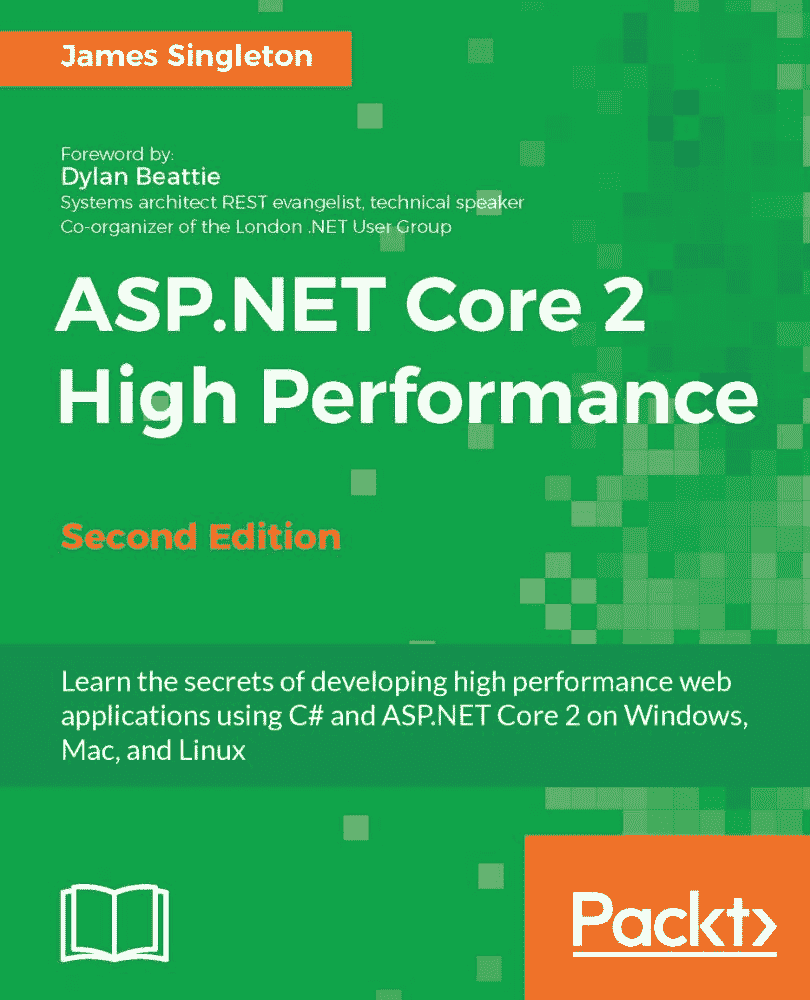

学习在 Windows、Mac 和 Linux 上使用`C#`和`ASP.NET Core 2`开发高性能网络应用程序的秘密。James Singleton

[[www.packtpub.com](http://www.packtpub.com)

## 鸣谢

| **作者**James Singleton | **文案编辑**Muktikant Garimella |
| :--- | :--- |
| **审稿员**Vidya Vrat Agarwal | **项目协调**Ulhas Kambali |
| **策划编辑**Merint Mathew | **校对** Safis Editing |
| **采买编辑**Aiswarya Narayanan | **索引员**Tejal Daruwale Soni |
| **内容开发编辑**Vikas Tiwari | **制作协调**Shraddha Falebhai |
| **技术编辑**Madhunikita Sunil Chindarkar | |

## 前言

“计算机软件行业最惊人的成就，就是不断抵消计算机硬件行业所取得的稳定且惊人的增长。”–亨利·彼得罗斯基（Henry Petroski）

我们生活在分布式系统的时代。计算机已经从房间大小的工业主机缩小到比指甲盖小的嵌入式设备。然而，与此同时，我们每天构建、维护和使用的软件应用程序增长到无法想象的地步。我们创建运行在全球范围内虚拟机集群上的分布式应用程序，数十亿的人每天依赖这些系统，如电子邮件、聊天、社交网络、生产力应用和银行服务。我们每天 24 小时、7 天在线，并沉迷于即时满足。上一代人以前，我们会心地等到周末后支票到账，或者留出 28 天的收货时间。今天，我们期望即时反馈，这又何不能呢？现代网络是实时的、即刻、按需的，并以光速在全球范围内闪烁的数据包构建的，当它不是这样，我们就会注意到。我们都有过那种心沉的感觉……你懂的，当你刚刚在页面上输入信用卡号码购买一些昂贵的演唱会门票时，网站响应时间稍微长了一点。性能和响应速度是分布式时代提供优秀用户体验的根本部分。然而，对于一个试图按时交付下一个功能的在职开发者来说，性能往往是最具挑战性的需求之一。你如何找到应用程序性能的瓶颈？你如何衡量这些问题的影响？你如何分析它们、设计并测试解决方案和变通方案，并在生产环境中监控它们，以便你能够确信它们不会再次发生？这本书提供了答案。在书内部，James Singleton 对现代性能优化技术进行了务实、深入且平衡的讨论，以及如何将它们应用于你的系统。从我们应该将性能视为核心特性这一前提开始，James 展示了如何使用`Glimpse`、`MiniProfiler`、`Fiddler`和`Wireshark`等工具来追踪瓶颈。

当我和 James 在 Spotlight 共事时，他始终表现出卓越的知识广度，从`ASP.NET`到`Arduinos`，从`Resharper`到电阻。一天，他会用`ASP.NET`和`JavaScript`构建响应式前端界面；第二天，他会将微控制器连接到《星球大战》玩具中来创建构建监控器，或者研究如何将浴室锁连接到局域网，以便我们骑行的员工可以从办公桌看到办公室淋浴室是否空闲。在 James 离开 Spotlight 之后，我一直关注他在 Cleanweb 和 Computing 4 Kids Education 工作。他是少数真正理解技术对社会和环境影响的开发者之一；无论是提供出色的用户交互还是仅仅为了节省电力，提高系统性能都是取悦用户的极佳方式。通过这本书，James 将多年的实践教训和经验提炼成了一本对于想要理解如何构建响应且可扩展应用程序的 .NET 开发者来说，真正非常优秀的全方位参考书。

本书接着讨论了现代应用程序开发的几乎每一个方面：数据库调优、硬件优化、压缩算法、网络协议和对象关系映射器。对于每个主题，James 都描述了常见性能问题的症状，识别了根本原因，然后描述了你可以用于衡量和修复这些问题的模式和工具。书中对异步方法（asynchronous methods）和消息队列（message queues）等高性能模式进行了深入的讨论，并配有真实示例，展示如何在最新版本的 .NET 框架中实现这些。最后，James 展示了你不仅可以在发布流水线的一部分对应用程序进行负载测试，还可以在生产环境中持续监控和衡量系统，让你在潜在问题影响终端用户之前就发现并修复它们。

## 关于作者

**Dylan Beattie**

系统架构师，REST 倡导者，技术演讲者

伦敦 .NET 用户组联合协调员

James Singleton 是一位英国软件开发人员、工程师和企业家，从 BBC Micro 时代就开始编写代码了。他的正规训练是电气与电子工程，但在`.NET`软件开发领域已拥有近十年的专业工作经验。他在伦敦的初创社区中非常活跃，并帮助为具有环保意识的技术人员组织了 Cleanweb London 活动。他运营着 Cleanweb Jobs ([`cleanwebjobs.com/`](https://cleanwebjobs.com/))，旨在帮助开发者、工程师、经理和数据科学家找到能够帮助应对气候变化和其他环境问题的职位。他还经常进行公共演讲，并在许多本地用户组中进行过展示，包括 Hacker News London 聚会。James 拥有电子工程（含计算方向）的一等荣誉学位，并曾在 FPGA 上设计并构建了自己的基础微处理器，还为此编写了一套运行其上的自定义指令集。James 贡献了许多开源项目并深受这些项目的影响，他经常经常使用`Python`、`Ruby`和`Linux`等替代技术。他对微软在`.NET`上的方向以及对开源实践的拥抱充满热情。他对比硬件、环境和数字权利项目特别感兴趣，并对安全、压缩和算法非常热。在不编写代码或为书籍和杂志写作时，他喜欢散步、滑雪、攀岩、旅行、酿酒和精酿啤酒。通过在从高性能股票交易所到视频编码系统的许多不同行业和角色中工作，James 学了多种技能。他曾担任业务分析师、顾问、测试人员、开发人员和技术架构师。他拥有从大企业到初创公司以及中间许多地方获得的广泛知识。对于构建高性能软件的最佳和最差方法，他拥有第一经验。你可以在 [`unop.uk/`](https://unop.uk/) 阅读他的博客。

我想感谢所有的朋友和家人在我写这本书期间给予的巨大支持。我特别感谢我的父母在小时候引导我进入科学技术领域，感谢 Lou 无限的热情和积极。我还要感谢 Dylan 为本书写了序言。写一本书比大多数人想象的要困难得多，如果没有不断的鼓励，我无法完成。这付出了许多牺牲，感谢大家的理解。对于我错过的所有活动深表歉意，向在这里忘记感谢的任何人表示歉意。

# 关于评审员

Vidya Vrat Agarwal 是一位软件技术爱好者、微软 MVP、C# Corner MVP、TOGAF 认证架构师、认证 Scrum 大师 (CSM) 以及一名作家。他曾在印度和美国的各种技术会议和代码营上进行过演讲。他与妻子 Rupali 以及两个女儿 Pearly 和 Arshika 住在华盛顿州雷蒙德。他热爱`.NET`，担任 T-Mobile USA 的系统首席架构师。他在 [`www.MyPassionFor.NET`](http://www.mypassionfor.net/) 上写博客，可以在 Twitter 上关注`@DotNetAuthor`。

## 读累了记得休息一会哦~

**公众号：古德猫宁李**

* 电子书搜索下载
* 书单分享
* 书友学习交流

**网站：[沉金书屋 https://www.chenjin5.com](https://www.chenjin5.com)**

* 电子书搜索下载
* 电子书打包资源分享
* 学习资源分享

# www.PacktPub.com

如需与书籍相关的支持文件和下载，请访问 [www.PacktPub.com](http://www.packtPub.com)。你知道吗？Packt 为每本书都提供电子书版本，提供 PDF 和 ePub 文件。你可以在 [www.PacktPub.com](http://www.packtPub.com) 升级到电子书版本，作为纸质书客户，你有权获得电子书版本的折扣。请通过`service@packtpub.com`与我们联系获取更多详情。在 [www.PacktPub.com](http://www.packtPub.com)，你还可以阅读免费技术文章集，订阅一系列免费时事，并接收 Packt 书籍和电子书的独家折扣和优惠。


[`www.packtpub.com/mapt`](https://www.packtpub.com/mapt) 通过 Mapt 获取最紧缺的软件技能。Mapt 让你完全访问所有 Packt 图书和视频课程，并提供行业领先水平的工具，帮助你规划个人发展并提升职业。

# 为什么要订阅？

* 全面搜索 Packt 出版的每本书
* 内容的复制、粘贴、打印和书签
* 随需获取并可通过网络浏览器访问

# 客户反馈

感谢购买本 Packt 书籍。在 Packt，质量是我们编辑流程的核心。为了帮助我们改进，请在本书的亚马逊页面 [`www.amazon.com/dp/1788399765`](https://www.amazon.com/dp/1788399765) 上为本书留下诚实的评论。如果你想加入我们的定期评审员团队，可以通过`customerreviews@packtpub.com`给我们发送邮件。我们将向定期评审员提供免费电子书和视频，以换取宝贵的反馈。帮助我们不断改进我们的产品！

我们已经讨论了 TLS 最重要的性能优化，因为它不是关于 TLS 的。你应该确保你的 HTTP 连接是可重用的，因为如果不是，你将承担 TLS 握手的额外惩罚以及 TCP 开销。缓存也非常重要，我们稍后会详细讨论这一点。

TLS 和 HTTP 都支持压缩，但这些具有安全影响。因此，请仔细考虑它们。它们可能会泄露信息，坚定的攻击者可以通过分析它们来恢复加密数据。TLS 压缩已被废弃，并在 TLS 1.3 中被移除。因此，不要使用它。我们将在本章后面讨论 HTTP 压缩。

关于 TLS 的具体建议，你可以做一些事情来提高性能。主要的技巧是确保使用会话恢复。这与重用 HTTP 连接不同，这意味着客户端可以重用现有的 TLS 连接，而无需经过整个密钥交换。

你可以通过服务器端的 ID 或加密票据（类似于使用密钥加密的 ASP.NET Cookie）来实现会话。微软客户端实现现在加密密钥旋转时存在 Bug，但`KB3109853`补丁修复了它。确保你安装了此更新，特别是当你从 .NET 代码连接到安全端点时抛出异常的情况下。

不要过度追求性能是非常重要的，而且越大并不总是越好，尤其在涉及密钥大时。这是性能与安全之间的权衡，具体取决于你的实际情况。通常情况下，在 128 位 AES 密钥足够的情况下，不使用 256 位 AES 密钥是一个很好的平衡。

2048 位的 RSA 密钥已经足够大了；位数太低不安全，太大则太慢。你可以使用`椭圆曲线数字签名算法`（`ECDSA`）代替 RSA 进行签名，因为它速度快得多。然而，它的支持度有限，因此你需要并行部署 RSA。

如果你使用`ECDSA`，那么 256 位密钥就足够了。对于`ECDHE`，256 位也可以的，而对于不带椭圆的较慢版本（`DHE`），2048 位就足够了。如果你使用`ECDSA`，你将在连接详情中看到此项列表，而不是 RSA 签名。例如，在访问 [`huxley.unop.uk/`](https://huxley.unop.uk/) 时，Firefox 中显示了以下截图中的详情。这种差异也显示在之前的 Chrome 截图中：

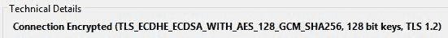

此外，在你的证书中包含完整的证书链是非常重要的。如果你未能包含所有中间证书，浏览器将需要下载它们，直到在它的信任根存储库中找到一个为止。你也可以使用名为`在线证书状态协议`（`OCSP`）封接的技术，通过嵌入撤销数据，让浏览器无需检查证书撤销列表。

这两种证书技术都可能增加负载的大小，如果带宽有限，这可能会成为问题。然而，它们会减少消息数量，如果延迟是主要问题（通常如此），它们将提高性能。保持较小的密钥也有助于节省带宽。很难推荐一种通用的方法。因此，一如既常，请针对你的这种情况进行测试。

还有另一种名为`ChaCha/Poly`的流加密算法，它对移动设备特别有用。它使用`ChaCha20`流加密器和`Poly1305 消息认证码`（`MAC`）算法来创建 RC4 的安全替代方案。AES 是一种块加密，在硬件支持下速度很快，但许多移动设备和一些旧电脑没有这种加速。在仅使用软件时，ChaCha/Poly 更快。因此，这对电池续命更有利。Chrome（包括安卓版 Chrome）和 Firefox 都支持此。你可以在 [`caniuse.com/#feat=chacha20-poly1305`](https://caniuse.com/#feat=chacha20-poly1305) 查看最新的浏览器支持。

由于所有算法都不同，你不能直接通过密钥大小来衡量安全性。例如，256 位的 ECDHE 密钥等于 3072 位的 RSA 密钥。AES 在密钥较小的情况下非常安全，但你不能将其用于密钥交换。ChaCha/Poly 的安全性更接近 AES 256 而非 AES 128。

在以下安卓版 Chrome 的后续截图中，你可以看到当连接到 [`huxley.unop.uk/`](https://huxley.unop.uk/) 时，Chrome 使用`CHACHA20_POLY1305`作为流加密，使用`ECDHE`进行密钥交换，并使用`ECDSA`进行签名：

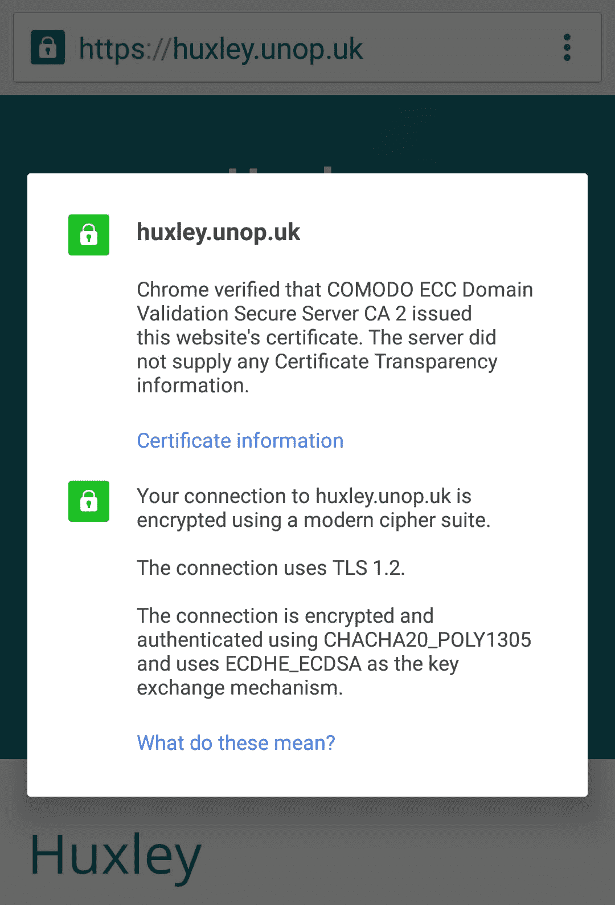

新版本的 TLS (1.3) 目前是一个草案，但它许多地方仍被支持。它只允许`带附加数据的认证加密`（`AEAD`）加密算法。`AES-GCM`和`ChaCha/Poly`是目前符合这些标准的两个算法。它还将移除一些其他过时的功能，例如 TLS 压缩。好消息是，TLS 1.3 不仅提高了安全性，还提高了性能。Firefox 和 Chrome 的稳定版本已经支持它。你可以在 [`caniuse.com/#feat=tls1-3`](https://caniuse.com/#feat=tls1-3) 检查支持情况。

听起来使用 TLS 并不总是值得的，但在你的整个网站上使用 HTTPS（包括加载的任何第三方资源）是一个极佳的主意。通过这样做，你将利用 HTTP/2 的性能增强功能，这些技术意味着从多个域名提供资源（如 JavaScript 库）已不再至关重要。你可以安全地自托管所有内容，并避免额外请求带来的 DNS、TCP 和 TLS 开销。

这一切都可以是免费的，因为 *Let's Encrypt* 和 *Cloudflare* 提供免费的证书。*Cloudflare* 也有 TLS 1.3 测试版，但使用它们可能会产生安全影响。*Let's Encrypt* 允许你为自己的服务器生成证书，从 2018 年起，它还提供通配符证书。现在让我们详细看看 HTTP/2。

# HTTP/2

如名所示，HTTP/2 是 HTTP 的新版本。它针对现代网页包含了一些重大的性能改进。它的前身是`SPDY`，该协议已被废弃，并由 HTTP/2 取代。

如前所述，使用 HTTP/2 的第一步是在整个网站上使用 HTTPS。虽然在技术上不是强制，但大多数客户端（所有主流浏览器）都强制使用 TLS 来启用 HTTP/2。这主要是由于 TLS 提供的`应用层协议协商`（`ALPN`），这允许了 HTTP/2 的运行。它还能防止代理服务器篡改数据。

HTTP/2 通过多种方式改进了性能。它使用了压缩，以及多路复用（多个请求共享同一个连接）。它还允许服务器在客户端意识到需要资源之前就推送资源。尽管如此，如果过度使用会浪费带宽。

多路复用对合并和精灵图（`sprites`）有影响，我们将在本章稍后的*压缩*部分讨论。这意味着你不再需要通过多个域名来分发资源（`shards`），这种额外的开销甚至会降低速度。然而，你可能仍希望无 Cookie 的子域名提供静态资源，尽管新的头部压缩意味着带宽节省会减小。如果你使用裸域名（不带`www`），你可能需要一个新的无 Cookie 域名。

WebSocket 协议（也俗称为 WebSockets）是一种与 HTTP 不同的协议。然而，它由 HTTP 发起连接，并使用相同的端口，因此我们在这里简要讨论一下。这项 HTML5 特性对于`推送通知`和`实时通信`（`RTC`）应用程序非常有用。WebSockets 使用`ws://`和`wss://`协议前缀，而不是`http://`和`https://`。一旦通过现有的 HTTP 连接建立，该协议就是全双工且二进制的，这与 HTTP/1 不同。

在 WebSockets 出现之前，如果你的 Web 服务器想要通知客户端变化，你必须使用长轮询（long polling）等技术。

这是服务器保持 Web 请求开启，以便在需要时发送内容。当请求获得响应或超时时，它会重新建立。不用说，轮询的效率一直不高。

从用户的角度来看，推送通知可以提高性能，因为用户可以在更新发生时立即接收。用户不需要刷新任何内容或持续检查。当长时间运行的进程开始时，你可以立即响应用户，异步运行该进程，并在完成后立即通知他们。

`Socket.IO`是一个流行的 Node.js WebSocket 库。要查看它的效果，你可以查看使用它的网站的浏览器开发者工具。例如，如果你打开开发工具并访问 [`www.opentraintimes.com/maps/signalling/staines`](https://www.opentraintimes.com/maps/signalling/staines)，你会看到连接从 HTTPS 升级到 WSS（或者如果你使用不安全版本，则从 HTTP 升级到 WS）。


WebSockets 早于 HTTP/2，但尽管有了新的服务器推送技术，它们仍然具有相关性。这两个功能看起来相似，但用途不同。WebSockets 用于实时和双向数据传输，而服务器推送目前仅用于预加载。

除了 HTTP/2 服务器推送预加载外，还有一项目前受 Android、Chrome 和 Opera 支持的新浏览器功能，它允许通过在 `link` 标签上使用 `rel="preload"` 在标记中声明资源预加载。你可以在 [`w3c.github.io/preload/`](https://w3c.github.io/preload/) 读取规范，并在 [`caniuse.com/#feat=link-rel-preload`](http://caniuse.com/#feat=link-rel-preload) 查看浏览器的当前支持状态。

在 Chrome 中，协议切换看起来像下面的截图所示。你无法看到 WebSocket 连接的内容，因此你无法从开发工具内部查看正在传输的数据：

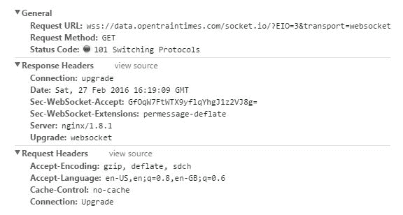

微软有一个针对 ASP.NET 的库，称为 `SignalR`。该库允许你通过 WebSockets 执行推送通知。如果客户端或服务器不支持 WebSockets，它会回退到长轮询。你需要相当较新版本的 Windows Server（2012 或更高版本）和 IIS（8.0 及以上）来使用 WebSockets。

遗憾的是，最新的稳定版本（SignalR 2）尚未正式支持 .NET Core 2.0。一个新版本正在编写中，将在 ASP.NET Core 2.0 之后发布。

你可能也希望将 `StackExchange.NetGain` 作为 WebSocket 服务器。

## 压缩

数据压缩是一个广泛的话题，我们无法希望涵盖所有内容。在这里，我们将学习无损压缩以及如何在 HTTP 中使用它。我们将在本章稍后部分介绍图片的有损图像压缩。压缩很重要，因为如果我们能让文件更小，就可以缩短它们在网络上传输的时间。

### 无损压缩算法

你可能已经注意到之前某些截图中的 HTTP 头部与编码有关。HTTP 最常用的压缩算法是 `GZIP` 和 `DEFLATE`，它们非常相似。它们都与 ZIP 文件中使用的算法有关。如果你还没有使用 HTTP 压缩，那么这将是一个快速见效的改进，启用它将提高你网站的性能。

还有许多其他先进的压缩算法，例如 `xz`，它与 `7-Zip` (`7z`) 格式类似，并使用 `Lempel-Ziv-Markov 链算法`（`LZMA/LZMA2`）。然而，目前在主流浏览器中常用的只有两种额外算法。这些是 `Brotli` 和 HTTP 共享字典压缩（`SDCH`）。它们都来自 Google，但只有 Chrome 支持 SDCH，而且它需要一个巨大的字典。

Brotli 更有趣，因为大多数现代浏览器现在都支持它。许多浏览器要求使用 HTTPS 来支持 Brotli（这是另一个使用 TLS 的好理由），标头中使用的编码标记是 `br`。Brotli 有显著的性能提升，特别是对于慢速连接上的移动设备。你可以在 [`caniuse.com/#search=brotli`](https://caniuse.com/#search=brotli) 查看最新的支持数据。

如果你通过 HTTP 访问网站，将在 Chrome 开发者工具的网络检查器的请求详情中会看到以下请求头：

```
Accept-Encoding: gzip, deflate
```

然而，如果你使用 HTTPS，你会看到这个：

```
Accept-Encoding: gzip, deflate, br 
```

服务器随后可以使用此响应头响应 Brotli 编码的内容：

```
Content-Encoding: br 
```

例如，如果你在支持的浏览器中访问 [`www.bayden.com/test/brotliimg.aspx`](https://www.bayden.com/test/brotliimg.aspx)，那么 Brotli 将交付内容（一张星星的图片）。以下是 Chrome 请求头部的子集（为了清晰和简洁）：

```
GET /test/brotliimg.aspx HTTP/1.1 
Host: www.bayden.com 
Connection: keep-alive 
Accept-Encoding: gzip, deflate, sdch, br 
```

这是相应的响应头部的子集：

```
HTTP/1.1 200 OK 
Content-Type: image/png 
Content-Encoding: br 
Server: Microsoft-IIS/7.5 
X-AspNet-Version: 4.0.30319 
YourAcceptEncoding: gzip, deflate, sdch, br 
```

Fiddler（我们之前提到的由 Eric Lawrence 开发的优秀的 HTTP 调试代理）也通过一个简单的插件支持 Brotli（将 [`bayden.com/dl/Brotli.exe`](https://bayden.com/dl/Brotli.exe) 放入 `fiddler2\tools` 并重启它）。你可以用此轻松测试对你网站的影响，而无需向你的 Web 服务器部署任何内容。

你可以使用 .NET 中的 `System.IO.Compression.Brotli` 包来尝试 Brotli 压缩。你可以结合 ASP.NET Core 响应压缩中间件使用它 ([`docs.microsoft.com/en-us/aspnet/core/performance/response-compression?tabs=aspnetcore2x`](https://docs.microsoft.com/en-us/aspnet/core/performance/response-compression?tabs=aspnetcore2x) )。希望 Brotli 会包含在未来的 .NET Framework 版本中，届时响应压缩中间件就可以默认支持它。

### 打包与压缩

在开发 Web 应用程序时，你通常会得到许多需要交付到浏览器的静态文件。这些文件包括样式表、脚本和图像。处理许多小文件比处理一个大文件要容易（特别是当团队合作时），但对于性能来说这并不总是最佳方法。

打包（Bundling）和压缩（minification）是加速这些静态资产交付两种技术。它们通常用于文本文件，例如 JavaScript 和 CSS 内容。然而，你也可以缩小图像，我们稍后会介绍这一点。

Bundling

打包（Bundling）是一种将多个文件合并或连接在一起的技术，以便将其作为一个文件交付。在使用 `HTTP/1.1` 时，这是一个好主意，因为并发连接的数量是的。然而，在 `HTTP/2` 中，打包变得不再必要，事实上，它会降低性能。`HTTP/2` 的新多路复用意味着当你请求许多文件而不是一个包含所有相同内容的大文件时，不再会有巨大的性能损失。你可以利用这一点，只交付页面所需的内容，而不是为每个页面都交付整个客户端代码库。即使你按页面进行选择性打包，这也可能是低效的。

例如，你可能会包含一个用于表单的验证库。但是，由于它是打包在一起的，它会被发送到所有页面，包括那些不需要验证表单的页面。如果你为验证页面准备了单独的包，那么公共核心代码中可能会出现重复，而这些代码也会被发送。通过保持它们分离，客户端可以单独缓存它们并重用组件。这也意味着如果你更改了某些内容，只需要失效这一个部分的缓存。客户端可以继续使用其他未修改的部分，而无需重新下载它们。

一如既往，你应该针对你特定的用例进行测量。你可能会发现打包仍然减少了总文件大小。`HTTP/2` 的开销低得多，但并非为零，而且压缩在大文件上效果更好。然而，请记住这对缓存和重用性的影响。

### 压缩化 (Minification)

压缩化（Minification）是缩小文本静态资源文件大小的过程。我们通过各种手段来实现，包括删除注释、移除空白和缩短变量名。对代码进行`obfuscate` 混淆也有用，可以使其更难逆向工程。

当使用 `HTTP/2` 时，压缩化仍然有用，但在测试时，你应该小心比较最小化前和最小化后的文件大小（这是在应用了无损压缩之后）。

正如之前讨论的，你应该使用 `HTTP` 内容压缩，至少使用 `GZIP` 或 `DEFLATE` 算法，最好使用 `Brotli`。这些算法在缩小文件大小方面非常高效。你可能会发现，压缩后，你的最小化文件并没有比压缩后的原始源文件小多少。

## ASP.NET Core 的变化

在完整的 `.NET Framework` 和之前的 `MVC` 版本中，平台内置了一个集成的打包和最小化系统，它在运行时动态工作。对于 `ASP.NET Core`，这种情况发生了变化，并有了新的工具来执行这项工作。

现在的默认选项是 `BuildBundlerMinifier` NuGet 包。但是，如果你喜欢，也可以使用其他工具，包括任务运行器 `Gulp` 和 `Grunt`。还有像 `Bower` 和 `npm` 这样的包管理器，它们类似于 `NuGet`，但专门用于前端库。例如，`NuGet` 不再提供 `jQuery` 和 `Twitter Bootstrap`，它们默认使用 `Bower`。

这些工具大部分是用 JavaScript 编写的，并运行在 `Node.js` 上。`Node.js` 的包管理器是 npm。这些工具在其他开源 Web 框架中很流行，并且已经非常成熟。它们对于这个领域来说并不新鲜，只是对 `.NET` 来说新鲜。

静态资源的最小化现在是在构建时完成的，而不是之前的请求时。它的工作方式更像静态站点生成器，而不是动态 Web 应用程序。项目根下的配置文件 `bundleconfig.json` 使用 JSON 定义了打包和最小化行为。

新工具不仅局限于 `ASP.NET Core`，你还可以在 `Visual Studio` 中的传统 `ASP.NET` 中使用这些功能。这是新框架为现有框架提供交叉融合和益处的一个良好例子。

## 读累了记得休息一会哦~

**公众号：古德猫宁李**

* 电子书搜索下载

* 书单分享

* 书友学习交流

**网站：**[沉金书屋 https://www.chenjin5.com](https://www.chenjin5.com)

* 电子书搜索下载

* 电子书打包资源分享

* 学习资源分享

## 图片优化

数字媒体压缩比我们之前讨论过的无损文件压缩复杂得多，即使我们只局限于图像。在上一章中，我们简要提到了什么时候使用 `PNG` 什么时候什么时候使用 `JPEG`。在这里，我们将进入更详细的细节，并探索一些其他奇特的选项。

我们涵盖了经验法则，即 `PNG` 是图标的最佳图像格式，而 `JPEG` 更适合照片。这两种格式分别是无损和有损图像压缩中最常见的格式。

我们稍后会讨论其他图像格式，但你通常受限于浏览器支持的流行格式。那么，你如何从这些选择中获得更多收益？

### PNG

**便携网络图形 (`PNG`)** 是一种无损图像压缩格式，其内部工作原理与 `ZIP` 文件类似（使用 `DEFLATE` 算法）。对于包含实色块的图像，它是很好的选择，并且它比旧的图形交换格式 (`GIF`) 具有更高的图像质量（颜色更多）。

`PNG` 在所有现代浏览器中都支持透明度，因此你应该使用它代替 `GIF` 来处理静态图像。除非你需要支持 `Internet Explorer 6`，否则这不是问题，如果是那样，这可能是你最不用担心的问题了。`PNG` 还支持通过动画便携网络图形 (`APNG`) 文件进行动画处理。这些类似于动画 `GIFs`，但质量高得多。遗憾的是，只有 Firefox 和 Safari 支持 APNG。

一个查看支持某功能的很好的网站是 [`caniuse.com/`](http://caniuse.com/)。你可以根据网站的用户代理分析来检查支持情况。例如 `PNG-alpha`、`Brotli` 或 `APNG`。

某些 `ZIP` 算法实现比其他更好，生成的的文件更小，且可以被解码。例如，`7-Zip` 在 Windows 上比大多数压缩软件高效得多。同样，你可以更紧凑地压缩 `PNG` 而不丢失任何数据，并且在所有浏览器中运行。

你可能已经在使用 `PNGOUT` 工具无损地减小 `PNG` 图像的大小。如果你没有，那么你可能应该。你可以在 [`advsys.net/ken/utils.htm`](http://advsys.net/ken/utils.htm) 查看更多关于它的信息并下载它。

然而，有一种名为 `Zopfli` 的新算法提供了更好的压缩率，但压缩速度非常慢。解压速度一样快，所以对于预编译资源来说只有一次性的优化开销。`Zopfli` 是 `Brotli` 的先驱，但它兼容 `DEFLATE` 和 `GZIP`，因为它不是一种新格式。

你可以从 [`github.com/google/zopfli`](https://github.com/google/zopfli) 获取 `Zopfli`，但你应该始终对你的图像进行测试，并验证是否确实减小了文件。你可能会发现这些工具可以帮助你更快地交付资产并获得更高的性能。

你可能还会使用将精灵合并为一张图像的方法。与打包类似，当在使用 `HTTP/2` 时，这不再必要。然而，与压缩类似的注意事项仍然适用，你应该针对你的图像集进行测试。

### JPEG

`JPEG` 是一种有损图像压缩格式，这意味着它通常通过丢弃图片中的数据来减小体积。它最适合自然渐变和连续色调，例如照片中的色调。`JPEG` 不像 `PNG` 那样支持透明度，因此如果你想在不同的背景上使用它，你需要预渲染它们。

从用于 Web 的 JPEG 文件中移除`交换图像文件格式`（`Exif`）元数据是一个很好的节省空间的主意。它包含了所用相机的信息以及照片拍摄时的地理数据。

JPEG 有一个质量设置，它会影响图像文件的大小和细节程度。质量越低，文件越小，但视觉效果越差。你可以对图像进行测试，查看哪些设置可以提供可接受的平衡。至关的一点是，此质量设置的最佳值会根据图像的内容而异。有些工具允许你自动检测最佳质量级别，例如 Google 的 `butteraugli`。

Mozilla（Firefox 浏览器的开发者）有一个有趣的项目叫做 `mozjpeg`。其目的是更好地压缩 JPEG 图像，类似于 `PNGOUT` 和 `Zopfli` 处理 PNG 图像的方式。你可以使用 `mozjpeg` 将 JPEG 图像压缩到比正常更小的尺寸，而不影响解压缩或质量。你可以在 [`github.com/mozilla/mozjpeg`](https://github.com/mozilla/mozjpeg) 获取，但你需要自己编译它。和往常一样，结果可能会有所不同，请对你网站上的照片进行测试。

`JPEG Archive` ([`github.com/danielgtaylor/jpeg-archive`](https://github.com/danielgtaylor/jpeg-archive)) 是一个实用的工具，它使用 `mozjpeg` 并通过各种比较指标压缩 JPEG 图像。另一个类似的工具是 `imgmin` ([`github.com/rflynn/imgmin`](http://github.com/rflynn/imgmin))，它稍旧一些。

### 其他图像格式

有很多其他图像格式，但在 Web 上你通常受限于浏览器支持的内容。

正如上一节中讨论的，你不应该在浏览器中缩放图像，否则性能会糟糕。这通常意味着必须保存多个独立的较小图像副本，例如在显示缩略图时。显然，这导致了重复，效率低下。这些新图像格式中的一些对响应式和可扩展图像问题提供了巧妙解决方案。

BPG 是才华横溢的 Fabrice Bellard 开发的一种图像格式，你可以在 [`bellard.org/bpg`](http://bellard.org/bpg) 阅读更多信息。它有一个 JavaScript 垫层程序（polyfill），用于在任何浏览器添加原生支持之前支持它们。

WebP 是 Google 的一种图像格式，只有 Chrome、Android 和 Opera 支持它。它与 JPEG 相比具有惊人的空间节省效果，如果得到更广泛的支持，它将是一个很好的选择，因此请查看 [`caniuse.com/`](http://caniuse.com/) 获取最新的采用统计。

JPEG 2000 是 JPEG 的改进版本，尽管它可能受到软件专利的限制，因此在医学影像之外没有被广泛采用。只有 Safari 支持 JPEG 2000，还有 JPEG XR，它仅受 IE 支持。

JPEG 使用`离散余弦变换`（`DCT`），而 JPEG 2000 基于小波变换。它提供的属性之一是`渐进式`下载。这意味着图像的存储方式使得如果你从文件开头开始下载一小部分，你就获得了一个较小且质量更低的完整图像版本。这对于响应式和可扩展图像有明显的应用。浏览器只需要下载足够填充其渲染区域的图像即可，且文件只需要存储一次。缩略图不需要调整缩放，也不需要重复。这种技术也用于`自由无损图像格式`（`FLIF`）。

FLIF 是最令人兴奋的未来图像格式之一，因为它是渐进式且响应式的，而且免费且无专利的。FLIF 仍在开发中，但如果浏览器支持它，它将非常有用。你可以在 [`flif.info/`](http://flif.info/) 阅读更多信息。

JPEG 和 PNG 可以支持渐进式下载，但这对于响应式图像通常没用。渐进式 JPEG 在主观上加载更优雅，甚至可以使文件更小，但交错 PNG 通常会让文件变大。

问题是，大多数渐进式图像格式尚未准备好普及，因为所有主流浏览器都不支持它们。关注未来是一个好主意，但目前，我们需要调整图像大小以获得高性能。

### 调整图像大小

在新的图像格式获得广泛采用之前，调整大小仍然是必要的，你可能需要为不同的设备动态执行此操作。也许，你还有用户提交的图像内容，尽管从安全的角度来看，你需要对此非常小心。某些图像库是不安全的，特殊制作的图像可能会你的系统。事实上，许多图像处理库在 Web 环境下使用时会存在问题。


如果你不是极其勤奋和小心，很容易导致内存泄漏，这可能会导致你的 Web 服务器崩溃。将处理大型媒体文件的进程分离并沙箱化始终是一个好主意。

从 .NET 的角度来看，使用 WinForms `System.Drawing` 或其 WPF 后继版本（`System.Windows.Media`）可能很有吸引力。然而，这些是为桌面软件设计的，微软强烈建议不在服务或 Web 应用程序中使用。微软推荐 `Windows Imaging Component`（`WIC`），但这是一个供 C 或 C++ 使用的 `组件对象模型`（`COM`）API。此外，这些图像库都不是跨平台的，因此不适合用于 .NET Core。

如果你使用 Windows，可以尝试使用来自 Imazen 的 ImageResizer（[`www.imazen.io/`](http://www.imazen.io/)），来自 [`imagerizing.net/`](http://imagerizing.net/)。虽然它仍然使用 `GDI+` `System.Drawing`，但它已经过了考验，所以大多数问题应该已经解决了。还有 `DynamicImage`，它封装了新的图像函数并使用着色器。你可以在 [`dynamicimage.app.com/`](http://dynamicimage.app.com/) 阅读更多信息，尽管它已经一段时间没有更新了。

开源领域的一个流行选项是 ImageMagick（我们之前提到过），以及一个名为 `GraphicsMagick` 的分支，它声称更高效。另一个流行的图像库是 `LibGD`，它适合服务器使用。你可以在 [`libgd.github.io/`](http://libgd.github.io/) 阅读更多信息。尽管它是用 C 写的，但有其他语言的封装，例如针对 .NET Core 的 `DotnetGD`。

.NET Core 缺少的功能之一是还没有一个极具竞争力的图像处理选项。ImageResizer 5 和 Imageflow（[`www.imageflow.io/`](https://www.imageflow.io/)）在完成后可能对此有所帮助。还有一个开源 `ImageProcessor` 库的新跨平台版本（[`imageprocessor.org/`](http://imageprocessor.org/)），叫做 `ImageSharp`（[`imagesharp.net/`](http://imagesharp.net/)），但这仍然处于进行阶段。如果你想尝试一下，可以从 MyGet 获取预发布包，或从源码构建。

平台支持和兼容性变化迅速，因此请检查 [`github.com/jpsingleton/ANCLAFS`](https://github.com/jpsingleton/ANCLAFS) 获取最新信息。欢迎随时向此列表或项目做出贡献。

目前，安装一个开源服务（如 `Thumbor`）或使用基于云的图像服务（如 `ImageEngine`（[`wurfl.io/`](http://wurfl.io/)）或我们已经提到的 Cloudinary）可能更简单。图像处理是一项常见任务，并且实际上是一个被解决的问题。使用现有的解决方案而不是重复轮子可能更好，除非它是你核心业务的一部分或你有非常特殊的要求。

一旦你调整了图片大小，就可以使用 `picture` 和 `source` 标签配合 `srcset` 和 `sizes` 属性响应式地加载它们。你还可以使用这种技术提供较新的图像格式（如 WebP），并为尚未支持这些格式的浏览器提供备选方案。或者你可以使用 `Client Hints`（参考 [`httpwg.org/http-extensions/client-hints.html`](http://httpwg.org/http-extensions/client-hints.html) 和 [`caniuse.com/#feat=client-hints-dpr-width-viewport`](http://caniuse.com/#feat=client-hints-dpr-width-viewport)）。

## 缓存

人们常说（由 Phil Karlton 提出）缓存是计算机科学中最困难的问题之一，与命名并列。这可能有些夸张，但缓存确实很困难。如果你处理方法不够系统化和精确，调试它可能会让你非常沮丧。

缓存可以通过许多多样化的技术应用于从浏览器到服务器的各个层级。即使你没有意识到，你也极少只使用单一缓存。多个缓存之间的工作并不总是配合得很好，如果你无法清除其中一个，那将非常令人恼火。

我们在上一章中简要提到了缓存，将在第 9 章 `学习缓存与消息队列` 中进行更详细的介绍。然而，由于缓存对网络性能有影响，我们在这里也会涵盖它。

### 浏览器

大量的缓存发生在网络浏览器中，这很不方便，因为你对它没有直接控制权（除非是你自己的浏览器）。要求用户清除缓存对许多人来说是令人不满意且困惑的。然而，通过仔细控制你设置的 HTTP 头部和使用的 URL，你可以对浏览器缓存资源的方式产生影响。

如果你未能声明哪些资源可以缓存以及缓存多长时间，那么许多浏览器将对此进行猜测。不同实现之间的这种启发式算法可能差异巨大。因此，这将导致性能欠优。你应该明确并始终声明缓存信息，即使（甚至尤其是）对于那些不应该被缓存的资源，也要将其标记为不可缓存。

你需要对宣称为“可缓存”的内容保持警惕，因为如果你粗心，就可能会陷入无法更新资源的境地。在使用缓存之前，你应该拥有一套经过测试的缓存失效（cache-busting）策略。

有多种用于浏览器缓存的技术。可以设置许多不同的 HTTP 头部，例如 `Age`、`Cache-Control`、`ETag`（实体标签）、`Expires` 和 `Last-Modified`。这些来自几个不同的标准，其相互作用可能很复杂，或者在浏览器之间存在差异。我们将在第 9 章 `学习缓存与消息队列` 中详细解释这些。

另一种技术是为内容使用唯一的 URL。如果 URL 发生变化，浏览器将将其视为不同的资源；但如果它是相同的，浏览器可能会从本地缓存中加载。某些框架会计算文件内容的哈希值，然后将其用作查询字符串参数。这样，当文件内容改变时，URL 也随之改变。

你还可以使用其他更现代的特性进行缓存，例如 `HTML5 Application Cache`（或 `AppCache`）。它是为离线 Web 应用设计的，并不灵活。委婉地说，刷新缓存非常复杂。AppCache 已经被废弃，你应该改用 `Service Workers`。它们提供了更大的灵活性，尽管其支持还很较新。

最新的浏览器中正在出现许多改进，可以为你提供更多控制权，我们将在第 9 章 `学习缓存与消息队列` 中向你展示如何使用它们。

### 服务器

Web 服务器是缓存的好地方，因为它通常受你的完全控制。然而，除了生成正确的头部外，它并不属于网络性能的一部分。服务器端缓存在提高页面生成速度方面可能有其他巨大的性能优势，但我们将在后面的章节介绍。

如果你在微软的 `Internet Information Services`（`IIS`）Web 服务器上使用传统的 .NET Framework，你可以在应用程序内部使用 `output caching`（输出缓存）。这将负责设置正确的头部并向浏览器发送 `304 (Not Modified)` 响应。它还将输出缓存在服务器的内存、磁盘或使用 Memcached/Redis 中。你可以为控制器操作方法添加属性来控制缓存选项，但也有其他实现方法，例如在配置文件中进行。

ASP.NET Core 现在已支持输出缓存，因此如果你选择，可以在你的基础设施中存储输出的副本。由于本节涉及网络化，我们在这里仅涵盖 `ResponseCache` 属性，它是输出缓存的子集。访问作者网站 [`unop.uk/`](https://unop.uk/) 了解更多其他主题的内容。

如果你想禁用 ASP.NET Core 页面上的缓存，请在控制器操作中添加此注解：

```
[ResponseCache(NoStore = true, Duration = 0)]
```

这会在 HTTP 响应上设置以下头部并确保其不被缓存：

```
Cache-Control: no-store
```

要缓存页面一小时，请添加以下内容，`Duration` 的单位是秒：

```
[ResponseCache(Duration = 3600, VaryByHeader = "Accept")]
```

缓存控制头部将看起来如下所示：

```
Cache-Control: public,max-age=3600
```

关于其他缓存选项和配置还有很多可以说的。因此，如果你感兴趣，请阅读后面的章节。这是一个复杂的主题，我们在这里只是触及皮毛。

你可以在 [`docs.microsoft.com/en-gb/aspnet/core/performance/caching/response`](https://docs.microsoft.com/en-gb/aspnet/core/performance/caching/response) 查看关于 ASP.NET Core 响应缓存的文档。

### 你与用户之间的代理服务器

你与用户之间可能存在许多你无法控制的代理服务器。它们可能会忽略你的缓存请求，拦截你网站的一部分，甚至修改你的内容。解决这些问题的方法是使用 TLS，正如我们已经讨论过的。TLS 创建了一个安全隧道，使得你的基础设施与浏览器之间的连接不会被轻易篡改。

企业代理（通常为“中间人” `MitM`）会攻击你与用户的连接，以便他们监视员工的在线活动。这涉及到在用户的工作站上安装自定义的信任根证书，以便你的证书可以被伪造。遗憾的是，除了教育用户外，你对此无能为力。证书锁定（Certificate pinning）在原生应用中是有效的，但对 Web 应用并不好用。HTTP Public Key Pinning（`HPKP`）可用，但由于它是“首次信任”（`TOFU`）技术，初始连接可能会被拦截。客户端证书是另一个选项，但它们很难分发，且并不常用。

如果你使用了 HSTS 并且你的域名在浏览器中预装，那么这可以帮助避免拦截，但你的网站可能会被直接拦截。例如，Firefox 自带了自己的证书存储，不像 Chrome 那样使用操作系统提供的存储。对于启用了 HSTS 且包含在浏览器安装中的 HSTS 站点，Firefox 在连接之前就知道了这一点，你无法为其添加安全异常。

如果你信任第三方并保持控制权，那么 MitM（中间人）可能是有效的。某些 `内容分发网络`（`CDNs`）使用它来加速你的网站运行。然而，你需要仔细评估此的风险影响。可以阅读上一章提到的 Cloudbleed 事件，作为这方面的一个深刻案例。

## 读累了记得休息一会哦~

**公众号：古德猫宁李**

*   电子书搜索下载

*   书单分享

*   书友学习交流

**网站：**[沉金书屋 https://www.chenjin5.com](https://www.chenjin5.com)

*   电子书搜索下载

*   电子书打包资源分享

*   学习资源分享

### CDNs

CDNs 可以通过在距离用户更近的位置存储内容的副本来提高网站的性能。诸如 Cloudflare 提供的服务会对你的连接执行 MitM 并在全球各地的数据中心保存副本。它与未经授权的代理的区别在于，你控制配置，并且可以随心所欲清除缓存。

你应该小心，如果你不使用缓存功能，由于涉及额外的跳数，可能会降低你网站的响应速度。确保你监控了使用 CDN 和不使用 CDN 的响应时间，并且在它们宕机时有一个备用方案。

CDNs 的另一个常见用例是分发流行的库，例如 jQuery JavaScript 库。来自（MaxCDN）、Google、Microsoft 和 cdnjs（Cloudflare）提供的免费 CDN 都可以做到。其假设是用户可能已经在他们的缓存中拥有来自其中一个提供者的库。然而，你必须非常仔细地确保信任该提供者和连接。当你向网站加载第三方脚本时，你实际上是赋予了他们对该脚本的完全控制权，或者至少依赖他们始终可用。

如果你选择使用 CDN，请确保它使用 HTTPS 以避免脚本被篡改。在安全页面上，你应该使用显式的 `https://` URL，或者至少使用协议无关的 URL（`//`），而永远不要使用 `http://`。否则，你会收到混合内容警告，某些浏览器会显示为完全未加密甚至直接将其拦截。

SRI 可以帮助某些浏览器中避免脚本被篡改。不要担心哈希脚本带来的任何潜在性能开销。使用的 `SHA-2` 算法非常快，这就是为什么它们不应该用于密码哈希或密钥扩展。请参考上一章获取更多关于此脚本完整性检查功能的信息。

无论如何，你都需要一个托管在你自己服务器上的备用方案，以防 CDN 宕机。如果你使用 HTTP/2，可能会发现使用 CDN 没有优势。显然，请始终针对你的情况进行测试。

ASP.NET Core 视图中有一些实用功能，可以轻松启用 CDN 资源的本地回退。我们将在后面的章节中向你展示如何使用它们。

## 总结

在本章中，你学习了如何在你的基础设施边缘与用户之间的网络层上提高性能。你现在更了解你应用程序底层的互联网协议，以及如何优化对它们的使用以获得最佳效果。

我们从高层次概述了网络堆栈的许多层，从 IP 和 TCP 到 HTTP 和 HTTP/2。我们还展示了 TLS 如何用于保护通信以及密钥交换的工作原理。我们强调了可以使用的不同密码算法，并提到了替代协议，例如 WebSockets。

你学习了如何利用压缩来缩小文本和图像文件。这将减少带宽并加速资产的交付。我们还强调了缓存，你现在应该看到它是有多么重要。我们将在第 9 章，`学习缓存和消息队列` 中涵盖更多关于缓存的内容。

在下一章中，你将学习如何优化基础设施内部的性能。你将看到如何处理 I/O 延迟，以及如何编写高性能的 SQL。

# 优化 I/O 性能

本章解决了当你将经过功能测试的应用程序拆分为部分进行部署时经常出现的问题。你的 Web 服务器托管前端代码，你的数据库位于数据中心的其他地方，你可能有一个用于集中化文件的 `存储区域网络`（`SAN`），一个用于 API 的应用服务器，而虚拟磁盘也都在不同的机器上。

这些变化为许多常见操作增加了显著的延迟，你的应用程序现在变得非常慢，可能是因为它在网络上太“吵”了。在本章中，你将学习如何通过批量处理查询以及在最适合任务的服务器上执行工作来解决这些问题。即使一切都运行在一个机器上，你在这里学到的技能将通过提高效率来帮助提升性能。

本章涵盖的主题包括：

*   输入/输出

*   网络诊断

*   批量处理 API 请求

*   高效的数据库操作

*   模拟与测试

你将学习各种你不应同步方式执行的操作，以及如何高效地从数据库中仅返回你需要的数据。你还将看到如何驯服你的 O/RM，并学习使用 `Dapper` 编写高性能的 SQL。

我们在第 5 章，`解决常见的性能问题` 中简要地涵盖了这些主题的一部分，但在这里我们将深入探讨。本章的前半部分将重点关注使用诊断工具的背景知识，而后半部分将向你展示可能遇到的解决方案。你还将了解到一些异常问题，以及如何修复或缓解它们。

我们最初将关注于理解问题，因为如果你不理解问题的根源，那么修复它就很困难。你不应该盲目地应用读到的建议并期望它生效。诊断问题通常是最困难的部分，一旦实现了这一点，修复它通常是容易的。

## 输入/输出

I/O 是任何代码与外部世界交互的操作的通用名称。有很多东西可以被视为 I/O，而且你的软件内部可能会有大量的 I/O，特别是当你的应用程序具有分布式架构时。

例如，科技公司对 `.io` `顶级域名`（`TLD`）的使用增加（例如 [`github.io`](http://github.io)，部分归因于它代表 I/O，但并不是它的真实含义。正如其他一些 TLD 一样，它实际上是一个国家代码。其他例子包括代表利比亚的 `.ly` 和代表图瓦卢的 `.tv`（与其相邻的基里巴斯一样，由于气候变化可能很快被淹没在太平洋之下）。`.io` TLD 用于 `英属印度洋领领地`（`BIOT`），这是一组微小但具有战略意义且有着可耻历史的岛屿集合。因此，`.io` TLD 由一家位于英国的注册机构控制，尽管 BIOT 仅仅是一个美国军事基地。

在本章中，我们将重点关注提高 I/O 的速度，而不是避免它。因此，我们在这里不会涵盖缓存。I/O 优化和缓存本身都是强大的技术，当它们结合时，你可以获得惊人的性能。请参考第 9 章，`学习缓存和消息队列` 以获取更多关于缓存的内容。

### I/O 的分类

第一个挑战是识别触发 I/O 的操作。.NET 中的一个经验法则是，如果一个方法具有异步 API（`MethodAsync()` 变体），那么它就在声明自己可能很慢，并且可能正在执行 I/O 工作。让我们仔细观察一些不同类型的 I/O。

### 磁盘

我们将涵盖的第一种 I/O 类型是对持久化存储器进行读取和写入。这通常是某种磁盘驱动器，例如旋转盘式的 `机械硬盘`（`HDD`），或者现在更常见的基于闪存内存的 `固态硬盘`（`SSD`）。

HDD 在随机读写方面比 SSD 慢，但在大块传输方面具有竞争力。这是因为 `HDD` 上的磁臂在开始读取或写入操作之前，必须物理地移动磁头到磁性盘片上的正确位置。如果磁盘已关机，可能需要更长时间，因为盘片必须先从静止状态旋转到正确的 `每分钟转数`（`rpm`）。

你可能在配置通用资源时听过 `spin up`（启动/加速）这个术语。这在历史上源于旋转磁盘上的盘片旋转到运行速度所需的时间。尽管现在可能不再有任何机械组件，但该术语仍被广泛使用。这类术语通常都有历史解释。另一个例子是软磁盘图标通常用于表示保存功能。然而，软磁盘已经不再使用，许多年轻用户可能从未见过它。

了解你的代码运行在何种类型的驱动器上是非常重要的。如果你进行大量的小规模读写，HDD 的性能会很差。它们倾向于批处理操作，因此写入一个大文件比写入许多小文件要好。

磁盘的性能与网络类似，都存在延迟和吞吐量（在网络术语中称为带宽）。`HDD` 的延迟很高，因为启动需要较长的时间，但一旦启动，吞吐量是可以可观的。如果数据都位于磁盘的同一个位置，你可以快速读取，但如果分散在各处，即使总数据量较少，速度也会变慢。例如，在磁盘之间拷贝单个大文件很快，但尝试同时启动许多程序则很慢。


SSD 遇到这些问题较少，因为它们的延迟较低，但将随机写入减少到最低仍然是有益的。SSD 基于`闪存内存`（类似于手机和相机内存卡中使用的芯片），它们的写入次数是有限。`SSD` 上的控制器为你管理这一点，但 `SSD` 的性能会随着时间的推移而下降。激进的写入会加速这种退化。

可以将多个磁盘组合以提高它们的性能和可靠性特征。这通常使用名为`独立磁盘冗余阵列`（`RAID`）的技术来实现。数据被分布在多个磁盘上，以便更快访问，并对硬件故障更具容忍性。`RAID` 在服务器硬件中很常见，但可能会增加启动时间，因为有时会交错进行磁盘启动以降低峰值功耗。

`HDD` 提供的容量远大于 `SSD`，因此是存储不经常使用的文件的良好选择。你可以获得混合硬盘，它将 `HDD` 与 `SSD` 结合在一起。

这些硬盘声称结合了两者的优点，并且比同等尺寸的 `SSD` 便宜。然而，如果你负担得起，并且能够将所有数据都放入 `SSD` 中，那么你就应该使用它。你还将减少对电量和冷却的需求，并且可以随时添加额外的 `HDD` 用于大规模存储或备份。

### 虚拟文件系统

如前，由于存储数据的磁盘具有物理特性，文件访问在理想情况下也是缓慢的。这种问题在虚拟化环境（如云托管基础设施）中可能会放大。存储磁盘通常不在虚拟机所在的同一台主机服务器上，即使它们看起来是本地挂载的，通常也会实现为网络共享。无论如何，始终存在一个额外的问题，无论磁盘是在 VM 主机上还是网络上的其他地方，那就是争用。

在虚拟化基础设施上（例如 `AWS` 和 `Azure` 提供的设施），你与其他用户共享硬件，但物理磁盘一次只能处理一个请求。如果多个租户想要同时访问同一块磁盘，那么他们的操作将需要排队和分时共享。遗憾的是，这种抽象对性能的负面影响与读取大量随机文件并无二致。用户磁盘上的存储位置可能与其他客户的位置不同。这将导致驱动器上的磁臂频繁移动到不同的扇区，从而降低系统中所有人的吞吐量并增加延迟。

所有这些意味着，在共享虚拟主机上，使用 `SSD` 带来的性能正面影响可能比通常更大。更好的是拥有一个本地 `SSD`，它直接连接到 VM 主机，而不是网络上的另一台机器。如果磁盘必须通过网络连接，那么存储机器应该尽可能靠近使用它的虚拟机。

你可以支付额外费用获取一个专用的 VM 主机，你是那里唯一的租户。然而，你完全也可以运行在裸机（bare metal）上，获得成本降低和性能提升的好处。如果你不需要虚拟机那种易于配置和维护的特性，那么裸机专用服务器可能是一个不错的选择。

许多云托管提供商现在提供 `SSDs`，但大多数只提供临时本地磁盘。这意味着本地磁盘仅在你的虚拟机运行时存在，在关闭时就会消失，因此如果你想以相同的状态重新启动虚拟机，它就不适合存储操作系统。

你必须以不同的方式编写应用程序以利用临时本地磁盘，因为它可能随时消失，因此只能用于临时工作存储。这被称为`不可变服务器`（immutable server），意味着它是不改变且可丢弃的。这在操作系统为 `Linux` 时通常运行得，因为在运行 `Windows` 时引导新实例可能会很困难。

### 数据库

数据库可能会慢，因为它们依赖磁盘存储数据，但还存在其他开销。然而，与磁盘上的平文件相比，数据库通常是存储重要数据的更好方式。如果数据经过了索引，就可以快速检索，这比暴力扫描文件快得多。

关系型数据库是一项成熟且令人印象深刻的技术。然而，它们只有在正确使用时才会大放异彩，查询方式对性能有巨大影响。`DBs` 非常方便，因此往往被过度使用，并且通常是 Web 应用程序的瓶颈。

一种不幸常见的反模式是在渲染网站首页时需要数据库调用。一个例子是当你尝试访问电视直播提到的网站时，结果发现它由于 `MySQL DB` 负载过高而崩溃。这种网站最好被设计为静态站点，由客户端代码访问缓存和队列中的 Web API。

慢 `DB` 的极端情况是：Web 服务器在一个数据中心，数据库服务器在另一个数据中心，而 `DB` 的磁盘又在第三个数据中心。此外，由于所有服务器都可能与其他用户共享。显然，最好的办法不要落入这种境地，并以合理的方式构建你的基础设施，但你始终会有一些延迟。

有一些应用程序编程技术可以让你将网络和数据库之间的通信降至最低。这些有助于你提高软件的性能和响应速度，特别是当它托管在高延迟的虚拟化环境中时。我们将在本章后面的部分演示这些技能。

### APIs

现代 Web 应用编程通常涉及使用第三方服务及其相关的 API。了解这些 API 所在的位置以及延迟是有益的。它们是在同一个数据中心，还是在地球的另一端？除非你发现了某些令人兴奋的新物理学发现，否则光速也是有局限的。

今天，几乎所有的跨洲数据传输都是通过光电缆完成的。卫星很少被使用，因为延迟很高，尤其是地球静止轨道。许多电缆位于海底，且难以修复。如果你依赖另一个大陆的 API，它不仅会减慢你的速度，还会让你暴露在额外的风险中。你可能应该避免构建可能会被在错误区域捕鱼的渔夫中断的重要工作流。你还需要进一步保护你的数据，因为某些国家（如英国）会在通信跨越其边界时监听电缆并存储内容。

API 的问题之一是延迟可能会累积。你可能需要调用许多 API，或者一个 API 内部调用了另一个 API。这些情况通常不是这样设计的，但随着新功能的添加，它们可能会有机地增长，特别是如果没有定期进行重构来清理混乱的话。

延迟的一种常见形式是启动时间。如果网站不被使用，它们可能会进入睡眠状态，特别是使用默认的 `Internet Information Services`（`IIS`）设置时。如果一个网站唤醒需要花费不小的时间，且所有需要的 API 也需要唤醒，那么延迟可能会迅速累加，导致第一个请求出现显著滞后。甚至可能会超时。

针对这种初始延迟问题有两个解决方案。如果你使用 `IIS`，可以配置应用程序池不进入睡眠。`IIS` 的默认设置针对共享主机进行了优化，因此对于专用服务器需要进行调整。第二个选项是通过健康检查或运行时间监控工具定期轮询站点以保持其活跃。你应该这样做，以便在网站宕机时知道，但你还应该确保正在测试所有必要的依赖项（例如 API 和数据库）。如果你只是获取静态页面或仅检查 200 状态码，那么服务可能会在你没有察觉的情况下宕机。

同样，扩展也可能会产生延迟。如果你需要扩展，就应该预热你的负载均衡器和 Web 服务器。这在使用 AWS `Elastic Load Balancing`（`ELB`）时尤为重要。如果你预计会有巨大的流量峰值，可以请求 AWS 对你的 `ELBs` 进行预热。另一种方法是使用 `Azure Load Balancer`、`Azure Application Gateway` 或自行运行 `HAProxy` 以获得更多控制权。你还应该运行负载测试，我们将在第 11 章“监控性能退化”中介绍这一点。

## 读累了记得休息一会哦~

**公众号：古德猫宁李**

- 电子书搜索下载
- 书单分享
- 书友学习交流

**网站：**[沉金书屋](https://www.chenjin5.com)

- 电子书搜索下载
- 电子书打包资源分享
- 学习资源分享

## 网络诊断工具

正如我们之前发现的，虚拟化或云托管基础设施中几乎所有的 I/O 操作现在都是网络操作。磁盘和数据库很少是本地的，因为这将阻止水平扩展。有各种命令行工具可以帮助你发现正在使用的 API、数据库或任何服务器位于何处，以及连接中存在多少延迟。

虽然所有这些命令都可以从你的工作站运行，但它们通过 `Secure Shell`（`SSH`）或 `Remote Desktop Protocol`（`RDP`）连接从服务器运行时最为有用。这样，你就可以检查你的数据库、API 和存储服务器相对于你的 Web 服务器的位置。遗憾的是，托管提供商经常在地理上将你的服务器分开，并将它们放在不同的数据中心。

例如，如果使用 AWS，你可能希望将服务器至少位于同一个区域，最好在同一个 `Availability Zone`（`AZ`）中，这通常意味着同一个数据中心。你可以跨可用区（甚至跨区域）复制（集群化）你的数据库或文件服务器，以便你的 Web 服务器始终与其本地网络上的服务器进行通信。这还增加了冗余，除了提高性能外，它还会让你的应用程序对硬件故障或电源故障更具韧性。

### Ping

`Ping` 是一种简单的网络诊断工具，在几乎所有的操作系统上都可用。它在 IP 层运行，并向指定的主机发送 `Internet Control Message Protocol`（`ICMP`）回显消息。

并不是所有机器都会对 `ping` 做出响应，或者可能会被防火墙拦截。然而，出于调试目的，允许服务器响应是一种良好的网络礼仪，大多数机器都会配合。例如，打开命令提示符或终端，输入以下内容：

```bash
ping ec2.eu-central-1.amazonaws.com
```

这将 ping 一个位于德国的 `Amazon Web Services`（`AWS`）数据中心。在响应中，你会看到以毫秒为单位的时间。从英国来看，这个`往返时间`（`RTT`）可能是 `33ms`，但你的结果会有不同。

在 Windows 上，默认情况下，ping 执行四次尝试，然后退出。在类 Unix 操作系统（如 macOS、BSD 或 Linux）上，默认情况下它无限持续。按 `Ctrl` + `C` 停止并退出。

尝试下一个此命令，它将执行相同的操作，但是针对澳大利亚的 AWS 数据中心：

```bash
ping ec2.ap-southeast-2.amazonaws.com
```

从英国来看，延迟现在增加了几乎整一个数量级，达到 300 毫秒左右。要 ping 一个英国托管提供商，输入以下内容：

```bash
ping bytemark.co.uk
```

延迟现在减少到平均 `23ms`，因为我们的连接（可能）没有离开这个国家。显然，你的结果将取决于你所在的位置。接下来我们将看到如何发现数据所经过的路由，因为不仅仅是距离是重要的。跳数也可能非常显著。

下面的截图显示了我们刚刚对德国、澳大利亚和英国执行的三个 `ping` 操作的输出。注意时间上的差异；然而，你的结果将会不同，所以请亲自尝试。

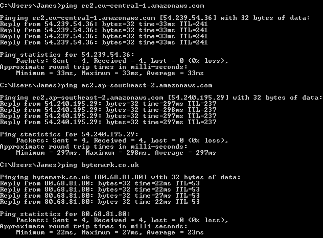

以 54 开头的 IPv4 地址（形式为 `54.x.x.x` 的地址）是服务器可能运行在 AWS `Elastic Compute Cloud`（`EC2`）虚拟服务器上的线索。使用 `nslookup` 或 `ping` 执行反向 DNS 查询以确认是否如此。AWS 在以下链接提供了 IP 地址范围：

[`docs.aws.amazon.com/general/latest/gr/aws-ip-ranges.html`](http://docs.aws.amazon.com/general/latest/gr/aws-ip-ranges.html)

### Tracert

`Tracert`（在类 Unix 操作系统上为 `traceroute`）是一种顾其实名、追踪到目标主机路由的工具。输入以下命令：

```bash
tracert www.google.com
```

你应该能够看到连接离开你的`互联网服务提供商`（`ISP`）网络，并进入域名 `1e100.net`，这是 Google 的域名。*1.0 x 10¹⁰⁰* 是一个 googol（极点），这也是他们的名字来源。下面的截图显示了你可能在此追踪中看到的输出：

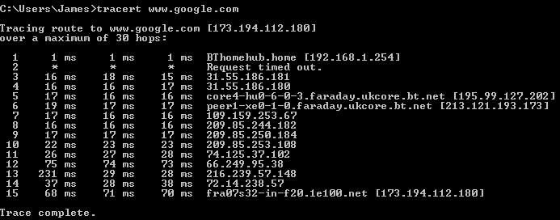

接下来，让我们通过与之前示例相同的 AWS 主机名运行以下命令，追踪到澳大利亚的路由：

```bash
tracert ec2.ap-southeast-2.amazonaws.com
```

运行此命令可能需要一些时间，特别是当某些主机不对 ping 响应且 traceroute 必须超时时。如果你得到星号（`* * *`），这可能表明存在防火墙。

你的结果可能看起来如截图所示：

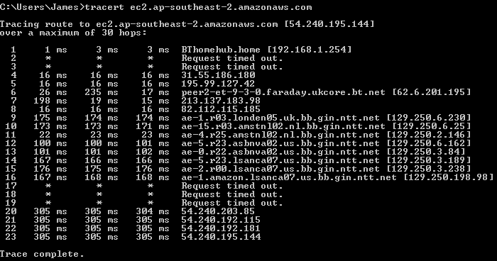

在上述示例中，我们可以看到连接离开了`英国电信`（`BT`）网络，并进入了`日本电信`（`NTT`）全球 IP 网络。我们甚至可以看到从伦敦到悉尼的路由经过了阿姆斯特丹、阿什本（美国东部，弗吉尼亚州）和洛杉矶。主机名表明，连接经过了法拉第电话交换机大楼（该建筑位于伦敦圣保罗大教堂附近，以电学先驱迈克尔·法拉第命名），并进入了亚马逊在洛杉矶的网络。

这并不是故事的全貌，因为它只显示了 IP 层面的情况。在物理层面，光纤可能从荷兰返回英国（可能通过波特库尔诺、古恩希利卫星地面站，或者更有可能是布德，英国情报总部 GCHQ 恰好在那里有一个基地）。在洛杉矶和澳大利亚之间，可能还会在夏威夷停留（爱德华·斯诺登曾工作的 NSA 基地所在地）。你可以在 [`submarinecablemap.com/`](http://submarinecablemap.com/) 和 [`www.us.ntt.net/about/network-map.cfm`](http://www.us.ntt.net/about/network-map.cfm) 查看连接地图。为了实现高性能，至少对互联网的物理结构有一个基本的了解是一个好主意。

如果我们现在追踪到韩国和日本 AWS 数据中心的路由，可以发现它们最初都采用相同的路线。它们从伦敦到纽约，然后到达西雅图，最后到达日本的大阪。韩国的追踪继续经过了十一跳，而日本的追踪在六跳内就完成了，这在逻辑上是合理的。

下面的截图显示了首先追踪韩国的典型结果，然后是第二次追踪日本的结果：

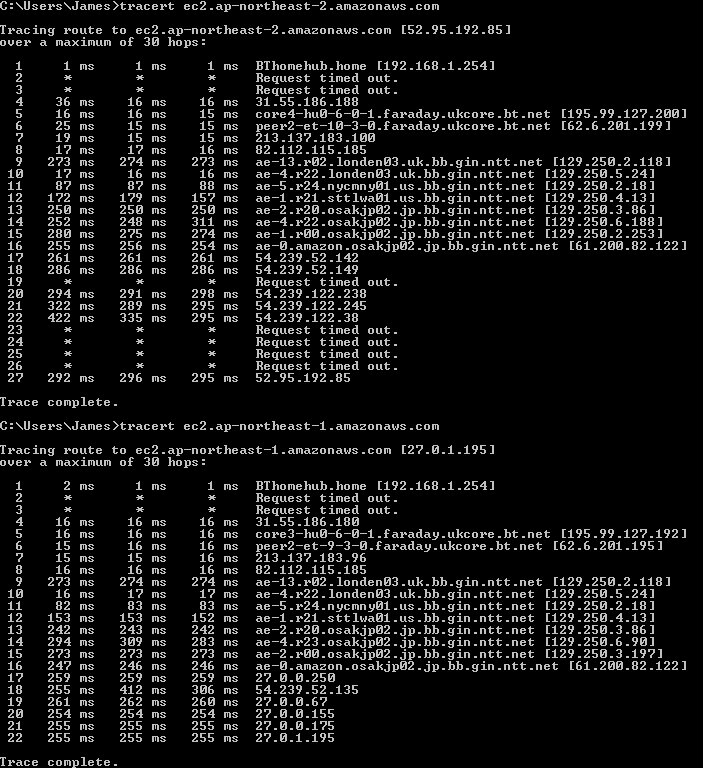

你可以利用跳数之间的时间差来计算大约的地理距离。然而，如果某些系统的响应速度比其他系统快，偶尔会出现异常情况。

如果你在一架提供免费 Wi-Fi 的飞机上，那么执行 `traceroute` 将是一项有趣的练习。网络连接可能通过卫星传输，你可以根据延迟判断轨道高度。例如，地球同步轨道的延迟很大，约为 1,000 毫秒，而`低地球轨道`（`LEO`）的延迟要小得多。你应该也能推断出地面站的位置。

### Nslookup

`nslookup` 是一个直接查询 DNS 服务器的工具。`Dig` 是另一个类似的工具，但我们在这里不会介绍它。`ping` 和 `traceroute` 都执行过 DNS 查找，但你可以直接通过 `nslookup` 完成此操作，这非常有用。你可以带有命令行参数调用 `nslookup`，也可以以交互模式使用它。要这样做，只需在控制台或命令提示符中输入工具名称，如下所示：

```bash
nslookup
```

现在你会在程序内部获得一个略有不同的命令提示符。默认情况下，将使用你所在计算机的 DNS 服务器，这会绕过本地 `hosts 文件`中的任何条目。

`hosts` 文件在将更改添加到 DNS 之前进行测试非常有用。它还可以通过将它们的地址设置为 `0.0.0.0` 来用作广告和追踪器的粗略拦截器。你可以运行本地 DNS 服务器来为整个网络实现此功能。其中一个项目是 [`pi-hole.net/`](http://pi-hole.net/)，它基于 `dnsmasq`，简化了在`树莓派`上设置和更新 hosts 文件的过程。

输入服务器的主机来解析其 IP 地址；例如，输入以下内容：

```text
polling.bbc.co.uk
```

结果显示该主机名是 `polling.bbc.co.uk.edgekey.net` 的 CNAME（真实规范名的别名），它解析为 `e3891.g.akamaiedge.net`，目前该 IP 地址为 `23.67.87.132`。我们可以通过输入该 IP 地址执行反向 DNS 查找：

```text
23.67.87.132
```

然后我们得到了该机器的主机名，方便地包含了 IP 地址，即 `a23-67-87-132.deploy.static.akamaitechnologies.com`。该域名由 Akamai 所有，这是一个用于分担负载的`内容分发网络`（`CDN`）。

如果你在本地网络上使用 DNS 服务器（路由器可能运行着 `dnsmasq`），那么它可能会缓存结果并给你过时的数据。你可以通过将服务器更改为传播更改更快的核心服务器来获取更更新的信息。例如，要使用 Google 的公共 DNS 服务器之一，输入以下内容（但注意，如果你正常使用它，Google 将记录你访问的所有互联网网站）：

```text
server 8.8.8.8
```

然后再次运行相同的查询。注意主机名现在解析到了不同的 IP 地址。这是 CDN 的常见行为，即使在同一个 DNS 服务器上，记录也会随时间变化。它通常被用于平衡网络负载。更改 DNS 服务器有时也可以绕过简单的内容过滤或位置限制。

要退出 `nslookup` 交互模式，输入 `exit` 并按回车。下面的截图显示了输出：


## 构建你自己的

你可以使用 `C#` 构建自己的工具（例如控制台应用程序），你需要的函数由 .NET 提供。底层实现是特定平台的，但框架将处理对操作系统上原生代码的调用。

4. 你可以通过 `result.Status` 获取 ping 状态，如果成功，你可以通过 `result.RoundtripTime` 获取以毫秒为单位的 RTT（往返时间）。

我们的控制台应用程序演示了如何使用 .NET Core 的 `Dns` 和 `Ping` 类，其源代码随书提供下载。

反向 DNS 查询通常可以揭示网站使用的托管公司。通常，每个主机名只有一个 IP 地址，如下方的我们 .NET Core 控制台应用的输出截图所示：

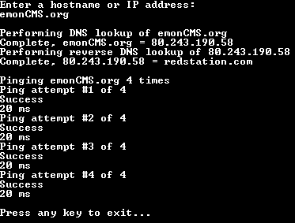

在之前的截图中，我们可以看到 [`emoncms.org/`](https://emoncms.org/) 正在使用 [`redstation.com/`](http://redstation.com/) 作为主机。低延迟表明服务器与我们的计算机位于同一个国家。

DNS 常用于负载均衡。在这种情况下，你将看到单个域名返回了多个 IP 地址，如下方的截图所示：

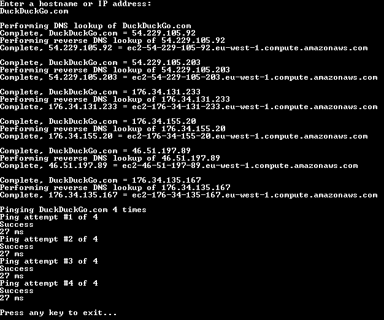


我们从之前的截图中看到，关注隐私的搜索引擎 `DuckDuckGo`（它不像 `Google` 那样跟踪用户）正在使用 `AWS`。`DNS` 被用于在各个实例之间平衡负载；在这种情况下，它们都在都尔林数据中心，因为那里离我们最近。注意，现在的 `ping` 时间比上一个示例中位于英国的主机略高。

他们很可能在使用 `AWS` 的 `DNS` 服务 `Route 53`（之所以这样命名是因为 `DNS` 使用 53 端口）。这可以在不同区域之间平衡负载，而 `ELB`（`DuckDuckGo` 似乎没有在使用）只能在区域内平衡负载（但包括区域内和跨可用区 `AZ`）。`Azure` 提供了一个名为 `Traffic Manager` 的类似服务用于 `DNS` 负载均衡。

# 解决方案

现在你已经对延迟问题的产生以及如何分析它们有了进一步的了解，我们可以演示一些潜在的解决方案。你使用之前演示的工具所做的测量结果将帮助你量化问题的规模，并选择应用合适的修复方法。

## 批量处理 API 请求

渲染一个典型的网页可能需要调用许多不同的 `API`（或数据库表）来收集所需的数据。由于 `C#`（以及许多其他语言）提倡的面向对象编程风格，这些 `API` 调用通常是顺序执行的。然而，如果一次调的结果不影响另一个，那么这种做法并不是最优的，调用可以并行执行。我们将在本章稍后部分讨论数据库表，因为它们有更好的方法。

如果你实现了 `microservices` 架构（相对于传统的单体架构或大泥球），并且有许多不同的分布式端点，那么并发调用可能更为适用。在许多情况下，消息队列有时是 `HTTP API` 更好的选择，可以使用发布/订阅模式。然而，你可能并不负责 `API`，而是正在与第三方进行集成。事实上，如果 `API` 是你的，那么你仍然可以修改它，一次性提供你所需的所有数据。

考虑调用两个互不依赖的隔离 `API` 的示例。其序列图可能如下所示：

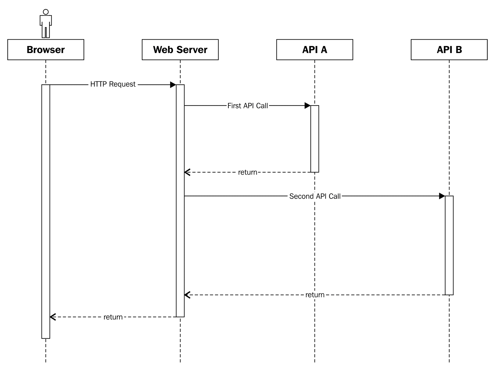

这种先调用 `A` 然后在 `A` 完成后调用 `B` 的线性过程非常简单，因为它不需要复杂的编排来处理 `API` 用的结果，但它比必要的速度要慢。通过同步且顺序地调用两个 `API`，我们浪费了等待它们返回的时间。如果向第二个 `API` 发起请求不需要第一个 `API` 的结果，那么执行此操作的更好方法可能是一起异步地调用它们。

这种新流程的序列图可能如下所示：

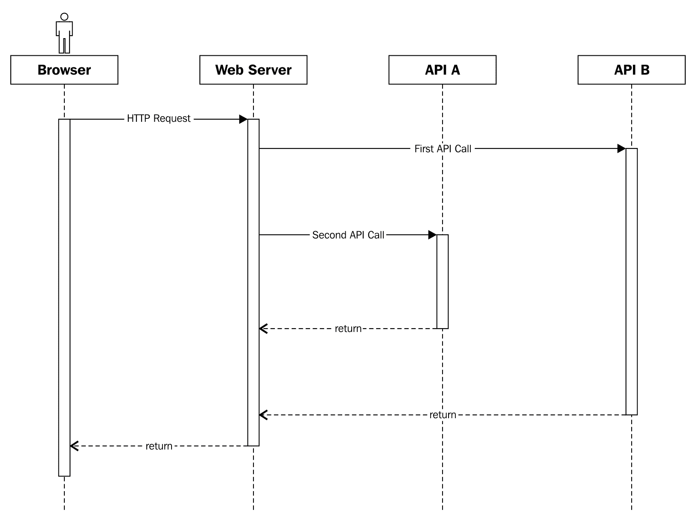

这个新序列中有两个变化，一个是显而易见的，另一个是微妙的。我们异步并并行地调用两个 `API`，以便它们同时运行。第一个变化将产生最大的影响，但还有一个较小的微调也有帮助，即先调用最慢的 `API`。

在原始序列图中，我们先调用 `API A` 后调用 `API B`，但 `B` 更慢。同时调用 `A` 和 `B` 将产生影响，但先调用 `B` 再调用 `A` 稍微更好。`B` 占据了时间线，我们将花费（相对）大量的时间来等待它。

我们可以利用这段空闲时间调用 `A`，因为任何 `API` 方法调用都会有一些少小的固定开销。这两个变化的结合意味着我们现在只需要等待 `B`，并且在时间上实际上免费获得了对 `A` 的调用。

我们可以用一个简单的控制台应用程序来说明这一原理。有两个模拟 `API` 的方法，两者都相似。`API A` 具有以下代码：

```csharp
private static async Task CallApiA()
{
    Thread.Sleep(10);
    await Task.Delay(100);
}
```

`Thread.Sleep` 模拟固定开销，`Task.Delay` 模拟等待 `API` 调用返回。`API B` 返回时间是 `API A` 的两倍，但固定开销是相同的，它具有以下代码：

```csharp
private static async Task CallApiB()
{
    Thread.Sleep(10);
    await Task.Delay(200);
}
```

现在，如果我们同步顺序调用这些方法，会发现所有延迟都相加了，正如预期那样。

```csharp
CallApiA().Wait();
CallApiB().Wait();
```

这些操作平均总花费 `332 ms`，因为方法调用中有约 10 ms 的额外开销。如果我们同时调用两个方法，时间将显著减少。

```csharp
Task.WaitAll(CallApiA(), CallApiB());
```

现在操作平均仅耗时 `233 ms`。这很好，但如果我们交换方法的顺序，可以做得更好。

```csharp
Task.WaitAll(CallApiB(), CallApiA());
```

现在平均总共耗时 `218 ms`，因为我们将 `API A` 的开销消耗在了等待 `API B` 的时间里。

用于基准测试这三个变体的完整控制台应用程序随书提供下载。它使用 `Stopwatch` 类对操作计时，并在多次运行后取平均值。

这三种方法的结果在如下截图所示：


一如既往，请测量你的结果以确保确实有改进。你可能会发现，如果你对一个 `API` 进行多次调用，或者重用同一个 `API` 客户端，无论如何，你的请求都是顺序处理的。

这种任务并行化不仅适用于 `I/O`，还可以用于计算，正如我们在下一章将发现的那样。现在，我们将移动并深入探讨数据库查询优化。

### 高效数据库操作

虽然这并不是一本面向数据库管理员（`DBA`）的书，但对你来说，理解使用的底层技术是有益的。就像网络一样，如果你理解了它的优缺点，就能更容易实现高性能。

这对于开发者承担更多超出专业领域的工作的趋势也同样相关，特别是在小型组织或初创公司中。你可能听过相关的流行术语`全栈`开发者或 `DevOps`。这些相似的概念指的是模糊了传统技术边界的角色，将开发（包括前端和后端）、质量保证、网络、基础设施、运维和数据库管理合并为一个职位。当今的开发者不再仅仅是编写或发布代码。了解其他领域也会帮助。

此前，在第 5 章——`修复常见的性能问题`中，我们涵盖了使用微型 `ORM` `Dapper` 以及如何修复 `select N+1` 问题。现在，我们将在此知识的基础上，重点介绍其他一些可以帮助你合并查询并提高数据库操作性能的方法。

正如第 4 章——`衡量性能瓶颈`中所述，第一步是对应用程序进行性能分析并发现问题所在之处。只有这样，你才能针对问题区域应用解决方案。

### 数据库调优

我们将更多地关注改进性能不佳的查询，因此不会过多探讨数据库调优。这是一个复杂的话，关于索引和数据存储方式你有很多东西可以学习。

然而，如果你还没有运行过 `Database Engine Tuning Advisor`（`DETA`），那么这是一个识别是否存在缺失索引的简单步骤。但在应用建议的更改时，你应该非常小心，因为总会有需要考虑的缺点和权衡。例如，索引可以加快数据检索速度，但会减慢添加和更新记录的速度。它们还会占用额外的空间，因此最好不要过度使用。你是希望在前期进行优化，还是在以后检索时承担代价，取决于你具体的业务用例。

第一步是使用 `SQL Server Profiler` 捕获跟踪并保存生成的文件。请参阅第 4 章——`衡量性能瓶颈`了解如何进行操作。调优配置文件（tuning profile）是捕获跟踪的好选择，为了获得良好的结果，你应该确保捕获的内容代表了真实的数据库使用情况。你可以从 `SSMS` 中与 `SQL Server Profiler` 相同的菜单启动 `DETA`，如下截图所示：

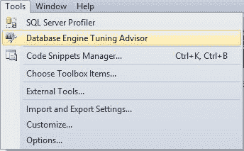

你可以将跟踪文件作为负载（workload）加载，处理后它将为你提供一些建议。由于空间限制，我们在这里不介绍操作的细节，而且这非常显而易见。如果需要，网上有很多优秀的指南可以参考。如果你在 `SSMS` 中运行查询时启用实际执行计划，你也可以看到建议的缺失索引。

## 读累了记得休息一会哦~

公众号：古德猫宁李

- 电子书搜索下载
- 书单分享
- 书友学习交流

网站：[沉金书屋 https://www.chenjin5.com](https://www.chenjin5.com)

- 电子书搜索下载
- 电子书打包资源分享
- 学习资源分享

## 报告

一个经常导致数据库崩溃的常见用例是报告生成。报告通常在大量数据上运行，如果编写得不好，可能会花费大量时间。

如果你已经有了一种从数据库中检索单个项目的方法，那么你可能想复用它来生成报告以及在应用程序内部计算指标。然而，最好最好避免这样做，报告通常应该有自己专门的查询。

更好的做法是拥有另一个专门用于报告的数据库，它从主数据库或备份中填充数据。这样，密集的报告就不会影响主应用程序的性能，代价是无法包含实时数据。这有时被称为`数据仓库`（data warehouse）或`数据市纽`（data mart），出于简单或性能考虑，数据有时会进行反规范化处理。填充另一个数据库也是测试备份的一种方便方法，因为数据库备份应该始终经过测试，以确保它们可以正确恢复并包含所有所需数据。

在接下来的示例中，我们将关注 `Microsoft SQL Server`（`MS SQL`）和 `SQL` 的 `Transact-SQL`（`T-SQL`）方言。其他数据库如 `PostgreSQL` 也可用。`PostgreSQL` 有自己的方言，称为 `Procedural Language / PostgreSQL`（`PL/pgSQL`），类似于 `Oracle PL/SQL`。这些方言都支持基础 `SQL` 命令，但在某些操作上使用不同的语法，并包含不同或额外的功能。`MS SQL Server` 的最新版本 `SQL Server 2017` 除了在 Windows 上运行外，还支持在 Linux 和 Docker 容器中运行。

### 聚合函数

聚合函数是 `RDBMS` 中一个非常有用的功能。你可以计算总结数据库中许多记录的值并只返回结果，而保留数据库中的源数据行。

你可能对书中前面提到的 `COUNT` 聚合函数已经熟悉了。它可以给你提供查询返回的记录总数，但不返回记录本身。你可能读过 `COUNT(1)` 性能比 `COUNT(*)` 好，但现在已不再如此，因为 `SQL Server` 现在会优化后者，使其执行性能与前者相同。

默认情况下，`SQL Server` 会返回一条详细说明返回记录计数的计数，以及每个查询的结果。你可以通过在查询前加上 `SET NOCOUNT ON` 命令来关闭它，这可以在 `Tabular Data Stream`（`TDS`）连接中节省几个字节并略微提高性能。只有在使用 `cursor` 时才有意义，而且出于锁定原因，这本身就是一种坏习惯。在查询后重新启用行计数是良好的做法，尽管它在局部作用域外会被重置。

在第 5 章——`修复常见的性能问题`中，我们通过在数据库中连接表并使用 `COUNT` 代替在应用程序代码中执行这些计算，解决了 `select N+1` 问题。还有许多其他聚合函数可以改进性能，特别是对于报告目的。

回到我们之前的示例，假设我们现在想找出博客文章的总数。我们还想找到评论的总数、平均评论数、单篇文章评论数的最少值以及单篇文章评论数的最多值。

第一部分很简单，只需对文章应用 `COUNT` 而不是评论，但第二部分较难。由于我们已经有了带有每条文章评论数的文章列表，我们可能想复用它，并直接在我们的 `C#` 代码中完成所有计算。

这是一个坏主意，查询性能会很差，特别是当文章数量较高时。更好的解决方案是使用类似下面的查询：

```sql
;WITH PostCommentCount AS(
SELECT
    bp.BlogPostId,
    COUNT(bpc.BlogPostCommentId) 'CommentCount'
FROM BlogPost bp
LEFT JOIN BlogPostComment bpc
    ON bpc.BlogPostId = bp.BlogPostId
GROUP BY bp.BlogPostId
) SELECT
    COUNT(BlogPostId) 'TotalPosts',
    SUM(CommentCount) 'TotalComments',
    AVG(CommentCount) 'AverageComments',
    MIN(CommentCount) 'MinimumComments',
    MAX(CommentCount) 'MaximumComments'
FROM PostCommentCount
```

此查询使用了公用表表达式（`CTE`），但你也可以使用嵌套的 `SELECT` 将第一个查询嵌入到第二个查询的 `FROM` 子句中。它展示了可用的聚合函数的选择，之前测试数据库中的结果所示：


开头的分号仅仅是避免错误和消除歧义的良好习惯。它确保任何之前的命令都已终止，因为 `WITH` 可用于其他上下文中。对于前面的示例来说不是必须的，但如果它是更大型查询的一部分，则可能需要。`CTE` 是非常有用的工具，特别是当你需要递归时。然而，它们每次都会求值，你可能会发现临时表性能好得多，特别是在嵌套 `SELECT` 中反复查询某表时。

现在假设我们希望执行相同的查询，但只包含至少有一条评论的文章。在这种情况下，我们可以使用类似下面的查询：

```sql
;WITH PostCommentCount AS(
SELECT
    bp.BlogPostId,
    COUNT(bpc.BlogPostCommentId) 'CommentCount'
FROM BlogPost bp
LEFT JOIN BlogPostComment bpc
    ON bpc.BlogPostId = bp.BlogPostId
GROUP BY bp.BlogPostId
HAVING COUNT(bpc.BlogPostCommentId) > 0
) SELECT
    COUNT(BlogPostId) 'TotalPosts',
    SUM(CommentCount) 'TotalComments',
    AVG(CommentCount) 'AverageComments',
    MIN(CommentCount) 'MinimumComments',
    MAX(CommentCount) 'MaximumComments'
FROM PostCommentCount
```

我们添加了一个 `HAVING` 子句来确保我们只计数评论数大于的帖子。这类似于 `WHERE` 子句，但它是用于 `GROUP BY` 的。查询结果现在看起来如下：


### 采样

有时，你不需要使用所有数据，可以对其进行采样。这种技术特别适用于你可能想要绘制图表的时间序列信息。在 `SQL Server` 中，执行随机采样的传统方法是使用 `NEWID()` 方法，但这可能很慢。例如，考虑以下查询：

```sql
SELECT TOP 1 PERCENT *
FROM [dbo].[TrainStatus]
ORDER BY NEWID()
```

此查询返回正好 1% 的行，且分布随机。在对包含 1,205,855 条目的表进行运行时，它在大约四秒内返回了 12,059 条结果，这很慢。更好的方法可能是使用 `TABLESAMPLE`，它在任何较新的 `SQL Server` 版本（2005 及以后）中都可用，如下：

```sql
SELECT *
FROM [dbo].[TrainStatus]
TABLESAMPLE (1 PERCENT)
```

之前的查询要快得多，当针对与上示例相同的数据运行时，它几乎瞬间完成。缺点是它比之前的方法更粗糙，并且不会精确返回 1% 的结果。它会返回大致 1%，但该值每次运行时都会发生变化。例如，在同一个测试数据库上运行，连续执行三次查询时，返回了 11,504、13,441 和 11,427 行。

### 插入数据

查询数据库可能是常用的用例，但你通常首先向其中放入一些数据。在向关系型数据库插入记录时，最常用的功能之一是标识列（identity column）。这是一种由数据库生成的自动递增 ID，在添加数据时不需要提供。

例如，在我们之前的 `BlogPost` 表中，`BlogPostId` 列被创建为 `INT IDENTITY(1,1)`。这意味着它是一个从 1 开始的整数值，并且每增加新行就会增加 1。你可以像这样 `INSERT` 到此表，而不指定 `BlogPostId`：

```sql
INSERT INTO BlogPost (Title, Content)
VALUES ('My Awesome Post', 'Write something witty here...')
```

标识列（Identities）非常有用，但你通常想知道新创建的记录的 ID。通常的做法是先存储一行，然后立即检索它，以便将该 ID 用于未来的编辑操作。你可以通过 `OUTPUT` 子句一次性完成此操作，如下：

```sql
INSERT INTO BlogPost (Title, Content)
OUTPUT INSERTED.BlogPostId
VALUES ('My Awesome Post', 'Write something witty here...')
```

除了插入行之外，还会返回 ID。

你可能会看到 `SCOPE_IDENTITY()`（甚至是 `@@IDENTITY`）被推荐作为获取标识的方法，但这些已经过时了。在现代版本的 `SQL Server` 上，推荐的方法是使用 `OUTPUT`。

`OUTPUT` 适用于 `INSERT`、`UPDATE`、`DELETE` 和 `MERGE` 命令。即使在同时操作多行时也有效，就像这个批量插入两篇博客的示例一样：

```sql
INSERT INTO BlogPost (Title, Content)
OUTPUT INSERTED.BlogPostId
VALUES ('My Awesome Post', 'Write something witty here...'),
       ('My Second Awesome Post', 'Try harder this time...')
```


之前的查询将返回一个包含两个标识的结果集，例如`3003`和`3004`。为了使用`Dapper`执行这些插入操作，你可以针对单个记录使用以下方法。首先，让我们创建一个博客对象，我们在这里对其硬编码，但通常它会来自用户输入：

```csharp
var post = new BlogPost 
{ 
    Title = "My Awesome Post", 
    Content = "Write something witty here..." 
}; 
```

要插入这篇帖子并设置`ID`，你可以使用以下代码。这将执行`INSERT`语句并返回一个单整数值。

```csharp
post.BlogPostId = await connection.ExecuteScalarAsync<int>(@" 
    INSERT INTO BlogPost (Title, Content) 
    OUTPUT INSERTED.BlogPostId 
    VALUES (@Title, @Content)", 
    post); 
```

然后可以将返回的`ID`赋值给`post`，并将对象返回给用户进行编辑。假设插入成功且没有抛出异常，则无需再次查询记录。

你可以使用相同的`SQL`通过`execute`方法一次插入多记录。然而，`SQL`将执行多次，这可能会效率低下，而且你只收返回行数。以下代码提供了一个帖子数组：

```csharp
var numberOfRows = await connection.ExecuteAsync(@" 
    INSERT INTO BlogPost (Title, Content) 
    OUTPUT INSERTED.BlogPostId 
    VALUES (@Title, @Content)",
    new[] { post, post, post }); 
```

如果你想返回多个`ID`，那么你需要像我们之前的那样使用`query`方法。然而，在不动态构建`SQL`的情况下，很难让它适用于数量变化的记录运行。以下代码使用分离的参数执行了批量插入：

```csharp
var ids = await connection.QueryAsync<int>(@" 
    INSERT INTO BlogPost (Title, Content) 
    OUTPUT INSERTED.BlogPostId 
    VALUES (@Title1, @Content1), 
           (@Title2, @Content2)", new 
    {
        Title1 = post.Title, 
        Content1 = post.Content, 
        Title2 = post.Title, 
        Content2 = post.Content 
    }); 
```

将在单个命令中完成所有工作，并返回标识的可枚举集合。然而，这段代码的可扩展性不好（甚至不优雅），你通过这种方式最多只能插入`1000`条记录。

`Dapper.Contrib`包中有许多辅助方法可以帮助你插入记录和其他操作。然而，它们与此处的示例具有相同的局限性，你只能返回单个标识或插入的行数。

## GUID

整数标识对数据库内部很有用，但可能你不应该在从外部使用标识键，特别是当你有多个`Web`服务器或向用户暴露`ID`时。另一种方案是使用**全局唯一标识符**（`GUID`），在`SQL Server`中称为`UNIQUEIDENTIFIER`。我们已经提到过这些，因为它们是由欠佳的采样示例中使用的`NEWID()`函数生成的。

`GUID`无处不在，长度为`16`字节，是整数的四倍大。`GUID`的尺寸意味着当你向已填充的表中插入随机`GUID`时，不太可能发生唯一性约束冲突。

人们有时会担心`GUID`冲突，但涉及的数字大得惊人，冲突几乎是不可能的。`.NET`生成的`GUID`（在`Windows`上使用`COM`函数）具体来说是第`4`版通用唯一标识符（`UUIDs`）。它们具有`122`位随机位，因此你需要生成接近三万亿亿（`quintillion`）个`GUID`才有一半的机会发生冲突。如果按照每秒生成一条新记录计算，这需要超过`900`亿年。即使是每秒生成两百万个`GUID`（这是目前一台普通电脑可以产生的速度），仍然需要超过`4.5`万年（比人类文明存在的时间还要长）。如果你认为这会对你的软件产生问题，那么你可能应该通过使用五位数的年份（例如`02017`）来进行前瞻性设计，以避免`Y10K`（或十六进制下的`YAK`）问题。

这种唯一性属性允许你在应用程序代码中生成`GUID`并将其存储在分布式数据库中，而无需担心日后的数据合并。它还允许你将`ID`暴露给用户，而不必担心有人会枚举它们或尝试猜测某个值。整数型`ID`通常会暴露表中有多少记录，根据你的用用例，这可能是敏感信息。

在使用随机`GUID`时，你需要注意的一点是将其用作键（`key`）而不是`ID`。这两个术语之间的区别很微妙，它们通常是同一的。键（`primary`主或`clustered`集）是数据库用于定位记录的标识，而`ID`是你检索记录时使用的标识。它们的值可以相同，但不必相同。使用随机`GUID`作为键会导致索引性能问题。随机性可能会导致碎片，从而减慢查询速度。

你可以使用顺序`GUID`，例如`NEWSEQUENTIALID()`可以作为列的`DEFAULT`值，但这样你就会失去`GUID`的大部分益益特性，而这些特性主要源于随机性。你现在实际上只是一个非常大的整数，如果你只关心表中的最大行数，并且需要超过二十亿行，那么一个`big int`（`int`的两倍，但只有`GUID`的半）就足够了。

一个很好的折中方案是使用`int`标识列作为主键，但使用`GUID`作为`ID`（并通过列上的唯一约束来强制执行）。最好的做法是在应用程序代码中使用`Guid.NewGuid()`生成`GUID`，因为在数据库中使用默认列值意味着你必须在插入后检索`ID`，如前所示。

使用这种策略的表在视觉上可能类似于下面的截图。这是来自`MembershipReboot`用户管理和验证库中部分表格截图：

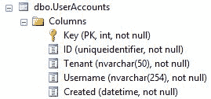

## 高级数据库主题

我们本可以涵盖许多其他增强数据库性能的技巧，但这里没有空间了。我们将简要提到一些额外主题，以防你想进一步研究。请访问作者的网站 [`unop.uk/`](https://unop.uk/) 获取有关其他主题的更多信息。

保存数据时的一个常见需求是：如果记录不存在则插入记录，如果已经存在包含该`ID`的行，则更新现有记录。这有时被称为`upsert`，这是一个结合更新（`update`）和插入（`insert`）的合成词。

你可以使用`MERGE`命令在一次操作中完成此任务，而无需在`UPDATE`或`INSERT`之间进行选择（封装在`stored procedure`内部的`transaction`中）。然而，`MERGE`的性能不如`UPDATE`或`INSERT`，因此请务必针对你的用例测试其效果，并谨慎使用。

存储过程、事务和`locking`（锁定）本身都是大课题。理解它们非常重要，而且不仅是从性能角度来看。

我们无法将所有内容都放在这里，但我们将在书的后面部分讨论维护存储过程。

你可以研究的其他一些技术包括`cross-database joins`（跨数据库连接），它可以让你避免查询多个数据库。还有对数据进行反规范化（`denormalizing`）的做法，这涉及提前展平你的关系型记录以提供单行，而不是在查询时跨多个表进行连接。我们之前在提到数据仓库时简要过这一点。

你可以在`MSDN` ([`msdn.microsoft.com/`](http://msdn.microsoft.com/)) 和`TechNet` ([`technet.microsoft.com/`](http://technet.microsoft.com/)) 上找到大量的`SQL`文档和信息。此外，还有许多高级`SQL`技术的书籍。

最后，关于日常维护的说明。为数据库的大小制定计划是重要的。你不能简单地不断向表中插入数据，并希望它永远运行良好。在某个时刻，它会变得非常大，大到从中删除记录也会导致你的数据库运行缓慢（即使你使用`TRUNCATE`，它的性能也比简单的`DELETE`好）。你应该预先知道如何删除或归档行，最好定期分小批量执行此操作。

## 模拟与测试

在结束本章之前，让我们重申在真实的基础设施上测试应用程序的重要性。你的测试环境应该尽可能接近真实环境。如果你不在等同的数据库和网络上进行测试，那么在部署时你可能会遇到可怕的意外。

使用云托管提供商时（如果你自动化了服务器构建），这很容易实现。你只需启动一个与生产环境匹配的阶段系统。只要所有部分都在且处于相同位置，你不需要将其配置到完全相同的规模。为了进一步降低成本，你只需要在测试期间保留它。

或者，你可以创建一个新的生产环境，部署并测试它，然后切换，并销毁或重用旧的生产环境。这种切换技术被称为`blue-green deployment`（蓝绿部署）。另一种方案是在`feature switch`（功能开关）后部署新代码，这允许你在运行时切换功能，并且仅针对某些用户。这不仅让你能够通过测试用户对功能进行验证，还可以逐步推出新功能，并在过程中监控其对性能的影响。我们在第`11`章性能回归监控中涵盖了这两种技术。

## 总结

我们在本章中涵盖了很多内容，希望你能够明确，成为一名高性能开发者不仅仅仅仅是一个有干的程序员。你的代码周围还有许多需要考虑的外部因素。

你现在理解了`I/O`的基础知识，以及内在局限性的物理原因。你可以分析并诊断网络在逻辑上是如何组合在一起的。我们涵盖了如何更好地利用网络来减少整体延迟，这非常重要，因为现在更多的`I/O`操作是通过网络完成的。你还看到如何更好地利用数据库，以及如何用更少的操作完成更多工作。

在下一章中，我们将详细研究代码执行，并向你展示如何加速`C#`代码。我们将看到`.NET Core`和`ASP.NET Core`的性能比之前的版本好得多，以及你如何利用这些改进。

# 理解代码执行与异步操作

本章涵盖了代码执行过程中的性能问题解决，这通常不是速度问题发生的首要位置，但可以作为一个很好的额外优化手段。我们将讨论需要性能的领域，以及可以接受（甚至要求）较慢的领域。我们将比较各种数据结构的优劣，从标准的内置泛型集合到更奇特的结构。我们将演示如何进行并行计算操作，以及如何利用`CPU`可能提供的额外指令集。我们将深入`ASP.NET Core`和`.NET Core`的内部，以突出你应该注意的改进。

本章涵盖的主题包括：

* `.NET Core`和标准库

* `Common Language Runtime` (`CLR`) 服务

* `ASP.NET Core`和`Kestrel` Web服务器

* 泛型集合和布隆过滤器

* 序列化和数据表示格式

* 哈希函数的相对性能

* 并行化（`SIMD`、`TPL`和`PLINQ`）

* 多线程、并发和锁

* 需要避免的低性能实践

你将学习如何并行计算结果并在最后合并输出。这包括如何避免这种错误的方法，这些方法可能会让情况更糟。你还将学习如何降低服务器利用率，并根据你的特定情况选择最合适的数据结构，以便高效处理信息。

## 读累了记得休息一会哦~

**公众号：古德猫宁李**

* 电子书搜索下载

* 书单分享

* 书友学习交流

**网站：**[沉金书屋 https://www.chenjin5.com](https://www.chenjin5.com)

* 电子书搜索下载

* 电子书打包资源分享

* 学习资源分享

## 开始使用核心项目

与旧的框架完整版本相比，使用`.NET Core`和`ASP.NET Core`有许多好处。主要的改进是开源开发和跨平台支持，但也有显著的性能提升。开源开发非常重要，不仅源代码是公开的，而且开发工作是在`GitHub`上公开进行的。鼓励社区做出贡献，如果这些贡献通过了代码审查，它们可能会被合并到上游；这种流程不是单向的。这导致了性能的提升，并带来了来自`Microsoft`之外的额外平台支持。如果你在框架中发现`bug`，现在可以修复它，而不是通过规避问题并等待补丁。

构成框架的多个项目分布在`GitHub`上的两个组织中。驱动原则之一是将框架拆分为模块，这样你只需要取你需要的，而不是整个单体式安装。低层框架`.NET Core`及其其他项目可以在 [`github.com/dotnet`](https://github.com/dotnet) 找到。高层`Web`框架`ASP.NET Core`可以在 [`github.com/aspnet`](https://github.com/aspnet) 找到。

让我们快速查看一些不同的`.NET Core`仓库以及它们是如何结合在一起的。

### .NET Core

有几个项目形成了`.NET Core`的主要部分，它们是`CoreCLR`和`CoreFX`。`CoreCLR`包含了`.NET Core CLR`和基础核心库`mscorlib`。`CLR`是运行你的`.NET`代码的虚拟机。`CoreCLR`包含一个即时编译（`JIT`）编译器（`RyuJIT`）、垃圾回收（`GC`），以及`mscorlib`中的基础类型和类。`CoreFX`包含了基础库并构建在`CoreCLR`之上。这包含了大多数不是简单类型的内置组件。还有`Roslyn`编译器，它将你的`C#`（或其他`.NET`语言代码）转换为通用中间语言（`CIL`）字节码。然后`RyuJIT`在运行时将此转换为原生机器码。

你可能听过即将推出的原生工具链。它承诺带来更多的性能改进，因为编译不需要快速、实时发生，并且可以被进一步优化。例如，可以以牺牲编译速度为代价针对执行速度进行调优。这在概念上类似于原生映像生成器（`NGen`）工具，该工具自`.NET Framework`诞生以来一直存在。遗憾的是，Core项目的.NET原生支持被推到了`.NET Core 2`发布之后。目前它仅适用于`UWP`Windows商店应用，但在扩展后将值得考虑。

尽管`.NET Core`的性能通常优于之前的`.NET Framework`，但某些性能设置的配置有所不同。例如，你可能熟悉`<gcServer>`，用于设置`GC`模式，该模式在具有两个处理器的机器上运行更好。在`.NET Core`中，你可以像这样在`.csproj`文件中将`ServerGarbageCollection`设置为`true`：

```xml
<PropertyGroup>
    <ServerGarbageCollection>true</ServerGarbageCollection>
</PropertyGroup>
```

### ASP.NET Core

`ASP.NET Core`运行在`.NET Core`之上，尽管它可以运行在完整的`.NET Framework`上。我们将仅涵盖在`.NET Core`上运行，因为它的性能更好并确保了增强的平台支持。有很多项目组`ASP.NET Core`，值得简要提到其中一些。

在项目中不包含任何对`.NET 4`的框架引用是有用的，这样你就可以确保自己仅在使用`.NET Core`，而不会意外引用任何尚未支持的依赖。对于`.NET Standard 2.0`来说这个问题不大，所以只要你坚持使用支持的`API`，你的项目就可以在所有实现这些`API`的框架上运行。

`ASP.NET Core`包含了模型-视图控制器（`MVC`）、`Web API`和`Razor Pages`（使用`Razor`视图引擎制作简单页面的方法，类似于`PHP`，并且是经典`ASP`的精神继承者）。这些功能都合并在一起，因此你不需要将`MVC`和`Web API`视为独立的框架。还有许多其他项目和仓库，包括`EF Core`，但我们在这里重点介绍`Kestrel` HTTP服务器。

### Kestrel

`Kestrel`是`ASP.NET Core`的一个新的`Web`服务器，它的性能出色。它基于`libuv`，这是一个异步`I/O`抽象和支持库，该库也运行在`Node.js`下。`Kestrel`极快，基准测试令人印象深刻。然而，它非常基础，对于生产托管，你应该将它放在反向代理之后，这样你就可以缓存和其他功能来服务更多用户。你可以使用许多`HTTP`或代理服务器来实现，例如`IIS`、`nginx`、`Apache`或`HAProxy`。

如果你使用`nginx`作为反向代理，需要小心配置，因为默认情况下，如果`Web`服务器响应超时，它会重试`POST`请求。这可能导致重复操作，特别是作为多个后端`HTTP`服务器的负载均衡器时。

## 数据结构

数据结构是你用来存储正在处理的信息的对象。根据数据的使用方式选择最佳实现会对执行速度产生巨大影响。在这里，我们将讨论一些常用的以及一些你可能感兴趣的数据结构。

由于这是一本关于`Web`应用程序编程的书，而不是关于复杂算法实现或微优化的书籍，我们不会对数据结构和算法进行大量的细节。正如引言中简要提到的，在`Web`上下文中，其他因素可能会掩盖执行速度，而且我们假设你没有编写游戏引擎。然而，良好的算法有助于加速应用程序，因此，如果你在执行性能重要的领域工作，你应该更多地了解它们。

我们更关注系统的整体性能，而不仅仅是代码运行的速度。考虑你的代码表达了什么（以及这如何影响其他系统）通常比考虑它如何执行更为重要。尽管如此，为任务选择合适的工具仍然非常重要，你不希望代码出现不必要的缓慢。只需在代码执行已经足够快时注意不要过度优化，最重要的是，尽量保持它的可读性。

### 列表 (Lists)


## 列表

.NET 的 `List<T>` 是 C# 编程中的基础工具。它是类型安全的，因此你不需要担心类型转换或装箱。你指定泛型类型，并可以确保列表中只包含该基本类型或类（或继承自它们的类）的实例。列表实现了标准的列表和可枚举接口（`IList` 和 `IEnumerable`），尽管在具体的列表实现中你可以获得更多方法，例如添加一个范围。你还可以使用语言集成查询（`LINQ`）表达式来轻松地查询它们，这在使用“流式 lambda 函数”（`fluent lambda functions`）时是轻而易举的。然而，尽管 `LINQ` 是解决问题的优雅解决方案，但它可能会导致性能问题，因为它并不总是经过优化的。

列表实际上是一个增强的一维数组。事实上，它在内部使用数组来存储数据。在某些情况下，直接使用数组对性能可能更好。如果你确切知道会有多少数据，并且需要在紧凑循环中对其进行迭代，数组有时可能是更好的选择。如果你需要更多维度，或者计划消耗数组中的所有数据，它们也会很有用。

你应该谨慎使用数组；要少节制地使用它们，并且仅当基准测试显示遍历列表存在性能问题时才使用。虽然数组可能更快，但它们也让并行编程和分层架构变得更加复杂，而这恰恰是能够显著提高性能的地方。

现代高性能意味着扩展到许多核心和多台机器。使用不改变的 `immutable`（不可变）状态会使这种情况变得更容易，而高层抽象比数组更容易强制这种状态。例如，你可以通过接口帮助强制执行只读列表。

如果你在一个大型列表的中间插入或删除大量项，那么使用 `LinkedList<T>` 类可能会更好。它的性能特性与列表不同，因为它不是真正的列表，而更像是一个链表。在某些特殊情况下，它的性能可能比列表好，但在大多数常见情况下，它会更慢。例如，通过索引访问列表很快（因为它是基于数组的），但在链表中则很慢（因为你必须沿着链行走）。

通常最好的做法是最初关注代码的“做什么”和“为什么”，而不是“怎么做”。`LINQ` 非常适合这一点，因为你只需要声明你的意图，而不需要担心实现细节和循环。过早优化是一个坏主意，因此只有在测试显示存在性能问题时才这样做。在大多数常见情况下，列表是正确的选择，除非你需要从大型集合中只选择少数值，在这种情况下，字典的性能可能会更好。

### 字典（Dictionaries）

字典与列表类似，但擅长通过键快速检索特定的值。在内部上，它们使用哈希表实现。有一个旧的 `Hashtable` 类（在 `System.Collections.NonGeneric` 包中），但它不是类型安全的，而 `Dictionary<T>` 是泛型类型，因此除非你正在将旧代码迁移到 .NET Core，否则可能不应该使用 `Hashtable`。`ArrayList` 也是如此，它是 `List` 的遗留非泛型版本。

字典可以通过键非常快速地查找值，而列表需要遍历所有值直到找到键。然而，你仍然可以对字典进行枚举，因为它是有序的，尽管这并不是它的设计意图。如果你不需要排序，则可以使用 `HashSet`。所有这些数据结构都有排序版本，你可以再次使用只读接口来使它们难以修改。

### 集合基准测试（Collection benchmarks）

准确的基准测试是困难的，有很多事情会偏离你的结果。编译器非常聪明并会优化，这可能会让微不足道的基准测试价值大减。编译器可能会为不同的实现输出非常相似的代码。

你放入数据结构的内容也会对它们的性能产生巨大影响。通常最好的方法是测试或分析你的实际应用程序，而不是过早优化。代码的可读性非常有价值，除非存在重大的性能问题（或者它已经不可读），否则不应为了运行时效率而牺牲。

可以使用一些基准测试框架来帮助测试，例如 `BenchmarkDotNet`，它可以在 [`github.com/dotnet/BenchmarkDotNet`](https://github.com/dotnet/BenchmarkDotNet) 获取。然而，这些工具可能过于复杂，而且有时难以设置。其他选项包括 `Simple Speed Tester`（你可以在 [`theburningmonk.github.io/SimpleSpeedTester/`](http://theburningmonk.github.io/SimpleSpeedTester/) 查看更多信息）和 `MiniBench`（可在 [`github.com/minibench`](https://github.com/minibench) 获取）。

你可以在 [`github.com/aspnet/benchmarks`](https://github.com/aspnet/benchmarks) 查看更多关于 ASP.NET Core 框架的基准测试。

我们将执行一些简单的基准测试来展示你可能如何操作。然而，不要假设这里得出的结论始终适用，因此请根据你的情况进行测试。这里的示例刻意保持简单，以便你运行，尽管我们尝试避免一些明显的错误。

首先，我们将定义一个简单的函数来运行测试：

```csharp
private static long RunTest(Func<double> func, int runs = 1000) 
{ 
    var s = Stopwatch.StartNew(); 
    for (int j = 0; j < runs; j++) 
    { 
        func(); 
    } 
    s.Stop(); 
    return s.ElapsedMilliseconds; 
}
```

我们在这里使用 `Stopwatch`，因为使用 `DateTime` 会导致问题，即使在使用 UTC 时，时间在测试期间可能会变化，而且分辨率不够。我们还需要执行多次以获得准确的结果。我们将定义我们的数据结构并预填充数据：

```csharp
var rng = new Random(); 
var elements = 100000; 
var randomDic = new Dictionary<int, double>(); 
for (int i = 0; i < elements; i++) 
{ 
    randomDic.Add(i, rng.NextDouble()); 
} 
var randomList = randomDic.ToList(); 
var randomArray = randomList.ToArray();
```

我们现在有了包含相同 10 万个键值对的数组、列表和字典。接下来，我们可以对它们进行一些测试，以查看在各种情况下什么结构最好：

```csharp
var afems = RunTest(() => 
{ 
    var sum = 0d; 
    foreach (var element in randomArray) 
    { 
        sum += element.Value; 
    } 
    return sum; 
}, runs);
```

前面的代码测量了在 `foreach` 循环中遍历数组所需的时间，并累加了双精度浮点值。然后我们可以将其与其他结构以及不同的访问方式进行比较。例如，在 `for` 循环中迭代字典的方法如下：

```csharp
var dfms = RunTest(() => 
{ 
    var sum = 0d; 
    for (int i = 0; i < randomDic.Count; i++) 
    { 
        sum += randomDic[i]; 
    } 
    return sum; 
}, runs);
```

这种性能非常糟糕，因为这不是字典应该的使用方式。字典擅长通过键非常快速地提取记录。事实上，快到你需要运行更多次测试才能获得现实的值。

```csharp
var lastKey = randomList.Last().Key; 
var dsms = RunTest(() => 
{ 
    double result; 
    if (randomDic.TryGetValue(lastKey, out result)) 
    { 
        return result; 
    } 
    return 0d; 
}, runs * 10000); 
Console.WriteLine($"Dict select {(double)dsms / 10000} ms"); 
```

使用 `TryGetValue` 从字典获取值非常快。你需要将要设置的变量作为 `out` 参数传递给方法。你可以通过测试方法返回的布尔值来判断操作是否成功以及该项是否存在于字典中。

相反，逐个向字典添加项可能会很慢，因此这取决于你针对什么进行优化。

接下来的截图显示了一个简单的控制台应用程序的输出，该程序测试了数据结构的各种排列及其用途：

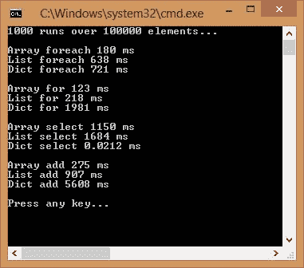

前图中显示的这些结果具有参考价值，但你应该保持怀疑态度，因为许多因素可能会偏斜输出，例如测试的顺序。如果差距很小，那么这两个变体之间可能没有太大区别，但你可以清楚地看到巨大的差异。

为了获得更真实的结果，请务必在发布模式下编译并在不调试的情况下运行。绝对结果取决于你的机器和架构，但如果差异很大，相对测量对于对比来说是有用的。

这里的主要教训是针对你的特定应用程序进行测量，并为你正在执行的工作选择最合适的数据结构。标准库中的集合可以很好地满足大多数需求；其他此处未涵盖的有时很有用，例如 `Queue` 或 `Stack`。

你可以在 MSDN 上找到更多关于内置集合和数据结构的信息（[`msdn.microsoft.com/en-us/library/system.collections.generic`](http://msdn.microsoft.com/en-us/library/system.collections.generic)）。你也可以在 GitHub 上的 .NET Core 文档站点阅读关于它们的内容（[`docs.microsoft.com/en-us/dotnet/standard/collections/`](https://docs.microsoft.com/en-us/dotnet/standard/collections/)）。

然而，还有一些不在标准集合中的罕见数据结构，你偶尔可能想要使用。我们现在来展示其中一个的示例。

### 布隆过滤器（Bloom filters）

`Bloom filters` 是一种有趣的数据结构，可以提高某些应用的性能。它们使用多个重叠的哈希函数，并可以快速告诉你某项确定不在集合中。然而，它们无法确定某项是否存在，只能说它可能存在。它们作为预过滤器很有用，这样你就可以避免执行查找，因为你确定该项不在那里。

下面的图显示了布隆过滤器的工作原理。`A`、`B` 和 `C` 被哈希处理并插入过滤器。`D` 被哈希处理以检查它是否在过滤器中，但由于它映射到零位，我们知道它不在那里：

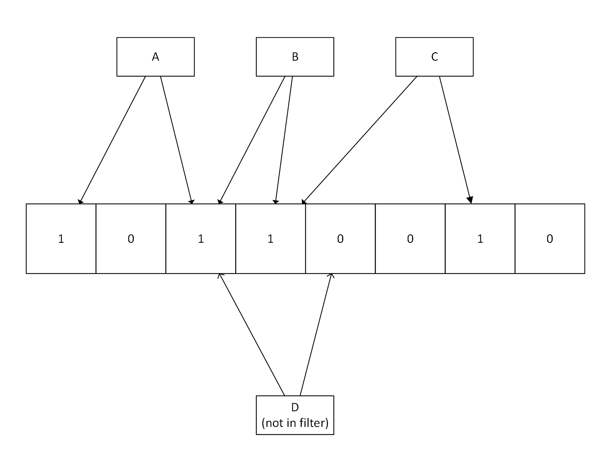

布隆过滤器比持有所有数据甚至为集合中的每个项维护一个哈希列表要小得多。它们也可能快得多，因为对于任何大小的集合，查找时间都是常数。这种常数时间可能比在大列表或字典中查找项的时间短，特别是当它位于文件系统或远程数据库时。

布隆过滤器的一个应用示例可以是本地 DNS 服务器，它有一个要覆盖的域名列表，但会将大多数请求转发到上游服务器。如果自定义域名列表很大，那么从条目创建布隆过滤器并将其存储在内存中可能是有优势的。

当请求进来时，会对过滤器进行检查，如果不存在，则将请求转发到上游服务器。如果条目存在于过滤器，则查询本地 hosts 文件；如果条目在其中，则使用其值。即使过滤器认为它存在，条目也有不在列表中的小概率。在这种情况下，当未找到时，请求会被转发，但这种方法仍然避免了每个请求都查询列表的需求。

使用布隆过滤器的另一个示例是在缓存节点中，可能是代理或 CDN 的一部分。你不想缓存只被请求一次的资源，但如果你没有缓存它，又如何知道第二次请求何时发生呢？如果你将请求添加到布隆过滤器中，就可以轻松地知道第二次请求何时发生，然后缓存资源。

布隆过滤器还用于某些数据库中以避免昂贵的磁盘操作，并用于 `Cache Digests`（缓存摘要），它允许代理声明其缓存的内容。HTTP/2 未来可能支持缓存摘要，但可能会使用 `Golomb-coded sets`（`GCS`，Golomb 编码），它们与布隆过滤器类似但更小，代价是查询速度较慢。

在 .NET 中有一个开源的布隆过滤器实现，可以在 [`bloomfilter.codeplex.com/`](http://bloomfilter.codeplex.com/) 等处找到。你应该自己测试性能以确保它提供了改进。

## 读累了记得休息一会哦~

公众号：古德猫宁李

- 电子书搜索下载
- 书单分享
- 书友学习交流

网站：[沉金书屋 https://www.chenjin5.com](https://www.chenjin5.com)

- 电子书搜索下载
- 电子书打包资源分享
- 学习资源分享

## 哈希与校验和（Hashing and checksums）

哈希是一个重要的概念，通常用于确保数据完整性或快速查找值，因此它被优化得非常快。这就是为什么不应该单独使用通用哈希函数来安全地存储密码。如果算法很快，那么密码可以在相当短的时间被破解。哈希算法在复杂度、执行速度、输出长度和碰撞率方面有所不同。

一种非常基本的错误检测算法称为 `奇偶校验`（parity check）。它向数据块中添加单个位，很少在编程中直接使用。然而，它在硬件层面被广泛使用，因为它非常快。尽管如此，它可能会漏掉许多偶数个损坏错误。

`循环冗余校验`（`Cyclic Redundancy Check`，`CRC`）是一种稍微复杂的错误检测算法。`CRC-32`（也写为 `CRC32`）版本常用于软件，特别是在压缩格式中的 `校验和`。

你可能熟悉 .NET 内置对哈希代码的支持（所有对象都有 `GetHashCode` 方法），但你应该对此非常小心。该方法的唯一功能是协助在内部使用哈希表的数据结构（如字典）中选择桶，并在某些 `LINQ` 操作中也是如此的。它不适合作为校验和或键，因为它不是加密学安全的，并且它会随着框架、进程和时间而变化。

你过去可能用过 `Message Digest 5`（`MD5`）算法，但今天强烈不建议使用它。MD5 的安全性已受到严重破坏，并且很容易产生碰撞。由于它非常快，它可能有一些非安全的用途，例如非恶意的错误检查，但有其他足够快的算法。

如果你需要一个强大但快速的哈希函数，那么 `Secure Hash Algorithm`（`SHA`）族是一个很好的选择。然而，`SHA-1` 不被认为是面向未来的，因此对于新代码，`SHA-256` 通常是更好的选择。

在对消息签名时，你应该使用专门的 `消息认证码`（`MAC`），例如基于哈希的认证码（`HMAC`），它避免了单次哈希函数的漏洞。一个很好的选项是 .NET 构建的 `HMACSHA256` 类。各种 API（例如某些 AWS REST API）使用 `HMAC-SHA256` 来验证请求身份。这确保了即使请求是在未加密的 HTTP 通道上执行的，API 密钥也不会被拦截和恢复。

正如第 2 章中简要提到的，性能也是一项特性，密码哈希是一个特殊情况，通用哈希算法并不适用于它，因为它们运行得太快了。一个很好的选择是 `基于密码的密钥派生函数 2`（`PBKDF2`），我们在第 4 章“衡量性能瓶颈”中使用了它作为示例。`PBKDF2` 是 .NET 中一个特别非常流行的选择，因为它内置在框架中，因此实现更有可能是正确的。它是基于 RFC 构建的并经过了微软的审查，而你在网上找到的任何随机代码都是无法保证的。例如，你可以下载一个 .NET 的 `bcrypt` 实现，但你必须信任它的代码编写是正确的，或者由你自己进行验证。

### 哈希基准测试

让我们对各种哈希函数进行一些简单的基准测试，看看它们在性能方面的比较如何。在下面的代码段中，我们定义了一个运行测试的方法，类似于之前集合基准测试中的方法：

```csharp
private static long RunTest(Action func, int runs = 1000) 
{ 
    var s = Stopwatch.StartNew(); 
    for (int j = 0; j < runs; j++) 
    { 
        func(); 
    } 
    s.Stop(); 
    return s.ElapsedMilliseconds; 
} 
```

我们包含了以下 `using` 语句：

```csharp
using System.Security.Cryptography; 
```

接下来，我们在类中定义了一个短的私有常量字符串（`hashingData`）进行哈希，并以 8 位 Unicode（`UTF8`）格式获取它的字节：

```csharp
var smallBytes = Encoding.UTF8.GetBytes(hashingData); 
```

我们还想获取较大的字节块进行哈希，以比较其性能。为了这一点，我们使用加密安全的随机数生成器：

```csharp
var largeBytes = new byte[smallBytes.Length * 100]; 
var rng = RandomNumberGenerator.Create(); 
rng.GetBytes(largeBytes); 
```

我们的某些函数需要一个 `key`，所以我们使用相同的技术来生成它：

```csharp
var key = new byte[256]; 
var rng = RandomNumberGenerator.Create(); 
rng.GetBytes(key); 
```

接下来，我们创建了一个待测算法的排序列表，并对每个算法执行测试：


```csharp
var algos = new SortedList<string, HashAlgorithm>
{
    {"1\.          MD5", MD5.Create()},
    {"2\.        SHA-1", SHA1.Create()},
    {"3\.      SHA-256", SHA256.Create()},
    {"4\.   HMAC SHA-1", new HMACSHA1(key)},
    {"5\. HMAC SHA-256", new HMACSHA256(key)},
};
foreach (var algo in algos)
{
    HashAlgorithmTest(algo);
}
```

我们的测试方法对每种算法运行以下测试。它们都继承自`HashAlgorithm`，所以我们可以对每个算法的小型和大型字节数组上运行`ComputeHash`方法：

```csharp
var smallTimeMs = RunTest(() =>
{
    algo.Value.ComputeHash(smallBytes);
}, runs);
var largeTimeMs = RunTest(() =>
{
    algo.Value.ComputeHash(largeBytes);
}, runs);
```

然后我们计算两种大小的平均（均值）时间。我们将长整数转换为双精度浮点数，这样我们就可以表示零到一之间的小值：

```csharp
var avgSmallTimeMs = (double)smallTimeMs / runs;
var avgLargeTimeMS = (double)largeTimeMs / runs;
```

前面的方法随后将这些平均时间输出到控制台。我们需要单独测试 PBKDF2，因为它没有继承自`HashAlgorithm`：

```csharp
var slowRuns = 10;
var pbkdf2 = new Rfc2898DeriveBytes(hashingData, key, 10000);
var pbkdf2Ms = RunTest(() =>
{
    pbkdf2.GetBytes(256);
}, slowRuns);
```

PBKDF2 运行非常慢，执行 100,000 次需要相当的时间（这就是使用它的意义所在）。在内部，这个基于 RFC2898 的密钥拉伸算法运行了 10,000 次 HMAC SHA-1。默认值是 1,000，但由于今天可用的计算能力，建议将其设置为至少高一个数量级。例如，`Wi-Fi 安全保护 II`（`WPA2`）使用 4,096 轮迭代来使用`服务集标识符`（`SSID`）作为`salt`来生成一个 256 位的密钥。

输出将类似于下面：

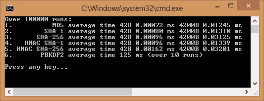

从前面的输出中，你可以看到一次哈希所需的时间变化很大，从小型 MD5 的约 720 纳秒，到大型 HMAC SHA-256 的 32 微秒，以及具有典型参数的小型 PBKDF2 的 125 毫秒。

基准测试结果可能会差异巨大，所以你不应该太纠结于绝对值。例如，BenchmarkDotNet 工具在同一台机器上比较 MD5 和 SHA-256 的输出如下：

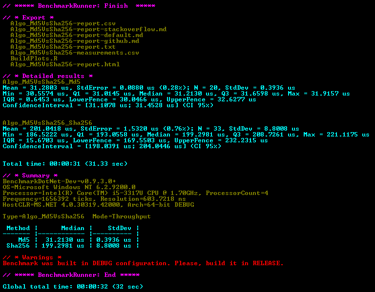

你可以从前面的屏幕图中看到，结果与我们自建的基准测试不同。然而，它使用了完整的 .NET Framework，在计算平均时间时使用的是中位数而非平均值，并且在调试模式下运行（它贴心地警告了我们这一点），其他如此。

更快的机器会有更高的吞吐量（可以在 GitHub 上的 BenchmarkDotNet`README.md`中看到）。专用硬件如`图形处理器`（`GPUs`）、`现场可编程阵列`（`FPGAs`）和`专用集成电路`（`ASICs`）可以快得多。这些通常用于比特币（或其他加密货币）的挖掘，因为它们是基于哈希的工作证明。比特币使用 SHA-256，但其他货币使用不同的哈希算法。

相同的算法构成了 TLS 的基础，因此更快的硬件可以处理更多的安全连接。另一个例子是 Google 构建了名为`张量处理单元`（`TPU`）的自定义 ASIC 来加速其机器学习服务。

BenchmarkDotNet 还有其他基准示例，当你第一次运行它时会看到以下菜单：


之前的基准测试是第二个选项，（编号 #1 Md5Vs256）。

基准测试很难，所以可能可以使用像 BenchmarkDotNet 这样的库。我们从基准测试中得出的结论是 SHA-256 比 MD5 慢。然而，SHA-256 对于大多数应用程序来说足够快，并且对于完整性检查更安全。

SHA-256 可以为下载的文件提供签名（这些必须通过 HTTPS 获取以确保安全），以及签名证书。当作为 HMAC 使用时，它还可以用于安全地验证消息，例如 API 请求。只有知道正确的哈希密钥，你才能成功连接。

## 序列化

序列化是将对象转换为适用于网络传输或存储的数据的过程。我们将反序列化也包含在该术语下。序列化对性能有重大影响，不仅影响网络传输速度，还影响计算，因为它可能构成 Web 服务器上大部分昂贵的处理。你可以在此处阅读更多关于序列化的信息：[`docs.microsoft.com/en-us/dotnet/csharp/programming-guide/concepts/serialization/index`](https://docs.microsoft.com/en-us/dotnet/csharp/programming-guide/concepts/serialization/index)。

序列化格式可以是基于文本或二进制的。一些流行的基于文本格式是`可扩展标记语言`（`XML`）和`JavaScript 对象表示`（`JSON`）。一种流行的二进制格式是`protocol buffers`，它是由 Google 开发的。有一个 .NET 二进制序列化格式（`BinaryFormatter`），它在 .NET Core 2 中仍支持。

XML 在开发者中已不再流行，JSON 现在通常更受青睐。这部分由于等效 JSON 负载的大小较小，但也可能是由于最初命名为`简单对象访问协议`（`SOAP`）时使用了 XML。它用于`Windows 通信基础`（`WCF`），但 SOAP 不再是一个缩写了，因为开发者发现它远非简单。

JSON 之所以流行是因为它紧凑且易于人类读写，并且它可以很容易地被 JavaScript 消费，特别是在 Web 浏览器中。.NET 有许多不同的 JSON 序列化器，它们具有不同的性能特性。然而，由于 JSON 不像 XML 那样有严格定义，不同实现之间可能存在差异，导致它们不兼容，特别是在处理日期等复杂类型时。例如，非常流行的`Json.NET`使用国际标准组织（`ISO`）格式表示日期，而旧版本 ASP.NET MVC 使用的 JSON 序列化器则将日期表示为自 Unix`epoch`以来的毫秒数，并封装在 JavaScript 日期构造函数中。

.NET 开发者社区已转向`Json.NET`，而且兼容性始终比性能更重要。ASP.NET Web API 已经一直使用`Json.NET`作为默认，ASP.NET Core 也使用了`Json.NET`。`ServiceStack`框架中有一个名为`ServiceStack.Text`的序列化器，它称速度更快，但你可能应该重视兼容性和文档而不是速度。这也适用于其他 JSON 库，例如`Jil`（[`github.com/kevin-montrose/Jil`](https://github.com/kevin-montrose/Jil)）和`NetJSON`（[`github.com/rpgmaker/NetJSON`](https://github.com/rpgmaker/NetJSON)），它们在基准测试中甚至比 ServiceStack 更快。

如果你追求纯性能，并且控制所有的端点，那么你可能想使用二进制协议。然而，这可能会限制未来与你无法控制的第三方端点的互操作性。因此，最好只在内部使用它们。

在 UDP 之上构建自己的自定义消息协议是一个坏主意。因此，如果你想使用二进制序列化，你应该查看类似`protobuf-net`的工具，这是一个为 .NET 提供的缓冲区实现协议。你可能还会考虑微软的 Bond 框架（[`github.com/Microsoft/bond`](https://github.com/Microsoft/bond)）或亚马逊的 Ion（[`amzn.github.io/ion-docs/index.html`](https://amzn.github.io/ion-docs/index.html)）。你可能需要调整这些工具以获得最佳性能，例如更改默认缓冲区大小。

## SIMD CPU 指令

`单指令多数据`（`SIMD`）是一种许多现代处理器上可用的技术，可以通过在一个核心的单个线程上并行化计算来加速执行。SIMD 利用 CPU 上可用的额外指令来操作一组值（向量），而不仅仅是单个值（标量）。

此类最常用的指令集称为`流式 SIMD 扩展 2`（`SSE2`），它自奔腾 4 发布以来已存在了 115 年。一个较新的指令集称为`高级向量扩展`（`AVX`），提供了比 SSE2 更优越的性能，并且已经存在了多年。因此，如果你在使用较新的 x86-64 CPU，那么你应该可以访问这些额外指令。

某些 ARM CPU（如树莓派 2 和 3 中的 CPU）包含名为`NEON`的类似技术，正式名称为`高级 SIMD`。目前 .NET 不支持它，但未来可能会支持。一个 C 语言的官方开源库项目托管在[`projectne10.org/`](http://projectne10.org/)。

你可以使用以下布尔属性来测试是否支持 SIMD：

```csharp
Vector.IsHardwareAccelerated
```

该属性是 JIT 内联，其值由 RyuJIT 在运行时设置。

你可以实例化泛型类型`Vector`，或使用二/三/四维的便利类。例如，要创建一个单精度浮点向量，你可以使用以下泛型代码：

```csharp
var vectorf = new Vector<float>(11f);
```

如果想创建一个单精度浮点 3D 向量，可以使用此代码：

```csharp
var vector3d = new Vector3(0f, 1f, 2f);
```

一个二维双精度浮点向量可以作为`Complex`结构的良好替代品。在硬件加速的系统上，它将提供更高的性能。`Vector2`只支持单精度浮点数，但你可以使用泛型来指定双精度类型的复数实部和虚部。`Complex`只支持双精度浮点数，但如果你不需要高精度，你仍然可以使用`Vector2`便利类。遗憾的是，这意味着它并不是简单的替换，而且数学逻辑上本身也是不同的。

你现在可以使用标准的向量数学了，但修改你的算法以利用向量可能是复杂的，而且通常不是你应该在 Web 应用程序中做的事情。它对桌面应用程序有用，但如果一个进程在 Web 请求中耗时很久，最好让它在后台运行，这样它不需要那么快了。

我们将在下一章介绍这种分布式架构方法。由于原因，我们不会再对 SIMD 进行更多详细介绍，但既然你已经接触过它，如果你愿意，可以阅读更多关于它的信息。你可以在[`en.wikipedia.org/wiki/SIMD`](https://en.wikipedia.org/wiki/SIMD)阅读一些背景信息，并可以在 MSDN 的[`msdn.microsoft.com/en-us/library/dn858218`](http://msdn.microsoft.com/en-us/library/dn858218)上找到 .NET 的实现文档。你也可以查看随本书一起提供的示例控制台程序，可以作为一个简单的入门指南。

## 并行编程

虽然 SIMD 擅于提高在一个核心上运行的单线程性能，但它无法跨多个核心或处理器工作，且其应用有限。现代扩展意味着添加更多 CPU，而不仅仅是让单个线程运行更快。我们不只是像 SIMD 那样对数据并行化；我们应该更多地关注处理的并行化，因为这样扩展性更好。

有各种 .NET 技术可以帮助并行处理，这样你就不需要编写自己的线程代码。两种此类并行扩展是`并行 LINQ`（`PLINQ`），它扩展了你熟悉的 LINQ 操作，以及`任务并行库`（`TPL`）。

### 任务并行库

TPL 的主要功能之一是扩展循环以并行运行。然而，你需要对并行处理保持小心，因为在执行简单任务时它实际上可能会让你的软件变慢。标记多个任务涉及的开销可能会超过微小操作负载的执行。

例如，考虑以下简单的`for`循环：

```csharp
for (int i = 0; i < array.Length; i++)
{
    sum += array[i];
}
```

上述`for`循环中的数组包含 100,000 个整数，但整数是 CPU 执行的最简单的事情之一，在数组上使用`for`循环是枚举是非常快的方法。这种累加在相当现代的机器上不到十分之一毫秒即可完成。

你可能认为你可以通过并行化操作来加速它。也许你可以拆分数组，在两个核心上并行运行求和并加上结果。

你可能会使用以下代码尝试这种操作：

```csharp
Parallel.For(0, array.Length, i =>
{
    Interlocked.Add(ref sum, array[i]);
});
```

你必须使用原子加法（interlocked add），否则你将得到错误的累加结果。如果不这样做，线程将相互干扰，在写入内存中相同位置时损坏数据。

然而，这段代码的运行速度实际上比第一个示例慢 42 倍以上。额外的开销、运行许多线程的复杂性，以及锁定变量以确保一次只有一个线程可以写入它，在这种情况下是不值得的。

并行化对于更复杂的流程非常有用，特别是当循环体执行某些耗时操作（例如访问文件系统）时。然而，阻塞的`I/O`操作可能通过使用异步访问来更好地处理。并行访问可能会导致竞争，因为访问在某处最终可能以串行方式执行，例如在硬件层级。

如果我们想要执行更具处理器密集型特征的操作，例如对多个密码进行哈希，那么并行运行任务将是有益的。以下代码对列表中的每个密码执行 PBKDF2 哈希，然后计算结果的 Base64 表示：

```csharp
foreach (var password in passwords)
{
    var pbkdf2 = new Rfc2898DeriveBytes(password, 256, 10000);
    Convert.ToBase64String(pbkdf2.GetBytes(256));
}
```

在这个示例中，我们没有使用输出结果，但你可能需要通过将密码迁移到更具韧性的密钥拉伸算法（key-stretching algorithm）来升级数据库密码的安全性。输入可能是明文密码，或者是旧单向哈希函数的输出，例如`MD5`或未加盐的`SHA`。

我们可以在多核系统上通过使用`Parallel.ForEach`循环来提高速度，代码如下所示：

```csharp
Parallel.ForEach(passwords, password =>
{
    var pbkdf2 = new Rfc2898DeriveBytes(password, 256, 10000);
    Convert.ToBase64String(pbkdf2.GetBytes(256));
});
```

这将加快处理过程，但具体快多少取决于许多因素，例如列表中的密码数量、逻辑处理器的数量以及 CPU 核心数。例如，在具有双核心但四个逻辑处理器的 Core i5 CPU 上，列表中只有两个密码并不会产生巨大的改进（仅快了 1.5 倍）。如果列表中有四个（或更多）个密码，改进效果会更好（大约快了 1.9 倍）。由于仍然存在一些开销，因此你无法通过双倍 CPU 核心来获得双倍的速度。

我们可以通过在基准测试期间查看任务管理器中的 CPU 利用率来了解这种差异的原因。

只有两个密码需要哈希时，CPU 图形如下所示：


在前面的图中，我们可以看到最初在串行哈希时，CPU 运行速度大约为 25%，充分利用了一个逻辑 CPU。当并行哈希两个密码时，它占了 50%，运行在两个逻辑处理器上。由于内在的开销和超线程技术（`hyper-threading`）的特性，这并不会等同于速度的两倍增长。

超线程是一项技术，它通常为每个物理核心向操作系统暴露两个逻辑处理器。然而，这两个逻辑 CPU 仍然共享其单个核心的执行资源。

尽管 CPU 晶片上有两个核心，但超线程向操作系统暴露了四个逻辑 CPU。由于我们只有两个线程（因为我们正在哈希两个密码），我们只能使用两个处理器。如果线程在不同的核心上执行，那么速度提升将很可观。但如果它们在共享同一核心的处理器上执行，那么性能可能不会那么令人深刻。由于调度算法的改进，它仍然比单线程哈希要好，而这正是超线程的设计初衷。

当我们同时哈希四个密码时，CPU 图形如下所示：

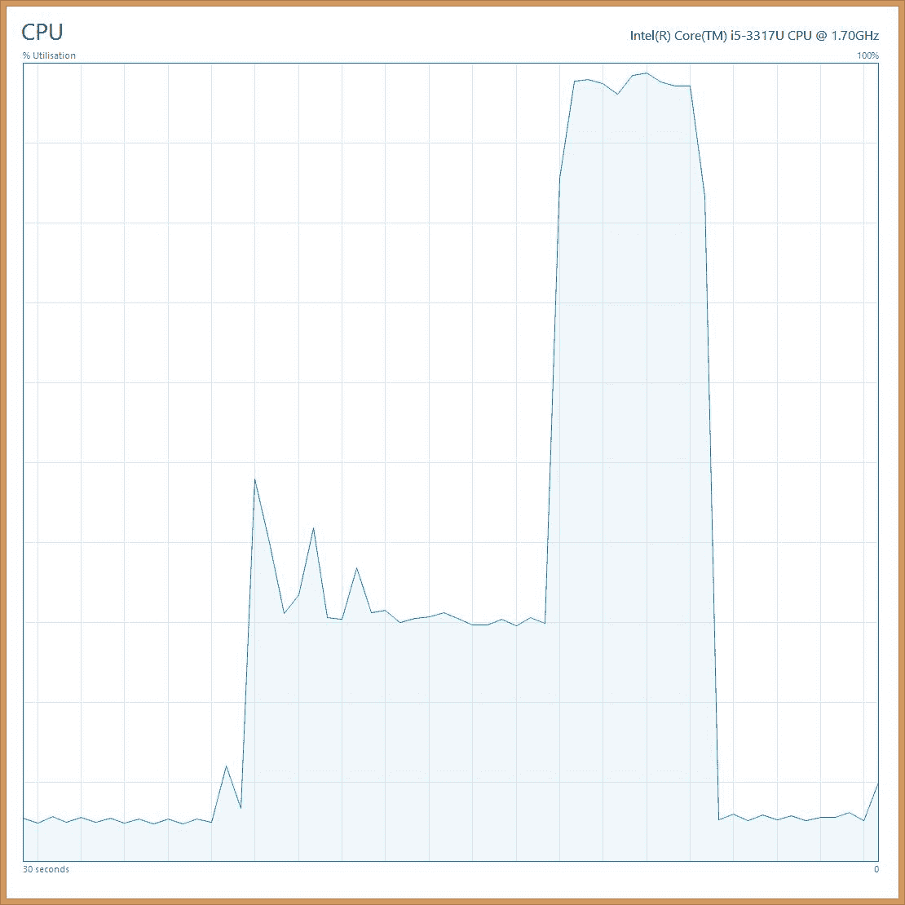

我们可以看到，现在初始的 25% 使用率跳升到几乎满负载，我们正在利用大部分处理器。与顺序哈希相比，这意味着性能提高了将近一倍。虽然仍然涉及大量的开销，但由于现在主操作要快得多，这种权衡是值得的。

### 并行 LINQ

还有其他方法可以利用并行编程，例如 LINQ 表达式。我们可以将之前的示例重写为 LINQ 表达式，它看起来可能如下所示：

```csharp
passwords.AsParallel().ForAll(p =>
{
    var pbkdf2 = new Rfc2898DeriveBytes(p, 256, 10000);
    Convert.ToBase64String(pbkdf2.GetBytes(256));
});
```


你可以通过`AsParallel()`方法启用这些功能。`ForAll()`方法与之前示例中的循环具有相同的目的，如果顺序不重要，它很有用。如果顺序很重要，则有一个`AsOrdered()`方法可以解决这个问题。然而，由于涉及额外的处理，这可能会减少性能收益。

此示例的执行情况与之前使用并行循环的示例相似，这并不意外。我们还可以通过使用`WithDegreeOfParallelism()`方法来限制并行发生的操作数量，如下：

```
passwords.AsParallel().WithDegreeOfParallelism(2).ForAll(p => 
{ 
    var pbkdf2 = new Rfc2898DeriveBytes(p, 256, 10000); 
    Convert.ToBase64String(pbkdf2.GetBytes(256)); 
}); 
```

上一个示例将哈希操作限制为同时进行两个，其执行情况与列表中只有两个密码时相似，这是预期之中的。如果你不想占满 CPU（因为上面还有其他重要的进程在运行），这种方法会很有用。

你可以通过在`ParallelOptions`实例上设置`MaxDegreeOfParallelism`属性来实现相同的效果，该对象可以作为参数传递给重载循环方法。

当你使用并行 LINQ 查询数据集时，重要的是不要忽视查询执行的最佳位置。你可能通过并行化加速应用程序中的查询，但如果查询在数据库中执行，可能会更快。要了解更多相关信息，请参阅第 7 章（text0155）《优化 I/O 性能》以及第 5 章（text0108）《修复常见性能问题》。

## 并行基准测试

让我们查看简单的 .NET Core 控制台程序的输出，它基准测试了我们刚刚讨论的技术。它显示了一种并行化没有帮助反而让情况变糟的情况。

然后它显示了另一种并行化有用的情况。

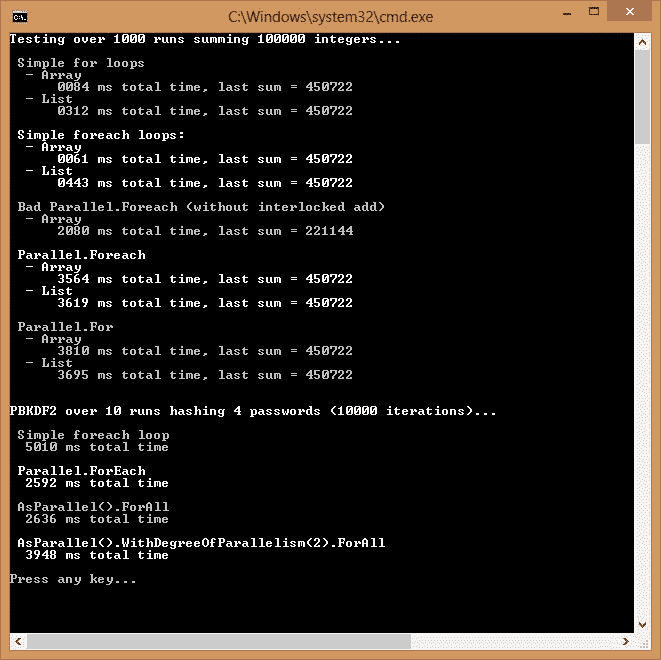

当通过累加 100,000 个零十之间的随机整数来计算和时，最快的方法是在`foreach`循环中使用数组。在这里使用并行化会使过程变慢很多，而且如果简单地使用，将得到错误的结果，这要糟糕得多。

当执行计算计算密集型工作负载时（例如对多个密码进行 PBDF2 哈希函数），并行化会有显著帮助。时间几乎减少了一半，因为它在两个核心上运行。最后的限制线程数量的操作在不同运行中可能会花费不同的时间。这可能是由于线程有时共享核心，有时在不同的核心上运行。取决于工作负载，它可能接近使用所有逻辑核心的速度。

## 并行编程的局限性

Web 应用程序的性能问题通常并不意味着增加孤立系统中单个用户的运行速度。当只有一个用户时，让 Web 应用性能良好很容易的，但挑战在于随着用户数量的扩展如何保持这种单用户性能。

本节讨论的并行编程技术在扩展 Web 应用程序方面的用途有限。你已经拥有了一个并行化的系统，因为每个用户请求都会分配其自己的资源。你可以简单地添加更多实例、代理或机器来满足需求。问题在于如何在它们之间高效地分配工作，并避免共享资源的瓶颈。我们将在下一节中深入地讨论这一点。

## 读累了记得休息一会哦~

**公众号：古德猫宁李**

* 电子书搜索下载

* 书单分享

* 书友学习交流

**网站：**[沉金书屋 https://www.chenjin5.com](https://www.chenjin5.com)

* 电子书搜索下载

* 电子书打包资源分享

* 学习资源分享

## 多线程与并发

在之前关于并行编程的节中，我们简要介绍了如何使用`Interlocked.Add`来避免多个线程向同一内存位置写入时发生错误。在多线程编程中，并发和锁定是最难处理的地方。处理不会损害性能，甚至导致计算结果错误。

由于锁定是一个经常出错的领域，我们将包含一个简短的入门指南。这绝非详尽，但将帮助你识别出可能需要小心的地方。

### 锁定

锁定是一种确保资源在一次只能被单个线程的方法。每个希望使用被锁定项目的线程都必须轮候，以便操作按顺序执行。这种串行处理确保了一致性，但如果等待释放锁的时间很长，也会减慢系统。

锁定也适用于数据库，你可能在 SQL 中用过它，但在这里我们将结合 C# 和 .NET 中的多线程来讨论它。有许多低级结构和原语可以用于锁定。然而，我们将采取更具实践性的方法，展示 .NET 编程中常用的层级锁定语法。

在 C# 中实现锁定的标准方法是使用`lock`语句。这与`using`语句类似，它是一种封装了底层实现的语法糖。它可以帮助你避免忘记实现所有必要的样板代码，就像`using`语句确保对象的销释放一样。人们很容易忘记异常处理的要求，从而导致内存泄漏或死锁。

`deadlock`（死锁）是指你在锁定实现中犯了错误，导致没有任何东西都无法获取或释放锁的情况。这可能导致你的程序陷入死循环并挂起。

让我们来看一个简单的锁定示例。考虑以下这个简单的方法。

```
private static void DoWork(ref int result)
{
    for (int i = 0; i < 1000000; i++)
    {
        result++;
    }
}
```

我们使用以下代码在不同的线程上两次调用此方法，并等待它们都完成。

```csharp
var result = 0;
var t1 = Task.Run(() => { DoWork(ref result); });
var t2 = Task.Run(() => { DoWork(ref result); });
Task.WaitAll(t1, t2);
```

之后`result`变量是多少？它不会是两百万（本应该是）。在不加锁的情况下这样做会导致数据损坏和错误的结果。

在这里使用`Task.WaitAll(t1, t2)`是为了让代码可以在控制台应用程序的`Main`方法中运行。然而如果在`async`方法内部，通常使用`await Task.WhenAll(t1, t2)`更好。同样地，`await Task.Delay(100)`比`Thread.Sleep(100)`更好。在 C# 7.1 中，你可以为控制台程序拥有`async` `Main`方法，所以不用担心。

要使用`lock`，我们首先需要声明并初始化供其使用的对象。我们在类级别已经做了这一点，定义如下：

```csharp
private static object l = new object();
```

我们现在可以使用此对象来`lock`一个操作，但为了获得最佳性能，在哪里执行此锁定？让我们尝试在循环内部，使用以下代码。

```csharp
for (int i = 0; i < 1000000; i++)
{
    lock (l)
    {
        result++;
    }
}
```

这运行正常，我们得到了正确的结果，但它很慢。在这个示例中，更好的做法是在循环外锁定。改进后的版本如下面的代码所示。

```csharp
lock (l)
{
    for (int i = 0; i < 1000000; i++)
    {
        result++;
    }
}
```

这种执行速度要快得多，因为我们只锁了两次，而不是两万次。这是一个极端示例，对于实际的工作负载，应该进行调优练习以找到最佳的锁定策略。

在底层，`lock`语句内部使用`Monitor`来实现锁定。除非你有特殊需求，否则通常不需要担心这个。使用`lock`比直接使用`Monitor`更简单、更安全。还有`Mutex`（用于跨进程）和`Semaphore`（当你锁定的是资源池而不是单个对象时）。

之前使用的`Interlocked.Add`封装了一个特殊的 CPU 指令。这允许值在处理器级别被原子化地更改。如果不使用它，值的不同字节可能会被不同的线程修改，导致结果损坏。在我们先的示例中，使用`Interlocked.Increment(ref result)`会更快。然而，在许多复杂的情况下这并不适用。在存在多个线程时不加锁是应该避免的，在错误的地方锁定也是如此。

### 应该避免的实践

我们展示了一些加速软件的方法，但说明不该做什么以及事情会如何变得通常更好。如果没有遵循坏的习惯，Web 应用程序通常运行良好，在这里我们将强调几点你应该注意的事项。

## 反射

反射（Reflection）是使用其他代码通过编程方式检查你的代码，并在运行时深入其内部结构的过程。例如，你可以在程序集加载时检查它，查看它实现了哪些类和接口，以便你可以调用它们。通常不建议这样做，并应该尽可能避免。通常有其他方法可以实现相同的结果，而不需要反射，尽管它偶尔是有用的。

反射通常对性能有不利影响，这一点有充分的文档记录，但往常一样，它取决于你如何使用它。新之处在于，.NET Core 的反射发生了重大变化。API 已经发生变化，并且现在是可选的。所以，如果你不反射，就不需要付出性能代价。

反射 API 现在多了一个额外方法，因此，以前你可能会调用类似`myObject.GetType().GetMembers()`的内容，而你现在需要通过插入新的`System.Reflection`命名空间中的`GetTypeInfo()`方法来调用`myObject.GetType().GetTypeInfo().GetMembers()`。

如果你必须使用反射，那么最好不要重复执行或在紧凑循环中执行它。然而，在应用程序启动期间使用一次是可以的。但是，如果你可以完全避免使用它，你就可以从 .NET Core 的一些新改进中受益。

### 正则表达式

正则表达式（`regex`）可以非常有用，但性能可能很糟糕，并且在有其他更好解决方案的情况下通常会被误用。例如，正则表达式经常被用于电子邮件验证，但实际上有更可靠的方法可以做到这一点。

如果反复重复使用同一个正则表达式，通过在构造函数中指定`RegexOptions.Compiled`选项来编译它以提高性能可能会更好。这只有在你频繁使用该正则表达式且这样做涉及初始性能代价时才有帮助。所以，请确保检查实际上是否有改进，并且它现在没有变慢。

`RegexOptions.IgnoreCase`选项也会影响性能，但它实际上可能会降低速度，因此请务必对你的输入进行测试。编译对此也有影响，你可能还想要额外使用`RegexOptions.CultureInvariant`以避免比较问题。

要留心信任正则表达式中的用户输入。可能会导致它们执行大量的回溯（backtracking）并消耗过度资源。你不应该允许不受限制的输入正则表达式，因为它们可能会被程序运行数小时。

正则表达式通常用于验证电子邮件地址，但这通常是种坏主意。完全验证电子邮件地址的唯一方法是向其发送电子邮件。然后你可以让用户点击邮件中的链接，以表明他们拥有该邮箱并已收到的邮件。电子邮件地址与人们经常接触的常见地址差异很大，随着新顶级域名（TLD）的加入，情况更是如此。

网上找到的许多验证电子邮件地址的正则表达式会拒绝完全有效的电子邮件地址。如果你想帮助用户并在表单上执行一些基本的电子邮件地址验证，你所能做的合理事情就是检查其中是否存在`@`符号（在此之后还有一个`.`），以确保电子邮件符合`x@y.z`的格式。你可以通过简单的字符串测试来实现这一点，从而避免正则表达式带来的性能代价和安全风险。

### 紧凑循环中的字符串拼接

由于字符串是不可变的且无法更改，当你在拼接字符串时，会创建一个新对象。如果你在紧凑循环中频繁这样做，可能会导致性能问题和内存使用问题。

你可能会发现使用`StringBuilder`或其他方法更好。不过，不要过于担心此，因为这只在大规模下适用。始终要测试它是否真的是一个问题，并且在不需要的地方进行微优化。

一个良好的通用建议是找出你的代码大部分时间都花在了哪里，并集中对那里进行优化。显然，优化在循环中执行数百万次的代码，比优化偶尔运行一次的代码要好得多。

### 动态类型

C# 是一种静态类型语言，变量类型在编译时进行检查，但它确实具有一些动态特性。你可以使用`dynamic`类型和如`ExpandObject`等对象来获取动态类型语言的一些特性。`var`类型实际上并不是动态的，它只是在编译时进行推断。

动态类型具有性能和安全开销，因此如果你能找到其他解决问题的方法，最好避免使用。例如，ASP.NET MVC 中的`ViewBag`是动态的，因此最好不要使用`ViewBag`，而是使用定义良好的视图模型（view model）。除了性能之外，这还有许多其他优点，如安全便利。

### 同步操作

同步方法会阻塞执行，应该尽可能避免，特别是当它们运行很慢或访问 I/O 时。我们在之前的章节中涵盖了异步（短写`async`）操作。理解如何使用`async`对于现代高性能编程至关重要，新的语言特性使其比以往任何时候都更易用。如果可以使用`async`方法，那么通常应该优于同步阻塞版本。

`async`和`await`关键字让异步编程比以前简单得多，但正如第 5 章、*修复常见的性能问题* 中提到的，对 Web 应用程序的影响对于单个用户来说并不总是可见的。这些方便的功能允许你在等待操作完成期间将线程返回线程池，从而同时服务更多用户。这些线程可以被用于服务其他用户的请求，允许你用更少的服务器处理更多的用户。

异步方法可能很有用，但巨大的收益并非来自编写异步代码，而是来自异步架构。我们将在下一节讨论消息队列时涵盖分布式架构。

### 异常

异常顾其实名，应该只留给异常情况。异常是缓慢慢且昂贵的，如果你知道某个事件很可能发生，就不应该将其作为业务逻辑中的流程控制。

这并不是说你不应该使用异常处理，相反你应该使用。然而，它应该留给那些真正意料之外且罕见的事件。如果你可以预先预测某种条件可能会发生，那么你应该显式地处理它。

例如，磁盘满导致你的代码由于没有空间无法写入文件是一个异常情况。你不会预计这通常会发生，你只需要`try`文件操作并`catch`任何异常。然而，如果你正在尝试解析日期字符串或访问字典，那么可能应该使用特殊的`TryParse()`和`TryGetValue()`方法并检查空值，而不是仅仅依赖异常处理。

## 读累了记得休息一会哦~

**公众号：古德猫宁李**

- 电子书搜索下载

- 书单分享

- 书友学习交流

**网站：**[沉金书屋 https://www.chenjin5.com](https://www.chenjin5.com)

- 电子书搜索下载

- 电子书打包资源分享

- 学习资源分享

## Summary

在本章中，我们讨论了一些可以提高代码执行性能的技术，并深入了组成 .NET Core 和 ASP.NET Core 的项目。我们探索了数据结构、序列化、哈希、并行编程以及如何通过基准测试衡量相对性能。我们还涵盖了如何使用 C# 执行多线程、并发和锁定。

线性的性能特征更容易扩展，而表现出这种行为的代码在负载增加时可能会变慢。具有指数级性能特征或有异常离群值（虽然罕见，但发生时非常慢）的代码可能会导致性能困扰。通常情况下，目标是编写出虽然在正常情况下稍慢，但在很大负载范围内更具可预测性且性能稳定的代码，这样会更好。

这里的主要教训是不要盲目应用并行编程和其他可能增强性能的技术。始终要测试以确保它们产生了积极的影响，因为它们很容易让情况变得糟糕。我们的目标是达到“一切都很棒”的状态，但如果我们不小心，可能会在无意中让一切都变得很糟糕。

在下一章中，你将学习缓存和消息队列。这两种高级技术可以显著提高系统的性能。

# 学习缓存和消息队列

缓存非常有用，几乎可以应用于应用程序栈的几乎所有层。然而，很难始终让缓存正常工作。因此，在本章中，我们将涵盖 Web 层、应用层和数据库层的缓存。我们将向你展示如何使用反向代理服务器存储渲染的网页和其他资产的结果。我们还将涵盖更低层次的缓存，使用内存数据存储来加速访问。你将学习如何确保在需要强制传播更新时始终能够冲刷（或失效）你的缓存。

本章还涵盖了使用消息队列和抽象的异步架构设计，这些抽象封装了各种消息模式。你将学习如何在后台执行耗时操作（如视频编码），同时让用户了解其进度。

你将学习如何将缓存和消息队列软件设计模式应用于低性能操作中，以便它们不需要实时执行。你还将了解这些模式可能增加的复杂性，并理解涉及的权衡。我们将在第 10 章、*性能增强工具的缺点* 中查看如何应对这些复杂性并减轻缺点。

本章涵盖的主题包括：

* Web 缓存背景

* JavaScript Service Worker

* Varnish 代理和 IIS Web 服务器

* Redis 和 Memcached 内存应用程序缓存

* 消息队列和消息模式

* RabbitMQ 及其各种客户端库

## 为什么缓存是困难的

缓存之所以困难，并不是因为缓存某些东西很困难。缓存本身是无限容易的；困难的部分在于当你想要更新时如何让缓存失效。已故的 Netscape 工程师 Phil Karlton 留了一句被广泛使用的引言，内容如下：

“计算机科学中只有两件难事：缓存失效和命名命名。”

关于这句话还有许多幽默的变体，正如本书之前提到过的那样。这种观点可能稍显夸张，但它凸显了人们如何认为从你的`quick-things-box 2.0 ™`中移除`done-computer-stuff ™`（完成的计算机任务）是多么复杂。然而，命名确实非常困难。

缓存是存储某些数据的临时快照的过程。这个临时缓存可以在每次需要时使用，而不是都重新生成原始数据（或从规范源检索）。这样做具有显而易见的性能优势，但它让你的系统变得更加复杂且更难概念化。当你有许多缓存相互作用时，结果可能几乎是随机的，除非你的处理方法非常有自律。

当你推演缓存（以及消息队列）时，消除“数据只存在于单一一致状态”的观念是有帮助的。如果你能接受数据具有新鲜性且在某种程度上始终是过时的这一概念，情况就会变得更容易。事实上，事实确实如此，但小系统中涉及的时间跨度短，意味着你通常可以忽略它以简化思维。然而，在缓存方面，时间跨度更长，因此新鲜性更为重要。大规模系统只能是最终一致的，它的它的不同部分对数据会有不同的时间维度视图。你需要接受数据是处于流动中的；否则，你只是没有进行四维思考！


举个简单的例子，考虑一个传统的静态网站。访问者在他们的浏览器中加载了一个页面，但这个页面现在立即过时了。服务器上的页面可能在访问者获取之后就更新了，但他们并不知道，因为旧版本会在他们刷新页面之前一直留在他们的浏览器中。

如果我们把这个例子扩展到基于数据库的 Web 应用程序（例如 `ASP.NET` 或 `WordPress` 网站），那么同样的原理也适用。用户获取一个从数据库数据生成的 Web 页面，但它在加载时可能就已经过时了。底层数据可能已经更改，但包含旧数据的页面仍然留在浏览器中。

默认情况下，Web 应用程序通常会在每次页面加载时从数据库重新生成 HTML，但如果数据没有变化，这样做是极其低效的。这样做是为了当发生更改时，在刷新页面时能立即显示。

然而，用户的浏览器中可能有一个旧页面，而你对此的控制有限。因此，你也可以在服务器上缓存此页面，并仅在数据库底层数据发生变化时将其移除。像这样缓存渲染后的 HTML 对于在超过简单少数用户的规模下维持性能通常是至关重要的。

## Web 缓存

我们将讨论的第一类缓存是在 Web 级别的。这涉及存储你的 Web 栈的最终输出（即将发送给用户的内容），这样当再次被请求时，它是准备就绪的，不需要重新生成。阶段阶段缓存消除了昂贵的数据库查询和应用层 CPU 密集型渲染的需求。这降低了延迟并减轻了服务器的负载，允许你处理更多用户并快速为每个用户提供服务。

Web 缓存通常发生在你的 Web 服务器或反向代理服务器上，你将它们置于 Web 服务器前端以保护它们免受过量负载。你可能也选择将此任务交给第三方，例如 `CDN`。在这里，我们将涵盖两个 Web 服务器和代理服务器软件，`IIS` 和 `Varnish`。然而，还有许多其他的 Web 缓存和负载均衡技术可用，例如 `NGINX` 或 `HAProxy`。

Web 层缓存对于静态资产和资源效果最好，例如 `JavaScript`、`CSS` 和图像。然而，它也可以适用于匿名 HTML，这些页面很少更新但经常被频繁访问，例如首页或着陆页，这些页面是不经过身份验证的且未针对用户定制的。

我们曾在第 5 章*修复常见性能问题*中提到过代理服务器，并在第 6 章*解决网络性能问题*中简要涵盖了 Web 层缓存。然而，在本章中，我们将详细介绍 Web 缓存。

### 缓存背景

在深入实现细节之前，了解一下 Web 缓存是如何工作的会有帮助。如果你花时间研究运行的机制，那么缓存将不再那么困惑，也不会像直接冲进去那样令人沮丧。

阅读并理解相关的 HTTP 规范是有帮助的。然而，不要假设软件总是严格遵守这些 Web 标准，即使它们声称是遵守的。

首先，让我们看看一个你在传输 HTTP 流量时可能跨越的典型网络设置。下面的图说明了一个 Web 应用程序常见配置的示例：

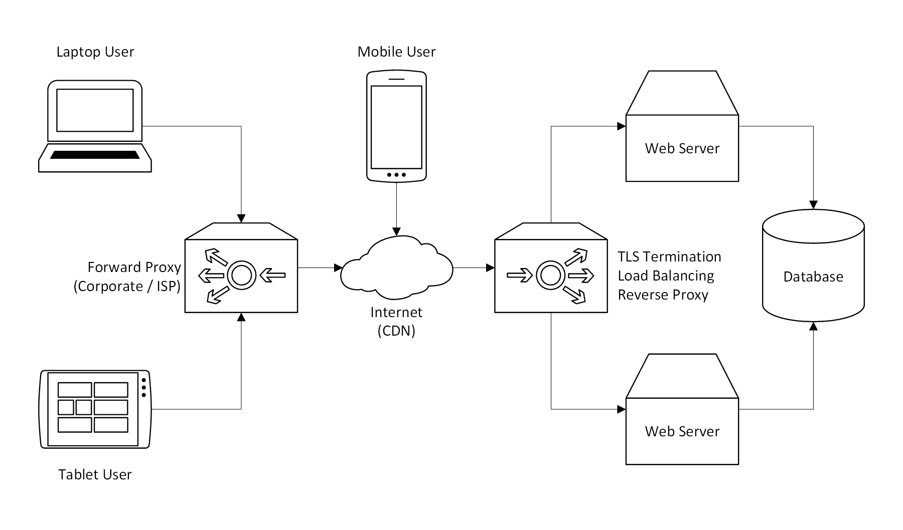

如前面的图所示，笔记本电脑和平板电脑用户通过一个缓存正向代理服务器（该服务器可能位于公司网络或 ISP 处）连接。移动用户直接通过互联网连接。然而，所有用户在到达你的基础设施之前都通过了一个 `CDN`。

在你的防火墙（未显示）之后，有一个设备终止 TLS 连接、在 Web 服务器之间平衡负载，并充当缓存反向代理。这些功能通常由单独设备执行，但我们在这里保持了简单性。

你的资源的副本将保存在你的 Web 服务器、你的反向代理、你的 `CDN`、任何正向代理以及所有用户设备上的浏览器中。控制这些资源缓存行为最简单的方法是使用带内信号并向你的内容添加 HTTP 头部，仅在一个地方声明缓存控制元数据。

尽管你可以自定义它们并随意刷新它们的缓存，但将相同的 HTTP 缓存技术应用于你自己的 Web 服务器和代理是一种良好的做法。这不仅减少了你必须做的配置量并避免了重复工作，还确保了任何你无法控制的缓存也能正确运行。即使在使用 HTTPS，浏览器仍然会执行缓存，并且中间可能还存在透明的公司代理或干预的 ISP 强制门户。

### HTTP 头部

HTTP 缓存涉及在响应中设置缓存控制头部。有许多此类头部，它们是多年来从不同的标准和协议的不同版本添加的。你应该了解这些头部是如何使用的，但你也应该理解可缓存资源的唯一性是如何确定的，例如通过更改 URL 或仅更改其部分（例如查询字符串参数）。

这些头部许多可以根据其功能和引入它们的 HTTP 版本进行分类。某些头部具有多个功能，有些是非标准的，但几乎是通用的使用。我们不会涵盖所有这些头部，但我们将挑选出一些最重要的。

缓存头部大致分为两类。第一类定义了一个绝对时间，在此时间内，缓存无需询问服务器即可重复使用。第二类定义了客户端使用的规则，用于向服务器测试缓存是否仍然有效。

大多数指令性头部（即发布缓存命令的头部）都属于这两类头部之一。除了这些之外，还有许多纯粹的信息性头部，它们提供了关于原始连接和客户端的详细信息，这些信息在其他可能会被缓存隐藏（例如，原始客户端 IP 地址）。

某些头部（如 `Cache-Control`）是最新标准的一部分，但另一些头部（如 `Expires`）通常仅用于向后兼容，以防中间存在古老的浏览器或旧的代理服务器。然而，随着基础设施和软件的升级，这种做法变得越来越没有必要了。

在这种情况下，最新的缓存标准是 `HTTP/1.1`，因为 `HTTP/2` 使用相同的缓存指令（`RFC 7234`）。某些头部源于 `HTTP/1.0`，而它被认为是一个遗留协议。非常老旧软件可能只支持 `HTTP/1.0`。标准在所有应用程序中都可能没有正确实现。测试观察到的行为是否符合预期是一个明智的想法。

`Age` 头部用于指示资源在缓存中已存在多长时间（秒）。另一方面，`ETag` 头部用于指定单个对象或该对象的特定唯一版本的标识符。

`Cache-Control` 头部告诉缓存资源是否可以被缓存。它可以有许多值，包括 `max-age`（秒）或 `no-cache` 和 `no-store` 指令。`no-cache` 和 `no-store` 之间混淆但微妙的区别在于：`no-cache` 表示客户端在使用资源之前应向服务器检查，而 `no-store` 表示资源不应被缓存。为了防止缓存，你通常应该使用 `no-store`。

ASP.NET Core 的 `ResponseCache` 动作属性设置了 `Cache-Control` 头部，并在第 6 章*处理网络性能*中进行了介绍。然而，此头部可能会被一些旧的缓存忽略。`Pragma` 和 `Expires` 是用于向后兼容的旧头部，它们执行了 `Cache-Control` 头部现在处理的一些功能。

`X-Forwarded-*` 头部用于向代理或负载均衡器提供更多关于原始连接的信息。这些是非标准但广泛使用的，并被标准化为组合头部 `Forwarded`（`RFC 7239`）。`Via` 头部也提供了一些代理代理信息，而 `Front-End-Https` 是一个非标准的微软头部，它类似于 `X-Forwarded-Proto`。这些协议头部对于告知原始连接在被负载均衡器剥离时是否使用了 HTTPS 非常有用。

如果你在负载均衡器或代理服务器上终止 TLS 连接，并且在应用程序级别将用户重定向到 HTTPS，那么检查 `Forwarded` 头部就非常重要。如果你的 Web 服务器需要 HTTPS 但只从负载均衡器接收 HTTP，你可能会陷入无限重定向循环。理想情况下，你应该检查所有变体的头部，但如果你控制代理，你可以决定使用哪些头部。

缓存涉及许多许多不同的 HTTP 头部。以下列表包含了我们在这里还没有涵盖的头部。大量的头部数量应该让你意识到缓存可以有多复杂：

- `If-Match`
- `If-Modified-Since`
- `If-None-Match`
- `If-Range`
- `If-Unmodified-Since`
- `Last-Modified`
- `Max-Forwards`
- `Proxy-Authorization`
- `Vary`

### 缓存失效

缓存失效（也称为缓存爆发、缓存刷新或缓存剔除）是缓存中最困难的部分。将项放入缓存中是很容易，但如果你没有提前制定好策略来管理不可避免的变化，你可能会陷入困境。

对于 Web 级缓存，正确处理缓存失效通常更重要。这是因为对于服务器端缓存（我们将在本章稍后讨论），你拥有完全的控制权，并在出错时可以重置。Web 端的错误可能会持续存在并且难以修复。

除了设置正确的头部，在资源内容更改时更改资源的 URL 很有帮助。这可以通过添加时间戳来实现，但通常一种方便的是使用资源内容的哈希值并将其作为参数。包括 `ASP.NET Core` 在内的许多框架都使用这种方法。例如，考虑网页中的以下 JavaScript 标签：

```html
<script src="js/site.js"></script>
```

如果你对 `site.js` 进行了更改，浏览器（或代理）将不知道它已更改并可能使用之前的版本。但是，如果输出被更改为类似下面的内容，它将重新请求：

```html
<script src="js/site.js?v=EWaMeWsJBYWmL2g_KkgXZQ5nPe-a3Ichp0LEgzXczKo"></script>
```

在这里，`v`（版本）参数是 `site.js` 文件的 `Base64 URL 编码` `SHA-256` 哈希内容。对文件进行微小的更改都会由于`雪崩效应`彻底改变哈希。

Base64 URL 编码是标准 Base64 编码的变体。它使用了不同的非字母数字字符（`+` 变为 `-`，而 `/` 变为 `_`），并对 `=`字符进行百分编码（这也是可选的）。使用这种安全字符（来自 `RFC 4648`）使得输出适用于 URL 和文件名。

在 `ASP.NET Core` 中，你可以通过在 Razor 视图中添加值为 `true` 的 `asp-append-version` 属性来轻松使用此功能，如下：

```html
<script src="~/js/site.js" asp-append-version="true"></script>
```

## Service workers

如果你编写的是客户端 Web 应用而不是简单的动态网站，那么你可能希望使用新的浏览器功能对缓存进行更多控制。你可以通过在 JavaScript（技术上为 `ECMAScript`）中编写缓存控制指令来实现。这在访问者离线使用你的 Web 应用时提供了许多更多选项。

`service worker` 比之前的 AppCache API 提供了更大的控制。它还为移动 Web 应用安装横幅（提示用户将你的 Web 应用添加到主屏幕）等功能打开了大门。然而，它仍然是一相对新技术。

Service workers 是一种新的实验技术，目前仅在一些最近浏览器中支持（部分支持 Chrome、Firefox 和 Opera）。在采用更广泛之前，你可能倾向于使用之前弃用的 AppCache 方法（它几乎被普遍支持）。有关当前浏览器支持的信息可以访问 `http://caniuse.com/#feat=serviceworkers` 和 `http://caniuse.com/#feat=offline-apps`（针对 AppCache）。更详细的 service worker 解析可见 `https://jakearchibald.github.io/isserviceworkerready/`。

Service worker 可以做许多实用的事情（例如后台同步和推送通知），但从我们的角度来看，有趣的部分是可脚本化的缓存，它们使得离线使用成为可能。它有效地充当了浏览器代理服务器，除了允许在没有互联网连接的情况下交互（当然是在初始安装之后），还可以提高 Web 应用的性能。

除了 service workers 还有其他类型的 `web workers`（例如音频 workers、专用 workers 和共享 workers），但我们在这里不会讨论这些。所有的 web workers 都允许你将工作卸载到后台任务，这样你就不会因为用工作阻塞主 UI 线程而导致浏览器无响应。

Service workers 是异步的，并且高度依赖于 JavaScript `promises`，我们假设你对它们非常熟悉。如果你不熟悉，应该去了解一下它们，因为它们在许多涉及异步和并行脚本的其它场景中也非常有用。

Service workers 要求使用 HTTPS（这是在整个网站上使用 TLS 的另一个好理由）。不过，`localhost` 是一个例外，所以你仍然可以进行本地开发。

### Service worker 示例

要安装 service worker，首先为它创建一个文件（通过 HTTPS 访问）。在下面的示例中，该文件名为 `service-worker.js`。然后，在你的 HTML 页面 `<script>` 标签内（同样通过 HTTPS 访问）添加以下 JavaScript 代码：

```javascript
if ('serviceWorker' in navigator) {
    navigator.serviceWorker.register('service-worker.js', {
        scope: '/'
    });
}
```

上述代码段首先检查是否支持 service workers，如果支持，它会注册你的 worker。你现在可以获取资源并将其添加到缓存中。一个有趣的性能优化用例是提前预取（用户可能需要的）资源并将其放入缓存。`scope` 是一个可选参数，在这种情况下并不是严格必要的，因为文件位于域名的根目录下。我们展示它仅是为了演示用法，但如果文件位于子文件夹中，指定此参数可能会很有用。

在继续操作之前，你应该检查你的 worker 是否已正确安装。在 Chrome 中，你可以打开特殊的 URL `chrome://inspect/#service-workers` 来查看任何活跃的 service workers。例如，在其中标签页中打开 [`instabail.uk/`](https://instabail.uk/) 后，你可以在另一个标签页中打开 service worker 检查器；你应该看到类似下面的截图的内容：

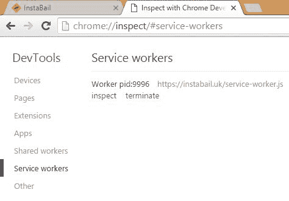

你也可以在 Chrome 中访问 `chrome://serviceworker-internals` 来查看所有已注册 service workers 的状态，即使这些网站没有打开。例如，即使在关闭 [`instabail.uk/`](https://instabail.uk/) 后，你应该仍然继续看到类似下面的截图的内容：

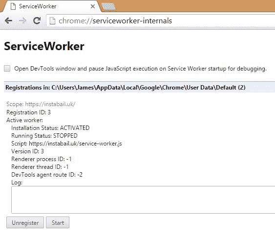

你可以通过点击 Unregister（注销）按钮移除 service workers。如果服务正在运行，你将看到 Stop（停止）和 Inspect（检查）按钮代替 Start（开始）按钮。此页面在未来的 Chrome 版本中可能会移除或合并到检查器中。

现在你可以开始向你的 service worker JavaScript 文件添加内容了。我们首先需要安装 worker 并缓存一些文件，这是通过事件监听器完成的，如下代码所示：

```javascript
self.addEventListener('install', function (event) {
    event.waitUntil(
        caches.open('cache-v01').then(function (cache) {
            return cache.addAll([
                '/',
                '/Content/bootstrap.min.css'
            ]);
        })
    );
});
```

我们将缓存命名为 `cache-v01`，并提供了一个要缓存资源数组。你可能会在这里有更多条目，并在函数外部定义数组，但为了清晰起见，我们在这里保持了简单。

如果你的首页动态渲染实时内容，请不要缓存它。正如之前提到的，你可能还想为资源使用缓存失效（cache-busting）参数。

然后我们可以添加一个 `fetch` 事件监听器来执行缓存和获取资源的魔术：

```javascript
self.addEventListener('fetch', function (event) {
    event.respondWith(
        caches.match(event.request)
            .then(function (response) {
                if (response) return response;
                var myReq = event.request.clone();
                return fetch(myReq).then(
                    function (response) {
                        var myResp = response.clone();
                        caches.open('cache-v01')
                            .then(function (cache) {
                                cache.put(event.request, myResp);
                            });
                        return response;
                    }
                );
            })
    );
});
```

首先我们检查请求的资源是否在缓存中，如果是，则返回。通过 promises，你可以将 `then` 函数链式连接。如果由于资源不在缓存中导致缓存未，我们将向服务器执行 `fetch` 获取资源并返回。然后我们将资源放入同一个缓存中与其他资源一起。我们克隆了请求和响应，因为它们是流，只能被消费一次。


`fetch`函数是`XMLHttpRequest` (`XHR`)的现代版本，用于通过网络检索数据。你不能在service worker内部使用同步XHR，因为它们被设计为异步。

你可以使用浏览器开发者工具（`F12`）更详细地检查你的service worker和缓存。在Resources标签页上，选择Service Workers，你会看到类似下面的截图：

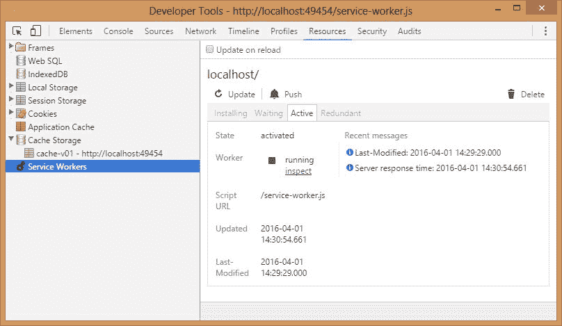

如果你选择Cache Storage，你将看到缓存的内容，它们看起来像如下：

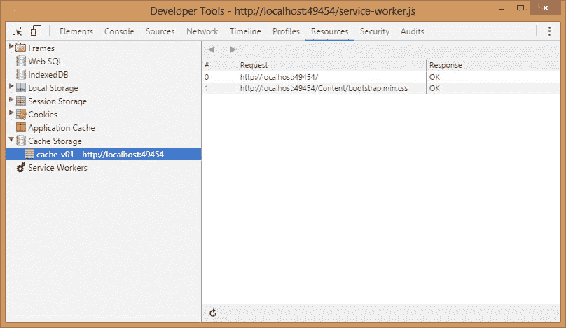

你可以通过右键点击刷新缓存并删除项目。Cache Storage上方的Application Cache将显示已弃的AppCache资源。随着你的导航，你的网站页面将被添加到缓存中（这些页面应该是适合缓存的，因为如果使用我们的演示代码，它们将不会再次从服务器请求）。

在此之后，一旦你刷新缓存视图，你应该能看到列出的更多条目，它们看起来可能像下面的截图：

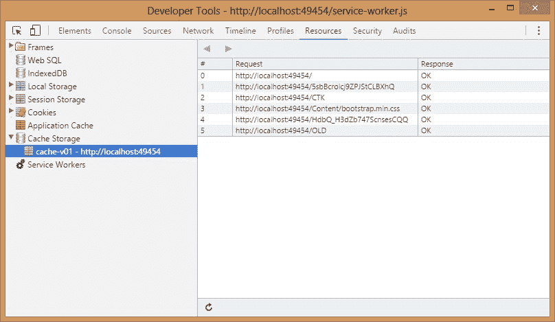

你可以看到缓存条目是按字母顺序列出的，而不是它们被添加到缓存的顺序。这些页面现在将成为快照，固定在它们被检索时的时间点。这可能不是你想要的功能！

为了简单起见，我们在这里构建的service worker是一个微不足道的示例，你可能想要扩展它，至少要通过添加`catch`语句来处理网络`fetch`失败的情况。例如，你可以用它提供一个之前缓存的离线备用页面。你还应该检查没有缓存来自服务器的错误页面，因此要测试响应状态码。

你还需要仔细考虑你的缓存失效策略。Service workers为你提供了构建这种策略的工具，因为它们不像HTML5 AppCache那样有许多假设。例如，你现在可以程序化地删除缓存中的条目。

我们将此留在这里用于客户端脚本控制的缓存，但一旦规范稳定且浏览器支持更广泛，你可能想更深入地研究一下。

`Internet Information Services` (`IIS`)是微软的Web服务器。它可以用于提供来自ASP.NET应用程序的内容，或作为代理服务器，并支持FTP等许多其他功能。IIS支持输出缓存，通过`OutputCache`属性实现。你还可以使用`ResponseCache`来设置正确的标头，这在第6章*解决网络性能*中有介绍。

ASP.NET Core 2.0现在在Windows上使用IIS时已支持从Visual Studio 2017进行调试。你可以附加到进程并逐步执行代码，就像处理传统的ASP.NET项目一样。如果你计划在生产环境中使用完整版IIS，那么在完整版上进行测试是一个好主意。使用Kestrel或IIS Express进行测试的效果是有限的，你应该尽量在早期尽可能地模拟真实环境。

IIS也可以用作代理，例如位于单台机器的Kestrel Web服务器之前。然而，当为多个Web服务器进行缓存时，使用诸如Varnish等专用的代理服务器软件可能会更好。

## Varnish

Varnish是一个免费的反向代理服务器，运行在`Linux`和`FreeBSD`等类Unix操作系统上。你可以使用包管理器（例如`apt`或`yum`）安装它，或使用DevOps软件（如`Chef`或`Puppet`）配置代理服务器。要配置Varnish，你需要使用一种特定领域的语言（`DSL`），称为`Varnish configuration language` (`VCL`)。

你可以在[`varnish-cache.org/`](http://varnish-cache.org/)阅读更多关于Varnish的信息。

如果你正确使用了HTTP缓存标头，就不需要配置Varnish。不过，你也可以使用自定义的HTTP`PURGE`方法从缓存中删除项目，这与Squid代理软件同样有效。如果Varnish配置不当，你可能会看到晦涩的guru meditation（大师冥想）错误，但你应该能够在Varnish日志中追踪该问题。它可能表明没有可用的健康Web服务器。

Varnish配置超出了本书的范围，但Varnish网站上有详尽的文档。如果你不想运行自己的代理服务器，可以使用CDN。即使在使用CDN的情况下，你可能仍然想要自己的代理，因为具有许多接入点（`PoP`）的大型CDN可能会通过每个接入点请求相同的资源，而不在它们之间共享资产。如果你支付了大量的带宽费用，这可能会成为问题，尽管某些CDN具有（通常称为源站保护）功能可以帮助解决这个问题。

## 使用内容分发网络

CDN通常有两种用法：作为卸载你内容的代理，或者作为常用第三方库和框架的托管提供商。对于第一种用例，可以使用动态CDN服务（如CloudFlare或Akamai），但第二种情况（使用来自Google或Microsoft的静态CDN）更为常见，这也是我们在这里介绍的内容。

尽管随着HTTP/2的采用，对库（如`jQuery`和Twitter bootstrap）使用CDN的用处在减少，但它对于降低托管成本仍然很有帮助。此外，如果你使用流行的CDN和库，用户可能已经拥有某些所需资源的副本。例如，如果用户访问过另一个使用Google CDN上的`jQuery`的网站，那么它可能已经存在于他们的浏览器缓存中了。

对于你从CDN获取的任何文件，拥有备用副本是至关重要的。有了ASP.NET Core内置的Razor视图引擎，这比以往任何时候都容易。

以下代码显示了默认MVC Razor布局中`jQuery`是如何包含的（针对非开发环境）。代码同时指定了CDN和本地版本，并带有一个测试：

```html
<script src="https://ajax.aspnetcdn.com/ajax/jquery/jquery-2.2.0.min.js"
        asp-fallback-src="~/lib/jquery/dist/jquery.min.js"
        asp-fallback-test="window.jQuery"
        crossorigin="anonymous"
        integrity="sha384-K+ctZQ+LL8q6tP7I94W+qzQsfRV2a+AfHIi9k8z8l9ggpc8X+Ytst4yBo/hH+8Fk">
</script>
```

之前的代码段不仅为Microsoft CDN生成了标准的`<script>`标签，随后还添加了以下内联JavaScript，如果CDN加载失败，将包含本地版本：

```javascript
(window.jQuery||document.write("\u003Cscript src=\u0022\/lib\/jquery\/dist\/jquery.min.js\u0022 crossorigin=\u0022anonymous\u0022 integrity=\u0022sha384-K\u002BctZQ\u002BLL8q6tP7I94W\u002BqzQsfRV2a\u002BAfHIi9k8z8l9ggpc8X\u002BYtst4yBo\/hH\u002B8Fk\u0022\u003E\u003C\/script\u003E"));
```

以前，你必须手动这样做，通常是在CDN宕机时的紧急情况下。这个新的助手也适用于其他脚本和CSS文件。更多示例，请查看默认模板中的`_Layout.cshtml`。

使用安全的HTTPS连接到CDN资源是重要的，以避免浏览器中的混合内容警告或脚本加载错误。大多数流行的CDN都支持HTTPS，为了安全起见，你应该使用SRI哈希值（如前面的示例所示）。有关CDN的更多信息，请参见第6章*解决网络性能*。

### 何时不应缓存

在某些情况下，你不应该缓存页面，或者至少需要对处理方式要非常小心。作为一个通用原则，缓存授权页面的渲染输出是一个坏主意。换句话说，如果用户已经登录了你的网站，而你正在为他们提供定制化内容（这些内容可能很敏感），那么你需要非常仔细地考虑缓存。

如果你不小心将一个用户的缓存内容提供给另一个用户，最好的情况下，这会令人烦恼，因为个性化是不正确的；最坏的情况下，你可能会将隐私信息暴露给错误的人，并可能陷入法律麻烦。

这与在提供身份验证内容时不通范围启用CORS的通用规则类似。这可以实现，但你需要理解其机制以便安全地配置它。

**跨源资源共享**（`CORS`）通常用于允许来自另一个网页的JavaScript访问JSON API。如果没有它，浏览器将阻止不同源的脚本之间的通信。

对于缓存，你需要在URL中有一个无法预测的唯一标识符。某些由网络设备和CDN使用的动态缓存系统可以利用Cookie实现这一点，但这超出了基于HTTP的缓存控制。这与负载均衡器上可能需要粘性会话（sticky sessions）的情况类似，因为你的应用程序并非设计为无状态的。

### 应用层缓存

应用级（或层）缓存意味着在基础设施内部临时存储重用数据，而不是在主数据库中。这可以在应用程序或Web服务器的内存中，但在多服务器的情况下，这通常位于分布式内存存储中，如`cached`或`Redis`。

当然，你可以同时使用Web服务器上的内存存储和集中缓存。然而，如果你有多个Web服务器，你需要一种同步缓存的方法。你可以使用**发布/订阅**（`pub/sub`）消息来实现这一点，我们将在本章晚些部分介绍。

下面的图显示了一个简单的集中缓存设置。在实际情况下，你可能会有多个集群缓存服务器：

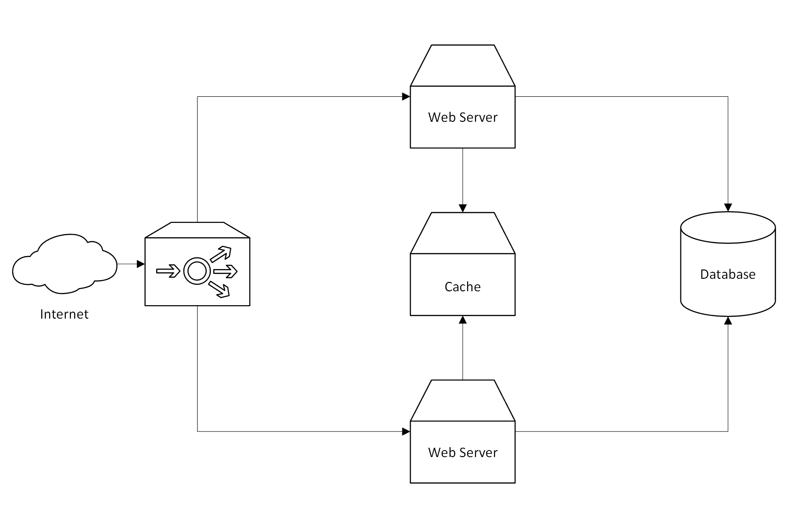

Web服务器现在可以在访问数据库之前，先询问缓存所需的数据是否存在其中。这减少了`DB`的负载，而且通常速度更快，因为如果数据存在，它将位于内存中。如果发生缓存未且确实需要查询数据库，则可以将结果写入缓存以供其他服务器使用。

### Redis

Redis是一个流行的内存存储器，也可以将数据持久化到磁盘以进行永久存储。它在Linux上运行得最好，但也提供了用于开发目的Windows版本。Redis额外支持发布/订阅（pub/sub）消息，这对于缓存失效非常有用。你可以在[`redis.io/`](http://redis.io/)了解更多关于Redis的信息。

你可能希望在本地开发中使用Windows版本的Redis，但仍部署到支持的Linux版本。你可以在[`github.com/MSOpenTech/redis`](http://github.com/MSOpenTech/redis)获取Windows版本，或者在虚拟机中运行Linux版本，例如使用`Docker`或`Vagrant`。

Azure和AWS都提供了Redis缓存服务（`ElastiCache`同时提供Memcached和Redis）。你不需要管理自己的服务器，但因为这项技术并非云平台专用，所以如果你将来想迁移，将不会被锁定。

由于Redis将整个数据集保留在内存中，但也能持久化到磁盘，因此它可以作为主数据存储器，这与Memcached不同。然而，它通常仅用作缓存，特别是当使用云服务并与`Azure SQL Database`或AWS`Relational Database Service` (`RDS`)等云数据库配合使用时。

有两个推荐的Redis .NET C#客户端：`ServiceStack.Redis`和`StackExchange.Redis`。后者在Stack Overflow等网站上被大量使用，并且比ServiceStack客户端更容易正确地使用。你可以在[`github.com/StackExchange/StackExchange.Redis`](http://github.com/StackExchange/StackExchange.Redis)阅读更多信息，并通过NuGet安装它。

如果在应用程序层使用缓存，那么你可能需要编写大量的自定义代码。你还需要确定要将数据序列化为何种格式以存储在缓存中。如果直接提供给浏览器，JSON可能会很有用。但如果是内部使用，你可能更偏于使用二进制格式，如`MS Bond`或协议缓冲区（protocol buffers）。

更多关于序列化格式和库的信息，请参阅第8章，*理解代码执行与异步操作*。

### 数据库结果集缓存

数据库级别的缓存与应用程序级别的缓存类似，使用的基础设施也相似，但需要的自定义代码较少。你可以使用O/RM内置的缓存功能，这可能使得重构变得更容易。

当我们在这里讨论数据库缓存时，指的不是数据库引擎内部的缓存。数据库使用广泛的性能增强技术（如查询缓存），并将大量数据保存在内存中。然而，这些对于开发者来说是抽象的，而我们提到的缓存是指将查询结果存储在应用程序缓存中。这与上一节相似，但有细微的差别，因为在上一节中你将存储自定义对象。

在O/RMs（如`NHibernate`和`Entity Framework`）的背景下，这被称为二级缓存。一级缓存通常已经在每个会话（session）中默认发生，用于帮助避免诸如*select N+1*问题。二级缓存的运行层级高于单个事务，允许你在整个应用程序中跨多个数据库会话共享缓存数据。

## 消息队列

`消息队列` (`MQ`)是一种在系统中移动数据的异步且可靠的方式。它对于将工作从Web应用程序卸载到后台服务非常有用，也可以用于并发更新系统的多个部分。例如，将缓存失效数据分发到你所有的Web服务器。

消息队列增加了复杂性，我们将在第10章](#text00233.html)*性能增强工具的缺点*中涵盖其管理方法。然而，它们也可以协助实现`微服务架构`，即你将单体应用拆分为更小的部分，并通过合约（contracts）进行交互。这使得大型组织内部的推理变得更容易，因为不同的团队管理应用程序的不同部分。我们将在下一章中详细讨论这一点，因为队列不是实现这种架构的唯一方式。你可以使用许多传输技术构建微服务，例如可以使用HTTP API。

## 读累了记得休息一会哦~

**公众号：古德猫宁李**

*   电子书搜索下载
*   书单分享
*   书友学习交流

**网站：**[沉金书屋 https://www.chenjin5.com](https://www.chenjin5.com)

*   电子书搜索下载
*   电子书打包资源分享
*   学习资源分享

## 咖啡店类比

如果使用消息队列，那么你可能需要为后台发生的错误实现额外的对账逻辑。用咖啡店的类比来解释是最好的。

如果你购买了一份外带咖啡，可能是在某个热门跨国连锁咖啡饮料店（它们不喜欢交税）的分支，那么你的饮料准备与支付处理是异步的。通常情况下，你下单后，咖啡师会在你付款之前开始准备你的咖啡。此外，你通常会在收到饮料之前付款。这里有很多可能出错的地方，但它们发生的频率足够低，以至于额外的成本是值得的，因为这加快了普通工作流。

例如，你可能会发现自己在下单后无法支付，但咖啡的制作过程已经开始了。这将导致库存浪费，除非有其他客户等待可以使用该咖啡。或者，在你付款后，咖啡师发现你的订单缺少了某种关键配料。他们可以为你提供退款，也可以协商另一种饮料。

尽管这种过程更复杂，但它显然优于串行执行这些操作。如果你必须证明你有支付能力、咖啡已做好，然后才完成支付，那么一次只能服务一个客户。假设有足够的员工，支付处理和饮料制作可以并行进行，从而避免了长长的客户队列。

这样运行咖啡店是符合直觉的，但在Web应用程序中，常见在告知用户结果之前先完成一个运行时间较长的事务。在某些情况下，假设操作将成功并立即通知用户，并准备好以防万一的流程可能会更好。

例如，支付处理网关可能缓慢且不可靠，因此在接受订单后收取用户的信用卡可能更好。然而，这意味着你不能再通过向用户显示错误消息来处理失败了。你将使用其他通信方法。

当你在Amazon上下单时，他们会立即获取支付详情，但在后台处理支付并向你发送结果邮件。如果支付失败，他们需要取消订单并通知你。这需要额外的逻辑，但比在确认订单之前处理支付交易并检查库存要快。

## 消息队列样式

广来说，消息队列有两种样式。这些样式分为有中心代理（broker）和无代理。使用代理时，所有消息都通过一个枢纽（hub），由它管理通信。这种样式的示例包括`RabbitMQ`、`ActiveMQ`和MS`BizTalk`。

还有无代理的样式（不使用代理），节点之间的通信是直接的。这种样式的示例包括ZeroMQ (`ØMQ`)，它有一个原生的C#端口叫`NetMQ`。

云队列服务也包括`Azure Service Bus`、`Azure Queue storage`和AWS的`Simple Queue Service` (`SQS`)。不过，与所有非通用的云服务一样，你应该警惕被锁定的风险。有一些提供标准RabbitMQ托管服务的云提供商，如果你最初不想运行自己的服务器，这会让以后迁移到你自己的基础设施变得更容易。例如，CloudAMQP在多个云平台上提供RabbitMQ托管。

RabbitMQ实现了`高级消息队列协议` (`AMQP`)，这有助于确保不同消息代理（MQ brokers）之间的互操作性，例如允许与`Java 消息服务` (`JMS`)进行通信。`Azure Service Bus`也支持`AMQP`，但RabbitMQ的一个大优势是你可以将其安装在开发机上本地使用，而无需连接互联网。

此外还有Windows内置的`Microsoft 消息队列` (`MSMQ`)。虽然这对于单台机器上进程之间的通信很有用，但在多个服务器之间要可靠地运行它可能会很困难。

### 常见消息模式

常见的消息模式有两种类型：点对点单播（point-to-point unicast）和发布/订阅（publish/subscribe）。它们分别向单个接收者和多个接收者发送消息。

### 单播 (Unicast)

单播是标准的消息队列方法。消息从一个服务进程或软件代理发送到另一个。队列框架将确保这一过程可靠地发生，并对交付提供某些保证。


这种方法虽然可靠，但随着系统的增长，它的扩展性并不好，因为每个节点都需要了解所有的接收者。更好的做法是将系统组件松耦合在一起，这样它们就不需要了解任何其他组件。

这通常通过使用代理（`broker`）来实现，它具有三个主要优势：

* 通过使用代理，你可以将进程彼此解耦，使得它们不需要了解系统架构，也不需要同时运行。它们只关心消息类型，而代理负责将消息路由到正确的目的地。

* 代理队列能够实现简单的工作分发模式，特别是当结合多个生产者时。你可以让多个进程消费同一个队列，代理将以轮询（`round-robin`）的方式将消息分配给它们。这是构建并行系统的简单方法，无需进行任何异步编程或担心线程。你只需要运行代码的多个副本（如果受硬件限制，也许可以运行在不同的机器上），它们将同时运行。

* 你可以轻松地广播或多播特定类型的消息，例如指示某个事件的发生。其他关注该事件的进程可以监听这些消息，而发布者无需感知。这被称为发布/订阅模式（`pub/sub`）。

### 发布/订阅 (Pub/sub)

顾名思，发布/订阅是指软件代理将消息发布到队列上，其他代理可以订阅该类型的消息进行接收。当消息被发布时，所有订阅者都会接收到，但至关重要的是，发布者不需要了解任何关于订阅者的信息，甚至不需要知道有多少个订阅者（甚至不知道是否存在）。

发布/订阅最好通过代理风格的消息队列架构来实现。虽然可以在没有代理的情况下完成，但并不特别可靠。如果你的用例可以容忍消息丢失，那么你可能不需要代理。但如果你需要保证递送，那么你应该使用代理。使用`RabbitMQ`代理还允许你利用交换器（`exchanges`），它可以执行复杂的消息路由。

如果你不想丢失消息，那么你就需要仔细设计你的发布/订阅系统（即使使用代理）。没有订阅者的发布消息可能就此消失在虚空中中而不留任何痕迹，这可能不是你想要的。

下面的图显示了简单消息转发、工作分发和发布/订阅之间的差异：

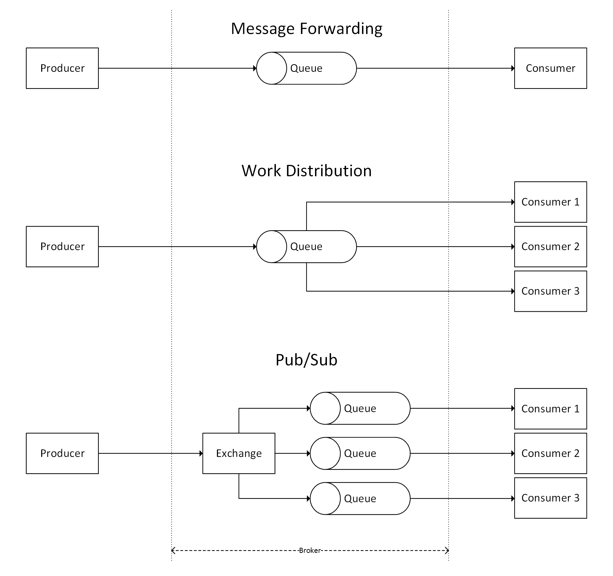

显然，如果你需要可靠的代理，那么它必须是高可用的。通常，会将多个代理聚集成群以提供冗余。使用代理还允许你编写自定义规则定义定义订阅者接收什么消息。例如，你的支付系统可能只关心订单，但你的日志服务器可能想要获取来自所有系统的所有消息。

你不仅需要监控代理服务器，还要监控队列的长度。换句话说，每个队列中的消息数量应该始终稳定并接近于零。如果队列中的消息数量持续增长，这可能表明存在问题，你的运维团队需要解决这个问题。可能是因为你的消费者处理消息的速度赶不上生产者发送消息的速度，你必须构建额外的消费者。这可以是自动化的，你的监控软件可以启动额外的实例来扩展你的系统，以应对临时的需求激增。

## RabbitMQ

`RabbitMQ`是一个免费开源的消息队列服务器。它用`Erlang`编写，这是`WhatsApp`在其消息后端所使用的同种健壮语言。

`RabbitMQ`目前由`Pivotal`维护（其实验室还开发了`Pivotal Tracker`捷项目管理工具），但它最初由`LShift`创建。随后它被`VMware`收购，最后作为合资企业拆分。它根据`Mozilla公共许可证`（`MPL`）v1.1发布，这是`Firefox` Web浏览器使用的旧版本许可证。

该消息服务器可以使用许多不同的语言和框架，如`Java`、`Ruby`和`.NET`。这可以有助于将各种应用程序连接起来，例如，一个想要与`ASP.NET Core`应用或`C#`服务接口的`Rails`应用。

你可以从[`www.rabbitmq.com/`](http://www.rabbitmq.com/)读取更多关于`RabbitMQ`的信息并下载构建。

`RabbitMQ`比`MSMQ`等系统更现代，包含了`HTTP API`和Web管理界面等功能。除了`HTTP`和`AMQP`，它还支持`简单文本面向消息协议`（`STOMP`）和`MQTT`，这对于轻级`物联网`（`IoT`）硬件应用非常有用。所有这些协议都提高了与其他消息系统的互操作性，并且通常可以使用标准的`TLS`进行加密。

Web管理界面向你展示有多少消息流经你的队列以及它们是如何配置的。

它还允许你管理队列（任务如清理或删除消息），看起来类似于下面的截图：

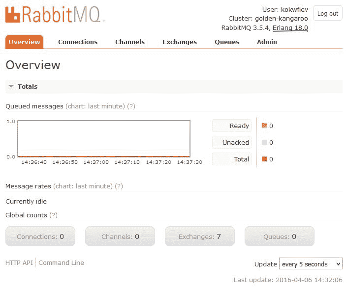

## 队列框架和库

你通常希望使用预构建的客户端库或框架来与你的消息队列交互。许多不同语言中都有针对各种队列系统的官方库，它们提供了低级访问。例如，`RabbitMQ`有一个官方的`.NET/C#`客户端库。

然而，还有其他具有特定倾向的客户端和框架，它们为常见的消息任务提供了更高层次的抽象。例如，`NServiceBus`（`NSB`）支持`RabbitMQ`、`MSMQ`、`SQL Server`和`Azure`，是一个商业产品。

`NSB`的免费替代方案是`MassTransit`（[`masstransit-project.com/`](http://masstransit-project.com/)），这是一个轻级服务总线和分布式应用程序框架。它还分出了超级方便的`Topshelf`框架（[`topshelf-project.com/`](http://topshelf-project.com/)），让创建`Windows`服务变得非常简单。

这两个项目目前尚未运行在`.NET Core`上，但这两个项目的迁移工作正在进行中。

`.NET Core`和`ASP.NET Core`的库和框架支持正在迅速进展，请查看[`anclafs.com/`](http://anclafs.com/)获取最新信息。欢迎随时为此列表提供帮助，或向任何需要移植的开源项目贡献代码。

`MassTransit`（以及`NSB`）的一个有趣特性是支持`saga`（长跨事务）。`Saga`是一个复杂的状态机，允许你对整个工作流的故事进行建模。与其定义单个消息并记录它们是如何结合在一起的，你可以在`saga`中隐式地捕捉黄金路径和错误流。

有一个优秀的开源库名为`EasyNetQ`，它让在`RabbitMQ`上实现发布/订阅变得轻易异常。你可以在[`easynetq.com/`](http://easynetq.com/)阅读关于它。`RabbitMQ`官方客户端和`EasyNetQ`现在都支持`.NET Core`。

你还可以考虑使用`RestBus`，它是一个支持`ASP.NET Core`的`RabbitMQ`库。你可以在[`restbus.org/`](http://restbus.org/)了解更多信息，它还额外支持`Web API`和`ServiceStack`。

## 总结

在本章中，我们研究了用于缓存和消息队列的各种工具和方法。这两种技术通过将数据移动到其他位置且不让一个巨大的单体完成所有工作，提供了改进系统性能的不同方式。

这些都是高级主题，很难在如此有限的空间内涵盖。希望你已经接触到了一些新想法，可以帮助你以不同的方式解决问题。你也可以访问作者的网站[`unop.uk/`](https://unop.uk/)了解更多主题的内容。如果你发现了一种你认为会有帮助的新技术，鼓励你阅读其文档和规范以获取所有的实现细节。

然而，在投入使用之前，你应该理解高级技术是复杂的并且带有缺点的，这会降低你的开发速度。在下一章中，我们将学习这些缺点，并发现管理复杂性的方法，例如微服务。

# 性能增强工具的缺点

我们在书中涵盖的许多主题都是以代价换取性能的。你的应用程序将变得更加复杂，更难理解或推理。本章将讨论这些权衡以及如何减轻它们的影响。

只有在你确实需要它们时，才应该实现你在书中书中学到的许多方法，而不是仅仅因为它们有趣或具有挑战性。如果现有性能已经足够好，保持简单通常是更好的选择。

你将学习如何对应该使用的技术和技术做出务实的选择。如果你选择使用高级方法，你也将看到如何管理这些复杂性。

本章涵盖的主题包括：

* 使用框架和架构管理复杂性

* 构建交付高性能的健康文化

* 分布式调试和性能日志记录

* 理解统计数据和过期数据

许多书籍和指南只关注新工具和框架的优点。然而，没有什么是是免费的，总会有代价，而且这种代价可能不会立而易见。

你可能在很一段时间内感觉不到你所做选择的影响，特别是在技术架构方面。在你尝试在其基础上构建之前，你可能都不会发现某个决定是糟糕的，也许是多年以后。

## 读累了记得休息一会哦~

**公众号：古德猫宁李**

* 电子书搜索下载

* 书单分享

* 书友学习交流

**网站：**[沉金书屋 https://www.chenjin5.com](https://www.chenjin5.com)

* 电子书搜索下载

* 电子书打包资源分享

* 学习资源分享

# 管理复杂性

性能增强技术的主要问题之一是它们通常会让系统变得更复杂。这会让系统更难修改，并可能降低你的生产力。因此，尽管你的系统运行得更快，但你的开发现在变慢了。

我们通常在企业软件中发现这种复杂性问题，尽管通常原因不同。通常，使用了许多不必要的抽象层，据说是保持软件的灵活性。讽刺的是，这实际上让添加新功能变慢了。在意识到简单让改变变得更容易之前，这看起来似乎是违背直觉的。

流行的程序员面试编程测试`FizzBuzz`有一个讽刺的企业版，可以在`GitHub`上找到（通过短链接[`www.fizzbuzz.enterprises/`](http://www.fizzbuzz.enterprises/)）。它是关于“不如何做事情”的一个很好的灵感。

如果你现在不需要某个功能，那么最好的方法通常是跳过它，而不是为了防备将来可能需要而构建它。你写的代码越多，Bug就越多，也越难以理解。过度工程是一种常见的负面心理特征，如果你不意识到这一点，很容易沦为被害，营销人员经常会利用这一点。

对于非软件示例的例子，四驱`SUV`被卖给那些永远不需要其越野能力的人，理由是“它某天可能会有用”的虚假前提。然而，财务、安全、环境和停车便利的成本超过了这种所谓的收益，因为它从未被用过。

我们通常将这种来自`极端编程`（`XP`）哲学的开发建议称为`你不需要它`（`YAGNI`）。虽然我们有时使用略有不同的词，但意义是一样的。`YAGNI`提倡保持简单，只构建你立即需要的东西。

这并不意味着你应该让你的软件变得难以修改。保持灵活性仍然很重要，只是不要在需要之前添加功能。例如，当只有一个实现时添加一个抽象基类可能是过度设计的。当你以及何时构建第二个实现时，你可以轻松地将其一起添加。

在操作时，要做到快速移动且不破坏东西是很的。除了保持持续良好的开发速度外，如何实现高可靠性取决于许多特定你情况的因素，例如团队规模、组织结构和公司文化。

一种方法是拥抱变化，并开发一个让你放心地重构代码的系统。使用像`C#`这样的静态编译语言是一个好的开始，但你还应该有一个全面的测试套件以避免回归。

你应该设计一个松散耦合的系统，这意味着你可以孤立地更改部分而不会产生许多连锁反应。这使得构建单元测试变得更容易，单元测试在重构时防止功能回归方面价值无量。

我们将在下一章中通过`持续集成`（`CI`）工作流涵盖测试和自动化。在本章中，我们将讨论更多可以帮助你维护应用程序的各种架构风格。

## 理解复杂性

在学习处理问题的方法时，你应该避免在不理解原因的情况下就去做它们。你应该知道优点和缺点，然后衡量变化以证明它们确实是你预期的那样。不要盲目地实现某些东西并假设它改善了局面。尽量避免`崇拜编程`，并客观地评估新方法。

货物崇拜编程（`Cargo cult programming`）是指模仿成功的方法但未能理解其有效原理的实践。它的名称源于太平洋岛屿的货物崇拜者，他们在二战后建造了虚假的跑道以鼓励货物交付。我们用这个词来描述许多将相关性误认为因果关系的现象。一个例子是，某公司为了鼓励员工长时间加班来交付项目，因为他们听过某些项目在员工加班的情况下取得了成功。然而，他们没有理解到成功的项目和长时间加班都是源于高积极性且高能力的员工，这两者是独立因素，它们之间没有直接联系。

保持代码的可读性至关重要，这不仅是为了团队中的其他成员或新成员，也是为了你未来的自己（因为你可能会忘记某些代码是如何运作的，以及为什么要那样编写）。这并不简单意味着要在代码中编写有帮助的解释性注释，尽管这是一种非常好的做法。它也适用于源码控制注释以及保持文档的更新。

可读性还涉及保持简单，即只让复杂性达到其所需的程度，而不是在不必要的抽象层中隐藏功能。例如，当使用标准结构（例如，循环或`if`语句）更具可读性且长度仅略长时，不要使用巧妙的编程技术来减少文件行数。

在团队中拥有一套标准的处理方法有助于避免意外。在任何地方使用同一种方法可能比找到一种更好的方法然后却留许多种不同的方法更有价值。如果达成了共识，那么你可以在任何需要的地方回溯并重构为更好的方法。

### 降低复杂性

有各种解决方案来管理性能增强技术可能带来的复杂性。这些方法通常通过隐藏复杂性，来减少你在任何时候需要考虑的逻辑量。

一种方案是使用框架来标准化你编写应用程序的方式，这使其更容易推理。另一种方法是使用一种架构，允许你孤立地思考代码库的较小部分。通过将复杂的应用程序拆分为可管理的区块，它会变得更容易处理。

这种模块化的思想与`单一职责原则`（`SRP`）有关，它是`SOLID`原则中的第一项（其他是开闭原则、里氏替换、接口隔离和依赖反转）。它也与高层的`关注点分离`（`SoC`）以及`Unix`哲学的简单性相似。拥有许多每个只做好一件事的工具，比拥有一个把很多事情都做坏的工具更好。

## 框架

前端框架近年来变得流行。Facebook的`React`是一个旨在使用`JavaScript`可靠地构建Web应用视图的库，尽管其专利许可存在争议。其目标是通过简化数据流和标准化方法来帮助大型团队进行项目工作。`React`可以通过`ReactJS.NET`项目（[`reactjs.net/`](https://reactjs.net/)）与`ASP.NET Core`集成。

这不要与`React Native`混淆，后者用于构建跨`iOS`、`Android`和`通用Windows平台`（`UWP`）共享代码的跨平台应用。如果你喜欢使用`C#`，可以使用`Xamarin`构建跨平台移动应用。然而，我们在书中不会深入讨论这些任何一种技术。访问作者网站（[`unop.uk/`](https://unop.uk/)）可以了解`ReactJS.NET`和`Xamarin.Forms`。

在后端，我们有`.NET Core`和`ASP.NET Core`的服务端框架。结合`C#`特性，这些框架提供了简化性复杂功能的方便方法。例如，`async`和`await`关键字隐藏了许多与异步编程相关的复杂逻辑，而`lambda`函数则简洁地表达了意图。

我们在书的前部涵盖了这些特性中的许多，因此在这里不再重复。我们还强调了可以通过隐藏复杂操作的样板代码来让生活变得更简单的库，例如`EasyNetQ`和`RestBus`。

隐藏复杂过程永远是不完美的，你偶尔会遇到泄露某些实现细节的抽象。例如，在处理异常时，你可能会发现感兴趣的问题现在被封装在一个聚合异常（`aggregate exception`）中。如果不小心，你的错误日志可能不再包含你所需的细节。

不记录异常的单个属性是一个良好的做法，因为异常内置了输出所有相关信息的逻辑。只需将异常作为字符串记录即可获取消息和堆栈跟踪，包括任何内部异常。

我们尚未详细讨论的是Web应用的架构。将单体系统拆分为离散的部分不仅可以提高性能，如果操作得当还可以使其更容易维护。

### 架构

在上一个章节中，讨论消息队列时，我们简要介绍了微服务架构。这种风格是对传统`面向服务的架构`（`SOA`）的更现代的重新构，尽管于使用可靠的`MQ`通信，但我们也可以通过`表述状态转换`（`REST`）HTTP API来实现。

通常情况下，我们将传统的Web应用构建为一个单一应用程序或单体（`monolith`）。如果应用在很一段时间内有机增长，这是很常见的，也是一种完全可以接受的做法。在任何需要之前过早进行过度工程是一个糟糕的决定，因为这种需要可能永远不会。

过度流行是一个很棒的问题，但不要过早地为此优化。这并不是让事情变得不必要的缓慢的借口，请务必理解涉及的权衡。

使用单体架构不是构建糟糕代码的借口，你应该为扩展做计划，即使你没有立即实施。你可以在保持简单的同时仍允许未来的增长。尽管应用程序是一个单一单元，但你应该将代码库拆分为组织良好的模块，这些模块以简单、逻辑且易于理解的方式连接在一起。参考之前提到的`SOLID`原则。

如果单体应用程序无法轻松扩展以满足用户需求并导致性能不佳，那么你可以将其拆分为更小的独立服务。如果一个应用变得过于臃肿难以快速迭代且开发速度变慢，你可能希望将其拆分。

### 单体与微服务

下面的图显示了典型的单体和微服务架构之间的一些区别：

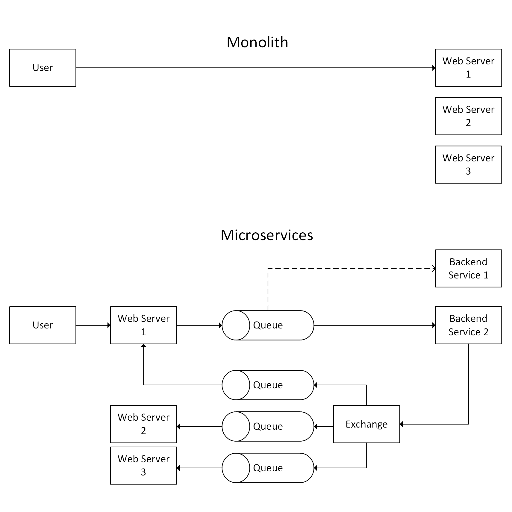

在这里，用户向运行在Web集上的应用程序发送请求。为了清晰，我们省略了防火墙、负载均衡器和数据库，但显示了多个Web服务器是为了说明相同的代码运行在多台机器上。

在初始的单体架构中，用户直接与单个Web服务器通信。理想情况下是每个请求/响应对一次。然而，如果应用程序设计不当并将状态保存在内存中，`粘性会话`（`sticky sessions`）可能会导致负载在某些服务器上。

图中的第二个例子，即微服务架构，显然更复杂，但也更灵活。用户再次向Web服务器发送请求，但服务器不是完成所有工作，而是向队列中放入一条消息。

该队列中的工作在多个后端服务之间分配，其中第一个服务正在忙，因此第二个服务会提取消息。当服务完成时，它会将消息发送到消息代理上的交换器（`exchange`），交换器通过发布/订阅（`pub/sub`）广播通知所有Web服务器。

增加的一个复杂性是，架构应该已经向用户的原始Web请求发送了响应，因此你需要更仔细地考虑`用户体验`（`UX`）。例如，你可以显示进度指示器，并通过异步的`WebSocket`连接更新其状态。

### 架构比较

单体架构方法非常简单，你只需要添加更多的Web服务器来处理额外的用户。然而，随着应用程序（以及开发团队）的规模不断扩大，这种方法可能会变得繁琐，因为即使是微小的变化也需要对每个Web服务器进行重新部署。


此外，单体易于进行垂直扩展（向上扩展），但难以进行水平扩展（向外扩展），这一点我们之前讨论过。不过，单体更容易调试，因此你需要小心，并拥有良好的监控和日志记录。你不希望任何随机的停机调查因为不必要的微服务实现而变成一场“谋杀案谜游戏”。

历史上，Facebook 拥有一套部署流程，即缓慢地编译他们的 `PHP` 代码库成一个巨大的 GB 级二进制文件（出于运行时性能考虑）。然后他们需要开发一个修改版的 `BitTorrent`，以便将这个巨大的可执行文件高效地分发到所有的 Web 服务器上。虽然这是令人印象的基础设施工程，但它并没有解决他们 `技术债` 问题的根源，从那以后，他们转向了更好的解决方案，例如 `HipHop Virtual Machine`（`HHVM`），它类似于 `.NET CLR`。

如果你希望实践持续交付并每周部署多次（甚至每天部署多次），那么将你的 Web 应用程序拆分是有优势的。你可以独立地维护和部署每个部分，并通过针对约定好的 `API` 的消息彼此进行通信。

这种分离还可以帮助你使用敏捷开发方法——例如，使用许多小团队而不是大团队，因为小团队的表现更好。

你扩展单体的控制手段非常粗糙，因为所有工作都在一个地方完成。你无法独立地将应用的某些部分扩展到应用程序的其他组件。你只能扩展整个整体，即使高负载集中在很小的一部分。这正比中央银行只有一个单一利率作为杠杆，它会同时影响许多事情。如果你的应用程序是分布式的，那么你只需要扩展需要的部分，从而避免过度配置并降低成本。

亚伯拉罕·马斯洛（Abraham Maslow）有一句被广泛引用（经常被重新表述）的名言：

> “我想，如果你唯一的有的工具是锤子，那么把一切都看作钉子是有诱惑力的。”

这被称为工具法则（`law of the instrument`），与确认偏误有关。如果你只有一个工具，你很可能会用这个工具处理所有事情，并且只看到支持你现有观点的观点。这通常适用于工具和框架，但也适用于扩展技术。

通向模块化的第一步可能是将一个大型 Web 应用程序拆分成许多较小的 Web 应用程序，以便你可以单独部署它们。这种策略可能带来一些收益，但也有许多局限性。某些逻辑可能不适合在 Web 应用中，例如长时间运行的进程，如监控 `文件` 或用于处理媒体的进程。

你可能发现自己需要复制原始单体中共享的代码。如果你遵循 `不要重复自己`（`DRY`）原则，那么你可能会将此功能提取到库中。然而，你现在有了依赖关系和版本需要管理。你还需要构建、打包和在私有仓库中托管你的库的流程，所有这些都会减慢开发并降低你的灵活性。

有时，我们也将 `DRY` 称为 `重复即是恶`（`DIE`），这是一种明智的想法，即实现应该只出现在一个唯一的位置。如果其他代码需要此功能，它应该调用原始函数，而不是粘贴复制的代码。这意味着你只需要在一个地方进行更改，即可将其应用到所有地方。

一种更高级的方法是将功能提取到单独的服务中，该服务可以处理许多不同的 Web 应用程序。如果设计得当，那么该服务不需要了解这些应用，只需响应消息即可。这允许你添加新的 Web 应用程序，而无需更改其他应用程序或服务的代码。

## 重构

如果应用程序已经变成了一个紧耦合的“大杂泥球”（`big-ball-of-mud`），那么将单体重构为服务可能会很棘手，但如果构建得良好（具有大量的测试覆盖和松耦合的代码），那么它就不应该太费力。构建良好的单体与缺乏思考的“大杂泥球”之间存在巨大的差异。

扩展测试覆盖是值得的，因为单元测试对于在不引入回归或新 Bug 的情况下成功重构至关重要。单元测试允许你放心地进行重构和清理，并防止创建开发者不愿触碰的脆弱代码。我们将在第 11 章，监控性能回归中更详细地介绍测试，包括自动化。

这两种设计模式在表面上可能相似，但内部完全是另一回事。接接图说明了架构良好的单体与混乱的“大杂泥球”之间的区别。

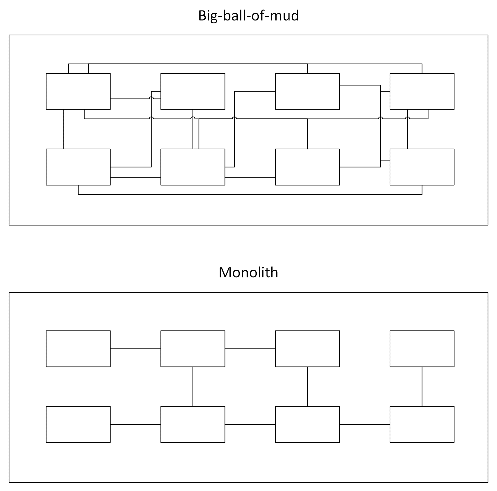

大方框代表运行在每个 Web 服务器上的代码（即之前那张图中单体示例中的 `Web Server N` 框）。从外部看，它们看起来是一样的，但区别在于代码的内部耦合性。

“大杂泥球”是一个混乱的乱团，代码在整个应用程序中引用其他函数。单体结构良好，不同模块之间有清晰的关注点分离。

对“大杂泥球”中代码的更改可能会产生想不到的副作用，因为它的其他部分可能依赖于你正在修改的实现细节。这使其变得脆弱、难以更改，并且开发者可能害怕触碰它。

构建良好的单体很容易进行重构并拆分为单独的服务，因为代码组织得很整齐。它使用抽象接口在模块之间进行通信，代码不会渗透另一个类的具体实现细节。它还具有极好的单元测试覆盖，这些测试会在每次提交/推送时自动运行。

工具在重构和测试中也非常有用。我们之前涵盖过 Visual Studio IDE 和 ReSharper 插件，但还有许多测试工具。我们将在第 11 章，监控性能回归中涵盖更多测试工具，包括自动化。

虽然两者都是单一代码库，但单体的质量高得多，因为在内部分布良好。良好的设计对于未来的保护至关重要，因为它允许扩展。单体没有被过早拆分（在需要扩展之前），但这种设计使得以后这样做变得很容易。相比之下，大杂泥球积累了大量的技术债，在我们取得任何进展之前，需要偿还这些债务。

技术债（简称为 `tech debt`）是指未完成工作或走捷径的概念，这在债务被偿还之前可能会导致更多困难。例如，未能对系统进行妥善的记录将让新开发者的工作变得更加困难。如果技术债是在完全知情的情况下刻意承担、记录并在稍后偿还的，那么它并不一定是一件坏事。例如，等到发布后再编写文档，这可以加快交付速度。然而，未被偿还或在不知情的情况下积累（仅仅是因为代码编写草率）的技术债会随着时间的推移而恶化，并在以后导致更严重的问题。

交付高质量且灵活（易于重构）应用程序的最佳方法是拥有一支胜任且尽职的团队。然而，这些特质更多地取决于文化、沟通和动力，而不仅仅是技能或原始天赋。虽然这并不是一本关于团队管理的书，但拥有健康的文化非常重要，因此我们在这里将涉及一些内容。运营和软件开发部门的每个人都可以帮助营造积极友好的文化氛围，即使你通常也需要高层的支持。

# 高性能文化

如果你想实现高性能，那么培养一种鼓励这种行为并将性能视为至关重要的公司文化是非常重要的。文化不能仅仅从底层产生（仅涉及工程师）。文化需要从顶层开始，管理层必须认同性能优先的特权。

这一部分不怎么技术化，如果你不在乎管理或软件开发的人性方面，可以随时跳过。

## 读累了记得休息一会哦~

**公众号：古德猫宁李**

- 电子书搜索下载
- 书单分享
- 书友学习交流

**网站：**[沉金书屋 https://www.chenjin5.com](https://www.chenjin5.com)

- 电子书搜索下载
- 电子书打包资源分享
- 学习资源分享

## 无责文化

高性能文化最重要的特质是它应该是开放且无责的。每个人都应该专注于通过衡量和学习来尽可能获得最佳结果。将错误归咎于个人对于交付优秀软件来说是有毒的，这在涉及性能时也是如此。

如果出了问题，那么它就是流程问题，重点应该放在改进流程以及防止未来重复错误上，例如，通过自动化来实现。这与航空旅行等安全关键型行业采取的方式相似，因为他们意识到指责人们会阻碍他们在灾难发生前早期提出问题。

相关的哲学是日本的“改善”（Kaizen），它鼓励每个人进行持续改进。汽车制造商丰田开创了改善实践以提高生产线的效率，此后大多数汽车公司和其他许多不同行业都采取了这些做法。

某些行业还拥有鼓励举报的流程，以保护提出意见的个人。然而，如果在 Web 应用开发中需要这些，那么这就是文化需要改进的明确信号。开发者应该觉得他们可以直接跳过直属经理提出疑虑，而没有任何后果。如果每个人的意见都受到尊重，那么这甚至是不必要的。

### 智力诚实

如果团队成员在想法受到挑战时产生防御心理，这说明事情可能运行得不好。每个人都会犯错，知识上也有空白，这是优秀的工程师所拥有的真理。你应该努力营造一种每个人对新想法都开放并不断提问题的文化。

如果人们无法接受建设性的批评和想法受到挑战，他们可能缺乏自信，并可能在掩盖能力的不足。经验丰富的开发者知道学习永无止境；他们承认自己的无知，并始终对改进建议持开放态度。

对建议关闭门会改变他人的行为，导致他们停止尽早提出小问题。这导致了关于质量低下的“公开秘密”，而关于问题的第一个为人知的情况是在发布时，那时一切已经变得糟糕得多（或失控了）。

这并不是对别人粗鲁的借口，所以要始终尝试友好，并温和地解释批评背后的原因。在任何事情中找错都是容易的，所以始终提出一种替代方案。如果你有耐心，理智的人会对学习机会表示感谢，并感激获得经验。

一个遵循的良好规则是 `don't be a jerk`（不要当混蛋），像你希望被对待的方式那样对待他人；所以要善良，并考虑如果换成你会感受如何。只要记住，善良并不总是与做正确的事情兼容。

一点点自嘲可以让你变得更平易近人，而不是仅仅是独规定唯一的真理。然而，你应该明确说明什么时候是开玩笑或随口一说，特别是在与更直接的文化打交道，或者通过文本进行交流时。

概括而论（永远没有任何例外）总是一个坏主意。然而，作为一个例子，美国人通常没有英国人那么含蓄，也没有像英国人那样讽刺（英国人的拼写方式也不同，有些人会说他们的拼写更正确）。显然，请使用你自己的判断，因为这可能是糟糕的建议，并可能引起冒犯，甚至更糟，引发一场全面的外交事件。希望显而易见的是（也许可能不是）这整段话都是随口一说的。

具有诚信并对自己的想法有信心的人可以表现得谦虚和自嘲，但公司内部文化也会影响这一点。一种特别糟糕的做法是通过 `阶梯排序`（也称为堆栈排序，`stack ranking`）进行绩效评估，这涉及到将每个人相对于其他人进行排序。这种做法是有毒的，因为它奖励了那些更关注自我推销的人，而不是那些意识到自己技术技能有缺陷并试图改进他们的人。在病态的情况下，所有优秀的人都被挤出去，你最终得到一个满是社会病态的西装精英的公司，他们在技术上是文盲的，甚至在道德上破产。

### 慢中求快

有时，公司必须允许开发团队放慢功能交付的速度，以便专注于性能和解决技术债。他们应该被给予时间深思设计决策，以便他们思考避免过度泛化或草率的优化。

性能是软件的一个重要卖点，在整个开发过程中构建质量比在最后的润色阶段构建要容易得多。有大量的证据表明，良好的性能可以提高你的 `投资回报率`（`RoI`）并创造客户。这在 Web 上尤其如此，性能糟糕会降低转化率和搜索引擎排名。

拥有一个健康的文化不仅对你软件的运行时性能重要，而且对你开发它的速度也重要。应该鼓励团队表现得严谨，并编写精确且简洁的代码。

虚假经济是指你采取了短期成本节省措施，但这些措施从长期来看会让你损失更多钱。例子包括缩减开发者的硬件投入，或者在某人写代码时用琐碎的事情打断他们（这些事可以等以后再处理），并强制他们切换上下文。

另一个非软件的例子是短视的政府削减研发投入，为了短期成本节约而牺牲长期增长。或者一个国家离开经济联盟，理由是承诺成员费将用于用在更好的事情上，尽管这笔费用与经济带来的长期损失相比是微不足道的。

硬件的成本远低于开发人员的时间成本。因此，如果你团队中的每个人都没有配备一台高配置的机器和多台大显示器，那么生产力就会被无谓地降低。即使在十年前，Facebook 的软件开发人员招聘广告也也将双 24 英寸宽屏显示器列为福利。

### 从零开始

在健康且进步的文化中，人们可能会受到从头开始重写低质量软件的诱惑，也许是使用最新的流行框架，但这通常是一个错误。发布的软件是经过实战锤炼的（无论它们构建得有多糟糕），如果你重写它，你可能会再次犯同样的错误，例如重新实现你已经修补过的 Bug。如果软件在构建时没有良好的单元测试覆盖，这一点尤为如此，因为单元测试可以帮助防止回归。

唯一你可以合理地从零开始重写应用程序的情况，是你特意制作了一个原型来探索问题空间，且唯一的意图就是将其丢弃。然而，你应该非常小心，因为如果你实际上构建的是 `最小可行性产品`（`MVP`），那么这些实际上是 MVP 的原型往往会长期留存，并成为更大应用程序的基础。

完全重写的一种更好方法是为应用程序添加测试（如果它还没有的话），并逐渐对其进行重构以提高其质量和性能。

如果你构建应用程序的方式使其难以进行单元测试，那么你可以先从 `用户界面`（`UI`）测试开始，也许使用无头网络浏览器。我们将在下一章介绍更多测试内容，包括性能测试。

### 共同价值观

文化本质上是一组共同价值观，包括开放性、可持续性、包容性、多样性和伦理行为等内容。将这些价值观正式记录下来是有帮助的，这样每个人都知道你们的立场。

你可能采用进步的公开薪资政策，这样其他人就无法利用秘密收入信息作为压低员工工资的工具。然而，这需要适用于所有人，因为存在相互冲突的文化是不健康的，因为这可能会导致“我们对他们”的对抗。

关于文化还有很多可以说的，但正如你所看到的，有许多竞争性的关注需要平衡。最重要的想法是进行有意识且深思熟虑的权衡。没有正确的选择，但你应该始终意识到后果，并感激微小的行动如何改变团队的性能。

### 性能的代价

开发人员应该对性能可用预算有一个了解，并理解他们所写代码的成本，不仅体现在执行吞吐量上，还体现在可读性、可维护性和能效上。为某项任务投入更多的核心，远不如将其重构得更简单。

效率变得愈发重要，特别是随着移动设备的兴起和云计算按时间计费模式的出现。并行化一个低效算法可能会解决时间维度上的性能问题，但这是一种粗暴的暴力破解方法，更改底层实现可能更好。

少即是多，有时无所事事最好的方法。软件工程不仅关乎知道构建什么，还关乎不构建什么。保持简单有助于团队中的其他人使用你的工作。你应该努力避免通过非明显的行为让任何人感到意外。例如，如果你构建了一个 `API`，就应该给它常规的默认值。如果操作可能需要很长时间，请将方法创建并命名为 `async` 以指示这一事实。

你的目标应该是在基于你的代码进行构建时，使其容易成功而难以失败。让做错误的事情变得困难；例如，如果一个方法是不安全的，请通过命名来记录这一事实。成为一名胜任的程序员只是成为优秀开发人员的一小部分；你还需要乐于助人并精通交流。

事实上，如果你不刻意保持简单以帮助团队中其他人的理解，成为一名专家程序员可能是一个缺点。你应该始终权衡性能改进与副作用，在没有良好理由的情况下，不要以牺牲未来的开发效率为代价来进行改进。

## 分布式调试

分布式系统会使调试问题变得困难，你需要提前通过集成可以帮助可见性的技术来做好计划。你应该知道想要测量哪些指标以及记录哪些参数是重要的。

当你运行 Web 应用程序时，它不像部署后就可以置不管了（像移动应用或桌面软件那样）。你需要对应用程序进行持续的自动监控，以确保它始终可用。如果你监控了正确的性能指标，你就可以获得问题的早期警示信号并采取预防措施。如果你只测量运行时间或响应速度，那么你获知问题的第一个可能是停机通知，而且可能是在一个不方便的时间。

你可以将基础设施外包给云托管公司，这样就不必担心硬件或平台故障。然而，这并不能完全解除你的责任，你的软件仍然需要持续监控。你可能需要重新设计你的应用程序，使其与你的托管平台协调工作，并在出现问题时进行扩展或自愈。

如果你正确地设计了系统，那么你的 Web 应用程序将自动运行，你很少收到需要你关注的操作通知。如果你能够成功地自动化所有事情，而不是照看一个运行中的部署，那么你就有更多时间去构建未来。

在分布式架构中，你不能简单地向运行中的 Web 服务器挂载调试器，即使可行也不是一个好主意。现在不再有单一的运行服务器了；现在有许多运行服务器甚至更多的进程。为了获得系统的全局视图，你需要同时检查多个模块的状态。

有很多工具可以帮助你集中化调试信息。你可以对其中一些进行改造。然而，为了发挥它们的最大作用，你应该预先决定要测量什么，并从开始就在软件中构建遥测能力。

## 日志

日志在高性能应用程序中至关重要，虽然日志会增加一些开销并减慢执行，但忽略它是短视的，且是错误的节约。没有日志，你将不知道哪些地方慢以及需要改进。你还有其他关注点，例如可靠性，日志对于此是至关重要的。

### 错误日志

你可能熟悉一个优秀的 ASP.NET 包，名为 `Error Logging Modules and Handlers`（`ELMAH`），用于捕获未处理的异常（[`elmah.github.io/`](http://elmah.github.io/)）。`ELMAH` 对于现有应用程序非常棒，因为你可以将其投入到运行中的 Web 应用中。然而，从一开始在你的软件中内置错误日志功能会更好。

遗憾的是，`ELMAH` 尚未支持 ASP.NET Core，但有一个名为 `Error Logging Middleware`（`ELM`）的类似包。将此添加到 Web 应用中和安装 Glimpse 一样，但它并不具备 `ELMAH` 的所有功能。`ELM` 并不真正适用于生产环境，但在本地辅助调试仍然很有用。

首先，向你的项目添加 `Microsoft.AspNetCore.Diagnostics.Elm` NuGet 包。你可以使用 IDE 的图形化工具来完成此操作（具体方法取决于你使用的 IDE，例如 Visual Studio 或 VS Mac）。或者，你可以在终端中使用以下命令，它适用于所有支持的平台：

```bash
dotnet add package Microsoft.AspNetCore.Diagnostics.Elm
```

这将向 `.csproj` 文件中添加一行内容，其看起来如下所示：

```xml
<PackageReference Include="Microsoft.AspNetCore.Diagnostics.Elm" Version="0.2.2" />
```

`.NET Core 2.0` 中引用包的方式与 `.NET Core 1.0` 不同。它们不再在 JSON 文件中指定，尽管你可以手动编辑 XML 项目文件，但使用提供的工具会更简单。你可以使用 `dotnet migrate` 命令将基于 `project.json` 的旧解决方案升级为基于 `msbuild` 的 `.csproj` 项目。

然后，在 `Startup` 类的 `ConfigureServices` 方法中添加以下行代码：

```csharp
services.AddElm();
```

你还需要在该类的 `Configure` 方法中添加以下几行：

```csharp
app.UseElmPage();
app.UseElmCapture();
```


你可能想将这些代码放在测试`env.IsDevelopment()`的`if`语句内部，以便它们只在你的工作站上激活。

现在你可以在浏览器中访问 Web 应用的`/Elm`路径来查看日志，如下截图所示。使用搜索框过滤结果，点击每行末尾的`v`展开条目详情，点击`^`再次折叠它：

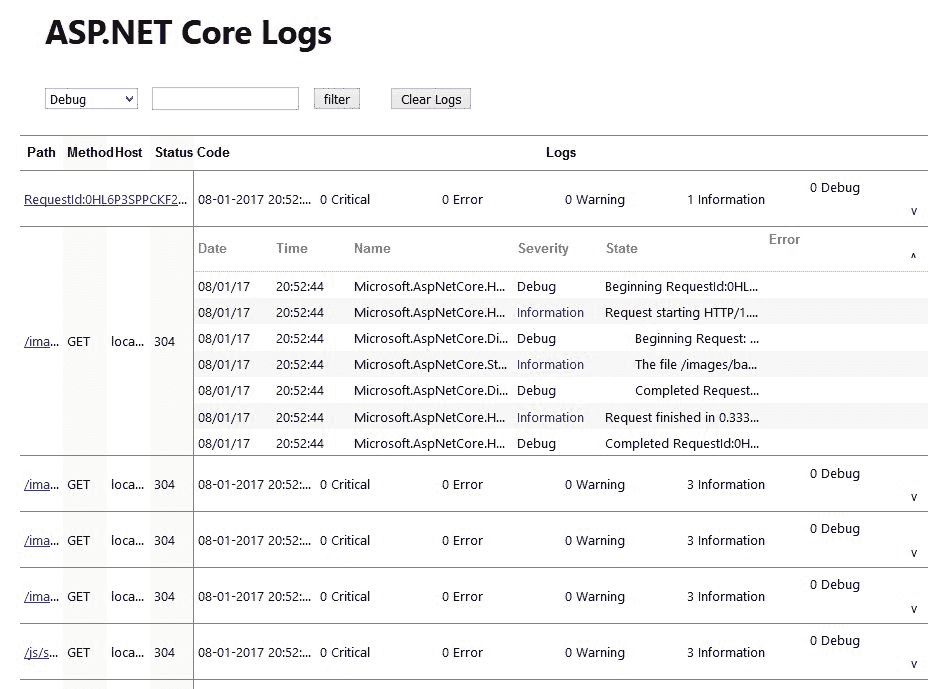

在使用 ELM、ELMAH 甚至是默认错误页面时，你应该小心不要向真实用户显示详细的异常或堆栈跟踪。这不仅仅是因为它们不友好且没有帮助，而是因为这涉及到真正的安全问题。错误日志和堆栈跟踪可能会泄露应用程序的内部运行机制，恶意攻击者可以利用这一点。

你可以使用网站 ASafaWeb（[`asafaweb.com/`](https://asafaweb.com/)）来检查你是否在无意中泄露了超出范围的应用程序信息。它更多关注传统的 ASP.NET，但仍然很有用。

正如你可能在终端运行应用时注意到的，你还会收到流到控制台的日志记录（取决于你配置的日志级别）。你可以将此输出通过到你喜欢的任何地方，这是 Unix 应用程序中非常常用的模式。将日志视为事件流并简单地写入`stdout`是十二因素应用要素中的之一。

十二因素应用是一种设计 Web 应用的方法，使其非常适合在云托管环境中运行。这些规则由 Heroku 团队提出，作为应当遵循的良好实践。虽然它们专注于 Linux，但这现在是托管 ASP.NET Core Web 应用的极佳选择。

你可以在十二因素应用的专用网站[`12factor.net/`](https://12factor.net/)上阅读关于其他十个因素的内容。关于日志的因素是第十一个（[`12factor.net/logs`](https://12factor.net/logs)）。

ELM 相当基础，但仍然很有用。然而，默认模板中已经内置了更好的解决方案，例如集成的日志支持和`Application Insights`。

## 读累了记得休息一会哦~

**公众号：古德猫宁李**

- 电子书搜索下载
- 书单分享
- 书友学习交流

**网站：**[沉金书屋 https://www.chenjin5.com](https://www.chenjin5.com)

- 电子书搜索下载
- 电子书打包资源分享
- 学习资源分享

## Application Insights

Application Insights 是一种遥测服务，允许你监控应用程序的性能并查看请求或异常。你可以配合 Azure 使用，它也可以在本地运行而不需要 Azure 账户。但是，如果你没有托管在 Azure 上，可能希望使用其他工具。

在 Visual Studio 2017 中，你可以右键点击 Web 应用项目，点击`Add`，然后点击`Application Insights Telemetry`。你可以点击开始按钮并注册你的应用。但是，请记住使用 Azure 的隐私和成本影响。你可以点击注册页面底部的下划线链接在本地使用 SDK。

这种设计用户界面以鼓励用户做出可能不符合其利益的行为的做法被称为`dark pattern`（黑暗模式）。微软在 Azure 上投入了大量精力，因此可以理解他们的许多软件设计目标都是引导你进入微软在线账户和 Azure。然而，你不需要使用 VS 或 Windows 就可以使用`.NET Core`构建软件，在 SDK 和开发工具中关闭遥测也相当容易。

生成并运行项目，然后打开 Application Insights 搜索窗口查看输出。在浏览器中浏览 Web 应用，你将看到记录开始出现，它们看起来可能如下所示：

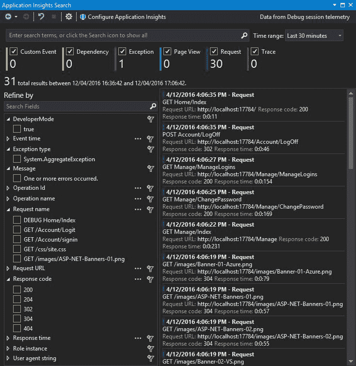

如果在输出中没有看到任何记录，你可能需要更新 NuGet 包（`Microsoft.ApplicationInsights.AspNetCore`）或点击搜索图标。

你可以按事件类型（例如请求或异常）进行过滤，并且有更详细的过滤器来精炼你的搜索。你可以选择单个记录查看更多详细信息，它们看起来如下所示：

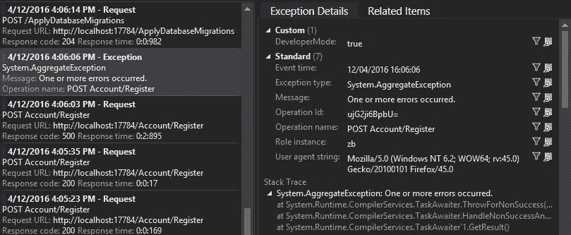

这能告诉你的比较有趣的事情之一是你的应用程序是否触发了任何外部事件。例如，你可以看到应用是否对另一个域的 URL 发送了 Web API 请求，以及此操作导致了多大的变慢。

我们没有足够的空间在这里详细介绍 Application Insights，如果你没有使用 Azure，那么你仍然需要考虑其他选项。你可以在网上阅读更多信息：[`docs.microsoft.com/en-us/azure/application-insights/app-insights-asp-net-core`](https://docs.microsoft.com/en-us/azure/application-insights/app-insights-asp-net-core)。

## 集成日志

日志记录现在已内置在 ASP.NET Core 中，`依赖注入`（`DI`）也是如此，两者都包含在默认模板中。这降低了门槛，现在即使在最小的项目中使用这些有用的技术也轻而易举。

以前，你需要在开始之前添加日志和 DI 库，这可能会给许多使用它们的人带来困难。如果你对两者还没有标准的选择，那么你就需要阅遍大量项目并研究每个库的优点。

如果你已经熟悉你偏好的库，仍然可以使用它们。只是现在有了合理的默认值，你可以对其进行覆盖。

日志记录被添加到应用程序的`Program`类中，但`.NET Core 2.0`中的实现方式与`.NET Core 1.0`有有不同。在模板中，它是在调用`CreateDefaultBuilder`方法时添加的，这可以很容易地设置合理的默认值。如果你想自定义此内容，语法与之前的版本不同。你不再调用日志工厂，而是使用`ConfigureLogging`方法。如果你想使用默认配置之外的其他配置，请参考文档（[`docs.microsoft.com/en-us/aspnet/core/fundamentals/logging?tabs=aspnetcore2x`](https://docs.microsoft.com/en-us/aspnet/core/fundamentals/logging?tabs=aspnetcore2x)）以了解完整详情。

日志记录在`Startup`类中配置，如果你使用的是标准的 Web 应用程序模板，那么该配置已经为你包含在其中。日志工厂从`appsettings.json`文件读取设置。在这里，你可以配置日志级别，默认情况下，相关部分如下所示：

```json
"Logging": {
  "IncludeScopes": false,
  "Debug": {
    "LogLevel": {
      "Default": "Warning"
    }
  },
  "Console": {
    "LogLevel": {
      "Default": "Warning"
    }
  }
}
```

在开发模式下，将使用以下设置覆盖这些设置（来自`appsettings.Development.json`）：

```json
"Logging": {
  "IncludeScopes": false,
  "LogLevel": {
    "Default": "Debug",
    "System": "Information",
    "Microsoft": "Information"
  }
}
```

这设置了一个非常详尽的日志级别，对于开发很有用，但在生产环境中运行它时，你可能只想记录警告和错误。

除了日志记录外，`Startup`类默认包含的实用开发调试工具还包括开发者异常页面，它类似于旧版“死亡黄屏”（`YSOD`）ASP.NET 错误页面的高级版本。此外还包括数据库错误页面，它可以帮助应用 EF 迁移，并缓解了之前 EF 代码优先迁移部署中的常见陷阱。

要通过构造函数注入将日志器添加到 MVC 主控制器中，你可以使用以下代码（在文件顶部的`using`语句中添加`using Microsoft.Extensions.Logging;`）：

```csharp
private readonly ILogger Logger; 
public HomeController(ILoggerFactory loggerFactory) 
{ 
    Logger = loggerFactory.CreateLogger<HomeController>(); 
} 
```

此后，你可以使用`Logger`在操作方法内部记录事件，如下：

```csharp
Logger.LogDebug("Home page loaded"); 
```

还有许多其他日志级别和重载方法可用，以便你记录额外信息，例如异常。我们在这里不会详细介绍更多，但你不一定非要记录文本事件；你还可以记录执行时间（可能使用秒量计）或增加计数器以查看某些事件发生的频率。接下来，我们将看到如何集中地查看这些数字并正确地读取它们。

关于如何使用日志记录的更多示例，你可以检查默认账户控制器（如果你在模板中包含了个人用户帐户身份验证）。

## 集中式日志记录

日志记录非常棒。然而，在分布式系统中，你会希望将所有日志和异常馈到一个单个位置，在那里你可以轻松地分析它们并生成告警。对此的一个潜在选项是 Logstash（[`www.elastic.co/products/logstash`](https://www.elastic.co/products/logstash)），我们在第 4 章《测量性能瓶颈》中简单提到过。

如果你更倾向于模块化的方法并希望记录性能计数器和指标，那么`StatsD`，它监听 UDP 包并推送到 Graphite 进行存储和绘图。你可以在[`github.com/etsy/statsd`](https://github.com/etsy/statsd)获取它，wiki 上列出了几个 .NET 客户端，主仓库中还包含了一个 C# 代码示例。另一个收集日志的开源选项是 Fluentd（[`www.fluentd.org/`](https://www.fluentd.org/)）。

你可能希望对日志记录使用消息队列，这样你可以快速将记录的事件放入队列并忘记它，而不是直接访问日志服务器。如果你直接调用 API（且不使用 UDP），请确保它是异步且非阻塞的。你不想由于低效的日志记录而减慢你的应用程序。

也有云端选项可用，尽管通用的供应商锁定警告仍然适用。AWS 有`CloudWatch`，你可以在[`aws.amazon.com/cloudwatch/`](https://aws.amazon.com/cloudwatch/)了解更多信息。Azure Diagnostics 类似，你可以将其与 Application Insights 集成；更多信息请访问[`docs.microsoft.com/en-us/azure/monitoring-and-diagnostics/azure-diagnostics`](https://docs.microsoft.com/en-us/azure/monitoring-and-diagnostics/azure-diagnostics)。

还有其他跨平台云服务可用，例如 New Relic 或 Stackify，但这些可能相当昂贵，你可能希望将日志记录保留在自己的基础设施中。你可以将数据强入分析软件，例如`Google Analytics`或关注隐私的 Piwik（它是开源的且可以自托管），但这些并不合适，因为它们是为略有不同的目的设计的。

## 统计数据

在解释收集到的指标时，了解一些基础统计知识有助于正确读取它们。计算简单的`平均值`（mean）可能会误导你，并且可能没有某些其他特征重要。

在对代码进行插桩以收集元数据时，你应该对特定日志语句被调用的频率有一个大致的想法。这不需要精确，一个粗略的数量级估计（或`Fermi 估算`）通常就足够。

你应该尝试回答的问题是应该收集多少数据——所有数据还是随机样本？如果你需要进行采样，就应该计算样本应该有多大。我们在第 7 章《优化 I/O 性能》中讨论过与 SQL 采样，这里的原理类似。性能统计需要与基准测试相同的严谨性，你很容易被误导或得出错误的结论。

StatsD 包含了对采样的支持，但如果你想研究它们，还有许多其他方法可用。例如，在线流算法和采样池是两种选择。性能方面需要记住的重要点是使用快速的`随机数生成器`（`RNG`）。对于采样，这不需要是密码学安全的；一个`伪随机数生成器`（`PRNG`）即可。在 .NET 中，你可以使用`new Random()`作为 PRNG，而不是更安全的选项`RandomNumberGenerator.Create()`。请参阅第 8 章《理解代码执行和异步操作》，查看如何使用这二者的更多示例。

在查看结果时，离群值可能比平均值更有趣。虽然中位数比平均值更有价值，在这种情况下，你应该真正查看位数，例如第 90 百位数、第 95 百位数第 99 百位数。这些数据点可能只代表你数据的一小部分，但在规模范围内，它们可能会频繁发生。你想针对这些最坏的情况进行优化，因为如果你的用户在 10% 的情况下遇到页面加载超过五秒（尽管平均时间看起来很快），他们可能会去别的地方。

关于统计学还有很多话说，但在基础知识之外收益是递减的。如果你的数学基础生疏了，那么温习一下可能是明智的（Wikipedia 在这方面非常棒）。然后，你可以探索一些更高级的技术，例如高性能的`HyperLogLog`（`HLL`）算法，它可以使用非常少的内存估计大型元素集合的大小。

Redis 支持 HLL 数据结构（带有`PFADD`、`PFCOUNT`和`PFMERGE`命令）。更多关于不同数据结构的信息，请参阅第 8 章《理解代码执行和异步操作》。

这只是对性能日志的简要介绍，但还有更多内容供你探索。例如，如果你想标准化你的方法，可以查看 APDEX（[`www.apdex.org/`](http://www.apdex.org/)），它设定了一种记录应用程序性能并计算得分的标准方法。

## 管理过期缓存

在经历了这些复杂性之后，值得快速提醒一下：仍然要考虑简单的问题。人们很容易在复杂的 Bug 或性能调优的细节中迷失，而忽略了显而易见的问题。

帮助这一点的一种良好技术是`橡皮鸭调试`（rubber duck debugging），它的名称源于向桌上的橡皮鸭解释你的问题的过程。我们大多数人人都经历过在寻求帮助后解决问题的经历，即使对方什么都没说。向他人（或某物）解释问题的过程会让思路清晰，解决方案也会变得显而易见。

如果修复后某个功能似乎仍然不起作用，请首先检查简单的情况。查看补丁是否已交付并部署。你看到的可能是缓存中的旧代码，而不是新版本。

在管理缓存时，版本化是一种帮助你识别过期资源的有用技术。你可以更改文件名或添加注释以包含唯一的版本字符串。这可以是`语义版本化`（`SemVer`）、ISO 日期和时间戳，或者内容的哈希值。有关缓存击穿（cache busting）的更多信息，请参阅第 9 章《学习缓存与消息队列》。

SemVer 是代码版本化的极佳方法，因为它隐含地捕捉了兼容性和破坏性更改的信息。你可以在[semver.org](http://semver.org)了解更多关于 SemVer 的信息。

## 总结

在本章中，我们看到了每个决策都有缺点，每个选择都带有代价，因为没有东西是免费的。这其中总是存在权衡，你需要意识到自己行为的后果，而这些后果可能是微小且微妙的。

核心教训是在添加任何性能增强技术时，都要采取审慎且严谨的方法。测量对于实现这一点至关重要，但你还需要知道如果收集或解释数据不当，数据将如何误导你。

在下一章中，我们将继续测量主题，学习如何使用测试来监控性能退化。你将看到如何使用测试（包括单元测试）、自动化和持续集成来确保一旦你解决了某个性能问题，它就能保持现状。

# 监控性能退化

本章将涵盖编写用于监控性能的自动化测试，以及将测试添加到`持续集成`（`CI`）和部署系统中。通过不断检查退化，你可以避免无意中构建出缓慢的应用程序。我们还将涵盖如何在不强制系统离线的情况下安全地进行负载测试，以及如何确保测试尽可能模拟真实的使用场景。

本章涵盖的主题包括：

- 性能分析（Profiling）
- 负载测试
- 自动化测试
- 性能监控
- 持续集成与部署
- 真实环境和类生产数据
- 使用 selenium 和 phantom 无头浏览器进行 UI 测试
- 用于转化优化的 A/B 测试
- 云服务和托管
- DevOps

你将看到如何自动化性能监控和测试，这样你就不需要记住要手动持续执行。你将学习如何在问题引起麻烦之前及早发现退化，以及如何安全地撤回它们以进行重构。

## 性能分析与测量

我们在本书开始时，通过涵盖第 4 章《测量性能瓶颈》中的一些简单技术，强调了测量和性能分析的重要性。我们在贯书中延续了这一主题，并在书结束时再次回到，因为测量和分析可靠证据的重要性无论如何强调都不为过。

之前，我们涵盖了使用`Glimpse`来获取 Web 应用程序运行的洞察。我们还演示了`Visual Studio`诊断工具和`Application Insights 软件开发包`（`SDK`）。还有另一个值得的工具——`Prefix`性能分析器，你可以在[`stackify.com/prefix/`](https://stackify.com/prefix/)获取。

`Prefix`是一个免费基于 Web 的`ASP.NET`性能分析器，支持`ASP.NET Core`。如果你想快速查看，他们的网站上有一个在线演示（位于[`demo.prefix.io/`](http://demo.prefix.io/)），它看起来如下：


你可能还会查看微软的`PerfView`性能分析工具，它用于`.NET Core`的开发。你可以从[`microsoft.com/download/details.aspx?id=28567`](http://microsoft.com/download/details.aspx?id=28567)下载ZIP格式的`PerfView`，解压即可运行。它对于分析`.NET`应用程序的内存等非常有用。启动`PerfView`时如下：

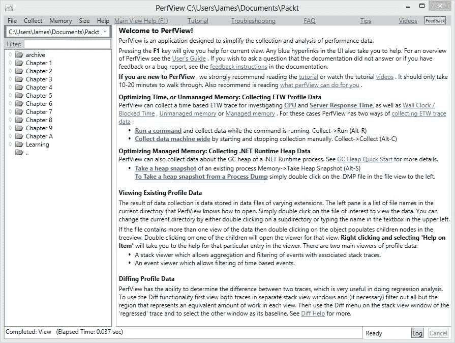

你可以使用`PerfView`进行许多调试活动，例如获取堆快照或强制执行`GC`运行。我们这里没有空间进行详细的讲解，但附带的说明很好；如果你需要更多信息，MSDN上有指南，*Channel 9*上也有许多视频教程，位于[`channel9.msdn.com/Series/PerfView-Tutorial`](https://channel9.msdn.com/Series/PerfView-Tutorial)。

`Sysinternals`工具（[`docs.microsoft.com/en-us/sysinternals/`](https://docs.microsoft.com/en-us/sysinternals/)）也可以很有帮助，但由于它们并不关注`.NET`，在这种语境下用处不大。

虽然这类工具很棒，但更好的是将性能监控构建到你的开发工作流中。自动化你能做的一切，让性能检查变得透明且常规化，并默认运行。

手动过程是很糟糕的，因为你可以跳过步骤，而且很容易出错。你不会幻想通过电子邮件发送文件或直接在生产服务器上编辑代码来开发软件，那么为什么不同样自动化你的性能测试呢。

变更控制过程是为了确保一致性并减少错误。这就是为什么使用`源代码控制管理`（`SCM`）系统（如`Git`、`Mercurial`甚至是旧的`Team Foundation版本控制`（`TFVC`））至关重要。拥有构建服务器并在每次推送时执行`CI`构建，甚至拥有完全自动的`CD`部署也非常有用。

`Git`现在是`TFS`中的默认版本控制系统，并已内置到`Visual Studio`中。除非你有非常特定的需求，否则不建议使用`TFVC`。关于这两个系统之间的差异（以及对它们分布式或集中式设计的比较），可以在[`www.visualstudio.com/en-us/docs/tfvc/comparison-git-tfvc`](https://www.visualstudio.com/en-us/docs/tfvc/comparison-git-tfvc)阅读更多信息。如果你想从`TFVC`迁移到`Git`，在[`www.visualstudio.com/learn/migrate-from-tfvc-to-git/`](https://www.visualstudio.com/learn/migrate-from-tfvc-to-git/)有一份指南。

`源代码控制`允许多人同时处理一个文件并在稍后合并更改。它就像Word的*修订*功能，但实际上是可用的。我们假设自己是在向认同的信徒传教，而且你已经在使用源代码控制了。如果没有，请立即停止阅读并安装一个`SCM`系统。

如果部署到生产环境的代码与你本地工作站上的代码不同，那么你成功的概率微乎其微。这就是为什么`SQL存储过程`（`SPs`/`sprocs`）难以处理的原因之一，至少在没有严格版本控制的情况下是。在开发数据库上修改旧版本的`SP`非常容易，可能会意外回滚一个Bug修复并最终导致退化。如果你必须使用`SPs`，那么你需要一个版本控制系统，例如`ReadyRoll`（现Redgate已收购）。

由于这并不是一本关于`Continuous Delivery`（持续交付`CD`）的书，我们假设你已经在实践CI，并且有一个构建服务器，例如JetBrains、TeamCity、TFS、ThoughtWorks GoCD和CruiseControl.net，或者像AppVeyor这样的云服务。也许你还在使用Octopus Deploy或TFS等工具实现部署自动化。也许你甚至拥有自己的内部NuGet馈，使用诸如The Motley Fool's Klondike的软件或像MyGet这样的云服务（它也支持`npm`、`Bower`和VSIX包）。

NuGet包是管理内部项目的一种极方法。在`Visual Studio`2017中，你可以查看包的源代码并对其进行调试。这意味着你不再需要处理包含大量到荒谱数量项目的庞大解决方案，这些项目在`Visual Studio`中既难以导航，构建速度又很慢。

即使你遵循了脚本操作，跳过流程并进行手动操作也会导致问题。如果某件事可以自动化，那么它就应该被自动化，这包含了测试。

# 测试

测试对于生产高质量且高性能的软件至关重要。高效测试的秘密在于使其变得容易、可靠且常规化。如果测试很困难，或者因为与软件无关的问题（例如环境问题）导致测试经常失败，那么测试就不会被执行，或者结果将无视。这将导致你错过真实问题，并发布了本可以轻松避免的bug。

测试有许多不同的类型，你可能熟悉用于功能验证的更常见的情况。在本书，我们将主要关注与性能相关的测试。然而，这里的建议适用于许多类型的测试。

## 读累了记得休息一会哦~

**公众号：古德猫宁李**

- 电子书搜索下载
- 书单分享
- 书友学习交流

**网站：**[沉金书屋 https://www.chenjin5.com](https://www.chenjin5.com)

- 电子书搜索下载
- 电子书打包资源分享
- 学习资源分享

## 自动化测试

如之前所述，改进几乎一切的关键是自动化。仅在开发者工作站上手动运行的测试价值很小。当然，在桌面电脑上运行测试应该是可能的，但这不应该是官方结果，因为无法保证它们在服务器上（那里正确运行才更重要）能够通过。

虽然自动化通常发生在服务器上，但自动化运行在开发者工作站上的测试也是很有帮助的。你可以在`Visual Studio`2017企业版中进行实时单元测试，在其他版本中，你可以使用如`NCrunch`之类的插件。它会在你工作时运行测试，如果你实践`test-driven development`（测试驱动开发TDD）并在实现之前编写测试，这将非常有用。

强制测试的一种方法是使用`TFS`中的门禁提交（gated check-ins），但这可能有点严酷，如果你使用类似`Git`的SCM，那么在分支上工作会更简单，只需在所有测试通过之前阻止合并即可。你希望鼓励开发者尽早频繁地提交，因为这会让合并变得更容易。

因此，让进行中的功能在工作站上停留很久是一个坏主意（通常不要超过一天）。

### 持续集成

CI系统会自动构建并测试你所有的分支，并将这些信息反馈给你的版本控制系统。例如，使用`GitHub API`，你可以阻止拉取请求的合并，直到构建服务器报告测试成功的合并结果。

`Bitbucket`和`GitLab`都提供了名为`pipelines`的免费CI系统，因此你可能不需要源码控制系统之外的额外系统，因为一切都在一个地方。`GitLab`还提供集成的`Docker`容器注册表，并且有一个可以在本地安装的开源版本。关于`Docker`的更多信息，请参考前面的章节或本章后面介绍的Hosting部分。

你可以使用`Visual Studio Team Services`进行CI构建和单元测试。`Visual Studio`也内置了`Git`服务。

这个过程对于单元测试非常有效，因为单元测试必须非常快，以便你获得早期反馈。缩短迭代周期是提高生产力的良好方法，你会希望延迟越小越好。

然而，在每次构建时运行测试并不适用于所有的测试类型，因为并不是所有测试都能快速。在这种情况下，你需要额外的策略，以免减慢你的反馈循环。

`.NET`有许多可用的单元测试框架，例如`NUnit`、`xUnit`和`MSTest`（微软的单元测试框架，现在已更新为v2），以及多种在本地运行测试的图形化方式，例如`Visual Studio Test Explorer`和`ReSharper`插件。人们都有自己的喜好，但你选择什么并不重要，因为大多数CI系统都会支持它们。

### 慢测试

某些测试很慢，但即使每个测试都很快，如果你有很多这样的测试，它们很容易累积成很长的时间。如果它们不能并行化而需要顺序运行则尤其如此，因此你应该始终确保每个测试独立，不依赖于其他测试。

将测试分为不同的重要性级别是一个良好的做法，这样你至少可以在每次CI构建中运行最关键的测试子集。然而，如果你有一个大型测试套件或某些测试不可避免地缓慢，那么你可能选择每天运行一次（也许在夜间）或每周运行一次（可能在周末）。

某些测试本质上就是慢，性能测试通常属于这一类，例如负载测试或`user interface`（UI）测试。我们通常将其归类为集成测试而不是单元测试，因为它们需要将你的代码部署到环境中进行测试，且测试不能简单地执行二进制文件。

为了利用这种自动化测试，你除了CI系统还需要一个自动化部署系统。如果你对测试系统有足够的信心，你甚至可以实现自动部署。如果你同时也使用`feature switching`（功能切换）来控制新功能的发布，这种方法效果良好。

我们在书中不会深入介绍CI或自动化部署的实现细节。然而，我们将涵盖功能切换、如何将性能测试应用于CI过程，以及当你发现回归（regression）时该做什么。

### 修复性能回归

如果你在单元测试阶段发现了性能问题，你可以简单地重新编写该功能，但这些问题更有可能在后续的测试阶段出现。这会让解决问题变得更具挑战性，因为该工作可能已经在此基础上构建，并且可能有其他的提交。

正确的做法通常是在发现后立即回滚回归，或者至少尽快回滚。延迟只会让问题以后更难修复，这就是为什么快速反馈并迅速突出问题至关重要。

保持自律并始终移除回归是很重要的，尽管这可能是痛苦的。如果你允许偶尔的微小回归通过，你很容易变得粗心，并随着时间的推移由于这种先例而引入更严重的回归。

### 负载测试

负载测试是发现你的Web应用可以支持多少并发用户的过程。你通常在测试环境中执行它，使用一个逐渐增加模拟负载的工具，例如`JMeter`（[`jmeter.apache.org/`](http://jmeter.apache.org/)）。也许，如果你的测试系统面向网络，你可能更倾向于使用兼容`JMeter`的云服务，如`BlazeMeter`，或者替代方案，如`Loader.io`。

负载测试可能会根据服务的规模耗费大量时间，因为它可以配置为持续进行，直到测试环境对用户来说变得无法接受地缓慢，或者崩溃并无响应为止。你对负载测试需要极其小心，这不仅是为了避免在系统运行期间意外将你的生产系统测试到崩溃。

你还需要警惕获得虚假结果，这些结果可能会误导你得出系统能够处理比实际更大量负载的结论。在安全性和真实性这两个竞争性关注点之间平衡是困难的。获得真实的结果至关重要，但你需要在此与不给生产环境带来压力以及影响真实用户的体验之间取得平衡。

## 真实性

保持真实性是性能测试的一个重要原则。如果你不使用真实的环境和负载，那么你的结果可能比没有数据还要糟糕，因为它们可能会误导你做出错误的决策。当你没有任何信息可用时，你至少知道自己正处于盲目状态并且在进行猜测。

我们将很快介绍负载和功能切换，包括一个如何从零开始实现你自己的简单版本的示例。首先，让我们看看如何让测试环境具有生产环境的代表性。

### 真实的环境

使用尽可能接近生产环境（或尽可能像真实环境）的测试环境是确保可靠结果的好一步。你可以尝试使用一组较小的服务器，然后对结果进行放大，以获得线上性能的估计。然而，这假设你对应用程序如何扩展以及哪些硬件限制将成为瓶颈有深入的了解。

更好的选择是使用你的线上环境，或者准确说是使用将成为你生产栈的架构。你首先创建一个与线上环境相同的staging环境（阶段环境），然后将代码部署到那里，运行完整的测试套件（包括全面的性能测试），确保其运行正常。一旦你满意了，只需交换staging环境和生产环境即可，可以使用`DNS`或`Azure staging slots`。

下面的图显示了你如何首先发布到staging环境，然后通过简单地让staging变成生产环境来实现上线：

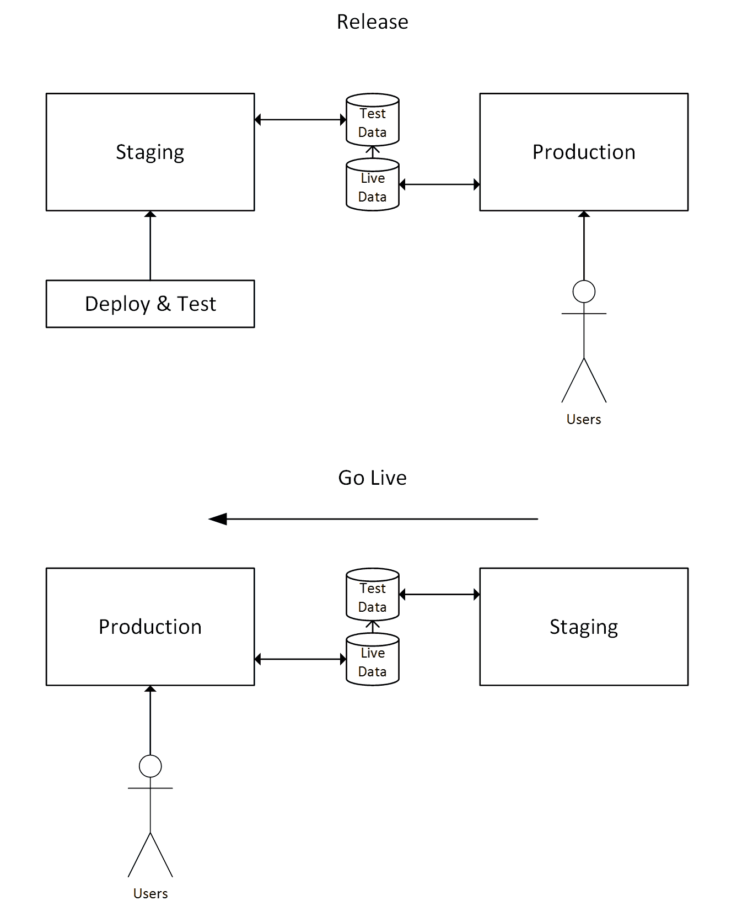

你旧的线上环境现在变成了你的测试环境，或者如果你使用不可变云实例，你可以简单地终止它并启动一个新的staging系统。这个概念被称为`蓝绿部署`（blue-green deployment），遗憾的是，具体的实现指令超出了本书的范围。请访问作者的网站[`unop.uk/`](https://unop.uk/)了解更多关于`AWS`和`Azure`中云托管的信息。

你不一定需要一次性通过“大轰炸”的方式迁移所有用户；你可以先迁移少数用户，以测试一切是否正确。我们很快会在本章的`功能切换`（Feature switching）部分介绍这一点。

### 真实的负载

执行真实测试的另一个重要部分是使用真实数据和真实负载。合成数据通常无法充分测试系统或发现奇特的边界情况。你可以使用`fuzzing`（模糊测试）生成随机数据，但如果你有一个生产系统，可以直接使用该系统的数据并解析你的日志来生成一个可以回放的真实负载。

显然，不要在可能会修改用户数据的线上系统上回放操作，并警惕数据隐私问题或任何可能产生外部事件的操作，例如发送批量电子邮件或扣除信用卡。

你可以使用专门的测试系统，但你仍然需要小心对任何没有测试版本的外部API进行存桩（stub out）。

另一种方法是，如果你不在意用户发现虚拟用户并可能与之互动，则可以使用虚拟用户进行测试。这种方法的一个案例是Netflix的邪典剧`Example Show`，那是一个员工带着笔记本电脑在办公区域跑跑的自制视频。

### 功能切换

虚拟用户或测试环境的替代方案是，在使用真实用户与你的Web应用程序时，在真实的线上环境中运行性能测试。你可以使用功能切换将新功能逐步推送到用户的一小部分，并监控系统是否存在过度负载。如果一切看起来正常，你就可以继续发布；否则，你可以回滚。

你可能会听到类似的思想被称为其他名称，如`feature flags`（功能标记）、`feature toggles`（功能开关）、`canary releases`（金丝雀发布）或`branch by abstraction`（抽象分支）。某些的含义可能略有不同，但逐步发布更改的通用指导原则是非常相同的。

下面的图显示了你如何通过部署但最初不启用新功能，逐步将用户迁移到新功能。你的第一批用户可以是员工，这样可以尽早发现问题：

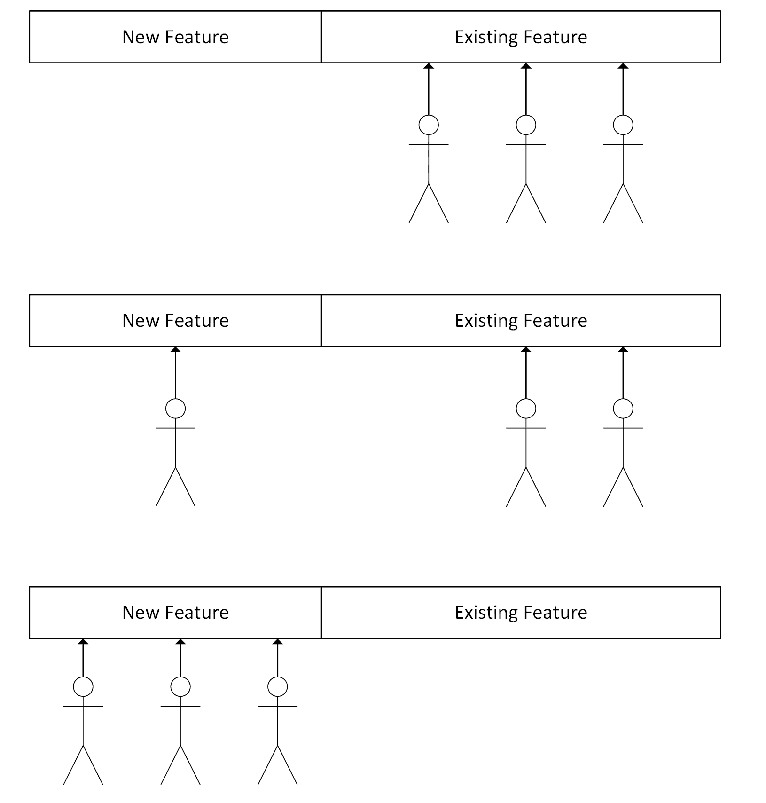

一旦所有用户开始使用新功能，你就可以安全地移除旧功能（以及功能切换本身）。定期这样清理是一个好主意，避免混乱并使后续工作变得更容易。

如果你发现随着逐渐增加新功能用户的百分比，系统出现了过量负载，那么你可以停止发布，防止你的服务器过载且无响应。然后你就有时间进行调查，并撤销更改或增加可用资源。

该主题的一个变体是，新功能需要数据迁移，且这种迁移是计算或网络密集型的，例如，将用户提交的视频迁移到新位置并在过程中对其进行转码。在这种情况下，你所监控的过度负载将是瞬时的，你不需要撤销功能。你只需要确保迁移率足够低，不会对你的基础设施造成过度负担。

虽然新功能通常在代码中进行分支处理，但如果你使用蓝绿部署，你可以在网络层进行切换。这被称为金丝雀发布，可以在`DNS`或负载均衡器级别完成。然而，具体的实现细节再次超出了本书的职责范围。请访问作者的网站[`unop.uk/`](https://unop.uk/)了解更多关于`DNS`的信息。

你可以在网上找到许多开源的功能切换库，或者编写自己的，我们将向你展示如何这样做。`FeatureToggle`是一个针对`.NET`的功能切换库，它从版本4版本开始支持`.NET Core`（[`github.com/Jason-roberts/FeatureToggle`](https://github.com/Jason-roberts/FeatureToggle)）。还有一些付费云服务，例如`LaunchDarkly`，它们提供了易于管理的界面。

`.NET`和`ASP.NET Core`的库和框架支持变化迅速，请检查[`github.com/jpsingleton/ANCLAFS`](https://github.com/jpsingleton/ANCLAFS)获取最新信息。

为了说明功能切换，让我们为`ASP.NET Core`应用程序构建一个极其简单的实现。首先，我们获取默认的现有首页视图（`Index.cshtml`）并复制一份（`IndexOld.cshtml`）。然后我们对`Index.cshtml`进行修改，但这些修改对于演示并不重要。

在`HomeController.cs`中，我们更改逻辑，在较小百分比的时间返回新视图，否则返回旧视图。原始代码如下：

```
public IActionResult Index() 
{ 
    return View(); 
}
```

我们将此操作更改为在四分之一的情况下返回新视图，如下所示：

```
public IActionResult Index() 
{ 
    var rand = new Random(); 
    if (rand.Next(99) < 25) 
    { 
        return View(); 
    } 
    return View("IndexOld"); 
}
```

这段代码从一百个数字中随机选取一个，如果它小于`25`，则加载新视图。显然，你不会像这样硬编码值，你可能会使用数据库来存储配置，并通过Web管理员页面对其进行控制。

如果你在浏览器中加载该页面，那么四次中有三次，你会得到原始页面，其外观如下：

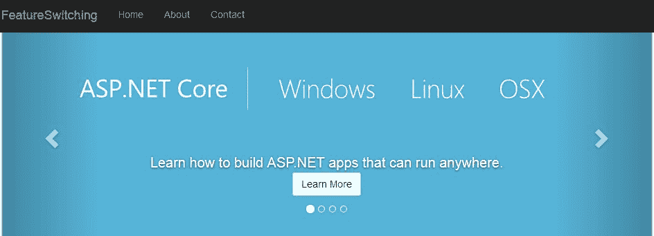

然而，大约每四个页面中就有一个加载一次；你会得到新页面，其外观如下：

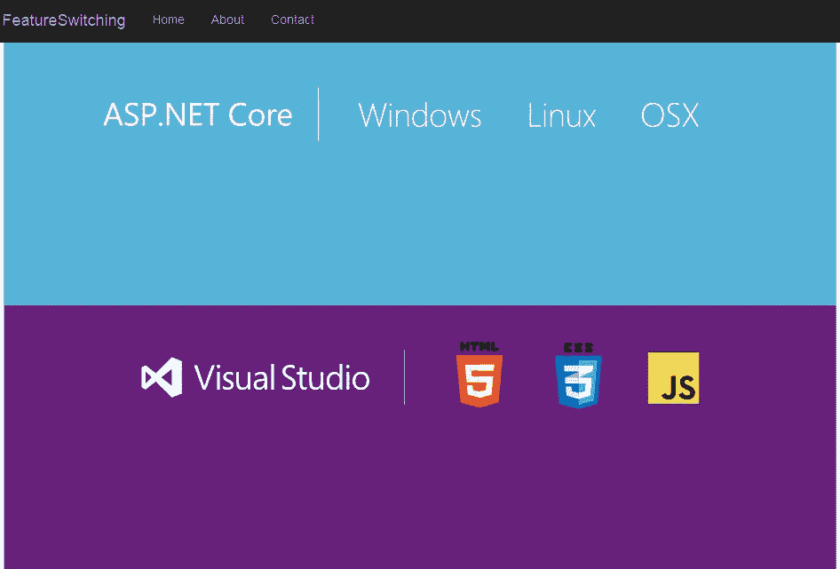


我们移除了轮播器，并将图像加载次数减少了一半。你可以在浏览器开发工具中看到差异，例如，原始页的 Firefox 性能分析如下：

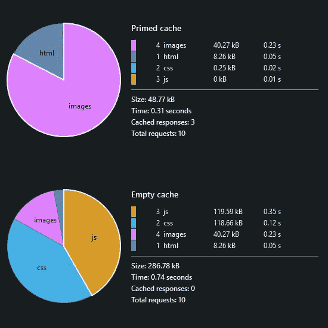

而新版本的性能分析看起来是：

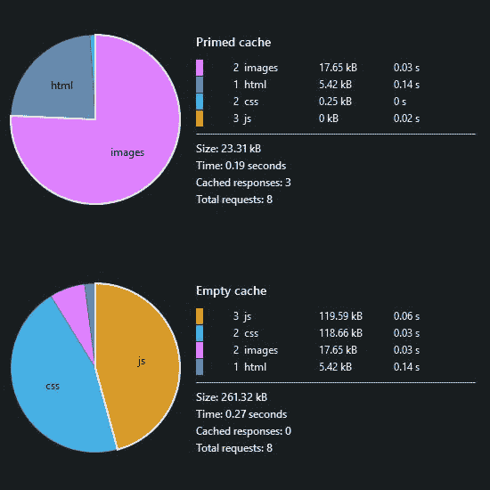

你可以看到 `images` 的数量减少了，这减小了页面大小和所需的总请求数。

这些测量结果是在托管环境设置为 `Production` 时获取的。如果你保持默认的 `Development` 设置，那么你的结果将会有所不同。请参考以下文档页面了解如何更改设置：

[`docs.microsoft.com/en-us/aspnet/core/fundamentals/environments`](https://docs.microsoft.com/en-us/aspnet/core/fundamentals/environments)

一旦新视图逐步推送到所有用户（且没有性能问题），就可以将方法代码还原到原始状态并删除旧视图。显然，这是一个浅显的示例。希望你现在能看到如何进行功能切换。

使用功能切换进行这种方式发布对于性能测试非常有效，但你需要确认你的新代码在功能上是正确的，或者至少部署时是安全的。然而，在某些情况下，你也可以通过扩展这种方法并进行实验来测试功能。

### 科学实验

如果你将功能切换发布推向逻辑终点，你可以为一小部分用户开启重构后的版本，但实际上并不暴露输出。你将并行运行现有版本作为控制，并将其展示给用户。然而，你将收集两个版本的结果，包括性能数据。然后你可以比较它们，以确保新版本（希望性能更高）是正确的，并且与现有行为一致。

GitHub 有一个开源的 Ruby 库，称为 `Scientist`，可以成功地重构权限并合并代码。在此过程中，GitHub 发现了现有的旧 bug，发现了缺失的功能，优化了数据库查询并更换了搜索系统。`Scientist` 不仅显示了新代码的正确性，还显示了其相对于旧实现的性能。

`Scientist`（或任何使用这种实验的方法）的一个重要关注点是不更改数据。所有操作应该是只读的且不产生副作用；否则，你将执行多次修改，可能会导致意外的。

GitHub 员工 Phil Haack 有一个 `Scientist` 的 .NET 版本，称为 `Scientist.NET`，你可以在 [`github.com/github/Scientist.net`](https://github.com/github/Scientist.net) 获取。它支持 .NET Core，你可以通过 NuGet 安装，在那里它被称为 `Scientist`。查看 [`ANCLAFS.com`](http://ANCLAFS.com) 获取最新信息。

这种对用户进行实验的想法与营销概念 `A/B 测试` 类似，它用于发现转化效果。然而，使用 `Scientist`，你通常不会向用户展示不同的输出，甚至不打算改变输出，你只是为开启了该功能的子集记录新的输出。

### A/B 测试

A/B 测试与功能切换类似，但我们通常用它来测试不同网页设计的有效性以及它们如何影响 `转化漏斗` 分析。我们通常将其用于数字营销而非软件开发，因为与其关乎什么是正确的，不如说关乎客户偏好什么。然而，底层的技术原理与功能切换和实验具有可比性。

在一个简单的示例中，你为一半访问者提供页面的旧版本，为另一半提供一个旨在增加参与度的新版本。然后你记录每个变体有多少访问者点击或执行了某些操作。如果新版本表现更好，你就保留它并推给所有人。然而，如果转化效果更差，你就回退旧版本并再次尝试。

你可以看到这与功能切换的工作非常相似，你可以使用相同的工具完成这两项工作。唯一的区别在于你衡量的内容——用户分析还是基础设施的健康状况。

A/B 测试通常不用于后端功能，仅用于评估 UI 方案。然而，它与功能性测试 Web 界面不同，让我们现在涵盖 UI 测试的基础。

应用程序中有一个传统上难以测试的区域，那就是 `UI`。对于 Web 应用程序中使用的 `图形用户界面`（`GUIs`）来说尤其如此。原因之一是用户通常在显示界面方面有很大的灵活性，对于 Web 浏览器尤其是如此。一种幼稚的基于像素的测试方法将极其脆弱。

你需要设计你的应用程序以便于测试，UI 也不例外。虽然可以测试设计糟糕的旧应用的 UI，而且这可能是最简单的测试方法，但如果你在前期考虑 UI 测试，生活将会轻松得多。例如，在你的 HTML `文档对象模型`（`DOM`）元素上包含合理的 ID 会让测试变得简单得多且不再脆弱。

从 Web 浏览器的角度检查应用程序可以是自动化单元测试和集成测试之外的有用额外步骤。你不仅可以用它测试功能正确性和回归，还可以衡量客户端性能，这变得越来越重要。现在有很多 UI 测试工具，你可以将其中大多数工具集成到你的 CI 构建流水线中以实现自动化。

### Web UI 测试工具

流行的 Web 测试工具之一是 `Selenium`，它允许你使用 `WebDriver` 轻松编写测试并自动化 Web 浏览器。除了测试，Selenium 也许多许多任务，你可以在 [`docs.seleniumhq.org/`](http://docs.seleniumhq.org/) 阅读更多相关信息。

`WebDriver` 是一个远程控制 Web 浏览器的协议，你可以在 [`w3c.github.io/webdriver/webdriver-spec.html`](https://w3c.github.io/webdriver/webdriver-spec.html) 查看关于它。

Selenium 使用真实的浏览器，即你的用户访问 Web 应用程序时使用的相同版本。这使其非常适合获取代表性的结果，但如果它以无人值守的方式从命令行运行，可能会导致问题。例如，你可能会发现测试服务器的内存充满了超时的死亡浏览器进程。

最出名的无头测试浏览器之一是 `PhantomJS`。它基于 `WebKit` 引擎，因此它应该带给你与 Chrome 和 Safari 相似的结果。`PhantomJS` 除了测试之外，还有许多其他用途，例如截屏，你可以使用许多不同的测试框架来驱动它。正如其名所示，你可以使用 JavaScript 控制 `PhantomJS`，并可以在 [`phantomjs.org/`](http://phantomjs.org/) 了解更多信息。

`WebKit` 是一个用于 Web 浏览器的开源引擎，最初是 `KDE` Linux 桌面环境的一部分。它主要用于 Apple 的 Safari 浏览器，但 Google Chrome、Chromium 和 Opera 使用了一个名为 `Blink` 的分支。你可以在 [webkit.org](http://webkit.org) 了解更多信息。

还有其他基于不同引擎的自动化测试浏览器，但它们都有一些局限性。例如，`SlimerJS`（[`slimerjs.org/`](https://slimerjs.org/)）基于 Firefox 使用的 `Gecko` 引擎，但它并不是完全无头的。

你可能更倾向于使用高级别的测试工具，而不是直接编写浏览器引擎脚本。其中一个提供许多实用抽象的工具是 `CasperJS`（[`http://casperjs.org/`](http://casperjs.org/)），它支持在 `PhantomJS` 和 `SlimerJS` 上运行。

另一个是 `Capybara`，它允许你在 Ruby 中轻松模拟用户交互。它支持 `Selenium`、`WebKit`、`Rack` 和 `PhantomJS`（通过 `Poltergeist`），尽管它更适合 Rails 应用。你可以在 [`teamcapybara.github.io/capybara/`](http://teamcapybara.github.io/capybara/) 了解更多信息。

还有 `TrifleJS`（[`triflejs.org/`](http://triflejs.org/)），它使用了 .NET 的 `WebBrowser` 类（Internet Explorer `Trident` 引擎），但这是一个进行中的项目。此外，还有 `Watir`（[`watir.com/`](http://watir.com/)），它是针对 Internet Explorer 和 `WebDriver` 的 Ruby 库集。然而，两者都已没有更新，而 IE 最近发生了很大变化。

Microsoft Edge（代号为 Spartan）是 IE 的新版本，`Trident` 引擎已分支为 `EdgeHTML`。JavaScript 引擎（`Chakra`）已开源为 `ChakraCore`（[`github.com/Microsoft/ChakraCore`](https://github.com/Microsoft/ChakraCore)）。

使用哪种浏览器引擎并不重要，`PhantomJS` 作为自动化测试的第一步运行良好。在使用无头浏览器后，你始终可以使用真实浏览器进行测试，或许可以使用 `Selenium` 或通过 `WebDriver` 使用 `PhantomJS`。

当我们提到浏览器引擎（`WebKit/Blink`、`Gecko` 或 `Trident/EdgeHTML`）时，通常仅指渲染和布局引擎，而不是 JavaScript 引擎（`SFX/Nitro/FTL/B3`、`V8`、`SpiderMonkey` 或 `Chakra/ChakraCore`）。

你可能仍然想使用像 `CasperJS` 这样的工具来让编写测试更容易，并且你可能需要一个测试框架，例如 `Jasmine`（[`jasmine.github.io/`](https://jasmine.github.io/)）。

在使用自动化和特性切换等技术时，对环境有一个良好的视图至关重要，这样你就能了解所有硬件的使用情况。在监控时，良好的工具至关重要，你希望能够轻松查看每台服务器的关键统计数据。这至少包括 CPU、内存和磁盘空间占用，而且你可能希望设置报警，当这些指标中任何一个超出允许范围时向你发出警告。

## DevOps 工具

DevOps 工具的核心主题之一是定义“基础设施即代码”。其理念是，当你可以编写软件来完成某项任务时，就不应该手动执行该任务（例如设置服务器）。然后你可以重用这些配置脚本，这不仅可以节省你的时间，还能确保所有机器的一致性，并且没有错误或遗漏步骤。

## 配置准备

有许多系统可用于调试和配置新机器。一些流行的配置管理自动化工具包括 `Ansible`（[`www.ansible.com/`](https://www.ansible.com/)）、`Chef`（[`chef.io/`](http://chef.io/)）和 `Puppet`（[`puppet.com/`](http://puppet.com/)）。

并不是所有这些工具在 Windows 服务器上运行得都很好，部分原因是 Linux 更容易自动化。然而，你可以在 Linux 上运行 ASP.NET Core，同时在 Windows 上进行开发，使用 Visual Studio 并在虚拟机或容器中测试。为虚拟机开发是一个极佳的主意，因为它解决了环境搭建中的问题以及“在我的机器上可以运行，但在生产环境中无法运行”的问题。

`Vagrant`（[`vagrantup.com/`](http://vagrantup.com/)）是一个用于管理开发者虚拟机的命令行工具。它允许你轻松地创建、启动和共享开发者环境。

如果你将基础设施定义为代码，那么你的脚本就可以像应用程序代码一样进行版本控制和测试。我们会在偏离主题太远之前停止，但点在于，如果你拥有可以轻松验证、实例化并进行测试的可靠环境，那么 CI（持续集成）将变得简单得多。

## 监控

监控是必须的，特别是对于 Web 应用程序，并且有很多工具可以帮助。一个流行的开源基础设施监控系统是 `Nagios`（[`nagios.org/`](http://nagios.org/)）。另一个更现代的开源告警和指标工具是 `Prometheus`（[`prometheus.io/`](https://prometheus.io/)）。

如果你使用云平台，那么会有内置的监控，例如 AWS CloudWatch 或 Azure Diagnostics。还有直接监控你网站的云服务，例如 `Pingdom`（[`www.pingdom.com/`](https://www.pingdom.com/)）、`Uptime Robot`（[`uptimerobot.com/`](https://uptimerobot.com/)）、`Datadog`（[`www.datadoghq.com/`](https://www.datadoghq.com/)）和 `PagerDuty`（[`www.pagerduty.com/`](https://www.pagerduty.com/)）。

你可能已经有一套衡量可用性的系统，但你也可以使用相同的系统来监控性能。这不仅有助于确保响应良好的用户体验，还能为即将发生的故障提供早期预警。如果你能采取主动并采取预防措施，就可以避免在事后为了“救火”时浪费很多精力。

这不是一本关于运维的书，但在设计阶段考虑应用程序支持需求是有帮助的。开发、测试和运维并不是竞争性的学科，如果你作为一个团队工作，你的成功率会更高，而不是简单地把应用程序“扔过围栏”并说“测试时没问题，现在是运维的问题了”。

### 托管

考虑各种托管选项的影响是非常值得的，因为如果开发者无法轻松访问所需的环境，将降低他们的灵活性。他们可能不得不绕过可用性问题，并最终使用不足或不合适的硬件，这将阻碍进度并导致未来的维护问题。或者他们的工作将直接阻塞，导致交付推后。

除非你是一个非常大的组织，否则出于可靠性、灵活性和成本的考虑，内部托管通常不是一个好主意。除非你有非常敏感的数据，否则你可能应该使用数据中心。

你可以在数据中心进行服务器托管，但那时你需要员工随时待命以修复硬件问题。或者你可以租用物理服务器并在“裸机”（`bare metal`）上运行你的应用程序，但你可能仍然需要远程人员对机器执行重置或其他任务。

最灵活的情况是租用自服务虚拟机，通常称为云托管。有很多托管公司提供此类服务，但巨头是亚马逊、谷歌和微软。

微软的 `Azure` 是 .NET 团队的显然选择，与其最初提供的服务相比，它在发布后有了巨大的改进。用于托管 .NET 应用程序的“平台即服务”（`PaaS`）最完善，且最容易快速运行。它还提供了许多超出简单虚拟机的额外服务。

然而，.NET Core 和 ASP.NET Core 是新类型的框架，它们并不只针对 C# 开发者（这些开发者通常会选择微软提供的默认选项）。目标市场是那些习惯于选择替代平台和开源框架的开发者。因此，涵盖其他选项是有意义的，初接触 .NET 的人可能更熟悉这些选项。

PaaS 和“基础设施即服务”（`IaaS`）之间的区别是 PaaS 层级更高，它提供的是运行应用程序的服务，而不是计算机。IaaS 仅为你提供虚拟机。然而，在 PaaS 中，这些被抽象掉了，你不需要担心设置和更新实例。

`Amazon Web Services`（`AWS`）是最老牌的云托管商，它最初只提供 IaaS，尽管他们现在也提供 PaaS 选项。例如，`Elastic Beanstalk` 支持 .NET。尽管 Windows（以及 SQL Server）的支持已经提高，但它仍然不是顶级支持，且 Linux 显然是他们的主平台。

然而，现在 .NET Core 和 SQL Server 可以在 Linux 上运行，这可能不再是一个问题。你会为 Windows 服务器实例支付溢价，但对某些企业级 Linux 发行版（`Red Hat` 和 `SUSE`）的收费也更高。不过，你可以运行其他 Linux 发行版，例如 `Ubuntu` 或 `CentOS` 而无需支付溢价。

Google Cloud Platform 曾由 `App Engine`（`GAE`）组成，这是一个相当严格的 PaaS，但它正变得越来越灵活。他们现在提供了一种名为 `Compute Engine`（`GCE`）的通用 IaaS，并且有一个新的灵活版本的 GAE，它更像 GCE。这些新产品非常有用，因为传统上无法在 GAE 上运行 .NET，它们还提供了其他产品，如抢占式虚拟机和云 CDN（不收额外费用支持 HTTPS）。

Azure 可能仍然是你的最佳选择，它与 Visual Studio 等其他微软产品集成良好。然而，拥有良好的竞争是值得的，因为这让每个人都保持创新。经常查看所有选项的价格（价格经常变化）绝对是一个好主意，因为根据你运行的负载，你可以节省大量资金。

如果你符合微软 BizSpark 计划，你可以获得三年的 Azure 额度（适用于托管小型应用程序）。你还会免费获得 Visual Studio 订阅的软件许可证（以前称为 MSDN 订阅）。

无论你选择哪种托管提供商，避免供应商锁定并使用通用服务是明智的，因为你可以轻松将其更换为替代方案。例如，使用托管的开源软件，如 `PostgreSQL`、`Redis` 或 `RabbitMQ`，而不是类似的自定义云供应商产品。你也可以采取韧性的多云方法来保护自己免受单一提供商故障的影响。可以访问作者的网站（[`unop.uk/`](https://unop.uk/)）查看云托管提供商的对比。

Docker 是实现此目的绝佳技术，因为许多不同的云服务都支持它。例如，你可以在 `Azure Container Service`、`Docker Cloud`、`AWS EC2 Container Service` 以及 Google 的 `Kubernetes` 引擎运行相同的容器。

Docker 也运行在 Windows 上（使用 `Hyper-V`），并在 `Visual Studio 2017` 中你可以对容器进行部署和调试。这可以在 Linux 上运行 `ASP.NET Core`，并且当你准备好部署时，只需推送到生产环境，就可以确信它的运行方式与在你机器上一样。你可以在 [http://docker.com/Microsoft](http://docker.com/Microsoft) 阅读更多关于 Windows 版 Docker 的信息。


在选择云（甚至是区域）时，不仅要考虑货币成本是重要的。你还应该考虑环境因素，例如用于电源的主要燃料。例如，某些地区可能更便宜，但这可能是因为它们使用了污染的煤电，这会导致气候变化并影响我们未来的安全。

## 总结

在本章中，你了解了如何将自动化测试集成到 CI 系统中，以监控性能退化。你还学习了一些发布更改的策略，并确保测试准确反映真实情况。我们还简要涵盖了 DevOps 实践和云托管提供商的一些选项，这些共同使得持续性能测试变得简单得多。

在下一章中，我们将总结书中涵盖的所有内容，并建议一些进一步研究的领域。我们将强化到今为止的收获，给你提供一些有趣的想法供思考，思考 `.NET` 的可能未来，并考虑该平台正在采取的令人兴奋的方向。

# 前路

本章总结了你在书中中学到的内容。它重温了性能的主要准则，并提醒你应该始终保持务实。我们将回顾为什么你不应该仅仅为了优化而优化，以及为什么你应该始终测量问题和结果。本章还介绍了一些更先进、奇特的技术，如果你需要更多速度或是一个认真的性能爱好者，你可能想要考虑学习这些技术。

本章涵盖的主题包括：

* 之前章节的总结
* 原生工具链
* 替代的 CPU 架构，例如 `ARM`
* 高级硬件（`GPUs`、`FPGAs` 和 `ASICs`）
* 机器学习与 AI
* 大数据与 `MapReduce`
* `Orleans` 虚拟 Actor 模型
* 自定义传输层
* 高级哈希函数
* 库和框架支持
* `ASP.NET Core` 的未来

我们将通过复习你对之前章节课程的记忆，强化如何评估和解决性能问题。你还将了解到其他可以帮助你交付高性能的可用先进技术，你可能希望对它们进行进一步调查。最后，我们将重点介绍哪些库和框架支持 `.NET Core` 和 `ASP.NET Core`，并尝试假设这些令人兴奋平台可能的未来方向。

## 回顾我们学到的知识

让我们简要回顾一下我们之前在书中涵盖的内容。

在第 1 章，`ASP.NET Core 2` 有什么新变化中，我们涵盖了 `ASP.NET Core` 第二版本与第一个主要发行版本相比发生的变化，并强调了 `C# 6.0` 和 `C# 7.0` 中可用的一些新功能。然后，在第 2 章，性能是一特性中，我们讨论了本书的基本前提并向你展示了为什么你需要关注软件的性能。在第 3 章，设置你的环境中，我们演示了如何在 Windows、macOS 和 Linux 上启动 `ASP.NET Core`。

在第 4 章，测量性能瓶颈中，我们向你展示解决性能问题的唯一方法是仔细测量应用程序。然后，在第 5 章，修复常见的性能问题中，我们查看了一些最频繁的性能错误以及如何修复它们。

之后，我们在第 6 章，处理网络性能中深入得更深，并研究了支撑所有 Web 应用的网络层。然后，在第 7 章，优化 I/O 性能中，我们关注输入/输出以及这如何负面影响性能。

在第 8 章，理解代码执行和异步操作中，我们进入了 `C#` 代码的复杂性并并了它的执行如何改变性能。然后在第 9 章，学习缓存和消息队列中，我们最初查看了缓存，它被广泛认为相当困难。然后，我们研究了消息队列作为构建分布式可靠系统的方法。

在第 10 章，性能增强工具的缺点中，我们集中关注了之前涵盖技术的负面影响，因为没有东西是免费的。然后是在第 11 章，监控性能退化中，我们再次查看了性能测量，但这次是从自动化、持续集成 (`CI`) 和 DevOps 的角度来看的。

## 延伸阅读

如果你读到了这里，你可能想要一些其他需要研究和阅读内容的提示。在本章的剩余部分中，我们将强调你可能希望进一步研究但我们在书中未能完全涵盖的一些感兴趣的话。你也可以访问作者的网站（[`unop.uk/`](https://unop.uk/））获取更多主题的内容。

### 使用原生

旧 `ASP.NET` 的问题之一是它非常慢，这就是为什么 `ASP.NET Core` 的主要指导原则之一是性能。已经取得了令人印象的进展，但还有许多进一步增强的机会。

最有前景的领域之一原生工具链，遗憾的是它延迟了。然而，它应该在 `.NET Core 2.0` 之后发布，并且已经用于 Windows Store 上的 `UWP` 应用。这与 `.NET Core` 中已有的自包含发布和交叉编译不同，因为它编译为机器原生二进制文件，而不是可移植的 IL 指令。

以前，如果你想从托管 `.NET` 代码调用未托管原生代码，你必须使用平台调用 (`PInvoke`)，但这具有性能开销和安全顾虑。即使你的原生代码更快，开销通常意味着它不值得去麻烦。

原生工具链应该提供原级的性能，但具有托管运行时的安全性和便利性。提前编译（AOT）非常迷人且极具技术性，但结果是如果我们知道目标架构，那么它就可以提供性能提升。我们也可以用较慢的编译换取更快的执行，因为这不需要在运行时发生。

针对不同的处理器进行优化也是可能的，它们可能特殊的性能特性和指令——例如，针对低功耗的 `ARM` 芯片而不是普通的 Intel 风格处理器。

### 处理器架构

通常，在编写桌面或服务器软件时，你的目标通常是基于 Intel 的架构，例如 `x86` 或 `x64`。然而，基于 ARM 的芯片正变得流行，它们可以提供极佳的能效。如果软件针对这些芯片进行了专门优化，它们也能提供出色的性能。

例如，用于教学计算的图形化编程语言 `Scratch` 已经针对 `Raspberry Pi 3` 进行了优化，现在的运行速度大约是 `Intel Core i5` 的两倍。其他软件应用也针对 ARM 处理器进行了优化，例如开源媒体播放器 `Kodi`。

ARM Holdings 仅仅是一家知识产权公司，他们本身并不制造任何处理器。其他公司（如 Apple 和 Broadcom）授权这些设计或架构，并制造自己的系统级级系统（`SoC`）产品。

这意味着有很多不同的芯片可用，它们运行多个版本的 ARM 架构和指令集。这种碎片化使得支持工作变得困难，除非你选择一个特定的平台。

`Windows 10 IoT (物联网) Core` 运行在 `Raspberry Pi`（第 2 和第 3 版）上，并可以使用标准的 `New Out Of the Box Software` (`NOOBS`) 安装程序进行设置。Windows 10 IoT Core 不是运行普通应用程序的完整桌面环境，但它允许你制作硬件项目并使用 `C#` 和 `.NET` 进行进行编程。然而，对于 Web 应用，你可能希望在 Linux 发行版上运行 `.NET Core`，例如 `Raspbian`（基于 `Debian` 的树莓派操作系统）。

### 硬件是困难的

我们之前在第 8 章 *理解代码执行与异步操作* 中提到了可以用于计算的额外硬件，包括图形处理器（`GPUs`）、现场可编程门阵列（`FPGAs`）和专用集成电路（`ASICs`）。

这些设备不仅可以用于特定的处理任务，它们的存储空间也可以使用。例如，当主内存耗尽时，你可以从 `GPU` 借用 `RAM`。然而，由于内存限制不再像以前，这种技术不再像以前那样需要了。

你可能听过 `RAM SANs`，它们是使用标准 `RAM` 进行永久存储（带有电池备份）的 `SANs`。然而，随着基于闪存的 `SSDs` 在速度上提高、容量增加到足以取代许多常见任务的机械硬盘，这些技术已变得不那么相关。

你仍然可以购买高性能的 `SANs`，但它们可能基于闪存而非 `RAM`。如果你使用 `RAM` 作为你的主存储（例如使用 `Redis`），那么使用纠错码（`ECC`）内存就非常重要。`ECC RAM` 更昂贵，但更适合服务器使用。然而，某些云实例并不使用它，或者很难发现它是否提供，因为规格说明中没有列出它。你完全可以在没有它的情况下也能运行，因为在现实中损坏非常罕见，但你仍然应该拥有对账程序来捕获这些和其他错误。

自定义计算硬件的一个应用是机器学习（`ML`），特别是使用多层级神经网络的 `ML` 深度学习分支。这项技术在近年来取得了令人瞩目的进展，这导致了自动驾驶汽车等产品的出现。`ML` 应用可以很好地利用非 CPU 处理，特别是 `GPUs`，`NVIDIA` 提供了许多工具和库来提供帮助。

Google 构建了一个名为 `Tensor Processing Unit` (`TPU`）的自定义 `ASIC`，用于加速他们的 `TensorFlow` 机器学习库和云服务。你可以在 [`www.tensorflow.org/`](https://www.tensorflow.org/) 和 [`cloud.google.com/ml-engine/`](https://cloud.google.com/ml-engine/) 阅读更多信息。

### 机器学习

你不仅可以使用人工智能（`AI`）取代司机和其他工作（例如呼叫中心人员甚至某些医生的任务），你还可以在自己的 Web 应用中使用一些基础 `ML` 为你的客户提供相关的产品建议，或分析营销效果，就像 Amazon 或 Netflix 做的那样。

你甚至不需要构建自己的 `ML` 系统，因为可以使用如 `Azure ML` 等云服务。这允许你使用图形化拖拽界面来构建 `ML` 系统，尽管你也可以使用 `Python` 和 `R`。

你仍然需要了解一点数据科学，例如二分类和训练数据的基本原理，但即使如此，它也显著降低了入门门槛。然而，如果你想充分探索 `ML` 和大数据的可能性，你可能需要一个专门的数据科学家。

你可以在 [`studio.azureml.net/`](https://studio.azureml.net/) 尝试 `Azure ML`，甚至不需要注册。下面的截图显示了它的样子：

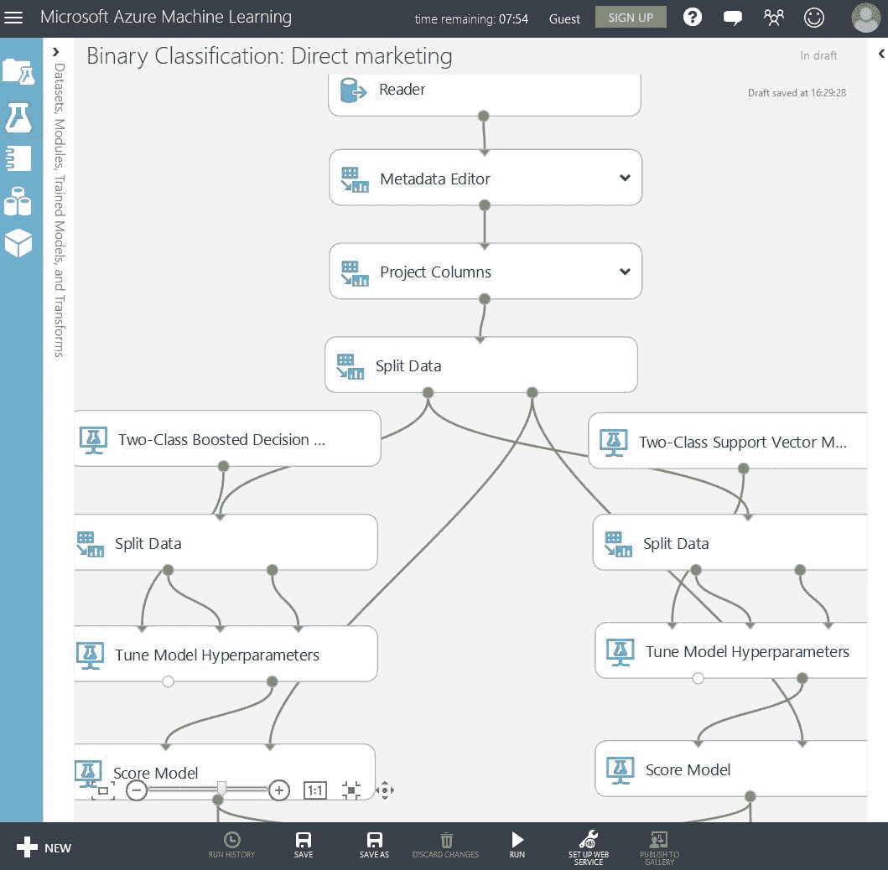

如果你不想为自己构建推荐引擎，那么 Azure 提供了现箱即用的推荐 `API`。`Azure` 还提供了面部识别和语音识别、情感和情绪分析、内容审核、文本/语音翻译等许多 `API`。其中一些系统中的模型已经在海量数据上进行了训练，因此可以在无需构建自己的语料库的情况下使用。

### 大数据和 MapReduce

大数据在今天可能是一个被过度使用的术语，有时被描述为“大”的通常更像是中等数据。大数据是指你拥有如此信息，以至于在单台机器上难以处理甚至难以存储。传统方法在大数据面前通常会失效，因为它们不足以应对今天常见的自动获取的海量数据集。例如，`IoT` 传感器或我们与在线服务的交互不断收集的数据量可能是巨大的。

大数据和 `ML` 的一个告诫是，尽管它们擅长在大量数据点中寻找相关性，但你不能用它们来寻找因果关系。你还需要留意数据隐私问题，并非常小心不要仅根据预测的倾向在某人行动之前就对其做出评判。

数据匿名化是非常困难的，远非删除个人联系详情那么简单。已经出现过许多大型“匿名化”数据集发布的情况，个人随后很容易地从记录中被识别出来。

一种用于分析大数据的技术是 `MapReduce`，它是简化操作的方法，使其适用于在分布式架构上并行运行。`MapReduce` 的流行实现是 `Apache Hadoop`，你可以在 Azure 中通过 `HDInsight` 使用它，它还支持相关工具，包括 `Apache Spark` 和 `Apache Storm`。处理大型数据集的其他选项包括 Google 的 `Cloud Bigtable` 或 `BigQuery`。

你可以在门户中查看 `Azure HDInsight` 的可用选项。`Spark` 显示在下面的截图：

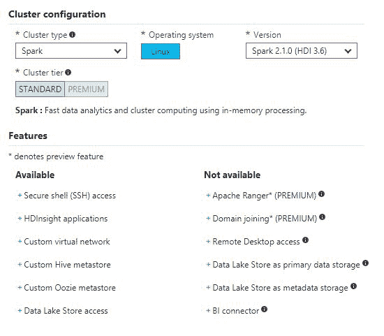

你可以从这张截图看到 `Spark` 仅在 Linux 上可用。`Hadoop` 更加成熟，并且在 Windows 上可用，如下截图所示：

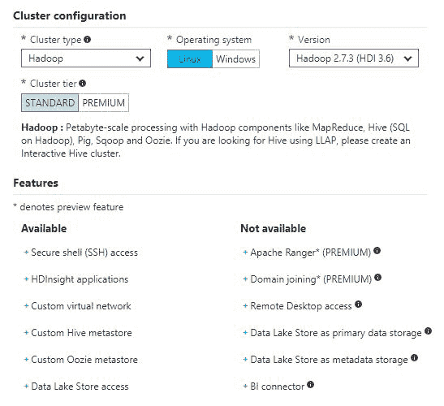

下一张截图显示 `Storm` 也是可用的，但不在高级集群层级（与 `Spark` 相同）：

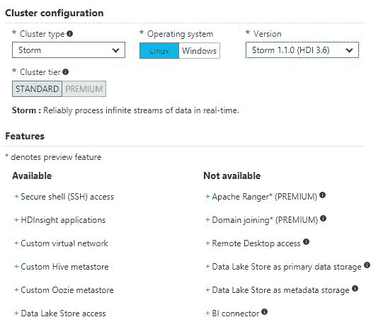

你可以在 [`docs.microsoft.com/en-us/azure/hdinsight/`](https://docs.microsoft.com/en-us/azure/hdinsight/) 阅读更多关于 `HDInsight` 的信息。

### Orleans

另一个有趣的项目是微软的一个名为 `Orleans` 的开源框架，这是一个分布式虚拟 Actor 模型，曾用于某些 Halo Xbox 游戏的云服务。这意味着，如果你通过将逻辑分离到不同的 Actor 中构建系统，这允许它根据需求轻松扩展。

在 Orleans 中，执行器（actors）被称为颗粒（grains），你可以通过继承接口来用 `C#` 编写它们。这些颗粒由一个称为 `silo` 的 Orleans 服务器执行。颗粒可以持久化到存储器中（例如 SQL 或 `Azure Tables`），以保存其状态并在以后重新激活。Orleans 还可以利用 Bond 序列化器来提高效率。

遗憾的是，Orleans 目前不支持 `.NET Core`。计划在 Orleans 2.0 版本中支持，该版本目前正在开发中。Orleans 允许你编写低延迟的简单且可扩展系统，你可以在 [`dotnet.github.io/orleans/`](http://dotnet.github.io/orleans/) 阅读更多信息。

### 自定义传输层

在第 6 章 *网络性能优化* 中，我们从 TCP/IP 的介绍开始，并简要提到了`用户数据报协议`（`UDP`）。我们还涵盖了`传输层安全`（`TLS`）加密，以及如何在获得性能收益的同时尽可能地减少安全连接的影响。

`UDP` 比`传输控制协议`（`TCP`）更简单、更快速，但你要么不在乎可靠交付（如多人游戏和语音/视频聊天），要么需要自己构建一个层来提供这种功能。在第 10 章 *性能增强工具的缺点* 中，我们强调了 `StatsD`，它使用 `UDP` 来避免在记录到远程中央服务器时产生阻塞延迟。

如果你不受限于浏览器，存在 `TLS` 的替代方案，但如果你正在开发 Web 应用程序，这可能只适用于你的服务器基础设施内部。例如，WhatsApp 消息应用程序在手机 App 与服务器之间使用了来自 Noise 协议框架（[`noiseprotocol.org/`](http://noiseprotocol.org/)）的 `Noise Pipes` 和 Curve25519，此外还有 Signal 协议进行端到端加密。

使用 `Noise Pipes` 代替 `TLS` 可以提高性能，因为建立连接所需的往返次数更少。另一个具有类似收益的选项是`安全管道守护进程`（`spiped`），它是为安全的 Linux/BSD 备份软件 `Tarsnap` 创建并供其使用的。然而，你需要预共享密钥，但你可以在 [`www.tarsnap.com/spiped.html`](http://www.tarsnap.com/spiped.html) 更多关于此的信息。

### 高级哈希

我们在书中书中讨论了大量的哈希函数，特别是在第 8 章 *理解代码执行与异步操作* 中。这一领域正在不断进步，关注未来以了解即将出现的内容很有用。虽然现在使用 `SHA-2` 家族的成员进行快速哈希，并使用 `PBKDF2` 进行慢（密码）哈希是合理的，但这可能不会一直如此。

对于快速哈希，有一系列名为 `SHA-3` 的新算法，它不应与 `SHA-384` 或 `SHA-512` 混淆（它们都属于 `SHA-2` 家族）。`SHA-3` 基于名为 `Keccak` 的算法，该算法是寻找新标准适用算法竞赛的获胜者。其他入围者包括 `Skein` ([`skein-hash.info/`](http://skein-hash.info/)) 和 `BLAKE2` ([`blake2.net/`](http://blake2.net/))，它们比 `MD5` 快但实际上是安全的。

名为 `Argon2` 的算法在类似的密码哈希竞赛中胜出 ([`password-hashing.net/`](http://password-hashing.net/))。要了解为什么这，你可以访问 [`haveibeenpwned.com/`](https://haveibeenpwned.com/)（由 `.NET` 安全专家 Troy Hunt 运行）查看你的详情是否在大量数据泄露中。例如，LinkedIn 遭到破解且没有安全的密码哈希（仅使用了未加盐的 `SHA-1` 哈希）。结果是大多数明文密码被破解并恢复。因此，如果 LinkedIn 账户密码在其他网站重用，这些账户可能会被接管。

使用密码管理器为每个网站创建强且唯一的密码是非常好的主意。如果可用，使用双重身份验证（有时称为两步验证）也有益。例如，你可以通过在输入密码之外输入来自手机 App 的代码来实现。这对于电子邮件账户特别有用，因为它们通常可以用于恢复其他账户。

### 库和框架支持

在版本 1.0 和 2.0 之间 `.NET Core` 和 `ASP.NET Core` 发生了一些重大变化。明智的是，许多流行的库和框架都在等待 `.NET Standard` 2.0 后添加支持。

显然，书籍并不是跟踪变化的好地方，因此作者整合了一个 GitHub 存储库来显示最新的兼容性信息。你可以在 [`anclafs.com/`](http://anclafs.com/) 找到 `ASP.NET Core` 库和框架支持列表。

如果你更新任何内容或添加库或框架，请发送拉请求（pull request）。该仓库位于 [`github.com/jpsingleton/ANCLAFS`](https://github.com/jpsingleton/ANCLAFS)，包含了许多实用的工具、库、框架等。我们在书中前面提到过其中许多项，下面的示例只是列出内容的一小部分，因为包支持将随时间不断增长：

*   `Scientist.Net`
*   `FeatureToggle`
*   `MiniProfiler`
*   `Glimpse`
*   `Prefix`
*   `Dapper`
*   `Simple.Data`
*   `EF Core`
*   `Hangfire`
*   `ImageResizer`
*   `DynamicImage`
*   `ImageSharp`
*   `RestBus`
*   `EasyNetQ`
*   `RabbitMQ client`
*   `MassTransit`
*   `Topshelf`
*   `Nancy`
*   `Orleans`

## 未来


通常归于物理学家尼尔斯·玻尔（Niels Bohr）的名言如下：预测是非常的，特别是关于未来。

然而，我们还是尝试，从较简单的部分开始。官方 ASP.NET Core 路线图列出 SignalR 将随 2.1 版本发布。SignalR 正在重写，因为在大规模部署中获得了许多教训，并且需要改进。

`.NET Standard` 规范也在持续进展，它的创建是为了增强 .NET Core、NET Framework 和 Mono 之间的移植性。例如，.NET Core 2.0 和 .NET Framework 4.6.1 实现了 `.NET Standard` 2.0。这意味着用其中任何一种编写的项目都可以使用遵循 `.NET Standard` 2.0 的库。由于 `.NET Standard` 2.0 现在已定稿，任何 API 范围的增加都将使用更高的版本号。`.NET Standard` 类似于 HTML5 规范，它由不同浏览器以不同程度实现。除非你正在编写库或 NuGet 包，否则你可能不需要太担心这个。如果是，请参考 [`docs.microsoft.com/en-gb/dotnet/standard/net-standard`](https://docs.microsoft.com/en-gb/dotnet/standard/net-standard) 中的文档。

你可能想奇怪为什么 `.NET Standard` 文档目前没有提到 .NET 4.7。预计这种情况将发生变化，并且各种框架将继续收敛。然而，你可能不想过早升级到新版本，因为新发布版本存在一些严重的 Bug。例如，4.6 版本中有一个讨厌的 Bug，向方法参数传递了错误的值。4.6.2 中还有一个可怕的错误，将 `max-age` 被设置为巨大的值，这可能导致资产在代理服务器中缓存超过 2000 年！这些问题通常会发布热补丁（或质量更新），因此请确保你关注这些动态，不要仅仅依赖版本号。

从语言的角度来看，C# 7.1 和 7.2 提供了一些小改进，而 8.0 将包含一些更重新功能。其意图是添加一些高性能、底层的代码特性，以优化游戏和其他对性能敏感的操作。这些是你以前必须使用 `unsafe` 代码才能实现的，现在的计划是让它们在使用安全的同时依然保持快速。其他待包含的语言特性包括接口的默认实现，这在 Java 和 Swift 中已经可用。这允许你更新接口而不必破坏所有实现它的类。它也让 Xamarin 到 Android 和 iOS 平台 API 的映射更加整洁。C# 7.1 允许 `async` main 方法，在将来，你可能还可以 `await` 一个 `foreach` 循环或 `using` 语句。最终列表可能会发生变化，因此请临近检查 GitHub 上的 C# 语言设计仓库（`https://github.com/dotnet/csharplang`），甚至参与其中。

微软表示他们将听取用户反馈并利用其驱动平台方向，因此你有发言权。他们还利用从 SDK 工具收集的遥测数据来决定平台支持，并定期发布部分此类数据。由于代码全部是开源的，你可以通过添加你想要的功能来帮助塑造未来。F# 的开发很大来自社区，在 ASP.NET Core 和相关工具中看到更好的支持将是好的。例如，`FSharp.Data` 网络爬虫工具就是一项社区贡献。去看看 GitHub 并加入其中吧。

更远的未来更难预测，但微软源源不断地开源了项目，从早期的 ASP.NET MVC 到跨平台应用开发的 Xamarin 框架。XAML 标准正在成型，一个运行在所有主流桌面和移动操作系统上的通用 UI 框架的前景景是非常迷人的。

现在使用 C# 和 .NET 是一个令人兴奋的时代，特别是如果你想扩展 Web 开发领域。Unity 游戏引擎是 .NET 基金的一部分，虚拟现实（`VR`）和增强现实（`AR`）硬件领域也有有趣的进展。例如，微软 Hololens、Oculus Rift、三星 Gear VR 和 HTC Vive 都比几十年前出的基础 VR 强大得多。

现在关注 IoT 也是一个绝佳时机，尽管它可能仍在寻找“杀手级应用”，但现在有更多廉价且强大的硬件可供。一个带有摄像头接口和 WiFi/蓝牙的树莓派 Zero W 仅需 10 美元。像树莓派 3 这样的电脑，提供几乎桌面级的性能和 WiFi/蓝牙，仅需 35 美元，现在任何人都可以轻松地学习编程（也许使用 C# 或 .NET）并制作东西。

以下是艾伦·凯（Alan Kay）的智慧：

> 预测未来的最好方法是发明它。

所以，去创造它吧！并务必分享你所做的一切。

## 读累了记得休息一会哦~

公众号：古德猫宁李

- 电子书搜索下载
- 书单分享
- 书友学习交流

网站：[沉金书屋](https://www.chenjin5.com)

- 电子书搜索下载
- 电子书打包资源分享
- 学习资源分享

## Summary

我们希望你喜欢这本书，并学会了如何让你的 Web 应用程序高性能且易于维护，特别是当你使用 C#、ASP.NET Core 和 .NET Core 时。我们尝试尽可能让建议适用于通用的 Web 应用开发，同时向你介绍来自微软及其他机构最新的开源框架。

显然，此类主题的变化非常快，所以请保持关注网上的更新。希望书中的许多课程都是通用的好主意，它们在未来的很长一段时间内都仍然是合理的。

请始终记住，为了优化而优化是没有意义的，除非它纯粹上是一项学术练习。你需要衡量并权衡利与弊；否则，你可能会让情况变得更糟。让事情变得更复杂、更难理解、难以维护或三者兼具都是很容易。

将这些务实的性能理念融入团队文化是至关重要的，否则团队不会总是遵守它们。然而，最重要的是，记住要保持乐趣！
