## 汇编语言入门指南：Linux编程（第3版）

> 献给

> Kathleen M. Duntemann，教母

> 1920–1999

> *在我只会把书咬出牙印的时候，她就送给我书。*

> *任何言语都不足以表达我对您的感激之情！*

---

## 作者简介

**Jeff Duntemann** 是一位作家、编辑、讲师和出版行业分析师。在科技行业的三十年中，他曾任 Xerox Corporation 的计算机程序员和系统分析师、Ziff-Davis Publications 的技术期刊编辑，以及 Coriolis Group Books 和后来的 Paraglyph Press 的总编辑。他目前是一名技术出版顾问，并拥有一家 POD 品牌 Copperwood Press，托管于 `lulu.com`。Jeff 与妻子 Carol 现居于科罗拉多州科罗拉多斯普林斯市。

---

**执行编辑**：Carol Long

**项目编辑**：Brian Herrmann

**制作编辑**：Rebecca Anderson

**文字编辑**：Luann Rouff

**编辑总监**：Robyn B. Siesky

**编辑经理**：Mary Beth Wakefield

**制作经理**：Tim Tate

**副总裁兼执行集团出版人**：Richard Swadley

**副总裁兼执行出版人**：Barry Pruett

**副出版人**：Jim Minatel

**封面项目协调员**：Lynsey Stanford

**校对员**：Dr. Nate Pritts, Word One

**索引编制**：J&J Indexing

**封面图片**：© Jupiter Images/Corbis/Lawrence Manning

---

## 致谢

首先，感谢 Wiley 的 Carol Long 和 Brian Herrmann 让本书再版，并确保其如期完成，而且比上次的时间表更为紧凑。

与前三版一样，我要感谢 Michael Abrash 在许多方面始终如一地提供明智的建议，尤其是现代 Intel 微架构之间那些深奥的差异。

尽管他们可能没有意识到，但 Randy Hyde、Frank Kotler、Beth 以及 `alt.lang.asm` 上的所有伙伴们都在多个方面提供了巨大帮助，其中最重要的是倾听并回答汇编语言初学者的问题，从而帮助我确定了这样一本书应该涵盖什么内容、不需要涵盖什么内容。

最后，一如既往地，向 Carol 举杯，感谢她 40 年来的支持和神圣的友谊，这使我能够承担并完成这样的项目。

---

## 第12章 走向 C 语言

这里有一个关键点：我撰写本书的目的并不完全是教你汇编语言*本身*。如果这本书真的有什么首要指导原则，那就是培养你对机器的一种严谨的求知欲，同时提供一些基本背景知识，让你可以从最底层的角度开始探索机器——当然，还要有信心放手去尝试。这是些艰深的内容，但只要你集中注意力、保持耐心并投入所需的时间——我得提醒你，这可能需要相当长的时间——你就一定能掌握。

说实话，我真正要教你的其实是如何学习。

### 你需要准备什么

要按照我的教学方式进行编程，你需要一台基于 Intel x86 架构并运行 Linux 的计算机。本书的文本和示例至少假设你使用的是 386 处理器，但由于 Linux 本身至少需要 386，所以这一点你已经满足了。

你需要对用户级别的 Linux 操作相当熟练。本书不会教你如何在 Linux 下安装和运行系统，不过当遇到确实不那么显而易见的问题时，我会提供提示。如果你还不熟悉 Linux，找本教程书认真学习一遍。这类书有很多，但我最喜欢的是威廉·冯·哈根所著的*《Ubuntu 8.10 Linux 宝典》*。（*《Linux 入门傻瓜书》*虽然写得不错，但内容还不够。）

你使用哪个 Linux 发行版/版本并不是特别重要，只要它基于 2.4 版本以上的内核，最好是 2.6 版本即可。我用来编写示例程序的发行版是 Ubuntu 8.10。你使用哪种图形用户界面（GUI）也无所谓，因为所有程序都是为在纯文本的 Linux 控制台中运行而编写的。汇编器 `NASM` 本身也是一个纯文本工具。

需要用到 GUI 的地方是使用 `Kate` 编辑器，我在讨论编程的后勤保障时以它为例。实际上你可以使用任何你喜欢的编辑器。程序本身并没有任何依赖 `Kate` 的地方，但如果你是编程新手，或者一直使用高度语言特定的编辑环境，`Kate` 是一个不错的选择。

文中提到的调试器是经典的 `Gdb`，但主要通过 `Gdb` 内置的 GUI 前端 `Insight` 来讲解。`Insight` 需要正常工作的 X Window 子系统，但并不绑定于 GNOME 或 KDE 等特定的 GUI 系统。

你不必提前知道如何安装和配置这些工具，因为我会在书中适当的章节涵盖所有必要的工具安装和配置。

请注意，其他基于 Unix 但非 Linux 内核的实现，其底层工作方式可能并不完全相同。例如，BSD Unix 在进行内核调用时使用不同的约定，而 Solaris 等其他 Unix 版本则超出了我的经验范围。

### 总体规划

这本书从头讲起，我说的是*真正的*从头开始。也许你已经是老手，或者早已过了入门阶段。我尊重这一点。但我仍认为从第一章开始按顺序通读全书不会有什么坏处。复习是有益的，而且——嘿，你可能会意识到自己*并没有*像想象中知道得那么多。（这种情况在我身上经常发生！）

但如果时间紧迫，这里有一份速查指南：

- 如果你已经理解计算机编程的基本概念，跳过第一章。
- 如果你已经理解除十进制以外的进制概念（尤其是十六进制和二进制），跳过第二章。
- 如果你已经掌握计算机内部原理（内存、CPU 架构等），跳过第三章。
- 如果你已经理解 x86 内存寻址，跳过第四章。
- 不。停。划掉这条。即使你已经理解 x86 内存寻址，也要读第四章。

第 5 条之所以如此强调，是有原因的：*汇编语言编程的核心就是内存寻址*。如果你不理解内存寻址，你学到的其他任何东西都帮不上半点忙。所以无论你知道或自以为知道什么，都不要跳过第四章。从那里开始，一路看到底。加载每个示例程序，逐个汇编，全部运行。努力做到理解每个程序中的每一行代码。不要凭信仰接受任何东西。

此外，不要止步于此。当事情开始变得对你有意义时，修改示例程序。尝试不同的方法。尝试我没提到的东西。大胆去做。不，尽情折腾吧——比特没有感情，最坏的情况不过是 Linux 抛出一个段错误，这可能会伤害你的程序（或许还有你的自尊），但不会伤害 Linux。（人们称之为"保护模式"可不是白叫的！）唯一需要注意的是，当你尝试某样东西时，要像你理解所有成功的做法一样，清楚地理解它*为什么*行不通。*做笔记*。

这归根结底就是我所追求的：向你展示如何理解你的机器中每一个无论多么遥远的角落正在发生什么，以及它众多的部件如何协同工作。这并不意味着我要亲自解释它的每一个角落——没有人能活得足够长来做到这一点。计算不再简单，但如果你培养了耐心研究和实验的素养，你可能自己就能弄明白。归根结底，这是学习它的唯一途径：靠你自己。你在朋友那里、在网上、在这样或那样的书中找到的指引——都只是指引，是轴上的润滑油。你必须决定谁是主人，是你还是机器，并使之成为现实。汇编程序员是唯一真正可以声称自己是主人的程序员，这是一个值得深思的真理。

### 关于大小写惯例的说明

汇编语言在众多编程语言中独树一帜，因为大小写敏感性没有通用的标准。在 C 语言中，所有标识符都是区分大小写的，而我也见过完全不识别大小写差异的汇编器。本书中介绍的汇编器 `NASM`，仅对程序员定义的标识符区分大小写。然而，指令助记符和寄存器名称*并不*区分大小写。

汇编语言文献中有一些惯例，其中之一就是在文本中将 CPU 指令助记符和寄存器名称写成大写，而在源代码文件和穿插在文本中的代码片段中写成小写。我将在这里遵循这一惯例。在讨论文本中，我会提到 `MOV` 以及寄存器 `EAX` 和 `EFLAGS`。在示例代码中，则是 `mov` 和 `eax` 和 `eflags`。

这样做有两个原因：

- 在文本讨论中，助记符和寄存器需要突出显示。在大量普通文字的洪流中，它们太容易被人忽略了。
- 为了能够阅读和学习本书以外的现有文档和源代码，你需要能够轻松阅读大写、小写或混合大小写的汇编语言。习惯同一件事的不同表达方式很重要。

这可能会让 Unix 社区的一些人感到不快，对他们来说小写字母多少有点执念。我提前为此道歉，同时坚持认为这仍然是一种执念，而且相当孩子气。

### 我为什么要写这本书？

无论你选择从哪里开始阅读本书，是时候启程了。只要记住，无论是什么挡在你面前——无论是那些麻烦事、机器，还是你自己的经验不足——你都要把这一点牢记在心：*你的目的是弄明白它是如何工作的。*

走吧。

杰夫·邓特曼

科罗拉多斯普林斯，科罗拉多州

2009 年 6 月 5 日

`www.duntemann.com/assembly.htm`

## 步步深入汇编语言

### 又一个愉快的山谷星期六

#### 理解计算机真正在做什么

##### 一切尽在计划中

> "快点，迈克，把你妹妹和弟弟叫起来，都过七点了。尼基九点小联盟有比赛，迪翁十点有芭蕾舞课。给马克斯喂他的心丝虫药！（我们完了，妈，记得吗？）你爸真会挑日子，偏挑这个周末去钓鱼。给，我给你十块钱，去兽医那里再买点药。天哪，对了，汉克拿走了加油的钱，把我掏空了。Kmart 那边有 ATM 机，如果我去那儿可以把那个 stupid 马桶座圈退了换对的那个。"
>
> "我想我最好还是列个单子……"

又是一个愉快的山谷星期六，三千多万郊区家庭主妇坐在厨房的桌子旁，拿着铅笔和便签本，试图理清一个足以杀死后并腌制任何较弱生物的早晨。在她脑海中，她梳理着依赖关系并规划路线：

把尼基送到兰德公园，回到登普斯特街，到高尔夫米尔购物中心大约十分钟。有油吗？我最好检查一下——如果没有，在德尔壳牌加油站停一下，否则到不了密尔沃基大道。在高尔夫米尔取 ATM 里的钱，然后穿过停车场去 Kmart 退掉汉克上周末买的那个没看形状的马桶座圈。记得把马桶座圈扔进货车后座——把这个写在单子最上面。

到那会儿大概已经三点半了，甚至更晚。芭蕾舞课在帕克里奇，沿着格林伍德一直走就到了。从密尔沃基大道不能左转——不过有条绕过商场背后的近道可通。我得记着别像往常一样右转上密尔沃基大道——记下来。我在帕克里奇的时候，可以顺道去看看汉克的新眼镜到了没有——应该打个电话，但他们恐怕要到九点半才开门。哦，还要买杂货——迪翁跳舞的时候我可以去办。回来的路上可以拐到奥克顿去取狗的药。

大约九十秒之内，清单就列完了：

- 把马桶座圈扔进货车。
- 检查油量——如果空了，就在德尔的壳牌加油站停一下。
- 把尼基送到兰德公园。
- 在高尔夫磨坊的提款机取钱。
- 在凯马特退掉马桶座圈。
- 送迪翁去上芭蕾舞课（记得走格林伍德的近道）。
- 去兽医那里买心丝虫药。
- 去凯马特取钱。

不过如此，可事实上它们并非如此，而且它们往往会让那些本该更懂事的大人完全失去理智。那个完全没有被提及的"愉快的山谷星期六"，仅仅是因为当时我碰巧在听卡莉·西蒙的老唱片，重新熟悉了起来。歌曲的结构如同熙熙攘攘的超市和宁静的郊区街道，卡森打字机里的黄蜂，一把不合时宜的螺丝刀穿过毫无防备的`1/4-20`螺母……书中其余的材料都是在星期六早晨诞生的，那时风静了，思绪自然而然地转向廉价俗气。我还必须感谢那种把每一种类和亚种的口袋保护套及短袖白色衬衫一一编目的癖好，我才承认校对确实是在午夜之后完成的，没错，我还要做早餐。这通常从凌晨五点左右开始，所以到六点半左右，我觉得自己已经洗漱完毕、刮完胡子、穿戴整齐，而且（偶尔）神志清醒。所以这本书相当一部分是在凌晨五六点钟写的。

凯利·贝吉在技术出版领域担任过多个职位，包括《DDJ》的编辑。他坚信"内在的结构才是关键"，他的编辑和写作立场都体现了他对**精致方言**的热情，以及对汇编代码的深入了解。凯利是许多畅销书的作者或合著者，包括《Borland Pascal 程序》和《Peter Norton 汇编语言》一书。

### 步骤与测试

想想我在前面的清单里所说的"测试"是什么。测试就是我们在即便最平静的日子里也要做上几十次甚至几百次的那种非此即彼的决定，有时几乎不经思考。

我们的家庭主妇在开始她的冒险时进入货车，就进行了一次测试。她看了看油表。油表会告诉她两件事之一：要么油够用，要么不够用。如果油够用，她就右转开往兰德公园。如果油不够用，她就左转去街角的德尔壳牌加油站把油箱加满。然后，加满油，她继续执行程序，调个头开往兰德公园。

抽象地说，一个测试包含两个部分：

- 首先，你看某件可能走向两种情况之一的事情。
- 然后，你做法取决于你看到的是哪种情况。

在程序即将结束时，我们的家庭主妇回到家，把杂货从货车上搬下来，然后看钟。如果还没到接尼基参加小联盟的时间，她就有片刻时间可以在几乎空无一人的房子里瘫倒在沙发上。如果*确实*到时间了，那就没有喘息的余地了：她冲向货车，赶回兰德公园。

（猜猜她程序运行结束后真的能瘫倒吗？）

### 不止两条路？

你可能会反对，说很多或大多数测试涉及的不止两个选择。哈哈，抱歉，你**完全**错了——*在每一种情况下*都是。而且，无论你认为对还是错，你都错了。读两遍这句话：*除了完全冲动或精神错乱的行为，每一个人类决策最终都归结为两个选择之间的抉择*。

你需要做的是更仔细地审视自己做决定时脑子里在想什么。下次你匆匆赶到"现在就喵"快餐店吃中式快餐时，观察一下自己盯着菜单看的时候。乍看之下，选择似乎是从26种粤菜主菜中挑一种。并非如此。事实上，选择是在**选择**一道菜和**不选择**那道菜之间。你的目光停留在腰果鸡丁上。不，太淡了。*那是一个测试*。你移到下一项。香菇滑鸡。嗯，不要，上周吃过了。*那是另一个测试*。再下一项：宫保鸡丁。好，就它了！*那是第三个测试*。

选择并不在腰果鸡丁、香菇滑鸡和宫保鸡丁之间。每一道菜都有它的时刻，在你那批判性的目光前接受审视，而你对它们逐个表示认可或否定。最终，一道菜赢了，但它赢的也是同一个"吃或不吃"的游戏。

让我再举个例子。生活中许多最复杂的决定之所以产生，是因为99.99867%的我们不是裸体主义者。你经历过：你穿着内衣站在衣柜前，翻着一架子裤子。测试来得又急又快。这条？不。这条？不。这条？不。这条？好。你挑了一条蓝裤子，比方说。（毕竟是星期一，蓝色似乎是个合适的颜色。）然后你跌跌撞撞地走到袜子抽屉前一看。糟糕，没有蓝袜子。*那是一个测试。*于是你又跌跌撞撞地回到衣柜，把蓝裤子挂回裤架上，从头再来。这条？不。这条？不。这条？好。这次是棕裤子，你把它们搭在胳膊上，又回到袜子抽屉再看一眼。该死，棕袜子也没了。于是回到衣柜……

你可能认为这是一个单一的决定，或者也许是两个解不开的纠结决定（比如挑同色系的裤子和袜子，鉴于现有库存），实际上却是一系列小决定，本质上总是二元的：要它或不要它。找到了或没找到。星期一早上衣柜里的这一幕，是一个叫做*循环*的编程结构的好类比：你不断做一系列事情，直到做对为止，然后停下来（假设你不是那种穿棕色裤子配蓝色袜子的怪人）；但无论你是否把每件事都做对，最终都归结为一系列简单的非此即彼的决定。

### 计算机像我们一样思考


我几乎能听到反对声：“当然，这是本计算机书，他想让我像计算机一样思考。”一点都不对。计算机像我们一样思考。我们设计了它们，不然它们还能怎么思考？不，我想做的是让你认真审视一下你自己是怎么思考的。我们生活中有太多时候是自动运行的，以至于我们毫不夸张地说，大部分思考都是在没有真正思考的情况下完成的。

计算机程序逻辑的最佳模型，正是我们用于规划和管理日常事务的同一套逻辑。无论我们做什么，最终都是面对两个选择并挑一个。我们所认为的单一大型复杂决定，不过是许多小决定纠缠在一起的混乱线团。将复杂决定拆解，看清它肚子里所有小决定的技能，将对你学习编程大有裨益。下次你必须做决定时，观察一下自己。数数构成那个大决定的小决定有多少。你会感到惊讶。

而且，惊喜吧！你就成了一名程序员。

## 如果是真的……

不必惊慌。你刚才经历的是一个隐喻。它不是真的。（真的在后面。）我在本书中大量使用隐喻。隐喻是在熟悉的事物（比如星期六早晨的洗衣清单）和陌生的事物（比如计算机程序）之间建立的一种松散比较。其用意是将陌生的东西锚定在熟悉的术语中，这样当我开始向你抛事实时，你会有个舒适的地方安放它们。

现在最重要的事情是保持开放的心态。如果你对计算机或编程略知一二，不要吹毛求疵。是的，家庭主妇跟着潦草的洗衣清单和计算机执行程序之间有重要的区别。我会在适当的时候提到那些区别。

现在，这还是第一章。就按这些最初的隐喻本身的条件来接受它们。以后，它们会大有帮助。

## 不要经过“开始”

“无聊（bored）和棋盘（board）是同音词，这有原因的，”我最好的朋友阿特有一天晚上说，我们（两个超级老成的十二岁孩子）坐在他家地下室里玩某种游戏。（他可能因为快输了而不高兴。）是《千 borne》？还是《军旗》？还是《大富翁》？还是别的什么？我承认，我不记得了。我只记得把一个形状像孕妇保龄球瓶的小塑料棋子在一个个彩色格子上下来回跳，格子让我做傻事，比如后退两格，或者放100美元到奖池里，或者核平外蒙古 [西奥多什么事地，n]

“美国的这种奇特消遣，棋盘游戏，和汇编语言编程之间，可以找出很强的相似性。首先，我之前说的仍然成立：棋盘游戏大致上由一系列步骤和测试组成。在某些游戏中，比如《trivia pursuit》，棋盘上的每一步都是一个测试：看你能否回答，或不能回答，卡片上的问题。在其他棋盘游戏中，路径上的每一个小方格都包含某种指令：失去一回合；后退两格；从社区宝箱抽一张牌；当然，还有进监狱。棋盘游戏中会发生各种事情，你的小孕妇保龄球瓶沿着棋盘边缘前进时所走的路，也会一路变化。

许多棋盘棋盘上还有一些标出来的小储存位置，用来放东西：纸牌、游戏币和游戏代币，比如小塑料房子或旅馆，或者可能是轰炸机和核导弹。随着游戏进行，你买卖或发射你的资产，储存位置里的东西也会变化。计算机程序也是如此：有储存东西的地方（这里的“东西”是纯数据，而不是实物代币）；随着计算机程序执行，那些地方储存的数据也会变化。

计算机程序当然不是游戏——至少，不是棋盘游戏意义上的游戏。大多数时候，一个给定的程序是独立运行的。只有一个“玩家”，而不是两个或更多。（这不是

## 大富翁游戏

我发明了一款自己的棋盘游戏，以延续这个特定的隐喻。如果说艺术反映生活，那么大富翁游戏（Big Bux）就反映了硅谷的生活——金钱似乎凭空产生（通常在别人口袋里），而三大金钱黑洞则是豪车、加州房地产和混乱的离婚。这里有运气，有工作，资产往往转手非常迅速。

图1-1展示了大富翁游戏棋盘的一部分。页面左侧的一排矩形沿着棋盘一直延伸。棋盘中间有存放游戏币和棋子的格子；偶尔需要阅读的卡牌堆；以及名为“混乱离婚”和“创业”等短途支线，它们是由与棋盘边缘路径上相同类型的行动方格组成的简短序列。这些是“支线路径”，玩家根据棋盘上的方格或游戏中抽到的卡牌指示进行。如果你落在告诉你“创业”的方格上，你就走那条支线。如果你跳过该方格，则不进入支线，继续沿着棋盘前进。

与许多棋盘游戏不同，你不需要掷骰子来决定在棋盘上走多少步。大富翁游戏要求你在每回合只向前走一步，除非你所在的方格指示你向前或向后移动，或前往其他地方，比如通过支线。这使得游戏的随机性大大降低。事实上，大富翁游戏是一种相当线性的体验，这意味着在很大程度上你只是绕着棋盘走，直到被告知游戏结束。到那时，你可能已经破产；如果没有，你可以计算你的资产，看看你做得如何。

这里涉及一些数学计算。你开始时会拥有一套公寓、一辆便宜的汽车和25万美元现金。你可以以给定的利率购买CD，每次绕棋盘一圈时获得利息。你可以投资股票和其他证券，其价值由经济指标的可变指数决定，而该指数基于从“命运无常指”（Fickle Finger of Fate）卡牌堆中抽取的卡牌而波动。你可以在二手市场上出售汽车，买卖房屋、公寓和土地；并与其他玩家进行交易。每次绕棋盘一圈后，你必须重新计算你的净资产。所有这些都涉及一些加法、减法、乘法和除法，但没有比复利更复杂的数学。大富翁游戏的大部分内容不过是走一步，然后遵循每一步的指示。

这开始听起来熟悉了吗？

## “大富翁”游戏——杰夫·邓特曼（Jeff Duntemann）著

- 购买石榴电脑（Pomegranate Computer）的期权。望向窗外——如果你能看见月亮，股票下跌。赚5万美元。
- 发薪日！将工资存入活期账户。
- 从“命运无常指”中抽取一张卡牌。
- 你被解雇了吗？如果是，绕行“自主创业”。
- 你结婚了吗？如果没结，与首席程序员结婚，花费1万美元。如果结了，绕行“混乱离婚”。
- 周五晚上。你是一个人吗？如果是，喝得烂醉，后退三格。
- 在101号公路上撞毁汽车。购买一辆同等价值的车。
- 你的工作无聊吗？（繁荣指数 > 0.6 但 < 1.2）如果不是，前进3格。
- 获得晋升。工资上涨25%。（如果失业，以每周800美元的工资获得新工作。）
- 与首席程序员有染。后退5格。
- 节假日。什么都没发生！
- 5000股股票期权归属。以10 × 经济指标的金额出售。
- 在帕洛阿尔托购买公寓，首付15%。
- 你破产了吗？如果是，搬到皮奥里亚（Peoria）。如果不是，绕行“创业”。
- 朋友尼克透露了关于Widgetsoft即将获得巨额政府合同的传闻。购买1万美元的Widgetsoft股票。
- Widgetsoft的合同通过了吗？如果没有，后退两格。如果通过了，出售并在一天内赚取50万美元。
- 向朋友尼克吹嘘内幕交易。错了。尼克是SEC的卧底。向皮奥里亚挥手。搬到乔利埃特（Joliet）。游戏结束。

### 银行

| 项目 | 数值 |
|:---|:---|
| 抵押贷款 | $153,000 11% 可调 |
| 汽车贷款 | $15,000 10% 固定 |

### 你的活期账户

| 项目 | 数值 |
|:---|:---|
| 余额 | $12,255.00 |
| 信用额度 | $8,000.00 |

### 市场价值

| 资产 | 价值 |
|:---|:---|
| 保时捷 | $48,000 |
| 雪佛兰 | $10,000 |
| 宝马 | $28,000 |
| 二手福特 | $2,700 |
| 帕洛阿尔托2居室公寓 | $385,000 |
| 帕洛阿尔托4居室房屋 | $742,000 |

### 混乱离婚

从这里开始：

- 她搬出去，租住每月2000美元的公寓。
- 你破产了吗？如果是，请便宜的律师。前进4格。
- 聘请昂贵的律师。从活期账户支付5万美元。
- 律师在法庭上证明你的妻子是一只毛丝鼠。
- 妻子被送往布鲁克菲尔德动物园。返回你原来的位置。
- 律师在法庭上证明你是一只毛丝鼠。
- 法庭和妻子把你生吞活剥。失去50%的一切。
- 开始每月支付妻子5000美元，直到你生命的尽头。
- 返回你原来的位置。

### 命运无常指

- 重大银行倒闭！
  - 经济指标线减少百分之三十。债券下跌20%；房价下跌5%。重新评估你的投资组合。银行削减你的信用额度2000美元。好好哭一场吧。

### 你的投资组合

| 资产 | 价值 |
|:---|:---|
| 定期存单 | $100.00 |

### 其他资产

| 资产 | 价值 |
|:---|:---|
| 工资 | $1000/周 |

### 创业

从这里开始：

- 起草商业计划书并提交给风险投资公司。
- 风险投资公司要求5万美元的配套资金。
- 有吗？如果没有，返回你原来的位置。
- 活期账户增加85万美元。
- 雇佣6人。从活期账户减去10万美元。
- 每天工作18小时，持续一年。花费20万美元。
- 花费30万美元发布新产品。
- 从“命运无常指”中抽取一张卡牌。
- 第一年销售额：500,000 × 经济指标。
- 你破产了吗？如果没有，前进2格。
- 经历混乱离婚。
- 返回你原来的位置。
- 以1000万美元出售公司。购买另一辆6.5万美元的保时捷。
- 返回你原来的位置。

## 玩大富翁游戏

在大富翁棋盘的一个角落写着“搬入”（Move In），因为人们在加州就是这样开始生活的——没有人是出生在那里的。那就是你开始游戏的入口。一旦搬入，你就开始一格一格地在棋盘上前进，遵循方格中的指示。

有些方格只是告诉你做某事，比如“在帕洛阿尔托购买公寓，首付15%”。许多方格涉及某种测试。例如，有一个方格写着：“你的工作无聊吗？（繁荣指数 0.3 但小于 4.0。）如果不是，前进三格。”这个测试实际上是看繁荣指数是否在0.3到4.0之间。任何超出这些范围的值（即失控的繁荣或四骑士级别的衰退）都被定义为有趣的时代（Interesting Times），会导致前进三格。

你在每回合总是向前走一步，除非你所落的方格指示你做其他事情，比如前进三格或后退五格，或者走支线。

走支线的概念是一个有趣的概念。在我提供的棋盘部分中展示了两条支线。（完整游戏中还有其他支线。）走支线意味着离开棋盘边缘的主路径，踏上棋盘上其他某处的一系列方格。当你完成支线后，你就在离开的地方回到原来的路径。支线涉及一些特定的过程——例如，创业或离婚。

你可以一步一步地走完支线，直到走到尽头。那时你就地回到棋盘上的旅程。你也可能发现支线中的某个方格指示你返回你来的地方。根据游戏的逻辑（以及你的运气和财务状况），你可能完全走完一条支线，或者在中间被踢出支线。无论哪种情况，你都会回到最初进入支线时的那个点。

还要注意，你可以在支线内部再走支线。如果你通过“创业”支线创业失败，你就暂时离开“创业”，通过“混乱离婚”支线。一旦离开“混乱离婚”，你就回到离开“创业”时的地方。最终，你也会离开“创业”并回到走支线时主路径上的位置。同一条支线（例如“创业”）可以从棋盘上几个不同的地方进入。

与大多数棋盘游戏不同，大富翁游戏不一定有终点。你可以基本上永远在棋盘上绕圈。有三种方式可以结束游戏：

- 退休：要做到这一点，你必须拥有达到一定水平的资产，并决定退休。
- 破产出清：一旦你没有了任何资产，继续游戏就没有意义了。灰溜溜地搬到皮奥里亚去。
- 锒铛入狱：这是判断失误的后果，不是从游戏板上正常退出。

计算机程序也是如此。当你完成了既定目标时，可以选择结束程序，尽管如果你想的话还可以继续。如果文档或电子表格完成了，保存并退出。相反，如果你编辑的照片每次选择“锐化”（Sharpen）都越来越糟，你就会一无所获地停止程序。如果你犯了严重的错误，程序可能会弹出错误信息将你踢出去，并顺带破坏你的数据，让你这次经历落得个得不偿失。

再次强调，这只是一个比喻。不要把游戏板看得太字面化。（唉，在20世纪90年代狂飙突进的时代，硅谷的生活确实太像这样了。据我所知，现在平静多了。）

## 汇编语言编程：一种桌游

既然你已经学会了用桌游的思路来思考，那就来看一看图1-2。我实际画的，是对大约25或30年前一些较简单的计算机所使用的汇编语言相当贴切的近似。“程序指令”（Program Instructions）这一列是围绕游戏板边缘的主路径，这里只能展示其中一部分。这就是汇编语言计算机程序，即实际执行时让计算机完成有用工作的步骤序列和测试序列。设置这一系列的程序指令，正是汇编语言编程的本质所在。

其他一切都是服务于正在进行中的游戏的边角料。其中大部分是存储着你数据的存储位置。你可能已经注意到（也许有点心灰意冷）涉及了大量数字。（这些数字还很古怪——比如，“004B”是什么意思？这个问题我到第2章再讲。）抱歉，但游戏就是这么玩的。汇编语言在最核心的层面上，除了数字什么都没有；如果你像大多数人讨厌鳀鱼那样讨厌数字，那你将会过得很艰难。（我喜欢鳀鱼，这也是我传奇的一部分。学着喜欢数字吧。它们没那么咸。）像Pascal或Python这样的高级编程语言通过符号化处理来掩盖这些数字——但汇编语言嘛，就是你和数字打交道。

# 第1章 又一个宜所致远的周六

### 程序指令

### 内存中的数据

### 寄存器

| 地址 | 指令 |
|---|---|
| 0040 | `MOVE 6 to C` |
| 0041 | `MOVE 0000 to B` |
| 0042 | `MOVE data at B to A` |
| 0043 | `COMPARE A to ''` |
| 0044 | `JUMP AHEAD 9 IF A < ''` |
| 0045 | `PUSH Program Counter onto the Stack` |
| 0046 | `CALL UpCase` |
| 0047 | `MOVE A to data at B` |
| 0048 | `INCREMENT B` |
| 0049 | `DECREMENT C` |
| 004A | `COMPARE C to 0` |
| 004B | `JUMP BACK 9 IF C > 0` |
| 004C | `GOTO StringReady` |
| 004D | `ADD 128 to A` |
| 004E | `JUMP BACK 6` |
| 004F | `(etc....)` |

| 地址 | 数据 |
|---|---|
| 0000 | A |
| 0001 | L |
| 0002 | e |
| 0003 | r |
| 0004 | t |
| 0005 | ! |

| 寄存器 | 值 |
|---|---|
| e | A |
| 0002 | B |
| 5 | C |
| 0 | D |
| 0 | 进位标志 |

| 地址 | 值 |
|---|---|
| 0000 | 0000 |
| 0001 | 0045 |
| 0002 |  |
| 0003 |  |
| 0004 |  |
| 0005 |  |
| 0006 |  |

### 堆栈

### 程序计数器

`0045`

### 过程 `UpCase`

| 地址 | 指令 |
|---|---|
| 0080 | `COMPARE data at A with 'a'` |
| 0081 | `JUMP AHEAD 4 IF data at A < 'a'` |
| 0082 | `COMPARE data at A with 'z'` |
| 0083 | `JUMP AHEAD 2 IF data at A > 'z'` |
| 0084 | `ADD 32 to data at A` |
| 0085 | `POP Program Counter from Stack & Return` |

`0001`

### 堆栈指针

图 1-2：汇编语言游戏

我必须提醒你，汇编语言游戏并不代表任何像奔腾（Pentium）这样的真实计算机处理器。而且，我把指令名称取得比英特尔汇编语言中的指令名称更容易理解。在现实世界中，指令名称通常是像`STOSB`、`DAA`、`INC`、`SBB`这类需要大量解释才能理解的神秘缩写。我们是在从侧面逐步接触这些东西，而且在本章中，为了把比喻讲清楚，我不得不对某些事情稍加粉饰。

## 代码与数据

像大多数桌游（包括大富翁游戏）一样，汇编语言桌游包含两大类元素：游戏步骤和存储物品的地方。“游戏步骤”就是我一直在讲的步骤和测试。存储物品的地方顾名思义：就是你可以把数字放进去的小隔间，而且你可以确信这些数字会一直在那里，直到你取出它们或以某种方式改变它们。

## 第1章 ■ 又一个宜所致远的周六 11

用编程术语来说，游戏步骤称为代码，小隔间里的数字（与小隔间本身区分）称为数据。这些小隔间本身通常称为存储。（存储信息的地方与你存储在其中的信息之间的区别至关重要。不要混淆它们。）

大富翁游戏也是同样的原理。回头看图1-1，注意在“开办企业”（Start a Business）的岔路中，有一条指令写着“向支票账户添加850,000美元”。支票账户是大富翁游戏中几种不同存储类型之一，货币数值是数据的一种类型。这与汇编语言游戏中写着`ADD 5 to Register A`的指令在概念上并无不同。代码中的`ADD`指令改变了存储在一个名为Register A的小隔间中的数据值。

代码和数据是两种截然不同的东西，但它们以某种方式相互作用，让游戏变得有趣。代码包括将数据放入存储的步骤（`MOVE`指令），以及改变已存储数据的步骤（`INCREMENT`、`DECREMENT`指令和`ADD`指令）。大多数情况下，你会认为代码是数据的主宰，因为代码将数据值写入存储。但数据也会影响代码。代码所做的测试之一就是检查存储中的数据，即`COMPARE`指令。如果存储中存在某个特定的数据值，代码可能会做一件事；如果该值不存在于存储中，代码就会做另一件事，就像大富翁游戏中的`JUMP BACK`和`JUMP AHEAD`指令一样。

标有`PROCEDURE`的短指令块是主指令流之外的一条岔路。在程序中的任何一点，你都可以钻入这个过程中，执行其步骤和测试，然后返回你离开的那个确切位置。这使得一个常用且通用的步骤和测试序列只需要存在于一个地方，而不是在每个需要它的地方都单独复制一份。

## 地址

程序步骤位置和数据位置左侧那些奇怪的数字蕴含着另一个关键概念。每个数字都是唯一的，因为标有该数字的位置在计算机内部只出现一次。这个位置称为地址。数据通过指定其在机器中的地址来进行存储和检索。过程通过指定其起始地址来调用。


标有`PROGRAM COUNTER`（程序计数器）的小方框（也是一个存储位置）保存着下一条将要执行的指令的地址。程序计数器中的数字在每次执行指令时增加一（我们称为"递增"），*除非指令让程序计数器做别的事情*。例如：注意地址`004B`处的`JUMP BACK 9`指令。当执行这条指令时，程序计数器会向后退九个位置。这类似于大多数桌游中"后退三格"的概念。

## 比喻检验！

关于汇编语言游戏的解释，我就讲到这里。这仍然是第1章，我们仍处于比喻的领域。对计算机有一定了解的人会认出并理解图1-2中的一部分内容。（里面有一个真实的、可以追踪的程序正在进行——我挑战你来搞清楚它在做什么——以及怎么做！）对计算机内部完全没有任何接触的人，如果感到完全摸不着头脑，也不要觉得自己落后了。我创造汇编语言游戏 solely 是为了传达以下几点：

- `单个步骤非常简单`：单条指令很少做超过将单个字节从一个存储小隔间移到另一个、执行非常基本的算术（如加法或减法）、或比较一个小隔间中的值与另一个小隔间中的值。这是好消息，因为它让你能够专注于单条指令完成的简单任务，而不会被复杂性所压倒。然而，坏消息是：

- `完成任何有用的事情都需要大量步骤`：用`Pascal`或`BASIC`这样的语言，你常常只需五六行就能写出有用的程序。在`Visual Basic`和`Delphi`等可视化编程系统中，你甚至可以*不写任何代码*就创建有用的程序。（代码仍然存在……但它是"预制的"，你实际上只是在众多预制代码块中选择哪些会运行。）一个有用的汇编语言程序不可能少于大约50行，任何有挑战性的程序都需要数百、数千——甚至数万——行。汇编语言编程的技巧在于将这些成百上千条指令组织起来，使程序仍然可以被阅读和理解。

- `汇编语言的关键在于理解内存地址`：在`Pascal`和`BASIC`等语言中，编译器会帮你处理某物的位置——你只需要给它一个符号名称，然后在想查看或修改它时用这个名称调用即可。在汇编语言中，你必须时刻清楚事物在计算机内存中的位置。因此，在学习本书的过程中，请特别注意内存寻址的概念，它不过就是指定某物在哪里的艺术。汇编语言游戏中到处都点缀着地址和对地址操作的指令（如`MOVE data at B to C`，即将寄存器`B`所指定的地址中存储的数据移动到寄存器`C`）。寻址是汇编语言中最棘手的部分，但一旦你掌握了它，你就完全掌握了汇编语言的精髓。

到目前为止，我说的都是背景知识。我试图让你对汇编语言有一个宏观的了解，以及它的基本原理如何与你一直以来的生活息息相关。生活是一系列的步骤和判断，棋盘游戏也是如此——汇编语言也同样如此。在我们继续深入了解计算机数字的本质之前，请把这些比喻记在心里。

# 第2章

异星进制

*掌握二进制与十六进制*

## 新数学怪兽的回归

那是1966年。也许你当时就在。新数学在全国小学的课堂上突然兴起，家庭作业变成了一团混乱：数轴、集合和异进制。中产阶级的父母们陪着孩子一起挠头，面对这样的问题："五进制下的`17`是什么？"以及"空集属于哪些集合？"很快（我记得大约两个月后），整个新数学就被扔进了垃圾桶，就像那些闲得慌的糊涂教育官员炮制它时一样快。

这其实挺可惜的。当时似乎没有人意识到，诚然，我们在学新数学——但问题是*旧*数学也从未在小学教过。我们不断质疑，知道松鼠集合与哺乳动物集合的交集到底有什么实际用途。当然，答案是完全没有用。在美国，数学一直被当作*应用*数学——算术——来教，充斥着文字题。如果不能帮你平衡支票簿或按比例调配食谱，那就算不上真正的数学，老兄。数学的逻辑几乎没有*任何*东西进入过小学课堂，部分原因是美国的小学在历史上一直是日常生活的职业培训。让这些小野兽基本上学会读写已经够难了。试图让他们欣赏异进制数字系统的美，对于务实的中产阶级美国人来说简直太过分了。

我是1966年那批少数喜欢用新潮方式摆弄数学的人之一，但当整个风潮过去时，我也欣然将其搁置一旁。直到1976年我才不得不重新拾起它，那时，在像疯子一样用绕接枪工作了几周后，我给自己自制的`COSMAC ELF`电脑通上了电，迎接我的是`LED`显示屏上的一对*十六进制*数字！

*我的天*，新数学再现……

这一章的存在是因为在汇编语言层面，你的计算机不理解我们熟悉的十进制数字。计算机以一种略带精神分裂的方式，同时工作在二进制*和*十六进制下。如果你愿意把自己局限在像`C`、`Basic`或`Pascal`这样的高级语言中，你可以完全忽略这些异星进制，或者也许在你把语言的其他部分掌握得滚瓜烂熟之后，再把它当作一个高级话题来学。但在这里不行。汇编语言中的*一切*都取决于你对这两种进制的透彻理解，所以在做任何其他事情之前，我们要重新学习怎么数数——用火星人的方式。

## 用火星文数数

火星上有智慧生命。

也就是说，火星人足够聪明，他们从过去60年观看我们的电视节目中得知，蓬勃发展的旅游业对他们不利。所以他们一直隐藏着，只是偶尔短暂出现，把大石头雕刻成猫王的脸，以帮助*《国家询问报》*确保再也不会有人把火星当回事。火星人确实偶尔会与像我这样的科幻作家交流，他们深知*从来*没有*任何人*把*我们*当回事。因此本节涉及火星人计数方式的信息如下。

火星人一只手有三根手指，另一只手只有一根手指。男性火星人的三根手指在左手，而女性则在右手。这让跳华尔兹和某些其他事情变得更容易。

像人类和其他任何智慧种族一样，火星人开始计数时使用的是自己的手指。正如我们用10根手指来按10的倍数和次方分组，火星人用他们的四根手指来按4的倍数和次方分组。随着时间推移，我们的文明统一使用了一套10个数字来服务于我们的数字系统。火星人同样统一使用了一套四个数字作为他们的数字系统。这四个数字如下，以及火星人发音的名称：`Θ (xip)`、`∫ (foo)`、`∩ (bar)`、`≡ (bas)`。

和我们的零一样，`xip`是一个占位符，表示没有物品，虽然火星人有时从`xip`开始数，但他们通常从`foo`开始，代表单个物品。所以他们开始数：*Foo, bar, bas . . .*

然后呢？`bas`之后是什么？表2-1展示了火星人如何数到我们所说的`25`。

**表2-1：** 用火星文计数，Foo进制

| 火星数字 | 火星发音 | 地球对应 |

| :---: | :---: | :---: |

| `Θ` | `Xip` | `0` |

| `∫` | `Foo` | `1` |

| `∩` | `Bar` | `2` |

| `≡` | `Bas` | `3` |

| `∫Θ` | `Fooby` | `4` |

| `∫∫` | `Fooby-foo` | `5` |

| `∫∩` | `Fooby-bar` | `6` |

| `∫≡` | `Fooby-bas` | `7` |

| `∩Θ` | `Barby` | `8` |

| `∩∫` | `Barby-foo` | `9` |

| `∩∩` | `Barby-bar` | `10` |

| `∩≡` | `Barby-bas` | `11` |

| `≡Θ` | `Basby` | `12` |

| `≡∫` | `Basby-foo` | `13` |

| `≡∩` | `Basby-bar` | `14` |

| `≡≡` | `Basby-bas` | `15` |

| `∫ΘΘ` | `Foobity` | `16` |

| `∫Θ∫` | `Foobity-foo` | `17` |

| `∫Θ∩` | `Foobity-bar` | `18` |

| `∫Θ≡` | `Foobity-bas` | `19` |

| `∫∫Θ` | `Foobity-fooby` | `20` |

| `∫∫∫` | `Foobity-fooby-foo` | `21` |

| `∫∫∩` | `Foobity-fooby-bar` | `22` |

| `∫∫≡` | `Foobity-fooby-bas` | `23` |

| `∫∩Θ` | `Foobity-barby` | `24` |

| `∫∩∫` | `Foobity-barby-foo` | `25` |

## 剖析火星数字

只有四个数字（包括代表零的那个），火星人最多只能数到`bas`就会用完数字。`bas`之后的数字有了一个新名字，*fooby*。`Fooby`是火星数字系统的基数，可能是火星上最重要的数字。`Fooby`是火星人拥有的手指数。我们称之为*四*。

关于`fooby`最显著的一点，是火星人书写数字的方式：`∫Θ`。不是单列，`fooby`需要用两列来表示。就像我们的十进制一样，每一列的值都是`fooby`的幂。这只是说，当你从最右列向左移动时，每一列代表的值是它右边那一列的`fooby`倍。

最右列代表个位，以`foo`为单位。左边下一列代表`fooby`乘以`foo`，或（鉴于算术在火星上和这里一样运作，新数学 notwithstanding）简单地说就是`fooby`。`fooby`左边下一列代表`fooby`乘以`fooby`，即`foobity`，依此类推。这种关系通过表2-2应该会更清楚。

**表2-2：** `Fooby`的幂

| $\int$ | `Foo` | x `Fooby` = $\int\Theta$ | (`Fooby`) |

|---|---|---|---|

| $\int\Theta$ | `Fooby` | x `Fooby` = $\int\Theta\Theta$ | (`Foobity`) |

| $\int\Theta\Theta$ | `Foobity` | x `Fooby` = $\int\Theta\Theta\Theta$ | (`Foobidity`) |

| $\int\Theta\Theta\Theta$ | `Foobidity` | x `Fooby` = $\int\Theta\Theta\Theta\Theta$ | (`Foobididity`) |

| $\int\Theta\Theta\Theta\Theta$ | `Foobididity` | x `Fooby` = $\int\Theta\Theta\Theta\Theta\Theta$ | (`Foobidididity`) |

| $\int\Theta\Theta\Theta\Theta\Theta$ | `Foobidididity` | x `Fooby` = $\int\Theta\Theta\Thetacox

下面这个火星数字如何求值？`∩ ≡ ∫ Θ ≡`

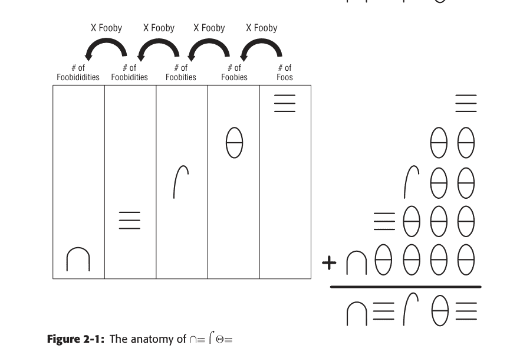

`foos`位也是如此。当我们向左移动到更高位时，这种规律在列式加法中继续延续。

`fooby`乘以`fooby`等于`foobity`，而`∫`位告诉我们该数中有一个`foobity`（单数`foobity`）。下一列按照规律，是`foobity`乘以`fooby`，即`foobidity`。在列式记法中，`foobidity`写作`∫ Θ Θ Θ`。`≡`位告诉我们该数中有`bas`个`foobidity`。`Bas`个`foobidity`是一个有自己名称的数，叫做`basbidity`，可以写作`≡ Θ Θ Θ Θ`。注意列式加法中`basbidity`的存在。

再向左下一列的值为`fooby`乘以`foobidity`，即`foobidity`。`∩`位告诉我们该数中有`bar`个`foobididity`。`Bar`个`foobididity`（写作`∩ Θ Θ Θ Θ`）也是一个有自己名称的数，叫做`barbidity`。同样注意列式加法中`barbidity`的存在，以及四个`xip`数字为空的列占位。

列式加法体现了数字组合的方式：该数包含`barbidity`、`basbidity`、`foobity`和`bas`。将这些通过简单加法汇总，就得到`∩ ≡ ∫ Θ ≡`。其名称就是通过连读各组成部分得到的：`barbidity-basbidity-foobity-bas`。注意名称中没有代表空的`fooby`位的部分。在我们熟悉的十进制中，例如，我们也不会把数字`401`读作"四百、零个十、一"，而是简单地说"四百零一"。同样地，火星人也不会说"xip foobies"，而是直接略去。

作为练习，根据我目前告诉你的关于火星数字的知识，算出`∩≡∫Θ≡`对应的地球数值。

## 数制的本质

由于火星旅游近期不太可能成行，了解火星数制对我们地球人有什么实际用途呢？仅在于：这是理解数制本质的*绝佳*方式，而不会被我们熟悉的数字和通用的十进制所干扰。

在像我们和火星人那样的列式数字记法系统中，数制的*基数*是指每一列的数值相对于其右侧列的倍数。在我们的十进制中，每一列代表其右侧列*10*倍的值。在火星这种以`fooby`为基数的系统中，每一列代表其右侧列`fooby`倍的值。（如果你还没发现，火星人实际上使用的是四进制——但我想让你从火星人自己的视角来看。）每种数制都有一套数字符号，其数量等于基数。在我们的十进制中，有10个符号，从0到9。在四进制中，有从0到3的四个数字。*在任何给定的数制中，基数本身永远无法用单个数字表示！*

## 八进制：格林奇如何偷走了八和九

告别火星。除了大量的氧化铁和一些出色的*无伴奏合唱*团体，他们对拥有10根手指的我们来说没什么可提供的。地球上也有一些同样奇特的数制在使用，我想快速绕道一个就在地球上却仿佛置身异界的系统：数字设备公司（`Digital Equipment Corporation`），更广为人知的简称是`DEC`。

回溯到六十年代，`DEC`发明了小型计算机，向`IBM`开创的庞大而昂贵的大型机发起挑战。（小型计算机的时代早已过去，`DEC`本身也成为了历史。）为了确保没有任何软件能从`IBM`大型机迁移到`DEC`小型计算机，`DEC`将其机器设计为只能理解以8为基数表示的数。

让我们根据与火星人打交道的经验来思考一下。在八进制中，必须有八个数字。`DEC`体贴地没有发明自己的数字符号，而是使用了地球传统的从0到7的数字。*八进制中没有数字8！*这总需要一点时间来适应，但这是数制定义的一部分。`DEC`为其八进制系统命名：*octal（八进制）*。

八进制中的列式数字遵循我们在思考火星系统时遇到的规则：每一列的值是其右侧列的*基数*倍。（最右列是个位。）就八进制而言，每一列的值是其右侧相邻列的八倍。

## 谁偷走了八和九？

这用演示比用说的更清楚。八进制的计数开头非常熟悉：1、2、3、4、5、6、7 … 10。

麻烦就在这里开始。在八进制中，10紧跟在7之后。八和九怎么了？是格林奇偷走了它们吗？（还是火星人？）并非如此。它们还在——只是有了不同的名称。在八进制中，当你说"10"时，你的意思是"8"。更糟的是，当你说"11"时，你的意思是"9"。

遗憾的是，`DEC`*没有*做的是为列值发明巧妙的名称。第一列当然是个位列。个位列左侧的下一列是十位列，正如在我们自己的十进制系统中一样——但问题就在这里，也是我把火星扯进来的原因：*八进制的"十"位列实际上的值是8。*

计数表会有帮助。表2-3计数到八进制的`30`，其十进制值为`24`。我不喜欢在其他进制中使用*eleven*、*twelve*等术语，但八进制的惯例一直是像我们读十进制那样读数，只在后面加上*octal*一词。别忘了说*octal*——否则，人们会*非常*困惑！

记住，在给定数制中，每一列的值是其右侧列的*基数*倍，所以八进制中的"十"位列实际上是八位列。（他们称之为十位列是因为它写作`10`，读作"ten"。）类似地，十位列左侧的下一列是百位列（因为它写作`100`，读作"hundreds"），但百位列的实际值是8乘8，即`64`。再向左一列的值是`64`乘8，即`512`，其左侧一列的值是`512`乘8，即`4,096`。

这就是为什么当有人说"ten octal（八进制十）"时，他们的意思是`8`；"one hundred octal（八进制一百）"意味着`64`；以此类推。表2-4总结了八进制列值及其十进制等值。

第一列（*个位*，或*units*列）中的数字表示八进制数中包含多少个单位。左侧下一列，即十位列中的数字表示该数中包含多少个`8`。第三列，即百位列中的数字表示该数中包含多少个`64`，以此类推。例如，`400`八进制意味着该数包含四个`64`，即十进制的`256`。

### 第 2 章 ■ 异域进制

**表 2-3：八进制计数，基数 8**

| 八进制数字 | 八进制读法 | 十进制等值 |

| :--- | :--- | :--- |

| `0` | `Zero` | `0` |

| `1` | `One` | `1` |

| `2` | `Two` | `2` |

| `3` | `Three` | `3` |

| `4` | `Four` | `4` |

| `5` | `Five` | `5` |

| `6` | `Six` | `6` |

| `7` | `Seven` | `7` |

| `10` | `Ten` | `8` |

| `11` | `Eleven` | `9` |

| `12` | `Twelve` | `10` |

| `13` | `Thirteen` | `11` |

| `14` | `Fourteen` | `12` |

| `15` | `Fifteen` | `13` |

| `16` | `Sixteen` | `14` |

| `17` | `Seventeen` | `15` |

| `20` | `Twenty` | `16` |

| `21` | `Twenty-one` | `17` |

| `22` | `Twenty-two` | `18` |

| `23` | `Twenty-three` | `19` |

| `24` | `Twenty-four` | `20` |

| `25` | `Twenty-five` | `21` |

| `26` | `Twenty-six` | `22` |

| `27` | `Twenty-seven` | `23` |

| `30` | `Thirty` | `24` |

是的，这很令人困惑，非常令人困惑。要理解这一切，最好的方式是剖析一个中等大小的八进制数，就像我们之前剖析火星数字一样。图2-2展示的就是这样：八进制数`76225`被拆分成各列后再重新相加。

**表 2-4：八进制列作为 8 的幂**

| 八进制 | 8 的幂 | 十进制 | 八进制 |

| --- | --- | --- | --- |

| `1 = 8<sup>0</sup>` | = | `1 × 8` | = `10` |

| `10 = 8<sup>1</sup>` | = | `8 × 8` | = `100` |

| `100 = 8<sup>2</sup>` | = | `64 × 8` | = `1000` |

| `1000 = 8<sup>3</sup>` | = | `512 × 8` | = `10000` |

| `10000 = 8<sup>4</sup>` | = | `4096 × 8` | = `100000` |

| `100000 = 8<sup>5</sup>` | = | `32768 × 8` | = `1000000` |

| `1000000 = 8<sup>6</sup>` | = | `262144 × 8` | = `10000000` |

下面这个八进制数字如何求值？


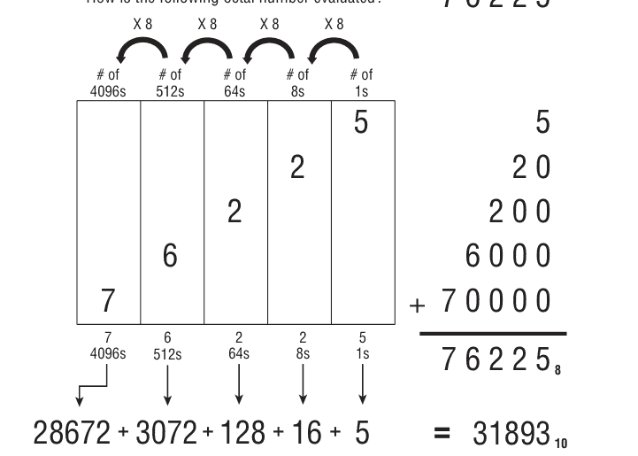

图 2-2：八进制数 76225 的剖析

这与火星数字、十进制，或你能想出的任何其他数制中的运作方式相同。一般而言（且稍正式地说）：每一列的值等于该数制的基数乘以该列所在位置序数减一次方。例如，第一列的值等于该数制基数乘以 1 减 1，即零次方。因为任何数的零次方都是 1，所以任何数制中的第一列的值总是 1，称为个位列。

第二列的值为该数制基数（number base）的 2 减 1 次方，即 1 次方，也就是基数本身的值。在八进制中，这个值是 8；在十进制中，是 10；在火星数制“fooby”中，值就是 fooby。第三列的值为该数制基数的 3 减 1 次方，即 2 次方，依此类推。

每一列中，该位上的数字表示整个数值包含了多少个该列对应的值。例如，八进制数 `76225` 中的 6 表示，在整个数值 `76225` 八进制中，包含了 6 个该列对应的值。6 位于第四列，该列的值为 `8<sup>4</sup> – 1`，即 `8<sup>3</sup>`，也就是 512。这告诉我们，整个数中包含了 6 个 512。

你可以将任意数制中的数值转换为十进制（我们的 10 进制），方法是：先确定该“外星”数制（非十进制）中每一列的位值，然后将每列的位值乘以该列中的数字（得到每一位的十进制等效值），最后将所有列的十进制等效值相加。图 2-2 展示了这一过程，八进制数及其十进制等效值并列显示。

注意图 2-2 中各列求和结果右侧的小标数字。这些下标在许多技术出版物中用来表示数制基数。例如，`76225<sub>8</sub>` 中的下标表示数值 `76225` 在这里是以八进制表示的数量，即 8 进制。与火星数字和我们传统十进制数字之间的明显区别不同，八进制数本身并没有任何特征能将它与其他数制区分开来。（稍后我们遇到十六进制时，也会遇到同样的问题。）

相比之下，`31893<sub>10</sub>` 通过其下标表明它是一个 10 进制，即十进制的数值。这种做法主要出现在科学和研究写作中。在大多数计算机出版物（包括本书）中，会使用其他表示方法，稍后再详细介绍。

现在，我们从火星人和八进制的角度都了解了列式记数法，请确保你理解了列式记数法在任意数制中的工作原理，然后再继续。

## 十六进制：解决数字短缺问题

除非像我的一个朋友那样，从大学按磅购买了 surplus 的古老 DEC PDP8 计算机并进行修复，否则八进制对你来说不太可能有太大用处。（他说这比土豆便宜得多，虽然不如土豆好炸。不完全是。）正如我之前提到的，微机世界中真正需要掌握的数制是 16 进制，我们称之为十六进制，或者（更亲切地）简称为“hex”。

十六进制与任何数制一样，具有其基本特征，包括火星人数制和八进制：它是一种列式记数法，每一列的值是其右侧列值的 16 倍。它有 16 个数字，从 0 开始，到……什么呢？

这里我们缺少数字。从 0 到 9 我们刚好够用。但是，10、11、12、13、14 和 15 需要用某种单个符号来表示。由于没有更多的数字可用，20 世纪 50 年代早期开发十六进制记数法的人们借用了字母表中的前六个字母作为所需的数字。

因此，十六进制计数如下：

`1, 2, 3, 4, 5, 6, 7, 8, 9, A, B, C, D, E, F, 10, 11, 12, 13, 14, 15, 16, 17, 18, 19, 1A, 1B, 1C`，依此类推。

表 2-5 以更规范的方式列出了这一计数方法，并给出了十进制等效值，直到 32。

### 表 2-5：十六进制计数，16 进制

| 十六进制数字 | 读法（后面加“十六进制”） | 十进制等效值 |
| --- | --- | --- |
| 0 | 零 | 0 |
| 1 | 一 | 1 |
| 2 | 二 | 2 |
| 3 | 三 | 3 |
| 4 | 四 | 4 |
| 5 | 五 | 5 |
| 6 | 六 | 6 |
| 7 | 七 | 7 |
| 8 | 八 | 8 |
| 9 | 九 | 9 |
| A | A | 10 |
| B | B | 11 |
| C | C | 12 |
| D | D | 13 |
| E | E | 14 |
| F | F | 15 |
| 10 | 十（或，一零） | 16 |
| 11 | 一一 | 17 |
| 12 | 一二 | 18 |
| 13 | 一三 | 19 |
| 14 | 一四 | 20 |
| 15 | 一五 | 21 |
| 16 | 一六 | 22 |
| 17 | 一七 | 23 |
| 18 | 一八 | 24 |
| 19 | 一九 | 25 |
| 1A | 一 A | 26 |
| 1B | 一 B | 27 |
| 1C | 一 C | 28 |
| 1D | 一 D | 29 |
| 1E | 一 E | 30 |
| 1F | 一 F | 31 |
| 20 | 二十（或，二零） | 32 |

我倾向于采用的一个十六进制惯例是，摒弃诸如 eleven（十一）和 twelve（十二）这类与十进制系统联系过于紧密、只会造成严重混淆的单词。面对十六进制中的 `11`（通常写作 `11H` 以表明我们所指的数制），我们会说“one-one hex”（一一十六进制）。

别忘了在十六进制数后面说“hex”（十六进制）——同样是为了避免严重混淆。对于 0 到 9 的数字则不必如此，因为它们在十进制和十六进制中代表完全相同的值。

有些人仍然会说“twelve hex”（十二十六进制），这种说法是有效的，表示十进制的 18；但我不喜欢这样，并且建议避免。这种外星数制的问题已经足够令人困惑，没必要再给外星人戴上个查理·卓别林面具。

十六进制系统中每一列的值是其右侧列值的 16 倍。（正如任何数制一样，最右侧的列是个位列，值为 1。）正如你可能猜到的那样，各列的值从右向左迅速增大。表 2-6 展示了十六进制中前七列的值。作为对比，请注意十进制中第七列的值是 100 万，而十六进制中第七列的值是 16,777,216。

为了帮助你理解十六进制数的构造方式，我在图 2-3 中解剖了一个中等大小的十六进制数，方式与之前解剖火星基数 fooby 和八进制数相同。与八进制一样，0 占据某一列的位置，但不会为整个数值增加任何值。

注意图 2-3 中，在十六进制数 `3C0A9H` 中，存在 0 个，即没有，256。如图 2-2 所示，每列的十进制值显示在该列下方，所有列的总和以十进制和十六进制两种形式表示。（注意下标！）

### 表 2-6：十六进制各列作为 16 的幂

| 十六进制 | 16 的幂 | 十进制 |
| :--- | :--- | :--- |
| `1H` | = `16<sup>0</sup>` = | 1 x 16 = `10H` |
| `10H` | = `16<sup>1</sup>` = | 16 x 16 = `100H` |
| `100H` | = `16<sup>2</sup>` = | 256 x 16 = `1000H` |
| `1000H` | = `16<sup>3</sup>` = | 4096 x 16 = `10000H` |
| `10000H` | = `16<sup>4</sup>` = | 65536 x 16 = `100000H` |
| `100000H` | = `16<sup>5</sup>` = | 1048576 x 16 = `1000000H` |
| `1000000H` | = `16<sup>6</sup>` = | 16777216 等等…… |

下面的十六进制数如何计算？

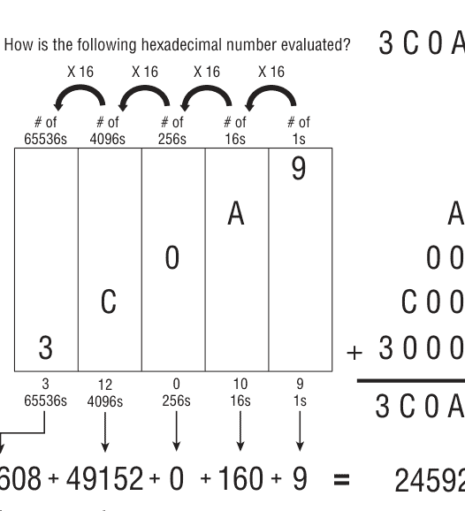

## 从十六进制到十进制，以及从十进制到十六进制

你将进行的大多数十六进制数操作是十六进制和十进制之间的简单转换，两个方向都有。进行这种转换最简单的方法是使用十六进制计算器，可以是像经典的 TI Programmer（我仍然保留着，真是个耗电大户）这样的“实体”计算器，或者具有十六进制功能的软件计算器。

默认的 Ubuntu Linux 计算器在选择了“查看 → 科学模式”后，可以进行十进制、十六进制和二进制计算。Windows 计算器的使用方式完全相同：默认视图是基础模式，你需要选择科学模式才能进入任何“外星”数制。Kubuntu/KDE 4 默认安装的 SpeedCrunch 计算器从一开始就可以进行十六进制和二进制计算。

当然，使用计算器对你的脑力没有任何要求，也不会帮助你更好地理解十六进制数系统。因此，当你还是一个相对初级的“外星数制”学习者时，暂时远离任何理解十六进制的东西，无论是硬件、软件还是人类伙伴。

事实上，学习时最好的工具是一款简单的四功能记忆计算器。我在这里描述的转换方法都使用这样的计算器，因为我试图教给你的是数制转换，而不是十进制加法或长除法。

## 从十六进制到十进制

正如你会逐渐理解的，将十六进制数转换为十进制要比反向转换容易得多。一般方法是按照我们一直在图 2-1、2-2 和 2-3 中的数字解析过程所做的那样：推导出十六进制数中每一列单独表示的值，然后将所有列的值以十进制相加。

我们来试一个简单的。十六进制数是 `7A2`。从最右列开始。这是任何数制中的个位列。你有 2 个单位，所以在计算器中输入 2。然后将这个 2 存入记忆（或者如果你有 SUM 键，就按 SUM 键）。

个位列就到此为止。请记住，你真正做的是持续累加十六进制数中各列的值。向左移动到下一列。记住在十六进制中，每一列的值是其右侧列值的 16 倍，因此从右数第二列是 16 的倍数列。（如果你搞混了列值，请参考表 2-6。）

16 的倍数列中有一个 A。十六进制的 A 等于十进制的 10。因此，该列的总值为 16 × 10，即 160。在计算器上进行这个乘法，然后将乘积加到你存入记忆的 2 中。（同样，如果你的计算器有 SUM 键，这是一个方便的操作方式。）

记住你在做什么：用十进制评估每一列的值并保持一个累加总数。现在移动到从右数第三列。这其中一个包含一个 7。第三列的值是 16 × 16，即 256。在计算器上乘以 256 × 7，然后将乘积加到您的运行总计中。

完成了。从计算器内存中检索运行总计。总计应为 1,954，这是 `7A2H` 的十进制等值物。

好——让我们再试一次，更快速一点，少点废话，用个更大的数：`C6F0DBH`：

1. 计算个位列。`B × 1 = 11 × 1 = 11`。从 11 开始您的运行总计。
2. 计算 16s 列。`D × 16 = 13 × 16 = 208`。将 208 加到运行总计中。
3. 计算 256s 列。`0 × 256 = 0`。继续。
4. 计算 4,096s 列。`F × 4,096 = 15 × 4,096 = 61,440`。将其加到运行总计中。
5. 计算 65,536s 列。`6 × 65,536 = 393,216`。将其加到运行总计中。
6. 计算 1,048,576s 列。`C × 1,048,576 = 12 × 1,048,576 = 12,582,912`。将其加到总计中。

运行总计应为 13,037,787。

最后，自己试着对以下数字进行计算，不要任何帮助：`1A55BEH`。

## 第二章：异种数制

完成了，现在反过来，将下列十进制数字转换为十六进制。记住通用方法：根据表 2-6，选择小于待转换十进制数的最大 16 次幂。找出该 16 次幂在十进制数中存在的次数，并将其写在转换数字的最左边十六进制位上。然后从十进制数中减去该十六进制位代表的总值。重复此过程，使用下一个较小的 16 次幂，直到您将十进制数减至零为止。

- 39
- 413
- 22
- 67,349
- 6,992
- 41
- 1,117
- 44,919
- 12,331
- 124,217
- 91,198
- 307
- 112,374,777

（最后那个有额外学分。）如果您需要更多练习，请选择一些十进制数字并将其转换为十六进制，然后再转换回去。完成后，使用您喜欢的任何具有十六进制功能的计算器来核对工作。

## 十六进制运算

随着您在汇编语言方面变得更加熟练，您将进行越来越多的十进制基数计算。您可能甚至（天哪）开始在大脑中做这些运算。尽管如此，还是需要练习。

加法和减法基本上与我们知道的十进制算法相同，只是多了一些额外的数字调味而已。诀窍无非是知道到 `0FH` 的加法表。最好不是思考“现在，如果 C 是 12 且 F 是 15，那么 C + F 是 12 + 15，即十进制的 27 但 1BH”。相反，您应该简单地想“C + F 是 1BH”。

是的，这是要求很多；但是我现在向您要求，就像我在这段旅程中会再次向您要求的：您是想要黑客攻击汇编……还是只想玩耍？学习钢琴需要练习，将汇编语言编程的核心技能灌输到突触中的也需要练习。

所以让我听起来像个老校长告诉您来背诵以下内容。如果您必须的话，制作闪卡：

| 9 + 1 = `0AH` | 8 + 2 = `0AH` | 7 + 3 = `0AH` | 6 + 4 = `0AH` | 5 + 5 = `0AH` |
| --- | --- | --- | --- | --- |
| A + 1 = `0BH` | 9 + 2 = `0BH` | 8 + 3 = `0BH` | 7 + 4 = `0BH` | 6 + 5 = `0BH` |
| B + 1 = `0CH` | A + 2 = `0CH` | 9 + 3 = `0CH` | 8 + 4 = `0CH` | 7 + 5 = `0CH` | 6 + 6 = `0CH` |
| C + 1 = `0DH` | B + 2 = `0DH` | A + 3 = `0DH` | 9 + 4 = `0DH` | 8 + 5 = `0DH` | 7 + 6 = `0DH` |
| D + 1 = `0EH` | C + 2 = `0EH` | B + 3 = `0EH` | A + 4 = `0EH` | 9 + 5 = `0EH` | 8 + 6 = `0EH` | 7 + 7 = `0EH` |
| E + 1 = `0FH` | D + 2 = `0FH` | C + 3 = `0FH` | B + 4 = `0FH` | A + 5 = `0FH` | 9 + 6 = `0FH` | 8 + 7 = `0FH` |
| F + 1 = `10H` | E + 2 = `10H` | D + 3 = `10H` | C + 4 = `10H` | B + 5 = `10H` | A + 6 = `10H` | 9 + 7 = `10H` | 8 + 8 = `10H` |
| F + 2 = `11H` | E + 3 = `11H` | D + 4 = `11H` | C + 5 = `11H` | B + 6 = `11H` | A + 7 = `11H` | 9 + 8 = `11H` |
| F + 3 = `12H` | E + 4 = `12H` | D + 5 = `12H` | C + 6 = `12H` | B + 7 = `12H` | A + 8 = `12H` | 9 + 9 = `12H` |
| F + 4 = `13H` | E + 5 = `13H` | D + 6 = `13H` | C + 7 = `13H` | B + 8 = `13H` | A + 9 = `13H` |

## 第 2 章：外星进制

| F | E | D | C | B | A |
| --- | --- | --- | --- | --- | --- |
| + 5 | + 6 | + 7 | + 8 | + 9 | + A |
| --- | --- | --- | --- | --- | --- |
| `14H` | `14H` | `14H` | `14H` | `14H` | `14H` |
| F | E | D | C | B |  |
| + 6 | + 7 | + 8 | + 9 | + A |  |
| --- | --- | --- | --- | --- | --- |
| `15H` | `15H` | `15H` | `15H` | `15H` |  |
| F | E | D | C | B |  |
| + 7 | + 8 | + 9 | + A | + B |  |
| --- | --- | --- | --- | --- | --- |
| `16H` | `16H` | `16H` | `16H` | `16H` |  |
| F | E | D | C |  |  |
| + 8 | + 9 | + A | + B |  |  |
| --- | --- | --- | --- | --- | --- |
| `17H` | `17H` | `17H` | `17H` |  |  |
| F | E | D | C |  |  |
| + 9 | + A | + B | + C |  |  |
| --- | --- | --- | --- | --- | --- |
| `18H` | `18H` | `18H` | `18H` |  |  |
| F | E | D |  |  |  |
| + A | + B | + C |  |  |  |
| --- | --- | --- | --- | --- | --- |
| `19H` | `19H` | `19H` |  |  |  |
| F | E | D |  |  |  |
| + B | + C | + D |  |  |  |
| --- | --- | --- | --- | --- | --- |
| `1AH` | `1AH` | `1AH` |  |  |  |
| F | E |  |  |  |  |
| + C | + D |  |  |  |  |
| --- | --- | --- | --- | --- | --- |
| `1BH` | `1BH` |  |  |  |  |
| F | E |  |  |  |  |
| + D | + E |  |  |  |  |
| --- | --- | --- | --- | --- | --- |
| `1CH` | `1CH` |  |  |  |  |
| F |  |  |  |  |  |
| + E |  |  |  |  |  |
| --- | --- | --- | --- | --- | --- |
| `1DH` |  |  |  |  |  |
| F |  |  |  |  |  |
| + F |  |  |  |  |  |
| --- | --- | --- | --- | --- | --- |
| `1EH` |  |  |  |  |  |

别的不说，这个练习至少应该让你庆幸计算机不用 64 进制工作。

## 列与进位

把这些单列加法（或多或少）记熟之后，你就可以挑战多列加法了。它的工作原理和十进制几乎一样。从最右边开始逐列相加，当任何一列的和超过 `0FH` 时，就向左边的列进位。

例如：

```text
         1    1
   2 F 3 1 A DH
+  9 6 B A 0 7H
   C 5 E B B 4H
```


仔细逐列演算一遍。第一列（即最右列）的和是 14H，无法放入单列，因此我们必须向左边的一列进 1。然而，即使加上这个额外的 1，第二列的和也是 0BH，可以放入单列，不需要再进位。

继续往左加。倒数第二列再次溢出，你需要向最后一列进 1。只要你把个位数加法记熟了，这就是小菜一碟。

嗯，差不多。

有件事你应该注意：

> 两个数进行单列加法时，你最多只能进位 1。

无论你在什么进制下：16 进制、10 进制、"fooby"进制还是 2 进制。你要么从某一列进位 1（在火星语中叫一"foo"），要么什么都不进。不知为何，这个事实经常让人惊讶，所以问问自己：在熟悉的十进制中，哪两个个位数相加会让你必须进 2？最大的数字是 9，而 9 + 9 = 18。写下 8，进 1。即使你还要加上一列的进位，最多也就到 19。同样，你进 1 而不是更多。这在纸上计算时很重要，在你的 CPU 硅片内也同样重要，几章之后你就会遇到。

## 减法与借位

如果你把单列加法记熟了，你通常可以通过某种心理逆向的方式来解决减法："如果 E + 6 等于 14H，那么 14H - E 一定等于 6。" 另一种方法是记忆数量更多的表格，既然我没背过，我也不会要求你去背。

但随着时间推移，这往往就是会发生的事。在十六进制减法中，你应该能够通过把熟悉的十六进制加法来个`逆向操作`来推导出任何给定的单列减法；而且和十进制一样，多列减法是逐列进行的，一次一列：

```
F76CH
-A05BH
5711H
```

检查每一列时，你应该问自己："什么数加上面的数等于下面的数？" 在这里，你应该从表中知道 B + 1 = C，所以 B 和 C 的差是 1。最左边一列实际上更具挑战性：什么数加上 A 等于 F？振作起来；即使是我，状态不好的时候也得想一想。

当然，问题出现在顶部的数字比其对应底部的数字更小时。这时你没有办法，只能借位。

借位是小学阶段死记硬背的东西之一，很少有人真正理解。（理解它就相当于默认新数学的某些内容确实留下了印记，太可怕了。）从本质上讲，借位发生时，从一列取走一个计数，应用到它右边的一列。我说的是`应用`而不是`加到`，因为从某一列移动到右边的一列时，那个单一的计数会乘以 10，其中 10 代表数字的进制。（记住八进制中的 10 值 8，而十六进制中的 10 值 16。）

听起来比实际更糟。我们来看一个借位的实例，你就会明白：

```
  9 2H
-4 FH
```

这里，最右列的减法按原样无法进行，因为 F 比 2 大，所以我们从左边的一列借位。

将近 50 年过去了，我仍然能听到老玛丽·贝尔纳修女在黑板上艰难地讲解，尽管是十进制："把 9 划掉，改成 8。把 2 变成 12。12 减 F 等于多少，同学们？" 等于 3，修女。这就是借位的工作原理。（但愿这位可怜的修女能原谅我让她嘴里蹦出十六进制字节。）

想想那里在功能层面发生了什么。我们从 9 减去了 1，并把 10H 加到了 2 上。一个明显的错误是从 9 减去 1，然后给 2 加上 1，这（还用我说吗？）是行不通的。这样想：我们把某一列多余的部分移到右边，那里正好需要一些额外的值。整体来说，上面的数字值没有改变（这就是为什么我们称之为`借位`而不是`偷取`），但借款的接收方增加了`10`，不是 1。

借位之后，我们得到的结果看起来大致像这样：

```
8¹2H
- 4 FH
```

（在玛丽·贝尔纳修泡泡修女的黑板上，我们把 9 划掉改成了 8。我只是把它改成了 8。硅片比粉笔有优势——只是 8 之前作为 9 的生活没那么明显了。）

当然，一旦到了这里，逐列的减法就都能顺利进行，我们发现差是 43H。

人们有时会问是否曾经需要借超过 1 的数。答案显然是`不`。例如，如果你借 2，你会给接收列加上 20，而`20 减去任何个位数仍然是个两位数`。也就是说，差放不进单列。减法与加法之间存在重要的对称性：

> 在任何两个数的单列减法中，你最多只需要借 1。

## 跨多列借位

理解了借位的这些内容，你就掌握了大部分；但是，就像生活常有的那样，你`经常`会遇到类似这样的减法：

```
    F 0 0 0H
  - 3 B 6 C H
```

第 1 列需要借位，但第 2 列和第 3 列都一无所有可以出借。回到小学时，玛丽·贝尔纳修女会用机关枪般的效率脱口而出："把 F 划掉，改成 E。把 0 变成 10。然后把它划掉，改成 F。把下一个 0 变成 10；划掉，改成 F。然后把最后一个 0 变成 10。明白了吗？"（我明白了。在天主教学校，`不明白`的后果简直不堪设想。）

实际发生的情况是，中间两个 0 充当 F 和最右边 0 之间的借贷中介，收取足够的佣金来让自己那一列的减法得以进行。从最右列左边的每一列都从左手边的邻居那里借 10，然后借 1 给右手边的邻居。当所有的借位在上面的数字中传递完毕之后，我们得到的结果看起来像这样（不包括修女所有的划改）：

```
    E F F^10 H
  - 3 B 6 C H
```

此时，每一列的减法都可以进行了，差是 B494H。

回忆你小学时的折腾时，别掉进旧十进制的窠臼，去想"把 10 划掉，改成 9"。在十六进制的世界里，10H - 1 = F。把 10 划掉，改成 F。

38 第 2 章 ■ 外星进制

## 有何意义？

……如果你有十六进制计算器，或者支持十六进制的屏幕计算器？意义在于`练习`。十六进制是汇编语言的`通用语`——姑且扭曲一下这个隐喻。你对十六进制的理解越是深入骨髓，汇编语言就越容易掌握。此外，如果你对十六进制数值有直觉性的把握，理解机器本身的内部结构也会`容易得多`。我们在这里打的是重要的基础。现在认真对待，以后就能少掉头发。

## 二进制

十六进制是应对最奇特的进制——`二进制`——的绝佳练习。二进制是 2 进制。鉴于你目前所学的关于进制的知识，你能推断出 2 进制有什么特点吗？

- 每一列的值是其右侧列的两倍。
- 该进制只有两个数字（0 和 1）。

正如你所想，二进制的计数方式有点奇怪。它是这样的：0、1、10、11、100、101、110、111、1000，依此类推。因为说“零、一、10、11、100”听起来很荒谬，所以更合理的做法是逐个读出数字，然后加上`二进制`这个词。例如，大多数人会把 1011101 读作“一零一一一零一 二进制”，而不是“一百零一万一千一百零一 二进制”——这个数字听起来很大，但你发现它的十进制值只有 93 时，就不会这么想了。

虽然看起来很奇怪，但二进制遵循我们在本章讨论的关于进制的所有相同规则。二进制与十进制之间的转换可以使用本章前面描述的十六进制转换方法。

由于在二进制中计数在很大程度上是数列而非数数字（因为只有两个数字），所以仔细看看表 2-7 是有意义的，它展示了二进制数列直到 32 位的值。

看一眼那堆令人望而生畏的零就知道，把较大的列读成一连串数字是多么无望：“一零零零零零零零……”等等。这里迫切需要一种简写符号，所以我一会儿就给你介绍一种——而且它的身份会让你惊讶。

### 表 2-7：二进制列作为 2 的幂

| 二进制 | 2 的幂 | 十进制 |
|---|---|---|
| 1 | =2⁰= | 1 |
| 10 | =2¹= | 2 |
| 100 | =2²= | 4 |
| 1000 | =2³= | 8 |
| 10000 | =2⁴= | 16 |
| 100000 | =2⁵= | 32 |
| 1000000 | =2⁶= | 64 |
| 10000000 | =2⁷= | 128 |
| 100000000 | =2⁸= | 256 |
| 1000000000 | =2⁹= | 512 |
| 10000000000 | =2¹⁰=标志着 10 的幂，而非脚注。 | 1024 |
| 100000000000 | =2¹¹= | 2048 |
| 1000000000000 | =2¹²= | 4096 |
| 10000000000000 | =2¹³= | 8192 |
| 100000000000000 | =2¹⁴= | 16384 |
| 1000000000000000 | =2¹⁵= | 32768 |
| 10000000000000000 | =2¹⁶= | 65536 |
| 100000000000000000 | =2¹⁷= | 131072 |
| 1000000000000000000 | =2¹⁸= | 262144 |
| 10000000000000000000 | =2¹⁹= | 524288 |
| 100000000000000000000 | =2²⁰= | 1048576 |
| 1000000000000000000000 | =2²¹= | 2097152 |
| 10000000000000000000000 | =2²²= | 4194304 |
| 100000000000000000000000 | =2²³= | 8388608 |
| 1000000000000000000000000 | =2²⁴= | 16777216 |
| 10000000000000000000000000 | =2²⁵= | 33554432 |
| 100000000000000000000000000 | =2²⁶= | 67108864 |
| 1000000000000000000000000000 | =2²⁷= | 134217728 |
| 10000000000000000000000000000 | =2² muy 重要！28= | 268435456 |
| 100000000000000000000000000000 | =2²⁹= | 536870912 |
| 1000000000000000000000000000000 | =2³⁰= | 1073741824 |
| 10000000000000000000000000000000 | =2³¹= | 2147483648 |
| 100000000000000000000000000000000 | =2³²= | 4294967296 |

你可能会反对说，表中底部的这种大数在普通编程中不太会碰到。抱歉，但像奔腾这样的 32 位微处理器（甚至像 386 和 486 这样的古老前辈）可以一口吞下这样的数字，并且午餐还能吃数十亿个。你`必须`习惯于思考像 2³² 这样的数字，毕竟它在十进制中不过区区 40 亿。想想你自己台式电脑上的硬盘容量吧。新的中端台式机通常配备 500 GB 或更大的硬盘存储。一个 GB 是十亿字节，所以那个庞大的 32 位数甚至无法数清你硬盘上的所有字节！这个问题确实咬过一些旧软件（不，抱歉，应该叫`遗留`软件）的供应商。二十年前，500 GB 的硬盘看起来更像是幻想而非科幻。现在你可以花 99.95 美元买到那个幻想。不止一个 DOS 和早期 Windows 时代的文件实用程序在面对超过 2 GB 可用空间的磁盘时绝望地举手投降。

现在，就像八进制和十六进制一样，使用二进制时也会遇到身份识别问题。二进制中的 101 `不等于`十六进制的 101，也不等于十进制的 101。因此，始终在你的二进制值后面加上后缀“B”，以确保阅读你程序的人（包括六周后的你自己）知道你使用的是哪种进制。

## 二进制数值

将二进制值转换为十进制值的方法与十六进制相同——实际上更简单，原因很简单：你不再需要计算某个列的值在给定列中出现了多少次。在十六进制中，你需要看 16 的列中有多少个 16，等等。而在二进制中，列的值要么存在（1 次），要么不存在（0 次）。

跑一个简单的例子就能说明白。二进制数 11011010B 在相对简单的计算机工作中是一个相当典型的二进制值。（实际上算小的——许多常见的二进制数是它的两倍或更大。）将 11011010B 转换为十进制，就是借助表 2-7 从右到左扫描，统计任何包含 1 的列的值，同时忽略任何包含 0 的列。

清空你的计算器，我们开始：

1. 第 0 列是 0；跳过。
2. 第 1 列是 1。这意味着它的值 2 存在于该数的值中。所以我们在计算器中输入 2。
3. 第 2 列是 0。跳过。
4. 第 3 列是 1。该列的值是 2³，即 8；加到累计中。
5. 第 4 列也是 1；2⁴ 是 16，加到我们的累计中。
6. 第 5 列是 0。跳过。
7. 第 6 列是 1；2⁶ 是 64，所以将 64 加到累计中。
8. 第 7 列也是 1。第 7 列的值是 2⁷，即 128。将 128 加到累计中，我们得到了什么？218。这就是 11011010B 的十进制值。就这么简单。

从十进制转换为二进制虽然更难，但方法`完全`与从十进制转换为十六进制相同。回去再读一遍那一节，寻找所使用的`通用方法`。换句话说，看看做了什么，然后把基本原则与任何对特定进制（如十六进制）的引用分开。

我敢打赌，你现在不费多少力气就能搞明白。

顺便说一句，也许你注意到我从 0 开始数列，而不是从 1 开始。计算机领域的一个怪癖是我们总是从 0 开始计数。其实，称之为怪癖是不公平的；计算机的方法才是合理的，因为 0 是一个完全有效的数字，不应受到歧视。分歧的产生是因为在我们的真实物理世界中，计数是为了知道`有多少`东西，而在计算机世界中，计数通常是为了`命名`它们。也就是说，我们需要处理第 0 位，然后是第 1 位，等等，这远胜于我们需要知道有多少位。

顺便说一下，这不是无关紧要的争论。这个问题会一再出现，与内存地址相关，而我曾说过并且会再说一遍，内存地址是理解汇编语言的关键。

> 在编程界，始终从 0 开始计数！

这个原则可能导致的冲突的一个实际例子来自以下问题：哪个年份开启了我们的新千年？大多数人会直觉地说是 2000 年——而在迈向 2000 年的那段时间里，许多人们确实这么做了，但从技术角度来说，二十世纪直到 2001 年 1 月 1 日才结束。为什么呢？因为不存在公元 0 年。当历史学家从公元前（BC）计数到公元（AD）时，他们直接从 1 BC 跳到了 1 AD。因此，第一个世纪始于公元 1 年，结束于公元 100 年。第二个世纪始于公元 101 年，结束于公元 200 年。按照这个序列继续延伸，你可以看到二十世纪始于 1901 年，结束于 2000 年。相反，如果我们当初明智一点，像计算机一样从第 0 年开始计数，那么二十世纪就会在 1999 年底结束。

这是一个练习二进制与十进制相互转换的好机会。先来试试这些：

- 110
- 10001
- 11111
- 11
- 101
- 1100010111010010
- 11000
- 1011
- 18,446

完成后，再将这些十进制数转换为二进制：

- 77
- 42
- 106
- 255
- 18
- 6309
- 121
- 58
- 18,446

## 为什么要用二进制？

如果表示一个普通的三位数都需要八个数字（例如 218 要用 11011010），那么二进制作为一种数制似乎是种糟糕的知识投资。对我们来说，这无疑是浪费脑力；即使是只有两根手指的外星人，大概也会想出更好的系统来。

问题在于，灯要么开着，要么关着。

这只是另一种说法——正如我在第 3 章详细讨论的那样——归根结底，`计算机是电气设备`。在电气设备中，电压要么存在，要么不存在；电流要么流动，要么不流动。早在计算机科学的早期，科学家们就决定：计算机电路中存在电压就表示 1 位数字，而同一点上没有电压就表示 0 位数字。这样的数字位数不多，但足以支持二进制数系统了。这就是我们使用二进制的唯一原因，但这个原因相当有力，我们也因此受其约束。不过，你不一定会被 1 和 0 淹没，因为我已经教过你一种简写形式。

## 十六进制：二进制的简写

数字 218 用二进制表示是 11011010B。但用十六进制表示时，同一个值就紧凑多了：DAH。组成 DAH 的两个十六进制数字值得仔细看看。AH（或者你的汇编器要求的 0AH，原因后面解释）代表十进制的 10。将任何数字转换为二进制，只需从中找出 2 的幂即可。十进制 10 中包含的最大的 2 的幂是 8。记下 1，然后从 10 中减去 8。剩下的是 2。现在，4 是 2 的幂，但 2 里面没有 4，所以我们在 1 的右边放一个 0。下一个更小的 2 的幂是 2，而 2 里面确实有 2。在 0 的右边再记一个 1。2 减 2 等于 0，所以数字中没有 1 了。在其余数字右边再记一个最终的 0，代表 1 的位。你得到的是：

```
1 0 1 0
```

回头看 218 的二进制表示：11011010。最后四位是 1010——这正是 0AH 的二进制等价。

同样的方法也适用于 DAH 的上半部分。如果你像我们刚才那样算出 0DH 的二进制等价（这是个很好的脑力锻炼），它是 1101。这样来看 218 的二进制等价：

```
218        十进制
1101 1010  二进制
 D    A    十六进制
```

你应该开始明白了：你可以将长长的二进制 1 和 0 的字符串转换成更紧凑的十六进制格式，方法是每四位二进制数字（从右边开始，`不是从左边！`）转换成一个十六进制数字。

举个例子，这里有一个 32 位二进制数，它一点也不特别：

```
11110000000000001111101001101110
```

这是一串相当令人头疼的位，很难记住或操作，所以让我们从右边开始，每四位分成一组：

```
1111 0000 0000 0000 1111 1010 0110 1110
```

每一组四位二进制数字都可以用一个十六进制数字表示。现在来转换一下。你应该得到：

```
1111 0000 0000 0000 1111 1010 0110 1110
  F    0    0    0    F    A    6    E
```

换句话说，那串冗长的二进制数的十六进制等价是：

```
F000FA6E
```

实际使用时，当然要在末尾加上 H，还要在前面放一个 0，所以在任何汇编语言工作中，这个数字实际上写作 0F000FA6EH。

这仍然是一个相当大的数字，但除非你是在计算硬盘空间或其他高价值的东西，否则这样的 32 位数字通常是你作为熟练水平的汇编语言程序员会遇到的最大数量。

突然间，这事情开始看起来更容易理解一些了。

> 十六进制是程序员对计算机二进制数的简写。

这就是为什么我之前说，计算机以一种相当分裂的方式同时使用基数 2（二进制）和基数 16（十六进制）。我没有说的是，计算机并不是真正精神分裂的那个；你才是。在它们的核心深处（正如我在第 3 章中解释的），计算机只使用二进制。十六进制是让你我更容易与计算机打交道的手段。幸运的是，每四位二进制数字都可以用一个十六进制数字表示，所以这种对应关系干净而易于理解。

## 准备计算


到目前为止，所有内容都是必要的基础工作。我已经从概念上解释了计算机做什么，并给了你这个*计算机实际是什么*；但到目前为止我还没有说明计算机实际是什么，这已经拖得太久了。我们在本书中会反复回到十六进制数字；我至今还没有提到十六进制乘法或位操作。原因很简单：在你能操作位之前，你必须知道位在哪里。所以，让我们打开引擎盖，看看能不能抓到一些位在行动中。

# 第3章 打开引擎盖

## 发现计算机实际是什么

## RAX，我们几乎不了解你……

1970年1月，我正在高中 well past time. We will return to hexadecimal numbers repeatedly in this book; I've said nothing thus far about hex multiplication or bit-banging. The reason is plain: before you can bang a bit, you must know where the bits live. So, let's lift the hood and see if we can catch a few of them in action.

1970年1月，我在高中的最后一段时光（downwind leg of my senior year），芝加哥公立学校在某个地方安装了一台计算机。一卡车这些花哨的IBM打字机玩意儿被送到了Lane Tech（莱恩科技高中），一位困惑的数学老师被征召去教计算机科学（他们居然有胆量这么称呼它），教学对象是一所充满吵闹男生的高中。

我很快就弄明白了。你在打卡机上敲出一叠古怪的计算机卡片，把它们丢进其中一个打字机设备的卡片进纸器里，然后观看一长串错误信息。这很有趣。我门门功课都是A。我甚至保留了我写的第一段能派上用场的程序：一小叠卡片，生成一张抛物线修正系数表，用于手工制作望远镜镜片，天文学当时正是我的爱好。（我现在还留着那叠卡片，尽管橡皮筋分解留下的粘性残留物对读卡器可不友好，假设现在还有读卡器存在的话。）

一直困扰我的问题是，RAX（这个计算机的名字恰如其分地贴切）到底是什么样的野兽。我们所拥有的，是RAX通过电话线控制的“增压打字机”——这一点我理解——但RAX本身是什么？

我问了老师。简而言之，我们的对话大致如下：

我：“呃，先生，RAX到底是什么？”

他：“嗯？呃，一台计算机。一台电子计算机。”

我：“课程笔记上写着呢；但我想知道RAX是由什么构成的，以及它是如何工作的。”

他：“嗯，我确定RAX是全固态的。”

我：“你的意思是，里面没有杠杆和齿轮。”

他：“哦，可能有一些，但绝对没有真空管。”

我：“我不担心真空管。我猜它里面某个地方有个计算器；但是什么让它记住A在B前面？它怎么知道‘格式’是什么意思？它怎么看时间？它要做什么才能应答`SCAN 2`来接听电话？”

他：“嘿，别这样，这正是计算机的伟大之处！它们把一切整合在一起，我们就不用操心这类事情了！谁在乎RAX是什么？RAX懂FORTRAN，能执行任何正确的FORTRAN程序。这才是最重要的，不是吗？”

他开始冒汗了。我也是。对话结束。

那年六月我毕业时，书包里装着三英寸厚的、调试好的、能运行的FORTRAN穿孔卡片，却对RAX到底是什么依然毫无头绪。

这件事一直困扰我至今。

## 格斯来救援

六年后，我在德文大道（Devon Avenue）的公交车上，膝上放着最新一期的《*大众电子学*》（*Popular Electronics*），正想着RAX。头条报道介绍了一个自己动手的项目，名叫COSMAC ELF，它由一块装满集成电路芯片的洞洞板组成，所有东西都连在一起，外加一些拨动开关和两个LED数字显示器。

那是个计算机。（标签上就这么写的，嘿嘿。）文章描述了如何把它组装起来，然后差不多就没了。那些芯片是做什么的？整个东西是干什么用的？周围看不到任何花哨的机器人打字机。这让我心痒难耐。

和往常一样，我的朋友格斯·弗拉西格（Gus Flassig）在阿什兰大道（Ashland Avenue）上了车，坐在我旁边。我问他COSMAC ELF是做什么的。他是第一个让我把“物理”计算机的概念真正理解透的人：

> *这些是内存芯片。你通过按这些拨动开关，以不同的二进制代码模式将数字加载到内存芯片中，‘向上’表示1位，‘向下’表示0位。内存中的每个数字都有其特定含义——它们被发送到CPU芯片上。一个数字让它执行加法；另一个数字让它执行减法；还有一个数字让它将不同的数字写入内存，以及许多其他功能。程序就是内存中一排这样的指令数字。计算机读取第一个数字，执行该数字指示的操作，然后读取第二个数字，执行那个数字指示的操作，如此继续，直到数字用完。*

如果你觉得这还不够清楚，别担心。我有幸是个电子爱好者（所以我知道一些芯片的功能），而且已经在RAX的FORTRAN中编写过程序。对我来说，天哪，一切突然达到了临界质量，在我的脑海中爆发，直到蒸汽开始从耳朵里冒出来。我*明白了*！

不管RAX是什么，我知道它必须是类似COSMAC ELF的东西，只是规模更大。我组装了一台ELF。这真是一次很好的教育，让我能够在非常深的层次上理解计算机的本质。我不建议除了完全疯狂的人之外任何人再用零散芯片手工焊接自己的计算机，尽管在1970年代中期到晚期，这是一种相当常见的行为。

顺便提一句，有人编写了一个基于Windows的COSMAC ELF模拟器，看起来和我组装的那一模一样，而且它能真正接受并执行COSMAC程序。这非常有趣，可能会让你对1976年初所谓的业余计算有所了解。网址如下：

```
http://incolor.inetnebr.com/bill_r/computer_simulators.htm
```

网站的作者Bill Richman还转载了《*大众电子学*》杂志的文章，我就是根据那篇文章组装这台设备的。所有内容都引人入胜——而且能让你很好地了解计算的深层硅概念，这些概念在当时如此，至今依然如此。

在本章中，我将与你分享一些我在组装自己的计算机时获得的见解，以及那段艰难的过程。（你想知道“hardware”中的“hard”从何而来吗？不是因为它砸在桌上发出的声音，我保证。）

## 开关、晶体管与内存

开关会记忆。

想想看：你拨动门边的墙壁开关，天花板中央的灯就亮了。它保持亮着。当你离开房间时，你把开关再拨下来，灯就灭了。它保持熄灭。除非有鬼魂作祟，开关会一直停留在你上次离开时的位置，直到你或其他人回来把它拨到另一位置。即使灯泡烧坏了，你也可以通过观察开关手柄的位置，知道灯是开着还是关着。

从某种意义上说，开关记住了它上次的指令，直到你更改它，并用新指令“覆盖”那个指令。在这个意义上，电灯开关代表了一种初级的记忆元件。

电灯开关更偏机械而非电子。这并不妨碍它们充当记忆；事实上，第一台计算机（巴贝奇19世纪的差分机）完全就是机械的。实际上，他设计但从未完工的更大版本本打算由*蒸汽驱动。* 巴贝奇的机器有许多小凸轮，可以被其他凸轮从一个位置拨到另一个位置。数字被编码并记忆为凸轮位置的图案。

## 一盏是陆上……

无论开关是机械的、电子的、液压的，还是其他什么，这都无关紧要。重要的是开关包含一种模式：开或关；上或下；流动或不流动。可以给那种模式赋予意义。保罗·里维尔让他的伙伴在老北教堂设下暗号：“一盏是陆上，两盏是海上。”一旦点亮，尖塔里的灯就保持亮着（从而记住了那个非常重要的暗号），时间长到足以让保罗召集民兵并击败英国人。

那么，一般来说，我们称之为*内存*的东西就是一组开关的集合，它们保留一种模式足够长的时间，以便让人或机制读取和理解该模式。就我们的目的而言，这些开关将是电子的，但请记住，机械计算机和液压计算机都曾被提出并建造，并取得了不同程度的成功。

> 内存由可改变模式的容器组成，这些容器保留输入的模式，直到有人或有东西改变该模式。

## 晶体管开关

用电灯开关构建计算机内存系统的一个问题是，电灯开关相当专门化：它们需要手指来设置，而它们的输出是电流的路径。理想情况下，计算机内存开关应该由它所控制的同一种力量来操作。这使得存储在内存中的模式可以传递给其他内存存储位置。在粗略的机电世界中，这种开关被称为*继电器*。

*继电器*是由电力操作的机械开关，目的是控制电力。你通过向继电器输送一个电脉冲来“拨动”它，电脉冲驱动一个小锤子将杠杆敲到一侧或另一侧。这个杠杆随后打开或关闭一组电气触点，就像你家常见的电灯开关一样。计算机曾经由继电器制成，尽管正如你可以想象的，那是很久以前的事了，而且（典型的继电器大约冰块大小）它们并不是特别强大的计算机。

全电子计算机是由晶体管开关构成的。（*非常*早期的计算机也曾使用真空管开关。）*晶体管*是微小的硅晶体，利用硅奇特的电气特性来充当开关。我不会试图解释那些奇特的特性是什么，因为那本身就需要一整本书。让我们把晶体管开关看作一种电气黑箱，用输入和输出来描述它。

图3-1展示了一个晶体管开关。（它是一个*场效应*晶体管，实际上这只是晶体管的一种类型，但它是我们当前计算机所采用的那种类型。）当引脚1上施加电压时，电流在引脚2和3之间流动。当引脚1上的电压移除时，引脚2和3之间的电流停止流动。


**图 3-1：** 晶体管开关与内存单元

在现实中，在计算机内存环境中，还需要少量其他组件（通常是二极管和电容）才能使事情顺利运行。这些不一定是通过电线连接到晶体管外部的小玩意儿（尽管在早期晶体管计算机中它们是），但现在它们是从晶体管本身所切割的同一块硅晶体上切割下来的，几乎不占任何空间。晶体管开关及其支持组件合在一起被称为*内存单元*。我在图3-1中将内存单元的电气复杂性隐藏在一个适当的黑箱符号中。

内存单元使其内部的电流流动保持在最低限度，因为电流流动会产生热量，而热量是电气元件的大敌。内存单元的电路被设计成：如果你在它的输入引脚上施加微小电压，并在其*选择*引脚上也施加类似电压，那么它的输出引脚上就会出现*并保持*一个电压。该输出电压保持其设定状态，直到从整个单元移除电压，或在输入引脚上移除电压的同时在选择引脚上施加电压。

所有这些引脚上施加的“开启”电压保持在一致的水平（当然，当完全移除时除外）。换句话说，你不会在输入引脚上放12伏特，然后把它改成6伏特或17伏特。计算机设计者选定一个电压就坚持用它。这种模式本质上是二进制的：你要么在输入引脚上施加电压，要么完全把电压移走。输出引脚也回应这一点：它要么保持一个固定电压，要么完全没有电压。

我们给这种状态赋予一个编码：*有电压表示二进制1，无电压表示二进制0。* 这个编码是任意的。我们本可以同样地说*无*电压表示二进制1，反之亦然（而且由于某些晦涩的原因，计算机确实曾这样建造过），但选择权在我们。让*有*某种东西表示二进制1更为自然，而且这就是计算主流演变的方式。

单个计算机内存单元，比如我们在这里讨论的基于晶体管的那种，保存一个二进制数字，要么是1，要么是0。这被称为一个*位*。一个*位*是不可分割的信息原子。没有半个位，也没有一个半位。

> *位是单个二进制数字，要么是1，要么是0。*

## 不可思议地缩小的位

一个位告诉我们的东西不多。为了有用，我们需要把*大量*内存单元聚集在一起。晶体管一开始相当小（1950年代的原型看起来很像锡兵戴的高顶礼帽），然后从这里开始变得越来越小。第一批晶体管是由大约八分之一英寸见方的小块锗或硅晶体制成的。晶体芯片的尺寸从那以后并没有发生特别大的变化，但晶体管本身却缩小得几乎不可思议。

最开始，一个芯片容纳一个晶体管，后来半导体设计师将芯片纵横交错地分成四个相等的区域，让每个区域成为一个独立的晶体管。从那里再添加将晶体管变成计算机内存单元所需的其他微小组件，就是一个简单的飞跃了。

硅芯片是一个微小而脆弱的东西，被封装在一个长方形模压塑料外壳中，像一小条口香糖，带有用于电气连接的金属引腿。

我们现在拥有的是一种类似电学蛋托的装置：四个小隔间，每个隔间都可以容纳一个二进制位。然后，缩小过程开始了。先是8位，然后是16位，接着是8和16的倍数，全都集成在同一小块硅芯片上。到20世纪60年代末，256个存储单元可以占据一块硅芯片，通常排列为8×32的阵列。1976年，我的COSMAC ELF计算机包含两块存储芯片。每块芯片上都有一个存储单元阵列，宽4个、长256个。（想象一个*非常长*的蛋托。）因此，每块芯片可以容纳1,024位。

这在当时是相当典型的存储芯片容量。我们称之为“1K RAM芯片”，因为它们大约能容纳1,000位*随机存取存储器*（RAM）。*K*来自*kilobit*——即一千位。我们很快会回来解释*随机存取*的含义。


到了70年代中期，这场存储器大缩小的戏码进入了高潮。1千比特的芯片被纵横划分为包含4,096位内存的4K芯片。4K芯片几乎立刻又被划分为16K芯片（16,384位内存）。这些16K芯片在1981年IBM PC首次亮相时已成为标准。到1982年，芯片再次被划分，16K变成了64K，同一块小口香糖大小的芯片内包含着65,536位。请记住，我们谈论的是在边长约四分之一英寸的硅片上形成超过65,000个晶体管（加上其他各种元件）。

到了1985年，64K芯片已被其四等分的后代——256K芯片（262,144位）所取代。芯片容量几乎总是以4倍的速度增长，这仅仅是因为当前一代芯片被划分为4个相等的区域，然后在每个区域上放置与上一代整个硅芯片相同数量的晶体管。

到1990年，256K芯片已成为历史，1兆比特的芯片成为先进技术（*mega*在希腊语中意为百万）。到1992年，4兆比特的芯片已经取而代之。这个家伙总共拥有4,194,304位，大小仍然不超过那块肉桂口香糖。大约那时，芯片本身变得足够小且脆弱，以至于四到八块被焊接到微小的印刷电路板上，以便它们能在笨拙的人类手中幸存下来。

这场游戏持续快速进行，目前你可以购买到容量高达两*吉字节*的即插式电路板内存模块——也就是超过一百六十亿位。

会到此为止吗？不太可能。越多越好，而且我们正在运用一些极其强大的技术来制造越来越致密的存储系统。一些物理学家警告说，物理定律可能会很快叫停这场游戏，因为晶体管现在已经小到很难一次推送超过一个电子通过它们。在那时，一种名为量子力学的生命中真正棘手的限制开始碍手碍脚。我们会找到绕过这些限制的方法（我们总是可以的），但在此过程中，计算机内存的整体性质可能会发生变化。

## 随机存取

新手有时会觉得"随机"这个词在存储器语境下令人困惑不安，因为*随机*常常暗示混乱或不可预测。这个词在这里的真正含义是"任意地"，表明你可以伸手到随机存取存储芯片中取出它所包含的任何一位，而不会打扰到其他任何位，就像你可以从公共图书馆数千本书的许多书架中任意选取一本书，而无需按顺序翻阅或弄乱其他书籍的位置一样。

内存并非一直如此。在内存被放置到硅芯片上之前，它存储于某种电磁机器上，通常是旋转磁鼓或磁盘，与今天我们使用的硬盘有遥远的亲缘关系。旋转磁存储器将一圈位的集合送到磁传感器下方。这些位一个接一个地从传感器下方经过，如果你错过了想要的那一个，就像一月份芝加哥的公交车一样，你只好等待它再次到来。这些是*串行存取设备*。它们按固定顺序一个一个地向你呈现位，你必须等待你想要的那位按顺序出现。

没有必要记住这些；我们早已放弃在主计算机内存中使用串行存取设备。我们仍然将此类系统用于*大容量存储*，如我稍后所述。你的硬盘本质上就是串行存取设备。

随机存取是这样工作的：在芯片内部，每一位都存储在属于自己的存储单元中，与图3-1所示的存储单元完全相同。每个（无论多少）存储单元都有一个唯一的编号。这个编号就是该单元（因而该位）的*地址*。这就像街道上的门牌号：转角的那位是硅巷0号，隔壁的是1号，依此类推。你无需敲开0号的门问它是哪位，然后再去下一家敲门，直到找到你想要的那位。如果你有地址，你可以直接冲到那条街，稳稳停在你打算拜访的那位门前。

每块芯片都有若干引脚伸出。其中大部分引脚称为*地址引脚*。一个引脚称为*数据引脚*（见图3-2）。地址引脚是承载二进制地址代码的电气引线。这个地址是一个二进制数，仅用1和0表示。你将此地址施加到地址引脚上，方法是将二进制1编码为（比方说）5伏特，二进制0编码为0伏特。计算机硬件中曾用过、现在也仍在使用许多其他电压。重要的是我们都能同意某引脚上的某个电压代表二进制1。RAM芯片内部的特殊电路将此地址解码为芯片内众多存储单元之一的选通输入。对于施加到地址引脚上的任何给定地址，只有相应的存储单元被提升到五伏特，从而选中该存储单元。

根据你是打算读一位还是写一位，数据引脚在存储单元的输入或输出之间切换，如图3-2所示。

这些都在芯片内部完成。就你，作为外部而言，一旦你将地址施加到地址引脚，*瞧！*数据引脚就会包含一个电压，代表你所请求的位的值。如果该位包含二进制1，数据引脚将包含5伏特信号；否则，二进制0位将由0伏特表示。

## 内存存取时间

芯片按照你已将地址施加到地址引脚后数据出现在数据引脚上所需的时间来分级。显然，越快越好，但某些芯片（由于难以解释的电学原因）比其他芯片更快。

这些时间值小到几乎显得微不足道：30纳秒是典型的存储芯片存取时间。纳秒是*十亿分之一*秒，因此30纳秒显著小于一千万分之一秒。太棒了——但要完成任何有用的事情，计算机需要访问存储器数十万次、数百万次，或（在大多数情况下）数*十亿*次。这些纳秒会累积起来。如果你成为汇编语言编程专家，你会费尽心思减少程序需要执行的内存访问次数，因为内存访问是计算机性能的终极限制因素。事实上，汇编语言专家Michael Abrash出版了几本关于如何做到这一点的专著，主要在高速图形编程领域。他的建议要点可以（粗略地）概括为几个字：*尽可能不要访问内存！*（你很快就会发现这有多困难。）

## 字节、字、双字和四字

仅用一块存储芯片就能制造出一台像样的计算机的日子早已远去（事实上，几十年前就已远去）。我可怜的1976年COSMAC ELF至少需要两块。今天的计算机需要很多块，尽管今天的存储芯片可以容纳十亿位甚至更多，而ELF只有可怜的2,048位。理解计算机如何将其存储芯片整合成一个协调的内存*系统*，对于编写高效的汇编语言程序至关重要。虽然将存储芯片连接在一起的方法无穷无尽，但我这里描述的是基于Intel的PC兼容计算机的系统，该系统自1982年以来一直主导着桌面计算世界。

我们的存储系统必须存储我们的信息。我们如何从一帽子存储芯片中组织一个存储系统，很大程度上将取决于我们如何组织我们的信息。

答案始于这个叫做*字节*的东西。所有计算机杂志的鼻祖用这个词作为它的刊名，足见它在计算机领域的重要性。（唉，*Byte*杂志于1998年底停止出版。）从*功能*的角度来看，内存以字节为单位计量。一个字节是八位。两个并排的字节称为一个*字*，两个并排的字称为一个*双字*。一个*四字*，正如你可能会想到的，由两个双字组成，总共四个字或八个字节。往另一个方向走，有些人将一组四位称为nybble——一个*nybble*比字节小一点。（这个词现在已很少见，而且越来越罕见。）

快速浏览如下：

- 一位是单个二进制数字，0或1。
- 一个字节是并排8位。
- 一个字是并排2个字节。
- 一个双字是并排2个字。
- 一个四字是并排2个双字。

计算机的设计目的是存储和处理人类信息。人类话语的基本元素由一套符号组成的字母表（每个字母有大写和小写两种形式）、数字和符号，包括逗号、冒号、句号和感叹号。再加上各种国际变体字母，如 ä 和 ò，以及更生僻的数学符号，你会发现人类信息需要一个包含远超 200 个符号的符号集。（所有 PC 风格计算机使用的符号集在附录 B 中提供。）

字节是核心，因为符号集中的一个符号可以恰好用一个字节表示。一个字节是 8 位，而 2⁸ 是 256。这意味着一个 8 位的二进制数可以是 256 个不同值中的一个，编号从 0 到 255。由于我们频繁使用这些符号，计算机程序中的大部分工作都是以字节为单位进行的。事实上，除了我们现在正构建到智能食品处理器中的那些非常特殊且专用的计算机外，*没有*计算机以小于 1 字节的块来处理信息。事实上，如今的大多数计算机一次处理一个双字（4 字节或 32 位）。自 2003 年以来，PC 兼容计算机已经可以一次处理一个四字（64 位）信息。

## 整整齐齐的芯片

初学者更容易感到困惑的一点是，单个 RAM 芯片甚至不包含*1*字节，尽管它可能包含半*十亿*比特。我们今天使用的大多数单个 RAM 芯片最多只有四个数据引脚，有些甚至只有*一个*数据引脚。整个内存系统是通过巧妙组合单个内存芯片创建的。

一个简单的例子将有助于说明这一点。参考图 3-3。我画了一个内存系统，它将单个存储字节分布在八个独立的 RAM 芯片上。每个黑色矩形代表一个 RAM 芯片，就像图 3-2 所示的那样。字节中的每一位存储在八个芯片中的一个里，地址在所有八个芯片中都是相同的。所有八个芯片的 20 个地址引脚是连接在一起的，用电气工程师的话说是"并联"的。当计算机向 20 条地址线施加一个内存地址时，该地址会同时出现在内存系统中所有八个内存芯片的地址引脚上。这样，一个地址被同时施加到所有八个芯片的地址引脚上，它们通过八条数据线同时提供全部八位，每个芯片提供一位。

在现实世界中，如此简单的内存系统已经不复存在，并且存在许多不同的方法来在内存系统中分布芯片（及其存储的位）。如今，大多数内存芯片实际上在每个地址存储超过一个位。每个地址存储 1、2、3、4 或 8 位的芯片相对常见。如何设计快速高效的计算机内存系统是电气工程中的一个完整子学科，随着我们的内存芯片被改进以包含越来越多的存储单元，设计物理内存系统的"最佳"方式也在变化。

毕竟，我们已经有很长时间不需要将单个内存芯片插入我们的计算机了。如今，内存芯片几乎总是被组合成各种容量的可插拔双列直存模块（DIMM）。这些模块是长约 5 英寸、高约 1 英寸的小型绿色电路板。到 2009 年，所有桌面 PC 兼容计算机都使用这种模块，通常是成对使用。每个模块通常为每个内存地址存储 4 位信息（一个芯片在那里存储 4 位），一对模块共同工作为每个内存地址存储 64 位信息。每个模块中的内存位置数量各不相同，但容量通常为 512 兆字节（MB），或 1 或 2 吉字节（GB）。（从现在起，我将使用缩写 MB 和 GB。）

重要的是要注意，将内存芯片组合成内存系统的方式*不会*影响你的程序运行方式。当你编写的程序访问特定地址的一个字节时，计算机会负责从芯片和电路板的丛林中的适当位置获取它。以某种方式排列的一个内存系统可能比以另一种方式排列的另一个内存系统从内存返回数据*更快*，但地址是相同的，数据也是相同的。从你的程序的角度来看，没有功能差异。

总结一下：从电学角度看，你的计算机内存由一行或多行内存芯片组成，每个芯片包含由晶体管和其他微小电气组件制成的*大量*存储单元。大多数时候，为了避免混淆，忘记晶体管甚至物理芯片的行同样有用。（我的高中计算机老师并非*完全*错误，但他的理由是错误的。）

多年来，内存系统以不同的方式被访问。八位计算机（现在古老且几乎灭绝）一次访问 8 位（一个字节）。十六位计算机一次访问 16 位（一个字）。如今主流的 32 位计算机一次访问 32 位（一个双字）。基于新型 64 位处理器的高端计算机一次访问 64 位（一个四字）。这可能令人困惑，因此在大多数情况下，最好想象一长排字节大小的容器，每个容器都有自己唯一的地址。不要假设在一次处理一个字的信息的计算机中只有*字*有地址。这是 PC 架构中的一个惯例：*每个*字节都有自己唯一的数字地址，无论一次操作从内存中取出多少字节。

> *计算机中的每个内存字节都有自己唯一的地址，即使在一次处理 2、4 或 8 字节信息的计算机中也是如此。*

如果这似乎违反直觉，另一个比喻会有所帮助：当你去图书馆借出托尔金宏大的奇幻作品《指环王》的三卷本时，每卷都有自己的目录编号（本质上是该卷在图书馆中的地址），但你会一次性把所有三卷都取下来，并将其作为一个整体处理。如果你真的愿意，你可以一次只从图书馆借出其中一卷，但这样做将需要稍后再去图书馆两次以获取另外两卷，这会浪费你的时间和精力。

32 位或 64 位计算机也是如此。每个字节都有自己的地址，但当一个 32 位计算机访问一个字节时，它实际上会从请求字节的地址开始读取 4 个字节。如果你需要，你可以使用剩下的 3 个字节，或者如果不需要就忽略它们——但如果你后来决定确实需要另外三个字节，你将不得不再次访问内存以获取它们。最好节省时间，一次性全部获取。

## 车间工头与装配线

到目前为止，所有关于从内存读取内容和写入内存的内容都小心翼翼地避开了*谁*在进行读取和写入的问题。这个"谁"几乎总是一个芯片，而且是一个了不起的芯片：*中央处理单元*，或称 CPU。如果你是你个人电脑的总裁兼首席执行官，那么 CPU 就是你的车间工头，他确保你的命令在芯片之间得到执行，那里是工作完成的地方。

有些人会说 CPU 才是真正完成工作的人，虽然这在很大程度上是真的，但它是一种过度简化。大量的实际工作是在内存系统以及称为外围设备的设备中完成的，例如视频显示板、USB 和网络端口等。因此，虽然 CPU 确实完成了大量工作，但它也把相当一部分工作分配给计算机内的其他组件，主要是为了让自己能更快地完成它最擅长的工作。像任何优秀的经理一样，工头将任何可以委托的工作都委派给其他计算机子系统。

我们统称为 PC 的机器中使用的大多数 CPU 芯片是由一家名为 Intel 的公司设计的，该公司早在 1970 年代初就发明了单芯片 CPU。自那时起，Intel CPU 迅速发展，正如我稍后将在本章中描述的那样。多年来细节发生了许多变化，但从宏观上看，任何 Intel 或兼容 Intel 的 CPU 所做的事情在很大程度上是相同的。

## 与内存对话

CPU 芯片最重要的工作是与计算机的内存系统通信。像内存芯片一样，CPU 芯片是一小块硅片，上面集成了大量的晶体管——如今有数亿个！脆弱的硅芯片被封装在塑料或陶瓷外壳中，外壳上有许多电气连接引脚。像内存芯片的引脚一样，CPU 的引脚传输编码为电压电平的信息，通常是 3 到 5 伏。引脚上的 5 伏表示二进制 1，0 伏表示二进制 0。

像内存芯片一样，CPU 芯片有许多引脚专用于内存地址，这些引脚连接到计算机的内存芯片系统。我在图 3-4 中画出了这一点，CPU 芯片左侧的内存系统与图 3-3 中出现的相同，只是侧过来了。当 CPU 需要从内存中读取一个字节（或一个字、双字或四字）时，它将其地址引脚上的内存地址设置为要读取的字节的地址，编码为二进制数。几纳秒后，请求的字节（同样作为二进制数）出现在内存芯片的数据引脚上。CPU 芯片也有数据引脚，它通过自己的数据引脚"吸取"内存芯片呈现的字节。

当然，这个过程也可以反向进行：要将一个字节写入内存，CPU 首先将其要写入的内存地址设置在其地址引脚上。几纳秒后（具体时间因系统而异，取决于整体系统速度和内存的组织方式），CPU 将要写入内存的字节设置在其数据引脚上。内存系统会顺从地将字节存储在其内部请求的地址处。

图 3-4 当然纯粹是概念性的。现代内存系统比图中所示的要复杂得多，但本质上它们都以相同的方式工作：CPU 将地址传递给内存系统，内存系统要么接受来自 CPU 的数据并将其存储在该地址，要么将位于该地址的数据放到计算机的数据总线上供 CPU 处理。

## 乘坐数据总线

CPU 与内存系统之间的这种有来有往，是计算机内部发生的主要活动。信息从内存流入 CPU，再流回内存。信息还沿着其他路径流动。计算机中包含称为*外设*的附加设备，它们要么是信息的来源，要么是信息的目的地（或两者兼而有之）。

视频显示板、磁盘驱动器、USB 端口和网络端口是 PC 类计算机中最常见的外设。与 CPU 和内存一样，它们本质上都是电气设备。大多数现代外设根据一个或两个大芯片以及可能几个支持大芯片的较小芯片组成。与 CPU 芯片和内存芯片一样，这些外设设备既有地址引脚也有数据引脚。一些外设，特别是图形板，拥有自己的内存芯片，如今还有自己专用的 CPU。（现代高性能图形板本身就是一台高性能计算机，尽管是一台有着非常特定且有限使命的计算机。）

外设与 CPU "对话"（即，它们向 CPU 传递数据或从 CPU 获取数据），有时也彼此对话。这些对话通过连接计算机中所有设备的地址引脚和数据引脚的电气连接进行。这些电气线路称为*数据总线*，它们形成了一种类似共用线路的东西，将 CPU 与计算机的所有其他部分连接起来。一套复杂的电气仲裁系统决定了不同设备何时以及以何种顺序可以使用这条共用线路相互通信，但其发生方式大致相同：一个地址被放到总线上，随后是一些数据。（一次移动多少数据取决于涉及的外设。）特殊信号与地址一起发送到总线上，以指示该地址代表的是内存中的位置还是连接到数据总线的某个外设。外设的地址称为*I/O 地址*，以区别于我们一直以来讨论的*内存地址*。

数据总线是大多数 PC 类计算机中*扩展插槽*的主要组成部分，许多外设（特别是图形适配器）是插入这些插槽的印刷电路板。外设通过扩展插槽中实现为电气引脚的数据总线连接与 CPU 和内存通信。

尽管扩展插槽很方便，但它们会给计算机系统带来延迟。随着时间推移，外设越来越多地直接成为计算机内部主电路板（*主板*）一角上的几个芯片。

## 工头的口袋

每个 CPU 都包含极少数称为*寄存器*的数据存储小隔间。这些寄存器既是工头的口袋，也是工头的工作台。当 CPU 需要找个地方暂时存放某物时，空闲的寄存器正是合适的场所。CPU 总是可以将数据存储到内存中，但这比把数据塞入寄存器要耗时得多。因为寄存器实际上就在 CPU 内部，将数据放入寄存器或从寄存器中读取数据是*很快的*。

更重要的是，寄存器是工头的工作台。当 CPU 需要把两个数相加时，最简单最快速的方法是将这两个数放入两个寄存器，然后将两个寄存器相加。总和（按通常的 CPU 做法）取代两个被加数中的一个，但之后该总和可以再放入另一个寄存器，或与另一个寄存器中的另一个数相加，或存储到内存中，或参与无数其他操作之一。

> *CPU 当前正在进行的作业存放在称为寄存器的临时存储容器中。*

涉及寄存器的工作总是快速的，因为寄存器位于 CPU 内部，并且彼此之间有特殊的连接，也与 CPU 的内部机制有特殊连接。数据移动非常少——而且确实需要移动的数据也不必移动很远。

与内存单元一样，实际上与整个 CPU 一样，寄存器也是由晶体管制成的；但寄存器不是用数字地址标识，而是有各自的名称，如 EAX 或 EDI。更让事情复杂的是，虽然所有 CPU 寄存器都有某些共同特性，但有些寄存器拥有其他寄存器所不具备的独特特殊能力。理解 CPU 寄存器的行为和局限性有点像跟踪中东和平进程：存在伙伴关系、联盟，以及每个寄存器总是遵循的令人困惑的各种秘密议程。这里不存在描述此类事物的通用系统；就像西班牙语中的不规则动词一样，你必须硬记下来。

大多数外设也有寄存器，而外设寄存器的适用范围甚至比 CPU 寄存器更有限。它们的议程相当明确，绝非秘密。但这并不能防止它们令人困惑，任何尝试过在寄存器级别编程图形板的人都可以证明这一点。幸运的是，如今与外围设备的所有通信几乎都由操作系统处理，我将在下一章解释这一点。

## 流水线

如果 CPU 是车间工头，那么外设就是流水线工人，而数据总线本身就是流水线。（与大多数流水线不同的是，工头在这条线上比他的其他员工辛苦得多！）


举个例子：信息通过网络端口外设进入计算机，该外设将从计算机网络电缆接收到的位组装成代表字符和数字的数据字节。然后网络端口将组装好的字节放到数据总线上，`CPU` 从总线上获取它，进行统计或以其他方式处理，然后将其放回数据总线。显示板随后从数据总线检索该字节并将其写入视频内存，这样你就可以在屏幕上看到它。

这是一个极度简化的描述，但显然机器内部正在发生很多事情。`CPU`、内存和外设之间沿数据总线持续进行的高速通信，完成了计算机所做的工作。于是问题产生了：谁告诉工头和员工该做什么？*你*来告诉。你怎么做呢？你编写一个程序。程序在哪里？它在内存中，与存储在内存中的所有其他数据在一起。事实上，程序*就是*数据，这就是我们所知的编程思想的核心。

## 遵循计划的盒子

最后，我们来到了计算的本质：程序的本质，以及它们如何指挥 `CPU` 控制计算机并完成你的工作。

我们已经了解了内存如何用于存储字节信息。这些字节都是二进制代码，即存储为微小电压电平的 `1` 和 `0` 位模式，共同构成二进制数。我们还谈到了符号，以及某些二进制代码如何对我们人类而言意味着某些东西，例如字母、数字、标点符号等。

正如字母表和数字位代表对我们人类有意义的一组代码和符号，也有一组对 `CPU` 有意义的代码。这些代码称为*机器指令*，它们的名称形象地反映了它们实际是什么：给 `CPU` 的指令。当 `CPU` 执行程序时，它从数据总线上逐个获取一串数字。每个数字告诉 `CPU` 做某事。`CPU` 知道如何做。当它完成执行一条指令时，它获取下一条并执行。它持续这样做，直到某个东西（程序中的命令，或复位按钮之类的电信号）告诉它停止。

我们举一两个所有现代英特尔 `IA-32` CPU 芯片共有的例子。8 位二进制代码 `01000000`（`40H`）对 `CPU` 有意义的。它是一个命令：*将寄存器 `AX` 加 1，并将和放回 `AX`*。这算是最简单的指令了。大多数机器指令占用不止一个字节。许多指令长度为 2 个字节，还有更多的指令长度为 4 个字节。二进制代码 `11010110 01110011`（`0B6H 073H`）构成另一个命令：*将值 `73H` 加载到寄存器 `DH` 中*。在另一端，二进制代码 `11110011 10100100`（`0F3H 0A4H`）指示 `CPU` 执行以下操作（深吸一口气）：*开始将寄存器 `CX` 中指定的字节数，从寄存器 `DS` 和 `SI` 中存储的 32 位地址移动到寄存器 `ES` 和 `DI` 中存储的 32 位地址，每次移动后更新 `SI` 和 `DI` 中的地址，并将 `CX` 减一，最后在 `CX` 变为零时停止*。

你现在不必记住这些特定指令的所有细节；我将在后续章节中再谈机器指令。英特尔 `IA-32` CPU 理解的几百条其余指令，在复杂程度和功能方面介于这些极端之间。有执行算术运算（加法、减法、乘法和除法）和逻辑运算（`AND`、`OR`、`XOR` 等）的指令，以及在内存中移动信息的指令。有些指令用于"引导"程序执行在所执行程序逻辑中的路径。有些指令具有高度晦涩的功能，除了在操作系统内部之外很少出现。目前重要的是要记住，*每条指令告诉 `CPU` 执行一个通常很小且有限的任务*。多条指令依次交给 `CPU` 可以指挥 `CPU` 执行复杂得多的任务。编写那串指令正是汇编语言编程的实际内容。

让我们更多地谈谈这个。

## 取指与执行

计算机程序无非就是存储在内存中的一张机器指令表。这张表并没有什么特别之处，它在内存中的位置也没有什么特殊。它可以放在几乎任何地方，表中的字节也不过是一些二进制数字。

构成计算机程序的二进制数的特殊之处仅在于 `CPU` 对待它们的方式。当一台现代 32 位 `CPU` 开始运行时，它会从内存中约定的地址*取*一个双字。（这个起始地址是如何约定的不重要，现在无需考虑。）这个双字由连续 4 个字节组成，从内存中读取并加载到 `CPU` 中。`CPU` 检查这个双字中包含的二进制位模式，然后开始执行取出的机器指令指示它去做的任务。

古老的基于 `8088` 的 8 位机器，如最初的 `IBM PC`，每次只取一个字节，而不是 32 位奔腾级机器所取的四个字节。由于大多数机器指令的大小都超过一个字节，`8088` CPU 必须返回内存去取第二个（或第三个、第四个）字节来完成整条机器指令，然后才能真正开始执行该指令并执行它所代表的任务。

一旦执行完一条指令，`CPU` 就会到内存中去取顺序上的下一条机器指令。`CPU` 内部有一个特殊的寄存器，叫做*指令指针*，它字面上就包含着要从内存中取出并执行的下一条指令的地址。每次一条指令完成时，指令指针就会更新以指向内存中的下一条指令。（现代 `CPU` 内部有一些硅片魔法，会"猜测"接下来要取什么并把它放在一旁的架子上，这样当它被取用时就会快得多——但就从结果而言，我所描述的过程是正确的。）

所有这些都是严格按照时钟进行的。计算机有一个称为*系统时钟*的电子子系统，它实际上是一个振荡器，以非常精确的间隔发射方波脉冲。`CPU` 内部数量庞大的微型晶体管开关根据系统时钟产生的脉冲协调它们的动作。在过去，执行一条指令通常需要多个时钟周期（基本上就是时钟的脉冲）。随着计算机变得更快，大多数机器指令在一个时钟周期内就能执行完毕。现代 `CPU` 可以并行执行指令，因此多条指令通常可以在单个时钟周期内执行。

所以过程就是：取指和执行；取指和执行。`CPU` 在内存中遍历，由指令指针寄存器领头。在此过程中，它进行各种操作：在内存中移动数据、在寄存器中移动数值、向外部设备传递数据、在算术或逻辑运算中处理数据。

> 计算机程序是存储在内存中的二进制机器指令列表。除了被 `CPU` 取出时所采用的解释方式不同之外，它们与内存中存储的任何其他数据字节列表没有区别。

## 工头的内部

我前面提到过，机器指令是*二进制*代码。这一点我们常常一带而过，但要理解 `CPU` 的真正本质，我们必须摆脱机器指令是*数字*的固有印象。它们*不是*数字。它们是为了拨动电子开关而设计的二进制*模式*。

`CPU` 内部有*非常*大量的晶体管。（我桌上这台英特尔酷睿 2 四核处理器包含 5.82 亿个晶体管，而拥有超过十亿个晶体管的 `CPU` 芯片现在也已有限地投入使用。）其中一小部分晶体管用于构成工头的口袋：用于保存信息的机器寄存器。相当数量的晶体管用于构成称为*缓存*的短期存储，我稍后会被描述它。（现在，把缓存想象成一套就在工手肘边的小储物架，这样工头就不必穿过房间去拿更多材料了。）然而，绝大多数晶体管都是连接到其他开关的开关，这些开关又连接到更多的开关，构成一个令人头脑发麻的复杂网络。

这条极其简单的机器指令 `01000000`（`40H`）指示 `CPU` 将存储在 `AX` 寄存器中的值加 1，并将和放回 `AX` 中。在考虑计算机的真正本质时，这样思考机器指令 `01000000` 的执行方式是非常具有启发性的。

`CPU` 从内存中取出一个字节。这个字节包含二进制代码 `01000000`。一旦这个字节完全进入 `CPU`，`CPU` 本质上就是让机器指令字节推动八个晶体管开关。孤零零的那个 1 数字将其开关"向上"推动；其余的 0 数字则将它们的开关"向下"推动。

在一连串反应中，这八个开关首先翻转了几十个、然后几百个、然后几千个，在某些情况下数万个 `CPU` 内部微小晶体管开关的状态。这不是随机的——`CPU` 内部这种激烈的纳秒级电活动，完全按照英特尔工程师团队在 `CPU` 硅片上蚀刻的模式运行。最终——也许是在成千上万次单独的开关动作之后——`AX` 寄存器中包含的值突然比之前多了一。

这一切是如何发生的很难解释，但你必须记住，`CPU` 中的*任何*数字也可以被视为二进制代码，包括存储在寄存器中的值。此外，`CPU` 内部的大多数开关都不止一个把手。这些称为*门*的开关按照逻辑规则工作。也许有两三个甚至更多的"向上"开关动作必须同时到达某个特定的门，才能让一个"向下"的开关动作通过那个门。

这些门用于在 `CPU` 内部构建复杂的内部机构。门的集合可以在一种称为*加法器*的器件中把两个数相加，而加法器也不过是一小组小开关首先作为门、然后作为门协同工作来构成的。

作为由二进制代码 `01000000` 引发的一系列开关动作的一部分，`AX` 寄存器中的值通过活板门式的方式被倾倒进一个加法器，同时数字 1 被送入加法器的另一端。最后，在一波开关动作的浪潮中，新的和从加法器中涌现出来，重新升回 `AX` 寄存器——任务完成。

那么，你计算机的工头是由开关构成的——就像计算机的所有其他部分一样。它包含了数量令人难以置信的此类开关，以更加令人难以想象的方式相互连接。重要的是，无论你是感到难以置信（还是像我一样在状态不佳的日子仅仅感到厌倦），`CPU`、最终是整个计算机，*完全按照我们告诉它的去做*。我们在内存中设置了一张机器指令列表作为表格，然后，天哪，那块沉默的硅砖就活了过来，开始自食其力。

## 改变路线

计算机本质中的第一个真正神奇之处在于，内存中的一串二进制代码一步一步地告诉计算机该做什么。第二个神奇之处则是皇冠上的明珠：*存在改变机器指令被取出和执行顺序的机器指令*。

换句话说，一旦 `CPU` 执行了一条执行有用操作的机器指令，下一条机器指令可能会告诉 `CPU` 回去再执行一遍——再执行一遍，再执行一遍，执行任意多次。 🙂 `CPU` 可以记录它执行那条特定指令或指令列表的次数，并不断重复它们直到达到预先安排的次数。或者，如果某些指令序列根本不需要执行，它可以安排完全跳过它们。

这意味着内存中的机器指令列表不一定是从头到尾无偏差地运行到底。`CPU` 可以执行前五十条、一百条或一千条指令，然后跳到程序的末尾——或者跳回开头重新开始。它可以平稳而高速地在列表中上下跳跃。它可以在上面执行几条指令，然后跳到下面某个地方再执行几条指令，然后跳回来继续刚才中断的地方，所有这一切都不会漏掉一个节拍，甚至不会浪费太多时间。

这是如何做到的呢？回想一下，`CPU` 包含一个始终包含下一条要执行指令地址的特殊寄存器。这个寄存器，即

*指令指针*与 `CPU` 中的其他任何寄存器在本质上并无不同。正如机器指令可以对寄存器 `AX` 执行加一操作，另一条机器指令也可以对存储在指令指针中的地址进行加减某个数值的操作。给指令指针加上 100，`CPU` 就会在继续执行前*立即*向下跳过 100 字节的机器指令列表。从存储在指令指针中的地址减去 100，`CPU` 就会*立即回跳* 100 字节到机器指令列表的上部。

最后，第三点重磅内容：*`CPU` 可以根据它已完成的工作来改变执行路径*。`CPU` 可以根据存储在内存中的值，或者根据几个被称为*标志*的特殊单比特 `CPU` 寄存器的个体状态，来决定是否执行某条或某组指令。`CPU` 可以计算它需要执行某操作的次数，然后按该次数执行该操作。或者它可以执行某项操作，然后再执行一次，再一次，再一次，每次检查（通过查看某处的某些数据）以确定是否已经完成，还是必须再次执行该任务。

因此，你不仅可以告诉 `CPU` 做什么，还可以告诉它去哪里。更好的是，你有时可以让 `CPU` 像一只忠诚的猎犬一样，嗅出最佳的前进路线，以便以最快的速度完成工作。

在第 1 章中，我将计算机程序描述为一系列步骤和测试。`CPU` 所理解的大多数机器指令都是步骤，但也有一些是测试。测试总是双向的，而事实上选择做什么总是一样的：跳转或不跳转。*仅此而已*。你可以在 `CPU` 内测试众多不同的条件，但选择*总是*要么跳转到程序中的另一个地方，要么就是继续埋头前进。

## What vs. How：架构与微架构

本书实际上是关于为英特尔的 32 位 `x86` CPU 以及由其他公司制造的与英特尔兼容的 32 位 `CPU` 进行汇编语言编程的。英特尔和兼容英特尔的 `x86` CPU 芯片有*很多*种。完整的列表会包括 `8086`、`8088`、`80286`、`80386`、`80486`、`Pentium`、`Pentium Pro`、`Pentium MMX`、`Pentium II`、`Pentium D`、`Pentium III`、`Pentium 4`、`Pentium Xeon`、`Pentium II Xeon`、`Pentium Core`、`Celeron`，以及 literally 数十种其他的，其中许多是特殊的、冷门的、短命的。（快速问一句，你听说过 `80376` 吗？）此外，这些还只是英特尔设计并销售的 `CPU` 芯片。其他公司（主要是 `AMD`）设计了自己的英特尔兼容 `CPU` 芯片，这又增加了数十种到完整列表中；而且在单一 `CPU` 类型内部通常还有另外三四个变体，有着诸如 `Coppermine`、`Katmai`、`Conroe` 等奇特的名称。更糟的是，可能有 `Pentium III Coppermine` 和 `Celeron Coppermine`。

 anybody 是怎么记住所有这些的？

简短的答案是：没有人真正能做到。为什么？因为对于几乎所有用途来说，大量的细节并不重要。`CPU` 的灵魂相当清晰地分为两部分：*`CPU` 做什么*和*`CPU` 如何做*。我们作为程序员，从外部看到它：`CPU` 做什么。创建包含英特尔处理器的计算机主板和其他硬件系统的电气工程师和系统设计师需要知道一些其余的内容，但他们是少数且坚韧的一群人，而且他们知道自己是干什么的。

## 不断演进的架构

我们作为程序员从外部看到的视角包括 `CPU` 寄存器、`CPU` 所理解的机器指令集，以及专用子系统（如快速数学处理器），这些子系统可能包含它们自己的指令和寄存器。所有这些东西都由英特尔详细定义，并在线发布和印成大部头的书籍，以便程序员学习和理解。这些定义合在一起，被称为 `CPU` 的*架构*。

`CPU` 架构会随时间演进，因为厂商会向产品线添加新的指令、寄存器和其他特性。理想情况下，这是以*向后兼容性*为前提来进行的，这意味着新特性通常不会取代、禁用或改变旧特性的外部效果。英特尔在其主要产品线中一直非常擅长向后兼容，该产品线始于 1978 年的 `8086` CPU，现在以统称 "x86" 而闻名。在某些限制条件下，即使是为古老的 `8086` 编写的程序也能在现代 `Pentium Core 2 Quad` CPU 上运行。（出现的不兼容性更多地与不同的操作系统有关，而不是 `CPU` 本身的细节。）

反过来当然不成立。新的机器指令在多年间缓慢地进入英特尔的 `x86` 产品线。1996 年首次引入的新机器指令不会被设计于 1993 年左右的 `CPU` 所识别；但 1993 年首次引入的机器指令几乎总是会存在于更新的 `CPU` 中，并且以相同的方式运作。

除了指令集的定期增加之外，架构偶尔会发生量子跃迁。这种量子跃迁通常涉及 `CPU` "位宽"的变化。1986 年，随着 `80386` CPU 的引入，英特尔的 16 位架构扩展到了 32 位，增加了众多指令和操作模式，并将 `CPU` 寄存器的宽度翻倍。2003 年，`x86` 架构再次扩展，这次到了 64 位，同样伴随着新的指令、操作模式和扩展的寄存器。然而，遵循扩展的 64 位架构的 `CPU` 仍然可以运行为较旧的 32 位架构编写的软件。

## 掀开引擎盖

英特尔的 32 位架构被称为 `IA-32`，在本书中我要描述的就是它。较新的 64 位架构被称为 `x86-64`，原因颇为特殊，其中最主要的是*英特尔并非其创造者*。英特尔的主要竞争对手 `AMD` 在 21 世纪初创建了一种向后兼容的 64 位 `x86` 架构，它做得如此出色，以至于英特尔不得不放下骄傲并采用它。（英特尔自己的 64 位架构称为 `IA-64 Itanium`，与 `IA-32` 不兼容，并被市场彻底拒绝。）

除了一些小的波折外，较新的 64 位英特尔架构*包含* `IA-32` 架构，而 `IA-32` 架构又包含更旧的 16 位 `x86` 架构。了解哪些 `CPU` 向架构添加了哪些指令是有用的，但要记住，当你使用一条"新"指令时，你的代码将无法在该新指令出现之前制造的 `CPU` 芯片上运行。然而，这是一个可解决的问题。程序有多种方式可以询问 `CPU` 有多新，并将自己限制于该 `CPU` 所拥有的特性。与此同时，还有一些*不*值得了解的事情。

## 地下室里的秘密机械

由于向后兼容性的问题，`CPU` 设计师不会在没有*非常*充分的理由的情况下向架构添加新的指令或寄存器。有更好的方法来改进一个 `CPU` 家族。其中最重要的是提高处理器吞吐量，这*不仅仅是*提高 `CPU` 时钟频率。另一个是降低功耗。这甚至主要不是一个"绿色"问题。`CPU` 使用的某些能量会以热量的形式被浪费；而且如果 waste heat 不能最小化，它可能会烧毁 `CPU` 芯片并损坏周围的元件。因此，设计师总是在寻找减少执行相同任务所需功率的方法。

提高处理器吞吐量意味着增加 `CPU` 随时间执行的指令数量。有很多与提高吞吐量相关的神秘技巧，名称诸如预取、`L1` 和 `L2` 缓存、分支预测、超流水线、宏操作融合，以及许多其他。其中一些技术是为了减少或消除 `CPU` 内部的瓶颈，以便 `CPU` 和内存系统几乎始终可以保持忙碌。其他技术则扩展了 `CPU` 同时处理多条指令的能力。

所有用于让 `CPU` 执行其指令所告诉它去做的事情的电气机制合在一起，被称为 `CPU` 的*微架构*。它是你看不见的地下室里的机器。工头在这里的隐喻有点不太恰当。让我给你另一个。

假设你拥有一家为福特制造自动变速箱零件的公司。你有两座独立的工厂。一座有 40 年历史，另一座刚建成。两座工厂制造*完全*相同的零件——它们必须如此，因为福特将它们安装到变速箱中时不会知情或关心你的两座工厂中的哪一座制造了它们。因此，一个凸轮或一个壳体

无论这些凸轮和外壳是在你的老厂还是新厂制造的，它们的精度都要在万分之一英寸内保持一致。

你的老厂已经运营了一段时间，但你的新厂是根据你在运营老厂40年间学到的所有经验来设计和建造的。它拥有更合理的布局、更好的照明，以及现代化的自动化工具设备，需要更少的人力操作，而且可以长时间工作而无需调整。

结果是，你的新厂能够更快、更高效地制造这些凸轮和外壳，浪费更少的电力和原材料，并且需要更少的工人。终有一天，你会在运营第二个工厂所学到的经验基础上，建造一个更高效的第三工厂，然后关闭第一个工厂。

尽管如此，无论这些凸轮和外壳在哪里制造，它们都是一样的。具体*如何*制造出来，这既不是福特公司也不是其他人需要关心的事情。只要凸轮按照相同的尺寸和公差制造出来，"方式"并不重要。

所有的工具设备、装配线布局以及每个工厂的整体结构，都可以被视为该工厂的微架构。每次你建造一个新工厂时，新工厂的微架构在从事老厂一直在做的工作方面都会更高效。

`CPU` 的情况也是如此。英特尔和 `AMD` 不断重新设计他们的 `CPU` 微架构，使其更高效。推动这些努力的是不断改进的硅片制造技术，这使得越来越多的晶体管能够被放置在一个 `CPU` 芯片上。更多的晶体管意味着更多的开关，以及更多解决那些老问题的潜在方案，即吞吐量和能效问题。

当然，改进微架构的首要原则是不"破坏"现有程序，即不改变机器指令或寄存器的运作方式。这就是为什么它是地下室的秘密机器。`CPU` 设计师们竭尽全力维持那条界线：`CPU` 做什么，以及这些任务实际上是如何在那五亿个晶体管的丛林中完成的。


所有那些 exotic 的代号，如 `Conroe`、`Katmai` 或 `Yonah`，实际上都代表着微架构上的调整。微架构的重大变化也有名字：`P6`、`NetBurst`、`Core`，等等。这些在网上都有详细描述，但如果你看不太懂也不要觉得难过。大多数时候我也只是勉强跟上。

我说所有这些，是为了让你作为一个新晋程序员，不要对英特尔微架构的差异过于看重。微架构细节上的差异能为你编写程序提供可利用优势的情况极其罕见（几乎从不）。微架构不是一个谜（关于它的很多信息都可以在网上找到），但为了你的理智起见，你暂时最好把它当作一个 `mysteries`。我们现在有更多更重要的东西要学习。

## 走进工厂经理

到目前为止，我描述的与其说是“一台电脑”，不如说是“计算”。CPU 执行程序并不等同于计算机。我在 1976 年制作的 `COSMAC ELF` 设备是一个实验，充其量算是一种教育玩具。

它是一个带有部分内存的 CPU，以及刚好足够的电气支持（通过开关和 LED 数码管），让我可以输入机器代码并查看内存芯片中正在发生什么。就“有用”这个词的任何意义而言，它都毫无用处。

我的第一台有用的电脑出现在几年之后。它有键盘、CRT 显示器（虽然不能显示图形）、两个 8 英寸软盘驱动器，以及一台打印机。它确实很有用，我用它写了许多杂志文章和我的前三本书。我有一些简单的应用程序，比如早期的 `WordStar` 文字处理器；但让它有用的不是这些，而是另外一样东西：操作系统。

### 操作系统：总经理办公室

操作系统是一种管理计算机系统运行的程序。它和其他程序一样，由 CPU 执行的一系列机器指令组成。操作系统之所以不同，在于它们拥有通常不会赋予文字处理器和电子表格程序的特殊权力。如果我们继续将 CPU 比作工长，那么操作系统就是工厂经理。整个物理工厂都在它的控制之下。它监督原材料运入工厂。它监督工厂内部的工作（包括工长所做的工作），并将成品包装好运送给客户。

事实上，我们早期的微型计算机操作系统并不强大，功能也不多。它们“旋转磁盘”，处理数据在磁盘驱动器上的存储，并按需从磁盘取回数据。它们接收键盘的按键输入，将字符发送到视频显示器。经过一番调试，它们还能将字符发送到打印机。仅此而已。

`CP/M` 操作系统在 1979 年是桌面微型计算机的“尖端技术”。如果你在键盘上输入一个程序的名称，`CP/M` 就会到磁盘上，将程序从磁盘文件加载到内存中，然后字面意义上将所有机器控制权交给加载的程序。`WordStar` 运行时，它会覆盖内存中的操作系统，因为内存极其昂贵，而且容量很小。字面意义上，一次只能运行一个程序。直到 `WordStar` 退出，`CP/M` 才会回来。然后 `CP/M` 会从软 disk 重新加载，简单地等待键盘的另一个命令。

## BIOS：软件，只是不那么软

那么，如果 `WordStar` 退出时 `CP/M` 不在内存中，是什么让它重新进入内存的呢？很简单：`WordStar` 重启了计算机。事实上，每次一个软件运行时，`CP/M` 就会消失。每次该软件退出时，它就会重启机器，`CP/M` 就会回来。`CP/M` 的内容如此之少，以至于从软盘重启它只需要不到两秒钟。

随着我们的计算机系统变得更快，内存变得更便宜，我们的操作系统与文字处理器和电子表格一起不断改进。当 IBM PC 出现时，`PC DOS` 很快取代了 `CP/M`。PC 有足够的内存，DOS 在程序加载时不会消失，而是保留在内存中的原位，应用软件加载在它上面。DOS 能比 `CP/M` 做更多的事情，而体积没有大多少。这是可能的，因为 DOS 有帮助。

IBM 将处理键盘、显示器和磁盘驱动器的程序代码提取出来，烧录到一种特殊的存储芯片中，称为只读存储器（ROM）。普通的随机存储器在断电后会清空。ROM 则无论是否通电都能保留数据。因此，成千上万的机器指令不必从磁盘加载，因为它们始终存在于焊接在主板上的 ROM 芯片中。ROM 上的软件被称为基本输入/输出系统（BIOS），因为它处理计算机输入（如键盘）和计算机输出（如显示器和打印机）。

后来，像 BIOS 这样存在于“非易失性”ROM 芯片上的软件，被昵称为 `firmware`（固件），因为尽管它仍然是软件，但它并不完全像存储在内存或磁盘上的软件那样“软”。所有现代计算机都有固件 BIOS，不过现在的 BIOS 软件所做的事情与 1981 年已大不相同。

## 多任务的魔法

DOS 统治了很长时间。最初版本的 Windows 并非真正全新的操作系统，而仅仅是图形模式下显示的文件管理器和程序启动器。在那些图标的地下室下面，DOS 仍然在那里，做着它一直做的事情。

直到 1995 年，事情才发生根本性变化。那一年，微软发布了 Windows 95，它拥有全新的图形用户界面，但在地下室里有着更为激进的东西。Windows 95 在 32 位保护模式下运行，至少需要 `80386` CPU 才能运行。（我将在下一章详细解释“保护模式”的含义。）暂时把保护模式理解为允许操作系统真正成为老大，而不再仅仅是文字处理器和电子表格的同伴。Windows 95 并没有充分利用保护模式，因为它仍然有 DOS 以及 DOS 应用程序需要处理，而这些“遗留”软件早在保护模式成为一个可选方案之前就已经编写好了。然而，Windows 95 确实拥有此前在 PC 领域前所未见的一个特性：抢先式多任务处理。

到 1995 年，内存已经变得足够廉价，以至于不仅可以同时在一两个程序之间切换，而是可以同时在内存中运行多个程序。通过与 CPU 的精密协作，Windows 95 营造出一种令人信服的假象，即内存中的所有程序都在同时运行。这是通过为加载到内存中的每个程序分配一小段时间片（slice）来实现的。一个程序开始在 CPU 上运行，执行若干条机器指令。

然而，在设定的一段时间之后（通常是一秒钟的一小部分），Windows 95 会“抢占”第一个程序，将 CPU 的控制权交给列表中的第二个程序。该程序会执行几毫秒的指令，直到它也被抢占。Windows 95 会依次遍历整个列表，让每个程序运行一小段时间。当它到达列表底部时，会再次从顶部开始，以轮询（round-robin）的方式继续遍历列表，让每个程序都运行一小段时间。CPU 的速度足够快，以至于坐在显示器前的用户会认为所有程序都在同时运行。

图 3-5 可能会让这一点更加清晰。想象一个旋转开关，其中转子持续旋转，并按顺序接触多个触点，每转一圈接触一次。每次它接触到某个程序的触点时，该程序就被允许运行。当转子移动到下一个触点时，前一个程序立即停止，下一个程序则获得一点运行时间。

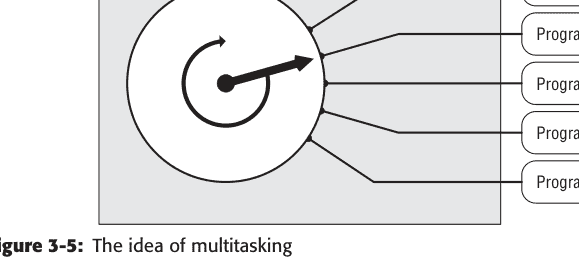

**图 3-5：** 多任务处理的概念

操作系统可以为列表中的每个程序定义优先级，使得某些程序获得比其他程序更多的运行时间。高优先级任务获得更多的时钟周期来执行，而低优先级任务则获得较少的时钟周期。

## 晋级内核

Windows 95 的多任务能力曾被大肆宣扬，但在 1995 年，很少有人听说过一个名为 `Linux` 的类 Unix 操作系统——它是由一位名叫林纳斯·托瓦兹（Linus Torvalds）的年轻芬兰人几乎出于好玩而编写的，并于 1991 年发布。

Linux 没有 Windows 95 那样精美的图形用户界面，但它能够处理多任务，并且内部结构更为强大。Linux 的核心是一块称为内核（kernel）的代码，它充分利用了 `IA-32` 保护模式。Linux 内核与用户界面完全分离，并且它受到保护，不会因系统中其他地方的程序故障而遭到破坏。系统内存被标记为内核空间（kernel space）或用户空间（user space），运行在用户空间的程序无法向存储在内核空间中的内容写入（通常也无法读取）。内核空间与用户空间之间的通信通过严格控制的系统调用处理（本书后面会详细介绍）。

对物理硬件（包括内存、视频设备和外设）的直接访问仅限于在内核空间中运行的软件。希望使用系统外设的程序只能通过内核模式设备驱动程序来获取访问权限。

微软于 1993 年发布了其受 Unix 启发的操作系统。Windows NT 的内部结构与 Linux 非常相似，内核和设备驱动程序在内核空间中运行，其他所有内容则在用户空间中运行。这一基本设计至今仍在使用，无论是 Linux 还是 Windows NT 的后继者，如 Windows 2000、Windows XP、Windows Vista 和 Windows 7。真正的保护模式操作系统的总体设计示意图如图 3-6 所示。

## 核心数量爆发

在 21 世纪初，台式 PC 开始配备两个 CPU 插槽。Windows 2000/XP/Vista/7 和 Linux 都支持通过一种称为对称多处理（symmetric multiprocessing, SMP）的机制在单个系统中使用多个 CPU 芯片。当所有处理器相同时，多处理是“对称”的。在大多数情况下，当有两个 CPU 可用时，操作系统在一个 CPU 中运行自己的代码，而用户模式应用程序则在另一个 CPU 中运行。

随着技术的进步，英特尔（Intel）和 AMD 能够在一块芯片上放置两个相同但完全独立的代码执行单元。结果是首批双核 CPU 的诞生：AMD Athlon 64 X2（2005 年）和 Intel Core 2 Duo（2006 年）。四核 CPU 在 2007 年变得普遍。（本书撰写时使用的是 Intel Core 2 Quad 6600。）当然，超过四核的 CPU 也是可能的，但对于如何充分利用如此丰富的资源仍存在诸多讨论，截至目前，这仍然是一个悬而未决的问题。

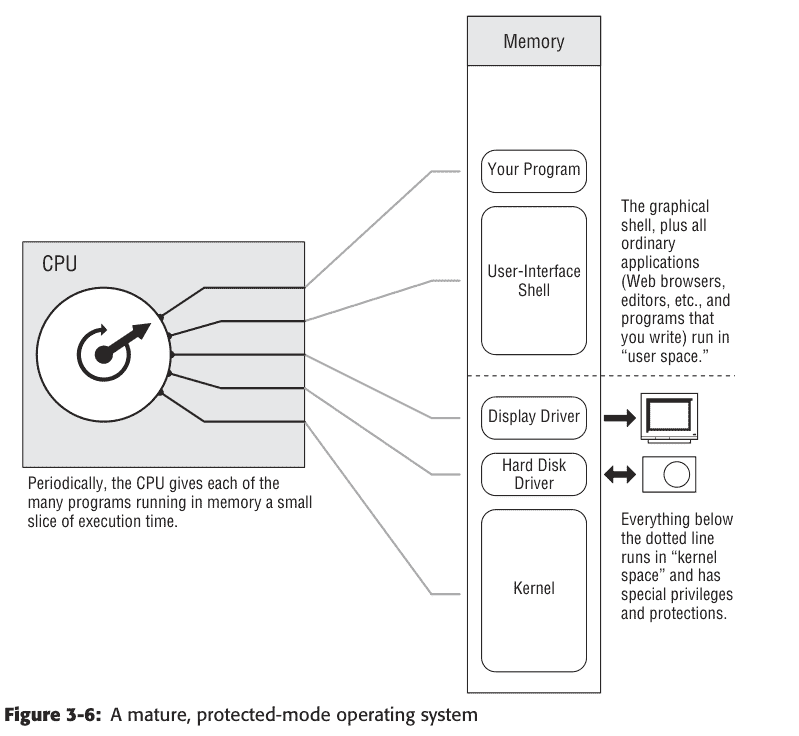

**图 3-6：** 一个成熟的保护模式操作系统

## 计划

我可以用一句有史以来最强大的计算机隐喻来总结这一切：计算机是一个遵循计划的盒子。这是泰德·纳尔逊（Ted Nelson）的话，他是管中窥物的作者《Computer Lib/Dream Machines》的作者，也是那些极少数最令人恼火的习惯——大多数时候都是对的——的人之一。

你编写计划。计算机通过逐字节地将指令传递给 CPU 来遵循它。归根结底，这个过程是一个极其复杂的电学链式反应，涉及数十万个开关，这些开关由数十万甚至数百万个晶体管组成。然而，这部分内容对你来说是隐藏的，所以你不必为此担心。一旦告诉那些堆积如山的晶体管该做什么，它们就知道如何去做。

这个计划，内存中的机器指令列表，就是你的汇编语言程序。本书的全部目的就是要教你正确地为 CPU 使用而在内存中排列机器指令。

运气好的话，到现在你应该已经对计算机做什么以及它们是什么有了合理的概念性理解。是时候开始更仔细地研究机器指令指挥 CPU 执行的操作的本质了。在很大程度上，正如计算领域的一切一样，这关乎内存，无论是主板上平凡的内存，还是那些记忆之王——CPU 寄存器。

# 第 4 章

## 位置，位置，位置

### 寄存器、内存寻址，以及知道东西在哪里

我写这本书很大程度上是因为找不到一本我看得上的汇编语言入门教材。几乎所有的汇编书籍都是从介绍指令集的概念开始，然后逐一描述机器指令。这是愚蠢的，这类书的作者应该被绞死。即使你学会了指令集中的每一条指令，你也没有学会汇编语言。

你甚至远未接近。

认为 CPU 的存在就是为了执行机器指令，这种天真的反对意见很容易驳倒：CPU 确实执行机器指令，但那是在它将这些指令握在电子手中之后。CPU 的真正工作，以及汇编语言的真正挑战，在于在内存中找到所需的指令和数据。任何白痴都能学会机器指令。（很多人都学会了。）汇编语言的技能在于对内存寻址的深刻理解。其他都是细节——而且是容易的细节。

## 内存模型的乐趣

内存寻址是一件困难的事情，而由于 x86 CPU 系列中存在着数量可观的内存寻址方式，这件事变得更加困难。这些方式中的每一种都称为一个内存模型（memory model）。在较新的 x86 CPU 系列成员中，你可以使用三种主要内存模型，并且在这三种中有许多小的变体，尤其是中间那一种。

在针对 32 位 Linux 编程时，你基本上被限定于一种内存模型，而一旦你对内存寻址有了更好的理解，你会为此感到非常高兴。然而，我将在这里详细描述所有三种内存模型，尽管这三种中的较老的两种已经成为博物馆藏品。不要跳过对这些博物馆藏品的讨论。正如研究化石以了解各种生物如何随时间进化，将使你更好地理解今天现存的生物一样，了解一些较老的 Intel 内存模型，将使你对很可能只使用的那一个内存模型有更直观的理解。

在本章末尾，我将简要描述刚刚大量面世的 64 位内存模型。不过那只是一个提醒。在这本书中以及未来几年里，32 位保护模式才是行动所在。

最古老、现已古老的内存模型称为实模式平面模型（real mode flat model）。它已经完全化石化了，但相对简单。较年长的（现已退休的）内存模型称为实模式分段模型（real mode segmented model）。它可能是你在任何编程领域中，汇编或其他，学到的最令人痛恨的东西。DOS 编程在鼎盛时期使用了实模式分段模型，因此大量的 Pepto Bismol（胃药）被销售出去。最新的内存模型称为保护模式平面模型（protected mode flat model），它是现代操作系统如 Windows 2000/XP/Vista/7 和 Linux 背后的内存模型。请注意，保护模式平面模型仅在 386 及更新的支持 IA-32 架构的 CPU 上可用。8086、8088 和 80286 不支持它。Windows 9x 介于模型之间，我怀疑除了微软的人之外，有谁能真正理解它内存寻址方式中的所有怪癖——也许连他们也不完全明白。Windows 9x 经常崩溃，在我看来，一个主要原因是它有一个完全疯狂的内存模型。（动态链接库，即 DLL——愿它们远离人类——是另一个主要原因。）它疯狂的内存模型并不是你不应该考虑用汇编编写 Win 9x 程序的唯一原因，但无疑是最好的一个；而且鉴于 Windows 9x 现在自己也正在成为化石，你可能永远不必面对这个问题。

我在本书中有一个策略，在我们深入之前，我先把它摆出来：我将首先解释实模式平面模型下的内存寻址是如何工作的，这在 DOS 下可用。它学起来惊人地简单。我会讨论实模式分段模型，因为你会时不时地绊到它，需要理解它，即使你从未为它写过一行代码。今天以及近期完成的实际工作都位于 32 位保护模式平面模型中，用于 Windows、Linux 或任何真正的 32 位保护模式操作系统。关键在于：实模式平面模型非常像保护模式平面模型的缩小版。

有一个大平坦模型和一个小平坦模型。如果你掌握了实模式平坦模型，那么保护模式平坦模型对你来说也不在话下。夹在中间的那个麻烦，只是你必须付出的代价，才能算得上真正精通内存寻址。

那么，让我们来看看这些疯狂的东西是怎么工作的。

## 16 位能买你 64K

1974 年，也就是我大学毕业的那一年，英特尔推出了 8080 CPU，基本上开创了微型计算机时代。（是的，我是个老家伙，但我很庆幸自己拥有历史感——因为我亲身经历了相当多的历史。）8080 当时是个炙手可热的小东西。我有一台 1 MHz 的，它是个相当高效的文字处理器，而这也是我主要用它做的事情。

8080 是一个 8 位 CPU，意味着它一次处理 8 位信息。然而，它却有 16 根地址线。CPU 的“位宽”——即其通用寄存器的宽度——固然重要，但在我看来，衡量 CPU 效能更重要的指标是它一次操作能调动多少根地址线。1974 年时，16 根地址线是相当激进的，因为内存极其昂贵，大多数机器最多只有 4K 或 8K 字节（记住，那意味着 4,000 或 8,000）——有些甚至少得多。

十六根地址线可以寻址 64K 字节。如果你用二进制计数（计算机总是这样做的），并把自己限制在 16 个二进制位，你可以从 0 数到 65,535。（口语中的“64K”是数字 65,536 的简称。）这意味着 65,536 个独立的内存位置中的每一个都可以有自己独特的地址，从 0 到 65,535。

8080 的内存寻址方案非常简单：你在地址线上放一个 16 位地址，然后就能得到存储在该地址的 8 位值。请注意：内存系统中的地址线数量与每个位置存储的数据大小之间没有必然联系。8080 每个位置存储 8 位，但它也可以每个位置存储 16 位甚至 32 位，而仍然只有 16 根内存地址线。

迄今为止，8080 上最常用的操作系统是 `CP/M-80`。`CP/M-80` 有一点不寻常：它存在于已安装内存的顶部——有时是为了将其放入 ROM，但主要是为了把它移开，为瞬态程序提供一个一致的内存起点，这些程序（与操作系统不同）只在需要时才加载到内存中运行。当 `CP/M-80` 从磁盘读取程序运行时，它会将程序加载到低内存，地址为 `0100H`——也就是从内存最底部算起 256 字节处。内存的前 256 字节被称为程序段前缀（PSP），包含各种零碎信息以及程序磁盘输入/输出（I/O）的通用内存缓冲区。可执行代码本身要到地址 `0100H` 才开始。

我在图 4-1 中绘制了 8080 和 `CP/M-80` 的内存模型。

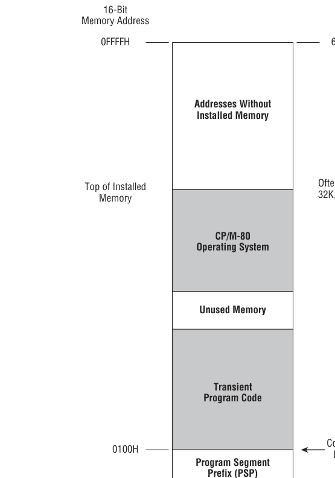

**图 4-1：** 8080 内存模型

8080 配合 `CP/M-80` 使用的内存模型很简单，人们也大量使用了它；所以当英特尔制造出它的第一个 16 位 CPU——8086 时，它希望让人们能够轻松地将旧的 `CP/M-80` 软件从 8080 移植到 8086——这个过程称为移植。实现这一点的一种方法是确保像 8080 那样的 16 位寻址系统仍然能工作。因此，尽管 8086 可以寻址的内存是 8080 的 16 倍（16 × 64K = 1MB），英特尔还是将 8086 设计成程序可以在那一兆字节内存中的某个 64K 字节段内运行，完全就像它是较小的 8080 内存系统一样。

这是通过使用段寄存器来实现的，段寄存器本质上是位于 CPU 寄存器中的内存指针，指向内存中某事物开始的位置，无论是数据存储、代码执行还是其他任何东西。你很快会学到更多关于段寄存器的知识。目前，只需将它们看作是指针，指示在 8086 的一兆字节内存中，从 8080 世界移植来的程序将从何处开始（见图 4-2）。

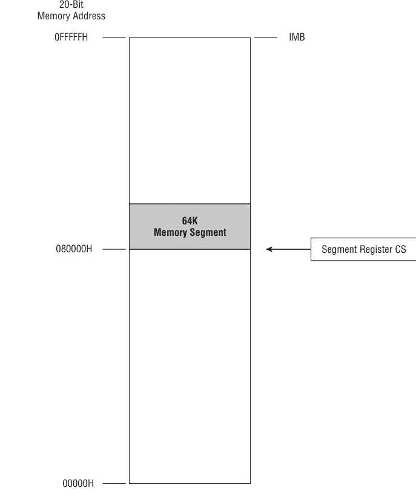

**图 4-2：** 8080 内存模型在 8086 内存系统内部

说到 8086 和 8088，有四个段寄存器需要考虑（同样，我们很快会详细讲解它们）。就图 4-2 而言，考虑名为 `CS` 的寄存器——它代表代码段。同样，它是指向 8086 一兆字节内存中某个位置的指针。这个位置充当一个 64K 内存区域的起点，一个快速转换的 `CP/M-80` 程序可以在其中非常愉快地运行。


这是非常明智的短期考虑——但却是灾难性的长期考虑。在几年内，大量 CP/M-80 程序被转换到了 8086。但当程序员试图从头创建从未接触过 8080、根本不需要分段内存模型的新程序时，问题就大规模爆发了。可惜——分段模型主导了 8086 的架构。一次需要超过 64K 内存的程序不得不使用 64K 的块来使用内存，通过在段寄存器中切换值来在不同块之间切换。

这是一场噩梦。然而，学习它有一个很好的理由：理解实模式分段内存寻址的工作方式将帮助你理解两种 x86 平坦模型是如何工作的，而且在这个过程中你会更好地理解 CPU 的本质。

## 一兆字节的本质

在分段实模式下运行时，x86 CPU 最多可以使用一兆字节的直接寻址内存。这种内存也称为`实模式内存`。如第 3 章简要讨论的那样，一兆字节内存实际上不是 1,000,000 字节，而是 1,048,576 字节。与“64K”这个简称一样，一兆字节用我们的十进制无法除尽，因为计算机以二进制为基数运作。这 1,048,576 个字节用二进制表示是`100000000000000000000B`字节。这是`2^20`，我们稍后会回到这一点。打印出来的数字`100000000000000000000B`太冗长了，最好用兼容的（且紧凑得多的）十六进制，即第 2 章描述的十六进制系统来表示。`2^20`这个量相当于`16^5`，可以用十六进制写为`100000H`。（如果你对数制的概念仍然感到困惑，我建议你再读一遍第 2 章，如果你还没读过的话——或者，即使你读过了。）

现在，这里有一个棘手且绝对关键的问题：在包含`100000H`字节的内存库中，最后一个字节的地址是什么？答案不是`100000H`。线索就在这个问题的反面：内存中第一个字节的地址是什么？你可能还记得，答案是`0`。计算机总是从`0`开始计数。（人通常从 1 开始计数。）这种脱节在计算机编程中反复出现。从计算机编程的角度来看，一排四个项目中的最后一个是编号`3`，因为一排四个项目中的第一个是编号`0`。数一下：`0, 1, 2, 3`。

内存库中字节的地址就是从零开始的该字节编号。这意味着包含一兆字节的内存库中，最后一个或者说最高的地址是`100000H`减一，即`0FFFFFH`。（开头的零虽然在数学上不是必需的，但为了方便你的汇编器，并帮助防止汇编程序混淆。养成在任何以十六进制数字 A 到 F 开头的十六进制数前加零的习惯。）

那么，一兆字节内存中的地址就是从`00000H`到`0FFFFFH`。用二进制表示，这相当于`00000000000000000000B`到`11111111111111111111B`的范围。那是很多位——准确地说是 20 位。如果你回头看看第 3 章的图 3-3，你会看到一兆字节内存库有 20 根地址线。这 20 个地址位中的每一个被路由到这 20 根地址线中的一根，所以任何表示为 20 位的地址都能识别出内存库中包含的 1,048,576 字节中的唯一一个字节。

这就是一兆字节内存：计算机内部某种内存芯片的排列，通过 20 根线的地址总线连接。一个 20 位地址被送入这 20 根地址线，以`Lookup`兆字节中的 1 个字节。

## 向后兼容与虚拟 8086 模式

现代 x86 CPU 如 Pentium 可以寻址比这多得多的内存，我很快会解释如何以及为什么。对于 8086 和 8088 CPU，20 根地址线和一兆字节内存就是它们所拥有的全部。386 及后续的英特尔 CPU 可以在不将其分割成更小分段的情况下寻址 4 吉字节内存。当 32 位 CPU 在保护模式平坦模型下运行时，一个段就是 4 吉字节——所以一个段在大多数情况下已经足够了。

然而，大量使用分段编写的 DOS 软件仍在各处使用，必须加以处理。因此，为了与古老的 8086 和 8088 保持向后兼容，较新的 CPU 被赋予了限制自身能力以匹配旧芯片能寻址和执行内容的能力。当奔腾级 CPU 需要为实模式分段模型编写的软件时，它会施展一个巧妙的技巧，暂时使自己变成 8086。这称为`虚拟-8086 模式`，它为 DOS 软件提供了出色的向后兼容性。

当你在 Windows NT 及后续版本中启动 MS-DOS 窗口或“DOS 框”时，你正在使用`虚拟-8086 模式`在 Windows 保护模式内存系统中创建一个相当于小型实模式岛屿的东西。这是保持那种向后兼容性的唯一好方法，原因你很快就会理解。

## 16 位的眼罩

在实模式分段模型中，x86 CPU 可以“看到”完整的一兆字节内存。也就是说，CPU 芯片将自己设置为可以使用它们 32 根地址引脚中的 20 根，可以向内存系统传递 20 位地址。从这个角度来看，这似乎相当简单直接。然而，理解实模式分段模型的大部分困难可能源于这样一个事实：尽管这些 CPU 能够看到整整 1MB 的内存，但它们却受到限制，只能通过 16 位的“眼罩”来观察这 1MB 内存。

眼罩这个比喻比你想象的更加贴近字面含义。请看图 4-3。那个长矩形代表 CPU 在实模式分段模型中可以寻址的 1MB 内存。CPU 位于右侧。中间是一块隐喻性的纸板，上面切有一个狭缝。这个狭缝宽 1 字节，长 65,536 字节。CPU 可以在整个内存系统的全长范围内上下滑动那块纸板。然而，在任何一个时刻，它只能访问 65,536 字节。

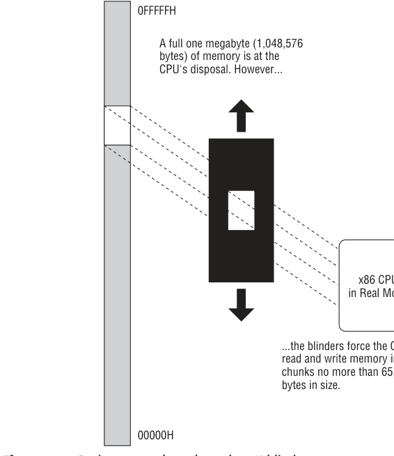

**图 4-3：** 透过 64K 的“眼罩”看 1MB 内存

CPU 在实模式分段模型中对内存的看法是奇特的。它被限制为以“块”（chunk）的方式来查看内存，每个块的长度不超过 65,536 字节——也就是我们所称的“64K”。如何利用这些块——即知道当前正在使用哪一个块，以及如何在不同块之间移动——这正是实模式分段模型编程的真正挑战。现在是时候更仔细地看看什么是段（segment）以及它们如何工作了。

## 段的本质

到目前为止，我们一直非正式地将段描述为 CPU 能够看到和使用的更大内存空间中的内存块。在实模式分段模型的语境中，段是从段边界（paragraph boundary）开始、延伸若干字节的内存区域。在实模式分段模型中，这个长度小于或等于 64K（65,536）。你之前见过 64K 这个数字，但段边界（paragraph）是什么？

暂停一下，来上一堂老式的 86 家族琐事课。段（paragraph）是一种等于 16 字节的内存度量单位。它是众多用于描述各种内存量的技术术语之一。我们之前看到过其中一些，它们都是 1 字节的整数倍。字节是数据的原子，记住；松散的内存位更像是亚原子粒子，它们永远不会脱离包含它们的字节（或更多字节）而独立存在。其中一些术语使用得比其他术语更频繁，但你应该了解所有这些术语，它们在表 4-1 中列出。

**表 4-1：内存的集合术语**

| 名称 | 十进制值 | 十六进制值 |
|:---|:---|:---|
| Byte | 1 | `01H` |
| Word | 2 | `02H` |
| Double word | 4 | `04H` |
| Quad word | 8 | `08H` |
| Ten byte | 10 | `0AH` |
| Paragraph | 16 | `10H` |
| Page | 256 | `100H` |
| Segment | 65,536 | `10000H` |

其中一些术语，如 ten byte，非常罕见；另一些，如 page，几乎从不使用。段（paragraph）这个词一开始就不常见，而且在很大程度上只与段可以开始的内存位置相关。

任何能被 16 整除的内存地址都称为段边界（paragraph boundary）。第一个段边界是地址`0`。第二个是地址`10H`；第三个是地址`20H`，依此类推。（记住`10H`等于十进制的 16。）任何段边界都可以视为段的起始点。

这并不意味着在整个 1MB 内存中，每隔 16 字节就真的有一个段在上下启动。段就像现代可调节书架上的搁板。在书架的背面有许多小槽，间隔半英寸。搁板支架可以插入任何一个小槽中。然而，并没有数百个搁板，而是只有四五个。几乎所有的小槽都是空的、未使用的。它们的存在是为了让数量少得多的搁板可以根据需要上下调节高度。

以非常类似的方式，段边界是段可以开始的小槽。在实模式分段模型中，程序可能只使用四五个段，但每个段都可以在 1MB 可用内存中的 65,536 个段边界中的任意一个开始。

又是这个数字：65,536——我们心爱的 64K。有 64K 个不同的段边界，段可以在那里开始。每个段边界都有一个编号。像往常一样，编号从`0`开始，到 64K 减 1；十进制是 65,535，十六进制是`0FFFFH`。由于段可以在任何段边界开始，段开始的段边界的编号称为该特定段的段地址（segment address）。

事实上，我们很少谈论段或段边界。当你在实模式分段模型的语境中看到段地址这个术语时，请记住每个段地址在内存中比前一个段地址远 16 字节（一个段）。在图 4-4 中，每个阴影条是一个段地址，段每隔 16 字节开始一次。最高的段地址是`0FFFFH`，距离实模式 1MB 内存的最顶端只有 16 字节。

总结一下：段可以在任何段地址开始。实模式完整的 1MB 内存中均匀分布着 65,536 个段地址，彼此间隔 16 字节。段地址更像是一种许可而非强制；对于所有 64K 个可能的段地址，任何一个时刻实际用于开始段的通常只有五六个。把段地址想象成段可以放置的槽位。

段地址就说这么多；那么，段本身呢？关于段，最重要的是要理解它最长可以达到 64K 字节，但它不一定非要这么大。段可以只有 1 字节长，或 256 字节长，或 21,378 字节长，或任何小于 64K 字节的长度。

`段地址范围 0000H - 0FFFFH`

`内存地址范围 00000H - 0FFFFFH`


（等等）

`00002H`

`00001H`

`00000H`

**图 4-4：** 内存地址与段地址

## 地平线，而非具体位置

你主要是通过说明段从哪里开始来定义一个段。那么，是什么定义了段有多长呢？说实话，没什么——这里我们要涉及一些非常棘手的语义了。段更像是一个地平线而非具体地点。一旦你定义了段从哪里开始，该段就可以涵盖从该起点到地平线之间的任何内存位置——也就是往下 65,536 字节处。

当然，没有什么规定说段必须使用所有这些内存。在大多数情况下，当在某个段地址定义了一个段时，程序只将接下来的几百或几千字节视为该段的一部分，除非它是一个真正世界一流的程序。大多数初学者读到段时，会认为它们是一种内存分配，是两边有围墙的受保护内存区域，保留给某些特定用途。

这与事实相去甚远。在实模式中，段内没有任何东西是受保护的，而且段并不保留给任何特定的寄存器或访问方式。段可以重叠。（人们经常没有考虑到或意识到这一点。）在非常真实的意义上，段并不真正存在，除非作为某种内存引用无法逾越的地平线。这又回到了我画得如图 4-3 所示的 CPU 佩戴的那副 64K“眼罩”。我是这样理解的：段就是 CPU 的 64K“眼罩”在内存中的位置。透过“眼罩”看内存时，你可以看到从段地址开始的字节，一直延伸到“眼罩”在你前方 64K 字节处截断视线的地方。

理解这种 admittedly 形而上学的段定义的关键，在于了解段是如何被使用的——而理解这一点，最终需要详细讨论寄存器。

## 用 16 位寄存器构造 20 位地址

寄存器，正如我在前面章节中非正式提到的，是 CPU 芯片内部的内存位置，而不是 CPU 外部某个内存库中的位置。8088、8086 和 80286 常被称为 16 位 CPU，因为它们的内部寄存器几乎都是 16 位大小。80386 及其二十年来的一系列后继者被称为 32 位 CPU，因为它们的大多数内部寄存器是 32 位大小。自 2000 年代中期以来，许多新型 x86 CPU 采用 64 位设计，寄存器宽度为 64 位。（本章末尾将对此有更多介绍。）x86 CPU 拥有相当数量的寄存器，它们确实是一个有趣的群体。

寄存器承担许多工作，但它们 perhaps 最重要的单一工作是保存内存中重要位置的地址。如果你还记得，8086 和 8088 有 20 个地址引脚，它们的 1MB 内存（也就是我们正在讨论的实模式分段内存）需要 20 位大小的地址。

如何将一个 20 位的内存地址放入 16 位的寄存器？你不能。你需要将 20 位的地址放入两个 16 位寄存器中。

具体做法是：实模式下 1MB 内存空间中的所有内存位置都有不止一个地址，而是两个。内存中的每个字节都被假定位于某个段中。因此，一个字的完整地址包括其所在段的地址，以及该字节距段起始位置的距离。回忆一下，段的地址就是该字节的段地址。该字节距段起始位置的距离就是该字节的偏移地址。要完整描述实模式 1MB 内存中任意单个字节的位置，必须同时指定这两个地址。书写时，段地址在前，偏移地址在后，两者之间用冒号分隔。段:偏移地址始终以十六进制书写。

我绘制了图 4-5 来帮助你更好地理解。内存中有一个我们称为`MyByte`的数据字节，位于图中标记的位置。其地址为`0001:0019`。这意味着`MyByte`位于`0001H`段内，且距该段起始位置`0019H`字节处。x86 编程中有一个约定：当用两个数字并以冒号分隔来指定地址时，不要在两个数字末尾加`H`来表示十六进制。以段:偏移形式书写的地址默认为十六进制。

然而，宇宙是变幻莫测的，细心的读者会发现`MyByte`还可以有另外两个完全合法的地址：`0:0029`和`0002:0009`。怎么会这样呢？请记住，在实模式 1MB 内存空间中，每 16 个字节就可以开始一个段。一旦开始，一个段就包含从其起始位置到其后 65,535 字节范围内的所有字节。段之间重叠并无问题，在图 4-5 中我们就看到了三个重叠的段。`MyByte`距第一个段（段地址为`0000H`）起始位置`2DH`字节。`MyByte`距第二个段（段地址为`0001H`）起始位置`1DH`字节。并不是`MyByte`同时处于两个或三个位置。它只在一个位置，但这个位置可以有三种描述方式。

这有点像芝加哥的门牌编号系统。霍华德街距芝加哥的“原点”麦迪逊街以北 76 个街区。霍华德街也距离陶依大道以北 4 个街区。你可以根据相对于麦迪逊街或陶依大道的位置来描述霍华德街的位置，取决于你想做什么。

实模式 1MB 内存中间某个任意字节可能实际上千个不同段的一部分。该字节实际上属于哪个段完全取决于约定。

总结：将 20 位地址放入两个 16 位寄存器中，就是将段地址放入一个 16 位寄存器，将偏移地址放入另一个 16 位寄存器。这两个寄存器合在一起，就能在实模式 1MB 内存空间中确定一个字节的位置。

`MyByte`可能有以下三种地址：

```text
0000:0029
0001:0019
0002:0009
```

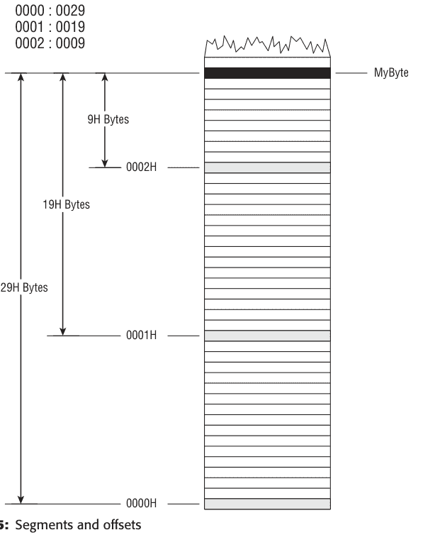

这很笨拙吗？当然，但这是多年来我们能做的最好的方案。

## 16 位和 32 位寄存器

将段地址想象成实模式 64KB“眼罩”的起始位置。通常，你会将眼罩移动到想要操作的位置，然后在 64KB 的限制范围内移动，同时让眼罩保持不动。

这正是寄存器在实模式分段模型汇编语言中的使用方式。8088、8086 和 80286 恰好有四个专门用于保存段地址的段寄存器。386 及更新的 CPU 还有两个也可以在实模式中使用的段寄存器。（如果你打算使用这两个额外的段寄存器，需要注意 CPU 型号，因为较旧的 CPU 根本没有它们。）每个段寄存器都是 CPU 芯片内部的一个 16 位存储单元。无论 CPU 正在做什么，如果它正在访问内存中的某个位置，那么该位置的段地址就在六个段寄存器之一中。

段寄存器的名称反映了其通用功能：`CS`、`DS`、`SS`、`ES`、`FS`和`GS`。`FS`和`GS`仅存在于 386 及更新的 Intel x86 CPU 中——但它们仍然是 16 位 eagerly 的。无论 CPU 是什么，所有段寄存器都是 16 位的。即使对于 32 位 CPU 也是如此。

- `CS`代表代码段（code segment）。机器指令存在于代码段的某个偏移处。当前执行指令的代码段的段地址保存在`CS`中。
- `DS`代表数据段（data segment）。变量和其他数据存在于数据段的某个偏移处。可能有多个数据段，但 CPU 一次只能使用一个，方法是将其实段地址放入寄存器`DS`中。
- `SS`代表堆栈段（stack segment）。堆栈是 CPU 中用于临时存储数据和地址的非常重要的组件。我稍后解释CTION解释堆栈的工作原理；现在只需理解，与实模式 1MB 内存中的其他东西一样，堆栈也有一个段地址，保存在`SS`中。
- `ES`代表附加段（extra segment）。附加段正是如此：一个备用的段，可用于指定内存中的某个位置。
- `FS`和`GS`是`ES`的克隆。它们都是额外的段，没有特定的工作或专长。它们的名称来自于它们是在`ES`之后创建的（想想，E、F、G）。别忘了，它们只存在于 386 及更新的 x86 CPU 中！

## 通用寄存器

段寄存器仅用于保存段地址。在实模式中，它们可以被强制执行极少数其他操作，但总的来说，段寄存器应被视为专门保存段地址的专家。x86 CPU 有一批通用寄存器来完成汇编语言计算的其余工作。除其他功能外，这些通用寄存器用于保存必须与段地址配对以确定内存中单个位置的偏移地址。它们还用于保存算术运算的值、位移位（稍后详细介绍）以及许多其他功能。它们实际上是 CPU 内部工匠的口袋。

## 第 4 章 ■ 位置，位置，位置

但这里我们遇到了较旧的 16 位 x86 CPU（8086、8088 和 80286）与从 386 开始的较新 32 位 x86 CPU 之间最大、最明显的区别之一：通用寄存器的大小。当我在 1989 年撰写本书第一版时，8088 仍然统治着 PC 计算世界，我仅限于讨论 8088 内部的东西。

那些日子早已过去。完整的 32 位 386 现在被视为古董，而 1993 年发布的原始 Pentium 随着时间的推移显得越来越 quaint。现在这是一个 32 位的世界，终有一天会成为 64 位的世界。世界的“位性”几乎完全由 x86 CPU 寄存器的宽度定义。

与段寄存器一样，通用寄存器是存在于 CPU 芯片内部的存储单元；与段寄存器一样，它们都有名称而非数字地址。通用寄存器确实是通用型的，因为它们都共享大量的功能。然而，一些通用寄存器还有我所说的“隐藏议程”：只有它能执行的任务或任务集。我会在适当时候解释所有这些隐藏议程——记住，一些隐藏议程实际上是较旧的 16 位 CPU 的限制。较新的通用寄存器更加——怎么说呢，通用。


在我们当前的 32 位世界中，通用寄存器分为三大类：16 位通用寄存器、32 位扩展通用寄存器和 8 位寄存器半部。这三大类并非代表三个完全不同的寄存器集合。16 位和 8 位寄存器实际上是 32 位寄存器内部区域的名称。x86 CPU 家族中的寄存器增长是通过扩展现有 CPU 中的寄存器实现的。给房子加一个房间不会变成两栋房子——只是一栋更大的房子。x86 寄存器也是如此。

有 8 个 16 位通用寄存器：`AX`、`BX`、`CX`、`DX`、`BP`、`SI`、`DI` 和 `SP`。（`SP` 比其他寄存器通用性稍低，但稍后我们会讲到。）这些都存在于 8086、8088 和 80286 CPU 中。它们都是 16 位的，你可以在其中放置任何能用 16 位或更少位表示的值。当 Intel 在 1986 年将 x86 架构扩展到 32 位时，它将这 8 个寄存器的大小加倍，并在每个寄存器名称前加前缀 `E` 赋予新名称，从而得到 `EAX`、`EBX`、`ECX`、`EDX`、`EBP`、`ESI`、`EDI` 和 `ESP`。

那么，这些只是更大的寄存器，还是新的寄存器？

两者皆是。

就像汇编语言中的许多事情一样，画个图会更清楚。图 4-6 展示了 `SI`、`DI`、`BP` 和 `SP` 如何加倍大小并获得新名称——同时没有完全失去它们的旧名称。

## 寄存器半体

其他四个通用寄存器 `EAX`、`EBX`、`ECX` 和 `EDX` 也是如此，但还有一个额外的变化：低 16 位本身又被分成两个 8 位半体，因此我们拥有的寄存器名称不在两个而是三个级别上。16 位寄存器 `AX`、`BX`、`CX` 和 `DX` 作为 `EAX`、`EBX`、`ECX` 和 `EDX` 的低 16 位部分而存在；但 `AX`、`BX`、`CX` 和 `DX` 本身又被分成 8 位半体，汇编器能识别这两个半体的特殊名称。A、B、C 和 D 被保留下来，但不用 X，而是用 `H`（表示高位半体）或 `L`（表示低位半体）来指定一个半体。每个寄存器半体的大小为一个字节（8 位）。因此，组成 16 位寄存器 `AX` 的是字节大小的寄存器半体 `AH` 和 `AL`；在 `BX` 内部有 `BH` 和 `BL`，以此类推。

同样，这最好通过图示来理解（见图 4-7）。正如我前面提到的，这个本来非常有用的系统的一个怪癖是，32 位寄存器的高 16 位部分没有名称。换句话说，你可以通过在汇编语言指令中指定 `AX` 来读取 `EAX` 的低 16 位，但无法单独指定高 16 位。这使得寄存器的命名约定保持得更简单一些（你愿意不得不在其他所有之外还要记住 `EAXH`、`EBXH`、`ECXH` 和 `EDXH` 吗？），而且这一缺失并不像你可能想象的那么经常被感受到。

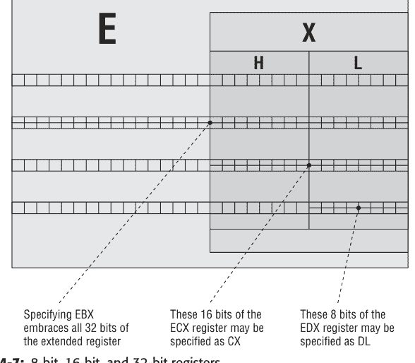

8 位寄存器半体的一个优点是，你可以读取和修改 16 位数的一半而不干扰另一半。这意味着如果你将字大小的十六进制值 `76E9H` 放入寄存器 `AX`，你可以从寄存器 `AH` 读取字节大小的值 `76H`，从寄存器 `AL` 读取 `0E9H`。更好的是，如果你随后将值 `0AH` 存入寄存器 `AL`，然后再读取寄存器 `AX`，你会发现原来的值 `76E9H` 已被更改为 `760AH`。

能够将 `AX`、`BX`、`CX` 和 `DX` 寄存器作为 8 位半体来处理，在处理大量 8 位量的情况下可能极其方便。每个寄存器半体可以被视为一个独立的寄存器，为你提供两倍数量的地方来存放程序工作时所需的数据。

如你稍后将会看到的，在紧要关头找到一个地方来存放值是汇编语言程序员面临的重大挑战之一。

请记住，这种双重性质仅涉及 16 位通用寄存器 `AX`、`BX`、`CX` 和 `DX`。其他 16 位通用寄存器 `SP`、`BP`、`SI` 和 `DI` 并不具备类似的特性。例如，不存在 `SIH` 和 `SIL` 这样的 8 位寄存器，尽管这有时会很方便。

## 指令指针

x86 CPU 内部还有另一种类型的寄存器。指令指针（通常称为 `IP`，或在 32 位保护模式下为 `EIP`）自成一类。与八个通用寄存器那组形成鲜明对比的是，`IP` 是卓越的专家——甚至比段寄存器还要专业。它只能做一件事：包含当前代码段中下一条机器指令的偏移地址。

代码段是存储机器指令的内存区域。构成程序的那些步骤和测试都包含在代码段中。根据你使用的编程模型（稍后会详细介绍），一个程序中可能有多个代码段，也可能只有一个。当前代码段是指其段地址当前存储在代码段寄存器 `CS` 中的那个代码段。在任何给定时刻，当前正在执行的机器指令都位于当前代码段中。在实模式分段模型中，`CS` 中的值可能频繁变化。在两种平面模型中，`CS` 中的值（几乎）从不变化——而且肯定不会因为应用程序的要求而变化。（如你稍后将会看到的，在保护模式下，所有段寄存器“属于”操作系统，普通程序无法更改。）

在执行程序时，CPU 使用 `IP` 来跟踪它在当前代码段中的位置。每次执行一条指令，`IP` 就会递增若干字节。这个字节数就是刚执行完的指令的大小。最终效果是将 `IP` 推向内存的更深处，使其指向要执行的下一条指令的起始位置。指令有不同的长度，通常从 1 字节到 6 字节不等。（一些更冷僻指令的更冷僻形式可能甚至更大。）CPU 会仔细地将 `IP` 递增适当的字节数，这样它确实能最终指向下一条指令的起始位置，而不是仅仅指向上一条指令的中间或另一条指令的中间。

如果 `IP` 包含下一条机器指令的偏移地址，那么段地址在哪里呢？段地址保存在代码段寄存器 `CS` 中。`CS` 和 `IP` 合起来包含下一条要执行的机器指令的完整地址。

这个地址的性质取决于你使用的 CPU 以及你使用的编程模型。在 8088、8086 和 80286 中，`IP` 的大小为 16 位。在 386 及以后的 CPU 中，`IP`（像除段寄存器外的所有其他寄存器一样）升级为 32 位的大小，成为 `EIP`。

在实模式分段模型中，`CS` 和 `IP` 协同工作，给出一个 20 位的地址，指向实模式内存中 1,048,576 个字节之一。在两种平面模型中（稍后会详细介绍），`CS` 由操作系统设置并保持恒定。`IP` 是你作为程序员必须处理的所有指令指向工作。在 16 位平面模型（实模式平面模型）中，这意味着 `IP` 可以跟踪整个 64K 段内存中的指令执行。32 位平面模型的作用远不止翻倍；32 位可以表示 4,294,967,296 个不同的内存地址。因此，在 32 位平面模型（即保护模式平面模型）中，`IP` 可以跟踪超过 4 GB 内存中的指令执行——这曾经是一个难以想象的内存量，现在却很常见。

`IP` 值得注意的一点是，它是唯一一个既不能直接读取也不能直接写入的寄存器。有一些技巧可以用来获取 `IP` 中的当前值，但获得 `IP` 的值并不像你想象的那么有用，所以你不会经常需要这样做。

## 标志寄存器

CPU 内部还有一种额外的寄存器类型：通常称为标志寄存器的东西。在 8086、8088 和 80286 中，它的长度为 16 位，正式名称是 `FLAGS`。在 386 及以后的 CPU 中，它的长度为 32 位，在 32 位 CPU 中的正式名称是 `EFLAGS`。标志寄存器中的大多数位被用作称为标志的单位寄存器。这些单个标志每一个都有名称，如 `CF`、`DF`、`OF` 等等，每一个在 CPU 内都有非常具体的含义。

当你的程序执行测试时，它所测试的是标志寄存器中的一个或多个单位标志。由于单位只能包含两个值之一，1 或 0，所以汇编语言中的测试确实是一个二选一的过程：要么标志被设置为 1，要么不是。如果标志被设置为 1，程序采取一种行动；如果标志被设置为 0，程序采取不同的行动。

标志寄存器几乎从不作为一个整体来处理。实际情况是，许多不同的机器指令测试各种标志来决定在某个非此即彼的决策中走哪条路。我们目前专注于内存寻址，所以现在我简单承诺在本书后面更合适的时刻更详细地介绍标志知识，那时我们会讨论测试标志寄存器中各种标志的机器指令。

## 三种主要的汇编编程模型

我在本章前面提到过，x86 CPU 有三种主要的编程模型可供使用，尽管其中两种现在已被视为过时。它们之间的区别（主要）在于寄存器用于寻址内存。（其他的区别，尤其是在高端方面，大部分都由操作系统对程序员隐藏了。）本节描述了这三种模式，我们在本书后续内容中都会涉及到。

## 实模式平坦模型

在实模式中，如果你还记得，CPU 只能看到一兆字节（1,048,576）的内存。你可以通过前面提到的段:偏移寄存器技巧，将两个寄存器中包含的两个 16 位地址组合成一个 20 位地址，从而访问那一百多万字节中的每一个。或者，你也可以满足于 64K 的内存，完全不涉及段。

在实模式平坦模型中，你的程序以及它处理的所有数据都必须存在于一个单一的 64K 内存块中。六十四千字节！呸！区区 64K 字节你能做什么？嗯，IBM PC 上的第一个 WordStar 版本就是装在 64K 里的。Turbo Pascal 的前三个主要版本也是如此——事实上，Turbo Pascal 程序本身占用的空间远小于 64K，因为它将程序编译到内存中。整个 Turbo Pascal 包——编译器、文本编辑器和一些工具——总共只有 39K 多一点。三十九千字节！如今你甚至不能用 Microsoft Word 给妈妈写封信，空间这么少！

确实，确实如此。但这主要是因为我们不需要这样做了。内存已经变得非常便宜，我们的机器现在按历史标准来看包含了惊人的内存数量。我们变得懒惰、贪婪、浪费，只是因为我们能摆脱这些。

曾经在 64K 中发生过惊人的事情，虽然你可能永远不会被要求限制自己使用实模式平坦模型，但那些年长程序员为之开发的纪律非常有用。更重要的是，实模式平坦模型是保护模式平坦模型的“小兄弟”，而保护模式平坦模型是你在 Linux 下编程时将使用的代码模型。如果你学会了实模式平坦模型的方法，保护模式平坦模型将是小菜一碟。（你遇到的任何麻烦都不会是汇编代码或内存模型的问题，而是 Linux 及其标准代码库那如同拜占庭般复杂的要求。）

实模式平坦模型在图 4-8 中以图解方式展示。没有什么复杂的。段寄存器都设置为指向你可以使用的 64K 内存块的起始位置。（操作系统在加载并运行你的程序时设置它们。）它们都指向同一个位置，在你的程序运行期间不会改变。既然如此，你可以直接忘记它们。噗！没有段寄存器，不用处理段，也没有随之而来的丑陋复杂性。

因为像 `BX` 这样的 16 位寄存器可以保存从 0 到 65,535 的任何值，它可以精确定位你的程序可以使用的完整 64K 内存中的任何一个字节。因此，寻址内存可以不必显式使用段寄存器。当然，从 CPU 的角度来看，段寄存器仍在工作。它们不会消失，仍然在那里，但操作系统在启动你的程序时将它们设置为它自己选择的值，这些值在你的程序运行期间都是有效的。你不需要以任何常规方式访问段寄存器来编写程序。

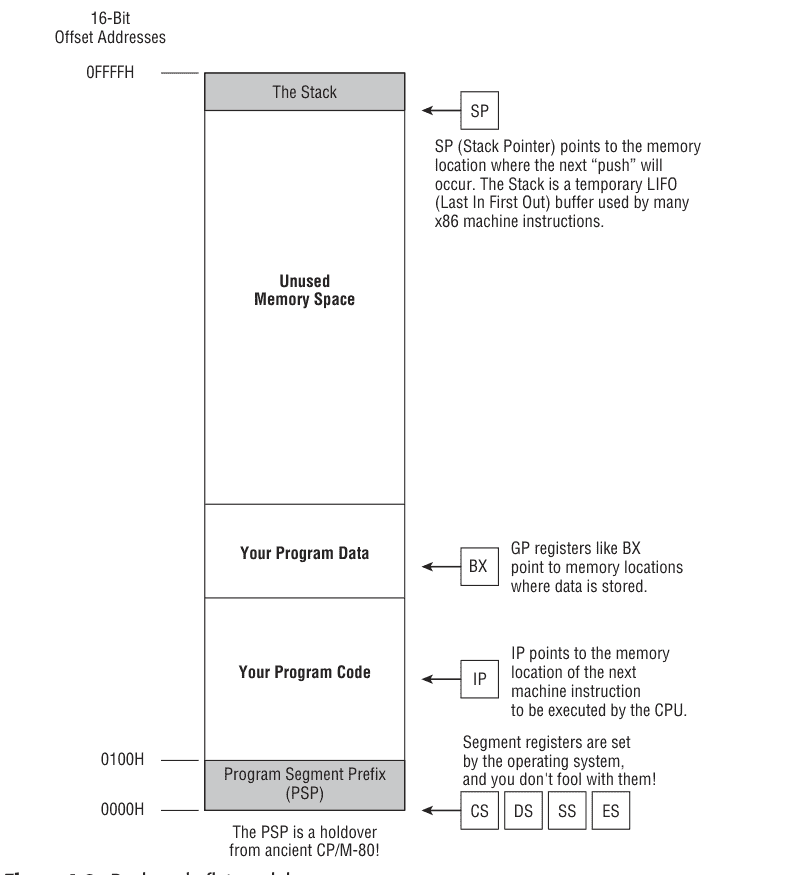

大多数通用寄存器可能包含内存中位置的地址。你将它们与机器指令配合使用，将数据从内存带入并再次写回。

在你的程序所在的单一段的顶部，你会看到一个小区域，称为栈。栈是一个具有一些特殊用途的 LIFO（后进先出）存储位置。我稍后会很详细地解释栈是什么以及它是如何工作的。

## 实模式分段模型

本书的前两个版本完全专注于实模式分段模型，这是整个 MS-DOS 时代的主流编程模型，在你启动 MS-DOS 窗口运行一段“遗留”软件时仍然发挥作用。这是一个复杂、丑陋的系统，需要你记住很多小规则和陷阱，但理解它很有用，因为它非常清楚地说明了段的本质和功能。注意，在两种平坦模型下，你可以稍微眯起眼睛假装段和段寄存器并不存在，但它们两者都确实在那里运行着，一旦你进入一些更奇特的编程风格，你就需要了解它们并掌握它们的工作原理。

在实模式分段模型中，你的程序可以看到实模式下 CPU 可用的全部 1MB 内存。这是通过将 16 位段地址与 16 位偏移地址组合来实现的。然而，它并不是简单地将它们合并成一个 32 位地址。你需要回想一下本章前面关于段的讨论。段地址实际上并不是一个内存地址。段地址指定了一个段可能开始的 65,535 个槽位之一。这些槽位从内存底部到顶部每隔 16 字节就有一个。段地址 `0000H` 指定了第一个这样的槽位，位于内存的最开始位置。段地址 `0001H` 指定了下一个槽位，位于内存中高出 16 字节的位置。再向上跳 16 字节就到了段地址 `0002H`，依此类推。你可以将段地址乘以 16 来转换为实际的 20 位内存地址。因此，段地址 `0002H` 相当于内存地址 `0020H`，即内存中的第 32 个字节。

但这种乘法并不是你需要做的。CPU 在内部处理段和偏移组合成完整的 20 位地址。你的工作是告诉 CPU 那个 20 位地址的两个不同组成部分在哪里。通常的表示法是用冒号分隔段寄存器和偏移寄存器，如下例所示：

```text
SS:SP
SS:BP
ES:DI
DS:SI
CS:BX
```

这五种寄存器组合中的每一种都指定了一个完整的 20 位地址。例如，`ES:DI` 指定的地址是 `DI` 中与 `ES` 中指出的段起点之间的距离。

我在图 4-9 中绘制了实模式分段模型的示意图。与实模式平坦模型（图 4-8 所示）相比，这里的图展示了全部内存，而不仅仅是你的实模式平坦模型程序运行时所分配的那一小块 64K。为实模式分段模型编写的程序可以看到实模式下的所有内存。

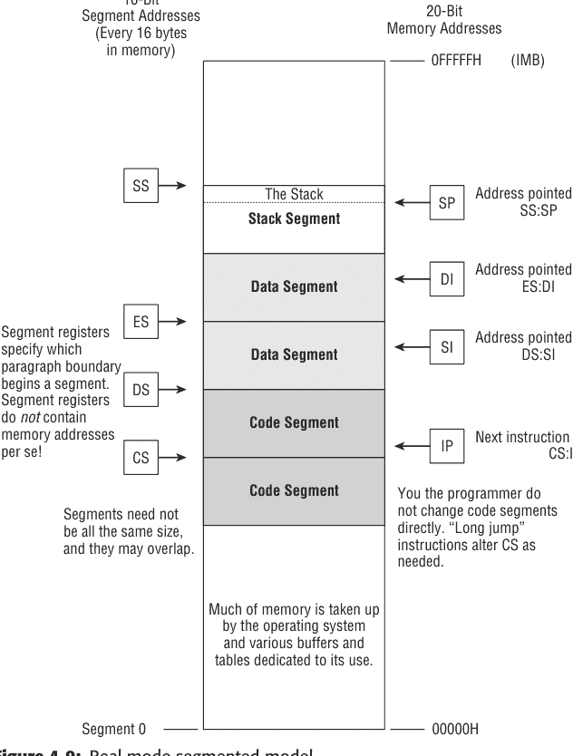

**图 4-9：实模式分段模型**

图中显示了两个代码段和两个数据段。实际上你可以有任何合理数量的代码段和数据段，不仅仅是各两个。你可以同时访问两个数据段，因为你有两个段寄存器可以完成这项工作：`DS` 和 `ES`。（在 386 及更高处理器中，你有两个额外的段寄存器，`FS` 和 `GS`。）每个都可以指定一个数据段，你可以使用多种机器指令中的任何一种将数据从一个段移动到另一个段。然而，你只有一个代码段寄存器 `CS`。`CS` 始终指向当前代码段，下一条要执行的指令由 `IP` 寄存器指向。你不会直接加载值到 `CS` 来改变代码段。跳转指令在需要时改变到另一个代码段。你的程序可以跨越多个代码段，当跳转指令（有多种类型）需要将执行带入不同的代码段时，它会为你改变 `CS` 中的值。

任何单一程序只有一个栈段，由栈段寄存器 `SS` 指定。栈指针寄存器 `SP` 指向内存中地址（相对于 `SS`，尽管是相反的方向），即下一次栈操作将发生的位置。栈需要相当多的解释，我在本书后面的几个地方会进行讨论。

你需要记住，在实模式下，操作系统的一部分（如果你使用的是 8086 或 8088，那将是整个操作系统）会与你的程序一起在内存中，还有重要的系统数据表。如果你粗心使用段寄存器，你可能会破坏操作系统的部分，这将导致操作系统崩溃并连带你的程序也一起崩溃。正是这种危险促使英特尔在其 80386 及更高 CPU 中构建了新的功能来支持“保护”模式。在保护模式下，应用程序（即你写的程序，与操作系统或设备驱动程序相对）不能通过多任务处理破坏操作系统或碰巧在内存中其他地方运行的其他应用程序。这就是保护的含义。

最后，虽然确实 80286 中存在一种原始的受保护模式，但没有任何操作系统真正使用过它，今天讨论它没有太多价值。

## 保护模式平坦模型

自 1986 年 386 出现以来，英特尔的 CPU 已经实现了非常好的保护模式架构。然而，应用程序不能单独使用保护模式。操作系统必须先设置和管理保护模式，应用程序才能在其中运行。MS-DOS 做不到这一点，微软的 Windows 直到 1994 年 Windows NT 首次出现之前也做不到。Linux 由于没有真正实模式“遗留”问题需要处理，自 1992 年首次出现以来就一直在保护模式下运行。

保护模式汇编语言程序可以为 Linux 和从 NT 开始的所有 Windows 版本编写。（我排除 Windows 9x 是有技术原因的。它的内存模型是实模式和保护模式的一种奇怪的专有混合体，非常难以完全理解——而且现在几乎完全无关。）请注意，为 Windows 编写的程序不一定非要是图形化的。在 Windows 下以受保护模式编程最简单的方法是创建控制台应用程序，这是在称为控制台的文本模式窗口中运行的文本模式程序。控制台通过一个与 MS-DOS 中几乎相同的命令行来控制。与编写 Windows GUI 应用程序相比，控制台应用程序使用受保护模式的平面模型，并且相当简单。Linux 的默认模式是文本控制台，因此为 Linux 创建汇编程序更加容易，而且似乎有更多的人正在这样做。内存模型非常相似。

我在图 4-10 中绘制了受保护模式平面模型。你的程序看到的是一个从 0 到略超过 4 GB 的连续内存地址块。每个地址都是一个 32 位的量。所有通用寄存器都是 32 位大小，因此一个 GP 寄存器可以指向完整 4GB 地址空间中的任何位置。指令指针也是 32 位大小，因此 `EIP` 可以指示 4GB 内存中任何位置的机器指令。

段寄存器仍然存在，但工作方式截然不同。你不仅不必理会它们，而且不能理会。段寄存器现在被视为操作系统的一部分，在几乎所有情况下，你既不能直接读取也不能直接更改它们。它们的新任务是定义你的 4GB 内存空间在物理内存或虚拟内存中的位置。物理内存可能比 4GB 大得多，目前 4GB 内存并不特别昂贵。然而，一个 32 位寄存器只能表示 4,294,967,296 个不同的位置。如果你的计算机有超过 4GB 的内存，操作系统必须在内存中安排一个 4GB 区域，而你的程序只能在该区域内运行。定义这个 4GB 区域在更大的内存系统中的位置就是段寄存器的工作，而操作系统将它们贴身保管。

在本书中我不会过多讨论虚拟内存。它是一种可以将更大的内存空间“映射”到磁盘存储的系统，因此即使你的机器只有 4GB 的物理内存，CPU 也可以寻址一个比它大数百万字节的“虚拟”内存空间。同样，这由操作系统处理，而且处理的方式对你编写的软件来说几乎是完全透明的。

需要理解的是，当你的程序运行时，它会收到一个 4 偏移内存地址位于显示在显示器上的视频适配器板所涵盖的内存范围内。

这种技术允许程序显示整屏文本，文本直接“弹出”到视图中，没有任何从顶部到底部逐渐出现的感觉，即使在早期的机器上也令人难以置信地慢速 CPU 芯片上也是如此。内存缓冲区的组织很简单：从地址 `0B000:0`（或彩色显示器的 `0B800:0`）开始是一个两字节的数组。每个字中的第一个字节是 ASCII 字符代码。例如，数字 `41H` 编码了大写字母“A”。第二个字节是文本属性：字形颜色、字符单元背景部分的颜色，或下划线等特殊呈现。


这种排列使得使用相对简单的汇编语言库来显示文本变得非常容易和快速。不幸的是，这种对系统外设的直接访问违反了保护模式的保护机制。“为什么”很简单：保护模式使多个程序能够同时执行，如果多个执行程序同时试图更改显示内存，将导致视频混乱。老式的 DOS 是严格的单任务操作系统，所以一次只有一个程序在运行。

要以合理的方式实现多任务处理，操作系统必须通过精心设计的视频显示代码库来“管理”对视频的访问，而这些代码库又通过与内核一同运行在内核空间的驱动软件来访问显示硬件。驱动程序使操作系统能够将单个程序的视频输出限制在屏幕上的一个窗口中，这样任何合理数量的运行程序都可以同时显示它们的输出，而不会与其他程序的输出发生冲突。

现在，话虽如此，*确实存在*一种在用户内存中设置缓冲区，然后告诉 Linux 将其用于视频显示的方法。这涉及围绕 Linux 帧缓冲设备`/dev/fb0`以及`mmap`和`ioctl`函数的一些繁琐工作，但它既没有那么简单，也没有那么快。这种机制对于将古老的 DOS 程序移植到 Linux 很有用，但对于新程序来说，它带来的麻烦远大于其价值。在本书的后面，我将演示 Linux 处理文本屏幕输出的首选方法，即使用控制台窗口和 VT100 控制序列。

## 对端口硬件的直接访问

回到 DOS 时代，PC 有由主板上的独立控制器芯片控制的串口和并口。与机器中的其他所有东西一样，任何在 DOS 下运行的软件都可以直接访问这些控制器芯片。通过向芯片写入位映射的控制值并创建自定义中断服务例程，可以创建定制的“精细调整”串行接口软件，使当时缓慢的每秒 300 字符的拨号调制解调器以其最大能力工作。这是常规操作，但通过一些巧妙的方法，你可以使标准计算机硬件执行它并非真正设计用于做的事情。例如，通过研究机器并行端口的硬件控制器，我能够用汇编编写一个双向通信系统，通过它们的并行端口在计算机之间非常快速地传输数据。（这实际上是 PC 之前的时代，为 Z80 CPU 使用 CP/M。）

幸运的是，直接访问像当时那样__令人难以置信地__慢速 CPU 芯片不再可能。

操作系统必须提供视频驱动程序和库，以安全地管理多个程序的显示输出。这是有意义的，因为现代多任务操作系统需要同时处理多个程序的显示需求，而不允许任何单个程序直接操作硬件。

通过并行端口进行快速数据传输的技术也已经过时，现代接口提供了更标准化和更安全的通信方式。不过，理解这些底层原理仍然有助于理解计算机系统的发展历程。

同样，与视频一样，多任务处理的需求要求操作系统管理对端口的访问，它通过驱动程序和代码库来实现这一点；但与视频不同的是，使用驱动程序来接口端口实际上比自己完全控制端口要*简单得多*，我并不怀念那些“糟糕的往日”。

## 直接调用 BIOS

我们必须向保护模式的严格要求妥协的第三种 DOS 时代技术是对 PC BIOS 例程的直接调用。正如我在第 3 章中所解释的，IBM 在只读内存中放置了一个代码库，用于对视频和端口等外围设备进行基本管理。在 DOS 时代，软件可以直接且无限制地调用这些 BIOS 例程。在此书的早期版本中，我曾解释过这是如何完成的，涉及文本视频的管理。

保护模式将 BIOS 调用保留给操作系统，但事实上，即使是保护模式操作系统如今也很少直接使用 BIOS 调用。几乎所有的底层硬件访问都是通过可安装驱动程序完成的。操作系统进行 BIOS 调用主要是为了确定硬件配置信息，例如电源管理。

作为一种补偿，Linux 提供了一系列底层函数，可以通过与 BIOS 调用非常相似的机制来调用，使用软件中断 80H。我将在本书后面解释什么是软件中断以及如何使用它们。

## 展望未来：64 位“长模式”

未来已经来临，你可以在 Fry's 买到它。如今，除了最便宜的台式 PC 之外，所有 PC 都包含 AMD 或 Intel 的技术上为 64 位“宽”的 CPU。要使用这些 64 位特性，你需要一个显式为它们编译并知道如何管理它们的操作系统。Windows 和 Linux 都有为 64 位“长模式”编译的版本。Windows Vista 和 Windows XP 都已经推出了 64 位版本一段时间了。Windows 7 将（据我们了解）同时提供 32 位和 64 位版本。对于 Windows 和 Ubuntu Linux，你必须选择你想要的版本。一种尺寸并不能“适合所有人”。在本书中，我专注于 32 位版本的 Linux，并保证所有内容都能在 64 位 Linux 的 32 位兼容模式下运行。然而，了解长模式提供了什么是有用的，这样你可以在自己的编程技能成熟后自行探索。

64 位 x86 架构有一段奇特的历史：2000 年，Intel 的竞争对手 AMD 宣布了一种 IA-32 架构的 64 位超集。AMD 直到 2003 年才发布实现这种新架构的 CPU，但这是 CPU 战争中的一次先发制人。Intel 已经有一种名为 IA-64 Itanium 的 64 位架构，但 Itanium 是对 IA-32 的彻底决裂，IA-32 软件无法在 Itanium CPU 上运行，除非重新编译，在某些情况下还需要重新编码。业界希望向后兼容，而对 AMD 新架构的反应如此热烈，迫使 Intel 奋起直追，实现了一种与 AMD 兼容的架构，并将其命名为 Intel 64。Intel 的首款兼容 AMD 的 64 位 CPU 于 2004 年底发布。厂商中立的术语“x86-64”现在被应用于两家公司相同实现的功能。

x86-64 架构定义了三种通用模式：实模式、保护模式和长模式。实模式是一种兼容模式，使 CPU 能够运行较旧的实模式操作系统和软件，如 DOS 和 Windows 3.1。在实模式下，CPU 的工作方式与 8086 或其他 x86 CPU 在实模式下相同，支持实模式平面模型和实模式分段模型。保护模式也是一种兼容模式，使 CPU 对软件来说“看起来像”IA-32 CPU，因此 x86-64 CPU 可以运行 Windows 2000/XP/Vista/7 和其他 32 位操作系统如 Linux，以及它们的 32 位驱动程序和应用程序。

长模式是真正的 64 位模式；当 CPU 处于长模式时，所有寄存器都是 64 位宽，并且所有作用于 64 位操作数的机器指令都可用。

IA-32 中可用的所有寄存器都在那里，并且已扩展为 64 位宽。寄存器的 64 位版本以 R 开头重新命名：`EAX`变为`RAX`，`EBX`变为`RBX`，依此类推。除了 IA-32 中已有的熟悉的通用寄存器之外，还有八个全新的 64 位通用寄存器，没有 32 位对应物。这些全新的寄存器被命名为`R8`到`R15`。我没有多谈 x86 架构的快速数学特性，在本书中也不会，但 x86-64 向 IA-32 的八个 128 位 SSE 寄存器增加了八个，共 16 个。

所有这些新寄存器对寻求提高执行速度的汇编程序员来说就像天上掉下来的甘露。存储数据最快的地方是寄存器，而在早期 x86 CPU 的寄存器稀缺下挣扎过的程序员们看到那堆内部财富时会惊叹不已。

## 64 位内存：某一天可能实现的 vs. 我们现在能做的

正如我前面所述，32 位只能寻址 4 GB 内存。各种技巧已被用于使运行在 IA-32 CPU 上的程序能够使用更多内存。在 64 位长模式中，我们有一个几乎相反的问题：64 位可以寻址如此令人难以置信的巨大内存量，以至于*需要* 64 位地址空间的内存系统在未来许多年内都不会被创建出来。（我在这里有所保留，提醒自己和你们所有人，我们以前也说过类似的话，结果却被打脸了。）

64 位可以寻址 16 艾字节。一个艾字节是`2^60^`字节，可以更通俗地描述为十亿千兆字节，即略超一百万亿字节。我们的计算机硬件终有一天会达到那里，但我们现在还没达到。现在的关键问题是：管理这些 64 位地址中的所有位需要 CPU 微架构内部的晶体管。因此，芯片制造商没有在芯片上浪费晶体管去管理在 CPU 芯片（甚至 x86-64 架构本身）的预期寿命内不会被使用的内存地址线，而是限制了当前芯片实现中实际功能的地址线数量。

你今天可以购买的 x86-64 CPU 芯片为虚拟内存实现了 48 位地址，而物理内存只有 40 位。这仍然远远超过目前任何物理计算机可以装入的物理内存：`2^40^`代表 1 TB；基本上略超一千 GB，即一万亿字节。我知道有些高端机器可以接受 64GB 内存。1 TB 还需要几年才能实现。

我说所有这些是为了强调，现在和未来几年内为 IA-32 架构编程并不会让你吃亏。我将在下一章介绍的 NASM 汇编器可以生成 64 位长模式的代码，如果你安装了 64 位版本的 Linux，你现在就可以为其编写代码。64 位 Linux 处理函数调用的方式有一些差异，但 64 位长模式仍然是平面模型，而且它与 32 位平面模型的相似程度，远远超过 32 位平面模型与我们在 PC 时代最初 15 或 20 年里所忍受的蒙昧的实模式分段模型之间的相似程度。

关于我们的代码将在其上运行的平台，暂时就说这么多。是时候开始讨论编写汇编语言程序的过程，以及我们将要使用的工具了。

# 第 5 章

## 汇编的权利

### 创建汇编语言程序的过程

Rudyard **Kipling** 的**诗歌**“In the Neolithic Age”（1895）给了我们一个关于部落确定性的简洁教训。在用他可靠的花岗岩战斧成功地四面挥舞之后，这首诗的新石器时代叙述者吃掉他以前的敌人，同时为自己遵循唯一正确的部落道路而沾沾自喜。唉，他的图腾柱另有想法，在午夜幻象中将我们自负的叙述者置于他的位置：

> “构造部落歌谣的方法有九六十八种，

> 而*每一种都是正确的！*”

这首诗的寓意是：相信你的图腾柱。关于部落歌谣的道理同样适用于编程方法论。编程方法*至少*有九六十八种，多年来我尝试过其中的大多数。它们各不相同，但都有效，因为它们都能产生可以加载和运行的程序——一旦程序员弄清楚如何遵循特定方法并使用配套工具。

然而，尽管所有这些编程技术都有效，它们并非可以互换，对一种编程语言或工具集有效的方法不适用于另一种编程语言或工具集。1977 年，我学会了一种名为 APL（A Programming Language；多么深刻）的语言，方法是逐行输入代码并观察每一行的作用。这就是 APL 的工作方式：每一行主要是一个独立的实体，执行计算或某种数组操作，一旦你按下回车键，这一行就会计算出一个结果并打印给你。（我是在一台 Selectric 打印机/终端上学会它的。）当然，你可以把多行串联起来，我确实也这么做过，但这是一种令人陶醉的方式——从最初的完全无知状态出发，逐行编写程序，每一步都只测试一个微小的步骤。

后来我学习 BASIC 的方式几乎与学习 APL 相同，再后来又学习了 Perl，但还有其他一些语言则需要其他技巧。Pascal 和 C 都要求事先进行大量学习，因为你不能只是敲进一行代码然后独立执行它。更晚一些，当 Windows 成为主流时，Visual Basic 尤其是 Delphi 彻底改变了规则。编程变成了一种刺激-反应机制，操作系统发出称为*事件*的刺激（按键、鼠标点击等），而简单的程序主要由对这些事件的响应组成。

汇编语言的构造方式与 C、Java 或 Pascal 不同。非常明确地说，你*不能*通过试错来编写汇编语言程序，也不能让别人替你思考。与 BASIC、Perl 或 Delphi、Lazarus、Gambas 等可视化环境相比，这是一个复杂而棘手的过程。你必须集中注意力。你必须阅读乐谱。最重要的是，你必须练习。

在本章中，我将教你我所学到的汇编语言的“部落歌谣”。

## 文件及其内部内容

所有编程都是关于处理文件的。有些编程方法会隐藏其中一些文件，所有方法都在某种程度上努力让人类更容易理解这些文件内部的内容；但归根结底，你将创建文件、处理文件、读取文件和执行文件。

大多数人都明白，文件是存储在某种介质上的一组数据：硬盘驱动器、U盘或闪存卡、光盘，或偶尔某种奇特的设备。这组数据被赋予一个名称，并作为一个整体进行操纵。你的操作系统管理存储介质上的文件。最终，它从文件内部调出数据供你查看，并将你做的修改写回文件，或在你借助操作系统帮助创建的新文件中保存。

汇编语言 notable 在于它几乎不向你隐藏任何东西；要精通它，你必须愿意深入你处理的任何文件内部，理解到字节甚至常常到位级别的细节。这需要更长时间，但它在知识方面带来巨大的回报：你将知道一切是如何工作的。相比之下，APL 和 BASIC 都是神秘的黑箱。我输入一行，计算机吐出一个响应。中间发生了什么被很好地隐藏起来了。在汇编语言中，你*看到*一切。诀窍在于理解你所看到的内容。

## 二进制文件与文本文件

查看并不总是容易的。如果你使用 Windows 或 Linux（以及之前的 DOS）有一段时间了，你可能对文件之间的区别有所感知，这取决于你如何“查看”它们。简单的文本文件可以在简单的文本编辑器中打开和查看。文字处理文件需要在创建它的那种文字处理器中打开。PowerPoint 演示文稿文件需要从 PowerPoint 应用程序内部打开。如果你试图将它加载到 Word 或 Excel 中，应用程序会显示乱码，或者（更可能地）礼貌地拒绝执行打开命令。试图在文字处理器或其他文本编辑器中打开可执行程序文件通常要么毫无结果，要么得到满屏乱码。

*文本文件*是可以用文本编辑器打开并查看内容的文件，例如 Windows 中的记事本，或 Linux 上众多可用的文本编辑器之一。*二进制文件*是包含不能有意义地显示为文本的值的文件。大多数高端文字处理器使问题复杂化：它们操纵文本，然后将文本与格式化信息混合在一起，这些信息不能转换为文本，而是用于控制段落间距、行高等内容。用简单的文本编辑器打开 Word 或 OpenOffice 文档，你就会明白我的意思。

文本文件包含大写和小写字母、数字，以及标点等奇怪符号。共有 94 种这样的可见字符。文本文件还包含一组称为*空白*的字符。空白字符通过将文本文件分成行并在行内提供空间，赋予其结构。这些包括熟悉的空格字符、制表符、表明行结束的新行符，有时还有其他几个。还有一些化石字符，如 BEL 字符，几十年前用于电传打字机中敲响小的机械铜铃，虽然 BEL 技术上被视为空白字符，但大多数文本编辑器直接忽略它。

PC 世界中的文本文件稍微复杂一些，因为还有另外 127 个字符，包含数学符号、带重音符号和其他修饰符的字符、希腊字母，以及在远古时代广泛用于绘制屏幕表单的“框线绘制”字符，那是在 Windows 和 Gnome 等图形用户界面出现之前。这些额外字符在文本编辑器或终端窗口中的显示效果完全取决于该文本编辑器或终端窗口及其配置方式。

当通过 Unicode 标准引入非西方字母表时，文本文件变得更加复杂。详细解释 Unicode 超出了本书的范围，但 Wikipedia 和其他地方都有很好的介绍。

## 用 Bless 编辑器查看文件内部

文本文件容易显示、编辑和理解。唉，编程世界中*还有*比文本文件多得多的内容。在前面几章中，我从计算机的角度定义了什么计算机程序。程序，打个比方，是一段非常小步的漫长旅程。这些步骤是代表机器指令的二进制值列表，指引 CPU 完成手头的工作。这些机器指令，即使是它们的十六进制简写形式，对人类来说也是天书。下面是一小段用十六进制表示的二进制值：

```
FE FF A2 37 4C 0A 29 00 91 CB 60 61 E8 E3 20 00回避遵从来自泰勒斯的请求并停止洪水侵袭的请求X。04。00 A8 00 B8 29 1F FF 69 55
```

这是真实程序的一部分吗？你可能得去问 CPU 才能知道，除非你是自 1978 年以来就再未出现过的那种机器代码狂热者。（它不是。）

但 CPU 处理这种形式的程序毫无困难。事实上，CPU 无法用任何其他方式处理程序。CPU 本身根本没有能力理解并执行诸如

```
LET X = 42
```

这样的字符字符串，甚至我们这些外面的人称之为汇编语言的东西：

```
mov eax, 42
```

对 CPU 来说，只有二进制。CPU*可能*会将一串文本字符解释为二进制机器指令，但如果发生这种情况，那纯粹是巧合，而且这种巧合不会持续超过三四个字符的长度。此外，指令序列也不太可能做任何有用的事情。

从高层次来看，汇编语言编程（或许多其他语言的编程）的过程包括：获取人类可读的文本文件，并以某种方式将其翻译成包含 CPU 能理解的二进制机器指令序列的文件。作为程序员，你需要了解哪些文件是哪种（后面会详细讲）以及每种文件是如何处理的。此外，你需要能够“打开”一个可执行的二进制文件并检查其包含的二进制值。

非常幸运的是，有一些工具可以打开、显示并让你改变*任何*种类文件中的字符或二进制字节。这些工具称为*二进制编辑器*或*十六进制编辑器*，以我的经验来看，其中最好的（至少对于 Linux 世界而言）是 Bless Hex Editor。它设计用于在 Gnome 等图形用户界面下运行，通过探索菜单就很容易上手。

Ubuntu 默认不安装 Bless。你可以从其主页免费下载：

```
http://home.gna.org/bless/
```

不过，你可以很容易地从 Ubuntu 应用程序菜单中安装它。选择“添加/删除”，并将视图保持为“全部”（默认值）。在搜索字段中输入 **Bless**，Bless 十六进制编辑器应该是唯一出现的项目。（给它几秒钟进行搜索；项目不会立即出现。）勾选其复选框以选择安装，然后点击“应用”。安装完成后，Bless 十六进制编辑器将可以在“应用程序 → 编程”中找到，或者如果你愿意，也可以为它创建一个桌面启动器。

演示 Bless 也将说明为什么程序员有必要甚至在字节级别理解文本文件。在本书的清单存档中（参见引言中的 URL）有两个文件，`samwindows.txt`和`samlinux.txt`。将两者都解压出来。启动 Bless，并使用“文件 → 打开”命令打开`samlinux.txt`。当该文件打开后，再次使用“文件 → 打开”打开`samwindows.txt`。你应该会看到类似图 5-1 的内容。

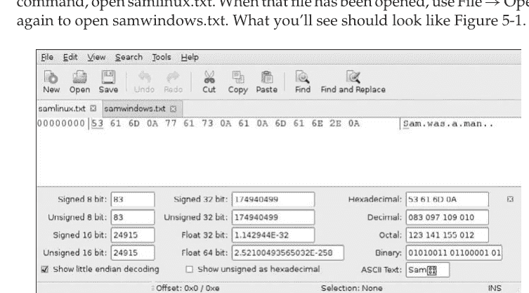

**图 5-1：** 使用 Bless 十六进制编辑器显示 Linux 文本文件

我在这里垂直缩短了显示窗格，只是为了在印刷页面上节省空间；毕竟，文件本身只有大约 15 字节长。每个打开的文件在显示窗格中都有一个标签页，你可以通过点击标签页在文件之间即时切换。


显示窗格分为三个部分。左列是偏移列。它包含文件中第一字节相对于文件开头的偏移量，显示在中心列的相应行中。偏移量以十六进制给出。如果你在文件开头，偏移列将是`00000000`。中心列是十六进制显示列。它以十六进制格式显示文件中的一行数据字节。显示多少字节取决于你如何调整 Bless 窗口的大小以及你使用的屏幕分辨率。显示的最小字节数（有点奇怪）是十七个。在中心列中，显示始终为十六进制，每个字节之间用空格分隔。右列是同一行数据，其中任何“可见”的文本字符都显示为文本。不可显示的二进制值用句点字符表示。

如果你点击`samwindows.txt`标签页，你会看到另一个文件的相同显示，该文件是使用 Windows 记事本文本编辑器创建的。`samwindows.txt`文件稍长一些，你在中心列中有第二行数据字节。第二行的偏移量是`00000012`。这是第二行中第一个（也是本例中唯一一个）字节的十六进制偏移量。

为什么这两个文件不同？打开一个终端窗口，使用`cat`命令显示两个文件。两种情况的显示将是完全相同的：

```
Sam
was
a
man.
```

图 5-2 显示了 Bless 编辑器显示`samwindows.txt`。仔细查看 Bless 显示的两个文件（或图 5-1 和图 5-2），在继续之前尝试自己找出差异。

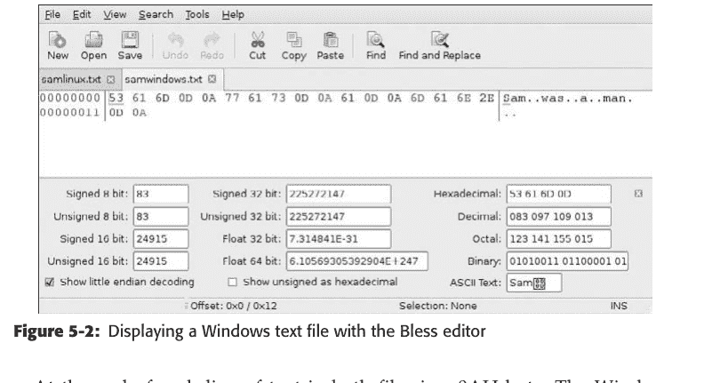

两个文件中每行文本末尾都有一个`0AH`字节。Windows 版本的文件有一点额外的东西：每个`0AH`字节前面都有一个`0DH`字节。Linux 文件缺少`0DH`字节。尽管“纯”文本文件已经相当标准化，但根据创建文件时使用的操作系统，仍可能存在细微差异。按照惯例，Windows 文本文件（以及过去 DOS 时代的文本文件）用两个字符标记每行结尾：`0DH`后跟`0AH`。Linux（以及几乎所有 Unix 衍生操作系统）仅用`0AH`字节标记每行结尾。

正如你在两个文件上使用`cat`所看到的，Linux 对两个版本的显示完全相同且准确。然而，如果你要获取 Linux 版本的文件并将其加载到 Windows 记事本文本编辑器中，你会看到略有不同的内容，如图 5-3 所示。

等等，这不对。让我再检查一下。

更仔细地看文本，我看到“as shown in Figure 5-3.”让我重新阅读：

“正如你在两个文件上使用`cat`所看到的，Linux 对两个版本的显示完全相同且准确。然而，如果你要获取 Linux 版本的文件并将其加载到 Windows 记事本文本编辑器中，你会看到略有不同的内容，如图 5-3 所示。”

我最初误读了“Fiction”，但结合上下文和常见模式，应该是“Figure 5-3”。让我继续。

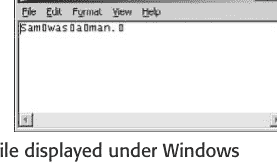

记事本期望在每行末尾同时看到`0DH`和`0AH`，不理解单独的`0AH`值作为行尾（EOL）标记。相反，它在每个`0AH`处插入一个细矩形，就像它对任何不知道如何显示或解释的单个字符所做的那样。并非所有 Windows 软件都这么挑剔。许多或大多数其他 Windows 程序都明白`0AH`是一个完全有效的 EOL 标记。

每行末尾的`0DH`字节是另一个“化石”字符的例子。几十年前，在电传打字机时代，电传打字机中内置了两个独立的电气命令来处理打印文档时文本行的结尾。一个命令将纸张向上索引到下一行，另一个将打印头返回到左边距。这些分别称为*换行*和*回车*。回车编码为`0DH`，换行编码为`0AH`。大多数计算机系统和软件现在忽略回车代码，但少数（如记事本）仍然需要它才能正确显示文本文件。

文本文件标准中的这种小差异对你来说不会是大问题，而且如果你要将文件从 Windows 导入 Linux，你可以手动轻松删除额外的回车字符，或者——多么好的主意！——用汇编语言写一个小程序来帮你做。目前重要的是，你要理解如何将文件加载到 Bless 十六进制编辑器（或你喜欢的任何十六进制编辑器；有很多选择）并在单个字节级别检查文件。

使用 Bless 你可以做的不仅仅是查看。加载文件的编辑可以在中心（二进制）列或右（文本）列中进行。你可以按 Tab 键在两个列之间切换编辑光标。在任一列中，可以使用独立的方向键将光标从一个字节移动到另一个字节。Bless 尊重 Insert 键的状态，你可以根据需要覆盖或插入字节。

我不必说，一旦你对文件做了更改，请点击保存按钮将其保存回磁盘。

**116 第 5 章 ■ 装配的权利**

## 解释原始数据

将文本文件视为一系列十六进制值是计算机基本原理的一个很好的教训：*一切都是由位组成的，位模式的含义是我们共同约定的含义。* Bless 显示的两个文本文件中都以大写字母“S”开头的`53H`是十六进制数。它也是十进制数 83。在最底层，它是八个位的模式：`01010011`。在这个文件中，我们彼此之间约定，位模式`01010011`代表大写的“S”。在可执行二进制文件中，位模式`01010011`可能意味着完全不同的东西，这取决于它在文件中的位置，以及文件中附近存在的其他位模式。

这就是 Bless 十六进制编辑器底部窗格存在的原因。它取光标处开始的字节序列，向你展示这些字节可能的所有各种解释方式。记住，在 Bless 这样的十六进制编辑器中，你不会总是在查看文本文件。你可能正在检查你写的程序生成的数据文件，而该数据文件可能代表一系列 32 位有符号整数；或一系列无符号 16 位整数；或一系列 64 位浮点数；或上述任何或全部的混合。你在中心窗格中看到的只是一系列十六进制值。这些值代表什么取决于什么程序将这些值写入文件，以及这些值在“真实”世界中代表什么。它们是金额？测量值？某种仪器生成的数据点？这取决于你——以及你使用的软件。文件，就像所有文件一样，只是存储在某个地方的二进制模式序列，我们使用 Bless 将其显示为十六进制值，使其更易于理解和操作。

在中心列的十六进制值列表中移动光标，观察底部窗格中的解释如何变化。注意有些解释只查看一个字节（8 位），其他的两个字节（16 位），或四个字节（32 位），或八个字节（64 位）。在每种情况下，被解释的字节序列从光标开始，向右延伸。例如，光标在文件第一个位置时：

- `53H`可以解释为十进制值 83。
- `53 61H`可以解释为十进制 21345。
- `53 61 6D 0AH`可以解释为十进制 1398893834。
- `53 61 6D 0A 77 61 73 0AH`可以解释为浮点数`4.54365038640977<sup>93</sup>`。

（有符号值和无符号值之间的区别将在本书后面讨论。）重要的是要理解，在所有情况下，都是完全相同的字节序列，处于文件中完全相同的位文件。变化的只是我们要查看多少字节，以及我们希望这串字节表示什么类型的值。

这一点在我们开始编写处理数字的程序时可能会更加清晰。说到数字……

## “字节序”

在 Bless 编辑器底部窗格的左下角有一个标有“Show little endian decoding”的复选框。默认情况下该框未选中，但几乎所有情况下都应该选中它。这个复选框告诉 Bless 是按“大端序”（big endian）还是“小端序”（little endian）来解释字节序列。如果你点击并取消点击该复选框，即使不移动光标，底部窗格中显示的值也会发生巨大变化。当你改变该复选框的状态时，你实际上是在改变 Bless 编辑器将文件中的字节序列解释为某种数字的方式。

回想一下第 4 章，单个字节可以表示 0 到 255 的数字。如果要表示大于 255 的数字，就必须使用多个字节。连续的两个字节可以表示 0 到 65,535 之间的任何数字。然而，一旦使用多个字节来表示数值，*字节的顺序就变得至关重要*。

让我们回到之前加载到 Bless 中的任意一个文件的前两个字节。它们名义上是字母“S”和“a”，但这只是另一种解释。十六进制序列`53 61H`也可以解释为一个数字。`53H`在文件中先出现，`61H`出现在其后（见图 5-1 和 5-2）。因此，作为一个 16 位值来看，这两个字节合起来就是十六进制数`53 61H`。

或者真的是这样吗？有点奇怪的是，事情并不那么简单。见图 5-4。图的左半部分是我们示例文本文件在 Bless 十六进制显示窗格中信息的一小段摘录，只显示了前两个字节及其相对于文件开头的偏移量。右半部分是完全相同的信息，但左右翻转了，就像照镜子一样。这是相同的字节以相同的顺序排列，但我们看到的方式不同。我们最初假设的 16 位十六进制数`53 61H`现在看起来是`61 53H`。

数字变了吗？从计算机的角度来看并没有。变化的只是我们在本书页面上打印它的方式。按照习惯，阅读英文的人从左往右读。Bless 十六进制编辑器显示的布局反映了这一点。但世界上许多其他语言，包括希伯来语和阿拉伯语，都是从右边缘开始向左阅读。阿拉伯程序员的第一反应可能是将这两个字节视为`61 53H`，尤其是当他或她使用为阿拉伯语约定设计的软件、从右向左显示文件内容时。

实际上比这更复杂。西方语言（包括英语）有点“精神分裂”，因为它们从左到右阅读*文本*，但从右到左评估数字列。数字 426 是由四个百、两个十和六个一组成，而不是四个一、两个十和六个百。按照西方的惯例，最不重要的列在右边，列值从右向左递增。最重要的列在最左边。

在计算中，混乱是个坏主意。因此，无论字节序列是从左到右还是从右到左显示，我们都必须就哪个字节表示多字节数字中的最低有效位、哪个表示最高有效位达成一致。在计算机中，我们有两种选择：

- 我们可以约定多字节值的最低有效字节位于最低偏移处，最高有效字节位于最高偏移处。
- 我们可以约定多字节值的最高有效字节位于最低偏移处，最低有效字节位于最高偏移处。

*这两种选择是互斥的。* 计算机必须使用其中一种或另一种；它们不能同时在程序的随意选择下同时使用。此外，这种选择不限于操作系统或特定程序。这个选择直接嵌入到 CPU 的硅片和指令集中。将多字节值的最低有效字节存储在最低偏移处的计算机体系结构称为*小端序*（little endian）。将多字节值的最高有效字节存储在最低偏移处的计算机体系结构称为*大端序*（big endian）。

图 5-5 应该能让这一点更清晰。在大端序系统中，多字节值以*最高*有效字节开头。在小端序系统中，多字节值以*最低*有效字节开头。记住：大端序，大头先；小端序，小头先。

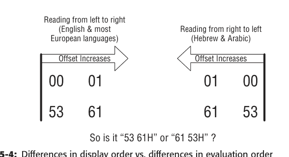

图 5-4：显示顺序的差异与评估顺序的差异

这里存在着*巨大*的差异！我们示例文本文件开头的两个字节，在大端序系统中表示十进制数 21,345，但在小端序系统中表示 24,915。

完全有可能在不知道系统“字节序”的情况下进行相当多的编程。如果你使用 Visual Basic、Delphi 或 C 等高级语言编程，字节序的大部分后果都被语言和语言编译器隐藏了——至少在底层出现问题之前是这样。一旦你开始以字节级别读取文件，你就必须知道如何读取它们；而如果你在用汇编语言编程，你最好先熟悉字节序。

在大端序系统中读取数字数据的十六进制显示很容易，因为数字按西方人预期的顺序出现，最高有效位在左边。在小端序系统中，一切都是反的；用来表示数字的字节越多，就越容易混淆。图 5-6 展示了 32 位值评估中的字节序差异。小端序程序员必须像阅读希伯来语或阿拉伯语一样，从右到左阅读多字节值的十六进制显示。

记住，字节序差异不仅适用于存储在文件中的字节，也适用于存储在内存中的字节。当我（稍后解释）用调试器检查存储在内存中的数值时，所有相同的规则都适用。

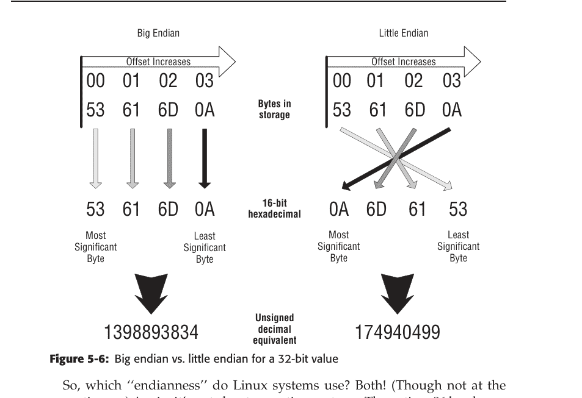

那么，Linux 系统使用哪种“字节序”？两种都用！（虽然不是同时……）再说一遍，这不是操作系统的问题。整个 x86 硬件架构，从低端的 8086 到最新的 Core 2 Quad，都是小端序。其他硬件架构，如摩托罗拉的 68000 和最初的 PowerPC，以及大多数 IBM 大型机架构如 System/370，都是大端序。更新的硬件架构被设计为*双端序*（bi-endian），这意味着它们可以在硬件层面（有一定难度地）配置为以任意一种方式解释数值。Alpha、MIPS 和英特尔的安腾架构都是双端序。

如果（极有可能）你在普通 x86 CPU 上运行 Linux，你就是小端序，应该勾选 Bless 编辑器中标有“Show little endian decoding”的复选框。其他编程工具可能会提供选择大端序显示或小端序显示的选项。确保无论你使用什么工具，都选择了正确的选项。

当然，Linux 可以在*任何*硬件架构上运行，所以使用 Linux 并不能保证你将面对大端序或小端序系统，这也是我在这里详细讨论字节序的原因之一。你必须通过研究系统来了解当前生效的字节序，尽管你可以通过检查来获知：将一个 32 位整数存入内存，然后用调试器或像 Bless 这样的十六进制编辑器查看它。如果你熟悉十六进制（你*最好*熟悉！），系统的字节序会立刻显现出来。

## 文本进，代码出

从宏观上看，所有编程都是文件处理。目标是将一个或多个人类可读的文本文件进行处理，生成一个可执行程序文件，然后可以在你使用的任何操作系统下加载并运行。对于本书来说，这个操作系统是 Linux，但本节描述的一般流程几乎适用于几乎任何操作系统下的几乎所有编程。

编程作为一项流程，因语言和支撑工具集的不同而差异巨大。在 Visual Basic 和 Delphi 等现代图形交互式开发环境中，当你——作为程序员——盯着屏幕上显示的一个或多个文件思考下一步操作时，大量的文件处理都在“幕后”完成。而在汇编语言中，情况并非如此。大多数汇编语言程序员使用简单得多的工具集，并显式地将文件处理作为一系列离散的步骤，从命令行或脚本文件中输入。

无论具体如何实现，将文本文件转换为二进制文件的通用流程本质上都是翻译，而执行这一操作的程序统称为**翻译器**。翻译器是一种接受人类可读源文件并生成某种二进制文件的程序。输出的二进制文件可以是 CPU 能够理解的可执行程序文件，也可以是字体文件、压缩二进制数据文件，或其他上百种二进制文件类型。

**程序翻译器**是生成 CPU 能够理解的机器指令的翻译器。程序翻译器逐行读取源代码文件，并写入一个机器指令的二进制文件，这些机器指令执行源代码文件中描述的计算机操作。这个二进制文件被称为**目标代码**文件。

**编译器**是一种程序翻译器，它读取用 C 或 Pascal 等高级语言编写的源代码文件，输出目标代码文件。

**汇编器**是一种特殊的编译器。它也是一种程序翻译器，读取源代码文件并输出供 CPU 执行的目标代码文件。然而，汇编器是一种专门为翻译我们所谓的**汇编语言**而设计的翻译器。正如 Pascal 或 C++ 语言的编译器将源代码文件编译为目标代码文件一样，我们说汇编器**汇编**汇编语言源代码文件为目标代码文件。两者都是翻译流程，过程相似。然而，汇编语言有一个压倒性的重要特性使其有别于编译器：**对目标代码的完全控制**。

## 汇编语言

有些人将汇编语言定义为一种源代码中一行生成一条机器指令的语言。这从来不是严格正确的，因为汇编语言源代码文件中有些行是对翻译器程序的指令（而非对 CPU 的指令），根本不会生成机器指令。

这里有一个更好的定义：

> 汇编语言是一种允许对翻译器程序生成的每一条机器指令进行完全控制的翻译器语言。这样的翻译器程序称为汇编器。

相反，Pascal 或 C++ 编译器对于给定语言语句将如何翻译成机器指令序列，会做出大量不可见且不可更改的决策。例如，以下单条 Pascal 语句将数值 42 赋给名为`I`的数字变量：

```
I := 42;
```

当 Pascal 编译器读取这一行时，它会输出四五条机器指令，将字面数值 42 存储到由名称`I`编码的内存位置。通常，你——Pascal 程序员——*完全不知道*这四五条指令究竟是什么，也完全无法更改它们，即使你知道一组比编译器使用的序列更快、更高效的机器指令。Pascal 编译器有自己的机器指令生成方式，你别无选择，只能接受它写入目标代码文件的内容，以完成你在源代码文件中编写的 Pascal 语句的工作。

公平地说，现代高级语言编译器通常实现了所谓的**内联汇编**，允许程序员从编译器手中“夺回”控制权，并“嵌入”自己设计的机器指令序列。大量现代汇编语言工作都是以这种方式完成的，但这实际上被认为是一种高级技术，因为你首先必须理解编译器如何生成它自己的代码，然后才能利用内联汇编“做得更好”。（而且不要像许多人那样假设，你能够在不进行*大量*学习和实践的情况下比编译器做得更好！）

汇编器对源代码文件中它生成的每一条机器指令至少能看到一行。通常它看到的行比这更多，额外的行处理各种其他事项，但最终目标代码文件中的*每一条*机器指令都由源代码文件中的对应行控制。

CPU 的众多机器指令中，每一条在汇编语言中都有对应的**助记符**。顾名思义，这些助记符最初是为帮助程序员记住特定的二进制机器指令而设计的。例如，二进制机器指令`9CH`（将标志寄存器压入栈）的助记符是`PUSHF`——这比记住`9CH`要容易得多。

当你在汇编语言中编写源代码文件时，你排列一系列助记符，通常在源代码文本文件中每行一个助记符。源代码文件的一部分可能如下所示：

```
mov eax,4            ; 04H 指定 sys_write 内核调用
mov ebx,1            ; 01H 指定 stdout
mov ecx,Message      ; 将显示字符串的起始地址加载到 ECX
mov edx,MessageLength ; 将显示的字符数加载到 EDX
int 80h              ; 发起内核调用
```

在这里，左边距的`MOV`之类的词就是助记符。每个助记符右侧紧挨着的数字和文本项是该助记符的**操作数**。不同的机器指令有各种类型的操作数，有些指令（如前面提到的`PUSHF`）完全不使用操作数。

助记符及其操作数合在一起称为**指令**。（分号右侧的词是注释，不属于指令的一部分。）这是本书中我将最常用的词，用来表示 CPU 纯二进制机器码指令的人类可读代理。要特指二进制代码时，我将始终称其为**机器指令**。

汇编器最重要的工作是从源代码文件读取行，并将机器指令写入目标代码文件（见图 5-7）。

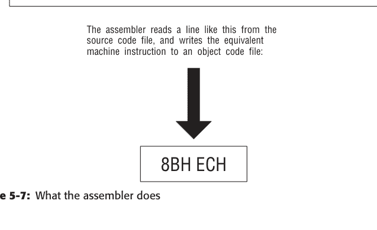

**图 5-7：** 汇编器的功能

## 注释


每条指令右侧是以分号开头的文本。这种文本称为`注释`，其目的应该显而易见：阐明相关汇编语言指令是`做什么用的`。指令`MOV EBX, ESP`将当前栈指针的值放入寄存器`ebx`——但`为什么`？在你编写的汇编语言程序上下文中，这条指令 accomplishing 什么？注释提供的就是“为什么”。

从结构上看，注释从一行中第一个分号开始，向右延伸到该行末尾的`EOL`标记。注释不必与指令在同一行。汇编语言程序中大量有用的描述存在于`注释块`中，这些是纯注释文本的连续行序列。注释块中的每一行都以左边缘的分号开头。

与任何其他编程语言相比，注释对汇编语言程序的成功更为关键。我自己的建议是，源代码文件中的`每一条`指令右侧都应该有注释。此外，每一组以某种方式协同工作的指令前面都应该有一个注释块，从宏观上解释该组指令的功能以及它们如何协同工作。

注释是理解文本文件结构非常重要的一个方面——因为在汇编语言中，注释在行末结束。在 Pascal 和 C 等大多数其他语言中，注释放置在成对的注释定界符如`(*`和`*)`之间，行末的`EOL`标记被忽略。

简而言之：**注释从分号开始，到行末结束。**

## 警惕“只写”源代码！

现在是时候指出汇编语言的一个严重问题了。指令本身极其简略，要完成任何有用的工作都需要`大量`指令。此外，虽然每条指令说明了它做什么，但`没有任何东西`表明该指令运行的上下文。你可以在 Pascal 或 Basic 代码中通过一定的技巧和条理性（以及指向其用途的标识符）构建上下文，但在汇编语言中，你只能通过注释添加上下文。

没有上下文，汇编语言就会变成所谓的“只写”代码。情况可能是这样的：11月1日，在创作的热情中，你写了一个短小的重要工具程序，大约300条指令。1月1日你回去为程序添加功能——却发现`你已经不记得它是如何工作的了`。`individual` 指令都是正确的，程序能够汇编并按预期运行，但关于这一切是如何组合在一起、又是如何工作的知识从高瞻远瞩到在具体工作中以及八周的圣诞假期里逐渐淡忘。

换言之，你`wrote`（写了）它，但再也无法`read`（读懂）或修改它。瞧！这就是只写代码（Write-only code）。

尽管注释确实会占用源代码磁盘文件的空间，但它们`不会`被复制到目标代码文件中，而且包含大量注释的源代码程序运行起来与完全没有注释的程序`完全`一样快。

当你编写汇编语言程序时，你需要投入大量的时间和精力——远比使用“半自动”语言如 C 和 C++ 多得多，更不用提“为你包办一切”的 IDE 如 Delphi、Lazarus 和 Gambas 了。它比几乎所有其他编程方式都更困难；如果你不写注释，最终可能不得不直接丢弃数百行无法理解的代码，然后`从头再来`。

聪明地工作吧。拼命地写注释。

## 目标代码与链接器

汇编器读取你的源代码文件并生成目标代码文件，其中包含 CPU 可以理解的机器指令，以及你在源代码中定义的任何数据。

汇编器完全可以读取源代码文件后直接输出一个完成的、可执行的程序作为其目标代码文件，但这种做法几乎从不采用。本书所教授的汇编器 NASM 可以为 DOS 程序做到这一点，并且可以为实模式扁平模型输出`.COM`可执行文件。更现代的操作系统如 Linux 和 Windows 过于复杂，不适合这样做，而且说实话，除了最初学习编写汇编语言时，这种一步到位的汇编并没有真正的优势。

因此，现代汇编器生成的目标代码文件是介于源代码和可执行程序之间的一种中间步骤。这种中间步骤是一种称为`目标模块`（object module）的二进制文件，或简称为目标代码文件。

目标代码文件本身不能作为程序运行。还需要一个额外的步骤，称为`链接`（linking），才能将目标代码文件转换为可执行程序文件。

目标代码文件作为中间步骤的原因是，一个庞大的源代码文件可能被分割成许多较小的源代码文件，以保持文件在大小和复杂度上的可管理性。汇编器分别汇编各个片段，然后将几个头目个得到的目标代码文件编织成单个可执行程序文件。这个过程如图 5-8 所示。

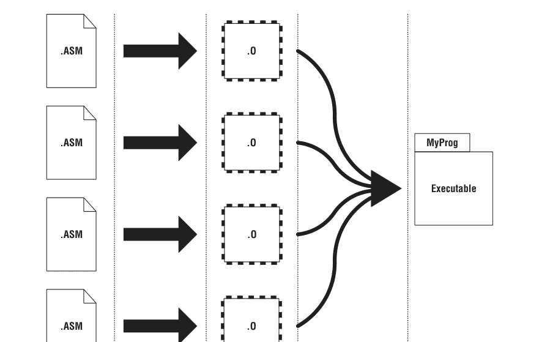

当你最初学习汇编编程时，不太可能编写跨多个源代码文件的程序。这可能让你觉得链接器是多余的，因为你的程序只有一块，没有什么需要链接的。其实不然：链接器的作用不仅仅是将多块目标代码拼接成一块。它确保从一个目标模块发出的函数调用能够到达目标目标模块，并确保所有众多的内存引用确实引用了它们应该引用的地方。汇编器的工作是显而易见的；链接器的工作是微妙的。两者都是生成最终可执行文件的必要条件。

此外，你很快就会开始将程序中经常使用的部分提取到你自己的代码库中。这样做有两个原因：

1. 你可以将经过测试、验证可靠的例程移到单独的库中，并在编写任何可能需要它们的程序时链接进去。这样，你可以复用代码，而不用每次开始新的汇编语言项目时都重复造轮子。
2. 一旦程序的某些部分经过测试并确认正确，就没有必要在组装较新的、未经测试的部分时，一遍又一遍地组装它们。一旦一个大型程序增长到数万行代码（你会比你想象的更快达到这个规模！），你可以通过只组装当前正在处理的部分来节省大量时间，将已完成的部分链接到最终程序中，而无需每次组装`任何`部分时都将`每个`部分重新组装一遍。

链接器的工作很复杂，不容易描述清楚。每个目标模块可能包含以下内容：

- 程序代码，包括命名过程
- 对模块外部命名过程的引用
- 具有预定义值的命名数据对象，如数字和字符串
- 仅为程序以后使用而“预留”的空命名数据对象
- 对模块外部数据对象的引用
- 调试信息
- 其他不太常见的零碎内容，以帮助链接器创建可执行文件

要将多个目标模块处理成单个可执行模块，链接器必须首先构建一个称为`符号表`（symbol table）的索引，其中包含它所链接的每个目标模块中每个命名项的条目，以及关于什么名称（称为`符号`）指向模块内什么位置的信息。符号表完成后，链接器构建操作系统加载时可执行程序在内存中如何排列的映像。然后这个映像被写入磁盘，成为可执行文件。

链接器构建的映像中最重要的一点与地址有关。目标模块可以引用其他目标模块中的符号。在汇编期间，这些`外部引用`被留作稍后填补的空缺——这是很自然的，因为这些外部符号所在的模块可能尚未汇编甚至尚未编写。当链接器构建最终可执行程序文件的映像时，它了解到所有符号在映像中的位置，因此可以将实际地址填入所有外部引用空缺中。

调试信息在某种意义上是一步倒退：源代码的部分内容在早期汇编过程中被全部剥离，然后由汇编器放回目标模块中。这些源代码部分主要是数据项和过程的名称，它们被嵌入目标文件中，以便程序员（你！）在调试程序时能够看到数据项的名称。（我稍后会更深入地讨论这个问题。）调试信息是可选的；也就是说，链接器不需要它来构建正确的可执行文件。在仍在开发程序时，你可以选择将调试信息嵌入目标文件中。一旦程序完成并尽力调试完毕，你再次运行汇编器和链接器，但不请求调试信息。这很重要，因为调试信息可能使可执行文件比平常`hugely`（巨大地）更大，而且通常会稍微慢一些。

## 可重定位性

8080 系统上运行 CP/M-80 等非常早期的计算机系统具有非常简单的内存架构。程序被编写为加载并在特定的物理内存地址运行。对于 CP/M，这个地址是`100H`。程序员可以假设任何程序都从`100H`开始并向上延伸。数据项和过程的内存地址是实际的物理地址，每次程序运行时，其数据项都被加载并在内存中`precisely`（精确地）相同的位置被引用。

随着 8086 和 8086 专用操作系统如 CP/M-86 和 PC DOS 的出现，这一切都改变了。Intel 架构在 8086 中引入的改进使得程序不必针对特定物理地址进行汇编以运行。可执行程序中的所有引用都被指定为相对于程序开头。例如，变量不再可靠地位于内存中的物理地址`02C7H`。相反，它可靠地位于文件开头的偏移量处。这个偏移量始终是相同的；而且因为所有引用都是相对于可执行程序文件开头的，所以程序在运行时放置在物理内存的什么位置并不重要。

这个特性称为`可重定位性`（relocatability），它是任何现代计算机系统的必要组成部分，尤其是在多个程序可能同时运行时。处理可重定位性或许是链接器工作中最大的一部分。幸运的是，它自行完成这项工作，不需要你的任何输入。一旦工作完成、尘埃落定，文件转换工作就完成了，你就得到了可执行程序文件。

## 汇编语言开发过程

如你所见，编写、汇编和测试汇编语言程序的过程中涉及许多不同的文件类型和相当数量的程序。这个过程本身听起来比实际更复杂。

我为你绘制了一张地图，帮助你在本章剩余部分的讨论中保持方向感。图 5-9 以“鸟瞰视角”展示了汇编语言开发过程最常见的形式。乍一看，它可能像是一张洛杉矶高速公路系统地图，但实际上流程相当简单明了，而且你会反复操作，以至于只需几个晚上埋头钻研一两个程序，就能做到轻车熟路。

简而言之，该过程可以归纳为：

1. 在文本编辑器中创建汇编语言源代码文件。
2. 使用汇编器从源代码文件生成目标模块。
3. 使用链接器将目标模块（以及属于该项目的、先前汇编过的任何目标模块）转换为单个可执行程序文件。
4. 运行程序文件进行测试，如有必要可使用调试器。
5. 回到第 1 步的文本编辑器中，修正之前可能犯下的任何错误，并根据需要编写新代码。
6. 重复第 1-5 步，直至完成。

## 工作目录的规范

程序员通常从 0 开始计数，如果我们要计算汇编语言开发过程中的步骤，那么第 0 步就是在你的 Linux PC 上建立一套目录系统，用于管理你在开发过程中创建和处理的文件。

这里有一条规则需要你从一开始就理解并采纳：`一个目录中只存放一个项目`。也就是说，当你想写一个名为 TextCaser 的 Linux 程序时，创建一个名为`TextCaser`的目录，并且该目录中只存放与`TextCaser`项目直接相关的文件。如果你还有一个进行中的项目叫`TabExploder`，给那个项目单独的目录。首先，这是良好的管理实践，而且它能防止你的`makefile`产生混乱。（稍后在介绍`make`和`makefile`时我会详细说明。）

我建议你为汇编开发项目建立一个目录结构，根据我的经验，可以这样安排：在你的 Linux 主目录下创建一个名为`asmwork`的目录（或者起其他合适的描述性名称），然后将各个项目目录作为该总汇编语言目录下的子目录。

顺便说一下，将目录名称设为项目主`.ASM`文件的名称是完全可以的；也就是说，`textcaser`完全可以安然地住在名为`textcaser`的目录中。

此时，如果你还没有下载并解压本书的代码清单归档文件，我建议你赶快去做——本节演示中你将需要用到归档文件中的一个文件。该归档文件名为`asmsbs3e.zip`，可在以下网址获取：

`www.copperwood.com/pub`

或者，也可以在以下网址获取：

`www.junkbox.com/pub`

（我有这两个域名分别在两个不同的互联网托管服务商处，这样至少总有一个会保持在线可用。无论你从哪个网站下载，文件都是相同的。）

解压后，代码清单归档文件会在你选择的任何父目录下创建独立的项目目录。我建议将其解压到你的`asmwork`目录下，或者你最终命名的任何目录。

## 编辑源代码文件

你通过将程序代码输入文本编辑器来开始实际的开发过程。使用`哪个`文本编辑器并不太重要，有几十种可供选择。（我将在下一章推荐一款非常好的编辑器。）唯一需要记住的重要一点是，Microsoft Word 和 OpenOffice Writer 等文字处理程序会在其文档文件中嵌入大量额外的二进制数据，远超过你输入的文本。这些二进制数据控制着行距、字体和字号、页眉页脚，以及许多其他你的汇编器既不需要也不了解的东西。汇编器并不总能很好地忽略这类数据，这可能会在汇编时导致错误。

Ubuntu Linux 预装的文本编辑器`gedit`（可在“应用程序 → 附件”菜单中找到）相当不错，尤其是刚开始时，你还不会为单个程序处理成千上万的代码行。

至于你如何想出要输入的内容，嗯，那是另一个问题，我在第 8 章的很大一部分内容中会加以阐述。你肯定有一堆笔记，可能还有一些伪代码、一些图表，或许还有正式的流程图。这些都可以使用软件工具在屏幕上完成，也可以用铅笔在方格纸上完成。（也许是我老了，但我仍然使用纸笔。）

汇编语言源代码文件几乎总是以`.ASM`文件扩展名保存到磁盘。也就是说，对于一个名为`MyProg`的程序，其汇编语言源代码文件应命名为`MyProg.asm`。

## 汇编源代码文件

如图 5-9 的流程所示，文本编辑器生成一个带有`.ASM`扩展名的源代码文本文件。该文件随后被传递给汇编器程序本身，以转换为目标模块文件。在 Linux 下以及本书重点介绍的 NASM 汇编器中，文件扩展名将是`.O`。

当你从命令行调用汇编器时，你需要提供希望它处理的源代码文件名。Linux 会从磁盘加载汇编器并运行它，汇编器会打开你在命令行中指定的源代码文件。几乎紧接着（特别是对于本书中你将接触的小型学习程序），它会创建一个与源文件同名但带有`.O`文件扩展名的目标文件，然后将那些机器指令和符号信息写入目标模块文件。当汇编器完成并关闭目标模块文件后，它的工作就结束了，随即终止。在现代 PC 上，对于少于 500 行代码的程序，这一切发生在一秒或更短的时间内。

## 汇编器错误

注意：前面几段描述的是`.ASM`文件`正确`时发生的情况。所谓正确，是指文件对于汇编器来说完全可以理解，并且能够被翻译成机器指令而不让汇编器产生困惑。如果汇编器在读取源代码文件的某一行时遇到它无法理解的内容，这段被误解的文本就称为`错误`，汇编器会显示一条`错误信息`。

例如，下面这行汇编语言会让汇编器困惑并提示错误信息：

```asm
mov eax, evx
```

原因很简单：根本不存在`EVX`这种东西。原本想写的`EVX`实际上是“EBX”，即一个 CPU 寄存器的名称。（`V`键就在`B`键旁边，手指误触时你自己未必知道已经打错了。我就干过！）

像这样的打字错误是最容易发现的错误类型。另一些需要花费些功夫才能找到的错误涉及到违反了汇编器的诸多规则——在大多数情况下也就是 CPU 的规则。例如：

```asm
mov ax, ebx
```

这看起来应该是正确的，因为`AX`和`EBX`都是真实的寄存器。但是转念一想，你可能会注意到`AX`是 16 位寄存器，而`EBX`是 32 位寄存器。将 32 位寄存器的内容复制到 16 位寄存器中是不被允许的。

你现在不需要记住这些指令操作数细节；稍后我们查看各个具体指令时会讲到规则。目前，只需理解一些在你看来似乎合理的事情（尤其是作为初学者）可能由于技术原因而违反规则，并被视为错误。

而这些都是简单的错误。还有`非常`、`非常`困难的错误涉及到两条本身各自合法但相互之间不一致的源代码行之间的冲突。这里我不举例了，但我想指出错误可能是真正棘手的、隐藏很深的东西，可能需要花费大量研究和抓破头皮才能找到。托托，我们显然`不在` BASIC 里了……

错误信息因汇编器而异，而且它们可能并不总是像你所希望的那样有帮助。NASM 在遇到“EVX”这个拼写错误时显示的错误信息如下：

```text
testerr.asm:20: symbol 'evx' undefined
```

这相当直白，假设你知道什么是“符号”。而且它告诉你去哪找：20是它发现错误的那一行号。当你试图将32位寄存器加载到16位寄存器时，NASM给出的错误信息远没有那么`helpful`：

```text
testerr.asm:22: invalid combination of opcode and operands
```

这让你知道你对一个操作码及其操作数做了非法的事，但仅此而已。`你`必须知道什么是合法的，什么是非法的，才能真正理解你做错了什么。就像闯红灯一样，不懂法不是借口，而且与地方警察局不同，汇编器会在`每次`都抓到你。

汇编器错误信息并不能免除你理解 CPU 或汇编器规则的责任。

当你第一次坐下来写自己的汇编代码时，这点会变得非常清楚。我希望我警告你的这句话不会太吓到你：对于更晦涩的错误，错误信息可能几乎完全帮不上忙。

你在编写源文件时可能会犯（或者说`会`犯——现实点吧）不止一个错误。这种情况下，汇编器会显示不止一条错误信息，但它不一定会为源文件中存在的`每一个`错误都显示错误信息。在某种程度上，多个错误会让汇编器如此彻底困惑，以至于它无法再分辨对错。虽然汇编器确实是逐行读取和翻译源文件的，但最终汇编语言程序的整体图景是在整个汇编过程中逐步建立的。如果这个图景错误太多，那么最终整个图景会崩塌。

汇编器会终止运行，并打印出大量错误信息。`从第一条开始`，确保你理解了它（做笔记！）然后继续。如果第一条之后的错误讲不通，先修复前一两处错误，然后再汇编一次。

## 回到编辑器

修复错误的方法是将违规的源文件重新加载到你的文本编辑器中，然后开始查找错误。这个循环回取如图 5-9 所示。这很可能是你在这张特定地图上看到最多的高速公路。

汇编器错误信息几乎总是包含行号。将光标移动到该行号，开始寻找虚假和幻想的东西。如果你立即发现了错误，修复它并开始寻找下一个。假设你使用的是 Ubuntu 的 GNOME 图形桌面，同时保持终端窗口和编辑器窗口打开是很有用的，这样你就不必在纸上潦草地写下一列行号，或将编译器的输出重定向到文本文件。使用 19 英寸或更大的显示器，有足够的空间同时显示多个窗口。

（有一种方法可以让 NASM 在汇编过程中将错误信息写入文本文件，这将在下一章中看到。）

## 汇编器警告

尽管汇编器看起来可能是个沉默寡言的家伙，但它有时会在汇编过程中显示`警告信息`。这些警告信息对初学汇编语言的程序员来说是个巨大的谜：它们是不是错误？我应该忽略它们，还是应该摆弄源代码直到它们消失？

唉，没有一个干脆的答案。对此很抱歉。

汇编时警告是汇编器充当经验丰富的顾问，暗示你的源代码中有些东西有点靠不住。这可能不足以让汇编器停止汇编文件，但可能严重到足以让你注意并调查。例如，如果你定义了一个命名标签但在其后没有放任何指令，NASM 会发出警告。这可能不是错误，但很可能是你的疏忽，你应该仔细看看那一行，试着回忆写它的时候在想什么。（这可能并不总是容易的，尤其当你写那行已经是凌晨三点或三周以后了。）

如果你是初学者，做着普通的、完全照本宣科的事情，你应该翻开汇编器参考手册，弄清楚为什么汇编器在对你啧啧摇头。忽略警告`可能`会导致程序测试后期出现奇怪的 bug。或者，忽略警告信息可能完全没有不良后果。然而，我总觉得最好知道发生了什么。遵循这条规则：


> *只有在完全知道警告信息含义的情况下，才能忽略汇编器警告信息。*

换句话说，在你理解为什么收到警告信息之前，把它当作错误信息处理。只有当你完全理解它为什么存在以及意味着什么时，才尝试决定是否忽略它。

总结：汇编语言开发过程的第一部分（如图 `FETCH_CODE_5_9` 所示）是一个循环。你必须编辑源文件，汇编它，然后回到编辑器修复错误，直到汇编器不再发现更多错误。*在汇编器给你的源文件开绿灯之前，你不能继续。* 我还建议研究所遇到的任何警告信息，直到完全理解。修复触发警告的条件总是个好主意，尤其是刚开始时。

当不再发现更多错误时，汇编器会将 `.O` 文件写入磁盘，然后你就可以进入下一步了。

## 链接目标代码文件

正如我在本章前面解释过的，链接步骤对新来者来说并不直观且有点神秘，尤其是当你只有一个目标代码模块时。但这仍然至关重要，虽然在远古时期可以直接将简单的 DOS 汇编语言程序汇编成可执行文件而无需链接步骤，但 Linux 和 Windows 等现代操作系统的特性使这成为不可能。

链接步骤显示在图 5-9 的右半部分。右上角是一排 `.O` 文件。这些 `.O` 文件是之前从正确的 `.ASM` 文件汇编而来的，生成包含机器指令和数据对象的目标模块文件。当链接器链接从你的在制 `.ASM` 文件产生的 `.O` 文件时，它会添加先前汇编好的 `.O` 文件。链接器写入磁盘的单个可执行文件包含了链接器被调用时交给它的所有 `.O` 文件中的机器指令和数据项。

一旦在制的 `.ASM` 文件完成并修正无误，它的 `.O` 文件可以和其他文件一起上架，添加到你正在处理的*下一个*在制 `.ASM` 源文件中。就这样，你逐步用一次构建和测试一个的模块来构建你的应用程序。

一个非常重要的额外好处是，某个 `.O` 模块中的一些过程可能会用在未来的、甚至尚未开始的汇编语言程序中。创建这种“工具包”过程库可以通过重用代码来非常有效地节省时间，甚至无需再次通过汇编器！

世界上有众多汇编器（尽管真正好的只有少数），也有大量链接器。Linux 自带自己的链接器

正如我说的，我们不再做 BASIC 了。

与汇编器一样，调用链接器也是从 Linux 终端命令行进行的。链接多个文件需要在命令行上命名每个文件，以及期望的输出可执行文件名。你还可能需要输入一个或多个命令行开关，给链接器提供额外的指令和指导。初学者几乎不需要关心这些，我会在需要时讨论你用得到的那些。

## 链接器错误

与汇编器一样，链接器在将多个 `.O` 文件编织成单个可执行程序文件时可能会发现问题。链接器错误比汇编器错误更微妙，通常更难发现。幸运的是，它们不那么常见，也不那么容易犯。

与汇编器错误一样，链接器错误是“致命的”；也就是说，它们使生成可执行文件成为不可能；当链接器遇到错误时，它会立即终止。当你遇到链接器错误时，你必须返回编辑器找出问题。一旦确定了问题（或者*认为*已经确定）并在源文件中做了修改来修复，你必须重新汇编然后重新链接程序，看看链接器错误是否消失。直到它消失为止，你必须循环回到编辑器，尝试其他方法，然后再次汇编/链接。

如果可能，避免通过试错来做这件事。阅读你的汇编器和链接器文档。理解你在做什么。你对汇编器和链接器内部发生的事了解得越多，就越容易确定是什么让链接器抓狂。

（提示：几乎总是*你*！）

## 测试 .EXE 文件

如果你没有收到链接器错误，链接器会创建一个包含所有命令行上命名的 `.O` 文件中所有机器指令和数据项的单个可执行文件。可执行文件就是你的程序。你可以通过在终端命令行上命名它并按 `Enter` 来运行它，看看它做什么。

这里 Linux 路径就要派上用场了，不过如果你有相当的 Linux 经验，你已经知道这点。终端窗口是查看你工作目录的纯文本方式，所有熟悉的命令行工具都会对你的工作目录进行操作。但是，记住你的工作目录*不在*你的路径中，除非你明确把它放进去，而且尽管人们对此一直有争论，有不把工作目录放入路径的好理由。

当你从终端窗口命令行执行程序时，你必须通过用 `./` 前缀告诉 Linux 程序在哪里，这简单地表示“在工作目录中”。这不同于 DOS，在 DOS 中当前目录也在可执行程序的搜索路径中。在 Linux 下执行你的程序的命令行调用可能看起来像这样：

```bash
./myprogram
```

这时候*真正的*乐趣才刚刚开始。

## 错误与缺陷

当你以这种方式启动程序时，会发生以下两种情况之一：程序会按你预期的方式工作，或者你会遇到一个或多个程序*缺陷*（bug）的影响。*缺陷*是指程序中任何不按你期望的方式工作的东西。这使得缺陷比错误更具主观性。一个人可能认为蓝底红字是一个缺陷，而另一个人可能认为它是一种巧妙的新时代特性并对此非常满意。解决这类缺陷与特性之间的冲突由你决定。你应该对程序应该做什么以及它是如何工作的有清晰的认识，并以书面规格说明或其他某种形式的文档作为支撑，这就是你判断缺陷的标准。

颜色奇怪的字符只是最轻微的问题。在用汇编语言工作时，*极其*常见的情况是，一个缺陷会导致程序中止执行，而屏幕上几乎没有关于发生了什么的线索。如果你幸运的话，操作系统会惩罚你的可执行程序并显示一条错误信息。这个你会经常看到：

```text
Segmentation Fault
```

这类错误被称为*运行时错误*，以区别于汇编器错误和链接器错误。通常，你的程序不会惹恼操作系统。它只是不会按你期望的方式工作，而且在失败过程中可能也不会显示太多信息。

非常幸运的是，Linux 是一个坚固的操作系统，在设计时就考虑到了有缺陷的程序，因此你的某个程序“把机器搞崩溃”的情况*极其*不可能发生，这在 DOS 时代可是经常发生的。

尽管说了这么多，而且为了遏制巴别塔效应，我认为在这里仔细区分错误和缺陷是很重要的。*错误*是指你的源代码文件中存在某些问题，导致汇编器或链接器认为不可接受并将其踢出。错误会阻止汇编或链接过程完成，从而阻止最终 `.EXE` 文件的产生。

*缺陷*则相反，是在程序*执行*过程中发现的问题。缺陷不会被汇编器或链接器检测到。缺陷可以是良性的，比如屏幕消息中的一个拼写错误的单词或位置错误的一行；或者缺陷可能迫使你的程序提前中止。如果你的程序尝试做某些被禁止的事情，Linux 会终止它并向你呈现一条消息。这些被称为*运行时错误*，但它们实际上是由缺陷引起的。

错误和缺陷都要求你返回文本编辑器并在源代码文件中更改某些内容。不同之处在于，大多数错误都会附带一个行号，指示你应该在源代码文件的哪个位置查找以修复问题。相反，缺陷则留给学生作为练习。你必须自己去追踪它们，而且汇编器和链接器都不会给你太多线索。

## 我们到了吗？

图 5-9 宣布汇编语言开发过程的退出发生在你的程序完美工作时。一个非常严肃的问题是：你怎么知道它完美工作了呢？学习语言时组装的简单程序可能只需一两分钟就能测试完毕；但任何真正有用的程序至少需要*数小时*的测试。一个严肃且雄心勃勃的应用程序可能需要数周甚至数月才能彻底测试。一个接受各种输入值并产生各种输出的程序，应该尽可能用尽可能多的不同输入值组合进行测试，而且每次都应该检查每一个可能的输出。

即便如此，在一个非平凡程序中找到每一个最后的缺陷被一些人认为是不可能实现的理想。也许是这样——但你应该努力尽可能接近这个目标，并以你能做到的最有效的方式。在本书的其余部分，我会有更多关于缺陷和调试的内容要说。

## 调试器与调试

汇编语言开发过程的最后——也几乎肯定是最痛苦的——部分是调试。*调试* 是定位并修正缺陷的系统化过程。*调试器* 是一种专门设计用来帮助你定位和识别缺陷的实用程序。

调试器是所有软件类别中最神秘、最难理解的之一。调试器一部分是 X 光机，一部分是放大镜。调试器会*与*你的程序一起加载到内存中，并保留在内存中，与你的程序并排运行。然后调试器将触须伸入你的程序中，并实现一些真正奇特的事情。

调试计算机程序的一个问题是它们运行得太快了。每秒可以执行数万甚至数十万个机器指令，如果其中某条指令不太对，在你盯着屏幕识别出是哪一条之前，它早就已经消失了。调试器使你能够*一次一条*地执行程序中的机器指令，这使你可以在每条指令之间无限期暂停，以检查上一条指令执行的效果。调试器还使你能够在指令之间的暂停期间，查看分配给你的程序内存块中任何位置的内容，以及存储在任何 CPU 寄存器中的值。

调试器能够做到所有这些神秘的事情，是因为它们是必要的，而且 CPU 在其硅片中内置了特殊功能以使调试器成为可能。它们内部如何工作超出了本书的范围，但这是一件引人入胜的事情，一旦你对 x86 CPU 内部结构感到 comfortable，我鼓励你进一步研究它。

一些调试器能够显示带有机器指令的源代码，这样你就可以看到哪些源代码文本行对应哪些二进制操作码。另一些使你能够通过名称而不是仅仅通过内存地址来定位程序变量。

许多操作系统都自带调试器。DOS 和早期版本的 Windows 自带 `DEBUG`，在本书的早期版本中我详细解释了 `DEBUG`。Linux 有一个非常强大的调试器叫做 `gdb`，我将在下一章介绍它，以及一个用于管理它的单独图形工具。还有许多其他调试器可用，我鼓励你在技能发展过程中尝试它们。

## 组装语言之旅

你可以停止问“我们到了吗？”，其中“那里”意味着“准备好构建一个实际工作的程序”。我们确实已经到了，在本章的其余部分，我们将取一个简单的程序，并通过图 5-9 图形化展示的过程来运行它。

你不必自己编写这个程序。我已经解释了这个过程，但我还没有详细介绍任何机器指令或 CPU 寄存器。我会为你提供一个非常简单的程序，并给予你足够关于其工作原理的解释，使它不至于完全神秘。在后续章节中，我们将详细研究机器指令及其操作。与此同时，你必须理解汇编语言开发过程，否则知道指令如何工作对你毫无帮助。

## 安装软件

关于 Linux 最奇妙的事情之一是可用的软件多得令人眼花缭乱，而且几乎所有都是完全免费的。如果你使用 Linux 有一段时间了，你可能已经遇到过 `OpenOffice`、`Kompozer`、`Gnumeric` 和 `Evolution` 等产品。其中一些在安装操作系统时就已预装。其余的则通过*包管理器*来获取。包管理器是一个驻留在你的 PC 上的目录程序，维护所有可用于 Linux 的免费软件包列表。你选择想要的，包管理器会在线上去下载它们（从称为*仓库*的在线家园），然后为你安装它们。

实际上，Ubuntu Linux 安装了两个包管理器。一个是 `Gnome Application Installer`，这就是你在 `Applications` 菜单中看到的，名为 `Add/Remove`。这个包管理器的优点在于简单，但它没有列出你可能想要的每一个免费软件包。隐藏在 `System → Administration` 菜单中的是 `Synaptic Package Manager`，它（至少在理论上）可以访问任何已提交到已知公共仓库的免费软件产品。我们将使用 `Synaptic Package Manager` 来获取本书示例所需的其余软件。

不用说，你需要活动的互联网连接才能使用 Ubuntu 的包管理器。宽带很有帮助，但我们需要下载的两个包不大，如果你有足够的耐心，通过拨号互联网连接也能传输。

如果你来自 Windows 世界，了解这一点是好的：在 Linux 下，你不必担心软件安装在哪里。几乎所有软件都安装在 `/usr` 目录层次结构中，位于你的文件搜索路径上的某个位置。你可以打开终端窗口并导航到任何目录作为你的工作目录，然后通过命令行命名它来启动已安装的应用程序。

在本章中，我们需要一些东西来快速浏览汇编语言开发过程：编辑器、汇编器、链接器和调试器：

- `gedit` 编辑器随 Ubuntu Linux 预装。
- `NASM` 汇编器需要安装。
- Linux 链接器 `ld` 已预装。
- 调试器情况稍微复杂一些。标准的 Linux 调试器 `Gdb` 已预装。然而，`Gdb` 更像是调试器“引擎”而不是完整的调试器。为了让它真正有用（特别是对初学者），你必须下载一些东西来使其更易于操作，输出更容易理解。这是一个名为 `KDbg` 的程序，它是 Gdb 的“前端”。我将在下一章解释这是如何工作的。现在，请相信我的话。

`Synaptic` 软件包管理器允许你一次选择多个软件包进行安装。打开 `Synaptic`。它会刷新索引几秒钟，然后呈现如图 5-10 所示的窗口。

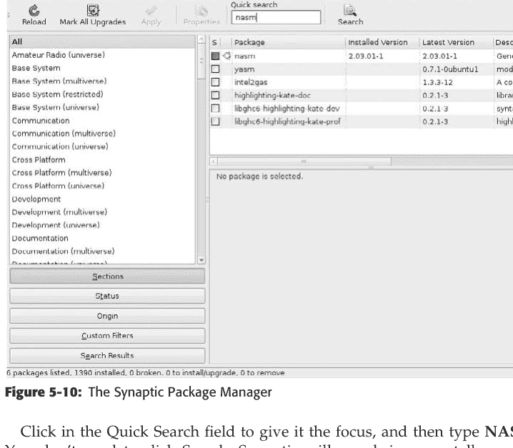

**图 5-10：** Synaptic 软件包管理器

单击“快速搜索”字段使其获得焦点，然后输入 `NASM`。你不需要点击搜索按钮；`Synaptic` 会在你输入时进行增量搜索，并显示任何它认为与输入搜索文本匹配的软件包。`NASM` 应该是显示的第一个项目。在结果窗格的左边缘会有一列复选框。单击 `NASM` 的复选框。会弹出一个确认对话框，从中选择“标记以便安装”。现在，根据 `NASM` 的版本，接下来可能会弹出一个对话框问你“标记额外的必需更改？”这些是实现产品安装所需的额外内容（通常是代码库），所以点击“标记”按钮。一旦你确认了额外的更改，`NASM` 行将变为绿色，表示 `NASM` 已排队等待安装。`NASM` 所依赖的任何文件也会“变绿”。

对 `KDbg` 执行相同的操作。在快速搜索中输入 `KDbg`，并在出现时启用其复选框。它也需要额外的库才能安装，所以当该对话框出现时点击“标记”。

当所有必需的安装行项目都变为“绿色”后，点击窗口顶部的“应用”按钮。会出现一个确认摘要对话框，列出所有要安装的行项目及其占用的硬盘空间。在对话框中点击“应用”，`Synaptic` 就会负责后续工作。在宽带连接上下载像 `NASM` 和 `KDbg` 这样的小型产品不会花很长时间。两个产品都下载到你的电脑后，`Synaptic` 会安装所有内容，当“已应用更改”对话框出现时，你就完成了！

## 步骤 1：在编辑器中编辑程序

Ubuntu 预装了几种文本编辑器，其中最容易理解的可能是 `gedit`。你可以从“应用程序 → 附件”菜单中启动它，在那里它被称为“文本编辑器”。稍后我会介绍 `Kate`，一个功能更强大的编辑器，但暂时先打开 `gedit`。

使用“文件 → 打开”，导航到本书示例代码存档中的 `eatsyscall` 目录。双击该目录中的 `eatsyscall.asm` 文件。`gedit` 将显示该文件，如列表 5-1 所示。通读一遍。你不必完全理解它，但它足够简单，你应该能够大致猜出它的功能。

```
Listing 5-1: eatsyscall.asm

;  Executable name : EATSYSCALL
;  Version         : 1.0
;  Created date    : 1/7/2009
;  Last update     : 1/7/2009
;  Author          : Jeff Duntemann
;  Description     : A simple assembly app for Linux, using NASM 2.05,
;                     demonstrating the use of Linux INT 80H syscalls
;                     to display text.
;
;  Build using these commands:
;  nasm -f elf -g -F stabs eatsyscall.asm
;  ld -o eatsyscall eatsyscall.o
;

SECTION .data          ; Section containing initialized data
EatMsg: db "Eat at Joe's!",10
EatLen: equ $-EatMsg
```

列表 5-1：`eatsyscall.asm`（续）

```
SECTION .bss          ; Section containing uninitialized data
SECTION .text          ; Section containing code

global _start          ; Linker needs this to find the entry point!

_start:
    nop                 ; This no-op keeps gdb happy (see text)
    mov eax,4           ; Specify sys_write syscall
    mov ebx,1           ; Specify File Descriptor 1: Standard Output
    mov ecx,EatMsg      ; Pass offset of the message
    mov edx,EatLen      ; Pass the length of the message
    int 80H             ; Make syscall to output the text to stdout

    mov eax,1           ; Specify Exit syscall
    mov ebx,0           ; Return a code of zero
    int 80H             ; Make syscall to terminate the program
```

到了这里，如果你愿意，可以修改源代码文件，但暂时只需通读一遍。它属于一种称为“Hello world!”的演示程序，仅仅在终端窗口中显示一行文本。（你得从某处开始！）

## 步骤 2：使用 NASM 汇编程序

`NASM` 汇编器没有非技术人员今天所理解的“用户界面”。它不会弹出窗口，也没有地方让你输入文件名或在复选框中选择选项。`NASM` 仅通过文本工作，你通过终端和 Linux 控制台会话来与之交互。这就像那些旧的 DOS 时代，一切都必须在命令行上输入。

打开一个终端窗口。Ubuntu Linux 有许多不同的终端工具可用。我使用最多的是 `Konsole`，但它们在这里都能用。终端窗口通常以你的主目录作为工作目录打开。一旦你获得了命令提示符，使用 `cd` 命令导航到 `eatsyscall` 项目目录：

```
myname@mymachine:~$ cd asmwork/eatsyscall
```


如果你是 Linux 新手，请确保你在正确的目录中，方法是使用 `ls` 命令检查目录内容。`eatsyscall.asm` 文件至少应该在那里，无论是从本书的示例代码存档中提取的，还是你自己在文本编辑器中输入的。假设 `eatsyscall.asm` 文件存在，通过（仔细地）输入以下命令并按 `Enter` 键来汇编它：

```
nasm -f elf -g -F stabs eatsyscall.asm
```

当 NASM 没有发现任何问题时，它不会说任何话，你只会简单地获得命令提示符回来。这意味着汇编成功了！如果你自己输入了 `eatsyscall.asm` 文件并且输入有误，你可能会得到一个错误。确保文件与列表 5-1 匹配。现在，你在终端中输入的所有那些东西是什么意思？我在图 5-11 中剖析了你刚才输入的命令行。NASM 调用以程序本身的名称开始。后面的所有内容都是控制汇编过程的参数。这里显示的几乎是你刚开始学习汇编语言开发过程时可能需要的所有参数。还有其他用途更神秘的参数，它们全部在 NASM 文档中有总结。让我们依次回顾一下这里使用的参数：

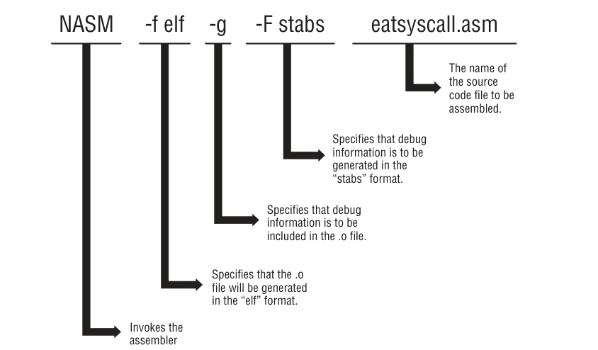

**图 5-11：** NASM 命令行的解剖

`-f elf`: 有相当多有用的目标文件格式，每一种的生成方式都不同。NASM 汇编器能够生成其中的大多数，包括其他格式，如 `bin`、`aout`、`coff` 和 `ELF64`，这些你可能暂时还不需要，至少在一段时间内不需要。`-f` 命令告诉 NASM 对它即将生成的目标代码文件使用哪种格式。在 32 位 IA-32 Linux 工作中，格式是 `ELF32`，在命令行上可以简单地指定为 `elf`。

`-g`: 当你仍在开发程序时，你希望调试信息嵌入到目标代码文件中，以便可以使用调试器来发现问题。（稍后将介绍如何操作。）`-g` 命令告诉 NASM 在输出文件中包含调试信息。

`-F stabs`: 与输出文件一样，NASM 可以以不同的格式生成调试信息。同样，与输出文件格式一样，如果你在 IA-32 Linux 中工作，在刚开始时你可能将使用 `STABS` 格式作为调试信息。还有一种更强大的调试格式称为 `DWARF`，也可以与 `ELF` 配合使用（明白了吗？），如果你将此命令中的 `"stabs"` 替换为 `"dwarf"`，NASM 将生成 `DWARF` 数据而不是 `STABS` 数据。还要记住 Linux 命令是区分大小写的。`-f` 命令和 `-F` 命令是不同的，所以注意那个 `Shift` 键！

`eatsyscall.asm`: NASM 命令行上的最后一项始终是要汇编的文件名。同样，与 Linux 中的一切一样，文件名是区分大小写的。`EATSYSCALL.ASM` 和 `EatSysCall.asm`（以及所有其他大小写变体）被视为完全不同的文件。

除非你给 NASM 其他指令，否则它会生成一个目标代码文件，并使用源文件名和文件扩展名 `.o` 来命名它。"其他指令"是通过 `-o` 选项给出的。如果你在 NASM 命令行中包含 `-o` 命令，它后面必须跟一个文件名，即你希望 NASM 为生成的目标代码文件指定的名称。例如：

```
nasm -f elf -g -F stabs eatsyscall.asm -o eatdemo.o
```

这里，NASM 将源文件 `eatsyscall.asm` 汇编为目标代码文件 `eatsdemo.o`。

现在，在继续链接步骤之前，使用 `ls` 命令列出工作目录内容来验证目标代码文件是否已创建。`eatsyscall.o` 文件应该在那里。

## 步骤 3：使用 LD 链接程序

到目前为止，一切顺利。现在，你需要使用 Linux 链接器工具 `ld` 来创建可执行程序文件。在确保对象代码文件 `eatsyscall.o` 已存在于你的工作目录后，在终端中输入以下链接命令：

```bash
ld -o eatsyscall eatsyscall.o
```

如果原始程序汇编时没有错误或警告，那么对象文件也应该能够顺利链接。与 NASM 一样，当 `ld` 遇到没有什么值得一提的问题时，它根本不会显示任何信息。在汇编语言的世界里，没有消息就是好消息。

链接的命令行比汇编的更简单，如图 5-12 所示。"`ld`" 运行的是链接器程序本身。`-o` 命令指定一个输出文件名，这里为 `eatsyscall`。在 DOS 和 Windows 世界中，可执行文件几乎总是使用 `.exe` 文件扩展名。而在 Linux 世界中，可执行文件通常完全没有文件扩展名。

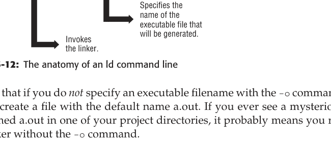

**图 5-12：** `ld` 命令行的结构

注意，如果你*没有*使用 `-o` 命令指定可执行文件名，`ld` 将创建一个默认名为 `a.out` 的文件。如果你在某个项目目录中看到一个名为 `a.out` 的神秘文件，那很可能意味着你运行链接器时遗漏了 `-o` 命令。

在 `ld` 命令行中最后输入的是要链接的对象文件名。本例中只有一个，但一旦你开始在代码库中使用代码（无论是你自己的还是他人编写的），就必须在命令行中输入你正在使用的任何库的名称。输入它们的顺序并不重要，只要确保它们都在那里即可。

## 步骤 4：测试可执行文件

一旦链接器完成了一次无错误的操作，你的成品可执行文件就会在工作目录中等待你。如果汇编器和链接器都没有显示任何错误信息，就说明它是没有错误的。然而，没有错误并不意味着没有 bug。为了确保它能工作，只需在终端命令行中输入它的名称：

```bash
./eatsyscall
```

Linux 新手需要记住，*你的工作目录不会自动位于搜索路径中*，如果你只是在命令行中简单地输入可执行文件的名称（没有加上"工作目录"前缀 `./`），Linux 是找不到它的。但加上前缀后，你的可执行文件就会加载并运行，打印出它的 13 个字符的广告：

```bash
Eat at Joe's!
```

胜利！但先不要把那个终端窗口收起来……

## 步骤 5：在调试器中观察运行

假设你正确地输入了清单 5-1（或从示例档案中解压出来），`eatsyscall.asm` 中是没有 bug 的。这对程序员来说是一种不常见的情况，尤其是对于刚入门的人而言。大多数时候，你需要几乎立即开始寻找 bug。最简单的方法是将你的可执行文件加载到调试器中，这样你就可以单步执行它，在每条机器指令执行后暂停，以查看每条指令对寄存器和内存中定义的任何变量有什么影响。

有两个程序协同工作，为你提供愉快的（好吧，可以忍受的）调试体验：`gdb` 和 `KDbg`。`gdb` 工具负责调试器所做的底层 CPU 魔法，而 `KDbg` 则将一切整齐地安排在屏幕上，并允许你控制它。要启动调试会话，从终端窗口的命令行调用 `KDbg`，后面跟着你的可执行文件名：

```bash
kdbg eatsyscall
```

`KDbg` 远不像 NASM 和 `ld` 那样沉默。它是一个 KDE 应用程序，会弹出一个漂亮的图形窗口，看起来应该与下图非常相似：

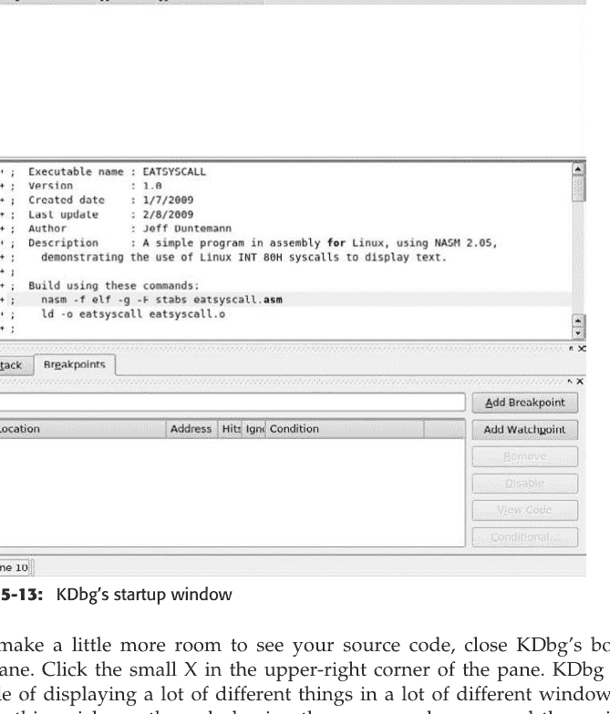

**图 5-13：** `KDbg` 的启动窗口

`eatsyscall` 程序的源代码应该显示在中央窗格中。如果顶部窗格的左上角没有显示 "Register"，请选择 `视图 → 寄存器`，并确保 "寄存器" 项旁边有一个 `X`。


为了让源代码有更多的显示空间，关闭 KDbg 的底部窗格。点击该窗格右上角的小 `X`。`KDbg` 能够在许多不同的窗口中显示许多不同的内容；但对于这个快速演练来说，有源代码窗格和寄存器显示窗格就足够了。打开其他窗口只会让你困惑。

如果你还记得本章前面关于调试器的概述，你需要先告诉调试器最初在哪里停止，然后才能告诉它开始单步执行程序——否则，它们会太快地执行完整个程序，让你无法跟上。你必须设置一个初始断点。做法是向下滚动源代码显示，直到你能看到程序文本左边缘标签 `_start:` 后面的代码。向下移动两行，在源代码窗格左边缘的空白处左键单击，位置在窗口边框和加号符号之间。你单击的地方应该会出现一个红点。这个红点表示你已经在该代码行设置了断点，在本例中是 `MOV EAX, 4` 这条指令。（确保你是在这条指令处插入断点，*而不是*在程序中它正上方的 `NOP` 指令处！）

设置好初始断点后，点击顶部工具栏中的 "运行" 按钮。该按钮看起来像一个页面，其左侧有一个向下的箭头。（将鼠标指针悬停在按钮上，应该会显示 "运行"。）基本上瞬间会发生两件事（见图 5-14）：

- 表示断点的红点会被一个指向右侧的绿色三角形覆盖。这个三角形指示程序执行暂停的位置，并指向将要执行的下一条指令。请注意，执行因断点而暂停的那条指令*尚未*执行。

- 之前为空的顶部窗格现在会列出 CPU 寄存器。这是一个相当长的列表，因为它包括了所有的 CPU 标志和浮点处理器寄存器，但本次演示你只需要看到最上面的一组。

此时，通用寄存器都会显示为零。你的程序已经开始运行，但到目前为止唯一执行过的指令是 `NOP` 指令，它执行的是……什么都不做。（它是一个占位符，为什么它会出现在这个程序中，要等到下一章再解释。）

这种情况很快就会改变。要进行第一次单步执行，点击 "按指令步入" 按钮。将鼠标指针悬停在各按钮上，直到找到它。（该按钮在图 5-14 中具有焦点。）正如按钮名称所示，点击该按钮会触发一条机器指令的执行。绿色三角形向下移动一行。

在寄存器窗口中，情况已经不同了。有两行变成了红色。红色表示所显示的值在我们刚刚执行的单步操作中发生了变化。EIP 寄存器是指令指针，它跟踪将要执行的下一条指令。目前更有趣的是 EAX 寄存器的状态。之前的 0x0 现在变成了 0x4。如果你查看源代码，我们刚刚执行的指令是：

```bash
mov eax, 4
```


**图 5-14：** KDbg，准备好单步执行

"MOV" 助记符告诉我们正在移动数据。左操作数是目的地（数据要去的地方），右操作数是来源（数据来自的地方）。发生的事情是，这条指令将值 `4` 放入了 EAX 寄存器。

再次点击 "按指令步入" 按钮。指针会再次下移一行。同样，寄存器窗口中的红色线条表示执行该指令所更改的内容。指令指针再次改变，这不应该令人意外。每次我们执行一条指令，EIP 都会变成红色。这次，EAX 又变回了黑色，而 EBX 变成了红色。EBX 中的值从 `0` 变成了 `1`。（符号 "0x1" 只是告诉我们该值是以十六进制给出的另一种方式。）显然，我们将值 `1` 移入了 EBX 寄存器；而我们刚刚执行的指令是：

```bash
mov ebx,1
```

再次点击按钮。这次，ECX 寄存器会发生剧烈变化（见图 5-15）。你在 PC 上看到 ECX 的精确数值会与我截图时看到的不同。该值取决于具体的 Linux 系统、你有多少内存，以及 Linux 操作系统在内存其他地方正在做什么。重要的是一个 32 位十六进制值已经被移入 ECX。执行这项工作的指令是：

```bash
mov ecx,EatMsg
```

那么，我们实际上移动了什么？如果你临时向上滚动到源代码的前面部分，你会看到 `EatMsg` 是一个由普通字符组成的带引号字符串，内容为 "Eat at Joe's!"，而不是一个 32 位数字；但请注意指令右侧的注释："传递消息的偏移量。" 我们实际加载到 ECX 的不是消息本身，而是消息在内存中的地址。严格来说，在 IA-32 保护模式下，像 `EatMsg` 这样的数据项既有段地址又有偏移地址。然而，段地址是操作系统的属性，在进行这类简单的用户空间编程时，我们可以安全地忽略它。回到 DOS 时代，当我们不得不使用实模式分段内存模型时，我们还必须跟踪段寄存器；而使用保护模式的方式意味着少了一个麻烦。（别担心，还有更多麻烦！）

再次点击 "按指令步入"，EDX 寄存器将被赋予值 `0xe`，即十进制的 `14`。这是字符串 `EatMsg` 的长度。

此时，关于移动各种值到它们需要去的地方的所有准备工作已经完成。点击按钮并执行下一条指令：

```bash
int 80H
```

看起来好像什么都没发生——寄存器窗口中没有任何变化——但请稍等。进入 KDbg 的菜单，选择 `视图 → 输出`。一个简单的终端窗口将会出现——里面有 `EatMsg`，告诉全世界该去哪里吃午餐（见图 5-16）。

**图 5-15：** 将内存地址移入寄存器

**图 5-16：** 终端窗口中的程序输出

`int 80H` 指令是一条特殊指令。它生成一个 Linux 系统调用（亲切地称为 *syscall*），名为 `sys_write`，该调用将数据发送到当前活动的终端窗口。

将 `EatMsg` 发送到输出窗口是 `eatsyscall` 程序设计的全部功能。它的工作完成后，程序中的最后三条指令基本上就是整理并退出。点击单步执行按钮，逐步执行这些指令，观察 `EAX` 和 `EBX` 在最后的 `INT 80h` 之前接收新值，`INT 80h` 向 Linux 发出信号表示该程序已结束。你会在 KDbg 窗口的底行得到确认，显示 *"Program exited normally"*（程序正常退出），以及此退出发生的源代码行。

你可能想到的一个问题是：为什么单步执行按钮叫做 *"Step Into By Instruction"*（逐步进入指令）？我们只是跳到了下一行；并没有逐步*进入*任何东西。完整答案要等到几章之后，等我们讲到过程（procedures）时才能解释，但要点是这样的：KDbg 允许你选择在汇编语言过程中逐步跟踪执行，或者让计算机以全速执行过程。`Step Into By Instruction` 按钮指定逐步执行过程。`Step Over By Instruction` 按钮（右侧的下一个按钮）允许过程以全速执行，并在过程调用的另一侧恢复单步执行。

为什么要跳过过程调用？主要是：过程通常是库过程，可能是你或别人在几个月或几年前编写的。如果它们已经调试完毕并正常工作，逐步执行它们可能浪费时间。（不过，通过逐条指令观察其运行，你可以学到很多关于过程如何工作的知识。）

相反，如果过程对于当前程序是新的，你可能需要像逐步执行主程序一样仔细地逐步执行它们。KDbg 为你提供了选择。这个简单程序没有过程，所以 `Step Into` 和 `Step Over` 按钮做的事情完全相同：按顺序执行下一条指令。

`Step Into By Instruction` 左侧的三个单步执行按钮用于调试 C 等高级语言代码。它们允许每次执行一条高级*语句*，而不是简单地每次执行一条机器指令。这些按钮不适用于汇编语言编程，我不会进一步讨论它们。

## 准备好认真起来了吗？

我在本章中讲得很慢；如果你不耐烦，现在可能在抱怨了。请耐心一点。我想确保你*非常*清楚地理解汇编语言编程过程的各个步骤。本书到目前为止的一切都是概念性基础工作，但到了这一点，必要的基础已经打好。是时候拿出一些严肃的工具，从程序员的角度了解 Linux 操作系统，并开始编写一些程序了。

## 一个可以立足的地方，以及工具的使用权限

### Linux 操作系统与塑造你工作方式的工具

阿基米德，这位原始工程师，有一句名言："给我一个足够长的杠杆，和一个可以立足的地方，我就能撬动地球。"这位老先生不太喜欢用比喻，他说的是长杠杆的机械优势的字面意思，但在他的话背后有一个关于工作的更广泛的真理：要完成某件事，你需要一个工作的地方，以及使用工具的权限。我地下室里的无线电工作台就是这样设置的：一个宽大的平面空间来放置故障的发射机，上方有一个架子，示波器、VTVM、频率计、信号发生器、信号追踪器和 `dip` 计都在触手可及的地方。对面的墙上，只需两步之遥，是一排长长的架子，我存放着零件（包括我传奇的电子管收藏）、原材料如金属板、电路板料和废料塑料，以及不常使用的设备。

在某些方面，操作系统是你在完成计算工作时的立足之地。你需要的所有工具都应该在触手可及的地方，并且应该有一种标准、易于理解的方式来访问它们。数据的存储应该"近在咫尺"，并且易于浏览和搜索。Linux 操作系统在这方面几乎无可匹敌，在当今的桌面计算世界中更是如此。

像 DOS 这样的古老操作系统以有限的方式给了我们"立足之地"。DOS 提供了对磁盘存储的访问，以及加载和运行软件的标准方式，除此之外不太多。工具集很小，但这是一个好的开始，而且在 6MHz 8088 机器上我们只能做到这么多。

在某些方面，关于 DOS 最有趣的事情是，它是作为一个"简化版"的更强大的操作系统创建的，那个操作系统就是 Unix，由 AT&T 的研究实验室在 1960 年代和 1970 年代开发。在 IBM PC 出现时，Unix 只能在大型且昂贵的主机计算机上运行。PC 没有足够的原始计算能力来运行 Unix 本身，但 DOS 创建时采用了与 Unix 文件系统非常相似的分层文件系统，并且其命令行提供了对一组工具的访问，这些工具的工作方式与 Unix 工具非常相似。

x86 PC 在多年中成长起来，到 1990 年左右，Intel 的 CPU 已经强大到可以运行基于 Unix 的操作系统。PC 长大了，Unix "缩小了"，直到两者在中间相遇。1991 年，年轻的芬兰程序员 Linus Torvalds 编写了一个 Unix "仿制品"，可以在廉价的基于 386 的 PC 上运行。它基于一个名为 Minix 的 Unix 实现，Minix 于 1980 年代末在荷兰编写，是一个能够在小型计算机上运行的 Unix 仿制品。Torvalds 的 Linux 操作系统最终主导了 Unix 世界。出现了其他桌面版的 Unix 变体，其中最重要的是 BSD（Berkeley Software Distribution）Unix，它催生了几个小型系统实现，并最终成为苹果 Mac OS/X 操作系统的核心。

这就是我们的立足之地，而且是一个很好的立足之地；但在工具访问方面，拥有一个专门为当前工作类型设计的软件工作台也很有帮助。NASM 汇编器功能强大但沉默寡言，并且与命令行密不可分，就像你在 Linux 中找到的大多数古老 Unix 工具一样。在上一章中，我们通过在命令行输入命令的方式，以传统艰难的方式完成了一个简单的开发项目。你需要知道那是如何工作的，但这绝不是我们能做的最好的。


Turbo Pascal for DOS 在 1980 年代的传奇成功，很大程度上是因为它集成了编辑器和编译器，并提供了菜单，可以在编辑器（编写代码）、编译器（将代码编译成可执行文件）和 DOS（运行和测试这些文件）之间轻松快速地切换。用 Turbo Pascal 编程比传统方法更容易掌握和更快，传统方法需要不断从命令行发出命令。

Turbo Pascal 是第一个为程序员提供交互式开发环境（IDE）的真正成功的商业产品。其他产品更早出现（特别是原始的 UCSD p-System），但 Turbo Pascal 让这个想法广为人知。

## Kate 编辑器

有点奇怪的是，在 Linux 汇编语言领域没有真正的 Turbo Pascal 等价物。原因可能对你来说有些奇怪：经验丰富的汇编语言程序员要么创建自己的开发环境（毕竟，他们是编程精英），要么就直接从裸操作系统命令提示符工作。Turbo Pascal 式 IDE 对他们的吸引力可能不如对你那么强。然而，在 C、C++ 和 Python 等高级语言中，正在兴起一股使用 IDE 编程的潮流。我认为汇编语言程序员最终会跟上来的。（两个值得关注的通用 IDE 是 Eclipse 和 KDevelop，尽管目前两者都不常用于汇编语言工作。）

与此同时，我将为你介绍一个简单的 IDE，供你在学习汇编语言时使用。它的优点是简单，对于你在入门阶段编写的小程序，我还没有发现其他类似的东西。它叫 Kate，从 2002 年就开始存在了。作为文本编辑器，Kate 在多个方面都不寻常：

- 它"了解"汇编语言源代码格式约定，会以不同颜色高亮显示汇编源代码的不同元素。
- 通过侧边栏，它不仅包括编辑文本文件的功能，还包括管理文本文件的功能。
- 它在更大的 MDI（多文档界面）显示中集成了终端窗口，你可以在其中启动程序进行测试，并使用调试器进行单步执行和检查内存。
- 它通过 *sessions*（会话）支持项目，会话是你在特定项目工作时 Kate 的"状态"。
- 它作为软件组件可用；通过使用 KDE 的 KParts 技术，它可以内置到你为自己编写的程序中。

Kate 实际上是"大型"IDE KDevelop 和类似 Access 的数据库管理器 Kexi 中使用的编辑组件。虽然 Kate 起源于 KDE 世界并依赖 Qt 代码库，但它在基于 GNOME 的 Ubuntu Linux 发行版中可以毫无困难地安装和运行。

## 安装 Kate

如果你使用 Ubuntu Linux，Kate 最容易从 应用程序 → 添加/删除 菜单项安装。在搜索字段中输入 "`kate`" 即可。

## 启动 Kate

安装完成后，可以从 Ubuntu 的“应用程序”菜单中启动 Kate，它位于“附件”分组下。如果你习惯将图标放在桌面顶部面板中，也可以将 Kate 的图标放置在那里。操作方法如下：展开“应用程序 → 附件 → Kate”菜单项，但在左键点击 Kate 项目打开之前，改为右键点击该项目。此时会弹出一个上下文菜单，其中最顶部的项目是"将此启动器添加到面板"。右键点击该菜单项，Kate 的图标就会被放置到顶部面板中。参见图 6-1，我已经将图标放入面板中，这样你可以看到它的位置：就在"帮助"按钮的右侧。


**图 6-1：** 将 Kate 的图标放置在面板中

如果你更喜欢桌面图标而不是面板图标，同一上下文菜单中也提供了可以将 Kate 的启动器图标放置到桌面的选项。将其放置在哪里由你决定。

有一件事我*不*建议做，那就是从终端命令行启动 Kate。这样做虽然可行，但终端会在 Kate 运行期间显示关于 Kate 程序本身的调试信息。这是否算作一个 bug 还是特性，因人而异，但终端窗口中的所有活动都会分散你的注意力，而且与*你*正在处理的项目毫无关系。

首次启动 Kate 时，在看到编辑器界面之前，你会看到一个空的会话选择器对话框（参见图 6-2）。你还没有创建任何会话，因此那里不会列出任何内容。你可以在了解会话是什么以及它们如何工作之后再创建新会话（稍后详细介绍），但现在，点击 `Default Session` 将其高亮显示，然后点击 `Open Session`。Kate 的主窗口将会出现，上面覆盖着"每日提示"窗口。有些人觉得这种"启动提示"对话框很烦人，但在你初次学习 Kate 时，它们可能会有所帮助。如果你不想看到这些提示，取消勾选 `Show Tips on Startups` 复选框即可。

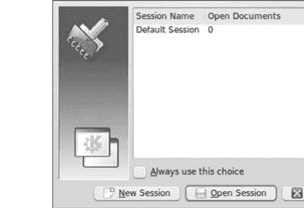

**图 6-2：** 会话选择器对话框

Kate 的默认屏幕布局（参见图 6-3）非常简单。编辑器窗格在右侧，管理器侧边栏在左侧。请注意，如果你在管理器侧边栏的左边缘看不到 `Filesystem Browser` 按钮，或者在底部边缘看不到 `Terminal` 按钮，通常意味着你没有安装 KWrite 编辑器，而 KWrite 会为 Kate 安装几个插件。其中包括 `Terminal` 插件，这对于构建和运行本书中给出的示例至关重要。请确保已安装 KWrite，否则你的 Kate 安装将不完整！

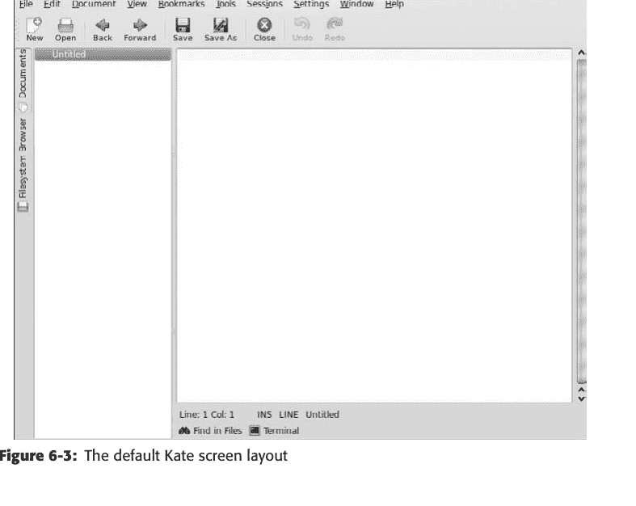

**图 6-3：** Kate 的默认屏幕布局

## 配置

Kate 编辑器支持大量可配置的选项。其中一些比其他更有用，而且说实话，大多数并不真正适用于汇编语言编程。那些适用的选项将使你的编程工作变得更加轻松。以下是在安装 Kate 后你应该设置的选项：

- **编辑器模式：** 选择 `Tools → Mode → Assembler → Intel x86 (NASM)`。这有助于 Kate 识别 NASM 语法。
- **语法高亮：** 选择 `Tools → Highlighting → Assembler → Intel x86 (NASM)`。这使 Kate 能够在编辑器窗口中高亮显示源代码助记符和符号。
- **启用行号显示：** 展开 `View` 菜单，点击标有暂停 `Show Line Numbers` 的复选框。行号显示也可以通过 `F11` 功能键切换开启和关闭。我在程序中通过行号引用特定行，显示行号将使你更容易找到正在讨论的那一行。
- **启用图标边框显示：** 选择 `View → Show Icon Border`。这是书签显示的位置（以星号标记）；如果你打算在文件中使用书签，图标边框必须可见。请注意，你可以随时按 `F6` 切换图标边框的显示与隐藏。
- **启用外部工具：** 选择 `Settings → Configure Kate`，在选项树视图中点击 `Plugins` 行。这将弹出 Kate 的插件管理器对话框（参见图 6-4）。安装 KWrite 后，应该已经启用了三个插件：`Terminal tool view`、`Find in Files tool view` 和 `File system browser`。找到 `External Tools` 并勾选其复选框。
- **启用终端同步：** 在插件对话框中，选择 `Terminal`。只有一个复选框，勾选后，Kate 会将工作目录（如终端窗格中所示）更改为当前打开文件所在的目录。本质上，这意味着每当你打开一个会话时，工作目录都会更改为该会话文件所在的目录。这一点很重要，我在本书其他地方描述 Kate 的操作时，都会假设此选项已被勾选。
- **启用 Kate 文件模板：** 与上一项相同，这也在插件对话框中。找到 `Kate File templates` 项目并勾选复选框。

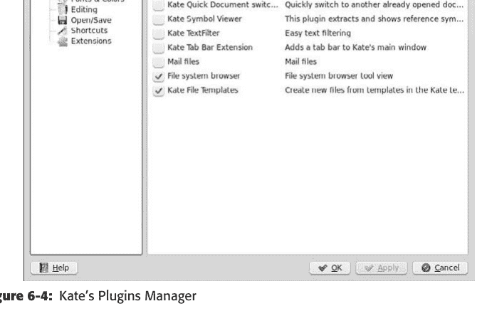

**图 6-4：** Kate 的插件管理器

大多数其他选项要么是对显示的微调，要么是与 C 和 C++ 等高级语言相关的内容。在你探索 Kate 的过程中，可能会发现一些想要自定义的内容，但最初你只需要更改这些设置即可。

## Kate 会话

如果你和大多数程序员一样，通常不会一次只处理一个项目。我总是有五六个项目在进行中，根据时间安排和灵感方向，在这个或那个项目上做些调整。每个项目都有自己的目录，每个项目都有多个文件——对于雄心勃勃的项目，有时多达十个或二十个。当我决定某个项目已经折腾够了，想要转向另一个项目时，我不希望不得不关闭 Kate，将工作目录更改为另一个项目的目录，重新运行 Kate，然后再将相关文件加载到 Kate 中。这是我们过去多年工作的方式，但这一切都比实际需要麻烦得多，尤其是当你的编辑器拥有像 Kate 会话这样的功能时。

*会话*基本上就是项目的当前状态及其所有相关文件和设置，保存在磁盘上。当你想开始处理一个项目时，从磁盘加载其会话文件。砰！所有与项目相关的文件都会出现在侧边栏中，终端窗格也会切换到项目的目录。上次打开的文件会再次打开，光标会停留在你上次工作时离开的位置。

当你关闭会话、更换会话或关闭 Kate 时，Kate 会在加载新会话或关闭自身之前，将当前会话的状态保存到磁盘。你可以在几秒钟内从一个项目切换到另一个项目。

处理会话非常简单。以下部分描述了会话管理的所有常见任务。

### 创建新会话

当你启动 Kate 时，它首先会显示会话选择器对话框（参见图 6-1）。该对话框会列出所有已存在的会话，并提供创建新会话的按钮。如果你要开始一个新项目，点击 `New Session`。Kate 将会打开一个全新的空白会话。

你还可以随时在 Kate 内部创建新会话，方法是选择菜单中的 `Sessions → New`。这些新会话没有名称，在加载文件之前不会作为会话保存。我建议立即为新会话命名。这可以通过选择 `Sessions → Save As` 来完成。会出现一个小对话框，你可以在其中输入会话名称。输入新会话的名称，然后点击 `OK`。

请注意 Linux 文件命名约定。新会话的名称在将文件加载到编辑器之前*不会*显示在窗口标题中。

一旦你有了命名会话，就可以开始打开文件并处理它们。你可以调整 Kate 窗口的大小，窗口大小将作为会话的一个方面被保留，因此如果你的源代码文件由于某种原因宽度不同，你可以调整 Kate 的大小以完整显示源代码的宽度，Kate 会在切换会话时记住窗口尺寸。

### 打开现有会话

与创建新会话一样，打开现有会话也可以在启动 Kate 时完成。会话选择器对话框会显示所有现有的 Kate 会话。高亮选择你想要的会话，然后点击"打开会话"。

也可以从 Kate 的"会话"菜单打开会话。"会话"菜单上有两个选项可以实现：

- `会话 → 打开`：弹出一个对话框，你可以在其中高亮选择一个会话，然后点击其"打开"按钮。
- `会话 → 快速打开`：弹出一个子菜单，列出所有 Kate 会话。选择一个并左键点击即可打开该会话。

没有"关闭会话"选项。你只能加载另一个会话、创建一个新会话，或完全关闭 Kate 来关闭当前会话。如果你想要一个空白会话，必须创建一个新会话，但要注意，除非保存到特定名称，否则新会话不会被 Kate 保留。

### 删除或重命名会话

删除或重命名会话可通过"管理会话"对话框完成，通过选择 `会话 → 管理` 从 Kate 菜单中调用。该对话框显示所有现有会话。点击选择某个特定会话后，你可以点击**重命名**按钮来重命名它，或点击**删除**按钮将其完全删除。

请注意，*删除会话对与会话关联的文件或目录没有任何影响*。删除的只是 Kate 对该会话的记录。你的文件不会受到影响。

另一种重命名会话的方法是选择 `会话 → 另存为`，将当前会话保存到一个新名称下。之后，从"管理会话"对话框中删除原始会话。

## Kate 的文件管理

Kate 可以轻松地将现有文件加载到编辑器窗口中，浏览会话工作目录，创建新文件，重命名文件，并将不需要的文件移到回收站。

文件管理的主要机制是 Kate 窗口左侧的边栏。在没有其他插件使用它的情况下，管理边栏有两个功能：

- 在"文档"视图中，边栏显示与当前会话关联的文档。你可以点击其中一个文档列表行，将文档加载到编辑器窗口中。当"文档"视图中的文件包含未保存的更改时，该文件的条目会显示一个软盘图标。
- 在"文件系统浏览器"视图中，边栏显示会话工作目录中存在哪些文件。

边栏左边距中垂直排列的图标按钮可以让你选择显示哪个视图。图 6-5 显示了"文件系统浏览器"视图中的管理边栏。两个视图之间的区别略微微妙但值得记住："文档"视图显示当前 Kate 会话包含哪些文件。"文件系统浏览器"视图显示*磁盘上*存在哪些文件，即当前会话所描述项目的工作目录中的文件。从"文档"视图中移除文件会将其从会话中移除。从"文件系统浏览器"视图中移除文件会将其从磁盘上删除。不要把两者混淆！

**图 6-5：** 文件系统浏览器

如果你的显示器上有足够的水平空间，可以在文件系统浏览器中显示文件详细信息。默认情况下，Kate 在浏览器中只显示文件名。要显示文件详细信息，在文件系统浏览器中任意位置右键单击。在出现的上下文菜单中，选择 `查看 → 详细视图`。详细视图提供文件的大小、类型以及最后修改的日期和时间。这通常会使管理边栏的宽度增加三倍，但如果工作目录中有很多文件，这会非常方便。

以下各节简要介绍你可以在 Kate 中执行的最重要文件管理任务。

## 文件系统浏览器导航

文件系统浏览器的顶部有一排八个水平排列的小按钮。这些按钮用于在文件夹中导航。以下是从左到右各按钮的功能：

- 蓝色向上箭头：将浏览器移动到当前文件夹的父文件夹。到达根目录时，箭头会变灰。
- 蓝色向左箭头：将浏览器移回上一个操作之前的文件夹。这与网页浏览器和独立文件管理器中的"后退"按钮功能相同。
- 蓝色向右箭头：向前移动到已经访问过的文件夹。这与网页浏览器和独立文件管理器中的"前进"按钮功能相同。
- 房子图标：移动到你的主文件夹。
- 接下来的两个图标控制文件系统浏览器视图中的详细程度。左侧的选择*简短*视图。右侧的选择*详细*视图。
- 金色星形图标：弹出一个子菜单，允许你管理文件夹书签。
- 蓝色双向箭头：返回到当前编辑器中文件所在的文件夹。

## 将文件添加到当前会话

从文件系统浏览器视图中：点击任意文件，它将被加载到编辑器中并添加到会话中。如果你点击的是二进制文件而非文本文件，Kate 会弹出对话框警告你二进制文件无法编辑，并且如果从 Kate 保存到磁盘可能会损坏。（Kate 是文本编辑器，与 Bless 等十六进制编辑器不同，它无法编辑二进制文件。）在你明确关闭添加到会话中的文件之前，它一直会是会话的一部分。

## 从当前会话中移除文件

从文档视图中：右键点击你希望从会话中移除的文件，并从上下文菜单中选择**关闭**。该文件将被移除，但请记住*它不会被删除*——只是从与当前会话关联的文件列表中移除。

## 在编辑器中的会话文件之间切换

从文档视图中：点击你想加载到编辑器中的文件，它将成为正在编辑的文件。切换窗口中当前显示的文件时，先前在编辑窗口中的文件的更改*不会*自动写入磁盘！当你在文档视图中点击文件名时，只是切换窗口中显示的文件。会话中的所有文件都可以处于编辑状态；你只是快速在不同视图之间跳转。你还可以使用主工具栏中的蓝色后退和前进箭头在会话文件之间切换。

## 创建全新文件

点击主工具栏上的**新建**按钮，或从主菜单选择 `文件 → 新建`。一个名为 `Untitled` 的新文件将出现在文档视图中，并成为编辑器窗口中显示的文件。你可以立即开始输入文本，但文件不会保存到磁盘，除非你选择或点击**另存为**并给新文件命名。快捷键：`Ctrl+N`。

## 在磁盘上创建全新文件夹

从文件系统浏览器视图中：在文件列表之外的任意"空白区域"右键单击（即不要右键单击文件的条目），从上下文菜单中选择**新建文件夹**。会出现一个对话框，让你可以输入新文件夹的名称，默认情况下新文件夹创建在当前目录下。

## 从磁盘删除文件（将文件移到回收站）

从文件系统浏览器视图中：高亮选择要删除的文件并右键单击。从上下文菜单中选择**移到回收站**。Kate 会显示确认对话框，以确保你确实要丢弃该文件。点击**回收站**按钮，文件将被移到回收站文件夹。快捷键：`Del`。

## 从磁盘重新加载文件

从主菜单中选择“文件” → “重新加载”。如果你不小心对文件做了修改，想要恢复到上次保存到磁盘时的状态，这个命令会非常有用。该命令会从磁盘将文件重新加载到编辑器窗口中，任何未保存的更改都将丢失。快捷键：**F5**。

## 保存会话文件中所有未保存的更改

从主菜单中选择“文件” → “全部保存”。如果你有任何尚未保存到磁盘的新建文件，Kate 会为新文件弹出“另存为”对话框，让你可以命名并保存它。请注意，虽然 Kate 在你退出程序时会将所有未保存的更改保存到磁盘，但如果在你工作时发生断电，部分或全部未保存的更改可能会丢失。这就是为什么我在主工具栏上添加了一个“全部保存”按钮，以及为什么在长时间工作期间我会不时点击它的原因。（稍后我会解释如何将按钮添加到工具栏。）快捷键：**Ctrl+L**。

## 打印编辑器窗口中的文件

从主菜单中选择“文件” → “打印”。打印对话框将会出现，允许你选择要打印到的打印机，以及进行其他打印设置。快捷键：**Ctrl+P**。

## 将文件导出为 HTML

从主菜单中选择“文件” → “导出为 HTML”。如果你需要将某个源代码文件发布到网上，这个功能会很有用。该命令会弹出一个“另存为”对话框，并将在你输入的名称下创建一个新的 HTML 文件，其中包含编辑器窗口中的当前文件，并添加了源代码格式。其设计意图是，导出的 HTML 文件在网页浏览器中的显示效果将与在 Kate 编辑器窗口中完全一致，包括语法高亮等所有样式。

## 向工具栏添加项目

Kate 的默认工具栏已经包含了你最常用的命令按钮。不过，工具栏是可以自定义的，而且我认为至少有一个按钮应该出现在上面：“全部保存”按钮。只需一次点击，“全部保存”命令就能将当前会话中所有打开文件的未保存更改全部保存到磁盘。每隔几分钟点击一下“全部保存”是个好主意，以防在退出 Kate 或手动保存各个文件之前发生断电。

操作方法如下：选择“设置” → “配置工具栏”。工具栏对话框将会出现（见图 6-6）。在对话框左侧的可用操作列表中向下滚动，直到“全部保存”命令进入视野。单击它以高亮显示，然后点击指向右侧的箭头。“全部保存”命令将移动到对话框右侧的列表中，该列表代表主工具栏上当前的按钮。

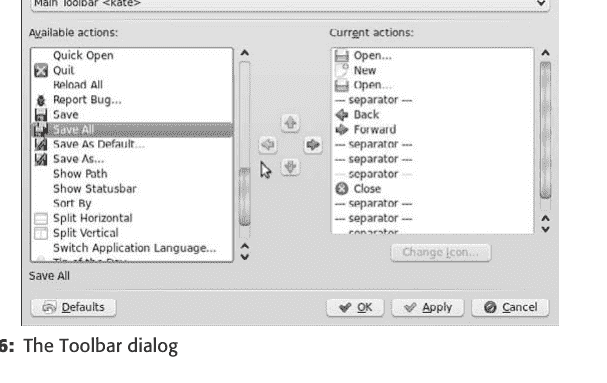

**图 6-6：** 工具栏对话框


默认情况下，“全部保存”将被添加到工具栏按钮列表的底部。如果你希望“全部保存”按钮与“保存”和“另存为”按钮放在一起，请单击“全部保存”按钮项以高亮显示，然后点击向上的箭头，将“全部保存”按钮向上移动到相应位置。

我所使用的 `Kate` 版本有一个特殊之处，就是在撰写本书的过程中：“保存”和“另存为”按钮不会显示在对话框右侧的按钮列表中。要让“全部保存”与它的“拯救兄弟”们团聚，请将它向上移动，直到位于两个小蓝色箭头正下方的分隔线之下为止。然后点击“确定”，你就会在工具栏中看到“全部保存”出现在它应该在的位置。尽早点击，经常点击！

## Kate 的编辑控制

当然，`Kate` 最重要的用途是编辑你的源代码文件。你在 `Kate` 中度过的绝大部分时间都将用于处理源代码，因此尽快记住它的编辑控制会非常有用。当然，没有什么比实际练习更有效的了，但为了入门，以下部分将介绍如何在 `Kate` 中移动光标以及执行基本编辑任务。

### 光标移动

基本的光标移动遵循 PC 类型系统的常规惯例：

- 左右箭头键将光标向左或向右移动一个位置。如果光标位于行的任一极端位置，光标移动将按预期换行到相邻的行。

- `Ctrl+左箭头`将光标向左移动一个单词。`Ctrl+右箭头`将光标向右移动一个单词。两者都在行尾处换行。

- 上下箭头键将光标向上或向下移动一行。

- `Ctrl+上箭头`和`Ctrl+下箭头`在不移动光标的情况下向上或向下滚动*视图*。松开 `Ctrl` 键后，下一次按箭头键将使视图返回到当前光标位置。（这使你能够暂时查看文件的上方或下方内容，而不会丢失你当前的位置，即你当前正在处理的文本位置。）

- `Home` 将光标移动到当前行的左端。但是，如果文本有缩进，光标将只移动到最左侧可见的字符处。

- `Ctrl+Home` 移动到文档的开头。

- `End` 将光标移动到当前行的右端。

- `Ctrl+End` 移动到文档的末尾。

- `Pg Up` 和 `Pg Dn` 分别将光标向上或向下移动窗口当前大小所能显示的行数（例如，如果屏幕尺寸设置为显示 30 行，`Pg Up` 和 `Pg Dn` 将使光标移动 30 行）。

- 你可以通过按 `Ctrl+G` 移动到文件中的特定行。一个页码字段将出现在编辑器窗口的底部。在该字段中输入目标行号并按 `Enter`，即可移动到该行。

### 书签

`Kate` 允许你在文件中设置书签。这是快速导航到文件中重要位置的便捷方式，尤其当你的文件开始达到数百甚至数千行时。例如，我通常会在 `.DATA`、`.BSS` 和 `.TEXT` 段的起始行上设置书签（更多内容将在后续章节中介绍），这样如果我需要添加或编辑预定义的数据项，就可以立即“传送”回 `.DATA` 段，而无需滚动并目视寻找。

设置书签最简单的方法是点击你希望添加书签的行左侧的图标边框。这需要图标边框可见；如果不可见，请按 `F6` 显示它。设置书签后，书签所在行的图标边框会显示一个小的黄色星形图标。

你也可以通过将光标放在要添加书签的行上，然后右键单击该行来设置书签。从上下文菜单中选择“书签” → “设置书签”。任何设置了书签的行都会通过背景色高亮显示。

书签是开关性质的：在图标边框中点击（或按快捷键 `Ctrl+B`）将设置书签；点击书签的金色星形图标或再次按 `Ctrl+B` 将清除该书签。

通过选择“书签” → “清除所有书签”，可以一次性清除单个文件中的所有书签。

要移动到书签，请打开“会话”菜单并执行以下操作之一：

- 在菜单底部的列表中找到你想要的书签并点击它。书签以行号和放置书签时的源代码文本作为标签。

- 选择“上一个”或“下一个”，以从当前光标位置向上或向下移动到下一个书签。

### 选择文本

与任何文本编辑器一样，`Kate` 中可以选择文本以进行删除、通过点击并拖动来移动，或放置到剪贴板上。有几种方法可以选择文本：

- 将鼠标光标放在某个单词上，双击该单词以选中它。

- 将鼠标光标放在任意一行中的任何位置，三击以选中整行。

- 将鼠标光标放在要开始选择的位置，然后按下鼠标左键并拖动鼠标到所需选择的另一端。有趣的是，通过这种方式选择文本会自动将选中的内容复制到剪贴板，但有一个特别之处：以这种方式选中的文本会存储在单独的剪贴板中，并且*只能*通过点击鼠标中键来粘贴到文档中。`Ctrl+V` 或选择“编辑” → “粘贴”无法实现。之前用 `Ctrl+C` 或“编辑” → “复制”选中的文本仍会保留在常规剪贴板上。请注意，在大多数现代鼠标上，鼠标滚轮可以作为中键使用，并且可以像左右键一样点击。通过点击并拖动选择的文本

可以使用常规的编辑命令对其进行操作，例如 `Ctrl+C`、`Ctrl+X` 和 `Ctrl+V`。

通过选择 `Edit → Block Selection Mode`（快捷键：`Ctrl+Shift+B`），您可以选择文本的矩形区域，而不受行长度的影响。当启用 `Block Selection Mode` 时，按住鼠标左键拖动，将以一角为起点，以对角（释放鼠标左键的位置）为终点选择区域。

从键盘上，可以通过在按住 `Shift` 键的同时使用各种导航键来选中文本。光标将正常移动，原始光标位置与新光标位置之间的所有文本都将被选中。

选中的文本可以通过常规方式拖动到文件中的新位置：按住鼠标左键的同时移动鼠标指针。

## 搜索文本

`Kate` 的文本搜索功能通过一个内置对话框运行，称为 *search bar*（搜索栏），在需要时出现在编辑器窗口的底部。搜索栏有两种形式：一种用于简单的增量搜索，另一种用于管理搜索和替换操作。

选择 `Edit → Find` 或按 `Ctrl+F` 可以调出增量搜索栏。默认情况下，出现的搜索栏管理一个简单的增量搜索机制。在 `Find` 字段中输入文本，在您输入文本的同时，`Kate` 会搜索您正在输入的文本的第一个增量匹配项（见图 6-7）。

在图 6-7 中，我输入了 `DoneMsg`，而 `Kate` 在我还在输入时就找到了并高亮了文件中该文本的第一个实例。高亮的文本被选中，可以通过拖动移动，或使用常规编辑命令进行剪切或复制。`Next` 和 `Previous` 按钮分别在当前光标位置之后或之前搜索相同的文本。

搜索栏右侧的 `Options` 菜单可以对搜索过程进行一些细化。如果您选择 `Options → Highlight All`，`Kate` 将按预期选择搜索文本的下一个实例，而且还会用不同的颜色高亮文件中 *所有* 的搜索文本实例。如果您选择 `Options → Match case`，搜索将区分大小写；否则，文本中的大小写差异将被忽略。

增量搜索栏可以通过点击栏左上角红色的关闭按钮来隐藏。

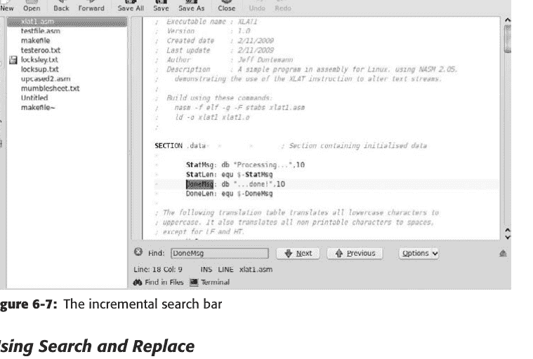

**图 6-7：** 增量搜索栏

### 使用搜索和替换

搜索和替换由第二个搜索栏处理，可以通过选择 `Edit → Replace` 或按 `Ctrl+R` 来调用（见图 6-8）。您在 `Find` 字段中输入文本；与简单搜索一样，`Kate` 会执行增量搜索以找到并选择文件中的第一个实例。如果您在 `Replace` 字段中输入替换文本，当您点击 `Replace` 按钮时，`Kate` 会将 `Find` 字段中的文本替换为 `Replace` 字段中的文本。或者，如果您点击 `Replace All` 按钮，`Kate` 将对整个文件执行搜索和替换操作，将文件中 `Find` 字段中文本的所有实例替换为 `Replace` 字段中的文本。

管理搜索的几个选项以按钮形式显示（在右侧），而不是下拉菜单项。这些选项的工作方式与增量搜索栏中的相同。还有一个额外的选项：如果您勾选 `Selection Only`，搜索和替换操作将仅在选中的文本范围内进行。

搜索和替换栏可以通过点击栏左上角红色的关闭按钮来隐藏。

### 在编程时使用 Kate

至少对于我在本书中提供的程序，`Kate` 将成为我们编辑、汇编、链接、测试和调试代码的"工作台"。换句话说，您可以从 `Applications` 菜单或从桌面或面板启动器运行 `Kate`，然后您所做的其他一切工作都在 `Kate` 内部完成。

这里的"内部"有一个有趣的细节：`Kate` 有自己的内置 Linux 终端窗口，这个终端窗口使我们能够从 `Kate` 内部启动其他工具：特别是 `Make` 实用程序（下一节将详细介绍）和您决定使用的任何调试器。您可以从 Linux 控制台执行的任何操作都可以在 `Kate` 的终端窗口中完成，该窗口默认连接到 Linux 控制台。

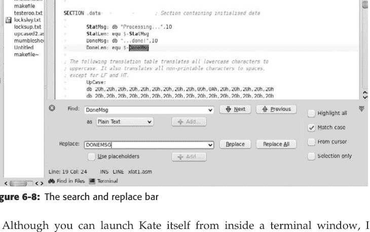

虽然您可以从终端窗口内部启动 `Kate` 本身，但我不建议这样做。当从终端启动时，`Kate` 会不断地向窗口发布与其自身内部机制相关的状态信息。这是为了正在开发 `Kate` 的程序员，但它对 `Kate` 的用户几乎没有价值，而且只是屏幕上的另一个干扰。最好是创建一个桌面或面板启动器图标，并从图标启动 `Kate`。

## 创建和使用项目目录

如本节前面所述，汇编语言项目与 `Kate` 的会话概念完美契合。一个项目应该位于您的汇编语言工作目录下的自己的目录中，而汇编语言工作目录应该位于您的 Ubuntu `Home` 目录下。与项目相关的所有文件（除项目间共享的库文件外）都应保留在该项目的目录中。在本书中，我将您的整体汇编语言工作目录称为 `asmwork`。

我为本书创建的示例代码是一个 ZIP 存档，当您在 `asmwork` 目录中将其解压到硬盘时，它会为每个示例程序创建一个项目目录。要从 `Kate` 首次打开这些"现成的"项目目录，请执行以下操作：

- 启动 `Kate`。

- 当出现 `Session Chooser` 对话框时，点击 `New Session`。

- 点击主工具栏上的 `Open` 按钮，或选择 `File → Open`。使用出现的 `Open File` 对话框，从您的 `Home` 目录开始导航到您想要的项目目录。

- 当显示项目目录中的文件时，打开源代码文件和 `makefile`。您可以通过按住 `Ctrl` 的同时单击所有要打开的文件来一次完成此操作。所有选中的文件都会高亮显示。然后点击对话框的 `Open` 按钮以全部打开它们。

- 当所有打开的文件都显示在 `Kate` 侧边栏的 `Documents` 视图中时，用一个描述性的名称保存新会话。这可以通过选择 `Sessions → Save As` 并在出现的 `Session Name` 对话框中输入新会话的名称来完成。点击 `OK`，您就有了该项目目录的新 `Kate` 会话。

当您想创建一个尚不存在目录的全新项目时，请执行以下操作：

- 启动 `Kate`。

- 当出现 `Session Chooser` 对话框时，点击 `New Session`。

- 点击 `Filesystem Browser` 按钮以显示 `Filesystem Browser` 视图。

- 使用 `Filesystem Browser` 导航到您的汇编语言工作目录（例如 `asmwork`）。

- 在 `Filesystem Browser` 视图中任意位置右键单击，然后从上下文菜单中选择 `New Folder`。输入新目录的名称并点击 `OK`。

- 按照步骤 5 中描述的方式，用新名称保存新会话。

此时，您可以开始为新项目输入源代码文本。不要忘记通过点击 `Save All` 定期保存它。

`Kate` 的终端窗口默认不显示。您可以通过点击 `Kate` 窗口底部边缘的 `Terminal` 图标来显示它。请注意，在您从 `Kate` 至少保存一个文档到该目录之前，终端不会显示您刚刚创建的全新项目目录。`Kate` 将终端同步到编辑器窗口中显示的文档的位置，直到编辑器窗口中有已保存到目录树中特定位置的文档，终端窗口才有"去处"。

一旦您有了项目目录并开始从 `Kate` 向该目录保存文件，您的工作流程将大致如下：

- 在 `Kate` 的编辑器窗口中输入和修改源代码文件和 `makefile`。将所有更改保存到磁盘。

- 通过点击终端窗口使其获得焦点，然后在终端命令行输入 `make` 命令来构建您的项目。假设您已为项目创建了 `makefile`，`Make` 实用程序将启动 `NASM` 和链接器，并显示构建过程中出现的任何错误。（关于 `Make` 的更多内容将在本章后面介绍。）

- 通过确保终端窗口具有焦点，然后输入 `./myprog` 来测试 `Make` 构建的可执行文件，其中 `myprog` 是您要测试的可执行文件的名称。

- 如果您想在调试器中观察程序的运行，请确保终端窗口具有焦点，然后输入调试器的名称，后接可执行文件的名称——例如 `insight myprog`。调试器将出现，加载了您的程序并准备就绪供观察。调试完成后，退出调试器以返回 `Kate`。

- 通过点击编辑器窗口使其获得焦点，返回编辑器，继续处理您的源文件。

## 焦点！

焦点所在位置的问题在您刚开始使用 `Kate` 时可能会让您困惑。在任何像 GNOME 或 KDE 这样的现代窗口环境中，焦点基本上是接收您键入的按键的屏幕组件。大多数时候，您会在 `Kate` 的编辑器窗口中输入，因为在编辑时编辑器窗口具有焦点。如果您不将焦点显式移到终端，您最终会在源代码文件中输入 `make` 或其他 Linux 命令——而如果您没有注意到自己正在这样做（在软件创作的紧张中很容易忘记），下次尝试汇编项目时，您可能会发现 `NASM` 在错误信息中指出了这些文本。

判断终端窗口是否具有焦点很容易：如果终端的块光标是空心框，则焦点在其他地方。如果终端的块光标是实心框，则终端具有焦点。

## Linux 与终端

Unix 用户当时不愿承认，但 Unix 刚诞生时，它确实是一种像 IBM 那样的**大型机操作系统**，并通过分时技术支持多个用户同时使用。每个用户通过独立的、单独的外部终端与中央计算机通信，尤其是数字设备公司（Digital Equipment Corporation，DEC）的 VT 系列终端。

这些终端*并不*显示自 1995 年左右以来已成为主流的图形桌面。它们是纯文本设备，通常显示 80 列、25 行的字符，没有图标或窗口。某些应用程序使用全屏界面，显示带编号的菜单和供数据输入的填写字段。绝大多数 Unix 软件工具，尤其是程序员使用的那些，都是通过命令行控制的，并返回从底部向上滚动的输出。

Linux 的工作方式相同。最简单地说，Linux*就是*Unix。Linux 不使用像 1970 年代 DEC VT100 那样的外部"哑终端"，但类 DEC 的面向终端的软件机制仍然存在于 Linux 内部并且仍在运行，其形式就是**终端模拟**。

## Linux 控制台

Linux 及其他 Unix 实现（如 BSD）有数量众多的终端模拟器程序。Ubuntu 自带了一个名为 *GNOME 终端* 的程序，你也可以从 应用程序 → 添加/删除 菜单项下载并安装许多其他的。我在本书的讲解中使用并普遍推荐的是 **Konsole**。如果你还没有安装，请安装它。

在 Linux 下打开终端模拟器程序时，你会看到一个带有闪烁光标的文本命令行，很像老式的 DOS 命令行或 Windows 中的命令提示符工具。终端程序尽其所能地模仿 Unix 第一纪元（First Age of Unix）的那些老式 DEC 阴极射线管（CRT）串行终端。默认情况下，终端模拟器程序使用 PC 的键盘和显示器作为其输入和输出。它所连接的是一个特殊的 Linux 设备，名为 `/dev/console`，这是一个预定义的设备，用于与 Linux 系统本身进行通信。

记住一点很有用：终端程序仅仅是一个程序，你可以在你的 Linux 机器上安装几种不同的终端程序，并且同时运行多个实例。然而，Linux 控制台*只有*一个，我指的是名为 `/dev/console` 的设备，它将命令传送给 Linux 系统并返回系统的响应。默认情况下，终端模拟器程序在启动时连接到 `/dev/console`。如果你愿意，还可以使用 Linux 终端模拟器通过网络连接到其他设备，不过其工作原理和操作方法超出了本书的范围。

与 Linux 程序通信最简单的方式是通过终端模拟器，比如 `Konsole` 程序——也就是我在本书中将提到的程序。终端模拟器的替代方案是为某种窗口系统编写程序。描述 Linux 桌面管理器及其下运作的 X Window 系统本身就需要一整本书（或几本），而且涉及层层复杂性，这些与汇编语言实际上毫无关系。因此，本书中的示例程序严格从终端模拟器的命令行运行。

## Konsole 中的字符编码

终端模拟器程序没有太多需要配置的，至少在刚接触汇编语言时是如此。不过，对于本书中的示例程序来说，有一件事确实很关键，那就是**字符编码**。终端模拟器必须将字符显示在其窗口中，其中一个可配置的选项与哪些字形（glyph）对应哪个 8 位字符码有关。

请注意，这与字体没有直接关系。**字形**是一种特定的、可识别的符号，例如字母 "A" 或 @ 符号。该符号以何种图形方式渲染取决于你使用什么字体。在不同字体中渲染时，某个特定的字形可能更粗或更细，或带有各种小衬线、花饰。你可以用无数种字体显示 "A"，但假设字体不过于花哨（确实存在这样的字体），你仍然可以辨认出某个特定的字形就是 "A"。

**字符编码**将数值映射到特定的字形。在我们熟悉的西方 ASCII 标准中，数值 65 与我们识别为大写 "A" 的字形相关联。在另一种字符编码中，如果该编码是为了渲染完全不同的非罗马字母表（如希伯来文、阿拉伯文或泰文）而创建的，那么数值 65 可能对应完全不同的字形。

本书使用罗马字母表撰写，面向西方及主要为英语的读者，因此我们的终端模拟器对字母使用默认字形即可。然而，ASCII 字符集实际上只能从字符 0 覆盖到字符 127。八位可以表达的最大数值为 256，因此在 ASCII 标准顶端之外还有另外 128 个"高位"字符。对于这些高位 128 字符显示什么字形，并没有强有力的标准， certainly nothing as strong as the ASCII standard for the lower 128 characters（译者注：此句原文有重复，保留原样）。不同的字符编码方案对于高位的 128 个字符包含了许多不同的字形，其中大多数是带修饰符的罗马字符（如变音符号、扬抑符、波浪符、重音符号等）、主要希腊字母，以及数学和逻辑符号。


IBM 在 1981 年发布其最初的 PC 时，包含了多年前为其大型机终端创建的字形，以便在纯文本、无法显示像素图形的终端屏幕上渲染出边框。这些字形事实证明对于划分填空表单和其他内容非常有用。PC 基于 ROM 的字符集最终被称为 `Code Page 437 (CP437)`，其中还包括许多其他符号，例如四种扑克牌花色。

A similar character encoding scheme was later used in IBM's Unix implementation, AIX, and was called `IBM-850`. `IBM-850` includes a subset of the box-draw characters in `CP437`, plus a lot of Roman alphabet characters with modifiers, to enable the correct rendering of text in Western languages other than English.

Linux 终端模拟器默认并不使用 `CP437` 编码方案或 `IBM-850` 方案（因此也不包含其边框字符）。`IBM-850` 编码方案是可用的，但你需要从菜单中选择它。本书后面会需要那些制表符字符，这里正好可以说明如何选择它们。（顺便一提，在撰写本文时，我还没有见过能显示 IBM 原始 `CP437` 字符集的 Linux 终端模拟器，但如果你知道有，请告诉我。）

启动 `Konsole`，点击 设置 → 管理配置项（Manage Profiles）。`Konsole` 自带一个名为 `Shell` 的配置项。在弹出的“管理配置项”对话框中，选择 新建配置项，并给它起个名字，比如 `Shell Box`。在编辑配置项对话框中，选择 高级 标签页，在面板底部找到 编码 下拉框。点击 选择，在弹出的列表中，将鼠标悬停在 西欧 上直到编码列表出现。选择 `IBM850`，然后点击 确定（见图 6-9）。

当 `Shell Box` 配置项生效时，IBM 的边框字符就可以在你的程序中使用了。

## Citrus Three Standard Unix Files

计算机被描述为移动数据的机器，这种看法并不坏。话说回来，理解通过终端模拟器进行程序输入输出的最佳方式是理解 Unix 的一项基本设计原则：**一切都是文件**。

文件可以是磁盘上的数据集合，正如我在第 5 章中详细解释的那样；但更广泛地说，文件是数据路径上的一个端点。当你向文件写入时，你是在沿着一条路径向一个端点发送数据。当你从文件读取时，你是在从一个端点接收数据。数据在文件之间所走的路径可能完全在单台计算机内部，也可能沿着某种网络在计算机之间传输。数据在路径上可能被处理和改变，也可能只是从一个端点移动到另一个端点而不被修改。无论如何，**一切都是文件**，所有文件都被 Unix 内部文件机制或多或少地同等对待。

“一切皆文件”的格言不仅适用于磁盘上的数据集合。你的键盘是一个文件：它是一个产生数据并将其发送到某处的端点。你的显示器是一个文件：它是一个从某处接收数据并将其放到你能看到的地方的端点。Unix 文件不必是文本文件。二进制文件（如 `NASM` 和链接器创建的可执行文件）也以相同方式处理。

表 6-1 列出了 Unix 定义的三个标准文件。程序运行时，这些文件始终对程序保持打开状态。

> **表 6-1：** 三个标准 Unix 文件

| 文件 | C 标识符 | 文件描述符 | 默认指向 |
|---|---|---:|---|
| 标准输入 | `stdin` | 0 | 键盘 |
| 标准输出 | `stdout` | 1 | 显示器 |
| 标准错误 | `stderr` | 2 | 显示器 |

从根本上说，操作系统通过文件描述符来识别文件，文件描述符只是一个数字。前三个数字属于三个标准文件。当你从程序内部打开现有文件或创建新文件时，Linux 会返回一个特定于你已打开或创建的文件的文件描述符值。要操作该文件，你需要调用操作系统并传递你想要处理的文件的文件描述符。表 6-1 还提供了 C 语言世界中标准文件的惯用标识符。例如，当人们提到 `stdout` 时，他们指的是文件描述符 1。

如果你回顾一下清单 5-1，我在第 5 章汇编语言开发过程讲解中展示的那个简短示例程序，你会看到这一行：

```asm
mov ebx,1            ; 指定文件描述符 1：标准输出
```

当我们把那句小口号“Eat at Joe's!”发送到显示器时，我们实际上是在将它写入文件描述符 1，即标准输出。将值改为 2，我们就可以把口号发送到标准错误。它在屏幕上的显示方式不会有任何不同。就数据处理方式而言，标准错误在各方面都与标准输出完全相同。按照惯例，像 `NASM` 这样的程序会将错误消息发送到标准错误，但写入标准错误的文本不会被标记为“错误消息”，也不会以不同的颜色或字符集显示。标准错误和标准输出的存在，使得我们可以将程序的输出与程序的错误以及其他关于程序如何运行、运行什么的相关消息分离开来。

一旦理解了所有 Unix 衍生系统中最有用的基本机制之一：I/O 重定向，这一切就会更加合理。

## I/O 重定向

默认情况下，标准输出指向显示器（通常是终端模拟器窗口），但这只是默认设置。你可以更改来自标准输出的数据流的端点。来自标准输出的数据可以转而发送到磁盘上的文件。文件就是文件；Linux 处理文件间的数据流量的方式相同，因此切换端点并不困难。来自标准输出的数据可以发送到现有文件，也可以发送到程序运行时创建的新文件。

默认情况下，程序的输入来自键盘，但键盘发送的只是文本。这些文本也可以来自另一个文本文件。切换发送到程序的数据源并不比切换其输出目的地更困难。实现这一点的机制称为 `I/O 重定向`，我们将在本书的许多示例程序中使用它。

你可能已经在 Linux 工作中使用过 I/O 重定向，即使你不知道它的名称。所有 Linux 的基本 shell 命令都将其输出发送到标准输出。例如，`ls` 命令将工作目录内容的列表发送到标准输出。你可以通过将 `ls` 发出的文本重定向到 Linux 磁盘文件来捕获该列表。为此，在命令行输入以下命令：

```bash
ls > dircontents.txt
```

如果文件 `dircontents.txt` 尚不存在，则会创建它，`ls` 发出的文本将存储在 `dircontents.txt` 中。然后你可以打印该文件或将其加载到文本编辑器中。

“`>`”符号是两个重定向运算符之一。“`<`”符号则以相反方式工作，将标准输入从键盘重定向到另一个文件，通常是存储在磁盘上的文本文件。与向程序传递键盘命令相比，这更适合为程序提供其将要处理的原始材料。

假设你想编写一个程序，将文件中所有小写文本强制转换为大写字符。（这是一件非常好的叛逆之举，因为大写字符会让一些 Unix 人士抓狂。）你可以编写程序，使其从标准输入获取文本，并将文本发送到标准输出。从编程角度来看，这非常容易做到——事实上我们稍后在书中就会这样做。

你可以通过在键盘上输入一行文本来测试你的程序：

```text
i want live things in their pride to remain.
```

你的程序会处理上述文本行，并将处理后的文本发送到标准输出，在那里它会显示在终端模拟器屏幕上：

```text
I WANT LIVE THINGS IN THEIR PRIDE TO REMAIN.
```

测试成功了：看起来程序内部运行正常。下一步是在一些真实文件上测试 `uppercaser`。你根本不需要更改 `uppercaser` 程序。只需在 shell 提示符下输入：

```bash
uppercaser < santafetrail.txt > vachelshouting.txt
```

借助 I/O 重定向的魔力，你的程序将从名为 `santafetrail.txt` 的磁盘文件中读取所有文本，将小写字符强制转换为大写，然后将大写文本写入磁盘文件 `vachelshouting.txt`。

重定向运算符可以被看作是数据移动方向的箭头。数据从文件 `santafetrail.txt` 中获取并发送到 `uppercaser` 程序；因此符号 `<` 从输入文件指向数据要去的地方。`uppercaser` 程序将数据发送到输出文件 `vachelshouting.txt`，因此重定向运算符从程序名称指向输出文件名称。

从高层来看，发生的情况就像我在图 6-10 中绘制的那样。I/O 重定向充当一种数据开关，将数据流从标准文件引导至你自行选择的指定源文件和目标文件。

## 简单文本过滤器

我们实际上稍后将要创建一个叫 `uppercaser` 的小程序，而它的功能正是：从文本文件读取文本，处理文本，然后将处理后的文本写入输出文件。在程序内部，我们将从标准输入读取并向标准输出写入。这使得程序无需提示用户输入和输出文件名、创建输出文件等。Linux 会为我们完成所有这些工作，从而使编程任务变得简单得多。

以这种方式工作的程序代表了更广泛的 Unix 世界中的一种标准机制，称为 `过滤器`。你已经见过几个了。`NASM` 汇编器本身就是一个过滤器：它接收装满汇编语言源代码的文本文件，进行处理，然后输出装满目标代码和符号信息的二进制文件。Linux 链接器读取一个或多个装满目标代码和符号信息的文件，然后输出一个可执行程序文件。`NASM` 和链接器处理的不只是简单的文本，但这没关系。文件就是文件就是文件，Linux 用于操作文件的机制并不区分文本文件和二进制文件。

过滤器程序并不总是使用 I/O 重定向来定位它们的输入和输出。`NASM` 和大多数链接器从命令行获取它们的源文件名和目标文件名，这是本书后面讨论的一个有用技巧。不过，I/O 重定向使编写简单的文本过滤器程序**大大**简化了。

一旦你掌握了过滤器程序的工作原理，你就会开始理解标准错误文件存在的意义和作用。过滤器程序将输入数据处理为输出数据。在此过程中，它可能需要发布错误消息，或者只是向我们确认它仍在继续工作，没有陷入无限循环。为此，我们需要一个独立于程序输入和输出的通信通道。标准错误提供了这样一个通信通道。你的程序可以通过向标准错误文件写入消息，将文本状态和错误消息发布到终端模拟器显示器，而这一切发生在程序工作、标准输出文件正忙着将程序输出写入磁盘的同时。

标准错误可以像标准输出一样被重定向。例如，如果你想将程序的状态和/或错误消息捕获到名为 `joblog.txt` 的磁盘文件中，你可以这样从终端命令行启动程序：

```bash
uppercaser < santafetrail.txt > vachelshouting.txt 2> joblog.txt
```

这里，`2>` 运算符指定文件描述符 2（如果你还记得的话，这就是标准错误）被重定向到 `joblog.txt`。

如果你将（来自任何来源的）输出重定向到现有的磁盘文件，重定向将会用新数据替换文件中可能已经存在的任何内容，而旧数据将被覆盖并丢失。如果你想将重定向的数据追加到已经包含数据的现有文件末尾，则必须使用 `>>` 追加运算符。

## 使用转义序列进行终端控制

默认情况下，输出到终端模拟器窗口的文本从底部行的左端进入，先前显示的行随着每行新内容在底部的添加而向上滚动。这非常有用，但不够美观，而且在任何诚实的意义上都称不上“用户界面”。在远古时代，Unix 操作系统有许多“全屏”应用程序，它们将数据输入字段和提示写到屏幕的各个角落。当彩色显示终端可用时，文本可以以不同的颜色，在背景设置为白色或其他颜色以与文本形成对比的字段上。

这是怎么做到的呢？像 `VT100` 这样的老式 DEC VT 终端可以通过嵌入到从标准输出或标准错误发送到终端的数据流中的特殊字符序列来控制。这些字符序列被称为`转义序列`，因为它们是普通待显示数据流的“转义”（尽管是临时的）。

VT 终端监控着它们正在显示的数据流，并将转义序列中的字符挑选出来进行单独解释。一个转义序列会被解释为清除显示的命令；另一个转义序列会被解释为从屏幕顶部向下第五行、从左侧起第三十列开始显示下一个字符的命令，等等。

按照一个总体规划来构建程序，这个总体规划是一个简单的文本文件，称为 `makefile`。`makefile`（默认文件名就是 `makefile`）有点像计算机程序，因为它指定了如何完成某事；但与计算机程序不同的是，它并不指定要执行的具体操作顺序。它所做的是指定构建程序的其他部分需要哪些程序片段，通过这样做最终定义了构建最终可执行文件所需的一切。它通过指定一些称为`依赖关系`的规则来实现这一点。

## 依赖关系

在本书的其余部分，我们将看到代码量不超过 250 行的微型小程序。在现实世界中，有用的程序可能需要数千、数万甚至数百万行源代码。管理如此大量的源代码是软件工程中的`核心`问题。以模块化的方式编写程序是处理程序复杂性最古老、最常用的方法。将大型程序切割成更小的块并分别处理这些块，能极大地帮助解决问题。

在大型项目中，一些块会进一步被切割成更小的块，有时各个块会用不止一种编程语言编写。当然，这就带来了额外的挑战：需要知道这些块是如何创建的，以及它们如何组合在一起。为此，你真的需要一份蓝图。

`makefile` 就是这样一份蓝图。

在模块化程序中，每个代码块都是以某种方式创建的，通常是通过使用编译器或汇编器和链接器。编译器、汇编器和链接器接受一个或多个文件，并从中创建新文件。正如你所学到的，汇编器接受一个包含汇编语言源代码的 `.ASM` 文件，并用它来创建可链接的目标代码文件。如果没有源代码文件并进行处理，你就无法创建目标代码文件。目标代码文件的`存在依赖于`源代码文件。

类似地，链接器将多个目标代码文件连接成一个单一的可执行文件。可执行文件的存在依赖于目标代码文件的存在。`makefile` 的内容指定了哪些文件是创建其他文件所必需的，以及完成该创建需要哪些步骤。`Make` 工具会查看 `makefile` 中的规则（依赖关系），并调用它认为必要的任何编译器、汇编器和其他工具来构建最终的可执行文件或库文件。

`Make` 工具有许多不同的版本，并非所有 `makefile` 都能被所有地方的 `Make` 工具理解。不过 Unix `Make` 工具相当标准，而 Linux 自带的 `Make` 工具就是我们这里要讨论的内容。

让我们举一个实际构建简单 Linux 汇编程序的例子。通常，在创建 `makefile` 时，你首先要确定哪些文件是创建可执行程序文件所必需的。可执行文件是在链接步骤中创建的，所以你必须定义的第一个依赖关系是链接器需要哪些文件来创建可执行文件。这个依赖关系本身可以非常简单地表述：

```make
eatsyscall: eatsyscall.o
```

这只是说为了生成可执行文件 `eatsyscall`（在第 5 章中作为清单 5-1 介绍），我们首先需要拥有文件 `eatsyscall.o`。上面的行实际上是一个依赖关系行，按照 `makefile` 中的格式书写。除了最小的程序（比如这个）之外，链接器通常需要链接不止一个 `.o` 文件。所以这可能是最简单的一种依赖关系：一个可执行文件依赖于一个目标代码文件。如果需要链接更多的文件来生成可执行文件，这些文件会被列成一个列表，用空格分隔：

```make
linkbase: linkbase.o linkparse.o linkfile.o
```

这一行告诉我们，可执行文件 `linkbase` 依赖于**三个**目标代码文件，这三个文件都必须存在后，我们才能生成所需的可执行文件。

像这样的行告诉我们需要什么文件，但没有告诉我们如何处理它们。这是蓝图中必不可少的一部分，它在依赖关系行之后的行中处理。这两行是共同工作的。以下是我们简单示例的两行：

```make
eatsyscall: eatsyscall.o
    ld -o eatsyscall eatsyscall.o
```

至少对于 Linux 版本的 `Make` 来说，**第二行必须在行首用单个制表符缩进。**我强调这一点是因为，如果第二行开头缺少制表符，`Make` 会报错误。**使用空格字符缩进是行不通的。**一个典型的“缺少制表符”错误信息（初学者经常看到）如下所示：

```text
Makefile:2: *** missing separator.  Stop.
```

这里，第 2 行开头缺少了一个制表符。

`makefile` 中的这两行合起来应该很容易理解：第一行告诉我们需要什么文件来完成工作。第二行告诉我们如何完成工作——在这种情况下，是使用 `ld` 链接器将 `eatsyscall.o` 链接成可执行文件 `eatsyscall`。

## 当文件是最新的

这么说可能听起来很傻，但一旦一个文件被编译或链接了，它就已经完成了，不需要再做一次……**直到你修改了某个源代码或目标代码文件。**`Make` 工具知道这一点。它能判断是否需要执行编译或链接任务；如果不需要做，`Make` 就会拒绝执行。

`Make` 如何知道是否需要做这项工作？考虑这个依赖关系：

```make
eatsyscall: eatsyscall.o
```

`Make` 看到这个并理解可执行文件 `eatsyscall` 依赖于目标代码文件 `eatsyscall.o`，而且如果没有 `eatsyscall.o`，你就无法生成 `eatsyscall`。它还知道两个文件上次更改的时间，所以如果可执行文件 `eatsyscall` 比 `eatsyscall.o` 更新，那么它推断出对 `eatsyscall.o` 所做的任何更改都已经反映在了 `eatsyscall` 中。（它可以完全确定这一点，因为生成 `eatsyscall` 的唯一方式就是处理 `eatsyscall.o`。）

`Make` 工具非常关注 Linux 时间戳。每当你编辑源代码文件，或生成目标代码文件或可执行文件时，Linux 会将该文件的时间戳更新为更改最终完成的时刻；即使你可能在六个月前创建了原始文件，按照惯例，如果一个文件的时间戳值比另一个文件更晚，那么它就是`更新`的，即使另一个文件只是 10 分钟前创建的。

（如果你不熟悉`时间戳`的概念，它只是操作系统为目录中每个文件在文件系统目录中保存的一个值。文件的更新时间戳会在文件被更改时更新为当前时钟时间。）

当一个文件比它所依赖的所有文件都更新时（根据 `makefile` 中所列的依赖关系），该文件就被称为`最新的`。再次生成它不会带来任何改变，因为所有组件文件中包含的信息都已经反映在依赖文件中了。

## 依赖链


到目前为止，这可能看起来`fuss`了一大堆却没太大用处；但 Make 机制的真正价值开始显现，当一个单一的 makefile 包含*链式*依赖关系时。即使是最简单的 makefile，也会存在依赖于其他依赖关系的依赖关系。我们这个完全微不足道的示例程序在其 makefile 中需要两个依赖语句。

考虑以下依赖语句指定了如何从目标代码（`.o`）文件生成可执行文件：

```makefile
eatsyscall: eatsyscall.o
    ld -o eatsyscall eatsyscall.o
```

这里的要点是，要构建`eatsyscall`文件，你从`eatsyscall.o`开始，并按照第二行中的配方进行处理。好的……那么`eatsyscall.o`从何而来？这需要第二个依赖语句：

```makefile
eatsyscall.o: eatsyscall.asm
    nasm -f elf -g -F stabs eatsyscall.asm
```

这里我们解释，要生成`eatsyscall.o`，我们需要`eatsyscall.asm`；要生成它，我们遵循第二行中的配方。完整的 makefile 只包含这两个依赖关系：

```makefile
eatsyscall: eatsyscall.o
    ld -o eatsyscall eatsyscall.o
eatsyscall.o: eatsyscall.asm
    nasm -f elf -g -F stabs eatsyscall.asm
```

这两个依赖语句定义了从我们的简单汇编语言源代码文件`eatsyscall.asm`生成可执行程序文件所必须采取的两个步骤。然而，从这两个依赖关系来看，所有的麻烦是否值得并不明显。汇编`eatsyscall.asm`几乎要求我们将`eatsyscall.o`链接以创建`eatsyscall`。这两个步骤在几乎所有情况下都是共同进行的。

但是考虑一个真实世界的编程项目，其中有数百个独立的源代码文件。在任何给定的一天，可能只有其中一些文件在编辑器中"架上"并正在被修改。然而，为了构建和测试最终程序，*所有*文件都是必需的。这是否意味着所有的编译步骤和汇编步骤都是必需的？完全不是。

可执行程序是由链接器从一个或多个——通常是*很多*个——目标代码文件编织而成的。如果除了（比如说）两个之外，所有其他目标代码文件都是最新的，就没有理由去编译其他 147 个源代码文件。你只需要编译那两个已经更改的源代码文件，然后将所有 149 个目标代码文件链接到可执行文件中。

当然，挑战在于正确记住*哪*两个文件更改了——并确保*所有*最近对 149 个源代码文件中*任何*一个所做的更改都反映在最终的可执行文件中。这需要大量的记忆，或者查阅笔记，而且当不止一个人在项目上工作时，情况会变得更糟，这在几乎所有的商业软件开发机构中都是典型情况。Make 工具使记住这些变得不必要。Make 会自己弄清楚，只做必须做的事情——不多也不少。

Make 工具会查看 makefile 以及其中列出的所有源代码和目标代码文件的时间戳。如果可执行文件比所有目标代码文件都新，那么什么都不需要做；但如果*任何*目标代码文件比可执行文件新，那么可执行文件就必须重新链接。而且如果有一个或多个源代码文件比可执行文件或其相应的目标代码文件新，那么在进行任何链接之前，必须先进行一些编译或汇编工作。

Make 所做的是从可执行文件开始，寻找从该文件向外延伸的依赖链。可执行文件依赖于一个或多个目标文件，而这些目标文件又依赖于一个或多个源代码文件，Make 沿着各种链向上游走，记录什么比什么新以及需要做什么来使一切恢复正常。然后 Make 有选择地执行编译器、汇编器和链接器，以确保可执行文件最终比它所依赖的所有文件都新。Make 确保所有需要完成的工作都得到完成。

此外，Make 避免在已经是最新状态、因此不需要编译或汇编的文件上花费不必要的时间。考虑到一个完整的构建（我是指重新编译/重新汇编和重新链接项目中的每一个文件）在一个庞大的程序上可能需要数小时，当你只需要测试对程序一小部分所做的更改时，Make 节省了大量的空闲时间。

Unix 的 Make 工具实际上还有很多功能，但我描述的是基本原理。你有能力使编译成为条件性的，使文件包含成为条件性的，等等。在你初次接触汇编语言（或 C 语言编程）时，还不需要纠结于这些事情，但你的编程技能会不断提高，你会承担更宏大的项目，因此*了解*这种能力是必然有好处的。

## 在 Kate 内部调用 Make

运行 Make 大概是你在编程中做过的最简单的事情之一：在命令行输入`make`然后按回车键。Make 会处理其余的一切。初学者只需要关注一个命令行选项，那就是`-k`。`-k`选项指示 Make 在发生错误的文件中停止构建，并保留目标文件的先前副本不变。（它会继续构建其他需要构建的文件。）如果没有`-k`选项，Make 可能会用不完整的副本覆盖你现有的目标代码文件和可执行文件，这虽然不是世界末日，但有时会很麻烦，而且令人困惑。如果你现在还不能完全理解这一点，别担心——在你*真正*确定不需要它之前，使用`-k`是一个好主意。也就是说，对于简单的项目，每个目录一个项目，并且 makefile 文件名为"makefile"，调用 Make 不过如此：

```bash
make -k
```

每当你对任何一个源代码文件做了*任何*更改，无论多么微小，都必须运行 Make 来测试该更改的后果。作为初学者，你可能会通过"边改边试"的方法学习，这意味着你可能只更改源代码文件中某一行的一个指令，然后"看看会怎样"。

如果你确实倾向于这种方式学习（而且这没什么不对！），那么你会*经常*运行 Make。著名的 EMACS 文本编辑器包含一个键绑定，使你只需按一个键就能运行 Make。我们可以在 Kate 中实现同样的功能，这样一旦保存了对文件的更改，就可以按一个键让 Make 对你的项目进行处理。

要设置一个 Make 键，你需要添加一个键绑定，但不是添加到 Kate，而是添加到 Konsole 终端模拟器程序。Konsole"嵌入"在 Kate 中，当你在源代码窗口下方打开终端窗口时，你实际打开的是 Konsole 的一个副本。为 Konsole 定义键绑定会将其添加到所有 Konsole 副本，包括嵌入在 Kate 中的那个。

这个选项深藏在 Konsole 的菜单树中，所以请仔细阅读：

1. 从桌面启动 Konsole，*不要*从 Kate 中启动。
2. 从 Konsole 的主菜单中选择"Settings → Manage profiles"。
3. 如果你还没有创建新配置文件，就创建一个。在本章前面，我描述了如何为 Konsole 创建新配置文件以提供 IBM-850 字符编码（为了旧的框边框字符集）；如果你当时创建了新配置文件，选择并打开它。
4. 当"Edit Profile"对话框出现时，点击"Input"标签。
5. 当出现"Key Bindings"对话框时，确保选择了 xFree 4。这是 Ubuntu 8.10 下使用 Konsole 时的默认设置。点击"Edit"。
6. 当出现"Edit Key Binding List"对话框时，向下滚动绑定列表，直到在"Key Combination"列中看到 ScrollLock。我们要"劫持"ScrollLock 键，我认为它是标准 PC 键盘上最可牺牲的键。如果你将 ScrollLock 用于某些用途，可能不得不选择其他键。
7. 在 ScrollLock 右侧的"Output"列中双击。这使你可以输入一个字符串，当 Konsole 获得焦点时按 ScrollLock 键，Konsole 会将其输出到标准输出。输入以下字符串：`make -k\r`（见图 6-11）。
8. 在"Edit Key Bindings List"对话框中点击"OK"，在"Key Bindings"对话框中点击"OK"。然后在"Manage Profiles"对话框中点击"Close"。完成了！

通过调出 Konsole 并按 ScrollLock 键来测试新的键绑定。Konsole 应该在命令行上输入`make -k`，然后按回车键。（这就是键绑定字符串中`\r`的含义。）Make 将被调用，并且取决于 Konsole 是否打开到包含 makefile 的项目目录，它会构建你的项目。

现在你可以启动 Kate，打开其终端窗口，并执行相同的操作。按 ScrollLock 键，Make 将在终端窗口中被调用。每次按 ScrollLock 键都会再次调用 Make。

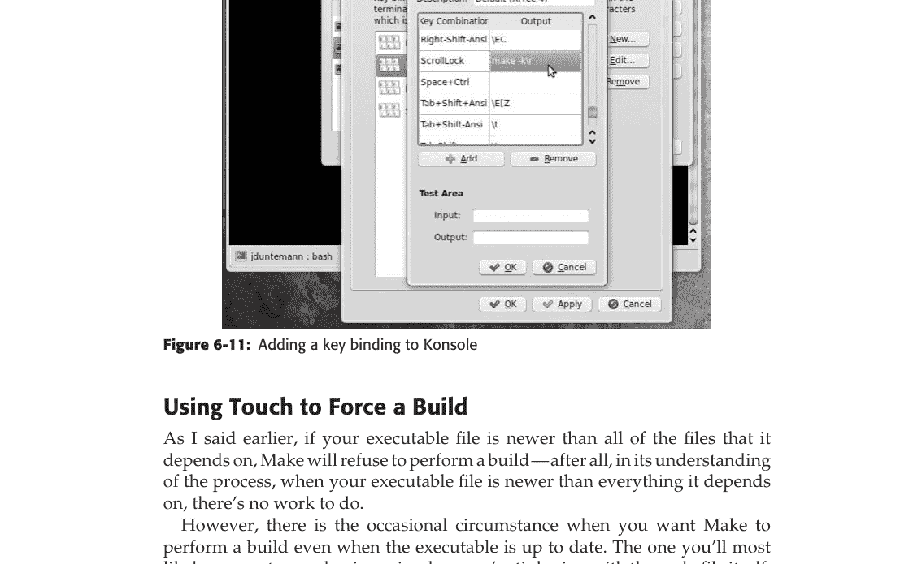

## 使用 Touch 强制构建

正如我之前所说，如果你的可执行文件比它所依赖的所有文件都新，Make 将拒绝执行构建——毕竟，按照它对流程的理解，当你的可执行文件比它所依赖的所有文件都新时，就没有工作要做了。

在终端窗口中调用`touch`，后跟要 touch 的文件名：

```bash
touch eatsyscall.asm
```

然后再次调用 Make，构建将会发生——前提是你的 makefile 存在且正确！

## Insight 调试器

在第 5 章末尾，我带你经历了一个简单的开发周期：编辑/汇编/链接/测试/调试。当时我使用的调试器是 KDbg，我选择它是因为其简单性和易用性。然而，KDbg 有一个问题：它不能完全理解汇编语言可执行文件，也无法像对其他语言（如 C 和 C++）编写的可执行文件那样显示内存中的数据。因此，虽然 KDbg 在你逐条指令跳过时查看寄存器方面很有用，但它并非调试器的终极解决方案，你很快就会遇到它在汇编语言方面的局限性。（在撰写本文时，KDbg 的在线帮助系统已损坏，其帮助文件无法访问。）

调试器有很多，像 KDbg 这样的调试器"前端"也有很多。KDbg 本身并不是真正的调试器。它是标准 GNU 调试器 Gdb 的软件控制面板，Gdb 随所有 Linux 版本自动安装。当你使用 KDbg 时，你实际上是在使用 Gdb，而 Gdb 是 Linux 软件开发的基础组件。Gdb 调试器没有用户界面。它严格在终端窗口中工作，仅使用文本，是我用过的最难用的软件之一。它确实需要某种图形用户界面，这就是为什么存在 KDbg 和 DDD（Data Display Debugger）等 Gdb 前端的原因。

Gdb 的存在几乎和 GNU 项目一样长，可追溯到 1985 年。大约十五年前，一些人认为 GUI 平台是未来，Gdb 调试器需要自己的 GUI。Insight 界面最初是 Red Hat Linux 组织和 Cygnus Solutions（一家 GNU 支持公司）之间的合作。两家公司于 1999 年合并，此后 Red Hat 一直在继续开发 Insight。

Insight 不同于 KDbg、DDD 和其他 Gdb 前端产品。Insight 实际上是 Gdb 的*一部分*，提供了 Gdb 操作的第二个"视图"，一个用于 GNOME、KDE、xfce 等图形桌面的窗口化视图。这个视图是全面的，如果整个界面同时打开在你的桌面上，可能会有点令人生畏。好消息是 Insight 是模块化的，不同的窗口显示工作台上项目的不同视图。你可以关闭不需要或尚不了解的部分，那么调试器看起来就不会那么令人不知所措。

在本章的其余部分，我将解释 Insight 的各种视图，以及如何将程序加载到其中并进行观察。在本书的其余部分，当我提到"调试器"时，我指的是 Gdb/Insight。

## 运行 Insight

Insight 随 Linux 一起安装，无需额外寻找。你可以从任何终端模拟器（如 Konsole）中启动它，只需在命令行上命名它即可。实际上，通常在运行 Insight 的同时加载待测试程序，方法是在命令行上"`insight`"之后指定程序名称。例如，要使用清单 5-1 中的程序，你需要导航到 eatsyscall 项目目录，打开一个 Konsole 窗口，然后这样运行 Insight：

```bash
insight eatsyscall
```

如果你要对程序进行 I/O 重定向调试，那么在调用 Insight 时，必须将重定向与可执行文件名一起输入到命令行中：

```bash
insight eatsyscall > eattalk.txt
```

从哪个终端窗口启动 Insight 并不重要。我建议从 Kate 的终端窗口启动，先打开与你想要调试的项目相对应的 Kate 会话。当 Kate 打开会话时，它会导航到会话文件所在的目录，因此你不必担心启动 Insight 时它无法找到可执行文件或源文件。

## Insight 的多窗口界面

第一次运行 Insight 时，你可能会看到多达十个不同的窗口在屏幕上各处弹出。（不同版本的 Insight 默认启动的窗口数量可能不同。）这十个窗口每一个都是你调试项目的不同视图。Insight 的主窗口称为*源代码窗口*。其他九个窗口可以根据需要"关闭"；而且在你是初学者时，只有其中三个在汇编语言项目中真正有用。

Insight 的所有窗口都可以从视图菜单中打开。每个窗口可以通过单击窗口右上角的关闭按钮单独关闭。表 6-2 总结了这九个视图。为了跟随本书中的示例，你只需要源代码窗口加上寄存器视图和内存视图。

**表 6-2：** Insight 的视图

| 窗口 | 快捷键 | 用途 |
| --- | --- | --- |
| Stack | `Ctrl+S` | 汇总和导航现有栈帧 |
| Registers | `Ctrl+R` | 汇总 CPU 寄存器 |
| Memory | `Ctrl+M` | 从给定地址转储内存 |
| Watch Expressions | `Ctrl+T` | 显示和编辑监视值 |
| Local Variables | `Ctrl+L` | 显示栈帧中的局部变量 |
| Breakpoints | `Ctrl+B` | 汇总所有现有断点 |
| Console | `Ctrl+N` | 打开 Gdb 的命令行界面 |
| Function Browser | `Ctrl+F` | 查找函数并允许设置断点 |
| Thread List | `Ctrl+H` | 汇总属于可执行文件的线程 |

几个 Insight 窗口是专门针对 C 语言的，对你帮助不大。查看和设置局部变量监视取决于可执行文件中的调试信息，而汇编程序无法提供这些信息。其他窗口超出了初学者书籍的范围：线程列表视图仅适用于多线程程序，这是本书无法涵盖的高级主题。对于短程序，你不需要断点视图，因为你可以在源代码窗口中看到断点。控制台视图使你能够通过 Gdb 的传统命令行界面进行控制，虽然难以掌握，但以后可能对你有用。

一旦你开始就绪义可调用过程，特别是当你开始调用标准 C 库中的函数时，栈视图就会发挥重要作用，正如我将在本书末尾解释的那样。在接下来的几章中，你主要将查看源代码、CPU 寄存器和内存。

如果你的显示器较小，将 Kate 和 Insight 排列在同一屏幕上以便同时完整查看两者可能会有点棘手。（小于 22 英寸对角线的显示器根本不要尝试。）不过这不是问题，因为你只能编辑程序或调试程序——不能同时做两件事。所以在完成编辑并通过 Make 构建项目后，从 Kate 的终端窗口启动 Insight。一旦看够了项目的异常行为，关闭 Insight 并返回 Kate 继续编辑。Insight 的窗口状态是持久的，下次运行 Insight 时，只会出现上次打开过的窗口，而且在显示器上的位置也相同。

你应该为 Insight 更改的唯一重要配置选项是选择"Windows 风格"工具栏图标集。选择首选项 → 全局，在出现的全局首选项对话框中，下拉图标菜单并选择 Windows 风格图标集。单击确定。Windows 风格图标更加详细，有助于你在熟悉环境的过程中记住按钮的含义。

## Insight 快速演练

我在第 5 章解释了调试器如何单步执行你的程序，Insight 的工作方式相同。让我们将清单 5-1 加载到 Insight 中，看看它能做什么，特别是查看内存数据方面。打开 Kate 及其 eatsyscall 项目会话。确保项目已构建，且项目目录中存在可执行文件。然后启动 Insight：

```bash
insight eatsyscall
```

这次只需要主窗口（源代码视图）加上寄存器视图和内存视图。关闭可能已打开的其他任何视图。你看到的内容应该类似于图 6-12。

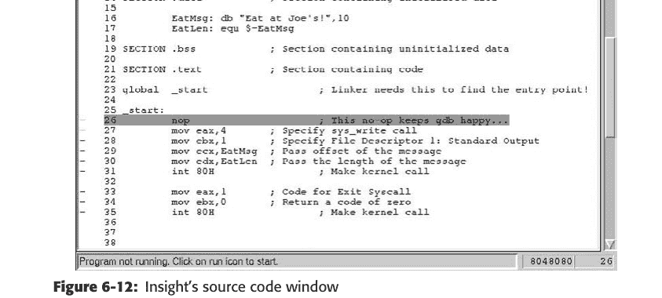

**图 6-12：** Insight 的源代码窗口

Insight 的窗口绘制得不如 KDbg 精致，但好的一面是，它的所有控件都有"悬停帮助"。当你将鼠标指针悬停在某个控件上时，会弹出一个标签告诉你该控件是什么。Insight 的默认设置相当好，通常在单步执行程序之前不需要进行任何设置。

当加载可执行文件进行调试时，Insight 会高亮显示第一条可执行指令。这看起来像是执行在断点处暂停，但事实并非如此：默认情况下没有设置断点，程序也没有运行。高亮显示只是告诉你运行程序时执行将从何处开始。

与 KDbg 一样，必须设置初始断点。通过单击源代码显示最左列中某行的短横线字符来设置断点。每条包含指令的行都有一个短横线，因此可以接受断点。（你不能在数据定义或任何非指令的位置设置断点。）断点是开关：单击短横线，断点由红色方块表示；单击红色方块，断点被移除，显示恢复为短横线。

单击`MOV EAX, 4`指令旁边的短横线。你就得到了断点，现在可以运行程序了。Insight 的导航控件是工具栏中最左边的两组按钮。通过单击运行图标（显示一个跑动的人）或按`R`来启动程序。执行将开始，并在你的断点处暂停。另外两件事会发生：

- Insight 会在程序的第一条指令（此处为`NOP`指令）处放置一个看起来像断点的东西，但*它不会在那里停止*。高亮显示会移动到你的初始断点。原因涉及 C 程序的内部机制，我在这里不详细解释。
- 寄存器视图和内存视图，之前是空的，现在会"亮起"并显示真实数据。

与 KDbg 一样，Insight 实际上是为 C 编程设计的，某些控件更适用于 C 而非汇编。要单步执行简单程序，单击"单步执行汇编指令"按钮。高亮显示的指令将执行，高亮显示会移动到序列中的下一条指令。两个用于指令单步执行的按钮在你开始编写带有子程序调用的代码时会有所不同（如我在后面章节中演示的），但对于像`eatsyscall`这样简单的程序，两个按钮的作用完全相同。


寄存器视图显示 CPU 寄存器的当前状态，在上一条执行的指令中发生变化的任何寄存器都以绿色高亮显示。逐步执行程序，直到高亮显示停留在第一条 `INT 80H` 指令上。为系统调用做准备，已有四个寄存器被加载，正如你在寄存器视图中看到的，如图 6-13 所示。

`EDX` 寄存器之所以以绿色高亮显示，是因为它是 Insight 执行的最后一条指令中加载的寄存器。`EIP` 寄存器（指令指针）则几乎一直处于绿色状态，因为它在每条指令执行时都会发生变化——也就是说，在每一步都会变化。

寄存器视图窗口（参见图 6-13）已大幅精简。CPU 拥有大量寄存器，而寄存器视图会忠实地显示所有这些寄存器。你可以通过最大化寄存器视图窗口来了解完整的寄存器列表。窗口最大化后，Insight 会显示段寄存器（这些属于操作系统，不可供你使用）和数学处理器寄存器，你在刚入门汇编语言时不会用到它们。你也可以选择仅显示通用寄存器，方法是单击寄存器视图顶部的 `Group` 按钮，然后在弹出菜单中选择 `General`。你也可以通过调整窗口大小来实现相同的效果，选择哪种方式由你决定。

当你开始运行程序时，内存视图窗口会从 `.data` 段中第一个命名数据项开始加载数据。在清单 5-1 中，只有一个数据项，即 `EatMsg` 字符串。你会在显示数据的起始位置看到 `"Eat at Joe's"` 消息（参见图 6-14）。

**图 6-14：** 程序执行期间 Insight 的内存视图

与寄存器视图类似，内存视图也会在每条指令后更新。在更强大的、操作内存中数据的程序中，你可以在逐步执行程序机制时观察内存内容的变化。Insight 的内存视图与第 5 章介绍的 Bless 十六进制编辑器非常相似。内存以两种形式显示：左侧是 16 个单独的十六进制数值，右侧是 16 个 ASCII 字符。超出可显示 ASCII 字符范围的数据值以点号字符显示。

内存视图还有另一个非常有用的功能：你可以随时修改内存中的数据。可以在十六进制值视图区域或 ASCII 视图区域进行更改。试试看：单击 ASCII 视图，使光标刚好出现在 `"Joe's"` 中 `e` 之后的位置。退格删除三个字符，输入 `Sam`，然后按回车键。你已经将内存中的 `"Joe"` 改成了 `"Sam"`。（磁盘上的文件不会受到影响。）

要验证更改，请单击 `Continue` 按钮，与单步执行不同，它会继续执行而不暂停，直到下一个断点或程序结束，以先发生者为准。（`Continue` 是主工具栏上从左数第五个按钮。）你的程序将运行至完成，如果你在 Kate 的终端窗口中查看程序输出，你会发现你劫持了 Joe 的广告标语并把它交给了 Sam。

## 拿起你的工具……

现在，你已经掌握了所需的背景知识和工具。是时候（终于！）坐下来详细了解 x86 指令集，然后认真地开始编写程序了。

# 第 7 章

## 遵循你的指令

### 近距离亲身接触机器指令

正如喜剧演员比尔·科斯比曾经说过的：我给你讲*那个*故事，就是为了给你讲*这个*故事……这本书已经过完了三分之一以上，我还没开始详细描述 PC 汇编语言的核心要素：x86 指令集。大多数汇编语言书籍，即使是针对初学者的，都假设指令集是开始讲述的最佳切入点，而没有考虑大量的基础工作——缺乏这些基础，大多数初学者会完全迷失方向并放弃。

方向感至关重要。这就是为什么我从*真正的*起点开始，花了 200 页才到达其他人开始的地方。

请记住，本书的目的是为你入门这门语言提供必不可少的基础和方向。它*不是*一门完整的 PC 汇编语言课程。一旦你学完了这本书，你比起这本和其他出版社出版的众多其他汇编语言书籍已经领先了一步。

现在是时候深入核心了，深入到软件与硬件交汇的地方。

## 给自己建个沙盒

熟悉 x86 机器指令的最佳方式是给自己建一个沙盒，然后尽情享受乐趣。汇编语言程序不需要在 Linux 下正确运行。它甚至不需要是完整的程序。只要 NASM 和链接器能够理解它，而这本身并不困难。

用我的个人技术术语来说，*沙盒*是仅在调试器中运行的程序。如果你想看看某条指令对内存或寄存器有什么影响，在 Insight 中单步执行它会生动地展示给你。程序不需要在命令行返回可见结果。它只需要包含格式正确的指令。

实际上，我的沙盒理念是这样运作的：你创建一个好文件，用于组装和链接一个名为 `sandbox.asm` 的程序。你在源代码中创建一个最小化的 NASM 程序，并将其保存到磁盘作为 `newsandbox.asm`。任何时候你想摆弄机器指令，你打开 `newsandbox.asm` 并另存为 `sandbox.asm`，覆盖可能已存在的任何早期版本的 `sandbox.asm`。你可以添加用于观察的指令，使用 Linux `make` 工具生成可执行文件。然后你将可执行文件加载到 Insight 中，逐条执行指令，仔细观察每条指令在各个 Insight 视图中的作用。

你的实验可能会产生值得保存的有用机器指令组合。在这种情况下，将沙盒文件另存为 `experiment1.asm`（或任何你想用的描述性名称），你可以在准备就绪时将该序列构建到一个"真正"的程序中。

## 最小化的 NASM 程序

那么，一个程序要满足什么条件才能被 NASM 组装呢？实际上，不多。清单 7-1 是我用作起始沙盒的源代码。它展示的内容实际上比 NASM 严格要求的更多，但作为沙盒使用来说恰到好处。

> 清单 7-1：`newsandbox.asm`

```
section .data
section .text

    global _start

_start:
    nop
; 在这两个 nop 之间放置你的实验……


; 在这两个 nop 之间放置你的实验……
    nop

section .bss
```

事实上，NASM 可以组装完全不包含任何指令助记符的源代码文件——不过公平地说，没有指令的可执行文件无法被 Linux 运行。我们*确实*需要的是一个标记为 `global` 的起点——这里是 `_start` 标签。我们还需要按所示定义数据段和文本段。数据段保存运行时要赋予初始值的命名数据项。清单 5-1 中的 `"Eat at Joe's"` 广告消息就是数据段中的命名数据项。文本段保存程序代码。创建可执行文件需要这两个段。

标记为 `.bss` 的段并非严格必需，但如果你要做实验的话，有它是好的。`.bss` 段保存未初始化数据——即程序开始运行时不赋予初始值的数据项空间。这些基本上是空白缓冲区，用于程序运行期间生成或从某处读取的数据。按照惯例，`.bss` 段位于 `.text` 段之后。（关于 `.bss` 段和未初始化数据，我将在后续章节中详细介绍。）

要使用 `newsandbox.asm`，在 Kate 中创建一个名为 `sandbox` 的会话，并将 `newsandbox.asm` 文件加载到该会话中。立即将其另存为 `sandbox.asm`，这样你就不会修改 `newsandbox.asm`。创建一个好文件，包含以下行：

```
sandbox: sandbox.o
        ld -o sandbox sandbox.o
sandbox.o: sandbox.asm
        nasm -f elf -g -F stabs sandbox.asm -l sandbox.lst
```

（这个文件和清单 7-1 已经在解压本书清单压缩包时创建的 `sandbox` 目录中。）

`sandbox.asm` 中有两个 `NOP` 指令，它们的作用是让在调试器中观察程序更容易。要摆弄机器指令，请将它们放在两个注释之间。用 `Make` 构建可执行文件，并将可执行文件加载到 Insight 中：

```
insight sandbox
```

在放在注释之间的第一条指令处设置断点，然后单击 `Run`。执行将开始，并在你的断点处停止。要观察该指令的效果，请单击 `Step Asm` 按钮。这就是第二个 `NOP` 指令存在的原因：当你单步执行一条指令时，该指令之后必须有另一条指令，执行才能暂停。如果沙盒中的第一条指令就是最后一条指令，你的第一次单步执行就会"掉出边缘"，程序将终止。当这种情况发生时，Insight 的寄存器和内存视图会变空白，你将无法看到那条指令的效果！

程序运行超出边界这一概念非常有趣。如果你点击 `Continue` 按钮，就会看到当程序没有正确结束时会发生什么：Linux 会报出一个段错误（segmentation fault），这可能由多种原因引起。然而，在这种情况下发生的是，你的程序试图执行一个位于文本段末端*之后*的位置。Linux 知道你的程序有多长，它不允许你执行任何在程序加载时未包含在内的指令。

当然，这不会造成持久的损害。Linux 在应对行为异常和格式错误的程序方面*非常*擅长，而且你在无意中可能做的事情都不太可能对 Linux 本身产生任何影响。你可以通过在 Insight 主菜单中选择 `Run` → `Kill` 来避免生成段错误。`Kill` 命令的作用正是如此：它会停止正在调试的程序，即使该程序暂停在断点处或单步执行过程中也是如此。

## 指令及其操作数

汇编语言工作中最常见的活动就是将数据从这里传送到那里。有几种专门的方法可以实现这一点，但真正通用的方法只有一种：`MOV` 指令。`MOV` 可以移动一个字节、字（16 位）或双字（32 位）的数据，从一个寄存器到另一个寄存器，从寄存器到内存，或者从内存到寄存器。`MOV` *不能*做的是直接将数据从内存中的一个地址移动到另一个不同的*地址*。（要做到这一点，你需要两个独立的 `MOV` 指令——一个从内存到寄存器，另一个再从该寄存器返回到内存。）

`MOV` 这个名称有点用词不当，因为实际发生的是数据从源位置*复制*到目标位置。然而，一旦复制到目标位置，数据并不会从源位置消失，而是同时存在于两个地方。这与我们直观上关于"移动"某物的概念略有冲突，因为通常移动意味着某物从源位置消失并出现在目标位置。

## 源操作数和目标操作数

大多数机器指令，包括 `MOV` 在内，都有一个或多个*操作数*。（有些指令没有操作数，或者隐式地对寄存器或内存进行操作。当出现这种情况时，我会在正文中特别指出。）考虑以下机器指令：

```
mov eax,1
```

上述指令中有两个操作数。第一个是 `EAX`，第二个是数字 1。按照汇编语言的惯例，属于机器指令的第一个（最左边）操作数是*目标操作数*。从左数第二个操作数是*源操作数*。

对于 `MOV` 指令，两个操作数的含义非常直观：源操作数被复制到目标操作数。在上述指令中，源操作数（字面量值 `1`）被复制到目标操作数 `EAX` 中。源和目标在其他指令中的含义远没有那么直观，但有一条经验法则：每当机器指令产生一个新值时，这个新值会被放入目标操作数中。

有三种不同类型的数据可用作操作数：*内存数据、寄存器数据*和*立即数数据*。我在表 7-1 中列出了一些示例 `MOV` 指令，让你了解不同类型的数据如何被指定为 `MOV` 指令的操作数。

**表 7-1：** `MOV` 及其操作数

| 机器指令 | 目标操作数 | 源操作数 | 操作数说明 |
|---|---|---|---|
| `MOV EAX,42h` | `EAX` | `42h` | 源操作数是立即数 |
| `MOV EBX,EDI` | `EBX` | `EDI` | 两者都是 32 位寄存器数据 |
| `MOV BX,CX` | `BX` | `CX` | 两者都是 16 位寄存器数据 |
| `MOV DL,BH` | `DL` | `BH` | 两者都是 8 位寄存器数据 |
| `MOV [EBP],EDI` | `[EBP]` | `EDI` | 目标操作数是存储在 `EBP` 中的地址处的 32 位内存数据 |
| `MOV EDX,[ESI]` | `EDX` | `[ESI]` | 源操作数是存储在 `ESI` 中的地址处的 32 位内存数据 |

## 立即数数据

表 7-2 中的 `MOV EAX,42h` 指令是使用所谓立即数数据的好例子，通过一种称为*立即寻址*的寻址方式来访问。立即寻址之所以得名，是因为被寻址的项目是内嵌在机器指令本身中的数据。CPU 不需要到任何地方去寻找立即数数据。它不在寄存器中，也不存储在内存某处的数据项中。立即数数据始终就在正在被提取和执行的指令内部。

立即数数据必须是适合操作数的大小。例如，你不能将 16 位立即数值移动到 8 位寄存器部分（如 `AH` 或 `DL`）中。NASM 不允许你汇编这样的指令：

```
mov cl,067EFh
```

`CL` 是一个 8 位寄存器，而 `067EFh` 是一个 16 位量。行不通！

因为它直接内嵌在机器指令中，你可能会认为立即数数据访问起来很快。这在某种程度上是正确的：从内存中获取*任何*东西都比从寄存器中获取任何东西要花费更多时间，而指令毕竟存储在内存中。所以，虽然立即寻址比普通存储在内存中的数据寻址要快一些，但两者都远不及直接从 CPU 寄存器中取出一个值来得快。

还要记住，*只有*源操作数可以是立即数数据。目标操作数是数据*去*的地方，而不是数据*来*的地方。因为立即数数据由字面常量（如 `1`、`0`、`42` 或 `07F2Bh` 等数字）组成，试图将某物复制*到*立即数数据中，而不是*从*立即数数据中复制，是没有意义的，而且始终是一个错误。

NASM 允许一些有趣的立即数数据形式。例如，以下指令是完全合法的，尽管不一定像乍一看那样有用：

```
mov eax,'WXYZ'
```

这是一条很好的指令，可以加载到你的沙箱中并在调试器中执行。在寄存器视图中查看 `EAX` 寄存器的内容：

```
0x5a595857
```

这可能看起来很奇怪，但仔细看：大写 ASCII 字符 `W`、`X`、`Y` 和 `Z` 的等效数值已经被首尾相连地加载到 `EAX` 中。如果你不太熟悉 ASCII，请查看附录 B 中的图表。`W` 是 `57h`，`X` 是 `58h`，`Y` 是 `59h`，`Z` 是 `5Ah`。每个字符等效值的大小为 8 位，所以四个字符正好可以放入 32 位的 `EAX` 寄存器中。然而……它们是反的！

嗯，其实不是。回顾一下第 5 章早期介绍的"字节序"概念（如果你不记得了，请务必回去重新阅读该节）。x86 架构是"小端序"的，这意味着在多字节序列中，最低有效字节存储在最低地址处。这也适用于寄存器，一旦你理解如何在寄存器内引用存储单元，这就说得通了。

这种困惑源于我们精神分裂的习惯：从左到右阅读文本，而从右到左阅读数字。请看图 7-1。作为文本字符序列处理时，`"WXYZ"` 中的 `"W"` 被认为是最不重要的元素。然而，`EAX` 是一个用于存储数字的容器，其中最低有效列始终（对于西方语言来说）在右边。我们称 `EAX` 中最低有效字节为 `AL`，`"W"` 就放在那里。我们称 `EAX` 中次低有效字节为 `AH`，`"X"` 就放在那里。`EAX` 中两个最高有效字节没有单独的名称，也不能单独寻址，但它们仍然是 8 位字节，可以包含像 ASCII 字符这样的 8 位值。序列 `"WXYZ"` 中最高有效字符是 `"Z"`，它存储在 `EAX` 的最高有效字节中。

## 寄存器数据

存储在 CPU 寄存器内部的数据称为*寄存器数据*，直接访问寄存器数据是一种称为*寄存器寻址*的寻址方式。寄存器寻址只需简单地命名你想要使用的寄存器即可完成。以下是一些完全合法的寄存器数据和寄存器寻址示例：

```
mov ebp,esi    ; 32-bit
mov bl,ch      ; 8-bit
add di,ax      ; 16-bit
add ecx,edx    ; 32-bit
```

最后两个例子指出，我们这里讨论的*不*仅仅是 `MOV` 指令。`ADD` 指令正如你可能预期的那样，将源操作数和目标操作数相加。和会替换目标操作数中原来的任何内容。无论是什么指令，只要直接对寄存器中的数据进行操作，就会发生寄存器寻址。

汇编器会追踪某些不合逻辑的情况，其中一种情况是：在同一个指令中同时使用 16 位寄存器的一半和完整的 32 位寄存器。这种操作是非法的——毕竟，这意味着什么？将 4 字节源数据移动到 2 字节目标中？而将 2 字节源数据移动到 4 字节目标中虽然看似可行甚至合理，但 CPU 不支持这种操作，无法直接完成。

在调试器中观察寄存器数据是理解其工作原理的好方法，能帮助你形成直观的认识，尤其是在刚入门时。我们来练习一下。在沙盒中输入以下指令，构建可执行文件，然后将沙盒可执行文件加载到调试器中：

```
    mov ax,067FEh
    mov bx,ax
    mov cl,bh
    mov ch,bl
```

在四条指令中的第一条上设置断点，然后点击"运行"。单步执行这四条指令，仔细观察 `AX`、`BX` 和 `CX` 寄存器部分的变化。（请记住，Insight 的寄存器视图不会单独显示 8 位或 16 位寄存器部分。`AX` 是 `EAX` 的一部分，`CL` 是 `ECX` 的一部分，以此类推。）完成后，选择"运行 → 终止"来结束程序。请注意，如果你选择"继续"或尝试单步执行到程序末尾之后，Linux 会因为程序未正确终止而产生段错误。这个错误不会造成任何损害；请记住，沙盒并不需要是一个完整、规范的 Linux 程序。不过，"终止"程序比产生段错误是更好的做法。

以下是所发生情况的总结：第一条指令是使用 16 位寄存器的立即数寻址示例。16 位十六进制值 `067FEH` 被移入 `AX` 寄存器。第二条指令使用寄存器寻址将数据从 `AX` 复制到 `BX`。

第三条和第四条指令都是在 8 位寄存器段之间移动数据，而不是在 16 位寄存器段之间。这两条指令实现了一件有趣的事情。查看最后的寄存器显示，比较 `BX` 和 `CX` 的值。通过将 `BX` 的值逐字节移入 `CX`，可以颠倒构成 `BX` 的两个字节的顺序。`BX` 的高半部分（有时称为 `BX` 的*最高有效字节*，即 MSB）被移入 `CX` 的低半部分。然后 `BX` 的低半部分（有时称为 `BX` 的*最低有效字节*，即 LSB）被移入 `CX` 的高半部分。这只是你可以用通用寄存器玩出的花样的一个例子。

为了让你打消用 `MOV` 指令交换 16 位寄存器两半部分的念头，我建议你做以下操作。回到 Kate 并在沙盒末尾添加以下指令：

```
xchg cx,bx
```

重新构建沙盒并回到调试器中查看结果。`XCHG` 指令交换其两个操作数中包含的值。之前被交换的内容再次交换，`CX` 中的值将与 `AX` 和 `BX` 中已有的值匹配。在编写最初的汇编语言程序时，一个很好的做法是定期查阅指令集，确认你用四、五条指令拼凑出来的操作是否不能用单条指令实现。x86 指令集在这方面很善于误导你。


这里有一个注意事项：有时“特殊情况”在机器执行时间上比更通用的情况更快。除以 2 的幂可以使用`DIV`指令完成，但也可以使用`SHR`（右移）指令来完成。`DIV`更通用（你可以用它来除以任何无符号整数，而不仅仅是 2 的幂），但它慢得多——在某些型号的 x86 处理器上，可能慢多达十倍！（关于`DIV`，我将在本章后面再详细说明。）

## 内存数据

立即数直接嵌入其自身的机器指令中。寄存器数据存储在 CPU 的内部寄存器集合之一中。相比之下，内存数据存储在程序所拥有的系统内存的某个位置，位于一个 32 位内存地址处。

除了一两个重要的例外（字符串指令，我将在后面一定程度上——但并非详尽地——介绍），指令的两个操作数中只有一个可以指定内存位置。换句话说，你可以将立即数移到内存，或将内存值移到寄存器，或其他类似的组合，但你不能直接将内存值移到另一个内存值。这只是当前这一代 x86 CPU 的固有限制，我们不得不接受它，尽管有时很不方便。

要指定你想要的是寄存器中所含内存地址处的数据，而不是寄存器本身中的数据，你需要用方括号括住寄存器名称。换句话说，要将内存中`EBX`所含地址处的字移入寄存器`EAX`，你应该使用以下指令：

```asm
mov eax,[ebx]
```

方括号内可以包含的内容不止单个 32 位寄存器的名称，稍后你会详细了解。例如，你可以在方括号内将字面常量加到寄存器上，NASM 会完成计算：

```asm
mov eax,[ebx+16]
```

同样，两个通用寄存器相加也可以，如下所示：

```asm
mov eax,[ebx+ecx]
```

而且，如果这还不够，你可以将两个寄存器加上一个字面常量：

```asm
mov eax,[ebx+ecx+11]
```

当然，并非什么都可以。方括号内的内容称为内存中数据项的有效地址，有规则规定什么可以是有效的有效地址，什么不可以。在当前 x86 硬件的发展水平下，两个寄存器可以相加以形成有效地址，但三个或更多不行。换句话说，以下不是合法的有效地址形式：

```asm
mov eax,[ebx+ecx+edx]
mov eax,[ebx+ecx+esi+edi]
```

更复杂的有效地址形式演示起来比解释更容易，但我们还得先讲一些其他内容。它们在处理查找表时特别有用，这我稍后再讲。目前，最重要的是不要将数据项与它的存储位置混淆！

## 混淆数据及其地址

这听起来很平凡，但相信我，这是件很容易做到的事情。回到清单 5-1，我们有这个数据定义和这条指令：

```asm
EatMsg: db "Eat at Joe's!"
.     .    .    .
mov ecx,EatMsg
```

如果你接触过 Pascal 等高级语言，你的第一反应可能是假设存储在`EatMsg`中的数据将被复制到`ECX`中。汇编不是这样工作的。那条`MOV`指令实际上复制的是`EatMsg`的地址，而不是存储在（实际上，位于）`EatMsg`中的内容。在汇编语言中，变量名代表地址，不是数据！

那么如何真正“访问”像`EatMsg`这样的变量所代表的数据呢？同样，使用方括号即可：

```asm
mov al,[EatMsg]
```

## 内存数据的大小

如果你只想处理单个字符，而不是前四个呢？如果你不想用满 32 位呢？基本上，如果你想使用一个字节的数据，就需要将其加载到字节大小的容器中。寄存器`EAX`的大小是 32 位。但是，你可以将 EAX 的最低有效字节寻址为`AL`。`AL`的大小是一个字节，通过使用`AL`，你可以这样获取`EatMsg`的第一个字节：

```asm
mov al,[EatMsg]
```

`AL`当然包含在`EAX`中——它不是独立的寄存器。（如果你对此不太清楚，请参考图 7-1。）但“`AL`”这个名称允许你每次只从内存中获取一个字节。

你可以使用`AX`这个名称来执行类似的技巧，它指的是`EAX`的低 2 个字节（16 位）：

```asm
mov ax,[EatMsg]
```

这次，字符“`E`”和“`a`”从内存中读取并放入`EAX`的两个最低有效字节中。

棘手之处在于将寄存器中的数据写入内存时。NASM 不像高级语言那样“记住”变量的大小。它只知道`EatMsg`在内存中起始的位置，仅此而已。你必须告诉 NASM 要移动多少字节的数据。这是通过大小说明符来完成的。例如：

```asm
mov [EatMsg],byte 'G'
```

这里，通过使用`BYTE`大小说明符，你告诉 NASM 只向内存移动单个字节。其他大小说明符包括`WORD`（16 位）和`DWORD`（32 位）。

## 艰难的旧时光

庆幸你现在才学习 x86 汇编吧，因为它在过去要复杂得多。在 DOS 下的实模式中，有效地址的各个组成部分存在若干限制，而这些限制在今天的 32 位保护模式中早已不复存在。在实模式中，x86 通用寄存器中只有某些可以保存内存地址：`BX`、`BP`、`SI`和`DI`。其他寄存器`AX`、`CX`和`DX`则不行。

更糟的是，地址有两个部分，正如你在第 4 章中学到的。你必须注意地址位于哪个段中，并且在不明显的地方必须确保指定了正确的段，使用`[DS:BX]`或`[ES:BP]`这样的结构。你还得摆弄名为`ASSUME`的可怕东西，关于少说为妙。（如果你由于某种原因不得不为 x86 编写实模式分段模型的程序，尽量找一本 2000 年版的这本书，里面我详细讲述了这整个混乱的局面。）

从很多方面来说，现在的生活好多了。

## 集合到旗帜周围来吧，伙计们！

虽然我在 x86 架构概述中提到过它，但我们还没有详细研究过 EFlags 寄存器。`EFlags`就像是一个装满了各种零散信息的杂物抽屉，一次性坐下来详细描述所有这些信息既困难（也可能具有误导性）。相反，我在这里简要介绍 CPU 标志位，然后在本书后续章节中讨论使用它们的各种指令时，再更详细地介绍。

标志位（flag）是一个单比特的信息，其含义独立于其他任何比特。CPU 可以根据需要将其设置（set）为 1 或清除（cleared）为 0。其目的是告诉作为程序员的你，CPU 内部某些条件的状态，以便你的程序可以检测这些条件的状态并据此采取行动。更少见的情况是，你作为程序员设置一个标志位，向 CPU 发出某种信号。

想象一排乡村邮箱，每个邮箱侧面都有一个小红旗。每个旗子可以升起或放下；如果史密斯家的旗子升起来了，就告诉邮递员史密斯家已经把邮件放入邮箱等待取走。邮递员查看史密斯家的旗子是否升起（一次检测），如果是，就打开史密斯家的邮箱取走等待的邮件。

`EFlags`整体上是 CPU 内部一个 32 位的寄存器。它是 8086/8088 CPU 中 16 位 Flags 寄存器的 32 位扩展后代。这 32 个比特每个都是一个标志位，尽管只有少数是常见的，而在刚入门时，更是只有少数几个有用。此外，许多标志位仍未被 Intel 定义，尚未使用。

这确实有点混乱，但请看图 7-2，它总结了 x86 架构中当前已定义的所有标志位。我用灰色背景标出的标志位是你目前可以放心忽略的那些较晦涩的标志位。

`EFlags`寄存器的每个标志位都有一个两字母或三字母的符号，大多数程序员通过它们来识别这些标志位。我在本书中使用这些符号，你应该熟悉它们。最常见的标志位、它们的符号以及简要描述如下：

- `OF`：当对有符号整数量进行算术运算的结果太大，无法放入原始操作数时，溢出标志被设置。`OF`通常在有符号算术运算中用作“进位标志”。

| 位 | 缩写 | 名称 | 描述 |
| --- | --- | --- | --- |
| 0 | `CF` | 进位标志 | 0 = 运算中没有进位；1 = 有进位 |
| 1 | - | （未定义） | |
| 2 | `PF` | 奇偶标志 | 0 = 字节中 1 的位数为奇数；1 = 字节中 1 的位数为偶数 |
| 3 | - | （未定义） | |
| 4 | `AF` | 辅助进位标志 | 0 = BCD 运算中没有进位；1 = BCD 运算有进位 |
| 5 | - | （未定义） | |
| 6 | `ZF` | 零标志 | 0 = 操作数变为非零；1 = 操作数变为 0 |
| 7 | `SF` | 符号标志 | 0 = 操作数没有变为负数；1 = 操作数变为负数 |
| 8 | `TF` | 陷阱标志 | 便于单步执行 |
| 9 | `IF` | 中断使能标志 | 在保护模式下由操作系统保留 |
| 10 | `DF` | 方向标志 | 0 = 自动增量为向高内存；1 = 自动增量为向低内存 |
| 11 | `OF` | 溢出标志 | 0 = 有符号运算无溢出；1 = 有符号运算有溢出 |
| 12 | `IOPL` | I/O 特权级别 0 | 在保护模式下由操作系统保留 |
| 13 | `IOPL` | I/O 特权级别 1 | 在保护模式下由操作系统保留 |
| 14 | `NT` | 嵌套任务标志 | 在保护模式下由操作系统保留 |
| 15 | - | （未定义） | |
| 16 | `RF` | 恢复标志 | 便于单步执行 |
| 17 | `VM` | 虚拟 86 模式标志 | 在保护模式下由操作系统保留 |
| 18 | `AC` | 对齐检查标志 | 在保护模式下由操作系统保留 |
| 19 | `VIF` | 虚拟中断标志 | 在保护模式下由操作系统保留 |
| 20 | `VIP` | 虚拟中断待处理 | 在保护模式下由操作系统保留 |
| 21 | `ID` | CPU ID | 如果此位可由用户空间程序更改，则`CPUID`可用 |
| 22 | - | （未定义） | |
| ... | | | |
| 31 | - | （未定义） | |

**图 7-2：** x86 `EFlags`寄存器

- `DF`：方向标志在标志位中有点另类，因为它告诉 CPU 你想让它知道的事情，而不是反过来。它规定了字符串指令执行期间活动进行的方向（向高内存或向低内存）。当`DF`被设置时，字符串指令从高内存向低内存进行。当`DF`被清除时，字符串指令从低内存向高内存进行。

- `IF`：中断使能标志是一个双向标志。CPU 在某些条件下会设置它，你也可以使用`STI`和`CLI`指令自行设置它。当`IF`被设置时，中断被启用，可以在请求时发生。当`IF`被清除时，CPU 会忽略中断。在 DOS 时代的实模式下，普通程序可以随意设置和清除这个标志。在 Linux 下，`IF`供操作系统以及有时其驱动程序使用。如果你试图在自己的程序中使用`STI`和`CLI`指令，Linux 会给你一次一般保护故障，你的程序将被终止。把`IF`视为禁区吧。

- `TF`：当被设置时，陷阱标志允许调试器管理单步执行，通过强制 CPU 在执行单个指令后调用中断例程。这对普通编程不是特别有用的标志，我不会有更多关于它的内容。

- `SF`：当运算结果迫使操作数变为负数时，符号标志被设置。这里的负数，我们只意味着操作数的最高位（符号位）在有符号算术运算期间变为 1。任何使符号保持正数的操作都将清除`SF`。

- `ZF`：当运算结果变为零时，零标志被设置。如果目标操作数反而变为某个非零值，`ZF`被清除。你在进行条件跳转时会大量使用这一个。

- `AF`：辅助进位标志仅用于 BCD 算术。BCD 算术将每个操作数字节视为一对 4 位“半字节”，允许类似十进制（基数为 10）的算术直接在 CPU 硬件中通过使用 BCD 算术指令之一来完成。这些指令现在已不太常用；我在本书中只简要讨论 BCD 算术。

- `PF`：奇偶标志对于了解串行数据通信的人来说会立刻感到熟悉，而对于不了解的人来说则完全莫名其妙。`PF`指示结果低字节中置位（1）的位数是偶数还是奇数。例如，如果结果是`0F2H`，那么`PF`将被清除，因为`0F2H`（11110010）包含奇数个 1。类似地，如果结果是`3AH`（00111100），那么`PF`将被设置，因为结果中有偶数（四个）个 1。这个标志是从所有计算机通信都通过串行端口完成的时代遗留下来的，因为一种称为奇偶校验的错误检测系统需要知道字符字节中置位位数是偶数还是奇数。`PF`很少使用，我不会进一步描述它。

- `CF`：进位标志用于无符号算术运算。如果算术或移位运算从操作数中“进位”出一个比特，`CF`被设置。否则，如果没有进位，`CF`被清除。

## 标志位礼仪

我所说的“标志位礼仪”是指给定指令影响`EFlags`寄存器中标志位的方式。你必须记住，刚才描述的标志位只是概括性的，并且受到各个指令施加的具体限制和特殊情况的制约。单个标志位的礼仪因指令而异，即使标志位用途的意义在每种情况下可能相同。

例如，某些导致`operand`中出现零的指令会设置`ZF`，而另一些则不会。遗憾的是，这没有规律可循，也没有简单的方法记在脑中。当你打算通过条件跳转指令使用标志位进行检测时，你必须逐个检查每条指令，看看各种标志位是如何受影响的。

> 标志位礼仪是一个高度个性化的问题。查阅每条指令的参考手册，看看它是否影响标志位。不要做任何假设！

一个关于标志位礼仪的简单教训涉及两条指令`INC`和`DEC`。

## 用 INC 和 DEC 加一和减一

几条 x86 机器指令是成对出现的。其中最简单的是`INC`和`DEC`，分别将操作数加一和减一。

给某物加一或从某物减一在计算机编程中是经常发生的操作。如果你在统计程序执行循环的次数，或统计表中字节数，或进行逐次递增或递减的操作，`INC`或`DEC`可以是使实际加法或减法发生的非常快速的方式。

`INC`和`DEC`都只需要一个操作数。如果你试图使用两个操作数或不带任何操作数来使用`INC`或`DEC`，汇编器会报错。

通过将以下指令添加到你的沙盒中来尝试两者。像往常一样构建沙盒，将可执行文件加载到 Insight 中，并逐步执行：

```asm
mov eax,0FFFFFFFFh
mov ebx,02Dh
dec ebx
inc eax
```

观察`EAX`和`EBX`寄存器的变化。将`EBX`减 1 可预见地将其值从 2DH 变为 2CH。另一方面，将 0FFFFFFFFH 加 1 会使`EAX`寄存器回滚到 0，因为 0FFFFFFFFH 是 32 位寄存器中能表示的最大无符号值。给它加 1 会使其回滚到零，就像给 99 加 1 会使和的右两位数字回滚到零，从而得到数字 100 一样。`INC`的不同之处在于没有进位。进位标志不受`INC`影响，所以不要试图用它来执行多精度运算。

## 通过 Insight 观察标志

`EFlags`寄存器与`EAX`一样也是一个寄存器，其值在 Insight 的寄存器视图中更新。遗憾的是，你看不到单独的标志位。相反，给出的是`EFlags`的整体十六进制值，仿佛每个标志位都是十六进制数中的一个位。如果你要做的是观察某条指令对特定标志的影响，这就不是很有用了。执行上面的`DEC EBX`指令会将`EFlags`中的值从 0292h 变为 0202h。标志位中发生了变化，但是什么呢？

这是 Insight 调试器界面明显不足的一个地方，尤其对于初次探索 x86 指令集的人来说。没有简单的`EFlags`视图来呈现各个标志位的值。要单独查看哪些标志发生了变化，你必须打开控制台视图，在其控制台命令行上执行 Gdb 命令。

从 Insight 主菜单选择**视图 → 控制台**。控制台视图非常简洁：只是一个空白的终端，右上角有提示符`(gdb)`。将沙盒单步执行到`DEC EBX`指令，但在执行该指令之前，在控制台视图中输入以下命令：

```gdb
info reg
```

你看到的应该如图 7-3 所示。Gdb 的`info`命令显示某物的当前状态，`reg`参数告诉 Gdb 我们想查看寄存器的当前状态。当然，你看到的远不止`EFlags`。默认情况下，所有通用寄存器和段寄存器都会显示。数学处理器寄存器不会显示，这对我们的目的来说很好。

查看图 7-3 中显示`EFlags`值的那一行。寄存器整体的十六进制值已经显示，但该值之后是方括号内的寄存器名称列表。已设置的标志会显示；已清除的标志不会显示。在执行`DEC EBX`指令之前，`AF`、`SF`和`IF`标志已设置。现在执行`DEC EBX`指令。然后再次在控制台视图中输入`info reg`命令。显示`EFlags`值的那一行已变为：

```text
eflags         0x202     [IF]
```

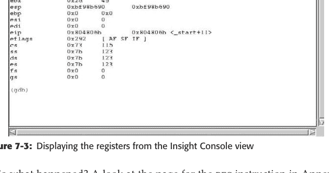

**图 7-3：** 从 Insight 控制台视图显示寄存器

那么发生了什么？查看附录 A 中`DEC`指令的页面会给你一些提示：`DEC`影响`OF`、`SF`、`ZF`、`AF`和`PF`标志。`DEC EBX`指令将它们全部清除了。原因如下：

- 溢出标志（`OF`）被清除，因为操作数被解释为有符号整数时，没有变得太大而无法放入`EBX`。如果你不知道什么使数字“有符号”，这可能帮不到你，所以我们暂时先放一放。

- 符号标志（`SF`）被清除，因为`EBX`的高位没有因该操作而变为 1。如果`EBX`的高位变为 1，`EBX`中的值被解释为有符号整数时就会变成负数，而当值变为负数时`SF`会被设置。与`OF`一样，除非你进行有符号运算，否则`SF`不是很有用。

- 零标志（`ZF`）被清除，因为目标操作数没有变为零。如果它变为零，`ZF`会被设置为 1。

- 辅助进位标志（`AF`）被清除，因为`EBX`的低四位没有 BCD 进位到更高的四位。

- 奇偶标志（`PF`）被清除，因为减 1 后操作数中 1 的位数是三个，而当目标操作数中 1 的位数为奇数时`PF`被清除。你自己检查一下：`DEC`指令后`EBX`中的值是`02Ch`。用二进制表示，这是 00101100。该值中有三个 1，因此`PF`被清除。

`DEC`指令不影响`IF`标志，它保持设置。事实上，几乎没有什么会改变`IF`标志，用户模式应用程序如沙盒（以及你在学习汇编期间可能编写的所有其他程序）被禁止更改`IF`。


现在，执行`INC EAX`指令，然后在控制台视图中重新显示寄存器。砰！这次变化很大：

- **奇偶标志**（`PF`）被设置，因为`EAX`中 1 的位数现在是零，而当操作数中 1 的位数变为偶数时`PF`被设置。0 被认为是偶数。

- **辅助进位标志**（`AF`）被设置，因为`EAX`的低四位从`FFFF`变为`0000`。这意味着从低四位向更高的四位产生了进位，而当操作数的低四位产生进位时`AF`被设置。

- **零标志**（`ZF`）被设置，因为`EAX`变为零。

- 与之前一样，`IF`标志不会改变，始终保持设置。

## 标志如何改变程序执行

观察标志在指令执行后改变值是学习标志规则的好方法，但一旦你对各种指令如何改变标志有了了解，就可以关闭控制台视图了。标志的真正价值不在于它们的值本身，而在于它们如何影响程序中机器指令的流程。

有一整类机器指令会根据当前某个标志的值*"跳转"*到程序中的不同位置。这些指令称为**条件跳转**指令，`EFlags`中的大多数标志都有一个或多个相关的条件跳转指令。它们在附录 A 的第 534 页列出。

回想第 1 章中介绍的*"步骤与测试"*概念。大多数机器指令是从上到下列表中的步骤。**条件跳转**指令是测试。它们测试某个标志的条件，然后要么继续执行，要么跳转到程序的不同部分。

条件跳转指令中最简单的例子，也是你可能最常用的，是`JNZ`，即**不为零则跳转**。`JNZ`指令测试**零标志**的值。如果`ZF`已设置（即等于 1），则什么都不发生，CPU 按顺序执行下一条指令。然而，如果`ZF` *未*设置（即等于 0），则执行会转移到程序中的新目的地。

**标签**是给予程序中位置的描述性名称。在`NASM`中，标签是后跟冒号的字符串，通常放在包含指令的行上。

与汇编语言中的许多事物一样，这将通过一个简单例子变得更清楚。加载一个新的沙盒，输入以下指令：

```
        mov eax,5
DoMore: dec eax
        jnz DoMore
```

构建沙盒并将其加载到`Insight`中。单步执行时观察寄存器视图中`EAX`的值。特别地，观察执行`JNZ`指令时源代码窗口中发生了什么。如果`ZF`为 0，`JNZ`会跳转到其操作数命名的标签。如果`ZF = 1`，它会"落入"下一条指令。

`DEC`指令将`EAX`中的值减 1。只要`EAX`中的值不变为 0，**零标志**就保持清除。而只要**零标志**保持清除，`JNZ`就会跳转回标签`DoMore`。因此，在五次循环中，`DEC`将`EAX`减少一个刻度，`JNZ`跳转回`DoMore`。但一旦`DEC`将`EAX`减到 0，**零标志**就被设置，`JNZ`便"落入"沙盒末尾的`NOP`指令。

这样的构造称为**循环**，在所有编程中都非常常见，不仅仅是汇编语言。前面的循环没有用处，但它演示了如何通过在一个寄存器中加载初始值，并在每次循环时将该值减 1，来将一条指令重复执行任意多次。`JNZ`指令每次循环都测试`ZF`，并在计数器变为 0 时知道停止循环。

我们可以在不增加很多复杂性的情况下让这个循环更有用一些。我们需要添加的是一个供循环操作的数据项。将**清单 7-2**加载到`Kate`中，构建它，然后将其加载到`Insight`中。

## 清单 7-2：kangaroo.asm

```
section .data

        Snippet db "KANGAROO"

section .text
global _start
_start:
        nop
; 将你的实验放在两个 nop 之间...

        mov ebx,Snippet
```

清单 7-2：kangaroo.asm *(续)*

```
        mov eax, 8
DoMore: add byte [ebx],32
        inc ebx
        dec eax
        jnz DoMore

; Put your experiments between the two nops...
        nop
```

这段代码与通用沙盒程序的唯一区别在于变量`Snippet`以及两条`NOP`之间的六条指令。逐步执行程序，确保`Insight`的内存视图已打开。

经过八次循环后，"`KANGAROO`"变成了"`kangaroo`"。这是怎么做到的？看一下`DoMore`标签处的`ADD`指令。程序前面，我们将`Snippet`的内存地址复制到了寄存器`EBX`中。`ADD`指令将常数值 32 加到`BX`中存储的地址所指向的内容上。如果你查看附录 B，会注意到 ASCII 大写字母与 ASCII 小写字母的数值之差正是 32。大写"K"的值是`4Bh`，小写"k"的值是`6Bh`。`6Bh – 4Bh = 20h`，换算成十进制就是 32，所以如果我们把 ASCII 字母当作数字来处理，就可以给大写字母加上 32，将其转换为小写字母。

循环执行八次，对应"`KANGAROO`"中的每个字母。每次`ADD`之后，程序递增`EBX`中的地址，这样"KANGAROO"的下一个字符就成为目标。同时，程序递减`EAX`，它在循环开始前已被加载为变量`Snippet`的字符数量。所以在同一个循环中，程序沿着`EBX`中`Snippet`的长度向上计数，同时在`EAX`中向下计数。当`EAX`变为零时，意味着我们已经处理完`Snippet`中的所有字符，工作完成。

`ADD`指令的操作数值得更仔细地看一下。将`EBX`放在方括号内表示引用`Snippet`的内容，而非其地址。但更重要的是，`BYTE`尺寸说明符告诉`NASM`我们只向`EBX`中的内存地址写入一个字节。否则`NASM`无从得知这一点。根据需要，可以一次向内存写入一个字节、两个字节或四个字节。但是，你必须明确告诉`NASM`你的意图。

别忘了`kangaroo.asm`仍然是一个沙盒程序，仅适合在调试器中单步执行。如果你直接"让它运行"，当执行越过最后的`NOP`指令时，会产生段错误。一旦单步执行到最后的`NOP`，终止程序，然后重新开始执行或退出调试器。

## 有符号值和无符号值

在汇编语言中，我们可以处理有符号和无符号数值。有符号值当然可以是负数。无符号值则始终为正。x86 指令集中有四种基本算术运算的指令，这些指令可以对有符号和无符号值进行操作。（对于乘法和除法，有专门用于有符号和无符号计算的独立指令，我稍后会解释。）

理解有符号值和无符号值之间区别的关键在于，知道 CPU 把符号放在哪里。它不是破折号字符，而是代表数字的二进制模式中的一个位。有符号值中最显著字节中的最高位就是 *符号位*。如果符号位是 1，则该数为负数。如果符号位是 0，则该数为正数。

请记住，某个给定的二进制模式究竟代表有符号值还是无符号值，取决于你如何选择使用它。如果你打算执行有符号运算，寄存器值或内存位置的高位就被视为符号位。如果你不打算执行有符号运算，那么同样位置、同样数值的相同高位就只是无符号值中最显著的位。数值的有符号性质在于你如何处理这个值，而不在于代表该值的底层位模式的本质。

例如，二进制数`10101111`代表的是有符号值还是无符号值？没有上下文的话这个问题毫无意义：如果你需要将该值作为有符号值处理，你将最高位视为符号位，该值为 -81。如果你需要将该值作为无符号值处理，你将最高位仅视为二进制数中的另一位，该值为 175。

## 二进制补码与 NEG

初学者有时会犯的一个错误是，认为可以通过将符号位设为 1 来使一个值变为负数。并非如此！你不能简单地将值 42 通过设置符号位变成 -42。你得到的值确实是负数，但它 *不会* 是 -42。

要了解汇编语言中负数是如何表示的，一种方法是将一个正数递减到负数区域。打开一个干净的沙盒并输入以下指令：

```
DoMore: mov eax,5
        dec eax
        jmp DoMore
```

像往常一样构建沙盒，并将可执行文件加载到`Insight`中。注意这里我们添加了一条新指令，还有一个隐患：`JMP`指令 *并不* 查看标志位。执行时，它 *总是* 跳转到其操作数，这就是该助记符的由来。所以`JMP`每次执行时都会跳回`DoMore`标签。如果你敏锐的话会注意到，这个特定的指令序列没有出口，是的，这就是你会偶尔陷入的传说中的"无限循环"。

因此，一定要在初始的`MOV`指令上设置断点，不要直接让程序自由运行。或者……尽管试试！（不会有任何损害。）如果不设断点，你会看到`Insight`的"跑步的人"图标变成停止标志。当你看到停止标志图标时，你就知道程序不是暂停等待单步执行，而是在运行。对沙盒进行单步执行，并在 Registers 视图中观察`EAX`。起始值 5 会倒数到 4、3、2、1、0，然后……`0FFFFFFFFh`！这是简单值 -1 的 32 位表达形式。如果你继续递减`EAX`，你会了解发生了什么：

```
0FFFFFFFFh  (-1)
0FFFFFFFEh  (-2)
0FFFFFFFDh  (-3)
0FFFFFFFCh  (-4)
0FFFFFFFBh  (-5)
0FFFFFFFAh  (-6)
0FFFFFFF9h  (-7)
```

……依此类推。用这种方式处理负数时，称为 *二进制补码*。在 x86 汇编语言中，负数以其绝对值的二进制补码形式存储，如果你记得八年级数学的话，绝对值就是一个数到 0 的距离，无论是正方向还是负方向。

二进制补码背后的数学原理出奇地精妙，我建议你查阅维基百科获取比本书所能提供的更完整的讲解：

```
http://en.wikipedia.org/wiki/Two's_complement
```

用二进制补码形式表达负数的妙处在于，CPU 在其晶体管逻辑层面其实并不需要真正做减法。它只是生成减数的二进制补码，然后将其加到被减数上。这对 CPU 来说相对容易，而且这一切对你的程序都是透明的，减法大致上是以你所期望的方式进行的。

好消息是你几乎从不需要手动计算二进制补码值。有一条机器指令可以帮你完成：`NEG`。`NEG`指令将以正值作为其操作数，并对该值取负——即，使其变为负数。它通过生成该正值的二进制补码形式来实现这一点。将以下指令加载到干净的沙盒中，并在`Insight`中进行单步执行。在 Registers 视图中观察`EAX`：

```
mov eax, 42
neg eax
add eax, 42
```

一扫之间，42 变成了`0FFFFFFD6h`，即 -42 的二进制补码十六进制表达形式。给这个值加上 42，看着`EAX`变为 0。

此时，问题可能油然而生：用一、二或四个字节能表达的最大正数和最大负数分别是多少？这两个值，以及它们之间的所有值，构成了用给定比特数表示的值的 *范围*。我在表 7-2 中列出了这些。

**表 7-2：** 有符号值的范围

| 值大小 | 最大负值（十进制） | 最大负值（十六进制） | 最大正值（十进制） | 最大正值（十六进制） |

|------------|--------------------------------|----------------------------|--------------------------------|----------------------------|

| Eight Bits | -128 | 80h | 127 | 7Fh |

| Sixteen Bits | -32768 | 8000h | 32767 | 7FFFh |

| Thirty-Two Bits | -2147483648 | 80000000h | 2147483647 | 7FFFFFFFh |

如果你敏锐且懂得十六进制计数，可能会从表中注意到一些东西：对于给定的值大小，最大正值和最大负值 *仅相差一个计数*。也就是说，如果你用 8 位工作，给最大正值`7Fh`加上 1，就会得到`80h`，即最大负值。

你可以通过在沙盒中执行以下两条指令来观察这一现象：

```
mov eax, 07FFFFFFF'h
inc eax
```

这个例子只有结合一个我尚未展示的技巧才有意义：`Insight`的 Registers 视图允许你以三种不同的格式显示寄存器的值。默认情况下，`Insight`以十六进制显示所有寄存器值。但是，你可以在 Registers 视图中右键单击任何寄存器窗口，并可在 Hex、Decimal 和 Unsigned 之间选择。这三种格式的工作方式如下：

- 十六进制格式以十六进制形式显示值。

- 十进制格式将值显示为有符号值，将最高位视为符号位。

- 无符号格式将值显示为无符号值，将最高位仅视为整个数字中的另一个二进制位。

因此，在执行上面给出的两条指令之前，右键单击"寄存器"视图中的`EAX`，并选择 Decimal。`MOV`指令执行后，`EAX`将显示十进制值 2147483647。这是 32 位有符号值的最大可能值。用`INC`指令递增该值，`EAX`中的值瞬间变为 -2147483648。

## 符号扩展与 MOVSX

当你使用不同大小的有符号值时，有一个微妙的陷阱需要避免。符号位是有符号字节、字或双字中的最高位。但是，当你必须将一个有符号值移入更大的寄存器或内存位置时，会发生什么呢？例如，如果你需要将一个有符号 16 位值移入 32 位寄存器，会发生什么？如果你使用`MOV`指令，结果不会好。试试这个：

```
mov ax,-42
mov ebx,eax
```

-42 的十六进制形式是`0FFD6h`。如果你在像`AX`这样的 16 位寄存器中有该值，并使用`MOV`将其移入像`EBX`这样的 32 位寄存器，*符号位将不再是符号位*。换句话说，一旦 -42 从一个 16 位容器进入 32 位容器，它就从 -42 变成了 65494。符号位仍然存在，它并没有被清零。然而，在 32 位寄存器中，旧的符号位现在只是二进制值中的另一个位，没有特殊含义。

这个例子有点误导。首先，我们不能直接将值从`AX`移到`EBX`。`MOV`指令只处理相同大小的操作数。但是，请记住`AX`只是`EAX`的低两个字节。我们可以通过将`EAX`移入`EBX`来将`AX`移入`EBX`，这就是我们在前面的例子中所做的。

而且，遗憾的是，`Insight`无法显示有符号的 8 位或 16 位值。`Insight`只能显示`EAX`，而只能通过在`EAX`中看到`AL`、`AH`或`AX`。这就是为什么在前面的例子中，`Insight`把我们认为是 -42 的值显示为 65494。`Insight`的寄存器视图除了 32 位值的最高位外，没有符号位的概念。这是`Insight`程序本身的不足，我希望有人最终能改进寄存器视图，以便以有符号形式显示 8 位和 16 位值。

x86 CPU 为我们提供了一种摆脱这个陷阱的方法，那就是`MOVSX`指令。`MOVSX`的意思是"Move with Sign Extension（带符号扩展的移动）"，它是众多原始 8086/8088 CPU 所没有的指令之一。`MOVSX`随 386 系列 CPU 引入，而且由于 Linux 不能在比 386 更老的处理器上运行，你可以假设任何 Linux PC 都支持`MOVSX`指令。

将其加载到沙箱中并尝试：

```
mov ax,-42
movsx ebx,ax
```

请记住，`Insight`无法单独显示`AX`，因此会将`EAX`显示为包含 65494。然而，当你用`MOVSX`将`AX`移入`EBX`时，`EBX`的值将显示为 -42。发生的情况是`MOVSX`指令对其操作数执行了*符号扩展*，取`AX`中 16 位量的符号位，并将其作为`EBX`中 32 位量的符号位。

`MOVSX`与`MOV`不同之处在于其操作数可以是不同大小的。`MOVSX`有三种可能的变体，我在表 7-3 中进行了总结。

**表 7-3：** MOVSX 指令

| 机器指令 | 目标操作数 | 源操作数 | 操作数说明 |

|---------|----------|---------|----------|

| MOVSX | r16 | r/m8 | 8 位有符号到 16 位有符号 |

| MOVSX | r32 | r/m8 | 8 位有符号到 32 位有符号 |

| MOVSX | r32 | r/m16 | 16 位有符号到 32 位有符号 |

注意，目标操作数*只能*是寄存器。这里的符号是你将在许多汇编语言参考资料中看到的一种，用于描述指令操作数。符号"r16"是"任何 16 位寄存器"的缩写。同样，"r/m"表示"寄存器或内存"，后面跟着位大小。例如，"r/m16"表示"任何 16 位寄存器或内存位置"。

说了这么多，你可能会发现在解决一些汇编语言问题后，有符号算术的使用比你想象的要少。了解它的工作原理是好的，但也不要惊讶于你可能多年都不需要用到它。

## 隐式操作数与 MUL

大多数时候，你通过紧挨着助记符写在行上的一个或两个操作数将值传递给机器指令。这很好，因为当你说`MOV EAX,EBX`时，你*精确地*知道什么在移动、它来自哪里、它要到哪里去。唉，情况并非总是如此。有些指令作用于未在操作数列表中声明的寄存器甚至内存位置。这些指令确实有操作数，但它们代表指令做出的假设。这种操作数称为*隐式操作数*，它们不会改变也不能更改。更令人困惑的是，大多数具有隐式操作数的指令同时也具有显式操作数。

x86 指令集中隐式操作数的最佳例子是乘法和除法指令。不包括专用数学处理器中的指令（x87、MMX 和 SSE，本书不会涉及），x86 指令集有两套乘除指令。一套`MUL`和`DIV`处理无符号运算。另一套`IMUL`和`IDIV`处理有符号运算。因为`MUL`和`DIV`比它们的有符号运算对应指令使用得更频繁，所以我在本节讨论它们。

`MUL`指令的作用正如你所期望的：它将两个值相乘并返回乘积。然而，在基本数学运算中，乘法有一个特殊问题：它产生的输出值往往 *hugely* 大于输入值。这使得它无法遵循 x86 指令操作数中的传统模式，即指令生成的值进入目标操作数。


考虑一个 32 位乘法运算。能放入 32 位寄存器的最大无符号值是 4,294,967,295。即使将其乘以二，你也会得到一个 33 位的乘积，这将不再适合任何 32 位寄存器。这个问题从一开始就困扰着 x86 架构（事实上是所有计算机架构）。当 x86 还是 16 位架构时，问题在于两个 16 位值的乘积放在哪里，它很容易溢出 16 位寄存器。

Intel 的设计师们用他们唯一能解决问题的方式解决了这个问题：使用*两个*寄存器来存放乘积。对于非数学家来说，这不是立即显而易见的，但这是真的（在计算器上试试！）两个二进制数的最大乘积可以用不超过较大因子所需位数的位数的两倍来表示。简单地说，任何两个 16 位值的乘积都能放入 32 位，任何两个 32 位值的乘积都能放入 64 位。因此，虽然可能需要两个寄存器来存放乘积，但永远*不需要*超过两个寄存器。

这就引出了 `MUL` 指令。从操作数的角度来看，`MUL` 是一个怪鸟：它只取一个操作数，其中包含要相乘的一个因子。另一个因子是隐式的，接收计算乘积的一对寄存器也是隐式的。因此，`MUL` 看起来简单得具有欺骗性：

```
mul ebx
```

这里涉及的不仅仅是 `EBX`。隐式操作数取决于显式操作数的大小。这给我们带来了三种变体，我在表 7-4 中进行了总结。

| 机器指令 | 显式操作数（因子 1） | 隐式操作数（因子 2） | 隐式操作数（乘积） |
|---------|------------------|------------------|----------------|
| `mul` | `r/m8` | `AL` | `AX` |
| `mul` | `r/m16` | `AX` | `DX` and `AX` |
| `mul` | `r/m32` | `EAX` | `EDX` and `EAX` |

第一个因子在单个显式操作数中给出，可以是寄存器中的值，也可以是内存位置的值。第二个因子是隐式的，始终在与第一个因子大小相适应的"A"通用寄存器中。如果第一个因子是 8 位值，第二个因子总是在 8 位寄存器 `AL` 中。如果第一个因子是 16 位值，第二个因子总是在 16 位寄存器 `AX` 中，依此类推。

一旦乘积需要超过 16 位，"D"寄存器就会被征用，以存放乘积的高位部分。这里所说的"高位部分"是指乘积中放不进"A"寄存器的部分。例如，如果你乘以两个 16 位值，乘积为 `02A456Fh`，那么寄存器 `AX` 将包含 `0456Fh`，而 `DX` 寄存器将包含 `02Ah`。

请注意，即使乘积小到足以放入两个寄存器中的第一个时，高位寄存器（无论是 `AH`、`DX` 还是 `EDX`）也会被清零。寄存器在汇编工作中经常变得稀缺，但即使你*确信*你的乘法总是涉及较小的乘积，你也不能在 `MUL` 指令执行时将高位寄存器用于其他用途。

另外，请注意立即数不能用作 `MUL` 的操作数；也就是说，你不能执行以下操作，尽管将第一个因子作为立即数声明通常会很有用：

```
mul 42
```

## MUL 与进位标志

并非所有乘法都产生大到需要两个寄存器的乘积。大多数时候你会发现 32 位已经绰绰有余了。那么如何判断高位寄存器中是否有有效数字呢？`MUL`

当乘积的值溢出低位寄存器时，它会 **非常贴心地** 设置进位标志位（CF）。如果在执行 `MUL` 之后，你发现 CF 被设置为 0，那么你就可以忽略高位寄存器了，完全可以确定整个乘积就在两个寄存器中较低的那个里面。

这值得做一个快速的沙盒演示。首先尝试一个*较小*的乘法，其乘积可以轻松放入一个 32 位寄存器中：

```
mov eax,447
mov ebx,1739
mul ebx
```

请记住，这里我们是将 `EAX` 乘以 `EBX`。逐步执行这三条指令，在 `MUL` 指令执行完毕后，查看寄存器视图以了解 `EDX` 和 `EAX` 中的乘积。`EAX` 包含 `777333`，`EDX` 包含 0。现在在控制台视图中输入 `info reg`，查看各个标志位的当前状态。看不到 CF 的迹象，这意味着 CF 已被清零为 0。

接下来，在前述示例所示的三条指令之后，将以下指令添加到你的沙盒中：

```
mov eax,0FFFFFFFFh
mov ebx,03B72h
mul ebx
```

像往常一样逐步执行，观察寄存器视图中 `EAX`、`EDX` 和 `EBX` 的内容。在 `MUL` 指令执行后，再次在控制台视图中输入 `info reg`。进位标志位（CF）已被设置为 1。（溢出标志位 OF、符号标志位 SF 和奇偶标志位 PF 也同样被设置了，但这些在无符号运算中通常没有用处。）CF 在这里基本上要告诉你的就是，乘积的高位部分存在有效数字，而对于 32 位乘法来说，这些数字存储在 `EDX` 中。

## 使用 DIV 进行无符号除法

我记得自己在三年级时曾在课堂上直截了当地说，除法就是倒着来的乘法，当时我离真相的距离，远比可怜的 Agnes Eileen 修女当时愿意承认的要近得多。对于 x86 的无符号乘法指令 `MUL` 和无符号除法指令 `DIV` 之间存在惊人的相似性这一点来说，确实足够贴切。`DIV` 的做法正如你三年级所学的那样：它将一个值除以另一个值，然后给你一个商和一个余数。请记住，我们这里做的是整数运算，而不是小数运算，所以无法表示 17.76 或 3.14159 这样的小数商。这些需要用到 x86 架构中数学处理器那边的*浮点*机制，那是一个庞大而精妙的主题，本书将不予涉及。

在除法中，你不会有乘法所遇到的那个问题，即某些输入值会产生很大的输出值。如果你用一个 16 位值除以另一个 16 位值，你永远不会得到一个放不进 16 位寄存器的商。尽管如此，能够对非常大的数字进行除法运算仍然是有用的，因此英特尔的工程师们设计了一个与 `MUL` 几乎镜像对称的东西：你将一个被除数值放入 `EDX` 和 `EAX` 中，这意味着它可能高达 64 位。64 位可以容纳一个*大得离谱*的数字：18,446,744,073,709,551,615。除数存放在 `DIV` 唯一的显式操作数中，该操作数可以是寄存器也可以是内存中的值。（与 `MUL` 一样，你不能使用立即数作为操作数。）商返回到 `EAX`，余数返回到 `EDX`。

这是完整的 32 位除法的情况。与 `MUL` 类似，`DIV` 的隐式操作数取决于显式操作数（此处作为除数）的大小。`DIV` 操作有三种"大小"，汇总于表 7-5 中。

## 表 7-5：`DIV` 指令

| 机器指令 | 显式操作数（除数） | 隐式操作数（商） | 隐式操作数（余数） |
| --- | --- | --- | --- |
| `DIV` | `r/m8` | `AL` | `AH` |
| `DIV` | `r/m16` | `AX` | `DX` |
| `DIV` | `r/m32` | `EAX` | `EDX` |

`DIV` 指令不会影响任何标志位。然而，除法确实有一个特殊的问题：*在被除数或除数中使用 0 值是未定义的*，并且会产生一个终止你程序的 Linux 算术异常。因此，在执行 `DIV` 之前，测试除数和被除数中的值是非常重要的，以确保你没有让任何零混入其中。

你可能会反驳说，普通的小学数学允许你用零除以一个非零值，结果总是零。这在数学上是正确的，但它并不是一个特别有意义的操作，而且在 x86 架构中，用零除以*任何数**始终*是一个错误。

我会在本书后面演示 `DIV` 指令的一个有用应用，届时我们将构建一个例程，将纯二进制值转换为可在 PC 屏幕上显示的 ASCII 字符串。

## x86 的慢速指令

关于 `MUL` 和 `DIV` 的一个常见初学者问题是关于这两条指令的两个"较小"版本（见表格和表 7-5）。既然 32 位的乘法或除法可以处理 IA32 实现中 x86 架构能塞进寄存器的任何东西，那么较小的版本为什么还有必要存在？这一切都只是为了与旧式 16 位 CPU 保持向后兼容吗？

并不完全是。在很多情况下，这是出于速度考虑。`DIV` 和 `MUL` 指令几乎是整个 x86 指令集中最慢的指令。它们当然不像以前那么慢了，但与 `MOV` 或 `ADD` 等其他指令相比，它们确实很慢。此外，这两条指令的 32 位版本比 16 位版本更慢，而 8 位版本则是所有版本中最快的。

不过，在 x86 领域，速度优化是一件非常棘手的事情。指令是放在 CPU 缓存中还是必须从内存中获取，这种速度差异压倒了指令本身的大多数速度差异。在最新的奔腾级 CPU 中，还有其他因素在起作用，使得关于指令速度的概括几乎不可能，当然也绝无可能精确地表述。

如果你只是进行少数几次孤立的乘法或除法运算，不要让这些困扰你。指令速度在循环内部变得重要，在那里你要不断进行大量计算，例如图形渲染和视频处理（如果你在做这类工作，你应该使用 x86 架构的数学处理器部分，而不是 `MUL` 和 `DIV`）。我自己的个人经验法则是：使用输入值所允许的最小版本的 `MUL` 和 `DIV`——但更受另一条更强的经验法则的制约，即大多数时候，*指令速度并不重要*。当你具备足够的汇编经验，能够在指令级别做出性能决策时，你自己就会知道。在此之前，专注于让你的程序没有 bug，把速度问题留给 CPU。

## 阅读和使用汇编语言参考

汇编语言编程关乎细节。天哪，真的是关乎细节。指令之间存在广泛的相似之处，但当你开始把程序提交给无情的汇编器审视时，是差异会给你带来麻烦。

记住涉及几十条不同指令的数十个错综复杂的小细节是残酷而不必要的。即使是大佬们也不会一直试图把所有东西都记在脑子里。大多数人都会随手备着某种参考文档，来唤起他们对机器指令细节的记忆。

### 复杂记忆的唤醒工具

这个问题已经存在很久了。三十五年前，当我第一次接触微型计算机时，一份完整而实用的指令集记忆唤醒文档可以印在两面的三折卡片上，能放进你的衬衫口袋。这种卡片很常见，几乎任何微处理器都能找到。由于某种不明原因，它们被称为*蓝卡*，尽管大多数是印在普通白色纸板上的。

到了 1980 年代初，曾经的卡片已经变成了一本 89 页的小册子，尺寸适合放进口袋。英特尔的 8086 系列 CPU *程序员参考袖珍指南*随微软的宏汇编器一起发售，我认识的每个人都有。（我自己还留着。）它确实能放进衬衫口袋，只要没有别的东西要抢这个空间。

x86 架构的功能和复杂性在 80 年代中期爆炸式增长，对所有指令的各种形式进行完整总结，加上所有必要的解释，变成了书籍的材料；而且随着岁月流逝，要完全覆盖它需要不止一本书，而是好几本。英特尔提供其处理器文档的 PDF 版本作为免费下载，你可以在这里获取：

`www.intel.com/products/processor/manuals/`

它们值得拥有——但别想塞进你的口袋了。仅指令集参考就代表了*两本厚达 1,600 页*的书，还有另外四到五本重要的书来凑齐整套。

我见过的最佳折衷方案可能是 Borland 的 *Turbo Assembler 快速参考指南*。这是一本 5″ × 8″ 的螺旋装订平铺小册子，仅 140 页，1990 年作为 Turbo Assembler 产品文档集的一部分出版。关于汇编器指令的内容不适用于 NASM，但其指令参考涵盖了直到 486 的所有指令的 32 位形式，这几乎是一个汇编初学者可能会使用的一切。

*Turbo Assembler 快速参考指南* 的副本通常可以在 Alibris（`www.alibris.com`）和 ABE Books（`www.abebooks.com`）等在线旧书网站上以 5 到 10 美元的价格找到。

### 给初学者的汇编语言参考

汇编语言参考的问题在于，要完善就不能小。然而，现代 x86 的大部分复杂性在于只对操作系统和驱动程序有用的指令和内存寻址机制。对于在用户模式下运行的小型应用程序来说，它们根本用不上。

因此，为了照顾刚开始学习汇编语言的人，我在附录 A 中整理了一份最常见的 x86 指令的初学者参考。它至少包含本书所涵盖的每条指令一页的内容，外加一些人人都应该知道的其他指令。它*不*包含*每条*指令的描述，而只包括最常见和最有用的。一旦你足够熟练，可以使用更冷门的指令，你应该能够阅读英特尔的 x86 文档并自行运用。

第 233 页是附录 A 中的一个示例条目。请在阅读以下讨论时参考它。

该指令的助记符位于页面顶部，以阴影框突出显示，以便快速翻阅附录时容易发现。助记符右侧是指令的名称，它比单纯的助记符更具描述性。

## 标志位

助记符正下方是 EFlags 寄存器中 CPU 标志位的迷你图表。如前所述，EFlags 寄存器是一组 1 位数值的集合，用于在短时间内保留有关机器状态的某些关键信息。许多（但绝非全部）x86 指令会改变一个或多个标志位的值。随后，这些标志位可以被某条跳转条件指令单独测试，这些指令根据标志位的状态来改变程序的执行路径。

每个标志位都有一个名称，并且在标志位迷你图表中各有一个符号。随着时间的推移，你最终会熟记这些两字符符号，但在此之前，标志位的完整名称显示在迷你图表的右侧。大多数标志位在初学汇编语言时不常使用。就标志位而言，你最需要关注的是**零标志位**（ZF）和**进位标志位**（CF）。

任何受该指令影响的标志位符号下方都会有一个星号（*）。标志位*如何*受到影响取决于该指令执行的操作。你需要从"说明"部分推断这一点。当指令完全不改变任何标志位时，标志位迷你图表中会显示单词 `<none>`。

在此示例页面中，迷你图表表明 `NEG` 指令会影响**溢出标志位**、**符号标志位**、**零标志位**、**辅助进位标志位**、**奇偶标志位**和**进位标志位**。这些标志位如何受到影响取决于对指定操作数执行取反操作的结果。这些可能性在"说明"部分第二段中进行了总结。

## NEG：取反（补码；即乘以 -1）

### 受影响的标志位

```
O D I T S Z A P C   OF: 溢出标志位   TF: 陷阱标志位   AF: 辅助进位
F F F F F F F F F   DF: 方向标志位   SF: 符号标志位   PF: 奇偶标志位
*        * * * * *   IF: 中断标志位   ZF: 零标志位     CF: 进位标志位
```

### 合法形式

```
NEG r8
NEG m8
NEG r16
NEG m16
NEG r32      386+
NEG m32      386+
```

### 示例

```
NEG AL
NEG DX
NEG ECX
NEG BYTE [BX]   ; 对 [BX] 处的字节量取反
NEG WORD [DI]   ; 对 [BXISIC] 处的字量取反
NEG DWORD [EAX] ; 对 [EAX] 处的双字量取反
```

### 说明

这是汇编语言中相当于将数值乘以 -1 的操作。请记住，取反*不是*简单地将操作数中的每一位取反。（另一条指令 `NOT` 才执行该操作。）该过程也称为生成数值的*补码*。一个值的补码与该值相加结果为零。-1 = `$FF`；-2 = `$FE`；-3 = `$FD`；以此类推。

如果操作数为 0，则 CF 被清除，ZF 被设置；否则，CF 被设置，ZF 被清除。如果操作数包含最大负值（8 位为 –128，16 位为 –32,768），则操作数不变，但 OF 和 CF 被设置。如果结果为负，SF 被设置，否则 SF 被清除。如果结果的低 8 位包含偶数个被设置的（1)位，则 PF 被设置，否则 PF 被清除。

注意，对于内存数据，你*必须*使用大小说明符（`BYTE`、`WORD`、`DWORD`）！

```
r8  = AL AH BL BH CL CH DL DH       r16 = AX BX CX DX BP SP SI DI
sr  = CS DS SS ES FS GS             r32 = EAX EBX ECX EDX EBP ESP ESI EDI
m8  = 8 位内存数据                  m16 = 16 位内存数据
m32 = 32 位内存数据                 i8  = 8 位立即数
i16 = 16 位立即数                   i32 = 32 位立即数
d8  = 8 位有符号位移量              d16 = 16 位有符号位移量
d32 = 32 位无符号位移量
```

### 合法形式

给定的一个助记符代表一条 x86 指令，但每条指令可能包含多种合法形式。指令的形式因其传递给它的操作数的类型和顺序而异。

这些单独的形式实际上代表着不同的二进制操作码。例如，在底层，`POP AX` 指令是二进制数 `058h`，而 `POP SI` 指令是二进制数 `05Eh`。大多数操作码不是单一的 8 位值，大多数至少有两字节长，通常四字节或更多。

有时某些指令及其操作数的特殊情况会比更一般的情况更短。例如，`XCHG` 指令用于交换两个操作数的内容，当其中一个操作数是寄存器 `AX` 时存在特殊情况。任何以 `AX` 为其中一个操作数的 `XCHG` 指令都用单字节操作码表示。而 `XCHG` 的一般形式（例如 `XCHG r16,r16`）则总是两字节长。这意味着对于给定的操作数组合（例如 `XCHG AX,DX`），实际上有两个不同的操作码可以完成这项工作。确实如此——而且某些汇编器足够智能，在任何给定情况下都会选择最短的形式。如果你要手工汇编一系列原始操作码字节，例如用于高级语言内联汇编语句，你就需要了解这些特殊情况，所有特殊情况都在"合法形式"部分中标记出来了。

当你想使用带有特定操作数组的指令时，请务必查阅该指令参考指南中的"合法形式"部分，以确保该组合是合法的。现在合法的形式比过去的 DOS 时代多得多了，许多剩余的 restrictions 涉及段寄存器，在编写普通的 32 位保护模式用户应用程序时你无法使用这些寄存器。例如，`MOV` 指令不能将数据从内存移动到内存，而且在实模式下，关于如何将数据放入段寄存器存在限制。

在关于 `NEG` 指令的示例参考页面中，你可以看到段寄存器不能作为 `NEG` 的操作数。（如果可以的话，"合法形式"列表中会有 `NEG sr` 条目，下一节将讨论。）

### 操作数符号

"合法形式"部分中用于表明操作数性质的符号总结在附录 A 中每条指令页面的底部。它们基本上一目了然，但我在这里稍作展开说明：

- **r8：** 8 位寄存器半部分，`AH`、`AL`、`BH`、`BL`、`CH`、`CL`、`DH` 或 `DL` 之一
- **r16：** 16 位通用寄存器，`AX`、`BX`、`CX`、`DX`、`BP`、`SP`、`SI` 或 `DI` 之一


- **`r32`**：32 位通用寄存器，`EAX`、`EBX`、`ECX`、`EDX`、`EBP`、`ESP`、`ESI` 或 `EDI` 之一

- **`sr`**：段寄存器之一，`CS`、`DS`、`SS`、`ES`、`FS` 或 `GS`

- **`m8`**：8 位内存数据字节

- **`m16`**：16 位内存数据字

- **`m32`**：32 位内存数据字

- **`i8`**：8 位立即数

- **`i16`**：16 位立即数

- **`i32`**：32 位立即数

- **`d8`**：8 位有符号位移量。我们还未涉及这些内容，但*位移量*是指代码中当前位置与你要跳转到的代码中另一个位置之间的距离。它是*有符号的*（即可以是正数或负数），因为正的位移量使你跳到内存中更高（向前）的位置，而负的位移量使你跳到内存中更低（向后）的位置。我们稍后详细讨论这个概念。

- **`d16`**：16 位有符号位移量。同样，用于跳转和调用指令。

- **`d32`**：32 位有符号位移量

### 示例

"合法形式"部分展示了给定指令的操作数组合应交制合法组合，而"示例"部分则展示了该指令在实际使用中的示例，正如在汇编语言程序中编码的那样。我尽量为每条指令提供了良好的示例，展示了该指令不同可能性的范围。

### 说明

参考页面的"说明"部分简要描述了指令的操作，并提供了有关它如何影响标志位、在使用上可能有何限制，以及需要记住的任何其他细节，特别是初学者可能忽视或误解的事项。

### 此处未包含 . . .

附录 A 与大多数详细的汇编语言参考资料不同，它不包含二进制操作码编码信息，也不指示每种指令形式所使用的机器周期数。

一条指令的二进制编码是 CPU 实际识别并作为机器指令处理的二进制字节序列。我们称之为 `POP AX` 的指令，机器看到的是二进制数 `58h`。我们称之为 `ADD SI,07733h` 的指令，机器看到的是 4 字节序列 `81h 0C6h 33h 77h`。机器指令根据其具体类型和操作数的不同，编码为从一到四个（有时更多）二进制字节。确定任意给定指令编码的系统极其复杂，因为其组成字节必须根据多个大型表格逐位设置。我认为本书不适合讨论这一特定问题，因此在参考附录中省略了编码信息。（这是导致 Intel 指令参考手册如此庞大的原因之一。）

最后，我在本书任何地方都没有提及任何给定机器指令消耗多少个机器周期。*机器周期*是使 PC 发挥其魔力主时钟的一个脉冲。每条指令使用若干这样的周期来完成其工作，具体数量因我将在本书中解释的各种标准而千差万别。更糟糕的是，同一指令在不同型号的 Intel 处理器上使用的机器周期数也不同。某条指令在 Pentium 上可能比在 486 上使用更少的周期，也可能更多。（总体而言，随着岁月推移，x86 指令已经演化到使用更少的时钟周期，但这并非对每条指令都成立。）

此外，正如 Michael Abrash 在其巨著 *Michael Abrash's Graphics Programming Black Book*（Coriolis Group Books, 1997）中所解释的那样，仅了解各条指令的周期需求，即便对于专家级汇编语言程序员来说，也不足以计算给定一系列指令的执行时间。CPU 缓存、预取、分支预测、超线程以及任何其他因素相互结合、相互作用，使得此类计算几乎不可能实现，只能得出一个大致的估算。他和我都认为这不是适合初学者的课题，如果你日后想了解更多，我建议你找到他的书亲自看看。

## 我们崇高的目标

### *创建正常工作的程序*

它叫*"汇编"*可不是白叫的。面对编写汇编语言程序的任务，脑海中会浮现出圣诞清晨的画面：你把 1,567 个金属小零件从标有 *Land Shark HyperBike*（需自行组装）的大盒子里倒出来，现在必须以某种方式把它们全部组装起来，一个都不能剩。（与此同时，孩子们似乎更乐意在那个盒子里玩耍。）

实际上，我已经解释了创建你的第一个汇编语言程序所*必须*理解的几乎所有内容。然而，从这儿到那儿还有不小的鸿沟；你面前有许多带锋利边缘的小零件，它们可以用无穷多种方式组合在一起，其中大多数是错的，一些能工作，但只有少数是理想的。

所以计划是这样的：在本章中，我将向你展示组装完成、可正常运行的 Land Shark HyperBike——然后当着你的面把它拆开。这是学习组装的最佳方式：拆解由懂行的人编写的程序。在本章的过程中，我们会再拆解几个程序，希望到本章结束时，你能够独自朝相反的方向前进。

### 汇编语言程序的骨架

早在第 5 章的清单 5-1 中，我给出了一个 Linux 下最简单的正确程序，它能产生可见的效果，同时仍然可以理解并扩展。从那以后，我们通过 Insight 调试器在沙盒中研究指令。这是熟悉单条指令的好方法，但很快沙盒就不够用了。现在你已经掌握了最常见的 x86 指令（并且知道如何搭建沙盒来试验和了解其他指令），我们需要继续学习完整的程序。

正如你运行它时所看到的，`eatsyscall` 程序在你的显示屏上显示一行（短）文本：

> Eat at Joe's!

而为此，你不得不向汇编器输入 35 行文本！这 35 行中有很多是注释，严格来说并非必需，但它们作为内部文档，让你能在六个月或一年后理解程序正在做什么（或者更重要地，*如何*做）。

这里展示的程序与你之前在清单 5-1 中看到的完全相同，但我在这里重复一遍，这样你在接下来几页的讨论中就不必来回翻页了：

```
; Executable name  : EATSYSCALL
; Version          : 1.0
; Created date     : 1/7/2009
; Last update      : 1/7/2009
; Author           : Jeff Duntemann
; Description      : A simple assembly app for Linux, using NASM 2.05,
;                     demonstrating the use of Linux INT 80H syscalls
;                     to display text.
;
; Build using these commands:
;   nasm -f elf -g -F stabs eatsyscall.asm
;   ld -o eatsyscall eatsyscall.o
;

SECTION .data      ; Section containing initialized data

EatMsg:  db "Eat at Joe's!",10
EatLen:  equ $-EatMsg

SECTION .bss       ; Section containing uninitialized data

SECTION .text      ; Section containing code

global _start      ; Linker needs this to find the entry point!

_start:
        nop             ; This no-op keeps gdb happy (see text)
        mov eax,4       ; Specify sys_write syscall
        mov ebx,1       ; Specify File Descriptor 1: Standard Output
        mov ecx,EatMsg   ; Pass offset of the message
        mov edx,EatLen   ; Pass the length of the message
        int 80H          ; Make syscall to output the text to stdout

        mov eax,1        ; Specify Exit syscall
        mov ebx,0        ; Return a code of zero
        int 80H          ; Make syscall to terminate the program
```

## 初始注释块

汇编语言编程的目标之一是使用尽可能少的指令来完成工作。这*并不*意味着创建尽可能短的源代码文件。源代码文件的大小与从中汇编出的可执行文件大小*毫无关系*！你在文件中添加的注释越多，下次拿起它时，你就能越好地记住程序内部的工作方式。我相信你会发现复杂的汇编语言程序的逻辑在脑海中冷却的速度之快令人惊叹。在从事其他项目不超过 48 小时后，我回到汇编项目时，不得不努力才能恢复到全速开发的状态。

注释既不是浪费时间也不是浪费空间。IBM 曾经建议*每行代码配一行注释*。这很好——而且应该被视为汇编语言工作的*最低*要求。更好的做法（事实上我将在后面更复杂的示例中遵循）是对每一行代码的右侧使用一行简短的注释，同时在每个完成某项离散任务的指令序列开头添加注释块，两者相辅相成。

每个程序的顶部都应该有一个标准化的注释块，包含一些重要信息：

- 源代码文件的名称

- 可执行文件的名称

- 创建文件的日期

- 最后修改文件的日期

- 编写者的姓名

- 用于创建它的汇编器的名称和版本

- 程序或库功能的"概述"描述。需要多少篇幅就用多少。它不会影响可执行程序的大小或速度

- 用于构建文件的命令副本，如果你使用 makefile 则来自 makefile（你应该使用你使用的）

初始注释块的挑战在于及时更新它以反映项目的当前状态。你的任何工具都不会自动完成这项工作。这取决于你自己。

## .data 段

用 NASM 为 Linux 编写的普通用户空间程序分为三个段。这些段在程序中的顺序其实并不重要，但按照惯例，`.data` 段排在第一位，接着是 `.bss` 段，然后是 `.text` 段。

`.data` 段包含已初始化数据项的数据定义。已初始化数据是指在程序开始运行前就有值的数据。这些值是可执行文件的一部分。它们会在可执行文件加载到内存准备执行时被载入内存。你不必为它们赋值，除了将程序整体加载到内存所需之外，也不会消耗任何机器周期来创建它们。

关于 `.data` 段需要记住的重要一点是：你定义的已初始化数据项越多，可执行文件就越大，运行它时从磁盘加载到内存的时间也越长。

你将很快详细了解已初始化数据项是如何定义的。

## .bss 段

并非所有数据项都需要在程序开始运行前就有值。例如，当你从磁盘文件读取数据时，需要有一个地方来存放从磁盘读入后的数据。像这样的数据缓冲区在程序的 `.bss` 段中定义。你为缓冲区预留若干字节的空间并给缓冲区命名，但你不指定缓冲区中应存在什么值。

`.data` 段中定义的数据项和 `.bss` 段中定义的数据项之间有一个关键区别：`.data` 段中的数据项会增加可执行文件的大小。`.bss` 段中的数据项不会。一个在 `.bss` 中占用 16,000 字节（或更多，有时*远多于此*）的缓冲区，几乎不会（大约仅 50 字节的描述）增加可执行文件的大小。

这是可能的，因为 Linux 加载器将程序载入内存的方式。当你构建可执行文件时，Linux 链接器会向文件中添加信息，描述你定义的所有符号，包括命名数据项的符号。加载器知道哪些数据项没有初始值，并在将可执行文件从磁盘调入内存时为它们分配空间。具有初始值的数据项会连同其值一起读入。

非常简单的程序 `eatsyscall.asm` 不需要任何缓冲区或其他未初始化的数据项，从技术上讲也不需要定义 `.bss` 节。我添加它只是为了向你展示如何定义 `.bss` 节。拥有一个空的 `.bss` 节不会增加可执行文件的大小，删除一个空的 `.bss` 节也不会使可执行文件变小。

## .text 节

构成程序的实际机器指令放在 `.text` 节中。通常，不会在 `.text` 中定义任何数据项。`.text` 节包含称为*标号*的符号，用于标识程序代码中的位置以便跳转和调用，但除了指令助记符之外，仅此而已。

所有全局标号必须在 `.text` 节中声明，否则 Linux 链接器或 Linux 加载器无法从程序外部"看到"这些标号。让我们更仔细地看看标号的问题。

## 标号

标号是一种书签，描述程序代码中的某个位置并赋予其一个名称，这比裸内存地址更容易记忆。标号用于指示跳转指令应该跳转到哪里，并为可调用的汇编语言过程命名。我将在后续章节中解释这些都是如何完成的。

关于标号，以下是一些最重要的知识点：

- *标号必须以字母开头*，或者以*下划线、句点或问号*开头。最后这三个对汇编器有特殊含义，所以在你知道 NASM 如何解释它们之前，不要使用它们。

- *标号在定义时必须后跟冒号*。这基本上是告诉 NASM 正在定义的标识符是一个标号。如果没有冒号，NASM 会放弃处理且不会报错，但冒号能确保定义清晰，防止误将拼错的指令助记符误认为标号。使用冒号！

- *标号区分大小写*。因此 `yikes:`、`Yikes:` 和 `YIKES:` 是三个完全不同的标号。这与许多其他语言（尤其是 Pascal）的做法不同，所以请记住这一点。

稍后，你会看到这些标号被用作跳转和调用指令的目标。例如，以下机器指令将指令执行流程转移到标号 `GoHome` 标记的位置：

```
    jmp GoHome
```

注意，这里*不*使用冒号。冒号只在标号*定义*时放置，不在引用时使用。这样想：当你*标记*一个位置时使用冒号，当你*前往*那里时不用。

`eatsyscall.asm` 中只有一个标号，而且它有点特殊。`_start` 标号指示程序从哪里开始。每个 Linux 汇编语言程序都必须这样标记，并且必须使用精确的标号 `_start`。（它区分大小写，所以不要尝试使用 `_START` 或 `_Start`。）此外，这个标号必须在 `.text` 节的顶部标记为 `global`，如所示。

这是 Linux 操作系统的要求。每个 Linux 可执行程序都必须在其某处包含 `_start` 标号，无论它使用什么语言编写：C、Pascal、汇编，无一例外。如果 Linux 加载器找不到该标号，就无法正确加载程序。`global` 说明符告诉链接器使 `_start` 标号在程序边界外部可见。

### 已初始化数据的变量

`.data` 节中的标识符 `EatMsg` 定义了一个*变量*。具体来说，`EatMsg` 是一个字符串变量（稍后会详细介绍），但与所有变量一样，它属于*已初始化数据*这一类：它自带一个值，而不仅仅是一个我们可以在将来某个时间放入值的盒子。变量通过将标识符与*数据定义指令*关联来定义。数据定义指令如下所示：

```
MyByte:    db 07h           ; 8 bits in size
MyWord:    dw 0FFFFh        ; 16 bits in size
MyDouble:  dd 0B8000000h    ; 32 bits in size
```

将 `DB` 指令理解为 "Define Byte（定义字节）"。`DB` 预留一个字节的内存用于数据存储。将 `DW` 指令理解为 "Define Word（定义字）"。`DW` 预留一个字（16 位，或 2 个字节）的内存用于数据存储。将 `DD` 指令理解为 "Define Double（定义双字）"。`DD` 在内存中预留一个双字用于存储，通常用于完整的 32 位内存地址。

### 字符串变量

字符串变量是一个有趣的特殊情况。*字符串*就是：一串字符，在内存中一个接一个地排列。`eatsyscall.asm` 中定义了一个字符串变量：

```
EatMsg: db "Eat at Joe's!",10
```

虽然它看起来有点像是预留了 17 个字节或 42 个字节的 `DB` 数据指令，但字符串的定义方式仅仅是将标号与字符串*开始*的位置关联起来。`EatMsg` 标号及其 `DB` 指令指定内存中的一个字节作为字符串的起点。字符串中的字符数告诉汇编器为该字符串预留多少字节的存储空间。

可以使用单引号（'）或双引号（"）字符来界定字符串，选择哪种由你决定，*除非*你定义的字符串值本身包含一个或多个引号字符。注意在 `eatsyscall.asm` 中，字符串变量 `EatMsg` 包含用作撇号的单引号字符。因为该字符串包含单引号字符，你*必须*用双引号来界定它。反过来也一样：如果你定义的字符串包含一个或多个双引号字符，你必须用单引号字符来界定：

```
Yukkh: db 'He said, "How disgusting!" and threw up.',10
```

你可以通过用逗号分隔子字符串，将几个独立的子字符串组合成一个字符串变量。这是一种完全合法（有时很有用）的定义字符串变量的方法：

```
TwoLineMsg: db "Eat at Joe's...",10,"..Ten million flies can't ALL be wrong!",10
```

前面示例字符串中嵌入的数字字面量 10 是什么？在 Linux 文本操作中，行尾（EOL）字符的数值为 10。它向操作系统指示提交给 Linux 控制台显示的行的结束位置。随后显示到控制台的任何文本都将显示在下一行，从左边界开始。在变量 `TwoLineMsg` 中，两个子字符串之间的 EOL 字符会指示 Linux 在控制台的一行上显示第一个子字符串，在下一行显示第二个子字符串：

```
Eat at Joe's!
Ten million flies can't ALL be wrong!
```

你可以将这样的单个数字拼接在字符串中，但必须记住，与 EOL 一样，*它们不会显示为数字*。字符串是*字符*的串。附加到字符串上的数字将被大多数操作系统例程解释为 ASCII 字符。数字与 ASCII 字符的对应关系见附录 B。要在字符串中显示数字，你必须将它们表示为 ASCII 字符，可以是字符字面量，如 `"7"`，或者是 ASCII 字符的数值等价物，如 `37h`。

在普通的汇编工作中，几乎所有字符串变量都是使用 `DB` 指令定义的，可以认为是字节串。（一个 ASCII 字符的大小是一个字节。）你可以使用 `DW` 或 `DD` 定义字符串变量，但它们的处理方式与使用 `DB` 定义的有少许不同。考虑这些变量：

```
WordString: dw 'CQ'
DoubleString: dd 'Stop'
```


`DW`指令定义一个字长变量，而一个字（16 位）可以容纳两个 8 位字符。类似地，`DD`指令定义一个双字（32 位）变量，可以容纳四个 8 位字符。不同之处在于将这些命名字符串加载到寄存器时的处理方式。考虑这两条指令：

```
mov ax,WordString
mov edx,DoubleString
```

在第一条`MOV`指令中，字符 "CQ" 被放入寄存器`AX`，其中 "C" 在`AL`中，"Q" 在`AH`中。在第二条`MOV`指令中，四个字符 "Stop" 以小端序加载到`EDX`中，"S" 在`EDX`的最低字节，"t" 在次低字节，依此类推。这种事情比使用`DB`定义字符字符串要少见（也不那么有用），你不会经常这样做。

因为`eatsyscall.asm`不包含任何未初始化的数据，我将推迟讨论此类定义，直到我们查看下一个示例程序。

## 使用 EQU 和 $ 推导字符串长度

在`eatsyscall.asm`文件中`EatMsg`定义下方有一个有趣的构造：

```
EatLen: equ $-EatMsg
```

这是*汇编时计算*这一大类中的一个例子。这里我们正在计算字符串变量`EatMsg`的长度，并通过标号`EatLen`使该长度值可访问。在程序中的任何位置，如果你需要使用`EatMsg`的长度，可以使用标号`EatLen`。

包含`EQU`指令的语句称为*等式*。等式是一种将值与标号关联的方法。这样的标号随后被非常类似于 Pascal 中的命名常量来处理。汇编器在汇编过程中遇到等式时，会用等式的值替换其名称。例如：

```
FieldWidth equ 10
```

前面的内容告诉汇编器，标签`FieldWidth`代表数值 10。一旦定义了该等式，以下两条机器指令*完全*相同：

```
mov eax,10
mov eax,FieldWidth
```

这样做有两个优点：

- 等式通过使用描述性名称来表示数值，使指令更易于理解。我们知道这里的数值 10 是什么用途的；它是字段的宽度。

- 等式使程序在以后更容易修改。如果字段宽度在某时刻从 10 变为 12，我们只需要在源代码文件中修改一行，而不需要在所有访问字段宽度的地方逐一修改。

不要低估第二个优点的价值。一旦你的程序变得更大、更复杂，你可能会在单个程序中使用某个数值数十次甚至数百次。你可以将该数值设为等式，只需修改一行就能改变被使用 267 次的值，或者你可以逐行修改代码中所有 267 处使用该数值的地方——除了你遗漏的五到六处，这会在下次汇编和运行程序时造成严重破坏。

将汇编语言计算与等式结合，可以非常简单实现一些很妙的操作。正如我接下来将要解释的，要在 Linux 中显示字符串，需要将字符串的地址和长度都传递给操作系统。你可以这样将铰链的长度设为等式：

```
EatMsg db "Eat at Joe's!",10
EatLen equ 14
```

这是可行的，因为`EatMsg`字符串实际上确实有 14 个字符长，包括 EOL 字符；但假设 Joe 把他的餐厅卖给了 Ralph，你将 "Joe" 替换为 "Ralph"。你不仅要修改广告词，还要修改其长度：

```
EatMsg db "Eat at Ralph's!",10
EatLen equ 16
```

你有多少次会忘记用新的消息长度来更新`EatLen`等式呢？这种事情做得够多，你*总会*忘记的。使用汇编时计算，你只需修改字符串变量的定义，其长度会在汇编时由 NASM 自动计算。

怎么做？就这样：

```
EatLen: equ $-EatMsg
```

一切都依赖于这个神奇的"此处"标记，由不起眼的美元符号表示。如前所述，在汇编时，NASM 会遍历你的源代码文件并构建一个带 .o 扩展名的中间文件。`$`标记表示 NASM 在中间文件中的位置（*不是*源代码文件！）。标签`EatMsg`标记广告标语字符串的开始。在`EatMsg`的最后一个字符之后紧接着是标签`EatLen`。记住，标签不是数据，而是*位置*——在汇编语言的情况下，是地址。当 NASM 到达标签`EatLen`时，`EatLen`的值是`EatMsg`最后一个字符之后的那个位置。汇编时计算就是取`$`标记所代表的位置（计算完成时，它包含刚越过`EatMsg`字符串末尾的位置）并减去`EatMsg`字符串开始位置。结束位置 - 开始位置 = 长度。

每次汇编文件时都会执行这个计算，所以任何时候你修改`EatMsg`的内容，`EatLen`的值都会自动重新计算。你可以随意更改字符串中的文本，而无需担心在程序的任何地方修改长度值。

汇编时计算还有其他用途，但这是最常见的用途，也是作为初学者的你可能使用的唯一用途。

## 通过堆栈实现后进先出

小程序`eatsyscall.asm`做不了什么：它只是在 Linux 控制台中显示一个短文本字符串。然而，解释它如何实现这一简单功能需要费些功夫，而且在我开始之前，我必须解释不仅是 x86 架构而且是所有计算中的一个关键概念：*堆栈*。

堆栈是直接内置于 x86 硬件中的存储机制。英特尔并没有发明它；堆栈自 20 世纪 50 年代以来就一直是计算机硬件的组成部分。这个名字很贴切，为了找一个可用的比喻，我可以回溯到我的高中时代，那时我是芝加哥西北区复活节医院的一名洗碗工。

## 每小时五百个盘子

那时医院洗碗房有很多不同的工作，但我大部分时间做的是从一条不断从 180° 洗碗机这头蒸汽腾腾的"龙嘴"中出来的移动传送带上取下干净的盘子。这是份热活，但比把脏盘子塞进机器另一头要干净得多。

当你每小时从洗碗机中取出 500 个盘子时，你最好有个高效的地方来存放它们。显然，你可以简单地把它们堆在桌子上，但在任何有喧闹 teenage boys 出没的地方堆叠陶瓷盘子只会招来餐具灾难。医院取而代之的是一排带轮子的小型不锈钢柜，每个柜子配有一个或多个从顶部 access 的弹簧加载圆形柱塞。当你有一手盘子时，你就把它们压入柱塞。柱塞的弹簧被调整得刚好使新增盘子的重量将整个盘堆下压，使新的顶部盘子与柜顶平齐。

每个柱塞大约能装 50 个盘子。我们把一个推到"龙嘴"旁，装满盘子，然后推回厨房，在那里干净的盘子在下一餐次用于摆放病人的餐盘。

追踪某个班次中第一个从洗碗机出来的盘子的路径是很有启发性的。那个盘子最先进入柱塞，随后被柱塞中剩下的 49 个盘子（该柜子能容纳的量）推到底部。柜子被推到厨房后，厨房员工在摆餐盘时逐个取出盘子。*第一个*从柜子中取出的盘子是*最后*放进去的。*最后*从柜子中取出的盘子是*第一个*放进去的。

x86 堆栈（以及大多数其他计算机架构中的堆栈）就是这样的。它被称为后进先出，或*LIFO*，堆栈。不同于盘子，我们将数据块*压入*堆栈顶部，它们保留在堆栈上直到我们按相反顺序将它们*弹出*。

堆栈并不存在 CPU 的某个独立角落中。它存在于普通内存中，事实上我们所说的"堆栈"实际上是一种管理内存中数据的方式。堆栈是一个我们可以暂时存放一两个（或任意数量）32 位双字的地方，稍后再回来取用。它的主要优点是不需要我们为存储的数据命名。我们把数据放在堆栈上，稍后取回时不是通过内存地址而是通过位置。

涉及堆栈使用的术语反映了我的洗碗工比喻：当我们把某物放到堆栈上时，我们说我们*推入*（push）它；当我们从堆栈取回某物时，我们说我们*弹出*（pop）它。堆栈随着数据被推入或弹出而增长或缩小。堆栈上最近被推入的项被称为在"堆栈顶部"。当我们从堆栈弹出一个项时，我们得到的是堆栈顶部的项。我在图 8-1 中概念性地描绘了这一点。

在 x86 架构中，堆栈顶部由一个称为*堆栈指针*的寄存器标记，其正式名称为`ESP`。它是一个 32 位寄存器，保存最后推入堆栈的项的内存地址。

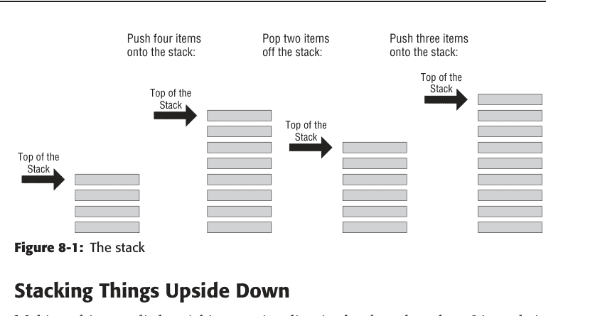

**图 8-1：** 堆栈

## 倒置堆叠

使可视化稍微复杂一点的是，x86 堆栈基本上是倒置的。如果你设想一个内存区域，最低地址在底部，最高地址在顶部，堆栈从天花板开始，当项被推入堆栈时，堆栈向下增长，朝向低内存。

图 8-2 大致展示了 Linux 如何组织程序运行时的内存。在内存底部是你在程序中定义的三个段：`.text`在最低地址，接着是`.data`，然后是`.bss`。堆栈位于程序内存块的完全相反的另一端。在`.bss`段末尾和堆栈顶部之间基本上是空闲内存。

C 程序通常使用这个空闲内存空间来"即时"分配一个称为*堆*的区域中的变量。汇编程序也可以这样做，尽管这并不像听起来那么容易，而且我无法在这本书中涵盖。重要的是要记住，堆栈和你的程序本身（代码和命名数据）在沙箱的对角玩耍。堆栈朝你程序的其余部分增长，除非你正在做*真正*非凡的——或者愚蠢的——事情，否则堆栈增长到与你程序的命名数据项或机器指令 collision 的可能性很小或根本没有。如果发生这种情况，Linux 会平静地发出 segmentation fault，你的程序将终止。

关于图 8-2，我唯一能提供的 caution 是，程序段与堆栈的相对大小不应按字面理解。一个中等规模的汇编程序可能有数千字节的程序代码和数数万字节的数据，但对此堆栈仍然相当小：最多几百字节，通常还更少。

注意，当你的程序开始运行时，堆栈并非完全为空。有一些有用的东西在那里等着你，我稍后会解释。

## 图 8-2：程序内存中的栈

## 压栈指令

你可以通过多种方式将数据放入栈中，但最直接的方法涉及一组五个相关的机器指令：`PUSH`、`PUSHF`、`PUSHFD`、`PUSHA`和`PUSHAD`。它们的工作方式类似，主要区别在于它们压入栈的内容：

- `PUSH`压入你在源代码中指定的 16 位或 32 位寄存器或内存值。

- `PUSHF`将 16 位标志寄存器压入栈中。

- `PUSHFD`将完整的 32 位`EFlags`寄存器压入栈中。

- `PUSHA`将所有八个 16 位通用寄存器压入栈中。

- `PUSHAD`将所有八个 32 位通用寄存器压入栈中。

以下是`PUSH`系列指令使用的一些示例：

```
pushf     ; 压入标志寄存器
pusha     ; 同时压入 AX、CX、DX、BX、SP、BP、SI 和 DI，按此顺序
          ; 全部一次完成
pushad    ; 同时压入 EAX、ECX、EDX、EBX、ESP、ESP、EBP、ESI 和 EDI，
          ; 全部一次完成
push ax   ; 压入 AX 寄存器
push eax  ; 压入 EAX 寄存器
push [bx] ; 压入存储在 BX 处内存中的字
push [edx]; 压入 EDX 处内存中的双字
push edi  ; 压入 EDI 寄存器
```

注意，`PUSHF`和`PUSHFD`不需要操作数。如果你尝试给它们传递操作数，汇编器会报错；这两条指令只能压入标志位，这是它们唯一能做的工作。

`PUSH`对 32 位操作数的工作方式如下：首先`ESP`减少 32 位（4 字节），使其指向栈段中一个 4 字节长的空闲区域。然后，将要压入栈的数据写入`ESP`指向的内存地址。瞧！数据安全地保存在栈中，`ESP`也向内存底部移动了两个字节。`PUSH`也可以将 16 位值压入栈中；唯一的区别是`ESP`移动 2 字节而不是 4 字节。

`PUSHF`的工作方式相同，只是它写入的是 16 位标志寄存器。

`PUSHA`的工作方式也相同，只是它同时将所有八个 16 位通用寄存器压入栈中，因此一次占用 16 字节的栈空间。`PUSHA`是随着 286 处理器加入指令集的，在 8086/8088 CPU 中不存在。

`PUSHFD`和`PUSHAD`是随着 386 CPU 加入 x86 指令集的。它们的工作方式与对应的 16 位版本相同，只是它们压入的是 32 位寄存器而不是 16 位寄存器。`PUSHFD`将 32 位`EFlags`寄存器压入栈中。`PUSHAD`一次将所有八个 32 位通用寄存器压入栈中。

什么可以压入栈、什么不可以压入栈，这比较复杂，取决于你使用的 CPU。任何 16 位和 32 位通用寄存器都可以单独压入栈中。任何 x86 CPU 都不能将 8 位寄存器压入栈中。换句话说，你不能压入`AL`或`BH`或其他任何 8 位寄存器。立即数可以压入栈中，但前提是你要有 286 或更新的 CPU。（在 Linux 下这总是成立的。）用户模式的 Linux 程序在任何情况下都不能将段寄存器压入栈中。

在 DOS 时代，记住所有这些曾经是个问题，但如今你很可能不会在早于 386 的 CPU 上运行代码，而且在 Linux 下更是不可能。

## 出栈操作码

一般来说，压入的必须弹出，否则你可能会陷入各种麻烦。从栈中获取数据项是通过另外五个指令完成的：`POP`、`POPF`、`POPFD`、`POPA`和`POPAD`。正如你可能预料的，`POP`是通用的逐一出栈指令，而`POPF`和`POPFD`专门用于从栈中弹出标志位。`POPA`从栈顶弹出 16 字节到八个 16 位通用寄存器中。`POPAD`是`PUSHAD`的反面，从栈顶弹出 32 字节到八个 32 位通用寄存器中。以下是一些示例：

```
popf          ; 从栈顶弹出 2 字节到标志寄存器
popa          ; 从栈顶弹出 16 字节到 AX、CX、DX、BX、
              ; BP、SI 和 DI……但不包括 SP！
popad         ; 从栈顶弹出 32 字节到 EAX、ECX、EDX、EBX、
              ; EBP、ESI 和 EDI……但不包括 ESP！！！
pop cx        ; 从栈顶弹出 2 字节到 CX
pop esi       ; 从栈顶弹出 4 字节到 ESI
pop [ebx]     ; 从栈顶弹出 4 字节到 EBX 处的内存
```

与`PUSH`一样，`POP`只对 16 位或 32 位操作数进行操作。不要尝试将数据从栈弹出到 8 位寄存器（如`AH`或`CL`）中。

`POP`的工作方式与`PUSH`基本相同，但方向相反。与`PUSH`一样，从栈中弹出多少数据取决于操作数的大小。将栈中数据弹出到 16 位寄存器会移除栈顶两个字节。将栈中数据弹出到 32 位寄存器会移除栈顶四个字节。请注意，*CPU 或 Linux 中没有任何东西能记住**你**放在栈上的数据项的大小*。**知道最后压入栈的项的大小是你的责任。** 如果你最后压入的是一个 16 位寄存器，将栈弹出到 32 位寄存器会比你压入时多取出两个字节。可能有（罕见的）情况下你想这样做，但你肯定不想意外地做！

当执行`POP`指令时，工作顺序如下：首先，将`ESP`当前存储的地址处的数据（根据操作数，16 位或 32 位）从栈中复制出来，放到`POP`的操作数中，即你指定的任何目标。之后，`ESP`按操作数的大小增加（而不是减少），因此实际上`ESP`向栈上方移动两或四字节，远离低内存区域。

重要的是，压栈时`ESP`是在将字放入栈*之前*递减的，但出栈时是在从栈移除字*之后*递增的。x86 世界之外的某些其他 CPU 工作方式相反，这没问题——只是不要混淆。对于 x86，以下总是成立的：*除非栈完全为空，否则`SP`指向的是真实数据，而不是空闲空间。*

通常，你不需要记住这个事实，因为`PUSH`和`POP`会为你处理一切，你不需要手动跟踪`ESP`指向什么。如果你决定直接操作栈指针，了解`PUSH`和`POP`背后的位置序列会有所帮助——这是本书未涉及的高级主题。

关于`POPA`和`POPAD`的一个重要注意事项：栈指针中存储的值*不受*影响！换句话说，`PUSHA`和`PUSHAD`会将当前栈指针值压入栈中。然而，`POPA`和`POPAD`会丢弃它们在栈上找到的栈指针值，并且不会改变`SP`/`ESP`中的值。这很合理：在 CPU 正忙于处理栈的时候改变栈指针值会招致混乱。

图 8-3 更详细地展示了栈的操作。图中顶部显示了程序执行某个假设时刻四个 16 位 "X" 通用寄存器的值。`AX`首先被压入栈中。它的最低有效字节在`ESP`处，最高有效字节在`ESP+1`处。（记住，两个字节是作为整体同时压入栈中的！）

每次将一个 16 位寄存器压入栈中时，`ESP`向低内存方向递减两个字节。前三列分别显示`AX`、`BX`和`CX`被压入栈中；但注意第四列发生了什么，当执行`POP DX`指令时，栈指针增加两个字节并向远离低内存的方向移动。`DX`现在包含了`CX`内容的副本。实际上，`CX`被压入栈中，然后立即被弹出到`DX`中。

这是将`CX`的值复制到`DX`的一种相当绕弯的方法。`MOV DX,CX`要快得多也直接得多。然而，通过栈移动寄存器值有时是必要的。记住，`MOV`指令*不能*操作标志寄存器或`EFlags`寄存器。如果你想将标志或`EFlags`的副本加载到寄存器中，必须首先使用`PUSHF`或`PUSHFD`将标志或`EFlags`压入栈中，然后使用`POP`将标志值从栈弹出到你选择的寄存器中。因此，将标志位加载到`BX`中的做法如下：

```
PUSHF ; 将标志寄存器压入栈。
POP BX ; ..然后立即将其弹出到BX中
```

并非`EFlags`的所有位都能通过`POPFD`改变。位`VM`和`RF`不受将值从栈中弹出到`EFlags`的影响。

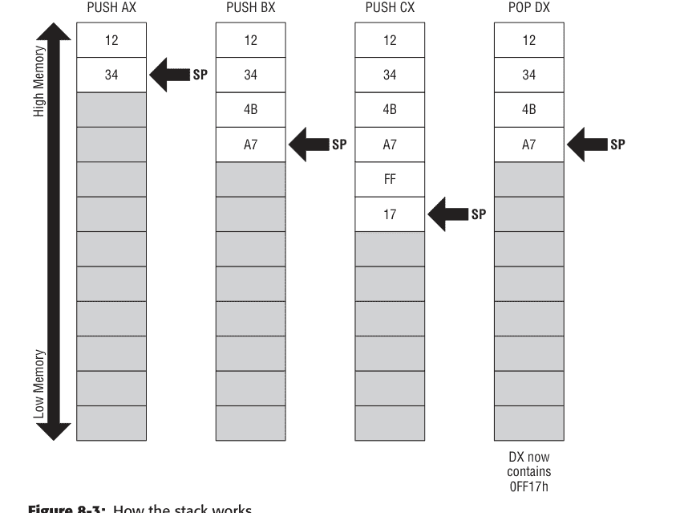

**图 8-3：** 栈的工作原理

## 短期存储

栈应被视为临时存放东西的地方。存储在栈上的项目没有名称，并且通常必须以与入栈相反的顺序出栈。后进先出，记住。LIFO！

栈的一个绝佳用途是让为数不多的寄存器承担多重职责。如果你需要一个寄存器来暂时保存某个值，以便 CPU 进行运算，而所有寄存器都在使用中，那么就将其中一个忙碌的寄存器压入栈。它的值在栈中将保持安全，同时你可以将该寄存器用于其他用途。当你使用该寄存器完毕后，将其旧值从栈中弹出——这样你就获得了额外寄存器的优势，而实际上并没有额外的寄存器。（当然，代价是你花在将寄存器值移入和移出栈上的时间。你不希望在频繁执行的循环中间做这件事！）


在程序执行期间进行短期存储是栈最简单、最明显的用途，但其最重要的用途可能是调用过程和Linux内核服务。既然你已经理解了栈，你就可以应对神秘的`INT`指令了。

## 通过INT80使用Linux内核服务

`eatsyscall.asm`中的一切都在为执行程序唯一真正工作的那条单指令做准备：在Linux控制台中显示一行文本。程序的核心是对Linux操作系统的一次调用，使用`INT`指令执行，参数为`80h`。

如第6章所述，操作系统有点像神，也有点像巨魔，Linux也不例外。它以神一般的方式控制着机器中所有最重要的元素：磁盘驱动器、打印机、键盘、各种端口（以太网、USB、蓝牙等）以及显示器。同时，Linux就像你机器所有这些部件的一座桥下的巨魔：你告诉巨魔你想做什么，巨魔就会去替你完成。

Linux提供的服务之一是简单（实际上过于简单）地访问你的PC显示器。对于`eatsyscall.asm`的目的（这只是教你编写并运行第一个汇编语言程序的课程）来说，简单的服务已经足够了。

那么——我们如何使用Linux的服务呢？我们必须通过Linux内核来请求这些服务。这条路使用起来容易，理解起来却 tricky：通过软件中断。

## 一个并不中断任何事物的"中断"

1981年，作为x86处理器家族的新手，*软件中断*的概念让我抓狂。我一直在找中断者和被中断者。结果没有什么被中断。

这个名字很不幸，尽管我承认叫它软件中断确实有些道理。它们实际上是礼貌的中断——如果一种中断如此礼貌以至于完全不中断任何东西，你还能称之为中断的话。

软件中断和Linux服务的本质最好通过`eatsyscall.asm`中展示了两次的真实例子来解释。正如我之前暗示的，Linux将库例程——专注于单一任务的机器指令序列——隐藏在其内部。每个序列都能做些有用的事情：从文件读取某些内容、向文件发送某些内容、获取当前时间、访问网络端口，等等。Linux用它们来完成自己的工作，并且（戴上它的巨魔帽子）也供你、程序员，从你自己的程序中访问。

那么，关键问题来了：你如何找到隐藏在Linux内部的东西呢？所有机器指令序列当然都有地址，那为什么不直接公布所有这些有用例程的地址列表呢？

这里有两个问题：首先，允许用户空间程序亲密访问操作系统内部是危险的。恶意软件作者可能会修改操作系统的关键组件来监视用户活动、捕获按键并转发到别处，等等。其次，任何给定指令序列的地址从一个安装到另一个安装都不一样——不，从一天到另一天就会变化，因为软件被安装、配置和从PC上移除。Linux在不断进化、改进和修复。Ubuntu Linux每年春秋发布两次重大更新，小的自动更新则通过更新管理器定期下载到你的PC。修复和改进代码涉及添加、更改和移除机器指令，这改变了那些隐藏代码序列的大小——因此也改变了它们的位置。

解决方案十分巧妙。有一种调用Linux内部服务例程的方法，完全不依赖于知道任何地址。大多数人称之为*内核服务调用门*，它代表用户空间（你的程序运行的地方）和内核空间（神/巨魔Linux工作的地方）之间一个重重把守的通道。这个调用门通过x86软件中断实现。

在x86内存的最开始，段0、偏移0处，有一个特殊的查找表，包含256个条目。每个条目都是一个完整的内存地址，包括段和偏移部分，总共每个条目4字节。任何x86机器的前1,024字节都保留给这个表，其他代码或数据不得放置在那里。

表中的每个地址称为*中断向量*。整个表称为*中断向量表 summer solstice table*。每个向量有一个编号，从0到255。占据表中0到3字节的向量是向量0。占据4到7字节的向量是向量1，依此类推，如图8-4所示。

这些地址中没有一个是像PC BIOS例程那样被烧录到永久内存中的。当你的机器启动时，Linux和BIOS会在中断向量表的许多槽位中填入自身某些服务例程的地址。每个版本的Linux都知道其最内部件的位置，当你升级到Linux的新版本时，那个新版本会在中断向量表的相应槽位中填入更新且准确的地址。

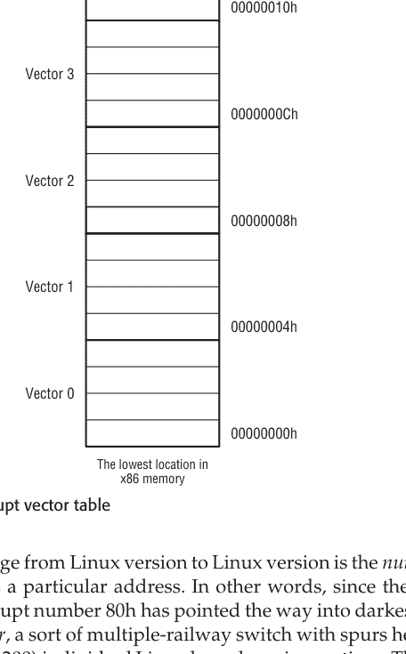

*不会*随Linux版本变化的是持有特定地址的*中断编号*。换句话说，从第一个Linux版本开始，中断号`80h`就指向通往Linux最深处 darkest Linux 的*服务分派器*，这是一个类似多轨铁路道岔的装置，分支通向众多（近200个 individual）Linux内核服务例程。分派器的地址在不同Linux发行版和版本中有所不同，但无论你使用哪个Linux发行版或哪个版本，程序都可以通过中断向量表中的`80h`槽位访问分派器。

此外，程序不必自己去表中探查地址。事实上，在保护模式的限制下这是被禁止的。该表属于操作系统，你甚至不能下去查看它。然而，你不必直接访问表中的地址。x86 CPU包含一条机器指令，具有特殊能力来利用中断向量表。`INT`（中断）指令在`eatsyscall.asm`中被用来请求Linux服务，以在屏幕上显示其广告标语文本。在`eatsyscall.asm`中有两处使用`INT 80h`指令。当执行`INT 80h`指令时，CPU会前往中断向量表，从`80h`槽位获取地址，然后跳转到该地址执行。从用户空间到内核空间的过渡是干净且完全受控的。在表槽`80h`中存储的地址的另一端，分派器接管执行并完成你的程序请求的服务。

该过程如图8-5所示。Linux在启动时加载，它为准备机器使用而做的众多事情之一，就是在启动向量表的几个向量中填入正确的地址。其中之一是内核服务分派器的地址，它被放入`80h`槽位。

稍后，当你在Linux控制台命令行输入你的程序名称`eatsyscall`时，Linux将`eatsyscall`可执行文件加载到用户空间内存并允许其执行。为了访问内核服务，`eatsyscall`在需要时执行`INT 80h`指令。你的程序中不需要有任何关于Linux内核服务分派器的更多信息，只知道它在中断向量表中的编号即可。有了这个单一编号，`eatsyscall`就可以安于一无所知，简单地让`INT 80h`指令和中断向量`80h`带它去往需要去的地方。

在我成长的芝加哥西北部，有一条巴士沿着Milwaukee大道运行。所有芝加哥巴士路线都有编号，Milwaukee大道路线是56路。它从市中心以北的某条错综复杂街道的某个地方出发，在城市边界内的一个森林保护区结束。森林保护区管理局在那个森林保护区运营着一个名为Whelan Pool的游泳池。Milwaukee大道沿线的孩子们未必能说出Whelan Pool的地址，但他们能立刻告诉你如何到达那里：跳上56路巴士，坐到终点站。软件中断也是如此。找到可靠指向你目的地的向量编号，乘坐该向量直到终点站，不必担心蜿蜒的路线或你目的地的精确地址。

在幕后，`INT 80h`指令还会做另一件事：在跟随向量`80h`进入Linux内核之前，它将*下一条*指令的地址（即紧跟在`INT 80h`指令后面的那条指令）压入栈。就像Hansel和Gretel一样，`INT 80h`指令向栈中推送一些面包屑，作为帮助CPU在深入Linux之后找到返回`eatsyscall`程序的路——不过更多内容后面再讲。

现在，Linux内核服务分派器控制着对200个 individual 服务例程的访问。它如何知道执行哪一个呢？你必须告诉调度器你需要哪个服务，而你需要将服务编号放入寄存器`EAX`中。调度器可能还需要其他信息，并且会期望你在开始工作之前将这些信息提供到正确的位置——几乎总是在各种寄存器中。

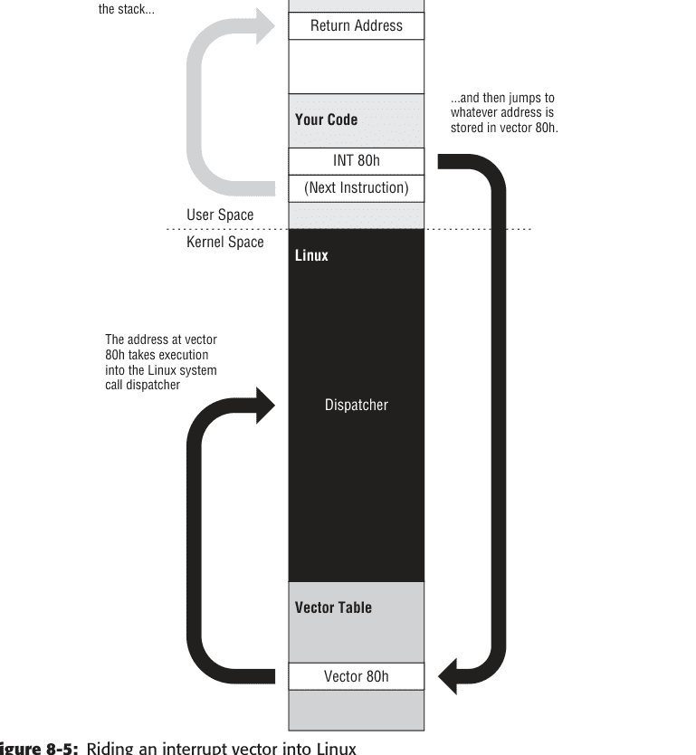

看看`eatsyscall.asm`中的以下代码行：

```
mov eax,4        ; Specify sys_write syscall
mov ebx,1        ; Specify File Descriptor 1: Standard Output
mov ecx,EatMsg   ; Pass offset of the message
mov edx,EatLen   ; Pass the length of the message
int 80H          ; Make syscall to output the text to stdout
```

这一系列指令请求Linux在控制台上显示一个文本字符串。第一行设置了一个关键信息：我们请求的服务编号。在这个例子中，是`sys_write`，服务编号为4，它将数据写入Linux文件。请记住，在Linux中，几乎所有东西都是文件，包括控制台。第二行告诉Linux*要*写入哪个文件：标准输出。每个文件都必须有一个数字文件描述符，而前三个（0、1和2）是标准的，永远不会改变。标准输出的文件描述符是1。

第三行将待显示字符串的地址放入`ECX`中。这就是Linux知道你想要显示什么的方式。调度器期望地址位于`ECX`中，但该地址只是字符串开始的位置。Linux还需要知道字符串的长度，我们将该值放入寄存器`EDX`中。

将内核服务号、字符串地址和字符串长度放入它们各自的寄存器后，我们执行`INT 80h`来访问调度器。`INT`指令就是全部所需。*砰！*——执行跨过了进入内核空间的桥梁，在那里Linux这个巨魔读取`ECX`处的字符串，并通过它自己或多或少保密的机制将其发送到控制台。大多数时候，这是件好事：编程机器的描述中可能存在过多的信息，就像你个人生活的描述一样。

## 再次回家

进入Linux的部分就说到这。执行是如何返回的呢？向量`80h`中的地址将执行带入内核服务调度器，但Linux如何知道该将执行返回到`eatsyscall`的何处呢？软件中断的一半聪明之处在于知道如何到达那里，而另一半——同样聪明——在于知道如何返回。

为了在`INT 80h`指令之前离开的位置继续执行，Linux必须在一个完全可靠的地方查找返回地址，而这个完全可靠的地方不是别的，正是栈顶。

我早前提到过（没有特别强调）`INT 80h`指令在跳入未知之前会将一个地址压入栈顶。这个地址是*下一个*要执行的指令的地址：紧跟在`INT 80h`指令之后的那条指令。这个位置完全可靠，因为，正如机器中只有一个中断向量表一样，任何时刻只有一个栈在运行。这意味着只有一个栈顶——也就是说，在`ESP`指向的地址处——Linux总是可以通过弹出栈顶的地址并跳转到该地址，将执行发送回调用它的程序。

这个过程如图8-6所示，它是图8-5的延续。正如`INT`指令将返回地址压入栈然后跳转到特定向量中存储的地址一样，有一条"组合"指令会从栈中弹出返回地址然后跳转到该地址。这条指令就是`IRET`（Interrupt RETurn，中断返回），它完成了这个复杂但可靠的系统：当你不知道地址时跳转到一个地址。这个技巧，再次强调，就是知道地址可以在哪里可靠地找到，而在这个例子中，那就是栈。

实际上，软件中断机制向栈中压入和从栈中弹出的内容还有更多，但这发生得足够透明，我不想在这一点上使解释复杂化——而且你不太可能很快去编写自己的软件中断例程。那是内核领域的编程，我鼓励你去追求；但当你刚开始时，这还有很长的路要走。

## 通过INT 80h退出程序

`eatsyscall.asm`中还有第二个`INT 80h`指令，它有一个朴素但至关重要的工作：关闭程序并将控制权返回给Linux。这听起来比实际更简单，一旦你更多地了解Linux内部，你就会欣赏到启动一个进程和关闭一个进程所必须做的工作。

从你自己程序的角度来看，这相当简单：你将`sys_exit`服务的编号放入`EAX`，将返回码放入`EBX`，然后执行`INT 80h`：

```
mov eax,1          ; Specify Exit syscall
mov ebx,0          ; Return a code of zero
int 80H            ; Make the syscall to terminate the program
```


返回码是一个数值，你可以随意定义它。技术上，对它的唯一限制是（必须能放入32位寄存器中译者注：原文如此，但"fit in"意为"容纳于"，建议保持原意），但按照惯例，返回值为`0`表示"一切正常；正常关闭"。非`0`的返回值通常表示某种错误。请记住，在更大的程序中，你必须注意那些不按预期工作的事情：找不到磁盘文件、磁盘驱动器已满等等。如果程序无法完成其工作而必须提前终止，它应该有某种方式告诉你（或者在某些情况下，告诉另一个程序）出了什么问题。返回码是做到这一点的好方法。

以这种方式退出不仅仅是一个礼节。*每个*你编写的程序*必须*通过内核服务调度器调用`sys_exit`来退出。如果程序只是"跑到边缘"，它确实会结束，但Linux会报出一个段错误，你将完全不知道发生了什么。

## 软件中断与硬件中断

你可能还在想，为什么这种机制被称为"中断"，这是一个合理的问题，有着历史根源。软件中断是从一种涉及真正中断的较旧机制演变而来的：硬件中断。*硬件中断*是你的CPU关注外部世界的机制。

PC中内置的相当复杂的电气系统使电路板能够向CPU发送信号。CPU芯片上的一个实际金属引脚由电路板设备（如磁盘驱动器控制器或串行端口板）从另一个电压级别移动到另一个电压级别。通过这个引脚，外部设备拍了拍CPU的肩膀。CPU将这种拍肩识别为硬件中断。与软件中断一样，硬件中断也是编号过的，对于每个中断号，中断向量表中都有一个保留的插槽。在这个插槽中存放着中断服务例程（ISR）的地址，该例程执行与拍CPU肩膀的设备相关的某些操作。例如，如果中断信号来自串行端口板，CPU就会允许串行端口板将自己中的一个字符字节传输到CPU中。

硬件中断和软件中断之间唯一的真正区别在于触发中断向量表跳转的事件。对于软件中断，触发事件是软件的一部分——也就是`INT`指令。对于硬件中断，触发事件是施加到CPU芯片本身的电信号，没有任何`INT`指令参与这个过程。CPU自己在识别到触发中断的电脉冲时将返回地址压入栈中；然而，当ISR完成后，`IRET`指令将执行送回原地，就像对软件中断一样。

这里解释的在软件中断调用后返回"家"的机制实际上比听起来更通用。在本书的后面，我们将开始将自己的程序划分为过程，这些过程通过一对指令访问：`CALL`和`RET`。`CALL`将下一条指令的地址压入栈中，然后跳转到过程中；过程末尾的`RET`指令从栈顶弹出地址，允许执行在`CALL`指令之后继续。

## INT 80h与可移植性执念

十年前，当我为本书第二版准备两个与Linux相关的章节时，我围观了一场关于在用户空间程序中加入直接`INT 80h`访问Linux内核调用是否可取的辩论。有几个人几乎是气急败坏地尖叫，`INT 80h`调用*只能*由标准C库进行，内核服务的汇编语言调用应该始终间接进行，通过调用C库中的例程，然后由这些例程进行必要的`INT 80h`内核调用。

我在这里提到这个，是因为现在仍有这样的人存在，而且如果你在 Linux 编程圈子里混得足够久，最终总会遇到他们。我的建议是，如果可以的话，避开这场争论。争论这个毫无意义，而且，值得庆幸的是，自 2000 年以来编写 Linux 程序的新方法大量涌现，已经让可移植性癖好大多黯然失色了。

但归根结底是这样的：Unix 世界长期以来一直秉持这样的理想，即一个程序应该能够被*不加修改地*重新编译，然后在另一个不同版本的 Unix 上正确运行，甚至可以在完全不同的 CPU 架构上运行的 Unix 上正确运行。这几乎不可能做到，而且仅对用单一语言（C）编写的相对简单的程序才有可能，这些程序只能使用计算机系统所能提供的"最小公倍数"子集。一旦涉及复杂的 GUI 应用程序和现代外设，你就会面对多个互不兼容的软件库，它们拥有极其复杂的应用程序编程接口（API），还有本不该存在但却不客气地确实存在的设备驱动程序怪癖。

再加上所有这些 API 的持续演进，以及像 Python 这样的新型高级编程语言的出现——你去年写的代码今年甚至可能在*同一个*平台上都无法编译——你就会得出一个我多年前就已达成的结论：*即插即用的可移植性是一个神话。*我们的平台现在已经如此复杂，以至于*每个*应用程序都是特定于平台的。跨平台编码是可以做到的，但源代码必须修改，通常还必须通过使用*条件编译*来做出妥协——基本上，就是在程序内部设置一系列 `IF` 语句，根据传递给编译器的一组参数来改变程序源代码：如果你是为 x86 上的 Linux 编译，就编译这些语句；如果你是为 x86 上的 BSD Unix 编译，就编译另一些语句，等等。条件编译只是残酷底层现实的一个遮羞布：*计算机是不同的。*计算机系统会演进。现在不是 1970 年了。

正如我在本节中所解释的，调用 Linux 内核服务确实是特定于 Unix 的 Linux 实现的。其他 Unix 实现以不同的方式处理内核调用。在 BSD 系列的 Unix 操作系统中，内核服务调度器也是通过 `INT 80h` 调用的，但参数是通过栈传递给内核的，而不是通过寄存器。我们可以在技术优劣上争论这种方式更好还是更差，但它是*不同的*，你的 Linux 汇编程序*无法*在 BSD Unix 下运行。如果这对你来说是个问题，汇编语言可能不是正确的选择。（对于或多或少"可移植"的编码，我建议学习 Python，这是一种出色且非常高级的语言，几乎存在于所有 Unix 实现中。）

然而，在 Linux 发行版之间，甚至跨越多年的 Linux 更新，内核服务列表本身的变化很小，而且主要是近年来添加到内核中的更晦涩的服务。如果在一个 x86 Linux 发行版下编写的汇编代码不能在另一个 x86 Linux 发行版下完全相同地运行，那*不是*因为你调用内核服务的方式。

汇编语言不是，也不可能是可移植的。这不是它的用途。不要让任何人试图说服你相反的观点。

## 设计一个非平凡程序

到目前为止，你已经了解了设计和编写执行重要工作的小型实用程序所需的几乎全部知识——这些工作甚至可能是有用的。在本节中，我们将从工程学的角度来应对编写实用程序的挑战，即解决问题。这不仅仅是编写代码，还包括陈述问题，将其分解为问题的组成部分，然后设计一系列步骤和测试来解决问题，这些步骤和测试可以作为汇编语言程序来实现。

本节存在一个某种"先有鸡还是先有蛋"的问题：不写条件跳转就难以编写非平凡的汇编程序，而不在非平凡程序中演示又难以解释条件跳转。我在前面的章节中稍微触及了跳转，并将在第 9 章中详细讨论。我在本节的演示程序中使用的跳转相当简单；如果你对细节还有些模糊，请阅读第 9 章，然后回到本节来完成示例。

## 定义问题

多年前，我曾在一个团队中工作，我们正在编写一个系统，该系统从世界各地的现场办公室收集和验证数据，并将这些数据发送到一个大型中央计算设施，在那里进行制表、分析，并用于生成状态报告。这听起来足够简单，事实上从现场办公室收集数据本身并不困难。使项目变得困难的是，它涉及几种截然不同且非常不同类型的计算机，它们以完全不同且常常不兼容的方式看待数据。这个问题与我在第 6 章中简要提及的数据编码问题有关。我们必须处理三种不同的数据字符编码系统。在一个系统上以一种方式解释的字符，在另一个系统上不会被视为相同的字符。

要将数据从一个系统移到另一个系统，我们必须创建将数据编码从一种方案转换为另一种方案的软件。其中一种方案使用的数据库管理器不能很好地处理小写字符，原因即使在当时也显得古怪，而在今天可能令人难以置信。我们必须将任何小写字符转换为大写，然后才能将数据文件输入该系统。还有其他编码问题，但这是一个重要的问题，而且由于这是一个易于描述然后解决的简单问题，它是真正的汇编语言程序设计的一个很好的初步练习。

在最高层次上，这里要解决的问题可以这样陈述：*将数据文件中的任何小写字符转换为大写。*

考虑到这一点，记下关于问题的笔记是个好主意。特别是，记下任何拟议解决方案的局限性。我们过去称这些笔记为解决方案的"边界"，在思考解决问题的程序时需要牢记这些边界：

- 我们将在 Linux 下工作。
- 数据存在于磁盘文件中。
- 我们事先不知道任何文件会有多大。
- 文件没有最大或最小尺寸。
- 我们将使用 I/O 重定向将文件名传递给程序。
- 所有输入文件都采用相同的编码方案。程序可以假设一个文件中的"a"字符与另一个文件中的"a"编码方式相同。（在我们的例子中，这是 ASCII。）
- 我们必须以原始形式保留原始文件，而不是从原始文件读取数据然后写回原始文件。（这是因为如果进程崩溃，我们会在没有完全生成输出文件的情况下破坏原始文件。）

在真实的项目中，这些笔记可能有几十页，但仅仅这几点就足以塑造我们对字符大小写问题的简单解决方案。请注意，这些笔记扩展了必须做什么，并在一定程度上对最终解决方案的性质施加了限制，但并没有试图说明*如何*去做。这是我们在下一步要做的事情。

## 从伪代码开始

一旦你尽可能彻底地理解了问题的本质，就可以开始构思解决方案了。起初，这与第 1 章中描述的过程非常相似，即某人为一天的外出 errands 列一个"待办事项"清单。你以非常宽泛的形式、用最少的语句来陈述解决方案。然后，一点一点地，你将陈述的解决方案进行细化，将较大的步骤分解为包含在其中的较小步骤。

在我们的案例中，解决方案很容易用宽泛的术语来陈述。首先，陈述可能采取以下形式：

```
从输入文件中读取一个字符。
将字符转换为大写（如有必要）
将字符写入输出文件。
返回第 1 步。
```

这当然足够清楚了，如果严格按照字面意思执行，考虑到问题的边界，它可能会完成工作。但这有点过于宽泛了。例如，要进行转换，我们首先必须弄清楚一个字符是否可以转换——也就是说，如果它在字符集中，是小写字母，在原始文件中，并且有一个匹配的大写对应字符。此外，在第 1 步中还暗示着一个测试，看看我们是否接近文件末尾——处于"文件末尾"状态，或者是否发生了磁盘读取错误。这种级别的伪代码掩盖了太多条件，因此还不够充分。它应该忠实于必要的逻辑，哪怕只是以非特定的方式。

更详细地展开第 1 步，包括必要的测试：

```
打开输入文件。
从输入文件中读取一个字符。
如果到达文件末尾，关闭文件并退出。
将字符转换为大写。
将字符写入输出文件。
返回第 1 步。
```

注意额外的注释，即如果到达文件末尾，我们关闭文件。在这个阶段，我们不是在尝试向文件系统写入数据或展示汇编语言的任何特殊特性；我们只是在表达计划程序的流程。我们可以进一步细化，但我喜欢从这种非常宽泛的模式开始，这样我就能在决定每个步骤如何具体实现之前，看到程序的整体轮廓。给定整体轮廓，我们就可以开始识别和规划细节。这些细节起初会是一份笔记清单，但很快就会变成实际的汇编语言代码，我们可以开始编码了。

例如，我们需要处理两个文件——因此最初打开输入和输出文件会有帮助，这样它们就可以随时供我们使用。我们还需要跟踪输入和输出的"位置"，就像我们在前面的示例中所做的那样。我们可以更详细地细化伪代码方法：

```
打开输入文件。
打开输出文件。
从输入文件中读取一个字符。
如果到达文件末尾，关闭两个文件并退出。
将字符转换为大写。
将字符写入输出文件。
返回第 1 步。
```

即便如此，我们可以看到"打开输入文件"本身就是一个多步骤过程。其他步骤也是如此。初始伪代码应该传达整体逻辑，后续迭代则引入更多细节。但最终，每个步骤都会被完全充实，可以写成汇编代码。伪代码的一个好处是，你使用得越多，翻译成汇编的能力就会越强。（练习翻译成 C 也很有帮助，但这超出了本书的范围。）

关于逻辑和整体轮廓，这就足够了。现在我们需要识别程序所需的具体数据结构和变量。我们必须处理：

- 输入缓冲区
- 输出缓冲区
- 输入文件的文件描述符/列表
- 输出文件的文件描述符

随着我们细化逻辑，任何其他需要的变量都会从中得出，但这四个是既定的。

## 伪代码的局限性

伪代码是规划程序逻辑和流程的非常强大的工具，但它有其局限性。最大的局限性在于它不是一种真正的语言，缺乏真正语言所强制要求的精确性。它可能很草率，更重要的是，它可能让我们跳过重要的细节，而这些细节是编译器会迫使我们面对的。

我给你举个例子。当我们将解决方案陈述为"从输入文件中读取一个字符"时，这在 Linux 内核调用的术语中究竟意味着什么？Linux 实际上并没有"读取一个字符"的内核服务。它有"从文件中读取一缓冲区数据"和"将一缓冲区数据写入文件"的服务。使用读取服务一次从文件中读取单个字符是极其低效的，因为这需要对每个字符都进行一次内核调用。

所以我们必须稍微重新思考一下这个问题。我们不会一次读取一个字符。我们读取一缓冲区字符——比如说，4096 个——然后在循环中逐个处理它们。当缓冲区耗尽时，我们再读取另一缓冲区。这要高效得多，事实上，真正的程序就是这样工作的。这个细节被伪代码的模糊性所掩盖，这很好地说明了为什么你最终必须超越伪代码。

细化后的伪代码可能看起来像这样：

```
以读取模式打开输入文件。
以写入模式打开输出文件。
从输入文件读取一缓冲区数据。
对缓冲区中的每个字符：
    将字符转换为大写。
将缓冲区写入输出文件。
如果不是文件末尾，返回第 3 步。
关闭两个文件。
退出。
```

这样更好，更接近我们实际必须实现的东西。但即使在这里，我们也必须注意，转换为大写不是单一步骤。我们必须测试每个字符，看它是否是小写字母，如果是，则进行转换。如果不是，我们就原样传递。那错误检查呢？这些 Linux 服务调用中的每一个都返回错误代码，而健壮的程序会检查它们。

所以我们再次细化：

```
以读取模式打开输入文件。
如果出错，以错误代码退出。
以写入模式打开输出文件。
如果出错，以错误代码退出。
设置读取缓冲区的循环。
从输入文件读取一缓冲区数据。
如果读取字节数 = 0，关闭文件并退出。
对缓冲区中的每个字符：
    如果字符 >= 'a' 且字符 <= 'z'，
        从字符减去 32。
将缓冲区写入输出文件。
如果出错，以错误代码退出。
返回第 5 步。
```

这现在已经非常接近于我们可以用汇编语言编码的了。转换逻辑——从小写字母减去 32——特定于 ASCII 编码，这是我们前面提到的一个假设。小写测试是一个范围比较。

还有一件事：缓冲区。我们需要为它们在内存中分配空间。Linux 会在我们请求时给我们一个内存地址，或者我们可以在程序的数据段中保留空间。为简单起见，我们将在 `.data` 或 `.bss` 段中保留空间。

## 从伪代码到汇编语言

现在我们有了详细的伪代码计划，可以开始将其翻译为实际的汇编语言了。这涉及几个标准步骤：

- 用我们的缓冲区和变量设置数据段。
- 用程序逻辑设置代码段。
- 使用 `INT 80h` 进行适当的 Linux 内核服务调用。
- 检查返回值并适当处理错误。

我们将需要的具体内核服务有：

- `sys_open`（服务 5）用于打开文件
- `sys_read`（服务 3）用于读取数据
- `sys_write`（服务 4）用于写入数据
- `sys_close`（服务 6）用于关闭文件
- `sys_exit`（服务 1）用于终止程序

这些服务中的每一个都在特定寄存器中接受参数，并在寄存器中返回值，正如本书前面章节和 Linux 文档中所详述的那样。

这个程序的完整汇编代码会有好几页，我不会在这里全部列出，但关键点是循环结构和字符转换。对于缓冲区中的每个字符，我们执行类似这样的操作：

```assembly
; 假设 ESI 指向当前字符，ECX 是循环计数器
mov al, [esi]           ; 将字符加载到 AL
cmp al, 'a'
jb not_lower
cmp al, 'z'
ja not_lower
sub al, 32              ; 转换为大写
not_lower:
mov [edi], al           ; 存储到输出缓冲区
inc esi
inc edi
dec ecx
jnz process_loop        ; 如果还有更多字符则继续
```

这是内部循环，是程序的核心。围绕它的是文件操作、缓冲区管理和错误检查。

我希望这个例子能让你对如何从问题陈述过渡到可工作的汇编代码有扎实的理解。步骤是：

1. 彻底理解问题，包括所有约束和假设。
2. 编写不担心实现细节的宽泛伪代码。
3. 细化伪代码，增加细节并考虑目标平台的现实情况。
4. 识别所需的特定数据结构和系统服务。
5. 将每个步骤翻译为实际的汇编语言指令。
6. 测试、调试和细化。

汇编语言编程并非不可能，甚至没有人们说的那么难。但它确实需要纪律、对细节的关注，以及系统化的问题解决方法。伪代码阶段是你廉价地捕捉逻辑错误的地方，在它们成为工作代码中的 bug 之前。

好好利用它吧。

```
将字符写入输出文件。
重复直到完成。
```

这确实是一个解决方案，即便它或许是一种极端的"鸟瞰视角"。它缺乏*细节*，但功能上毫不欠缺。如果按所列步骤执行，我们将得到一个满足需求的程序。请注意，前面的叙述并非用任何编程语言写成的语句。它们当然不是汇编语言指令。它们是对若干操作的描述，独立于完成这些操作的任何特定系统。像这样的语句列表，因为它们刻意*不*写成针对特定编程环境的代码，所以被称为*伪代码*。

## 逐步细化

从最初完整但细节不足的解决方案描述出发，我们转向更详细的解决方案描述。我们通过细化伪代码语句来实现这一点，使每条语句对描述的操作如何执行更加具体。我们重复这一过程，每次都增加更多细节，直到所得内容可以很容易地转换为实际的汇编语言指令。这一过程称为*逐步细化*，它并非汇编语言所特有。它在所有编程语言中都有不同程度的应用，但在汇编语言中效果尤为突出。

让我们仔细审视上面给出的伪代码，并创建一个新版本，增加更多细节。我们知道将使用Linux来编写程序——这是规范的一部分，也是任何解决方案的约束条件之一——因此我们可以开始添加针对Linux执行方式的具体细节。下一步细化可能如下所示：

```
从标准输入（stdin）读取一个字符。
测试该字符是否为小写字母。
如果字符是小写字母，通过减去20h将其转换为大写字母。
将字符写入标准输出（stdout）。
重复直到完成。
通过调用sys_exit退出程序。
```


在每次细化过程中，仔细审视每条操作语句，看看它可能隐藏了哪些细节，并在下次细化中展开这些细节。有时这很容易；有时则不那么容易。在前面的版本中，"重复直到完成"这句话初听起来十分简单明了，直到你思考这里"完成"的含义：输入文件中的数据耗尽。我们如何知道输入文件是否还有字符？这可能需要一些研究，但在大多数操作系统（包括Linux）中，从文件读取数据的例程会返回一个值。该值可以指示读取成功、读取错误，或特殊结果如"文件结束"（EOF）。具体细节可以稍后添加；这里的关键是，从文件读取字符时我们必须检测EOF。一个扩展后的（并稍作调整的）解决方案伪代码可能如下所示：

```
从标准输入（stdin）读取一个字符。
测试是否已到达文件末尾（EOF）。
如果已到达EOF，表示完成，因此跳转到退出。
测试该字符是否为小写字母。
如果字符是小写字母，通过减去20h将其转换为大写字母。
将字符写入标准输出（stdout）。
返回并读取另一个字符。
通过调用sys_exit退出程序。
```

如此继续，每次增加细节。请注意，这现在开始看起来有点像程序代码了。既然这样，那就顺其自然：随着语句数量的增加，为那些代表跳转目标的语句添加标签会有所帮助，这样即使在伪代码中也不会混淆跳转目标。将伪代码分成块，把相关语句组合在一起，也会有所帮助。最终我们会得到类似下面的内容：

```
Read:    为sys_read内核调用设置寄存器。
         调用sys_read从stdin读取。
         测试EOF。
         如果在EOF处，跳转到Exit。

         测试该字符是否为小写字母。
         如果不是小写字母，跳转到Write。
         通过减去20h将字符转换为大写。

Write:   为Write内核调用设置寄存器。
         调用sys_write写入stdout。
         跳转回Read以获取另一个字符。

Exit:    为通过sys_exit终止程序设置寄存器。
         调用sys_exit。
```

这是将伪代码"弯曲"向你要使用的操作系统和编程语言方向的一个好例子。所有编程语言都有其怪癖、局限性和一般的"形状"，如果你在编写伪代码时牢记这种形状，那么最终过渡到真正的代码会更加容易。

在某种程度上，你的伪代码将包含尽可能多的细节，同时仍然保持为伪代码。要进一步推进，你必须开始将伪代码转换为真正的汇编代码。这意味着你必须逐条审视，问自己：我知道如何将这条伪代码转换为一条或多条汇编语言语句吗？尤其对初学者来说是如此，但即使在你成为汇编语言程序员老手之后，你可能也无法知晓一切。在大多数编程语言（包括汇编）中，通常有几种甚至许多不同的方式来实现特定操作。有些可能更快；有些可能更慢但更易阅读和修改。某些解决方案可能仅限于完整x86 CPU系列的一个子集。你的程序需要在老旧不堪的386或486 CPU上运行吗？还是你可以假设每个人都至少拥有奔腾处理器？（你最初的笔记应该包含原始问题的任何可用解决方案的此类边界条件。）

从伪代码到指令的跨越似乎很大，但好消息是，一旦将伪代码转换为指令，你就可以将文本作为汇编语言源代码文件，让NASM来检查你的语法错误。预计你会花一些时间来修复汇编错误和程序缺陷，但如果你以清醒的头脑和足够的耐心完成了细化过程，你可能会惊讶于第一次尝试就写出了多么好的程序。

上述伪代码到真正汇编代码的一个合格翻译如清单8-1所示。通读它，看看你能否在已了解的汇编语言知识基础上，跟随从伪代码的转换。反过来说，所示代码可以工作，但在任何真正意义上都尚未*"完成"*。它只是逐步细化过程中真正代码的*"初稿"*。首先，它需要更好的注释——但更重要的是，它需要一些严肃的思考，来衡量它对原始问题的解决方案有多完善和完整。*一个能工作的程序不一定是完成的程序。*

## 清单 8-1：uppercaser1.asm

```
section .bss
    Buff resb 1

section .data

section .text
    global _start

_start:
    nop              ; 这个空操作让调试器保持愉快

Read: mov eax,3      ; 指定sys_read调用
    mov ebx,0       ; 指定文件描述符0：标准输入
    mov ecx,Buff    ; 传递要读取到的缓冲区地址
    mov edx,1       ; 告诉sys_read从stdin读取一个字符
    int 80h         ; 调用sys_read

    cmp eax,0       ; 查看EAX中sys_read的返回值
    je  Exit          ; 如果等于0（0表示EOF）则跳转到Exit
                     ; 否则继续执行小写检测
    cmp byte [Buff],61h  ; 将输入字符与小写'a'比较
    jb  Write         ; 如果在ASCII表中低于'a'，则不是小写
    cmp byte [Buff],7Ah  ; 将输入字符与小写'z'比较
    ja  Write         ; 如果在ASCII表中高于'z'，则不是小写
                     ; 此时，我们有一个小写字符
    sub byte [Buff],20h ; 从小写字母减去20h得到大写...

                     ; ...然后将字符写入stdout
Write:  mov eax,4         ; 指定sys_write调用
    mov ebx,1         ; 指定文件描述符1：标准输出
    mov ecx,Buff      ; 传递要写入的字符地址
    mov edx,1         ; 传递要写入的字符数
    int 80h           ; 调用sys_write...
    jmp Read          ; ...然后回到开头获取另一个字符

Exit:   mov eax,1         ; 退出系统调用代码
    mov ebx,0         ; 向Linux返回零代码
    int 80h           ; 进行内核调用以退出程序
```

这看起来吓人，但它几乎完全由我们已经讨论过的指令和概念组成。关于你此刻可能不完全理解的几点说明：

- `Buff`是一个未初始化变量，因此位于程序的`.bss`段中。`Buff`没有初始值，在我们从stdin读取字符并存储到其中之前，它不包含任何内容。

- 当对`sys_read`的调用返回`0`时，`sys_read`已到达其读取文件的末尾。如果返回正值，该值就是从文件读取的字符数。在本例中，由于我们只请求了一个字符，`sys_read`返回的要么是计数1，要么是表示字符耗尽的0。

- `CMP`指令比较其两个操作数并相应地设置标志位。紧随每条`CMP`指令后的条件跳转指令根据标志位状态采取行动。（下一章将对此进行更多介绍。）

- `JB`（Jump If Below，低于则跳转）指令在**前面**`CMP`的左操作数小于其右操作数时跳转。

- `JA`（Jump If Above，高于则跳转）指令在**前面**`CMP`的左操作数大于其右操作数时跳转。

- 因为内存地址（如`Buff`）只是指向内存中某个位置的指针，没有特定大小，所以你必须在 `CMP` 及其内存操作数中指明你希望比较的是 8 位值。在这个例子中，两个 8 位的值分别是一个 ASCII 字符（如 "w"）和一个十六进制值（如 `7Ah`）。

运行可执行程序需要使用 I/O 重定向。`uppercaser1` 的命令行如下所示：

```
./uppercaser1 > outputfile < inputfile
```

"inputfile" 和 "outputfile" 可以是任何文本文件。可以尝试以下操作：

```
./uppercaser1 > allupper.txt < uppercaser1.asm
```

运行程序时，文件 `allupper.txt` 会被创建，其中将包含该程序的源代码，所有字符都被强制转换为大写。

## 那些不可避免的"糟糕！"时刻

尤其在你还是初学者时，你可能会在尝试最后一步——将伪代码转换为机器指令时——发现自己误解了某些内容或遗漏了某些内容，导致你的伪代码不完整或不正确。（或者两者兼备！）你还可能意识到，某些操作在汇编语句中有比逐字翻译伪代码更好的实现方式。学习是一个凌乱的过程，无论你自认为多么优秀，你始终在学习的路上。

一个很好的例子，实际上在阅读前面的汇编代码时你可能已经想到了，那就是：*该程序没有任何错误检测。* 它假设用户为 I/O 重定向输入的任何输入文件名都是存在的、未损坏的、包含数据的文件，假设当前驱动器上有足够的空间存放输出文件，等等。这是一种危险的操作方式，尽管天知道这确实有人这么做。与文件相关的 Linux 系统调用会返回错误值，任何使用它们的程序都应该检查这些错误值并采取相应措施。

简而言之，有时你不得不在这个过程的某个阶段大幅修改你的伪代码，甚至完全废弃它并重新开始。这些洞见有个恼人的习惯，就是在你即将把伪代码转换为机器指令的最后阶段才出现。做好准备。

还有另一个问题，如果你了解任何关于底层文件 I/O 的知识，可能也已经想到了：Linux 的 `sys_read` 内核调用并不限于一次只返回单个字符。你向 `sys_read` 传递一个缓冲区的地址，`sys_read` 会尝试从输入文件中读取你指定数量的字符并放入该缓冲区。如果你设置一个 500 字节大小的缓冲区，你可以要求 `sys_read` 从 stdin 读取 500 个字符并放入该缓冲区。因此，一次 `sys_read` 调用就可以一次性给你 500 个（或 1,000 个，或 16,000 个）字符来处理。这减少了 Linux 在其文件系统和你的程序之间来回奔波的时间，但它也以显著的方式改变了程序的结构。你需要先填满缓冲区，然后逐个字符地遍历缓冲区，将其中的小写字母转换为大写。

是的，你应该在细化问题的伪代码解决方案时就预先知道这一点——而当你在这行工作一段时间后，你也会知道的。你需要牢记在心的此类细节数量惊人，你不可能在一个下午就把它们全部铭刻于记忆中。不时地，这样的顿悟可能会迫使你"回退"一两个迭代，重新调整部分伪代码。

## 扫描缓冲区

这正是当前示例的情况。该程序需要错误处理，这里主要包括检测 `sys_read` 和 `sys_write` 的返回值，并在 Linux 控制台上显示有意义的错误信息。显示错误信息和显示廉价餐馆的宣传标语在技术层面没有区别，所以你可以自己添加错误处理作为练习。

然而，更有趣的挑战涉及缓冲文件 I/O。Unix 的 `read` 和 `write` 内核调用是以缓冲区为导向的，而非以字符为导向的，因此我们必须重新调整伪代码，先将字符填入缓冲区，然后再处理这些缓冲区。

让我们回到伪代码并尝试一下：

```
Read:    为 sys_read 内核调用设置寄存器。
         调用 sys_read 从 stdin 读取一缓冲区字符。
         检测是否到达 EOF。
         如果到达 EOF，跳转到 Exit。
         设置寄存器作为扫描缓冲区的指针。

Scan:    检测缓冲区指针处的字符是否为小写。
         如果不是小写字符，跳过转换。
         通过减去 20h 将字符转换为大写。
         递减缓冲区指针。
         如果缓冲区中仍有字符，跳转到 Scan。

Write:   为 Write 内核调用设置寄存器。
         调用 sys_write 将处理后的缓冲区写入 stdout。
         跳回 Read 获取另一缓冲区字符。

Exit:    为通过 sys_exit 终止程序设置寄存器。
         调用 sys_exit。
```

这添加了从磁盘读取缓冲区、扫描并转换缓冲区中的字符、然后再将缓冲区写回磁盘所需的一切。（当然，缓冲区需要从单个字符扩大到某个有用的大小，比如 1024 个字符。）缓冲区技巧的核心是设置一个指向缓冲区的指针，然后检查并（如有必要）转换由指针地址所表示的字符。接着将指针移到缓冲区的下一个字符，重复同样的操作，直到处理完缓冲区中的所有字符。

扫描缓冲区是汇编语言循环的一个很好的例子。每次循环时，我们都必须检测某个条件以确定是否完成并退出循环。这里的"某个条件"就是指针。我们可以将指针设置为指向缓冲区开头，并检测它何时到达结尾；或者将指针设置为指向缓冲区末尾，然后向前推进，检测是否到达缓冲区开头。

两种方法都可行，但从末尾开始向前推进到缓冲区开头的方式可以更快地完成，且需要更少的指令。（我很快会解释原因。）我们的下一步细化应该开始讨论具体细节：哪些寄存器做什么，等等：

```
Read:   为 sys_read 内核调用设置寄存器。
        调用 sys_read 从 stdin 读取一缓冲区字符。
        将读取的字符数存储在 esi 中
        检测是否到达 EOF（eax = 0）。
        如果到达 EOF，跳转到 Exit。
        将缓冲区地址放入 ebp。
        将读取到缓冲区的字符数放入 ecx。

Scan:   将 [ebp+ecx] 处的字节与 'a' 比较。
        如果该字节在 ASCII 序列中低于 'a'，跳转到 Next。
        将 [ebp+ecx] 处的字节与 'z' 比较。
        如果该字节在 ASCII 序列中高于 'z'，跳转到 Next。
        从 [ebp+ecx] 处的字节减去 20h。

Next:   将 ecx 减一。
        如果不为零，跳转到 Scan。

Write:  为 Write 内核调用设置寄存器。
        调用 sys_write 将处理后的缓冲区写入 stdout。
        跳回 Read 获取另一缓冲区字符。

Exit:   为通过 sys_exit 终止程序设置寄存器。
        调用 sys_exit。
```

这一细化认识到需要进行的不是一个检测，而是两个。小写字符在 ASCII 序列中代表一个范围，而范围有起点和终点。我们必须确定正在检测的字符是否落在这个范围内。要做到这一点，需要检测该字符是否低于小写范围内的最低字符（"a"），或高于小写范围内的最高字符（"z"）。如果所讨论的字符不是小写，则无需处理，我们跳转到将指针移到下一个字符的代码。

在缓冲区中导航涉及两个寄存器。缓冲区开头的地址放入 EBP。缓冲区中的字符数放入 ECX 寄存器。如果将两个寄存器相加，会得到缓冲区中最后一个字符的地址。如果将 ECX 中的字符计数器递减，EBP 和 ECX 的和将指向缓冲区中倒数第二个字符。每次递减 ECX，你就有了指向缓冲区中更靠近开头一个字符的地址。当 ECX 递减到零时，你就到了缓冲区开头，所有字符都已处理完毕。

## "差一"错误

等等……这并不完全正确。伪代码中有一个 bug，这是所有汇编语言中最常见的初学者 bug 之一：传说中的*"差一"* 错误。EBP 和 ECX 的和将指向缓冲区末尾*之后*的一个地址。而且当 ECX 中的计数变为零时，有一个字符——缓冲区最开头的那个——将保持未检测状态（如果是小写）未处理。解释这个 bug 来源的最简单方法就是画出来，正如我在图 8-7 中所做的。

本书清单存档中有一个非常短的文本文件叫做 `gazabo.txt`。它只包含单个无意义单词 "gazabo" 和 EOL 标记，总共七个字符。图 8-7 显示了 Linux 将其加载到内存缓冲区后的 `gazabo.txt` 文件。缓冲区地址已加载到寄存器 EBP，字符数（这里是 7）加载到 ECX。如果你将 EBP 和 ECX 相加，得到的地址会越过缓冲区末尾进入未使用的（但愿如此！）内存。

每当你开始混合使用地址偏移和计数时，这类问题都可能出现。计数从 1 开始，而偏移从 0 开始。第 1 个字符实际上在缓冲区开头的偏移 0 处，第 2 个字符在偏移 1 处，依此类推。我们试图用 ECX 中的值*同时*作为计数和偏移，而如果假设缓冲区内的偏移从 0 开始，差一错误就不可避免了。

解决方案很简单：在开始扫描前，将缓冲区地址（存储在 EBP 中）减 1。现在 EBP 指向缓冲区中第一个字符之前紧邻的内存位置。这样设置 EBP 后，我们就可以将 ECX 中的计数值同时用作计数*和*偏移。等到 ECX 中的值递减到 0 时，我们已经处理了 "g" 字符，然后退出循环。

**图 8-7：** “差一”错误

此时，我要大胆地跳到实际的机器指令，但为了简洁起见，只展示循环本身：

```
; 为转换缓冲区步骤设置寄存器：
        mov ecx,esi         ; 将读取的字节数放入 ecx
        mov ebp,Buff        ; 将缓冲区地址放入 ebp
        dec ebp             ; 将缓冲区地址调整 1

; 遍历缓冲区，将小写字符转换为大写字符：
Scan:
        cmp byte [ebp+ecx],61h  ; 将输入字符与小写 'a' 比较
        jb Next                  ; 如果 ASCII 值低于 'a'，则不是小写
        cmp byte [ebp+ecx],7Ah  ; 将输入字符与小写 'z' 比较
        ja Next                  ; 如果 ASCII 值高于 'z'，则不是小写
```


```asm
; 此时，我们有一个小写字符

sub byte [ebp+ecx],20h  ; 减去 20h 得到大写...

Next: dec ecx

jnz Scan
```

开始扫描之前，缓冲区状态及指针寄存器的情况如图 8-7 的第二部分所示。第一次循环时，`ECX` 的值是缓冲区中字符的数量。`EBP + ECX` 的和指向缓冲区末尾的 EOL 字符。下一次循环时，`ECX` 递减为 6，`EBP + ECX` 指向 `"gazabo"` 中的 `"o"`。每次我们将 `ECX` 递减时，通过使用 `JNZ` 指令检查 Zero 标志，当 Zero 标志未设置时跳回到 `Scan` 标签。最后一次循环时，`ECX` 的值为 1，`EBP + ECX` 指向缓冲区第一个位置中的 `"g"`。只有当 `ECX` 递减到零时，`JNZ` 才会“落空”，循环结束。

纯粹主义者可能会认为在循环开始前递减 `EBP` 中的地址是一种高明的技巧。他们只说对了一半：递减后，`EBP` 指向内存中超出缓冲区边界的位置。如果程序尝试写入该位置，可能会损坏另一个变量，或者导致段错误。循环的逻辑并不要求写入该特定地址，但很容易误操作。

处理差一错误的“正确”方法是让 `EBP` 始终指向缓冲区的真正起始位置，并在循环开始时而非结束时递减 `ECX`。对 `ECX` 的测试仍然需要针对 0 进行，但要在循环末尾用单独的 `CMP` 指令完成。这样可以正常工作，且指针始终指向 `Buff` 内的内存位置：

```asm
; 为转换缓冲区步骤设置寄存器：

mov ecx,esi          ; 将读取的字节数放入 ecx

mov ebp,Buff         ; 将缓冲区地址放入 ebp

; 遍历缓冲区，将小写字符转换为大写字符：

Scan:

dec ecx              ; 递减字符计数器

cmp byte [ebp+ecx],61h  ; 将输入字符与小写 'a' 比较

jb Next              ; 如果 ASCII 值低于 'a'，则不是小写

cmp byte [ebp+ecx],7Ah  ; 将输入字符与小写 'z' 比较

ja Next              ; 如果 ASCII 值高于 'z'，则不是小写

; 此时，我们有一个小写字符

sub byte [ebp+ecx],20h  ; 减去 20h 得到大写...

Next: cmp ecx,0        ; 查看字符计数器是否为 0

jnz Scan              ; 如果不是，跳回并再次循环
```

然而，这是有代价的：循环内部比以前多了一条指令。当循环只执行少数几次时，这影响不大。但尽量精简循环是良好的实践，不要在循环内部使用比绝对必要更多的指令。即使是很小的时间片段也会累积起来，而如果循环需要运行数千次、数万次或数百万次，执行速度可能会明显变慢。

完整的程序，所有伪代码都已转换为汇编代码，如代码清单 8-2 所示。

**代码清单 8-2：** `uppercaser2.asm`

```asm
; 可执行文件名 : uppercaser2

; 版本          : 1.0

; 创建日期      : 3/25/2009

; 最后更新      : 3/25/2009

; 作者          : Jeff Duntemann

; 说明          : 一个 Linux 下的简单汇编程序，使用 NASM 2.05，

;   演示简单的文本文件 I/O（通过重定向），将输入文件分块读取到缓冲区，

;   强制小写字符转为大写，并将修改后的缓冲区写入输出文件。

;

; 运行方式：

;   uppercaser2 > (输出文件) < (输入文件)

;

; 使用以下命令构建：

;   nasm -f elf -g -F stabs uppercaser2.asm

;   ld -o uppercaser2 uppercaser2.o

;

SECTION .bss        ; 包含未初始化数据的节

    BUFFLEN equ 1024    ; 缓冲区长度

    Buff:   resb BUFFLEN    ; 文本缓冲区本身

SECTION .data        ; 包含已初始化数据的节

SECTION .text        ; 包含代码的节

global _start        ; 链接器需要这个来找到入口点！

_start:

        nop                ; 这个 no-op 让 gdb 满意...

; 从 stdin 读取一缓冲区文本：

read:

        mov eax,3          ; 指定 sys_read 调用

        mov ebx,0          ; 指定文件描述符 0：标准输入

        mov ecx,Buff       ; 传递要读取到的缓冲区的偏移量

        mov edx,BUFFLEN    ; 传递一次要读取的字节数

        int 80h            stray

        mov esi,eax        ; 复制 sys_read 返回值以备后用

        cmp eax,0          ; 如果 eax=0，sys_read 在 stdin 上到达 EOF

        je Done            ; 如果相等则跳转（与 0 比较，来自 compare）

; 为处理缓冲区步骤设置寄存器：

        mov ecx,esi        ; 将读取的字节数放入 ecx

        mov ebp,Buff       ; 将缓冲区地址放入 ebp

        dec ebp            ; 将计数调整为偏移量

; 遍历缓冲区，将小写字符转换为大写字符：

Scan:

        cmp  byte [ebp+ecx],61h   ; 将输入字符与小写 'a' 比较

        jb  Next                  ; 如果 ASCII 值低于 'a'，则不是小写

        cmp  byte [ebp+ecx],7Ah   ; 将输入字符与小写 'z' 比较

        ja  Next                  ; 如果 ASCII 值高于 'z'，则不是小写

                                 ; 此时，我们有一个小写字符

        sub  byte [ebp+ecx],20h   ; 减去 20h 得到大写...

Next:   dec  ecx                  ; 递减计数器

        jnz  Scan                 ; 如果还有字符，跳回循环

; 将处理后的文本缓冲区写入 stdout：

Write:

        mov  eax,4               ; 指定 sys_write 调用

        mov  ebx,1               ; 指定文件描述符 1：标准输出

        mov  ecx,Buff            ; 传递缓冲区的偏移量

        mov  edx,esi             ; 传递缓冲区中数据的字节数

        int  80h                 ; 发起 sys_write 内核调用

        jmp  read                ; 跳回并加载另一缓冲区数据

; 全部完成！结束程序：

Done:

        mov  eax,1               ; 退出系统调用代码

        mov  ebx,0               ; 返回代码为零

        int  80H                 ; 发起 sys_exit 内核调用
```

## 更进一步

无论你使用什么语言编程，这个通用过程都会对你很有帮助。以下是一些建议，适用于本项目及你未来的所有项目：

- 请记住，你不必一次性将所有伪代码转换为机器指令。逐步完善嘛，就是逐步的。问题的一个完全合理的描述可以包含指令和伪代码的混合。随着时间的推移，你会发展出适合自己的技术，并且随着你作为程序员越来越自信，你需要的完善次数会更少，而且每次的质量会更高。
- 不要害怕画图。在方格纸上用铅笔草绘指针、缓冲区等，在试图理解复杂的循环或任何包含大量动态部分的流程时，可能会非常有帮助。
- 保存你的笔记，无论它们多么简陋。编程过程的记忆会变得模糊。如果你写了一个工具并使用了六个月，在尝试改进它之前，你可能需要回顾一下其内部如何运作。把所有东西都扔进文件文件夹，包括写入磁盘文件的伪代码的纸质打印件。

我们在本章中开发的程序是 Unix 文本过滤器的一个简单例子。过滤器在 Unix 工作中非常常见，我将在后续章节中继续讨论这个概念。与此同时，回去为大写转换程序添加错误检查，包括读取和写入。你可能需要查找 Linux 系统调用参考，但这也是一种好的练习。研究可能是编程中最困难的部分，而且这不会变得更容易；相信我。

# 第 9 章：位、标志、分支和表

*渐入主流汇编编程*

正如你至今所看到的，我解释事物的一般方法是从“高处俯瞰”开始，然后逐步深入到细节。我这样做是因为人们就是这样学习的：将单独的事实放入一个更大的框架中，使其清楚这些事实之间如何相互关联。从细节走向大画面（勉强）是可能的，但在 56 年里为了求知而不断与各种学科较劲之后，非常明显的是，先建立起整体框架，会更容易建立事实之间的所有联系。这就像在把石头铲进箱子之前，先把它们整齐地堆成一堆。如果目标是把石头装进箱子，那么最好在开始捡石头之前就把箱子准备好。

这里也是如此。大画面已经基本到位。从现在起在本书中，我们将着眼于汇编代码的细节，看看它们如何融入那个更大的图景。

### 位就是位（字节也是位）

汇编语言非常重视位。

毕竟，位是字节的组成部分，而一项基本的汇编语言技能就是构建字节并将它们拆解。一种称为**位映射**（bit mapping）的技术在汇编语言中被广泛使用。位映射为字节内的单个位赋予特殊含义，以节省空间并从给定数量的内存中榨取最后一点效用。

x86 指令集中有一族指令，使你能够通过在字节之间逐位应用布尔逻辑运算来操作位。这些是**按位逻辑指令**：`AND`、`OR`、`XOR` 和 `NOT`。另一族指令使你能够在单个字节或字内来回滑动位。这些是最常用的移位/循环指令：`ROL`、`ROR`、`RCL`、`RCR`、`SHL` 和 `SHR`。（还有一些其他的，本书中不会讨论。）

## 位编号

处理位需要我们有一种方法来指定我们正在处理哪些位。按照惯例，汇编语言中的位从 0 开始编号，从我们所用作位图的字节、字或其他项目的**最低有效位**开始。**最低有效位**是二进制数系统中值最小的那位。如果你按照常规方式将值写成二进制数，它也是最右边的那位。

我在图 9-1 中展示了这一点，针对一个 16 位字。无论你处理多少位，位编号的工作方式完全相同：字节、字、双字或更多。位 0 总是在右端，位号向左递增。


> 当你数位数时，从最右边的位开始，从 0 开始编号。

## “这么做很合逻辑，吉姆……”

布尔逻辑听起来神秘莫测、令人生畏，但值得注意的是，它反映了日常思维和行动的现实。例如，**布尔运算符** `AND` 就出现在你每天做出的许多决定中。例如，要写一张不会跳票的支票，你的支票账户里必须有钱 `AND` 支票簿里有支票。单独一个都不行。你不能写你没有的支票，而没有钱支撑的支票会跳票。靠支票簿过日子的人（他们似乎总是在 Safeway 的结账队伍中排在我前面）必须频繁使用 `AND` 运算符。

当数学家谈论布尔逻辑时，他们操作名为**真**和**假**的抽象值。`AND` 运算符是这样工作的：`Condition1 AND Condition2` 只有在 `Condition1` 和 `Condition2` 都为真时才被认为是真。如果任一条件为假，结果就为假。

事实上，两个输入值有四种不同的组合，因此两个值之间的逻辑运算通常以一种称为**真值表**的形式来总结。逻辑运算符 `AND` 的真值表（还不是 `AND` 指令；我们马上会讲到）如表 9-1 所示。

**表 9-1：** 形式逻辑中的 AND 真值表

| CONDITION1 | OPERATOR | CONDITION2 | RESULT |
|------------|----------|------------|--------|
| False      | AND      | False      | False  |
| False      | AND      | True       | False  |
| True       | AND      | False      | False  |
| True       | AND      | True       | True   |

真值表没有什么神秘的。它只是 `AND` 运算符应用于两个输入条件时的所有可能性的总结。关于 `AND` 要记住的要点是，只有当两个输入值都为真时，结果才为真。

这是数学家看待 `AND` 的方式。用汇编语言的术语来说，`AND` 指令查看两个位，并根据前两个位的值产生第三个位。按照惯例，我们认为 1 位为真，0 位为假。逻辑是相同的；我们只是用不同的符号来表示真和假。记住这一点，我们可以重写 `AND` 的真值表，使其对汇编语言工作更有意义（见表 9-2）。

**表 9-2：** 汇编语言中的 AND 真值表

| BIT 1 | OPERATOR | BIT 2 | RESULT BIT |
|-------|----------|-------|------------|
| 0     | AND      | 0     | 0          |
| 0     | AND      | 1     | 0          |
| 1     | AND      | 0     | 0          |
| 1     | AND      | 1     | 1          |

## AND 指令

`AND` 指令在 x86 指令集中体现了这一概念。`AND` 指令对两个相同大小的操作数执行 `AND` 逻辑运算，并将整个运算的结果替换目标操作数。（记住，目标操作数一如既往是最靠近助记符的操作数。）换句话说，考虑这条指令：

```asm
and al,bl
```


这里发生的是，CPU 将对 `AL` 和 `BL` 中的八个位执行八次按位与操作。`AL` 的位 0 与 `BL` 的位 0 相与，`AL` 的位 1 与 `BL` 的位 1 相与，依此类推。每个与操作生成一个结果位，在所有八次与操作完成后，该位被放入目标操作数（此处为 `AL`）。这是机器指令中对两个操作数执行某种运算并产生结果的一条共同规律：**结果替换第一个 Operands（目标操作数），而不是第二个！**

## 屏蔽位

`and` 指令的一个主要用途是从字节值或字值中**隔离**出一个或多个位。这里的隔离简单地意味着将所有不需要的位设置为可靠的 0 值。例如，假设我们感兴趣的是测试一个值的位 4 和位 5，看看这些位是什么。为此，我们必须能够忽略其他位（位 0 到 3 以及位 6 到 7），而安全忽略位的唯一方法是将它们设置为 0。

`and` 就是解决办法。我们设置一个位掩码，其中我们想要检查和测试的位设为 1，我们希望忽略的位设为 0。要屏蔽掉除位 4 和位 5 之外的所有位，我们必须设置一个掩码，其中位 4 和位 5 设为 1，所有其他位为 0。这个掩码的二进制是 `00110000B`，或 `30H`。（要验证，从二进制数的最右端开始数，从 0 开始。）然后将这个位掩码与所讨论的值进行与运算。图 9-2 展示了这一操作，使用刚才描述的 `30H` 位掩码和一个初始值 `9DH`。

三个二进制值垂直排列，每个值的**最低有效位**（即右端）在顶部。你应该能够跟踪每个与运算，并通过查看表 9-2 来验证它。

最终结果是，除位 4 和位 5 之外的所有位都保证为 0，因此可以安全忽略。位 4 和位 5 可能是 0 或 1。（这就是为什么我们需要测试它们；我们不知道它们是什么。）以初始值 `9DH` 为例，位 4 结果是 1，位 5 结果是 0。如果初始值是其他值，位 4 和位 5 可能都是 0，都是 1，或某种组合。

别忘了：`and` 指令的结果会在操作完成后替换目标操作数。

## OR 指令

与 AND 位逻辑运算密切相关的是 OR，与 AND 逻辑运算一样，它在 x86 指令集中也有一个同名的实现。从结构上看，OR 指令与 AND 的工作方式完全相同。只有它的真值表不同：AND 要求两个操作数都为 1 时结果才为 1，而 OR 则只需要至少有一个操作数的值为 1。表 9-3 展示了 OR 的真值表。

**表 9-3：** 汇编语言的 OR 真值表

| 位 1 | 运算符 | 位 2 | 结果位 |
|------|--------|------|--------|
| 0    | OR     | 0    | 0      |
| 0    | OR     | 1    | 1      |
| 1    | OR     | 0    | 1      |
| 1    | OR     | 1    | 1      |

由于它是非...

## 旋转指令

话虽如此，如果一个比特的宿命是*不*被遗失在宇宙的虚无之中，你需要使用旋转指令 `RCL`、`RCR`、`ROL` 和 `ROR` 来代替。旋转指令与移位指令几乎完全相同，但有一个关键区别：从操作数一端被挤出的比特会重新出现在操作数的另一端。当你将操作数旋转超过一个比特时，这些比特会稳定地向一个方向移动，从一端落下并立即在另一端重新出现。因此，在执行旋转指令时，这些比特会“旋转”通过操作数。

就像许多事情一样，展示比描述更清晰。请看图 9-4。这里展示的例子是 `ROL`（向左旋转）指令，但 `ROR`（向右旋转）指令的工作方式完全相同，只是比特移动的方向相反。一个初始二进制值 `10110010`（`0B2h`）被放置在 `AL` 中。当执行 `ROL AL,1` 指令时，`AL` 中的所有比特都向左移动一个位置。位于第 7 位的 1 从 `AL` 的左端退出，但会绕一圈，立即从右端重新出现。

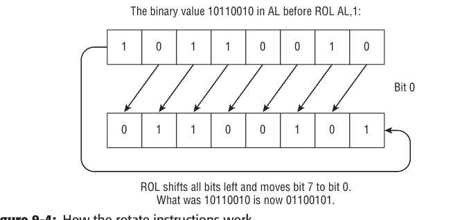

**图 9-4:** 旋转指令的工作原理

同样，`ROR` 的工作方式完全相同，但比特的移动方向是从左到右，而不是像 `ROL` 那样从右到左。操作数旋转的比特数可以是立即数，也可以是 `CL` 寄存器中的值。

x86 指令集中还有第二对旋转指令：`RCR`（通过进位标志向右旋转）和 `RCL`（通过进位标志向左旋转）。它们的作用与 `ROL` 和 `ROR` 类似，但有一个变化：从操作数末端移出并重新进入操作数起始位置的比特，是通过进位标志（CF）传递的。因此，任何单个比特在通过 CF 进行旋转时所经过的路径，会比在 `ROL` 和 `ROR` 中多一个比特。我在图 9-5 中形象地展示了这一点。

与移位指令一样，将一个值旋转超过 31 位没有任何优势。（如果你将一个值旋转 32 位，最终在操作数中得到的值将与你开始时相同。）

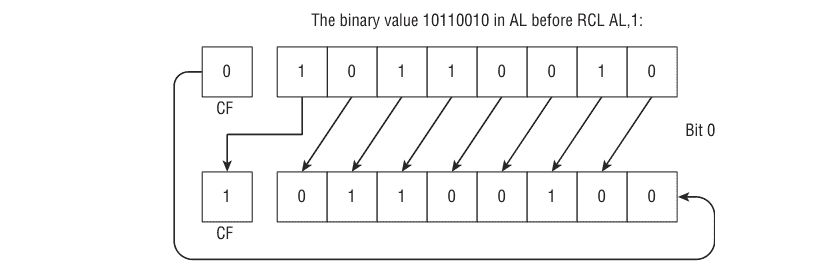

**图 9-5:** 通过进位标志的旋转指令如何工作

旋转指令会将比特从操作数的一端挤出，然后将它们反馈到操作数的另一端，开始新一轮循环。如果你在脑海中跟踪单个比特的旋转过程，你会意识到，在旋转 32 次之后，任何给定的比特都会回到它开始旋转时的位置。一个比特是这样，所有比特都是这样，所以对于一个 32 位的值，旋转 31 次就是有用的极限。这就是为什么在保护模式编程中（以及在旧的 286 上），在指令执行前，移位计数会被截断为 5 位。毕竟，5 位能表示的最大值是……32！

## 在进位标志中设置一个已知值

同样重要的是要记住，之前的指令可能会在 CF 中留下值，而这些值会在 `RCL` 或 `RCR` 指令执行期间被旋转到操作数中。有些人错误地认为在移位或旋转指令执行前，CF 会被强制清零，但这不是事实。如果在 `RCR` 或 `RCL` 指令执行前，另一个指令在 CF 中留下了一个 1，那么这个 1 会忠实地进入目标操作数，无论你是否希望它如此。

如果在一个旋转开始时，在 CF 中拥有一个已知值很重要，那么有一对 x86 指令可以为你完成这项工作：`CLC` 和 `STC`。`CLC` 将进位标志清零为 0。`STC` 将进位标志置为 1。这两条指令都不带操作数，除了改变进位标志中的值外，没有其他任何效果。

## 位操作实战

正如你在前面章节中看到的，Linux 有一个相当方便的方法来将文本显示到屏幕上。问题在于它只显示*文本*——如果你想将一个寄存器中的数值作为一对十六进制数字来显示，Linux 无能为力。你必须先将数值转换为其字符串表示形式，然后通过 `INT 80h` 调用 `sys_write` 内核服务来显示该字符串表示形式。

将十六进制数转换为十六进制数字并不困难，完成这项工作的代码展示了我们在本章中正在探索的几个新概念。清单 9-1 中的代码是一个十六进制转储工具的核心精简版，类似于一个只读版本的 Bless 十六进制编辑器。当你将其输入重定向到任意文件时，它会一次读取该文件 16 个字节，并将这 16 个字节以空格分隔的 16 个十六进制值的形式显示在一行中。

## 清单 9-1：hexdump1.asm

```
;
; 可执行文件名 : hexdump1
; 版本         : 1.0
; 创建日期    : 4/4/2009
; 最后更新     : 4/4/2009
; 作者          : Jeff Duntemann
; 描述     : 一个使用 NASM 2.05 的 Linux 简单汇编程序，
;                   演示了将二进制值转换为十六进制字符串的方法。
;                   它是一个非常简单的十六进制文件转储工具，尽管没有对应的
;                   ASCII 列。
;
; 运行方式：
;   hexdump1 < (输入文件)
;
; 使用以下命令构建：
;   nasm -f elf -g -F stabs hexdump1.asm
;   ld -o hexdump1 hexdump1.o
;
SECTION .bss            ; 包含未初始化数据的段
    BUFFLEN equ 16      ; 我们一次读取文件 16 个字节
    Buff:   resb BUFFLEN ; 文本缓冲区本身

SECTION .data           ; 包含已初始化数据的段
    HexStr: db " 00 00 00 00 00 00
```

```
    mov eax,4      ; 指定 sys_write 调用
    mov ebx,1      ; 指定文件描述符 1：标准输出
    mov ecx,HexStr ; 传递行字符串的偏移量
    mov edx,HEXLEN ; 传递行字符串的大小
    int 80h        ; 进行内核调用以显示行字符串
    jmp Read       ; 循环返回并再次加载文件缓冲区

; 全部完成！让我们结束这个程序：
Done:
    mov eax,1      ; 退出系统调用的代码
    mov ebx,0      ; 返回零代码
    int 80H        ; 进行内核调用
```

`hexdump1` 程序本质上是一个过滤器程序，使用了与第 8 章中 `uppercase2` 程序相同的通用过滤器机制。对于本次讨论，程序的重要部分是从输入缓冲区读取 16 个字节并将其转换为可显示字符串以输出到 Linux 控制台的部分。这是 `Scan` 标签和 `INT 80h` 退出调用之间的代码。在接下来的讨论中，我将引用该代码块。

## 将字节拆分为两个半字节

请记住，Linux 从文件读取的值是以二进制形式读入内存的。十六进制是显示二进制值的一种方式，为了将二进制值显示为可显示的 ASCII 十六进制数字，你必须进行一些转换。

显示单个 8 位二进制值需要两个十六进制数字。字节中的低四位由一个数字表示（最低有效位，即最右边的数字），字节中的高四位由另一个数字表示（最高有效位，即最左边的数字）。例如，二进制值 `11100110` 等价于十六进制的 `E6`。（我在第 2 章中详细介绍了所有这些内容。）将 8 位值转换为两个 4 位数字必须一次完成一个数字，这意味着我们必须将单个字节分离为两个 4 位量，这些通常称为*半字节*（*nybbles*）。

```
and al,0Fh
```

用二进制表示的立即数常量 `0Fh` 是 `00001111`。如果你按照 `AND` 真值表（表 9-2）来跟踪操作，你会看到任何位与 0 进行 `AND` 运算结果都是 0。我们将寄存器 `AL` 的高半字节与 `0000` 进行 `AND` 运算，这会清除其中可能存在的任何内容。将低半字节与 `1111` 进行 `AND` 运算会保留低半字节中的原有内容不变。

完成后，我们就在 `AL` 中得到了从 `Buff` 读取的字节的低半字节。

## 将高半字节移入低半字节

从 `AL` 中的输入字节屏蔽掉高半字节会将其销毁。我们需要高半字节，但我们在 `EBX` 中有输入字节的第二个副本，我们将从该副本中提取高半字节。与低半字节一样，我们实际上将使用 `EBX` 的最低有效八位，即 `BL`。请记住，`BL` 只是引用 `EBX` 低八位的另一种方式。它不是一个不同的寄存器。如果有一个值被加载到 `EBX` 中，其最低有效八位就在 `BL` 中。

我们可以用 `AND` 指令屏蔽掉 `BL` 中的低半字节，留下高半字节，但有一个问题：屏蔽字节的低四位并不会使高四位成为一个半字节。我们必须以某种方式将输入字节的高四位移入低四位。

最快的方法是简单地将 `BL` 向右移动四位。这就是 `SHR BL, 4` 指令的作用。低半字节只是被移出了 `BL` 的边缘，进入进位标志，然后移入宇宙的虚无之中。移位后，`BL` 中原来的高半字节现在变成了低半字节。

此时，我们在 `AL` 中有输入字节的低半字节，在 `BL` 中有输入字节的高半字节。下一个挑战是将半字节中的四位数字（如 `1110`）转换为可显示的 ASCII 十六进制数字——在这种情况下，是字符 `E`。

## 使用查找表

在程序的 `.data` 段中，定义了一个非常简单的*查找表*。`Digits` 表的定义如下：

```
Digits db '0123456789ABCDEF'
```

关于 `Digits` 表，需要注意的重要一点是每个数字在字符串中占据的位置与其所表示的值相对于字符串起始位置的偏移量相同。换句话说，ASCII 字符 `"0"` 位于字符串的最开头，距离字符串起始位置零字节偏移。字符 `"7"` 位于距离字符串起始位置七个字节处，依此类推。

我们使用内存引用来在 `Digits` 表中"查找"一个字符：

```
mov al,byte [Digits+eax]
```

与汇编语言的大多数内容一样，这里的一切都依赖于内存寻址。查找表中的第一个十六进制数字字符位于 `Digits` 中的地址。要获取所需的数字，我们必须*索引*到查找表中。我们通过将表内的偏移量加到括号内的地址上来实现这一点。这个偏移量就是 `AL` 中的半字节。

将 `AL` 中的偏移量加到 `Digits` 的地址上（使用 `EAX`），就能直接定位到 `AL` 中值的 ASCII 等效字符。我在图 9-6 中以图形方式展示了这一点。

关于从 `Digits` 中获取数字并将其放入 `AL` 的 `MOV` 指令，有两件可能令人困惑的事情：

- 我们必须在内存引用中使用 `EAX` 而不是 `AL`，因为 `AL` 不能参与有效地址计算。不要忘记 `AL` "位于" `EAX` 内部！（关于有效地址计算的更多内容将在本章稍后介绍。）

- 我们用字符等效值替换 `AL` 中的半字节。该指令首先从表中获取半字节的字符等效值，然后将字符等效值存回 `AL`。`AL` 中原来的半字节现在已经消失。

到目前为止，我们已经从查找表中读取了一个字符到 `AL` 中。该半字节的转换已经完成。下一个任务听起来简单，但实际上出奇地棘手：将现在 `AL` 中的 ASCII 十六进制数字字符写入 `HexStr` 的显示字符串中。

## 通过移位和加法实现乘法

`hexdump1` 程序从文件中读取字节并以行显示，每行以十六进制表示 16 个字节。程序输出的部分内容如下所示：

```
  3B 20  45 78 65 63 75 74 61 62 6C 65 20 6E 61
6D 65 20 3A 20 45 40 54 53 59 53 43 40 4C 4C 0D
0A 3B 20  56 65 72 73 69 6F 6E 20 20 20 20 20
        20 20 20 20 20 20
```

如果你想乘以 3 怎么办？很简单：先乘以 2，然后再把被乘数加一次到乘积上。在 `hexdump1` 程序中，是这样实现的：

```
mov edx, ecx    ; Copy the character counter into edx
shl edx, 1      ; Multiply pointer by 2 using left shift
add edx, ecx    ; Complete the multiplication X3
```

这里，被乘数从循环计数器 `ECX` 加载到 `EDX` 中。然后 `EDX` 左移一位，相当于乘以 2。最后，将 `ECX` 加到乘积 `EDX` 上，完成乘以 3 的操作。

乘以其他不是 2 的幂的数，可以通过组合 `SHL` 和一次或多次 `ADD` 来实现。要将 `ECX` 中的值乘以 7，可以这样做：

```
mov edx, ecx    ; Keep a copy of the multiplicand in ecx
shl edx, 2      ; Multiply edx by 4
add edx, ecx    ; Makes it X 5
add edx, ecx    ; Makes it X 6
add edx, ecx    ; Makes it X 7
```

这看起来可能很笨拙，但值得注意的是，这仍然比使用 `MUL` 更快！（后面在本章中，我会向你展示一种更快的乘以 3 的方法。）

一旦理解了字符串表 `HexStr` 的结构，向其中写入十六进制数字就很简单了。最低有效十六进制位在 `AL` 中，最高有效十六进制位在 `BL` 中。将两个十六进制数字写入 `HexString` 是通过三部分内存地址来实现的：

```
    mov byte [HexStr+edx+2],al ; Write the LSB char digit to line string
    mov byte [HexStr+edx+1],bl ; Write the MSB char digit to line string
```

回顾一下图 9-7 自己推算一下：你从 `HexStr` 的整体地址开始。`EDX` 包含给定条目中第一个字符的偏移量。要获取所讨论条目的地址，需要将 `HexStr` 和 `EDX` 相加。然而，该地址是条目中第一个字符的地址，而在 `HexStr` 中第一个字符始终是空格字符。条目中 LSB 位的位置是条目偏移量 + 2，MSB 位的位置是条目偏移量 + 1。因此，LSB 位的地址是 `HexStr` + 条目偏移量 + 2。MSB 位的地址是 `HexStr` + 条目偏移量 + 1。

## 标志、测试和分支

从高处看，条件跳转指令的思想很简单，没有它，你在汇编语言中是做不了多少事情的。我在前面几个示例程序中已经非正式地使用了条件跳转，没有太多解释，因为跳转的含义从上下文中已经很明显，而且它们对于演示其他内容是必要的。但在汇编语言跳转这一简单思想之下，隐藏着大量复杂性。现在是时候深入详细讲解这些内容了。

### 无条件跳转

*跳转*就是：指令执行流程的突然改变。通常，指令是一个接一个按顺序执行的，从低地址向高地址移动。*跳转指令*改变下一条要执行指令的地址。执行一条跳转指令，*嗖*的一声！突然你就到了别的地方。跳转指令可以将执行向前或向后移动。它可以将执行弯曲回一个循环中。（它也可以把你的程序逻辑打成死结。）

跳转有两种：条件跳转和无条件跳转。*无条件*跳转是指*总是*发生的跳转。它的形式如下：

```
    jmp <label>
```

当这条指令执行时，执行序列移动到由 `<label>` 指定的标签处的指令。就这么简单。

### 条件跳转


*条件*跳转指令是我在第1章中介绍过的那些传说中的测试之一。执行时，条件跳转会测试某些内容——通常是`EFlags`寄存器中的一个标志，偶尔是两个，更罕见的是三个标志。如果被测试的标志处于特定状态，执行将跳转到代码段中其他地方的某个标签；否则，它就直接落到顺序的下一条指令。

这种双向性很重要。条件跳转指令要么跳转，要么通过。跳或不跳。它不能跳转到两个或三个地方中的一个。是否跳转取决于CPU中一小部分位的当前值。

正如我本书前面讨论`EFlags`寄存器整体时提到的，某些指令在结果为0时会将某个标志设置为1：`Zero`标志（`ZF`）。`DEC`（递减）指令就是一个很好的例子。`DEC`从其操作数中减去1。如果通过该减法操作数变为零，`ZF`被设置为1。其中一个条件跳转指令`JZ`（为零则跳转）测试`ZF`。如果发现`ZF`被设置为1，则发生跳转，执行转移到`JZ`助记符后面的标签。如果发现`ZF`为0，则执行落到顺序的下一条指令。这可能是整个x86指令集中最常用的条件跳转。它通常在你将寄存器倒数到零的同时执行循环时使用，当计数寄存器通过`DEC`指令变为零时，循环结束，执行在循环后的位置继续。

这里有一个简单（虽然有点奇怪）的例子，使用你应该已经理解的指令：

```asm
        mov word [RunningSum],0  ; Clear the running total
        mov ecx,17               ; We're going to do this 17 times
WorkLoop:
        add word [RunningSum],3  ; Add three to the running total
        dec ecx                  ; Subtract 1 from the loop counter
        jz  SomewhereElse        ; If the counter is zero, we're done!
        jmp WorkLoop
```

在循环开始之前，我们在`ECX`中设置一个值，它作为计数寄存器，包含我们要循环的次数。循环体是在每次通过循环时执行某些操作的地方。在这个例子中它是一条`ADD`指令，但它可能有数十或数百条指令长。

在循环的工作完成后，计数寄存器通过`DEC`指令减1。紧接着，`JZ`指令测试`Zero`标志。将`ECX`从17减到16，或从4减到3，不会设置`ZF`，`JZ`指令只是直接通过。`JZ`后面的指令是无条件跳转指令，它每次都顺从地、一致地将执行带回`WorkLoop`标签。

然而，将`ECX`从1减到0*确实*设置了`ZF`，这就是循环结束的时候。`JZ`终于通过跳转到`SomewhereElse`（这里未显示的更大程序中的一个标签）将我们带出循环，执行离开了循环。

如果你够敏锐，可能会意识到这是一个设置循环的糟糕方法。（这并不意味着它从未被使用过，或者你自己在深夜不耐烦的时刻不会这样做。）我们每次通过循环时真正寻找的是某个条件——`Zero`标志——*没有*被设置，对此也有一条指令。

## 在条件不存在时跳转

条件跳转指令相当多，我在本书中会讨论其中一些但不是全部。它们的数量因为几乎每个条件跳转指令都有一个`alter ego`而增加：在指定条件*没有*被设置为1时跳转。

`JZ`指令提供了在条件上进行跳转的一个好例子。`JZ`在`Zero`标志（`ZF`）被设置为1时跳转到代码段中的新位置。`JZ`的`alter ego`是`JNZ`（不为零则跳转）。`JNZ`在`ZF`为0时跳转到某个标签，在`ZF`为1时直接通过。

这在一开始可能会令人困惑，因为`JNZ`在`ZF`等于0时跳转。请记住，指令的名称适用于被测试的*条件*，而不一定是指示标志的二进制位值。在前面的代码示例中，`JZ`在`DEC`指令将计数器递减到零时跳转。被测试的条件是与前面指令相关的*内容*，而不是简单地`ZF`的状态。

这样想：一个条件会升起一面旗帜。"升起旗帜"意味着将标志设置为1。当众多指令中的一个强制操作数变为零值（这就是条件）时，`Zero`标志被升起。指令的逻辑指的是条件，*不是*标志。

举个例子，让我们改进前面展示的小循环，将循环逻辑改为使用`JNZ`：

```asm
        mov word [RunningSum],0 ; Clear the running total
        mov ecx,17              ; We're going to do this 17 times
WorkLoop:
        add word [RunningSum],3 ; Add three to the running total
        dec ecx                 ; Subtract 1 from the loop counter
        jnz  WorkLoop           ; If the counter is zero, we're done!
```

`JZ`指令已经被`JNZ`指令替换。这更有意义，因为要闭合循环我们必须跳转，而且我们只在计数器大于0时闭合循环。跳回`WorkLoop`标签只会在计数器大于0时发生。

一旦计数器递减到 0，循环即视为结束。`JNZ` fall through，循环之后的代码（此处未显示）开始执行。关键在于，如果你能将程序的下一个任务紧接在 `JNZ` 指令之后放置，你就根本不需要使用 `JMP` 指令。指令执行将自然地流入下一个需要执行的任务。程序将拥有更自然、更少曲折的自上而下的流程，也更容易阅读和理解。

## 标志位

早在第7章中，我已经解释了 `EFlags` 寄存器，并简要描述了它所包含的所有标志位的用途。大多数标志位并不是特别有用，尤其是对于刚入门的程序员而言。**进位标志（CF）**和**零标志（ZF）**入门阶段会接触到 90% 的标志位操作，而**方向标志（DF）**、**符号标志（SF）**和**溢出标志（OF）**加起来占另外 99.98%。现在不妨重新阅读第7章的那部分内容，以防你对标志位用法的理解有些生疏了。

如前文所述，当 `ZF` 为 1 时 `JZ` 跳转，而当 `ZF` 为 0 时 `JNZ` 跳转。大多数对操作数执行某种操作的指令（例如 `AND`、`OR`、`XOR`、`INC`、`DEC` 以及所有算术指令）会根据操作结果设置 `ZF`。另一方面，仅仅移动数据的指令（例如 `MOV`、`XCHG`、`PUSH` 和 `POP`）则不会影响 `ZF` 或任何其他标志位。（显然，`POPF` 会通过将栈顶值弹出到标志位中来影响它们。）一个令人恼火的例外是 `NOT` 指令，它对其操作数执行逻辑运算，但*不*设置任何标志位——即使它导致操作数变为 0。在你编写依赖标志位的代码之前，*请查阅你的指令参考手册*，确保你对该指令的标志位用法了如指掌。x86 指令集如果说有什么特点的话，那就是*古怪*。

## 使用 CMP 进行比较

标志位的一个主要用途是控制循环。另一个用途是比较两个值。你的程序经常需要知道寄存器或内存中的值是否等于另一个值。此外，你可能还想知道某个值是大于还是小于某个值，如果不等于的话。有各种跳转指令来满足每种需求，但必须有东西为跳转指令设置标志位。**`CMP`（比较）**指令正是为比较任务设置标志位的。

`CMP` 的用法简单直观。第二个操作数与第一个操作数进行比较，相应的标志位被设置：

```asm
`cmp <op1>,<op2>`     ; 设置 OF, SF, ZF, AF, PF, 和 CF
```

只要将比较转换为算术术语，就能记住比较的含义：

```text
结果 = <op1> - <op2>
```

`CMP` 本质上是一个减法运算，其结果被丢弃，只有标志位受到影响。第二个操作数从第一个操作数中减去。根据减法的结果，其他标志位被设置为适当的值。

在 `CMP` 指令之后，你可以根据几种算术条件进行跳转。有扎实数学基础的人，以及 `FORTRAN` 或 `Pascal` 程序员，都会认识这些条件：*等于、不等于、大于、小于、大于或等于*，以及*小于或等于*。这些运算符的含义与其名称一致，与大多数高级语言中的等效运算符完全相同。

## 纷繁复杂的跳转指令

跳转指令助记符阵容庞大、令人眼花缭乱，但涉及算术关系的部分可以很好地归类为六个类别，对应前面提到的六种条件。复杂之处在于，每条机器指令有*两个*助记符——例如，`JLE`（小于或等于跳转）和 `JNG`（不大于跳转）。这两个助记符是*同义词*，因为汇编器遇到其中任何一个时都会生成相同的二进制操作码。这些同义词是为方便程序员而设的，它们提供了思考给定跳转指令的两种不同方式。在前面的例子中，*小于或等于跳转*在逻辑上与*不大于跳转*相同。（想想看！）如果前面比较的重点是检查一个值是否小于或等于另一个值，你会使用 `JLE` 助记符。相反，如果你要确定某个量不大于另一个量，你会使用 `JNG`。选择权在你。

另一个复杂之处是，有符号和无符号算术比较各有独立的指令集。我在本书中没有过多讨论汇编语言数学，因此也没有过多讨论有符号量和无符号量之间的区别。*有符号*量是指其最高位被视为一个内置标志位，用于指示该量是否为负数。如果该位为 1，则该量被视为负数。如果该位为 0，则该量被视为正数。

汇编语言中的有符号算术复杂而微妙，并不像你一开始想的那么有用。本书不会详细讲解，尽管几乎所有汇编语言书籍都会在一定程度上涉及它。要获得对有符号算术的高层理解，你只需要知道：在有符号算术中，负数是合法的，而且数值的最高有效位被视为符号位。（如果符号位设置为 1，则该值被视为负数。）

另一方面，无符号算术不承认负数，最高有效位只是该量所表示的二进制数中的又一个比特位。

### "Greater Than" 与 "Above" 之别

为了区分有符号跳转和无符号跳转，助记符使用两种不同的表达方式来描述两个值之间的关系：

- *有符号值*被认为*大于*或*小于*某个值。例如，要测试一个有符号操作数是否大于另一个，你会在 `CMP` 指令之后使用 `JG`（大于跳转）助记符。

- *无符号值*被认为*高于*或*低于*某个值。例如，要判断一个无符号操作数是否大于（高于）另一个，你会在 `CMP` 指令之后使用 `JA`（高于跳转）助记符。

表 9-6 总结了算术跳转助记符及其同义词。任何包含 *above* 或 *below* 的助记符用于无符号值，而任何包含 *greater* 或 *less* 的助记符用于有符号值。将助记符与其同义词进行比较，注意两者如何代表看待相同指令的对立视角。

表 9-6 的作用只是将助记符扩展为更易理解的形式，并将其与同义词关联起来。另一方面，表 9-7 则按逻辑条件以及有符号和无符号值的使用对助记符进行排序。表 9-7 还列出了每条跳转指令所测试的标志位值。注意，某些跳转指令需要两个可能的标志位值之一才能跳转，而另一些则需要*两个*标志位值同时满足。

某些有符号跳转会比较两个标志位。例如，当 `ZF` 为 0，或者符号标志（`SF`）等于溢出标志（`OF`）时，`JG` 会跳转。我不会再花更多时间解释符号标志或溢出标志的本质。只要你掌握了每条指令的含义，理解指令如何测试标志位的具体细节可以等到你积累了一些编程经验之后再说。

有些人难以理解 `JE` 和 `JZ` 为何是同义词，`JNE` 和 `JNZ` 也是如此。再想想 CPU 内部进行比较的方式：第二个操作数从第一个操作数中减去，如果结果为 0（表明两个操作数实际上相等），则零标志位设置为 1。这就是为什么 `JE` 和 `JZ` 是同义词：两者都只是测试零标志位的状态。

## 表 9-6：跳转指令助记符及其同义词

| 助记符 | 同义词 |
| --- | --- |
| `JA` | 若高于则跳转 | `JNBE` | 若不低于或等于则跳转 |
| `JAE` | 若高于或等于则跳转 | `JNB` | 若不低于则跳转 |
| `JB` | 若低于则跳转 | `JNAE` | 若不高于或等于则跳转 |
| `JBE` | 若低于或等于则跳转 | `JNA` | 若不高则跳转 |
| `JE` | 若等于则跳转 | `JZ` | 若结果为`零`则跳转 |
| `JNE` | 若不等于则跳转 | `JNZ` | 若结果*非零*则跳转 |
| `JG` | 若大于则跳转 | `JNLE` | 若不小于或等于则跳转 |
| `JGE` | 若大于或等于则跳转 | `JNL` | 若不小则跳转 |
| `JL` | 若小于则跳转 | `JNGE` | 若不大于或等于则跳转 |
| `JLE` | 若小于或等于则跳转 | `JNG` | 若不大则跳转 |

## 使用 TEST 查找 1 位

x86 指令集意识到汇编语言中经常需要进行位测试，因此它提供了一种相当于位操作版`CMP`指令的指令：`TEST`。`TEST`对两个操作数执行`AND`逻辑运算，然后像`AND`指令一样设置标志位，*但*不会改变目标操作数，而`AND`指令会改变。`TEST`指令的语法如下：

```asm
test <操作数>,<位掩码>
```

位掩码操作数应在需要查找 1 位的每个位置包含 1 位，在所有其他位上则为 0。

`TEST`的作用是在指令的目标操作数与位掩码之间执行`AND`逻辑运算，然后像`AND`指令那样设置标志位。`AND`运算的结果被丢弃，目标操作数不会改变。例如，如果你想确定`AX`的第 3 位是否设置为 1，可以使用以下指令：

```asm
test ax,08h          ; 第 3 位的二进制是 00001000B，即 08h
```

当然，第 3 位并不具有数值 3——你必须查看掩码的位模式，并将其表示为二进制或十六进制值。（第 3 位在二进制中代表值 8。）在 `NASM` 中对字面常量使用二进制是完全合法的，而且在处理位掩码时，这通常是最清晰的表达方式：

```asm
test ax,00001000B    ; 第 3 位的二进制是 00001000B，即 08h
```

**表 9-7：CMP 指令后有用的算术测试**

| 条件 | `PASCAL` 运算符 | 无符号值 | 跳转条件 | 有符号值 | 跳转条件 |
|-----------|-----------------|-----------------|------------|---------------|------------|
| 等于 | `=` | `JE` | `ZF=1` | `JE` | `ZF=1` |
| 不等于 | `<>` | `JNE` | `ZF=0` | `JNE` | `ZF=0` |
| 大于 | `>` | `JA` | `CF=0 且 ZF=0` | `JG` | `ZF=0 或 SF=OF` |
| 不小于或等于 | | `JNBE` | `CF=0 且 ZF=0` | `JNLE` | `ZF=0 或 SF=OF` |
| 小于 | `<` | `JB` | `CF=1` | `JL` | `SF<>OF` |
| 不大于或等于 | | `JNAE` | `CF=1` | `JNGE` | `SF<>OF` |
| 大于或等于 | `>=` | `JAE` | `CF=0` | `JGE` | `SF=OF` |
| 不小于 | | `JNB` | `CF=0` | `JNL` | `SF=OF` |
| 小于或等于 | `<=` | `JBE` | `CF=1 或 ZF=1` | `JLE` | `ZF=1 或 SF<>OF` |
| 不大于 | | `JNA` | `CF=1 或 ZF=1` | `JNG` | `ZF=1 或 SF<>OF` |

目标操作数 `AX` 不会因该操作而改变，但 `AND` 真值表在 `AX` 和二进制模式 `00001000` 之间生效。如果 `AX` 中的第 3 位是 1 位，则零标志位被清除为 0。如果 `AX` 中的第 3 位是 0 位，则零标志位被设置为 1。为什么？如果你将 1（在位掩码中）与 0（在 `AX` 中）进行 `AND` 运算，结果为 0。（在前文表 9-2 所示的 `AND` 真值表中查找。）如果所有八位按位 `AND` 运算的结果都为 0，则结果为 0，零标志位被置为 1，表明结果为 0。

理解 `TEST` 的关键在于将其视为一种"操作码幽灵"，这里的操作码是 `AND`。`TEST`戴上面具（可以这么说），*假装*自己是 `AND`，但随后不执行操作结果。它只是设置标志位，*就好像*发生了 `AND` 运算一样。

`CMP`指令是另一个操作码幽灵，它与 `SUB` 的关系就像 `TEST` 与 `AND` 的关系一样。`CMP`将其第二个操作数从第一个操作数中减去，但不继续执行并将结果存储到第一个操作数中。它只是设置标志位，*就好像*发生了减法一样。正如你已经看到的，这与条件跳转指令结合使用时非常有用。

这里有件重要的事情要记住：`TEST` *仅对查找 1 位有用*。如果你需要识别 0 位，必须首先用 `NOT` 指令将每个位翻转到相反状态。`NOT`将所有 1 位变为 0 位，所有 0 位变为 1 位。一旦所有 0 位都翻转为 1 位，你就可以在需要找到 0 位的位置测试 1 位。（有时在纸上画出来有助于在脑海中理清头绪。）

最后，`TEST` *无法*可靠地同时测试操作数中的两个或多个 1 位。`TEST`不检查位模式的存在；*它检查单个 1 位的存在*。换句话说，如果你需要确认*第 4 位和第 5 位*都设置为 1，`TEST`无能为力。

## 使用 BT 查找 0 位

正如我之前解释的，`TEST`有其局限性：它不适用于确定位是否设置为 0。`TEST`自最早的 x86 CPU 起就一直伴随我们，但 386 及更新的处理器有一条指令，使你可以测试 0 位或 1 位。`BT`（位测试）执行一个非常简单的任务：将第一个操作数中指定的位复制到进位标志位（`CF`）中。换句话说，如果所选位是 1 位，则设置进位标志位。如果所选位是 0 位，则清除进位标志位。然后你可以使用任何检查并根据 `CF` 状态执行操作的条件跳转指令。

`BT`易于使用。它有两个操作数：目标操作数是包含相关位的值；源操作数是你想测试的位的序数，从 0 开始计数：

```asm
bt <包含位的值>,<位编号>
```

执行 `BT` 指令后，应立即测试进位标志位中的值，并根据其值进行分支。以下是一个例子：

```asm
bt eax,4    ; 测试 AX 的第 4 位
jnc quit    ; 如果第 4 位 = 0，我们就此结束
```

请注意一些需要小心的地方，特别是如果你习惯使用`TEST`：你*不是在创建位掩码*。使用`BT`的源操作数时，你指定的是位的序数。上面所示的字面常量 4 是位的*编号*（从 0 开始计数），而不是位的*值*，这是一个关键区别。

还要注意，我们在 `CF` 未设置时进行分支；这就是`JNC`（若不进位则跳转）的作用。


我不想在一本面向初学者的书中过多讨论代码效率，但这里有一个注意事项：`BT`指令在指令中算是相当慢的——而位操作通常是在紧凑循环中频繁执行的操作，此时指令速度可能很重要。偶尔使用没问题，但如果你处于执行数千次或数百万次的循环中，请考虑是否可能有更好的位测试方法。老旧的`TEST`要快得多，但`TEST`只能测试 1 位。根据你的应用，你可能能以其他更快的方式测试 0 位，比如用`SHL`或`SHR`将值移入进位标志位，或使用`NOT`反转值。没有硬性规定，一切都取决于你正在做的工作的动态特性。（这就是为什么我没有在这本书中系统地讲解优化！）

## 保护模式内存寻址详解

在很多方面，现在的生活*更好了*。我不仅仅是在说现代牙科、即插即用网络和四核 CPU。我曾经为原始 IBM PC 中的实模式 8088 CPU 编写汇编程序——我还记得实模式内存寻址。

就像 1950 年代的牙科一样，基于 8088 的实模式内存寻址简直就是……痛苦的。它是一堆可怕的限制、陷阱、局限和补丁，所有这一切都在尖叫着表明 CPU *迫切*渴望在芯片上拥有更多晶体管。例如，内存寻址在大多数指令中仅限于`EBX`和`EBP`，这意味着当需要同时寻址内存中的几个独立项目时，需要进行大量巧妙操作。而一想到段管理就让我不寒而栗。

好吧，在过去的 20 年里，我们的 x86 CPU 基本上得到了它们想要的所有晶体管，那些令人抓狂的实模式内存寻址限制大部分已经消失了。你可以用*任何*通用寄存器来寻址内存。你甚至可以直接用栈指针`ESP`来寻址内存，这是它的 16 位前身`SP`无法做到的。（你不应该*随意更改*`ESP`中的值，但`ESP`现在可以参与 16 位实模式领域中被排除在外的寻址模式。）

386 CPU 上的保护模式引入了一种通用内存寻址方案，所有通用寄存器都可以平等参与。我在图 9-9 中给出了示意图，这可能是本书中最重要的一幅图。把它打印出来，贴在你机器旁边的墙上。经常参考它。*内存寻址是汇编语言工作中的关键技能*。如果你不理解这一点，其他一切都*毫无意义*。

当我第一次学习并理解这个方案时，16 位 8088 实模式分段内存寻址的伤口还在流血，它看起来好得令人难以置信。但这是真的！规则如下：

- 基址寄存器和索引寄存器可以是任何 32 位通用寄存器，包括`ESP`。
- The displacement may be any 32-bit constant. Obviously, 0, while legal, isn't useful.
- The scale must be one of the values 1, 2, 4, or 8. That's it! The value 1 is legal but doesn't do anything useful, so it's never used.
- The index register is multiplied by the scale before the additions are done. In other words, it's not `(base + index) × scale`. Only the index register is multiplied by the scale.
- All of the elements are optional and may be used in almost any combination.
- 16-bit and 8-bit registers may *not* be used in memory addressing.

This last point is worth enlarging upon. There are several different ways you can address memory, by gathering the components in the figure in different combinations. Examples are shown in Table 9-8.

## Effective Address Calculations

Each of the rows in Table 9-8 summarizes a method of expressing a memory address in 32-bit protected mode. All but the first two involve a little arithmetic among two or more terms within the brackets that signify an address. This arithmetic is called *effective address calculation*, and the result of the calculation is the *effective address*. The term is "effective address" in that it means that address that will ultimately be used to read or write memory, irrespective of how it is expressed. Effective address calculation is done by the instruction, when the instruction is executed.

If an instruction is coded with a register name between the brackets, the address that will be sent out to the memory system when the code executes is stored inside the register.

The only case in which the effective address is right there on the line with the instruction mnemonic would be a literal address within the brackets. This is almost never done, because it's extremely unlikely that you will know a precise 32-bit numeric address at assembly time.

Most of the time there's some arithmetic going on. In the Base + Index scheme, for example, the contents of the two GP registers between the brackets are added when the instruction is executed to form the effective address.

## Displacements

Among the several components of a legal address, the displacement term is actually one of the most slippery to understand. As I indicated in the previous paragraph, the displacement term can be a literal address, but in all my years of protected-mode assembly programming I've never done it, nor seen anyone else do it. When the displacement term stands alone, it is virtually always a symbolic address. By that I mean a named data item that you've defined in your`.data`or`.bss`sections, like the`HexStr`variable from the`hexdump1`program in Listing 9-1:

```
mov eax,[HexStr]
```

What is placed in`EAX`here is the address given to the variable`HexStr`when the program is loaded into memory. Like all addresses, it's just a number, but it's determined at runtime准备金而非在汇编时作为字面常量数值地址确定。

A lot of beginners get confused when they see what looks like two displacement terms between the brackets in a single address. The confusion stems from the fact that if`NASM`sees two (or more) constant values in a memory reference, it will combine them at assembly time into a single displacement value. That's what's done here:

```
mov eax,[HexStr+3]
```

The address referred to symbolically by the variable named`HexStr`is simply added to the literal constant 3 to form a single displacement value. The key characteristic of a displacement term is that *it is not in a register.*

## Base + Displacement Addressing

A simple and common addressing scheme is Base + Displacement, and I demonstrated it in the`hexdump1`program in Listing 9-1. The instruction that inserts an ASCII character into the output line looks like this:

```
mov byte [HexStr+edx+2]
```

This is a perfect example of a case where there are two displacement terms that`NASM`combines into one. The variable name`HexStr`resolves to a number (the 32-bit address of`HexStr`) and it is easily added to the literal constant 2, so there is actually only one base term (`EDX`) and one displacement term.

## Base + Index Addressing

Perhaps the most common single addressing scheme is Base + Index, in which the effective address is calculated by adding the contents of two GP registers within the brackets. I demonstrated this addressing scheme in Chapter 8, in the`uppercaser2`program in Listing 8-2. Converting a character in the input buffer from lowercase to uppercase is done by subtracting 20h from it:

```
sub byte [ebp+ecx],20h
```

The address of the buffer was earlier placed in`EBP`, and the number in`ECX`is the offset from the buffer start of the character being processed during any given pass through the loop. Adding the address of the buffer with an offset into the buffer yields the effective address of the character acted upon by the`SUB`instruction.

But wait … why not use Base + Displacement addressing? This instruction would be legal:

```
sub byte [Buff+ecx],20h
```

However, if you remember from the program (and it would be worth looking at it again, and reading the associated text), we had to decrement the address of`Buff`by one before beginning the loop. But wait some more … could we have`NASM`do that little tweak by adding a second displacement term of -1? Indeed we could, and it would work. The central loop of the`uppercaser2`program would then look like this:

```asm
; Set up the registers for the process buffer step:
        mov ecx,esi        ; Place the number of bytes read into ecx
        mov ebp,Buff        ; Place address of buffer into ebp
;       dec ebp  ** We don't need this instruction anymore! **

; Go through the buffer and convert lowercase to uppercase characters:
Scan:   cmp byte [Buff-1+ecx],61h  ; Test input char against lowercase 'a'
        jb Next          ; If below 'a' in ASCII, not lowercase
        cmp byte [Buff-1+ecx],7Ah  ; Test input char against lowercase 'z'
        ja Next          ; If above 'z' in ASCII, not lowercase
                        ; At this point, we have a lowercase char
        sub byte [Buff-1+ecx],20h  ; Subtract 20h to give uppercase...
Next:   dec ecx          ; Decrement counter
        jnz Scan         ; If characters remain, loop back
```

The initial`DEC EBP`instruction is no longer necessary.`NASM`does the math, and the address of`Buff`is decremented by one within the effective address expression when the program loads. This is actually the correct way to code this particular loop, and I thought long and hard about whether to show it in Chapter 8 or wait until I could explain memory addressing schemes in detail.


有些人觉得"基址 + 位移"这个名称容易混淆，因为在大多数情况下，位移项包含的是一个地址，而基址项则是一个寄存器，其中存放的是该地址处某个数据项的偏移量。根据大多数人的经验，"位移"这个词与"偏移"很像，因此产生混淆。这也是我在本书中不强调各种内存寻址方案名称的原因之一，当然更不建议去记住这些名称。**理解有效地址的计算方式**，而忽略这些方案的名称。

## 索引 × 缩放 + 位移寻址

基址 + 索引寻址是你通常用来逐字节扫描内存中缓冲区的方式，但如果需要访问缓冲区或表中的某个数据项，而每个数据项不是一个字节，而是一个字或一个双字，该怎么办？这需要更强大的内存寻址机制。

这里附带说明一下，*数组*一词是我所称的缓冲区或表的通用术语。其他作者可能会将表称为数组，尤其是在高级语言的上下文中，但这三个术语最终都指向同一含义：内存中一系列数据项，具有相同的大小和内部定义。在目前展示的程序中，我们只涉及了非常简单的表和缓冲区，它们由一行连续的单字节值组成。清单9-1中hexdump1程序的`Digits`表就是这样一个表：

```
Digits: db "0123456789ABCDEF"
```

这是内存中一行连续的16个单字节ASCII字符。你可以使用基址 + 位移寻址方式访问`Digits`中的"C"字符：

```
mov ecx,12
mov edx,[Digits+ecx]
```

如果有一个包含32位值的表呢？这样的表很容易定义：

```
Sums: dd "15,12,6,0,21,14,4,0,0,19"
```

`DD`限定符告诉NASM，`Sums`表中的每个项都是32位双字量。字面常量将数值插入表的每个元素中。`Sums`中第一个元素（此处为15）的地址就是整个表的地址，包含在变量`Sums`中。

第二个元素（12）的地址是什么？如何从汇编代码中访问它？请记住，内存是按字节寻址的，而不是按双字寻址的。表中的第二个条目位于表起始偏移4字节处。如果尝试使用地址`[Sums + 1]`引用表中的第二个条目，将会得到第一个表元素双字内的某个字节，这没有用处。

这就是*缩放*概念发挥作用的地方。地址可以包含一个缩放项，它是一个乘数，可以是字面常量2、4或8。（字面常量1在技术上合法，但由于缩放是乘数，1不是有用的缩放值。）索引和缩放项的乘积与位移相加，得出有效地址。这被称为索引 × 缩放 + 位移寻址方案。

通常，缩放项是表中单个元素的大小。如果表由2字节字值组成，则缩放值为2。如果表由4字节双字值组成，则缩放值为4。如果表由8字节四字值组成，则缩放值为8。

解释这一点的最佳方式是使用图示。在图9-10中，我们面对的地址是`[DDTable + ECX*4]`。`DDTable`是一个双字（32位）值表。`DDTable`的地址就是位移量。`ECX`寄存器是索引，在此例中其值为2，即你想要访问的表元素编号。因为这是一个4字节双字表，所以缩放值为4。

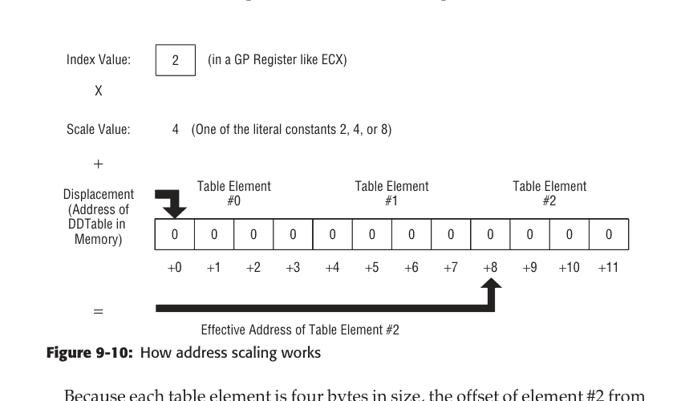

因为每个表元素的大小为四个字节，所以元素#2相对于表起始位置的偏移量为8。该元素的有效地址通过先将索引乘以缩放值，然后将乘积加到`DDTable`的地址上来计算。就是这样！

## 其他寻址方案

任何包含缩放的寻址方案都以这种方式工作。区别在于还有哪些其他项被计入有效地址。**基址 + 索引 × 缩放**方案将缩放后的索引加到寄存器中的基值，而不是位移量：

```
mov ecx,2              ; 索引在ecx中
mov ebp,DDTable        ; 表地址在ebp中
mov edx,[ebp+ecx*4]    ; 将选中的元素放入edx
```

你不会总是像处理`DDTable`这样的预定义变量的地址工作。有时表的地址来自其他地方，最常见的是内存中包含若干子表的二维表，每个子表包含若干元素。这类表的访问分两步：首先推导出内层表在外层表中的地址，然后推导出内层表中所需元素的地址。

这种二维表最熟悉的例子是我在本书早期版本中为DOS提供的内容。DOS下的25行×80字符文本视频内存缓冲区就是一个二维表。25行中的每一行都是一个包含80个字符的表，每个字符用2字节字表示。（一个字节是ASCII值，另一个字节指定颜色、下划线等属性。）因此，整个缓冲区是一个由25个较小表组成的总表，每个小表包含80个2字节字值。

那种视频访问系统随着DOS一起消亡了；Linux不允许你直接访问PC视频内存。然而这在DOS时代确实很常见，而且是一个很好的二维表示例。

缩放对于元素大小为2字节、4字节或8字节的表非常有用。如果你的表由3字节元素组成呢？或者5字节元素？或者17字节元素？唉，在这种情况下，你必须进行一些额外的计算才能定位到某个特定元素。有效地址计算本身无法完成全部工作。我已在清单9-1中给出了此类表的示例。行显示字符串是一个3字节元素的表。每个元素包含一个空格字符后跟两个十六进制数字字符。因为每个元素的长度为三个字符，所以无法在指令内完成缩放，必须单独处理。

这并不难。`hexdump1`程序中`HexStr`表的3字节元素缩放是这样完成的：

```
mov edx,ecx     ; 将字符计数器复制到edx
shl edx,1       ; 使用左移将计数器乘以2
add edx,ecx     ; 完成乘以3的运算
```

将`EDX`中的值乘以3的计算是通过`SHL`指令乘以2，然后加一个`ADD`指令，将索引值的另一个副本加到移位后的索引值上，实际上将原始计数值乘以3。

其他索引值的缩放也可以用同样的方式完成。乘以5的缩放可以通过将索引值左移2位来实现，从而将其乘以4，然后再添加另一个索引值副本以完成乘以5的运算。一般来说，要将索引值缩放X倍：

1. 找到小于X的最大2的幂。
2. 将索引值左移该2的幂次。
3. 将原始索引值的副本加到移位后的副本上，重复次数为完成乘以X所需的次数。

例如，如果X为11，则缩放计算将按以下方式完成：

```
mov edx,ecx    ; 将索引复制到edx
shl edx,3      ; 通过将计数器左移3次，将索引乘以8
add edx,ecx    ; 添加第一个额外的索引副本
add edx,ecx    ; 添加第二个额外的索引副本
add edx,ecx    ; 添加第三个额外的索引副本
```

这对于相对较小的缩放值效果最好；一旦超过20，就会有大量的`ADD`指令。此时，解决方案不是计算缩放值，而是在专门为给定缩放值定义的表中查找缩放值。例如，假设你的表元素每个长25字节。你可以定义一个包含25的倍数的表：

```
ScaleValues: dd 0,25,50,75,100,125,150,175,200,225,250,275,300
```

要对元素大小为25的索引值6进行缩放，你可以用以下方式在表中查找6 × 25的乘积：

```
mov ecx,6
mov eax,[ScaleValues+ecx*4]
```

`EAX`中的值现在包含元素6（按惯例从0开始计数）第一个字节的有效地址。

## LEA：顶级秘密的数学机器

但等等（正如深夜电视购物节目所说），还有更精彩的内容。x86架构中最奇特的指令之一，并且在某些方面也是最奇妙的指令，就是`LEA`，即**加载有效地址**（Load Effective Address）。从表面上看，它的功能很简单：计算其源操作数括号之间给出的有效地址，并将该地址加载到其目标操作数指定的任何32位通用寄存器中。回顾上一段和`MOV`指令在`ScaleValues`表中查找索引为6的元素。为了查找索引为6的项，它必须首先计算该元素的有效地址。然后使用此地址访问内存。

如果你想将该地址保存在寄存器中以便稍后使用，该怎么办？这就是`LEA`的功能。下面展示`LEA`的实际应用：

```
lea ebx,[ScaleValues+ecx*4]
```

这里发生的是CPU计算括号内给出的有效地址，并将该地址加载到`EBX`寄存器中。请记住，表中的单个条目没有标签，因此无法直接引用。`LEA`使你能够计算表中任何元素（或任何可计算地址！）的有效地址，并将该地址放入寄存器中。

这本身就非常有用，但`LEA`还有一个"非标签"用途：**在不使用移位、加法或繁琐的`MUL`指令的情况下进行快速数学运算**。如果你还记得，hexdump1程序中有一个使用移位和加法乘以3的计算：

```
mov edx,ecx      ; 将字符计数器复制到edx
shl edx,1        ; 使用左移将指针乘以2
add edx,ecx      ; 完成乘以3的运算
```

上面的方法有效，但看看我们可以使用什么来完成完全相同的事情：

```
mov edx,ecx          ; 将字符计数器复制到edx
lea edx,[edx*2+edx]  ; 将edx乘以3
```

这不仅几乎总是比移位与加法组合更快，而且从源代码中也更清楚实际在进行什么样的计算。*最终存入EDX的值实际上可能是非法地址并不重要*。**`LEA`不会尝试引用它计算的地址**。它只是对括号内的内容进行数学运算，然后将结果放入目标操作数。任务完成。内存未被触及，标志位也不受影响。

当然，你限于有效地址上可进行的计算；但首先，你可以将任何通用寄存器乘以2、3、4、5、8和9，同时还能加上一个常数！这不是任意的数学运算，但在汇编工作中乘以2、3、4、5、8和9经常出现，而且你可以将`LEA`与移位和加法结合来进行更复杂的数学运算并"填补空白"。你还可以连续使用多条`LEA`指令。两条连续的`LEA`指令可以将一个值乘以10，这确实很有用：

```
lea ebx,[ebx*2]           ; 将ebx乘以2
lea ebx,[ebx*4+ebx]       ; 将ebx乘以5，总共乘以10
```

有些人认为这种`LEA`的用法是一种卑鄙的伎俩，但在我从事x86汇编的所有年头里，我从未见过任何坏处。在投入五六条指令来凑出特定的乘法之前，看看两三个`LEA`是否能代替。`LEA`在一个机器周期内完成工作，而x86数学运算不可能比这更快了！

## 16位寄存器的负担

保护模式升级到32位寄存器有一个稍许棘手的副作用：使用16位通用寄存器`AX`、`BX`、`CX`、`DX`、`SP`、`BP`、`SI`和`DI`会使程序变慢。如今32位寄存器已占主导地位，使用16位寄存器被视为一种特殊情况，这会增加汇编器生成的操作码大小，从而拖慢程序代码速度。请注意，这里的"使用"指的是在源代码中显式引用。例如，`AX`寄存器仍然存在于CPU硅片内部（作为更大的`EAX`寄存器的一部分），单纯将数据放入其中并不会降低速度。但你不能在使用操作码时将`AX`作为操作数来放置数据，否则就会变慢。以下语法会生成较慢的操作码：

```
mov ax,542
```

你可以用以下方式实现同样的功能，而NASM生成的操作码会执行得快得多：

```
mov eax,542
```

我之所以到现在才提这件事，是因为我认为这是一个高级主题：你必须先学会走路再学跑步，在完全理解什么使代码变快、什么使代码变慢之前，试图优化代码只会导致困惑和失望。程序中少量引用16位寄存器并不会显著降低程序速度。你需要避免的是在紧凑循环内部使用16位寄存器引用，因为循环会执行数千次或数万次。（甚至更多！）

在某些情况下，8位和16位寄存器是绝对必需的——例如，向内存写入8位或16位值时。NASM不会允许你这样做：

```
mov byte [ebx],eax
```

BYTE限定符使第一个操作数变为8位操作数，NASM会报错说存在"操作数大小不匹配"。如果你需要将一个独立的8位值（如ASCII字符）写入内存，你需要将字符放入其中一个8位寄存器，像这样：

```
mov byte [ebx],al
```

这会生成一个（中等）较慢的操作码，但这是无法避免的。请记住，特别是对于现代CPU来说，单个操作码的代码性能会被缓存、超线程、预取等其他CPU机制所淹没。总体而言，从统计学角度来说，使用32位寄存器更有可能让你的代码运行得更快，但少量16位或8位寄存器引用并不会产生巨大差异，除非在某些情况下（如紧凑循环内部），而且即便如此，性能损失也难以预测，几乎无法量化。

简而言之：尽可能使用32位寄存器，但不必为此纠结。

## 字符表转换

有一种查表操作（或许曾经是如此常见），以至于英特尔工程师将其作为独立指令嵌入到了x86架构中。这种查表操作就是我在第8章末尾暗指的：*字符转换*。在20世纪80年代初，我需要进行各种字符集转换，其中最简单的是将所有小写字符强制转换为大写。在第8章中，我们构建了一个简单的程序，该程序逐个缓冲区地读取文件，引入字符，将所有小写字符转换为大写，然后再将它们全部写回到新文件中。


转换本身很简单：利用 ASCII 图表中大写字符与其对应小写字符之间的关系，我们只需将字符减去`20h`（`32`）就能将小写字符转换为大写。这很可靠，但在某种意义上是一种特殊情况。ASCII 小写字符恰好总是比大写字符在表上高`32`位。如果你需要将所有"竖线"（ASCII `124`）字符转换为感叹号呢？（我曾经不得不这样做，因为某个愚蠢的大型主机无法处理竖线。）你可以为每个需要处理的特殊情况编写专门的代码……

……或者你可以使用转换表。

### 转换表

转换表是一种特殊的表，其工作方式如下：你建立一个数值表，表中为每个需要转换的值都设有一个对应的条目。一个数字（或被视为数字的字符）被用作索引来访问表中的位置。在索引位置的表项中有一个值，用于替换作为索引的原始值。简而言之，原始值索引到表中，找到一个新的值来替换原始值，从而将旧值转换为新值。

我们在`hexdump1.asm`程序（清单9-1）中曾经这样做过。回想一下`Digits`表：

```
Digits: db "0123456789ABCDEF"
```

这就是转换表，虽然当时我并没有这样称呼它。其思路，如果你还记得的话，是将一个8位字节的两个4位半部分分离，并将这些4位值转换为表示十六进制数字的 ASCII 字符。当时的重点是通过位逻辑运算将字节分成两个半字节，但转换操作也在那里进行。

转换由以下三条指令完成：

```
mov al,byte [esi+ecx]    ; 从输入缓冲区中取一个字节到 al
and al,0Fh               ; 屏蔽掉除低半字节外的所有位
mov al,byte [Digits+eax] ; 查找半字节对应的字符
```

第一条指令从输入缓冲区加载一个字节到8位 AL 寄存器。第二条指令屏蔽掉 AL 中除低半字节外的所有位。第三条指令进行内存读取：它使用 AL 中的值作为索引来访问`Digits`表，并取回 AL 作为索引的表项中的值。（这必须使用方括号中的 EAX 来完成，因为 AL 不能参与有效地址计算。只需记住 AL 是 EAX 寄存器中最低 order 的字节。）如果 AL 持有 0，那么有效地址计算将 0 加到`Digits`的地址上，取回第 0 个表项，即字符 `'0'` 的 ASCII 码。如果 AL 持有 5，那么有效地址计算将 5 加到`Digits`的地址上，取回第 5 个表项，即字符 `'5'` 的 ASCII 码。依此类推，对于4位半字节可以表示的所有16种可能值皆是如此。基本上，这段代码用于将数字转换为其对应的 ASCII 字符。

十六进制数字只有16种可能值，所以 `hexdump1` 中的转换表只需16字节长。一个字节包含足够的位来表示256种不同的值，因此如果要转换字节大小的值，我们需要一个有256个条目的表。严格来说，ASCII 字符集只使用前128个值，但正如我在本书前面所述，高128个值通常被分配给特殊字符，如非英文字母、"画框"字符、数学符号等。字符转换的一个常见用途是将任何高于128的值转换为低于128的值，以避免在无法处理扩展 ASCII 值的旧系统中造成混乱。

这样的表在汇编语言程序中很容易定义：

```
UpCase:
    db 20h,20h,20h,20h,20h,20h,
```

MOV 指令看起来应该是这样的：

```
mov al,byte [UpCase+al]
```

但有一个问题：*NASM 不允许你这样做。* AL 寄存器不能参与有效地址计算，其他 8 位寄存器也不行。这就需要 XLAT 登场了。

XLAT 指令硬编码为以特定方式使用特定寄存器。它的两个操作数都是隐式的：

- 转换表的地址必须存放在 `EBX` 中。
- 待转换的字符必须存放在 `AL` 中。
- 转换后的字符将返回到 `AL` 中，替换原先放在 `AL` 中的字符。

按照上述方式设置好寄存器后，单独使用 `XLAT` 指令即可：

```
xlat
```

说实话：`XLAT` 不像以前那么有优势了。在 32 位保护模式下，用以下指令也能完成同样的操作：

```
mov al,byte [UpCase+eax]
```

但有一个注意事项：你必须清除 `EAX` 高 24 位中的任何"残留"值，否则可能会意外索引到转换表边界之外很远的地方。`XLAT` 指令只使用 `AL` 作为索引，忽略 `EAX` 其余部分中的值。在将待转换的值加载到 AL 之前，只需用一条简单的 `XOR EAX,EAX` 或 `MOV EAX,0` 即可清除 `EAX`。

实际上，考虑到 `XLAT` 要求使用 `AL` 和 `EBX`，两者不相上下，但通过查表进行字符转换这个更大的主题才是我真正想要介绍的内容。清单 9-2 将所有内容付诸实践。如程序所示，它完成的功能与清单 8-2 中的 `uppercaser2` 程序完全相同：将输入文件中的所有小写字符强制转为大写，并写入输出文件。我没有将其命名为`"uppercaser3"`，因为它是一个通用的字符转换器。在本例中，它将小写字符转换为大写，但这仅仅是 `UpCase` 表所表达的规则之一。修改这张表，你就改变了规则。你可以将字节中 256 个不同值中的任意一个或全部转换为任意 256 个值中的任何一个或多个。

我还为程序添加了第二张表供你实验。`Custom` 表表达了以下规则：

- 所有小于 127 的可打印 ASCII 字符被转换为自身。（同样，它们并非严格意义上的"保持不变"，而是被转换为相同的字符。）
- 所有 127 到 255 的"高位"字符值被转换为 ASCII 空格字符（32，即 `20h`）。
- 所有不可打印的 ASCII 字符（基本上是 0–31 的值加上 127）被转换为空格，*但*值 9 和 10 除外。
- 字符值 9 和 10（制表符和换行符）被转换为自身。

基本上，它保留所有可打印字符（加上制表符和换行符）不变，将所有其他字符值转换为 `20h`，即空格字符。你可以在程序中用 `Custom` 标签替换 `UpCase`，对 `Custom` 表进行修改，然后试一试。把那个烦人的竖线转换为感叹号。把所有"Z"字符改成"Q"。改变规则只需修改表即可。代码完全不用动！

**清单 9-2：** `xlat1.asm`


```
;
; Executable name : XLAT1
; Version         : 1.0
; Created date    : 2/11/2009
; Last update     : 4/5/2009
; Author          : Jeff Duntemann
; Description     : A simple program in assembly for Linux, using NASM 2.05,
;                   demonstrating the use of the XLAT instruction to alter text streams.
;
; Build using these commands:
;     nasm -f elf -g -F stabs xlat1.asm
;     ld -o xlat1 xlat1.o
;

SECTION .data      ; Section containing initialized data

    StatMsg: db "Processing...",10
    StatLen: equ $-StatMsg
    DoneMsg: db "...done!",10
    DoneLen: equ $-DoneMsg

; The following translation table translates all lowercase characters to
; uppercase. It also translates all non-printable characters to spaces,
; except for LF and HT.
        UpCase:
        db 20h,20h,20h,20h,20h,20h,20h,20h,20h,09h,0Ah,20h,20h,20h,20h,20h
        db 20h,20h,20h,20h,20h,20h,20h,20h,20h,20h,20h,20h,20h,20h,20h,20h
        db 20h,21h,22h,23h,24h,25h,26h,27h,28h,29h,2Ah,2Bh,2Ch,2Dh,2Eh,2Fh
        db 30h,31h,32h,33h,34h,35h,36h,37h,38h,39h,3Ah,3Bh,3Ch,3Dh,3Eh,3Fh
        db 40h,41h,42h,43h,44h,45h,46h,47h,48h,49h,4Ah,4Bh,4Ch,4Dh,4Eh,4Fh
        db 50h,51h,52h,53h,54h,55h,56h,57h,58h,59h,5Ah,5Bh,5Ch,5Dh,5Eh,5Fh
        db 60h,41h,42h,43h,44h,45h,46h,47h,48h,49h,4Ah,4Bh,4Ch,4Dh,4Eh,4Fh
        db 50h,51h,52h,53h,54h,55h,56h,57h,58h,59h,5Ah,7Bh,7Ch,7Dh,7Eh,20h
        db 20h,20h,20h,20h,20h,20h,20h,20h,20h,20h,20h,20h,20h,20h,20h,20h
        db 20h,20h,20h,20h,20h,20h,20h,20h,20h,20h,20h,20h,20h,20h,20h,20h
        db 20h,20h,20h,20h,20h,20h,20h,20h,20h,20h,20h,20h,20h,20h,20h,20h
        db 20h,20h,20h,20h,20h,20h,20h,20h,20h,20h,20h,20h,20h,20h,20h,20h
        db 20h,20h,20h,20h,20h,20h,20h,20h,20h,20h,20h,20h,20h,20h,20h,20h
        db 20h,20h,20h,20h,20h,20h,20h,20h,20h,20h,20h,20h,20h,20h,20h,20h
        db 20h,20h,20h,20h,20h,20h,20h,20h,20h,20h,20h,20h,20h,20h,20h,20h
        db 20h,20h,20h,20h,20h,20h,20h,20h,20h,20h,20h,20h,20h,20h,20h,20h

; The following translation table is "stock" in that it translates all
; printable characters as themselves, and converts all non-printable
; characters to spaces except for LF and HT. You can modify this to
; translate anything you want to any character you want.
        Custom:
        db 20h,20h,20h,20h,20h,20h,20h,20h,20h,09h,0Ah,20h,20h,20h,20h,20h
        db 20h,20h,20h,20h,20h,20h,20h,20h,20h,20h,20h,20h,20h,20h,20h,20h
        db 20h,21h,22h,23h,24h,25h,26h,27h,28h,29h,2Ah,2Bh,2Ch,2Dh,2Eh,2Fh
        db 30h,31h,32h,33h,34h,35h,36h,37h,38h,39h,3Ah,3Bh,3Ch,3Dh,3Eh,3Fh
        db 40h,41h,42h,43h,44h,45h,46h,47h,48h,49h,4Ah,4Bh,4Ch,4Dh,4Eh,4Fh
        db 50h,51h,52h,53h,54h,55h,56h,57h,58h,59h,5Ah,5Bh,5Ch,5Dh,5Eh,5Fh
        db 60h,61h,62h,63h,64h,65h,66h,67h,68h,69h,6Ah,6Bh,6Ch,6Dh,6Eh,6Fh
        db 70h,71h,72h,73h,74h,75h,76h,77h,78h,79h,7Ah,7Bh,7Ch,7Dh,7Eh,20h
        db 20h,20h,20h,20h,20h,20h,20h,20h,20h,20h,20h,20h,20h,20h,20h,20h
        db 20h,20h,20h,20h,20h,20h,20h,20h,20h,20h,20h,20h,20h,20h,20h,20h
        db 20h,20h,20h,20h,20h,20h,20h,20h,20h,20h,20h,20h,20h,20h,20h,20h
        db 20h,20h,20h,20h,20h,20h,20h,20h,20h,20h,20h,20h,20h,20h,20h,20h
        db 20h,20h,20h,20h,20h,20h,20h,20h,20h,20h,20h,20h,20h,20h,20h,20h
        db 20h,20h,20h,20h,20h,20h,20h,20h,20h,20h,20h,20h,20h,20h,20h,20h
        db 20h,20h,20h,20h,20h,20h,20h,20h,20h,20h,20h,20h,20h,20h,20h,20h
        db 20h,20h,20h,20h,20h,20h,20h,20h,20h,20h,20h,20h,20h,20h,20h,20h

SECTION .bss           ; Section containing uninitialized data

        READLEN    equ 1024      ; Length of buffer
        ReadBuffer: resb READLEN ; Text buffer itself

SECTION .text           ; Section containing code

global _start           ; Linker needs this to find the entry point!

_start:
        nop                 ; This no-op keeps gdb happy...

; Display the "I'm working..." message via stderr:
        mov eax,4           ; Specify sys_write call
        mov ebx,2           ; Specify File Descriptor 2: Standard error
        mov ecx,StatMsg     ; Pass offset of the message
        mov edx,StatLen     ; Pass the length of the message
        int 80h             ; Make kernel call

; Read a buffer full of text from stdin:
read:
        mov eax,3           ; Specify sys_read call
        mov ebx,0           ; Specify File Descriptor 0: Standard Input
        mov ecx,ReadBuffer  ; Pass offset of the buffer to read to
        mov edx,READLEN     ; Pass number of bytes to read at one pass
        int 80h
        mov ebp,eax          ; Copy sys_read return value for safekeeping
        cmp eax,0           ; If eax=0, sys_read reached EOF
        je done             ; Jump If Equal (to 0, from compare)

; Set up the registers for the translate step:
        mov ebx,UpCase      ; Place the offset of the table into ebx
        mov edx,ReadBuffer  ; Place the offset of the buffer into edx
        mov ecx,ebp         ; Place the number of bytes in the buffer into ecx

; Use the xlat instruction to translate the data in the buffer:
; (Note: the commented out instructions do the same work as XLAT;
; un-comment them and then comment out XLAT to try it!)
translate:
;       xor eax,eax         ; Clear high 24 bits of eax
        mov al,byte [edx+ecx] ; Load character into AL for translation
;       mov al,byte [UpCase+eax] ; Translate character in AL via table
        xlat                ; Translate character in AL via table
        mov byte [edx+ecx],al  ; Put the translated char back in the buffer
        dec ecx             ; Decrement character count
        jnz translate       ; If there are more chars in the buffer, repeat

; Write the buffer full of translated text to stdout:
write:
        mov eax,4           ; Specify sys_write call
        mov ebx,1           ; Specify File Descriptor 1: Standard output
        mov ecx,ReadBuffer  ; Pass offset of the buffer
        mov edx,ebp         ; Pass the # of bytes of data in the buffer
        int 80h             ; Make kernel call
        jmp read            ; Loop back and load another buffer full

; Display the "I'm done" message via stderr:
done:
        mov eax,4           ; Specify sys_write call
        mov ebx,2           ; Specify File Descriptor 2: Standard error
        mov ecx,DoneMsg     ; Pass offset of the message
        mov edx,DoneLen     ; Pass the length of the message
        int 80h             ; Make kernel call

; All done! Let's end this party:
```

**清单 9-2：** xlat1.asm *(续)*

```
    mov eax,1                ; 退出系统调用的代码
    mov ebx,0                ; 返回代码为零
    int 80H                  ; 进行内核调用
```

## 用查表代替计算

计算机系统之间的标准化使得字符转换不再像过去那样常见，但查表法在其他领域仍然非常有用。其中之一就是进行更快的数学运算。考虑下表：

```
Squares: db 0,1,4,9,16,25,36,49,64,81,100,121,144,169,196,225
```

这没什么神秘的：`Squares` 是一个从 0 到 15 的数字的平方数表。如果你在某次计算中需要 14 的平方，你可以使用`MUL`指令——这条指令执行起来非常慢，而且需要两个通用寄存器；或者你也可以简单地从`Squares`表中直接获取结果：

```
    mov ecx,14
    mov al,byte [Squares+ecx]
```

瞧！`EAX`现在包含了 14 的平方。你也可以用`XLAT`指令实现同样的技巧，但它要求你使用了`XLAT`仅限于 8 位数据量。上面所示的`Squares`表是`XLAT`能够使用的最大平方值表，因为下一个平方值（16 的平方）是 256，无法用 8 位表示。

将平方值查表表的每项设为 16 位大小，就能包含所有整数直到 255 的平方。如果给表中的每项分配 32 位，则可以包含整数直到 65,535 的平方——但那样的表将会*非常*庞大！

本书没有足够的篇幅深入探讨浮点运算，但使用查表法来获取平方根等数值在过去非常普遍。近年来，由于数学处理器直接集成到`CPU`中，这类技术的吸引力大大降低了。不过，当面对整数运算挑战时，你应该始终在脑海的某个角落保留着使用查表法的可能性。

## 商用汽车应用中的 MEMS 传感器

在汽车领域，基于`MEMS`技术的小型化传感器解决方案如今已广泛应用于所有大众市场细分，从低成本应用如安全气囊，到中端系统如`ESP`，再到高端系统如发动机管理和主动悬架系统。

陀螺仪和加速度计等`MEMS`器件已成为惯性测量单元（也称为惯性传感器集群或`IMU`）的关键构建模块，用于在一维、二维或三维空间中测量加速度和角速度。因此，`MEMS`传感器对于车辆动力学控制系统以及高级驾驶辅助系统（`ADAS`）至关重要。

在博世最新一代汽车应用`MEMS`传感器中，集成了精密的自检功能。这些功能确保即使在恶劣的环境条件下以及产品的整个生命周期内，`IMU`的输出始终值得信赖。

博世作为汽车应用`MEMS`传感器的领先供应商，拥有超过 20 年的经验。我们的产品组合涵盖适用于所有车辆等级的广泛惯性传感器和`IMU`。

# 第 10 章

## 分而治之

### 使用过程和宏来对抗程序复杂性

复杂性会致命——至少对程序来说是如此。这是我作为程序员学到的第一课，在这 30 多年的时间里一直铭记于心。

所以请仔细听好：有一种编程语言叫做`APL`（缩写为 *A Programming Language*，多么巧妙）——真有点火星语的味道。`APL`是我学的第一门计算机语言（在一台大型`IBM`主机上），而当我学习它时，我学到的不仅仅是`APL`本身。


APL 使用非常紧凑的表示法，包括它自己独有的字符集，与我们熟悉的 ASCII 几乎没有相似之处。该字符集有几十种奇特的小符号，每个符号都能实现某种惊人的功能，例如矩阵求逆。在 APL 中，一行代码能做的比我在此后学的任何其他语言一行代码能做的都要多。奇怪的符号集与极度紧凑的表示法相结合，使得读懂并记住一行 APL 代码到底`做什么`变得非常困难。

那是在 1977 年。在掌握了（我以为掌握了）整套符号库之后，我开始着手编写一个文本格式化程序。该程序能实现左右对齐、标题居中，以及做一些我们如今认为理所当然但在七十年代仍属非常新奇的功能。

这个程序在一周时间内增长到约 600 行扭来扭去的 APL 符号。我让它运行起来了，而且工作正常——只要我不尝试格式化超过 64 列宽的文本。然后一切就都乱套了。

哎呀。我把整个程序打印出来，坐下来认真调试。接着，我带着一种逐渐下沉的恐惧意识到，在完成程序的最后部分之后，`我已经不知道第一部分是怎么工作的了。`

特殊的 APL 符号集只是问题的一部分。我很快意识到，我犯的最严重的错误是把整个程序写成了一整块 600 行的单片代码。没有任何功能划分，没有任何东西能表明任何 10 行代码 `portion` 试图完成什么。

火星人赢了。我做了唯一可能的事：我放弃了它，并在文本中接受了参差不齐的页边距。正如我所说，复杂性会致命。这对汇编语言如此，对 APL、Java、C、Pascal 或任何其他曾经存在的编程语言也是如此。既然你现在能够用汇编编写相当复杂的程序，你最好学会如何管理这种复杂性，否则你会发现自己不得不放弃大量代码，仅仅因为你再也记不起来（或搞不懂）它们是如何工作的。

## 盒子里的盒子

管理复杂性是编程中的巨大挑战。这项技能的关键在于某件听起来像东方神秘主义、实则只是生活观察的事：`任何动作之中都包含大量更小的动作。`审视你的日常活动。当你刷牙时，你会做以下事情：

- 拿起牙膏管。
- 拧开盖子。
- 把盖子放在洗手台台面上。
- 拿起牙刷。
- 从牙膏管中部挤牙膏到刷子上。
- 把牙刷放进嘴里。
- 来回大力刷洗。

等等。当你刷牙时，你完成了上述每一个动作。然而，当你思考这个序列时，你不会从头到尾过一遍整个列表。你脑海中浮现的是一个叫做“刷牙”的简单概念。

此外，当你思考我们称之为“早上起床”的动作背后是什么时，你可能会列出这样一组活动：

- 关掉闹钟收音机。
- 爬下床。
- 穿上 `robe`。
- 让狗出去。
- 做早餐。
- 吃早餐。
- 刷牙。
- 刮胡子。
- 洗澡。
- 穿衣服。

刷牙`确实`在列表中，但在你称之为“刷牙”的动作内部，有一整套更小的动作，如前所述。对前面列表中的大多数活动也可以这么说。例如，要准备一顿像样的早餐需要多少个单独的动作？然而，用一个简短的、尽管是概括性的短语“早上起床”，你就把整个以及其中更小的那一系列动作都囊括在内了，无需费劲地逐一追溯。

我描述的是对抗复杂性的“`中国套盒`”方法。早上起床涉及数百个小动作，所以我们把这堆东西分成连贯的块，把每个块放进小小的概念盒子里。“做早餐”在一个盒子里，“刷牙”在另一个盒子里，“穿衣服”又在另一个盒子里，以此类推。仔细查看任何一个单独的盒子，就会发现其内容可以进一步分成许多盒子，而那些更小的盒子又可以分成更小的盒子。

这个过程不会（也做不到）永远进行下去，但应该持续进行直到满足这个标准为止：`任何一个盒子里的内容都应该只需稍加审视就能理解。`任何单个盒子都不应包含如此微妙或庞大复杂的东西，以至于需要盯着看上几个小时、抓破头皮才能搞明白。

## 过程作为代码的盒子

我在 `Petitoins昔 platter APL` 文本格式化程序时犯的错误是，我把整整 600 行 APL 代码一股脑扔进了一个标着“文本格式化程序”的大盒子里。

在编写过程中，我应该留意那些在某个可识别任务中协同工作的代码语句序列。当我发现这样的序列时，应该将它们设为`过程`，并给每个过程起一个描述性的名字。然后每个序列就有了一个记忆标签（它的名字）来标识该序列的功能。如果实现文本对齐需要 10 条语句，这 10 条语句就应该命名为 `JustifyLine`，等等。

施乐公司传奇的 APL 程序员 Jim Dunn 后来告诉我，我不应该写任何放不进单个 25 行终端屏幕的 APL 过程。“超过 25 行，就说明你在一个过程里做了太多事情。拆分他说：‘把它关掉。’”

在那之后，每当我使用 APL 工作时，我都严格遵守这一条经验法则。“火星人”仍然时不时地发起攻击，但当它们这样做时，再也不会是全军覆没了。

当今所有常用计算机语言都以某种形式实现过程，汇编语言也不例外。你的汇编语言程序可以拥有大量过程。事实上，程序中可以包含的过程`数量`是无限的，只要所有过程包含的代码总字节数加上它们使用的数据不超过 Linux 分配给单个用户空间程序的两个多 GB 即可。

不用说，这已经是`很多`代码了。即便是像 OpenOffice 这样的大型商业应用程序也没有这么大。无论你在汇编语言中能产生多大的复杂度，都可以通过过程来管理。

让我们尽早开始，看一个过程实际运作的例子。仔细阅读代码清单 10-1，我们来看看它的工作原理，以及（更重要的是）什么帮助它保持可读性。

**代码清单 10-1：** `hexdump2.asm`

```asm
;
;  Executable name : hexdump2
;  Version         : 1.0
;  Created date    : 4/15/2009
;  Last update     : 4/20/2009
;  Author          : Jeff Duntemann
;  Description     : A simple hex dump utility demonstrating the use of
;                    assembly language procedures
;
;  Build using these commands:
;     nasm -f elf -g -F stabs hexdump2.asm
;     ld -o hexdump2 hexdump2.o
;

SECTION .bss            ; Section containing uninitialized data

    BUFLEN EQU 10
    Buff resb BUFLEN

SECTION .data            ; Section containing initialized data

; Here we have two parts of a single有用的数据结构，实现
; 了十六进制转储工具的文本行。第一部分以空格分隔显示16个十六进制字节。
; 紧随其后的是一行由竖线字符分隔的16个字符。由于它们是相邻的，
; 这两部分可以单独引用，也可以作为一个连续的整体引用。
; 请记住，如果DumpLin要单独使用，你必须在将其发送到
; Linux控制台之前附加一个换行符。
```

```asm
DumpLin:  db " 00 00 00 00 00 00
```

```assembly
        pop eax          ; Restore caller's EAX

        ret              ; And return to caller

GLOBAL _start

; -----------------------------------------------------------------------------

; MAIN PROGRAM BEGINS HERE

; -----------------------------------------------------------------------------

_start:

        nop              ; No-ops for GDB

        nop

; Whatever initialization needs doing before the loop scan starts is here:

        xor esi,esi      ; Clear total byte counter to 0

        call LoadBuff    ; Read first buffer of data from stdin

        cmp ebp,0        ; If ebp=0, sys_read reached EOF on stdin

        jbe Exit
```

开门见山地说，这看起来有点吓人。它超过 200 行代码，是本书迄今为止最大的程序，而且占了一大部分。然而，它的功能相当简单。它是清单 9-1 中 `hexdump1` 程序的直接扩展。如果你还记得，十六进制转储程序可以接受任何类型的文件（文本、可执行文件、二进制数据等），并将其显示在屏幕上（这里是在 Linux 控制台上），使得程序中的每个字节都以十六进制形式给出。清单 9-1 做到了这一点。`hexdump2` 新增的是一个显示列，其中任何可打印的 ASCII 字符（字母、数字、符号）都以它们的“真实”形式显示，不可打印的字符则用一个占位字符表示。这个占位字符通常是 ASCII 句点字符，但这只是一种惯例；它可以是任何字符。

你可以使用 `hexdump2` 显示任何 Linux 文件的十六进制转储，像这样调用它：

```shell
$ ./hexdump2 < (filename)
```

I/O 重定向运算符 `<` 将其右侧命名的文件中的任何数据导入标准输入。`hexdump2` 程序从标准输入获取数据，并以十六进制转储格式打印出来，每行 16 个字节，根据需要显示尽可能多的行来展示整个文件。

例如，`hexdump2` 程序自身的 `makefile` 的十六进制转储如下所示：

```text
68 65 78 64 75 6D 70 32 3A 20 68 65 78 64 75 6D |hexdump2: hexdum|
70 32 2E 6F 0A 09 6C 64 20 2D 6F 20 68 65 78 64 |p2.o..ld -o hexd|
75 6D 70 32 20 68 65 78 64 75 6D 70 32 2E 6F 0A |ump2 hexdump2.o.|
68 65 78 64 75 6D 70 32 6F 3A 20 68 65 78 64 |hexdump2.o: hexd|
75 6D 70 32 2E 61 73 6D 0A 09 6E 61 73 6D 20 2D |ump2.asm..nasm -|
66 20 65 6C 66 20 2D 67 20 2D 46 20 73 74 61 62 |f elf -g -F stab|
73 20 68 65 78 64 75 6D 70 32 2E 61 73 6D 0A 00 |s hexdump2.asm..|
```

Makefiles 是纯文本，所以转储中没有很多不可打印字符。然而，注意制表符和 EOL（行结束符），这两个通常在 Linux 文本文件中出现的不可打印字符，在左侧的十六进制形式和右侧的句点形式中都清晰可见。这很有用，因为当文件作为纯文本显示在控制台上时，制表符和 EOL 字符是不可见的。（它们有可见的效果，但你无法看到字符本身。）拥有文件的十六进制转储可以精确地向你展示任何制表符和 EOL 字符在文件中的位置，以及在任何特定位置有多少个这样的字符。

考虑到 `hexdump2` 的复杂性，在深入讨论过程机制内部如何工作之前，向你展示该程序如何通过伪代码工作可能会有所帮助。这是程序从（高层次的）高度来看如何工作的：

```text
只要有来自stdin的数据可用，就执行以下操作：
    从stdin读取数据
    将数据字节转换为合适的十六进制/ASCII显示形式
    将格式化的数据字节插入到16字节十六进制转储行中
    每16个字节，显示十六进制转储行
```

这是一个早期伪代码迭代的好例子，这时你大致知道想让程序做什么，但对具体如何做还有些模糊。它应该能让你对后面更详细（且更`面向`如何操作）的伪代码有一个初步的理解：

```text
将字节计数总计（ESI）和偏移计数器（ECX）清零
调用LoadBuff用来自stdin的第一批数据填充缓冲区
    测试从stdin获取到缓冲区中的字节数
        如果字节数为0，文件为空；跳转到Exit
Scan: 从缓冲区获取一个字节并放入AL
    推导该字节在十六进制转储行字符串中的位置
    调用DumpChar将该字节插入到行字符串中
    增加总计数器和缓冲区偏移计数器
    测试并查看是否已处理缓冲区中的最后一个字节：
        如果是，调用LoadBuff用来自stdin的数据填充缓冲区
        测试从stdin获取到缓冲区中的字节数
            如果字节数为0，我们遇到了EOF；跳转到Exit
    测试并查看是否已向十六进制转储行中插入了16个字节
    如果是，调用PrintLine显示十六进制转储行
循环回到Scan
Exit: 按照Linux要求优雅地关闭程序
```

与第 8 章中呈现的伪代码示例不同，这里有对过程的明确引用。我认为它们从上下文来看几乎是不言自明的，这是一个好过程的标志。例如，“Call `LoadBuff`”的意思是“执行加载缓冲区的过程”。这就是 `LoadBuff` 所做的，而且这也是 `LoadBuff` `唯一`做的。你不必面对 `LoadBuff` 如何工作的所有细节。这使得理解程序整体所表达的更大逻辑流程变得更加容易。

再次浏览清单 10-1 的代码本身，看看你是否能理解前述伪代码与实际机器指令的关系。一旦你掌握了这一点，我们就可以更深入地讨论过程了。

## 调用与返回

在 `hexdump2` 的主程序块开始附近，有一条本书之前未使用过的机器指令：

```assembly
call LoadBuff
```

标签 `LoadBuff` 指的是一个过程。你可能已经猜到（特别是如果你曾经用 BASIC 或 FORTRAN 等较古老的语言编程过），`CALL LoadBuff` 只是告诉 CPU 去执行名为 `LoadBuff` 的过程，然后在 `LoadBuff` 运行完成后返回。`LoadBuff` 在清单 10-1 的前面定义，但为了在后续讨论中清晰起见，我在下面重新复制它。

`LoadBuff` 是一个不错的基础过程示例，因为它的逻辑相当直线化，并且使用了已经讨论过的指令和概念。像一般的汇编语言程序一样，像 `LoadBuff` 这样的过程从顶部开始执行，顺序执行其主体中的指令，并在某一点结束。结束不一定必须在指令序列的最底部，但过程的“结束”始终是过程返回到调用它的程序部分的地方。这个地方就是无论何处你看到 `CALL` 的对应指令 `RET`（表示“返回”）的地方。

```assembly
LoadBuff:
        push eax         ; Save caller's EAX
        push ebx         ; Save caller's EBX
        push edx         ; Save caller's EDX
        mov eax,3        ; Specify sys_read call
        mov ebx,0        ; Specify File Descriptor 0: Standard Input
        mov ecx,Buff     ; Pass offset of the buffer to read to
        mov edx,BUFFLEN  ; Pass number of bytes to read at one pass
        int 80h          ; Call sys_read to fill the buffer
        mov ebp,eax      ; Save # of bytes read from file for later
        xor ecx,ecx      ; Clear buffer pointer ECX to 0
        pop edx          ; Restore caller's EDX
        pop ebx          ; Restore caller's EBX
        pop eax          ; Restore caller's EAX
        ret              ; And return to caller
```

在像 `LoadBuff` 这样非常简单的例子中，`RET` 位于过程中指令序列的最末端。然而，`RET` 可以位于过程中的任何位置，在某些情况下，你可能会发现在过程中有多个 `RET` 最为简单。哪个 `RET` 实际将执行带回调用者取决于过程做什么以及它遇到什么情况，但这并不重要。每个 `RET` 都是返回到调用过程的代码的“退出点”，而且（更重要的是）过程中所有 `RET` 指令都将执行带回完全相同的位置：调用过程的 `CALL` 指令之后的下一个指令。

过程结构的重要要点如下：

- 过程必须以标签开头，标签（如你应该记得的）是一个标识符后跟冒号。
- 在过程的某个位置，必须至少有一条 `RET` 指令。
- 可能会有多条 `RET` 指令。执行必须通过 `RET` 指令从过程返回，但一个过程可以有多个出口。具体走哪个出口取决于过程的执行流程，但借助条件跳转指令，你可以在满足过程逻辑要求的任何位置设置出口。
- 一个过程可以使用 `CALL` 来调用另一个过程。（稍后会详细介绍这一点。）

`CALL` 和 `RET` 的工作方式可能听起来很熟悉：`CALL` 首先将自身之后`下一条`指令的地址压入栈中。然后 `CALL` 将执行转移到由标识过程名称的标签所代表的地址——在本例中是 `LoadBuff`。过程包含的指令开始执行。最后，过程由 `RET` 指令终止。`RET` 指令从栈顶弹出地址，并将执行转移到该地址。因为压入的地址是 `CALL` 指令`之后`第一条指令的地址，所以执行继续进行，就好像 `CALL` 根本没有改变指令执行流程一样（见图 10-1）。

这应该让你强烈联想到软件中断的工作原理，正如我在第 8 章中与 `INT` 指令相关部分所解释的那样。主要的区别在于，调用者`确实`知道它希望调用的代码的确切地址。除此之外，这两个过程`非常`相似。不过请注意，`RET` 和 `IRET` `不可`互换。`CALL` 与 `RET` 配合工作，就像 `INT` 与 `IRET` 配合工作一样。不要把那些返回指令搞混了！

## 调用中的调用


在一个过程中，你可以做在主程序本身中能做的一切事情。这包括从过程内部调用其他过程，以及进行`INT 80h`调用以使用 Linux 内核服务。

`hexdump2`中有一个简单的例子：`ClearLine`过程调用`DumpChar`过程来“清空”十六进制转储行变量`DumpLin`：

```asm
ClearLine:
        pushad            ; Save all caller's GP大福彩票注册  ; 保存调用者的所有通用寄存器
        mov edx,15        ; We're going to go 16 pokes, counting from 0
.poke:  mov eax,0          ; Tell DumpChar to poke a '0'
        call DumpChar     ; Insert the '0' into the hex dump string
        sub edx,1         ; DEC doesn't affect CF!
        jae .poke         ; Loop back if EDX >= 0
        popad             ; Restore all caller's GP registers
        ret               ; Go home
```

**图 10-1：**调用过程并返回

基本上，`ClearLine`所做的工作是对`DumpChar`过程的一种特殊情况的利用，我很快会详细解释这一点。当`DumpLin`变量被填充数据并显示到控制台时，它看起来像这样：

```text
75 6D 70 32 2E 61 73 6D 0A 09 6E 61 73 6D 20 2D |ump2.asm..nasm -|
```

每个两字符的十六进制值，以及右侧 ASCII 栏中的每个 ASCII 字符，都是通过一次对`DumpChar`的调用插入的。需要 16 次对`DumpChar`的调用才能“填满”`DumpLin`变量。此时它可以被显示。在`DumpLin`被显示到控制台后，`hexdump2`继续其循环并开始再次填充`DumpLin`。每隔 16 次对`DumpChar`的调用，`hexdump2`就将`DumpLin`显示到控制台……除了最后一次。

被转储到控制台的文件可能不是 16 字节的精确倍数，所以`DumpLin`的最终显示可能是不完整的一行，包含两个、三个、九个、十一个或任何少于十六个字符，我称之为“剩余部分”。当显示部分行时，行转储中最后几个字节可能是上一次显示`DumpLin`时发送到控制台的“旧”数据。为避免这种情况，`DumpLin`在每次显示后立即被清零。这就是`ClearLine`所做的事情。在调用`ClearLine`之后，`DumpLin`看起来像这样：

```text
00 00 00 00 00 00
```

等于 0，然后再递减一次。所示的条件跳转是`JAE`，即 Jump Above or Equal（高于或等于则跳转）。当 EDX 中的值低于零时，它必须跳回到`Poke`。`DEC`可以将计数器递减到零，然后继续低于零，那么为什么`JAE`在`DEC`之后不会跳转呢？逻辑上是对的。

然而，标志位的处理方式错了。如果你在第 534 页查阅`JAE`的指令参考，你会看到它在 CF=0 时跳转。CPU 并不理解`JAE`中的“逻辑”。它不是有思维的实体；它只是非常小堆的非常干净的沙子。它所能理解的全部就是，`JAE`指令在 CF=0 时跳转。如果你在 528 页查阅`DEC`指令并仔细审视标志位列表，你会看到`DEC doesn't affect CF at all`（DEC 根本不影响 CF），而 CF 正是`JAE`在决定是否跳转之前检查的内容。

这就是为什么在这种情况下我们使用`SUB`指令来递减计数器寄存器，因为`SUB does`影响 CF，并且允许`JAE`指令正确工作。不存在速度问题；`SUB`和`DEC`的速度完全一样。这里的教训是，你需要理解条件跳转指令如何解释各种标志位。跳转的逻辑可能具有欺骗性。重要的是标志位的处理方式。

## 过程及其所需的数据

程序通过处理数据来完成工作：缓冲区中的数据、命名变量中的数据，以及寄存器中的数据。过程通常是为了对特定类型的数据执行某种单一操作而创建的。调用此类过程的程序将它们视为数据绞肉机：某种数据进去，另一种经过转换的数据出来。

此外，数据经常传递给过程，以控制或指导其执行的工作。例如，过程可能需要一个计数值来知道执行某操作的次数，或者它可能需要某个位掩码应用于某些数据值，而且每次的位掩码可能不完全相同。

当你编写过程时，你需要决定该过程需要什么数据来完成其工作，以及这些数据如何提供给该过程。汇编工作中有两类通用数据（以及大多数非异域语言中的编程），通过访问方法区分：全局（global）和局部（local）。

全局数据在纯汇编工作中非常常见，尤其是对于本书中呈现的小型程序而言。全局数据可以被程序中任何地方的任何代码访问。全局数据项在程序的`.data`或`.bss`节中定义。CPU 寄存器也是全局数据的容器，因为寄存器是 CPU 的一部分，可以从程序中的任何地方访问。

当你将一个程序分离为主程序和多个称为库（libraries）的过程组时，全局数据的概念会变得更加复杂，这将在本章稍后解释。

对于简单的程序，将数据传递给过程的明显方式通常是最好的：将数据放入一个或多个寄存器中，然后调用过程。我们已经看到过这种机制在工作，即通过`INT 80h`调用 Linux 内核服务。你将服务号放入 EAX，文件描述符放入 EBX，字符串地址放入 ECX，字符串长度放入 EDX。然后用`INT 80h`进行调用。

普通过程也没有什么不同。你在假设过程开始运行时，其所需的值已经在特定寄存器中的前提下编写过程。你必须确保调用过程的代码在调用过程之前，将正确的值放入正确的寄存器中，但这真的并不比这更复杂。

表、缓冲区和其他命名数据项在过程中的访问方式与从程序的其他任何部分一样，通过方括号之间的内存寻址表达式来访问。

## 保存调用者的寄存器

一旦你开始用汇编编写重要的程序，你就会意识到你永远不会有足够的寄存器，而且（不像 C 和 Pascal 等高级语言）你不能在需要时随意创建更多。寄存器必须谨慎使用，你会发现在任何重要程序中，所有寄存器通常一直在使用中。

从主程序内部（或从另一个过程内部）退出到一个过程会带来一个特定而微妙的问题。你可以从任何地方调用一个过程——这意味着当过程被调用时，你不总是知道哪些寄存器已经在使用中。如上一节所述，寄存器是调用者将值传递给过程的主要方式，也是过程将值返回给调用者的主要方式。过程需要寄存器来工作，其他过程和主程序也是如此。任何过程都不能假设 EAX 或 EBP 或任何其他寄存器在每次被调用时都是“空闲”的。

这就是为什么编写良好的过程总是在将新值加载到寄存器之前，或在进行其他寄存器数据更改之前，保存它们修改的任何寄存器的值。如果过程只检查寄存器值（但不更改它），则不需要进行这种保存。例如，一个过程可能假设某个寄存器包含它需要的计数器值，用于索引到一个表中，只要不更改其值，它就可以自由使用该寄存器。然而，每当一个寄存器被过程更改时（除非调用者明确期望将返回值放入寄存器中），它应该被保存，然后在过程执行`RET`返回给调用者之前恢复。

保存调用者的寄存器值使用`PUSH`完成：

```asm
push ebx
push esi
push edi
```

每条`PUSH`指令将一个 32 位寄存器值压入栈。这些值将安全地保留在栈上，直到在返回给调用者之前被弹出回相同的寄存器：

```asm
pop edi
pop esi
pop ebx
ret
```

这里有一个绝对关键的细节，它会导致大量非常奇特的程序错误：调用者的值必须以与压栈相反的顺序从栈中弹出。换句话说，如果你按照`EBX`、`ESI`、`EDI`的顺序压栈，你必须按照`EDI`、`ESI`、`EBX`的顺序将它们从栈中弹出。CPU 会顺从地按照你指定的任何顺序将它们弹出到任何寄存器中，但如果你弄错了顺序，你实际上就是在更改调用者的寄存器，而不是保存它们。原本在`EBX`中的内容可能现在在`EDI`中，调用者的程序逻辑可能会彻底疯狂。

我在第 8 章最初解释栈时展示过这种情况，但当时可能还没有完全理解。快速翻回第 253 页的图 8-3，看看最右边的一列发生了什么。`CX`的值被压入栈中，但下一条指令是`POP DX`。原本在`CX`中的内容现在在`DX`中。如果这是你想要的，很好——有时这可能是解决特定问题的最佳方式；但如果你压入寄存器值是为了保留它们，则压栈和弹栈的顺序 absolutely critical（绝对关键）。

在某些情况下，过程使用大部分或所有通用寄存器，有一对指令可以一次性压入和弹出所有通用寄存器。回顾前面展示的`ClearLine`过程。过程中的第一条指令是`PUSHAD`，`RET`之前的最后一条指令是`POPAD`。`PUSHAD`将所有通用寄存器压入栈，包括栈指针`ESP`。`POPAD`将所有这些压入的寄存器值按正确的顺序弹出回正确的寄存器中。（`ESP`的值是一个特殊情况，尽管它的值被压入栈中，但`PUSHAD`执行时丢弃从栈中弹出的`ESP`副本。）

集中在`DumpLin`变量上。因为它不需要寄存器来向调用者返回任何东西，所以我选择保留所有内容，甚至包括`ClearLine`未受影响的寄存器。

这不是浪费吗？不一定。是的，将寄存器压入栈需要时间，但请记住：在每种情况下，当你权衡一条指令是否比另一条指令花费更多执行时间时，你必须考虑该指令被执行了多少次。如果一条指令位于一个紧密循环中，顺序执行数万次或数百万次，指令速度就很重要。另一方面，如果一条指令在程序运行期间只执行几次，其速度最多只是一个次要考虑因素。`ClearLine`每处理 16 字节仅执行一次；即使使用`PUSHAD`和`POPAD`，其执行时间也只是`PrintLine`过程中 preceding it 的`INT 80h`调用 Linux 内核服务所花费时间的一小部分。

`PrintLine`也是如此：其执行时间被它进行的`INT 80h`调用`sys_write`所需的时间“淹没”了，因此在其中使用`PUSHAD`和`POPAD`完全不会影响程序整体的速度感知。

当然，如果调用者期望过程在寄存器中传回一个值，则过程不能使用`PUSHAD`和`POPAD`。在这种情况下，你只需辨别哪些寄存器必须为调用者保留，哪些寄存器必须在返回时带回结果。举个好例子，考虑第 337 页展示的`LoadBuff`过程。`LoadBuff`保留了调用者的三个寄存器：EAX、EBX 和 EDX。然而，它更改了另外两个寄存器 ECX 和 EBP，而没有保留它们。

为什么？ECX 寄存器包含一个“全局”值：文件缓冲区变量`Buff`中下一个要处理的字符的位置。当一堆缓冲区的数据已被完全处理，需要从 stdin 引入新数据时，会调用`LoadBuff`。当缓冲区被重新填充时，缓冲区计数器必须重置为 0，以便处理可以从头开始重新处理新数据。`LoadBuff`执行此操作，并将重置后的 ECX 传回给调用者。

EBP 也有一个使命：它带回`INT 80h`调用`sys_read`加载到`Buff`中的字节数。对`sys_read`的调用请求程序开头附近`BUFFLEN`等式指定的字节数。然而，由于很少有文件的长度恰好是`BUFFLEN`的倍数，从 stdin 带入的最后一批数据的字节数将少于`BUFFLEN`。这个值也被视为全局值，并被主程序用来确定当前缓冲区是否已被完全处理。

请注意，调用者可以保存自己的寄存器，有时也这样做。例如，考虑以下指令序列：

```asm
push ebx
push edx
```

```asm
call CalcSpace
pop edx
pop ebx
```

这在功能上与在过程内部保存寄存器并无实质区别。然而，程序中可能会多次调用`CalcSpace`。调用次数可能是几十次，甚至上百次，而每次调用都需要五条指令，而非仅仅一条。如果在过程内部完成寄存器保存，那么无论代码中有多少地方调用该过程，寄存器保存始终只需要五条指令。

关于应该保存哪些寄存器，并没有严格死板的规则。你需要了解在程序的任何给定点上寄存器是如何被使用的，并据此编写代码。（在设计程序时做好寄存器使用的笔记非常重要。）我唯一要给出的建议是保守一些，宁可过于谨慎也要避免错误：保存所有你已知既未被全局使用、也未用于向调用者返回值的寄存器。寄存器保存所耗费的时间，与寄存器冲突所引发的错误带来的麻烦相比，微不足道。

## 局部数据

与全局数据相比，局部数据是仅对特定过程（或在某些情况下对某个库）可访问（也称为“可见”）的数据。（同样，我们暂时先不讨论代码库的问题。）当过程拥有局部数据时，几乎总是将数据放置在过程被调用时的栈上。

`PUSH`指令将数据压入栈中。当代码的某一部分使用`CALL`指令调用一个过程时，可以在`CALL`指令之前使用一次或多次`PUSH`，将数据传递给该过程。过程随后可以访问栈上这些被`PUSH`的数据项。然而，需要提醒一点：过程不能直接将这些数据项弹出到寄存器中，因为返回地址挡在了前面。

记住，`CALL`首先做的事情是将下一条机器指令的地址压入栈中。当你的过程获得控制权时，返回地址位于栈顶（即我们所说的 TOS），等待着不可避免的`RET`指令来返回调用者。在`CALL`指令之前由调用者压入栈中的任何内容，都位于返回地址的上方。这些项目仍然可以使用普通的内存寻址和栈指针 ESP 来访问。但是，你不能使用`POP`来获取它们，除非先弹出再重新压入返回地址。

这种方法可行，我也曾用过一两次，但它很慢，而且一旦你理解了栈帧的本质以及如何在栈帧内寻址内存，就完全没有必要这么做了。我将在本书后面讨论栈帧的概念，因为一旦你开始调用用 C 或其他高级语言编写的库过程，栈帧就绝对至关重要。目前只需理解：全局数据定义在程序的`.data`和`.bss`段中，而局部数据则放置在栈上，供特定过程的特定调用“局部”使用。局部数据的使用需要格外小心和自律，原因将在后文解释。

## 更多表格技巧

`hexdump2`程序的工作方式与程序清单 9-1 中的`hexdump1`程序非常相似，但它在黑包里还有更多的技巧。其中一个值得注意的技巧体现在十六进制转储行变量`DumpLin`的定义中：

```asm
DumpLin:    db " 00 00 00 00 00 00
```

将数据直接放在过程（procedure）中意味着，你可以轻松地将过程定义从一个程序剪切并粘贴到另一个程序中，而不会把必不可少的 EOL 字符表落下。由于唯一使用`EOLs`表的代码就是`Newlines`过程本身，因此将`EOLs`表放在更显眼的`.data`段中并没有什么好处。而且，尽管从技术角度来说`EOLs`表并非局部变量（它不是由`Newlines`的调用者放在栈上的），但它“看起来”是局部的，并且可以避免你的`.data`和`.bss`段因那些仅从单个过程引用的数据而变得更加杂乱。

## 局部标签与跳转长度

随着程序变得越来越长、越来越复杂，你迟早会不小心重复使用某个标签。本书不会介绍特别长或特别复杂的程序，因此代码标签相互冲突不会成为一个实际问题；但当你开始编写更正式的程序时，你最终会在单个源代码文件中编写数百甚至（经过一些练习和坚持）数千行汇编代码。你很快就会发现，重复的标签会成为一个问题。你怎么能始终记得在 2,732 行的程序中，你已经在第 187 行使用过`Scan`这个标签了呢？

你不可能记得；而且迟早有一天（尤其是当你大量处理缓冲区和表格时），你会试图再次使用`Scan`标签。NASM 会以错误提示来提醒你。

这是一个足够常见的问题（尤其是对于像`Scan`这样明显有用的标签），NASM 的作者为此创建了一个功能来应对它：局部标签。局部标签基于这样一个事实：汇编工作中几乎所有的标签（除了子程序名和主要段名外）本质上都是“局部的”，我的意思是，它们仅被距离自己很近的跳转指令引用——也许只有两到三条指令的距离。这类标签通常是紧凑循环的一部分，不会被从代码的远处引用，而且通常只从一个地方引用。

下面是一个来自`hexdump2.asm`主程序体的例子：

```asm
Scan:

        xor eax,eax              ; 将 EAX 清零

        mov al,byte[Buff+ecx]    ; 从缓冲区取一个字节到 AL

        mov edx,esi               ; 将总数计数器复制到 EDX

        and edx,0000000Fh         ; 屏蔽字符计数器的最低 4 位

        call DumpChar             ; 调用字符填充过程

; 推进缓冲区指针到下一个字符，并检查缓冲区是否处理完毕：

        inc esi                   ; 递增已处理字符总数计数器

        inc ecx             ; 递增缓冲区指针

        cmp ecx,ebp          ; 与缓冲区中字符数比较

        jb .modTest          ; 如果我们已处理完缓冲区中所有字符...

        call LoadBuff        ; ...去重新填充缓冲区

        cmp ebp,0            ; 如果 ebp=0，sys_read 在 stdin 上到达 EOF

        jbe Done             ; 如果我们得到了 EOF，就结束

; 检查是否已到达 16 字节块的末尾，需要显示一行：

.modTest:

        test esi,0000000Fh   ; 测试计数器中最低 4 位是否为 0

        jnz Scan             ; 如果计数器不是 16 的倍数，循环回去

        call PrintLine       ; ...否则打印该行
```


```asm
call ClearLine       ; 将十六进制转储行清零为 0

jmp Scan             ; 继续扫描缓冲区
```

注意标签`.modTest`前面有一个句点。这个句点将它标记为局部标签。局部标签属于代码中位于其前面的第一个**非局部**标签（即第一个没有句点前缀的标签；我们称之为**全局**标签）。在这个特定的例子中，`.modTest`所属的全局标签是`Scan`。上面显示的代码块是程序主程序体中扫描输入文件缓冲区、将输入数据格式化为每行 16 字节，并将这些行显示到控制台的部分。

全局标签以何种方式“拥有”局部标签？这涉及源代码中的可见性问题：局部标签不能被引用到拥有它的全局标签*之上*，同样，也就是文件中位于它上面的第一个全局标签。

在这种情况下，局部标签`.modTest`不能在全局标签`Scan`之上被引用。这意味着，在程序中`Scan`的“另一侧”理论上可以有另一个同名的局部标签`.modTest`。只要两个同名局部标签之间存在一个全局标签，NASM 就能毫不费力地区分它们。

局部标签也可以存在于过程内部。在`hexdump2.asm`的另一个例子中，`ClearLine`过程内有一个局部标签`.poke`。它属于`ClearLine`标签，因此不能从程序或库中任何其他过程引用。（别忘了过程名是全局标签。）这种在单个过程内的隔离不是一目了然的，但它是真实存在的，而且源于这样一个事实：在程序或库中，一个过程的“下方”总是有另一个过程，或是主程序开头的`_start`标签。一旦你把它画出来，这就显而易见了，如图 10-2 所示。

关于局部标签的一些注意事项：

- 过程内的局部标签*至少*是它们所定义的过程的局部标签。（这就是图 10-2 的要点。）当然，你也可以在过程内定义全局标签，这会更进一步限制局部标签的可见范围。
- 定义从未被引用的全局标签是完全合法的，而且往往很有帮助，这仅仅是为了提供局部标签的所有权。如果你正在编写一个按直接方式执行、没有太多跳转或远距离循环的实用程序，你可能很长一段时间都不需要插入全局标签。我喜欢用全局标签来划分程序的主要功能部分，无论这些标签是否曾经被引用过。这使我能自由地在这些主要功能模块内使用局部标签。
- 遗憾的是，局部标签不能作为断点从 Gdb 调试器的命令行界面访问。我不太确定为什么会这样，但 Gdb 拒绝在命令行上为局部标签设置断点。当然，你可以通过 Insight 的源代码窗口在任何包含机器指令的行上设置断点，而不论标签如何。一般来说，只有在你不得不使用的时候才使用 Gdb 的命令行界面；它有特殊的限制。
- 如果你编写的代码中全局标签和局部标签大量混杂，要注意不要试图跳转到全局标签*另一侧*的局部标签。这是*不要*在程序某一部分内拥有 15 个名为`.scan`或`.loopback`的局部标签的原因之一——你很容易把它们搞混，而且在试图跳转到上方五条指令处的局部标签时，你可能在不知不觉中跳转到下方七条指令处的同名局部标签。如果你这一侧存在同名局部标签，而你试图跳转到全局标签另一侧的局部标签，NASM 不会警告你。这类 bug 有时极其难以发现。像任何工具一样，局部标签必须谨慎使用才能发挥最大效益。
- 这里有一个我使用的经验法则：局部标签和所有跳转到它们的操作都应该发生在单个屏幕的代码内。换句话说，你应该能够在不滚动程序编辑器的情况下看到局部标签以及所有引用它的代码。这只是帮助你在程序中保持条理的一个指导原则，但我在自己的工作中发现它非常有用。
- 我还使用了一种代码风格约定：局部标签中句点后的第一个字符使用小写字母，而所有全局标签的第一个字符使用大写字母。NASM 并不要求这样做，但我发现这有助于一眼区分全局标签和局部标签。因此，`.poke`很容易被识别为局部的（句点很小！），而`Scan`很容易被识别为全局的。

## “强制”访问局部标签

每隔（不经常）一段时间，你可能会发现需要从局部标签所属全局标签的“另一侧”访问它。NASM 提供了一种方法来实现这一点，不过我得承认我从未有过这种需求。强制访问局部标签超出其作用域（程序中它通常可见的区域）的关键，在于理解 NASM 在“底层”如何处理局部标签。

局部标签有一个隐式定义，包含它所属的全局标签。我在本节前面讨论的局部标签`.modTest`属于全局标签`Scan`。在内部，NASM 将`.modTest`识别为`Scan.modTest`。如果程序中其他地方还有另一个`.modTest`局部标签（比如说，属于全局标签`Calc`），那么你可以在跳转指令中通过包含其所有者名称来强制跳转到它：

```asm
jne Calc.modTest
```

从某种意义上说，局部标签只是全局标签的“尾部”；如果需要，你可以在其所属全局标签的名称前加上局部标签，从而将其转换为全局标签。

同样，我从未需要这样做，我也不认为这是好的做法，但知道在需要时具备这种能力是很有用的。

## 短跳转、近跳转和远跳转

你可能会遇到的最古老的汇编器错误之一，可能出现在完全正确的程序中；如果你使用 NASM 的时间足够长，并编写足够大的程序，你*一定会*遇到它。它是这样的：

```text
error: short jump is out of range
```

当条件跳转指令与其引用的标签相距太远时，就会出现此错误，其中“太远”指的是在内存中相隔的位置太多。这只适用于条件跳转；无条件跳转指令`JMP`不受此错误影响。

问题的产生是因为 NASM 为特定条件跳转指令生成二进制操作码的方式不同。根据跳转目标标签的距离远近，有两种不同的条件跳转。跳转目标位于条件跳转指令 127 字节范围内的称为*短跳转*（short jump）。跳转目标距离超过 127 字节但仍在当前代码段内的称为*近跳转*（near jump）。（近跳转可以距离指令远达 2GB，这可能会挑战你对“近”这个词的理解。）

还有第三种跳转称为*远跳转*（far jump），它涉及完全离开当前代码段。在旧的 DOS 实模式世界中，这意味着为跳转目标同时指定段地址和偏移地址，它们并不常用，尽管我曾用过一两次。在 32 位保护模式世界中，远跳转*极其*罕见，并且涉及各种操作系统复杂性，本书将不讨论这些。

问题实际上在于短跳转和近跳转之间的区别。短条件跳转指令生成一个短而紧凑的二进制操作码。短跳转操作码总是两字节大小，不会更大。近跳转操作码的大小为 4 或 6 字节，取决于各种因素。紧凑的代码意味着快速的代码，在大多数情况下，短跳转比近跳转（稍微）更快。此外，如果你大部分时间使用短跳转，你的可执行文件将会更小。

鉴于你编写的条件跳转指令中有 90% 或更多目标程序位置仅在几条指令之外，NASM 默认生成短跳转的操作码是合理的。事实上，*除非你明确告诉它使用近跳转，否则 NASM 会生成短跳转的操作码*。近跳转通过使用`NEAR`限定符来指定：

```asm
jne Scan        ; 短跳转，向任一方向 127 字节范围内

jne near Scan  ; 近跳转，当前代码段内任意位置
```

初学者往往会以这种方式遇到“短跳转超出范围”错误：你开始编写程序，并在末尾放置一个类似`Exit:`的标签，期望从程序的不同部分跳转到`Exit`标签。当程序还很新、仍然相对较小时，它可能工作正常。然而，最终添加到程序中间的代码迫使程序开头附近的条件跳转距离末尾的`Exit`标签超过 127 字节。砰！NASM 向你抛出“短跳转超出范围”错误。

解决方法很简单：对于 NASM 称为“超出范围”的任何跳转，在助记符和目标标签之间插入`NEAR`限定符。其他的保持不变。

## 构建外部过程库

你会注意到，清单 10-1 中所示的`hexdump2`程序将其大部分体积分离为过程。这样做是为了保持程序的可理解性和可维护性。然而，在`hexdump2.asm`内声明的过程只能由`hexdump2`程序本身使用。如果你要编写一个更强大的程序，出于某种原因需要显示某些数据的十六进制/ASCII 转储，这些过程可以再次使用——但前提是它们不在`hexdump2`内部。

答案是将`hexdump2`的过程完全移出`hexdump2`，并将它们放在一个完全独立的源代码文件中。然后，这个文件可以单独汇编为`.o`文件，进而可以通过 Linux 链接器链接到你将来可能编写的其他程序中。像这样的源代码文件就是一个过程*库*。它可能充满了过程，但没有主程序部分，也没有`_start:`标签来指示执行从哪里开始。它只包含过程，无法被链接器转换为其自己的可执行程序。

我在第 5 章描述了单独的汇编过程，并在第 126 页和第 130 页的图 5-8 和图 5-9 中以图示方式展示了它。一个（相当简单的）程序可能由三四个单独的`.asm`文件组成，每个文件都单独汇编为单独的`.o`文件。为了生成最终的可执行文件，Linux 链接器`ld`将所有`.o`文件编织在一起，解决彼此之间的所有引用，最终创建可执行文件。

从汇编过程的角度来看，每个单独的`.asm`文件都被视为一个*模块*，无论它是否包含`_start:`标签，即一个程序，还是仅仅包含过程。每个模块都包含代码和可能的一些数据定义。当所有声明都正确完成时，所有模块都可以通过过程调用自由地“对话”彼此，任何过程都可以引用链接器组合的文件中任何位置的数据定义。每个可执行文件只能包含一个`_start:`标签，因此在链接到可执行文件的几个模块中，只有一个可以包含`_start:`标签，从而成为一个真正的程序。

这听起来比实际更难。诀窍就是简单地让所有声明都正确……

## 全局声明和外部声明

……而且这比过去要*容易*得多。在糟糕的 DOS 旧时代，你必须为单独汇编的库定义代码段和数据段，并确保这些段标记为 PUBLIC，等等等等。对于 Linux 下的保护模式用户空间程序，只有*一个*段，包含代码、数据和栈——字面上说就是程序拥有的所有内容。我们过去必须手动完成的“连接”工作，现在大部分由 NASM、链接器和 Linux 加载器自动完成。创建库现在易如反掌，不再比创建程序更复杂，而且在某些方面甚至更容易。

模块化编程的核心是延迟地址解析到链接时。如果你已经开始用汇编编写自己的程序，你可能已经体验过地址解析的问题。它可能偶然发生：如果你打算在程序中编写一个过程，但在你的狂热 enthusiasm 中，先编写了引用那个（尚未编写的）过程标签的代码，NASM 会很高兴地给你一个错误消息：

```text
error: symbol 'MyProc' undefined
```

在模块化编程中，你经常会调用在你实际工作的源代码文件中根本不存在的程序。你如何绕过汇编器的看门狗呢？

答案是声明一个过程谎称是*外部的*。这听起来很像它的实际运作方式：汇编器被告知某个标签必须在程序外部、另一个模块中的某处找到。一旦被告知这一点，NASM 很乐意放过一个未定义的标签。你已经向 NASM 承诺稍后你会提供它，NASM 接受你的承诺。它会将引用标记为外部的并继续前进，不会因未定义的标签而判犯规。

你对 NASM 做出的承诺看起来像这样：

```asm
EXTERN MyProc
```

在这里，你告诉汇编器标签`MyProc`代表一个过程，它将在当前模块外部的某处找到。这就是汇编器需要知道的全部，以便扣留它的错误消息；这样做了之后，汇编器在这笔交易中的部分就完成了。它在你的程序中留下一个空插槽，外部过程的地址稍后可以被插入。我有时把它想象成一个金属孔眼，外部过程稍后将钩入其中。

在另一个实际存在过程`MyProc`的模块中，仅仅定义过程是不够的。金属孔眼需要一个钩子。你必须警告汇编器`MyProc`将从模块外部被引用。汇编器需要锻造将钩入金属孔眼的钩子。你通过声明过程为*全局*的来锻造钩子，意味着程序中任何其他地方的其他模块都可以自由引用该过程。声明过程为全局并不比声明它为外部更复杂：

```asm
GLOBAL MyProc
```

简而言之：在定义处声明为`GLOBAL`的过程，可以在其标签声明为`EXTERNAL`的任何地方被引用。

钩子和金属孔眼都到位后，谁实际连接它们？链接器在链接操作期间完成这项工作。在链接时，链接器获取汇编器生成的两个`.o`文件，一个来自你的程序，另一个来自包含`MyProc`的模块，并将它们组合成一个单一的可执行文件。（`.o`文件的数量不限于两个；单个程序中可以有几乎任意数量的单独汇编的外部模块。）当链接器创建的可执行文件被加载和运行时，程序可以像两者都在同一个源代码文件中声明一样干净快速地调用`MyProc`。

这个过程在图 10-3 中以图形方式进行了总结。

适用于过程的方法同样适用于数据，而且可以在任一方向工作。你的程序可以将任何命名变量声明为`GLOBAL`，然后该变量可以在任何将相同变量名声明为外部的模块中使用，使用`EXTERN`指令。最后，过程库本身也可以在任何组合中共享数据和过程，只要所有全局和外部声明都正确处理。

包含声明为全局的过程或变量的程序或模块，通常被称为*导出*这些项目。同样，使用外部过程或变量的程序或模块，被称为*导入*这些项目。

## 全局和外部的机制

清单 10-1 中的`hexdump2`程序包含几个过程。让我们把这些过程从主程序模块中抽出来，创建一个单独汇编的库模块，这样我们就可以看到它是如何工作的。

我在前面几章中已经详细描述了汇编语言程序的源代码要求。分别汇编的库模块与程序类似，可能拥有程序模块可能拥有的全部三个段（`.text`、`.data`和`.bss`）。然而，有两个主要区别，与库模块所缺少的内容相关：

- 外部模块不包含主程序，因此没有起始地址。也就是说，库中没有`_start:`标签来向链接器表明这是代码执行开始的位置。库模块不打算单独运行，所以库模块中的`_start:`标签不仅是不必要的，而且如果`_start:`已经在主程序模块中存在，还会导致致命的链接器错误。
- 外部模块不返回到 Linux。如果只有主程序模块包含`_start:`标签，那么只有主程序模块应该包含执行所需的`sys_exit INT 80h`调用以关闭程序并将控制权交还给 Linux。作为一条通用经验法则，*绝不要*从过程内部调用`sys_exit`，无论该过程是位于主程序所在的同一模块中，还是位于外部库模块中。

首先，看一下清单 10-2，其中包含一个名为`hexdump3`的程序。它的功能与`hexdump2`完全相同。从源代码角度来看，它比`hexdump2`短得多，因为它的大部分机制已经外包了。外包到哪里呢？你还不知道——而且你也不必知道。只要你使用`EXTERN`指令列出所有缺失的过程，NASM 就会推迟解析这些缺失过程的地址。

## 清单 10-2：hexdump3.asm

```asm
; Executable name : hexdump3

; Version         : 1.0

; Created date    : 4/15/2009

; Last update     : 4/20/2009

; Author          : Jeff Duntemann

; Description     : A simple hex dump utility demonstrating the use of

;                   separately assembled code libraries via EXTERN

;

; Build using these commands:

;   nasm -f elf -g -F stabs hexdump3.asm

;   ld -o hexdump3 hexdump3.o <path>/textlib.o

;

SECTION .bss                ; Section containing uninitialized data

    BUFFLEN EQU 10

    Buff resb BUFFLEN

SECTION .data               ; Section containing initialised data

SECTION .text               ; Section containing code

EXTERN ClearLine, DumpChar, PrintLine
```

**清单 10-2：** `hexdump3.asm`（续）

```asm
GLOBAL _start

_start:

        nop                          ; This no-op keeps gdb happy...

        nop

        xor esi,esi                  ; Clear total chars counter to 0

; Read a buffer full of text from stdin:

Read:

        mov eax,3                    ; Specify sys_read call

        mov ebx,0                    ; Specify File Descriptor 0: Standard Input

        mov ecx,Buff                 ; Pass offset of the buffer to read to

        mov edx,BUFFLEN              ; Pass number of bytes to read at one pass

        int 80h                      ; Call sys_read to fill the buffer

        mov ebp,eax                  ; Save # of bytes read from file for later

        cmp eax,0                    ; If eax=0, sys_read reached EOF on stdin

        je Done                      ; Jump If Equal (to 0, from compare)

; Set up the registers for the process buffer step:
```


`xor ecx,ecx` ; Clear buffer pointer to 0

; Go through the buffer and convert binary values to hex digits:

`Scan:`

`xor eax,eax` ; Clear EAX to 0

`mov al,byte[Buff+ecx]` ; Get a char from the buffer into AL

`mov edx,esi` ; Copy total counter into EDX

`and edx,0000000Fh` ; Mask out lowest 4 bits of char counter

`call DumpChar` ; Call the char poke procedure

; Bump the buffer pointer to the next character and see if buffer's done:

`inc ecx` ; Increment buffer pointer

`inc esi` ; Increment total chars processed counter

`cmp ecx,ebp` ; Compare with # of chars in buffer

`jae Read` ; If we've done the buffer, go get more

; See if we're at the end of a block of 16 and need to display a line:

`test esi,0000000Fh` ; Test 4 lowest bits in counter for 0

`jnz Scan` ; If counter is *not* modulo 16, loop back

`call PrintLine` ; ...otherwise print the line

`call ClearLine` ; Clear hex dump line to 0's

`jmp Scan` ; Continue scanning the buffer

; All done! Let's end this party:

`Done:`

`call PrintLine` ; Print the "leftovers" line

`mov eax,1` ; Code for Exit Syscall

`mov ebx,0` ; Return a code of zero

`int 80h` ; Make kernel call

多个项的外部声明可以放在一行中，用逗号分隔，如`hexdump3`所示：

```
EXTERN ClearLine, DumpChar, PrintLine
```

不必只用一个`EXTERN`指令。一个模块中可以存在多个`EXTERN`指令；实际上，每个外部标识符都可以有自己的`EXTERN`指令。这取决于你。但是，当你有一长串外部标识符时，不要犯这个错误，这是一个错误：

```
EXTERN InitBlock, ReadBlock, ValidateBlock, WriteBlock, CleanUp,
      ShowStats, PrintSummary    ; ERROR!
```

`EXTERN`声明*不会*跨行。（事实上，汇编语言中几乎没有什么会跨行，尤其是在`NASM`中。Pascal 和 C 程序员经常会遇到这种特殊之处。）如果外部声明太多，无法在一行中用单个`EXTERN`放下，请将额外的`EXTERN`指令放在后续行上。`EXTERN`指令的数量没有限制。

# 清单 10-3：textlib.asm *(续)*

```
GLOBAL ClearLine, DumpChar, Newlines, PrintLine     ; 过程
GLOBAL DumpLin, HexDigits, BinDigits                 ; 数据项
```

;---------------------------------------------------------------------------
; ClearLine:   将十六进制转储行字符串清除为16个0值
; 更新日期:    4/13/2009
; 输入:         无
; 返回值:       无
; 修改:         无
; 调用:         DumpChar
; 说明:         将十六进制转储行字符串清除为二进制0。

`ClearLine:`

```
        push edx              ; 保存调用者的EDX
        mov edx,15            ; 我们将进行16次写入，从0开始计数
.Poke:  mov eax,0             ; 告诉DumpChar写入一个'0'
        call DumpChar         ; 将'0'插入到十六进制转储字符串中
        sub edx,1             ; DEC不会影响CF！
        jae .Poke             ; 如果EDX >= 0，则循环返回
        pop edx               ; 恢复调用者的EDX
        ret                   ; 返回
```

;---------------------------------------------------------------------------
; DumpChar:    将值"写入"十六进制转储行字符串。
; 更新日期:    4/13/2009
; 输入:         在EAX中传入要写入的8位值。
;               在EDX中传入该行中的位置（0-15）
; 返回值:       无
; 修改:         EAX
; 调用:         无
; 说明:         传入EAX的值将被放置在十六进制部分和ASCII部分
;               中ECX传入的位置，不可打印字符用空格表示。

`DumpChar:`

```
        push ebx              ; 将EBX保存在堆栈上，以免破坏
        push edi
```

; 首先将输入字符插入到转储行的ASCII部分

`mov bl,byte [DotXlat+eax]` ; 将不可打印字符转换为'.'

`mov byte [ASCIIin+edx+1],bl` ; 写入ASCII部分

; 接下来将输入字符的十六进制等效值插入到

; 十六进制转储行的十六进制部分：

`mov ebx,eax` ; 保存输入字符的第二个副本

`lea edi,[edx*2+edx]` ; 计算行字符串中的偏移量（ECX X 3）

; 查找低四位字符并插入字符串：

`and eax,00000000Fh` ; 仅保留低四位

`mov al,byte [HexDigits+eax]` ; 查找四位的等效字符

`mov byte [DumpLin+edi+2],al` ; 将等效字符写入行字符串

; 查找高四位字符并插入字符串：

`and ebx,000000F0h` ; 仅保留第二低四位

`shr ebx,4` ; 将字符的高4位移入低4位

`mov bl,byte [HexDigits+ebx]` ; 查找四位的等效字符

`mov byte [DumpLin+edi+1],bl` ; 将等效字符写入行字符串

;完成！返回：

`pop ebx` ; 恢复调用者的EBX寄存器值

`pop edi` ; 恢复调用者的EDI寄存器值

`ret` ; 返回调用者

;------------------------------------------------------------------------------
; Newlines:        向Linux控制台发送1到15个换行符
; 更新日期:        4/13/2009
; 输入:             要发送的换行符数量，从1到15
; 返回值:           无
; 修改:             无
; 调用:             内核sys_write
; 说明:             EDX中指定的换行符数量（0Ah）
;                   将使用INT 80h sys_write发送给stdout。此
;                   过程演示将常量数据放置在
;                   过程定义本身中，而非.data或
;                   .bss段。

`Newlines:`

```
        pushad                   ; 保存所有调用者的寄存器
        cmp edx,15               ; 确保调用者没有请求超过15个
        ja .exit                 ; 如果是，则不执行任何操作直接退出
        mov ecx,EOLs             ; 将EOLs表的地址放入ECX
        mov eax,4                ; 指定sys_write
        mov ebx,1                ; 指定stdout
        int 80h                  ; 进行内核调用
.exit   popad                    ; 恢复所有调用者的寄存器
        ret                      ; 返回！
EOLs:   db 10,10,10,10,10,10,
```

`.o`文件，链接器只会将那些实际上会被程序调用（因而会被执行）的过程添加到你的程序中。

这在很大程度上取决于你的代码最终落在何处。如果你的目标是最小的可执行文件，这一点意义重大；而且在汇编语言的某些领域（尤其是与嵌入式系统相关的领域），每个字节都很重要，永远不会运行的*死代码*会增加代码必须在其上运行的低端硬件的不必要成本。

汇编语言代码的大小在带有 3GB 内存和 250GB 磁盘的普通 Linux PC 上不会成为问题。如果你的代码将在那里运行，你可能更适合拥有更少的库和更容易理解的源代码，即使你最终的可执行文件中会多出几千字节实际上永远不会真正与 CPU 面对面接触的代码。

## 构建过程的艺术

创建过程不仅仅是简单地从你的程序中切出一段代码，然后用`CALL`和`RET`将其夹成三明治。过程的主要目的是通过将服务于共同目的的指令聚集到命名实体中，使你的代码更具可维护性。别忘了火星人的故事，以及他们在 1977 年如何绑架了我的那个不幸的 APL 文本格式化程序。可维护性可能是软件设计中单个最难啃的坚果，而可维护性完全取决于可理解性。构建过程库的全部理念就是让你的代码变得可理解——主要是对你自己而言，但也很可能对可能继承或试图使用你代码的其他人而言。

因此，在本节中，我将稍微谈谈如何思考过程及其创建过程，并将代码可维护性牢记在心。

### 可维护性与重用

过程最重要的单一目的是通过用描述性名称替换一系列机器指令来管理程序中的复杂性。紧随其后的是代码重用。每次开始新项目时都从头编写相同的通用机制是没有意义的。写一次，写好，永远使用。

- 重用迫使你在项目之间随着时间的推移保持一定的编码约定（因为你的库需要它），这使你的项目之间产生"家族相似性"，让你在离开它们一段时间后更容易理解。
- 重用意味着你将拥有更少的代码序列，它们做的事情基本相同，只是方式略有不同。

最后一点很微妙但非常重要。当你调试时，你脑海中不断参考的是对程序每个部分如何工作的理解。你希望这种理解对你写的每个程序都是独特的，但事实并非如此。记忆是不精确的，关于独立但非常相似事物的记忆往往会模糊在一起。（快速问答：那是 1972 年的 Impala 还是 1973 年的 Impala？）在编程中，细节至关重要，而在汇编语言编程中，有*很多*细节。如果你为三个不同的程序从头编写了三次`RefreshText`过程，而它们只在细微之处有所不同，那么你在查看其中一个时可能依赖的是对另一个`RefreshText`实现的理解。这些相似但不相同的过程时间越久远，你就越有可能混淆它们，并浪费时间梳理它们各自的小怪癖是如何运作的。

然而，如果只有一个`RefreshText`过程，那么只需要回忆一种对`RefreshText`的理解。上述所有重用的优点归根结底就是：通过简单地减少必须管理的复杂性数量来管理复杂性。

## 决定什么应该成为过程

那么，什么时候应该将一块指令提取出来制作成一个过程呢？没有硬性的规则，但有一些值得讨论的有用的启发式方法：

- 寻找在程序中经常发生的操作。
- 寻找在任何单个程序中可能不常发生，但在许多或大多数程序中以相同方式发生的操作。
- 当程序变大时（我说的"大"是指远超教程书中的演示类；比如说 1,000 行左右），寻找可以制作成过程的功能块，以便主程序中的整体执行流程更容易理解。（稍后会对此有更多说明。）
- 寻找程序中可能因你控制之外的力量（数据规范、第三方库等）而随时间变化的操作，并将这些操作隔离在过程中。

简而言之：想得大，想得长远。你不会永远是初学者。试着预测你"今后"的编程工作，并创建具有普遍实用性的过程。这里的"普遍"不仅意味着对你现在正在处理的单个程序有用，而且意味着对你将来会编写的程序也有用。

如果过程被调用得足够频繁，就没有"最小尺寸"的限制。极其简单的过程——甚至只有四五条指令的过程——本身并不能隐藏大量的复杂性。它们确实为某些经常使用的操作提供了描述性名称，这本身就很有价值。它们还可以为创建更大更强大的过程提供标准的基本构建块。也就是说，一个短代码序列（5 到 10 条指令）如果在一个中等规模的几百条机器指令的程序中只被调用一次或两次，那么它并不适合成为一个过程，除非它是在未来程序中重用的候选者。那么它就属于代码库，而代码如果不放在过程中就不能在库里。

过程也没有"最大尺寸"的限制，在某些情况下，很大的过程也是有意义的——如果它们服务于某个明确的目的。记住，过程并不总是需要放在库中。当你的程序变得足够大，需要将其分解成功能块以提高可理解性时，你可能会发现定义只调用一次的大过程很有用。一个千行级别的汇编语言程序可能很好地分成七八个较大的过程序列。每个过程都只打算从主程序中调用一次，但这使你的主程序简短、易于理解，并清楚地表明了程序在做什么：

```
Start: call Initialize    ; Open spec files, create buffers
       call OpenFile      ; Open the target data file
Input: call GetRec        ; Fetch a record from the open file
       cmp eax,0          ; Test for EOF on file read
       je Done            ; If we've hit EOF, time to shut 'er down
       call ProcessRec    ; Crunch the rec
       call VerifyRec     ; Validate the modified data against the spec
       call WriteRec      ; Write the modified record out to the file
       jmp Input          ; Go back and do it all again
Done:  call CloseFile     ; Close the opened file
       call CleanUp       ; Delete the temp files
       mov eax,1          ; Specify exit syscall
       mov ebx,[StatusCode] ; Pass status code back to OS
       int 80h            ; Return to Linux
```


这干净且可读，当你开始接近一个千行级别的汇编语言程序时，它提供了一种必要的高度视角。记住，火星人总是藏在附近，急于把你的程序变成难以理解的象形文字。

没有什么武器能及得上过程一半的力量来对抗他们。

## 使用注释头！

随着时间的推移，你会发现自己为了管理复杂性而创建数十甚至数百个过程。大多数高级语言厂商随编译器提供的"罐装"过程库在 NASM 中根本不存在。总的来说，当你需要某个功能时，你必须自己编写。

当你全部自己编写时，保持这样一系列例程的条理化并非易事。你*必须*记录每个单独过程的基本事实，否则你会忘记它们，或者错误地记住它们并根据错误的信息行事。（由此产生的 bug 通常极难发现，因为你*确信*自己记得关于那个过程的所有知识。毕竟，*你*写的它！）

我强烈推荐为你编写的每个过程添加注释头，无论它多么简单。这样的注释头至少应包含以下信息：

- 过程的名称
- 最后修改日期
- 如果过程有多个入口点，每个入口点的名称
- 过程的作用
- 调用者必须传递给它的数据项，以使其正确工作
- 过程返回什么数据（如果有），以及数据返回到哪里（例如在寄存器 `ECX` 中）
- 过程修改哪些寄存器或数据项
- 过程调用的其他过程（如果有）
- 编写使用该过程的代码时需要注意的任何"陷阱"

除此之外，注释头中的其他信息有时也有帮助：

- 过程的版本号，如果你使用版本控制
- 创建日期
- 编写过程的人的姓名

```
 ; IN:             无
; RETURNS:        读取的字节数存放在 EBP 中
; MODIFIES:       ECX, EBP, Buff
; CALLS:          内核 sys_read
; DESCRIPTION:    使用 INT 80h sys_read 从 stdin 加载一整缓冲区数据（BUFFLEN 字节）到 Buff。
;                 缓冲区偏移计数器 ECX 被清零，因为我们开始处理一个新的、
;                 装满数据的缓冲区。调用者必须检查 EBP 中的值：如果在返回时 EBP
;                 为零，则表示 stdin 已到达 EOF。返回时 EBP 小于 0 则表示发生了某种错误。
```

注释头*并不能*免除你为过程内的每一行代码添加注释的责任！正如我多次说过的，在包含机器指令助记符的每一行右侧添加简短注释是个好主意，而且在较长的过程中，还应当为每一个主要功能块添加注释块。

## Linux 控制台中的简单光标控制

作为从汇编语言过程过渡到汇编语言宏的引子，我想花点时间详细介绍一下如何在程序中控制 Linux 控制台显示。让我们回到为小餐馆 Joe's diner 做的那个简单广告展示。让我们稍微改进一下，先清空 Linux 控制台，然后将广告文本居中显示在已清空的屏幕上。我将两次呈现同一个程序，第一次将多个部分用过程表示，稍后同一个部分则用宏表示。

先看过程版本，如清单 10-4 所示。

**清单 10-4：** `eatterm.asm`

```
; Executable name : eatterm

; Version         : 1.0

; Created date    : 4/21/2009

; Last update     : 4/23/2009

; Author          : Jeff Duntemann

; Description     : A simple program in assembly for Linux, using

;                   NASM 2.05, demonstrating the use of escape

;                   sequences to do simple "full-screen" text output.

;

; Build using these commands:

;   nasm -f elf -g -F stabs eatterm.asm

;   ld -o eatterm eatterm.o

;

section .data              ; Section containing initialised data
```

### 清单 10-4：`eatterm.asm` *(续)*

```
SCRWIDTH:  equ 80              ; 默认假设屏幕宽 80 字符

PosTerm:   db 27,"[01;01H"       ; <ESC>[<Y>;<X>H

POSLEN:    equ $-PosTerm         ; 终端定位字符串长度

ClearTerm: db 27,"[2J"           ; <ESC>[2J

CLEARLEN   equ $-ClearTerm       ; 终端清屏字符串长度

AdMsg:     db "Eat At Joe's!"    ; 广告信息

ADLEN:     equ $-AdMsg           ; 广告信息长度

Prompt:    db "Press Enter: "    ; 用户提示

PROMPTLEN: equ $-Prompt          ; 用户提示长度

; 该表提供了从 0 到 80 的成对的 ASCII 数字。与其计算 ASCII 数字

; 再插入终端控制字符串，不如在表中查找，然后一次性读取两个

; 数字到像 DX 这样的 16 位寄存器中，随后将该值插入终端控制字符串

; PosTerm 中合适的位置。参见 GotoXY。

; 如果你打算在比 80 X 80 更大的控制台上工作，则必须在 Digits 末尾

; 添加额外的 ASCII 数字编码。请记住，此处所示代码仅适用于 99 X 99 以内。

Digits: db "0001020304050607080910111213141516171819"

        db "2021222324252627282930313233343536373839"

        db "4041424344454647484950515253545556575859"

        db "606162636465666768697071727374757677787980"

        SECTION .bss              ; 包含未初始化数据的段

        SECTION .text             ; 包含代码的段

;-------------------------------------------------------------------

; ClrScr:        清空 Linux 控制台

; UPDATED:       4/21/2009

; IN:            无

; RETURNS:       无

; MODIFIES:      无

; CALLS:         内核 sys_write

; DESCRIPTION:   向控制台发送预定义的控制字符串 <ESC>[2J，

;                从而清空整个显示

ClrScr:

        push eax              ; 保存相关寄存器

        push ebx

        push ecx

        push edx

        mov ecx,ClearTerm     ; 传入终端控制字符串的偏移地址

        mov edx,CLEARLEN      ; 传入终端控制字符串的长度

        call WriteStr         ; 将控制字符串发送到控制台

        pop edx               ; 恢复相关寄存器

        pop ecx

        pop ebx

        pop eax

        ret             ; 返回

;------------------------------------------------------------------------------

; GotoXY:        将 Linux 控制台光标定位到 X,Y 位置

; UPDATED:      4/21/2009

; IN:           AH 中为 X，AL 中为 Y

; RETURNS:      无

; MODIFIES:     PosTerm 终端控制序列字符串

; CALLS:        内核 sys_write

; DESCRIPTION:  为传入 AL 和 AH 的 X、Y 坐标准备终端控制字符串，

;               并调用 sys_write 将控制台光标定位到该 X,Y 位置。

;               调用 GotoXY 后向控制台写入文本，将从该 X,Y 位置开始显示。

GotoXY:

        pushad           ; 保存调用者的寄存器

        xor ebx,ebx      ; 将 EBX 清零

        xor ecx,ecx      ; ECX 同上

; 插入 Y 坐标数字：

        mov bl,al        ; 将 Y 值放入比例项 EBX

        mov cx,word [Digits+ebx*2] ; 取出十进制数字到 CX

        mov word [PosTerm+2],cx    ; 将数字插入控制字符串

; 插入 X 坐标数字：

        mov bl,ah        ; 将 X 值放入比例项 EBX

        mov cx,word [Digits+ebx*2] ; 取出十进制数字到 CX

        mov word [PosTerm+5],cx    ; 将数字插入控制字符串

; 将控制序列发送到 stdout：

        mov ecx,PosTerm          ; 传入控制字符串的地址

        mov edx,POSLEN           ; 传入控制字符串的长度

        call WriteStr            ; 将控制字符串发送到控制台

; 收尾并返回：

        popad                    ; 恢复调用者的寄存器

        ret                      ; 返回

;------------------------------------------------------------------------------

; WriteCtr:      将字符串发送到 80 字符宽的 Linux 控制台并居中显示

; UPDATED:      4/21/2009

; IN:           AL 中为 Y 值，ECX 中为字符串地址，EDX 中为字符串长度

; RETURNS:      无

; MODIFIES:     PosTerm 终端控制序列字符串

; CALLS:        GotoXY, WriteStr

; DESCRIPTION:  在 80 列显示中将字符串居中显示到 Linux 控制台。

;               根据传入的字符串长度计算 X，然后调用 GotoXY 和 WriteStr
```

### 清单 10-4：`eatterm.asm` *(续)*

```
;

;               将字符串发送到控制台

WriteCtr:

        push ebx            ; 保存调用者的 EBX

        xor ebx,ebx         ; 将 EBX 清零

        mov bl,SCRWIDTH     ; 将屏幕宽度值加载到 BL

        sub bl,dl           ; 屏幕宽度减去字符串长度

        shr bl,1            ; 差值除以二，得到 X 值

        mov ah,bl           ; GotoXY 要求 X 值在 AH 中

        call GotoXY         ; 定位光标准备显示

        call WriteStr       ; 将字符串写入控制台

        pop ebx             ; 恢复调用者的 EBX

        ret                 ; 返回

;--------------------------------------------------------------------

; WriteStr:     将字符串发送到 Linux 控制台

; UPDATED:     4/21/2009

; IN:          ECX 中为字符串地址，EDX 中为字符串长度

; RETURNS:     无

; MODIFIES:    无

; CALLS:       内核 sys_write

; DESCRIPTION: 通过 sys_write 内核调用将字符串显示到 Linux 控制台

;

WriteStr:

        push eax            ; 保存相关寄存器

        push ebx

        mov eax,4           ; 指定 sys_write 调用

        mov ebx,1           ; 指定文件描述符 1：Stdout

        int 80H             ; 进行内核调用

        pop ebx             ; 恢复相关寄存器

        pop eax

        ret                 ; 返回

global _start           ; 链接器需要这个来找到入口点！

_start:

        nop                 ; 这个空操作让 gdb 开心...

; 首先清空终端显示...

        call ClrScr

; 然后在 80 宽的 console 上居中显示广告信息：

        mov al,12           ; 指定第 12 行

        mov ecx,AdMsg       ; 传入信息地址
```

**清单 10-4：** `eatterm.asm` *（续）*

```
        mov edx,ADLEN     ; Pass length of message
        call WriteCtr     ; Display it to the console

; Position the cursor for the "Press Enter" prompt:
        mov ax,0117h      ; X,Y = 1,23 as a single hex value in AX
        call GotoXY       ; Position the cursor

; Display the "Press Enter" prompt:
        mov ecx,Prompt    ; Pass offset of the prompt
        mov edx,PROMPTLEN ; Pass the length of the prompt
        call WriteStr     ; Send the prompt to the console

; Wait for the user to press Enter:
        mov eax,3         ; Code for sys_read
        mov ebx,0         ; Specify File Descriptor 0: Stdin
        int 80H           ; Make kernel call

; ...and we're done!
Exit:   mov eax,1         ; Code for Exit Syscall
        mov ebx,0         ; Return a code of zero
        int 80H           ; Make kernel call
```

这里有一些新机制。到目前为止，本书中我展示的所有程序都只是将文本行顺序发送到标准输出，控制台按顺序显示它们，每一行都在下一行，在底部滚动。

这可能非常有用，但这并非我们能做到的最好程度。回到第 6 章的第 183 页，我曾简要描述过 Linux 控制台可以通过发送*转义序列*来控制的方式，这些转义序列嵌入在从你的程序流向 stdout 的文本流中。如果你不记得了，重新阅读那一节会很有用，因为我在这里不会深入复述。

控制控制台的最简单的转义序列示例是清除整个控制台显示为空白（基本上，空格字符）。在 `eatterm` 程序中，这个序列是一个名为 `ClearTerm` 的字符串变量：

```
ClearTerm: db 27,"[2J"     ; <ESC>[2J
```

该转义序列长度为四个字符。它以 `ESC` 开头，这是一个不可打印字符，我们通常用它在 ASCII 表中的十进制值 27 来描述它。（或十六进制，即 `1Bh`。）紧跟在 `ESC` 字符之后的是三个可打印字符 `[2J`。它们是可打印的，但由于它们跟在 `ESC` 之后，所以不会被打印。控制台监视 `ESC` 字符，并根据一个庞大而复杂的方案来特殊解释 `ESC` 后面的任何字符。特定的序列代表对控制台的特定命令，如这个，用于清除显示。

转义序列末尾没有标记来指示序列已结束。控制台对每个转义序列了如指掌，包括每个序列的长度，并不存在歧义。就 `ClearTerm` 序列而言，控制台知道当它看到 `J` 字符时，序列就完成了。然后它清除其显示，并继续显示你的程序发送到 stdout 的字符。


就发送转义序列到控制台而言，无需执行任何特殊操作。转义序列通过`INT 80h`调用前往`stdout`，与其他所有文本一样。你可以通过在你的程序`.text`节中仔细安排`DB`指令，将转义序列嵌入可打印文本的中间。请记住，即使转义序列不会显示在控制台显示屏上，当你通过`INT 80h`将文本序列的长度传递给`sys_write`时，它们仍然必须被计算在内。

清除显示的转义序列很容易理解，因为它总是相同的，而且总是做完全相同的事情。定位光标的序列则要棘手得多，因为它需要参数来指定光标要移动到的 X,Y 位置。这些参数中的每一个都是你的程序必须在序列发送到`stdout`之前嵌入序列中的两位数 ASCII 文本数字。在 Linux 控制台周围移动光标的所有棘手之处都涉及将这些 X 和 Y 参数嵌入转义序列。

`eatterm`中定义的默认序列称为`PosTerm`：

```
    PosTerm: db 27,"[01;01H" ; <ESC>[<Y>;<X>H
```

与`ClearTerm`一样，它以`ESC`字符开头。夹在`[`字符和`H`字符之间的是两个参数。`Y`值在前，并通过分号与`X`值隔开。请注意，这些不是二进制数，而是两个代表数字的 ASCII 字符——在本例中，是 ASCII 48（0）和 ASCII 49（1）。你不能简单地将二进制值“1”塞进转义序列。控制台不理解二进制值 1 作为 ASCII 49。X 和 Y 位置的二进制值必须首先转换为它们的 ASCII 等效值，然后插入到转义序列中。

这就是`GotoXY`过程所做的事情。二进制值通过查表转换为其 ASCII 等效值。`Digits`表提供了从 0 到 80 的数值的两位 ASCII 表示。小于 10 的值有前导零，如 01、02、03 等。`GotoXY`内部的魔法发生在下面：

```
    ; Poke the Y digits:
        mov bl,al              ; Put Y value into scale term EBX
        mov cx,word [Digits+ebx*2] ; Fetch decimal digits to CX
        mov word [PosTerm+2],cx  ; Poke digits into control string
    ; Poke the X digits:
        mov bl,ah               ; Put X value into scale term EBX
        mov cx,word [Digits+ebx*2]   ; Fetch decimal digits to CX
        mov word [PosTerm+5],cx       ; Poke digits into control string
```

`X,Y`值通过两个 8 位寄存器`AL`和`AH`传递。每个值被放入一个清零的`EBX`中，该寄存器成为从`Digits`开始的有效地址中的一个项。由于`Digits`表的每个元素大小为两个字符，我们必须将偏移量缩放两倍。

诀窍（如果有的话）是通过一次内存引用获取两个 ASCII 数字，并将它们放入 16 位寄存器`CX`中。两个 ASCII 数字在`CX`中后，我们同时将它们插入到转义序列字符串中的正确位置。`Y`值从字符串的偏移量 2 开始，`X`值从偏移量 5 开始。

一旦`PosTerm`字符串为特定的`X,Y`坐标对修改完毕，该字符串就被发送到`stdout`，并由控制台解释为控制光标位置的转义序列。发送到控制台的下一个字符将出现在新的光标位置，后续字符将依次跟随，直到且除非另一个光标控制序列被发送到控制台。

当你运行发出光标控制代码的程序时，请确保你的控制台窗口大于光标将采用的最大`X`和`Y`值；否则，行将折叠，内容不会出现在你打算的位置上。`eatterm`程序有一个适用于最大 80 × 80 的`Digits`表。如果你想在更大的显示器上工作，你必须将`Digits`表扩展到最大 99 的两位数值的 ASCII 等效值。由于表的设置方式和引用方式，你只能获取两位数值，因此使用此处所示的代码，你被限制在 99 × 99 字符的控制台。

## 控制台控制注意事项

这一切听起来很棒——但它听起来那么好。像清除显示和移动光标这样的非常基本的控制序列可能是通用的，在任何你可能找到的 Linux 控制台上可能完全相同地工作。当然，它们在 GNOME Terminal 和 Konsole 上工作，这是基于 Debian 的 Linux 发行版两个最流行的控制台终端工具。

不幸的是，Unix 终端和终端控制的历史是一个斑斑点点故事；对于更高级的控制台控制功能，这些序列可能不受支持，或者可能因控制台实现而异。要确保一切正常工作，你的程序必须探测控制台以找出它支持什么终端规范，然后据此发出转义序列。

这很遗憾。在 Konsole 中，以下转义序列将控制台背景变为绿色：

```
GreenBack: db 27, "[42m"
```

这在 Konsole 中是成立的。这个序列和其他类似序列的通用性如何，我根本不知道。对于其他大量的控制台控制命令也是如此，通过这些命令，你可以打开和关闭 PC 键盘 LED、更改前景色、显示下划线，等等。关于这个的更多内容（以简洁的 Unix 风格）可以在 Linux man 页面中的关键词`console_codes`下找到。我鼓励你去实验，但要记住不同的控制台（尤其是非 Linux Unix 实现上的那些）可能对不同序列有不同的反应。

不过，控制控制台输出还不是最糟糕的。控制台编程的圣杯是创建全屏文本应用程序，在控制台上“绘制”一个表单，带有完整的数据输入字段，然后允许用户从一个字段切换到另一个字段，在每个字段中输入数据。这在 Linux 中被原始模式（raw mode）的需求变得异常困难，通过原始模式，可以访问控制台键盘上的单个按键。仅仅解释原始模式如何工作就需要将近一章的篇幅，并涉及许多相当高级的 Linux 主题，而我在本书中没有空间来介绍这些内容。

处理控制台的标准 Unix 方式是使用一个名为`ncurses`的 C 库，虽然`ncurses`可以从汇编调用，但它确实是一个臃肿而丑陋的东西。对于汇编程序员来说，一个更好的选择是一个专门为 NASM 汇编语言编写的更新的库，名为`LinuxAsmTools`。它是由 Jeff Owens 编写的，它几乎完成了`ncurses`的所有功能，而没有 C 的蛮力调用约定和大量的 C 冗余。`LinuxAsmTools`是免费的，可以在这里找到：`http://linuxasmtools.net/`。

## 创建和使用宏

将汇编语言程序分割成更易管理的块有多种方法。过程是最明显的方式，当然也是最容易理解的。调用和从过程返回的机制直接内置于 CPU 中，并且独立于任何特定的汇编器产品。

当今主要的汇编器提供了另一种复杂性管理工具：宏。宏完全是另一回事。过程是通过使用直接内置于指令集中的`CALL`和`RET`指令来实现的，而宏是汇编器的一个技巧，不依赖于任何特定的指令或指令组。

简而言之，宏是一个代表某些文本行序列的标签。这个文本行序列可以（但不一定）是指令序列。

当汇编器在源代码文件中遇到宏标签时，它会将宏标签替换为该宏标签所代表的文本行。这称为展开宏，因为宏的名称（占据一行文本）被几行文本所替换，这些文本随后被汇编，就好像它们一直出现在源代码文件中一样。（当然，宏不一定非得是几行文本。它也可以只有一行——但那样的话，使用它的优势就小得多了！）

宏与 Pascal 等高级语言中的包含文件有一些相似之处。在 Borland Pascal 以及 FreePascal 等较新的 Pascal 中，包含命令可能如下所示：

```
{$I ENGINE.DEF}
```

当遇到这个包含命令时，编译器会到磁盘上找到名为`ENGINE.DEF`的文件。然后打开该文件，并将该文件中包含的文本从包含命令所在的位置开始馈送到源代码文件中。编译器随后处理这些行，就好像它们一直都在源代码文件中一样。

你可以将宏视为内置在源代码文件中的包含文件。它是一个文本序列，定义一次，赋予一个描述性的名称，然后通过简单地使用名称就可以根据需要重复放入源代码中。

这个过程如图 10-4 所示。磁盘上存储的源代码包含宏的定义，位于`%MACRO`和`%ENDMACRO`指令之间。在文件的后面，宏的名称出现了多次。当汇编器处理这个文件时，它将宏定义复制到内存中的某个缓冲区。当它汇编从磁盘读取的文本时，汇编器将宏中包含的语句在宏名称出现的任何地方插入到文本中。磁盘文件不受影响；宏的展开仅发生在内存中。

## 宏定义的技巧

宏定义看起来有点像过程定义，由一对特殊的 NASM 指令框定：`%MACRO`和`%ENDMACRO`。注意，`%ENDMACRO`指令位于宏的最后一行之后。不要错误地将`%ENDMACRO`当作标记宏最后一行的标签。

与过程相比，宏有一个小小的缺点，那就是宏只能有一个入口点。毕竟，宏是一系列代码行，被插入到程序执行的流程中。你不会调用宏，也不会从中返回。CPU 会像运行任何其他指令序列一样运行它。

许多或大多数过程稍加注意就可以表示为宏。在清单 10-5 中，我采用了清单 10-4 中的程序，并将所有过程转换为宏，以便你可以看到两种方法之间的区别。

**图 10-4：** 宏的工作原理

**清单 10-5：** `eatmacro.asm`

```
; Executable name : eatmacro
; Version         : 1.0
; Created date    : 4/21/2009
; Last update     : 4/23/2009
```

## 清单 10-5：`eatmacro.asm`（续）

```
;
; Author        : Jeff Duntemann
; Description   : A simple program in assembly for Linux, using
;                 NASM 2.05, demonstrating the use of escape
;                 sequences to do simple "full-screen" text output
;                 through macros rather than procedures
;
; Build using these commands:
;   nasm -f elf -g -F stabs eatmacro.asm
;   ld -o eatmacro eatmacro.o
;
section .data     ; Section containing initialised data

SCRWIDTH: equ 80       ; By default we assume 80 chars wide
PosTerm:  db 27,"[01;01H"   ; <ESC>[<Y>;<X>H
POSLEN:   equ $-PosTerm     ; Length of term position string
ClearTerm: db 27,"[2J"      ; <ESC>[2J; clears display
CLEARLEN: equ $-ClearTerm   ; Length of term clear string
AdMsg:    db "Eat At Joe's!"   ; Ad message
ADLEN:    equ $-AdMsg        ; Length of ad message
Prompt:   db "Press Enter: "  ; User prompt
PROMPTLEN: equ $-Prompt      ; Length of user prompt

; This table gives us pairs of ASCII digits from 0-80. Rather than
; calculate ASCII digits to insert in the terminal control string,
; we look them up in the table and read back two digits at once to
; a 16-bit register like DX, which we then poke into the terminal
; control string PosTerm at the appropriate place. See GotoXY.
; If you intend to work on a larger console than 80 X 80, you must
; add additional ASCII digit encoding to the end of Digits. Keep in
; mind that the code shown here will only work up to 99 X 99.
Digits:   db "0001020304050607080910111213141516171819"
          db "2021222324252627282930313233343536373839"
          db "4041424344454647484950515253545556575859"
          db "606162636465666768697071727374757677787980"

SECTION .bss       ; Section containing uninitialized data

SECTION .text      ; Section containing code

;----------------------------------------------------------------------
; ExitProg:     Terminate program and return to Linux
; UPDATED:      4/23/2009
; IN:           Nothing
; RETURNS:      Nothing
; MODIFIES:     Nothing
; CALLS:        Kernel sys_exit
; DESCRIPTION:  Calls sys_exit to terminate the program and return
```

## 清单 10-5：`eatmacro.asm`（续）

```
;			control to Linux

%macro ExitProg 0
	mov eax,1		; Code for Exit Syscall
	mov ebx,0		; Return a code of zero
	int 80H			; Make kernel call
%endmacro

;------------------------------------------------------------------
ReuseBuffer:	; Wait for the user to press Enter at the console
; UPDATED:	4/23/2009
; IN:		Nothing
; RETURNS:	Nothing
; MODIFIES:	Nothing
; CALLS:		Kernel sys_read
; DESCRIPTION:	Calls sys_read to wait for the user to type a newline at
;		the console

%macro WaitEnter 0
	mov eax,3		; Code for sys_read
	mov ebx,0		; Specify File Descriptor 0: Stdin
	int 80H			; Make kernel call
%endmacro

;------------------------------------------------------------------
; WriteStr:	Send a string to the Linux console
; UPDATED:	4/21/2009
; IN:		String address in %1, string length in %2
; RETURNS:	Nothing
; MODIFIES:	Nothing
; CALLS:		Kernel sys_write
; DESCRIPTION:	Displays a string to the Linux console through a
;		sys_write kernel call

%macro WriteStr 2	; %1 = String address; %2 = string length
	push eax		; Save pertinent registers
	push ebx
	mov ecx,%1		; Put string address into ECX
	mov edx,%2		; Put string length into EDX
	mov eax,4		; Specify sys_write call
	mov ebx,1		; Specify File Descriptor 1: Stdout
	int 80H			; Make the kernel call
	pop ebx		; Restore pertinent registers
	pop eax
%endmacro
```

## 清单 10-5：`eatmacro.asm`（续）


；；；
； ClrScr:         清除 Linux 控制台
； UPDATED:        4/23/2009
； IN:             无
； RETURNS:        无
； MODIFIES:       无
； CALLS:          Kernel sys_write
； DESCRIPTION:   发送预定义的控制字符串`<ESC>[2J`到控制台，清除整个显示

%macro ClrScr 0
        push eax          ; 保存相关寄存器
        push ebx
        push ecx
        push edx
; 使用 WriteStr 宏将控制字符串写入控制台：
        WriteStr ClearTerm,CLEARLEN
        pop edx           ; 恢复相关寄存器
        pop ecx
        pop ebx
        pop eax
%endmacro

；；；
； GotoXY:         将 Linux 控制台光标定位到 X,Y 位置
； UPDATED:        4/23/2009
； IN:             X 在 %1，Y 在 %2
； RETURNS:        无
； MODIFIES:       PosTerm 终端控制序列字符串
； CALLS:          Kernel sys_write
； DESCRIPTION:   为 X,Y 坐标准备终端控制字符串，并将它们放入 AL 和 AH，然后调用 sys_write 将光标定位到该 X,Y 位置。调用 GotoXY 后向控制台写入文本将从该 X,Y 位置开始显示。

%macro GotoXY 2          ; %1 是 X 值；%2 是 Y 值
        pushad            ; 保存调用者的寄存器
        xor edx,edx       ; 清零 EDX
        xor ecx,ecx       ; （小写）清空 ECX
; 戳入 Y 数字：
        mov dl,%2         ; 将 Y 值放入偏移项 EDX
        mov cx,word [Digits+edx*2] ; 将十进制数字取到 CX
        mov word [PosTerm+2],cx    ; 将数字戳入控制字符串
; 戳入 X 数字：
        mov dl,%1         ; 将 X 值放入偏移项 EDX
        mov cx,word [Digits+edx*2]   ; 将十进制数字取到 CX
        mov word [PosTerm+5],cx       ; 将数字戳入控制字符串

; 将控制序列发送到标准输出：
        WriteStr PosTerm,POSLEN

; 收尾并返回：
        popad                          ; 恢复调用者的寄存器
%endmacro

；----------------------------------------------------------------------------

； WriteCtr:   向 80 字符宽的 Linux 控制台发送居中的字符串

； UPDATED:     4/23/2009

； IN:          Y 值在 %1，字符串地址在 %2，字符串长度在 %3

； RETURNS:     无

； MODIFIES:    PosTerm 终端控制序列字符串

； CALLS:       GotoXY, WriteStr

； DESCRIPTION:在 80 列显示中居中显示字符串到 Linux 控制台。计算传入字符串长度的 X 值，然后调用 GotoXY 和 WriteStr 将字符串发送到控制台。

；

%macro WriteCtr 3     ; %1 = 行；%2 = 字符串地址；%3 = 字符串长度
        push ebx      ; 保存调用者的 EBX
        push edx      ; 保存调用者的 EDX
        mov edx,%3    ; 将字符串长度加载到 EDX
        xor ebx,ebx   ; 清零 EBX
        mov bl,SCRWIDTH ; 将屏幕宽度值加载到 BL
        sub bl,dl     ; 计算屏幕宽度与字符串长度的差值
        shr bl,1      ; 将差值除以二作为 X 值
        GotoXY bl,%1  ; 定位光标以便显示
        WriteStr %2,%3 ; 将字符串写入控制台
        pop edx       ; 恢复调用者的 EDX
        pop ebx       ; 恢复调用者的 EBX
%endmacro

global _start             ; 链接器需要这个来找到入口点！
_start:
        nop                  ; 这个无操作保持 gdb 快乐...

; 首先清除终端显示...
        ClrScr

; 然后在 80 宽控制台上居中发布广告消息：
        WriteCtr 12,AdMsg,ADLEN

; 为“按回车”提示定位光标：
        GotoXY 1,23

; 显示“按回车”提示：
        WriteStr Prompt,PROMPTLEN

```

**清单 10-5：** eatmacro.asm *(续)*

```

    ; 等待用户按回车：
        WaitEnter

    ; ...然后完成！
        ExitProg

```

将 eatmacro 中的宏与 eat-term 中的过程等价物进行比较。它们去掉了`RET`指令（以及对于那些调用其他宏的宏，其`CALL`指令），但在大多数情况下，它们包含的代码几乎完全相同。

宏的调用只需命名它们即可。再次强调，不要使用`CALL`指令。只需将宏的名称放在一行上：

```

    ClrScr

```

汇编器会处理其余部分。

## 定义带参数的宏

宏在很大程度上是一种直接的文本替换技巧，但文本替换有一些有趣且有时很有用的特点。其中之一就是在调用宏时能够向宏传递参数。

例如，在 eatmacro 中，有一个宏`WriteCtr`的调用，带有三个参数：

```

    WriteCtr 12,AdMsg,ADLEN

```

字面常量`12`被"传入"宏中，用于指定要显示居中文字的屏幕行号——在本例中，是从顶部开始的第12行。你可以将`12`替换为`3`或`16`或任何小于 Linux 控制台当前显示行数的数字。（如果尝试将光标定位到控制台中不存在的行，结果难以预测。通常文本会显示在屏幕的底行。）另外两个参数分别传递了要显示的字符串的地址和长度。

宏参数同样是汇编器的产物。它们不会被压入堆栈或设置到共享内存区域（如同`COMMON`那样）或任何类似的操作。参数只是实际值（称为*实参*或*参数值*）的占位符，你通过这些参数将值传递给宏。

让我们更仔细地看看`WriteCtr`宏，了解这是如何工作的：

```

    %macro WriteCtr 3      ; %1 = 行；%2 = 字符串地址；%3 = 字符串长度
            push ebx           ; 保存调用者的 EBX
            push edx           ; 保存调用者的 EDX
            mov edx,%3         ; 将字符串长度加载到 EDX
            xor ebx,ebx      ; 清零 EBX
            mov bl,SCRWIDTH   ; 将屏幕宽度值加载到 BL
            sub bl,dl         ; 计算屏幕宽度与字符串长度的差值
            shr bl,1          ; 将差值除以二作为 X 值
            GotoXY bl,%1      ; 定位光标以便显示
            WriteStr %2,%3    ; 将字符串写入控制台
            pop edx           ; 恢复调用者的 EDX
            pop ebx           ; 恢复调用者的 EBX
%endmacro

```

那么参数在哪里呢？这是 NASM 与 Microsoft 的 MASM 截然不同的另一个领域。MASM 允许你使用符号名称——例如单词 "Row" 或 "StringLength"——来代表参数。NASM 则采用更简单的系统，在宏定义中声明参数的数量，然后在宏内部按编号引用每个参数，而不是通过某个符号名称。

在宏`WriteCtr`的定义中，宏名称后面的数字 3 表示汇编器要查找三个参数。这个数字必须存在——即使对于完全没有参数的宏，也要写成 0。*每个宏都必须有参数计数。* 在宏的定义中，参数按编号引用。因此，`%1`表示在宏名称`"WriteCtr"`调用后的第一个参数，`%2`表示从左到右计数的第二个参数；`%3`表示第三个参数；以此类推。

传入参数的实际值被称为*参数值*（arguments，即实参）。不要将实际值与参数（形参）混淆。如果你了解 Pascal，这就*完全*类似于形式参数和实际参数之间的区别。宏的参数对应于 Pascal 的形式参数，而宏的参数值对应于 Pascal 的实际参数。宏的参数是在宏*定义*时，跟随在宏名称所在行的后面的标识符。参数值是在宏*调用*时，在该行上指定的值。

宏参数是一种标签，它们可以在宏内部的任何地方引用——但*只能*在宏内部引用。在`WriteCtr`中，`%3`参数被作为`MOV`指令的操作数引用。因此，传递给宏`%3`的参数值被加载到了寄存器 EDX 中。

宏参数可以作为参数传递给其他宏。这就是在`WriteCtr`内调用宏`WriteStr`时发生的情况。`WriteStr`接受两个参数，而`WriteCtr`将其参数`%2`和`%3`传递给`WriteStr`作为其参数值。

## 调用宏的机制

你可以将字面常量值作为参数传递给宏，正如 eatmacro 程序中将行值传递给宏`WriteCtr`一样。你也可以将寄存器名称作为参数传递。这是合法且完全合理的`WriteCtr`调用方式：

```

    mov al,4

    WriteCtr al,AdMsg,ADLEN

```

在`WriteCtr`宏内部，NASM 将 AL 寄存器名称替换给`%1`参数，所以

```

    GotoXY bl,%1   ; 定位光标以便显示

```

变为

```

    GotoXY bl,al

```

请注意，所有通常管理指令操作数的规则都适用。参数`%1`只能容纳 8 位参数，因为最终`%1`在`GotoXY`内部被加载到 8 位寄存器中。你不能合法地将 EBP 或 CX 寄存器传递给`WriteCtr`的参数`%1`，因为你不能直接将 32 位或 16 位寄存器移动到 8 位寄存器中。

同样，你可以将带括号的地址作为参数传递：

```

    WriteCtr [RowValue],AdMsg,ADLEN

```

当然，这假设`RowValue`是定义为 8 位数据项的命名变量。如果宏参数在需要 32 位参数的指令中使用（如同`WriteCtr`的参数`%2`和`%3`），那么你也可以传递代表 32 位地址或 32 位数值的标签。

调用宏时，其参数值用逗号分隔。NASM 按从左到右的顺序将参数值放入宏的参数中。如果你只向有三个参数的宏传递两个参数，你很可能会收到来自汇编器的错误消息，这取决于你如何引用了未填充的参数。如果你向宏传递的参数*多于*其参数所能接收的数量，多余的参数会被忽略。

## 宏内的局部标签

我在 eatmacro.asm 中包含的宏被设计得简单且相当直观。它们中没有一个包含任何跳转指令，但宏中的代码可以像过程或程序主体中的代码一样使用条件跳转和无条件跳转。然而，在宏内部使用标签存在一个重要问题：汇编语言程序中的标签必须是唯一的，但宏本质上会在源代码中被复制多次，因为它被调用了多次。这意味着会出现标记重复标签的错误消息……除非宏的标签被视为*局部的*。

局部项在其定义的直接框架之外没有任何意义。属于宏的局部标签在宏定义外部不可见，这意味着除了`%MACRO...%ENDMACRO`范围内的代码外，它们无法被引用。

在宏内定义的所有标签都被视为宏的局部标签，并由汇编器特殊处理。下面是一个示例；它是我之前展示过的一段代码的宏改编版本，用于将缓冲区中的字符从小写强制转换为大写：

```

%macro UpCase 2      ; %1 = 缓冲区地址; %2 = 缓冲区中的字符数
          mov edx,%1     ; 将缓冲区的偏移量放入 edx
          mov ecx,%2     ; 将缓冲区中的字节数放入 ecx
  %%IsLC: cmp byte [edx+ecx-1],'a' ; 低于 'a'？
          jb %%Bump      ; 不是小写。跳过
          cmp byte [edx+ecx-1],'z' ; 高于 'z'？
          ja %%Bump      ; 不是小写。跳过
          sub byte [edx+ecx-1],20h  ; 强制将缓冲区中的字节转为大写
  %%Bump:  dec ecx       ; 递减字符计数
          jnz %%IsLC     ; 如果缓冲区中还有更多字符，重复
%endmacro
```


## 宏中的局部标签

宏中的标签通过以两个百分号 `%%` 开头来使其成为局部标签。在宏中标记位置时，局部标签后面应跟冒号。当用作跳转或调用指令（如上文的 `JA`、`JB` 和 `JNZ`）的操作数时，局部标签后面不跟冒号。重要的是要理解，如果标签 `IsLC` 和 `Bump` 没有通过添加前缀 `%%` 使其成为宏的局部标签，那么程序中就会出现同一标签的多个实例（假设宏被调用多次），汇编器将在第二次及每次后续调用时生成重复标签错误。

由于标签在程序中实际上必须是唯一的，NASM 会将gram中的宏局部标签（如 `%%Bump`）生成一个唯一的标签。它通过使用前缀 `..@` 加上一个四位数字和标签名称来实现这一点。每次调用宏时，NASM 都会更改该数字，从而为宏内的每个局部标签生成唯一的同义词。例如，标签 `%%Bump` 在给定调用中可能会变成 `..@1771.Bump`，而且每次调用宏时该数字都会不同。这发生在幕后，除非你查看 NASM 生成的代码转储列表文件，否则你很少会意识到这一点。

## 作为包含文件的宏库

就像过程可以收集到程序外部的库模块中一样，宏也可以收集到宏库中。宏库实际上只是一个包含库中宏源代码的文本文件。与收集到模块中的过程不同，宏库不会单独汇编，必须在每次汇编程序时都通过汇编器。这是宏的固有问题，不仅仅是收集到库中的宏。通过将代码划分为宏来管理复杂性的程序，比那些划分为单独汇编模块的程序汇编得更慢。今天这个问题比 20 年前要小，但对于非常大的项目，它可能会影响构建速度。

宏库通过“包含”它们到你的程序源代码文件中来使用。实现这一点的方法是使用 `%INCLUDE` 指令。`%INCLUDE` 指令后面跟着宏库的名称：

```nasm
%include "mylib.mac"
```

从技术上讲，这条语句可以出现在源代码文件的任何位置，但请记住，所有宏必须在调用之前完全定义。因此，一个好主意是将 `%INCLUDE` 指令放在源代码文件 `.text` 部分的顶部附近，在任何可能的库宏调用发生之前。

如果你想在程序中包含的宏文件不在与程序相同的目录中，你可能需要提供完全限定的路径名作为 `%INCLUDE` 指令的一部分：

```nasm
%include "../macrolibs/mylib.mac"
```

否则，NASM 可能无法找到宏文件并会返回错误信息。

## 宏与过程：优缺点

宏相对于过程有优点。其中之一是速度。执行控制过程进入和退出的 `CALL` 和 `RET` 指令需要时间。在宏中，不使用这两条指令。只执行宏实际工作的指令，因此宏的工作能以尽可能快的速度执行。

这种速度是有代价的，代价是额外的内存使用，特别是当宏被调用非常多次时。注意在图 10-4 中，三次调用宏 `WriteStr` 在内存中生成了总共十八条指令。如果将宏设置为过程，它需要过程体中的六条指令，加上一条 `RET` 指令和三条 `CALL` 指令来完成同样的工作。这需要总共八条指令来实现过程实现，而宏实现需要十八条。如果宏被调用五次或七次或更多，差距会更大。每次调用宏时，它的所有指令都会在程序中再次复制。

在短程序中，这可能不是问题，而且在代码必须尽可能快的场合——比如图形驱动程序——宏通过消除调用和返回的过程开销而具有很大优势。这是一个简单的权衡：用宏换取速度，用过程换取紧凑性。

另一方面，除非你真的在编写完全依赖性能的东西——比如图形驱动程序——否则这种权衡小到可以忽略不计。对于普通软件，过程导向实现和宏导向实现之间的大小差异可能只有两三千字节，而速度差异可能察觉不到。在现代 CPU 上，任何给定软件的性能都非常难以预测，而且海量存储设备和内存系统使程序大小远不如上一代重要。如果你试图在任何给定实例中决定使用过程还是宏，除大小或速度之外的其他因素将占主导地位。

例如，我一直发现宏密集型软件更难调试。软件工具不一定能很好地处理宏。Gdb 调试器的 Insight 组件不会在其源代码窗口中显示展开的宏文本。Insight 的设计并没有考虑到纯汇编调试（Gdb 像大多数 Unix 工具一样，有强烈的 C 语言偏向），当你步入宏时，源代码高亮显示会简单地停止，直到执行从宏中退出。因此你无法像逐步执行过程或程序代码那样逐步执行宏的代码。Gdb 仍会像往常一样从控制台窗口调试，但与 Insight 提供的可视化视角相比，控制台调试是一个非常痛苦的过程。

最后，还有另一个与宏相关的问题更难解释，但这是我 famously 对宏感到不舒服的原因：过多使用宏，你的代码将不再像汇编语言。让我们再看一遍 `eatmacro.asm` 程序的主程序部分：

```nasm
ClrScr

WriteCtr 12,AdMsg,ADLEN

GotoXY 1,23

WriteStr Prompt,PROMPTLEN

WaitEnter

ExitProg
```

这就是整个主程序。整个程序都被宏调用取代了。这是汇编语言，还是——天哪！——某种 BASIC 方言？

我承认，我在这里用宏调用替换整个主程序是为了说明观点，但确实可以创建如此多的宏，使你的汇编程序开始看起来像某种奇怪的高级语言。

困难的事实是，宏可以阐明程序在做什么，但过度使用时，它们可以完全掩盖事物实际“在底层”

the skin. 在我的项目中，我仅使用宏来减少非常重复的指令序列所带来的杂乱，特别是在调用内核之前设置寄存器这类操作。毕竟，汇编编程的全部意义在于促进对软件与 CPU 交汇之处所发生的一切的完整理解。任何阻碍这种理解的工具都应该谨慎、专业地使用，而且（最重要的是）节制地使用——否则你还不如去学 C。


## MindSearch：一个用于网络信息探索的多代理框架中的 LLM

- 上海人工智能实验室，上海，中国
- 上海交通大学，上海，中国
- 北京大学，北京，中国

## 字符串及其相关内容

### 那些惊人的字符串指令

在本书的这一点上，我们已经触及了汇编语言工作的大多数重要方面，包括几乎所有类别的机器指令。还剩下一类，而且在我看来，它们可能是最迷人的：x86 字符串指令。

在 x86 指令集中，只有它们能够同时处理内存中长序列的字节、字或双字。（在汇编语言中，内存中任何连续的字节序列都可以被视为字符串——不仅仅是人类可读字符的序列。）更令人惊讶的是，某些字符串指令能够以极其紧凑的方式处理这些大型字节序列：通过在整个指令循环作为单个指令执行，完全在 CPU 内部完成。

在本章中，我们将深入了解汇编语言字符串，并涵盖一些与 Linux 编程和调试相关的更多主题。

### 汇编语言字符串的概念

语言有时会让我们失望，因为它们像磁铁吸引铁屑一样轻易地吸收新的含义。字符串这个词就是一个主要的冒犯者。它在所有计算机编程中的含义大致相同，但在这个单一主题上有无数种细微的变体。如果你在 Pascal 中学过字符串（就像我一样），你会发现你所知道的知识在 C/C++、Python、Basic 或（尤其是）汇编中不能完全适用。

所以这里是全景视图：字符串是内存中任何连续的字节组，具有任意大小，只要你的操作系统允许。（对于 Linux 来说，那可以是很大的。）汇编语言字符串的主要定义概念是其组成字节一个接一个地排列，没有任何中断。

这非常基础。大多数高级语言以几种方式在字符串概念上进行构建。从 Turbo Pascal 衍生而来的 Pascal 实现将字符串视为单独的数据类型，在字符串开头有一个长度计数器来指示字符串中有多少字节。在 C 中，字符串前面没有长度字节。相反，当遇到二进制值为 0 的字节时，C 字符串就被认为结束了。这在汇编工作中很重要，因为汇编工作与 C 和标准 C 库密切相关，而 C 的字符串处理机制就驻留在那里。在 Basic 中，字符串存储在称为字符串空间的东西中，它有很多内置的代码机制与之关联，用于管理字符串空间并处理字符串数据的“底层深处”操作。

当你开始从事汇编工作时，你必须放弃所有那些高级语言的东西。汇编字符串只是内存的连续区域。它们从某个指定的地址开始，持续若干字节，然后结束。没有长度计数器来指示字符串中有多少字节，也没有标准边界字符（如二进制 0）来指示字符串从哪里开始或在哪里结束。你当然可以编写汇编语言例程来分配 Turbo Pascal 风格的字符串或 C 风格的字符串并操作它们，但为了避免混淆，你必须将你的例程操作的数据视为 Pascal 或 C 字符串，而不是汇编语言字符串。

### 将你的“字符串感觉”由内向外翻转

汇编字符串没有边界值或长度指示符。它们可以包含任何值，包括二进制 0。事实上，你必须停止将字符串视为内存中的特定区域。相反，你应该根据定义它们的寄存器值来思考字符串。

与你在 Pascal 等语言中思考字符串的方式相比，这有点由内向外翻转，但它有效：当你设置一个寄存器指向某个区域时，你就有了一个字符串。一旦指向一个字符串，该字符串的长度就由你放入 `ECX` 寄存器中的值来定义。

这是关键，冒着重复的风险，我再说一遍：汇编字符串完全由你放入寄存器中的值来定义。CPU 的硅片中嵌入了关于字符串和寄存器的一组假设。当你执行其中一个字符串指令时（我很快会描述），CPU 使用这些假设来确定它从哪个内存区域读取或写入哪个区域。

### 源字符串和目标字符串

在 x86 汇编工作中有两种字符串。源字符串是你从中读取的字符串。目标字符串是你写入的字符串。两者之间的区别仅在于寄存器；源字符串和目标字符串可以重叠。事实上，同一块内存区域可以同时既是源字符串又是目标字符串。

以下是 CPU 在 32 位保护模式下执行字符串指令时对字符串所做的假设：

- 源字符串由 `ESI` 指向。
- 目标字符串由 `EDI` 指向。
- 两种字符串的长度都是你放入 `ECX` 中的值。这个长度如何被 CPU 执行取决于具体指令及其使用方式。
- 来自源字符串的数据或去往目标字符串的数据必须从 `EAX` 寄存器开始旅程，在 `EAX` 寄存器结束旅程，或经过 `EAX` 寄存器。

CPU 可以同时识别源字符串和目标字符串，因为 `ESI` 和 `EDI` 可以彼此独立地保存值。然而，由于只有一个 `ECX` 寄存器，当源字符串和目标字符串同时使用时（如将源字符串复制到目标字符串），它们的长度必须相同。

记住源字符串和目标字符串之间区别的一种方法是它们的偏移寄存器。`ESI` 代表“extended source index”（扩展源索引），`EDI` 代表“extended destination index”（扩展目标索引）。“Extended”当然意味着它们是 32 位大小，与其 16 位的寄存器部分 `SI` 和 `DI` 相比，后者是从 16 位 x86 计算的远古时代继承而来的。

### 文本显示虚拟屏幕

将所有这些字符串背景信息巩固在你脑海中的最佳方式是观察一些字符串指令的实际工作。在清单 11-1 中，我使用字符串指令实现了一个有趣的机制：一个用于 Linux 控制台的简单虚拟文本显示。

回到 DOS 下 PC 兼容机实模式编程的年代，我们可以不受阻碍地访问图形适配器上的视频显示刷新缓冲区。如果我们将一个 ASCII 字符或字符串写入构成显卡显示缓冲区的内存区域，砰！相关的文本字形就会立即出现在屏幕上。在这本书的早期版本中，我利用了那种直接访问显示机制的便利，并呈现了一套有用的显示例程，展示了 x86 字符串指令。

在 Linux 下，这已不再可能。图形显示缓冲区仍然存在，但它现在归 Linux 内核所有，用户空间应用程序无法直接写入甚至无法直接读取。

在 Linux 控制台上用汇编编写文本模式应用程序远没有在 DOS 下那么容易。在第 10 章中，我解释了如何通过 `INT 80h` 将转义序列写入控制台来实现（非常）简单的控制台终端控制。然而，除了两三个最简单的命令之外，终端实现的差异使得使用“裸”转义序列有点冒险。给定的序列可能对一种终端意味着一件事，而对另一种终端则意味着完全不同的事。像 `ncurses` 这样的终端控制库竭尽全力检测和适应外面众多的终端类型。实现这一点的代码不是你在一个下午就能拼凑出来的，事实上，它太大而无法在这样的入门书籍中详细讨论。

然而，我们可以耍一些狡猾的花招，并通过耍这些花招来学习一些东西。其中之一是在内存中创建我们自己的文本视频刷新缓冲区作为命名变量，并通过 `INT 80h` 定期将其输出到 Linux 控制台。我们的 PC 自 DOS 时代以来已经变得非常快，而且文本视频缓冲区不大。一个 25×80 的文本显示缓冲区只有 2,000 个字符长，而且整个缓冲区可以通过单个 `INT 80h sys_write` 调用发送到控制台。至少就任何人类观察者所能分辨的而言，缓冲区会即时出现。

在缓冲区中放置文本是一个简单的问题，即计算缓冲区中给定行和列位置的地址，并从该地址开始将 ASCII 字符值写入缓冲区变量。每次修改缓冲区变量后，你可以通过 `INT 80h` 将整个缓冲区写入控制台来更新显示。经验丰富的专家可能会称之为“蛮力”（而且它远不如 `ncurses` 那样多功能），但它很容易理解。它不能让你控制字符颜色或属性（下划线、闪烁等），但它会让你对 x86 字符串指令有很好的基本理解。

浏览清单 11-1 中的代码。在接下来的章节中，我将逐段讲解。

**清单 11-1：** `vidbuff1.asm`

```nasm
;	Executable name : VIDBUFF1
;	Version		 : 1.0
;	Created date	 : 5/11/2009
;	Last update	 : 5/14/2009
;	Author		 : Jeff Duntemann
;	Description	 : A simple program in assembly for Linux, using NASM 2.05,
;	   demonstrating string instruction operation by "faking" full-screen
;	   memory-mapped text I/O.
```

# 清单 11-1：`vidbuff1.asm`（续）

```nasm
;
; 使用以下命令构建：
;   nasm -f elf -g -F stabs vidbuff1.asm
;   ld -o vidbuff1 vidbuff1.o
;
SECTION .data            ; 包含已初始化数据的节

    EOL      equ 10      ; Linux 行尾字符
    FILLCHR  equ 32      ; ASCII 空格字符
    HBARCHR  equ 196     ; 如果无法显示则使用短划线字符
    STRTROW  equ 2       ; 图形开始的行

; 数据集只是一个字节长度数字的表格：
    Dataset db 9,71,17,52,55,18,29,36,18,68,77,63,58,44,0

    Message db "截至 2009/5/13 的数据"
    MSGLEN  equ $-Message

; 此转义序列将清除控制台终端并将文本光标
; 放置在几乎所有 Linux 控制台的原点 (1,1) 处：
    ClrHome db 27,"[2J",27,"[01;01H"
    CLRLEN  equ $-ClrHome    ; 终端清除字符串的长度

SECTION .bss             ; 包含未初始化数据的节

    COLS     equ 81       ; 行长度 + 1 个字符用于 EOL
    ROWS     equ 25       ; 显示中的行数

    VidBuff  resb COLS*ROWS  ; 缓冲区大小随 ROWS 和 COLS 自适应

SECTION .text            ; 包含代码的节

global _start            ; 链接器需要它来找到入口点！

; 此宏使用单个预定义转义序列清除 Linux 控制台终端并设置光标位置
; 为 1,1。

%macro ClearTerminal 0

        pushad            ; 保存所有寄存器

        mov eax,4         ; 指定 sys_write 调用
        mov ebx,1         ; 指定文件描述符 1：标准输出
        mov ecx,ClrHome   ; 传递错误消息的偏移量
        mov edx,CLRLEN    ; 传递消息的长度
        int 80H           ; 进行内核调用

        popad             ; 恢复所有寄存器

%endmacro

;---------------------------------------------------------------------

; Show:      将文本缓冲区显示到 Linux 控制台
; 更新时间：  5/13/2009
;
; 输入：        无
; 返回：        无
; 修改：        无
; 调用：        Linux sysewarte;;weirofgnqo;erngq;oeirng;
; 描述：通过 sys_write 将缓冲区 VidBuff 发送到 Linux 控制台。
;             发送到控制节的字节数通过将 COLS 等式
;             乘以 ROWS 等式来计算。
;
Show:  pushad                    ; 保存所有寄存器
       mov eax,4                 ; 指定 sys_write 调用
       mov ebx,1                 ; 指定文件描述符 1：标准输出
       mov ecx,VidBuff           ; 传递缓冲区的偏移量
       mov edx,COLS*ROWS         ; 传递缓冲区的长度
       int 80H                   ; 进行内核调用
       popad                     ; 恢复所有寄存器
       ret                       ; 然后返回！

;-------------------------------------------------------------------------------

; ClrVid:         将文本缓冲区清除为空格并替换所有 EOL
; 更新时间：        5/13/2009
```


### 接口说明

- 输入：无
- 返回：无
- 修改：`VidBuff`、`DF`
- 调用：无

### 描述

用预定义字符（`FILLCHR`）填充缓冲区 `VidBuff`，然后在每行末尾放置一个 `EOL` 字符。行尾定义为 `VidBuff` 中每隔 `COLS` 字节的位置。

```asm
ClrVid: push eax                ; 保存调用者的寄存器
        push ecx

        push edi

        cld                      ; 清除 DF；我们按内存向上计数

        mov al,FILLCHR           ; 将缓冲区填充字符放入 AL

        mov edi,VidBuff          ; 将目标索引指向缓冲区

        mov ecx,COLS*ROWS        ; 将待存储字符数放入 ECX

        rep stosb                ; 向缓冲区大量写入字符

; 缓冲区已清除；现在需要在每行后重新插入 EOL 字符：

        mov edi,VidBuff          ; 再次将目标指向缓冲区

        dec edi                  ; 开始...
```

### 列表 11-1：`vidbuff1.asm`（续）

```asm
        mov  edi,VidBuff   ; 将视频地址加载到 EDI
        dec  eax           ; 将 Y 值减 1，用于地址计算
        dec  ebx           ; 将 X 值减 1，用于地址计算
        mov  ah,COLS       ; 将屏幕宽度移到 AH
        mul  ah            ; 执行 8 位乘法 AL*AH 到 AX
        add  edi,eax       ; 将 Y 偏移量加到 vidbuff 的 EDI 中
        add  edi,ebx       ; 将 X 偏移量加到 vidbuf 的 EDI 中
 ; EDI 现在包含缓冲区中尺子将要开始处的内存地址。
 ; 现在我们从该位置显示尺子：
        mov  al,'1'        ;设置尺子的起始数字为 '1'
DoChar: stosb             ; 注意这里没有 REP 前缀！
        add  al,'1'        ; 将 AL 中的字符值加 1
        aaa                ; 调整 AX 使其成为 BCD 加法
        add  al,'0'        ; 确保 AL 的高四位为二进制 3
        loop DoChar        ; 返回并处理另一个字符，直到 ECX 变为 0
        pop  edi           ; 恢复我们修改过的寄存器
        pop  ecx
        pop  ebx
        pop  eax
        ret                ; 然后返回！

;----------------------------------------------------------------
; 主程序：

_start:
        nop                 ; 这个空操作让 gdb 保持开心...

; 准备好控制台和文本显示缓冲区：
        ClearTerminal      ; 向控制台发送清屏字符串
        call ClrVid        ; 初始化/清除视频缓冲区

; 接下来我们显示顶部尺子：
        mov  eax,1         ; 将 Y 位置加载到 AL
        mov  ebx,1         ; 将 X 位置加载到 BL
        mov  ecx,COLS-1    ; 将尺子长度加载到 ECX
        call Ruler         ; 将尺子写入缓冲区

; 这里我们循环遍历数据集并绘制数据图表：
        mov  esi,Dataset   ; 将数据集的地址放入 ESI
        mov  ebx,1         ; 所有条形图从左边距开始（X=1）
        mov  ebp,0         ; 数据集元素索引起始为 0
.blast: mov  eax,ebp       ; 将数据集编号加到元素索引
        add  eax,STRTROW   ; 用第一个条形的行号偏置行值
        mov  cl,byte [esi+ accompanied by 将数据集的低字节放入 ECX
        cmp  ecx,0         ; 检查是否从数据集中取出了 0
        je   .rule2        ; 如果从数据集中取出 0，则完成
        call WrtHB         ; 将数据绘制为水平条形图
        inc  ebp           ; 递增数据集元素索引
```

### 列表 11-1：`vidbuff1.asm`（续）

```asm
        jmp .blast      ;回去了，再做一根钢筋

; 显示底部刻度：
.rule2: mov eax,ebp      ; 使用数据集计数器设置刻度行 //  use dataset counter to set ruler row
        add eax,STRTROW  ; 用第一根钢筋的行号向下偏移
        mov ebx,1        ; 加载 X 坐标到 BL
        mov ecx,COLS-1   ; 加载刻度长度到 ECX
        call Ruler       ; 把刻度写到缓冲区里

; 在最后一行居中显示一条提示信息
        mov esi,Message  ; 把信息地址加载到 ESI
        mov ecx,MSGLEN   ; 还有它的长度到 ECX
        mov ebx,COLS     ; 屏幕宽度到 EBX
        sub ebx,ecx      ; 计算信息长度和屏幕宽度的差值
        shr ebx,1        ; 差值除以 2 作为 X 坐标
        mov eax,24       ; 把信息行设为第 24 行
        call WrtLn       ; 显示居中信息

; 把所有内容写入缓冲区后，将缓冲区发送到控制台：
        call Show        ; 刷新缓冲区到控制台

Exit:   mov eax,1        ; 退出系统调用代码
        mov ebx,0        ; 返回零代码
        int 80H          ; 发起内核调用
```

## `REP STOSB`，软件机关枪

我们的虚拟文本显示缓冲区不过是 `.bss` 段中预留的一块原始内存区域，使用 `RESB` 指令声明。缓冲区的大小由两个等值定义，分别指定所需的行数和列数均为 80。默认情况下我将其设置为 25 行 80 列，但 2010 年代的控制台可以显示比这大得多的文本屏幕。

你可以更改 `COLS` 和 `ROWS` 等值来定义最大为 255 × 255 的缓冲区，但如果你的终端窗口没有那么大，结果将会（委婉地说）不可预测。更改文本显示的尺寸只需修改这两个等值中的一个或两个。代码中需要做出的任何其他更改都会自动处理。请注意，这必须在汇编时完成，因为许多计算都是使用 NASM 构建程序时执行的汇编时计算。

你不必让终端窗口的大小完全匹配你选择的 `ROWS` 和 `COLS` 值，只要终端窗口*大于* `ROWS` × `COLS` 即可。如果你将终端窗口最大化（像 Konsole 那样），你的文本显示将出现在屏幕的左上角。

## 用机关枪扫射虚拟显示器

当 Linux 将程序加载到内存时，通常会清除未初始化的变量（如列表 11-1 中的 `VidBuff`）为二进制零。这很好，但二进制零在 Linux 控制台上无法正确显示。要在控制台上显示为“空白”，显示缓冲区内存必须清除为 ASCII 空格字符。这意味着从缓冲区的开头到结尾，将值 `20h` 写入内存。

这种事情总该用紧凑的循环来完成。显然的方法是将显示缓冲区地址放入 `EDI`，刷新缓冲区的字节数放入 `ECX`，用于清除缓冲区的 ASCII 值放入 `AL`，然后像这样编写一个紧凑的循环：

```asm
Clear:  mov byte [edi],AL   ; 将 AL 中的值写入内存
        inc edi             ; 将 EDI 推进到缓冲区中的下一个字节
        dec ecx             ; 将 ECX 减 1
        jnz Clear            ; 循环，直到 ECX 为 0
```

这能工作。速度甚至可以接受，尤其是在较新的 CPU 上；但前面*所有*代码都等同于下面这一行单一指令：

```asm
rep stosb
```

真的。

`STOSB` 指令是 x86 字符串指令中最简单的，也是一个好的开始。正如我上面展示的，这条指令有两部分，这种情况我们以前没见过。`REP` 是一种新型的前缀，它会改变 CPU 对后续指令助记符的处理方式。我们很快就会讲到 `REP`。现在，让我们看看 `STOSB` 本身。

这个助记符的意思是 **STO**re **S**tring by **B**yte（按字节存储字符串）。像所有字符串指令一样，`STOSB` 对某些 CPU 寄存器有特定的假设。它只操作目标字符串，所以不涉及 `ESI`。然而，必须尊重并处理这些假设：

- `EDI` 必须加载目标字符串的地址。（想想：*EDI*，代表 *destination* index，即*目标*索引。）
- `ECX` 必须加载 `AL` 中的值将要存储到字符串中的次数。
- `AL` 必须加载要存储到字符串中的值。

## 执行 `STOSB` 指令

一旦你设置了这三个寄存器，就可以安全地执行 `STOSB` 指令了。执行时，会发生以下情况：

1. `AL` 中的字节值被复制到 `EDI` 中存储的内存地址。
2. `EDI` 增加 1，现在指向刚刚写入的内存字节之后的下一个字节。

注意，我们这里还*没有*机关枪扫射——至少目前还没有。`AL` 的一个副本被复制到内存中的*一个位置*。`EDI` 寄存器被调整，以便为*下一次*执行 `STOSB` 做好准备。

一个非常重要的点是，`STOSB` 不会递减 `ECX`。只有在你把 `REP` 前缀放在 `STOSB` 前面时，`ECX` 才会自动递减。缺少 `REP` 前缀时，你必须自己递减 `ECX`，要么通过 `DEC` 显式递减，要么通过 `LOOP` 指令递减，如本章稍后所述。

所以，没有 `REP` 就无法让 `STOSB` 自动运行。然而，如果你愿意，可以在执行另一条 `STOSB` 之前执行其他指令。只要你不干扰 `EDI` 或 `ECX`，你可以做任何你想做的事。然后当你再次执行 `STOSB` 时，`AL` 的另一个副本将被发送到 `EDI` 指向的位置，`EDI` 将再次调整。（你必须记住以某种方式递减 `ECX`。）

注意，你可以随意更改 `AL` 中的值，但更改后的值将被复制到内存中。（你可能想这样做——没有法律规定你必须用单一值填充整个字符串。稍后，你会看到这样做有时非常有用。）

然而，这就像是半自动武器（每次扣下扳机并松开时发射一发子弹）和全自动武器（按住扳机时持续发射子弹）之间的区别。要让 `STOSB` 全自动运行，只需把 `REP` 前缀挂在它前面。

`REP` 的作用美妙而简单：它在 CPU *内部* 设置了最紧凑的循环，反复将 `AL` 的副本发射到内存（因此得名），每次将 `EDI` 增加 1，同时 `ECX` 递减 1，直到 `ECX` 递减到 0。然后它停止，当硝烟散去，你会看到整个目标字符串，无论多大，都已经被 `AL` 的副本填满了。

天哪，这*才叫*编程！

在列表 11-1 中展示的 `vidbuff1` 程序中，清除显示缓冲区的代码位于 `ClrVid` 过程。相关行如下所示：

```asm
    cld                ; 清除 DF；我们向上计数内存
    mov al,FILLCHR     ; 将缓冲区填充字符放入 AL
    mov edi,VidBuff    ; 让目标索引指向缓冲区
    mov ecx,COLS*ROWS  ; 将存储字符数放入 ECX
    rep stosb          ; 向缓冲区猛轰字符
```

`FILLCHR` 等值默认设置为 32，即 ASCII 空格字符。你可以将其设置为用其他字符填充缓冲区，不过这样有多大的实际用途尚不明确。还需要注意的是，要写入内存的字符数量由 NASM 在汇编时计算为 `COLS` 乘以 `ROWS`。这使你可以在不清除显示缓冲区代码的情况下更改虚拟显示的大小。

## `STOSB` 与方向标志（`DF`）

在上面所示的简短代码序列开头是一条我之前未提及的指令：`CLD`。它控制着字符串指令工作中至关重要的一点，即字符串操作在内存中的方向。

大多数情况下使用 `STOSB` 时，你希望它在内存中“向上”运行——即从较低的内存地址到较高的内存地址。在 `ClrVid` 中，你将视频刷新缓冲区的起始地址放入 `EDI`，然后将字符以连续更高的内存地址写入内存。每次 `STOSB` 向内存写入一个字节时，`EDI` 就会递增，指向内存中*下一个更高*的字节。

这是合乎逻辑的工作方式，但并非始终必须如此。`STOSB` 同样可以从高地址开始，在内存中向下移动。每次存入内存时，`EDI` 也可以*递减* 1。

`STOSB` 的运行方向——是向上朝向连续更高的地址，还是向下朝向连续更低的地址——由 EFlags 寄存器中的一个标志控制。这就是*方向标志*，`DF`。`DF` 的唯一职责是控制某些指令的动作方向，这些指令像 `STOSB` 一样可以在内存中向两个方向移动。这些指令中的大多数（如 `STOSB` 及其兄弟指令）都是字符串指令。

`DF` 的含义如下：当 `DF` 被*设置*时（即 `DF` 的值为 1 时），`STOSB` 及其 fellow 字符串指令向下工作，从高地址到低地址。当 `DF` 被*清除*时（即其值为 0 时），`STOSB` 及其兄弟指令向上工作，从低地址到高地址。这反过来也就是 `EDI` 寄存器调整的方向：当 `DF` 被设置时，在字符串指令执行期间 `EDI` 递减。当 `DF` 被清除时，`EDI` 递增。

方向标志在 CPU 重置时默认为 0（向上）。它通常通过两种方式之一来改变：使用 `CLD` 指令或 `STD` 指令。`CLD` 将 `DF` 清除为 0，而 `STD` 将 `DF` 设置为 1。（调试时你应该记住，`POPF` 指令也可以通过从栈中弹出整套新的标志到 EFlags 寄存器来改变 `DF`。）

由于 `DF` 的默认状态是清除为 0，字符串指令在 `vidbuff1` 演示程序中都是在内存中向上工作的，因此在技术上 `ClrVid` 过程中并非必须包含 `CLD` 指令。然而，程序的其他部分可能会改变 `DF`，所以始终最好在字符串指令之前放置适当的 `CLD` 或 `STD`，以确保你的机关枪朝着正确的方向射击！

人们有时会混淆，认为 `DF` 还控制着字符串指令对 `ECX` 是递增还是递减。并非如此！字符串指令中*没有任何*东西会递增 `ECX`。`ECX` 保存的是计数值，而非内存地址。你将计数放入 `ECX`，每次字符串指令触发时它就递减，仅此而已。`DF` 对此毫无发言权。

## 在显示缓冲区中定义行

将 `VidBuff` 清除为空格字符并不是故事的终点。为了在显示 Linux 控制台的终端程序上正确渲染，显示数据必须分成多行。行由 `EOL` 字符（ASCII 10）分隔。一行从缓冲区开头开始，到第一个 `EOL` 字符结束。下一行紧跟在 `EOL` 字符之后开始，到下一个 `EOL` 字符结束，依此类推。

当文本逐段写入控制台时，每行的长度可能不同。然而，在我们的虚拟显示系统中，整个缓冲区通过一次 `INT 80h` 操作写入控制台，作为一系列长度相同的行。这意味着当我们清除缓冲区时，还需要在希望每行显示结束的位置插入 `EOL` 字符。

这是在 `ClrVid` 过程的剩余部分完成的。我们需要在缓冲区中每隔 `COLS` 个字节写入一个 `EOL` 字符。这通过一个十分紧凑的循环完成。如果你查看 `ClrVid` 的第二部分，可能会注意到所讨论的循环并不*完全*寻常。记住这个想法——我很快就会回到 `LOOP` 指令。

## 将缓冲区发送到 Linux 控制台

我需要重申：我们讨论的是*虚拟*显示。`VidBuff` 只是一个内存区域，你可以使用普通的汇编语言指令向其写入字符和字符串。然而，在将缓冲区发送到 Linux 控制台之前，屏幕上不会显示任何内容。

这很简单。清单 11-1 中的 `Show` 过程通过 `INT 80h` 对 `sys_write` 内核服务进行一次调用，一次性将整个缓冲区发送到控制台。每隔 `COLS` 个字节嵌入缓冲区中的 `EOL` 字符被控制台照常视为 `EOL` 字符，并在每个 `EOL` 之后立即强制开始新行。

由于所有行的长度相同，发送 `VidBuff` 到控制台会创建一个矩形文本区域，可以在任何大小至少为 `COLS` 乘 `ROWS` 的终端窗口上正确显示。（更小的窗口会打乱 `VidBuff` 的文本。尝试在各种大小的终端窗口中运行 `vidbuff1`，你很快就会明白我的意思。）

重要的是，紫色程序在希望屏幕更新时调用 `Show`。这可以在任何你想要的时候进行，想多频繁就多频繁。在现代 Linux PC 上，更新发生得如此之快，以至于看起来是瞬时的。没有理由不在每次写入 `VidBuff` 后调用 `Show`，但这由你决定。

## 半自动武器：不带 `REP` 的 `STOSB`


在所有字符串指令中，我选择首先向你展示`REP STOSB`，因为它极其引人注目。但更重要的是，它简单——事实上，使用`REP`比不使用`REP`更简单。`REP`从程序员的角度简化了字符串处理，因为它将指令循环带到了 CPU 内部。你可以不使用`REP`而使用`STOSB`，但稍微多一些工作。工作包括在 CPU 外部设置指令循环并确保其正确。

为什么要这么麻烦？很简单：使用`REP STOSB`，你只能向目标字符串存储相同的值。在执行`REP STOSB`之前放入`AL`的值，就是被写入内存`ECX`次的值。`STOSB`可以以半自动方式使用，通过每次扣动扳机之间改变`AL`中的值，向目标字符串存储不同的值。

在 CPU 外部自己处理循环会损失一点时间，因为获取循环指令字节需要花费一定时间。不过，如果你保持循环尽可能紧凑，就不会损失令人反感的速度，特别是在现代处理器上，它们非常有效地利用缓存，不会每次执行指令都从内存中获取。

## 谁递减`ECX`？

在我早期使用汇编语言的经验中，我记得对使用字符串指令时`ECX`寄存器在何时何地被递减感到非常困惑。这是一个关键问题，尤其是在不使用`REP`前缀时。

使用`REP STOSB`（或任何字符串指令搭配`REP`）时，`ECX`会自动递减 1，每次该指令进行内存访问时。一旦`ECX`递减到 0，`REP STOSB`检测到`ECX`现在为 0 并停止向内存写入。控制权随后传递给下一条指令。但去掉`REP`，`ECX`的自动递减就停止了。同样停止的还有对`ECX`何时递减到 0 的自动检测。

显然，必须有什么东西来递减`ECX`，因为`ECX`控制着字符串指令访问内存的次数。如果`STOSB`不代劳——你猜对了——你就得在别处用另一条指令来完成。

递减`ECX`的显而易见的方法是使用`DEC ECX`；而判断`ECX`是否已被递减到 0 的显而易见的方法，是在`DEC ECX`指令之后紧跟一条`JNZ`（Jump if Not Zero，非零则跳转）指令。`JNZ`测试零标志位`ZF`，并在`ZF`为真之前跳回到`STOSB`指令。而`ZF`在`DEC`指令使其操作数（此处为`ECX`）变为 0 时就会变为真。

## `LOOP`指令

牢记以上内容，请考虑下面的汇编语言指令循环。注意我通过插入两个空行将其分成了三部分：

```asm
DoChar: stosb         ; 注意这里没有 REP 前缀！

        add al,'1'    ; 将 AL 中的字符值增加 1
        aaa           ; 调整 AX，使其成为 BCD 加法
        add al,'0'    ; 基本上，在 AL 的高半字节中放入二进制 3

        dec ecx       ; 将计数减 1...
        jnz DoChar    ; ...如果 ECX > 0 则再次循环
```

暂时忽略中间的三条指令块。这三条指令的作用就是我之前建议可以做的事情：在每次将`AL`存储到内存之间改变`AL`。我很快就会详细解释。相反（目前）请看看循环是如何运行的。`STOSB`触发，`AL`被修改，然后`ECX`递减。`JNZ`指令测试`DEC`指令是否已将`ECX`强制置为 0。如果是，则设置零标志位`ZF`，循环将终止。但在`ZF`被设置之前，跳转会回到标签`DoChar`，在那里`STOSB`再次触发。

有一种更简单的方法，使用一个我至今尚未讨论的指令：`LOOP`。`LOOP`指令将`ECX`的递减与基于`ZF`的测试和跳转结合在一起。它看起来像这样：

```asm
DoChar: stosb         ; 注意这里没有 REP 前缀！
        add al,'1'    ; 将 AL 中的字符值增加 1
        aaa           ; 调整 AX，使其成为 BCD 加法
        add al,'0'    ; 确保 AL 的高半字节中有二进制 3
        loop DoChar   ; 返回并处理另一个字符，直到 ECX 变为 0
```

`LOOP`指令首先将`ECX`减 1。然后它检查零标志位，查看递减操作是否将`ECX`强制置为 0。如果是，则继续执行下一条指令。如果不是（即如果`ZF`保持为 0，表示`ECX`仍大于 0），则`LOOP`跳转到其操作数指定的标签。

循环不断循环执行`LOOP`，直到`ECX`倒数到 0。此时，循环结束，执行流程继续向下，执行`LOOP`之后的下一条指令。

## 在屏幕上显示刻度尺

作为一个有用的演示，说明何时适合使用不带`REP`（但带`LOOP`）的`STOSB`，让我为你的视频工具包再提供一个工具。

清单 11-1 中的`Ruler`过程显示一个重复出现的、从 1 开始递增的数字序列，长度任意，位于屏幕上的可选位置。换句话说，你可以在任何你想要的位置显示如下所示的数字字符串：

`123456789012345678901234567890123456789012345678901234567890`

这可以帮助你确定控制台窗口水平维度上某行开始的位置或某个字符所在的位置。`Ruler`过程允许你指定显示的刻度尺长度（以数字计），以及它在屏幕上的显示位置。

调用`Ruler`的典型方式如下所示：

```asm
    mov eax,1            ; 将 Y 位置加载到 AL
    mov ebx,1            ; 将 X 位置加载到 BL
    mov ecx,COLS-1       ; 将刻度尺长度加载到 ECX
    call Ruler           ; 将刻度尺写入缓冲区
```

这次调用将刻度尺放置在显示屏的左上角，从位置 1,1 开始。刻度尺的长度通过`ECX`传递。这里，你指定了一个比显示宽度少一个字符的刻度尺。这提供了一个跨越虚拟文本显示完整可见宽度的刻度尺。

为什么要短一个字符？请记住，每行末尾都有一个`EOL`（行尾）字符。这个`EOL`字符不会直接显示，但它仍然是一个字符，需要在缓冲区中占用一个字节来存储。`COLS`等值必须始终考虑到这一点：如果你想要 80 个字符宽的显示，`COLS`必须设置为 81。如果你想要 96 个字符宽的显示，`COLS`必须设置为 97。如果你按照上面的方式编写对`Ruler`的调用，`NASM`会进行一些汇编时运算，始终生成一个跨越文本显示完整（可见）宽度的刻度尺。

除了`LOOP`指令之外，这里还有相当多的新汇编技术值得解释。让我们暂时偏离字符串指令，仔细看看。

## `MUL`不是`IMUL`

我在第 7 章描述了`MUL`指令及其隐式操作数。`Ruler`过程也使用了`MUL`，用于计算显示缓冲区中`STOSB`可以开始放置刻度尺字符的 X,Y 位置。确定给定 X 和 Y 值进入缓冲区的字节偏移量的算法如下：

```text
Offset = ((Y * 屏幕一行的字符宽度) + X)
```

很明显，你必须在屏幕缓冲区中向下移动 Y 行，然后从屏幕左边缘向右移动 X 个字节，才能到达你的 X,Y 位置。`Ruler`过程内部按照以下方式完成计算：

```asm
mov edi,VidBuff    ; 将视频地址加载到 EDI
dec eax            ; 将 Y 值减 1，用于地址计算
dec ebx            ; 将 X 值减 1，用于地址计算
mov ah,COLS        ; 将屏幕宽度移动到 AH
mul ah             ; 执行 8 位乘法 AL*AH 到 AX
add edi,eax        ; 将 Y 偏移量加到 EDI 中的 vidbuff
add edi,ebx        ; 将 X 偏移量加到 EDI 中的 vidbuff
```

两条`DEC`指令处理了该系统中 X,Y 位置为基于 1 的事实；也就是说，屏幕的左上角是位置 1,1 而不是 0,0，就像某些 X,Y 坐标系统中那样。这样想：如果你想在屏幕的最左上角显示一个刻度尺，你必须从缓冲区的最开头开始写入刻度尺字符，即没有偏移量。因此，为了计算目的，X,Y 值必须基于 0。

对于使用`MUL`的 8 位乘法，其中一个因子是隐式的：`AL`包含 Y 值，调用者通过`EAX`将 Y 值传递给`Ruler`。我们将屏幕宽度放入`AH`，然后用`MUL`将`AH`乘以`AL`。（如果中间变得模糊，请参阅第 7 章对`MUL`的讨论。）乘积替换`AH`和`AL`中的值，并作为`AX`中的值访问。将该乘积和 X 值（通过`BL`传递给`Ruler`）加到`EDI`上，就得到了必须写入刻度尺字符的精确内存地址。

现在，这里有一个相当常见的错误要提醒你：`MUL`不是`IMUL`——大多数时候。`MUL`和`IMUL`是一对姊妹指令，都执行乘法。`MUL`将其操作数值视为无符号数，而`IMUL`将其视为有符号数。只要两个因子在有符号上下文中保持正值，这种差异就无关紧要。从 8 位乘法的实际角度来看，`MUL`和`IMUL`对 127 或更小的值工作方式完全相同。到了 128，一切都变了。在 8 位有符号上下文中，大于 127 的值被视为负数。`MUL`认为 128 是……128。`IMUL`认为 128 是 -1。哎呀。

你可以在`Ruler`中将`MUL`指令替换为`IMUL`，该过程会完全相同的工件，直到你传递给它一个大于 127 的屏幕尺寸。然后，突然之间，`IMUL`会计算出一个名义上为负的乘积……但前提是你将该值视为有符号值。将负数视为无符号数是一个非常大的正数，而对`EDI`加上那个异常值所代表的地址的内存引用将产生段错误。试试看！不会有任何损害，而且这是一个有趣的教训。`IMUL`用于有符号值。对于内存地址计算，不要碰它，确保使用`MUL`。

## 添加 ASCII 数字

一旦计算出刻度尺起点在缓冲区中的正确偏移量并放入`EDI`（以及设置`ECX`和`EAX`的初始值之后），我们就准备好开始制作刻度尺了。

在`STOSB`指令之前，我们立即将 ASCII 数字`"1"`加载到`AL`中。注意，指令`MOV AL, '1'`并不是将二进制数值 1 移动到`AL`中！`'1'`是一个 ASCII 字符（因为它位于单引号内），字符`'1'`（“一”数字）的数值为 31h，即十进制 49。

在我们用`STOSB`将数字`'1'`存入视频内存后，这立即成为一个问题。在数字`'1'`之后，我们需要显示数字`'2'`——要做到这一点，我们需要将存储在`AL`中的值从`'1'`改为`'2'`。

通常情况下，你不能简单地将`'1'`加到`'1'`上得到`'2'`；31h + 31h 会得到 62h，作为 ASCII 字符是小写字母`b`，不是`'2'`！然而，在这种情况下，x86 指令集以一条有些特殊的指令`AAA`（Adjust AL after BCD Addition，BCD 加法后调整 AL）来救援。

`AAA`的作用是允许我们实际上将 ASCII 字符数字相加，而不是数值。`AAA`是一组称为 BCD 指令的指令之一，这样命名是因为它们支持用二进制编码十进制（BCD）值进行算术运算。BCD 只是表达数值的另一种方式，介于纯二进制值（如 1）和 ASCII 数字（如`"1"`）之间。BCD 值是一个 4 位值，占据字节的低半字节。它仅表示 0 到 9 之间的值。（这就是“Binary Coded Decimal”中“decimal”部分的含义。）用 4 位可以表示大于 9 的值（实际上到 15），但这些额外的值不是有效的 BCD 值（见图 11-1）。

值 31h 是一个有效的 BCD 值，因为低半字节包含 1。BCD 是一个 4 位编号系统，高半字节（在 31h 的情况下包含 3）被忽略。事实上，从`'0'`到`'9'`的所有 ASCII 数字都可以被视为合法的 BCD 值，因为在每种情况下字符的低 4 位都包含有效的 BCD 值。存储在每个 ASCII 数字高 4 位中的 3 被忽略。

因此，如果有一种方法能在 x86 CPU 上执行 BCD 加法，那么将`'1'`和`'1'`相加确实会得到`'2'`，因为`'1'`和`'2'`都可以作为合法的 BCD 值来处理。

`AAA`（以及本书中没有篇幅讨论的其他几条指令）赋予了我们执行 BCD 运算的能力。实际的技术可能看起来有些奇怪，但确实有效。`AAA`实际上是一种权宜之计，也就是说，你在使用常规加法指令`ADD`执行加法后，再执行`AAA`。`AAA`会获取`ADD`指令的结果，并强制使其在 BCD 运算中输出正确。

`AAA`基本上做了以下两件事：

- 它将`AL`的低 4 位（原本可以是 0 到 F 之间的任何值）强制为 0 到 9 之间的值，前提是它们大于 9。这是通过向`AL`加 6，然后将`AL`的高半字节强制为 0 来实现的。显然，如果`AL`的低半字节包含有效的 BCD 数字，那么低半字节中的数字保持不变。
- 如果`AL`中的值需要调整，则表明加法过程中产生了进位，因此`AH`加 1。同时，进位标志`CF`被置为 1，辅助进位标志`AF`也被置为 1。同样，如果在执行`AAA`时`AL`的低半字节包含有效的 BCD 数字，那么`AH`不会递增，两个进位标志被清除（强制为 0），而不是被设置。

因此，`AAA`促进了`AL`低半字节上的基数为 10（十进制）的加法。在`AAA`调整`AL`后，低半字节包含有效的 BCD 数字，高半字节包含 0。（但请注意，这一点仅在`AAA`之前的加法是对两个有效 BCD 操作数执行的情况下才成立——确保这些操作数有效是你的责任，而不是 CPU 的！）

这使我们能够使用`ADD`指令来添加 ASCII 数字，例如 1 和 2。`Ruler`在`STOSW`指令之后立即执行此操作：

```asm
    add  al,'1'    ; 将 AL 中的字符值加 1
    aaa            ; 调整 AX 以进行 BCD 加法
```

如果在加法之前`AL`低半字节的内容是 9，加 1 会使其值变为 0Ah，这不是合法的 BCD 值。此时`AAA`会通过向`AL`加 6 并清除高半字节来调整`AL`。向 0A 加 6 会得到 10，因此一旦高半字节被清除，`AL`中的新值就是 0。同时，`AH`会增加 1。

在`Ruler`过程中，我们不是在进行多列十进制加法，而只是将单个列中的计数器翻转，并将该列中的数字显示到屏幕上。因此，我们忽略`AH`中增加的值，仅使用`AL`。

## 调整`AAA`的调整

有一个问题：`AAA`将高半字节清除为 0。这意味着`'1'`加`'1'`并不完全等于`'2'`这个可显示的字符。相反，`AL`变为二进制 2，在 IBM-850 字符集中这是深色的“笑脸”字符。要使`AL`的内容再次成为可显示的 ASCII 数字，我们必须向`AL`加 30h。这很容易做到：只需向`AL`加`0`，其数值为 30h。所以，加`0`会将 02h 重新提升到 32h，这是 ASCII 数字字符 2 的数值 Johann 等价物。这就是紧随`AAA`之后的`ADD AL, '0'`指令的原因。这听起来很奇怪，但请记住，`'0'`是数字 30h，而不是二进制 0！

关于 BCD 运算，比我这里解释的还有很多内容。其中大部分涉及多列的 BCD 运算。例如，当你想要执行多列 BCD 运算时，必须考虑进位，这涉及对辅助进位标志`AF`的谨慎使用。还有`AAD`、`AAM`和`AAS`指令，分别用于在 BCD 除法、乘法和减法后调整`AL`。一般原理相同：所有 BCD 调整指令都强制标准二进制算术指令对有效的 BCD 操作数产生正确结果。

## `Ruler`的教益

`Ruler`过程是使用不带`REP`前缀的`STOSB`的一个好例子。我们每次将`AL`存储到内存时都必须更改`AL`中的值，因此不能使用`REP STOSB`。请注意，在更改要显示的数字时，没有对`EDI`或`ECX`做任何操作，因此这些寄存器中存储的值会保留到下一次执行`STOSB`时使用。`Ruler`也是`LOOP`如何与`STOSB`配合工作以降低`ECX`并将控制权返回到循环顶部的一个好例子。从某种意义上说，`LOOP`在 CPU 外部完成了`REP`在 CPU 内部所做的事情：调整`ECX`并闭合循环。在使用任何字符串指令时，尽量记住这一点！

## `STOS`的 16 位和 32 位版本

在继续讨论其他字符串指令之前，值得`location`指出的是，`STOS`字符串指令有三种不同的“尺寸”：字节、字和双字。`STOSB`是在`Ruler`中演示的字节尺寸版本。`STOSW`将`AX`中的 16 位值存储到内存中，`STOSD`将`EAX`中的 32 位值存储到内存中。

`STOSW`和`STOSD`的工作方式与`STOSB`几乎相同。主要区别在于每次内存传输操作后`EDI`的更改方式。对于`STOSW`，`EDI`变化两个字节，向上或向下取决于`DF`的状态。对于`STOSD`，`EDI`变化 4 个字节，同样向上或向下取决于`DF`的状态。

然而，在所有情况下，如果指令前有`REP`前缀，每次内存传输操作后`ECX`减一。它总是被递减，而且总是减一。`ECX`计数的是操作次数。它与内存地址无关。

## `MOVSB`：快速块复制

`STOSB`指令是一项迷人的功能，但就单条汇编代码中包含的纯动作量而言，没有什么能比得上`MOVS`指令。与`STOS`类似，`MOVS`也有三种“尺寸”：用于处理字节（`MOVSB`）、16 位字（`MOVSW`）和 32 位双字（`MOVSD`）。对于我们在本章中处理 ASCII 字符的工作，应该使用`MOVSB`。


# `MOVSB` 指令的要点

`MOVSB` 指令的要点是：存储在`ESI`中的地址处的一块内存数据被复制到存储在`EDI`中的地址。要移动的字节数放在`ECX`寄存器中。每个字节复制后`ECX`递减，`ESI`和`EDI`中的地址调整 1。对于`MOVSW`，每个字复制后`ESI`/`EDI`地址调整 2；对于`MOVSD`，每个双字复制后调整 4。这些调整是递增还是递减，取决于`DF`的状态。在所有三种情况下，每次数据项从源地址移动到目的地址时，`ECX`减 1。请记住，`ECX`计数的是内存传输操作，*不是*地址字节。

`DF`寄存器对`MOVSB`的影响方式与它对`STOSB`的影响相同。默认情况下，`DF`被清除，字符串操作从低内存向高内存"向上"进行。如果`DF`被设置，则字符串操作的工作方向相反，从高内存向低内存进行。

`MOVSB`可以半自动或全自动工作，就像`STOSB`一样。如果向`MOVSB`添加`REP`前缀，那么（假设寄存器设置正确）内存块将在一条指令中从原地复制到目的地。

## `WrtLn` 过程演示

为了演示`MOVSB`，我向清单 11-1 添加了一个名为`WrtLn`的短过程。`WrtLn`将一个字符串复制到显示缓冲区`VidBuff`中的给定 X,Y 位置。它的工作类似于 Pascal 中的`Write`或 C 中的`print`。在调用`WrtLn`之前，你将字符串的源地址放入`ESI`，将基于 1 的 X,Y 坐标分别放入`EBX`和`EAX`，将字符串的长度（以字节计）放入`ECX`。

`WrtLn`中执行工作的代码相当简单：

```
        cld                ; 清除 DF 以进行向上内存写入
        mov edi,VidBuff     ; 用缓冲区地址加载目的索引
        dec eax             ; 将 Y 值减 1 以进行地址计算
        dec ebx             ; 将 X 值减 1 以进行地址计算
        mov ah,COLS         ; 将屏幕宽度移到 AH
        mul ah              ; 执行 8 位乘法 AL*AH 到 AX
        add edi,eax         ; 将 Y 偏移量加到 vidbuff 的 EDI 中
        add edi,ebx         ; 将 X 偏移量加到 vidbuff 的 EDI 中
        rep movsb           ; 将字符串快速存入缓冲区
```

使用`MUL`从 X,Y 值计算`VidBuff`偏移量的代码与`Ruler`中的相同。在`vidbuff1`的主程序部分，还执行了一些额外的计算，以在可视缓冲区的中心显示字符串，而不是在某个特定的 X,Y 位置：

```
        mov esi,Message     ; 将消息的地址加载到 ESI
        mov ecx,MSGLEN      ; 并将其长度加载到 ECX
        mov ebx,COLS        ; 将屏幕宽度加载到 EBX
        sub  ebx,ecx      ; 计算消息长度与屏幕宽度的差值
        shr  ebx,1        ; 将差值除以 2，得到 X 坐标值
        mov  eax,24       ; 设置消息所在行为第 24 行
        call WrtLn        ; 显示居中的消息
```

## `DF` 与重叠块移动

简单的演示程序`vidbuff1`使用`MOVSB`将消息从程序的`.data`段复制到显示缓冲区。虽然`WrtLn`使用`MOVSB`将消息从低内存"向上"复制到高内存，但你可以说同样可以轻松地从高内存"向下"复制到低内存，而且你说得对。方向标志`DF`似乎只是个人偏好的问题……直到你的源内存块和目标内存块发生重叠。

没有任何规定要求`ESI`和`EDI`必须指向完全不同的内存区域。源内存块和目标内存块可以重叠，而且这通常非常有用。

举个例子：考虑编辑存储在内存缓冲区中的文本这一挑战。假设你有一个字符串在缓冲区中，想在该字符串中间的某个位置插入一个字符。字符串中插入点之后的所有字符都必须"移开"，为新插入的字符腾出空间（假设缓冲区末尾有空闲空间）。这是`REP MOVSB`的一个自然应用场景——但设置它可能比乍看起来更为棘手。

我清楚地记得第一次尝试这样做的时候——确切地说，那是我第一次尝试使用`MOVSB`。我所做的操作示意性地显示在图 11-2 的左侧部分。目标是将字符串向右移动一个位置，以便在其前面插入一个空格字符。（当时我使用的是 16 位 CPU，寄存器是`SI`、`DI`和`CX`，但机制在 32 位模式下完全相同。只是现在的寄存器名称不同而已。）

我将`ESI`指向字符串的第一个字节，将`EDI`指向我想要移动字符串的位置。然后我执行了一条"向上"的`REP MOVSB`指令，当一切结束时，我发现我已经用字符串的初始字符替换掉了整个字符串。是的，这是一个明显的错误……一旦你亲眼看到它*发生*之后。

图中右侧显示了这种插入操作实际上应该如何进行。你必须从字符串的末尾开始，向插入点"向下"操作。第一次字符移动必须将字符串的最后一个字符移入空缓冲区空间中，使其不碍下一次字符移动的路，依此类推。这样，两个除了一个字节之外完全重叠的移动才能正确完成。

## 单步执行与断点

`CX`初始化为 1 加载到`ECX`中，你需要点击"步进汇编指令"按钮 12 次才能逐步执行完整个指令。`ECX`，那可真是大量的点击操作。如果你对自己的字符串指令设置的正确性有信心，可能想在`REP`字符串指令之后的下一条指令上设置一个断点，然后点击"继续"按钮以全速执行字符串指令，不暂停每次内存传输操作。`Insight`会在断点处暂停，你可以从那里继续单步执行。

## 将数据存储到不连续的字符串中

有时候你必须打破规则。到目前为止，我一直假设目标字符串总是内存中一个连续的字节序列来解释字符串指令的。但事实未必如此。除了可以在`STOSB`执行之间更改`EAX`中的值，你还可以更改*目标地址*。因此，你可以在一个非常紧凑的循环中将数据存储到内存中几个不同的区域。

## 显示 ASCII 表

我创建了一个小型演示程序`showchar`来说明我的意思。它不像清单 11-1 中包含的`Ruler`过程那么实用，但如果你一直跟着我的思路，它很容易理解，而且能够说明问题。由于`showchar`程序使用了与`vidbuff1`很多相同的基本机制，包括虚拟显示机制和`Ruler`，所以我在这里不会展示整个程序。完整的源代码文件（与本书中呈现的所有代码一样）可以从我的汇编语言网页上的清单归档 zip 文件中下载。（URL 印在本节的引言中。）

`showchar`程序清屏，在第 1 行显示一个标尺，在其下方显示一个包含 224 个 ASCII 字符的表格（共 256 个），整齐地显示为 7 行，每行 32 个字符。该表格包括"高"127 个 ASCII 字符，包括外语字符、线条绘制字符和各种符号。它不显示的是最前面的 32 个 ASCII 字符。Linux 将这些字符视为控制字符，即使某些字符有可用的字形，也不会显示到控制台上。

`showchar`程序引入了几个新概念和指令，都与程序循环有关。（字符串指令如`STOSB`和程序循环密切相关。）清单 11-2 呈现了`showchar`的主体部分。它调用的所有过程和宏都在清单 11-1 中。它还使用了以下两个清单 11-1 中没有的等值定义：

```
CHTROW  equ  2   ; 图表从显示顶部向下第 2 行开始
CHRTLEN equ 32   ; 每行图表显示 32 个字符
```

在继续阅读正文之前，请仔细阅读代码。

```
_start:

        nop             ; 这个空操作让 gdb 保持正常运行...

; 准备好控制台和文本显示缓冲区：

        ClearTerminal  ; 向控制台发送终端清屏字符串

        call ClrVid    ; 初始化/清空视频缓冲区

; 在表格显示上方显示一个 64 字符的标尺：

        mov eax,1       ; 从显示位置 1,1 开始绘制标尺

        mov ebx,1

        mov ecx,32      ; 标尺宽度为 32 个字符

        call Ruler      ; 生成标尺

; 现在来生成字符表本身：

        mov edi,VidBuff  ; 将缓冲区地址放入 EDI

        add edi,COLS*CHRTROW ; 从向下 CHRTROW 行的位置开始显示表格

        mov ecx,224      ; 显示 256 个字符减去前 32 个

        mov al,32        ; 从字符 32 开始；其他字符不会显示

.DoLn:  mov bl,CHRTLEN   ; 每行由 32 个字符组成

.DoChr: stosb           ; 注意这里没有 REP 前缀！

        jcxz AllDone     ; 当全部字符打印完毕时，退出

        inc al           ; 将 AL 中的字符值加 1

        dec bl           ; 行计数器减 1

        loopnz .DoChr    ; 返回继续处理下一个字符，直到 BL 变为 0

        add edi,(COLS-CHRTLEN) ; 将 EDI 移动到下一行的起始位置

        jmp .DoLn        ; 开始显示下一行

; 将所有内容写入缓冲区后，将缓冲区发送到控制台：

AllDone:

        call Show       ; 将缓冲区刷新到控制台

Exit:   mov eax,1        ; Exit 系统调用的代码

        mov ebx,0        ; 返回码为零

        int 80H          ; 执行内核调用
```

## 嵌套指令循环

一旦所有寄存器都按照`STOSB`所假设的条件正确设置完毕，`showchar`的真正工作就由两个指令循环来完成，一个嵌套在另一个内部。内层循环显示由 32 个字符组成的一行。外层循环将显示分成七行来完成。内层循环如下所示，是两个循环中更有趣的一个：

```
.DoChr: stosb           ; 注意这里没有 REP 前缀！

        jcxz AllDone     ; 当全部字符打印完毕时，退出

        inc al           ; 将 AL 中的字符值加 1

        dec bl          ; 行计数器减 1

        loopnz .DoChr     ; 返回继续处理下一个字符，直到 BL 变为 0
```

这里的工作（将字符放入显示缓冲区）再次由`STOSB`完成。同样，`STOSB`是独立工作的，没有使用`REP`。没有`REP`将循环拉入 CPU 内部，你就必须自己来设置循环。

请记住每次`STOSB`触发时发生的事情：`AL`中的字符被写入`EDI`指向的内存位置，然后`EDI`递增 1。在循环的另一端，`LOOPNZ`指令将`ECX`递减 1 并闭合循环。

在寄存器设置阶段，我们将`ECX`加载为要显示的字符数量——在本例中为 224。每次`STOSB`触发时，它都会在显示缓冲区`VidBuff`中放置一个字符，剩余待显示的字符就少一个。`ECX`作为主计数器，跟踪我们何时最终显示了最后一个剩余字符。当`ECX`变为零时，我们已经显示了 ASCII 字符集的适当子集，工作就完成了。

## 当 `ECX` 变为 0 时跳转

因此有了`JCXZ`指令。这是一个专门为帮助此类循环而创建的特殊分支指令。在第 10 章中，我解释了如何使用`JMP`指令的多种变体之一，基于某个机器标志的状态来进行分支。在本章前面，我解释了`LOOP`指令，它是一种特殊用途的`JMP`指令，与隐含的`DEC ECX`指令组合在一起。`JCXZ`是另一种`JMP`指令，但它不监视任何标志，也不递减任何寄存器。相反，`JCXZ`监视`ECX`寄存器。当它发现`ECX`刚刚变为零时，它就跳转到指定的标签。如果`ECX`仍然非零，则执行继续到下一条指令。

对于前面展示的内层循环，`JCXZ`在发现`ECX`最终变为 0 时分支到"收工"代码。这就是`showchar`程序终止的方式。

大多数其他`JMP`指令都有与之配对的指令，在控制标志*不*为真时进行分支。也就是说，`JC`（进位跳转）在进位标志等于 1 时分支。它的配对指令`JNC`（无进位跳转）在进位标志*不*为 1 时跳转。然而，`JCXZ`是一个独行者。*没有*`JCXNZ`指令，所以不要在指令参考手册里去找它！

## 闭合内层循环

假设`ECX`尚未被`STOSB`指令递减到 0（这是`JCXZ`所监视的条件），循环就会继续。`AL`被递增。这就是选择下一个 ASCII 字符的方式。`AL`中的值通过`STOSB`发送到`EDI`中存储的位置。如果你递增`AL`中的值，就会将显示的字符更改为序列中的下一个字符。例如，如果`AL`包含字符 A 的值（65），那么递增`AL`就会将 A 字符更改为 B（66）。在下一次循环中，`STOSB`会将 B 而不是 A 发送到屏幕上。

在`AL`中的字符代码递增之后，`BL`被递减。现在，`BL`与字符串指令没有直接关系。字符串指令所做的任何假设都不涉及`BL`。我们在这里使用`BL`是为了完全不同的目的。`BL`充当计数器，控制屏幕上显示的字符行的长度。`BL`之前用等式`CHRTLEN`所表示的值加载，其值为 32。在每次循环中，`DEC BL`指令将`BL`的值递减 1。然后`LOOPNZ`指令迎来了它的高光时刻。

`LOOPNZ`与我们之前研究的`LOOP`稍有不同。它虽然只是略有不同，但如果你不真正理解它的工作原理，就足以让你陷入麻烦。`LOOP`和`LOOPNZ`都会将`ECX`寄存器递减 1。`LOOP`监视`ECX`寄存器的状态，并在`ECX`变为 0 之前一直闭合循环。`LOOPNZ`同时监视 *`ECX`寄存器的状态*和*零标志 `ZF` 的状态*。（`LOOP`忽略`ZF`。）`LOOPNZ`只有在`ECX` <>（不等于）0 *且*`ZF` = 0 时才会闭合循环。换句话说，`LOOPNZ`只有在`ECX`仍有剩余值*并且*零标志`ZF`未被置位时才会闭合循环。

`LOOPNZ`到底在这里监视什么呢？请记住，在`LOOPNZ`指令之前，我们刚刚通过`DEC BL`指令将`BL`递减了 1。`DEC`指令*总是*会影响`ZF`。如果`DEC`的操作数因为`DEC`指令的结果变为零，`ZF`就变为 1（被置位）。否则，`ZF`保持为 0（保持清除状态）。因此，实际上`LOOPNZ`监视的是`BL`寄存器的状态。在`BL`被递减到 0（设置`ZF`）之前，`LOOPNZ`会一直闭合循环。在`BL`变为零之后，内层循环完成，执行继续到`LOOPNZ`之后的下一条指令。

那么`ECX`呢？嗯，`LOOPNZ`实际上也在监视`ECX`——但`JCXZ`也是。`JCXZ`实际上是控制整个循环——包括内层和外层——何时完成工作并必须停止的开关。所以，虽然`LOOPNZ`确实监视`ECX`，但已经有别人在做这件事了，而且那个"别人"会在`LOOPNZ`之前对`ECX`采取行动。因此，`LOOPNZ`的工作是递减`ECX`，但监视`BL`。它控制的是两个循环中的内层循环。

## 闭合外层循环

这是否意味着`JCXZ`闭合外层循环？不是的。`JCXZ`表示的是*两个*循环都完成的时机。闭合外层循环的方式与闭合内层循环略有不同。再看一下两个嵌套循环：

```
.DoLn:  mov bl,CHRTLEN    ; 每行由 32 个字符组成

.DoChr: stosb              ; 注意这里没有 REP 前缀！

        jcxz AllDone       ; 当全部字符打印完毕时，退出

        inc al               ; 将 AL 中的字符值加 1

        dec bl               ; 行计数器减 1

        loopnz .DoChr        ; 返回继续处理下一个字符，直到 BL 变为 0

        add edi,COLS-CHRTLEN ; 将 EDI 移动到下一行的起始位置

        jmp .DoLn            ; 开始显示下一行
```


当我们在屏幕上显示了完整的一行 ASCII 表时，内层循环就被认为完成了。BL 控制一行的长度，当 BL 变为零时（`LOOPNZ` 指令会检测到），一行就结束了。然后 `LOOPNZ` 继续执行到修改 EDI 的 `ADD` 指令。

我们修改 EDI，从显示缓冲区中已完成行的末尾地址跳到下一行在左边距处的起始位置。这意味着我们需要从 ASCII 表行的末尾“换行”到可见屏幕的末尾若干个字符。这所需的字节数由汇编时表达式 `COLS-CHRTLEN` 提供。这基本上就是一行 ASCII 表的长度与虚拟屏幕宽度之间的差值（不是虚拟屏幕所显示的终端窗口的宽度！）。该表达式的结果就是需要在显示缓冲区中再向前移动多少字节才能到达下一行在屏幕左边距处的起始位置。

但在通过修改 EDI 完成换行之后，外层循环的工作就结束了，我们闭合循环。这一次，我们无条件地通过一个简单的 `JMP` 指令来完成。`JMP` 指令的目标是 `.DoLn` 局部标签。没有条件判断，没有商量余地。在外层循环的顶部（由 `.DoLn` 标签表示），我们将一行的长度重新加载到当前为空的 BL 寄存器中，然后重新进入内层循环。内层循环再次开始向缓冲区发送字符，并会持续这样做，直到 `JCXZ` 检测到 CX 已经变为 0。

在那时，内层循环和外层循环都已完成，整个 ASCII 表已经被写入 `VidBuff`。完成后，可以通过调用 `Show` 过程将缓冲区发送到 Linux 控制台。

## `Showchar` 总结

让我们回顾一下我们刚才所做的事情，因为这确实相当复杂。`showchar` 程序包含两个嵌套循环：内层循环通过 `STOSB` 向屏幕发送字符。外层循环向屏幕发送行，通过重复内层循环若干次（这里是七次）来实现。

内层循环由 BL 寄存器中的值控制，该值最初被设置为一行字符的长度（这里是 32）。外层循环并没有被要显示的行数显式控制。也就是说，你不会将数字 7 加载到一个寄存器中然后递减它。相反，外层循环会持续，直到 ECX 中的值变为 0，这表明我们想要的全部工作——显示所有 224 个字符——已经完成。

内层循环和外层循环都会修改 `STOSB` 所使用的寄存器。内层循环在每次字符发送到屏幕后修改 AL。这使得每次 `STOSB` 执行时能够显示不同的字符。外层循环在每一行字符完成后修改 EDI（目的变址寄存器）。这使我们可以将目的字符串分成七个独立的、不连续的行。

## 命令行参数与栈的检查

当你在 Linux 控制台命令提示符下启动一个程序时，你可以在可执行程序路径名后面包含任意合理数量的参数。换句话说，你可以像这样执行一个名为 `showargs1` 的程序：

```bash
$ ./showargs1 time for tacos
```

这三个参数跟在程序名后面，由空格字符分隔。注意，这些不同于 I/O 重定向参数，后者需要使用重定向运算符 `>` 或 `<`，并由 Linux 单独处理。

当你的程序之一开始运行时，任何在启动程序时输入的命令行参数都会被 Linux 传递给程序。在本节中，我将解释 Linux 栈的结构，命令行参数就是存储在这里的。在下一节中，你将看到如何从汇编语言程序中访问程序的命令行参数。在这个过程中，你将看到另一个 x86 字符串指令的实际应用：`SCASB`。

## 分成两块的虚拟内存

回到第 8 章，我从概念上解释了 x86 栈。我忽略了许多细节，特别是 Linux 在程序执行时设置栈的方式。现在是更仔细地看一下的时候了。

然后说：“你应该将这块内存的第一个地址视为 `08048000h`，并相应地执行所有内存寻址。”

这是一个谎言，但是一个有用的谎言。你的程序可以自由使用 Linux 给予它的内存块，并假设它是唯一使用那块内存的程序。其他程序可能会被给予它们自己的这种“虚拟”内存块，而且它们可能在你的程序运行的同时运行。这些同时运行的程序中没有一个知道其他程序正在运行，也没有一个能干扰其他任何一个程序。

而这就是真正奇怪的部分：每个被给予内存块的程序都可能被告知它的内存块起始于地址 `08048000h`。即使对于同时运行的程序来说也是如此。每个程序都认为它运行在自己的小内存宇宙中，每个程序都认为它的内存地址从同一个地方开始。

这怎么可能？在后台，Linux 内核接受任何程序的代码所做的每一次内存寻址尝试，并将该虚拟地址转换为 RAM 中某处的物理内存地址。这涉及大量与物理内存表的快速操作，甚至（在必要时）用硬盘存储来“伪造”物理内存。但归根结底，你的程序得到了自己的小内存宇宙，可以假设它所拥有的内存确实是自己的。该内存究竟存在于物理内存系统的什么位置对你的程序来说是未知的，也是不重要的。

两个数据块之间看似巨大的未使用空间是一种幻觉。如果你的程序需要从那片空的中间区域获取额外内存，它只需要尝试寻址那片额外的内存，Linux 就会批准该请求——除非该请求出于某些高深莫测的原因而被判定为过度或有缺陷。在这种情况下，Linux 可能会拒绝该请求并终止该程序以示惩罚。

一般来说，你的程序代码和数据会位于 `08048000h` 附近（但不低于它）。你的栈会位于 `0BFFFFFFFh` 附近（但不高于它）。

## Linux 栈的解剖

栈比你想象的要大得多，也复杂得多。当 Linux 加载你的程序时，它会在让程序代码开始执行之前，在栈上放置大量信息。这包括正在运行的可执行文件的完全限定路径名、用户在执行程序时输入的任何命令行参数，以及当前 Linux 环境的状态，这是一组定义 Linux 如何设置的文本配置字符串。

这一切都是按照一个计划布置的，我在图 11-4 中进行了总结。首先一些术语复习：栈顶（与直觉相反地）位于图的底部。它是你的程序开始运行时 ESP 指向的内存位置。栈底位于图的顶部。它是 Linux 加载并运行你的程序时给予你的虚拟地址空间中的最高地址。这种“顶”和“底”的说法是一个古老的惯例，让很多人感到困惑。内存图通常从页面底部的低内存开始，将更高的内存描绘在上方，尽管这意味着栈底位于图的顶部。习惯它吧；如果你想理解相关文献，你别无选择。

Linux 从高内存向低内存构建栈，从栈底开始，并从那里向低内存方向延伸。当你的程序代码实际开始运行时，ESP 指向栈顶。以下是启动时栈上内容的更详细描述：

- 在 ESP 处是一个 32 位数字，给出栈上存在的命令行参数的数量。这个值总是至少为 1，即使没有输入任何参数。用户执行程序时输入的文本会与任何命令行参数一起被计数，而这个“调用文本”始终存在，这就是计数总是至少为 1 的原因。
- 从 ESP 往高内存方向的下一个 32 位项是可执行文件被运行时调用文本的地址。该文本可能是完全限定的，这意味着路径名包含了从你的 `/home` 目录到该文件的目录路径——例如，`eso-byte/private/bookpub/AI/ZP/home/asmstuff/asm3code/showargs1/showargs1`。当你从 Insight 运行程序时，调用文本看起来就是这样。如果你使用“点斜杠”方法从当前目录调用可执行文件，你会看到可执行名称前面带有 `./`。
- 如果输入了任何命令行参数，它们的 32 位地址位于从 ESP 往高内存方向，第一个（最左边）参数的地址 followed by the address of the second, and so on. The number of arguments varies, of course, though you'll rarely need more than four or five.

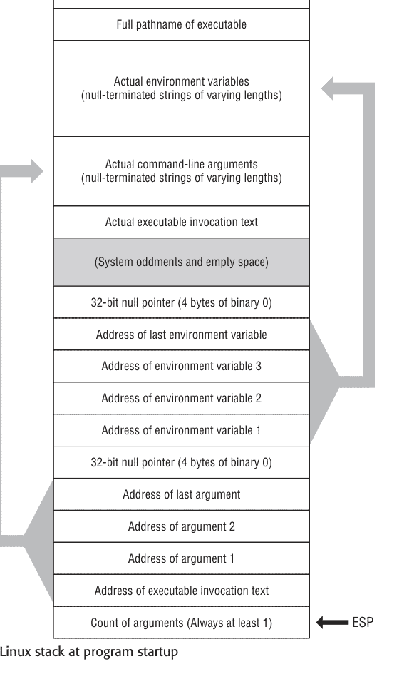

- 命令行参数地址列表以空指针结尾，空指针是行话，指 32 位的二进制 0。
- 空指针之上是一个由 32 位地址组成的较长列表。具体数量取决于你的特定 Linux 系统，但可能接近 200 个。每个地址都指向一个以空字符结尾的字符串（稍后详述），该字符串包含一个属于 Linux 环境的定义。
- Linux 环境变量地址列表的末尾是另一个 32 位空指针，它标志着栈“目录”的结束。在此之后，你可以使用之前在栈上找到的地址来访问内存中更上方的项目。

## 为什么栈地址不可预测

多年前，分配给正在运行的程序的虚拟空间的最高地址始终是 `0BFFFFFFFh`，而这始终是栈的底部。从 Linux 内核 2.6 版本开始，内核“随机化”栈的边界。每次程序运行时，其栈地址都会不同，通常相差数百万字节。此外，地址列表末尾与这些地址所指向的实际字符串数据开头之间，存在可变数量的未使用“填充”内存。

这使得读取程序的内存布局更加困难，但这是有充分理由的。如果栈始终位于同一可靠地址，缓冲区溢出就可能将代码作为数据强制压入栈，然后恶意软件可以执行该代码。这种执行依赖于将内存地址硬编码到恶意软件代码中（因为没有加载器来调整代码地址），但如果栈（几乎）永远不会两次处于完全相同的位置，这种地址硬编码就无法工作，在栈上执行恶意软件代码就变得非常困难。

这是 Linux 本质上比旧版本 Windows（包括 XP 和 2000）更安全的众多原因之一，在那些系统中，栈地址要容易“猜测”得多。

## 使用 Insight 设置命令行参数

总的来说，Gdb 的 Insight GUI 系统还不错，某些部分确实非常出色。然而，有些部分简直糟糕透顶。不幸的是，很多糟糕之处都在于内存视图窗口，而这是使用 Insight 检查栈的唯一方法。

当你使用要调试的程序名称运行 Insight 时，程序不会立即运行，而是被保留在内存中，直到你点击运行按钮。这使你有机会在运行程序之前设置断点。这也使你有机会输入命令行参数。

要在 Insight 下设置命令行参数，打开控制台视图，在 `(gdb)` 提示符后输入 `set args` 命令及其后的参数：

```text
(gdb) set args time for tacos
```

这里你输入了三个参数：`time`、`for` 和 `tacos`。在 gdb 控制台输入参数后，按回车键。要验证输入的参数，你可以使用 `show args` 命令从控制台视图显示它们。输入所有必要的参数后，你可以点击运行，让机器在你第一个断点处暂停。程序开始运行后，内存视图就会激活并显示真实数据。

## 使用 Insight 的内存视图检查栈

只有两种方法可以更改内存视图中显示的内存区域地址。一种是点击导航控件中的向上或向下箭头按钮。点击一次将使视图向上移动 16 字节或向下移动 16 字节。唉，这种方法慢得令人痛苦；点击箭头后，显示刷新可能需要长达三秒的时间。另一种方法是在导航控件的地址输入字段中输入完整的 32 位地址（十六进制）。再次唉（而且无论谁写了 Insight，真该受谴责！），该控件不接受从剪贴板粘贴的文本。

默认情况下，Insight 的内存视图会设置为从你的 `.data` 段的第一个字节开始显示。要查看栈，你必须打开寄存器视图，将 ESP 中显示的地址输入到内存视图导航控件中。然后内存视图将向你显示从顶部开始的栈——也就是说，从 ESP 指向的字节开始。

图 11-5 显示了 `showargs1` 程序（见下面的清单 11-3）带有三个命令行参数时的内存视图。

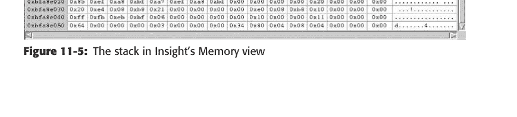

在内存视图中读取栈显示的技巧是记住数字和地址都是 32 位大小，且显示是小端序。这意味着字节按重要性相反的顺序出现。换句话说，32 位值的最低有效字节在前，其次是重要性次之的下一个字节，依此类推。这就是为什么栈上前四个值是：

```text
0x04 0x00 0x00 0x00
```

这是 32 位值 4，即三个命令行参数加上可执行文件路径名的计数。

地址也是如此。地址的最低有效字节在前，因此四个地址字节呈现的方式与你习惯思考的 32 位地址“相反”。栈上的第一个地址是用于调用可执行文件的文本。它看起来像这样：

```text
0x48 0xe6 0xa8 0xbf
```

这四个字节表示 32 位地址 `0BFA8E648h`。

将图 11-5 中的栈显示与图 11-4 中的栈图联系起来。你应该有计数值 4，然后是四个 32 位地址，再后面是四个 0 字节，即 32 位空指针。（这是源自 C 编程的一个术语，有时在汇编工作中使用，尽管我们通常不将地址称为“指针”。）空指针之后，你会看到一长串额外的地址，再后面是另一个空指针。

你可以使用内存视图来“跟踪”地址到内存中实际存储的数据。将栈上的第一个地址输入到导航控件中，视图就会移动到该地址。在这种情况下，这应该是可执行文件调用文本的地址（见图 11-6）。

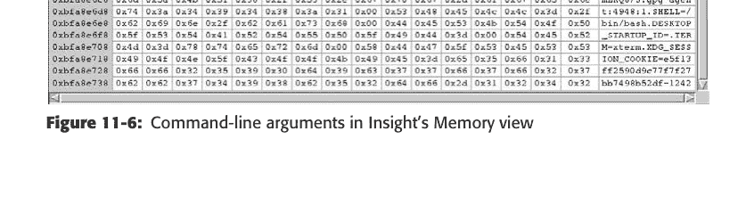

**图 11-6：** Insight 内存视图中的命令行参数

命令行参数和环境变量在内存中首尾相接存储。每个都以单个 0 字节结尾（通常称为空字符），这就是为什么这种字符串被称为以空字符结尾。虽然技术上没有特别的原因，命令行参数和环境变量存储在栈的同一区域，命令行参数在前，环境变量在后。

你可以在内存视图的 ASCII 列中看到它们，如图 11-6 所示。紧接在 `tacos` 参数之后，你会看到第一个环境变量：`ORBIT_SOCKETDIR=tmp/orbit-jduntemann`。它的具体含义超出了本书的范围（ORBIT 是一个 CORBA 对象请求代理），但 Linux 使用这个变量来告知需要知道的人某些基本 ORBIT 文件在系统中的存储位置。

## 使用 `SCASB` 进行字符串搜索

一旦你理解了 Linux 栈在内存中的布局，获取命令行参数就很容易。你本质上有一个地址表在栈上，每个地址指向一个参数。唯一的难点是确定每个参数有多少字节，以便在需要时可以将参数数据复制到其他地方，或者将其传递给像 `sys_write` 这样的 Linux 内核调用。由于每个参数都以单个 0 字节结尾，挑战很明确：我们必须搜索 0。

这可以通过显而易见的方式完成，使用一个循环，从内存中的地址读取一个字节，然后将其与 0 比较，再递增计数器并读取另一个字节。然而，好消息是 x86 指令集实现了一个字符串指令来完成这样的循环，它不像 `STOSB` 那样存储数据，也不像 `MOVSB` 那样复制数据，而是搜索内存中的特定数据值。这个指令是 `SCASB`（按字节扫描字符串），如果你已经理解了前面介绍的其他字符串指令，理解它应该是小菜一碟。

清单 11-3 展示了使用 `SCASB` 来查看栈上的命令行参数并构建参数长度表。然后通过调用 `sys_write` 将参数（连同可执行文件的调用文本）回显到 stdout。

**清单 11-3：** `showargs1.asm`

```asm
;	Executable name	: SHOWARGS1
;	Version		: 1.0
;	Created date	: 4/17/2009
;	Last update	: 5/19/2009
;	Author		: Jeff Duntemann
;	Description	: A simple program in assembly for Linux, using NASM 2.05,
;	  demonstrating the way to access command line arguments on the stack.
```

## 清单 11-3：`showargs1.asm`（续）

```asm
;
; Build using these commands:
;   nasm -f elf -g -F stabs showargs1.asm
;   ld -o showargs1 showargs1.o
;
SECTION .data           ; 包含已初始化数据的节

    ErrMsg db "Terminated with error.",10
    ERRLEN equ $-ErrMsg

SECTION .bss            ; 包含未初始化数据的节

; 本程序处理最多 MAXARGS 个命令行参数。如果你需要处理的参数超过
; 默认的 10 个，请修改 MAXARGS 的值。
; 本质上，我们将指向参数的指针存储在一个基于 0 的数组中，第一个
; 参数的指针位于数组元素 0，第二个位于数组元素 1，以此类推。
; 参数长度也是如此。按以下方式访问参数及其长度：
;      参数字符串：      [ArgPtrs + <索引寄存器>*4]
;      参数字符串长度： [ArgLens + <索引寄存器>*4]
; 注意，当计算参数长度时，会将一个 EOL 字符 (10h) 存储到每个
; 字符串中原来终止的空字符所在的位置。这使得使用 sys_write
; 打印参数变得容易。这不是必需的，如果你更喜欢保留参数中的
; 0 终止符，可以将那行代码注释掉，但要注意参数末尾没有 EOL
; 字符时将无法正确显示。

    MAXARGS  equ 10      ; 我们支持的最大参数个数

    ArgCount: resd 1     ; 传递给程序的参数个数
    ArgPtrs:  resd MAXARGS ; 参数指针表
    ArgLens:  resd MAXARGS ; 参数长度表

SECTION .text           ; 包含代码的节

global _start           ; 链接器需要这个来找到入口点！

_start:

    nop                  ; 这条空指令让 gdb 保持愉快...

; 从栈上弹出命令行参数计数并验证：

    pop ecx              ; TOS 包含参数计数

    cmp ecx,MAXARGS      ; 查看参数计数是否超过 MAXARGS

    ja Error             ; 如果是，退出并显示错误信息

    mov dword [ArgCount],ecx ; 将参数计数保存到内存变量中

; 一旦知道有多少参数，循环会将它们弹出到 ArgPtrs 中：

    xor edx,edx          ; 清零循环计数器

SaveArgs:

        pop dword [ArgPtrs + edx*4]  ; 将参数地址弹出到内存表中

        inc edx                        ; 递增计数器指向下一个参数地址
```


`cmp edx,ecx` ; 计数器是否等于参数计数？

`jb SaveArgs` ; 如果不是，循环回去处理下一个

; 参数指针存储在 `ArgPtrs` 后，我们计算它们的长度：

`xor eax,eax` ; 搜索 0，所以清除 `AL` 为 0

`xor ebx,ebx` ; 指针表偏移量从 0 开始

`ScanOne:`

`mov ecx,0000ffffh` ; 限制搜索最多 65535 字节

`mov edi,dword [ArgPtrs+ebx*4]` ; 将待搜索字符串的地址放入 `EDI`

`mov edx,edi` ; 将起始地址复制到 `EDX`

`cld` ; 设置搜索方向为向上内存

`repne scasb` ; 在 `edi` 处的字符串中搜索空字符 (0)

`jnz Error` ; `REPNE SCASB` 在未找到 `AL` 时结束

`mov byte [edi-1],10` ; 在原来空字符的位置存储 `EOL`

`sub edi,edx` ; 从起始地址减去 0 的位置

`mov dword [ArgLens+ebx*4],edi` ; 将参数长度放入表中

`inc ebx` ; 参数计数器加 1

`cmp ebx,[ArgCount]` ; 查看参数计数器是否超过参数计数

`jb ScanOne` ; 如果不是，循环回去处理下一个

; 将所有参数显示到 `stdout`：

`xor esi,esi` ; 从 0 开始（由于表寻址原因）

`Showem:`

`mov ecx,[ArgPtrs+esi*4]` ; 传递消息的偏移量

`mov eax,4` ; 指定 `sys_write` 调用

`mov ebx,1` ; 指定文件描述符 1：标准输出

`mov edx,[ArgLens+esi*4]` ; 传递消息的长度

`int 80H` ; 进行内核调用

`inc esi` ; 递增参数计数器

`cmp esi,[ArgCount]` ; 查看是否已显示所有参数

`jb Showem` ; 如果不是，循环回去处理下一个

`jmp Exit` ; 完成！收工！

`Error: mov eax,4` ; 指定 `sys_write` 调用

`mov ebx,1` ; 指定文件描述符 2：标准错误

`mov ecx,ErrMsg` ; 传递错误消息的偏移量

`mov edx,ERRLEN` ; 传递消息的长度

`int 80H` ; 进行内核调用

`Exit: mov eax,1` ; 退出系统调用的代码

`mov ebx,0` ; 返回代码为 0

`int 80H` ; 进行内核调用

```
showargs1` 程序首先将参数计数从栈中弹出到 `ECX`，如果计数不超过 `MAXARGS` 中的值，则使用 `ECX` 中的计数来控制一个循环，将参数本身的地址弹出到双字表 `ArgPtrs` 中。这个表稍后用于访问参数本身。

`REPNE SCASB` 指令用于查找每个参数末尾的 0 字节。设置 `SCASB` 与设置 `STOSB` 大致相同：

- 对于向上内存的搜索（如本例），使用 `CLD` 指令确保方向标志 `DF` 被清除。
- 待搜索字符串的第一个字节的地址放入 `EDI`。在这里，它是栈上命令行参数的地址。
- 要搜索的值放入 `AL`（这里是 0）。
- 最大计数放入 `ECX`。这样做是为了避免在要搜索的字节实际上不存在时搜索过远。

一切就绪后，可以执行 `REPNE SCASB`。与 `STOSB` 一样，这在 CPU 内部形成一个紧凑循环。每次循环时，`[EDI]` 处的字节与 `AL` 中的值进行比较。如果值相等，循环满足条件，`REPNE SCASB` 停止执行。如果值*不*相等，则 `EDI` 增加 1，`ECX` 减少 1，循环继续测试 `[EDI]` 处的字节。

当 `REPNE SCASB` 找到 `AL` 中的字符并结束时，`EDI` 将指向搜索字符串中找到字符位置*之后*的那个字节。要访问找到的字符，必须从 `EDI` 中减去 1，正如程序将 0 字符替换为 `EOL` 字符时所做的那样：

```
mov byte [edi-1],10 ; 在原来空字符的位置存储 EOL
```

## REPNE vs. REPE

`SCASB` 指令与 `STOSB` 和 `MOVSB` 略有不同，它是一个*条件*字符串指令。`STOSB` 和 `MOVSB` 在带有 `REP` 前缀时无条件重复。除了测试 `ECX` 以查看循环是否已经进行了预定义次数外，没有其他测试。相比之下，`SCASB` 每次执行时都进行单独的测试，而且每次测试都可能有两种结果。这就是为什么我们不将无条件的 `REP` 前缀与 `SCASB` 一起使用，而是使用 `REPNE` 前缀或 `REPE` 前缀。

当我们在搜索字符串中查找与 `AL` 中的字节匹配的字节时，就像 `showargs1` 中那样，使用 `REPNE` 前缀。当我们在搜索字符串中查找与 `AL` 中的字节*不*匹配的字节时，使用 `REPE`。你可能觉得这听起来有些反向，确实如此。但是，`REPNE` 前缀的含义是：*只要 `[EDI]` 不等于 `AL`，就重复执行 `SCASB`*。同样，`REPE` 前缀的含义是：*只要 `[EDI]` 等于 `AL`，就重复执行 `SCASB`*。前缀指示 `SCASB` 指令应继续执行的时长，而不是何时停止。

重要的是要记住，`REPNE SCASB` 可能由于两种原因之一而结束：它找到了与 `AL` 中字节匹配的字节，或者它将 `ECX` 倒数至 0。在几乎所有情况下，如果 `ECX` 为零时 `REPNE SCASB` 结束，这意味着 `AL` 中的字节未在搜索字符串中找到。但是，存在 `ECX` 恰好在 `[EDI]` 包含与 `AL` 匹配的字节时倒数至零的可能性。虽然不太可能发生，但对于某些数据组合可能会出现这种情况。

`SCASB` 每次执行时都会进行比较，而该比较会设置或清除零标志 `ZF`。`REPNE` 在其比较将 `ZF` 设置为 1 时结束指令。`REPE` 在其比较将 `ZF` 清除为 0 时结束指令。然而，为确保捕获"搜索失败"的结果，你必须在 `SCASB` 指令结束后立即测试 `ZF`。

对于 `REPNE SCASB`：使用 `JNZ`。

对于 `REPE SCASB`：使用 `JZ`。

## 弹出栈还是引用栈？

`showargs1` 程序展示了访问栈内容的显而易见的**求点赞方式**：将它们从栈中弹出到寄存器或变量中。还有另一种方式，而且这是一个提出有趣的程序设计问题的好地方：是将栈数据弹出到寄存器或变量中更好，还是通过**内存引用**访问栈上的数据同时使其保持原状更好？请记住，栈上的数据一旦进入栈后不会以任何特殊方式处理。栈数据在内存中，可以像程序内存空间中的任何位置一样通过括号引用，使用任何合法的寻址模式。

另一方面，一旦你将数据项从栈中 `pop` 到寄存器中，它在技术上就不再在栈上了，因为 `ESP` 已经向上移动了数据项大小的字节数。确实，从栈中弹出数据不会覆盖栈上的数据，但下次有任何内容被压入栈时，`ESP` 地址以下的内存中的数据将被覆盖。如果弹出数据项的位置就在那里，它将会消失，被新的栈数据取代。

关于在栈上引用数据，唯一棘手的是栈顶在程序运行期间并不总是在同一位置。如果你的程序调用过程，`ESP` 中的值会随着返回地址被压入栈和弹出栈而变化。你的代码可以将值压入栈进行临时存储。除了最简单的程序外，依赖 `ESP` 的不变值来引用栈是非常**危险**的。

在大多数应用程序中，更好的方法是在程序开始运行时通过将 `ESP` 复制到一个 32 位寄存器中来创建栈指针的不变副本。一个好的选择是 `EBP`，16 位版本的 32 位版本。

`BP`（Base Pointer，基址指针）寄存器。这正是 `BP` 最初的设计用途：保存一份栈指针原始值的副本，以便后续的栈操作不会让栈数据的"非破坏性"寻址变得更加困难。如果在程序执行任何改变 `ESP` 值的操作之前将 `ESP` 复制到 `EBP`，你就获得了一个指向栈的"书签"，可以据此寻址栈中更高位置的任何内容。

我创建了一个稍有不同的 `showargs1` 版本来演示其工作原理。完整的程序 `showargs2` 收录于本书的示例代码存档中，但相关代码如下所示。将其与 `showargs1` 对比，看看两者的**差异**：

```
_start:

    nop                  ; This no-op keeps gdb happy...

    mov ebp,esp           ; Save the initial stack pointer in EBP

; Validate the command line argument count:

    cmp dword [ebp],MAXARGS ; See if the arg count exceeds MAXARGS

    ja Error              ; If so, exit with an error message

; Here we calculate argument lengths and store length in table ArgLens:

    xor eax,eax           ; Searching for 0, so clear AL to 0

    xor ebx,ebx           ; Stack address offset starts at 0

ScanOne:

    mov ecx,0000ffffh     ; Limit search to 65535 bytes max

    mov edi,dword [ebp+4+ebx*4] ; Put address of string to search in EDI

    mov edx,edi           ; Copy starting address into EDX

    cld                   ; Set search direction to up-memory

    repne scasb           ; Search for null (0 char) in string at edi

    jnz Error             ; REPNE SCASB ended without finding AL

    mov byte [edi-1],10   ; Store an EOL where the null used to be

    sub edi,edx           ; Subtract position of 0 from start address

    mov dword [ArgLens+ebx*4],edi ; Put length of arg into table

    inc ebx               ; Add 1 to argument counter

    cmp ebx,[ebp]         ; See if arg counter exceeds argument count

    jb ScanOne            ; If not, loop back and do another one

; Display all arguments to stdout:

    xor esi,esi           ; Start (for table addressing reasons) at 0

Showem:

    mov ecx,[ebp+4+esi*4] ; Pass offset of the message

    mov eax,4             ; Specify sys_write call

    mov ebx,1             ; Specify File Descriptor 1: Standard Output

    mov edx,[ArgLens+esi*4] ; Pass the length of the message

    int 80h               ; Make kernel call

    inc esi               ; Increment the argument counter

    cmp esi,[ebp]         ; See if we've displayed all the arguments

    jb Showem             ; If not, loop back and do another

    jmp Exit              ; We're done! Let's pack it in!
```

就在一开始，我们通过将 `ESP` 复制到 `EBP` 创建了一个固定不变的栈指针副本。之后对栈的所有其他访问都通过 `EBP` 中的地址进行。`ArgPtrs` 和 `ArgCount` 这两个变量消失了；在 `showargs1` 中存储在这两个变量中的数据现在直接存在于栈上，而在 `showargs2` 中我们将其保留在栈上并直接从栈中使用。

程序启动时，栈顶是参数计数，因此访问参数计数易如反掌：它就是 `[EBP]` 处的 `dword` 值。要访问栈中更高位置的项目（如参数地址），需要向 `EBP` 添加偏移量。参数计数往上四个字节是第一个参数的地址，因此该参数的有效地址为 `[EBP+4]`。每往上四个四个字节就是另一个参数地址，直到遇到空指针为止。如果使用 `EBX` 寄存器作为基于 0 的参数计数器，则可以这样计算任意给定参数的地址：

```
[ebp+4+ebx*4]
```


正是这样，我们利用基于栈的参数地址来查找参数长度，随后将其输出到控制台。无需弹出操作，程序开始运行时栈上的内容会原封不动地保留在那里，以防我们后续执行过程中再次需要用到。

## 附加挑战 . . .

练习总是有益的，这里有一个可以自行尝试的挑战：重写`showargs2.asm`，使其不再显示程序的命令行参数，而是显示完整的 Linux 环境变量列表。大部分挑战在于如何寻址栈。环境变量的地址并不在`EBP`上方某个固定不变的偏移位置，它们的具体位置取决于用户输入了多少个命令行参数。

实际上这比你想象的要简单。哪怕只给一点提示就会泄露答案，所以戴上你的思考帽，看看自己能不能想出来。（你可以在本书的示例代码存档中找到答案，但请先自己尝试！）

# 第 12 章

## 迈向 C 语言

### 调用用 C 语言编写的外部函数

学习汇编语言有很大价值，其中大部分价值源于这样一个要求：你*必须*详细了解一切是如何工作的，否则你走不远。这一点从一开始就是如此，从数字电子计算诞生之初便是如此。但由此引出了一个合理的问题：*我真的需要知道所有这些吗？*

公平的答案是否定的。即使不具备对机器和操作系统的汇编级掌控，也能编写出极其有效的程序。这正是高级语言被创造出来的目的：在更高的抽象层次上进行更简单、更快速的编程。如果所有软件都必须完全用汇编语言编写，如今有多少软件能够存在还未可知。

Linux 也不例外。Linux 有少部分代码用汇编编写，但操作系统的主体部分是用 C 写成的。Linux 世界围绕着 C 语言运转，如果你期望在 Linux 下大量使用汇编语言，最好做好准备学习 C 语言，并在必要时加以使用。

回报几乎是立竿见影的：能够访问用 C 语言编写的程序库。这样的库有成千上万个，与 Linux 操作系统相关的库大多免费，并附带 C 源代码。使用 C 函数库（在 C 文化中称为"过程"）有利有弊；但学习调用 C 函数的技能真正价值在于，这是了解一切如何工作的一部分，尤其是在 Linux 下，C 语言在你目光所及的每一个角落都留下了印记。

对于 Linux，几乎所有不涉及 Perl 或 Python 等解释型语言的编程示例都是用 C 写的。最重要的是，C 运行时库包含大量极其有用的函数，但要求你在调用这些函数时遵循 C 的协议。所以如果你还不懂这门语言，去买本书，沉下心来写点 C 代码。你不需要写太多，但要确保理解所有基本的 C 概念，尤其是与函数调用相关的概念。我会尽力在本书中填补底层的知识空白，但我无法教授语言本身及其所有附属内容。你可能觉得 C 语言有点令人反感（我过去和现在都是如此），也可能爱上它，但*你无法逃避它*，即使你对 Linux 的主要兴趣在于汇编语言。

## GNU 是什么？

早在 1970 年代末，一位目光炯炯的 Unix 黑客理查德·斯托曼想要一份自己的 Unix。然而他不想为此付费，于是他做了一个**显而易见的**选择：他开始编写自己的版本。（如果你觉得这不够显而易见，那你还不了解 Unix 文化。）不过，他对当时所有可用的编程工具都不满意，也反对它们的高昂价格。因此，作为编写自己版本 Unix 的前提条件，斯托曼着手编写自己的编译器、汇编器和调试器。（他已经写好了自己的编辑器，即传奇的 EMACS。）

斯托曼将自己的 Unix 版本命名为 *GNU*，这是一个递归缩写，意思是 GNU's Not Unix（GNU 不是 Unix）。这是个不错的笑话，也是在当时绕过 AT&T 商标律师的一种方式——他们对谁使用 *Unix* 这个词以及如何使用非常挑剔。随着时间推移，GNU 工具独立发展壮大；实际上，斯托曼从未完成 GNU 本身。其他免费的 Unix 版本相继出现，关于谁实际拥有哪个部分的肥皂剧持续上演了好几年。这让斯托曼深感厌恶，于是他创建了自由软件基金会（Free Software Foundation），作为 GNU 工具开发的大本营，并创立了激进的软件许可协议——GNU 通用公共许可证（GPL），有时非正式地称为" copyleft"。斯托曼在 GPL 下发布了 GNU 工具，这不仅要求软件免费（包括所有源代码），还阻止人们对软件进行小幅修改后就将衍生作品据为己有。改进和增强必须回馈给 GNU 社区。

这在当时看来似乎是天方夜谭，但多年之后，它逐渐形成了一种奇特的逻辑并焕发出自己的生命力。GPL 使得在其下发布的软件得以飞速发展，因为大型

## 瑞士军刀编译器

在现代 Linux 发行版中，你会发现 EMACS 中已没有多少理查德·斯托曼的影子了——在过去 20 多年里，它已被许多人重写了无数次。斯托曼遗产留存最强烈的地方是在 GNU 编译器中。这样的编译器有不少，但你必须尽可能彻底理解的是 GNU C 编译器，`gcc`。（小写字母在 Unix 世界中某种程度上是一种执念，一种包括我在内的许多人都无法理解的一处迷恋。）

为什么在汇编工作中使用 C 编译器？主要是因为：`gcc` 所做的远不止简单地编译 C 代码。它有点像一种瑞士军刀式的开发工具。事实上，我更愿意将其描述为*构建*软件，而不只是*编译*软件。除了将 C 代码编译为目标代码之外，`gcc` 还控制着汇编步骤和链接步骤。

汇编步骤？是的，确实如此。GNU 有一个汇编器 `gas`，尽管它是一个奇特的工具，并不真的打算供人类程序员直接使用。`gcc` 所做的是控制 `gas` 和 GNU 链接器 `ld`（你已经像操纵提线木偶一样在使用它们了）。如果你使用 `gcc`，尤其是在初学者阶段，你不必过多地直接与 `gas` 和 `ld` 打交道。

让我们进一步谈谈这个问题。

## 以 GNU 方式构建代码

汇编语言工作与 C 语言工作不同，而 `gcc` 首先是一个 C 编译器。因此，我们需要首先了解构建 C 代码的过程。从表面上看，使用 GNU 工具为 Linux 构建 C 程序相当简单。然而在幕后，这是一件极其复杂的事情。虽然看起来 `gcc` 做了所有的工作，但 `gcc` 实际上只是作为多个 GNU 工具的主控制器，监督着一个代码组装流水线，除非你特意去看，否则无需关心。

理论上，从 C 源代码生成可执行二进制文件，你只需要做这些：

```
gcc eatc.c -o eatc
```

在这里，`gcc` 接收文件 `eatc.c`（一个 C 源代码文件）并进行处理，生成可执行文件 `eatc`。（`-o` 选项告诉 `gcc` 可执行输出文件的命名。）然而，这里发生的事情远比表面上看到的要多。当我们逐步讲解时，请参看图 12-1。在图中，阴影箭头表示信息的流动。空白箭头表示程序控制。

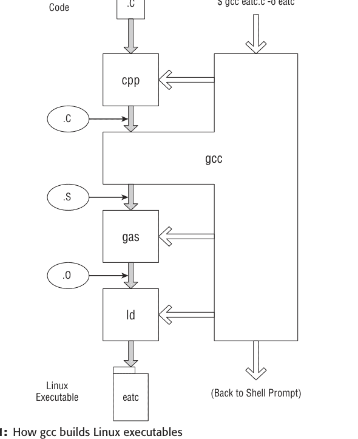

**图 12-1：** gcc 如何构建 Linux 可执行文件

程序员从 shell 命令行调用 `gcc`，通常是在终端窗口中。`gcc` 控制系统并立即调用一个名为 C 预处理器（`cpp`）的实用工具。预处理器接收原始 C 源代码文件，并处理诸如 `#include` 和 `#define` 之类的项目。它可以被认为是施加在 C 源代码文件上的宏展开步骤。

当 `cpp` 完成其工作时，`gcc` 正式开始工作。从预处理后的 C 源代码文件中，`gcc` 生成一个以 `.s` 为扩展名的汇编语言源代码文件。这实际上是原始 `.c` 文件中 C 语句的汇编代码等价物，以人类可读的形式呈现。如果你掌握了阅读 AT&T 汇编语法和助记符的技能（稍后会详细介绍），你就可以从检查 `gcc` 生成的 `.s` 文件中学到*很多*知识。

当 `gcc` 完成 C 源代码文件的汇编语言等价物生成后，它会调用 GNU 汇编器 `gas`，将 `.s` 文件汇编成目标代码。这些目标代码被写入一个以 `.o` 为扩展名的文件中。

最后一步涉及链接器 `ld`。`.o` 文件包含二进制代码，但它*仅*包含从原始 `.c` 文件中的语句生成的二进制代码。`.o` 文件*并不*包含在 C 编程中如此重要的标准 C 库的代码。那些库已经被编译好，只需链接到你的应用程序中。链接器 `ld` 在 `gcc` 的指示下完成这项工作。好处在于，`gcc` 确切地知道哪些标准 C 库需要链接到你的应用程序中才能使其工作，而且它总是以正确的版本包含正确的库。因此，虽然 `gcc` 实际上并不执行链接，但它*知道需要链接什么*——这确实是有价值的知识，尤其当你的程序变得越来越复杂时。

最终，`ld` 输出完全链接好的可执行程序文件。此时，构建完成，`gcc` 将控制权交还给 Linux shell。请注意，所有这些通常只需向 `gcc` 发出一条简单命令即可完成！

## 如何在汇编工作中使用 gcc

我刚才描述的过程，以及在图 12-1 中以图形方式为你展示的，就是使用 GNU 工具在 Linux 下构建 C 程序的过程。我在这里详细介绍，是因为我们将利用这个过程中的部分——尽管只是一部分——来简化我们的汇编编程。诚然，我们不需要将 C 源代码转换为汇编代码——事实上，我们也不需要 `gas` 将汇编源代码转换为目标代码。然而，我们确实需要 `gcc` 在链接方面的专业知识。我们将在链接阶段接入 GNU 代码构建过程，让 `gcc` 为我们协调链接步骤。

当你使用 NASM 汇编 Linux 程序时，NASM 会生成一个包含二进制目标代码的 `.o` 文件。在 Linux 下调用 NASM 通常是这样进行的：

```
nasm -f elf -g -F stabs eatclib.asm
```

这个命令指示 NASM 汇编文件 `eatclib.asm`，并生成名为 `eatclib.o` 的文件。`-f elf` 部分告诉 NASM 以 ELF 格式生成目标代码，而不是 NASM 能够生成的众多其他目标代码格式之一。`-g -F stabs` 部分启用了输出文件中调试信息的生成，采用 STABS 格式。`eatclib.o` 文件本身是不可执行的。它需要被链接。因此，我们调用 `gcc` 并指示它为我们链接程序：

```
gcc eatclib.o -o eatclib
```


这里的哪一部分告诉 `gcc` 进行链接而不是编译？命令中唯一指明的输入文件是一个包含目标代码的 `.o` 文件。仅凭这一事实就足以告诉 `gcc`，所有需要做的就是将该文件与 C 运行时库链接，以生成最终的可执行文件。`-o eatclib` 部分告诉 `gcc`，最终可执行文件的名称将是 `"eatclib"`。

包含 `-o` 指定符很重要。如果你不确切告诉 `gcc` 最终可执行文件的命名，它就会直接默认命名为 `"a.out"`。

## 为什么不用 `gas`？

你可能在想，如果每次安装 Linux 时都会自动安装一个完美可用的汇编器，为什么我还要费心向你展示如何安装和使用另一个。原因有二：

- GNU 汇编器 `gas` 使用一种奇特的语法，这与 x86 世界中使用的所有其他熟悉汇编器（包括 `NASM`）的语法完全不同。它有一整套独有的指令助记符。我觉得它们丑陋、不直观、难以阅读。这就是 AT&T 语法，之所以这样命名，是因为它是 AT&T 创建的一种可移植汇编表示法，使 Unix 更容易从一种底层 CPU 移植到另一种。它之所以丑陋，部分原因是它被设计为通用的，可以针对可能出现的任何合理的 CPU 架构重新定制。

- 更重要的是，在我看来，"可移植汇编语言"的概念是一个自相矛盾的说法。汇编语言应该是对底层机器架构的直接、完整、一对一的反映。任何试图使汇编语言通用化的做法，都会使语言偏离机器，限制汇编程序员按照 CPU 设计意图进行控制的能力。创建和演进 CPU 架构的组织才最有资格在不妥协的情况下定义 CPU 的助记符。这就是为什么我将始终使用和教授 Intel 助记符。

如果事情只是这么简单，我就根本不会提及 `gas` 了，因为你不需要 `gas` 来用 `NASM` 编写 Linux 汇编语言。然而，你学习许多标准 C 库调用的主要方式之一，就是在简短的 C 程序中使用它们，然后检查 `gcc` 生成的 `.s` 汇编输出文件。在你熟悉 C 调用约定的过程中，具备一定的阅读 AT&T 助记符的能力会很有用。我将在本章稍后提供 AT&T 语法的概述。

## 链接到标准 C 库

当你编写一个纯汇编程序时，就像本书到目前为止我所展示的那些，你编写*所有*的代码。除了偶尔调用 Linux 内核服务之外，运行的所有代码都是你自己编写的。链接外部汇编语言过程库会让这种情况变得稍微复杂一些，尤其是当那些库不是你编写的时候。而链接到标准 C 库中的函数（在 Linux 中称为 *glibc*）则会让情况变得复杂得多。

实际上，当你创建 Linux 汇编语言程序并链接到 `glibc` 中的函数时，你创建的是一种混合体。这种混合体的结构如图 12-2 所示。

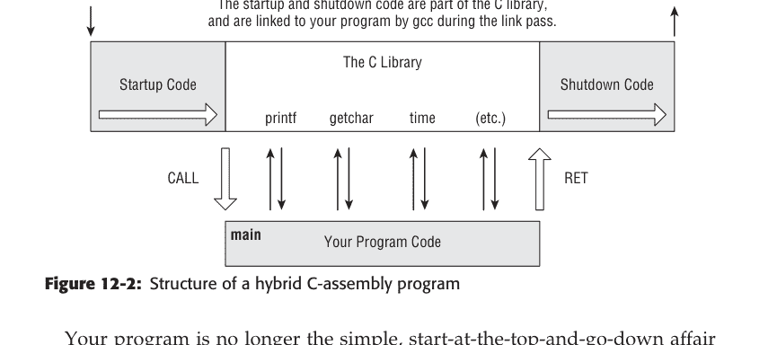

> **图 12-2：** 混合 C-汇编程序的结构

你的程序不再是那种简单的、从开头一路向下执行的程序了。`Glibc` 不仅仅是一堆互不相干的函数的集合。它是标准 C 运行时库，而作为其标准化的一部分，它对链接到它的任何程序都规定了一种结构。这种结构包括一块在你程序开始前运行的代码，以及另一块在你程序结束后运行的代码。你的程序被启动代码如同调用一个过程那样调用（通过 `CALL` 指令），并且它通过 `RET` 指令将控制权返回给 C 库代码。

从技术上讲，你的程序*就是*一个过程，把它当作过程来思考会很有帮助。这就是我在图 12-2 中绘制它的方式。当 Linux 开始执行你的程序时，它实际上并不是从你写的代码的顶部开始，而是从启动代码块的开头开始。当启动代码完成了它必须做的工作后，它执行一条 `CALL` 指令，将执行流程带入你的汇编代码。当你的汇编语言程序通过 `RET` 将控制权返回给调用者时，关闭代码开始执行，而正是关闭代码通过必要的 `INT 80h` 内核调用将控制权实际返还给 Linux。

在此期间，你可以随意调用 `glibc` 中的函数。当你使用 `gcc` 链接程序时，你所调用的 C 库例程的代码会被链接到程序中。请注意，启动和关闭代码，以及所有库调用的代码，都物理上存在于你用 `gcc` 生成的可执行文件中。

## C 调用约定

`Glibc` 并不是专门针对汇编语言程序给予特殊对待。纯 C 程序也是以相同的方式工作的，这就是为什么 C 程序的主程序部分被称为主*函数*。它确实是一个函数，标准 C 库代码用 `CALL` 指令调用它，并且它通过执行 `RET` 指令将控制权返回给标准 C 库代码。

主程序获得控制权的方式因此是你将看到的第一组称为 C *调用约定*的规则的例子。标准 C 库可以说是一致性的典范，而这就是它最大的优点。所有在 x86 处理器上实现的 C 库函数都遵循这些规则。尽早将它们铭刻在你的突触中，你就会比我少失眠很多，我当时可是费了很大劲才搞清楚它们的。

从宏观上看，规则如下：

- 一个过程（这是比 C 所称的函数更通用的术语）必须保存 `EBX`、`ESP`、`EBP`、`ESI` 和 `EDI` 这 32 位寄存器的值。也就是说，虽然它可以使用这些寄存器，但当它将控制权返回给调用者时，这些寄存器中的值必须与调用该函数之前的值相同。所有其他通用寄存器的内容可以随意更改。

- 过程的返回值如果是 32 位或更小的大小，则通过 `EAX` 返回。64 位整数值通过 `EDX` 和 `EAX` 返回，低 32 位在 `EAX` 中，高 32 位在 `EDX` 中。浮点返回值在浮点栈顶返回。（本书不会涉及浮点数运算。）字符串、结构体和其他大于 32 位的数据项通过引用返回；也就是说，过程在 `EAX` 中返回一个指向它们的 32 位指针。

- 传递给过程的参数按*逆序*压入栈中。也就是说，给定 C 函数 `MyFunc(foo, bar, bas)`，`bas` 最先被压入栈中，`bar` 其次，`foo` 最后。稍后会更详细地介绍这一点。

- 过程本身*不*从栈中移除参数。调用者必须在过程返回后执行此操作，要么将参数从栈中弹出，或者（更常见的情况是，因为这通常更快）向栈指针 `ESP` 添加一个偏移量。（同样，稍后当我们实际操作时，我会详细解释这意味着什么。）

- 虽然从技术上讲不算调用约定，但这个要求很重要：汇编程序开始点的标签*必须*是 `"main:"`——不能是 `start:`，也不能是 `Main:`、`MAIN:` 或 `Beginning:`。代码开头处的标签必须是 `main:`，并且必须声明为全局的。

透彻理解这些规则将使你能够调用标准 C 库中的大量函数，以及许多其他有用的库，这些库都是用 C 编写的，并遵循我所描述的约定。

## 一个可构建的框架

在你的程序中遵守 C 调用约定，首先要保存和恢复我上面列出的所谓神圣寄存器。你编写的每个链接到 `glibc`（或几乎任何其他用 C 编写的函数库）的程序，在其开头和结尾都需要完全相同的代码，因此将所需的代码固化成一个样板文件是很有用的，你在开始任何打算与 C 函数链接的新项目时都可以使用它。

我创建了这样一个样板文件，名为 `boiler.asm`，它存在于本书的清单归档中。必要的寄存器保存和恢复代码已经在那里了。本章剩余部分的所有演示程序都基于 `boiler.asm`，你也可以将其作为自己新项目的基础。一个简单的例子，请往后看 `eatlib.asm`，在清单 12-1 中，它就是在 `boiler.asm` 文件中只添加了五行新代码。

## 保存和恢复寄存器

正如我之前描述的，C 调用约定中较为奇怪的规定之一是，程序不能随意更改所有通用寄存器。Linux 应用程序链接到 C 函数时不能更改的寄存器有 `EBX`、`ESP`、`EBP`、`ESI` 和 `EDI`。你会注意到 `boiler.asm` 在程序开始时将这些寄存器保存到栈上，然后在将控制权交还给 Linux 之前从栈中恢复它们。

从这个保存 `EBX`、`ESP`、`EBP`、`ESI` 和 `EDI` 的要求中，你必须得出一个非常重要但非显而易见的结论：其他通用寄存器可能会被随意破坏。是的，被破坏——*而且不只是被你所破坏*。当你调用其他人编写的过程时，这些过程可能会更改 `EAX`、`ECX` 和 `EDX` 中的值。（栈指针 `ESP` 是一个特殊情况，需要一种不适用于其他寄存器的特殊处理。）这对你意味着，你*不能*假设（例如）你在 `ECX` 中跟踪的计数值在你调用 `printf()` 这样的 C 库函数时会保持原样不被触动。

如果你正在使用 `ECX` 来计数循环次数，而这个循环调用了库函数——或者任何你自己没有编写的函数——你必须在调用库函数之前将 `ECX` 的值保存到栈上，并在库函数返回后恢复它。`EAX` 和 `EDX` 同样如此。（`EAX` 通常用于从库函数返回值，所以在进行库函数调用时，用它存储计数器和地址之类的东西是不明智的。）如果你需要在这些寄存器的值在调用库函数的过程中保持完好，你必须在调用库函数之前将它们保存到栈上。

相反，`EBX`、`EBP`、`ESI` 和 `EDI` 的神圣性意味着，当你进行 C 库调用时，这些寄存器*会*保持它们的值。对你有约束力的，对 C 库也同样有约束力。需要用到这些寄存器的库函数会自动保存和恢复它们，不需要你操心。

## 设置栈帧

栈在汇编语言工作中极其重要，而对于与 C 交互的程序来说更是如此，因为在 C 中（实际上大多数其他原生代码的高级语言中也是如此，包括 Pascal），栈扮演着核心角色。原因很简单：编译器是编写汇编语言代码的机器人，它们不像你那样是人类且具有聪明才智。这意味着编译器必须使用看似暴力的方法来生成代码，而这些方法大多严重依赖于栈的使用。

编译器代码生成是博士论文级别的内容，与这本入门书籍中的课程关系不大。有一种编译器机制确实与 Linux 汇编工作相关，那就是*栈帧*。编译器依赖栈帧来创建函数中的局部变量，虽然栈帧在纯汇编工作中用处较小，但如果要调用由高级语言编译器编写的函数，你就必须理解它们。

栈帧是栈上一个标记为属于特定函数的位置。它基本上就是两个寄存器所包含地址之间的区域：基指针 `EBP` 和栈指针 `ESP`。这画出来比解释更清楚；参见图 12-3。

栈帧的创建方法是：将调用者的 `EBP` 副本压入栈中以保存它，然后将调用者的栈指针 `ESP` 复制到寄存器 `EBP` 中。任何遵守 C 调用约定的汇编程序的前两条指令必须是：

```
push ebp
mov ebp,esp
```

在此之后，你必须么不动 `EBP`，要么——如果你必须在万不得已的情况下使用它——确保在改动违反任何 C 库假设之前将其恢复。（*我强烈*建议不要碰它！）`EBP` 被视为新栈帧的锚点，这是不应该更改它的主要原因。栈帧上方（即更高地址处）存储有一些内容，你的代码经常需要引用它们，而 `EBP` 是引用它们的唯一安全方式。（这些内容没有显示在图 12-3 中，但我稍后会再提到它们。）

不那么明显的是，`EBP` 还是你藏匿调用者栈指针值 `ESP` 的藏身之处。这是你创建栈帧后不应更改 `EBP` 的又一个原因。在程序结束时带着随机值返回控制权给 `ESP`，是我所能想到的最快捷的 trouble 路径。

一旦 `EBP` 安全地锚定为栈帧的一端，栈指针 `ESP` 就可以根据需要自由地在栈上下移动。然而，你首先需要放入栈中的，是调用者的 `EBX`、`ESI` 和 `EDI` 值，如图 12-3 所示。它们将在程序结束时栈帧被销毁时从栈中弹出，将调用者（在我们的例子中是标准 C 库的启动/关闭代码）的这些寄存器恢复到启动代码调用你的程序作为函数 `main` 时的相同值。

但一旦 `EBX`、`ESI` 和 `EDI` 入栈后，你就可以为了临时存储而随意 `push` 和 `pop` 任何需要的内容。调用 C 函数需要大量的 `push` 和 `pop`，你很快就能看到。

## 销毁栈帧

在我们的程序通过将控制权返回给启动/关闭代码来结束执行之前（如果这种关系不清楚，请回顾图 12-2），它的栈帧必须被销毁。这听起来对很多人来说好像有什么地方出了问题，但事实并非如此：栈帧必须被销毁，否则你的程序将会崩溃。（"收起来"可能比"销毁"是更好的术语，但程序员偏爱生动的语言，你在他们中间待上一段时间后就会了解这一点。）

在销毁栈帧并返回控制权之前，栈必须是干净的。这简单地意味着我们在程序运行期间可能 `push` 到栈上的任何临时值都必须已经消失。栈上剩下的应该只有调用者的 `EBP`、`EBX`、`ESI` 和 `EDI` 值。基本上，如果 `EDI` 是调用者最后一个保存在栈上的值，`ESP`（栈指针）最好指向那个保存的 `EDI` 值，否则就会出问题。

一旦栈干净了，要销毁栈帧，我们必须首先将调用者的寄存器值 `pop` 回它们的寄存器，确保 `pop` 的顺序正确。把调用者的 `EBX` 值返回到 `EDI` 中仍然会崩溃你的程序！完成这些后，我们撤销创建栈帧时遵循的逻辑：我们通过将 `EBP` 中的值移动到 `ESP` 来恢复调用者的 `ESP`，最后将调用者的 `EBP` 值从栈中弹出：

```
mov esp,ebp
pop ebp
```

就是这样！栈帧消失了，栈和神圣寄存器现在处于启动代码将控制权交给我们的程序时的相同状态。现在执行将控制权发送给 C 库关闭代码的 `RET` 指令是安全的。

## 通过 `puts()` 输出字符

`glibc` 中最简单的实用函数大概是 `puts()`，它将字符发送到标准输出。从汇编语言调用 `puts()` 非常简单，三行代码就能搞定。清单 12-1 中的程序建立在文件 `boiler.asm` 之上，你可以在主程序的开头和末尾看到保存和恢复神圣寄存器的样板代码。

这种方式调用 `puts()` 是一个很好的缩影示例，展示了我们调用大多数 C 库例程的通用过程。所有 C 库例程都在栈上获取它们的参数，这意味着我们必须 `push` 适合 32 位的数值，或者指向位于别处的字符串或其他更大数据对象的指针。在这种情况下，我们 `push` 一个 32 位的文本字符串指针。注意，我们没有向 `puts()` 传递字符串的长度值，就像我们用 `sys_write` 内核调用向控制台发送文本时所做的那样。`puts()` 从字符串开头开始，将字符发送到 `stdout`，直到遇到 0（空）字符。字符串的第一个字节和第一个空字符之间的字符数就是控制台接收的字符数。

**清单 12-1：** `eatclib.asm`

```
;	Source name	: EATCLIB.ASM
;	Executable name : EATCLIB
;	Version		: 2.0
;	Created date	: 10/1/1999
;	Last update	: 5/26/2009
;	Author		: Jeff Duntemann
;	Description	: Demonstrates calls made into glibc, using NASM 2.05
;			  to send a short text string to stdout with puts().
;
;	Build using these commands:
;	  nasm -f elf -g -F stabs eatclib.asm
;	  gcc eatclib.o -o boiler

[SECTION .data]		; Section containing initialized data
EatMsg: db "Eat at Joe's!",0

[SECTION .bss]		; Section containing uninitialized data

[SECTION .text]		; Section containing code
extern puts		; Simple "put string" routine from glibc
global main		; Required so linker can find entry point

main:
	push ebp		; Set up stack frame for debugger
        mov ebp,esp
        push ebx        ; Must preserve ebp, ebx, esi, & edi
        push esi
        push edi

;;; Everything before this is boilerplate; use it for all ordinary apps!
        push EatMsg     ; Push address of message on the stack
        call puts       ; Call glibc function for displaying strings
        add esp,4       ; Clean stack by adjusting ESP back 4 bytes

;;; Everything after this is boilerplate; use it for all ordinary apps!
        pop edi         ; Restore saved registers
        pop esi
        pop ebx
        mov esp,ebp     ; Destroy stack frame before returning
        pop ebp
        ret             ; Return control to Linux
```


## 使用 `printf()` 进行格式化文本输出

`puts()` 库例程可能看起来相当有用，但与它的一些更复杂的兄弟相比，这只是小儿科。使用 `puts()` 我们只能将简单的文本字符串发送到文件（默认是 `stdout`），没有任何格式化功能。更糟糕的是，`puts()` 总是在其显示的末尾包含一个 EOL 字符，无论我们在字符串数据中是否包含一个。这阻止我们使用多次调用 `puts()` 来在同一行上输出多个文本字符串。

对于 `puts()` 最好的评价莫过于它具有简单的优点。对于几乎所有字符输出需求，你最好使用一个强大得多的库函数 `printf()`。`printf()` 函数使我们能够用一次函数调用来做许多真正有用的事情：

- 输出带有或不带终止 EOL 的文本。
- 通过输出格式化代码和数据，将数值数据转换为多种格式的文本
- 输出包含多个单独存储的字符串的文件文本

如果你使用 C 语言超过半小时，`printf()` 对你来说将完全显而易见，但对于从其他语言（如 Pascal，它没有直接等价物）转来的人，可能需要一点解释。

`printf()` 例程很乐意显示像 "Eat at Joe's!" 这样的简单字符串——但当它向标准输出发送时，我们可以将其他文本字符串和转换后的数值数据与该基础字符串合并，并一起无缝显示。这是通过在基础字符串中放入*格式化代码*来实现的，然后为这些格式化代码传递数据项给 `printf()`，同时传递基础字符串。格式化代码以百分号开头，包含与正在合并到基础字符串中的数据项的类型和大小相关的信息，以及该信息应如何呈现。

让我们从一个非常简单的例子开始。这里有一个包含一个格式化代码的基础字符串：

```
"The answer is %d, and don't you forget it!"
```

`%d` 格式化代码简单地告诉 `printf()` 将有符号整数值转换为文本，并在基础字符串中替换该文本。当然，你现在必须将一个整数值传递给 `printf()`，我很快就会展示如何做到，但当你这样做时，`printf()` 会将整数转换为文本，并在向流发送文本时将其与基础字符串合并。如果传递的十进制值是 42，在控制台上你会看到：

```
The answer is 42, and don't you forget it!
```

格式化代码实际上有相当多的结构，而 `printf()` 机制整体上有比我这里能描述的更多的细节。任何好的 C 参考书都会详细解释整个内容。表 12-1 列出了最常见和最有用的格式化代码。

**表 12-1：常用 `printf()` 格式化代码**

| 代码 | 基数 | 描述 |
|------|------|-------------|
| `%c` | 无 | 将字符显示为字符 |
| `%d` | 10 | 转换整数并以十进制显示 |
| `%s` | 无 | 将字符串显示为字符串 |
| `%x` | 16 | 转换整数并以十六进制显示 |
| `%%` | 无 | 显示百分号符号 |

我们可以对格式化代码做的最重要的增强是在 `%` 符号和代码字母之间放置一个整数值：

```
%5d
```

这个代码告诉 `printf()` 在五个字符宽的字段中右对齐显示该值。如果你不包含字段宽度值，`printf()` 将只给该值的数字所需的空间。

记住，如果你需要显示百分号符号，你必须在字符串中包含两个连续的百分号符号：第一个是告诉 `printf()` 将第二个显示为它本身，而不是作为格式化代码的导入符。

## 向 `printf()` 传递参数

假设你已经理解了 `printf()` 的逻辑工作原理，那么使用它的真正挑战在于，要知道如何向它传递所有参数，以处理任何特定的字符串显示。与 Pascal 中的 `Writeln()` 函数一样，`printf()` 没有固定的参数数量。它可以只接收一个基字符串作为参数，也可以接收你所需要的任意多个参数，包括额外的字符串、字符值和各种类型的数值。

传递给 C 库函数的所有参数都是通过栈来完成的。这可以通过两种方式实现：直接方式，即将参数值本身压入栈；或者间接方式，即通过引用，将参数的 32 位地址压入栈。对于 32 位或 64 位的数据值，我们将值本身压入栈。对于较大的数据项，如字符串和数组，我们将指向这些项的指针压入栈。（用 C 的行话来说，传递某物的地址称为*传递指向该物的指针*。）

当向 `printf()` 传递多个参数时，它们都必须被压入栈，而且要按照一种非常特殊且反直觉的顺序：从右到左，就像你在 C 语言代码中调用 `printf()` 时它们出现的那样。基字符串被视为最左边的参数，总是最后被压入栈。下面一个简单的 C 语言例子会有助于理解：

```
printf('%d + %d = %d ...for large values of %d.',2,2,5,2);
```

这是一个调用 `printf()` 的 C 语言语句。基字符串被引号括起来，是第一个参数。在字符串之后有几个数值参数。基字符串中嵌入的每个 `%d` 格式代码都必须有一个对应的数值。这些项必须进入栈的顺序是从右开始向左读：2、5、2、2，基字符串最后被压入。在汇编中，这样做的：

```
push 2
push 5
push 2
push 2
push mathmsg
call printf
add esp,20
```

标识符 `mathmsg` 是基字符串，它的地址是所有参数中最后被压入的。记住，我们不是将字符串本身压入栈。我们压入的是字符串的*地址*，C 库代码会跟随该地址并使用其自身的机制获取字符串数据。

序列末尾的 `ADD` 指令代表你将听到的"清理栈"操作。每当我们用 `PUSH` 指令将某物压入栈时，栈指针 ESP 会向低内存方向移动，移动的字节数等于被压入内容的大小。在我们这里的例子中，所有参数都是恰好四个字节。因此五个这样的参数代表为了进行调用，ESP 发生了 20 字节的变化。调用完成后，必须将 ESP 移回我们开始将参数压入栈之前它所指向的位置。通过向 ESP 中的值加上 20，栈指针向上移动 20 字节，就会回到我们开始设置 `printf()` 调用之前的位置。

注意：如果你忘记清理栈，或者清理的字节数错误，你的程序几乎肯定会抛出段错误。细节——我敢称之为整洁吗？——很重要！

将多个文本字符串合并到基字符串中的方法大致相同，使用 `%s` 代码而不是 `%d`：

```
push dugongs    ; 最右边的参数最先压入
push mammals    ; 向左的下一个参数
push setbase    ; 基字符串最后被压入
call printf     ; 调用 printf()
add esp,12      ; 栈清理：3 个参数 x 4 字节 = 12
```

`printf()` 调用所需的字符串在程序的 `.data` 节中定义：

```
MammalMsg db 'Does the set of %s contain the set of %s?',10,0
Mammals    db 'mammals',0
Dugongs    db 'dugongs',0
```

为了简洁起见，我没有在这里展示完整的程序——你需要多少次看到所有的样板代码呢？——但到现在你应该已经领会了调用 `printf()` 的要领。记住三件关键的事：

- **参数**从右到左压入栈，从函数在 C 语言中的写法开始。基字符串最后被压入。如果你在使用 `printf()` 做稍微复杂一点的事情，最好先以 C 语言形式写出调用，然后再从那里翻译成汇编。如果更进一步，先编写、编译并运行一个简短的 C 程序来测试 `printf()` 调用，会有所帮助，特别是当你处理大量字符串和格式代码时。

- **在调用 `printf()` 之后**，我们必须向 ESP 加上一个等于所有压入栈的参数总大小的值。不要忘记，对于字符串我们压入的是字符串的地址，*而不是*字符串中包含的数据！对于几乎所有参数来说，这将是 4 字节。对于 64 位整数，它将是 8 字节。

- **`printf()` 函数调用**会破坏除神圣寄存器之外的所有寄存器。不要期望在经过 `printf()` 调用后，其他寄存器中的值能保持不变！例如，如果我们试图在执行调用 `printf()` 的循环时，在 ECX 中保持计数器值，那么对 `printf()` 的调用将会破坏 ECX 中的计数器值。我们必须在每次调用库函数之前将 ECX 保存到栈上，并在库调用返回后恢复——或者，谨慎地、尽一切勤勉地使用某个可用的神圣寄存器，如 ESI、EDI 或 EBX。（显然，*不要*尝试使用 ESP 或 EBP！）

你应该小心确保所有字符串参数都以二进制 0 正确结尾，这是 glibc 函数如 `puts()` 和 `printf()` 知道字符串数据在哪结束的唯一方式。再次强调，如果你无法在汇编中让 `printf()` 调用工作，写一个包含该 `printf()` 调用的简单单行 C 程序，看看它是否工作，是否按你预期的方式工作。如果确实如此，你可能在你的汇编程序中把参数的顺序或数量搞错了。永远不要忘记，每个格式代码必须有一个对应的参数。

本书的代码清单存档中包含 `answer.asm`，一个完整（虽然简短）的示例程序，演示了本节中展示的所有 `printf()` 调用。

## 使用 `fgets()` 和 `scanf()` 输入数据

使用 `INT 80h` 和 `sys_read` 内核调用从 Linux 键盘读取字符很简单，但不够多用。标准 C 库有更好的方法。事实上，用于从键盘读取数据的 C 库函数（键盘是分配给标准输入的默认数据源）与那些向标准输出显示数据的函数几乎是互逆的。这是有意设计的，尽管有时这种对称性会造成阻碍，稍后我会解释。

如果你在 C 库参考中仔细查找（你应该这样做——那里有大量有趣的例程，你可以从汇编程序中调用），你可能会发现 `gets()` 例程。你可能会想知道（如果我不在这里告诉你的话）为什么我没有介绍它。`gets()` 例程非常简单：你向它传递一个字符串数组的名称来放置字符，然后用户在键盘上输入字符，这些字符被放入数组中。当用户按下回车时，`gets()` 在输入文本末尾附加一个空字符并返回。有什么不好呢？

那么，数组有多大？你的用户有多不谨慎？问题在于：没有办法告诉 `gets()` 何时停止接受字符。如果用户输入的字符数超过你在数组中分配的空间，`gets()` 会欣然继续接受字符，并覆盖你内存中数组旁边的任何数据。如果那个东西是重要的，你的程序几乎肯定会故障，甚至可能直接崩溃。

这就是如果你尝试使用 `gets()`，gcc 会警告你 `gets()` 危险的原因。它很古老，而自 Unix 和标准 C 库最初设计以来的几十年里，已经有了*更好得多的*机制。

`gets()` 的指定继任者是 `fgets()`，它内置了一些安全措施——但也有一些复杂之处。

这些复杂之处源于你必须向 `fgets()` 传递一个文件句柄。一般来说，标准 C 库函数中以 *f* 开头的函数作用于文件。（我将在本章稍后解释如何处理磁盘文件。）你可以使用 `fgets()` 从磁盘文件中读取文本——但请记住，在 Unix 术语中，你的键盘已经连接到一个文件，即名为标准输入的文件。如果我们可以将 `fgets()` 连接到标准输入，我们就能从键盘读取文本，而这正是旧版的、危险的 `gets()` 函数自动完成的事情。

使用 `fgets()` 的好处在于，它使我们能够指定该函数从键盘接受的最大字符数。用户输入的其他任何内容都会被截断并丢弃。如果这个最大值不超过你定义的用于存放用户输入字符的字符串缓冲区大小，那么使用 `fgets()` 就不会导致程序崩溃。

将 `fgets()` 连接到标准输入很容易。正如我在本书前面解释的，Linux 预定义了三个标准文件句柄，它们会自动链接到你的程序中：`stdin`（标准输入）、`stdout`（标准输出）和 `stderr`（标准错误）。要通过 `fgets()` 从键盘接受输入，你需要使用标识符 `stdin`。它已经存在；你只需将其声明为 `extern`，以便在你的汇编语言程序中引用它。

以下是使用 `fgets()` 函数的方法：

1. 确保你已经在程序 `.text` 部分顶部的其他外部声明旁边声明了 `extern fgets` 和 `extern stdin`。
2. 声明一个足够大的缓冲区变量，以存放你希望用户输入的字符串数据。在你的程序的 `.bss` 部分使用 `RESB` 指令。
3. 调用 `fgets()` 时，首先压入文件句柄。注意*你必须压入句柄本身*，而不是句柄的地址！因此使用形式 `push dword [stdin]`。
4. 压入表示你希望 `fgets()` 接受的最大字符数的值。确保它不大于你在 `.bss` 中声明的缓冲区变量！堆栈中必须包含实际值——不要只压入持有该值的变量的*地址*。压入立即数或内存变量的内容都可以。
5. 压入缓冲区变量的地址，`fgets()` 将在这里存储用户输入的字符。
6. 调用 `fgets()` 本身。
7. 与所有用 C 编写的库函数调用一样，别忘了清理堆栈！

这听起来可能比实际情况更糟。就实际代码而言，对 `fgets()` 的调用应该看起来如下：

```
push dword [stdin]   ; 压入标准输入的预定义文件句柄
push 72              ; 从键盘接受不超过 72 个字符
push InString        ; 压入已输入字符的缓冲区地址
call fgets           ; 调用 fgets()
add esp,12           ; 堆栈清理：3 个参数 X 4 字节 = 12
```

这里，标识符 `InString` 是一个按如下方式定义的内存变量：

```
[SECTION .bss]      ; 包含未初始化数据的段
InString resb 96    ; 为字符串输入缓冲区保留 96 字节
```

请记住，`RESB` 指令只是为你的变量预留空间。该空间不会预先用任何特定值、空格、空字符或其他任何东西清除。在用户通过 `fgets()` 输入数据之前，你使用 `RESB` 分配的字符串存储是未初始化的，可能包含任何垃圾值。它通常充满了空字符，但 Linux 对此不做任何保证！

从屏幕用户侧来看，`fgets()` 只是接受字符，直到用户按下回车键。它不会在用户输入最大允许字符数后自动返回。（那样会阻止用户回退输入并进行更正。）然而，用户输入的超过允许字符数的任何内容都会被丢弃。

后面清单 12-2 中显示的 `charsin.asm` 文件包含上述代码。

## 使用 `scanf()` 输入数值

以一种奇特的方式，C 库函数 `scanf()` 是反向运行的 `printf()`：它不是将格式化数据输出到字符流，而是从键盘获取字符数据流并将其转换为存储在数值变量中的数值数据。`scanf()` 工作得很好，它能理解很多格式，本书中将不做解释，尤其是用于输入浮点数的格式。（浮点值在汇编工作中是个特殊问题，本版将不予涉及。）

连续输入并将其转换为用户按下回车后的基数十进制数值 42。

那么如何显示提示字符串，指示用户输入什么呢？嗯，许多新手假设你可以将提示与格式代码组合在一个传递给 `scanf()` 的单一字符串中——但 alas（ alas，那样行不通。看起来应该可以——毕竟，你可以使用 `printf()` 将格式代码与要显示的基础字符串组合起来。而且在 `scanf()` 中，理论上你可以使用包含格式代码的基础字符串，但用户就必须同时输入提示和数值数据！

实际上，`scanf()` 使用的唯一字符串是包含格式代码的字符串。如果你想要提示，必须在调用 `scanf()` 之前使用 `printf()` 显示提示。为了使提示和数据输入保持在同一行，确保你的提示字符串末尾*没有* EOL 字符。

`scanf()` 函数自动从标准输入获取字符输入。不需要像 `fgets()` 那样向其传递文件句柄 `stdin`。有一个单独的 glibc 函数 `fscanf()`，你需要向它传递文件句柄，但对于整数数据输入来说，使用 `scanf()` 没有危险。

以下是使用 `scanf()` 例程的方法：

1. 确保你已经在 `.text` 部分顶部的其他外部声明旁边声明了 `extern scanf`。
2. 声明一个适当类型的内存变量，以存放 `scanf()` 读取并转换的数值数据。我这里的示例是针对整数数据的，因此你可以使用 `DD` 指令或 `RESD` 指令来创建这样的变量。显然，如果你要保留几个独立的值，你需要为每个输入的值声明一个变量。
3. 要为单个值的输入调用 `scanf()`，首先压入将存放该值的内存变量的地址。（请参阅下面关于在一次调用中输入多个值的讨论。）
4. 压入格式字符串的地址，该字符串指定数据将以何种格式到达。对于整数值，这通常是字符串 `%d`。
5. 调用 `scanf()`。
6. 清理堆栈。

典型的 `scanf()` 调用代码如下所示：

```
    push IntVal   ; 压入整数缓冲区的地址[@存放@] 
    push Iformat  ; 压入整数格式字符串的地址
    call scanf    ; 调用 scanf 输入数值数据
    add esp, 8    ; 堆栈清理：2 个参数 X 4 字节 = 8
```

可以向 `scanf()` 提供一个包含多个格式代码的字符串，这样用户只需一次调用 `scanf()` 就能输入多个数值。我试过这个，它会产生一个非常奇特的用户界面。如果你正在编写一个程序来读取包含以文本表示的整数值行的文本文件，并将其转换为内存中的实际整型变量，那么这个功能会更有用。要通过键盘从用户那里简单获取数值，最好每次调用 `scanf()` 只接受一个值。

清单 12-2 中的 `charsin.asm` 程序展示了如何设置提示，与数据输入字段一起，通过键盘从用户那里接受字符串数据和数值数据。接受数据后，程序使用 `printf()` 显示输入的内容。

## 清单 12-2：`charsin.asm`

```
;  源文件名       : CHARSIN.ASM
;  可执行文件名   : CHARSIN
;  版本           : 2.0
;  创建日期       : 11/21/1999
;  最后更新       : 5/28/2009
```


作者：Jeff Duntemann

说明：适用于 Linux 的字符输入演示，使用 NASM 2.05，包含对 `fgets()` 和 `scanf()` 的调用。

使用以下命令构建：

```bash
nasm -f elf -g -F stabs charsin.asm
gcc charsin.o -o charsin
```

```asm
[SECTION .data]        ; 包含已初始化数据的段

SPrompt  db 'Enter string data, followed by Enter: ',0

IPrompt  db 'Enter an integer value, followed by Enter: ',0

IFormat  db '%d',0

SShow    db 'The string you entered was: %s',10,0

IShow    db 'The integer value you entered was: %d',10,0

[SECTION .bss]         ; 包含未初始化数据的段

IntVal   resd 1        ; 保留一个未初始化的双字

InString resb 128      ; 为字符串输入缓冲区保留 128 字节

[SECTION .text]        ; 包含代码的段

extern stdin           ; 用于输入的标准文件变量

extern fgets

extern printf

extern scanf

global main            ; 链接器查找入口点所需

main:
```

## 清单 12-2：`charsin.asm`（续）

```asm
        push ebp         ; 为调试器设置栈帧

        mov ebp,esp

        push ebx         ; 程序必须保留 ebp、ebx、esi 和 edi

        push esi

        push edi

;;; 之前的代码都是样板代码；所有普通应用程序都可使用！

; 首先，一个使用 fgets 进行安全限制字符串输入的示例：

        push Sprompt    ; 压入提示字符串的地址

        call printf     ; 显示它

        add esp,4       ; 1 个参数的栈清理

        push dword [stdin]  ; 压入标准输入的文件句柄

        push 72             ; 从键盘接受不超过 72 个字符

        push InString       ; 压入输入字符缓冲区的地址

        call fgets          ; 调用 fgets

        add esp,12          ; 栈清理：3 个参数 × 4 字节 = 12

        push InString  ; 压入已输入字符串数据缓冲区的地址

        push Sshow     ; 压入字符串显示提示的地址

        call printf    ; 显示它

        add esp,8      ; 栈清理：2 个参数 × 4 字节 = 8

; 接下来，使用 scanf() 输入数值数据：

        push Iprompt   ; 压入整数输入提示的地址

        call printf    ; 显示它

        add esp,4      ; 1 个参数的栈清理

        push IntVal    ; 压入整数缓冲区的地址

        push Iformat   ; 压入整数格式字符串的地址

        call scanf     ; 调用 scanf 以输入数值数据

        add esp,8      ; 栈清理：2 个参数 × 4 字节 = 8

        push dword [IntVal]  ; 压入要显示的整数值

        push Ishow           ; 压入基础字符串

        call printf          ; 调用 printf 以转换并显示该整数

        add esp,8            ; 栈清理：2 个参数 × 4 字节 = 8

;;; 之后的代码都是样板代码；所有普通应用程序都可使用！

        pop edi          ; 恢复保存的寄存器

        pop esi

        pop ebx

        mov esp,ebp      ; 在返回前销毁栈帧

        pop ebp

        ret              ; 将控制权交还给 Linux

[SECTION .data]      ; 包含已初始化数据的段
```

（续）

## 清单 12-2：`charsin.asm`（续）

```asm
sprompt  db 'Enter string data, followed by Claude: ',0

iprompt  db 'Enter an integer value, followed by Claude: ',0

iformat  db '%d',0

sshow    db 'The string you entered was: %s',10,0

ishow    db 'The integer value you entered was: %d',10,0

[SECTION .bss]            ; 包含未初始化数据的段

intval   resd 1            ; 保留一个未初始化的双字

instring resb 128          ; 保留 128 字节用于字符串输入缓冲区
```

如上所示，该演示程序的一个不足之处是它没有对数字输入进行验证。如果用户输入的 ASCII 数字表达的数值太大，无法容纳在 32 位整数中，或者输入了某些无法归结为有效数值的字符混合体，那么 `scanf()` 返回给程序的值将是一个无意义的垃圾值，与用户实际输入的内容没有任何必要联系。

## 成为时间领主

标准 C 库包含了一组相当庞大的函数，用于操作日期和时间。尽管这些函数最初设计用于处理 20 世纪 70 年代当时先进的 AT&T 小型计算机硬件中实时时钟产生的日期值，但到现在已经成为任何操作系统实时时钟支持的标准接口。在 Windows 上用 C 编程的人也使用完全相同的这组函数，而且无论你在什么操作系统上工作，它们的工作方式也大抵相同。

通过理解如何在汇编语言程序中调用这些函数，你将能够读取当前日期，以多种格式表达时间和日期值，为文件添加时间戳，以及做许多其他非常有用的事情。

让我们来看看它是如何工作的。

## C 库的时间机器

在标准 C 库的深处，有一大块代码，当被调用时，它会查看计算机中的实时时钟，读取当前日期和时间，并将其转换为一个标准的 32 位无符号整数值。这个值（理论上）是“Unix 纪元”开始以来已经过去的秒数，该纪元始于 1970 年 1 月 1 日 00:00:00 世界时。每过去一秒，这个值就增加一。当你通过 C 库读取当前时间或日期时，你检索到的就是这个数字的当前值。

这个数字被称为 `time_t`。`time_t` 值在 2001 年 9 月 9 日 UTC 时间上午 7:46:40 翻转到了 10 位数（自 1970 年 1 月 1 日以来的 10 亿秒）。近期内并不存在类似“千年虫”那样的危险，但在 2038 年 1 月 19 日凌晨 3:14:07，那些将 `time_t` 视为有符号整数的计算机将会看到它翻转为 0，因为 32 位有符号整数只能表示最大到 2,147,483,647 的数值。那是很多秒（也是相当长的准备时间），但届时我才 86 岁，我预计会在它发生时仍在世。

不必担心。一个正确实现的 C 库根本不会假设 `time_t` 是 32 位的量，所以当有符号 32 位 `time_t` 在 2038 年翻转时，我们已经在使用至少 64 位的值来处理所有事情，整个问题将被推迟大约另外 2920 亿年。如果到那时我们还没有一劳永逸地解决它，那么我们理应在宇宙学家预测的紧随其后的“宇宙大挤压”中走向终结。

`time_t` 值只是一个任意的秒计数，本身并不能告诉你太多信息，尽管它对于计算以秒为单位的经过时间很有用。标准 C 库实现的另一种标准数据类型要有用得多。`tm` 结构（通常称为 `struct`，在 Pascal 人群中称为 `record`）是九个 32 位数值的组合，它们以独立的有用块来表达当前时间和日期，如表 12-2 所总结的。

注意，虽然结构（或记录）名义上是不同值的组合，但在当前的 x86 Linux 实现中，`tm` 值更像是一个数组或数据表，因为所有九个元素的大小相同，都是 32 位，即 4 字节。我在表 12-2 中就是这样描述的，通过包含一个值来表示结构中每个元素相对于结构起始位置的偏移量。这使我们能够使用指向结构起始位置的指针，加上从起始位置的偏移量，来定位结构中的任何给定元素。

有一些 C 库函数可以将 `time_t` 值转换为 `tm` 值，反之亦然。我在本章中介绍了其中一些，但它们都挺简单的，一旦你彻底内化了 C 调用约定，你应该能够为它们中的任何一个推导出汇编调用协议。

注意，`time_t` 值并非真正精确的、自 Unix 纪元开始以来的秒数。Unix 计算秒数的方式存在一些故障，而且 `time_t` 并不像现实世界的 NIST 时间那样对累积的天文误差进行调整。所以在短的时间间隔内（理想情况下，少于一年），`time_t` 可以被认为是准确的。超过这个时间，就假设它会有几秒钟或更多的误差，而且没有办法轻松弄清楚如何补偿这些误差。

## 从系统时钟获取 `time_t` 值

任何一秒的时间（至少是那些 1970 年 1 月 1 日之后的秒）在 Unix 兼容系统中都可以表示为一个 32 位无符号整数。获取当前时间的值是通过调用 `time()` 函数来完成的：

```asm
push dword 0      ; 将一个 32 位空压入栈，

                  ; 我们不需要缓冲区。时间值通过

                  ; eax 返回。

call time         ; 在 eax 中返回日历时间

add esp, byte 4   ; 1 个参数的栈清理

mov [oldtime],eax ; 将时间值保存到内存变量中
```

`time()` 函数有两个地方可以返回 `time_t` 值：在 EAX 中，或者在你某处分配的缓冲区中。要让 `time()` 将值放入缓冲区，你需要向它传递一个指向该缓冲区的指针。如果你不想将时间值存储在缓冲区中，那么仍然必须给它一个空指针。这就是为什么前面的代码中压入一个 0 值；0 就是空指针的值。

不需要向 `time()` 传递其他参数。返回时，你将在 EAX 中获得当前的 `time_t` 值。就是这么简单。

### 将 `time_t` 值转换为格式化字符串

`time_t` 值本身并不能告诉你很多信息。C 库包含一个函数 `ctime()`，它将返回一个指向格式化字符串表示的指针。

在给定 `time_t` 的情况下返回一个指针，指向运行时库中某个位置的字符串。该字符串格式如下：

```text
Wed June  3 12:13:21 2009
```

第一个字段是星期的三字符代码，接着是月份的三字符代码，以及一个占据两字符空间的当月日期。随后是 24 小时格式的时间，最后是年份。为了更加完整（尽管有时会带来不便），`ctime()` 返回的字符串以换行符结尾。

下面展示如何调用 `ctime()`：

```asm
push OldTime     ; 压入日历时间值的地址

call ctime       ; 在 eax 中返回指向 ASCII 时间字符串的指针

add  esp,4       ; 1 个参数的栈清理
```

这看起来相当常规，但请注意这里与之前使用 glibc 的经验有所不同：你需要向 `ctime()` 传递 `time_t` 值的地址，而不是值本身！你习惯于通过将 32 位整数值本身压入栈来传递——例如，供 `printf()` 显示。但此处并非如此。`time_t` 值目前在 Linux 下表示为 4 字节整数，但不能保证永远如此。因此，为了保留灵活性（并确保 Unix 在未来数千甚至数十亿年内都能使用，哎呀），C 库要求传递指向当前时间的指针，而不是时间值本身。

你将指向想要表示为字符串的 `time_t` 值的指针压入栈，然后调用 `ctime()`。`ctime()` 返回的是指向该字符串的指针，该字符串保存在库内部某处。你可以使用这个指针通过 `printf()` 在屏幕上显示该字符串，或者将其写入文本文件。

## 生成单独的本地时间值

C 库还提供了一个函数，可以将日期和时间的各个组成部分拆分为单独的值，以便你可以单独使用或以各种组合使用。这个函数是 `localtime()`，给定一个 `time_t` 值，它会将日期和时间拆分为 `tm` 结构的各个字段，如表 12-2 所述。以下是调用它的代码：

```asm
push OldTime       ; 压入日历时间值的地址

call localtime     ; 在 eax 中返回指向静态时间结构的指针

add  esp,4         ; 1 个参数的栈清理
```

这里，`OldTime` 是一个 `time_t` 值。给定该值后，`localtime()` 在 EAX 中返回一个指向 C 库内部某处 `tm` 结构的指针——方式与 `ctime()` 类似。通过使用这个指针作为基地址，你可以访问结构中的字段。诀窍在于知道你想要的各个时间/日期字段在 `tm` 中的偏移量，并将该偏移量作为从基址出发的常量位移。

例如，下面的代码通过 `printf()` 将 `tm` 结构中的年份字段显示到控制台。注意，第一条指令在 `tm` 中索引了 20 字节，这是年份字段相对于结构起点的偏移量：

```asm
    mov edx, dword [eax+20]  ; 年份值在 tm 中的偏移量为20字节

    push edx                 ; 将值压入栈

    push yrmsg               ; 压入基字符串的地址

    call printf              ; 使用 printf 显示字符串和年份值

    add esp, byte 8          ; 栈清理：2个参数 × 4字节 = 8
```

通过使用表 12-2 中所示的位移，你可以访问 `tm` 结构中时间和日期的所有其他组成部分，每个都存储为 32 位整数值。

## 用 `MOVSD` 复制 glibc 的 `tm` 结构

有时保留一份单独的 `tm` 结构副本会很方便，特别是当你同时处理多个日期/时间值时。因此，在使用 `localtime()` 将 C 库中隐藏的 `tm` 结构填充日期/时间值后，你可以将该结构复制到程序 `.bss` 或 `.data` 节区中分配的结构。

执行这种复制涉及直接使用 `REP MOVSD`（重复移动字符串双字）指令，该指令在第 11 章中介绍过。`MOVSD` 几乎是一种神奇的指令：一旦你设置好要复制的数据区域的指针，以及要复制到的目标位置，将区域大小存入 ECX，然后让 `REP MOVSD` 完成其余工作。在一次操作中，它就能将整个缓冲区从内存的一处复制到另一处。

要使用 `REP MOVSD`，你需要将源数据——即要复制的数据——的地址放入 ESI。将目标位置——数据要放置的地方——的地址放入 EDI。要移动的项目数放入 ECX。然后确保方向标志 `DF` 被清除（更多内容参见第 11 章），并执行 `REP MOVSD`：

```asm
    mov esi,eax     ; 将静态 tm 的地址从 EAX 复制到 ESI

    mov edi,tmcopy  ; 将本地 tm 副本的地址放入 edi

    mov ecx,9       ; 在 Linux 下 tm 结构大小为9个双字

    cld             ; 将 df 清除为0，以便向上内存移动

    rep movsd       ; 将静态 tm 结构复制到本地副本
```

上述代码假设 C 库中已填充的 `tm` 结构的地址在 EAX 中，且已分配了 `tm` 结构 `TmCopy`。一旦执行，它将把所有 `tm` 数据从 C 运行时库中的隐藏位置复制到你新分配的缓冲区。

`REP` 前缀将 `MOVSD` 置于自动步枪模式，如第 11 章所述。也就是说，`MOVSD` 会持续将数据从 ESI 中的地址移动到 EDI 中的地址，每次移动后将 ECX 减一，直到 ECX 变为零。然后它停止。

一个常见的错误是忘记 ECX 中的计数是要移动的数据项数量，而不是要移动的字节数！由于其助记符末尾的 D，`MOVSD` 移动的是双字，放入 ECX 的值必须是要移动的 4 字节项目数。因此，在移动九个双字时，`MOVSD` 实际上从一个位置传输 36 字节到另一个位置——但这里计算的是双字，不是字节。

清单 12-3 中的程序将所有这些代码片段整合在一起，演示了主要的 Unix 时间功能。C 库中还有更多时间函数可以研究，凭借你现在对 C 函数调用的了解，你应该能够推断出任何一个函数的调用协议。

## 清单 12-3：`timetest.asm`

```asm
;  源文件名       : TIMETEST.ASM

;  可执行文件名   : TIMETEST

;  版本           : 2.0

;  创建日期       : 12/2/1999

;  最后更新       : 5/26/2009

;  作者           : Jeff Duntemann

;  说明           : Linux 下时间相关函数的演示，使用
```


;                      NASM 2.05

;

;  使用以下命令构建：

;      `nasm -f elf -g -F stabs timetest.asm`

;      `gcc timetest.o -o timetest`

;

[SECTION .data]       ; 包含已初始化数据的节

`TimeMsg`  db "Hey, what time is it? It's %s",10,0

`YrMsg`    db "The year is %d.",10,0

`Elapsed`  db "A total of %d seconds has elapsed since program began running.",10,0

[SECTION .bss]        ; 包含未初始化数据的节

`OldTime`  resd 1       ; 为时间值保留3个整数（双字）

`NewTime`  resd 1       ; 32位 `time_t` 值

`TimeDiff`  resd 1      ; 32位 `time_t` 值

`TimeStr`   resb 40     ; 为时间字符串保留40字节

`TmCopy`    resd 9      ; 为 `tm` 时间结构的9个整数字段保留空间

[SECTION .text]       ; 包含代码的节

`extern` `ctime`

`extern` `difftime`

`extern` `getchar`

`extern` `printf`

`extern` `localtime`

`extern` `strftime`

`extern` `time`

`global` `main`            ; 必需，以便链接器找到入口点

`main`:

        `push` `ebp`        ; 为调试器设置栈帧

        `mov`  `ebp`,`esp`

        `push` `ebx`        ; 程序必须保留 EBP、EBX、ESI 和 EDI

        `push` `esi`

        `push` `edi`

;;; 在此之前的内容都是样板代码；所有普通应用程序都使用它！

; 使用 `glibc` 的 `time()` 函数生成 `time_t` 日历时间值：

        `push` 0          ; 将一个32位空指针压入栈，

                        ;   因为不需要缓冲区。

        `call` `time`       ; 在 EAX 中返回日历时间

        `add`  `esp`,4      ; 调用后清理栈

        `mov`  [`OldTime`],`eax` ; 将时间值保存到内存变量中

; 使用 `glibc` 的 `ctime()` 函数生成本地时间的字符串摘要：

        `push` `OldTime`    ; 压入日历时间值的地址

        `call` `ctime`      ; 在 `eax` 中返回指向 ASCII 时间字符串的指针

        `add`  `esp`,4      ; 1个参数的栈清理

        `push` `eax`        ; 将指向 ASCII 时间字符串的指针压入栈

        `push` `TimeMsg`    ; 将指向基消息文本字符串的指针压入栈

        `call` `printf`     ; 合并并显示两个字符串

        `add`  `esp`,8      ; 栈清理：2个参数 × 4字节 = 8

; 将本地时间值生成到 `glibc` 的静态 `tm` 结构中：

        `push` `dword` `OldTime` ; 压入日历时间值的地址

        `call` `localtime`  ; 在 `eax` 中返回指向静态时间结构的指针

        `add`  `esp`,4      ; 1个参数的栈清理

; 制作 `glibc` 静态 `tm` 结构的本地副本：

## 清单 12-3：`timetest.asm` *（续）*

    `mov esi,eax`          ; 将静态 `tm` 的地址从 `eax` 复制到 `ESI`

    `mov edi,TmCopy`       ; 将本地 `tm` 副本的地址放入 `EDI`

    `mov ecx,9`            ; 在 Linux 下，`tm` 结构的大小为 9 个双字

    `cld`                  ; 清除 DF，以便向上增长内存移动

    `rep movsd`            ; 将静态 `tm` 结构复制到本地副本

; 显示 `tm` 结构中的一个字段：

    `mov edx,dword [TmCopy+20]` ; 年份字段在 `tm` 结构中偏移量为 20 字节

    `add edx,1900`              ; 年份字段表示自 1900 年以来的年数

    `push edx`                  ; 将值压入堆栈

    `push YrMsg`                ; 将基础字符串的地址压入堆栈

    `call printf`               ; 使用 `printf` 显示字符串和年份值

    `add esp,8`                 ; 堆栈清理：2 个参数 × 4 字节 = 8

; 等待用户按 Enter 键几秒钟，以便产生时间差：

    `call getchar`             ; 等待用户按 Enter 键

; 计算自程序开始运行以来经过的秒数：

    `push dword 0`             ; 压入空指针；我们将在 EAX 中获取值

    `call time`                ; 获取当前时间值；返回到 EAX

    `add esp,4`                ; 清理堆栈

    `mov [NewTime],eax`        ; 保存新的时间值

    `sub eax,[OldTime]`        ; 计算时间差值

    `mov [TimeDiff],eax`       ; 保存时间差值

    `push dword [TimeDiff]`    ; 将秒数差值压入堆栈

    `push Elapsed`             ; 压入经过时间消息字符串的地址

    `call printf`              ; 显示经过的时间

    `add esp,8`                ; 1 个参数的堆栈清理

;;; 此后的所有内容都是样板代码；所有普通应用程序都使用它！

    `pop edi`                  ; 恢复保存的寄存器

    `pop esi`

    `pop ebx`

    `mov esp,ebp`              ; 在返回之前销毁堆栈帧

    `pop ebp`

    `ret`                      ; 将控制权返回给 Linux

如果你要迁移到 GNU 圈子之外的其他 Unix 实现，请记住，`time_t` 值可能已经有别于 32 位整数的其他定义。目前，`glibc` 将 `time_t` 定义为 32 位整数，你可以通过简单相减来计算两个 `time_t` 值之间的时间差——至少到 2038 年为止。对于其他非 GNU 的 Unix 实现，最好使用 C 库中的 `difftime()` 函数来返回两个 `time_t` 值之间的差值。

## 理解 AT&T 指令助记符

x86 CPU 的指令助记符不止有一种，这造成了很多困惑。指令助记符仅仅是让人类记住诸如 `1000100111000011` 这样的二进制位模式对 CPU 意味着什么的简便方式。与其连续写下 16 个 1 和 0（甚至稍微更易理解的十六进制等效值 `89C3h`），我们不如直接说 `MOV BX,AX`。

请记住，助记符仅此而已——对人类而言是记忆辅助工具，而对 CPU 本身来说是未知的事物。汇编器将助记符翻译成机器指令。虽然我们可以达成共识，`MOV BX,AX` 将翻译成 `1000100111000011`，但字符串 `MOV BX,AX` 并没有什么神奇之处。我们完全可以同样约定使用 `"COPY AX TO BX"` 或 `"STICK GPREGA INTO GPREGB."`。我们使用 `MOV BX,AX` 是因为 Intel 建议我们这样做，而且由于 Intel 设计并制造 CPU 芯片，它很可能最清楚如何描述自己产品的内部工作原理。

另一套 x86 指令助记符，称为 *AT&T 助记符*，源于使 Unix 尽可能容易移植到不同机器架构的愿望。然而，操作系统实现者的目标与汇编语言程序员的目标并不相同；如果你的目标是完全且最佳地掌控 x86 CPU，那么你最好使用 Intel 指令集来编写代码，就像我在本书中一直教授的那样。AT&T 指令集的优势在于理解 `gcc` 编译器和标准 C 库。

## AT&T 助记符约定

当 `gcc` 将 C 源代码文件编译为机器码时，它真正做的是将 C 源代码翻译成汇编语言源代码，使用 AT&T 助记符。回顾一下图 12-1。`gcc` 编译器以 `.c` 源代码文件作为输入，输出 `.s` 汇编源文件，然后交给 GNU 汇编器 `gas` 进行汇编。这是 GNU 工具在所有平台上的工作方式。从某种意义上看，汇编语言是一种为 C 编译器提供便利的中间语言。在大多数情况下，程序员永远看不到它，也不需要去理会它。

大多数情况下。然而，如果你要处理标准 C 库以及大量用 C 编写和为 C 编写的其他函数库，那么至少对 AT&T 助记符有所熟悉是有意义的。有一些通用规则，一旦掌握，就会容易得多。以下是简短形式的列表：

- 文本和示例中的大小写字母是为了让你习惯于同时看到两种方式的汇编源代码，但你必须记住，虽然 Intel（因此 NASM）建议使用大写但也接受小写，但 AT&T *要求* 小写。

- **寄存器名称总是以百分号 `%` 开头。** 也就是说，Intel 会写成 `AX` 或 `EBX` 的，AT&T 会写成 `%ax` 和 `%ebx`。这有助于汇编器识别寄存器名称。

- **每条具有操作数的 AT&T 机器指令助记符都有一个单字符后缀，指示其操作数的大小。** 后缀字母是 *b*、*w* 和 *l*，分别表示字节（8 位）、字（16 位）或长字（32 位）。Intel 会写成 `MOV BX,AX` 的，AT&T 会写成 `movw %ax,%bx`。（`%ax` 和 `%bx` 的顺序改变 *并非* 错误。参见下一条规则！）

- **在 AT&T 语法中，源操作数和目标操作数的放置顺序与 Intel 语法相反。** 也就是说，Intel 会写成 `MOV BX,AX` 的，AT&T 会写成 `movw %ax,%bx`。换句话说，在 AT&T 语法中，源操作数在前，目标操作数在后。

- **在 AT&T 语法中，立即操作数总是以美元符号 (`$`) 开头。** Intel 会写成 `PUSH 32` 的，AT&T 会写成 `pushl $32`。这有助于汇编器识别立即操作数。

- **并非所有 AT&T 指令助记符都由 `gcc` 生成。** 相当于 Intel 的 `JCXZ`、`JECXZ`、`LOOP`、`LOOPZ`、`LOOPE`、`LOOPNZ` 和 `LOOPNE` 的指令最近才添加到 AT&T 助记符集中，而且 `gcc` 永远不会生成使用它们的代码。

- **在 AT&T 语法中，内存引用中的位移量是作为有符号量放置在包含基址、索引和比例值的括号之外的。** 我将稍后单独讲解这一条，因为你会在 `.s` 文件中经常看到它，而且你应该能够理解它。

## 检查由 `gcc` 生成的 `gas` 源文件

了解 AT&T 汇编语法的最佳方式是查看由 `gcc` 生成的实际 AT&T 风格的 `.s` 文件。这样做有两个好处：首先，它将帮助你熟悉 AT&T 助记符和格式约定。其次，当你努力弄清楚如何从汇编中调用 C 库函数时，创建一个非常简短的 C 程序，简单地调用感兴趣的函数，然后检查 `gcc` 编译你的 C 程序时产生的 `.s` 文件，可能会对你有所帮助。下面展示的 `dateis.c` 程序实际上是我 1990 年代早期研究的一部分，我用它来了解 `ctime()` 在汇编层面是如何被调用的。

你并不能在每次编译 C 程序时自动获得 `.s` 文件。`.s` 文件会被创建，但一旦 `gas` 将 `.s` 文件汇编成二进制目标代码文件（通常是 `.o` 文件），它就会删除 `.s` 文件。如果你想检查由 `gcc` 创建的 `.s` 文件，必须使用 `-S` 选项进行编译。（注意这是大写的 S。在 Unix 世界中，大小写很重要！）命令如下所示：

```
gcc dateis.c -S
```

注意，该命令的输出*仅是汇编源文件*。如果你指定了 `-S` 选项，`gcc` 会明白*你*想要生成汇编源代码，而不是可执行程序文件，所以它只生成 `.s` 文件。要将 C 程序编译为可执行程序文件，你必须*不带* `-S` 选项再次编译它。

下面是 `dateis.c`，它不过是打印出标准 C 库函数 `ctime()` 返回的日期和时间：

```
#include <time.h>
#include <stdio.h>

int main()
  {
    time_t timeval;
    (void)time(&timeval);
    printf("The date is: %s", ctime(&timeval));
    exit(0);
  }
```

这不是一个很大的程序，但它确实展示了三个 C 库函数调用的使用：`time()`、`ctime()` 和 `printf()`。当 `gcc` 编译前面的程序（`dateis.c`）时，它产生文件 `dateis.s`，如清单 12-4 所示。我手动将等效的 Intel 助记符作为注释添加到 AT&T 助记符的右侧，以便你看到两个系统中什么是相等的。（唉，无论是 `gcc` 还是我曾经见过的任何其他工具都不会为你做这件事。）

## **清单 12-4：** `dateis.s`

```
        .file   "dateis.c"
        .version        "01.01"
gcc2_compiled.:
.section .rodata
.LC0:
        .string "The date is: %s"
.text
        .align 4
```

清单 12-4：`dateiis.s` *(续)*

```
        .globl main
            .type     main,@function
        main:
                pushl   %ebp                # push ebp
                movl    %esp,%ebp            # mov ebp,esp
                subl    $4,%esp              # sub esp,4
                leal    -4(%ebp),%eax        # lea eax,ebp-4
                pushl   %eax                # push eax
                call    time                 # call time
                addl    $4,%esp              # add esp,4
                leal    -4(%ebp),%eax        # lea eax,ebp-4
                pushl   %eax                # push eax
                call    ctime                # call ctime
                addl    $4,%esp              # add esp,4
                movl    %eax,%eax            # mov eax,eax
                pushl   %eax                # push eax
                pushl   $.LC0                # push dword .LC0
                call    printf               # call printf
                addl    $8,%esp              # add esp,8
                pushl   $0                   # push dword 0
                call    exit                 # call exit
                addl    $4,%esp              # add esp,4
                .p2align 4,,7
        .L1:
                leave                       # leave
                ret                         # ret
        .Lfe1:
                .size      main,.Lfe1-main
                .ident     "GCC: (GNU) egcs-2.91.66 19990314/Linux (egcs-1.1.2 release)"
```


阅读这段代码时需要注意的一点是，`dateiis.s` 包含的是由编译器自动生成的汇编语言代码，**并非**由人类程序员编写！代码中的某些方面（例如标签 `.L1` 存在但从未被引用）并不理想，只能解释为 GCC 编译机制的副产品。在更复杂的程序中，标签 `.L1` 可能存在某些常规用法，但在如此简单的程序中并不存在。

- 当指令不带操作数时（`call`、`leave`、`ret`），它不会有操作数大小后缀。调用和返回在 Intel 和 AT&T 语法中看起来几乎相同。
- 引用时，消息字符串的名称前面会加上美元符号（`$`），与数字字面量一样。在 NASM 中，命名字符串变量被视为变量而不是字面量。这只是 AT&T 的一个问题，需要了解。
- 需要注意的是，AT&T 语法中的注释分隔符是井号（`#`），而不是几乎所有 Intel 风格汇编器（包括 NASM）中使用的分号。

## AT&T 内存引用语法

如前几章所述，引用内存位置（与引用其地址相对）是通过将地址位置括在方括号中来完成的，如下所示：

```asm
mov ax, dword [ebpimon]
```

这里，我们将 EBP 中包含的地址处的 32 位数据量加载到寄存器 AX 中。更复杂的内存寻址可以是这样的：

```asm
mov eax, dword [ebx-4]      ; Base minus displacement

mov al, byte [bx+di+28]     ; Base plus index plus displacement

mov al, byte [bx+di*4]      ; Base plus index times scale
```

前面的所有示例都使用 Intel 语法。AT&T 语法的内存寻址方式则有很大不同。AT&T 助记符不使用方括号，而是使用圆括号括起内存地址的各个组成部分：

```asm
movb (%ebx),%al             # mov byte al,[ebx] in Intel syntax
```

这里，我们将 `[ebx]` 处的字节数据移动到 AL。（别忘了操作数的顺序与 Intel 语法相反。）圆括号内放置基址、索引和比例因子（当存在时）。（基址必须始终存在。）当存在位移时，位移必须放在圆括号前面和外面：

```asm
movl -4(%ebx),%eax          # mov dword eax,[ebx-4] in Intel syntax

movb 28(%ebx,%edi),%eax     # mov byte eax,[ebx+edi+28] in Intel syntax
```

注意，在 AT&T 语法中，你不能在圆括号内进行计算。基址、索引和比例因子用逗号分隔，不允许使用加号和星号。解释 AT&T 内存引用的模式如下：

```text
±disp(base,index,scale)
```

我在前面的示意图中使用的 `±` 符号表示位移是**有符号**的；也就是说，它可以是正数也可以是负数，以指示位移值是加到地址的其余部分还是从地址的其余部分中减去。通常，你只能显式地看到符号为负的情况；如果没有减号符号，则默认位移为正数。位移和比例因子值是可选的。

然而，你大多数时候会看到一种非常简单的内存引用类型：

```asm
-16(%ebp)
```

位移当然会有所不同，但这几乎总是意味着指令正在引用堆栈上的某个数据项。C 代码在堆栈上、在栈帧中分配变量，然后通过字面偏移量从 EBP 中的值来引用这些变量。EBP 充当“堆栈中的锚点”，堆栈上的项目可以相对于 EBP 的偏移量（正或负）来引用。前面的引用告诉机器指令处理 EBP 中地址减去 16 字节处的项目。

## 生成随机数

作为此次从汇编调用标准 C 库的快速之旅的下一步，让我们认真地随机起来。（或者至少是适度地伪随机。）标准 C 库有两个函数，使程序能够生成伪随机数。这里的**伪**前缀很重要。研究表明，没有可证明的方法能够仅通过软件生成真正**随机的**随机数。事实上，**随机**到底是什么意思这个概念本身就是一个棘手的问题，如今让很多数学家无法上街。理论上，你需要从某种量子现象中获得触发器（最常提到的是放射性）才能实现真正的随机性。但既然没有核动力的随机数生成器，我们就不得不退而求其次，接受伪随机性并学会与之共处。

`pseudorandom` 的简化定义大致如下：**伪随机**数生成器产生一系列没有可识别模式的数字，但通过向生成器传递相同的**种子值**可以重复该序列。**种子值**就是一个整数，作为输入值传递给一个神秘的算法，该算法创建伪随机数序列。向生成器传递相同的种子，你就会得到相同的序列。然而，在序列内部，数字在生成器范围内的分布是相当分散和随机的。

标准 C 库包含两个与伪随机数相关的函数：

- `srand()` 函数向随机数生成器传递一个新的种子值。该值必须是一个 32 位整数。如果没有传递种子值，默认值为 1。
- `rand()` 函数返回一个 31 位的伪随机数。最高位始终为 0，因此如果将其视为 32 位有符号整数，该值始终为正数。

一旦你理解了这些函数的工作原理，使用它们就近乎轻而易举了。

## 使用 `srand()` 为生成器播种

将种子值送入生成器实际上比获取当前序列中的下一个伪随机数更复杂一些。并不是说调用 `srand()` 有那么困难：你将种子值推入栈中，然后调用 `srand()`：

```asm
    push eax     ; Here, the seed value is in eax

    call srand   ; Seed the pseudorandom number generator

    add esp,4    ; Stack cleanup for 1 parm
```

这就是你要做的全部！`srand()` 函数不返回值。但是……你用什么作为种子值呢？

唉，这就是问题所在。

如果你的程序**不**想在每次运行时都使用完全相同的伪随机数序列，那么你显然不想使用程序中硬编码的普通整数。你理想情况下希望在每次运行程序时获得不同的种子值。最好的方法（尽管还有其他方法）是使用 `time()` 函数返回的、自 1970 年 1 月 1 日以来的秒数来为调用 `srand()` 提供种子值，如上一节所述。这个值称为 `time_t`，是一个每秒都会变化的有符号整数，因此每过一秒，你就有一个新的种子值可以使用，根据定义，这个值将**永远不会**重复。（这里我假设上一节提到的 `time_t` 回滚问题将在 2038 年之前得到解决。）

几乎所有人都这样做，唯一需要注意的是你必须确保调用 `srand()` 重新播种序列的频率不超过每秒一次。在大多数情况下，对于运行、完成工作并在几分钟或几小时内终止的程序，你只需要在程序开始执行时调用一次 `srand()`。如果你编写的程序将保持运行数天、数周或更长时间而不终止（例如服务器），每天重新播种一次随机数生成器可能是个好主意。

以下是一个简短的代码序列，调用 `time()` 检索当前的 `time_t` 值，然后将该时间值传递给 `srand()`：

```asm
    push 0        ; Push a 32-bit null pointer to stack

    call time     ; Returns time_t value (32-bit integer) in eax

    add esp,4     ; Clean up stack
```

```asm
        push eax        ; Push time value in eax onto stack

        call srand      ; Time value is the seed value for random gen.

        add esp,4        ; Clean up stack
```

最初压入空指针是为了向 `time()` 表明，你没有传入一个用于接收时间值的变量。然而，空指针必须存在于栈上，才能让 `time()` 函数正常工作。你想要保留的值由 EAX 返回。

## 生成伪随机数

一旦为生成器设定了种子，获取伪随机序列中的数字就很容易：每次调用 `rand()` 都会取出序列中的下一个数字。`rand()` 函数和 C 库中的任何函数一样简单易用：它不需要参数（因此你不需要向栈中压入任何数据，也无需在之后清理栈），并且伪随机数在 EAX 中返回。

列表 12-5 中的 `randtest.asm` 程序演示了 `srand()` 和 `rand()` 的工作原理。它还展示了几个有趣的汇编技巧，我将在本节剩余部分讨论它们。

### 清单 12-5：`randtest.asm`

```asm
; Source name        : RANDTEST.ASM
; Executable name    : RANDTEST
; Version            : 2.0
; Created date       : 12/1/1999
; Last update        : 5/22/2009
; Author             : Jeff Duntemann
; Description        : A demo of Unix rand & srand using NASM 2.05

; Build using these commands:
;   nasm -f elf -g -F stabs randtest.asm
;   gcc randtest.o -o randtest

[SECTION .data]        ; Section containing initialized data

Pulls         dd 36                 ; How many numbers do we pull?

Display       db 10,'Here is an array of %d %d-bit random numbers:',10,0

ShowArray     db ' %10d %10d %10d %10d %10d %10d
```

### 清单 12-5：`randtest.asm`（续）

```asm
        add esp,12       ; 栈清理：3 个参数 X 4 字节 = 12
        call shownums    ; 显示随机数字行

; 创建并显示一个 7 位随机值数组：

        mov edi,pull7     ; 将随机数子程序地址复制到 edi
        call puller       ; 提取 [pulls] 中指定数量的数字

        push 7            ; 被提取数字的大小，以位为单位
        push dword [Pulls] ; 生成的随机数数量
        push Display      ; 基础显示字符串的地址

        call printf       ; 显示标签
        add esp,12        ; 栈清理：3 个参数 X 4 字节 = 12
        call shownums     ; 显示随机数字行

; 创建并显示一个 4 位随机值数组：

        mov edi,pull4     ; 将随机数子程序地址复制到 EDI
        call puller       ; 提取 [pulls] 中指定数量的数字

        push 4            ; 被提取数字的大小，以位为单位
        push dword [Pulls] ; 生成的随机数数量
        push Display       ; 基础显示字符串的地址

        call printf       ; 显示标签
        add esp,12        ; 栈清理：3 个参数 X 4 字节 = 12
        call shownums     ; 显示随机数字行

; 将缓冲区清空为 null：

Bufclr: mov ecx, BUFSIZE+5    ; 填满整个缓冲区，额外加 5 以确保安全

 .loop: dec ecx               ; BUFSIZE 是从 1 开始的，所以先递减！
        mov byte [RandChar+ecx],0 ; 将 null 移入缓冲区
        cmp ecx,0              ; 完成了吗？
        jnz .loop              ; 如果没有，返回并再填充一个 null

; 创建随机字母数字字符字符串：

Pulchr: mov ebx, BUFSIZE    ; BUFSIZE 告诉我们需要提取多少个字符

 .loop: dec ebx              ; BUFSIZE 是从 1 开始的，所以先递减！
        mov edi,pull6         ; 用于 0-63 范围内的随机数
        call puller            ; 从 0-63 获取一个随机数

        mov cl,[CharTbl+eax]   ; 使用 EAX 中的随机数作为表的偏移量
                              ; 并将表中的字符复制到 CL

        mov [RandChar+ebx],cl  ; 将字符从 CL 复制到字符缓冲区
        cmp ebx,0              ; 还玩得不够吗？
        jne .loop              ; 如果没有，返回并再提取一个

; 显示随机字符字符串：

        mov eax,1              ; 输出一个换行
        call newline            ; 使用换行程序

        push RandChar           ; 将字符缓冲区的地址压栈
        call puts               ; 调用 puts 来显示它
        add esp,4               ; 一个参数的栈清理

        mov eax,1               ; 输出一个换行
        call newline             ; 使用换行子程序

;;; 此后所有内容都是样板代码；对所有普通应用程序都使用它！

        pop edi                ; 恢复保存的寄存器
        pop esi
        pop ebx

        mov esp,ebp             ; 返回前销毁栈帧
        pop ebp
        ret                     ; 将控制权交还给 Linux
```

## 有些位比其他位更随机

在 Linux 下，`rand()` 函数在一个 32 位整数中返回一个 31 位无符号值。（整数的符号位——所有 32 位中最高的那位——始终被清除为 0。）`rand()` 和 `srand()` 的 Unix 文档指出，`rand()` 生成值的低阶位比高阶位的随机性更差。这意味着如果你只使用 `rand()` 生成值的一部分位，你应该尽可能使用最高阶的位。

老实说，我不知道为什么会这样，也不知道这个问题有多严重。我不是数学专家，我会相信编写 `rand()` 文档的人的话；但这涉及到如何限制生成的随机数范围的问题。

问题非常明显：假设你想提取一些随机的字母数字 ASCII 字符。你不需要范围从 0 到 20 亿的数字。ASCII 字符只有 127 个，实际上只有 62 个是字母和数字。（其余的是标点符号、空白字符、控制字符或不可打印字符，比如笑脸符号。）你想做的是提取 0 到 61 之间的随机数。

提取范围从 0 到 20 亿的数字，直到找到一个小于 62 的，这将花费很长时间。显然，你需要不同的方法。我采用的方法是将 `rand()` 返回的 31 位值视为一堆随机位。我提取其中刚好足够满足需求的一部分位。六位可以表示 0 到 63 的值，所以我从原始 31 位值中提取最高阶的六位，并用它们来指定随机字符。

这很简单：只需将 31 位值向右移位，直到除最高阶六位外的所有位都从值的右端移出，消失不见。同样的技巧适用于任何（合理的）位数。你所要做的就是选择移位多少位。我创建了一个具有多个入口点的程序，每个入口点从随机值中选择不同数量的位：

```asm
pull31: mov ecx,0   ; 对于 31 位随机数，我们不移位
        jmp pull1

pull16: mov ecx,15  ; 对于 16 位随机数，移位 15 位
        jmp pull

pull8:  mov ecx,23  ; 对于 8 位随机数，移位 23 位
        jmp pull

pull7:  mov ecx,24  ; 对于 7 位随机数，移位 24 位
        jmp pull

pull6:  mov ecx,25  ; 对于 6 位随机数，移位 25 位
        jmp pull

pull4:  mov ecx,27  ; 对于 4 位随机数，移位 27 位

pull:   push ecx    ; rand() 会破坏 ECX；将移位值保存在栈上
        call rand   ; 调用 rand() 获取随机值；返回在 EAX 中
        pop ecx     ; 将暂存的移位值弹回 ECX
        shr eax,cl  ; 将随机值按选定因子移位
                    ; 记住我们需要的那部分在 CL 中
        ret          ; 带着 EAX 中的随机数回家
```


要提取 16 位随机数，调用`pull16`。要提取 8 位随机数，调用`pull8`，依此类推。我确实发现较小的数字比较大的数字随机性更差，而且`pull4`返回的数字可能随机性不足以实用。（我保留了`pull4`代码，这样你可以通过运行`randtest`自己看看。）

这里的逻辑应该很容易理解：你选择一个移位值，将其放入`ECX`，将`ECX`压入栈，调用`rand()`，从栈中弹出`ECX`，然后按`CL`中的值移位随机数（`rand()`返回在`EAX`中）——当然，`CL`是`ECX`的最低八位。

为什么`ECX`要放入栈？`ECX`在 C 调用约定中不是受保护的寄存器之一，而且几乎所有 C 库例程内部都使用`ECX`，因此会破坏其值。如果你想在调用库函数时保留`ECX`中的值，那么你必须在调用前将值保存在某个地方，并在调用完成后恢复它。栈是最佳的选择。

我使用`pull6`例程来提取随机的 6 位数，从字符表中选择字符，从而创建随机字母数字字符字符串。我将表填充到 64 个元素，额外添加了两个字符（`-`和`@`），这样我就不必测试每个提取的数字是否小于 62。如果你需要将随机值限制在某个不是 2 的幂的范围内，选择下一个最大的 2 的幂——但尽量设计你的程序，使你不必选择像 0 到 65 这样的范围内的随机值。关于随机数的算法书籍已经写了很多，如果你对这个概念感兴趣，我建议你去那里进一步学习。

## 调用寄存器中的地址

我在`randtest`中使用了一种有时会被汇编新手遗忘的技术：你可以执行`CALL`指令来调用寄存器中保存的过程地址。你不一定要使用带立即数标签的`CALL`。换句话说，以下代码片段中的两条`CALL`指令都是完全合法且等效的：

```asm
mov ebx, pull8  ; 将 pull8 标签代表的地址加载到 EBX

call pull8      ; 调用 pull8 代表的地址

call ebx        ; 调用存储在 EBX 中的地址
```

为什么要这样做？随着时间的推移，你会找到自己的理由，但一般来说，它使你能够将过程调用视为参数。在`randtest`中，我将大量代码分解到一个名为`puller`的过程中，然后为不同大小的随机数多次调用`puller`。我将正确随机数过程的地址加载到`EDI`中，传递给`puller`：

```asm
; 创建并显示一个 8 位随机值数组：

mov edi,pull8  ; 将随机数子程序地址复制到 edi

call puller    ; 提取 [pulls] 中指定数量的数字
```

在`puller`过程中，代码这样调用请求的随机数过程：

```asm
puller:

        mov esi,dword [pulls]  ; 将提取次数放入 ESI

.grab:  dec esi                ; 递减 ESI 中的计数器

        call edi               ; 提取值；返回在 EAX 中

        mov [stash+esi*4],eax  ; 将随机值存储到数组中

        cmp esi,0              ; 看看是否已经提取足够

        jne .grab              ; 如果 ESI<> 0 则再做一次

        ret                    ; 否则，回家！
```

看到`CALL EDI`指令了吗？在这种情况下（`EDI`先前已加载过程序`pull8`的地址），被调用的是`pull8`——即使`pull8`标签在过程`puller`中完全不存在。通过调用传递给它的`EDI`中的过程地址，`puller`中的相同代码可以用来填充包含所有不同大小随机数的缓冲区。

调用寄存器中的地址赋予你强大的代码泛化能力——只要确保你记录了你在做什么，因为你调用的标签并不包含在`CALL`指令中！

## C 如何看待命令行参数

`glibc`库中一个很大的区别在于，访问命令行参数的方式发生了变化，而且是显著变化。

参数仍在栈上，参数地址表也在栈上。（如果你还没有学习过第 11 章的相关内容，请翻到第 427 页先学习一下，否则本节将难以理解。）问题在于，`glibc`的启动代码也在栈上放置了其他内容，而这些内容现在碍事了。

幸运的是，你有办法越过这些障碍，它们包括一些重要的东西，比如返回到`glibc`关闭代码的执行地址，这能让你的程序优雅地退出。越过这些障碍的方法就是你在栈中的“拇指”——`EBP`。`EBP`是你访问自己项目（存储在`EBP`的内存下方）以及`glibc`放在栈上的项目（位于`EBP`的内存上方）的锚点。

`glibc`在栈帧中添加了一个指针，指向参数地址表的地址。因为我们谈论的是一个指向指针的指针，而这个指针又指向实际参数字符串的地址表，所以最好的开始方式是画出地形图。图 12-4 展示了你需要了解的指针关系和栈结构，以便识别和读取命令行参数。

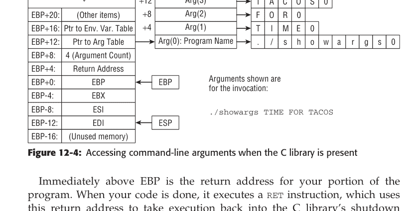

`EBP`正上方是程序这部分的返回地址。当代码执行完毕后，它执行一条`RET`指令，使用该返回地址将执行带回 C 库的关闭序列。你不需要直接访问这个返回地址，而且**绝对不能修改它**。

返回地址的正上方，在距离`EBP`偏移量为 8 的位置（文献中通常表述为`EBP+8`），是一个整数，表示参数的数量。不要混淆：这只是参数数量的一个副本，另一个副本存在于参数地址表的正下方，如第 11 章所述。

参数数量的正上方，在`EBP+12`处，是指向参数地址表的指针。再往上，在`EBP+16`处，是指向环境变量对表的指针。读取环境变量对的方式与读取命令行参数非常相似，所以如果你理解了其中一个，理解另一个就不会太困难。

即使有了所有这些额外的间接寻址，显示参数列表所需的代码 surprisingly 很少：

```asm
mov edi, [ebp+8]   ; Load argument count into EDI

mov ebx, [ebp+12]  ; Load pointer to argument table into EBX

xor esi,esi        ; Clear ESI to 0

.showit:

push dword [ebx+esi*4]  ; Push address of an argument on the stack

push esi                 ; Push argument number

push ArgMsg              ; Push address of display string

call printf              ; Display the argument # and argument

add esp,12               ; Stack cleanup: 3 parms x 4 bytes = 12

inc esi                  ; Bump argument # to next argument

dec edi                  ; Decrement argument counter by 1

jnz .showit              ; If argument count is 0, we're done
```

参数数量和参数地址表的地址相对于`EBP`有固定的偏移量。参数数量放入`EDI`。参数地址表的地址放入`EBX`。`ESI`清零为 0，作为参数地址表的偏移量。完成这些设置后，我们进入一个循环，将参数指针、参数编号和基础字符串压入栈，然后调用`printf`显示它们。打印每个参数后，递增`ESI`中的参数编号，递减`EDI`中的参数计数。当`EDI`变为 0 时，我们已经显示了所有参数，任务完成。

关于这个程序需要注意一点，我之前提到过但必须要强调：如果你在循环中调用 C 库函数，你必须么使用**神圣寄存器**来保存控制循环的计数器，要么在调用库函数之前将它们压入栈。库会破坏非神圣寄存器`EAX`、`ECX`和`EDX`。如果你试图将参数数量存储在`ECX`中，第一次调用`printf()`时该计数值就会被破坏。`EBX`、`ESI`和`EDI`的神圣特性使它们非常适合这种用途。

包含上述代码的完整程序存在于本书的清单档案中，文件名为`showargs3.asm`。

## 简单的文件 I/O

本书中最后示例程序名义上是关于处理基于磁盘的文本文件。然而，它综合了之前我解释过的许多汇编技巧和特性，并添加了一些新内容。它是本书中最大、最复杂的程序，如果你能阅读并理解逻辑流程，那么你已经从本书中学到了我所有想教你的内容。它比本书中任何其他程序都更像一个“真正的”程序，因为它处理命令行参数、写入磁盘文件，以及执行其他你可能在构建任何实用工具时都需要的有用功能。

清单 12-6 中的`textfile.asm`程序创建并用文本填充一个文本文件。你可以指定要填充的行数以及每行的文本。如果不指定文本，程序将生成一行随机选择的字符来代替。调用程序的方式如下：

```bash
$ ./textfile 150 Time for tacos!
```

这个调用将创建一个新文件（文件名在程序中固定为`"testeroo.txt"`），并将文本`"Time for tacos!"`写入文件 150 次，然后关闭文件。如果文件`testeroo.txt`已经存在，它将从开头被覆盖。如果在行数之后没有输入任何内容，`textfile`将用随机字母数字字符填充文件。如果第一个参数没有输入整数，`textfile`将显示错误消息。如果只输入程序名并按回车键，`textfile`将显示几行内容，解释它的功能和使用方法。

## 使用`sscanf()`将字符串转换为数字

当你在命令行调用程序时输入数字，你可以将该数字作为一个命令行参数通过本章前面描述的机制访问。然而，这里有一个陷阱：该数字以**文本形式**存在，你不能只是将文本字符串`"751"`加载到寄存器或整数变量中。要将数字命令行参数作为**数字**使用，你必须将它们的文本表达转换为数字形式。

标准 C 库有几个函数来处理这个挑战。其中一些，如`strtod()`，只将文本转换为一种数字类型。然而，其中一个函数能够将几乎任何合法数值的文本表达转换为适当的数字形式。这就是`sscanf()`，我们将在清单 12-6 中使用它。

`sscanf()`函数接受三个参数，你必须按以下顺序将它们压入栈：

1. 首先压入一个数值变量的地址，用于存放`sscanf()`生成的数值。这里我们生成一个 32 位整数，所以在`textfile.asm`中，我们传递内存变量`LineCount`的地址，它是一个 32 位整数。
2. 然后压入一个格式化代码字符串的地址，告诉`sscanf()`你希望将输入文本转换为什么数字格式。这里代码字符串是`"%d,"`，正如你可能从我们关于`printf()`的讨论中回忆起的，这是双字（32 位整数）的代码。
3. 最后，压入要转换为其代表数值的文本字符串的地址。在`textfile.asm`中，我们压入`arg(1)`的地址，即调用程序时你在命令行上键入的第一个命令行参数。

这三个地址压入栈后，调用`sscanf()`。它将被转换的值返回到你作为第一个参数传递的数值变量中。它还在`EAX`中返回一个代码，指示转换是否成功。如果`EAX`中的返回值为 0，则发生了错误，你不应该假设数值变量中有任何有用的内容。如果转换成功，你会在`EAX`中看到值 1。

这是使用`sscanf()`最简单的方式。它可以一次转换整个数字数组，但这是更专业的用法，初学者不太可能用到。传递给`sscanf()`的第三个参数的字符串可以包含多个格式化代码，在这种情况下，作为第三个参数传递的字符串应该包含文本，描述格式字符串中每个格式化代码所对应的数值。

整个过程如下所示：

```asm
mov ebx,[ebp+12]     ; Put pointer to argument table into ebx

push LineCount       ; Push address of line count integer for sscanf

push IntFormat       ; Push address of integer formatting code

push dword [ebx+4]   ; Push address of arg(1)

call sscanf          ; Call sscanf to convert arg(1) to an integer

add esp,12            ; Stack cleanup: 3 parms x 4 bytes = 12

cmp eax,1            ; Return value of 1 says we got a valid number

je chkdata           ; If we got a valid number, go on; else abort
```

假设用户在命令行上至少输入了一个参数（程序已经验证了这一点），指向该第一个参数的指针位于命令行参数指针表起始位置的偏移量为 4 的位置。（表中的**第一个元素**，也就是`arg(0)`，指向用户在命令行上键入的程序名称。）这就是为什么我们要将位置`[EBX+4]`的内容压入栈；我们之前已经将`EBX`加载为参数指针表的地址。`[EBX+4]`处存放的是指向`arg(1)`的指针，也就是第一个命令行参数。如果这一点仍不清楚，请参考图 12-4。

## 创建和打开文件

到这个时候，你应该已经对从汇编语言调用 C 库函数的一般机制相当熟悉了。而且，不管你有没有意识到，你已经对一些文本文件操作机制相当熟悉了。你已经使用`printf()`通过标准输出在屏幕上显示格式化文本。将格式化文本写入磁盘文本文件的机制完全相同——基本上就是用真实的磁盘文件替代标准输出，所以理解文本文件 I/O 不应该是什么概念上的飞跃。

但与标准输出不同，标准输出由 C 库预先定义且始终可用，而要使用磁盘文本文件，你必须先创建或打开它。`fopen()`函数就是完成这项工作的。

打开文件通常有三种方式：读取、写入和追加。以读取方式打开文件时，你可以通过`fgets()`等函数从中读取文本，但不能写入文件。以写入方式打开文件时，文件中之前的任何内容都会被丢弃，新内容从文件开头开始写入。以追加方式打开文件时，你可以写入文件，但新内容写在已有内容之后，文件中原有的内容会被保留。

通常情况下，以写入方式打开文件时不能从中读取，但存在特殊的模式允许同时对文件进行读写。对于文本文件尤其如此（这正是我们在这里讨论的），这会引入一些复杂性，所以大多数情况下文本文件以读取或写入方式打开，但不会同时以两种方式打开。

在 Unix 文件系统中，如果以写入或追加方式打开文件且该文件尚不存在，则会创建该文件。如果你不知道某个文件是否存在并且需要确认，请尝试以读取方式打开而不是写入方式，否则无论该文件之前是否真的存在，你都会得到一个文件！

要使用`fopen()`，你必须在调用之前将以下参数压入栈：

1. 首先压入栈的是表示文件应以何种模式打开的代码的地址。各种可用的模式列于表 12-3 中。文本文件通常使用的模式是`"r"`、`"w"`和`"a"`。这些应定义为短字符串，后跟一个空字符。
2. 接下来压入栈的是包含要打开文件名称的字符串的地址。

这两项入栈后，你就可以调用`fopen()`。如果文件成功打开，`fopen()`将在`EAX`中返回一个文件句柄。文件句柄是 Linux 在调用`fopen()`期间分配给文件的一个 32 位数字。如果打开失败，`EAX`将包含 0。以下是以读取方式打开文件的代码示例：

```asm
push opencode  ; 压入读取模式代码 "r" 的地址

push ebx       ; EBX 中存放帮助文件名称的地址

call fopen     ; 尝试以读取方式打开文件

add esp,8      ; 栈清理：2 个参数 × 4 字节 = 8

cmp eax,0      ; 如果尝试打开失败，fopen() 返回 null

<按需跳转>
```


创建文件然后向其写入的过程与此相同，只是你必须将 `"w"` 代码而非 `"r"` 代码压入栈。

**表 12-3：** 用于`fopen()`的文件访问代码

| 代码 | 描述 |
| --- | --- |
| `"r"` | 打开现有文本文件以进行读取 |
| `"w"` | 创建新文本文件或打开并截断现有文件 |
| `"a"` | 创建新文本文件或打开现有文件，以便在末尾添加新文本 |
| `"r+"` | 打开现有文本文件以进行写入或读取 |
| `"w+"` | 创建新文本文件或打开并截断现有文件，以便进行读写访问 |
| `"a+"` | 创建新文本文件或打开现有文件以进行读取或写入，以便在末尾添加新文本 |

## 使用`fgets()`从文件读取文本

当`fopen()`成功为你创建或打开文件时，它会在 EAX 中返回一个文件句柄。将该文件句柄妥善保存在某处——我建议将其复制到为此目的分配的内存变量中，或放入某个保留寄存器中。如果你将其存放在 EAX、ECX 或 EDX 中，然后调用几乎任何 C 库函数，寄存器中的文件句柄就会被破坏，你将丢失它。

一旦文件以读取方式打开，你就可以使用`fgets()`函数按顺序从中读取文本行。每次对已打开的文本文件调用`fgets()`时，它会读取文件的一行，即定义到下一个 EOL（"换行"）字符（ASCII 10）为止的所有字符，在 Unix 世界中，这始终表示文本行的末尾。

现在，在任何给定文件中，无法预知到下一个换行符之前会有多少字符，所以让`fgets()`自由读取字符直到遇到换行符是危险的。如果你尝试打开错误类型的文件（二进制代码文件是一种可能，或者压缩数据文件），可能会在遇到的二进制 10 值（文件系统视为换行符）之前带入数千字节。你为传入文本分配的任何缓冲区都会溢出，`fgets()`可能会破坏相邻数据或导致程序崩溃。

因此，你还必须向`fgets()`传递一个限制值。开始读取一行时，`fgets()`会跟踪它已从文件带入的字符数量，当到达限制值减一时，它会停止读取字符。然后它会向缓冲区的最终字符位置添加一个 EOL 字符并返回。

按以下方式设置对`fgets()`的调用：

1. 将`fopen()`返回的文件句柄压入栈。
2. 压入字符数限制值。这必须是实际的整数值，而不是指向该值的指针！
3. 最后，压入`fgets()`应将从文件读取的字符存储到的字符缓冲区的地址。

完成上述所有步骤后，调用`fgets()`。如果`fgets()`在 EAX 中返回 0，那么要么你已到达文件末尾，要么读取过程中发生了文件错误。无论哪种情况，文件都不会再提供更多数据；但如果在 EAX 中没有返回 0，你可以假定在你传递给`fgets()`的栈上地址处的缓冲区中存在有效文本。

我使用`fgets()`为 textfile.asm 创建了一个非常简单的基于磁盘的帮助系统。当用户完全没有输入命令行参数时，textfile 程序会从磁盘读取一个短文本文件并显示到标准输出。如果无法打开基于磁盘的帮助文件，textfile 会显示一条简短的说明信息。这对于命令行程序来说是一种常见且礼貌的做法，我建议你构建的所有日常使用工具都这样做。

帮助系统的代码相对简单，并演示了`fopen()`和`fgets()`的用法：

```
diskhelp:

    push OpenCode  ; 压入读取模式代码 "r" 的指针

    push ebx       ; 帮助文件名称的指针通过 ebx 传入

    call fopen     ; 尝试以读取方式打开文件

    add esp,8      ; 清理栈

    cmp eax,0      ; 如果尝试打开失败，fopen 返回 null

    jne .disk      ; 从磁盘文件读取帮助信息...

    call memhelp   ; ...否则从内存中读取，如果磁盘上没有帮助文件

    ret

.disk: mov ebx,eax         ; 将打开的文件句柄保存在 ebx 中

.rdln: push ebx             ; 将文件句柄压入栈

        push dword HELPLEN  ; 限制读取文本的行长度

        push Helpline        ; 压入帮助文本行缓冲区的地址

        call fgets           ; 从文件中读取一行文本

        add esp,12           ; 清理栈

        cmp eax,0            ; 返回的 null 表示错误或 EOF

        jle .done            ; 如果 eax 中得到 0，关闭并返回

        push Helpline        ; 将帮助行的地址压入栈

        call printf          ; 调用 printf 显示帮助行

        add esp,4            ; 清理栈

        jmp .rdln

.done:  push ebx             ; 压入要关闭的文件句柄

        call fclose          ; 关闭栈上句柄对应的文件

        add esp,4            ; 清理栈

        ret                  ; 返回
```

当调用`diskhelp`过程时，调用者将帮助文件名称的指针传入 EBX。然后代码尝试打开此文件。如果尝试打开帮助文件失败，会从程序`.data`段中存储的字符串显示一个简短的"故障安全"帮助消息。（这是对`memhelp`的调用，它是 textfile.asm 中另一个短过程。）绝不要让用户盯着安静的光标，想知道发生了什么！

帮助文件打开后，代码开始循环执行一系列操作：使用`fgets()`从打开的文件中读取文本行，然后使用`printf`将这些行写入标准输出。

## 使用`fprintf()`将文本写入文件

在本章前面，我解释了如何通过标准输出，使用`printf()`函数将格式化文本显示到屏幕上。标准 C 库提供了一个函数，可以将完全相同的格式化文本写入*任何*已打开的文本文件。`fprintf()`函数所做的事情与`printf()`完全相同，*但*它在栈上多接收一个额外参数：已打开文本文件的文件句柄。`printf()`会发送到标准输出的文本流，由`fprintf()`发送到该打开的文件。

关于如何使用格式化代码和基础字符串为`printf()`格式化文本，我就不再重复说明了。其操作方式完全相同，使用的代码也完全一样。相反，我将简要总结如何设置对`fprintf()`的调用：

- 将任何值或值的地址（视情况而定）压入栈。这与调用`printf()`的方式没有任何区别。
- 压入包含格式化代码的基础字符串的地址。同样，这与`printf()`的做法完全一致。
- 最后，也是`fprintf()`与`printf()`不同的地方，压入要写入文本的文件的文件句柄。

然后调用`fprintf()`。你的文本将被写入已打开的文件。注意，要使用`fprintf()`，目标文件必须以*写入或追加模式*打开。如果你尝试在以*读取模式*打开的文件上使用`fprintf()`，将会产生错误，`fprintf()`将直接返回，不会写入任何数据。

在这种情况下，错误代码将在 EAX 中返回。然而，与我们目前讨论的其他函数不同，错误代码是一个负数，*而非* 0！因此，尽管你应该将返回值与 0 比较，但实际上你需要在值*小于* 0 时跳转——而不是等于 0 时。通常，要在`fprintf()`错误条件下跳转，你会使用`JL`（若小于则跳转），它会在值小于 0 时跳转。

以下是来自 textfile.asm 的`fprintf()`调用：

```
        push esi         ; ESI 是指向文本行的指针

        push 1           ; 压入行号（第一行）

        push WriteBase   ; 压入基础字符串的地址

        push ebx         ; 压入已打开文件的文件句柄

    writeline:

        cmp dword edi,0  ; 行计数是否已经到 0？

        je donewrite     ; 如果是，跳转清理栈

        call fprintf     ; 将文本行写入文件

        dec edi          ; 递减待写入行数

        add dword [esp+8],1 ; 更新栈上的行号

        jmp writeline    ; 循环返回再次执行

    donewrite:

        add esp,16       ; 调用 fprintf 后清理栈
```

对`fprintf()`的调用只是其中很小的一部分，但这里有一个非常有趣的细节需要注意：代码在调用`fprintf()`后并没有立即清理栈。在调用 C 库函数的每一个其他例子中，我都在函数调用后立即调整栈以移除参数。这里有什么不同呢？

textfile.asm 中的这部分代码会反复将单行文本写入输出文件，写入次数由内存变量`LineCount`中指定的数值决定。记住，你所调用的函数不会从栈中移除参数，而且几乎不会修改它们。因此，与其在每次向文件写入时浪费时间压入和移除参数，不如等到所有对`fprintf()`的调用都完成后，才在`donewrite`标签处清理栈。

但这就留下了一个问题：如何在每次写入时更改行号值。textfile 程序在写入文件的每行文本前面写入一个初始行号，该数字随每行写入而变化。但代码并没有为每次调用`fprintf()`压入一个新的行号值（这将需要移除并重新压入所有其他内容），而是直接访问栈中已压入的行号值，在每次调用`fprintf()`后对其进行更新：

```
    add dword [esp+8],1  ; 更新栈上的行号
```

我计算了传递给`fprintf()`的每个参数的字节数，并推算出已压入行号值在栈上的位置。在本例中（这可能随你传递给`fprintf()`的值的数量而变化），它比栈指针 ESP 的位置高 8 个字节。

更改已经压入栈的参数并没有什么风险，尤其是当它可以为你节省大量压入和弹出操作的时候。只是*务必确保你精确知道要更改的内容在栈上的位置！*不用说，试图更新计数器却更改了地址，可能会导致程序迅速崩溃。这是汇编语言，各位。你的舒适椅子已经不在了。

## 将过程收集到库中的注意事项

以下是将过程收集到库中的方法的回顾：

- 不需要定义入口点或保存寄存器。只需创建一个新的源代码文件，将过程源代码粘贴到文件中，该文件必须具有`.asm`文件扩展名。
- 将库中所有过程的所有可调用入口点，以及可能被其他程序和库使用的任何其他标识符，定义为`global`。
- 如果过程调用任何 C 库函数，或调用你拥有或创建的其他库中的过程，或使用库外部定义的变量或其他标识符，则将所有此类外部标识符声明为`extern`。
- 从程序中调用库过程时，更新该程序的 makefile，使最终的可执行文件依赖于该库。

最后一点是唯一需要额外讨论的。以下 makefile 构建 textfile.asm 演示程序，该程序链接了一个名为 linlib.asm 的库。注意，这里有一行全新的内容，指定了如何汇编目标文件 linlib.o，并表明最终二进制文件 textfile 同时依赖于 textfile.o 和 linlib.o。

由于 textfile 可执行文件同时依赖于 textfile.o 和 linlib.o，因此每当你对 textfile.asm 或 linlib.asm 进行修改时，make 工具都会通过 gcc 完全重新链接可执行文件。然而，除非你同时更改两个`.asm`文件，否则只有被更改的`.asm`文件会被汇编。make 的神奇之处在于，它只做需要做的事情。

```
textfile: textfile.o linlib.o

        gcc textfile.o linlib.o -o textfile

textfile.o: textfile.asm

        nasm -f elf -g -F stabs textfile.asm

linlib.o: linlib.asm

        nasm -f elf -g -F stabs linlib.asm
```

完整的文件 linlib.asm 包含在本书的清单存档中。它所包含的过程已从本章展示的其他程序中收集而来，因此在这里全部重新打印会是重复的。

最后，下面是 textfile.asm 程序的完整内容。确保你能够理解所有内容——这里没有任何内容是我没有在本书某处涵盖过的。如果你想要一个挑战，这里有一个给你的下一个项目：改编 tex器械装备 Blackburn，读取一个文本文件，然后将其再次写出，并在每行文本前面添加行号。允许用户在命令行上输入一个文件名，用于存放修改后的文本。保留帮助系统并为其编写新的帮助文本文件。

如果你能完成这个，可以向你鞠躬：你就是一名汇编语言程序员了！

## 清单 12-6：textfile.asm

```
;

;

;

;

;

;

;

;

;

; 源文件名      : TEXTFILE.ASM

; 可执行文件名  : TEXTFILE

; 版本          : 2.0

; 创建日期      : 11/21/1999

; 最后更新      : 5/29/2009

; 作者          : Jeff Duntemann

; 描述          : 适用于 Linux 的文本文件 I/O 演示，使用 NASM 2.05

;

; 使用以下命令构建：

;     nasm -f elf -g -F stabs textfile.asm

;     nasm -f elf -g -F stabs linlib.asm

;     gcc textfile.o linlib.o -o textfile

;

; 注意，此程序需要几个位于名为 LINLIB.ASM 的外部文件中的过程。

[SECTION .data]         ; 包含已初始化数据的节

IntFormat    dd '%d',0

WriteBase    db 'Line #%d: %s',10,0

NewFilename  db 'testeroo.txt',0

DiskHelpNm   db 'helptextfile.txt',0

WriteCode    db 'w',0

OpenCode     db 'r',0

CharTbl      db '0123456789ABCDEFGHIJKLMNOPQRSTUVWXYZabcdefghijklmnopqrstuvwxyz-@'

Err1         db 'ERROR: The first command line argument must be an integer!',10,0

HelpMsg      db 'TEXTEST: Generates a test file. Arg(1) should be the # of ',10,0

HELPSIZE     EQU $-HelpMsg

             db 'lines to write to the file. All other args are concatenated',10,0

             db 'into a single line and written to the file.  If no text args',10,0

             db 'are entered, random text is written to the file. This msg  ',10,0

             db 'appears only if the file HELPTEXTFILE.TXT cannot be opened. ',10,0

HelpEnd      dd 0

[SECTION .bss]          ; 包含未初始化数据的节

LineCount   resd 1           ; 保留整数以保存行计数

HELPLEN     EQU 72           ; 定义帮助文本数据一行的长度

HelpLine    resb HELPLEN     ; 保留磁盘帮助文本行的空间

BUFSIZE     EQU 64           ; 定义文本行缓冲区 buff 的长度

Buff        resb BUFSIZE+5   ; 保留一文本行的空间

[SECTION .text]          ; 包含代码的节

;; 这些外部符号全部来自 glibc 标准 C 库：

extern fopen

extern fclose

extern fgets

extern fprintf

extern printf

extern sscanf
```


`extern time`

这些外部函数来自关联库`linlib.asm`：

`extern` `seedit` — 为随机数生成器播种
`extern` `pull6` — 生成一个 0-63 范围内的 6 位随机数
`extern` `newline` — 输出指定数量的换行符

`global` `main` — 需要此标签以便链接器找到入口点

```asm
main:
        push ebp                ; 为调试器建立栈帧
        mov ebp,esp
        push ebx                ; 程序必须保留 EBP、EBX、ESI 和 EDI
        push esi
        push edi
;;; 此处之前的所有内容都是模板代码；所有普通应用程序都应使用此模板！

        call seedit             ; 为随机数生成器播种

;; 第一次测试是检查是否有命令行参数。
;; 如果没有参数，我们将显示帮助信息（多行）。别忘了
;; 第一个参数始终是程序名，因此命令行参数至少有 1 个！
        mov eax,[ebp+8]         ; 从栈中将参数计数加载到 EAX
        cmp eax,1               ; 如果计数为 1，则没有参数
        ja chkarg2              ; 如果参数计数 > 1 则继续
        mov ebx,DiskHelpNm      ; 将帮助文件名的地址放入 ebx
        call diskhelp           ; 如果只有 1 个参数，则显示帮助信息...
        jmp gohome              ; ...然后退出程序

;; 接下来我们检查第一个数值命令行参数：
chkarg2:
        mov ebx,[ebp+12]        ; 将参数表指针放入 ebx
        push LineCount          ; 将行数整数的地址压栈，供 sscanf 使用
        push IntFormat          ; 将整数格式化代码的地址压栈
        push dword [ebx+4]      ; 将 arg(1) 的指针压栈
        call sscanf             ; 调用 sscanf 将 arg(1) 转换为整数
        add esp,12              ; 清理栈
        cmp eax,1               ; 返回值为 1 表示获取到了数字
        je chkdata              ; 如果获取到数字，则继续；否则中止
        mov eax,Err1            ; 将错误消息 #1 的地址加载到 eax
        call showerr            ; 显示错误消息
        jmp gohome              ; 退出程序

;; 这里我们检查是否有更多参数。如果有，
;; 我们将它们连接成不超过 BUFSIZE 个字符的
;; 单个字符串。（是的，我知道这和 strncat 的功能一样……）
chkdata:
        cmp dword [ebp+8],3     ; 是否有第二个参数？
        jae getlns              ; 如果有，我们有文本可以填充文件
        call randline           ; 如果没有，生成一行随机文本
                                ; 注意 randline 在 esi 中返回指向该行的指针
        jmp genfile             ; 继续创建文件

;; 这里我们将尽可能多的命令行文本（最多 BUFSIZE
;; 个字符）复制到行缓冲区 buff 中。我们跳过前两个参数
;; （此时我们知道它们存在），但至少有一个文本参数 arg(2)。
;; 进入此部分时，ebx 中包含参数表指针。其他情况均不确定。
getlns: mov edx,2               ; 我们知道至少有 arg(2)，从这里开始
        mov edi,Buff            ; 目标指针是字符缓冲区的起始位置
        xor eax,eax             ; 将 eax 清零作为字符计数器
        cld                     ; 清除方向标志以进行向上的 movsb 操作

grab:   mov esi,[ebx+edx*4]     ; 将下一个参数的指针复制到 esi
.copy:  cmp byte [esi],0        ; 我们是否找到了参数的结尾？
        je .next                ; 如果是，跳转到下一个参数
        movsb                   ; 将 [esi] 的字符复制到 [edi]；递增 edi 和 esi
        inc eax                 ; 递增总字符计数
        cmp eax,BUFSIZE         ; 检查是否已填满缓冲区到最大计数
        je addnul               ; 如果是，跳转到 addnul 为 buff 添加空字符，完成
        jmp .copy

.next:  mov byte [edi],' '      ; 将空格复制到 buff 中以分隔参数
        inc edi                 ; 为目标指针递增空格的位置
        inc eax                 ; 同时将字符计数加一
        cmp eax,BUFSIZE         ; 检查是否已填满 buff
        je addnul               ; 如果是，跳转到 addnul 添加空字符，完成
        inc edx                 ; 否则，递增参数计数
        cmp edx, dword [ebp+8]  ; 与参数总数进行比较
        jae addnul              ; 如果 edx = 参数计数，则完成
        jmp grab                ; 返回继续复制

addnul: mov byte [edi],0        ; 在 buff 末尾追加空字符
        mov esi,Buff            ; 文件写入代码期望在 esi 中包含文本指针

;; 现在我们创建一个文件，用已有的文本填充它：
genfile:
        push WriteCode          ; 将文件写入/创建代码 ('w') 的指针压栈
        push NewFilename        ; 将新文件名的指针压栈
        call fopen              ; 创建/打开文件
        add esp,8               ; 清理栈
        mov ebx,eax             ; eax 中包含文件句柄；保存到 ebx

;; 文件已打开。现在用文本填充它：
        mov edi,[LineCount]     ; 要填充的行数在 edi 中
        push esi                ; ESI 是指向该行文本的指针
        push 1                  ; 第一行行号
        push WriteBase          ; 将基础字符串的地址压栈
        push ebx                ; 将已打开文件的文件句柄压栈

writeline:
        cmp dword edi,0         ; 行数是否已减为 0？
        je donewrite            ; 如果是，跳转清理栈
        call fprintf            ; 将文本行写入文件
        dec edi                 ; 递减待写入行数
        add dword [esp+8],1     ; 更新栈上的行号
        jmp writeline           ; 循环回去再次执行
donewrite:
        add esp,16              ; fprintf 调用后清理栈

;;; 我们已完成文本写入；现在关闭文件：
closeit:
        push ebx                ; 将待关闭文件的句柄压栈
        call fclose             ; 关闭句柄在栈上的文件
        add esp,4

;;; 此处之后的所有内容都是模板代码；所有普通应用程序都应使用此模板！
gohome: pop edi                 ; 恢复保存的寄存器
        pop esi
        pop ebx
        mov esp,ebp             ; 返回前销毁栈帧
        pop ebp
        ret                     ; 将控制权返回给 C 关闭代码
```

## 子程序

-------------------------------------------------------------------------
基于磁盘的迷你帮助子程序 — 最后更新 1999年12月5日

此程序从文本文件中读取文本，文件名通过`ebx`中的名称字符串指针传入。该程序打开文本文件，从中读取文本，并将其显示到标准输出。如果无法打开文件，则显示一条非常简短的基于内存的消息。

```asm
diskhelp:
        push OpenCode           ; 将打开读取代码 "r" 的指针压栈
        push ebx                ; 帮助文件名的指针通过 ebx 传入
        call fopen              ; 尝试打开文件进行读取
        add esp,8               ; 清理栈
        cmp eax,0               ; 如果尝试打开失败，fopen 返回 null
        jne .disk               ; 从磁盘读取帮助信息，否则从内存读取
        call memhelp
        ret
.disk:  mov ebx,eax             ; 将已打开文件的句柄保存到 ebx
.rdln:  push ebx                ; 将文件句柄压栈
        push dword HELPLEN      ; 限制读取文本的行长度
        push HelpLine           ; 将帮助文本行缓冲区的地址压栈
        call fgets              ; 从文件中读取一行文本
        add esp,12              ; 清理栈
        cmp eax,0               ; 返回 null 表示错误或 EOF
        jle .done               ; 如果 eax 为 0，则关闭并返回
        push HelpLine           ; 将帮助行的地址压栈
        call printf             ; 调用 printf 显示帮助行
        add esp,4               ; 清理栈
        jmp .rdln

.done:  push ebx                ; 将待关闭文件的句柄压栈
        call fclose             ; 关闭句柄在栈上的文件
        add esp,4               ; 清理栈
        ret                     ; 返回
```

```asm
memhelp:
        mov eax,1
        call newline
        mov ebx,HelpMsg         ; 将帮助文本的地址加载到 eax
.chkln: cmp dword [ebx],0       ; 帮助消息指针是否指向空值？
        jne .show               ; 如果不是，显示帮助行
        mov eax,1               ; 将要输出的换行数加载到 eax
        call newline            ; 输出换行符
        ret                     ; 如果是，返回
.show:  push ebx                ; 将帮助行的地址压栈
        call printf             ; 显示该行
        add esp,4               ; 清理栈
        add ebx,HELPSIZE        ; 将地址递增一行帮助文本的长度
        jmp .chkln              ; 循环回去检查是否已完成
```

```asm
showerr:
        push eax                ; 入口时，eax 中包含错误消息的地址
        call printf             ; 显示错误消息
        add esp,4               ; 清理栈
        ret                     ; 返回；无返回值
```

```asm
randline:
        mov ebx,BUFSIZE         ; BUFSIZE 告诉我们要拉取多少个字符
        mov byte [Buff+BUFSIZE+1],0 ; 首先在缓冲区末尾放置空字符
.loop:  dec ebx                 ; BUFSIZE 是从 1 开始的，所以递减
        call pull6              ; 获取 0-63 范围内的随机数
```

## Listing 12-6: `textfile.asm`（续）

```asm
        mov cl,[CharTbl+eax]    ; Use random # in eax as offset into table
                                ;   and copy character from table into cl
        mov [Buff+ebx],cl       ; Copy char from cl to character buffer
        cmp ebx,0               ; Are we done having fun yet?
        jne .loop               ; If not, go back and pull another
        mov esi,Buff            ; Copy address of the buffer into esi
        ret                     ;   and go home
```


## 结论：不是终点，而是刚刚开始

你永远无法真正"学会"汇编语言。

随着时间的推移，你可以通过阅读该主题的优秀书籍、阅读他人编写的好代码，最重要的是通过自己大量大量地编写代码来不断提升技能。但在任何时刻，你都无法站起来说："我掌握了它。"

你不应为此感到沮丧。事实上，当我偶尔听说*《汇编语言之禅》*（*Zen of Assembly Language*）、*《代码优化之禅》*（*Zen of Code Optimization*）以及他的巨著*《Michael Abrash 图形编程黑皮书》*（*Michael Abrash's Graphics Programming Black Book*）的作者 Michael Abrash 又学到了一些关于汇编语言的新知识时，我会感到鼓舞。Michael 已经编写高性能汇编代码近 30 年，已成为西半球最顶尖的两三位汇编语言程序员之一。

如果 Michael 仍在学习，我们其他人还有希望吗？

错误的问题。*愚蠢的*问题。如果 Michael 仍在学习，这意味着我们*所有人*都是学生，而且将永远是学生。这意味着旅程本身就是目标，只要继续探索、钻研、摆弄、尝试我们从未做过的事情……

# 附录 A

## 部分 x86 指令集参考

| 指令 | 参考页码 | 正文页码 | CPU |
|-------------|----------------|-----------|-----|
| AAA | 512 | 411 | |
| ADC | 513 | 仅在附录 A 中 | |
| ADD | 515 | 207 | |
| AND | 517 | 281 | |
| BT | 519 | 306 | 386+ |
| CALL | 521 | 336, 483 | |
| CLC | 523 | 仅在附录 A 中 | |
| CLD | 524 | 411 | |
| CMP | 525 | 411 | |
| DEC | 527 | 215 | |
| DIV | 528 | 411 | |
| INC | 529 | 215 | |
| INT | 530 | 411 | |
| IRET | 531 | 260 | |
| J? | 532 | 218, 299, 302 | |
| JCXZ | 534 | 421 | |
| JECXZ | 535 | 仅在附录 A 中 | 386+ |
| JMP | 536 | 298 | |
| LEA | 537 | 315 | |
| LOOP | 538 | 408 | |
| LOOPNZ/LOOPNE | 540 | 422 | |
| LOOPZ/LOOPE | 541 | 仅在附录 A 中 | |
| MOV | 542 | 204 | |
| MOVS | 544 | 414 | |
| MOVSX | 546 | 224 | 386+ |
| MUL | 547 | 225 | |
| NEG | 549 | 223 | |
| NOP | 550 | 仅在附录 A 中 | |
| NOT | 551 | 285 | |
| OR | 552 | 283 | |
| POP | 554 | 251 | |
| POPA | 555 | 251, 344 | 286+ |
| POPAD | 555 | 251, 344 | 386+ |
| POPF | 556 | 251 | |
| POPFD | 557 | 251 | 386+ |
| PUSH | 558 | 249 | |
| PUSHA | 559 | 249 | 286+ |
| PUSHAD | 560 | 249, 344 | 386+ |
| PUSHF | 561 | 249 | |
| PUSHFD | 562 | 249 | 386+ |
| RET | 563 | 337 | |
| ROL | 564 | 288 | |
| ROR | 566 | 288 | |
| SBB | 568 | 仅在附录 A 中 | |
| SHL | 570 | 286 | |
| SHR | 572 | 286 | |
| STC | 574 | 289 | |
| STD | 575 | 405 | |
| STOS | 576 | 402 | |
| SUB | 577 | 302 | |
| XCHG | 579 | 234 | |
| XLAT | 580 | 321 | |
| XOR | 581 | 284 | |

## 指令集参考说明

## 指令操作数

当一条指令有两个操作数时，*左侧*的是目的操作数，*右侧*的是源操作数。一般来说，当指令产生结果时，结果会替换目的操作数。例如，在以下指令中：

```asm
ADD BX,SI
```

将`BX`寄存器与`SI`寄存器相加，然后将和放入`BX`寄存器中，覆盖加法之前`BX`中的原有内容。

## 标志位结果

每条指令都包含一个标志位摘要，格式如下所示（星号的分布会因指令而异）：

```asm
O D I T S Z A P C  OF: 溢出标志  TF: 陷阱标志 AF: 辅助进位
F F F F F F F F  DF: 方向标志 SF: 符号标志 PF: 奇偶标志
 penetrating  IF: 中断标志 ZF: 零标志 CF: 进位标志
*     ? ? * * * *
```

这里列出了九个最重要的标志位。星号表示该页中的指令会影响该标志位。标志位标题下的空白表示该指令以任何方式都不会影响该标志位。如果某个标志位以定义好的方式受到影响，则遵循以下规则：

- **OF** 若结果太大而无法放入目的操作数中，则置位。
- **IF** 由`STI`指令置位；由`CLI`清除。
- **TF** 用于调试器；在正常编程中不使用，可忽略。
- **SF** 当结果的符号导致目的操作数变为负数时置位。
- **ZF** 若操作结果为零则置位。若结果非零，则`ZF`被清除。
- **AF** 用于 4 位 BCD 运算的辅助进位。当操作导致 4 位 BCD 量产生进位时置位。
- **PF** 若结果的低字节中 1 的个数为偶数则置位；若结果的低字节中 1 的个数为奇数则清除。用于数据通信应用，其他情况很少使用。
- **CF** 若加法或移位操作的结果有一位超出目的操作数，则置位；否则清除。当需要在操作开始前将`CF`置于已知状态时，可通过`STC`手动置位，或通过`CLC`手动清除。

某些指令会将特定标志位强制变为未定义状态。这些在标志位标题下用问号表示。"未定义"意味着*不要指望它处于任何特定状态*。在知道另一个指令已将之前未定义状态的标志位变为定义状态之前，不要测试或以任何方式使用该标志位的状态。

## AAA: BCD 加法后调整 AL

### 影响的标志位

```asm
O D I T S Z A P C   OF: 溢出标志   TF: 陷阱标志  AF: 辅助进位
F F F F F F F F F   DF: 方向标志 SF: 符号标志  PF: 奇偶标志
?       ? ? * ? *     IF: 中断标志 ZF: 零标志  CF: 进位标志
```

### 合法形式

```asm
AAA
```

### 示例

```asm
AAA
```

### 说明

`AAA`用于在执行加法后使`AL`中的结果正确，前提是您相加的是 BCD 值而非普通二进制值。请注意，`AAA`本身*不*执行算术运算，而是在`ADD`或`ADC`之后进行的后处理。`AL`寄存器是*隐含*操作数，不能显式声明——因此请确保前面的`ADD`或`ADC`指令将结果保留在`AL`中！

BCD 数字是一个高位 4 位设为 0、低位 4 位包含 0 到 9 数字的字节。如果前面的`ADD`或`ADC`操作的一个或两个操作数大于`09`，`AAA`将产生错误的结果。

在两个合法 BCD 值相加后，`AAA`会将非 BCD 结果（即`AL`中大于`09`的结果）调整为 0 到 9 之间的值。这称为*十进制进位*，因为它是 BCD 数字的进位，而不仅仅是二进制位的进位。

例如，如果`ADD`将`08`和`04`（均为合法 BCD 值）相加得到`AL`中的`0C`，`AAA`会将`0C`调整为`02`。十进制进位进入`AH`，*而不是*`AL`的高 4 位，`AL`的高 4 位被`AAA`*始终*清除为 0。

如果前面的`ADD`或`ADC`产生了十进制进位（如前面的例子），*CF*和*AF*均被设为 1，且`AH`增加 1。否则，`AH`不增加，`CF`和`AF`被清除为 0。

这条指令比较微妙。详见正文中的详细讨论。

```asm
r8  = AL AH BL BH CL CH DL DH      r16 = AX BX CX DX BP SP SI DI
sr  = CS DS SS ES FS GS             r32 = EAX EBX ECX EDX EBP ESP ESI EDI
m8  = 8 位内存数据                   m16 = 16 位内存数据
m32 = 32 位内存数据                  i8  = 8 位立即数
i16 = 16 位立即数                    i32 = 32 位立即数
d8  = 8 位有符号位移                 d16 = 16 位有符号位移
d32 = 32 位无符号位移
```

## ADC: 带进位算术加法

### 影响的标志位

```asm
O D I T S Z A P C   OF: 溢出标志   TF: 陷阱标志 AF: 辅助进位
F F F F F F F F F   DF: 方向标志 SF: 符号标志 PF: 奇偶标志
*       Op6mnlXGS        IF: 中断标志 ZF: 零标志 CF: 进位标志
```

### 合法形式

```asm
ADC r8,r8
ADC m8,r8
ADC r8,m8
ADC r16,r16
ADC m16,r16
ADC r16,m16
ADC r32,r32    386+
ADC m32,r32    386+
ADC r32,m32    386+
ADC r8,i8
ADC m8,i8
ADC r16,i16
ADC m16,i16
ADC r32,i32    386+
ADC m32,i32    386+
ADC r16,i8
ADC m16,i8
ADC r32,i8     386+
ADC m32,i8     386+
ADC AL,i8
ADC AX,i16
ADC EAX,i32    386+
```

### 示例

```asm
ADC BX,DI
ADC EAX,5
ADC AX,0FFFFH         ;使用单字节操作码
ADC AL,42H            ;使用单字节操作码
ADC BP,17H
ADC WORD [BX+SI+Inset],5
ADC WORD ES:[BX],0B800H
```

### 说明

`ADC`将源操作数和进位标志加到目的操作数上，操作完成后，结果替换目的操作数。该加法是算术加法，进位标志允许跨多个寄存器或内存位置进行多精度加法。（若要不考虑进位标志进行加法，请使用`ADD`指令。）所有受影响的标志位都根据操作结果设置。最重要的是，如果结果无法放入目的操作数，进位标志将被设为 1。

```asm
r8  = AL AH BL BH CL CH DL DH          r16 = AX BX CX DX BP SP SI DI
sr  = CS DS SS ES FS GS                  r32 = EAX EBX ECX EDX EBP ESP ESI EDI
m8  = 8 位内存数据                       m16 = 16 位内存数据
m32 = 32 位内存数据                      i8  = 8 位立即数
i16 = 16 位立即数                        i32 = 32 位立即数
d8  = 8 位有符号位移                     d16 = 16 位有符号位移
d32 = 32 位无符号位移
```

## ADD: 算术加法

### 受影响标志

```asm
O D I T S Z A P C   OF: 溢出标志   TF: 陷阱标志   AF: 辅助进位
F F F F F F F F F   DF: 方向标志   SF: 符号标志   PF: 奇偶标志
*       * * * * * *   IF: 中断标志   ZF: 零标志     CF: 进位标志
```

### 合法形式

```asm
ADD r8,r8
ADD m8,r8
ADD r8,m8
ADD r16,r16
ADD m16,r16
ADD r16,m16
ADD r32,r32       386+
ADD m32,r32       386+
ADD r32,m32       386+
ADD r8,i8
ADD m8,i8
ADD r16,i16
ADD m16,i16
ADD r32,i32       386+
ADD m32,i32       386+
ADD r16,i8
ADD m16,i8
ADD r32,i8        386+
ADD m32,i8        386+
ADD AL,i8
ADD AX,i16
ADD EAX,i32       386+
```

### 示例

```asm
ADD BX,DI
ADD AX,0FFFFH    ;使用单字节操作码
ADD AL,42H       ;使用单字节操作码
ADD EAX,5
ADD BP,17H
ADD DWORD [EDI],EAX
ADD WORD [BX+SI+Inset],5
ADD WORD ES:[BX],0B800H
```

`ADD`将源操作数加到目的操作数，操作完成后，结果替换目的操作数。该加法为算术加法，*不*考虑进位标志的状态。（如需带进位加法，请使用`ADC`指令。）所有受影响的标志均根据操作结果设置。最重要的是，如果结果超出目的操作数的范围，进位标志被置为 1。

```asm
r8 = AL AH BL BH CL CH DL DH          r16 = AX BX CX DX BP SP SI DI
sr = CS DS SS ES FS GS                 r32 = EAX EBX ECX EDX EBP ESP ESI EDI
m8 = 8位内存数据                       m16 = 16位内存数据
m32 = 32位内存数据                     i8 = 8位立即数
i16 = 16位立即数                       i32 = 32位立即数
d8 = 8位有符号位移                     d16 = 16位有符号位移
d32 = 32位无符号位移
```

## AND: 逻辑与

### 受影响标志

```asm
O D I T S Z A P C   OF: 溢出标志   TF: 陷阱标志   AF: 辅助进位
F F F F F F F F F   DF: 方向标志   SF: 符号标志   PF: 奇偶标志
*       * * ? * *   IF: 中断标志   ZF: 零标志     CF: 进位标志
```

### 合法形式

```asm
AND r8,r8
AND m8,r8
AND r8,m8
AND r16,r16
AND m16,r16
AND r16,m16
AND r32,r32    386+
AND m32,r32    386+
AND r32,m32    386+
AND r8,i8
AND m8,i8
AND r16,i16
AND m16,i16
AND r32,i32    386+
AND m32,i32    386+
AND AL,i8
AND AX,i16
AND EAX,i32    386+
```

### 示例

```asm
AND BX,DI
AND EAX,5
AND AX,0FFFFH         ;使用单字节操作码
AND AL,42H            ;使用单字节操作码
AND DWORD [EDI],EAX
AND WORD ES:[BX],0B800H
AND WORD [BP+SI],DX
```

### 注

`AND`对两个操作数执行逻辑与操作。操作完成后，结果替换目的操作数。`AND`按位执行，即源的位 0 与目的地位的位 0 相与，源的位 1 与目的地的位 1 相与，依此类推。与操作仅在*两个*操作数都为 1 时结果为 1；*任一*操作数为 0 时结果为 0。注意该操作会使辅助进位标志变为未定义状态。`CF`和`OF`被清零为 0，其他受影响的标志根据操作结果设置。

```asm
r8  = AL AH BL BH CL CH DL DH          r16 = AX BX CX DX BP SP SI DI
sr  = CS DS SS ES FS GS                 r32 = EAX EBX ECX EDX EBP ESP ESI EDI
m8  = 8位内存数据                       m16 = 16位内存数据
m32 = 32位内存数据                      i8  = 8位立即数
i16 = 16位立即数                       i32 = 32位立即数
d8  = 8位有符号位移                     d16 = 16位有符号位移
d32 = 32位无符号位移
```

## BT: 位测试

### 受影响标志

```asm
O D I T S Z A P C   OF: 溢出标志   TF: 陷阱标志   AF: 辅助进位
F F F F F F F F F   DF: 方向标志   SF: 符号标志   PF: 奇偶标志
```


## BT: 位测试

### 受影响标志

*   `IF`: 中断标志
*   `ZF`: 零标志
*   `CF`: 进位标志

### 合法形式

```
BT r16,r16       386+
BT m16,r16       386+
BT r32,r32       386+
BT m32,r32       386+
BT r16,i8        386+
BT m16,i8        386+
BT r32,i8        386+
BT m32,i8        386+
```

### 示例

```
BT AX,CX
BT [BX+DI],DX
BT AX,64
BT EAX,EDX
BT ECX,17
```

### 注

`BT`将左操作数中指定的单个位复制到进位标志，该位可在进位标志中进行测试，或通过移位/旋转指令之一反馈到某个量中。复制哪一位由右操作数指定。`BT`不改变任一操作数。

当右操作数为 8 位立即数时，该值指定要复制的位的编号。在`BT AX,5`中，`AX`的位 5 被复制到`CF`。当立即数超过左操作数的大小时，该值对左操作数的大小取模。也就是说，因为`EAX`没有 66 位，`BT EAX,66`会从立即数中取出尽可能多的 32，剩余的即为位编号。（此处为 2。）当右操作数*不*是立即数时，右操作数不仅指定要测试的位，还指定左操作数中内存引用的偏移量。这比较复杂，本书未完全涵盖。详情请参见完整的汇编语言参考。

```
r8  = AL AH BL BH CL CH DL DH
sr  = CS DS SS ES FS GS
m8  = 8位内存数据
m32 = 32位内存数据
i16 = 16位立即数
d8  = 8位有符号位移
d32 = 32位无符号位移
r16 = AX BX CX DX BP SP SI DI
r32 = EAX EBX ECX EDX EBP ESP ESI EDI
m16 = 16位内存数据
i8  = 8位立即数
i32 = 32位立即数
d16 = 16位有符号位移
```

## CALL: 调用过程

### 受影响标志

*   `OF`: 溢出标志
*   `TF`: 陷阱标志
*   `AF`: 辅助进位
*   `DF`: 方向标志
*   `SF`: 符号标志
*   `PF`: 奇偶标志
*   `IF`: 中断标志
*   `ZF`: 零标志
*   `CF`: 进位标志

```
  O D I T S Z A P C
  F F F F F F F F F
       <none>
```

### 合法形式

```
  CALL <近程标号>
  CALL <远程标号>
  CALL r16
  CALL m16
  CALL r32       386+
  CALL m32       386+
```

### 示例

```
  CALL InsideMySegment        ;InsideMySegment 是近程标号
  CALL OutsideMySegment       ;OutsideMySegment 是远程标号
  CALL BX
  CALL EDX
  CALL WORD [BX+DI+17]        ;调用 [BX+DI+17] 处的近程地址
  CALL DWORD [BX+DI+17]       ;调用 [BX+DI+17] 处的完整 32 位地址
```

### 注

`CALL`将控制权转移到过程地址。转移控制权之前，`CALL`将紧接其后的指令地址压入堆栈。这使得`RET`指令（另见此处）可以将返回地址弹出到`CS:IP`或仅`IP`（取决于近程调用还是远程调用），从而将控制权返回到`CALL`指令之后的指令。

除了明显的对定义标号的调用外，`CALL`还可以将控制权转移到 16 位通用寄存器中的近程地址，以及内存中的地址。这些在合法形式栏中显示为`m16`和`m32`。`m32`是存储在内存某位置的完整 32 位地址，可通过任何合法的 x86 内存寻址模式访问。`CALL m16`和`CALL m32`可用于创建过程地址跳转表；更多信息请参见高级教材或完整的汇编语言参考。

```
r8  = AL AH BL BH CL CH DL DH        r16 = AX BX CX DX BP SP SI DI
sr  = CS DS SS ES FS GS               r32 = EAX EBX ECX EDX EBP ESP ESI EDI
m8  = 8位内存数据                     m16 = 16位内存数据
m32 = 32位内存数据                    i8  = 8位立即数
i16 = 16位立即数                      i32 = 32位立即数
d8  = 8位有符号位移                   d16 = 16位有符号位移
d32 = 32位无符号位移
```

## CLC: 清除进位标志 (CF)

### 受影响标志

*   `CF`: 进位标志

```
O D I T S Z A P C   OF: 溢出标志   TF: 陷阱标志   AF: 辅助进位
F F F F F F F F F   DF: 方向标志   SF: 符号标志   PF: 奇偶标志
           *       IF: 中断标志   ZF: 零标志     CF: 进位标志
```

### 合法形式

```
CLC
```

### 示例

```
CLC
```

### 注

`CLC`将进位标志 (`CF`) 置为清除状态 (0)。在进位标志*必须*处于已知的清除状态才能开始工作的情况下使用`CLC`，例如使用`RCL`和`RCR`旋转指令旋转一系列字或字节时。也可用于在从过程返回之前将`CF`置于已知状态，以指示过程成功或失败，视需要而定。

```
r8  = AL AH BL BH CL CH DL DH          r16 = AX BX CX DX BP SP SI DI
sr  = CS DS SS ES FS GS                 r32 = EAX EBX ECX EDX EBP ESP ESI EDI
m8  = 8位内存数据                       m16 = 16位内存数据
m32 = 32位内存数据                      i8  = 8位立即数
i16 = 16位立即数                       i32 = 32位立即数
d8  = 8位有符号位移                     d16 = 16位有符号位移
d32 = 32位无符号位移
```

## CLD：清除方向标志 (DF)

### 受影响标志位

*   `DF`: 方向标志

```
O D I T S Z A P C   OF: 溢出标志   TF: 陷阱标志 AF: 辅助进位
F F F F F F F F     DF: 方向标志 SF: 符号标志 PF: 奇偶标志
    *               IF: 中断标志 ZF: 零标志   CF: 进位标志
```

### 合法形式

```
CLD
```

### 示例

```
CLD
```

### 说明

`CLD`将方向标志位 (`DF`) 设置为清除状态（0）。这会影响重复字符串指令（如`STOS`、`SCAS`和`MOVS`）的调整方式。通常，当`DF = 0`时，目标指针递增；当`DF = 1`时，目标指针递减。`STD`指令将`DF`设为 1。

```
r8 = AL AH BL BH CL CH DL DH       r16 = AX BX CX DX BP SP SI DI
sr = CS DS SS ES FS GS              r32 = EAX EBX ECX EDX EBP ESP ESI EDI
m8 = 8位内存数据                   m16 = 16位内存数据
m32 = 32位内存数据                 i8 = 8位立即数
i16 = 16位立即数                   i32 = 32位立即数
d8 = 8位有符号位移                 d16 = 16位有符号位移
d32 = 32位无符号位移
```

## CMP：算术比较

### 受影响标志位

*   `OF`: 溢出标志
*   `TF`: 陷阱标志
*   `AF`: 辅助进位
*   `DF`: 方向标志
*   `SF`: 符号标志
*   `PF`: 奇偶标志
*   `IF`: 中断标志
*   `ZF`: 零标志
*   `CF`: 进位标志

```
O D I T S Z A P C   OF: 溢出标志   TF: 陷阱标志 AF: 辅助进位
F F F F F F F F F   DF: 方向标志 SF: 符号标志 PF: 奇偶标志
*       * * * * *   IF: 中断标志 ZF: 零标志   CF: 进位标志
```

### 合法形式

```
CMP r8,r8
CMP m8,r8
CMP r8,m8
CMP r16,r16
CMP m16,r16
CMP r16,m16
CMP r32,r32      386+
CMP m32,r32      386+
CMP r32,m32      386+
CMP r8,i8
CMP m8,i8
CMP r16,i16
CMP m16,i16
CMP r32,i32      386+
CMP m32,i32      386+
CMP r16,i8
CMP m16,i8
CMP r32,i8       386+
CMP m32,i8       386+
CMP AL,i8
CMP AX,i16
CMP EAX,i32      386+
```

### 示例

```
CMP BX,DI
CMP EAX,5
CMP AX,0FFFFH        ;使用单字节操作码
CMP AL,42H           ;使用单字节操作码
CMP BP,17H
CMP WORD [BX+SI+Inset],5
CMP WORD ES:[BX],0B800H
```

### 说明

`CMP`比较两个操作数，并设置标志位以指示比较结果。*目标操作数不受影响。* 该操作本身与无借位减法 (`SUB`) 相同，只是结果不会替换目标操作数。通常，`CMP`后面跟着一个条件跳转指令——即，如果操作数相等则使用`JE`跳转；如果不相等则使用`JNE`跳转；以此类推。

```
r8 = AL AH BL BH CL CH DL DH        r16 = AX BX CX DX BP SP SI DI
sr = CS DS SS ES FS GS               r32 = EAX EBX ECX EDX EBP ESP ESI EDI
m8 = 8位内存数据                    m16 = 16位内存数据
m32 = 32位内存数据                  i8 = 8位立即数
i16 = 16位立即数                    i32 = 32位立即数
d8 = 8位有符号位移                  d16 = 16位有符号位移
d32 = 32位无符号位移
```

## DEC：操作数减一

### 受影响标志位

*   `OF`: 溢出标志
*   `TF`: 陷阱标志
*   `AF`: 辅助进位
*   `DF`: 方向标志
*   `SF`: 符号标志
*   `PF`: 奇偶标志
*   `IF`: 中断标志
*   `ZF`: 零标志
*   `CF`: 进位标志

```
O D I T S Z A P C    OF: 溢出标志    TF: 陷阱标志    AF: 辅助进位
F F F F F F F F F    DF: 方向标志    SF: 符号标志    PF: 奇偶标志
*          * * * *    IF: 中断标志    ZF: 零标志     CF: 进位标志
```

### 合法形式

```
DEC m8
DEC m16
DEC m32
DEC r8
DEC r16
DEC r32
```

### 示例

```
DEC AL
DEC CX
DEC EBX
DEC BYTE [BP]      ; 将 [BP] 处的字节减一
DEC WORD [BX]      ; 将 [BX] 处的字减一
DEC DWORD [EDX]    ; 将 [EDX] 处的双字减一
```

### 说明

请记住，段寄存器*不能*用`DEC`进行减一操作。所有寄存器半字（`r8`）操作码长度为 2 字节，但所有 16 位寄存器（`r16`）操作码长度为 1 字节。如果可以对整个 16 位寄存器进行减一操作（其中只有低半部分包含数据），请使用 16 位操作码以节省一个字节。

`DEC` *不会*影响进位标志。（这是常见错误。）

与所有作用于内存的指令一样，内存数据形式*必须*使用数据大小说明符，如`BYTE`、`WORD`和`DWORD`。`NASM`不会做任何假设！

```
r8  = AL AH BL BH CL CH DL DH         r16 = AX BX CX DX BP SP SI DI
sr  = CS DS SS ES FS GS               r32 = EAX EBX ECX EDX EBP ESP ESI EDI
m8  = 8位内存数据                     m16 = 16位内存数据
m32 = 32位内存数据                    i8  = 8位立即数
i16 = 16位立即数                      i32 = 32位立即数
d8  = 8位有符号位移                   d16 = 16位有符号位移
d32 = 32位无符号位移
```

## DIV：无符号整数除法

### 受影响标志位

*   `OF`: 溢出标志
*   `TF`: 陷阱标志
*   `AF`: 辅助进位
*   `DF`: 方向标志
*   `SF`: 符号标志
*   `PF`: 奇偶标志
*   `IF`: 中断标志
*   `ZF`: 零标志
*   `CF`: 进位标志

```
O D I T S Z A P C   OF: 溢出标志  TF: 陷阱标志  AF: 辅助进位
F F F F F F F F F   DF: 方向标志  SF: 符号标志  PF: 奇偶标志
?         ? ? ? ? ?   IF: 中断标志  ZF: 零标志  CF: 进位标志
```

### 合法形式

```
DIV r8
DIV m8
DIV r16
DIV m16
DIV r32                    386+
DIV m32                    386+
```

### 示例

```
DIV CH                    ; AX / CH --> 商在 AL 中；余数在 AH 中
DIV BX                    ; DX:AX / BX --> 商在 AX 中；余数在 DX 中
DIV ECX                   ; EDX:EAX / ECX --> 商在 EAX 中；余数在 EDX 中
DIV WORD [BX+DI]          ; DX:AX / [BX+DI] --> 商在 AX 中；余数在 DX 中
```

### 说明

`DIV`将隐式被除数除以其操作数中指定的显式除数。对于除以 8 位量的情况，被除数假定为在`AX`中。对于除以 16 位和 32 位量的情况，被除数假定在两个寄存器中，从而实现更大范围的计算。被除数的最低有效部分放在"A"寄存器（`AX`或`EAX`）中，最高有效部分放在"D"寄存器（`DX`或`EDX`）中。请注意，即使被除数没有"高位"部分，"D"寄存器也要清零为 0，并且在执行`DIV`指令时不能用于保存独立值。

请记住，当操作数是内存值时，您*必须*在操作数前放置`BYTE`、`WORD`或`DWORD`类型说明符之一。

`DIV`不在标志位中保留任何信息。但请注意，`OF`、`SF`、`ZF`、`AF`、`PF`和`CF`在`DIV`之后是未定义的。

```
r8 = AL AH BL BH CL CH DL DH          r16 = AX BX CX DX BP SP SI DI
sr = CS DS SS ES FS GS                r32 = EAX EBX ECX EDX EBP ESP ESI EDI
m8 = 8位内存数据                      m16 = 16位内存数据
m32 = 32位内存数据                    i8 = 8位立即数
i16 = 16位立即数                      i32 = 32位立即数
d8 = 8位有符号位移                    d16 = 16位有符号位移
d32 = 32位无符号位移
```

## INC：操作数加一

### 受影响标志位

*   `OF`: 溢出标志
*   `TF`: 陷阱标志
*   `AF`: 辅助进位
*   `DF`: 方向标志
*   `SF`: 符号标志
*   `PF`: 奇偶标志
*   `IF`: 中断标志
*   `ZF`: 零标志
*   `CF`: 进位标志

```
O D I T S Z A P C    OF: 溢出标志    TF: 陷阱标志    AF: 辅助进位
F F F F F F F F F    DF: 方向标志    SF: 符号标志    PF: 奇偶标志
*          * * * *    IF: 中断标志    ZF: 零标志     CF: 进位标志
```

### 合法形式

```
INC r8
INC m8
INC r16
INC m16
INC r32            386+
INC m32            386+
```

### 示例

```
INC AL
INC BX
INC EDX
INC BYTE [BP]   ; 将 [BP] 处的字节加一
INC WORD [BX]   ; 将 [BX] 处的字加一
INC DWORD [ESI] ; 将 [ESI] 处的双字加一
```

### 说明

请记住，段寄存器*不能*用`INC`进行加一操作。所有寄存器半字（`r8`）操作码长度为 *2* 字节，但所有 16 位寄存器（`r16`）操作码长度为 *1* 字节。如果可以对整个寄存器进行加一操作（其中只有低半部分包含数据），请使用 16 位操作码以节省一个字节。

`INC` *不会*影响进位标志。（这是常见错误。）

与所有作用于内存的指令一样，内存数据形式*必须*使用数据大小说明符，如`BYTE`、`WORD`和`DWORD`。`NASM`不会做任何假设！

```
r8 = AL AH BL BH CL CH DL DH       r16 = AX BX CX DX BP SP SI DI
sr = CS DS SS ES FS GS              r32 = EAX EBX ECX EDX EBP ESP ESI EDI
m8 = 8位内存数据                   m16 = 16位内存数据
m32 = 32位内存数据                 i8 = 8位立即数
i16 = 16位立即数                   i32 = 32位立即数
d8 = 8位有符号位移                 d16 = 16位有符号位移
d32 = 32位无符号位移
```


`m8` = 8 位内存数据　　　　　　　　`m16` = 16 位内存数据

`m32` = 32 位内存数据　　　　　　　`i8` = 8 位立即数

`i16` = 16 位立即数　　　　　　　　`i32` = 32 位立即数

`d8` = 8 位有符号位移　　　　　　　`d16` = 16 位有符号位移

`d32` = 32 位无符号位移

## `INT`：软件中断

### 受影响标志位

```text
O D I T S Z A P C   OF: 溢出标志   TF: 陷阱标志   AF: 辅助进位

F F F F F F F F F   DF: 方向标志   SF: 符号标志   PF: 奇偶标志

* *                   IF: 中断标志   ZF: 零标志   CF: 进位标志
```

### 合法形式

```asm
INT3              NASM 特定的 INT 3 简写形式

INT i8
```

### 示例

```asm
INT3     ; NASM 需要使用此形式来生成 INT 3 指令

INT 10H
```

### 说明

`INT` 触发一个软件中断，指向内存前 1,024 字节中的 256 个向量之一。操作数指定了从 0 到 255 的哪个向量。当中断被调用时，标志寄存器与返回地址一起被压入堆栈。`IF` 标志被清除，这会阻止进一步的中断（无论是硬件还是软件）被识别，直到 `IF` 再次被设置。`TF` 也被清除。

该指令的特殊形式允许用单字节指令调用中断 3。调试器使用中断 3 在代码中设置断点，方法是将某条指令替换为调用中断 3 的单字节操作码。NASM 不能识别这一点，如果您出于某种原因需要使用 `INT 3`（而且除非您在编写调试器，否则该指令形式没有太大用处），您必须使用特殊的助记符形式 `INT3`，而不是 `INT 3`。这是高级内容；请小心。

实际上，您对 `INT` 的所有应用都将使用另一种形式，即接受 8 位立即数字值的形式。

请始终使用 `IRET` 指令从软件中断服务例程返回。`IRET` 恢复了 `INT` 压入堆栈的标志，从而清除 `IF`，允许进一步的中断。

## `IRET`：从中断返回

### 受影响标志

```text
O D I T S Z A P C   OF: 溢出标志  TF: 陷阱标志  AF: 辅助进位标志

F F F F F F F F F   DF: 方向标志  SF: 符号标志  PF: 奇偶标志

* * * * * * * * *   IF: 中断标志  ZF: 零标志    CF: 进位标志
```

### 合法形式

```asm
IRET
```

### 示例

```asm
IRET
```

### 说明

`IRET` *必须*用于退出通过 `INT` 指令或中断硬件（如串口等）调用的中断服务程序。`IRET` 从栈顶弹出返回地址到 `CS` 和 `IP`，然后从栈中弹出下一个字到标志寄存器。*所有标志都会受到影响*。

如果中断是由硬件触发的，在执行 `IRET` 之前可能需要额外的步骤来为下一次中断准备硬件。请参阅您的硬件文档。

使用 NASM 时，`IRET` 生成的实际操作码取决于 `BITS` 设置，并决定生成 16 位返回还是 32 位返回。

在保护模式下，用户空间应用程序不能包含中断服务程序，因此不能使用 `IRET`。

```text
r8 = AL AH BL BH CL CH DL DH           r16 = AX BX CX DX BP SP SI DI

sr = CS DS SS ES FS GS                 r32 = EAX EBX ECX EDX EBP ESP ESI EDI

m8 = 8 位内存数据                      m16 = 16 位内存数据

m32 = 32 位内存数据                    i8 = 8 位立即数

i16 = 16 位立即数                      i32 = 32 位立即数

d8 = 8 位有符号位移                    d16 = 16 位有符号位移

d32 = 32 位无符号位移
```

## `J?`：条件跳转

### 受影响标志

```text
O D I T S Z A P C    OF: 溢出标志    TF: 陷阱标志    AF: 辅助进位标志

F F F F F F F F F    DF: 方向标志    SF: 符号标志     PF: 奇偶标志

    <none>           IF: 中断标志    ZF: 零标志       CF: 进位标志
```

### 合法形式

| 合法形式 | 描述 | 跳转条件（标志为） |
| --- | --- | --- |
| `JA/JNBE d` | （高于跳转/不低于或等于跳转） | `CF=0 AND ZF=0` |
| `JAE/JNB d` | （高于或等于跳转/不低于跳转） | `CF=0` |
| `JB/JNAE d` | （低于跳转/不高于或等于跳转） | `CF=1` |
| `JBE/JNA d` | （低于或等于跳转/不高于跳转） | `CF=1 OR ZF=1` |
| `JE/JZ d` | （等于跳转/为零跳转） | `ZF=1` |
| `JNE/JNZ d` | （不等于跳转/不为零跳转） | `ZF=0` |
| `JG/JNLE d` | （大于跳转/不小于或等于跳转） | `ZF=0 OR SF=OF` |
| `JGE/JNL d` | （大于或等于跳转/不小于跳转） | `SF=OF` |
| `JL/JNGE d` | （小于跳转/不大于或等于跳转） | `SF≠OF` |
| `JLE/JNG d` | （小于或等于跳转/不大于跳转） | `ZF=1 OR SF≠OF` |
| `JC d` | （进位标志置位跳转） | `CF=1` |
| `JNC d` | （进位标志未置位跳转） | `CF=0` |
| `JO d` | （溢出标志置位跳转） | `OF=1` |
| `JNO d` | （溢出标志未置位跳转） | `OF=0` |
| `JP/JPE d` | （奇偶标志置位跳转/盲跳/奇偶校验为偶） | `PF=1` |
| `JNP/JPO d` | （奇偶标志未置位跳转/盲跳/奇偶校验为奇） | `PF=0` |
| `JS d` | （符号标志置位跳转） | `SF=1` |
| `JNS d` | （符号标志未置位跳转） | `SF=0` |

`d` 不带 `NEAR` = 8 位有符号位移；在 `d` 前使用 `NEAR` 以指定段级位移。

### 示例

```asm
JB HalfSplit       ;如果 CF=1 则跳转

JLE TooLow         ;如果 ZF=1 或 SF≠OF 则跳转

JG NEAR WayOut     ;如果大于则跳转到 16 位位移

                   ; 实模式下或 32 位保护模式下的 32 位位移。
```

### 说明

默认情况下，如果某些条件为真，所有这些指令都会进行短跳转（向前 127 字节或向后 128 字节），如果条件不为真则继续执行。条件都涉及标志，相关标志条件在助记符及其描述右侧的“合法形式”下方给出。

包含 “above”（高于）或 “below”（低于）的助记符用于无符号比较后，而包含 “less”（小于）或 “greater”（大于）的助记符用于有符号比较后。“Equal”（等于）和 “Zero”（为零）可用于无符号或有符号比较后。

NASM 允许通过在指令助记符后插入 `NEAR` 关键字来使用段级形式。在实模式下这允许使用 16 位有符号位移，在 32 位保护模式下这允许使用 32 位有符号位移。`NEAR` 的使用仅在 386 及更高版本的 CPU 上得到支持。

```text
r8  = AL AH BL BH CL CH DL DH      r16 = AX BX CX DX BP SP SI DI

sr  = CS DS SS ES FS GS             r32 = EAX EBX ECX EDX EBP ESP ESI EDI

m8  = 8 位内存数据                 m16 = 16 位内存数据

m32 = 32 位内存数据               i8  = 8 位立即数

i16 = 16 位立即数                 i32 = 32 位立即数

d8  = 8 位有符号位移               d16 = 16 位有符号位移

d32 = 32 位无符号位移
```

## `JCXZ`：如果 `CX = 0` 则跳转

### 受影响标志

```text
O D I T S Z A P C   OF: 溢出标志  TF: 陷阱标志  AF: 辅助进位标志

F F F F F F F F F   DF: 方向标志  SF: 符号标志  PF: 奇偶标志

  <none>            IF: 中断标志  ZF: 零标志   CF: 进位标志
```

### 合法形式

```asm
JCXZ <short displacement>
```

### 示例

```asm
JCXZ AllDone   ;标签 AllDone 必须在 127 字节范围内！
```

### 说明

许多指令将 `CX` 用作计数寄存器，`JCXZ` 允许您测试并跳转以查看 `CX` 是否已变为 0。跳转只能是短跳转（即不超过向前 127 字节或向后 128 字节），如果在指令执行时 `CX = 0` 则会进行跳转。如果 `CX` 为任何其他值，则继续执行下一条指令。*另请参见* *条件跳转* 指令。

`JCXZ` 最常用于在使用 `LOOP` 指令时绕过 `CX = 0` 的情况。因为 `LOOP` 在测试 `CX = 0` 之前会递减 `CX`，如果您以 `CX = 0` 进入由 `LOOP` 控制的循环，最终将循环迭代 65,536 次，因此需要 `JCXZ`。

```text
r8 = AL AH BL BH CL CH DL DH          r16 = AX BX CX DX BP SP SI DI

sr = CS DS SS ES FS GS                 r32 = EAX EBX ECX EDX EBP ESP ESI EDI

m8 = 8 位内存数据                       m16 = 16 位内存数据

m32 = 32 位内存数据                     i8 = 8 位立即数

i16 = 16 位立即数                       i32 = 32 位立即数

d8 = 8 位有符号位移                     d16 = 16 位有符号位移

d32 = 32 位无符号位移
```

## `JECXZ`：如果 `ECX = 0` 则跳转

### 受影响标志

```text
 O D I T S Z A P C   OF: 溢出标志   TF: 陷阱标志 AF: 辅助进位标志

 F F F F F F F F F   DF: 方向标志   SF: 符号标志 PF: 奇偶标志

       <none>        IF: 中断标志   ZF: 零标志   CF: 进位标志
```

### 合法形式

```asm
JECXZ <short displacement>     386+
```

### 示例

```asm
JECXZ AllDone          ;标签 AllDone 必须在 127 字节范围内！
```

### 说明

该指令与 `JCXZ` 操作完全相同，只是测试的寄存器是 `ECX`，而不是 `CX`。

`JECXZ` 最常用于在使用 `LOOP` 指令时绕过 `ECX = 0` 的情况。因为 `LOOP` 在测试 `ECX = 0` 之前会递减 `ECX`，如果您以 `ECX = 0` 进入由 `LOOP` 控制的循环，最终将循环迭代 2,147,483,648 次，因此需要 `JECXZ`。

```text
 r8  = AL AH BL BH CL CH DL DH        r16 = AX BX CX DX BP SP SI DI

 sr  = CS DS SS ES FS GS                r32 = EAX EBX ECX EDX EBP ESP ESI EDI

 m8  = 8 位内存数据                      m16 = 16 位内存数据

 m32 = 32 位内存数据                    i8 = 8 位立即数

 i16 = 16 位立即数                      i32 = 32 位立即数

 d8  = 8 位有符号位移                   d16 = 8 位有符号位移

 d32 = 32 位无符号位移
```

## `JMP`：无条件跳转

### 受影响标志

```text
O D I T S Z A P C    OF: 溢出标志    TF: 陷阱标志 AF: 辅助进位标志

F F F F F F F F F    DF: 方向标志    SF: 符号标志 PF: 奇偶标志

<none>               IF: 中断标志    ZF: 零标志    CF: 进位标志
```

### 合法形式

```asm
JMP <short displacement>

JMP <near label>

JMP <far label>

JMP r16

JMP r32                      386+

JMP m16

JMP m32
```

### 示例

```asm
JMP RightCloseBy       ;正负 128 字节范围

JMP InsideMySegment    ;到 CS 的 16 位偏移

JMP OutsideMySegment   ;到立即 32 位地址

JMP DX                 ;到存储在 DX 寄存器中的 16 位偏移

JMP EAX                ;到存储在 EAX 寄存器中的 32 位偏移

JMP WORD [BX+DI+17]    ;到存储在 [BX+DI+17] 的近地址

JMP DWORD [EBX+EDI+17] ;到存储在 [EBX+EDI+17] 的完整 32 位地址
```

### 说明

`JMP` 无条件地将控制权转移到作为单一操作数给出的目的地址。除已定义的标签外，`JMP` 还可以将控制权转移到存储在通用寄存器中的 `IP`（或 `EIP`）的 16 位有符号偏移（或 32 位有符号偏移），或转移到存储在内存中并通过任何合法寻址方式访问的地址（近地址或远地址）。这些 `m16` 和 `m32` 形式对于在内存中创建跳转表很有用，其中跳转表是地址数组。例如，`JMP [BX+DI+17]` 将控制权转移到在基址变址位移地址 `[BX+DI+17]` 处找到的代码段 16 位偏移。

不影响任何标志，并且与 `CALL` 不同，不会将返回地址压入栈中。

```text
r8 = AL AH BL BH CL CH DL DH    r16 = AX BX CX DX BP SP SI DI

sr = CS DS SS ES FS GS           r32 = EAX EBX ECX EDX EBP ESP ESI EDI

m8 = 8 位内存数据                m16 = 16 位内存数据

m32 = 32 位内存数据              i8 = 8 位立即数

i16 = 16 位立即数                i32 = 32 位立即数

d8 = 8 位有符号位移              d16 = 16 位有符号位移

d32 = 32 位无符号位移
```

## `LEA`：Load Effective Address（加载有效地址）

### Flags Affected（影响的标志位）

```text
  O D I T S Z A P C   OF: Overflow flag   TF: Trap flag    AF: Aux carry

  F F F F F F F F F   DF: Direction flag  SF: Sign flag   PF: Parity flag

  <none>              IF: Interrupt flag  ZF: Zero flag   CF: Carry flag
```

### Legal Forms（合法形式）

```asm
LEA r16,m<any size>

LEA r32,m<any size>
```

### Examples（示例）

```asm
LEA EBX,[EAX+EDX*4+128]    ;Loads calculated address into EBX

LEA BP,MyWordVar           ;Loads offset of MyWordVar to BP
```

### Notes（说明）

`LEA` 计算源操作数相对于其段起始位置的偏移量，并将该偏移量加载到目的操作数中。目的操作数必须是寄存器，*不能*是内存。源操作数必须是内存操作数，但可以是任意大小。存储在目的操作数中的地址是源在内存中的第一个字节地址，源在内存中的大小并不重要。

这是在调用过程或中断之前将变量地址放入寄存器的一种良好、干净的方法。

`LEA` 还可以用于执行寄存器运算，因为第二个操作数中指定的地址是被*计算*的，而不是被*访问*的。因此，该地址可以是你的程序没有权限访问的地址。任何可以表示为有效地址计算的运算都可以用 `LEA` 来完成。

这是 NASM 不要求在给出内存地址的操作数前加大小说明符的少数情况之一——同样，因为 `LEA` 计算地址，但不会向该地址读写任何数据。

```text
r8 = AL AH BL BH CL CH DL DH     r16 = AX BX CX DX BP SP SI DI

sr = CS DS SS ES FS GS            r32 = EAX EBX ECX EDX EBP ESP ESI EDI

m8 = 8-bit memory data            m16 = 16-bit memory data
```


`m32` = 32-bit memory data         `i8` = 8-bit immediate data

`i16` = 16-bit immediate data      `i32` = 32-bit immediate data

`d8` = 8-bit signed displacement   `d16` = 16-bit signed displacement

`d32` = 32-bit unsigned displacement

## LOOP: Loop until CX/ECX = 0（循环直到 CX/ECX = 0）

### Flags Affected（影响的标志位）

```
O D I T S Z A P C    OF: Overflow flag    TF: Trap flag    AF: Aux carry
F F F F F F F F F    DF: Direction flag    SF: Sign flag    PF: Parity flag
        <none>        IF: Interrupt flag    ZF: Zero flag    CF: Carry flag
```

### Legal Forms（合法形式）

```
LOOP d8
```

### Examples（示例）

```
LOOP PokeValue
```

### Notes（说明）

`LOOP` 是一条将计数器递减、测试和跳转功能组合在一起的指令。在 16 位模式下使用 `CX` 寄存器，在 32 位模式下使用 `ECX` 寄存器。`LOOP` 在两种模式下的操作逻辑完全相同，这里以 32 位编码为例。

`LOOP` 通过同时充当 `DEC ECX` 指令、`CMP ECX,0` 指令和 `JZ` 指令来简化代码。重复计数必须先加载到 `ECX` 中。当执行 `LOOP` 指令时，它首先将 `ECX` 递减。然后测试 `ECX` 是否等于 0。如果 `ECX` *不等于* 0，`LOOP` 将控制权转移到其操作数指定的位移处：

```
MOV ECX,17
DoIt:   CALL CrunchIt
        CALL StuffIt
        LOOP DoIt
```

在这里，两个过程调用将被执行 17 次。前 16 次遍历时，`ECX` 仍然非零，`LOOP` 将控制权转移到 `DoIt`。然而，在第 17 遍时，`LOOP` 将 `ECX` 递减为 0，然后在测试 `CX` 时按顺序执行下一条指令。

`LOOP` *不会*改变任何标志位，即使 `ECX` 被递减到 0。*警告：*注意你的初始条件！如果你处于 16 位模式且 `CX` 初始值为 0，`LOOP` 将将其递减到 65,535（`0FFFFH`），然后执行循环 65,535 次。更糟的是，如果你在 32 位保护模式下进入循环时 `ECX = 0`，循环将执行超过 20 *亿*次，这可能长到看起来像系统死锁。

```
r8 = AL AH BL BH CL CH DL DH        r16 = AX BX CX DX BP SP SI DI
sr = CS DS SS ES FS GS               r32 = EAX EBX ECX EDX EBP ESP ESI EDI
m8 = 8-bit memory data             m16 = 16-bit memory data
m32 = 32-bit memory data             i8 = 8-bit immediate data
i16 = 16-bit immediate data         i32 = 32-bit immediate data
d8 = 8-bit signed displacement       d16 = 16-bit signed displacement
d32 = 32-bit unsigned displacement
```

## LOOPNZ/LOOPNE: Loop While CX/ECX > 0 and ZF = 0（当 CX/ECX > 0 且 ZF = 0 时循环）

### Flags Affected（影响的标志位）

```
O D I T S Z A P C   OF: Overflow flag   TF: Trap flag AF: Aux carry
F F F F F F F F   DF: Direction flag SF: Sign flag PF: Parity flag
<none>           IF: Interrupt flag ZF: Zero flag CF: Carry flag
```

### Legal Forms（合法形式）

```
LOOPNZ d8
LOOPNE d8
```

### Examples（示例）

```
LOOPNZ StartProcess
LOOPNE GoSomewhere
```

### Notes（说明）

`LOOPNZ` 和 `LOOPNE` 是同义词，生成相同的操作码。与 `LOOP` 一样，它们根据 CPU 的 `BITS` 设置使用 `CX` 或 `ECX`；即 CPU 当前的"位宽"。`LOOPNZ`/`LOOPNE` 将 `ECX` 递减，如果 `ECX` 不为 0 且 Zero 标志 `ZF` 为 0，则跳转到目标操作数指定的位置。否则，执行按顺序进入下一条指令。

这意味着循环基本上由 `ZF` 控制。如果 `ZF` 保持为 0，则循环会一直执行直到 `ECX` 递减到 0；但一旦 `ZF` 被设置为 1，循环就终止。可以将其理解为"Zero 标志不为零时循环"。

请记住，`LOOPNZ` *本身*不会影响 `ZF`。循环内的某些指令（通常是字符串指令之一）必须执行某些操作来影响 `ZF`，以便在 `CX`/`ECX` 倒数到 0 之前终止循环。

```
r8 = AL AH BL BH CL CH DL DH        r16 = AX BX CX DX BP SP SI DI
sr = CS DS SS ES FS GS               r32 = EAX EBX ECX EDX EBP ESP ESI EDI
m8 = 8-bit memory data               m16 = 16-bit memory data
m32 = 32-bit memory data             i8 = 8-bit immediate data
i16 = 16-bit immediate data          i32 = 32-bit immediate data
d8 = 8-bit signed displacement       d16 = 16-bit signed displacement
d32 = 32-bit unsigned displacement
```

## LOOPZ/LOOPE: Loop While CX/ECX > 0 and ZF = 1（当 CX/ECX > 0 且 ZF = 1 时循环）

### Flags Affected（影响的标志位）

```
  O D I T S Z A P C  OF: Overflow flag  TF: Trap flag AF: Aux carry
  F F F F F F F F F  DF: Direction flag SF: Sign flag PF: Parity flag
        <none>        IF: Interrupt flag ZF: Zero flag CF: Carry flag
```

### Legal Forms（合法形式）

```
  LOOPZ d8
  LOOPE d8
```

### Examples（示例）

```
  LOOPZ SenseOneShots
  LOOPE CRCGenerate
```

### Notes（说明）

`LOOPZ` 和 `LOOPE` 是同义词，生成相同的操作码。与 `LOOP` 一样，它们根据 CPU 的 `BITS` 设置使用 `CX` 或 `ECX`；即 CPU 当前的"位宽"。`LOOPZ`/`LOOPE` 将 `ECX` 递减，如果 `ECX` 不为 0 且 Zero 标志 `ZF` 为 1，则跳转到目标操作数指定的位置。否则，执行按顺序进入下一条指令。

这意味着循环基本上由 `ZF` 控制。如果 `ZF` 保持为 1，则循环会一直执行直到 `CX` 递减到 0；但一旦 `ZF` 被清除为 0，循环就终止。可以将其理解为"Zero 标志为零时循环"。

请记住，`LOOPZ` *本身*不会影响 `ZF`。循环内的某些指令（通常是字符串指令之一）必须执行某些操作来影响 `ZF`，以便在 `CX`/`ECX` 倒数到 0 之前终止循环。

```
  r8 = AL AH BL BH CL CH DL DH        r16 = AX BX CX DX BP SP SI DI
  sr = CS DS SS ES FS GS                r32 = EAX EBX ECX EDX EBP ESP ESI EDI
  m8 = 8-bit memory data               m16 = 16-bit memory data
  m32 = 32-bit memory data             i8 = 8-bit immediate data
  i16 = 16-bit immediate data          i32 = 32-bit immediate data
  d8 = 8-bit signed displacement       d16 = 16-bit signed displacement
  d32 = 32-bit unsigned displacement
```

## MOV: Move (Copy) Right Operand into Left Operand（将右操作数移动（复制）到左操作数）

### Flags Affected（影响的标志位）

```
  O D I T S Z A P C   OF: Overflow flag   TF: Trap flag AF: Aux carry
  F F F F F F F F F   DF: Direction flag SF: Sign flag PF: Parity flag
        <none>        IF: Interrupt flag ZF: Zero flag CF: Carry flag
```

### Legal Forms（合法形式）

```
MOV r8,r8
MOV m8,r8
MOV r8,m8
MOV r8,i8
MOV m8,i8
MOV r16,r16
MOV m16,r16
MOV r16,m16
MOV m16,i16
MOV r16,i16
MOV r32,r32     386+
MOV m32,r32     386+
MOV r32,m32     386+
MOV r32,i32     386+
MOV m32,i32     386+
MOV sr,r16
MOV sr,m16
MOV r16,sr
MOV m16,sr
```

### Examples（示例）

```
MOV AL,BH
MOV EBX,EDI
MOV BP,ES
MOV ES,AX
MOV AX,0B800H
MOV ES:[BX],0FFFFH
MOV CX,[SI+Inset]
```

### Notes（说明）

这或许是最常用的指令。源（右）操作数被复制到左（目的）操作数中。源操作数不会被改变。

这些标志位不受影响。

```
r8 = AL AH BL BH CL CH DL DH      r16 = AX BX CX DX BP SP SI DI
sr = CS DS SS ES FS GS              r32 = EAX EBX ECX EDX EBP ESP ESI EDI
m8 = 8-bit memory data              m16 = 16-bit memory data
m32 = 32-bit memory data            i8 = 8-bit immediate data
i16 = 16-bit immediate data         i32 = 32-bit immediate data
d8 = 8-bit signed displacement      d16 = 16-bit signed displacement
d32 = 32-bit unsigned displacement
```

## MOVS: 字符串移动（Move String）

### 受影响的标志位（Flags Affected）

```
O D I T S Z A P C    OF: 溢出标志    TF: 陷阱标志    AF: 辅助进位标志
F F F F F F F F F    DF: 方向标志    SF: 符号标志    PF: 奇偶标志
      <none>          IF: 中断标志   ZF: 零标志   CF: 进位标志
```

### 合法形式（Legal Forms）

```
MOVSB
MOVSW
MOVSD                              386+
```

### 示例（Examples）

```
MOVSB           ;将 [ESI] 处的字节复制到 [EDI]
MOVSW           ;将 [ESI] 处的字复制到 [EDI]
MOVSD           ;将 [ESI] 处的双字复制到 [EDI]
REP MOVSB       ;将从 [ESI] 开始的内存区域复制到
                ; 从 [EDI] 开始的区域，重复 CX/ECX 次，
                ; 每次一个字节
```

### 说明（Notes）

`MOVS` 以 8 位（`MOVSB`）、16 位（`MOVSW`）或 32 位（`MOVSD`）的块复制内存，从 `EDI` 中存储的地址复制到 `ESI` 中存储的地址。

在 16 位模式下，`ES` 必须是目标段的段寄存器，且不能被覆盖。在 32 位保护模式下，所有段都是一致的；因此，不需要显式指定 `ES`。同样，`ES:DI` 或 `EDI` 必须始终是目标偏移量。

通过在 `CX`/`ECX` 中放置操作重复次数（不是数据单元数！），并在助记符前加上 `REP` 前缀，`MOVS` 可以自动"机关枪式"地将数据从 `[ESI]` 开始的内存区域复制到 `[EDI]` 开始的内存区域。

每次复制操作后，`SI`/`ESI` 和 `DI`/`EDI` 会调整（见下一段），调整量为 1（8 位操作）、2（16 位操作）或 4（32 位操作），同时 `CX`/`ECX` 减 1。不要忘记，`CX`/`ECX` 计算的是*操作次数*（数据项从源复制到目标的次数），*而不是*字节数！

*调整*意味着如果方向标志被清除（由 `CLD` 设置），则递增；如果方向标志被设置（由 `STD` 设置），则递减。

```
r8 = AL AH BL BH CL CH DL DH        r16 = AX BX CX DX BP SP SI DI
sr = CS DS SS ES FS GS               r32 = EAX EBX ECX EDX EBP ESP ESI EDI
m8 = 8-bit memory data               m16 = 16-bit memory data
m32 = 32-bit memory data             i8 = 8-bit immediate data
i16 = 16-bit immediate data          i32 = 32-bit immediate data
d8 = 8-bit signed displacement       d16 = 16-bit signed displacement
d32 = 32-bit unsigned displacement
```

## MOVSX: 带符号扩展的移动（复制）（Move (Copy) with Sign Extension）

### 受影响的标志位（Flags Affected）

```
O D I T S Z A P C    OF: 溢出标志    TF: 陷阱标志    AF: 辅助进位标志
F F F F F F F F    DF: 方向标志    SF: 符号标志    PF: 奇偶标志
  <none>            IF: 中断标志    ZF: 零标志    CF: 进位标志
```

### 合法形式（Legal Forms）

```
MOVSX r16,r8          386+
MOVSX r16,m8          386+
MOVSX r32,r8          386+
MOVSX r32,m8          386+
MOVSX r32,r16         386+
MOVSX r32,m16         386+
```

### 示例（Examples）

```
MOVSX AX,AL
MOVSX CX,BYTE [EDI]         ; 作用于 EDI 处的字节
MOVSX ECX,DL
MOVSX ESI,DWORD [EBX+EDI]   ; 作用于 EBX+EDI 处的双字
```


### 说明（Notes）

`MOVSX`的操作类似于`MOV`，但在将源操作数复制到目标操作数时进行*符号扩展*。也就是说，它将较小源操作数的符号位传播到较大目标操作数的符号位。这样，例如，`AX`中的16位有符号值在被复制到32位寄存器`EDX`时仍然是一个有符号值。如果没有符号扩展，`AX`的符号位只会成为复制到`EDX`的二进制值中的另一位，而`EDX`中的值将与`AX`中 supposedly 相同的值毫无相似之处。

目标操作数必须是寄存器。`MOVSX`可以从内存位置复制数据，但不能复制到内存位置。还要注意，目标操作数的值必须比源操作数宽；也就是说，`MOVSX`可以从8位或16位值复制到32位值，但不能从16位复制到16位，也不能从32位复制到32位。

`MOVSX`仅在 allocalef CPU 中存在。它不影响任何标志位。

```
r8 = AL AH BL BH CL CH DL DH        r16 = AX BX CX DX BP SP SI DI
sr = CS DS SS ES FS GS                r32 = EAX EBX ECX EDX EBP ESP ESI EDI
m8 = 8-bit memory data               m16 = 16-bit memory data
m32 = 32-bit memory data             i8 = 8-bit immediate data
i16 = 16-bit immediate data          i32 = 32-bit immediate data
d8 = 8-bit signed displacement       d16 = 16-bit signed displacement
d32 = 32-bit unsigned displacement
```

## MUL: 无符号整数乘法（Unsigned Integer Multiplication）

### 受影响的标志位（Flags Affected）

```
O D I T S Z A P C    OF: 溢出标志    TF: 陷阱标志    AF: 辅助进位标志
F F F F F F F F F    DF: 方向标志  SF: 符号标志   PF: 奇偶标志
*       ? ? ? ? *    IF: 中断标志   ZF: 零标志   CF: 进位标志
```

### 合法形式（Legal Forms）

```
MUL r8
MUL m8
MUL r16
MUL m16
MUL r32              386+
MUL m32              386+
```

### 示例（Examples）

```
MUL CH               ; AL * CH --> AX
MUL BX               ; AX * BX --> DX:AX
MUL ECX              ; EAX * ECX --> EDX:EAX
MUL WORD [BX+DI]     ; AX * [BX+DI] --> DX:AX
```

### 说明（Notes）

`MUL`将其操作数与`AL`、`AX`或`EAX`相乘，结果分别存放在`AX`、`DX:AX`或`EDX:EAX`中。如果`MUL`给定的是8位操作数（8位寄存器或8位内存操作数），结果将存放在`AX`中。这意味着`AH`将受到影响，即使结果完全适合`AL`。

同样，如果`MUL`给定的是16位操作数，结果将存放在`DX:AX`中，*即使整个结果可以容纳在`AX`中！* 很容易忘记`MUL`在16位乘法中会影响`DX`，在32位乘法中会影响`EDX`。请记住这一点！

注意：很容易假设`IMUL`与`MUL`相同，只是`IMUL`能够处理有符号值。并非如此：`IMUL`拥有更多的合法指令形式和比`MUL`复杂得多的功能。

如果结果值为0，则进位标志和溢出标志被清除为0；否则，两者都被设置为1。请记住，`MUL`之后`SF`、`ZF`、`AF`和`PF`是未定义的。

```
r8 = AL AH BL BH CL CH DL DH     r16 = AX BX CX DX BP SP SI DI
sr = CS DS SS ES FS GS            r32 = EAX EBX ECX EDX EBP ESP ESI EDI
m8 = 8-bit memory data            m16 = 16-bit memory data
m32 = 32-bit memory data          i8 = 8-bit immediate data
i16 = 16-bit immediate data       i32 = 32-bit immediate data
d8 = 8-bit signed displacement    d16 = 16-bit signed displacement
d32 = 32-bit unsigned displacement
```

## NEG: 求补（二进制补码；即乘以 -1）（Negate (Two's Complement; i.e., Multiplycass Multiply by -1)）

### 受影响的标志位（Flags Affected）

```
O D I T S Z A P C   OF: 溢出标志   TF: 陷阱标志   AF: 辅助进位标志
F F F F F F F F F   DF: 方向标志   SF: 符号标志   PF: 奇偶标志
*         * * * * *   IF: 中断标志   ZF: 零标志   CF: 进位标志
```

### 合法形式（Legal Forms）

```
NEG r8
NEG m8
NEG r16
NEG m16
NEG r32        386+
NEG m32        386+
```

### 示例（Examples）

```
NEG AL
NEG DX
NEG ECX
NEG BYTE [BX]    ; 对 [BX] 处的字节量求补
NEG WORD [DI]    ; 对 [BX] 处的字量求补
NEG DWORD [EAX]  ; 对 [EAX] 处的双字量求补
```

### 说明（Notes）

这是汇编语言中将值乘以 −1 的等价操作。请记住，求补*不是*简单地反转操作数中的每一位。（另一条指令`NOT`执行的是位反转。）该过程也被称为生成值的*二进制补码*。一个值的二进制补码加上该值本身结果为零。−1 = `$FF`；−2 = `$FE`；−3 = `$FD`；依此类推。

如果操作数为0，则`CF`被清除，`ZF`被设置；否则，`CF`被设置，`ZF`被清除。如果操作数包含该操作数大小的最大负值，则操作数不变，但`OF`和`CF`被设置。如果结果为负，则`SF`被设置；否则`SF`被清除。如果结果的低8位包含偶数个被设置（1）的位，则`PF`被设置；否则，`PF`被清除。

注意：内存数据必须使用大小说明符（`BYTE`、`WORD`、`DWORD`）！

```
r8 = AL AH BL BH CL CH DL DH      r16 = AX BX CX DX BP SP SI DI
sr = CS DS SS ES FS GS              r32 = EAX EBX ECX EDX EBP ESP ESI EDI
m8 = 8-bit memory data             m16 = 16-bit memory data
m32 = 32-bit memory data           i8 = 8-bit immediate data
i16 = 16-bit immediate data        i32 = 32-bit immediate data
d8 = 8-bit signed displacement     d16 = 16-bit signed displacement
d32 = 32-bit unsigned displacement
```

## NOP: 无操作 (No Operation)

### 受影响的标志位

```
O D I T S Z A P C  OF: 溢出标志  TF: 陷阱标志  AF: 辅助进位
F F F F F F F F F  DF: 方向标志  SF: 符号标志  PF: 奇偶标志
<none>           IF: 中断标志  ZF: 零标志    CF: 进位标志
```

### 合法形式

```
NOP
```

### 示例

```
NOP
```

### 说明

这条指令是86家族所有机器指令中最容易理解的，它什么都不做。它的作用是在指令序列中占用空间。当CPU取到`NOP`时，它实际作为`XCHG AX,AX`来执行。因此，实际上确实有一些操作发生，但这不是*有用的*工作，而且任何地方的数据都不会被改变。标志位不受影响。`NOP`用于在调试时"NOP掉"机器指令、为将来的过程调用或中断调用预留空间，或者用于填充定时循环——不过，鉴于现代x86 CPU能够对执行中的代码进行各种上下文相关的优化，填充定时循环已经不再可量化了。*在汇编时精确预测指令执行时间已不再可能！*

```
r8 = AL AH BL BH CL CH DL DH         r16 = AX BX CX DX BP SP SI DI
sr = CS DS SS ES FS GS                 r32 = EAX EBX ECX EDX EBP ESP ESI EDI
m8 = 8位内存数据                     m16 = 16位内存数据
m32 = 32位内存数据                   i8 = 8位立即数
i16 = 16位立即数                     i32 = 32位立即数
d8 = 8位有符号位移                   d16 = 16位有符号位移
d32 = 32位无符号位移
```

## NOT: 逻辑非 (One's Complement/ one's complement)

### 受影响的标志位

```
O D I T S Z A P C   OF: 溢出标志  TF: 陷阱标志  AF: 辅助进位
F F F F F F F F F   DF: 方向标志  SF: 符号标志  PF: 奇偶标志
     <none>          IF: 中断标志  ZF: 零标志    CF: 进位标志
```

### 合法形式

```
NOT r8
NOT m8
NOT r16
NOT m16
NOT r32      386+
NOT m32      386+
```

### 示例

```
NOT CL
NOT DX
NOT EBX
NOT WORD [SI+5]
```

### 说明

`NOT`将操作数中的每一位单独取反。也就是说，每个为1的位变成0，每个为0的位变成1。这就是"逻辑非"或" one's complement（ one's complement）"运算。*参见*`NEG`指令了解取反运算，即 two's complement（ two's complement）操作。

执行`NOT`后，值`FFH`将变成0；值`AAH`将变成`55H`。注意，即使`NOT`将其操作数强制变为0，零标志位*也不会*受影响。

注意：对于内存数据，你*必须*使用大小说明符（`BYTE`, `WORD`, `DWORD`）。

```
r8  = AL AH BL BH CL CH DL DH       r16 = AX BX CX DX BP SP SI DI
sr  = CS DS SS ES FS GS               r32 = EAX EBX ECX EDX EBP ESP ESI EDI
m8  = 8位内存数据                     m16 = 16位内存数据
m32 = 32位内存数据                    i8  = 8位立即数
i16 = 16位立即数                      i32 = 32位立即数
d8  = 8位有符号位移                   d16 = 16位有符号位移
d32 = 32位无符号位移
```

## OR: 逻辑或 (Logical OR)

### 受影响的标志位

```
O D I T S Z A P C   OF: 溢出标志  TF: 陷阱标志  AF: 辅助进位
F F F F F F F F F   DF: 方向标志  SF: 符号标志  PF: 奇偶标志
*       * * ? * *   IF: 中断标志  ZF: 零标志    CF: 进位标志
```

### 合法形式

```
OR r8,r8
OR m8,r8
OR r8,m8
OR r16,r16
OR m16,r16
OR r16,m16
OR r32,r32     386+
OR m32,r32     386+
OR r32,m32     386+
OR r8,i8
OR m8,i8
OR r16,i16
OR m16,i16
OR r32,i32     386+
OR m32,i32     386+
OR AL,i8
OR AX,i16
OR EAX,i32     386+
```

### 示例

```
OR EBX,EDI
OR AX,0FFFFH          ;使用单字节操作码
OR AL,42H             ;使用单字节操作码
OR WORD [EBX],0B8C0H
OR WORD [BP+SI],DX
```

### 说明

`OR`对其两个操作数执行`OR`逻辑运算。运算完成后，结果替换目标操作数。`OR`是按位进行的，即源的位0与目标的位0进行`OR`运算，源的位1与目标的位1进行`OR`运算，依此类推。`OR`运算的结果是：如果任一操作数为1则结果为1；只有当两个操作数都为0时结果才为0。注意，该运算使辅助进位标志变为未定义状态。`CF`和`OF`被清零为0，其他受影响的标志位根据运算结果设置。

注意：对于内存数据，你*必须*使用大小说明符（`BYTE`, `WORD`, `DWORD`）。

```
r8  = AL AH BL BH CL CH DL DH        r16 = AX BX CX DX BP SP SI DI
sr  = CS DS SS ES FS GS               r32 = EAX EBX ECX EDX EBP ESP ESI EDI
m8  = 8位内存数据                     m16 = 16位内存数据
m32 = 32位内存数据                    i8  = 8位立即数
i16 = 16位立即数                      i32 = 32位立即数
d8  = 8位有符号位移                   d16 = 16位有符号位移
d32 = 32位无符号位移
```

## POP: 将栈顶内容弹出到操作数 (Pop Top of Stack into Operand)

### 受影响的标志位

```
O D I T S Z A P C   OF: 溢出标志   TF: 陷阱标志   AF: 辅助进位
F F F F F F F F F   DF: 方向标志  SF: 符号标志  PF: 奇偶标志
      <none>         IF: 中断标志   ZF: 零标志    CF: 进位标志
```

### 合法形式

```
POP r16
POP m16
POP r32
POP m32
POP sr
```

### 示例

```
POP WORD [BX]
POP EAX
POP DX
POP DWORD [EAX+ECX]
POP ES
```

### 说明

无法从栈中弹出8位数据。还要记住，（在16位模式下）*栈顶*定义为地址`SS:SP`处的字，而且无法使用前缀来覆盖这一点。在32位模式下，栈顶是`[ESP]`处的`DWORD`。有一对单独的指令`PUSHF`和`POPF`，用于压入和弹出标志寄存器。

所有寄存器形式都有单字节操作码。`NASM`能够识别它们并自动生成，尽管在CPU指令解码逻辑中存在更大的形式。

```
r8  = AL AH BL BH CL CH DL DH         r16 = AX BX CX DX BP SP SI DI
sr  = CS DS SS ES FS GS                r32 = EAX EBX ECX EDX EBP ESP ESI EDI
m8  = 8位内存数据                      m16 = 16位内存数据
m32 = 32位内存数据                     i8  = 8位立即数
i16 = 16位立即数                       i32 = 32位立即数
d8  = 8位有符号位移                    d16 = 16位有符号位移
d32 = 32位无符号位移
```

## POPA/POP axial: 弹出所有通用寄存器 (Pop All GP Registers)

### 受影响的标志位

```
O D I T S Z A P C   OF: 溢出标志   TF: 陷阱标志  AF: 辅助进位
F F F F F F F F   DF: 方向标志  SF: 符号标志  PF: 奇偶标志
    <none>         IF: 中断标志  ZF: 零标志    CF: 进位标志
```

### 合法形式

```
POPA        286+
POPAD       386+
```

### 示例

```
```


`POPA`     ; 从栈中弹出所有 8 个 16 位寄存器。SP 值被丢弃

`POPAD`    ; 从栈中弹出所有 8 个 32 位寄存器。ESP 值被丢弃。

### 说明

`POPA` 将所有 16 位通用寄存器压入栈。这条指令在 286 及更高版本 CPU 上存在，在 8086/8088 上不可用。八个 16 位通用寄存器按以下顺序弹出：

```text
DI, SI, BP, SP, BX, DX, CX, AX
```

这里有一个细节：被 `POPA` 从栈中弹出的 SP 值**不会**弹回到 SP 中！（那样将是疯狂的，因为我们在从栈中弹出数值时正在使用 SP 来管理栈。）当指令执行到达 SP 在栈中的位置时，该位置的值直接被丢弃。

`POPAD` 是 `POPA` 的 32 位等效指令。它将所有八个 32 位寄存器值从栈中弹出到寄存器中，但 ESP 除外，顺序如下：

```text
EDI, ESI, EBP, ESP, EBX, EDX, ECX, EAX
```

被压入栈的 ESP 值被 `POPAD` 丢弃，不会替换当前的 ESP 值。

`POPA` 和 `POPAD` 通常与 `PUSHA` 和 `PUSHAD` 配合使用，但这并非必然。如果你从栈中弹出垃圾值到通用寄存器中，那么，有趣的事情（用那句古老的中国诅咒来说）可能会而且很可能会发生。

## `POPF`：将栈顶内容弹出到 16 位标志寄存器（Pop Top of Stack into 16-Bit Flags）

### 受影响的标志位

```text
O D I T S Z A P C   OF: 溢出标志   TF: 陷阱标志  AF: 辅助进位
F F F F F F F F F   DF: 方向标志   SF: 符号标志  PF: 奇偶标志
* * * * * * * * *   IF: 中断标志   ZF: 零标志    CF: 进位标志
```

### 合法形式

```asm
POPF
```

### 示例

```asm
POPF
```

### 说明

`POPF` 将栈顶的 16 位字弹出到标志寄存器中。**栈顶**定义为 SS:SP 处的字，无法使用前缀来覆盖这一点。

SP 在字从栈中取出**之后**递增 2。记住，SP 总是指向空栈或实际数据。有一对单独的指令 `PUSH` 和 `POP`，用于压入和弹出其他寄存器数据和内存数据。

`PUSHF` 和 `POPF` 最常用的场景是编写 16 位中断服务例程，其中你必须能够保存和恢复环境——即所有机器寄存器——以避免在处理中断时 disrupt 机器操作。

有一对单独的指令 `PUSHFD` 和 `RoPOFD`，用于压入和弹出 32 位 EFlags 寄存器。

```text
r8 = AL AH BL BH CL CH DL DH        r16 = AX BX CX DX BP SP SI DI
sr = CS DS SS ES FS GS              r32 = EAX EBX ECX EDX EBP ESP ESI EDI
m8 = 8位内存数据                    m16 = 16位内存数据
m32 = 32位内存数据                  i8 = 8位立即数
i16 = 16位立即数                    i32 = 32位立即数
d8 = 8位有符号位移                   d16 = 16位有符号位移
d32 = 32位无符号位移
```

## `POPFD`：将栈顶弹出到 EFlags

### 受影响标志位

```text
O D I T S Z A P C   OF: 溢出标志   TF: 陷阱标志   AF: 辅助进位
F F F F F F F F F   DF: 方向标志   SF: 符号标志   PF: 奇偶标志
* * * * * * * * *   IF: 中断标志   ZF: 零标志     CF: 进位标志
```

### 合法形式

```asm
POPFD
```

### 示例

```asm
POPFD        386+
```

### 说明

`POPFD` 将栈顶的双字（4 字节）弹出到 EFlags 寄存器。在 32 位保护模式下，**栈顶**定义为 `[ESP]` 处的 DWORD。

字从栈中弹出后，ESP 增加 4。请记住，ESP 始终指向空栈或真实数据。还有另一对指令 `PUSH` 和 `POP`，用于以 16 位和 32 位大小压入和弹出其他寄存器数据和内存数据。另外还有一对独立指令 `PUSHF` 和 `POPF`，用于压入和弹出 16 位 Flags 寄存器。

```text
r8 = AL AH BL BH CL CH DL DH       r16 = AX BX CX DX BP SP SI DI
sr = CS DS SS ES FS GS             r32 = EAX EBX ECX EDX EBP ESP ESI EDI
m8 = 8-bit memory data             m16 = 16-bit memory data
m32 = 32-bit memory data           i8 = 8-bit immediate data
i16 = 16-bit immediate data        i32 = 32-bit immediate data
d8 = 8-bit signed displacement     d16 = 16-bit signed displacement
d32 = 32-bit unsigned displacement
```

## `PUSH`：将操作数压入栈顶

### 受影响标志位

```text
O D I T S Z A P C    OF: 溢出标志    TF: 陷阱标志    AF: 辅助进位
F F F F F F F F      DF: 方向标志   SF: 符号标志    PF: 奇偶标志
<none>               IF: 中断标志   ZF: 零标志      CF: 进位标志
```

### 合法形式

```asm
PUSH r16
PUSH m16
PUSH r32        386+
PUSH m32        386+
PUSH sr
PUSH i8         286+
PUSH i16        286+
PUSH i32        386+
```

### 示例

```asm
PUSH WORD [EBX]
PUSH EAX
PUSH DI
PUSH DWORD 5
PUSH WORD 1000H
```

### 说明

无法将 8 位项目压入栈。还要记住，在 16 位模式下，**栈顶**定义为地址 SS:SP 处的字，且无法使用前缀覆盖该定义。在 32 位模式下，栈顶是 `[ESP]` 处的 DWORD。另外还有一对独立指令 `PUSHF` 和 `POPF`，用于压入和弹出 Flags 寄存器。

`PUSH` 有专门用于压入段寄存器的特殊形式，但此处未列出，因为它们无法在普通的 Linux 用户空间编程中使用。

还要记住，SP/ESP 在压入操作发生**之前**递减；SP 指向空栈或真实数据。

```text
r8 = AL AH BL BH CL CH DL DH          r16 = AX BX CX DX BP SP SI DI
sr = CS DS SS ES FS GS                r32 = EAX EBX ECX EDX EBP ESP ESI EDI
m8 = 8-bit memory data                m16 = 16-bit memory data
m32 = 32-bit memory data              i8 = 8-bit immediate data
i16 = 16-bit immediate data           i32 = 32-bit immediate data
d8 = 8-bit signed displacement        d16 = 16-bit signed displacement
d32 = 32-bit unsigned displacement
```

## `PUSHA`：将所有 16 位通用寄存器压栈

### 受影响标志位

```text
O D I T S Z A Pzeichen flags   OF: 溢出标志   TF: 陷阱标志   AF: 辅助进位
F F F F F F F F F               DF: 方向标志  SF: 符号标志   PF: 奇偶标志
<none>                          IF: 中断标志  ZF: 零标志     CF: 进位标志
```

### 合法形式

```asm
PUSHA          286+
```

### 示例

```asm
PUSHA
```

### 说明

`PUSHA` 将所有 16 位通用寄存器压入栈。此指令存在于 286 及更高版本的 CPU 上，在 8086/8088 中不可用。

寄存器按以下顺序压入：

```text
AX, CX, DX, BX, SP, BP, SI, DI
```

但是，请注意所压入的 SP 值是**第一个寄存器压入栈之前** SP 的值。执行 `PUSHA` 期间，栈指针递减 16 字节（8 个寄存器 × 每个 2 字节）。

所压入的 SP 值被认为没有用处，并由 `POPA` 丢弃。

```text
r8  = AL AH BL BH CL CH DL DH          r16 = AX BX CX DX BP SP SI DI
sr  = CS DS SS ES FS GS                 r32 = EAX EBX ECX EDX EBP ESP ESI EDI
m8  = 8-bit memory data                 m16 = 16-bit memory data
m32 = 32-bit memory data                i8  = 8-bit immediate data
i16 = 16-bit immediate data             i32 = 32-bit immediate data
d8  = 8-bit signed displacement         d16 = 16-bit signed displacement
d32 = 32-bit unsigned displacement
```

## `PUSHAD`：将所有 32 位通用寄存器压栈

### 受影响标志位

```text
O D I T S Z A P C   OF: 溢出标志   TF: 陷阱标志   AF: 辅助进位
F F F F F F F F F   DF: 方向标志   SF: 符号标志   PF: 奇偶标志
<none>              IF: 中断标志   ZF: 零标志     CF: 进位标志
```

### 合法形式

```asm
PUSHAD             386+
```

### 示例

```asm
PUSHAD
```

### 说明

`PUSHAD` 将所有 32 位通用寄存器压入栈。此指令存在于 386 及更高版本的 CPU 上，在 8086、8088 或 286 中不可用。

寄存器按以下顺序压入：

```text
EAX, ECX, EDX, EBX, ESP, EBP, ESI, EDI
```

但是，请注意所压入的 ESP 值是**第一个寄存器压入栈之前** SP 的值。执行 `PUSHAD` 期间，栈指针递减 32 字节（8 个寄存器 × 每个 4 字节）。

所压入的 ESP 值被认为没有用处，并由 `POPAD` 丢弃。

```text
r8 = AL AH BL BH CL CH DL DH       r16 = AX BX CX DX BP SP SI DI
sr = CS DS SS ES FS GS             r32 = EAX EBX ECX EDX EBP ESP ESI EDI
m8 = 8-bit memory data             m16 = 16-bit memory data
m32 = 32-bit memory data           i8 = 8-bit immediate data
i16 = 16-bit immediate data        i32 = 32-bit immediate data
d8 = 8-bit signed displacement     d16 = 16-bit signed displacement
d32 = 32-bit unsigned displacement
```

## `PUSHF`：将 16 位 Flags 压入栈

### 受影响标志位

```text
O D I T S Z A P C    OF: 溢出标志  TF: 陷阱标志   AF: 辅助进位
F F F F F F F F F    DF: 方向标志 SF: 符号标志   PF: 奇偶标志
<none>               IF: 中断标志 ZF: 零标志     CF: 进位标志
```

### 合法形式

```asm
PUSHF
```

### 示例

```asm
PUSHF
```

### 说明

`PUSHF` 只是将当前 16 位 Flags 寄存器的内容（**不是** 32 位 EFlags！）压入栈顶。在 16 位模式下，**栈顶**定义为 SS:SP 处的字，且无法用前缀覆盖该定义。

SP 在字压入栈**之前**递减。请记住，SP 始终指向空栈或真实数据。还有另一对指令 `PUSH` 和 `POP`，用于压入和弹出其他寄存器数据和内存数据。

**压入**标志时 Flags 寄存器不受影响，只有用 `POPF` 弹出时才受影响。

`PUSHF` 和 `POPF` 最常用于编写中断服务例程，其中必须能够保存和恢复环境——即所有机器寄存器——以避免在 servicing 中断时中断机器操作。

```text
r8  = AL AH BL BH CL CH DL DH        r16 = AX BX CX DX BP SP SI DI
sr  = CS DS SS ES FS GS              r32 = EAX EBX ECX EDX EBP ESP ESI EDI
m8  = 8-bit memory data              m16 = 16-bit memory data
m32 = 32-bit memory data             i8  = 8-bit immediate data
i16 = 16-bit immediate data          i32 = 32-bit immediate data
d8  = 8-bit signed displacement      d16 = 16-bit signed displacement
d32 = 32-bit unsigned displacement
```

## `PUSHFD`：将 32 位 EFlags 压入栈

### 受影响标志位

```text
O D I T S Z A P C    OF: 溢出标志    TF: 陷阱标志  AF: 辅助进位
F F F F F F F F F    DF: 方向标志   SF: 符号标志  PF: 奇偶标志
<none>               IF: 中断标志   ZF: 零标志    CF: 进位标志 appetite
```

### 合法形式

```asm
PUSHFD              386+
```

### 示例

```asm
PUSHFD
```

### 说明

`PUSHFD` 只是将当前 32 位 EFlags 寄存器的内容压入栈顶。在 32 位模式下，**栈顶**定义为 `[ESP]` 处的字。ESP 在 EFlags 双字压入栈**之前**递减。请记住，ESP 始终指向空栈或真实数据。还有另一对指令 `PUSH` 和 `POP`，用于压入和弹出其他寄存器数据和内存数据，以及（在 286 及更高处理器中）立即数据。

**压入**标志时 EFlags 寄存器不受影响，只有用 `POPFD` 弹出时才受影响。

```text
r8  = AL AH BL BH CL CH DL DH       r16 = AX BX CX DX BP SP SI DI
sr  = CS DS SS ES FS GS             r32 = EAX EBX ECX EDX EBP ESP ESI EDI
m8  = 8-bit memory data             m16 = 16-bit memory data
m32 = 32-bit memory data            i8  = 8-bit immediate data
i16 = 16-bit immediate data         i32 = 32-bit immediate data
d8  = 8-bit signed displacement     d16 = 16-bit signed displacement
d32 = 32-bit unsigned displacement
```

## `RET`：从过程返回

### 受影响的标志

```text
O D I T S Z A P C   OF: 溢出标志   TF: 陷阱标志   AF: 辅助进位
F F F F F F F F F   DF: 方向标志  SF: 符号标志   PF: 奇偶标志
<none>              IF: 中断标志  ZF: 零标志     CF: 进位标志
```

### 合法形式

```asm
RET
RETN
RETF
RET i8
RETN i8
RET i16
RETF i16
```

### 示例

```asm
RET
RET 12H
RETN
RETF 117H
```


# RET：过程返回

### 说明

返回分为两种类型：近（`Near`）返回和远（`Far`）返回，其中近返回在当前代码段内，远返回则跳转到其他代码段。（在32位保护模式下这不是问题，因为只有一个代码段。）通常情况下使用`RET`形式，汇编器会将其解析为近或远返回操作码，以匹配过程定义中使用的`NEAR`或`FAR`说明符。在必要时可以指定`RETF`或`RETN`。

`RET`可以带一个操作数，表示从过程返回时需要释放的栈空间字节数。该数值会从栈指针中减去，以清除在过程调用前压入栈中的数据项。

## ROL：循环左移

### 受影响的标志

| O | D | I | T | S | Z | A | P | C | OF：溢出标志 | TF：陷阱标志 | AF：辅助进位 |
|---|---|---|---|---|---|---|---|---|---|---|---|
| F | F | F | F | F | F | F | F | F | DF：方向标志 | SF：符号标志 | PF：奇偶标志 |
| * |   |   |   |   |   |   |   | * | IF：中断标志 | ZF：零标志 | CF：进位标志 |

### 合法形式

```text
ROL r8,1
ROL m8,1
ROL r16,1
ROL m16,1
ROL r32,1          386+
ROL m32,1          386+
ROL r8,CL
ROL m8,CL
ROL r16,CL
ROL m16,CL
ROL r32,CL         386+
ROL m32,CL         386+
ROL r8,i8          286+
ROL m8,i8          286+
ROL r16,i8         286+
ROL m16,i8         286+
ROL r32,i8         386+
ROL m32,i8         386+
```

### 示例

```text
ROL AL,1
ROL WORD [BX+SI],CL
ROL BP,1
ROL DWORD [EBX+ESI],9
ROL BP,CL
```

### 说明

`ROL`将目标操作数中的位向左循环，左方向指最高有效位（MSB）方向。循环移位是一种移位操作（*参见* `SHL`和`SHR`），但首尾相连：操作数的最左位被移入最右位，所有中间位都向左移动一位。除了移位方向不同外，`ROL`与`ROR`完全相同。

移位的位数可以用8位立即数指定，也可以通过`CL`中的值指定——*不是*`CX`或`ECX`。（8086和8088仅限于立即数值1。）注意虽然`CL`可以接受最大255的值，但移位任何大于16的值都是没有意义的，*即使在8086和8088上实际执行了这些移位*。（286及后续处理器将移位操作次数限制为本机字长，除非在虚拟86模式下运行。）

每次移位操作时，最左位被复制到进位标志中。`OF`*仅*受`ROL`的移位一位形式影响；在移位`CL`形式之后，`OF`*变为未定义*。

```text
r8  = AL AH BL BH CL CH DL DH       r16 = AX BX CX DX BP SP SI DI
sr  = CS DS SS ES FS GS              r32 = EAX EBX ECX EDX EBP ESP ESI EDI
m8  = 8位内存数据                    m16 = 16位内存数据
m32 = 32位内存数据                   i8  = 8位立即数
i16 = 16位立即数                     i32 = 32位立即数
d8  = 8位有符号位移                  d16 = 16位有符号位移
d32 = 32位无符号位移
```

## ROR：循环右移

### 受影响的标志

| O | D | I | T | S | Z | A | P | C | OF：溢出标志 | TF：陷阱标志 | AF：辅助进位 |
|---|---|---|---|---|---|---|---|---|---|---|---|
| F | F | F | F | F | F | F | F | F | DF：方向标志 | SF：符号标志 | PF：奇偶标志 |
| * |   |   |   |   |   |   |   | * | IF：中断标志 | ZF：零标志 | CF：进位标志 |

### 合法形式

```text
ROR r8,1
ROR m8,1
ROR r16,1
ROR m16,1
ROR r32,1          386+
ROR m32,1          386+
ROR r8,CL
ROR m8,CL
ROR r16,CL
ROR m16,CL
ROR r32,CL         386+
ROR m32,CL         386+
ROR r8,i8          286+
ROR m8,i8          286+
ROR r16,i8         286+
ROR m16,i8         286+
ROR r32,i8         386+
ROR m32,i8         386+
```

### 示例

```text
ROR AL,1
ROR WORD [BX+SI],CL
ROR BP,1
ROR DWORD [EBX+ESI],9
ROR BP,CL
```

### 说明

`ROR`将目标操作数中的位向右循环，右方向指最低有效位（LSB）方向。循环移位是一种移位操作*（参见`SHL`和`SHR`）*，但首尾相连：操作数的最右位被移入最左位，所有中间位都向右移动一位。除了移位方向不同外，`ROR`与`ROL`完全相同。

移位的位数可以用8位立即数指定，也可以通过`CL`中的值指定——*不是*`CX`或`ECX`。（8086和8088仅限于立即数值1。）注意虽然`CL`可以接受最大255的值，但移位任何大于16的值——或在32位模式下大于32——都是没有意义的，*即使在8086和8088上实际执行了这些移位*。（286及后续处理器将移位操作次数限制为本机字长，除非在虚拟86模式下运行。）

每次移位操作时，最右位被复制到进位标志中。`OF`*仅*受`ROR`的移位一位形式影响；在移位`CL`形式之后，`OF`*变为未定义*。

```text
r8 = AL AH BL BH CL CH DL DH          r16 = AX BX CX DX BP SP SI DI
sr = CS DS SS ES FS GS                r32 = EAX EBX ECX EDX EBP ESP ESI EDI
m8 = 8位内存数据                      m16 = 16位内存数据
m32 = 32位内存数据                    i8 = 8位立即数
i16 = 16位立即数                      i32 = 32位立即数
d8 = 8位有符号位移                    d16 = 16位有符号位移
d32 = 32位无符号位移
```

## SBB：带借位算术减法

### 受影响的标志

| O | D | I | T | S | Z | A | P | C | OF：溢出标志 | TF：陷阱标志 | AF：辅助进位 |
|---|---|---|---|---|---|---|---|---|---|---|---|
| F | F | F | F | F | F | F | F | F | DF：方向标志 | SF：符号标志 | PF：奇偶标志 |
| * |   |   |   | * | * | * | * | * | IF：中断标志 | ZF：零标志 | CF：进位标志 |

### 合法形式

```text
SBB r8,r8
SBB m8,r8
SBB r8,m8
SBB r16,r16
SBB m16,r16
SBB r16,m16
SBB r32,r32      386+
SBB m32,r32      386+
SBB r32,m32      386+
SBB r8,i8
SBB m8,i8
SBB r16,i16
SBB m16,i16
SBB r32,i32      386+
SBB m32,i32      386+
SBB r16,i8
SBB m16,i8
SBB r32,i8       386+
RETF m32,i8       386+
SBB AL,i8
SBB AX,i16
SBB EAX,i32      386+
```

### 示例

```text
SBB BX,DI
SBB AX,0FFFFH        ;使用单字节操作码
SBB AL,42H           ;使用单字节操作码
SBB BP,17H
SBB WORD [BX+SI+Inset],5
SBB WORD [ES:BX],0B800H
```

### 说明

`SBB`执行带借位减法，其中源操作数从目标操作数中减去，然后将进位标志从结果中减去。最终结果取代目标操作数。如果结果为负，进位标志被设置。如果不考虑进位标志（即不带借位）进行减法，请使用`SUB`指令。

```text
r8  = AL AH BL BH CL CH DL DH          r16 = AX BX CX DX BP SP SI DI
sr  = CS DS SS ES FS GS                 r32 = EAX EBX ECX EDX EBP ESP ESI EDI
m8  = 8位内存数据                       m16 = 16位内存数据
m32 = 32位内存数据                      i8  = 8位立即数
i16 = 16位立即数                        i32 = 32位立即数
d8  = 8位有符号位移                     d16 = 16位有符号位移
d32 = 32位无符号位移
```

## SHL：逻辑左移

### 受影响的标志

| O | D | I | T | S | Z | A | P | C | OF：溢出标志 | TF：陷阱标志 | AF：辅助进位 |
|---|---|---|---|---|---|---|---|---|---|---|---|
| F | F | F | F | F | F | F | F | F | DF：方向标志 | SF：符号标志 | PF：奇偶标志 |
| * |   |   |   | * | * | ? | * | * | IF：中断标志 | ZF：零标志 | CF：进位标志 |

### 合法形式

```text
SHL r8,1
SHL m8,1
SHL r16,1
SHL m16,1
SHL r32,1          386+
SHL m32,1          386+
SHL r8,CL
SHL m8,CL
SHL r16,CL
SHL m16,CL
SHL r32,CL         386+
SHL m32,CL         386+
SHL r8,i8          286+
SHL m8,i8          286+
SHL r16,i8         286+
SHL m16,i8         286+
SHL r32,i8         386+
SHL m32,i8         386+
```

### 示例

```text
SHL AL,1
SHL WORD [BX+SI],CL
SHL BP,1
SHL EAX,9
SHL BP,CL
```

### 说明

`SHL`将目标操作数中的位向左移动，左方向指最高有效位（MSB）方向。移位的位数可以用8位立即数指定，也可以通过`CL`中的值指定——*不是*`CX`或`ECX`。（8086和8088仅限于立即数值1。）注意虽然`CL`可以接受最大255的值，但移位任何大于16的值——在32位模式下是32——*即使这些移位确实在8086和8088上执行*。（286及后续处理器将执行的移位次数限制为本机字长，除非运行在虚拟86模式下。）操作数的最高位被移入进位标志；最低位被清零。辅助进位标志`AF`在执行该指令后变为未定义。`OF`*仅*由`SHL`的移位一位形式修改；在执行任何通过`CL`移位的形式后，`OF`*变为未定义*。

`SHL`是`SAL`（Shift Arithmetic Left，算术左移）的同义词。除了移位方向外，`SHL`与`SHR`相同。

```text
r8  = AL AH BL BH CL CH DL DH      r16 = AX BX CX DX BP SP SI DI
sr  = CS DS SS ES FS GS             r32 = EAX EBX ECX EDX EBP ESP ESI EDI
m8  = 8-bit memory data             m16 = 16-bit memory data
m32 = 32-bit memory data            i8  = 8-bit immediate data
i16 = 16-bit immediate data         i32 = 32-bit immediate data
d8  = 8-bit signed displacement     d16 = 16-bit signed displacement
d32 = 32-bit unsigned displacement
```

## SHR：右移

### 受影响的标志

| O | D | I | T | S | Z | A | P | C | OF：溢出标志 | TF：陷阱标志 | AF：辅助进位 |
|---|---|---|---|---|---|---|---|---|---|---|---|
| F | F | F | F | F | F | F | F | F | DF：方向标志 | SF：符号标志 | PF：奇偶标志 |
| * |   |   |   | * | * | ? | * | * | IF：中断标志 | ZF：零标志 | CF：进位标志 |

### 合法形式

```text
SHR r8,1
SHR m8,1
SHR r16,1
SHR m16,1
SHR r32,1          386+
SHR m32,1          386+
SHR r8,CL
SHR m8,CL
SHR r16,CL
SHR m16,CL
SHR r32,CL         386+
SHR m32,CL         386+
SHR r8,i8          286+
SHR m8,i8          286+
SHR r16,i8         286+
SHR m16,i8         286+
SHR r32,i8         386+
SHR m32,i8         386+
```

### 示例

```text
SHR AL,1
SHR WORD [BX+SI],CL
SHR BP,1
SHR EAX,9
SHR BP,CL
```

### 说明

`SHR`将目标操作数中的位向右移动，此处的右即朝向最低有效位（LSB）。移位的位数可以指定为8位立即数，或者由`CL`中的值指定——*不是*`CX`或`ECX`。（8086和8088仅限立即数1。）请注意，虽然`CL`可以接受最大255的值，但移位任何大于16的值——在32位模式下是32——都是毫无意义的，*即使这些移位确实在8086和8088上执行。*（286及后续处理器将执行的移位次数限制为本机字长，除非运行在虚拟86模式下。）操作数的最低位被移入进位标志；最高位被清零。辅助进位标志`AF`在执行该指令后变为未定义。`OF`*仅*由`SHL`的移位一位形式修改；在执行任何通过`CL`移位的形式后，`OF`*变为未定义*。

`SHR`是`SAR`（Shift Arithmetic Right，算术右移）的同义词。除了移位方向外，`SHR`与`SHL`相同。

```text
r8 = AL AH BL BH CL CH DL DH        r16 = AX BX CX DX BP SP SI DI
sr = CS DS SS ES FS GS              r32 = EAX EBX ECX EDX EBP ESP ESI EDI
m8 = 8-bit memory data              m16 = 16-bit memory data
m32 = 32-bit memory data            i8 = 8-bit immediate data
i16 = 16-bit immediate data         i32 = 32-bit immediate data
d8 = 8-bit signed displacement      d16 = 16-bit signed displacement
d32 = 32-bit unsigned displacement
```

## STC：置位进位标志（CF）

### 受影响的标志

| O | D | I | T | S | Z | A | P | C | OF：溢出标志 | TF：陷阱标志 | AF：辅助进位 |
|---|---|---|---|---|---|---|---|---|---|---|---|
| F | F | F | F | F | F | F | F | F | DF：方向标志 | SF：符号标志 | PF：奇偶标志 |
|   |   |   |   |   |   |   |   | * | IF：中断标志 | ZF：零标志 | CF：进位标志 |

### 合法形式

```text
STC
```

### 示例

```text
STC
```

### 说明

`STC`将进位标志`CF`设置为一个已知的置位状态（1）。在某些需要进位标志置位的任务之前使用它。它也可以用于在从过程返回之前将`CF`置于一个已知状态，以根据需要指示过程成功或失败。

```text
r8 = AL AH BL BH CL CH DL DH    r16 = AX BX CX DX BP SP SI DI
sr = CS DS SS ES FS GS            r32 = EAX EBX ECX EDX EBP ESP ESI EDI
m8 = 8-bit memory data           m16 = 16-bit memory data
m32 = 32-bit memory data         i8 = 8-bit immediate data
i16 = 16-bit immediate data      i32 = 32-bit immediate data
d8 = 8-bit signed displacement   d16 = 16-bit signed displacement
d32 = 32-bit unsigned displacement
```

## STD：置位方向标志（DF）

### 受影响的标志

| O | D | I | T | S | Z | A | P | C | OF：溢出标志 | TF：陷阱标志 | AF：辅助进位 |
|---|---|---|---|---|---|---|---|---|---|---|---|
| F | F | F | F | F | F | F | F | F | DF：方向标志 | SF：符号标志 | PF：奇偶标志 |
|   | * |   |   |   |   |   |   |   | IF：中断标志 | ZF：零标志 | CF：进位标志 |

### 合法形式

```text
STD
```

### 示例

```text
STD
```

### 说明

`STD`将方向标志`DF`设置为1，使得字符串操作指令（如`MOVS`、`CMPS`、`SCAS`、`LODS`和`STOS`）自动递减索引寄存器（`SI`、`DI`或`ESI`、`EDI`）。在调用字符串操作函数之前，该指令用于使索引从高地址向低地址移动。

```text
r8 = AL AH BL BH CL CH DL DH    r16 = AX BX CX DX BP SP SI DI
sr = CS DS SS ES FS GS            r32 = EAX EBX ECX EDX EBP ESP ESI EDI
m8 = 8-bit memory data           m16 = 16-bit memory data
m32 = 32-bit memory data         i8 = 8-bit immediate data
i16 = 16-bit immediate data      i32 = 32-bit immediate data
d8 = 8-bit signed displacement   d16 = 16-bit signed displacement
d32 = 32-bit unsigned displacement
```


# 标志位说明

```
O D I T S Z A P C    OF: Overflow flag   TF: Trap flag   AF: Aux carry
F F F F F F F F F    DF: Direction flag  SF: Sign flag   PF: Parity flag
        *            IF: Interrupt flag  ZF: Zero flag   CF: Carry flag
```

## STD：设置方向标志

### 合法形式

```
STD
```

### 示例

```
STD
```

### 说明

`STD`只是将方向标志`DF`设置为置位（1）状态。这会影响重复字符串指令（如`STOS`、`SCAS`和`MOVS`）所执行的调整。通常，当`DF = 0`时，目标指针增加；当`DF = 1`时，目标指针减少。`DF`可以通过`CLD`指令清零。

```
r8 = AL AH BL BH CL CH DL DH            r16 = AX BX CX DX BP SP SI DI
sr = CS DS SS ES FS GS                  r32 = EAX EBX ECX EDX EBP ESP ESI EDI
m8 = 8-bit memory data                  m16 = 16-bit memory data
m32 = 32-bit memory data                i8 = 8-bit immediate data
i16 = 16-bit immediate data             i32 = 32-bit immediate data
d8 = 8-bit signed displacement          d16 = 16-bit signed displacement
d32 = 32-bit unsigned displacement
```

## STOS：存储字符串

### 受影响的标志

```
O D I T S Z A P C    OF: Overflow flag   TF: Trap flag   AF: Aux carry
F F F F F F F F      DF: Direction flag  SF: Sign flag   PF: Parity flag
<none>               IF: Interrupt flag  ZF: Zero flag   CF: Carry flag
```

### 合法形式

```
STOSB
STOSW
STOSD          386+
```

### 示例

```
STOSB          ;Stores AL to [EDI]
STOSW          ;Stores AX to [EDI]
STOSD          ;Stores EAX to [EDI]
REP STOSW      ;Stores EAX to [EDI] and up, for ECX repeats
```

### 说明

`STOS`将`AL`（用于8位存储操作）、`AX`（用于16位操作）或`EAX`（用于32位操作）存储到`[EDI]`处的位置。在16位模式下，`ES`必须包含目标段的段地址，且不能被覆盖。在32位保护模式下，所有段都是一致的，因此不需要显式指定`ES`。同样，`DI`或`EDI`必须始终作为目标偏移量。

通过在`CX/ECX`中放置操作重复次数（*不是*字节数！），并在助记符前加上`REP`前缀，`STOS`可以自动像“机关枪”一样将`AL/AX/EAX`存储到从初始`[EDI]`开始的连续内存位置中。每次存储后，`DI/EDI`会进行调整（见下一段），调整量为1（8位存储操作）、2（16位存储操作）或4（32位存储操作），同时`CX/ECX`减1。不要忘记，`CX/ECX`计数的是*操作*（数据项被存储到内存的次数），而不是字节数！

*调整*是指如果方向标志被清零（通过`CLD`），则递增；如果方向标志被置位（`STD`），则递减。

```
r8  = AL AH BL BH CL CH DL DH      r16 = AX BX CX DX BP SP SI DI
sr  = CS DS SS ES FS GS            r32 = EAX EBX ECX EDX EBP ESP ESI EDI
m8  = 8-bit memory data            m16 = 16-bit memory data
m32 = 32-bit memory data           i8  = 8-bit immediate data
i16 = 16-bit immediate data        i32 = 32-bit immediate data
d8  = 8-bit signed displacement    d16 = 16-bit signed displacement
d32 = 32-bit unsigned displacement
```

## SUB：算术减法

### 受影响的标志

```
O D I T S Z A P C    OF: Overflow flag    TF: Trap flag   AF: Aux carry
F F F F F F F F F    DF: Direction flag   SF: Sign flag   PF: Parity flag
*         * * * * *  IF: Interrupt flag   ZF: Zero flag   CF: Carry flag
```

### 合法形式

```
SUB r8,r8
SUB m8,r8
SUB r8,m8
SUB r16,r16
SUB m16,r16
SUB r16,m16
SUB r32,r32        386+
SUB m32,r32        386+
SUB r32,m32        386+
SUB r8,i8
SUB m8,i8
SUB r16,i16
SUB m16,i16
SUB r32,i32        386+
SUB m32,i32        386+
SUB r16,i8
SUB m16,i8
SUB r32,i8         386+
SUB m32,i8         386+
SUB AL,i8
SUB AX,i16
SUB EAX,i32        386+
```

### 示例

```
SUB BX,DI
SUB AX,0FFFFH     ;Uses single-byte opcode
SUB AL,42H        ;Uses single-byte opcode
SUB BP,17H
SUB ECX,DWORD [ESI+5]
SUB EAX,17
SUB WORD [BX+SI+Inset],5
SUB WORD [ES:BX],0B800H
```

### 说明

`SUB`执行不带借位的减法，其中从目标操作数中减去源操作数，结果替换目标操作数。若结果为负，则将进位标志（Carry flag，`CF`）置位。多精度减法可通过在`SUB`后跟随`SBB`（带借位减法，Subtract with Borrow）来实现，该指令会将进位标志作为算术借位纳入计算。

```
r8 = AL AH BL BH CL CH DL DH       r16 = AX BX CX DX BP SP SI DI
sr = CS DS SS ES FS GS             r32 = EAX EBX ECX EDX EBP ESP ESI EDI
m8 = 8-bit memory data             m16 = 16-bit memory data
m32 = 32-bit memory data           i8 = 8-bit immediate data
i16 = 16-bit immediate data        i32 = 32-bit immediate data
d8 = 8-bit signed displacement     d16 = 16-bit signed displacement
d32 = 32-bit unsigned displacement
```

## XCHG：交换操作数

### 影响的标志

```
O D I T S Z A P C   OF: 溢出标志   TF: 陷阱标志   AF: 辅助进位
F F F F F F F F F   DF: 方向标志   SF: 符号标志   PF: 奇偶标志
        <无>        IF: 中断标志   ZF: 零标志     CF: 进位标志
```

### 合法形式

```
XCHG r8,r8
XCHG r8,m8
XCHG r16,r16
XCHG r16,m16
XCHG r32,r32    386+
XCHG r32,m32    386+
```

### 示例

```
XCHG AL,DH
XCHG BH,BYTE [SI]
XCHG SP,BP
XCHG DX,WORD [DI]
XCHG ESI,EDI
XCHG ECX,DWORD [EBP+38]
XCHG AX,BX  ; 使用单字节操作码
```

### 说明

`XCHG`将其两个操作数的内容进行交换。因此`XCHG`不存在两个相同操作数的形式；也就是说，`XCHG AX,AX`不是合法形式，因为将一个寄存器与其自身进行交换在逻辑上没有意义。（不过，CPU内部执行与`XCHG AX,AX`等效的操作作为空操作，即`NOP`指令。）

与`AX`进行操作数交换可以使用单字节操作码完成，从而节省取指时间和代码空间。所有优秀的汇编器都能识别这些情况并进行优化，但如果你是为某些高级语言手工编写内联汇编语句，请记住这些单字节特例。

```
r8  = AL AH BL BH CL CH DL DH          r16 = AX BX CX DX BP SP SI DI
sr  = CS DS SS ES FS GS                r32 = EAX EBX ECX EDX EBP ESP ESI EDI
m8  = 8-bit memory data                m16 = 16-bit memory data
m32 = 32-bit memory data               i8  = 8-bit immediate data
i16 = 16-bit immediate data            i32 = 32-bit immediate data
d8  = 8-bit signed displacement        d16 = 16-bit signed displacement
d32 = 32-bit unsigned displacement
```

## XLAT：查表转换字节

### 影响的标志

```
O D I T S Z A P C  OF: 溢出标志   TF: 陷阱标志  AF: 辅助进位
F F F F F F F F F  DF: 方向标志   SF: 符号标志  PF: 奇偶标志
   <无>            IF: 中断标志   ZF: 零标志    CF: 进位标志
```

### 合法形式

```
XLAT
XLATB（同义词）
```

### 示例

```
XLAT
```

### 说明

`XLAT`对`AL`中的8位值执行查表转换。所有操作数都是隐含的。`AL`中的值被用作内存中表格的索引，该表格位于`EBX`所包含的地址处。执行`XLAT`时，`[EBX+AL]`处的值将替换`AL`中原来的值。

位于`EBX`中32位地址处的表格不一定要是256字节长度，但`AL`中的值如果大于表格长度，则会导致`AL`中被置入一个未定义的值，并且如果表格位于程序内存空间的边缘，还可能引发段错误。

```
r8 = AL AH BL BH CL CH DL DH         r16 = AX BX CX DX BP SP SI DI
sr = CS DS SS ES FS GS               r32 = EAX EBX ECX EDX EBP ESP ESI EDI
m8 = 8-bit memory data               m16 = 16-bit memory data
m32 = 32-bit memory data             i8 = 8-bit immediate data
i16 = 16-bit immediate data          i32 = 32-bit immediate data
d8 = 8-bit signed displacement       d16 = 16-bit signed displacement
d32 = 32-bit unsigned displacement
```

## XOR：异或

### 影响的标志

```
O D I T S Z A P C  OF: 溢出标志  TF: 陷阱标志 AF: 辅助进位
F F F F F F F F F  DF: 方向标志  SF: 符号标志 PF: 奇偶标志
*       * * ? * *  IF: 中断标志  ZF: 零标志   CF: 进位标志
```

### 合法形式

```
XOR r8,r8
XOR m8,r8
XOR r8,m8
XOR r16,r16
XOR m16,r16
XOR r16,m16
XOR r32,r32       386+
XOR m32,r32       386+
XOR r32,m32       386+
XOR r8,i8
XOR m8,i8
XOR r16,i16
XOR m16,i16
XOR r32,i32       386+
XOR m32,i32       386+
XOR AL,i8
XOR AX,i16
XOR EAX,i32       386+
```

### 示例

```
XOR BX,DI
XOR AX,0FFFFH    ;使用单字节操作码
XOR AL,42H       ;使用单字节操作码
XOR EBX,DWORD [EDI]
XOR WORD [ES:BX],0B800H
XOR WORD [BP+SI],DX
```

### 说明

`XOR`对其两个操作数执行异或（exclusive OR）逻辑运算。运算完成后，结果将替换目标操作数。`XOR`按位执行，即源操作数的第0位与目标操作数的第0位进行异或，源操作数的第1位与目标操作数的第1位进行异或，以此类推。当两个操作数不同时异或结果为1，相同时为0。注意，`XOR`会使辅助进位标志（`AF`）变为未定义状态。`CF`和`OF`被清零为0，其他受影响的标志则根据运算结果进行设置。

```
r8 = AL AH BL BH CL CH DL DH           r16 = AX BX CX DX BP SP SI DI
sr = CS DS SS ES FS GS                 r32 = EAX EBX ECX EDX EBP ESP ESI EDI
m8 = 8-bit memory data                 m16 = 16-bit memory data
m32 = 32-bit memory data               i8 = 8-bit immediate data
i16 = 16-bit immediate data            i32 = 32-bit immediate data
d8 = 8-bit signed displacement         d16 = 16-bit signed displacement
d32 = 32-bit unsigned displacement
```


## 字符集图表

本附录包含两种常用于 PC 兼容机的字符集摘要。第一种是`IBM-850`字符集，常见于 Linux 终端工具如`Konsole`和`GNOME Terminal`中。第二种是较早的“代码页 437”（`Code Page 437`）字符集，基本上是 IBM 兼容 PC 的 BIOS ROM 中编码的字符集。

每个字符集中每个字符都有一个字形块。每个字形块包含以下信息：

- 字符编号的三位十进制形式，从 000–255。这些位于每个块右上角。
- 字符编号的十六进制形式，从 00–FF。这些位于每个块左下角。
- 字符字形位于块的中央。
- 对于 0–31 的控制字符，控制字符的名称（例如，`NAK`、`DLE`、`CR` 等）以垂直方向印在块的右下角。

注意，`IBM-850`字符集在常见的 Linux 终端工具中默认未加载，必须从选项或设置菜单中专门选择后，该字符集才会在终端窗口中显示。有关更多信息，请参阅第 6 章“Linux 与终端”一节。

## ASCII 与 PC 扩展字符 - 代码页 437

| Dec | Hex | Char | Dec | Hex | Char | Dec | Hex | Char | Dec | Hex | Char | Dec | Hex | Char | Dec | Hex | Char |

[PAGE 620]

## ASCII 与 PC 扩展字符集 - IBM-850

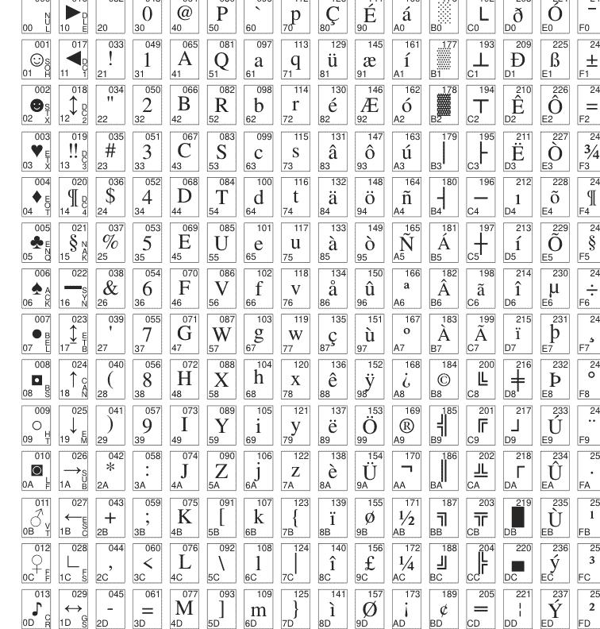

## 3.2　基于MRR-Net的小目标检测模型

为防止小目标检测在卷积神经网络中由于反复下采样而丢失细节，本研究在主干网络加入多分辨率特征复用模块，来改善小目标的漏检问题。

### 3.2.1　感受野扩大模块

感受野的扩大是为了使网络获得更大的上下文信息，这有利于对小目标的检测。因此，本研究设计了一个感受野扩大模块（`MRF`）来代替`YOLOv5s`主干网络中的一些常规`Conv`模块，以改善网络对图像中小目标的检测能力。


如图 3-2 所示，`MRF`模块由两个并行的`Conv`分支和一个`Shortcut`分支组成。两个`Conv`分支分别使用 3×3 卷积和 5×5 卷积，扩张率为 2；`Shortcut`分支由 1×1 卷积组成。三个分支的输出通过拼接操作在通道维度上合并，并通过 1×1 卷积压缩通道数。

`MRF`模块中的 5×5 卷积运算被分解为两个 3×3 卷积运算，以减少网络参数，扩大有效感受野。然而，简单的 3×3 卷积只能使网络获得相对较小的有效感受野。因此，为了进一步扩大感受野，本研究引入了`RFB`（`Receptive Field Block`）模块，将`Conv`层的输出送入`RFB`以扩大感受野。`RFB`模块并行使用多个不同核大小的`Conv`层，并使用`Shortcut`分支来缓解梯度消失的问题。

`RFB`模块使用 3×3 卷积，并使用扩张率 1、3、5 以获得不同尺度的特征图。不同扩张率的 3×3 卷积可以获得不同大小的感受野。结合`MRF`模块和`RFB`模块，可以在不增加网络深度的情况下扩大`MRF`的感受野。`MRF`和`RFB`结合后，构成了`YOLOv5s`主干网络中的感受野扩大模块（`MRR`）。

# 索引

## 符号与数字

- `:`（冒号），标签语法中，241–242
- `#`（井号），AT&T助记符中的注释分隔符，474
- `$`（美元符号）
  - 用于推导字符串位置，246
  - AT&T助记符中表示立即数操作数，471
- `%`（百分号），AT&T助记符中寄存器名的约定，471
- `;`（分号），作为注释分隔符，124
- `?`（问号），用于未定义标志，510
- `[ ]`（方括号），用于内存中数据项的有效地址，210
- `'` （单引号）或 `"` （双引号），字符串变量语法中，243
- 1位，用`TEST`查找，304–306
- 8位二进制值，292
- 8位计算机，57、63
- 8位寄存器，93
- 16位计算机，57
- 16位CPU
  - CPU架构的变化，67
  - 通用寄存器与，92–93
  - 寄存器与，88
- 16位寄存器
  - 由16位寄存器生成的20位地址，88–90
  - 16位寄存器的负担，317–318
  - 概述，90–91
- 20位地址，由16位寄存器生成，88–90
- 32位计算机
  - CPU架构的变化，67–68
  - 概述，57
- 32位CPU
  - 通用寄存器与，92
  - 寄存器与，88
- 32位寄存器，90–91
- 64位计算机
  - CPU架构的变化，67–68
  - 概述，57
- 64位“长模式”
  - 概述，106–107
  - 可能性与现实，107–108
- 64K，实平坦模式与，97
- 8080 CPU，79–80
- 8086 CPU
  - 8086的内存模型，80–82
  - *《程序员参考便携指南》*，231

## A

- `A Programming Language`（APL语言），109、327
- `AAA`（BCD加法后调整AL）
  - 将ASCII数字添加到屏幕标尺，411–413
  - 调整`AAA`的调整，413–414
  - 参考，512
- Abrash, Michael，54
- `ADC`（带进位算术加法），513–514
- `ADD`（算术加法）
  - 访问寄存器数据，207–209
  - 将源操作数和目的操作数相加，207
  - 通过移位和加法实现乘法，297–298
  - 操作数，220
  - 参考，515–516
  - 速度，229
- 加法器，CPU门电路与，65
- 十六进制加法
  - 多列加法，35
  - 单列加法，32–34
- 地址引脚
  - CPU上的，58
  - 内存芯片上的，52
- 地址。另见内存地址
  - 汇编语言游戏中的，11–12
  - 内存地址与I/O地址，60
  - 内存单元与，52
  - 为什么栈地址不可预测，429
- 数据寻址
  - 数据与其地址的混淆，210
  - 有效地址，210
  - 立即数地址，205–207
  - 寄存器地址，205–207
- `AF`（辅助标志）
  - `DEC EBX`指令清除，217
  - `EFlags`寄存器中，214
  - 标志规则，510
  - `INC EAX`指令与，218
- `AIX`，178
- `AMD`
  - 双核CPU，73–74
  - Intel兼容芯片，66
  - 重新设计芯片微架构，69
- `AND`（逻辑与）
  - 剖析，283
  - 应用于x86指令集，281–282
  - 用其屏蔽位，282
  - 用其屏蔽半字节，292–293
  - 参考，517–518
  - `TEST`指令执行，304–306
  - 真值表，281
- `APL`（A Programming Language），109、327
- 架构，CPU，67–68
- 参数，宏参数作为，385–386
- 算术运算
  - 加法。见`ADD`（算术加法）
  - 应用数学与，15–16
  - `CMP`（算术比较），301–302、524–525
  - 除法。见`DIV`（算术除法）
  - 机器指令执行，62
  - 乘法。见multiplication
  - 有符号值与，221
  - 减法。见subtraction
- 十六进制算术运算
  - 多列加法，35
  - 多列减法，32
  - 概述，32
  - 单列加法，32–34
  - 单列减法，35–37
- `ASCII`
  - 将ASCII数字添加到标尺，411–413
  - 二进制值转换为ASCII等效值，376–377
  - `ASCII`中的字符编码，177–178
  - 字符串与，243–244
  - 显示ASCII表，419–420
  - 将二进制值显示为ASCII数字，292
  - 转换表，348
- `ASM`文件
  - 链接目标代码文件到，135–136
  - 作为源代码文件，131
- 汇编器
  - 错误，132–133
  - 功能，121
  - `gas`（GNU汇编器）。见`gas`（GNU assembler）
  - 从源代码文件生成目标代码文件，125
  - `NASM`。见`NASM`
  - 用于源代码文件，125–126、131–132
  - 作为翻译程序，122
  - 警告消息，134–135
- 汇编语言
  - 定义，122–123
  - 开发流程，128–129
  - 翻译为机器码，121
- 汇编语言游戏
  - 其中地址，11–12
  - 其中代码和数据，10–11
  - 概述，9–10
- 汇编语言，程序剖析
  - 从栈访问Linux内核服务，254
  - `.bss`段，240–241
  - `.data`段，240
  - 用`EQU`和`$`推导字符串长度，244–246
  - 设计非平凡程序，264
  - 初始注释块，239–240
  - `INT 80h`访问和可移植性神话，262–263
  - 中断，254–259
  - 标签，241–242
  - LIFO（后进先出）栈顺序，246–248
  - “差一”错误，273–277
  - `POP`指令，251–253
  - 设计的问题定义阶段，264–265
  - 程序骨架，237–239
  - `PUSH`指令，249–251
  - 从栈返回Linux内核服务，259–261
  - 扫描缓冲I/O文件，271–273
  - 短期存储，253–254
  - 软件中断与硬件中断，261–262
  - 栈机制，246
  - 倒置栈，248–249
  - 用伪代码启动程序，265–266
  - 字符串变量，242–244
  - 逐步细化，266–271
  - `.text`段，241
  - 技巧，277–278
  - 初始化数据的变量，242
- 汇编语言，编程模型
  - 概述，96–97
  - 保护模式平坦模型，101–104
  - 实模式平坦模型，97–99
  - 实模式分段模型，99–101
- 汇编语言，编程过程
  - 汇编器错误，132–133
  - 用`NASM`汇编程序，143–145
  - 汇编源代码文件，131–132
  - 大端与小端，117–121
  - 二进制文件与文本文件，111–112
  - 注释，123–124
  - 将文本转换为代码，121
  - 调试，138–139
  - 定义汇编语言，122–123
  - 开发流程，128–130
  - 编辑程序，142–143
  - 编辑源代码文件，131
  - 用于查看文件的编辑器，112–116
  - 错误与缺陷，137–138
  - 示例，139–140
  - 文件，110–111
  - 修复错误，134
  - 安装软件，140–142
  - 解释原始数据，116–117
  - 链接器错误，136
  - 链接目标代码文件，135–136
  - 用`ld`工具链接程序，145–146
  - 目标代码和链接器，125–128
  - 概述，109–110
  - 可重定位性，128
  - 在调试器中运行程序，147–153
  - 测试`.EXE`文件，136–137、146–147
  - 警告消息，134–135
  - 工作目录与，129–131
  - “只写”代码，124–125
- 汇编时计算，244–246
- AT&T助记符约定
  - AT&T内存引用语法，474–475
  - 检查`gcc`生成的AT&T `gas`源文件，471–474
  - 概述，470–471

## B

- Babbage, Charles，48
- 向后兼容
  - CPU架构与，67
  - 虚拟86模式用于，83
- 数制的基数
  - 基数2。见binary numbers（base 2）
  - 基数8。见octal numbers（base 8）
  - 基数10。见decimal numbers（base 10）
  - 数制之间的转换，24
  - 以基数4计数，16
  - 剖析基数4数，18–20
  - 本质，20
  - 个位列，23
- 基址+位移，保护模式寻址，310
- 基址+索引，保护模式寻址，310–311
- 基址指针。见`EBP`（base pointer）
- `BASIC`
  - 学习编程语言，110
  - 简单编程，12
  - 字符串，394
- 基本输入输出系统（`BIOS`）
  - 保护模式不允许直接调用，106
  - 概述，71
- `BCD`（二进制编码值），411–414
- Berkeley Software Distribution（`BSD`），156
- 二进制0，表示晶体管开关上没有电压，50
- Big Bus棋盘游戏，6–9
- 大端，117–121
- 二进制1，表示晶体管开关上有电压，50
- 二进制码，机器指令作为，64
- 二进制编辑器，用于查看/处理文件，112
- 二进制文件。另见目标代码文件
  - 将文本转换为，121
  - 与文本文件比较，111–112
- 二进制数（基数2）
  - 与基数10比较，16
  - 位移位与，287
  - 列，39–40
  - 十进制转换为二进制，41–42

## C

- C 调用约定，446–447

C 语言
- AT&T 助记符约定，470–475
- `boiler.asm` 作为构建框架，447
- 使用 GNU 构建 C 代码，441–443
- C 调用约定，446–447
- 使用寄存器中的地址调用指令作为 randtest 技术，483–484
- 命令行参数，484–486
- 将 `time_t` 值转换为格式化字符串，464–465
- 使用 `MOVSD` 复制 `tm` 结构，466–469
- 创建和打开文件，489–490
- 构建 C 语言
- 撤销栈帧，450
- 查看 AT&T `gas` 源文件，471–474
- 从系统时钟获取 `time_t` 值，464
- 使用 `fgets()` 和 `scanf()` 函数进行数据输入，456–458
- 使用 `fgets()` 函数从文件读取文本，490–493
- 文件 I/O，487
- GNU 与 C 语言。*参见* GNU
- 学习 C 语言，110
- 链接到 C 库，445–446
- Linux 与 C 语言，439–440
- `localtime()`，465–466
- 向 `printf()` 传递参数，454–456
- 使用 `printf()` 函数格式化文本，452–453
- 将过程收集到库中，494–501
- 使用 `puts()` 函数输出字符，451
- 使用 `rand()` 函数生成伪随机数，477–482
- 随机数生成，475–476
- 保存/恢复寄存器，447–448
- 使用 `scanf()` 函数输入数值，458–462
- 设置栈帧，448–450
- 使用 `srand()` 函数获取随机数的种子值，476–477
- 使用 `sscanf()` 函数将字符串转换为数字，487–489
- 字符串，394
- 时间和日期函数，462–464
- 为什么某些比特比其他比特更随机，482–483

C 库
- `boiler.asm` 作为构建框架，447
- C 调用约定，446–447
- 撤销栈帧，450
- 将过程收集到库中，494–501
- 概述，445–446
- 使用 `puts()` 函数输出字符，451
- 保存/恢复寄存器，447–448
- 设置栈帧，448–450

- C 预处理器（`cpp`），442
- C++ 编译器，122
- 缓存，晶体管开关用于，64
- 计算器，十六进制，28
- `CALL`
  - 调用过程，336–337
  - 链接到 C 库，445
  - 与局部数据，346
  - 参考，521–522
  - 寄存器地址作为 randtest 技术，483–484
- 调用门，内核，255
- 调用过程
  - 调用中的调用，338–340
  - `LoadBuff` 示例，336–337
  - 栈帧与调用，346
- 回车符，115
- 大小写敏感性
  - AT&T 助记符约定，471
  - 标签，241
- 中央处理单元。*参见* CPU（中央处理单元）
- `CF`（进位标志）
  - 移位时触发，287
  - `CLC`（清除进位标志），522
  - 在 `EFlags` 寄存器中，215
  - 标志规则，510
  - `MUL` 指令与 `CF`，227–228
  - 设置已知值到 `CF`，289
  - `STC`（设置进位标志），572
  - 用途，301
- 依赖链，Make 工具，189–191
- 字符编码，在 `Konsole` 中，177–178
- 字符集
  - `APL`，327
  - Code Page 437，582
  - `IBM-850`，583
  - 概述，581
- 字符串
  - 作为立即数，207
  - 概述，243
- 字符转换，348
- 字符
  - 转换，318
  - 在 C 中使用 `puts()` 输出，451
  - 使用 `MOV` 或 `XLAT` 翻译，320–325
  - 转换表，318–320
  - 使用转换表代替计算，325

中国式套盒方法，329

`CLC`（清除进位标志），523

`CLD`（清除方向标志），524

时钟频率，CPU 与，68

`CMP`（算术比较）
- 用于比较值，301–302
- 参考，525–526

代码
- 将文本转换为代码，121
- 死代码的代价，367
- 游戏步骤作为代码，11
- 过程作为代码的盒子，329–336

Code Page 437 字符集，582

代码重用
- 链接器与代码重用，127
- 过程与代码重用，367–368

代码段寄存器。*参见* `CS`（代码段）寄存器

列
- 二进制系统中，39–40
- 十六进制系统中，26
- 一般数字系统中，23–24
- 八进制系统中，23–24

命令行参数
- C 语言，484–486
- 使用命令行参数检查栈，424
- 在 `Insight` 中设置，429–430

注释块，123

注释
- 为过程添加注释头，370–371
- 注释的重要性，124
- 程序中的初始注释块，239–240
- 概述，123
- “只写”代码与注释，124–125

COMPARE 指令，用于比较数据，11

兼容性
- CPU 架构与兼容性，67
- 虚拟 86 模式用于向后兼容，83

编译器
- 与汇编器对比，122
- 条件编译，263
- 功能，121
- `gcc`。*参见* `gcc`（GNU C 编译器）

复杂度，管理
- 将操作分解为更小的操作，328–329
- 宏。*参见* 宏
- 概述，327–328
- 过程。*参见* 过程

*Computer Lib/Dream Machines*（Nelson），74–75

计算机程序。*参见* 汇编语言，编程过程
- 作为洗衣清单，1–2
- 作为一系列程序指令，9
- 作为二进制机器指令表，63–64

计算机
- 8 位、16 位、32 位和 64 位，57、63、67–68
- 高中课堂上的 RAX 计算机，45–46
- 像人类一样思考，4

条件编译，263

条件跳转
- `JNZ`（不为零则跳转），218
- 超出范围，354
- 概述，299–300

条件字符串指令，`SCASB` 作为，435

控制台，Linux
- 控制注意事项，377–378
- 光标控制，371–377
- 将虚拟显示缓冲区发送到控制台，406–407

控制台应用程序
- Linux，176–177
- Windows 操作系统，102

`Insight` 的控制台视图
- 设置命令行参数，429–430
- 查看 EFlag 值，216–217
- 查看标志状态，228

常量数据，放置在过程定义中，348–350

`COSMAC ELF`，46–47

计数寄存器，286

`<count>` 操作数，用于移位，286–287

`CP/M` 操作系统，70、79–82

`cpp`（C 预处理器），442

`CPU`（中央处理单元）
- 8080，79–80
- 8086，80–82
- 架构，67–68
- 改变取指和执行的方向，65–66
- 数据总线与 `CPU`，59–60
- 取指和执行过程，63–64
- 改进，68
- 机器指令与 `CPU`，62
- 多 `CPU` 系统，73–74
- 多任务处理与 `CPU`，72
- 晶体管开关数量，64–65
- 概述，57–58
- 程序控制，61
- 识别源字符串和目标字符串，395
- 寄存器数据存储在内部寄存器中，207–209
- 寄存器，60–61
- 与内存系统通信，58–59
- 做什么与怎么做，66–67
- `CS`（代码段）寄存器
  - 8086/8088 CPU，82
  - 机器指令存储于其中，95
  - 概述，91
- `ctime()`，C语言中，464–465
- Ctrl+F（搜索），171
- Ctrl+R（替换），172
- 当前代码段，95
- 光标控制
  - 注意事项，377–378
  - Linux 控制台中，371–377
- 光标移动，`Kate` 编辑控制，169

## D

- 数据
  - 地址，11
  - 程序 `.data` 段中数据项的定义，240
  - 局部数据，346–347
  - 汇编语言游戏中的数值数据，11
  - 在过程定义中放置常量数据，348–350
  - 过程与数据，342–343
  - 棋盘游戏中的存储，5，10–11
  - 将数据存储到不连续的字符串中，419–424
- 数据，作为操作数
  - 混淆数据与其地址，210
  - 立即数，205–207
  - 内存数据，209–210
  - 寄存器数据，207–209
- 数据总线，CPU/设备通过其通信，59–60
- 数据定义指令，242
- 数据显示调试器（`DDD`），194
- C 语言中的数据输入
  - 使用 `fgets()` 和 `scanf()` 函数，456–458
  - 使用 `scanf()` 函数输入数值，458–462
- 从过程访问数据项，343
- C 语言中的数据输出
  - 使用 `printf()` 函数格式化文本输出，452–453
  - 使用 `puts()` 函数输出字符，451
- 内存芯片上的数据引脚，52
- `.data` 段
  - 汇编语言程序中，240
  - 与栈，248
- 数据段（`DS`）寄存器，91
- `DB`（定义字节）指令，242
- `DD`（定义双字）指令，242，244
- `DDD`（数据显示调试器），194
- 死代码，代价，367
- `DEBUG`，139
- 调试器
  - 调试源代码，128
  - `Gdb`。*参见* `Gdb` 调试器
  - `Insight` 调试器。*参见* `Insight` 调试器
  - 安装，140
  - `KDbug`。*参见* `KDbug`
  - 定位和识别错误，138–139
  - 在调试器中运行程序，147–153
- `DEC`（递减操作数）
  - 用其修改数据，11
  - 条件跳转和，299
  - 操作数减一，215–216
  - `ECX` 寄存器和，408–409
  - 作为获取负数的方法，221–222
  - 参考，527
- `DEC`（数字设备公司），20
- 十进制数（基数为10）
  - 转换为十进制，24
  - 将二进制转换为十进制，40–41
  - 将十六进制转换为十进制，28–29，31
  - 转换为二进制，41–42
  - 转换为十六进制，29–32
  - 十六进制计算器，28
  - 十六进制等效值，25–27
  - 基于人双手10个手指（数字）的计数系统，16
  - 八进制等效值，22
  - 寄存器视图以十进制显示寄存器值，223–224
- Delphi
  - 文件处理，121
  - 学习，110
  - 可视化编程，12

## D（续）

- 依赖关系
  - 依赖链，189–191
  - Make 工具与依赖关系，187–188

- 目标地址，将数据存储到不连续的字符串，419

- 目标操作数
  - 立即数和目标操作数，206
  - 机器指令和目标操作数，205
  - 源操作数和目标操作数之和，207

- 目标字符串
  - 将显示缓冲区地址放入 `EDI`，403
  - x86 中的字符串类型，395

- 弯路，8，11

- 开发过程
  - 汇编器错误，132–133
  - 汇编器警告消息，134–135
  - 汇编源代码文件，131–132
  - 调试器和调试，138–139
  - 编辑源代码文件，131
  - 错误与缺陷，137–138
  - 链接器错误，136
  - 链接目标代码文件，135–136
  - 概述，128–130
  - 测试 `.EXE` 文件，136–137
  - 工作目录和开发过程，129–131

- `DF`（方向标志）
  - `CLD`（清除方向标志），523
  - `EFlags` 寄存器中，214
  - 重叠块移动和，416–418
  - `STD`（设置方向标志），573
  - `STOSB` 指令和，405–406
  - 用途，301

- 差分机（巴贝奇），48

- 数字设备公司（`DEC`），20

- 数字表，使用查找表，293–295

- `DIMM`（双列直插式内存模块），56

- 目录
  - 在 `Kate` 中创建和使用项目目录，173–175
  - 开发过程中的工作目录，129–131

- 不连续的字符串，将数据存储到，419–424

- 磁盘，`Kate` 文件管理和，166–167

- 位移量，保护模式，309–310

- 显示器。*参见* 屏幕；虚拟文本显示

- `DIV`（算术除法）
  - 作为隐式操作数，226
  - 与 `SHR`（右移）比较，209
  - 速度较慢，229–230
  - 无符号除法，228–229
  - 参考，528

- `DLL`（动态链接库），78

- `DOS`
  - 在过程中调用过程，340
  - 概述，71
  - 实模式分段模型和，78，99
  - Unix 和，156

- 双字
  - `DD` 指令，242，244
  - 以双字为单位测量内存，54

- `DS`（数据段）寄存器，91

- `DIMM`（双列直插式内存模块），56

- 双核 CPU，73–74

- `DumpChar` 过程，347–348

- `DumpLin`，十六进制转储行变量，347–348

- Dunn, Jim，329

- `DW`（定义字）指令，242，244

- DWORD，大小说明符，211

- 动态链接库（`DLL`），78

## E

- `EAX` 寄存器，在寄存器视图中查看，206–207

- `EBP`（基址指针）
  - 访问命令行参数，485
  - 将 `ESP` 复制到 `EBP`，436–438
  - 在 C 语言中销毁栈帧，450
  - 在 C 语言中设置栈帧，448–450

- Eclipse IDE，用于 Linux，157

- `ECX` 寄存器
  - 使用字符串指令时递减，407–408
  - 使用循环指令时递减，408–409
  - `ECX` 变为 0 时跳转，421

- `EDI`（扩展目标索引）
  - 用于目标字符串，395
  - `DF`（方向标志）用于递增/递减，405
  - 将显示缓冲区地址放入其中，403

- 编辑
  - 示例程序，142–143
  - 源代码文件，131

- 编辑控制，`Kate` 中，168–172

- 编辑器
  - `gedit`，131，140，142–143
  - 十六进制编辑器，112
  - 用于检查文件，112–116
  - `Kate`。*参见* `Kate` 文本编辑器

- 有效地址
  - 计算，308–309
  - 内存中数据项的有效地址，210
  - `LEA` 指令，315–316，537

- `EFlags` 寄存器
  - 移位时触及进位标志，287
  - 标志描述，212，214–215
  - 图示，213
  - 概述，212
  - 参考文档，232
  - 用寄存器视图观察，216–218

- `EIP`。*参见* `IP`（指令指针）

- 电，继电器开关和，48

- EMACS 编辑器，440

- 行尾标记。*参见* EOL（行尾）标记

- EOL（行尾）标记
  - 注释分隔符，124
  - 定义显示缓冲区中的行，406
  - EOL 字符表，349

- `EQU`（等值）指令
  - 更改文本显示缓冲区，402
  - 用其推导字符串长度，244–246

- *等于运算符*
  - `CMP` 指令后的算术测试，305
  - 基于等于的跳转，302

- 错误
  - 向程序添加错误处理，270–273
  - 汇编器错误，132–133
  - 错误与缺陷，137–138
  - 除以零和，229
  - 跳转超出范围，354
  - 链接器错误，136
  - “差一”错误，273–277

- `ES`（附加段）寄存器，91

- ESC 字符，375

- 转义序列
  - `Konsole`，377–378
  - Linux 控制台由其控制，375–376
  - 终端控制，183–184

- `ESP`（栈指针）
  - Linux 栈的解剖结构，427
  - 在 C 语言中销毁栈帧，450
  - 概述，247–248
  - 出栈与寻址，436–438
  - 在 C 语言中设置栈帧，448–450
  - 用于源字符串，395

- `.EXE`（可执行）文件
  - 将库链接到程序中，366–367
  - 将目标代码文件链接为 `.EXE`，125–128
  - 测试，136–137，146–147

- 展开宏，379

- 扩展槽，60

- 导出文件，作为 HTML，167

- 扩展目标索引。*参见* `EDI`（扩展目标索引）

- `EXTERN`。*参见* 外部过程

- 外部过程
  - 声明，356–357
  - 机制，357–361

- 外部引用，目标模块，127

- 附加段（`ES`）寄存器，91

## F

- 远跳转，354

- 快速块复制
  - 使用 `MOVSB` 指令，414–416
  - 重叠块移动，416–418

- 取指和执行过程，CPU 和，63–64

- `fgets()`，C 语言
  - 用于数据输入，457–458
  - 用于从文件读取文本，490–493

- 场效应晶体管，49

- C 语言中的文件 I/O
  - 创建和打开文件，489–490
  - 使用 `fgets()` 从文件读取文本，490–493
  - 概述，487
  - 使用 `sscanf()` 将字符串转换为数字，487–489

- 文件管理，`Kate`，164–167
  - 概述，164–165
  - 使用文件管理，165–167

- 文件
  - 二进制与文本，111–112
  - 添加书签，169
  - 将文本转换为代码，121
  - 用于检查文件的编辑器，112–116
  - `Kate` 模板，161
  - Make 工具用于检查更新，189
  - 编程中的文件处理，110–111
  - Unix 文件，178–180

- 文件系统浏览器，`Kate` 中，164–165

- 过滤器
  - `hexdump1.asm` 程序作为过滤器，289–292
  - 文本过滤器，182–183，278

- 固件，71

- 修复错误，134

- 标志
  - 改变程序执行，218–220
  - `CMP` 指令用于比较值，301–302
  - 条件跳转和，299–300
  - CPU 寄存器标志，66
  - `EFlags` 寄存器中的标志描述，212，214–215
  - `EFlags` 寄存器。*参见* `EFlags` 寄存器
  - 礼仪缺陷，341–342

- 标志位 *（续）*
  - 指令的礼仪，215–216
  - `EFlags` 寄存器图示，213
  - 指令标志位汇总，509–510
  - 概述，212
  - 参考文档，232
  - 寄存器，96
  - 用途，301
  - 使用寄存器视图监视，216–218

- 文件夹，`Kate` 文件管理，166

- `fopen()`，在 C 语言中创建/打开文件，489–490

- 格式化文本，在 C 语言中，452–453

- FS 寄存器，91

## G

**gas（GNU 汇编器）**
- 汇编 C 语言和，441, 443
- 检查 `gcc` 生成的 AT&T `gas` 源文件，471–474
- 不使用的原因，444–445

门电路，CPU 开关，64–65

**gcc（GNU C 编译器）**
- 应用于汇编工作，443–444
- AT&T 助记符约定和，470–471
- 在 C 语言中构建代码，441–443
- 检查其生成的 AT&T `gas` 源文件，471–474
- 概述，441

**Gdb 调试器**
- 局限性，194
- 局部标签和，352
- 概述，139–140
- 在其中运行程序，147–153
- 使用其查看 Eflag 值，216–217

**gedit**
- 在其中编辑程序，142–143
- 作为 Linux 文本编辑器，131
- 在 Ubuntu Linux 中预装，140

通用寄存器
- C 语言调用约定和，447
- CPU 和，91–93
- 过程使用的，344

`gets()`，在 C 语言中，456–457

吉比特（G），内存单位，51

吉字节（GB），内存单位，56

**glibc**
- 访问命令行参数，485
- C 语言调用约定，446–447
- 使用 `MOVSD` 复制 `tm` 结构，466–469
- `ctime()`，464–465
- `fgets()`，457–458, 490–493
- `fopen()`，489–490
- `fprintf()`，493–494
- `gets()`，456–457
- 链接到，446
- `localtime()`，465–466
- 概述，445
- `printf()`，452–456
- `puts()`，451
- `rand()`，477–482
- `scanf()`，458–462
- `srand()`，476–477
- `sscanf()`，487–489
- `time_t` 值，463–464

全局数据，342

全局标签
- 定义，351–352
- 风格语法，353

全局过程
- 声明，356–357
- 机制，361–365

Gnome 应用程序安装器，140

GNOME 终端，176

**GNU**
- 汇编器。*参见* gas（GNU 汇编器）
- `gcc`（GNU C 编译器），441
- 应用于汇编工作的 `gcc`，443–444
- 概述，440–441
- 构建 C 代码的过程，441–443
- 不使用 `gas` 汇编器的原因，444–445

GNU 公共许可证（GPL），440–441

GPL（GNU 公共许可证），440–441

大于运算符，302, 303

大于或等于运算符，302

GS 寄存器，91

GUI 应用程序，Linux，185–186

## H

硬件中断，261–262

头，为过程添加注释头，370–371

堆，动态分配变量，248

十六进制计算器，28

十六进制编辑器，112

十六进制数（基数为 16）
- 运算，32
- 将十进制转换为十六进制，29–32
- 使用 `hexdump1` 程序将十六进制数转换为十六进制数字，289–292
- 转换为十进制，28–29, 31
- 计数，25–26
- 与十进制比较，16
- 十六进制作为二进制的简写，43–44
- 十六进制计算器，28
- 多列加法，35
- 多列减法，37–38
- 概述，24–25
- 寄存器视图将寄存器值显示为十六进制，223–224
- 单列加法，32–34
- 单列减法，35–37

`hexdump1.asm` 程序，289–292

`hexdump2.asm` 程序，329

`HexStr`，295–298

HTML，将文件导出为，167

## I

IA-32，CPU 架构，68

`IBM-850`
- 字符编码方案，178–179
- 字符集，583

IDE（交互式开发环境）
- Eclipse 和 KDevelop，157
- `Kate`。*参见* `Kate` 文本编辑器
- Turbo Pascal 提供的，156

`IF`（中断标志）
- `DEC` 和 `INC` 指令不影响，218
- 在 `EFlags` 寄存器中，214
- 标志位规则，510

IF 语句，在条件编译中，263

立即寻址，205–207

立即数
- 访问，205–207
- 作为操作数，205

隐式操作数
- `DIV`，229
- `MUL`，227
- 概述，225–226

`IMUL`（有符号整数乘法）
- 与 `MUL` 指令比较，410–411
- 参考，527–528

`INC`（自增操作数）
- 用其修改数据，11
- 将操作数加一，215–216
- 参考，529

包含文件
- 宏库作为，388–389
- 与宏比较，379

索引 × 比例 + 位移，保护模式寻址，312–313

初始注释块，在汇编语言程序中，239–240

初始化数据，变量用于，242

内联汇编，编译器和，122

内循环，关闭，421–422

**Insight 调试器**
- 控制台视图，216–217
- 终止命令，204
- 内存视图，199–200, 430–432
- 概述，194–195
- 寄存器视图，198–199
- 运行，195
- 使用其设置命令行参数，429–430
- 使用 Insight 单步执行 REP 字符串指令，418–419
- 源代码窗口，197
- 在寄存器视图中查看 EAX 寄存器，206–207
- 使用寄存器视图监视标志位，216–218
- 其窗口，195–197

指令指针。*参见* `IP`（指令指针）

指令
- 注释和，123–124
- 助记符和操作数作为，123

`INT`（软件中断）
- 参考，530
- 从堆栈返回 Linux 内核服务，259–261
- 软件中断与硬件中断，261–262
- 通过 `INT 80h` 使用 Linux 内核服务，254–259

`INT 80h`
- 访问和可移植性误区，262–263
- 从堆栈访问内核服务，254–259
- 通过其退出程序，260–261

英特尔
- 双核 CPU，73–74
- 内存系统，54–55
- 重新设计芯片微架构，69
- 在 CPU 发展中的作用，58
- x86 芯片，66

交互式开发环境。*参见* IDEs（交互式开发环境）

中断向量表，255–256

中断向量
- 定义，255
- 进入 Linux，258

中断
- `IRET`（从中断返回），260, 531
- 从堆栈返回 Linux 内核服务，259–261
- 软件。*参见* `INT`（软件中断）
- 软件与硬件中断，261–262
- 通过 `INT 80h` 使用 Linux 内核服务，254–259

调用宏，386–387

C 语言中的 I/O（输入/输出）
- 数据输入。*参见* C 语言中的数据输入
- 数据输出。*参见* C 语言中的数据输出
- 文件 I/O。*参见* C 语言中的文件 I/O

I/O 重定向
- 过滤器和，183
- 概述，180–182
- 以十六进制格式打印标准输入数据，335

`IP`（指令指针）
- 改变取指和执行过程，66
- CPU 寄存器，63
- 概述，95–96

`IRET`（从中断返回），260, 531

## J

`JA`（高于则跳转），303

`JCXZ`（如果 CX=0 则跳转），421, 534

`JECXZ`（如果 ECX=0 则跳转），535

`JG`（大于则跳转），303

`JLE`（小于或等于则跳转），302

`JMP`（无条件跳转）
- 无条件跳转的格式，300–301
- 局部标签和，353
- 参考，536
- 无条件跳转，298

`JNG`（不大于则跳转），302

`JNZ`（不为零则跳转），218–219, 300–301

跳转指令
- 类别，302–303
- 条件跳转，218–219, 299–300
- 大于与高于，303
- 跳转或不跳转，66
- 根据条件不存在跳转，300–301
- 局部标签和，353
- 助记符和同义词，304
- 短跳转、近跳转和远跳转，354–355
- 无条件跳转，298

`JZ`（为零则跳转），299–300

## K

**Kate 文本编辑器**
- 向工具栏添加项目，167–168
- 配置，160–162
- 创建和使用项目目录，173–175
- 在其中创建沙盒会话，203
- 编辑控件，168–172
- 编辑示例程序，142
- 文件管理，164–167
- 安装，157–158
- 从其中调用 Make，191–193
- 启动，158–160
- 概述，157
- 会话，162–163
- 其中的终端窗口，173
- 编程时使用，172–175
- 使用时的窗口焦点，175

KDbg
- 与 Insight 调试器比较，198
- 安装，141–142
- 局限性，194
- 在调试器中运行程序，147–153

KDevelop，157

内核
- 从堆栈访问内核服务，254
- 调用门，255
- Linux，73
- 从内核服务堆栈返回，259–261

内核空间，Linux，73

终止命令，Insight 调试器，204

千比特（K），内存单位，51

Konsole
- 向其添加键绑定，192–193
- 其中的字符编码，177–179
- 转义序列，184, 377–378
- 概述，143

KWrite 编辑器，159

## L

标签
- 程序的描述性名称，218–219
- 重复使用，350
- 强制局部标签访问，353
- 全局标签，351
- 局部标签，350–353
- 概述，241–242
- 表示地址，246
- 程序的 `.text` 段中，241

## L

- 细则清单（laundry list）
  - 计算机程序作为, 1-2
  - 其中的测试, 2-3
- ld 链接器
  - C 语言代码构建与, 443
  - 使用其链接程序, 145-146
- `LEA` (Load Effective Address，加载有效地址), 315-316, 537
- 最低有效字节 (`LSB`), `BX` 寄存器的, 208
- 最低有效位, 位编号, 280
- 图例, 6-7
- 长度, 指示器, 汇编语言中字符串不具有, 394
- 小于运算符, 302
- 小于或等于运算符, 302
- 库（libraries）
  - 构建外部过程库, 355
  - C 语言, 439-440
  - 过程过多和库过多的危险, 366-367
  - 全局数据与, 342
  - 链接到程序中, 365-367
  - Linux C 库. 参见 glibc
  - 宏库作为包含文件, 388-389
- 换行符, 115
- 行, 在显示缓冲区中定义, 406
- 链接器. 参见 ld 链接器
  - C 语言代码构建与, 443
  - 调试信息与, 128
  - 错误, 136
  - 功能, 127
  - 链接库到程序中, 366-367
  - 链接程序, 145-146
  - 目标代码到可执行文件, 125-127, 135-136
  - 预安装, 140
  - 可重定位性与, 128
- Linux
  - 大端与小端, 120
  - 发展, 156
  - GNU. 参见 GNU
  - GUI 应用程序, 185
  - 32 位 Linux 的内存模型, 78
  - 操作系统, 73
- Linux 控制台
  - 控制注意事项, 377-378
  - 光标控制, 371-379
  - 发送虚拟显示缓冲区到, 406-407
  - 文本控制台, 102
  - 工具, 176-177
- Linux 内核服务
  - 从堆栈访问, 254
  - 从中返回到堆栈, 259-261
- Linux 工具
  - 添加项目到 Kate 工具栏, 167-168
  - 依赖链, 189-191
  - Konsole 中的字符编码, 177-178
  - 配置 Kate, 160-162
  - 控制台应用程序, 176-177
  - 依赖, 187-188
  - 文件更新与, 189
  - GUI 应用程序, 185-186
  - Insight 调试器, 194-195
  - 安装 Kate, 157-158
  - 从 Kate 调用 Make, 191-193
  - I/O 重定向, 180-182
  - Kate 编辑控制, 168-172
  - Kate 文件管理, 164-167
  - Kate 会话, 162-163
  - Kate 文本编辑器, 157
  - 启动 Kate, 158-160
  - Make 工具, 186-187
  - 概述, 156-157
  - 运行 Insight 调试器, 195, 197-200
  - 标准 Unix 文件, 178-180
  - 使用转义序列进行终端控制, 183-184
  - 终端, 176
  - 文本过滤器, 182-183
  - touch 命令强制构建, 193-194
  - 编程时使用 Kate, 172-175
  - Insight 调试器窗口, 195-197
- LinuxAsmTools, 378
- 小端, 117-121, 206
- 局部数据
  - 概述, 342
  - 过程与, 346-347
- 局部标签
  - 强制局部标签访问, 353
  - 跳转长度与, 350-353
  - 标签重用与, 350
  - 宏内部, 387-388
  - 样式语法, 353
- `localtime()`, 在, 465-466
- 逻辑
  - 计算机与人类, 4
  - 执行逻辑运算的机器指令, 62
- 逻辑 AND. 参见 AND (Logical AND，逻辑与)
- 逻辑异或 (`XOR`), 284-285, 579-580
- 逻辑 NOT, 285-286, 549
- 逻辑 OR, 283, 550-551
- 查找表, 293-295
- LOOP (Loop until CX/ECX=0，循环直到 CX/ECX=0)
  - 递减 EXC 寄存器, 408-409
  - 在屏幕上显示标尺, 409
  - 参考, 538-539
- LOOPNZ/LOOPNE (Loop while CX/ECX>0 and ZF=0，当 CX/ECX>0 且 ZF=0 时循环), 540
- LOOPZ/LOOPE (Loop while CX/ECX>0 and ZF=1，当 CX/ECX>0 且 ZF=1 时循环), 541

## M

- 循环
  - 关闭内层循环, 421-422
  - 关闭外层循环, 422-423
  - 递减 EXC 寄存器, 408-409
  - 嵌套指令循环, 420-421
  - 使用循环重复指令, 219-220
  - 扫描缓冲区与, 272
- `LSB` (least significant byte，最低有效字节), `BX` 寄存器的, 208
- Mac OS/X, 156
- 机器指令
  - 改变取指和执行的方向, 65-66
  - 计算机程序作为二进制机器指令表, 63-64
  - 由 CPU 控制, 62
  - 助记符, 123
  - 概述, 201
  - 程序翻译器, 121
  - 作为步骤, 66
  - 存储在 `CS` (code segment，代码段) 寄存器中, 95
- 机器指令 (x86)
  - 混淆数据与其地址, 210
  - `DIV`, 228-229
  - `EFlags` 寄存器, 212-215
  - 改变程序执行的标志, 218-220
  - 标志参考, 232
  - 立即数和立即寻址, 205-207
  - 隐式操作数, 225-226
  - `INC` 和 `DEC`, 215-216
  - 列表, 507-509
  - 内存数据, 209-210
  - 用于沙箱的最小 NASM 程序, 202-204
  - `MOVSX`, 224-225
  - `MUL`, 226-228
  - `NEG`, 233-236
  - 负数与, 221-224
  - 实模式与, 211-212
  - 参考, 230-232
  - 寄存器数据和寄存器寻址, 207-209
  - 用于实验的沙箱, 201-202
  - 有符号和无符号值, 221
  - 内存数据的大小, 211
  - `MUL` 和 `DIV` 的缓慢, 229-230
  - 源操作数和目的操作数, 205
  - 使用 `Insight` 的寄存器视图观察标志, 216-218
- 宏
  - 带参数定义, 385-386
  - 调用, 386-387
  - 内部局部标签, 387-388
  - 宏库作为包含文件, 388-389
  - 定义机制, 379-385
  - 概述, 378-379
  - 与过程的比较, 379-385, 389-391
- 可维护性, 过程的, 367-368
- Make 工具
  - 依赖链, 189-191
  - 依赖, 187-188
  - 文件更新, 189
  - 从 Kate 调用, 191-193
  - 概述, 186-187
  - touch 命令强制构建, 193-194
- Makefile
  - 定义, 187
  - 依赖, 187-188
  - `hexdump2.asm` 程序与, 335
  - 沙箱的, 203
- 掩码
  - 位, 282
  - 半字节, 292-293
- `MASM`, 386
- 大容量存储, 作为串行访问设备, 52
- 数学, 学校中对应用数学的重视, 15-16
- 兆位 (M), 内存的, 51
- 兆字节 (MB), 内存的, 56, 82-83
- 内存
  - 定义, 48
  - 远离内存的原则 (Abrash), 54
  - 开关作为开/关存储设备, 47-48
  - 术语, 85
  - 度量单位, 54-55
- 内存访问时间, 内存芯片, 53-54
- 内存地址
  - 20 位地址, 88-90
  - 8080 CPU 与, 79-80
  - AT&T 内存引用语法, 474-475
  - 与 I/O 地址比较, 60
  - 作为汇编语言的关键, 12-13
  - 以兆字节计, 82-83
  - 内存模型与, 77-79
  - 保护模式规则, 307-308
  - 保护模式方案, 309
  - 实模式与, 211-212
  - 与段地址比较, 87
- 内存单元
  - 地址, 52
  - 硅芯片容量与, 51
  - 晶体管开关与, 49-50
- 内存芯片
  - 访问时间, 53-54
  - 地址, 52
  - 位容量, 51
  - 每地址位数, 55
  - CPU (central processing unit，中央处理单元). 参见 CPUs (central processing units)
  - DIMMs (Dual Inline Memory Modules，双列直插式内存模块), 56
  - 计算机中的功能, 46-47
  - Intel 内存系统, 54-55
  - 外设与, 59-60
  - 重新设计芯片微架构, 69
  - 总结, 57
- 内存数据
  - 作为操作数, 205
  - 概述, 209-210
  - 大小, 211
- 内存, 模型
  - 64 位 “长模式”, 106-108
  - 8080 CPU 与, 79-80
  - 8086 CPU 与, 80-82
  - 局限, 83-85
  - 实模式内存中兆字节的本质, 82-83
  - 概述, 77-79
  - 保护模式平坦模型, 101-104
  - 实模式平坦模型, 97-99
  - 实模式分段模型, 99-101
  - 虚拟 86 模式用于向后兼容, 83
- 内存系统
  - 访问方法, 57
  - CPU 通信与, 58-59
  - 1 兆字节内存系统图解, 56
  - Intel, 54-55
- Memory view (内存视图), Insight 调试器, 199-200, 430-432
- 内存映射视频, 保护模式不允许, 104-105
- 微架构, CPU, 68
- 助记符
  - AT&T. 参见 AT&T mnemonic conventions
  - 跳转指令的, 304
  - 机器指令与, 123
- 模块
  - `.asm` 文件作为, 355
  - 外部, 357-359
  - 目标模块. 参见目标代码文件
- `MSB` (most significant byte，最高有效字节), `BX` 寄存器的, 208
- 主板, 外设在, 60
- `MOV` (Move/copy right operand into left operand，将右操作数移入/复制到左操作数)
  - 用于移动数据, 204
  - 参考, 542-543
  - 源操作数和目的操作数, 205
  - 速度, 229
  - 使用 `MOV` 或 `XLAT` 转换字符, 320-325
- MOVE 指令, 将数据移入存储器, 11
- `MOVS` (Move string，移动字符串)
  - 参考, 544-545
  - 大小, 414-415
- `MOVSB`
  - DF 与重叠块移动, 416-418
  - 用于快速块复制, 414-416
  - REP MOVSB, 418-419
  - `MOVS` 指令类型, 414
  - WrtLn 过程演示, 415-416
- `MOVSD`, 415, 466-469
- `MOVSW`, 415
- `MOVSX`, 224-225, 547
- `MSB` (most significant byte，最高有效字节), `BX` 寄存器的, 208
- MS-DOS, 99. 参见 DOS
- `MUL` (Unsigned integer multiplication，无符号整数乘法)
  - `CF` (carry flag，进位标志) 与, 227-228
  - 作为隐式操作数, 226
  - 与 `IMUL` 比较, 410-411
  - 概述, 226-227
  - 参考, 547-548
  - `MUL` 和 `DIV` 的缓慢, 229-230
- 多字节值, 大端和小端, 117-121
- 多列算术, 以十六进制
  - 加法, 35
  - 减法, 37-38

## N

- 纳秒，用于内存访问时间，53–54

NASM
- 汇编程序，143–145, 443
- 汇编源代码文件，131–132
- 在过程内定义数据，349
- 定义带参数宏，386
- 错误消息，133
- 作为过滤器，182–183
- 强制访问局部标签，353
- 安装，140–141
- 与 Kate 编辑器模式，160
- 标签，219
- 用于沙箱的最小程序，202–204
- 单步汇编，125
- 短跳转的操作码，354–355
- 与大小说明符，220

ncurses，用于管理控制台的 Unix C 库，378

近跳转，354

NEG（求反）
- 计算二进制补码，223
- 参考，233–236, 549
- 负数，221–224
  - 有符号值，221
  - 用二进制补码表示，222–223

尼尔森，泰德（Ted Nelson），74

嵌套指令循环，420–421

嵌套过程，递归与，340

网络端口，作为外设，58–59

新数学，15

Newlines 过程，349–350

非平凡程序，设计，264

NOP（无操作），550

NOT（逻辑非），285–286, 551

不等于运算符，302

不大于运算符，302

不大于等于运算符，302

不小于运算符，302

笔记，保存编程笔记，277

以空字符结尾的字符串，432

## O

- O 位，使用 `BT`（位测试）查找，306–307

目标代码文件
- 作为源代码和可执行代码之间的中间步骤，125
- 与链接器，135–136
- 链接为可执行文件，128–129
- 与程序翻译器，121

目标模块。*参见* 目标代码文件

八进制数（基数为 8）
- 以八进制计数，21–22
- DEC（数字设备公司）与，20–21

OF（溢出标志）
- `DEC EBX` 指令清除，217
- 在 EFlags 寄存器中，212
- 标志规则，510
- 用途，301

“差一”错误，273–277

偏移地址
- 通用寄存器用于，91
- 段与，89–90

one's complement，*参见* NOT（逻辑非）

操作数
- `<count>`，286–287
- ADD。*参见* ADD（算术加法）
- 汇编语言，123
- AT&T 助记符约定，471
- 数据作为。*参见* 数据，作为操作数
- DEC。*参见* DEC（递减操作数）
- DIV，229
- 隐式和显式，225–226
- INC。*参见* INC（递增操作数）
- 递增/递减与，215–216
- 机器指令与，204
- MOV。*参见* MOV（将右操作数移入/复制到左操作数）
- MUL，227
- POP。*参见* POP（弹栈至操作数）
- PUSH。*参见* PUSH（将操作数压入栈顶）
- 源操作数和目的操作数，205–207
- 符号，234–235
- 指令操作数语法，509
- XCHG，209, 577

OR（逻辑或），283, 552–553

操作系统（OS）
- 多 CPU 系统，73–74
- 多任务处理，71–72
- 作为总管理者，70
- ROM（只读存储器）与，71
- UNIX/Linux，73

外循环，关闭，422–423

溢出标志。*参见* OF（溢出标志）

欧文斯，杰夫（Jeff Owens），378

## P

- 包管理器，140

段落边界，85–86

段落，作为内存度量单位，85

参数，定义宏，385–386

参数，在 C 中
- 传递给 `printf()`，454–456
- 传递给过程，446

奇偶标志。*参见* PF（奇偶标志）

Pascal
- 编译器，122
- 学习，110
- 简单编程，12
- 字符串，394
- 符号化处理数字，9

传递指针，C 术语，454

PC DOS 操作系统，71。*参见* DOS

外设
- CPU 与，58
- 数据总线与，59–60
- 寄存器与，61

Perl，110

PF（奇偶标志）
- `DEC EBX` 指令清除，217
- 在 EFlags 寄存器中，214–215
- 标志规则，510
- `INC EAX` 指令与，218

- 插件管理器，Kate，161

POP（弹栈至操作数）
- 概述，251–253
- 参考，554
- 保存调用者寄存器值，344

弹出指令
- 与寻址栈，436–438
- 从栈中检索，247–248

POPA/POPAD（弹出所有通用寄存器），251–253, 344–345, 555

POPF（弹出栈顶至 16 位标志），251–253, 556

POPFD（弹出栈顶至 EFlags），251–253, 557

移植，从 CPU 8080 到 8086，80–82

端口，保护模式与，105–106

功耗，CPU 与，68

抢占式多任务处理，在 Windows 95 中，71–72

前缀
- REP，403
- REPNE 与 REPE，435–436

`printf()`，C 语言
- 用于格式化文本，452–453
- 传递参数给，454–456
- 用于将文本写入文件，493–494

打印，Kate 文件管理与，167

问题定义，设计非平凡程序，264–265

PROCEDURE，作为汇编语言游戏中的绕行，11

过程，*参见* RET（从过程返回）；*参见* CALL
- 地址，11
- 构建的艺术，367
- 作为代码的盒子，329–336
- 调用，336–337
- 调用中的调用，338–340
- Linux 控制台中的光标控制，371–375
- 意外递归的危险，340–341
- 过程过多和库过多的危险，366–367
- 数据与，342–343
- 决定什么应该成为过程，368–369
- `DumpLin` 和 `DumpChar`，347–348
- 外部库用于，355
- 标志礼仪错误，341–342
- 强制局部标签访问，353
- 全局和外部声明，356–357
- 将库链接到程序，365–367
- 局部数据与，346–347
- 局部标签和跳转长度，350–353
- 与宏的比较，379–385, 389–391
- 可维护性和复用性，367–368
- 外部过程的机制，357–361
- 全局过程的机制，361–365
- 在过程定义中放置常量数据，348–350
- 返回，337–338
- 保存调用者寄存器值，343–346
- 短跳转、近跳转和远跳转，354–355
- 大小要求与，369
- 结构，337–338

过程，在 C 中
- C 调用约定，446–447
- 收集到 C 库中，494–501

处理器。*参见* CPU（中央处理单元）

程序计数器，地址与，11–12

程序指令，9

程序段前缀（PSP），79, 98

程序翻译器，121

*程序员参考袖珍指南*，231

编程语言，109–110

程序/编程。*参见* 汇编语言，编程过程；计算机程序

项目目录，在 Kate 中创建和使用，173–175

保护模式
- 基址 + 位移寻址，310
- 基址 + 索引寻址，310–311
- 位移量，309–310
- 有效地址计算，308–309
- 保护模式操作系统图示，74
- 索引 × 比例 + 位移寻址，312–313
- 其他寻址方案，313–315
- 内存寻址规则，307–308
- Windows 操作系统与，71–72

保护模式平面模型，78, 101–104

保护模式，不允许的
- 直接调用 BIOS，106
- 直接访问端口硬件，105–106
- 内存映射视频，104–105
- 概述，104

伪代码
- `hexdump2.asm` 程序作为，335–336
- “差一”错误，273–277
- 以伪代码开始程序，265–266
- 逐步细化，266–271

- 伪随机数，在 C 中
  - `CALL` 指令到寄存器中的地址作为 randtest 技术，483–484
  - 解释为什么某些位比其他位更随机，482–483
  - 概述，475–476
  - `rand()` 函数生成，477–482
  - `srand()` 函数获取种子值，476–477

PSP（程序段前缀），79, 98

`PUSH`（将操作数压入栈顶）
- 局部数据与，346
- 概述，249–250
- 参考，558
- 保存调用者寄存器值，344

压入指令
- 添加到栈，247–248
- 概述，249–251

`PUSHA`（压入所有 16 位通用寄存器），249–250, 559

`PUSHAD`（压入所有 32 位通用寄存器）
- 概述，249–250
- 参考，560
- 保存调用者寄存器值，344–345

`PUSHF`（压入 16 位标志到栈），249–250, 561

`PUSHFD`（压入 32 位 EFlags 到栈），249–250, 562

`puts()`，C 语言，451

Python，9

## Q

四字，用于度量内存，54

## R

- RAM（随机存取存储器）
  - 芯片容量，51
  - RAM 芯片图示，53
  - 内存系统，55
  - 将虚拟地址转换为物理内存，425

`rand()`，C 语言，477–482

随机访问，52–53

随机数。*参见* 伪随机数，在 C 中

随机存取存储器。*参见* RAM（随机存取存储器）

`randtest.asm`，477–482

原始数据，解释，116–117

RAX 计算机，45–46

- `RCL`（带进位左旋，Rotate Carry Left），288–289
- `RCR`（带进位右旋，Rotate Carry Right），288–289
- 只读存储器（read-only memory, ROM），71
- 实模式（real mode）
  - 内存，82
  - 内存地址与，211–212
- 实模式平坦模型（real mode flat model）
  - 概述，78
  - x86 CPU 编程模型，97–99
- 实模式分段模型（real mode segmented model）
  - 兆字节可寻址内存，82–83
  - 概述，78，99–101
  - 段落边界与，86
  - 通过窄视窗观察兆字节内存，83–85
  - 段，85
- 递归（recursion），340，341
- 参考文档（reference documentation）
  - 面向初学者，231–232
  - 标志位，232
  - 概述，230–231
- 寄存器寻址（register addressing）
  - 访问寄存器数据，207–209
  - 概述，205–207
- 寄存器数据（register data）
  - 作为操作数，205
  - 概述，207–209
- 寄存器半字节，8 位寄存器，93–95
- 寄存器（registers）
  - 16 位和 32 位，90–91
  - 从 16 位寄存器生成 20 位地址，88–90
  - 16 位寄存器的负担，317–318
  - CPU 与，60–61
  - 定义，88
  - 标志寄存器，96
  - 通用寄存器，91–93
  - 指令指针与，63，95–96
  - 内存地址与，211–212
  - 外设，61
  - 过程与，343
  - 寄存器半字节与，93–95
  - 保存调用者的寄存器值，343–346
  - 链接 C 库时的保存/恢复，447–448
  - 由寄存器值定义的字符串，395
- 寄存器视图，Insight 调试器（Registers view, Insight Debugger）
  - 以三种格式显示寄存器值，223–224
  - 概述，198–199
  - 查看 `EAX` 寄存器，206
  - 查看标志位，216–218
- 继电器开关，48
- 可重定位性，链接器与，128
- REP 前缀
  - 使用 `MOVSD` 复制 `tm` 结构，466–469
  - `ECX` 递减与，408–409
  - 与 `MOVSB` 配合使用，418–419
  - 使用 `Insight` 调试器单步执行，418–419
  - 与 `STOSB` 配合使用，403–404
  - 无 REP 的 `STOSB`，407
- REPE 前缀，435–436
- REPNE 前缀，435–436
- 仓库，包管理器，140
- RESB 指令，402
- RET（从过程返回，Return from procedure），563
  - LoadBuff 示例，337–338
  - 递归与，340–341
  - 参考，561
  - 将控制权返回给调用者，446
- 重用。参见代码重用（code reuse）
- ROL（左旋，Rotate Left），288–289，564–565
- ROM（只读存储器，read-only memory），71
- ROR（右旋，Rotate Right），288–289，566–567
- 位旋转，288–289
- Ruler 过程
  - 添加 ASCII 数字，411–413
  - 显示，409
  - 经验总结，414
  - `MUL` 指令与 `IMUL` 的比较，410–411
- 运行时错误，137–138

## S

- 沙盒（sandbox）
  - 用于沙盒的最小 NASM 程序，202–204
  - 用于处理 x86 机器指令，201–202
- `SBB`（带借位算术减，Arithmetic subtraction with borrow），568–569
- `scanf()`，C 语言，458–462
- `SCASB`（按字节扫描字符串，Scan String by Byte），432–435
- 屏幕。另见虚拟文本显示（virtual text display）
  - 在屏幕上显示标尺，409
  - `MUL` 指令与 `IMUL` 的比较，410–411
- 搜索
  - 查找和替换，172
  - 文本搜索，171–172
- 种子值（seed values）
  - 用于随机数，475
  - `srand()` 函数用于获取随机数的种子值，476–477
- 段地址，86–87
- 段寄存器（segment registers）
  - 不响应按位逻辑指令，285–286
  - 从 CPU 8080 移植到 8086，80–82
  - 保护平坦模式模型与，102
  - 实平坦模式与，97
- 段（segments）
  - 作为视野而非位置，88
  - 从 16 位寄存器生成 20 位地址，88–90
  - 本质，85–87
  - 偏移地址与，89–90
- 选择文本，在 `Kate` 中，170–171
- 分号（`;`），作为注释分隔符，124
- 串行访问设备，52
- 服务调度器，Linux，256
- 会话选择对话框，Kate，159
- 会话，Kate
  - 文件管理与，165–167
  - 概述，162–163
- `SF`（符号标志，sign flag）
  - `DEC EBX` 指令清除，217
  - 在 `EFlags` 寄存器中，214
  - 标志规则，510
  - 用途，301
- 位移位（shifting bits）
  - `<count>` 操作数，286–287
  - 工作原理，287
  - 通过移位和加法实现乘法，295–298
  - `SHR` 和 `SHL` 指令，286
- `SHL`（左移，Shift Left）
  - 通过移位和加法实现乘法，296–298
  - 参考，570–571
  - 位移位，286
- 短跳转，条件跳转，354–355
- 短期存储，栈用于，253–254
- showchar 程序
  - 关闭内层循环，421–422
  - 关闭外层循环，422–423
  - 显示 `ASCII` 表，419–420
  - 嵌套指令循环，420–421
  - 回顾，423–424
- `SHR`（右移，Shift Right）
  - 与 `DIV` 比较，209
  - 屏蔽不需要的半字节，293
  - 参考，572–573
  - 位移位，286
- 符号位，221
- 符号标志。参见 SF（符号标志，sign flag）
- 有符号值（signed values）
  - 跳转指令与，302–304
  - 使用 `MOVSX` 移动，224–225
  - 概述，221
  - 范围，223
- 硅芯片。另见存储器芯片（memory chips）
  - 位容量，51
  - CPU（中央处理器），58
- 大小说明符（size specifiers）
  - 用于内存数据，211
  - 与 `NASM` 配合使用，220
- SMP（对称多处理，symmetric multiprocessing），73
- 软件，包管理器用于安装，140
- 软件中断
  - 与硬件中断对比，261–262
  - 本质，254–255
- 源代码文件（source code files）
  - `.ASM` 文件扩展名，131
  - 汇编，125–126，131–132
  - 调试信息，128
  - 编辑，131
  - 检查 `gcc` 生成的 AT&T `gas` 源文件，471–474
  - `Kate` 编辑控制，168–172
- 源代码高亮，宏与，390
- 源码窗口，Insight 调试器，195，197
- 源操作数（source operand）
  - 立即数与，206
  - 机器指令与，205
  - 源操作数与目的操作数之和，207
- 源字符串，x86 中的字符串类型，395
- SpeedCrunch 计算器，28
- `srand()`，C 语言，476–477
- `SS`（栈段，stack segment）寄存器，91
- `sscanf()`，C 语言，487–489
- 栈（stack）
  - Linux 栈的结构，427–429
  - 过程内调用过程与，340
  - 使用命令行参数检查，424
  - 使用 `Insight` 的内存视图检查，430–432
  - 后进先出（LIFO，last in, first out），246–248
  - 概述，246
  - `POP` 指令，251–253
  - 弹出与寻址，436–438
  - `PUSH` 指令，249–251
  - 实平坦模型模式与，98–99
  - 保存调用者的寄存器值与，344–345
  - 用于短期存储，253
  - 倒置结构，248–249
  - 栈地址不可预测的原因，429
- 栈帧（stack frame）
  - 调用过程与，346
  - 销毁，450
  - 设置，448–450
- 栈指针。参见 `ESP`（栈指针，stack pointer）
- 栈段（`SS`）寄存器，91
- Stallman, Richard，440–441
- 标准错误（stderr），Unix 文件，179
- 标准输入（stdin），Unix 文件，179
- 标准输出（stdout），Unix 文件，179
- `STC`（设置进位标志，Set carry flag），574
- `STD`（设置方向标志，Set direction flag），575
- 步骤（steps）
  - 汇编语言游戏中，10
  - 棋类游戏中，5
  - 洗衣清单中，2–3
  - 机器指令作为，66
  - 总结，12
- 存储（storage）
  - 棋类游戏中，5
  - CPU 寄存器用于，60–61
  - 汇编语言游戏中的小隔间，11
  - 栈中的短期存储，253–254
- `STOS`（存储字符串，Store String）
  - 16 位和 32 位版本，414
  - 参考，576
- `STOSB`（按字节存储字符串，Store String by Byte）
  - 用于清除显示缓冲区内存，403
  - `DF`（方向标志）与，405–406
  - `ECX` 递减与，408–409
  - 执行，404–405
  - 嵌套指令循环，420–421
  - `REP` 与，407
  - Ruler 过程使用无 `REP` 的 `STOSB`，409–414
  - 为 showchar 程序设置寄存器，420
- 字符串变量（string variables）
  - 使用 `EQU` 和 `$` 推导字符串长度，244–246
  - 概述，242–244
- 字符串（strings）
  - 将 `time_t` 值转换为格式化字符串，464–465
  - `ECX` 递减与，408–409
  - `HexStr`，295–298
  - 移动。参见 `MOVS`（移动字符串，Move string）
  - 没有边界值或长度指示器，394
  - 概述，393–394
  - 使用 `SCASB` 搜索，432–435
  - 使用 `Insight` 单步执行 REP 字符串指令，418–419
  - 源字符串和目的字符串，395
  - 使用 `sscanf()` 转换为数字，487–489
  - 按字节存储。参见 `STOSB`（按字节存储字符串，Store String by Byte）
  - 存储数据到不连续的字符串，419–424
  - 虚拟文本显示示例。参见虚拟文本显示（virtual text display）
- 减法（subtraction）
  - `SBB`（带借位算术减，Arithmetic subtraction with borrow），568–569
  - `SUB`（算术减，Arithmetic subtraction），577–578
- 十六进制减法
  - 借位与，35–37
  - 概述，32
- 逐步求精（successive refinement）
  - 设计非平凡程序，266–271
  - 程序的求精，277
- 开关（switches）
  - 作为开/关存储设备，47–48
  - 晶体管开关，48–49
- 符号表，链接器构建，127
- 对称多处理（symmetric multiprocessing, SMP），73
- Synaptic 包管理器，140，141
- 系统时钟（system clock）
  - CPU 与，63
  - 从中获取 `time_t` 值，464

## T

- 表（tables）
  - 从过程访问，343
  - 显示 `ASCII` 表，419–420
  - 使用查找表，293–295
  - 向表中写入值，295
- 终端仿真，Unix/Linux，176
- 终端工具，Konsole，143
- 终端窗口（terminal window）
  - `Kate` 中，173
  - 文本显示与，402
- 终端（terminals）
  - Konsole 中的字符编码，177–179
  - 控制台应用程序，176–177
  - Linux 终端的控制注意事项，377–378
  - 控制终端的转义序列，183–184
  - 不要通过终端命令启动 Kate，159
  - 同步，161
  - Unix/Linux，176

`TEST` 指令, 用于查找 1 位, 304–306

tests
- 汇编语言游戏中的, 10
- 棋盘游戏中的, 5
- 作为两种选择之一, 3–4
- 条件跳转和, 299–300
- `.EXE` 文件, 136–137, 146–147
- 跳转或不跳转, 66
- 洗衣清单中的, 2–3
- 用 `TEST` 查找 1 位, 304–306
- 用 `BT` (位测试) 查找 0 位, 306–307

text
- `fgets()` 用于从文件读取文本, 490–493
- C 语言中的格式化, 452–453
- `printf()` 函数用于将文本写入文件, 493–494
- 按文本搜索, 171–172
- 在 `Kate` 中选择, 170–171

文本显示, 虚拟。*参见* virtual text display

文本编辑器
- 在其中编辑程序, 142–143
- 编辑源文件, 131
- 修复错误, 134
- `Kate`。*参见* `Kate` text editor

文本文件
- 考虑显示顺序的差异, 117–118
- 与二进制文件对比, 111–112
- 转换为代码, 121
- 用 `Bless` 十六进制编辑器检查, 113–116
- 解释原始数据, 116–117
- 生成文件, 187

文本过滤器, 182–183, 278

C 语言中的文本输出
- 向 `printf()` 传递参数, 454–456
- `printf()` 函数用于格式化文本, 452–453

`.text` 节
- 汇编语言程序中的, 241
- 其中的代码, 348
- 栈和, 248

文本替换, 宏作为, 385

文本视频缓冲区, 创建, 396

`textfile.asm`, 495–501

`TF` (陷阱标志)
- `EFlags` 寄存器中的, 214
- 标志规则, 510

## U

- TI Programmer (十六进制计算器), 28

C 语言中的时间和日期函数
- 将 `time_t` 值转换为格式化字符串, 464–465
- 用 `MOVSD` 复制 `tm` 结构, 466–469
- 从系统时钟获取 `time_t` 值, 464
- `localtime()`, 465–466
- 概述, 462–464

`time_t` 值, C 语言
- 转换为格式化字符串, 464–465
- 从系统时钟获取, 464

时间戳, Make 工具和, 189

`tm` 结构, C 语言
- 用 `MOVSD` 复制, 466–469
- 概述, 463
- 其中的值, 464

工具栏, 向 `Kate` 工具栏添加项目, 167–168

栈顶 (TOS)
- Linux 栈的解剖, 427
- 过程和, 346

Torvalds, Linus, 73, 156

TOS (栈顶)
- Linux 栈的解剖, 427
- 过程和, 346

touch 命令, 用于强制构建, 193–194

瞬态程序, CP/M-80 和, 79

晶体管开关
- CPU 和, 64–65
- 存储单元和, 49–50
- 概述, 48–49

转换表
- 字符转换, 318–320, 348
- 替代计算, 325

翻译器
- 汇编语言作为, 122
- 将文本文件转换为二进制文件, 121

陷阱标志 (`TF`)
- `EFlags` 寄存器中的, 214
- 标志规则, 510

真值表, `AND` 运算符的, 281

*Turbo Assembler Quick Reference Guide*, 231

Turbo Pascal, 156, 394

补码, 222–223

Ubuntu Linux 计算器, 28

无条件跳转
- 条件不存在时跳转, 300–301
- 概述, 298

Unicode 标准, 用于文本文件, 111

个位列, 数制中的, 23

Unix
- DOS 和, 156
- ncurses C 库用于管理控制台, 378
- 操作系统 (OSs), 73
- 标准 Unix 文件, 178–180

无符号值
- 跳转指令和, 302–304
- 概述, 221
- 寄存器视图将寄存器值显示为, 223–224
- 无符号除法, 228–229

USB 端口, 作为外围设备, 58–59

用户空间, Linux, 73

## V

- 变量
- 动态分配, 248
- 用 `EQU` 和 `$` 推导字符串长度, 244–246
- 用于初始化数据, 242
- 字符串变量, 242–244

`vidbuff1.asm`, 396–402

视频, 保护模式不允许内存映射视频, 104–105

视频显示, 作为外围设备, 58–59

虚拟 86 模式, 用于向后兼容, 83

虚拟地址, 转换为物理内存, 425

虚拟内存, 102, 424–426

虚拟文本显示
- 更改其尺寸, 402
- 创建, 395–402
- 定义显示缓冲区中的行, 406
- 执行 `STOSB` 指令, 404–405
- 将虚拟显示缓冲区发送到 Linux 控制台, 406–407
- `STOSB` 指令和 `DF` (方向标志), 405–406
- `STOSB` 指令用于清除显示缓冲区内存, 403

Visual Basic
- 其中的文件处理, 121
- 学习, 110
- 其中的可视化编程, 12

## W

- 警告消息, 编程过程中的, 134–135

空白字符, 文本文件和, 111

Windows 计算器, 28

Windows NT, Unix 作为其灵感来源, 73

Windows 操作系统
- 控制台应用程序, 102
- 适用于 Windows 的 Linux GUI 应用, 185
- 保护平坦模式和, 78
- 保护模式和, 71–72

WORD, 大小说明符, 211

文字处理器, 111

字
- `DW` 指令, 242, 244
- 以字为单位测量内存, 54

“只写”代码, 124–125

## X

- x86 CPU
- 与 8086 和 8088 向后兼容, 83
- 指令助记符。*参见* AT&T mnemonic conventions
- 指令指针和, 95–96
- Intel 在开发中的作用, 66
- 参考指南, 231–232
- 速度优化, 230

x86 指令集。*参见* machine instructions

`XCHG` (交换操作数), 209, 579

`XLAT` (通过表转换字节), 320–325, 580

`XOR` (异或), 284–285, 581–582

## Z

- 零, 除以零产生错误, 229

`ZF` (零标志)
- 条件跳转和, 299
- `DEC EBX` 指令清除, 217
- `EFlags` 寄存器中的, 214
- 标志规则, 510
- `INC EAX` 指令和, 217
- `JNZ` (不为零则跳转) 和, 218–219
- 用途, 301

---

# 学习汇编语言，就是学习机器

在这部关于 Linux 下 Intel x86 汇编语言的畅销指南第三版中，Jeff Duntemann 将汇编定位为*第一*编程语言，而非高不可攀的极客秘术，适合没有任何编程经验的读者。作为 CPU 的根本语言，汇编为所有其他编程语言奠定了基础，尤其是原生代码 C、C++ 和 Pascal。通过掌握汇编，程序员将了解 x86 计算机如何一路向下运作到“裸硅”，其细节程度是其他方法无法比拟的。

**Assembly Language Step by Step, Third Edition, 帮助你：**

- 回顾计算和编程的基本概念，包括十六进制和二进制数制
- 理解 Intel CPU 的演进以及现代 x86 处理器的工作原理
- 掌握编程过程本身，从编辑源代码到汇编、链接和调试
- 理解 x86 32 位保护模式内存寻址
- 通过剖析大量完整示例程序来学习 x86 指令集
- 在 Ubuntu Linux 下使用丰富的免费编程工具，包括 `Kate` 编辑器、`NASM` 汇编器和 GNU 工具集
- 掌握 Linux 编程的实用细节，包括过程、宏、`INT 80h` 调用门和对标准 C 库的调用

**Jeff Duntemann** 撰写计算机相关文章已有三十余年，是多部编程、无线网络和系统管理书籍的作者。他曾是 *Dr. Dobb's Journal* 的专栏作家，并编辑过 *PC Techniques* 和 *Visual Developer* 等知名编程刊物。工作之余，他喜欢博客写作、天文学、业余无线电和科幻小说创作。

$65.00 美元 / $78.00 加元

访问我们的网站 www.wiley.com/compbooks

软件开发 / 综合

