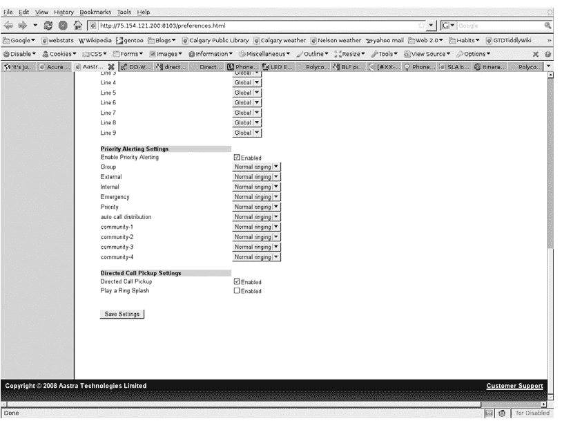

# 亚星电话解决方案：亚星 1.4 安装与定制

*本页故意留白*

- **主编**：马克·L·陶布
- **选题编辑**：德布拉·威廉姆斯·考利
- **编务编辑**：迈克尔·瑟斯顿
- **技术编辑**：L.D. 帕尼亚克、约翰·肯尼迪
- **总编**：约翰·富勒
- **全流程生产主管**：朱莉·B·纳希尔
- **项目编辑**：金·阿尼
- **文案编辑**：基思·克莱因
- **索引编辑**：杰克·刘易斯
- **校对员**：琳达·贝格利
- **封面设计师**：楚蒂·普拉塞特西特
- **排版员**：金·阿尼

献给姑婆海尔加。——SW

献给我的父亲，是他让我体会到捣鼓技术能带来无穷乐趣。——SB

*本页故意留白*

## 序言

你正在阅读我的第二本 Asterisk 书籍的英文版。我最初用德语撰写了本书，由 Stephen Bosch 将其翻译为英文，并针对北美读者对内容进行了适配。无论如何，这本书是协作的成果。

首版以 GNU 自由文档许可证（GFDL）发布，超过 100 人通过提交错误报告或撰写新章节的方式做出了贡献。特别感谢我的同事 Philipp Kempgen，他为新版撰写了许多章节。

德语版可在 `www.das-asterisk-buch.de` 获取，英文版可在 `www.the-asterisk-book.com` 获取。我鼓励你浏览当前的在线版本，尤其是涉及硬件和驱动相关内容的部分。

过去几年 VoIP 领域发展十分活跃。我使用 Asterisk 的工作带我去了很多新的地方，比如亚拉巴马州亨茨维尔（Asterisk 的开发者 Digium 的总部所在地）、加拿大多伦多（电话接口硬件制造商 Sangoma 的总部所在地）以及罗马尼亚布加勒斯特（Yate 项目，一个开源电话引擎的所在地）。

我学到了很多 Asterisk 相关的知识，也了解了 Yate（`http://yate.null.ro`）和 FreeSwitch（`www.freeswitch.org`）的许多内容，二者都是有趣的开源 VoIP 替代方案。

从我最初使用 Asterisk 到现在，它已经取得了长足的发展。我并没有使用最初的安装版本太久，因为我不理解它的核心概念，而且当时的文档是开源软件的典型风格（也就是“去读源代码吧”）。我对 Linux 的最初体验也是如此。如今我完全离不开这两样工具了。

## 序言

Asterisk 改变了我对 PBX（专用交换机）的认知。未来，所有人更可能将 PBX 视为软件而非硬件。

从过去以硬件为导向的工作模式转向以软件为导向的新模式并非没有挑战。在我作为 Asterisk 顾问的日常工作中，我经常看到此前从事网络数据工作的人员和此前从事电话工作的人员之间的分歧。我希望通过这本书拉近两个领域的距离。

我欢迎你的反馈、表扬和批评，请发送至 `stefan.wintermeyer@amooma.de`。

——Stefan Wintermeyer

能够和 Stefan 合作将本书翻译为英文，我倍感荣幸。尽管 Stefan 的英语说得很好，但他知道一份专业的英文版需要专门的译员来完成。受托承担这项任务是我的荣誉。

我还负责了英文版的部分适配和修改工作，其中包括 ISDN 相关章节。技术翻译是一项特殊的工作，细节至关重要，几乎没有回旋的余地，所以我希望这本你手上的书既易读又有用。

和 Stefan 一样，我欢迎你的反馈，请发送至 `sbosch@vodacomm.ca`。

——Stephen Bosch

## 前言

或许试图编写一本面向所有人的书是鲁莽的，但唯有远大的目标才能铺就卓越之路。本书确实致力于同时为新手和专家提供帮助。

第 1 章为初学者、熟练用户和专家提供了指引。第 2 章提供了基础系统配置的详细说明，并指向附录中的安装指南。第 3 章介绍了 Asterisk 的核心——拨号计划，进而引出第 4 章的实际业务案例示例，阐述了设计可部署系统所涉及的内容。

后续章节会为经验更丰富的 Asterisk 用户深入介绍相关知识。第 5 章涵盖了用于构建语音应用的拨号计划应用和函数的使用方法。第 6 章介绍了新的 Asterisk 扩展语言（AEL），它为拨号计划引入了熟悉的编程语言格式，使用它可以构建简洁、易读且易维护的拨号计划。

Asterisk 在工作中使用了多种网络和 IP 电话协议，我们会在第 7 章中回顾这些内容。第 8 章介绍了 Asterisk 用于连接设备和电话网络（包括 ISDN）的音频编解码器和有线传输协议，并简要介绍了相关硬件。

接下来我们会介绍 Asterisk 的功能集。Asterisk 提供了功能完整的语音邮件系统，你可以在第 9 章学习如何配置和使用它。第 10 章会教你如何使用 Asterisk 构建交互式语音应答（IVR）系统。

实用的应用需要数据库支持，Asterisk 自带了 Asterisk 数据库，相关内容在第 11 章介绍。呼叫队列可以说是任何呼叫中心的核心支柱，相关内容在第 12 章介绍。

非常简短的第 13 章介绍了两项基础但常见的商务电话功能：呼叫转移和呼叫代接。电话会议是强大的协作工具，Asterisk 内置了电话会议功能，相关内容在第 14 章介绍。

有很多方式可以让 Asterisk 与外部程序交互，第 15 章会教你如何通过 shell 命令、呼叫文件或 Asterisk 管理器接口（AMI），从外部应用、脚本或系统 shell 控制 Asterisk。第 16 章介绍了 Asterisk 网关接口（AGI），这是 Asterisk 与外部应用交互的主要方式。

你可以通过 IAXmodem 和 HylaFAX 扩展 Asterisk 的传真功能，相关内容在第 17 章介绍。最后，第 18 章回应了一个常见需求：配置繁忙指示灯字段（分机监听）和 SIP 电话的提示，其中包含了 Aastra 和 Polycom 的示例。

本书的附录内容非常丰富，旨在供你频繁查阅。

- 附录 A 提供了在 Debian Etch 上安装 Asterisk 的非常详细的说明。
- 附录 B、C、D 和 E 汇总了拨号计划、AGI 和 AMI 接口的命令和函数。
- 附录 F 提供了使用拨号计划模板的示例。
- 尽管 Asterisk 1.4 是目前可投入生产的稳定版本，1.6 版本也已在开发中可供使用。附录 G 告诉你在成功迁移系统前需要了解的内容。
- 附录 H 介绍了 Zaptel 更名为 DAHDI 的相关内容，这一更名对运行有影响，相关内容在附录中进行了说明。
- 你应该选择 IAX 还是 SIP？这是一个有争议的话题，我们在附录 I 中提供了一些参考意见。

你可以按顺序阅读，也可以根据自己的兴趣选择阅读内容，只需记住部分示例是基于之前的示例构建的即可。

## 致谢

本书第一版于 2006 年在德国出版。此后，我们收到了来自 Asterisk 社区的许多宝贵反馈。我们要向所有帮助过我们的人致以诚挚的感谢。

第一版中我们曾逐一致谢，但这次我们决定不再这么做——因为部分邮箱地址被垃圾邮件发送者扒取，且不少贡献者明确表示希望保持匿名。即便如此，我们仍要真诚感谢大家的所有反馈与付出！没有你们的帮助，这本书不可能有现在的水准。

### 斯特凡·温特迈耶的致谢

首先，我要感谢我的编辑鲍里斯·卡尼科夫斯基。没有他的耐心，第一版根本不可能问世。第二版足足延期了 12 个月才完成。我还要感谢他同意本书以 GNU 自由文档许可证发布。敢于迈出这一步的出版方和编辑少之又少，谢谢您，鲍里斯！

我还要感谢 AMOOMA 的同事彼得·科萨克和索伦·施普伦格。特别感谢菲利普·肯普根。这本书的深度与广度离不开你们的付出。

弗里德里克·达内克的编校工作堪称奇迹，她仅用了不到三周时间就通读了全稿。

Digium 的凯文·弗莱明提供了极为及时且宝贵的技术支持，Sangoma 的员工也非常乐于助人，尤其要感谢康拉德·哈梅尔和道格·维利姆。

特别感谢我的妻子，没有她的支持，我根本没法在这诸多项目中撑下来。

### 菲利普·肯普根的致谢

感谢我的家人珍妮、可可、坎吉，以及所有总是吃点亏的人。

### 斯蒂芬·博施的致谢

感谢黛布拉·威廉姆斯·考莉的人文情怀与慷慨性格、你（显然无穷无尽的！）耐心以及你的坚持，你是一位真正的专业人士。

感谢你和培生集团的每一位同仁，我深表感激。

## 关于作者

**斯特凡·温特迈耶**是 AMOOMA GmbH 的创始人兼董事，该公司是欧洲领先的 Asterisk 电话解决方案提供商。他是德国首位 Digium 认证 Asterisk 专家，目前仍通过会议、研讨会和工作坊持续分享自己的专业知识。

**斯蒂芬·博施**是一名 Asterisk 顾问兼作家，他的时间分配在德国阿沙芬堡和加拿大艾伯塔省卡尔加里之间。不用 Asterisk 打电话的时候，他会去航海。

本页有意留白

# 如何充分利用本书

## 1 首先

感谢你购买本书。正是因为有像你这样的读者的关注，这类项目才有可能诞生。

我们编写本书是因为 Asterisk 本身没有附带使用说明。Asterisk 社区推荐的许多资源都是 wiki 和网站的形式，更新不及时且经常包含错误信息。我们希望本书能填补 Asterisk 缺失的使用手册这一空白。

换言之，我们致力于打造我们当初苦苦寻找的那种书：内容通俗易懂，既可按章节顺序阅读，也可当作工具书查阅。

## 1.1 什么是 Asterisk？

Asterisk 是一款电话系统，但它很特别。它不是硬件，而是你可以从互联网下载的软件。要上手使用它，你只需要一台普通 PC、Asterisk 软件、本书，以及动手实践的兴趣。

Asterisk 支持多种电话技术，包括模拟电话、ISDN 和 VoIP。使用 Asterisk 系统，员工可以用 IP 电话在家办公，拨打办公室系统的电话，就像身在办公室一样。它的可能性是无穷的，既能扩展系统功能，又能帮你省钱。

不过电话技术本身仍然存在一定复杂性，转向 Asterisk 也不是没有挑战。因此，你需要同时熟悉通用电话技术和 Asterisk 本身。

接下来我们用一个儿时的类比来探索 Asterisk 和传统电话系统的区别：我们大多数人小时候玩的玩具基本分为两类。

第一类是开箱即玩型的（比如泰迪熊、风火轮汽车），第二类则有一定的变化和创作空间（比如乐高积木或林肯原木积木）。

开箱即玩的玩具拆箱就能玩，但玩法被玩具公司限定死了；而积木或原木不会直接给你成型的玩具，你需要自己设计再动手搭建，只要在现有零件的限制范围内，你想搭什么都可以。

简而言之，Asterisk 和这种情况完全一样：它是零散交付的，只要你构思好方案，一切皆有可能。最棒的是，你可以随时用新的零件来改进你做出的“玩具”。

Asterisk 和传统电话系统各有优劣。

**传统电话系统的主要优势包括以下几点：**

- 开箱即用，几乎拆封就能立刻拨打电话。
- 几乎不需要学习说明。

**传统电话系统的主要劣势包括以下几点：**

- 扩容通常非常昂贵，且并非所有功能都支持甚至提供。
- 它是黑盒，你无法得知内部运行情况，而排查故障时了解内部状态往往至关重要。

**基于软件的 Asterisk 系统的主要优势包括以下几点：**

- 你可以随时针对问题打造新的解决方案，只需要合适的方案设计即可。
- 你可以组合不同组件来创建新系统和解决方案。

**Asterisk 的主要劣势包括以下几点：**

- 你一开始只有一堆零散组件，将它们组装成系统需要一定的耐心。
- 你需要具备一定的技能，无法快速获得成功。

## 1.2 谁适合阅读本书？

并非所有人都需要从零基础开始学，也不是每个感兴趣的人都想成为 Asterisk 专家。本书充分考虑了这一点，提供的相关内容对初学者、入门者和专家而言都是宝贵的参考资料。

### 1.2.1 初学者

纯新手应该按章节顺序阅读本书，因为各章节内容是递进的。至少阅读第 2 章“安装与「Hello World」”和第 5 章“拨号计划基础”，你就能够组装出越来越复杂的电话系统。

初学者常常会疑惑该买什么设备、订购什么服务，因此我们为需要指导的人整理了这份简短的常见问题解答。

**问：** 该如何选择 VoIP 服务商？需要留意哪些问题？

**答：** 初期建议选择提供免费账户的 SIP 服务商，方便你积累经验。长期选择哪家服务商可能取决于很多因素，以下是几个需要考量的要点：

- 该服务商只提供 SIP，还是也提供 IAX？你需要 IAX 吗？
- 技术支持质量如何？对于 VoIP 来说，优质的技术支持可能至关重要。
- 服务定价如何？这一点往往不是一目了然的。

**问：** 该选择什么数字接口卡？

**答：** 初期先熟练使用 SIP 中继和分机即可。等你理解了拨号计划和上下文之后，就可以阅读第 8 章“建立连接”，其中会针对你的应用场景提供选择合适数字卡的技巧。

**问：** 有哪些常见的电话类型，价格如何？

**答：** 其实并没有所谓“标准”的电话，你有多种选择：

- SIP 电话。（这是最简单的选项。）
- 使用连接到网络的 ATA（模拟电话适配器）的模拟电话。
- 使用模拟接口卡上 FXS 端口的模拟电话。
- 使用连接到网络的数字电话适配器的数字电话（比如北电 Meridian 系列电话）。
- 使用 T1 卡上端口的 ISDN 电话。这类电话几乎只在 ISDN 终端非常普及的欧洲销售。在 VoIP 出现之前，它们是功能最丰富的设备；但目前它们和 VoIP 电话在功能上几乎没有区别，价格却可能是后者的三倍。如果有选择空间，优先选 SIP 电话即可。
- 特殊架构。例如，你可以将信道机连接到 T1 接口卡，再把模拟电话接到信道机上。这类架构通常适用于改造类项目，如果你是从零开始搭建，尽量保持简单。至于价格，这类产品价格变动频繁，供应商数不胜数，建议多询价多对比。优质 VoIP 硬件的价格正变得越来越亲民。

### 1.2.2 中级用户

我们很难猜到中级 Asterisk 用户知道什么、不知道什么。哪怕你对某个主题已经掌握得很好，也总会有一些新的知识点是你没接触过的。

如果你已经有了一定的实践经验，或许可以跳过第 2 章，或者快速浏览一遍即可。不过我们个人推荐你还是通读一遍，温习基础总会有收获。

之后你可以快速翻阅其他所有章节。编写本书时我们重点聚焦实用案例，哪怕只是读一读示例配置，你也可能获得一些新的思路。

### 1.2.3 专家

你可以跳过第 2 章，直接开始探索本书内容。你会看到大量可以立即落地到你实际工作中的实用案例，这些案例甚至可能给你一些扩展系统的新思路。

除此之外，我们希望本书能成为你宝贵的参考资料。所有重要的应用和功能参数都包含在内并做了说明，通常还附带可运行的示例。我们尤其侧重不同 Asterisk 版本（1.2 到 1.6）之间的对比。

## 1.3 本书的更新与版本

本书的开发和典型的开源项目一致。你手中所持的是稳定分支的印刷版本。你可以在 `www.the-asterisk-book.com` 获取更新与勘误。

你可以在该网站找到当前的 SVN 版本，这将是下一版，但目前它处于前沿开发状态，其中包含的操作流程可能尚未经过测试，甚至可能不被推荐。因此请注意：仅当你清楚自己在做什么时，才可使用这些材料。

## 1.4 读者贡献与反馈

我们意图让本书成为一本活文档，因此以 GNU 自由文档许可证发布它（见附录 J“GNU 自由文档许可证”）。

你可以在 `www.the-asterisk-book.com` 找到本书的最新版本。如果你有改进建议，请发送邮件至 `stefan.wintermeyer@amooma.de`。

如果你有更全面的改进内容要贡献，请将其以 ASCII 文本格式或 DocBook 格式直接作为邮件附件发送。非常感谢你对该项目的关注！

本书永远不会完美，也永远不会真正“完结”。该主题过于复杂，且变化速度极快。请记住，你始终可以在 `www.the-asterisk-book.com` 找到本书最新（也最前沿的）版本。

因此，本常见问题解答（FAQ）针对的是图书的网络版本。如果你在本书中发现错误，请首先访问网站查看该错误是否已被修复。

- **Q：** 我尝试了书中的方法，但效果和描述不符，需要上报吗？  
  **A：** 是的，务必上报！上报时请提供对应网址以及任何相关的错误信息。

- **Q：** 如何上报错误？  
  **A：** 最简单的方式是向作者 Stefan Wintermeyer 发送邮件（`stefan.wintermeyer@amooma.de`）。

- **Q：** 图书使用什么格式编写？  
  **A：** 图书的源代码使用 DocBook 格式编写。你可以在 `www.docbook.org` 了解更多关于 DocBook 的信息。

- **Q：** 为何不使用 wiki，让任何人都可以修改内容？  
  **A：** 首先，因为本书是印刷品，必须设定印刷截止时间。持续变动的内容会让编辑们无法跟进，也无法保证印刷内容的一致性。

  其次，互联网上已经有大量 Asterisk 相关的 wiki。它们最大的优势（修改快速简便）也带来了最大的劣势：充斥着大量过时严重、甚至完全错误的信息。使用 DocBook 并管理变更流程，意味着我们能获得更结构化、更易读的内容，尽可能保证准确性。如果全部内容都放在 wiki 中，会非常难以导出用于印刷。

- **Q：** 编写 DocBook 格式内容需要什么编辑器？  
  **A：** 这几乎是个“信仰”问题。有人喜欢 emacs，有人喜欢 vi。作者和贡献者们大多使用 XMLmind XML Editor。你可以从 `www.xmlmind.com/xmleditor` 获取该软件。

- **Q：** 可以获取原始的 DocBook 文件吗？  
  **A：** 可以。如果你需要进行大规模的修改，欢迎你基于原始文件开展工作。给作者 Stefan Wintermeyer 发送邮件即可（`stefan.wintermeyer@amooma.de`）。

- **Q：** 你们居然没讲 XYZ！太难以置信了，这明明非常重要！你们怎么想的？  
  **A：** 联系作者，简要描述相关主题即可。（如果你愿意编写一个章节，并将其以 GNU FDL 协议发布，可以告知 Stefan。他会给你发送一份 DocBook 章节的示例。）

- **Q：** 网站是如何生成的？  
  **A：** 脚本会从 SVN 拉取 DocBook 源代码，并用其生成 HTML 页面。

## 1.5 其他资源

你遇到了问题，又没能在本书中找到答案？你可以选择以下方式：

- **`www.voip-info.org`**：该网站专注于 VoIP 领域以及 Asterisk，提供绝大多数问题的解决方案。不幸的是，网站上的很多文章都存在错误。如果你发现了错误，请修正它！下一位访客会感谢你。

- **IRC 频道**：存在一个 Asterisk 的 IRC 频道，地址是 `irc.freenode.net` 下的 `#asterisk`。你有时可以在那里快速得到问题的答案，但请注意：部分频道用户对懒惰的容忍度很低。

  你可以通过仔细梳理自己的问题来提高获得帮助的概率。一般来说，“解释清楚你的问题就等于解决了一半问题”这个准则在此适用。如果你是 IRC 新手，可以在 `http://en.wikipedia.org/wiki/Internet_Relay_Chat` 了解更多相关信息。

- **邮件列表**：Digium 的邮件列表并不适合所有人。该列表邮件量非常大，新用户很容易被信息淹没。

  但它也有几个显著的优势：Digium 的员工会订阅该列表，他们经常会回答问题。你也能获得比 IRC 更详细的解答。你可以在 `www.asterisk.org/support` 和 `http://lists.digium.com` 了解如何订阅邮件列表。


- *给我发邮件*：如果以上方式都不管用，你始终可以尝试联系Stefan（`stefan.wintermeyer@amooma.de`）。请注意，由于收到的邮件数量很多，你可能几天内都收不到回复。

*本页故意留白*

# 安装与“Hello World”

部分Asterisk新手表示，要让Asterisk服务器实现任何功能，至少需要花两天时间浏览网页和文档。如果你不喜欢钻研Asterisk这类复杂软件的理论基础，而是希望尽快看到可用的实际成果，这一章就是你的最佳起点。和本书其他章节不同，本章需要按顺序阅读，并跟着示例逐步操作。

> **注意**：本书的主题是Asterisk而非Linux，我们默认你具备基础的Linux管理技能。你应该会使用文本编辑器，也知道如何配置网络适配器。除非另有说明，所有命令都需要以超级用户root身份执行。出于本入门指南的目的，安装Asterisk 1.4还是1.6并没有区别，这里描述的所有基础知识都适用于这两个版本。对于生产环境安装，推荐使用更稳定的版本，因此本书示例均基于Asterisk 1.4。

## 2.1 在服务器上安装Asterisk

关于选择哪个Linux发行版或Asterisk版本，大家的观点不尽相同（这在开源世界非常常见）。有人坚持使用发行版自带的[^1]软件包（例如`.rpm`或`.deb`），也有人从源代码编译安装Asterisk。对于本书的示例，从源代码安装是最佳选择。原因很简单：发行版软件包中的版本几乎永远不是最新版[^1]，而且软件包通常使用非标准配置。请参考附录A“Asterisk 1.4安装指南”，在全新的Debian Linux甚至KNOPPIX系统上安装Asterisk 1.4.x。如果是练习，你也可以考虑在x86虚拟机（例如VMware）中完成安装。无论是物理服务器还是虚拟机，系统都需要配备声卡和输出设备（例如扬声器），这样你就可以向控制台发起测试呼叫，确认系统是否正常运行。

> **警告**：如果你决定尝试用其他发行版或其他安装方法进行安装，遇到了问题，请首先尝试按照此处描述的方法操作。使用经过测试的安装方式通常比在“非标准”配置或环境中排查错误要容易得多。

## 2.2 通过CLI发起“Hello World”呼叫

在本章的第一个示例中，我们将创建一个简单的“Hello World”拨号方案，并从Asterisk控制台（即CLI，命令行界面）发起呼叫。

### 2.2.1 配置Asterisk

标准安装完成后，你应该可以在`/etc/asterisk`目录下找到以下文件：

```shell
debian:/usr/src# cd /etc/asterisk
debian:/etc/asterisk# ls
adsi.conf          cdr_tds.conf      indications.conf  privacy.conf
adtranvofr.conf    codecs.conf       logger.conf       queues.conf
agents.conf        dnsmgr.conf       manager.conf      res_odbc.conf
alarmreceiver.conf dundi.conf        meetme.conf       rpt.conf
alsa.conf          enum.conf         mgcp.conf         rtp.conf
asterisk.adsi      extconfig.conf    misdn.conf        sip.conf
asterisk.conf      extensions.ael    modem.conf        sip_notify.conf
cdr.conf           extensions.conf   modules.conf      skinny.conf
cdr_custom.conf    features.conf     musiconhold.conf  telcordia-1.adsi
cdr_manager.conf   festival.conf     oss.conf          voicemail.conf
cdr_odbc.conf      iax.conf          phone.conf        vpb.conf
cdr_pgsql.conf     iaxprov.conf      zapata.conf
debian:/etc/asterisk#
```

[^1]: 你其实不能怪发行版维护者这么做。Asterisk几乎每个月都会发布新版本，世界上没有任何发行版能跟得上这个发布节奏。

这是一个很长的列表，但别担心；我们的示例只关注其中一个：`extensions.conf`。为简化起见，我们将 **make samples** 创建的示例 `extensions.conf` 文件移动到`/var/tmp/asterisk-etc-backup/`（以便后续需要时能找回）：

```shell
debian:/etc/asterisk# mkdir -p /var/tmp/asterisk-etc-backup
debian:/etc/asterisk# mv extensions.* /var/tmp/asterisk-etc-backup/
debian:/etc/asterisk#
```

使用你喜爱的控制台文本编辑器，将以下文本输入到`/etc/asterisk/extensions.conf`。（如果没有偏好的编辑器，我推荐 `nano`。在 Debian 中以超级用户身份安装很简单，只需执行`apt-get -y install nano`。用 `nano <filename>` 打开要编辑的文件。最重要的命令会显示在屏幕底部区域。）

```ini
[default]

exten => 1001,1,Answer()
exten => 1001,2,Playback(hello-world)
exten => 1001,3,Hangup()
```

### 2.2.2 启动 Asterisk 并呼叫“Hello World”

你可能会惊讶，仅需四行就足以配置Asterisk。也许你原以为Asterisk会更复杂些。无论如何，让我们尝试一下。

使用命令`asterisk -c`启动Asterisk（`-c`开关为我们提供控制台）：

```shell
debian:/etc/asterisk# asterisk -c
Asterisk 1.4.21, Copyright (C) 1999 - 2008 Digium, Inc. and others.
Created by Mark Spencer <markster@digium.com>
[...]
[ Booting...
[ Reading Master Configuration ]
[...]
Asterisk Ready.
*CLI>
```

通过这个控制台，你可以操作运行中的Asterisk服务器，并实时交互式地给它命令。让我们尝试用`console dial 1001`向我们的“Hello World”扩展发起呼叫：

```shell
*CLI> console dial 1001
*CLI>
<< Console call has been answered >>
<< Hangup on console >>
*CLI>
```

> **注意：** `console dial`的行为就像一部非常简单的电话。你可以用它来呼叫某个扩展，并通过声卡收听。

#### 2.2.2.1 什么是扩展？

扩展是拨号计划中的一个编程单元。每个扩展至少由一行组成，其格式如下：

```ini
exten => extension_name,priority,application
```

这里，`priority`描述了各个扩展元素的执行顺序。我们的扩展1001有三个优先级：

```ini
exten => 1001,1,Answer()
exten => 1001,2,Playback(hello-world)
exten => 1001,3,Hangup()
```

这些应用不言自明：

- `Answer()`应答并打开一个新的Asterisk通道（参见附录B“拨号计划应用”）。
- `Playback(hello-world)`在当前通道播放文件`hello-world.gsm`（参见附录B）。
- `Hangup()`挂断并关闭通道（参见附录B）。

#### 2.2.2.2 增加详细级别

调试Asterisk时，你经常会发现增加控制台消息的详细级别很有帮助。当使用`asterisk -c`启动Asterisk时，详细级别设置为0（允许范围是0到10）。你可以在控制台中使用命令`core set verbose 5`将其提升到级别5，这是一个适合调试的级别：

```shell
*CLI> core set verbose 5
Verbosity was 0 and is now 5
*CLI>
```

现在，当你输入命令`console dial 1001`时，你会看到拨号计划执行的详细信息：

```shell
*CLI> console dial 1001
== Console is full duplex
*CLI>
-- Executing [1001@default:1] Answer("Console/dsp", "") in new stack
<< Console call has been answered >>
-- Executing [1001@default:2] Playback("Console/dsp", "hello-world") in new stack
-- <Console/dsp> Playing 'hello-world' (language 'en')
*CLI>
-- Executing [1001@default:3] Hangup("Console/dsp", "") in new stack
== Spawn extension (default, 1001, 3) exited non-zero on 'Console/dsp'
<< Hangup on console >>
*CLI>
```

你也可以在启动时使用`-vvvvv`（五个v）开关将详细级别设置为5。

> **警告：** 不要使用`core set debug`来调试拨号计划！这适用于进行Asterisk开发的开发者。然而，对于拨号计划调试来说，它并不是很有帮助。

### 2.2.3 停止 Asterisk

输入`stop now`，Asterisk即停止：

```shell
*CLI> stop now
debian:/etc/asterisk#
```

## 2.3 使用 SIP 电话呼叫“Hello World”

我们已经从控制台测试了扩展1001，接下来合乎逻辑的下一步是尝试从SIP电话发起呼叫。如果你没有硬件SIP电话，可以使用在客户端计算机上安装的软件SIP电话。互联网上有很多免费的此类软件可用。

> **警告：** 如果你想在同一台机器上安装软件SIP电话和Asterisk，必须为SIP电话设置一个自定义端口号（例如5060），因为Asterisk已经在使用5060端口。然而，初学者最好尽可能使用硬件SIP电话。开始时，尽量减少测试安装中的不必要复杂性，以降低出现问题的可能性。

### 2.3.1 配置 SIP 电话和 sip.conf

在使用SIP电话与Asterisk配合之前，你需要在Asterisk配置中为其创建一个账户。我们将像之前移动`extensions.conf`一样，使用命令`mv sip.conf /var/tmp/asterisk-etc-backup/`将示例`sip.conf`文件移动到备份目录`/var/tmp/asterisk-etc-backup/`：

```shell
debian:/etc/asterisk# mv sip.conf /var/tmp/asterisk-etc-backup/
debian:/etc/asterisk#
```

现在我们创建一个新的`/etc/asterisk/sip.conf`并输入以下内容：

```ini
[general]
port=5060
bindaddr=0.0.0.0

[2000]
type=friend
secret=1234
host=dynamic
```

你的SIP电话现在必须配置以下账户信息：

- **用户：** 2000
- **密码：** 1234
- **SIP注册服务器：** 你的Asterisk服务器的IP地址
- **SIP代理服务器：** 你的Asterisk服务器的IP地址

> **提示：** 有些电话要求每个字段都填写信息，即使不相关。遗憾的是，没有适用于所有电话的通用说明。请自行尝试！

### 2.3.2 启动 Asterisk 和电话

现在我们使用`asterisk -vvvvvc`以详细级别5启动Asterisk：

```shell
debian:/etc/asterisk# asterisk -vvvvvc
Asterisk 1.4.21, Copyright (C) 1999 - 2008 Digium, Inc. and others.
[...]
```

接下来，我们启动SIP电话，并在Asterisk控制台中等待注册消息：

```shell
*CLI>
-- Registered SIP '2000' at 47.6.3.4 port 5060 expires 120
-- Unregistered SIP '2000'
```

当你从SIP电话呼叫扩展1001时，你会听到`hello-world.gsm`文件被播放出来。

#### 2.3.2.1 从 Asterisk 控制台呼叫电话

因为我们可以用`console dial`呼叫扩展，并且已经成功将SIP电话连接到系统，所以应该可以从控制台呼叫该SIP电话。为此，我们需要在`/etc/asterisk/extensions.conf`中添加一个扩展：

```ini
[default]

exten => 1001,1,Answer()
exten => 1001,2,Playback(hello-world)
exten => 1001,3,Hangup()

exten => 2000,1,Dial(SIP/2000)
```

要应用这些更改，你必须重启Asterisk或重新加载拨号计划。要重启Asterisk，在Asterisk控制台中输入`stop now`，然后在Linux shell中输入`asterisk -vvvvvc`。要在运行的Asterisk中重新加载拨号计划，在Asterisk控制台中输入`dialplan reload`。

现在你可以用`console dial 2000`拨打SIP电话：

```shell
*CLI> console dial 2000
```

拨号计划应用`Dial()`用于建立与电话的连接。它使用一个由两部分组成的参数：第一部分`SIP`描述了用于建立连接的技术（在我们的示例中是SIP VoIP协议）。第二部分定义了使用该技术的目标设备（在本例中为`2000`）。

使用`Dial()`时，不需要`Answer()`或`Hangup()`。因为我们无法预先知道被叫方是否会接听，`Dial()`具有打开和关闭通道的额外智能。

在我们的示例中，扩展2000对应于SIP目标2000，但这严格来说是巧合。你也可以这样编写扩展：

```ini
exten => 55,1,Dial(SIP/2000)
```

重新加载拨号计划后，现在你可以用`console dial 55`呼叫同一个SIP电话。

#### 2.3.2.2 配置文件中的注释

由于井号（`#`）对应双音多频（DTMF）信号，因此无法用作注释字符。Asterisk配置文件改用分号（`;`）标识注释，示例如下：

```ini
[default]
; 分机1001用于测试所有电话
; of all phones.
; exten => 1001,1,Answer()
; answering...
exten => 1001,2,Playback(hello-world)
exten => 1001,3,Hangup()
; hanging up...
;
; 分机2000用于拨打SIP电话
; 2000。
; exten => 2000,1,Dial(SIP/2000)
```

## 2.4 用两台 SIP 电话构建最小电话系统

最简单的可用Asterisk系统是什么样的？两台电话加一台Asterisk服务器即可。我们已经搞定了这个方案的所有独立组件，现在只需要将其组合起来即可。

首先，我们在`/etc/asterisk/sip.conf`中配置两台SIP电话：

```ini
[general]
port=5060
bindaddr=0.0.0.0

[2000]
type=friend
secret=1234
host=dynamic

[2001]
type=friend
secret=1234
host=dynamic
```

接下来，我们需要在`/etc/asterisk/extensions.conf`中配置可拨打SIP电话的分机。我们会保留之前的“Hello World”示例用于测试，拨打1001并监听“Hello World”提示音，即可验证每台电话是否正常工作。最终的拨号计划如下所示：

```ini
[default]

exten => 1001,1,Answer()
exten => 1001,2,Playback(hello-world)
exten => 1001,3,Hangup()

exten => 2000,1,Dial(SIP/2000)
exten => 2001,1,Dial(SIP/2001)
```


重启`Asterisk`与电话（电话的配置请按照上一节的说明操作）。电话完成注册后，即可在两台电话之间互相拨打，也可以通过任意一台电话拨打测试分机。

### 2.4.1 配置语音信箱

`Asterisk`已内置可正常运行的语音信箱模块，我们仅需通过`/etc/asterisk/voicemail.conf`文件配置即可启用该功能。

首先，将现有的示例文件移动到示例备份目录中：

```bash
debian:/etc/asterisk# mv voicemail.conf /var/tmp/asterisk-etc-backup/
```

现在创建新的`/etc/asterisk/voicemail.conf`文件，并输入以下内容：

```ini
[general]

format = wav

[default]

2000 => 4711,Joe Bloggs,jbloggs@example.com

2001 => 0815,Daisy Duke,daisy.duke@hazzard.com
```

现在邮箱已经配置完成（没错，真的就这么简单）。每个条目依次包含访问密码、用户全名以及用户的电子邮箱地址。

最后一步是在`/etc/asterisk/extensions.conf`中添加几行代码，将语音信箱功能关联到我们的电话上。别忘了在`Dial()`中添加`,20`参数：

```ini
[default]

exten => 1001,1,Answer()

exten => 1001,2,Playback(hello-world)

exten => 1001,3,Hangup()

exten => 2000,1,Dial(SIP/2000,20)

exten => 2000,2,VoiceMail(2000,u)

exten => 2001,1,Dial(SIP/2001,20)

exten => 2001,2,VoiceMail(2001,u)

exten => 2999,1,VoiceMailMain(${CALLERID(num)},s)
```

搞定！使用`asterisk -vvvvvc`命令启动`Asterisk`，然后在两台电话之间互相拨打即可。（`Asterisk`运行过程中，在`Asterisk` CLI中输入`reload`即可完成所有配置修改的生效。）振铃20秒后（`Dial()`中添加`,20`的原因），呼叫会被转接到语音信箱。如果被叫线路处于忙线状态，呼叫会直接进入语音信箱。从任意电话拨打`2999`，即可访问对应电话的语音信箱菜单。

> **注意：** 如果你的`Asterisk`服务器配有可正常运行的邮件传输代理（MTA）（例如`sendmail`或`postfix`），新的语音留言会以附件形式直接发送到`voicemail.conf`中指定的电子邮箱地址。如果你想为邮箱设置密码保护，或是想查看语音信箱菜单，请参阅第9章“语音信箱”。

## 2.5 基于上下文的权限管理

截至目前，我们可以从任意电话拨打任意分机。对于小型私有系统而言，这一规则已经足够使用。大型系统以及需要对接其他电话网络的系统，则需要一套呼叫权限管理机制（即规定哪些电话和用户能够拨打至哪些目标位置的规则）。`Asterisk`通过*上下文*实现该功能。你可以把上下文理解为一种分类规则，每个分类中都包含可拨号内容的规则。要访问某个上下文中的规则，该电话必须是该上下文的成员，或是已被其他规则导向至该上下文。

### 2.5.1 起始上下文

此前我们还没有为已配置的SIP电话指定上下文，这种情况下`Asterisk`会默认使用`[default]`上下文。如果希望为特定电话指定专属上下文，可以在`sip.conf`中使用以下语法：

```ini
context = ContextName
```

我们可以在`[general]`分区中为所有电话设置统一的上下文，但该配置可被单个电话的专属配置覆盖。接下来看几个示例。

#### 2.5.1.1 上下文示例：ABC公司

ABC公司拥有10、11两台SIP电话，二者均属于`[internal]`上下文，此时的`sip.conf`文件内容如下：

```ini
[general]

port=5060

bindaddr=0.0.0.0

[10]

type=friend

secret=1234

host=dynamic

context=internal ; <-- 上下文

[11]

type=friend

secret=1234

host=dynamic

context=internal ; <-- 上下文
```

不过你也可以用更简洁的方式实现相同效果：

```ini
[general]

port=5060

bindaddr=0.0.0.0

context=internal ; <-- 上下文

[10]

type=friend

secret=1234

host=dynamic

[11]

type=friend

secret=1234

host=dynamic
```

#### 2.5.1.2 多电话配置示例

ABC公司拥有10、11、12、20四台SIP电话，其中10、11、12是`[abc]`上下文中的标准员工电话，20是前台接待用的公用电话，属于`[visitor]`上下文：

```ini
[general]

port=5060

bindaddr=0.0.0.0

context=abc ; <-- 上下文

[10]

type=friend

secret=1234

host=dynamic

[11]

type=friend

secret=1234

host=dynamic

[12]

type=friend

secret=1234

host=dynamic

[20]

type=friend

secret=1234

host=dynamic

context=visitor ; <-- 此设备专属上下文会覆盖[general]分区中的默认上下文
```

### 2.5.2 呼叫目的地：extensions.conf中的上下文

拨号计划`extensions.conf`会被拆分为多个分区，也就是上下文，每个上下文由方括号中的名称标识。以下是一个包含`[default]`、`[building-mgr]`、`[apple-pie]`三个上下文的`extensions.conf`示例：

```ini
[default]

exten => 1001,1,Answer()

exten => 1001,2,Playback(hello-world)

exten => 1001,3,Hangup()

[building-mgr]

exten => 2000,1,Dial(SIP/2000,20)

exten => 2000,2,Voicemail(2000,u)

exten => 2001,1,Dial(SIP/2001)

exten => 2001,2,Voicemail(2001,u)

[apple-pie]

exten => 2999,1,VoicemailMain(${CALLERID(num)},s)
```

如果`sip.conf`中的SIP电话未指定上下文，`Asterisk`会默认使用`extensions.conf`中的`[default]`上下文。

## 2.6 公用电话交换网（PSTN）的呼入与呼出

本节中，我们将把迷你系统连接到公用电话交换网（PSTN），完成后即可通过已连接的SIP电话拨打和接听外部来电。

### 2.6.1 拨打PSTN电话

此时你已经拥有了可正常工作的电话系统，但还无法接入外网，实用性相当有限。只需要再花10分钟，配上可用的网络连接，你就能获得可用的PSTN接入线路。要实现这一点，你需要申请一个SIP服务商的账户。我们将配置`Asterisk`，让你能够用`2000`和`2001`电话拨打PSTN电话。

首先，需要在`/etc/asterisk/sip.conf`中定义服务商账户：

```ini
[general]

port = 5060

bindaddr = 0.0.0.0

context = other

register => 17984512232:UHDZJD@my-voip-provider.com/17984512232

; ^       ^    ^

; |       |    |

; 用户    密码  服务商用户

[2000]

type=friend

context=my-phones

secret=1234

host=dynamic

[2001]

type=friend

context=my-phones

secret=1234

host=dynamic

[ext-sip-account]

type=friend

context=from-voip-provider

username=17984512232

fromuser=17984512232

secret=UHDZJD

host=my-voip-provider.com

fromdomain=my-voip-provider.com

qualify=yes

insecure=port,invite

nat=yes
```

你需要从SIP服务商处获取用户名（示例中为`17984512232`）和密码（示例中为`UHDZJD`），通常可以在服务商的用户官网获取到这些信息。`Asterisk`需要这些信息来完成向服务商的注册，并以此发起呼叫。

> **警告：** 大多数SIP服务商对本地通话按分钟收费，且不少要求预付费。不过大部分SIP账号没有月固定费率也是个优势。

接下来我们需要额外的拨号规则来允许出站通话：

```ini
[other]

[my-phones]

exten => 2000,1,Dial(SIP/2000,20)

exten => 2000,2,VoiceMail(2000,u)

exten => 2001,1,Dial(SIP/2001,20)

exten => 2001,2,VoiceMail(2001,u)

exten => 2999,1,VoiceMailMain(${CALLERID(num)},s)

exten => _X.,1,Dial(SIP/${EXTEN}@ext-sip-account)
```

添加完这些新条目后，保存文件，和之前一样用`asterisk -vvvvvc`启动`Asterisk`，这样就能调出`Asterisk`控制台。等待几秒让SIP话机完成注册，之后直接拨号即可。

> **提示：** 通过绝大多数VoIP服务商拨号时，需要拨打完整号码，包含预拨号前缀（北美地区为1）、区号或城市代码，哪怕通话是你的通话范围内的本地通话也不例外。对北美地区来说，这意味着你需要先拨预拨号前缀，再拨包含区号在内的完整10位号码，哪怕当地还未推行10位本地拨号制也是如此。我们的示例中提供了开放拨号模式，会原样将你拨打的号码传递给服务商。（后续我们会介绍一些可在`/etc/asterisk/extensions.conf`中使用的小技巧，在无需拨打完整号码的本地通话区域，就能避免你手动输入完整号码。）

如果一切正常，你会听到对方线路振铃，还能在控制台查看通话进度。现在解释具体工作原理还为时过早，你后续会学到更多相关内容。[^3]

[^3]: 不用一下子学太多！现阶段你只需要知道，`${EXTEN}`变量始终存储了当前通话中主叫方拨打的号码（详见第5章“拨号程序设计”）。

最后一步很简单：我们希望能够在分机`2000`上接收来自SIP服务商的来电。为此，需要在`/etc/asterisk/extensions.conf`中添加另一个上下文：

```ini
[other]

[my-phones]

exten => 2000,1,Dial(SIP/2000,20)

exten => 2000,2,VoiceMail(2000,u)

exten => 2001,1,Dial(SIP/2001,20)

exten => 2001,2,VoiceMail(2001,u)

exten => 2999,1,VoiceMailMain(${CALLERID(num)},s)

exten => _0[1-9].,1,Dial(SIP/${EXTEN}@ext-sip-account)

[from-voip-provider]

exten => 17984512232,1,Dial(SIP/2000)
```

在我们的示例中，号码`17984512232`是你的SIP服务商分配给账号的PSTN号码（也称为DID或DN，后续会详细介绍）。DID和用户名恰好一致纯属巧合，并非强制要求。当然，你也可以为来自PSTN的来电配置语音信箱：

```ini
[other]

[my-phones]

exten => 2000,1,Dial(SIP/2000,20)

exten => 2000,2,VoiceMail(2000,u)

exten => 2001,1,Dial(SIP/2001,20)

exten => 2001,2,VoiceMail(2001,u)

exten => 2999,1,VoiceMailMain(${CALLERID(num)},s)

exten => _0[1-9].,1,Dial(SIP/${EXTEN}@ext-sip-account)

[from-voip-provider]

exten => 17984512232,1,Dial(SIP/2000,20)

exten => 17984512232,2,VoiceMail(2000,u)
```

如果你愿意的话，完全可以维持现状，直接开始使用你的新迷你PBX。但那样多没意思啊？本章的目的只是向你展示搭建一套可运行的`Asterisk`系统有多快。在后续章节中，我们会补全这些遗漏的内容，向你展示`Asterisk`真正能实现的功能有多么丰富。

# 拨号方案基础

拨号方案是`Asterisk`的核心，`Asterisk`的所有功能都从这里开启。在`Asterisk` 1.4中，`/etc/asterisk`目录下的两个重要文件构成了拨号方案：第一个是`extensions.conf`，它使用原始且Digium推荐的优先级模型；第二个是`extensions.ael`，它使用较新的`Asterisk`扩展语言，我们会在单独章节中详细介绍。目前我们使用传统优先级模型，因为即使在1.4和1.6版本中，`Asterisk`启动时也会将`extensions.ael`转换为优先级格式并添加到`extensions.conf`中。[^1]

> **注意：** 应该使用`.conf`还是`.ael`？Digium表示“.conf是默认选项”。但对于某些应用场景，AEL能让拨号方案更易读、更易维护。

[^1]: 在电信领域，*拨号方案*的准确定义存在一定争议。本书中我们采用`Asterisk`专属的定义。

## 3.1 上下文

`Asterisk`拨号方案分为多个部分，每个部分称为上下文。任何拨号方案都必须以`[general]`上下文开头，用于存放全局配置项，后续的上下文可以任意命名。物理设备通过上下文绑定到拨号方案上，这些设备通常是电话，也可以是其他类型的硬件（例如SIP或Zap设备）。所有设备的配置（不管是软电话、硬电话还是出局中继）都必须指定该设备的默认上下文。

以下来自`sip.conf`文件的示例：

```ini
[2000]

type=friend

context=internal-phones

secret=1234

host=dynamic
```

这个名为`2000`的SIP设备始终在`internal-phones`上下文中发起通话。这意味着如果用户用这部电话拨号，`Asterisk`会在`internal-phones`上下文中查找匹配该号码的分机。如果没有匹配的分机，则不会发生任何操作。

> **警告：** 熟练掌握上下文概念是高效进行`Asterisk`编程和管理的基础。如果你对上下文还不太熟悉，可以跟着第2章“安装与‘Hello World’”的简易PBX系统分步示例操作。花时间熟悉这个概念是值得的。

上下文通过方括号内的名称定义（`[name]`）。理想情况下，名称最好贴合实际，能描述该上下文的预期用途。这个名称也会在其他地方被用来指代该上下文，无论是在其他上下文中还是其他`Asterisk`配置文件中。上下文名称之后的所有行都属于该上下文，直到遇到下一个上下文名称为止：

```ini
[general]

[internal-phones]

Rules, commands, etc.

[widgets]

Rules, commands, etc.
```

## 3.2 分机

`extensions.conf`中的单个条目称为*分机*。每次有通话针对某个分机发起时，`Asterisk`都会执行该分机，但`extensions.conf`仅在启动时被`Asterisk`读取一次。这意味着修改内容只有在重新加载拨号方案或重启`Asterisk`后才会生效。

> **注意：** 存在一个例外：`Asterisk`实时架构（ARA）。在ARA系统中，拨号方案存储在数据库（例如MySQL）中，每次通话都会将其读入`Asterisk`，而不仅仅在`Asterisk`启动时读取。因此，管理员可以在运行的`Asterisk`服务器上修改拨号方案，修改会立即生效。不过这种方案也有不小的缺点。你可以访问`www.voip-info.org/wiki/view/Asterisk+RealTime`了解更多关于ARA的信息。你也可以在运行过程中通过CLI（命令行界面）输入`reload now`（重新加载所有配置）或`extensions reload`（仅重新加载拨号方案）来刷新拨号方案。

分机由以下部分组成：

- **分机号：** 匹配拨号数字的数字或模式。
- **优先级：** 一种程序行号，用于确定执行顺序。
- **应用：** 告诉`Asterisk`该如何处理该通话的指令。

以下是在`extensions.conf`中指定分机行的模板示例：

```ini
exten => extension,priority,application
```

实际语句示例如下：

```ini
exten => 123,1,Answer()
```


> **警告：** 分机的第一个优先级必须始终为 `1`（一），否则 Asterisk 永远不会调用该分机。后续优先级必须逐次加 `1`，不能跳级，Asterisk 不识别更大的增量。

### 3.2.1 基础应用

要搭建本章的拨号方案示例，我们需要用到以下基础应用（所有应用的详细介绍见附录 B“拨号方案应用”）：

- `Answer()`：该应用的功能正如其名，用于接起通话。当通道振铃时，`Answer()` 会通知 Asterisk“摘掉虚拟听筒”。
- `Hangup()`：`Hangup()` 是 `Answer()` 的相反操作，用于终止活跃连接，相当于 Asterisk“挂断虚拟听筒”。
- `Playback(声音文件)`：该命令用于指示 Asterisk 播放指定的声音文件。默认情况下，它会播放 `/var/lib/asterisk/sounds/` 目录下的文件，但你也可以指定其他源目录。无需指定文件扩展名，因为该目录下可能包含同一声音的不同格式版本，Asterisk 会自动选择最合适的格式（后续会进一步说明）。
- `Wait(数字)`：`Wait()` 用于定义暂停；数字表示需要暂停的秒数。
- `NoOp(字符串)`：该应用不做任何操作。`NoOp` 的含义是“无操作”。但在排查拨号方案故障时非常实用。执行 `NoOp(字符串)` 时，只有当 CLI 的详细日志级别设置为 `3` 时，Asterisk 才会在 CLI 上输出字符串。（你可以通过在 CLI 中输入 `set verbose 3` 命令轻松完成该设置。）
- `VoiceMail(邮箱,u)`：允许主叫方在指定的邮箱中留下语音留言。
- `VoiceMailMain()`：提供语音邮件系统的访问入口。邮箱所有者可以通过该功能获取自己的留言。

### 3.2.2 优先级

一个典型的扩展通常由多个条目组成。每个条目都关联一个优先级，Asterisk 据此得知需要按何种顺序执行这些条目。如果你曾使用过早期版本的 BASIC 语言，或许对行号很熟悉；优先级的工作逻辑与之非常相似，但有一个重要区别：它们总是按从小到大的数字顺序执行，且不能跳过！如果 Asterisk 执行了优先级为 `n` 的条目，接下来会查找优先级为 `n+1` 的条目。如果找不到 `n+1` 的条目，它将停止执行，且不会在 CLI 上显示错误。

#### 3.2.2.1 “Hello World”示例

当默认上下文为 `widgets` 的电话拨打 `8888` 时，将触发以下扩展。Asterisk 会接通线路，播放 `hello-world` 声音文件（该文件随 Asterisk 一起安装），随后挂断。

```ini
[widgets]

exten => 8888,1,Answer()
exten => 8888,2,Playback(hello-world)
exten => 8888,3,Hangup()
```

#### 3.2.2.2 n 优先级

为了降低优先级的使用难度，Asterisk 1.2 及更高版本支持 `n` 优先级。`n` 优先级类似于自动行编号；当 Asterisk 遍历拨号方案时遇到优先级为 `n` 的条目，会直接执行该条目，等同于将其设置为上一优先级的数值加 `1`。当扩展包含大量条目、且你需要新增或删除条目时，该功能非常实用，无需重新为整个扩展编号。下面的示例展示了一个标准扩展的写法：

```ini
exten => 1234,1,Answer()
exten => 1234,2,Wait(2)
exten => 1234,3,Playback(hello-world)
exten => 1234,4,Wait(2)
exten => 1234,5,Hangup()
```

你可以使用 `n` 优先级定义相同的扩展：

```ini
exten => 1234,1,Answer()
exten => 1234,n,Wait(2)
exten => 1234,n,Playback(hello-world)
exten => 1234,n,Wait(2)
exten => 1234,n,Hangup()
```

你可以在扩展中的任意位置开始使用 `n` 优先级，只要后续所有条目都使用该优先级即可：

```ini
exten => 1234,1,Answer()
exten => 1234,2,Wait(2)
exten => 1234,3,Playback(hello-world)
exten => 1234,n,Wait(2)
exten => 1234,n,Hangup()
```

## 3.3 模式匹配

在 `extensions.conf` 中，模式允许我们在单行中指定多个号码组合。如果仅使用目前学过的知识，我们需要为每个电话号码编写单独的扩展。随着系统规模扩大，这会导致拨号方案笨重且容易出现错误。假设在我们的示例中，需要让 `100` 到 `109` 的号码播放 `hello-world` 声音文件，那么 `extensions.conf` 的内容会如下所示：

```ini
[general]

[widgets]

exten => 100,1,Answer()
exten => 100,2,Playback(hello-world)
exten => 100,3,Hangup()

exten => 101,1,Answer()
exten => 101,2,Playback(hello-world)
exten => 101,3,Hangup()

exten => 102,1,Answer()
exten => 102,2,Playback(hello-world)
exten => 102,3,Hangup()

exten => 103,1,Answer()
exten => 103,2,Playback(hello-world)
exten => 103,3,Hangup()

exten => 104,1,Answer()
exten => 104,2,Playback(hello-world)
exten => 104,3,Hangup()

exten => 105,1,Answer()
exten => 105,2,Playback(hello-world)
exten => 105,3,Hangup()

exten => 106,1,Answer()
exten => 106,2,Playback(hello-world)
exten => 106,3,Hangup()

exten => 107,1,Answer()
exten => 107,2,Playback(hello-world)
exten => 107,3,Hangup()

exten => 108,1,Answer()
exten => 108,2,Playback(hello-world)
exten => 108,3,Hangup()

exten => 109,1,Answer()
exten => 109,2,Playback(hello-world)
exten => 109,3,Hangup()
```

如果使用模式，同样的拨号方案会瞬间变得简洁优雅：

```ini
[general]

[widgets]

exten => _10X,1,Answer()
exten => _10X,2,Playback(hello-world)
exten => _10X,3,Hangup()
```

> **注意：** 人们经常随意互换模式和正则表达式这两个术语。总体来说，Asterisk 中使用的是模式，不过很多程序员也会用正则表达式来指代它。

### 3.3.1 模式元素

拨号方案中的模式总是以**下划线（`_`）**字符开头：

```ini
exten => _pattern,priority,application
```

Asterisk 拨号方案模式可以包含以下元素：

- `[abc]`：匹配数字 `a`、`b`、`c`。例如，要匹配 `34`、`37`、`38`，可以使用 `exten => _3[478],1,NoOp(Test)`。
- `[a-b]`：匹配 `a` 到 `b` 范围内的任意数字。例如，要匹配 `31` 到 `35` 之间的任意数字，可以使用 `exten => _3[1-5],1,NoOp(Test)`。（例如 `[25-8]` 也可用于匹配数字 `2`、`5`、`6`、`7`、`8`。）
- `X`：匹配 `0` 到 `9` 的任意数字。例如，要匹配 `300` 到 `399` 之间的任意数字，可以使用 `exten => _3XX,1,NoOp(Test)`。
- `Z`：匹配 `1` 到 `9` 的任意数字。例如，要匹配 `31` 到 `39` 之间的任意数字，可以使用 `exten => _3Z,1,NoOp(Test)`。
- `N`：匹配 `2` 到 `9` 的任意数字。例如，要匹配 `32` 到 `39` 之间的任意数字，可以使用 `exten => _3N,1,NoOp(Test)`。
- `*`：匹配星号（`*`）键，例如 `exten => _*7,1,NoOp(Test)`。
- `#`：匹配数字符号或井号键（`#`），例如 `exten => _#7,1,NoOp(Test)`。
- `.`：匹配任意数量的任意数字。例如，要匹配所有以 `011` 开头的号码，可以使用 `exten => _011.,1,NoOp(Test)`。
- `!`：这个特殊的“通配符”字符，会在拨打的号码没有歧义时立即匹配；也就是说，当拨打的号码无法匹配上下文中的其他扩展时就会触发。匹配成功后，会接通出局线路，以实时反馈的方式进行拨号（这被称为重叠拨号）。

> **警告：** 不要使用 `_` 模式！如果使用该模式，会匹配到 `i`、`t`、`h` 等特殊扩展，导致不可预测的、很可能不符合预期的行为。如果需要大范围的模式匹配，请使用 `_X.` 或 `_X`。

> **警告：** 一个常见错误是忘记在模式开头添加下划线（`_`）字符。这个约定是必要的，因为 SIP 设备（在 `sip.conf` 中配置）可以使用字母数字名称。（例如，在 Asterisk 中，`333`、`loadingdock` 和 `A31` 都是可用的 SIP 设备名称。）这也意味着，如果你忘记写下划线，你的扩展将永远无法匹配，且你不会收到任何提示你出错的错误信息。

### 3.3.2 使用拨号方案显示测试模式

以下是一个示例拨号方案：

```ini
[general]

[my-phones]

exten => 23,1,Answer()
exten => 23,2,Playback(hello-world)
exten => 23,3,Hangup()
```

我们可以在 CLI 中调用拨号方案显示命令（如果 Asterisk 已在运行，可以通过输入 `asterisk -r` 进入 CLI）来验证拨号方案是否已加载：

```cli
*CLI> dialplan show

[ Context 'default' created by 'pbx_config' ]

[ Context 'my-phones' created by 'pbx_config' ]

'23' => 1. Answer() [pbx_config]
         2. Playback(hello-world) [pbx_config]
         3. Hangup() [pbx_config]

[ Context 'parkedcalls' created by 'res_features' ]

'700' => 1. Park() [res_features]

-= 2 extensions (4 priorities) in 3 contexts. =-

*CLI>
```

输出会包含 Asterisk 已知的所有拨号计划规则。注意其中有一个我们之前未见过的 `parkedcalls` 上下文；该上下文在 `features.conf` 中默认启用，无需我们进一步关注。如果我们只对 `my-phones` 上下文感兴趣怎么办？我们可以通过 `dialplan show my-phones` 让请求更具体：

```cli
*CLI> dialplan show my-phones

[ Context 'my-phones' created by 'pbx_config' ]

'23' => 1. Answer() [pbx_config]
         2. Playback(hello-world) [pbx_config]
         3. Hangup() [pbx_config]

-= 1 extension (3 priorities) in 1 context. =-

*CLI>
```

`dialplan show` 命令还可用于查看拨打特定号码时 Asterisk 会执行的操作。假设我们希望从 `my-phones` 上下文中的电话拨打 `25`，可以使用 `dialplan show 25@my-phones` 命令查看会发生什么：

```cli
*CLI> dialplan show 25@my-phones
There is no existence of 25@my-phones extension
*CLI>
```

不会有任何操作执行，因为该上下文中没有匹配 `25` 的条目。如果改为拨打 `23`，我们会得到如下输出：

```cli
*CLI> dialplan show 23@my-phones

[ Context 'my-phones' created by 'pbx_config' ]

'23' => 1. Answer() [pbx_config]
         2. Playback(hello-world) [pbx_config]
         3. Hangup() [pbx_config]

-= 1 extension (3 priorities) in 1 context. =-

*CLI>
```

如果我们想在所有可访问的上下文中检查 `23` 的匹配情况，我们使用 `dialplan show 23@`：

```cli
*CLI> dialplan show 23@

[ Context 'my-phones' created by 'pbx_config' ]

'23' => 1. Answer() [pbx_config]
         2. Playback(hello-world) [pbx_config]
         3. Hangup() [pbx_config]

-= 1 extension (3 priorities) in 1 context. =-

*CLI>
```

我们可以通过编辑 `extensions.conf` 文件来新增一个上下文，扩展我们的拨号计划，操作如下：

```ini
[general]

[my-phones]
exten => 23,1,Answer()
exten => 23,2,Playback(hello-world)
exten => 23,3,Hangup()

[department-q]
exten => _2X,1,Answer()
exten => _2X,2,Playback(hello-world)
exten => _2X,3,Hangup()
```

现在我们回到 CLI，使用 `reload` 命令重新加载拨号计划后，运行 `dialplan show 23@`：

```cli
*CLI> dialplan show 23@

[ Context 'department-q' created by 'pbx_config' ]

'_2X' => 1. Answer() [pbx_config]
          2. Playback(hello-world) [pbx_config]
          3. Hangup() [pbx_config]

[ Context 'my-phones' created by 'pbx_config' ]

'23' => 1. Answer() [pbx_config]
         2. Playback(hello-world) [pbx_config]
         3. Hangup() [pbx_config]

-= 2 extensions (6 priorities) in 2 contexts. =-

*CLI>
```

所有匹配的分机都会被显示。我们用 `dialplan show 25@` 来测试一下：

```cli
*CLI> dialplan show 25@

[ Context 'department-q' created by 'pbx_config' ]

'_2X' => 1. Answer() [pbx_config]
          2. Playback(hello-world) [pbx_config]
          3. Hangup() [pbx_config]

-= 1 extension (3 priorities) in 1 context. =-

*CLI>
```

仅有一个匹配结果，位于 `department-q` 上下文中。在本例中，如果你从 `my-phones` 上下文中的电话拨打 `25`，依然不会听到“Hello World”的提示音。分机 `25` 仅对 `department-q` 上下文中的电话有效。

### 3.3.3 模式匹配顺序

尽管 Asterisk 拨号计划中的模式匹配功能非常强大，但也存在容易出错的地方。我们很容易认为 Asterisk 会完全按顺序遍历整个拨号计划，大多数情况下确实如此，但实际上 Asterisk 会根据匹配质量对模式进行优先级排序。原因很简单：可能有多个模式匹配同一个拨打的号码。如果两个分机匹配同一个拨打的号码，Asterisk 总会选择匹配度更高的那一个。

在确定匹配度最高的分机之前，Asterisk 会先处理整个上下文。我们来看一个包含歧义分机的示例：

```ini
[sales]
exten => _12X.,1,NoOp{12X}
exten => 12345,1,NoOp{12345}
exten => _1234.,1,NoOp{1234.}
```

当我们拨打 `12345` 时，无法立即判断会执行哪个分机，我们可以使用 `dialplan show 12345@sales` 来确认：

```cli
*CLI> dialplan show 12345@sales

[ Context 'sales' created by 'pbx_config' ]

'12345' => 1. NoOp(12345) [pbx_config]
'_1234.' => 1. NoOp{1234.}() [pbx_config]
'_12X.' => 1. NoOp{12X}() [pbx_config]

== 3 extensions (3 priorities) in 1 context. ==

*CLI>
```


`Asterisk`会显示所有匹配的条目，但会为`12345,1,NoOp{12345}`分机分配最高优先级。优先级最高的分机始终显示在最上方。我们使用`dialplan show 12346@sales`命令来测试`12346`：

```
*CLI> dialplan show 12346@sales
[ Context 'sales' created by 'pbx_config' ]
'_1234.' => 1. NoOp{1234.}() [pbx_config]
'_12X.' => 1. NoOp{12X}() [pbx_config]
== 2 extensions (2 priorities) in 1 context.
== *CLI>
```

同样，匹配度最高的模式会排在首位。

**重要：**模式化分机在拨号计划中出现的顺序不会影响匹配结果，模式化分机严格按照匹配精度进行排序。

`Digium`在`Asterisk 1.2`中修改了`_.`模式的预期行为。尽管该模式是最通用的，本应被分配最低优先级，但实际行为与预期完全相反。在`Asterisk 1.2`中，`_.`分机总是会获得最高优先级！

**注意：**`show dialplan`命令在`Asterisk 1.4`中仍然可用，但已被弃用。后续`Asterisk 1.2`的示例将使用`show dialplan`，`Asterisk 1.4`的示例将使用`dialplan show`。

我们尝试在前面的拨号计划示例中添加`_.`分机：

```
[sales]
exten => _12X.,1,NoOp{12X}
exten => 12345,1,NoOp{12345}
exten => _1234.,1,NoOp{1234.}
exten => _.,1,NoOp{Bingo}
```

当我们使用`dialplan show 12346@sales`测试`12346`时，会得到如下输出：

```
*CLI> dialplan show 12346@sales
[ Context 'sales' created by 'pbx_config' ]
'_1234.' => 1. NoOp{1234.}() [pbx_config]
'_12X.' => 1. NoOp{12X}() [pbx_config]
'_' => 1. NoOp{Bingo}() [pbx_config]
-= 3 extensions (3 priorities) in 1 context. =-
*CLI>
```

在`Asterisk 1.2`中，`show dialplan 12346@sales`会给出完全不同的结果：

```
*CLI> show dialplan 12346@sales
[ Context 'sales' created by 'pbx_config' ]
'_' => 1. NoOp{Bingo}() [pbx_config]
'_1234.' => 1. NoOp{1234.}() [pbx_config]
'_12X.' => 1. NoOp{12X}() [pbx_config]
-= 3 extensions (3 priorities) in 1 context. =-
*CLI>
```

因此，如果使用通配符模式的话，更推荐使用`_X.`。以下拨号计划示例在`Asterisk 1.2`和`1.4`中的处理结果完全相同：

```
[sales]
exten => _12X.,1,NoOp{12X}
exten => 12345,1,NoOp{12345}
exten => _1234.,1,NoOp{1234.}
exten => _X.,1,NoOp{Bingo}
```

两个版本中的优先级显示如下：

```
*CLI> dialplan show 12346@sales
[ Context 'sales' created by 'pbx_config' ]
'_1234.' => 1. NoOp{1234.}() [pbx_config]
'_12X.' => 1. NoOp{12X}() [pbx_config]
'_X.' => 1. NoOp{Bingo}() [pbx_config]
-= 3 extensions (3 priorities) in 1 context. =-
*CLI>
```

## 3.4 包含语句

包含语句是简化和组织大型拨号计划的强大工具。通过使用`include`语句，你可以将其他上下文引入当前上下文。下面是一个更通用的示例：

```
include => name-of-the-other-context
```

下面是在大型拨号计划中使用`include`语句的示例：

```
[general]
[sales]
include => internal
include => external
[internal]
exten => 2000,1,Dial(SIP/2000)
[external]
exten => 17005551212,1,Dial(SIP/5551212)
```

### 3.4.1 使用包含语句时的执行顺序

`Asterisk`总是会先在当前上下文中查找匹配条目，再查找被包含的上下文。如果找到匹配的条目，就会使用该条目。如果未找到，`Asterisk`会依次在第一个被包含的上下文、第二个被包含的上下文中查找匹配条目，以此类推。也支持嵌套包含，即包含语句中可以再包含其他包含语句。你可以在`Asterisk CLI`中输入`dialplan show number@name-of-context`来验证`Asterisk`处理呼叫时使用的条目。

**注意：**`Asterisk 1.2`的用户使用`show dialplan`而非`dialplan show`。

再次，以下是`include`语句的示例：

```ini
[general]
[sales]
include => internal
include => external
[internal]
exten => 2000,1,Dial(SIP/2000)
[external]
exten => 17005551212,1,Dial(SIP/5551212)
```

假设我们想要了解`Asterisk`在`sales`上下文中如何处理拨打`2000`的呼叫，为此，我们需要在CLI中输入`dialplan show 2000@sales`：

```cli
*CLI> dialplan show 2000@sales
[ Included context 'internal' created by 'pbx_config' ]
'2000' => 1. Dial(SIP/2000)
[pbx_config]
-- 1 extension (1 priority) in 1 context.
--
*CLI>
```

如果我们随后按如下方式扩展`sales`上下文：

```ini
[general]
[sales]
include => internal
include => external
exten => 2000,1,Answer()
exten => 2000,2,Playback(hello-world)
exten => 2000,3,Hangup()
[internal]
exten => 2000,1,Dial(SIP/2000)
[external]
exten => 17005551212,1,Dial(SIP/5551212)
```

我们将看到如下CLI输出：

```cli
*CLI> dialplan show 2000@sales
[ Context 'sales' created by 'pbx_config' ]
'2000' => 1. Answer() [pbx_config]
2. Playback(hello-world) [pbx_config]
3. Hangup() [pbx_config]
[ Included context 'internal' created by 'pbx_config' ]
'2000' => 1. Dial(SIP/2000) [pbx_config]
== 2 extensions (4 priorities) in 2 contexts. ==
*CLI>
```

尽管`include`在拨号计划中排在最前面，`Asterisk`还是会播放`hello-world`音频文件，而不会将呼叫转接到`2000`。这是因为`Asterisk`会先在当前上下文中查找匹配项，再检查包含的上下文。

## 3.4.2 基于时间的条件包含语句

`include`语句可以设置为基于当日时间生效的条件，这让我们能够轻松实现不同的日间/夜间行为。

基于时间的`include`语句的通用语法如下所示：

```ini
include => context|<时间>|<星期>|<日期>|<月份>
```

星期和月份使用完整名称的前三个字母指定，例如星期指定为`mon`、`tue`、`wed`、`thu`、`fri`、`sat`、`sun`，月份指定为`jan`、`feb`、`mar`、`apr`以此类推。时间使用24小时制指定。

举个例子，假设你有一家企业，周一至周五的营业时间为上午9点到晚上9点，周六的营业时间为上午9点到下午6点。

拨号计划如下所示：

```ini
; 日间
include => open|09:00-21:00|mon-fri|*|*
include => open|09:00-18:00|sat|*|*
include => closed
[open]
exten => 2000,1,Dial(SIP/2000)
[closed]
exten => 2000,1,VoicMail(2000,u)
```

## 3.5 `${EXTEN}`变量与`${CALLERID(num)}`函数

尽管我们之后会详细讲解变量（见第5章“拨号计划编程”）和函数（见附录C“拨号计划函数”），但我们这里先介绍两个简单直观的元素：系统变量`${EXTEN}`和函数`${CALLERID(num)}`。

### 3.5.1 `${EXTEN}`

`Asterisk`会自动将拨打的号码存入`${EXTEN}`系统变量中。

我们无需再写

```ini
exten => 2000,1,Dial(SIP/2000)
```

而是可以使用

```ini
exten => 2000,1,Dial(SIP/${EXTEN})
```

就能得到相同的结果。单行代码时二者区别不大，但如果结合模式匹配使用，就能节省大量时间，还能让拨号计划的可读性大幅提升。

要让分机号为`2000`到`2999`的所有SIP电话都可拨打，仅需要在`extensions.conf`中写入一行配置即可：

```ini
exten => _2XXX,1,Dial(SIP/${EXTEN})
```

### 3.5.2 `${CALLERID(num)}`

`${CALLERID(num)}`函数始终会返回主叫方的号码。

该函数与`VoiceMailMain()`搭配使用时尤其方便，因为后者可以接受邮箱号码作为参数。

如此一来，你仅需一行配置就能让每个用户的语音邮箱可访问：

```ini
exten => 99,1,VoiceMailMain(${CALLERID(num)})
```

你可以在附录C“拨号计划函数”中找到关于`${CALLERID(num)}`的更完整讨论。


# 4 案例研究：典型企业电话系统

本章在第2章“安装与‘Hello World’”的基础上，为一个虚构企业搭建了一套更完善的系统，借此向你展示如何应对真实部署中可能会遇到的需求。

我们虚构的企业是`Widgets`有限公司，一家小玩意儿制造企业。我们受命为新的办公室规划一套电话系统，该办公室包含以下部门：

- 管理层（2人）
- 前台（3人）
- 国内销售部（6人）
- 国际销售部（4人）
- 生产部（50人）
- 物流部（10人）
- IT部（2人）
- 物业经理（1人）

每位员工都拥有独立电话。`Widgets`有限公司需要预期哪些成本？这很大程度上取决于管理层的目标，需要考量以下几点：

- `Asterisk`服务器是否需要容错？冷备服务器是否足够，还是需要热备？
- 需要采购什么样的服务器硬件？对大多数系统而言，普通计算机就足够用，不需要最新最贵的型号。
- 需要采购什么样的电话？电话的价格范围从30美元到300美元甚至更高。

`Asterisk`真的适合`Widgets`有限公司，还是这仅仅是IT部门为了应付差事而做的项目？这取决于传统PBX厂商提供的方案和`Widgets`有限公司的实际需求。尽管传统厂商在发现客户考虑`Asterisk`系统时给出意外折扣的情况并不少见，但也可能存在隐性成本，有时表现为固定长期合同，强制客户在数年内只能从该厂商采购产品。

`Asterisk`（以及开源软件普遍）的一大优势是技术支持与咨询服务的选择多、可获取性强。你可以全权自己处理，也可以聘请顾问帮你搞定一切。如果你对现有顾问的服务不满意，还可以更换其他顾问。这在传统厂商那通常很难做到，因为它们会用合同把你套牢，同时产品的私有属性也意味着存在一定程度的销售区域独占性。

`Asterisk`是否经济划算需要逐案计算，经验表明大多数情况下它是划算的。如果在计算时考虑`Asterisk`的可扩展性、升级（或不升级）自由度以及可伸缩性，`Asterisk`系统的中长期资本支出和运营成本通常都会非常低廉。

那预装型`Asterisk`系统呢？比如`FreePBX`、`Trixbox`、`PBX-in-a-Flash`、`Elastix`或`Gemeinschaft`这类预装型的`Asterisk`系统有优点（安装配置快、常用功能界面简单、有图形用户界面），也有缺点（缺乏透明度、配置受限、用户基数较小）。一套编写良好的通用`Asterisk`安装拨号计划可以作为新部署的模板，而有经验的`Asterisk`专家搭建新的复杂系统，耗时最多与搭建预装型`Asterisk`相当，甚至更短。

无论你选择哪种方案，在选择预装型方案之前，最好先了解`Asterisk`的内部运行原理。这正是本书的目的！

## 4.1 编号方案

该企业共有78名员工。尽管分机号用两位数就够用，我们这里还是采用三位数；这样如果公司扩张或者我们需要更多分机（比如给传真机或群组号码用），就有足够的余量。

参见表4.1。

# 表4.1 `Widgets`有限公司编号方案

| 号码段 | 描述 | 说明 |
| :--- | :--- | :--- |
| 911 | 紧急号码 | 紧急号码应当绝对直观。遇到火灾或重伤等情况时，任何员工都不需要犹豫该拨打什么号码。ᵃ |
| 150–159 | 物业经理 | 物业经理负责所有楼宇运营事务。 |
| 160–169 | IT部 | IT部门负责计算机与网络运维。 |
| 200–229 | 管理层 | 高管办公室使用2xx段的分机号。 |
| 230–269 | 前台 | 由于前台主要转接拨打给管理层的电话，因此分配230到269段的号码。270到299段的号码留作备用。 |
| 300–349 | 国内销售部 | 销售部获得整个3xx号码段，以确保扩张时有足够的预留号码。前50个号码分配给国内销售部。 |
| 350–399 | 国际销售部 | 后50个号码分配给国际销售部。 |
| 400–449 | 物流部 | 4xx号码段的前半部分分配给物流部。 |
| 500–599 | 生产部 | 生产部是最大的部门，获得整个5xx号码段。 |
| 800–899 | 内部服务 | 特殊服务和非标准分机（例如语音邮箱或电话会议）。 |

a. 9-1-1是北美编号计划（NANP）的通用紧急号码。如果你为跨国企业配置系统，可能还需要考虑添加7-7-7和1-1-2，因为这分别是英国和欧洲大陆的标准紧急号码。

## 4.2 选择基础设施

新建筑已配备现代化的结构化布线系统，因此为每个工作站配置SIP电话是合理的。这样可以省去我们并行走电话布线和网络布线的麻烦以及额外费用。传真机和无绳电话可通过模拟电话适配器（ATA）设备接入该系统。

**警告：** 在`Asterisk`中收发传真仍然存在问题。网络电话（VoIP）连接根据其压缩方式的不同，可用带宽可能低于传真连接所需带宽。这可能导致传真仅部分接收，更糟的情况是完全发送失败。如果仅在内部使用网络电话（VoIP），必须确保所选的编解码器能够充分支持传真。更好的方案是使用模拟电话卡，专门为传真用途提供内部模拟分机，或者更理想的做法是在`Asterisk`中内置传真服务器功能。

我们将`Asterisk`服务器安装在配备温控系统、门禁严格的服务器机房中，仅授权人员可进入该服务器。¹

¹ 过去，专用交换机（PBX）和关键系统制造商通常会在系统中设置秘密后门，主要目的是在系统发生故障时能够及时提供支持。不可避免的是，聪明但不道德的各方总能找到利用这些后门的方法，拨打免费长途和国际电话，主要损害的是那些规模过大、无法清楚了解自身系统配置的公共机构的利益。在当今世界，无论系统是`Asterisk`还是其他任何系统，其安全性都应是首要考虑事项。

### 4.2.1 网络

网络是`Asterisk`功能的核心要素，因此需要更深入的讨论。电话是同步介质，这意味着接收方必须在发送方传输的瞬间接收数据。人类最多可承受300毫秒（ms）的延迟（也称为时延），不过延迟超过100毫秒时就能察觉，超过200毫秒时会令人分心。大多数人认为超过500毫秒的延迟无法接受。这是IP电话必须应对的主要挑战：在IP电话中，我们正尝试在异步介质上传输同步数据流。TCP/IP由美国国防高级研究计划局（DARPA）提供资金研发，其设计目标是最大程度保障稳定性和鲁棒性，但这以牺牲电话连接所需的实时性能为代价。

当电子邮件偶尔出现传输暂停时，基本不会受到影响。而语音对话对时间的依赖性极高。如果有人对我们说“你好”，我们会期待接下来立刻听到相关且易懂的内容（比如我们的名字），因为这是人们在面对面交流时的说话方式。我们甚至能够在IP连接上传输语音流量，都要归功于现代网络硬件的高性能。现代网络的高带宽，加上单通电话级语音对话所需的相对较低带宽，意味着语音流量可以以准实时的方式传输。


不过，网络状况因站点和时间而异。拥有大量终端的大型网络会承载大量流量；在工作时间（比如上午8点到下午6点），网络也会更繁忙，因为员工会收发电子邮件、浏览网页、下载程序和文档等。而这恰好是员工拨打大部分电话的时间，情况很快就会达到临界点。如果可用带宽低于所需的最低值，我们就会开始看到数据包延迟或丢失。这种情况发生时，对语音对话的影响会非常剧烈且即时，导致语音中断、字词截断、咔哒声、噼啪声以及其他杂音。任何有无线电话服务使用经验的人都知道这有多令人分心。

为了应对这些情况，商用路由器和大多数托管交换机支持通过设置数据包头部的`TOS`（服务类型）标记来实现某种流量分类。通过在语音数据包中设置`TOS`标记，我们可以优先处理通过路由器或交换机的流量。该功能对于管理内部网络及跨网络边界的流量非常有用，但一旦数据包进入互联网服务提供商（`ISP`）的网络或公共互联网，该功能就失去作用。只有`ISP`为实时流量保证低延迟和带宽时，我们才能保障通话质量，这被称为服务质量（`QoS`）。如果您要支持多分支运营，并计划通过网络电话（`VoIP`）连接各分支，您应仔细考虑这一需求，并与您的`ISP`沟通。

`Widgets`公司的`Asterisk`系统至少有78个物理分机。在最坏情况下，我们将有39路同时通话（即所有员工互相打电话时会出现这种情况）。根据所使用的编解码器不同，我们预计最大带宽为`6500kbps`（千比特每秒），对于典型的采用结构化双绞线的`100Mbps`（兆比特每秒）局域网来说，这应该不成问题。不过，该网络还会承载其他流量，一两份大文件传输就足以达到性能极限。

`6500kbps`这个数值是怎么来的？标准`G.711`压缩标准包含两种压扩算法：`u-law`（用于北美和日本）和`a-law`（用于欧洲）。²这些算法能提供出色的音质，但至少需要`64kbps`的带宽。单路连接由一条入向和一条出向信道组成，每路`32kbps`；39路连接的计算方式如下：`2 × 39 × 32kbps = 2496kbps`。除了所需的信道带宽外，还有`TCP/IP`网络开销，因此每条信道总使用量约`80kbps`。现在总带宽为`3120kbps`，向上取整后为`3500kbps`。虽然这只是最坏情况，但对于语音系统来说，谨慎总比事后后悔好！³

² 此处为原文注释，内容缺失。

³ 此处为原文注释，内容缺失。

> **提示：** 如果您不确定是否有足够的带宽支持所有分机，可以考虑先用压缩率更高的编解码器，比如全球移动通信系统（`GSM`）。每路连接仅需`13`至`15kbps`带宽，仅为`u-law`算法所需带宽的五分之一，能为大多数应用提供足够的音质。在验证系统稳定性后，您可以尝试将部分分机切换至`u-law`算法，观察是否会出现网络问题。请记住，`GSM`这类高压缩率编解码器对处理器的要求更高，因此您需要确保`Asterisk`服务器有足够的`CPU`资源可用。

## 4.2.2 服务器硬件

`Asterisk`服务器的服务器硬件选择需要考虑许多相同的因素。同步实时数据传输的需求要求`Asterisk`及时处理必要的进程。大部分计算工作都用于数字音频流的编解码；如果您使用的设备采用不同编解码器，而`Asterisk`需要在它们之间进行转码，那么计算量会更大。⁴

硬件的种类和数量极其丰富，因此没有通用的规则可用于计算处理器需求。不过作为参考，我们可以从表4.2开始。

### 表4.2 服务器硬件基准

| CPU | 同时通话数 | 分机数 |
|---------|---------------------------|-----------|
| `1.0GHz` | 15 | 40 |
| `1.5GHz` | 40 | 100 |
| `2.0GHz` | 80 | 200 |

我们所说的`CPU`是指来自现成个人电脑的典型`CPU`（例如英特尔或`AMD`）。我们计算的同时通话数基于一个合理的假设：并非所有电话都会同时处于激活状态，而只有三分之一到一半处于激活状态。注意，这只是粗略估算，留有相当大的安全余量。如果几乎不需要转码、会议或回声消除功能，支持的同时通话数会更高。尽管如此，任何特定安装的准确限制只能通过直接测试和实验可靠确定。

> **提示：** `Linux`程序`top`提供了用于监控运行中服务器处理器负载的简单工具，但仅能反映当前时刻的负载。处理器和进程负载是动态的，每秒都会发生显著变化，因此单点测量的作用有限。您可以尝试使用`Nagios`（`www.nagios.org`）等监控工具来监控`Asterisk`服务器的性能。如果您更倾向于使用`Linux`原生工具，可以通过运行包含以下内容的`bash`脚本的定时任务实现简单监控：

```bash
w | head -n 1 >> /var/log/serverloads
```

通过每分钟运行一次该定时任务，您将随着时间积累一系列数据点，可用于评估服务器性能。⁵

⁵ 这个定时任务确实是一个非常简单的分析工具。如果您熟悉`shell`脚本，可以编写更全面的脚本，通过使用`top`和`uptime`等工具的输出，处理后将处理后的输出转储到以逗号分隔的文本文件中，您可以在电子表格程序中绘制图表，从而获得更详细的信息。

`Widgets`公司有78名员工，40路同时通话的估算是合理的，因此配备时钟速度为`1.5GHz`的较新型`CPU`（例如奔腾4、`AMD`速龙）的计算机应该足够。一般来说，`CPU`和系统越新，性能越好。处理器主频不再是`CPU`性能的准确衡量标准，尤其是对于较新的双核处理器，而且相同主频下，配备更新处理器的服务器通常能够处理更多通话。双处理器设备的性能也会相应提升。

对于语音信箱，每分钟的消息时长大约需要`0.1MB`（兆字节）的磁盘空间。⁶如果为每位用户分配30分钟的消息存储空间，我们预计总共会用到大约`2GB`（吉字节）的磁盘空间。

因为语音消息属于重要的业务数据，甚至可能具有关键性，所以存储需要具备冗余性，并且要定期备份。

`RAID 1`阵列（两块硬盘或两组硬盘以镜像模式配置）可以提供必要的冗余。

> **警告：**请注意软件`RAID`会给`CPU`带来较大负担。如果条件允许，专业部署应尽可能使用硬件`RAID`。

`Asterisk`的内存要求并不高，`512MB`内存即可满足运行需求。配备`1GB`内存时，`Asterisk`可以支撑规模非常大的企业用户。任何能够提升服务器可靠性和性能的额外措施，例如安装冗余网卡、商用级电话接口卡和不间断电源，都将大幅提升用户和决策者对系统的信心。

如果你的专业背景是`IT`服务，那么你将面对完全不同层级的用户预期。用户通常可以容忍短暂的邮件服务中断；但电话必须始终保持可用。有电路交换电话背景的读者一定清楚我们指的是什么。高管没有可用的办公电话时，愤怒程度绝对不亚于最愤怒的妇人。

## 4.3 基础配置

我们将配置`Asterisk`，让所有员工可以互相拨打电话，并且拥有自己的语音信箱。完成这一步后，系统就可以扩展更多功能与模块。

### 4.3.1 适配100用户的sip.conf

为100个用户配置`/etc/asterisk/sip.conf`和为2个用户配置没有区别；这里没有任何捷径可走。每一个`SIP`分机都必须单独配置。以下是`Widgets`公司`sip.conf`的精简版本。以分号（`;`）开头的行会被视为注释，`Asterisk`会忽略这些行。该文件的编写规则和第2章的简单示例一致。通常我们会避免给单个用户分配以`0`结尾的分机号，因为我们希望把这些号码保留给集团号码使用。不过楼宇管理员是个例外，因为我们预计该岗位不需要设置集团号码。

```ini
[general]
port = 5060
bindaddr = 0.0.0.0
context = other

; Building Manager
[150] ; normal office phone
context=building-mgr
secret=1234
callerid="Building Manager" <150>
type=friend
host=dynamic

[151] ; cordless phone
context=building-mgr
secret=1234
callerid="Building Manager" <150>
type=friend
host=dynamic

; Internal IT department
[161] ; Tech 1
context=it
secret=1234
type=friend
host=dynamic

[162] ; Tech 2
context=it
secret=1234
type=friend
host=dynamic

[165] ; Cordless phone
context=it
secret=1234
type=friend
host=dynamic

; Executive offices
[201] ; Manager 1
context=management
secret=1234
type=friend
host=dynamic

[202] ; Manager 2
context=management
secret=1234
type=friend
host=dynamic

; Reception
[231] ; Assistant 1
context=reception
secret=1234
type=friend
host=dynamic

[232] ; Assistant 2
context=reception
secret=1234
type=friend
host=dynamic

[233] ; Assistant 3
context=reception
secret=1234
type=friend
host=dynamic

; Domestic Sales
[301] ; Account Agent 1
context=domestic-sales
secret=1234
type=friend
host=dynamic

[302] ; Account Agent 2
context=domestic-sales
secret=1234
type=friend
host=dynamic

[303] ; Account Agent 3
context=domestic-sales
secret=1234
type=friend
host=dynamic

[304] ; Account Agent 4
context=domestic-sales
secret=1234
type=friend
host=dynamic

[305] ; Account Agent 5
context=domestic-sales
secret=1234
type=friend
host=dynamic

[306] ; Account Agent 6
context=domestic-sales
secret=1234
type=friend
host=dynamic

; International Sales
[351] ; Account Agent 1
context=international-sales
secret=1234
type=friend
host=dynamic

[352] ; Account Agent 2
context=international-sales
secret=1234
type=friend
host=dynamic

[353] ; Account Agent 3
context=international-sales
secret=1234
type=friend
host=dynamic

[354] ; Account Agent 4
context=international-sales
secret=1234
type=friend
host=dynamic

; Shipping
[401] ; Shipping Agent 1
context=shipping
secret=1234
type=friend
host=dynamic

; The remaining 9 entries for shipping
; are omitted here for the sake of brevity.

; Production
[501] ; Assembly line 1
context=production
secret=1234
type=friend
host=dynamic

; The remaining 49 entries for production
; are omitted here for the sake of brevity.
```

你可以通过配置模板让`sip.conf`更简洁。更多相关信息请参阅附录F《配置模板》。我们的示例`sip.conf`中共有两处用到了`callerid`变量。该变量用于设置被叫方电话上显示的来电信息：

```ini
callerid = "Building Manager" <150>
```

在我们的示例中，楼宇管理员的两部电话（`150`和`151`）都使用`150`作为来电显示号码，来电显示名称均为“Building Manager”。这样可以确保回拨电话始终接入`150`分机。

### 4.3.2 拨号计划

在第2章中，我们为两部电话编写了一个简单的拨号计划。本章的案例中用户数量更多。编写包含100条规则的拨号计划算不上困难，但过程非常繁琐，后续维护也可能出现问题。因此最好在`extensions.conf`中使用本书前面介绍的模式匹配功能，效率会高很多。

#### 4.3.2.1 extensions.conf

`Widgets`公司的编号方案⁷可以转化为一份可读性强、易于维护的`extensions.conf`，内容如下：

```ini
[other]

[building-mgr]
include => internal-calls
include => voicemail-easy

[it]
include => internal-calls
include => voicemail-easy
; The IT department should be able to
; access all voicemail boxes for
; debugging purposes
include => voicemail-normal

[management]
include => internal-calls
include => voicemail-easy

[reception]
include => internal-calls
include => voicemail-easy

[domestic-sales]
include => internal-calls
include => voicemail-easy

[international-sales]
include => internal-calls
include => voicemail-easy

[shipping]
include => internal-calls
include => voicemail-easy

[production]
include => internal-calls
include => voicemail-easy

[internal-calls]
exten => _[1-5]XX,1,Dial(SIP/${EXTEN},60)
exten => _[1-5]XX,2,VoicMail(${EXTEN},u)

[voicemail-easy]
; Users don't have to enter their extension number
; when retrieving voicemail.
exten => 800,1,VoicemailMain(${CALLERID(num)})

[voicemail-normal]
; Prompts for a mailbox number.
exten => 801,1,VoicemailMain()
```

`[internal-calls]`上下文中的分机规则意味着，所有拨打`100`至`599`号码的呼叫都会按拨号内容直接传递给`Dial()`应用程序，将主叫方连接到对应的`SIP`电话。如果用户拨打`800`，系统会连接到该电话对应的语音信箱。只有`IT`部门可以拨打`801`，拨打后系统会提示输入信箱号码。这样设置是为了让负责支持电话系统的`IT`部门能够访问所有信箱，用于调试目的。

实际部署中，我们的拨号计划需要更复杂一些。编号方案中存在不包含任何电话的号码段（例如`270`至`299`）。我们的示例忽略了这一点，但在实际部署中可能导致混乱。如果用户拨打未分配的号码，呼叫会直接接入一个可能不存在也可能存在的语音信箱；即使该信箱存在，用户留下的消息也永远不会被收听。为了避免这种情况发生，`[internal-calls]`上下文内容如下：

```ini
[internal-calls]
exten => _1[5-6]X,1,Dial(SIP/${EXTEN},60)
exten => _1[5-6]X,2,VoiceMail(${EXTEN},u)
exten => _2[0-6]X,1,Dial(SIP/${EXTEN},60)
exten => _2[0-6]X,2,VoiceMail(${EXTEN},u)
exten => _[358]XX,1,Dial(SIP/${EXTEN},60)
exten => _[358]XX,2,VoiceMail(${EXTEN},u)
exten => _4[0-4]X,1,Dial(SIP/${EXTEN},60)
exten => _4[0-4]X,2,VoiceMail(${EXTEN},u)
```

对于`Widgets`公司来说，为了简化配置，我们接受这一风险，采用如下配置：

```ini
[internal-calls]
exten => _[1-5]XX,1,Dial(SIP/${EXTEN},60)
exten => _[1-5]XX,2,VoiceMail(${EXTEN},u)
```

#### 4.3.2.2 voicemail.conf

`voicemail.conf`的配置和第9章《语音信箱》中描述的一致，只是额外增加了限制消息长度、定义服务器邮箱地址的几行配置：

```ini
[general]
format = gsm
serveremail = voicemail@widgets.com
maxmessage = 600
```


[^6^]：此处数据针对的是`wav49`或`GSM`格式的消息文件。如果选择使用未压缩的`WAV`格式文件，占用的空间会是前者的数倍（最多可达`10`倍）。不过由于磁盘成本较低，这通常不是问题，而且更多部署会选用未压缩`WAV`格式，以获得更高的音质。但请记住，占用的磁盘空间越多，备份所需的存储空间也就越多。

[^7^]：紧急号码除外。我们会在接入外线后立刻处理紧急号码的相关配置。

| 号码 | 密码 | 姓名 | 邮箱 |
| --- | --- | --- | --- |
| `150` | `999999` | 鲍勃·博伊勒曼 | `building@widgets.com` |
| `200` | `999999` | 查尔斯·克鲁希尔 | `charles.crucial@widgets.com` |
| `201` | `999999` | 约翰·斯马特 | `john.smart@widgets.com` |

; 为简洁起见，此处省略剩余条目

> **注意：** 前述示例中使用的密码仅用于演示目的，在实际生产部署中，你需要使用更安全的密码。

## 4.4 接下来做什么？

前述针对`Widgets`公司的配置可作为所有规模相近系统的规划示例。你可以使用该配置试验本书中的大量配置示例。该系统仅支持电话呼叫，且包含简单的语音邮件系统。专业部署通常需要电话会议、排队等特性。如果你需要这些功能，有两种基础选择：你可以重复造轮子，从零开始构建包含这些功能的拨号方案，也可以使用`FreePBX`（`www.freepbx.com`）或`Gemeinschaft`（`www.amooma.de/gemeinschaft`）这类标准框架，并根据你的需求进行配置。（目前，`Gemeinschaft`仅提供德语版本，欢迎愿意帮助其国际化的志愿者参与！请联系`Stefan`，邮箱为`stefan.wintermeyer@amooma.de`。）

## 拨号方案编程

### 5

在`Asterisk`中，功能或程序可以通过两种方式实现：一种是外部实现，通过`Asterisk`网关接口（`AGI`）脚本（这与通用网关接口[`CGI`]脚本为网页添加功能的逻辑非常相似）；另一种是内部实现，通过拨号方案中的功能和应用实现。本章仅聚焦内部功能，`AGI`相关内容将在单独章节中深入讲解。拨号方案在`extensions.conf`配置文件中定义，其结构非常类似`BASIC`程序。管理员可以使用简单的脚本语言实现各类功能与呼叫流程。

### 5.1 编程指南

无论你对`Asterisk`的熟练度如何（无论是管理员、程序员、电话专业人员还是业余爱好者），都需要具备基础的编程技能并掌握核心原理，才能充分发挥`Asterisk`的作用。本指南将通过大量示例，并频繁引用附录B《拨号方案应用》，为你提供搭建实用拨号方案所需的基础认知。你可能会在其他章节中发现部分类似内容。

### 5.1.1 程序结构

`Asterisk`拨号方案（`/etc/asterisk/extensions.conf`）中定义的每个电话号码实际上都是一段小程序，在`Asterisk`中，这类程序被称为*分机*。分机的格式如下：

``` 
exten => 1001,1,Answer() 
exten => 1001,n,Playback(hello-world) 
exten => 1001,n,Hangup() 
```

优先级也可以按顺序编号：

``` 
exten => 1001,1,Answer() 
exten => 1001,2,Playback(hello-world) 
exten => 1001,3,Hangup() 
```

这里展示的两个分机功能完全相同。但如果使用`n`，后续对分机条目进行增删操作会方便很多。

### 5.1.2 使用Set()

使用`Set()`应用来创建或修改变量：

``` 
exten => 1002,1,Set(Favoriteanimal = "Tiger") 
exten => 1002,n,Set(Favoritenumber = 23) 
```

使用`${VARIABLENAME}`语法来读取和输出变量。你可以通过`NoOp()`（需将详细级别设置为`3`及以上）在命令行界面（`CLI`）中输出变量值：

``` 
exten => 1003,1,NoOp(${Favoriteanimal}) 
exten => 1003,n,NoOp(${Favoritenumber}) 
```

变量分为以下几类：

- **全局变量**：可在拨号方案的任意位置使用，通过如下语法创建或修改：

``` 
Set(<variable>=<content>,g): 
```

``` 
exten => 1004,1,Set(READABLEANYWHERE = 23,g) 
exten => 1004,n,NoOp(${READABLEANYWHERE}) 
```

- **通道变量**：仅在当前通道中有效（通道可理解为两人进行电话通话时的连接）。通过如下语法创建或修改：

``` 
Set(<variable>=<content>)（不带`g`参数）： 
```

``` 
exten => 1005,1,Set(READABLEHEREONLY= 42) 
exten => 1005,n,NoOp(${READABLEHEREONLY}) 
```

- **系统变量**：这类动态变量由`Asterisk`自动设置，无需手动创建即可在拨号方案中调用。常用的系统变量是`${EXTEN}`：

``` 
${EXTEN}: 
exten => 1006,1,NoOp(Dialed number: ${EXTEN}) 
```

想要深入了解变量相关内容，可参阅本章后续的“变量”章节。

> **注意：** 本章讨论的所有命令的语法与选项，你都可在附录B中找到。

### 5.1.3 标签与Goto()

`Goto()` 可用于在拨号方案的不同条目间跳转。如果你使用的是`n`优先级，跳转可能会出现异常。解决方案是使用标签为特定条目打标记，之后在`Goto()`中通过标签调用对应条目。你可以在单个分机内、分机之间、上下文之间使用`Goto()`。

- 你可能会在单个分机内使用它：

``` 
exten => 1007,1,Answer() 
exten => 1007,n(Start),Wait(1) 
exten => 1007,n,Playback(hello-world) 
exten => 1007,n,Goto(Start) 
```

- 分机之间：

``` 
exten => 1008,1,Answer() 
exten => 1008,n,Goto(1009,Ping) 
exten => 1009,1(Ping),Playback(hello-world) 
exten => 1009,n,Wait(2) 
exten => 1009,n,Goto(1010,Pong) 
exten => 1010,1(Pong),Playback(tt-weasels) 
exten => 1010,n,Wait(2) 
exten => 1010,n,Goto(1009,Ping) 
```

- 上下文之间：

``` 
[hq] 
exten => 1011,1,Answer() 
exten => 1011,n,Playback(hello-world) 
exten => 1011,n,Goto(sales,1012,1) 
```

``` 
[sales] 
exten => 1012,1,Playback(hello-world) 
exten => 1012,n,Hangup() 
```

### 5.1.4 While()循环

循环可用于重复执行操作，在播报序列内容时非常实用。在拨号方案中使用`While()`实现循环：

``` 
exten => 1013,1,Answer() 
exten => 1013,n,Set(i=1) 
exten => 1013,n,While($[${i} < 10]) 
exten => 1013,n,SayNumber(${i}) 
exten => 1013,n,Wait(1) 
exten => 1013,n,Set(i=$[${i} + 1]) 
exten => 1013,n,EndWhile() 
exten => 1013,n,Hangup() 
```

### 5.1.5 GotoIf()条件判断

当满足特定条件时，可使用`GotoIf()`跳转到拨号方案的其他位置：

``` 
exten => 1014,1,Answer() 
exten => 1014,n,Set(Favoritestation = 0815) 
exten => 1014,n,NoOp(Check to see if ${Favoritestation} is calling.) 
exten => 1014,n,GotoIf($[${CALLERID(num)} = ${Favoritestation}]?yes,no) 
exten => 1014,n(yes),Playback(hello-world) 
exten => 1014,n,Hangup() 
exten => 1014,n(no),Playback(tt-monkeys) 
exten => 1014,n,Hangup() 
```

### 5.1.6 Gosub()子程序

使用`Gosub()`时，呼叫会被定向到子程序，之后可通过`Return()`回到调用前的优先级：

``` 
exten => 1015,1,Gosub(cid-set) 
exten => 1015,n,Dial(SIP/${EXTEN}) 
exten => 1015,n(cid-set),Set(CALLERID(all)=Widgets Inc <8005551212>) 
exten => 1015,n,Return() 
```

## 5.2 变量

变量是实际值的占位符，其具体值取决于变量的类型。在`Asterisk`中，变量可包含数字、字母以及字符串（字母与数字的序列）。变量的作用在于，我们可以通过它创建适用于不同场景的呼叫流规则，同时也能更轻松地适配电话应用或系统的后续变更。在`Asterisk`中，变量的作用域各不相同：局部变量（在`Asterisk`中称为通道变量）仅能为当前活跃的通道赋值，而全局变量则为所有通道赋值。通过`Asterisk`配置文件中的配置参数（例如`sip.conf`），我们应该已经接触过部分`Asterisk`自带的变量，对其有所了解。此外，我们还可以自由定义自定义变量，并在配置文件中使用它们。

### 5.2.1 在分机中扩展变量

可以通过`${VARIABLENAME}`语法获取变量的值。`Asterisk`会自动设置部分变量，例如被叫号码始终存储在`Asterisk`系统变量`${EXTEN}`中。通过使用模式与变量，通常可以大幅压缩冗长的拨号方案。如果不使用变量，一组分机的写法需要像这样：

``` 
exten => 100,1,Dial(SIP/100) 
exten => 101,1,Dial(SIP/101) 
exten => 102,1,Dial(SIP/102) 
exten => 103,1,Dial(SIP/103) 
exten => 104,1,Dial(SIP/104) 
exten => 105,1,Dial(SIP/105) 
exten => 106,1,Dial(SIP/106) 
exten => 107,1,Dial(SIP/107) 
exten => 108,1,Dial(SIP/108) 
exten => 109,1,Dial(SIP/109) 
```

而使用变量的话，我们可以用更简洁的方式定义多个分机：

``` 
exten => _10X,1,Dial(SIP/${EXTEN}) 
```

### 5.2.2 通用注意事项

使用变量时需要注意几点：首先，变量不区分大小写。其次，按照惯例，字符串变量需要用引号包裹。如果在变量中使用保留字符，需要进行转义，且整型变量存在大小限制。接下来我们详细说明这些注意事项。

#### 5.2.2.1 大小写

变量名无需像我们示例中那样全部大写，用户自定义的变量也不区分大小写。但依然建议使用大写变量名，因为这能让变量更易识别，同时拨号方案代码更易读取。不幸的是，这意味着你无法通过大小写区分变量名。例如，`${FOO}` 和 `${foo}` 会被视为相同的变量。

> **重要提示：** 诸如 `${EXTEN}` 类的`Asterisk`系统变量必须始终使用大写。

#### 5.2.2.2 在字符串变量中使用双引号

字符串变量（即包含文本而非数字的变量）应当使用双引号定义，不过`Asterisk` 仍然接受不加双引号的写法。以下两条配置在功能上是完全相同的：

``` 
exten => 1234,1,Set(FRUIT=Apple) 
```

``` 
exten => 1234,2,Set(FRUIT="Apple") 
```

如果字符串中包含逗号或空格，就必须使用双引号：

``` 
exten => 1234,1,Set(FRUITTYPES="Apple, Pear, etc.") 
```

因此，建议你在定义所有字符串变量时都养成使用双引号的习惯。

#### 5.2.2.3 保留字符

有时变量会包含保留字符（即具有特殊功能、会被特殊解析的字符）。例如，如果你希望变量中包含下划线（`_`）字符，就需要使用“转义”字符，告知拨号计划解析器应忽略该保留字符。以下字符在变量中使用时必须被转义：

``` 
[ ] $ " \ 
```

`extensions.conf` 文件中的转义字符是反斜杠（`\\`）：

``` 
exten => 1234,1,Set(AMOUNT="\$10.00") 
```

同理，如果你希望变量中使用反斜杠字符，也需要对该字符进行转义：

``` 
exten => 1234,1,Set(ROOMNUMBER="48\\10") 
```

#### 5.2.2.4 整数大小限制

如果变量存储的是整数，其位数不能超过`18`位。超出该限制会引发错误，错误信息会被记录到日志文件中。

> **提示：** 如果你需要处理更大的整数或浮点数，可以使用`AGI`脚本（详见第16章“Asterisk网关接口”）。

## 5.2.3 在 extensions.conf 中定义全局变量

全局变量在 `extensions.conf` 文件的开头定义，你需要将它们放在 `[general]` 段之后的特殊 `[globals]` 段中：

``` 
[general] 
[globals] 
RINGTIME=90 
[from-internal] 
exten => _XXX,1,Dial(SIP/${EXTEN},${RINGTIME}) 
exten => _XXX,n,VoiceMail(${EXTEN}) 
```

## 5.2.4 使用 Set() 定义变量

`Set()` 用于在分机中定义变量（另见附录B中的应用说明）。其通用语法为 `Set(<变量1>=<值1>[,<变量2>=<值2>][,<选项>])`。设置选项 `g` 可将变量设为全局变量，不设置该选项时，变量会被视为所在频道的局部变量：

``` 
; Set a global variable: 
exten => 10,1,Set(RINGTIME=90,g) 
; Set a local channel variable: 
exten => 10,2,Set(FAVORITEFRUIT="Apple") 
; Set two channel variables at once: 
exten => 10,3,Set(VAR1=10,VAR2=23) 
; Print variables to the CLI 
exten => 10,4,NoOp(RINGTIME = ${RINGTIME}) 
exten => 10,5,NoOp(FAVORITEFRUIT = ${FAVORITEFRUIT}) 
exten => 10,6,NoOp(VAR1 = ${VAR1}) 
exten => 10,7,NoOp(VAR2 = ${VAR2}) 
```

## 5.2.5 频道变量的继承

如果在通话进行过程中派生了新的频道，新频道会拥有独立的频道变量。

### 5.2.5.1 单级继承

有时你可能希望频道变量能够被派生频道继承。你可以在变量名前面加上下划线（`_`）前缀来实现该需求。当变量被派生频道继承时，`Asterisk` 会自动移除该前缀，以此确保变量仅被继承一次。本示例中的变量会被传递给所有依赖频道：

``` 
exten => 1234,1,Set(_CAKE="Marble cake") 
```

### 5.2.5.2 多级继承

如果你需要频道变量可以被无限次继承，可以在变量名前面加上两个下划线（`__`）前缀。加上该前缀的变量会被所有派生频道继承。

> **警告：** `Asterisk` 不会区分带下划线前缀和不带下划线前缀的变量名。在以下示例中，带多级继承前缀的变量（`__CAKE`）会被后续的配置条目变为不可继承：

``` 
exten => 1234,1,Set(__CAKE="Marble cake") 
exten => 1234,n,Set(CAKE="Marble cake") 
```

在本示例中，`CAKE` 变量会被所有派生频道继承：

``` 
exten => 1234,1,Set(__CAKE="Sponge cake") 
```

调用被继承的变量时，无论是否带上前缀都不会影响结果，以下两条配置在`CLI`中会输出相同的内容：

``` 
exten => 1234,1,NoOp(${__CAKE}) 
exten => 1234,n,NoOp(${CAKE}) 
```

## 5.2.6 系统频道变量

以下列表介绍了较为重要的系统频道变量。这些变量可以被读取，但无法被 `extensions.conf` 中的配置条目覆盖，因为它们是由`Asterisk` 预定义的。你可以在 `doc/README.variables`（`Asterisk` 1.2）和 `doc/channelvariables.txt`（`Asterisk` 1.4）中找到所有预定义变量的完整列表。已弃用的变量未包含在本列表中，例如此前常用的 `${CALLERIDNUM}` 变量就不在本列表内，建议改用`Asterisk` 函数 `${CALLERID(num)}`。

> **提示：** 建议将依赖已弃用变量或函数的拨号计划代码替换为使用官方推荐替代方案的代码，这样可以降低升级`Asterisk` 时出现安装故障的概率。

与特定`Asterisk` 函数相关的系统变量会在对应章节中再次介绍。此处描述的某些“变量”实际上并不是变量，而是内置函数。由于它们在实际使用中作用类似，因此为方便起见列在此处：

- `${ANSWEREDTIME}` 当前通话的总耗时（即从通话开始到现在经过的秒数）


- `${BLINDTRANSFER}` 盲转对端频道的名称
- `${CHANNEL}` 当前频道的名称
- `${CONTEXT}` 当前段的名称
- `${EPOCH}` 当前的UNIX时间戳（即从1970年1月1日UTC时间零点至今经过的总秒数）
- `${EXTEN}` 当前拨打的扩展号
- `${ENV(VARIABLENAME)}` 名为*变量名*的环境变量
- `${HANGUPCAUSE}` 通话挂断的原因
- `${INVALID_EXTEN}` 用于`i`扩展，存储被拨打的无效扩展号
- `${PRIORITY}` 当前扩展中的当前优先级
- `${TRANSFER_CONTEXT}` 转接来电的段名称
- `${UNIQUEID}` 当前通话的唯一ID
- `${SYSTEMNAME}` 由`/etc/asterisk/asterisk.conf`配置文件中`systemname`参数定义的系统名称

## 5.2.7 修改变量内容

变量只有在执行时可以修改其内容时才最实用，这能让我们在Asterisk系统中灵活实现复杂且强大的功能。

### 5.2.7.1 子字符串

通常，字符串由一系列单独的字符组成，字符串的长度由其中包含的字符数量决定。例如，`apple tree`这个字符串共有10个字符，其中包含的空格也需要计算在内。任意字符串都可以拆分为多个子字符串，例如`apple`、`tree`、`app`和`le tre`都是`apple tree`的有效子字符串。从理论上讲，字符串可以是任意长度，整本书的内容都可以存储在一个字符串中，不过这并不实用。字符串操作是应用编程中的重要技术。Asterisk支持使用冒号（`:`）字符操作字符串和子字符串，通过该字符你可以提取已有字符串变量的指定片段：

```
${VARIABLENAME[:start[:length]]}
```

#### 5.2.7.1.1 示例

许多电话系统需要拨打一个前缀数字才能呼出外线。（在北美，该前缀通常是9。）但目标号码不包含这个前缀数字。如果我们拨打`9-1-202-7075000`，可以通过以下拨号计划配置将实际的外线号码存储到`${OUTGOINGNUMBER}`变量中。¹
¹ 给好奇的读者们科普一下，这是华盛顿特区美国国会图书馆的总咨询电话。

```
exten => _0X.,1,Set(OUTGOINGNUMBER=${EXTEN:1})
```

如果省略`length`选项，系统会自动截取字符串的剩余部分。如果只需要被拨打号码的最后7位数字该怎么办？这种情况下我们可以给起始参数设置一个负数值，以下配置会将前文示例中的`7075000`存储到`${LOCALNUMBER}`变量中。

> **注意：** 根据北美编号计划（NANP）的原始规则，电话号码的最后7位是本地号段，也就是说如果你的电话号码和拨打的目标号码属于同一个区号，只需要拨打7位数字即可。为适应人口增长和密度提升，北美编号计划新增了*叠加拨号计划*。在采用叠加电话方案、同一街道甚至同一楼宇的两条电话线路，可能会使用不同的区号。如果需要拨打十位数字才能进行本地通话，则你处于一个叠加区。这种情况下，上文所示的本地号码过滤器将不再适用。此外，许多覆盖范围较大的区号，其号码段中仍有部分会被视为长途号码。

```
exten => _0X.,1,Set(LOCALNUMBER=${EXTEN:-7})
```

我们也可以仅提取区号：

```
exten => _0X.,1,Set(AREACODE=${EXTEN:2:3})
```

> **注意：** 显然，世界其他地区（例如英国、澳大利亚或其他地区）的读者会面临不同的国内拨号方案，这些方案会影响对外号码的处理方式。部分国家的区和城市编码长度不固定；在这些情况下，这类号码过滤方式将难以实现。

那么，我们可以通过以下方式从拨打的号码中提取有用信息：

```
exten => _9X.,1,Set(AREACODE=${EXTEN:2:3})
exten => _9X.,n,Set(LOCALNUMBER=${EXTEN:5})
```

## 5.3 特殊分机

### 5.3.1 h分机

`h`是标准的“挂机”分机。如果配置了`h`分机，则当主叫方挂机时会触发该分机。请注意，一旦发生挂机，`${EXTEN}`的内容会变为`h`。假设我们想要全局变量`CONNECTIONS`实时反映当前正在进行的通话数量。这意味着每次建立连接时，`CONNECTIONS`的值需要加1，每次有人挂机时则需要减1。以下拨号计划展示了基本逻辑：

```
[global]
CONNECTIONS=0
```

```
[from-internal]
exten => _X.,1,Set(CONNECTIONS=${${CONNECTIONS} + 1}|g)
exten => _X.,2,Dial(SIP/${EXTEN})
exten => h,1,Set(CONNECTIONS=${${CONNECTIONS} - 1}|g)
```

### 5.3.2 i分机

为了让一个上下文能够优雅地处理所有可想到的场景，我们使用特殊分机`i`（代表无效），该分机会处理上下文中未明确处理的所有拨号号码。与`h`分机类似，当触发`i`分机时，`${EXTEN}`将不再包含拨打的号码。如需在`i`分机中获取拨打的号码，请使用`${INVALID_EXTEN}`。在我们的示例企业Widgets公司中，B部门的员工仅能拨打100到199的分机号。拨打其他任何号码的呼叫者会听到如下提示音：“抱歉，这不是一个有效的分机号，请再试一次。”

```
[department-b]
exten => _1XX,1,Dial(${EXTEN})
exten => i,1,NoOp(An invalid number ${INVALID_EXTEN} was dialed.)
exten => i,2,Answer()
exten => i,3,Playback(invalid)
exten => i,4,Hangup()
```

### 5.3.3 o和a分机

如果在`voicemail.conf`中设置了`operator=yes`，当呼叫者按下零（`0`）时，通话将被转接到`o`分机（`o`代表接线员，小朋友们！）。按下`*`（星号）会将通话转接到`a`分机（代表中止）。

### 5.3.4 t和T分机

#### 5.3.4.1 t分机

如果交互式语音应答（IVR）菜单在一定时间内未收到输入，则会触发`t`分机。

```
[mainmenu]
exten => 10,1,Answer()
exten => 10,n,Background(marryme) ; "Marry me? Press 1 for yes, 2 for no."
```

```
exten => 1,1,Playback(thank-you-cooperation) ; 1 => "Thank you."
exten => 1,n,Hangup()
exten => 2,1,Playback(hangup-try-again) ; 2 => "Hang up and try again."
exten => 2,n,Hangup()
exten => t,1,Hangup() ; no input => hang up
```

#### 5.3.4.2 T分机

绝对超时时间到期后，会触发`T`分机。你可以通过`Set(TIMEOUT(absolute)=<seconds>)`设置该超时时间。

> **警告：** 注意等号（`=`）前后不要添加任何空格。计时器会在设置超时值后立即启动（也就是说，它不会随着连接自动启动，必须通过`Set()`命令显式启动）。`Set(TIMEOUT(absolute)=0)`可停用绝对超时。

以下示例中，超时时间被设置为120秒。如果通话持续时间超过该时长，则会触发`T`分机，播放提示音“感谢您的来电”后挂断通话：

```
exten => 20,1,Answer()
exten => 20,2,Set(TIMEOUT(absolute)=120)
exten => 20,3,Playback(hello-world)
exten => 20,4,Wait(1)
exten => 20,5,Goto(3)
exten => T,1,Wait(1)
exten => T,2,Playback(thank-you-for-calling)
exten => T,3,Wait(1)
exten => T,4,Hangup()
```

### 5.3.5 s分机

任何分机的第一个条目始终是主叫方拨打的名字或号码。但如果通话来自公共交换电话网络（PSTN），Asterisk不知道对方拨打了什么号码、试图联系谁。在所有无法确定拨打号码的场景中，我们都会使用`s`分机。以下示例中，来自PSTN的通话会播放猴子的声音：

```
exten => s,1,Answer()
exten => s,2,Wait(1)
```

```
exten => s,3,Play(tt-monkeys)
exten => s,4,Wait(1)
exten => s,5,Hangup()
```

> **警告：** 如果你使用的是ATA设备（模拟电话适配器），则不需要`s`分机。你可以在ATA的配置界面（通常是网页界面）中配置拨打的号码。

## 5.4 宏

宏是一类子程序，它可以包含复杂的工作流，但仅需通过单个入口调用。这样可以减少拨号计划中的重复内容，使其更简洁、更短小。一个简单的示例如下：

```
[macro-incoming]
exten => s,1,Dial(SIP/${MACRO_EXTEN},10)
exten => s,n,VoiceMail(${MACRO_EXTEN})
```

该宏的调用方式如下：

```
[sales]
exten => _2XXX,1,Macro(incoming)
[building-mgr]
exten => _2XXX,1,Macro(incoming)
```

对于只有两行的宏而言，效果可能没有更长的宏那么显著，但这种方式的好处应该是显而易见的。宏的使用往往会将Asterisk用户社区分成两派：一派认为宏让拨号计划更易理解，另一派则认为宏会让拨号计划变得混乱。我们鼓励你得出自己的结论！

定义宏时，请注意以下几点：

- 定义宏时，仅允许使用一个分机（即`s`分机）。
- 宏内无法使用原始的`${EXTEN}`和`${CONTEXT}`变量，必须改用`${MACRO_EXTEN}`和`${MACRO_CONTEXT}`。
- 调用宏时，可以传入额外的由逗号（`,`）或竖线（`|`）分隔的参数。这些参数在宏内通过`${ARGn}`调用（其中`n`是正整数，表示参数在序列中的位置）。
- 宏通过方括号（`[macro-宏名]`）定义，在分机中通过`Macro()`应用调用。

更多关于宏的信息可参见附录B“拨号计划应用”。

> **提示：** `MacroExclusive()`应用可以确保指定宏在同一时间仅能被调用一次。如果有其他通道正在调用该宏，则在其执行完成前，其他通道无法调用该宏（参见附录B）。

## 5.5 已弃用功能

长期以来，优先级跳转一直是拨号计划中调度通话的标准方式。特定应用（例如`Dial()`）会在某些情况下将优先级提升101。该功能目前已正式被弃用。简而言之，这意味着尽管该功能目前仍受支持，但最终它*将会*被移除。继续使用该功能的用户，将导致其拨号计划在升级后可能出现故障。在使用Asterisk时，你会在互联网上遇到各种拨号计划配置示例。（碰到使用已弃用结构的严重过时示例并不罕见。）在专业实践中，你应该使用最新的代码结构和Asterisk版本。该软件会持续更新，但已弃用的功能不会再得到维护。总而言之，如果你希望Asterisk系统的运行尽可能可预测，请保持你的代码处于最新状态！

本页有意留白

## 星号扩展语言（AEL）

自1.4版本起，星号提供了两种拨号计划编写方式：传统的`extensions.conf`格式，以及更新的AEL（即星号扩展语言），后者使用的文件名为`extensions.ael`。

对于觉得大型`extensions.conf`文件难以阅读的星号用户而言，AEL会特别受他们的青睐。AEL看起来更像一门真正的脚本语言。二者也并非互斥，你可以同时使用两种方式，在两类文件中各自定义上下文。如果两个文件同时存在，加载拨号计划时，`extensions.conf`会直接覆盖`extensions.ael`中内容相同的部分。

星号自带一款命令行工具，用于将AEL文件转换为传统的`extensions.conf`格式，该工具名为`aelparse`。

> **注意：** 本文中提及AEL时均指AEL2，首个版本为实验性版本。

## 6.1 适用于AEL的CLI命令

针对AEL最重要的星号CLI命令是`ael reload`，该命令会将`extensions.ael`读入内存。如果你修改了`extensions.ael`但不想重启星号即可让修改生效，这个命令非常有用。

```
*CLI> ael reload
```

`dialplan show`命令会显示星号从`extensions.conf`和`extensions.ael`中加载后的完整拨号计划。每条拨号规则的来源会以一行方括号内的文本形式显示在该规则前方。

来自`extensions.conf`的规则，其来源行的格式如下：

```
[ Context 'office-incoming' created by 'pbx_config' ]
```

来自`extensions.ael`的规则，其来源行的格式如下：

```
[ Context 'queues' created by 'pbx_ael' ]
```

## 6.2 aelparse工具

1.4及以上版本的星号自带命令行工具`aelparse`。如果需要，你可以使用该工具快速将`extensions.ael`文件转换为`extensions.conf`格式。程序员可以将其视为AEL的一种测试编译器，它的抽象层级略高于`extensions.conf`所使用的“语言”。

默认情况下，`aelparse`会读取`/etc/asterisk/extensions.ael`文件；如果调用时加上`-d`参数，它会在当前本地目录下查找`extensions.ael`文件。如果调用时不加`-n`参数，它会输出大量对星号开发者更有用的信息。加上`-n`参数可输出更简洁的内容，加上`-q`参数则仅会显示警告和错误信息。

> **提示：** `aelparse`可用于排查`extensions.ael`中的语法错误。加上`-w`参数时，`aelparse`会将输出内容转储到当前本地目录的`extensions.conf.aeldump`文件中：

```
asterisk:/etc/asterisk# aelparse -q -w
LOG: lev:4 file:ael2_parse line:543 func: main
19 contexts, 25 extensions, 62 priorities
```

## 6.3 extensions.conf与extensions.ael对比

以下示例展示了AEL与标准`extensions.conf`的差异，我们默认你已经熟悉拨号计划编程。

首先你会立刻发现，扩展的格式是不同的。`extensions.ael`的结构更像一门编程语言。例如，以下两个代码块功能等价，我们将等价部分加粗以作说明。

以下是在`extensions.conf`中编写典型上下文的示例：

```
[my-phones]
exten => **20,1,Answer()**
exten => **20,n,Playback(beep)**
exten => **20,n,Hangup()**
```

在`extensions.ael`中可使用以下方式实现相同效果：

```
context my-phones {
20 => {
Answer();
Playback(beep);
Hangup();
}
}
```

### 6.3.1 行终止符

AEL命令必须以分号（`;`）结尾，因为同一行可能包含多条命令。但为了提升可读性，大多数人会将每条命令单独放在一行。

### 6.3.2 上下文、扩展与优先级

正是对上下文、扩展和优先级的定义方式，使AEL与前身格式产生了差异。AEL使用花括号（`{ ... }`）来界定结构。不再需要编写带编号的优先级（1、n），因此我们无需再忍受BASIC风格编程中每行必须编号的怪异规则，也省去了为每条优先级重复编写相同扩展号的繁琐工作。

在后续的简单示例中，AEL版本的代码往往会显得更长，但面对大型拨号计划时，它的优势会更加凸显。

以下是在`extensions.conf`中的一组简单扩展示例：

```
[internal-users]
exten => 21,1,Dial(SIP/anna)
exten => 21,n,VoiceMail(anna)
exten => 22,1,Dial(SIP/lisa)
exten => 22,n,VoiceMail(lisa)
exten => _3X,1,Dial(SIP/${EXTEN})
```

相同的扩展在`extensions.ael`中写法如下：

```
context internal-users {
21 => {
Dial(SIP/anna);
VoiceMail(anna);
}
22 => {
Dial(SIP/lisa);
VoiceMail(lisa);
}
_3X => {
Dial(SIP/${EXTEN});
}
}
```

如果某条扩展仅需执行一条命令，你可以省略一层花括号，拨号计划依然可以正常运行：

```
context default {
23 => Playback(hello-world);
}
```

但不要习惯这种写法，最好始终保留花括号，哪怕它们看似多余：

```
context default {
23 => {
Playback(hello-world);
}
}
```

大多数扩展都需要执行多条命令，编写代码时保持一致性会大有裨益。只有少数场景适合使用简写形式（例如跳转场景）。

> **警告：** 代码块的左花括号`{`必须和上一行处于同一行，不能单独放在一行！


### 6.3.3 注释

在`extensions.conf`中，注释以分号开头：

```
; a comment
exten => 10,1,Dial(SIP/anna) ; Dial
```

AEL中的注释以两个正斜杠`//`标记，示例如下：

```
// a comment
10 => {
Dial(SIP/anna); // Dial
}
```

> **警告：** 程序员请注意：不要使用C语言风格的注释（`/* ... */`），每条注释行都必须以独立的`//`注释标记开头。

### 6.3.4 包含（Include）

我们可以在上下文中嵌套其他上下文。在`extensions.conf`中使用包含功能的典型示例如下：

```
[sales]
exten => 2001,1,Dial(SIP/anna)
exten => 2002,1,Dial(SIP/brock)
[warehouse]
exten => 3001,1,Dial(SIP/lisa)
[day]
include => sales
include => warehouse
```

在AEL中实现相同功能的写法如下：

```
context sales {
2001 => {
Dial(SIP/anna);
}
2002 => {
Dial(SIP/brock);
}
}
context warehouse {
3001 => {
Dial(SIP/lisa);
}
}
context day {
includes {
sales;
warehouse;
}
}
```

> **警告：** 在AEL中请注意要写作`includes`，而非`include`！

### 6.3.5 全局变量

在AEL中，全局变量在特殊的`globals`代码块中设置。

| extensions.conf | extensions.ael |
|-----------------------|-----------------------|
| [globals] | globals { |
| CAKE=marblecake | CAKE=marblecake; |
| RINGTIME=60 | RINGTIME=60; |
| | } |

### 6.3.6 表达式与变量赋值

AEL在处理控制结构中的表达式（例如`if()`、`while()`、`for()`的循环终止条件，以及变量赋值的右侧部分）时，会将这些表达式视为被包含在`$[...]`表达式中。这乍看之下很复杂，但这类行为在其他语言中很常见。

但在星号中，这种变量赋值方式并不典型，很容易引发奇怪的错误。（AEL还不是一门完整的编程语言！）

因此，我们建议不要按以下方式编写变量赋值：

```
context test {
123 => {
result=10/2;
NoOp(result is ${result});
}
}
```

为了获得可预期的结果，最好像在`extensions.conf`中一样使用`Set()`函数：

```
context test {
123 => {
Set(result=$[ 10 / 2 ]);
NoOp(result is ${result});
}
}
```

但对于使用`if()`、`while()`等结构的代码，新的行为依然更优，因为它省去了使用臃肿的`$[ ... ]`的麻烦。在`extensions.conf`中，我们需要使用`ExecIf()`函数：

```
exten => 50,1,Set(a=test)
exten => 50,n,ExecIf($["${a}" = "101"],SayDigits,123)
```

```
asterisk 50 => {
Set(a=test);
if ("${a}" = "test") {
SayDigits(123);
}
}
```

### 6.3.7 标签、goto与跳转

经验丰富的`extensions.conf`配置人员必须习惯通过`Goto()`、`GotoIf()`、`Gosub()`、`GosubIf()`这类应用跳转到优先级或预定义标签，以此在拨号计划中导航。

```
asterisk
[example] ; go to a label in the same extension
exten => 10,1(begin),NoOp()
exten => 10,n,Wait(1)
exten => 10,n,SayNumber(1)
exten => 10,n,NoOp(endlessloop)
exten => 10,n,Goto(begin)
; go to a label in a different extension
; in the same context
exten => 20,1,SayNumber(20)
exten => 20,n,Goto(10,begin)
; go to a label in a different context
exten => 30,1,SayNumber(30)
exten => 30,n,Goto(cntxt2,40,forty)
[cntxt2]
exten => 40,1(forty),NoOp()
exten => 40,n,SayNumber(40)
exten => 50,1,Goto(40,1)
exten => 60,1,Goto(example,10,1)
```

在AEL中，标签始终位于分机内部，且独占一行。不要忘记行尾的冒号（:）：

```
asterisk
context example {
// go to a label in the same extension
// 10 => {
begin:
Wait(1);
SayNumber(10);
NoOp(endlessloop);
goto begin;
}
// go to a label in a different extension
// in the same context
20 => {
SayNumber(20);
goto 10|begin;
}
// go to a label in a different context
30 => {
SayNumber(30);
goto cntxt2|40|forty;
}
}
context cntxt2 {
40 => {
forty:
SayNumber(40);
}
50 => jump 40;
60 => jump 10@example;
}
```

在前面的示例中，我们可以看到“goto”结构的不同语法。在`extensions.conf`中，我们必须使用`Goto()`应用，而在AEL中，它已被`goto`命令取代。（如果你确实想继续使用`Goto()`，当然也可以，但何必呢？）

对比`Goto()`和`goto`的语法可以发现，二者功能完全一致：

```
extensions.conf: Goto([[context,]extension,]label)
extensions.ael: goto [[context|]extension|]label
```

在AEL中，跳转到指定优先级的概念没有意义，因为AEL不使用优先级机制；但你可能仍有需要跳转到其他分机，无论它位于同一个还是不同的上下文中。为此，AEL新增了`jump`命令。

```
extensions.conf: Goto([context,]extension,1)
extensions.ael: jump extension[@context] (replaces priority jumping)
```

在后续章节中，你会看到AEL其实并不需要依赖`goto`语句来实现控制流，因为它拥有真正的控制结构。

### 6.3.8 条件判断

条件判断是用于控制程序执行的结构。AEL同时支持**if**和**switch**命令。这是AEL的一大优势，能让拨号计划的可读性大幅提升，且程序逻辑越复杂，这一优势越明显。

#### 6.3.8.1 if

在`extensions.conf`中，我们必须显式标记目标：

```
asterisk
exten => 90,1,Dial(SIP/anna)
exten => 90,n,GotoIf($["${DIALSTATUS}" = "BUSY"]?b:n)
exten => 90,10(b),Answer()
exten => 90,11,Playback(hello-world)
exten => 90,12,Voicemail(anna,b)
exten => 90,13,Goto(end)
exten => 90,20(n),Dial(SIP/lisa)
exten => 90,21,Playback(beeperr)
exten => 90,22,Goto(end)
exten => 90,30(end),NoOp(done)
```

在`extensions.ael`中，`if`语句的括号更少：

```
asterisk
90 => {
Dial(SIP/anna);
if ("${DIALSTATUS}" = "BUSY") {
Answer();
Playback(hello-world)
Voicemail(anna,b);
} else {
Dial(SIP/lisa);
Playback(beeperr);
}
NoOp(done);
}
```

习惯用AEL编程的人会觉得用`GotoIf()`在拨号计划中跳转非常繁琐，更不用说`GotoIf($["${DIALSTATUS}" = "BUSY"]?b:n)`这类语句带来的困惑了。你能数得清所有括号都配对了吗？

> **警告：** 再次提醒，左花括号必须与`if`语句位于同一行，不能独占一行。

#### 6.3.8.2 switch

在AEL中，**switch**命令可以让你轻松编写能处理多个分支的代码。而在`extensions.conf`中，实现相同功能的构造则混乱不堪：

```
asterisk
exten => 70,1,Dial(SIP/anna)
exten => 70,n,Goto(70-${DIALSTATUS},10)
exten => 70,n(end),NoOp(done)
exten => 70-BUSY,10,NoOp(busy)
exten => 70-BUSY,11,Goto(end)
exten => 70-NOANSWER,10,NoOp(no answer)
exten => 70-NOANSWER,11,Goto(end)
exten => _70-.,10,NoOp(something else)
exten => _70-.,11,Goto(end)
```

相比之下，`extensions.ael`中的实现则简洁优雅：

```
asterisk
70 => {
Dial(SIP/anna);
switch ("${DIALSTATUS}") {
case "BUSY":
NoOp(busy);
break;
case "NOANSWER":
NoOp(no answer);
break;
default:
NoOp(something else);
}
NoOp(done);
}
```

若要在`extensions.conf`中实现嵌套`if`或`switch`，代码会晦涩难懂且无法维护。现在我们可以真切感受到AEL的优势了！

> **警告：** 不要忘记在`case`分支中添加`break`语句！如果省略了`break`，Asterisk会按顺序执行接下来的代码，无论是下一个`case`分支还是`default`分支。

## 6.3 extensions.conf与extensions.ael对比

除了分支比对之外，`switch`还支持使用`pattern`语句进行明确的模式匹配。以下是在`extensions.conf`中模式匹配的示例：

```
asterisk
exten => _70,1,NoOp(dialed: ${EXTEN})
exten => _70,n,Goto(70-${EXTEN},10)
exten => 70-703,10,NoOp(703)
exten => 70-703,11,Goto(end)
exten => 70-704,10,NoOp(704)
exten => 70-704,11,Goto(end)
exten => _70-70[5-8],10,NoOp(70[5-8])
exten => _70-70[5-8],11,Goto(end)
exten => _70-.,10,NoOp(something else)
exten => _70-.,11,Goto(end)
exten => 70,n(end),NoOp(done)
```

在`extensions.ael`中，模式语法相同，但需要以`pattern`语句开头，且处理方式与`case`完全一致：

```
asterisk
_70. => {
NoOp(dialed: ${EXTEN});
switch (${EXTEN}) {
case 703:
NoOp(703);
break;
case 704:
NoOp(704);
break;
pattern 70[5-8]:
NoOp(70[5-8]);
break;
default:
NoOp(something else);
}
NoOp(done);
}
```

#### 6.3.8.3 ifTime

标准应用`GotoIfTime()`（见附录B“拨号计划应用”）在AEL中被`ifTime`命令取代：

```
asterisk
20 => {
ifTime (08:00-18:00|mon-fri|*|*) {
Dial(SIP/20);
} else {
Playback(announcement-closed);
Voicemail(20,s);
}
}
```

时间语法与`GotoIfTime()`一致。你也可以使用`IFTIME()`函数（见附录C“拨号计划函数”）实现相同功能，但可读性会稍差：

```
asterisk
20 => {
if (${IFTIME(08:00-18:00|mon-fri|*|*?1:0)}) {
Dial(SIP/20);
} else {
Playback(announcement-closed);
Voicemail(20,s);
}
}
```

#### 6.3.8.4 random

`random(){...}`命令接受1到99的数值，该数值代表后续代码块被执行的概率百分比：

```
asterisk
20 => {
random (42) {
NoOp(42 % Chance);
} else {
NoOp(58 % Chance);
}
}
```

你也可以通过`if`命令配合`RAND()`函数实现相同功能，仅需稍多一些代码：

```
asterisk
20 => {
if (${RAND(0,100)} < 42) {
NoOp(42 % Chance);
} else {
NoOp(58 % Chance);
}
}
```

### 6.3.9 循环

与条件判断类似，循环也是控制结构。AEL提供了经典的`for`循环和`while`循环，行为与其他编程语言中的循环完全一致。

#### 6.3.9.1 while

AEL中的`while`命令的使用方式与`While()`、`EndWhile()`应用基本一致。其他语言中的`break`和`continue`语句也可在AEL循环中使用，分别对应`extensions.conf`中的`ExitWhile()`和`ContinueWhile()`：

```
asterisk
exten => 40,1,Set(x=5)
exten => 40,n,While(${x} <= 9)
exten => 40,n,NoOp(x is ${x})
exten => 40,n,ExecIf(${x} > 5,ExitWhile)
exten => 40,n,Playback(beep)
exten => 40,n,Set(x=${x} + 1)
exten => 40,n,EndWhile()
exten => 40,n,NoOp(done)
```

在`extensions.ael`中，`break`语句会跳转到循环块的末尾，`continue`则会跳转到循环块的开头。以下示例使用了`break`：

```
asterisk
30 => {
x=0;
while (${x} <= 9) {
NoOp(x is ${x});
if (${x} > 5) {
break;
}
Playback(beep);
y=${x} + 1;
}
NoOp(done);
}
```

> **注意：** 在本例中，AEL的代码行数反而更多；如果我们在`while`循环的`if`条件中添加了更多命令，仅用`ExecIf()`就不够了，届时必须使用带`GotoIf()`的更复杂构造，而`extensions.conf`的代码行数会多得多。

#### 6.3.9.2 for

AEL还支持`for`循环。`extensions.conf`格式中没有对应的应用，但所有`for`循环都可以改写为`while`循环：

```
asterisk
exten => 40,1,Set(x=5)
exten => 40,n,While(${x} <= 5)
exten => 40,n,NoOp(x is ${x})
```

### 6.3.10 宏

```
exten => 40,n,Playback(beep)
exten => 40,n,Set($x=$[$($x) + 1])
exten => 40,n,EndWhile()
exten => 40,n,NoOp(done)
```

即便如此，`extensions.ael`文件依然更简洁：

```
40 => {
for (x=0; ${x}<=5; x=${x}+1) {
NoOp(x is ${x});
Playback(beep);
}
NoOp(done);
}
```

在`extensions.conf`中，宏或类似宏的功能可通过`Macro()`或`Gosub()`实现。本示例使用`Macro()`：


# 6.3.10 AEL 中的宏

``` 
[macro-countdown]
exten => s,1,Set(c=${ARG1})
exten => s,n,While(${c} > 0)
exten => s,n,SayNumber(${c})
exten => s,n,Set(c=${c} - 1)
exten => s,n,EndWhile()

[default]
exten => 123,1,Macro(countdown,3)
exten => 124,1,Macro(countdown,5)
```

在 AEL 中无需二选一，它自带宏命令：

``` 
macro countdown( count ) {
    for (c=${count}; ${c}>0; c=${c}-1) {
        SayNumber(${c});
    }
    context default {
        123 => {
            &countdown(3);
        }
        124 => {
            &countdown(5);
        }
    }
}
```

AEL 编译器会在内部将宏转换为`Gosub()`子程序；幸运的是，这一过程无需我们手动维护。

### 6.3.11 提示（Hints）

我们将在第 18 章《繁忙灯字段、提示、代接》中深入讲解 AEL 中提示的实现方式。下面是一个简单示例，用于演示正确的语法。

在`extensions.conf`中，提示的写法如下：

``` 
[internal-users]
exten => 21,hint,SIP/anna
exten => 21,1,Dial(SIP/anna)
exten => 22,hint,SIP/lisa
exten => 22,1,Dial(SIP/lisa)
```

在 AEL 中，提示可以封装设备引用：

``` 
context internal-users {
    hint(SIP/anna)
    21 => {
        Dial(SIP/anna);
    }
    hint(SIP/lisa)
    22 => {
        Dial(SIP/lisa);
    }
}
```

下面是一个相似示例，这次使用了匹配模式。在`extensions.conf`中，写法如下：

``` 
[internal-users]
exten => 21,hint,SIP/21
exten => 22,hint,SIP/22
exten => _2X,1,Dial(SIP/${EXTEN})
```

在`extensions.ael`中，写法如下：

``` 
context internal-users {
    hint(SIP/21)
    21 => {}

    hint(SIP/22)
    22 => {}

    _2X => {
        Dial(SIP/${EXTEN});
    }
}
```

注意，此时匹配模式位于提示的圆括号之外。

### 6.3.12 主叫号码过滤

在`extensions.conf`中，广受欢迎的“前女友专属”分机配置如下：

``` 
exten => 10/6135303122,1,NoOp(ex-girlfriend)
exten => 10/6135303122,n,Busy()
exten => 10,1,Dial(SIP/dave)
exten => 10,n,Voicemail(dave)
```

实现相同功能的 AEL 语法如下：

``` 
10/6135303122 => {
    NoOp(ex-girlfriend);
    Busy();
}

10 => {
    Dial(SIP/dave);
    Voicemail(dave);
}
```

如果来电来自该前女友（主叫号码为`6135303122`），则会被路由至`Busy()`（忙线）；其余来电则接通 Dave 的电话。

此处也支持匹配模式。使用`/_613`即可匹配整个区号。

### 6.4 在`extensions.ael`与`extensions.conf`之间选择

Asterisk 应用开发人员需要自行判断哪种格式更合适。

开发路线图曾暗示 AEL 将取代`extensions.conf`，但此后 Digium 公司一直谨慎表态，不会明确偏向其中某一格式。

有一点是确定的：若不能精通`extensions.conf`，就无法真正理解 Asterisk，很大程度上是因为网络上绝大多数 Asterisk 文档都是针对`extensions.conf`编写的。

如果你不常进行拨号方案编程，那么在可预见的未来，继续使用`extensions.conf`会是更稳妥的选择。

但对于经常使用 Asterisk 的应用开发人员来说，AEL 具备太多节省时间、减少麻烦的功能，绝对值得尝试。

即使 Digium 最终停止对 AEL 的支持（这种情况极不可能发生），你也可以通过`aelparse`工具回到旧的`.conf`配置体系。

## 协议

本章讲解实现语音数据点对点传输的相关技术。

用于此用途的会话协议本质上是管控这类传输的“语法规则”，且其基于 TCP/IP 协议栈中的传输层协议构建，也就是 TCP 和 UDP。

排查某些问题时，你需要对这些协议有基本的了解，因此我们会在本章对其进行较为详细的介绍。

要部署 Asterisk，倒并非必须掌握这些知识，但它们依然非常有价值。因此，本章可作为需要时的参考内容。

## 7.1 网络协议

TCP 是一种可确保发送方传输的所有信息完整、按序到达接收方的协议。

这种可靠性以相对较高的传输开销为代价，在网络拥塞时，更易出现传输中断或延迟。

相比之下，它的同系列协议 UDP 几乎不会投入资源确保数据完整接收，而是只要数据包就绪就立即发送，不关心数据包是否完整到达、甚至是否按正确顺序到达。

TCP 会通过为每个数据包计算校验和、接收时比对校验和，同时为每个数据包附加序列号、向目标主机请求接收确认，来确保数据安全完整传输。若数据包损坏或丢失，目标主机可请求重传。HTTP（万维网）流量就是通过这种方式传输的。

相比之下，流媒体数据（用于音视频传输）并不需要如此严格的机制，因为这类数据对时效性要求很高。如果某个视频数据包丢失，重传毫无意义——等它到达时，视频早已播放到丢失数据之后的位置了。正因如此，流媒体数据传输使用 UDP。UDP 不保障送达，但传输开销远低于 TCP。

总结来说，可以这样定义两种协议：TCP 适用于“数据必须完整送达，耗时多久都没关系”的场景，UDP 适用于“数据必须快速送达，丢几个包也没关系”的场景。

两种协议在 VoIP 应用中都很重要：连接建立使用 TCP，而语音数据本身通过 UDP 传输。尤其是对于音频数据包而言，数量确实比质量更重要。

### 7.1.1 传输控制协议（TCP）

传输控制协议（TCP）是管控计算机之间数据传输的协议。

所有现代计算机的操作系统都理解并支持 TCP，并使用它和网络中的其他计算机交换数据。

它是一种可靠的、面向连接的传输协议，是互联网协议簇的组成部分。

TCP 由 Robert E. Kahn 和 Vinton G. Cerf 开发，最初是 1973 年的一个研究项目，最终在 1981 年发布了互联网标准文档 RFC¹ 793，该文档是后续所有 TCP 标准文档的基础。和许多同系列协议一样，TCP 是一种“活”协议，会通过新的 RFC 文档持续扩展和更新，以满足新的需求和场景。

> 1. 请求注释（RFC）。这类文档最初是面向互联网工程领域的同行提出的简单提案，会被反复修订；当草案提案被采纳后，会增加注释并成为标准体系的组成部分。

TCP 会在网络中的两个端点之间建立虚拟连接，数据可双向传输。TCP 几乎总是封装在 IP（互联网协议）中，因此你常会听到 TCP/IP 这个术语。无论连接由哪个端点发起，它都支持双向数据传输；还能自动检测并纠正数据丢失，自动调整传输速率以适应网络状况。这些特性加上其开放标准的属性，使 TCP 成为应用最广泛的数据传输协议，如今被用于万维网、电子邮件、点对点文件共享以及其他主流网络服务。

#### 7.1.1.1 TCP 连接

TCP 是端到端（类似电路）的全双工连接（即允许数据同时双向传输）。另一种连接方式是由两个半双工连接组成，信息可双向传输但不能同时进行，这类连接会返回数据用于连接管理。连接管理本身由 TCP 协议栈处理，该协议栈是通常附加于操作系统核心、或作为操作系统核心组成部分的软件。

以 Linux 为例，其 TCP 栈位于内核中，电子邮件客户端、网页浏览器、服务器等网络软件都会访问该栈。

每一条 TCP 连接都包含两个端点，每个端点都有一对用于标识的特征：即该端点唯一的 IP 地址和端口号。这对特征构成支持双向数据传输的软件接口，也被称为套接字。参与连接的计算机通过 IP 地址标识，具体连接则通过端口号标识。因此，举例来说，一台 Web 服务器可以通过 80 端口和同一个远程端点建立多条连接，它能够追踪这些多连接，是因为每条连接都会使用远程端点上的不同端口。

端口是 16 位数字，取值范围为 0 到 65535。0 到 1023 的端口由互联网号码分配机构（IANA）预留并分配给特定应用。例如，使用 HTTP 的 Web 流量会通过为 HTTP 预留的 80 端口传输。特定端口的用途并非强制要求，管理员可以将 FTP 服务器部署在 21 以外的端口上。但对于公开可访问的服务，客户端软件会期望在 IANA 指定的端口找到对应服务，而特殊、私有服务通常部署在 1024 以上的未分配端口上。

#### 7.1.1.2 连接建立与断开

对外发布服务的 Web 服务器会创建一个由自身 IP 地址和端口号组成的套接字，等待客户端发起连接请求。处于这种状态的套接字被称为监听套接字，通过`netstat -an`这类命令查看活跃套接字时，会看到部分套接字处于 LISTEN（监听）状态。

如果客户端想要连接，会创建一个由自身 IP 地址和随机选取的未使用端口号组成的套接字，并通过该套接字连接到目标服务器上的监听套接字。连接建立后，客户端和服务器的角色没有区别，基本是对称的。任意一方都可以终止连接。（优雅地终止时，这通常被称为断连。）在连接断开过程中，对端仍可以传输数据。

三次握手是两端TCP建立并维护连接、尽可能减少数据丢失的方式。发起连接的客户端会向服务器发送一个携带序列号 x 的 TCP SYN（同步，通过将 SYN 标志位设为 1 标识）数据包。序列号用于设置数据包的正确顺序、确保没有数据包丢失，并在服务器重组数据包流时检查是否存在重复数据包。数据包类型（SYN）和序列号设置在 TCP 头部中，序列号是随机选取的（具体选取方式取决于 TCP 的实现）。服务器会回复一个携带（同样随机选取的）序列号 y 的 SYN/ACK（同步-确认，通过将 SYN 和 ACK 标志位均设为 1 标识）数据包。同时，它会将发起连接的 SYN 数据包的序列号加 1（x+1），并将该数值放入数据包 TCP 头部的确认字段中。最后，客户端通过回复一个自身的 ACK 数据包完成握手，将序列号加 1（y+1）。这个过程也被称为前向确认。为了额外保障安全，客户端还会在该 ACK 回复中附带接收到的 x+1 序列号。如果一切顺利，连接就建立成功了。

优雅断连遵循类似流程。此时将数据包的标志位从 SYN 设为 FIN（结束），表示发送方不会再传输任何后续数据。接收方会通过 ACK 数据包确认该请求。初始 FIN 数据包的接收方随后会回复自身的 ACK 数据包，该数据包也会被确认。尽管总共交换了 4 个数据包，这仍被视为三次握手，因为从服务器到客户端的 FIN-ACK 组合被视为“单向”操作。（FIN 和 ACK 消息也可以合并在同一个数据包中。）

分段最大生存时间（MSL）是指 TCP 分段在网络中被丢弃前可以存在的最大时长（通常为 2 分钟）。最后一个 ACK 传输完成后，客户端会进入时长为 2 个 MSL 周期的等待状态；在此期间，所有延迟到达的分段都会被丢弃。这是为了确保不会将延迟到达的分段误判为新连接的发起请求。这也能确保连接确实被优雅关闭；如果 y+1 的 ACK 丢失，服务器上的等待计时器会超时，并重传 LAST_ACK 分段。

#### 7.1.1.3 TCP 头部结构

一个 TCP 分段由两部分组成：头部（包含端口、序列号等传输信息）和有效载荷，也就是我们要发送的实际信息（见图 7.1），通常包含应用层协议信息（如 HTTP 或 SSH）。数值采用网络字节序（大端序）传输。

#### 7.1.1.4 数据传输

一个 TCP 分段通常不超过 1500 字节。它必须足够小，以适应协议栈中紧邻其下的协议层的数据单元，也就是 IP 层。IP 数据包最大可达 64 千字节，但由于 IP 实际上总是通过以太网传输，大多数 IP 数据包的尺寸都小于以太网帧的最大值 1500 字节。TCP 和 IP 分别规定了 20 字节的头部，因此有效载荷限制为 1460 字节。部分连接（尤其是部分 DSL（数字用户线路）服务）使用 PPP（点对点协议），该协议需要额外 8 字节的头部信息，这意味着 TCP/IP 数据包的最大长度可达 1492 字节，此时最大分段大小（即 MSS）为 1452 字节。这对应约 3.2% 的开销。发送方和接收方会在数据传输开始前，通过 TCP 头部的选项字段协商最大分段大小。²

² 协议数据单元是用于指代对应特定网络层的传输单元的专业术语。在会话层，PDU 被称为分段（即 TCP 分段）；在网络层，它是数据包（即 IP 数据包）；在链路层，它是帧（即以太网帧）。

#### 7.1.1.5 数据完整性与可靠性

TCP 支持在两个端点之间建立双向、面向字节的可靠数据流。其下层的网络层协议（IP）是分组交换的，数据包可能丢失、损坏，或乱序到达。TCP 正是为了应对这些固有不确定性而设计的，它通过数据包头部提供的校验和验证数据完整性，通过序列号建立正确的数据包顺序，并丢弃重复数据包。发送方会重传未在规定时间内收到确认的数据包。接收方会在接收缓冲区中将收到的数据包按正确顺序组装为数据流，传递给对应的应用程序。当然，数据传输可能随时被中断、损坏或终止。连接会在超时后过期。连接成功建立并不代表后续一定会有一致且可靠的数据传输。网络速度和稳定性可能足以完成连接协商，却不足以维持连接的稳定。网络状况也可能发生变化，导致原本正常运行的连接失效。

### 7.1.2 用户数据报协议

与 TCP 不同，用户数据报协议（UDP）是一个极简的、无连接的会话层协议。UDP 的开发始于 1977 年，彼时 TCP 在传输对时延敏感的数据时的局限性已经显现。人们需要一个仅负责寻址的协议，无需承担可靠传输带来的额外开销。

#### 7.1.2.1 运行机制

为确保通过 UDP 发送的数据能送达对应的应用，UDP 头部会指定源端口和目的端口。这种进程间通信被称为应用多路复用与多路分解（有时简称 mux 与 demux）。

#### 7.1.2.2 特性

UDP 提供无连接的、可能不可靠的传输服务。这意味着传输过程和接收顺序都无保障；也就是说，UDP 采用“尽力而为”的模式发送数据。使用 UDP 的应用必须考虑这些特性，在适当且必要的场景下自行实现数据纠错机制。由于无需像 TCP 那样在数据传输前建立连接，通信端点可以更快开始交换数据。这种较低的开销使得 UDP 特别适合仅交换少量数据的应用场景，例如域名系统（DNS）。此外，没有握手过程意味着延迟波动（即抖动）更小。如果在 TCP 传输过程中丢失数据包，接收方需要等待发送方重传，这段时间会消耗大量时间，瞬时延迟可能大幅增加。这对对延迟敏感的多媒体应用而言非常重要。在 IP 语音（VoIP）应用中，这类延迟会导致声音出现杂音、断流。UDP 这类无连接协议在数据包丢失时不会中断数据流，数据包丢失导致数据流出现缺口时，由接收端自行处理，多数应用会通过暂时降低输出音频或视频的分辨率或质量来填补缺口。与 TCP 一样，UDP 也受下层网络栈层协议数据单元大小的限制。IP 数据包不能超过 65535 字节，其中 IP 和 UDP 头部至少占用 28 字节，因此实际有效载荷最大为 65507 字节。这类数据报通常在 IP 层会被分片。实际应用中，UDP 数据包的大小很少超过几千字节。如果出现传输错误或数据溢出，IP 会丢弃对应数据包，因此数据报可能会丢失。

## 7.2 频道

在 Asterisk 中，频道是两个端点（通常是通话中的人类）之间的连接。现有频道类型如下：

- **Agent**：自动呼叫分配（ACD）座席频道
- **CAPI**：ISDN 频道
- **控制台**：可通过 OSS 和 ALSA 操控的声卡 Linux 控制台通道驱动
- **H.323**：一种 VoIP 协议
- **IAX**：一种 VoIP 协议

> **注意：** 从原理上讲，**IAX**共有 1 和 2 两个版本。如今，提及**IAX**几乎都是在指**IAX2**（换言之，即**IAX**2.0 版本）。**IAX**1.0 版本已被弃用，不再使用。

- **本地**：通往另一个上下文的回环
- **MGCP**：一种 VoIP 协议
- **mISDN**：一种 ISDN 通道
- **NBS**：网络广播音频
- **电话**：Linux 电话通道
- **SIP**：一种 VoIP 协议
- **Skinny**：一种 VoIP 协议（也被称为 SCCP，即瘦客户端控制协议）
- **vISDN**：一种 ISDN 通道
- **VOFR**：Adtran 风格的帧中继语音
- **VPB**：适用于 PSTN 连接的 Voicetronix 硬件通道驱动
- **Zap**：适用于 PSTN 连接的 Digium 硬件通道驱动，也用于竞品厂商的硬件

本书中的大多数示例默认采用 SIP 连接，原因很简单：目前支持 SIP 的 VoIP 电话数量多于支持其他任意 VoIP 协议的电话数量。Asterisk 的另一个重要 VoIP 协议是 IAX。本章将更详细地介绍这两种重要协议，也可作为配置参数参考。

### 7.3 对等端、用户和好友

在 Asterisk 中配置 IP 连接时，你需要指定连接的设备是对等端、用户还是好友。Asterisk 官方文档对这些分类的区分并不总是清晰明了。简单来说，这些分类的工作逻辑如下：Asterisk…

- 接受来自用户的呼叫
- 发起对等端的呼叫
- 向好友发起呼叫，同时接受来自好友的呼叫

实践中，好友分类的使用频率最高。

### 7.4 IAX 与 SIP 对比

每一位 Asterisk 管理员最终都会面临“主要基于 SIP 还是 IAX 搭建系统”的问题。尽管关于协议选择的争论有时会上升到“信仰”层面，但从纯技术角度来看，我们认为 IAX 在若干重要方面至少略优于 SIP。在许多部署场景中，使用 IAX 遇到的实现问题远少于使用 SIP 时预期的。


最主要的原因在于`SIP`处理网络地址转换（`NAT`）的方式。`SIP`连接存在问题，因为其运行需要在防火墙开放一整个端口范围。而`IAX`能够在单一连接（`IAX`中继）上复用多路会话，效率更高，因为它降低了开销。相比之下，`SIP`会为每一路会话建立独立连接。如果`IAX`可用且适用（即终端支持`IAX`），应当优先使用`IAX`；否则再使用`SIP`。

`Asterisk`发明人`Mark Spencer`于2004年向`Asterisk`用户邮件列表发送了一封试图解答该问题的邮件（见图7.2）。

**图7.2** `Mark Spencer`关于`IAX`的邮件。

日期：2004年7月5日周一 18:59:52 -0500（CDT）

发件人：`Mark Spencer <markster@digium.com>`

让我总结一下`SIP`和`IAX`之间的一些差异，或许能帮你判断哪种更适合你。

1. 对于任意数量的呼叫、任意编解码器，`IAX`在线路上的效率都高于`RTP`。在MAC层测量、运行中继模式时，收益从单路呼叫节省2.4k，到`G.729`编解码下每兆比特可承载的呼叫数提升约3倍不等。

2. `IAX`采用信息元编码而非ASCII编码。由于完全不需要进行文本解析或解释，这大幅简化了实现，且对缓冲区溢出攻击的鲁棒性更强。`IAXy`设备仅用4k的堆与栈、64k的闪存即可运行完整的`IP`协议栈、`IAX`协议栈、`TDM`接口、回声消除器以及来电显示生成功能，这足以证明其设计的实现效率之高。`IAX`信令数据包的大小远小于`SIP`，仅在大量客户端频繁注册时才会成为问题。总体而言，`IAX2`在信息的编码、解码和校验方面效率更高，由于其留给实现者的解释空间极小，因此`IAX`的实现者几乎不太可能做出与其他实现不兼容的产品。

3. `IAX`有着非常清晰的二层与三层分离，这意味着信令和音频都有明确的状态、以一致的方式可靠传输，且当通话的一端突然掉线时，即使不再收到任何信令和/或音频数据，通话也一定会及时终止。`SIP`没有这样的机制，从信令角度来看其可靠性显然非常低且笨拙，需要超出核心`RFC 3261`的额外标准来补充。

4. `IAX`统一的信令与音频路径使其可以透明穿越`NAT`，且防火墙管理员仅需开放*单个*端口即可允许其使用。`IAX`客户端运行无需对其所处的网络有任何了解。更明确地说，*绝不*会出现防火墙配置导致`IAX`可以建立通话却无法传输音频的情况（当然带宽不足的情况除外）。

5. `IAX`的认证传输系统可以鲁棒地将音频和呼叫控制从中间服务器转移，如果两个端点因任何原因无法相互通信，通话可通过中心服务器继续。

6. `IAX`将来电显示（`Caller ID`）与用户的认证机制明确分离。除非使用远程方标识（`Remote-Party-ID`），否则`SIP`没有明确的对应方法。

7. `SIP`是`IETF`标准。尽管`Frank Miller`已经撰写了一些尚不成熟的`IAX`文档，但目前`IAX`尚未成为正式发布的公开标准。

8. `IAX`允许终端检查电话号码的有效性，判断该号码是否完整、可能完整，或是完整但仍有更长形式。`SIP`没有方法可以完全支持这一功能。

9. `IAX`始终带外发送`DTMF`信号，因此永远不会出现对所用方法的混淆。

10. `IAX`支持传输语言和上下文信息，这些信息在`Asterisk`环境中非常有用。

目前能想到的差不多就这些。

`Mark`附言：我想`SIP`肯定也有一些优势（不然我们该骂它的设计者蠢了）。下面提几个问题，具体说明`IAX`的处理方式：

1. 带宽指示

2. 新编解码器

3. 可扩展性

4. 呼叫保持及其他复杂场景

5. 视频电话

我的印象是`SIP`在这方面都安排得更好。

**图7.2** *续*

之后的几年里，`IAX`自身也已成为文档完善、公开的协议。2009年2月，`IAX2`作为信息类（非标准进程）`RFC 5456`正式发布。本页有意留白。

# 建立连接

将`Asterisk`连接到其他系统、电话设备和网络时，才能发挥其真正的威力。`Asterisk`通过音频编解码器以及多种传输介质（如数字中继（`T1`、`E1`）和传统模拟线路）实现这一功能。在本章中，我们将更详细地了解编解码器、`ISDN`和模拟电话技术。

## 8.1 编解码器

讨论电话领域使用的编解码器，会让人们站在一座大山的两侧中的某一侧。山的一侧是北美地区的情况：`ISDN`的普及率极低，至少在零售层面是这样。普通的北美电话用户只用过模拟电话，因此他们眼中数字编解码器的技术栈就像还未被攀登的山脚下：山顶是吸引力十足的数字编解码器阵列，能提供极高的音质，但对他们而言仍是未知领域。

山的另一侧是欧洲的情况：`ISDN`已经普及了太久，模拟电话现在看来就像上古时代，没人会多考虑编解码器或通话质量。35岁以下的普通欧洲电话用户只用过数字电话，因此他们眼里的数字编解码器就像一座已经攀登过的山峰：山顶风光不错，我们也拍过照了，现在该去打电话了。不管怎么说，编解码器都远未进入普通人的意识层面。不过，编解码器的选择会直接影响`Asterisk`的实现效果。无论你身处北美、欧洲还是世界其他地区，都躲不开这个选择。常规来说，电话通信中最常用的数字编解码器是`ISDN`的`G.711`编解码器（美国和日本使用`a-law`或`u-law`[^1]，而`a-law`是欧洲的标准）。美国数字电话的普及程度有限，至少是VoIP（网络电话）在欧洲之外更受欢迎的原因之一。基于`IP`的干净连接提供的音质，通常远胜于老旧的模拟基础设施。

### 8.1.1 编解码器的作用是什么？

简而言之，编解码器会将模拟音频信号转换为数字比特流。这一过程包含多个步骤：首先将信号转换为带时间编码的数字比特流，再通过压缩算法对比特流进行压缩，从而降低传输所需的带宽。这种压缩可以是接近无损的（例如`G.711`），也可以是有损压缩（例如`GSM`）。没有编解码器，就无法传输音频。应该选择哪种编解码器，取决于可用的带宽和处理能力。任何编解码器的使用，都是在这两个因素之间的权衡。本章不会过多介绍编解码器的工作原理，就我们的使用目的而言，有个大致了解就足够了。

### 8.1.2 性能表现

高压缩率编解码器最大的问题就是它们对处理能力的需求很高。在`Asterisk`控制台中输入`core show translation`命令，即可查看各编解码器实际转码耗时的表格：

```text
debian*CLI> core show translation
Translation times between formats (in milliseconds) for one second of data
Source Format (Rows) Destination Format (Columns)
```

| 源格式（行） | g723 | gsm | ulaw | alaw | g726aal2 | adpcm | slin | lpc10 | g729 | speex | ilbc | g726 | g722 |
| --- | --- | --- | --- | --- | --- | --- | --- | --- | --- | --- | --- | --- | --- |
| g723 | - | - | - | - | - | - | - | - | - | - | - | - | - |
| gsm | - | 2 | 2 | 3 | 2 | 1 | 9 | - | 34 | 26 | 3 | - |
| ulaw | - | 6 | - | 1 | 3 | 2 | 1 | 9 | - | 34 | 26 | 3 | - |
| alaw | - | 6 | 1 | - | 3 | 2 | 1 | 9 | - | 34 | 26 | 3 | - |
| g726aal2 | - | 7 | 3 | 3 | - | 3 | 2 | 10 | - | 35 | 27 | 1 | - |
| adpcm | - | 6 | 2 | 2 | 3 | - | 1 | 9 | - | 34 | 26 | 3 | - |
| slin | - | 5 | 1 | 1 | 2 | 1 | - | 8 | - | 33 | 25 | 2 | - |
| lpc10 | - | 9 | 5 | 5 | 6 | 5 | 4 | - | - | 37 | 29 | 6 | - |
| g729 | - | - | - | - | - | - | - | - | - | - | - | - | - |
| speex | - | 13 | 9 | 9 | 10 | 9 | 8 | 16 | - | - | 33 | 10 | - |
| ilbc | - | 9 | 5 | 5 | 6 | 5 | 4 | 12 | - | 37 | - | 6 | - |
| g726 | - | 7 | 3 | 3 | 1 | 3 | 2 | 10 | - | 35 | 27 | - | - |
| g722 | - | - | - | - | - | - | - | - | - | - | - | - | - |

系统中不支持的编解码器会用短横线（-）标记。很容易就能看出哪种编解码器对处理资源的需求最高：`speex`。为了降低系统负载，应尽可能使用最少数量的编解码器。如果A、B两个终端组互相呼叫时使用同一种编解码器，`Asterisk`只需直接转发数据包即可。如果A、B两个终端组使用不同的编解码器，`Asterisk`就需要对每个数据包进行转码：先解码接收到的数据包，再用另一种编解码器编码后发送到目标终端组，且*双向*都需要执行这一操作。可想而知，这很快会带来沉重的处理负担。

### 8.1.3 编解码器配置

编解码器的配置方式取决于所使用的技术。`IAX`终端的配置在`iax.conf`文件中进行，`SIP`终端的配置则在`sip.conf`文件中进行。如果你想将所有`SIP`终端设置为使用`G.711`编解码器，可以在`sip.conf`中写入以下内容：

```ini
[general]
disallow=all
allow=alaw
allow=ulaw
```

如果你有一台需要仅使用`GSM`编解码器的特定电话（假设分机号为2000），可以按如下方式配置：

```ini
[general]
disallow=all
allow=alaw
allow=ulaw
[2000]
disallow=all
allow=gsm
```

### 8.1.4 常用编解码器

执行`CLI`命令`core show translation`会显示上文提到的表格，同时也能看到你的系统支持哪些编解码器（即对应列中有数字的编解码器）。以下列表简要介绍`Asterisk`中最常用的几种编解码器：

- **GSM** 是`Asterisk`的“经典”编解码器，所有使用过GSM移动电话服务的人都对此非常熟悉。它的带宽为13.3kbps，音质虽然不算出类拔萃，但也能接受。

- **iLBC** `iLBC`是低带宽场景下的“秘密武器”，音质出色，带宽限制在13.3kbps到15kbps之间（取决于帧大小）。`Skype`使用的就是该编解码器的一个变种。`iLBC`的问题是它非常消耗处理资源，这也是为什么很少有硬件终端支持它。

- **G.711** 另一款经典编解码器，来自`ISDN`编解码器套件。它提供出色的音质，需要64kbps的带宽。它是大多数企业内网通话的标准，也广泛用于公共互联网通话。

- **G.722** `G.722`很可能最终取代`G.711`；在最高分辨率下，它的音质远优于`G.711`，且所需带宽相同（仅为64kbps）。遗憾的是，目前仍有不少电话不支持该编解码器。

- **G.726** 它提供与`G.711`相同的音质，但仅需一半的带宽（32kbps）。与`G.711`不同，它仅传输相对于上一语音包发生变化的数据（原理与MPEG视频类似），因此用一半的带宽就能传输相同的信息。`G.726`的处理负担不算高，但仍比`G.711`需要更多的处理资源。

- **G.729a** `G.729a`是有专利的编解码器，仅需8kbps带宽，音质与GSM相当。`Asterisk`的授权可以从`Digium`（`www.digium.com`）购买。它的音质和性能都不算出众，但平衡性良好，且被许多`VoIP`电话支持，因此是节省带宽时的不错选择。

- **G.729.1** `G.729.1`是`G.729`的扩展版本，支持与现有`G.729`编解码器的比特流互通，同时具备高度的可配置性（支持8kbps到32kbps的流）。特别值得关注的是它的宽带扩展功能，可以提供接近CD级的音质，但目前仅有少数电话支持。要使用宽带扩展功能，媒体路径中的所有设备都必须支持该功能。

### 8.1.5 带宽与中继

任何希望通过网络连接同时传输多路通话的用户（例如两个`Asterisk`系统互联的场景），很快都会遇到带宽不足的问题。根据编解码器和帧大小的不同，`IP`报头开销很容易超过实际载荷。例如，在2Mbps的数据链路上使用`SIP`和`GSM`编解码器时，最多只能支持35路同时通话，这个数量并不算多。这种情况更适合使用`ISDN PRI`，音质会好很多。中继技术的优势在于，它能将多路语音数据包封装到单个连接中，无需为每路通话单独承担开销。在上述示例中，使用同样的2Mbps链路，我们可以支持77路同时进行的`GSM`通话。如果想提升音质，使用`G.726`编解码器时仍可支持44路同时通话。中继功能仅在`IAX2`中受支持（详见第7章“协议”），且仅当同时通话数不少于2路时才应使用，因为单路通话的开销会明显高于不使用中继的情况。如果你想更精确地评估带宽需求，可以访问`www.asteriskguru.com/tools/bandwidth_calculator.php`上的带宽计算器，尝试不同的场景组合。

## 8.2 综合业务数字网（ISDN）

`ISDN`是一种用于公共交换电话网（`PSTN`）和数据应用的双绞线数字复用标准。虽然该技术在全球范围内应用广泛，但在北美并不普及。在大多数数据应用场景中，`ISDN`已经被`ADSL`、同轴电缆和`FTTH`（光纤到户）技术取代，后者的带宽大得多，且资费具有竞争力。它仍被用于语音和视频应用场景，我们将在下文介绍相关内容。`ISDN`本身是一个很大的研究课题，而且由于它属于较早的技术，其他资料中已有大量相关介绍，因此本文不会深入探讨。我们仅从与`Asterisk`相关的角度讨论`ISDN`。

[^1]：实际上这是`μ-law`（希腊字母μ，在物理学中作为前缀表示“微”的意思）。

### 8.2.1 ISDN 基础

`ISDN`连接提供两种基础信道类型：`B`信道和`D`信道。（还存在更专业的信道类型，但并未广泛使用，本文也不涉及。）

单个`B`（承载）信道大约可以等同于一条模拟电话线：你可以在该信道上进行一通通话。不同之处在于，单对物理线路可以承载多条`B`信道，能更充分地利用现有布线。数据以数字而非模拟格式传输，这意味着你不能把模拟电话接到线路上并期望能听到声音。所有配置都正确时，数字传输通常能提供更优的音质。

`D`（数据）信道承载电路中关于`B`信道的信令信息。`B`信道与`D`信道的差异如下：

- 就我们的使用场景而言，`B`信道是语音信道。（在非`Asterisk`安装环境中，它也可以承载数据。）

- `B`信道提供64kbps的带宽。

- `D`信道仅传输数据，但专门用于信令传输。

- 根据接口类型不同，`D`信道的带宽可为16kbps或64kbps。

- `ISDN`设备（无论是电话、`PBX`还是接口卡）都使用`D`信道进行呼叫建立和拆线。

后续章节将介绍两种主要的`ISDN`连接类型：基础速率接口（`BRI`）和主速率接口（`PRI`）。

#### 8.2.1.1 ISDN 基础速率接口

入门级`ISDN`服务称为基础速率接口，即`BRI`，在北美以外的家庭和小型企业中被广泛使用。它在单对线路（双绞线）上提供两条64kbps的`B`信道和一条16kbps的`D`信道（这也是部分人称其为`2B+D`的原因）。你可以将`ISDN`电话、`PBX`设备上的`BRI`端口、`ISDN-BRI`终端适配器（可为模拟电话提供`FXS`端口）或`ISDN-BRI`适配卡连接到`BRI`上。

要安装并使用`BRI`，你需要了解运营商要求的信令类型，共有两种：

- **2B1Q**：该信令类型（2二进制、1四进制）用于北美地区，属于线性编码类型，支持最长5500米（约18000英尺）的环路长度。

- **4B3T**：该信令类型（4二进制、3三进制）用于欧洲等全球其他地区，属于分组编码类型，支持最长4200米（约13700英尺）的环路长度。

#### 8.2.1.2 美国地区的 BRI

`ISDN`在北美地区从未真正在用户层面普及。关于其原因有多种说法，最常见的解释是：现有网络的规模使得在郊区部署`ISDN`的成本高得难以承受。与欧洲相比，北美的平均环路长度更长，而欧洲目前超过80%的安装都使用了`ISDN`线路。

不过，在某些场景下使用`BRI`是合理的选择，且在大多数辖区中，`BRI`属于受管制的资费服务，这意味着只要技术可行，某家运营商（通常是当地主导电信公司）必须提供该服务。以下是你可能需要考虑使用`BRI`的一些原因：

- 你需要发送传真，且模拟线路质量较差。传真的`IP`传输效果不佳（见第17章“传真服务器”）。

- 模拟线路是可选项，但如果你的模拟线路噪声较大，建议考虑使用`BRI`。

- 你需要`ISDN`独有的音质和呼叫信令功能，但所需信道数量不足以支撑使用`PRI`。`ISDN`专有的显式呼叫转移、`DNIS`（拨号号码识别服务）、`COLP`（连接线路标识显示）等功能在模拟线路上难以实现。

- 如果你需要这些功能，但所需信道数不超过6到10条，`BRI`是非常合适的选择。

有一点毋庸置疑：在电路交换的`PSTN`（公共交换电话网）领域，`ISDN`提供无与伦比的音质。当然，具体经济效益会因所在地区和运营商而异。需要注意，大多数提供`BRI`服务的运营商并不会主动推广该业务，因此你可能会遇到销售部门人员不承认该服务存在的问题。

#### 8.2.1.3 ISDN 主速率接口

你可以将`PRI`视为`BRI`的更大、更“高调”的进阶版本。在北美，`PRI`基于`T1`线路提供（包含23条`B`信道、1条64kbps的`D`信道），使用2或3对线路（4或6根线缆）；在欧洲则基于`E1`线路（包含30条`B`信道、1条64kbps的`D`信道）。同样，你只能在`PRI`线路上连接`ISDN`设备，例如`PBX`上的`PRI`接口、信道集线器（可为模拟电话提供`FXS`端口）或`ISDN-PRI`接口卡。


`PRI` 适用于大型部署场景，并不要求必须使用全部 24 条信道。部分运营商提供部分 `PRI` 服务（通常为 10 条信道），有时能大幅降低成本。`PRI` 始终基于 `ISDN` 技术，通过 `T1` 线路提供服务，但并非所有 `T1` 线路都是 `PRI`。北美地区仍然可以找到非 `ISDN` 的 `T1` 线路（也称为带内 `T1`），在这类线路中，呼叫建立和拆线的信令是在信道内传输的（即 `CAS`，信道关联信令），而非通过独立的 `D` 信道传输。这种方式会占用每条信道的一部分带宽，但能实现全部 24 条信道的可用。在语音应用场景中，`PRI` 正在逐步完全取代非 `PRI` 的 `T1` 连接，其广泛的支持度和极快的信令速度，使其成为毫不费力的首选方案。

### 8.2.2 选择 ISDN 卡

这是一个难以一概而论的问题，答案取决于你的具体场景和需求。以下是需要你考量的因素：

- 如今表现优异的网卡，明天可能就沦为平庸，尤其是与市场上推出的新产品相比时。
- 网卡性能在很大程度上取决于驱动程序，而驱动程序会随时间迭代更新。
- 支持质量具有主观性。
- 性能要求取决于预期用途。部分不适合企业市场的产品，在家庭市场可能完全够用。

实际上，在 `Asterisk` 服务器上*使用* `ISDN` 卡非常简单，即便安装和配置过程并不总是轻松。有几种不同的方式可以让 `ISDN` 卡在 `Asterisk` 上运行，下文会介绍其中几种方案。

> **重要提示：** 本书中的所有安装示例均基于 `Debian Linux` 系统。在其他 `Linux` 系统上的安装流程会有所差异，在 `BSD` 系统上可能完全无法运行。如果你是新手，我们建议你完全按照说明操作，从全新的 `Debian` 安装开始。

#### 8.2.2.1 确定你的质量需求

大多数私人 `Asterisk` 用户并不纠结于音质和可用性，成本很可能是他们首要的考量因素。如果你不打算通过该网卡发送传真，且仅需要 2 条 `B` 信道，任何基于 `HFC` 的通用 `BRI` 卡都可以满足需求。这类网卡价格便宜，且很容易购买到。不过需要提前提醒：这类网卡的安装难度较高，且不要期待能有出色的音质表现。如果你能接受这些局限，这也是一个可行的选择。

对于企业级系统，要求会高很多。如果你要替换老旧系统，至少要在质量上达到原有系统的水准，除非你喜欢和用户、客户打交道解决投诉。如果你重视在这个行业的发展，最好不要选择通用网卡。

##### 8.2.2.1.1 硬件回声

遗憾的是，回声问题始终存在。任何连接到外部网络的专业系统，都必须配备最高品质的回声消除功能，这类功能通常是通过集成在网卡本身的硬件回声消除器实现的。与软件回声消除相比，硬件方案的优势非常明显：硬件回声消除器的性能历来更优，且不需要占用 `CPU` 资源来实现该功能。由于回声消除难以做得理想，这类模块的价格也相对更高。不过，在企业应用场景中，任何要接入 `PSTN` 的系统都必须配备硬件回声消除功能，没有商量余地。为内部服务器提供 `PRI` 服务的网卡可以省略该功能，因为本地中继的回声非常罕见，但如果你本来就要买网卡，不如多花点钱配备该功能。你永远不知道未来会需要如何用到这张网卡。

尾长是评估硬件回声消除器时需要考虑的性能参数，它决定了计算回声消除时的参考采样长度。经验法则是：尾长越长，回声消除效果越好。实际上，超过 128 毫秒后，很难听出效果差异。

##### 8.2.2.1.2 服务器负载与中断

在 `Asterisk` 发展的早期，没有价格亲民的回声消除方案，因此 `Mark Spencer` 等人编写了软件来实现回声消除功能。这要求将入站和出站音频流拆分为 1 毫秒的块。因此，如今所有在用的标准 `ISDN` 卡，都会为每条 `B` 信道设置 1 毫秒间隔的中断。这一历史遗留问题在某些应用场景中可能导致故障。如果你使用的是连接到现代服务器硬件上的单张 `PRI` 或 `BRI` 卡，可能不会注意到这个问题。但如果你使用的是紧凑型嵌入式系统，即便是仅配备 2 条 `B` 信道的简单 `BRI` 卡，在高负载下也可能引发问题。如果你有配备多张 `PRI` 卡和接口卡的大型系统，也可能出现类似问题。过量的中断甚至会让性能最强劲的系统瘫痪。

如果你遇到以上任意一种情况，可以参考以下解决方案：

- 先确定单个系统可承载的最大容量，再搭建集群。
- 部署 `ISDN-SIP` 网关。这类设备属于黑盒系统，一侧带 `ISDN` 接口，另一侧带 `SIP` 接口，可对接你的 `Asterisk` 服务器。不过需要注意：部分此类设备本质就是 `Asterisk` 盒装设备！你需要的是真正的专用转换网关。
- 购买可在驱动层面解决中断问题的 `ISDN` 网卡。例如 `Sangoma` 为其网卡开发了专属驱动，该驱动按端口（而非按 `B` 通道）设置 10 毫秒间隔的中断。

##### 8.2.2.1.3 内部模拟传真设备

如果你通过 `ISDN` 线路连接到 `PSTN`（公用电话交换网），但内部仍在使用模拟传真设备，可能会遇到另一种时序问题，在传输长传真时尤为明显。这一问题由音频通道的时钟时序不同导致：`ISDN` 网卡以 `PSTN` 作为时钟源，而模拟接口卡通常使用自身内置（往往廉价且不稳定）的时钟源。两者的时钟差会通过缓冲区进行缓冲，平均传输两页后缓冲区就会被耗尽，此时会出现少量音频丢失，足以让传真纠错功能失效。最终传真图像上通常会出现黑线或空白区域：情况最好时图像无明显异常，情况最差时传输会提前中断。

以下是解决传真问题的一些方法：

- 如果不需要实体传真机，使用服务器上的软件传真方案是性价比更高的替代方案（详细说明可参阅第 17 章）。
- 将 `ISDN` 终端适配器连接到与接入业务相同的 `ISDN` 网卡上，也能解决该问题。如果将设备连接到同一台设备上的其他 `ISDN` 网卡，需要确认这些网卡可以同步运行。
- 部分厂商的网卡可通过内部线缆实现互相同步，该线缆可将 `ISDN` 网卡的时钟信号传递给模拟网卡。

#### 8.2.2.2 厂商与驱动

`ISDN` 网卡的厂商多到和对此有看法的人一样多。本文介绍的产品是主观筛选的结果，仅选用应用范围较广的型号。若进一步展开该主题，相关内容足以再写一本书。

> **重要提示：** 本文提供的硬件与驱动信息截至印刷时均为最新。你可以访问本书官网（`www.the-asterisk-book.com`）查看后续更新内容。

##### 8.2.2.2.1 Digium

作为 `Asterisk` 的母公司及官方维护方，`Digium`（`www.digium.com`）已经推出数字接口卡多年（早期产品仅支持模拟接口）。`Digium` 网卡的优势非常明显：驱动始终会针对最新版本的 `Asterisk` 进行更新。过去这些驱动的质量平平，还存在不少问题，但随着新一代 `DAHDI` 驱动的推出，`Digium` 承诺会带来更好的性能。

##### 8.2.2.2.2 Sangoma

`Sangoma`（`www.sangoma.com`）是北美地区广受欢迎的替代厂商，直到不久前还是一家纯硬件公司。该公司同时生产模拟接口卡与 `ISDN` 接口卡，并以技术支持服务质量高著称。开源纯粹主义者可能会对 `Sangoma` 使用仅提供二进制文件的 `ISDN` 协议栈（针对 `BRI`）提出质疑。`Sangoma` 的回应是，该商业协议栈通过了 `ISDN` 认证，实际出现的问题也明显少于开源的 `mISDN` 协议栈。

##### 8.2.2.2.3 基于 HFC 的通用 BRI 网卡

这类网卡已在欧洲销售多年，价格通常极低。厂商几乎不会提供技术支持，考虑到其 100 至 150 美元的售价，这一情况也无可厚非。这类网卡几乎都会搭配 `mISDN` 使用。

### 8.2.3 媒体网关

就像你可以用 `ATA`（模拟电话适配器）替代模拟接口卡连接普通电话一样，也可以使用“媒体网关”处理 `ISDN` 连接。该网关可将 `ISDN` 连接转换为一个或多个 `SIP` 账户，也支持反向转换。这类设备通常属于“黑盒”解决方案，可通过 `Web` 图形界面或 `SSH` 进行配置。纯模拟媒体网关其实就是 `ATA`（模拟电话适配器）。

#### 8.2.3.1 优势

媒体网关的一大优势是配置难度通常低于接口卡：你无需打开服务器机箱安装硬件，配置 `Asterisk` 时也只需设置 `SIP` 相关参数即可。此外，你无需给服务器部署任何电话线路，只需将网关设备安装在配线间，连接到网络配线架后，即可将服务器放置在网络中任意便于运维的位置。

#### 8.2.3.2 劣势

媒体网关通常以价格作为主要卖点，而非内置组件的质量，因此厂商往往会选用低质量的接口卡，这可能引发各类问题（相关内容可参阅本章前文的“选择 ISDN 网卡”部分）。`Asterisk` 在使用 `ISDN` 时钟时运行效果最佳；该时钟信号非常稳定，而稳定的时钟信号至关重要，在召开电话会议时尤其明显。媒体网关不会通过以太网传输该时钟信号，`Asterisk` 服务器只能依赖系统时钟，其稳定性会有所波动。更新媒体网关的难度也更大，部分设备甚至根本不支持更新。在 `Asterisk` 社区中，选择接口卡还是媒体网关是常见的讨论话题，双方都有合理的论据，无论选用哪种方案都可以搭建出可用的系统。哪种方案更适合你，需要结合实际场景判断：如果你需要稳定的时钟信号（比如需要召开电话会议，或系统中已存在 `ISDN` 网卡），则需要选用 `ISDN` 网卡；如果你存在物理接入限制，或希望最大程度简化系统，则更适合选择媒体网关。

## 8.3 模拟电话

尽管数字传输和 `IP` 传输的普及程度越来越高，传统的模拟线路对偶仍在通信领域发挥着重要作用。北美地区的大部分住宅固话线路仍为模拟线路，许多企业也依赖模拟线路连接小型 `PBX`（专用交换机）和集团电话系统。在有传真设备的部署场景中，模拟线路仍有不可替代的价值，因为传真设备在 `IP` 网络上运行效果很差。

可接入电话线路的设备分为两类：

> **注意：** 以下命名描述的是设备所接入的对象，因此可能不符合直觉。

- **FXO：市话局接口** 市话局接口（`FXO`）设备是指任何接入电话线路、且自身*不提供*线路电池电压的用户端设备。我们熟悉的标准电话属于 `FXO` 设备，传真机和调制解调器也属于 `FXO` 设备。电话之所以属于 `FXO` 设备，是因为它接入的是市话局（`Foreign Exchange Office`，也称电话交换机）。
- **FXS：用户交换机接口** 用户交换机接口（`FXS`）是指任何可提供线路电池电压的设备，这类设备通常还会提供拨号音和振铃电压。如果需要为模拟电话、传真机和调制解调器提供接入服务，就需要使用 `FXS` 设备。墙上的电话插座就是典型的 `FXS`“设备”。

### 8.3.1 模拟设备连接

`FXS` 设备会输出较高电压：处于“挂机”状态的电话线路直流电压最高可达 `52V`，振铃状态的线路交流电压在 `90V` 至 `110V` 之间！在接触暴露在外、处于通电状态的线路对时，一定要注意交流振铃电压，虽然振铃信号通常不会对人体造成伤害，但电击感会让人非常不舒服！如果希望避免该类问题，佩戴手套即可。

> **警告：** 如果将接口卡上的 `FXS` 模块连接到电话插座，可能会永久损坏网卡，甚至导致电话公司业务中断！将网卡连接到线路时请务必谨慎，一定要确认你接入外来电话线路对的是 `FXO` 设备。

部分接口卡会通过彩色 `LED` 灯标识端口类型：`FXS` 端口通常为绿色，`FXO` 端口通常为红色。如果网卡没有该功能，请在将接口卡安装到服务器前，用标签或马克笔标记各个端口。

在电话领域，线路极性用*tip*（尖）和*ring*（环）表示，对应电话系统早期电话接线员使用的插头部件。

- **Tip（尖极）** 对应正极（`+`），即插头的尖端部分。
- **Ring（环极）** 对应负极（`−`），即插头中位于尖端后方的环形部分。环极对地电压在 `-48VDC` 至 `-52VDC` 之间。如果设备与线路的极性接反，部分情况下会引发问题。例如，如果你使用的是较老的双音多频（`DTMF`）电话（例如西电 `2500` 型）将无法拨出电话；已知反极性也会引发噪声问题。即使大多数新型设备会忽略极性，在整个布线系统中保持极性一致仍是良好的实践规范。如此一来，便可确保您的电话系统能够与任何标准设备正常运行。

### 8.3.2 模拟电话适配器

模拟电话适配器（`ATA`）支持将模拟电话设备连接到 `IP` 网络（支持 `SIP` 或 `IAX2` 协议，且通常用以太网连接）。与模拟接口卡上的 `FXS` 模块相比，其优势在于结构简单、成本低廉（最低仅需 `50` 美元）。此外，`FXS` 模块可能会受到 `Asterisk` 服务器附近元件引发的噪声干扰，而 `ATA` 不存在此类问题。`ATA` 的一大缺点是对传真的支持效果无优势。`ATA` 配备 1 个以太网端口和至少 1 个 `RJ-11/RJ-12` 电话端口，部分型号会配备 2 个电话端口。您可通过连接的电话机或网页界面配置 `ATA`。`ATA` 可直接连接电话机，也可接入楼宇布线以支持多部分机共享同一线路。`SIP ATA` 的处理方式与任何其他 `SIP` 电话一致，您需要在`sip.conf`中为其创建配置条目。

# 9 语音信箱

本章将介绍 `Asterisk` 内置语音信箱系统的功能。请注意，这与第 10 章“交互式语音应答（`IVR`）”中深入讲解的交互式语音应答系统有所区别。语音信箱是任何专业电话系统的核心组件。<sup>1</sup>

## 9.1 示例实现

接下来的示例可助您快速了解典型配置，具体细节和特殊功能将在 9.3 节“拨号计划应用”中说明。

### 9.1.1 家庭系统示例

罗宾逊一家在房屋翻新过程中决定安装 `Asterisk` 系统，其中包含为每位家庭成员设置独立邮箱的语音信箱系统。为了向广受欢迎的北电 `Meridian PBX` 语音信箱系统 `Meridian Mail` 致以幽默致敬，`Asterisk` 开发者将 `Asterisk` 语音信箱系统命名为*喜剧邮件*。每位家庭成员都需要一个专属邮箱，分机号和邮箱参数如表 9.1 所示。`voicemail.conf` 的配置内容如下：

```ini
[general]
format = wav
attach = yes
[default]
; Syntax for new entries looks like this:
; MailboxNumber => password,name,e-mail,pager,options
; (usually, the MailboxNumber is the same as the Extension)
200 => 1234,Dave Robinson
201 => 1234,Colleen Robinson
202 => 1234,Matthew Robinson,matt@robinsonfamily.name
203 => 1234,Lisa Robinson,lisa@robinsonfamily.name,,delete=yes
```

在`extensions.conf`中，我们可按如下方式将未接来电转接至语音信箱：

```ini
[robinson-family]
; If nobody picks up within 30 seconds, the call is sent
; to voicemail
; If the extension is busy, the call is sent to voicemail
exten => _20[0-3],1,Set(TARGETNO=${EXTEN})
exten => _20[0-3],n,Dial(SIP/${EXTEN},30)
exten => _20[0-3],n,Goto($-${DIALSTATUS},1)
; the above line routes the call to the status priority
; (NOANSWER,BUSY,CHANUNAVAIL,CONGESTION,ANSWER)
exten => s-NOANSWER,1,VoiceMail(${TARGETNO},u)
; Person at extension "is unavailable" message
exten => s-BUSY,1,VoiceMail(${TARGETNO},b)
; Person at extension "is busy" message
exten => s-ANSWER,1,Hangup()
```

**表 9.1** 罗宾逊家庭邮箱

| 姓名 | 分机号 | 备注 |
|------|-----------|-------|
| Dave Robinson | 200 | 标准语音邮箱。 |
| Colleen Robinson | 201 | 标准语音邮箱。 |
| Matthew Robinson | 202 | 带邮件通知的常规语音邮箱。（这种情况下，语音消息会作为音频文件附加到邮件中，发送至指定邮箱地址。） |
| Lisa Robinson | 203 | 带删除功能的带邮件通知常规语音邮箱。（这种情况下，语音消息会作为音频文件附加到邮件中，发送至指定邮箱地址，但原始消息会立即从喜剧邮件系统中删除。） |

```ini
; To be safe, clean up the call after an answer by hanging up
exten => _s-.,1,Goto(s-NOANSWER,1)
; Handle any unhandled status the same way we handle NOANSWER
; Check your voicemail from your own extension by
; dialing "250"
exten => 250,1,VoiceMailMain(${CALLERID(num)})
```

更优雅的实现方式可使用宏：

```ini
[robinson-family]
exten => _20[0-3],1,Macro(normal|SIP/${EXTEN}|${EXTEN})
exten => 250,1,VoiceMailMain(${CALLERID(num)})
```


```ini
[macro-normal]
;
; ${ARG1} - extension(s) being called (e.g. SIP/123&SIP/124)
; ${ARG2} - Mailbox (usually the same as ${MACRO_EXTEN})
exten => s,1,Dial(${ARG1},30) ; ring extension for a maximum of 30 seconds
exten => s,n,Goto(s-${DIALSTATUS},1) ; go to status priority (NOANSWER,BUSY,CHANUNAVAIL,
; CONGESTION,ANSWER)
exten => s-NOANSWER,1,VoiceMail(${ARG2},u) ; Person at extension "is unavailable" message
exten => s-BUSY,1,VoiceMail(${ARG2},b) ; Person at extension "is busy" message
exten => s-ANSWER,1,Hangup() ; To be safe, clean up the call after an answer by hanging up
exten => _s-.,1,Goto(s-NOANSWER,1) ; Handle any unhandled status the same way we handle NOANSWER
```

### 9.1.2 企业系统示例

像Widgets公司这类企业需要更全面的语音信箱系统。在本示例中，您将了解到喜剧邮件可实现的功能。每个语音邮箱的默认设置如下：

- 语音留言以WAV格式存储
- 每个邮箱最多可保存200条留言
- 单条语音留言的最长时长为5分钟
- 语音留言既存储在系统中，也会作为邮件附件发送给用户

除上述默认设置外，各部门的邮箱还有额外需求，具体如表9.2所示。

**表9.2** Widgets公司邮箱

| 邮箱号 | 部门/职位 | 备注 |
|---------|------------------|-------|
| 150 | 当班楼宇管理员 | 仅向寻呼机发送消息通知，不发送邮件。呼叫者可在发送前收听自己的留言，必要时可重新录制。接收者收听留言后，可直接从语音信箱菜单回拨呼叫。 |
| 160–169 | IT部门 | IT部门的每位员工都有独立的邮箱。仅当部门内无人接听来电时，呼叫才会转接至语音信箱。如果所有分机均处于忙线状态，则无法留下留言。<sup>a</sup> |
| 802 | 国内销售部 | 不发送邮件通知。<sup>b</sup> 收听留言无需密码。 |
| 803 | 国际销售部 | 不发送邮件通知，收听留言无需密码。 |
| 201 | 部门经理 | 呼叫者可在发送前收听自己的留言，必要时可重新录制。接收者收听留言后，可直接从语音信箱菜单回拨呼叫。 |
| 202 | 副经理 | 呼叫者可在发送前收听自己的留言，必要时可重新录制。接收者收听留言后，可直接从语音信箱菜单回拨呼叫。 |
| 804 | 前台 | 接收者收听留言后，可直接从语音信箱菜单回拨呼叫。 |

<sup>a</sup> 这是一项安全措施，用于防止发生大规模IT故障时出现完全服务中断；如果全公司员工都拨打进来留言，IT部门将无法听完所有留言。

<sup>b</sup> 我们不想向特定个人发送邮件，因为销售团队有多名员工。不过，我们可以配置该团队的所有分机，在邮箱有新留言时点亮留言指示灯。

Widgets公司的`voicemail.conf`配置内容如下：

> **警告：** 除非另有说明，所有代码示例中的语句需单行输入。由于篇幅限制，本书中的代码行做了换行处理，并会用箭头标注。

```ini
[general]
; Messages are stored in higher-quality WAV format.
format = wav
; E-mail notifications sent by the system
```

## 9.1 示例实现

```ini
; 将 voicemail@widgets-inc.biz 设为发件人地址
serveremail = voicemail@widgets-inc.biz
; 设置每个邮箱最多存放200条消息
maxmsg = 200
; 最大消息长度为5分钟，消息时长以秒为单位设置（5×60=300）
maxmessage = 300
; 设置电子邮件通知的文本
; 整个文本必须放在一行内！
emailbody = Hello, ${VM_NAME},\n\nyou have a new voicemail message from ${VM_CALLERID} in your mailbox ${VM_MAILBOX}. To listen to your new messages, dial 800.\n\n-- Asterisk Voicemail System

; 寻呼机通知的文本
; 整个文本必须放在一行内！
pagerbody = New voicemail from ${VM_CALLERID} at ${VM_DATE}.

; 是否将消息附加到电子邮件通知中？
attach = yes

[default]
; 新条目的语法格式如下：
; 邮箱号 => 密码,姓名,电子邮箱,寻呼机,选项
150 => 1234,大楼管理员,,pager.buildingmgr@widgets-inc.biz,, review=yes|callback=internal-extensions
802 => 1234,国内销售
803 => 1234,国际销售
201 => 1234,切尔西·恩波利特,bob.important@widgets-inc.biz,, review=yes|callback=internal-extensions
202 => 1234,里克·恩波利特,rick.important@widgets-inc.biz,, review=yes|callback=internal-extensions
804 => 1234,前台,reception@widgets-inc.biz,,review=yes
```

呼叫会按如下方式在`extensions.conf`中配置语音邮箱路由：

```ini
[building-mgr]
include => internal-extensions
include => voicemail-buildingmgr
[it]
include => internal-extensions
include => voicemail-easyaccess
include => voicemail-generalaccess
[managers]
include => internal-extensions
include => voicemail-easyaccess
[reception]
include => internal-extensions
include => voicemail-easyaccess
[sales-domestic]
include => internal-extensions
include => voicemail-sales-domestic
[sales-international]
include => internal-extensions
include => voicemail-sales-international
[shipping]
include => internal-extensions
include => voicemail-easyaccess
[production]
include => internal-extensions
include => voicemail-easyaccess
[others]

[macro-simple]
; ${ARG1} - 被呼叫的分机（例如SIP/123&SIP/124）
; ${ARG2} - 语音邮箱（通常与${MACRO_EXTEN}相同）
exten => s,1,Dial(${ARG1},30) ; 振铃最长时间30秒
exten => s,n,Goto(s-${DIALSTATUS},1) ; 跳转至状态优先级（NOANSWER、BUSY、CHANUNAVAIL、CONGESTION、ANSWER）
exten => s-NOANSWER,1,VoiceMail(${ARG2},u) ; 播放“无人接听”提示语音
exten => s-BUSY,1,VoiceMail(${ARG2},b) ; 播放“忙线”提示语音
exten => s-ANSWER,1,Hangup() ; 接听后挂机以清理呼叫
exten => _s-.,1,Goto(s-NOANSWER,1) ; 所有未处理的状态均按无人接听处理

[internal-extensions]
; 若值班大楼管理员未接听电话，呼叫将转接至150号邮箱：
exten => _15X,1,Macro(simple|SIP/${EXTEN}|150)
; IT部门使用普通个人邮箱：
exten => _16X,1,Macro(simple|SIP/${EXTEN}|${EXTEN})
; 每位管理层成员都有独立邮箱：
exten => _20[1-2],1,Macro(simple|SIP/${EXTEN}|${EXTEN})
; 前台员工共用同一个邮箱：
exten => _2[3-6]X,1,Macro(simple|SIP/${EXTEN}|804)
; 国内销售组共用同一个邮箱：
exten => _3[0-4]X,1,Macro(simple|SIP/${EXTEN}|802)
; 国际销售组共用同一个邮箱：
exten => _3[5-9]X,1,Macro(simple|SIP/${EXTEN}|803)
; 其余分机不使用语音邮箱
exten => _[4-5]XX,1,Dial(SIP/${EXTEN},30)

[voicemail-easyaccess]
exten => 800,1,VoiceMailMain(${CALLERID(num)})

[voicemail-generalaccess]
exten => 801,1,VoiceMailMain()

[voicemail-buildingmgr]
exten => 800,1,VoiceMailMain(150)

[voicemail-sales-domestic]
exten => 800,1,VoiceMailMain(802,s)

[voicemail-sales-international]
exten => 800,1,VoiceMailMain(803,s)
```

Widgets股份有限公司的`extensions.conf`已经初显复杂，这是因为我们为不同用户和部门配置了不同的邮箱功能：部分员工拥有普通个人邮箱，销售和前台部门使用组邮箱；此外，销售员工必须能够在不输入密码的情况下访问语音消息。为了尽可能让员工使用起来简单直观，我们为所有人设置了统一的语音邮箱接入号码800。

## 9.3 拨号程序应用

我们可以在拨号程序（`extensions.conf`）中使用两种语音邮箱应用：

- **语音邮件（VoiceMail）** 该应用会将主叫方转接至语音邮箱系统，主叫方可在其中留下语音消息。
- **语音邮件主程序（VoiceMailMain）** 该应用供收件人查看语音邮箱消息、录制新的语音提示。

### 9.3.1 VoiceMail应用

该命令会提示主叫方留下语音消息。`VoiceMail()`命令始终从拨号程序（`extensions.conf`）中调用，示例如下：

```asterisk
exten => 2000,2,VoiceMail(2000,u)
```

该命令的语法格式如下：

```asterisk
VoiceMail(mailbox[@context][,u|b|s])
```

- `mailbox` 指邮箱号码，无需与主叫方拨打的分机号一致；但这是合理实践，在规模较大的部署场景中尤其适用。
- `@context` 邮箱可在特定上下文中实现，若未提供上下文，将默认使用`[default]`上下文。若主叫方在听提示音时按下0，应用将跳转至指定上下文中的0分机（小写字母o）；若按下`*`，应用将跳转至指定上下文中的a分机（小写字母a）。
- `[u|b|s]`：
  - **u（播放无人接听提示）** 触发“无人接听”提示音的播放，该提示音的路径为`/var/lib/asterisk/sounds/vm-isunavail.gsm`²。
  - **b（播放忙线提示）** 触发“忙线”提示音的播放，该提示音的路径为`/var/lib/asterisk/sounds/vm-rec-busy.gsm`。
  - **s（跳过提示直接录音）** 屏蔽“无人接听”或“忙线”提示音的播放，播放提示音后立即开始录音。

> 2. 若使用的是预打包的Asterisk系统，提示音路径可能不同（例如`/usr/share/asterisk/sounds`）。如果给定号码在`voicemail.conf`中没有配置对应邮箱，但存在n+101优先级，Asterisk将跳转至该优先级并继续执行。

### 9.3.2 VoiceMailMain应用

该命令允许用户访问自己的语音消息、录制自定义语音提示。`VoiceMailMain()`命令始终从拨号程序（`extensions.conf`）中调用，示例如下：

```asterisk
exten => 300,1,VoiceMailMain()
```

该命令的语法格式如下：

```asterisk
VoiceMailMain([mailbox][@context][,s|p|g(#)])
```

- `mailbox` 指邮箱号码，若未提供邮箱号码，Asterisk会提示用户输入。
- `@context` 指定该邮箱在`voicemail.conf`中对应的语音邮箱上下文。
- `[s|p|g(#)]`：
  - **s（禁用密码验证）** 无需输入密码即可访问邮箱。
  - **p（提示输入邮箱号）** 系统会提示用户输入邮箱号码，输入的号码会作为`[mailbox]`内容的后缀附加；例如用户输入123，则会调用`[mailbox]123`，该特性可用于快速配置邮箱组。
  - **g(#)（调整录音增益）** 设置录制语音提示时的增益（单位为分贝）。

由于`VoiceMailMain()`的语音菜单取决于系统已安装的提示音，因此难以完整描述，主要功能如表9.3所示。

**表9.3** VoiceMailMain()的菜单结构

| 分组 | 按键 | 功能 |
| --- | --- | --- |
| 播放消息 | 1 | 播放消息 |
|  | 4 | 播放上一条消息 |
|  | 5 | 重播当前消息 |
|  | 6 | 播放下一条消息 |
|  | 7 | 删除当前消息 |
|  | 8 | 将消息转发至其他邮箱 |
|  | 9 | 将消息保存到文件夹 |
|  | * | 获取帮助；播放消息时按下可快退 |
|  | # | 退出；播放消息时按下可快进 |
| 切换文件夹 | 2 | 切换文件夹 |
| 邮箱选项 | 0 | 邮箱选项 |
|  | 1 | 录制无人接听提示音 |
|  | 2 | 录制忙线提示音 |
|  | 3 | 录制姓名 |
|  | 4 | 录制临时提示音 |
| 录制选项 | 1 | 确认 |
|  | 2 | 复查 |
|  | 3 | 重新录制 |
|  | * | 获取帮助 |
|  | # | 退出 |
| 高级选项 | 3 | 高级选项 |
|  | 1 | 回复 |
|  | 2 | 回拨 |
|  | 3 | 查看语音邮件详情 |
|  | 4 | 外呼 |

## 9.4 语音邮箱配置文件（voicemail.conf）

语音邮箱的配置在`voicemail.conf`文件中完成，该文件包含三个配置节，本章节将详细介绍：

- **[general]** 全局配置选项配置在此节。
- **[zonemessages]** 跨时区组织的时区专属配置选项配置在此节。

如果企业拥有多个部门或分支机构，可在独立的语音邮件上下文中对其进行管理。

## 9.4.1 [general]

语音邮件系统的全局配置项均放置在本节。本节的可用选项详细说明如下：

- `attach = [yes|no]` 设置是否将语音邮件文件作为附件附加在电子邮件通知中。默认值：yes。将采用`format=`行中第一个条目定义的格式。
- `callback=[context]` 指定语音邮件系统发起回拨时使用的上下文。如果未设置该选项，则无法从语音邮件发起回拨。默认值：unset。
- `charset=[charset]` 指定用于对电子邮件文本进行编码的字符集。本示例中设置为ISO Latin-1：

```charset=ISO-8859-1```

- `delete=[yes|no]` 设置是否在发送带附件的电子邮件通知后删除对应消息。如果用户仅通过电子邮件接收消息，该设置可节省服务器硬盘空间。
- `directoryintro=[filename]` 指定用于按姓名拨号系统的声音文件的文件名（该文件位于默认声音文件目录`/var/lib/asterisk/sounds`下），用于替代默认声音文件。
- `emailsubject=[subject]` 指定电子邮件通知使用的主题行。有关变量的相关信息，请参阅`emailbody`。文本无需用引号括起来：

```emailsubject=New message from ${VM_CALLERID}```

- `pbxskip=[yes|no]` Asterisk会为所有电子邮件通知的主题行添加[PBX]前缀。该设置旨在简化电子邮件通知的分类过滤，如果不希望添加该前缀，可将此选项设置为yes以屏蔽。
- `emailbody=[email_text]` 指定电子邮件通知的正文文本，长度限制为512字符。您可以在电子邮件通知的主题和正文中使用以下变量：
  - ${VM_NAME} 邮箱所有者姓名
  - ${VM_DUR} 消息时长


- `${VM_MSGUNUM}` 消息编号
- `${VM_MAILBOX}` 邮箱号码
- `${VM_CALLERID}` 主叫方姓名和号码
- `${VM_CIDNUM}` 主叫方号码
- `${VM_CIDNAME}` 主叫方姓名
- `${VM_DATE}` 通话日期和时间
- `${VM_MESSAGEFILE}` 包含语音邮件的声音文件名称

所有文本需放在同一行。如果需要换行，请使用`\n`组合：

```
emailbody=Hi, ${VM_NAME}!\n\nYou have a new message from ${VM_CALLERID} in\nmailbox ${VM_MAILBOX}.
```

- `serveremail=[fromaddress]` 指定显示在电子邮件通知“发件人”字段中的电子邮件地址。示例如下：
```
serveremail=voicemail@widgets-inc.biz
```

- `fromstring=[fromname]` 指定电子邮件通知的信封发件人（`From`邮件头）。该设置对邮件过滤和排序很有用。

### `mailcmd=[mailer]`
指定用于发送电子邮件通知的应用程序（需包含绝对路径）。以下是另外两个常用示例；注意您可以追加选项：
```
mailcmd=/usr/sbin/sendmail -t
mailcmd=/usr/exim/bin/exim -t
```

### `externnotify=[application]`
指定Asterisk在收到新消息时调用的应用程序（需包含绝对路径）。您可以使用该选项调用自定义脚本：
```
externnotify=/usr/bin/local/send-sms.sh
```

### `externpass=[application]`
指定Asterisk在用户修改密码时调用的应用程序（需包含绝对路径）。您可以使用该选项调用自定义脚本：
```
externpass=/usr/bin/local/password-notify.sh
```

### `forcegreetings=[yes|no]`
设置用户首次登录系统时是否必须录制新的问候语。默认值为`no`。

### `forcename=[yes|no]`
设置用户首次登录系统时是否必须录制自己的姓名。默认值为`no`。

### `format=[gsm|wav|wav49]`
定义用于保存语音邮件的编解码器。如果指定了多个编解码器，消息会以每个指定的格式分别存储一次。虽然这可能导致可用磁盘空间不足，但如果使用不同编解码器的用户检索消息时，无需再进行转码。如果`attach=yes`，则指定格式中的第一个格式将用于电子邮件通知的附件。
```
format=gsm|wav
```
如果仅需以WAV格式保存消息，请使用：
```
format=wav
```

> **注意：** 如果运行过程中修改该设置，系统管理员必须手动删除其他格式的现有文件。

- `searchcontexts=[yes|no]` Asterisk仅在指定上下文中查找邮箱。将`searchcontexts`设置为`yes`会使Asterisk搜索所有上下文。默认值为`no`。

- `maxmsg=[number_of_messages]` 定义单个邮箱可容纳的最大消息数量。达到该上限后，将无法再录制新消息，主叫方会听到提示音`/var/lib/asterisk/sounds/vm-mailboxfull.gsm`。默认值为`100`。³ 该路径取决于安装方式；部分软件包会将声音文件安装在`/usr/share/asterisk/sounds`下。

- `maxmessage=[length_in_seconds]` 设置消息的最大时长。默认无限制。

- `minmessage=[length_in_seconds]` 设置消息的最小时长。默认值为`0`。示例：`minmessage=5`

- `maxgreet=[length_in_seconds]` 设置问候消息的最大时长。默认无限制。

- `maxsilence=[length_in_seconds]` 设置系统在判断主叫方已结束通话前允许的静音时长（单位：秒）。

- `silencethreshold=[threshold]` 指定Asterisk在测量`maxsilence=`时判定为静音的最大声音阈值。数值越低，检测越敏感。默认值为`128`。⁴ Asterisk源代码中未说明该值的取值范围或单位。唯一合理的设置方式是通过反复试验确定。

- `maxlogins=[no_of_login_attempts]` 设置Asterisk在挂断前允许的最大登录失败次数（例如用户输入了错误的密码）。默认值为`3`。

- `skipms=[milliseconds]` 设置消息播放时“快进”和“快退”键每次跳转的毫秒数。默认值为`3000`。

除本文档所列参数外，还有其他可用参数；不过上述参数是使用频率最高的。所有可用参数的完整列表及简要说明可在`voicemail.conf`的示例版本中找到。

### 9.4.2 `[zonemessages]`
在大型企业中，语音邮件用户可能分布在不同时区；`[zonemessages]`部分支持根据用户的时区播放对应的时间提示。⁵ 注意：此处定义的时区仍需为单个用户单独启用。

```
zonename=timezone | format
```

- **zonename** 这是用于标识时区的任意标识符。仅允许使用小写字母（a-z）、数字（0-9）、连字符（-）和下划线（_）字符。

#### 时区
大多数Linux发行版的时区信息都存储在`/usr/share/zoneinfo`目录中。通常，时区文件按大洲分类，再按区域或城市排序，用`/`分隔。示例：
```
Canada/Mountain
Europe/Berlin
Australia/Sydney
```

#### 格式
本部分定义了语音播报时间的格式，该格式通过变量实现，具体变量说明见表格9.4。此外还支持其他变量，包括`${ANY_VARIABLE}`（对应变量的实际值）和`'sound_filename'`。指定声音文件时，请注意不要添加文件扩展名（如`.wav`、`.gsm`），系统会播放`/var/lib/asterisk/sounds`目录下对应的声音文件，且必须使用单引号包裹。

表9.4 voicemail.conf中的时间格式变量
| 变量 | 说明 |
|----------|-------------|
| A | 星期（周一至周日）。 |
| a | 同A。 |
| B | 月份（1月至12月）。 |
| b | 同B。 |
| h | 同B。 |
| d | 月份中的第几天（1至31日）。 |
| e | 同d。 |
| Y | 年份（如2007）。 |
| I | 12小时制的小时数。 |
| l | 同I。 |
| H | 24小时制的小时数。个位数小时前会加前缀0（读作“哦”）。 |
| k | 24小时制的小时数。个位数小时无前缀。 |
| M | 分钟。 |
| P | 上午或下午（AM/PM）。 |
| p | 同P。 |
| Q | “今天”“昨天”或“星期，月，日，年”。 |
| q | 若为当日则为空，“昨天”或“星期，月，日，年”。 |
| R | 小时:分钟:秒。 |

以下是在`voicemail.conf`中使用的示例格式：
```
[zonemessages]
germany=Europe/Berlin | 'vm-received' Q 'digits/at' kM
alberta=Canada/Mountain | 'vm-received' Q 'digits/at' HM
england=Europe/London | 'vm-received' Q 'digits/at' R
military=Zulu | 'vm-received' q 'digits/at' H N 'hours' 'phonetic/z_p'
```

### 9.4.3 定义上下文
和拨号计划（`extensions.conf`）中一样，我们可以在`voicemail.conf`中定义上下文。该功能在需要按部门、分支机构或城市区分语音邮件访问权限时非常实用，同时也支持定义独立的按姓名拨号（Dial-by-Name）目录。`default`（默认）上下文是必需的，大多数部署场景下只需要这个上下文就足够了。

### 9.4.4 邮箱
你可以在指定上下文下配置任意数量的邮箱。正确语法如下所示：
```
mailbox => password,name[,e-mail[,pager-e-mail[,options]]]
```
以下示例将语音邮件附件格式设置为WAV，并在附件添加到电子邮件并发送后删除该邮件：
```
202 => 1234,Gina Smart,gina@widgets-inc.biz,,attachfmt=wav|delete=yes
```
各参数说明如下：
- **mailbox** 邮箱号码（数字）。
- **password** 邮箱密码（可由字母或数字组成）。通常使用数字更实用，因为标准电话机输入数字更方便。
- **e-mail** 接收电子邮件通知的邮箱地址。
- **pager-e-mail** 接收寻呼机通知的邮箱地址。

> ^6 请注意，这类通知本质上仍然是电子邮件通知。如果需要发送短信通知，可以通过Asterisk调用大量外部应用来实现。

#### 选项
多个选项需用竖线字符（`|`）分隔；这些选项会覆盖`[general]`中设置的全局选项。请注意，参数名、等号和值之间不能有空格，选项和竖线字符之间也不能有空格。此处最重要的选项说明如下：

- ``tz=[时区]`` 设置此前在`[zonemessages]`中定义的时区。
  示例：
  ```
  tz=alberta
  ```

- ``attach=[yes|no]`` 若已定义，则设置是否将语音消息文件作为附件添加到电子邮件通知中。

- ``attachfmt=[gsm|wav|wav49]`` 若已定义，则会覆盖`[general]`中为电子邮件通知的邮件附件设置的`format=`值。

- ``saycid=[yes|no]`` 设置播放消息时是否播报来电者的电话号码。

- ``sayduration=[yes|no]`` 设置是否播报消息时长，默认值为`yes`。

- ``saydurationm=[length_in_minutes]`` 定义消息时长超过该值时才会播报时长，默认值为`0`。

- ``dialout=[context]`` 指定从语音邮件向外拨号时使用的上下文，除非设置该参数，否则无法从语音邮件向外拨打电话。

- ``sendvoicemail=[yes|no]`` 设置用户是否可以向其他语音邮件用户发送消息。

- ``callback=[context]`` 指定从语音邮件向外拨号时使用的上下文，若已定义，则支持回拨给留言者。

- `review=[yes|no]` 设置留言者是否可以在发送留言前收听留言，默认值为`no`。
- `operator=[yes|no]` 设置留言者是否可以在录音前、录音中或录音后按`0`（数字零）接入话务员，在Asterisk中，话务员始终是当前上下文中的`o`（小写字母o）分机，默认值为`no`。
- `envelope=[yes|no]` 设置播放留言前是否播报留言信封信息，将该参数设置为`no`会覆盖其他参数（如tz），默认值为`yes`。
- `delete=[yes|no]` 设置是否在将消息作为附件添加到电子邮件通知后删除该消息，默认值为`no`。
- `nextaftercmd=[yes|no]` 设置当前消息保存或删除后，系统是否跳转到下一条消息，默认值为`no`。
- `forcename=[yes|no]` 若设置为`yes`，则强制系统用户首次访问系统时录制姓名，默认值为`no`。
- `forcegreetings=[yes|no]` 若设置为`yes`，则强制系统用户首次访问系统时录制个人问候语，默认值为`no`。
- `hidefromdir=[yes|no]` 设置该用户的邮箱是否在按姓名拨号目录中隐藏，默认值为`no`。

## 9.5 按姓名拨号
虽然按姓名拨号目录本身不属于语音邮件系统的一部分，但我们在此处讨论它，是因为它与喜剧邮件（Comedian Mail）一同开发，且配置来源为`voicemail.conf`。系统会要求来电者通过电话按键输入对方姓氏的前三个字母（如果指定了`f`选项，则使用名字的首字母）。应用会在目录中搜索对应条目，确认匹配后将来电者接通。

回到我们之前的罗宾逊家族示例，我们进行如下微调：
```
[general]
format=gsm

[default]
; 新条目的语法如下所示：
; MailboxNumber => password,firstname lastname,e-mail,pager,options
; 200 => 1234,Dave Robinson
; 201 => 1234,Colleen Robinson
; 202 => 1234,Matthew Robinson,matt@robinsonfamily.name
; 203 => 1234,Lisa Robinson,lisa@robinsonfamily.name,,delete=yes
```
这样就可以轻松生成按姓名拨号目录了。我们在`extensions.conf`中使用Asterisk应用**Directory()**：
```
exten => 800,1,Directory(default,from-internal)
```
**Directory()**的通用语法如下所示：
```
Directory(vm-context[,dial-context[,options]])
```
- **vm-context** 目录始终从特定上下文生成，即只有该定义上下文中的条目会被加入目录。大多数情况下，**default**（默认）上下文已经足够。如果是大型企业，可能需要按部门拆分目录，此时需要额外定义上下文。
- **dial-context** 目录用于呼叫指定人员，dial-context定义了拨号时使用的上下文。若未定义，则使用vm-context。如果来电者按`0`（数字零），通话将被转接至该上下文中的`o`（小写字母o）分机；如果按`*`（星号），通话将被转接至`a`（小写字母a）上下文。
- **options** 选项**f**设置为按名字而非姓氏搜索。

## 9.6 在`voicemail.conf`中保存密码
`voicemail.conf` 文件无需仅作为目录源使用；它还可以用作密码的通用存储文件。你可能会遇到用户必须出于检索语音邮件以外的原因进行身份验证的情况（例如呼叫中心的座席登录）。因此，即便用户不需要语音邮箱，有时也需要在 `voicemail.conf` 中为其创建条目。无需担心呼叫者会在无人值守的邮箱中意外留言；只有在 `extensions.conf` 中通过扩展使用 `VoiceMail()` 或 `VoiceMailMain()` 明确引用的邮箱，才会向呼叫者开放。例如，你可以在 `voicemail.conf` 的 `[call-center-agents]` 上下文中创建两条条目：
```
1001 => 1234,Annaliese Chips,,,hidefromdir=yes
1002 => 1234,Donald Down,,,hidefromdir=yes
```
你可以使用这些条目，通过拨号方案应用 `VMAuthenticate()`（见附录B“拨号方案应用”）对用户进行身份验证：
```
exten => 988,n,Read(agentno,agent-user,10,,3)
exten => 988,n,VMAuthenticate(${agentno}@call-center-agents)
```
不过不要被这个示例限制你的创造力，用户身份验证的方式有很多种，这仅仅是其中一种。将密码存储在 `AstDB` 或其他数据库（例如 `MySQL`）中通常是更好的选择。

# 交互式语音应答（IVR）
交互式语音应答（IVR）系统可实现计算机系统与电话呼叫者的交互，呼叫者可以通过按电话机上的键盘（双音多频[DTMF]按键，即Touch-Tone）或语音输入（自然语言语音识别）向系统提供信息。大多数IVR系统提供选择菜单来路由呼叫，无需人工坐席干预，但现代IVR系统也可以是处理信息或控制设备的复杂应用程序。不过所有IVR系统共有的基本原则是：系统向呼叫者播放菜单，呼叫者从菜单中选择选项以执行操作，或者输入信息（通过按键盘输入的数值格式）。IVR可用于获取股票报价、火车时刻表和天气预报；也可用于自动购买系统，例如购买音乐会门票。其潜在应用仅受你的想象力限制。

系统复杂度各不相同。最先进的系统使用文本转语音（TTS）技术实时生成口语文本，并通过语音识别接收用户的语音输入。正确实现时，这类系统可以提供很高的易用性，但实现过程非常复杂，因此除了大型组织外很少被使用。

最简单的IVR形式也是最常见的：系统向呼叫者播放预录制的消息，呼叫者通过DTMF键盘输入做出响应，Asterisk在默认安装中即可轻松识别这些输入。公众对IVR的看法褒贬不一。有些人认为这是很有用的自动化形式，而另一些人则认为它极其令人沮丧。这通常是由于糟糕的菜单设计或高失败率的语音识别导致的。运行良好的IVR可以让客户感到愉悦，但实现不佳的IVR可能会将客户吓跑。¹

¹ 社会日益多元化的现状意味着语音识别的实现需要格外谨慎，因为口音可能带来问题。

## 10.1 一个简单的IVR
标准Asterisk声音集包含一个名为 `marryme.gsm` 的文件，内容是“你愿意嫁给我吗？按1表示同意，按2表示拒绝。”²（强烈不建议将这款IVR用于实际的求婚场景。）要构建一个“求婚”应用程序，以下拨号方案就足够了：
```
exten => 30,1,Answer()
exten => 30,2,Background(marryme)
exten => 30,3,Hangup()
exten => 1,1,Playback(thank-you-cooperation)
exten => 1,2,Hangup()
```


```ini
exten => 2,1,Playback(sorry)
exten => 2,2,Hangup()
```

> **注意：** `Playback()`（见附录 B“拨号方案应用”）仅播放声音文件，会忽略输入。`Background()`（见附录 B）在播放声音文件的同时监听呼叫者输入，输入会被解释为扩展，就像是通过拨号输入的扩展一样。

² Allison Smith 是加拿大语音专业人士，被誉为“Asterisk 之声”。她的作品越来越受欢迎，因此拥有相当多的忠实粉丝。

### 10.1.1 超时

如果有多个以相同数字开头的扩展，你需要为 IVR 留出足够的时间识别所有可能的组合。我们来看下面的示例：

```ini
exten => 30,1,Answer()
exten => 30,2,Background(marryme)
exten => 30,3,Hangup()

exten => 1,1,Playback(thank-you-cooperation)
exten => 1,2,Hangup()

exten => 10,1,NoOp(Test with 10)
exten => 10,2,Hangup()

exten => 100,1,NoOp(Test with 100)
exten => 100,2,Hangup()

exten => 2,1,Playback(sorry)
exten => 2,2,Hangup()
```

`Background()` 会在每个数字之后等待设定的时间，以区分 1、10 和 100。一旦这个时间（`TIMEOUT`）过期，输入就会被视为输入完成。

> **提示：** `TIMEOUT` 可用于设置其他超时。更多信息可以在 Asterisk CLI 中输入 `show function TIMEOUT` 查看，或见附录 C“拨号方案函数”。`TIMEOUT` 以秒为单位定义，可以在拨号方案中按如下方式设置：

```ini
exten => 123,1,Set(TIMEOUT(digit)=3)
```

在这个拨号方案中，如果按下 2，Asterisk 会立即继续执行；如果按下 1，则只有在超时过期后才会继续。Asterisk 会智能判断输入的数字是否可以匹配多个扩展，并做出相应处理。

### 10.1.2 无效输入（`i` 扩展）

无效条目（拨号方案中没有匹配扩展的任何输入）可以由 `i` 扩展处理。在下面的示例中，IVR 会向呼叫者播放道歉消息并挂断。（真正的 IVR 在遇到无效输入时，应该让呼叫者返回主菜单。）

```ini
exten => 30,1,Answer()
exten => 30,2,Background(marryme)
exten => 30,3,Hangup()

exten => 1,1,Playback(thank-you-cooperation)
exten => 1,2,Hangup()

exten => 2,1,Playback(sorry)
exten => 2,2,Hangup()

; Any other input is caught by the i extension.
exten => i,1,Background(sorry)
exten => i,2,Hangup()
```

### 10.1.3 停顿

为输入创建停顿最简单的方法是播放空声音文件。`/var/lib/asterisk/sounds/silence` 目录下有一系列长度在 1 到 9 秒之间的静音声音文件。如果需要在提示音之后留出 5 秒的时间（毕竟求婚需要仔细考虑），可以按照以下方式实现：

```ini
exten => 30,1,Answer()
exten => 30,2,Background(marryme)
exten => 30,3,Background(silence/5)
exten => 30,4,Hangup()

exten => 1,1,Playback(thank-you-cooperation)
exten => 1,2,Hangup()

exten => 2,1,Playback(sorry)
exten => 2,2,Hangup()

exten => i,1,Background(marryme)
exten => i,2,Hangup()
```

## 10.2 多级 IVR 系统

多级 IVR 的问题是呼叫者必须多次输入单个数字（通常是相同的数字），但根据菜单层级的不同，会得到不同的响应。在 Asterisk 中，同一个上下文中的数字只能使用一次。如果我们需要多个菜单对相同数字提供不同响应，就必须将子菜单放在不同的上下文中（我们的示例中是 `[cafeteria]`）。我们使用 `Goto()` 应用（见附录 B）在这些上下文之间跳转。

假设你有一些自定义声音文件存储在 `/var/lib/asterisk/sounds` 目录下，以下是这些文件及其内容的简要说明：

- `mainmenu.gsm` — “按 1 联系销售，按 2 联系客服，或按 3 联系餐厅。”
- `cafeteria.gsm` — “按 1 收听本周菜单，按 2 收听下周菜单。”
- `cafeteria-menu-this-week.gsm` — “周一：青酱意面。周二：猪排……”
- `cafeteria-menu-next-week.gsm` — “周一：炖菜，内含面条、罗勒，还有，呃，猪排……”

如果销售部分机为 100，服务部门分机为 150，该 IVR 的拨号计划如下所示：

```ini
[example-ivr]

; 菜单会重复播放，直到来电者提供输入
exten => 30,1,Answer()
exten => 30,2,Background(mainmenu)
exten => 30,3,Background(silence/3)
exten => 30,4,Goto(2)

exten => 1,1,Dial(SIP/100)
exten => 2,1,Dial(SIP/150)

; Goto() 跳转至另一个上下文（[cafeteria]）
exten => 3,1,Goto(cafeteria,100,1)
exten => i,1,Goto(30,2)

[cafeteria]

exten => 100,1,Background(cafeteria)
exten => 100,2,Background(silence/3)
exten => 100,3,Goto(1)

exten => 1,1,Playback(cafeteria-menu-this-week)
exten => 1,2,Wait(2)
exten => 1,3,Goto(1)

exten => 2,1,Playback(cafeteria-menu-next-week)
exten => 2,2,Wait(2)
exten => 2,3,Goto(1)

; 无效输入会将来电者转回主菜单
exten => i,1,Goto(example-ivr,30,2)
```

尽管从技术层面而言支持无限层级的 IVR 是可行的，但实际应用中建议将菜单层级最多控制在 3 层。多数来电者在进入第 3 级菜单后会挂断电话。

## 10.3 文本转语音（TTS）

文本转语音（TTS）即通过语音合成技术，将书面文本转换为语音。在我们的 Asterisk 系统中，这意味着外部程序以给定的文本文件（通常为 ASCII 格式）为音源生成音频文件，生成的音频文件会像其他音频文件一样被播放，来电者即可听到文本的朗读内容。

TTS 引擎的质量差异极大。一般来说，开源引擎的成熟度不如商业引擎。

> **提示：** 有时你可以通过网页门户测试高品质引擎。IBM 为其 TTS 引擎提供了测试门户，地址为 `www.ibm.com/software/pervasive/tech/demos/tts.shtml`。和 IBM 一样，Cepstral 也提供了演示门户，地址为 `www.cepstral.com/demos`。

`Festival`（`www.cstr.ed.ac.uk/projects/festival`）是一个广泛使用的开源 TTS 引擎，但它自带的语音往往达不到专业部署所需的质量，尤其是在你需要非英语语音的场景下。许多 Asterisk 开发者使用的是 Cepstral（`www.cepstral.com`）商业销售的引擎和语音包。截至本文写作时，其定价十分合理。

本文介绍的方案基于 Cepstral 引擎。如果你希望改用开源的 Festival，这些说明可以轻松修改以适配该引擎，该规则同样适用于其他 TTS 引擎，实现模式是相同的。

### 10.3.1 安装 Cepstral TTS

请从 `www.cepstral.com/downloads` 下载语音包。本示例中的文件（`Cepstral_David_i386-linux_4.2.0.tar.gz`）可通过以下命令安装：

```bash
tar xvzf Cepstral_David_i386-linux_4.2.0.tar.gz
cd Cepstral_David_i386-linux_4.2.0
./install
```

除非另有指定，引擎会默认安装到 `/opt/swift/bin/swift` 目录下。你可以通过以下命令行测试安装是否成功：

```bash
/opt/swift/bin/swift -o /tmp/test.wav -p audio/sampling-rate=8000,audio/channels=1 "test"
```

你可以使用任意音频播放器播放生成的音频文件，也可通过 Asterisk 播放。要实现这一点，只需在 `extensions.conf` 中添加以下几行配置：

```ini
exten => 1234,1,Answer()
exten => 1234,2,Playback(/tmp/test)
exten => 1234,3,Hangup()
```

要在 Asterisk 内生成语音输出，我们需要在拨号计划中使用 `System()` 应用。示例如下：

```ini
exten => 1222,1,Answer()
exten => 1222,2,System(rm -rf /tmp/test.wav)
exten => 1222,3,System(/opt/swift/bin/swift -o /tmp/test.wav -p audio/sampling-rate=8000,audio/channels=1 "test")
exten => 1222,4,Playback(/tmp/test)
exten => 1222,5,Hangup()
```

Cepstral 的引擎使用 SSML（语音合成标记语言）。你可以通过在内容中指定 SSML 标记来为输出添加语音停顿，示例如下：

```ini
exten => 1222,1,Answer()
exten => 1222,2,System(rm -rf /tmp/test.wav)
exten => 1222,3,System(/opt/swift/bin/swift -o /tmp/test.wav -p audio/sampling-rate=8000,audio/channels=1 "test with <break time='1s'/>")
exten => 1222,4,Playback(/tmp/test.wav)
exten => 1222,5,Hangup()
```

你可以访问 `www.w3.org/TR/speech-synthesis` 了解更多 SSML 标准相关信息。

*本页故意留空*

# 11 Asterisk 数据库

在拨号计划中使用变量的缺点是，变量容易因系统崩溃或 Asterisk 重启而丢失。一旦发生上述任一情况，变量要么被清除，要么会被重置为默认值。

这一限制导致部分场景完全无法实现：例如在呼叫转移或电话卡应用中，部分数值（如剩余余额）需要持久化存储，以便重启后仍可调用。Asterisk 数据库（AstDB）正是用于满足这一需求。

## 11.1 Asterisk 数据库

需要为 Asterisk 应用配备数据库的用户经常会询问 AstDB 的性能如何。简单来说，这一问题的答案取决于你的使用场景：如果你处理的数据量较小，比如重拨或呼叫转移类场景，AstDB 的表现十分出色，完全能够满足需求，无需考虑其他方案。如果你处理的是大规模、复杂的数据集，则需要考虑外部 SQL 服务器是否更合适。不过在绝大多数应用中，这一讨论纯粹是理论层面的。

Asterisk 数据库基于伯克利 DB（BDB）构建，这本身就已经是一个非常高效的数据库引擎。在处理键值对时，BDB 的速度属于数据库中的第一梯队。因此，只有当数据库速度被证实是问题的根源，或者你需要构建功能更丰富的大型系统、简单键值数据库无法满足需求时，才需要考虑数据库选型的问题。

在默认安装中，Asterisk 会附带一个基于 BDB 构建的数据库。BDB 是一个简洁、高性能的嵌入式数据库库，支持 C、C++、Java、Perl、Python、Tcl 以及许多其他编程语言的应用程序编程接口（API）。它以键值对的形式存储数据，对记录中数据的存储方式没有任何限制，不支持 SQL 或其他任何查询语言，仅允许通过进程内 API 调用访问。

该数据库以键值对的形式存储信息，且键会被分组到不同的族（family）中。

> **警告：** 直到 Asterisk 1.2 版本及更早版本，以下应用曾用于访问数据库：

```bash
DBput(family/key=value)
```

用于向数据库保存数值。

```bash
DBget(var=family/key)
```

用于从数据库检索数值。如果找不到所查询的键，Asterisk 会跳转到当前分机的 101 优先级。这些命令从 Asterisk 1.4 版本起不再受支持。

因此，本文仅介绍使用 `DB()` 函数的新方法，该方法在 1.2 版本中也可正常使用。可以通过 `DB()` 函数操作该数据库中的信息（参见附录 C“拨号计划函数”）。

### 11.1.1 向数据库写入数值

`DB()` 函数可以在 `Set()` 应用中被调用。如果需要为 `fruit` 族下的 `apple` 条目赋予数值 `20`，请按如下方式编写分机：

```ini
exten => 1234,1,Set(DB(fruit/apple)=20)
```

### 11.1.2 从数据库读取数值

可以使用 `DB()` 函数以 `${DB(family/key)}` 的形式从数据库调用数值。如果需要将 `fruit` 族下 `apple` 的内容输出到控制台，请使用以下命令：

```ini
exten => 1234,1,NoOp(fruit/apple has the value ${DB(fruit/apple)})
```

> **警告：** 除非另有说明，所有代码示例中的所有内容都写在一行，无换行。受文本篇幅限制，本书中的代码行进行了换行处理。

你也可以使用 `Set()` 应用将该数据库字段的数值存储到变量中：

```ini
exten => 1234,1,Set(applesquantity=${DB(fruit/apple)})
```

### 11.1.3 从数据库删除数值

`DBdel()` 和 `DBdeltree()` 这两个应用用于删除数据库条目。

#### 11.1.3.1 `DBdel()` 与 `${DB_DELETE()}`

在 Asterisk 1.2 中，使用 `DBdel()` 删除单个条目。删除 `fruit` 族下的 `apple` 键的方法如下：

```ini
exten => 1234,1,DBdel(fruit/apple)
```

`DBdel()` 在 Asterisk 1.4 中已弃用，请改用 `DB_DELETE()` 函数。调用方式如下：

```ini
exten => 1234,1,NoOp(${DB_DELETE(fruit/apple)})
```

另请参见附录 B“拨号计划应用”和附录 C“拨号计划函数”。

#### 11.1.3.2 `DBdeltree()`

如果需要删除整个键族，请使用 `DBdeltree()`。删除 `fruit` 族的方法如下：

```ini
exten => 1234,1,DBdeltree(fruit)
```

参见附录 B。

## 11.2 通过命令行界面访问数据库

系统管理员可以通过 CLI 访问数据库。

### 11.2.1 写入数据库值

你可以通过 `database put` *族 键 值* 向数据库写入值：

```text
big-island*CLI> database put fruit apple 20
Updated database successfully
```

### 11.2.2 从数据库读取值

使用 `database get` *族 键* 可从数据库读取值：

```text
big-island*CLI> database get fruit apple
Value: 20
big-island*CLI>
```

### 11.2.3 删除数据库中的值

`database del` *族 键* 和 `database deltree` *族* 均可用于删除数据库中的值。

#### 11.2.3.1 `database del`

若仅需删除 `fruit` 族中的 `apple` 键，请使用 `database del`：

```text
big-island*CLI> database del fruit apple
Database entry removed.
```

#### 11.2.3.2 `database deltree`

你可以使用 `database deltree` 删除整个键族：

```text
big-island*CLI> database deltree fruit
Database entries removed.
```

### 11.2.4 显示数据库内容

`database show` 和 `database showkey` 两个命令可用于在 CLI 中显示数据库内容：

```text
big-island*CLI> database put shoppinglist eggs 2
Updated database successfully

big-island*CLI> database put shoppinglist butter 250
Updated database successfully

big-island*CLI> database put shoppinglist sugar 500
Updated database successfully

big-island*CLI> database show
```


`/shoppinglist/butter : 250`

`/shoppinglist/eggs : 2`

`/shoppinglist/sugar : 500`

`big-island*CLI> database showkey butter`

`/shoppinglist/butter : 250`

`big-island*CLI> database deltree shoppinglist`

Database entries removed.

## 11.3 通过系统 Shell 访问数据库

使用`asterisk -rx 'command'`命令，你可以通过 Shell 脚本执行任意 CLI 命令。以下示例展示了如何通过外部命令完成数据库的写入、读取与最终删除操作：

```bash
big-island:~# asterisk -rx 'database put test var1 23'

Updated database successfully

big-island:~# asterisk -rx 'database put test var2 42'

Updated database successfully

big-island:~# asterisk -rx 'database show test'

/test/var1 : 23

/test/var2 : 42

big-island:~# asterisk -rx 'database get test var2'

Value: 42

big-island:~# asterisk -rx 'database deltree test'

Database entries removed.
```

**重要提示：**如果族、键或值包含空格，你必须使用双引号（`"`）将字符串包裹，示例如下：

```bash
big-island:~# asterisk -rx 'database put test entry "Hello World"'
```

## 11.4 数据库备份

AstDB 默认存储在`/var/lib/asterisk/astdb`目录下。只要 Asterisk 处于停止状态，你就可以复制该目录。你也可以在系统运行期间通过以下命令从系统 Shell 备份数据库：

```bash
asterisk -rx "database show" > /tmp/backup-asterisk-database.txt
```

当然，通过这类备份恢复数据库的难度较高。

## 11.5 应用示例：呼叫转移

如果有用户在离开座位时，希望呼入其本地号码的来电可以转接至其手机，就需要使用呼叫转移功能。该功能既可以通过本地 SIP 话机实现，也可以由 Asterisk 集中配置实现。实际应用中我们更推荐后者，因为这摆脱了终端设备的依赖——终端可能被断开、出现故障或被更换。此外，该方式还能确保在断电或系统重启时，呼叫转移设置不会丢失。

### 11.5.1 简单呼叫转移

Widgets 公司的所有员工都可以将来电转接至自选的任意号码。要启用该转接功能，需拨打内部分机44，后跟目标号码；要关闭转接，再次拨打44即可（此时无需再跟目标号码）。你可以通过以下拨号计划实现该功能。（本代码示例存在文本换行，但请记住每个分机规则必须录入在单行中！）

```asterisk
[from-internal]

; Call forwarding for a single extension

;

; activate

exten => _44X.,1,Answer()

exten => _44X.,n,Set(DB(${CALLERID(num)}) =${EXTEN:2})

exten => _44X.,n,SayDigits(${EXTEN:2})

exten => _44X.,n,NoOp(Forwarding for ${CALLERID(num)} to ${EXTEN:2} activated.)

exten => _44X.,n,Hangup()

; deactivate

exten => 44,1,Answer()

exten => 44,n,DBdel(${CALLERID(num)})

exten => 44,n,Playback(auth-thankyou)

exten => 44,n,NoOp(Forwarding for ${CALLERID(num)} deactivated.)

exten => 44,n,Hangup()
```

```asterisk
[from-external]

exten => _X.,1,NoOp(Call from ${CALLERID(num)} for ${EXTEN})

exten => _X.,n,GotoIf($[foo${DB(CF/${EXTEN})} != foo]?normal:forward)

exten => _X.,n(normal),Dial(SIP/${EXTEN})

exten => _X.,n(forward),NoOp(Call for ${EXTEN} is being connected to ${DB(CF/${EXTEN})})

exten => _X.,n,Dial(local/${DB(CF/${EXTEN})})
```

### 11.5.2 复杂呼叫转移

本示例中，Widgets 公司的所有员工都可以启用呼叫转接。此外，还需要设置整个分支的全局转接规则，以便在总部的所有员工外出团建时，来电可以转接至其他分支。该全局转接可通过拨打分机55（后跟目标号码）启用，且全局转接的优先级需高于个人转接。实现该功能的一种方式如下所示：

```asterisk
[from-internal]

; Call forwarding for a single user

;

; activate

exten => _44X.,1,Answer()

exten => _44X.,n,Set(DB(CF/${CALLERID(num)})=${EXTEN:2})

exten => _44X.,n,SayDigits(${EXTEN:2})

exten => _44X.,n,NoOp(Forwarding for ${CALLERID(num)} to ${EXTEN:2} activated.)

exten => _44X.,n,Hangup()

; deactivate

exten => 44,1,Answer()

exten => 44,n,DBdel(CF/${CALLERID(num)})

exten => 44,n,Playback(auth-thankyou)

exten => 44,n,NoOp(Forwarding for ${CALLERID(num)} deactivated.)

exten => 44,n,Hangup()

; Global forwarding

;

; activate

exten => _55X.,1,Answer()

exten => _55X.,n,Set(DB(CF/system)=${EXTEN:2})

exten => _55X.,n,SayDigits(${EXTEN:2})

exten => _55X.,n,NoOp(System forwarding to ${EXTEN:2} activated.)

exten => _55X.,n,Hangup()

; deactivate

exten => 55,1,Answer()

exten => 55,n,DBdel(CF/system)

exten => 55,n,Playback(auth-thankyou)

exten => 55,n,NoOp(System forwarding deactivated.)

exten => 55,n,Hangup()
```

```asterisk
[from-external]

exten => _X.,1,NoOp(Call from ${CALLERID(num)} for ${EXTEN})

exten => _X.,n,GotoIf($[foo${DB(CF/system)} != foo]?cfsystem:secondrule)

exten => _X.,n(secondrule),GotoIf($[foo${DB(CF/${EXTEN})} != foo]?cfnormal:normal)

exten => _X.,n(normal),Dial(SIP/${EXTEN})

exten => _X.,n(cfnormal),NoOp(Call for ${EXTEN} is being connected to ${DB(CF/${EXTEN})})

exten => _X.,n,Dial(local/${DB(CF/${EXTEN})})

exten => _X.,n(cfsystem),NoOp(Call for ${EXTEN} is being connected to ${DB(CF/system)})

exten => _X.,n,Dial(local/${DB(CF/system)})
```

## 11.6 应用示例：电话卡

根据 Widgets 公司的规定，个人通话必须使用虚拟电话卡拨打。这类电话卡由楼宇管理员通过其话机充值（拨打分机88，后跟三位用户分机号，再输入需要充值的金额（单位为分））¹。此类通话按每通1分钱的标准计费。用户拨打个人通话时，需先拨99，再拨被叫号码。当然，我们不愿在遇到忙线时仍扣除账户余额。此外，用户还可以通过拨打98查询账户余额：

```asterisk
[from-building-mgr]

; Charging the virtual calling card

;

exten => _88XXX.,1,Answer()

exten => _88XXX.,2,Set(DB(CallingCard/${EXTEN:2:3})=${EXTEN:5})

exten => _88XXX.,3,SayNumber(${EXTEN:5})

exten => _88XXX.,4,NoOp(CallingCard for ${EXTEN:2:3} has a new balance of ${EXTEN:5} cents.)

exten => _88XXX.,5,Hangup()
```

```asterisk
[from-internal]

; personal calls

;

exten => _99.,1,GotoIf($[${DB(CallingCard/${CALLERID(num)})} > 0]?2:200)

exten => _99.,2,Set(DB(CallingCard/${CALLERID(num)})=${DB(CallingCard/${CALLERID(num)})} - 1)

exten => _99.,3,Dial(local/${EXTEN:2})

exten => _99.,4,Set(DB(CallingCard/${CALLERID(num)})=${DB(CallingCard/${CALLERID(num)})} + 1)

exten => _99.,200,NoOp(Calling card account ${CALLERID(num)} is empty.)
```

> 1. 为了尽可能简化示例，我们暂不考虑向已有余额的电话卡追加充值（即执行加操作）的场景，也未考虑员工可能使用他人分机拨打个人通话这一现实可能性。

```asterisk
exten => _99.,201,Answer()

exten => _99.,202,SayNumber(0)

exten => _99.,203,Hangup()

; The current account balance may be retrieved by dialing 98.

exten => 98,1,Answer()

exten => 98,2,SayNumber(${DB(CallingCard/${CALLERID(num)})})

exten => 98,3,Hangup()
```

# 队列

呼叫队列可在您无人可立即接听来电时，自动将来电者置于保持状态。（我们常称这种情况为*被挂起等候*。）许多客户讨厌队列。遗憾的是，如今几乎没有企业不使用队列；或许这总比完全不接听来电要好。无论你对队列持何种看法，它们都是通信领域的常态，因此我们将在本文中介绍 Asterisk 中队列的配置与运行逻辑。^1

有四份文件对队列配置至关重要：

- `queues.conf`：定义队列。
- `agents.conf`：定义坐席，即接听来电的工作人员。
- `musiconhold.conf`：定义保持音乐。
- `extensions.conf`：拨号计划。

通过`Queue()`应用可将来电导入队列，通过`AgentLogin()`或`AgentCallbackLogin()`可添加坐席。

> 1. 使用 AEL（Asterisk 扩展语言）配置队列的示例，可参考 Asterisk 1.4 中`doc/queues-with-callback-members.txt`文件的内容。

一个常见的误解来源是将“队列成员”与来电者混淆。队列成员仅且只能是坐席或队列设备，绝不可能是来电者。

> **提示：** 为简化表述，我们主要使用*坐席*这一术语，将队列成员称为坐席。对于来自呼叫中心行业的人员来说，这可能会造成一些混淆，因为队列成员也可以是普通 SIP 分机。你并非强制要求使用坐席，也可以直接将指定的 SIP 设备分配到队列中，例如只需在`queues.conf`中写入`member => SIP/1001`即可；此外，你也可以在拨号计划中通过`AddQueueMember()`命令动态分配接口。详见附录 B《拨号计划应用》。

坐席可以同时属于多个队列，我们希望坐席能够在任意站点登录（该功能也称为热座）。你可以在`agents.conf`文件中配置坐席：

```ini
[agents]

; agent_number,password,name

agent => 1001,1234,Ron Popeil

agent => 1002,1234,Don Dinglehopper
```

配置好的坐席会被添加到`queues.conf`文件中的指定队列：

```ini
[support-queue]

member => Agent/1001 ; Add agent 1001 to the support-queue

member => Agent/1002 ; ... 1002 ...
```

队列本身通过`extensions.conf`中的分机行调用：

```asterisk
exten => 20,1,Queue(support-queue) ; => queue

exten => 25,1,AgentLogin() ; login after call
```

具体运行逻辑如下：坐席拨打分机25即可完成登录，听到提示音后等待来电。拨打分机20的来电会进入队列，按照先到先得的原则接听。坐席会听到提示音，随后接通第一位来电者。

## 12.1 测试保持音乐的分机

我们在`extensions.conf`中添加以下分机用于测试，确认保持音乐是否按预期运行：

```asterisk
exten => 222,1,Answer() ; answer

exten => 222,n,Set(MUSICCLASS()=default) ; set music-on-hold class to "default"

exten => 222,n,WaitMusicOnHold(20) ; play music-on-hold for 20 seconds

exten => 222,n,Hangup() ; hang-up
```

## 12.2 musiconhold.conf

接下来我们配置保持音乐，从最简单的部分开始：

> **确保保持音乐合规合法**
>
> 注意：用于保持状态的音乐可能需要支付版权费用。如果你希望合法使用音乐，可以向所在国家的表演者权利组织申请使用许可。在美国，可联系以下机构：
>
> - 美国作曲家、作家与出版商协会（ASCAP），`www.ascap.com`
> - 广播音乐公司（BMI），`www.bmi.com`
> - SESAC，`www.sesac.com`
>
> 在加拿大，可联系以下机构：
>
> - 加拿大作曲家、作家与音乐出版商协会（SOCAN），`http://www.socan.ca`
>
> 在英国，可联系以下机构：
>
> - PRS for Music，`www.prsformusic.com`
>
> 在澳大利亚和新西兰，可联系以下机构：
>
> - 澳亚表演权协会与澳亚机械版权所有者协会，`www.apra-amcos.com.au/`
> - 澳亚表演权协会（新西兰），`www.apra.co.nz`

通常来说，等候区和电话系统中使用音乐的费用非常合理，因此值得考虑这种方式。另外，你也可以从各类互联网渠道获取免版税音乐。最后，你也可以使用 Asterisk 自带的3首曲目。可用配置参数在示例`musiconhold.conf`文件中有说明。通过`mpg123`支持 MP3 音乐的附加信息可查看`doc/README.mp3`（1.2 版本）/ `doc/mp3.txt`（1.4 版本）。MP3 文件的最佳采样率为 8000Hz、单声道。

接下来是最简配置示例，仅使用一个音乐类（默认类）：

```ini
[default]

mode=quietmp3

directory=/var/lib/asterisk/mohmp3
```

现在我们重启 Asterisk，例如使用`asterisk -rx "restart now"`命令来激活新分机与音频流。（仅重载是不够的。）现在，如果你拨打222分机（如上文定义），就会听到保持音乐。不过以下配置更为合理，我们需要在`/var/lib/asterisk`下新建一个名为`moh-native`的音乐目录：

```ini
[default]

mode=files ; Read music files in an Asterisk native format

directory=/var/lib/asterisk/moh-native

random=yes ; Play music files in random order
```


为此，需要将源 MP3 文件转换为 Asterisk 兼容格式，可通过 `sox` 和 `lame` 工具实现。`sox`（http://sox.sourceforge.net）已作为 Debian 软件包提供，安装方式如下：

```bash
$ apt-get install sox
```

对于 Mac OS X 系统，如果你安装了 Darwinports（http://darwinports.opendarwin.org 或 http://darwinports.com），也有对应的软件包：

```bash
$ port install sox
```

大多数其他发行版都有 `sox` 的软件包；如果没有现成软件包，你需要从源码编译安装。`lame`（http://lame.sourceforge.net）没有 Debian 软件包，因此需要下载后使用熟悉的 `./configure`、`make` 和 `make install` 命令进行安装。对于 Mac OS X 系统，有 Darwinports 软件包（参见 `sox` 相关说明）：

```bash
$ port install lame
```

或者通过 Fink（http://fink.sourceforge.net/）安装：

```bash
$ fink install lame
```

当然，你也可以使用 FinkCommander 图形界面完成安装。安装好所需应用后，你可以通过以下方式生成音乐文件：

```bash
$ lame --decode music.mp3 music.wav
$ sox -V music.wav -r 8000 -c 1 -w music.raw
$ sox -V music.wav -r 8000 -c 1 -w music.gsm
```

上述命令可将我们（示范用的虚拟）`music.mp3` 文件转换为 WAV 格式，再转换为 RAW 和 GSM 格式（采样率为 8kHz）。我们也可以生成 a-law 和 u-law 格式的文件（只需给 `sox` 命令指定 `.al` 和 `.ul` 文件后缀即可）；Asterisk 会自动选择需要处理量最小的音频文件。其中重要的共同要求是采样率始终为 8000Hz。

> **重要提示：** 如果你没有在 `modules.conf` 中指定 `autoload` 参数，必须确保你希望使用的格式对应的模块在 `res_musiconhold` 之前加载。

我们做测试时，将 `moh/` 目录下的 WAV 文件复制到 `moh-native/` 目录，用 `sox` 转换为 RAW 和 GSM 格式，随后删除了目录中的 WAV 文件（这些文件曾导致我们遇到问题）：

```bash
$ cd /var/lib/asterisk/moh-native/

$ for i in *.wav; do \
sox $i -r 8000 -c 1 $(basename $i .wav).raw; \
sox $i -r 8000 -c 1 $(basename $i .wav).gsm; \
done

$ rm *.wav
```

对于 CPU 敏感的场景（例如大规模部署），建议你花时间阅读 Asterisk 源码目录中的 `contrib/utils/README.rawplayer` 文件。你还可以定义更多音乐类，例如除了 `[default]` 之外，可以按照流派分类（比如 `[rock]`），并配置该流派对应的文件路径（可以是子路径）；也可以按照目标受众分类，尤其当你使用了针对特定类型客户的公告类自定义文件时。和往常一样，不要忘记重载！

## 12.3 `queues.conf`

队列在 `queues.conf` 中定义和配置。和其他你熟悉的配置文件一样，该文件被划分为多个配置节。在 `[general]` 配置节下，我们始终设置 `persistentmembers=yes`，这样在启动 Asterisk 时，座席会自动重新加入对应的队列。每个队列都对应独立的配置节。在本示例中，我们将在名为 `[support]` 的独立配置节中配置一个支持队列。

我们可使用以下参数：

- **musiconhold**：设置队列的保持音乐类别。我们选择上文配置的默认类别：`musiconhold=default`。
- **announce**：定义来电被接起前向座席播放的音频文件。这样在多队列中工作的座席就能知道来电属于哪个队列，从而做出合适的应答。

  ```ini
  ;announce=queue-support
  ```

  如果启用该选项，记得将对应的提示音频文件放到 `sounds` 目录下（例如 `queue-support.gsm`）。

- **strategy**：设置呼叫分配策略（即用于决定呼入来电如何分配给座席的方法）：

  - **ringall**：响铃所有座席，直到有人接起电话（默认策略）。
  - **roundrobin**：按顺序依次响铃座席，直到有人接起。
  - **leastrecent**：响铃空闲时间最久的座席。
  - **fewestcalls**：响铃当前队列接起电话数量最少的座席。
  - **random**：随机响铃一个座席。
  - **rrmemory**：带记忆功能的轮询策略。从上次来电后排在下一顺位的座席开始轮询。

> **注意：** 预计 Asterisk 1.6 会废弃当前的 `roundrobin` 策略，`rrmemory` 会被重命名为 `roundrobin`。所有策略下都会优先选择惩罚值更低的座席。

```ini
strategy=ringall
```

具体设置需结合实际场景；如果座席无人接听，`ringall` 策略会让座席非常烦躁，而其他策略则可能导致来电者等待更长时间。

- **servicelevel**：设置服务等级阈值，即 `servicelevel=60`。
- **context**：如果设置该项，当来电者在队列中等待时按下单个数字，系统会将来电转接到该配置项指定的上下文中。该数字会被视为分机号，来电会从队列中移除，并路由到该上下文对应的分机上。

  ```ini
  context=supportqueue-context ; 我们可以这样设置

  ; 但本例中我们会将其保留为注释状态：

  ;context=supportqueue-context
  ```

- **timeout**：设置电话响铃的最长时间，超过该时长则视为无人接听。

  ```ini
  timeout=15
  ```

- **retry**：设置再次响铃所有座席的间隔时间（单位为秒）。

  ```ini
  retry=5
  ```

- **weight**：队列相对于其他队列的相对优先级。如果座席同时属于多个队列，会优先接通优先级更高的队列的来电。例如，可以为紧急队列设置更高的优先级。

  ```ini
  weight=0
  ```

### wrapuptime

`wrapuptime` 是座席完成一次通话后，系统向其分配下一次通话前的等待间隔（默认值为 0）。

```ini
; 我们给座席留一点清嗓子、喝水的短暂休息时间
; 然后就得回去干活啦！*鞭声*
wrapuptime=10
```

### maxlen

`maxlen` 是队列中允许等待的来电者最大数量（默认值为 0，表示无限制）。

```ini
maxlen=0
```

### announce-frequency

`announce-frequency` 设置向来电者播报其在队列中的位置或预计等待时间的频率（设为 0 则完全关闭该功能）。

```ini
announce-frequency=90
```

### announce-holdtime

`announce-holdtime` 设置是否在播报队列位置后，同时播报预计等待时间。可选值为 `yes`、`no` 或 `once`。

```ini
announce-holdtime=yes
```

### announce-round-seconds

`announce-round-seconds` 是等待时间播报的取整精度。设为 0 时仅播报分钟数，不播报秒数；其他可选值为 0、1、5、10、15、20、30[^2]。例如设为 30 时，2 分 34 秒的等待时间会被取整为 2 分 30 秒。

```ini
announce-round-seconds=0
```

### periodic-announce-frequency

`periodic-announce-frequency` 设置周期性播报的间隔时间（单位为秒，对应 `periodic-announce` 参数，例如：“感谢您的耐心等待，当前所有座席均正在服务其他来电者，请您继续等待。”）。

```ini
periodic-announce-frequency=60
```

### monitor-format

`monitor-format` 设置该项后，会启用录音功能（与 `Monitor()` 应用功能一致），同时指定录音格式。若不设置则关闭录音。可指定的格式包括 `gsm`、`wav`（注意：文件体积极大！）、`wav49`。

```ini
; 如果需要录音，取消该行的注释即可：

;monitor-format=gsm
```

默认情况下，录音文件会以 `${UNIQUEID}` 命名，分别生成 `-in` 和 `-out` 两个文件。如果需要修改命名规则，可以在 `extensions.conf` 中的 `Queue()` 前添加 `Set(MONITOR_FILENAME=filename)` 来实现。本示例中我们保留该参数为未设置状态。

- **monitor-join**：将录音的 `-in` 和 `-out` 两个文件合并为单个文件。可选值为 `yes` 或 `no`。

  ```ini
  monitor-join=yes
  ```

- **joinempty**：设置是否允许将来电者加入无活跃座席的队列。

  - **yes**：允许将来电者加入无活跃座席的队列（队列可能无座席登录，或座席已登录但处于不可用状态）。
  - **no**：不允许将来电者加入无活跃座席的队列。
  - **strict**：不允许将来电者加入无座席的队列，但*可以*加入包含*不可用座席*的队列。注意“不可用”不要和“忙碌（即正在通话中）”混淆：座席只要属于该队列，但当前未在系统中注册，即视为不可用。

    **警告：** 静态定义的队列成员始终被视为可用状态。如果不注意这一点，来电者可能会进入永远无人接答的有效队列，这无疑会影响业务。如果来电者未被接纳进入队列，`Queue()` 应用会终止执行，拨号计划的下一优先级逻辑会继续运行。

    ```ini
    joinempty=no ; 我们不希望来电者在空队列中等待
    ```

- **leavewhenempty**：设置当所有座席都登出时，是否将队列中等待的来电者移除。可选值与 `joinempty` 相同。来电者离开队列后，拨号计划的下一优先级逻辑会继续运行。

  ```ini
  leavewhenempty=strict ; 别让他们干等
  ```

- **eventwhencalled**：设置是否在管理接口中生成 `AgentCalled`、`AgentDump`、`AgentConnect`、`AgentComplete` 这几类事件。可选值为 `yes` 和 `no`。

  ```ini
  eventwhencalled=yes
  ```

- **eventmemberstatus**：设置是否在管理接口中生成 `QueueMemberStatus` 事件（请谨慎使用，该参数可能会产生大量事件）。可选值为 `yes` 和 `no`。

  ```ini
  eventmemberstatus=no
  ```

- **reportholdtime**：设置是否在来电转接给座席前，向座席播报该来电者的等待时长。部分座席希望了解等待时长，因为等待过久的来电者可能会带有情绪。可选值为 `yes` 和 `no`。

  ```ini
  reportholdtime=no
  ```

- **memberdelay**：设置来电者接通座席前的静音间隔时长（单位为秒）。

  ```ini
  memberdelay=1
  ```

- **timeoutrestart**：设置当座席返回 `BUSY`（忙）或 `CONGESTION`（拥塞）信号后，是否重置其接起超时时长。该参数对于允许拒接来电的座席非常有用。

  ```ini
  timeoutrestart=yes
  ```

- **autopause**：设置是否将未接起来电的座席自动设置为暂停状态。

  ```ini
  autopause=no
  ```

- **ringinuse**：设置是否向正在通话中的座席发起响铃。目前只有 SIP 通道驱动支持该信息。

  ```ini
  ringinuse=no
  ```

- **member**：可以在 `queues.conf` 中静态定义座席，格式如下：`member => technology/resource[,penalty]`

  使用 Zap 通道的示例如下：

  ```ini
  member => Zap/2
  ```

  该配置可以重复使用。但需谨慎搭配 `joinempty` 和 `leavewhenempty` 参数使用，因为这类静态定义的队列成员始终被视为可用状态，即便对应的电话无人接听。另一个缺点是座席始终绑定到特定工作站，无法在其他工作站登录。本示例中我们更推荐使用动态座席，添加格式如下：

  ```ini
  member => Agent/agentID
  ```

  对于座席 `1001` 和 `1002`，配置内容如下：

  ```ini
  member => Agent/1001
  member => Agent/1002
  ```

  这些座席仍需在*座席配置文件*中定义（详见下文）。座席号是可自由选择的、用于唯一标识每个座席的数字，与该座席最终使用的分机号无关。

### 12.3.1 Announcement Sound Files

以下参数用于定义不同类型的提示音所使用的音频文件。通常无需修改这些参数。例如，*队列首位提示参数* = *音频文件名* 用于将“您当前排在队列首位”的提示音文件名设置为指定的*音频文件名*。如果未提供这些参数，则会使用如下默认值：

- `queue-youarenext=queue-youarenext` — 对应提示内容为“您当前排在队列首位。”
- `queue-thereare=queue-thereare` — 对应提示内容为“当前有...”
- `queue-callswaiting=queue-callswaiting` — 对应提示内容为“来电等待中。”
- `queue-holdtime=queue-holdtime` — 对应提示内容为“当前预计等待时长为...”
- `queue-minutes=queue-minutes` — 对应提示内容为“分钟。”
- `queue-seconds=queue-seconds` — 对应提示内容为“秒。”
- `queue-thankyou=queue-thankyou` — 对应提示内容为“感谢您的耐心。”
- `queue-lessthan=queue-less-than` — 对应提示内容为“小于。”
- `queue-reporthold=queue-reporthold` — 对应提示内容为“保持时间。”
- `periodic-announce=queue-periodic-announce` — 对应提示内容为“所有客服代表均占线，请等待下一个空闲席位。”

[^2]：旧版本支持其他取值，可能会导致提示音内容混乱。详见 Bug 9514。

## 12.4 `agents.conf` 配置文件

客服代表（也称为队列成员）在 `agents.conf` 文件中定义；针对客服代表的额外配置也存放于此。与其他配置文件一样，该文件也分为多个配置段。我们在 `[general]` 段中设置 `persistentagents=yes`，这样即使 Asterisk 重启，客服代表的登录状态也会持久保留（即存储在 Asterisk 数据库中）。我们在 `[agents]` 段中设置额外参数，同时也在此定义客服代表。可用参数如下：

- **自动注销**：设置电话在客服代表被自动注销前的最长响铃时间。注意：如果自动注销的时间间隔长于队列超时时间，客服代表不会被注销！我们将其设置为 15 秒，因此将 `autologoff` 设为 14。

  ```ini
  autologoff=14
  ```

- **呼叫确认**：设置通过 `AgentCallbackLogin()` 登录的客服代表是否必须按下井号（`#`）来接听电话。注意，旧版 Asterisk 的语音提示并未提示客服代表需要按下 `#`。可选值为 `yes` 和 `no`。

  ```ini
  ackcall=no
  ```

### 结束通话

设置客服代表是否可以通过按下井号（`#`）来结束通话。可选值为 `yes` 和 `no`。

```ini
endcall=yes
```

### 事后整理时间

设置（与 `queues.conf` 中的 `wrapuptime` 相同；目前尚不清楚为何该参数会出现在两个文件中）客服代表接收下一通电话前的等待时间，单位为毫秒。默认值：5000。

```ini
wrapuptime=5000 ; 5 seconds to clear your throat
```

### 保持音乐

设置客服代表的保持音乐类别。

```ini
musiconhold=default
```

### 更新通话记录

将客服代表信息添加到 CDR（通话详细记录）中，以便查看是哪位客服代表接听了电话。可选值为 `yes` 和 `no`。

```ini
updatecdr=yes
```

### 录制客服通话

录制客服代表的通话。可选值为 `yes` 和 `no`。默认值：`no`。

```ini
recordagentcalls=no
```

### 录音格式

通话录音的格式。可选值为 `gsm`、`wav`（注意，文件体积极大！）或 `wav49`。默认值：`wav`。

```ini
recordformat=gsm
```

### 创建链接

设置是否将通话录音的文件名写入 CDR 的 `user` 字段，以便之后可将通话录音与 CDR 匹配。可选值为 `yes` 和 `no`。

```ini
createlink=yes
```

### URL 前缀

如果 `createlink=yes`，可在文件名前添加 URL 前缀，用于指明录音在网页服务器上的存放位置。

> ; 示例如下：
> ;urlprefix=http://astbox/calls/

- **录音存储路径**：定义录音的存储路径。默认值：`/var/spool/asterisk/monitor`

  ```ini
  ; Say we wanted to save recordings in /var/calls/:
  ;savecallsin=/var/calls
  ```

- **客服代表定义**：定义单个客服代表。可多次出现。

  ```ini
  ; Format: agent => agent_id,password,name
  agent => 1001,0000,John Safran
  ```


`agent => 1002,0000,Rove McManus`

## 12.5 分发型

客服代表和来电者进入队列的配置均在拨号方案中完成。客服代表通过特定的分发型以队列成员身份登录，来电者则通过`Queue()`应用程序进入队列（详见附录B“拨号方案应用”）。

### 12.5.1 将来电者转至队列

一个将来电者转入队列的最简分发型示例如下：

```
exten => 20,1,Answer() ; answer
exten => 20,n,Set(MUSICCLASS=default) ; set music class "default"
exten => 20,n,Queue(support,t) ; place call in "support" queue
exten => 20,n,Hangup() ; hang-up
```

我们更倾向于使用功能更完整的如下分发型：

```
exten => 20,n,Wait(2)
exten => 20,n,Answer() ; answer
exten => 20,n,Set(MUSICCLASS=default) ; set music class default
exten => 20,n,Queue(support,t) ; place call in "support" queue
; a reminder: the option t allows the agent to
; transfer calls to another extension
; if call can't be placed in queue,
; Queue() sets QUEUESTATUS =
; TIMEOUT | FULL | JOINEMPTY | JOINUNAVAIL |
; LEAVEEMPTY | LEAVEUNAVAIL
```

```
; and exits:
exten => 20,n,Goto(q-${QUEUESTATUS},1) ; jump depending on QUEUESTATUS
; no agents in the queue:
; (you could also route calls to VoiceMail() here)
exten => q-JOINEMPTY,1,Wait(1)
exten => q-JOINEMPTY,n,Playback(vm-nobodyavail,noanswer)
exten => q-JOINEMPTY,n,Playback(vm-goodbye,noanswer)
exten => q-JOINEMPTY,n,Hangup()
; no agents in the queue (or only unavailable agents):
exten => q-JOINUNAVAIL,1,Goto(q-JOINEMPTY,1) ; handle same as JOINEMPTY
; all agents have logged out:
exten => q-LEAVEEMPTY,1,Goto(q-JOINEMPTY,1) ; handle same as JOINEMPTY
; all agents (including unavailable agents) have logged out:
exten => q-LEAVEUNAVAIL,1,Goto(q-JOINEMPTY,1) ; handle same as JOINEMPTY
; no agent is answering:
exten => q-TIMEOUT,1,Goto(q-JOINEMPTY,1) ; handle same as JOINEMPTY
; The number of callers in the queue has hit the maximum:
; (you could also route calls to VoiceMail() here)
exten => q-FULL,1,Busy(5)
exten => q-FULL,n,Hangup()
```

如果此时拨打该分发型，会听到“无客服代表在线”的提示音，因为目前没有客服代表登录。

> **提示**：如需在测试时模拟有活跃客服代表，请在`queues.conf`中设置`joinempty=yes`和`leaveempty=no`。

现在我们需要创建一个供客服代表登录的分发型：

```
exten => 25,1,Answer() ; answer
exten => 25,n,AgentLogin() ; log the agent in
exten => 25,n,Hangup() ; hang-up
```

### 12.5.2 AgentLogin()与AgentCallbackLogin()

`AgentLogin()`会建立一条活跃通道，呼入电话会直接切换至该活跃通道。这类似于电话处于摘机状态，电话直接接入而无需客服代表亲自接听。如果客服代表挂机，其登录状态会自动注销。这也意味着客服代表无法同时保持登录状态并拨打外线。因此，`AgentLogin()`仅适用于纯呼入型的客服中心组。

`AgentCallbackLogin()`的优势在于允许客服代表先登录，随后系统会回调队列中的来电。客服代表挂机后仍保持登录状态，并且可以拨打外线。不过该应用程序自1.4版本起已弃用。`doc/queues-with-callback-members.txt`中的示例使用`AEL`（可轻松转换为常规拨号方案格式）来识别客服代表，使用`AddQueueMember()`动态添加队列成员，使用`Dial()`回呼客服代表。如果`AgentCallbackLogin()`在无替代方案的情况下被移除，实际功能与配置便捷性将大幅丧失。

> **提示**：请尝试应用所学知识，编写一个拨号方案：首先将来电者转至`IVR`语音菜单，例如“销售部门请按1，退货部门请按2”，再根据来电者的输入将来电者转至两个对应部门的独立队列。

## 12.6 日志文件

队列内发生的事件除会被记录在常规通话详细记录中外，还会以详细格式写入队列日志（通常为`/var/log/asterisk/queue_log`）。`queue_log`中的事件按行记录，格式如下：

```
timestamp|call_id|queue|channel|event|parameter1[|parameter2[|parameter3]]
```

- **时间戳**：事件的UNIX时间。

- **通话ID**：通话的唯一标识（字母数字混合）。可为`NULL`或`NONE`（例如`QUEUESTART`事件的情况）。

- **队列**：队列的名称（例如`support`）。可为`NULL`或`NONE`。

- **通道**：桥接通道的名称（例如`Agent/1001`）。可为`NULL`或`NONE`。

- **事件**：事件的名称（类型）（详见下一页）。后续参数取决于事件类型。可能的事件包括（另见`doc/queuelog.txt`）：

  - **ABANDON**：来电者挂机放弃队列。参数：队列位置、进入队列时的位置、等待时间。

  - **AGENTDUMP**：客服代表在收听队列公告时挂断来电者。

  - **AGENTLOGIN**：客服代表登录。参数：通道（例如`SIP/127.0.0.1-0181ac00`）。

  - **AGENTCALLBACKLOGIN**：回呼客服代表登录。参数：`login_extension[@context]`。

  - **AGENTLOGOFF**：客服代表注销。参数：通道、登录时间。

  - **AGENTCALLBACKLOGOFF**：客服代表被注销。参数：`login_extension[@context]`、登录时间、原因（例如自动注销）。

  - **COMPLETEAGENT**：客服代表结束与来电者的通话。参数：等待时间、通话时长、进入队列时的位置。

  - **COMPLETECALLER**：来电者结束与客服代表的通话。参数：等待时间、通话时长、进入队列时的位置。

  - **CONFIGRELOAD**：配置已重新加载（例如通过`asterisk -rx "reload"`命令）。

  - **CONNECT**：来电者已接通客服代表。参数：等待时间。

  - **ENTERQUEUE**：来电者已进入队列。参数：URL（如有）、来电者标识。

  - **EXITEMPTY**：因无可用队列成员，来电者已退出队列。参数：队列位置、进入队列时的位置、等待时间。

- **EXITWITHKEY** 调用方按下按键退出队列。参数：按键、队列位置。

- **EXITWITHTIMEOUT** 调用方在队列中等待时间过长，超时退出。参数：队列位置。

- **QUEUESTART** 队列已启动。`call_id`、`queue` 和 `channel` 字段均被设为 `NULL`。

- **RINGNOANSWER** 已呼叫空闲坐席，但坐席未在超时时间内接听。参数：振铃时长（单位：毫秒）。

- **SYSCOMPAT** 坐席已接听呼叫，但话路不兼容，呼叫被中断。

- **TRANSFER** 呼叫方被转接至另一分机。参数：分机号、上下文。

部分常用的队列日志分析工具包括 `QueueMetrics`（http://queuemetrics.loway.it）和 `Easy PABX`（http://www.easypabx.com）。另请参阅附录B。

### 12.6.1 将队列日志导入MySQL

目前`Asterisk`还无法直接将队列日志写入`SQL`数据库。不幸的是，几乎所有广泛使用的统计工具都要求且预期数据存储在`SQL`数据库中。有各类脚本致力于缓解这一问题（部分可在 www.voip-info.org/wiki/view/Asterisk+queue_log+on+MySQL 找到），或随分析工具一同提供。这些脚本遵循相同的原理：用命名管道（`FIFO`）替换 `queue_log`；一旦`Asterisk`尝试写入日志，日志条目就会被转换并存入数据库。

> **警告：** 该方法在99%的情况下有效。但仍存在一定风险：如果`Asterisk`启动前脚本未能成功启动，或脚本意外终止、停止从命名管道读取，那么`Asterisk`尝试写入日志时会收到 `SIGPIPE` 信号进而崩溃！

由于在没有`Asterisk`原生`SQL`支持的情况下没有其他替代方案，尽管存在相关风险，我们还是提供了`William Lloyd`编写的一个`Perl`示例脚本：

```perl
#!/usr/bin/perl -w
#
# wlloyd at slap.net
# The asterisk version independant way to get queue stats into Mysql, Postgres
# or whatever is supported by Perl DBI
# It's all about named pipes
# to setup this software
# stop asterisk
# rm /var/log/asterisk/queue_log
# mkfifo /var/log/asterisk/queue_log
# make sure permissions are setup
# chmod 777 /var/log/asterisk/queue_log
# run this program as root or under another user as you see fit.
# should start BEFORE asterisk. Add to /etc/rc.d/rc.local or whatever
# restart asterisk
# requires a DB table like the following..
# CREATE TABLE csr_queue (
# qname varchar(30) default NULL,
# agent varchar(30) default NULL,
# action text,
# info1 text,
# info2 text,
# info3 text,
# timestamp int(11) NOT NULL default '0',
# id tinytext NOT NULL
#) TYPE=MyISAM;
use DBI;
use IO::File;
my $opt_debug = 0;
# if you want postgres change this to "Pg"
my $db_type = "mysql";
my $db_host = "127.0.0.1";
my $db_user_name = 'username';
my $db_password = 'password';
my $db_database = 'asteriskstat';
my $dbh = DBI->connect("DBI:$db_type:dbname=$db_database;host=$db_host;", $db_user_name, $db_password);
open(FIFO, "</var/log/asterisk/queue_log") or die "Can't open queue_log : $!\n";
while (1) {
 $message = <FIFO>;
 next unless defined $message;
 # interrupted or nothing logged
 chomp $message;
 # remove chars that will cause DB problems
 $message =~ s/\"\'\/\///g;
 @data = split(/\//,$message);
 # these messages are almost useless for my purposes
 next if ($data[4] eq "QUEUESTART" );
 next if ($data[4] eq "CONFIGRELOAD" );
 if (!defined($data[5])) {
 $data[5] = '';
 }
 if (!defined($data[6])) {
 $data[6] = '';
 }
 if (!defined($data[7])) {
 $data[7] = '';
 }
 my $sql = "INSERT INTO csr_queue (timestamp, id, qname, agent, action, info1, info2, info3) VALUES ('$data[0]', '$data[1]', '$data[2]', '$data[3]', '$data[4]', '$data[5]', '$data[6]', '$data[7]')";
 print "$sql \n" if ($opt_debug);
 $dbh->do($sql);
 # if you want an actual logfile you might want to uncomment this
 # if ( open(LOG, ">> /var/log/asterisk/queue_log_real") ) {
 # print LOG "$message\n";
 # close(LOG);
 # } else {
 # warn "Couldn't log to /var/log/asterisk_queue_log: $!\n";
 # }
 # $dbh->disconnect();
 exit 0;
}
```

`wlloyd at slap.net`，通过`Digium asterisk-users`邮件列表发布。请参阅 http://lists.digium.com/pipermail/asterisk-users/2005-July/109892.html。`QueueMetrics`（免费演示版）附带了一个名为`queueLoader.pl`的`Perl`脚本，也可将队列日志导入`MySQL`。（再次提醒注意上述警告：如果实时执行该操作，存在`Asterisk`崩溃的风险。）

# 13 功能

`Asterisk`功能强大，但办公环境中常用的一些功能要么未默认启用，要么隐藏得非常深。本章介绍这些功能，它们都在 `features.conf` 文件中配置。

## 13.1 呼叫转移

如果使用 `Dial()` 应用时不加任何标志或选项，将无法将当前呼叫转接至其他分机。该功能必须通过 `t`、`T` 或 `tT` 选项在 `Dial()` 中显式启用。附录B“拨号计划应用”中有详述。如果要给予呼叫方和被叫方双向转接呼叫的权限，必须使用 `tT` 选项：

```asterisk
exten => _2XXX,1,Dial(SIP/${EXTEN},tT)
```

### 13.1.1 盲转

*盲转* 指的是转接过程中，转接方（呼叫的原接收方）与被转接方（新的呼叫目标）之间无需交互的转接方式。默认情况下，该操作通过输入`#1`加新的目标号码实现。例如，要将当前呼叫转接至`2323`分机，需拨打`#12323`。你可以在 `/etc/asterisk/features.conf` 文件的 `[featuremap]` 上下文中修改盲转的功能码：

```ini
[featuremap]
blindxfer => #1 ; Blind transfer
```

### 13.1.2 带话转接

与盲转不同，带话转接过程中，原接收方可以与目标方先私下沟通呼叫事宜，待原接收方挂机后才会完成转接。默认情况下，带话转接通过按下 `*2` 组合键加新的目标号码发起。你可以在 `/etc/asterisk/features.conf` 文件的 `[featuremap]` 上下文中修改带话转接的功能码：

```ini
[featuremap]
atxfer => *21 ; Attended transfer
```

如果你在设备上启用了呼叫限制，需注意带话转接会临时占用两个话路。

### 13.2 呼叫驻留


呼叫驻留是指将正在进行的呼叫放入虚拟驻留池中，其他任意分机可通过拨打驻留位置号取回该呼叫。要在 Asterisk 中实现呼叫驻留功能，必须将 `parkedcalls` 上下文（通过 `include` 指令）包含到当前上下文中，示例如下：

```asterisk
[building-mgr]
exten => _2XXX,1,Dial(SIP/${EXTEN})
include => parkedcalls
```

只有包含该上下文后，才可在通话过程中拨打 `#700` 来驻留呼叫，Asterisk 会向呼叫方播报驻留位置号（请务必记下该号码）。拨打该驻留位置号（例如 `701`），即可从任意包含 `parkedcalls` 上下文的话机取回该呼叫。

> **警告：** 驻留位置号没有任何安全机制。如果 A 将呼叫驻留在 705 位置，B 意外拨打 705，就会接入该驻留呼叫。

功能码、可用驻留位置数量以及驻留上下文名称均可通过 `/etc/asterisk/features.conf` 文件中的 `[general]` 上下文修改：

```ini
[general]
parkext => 7001 ; parking extension
parkpos => 701-7201 ; parking positions
context => parkedcalls ; context for parked calls
```

# 14 会议功能

Asterisk 内置了出色的会议系统。但和其他 Asterisk 功能一样，这里同样适用一个普遍结论：没有完美的解决方案！你仍然需要以模块化的方式构建部分功能。

三方通话就是一个很好的例子。Asterisk 本身不包含真正的三方通话功能，要实现该功能，需要构建一个常规会议，并将参会人数限制为 3 人。

## 14.1 安装与时序设备

按照本书第一章步骤执行的默认 Asterisk 安装无法支持会议功能，问题在于缺少时序设备。要正确混合话路音频，Asterisk 需要稳定且统一的时钟源。该时钟源有两种可选方案：

- **话路接口卡与驱动：** 安装硬件接口卡（无论是模拟接口还是数字 ISDN 接口）及其驱动，可自动为 Asterisk 提供时钟源。
- **无需硬件的 `ztdummy` 模块：** 如果既没有也不需要硬件接口卡，你可以将 `ztdummy` 内核模块与 2.6 版内核配合使用。

> 1. `ztdummy` 模块可适配 2.4 版内核，但这需要特殊的 USB 硬件，因此不是最佳选择。

# 14 电话会议

要确定你的 Asterisk 安装是否真的提供了电话会议服务，请进入 Asterisk 命令行界面，输入 `show application MeetMe`。如果出现帮助文本，说明已安装电话会议功能。

## 14.2 定义会议室

在 Asterisk 中，会议总是在虚拟会议室中进行。这些会议室必须在 `/etc/asterisk/meetme.conf` 文件的 `[rooms]` 上下文中定义，语法简单，且与其他 Asterisk 配置文件一致：

```conf
conf => room_number[,PIN][,administrator-PIN]
```

要创建一个号码为 1234、所有来电者都可自由加入的会议室，请在 `meetme.conf` 中添加如下配置：

```conf
[rooms]
conf => 1234
```

你可以通过接入号码（有时称为个人识别码，即 PIN）来保护会议室。假设你要添加 700 到 705 号会议室，所有会议室的 PIN 都是 5678，那么 `meetme.conf` 的内容将如下所示：

```conf
[rooms]
conf => 1234
conf => 700,5678
conf => 701,5678
conf => 702,5678
conf => 703,5678
conf => 704,5678
conf => 705,5678
```

## 14.3 从拨号方案接入会议

使用 `MeetMe()` 应用可以轻松接入会议。假设任何拨打 5555 的来电者都要被加入 1234 号会议室，对应的拨号方案条目如下所示：

```conf
[intern]
exten => 5555,1,Answer()
exten => 5555,n,Wait(1)
exten => 5555,n,MeetMe(1234)
exten => 5555,n,Hangup()
```

## 14.4 播报会议参与人数

可以使用 `MeetMeCount()` 应用播报会议参与人数：

```conf
[internal]
exten => 5555,1,Answer()
exten => 5555,n,Wait(1)
exten => 5555,n,Playback(conf-thereare)
exten => 5555,n,MeetMeCount(1234)
exten => 5555,n,Playback(conf-peopleinconf)
exten => 5555,n,MeetMe(1234)
exten => 5555,n,Hangup()
```

# 15 外部控制 Asterisk

Asterisk 最大的优势之一，就是管理员可以通过命令行或外部应用对其进行控制。

## 15.1 `asterisk -rx "命令"`

从外部命令行或应用控制 Asterisk 的最简单方式，是执行带 `-rx` 选项的 `asterisk` 命令，后面跟上 CLI 命令。任何 CLI 命令都可以通过这种方式在系统命令行中输入。

假设你要查看 `[my-phones]` 上下文中分机 23 的拨号方案，你需要在命令行中输入 `asterisk -rx "dialplan show 23@my-phones"`，示例如下：

```shell
root@molokai:~>asterisk -rx "dialplan show 23@my-phones"
[ Context 'my-phones' created by 'pbx_config' ]
'23' => 1. Wait(1) [pbx_config]
          2. Answer() [pbx_config]
          3. Playback(hello-world) [pbx_config]
          4. Wait(1) [pbx_config]
          5. Hangup() [pbx_config]
-= 1 extension (5 priorities) in 1 context. =-
root@molokai:~ 
```

## 15.2 呼叫文件

呼叫文件类似于 Asterisk 的 Shell 脚本。用户或应用将呼叫文件写入 `/var/spool/asterisk/outgoing` 目录，Asterisk 会立即处理该文件。

> **提示：** `mv`（移动）是原子操作（即操作要 100% 完成后才会生效），因此非常适合用于 `.call` 文件（前提是在同一分区下执行）。而 `cp`（复制）是逐行复制文件，可能导致 Asterisk 处理不完整的文件。

### 15.2.1 自动发起呼叫

我们通过示例演示 `.call` 文件的原理。假设我们有一台在 Asterisk 中注册了号码 2000 的 SIP 电话。此外，我们的拨号方案中有如下分机：

```conf
[call-file-test]
exten => 10,1,Answer()
exten => 10,n,Wait(1)
exten => 10,n,Playback(hello-world)
exten => 10,n,Wait(1)
exten => 10,n,Hangup()
```

我们在 `/tmp` 目录下创建一个名为 `a-test.call` 的呼叫文件，内容如下：

```conf
Channel: SIP/2000
MaxRetries: 2
RetryTime: 60
WaitTime: 30
Context: call-file-test
Extension: 10
```

现在我们通过 `mv /tmp/a-test.call /var/spool/asterisk/outgoing/` 命令移动该文件：

```shell
root@molokai:~>mv /tmp/a-test.call /var/spool/asterisk/outgoing/
```

接下来会发生以下情况：

- Asterisk 会轮询 `/var/spool/asterisk/outgoing` 目录，查找新的呼叫文件并处理找到的所有文件。
- Asterisk 会向 `SIP/2000` 设备发起连接。如果设备占线或无人接听，Asterisk 会再重试两次（参见 `MaxRetries` 参数）。
- 如果有人接听 `SIP/2000`，Asterisk 会开始处理 `[call-file-test]` 上下文中的 10 号分机。这种情况下，Asterisk 会向接听方播放 `hello-world`。

执行呼叫文件时，Asterisk 会将文件修改时间与当前时间做对比。如果修改时间是未来时间，Asterisk 会忽略该呼叫文件。这是实现定时呼叫文件的简单方法。

### 15.2.2 参数

呼叫文件中可以使用以下参数：

- **Channel：** `<channel>` 发起呼叫所使用的通道，语法与 `Dial()` 命令一致（参见附录 B“拨号方案应用”）。
- **Callerid：** `<callerid>` 呼叫所使用的来电显示号码。
- **WaitTime：** `<number>` 系统等待呼叫接听的秒数。如果未指定，默认值为 45 秒。
- **MaxRetries：** `<number>` 最大拨号重试次数（如果因设备占线或无法接通导致呼叫失败）。如果未指定，默认值为 0（仅尝试一次）。
- **RetryTime：** `<number>` 下一次拨号尝试的等待秒数。如果未指定，默认值为 300 秒。
- **Account：** `<account>` CDR（呼叫详细记录）的账户代码。
- **Context：** `<context>` 目标上下文。
- **Extension：** `<exten>` 目标分机，如果设备接听，将从此分机开始执行拨号方案。
- **Priority：** `<priority>` 目标优先级。如果未指定，默认值为 1。
- **Setvar：** `<var=value>` 可设置一个或多个通道变量。
- **Archive：** `<yes|no>` 默认情况下，呼叫文件在执行后会被立即删除。如果设置了 `Archive: yes`，则文件会被复制到 `/var/spool/asterisk/outgoing_done` 目录中。Asterisk 会向处理后的呼叫文件添加一行状态描述执行结果，并将文件移动到 `/var/spool/asterisk/outgoing_done` 目录（除非设置了 `Archive: no`）：

```conf
Status: <Expired|Completed|Failed>
```

### 15.2.3 酒店叫醒电话示例

一家酒店想要部署一套简单的叫醒电话系统。客户需要能够通过拨打 `*77*` 来设置叫醒电话，拨通后会听到提示音，要求输入叫醒的日期和时间：

```conf
[hotel-internal]
exten => _*77*XXXXXXXXXXXX,1,Answer()
exten => _*77*XXXXXXXXXXXX,n,Set(year=${EXTEN:4:4})
exten => _*77*XXXXXXXXXXXX,n,Set(month=${EXTEN:8:2})
exten => _*77*XXXXXXXXXXXX,n,Set(day=${EXTEN:10:2})
exten => _*77*XXXXXXXXXXXX,n,Set(hours=${EXTEN:12:2})
exten => _*77*XXXXXXXXXXXX,n,Set(minutes=${EXTEN:14:2})
exten => _*77*XXXXXXXXXXXX,n,NoOp(Wake-up call scheduled for ${CALLERID(num)} at ${hours}:${minutes} on ${day}.${month}.${year}.)
exten => _*77*XXXXXXXXXXXX,n,System(echo -e "Channel: SIP/${CALLERID(num)}\nContext: wake-up\nExtension: 23" > /tmp/${UNIQUEID}.call)
exten => _*77*XXXXXXXXXXXX,n,System(touch -t ${year}${month}${day}${hours}${minutes} /tmp/${UNIQUEID}.call)
exten => _*77*XXXXXXXXXXXX,n,System(mv /tmp/${UNIQUEID}.call /var/spool/asterisk/outgoing/)
exten => _*77*XXXXXXXXXXXX,n,Playback(rqsted-wakeup-for)
exten => _*77*XXXXXXXXXXXX,n,SayNumber(${hours})
exten => _*77*XXXXXXXXXXXX,n,SayNumber(${minutes})
exten => _*77*XXXXXXXXXXXX,n,Hangup()
```

```conf
[wake-up]
exten => 23,1,Answer()
exten => 23,n,Wait(1)
exten => 23,n,Playback(this-is-yr-wakeup-call)
exten => 23,n,Wait(1)
exten => 23,n,Hangup()
```

## 15.3 Asterisk 管理接口

Asterisk 管理接口（AMI）是一个强大的工具，允许外部应用与 Asterisk 通信并对其进行控制。通过在 `manager.conf` 文件的 `[general]` 部分设置 `enabled=yes` 来激活 AMI。

> **注意：** 除非你已经通过 `iptables`、`ipfw`、外部防火墙或 SSH 隧道等包过滤工具对该服务器进行了防护，否则绝不要对公网可访问的服务器进行此操作。恶意人员可能会轻易利用该接口接管你的电话系统。

### 15.3.1 创建 AMI 用户

要访问 AMI，我们需要创建用户账号。为此，我们在 `manager.conf` 文件末尾添加一条名为 `admin` 的用户配置项：

```ini
[admin]
secret = secret5
deny = 0.0.0.0/0.0.0.0
permit = 127.0.0.1/255.255.255.255
read = all,system,call,log,verbose,command,agent,user,config
write = all,system,call,log,verbose,command,agent,user,config
```

`read` 和 `write` 后面的选项定义了该用户允许使用的指令类型。

> **警告：** 这种宽松的权限配置仅用于测试！`command` 权限等级意味着用户可以停止 Asterisk。从 Asterisk 1.4 版本起，甚至可以通过 AMI 修改拨号方案，这也意味着可以使用 `System()` 执行拥有 root 权限的 shell 命令。

### 15.3.2 与 AMI 通信

重启 Asterisk 后，我们可以通过系统 shell 使用 `telnet` 连接到端口 5038 上的 AMI：

```bash
$ telnet 127.0.0.1 5038
Trying 127.0.0.1...
Connected to localhost.
Escape character is '^]'.
Asterisk Call Manager/1.0
```

现在你可以手动输入指令，这些指令通常由多行组成。示例如下：

```
Action: Login
ActionID: 1
Username: admin
Secret: secret5
```

> **注意：** 所有指令数据包以两个回车符结尾。

- 在 CLI 中执行 `manager show commands`（Asterisk 1.2 版本中为 `show manager commands`）可查看执行指令所需的权限等级。
- 这里我们仅把 `telnet` 用作接口，而非传统的交互方式。

输入指令并发送后，你会收到如下响应：

```
Response: Success
ActionID: 1
Message: Authentication accepted
```

当然，我们最感兴趣的是通过脚本自动化这一交互过程。

> **注意：** Manager API 处理多并发连接的能力并不算出色（尽管 1.4 版本已经有了极大改进）。如果你预计会遇到这类高负载场景，可以考虑使用 AMI 代理，它可以处理大量连接并将它们整合到单条连接中，对访问 AMI 的脚本完全透明。当然，仅用于测试的话，这不是必须的。

认证成功后，数据包可以双向传输。数据包类型始终由首行决定：客户端发送 `Action` 类型数据包，服务器返回 `Response` 类型数据包，或发送 `Event` 类型数据包。数据包内其余行的顺序没有要求。每行以回车符（十进制 ASCII 码 13）和换行符（十进制 ASCII 码 10）（即 CR LF 组合）结尾，整个数据包以额外的 CR LF 组合终止。

AMI 客户端通常会在每个 `Action` 数据包中附带一个随机但唯一的 `ActionID`，³服务器会在响应中使用该 ID 来管理重叠的数据包流。服务器会向客户端发送 `Event` 数据包，这类数据包可对应任意事件；也有部分事件是由客户端发起的 `Action` 触发的。这种情况下，服务器会先发送 `Response: Follows`，随后跟进相关事件（其中会包含触发该事件的 `Action` 的 `ActionID`），最后发送一个结束事件（通常为 `actionnameComplete`）。

如果客户端不需要接收事件，可以在认证数据包中添加 `Events: off` 来关闭这类通知。设置完成后，AMI 将仅返回客户端发起 `Action` 的响应。


截至本文撰写时，Asterisk发送的事件尚无完善的官方文档。你可以在`www.voip-info.org/wiki/view/asterisk+manager_events`找到一份细节较简略的事件列表，也可在`http://asterisk-java.sourceforge.net/apidocs/net/sf/asterisk/manager/event/package-frame.html`⁴找到部分额外说明。

³ 例如，该ID可以是脚本名称、时间戳和序列号的组合（如`testscript.php-1169405408-1`）。

⁴ 这部分主要是Asterisk-Java的官方文档。

### 15.3.3 AMI指令

可在CLI中执行`manager show commands`（或`show manager commands`）查看可用指令列表，执行`manager show command command`（或`show manager command command`）可获取特定指令的详细信息：

```text
mos-eisley*CLI> show manager commands
```

| 指令 | 权限 | 功能简介 |
| --- | --- | --- |
| AbsoluteTimeout | call,all | 设置绝对超时 |
| AgentCallbackLo | agent,all | 将座席设置为回拨登录状态 |
| AgentLogoff | agent,all | 将座席设置为已注销状态 |
| Agents | agent,all | 列出所有座席及其状态 |
| ChangeMonitor | call,all | 修改频道的录音文件名 |
| Command | command,all | 执行Asterisk CLI指令 |
| DBGet | system,all | 获取数据库条目 |
| DBPut | system,all | 写入数据库条目 |
| Events | \<none> | 控制事件流 |
| ExtensionState | call,all | 检查分机状态 |
| GetConfig | config,all | 获取配置文件 |
| Getvar | call,all | 获取频道变量 |
| Hangup | call,all | 挂断频道 |
| IAUXnetstats | \<none> | 显示IAUX网络统计 |
| IAUXpeers | \<none> | 列出IAUX对等端 |
| ListCommands | \<none> | 列出可用的管理指令 |
| Logoff | \<none> | 注销管理会话 |
| MailboxCount | call,all | 检查语音信箱消息数 |
| MailboxStatus | call,all | 检查语音信箱状态 |
| Monitor | call,all | 监控频道 |
| Originate | call,all | 发起呼叫 |
| Park | call,all | 保留频道 |
| ParkedCalls | \<none> | 列出保留的呼叫 |
| PauseMonitor | call,all | 暂停频道监控 |
| Ping | \<none> | 保活指令 |
| PlayDTMF | call,all | 在指定频道播放DTMF信号 |
| QueueAdd | agent,all | 将接口添加到队列 |
| QueuePause | agent,all | 将队列成员设置为暂时不可用 |
| QueueRemove | agent,all | 从队列中移除接口 |
| Queues | \<none> | 队列 |
| QueueStatus | \<none> | 队列状态 |
| Redirect | call,all | 重定向（转接）呼叫 |
| SetCDRUserField | call,all | 设置CDR用户字段 |
| Setvar | call,all | 设置频道变量 |
| SIPpeers | system,all | 列出SIP对等端（文本格式） |
| SIPshowpeer | system,all | 显示SIP对等端信息（文本格式） |
| Status | call,all | 列出频道状态 |
| StopMonitor | call,all | 停止频道监控 |
| UnpauseMonitor | call,all | 恢复频道监控 |
| UpdateConfig | config,all | 更新基础配置 |
| UserEvent | user,all | 发送自定义事件 |
| WaitEvent | \<none> | 等待事件发生 |

这些指令几乎都是拨号方案应用的一一对应映射，唯独`Originate`（用于发起去电）和`Command`（用于直接在CLI执行指令）例外。因为我们的测试用户`admin`拥有上述所有权限等级，因此可以执行所有指令。下面的示例展示了如何查询某条指令的用法：

```text
mos-eisley*CLI> manager show command command
Action: Command
Synopsis: Execute Asterisk CLI Command
Privilege: command,a
Description: Run a CLI command.
Variables: (Names marked with * are required)
  *Command: Asterisk CLI command to run
  ActionID: Optional Action id for message matching.
```

### 15.3.4 使用Expect获取语音信箱消息数

假设我们想通过Manager接口获取指定语音信箱中的消息数量，使用`expect`脚本可以轻松实现。`expect`是扩展版Tcl解释器，用于自动化交互式shell程序的接口。（`expect`的官网地址为`http://expect.nist.gov`。）

下面的`expect`脚本会连接到AMI、完成登录，然后返回指定信箱的新消息和旧消息数量：

```tcl
#!/usr/bin/expect
#
# Usage: ./vmcount.exp 1234@default
# The user account from manager.conf:
set username "admin"
set secret "secret5"
set host "127.0.0.1"
set port "5038"
if {[length $argv] != 1} {
    send_user "Error: You must specify a mailbox!\n"
    exit 1
}
# First argument is the mailbox:
set mailbox [lindex $argv 0]
send_user "Mailbox: $mailbox\n"
```

## 15.3 星号管理器接口

```expect
# Mute output to stdout:
log_user 0
# Open connection to AMI:
spawn telnet $host $port
# Just in case telnet aborts because it cannot connect:
expect_before eof {
    send_user "Failed to connect.\n"
    exit 1
}
# Wait for the text "Manager"; once received, send a login packet:
expect "Manager" {
    send_user "Connected.\n"
    send "Action: Login\nUsername: $username\nSecret: $secret\n\n"
    # Please note that telnet automatically converts line feeds
    # (\n) to CR LF (\r\n) - so you must not write \r\n here.
}
# Login successful?:
expect {
    -re "Response:\s*Error" {
        send_user "Login failed.\n"
        exit 1
    }
    -re "Response:\s*Success" {
        send_user "Logged in.\n"
        # Query the number of messages in the mailbox:
        send "Action: MailboxCount\nMailbox: $mailbox\n\n"
    }
}
expect {
    -re "Response:\s*Error" {
        send_user "Query of mailbox failed.\n"
        exit 1
    }
    -re "Response:\s*Success" {}
}
expect {
    -re "NewMessages:\s*([\d]*)" {
        send_user "New messages: $expect_out(1,string)\n"
    }
}
expect {
    -re "OldMessages:\s*([\d]*)" {
        send_user "Old messages: $expect_out(1,string)\n"
    }
}
# Log out -- not strictly necessary, but cleaner:
send "Action: Logoff\n\n"
```

我们将脚本保存为`vmcount.exp`，并使用`chmod a+x vmcount.exp`命令为其设置可执行权限。我们以邮箱账号作为参数运行该脚本，查看其中的消息数量：

```bash
$ ./vmcount.exp 123@default
Mailbox: 123@default
Connected.
Logged in.
New messages: 0
Old messages: 0
```

### 15.3.5 用于PHP的StarAstAPI

免责声明：请降低你的预期。StarAstAPI已经有一段时间没有积极维护了。目前已有大量质量参差不齐的AMI接口API，支持多种编程语言（PHP、Perl、Python、Ruby等），受篇幅和时间限制，我们无法在此一一介绍。你可以在以下地址找到带注释的示例：`www.voip-info.org/wiki/view/Asterisk+manager+Examples`。如果你常用语言的API无法运行，我们相信你一定能自行解决。

在下面的简短示例中，我们将在PHP环境下测试StarAstAPI（你可以从`http://freshmeat.net`及其他代码仓库获取该API），该示例要求PHP 5编译时开启了`--enable-sockets`选项。你可以通过shell执行`php -m`命令检查是否开启该选项。（该API可以轻松移植到PHP 4，只是代码较为杂乱、格式欠佳。）遇到问题时，只需修复解析错误即可。

不幸的是，如果我们使用`asterisk -vvvr`命令连接Asterisk，同时运行`php -q sLogin.php`命令，用故意填错的用户名和密码连接AMI，就会在命令行界面看到如下输出：

```bash
mos-eisley*CLI> == Parsing '/etc/asterisk/manager.conf': Found
[Jan 26 20:08:09] NOTICE[10352]: manager.c:961 authenticate: 127.0.0.1 tried to authenticate with nonexistent user 'mark'
== Connect attempt from '127.0.0.1' unable to authenticate
mos-eisley*CLI>
```

此次连接失败是因为用户不存在，但演示脚本仍会返回成功提示：

```bash
$ php -q sLogin.php
Login Successful
```

但响应数据包会显示失败信息：

```text
Response: Error
ActionID: 1
Message: Authentication failed
```

如你所见，StarAstAPI并不十分完善，但足够简洁，易于改进。如果我们执行`php -q sEvents.php`命令（这次使用正确的用户名），就会看到如下输出：

```bash
mos-eisle*CLI> == Parsing '/etc/asterisk/manager.conf': Found
== Manager 'admin' logged on from 127.0.0.1
mos-eisle*CLI>
```

作为测试，我们在命令行界面执行重载操作，该操作会体现在PHP脚本的输出中：

```text
Event: Reload
Privilege: system,all
Message: Reload Requested
Event: ChannelReload
Privilege: system,all
Channel: SIP
ReloadReason: RELOAD (Channel module reload)
Registry_Count: 0
Peer_Count: 0
User_Count: 0
```

尽情发挥你的创造力吧！写一个小脚本，给所有朋友打电话（当然要选在深夜哦）。

### 15.3.6 使用PHP获取邮箱消息数量

我们来使用PHP和StarAstAPI获取某个账号的邮箱消息数量。以下是PHP脚本：

```php
#!/usr/bin/php -q
<?php
# option -q turns off the header output when executing CGI-PHP
if ($argc != 2) {
    echo "Error: You must specify a mailbox!\n";
    exit(1);
}
# The first argument after the program name is the mailbox:
$mailbox = $argv[1];
echo "Mailbox: $mailbox\n\n";
```

**Include StarAstAPI:**

```php
require_once './StarAstAPI/StarAstAPI.php';
```

**Connect and log in:**

```php
$ami = new AstClientConnection();
if ($ami->Login( 'admin', 'secret5', '127.0.0.1', 5038 )) {
    $rp = $ami->GetResponse('1');
    //echo $rp->ToString();
} else {
    exit(1);
}
```

**Send the following packet:**

```text
Action: MailboxCount
Mailbox: $mailbox
ActionID: 2
```

```php
$data = new AstPacketData;
$data->AddKVPair( 'Action' , 'MailboxCount' );
$data->AddKVPair( 'Mailbox' , $mailbox );
$data->AddKVPair( 'ActionID', '2' );
$packet = new AstPacket;
$packet->SetAstPacketType( 'Action' );
$packet->SetAstPacketData( $data );
$ami->SendPacket( $packet );
```

**Read the response packet bearing ActionID 2:**

```php
$rPacket = $ami->GetResponse('2');
//echo $rp->ToString();
$rData = $rPacket->GetAstPacketData();
$r = $rData->GetAll();
```

```php
echo "New messages: ", (int)trim($r['NewMessages:']), "\n";
echo "Old messages: ", (int)trim($r['OldMessages:']), "\n";
echo "\n";
```

**Log out -- not strictly necessary, but cleaner:**

**Unfortunately, StarAstAPI isn't totally discreet.**

**It does this:**

```php
#echo "Logoff called from somewhere ...";

#socket_close($this->mSocket);
```

```php
$ami->Logoff();
echo "\n";
?>
```

我们将该脚本保存为`vmcount.php`，并使用`chmod a+x vmcount.php`命令为其设置可执行权限，之后以邮箱账号作为参数运行它：

```bash
$ ./vmcount.php 123@default
Mailbox: 123@default
New messages: 0
Old messages: 0
Logoff called from somewhere ...
```

## 15.4 异步JavaScript星号管理器


从`1.4`版本起，Asterisk内置了一款名为异步JavaScript星号管理器（AJAM）的小型Web服务器，可用于通过HTTP访问星号管理器接口（AMI）。AJAM的名称源自AJAX（异步JavaScript和XML）。

配置前提是已完成`15.3`节的步骤，还需额外设置部分参数。你需要在`manager.conf`文件的`[general]`段中将`webenabled`设置为`yes`。请注意`http timeout`参数，它定义了无操作超时时间，超时后用户会自动退出Web界面。

要激活Web服务器，请在`http.conf`中设置以下参数：

```ini
[general]
enabled=yes
enablestatic=yes
bindaddr=127.0.0.1
bindport=8088
prefix=asterisk
```

仅当AJAM需要从`/var/lib/asterisk/static-http`目录提供静态文件时，才需要开启`enablestatic`选项。通常该参数应设置为`no`，但Asterisk-AJAM演示需要开启此选项。别忘了重启服务！

> **警告：** 我们认为，通过AJAM接口提供其他Web应用（即专供管理员访问的应用）几乎毫无意义。这一点是否是其设计初衷也值得怀疑，因为通过`read`和`write`分配权限（参见附录E“AMI命令”）的粒度远远不够。务必始终假设用户可能发起你未在网页中开放的其他操作。更好的做法是让你的应用使用仅包含其所需特定AMI命令的PHP脚本，同时限制访问用户的AMI权限作为额外保障。

## 15.4.1 使用AJAM获取语音邮件消息数量

我们再次解决`expect`示例和`PHP`示例中已提及的问题：获取指定邮箱中的消息数量。AJAM提供了几种实现方式。

### 15.4.1.1 HTML方式

AMI会在`http://localhost:8088/asterisk/manager`地址等待查询请求，数据包字段需附加在URL末尾。你可以在浏览器中尝试访问以下地址：

```bash
http://localhost:8088/asterisk/manager?action=Login&username=admin&secret=secret
http://localhost:8088/asterisk/manager?action=MailboxCount&mailbox=123
```

返回结果为HTML页面格式，因此并不适合通过脚本访问。

### 15.4.1.2 纯文本方式

如果我们将URL中的`manager`替换为`rawman`，就会获得纯文本格式的输出。要登录并获取邮箱的消息计数，只需输入以下地址：

```bash
http://localhost:8088/asterisk/rawman?action=Login&username=admin&secret=secret5
```

返回结果：

```
Response: Success
Message: Authentication accepted
```

```bash
http://localhost:8088/asterisk/rawman?action=MailboxCount&mailbox=123
```

返回结果：

```
Response: Success
Message: Mailbox Message Count
Mailbox: 123
NewMessages: 0
OldMessages: 0
```

```bash
http://localhost:8088/asterisk/rawman?action=Logoff
```

返回结果：

```
Response: Goodbye
Message: Thanks for all the fish.
```

这种文本输出更便于脚本调用。

## 15.4.1.3 XML

若需要获取XML格式的输出，调用`mxml`即可。XML输出会以格式化形式呈现，便于阅读。实际使用中，AJAM不会在XML标签内部插入换行。不过无论是哪种情况，符合规范的XML解析器都不会受到影响。

``` 
http://localhost:8088/asterisk/mxml?action=Login&username=admin&secret=secret5
<ajax-response>
 <response type='object' id='unknown'>
 <generic response='Success' message='Authentication accepted' />
 </response>
</ajax-response>
```

``` 
http://localhost:8088/asterisk/mxml?action=MailboxCount&mailbox=123
<ajax-response>
 <response type='object' id='unknown'>
 <generic response='Success' message='Mailbox Message Count' mailbox='123' newmessages='0' oldmessages='0' />
 </response>
</ajax-response>
```

``` 
http://localhost:8088/asterisk/mxml?action=Logoff
<ajax-response>
 <response type='object' id='unknown'>
 <generic response='Goodbye' message='Thanks for all the fish.' />
 </response>
</ajax-response>
```

## 15.4.2 AJAX与AJAM注意事项

AJAX应用（从“异步JavaScript和XML”这个名称的含义就能看出）默认使用XML作为标准数据格式，尽管这种格式常因结构冗余饱受诟病。目前已有替代方案，比如JSON。JSON（JavaScript对象表示法）顾名思义，非常适合JavaScript应用，因为它的数据结构可以通过`eval()`以原生、低开销的方式转换为对象。目前PHP、Perl等语言已有大量JSON实现，但AJAM的JSON实现尚未发布。不过如果转换更简便，或者可以通过现有JavaScript库轻松完成，也可以在客户端将纯文本输出转换为JSON。下面是一个示例供你参考：

```javascript
// We assume the received response and
// simulate it here:
var responseText = 'Response: Success\n' +'Message: Mailbox Message Count\n' +'Mailbox: 123\n' +'NewMessages: 0\n' +'OldMessages: 0\n';
// Escape single quotation marks:
responseText = responseText.replace( /'/g, "\\'" );
// Wrap fields in quotes:
responseText = responseText.replace( /^([a-z\d]*):\s*(.*)/gmi, "$1':''$2'," );
// Convert to object:
eval('var packet = {'+ responseText +'}' );
// Now you can access the fields as you would with any object:
alert( packet['NewMessages'] ); // returns "0"
```

### 15.4.2.1 Ping

通过AJAX应用访问AJAM时，`ping`命令对保持已认证连接的活跃状态非常有用：

``` 
http://localhost:8088/asterisk/rawman?action=Ping
Response: Pong
```

### 15.4.2.2 AJAM演示

可运行以下小型示例应用来演示AJAM访问：

``` 
http://localhost:8088/asterisk/static/ajamdemo.html
```

它使用非常实用的JavaScript库[prototype](http://www.prototypejs.org)进行AJAX访问，展示当前活跃信道的`状态`。你可以将AJAM演示作为自己开发的AJAX应用的基础。

### 15.4.2.3 Apache

Asterisk自带的Web服务器是极简实现，不能作为能运行PHP脚本或使用Apache等模块的“正规”Web服务器的完全替代品。若要统一同时使用两者的系统，可将Apache作为AJAM的代理，在`httpd.conf`的对应位置添加以下内容：

```
ProxyPass /ajam http://localhost:8088/asterisk
```

添加后，所有访问`/ajam`的请求都会被转发到AJAM，而非由Apache提供服务。

# 16 Asterisk网关接口（AGI）

Asterisk网关接口（AGI）可以类比Web服务器上的CGI（通用网关接口）。它们是从拨号计划（`extensions.conf`）中调用的外部程序。AGI脚本可以与Asterisk交互并执行命令。原则上，任何可以使用UNIX系统套接字的编程或脚本语言都可以编写AGI脚本。以下仅是一些实现示例。命令参考详见附录D《AGI命令》。

## 16.1 数据流

使用AGI脚本前，必须充分了解UNIX系统的数据流模型，这是必备前提。你可以在附录D中找到该模型的更多信息。

### 16.1.1 标准输入（STDIN）

AGI脚本通过标准输入（STDIN）从Asterisk接收部分信息，格式如下：

```
agi_request: programname.php
agi_channel: Zap/1-2
agi_language: en
agi_callerid: Joe Bloggs
agi_context: external
agi_extension: 1234
agi_priority: 2
```

信息后会跟一个空行，Asterisk通过该空行告知AGI脚本传输已完成。以下是Asterisk可通过AGI传输的所有标头列表：

| 参数 | 说明 |
| --- | --- |
| `agi_request` | 被调用的AGI程序的文件名 |
| `agi_channel` | 信道 |
| `agi_language` | 语言（例如英语为`en`、德语为`de`） |
| `agi_type` | 信道类型（例如SIP为`sip`、ISDN为`zap`） |
| `agi_uniqueid` | 本次呼叫的唯一ID |
| `agi_callerid` | 主叫号码（例如`Charlie Farquharson <2000>`） |
| `agi_context` | 起始上下文 |
| `agi_extension` | 起始分机 |
| `agi_priority` | 分机中的当前优先级 |
| `agi_accountcode` | 账户代码 |
| `agi_calleridname` | 主叫号码的名称字段（例如`Jerry Lewis`） |
| `agi_callingpres` | ZAP信道中的主叫号码 |

### 16.1.2 标准输出（STDOUT）

AGI脚本从Asterisk接收完信息后，会通过标准输出（STDOUT）向Asterisk发送命令。若要监控该通信过程，可在CLI中输入`set verbose 5`来提高详细输出级别。

### 16.1.3 标准错误（STDERR）

标准错误（STDERR）是用于向Asterisk控制台（CLI）输出错误或调试信息的流。

## 16.2 各编程语言示例

默认情况下，Asterisk会在`/var/lib/asterisk/agi-bin`目录下查找AGI脚本。请确保Asterisk拥有执行目标脚本的权限，可通过系统shell命令`chmod 755 script_name`来确保。AGI脚本由`AGI()`应用调用，示例如下：

```
exten => 1234,1,Answer()
exten => 1234,2,AGI(my-agi.php)
exten => 1234,3,Hangup()
```

以下介绍多种编程语言的AGI程序示例。

### 16.2.1 Perl

标准Asterisk安装包自带了一个名为`agi-test.agi`¹的测试AGI脚本，位于`/var/lib/asterisk/agi-bin`目录下。我们将通过该示例讲解AGI脚本的运行原理。该脚本在`extensions.conf`中的调用方式如下：

```
exten => 1234,1,Answer()
exten => 1234,2,AGI(agi-test.agi)
exten => 1234,3,Hangup()
```

我们将逐行或逐段讲解其运行逻辑：

```perl
#!/usr/bin/perl
use strict;
```

第一行用于告知shell这是一个Perl脚本，需由位于`/usr/bin/perl`路径下的Perl解释器执行。`use strict`指令会要求解释器强制在使用前声明变量，并以防止混淆的方式处理子程序和字符串：

```perl
$|=1;
```

> 1. `.agi`扩展名并非必需，如果愿意，你也可以将文件命名为`agi-test.pl`。

这行代码会告知Perl不要缓冲文本，确保任何输出都能立即传递给Asterisk：

```perl
# Setup some variables
my %AGI;
my $tests = 0;
my $fail = 0;
my $pass = 0;
```

此处定义了相关变量，哈希`%AGI`用于接收Asterisk传入的初始输入，其余变量分别用于统计测试总次数、失败测试次数和通过测试次数：

```perl
while(<STDIN>) {
 chomp;
 last unless length($_);
 if (/^agi_(\w+):\s+(.*)$/) {
 $AGI{$1} = $2;
 }
}
```

新存储的值会被输出到STDERR用于调试，之后再传递到CLI：

```perl
print STDERR "AGI Environment Dump:\n";
foreach my $i (sort keys %AGI) {
 print STDERR " -- $i = $AGI{$i}\n";
}
```

接下来是`checkresult`子程序：

```perl
sub checkresult {
 my ($res) = @_;
 my $retval;
 $tests++;
 chomp $res;
 if ($res =~ /^200/) {
 $res =~ /result=(-?\d+)/;
 if (!length($1)) {
 print STDERR "FAIL ($res)\n";
 $fail++;
 } else {
 print STDERR "PASS ($1)\n";
 $pass++;
 }
 } else {
 print STDERR "FAIL (unexpected result '$res')\n";
 $fail++;
 }
}
```

`checkresult`子程序会读取发送给Asterisk的命令执行结果，判断对应测试是否成功。变量`$fail`和`$pass`用于根据结果递增。在完成基础功能搭建后，即可开始逐项测试。

播放`beep.gsm`音频文件：

```perl
print STDERR "1. Testing 'sendfile'...";
print "STREAM FILE beep \"\\\"\n";
my $result = <STDIN>;
&checkresult($result);
```

向呼叫方发送文本内容“hello world”。此功能仅在协议和设备支持文本传输时生效：

```perl
print STDERR "2. Testing 'sendtext'...";
print "SEND TEXT \"hello world\"\\n";
my $result = <STDIN>;
&checkresult($result);
```

向呼叫方发送名为`asterisk-image`的图像。此功能同样依赖协议与设备的支持：

```perl
print STDERR "3. Testing 'sendimage'...";
print "SEND IMAGE asterisk-image\\n";
my $result = <STDIN>;
&checkresult($result);
```

向呼叫方播放数字`192837465`：

```perl
print STDERR "4. Testing 'saynumber'...";
print "SAY NUMBER 192837465 \\\"\\\"\n";
my $result = <STDIN>;
&checkresult($result);
```

该命令会等待呼叫方输入双音多频（DTMF）信号，超时时间为1000毫秒：

```perl
print STDERR "5. Testing 'waitdtmf'...";
print "WAIT FOR DIGIT 1000\\n";
my $result = <STDIN>;
&checkresult($result);
```

录制一段时长为3000毫秒、名为`testagi.gsm`的GSM格式音频文件。呼叫方可通过按下`1`、`2`、`3`或`4`键中断录制：

```perl
print STDERR "6. Testing 'record'...";
print "RECORD FILE testagi gsm 1234 3000\\n";
my $result = <STDIN>;
&checkresult($result);
```

回放录制的音频文件：


```perl
print STDERR "6a. Testing 'record' playback...";
print "STREAM FILE testagi \"\\\"\n";
my $result = <STDIN>;
&checkresult($result);
```

最后，向命令行界面输出测试结果，统计已完成的测试数量、通过数量和失败数量：

```perl
print STDERR "==================== Complete ====================\n";
print STDERR "$tests tests completed, $pass passed, $fail failed\n";
print STDERR "==================== Complete ====================\n";
```

> **警告：** 在很多 AGI 命令中，你会看到如下结构：
>
> ```c
> fwrite(STDOUT,"BEFEHL $value \"\n");
> ```
>
> 该行中标注的部分（`$value` 与 `;` 之间的内容）是强制要求存在的，用于确保命令能够正确执行。这是因为我们通过两个双引号定义了一个空参数，必须对双引号进行转义。整条命令以换行符 `\n` 结尾。

## 16.2.2 PHP

PHP 已成为最受欢迎的 Web 应用编程语言之一。由于当前版本的 PHP 支持从命令行调用应用程序，因此也非常适合用于编写 AGI 脚本。

为了演示这一点，我们将使用一个名为 `lotto.php` 的小型 PHP 程序，它会从 1 到 49 中随机抽取 6 个不重复的数字，并播放给呼叫方。程序代码中会逐一步骤说明：

```php
#!/usr/bin/php -q
<?php
# 安全设置：脚本最长运行时间不超过8秒
#########################################
set_time_limit(8);
# 禁用输出缓冲区
# 也可以选择在每次输出后执行
# fflush(STDOUT);
#########################################
ob_implicit_flush();
# 禁用PHP错误报告
#########################################
error_reporting(0);
# 我们需要STDIN和STDOUT文件句柄
# 来与Asterisk通信
if (!defined('STDIN')) define('STDIN', fopen('php://stdin', 'r'));
if (!defined('STDOUT')) define('STDOUT', fopen('php://stdout', 'w'));
if (!defined('STDERR')) define('STDERR', fopen('php://stderr', 'w'));
# 读取来自Asterisk的变量并保存
# 到$agi数组中
$agi = array();
while (!feof(STDIN)) {
$tmp = trim(fgets(STDIN,4096));
if (($tmp == '') || ($tmp == "\n")) break;
$var1 = split(':',$tmp);
$name = str_replace('agi_','',$var1[0]);
$agi[$name] = trim($var1[1]);
}
# 生成一个包含6个1到49之间
# 随机不重复数字的数组
$Lottonumbers = array();
do {
$ZNumber = rand(1,49);
if (array_search($ZNumber, $Lottonumbers) == FALSE) {
$Lottonumbers[] = $ZNumber;
}
} while (count($Lottonumbers) < 6);
# 在播报数字前，我们先等待1秒
fwrite(STDOUT,"EXEC Wait 1 \"\"\n");
fflush(STDOUT);
# 依次读取所有数字
# 数字之间有1秒的间隔
foreach ($Lottonumbers as $value) {
fwrite(STDOUT,"SAY NUMBER $value \"\n");
fflush(STDOUT);
fwrite(STDOUT,"EXEC Wait 1 \"\n");
fflush(STDOUT);
}
?>
```

`lotto.php` 程序需要保存在 `/var/lib/asterisk/agi-bin` 目录下，可以在 `extensions.conf` 中按如下方式调用：

```ini
exten => 1234,1,Answer()
exten => 1234,2,AGI(lotto.php)
exten => 1234,3,Hangup()
```

如果你使用 PHP 编写 AGI 脚本，又不想重复造轮子，可以使用现成的 `phpAGI` PHP 类。你可以在项目主页 `http://phpagi.sourceforge.net` 上找到所需的文件以及更多信息。以下是 `phpAGI` 自带的示例程序，可快速了解其函数调用方式。²

```php
<?php
/**
* @package phpAGI_examples
* @version 2.0
*/
function my_ip(&$agi, $peer) {
$ip = 'unknown';
$asm = $agi->new_AsteriskManager();
if($asm->connect()) {
$peer = $asm->command("sip show peer $peer");
$asm->disconnect();
if(!strpos($peer['data'], ':')) echo $peer['data'];
else {
$data = array();
foreach(explode("\n", $peer['data']) as $line) {
$a = strpos('z'.$line, ':') - 1;
if($a >= 0) $data[trim(substr($line, 0, $a))] = trim(substr($line, $a));
}
}
}
$agi->text2wav("Your IP address is $ip");
}
?>
```

> 2. 要使用 `text2wav` 功能，你需要安装文本转语音系统（例如 Festival）。

## 16.2.3 Ruby 与 Adhearsion

虽然按照 IT 行业的标准，Ruby 是一门较老的编程语言，但它在过去几年里人气飙升，主要得益于 Ruby on Rails（`http://rubyonrails.org`）的推动。Adhearsion（`http://adhearsion.com`）可以理解为专为 Asterisk 打造的“Ruby on Rails”。这个主题足够有趣且深入，完全可以专门著书介绍。未来我们会在本书的网站上不断拓展和更新 Adhearsion 的相关内容。

### 16.2.3.1 安装

和所有优秀的开源项目一样，Adhearsion 的文档比较分散，偶尔也会存在内容不完整的情况。不过幸运的是，它的安装过程非常简单，因为有 Ruby gem 包可用。（对于 Ruby 新手来说，gem 是 Ruby 的包管理系统。）安装 Adhearsion 只需要在系统 shell 中输入 `gem install adhearsion` 即可。

### 16.2.3.2 快速配置

使用 Adhearsion 后，Asterisk 的拨号计划会变得非常简短易读。每个入局上下文只需要以下一行配置：

```ini
exten => _.,1,AGI(agi://127.0.0.1)
```

通过这一行配置，Adhearsion 就会接管该上下文中所有通话的控制权。当然，你也可以根据自己的需求将传统拨号计划和 Adhearsion 混合使用。

和 Ruby on Rails 类似，使用 Adhearsion 首先需要生成一个应用。可以通过调用 `ahn create application_name` 命令来实现，操作示例如下：

```text
stefan@pbx:~$ ahn create widgets_app
```

```text
create
create components/simon_game
create components/disabled/stomp_gateway
create components/ami_remote
```

```text
create components/restful_rpc/spec
create config
create .ahnrc
create components/simon_game/simon_game.rb
create components/ami_remote/ami_remote.rb
create components/disabled/stomp_gateway/stomp_gateway.rb
create components/disabled/stomp_gateway/config.yml
create components/disabled/stomp_gateway/README.markdown
create components/restful_rpc/restful_rpc.rb
create components/restful_rpc/config.yml
create components/restful_rpc/README.markdown
create components/restful_rpc/example-client.rb
create config/startup.rb
create dialplan.rb
create events.rb
create README
create Rakefile
```

```text
stefan@pbx:~$ cd widgets_app
```

```text
stefan@pbx:~/widgets_app$
```

接下来使用 `ahn start` 命令启动应用。（没错，这个命令末尾有一个空格，如下图所示以及后续代码片段中所示。）

```text
stefan@pbx:~/widgets_app$ ahn start .
INFO ahn: Adhearsion initialized!
```

完成这一步后，Adhearsion 就可以控制通话了，你可以在屏幕上查看运行进度。

### 16.2.3.3 示例程序

Adhearsion 的拨号计划（即对应的 Ruby 程序）定义在 `dialplan.rb` 文件中。下面是一个简单示例：

```ruby
internal {
case extension
when 22
play "hello-world"
hangup
else
dial "SIP/#{extension}"
end
}
```

在本示例中，`internal` 是调用 Adhearsion 的上下文。

## 16.2.4 其他编程语言

记住，你可以用任何语言编写 AGI 程序。目前许多最流行的语言已经存在对应的库，包括以下这些：

- Java
- Perl
- PHP
- Python
- Ruby
- C

入门最简单的方法是进行网络搜索，使用关键词 AGI 和你想要使用的语言名称。

# 17 传真服务器

人们已经尝试了多种方式将 Asterisk 与传真功能进行无缝集成，但结果参差不齐。长期以来，可在 `www.soft-switch.org` 获取的 `app_rxfax` 是公认的惯例方案。遗憾的是它容易出错且可靠性不足。传真经常只收到片段，更糟糕的是甚至完全无法接收。出于这个原因，我们在此介绍一种使用 IAXmodem 的更稳健解决方案（参见 `http://iaxmodem.sourceforge.net`）。IAXmodem 应用程序可模拟传真调制解调器，可由管理员自行选择的传真应用程序进行操作。我们将使用流行的 Hylafax。为保持简单和一致，安装平台将与其它示例中使用的 Debian Linux 和 Asterisk 1.4 相同（见附录 A《Asterisk 1.4 安装说明》）。

## 17.1 安装 IAXmodem

IAXmodem 可模拟传真调制解调器，并通过 IAX2 协议将其提供给 Asterisk 使用。本章所有步骤都必须以 root 用户身份执行。要安装 IAXmodem，我们需要一些额外的 Debian 软件包，可通过以下命令安装：

`apt-get -y install g++ libtiff-tools libtiff4 libtiff4-dev`

```debian
~# apt-get -y install g++ libtiff-tools libtiff4 libtiff4-dev
Reading Package Lists... Done
Building Dependency Tree... Done
The following extra packages will be installed: g++ libjpeg62 libjpeg62-dev libtiffxx0 zlib1g-dev [...]
Setting up zlib1g-dev (1.2.2-4.sarge.2) ...
Setting up libtiff4-dev (3.7.2-7) ...
debian:~#
```

我们切换到 `/usr/src` 目录以安装 IAXmodem 源码：

```text
debian:~# cd /usr/src
debian:/usr/src#
```

IAXmodem 的源码可通过任意常用网页浏览器从 `http://iaxmodem.sourceforge.net` 下载（本示例使用的版本为 0.3.0）。下载压缩包后，将其复制到 `/usr/src` 目录，并使用 `tar -xvzf iaxmodem-0.3.0.tar.gz` 解压：

```text
debian:/usr/src# tar -xvzf iaxmodem-0.3.0.tar.gz
iaxmodem-0.3.0/
iaxmodem-0.3.0/iaxmodem.c
iaxmodem-0.3.0/iaxmodem.init.debian
iaxmodem-0.3.0/Makefile.in
iaxmodem-0.3.0/CHANGES
iaxmodem-0.3.0/lib/
iaxmodem-0.3.0/lib/spandsp/
iaxmodem-0.3.0/lib/spandsp/Makefile.am
[...]
iaxmodem-0.3.0/TODO
iaxmodem-0.3.0/FAQ
iaxmodem-0.3.0/build
iaxmodem-0.3.0/iaxmodem.init.fedora
debian:/usr/src#
```

使用 `cd iaxmodem-0.3.0` 进入解压后的目录：

```text
debian:/usr/src# cd iaxmodem-0.3.0
debian:/usr/src/iaxmodem-0.3.0#
```

现在使用 `./configure && make` 编译源码：

```text
debian:/usr/src/iaxmodem-0.3.0# ./configure && make
checking for a BSD-compatible install... /usr/bin/install -c
checking whether build environment is sane... yes
checking for gawk... no
checking for mawk... mawk
checking whether make sets $(MAKE)... yes
checking for gcc... gcc
[...]
cc -DMODEMVER="0.3.0" -DDSPVER="spandsp-0.0.3-snapshot-20070223+" -DIAXVER="libiax2-0.2.3-CVS-20060222+" -Wall -g -DSTATICLIBS -DUSE_UNIX98_PTY -std=c99 -Ilib/libiax2/src -Ilib/spandsp/src -c iaxmodem.c
cc -DMODEMVER="0.3.0" -DDSPVER="spandsp-0.0.3-snapshot-20070223+" -DIAXVER="libiax2-0.2.3-CVS-20060222+" -Wall -g -DSTATICLIBS -DUSE_UNIX98_PTY -std=c99 -Ilib/libiax2/src -Ilib/spandsp/src iaxmodem.o lib/spandsp/src/.libs/libspandsp.a lib/libiax2/src/.libs/libiax.a -o iaxmodem -lm -lutil -ltiff
[...]
debian:/usr/src/iaxmodem-0.3.0#
```

使用 `cp iaxmodem /usr/bin/` 将生成的二进制文件复制到 `/usr/bin` 目录：

```text
debian:/usr/src/iaxmodem-0.3.0# cp iaxmodem /usr/bin/
debian:/usr/src/iaxmodem-0.3.0#
```

### 17.1.1 配置 IAXmodem

现在我们可以配置调制解调器了。IAXmodem 期望在 `/etc/iaxmodem` 目录下找到配置文件。使用 `mkdir /etc/iaxmodem` 创建该目录：

```text
debian:/usr/src/iaxmodem-0.3.0# mkdir /etc/iaxmodem
debian:/usr/src/iaxmodem-0.3.0#
```

使用 `touch /etc/iaxmodem/ttyIAX0` 创建配置文件：

```text
debian:/usr/src/iaxmodem-0.3.0# touch /etc/iaxmodem/ttyIAX0
debian:/usr/src/iaxmodem-0.3.0#
```

该文件必须包含以下参数：

- **设备**：要在 `/dev` 目录中创建设备节点。这是 Hylafax 用来连接 IAXmodem 的设备。你可以选择任意喜欢的名称，但我们更遵循惯例，因此选择一个适用于串行接口的设备名 `ttyIAX0`。


- **所有者**：设备的所有者（格式为用户:组）。最好使用运行 Hylafax 的同一用户和组。

- **端口**：IAXmodem 监听的端口。Asterisk 使用 4569 端口监听 IAX2 连接，因此你必须选择其他端口（例如 4570）。

- **刷新间隔**：设置 IAXmodem 向 Asterisk 注册的等待时间。如果该值为 0，调制解调器完全不进行注册。

- **服务器**：运行 Asterisk 的服务器的 IP 地址。如果与 IAXmodem 在同一台机器上，使用本地回环地址 `127.0.0.1`。

- **对端名称**：IAXmodem 向 Asterisk 注册时使用的名称。

- **密码**：用于 Asterisk 注册的密码。

- **编解码器**：IAXmodem 使用的编解码器。允许的编解码器为 `alaw`、`ulaw` 和 `slinear`。压缩编解码器不适用于传真传输；传真传输本身已是压缩格式，无法容忍进一步压缩；此外，大多数压缩编解码器是有损的，而传真传输无法容忍数据丢失。这也是 VoIP 传真至今仍存在问题的核心原因之一。

使用合适的编辑器（例如 `vi`），将以下配置写入 `/etc/iaxmodem/ttyIAX0` 文件：

| 参数 | 值 |
| ---- | ---- |
| device | /dev/ttyIAX0 |
| owner | uucp:uucp |
| mode | 660 |
| port | 4570 |
| refresh | 50 |
| server | 127.0.0.1 |
| peername | iaxmodem |
| secret | password |
| codec | alaw |

IAXmodem 现已配置完成，可以启动了。启动它的最佳方式是使用 `init`。向 `/etc/inittab` 添加一行以启动 IAXmodem，命令为 `echo "IA00:23:respawn:/usr/bin/iaxmodem ttyIAX0" >> /etc/inittab`：

```
debian:/usr/src/iaxmodem-0.3.0# echo "IA00:23:respawn:/usr/bin/iaxmodem ttyIAX0" >> /etc/inittab
debian:/usr/src/iaxmodem-0.3.0#
```

设备名 `ttyIAX0` 与 `/etc/iaxmodem` 中指定的设备名一致。

### 17.1.2 配置 faxgetty 和日志

要接收传真，我们需要一个能监听 IAXmodem 连接的 getty 程序。这可以通过在 `/etc/inittab` 中添加额外条目实现。添加命令：

```
echo "mo00:23:respawn:/usr/sbin/faxgetty ttyIAX0" >> /etc/inittab
```

```
mo00:23:respawn:/usr/local/sbin/faxgetty ttyIAX0
```

使用 `mkdir /var/log/iaxmodem/` 创建 IAXmodem 的日志目录，并使用 `touch /var/log/iaxmodem/ttyIAX0` 和 `touch /var/log/iaxmodem/iaxmodem` 创建日志文件：

```
debian:/usr/src/iaxmodem-0.3.0# mkdir /var/log/iaxmodem/
debian:/usr/src/iaxmodem-0.3.0# touch /var/log/iaxmodem/ttyIAX0
debian:/usr/src/iaxmodem-0.3.0# touch /var/log/iaxmodem/iaxmodem
debian:/usr/src/iaxmodem-0.3.0#
```

为确保所有内容都能在启动时按预期运行，使用 `shutdown -r now` 重启系统：

```
debian:/usr/src/iaxmodem-0.3.0# shutdown -r now
Broadcast message from root@debian (pts/1) (Sat May 5 00:15:49 2007): The system is going down for reboot NOW!
debian:/usr/src/iaxmodem-0.3.0#
```

## 17.2 安装 Hylafax

为简化安装，我们将从 Debian 软件库安装 Hylafax。执行以下命令即可：

`apt-get -y install hylafax-server`

依赖项会自动解析：

```
debian:~# apt-get install -y hylafax-server
Reading Package Lists... Done
Building Dependency Tree... Done
The following extra packages will be installed: enscript gs-common gs-esp hylafax-client libcupsimage2 libcupsys2 mailx metamail ps
Suggested packages: gv postscript-viewer lpr gs-pdfencrypt gs-cjk-resource mgetty-viewfax hylafax-doc m
Recommended packages: psfontmgr netpbm transfig
The following NEW packages will be installed: enscript gs-common gs-esp hylafax-client hylafax-server libcupsimage2 libcupsys2 ma
```

更新 `/var/spool/hylafax/status/any.info` 文件。HylaFAX 配置参数如下：

[1] 初始化脚本启动 faxq 服务：是

[2] 初始化脚本启动 hfaxd 服务：是

[3] 启动旧协议：否

[4] 启动寻呼协议：否

这些配置是否正确 [是]？

调制解调器支持函数已写入 `/var/spool/hylafax/etc/setup.modem` 文件。

配置参数已写入 `/var/spool/hylafax/etc/setup.cache` 文件。

正在重启 HylaFAX 服务器进程。

是否需要重启 HylaFAX 服务器进程 [是]？

你似乎没有配置任何可用的调制解调器。

可通过 `faxaddmodem(8)` 命令配置调制解调器以用于 HylaFAX。

是否要运行 `faxaddmodem` 来配置调制解调器 [是]？

系统环境验证完成。

正在从 `/var/spool/hylafax/etc/setup.modem` 更新 `/etc/hylafax/setup.modem` 文件。

正在从 `/var/spool/hylafax/etc/setup.cache` 更新 `/etc/hylafax/setup.cache` 文件。

```
shell apt-get -y install hylafax-server /etc/init.d/hylafax start
```

正在启动 HylaFAX 服务：faxq、hfaxd、faxgetty。

```
shell debian:~#
```

下一步是配置传真服务器，使用 `faxsetup` 命令完成配置：

```
[...] debian:/usr/src/hylafax-4.3.4# faxsetup
```

更新 `/var/spool/hylafax/status/any.info` 文件。HylaFAX 配置参数如下：

[1] 初始化脚本启动 faxq 服务：是

[2] 初始化脚本启动 hfaxd 服务：是

[3] 启动旧协议：否

[4] 启动寻呼协议：否

这些配置是否正确 [是]？

接下来的 2 到 3 个问题只需直接按回车键即可：

```
You have a HylaFAX scheduler process running. faxq will be restarted shortly, as soon as some other work has been completed. Can I terminate this faxq process (4048) [yes]? Should I restart the HylaFAX server processes [yes]?
```

```
[...] /etc/init.d/hylafax start
```

由于 HylaFAX 守护进程已在运行，因此无需启动。

可通过 `faxaddmodem(8)` 命令配置调制解调器以用于 HylaFAX。

是否要运行 `faxaddmodem` 来配置调制解调器 [是]？

我们通过输入 `yes` 确认重启服务器进程，随后界面会询问是否要安装调制解调器。

我们的 IAXmodem 已经完成配置，因此可以直接继续，再次输入 `yes` 确认。

### 指定调制解调器并按回车键确认

调制解调器连接的串口 [ttyS0]？

`ttyIAX0`

好了，现在开始配置调制解调器的配置文件。

配置过程中可以参考手册页 `config(5)`。

另外请注意，你可以随时安全中断此配置流程。

正在读取调度器配置文件 `/var/spool/hylafax/etc/config`。

接下来会出现很多问题，但其中只有少数是真正需要设置的。

在这里你需要设置国际拨号代码、传真号码、国家代码和区号，以及 CSID（呼叫用户标识），该标识会打印在接收方传真页面的顶部行。

输入 `yes` 确认。

国家代码 [1]？

`1`

区号 []？

`403`

传真调制解调器的电话号码 [+1.999.555.1212]？

`+1 888 555 4091`

本地标识字符串（用于 TSI/CIG）[“NoSetup”]？

`NoSetup`

长途拨号前缀 [1]？

`1`

国际拨号前缀 [011]？

`011`

拨号字符串规则文件（相对于 `/var/spool/hylafax` 目录）[etc/dialrules]？

正常服务器运行时的追踪级别 [1]？

收发会话时的追踪级别 [11]？

接收到的传真文件的保护模式 [0600]？

会话日志的保护模式 [0600]？

`ttyIAX0` 的保护模式 [0600]？

应答前等待的振铃次数 [1]？

调制解调器扬声器音量 [关闭]？

getty 程序的命令行参数 [“-h %l dx_%s”]？

TSI 访问控制列表文件的路径（相对于 `/var/spool/hylafax` 目录）[“”]？

来电显示访问控制列表文件的路径（相对于 `/var/spool/hylafax` 目录）[“”]？

页眉标签行字体文件（相对于 `/var/spool/hylafax` 目录）[etc/lutRS18.pcf]？

页眉标签行格式字符串 [“From %%l|%c|Page %%P of %%T”]？

清理过期 UUCP 锁文件的时间（秒）[30]？

入站数据呼叫期间保留 UUCP 锁文件 [是]？

`Yes`

入站语音呼叫期间保留 UUCP 锁文件 [是]？

`Yes`

复印质量检查时接受的良好线条百分比 [95]？

`95`

复印质量检查时接受的最大连续坏行数 [5]？

`5`

接收传真时接受的最大页数 [25]？

`25`

ServerTracing 消息的 Syslog 设施名称 [daemon]？

`daemon`

将 UID 设为 0 以操作 CLOCAL [“”]？

使用可用的优先级作业调度机制 [“”]？

### 确认配置参数

非默认的服务器配置参数如下：

| 参数 | 值 |
| --- | --- |
| 国家代码 | 1 |
| 区号 | 403 |
| 传真号码 | +1 888 555 4091 |
| 长途拨号前缀 | 1 |
| 国际拨号前缀 | 011 |
| 拨号字符串规则 | etc/dialrules |
| 会话追踪级别 | 11 |
| 应答前振铃次数 | 1 |
| 扬声器音量 | 关闭 |
| Getty 参数 | "-h %l dx_%s" |
| 本地标识符 | NoSetup |
| 页眉标签行字体 | etc/lutRS18.pcf |
| 页眉标签行格式 | "From %l|%c|Page %P of %T" |
| 最大接收页数 | 25 |

这些配置是否正确 [是]？

现在我们将探测 tty 端口以确定连接的调制解调器类型，这个过程需要几秒钟，请耐心等待。

请注意，如果你没有将调制解调器连接到端口，或者调制解调器处于关闭状态，此过程可能会卡住（只需连接调制解调器线缆、打开调制解调器电源即可）。

正在探测与调制解调器通信的最佳速度：38400，正常。

### 关于传真类别

不同传真类别的区别在于 HylaFAX 与调制解调器的交互方式，以及收发传真时使用的传真协议功能。

没有绝对优于其他类别的传真类别，但某一类别可能比其他类别更符合用户需求。

- 1 类传真依赖 HylaFAX 完成大部分传真协议处理。
- 2 类传真依赖调制解调器完成大部分传真协议处理。
- 2.0 类传真与 2 类类似，但可能包含更多功能。
- 1.0 类传真与 1 类类似，但可能增加 V.34 传真能力。
- 2.1 类传真与 2.0 类类似，但增加了 V.34 传真能力。

使用 1/1.0 类传真时，HylaFAX 通常比使用大多数调制解调器的 2 类或 2.0 类实现拥有更多功能。

通常，1/1.0 类传真遇到的问题可以通过修改 HylaFAX 解决，但 2/2.0/2.1 类传真遇到的问题一般需要调制解调器制造商才能解决。

如果你不确定自己的调制解调器支持哪种类别，优先选择 1 类传真。

该调制解调器似乎支持 1 类和 1.0 类传真，应如何配置 [1]？

`1`

嗯，这看起来是一块 1 类调制解调器。产品代码（ATI0）为 "spandsp"。其他信息（ATI3）为 "www.soft-switch.org"。

DTE-DCE 流量控制方案 [默认]？

调制解调器制造商为 "spandsp"。调制解调器型号为 "IAXmodem"。正在使用原型配置文件 iaxmodem...

调制解调器配置参数如下：

ModemResetCmds: "ATH1\nAT+VCID=1"

这些配置是否正确 [是]？

检测到调制解调器后，界面会询问是否为 1 类调制解调器，我们确认该选项，因为这正是我们需要的配置。默认的重置命令也符合要求，输入 `yes` 确认。

下一个对话框中的第一个问题输入 `no` 回答，因为我们不需要配置其他调制解调器。第二个问题直接按回车键确认，这会启动传真服务器：

```
shell /usr/sbin/fax modem ttyIAX0
```

正在创建新的配置文件 `/var/spool/hylafax/etc/config.ttyIAX0`...

正在为 faxgetty 创建先进先出队列文件 `/var/spool/hylafax/FIFO.ttyIAX0`... 完成。

调制解调器配置完成。

是否要运行 `faxaddmodem` 配置其他调制解调器 [是]？

`no`

是否为每个已配置的调制解调器运行 `fax modem` 命令 [是]？

系统环境验证完成。

`/var/spool/hylafax debian:~#`

HylaFAX 现已配置完成，可用于发送传真。

## 17.3 接收传真

我们的传真方案仍需集成到 Asterisk 中。

要实现这一目标，我们需要在 `/etc/asterisk/iax.conf` 文件中添加一个配置段，将 IAXmodem 配置为 IAX2 对等体：

```ini
[general]
bindport = 4569
bindaddr = 0.0.0.0
disallow=all
allow=ulaw
allow=alaw

[iaxmodem]
type=friend
secret=password
port=4570
host=dynamic
context=fax-out
disallow=all
allow=alaw
```

全局配置在 `[general]` 段中定义。

本示例中我们将 IAX2 标准端口 4569 设置为绑定端口。

`bindaddr` 参数定义了 IAX2 通道驱动监听连接的 IP 地址（即对应的网卡接口），本例中设置为监听所有网卡接口。

IAXmodem 的类型设置为 `friend`，该类型允许入站和出站双向连接。

`secret` 和 `port` 参数与我们之前配置的 IAXmodem 中的参数一致，`context` 参数定义了出站连接的入口上下文。

在 Asterisk 控制台中输入 `iax2 show peers` 即可查看我们新配置的 IAXmodem：

```
shell *CLI> iax2 show peers
Name/Username     Host Mask   Port  Status
Iaxmodem  127.0.0.1 (D)  255.255.255.255 4570  Unmonitored
1 iax2 peers [0 online, 0 offline, 1 unmonitored]
*CLI>
```

当然，我们的配置还没有完成。

Asterisk 还需要配置一个分机规则，使其知道如何处理入站的传真。

我们的目标是确保所有入站的传真都被转发给 HylaFAX。

本示例中我们假设所有传真都通过 SIP 运营商接入。

实际配置需要与你使用的 SIP 运营商的部署和账户设置一致；以下为示例配置，`sip.conf` 中的配置可能如下所示：

```ini
[...]
[123456]
type=friend
```

```sip.conf
insecure=very; nat=yes
username=123456
fromuser=12345
fromdomain=my-voip-provider.com
secret=secret
host=my-voip-provider.com
qualify=yes
context=fax-in
[...]
```

`extensions.conf` 中对应的上下文配置如下所示：

```asterisk
[fax-in]
exten => _X.,1,Dial(IAX2/iaxmodem)
```

现在所有传入的传真都会通过 IAXmodem 路由到 Hylafax，并最终以邮件形式发送到 `faxmaster` 别名中定义的用户地址。


> **注意：** 默认情况下，`Hylafax`会将传入的传真保存在`/var/spool/hylafax/recvq`目录下。

## 17.4 发送传真

下一步便是配置系统以发送传真。同样，我们需要在`extensions.conf`中新增一个上下文（这次是`[fax-out]`）。如果`IAXmodem`需要发送传真，它会自动进入该上下文。如果传真要经由我们假设的SIP线路`123456`发送，`extensions.conf`中的配置条目如下所示：

```asterisk
[fax-out]
exten => _X.,1,Dial(SIP/123456/${EXTEN})
```

我们可以通过`sendfax -n -d <传真号码> <文件.txt>`命令测试传真发送：

```bash
debian:~# sendfax -n -d 6045557977 /etc/issue.net
```

我们应该在CLI中看到如下输出：

```asterisk
-- Accepting AUTHENTICATED call from 127.0.0.1:
> requested format = alaw,
> requested prefs = (),
> actual format = alaw,
> host prefs = (alaw),
> priority = mine
-- Executing Answer("IAX2/iaxmodem-3", "") in new stack
-- Executing Dial("IAX2/iaxmodem-3", "SIP/123456/6045557977") in new stack
-- Called 123456/6045557977
-- SIP/123456-0818f630 is making progress passing it to IAX2/iaxmodem-3
-- SIP/123456-0818f630 answered IAX2/iaxmodem-3
-- parse_srv: SRV mapped to host my-voip-provider.com, port 5060
== Spawn extension (fax-out, 6045557977, 2) exited non-zero on 'IAX2/iaxmodem-3'
-- Executing Hangup("IAX2/iaxmodem-3", "") in new stack
== Spawn extension (fax-out, h, 1) exited non-zero on 'IAX2/iaxmodem-3'
-- Hungup 'IAX2/iaxmodem-3'
```

如果在传输过程中执行`faxstat -s`命令，我们会看到如下内容：

```bash
debian:~# faxstat -s
HylaFAX scheduler on w077.example.com: Running
Modem ttyIAX0 (123456): Sending job 7
| JID | Pri | S | Owner | Number | Pages | Dials | TTS | Status |
|-----|-----|----|-------|------------|-------|-------|-----|--------|
| 7 | 127 | R | root | 06912345678 | 0:1 | 0:12 | | |
debian:~#
```

完成！现在你可以通过`Asterisk`配合`Hylafax`收发传真了。`Hylafax`官网（`www.hylafax.org`）提供了大量示例和操作指南，可帮助你高效地将`Hylafax`部署与现有办公基础设施集成。

## 17.5 将接收到的传真以邮件形式发送

以下步骤将介绍如何配置`Hylafax`，将传入的传真发送到预设的电子邮件地址。¹收件人会将传真作为邮件附件接收。要实现这一功能，配置文件`/var/spool/hylafax/etc/FaxDispatch`需要包含以下参数：

- **SENDTO**：传入传真的目标电子邮件地址。
- **FILETYPE**：附件的格式。除`pdf`外，`tiff`（标签图像文件格式）和`ps`（PostScript）也是可接受的选项。

¹. 本示例假设MTA（例如`Sendmail`、`Postfix`，或`ssmtp`等轻量级SMTP引擎）已正确配置。参数的设置方式与`Asterisk`配置文件一致，使用等号赋值：

```ini
SENDTO=fax-incoming@company.com
FILETYPE=pdf
```

文件保存后，你需要通过`/etc/init.d/hylafax restart`命令重启传真服务器：

```bash
debian:~# /etc/init.d/hylafax restart
Starting HylaFAX: faxq hfaxd.
debian:~#
```

我们可以通过向自己发送传真的方式测试邮件传输，命令为`sendfax -n -d <传真号码> <文件.txt>`：

```bash
debian:~# sendfax -n -d 604555797 /etc/issue.net
```

短时间内，你的目标邮箱将收到格式如下的邮件：

```text
recvq/fax000000016.tif (ftp://debian:4559/recvq/fax000000016.tif):
Sender: IAXmodem
Pages: 4
Quality: Normal
Size: North American Letter
Received: 2007:06:02 02:49:45
Time To Receive: 1:58
Signal Rate: 9600 bit/s
Data Format: 2-D MMR
Error Correct: Yes
CallID1: 2007
CallID2: IAXmodem 1
Received On: ttyIAX0
CommID: 000000033 (ftp://debian:4559/log/c000000033)
[...]
Jun 02 02:51:46.99: [ 3320]: RECV FAX: bin/faxrcvd "recvq/fax000000016.tif" "ttyIAX0"
Jun 02 02:51:47:00: [ 3320]: RECV FAX: end
Jun 02 02:51:47:00: [ 3320]: SESSION END
Jun 02 02:51:47.01: [ 3320]: RECV FAX (000000033): recvq/fax000000016.tif from IAXmodem
```

附件为PDF文件。本示例中该PDF文件名为`fax000000016.pdf`。现在你不仅可以收发传真，接收到的传真还会以邮件附件的形式送达。

# 忙灯字段、提示与代答

Philipp Kempen Stephen Bosch

忙灯字段（Busy Lamp Field，简称BLF）是现代电话系统的常见功能。BLF可以是彩色LED指示灯或LCD状态标识，用户可以通过它监控系统中其他用户的状态，通常都会配有一个按键，可根据指示器的状态对被监控的用户站执行相应操作。尽管BLF最常见于前台总机，但普通桌面电话也配备该功能。该指示灯可向操作员展示线路状态，线路通常有多种状态：

- 振铃
- 忙碌或“使用中”（通常包含激活的“免打扰”状态）
- 保持
- 可用

这些状态可通过LED灯（可根据状态变换颜色或闪烁）或LCD图标（可改变显示样式，例如使用中线路会显示“禁止进入”标识）表示。并非所有电话机型都支持全部状态。如果系统进行了相应配置，该按键可被设置为在用户站振铃时“代答”来电（部分机型需输入功能码才能实现）。下文将介绍如何在`Asterisk`和部分SIP电话上配置这些功能。

### 18.1 控制指示灯

BLF通过提示（hint）和订阅机制实现。提示用于告知`Asterisk`监控某个SIP信道的状态，SIP设备可以订阅这些提示，当状态发生变化时，`Asterisk`会向已订阅的设备发送事件包，通知其状态变更。

#### 18.1.1 sip.conf

要启用BLF功能，需要在`sip.conf`的`[general]`配置段中添加以下条目：

```ini
[general]
allowsubscribe = yes
notifyringing = yes
notifyhold = yes
limitonpeers = yes
```

单个SIP账号需要配置`subscribecontext`和`call-limit`两个条目。其中`subscribecontext`用于告知`Asterisk`在哪个上下文中检查该用户是否想订阅其他用户的提示，通常该值与所有其他内部用户的上下文一致。`call-limit`用于限制该用户允许的同时通话数（仅当该值大于0时生效）。该参数非常重要，它会告知`Asterisk`如何设置对应用户站的状态：例如，如果通话限制设置为2，且该用户站当前有1个活跃通话，`Asterisk`会将该用户站标记为可用；如果已有2个活跃通话，`Asterisk`会将其标记为忙碌。建议将通话限制设置为至少2，更低的设置可能会导致通话转接问题。对于通话代答功能，`callgroup`和`pickupgroup`两个额外参数非常重要：例如，配置了`pickupgroup=2`的SIP用户只能代答`callgroup=2`的其他用户的来电。该机制可用于权限管理，但由于总共只有64个可用组（0到63），因此仅适用于中小型环境。对于更大规模的部署，通常将所有用户设置为同一组，权限通过其他机制管理（我们稍后会提及相关实现方式）。

```ini
[21]
type = friend
context = internal-users
secret = 9847825134
host = dynamic
mailbox = 2000
subscribecontext = internal-users
call-limit = 10
callgroup = 2
pickupgroup = 2
```

### 18.1.2 提示

除非我们明确告知，否则 `Asterisk` 不知道如何将拨号计划扩展关联到特定用户或设备。这需要在拨号计划中使用**提示**来完成。如果你习惯于用拨号计划优先级来思考，可以把提示理解为一种位于优先级 1 之前的特殊优先级。设备的提示必须位于与其在 `sip.conf` 中使用 `subscribecontext` 指定的上下文相同的上下文中，否则状态信息将不会被转发。这样做的目的是防止一个分机未经授权就监控所有其他分机。以下示例展示了如何定义提示。

这是一个简单的 `.conf` 格式示例：

```ini
[internal-users]
exten => 21,hint,SIP/21
exten => 21,1,Dial(SIP/${EXTEN},40)
exten => 21,n,VoiceMail(${EXTEN},u)
exten => 22,hint,SIP/22
exten => 22,1,Dial(SIP/${EXTEN},40)
exten => 22,n,VoiceMail(${EXTEN},u)
```

在 AEL 中实现同样的功能如下：

```asterisk
context internal-users {
    hint(SIP/21) 21 => {
        Dial(SIP/${EXTEN},40);
        VoiceMail(${EXTEN},u);
    }
    hint(SIP/22) 22 => {
        Dial(SIP/${EXTEN},40);
        VoiceMail(${EXTEN},u);
    }
}
```

让我们来看一个典型的例子，即一组以共同数字开头的扩展名，在 `extensions.conf` 中如下所示：

```ini
[internal-users]
exten => 21,hint,SIP/21
exten => 22,hint,SIP/22
exten => _2X,1,Dial(SIP/${EXTEN},40)
exten => _2X,n,VoiceMail(${EXTEN},u)
```

在 `extensions.ael` 中，相同的拨号计划部分会是这样：

```asterisk
context internal-users {
    hint(SIP/21) 21 => {}
    hint(SIP/22) 22 => {}
    _2X => {
        Dial(SIP/${EXTEN},40);
        VoiceMail(${EXTEN},u);
    }
}
```

你可能想尝试使用模式（patterns）来减少拨号计划的维护开销。但遗憾的是，在 `Asterisk` 1.4 中，这行不通。

> **警告：** 在 `Asterisk` 1.4 中，提示不能使用模式，因此以下提示（分别在 `extensions.conf` 和 `extensions.ael` 中）是不被允许的：
> `exten => _2X,hint,SIP/${EXTEN}`
> `hint(SIP/${EXTEN}) _2X => ({...})`

从 `Asterisk` 1.6 开始，你可以以这种方式使用模式，尽管早期的实现存在一些 bug。但请注意：当处理提示时，通道尚未建立，因此提示定义中无法使用通道变量（`${EXTEN}` 除外）。

你也可以在单个提示中组合多个用户，例如：

```ini
[internal-users]
exten => 20,hint,SIP/21&SIP/22
exten => 20,1,Dial(SIP/21&SIP/22,40)
```

要在 `extensions.ael` 中实现相同的功能，可以遵循类似的模式：

```asterisk
context internal_users {
    hint(SIP/21&SIP/22) 20 => {
        Dial(SIP/21&SIP/22,40);
    }
}
```

> **提示：** 你也可以将所有提示放在一个专用的上下文中，然后在其他需要的上下文中包含它。你必须重新加载拨号计划才能应用提示（`asterisk -rx 'module reload'`）。

## 18.2 订阅

本节为感兴趣的人提供订阅的技术背景。对于配置目的来说，并非必需。如果你只想配置电话，请继续下一节。

SIP 提供不止一种方法来订阅分机的状态。通常的方法在 RFC 4235 “对话事件包” 中描述，它基于 RFC 3265 “SIP 事件通知”。使用这种方法，监控设备为每个要监控的分机向电话系统发送一条单独的 `SUBSCRIBE` 消息。系统在被订阅分机的状态发生变化时，会回复一条 `NOTIFY` 消息。（`Asterisk` 尚不支持 `PUBLISH`。）订阅标准之间的主要区别在于通知正文中使用的 XML。`Asterisk` 支持的标准在表 18.1 中描述。`xpidf+xml` 和 `cpim-pidf+xml` 格式非常相似。

## 18.3 为 BLF 配置电话

要实际使用 BLF，你必须在你要用于监控的电话上配置 BLF。这会因你使用的每款电话型号而异。我们在此简要介绍两款常用电话，以帮助你入门。请注意，固件以及配置参数随时可能更改。要了解最终信息，请查阅你正在配置的电话的文档。

**表 18.1** `Asterisk` 支持的订阅方法

| 规范 | MIME 类型 |
| --- | --- |
| SIP 对话事件包 (RFC 4235)<br>(http://tools.ietf.org/html/rfc4235) | application/dialog-info+xml |
| 在线信息数据格式 (PIDF)<br>(RFC 3863)<br>(http://tools.ietf.org/html/rfc3863) | application/pidf+xml |
| RFC 3863 的早期版本（见上文 PIDF），XPIDF，CPIM<br>带有 Microsoft 扩展<br>(http://msdn.microsoft.com/en-us/library/cc246193(PROT.10).aspx) | application/xpidf+xml |
| RFC 3863 的早期版本（见上文 PIDF），XPIDF，CPIM | application/cpim-pidf+xml |

> **注意：** 集中配置（Central provisioning）是指通过中央服务器分发配置文件来配置电话，无论是通过 TFTP、FTP、HTTP 还是其他方式。集中配置的设置超出了本章的范围。因为集中配置是配置电话的一种非常常见的方式，并且对于大型安装来说是绝对必要的，所以大多数制造商在电话的管理指南（相对于用户指南）中都提供了这方面的说明。

## 18.3.1 Aastra 480i 上的 BLF

`Aastra` 电话与大多数 IP 电话一样，可以通过 Web 界面或配置文件进行配置，电话会从配置服务器（几乎总是 `Asterisk` 服务器本身）加载配置文件。

### 18.3.1.1 通过 Web 浏览器配置


找到电话的 IP 地址。你可以在电话上按选项键，然后滚动到网络设置来执行此操作。（默认密码是 `22222`。）在你所在网络上的计算机的 Web 浏览器中输入 IP 地址。当你这样做时，系统会提示你输入用户名和密码。默认情况下，用户名是 `admin`，密码是 `22222`。登录后，单击左侧配置菜单操作部分的 Softkeys and XML。图 18.1 显示了软键配置页面。选择要配置的按键，并将类型设置为 `BLF`。Aastra 电话会自动压缩空闲屏幕上的软键。例如，如果你只配置了键 5，它将显示为电话上的键 1。标签字段设置 BLF 的显示名称，值是你想要监控的分机号。右侧的复选框（空闲、已连接、来电和去电）决定该按键将在哪些状态下显示。（这是因为按键可以设置为执行各种功能，你可能不需要它们在每种状态下都出现。）默认设置通常就足够了。输入所有所需的 BLF 设置后，你必须在重启电话前保存设置。保存设置按钮在窗口的左下角。（在上图中不可见，因为你必须向下滚动才能看到它。）通过单击左侧的 Operation，然后单击 Reset，再单击 Restart 来重启电话。

图 18.1 Aastra 480i 忙灯场 (Busy Lamp Field) Web 配置。

## 18.3.1.2 使用配置文件配置

另一种配置 BLF 的方法是通过中央服务器进行设置。Aastra 电话可以通过 `aastra.cfg` 文件进行全局配置，或者通过包含电话 MAC 地址的文件名的配置文件（例如 `00085D1840D1.cfg`）进行按电话配置。Aastra 480i 的 BLF 配置示例如下所示：

```ini
softkey1 type: blf
softkey1 label: "Station 2"
softkey1 value: 119
softkey1 line: 2
```

请注意，这并不是整个配置文件。虽然你可以将这些行放在文件中的任何位置，但将它们放在一起以保持清晰是有意义的。

你需要在配置文件中至少设置三个参数来激活 BLF；这里列出了四个。所有参数都以 `softkeyN` 为前缀，其中 N 是软键的编号：

- **type**：设置按键类型。Aastra话机的软键高度可配置，需要指定按键要执行的函数类型。本例中需要将类型设置为`blf`，示例如下：

  ```ini
  softkey1 type: blf
  ```

- **label**：设置软键的显示名称，可自定义，通常设置为要监控的用户名称。该字段最多支持9个字符，需要用双引号包裹，示例如下：

  ```ini
  softkey1 label: "S. Smart"
  ```

- **value**：设置要监控的分机号，通常为数字，示例如下：

  ```ini
  softkey1 value: 112
  ```

- **line**：可以为软键指定线路号，配置后的软键按下时会自动拨打被监控的分机，示例如下：

  ```ini
  softkey1 line: 2
  ```

## 18.3.2 Polycom Soundpoint IP 501

你只能通过集中配置在 Soundpoint IP 501 上配置忙灯场。在 Polycom 电话上，BLF 被称为 Buddy Watch。

> **警告：** Polycom 电话使用 XML 配置文件。在编辑这些文件时，你必须极其小心间距和格式。所有标签都必须关闭；已知的打字错误、多余的行和多余的空格会导致启动问题。BLF 是在你要配置的电话的目录文件中进行的特定于电话的设置。目录文件的文件名遵循 `mac_address-directory.xml` 的约定。例如，`0004f2047ff5-directory.xml` 是有效的目录文件名。配置了两个分机的目录文件可能如下所示：

```xml
<?xml version="1.0" encoding="UTF-8" standalone="yes"?>
<!-- $Revision: 1.2 $ $Date: 2004/12/21 18:28:05 $ -->
<directory>
<item_list>
<item>
<ln>Smart</ln>
<fn>Sally</fn>
<ct>201</ct>
<sd>1</sd>
<rt>3</rt>
<dc/>
<ad>0</ad>
<ar>0</ar>
<bw>1</bw>
<bb>0</bb>
</item>
<item>
<ln>Duff</ln>
<fn>Don</fn>
<ct>202</ct>
<sd>2</sd>
<rt>3</rt>
<dc/>
<ad>0</ad>
<ar>0</ar>
<bw>1</bw>
<bb>0</bb>
</item>
</item_list>
</directory>
```

所有给定条目的字段都必须包含在`<item></item>`标签内。你需要设置的字段如下：

- `<ct>extension</ct>`：该字段用于设置你要监控的分机，通常为数字：`<ct>201</ct>`

- `<sd>number</sd>`：该字段用于设置该条目的速拨号码。Soundpoint IP 501有三个线路按钮，可设置为线路外观、速拨按钮或BLF指示灯。线路外观始终优先级最高。例如，如果你配置了三个线路外观，那么空闲界面上将没有剩余的按钮或字段用于BLF（但你仍然可以通过按下Buddies软键查看被监控分机的状态）。如果你只配置了一个线路外观，它将占用第一个按钮。如果将`<sd>`设置为1，该条目将占用下一个可用的线路按钮。

- `<bw>[0,1]</bw>`：这是 Buddy Watch 参数（本质上是Polycom对BLF的另一种称呼）。允许的值为0和1。如果设置为1，则会监控`<ct></ct>`中指定的分机。启用该参数后，如果线路可用，按钮旁会显示 Buddy 图标；如果线路因其他原因正在使用，则会显示“勿扰”图标。

- `<bb>[0,1]</bb>`：这是 Buddy Block 参数。允许的值为0和1。如果设置为1，则会禁止该条目中定义的分机监控本机。

为SIP电话配置BLF通常很简单。不同电话制造商使用的术语各不相同，可能会造成混淆。等效术语包括*presence、 buddy watch、分机监控和subscription*。和所有硬件相关的示例一样，如果你不确定，请参考制造商的文档。相关设置可能会频繁变动。

## 18.4 测试提示符

> **注意：** 以下示例中的输出已截断以节省空间。在Asterisk命令行界面（CLI）中输入`core show hints`：

```cli
*CLI> core show hints
-- Registered Asterisk Dial Plan Hints --
21 : SIP/21 State:Unavailable Watchers 0
22 : SIP/22 State:Unavailable Watchers 0
--------------
- 2 hints registered
```

我们可以看到我们要监控的分机（`SIP/21`和`SIP/22`）尚未联系Asterisk服务器（`State: Unavailable`），监控分机也尚未订阅不可用分机的提示（`Watchers 0`）。我们可以通过额外命令`sip show subscriptions`来确认这一点：

```cli
*CLI> sip show subscriptions
Peer User Call ID Extension Last state Type
0 active SIP subscriptions
```

一旦监控分机联系了服务器，我们再次运行该命令：

```cli
*CLI> sip show subscriptions
Peer User Call ID Extension Last state Type
192.168.0.2 21 815d944554e 22 Unavailable dialog-info+xml
1 active SIP subscription
```

现在我们可以看到`extension 21`正在监控`extension 22`。一旦`extension 22`联系Asterisk服务器，我们将在CLI中看到以下内容：

```text
Extension Changed 22 new state Idle for Notify User 21
```

现在我们再次输入`core show hints`：

```cli
*CLI> core show hints
-= Registered Asterisk Dial Plan Hints =-
21 : SIP/21 State:Idle Watchers 0
22 : SIP/22 State:Idle Watchers 1
------------------------------
- 2 hints registered
```

与该命令的第一次输出相比，我们可以看到电话已设置明确的状态（Idle），且至少有一部电话正在监控`extension 22`（Watchers 1）。现在配置已完成，一旦被监控分机状态变更，Asterisk将向监控分机发送事件。具体表现形式取决于电话型号：部分电话会在LED显示屏上显示图标，部分电话的LED指示灯会闪烁、变色，或同时具备这两种效果。状态变更也会在CLI中报告：

```text
Extension Changed 22 new state Ringing for Notify User 21
Extension Changed 22 new state InUse for Notify User 21
Extension Changed 22 new state Idle for Notify User 21
```

## 18.5 配置通话接听

忙灯域（Busy Lamp Field）仅能告知我们被监控分机的状态，但无法让我们进行任何操作。如果我们想要接听拨打给其他分机的通话，就需要进行额外配置。通话接听分为两种基本类型：接听单个用户的通话有时被称为*定向接听*；接听通话组的通话则称为*群组接听*。我们先从更简单的定向接听开始。

## 18.5.1 用于通话接听的 extensions.conf

我们需要在`extensions.conf`中添加额外条目来实现通话接听功能：

```ini
[internal-users]
; ...
; Pickup
exten => _*8X.,1,Set(nst=${EXTEN:2})
exten => _*8X.,n,Verbose(1,${CALLERID(num)} wants to pick up call from ${nst})
exten => _*8X.,n,Pickup(${nst}@internal-users)
```

要在`extensions.ael`中实现相同功能，我们需要添加以下条目：

```c
context internal-users {
// ...
// Pickup
_*8X. => {
Set(nst=${EXTEN:2});
Verbose(1,${CALLERID(num)} wants to pick up call from ${nst});
// An authentication step could be put here
Pickup(${nst}@internal-users);
}
}
```

现在我们已经定义了一个Asterisk分机，如果在`internal-users`上下文中拨打`*8<分机号>`（例如`*821`），且`<分机号>`（例如`21`）正在响铃但尚未被接听，则会接听拨打给`<分机号>`的通话。（另见附录B“拨号计划应用程序”）

> **警告：** 不要将`Pickup()`应用程序与bristuff打包的类似应用程序（例如`PickUp()`、`DPickup()`、`Pickup2()`）混淆。在网上搜索相关主题时，你可能会看到这些工具的补丁形式。

## 18.5.2 配置电话以支持通话接听

部分电话支持BLF + 定向通话接听。在此配置下，当被监控的电话响铃时，用户只需按下相邻的关联按钮即可接听通话。我们将在下文介绍该配置。由于Polycom电话不支持与Asterisk配合使用BLF + 定向通话接听功能，我们仅提供Aastra的设置说明。

> **提示：** 此功能可通过让Asterisk进行状态检测，在Polycom电话上复现。在这种情况下，如果设备处于空闲状态，拨打分机号会使该分机响铃；如果该分机已经在响铃，且正确上下文中的电话拨打它，则该电话将接听该分机的通话。如此一来，即使“被监控好友”旁的按钮只是速拨按钮，也可用于通话接听。

早期Aastra电话依赖SIP订阅事件包来确定通话接听需要拨打的号码。这意味着理论上只需在网页配置中启用定向通话接听即可使用该功能。但不幸的是，Asterisk默认不会传输该信息。要实现此功能，必须使用 `https://issues.asterisk.org/view.php?id=5014` 提供的补丁为Asterisk打补丁。如果重新编译和安装Asterisk对你来说不算麻烦，这仍然是一个可选方案；之后你只需在Aastra的网页配置中激活定向通话接听即可。

登录电话管理界面，在左侧找到“基本设置”，点击“偏好设置”。滚动到页面底部，找到“定向通话接听设置”部分，勾选“定向通话接听”旁的复选框以启用该功能，如图18.2所示。点击“保存设置”，然后在左侧进入“操作”，依次点击“重置”和“重启”以重启电话。

另一种无需为Asterisk打补丁和重新编译的方法是，告知Aastra电话接听前缀是什么。目前该操作只能通过Aastra配置文件完成，无法通过网页界面操作。在本示例中，请在配置文件（如前所述，格式为`mac_address.cfg`）中添加以下行：

```ini
directed call pickup: 1
directed call pickup prefix: *8
```

强制电话重启以加载配置文件。现在按下与响铃分机的BLF指示灯关联的软键，即可接听通话。



图18.2 在Aastra 480i上激活定向代答。

## 18.5.3 配置群组代答

群组代答的操作逻辑与定向代答非常相似。一种实现方式是设置代答分机，示例如下：

```context internal-users {
 // Sales
 hint(SIP/21&SIP/22&SIP/23)
 20 => {
  Dial(SIP/21&SIP/22&SIP/23,40);
 }
 // Pickup calls to sales
 _*820 => {
  Verbose(1,$(CALLERID(num)) wants to pick up a call to sales);
  Pickup(21@internal-users&22@internal-users&23@internal-users);
 }
}
```

若要监控该分机，你需要在Aastra设备的软键和XML配置页中，将监控分机号设置为`20`。

**代答标记**是**代答()**应用（见附录B）的功能，它提供了更高的灵活性：

```context internal-users {
 // Sales staff
 _2X => {
  Set(__PICKUPMARK=sales);
  Dial(SIP/${EXTEN},40);
 }
 hint(SIP/21)
 21 => {}
 hint(SIP/22)
 22 => {}
 hint(SIP/23)
 23 => {}
 // Sales department
 hint(SIP/21&SIP/22&SIP/23)
 20 => {
  Set(__PICKUPMARK=sales);
  Dial(SIP/21&SIP/22&SIP/23,40);
 }
 // Pickup of calls to sales
 _*820 => {
  Verbose(1,$(CALLERID(num)) wants to pick up a call to sales);
  Pickup(sales@PICKUPMARK);
 }
}
```

高级用户若希望为群组代答节省额外的分机资源（即上述示例中的20号分机），可尝试如下配置：

```context internal-users {
 // Sales staff
 _2X => {
  Set(__PICKUPMARK=200);
  // To define which users belong to which pickup group,
  // you can use an external AGI script
  Dial(SIP/${EXTEN}&Local/**${PICKUPMARK},40);
 }
 hint(SIP/21)
 21 => {}
 hint(SIP/22)
 22 => {}
 hint(SIP/23)
 23 => {}
 // Pickup groups
 _**X. => {
  Verbose(1,Pickup group ${EXTEN:2} is ringing);
 }
 hint(SIP/21&SIP/22&SIP/23)
 **200 => {}
}
```

```// Directed call pickup
_*8X. => {
 Set(nst=${EXTEN:2});
 Verbose(1,${CALLERID(num)} wants to pick up call to ${nst});
 // You could put an authorization test here
 Pickup(${nst}@internal-users);
}
// Group call pickup
_*8**X. => {
 Set(pmark=${EXTEN:4});
 Verbose(1,${CALLERID(num)} wants to pick up call to ${pmark});
 // You could put an authorization test here
 Pickup(${pmark}@PICKUPMARK);
}
```

我们此前提到，代答权限可通过其他机制管控；上述注释行标记了需要进行认证校验的位置，该校验可在拨号方案中完成，也可通过外部AGI脚本实现。


在监控分机上，需将被监控分机号设置为`200`。

## 18.6 Asterisk 1.6中的高级BLF指示灯

### DEVICE_STATE()函数

你已经知道如何监控SIP用户的状态，下面简要回顾相关内容以便对比。

在`extensions.conf`文件中，用户提示的写法如下：

```
exten => 21,hint,SIP/21
```

在`extensions.ael`文件中，同样的提示写法如下：

```
hint(SIP/21) 21 => {}
```

自Asterisk 1.6起，你可以通过提示（hint）监控MeetMe会议的状态。假设存在一个编号为`885`的MeetMe会议室，希望将其与Asterisk分机`881`绑定。在`extensions.conf`中，写法如下：

```
exten => 881,hint,MeetMe:885
exten => 881,1,MeetMe(885)
```

在`extensions.ael`中，写法如下：

```
hint(MeetMe:885) 881 => { MeetMe(885); }
```

上述示例中的提示将分机`881`的状态与`885`号MeetMe会议室的状态绑定。为了便于说明，示例中的两个编号特意设置为不同值，实际使用时二者通常相同。

现在你可以将`881`号分机配置为BLF软键，即可显示会议室的状态（即是否正在使用）。

更有趣的是，Asterisk 1.6支持将提示与虚拟设备绑定。在`extensions.conf`配置文件中，写法如下：

```
exten => 99,hint,Custom:my-status
```

在`extensions.ael`配置文件中，同样的写法如下：

```
hint(Custom:my-status) 99 => {}
```

你可以在拨号方案的其他位置使用`DEVICE_STATE()`函数，将这类自定义设备的状态设置为任意值。

> **警告：** 此前一段时间，该函数曾被称为`DEVSTATE()`，与`DEVICE_STATE()`函数功能完全一致。注意不要将该函数与应用`DevState()`或其他名称相似的应用、函数混淆，即使它们的功能类似。你可能在邮件列表归档或互联网论坛中看到这些替代名称的提法。

该函数的用法如下：

```
Set(DEVICE_STATE(Custom:my-status)=INUSE);
```

设置完成后，该状态会被推送给所有订阅了对应提示的电话设备。

可选的状态值如下：

- `UNKNOWN`：未知状态；无法联系到该设备。
- `UNAVAILABLE`：设备不可用。
- `NOT_INUSE`：设备处于空闲状态。
- `INUSE`：设备正在通话中。
- `BUSY`：设备正在通话中，且不会接听新的来电（即设备处于忙线状态）。
- `RINGING`：设备正在振铃。
- `RINGINUSE`：设备处于振铃使用状态（即有新的来电呼入，设备正在接收呼叫等待提示）。
- `ONHOLD`：设备处于通话保持状态。
- `INVALID`：状态无效。（如果设备不存在导致无法确定其状态时，可使用该值，例如动态会议室场景。）

该状态在监控分机上的实际呈现效果取决于设备厂商，并非所有设备都能区分全部状态类型。

默认状态为`UNKNOWN`，即Asterisk重启后、尚未设置状态时的默认值。

上述示例中，当电话设备订阅了`99`号分机上`Custom:my-status`的状态后，你可以通过在拨号方案中添加以下语句（以下为AEL格式）来测试功能是否正常：

```
hint(Custom:my-status) 99 => {}
*91 => {
 Set(DEVICE_STATE(Custom:my-status)=RINGING);
}
*92 => {
 Set(DEVICE_STATE(Custom:my-status)=INUSE);
}
*93 => {
 Set(DEVICE_STATE(Custom:my-status)=NOT_INUSE);
}
*94 => {
 if ("${DEVICE_STATE(Custom:my-status)}" == "INUSE") {
  Set(DEVICE_STATE(Custom:my-status)=NOT_INUSE);
 } else {
  Set(DEVICE_STATE(Custom:my-status)=INUSE);
 }
}
```

现在你可以通过拨打已配置的分机来设置设备状态。（同样，不同型号的电话设备对状态的呈现方式有所不同。）

大部分分机的功能不言自明；`*94`号分机可在`INUSE`和`NOT_INUSE`状态间切换。

掌握基础用法后，这类指示灯的功能没有使用限制。

例如，你可以用它来显示你是否已登录呼叫队列，甚至可以用来显示你的喷灌系统是否正在给草坪浇水。

当然，该提示会与所有其他常规提示一同显示在`core show hints`命令的输出中：

```
*CLI> core show hints
-= Registered Asterisk Dial Plan Hints =-
 99@Test : Custom:my-status State:InUse Watchers 0
 21@internal-users : SIP/21 State:Unavailable Watchers 0
 22@internal-users : SIP/22 State:Unavailable Watchers 0
---------------------------------
- 1 hints registered
```

你可以使用CLI命令`devstate list`查看所有自定义提示的状态：

```
*CLI> devstate list
----------------------------------------------------------------------
--- Custom Device States --------------------------------------------
----------------------------------------------------------------------
--- Name: 'Custom:my-status'   State: 'INUSE'
----------------------------------------------------------------------
```

最后，你可以通过CLI命令`devstate change`直接设置设备状态：

```
*CLI> devstate change Custom:my-status RINGING
Changing my-status to RINGING
*CLI> devstate list
----------------------------------------------------------------------
--- Custom Device States --------------------------------------------
----------------------------------------------------------------------
--- Name: 'Custom:my-status'   State: 'RINGING'
----------------------------------------------------------------------
```

# A Asterisk 1.4安装说明

本安装指南将安装本教材涵盖的所有功能所需的组件（除非另有说明）。因此，它的内容比普通安装更全面，优点是后续无需额外安装其他组件。

> **提示：**如果不希望在计算机上安装新的操作系统，可以尝试使用KNOPPIX Live系统进行安装。

我们假定系统是全新安装的Debian GNU/Linux 5.0（代号Lenny）。你可以在`www.debian.org/releases/lenny/debian-installer`找到安装光盘的ISO镜像，我们推荐150MB大小的网络安装镜像（大概率你需要i386架构对应的版本）。Debian GNU/Linux的安装指南可以在`www.debian.org/releases/lenny/i386`找到。

继续之前，请以`root`用户身份登录。

> **提示：**部分用户无疑会希望立即安装SSH服务器，以便从他们常用的工作站访问该服务器，对应的安装命令是`aptitude install ssh`。

我们默认你已熟悉SSH的使用，或会直接在服务器控制台操作。

首先，请确保你的软件包列表是最新的：

```
debian:~# apt update
Get http://ftp.debian.org lenny Release.gpg [...]
1820kB downloaded in 13s (138kB/s)
Reading package lists... Done
debian:~#
```

同时，请确保所有已安装的软件包都是最新版本：

```
debian:~# aptitude -y upgrade
Reading package lists... Done
Building dependency tree [...]
No packages will be installed, upgraded, or removed.
0 packages upgraded, 0 newly installed, 0 to remove and 0 not upgraded.
Need to get 0B of archives.
After unpacking 0B will be used.
debian:~#
```

如果更新刚好安装了新内核，我们需要使用`shutdown -r now`（或`reboot`）命令重启系统：

```
debian:~# shutdown -r now
Broadcast message from root@debian (pts/0) (Mon Mar 23 17:42:04 2009):
The system is going down for reboot NOW!
```

系统启动完成后，再次以`root`用户登录。

> **提示：**建议安装NTP（网络时间协议），它可以保证系统时间的准确性和时效性：

```
debian:~# aptitude -y install ntp ntpdate
```

首先，我们必须安装可用的构建环境（即编译器、链接器、`autoconf`等工具及所有必要的依赖项），以便编译安装Asterisk：

```
debian:~# aptitude -y install build-essential [...]
The following NEW packages will be installed:
binutils{a} build-essential bzip2{a} cpp{a} cpp-4.3{a} dpkg-dev{a} g++{a} g++-4.3{a} gcc{a} gcc-4.3{a} libc6-dev{a} libgmp3c2{a} libgomp1{a} libmpfr11dbl{a} libstdc++-4.3-dev{a} libtimedate-perl{a} linux-libc-dev{a} make{a} patch{a}
```

```
0 packages upgraded, 19 newly installed, 0 to remove and 0 not upgraded.
Need to get 19.4MB of archives.
After unpacking 60.4MB will be used.
[...]
Setting up libstdc++6-4.3-dev (4.3.2-1.1) ...
Setting up g++-4.3 (4.3.2-1.1) ...
Setting up g++ (4.3.2-2) ...
Setting up build-essential (11.4) [...]
```

此外还需要安装Linux内核头文件：

```
debian:~# aptitude -y install linux-headers-`uname -r`
The following NEW packages will be installed:
cpp-4.1{a} gcc-4.1{a} gcc-4.1-base{a} linux-headers-2.6.26-1-686 linux-headers-2.6.26-1-common{a} linux-headers-2.6.26-1-generic linux-kbuild-2.6.26{a}
0 packages upgraded, 19 newly installed, 0 to remove and 0 not upgraded.
Need to get 7326kB of archives.
After unpacking 41.3MB will be used.
[...]
```

## A.1 LibPRI

LibPRI库包含PRI协议栈，其中包含一些用于BRI（基本速率接口）连接的函数。该库并非所有安装场景都必需，但安装它也不会造成任何不良影响。

获取该软件包的方式如下：

```
debian:~# cd /usr/src/
debian:/usr/src# wget http://downloads.digium.com/pub/libpri/libpri-1.4-current.tar.gz
2009-03-23 10:24:55 (108 KB/s) - »libpri-1.4-current.tar.gz« saved [94075/ 94075]
```

随后，使用`tar`命令解压该压缩包：

```
debian:/usr/src# tar xvzf libpri-1.4-current.tar.gz
libpri-1.4.9/
libpri-1.4.9/build_tools/
[...]
debian:/usr/src# rm libpri-1.4-current.tar.gz
```

最后，编译并安装该库：

```
debian:/usr/src# cd libpri-1.4.9/
debian:/usr/src/libpri-1.4.9# make
[...]
debian:/usr/src/libpri-1.4.9# make install
[...]
```

## A.2 DAHDI

获取DAHDI软件包的方式如下：

```
debian:~# cd /usr/src/
debian:/usr/src# wget http://downloads.digium.com/pub/telephony/dahdi-linux/dahdi-linux-current.tar.gz
[...]
2009-03-23 10:33:37 (165 KB/s) - »dahdi-linux-current.tar.gz« saved [1251822/1251822]
debian:/usr/src# wget http://downloads.digium.com/pub/telephony/dahdi-tools/dahdi-tools-current.tar.gz
[...]
2009-03-23 10:37:49 (147 KB/s) - »dahdi-tools-current.tar.gz« saved [413598/413598]
debian:/usr/src#
```

解压`tar.gz`压缩包：

```
debian:/usr/src# tar xvzf dahdi-linux-current.tar.gz
dahdi-linux-2.1.0.4/
dahdi-linux-2.1.0.4/include/
[...]
debian:/usr/src# tar xvzf dahdi-tools-current.tar.gz
dahdi-tools-2.1.0.2/
dahdi-tools-2.1.0.2/hdlctest.c
[...]
debian:/usr/src# rm dahdi-linux-current.tar.gz
debian:/usr/src# rm dahdi-tools-current.tar.gz
```

现在，安装所需依赖项：

```
debian:/usr/src# aptitude -y install libusb-dev libnewt-dev [...]
The following NEW packages will be installed:
libnewt-dev libpng12-0{a} libpng12-dev{a} libslang2-dev{a} libusb-dev zlib1g-dev{a}
0 packages upgraded, 6 newly installed, 0 to remove and 0 not upgraded.
Need to get 1176kB of archives.
After unpacking 3113kB will be used.
[...]
Setting up libnewt-dev (0.52.2-11.3) ...
Setting up libusb-dev (2:0.1.12-13) [...]
```

最后，编译并安装DAHDI及相关工具：


## A. Asterisk 的安装（续）

在成功安装 DAHDI 之后，我们可以着手安装 Asterisk。首先，确保所需的源码包位于`/usr/src`目录下，并解压。

### A.1 DAHDI 驱动与工具

#### 编译并安装 DAHDI Linux 驱动

这需要内核头文件和编译工具，确保这些已安装。首先，进入驱动源码目录并编译：

```
debian:/usr/src# cd dahdi-linux-2.1.0.4/
```

然后，执行 `make` 进行编译（具体输出可能有所省略）：

```
debian:/usr/src/dahdi-linux-2.1.0.4# make
[...]
make[1]: Leaving directory '/usr/src/linux-headers-2.6.26-1-686'
```

编译完成后，安装驱动模块：

```
debian:/usr/src/dahdi-linux-2.1.0.4# make install
[...]
DEPMOD 2.6.26-1-686
make[1]: Leaving directory '/usr/src/linux-headers-2.6.26-1-686'
[...]
#####################################
### DAHDI installed successfully. ###
### If you have not done so before, install the package ###
### dahdi-tools. ###
#####################################
```

#### 编译并安装 DAHDI 工具

接下来，返回上一级目录并进入 DAHDI 工具源代码目录：

```
debian:/usr/src/dahdi-linux-2.1.0.4# cd ..
debian:/usr/src# cd dahdi-tools-2.1.0.2/
```

运行 `./configure` 检查构建环境：

```
debian:/usr/src/dahdi-tools-2.1.0.2# ./configure
[...]
checking for newtBell in -lnewt... yes
checking newt.h usability... yes
checking newt.h presence... yes
checking for newt.h... yes
checking for usb_init in -lusb... yes
checking usb.h usability... yes
checking usb.h presence... yes
checking for usb.h... yes
```

随后，编译并安装这些工具：

```
debian:/usr/src/dahdi-tools-2.1.0.2# make
[...]
make[1]: Leaving directory '/usr/src/dahdi-tools-2.1.0.2'
```

安装它们：

```
debian:/usr/src/dahdi-tools-2.1.0.2# make install
[...]
#####################################
### DAHDI tools installed successfully. ###
### If you have not done so before, install init scripts with: ###
### ###
### make config ###
#####################################
```

### 配置 DAHDI

要安装初始化脚本和配置文件，请运行 `make config`：

```
debian:/usr/src/dahdi-tools-2.1.0.2# make config
install -D dahdi.init /etc/init.d/dahdi
/usr/bin/install -c -D -m 644 init.conf.sample /etc/dahdi/init.conf
/usr/bin/install -c -D -m 644 modules.sample /etc/dahdi/modules
```

此操作还会安装模块配置文件（例如阻止某些模块自动加载的脚本），并在启动级别中注册 `dahdi` 服务：

```
/usr/bin/install -c -D -m 644 modprobe.conf.sample /etc/modprobe.d/dahdi
/usr/bin/install -c -D -m 644 blacklist.sample /etc/modprobe.d/dahdi.blacklist
/usr/sbin/update-rc.d dahdi defaults 15 30
Adding system startup for /etc/init.d/dahdi ...
/etc/rc0.d/K30dahdi -> ../init.d/dahdi
/etc/rc1.d/K30dahdi -> ../init.d/dahdi
/etc/rc6.d/K30dahdi -> ../init.d/dahdi
/etc/rc2.d/S15dahdi -> ../init.d/dahdi
/etc/rc3.d/S15dahdi -> ../init.d/dahdi
/etc/rc4.d/S15dahdi -> ../init.d/dahdi
/etc/rc5.d/S15dahdi -> ../init.d/dahdi
DAHDI has been configured.
```

如果你有 DAHDI 硬件，现在建议编辑 `/etc/dahdi/modules` 文件，仅加载本系统已安装的 DAHDI 硬件的支持。默认情况下，DAHDI 启动时会加载所有 DAHDI 硬件的支持。

> 你的系统中检测到的 DAHDI 硬件如下：

```
debian:/usr/src/dahdi-tools-2.1.0.2#
```

保留默认配置没有任何问题。如果你没有安装任何硬件卡，可以安全地在 `/etc/dahdi/modules` 中注释掉所有模块。

为了避免重启系统，我们只需重启 DAHDI 即可：

```
debian:~# /etc/init.d/dahdi restart
Unloading DAHDI hardware modules: done
Loading DAHDI hardware modules: No hardware timing source found in /proc/dahdi, loading dahdi_dummy
Running dahdi_cfg: done.
debian:~#
```

由于本例中没有内置硬件卡，因此会加载 `dahdi_dummy`（旧称 `ztdummy`）以提供时序源。

## A.3 Asterisk

现在可以开始安装 Asterisk 本身了。你可以在 Asterisk 官网 [www.asterisk.org](http://www.asterisk.org) 获取所需的源码文件，请确保下载稳定版（而非开发版）：

```
debian:~# cd /usr/src/
debian:/usr/src# wget http://downloads.digium.com/pub/asterisk/asterisk-1.4-current.tar.gz
[...]
2009-03-23 10:45:32 (172 KB/s) - »asterisk-1.4-current.tar.gz« saved [11858197/11858197]
```

现在，解压源码包：

```
debian:/usr/src# tar xvzf asterisk-1.4-current.tar.gz
```

此命令将解压出 `asterisk-1.4.24/` 目录（具体版本号可能略有不同）。解压完成后，可以删除压缩包以节省空间：

```
debian:/usr/src# rm asterisk-1.4-current.tar.gz
```

接下来，安装所需的依赖项。使用 `aptitude` 安装各个开发库：

```
debian:/usr/src# aptitude -y install libncurses5-dev libnewt-dev
[...]
The following NEW packages will be installed:
  libncurses5-dev
0 packages upgraded, 1 newly installed, 0 to remove and 0 not upgraded.
Need to get 1546kB of archives. After unpacking 6599kB will be used.
[...]
```

继续安装其他依赖项：

```
debian:/usr/src# aptitude -y install libcurl4-openssl-dev
[...]
The following NEW packages will be installed:
  ca-certificates{a} comerr-dev{a} libcurl3{a} libcurl4-openssl-dev libglib2.0-0{a} libglib2.0-data{a} libidn11{a} libidn11-dev{a} libkadm5{a} libkrb5-dev{a} libldap2-dev{a} libpcre3{a} libssh2-1{a} libssh2-1-dev{a} libssl-dev{a} openssl{a} pkg-config{a}
0 packages upgraded, 17 newly installed, 0 to remove and 0 not upgraded.
Need to get 8171kB of archives. After unpacking 23.2MB will be used.
[...]
```

```
debian:/usr/src# aptitude -y install libspeex-dev libspeexdsp-dev
[...]
The following NEW packages will be installed:
  libspeex-dev libspeex1{a} libspeexdsp-dev libspeexdsp1{a}
0 packages upgraded, 2 newly installed, 0 to remove and 0 not upgraded.
Need to get 320kB of archives. After unpacking 717kB will be used.
[...]
```

```
debian:/usr/src# aptitude -y install libiksemel-dev
[...]
The following NEW packages will be installed:
  libiksemel-dev libiksemel3{a}
0 packages upgraded, 2 newly installed, 0 to remove and 0 not upgraded.
Need to get 91.9kB of archives. After unpacking 299kB will be used.
[...]
```

```
debian:/usr/src# aptitude -y install unixodbc-dev
[...]
The following NEW packages will be installed:
  autotools-dev{a} defoma{a} file{a} fontconfig{a} fontconfig-config{a} libaudio2{a} libdrm2{a} libexpat1{a} libfontconfig1{a} libfreetype6{a} libgl1-mesa-glx{a} libglu1-mesa{a} libice6{a} libjpeg62{a} liblcms1{a} libltdl13{a} libltdl3-dev{a} libmagic1{a} libmng1{a} libodbcinstq1c2{a} libqt3-mt{a} libsm6{a} libtool1{a} libxcursor1{a} libxdamage1{a} libxfixes3{a} libxft2{a} libxi6{a} libxinerama1{a} libxmu6{a} libxrandr2{a} libxrender1{a} libxt6{a} libxxxf86vm1{a} odbcinst1debian1{a} ttf-dejavu{a} ttf-dejavu-core{a} ttf-dejavu-extra{a} ucf{a} unixodbc{a} unixodbc-dev
0 packages upgraded, 41 newly installed, 0 to remove and 0 not upgraded.
Need to get 12.8MB of archives. After unpacking 32.2MB will be used.
[...]
```

准备编译前，在 Asterisk 源码目录中运行 `configure` 脚本：

```
debian:/usr/src# cd asterisk-1.4.24/
debian:/usr/src/asterisk-1.4.24# ./configure
checking build system type... i686-pc-linux-gnu
checking host system type... i686-pc-linux-gnu
checking for gcc... gcc
[...]
configure: Package configured for:
configure: OS type     : linux-gnu
configure: Host CPU    : i686
debian:/usr/src/asterisk-1.4.24#
```

现在可以开始编译了：

> **提示：** 有经验的用户可以通过执行 `make menuselect` 命令交互式选择特定模块。

```
debian:/usr/src/asterisk-1.4.24# make
[...]
  [CC] astman.c -> astman.o
  [CC] md5.c -> md5.o
  [LD] astman.o md5.o -> astman
  [CC] stereorize.c -> stereorize.o
[...]
make[1]: Leaving directory '/usr/src/asterisk-1.4.24/main'
+---------- Asterisk Build Complete ----------+
+ Asterisk has successfully been built, and   +
+ can be installed by running:                +
+                                             +
+                make install                 +
+---------------------------------------------+
debian:/usr/src/asterisk-1.4.24#
```

最后，通过执行 `make install` 安装编译好的源码：

```
debian:/usr/src/asterisk-1.4.24# make install
[...]
+---- Asterisk Installation Complete ------+
+                                          +
+        YOU MUST READ THE SECURITY        +
+        DOCUMENT                          +
+                                          +
+   Asterisk has successfully been installed. +
+   If you would like to install the sample  +
+   configuration files (overwriting any     +
+   existing config files), run:             +
+                                           +
+               make samples                +
+                                           +
+   ------------------ or ----------------- +
+                                           +
+   You can go ahead and install the asterisk +
+   program documentation now or later run:  +
+                                           +
+              make progdocs                +
+                                           +
+   **Note** This requires that you have    +
+   doxygen installed on your local system  +
+----------------------------------------------+
debian:/usr/src/asterisk-1.4.24#
```

现在所有的二进制文件和库都已安装完成，但配置文件目录 `/etc/asterisk` 是完全空的。由于我们不希望从零开始配置，因此需要安装示例配置文件，可通过 `make samples` 获取：

```
debian:/usr/src/asterisk-1.4.24# make samples
[...]
debian:/usr/src/asterisk-1.4.24#
```

若要配置 Asterisk 实现开机自启、关机自停，我们需要获取初始化脚本，可通过 `make config` 获取：

```
（提示：此时可运行 `make config`，但您的文本在“make 配置”处中断，后续内容可能缺失。）
```

## B. 拨号计划

### 应用程序

本附录详细介绍了拨号计划应用程序（即 `/etc/asterisk/extensions.conf`）的使用方法。应用程序都包含在模块中，因此只有你已经加载到 Asterisk 中的模块所包含的应用程序，才能在拨号计划中使用。

你可以通过 `/etc/asterisk/modules.conf` 配置文件中的 `[modules]` 部分，使用统一的 `autoload=yes` 语句，或者通过 `load => app_application_name.so` 显式加载指定模块的方式，来定义需要加载的模块。

你可以在 Asterisk 命令行界面中执行 `core show applications` 命令，查看可用的应用程序列表；执行 `core application application_name` 命令即可查看特定应用程序的详细信息。

> **提示：** `core application xyz` 和 `core applications` 这两个命令仅适用于 Asterisk 1.4 及以上版本。如果你使用的是 Asterisk 1.2，可以通过 `show application xyz` 和 `show applications` 命令获得相同的结果。旧命令在 Asterisk 1.4 中仍可使用，但已被弃用。请注意不要将应用程序和函数混淆：函数是作为应用程序的参数调用的。

（注：您提供的文本在“make 配置”后中断，且“B”标题下仅有“拨号计划”和“应用程序”两行内容，后续可能缺失。）

如果您需要，我可以帮您补充后续步骤的说明。


# 修正 Asterisk 启动顺序与安装验证

在 Debian 系统上，Asterisk 安装程序设置的启动顺序可能不正确，需要按以下步骤修正。

首先，移除旧的启动链接，然后添加新的启动链接，并指定正确的运行级别和关闭顺序。

```bash
debian:/usr/src/asterisk-1.4.24# cd
debian:~# update-rc.d -f asterisk remove
```

执行上述命令后，系统会移除 `/etc/init.d/asterisk` 的所有启动链接，包括 `/etc/rc2.d/S50asterisk` 等。

然后，使用以下命令添加新的启动链接，并设置启动顺序为`50`，终止顺序为`15`。

```bash
debian:~# update-rc.d asterisk defaults 50 15
```

此命令会为 `/etc/init.d/asterisk` 创建新的启动和终止链接。

完成！现在 Asterisk 已经安装完毕。你可以通过执行 `asterisk -V` 命令（大写V）查看已安装的版本：

```bash
debian:~# asterisk -V
Asterisk 1.4.24
```

> **注意：** Asterisk配置文件使用微软推广的定义模糊的INI格式，该格式没有一致应用的语法，更不用说有已发布的语法规范。Asterisk的配置文件解析器也不遵循词法分析、词法单元化和句法分析的传统流程。这就是Asterisk分支OpenPBX的开发者为何改用Mac OS X的“属性列表”（.plist）配置文件格式。
>
> 这只是想说明，由于缺乏规范，空格是否允许、在哪些位置允许，以及应该在哪些位置使用引号，并非始终清晰。通常，多种格式都会被接受。如果某个语法在你的Asterisk版本中无法运行，唯一能确定的方法是修改并测试。
>
> 一如既往，我们欢迎反馈。如果你发现书中的任何错误，请告知作者。在很多情况下，参数可以省略；但你仍然需要包含逗号来表示空字段（通常这意味着Asterisk会采用默认值），示例如下：
>
> ```
> exten => s,1,Dial(IAX2/User:password@example.com/123,,tT)
> ```
>
> 一般来说，失败会返回`-1`的返回码；成功返回`0`。返回`-1`意味着Asterisk会挂断通道，并停止处理该呼叫的拨号方案。
>
> **注意：** 参数分隔符是逗号（`,`）或竖线（`|`），具体取决于Asterisk版本。本书使用逗号。经验丰富的Asterisk用户可能会好奇为何省略了部分应用程序。原因很简单：部分在Asterisk 1.2中已被弃用，在1.4中根本不存在。本文不会介绍这些应用程序；你可以在**附录C“拨号方案函数”**中找到替代它们的对应函数。内部帮助的差异文件（“diffs”）始终对比较新的1.4和较旧的1.2。示例中使用了假设的任意选取的分机`123`和优先级`1`；实际上这并非始终可行。在Asterisk 1.2之前，许多应用程序会跳转到优先级`n+101`（如果该优先级存在，其中`n`为当前优先级）。可以通过部分命令的`j`（跳转）选项，或在`extensions.conf`的`[general]`节中设置`priorityjumping=yes`来启用此旧行为（称为“优先级跳转”）。但该行为已被弃用，当前接受的方法是查询通道变量。

## 呼叫管理（接听、转接、挂断等）
- `answer()`——接听
- `busy()`——提示占线
- `chanisavail()`——检测通道是否可用
- `channelredirect()`——将通道重定向到其他分机
- `congestion()`——提示拥塞
- `dial()`——发起呼叫、转接通话或连接通道
- `disa()`——DISA（向内直接系统访问）
- `followme()`——“跟我来”功能
- `hangup()`——挂断通道
- `page()`——向一组设备发送寻呼（单向通信）
- `park()`——保留呼叫
- `pickup()`——接听Pickup组内的呼叫
- `retrydial()`——带重试的`Dial()`
- `ringing()`——提示振铃

## 流程控制与超时
- `continuewhile()`——返回`while`循环开头
- `endwhile()`——结束`while`循环
- `exec()`——执行应用程序
- `execif()`——条件执行应用程序
- `execiftime()`——满足时间条件时执行应用程序
- `exitwhile()`——退出`while`循环
- `gosub()`——跳转到子例程
- `gosubif()`——条件跳转到子例程
- `goto()`——跳转到指定的优先级、分机或上下文
- `gotoif()`——条件`Goto()`
- `gotoiftime()`——时间条件`Goto()`
- `random()`——跳转到拨号方案中的随机位置
- `return()`——从`Gosub()`或`GosubIf()`返回
- `tryexec()`——检测应用程序是否可以运行
- `while()`——开始`while`循环

## 宏
- `macro()`——调用宏
- `macroexclusive()`——调用宏；仅允许该宏的一个实例运行
- `macroexit()`——退出宏
- `macroif()`——条件调用宏

## 主叫方标识
- `lookupblacklist()`——在黑名单中查询主叫方ID
- `lookupcidname()`——在数据库中查询主叫方名称
- `privacymanager()`——如果无法获取主叫方ID，则请求输入主叫方号码
- `setcallerpres()`——设置主叫方ID显示标志
- `softhangup()`——挂断通道但返回`0`
- `zapateller()`——拦截电话推销

## 呼叫详细记录（CDRs）
- `appendcdruserfield()`——向CDR用户字段追加值
- `forkcdr()`——将CDR拆分为两条记录
- `nocdr()`——禁用本次呼叫的CDR
- `resetcdr()`——重置CDR
- `setamaflags()`——设置AMA标志
- `setcdruserfield()`——设置CDR用户字段

## 语音邮件
- `directory()`——提供按姓名拨号的目录
- `mailboxexists()`——检查邮箱是否存在
- `voicemail()`——语音邮件
- `voicemailmain()`——管理语音邮件
- `vmauthenticate()`——使用`voicemail.conf`中的记录验证主叫方身份

## 会议
- `meetme()`——电话会议
- `meetmeadmin()`——管理会议
- `meetmecount()`——统计会议中的参与者

## 修改变量
- `importvar()`——从通道导入变量
- `read()`——将主叫方拨入的数字读入变量
- `readfile()`——将文件读入变量
- `realtime()`——从实时系统读取数据到变量
- `realtimeupdate()`——修改实时系统中的变量
- `set()`——设置通道变量
- `setglobalvar()`——设置全局变量

## 音乐与声音输出
- `background()`——开始播放声音并立即跳转到下一优先级
- `backgrounddetect()`——带语音检测的`Background()`
- `controlplayback()`——带快进、快退、退出控制的`Playback()`
- `datetime()`——播报日期和时间（“报时服务”）
- `echo()`——将音频回传给主叫方
- `festival()`——使用Festival文本转语音引擎播报文本
- `milliwatt()`——生成毫瓦测试音
- `mp3player()`——播放MP3文件或流
- `musiconhold()`——播放保持音乐
- `nbscat()`——播放网络广播声音流
- `playback()`——播放声音文件
- `playtones()`——播放提示音
- `progress()`——带内提示通话进度
- `sayalpha()`——按字母顺序拼写文本
- `saydigits()`——播报数字
- `saynumber()`——播报数字
- `sayphonetic()`——使用北约字母表拼写文本
- `sayunixtime()`——以UNIX格式播报时间
- `setmusiconhold()`——设置保持音乐类别
- `stopplaytones()`——停止`Playtones()`

## 录音与监听
- `agentmonitoroutgoing()`——录制坐席的外线通话
- `changemonitor()`——修改`Monitor()`的录音文件
- `chanspy()`——窃听通道
- `dial()`——通过`w`或`W`参数启用通话内录音
- `dictate()`——录制并回放听写内容
- `extenspy()`——窃听分机
- `mixmonitor()`——与`Monitor()`类似，但混合到单个文件中
- `monitor()`——录制通话
- `pausemonitor()`——暂停通话录音
- `record()`——录制入站音频
- `stopmonitor()`——停止`Monitor()`
- `unpausemonitor()`——恢复通话录音
- `zapbarge()`——窃听ZAP通道
- `zapscan()`——扫描ZAP通道以进行窃听

## 数据库
- `dbdel()`——删除数据库条目
- `dbdeltree()`——删除数据库分支

## 通用
- `authenticate()`——验证主叫方身份
- `senddtmf()`——发送双音多频（DTMF）信号
- `sendimage()`——发送图片
- `sendtext()`——发送文本
- `sendurl()`——发送URL
- `transfer()`——转接通话
- `vmauthenticate()`——使用`voicemail.conf`中的账户信息验证主叫方身份
- `wait()`——等待指定时间
- `waitexten()`——等待主叫方拨打分机号
- `waitforring()`——等待振铃
- `waitforsilence()`——等待静音
- `waitmusiconhold()`——等待并播放保持音乐

## 脚本
- `agi()`——运行AGI应用程序
- `deadagi()`——在挂断的通道上运行`AGI()`
- `dumpchan()`——将通道信息转储到CLI
- `eagi()`——参见`AGI()`
- `externalivr()`——运行外部IVR
- `log()`——以指定的详细级别记录事件
- `macro()`——调用宏
- `noop()`——不执行任何操作，但将事件写入CLI或日志
- `read()`——将主叫方输入（数字）读入变量
- `system()`——在系统shell中执行命令
- `trysystem()`——与`System()`类似，但始终返回`0`
- `userevent()`——向管理器接口发送事件
- `verbose()`——以指定的详细级别向CLI写入消息

## SIP
- `sipdtfmode()`——在SIP连接期间更改DTMF模式
- `sipaddheader()`——向外呼通话添加SIP头部

## ZAP
- `flash()`——对ZAP中继执行话机叉簧“拍叉”操作
- `zapbarge()`——窃听ZAP通道
- `zapras()`——在ZAP通道上启动Zaptel ISDN远程访问服务器（RAS）
- `zapscan()`——扫描ZAP通道以进行窃听

## 队列、呼叫中心功能
- `addqueuemember()`——动态添加接口到队列
- `agentcallbacklogin()`——登录呼叫坐席（支持回调）
- `agentlogin()`——登录呼叫坐席
- `agentmonitoroutgoing()`——录制坐席的外呼通话
- `parkandannounce()`——保持通话并播报
- `parkedcall()`——接取已保持的通话
- `pausequeuemember()`——暂停呼叫坐席
- `queue()`——将呼入通话加入队列
- `queuelog()`——向队列日志写入消息
- `removequeuemember()`——从队列中移除接口
- `unpausequeuemember()`——恢复已暂停的呼叫坐席

## ADSI
- `adsiprog()`——加载ADSI脚本到电话
- `getcpeid()`——查询ADSI设备的ADSI CPE ID

## 其他功能
- `amd()`——答录机检测
- `alarmreceiver()`——模拟警报或消防面板接收器
- `iax2provision()`——配置IAXy设备
- `morsecode()`——以摩尔斯电码发送文本
- `settransfercapability()`——设置ISDN传输能力
- `sms()`——发送或接收SMS（短消息系统）消息

## B.1 AbsoluteTimeout()
设置通话的绝对最大允许时长：

```
AbsoluteTimeout(seconds)
```

**警告：** `AbsoluteTimeout()` 自Asterisk 1.4版本起已被移除，由`TIMEOUT()`函数替代（参见附录C）：

```
Set(TIMEOUT(absolute)=seconds)
```

#### Asterisk版本支持：

| 1.2 | 1.4 | 1.6 |
|-----|-----|-----|

该应用程序在Asterisk 1.2中的内部帮助：

```
-= Info about application 'AbsoluteTimeout' =-

[概要] 设置通话的绝对最大时长

[描述] AbsoluteTimeout(seconds)：此应用程序将设置通话允许的绝对最大时长。设置为0则禁用超时。AbsoluteTimeout已被弃用，推荐使用Set(TIMEOUT(absolute)=timeout)
```

#### 从Asterisk 1.2到1.4的内部帮助差异：

Asterisk 1.4中不可用

另请参阅`digittimeout`、`responsetimeout`以及附录C“拨号计划函数”。

## B.2 AddQueueMember()
动态将接口添加到队列：

```
AddQueueMember(queue[,interface[,penalty[,,options]]])
```

将指定接口动态添加到在`queues.conf`中配置的指定队列。如果提供了`penalty`（优先级权重）参数，将影响该接口在队列中的分配优先级。优先级权重更低的坐席会比权重更高的坐席先接到来电。如果指定接口已存在于队列中，且存在`n+101`优先级（`n`为当前优先级），则通话跳转至该优先级；否则返回错误代码（`−1`）。（根据Asterisk版本不同，你可能需要提供`j`选项来启用优先级跳转功能。）如果调用`AddQueueMember()`时未提供`interface`（接口）参数，则会使用当前用户的活跃接口。部分Asterisk版本允许使用逗号作为选项分隔符。根据运行情况，此应用程序会将通道变量`${AQMSTATUS}`分别设置为`ADDED`（已添加）、`MEMBERALREADY`（成员已存在于队列中）或`NOSUCHQUEUE`（队列不存在）：

```
; 将SIP/3000添加到"supportqueue"队列：
exten => 123,1,AddQueueMember(supportqueue,SIP/3000)
```


## B.3 ADSIProg()

将ADSI脚本加载到ADSI兼容电话中：

```ADSIProg([script])```

使用提供的脚本对ADSI（模拟显示业务接口）电话进行编程。如果未提供脚本，则使用默认的`asterisk.adsi`。脚本的路径名相对于默认的Asterisk配置目录，通常为`/etc/asterisk`，也支持绝对路径。使用`GetCPEID()`可获取ADSI设备的CPE（用户驻地设备）ID及其他相关信息。

```; 使用telcordia-1.adsi脚本对ADSI电话进行编程：

exten => 123,1,ADSIProg(telcordia-1.adsi)```

#### Asterisk版本支持：

| 1.2 | 1.4 | 1.6 |
|-----|-----|-----|

#### 该应用程序在Asterisk 1.4中的内部帮助：

```
-= Info about application 'ADSIProg' =-

[概要] 加载Asterisk ADSI脚本到电话

[描述] ADSIProg(script)：此应用程序使用给定脚本对ADSI电话进行编程。如果未指定脚本，则使用默认脚本（asterisk.adsi）。
```

#### 从Asterisk 1.2到1.4的内部帮助差异：
无

#### 从Asterisk 1.4到1.6的内部帮助差异：
无

另请参阅`getcpeid`、`adsi.conf`。

## B.4 AgentCallbackLogin()

支持坐席通过回调方式登录：

```AgentCallbackLogin([agentid][,options[,extension@context]])```

允许通过坐席ID标识的坐席登录队列。队列中的来电会使坐席电话振铃。（这与`AgentLogin()`不同，后者要求坐席电话处于摘机状态，新来电通过提示音提示。）对于指定坐席的来电，将呼叫指定的分机（如果提供了上下文，则位于指定上下文中）。选项`s`可使登录静默，不会上报坐席登录事件：

```; 静音登录33号坐席。该坐席的来电将转至SIP/300：
exten => 123,1,AgentCallbackLogin(33,s,$(CALLERID(num)))
```

```; 假设坐席编号与坐席分机相同
; 我们可以这样配置：
exten => 123,1,AgentCallbackLogin($(CALLERID(num)),s,$(CALLERID(num)))
```

大量示例可参考 `www.voip-info.org/wiki/index.php?page=Asterisk+cmd+AgentCallbackLogin`。

| Asterisk 版本 | 1.2 | 1.4 |
|-------------------|-----|-----|

```
-- Info about application 'AgentCallbackLogin' --
[Synopsis] Call agent callback login
[Description]
AgentCallbackLogin([AgentNo][|[options][|[exten]@context]]): Asks the agent to login to the system with callback. The agent's callback extension is called (optionally with the specified context). The option string may contain zero or more of the following characters:
's' -- silent login - do not announce the login ok segment after agent logged in/off
```

# Asterisk 1.2 到 1.4 的内部帮助差异：无

# Asterisk 1.4 到 1.6 的内部帮助差异：Asterisk 1.6 中未提供

另见 `AgentLogin()` 应用。

## B.5 AgentLogin()

允许坐席登录：

```AgentLogin([agentid][,options])```

将当前主叫（可通过*坐席ID*可选标识）作为呼叫坐席加入队列。登录后，坐席摘机即可接听电话；每通来电前均会播放提示音。按下星号（*）键即可释放通话。选项`s`可实现静默登录：

```; logs in Agent 33 silently.
exten => 123,1,AgentLogin(33,s)
```

| Asterisk 版本 | 1.2 | 1.4 | 1.6 |
|-------------------|-----|-----|-----|

```
--= Info about application 'AgentLogin' =-
[Synopsis] Call agent login
[Description]
AgentLogin([AgentNo][|options]): Asks the agent to login to the system. Always returns -1. While logged in, the agent can receive calls and will hear a 'beep' when a new call comes in. The agent can dump the call by pressing the star key. The option string may contain zero or more of the following characters:
's' -- silent login - do not announce the login ok segment after agent logged in/off
```

# Asterisk 1.2 到 1.4 的内部帮助差异：无

# Asterisk 1.4 到 1.6 的内部帮助差异：

```--- in Asterisk 1.4
+++ in Asterisk 1.6
@@ -4,10 +4,10 @@ Call agent login
[Description]
-AgentLogin([AgentNo][|options]):
+AgentLogin([AgentNo][,options]):
Asks the agent to login to the system.
Always returns -1.
While logged in, the agent can receive calls and will hear a 'beep' when a new call comes in.
The agent can dump the call by pressing the star key.
The option string may contain zero or more of the following characters:
-'s' -- silent login - do not announce the login ok segment after agent logged in/off
+'s' -- silent login - do not announce the login ok segment after agent logged in/off
```

## B.6 AgentMonitorOutgoing()

记录坐席的所有去电。

```AgentMonitorOutgoing([options])```

本应用通过比对坐席的主叫 ID 与`AgentCallbackLogin()`应用设置的全局变量，来识别发起去电的坐席 ID。因此，该应用需与`AgentCallbackLogin()`配合使用，且优先级必须更低。本应用使用`chan_agent`模块的监控功能而非`Monitor()`，因此通话录音需在`agents.conf`配置文件中进行设置。默认情况下，录音文件保存在`/var/spool/asterisk/monitor`目录下。你可以通过`agents.conf`中的`savecalls`参数修改该默认行为。

> **警告：**请注意，通话录音可能受你所在司法管辖区内的信息自由与隐私相关法律法规约束。从专业实践角度，你需知晓合法录制通话的相关条款。在大多数司法管辖区，未经通话参与方知情同意即录制通话属于违法行为。

若无法确定坐席的主叫 ID 和/或坐席 ID，通话将跳转至优先级 n+101（若该优先级存在）。除非选项另有说明，否则本应用返回值为 0。可使用以下选项：

- **d**：若不存在 n+101 优先级，发生错误时强制返回 -1。

- **c**：修改通话详单，将通话来源标识为`agent/agentid`而非主叫 ID。

- **n**：无法确定主叫/坐席 ID 时屏蔽错误提示。若需为坐席与非坐席通话共用同一上下文，该选项非常实用。

```; record outgoing calls of this agent and adjust the CDR accordingly
exten => 123,1,AgentMonitorOutgoing(c)
```

| Asterisk 版本 | 1.2 | 1.4 | 1.6 |
|-------------------|-----|-----|-----|

```
--= Info about application 'AgentMonitorOutgoing' =-
[Synopsis] Record agent's outgoing call
[Description]
AgentMonitorOutgoing([options]): Tries to figure out the id of the agent who is placing outgoing call based on comparison of the callerid of the current interface and the global variable placed by the AgentCallbackLogin application. That's why it should be used only with the AgentCallbackLogin app. Uses the monitoring functions in chan_agent instead of Monitor application. That have to be configured in the agents.conf file. Return value: Normally the app returns 0 unless the options are passed. Also if the callerid or the agentid are not specified it'll look for n+101 priority. Options:
'd' - make the app return -1 if there is an error condition and there is no extension n+101
'c' - change the CDR so that the source of the call is 'Agent/agent_id'
'n' - don't generate the warnings when there is no callerid or the agentid is not known. It's handy if you want to have one context for agent and non-agent calls.
```

# Asterisk 1.2 到 1.4 的内部帮助差异：无

# Asterisk 1.4 到 1.6 的内部帮助差异：
无


```diff
--- in Asterisk 1.4
+++ in Asterisk 1.6
@@ -9,15 +9,13 @@
comparison of the callerid of the current interface and the global variable placed by the AgentCallbackLogin application. That's why it should be used only with the AgentCallbackLogin app.
-Uses the monitoring functions in chan_agent - instead of Monitor application. That have to be configured in the agents.conf file.
+Uses the monitoring functions in chan_agent + instead of Monitor application. That has to be configured in the agents.conf file.
# Return value:
+
- Normally the app returns 0 unless the options are passed. Also if the callerid or the agentid are not specified it'll look for n+101 priority.
+ Normally the app returns 0 unless the options are passed.
# Options:
+
- 'd' - make the app return -1 if there is an error condition and there is no extension n+101
+ 'd' - make the app return -1 if there is an error condition
'c' - change the CDR so that the source of the call is 'Agent/agent_id'
'n' - don't generate the warnings when there is no callerid or the agentid is not known.
```

## B.7 `AGI()`

运行符合 AGI 标准的应用程序（与 `EAGI()`、`FastAGI()`、`DeadAGI()` 类似）：

```asterisk
AGI(program[,arguments])
```

此外，它还会在当前信道上运行名为 `program` 的符合 AGI 标准的程序。AGI 脚本或程序几乎可用任何可想到的语言（如 Perl、PHP）实现，可用于操作信道、播放音频文件、解析 DTMF 信号等。

Asterisk 通过标准输入和标准输出与 AGI 程序通信。参数会在程序执行时直接传递给 AGI 程序。AGI 程序需在文件系统中被标记为可执行文件。路径为相对于 Asterisk AGI 目录的路径，默认目录为 `/var/lib/asterisk/agi-bin`，也可指定为绝对路径。

若要在其他服务器上运行程序或脚本，可使用 `agi://host[:port[/program]]` 格式的 URL 进行调用。这种方式下，脚本、程序或守护进程可始终保持运行并随时准备接受连接，从而提升应用的运行性能。这种方法被称为 FastCGI，其功能与用途与 Web 服务器中使用的 FastCGI 一致。

若未指定端口号，默认端口为 `4573`。若指定了 `program` 参数，它会作为环境变量 `agi_network_script` 传递给 FastAGI 程序。`agi` 目录下包含一个示例 FastAGI Perl 脚本（`fastagi-test`）。你可以将该脚本作为自行开发 FastAGI 脚本的参考起点。

对于 AGI 脚本可向 Asterisk 发送的命令列表，请参阅 **AGI 命令**，或在 Asterisk 命令行界面中输入 **AGI 显示**。

要在非活跃信道上运行 AGI 程序（例如 `h` 扩展场景中，信道处于挂机状态），请改用 `DeadAGI()`。如果您的 AGI 程序需要访问传入音频流，请使用 `EAGI()` 而非 `AGI()`，传入音频流会通过文件描述符 `3` 提供。^1^

挂机或程序请求挂机时返回 `−1`，否则返回 `0`。

### 调用 AGI 脚本

```asterisk
exten => 123,1,AGI(my-agi-script.agi,hello,world)
exten => 123,n,Verbose(1,AGISTATUS: ${AGISTATUS})
```

### 调用另一个 AGI 脚本

```asterisk
exten => 124,1,AGI(my-other-agi-script.agi,--x=hello,--y=world)
exten => 124,n,Verbose(1,AGISTATUS: ${AGISTATUS})
```

### 调用另一台服务器上的 FastAGI 脚本

```asterisk
exten => 125,1,AGI(agi://192.168.1.130/test,--x=hello,--y=world)
exten => 125,n,Verbose(1,AGISTATUS: ${AGISTATUS})
```

### Asterisk 版本

|  | 1.2 | 1.4 | 1.6 |
|---|---|---|---|
|  |  |  |  |

### Asterisk 1.4 中本应用的内部帮助

```asterisk
--= 应用'AGI'的信息 =-
[提要]
执行符合AGI规范的应用程序
[描述]
[E|Dead]AGI(命令|参数)：在信道上执行符合Asterisk网关接口规范的
程序。AGI允许Asterisk启动用任意语言编写的外部程序，通过标准输入/输
出与AGI协议通信，以控制电话信道、播放音频、读取DTMF数字等。
使用DeadAGI时除外，否则该信道会在本应用内挂机时停止拨号计划执行，
其他情况下拨号计划会正常继续执行。
本地执行的AGI脚本在信道挂机时会收到SIGHUP信号，使用DeadAGI时除
外。在执行AGI应用前，可将AGISIGHUP信道变量设为"no"来禁用该行
为。
```

> 1. 提示：`0` 对应 `stdin`（标准输入），`1` 对应 `stdout`（标准输出），`2` 对应 `stderr`（标准错误）。文件描述符 `3` 可自由分配。使用 `EAGI` 可提供增强型 AGI，传入音频可通过带外方式从文件描述符 `3` 获取。使用 CLI 命令 `agi show` 可列出可用的 AGI 命令。本应用执行完成后会设置以下信道变量：

| AGISTATUS | 运行 AGI 脚本的尝试状态 |
|---|---|
| 文本字符串，可选值为 | `SUCCESS`、`FAILURE`、`HANGUP` |

### Asterisk 1.2 到 1.4 的内部帮助差异

```diff
--- Asterisk 1.2版本中
+++ Asterisk 1.4版本中
@@ -1,7 +1,7 @@
-= 应用'AlarmReceiver'的信息 =-
[提要]
- 提供接收来自防盗或火警报警面板的报警报告的支持
+ 提供接收来自防盗或火警报警面板的报警报告的支持
[描述]
AlarmReceiver()：当前仅支持1种信令格式：Ademco
```

### Asterisk 1.4 到 1.6 的内部帮助差异

```diff
--- Asterisk 1.4版本中
+++ Asterisk 1.6版本中
@@ -4,21 +4,22 @@
[提要]
执行符合AGI规范的应用程序
[描述]
- [E|Dead]AGI(命令|参数)：在信道上执行符合Asterisk网关接口规范的
- 程序。AGI允许Asterisk启动用任意语言编写的外部程序，通过标准输入
- 与AGI协议通信，以控制电话信道、播放音频、读取DTMF数字等。
- 使用DeadAGI时除外，否则该信道会在本应用内挂机时停止拨号计划执行，
- 其他情况下拨号计划会正常继续执行。
+ [E|Dead]AGI(命令,参数)：在信道上执行符合Asterisk网关接口规范的
+ 程序。AGI允许Asterisk启动用任意语言编写的外部程序，通过标准输入
+ 与AGI协议通信，以控制电话信道、播放音频、读取DTMF数字等。
+ 自1.6.0版本起，该信道在本应用内挂机时不会停止拨号计划执行。即使
+ 挂机，拨号计划也会正常继续执行，直到AGI应用发出停止信号（通过退
+ 出，或网络脚本的情况下通过关闭连接）。
  本地执行的AGI脚本在信道挂机时会收到SIGHUP信号，使用DeadAGI时除
- 外。在执行AGI应用前，可将AGISIGHUP信道变量设为"no"来禁用该行
- 为。
+ 外。快速AGI服务器会相应收到带外数据中的HANGUP信号。以上两种信号
+ 都可通过在执行AGI应用前将AGISIGHUP信道变量设为"no"来禁用。
+ 使用'EAGI'可提供增强型AGI，传入音频可通过带外方式从文件描述符3获
取。
- 使用CLI命令'agi show'列出可用的AGI命令
使用CLI命令'agi show'列出可用的AGI命令。
本应用执行完成后会设置以下信道变量：
| AGISTATUS | 运行AGI脚本的尝试状态 |
|-----------|-------------------------------------------------|
| 文本字符串，可选值为 | SUCCESS | FAILURE | HANGUP |
| 文本字符串，可选值为 | SUCCESS | FAILURE | NOTFOUND | HANGUP |
```

### 另请参阅

- `deadagi`、`fastagi`。

## B.8 `AlarmReceiver()`

接收来自防盗或火警报警面板的报警报告：

```asterisk
AlarmReceiver()
```

它模拟报警接收器，允许 Asterisk 接收并处理来自防盗及火警报警面板的私有信令格式的报警报告。当前仅支持 Ademco Contact ID 格式的报警报告。

调用 `AlarmReceiver()` 时，Asterisk 会与已连接的报警面板进行握手，等待其传输事件，随后验证并存储事件。面板挂机后，`AlarmReceiver()` 会运行 `alarmreceiver.conf` 配置文件中 `eventcmd` 项指定的系统命令。

`alarmreceiver.conf` 还包含 DTMF 时序设置和提示音音量设置。本应用尚未通过认证，不得在仅依靠其轮询报警事件的关键环境中使用，使用时风险自负！实施前请务必进行充分测试。该应用始终返回 `0`。

### 处理报警事件

```asterisk
exten => s,1,AlarmReceiver()
```

### Asterisk 版本

|  | 1.2 | 1.4 | 1.6 |
|---|---|---|---|
|  |  |  |  |

### Asterisk 1.4 中本应用的内部帮助

```asterisk
--= 应用'AlarmReceiver'的信息 =-
[提要]
提供接收来自防盗或火警报警面板的报警报告的支持
[描述]
AlarmReceiver()：当前仅支持1种信令格式：Ademco Contact ID。只要有
报警面板呼入并上报事件，就应调用本应用。本应用会与报警面板握手，接
收事件，验证、确认并存储事件，直到面板挂机。面板挂机后，本应用会运
行alarmreceiver.conf配置文件中eventcmd项指定的系统命令，并将事件通
过管道传入该应用的标准输入。该配置文件还包含DTMF时序设置和ack提示
音的音量设置。
```

### Asterisk 1.2 到 1.4 的内部帮助差异

```diff
--- Asterisk 1.2版本中
+++ Asterisk 1.4版本中
@@ -1,7 +1,7 @@
-= 应用'AlarmReceiver'的信息 =-
[提要]
- 提供接收来自防盗或火警报警面板的报警报告的支持
+ 提供接收来自防盗或火警报警面板的报警报告的支持
[描述]
AlarmReceiver()：当前仅支持1种信令格式：Ademco
```

### Asterisk 1.4 到 1.6 的内部帮助差异

```diff
None
```

### 另请参阅

- `alarmreceiver.conf`。

## B.9 `AMD()`

应答机检测。尝试检测通话远端的应答机。

```asterisk
AMD([initialSilence[,greeting[,afterGreetingSilence[,totalAnalysisTime[,minWordLength[,betweenWordsSilence[,maxNumberOfWords[,silenceThreshold]]]]]]])
```

如果通话通过 `.call` 文件发起，可使用 `AMD()` 检测远端的应答机。默认值在 `amd.conf` 中设置：

- `initialSilence`（初始静音）：远端提示音前的最大静音时长。若超出该时长，会将 `${AMDSTATUS}` 设为 `MACHINE`（应答机）。

- `greeting`（问候语）：提示音的最大时长。若超出该时长，会将 `${AMDSTATUS}` 设为 `MACHINE`（应答机）。

- `afterGreetingSilence`：远程公告结束后允许的最长静音时长。若超过该时长，会将 `${AMDSTATUS}` 设置为 `HUMAN`。

- `totalAnalysisTime`：`AMD()` 判断远程端为 `HUMAN` 还是 `MACHINE` 所允许的最长时长。

- `minWordsSilence`：一段声音被认定为单词所需的最短允许时长。

- `betweenWordsSilence`：单词之间允许的最短静音时长。

- `maxNumberOfWords`：公告中允许的最大单词数。若超过该数量，会将 `${AMDSTATUS}` 设置为 `MACHINE`。

- `silenceThreshold`：静音阈值。

本应用程序的输出结果会存放在通道变量 `AMDSTATUS` 和 `AMDCAUSE` 中。`AMDSTATUS` 可被赋予以下值：

- `MACHINE`：远程端为机器。

- `HUMAN`：远程端为人类。

- `NOTSURE`：阈值边界情况会标记为 `NOTSURE`。

- `HANGUP`：远程端已挂断。

`AMDCAUSE` 可被赋予以下值：

- `TOOLONG-<%d total_time>`

- `INITIALSILENCE-<%d silenceDuration>-<%d initialSilence>`

- `HUMAN-<%d silenceDuration>-<%d afterGreetingSilence>`

- `MAXWORDS-<%d wordsCount>-<%d maximumNumberOfWords>`

- `LONGGREETING-<%d voiceDuration>-<%d greeting>`

```ini
; 此扩展通过.call文件调用：
exten => 10,1,AMD()
exten => 10,n,Goto(Status-${AMDSTATUS})
exten => 10,n(Status-HUMAN),Playback(message)
exten => 10,n,Hangup()
exten => 10,n(Status-MACHINE),Hangup()
exten => 10,n(Status-NOTSURE),Hangup()
exten => 10,n(Status-HANGUP),Hangup()
```

### Asterisk 版本

| 版本 | 支持情况 |
|---|---|
| 1.4 | 支持 |
| 1.6 | 支持 |

### Asterisk 1.4 中该程序的内部帮助

> -- 关于应用程序 `AMD` 的信息 --

> #### 简介
>
> 尝试检测应答机。
>
> #### 说明
>
> `AMD([initialSilence][|greeting][|afterGreetingSilence][|totalAnalysisTime][|minimumWordLength][|betweenWordsSilence][|maximumNumberOfWords][|silenceThreshold])` 此应用程序会在出站通话开始时尝试检测应答机，仅适用于出站通话：在通话被接听后再调用该应用程序即可。加载时 `AMD` 会读取 `amd.conf` 配置文件，并使用其中指定的参数作为默认值；调用 `AMD` 时传入的参数会覆盖这些默认值。
>
> - `initialSilence` 是问候语前的最大静音时长，若超过该时长则判定为机器。
>
> - `greeting` 是问候语的最大长度，若超过该长度则判定为机器。
>
> - `afterGreetingSilence` 是检测到问候语后的静音时长，若超过该时长则判定为人类。
>
> - `totalAnalysisTime` 是算法判定是人类还是机器所允许的最长时长。
>
> - `minimumWordLength` 是被认定为单词的声音的最短时长。
>
> - `betweenWordsSilence` 是一个单词结束后，将后续音频认定为新单词所需的最短静音时长。


> - `maximumNumberOfWords` 是问候语中允许的最大单词数，若超过该数量则判定为机器。
> - `silenceThreshold` 是静音阈值。
>
> 此应用程序执行完成后会设置以下通道变量：
> - `AMDSTATUS` - 应答机检测的状态，可能取值为：`MACHINE` | `HUMAN` | `NOTSURE` | `HANGUP`
> - `AMDCAUSE` - 指示得出检测结论的原因，可能取值为：`TOOLONG-<%d total_time>` `INITIALSILENCE-<%d silenceDuration>-<%d initialSilence>` `HUMAN-<%d silenceDuration>-<%d afterGreetingSilence>` `MAXWORDS-<%d wordsCount>-<%d maximumNumberOfWords>` `LONGGREETING-<%d voiceDuration>-<%d greeting>`

### Asterisk 1.2到1.4的内部帮助差异

在Asterisk 1.2中不可用

### Asterisk 1.4到1.6的内部帮助差异

```diff
--- in Asterisk 1.4
+++ in Asterisk 1.6
@@ -4,9 +4,9 @@ Attempts to detect answering machines
 [Description]
- AMD([initialSilence][|greeting][|afterGreetingSilence]
 [|totalAnalysisTime]
-,[|minimumWordLength][|betweenWordsSilence]
 [|maximumNumberOfWords]
-[|silenceThreshold])
+ AMD([initialSilence],[greeting],[afterGreetingSilence],
[totalAnalysisTime]
+,[minimumWordLength],[betweenWordsSilence],
[maximumNumberOfWords]
+,[silenceThreshold][|maximumWordLength])
 This application attempts to detect answering machines at the beginning of outbound calls.
 Simply call this application after the call has been answered (outbound only, of course).
@@ -26,7 +26,8 @@
- 'maximumNumberOfWords' is the maximum number of words in the greeting. If exceeded then MACHINE.
- 'silenceThreshold' is the silence threshold.
- This application sets the following channel variable upon completion:
+ - 'maximumWordLength' is the maximum duration of a word to accept. If exceeded then MACHINE
+ This application sets the following channel variables upon
```

```ini
completion:
AMDSTATUS - This is the status of the answering machine detection. Possible values are:
MACHINE | HUMAN | NOTSURE | HANGUP
@@ -37,3 +38,4 @@
HUMAN-<%d silenceDuration>- <%d afterGreetingSilence>
MAXWORDS-<%d wordsCount>- <%d maximumNumberOfWords>
LONGGREETING-<%d voiceDuration>-<%d greeting>
+ MAXWORDLENGTH-<%d consecutiveVoiceDuration>
```

**另请参阅** `call-file`。

---

## B.10 Answer()

```ini
Answer([delay])
```

指示Asterisk接听处于振铃状态的通道。如果通道未处于振铃状态，此应用程序不会产生任何效果。通常建议在调用其他应用程序之前先接听通道，除非有特定原因不这样做。大多数应用程序要求在运行前通道已被接听；如果未执行该操作，可能会出现意外行为。

可选参数`delay`指定Asterisk在接听通道前需要等待的时长，单位为毫秒。执行成功时返回0。

```ini
exten => 123,1,Answer()
exten => 123,n,Wait(1)
exten => 123,n,Playback(hello)
exten => 123,n,Hangup()
```

### Asterisk 版本

| 版本 | 支持 |
|------|------|
| 1.2 | 支持 |
| 1.4 | 支持 |
| 1.6 | 支持 |

### Asterisk 1.4中该程序的内部帮助

```ini
-- Info about application 'Answer' --
[Synopsis]
Answer a channel if ringing
```

#### 说明

`Answer([delay])`：如果通话尚未被接听，此应用程序会将其接听；否则不会对通话产生任何影响。如果指定了延迟参数，Asterisk会在接听通话后等待指定的毫秒数，再返回拨号方案。

### Asterisk 1.2到1.4的内部帮助差异

无

### Asterisk 1.4到1.6的内部帮助差异

无

另请参阅 `hangup`。

---

## B.11 AppendCDRUserField()

将指定字符串追加到CDR（呼叫详细记录）的用户字段中。

```ini
AppendCDRUserField(string)
```

此应用程序已被弃用，推荐使用`CDR(userfield)`函数替代。

### Asterisk 版本

| 版本 | 支持 |
|------|------|
| 1.2 | 支持 |
| 1.4 | 支持 |

### Asterisk 1.4中该程序的内部帮助

```ini
-- Info about application 'AppendCDRUserField' --
[Synopsis]
Append to the CDR user field
[Description]
[Synopsis]
AppendCDRUserField(value)
[Description]
AppendCDRUserField(value): Append value to the CDR user field
The Call Data Record (CDR) user field is an extra field you can use for data not stored anywhere else in the record.
CDR records can be used for billing or storing other arbitrary data (I.E. telephone survey responses)
Also see SetCDRUserField().
This application is deprecated in favor of Set(CDR(userfield)=...)
```

### Asterisk 1.2到1.4的内部帮助差异

```diff
--- in Asterisk 1.2
+++ in Asterisk 1.4
@@ -14,3 +14,5 @@
CDR records can be used for billing or storing other arbitrary data (I.E. telephone survey responses)
Also see SetCDRUserField()。
+
+ This application is deprecated in favor of Set(CDR(userfield)=...)
```

### Asterisk 1.4到1.6的内部帮助差异

在Asterisk 1.6中不可用

另请参阅附录C。

---

## B.12 Authenticate()

要求呼叫方在进入下一优先级之前输入密码。

```ini
Authenticate(password[,options[,maxDigits]])
```

要求呼叫方正确输入指定密码后才能进入下一优先级。允许呼叫方有3次机会正确输入密码，否则将挂断。如果密码以正斜杠（`/`）开头，Asterisk会将其视为包含有效密码列表的文件路径（每行一个密码）。密码也可以存储在Asterisk数据库（AstDB）中；参阅下方的`d`选项。允许使用以下选项（也可组合使用）：

- `a`（accountcode）设置CDR的`accountcode`字段，并将通道变量`ACCOUNTCODE`设置为输入的密码。
- `d`（database）将输入的密码解释为Asterisk数据库中的键。如果使用数据库键，则关联记录中的值会被忽略，可为任意值。
- `r`（remove）成功输入密码后删除该数据库键（仅与`d`选项搭配时有效）。
- `j`（jump）如果3次输入密码均失败，跳转至优先级`n+101`（如果存在），而不是挂断。

**警告：** 使用选项`d`时需注意，Asterisk会查找名称与密码等价的*键*：例如`/passwords/1234`。记录本身的值无关紧要。更合理的实现方式是将密码作为记录中的值存储，例如`/passwords/type => 1234`。如果设置了`maxDigits`，则用户输入足够位数后输入立即终止，无需再输入英镑号（`#`）。（默认值：0；无输入限制。）若用户在三次尝试内输入正确密码，则返回0；否则挂断通道并返回-1。

``` ; Request password 1234:
exten => 123,1,Answer()
exten => 123,2,Authenticate(1234,j,4)
; an exceptional use of priority jumping because we want to tell the caller
; that she has entered the wrong password
exten => 123,3,Playback(pin-accepted)
exten => 123,103,Playback(pin-rejected)
```

### Asterisk版本支持：
| | 1.2 | 1.4 | 1.6 |
|--|--|--|--|

### 该应用在Asterisk 1.4中的内部帮助：
```ini
-= Info about application 'Authenticate' =-
[Synopsis]
Authenticate a user
[Description]
Authenticate(password[|options[|maxdigits]]): This application asks the caller to enter a given password in order to continue dialplan execution. If the password begins with the '/' character, it is interpreted as a file which contains a list of valid passwords, listed 1 password per line in the file. When using a database key, the value associated with the key can be anything. Users have three attempts to authenticate before the channel is hung up. If the password is invalid, the 'j' option is specified, and priority n+101 exists, dialplan execution will continue at this location.
```

选项：

- `a` - 将通道的账户代码设置为输入的密码
- `d` - 将给定路径解释为数据库键，而非字面文件
- `j` - 支持在认证失败时跳转至优先级`n+101`
- `m` - 将给定路径解释为包含账户代码与密码哈希列表的文件，条目之间以`:`分隔，每行一个条目。若匹配到其中某个密码，则通道的账户代码将设置为文件中对应的账户代码。
- `r` - 成功输入后删除数据库键（仅与选项`d`同时使用时有效）
- `maxdigits` - 可接受的最大数字位数。输入达到指定位数后立即停止读取（无需用户按下`#`键）。默认值为0，表示无限制。等待用户按下`#`键。

另请参阅 `vmauthenticate`。

---

## B.13 Background()

```Background($soundfile1[&$soundfile2...][,$options[,language]])```

播放指定的声音文件，同时等待主叫方拨打分机号。一旦按下首个数字，播放立即停止。文件名不得包含扩展名；Asterisk会选择转码成本最低的文件格式。以下选项不可组合使用：

- `s`（跳过） 若应用运行时通道未处于接通状态，则跳过播放。若指定了该选项，通道挂断时应用会立即结束。
- `n`（无需应答） 仅播放完指定的声音文件后才会应答通道。默认行为是在播放声音文件前自动应答通道。注意并非所有通道类型都支持在应答前播放提示音。

若需要播放的声音文件语言与通道当前指定的语言不同，可使用语言参数指定声音文件的播放语言。若通道被挂断或指定的声音文件不存在，则返回-1；否则返回0。

```exten => 123,1,Answer()
exten => 123,n,Background(please-enter-extension)
```

### Asterisk版本支持：
| | 1.2 | 1.4 | 1.6 |
|--|--|--|--|

### 该应用在Asterisk 1.4中的内部帮助：
```ini
-= Info about application 'Background' =-
[Synopsis]
Play an audio file while waiting for digits of an extension to go to.
[Description]
Background(filename1[&filename2...][|[options[|langoverride]|[context]]): This application will play the given list of files (do not put extension)
```

while waiting for an extension to be dialed by the calling channel. To continue waiting for digits after this application has finished playing files, the WaitExten application should be used. The `langoverride` option explicitly specifies which language to attempt to use for the requested sound files. If a `context` is specified, this is the dialplan context that this application will use when exiting to a dialed extension. If one of the requested sound files does not exist, call processing will be terminated.

选项：

- `s` - Causes the playback of the message to be skipped if the channel is not in the 'up' state (i.e. it hasn't been answered yet). If this happens, the application will return immediately.
- `n` - Don't answer the channel before playing the files.
- `m` - Only break if a digit hit matches a one digit extension in the destination context.
- See Also: `Playback` (application) -- Play sound file(s) to the channel that cannot be interrupted

```diff
Diff of the internal help from Asterisk 1.2 to 1.4:

--- in Asterisk 1.2
+++ in Asterisk 1.4
@@ -4,9 +4,9 @@ Authenticate a user

 [Description]
-Authenticate(password[|options]): This application asks the caller to enter a
```


`Authenticate(password[|options[|maxdigits]])`：此应用要求呼叫者输入给定密码以继续拨号计划执行。如果密码以`//`字符开头，则将其解释为包含密码列表的文件，文件中每行列出1个密码。当使用数据库键时，与该键关联的值可以是任何内容。在通道挂断之前，用户有三次身份验证尝试机会。如果密码无效，指定了`j`选项，且优先级`n+101`存在，则拨号计划执行将在该位置继续。

```
```diff
--- Asterisk 1.4 版本内部帮助
+++ Asterisk 1.6 版本内部帮助
@@ -4,18 +4,15 @@
 Authenticate a user
 [Description]
-Authenticate(password[|options[|maxdigits]]): This application asks the caller
+Authenticate(password[,options[,maxdigits]]): This application asks the caller
 to enter a given password in order to continue dialplan execution. If the password begins with the '/' character, it is interpreted as a file which contains a list of valid passwords, listed 1 password per line in the file. When using a database key, the value associated with the key can be anything.
-Users have three attempts to authenticate before the channel is hung up. If the
-password is invalid, the 'j' option is specified, and priority n+101 exists,
-dialplan execution will continue at this location.
+Users have three attempts to authenticate before the channel is hung up.
 Options:
 a - Set the channels' account code to the password that is entered
 d - Interpret the given path as database key, not a literal file
 j - Support jumping to n+101 if authentication fails
 m - Interpret the given path as a file which contains a list of account codes and password hashes delimited with ':', listed one per line in the file. When one of the passwords is matched, the channel will have
```

另请参阅`vmauthenticate`。

## B.13 Background()

`Background()`应用用于在等待来电拨打分机号时播放指定的音频文件。若需要在应用播放完文件后继续等待后续输入的数字，应使用`WaitExten`应用。`langoverride`选项可用于显式指定请求的语音文件所使用的语言。若指定了`context`参数，则此应用退出到已拨分机号时将使用该拨号计划上下文。如果请求的任意语音文件不存在，呼叫处理将被终止。

### 语法

```asterisk
Background(filename1[&filename2...][|options[|langoverride][|context]])
```

Asterisk 1.6 及更高版本的语法变更为：

```asterisk
Background(filename1[&filename2...][,options[,langoverride][,context]])
```

#### 选项

- `s`：如果通道未处于`up`状态（即尚未接起），则跳过消息播放，应用立即返回。

- `n`：播放文件前不接起通道。

- `m`：仅在按下的一位数与目标上下文中的一位数分机匹配时才中断播放。

### 版本差异

```diff
--- Asterisk 1.4 版本
+++ Asterisk 1.6 版本
@@ -4,7 +4,7 @@
 Play an audio file while waiting for digits of an extension to go to.
 [Description]
- Background(filename1[&filename2...][|options[|langoverride] 
[|context]]):
+ Background(filename1[&filename2...][,options[,langoverride] 
[,context]]):
This application will play the given list of files (do not put extension) while waiting for an extension to be dialed by the calling channel. To continue waiting for digits after this application has finished playing
@@ -21,5 +21,8 @@
 n - Don't answer the channel before playing the files.
 m - Only break if a digit hit matches a one digit extension in the destination context.
+
+ This application sets the following channel variable upon completion:
+ BACKGROUNDSTATUS The status of the background attempt as a text string, one of SUCCESS | FAILED
```

### 参见

- `Playback`（应用）：向通道播放不可中断的语音文件。

## B.14 BackgroundDetect()

该应用在播放语音文件的同时监听来电方的声音。

### 语法

```asterisk
BackgroundDetect(soundfile[,silence[,min[,max]]])
```

Asterisk 1.6 及更高版本的语法变更为：

```asterisk
BackgroundDetect(<filename>[,<sil>[,<min>[,<max>[,<analysistime>]]]])
```

### 说明

与`Background()`类似，但同时会监听声音。播放语音文件期间，应用会监控来电音频通道的音频流。如果检测到持续时间大于`min`毫秒、小于`max`毫秒的声音，且后续至少有`silence`毫秒的静音，则会停止播放，并将呼叫转接到`talk`分机（如果存在）。如果未指定`silence`、`min`、`max`参数，默认值分别为1000ms、100ms和无限制。挂机时返回-1，否则返回0（例如因输入中断播放时）。

### 示例

```asterisk
exten => 123,1,BackgroundDetect(symphony)
exten => 123,n,Playback(vm-sorry)
exten => talk,1,Playback(yes-please)
```

### 支持版本

| 版本 | 支持状态 |
|------|----------|
| 1.2 | 支持 |
| 1.4 | 支持 |
| 1.6 | 支持 |

### 1.4 版本内部帮助

```text
-= Info about application 'BackgroundDetect' =-
[Synopsis]
Background a file with talk detect
[Description]
BackgroundDetect(filename[|sil[|min|[max]]]): Plays back a given filename, waiting for interruption from a given digit (the digit must start the beginning of a valid extension, or it will be ignored). During the playback of the file, audio is monitored in the receive direction, and if a period of non-silence which is greater than 'min' ms yet less than 'max' ms is followed by silence for at least 'sil' ms then the audio playback is aborted and processing jumps to the 'talk' extension if available. If unspecified, sil, min, and max default to 1000, 100, and infinity respectively.
```

### 版本差异

- Asterisk 1.2 到 1.4：无差异

```diff
--- Asterisk 1.4 版本
+++ Asterisk 1.6 版本
@@ -4,12 +4,12 @@
 Background a file with talk detect
 [Description]
- BackgroundDetect(filename[|sil[|min[|max]]]): Plays back a given filename, waiting for interruption from a given digit (the digit must
- start the beginning of a valid extension, or it will be ignored). 
- During the playback of the file, audio is monitored in the receive
- direction, and if a period of non-silence which is greater than 'min' ms
- yet less than 'max' ms is followed by silence for at least 'sil' ms
- the audio playback is aborted and processing jumps to the 'talk'
- extension
- if available. If unspecified, sil, min, and max default to 1000,
- 100, and
- infinity respectively.
+ BackgroundDetect(<filename>[,<sil>[,<min>[,<max>
+ [,<analysistime>]]]]):
+ Plays back <filename>, waiting for interruption from a given digit
+ (the digit
+ must start the beginning of a valid extension, or it will be
+ ignored). During
+ the playback of the file, audio is monitored in the receive
+ direction, and if
+ a period of non-silence which is greater than <min> ms yet less than
+ <max> ms
+ is followed by silence for at least <sil> ms, which occurs during
+ the first
+ <analysistime> ms, then the audio playback is aborted and processing
+ jumps to
+ the <talk> extension, if available. If unspecified, <sil>, <min>,
+ <max>, and
+ <analysistime> default to 1000, 100, infinity, and infinity
+ respectively.
```

### 参见

参见`playback`、`background`应用。

## B.15 Bridge()

该应用用于将当前活动通道与指定的通道建立桥接。

### 语法

```asterisk
Bridge(channel,options)
```

桥接成功或失败的结果通过`BRIDGERESULT`通道变量传递。

### 结果取值

- **SUCCESS**：连接成功
- **LOOP**：尝试将通道连接到自身
- **NONEXISTENT**：目标通道不存在
- **INCOMPATIBLE**：通道使用不兼容的技术
- **FAILURE**：其他错误

### 支持版本

| 版本 | 支持状态 |
|------|----------|
| 1.6 | 支持 |

### 1.6 版本内部帮助

```text
-- Info about application 'Bridge' --
[Synopsis]
Bridge two channels
[Description]
Usage: Bridge(channel[,options])
Allows the ability to bridge two channels via the dialplan. The current channel is bridged to the specified 'channel'. 
Options:
p - Play a courtesy tone to 'channel'.
This application sets the following channel variable upon completion:
BRIDGERESULT The result of the bridge attempt as a text string, one of SUCCESS | FAILURE | LOOP | NONEXISTENT | INCOMPATIBLE
```

### 版本差异

Asterisk 1.4 版本不支持该应用。

### 参见

参见`dial`应用。

## B.16 Busy()

该应用将通道标记为“忙”状态。

### 语法

```asterisk
Busy([timeout])
```

应用会指示通道进入忙状态，直到呼叫方挂机或超时（单位为秒）到期。该应用仅在桥接的通道上指示忙状态。每种通道类型都有自己的表示设备忙的方式。若要播放实际的忙音，请使用`Playtones(busy)`应用。应用始终返回-1。

### 示例

```asterisk
exten => 123,1,Playback(vm-sorry)
exten => 123,n,Playtones(busy)
exten => 123,n,Busy()
```

### 支持版本

| 版本 | 支持状态 |
|------|----------|
| 1.2 | 支持 |
| 1.4 | 支持 |
| 1.6 | 支持 |

### 1.4 版本内部帮助


`-= Info about application 'Busy' =-`

**`[Synopsis]`**
Indicate the Busy condition

**`[Description]`**
`Busy([timeout])`: This application will indicate the busy condition to the calling channel. If the optional `timeout` is specified, the calling channel will be hung up after the specified number of seconds. Otherwise, this application will wait until the calling channel hangs up.

### 版本差异

- Asterisk 1.2 到 1.4：无差异
- Asterisk 1.4 到 1.6：无差异

### 参见

参见`congestion`、`progress`、`playtones`应用。

## B.17 ChangeMonitor()

该应用用于修改通道的监控文件名。

### 语法

```
ChangeMonitor(filename-prefix)
```

## ChangeMonitor

在使用`Monitor()`录制频道时，更改写入的声音文件的前缀名。如果目标频道未被监听，此应用程序无效。

```
; Monitor channel with a filename prefix of 'audioclip'
exten => 123,1,Monitor(audioclip)
; Change filename prefix to 'audioclip2'
exten => 123,n,ChangeMonitor(audioclip2)
```

### Asterisk 版本：

| 版本 | 1.2 | 1.4 | 1.6 |
|-----|-----|-----|-----|

### Asterisk 1.4中此应用程序的内部帮助信息：

```
-= Info about application 'ChangeMonitor' =-
[Synopsis]
Change monitoring filename of a channel
[Description]
ChangeMonitor(filename_base)
Changes monitoring filename of a channel. Has no effect if the channel is not monitored
The argument is the new filename base to use for monitoring this channel.
```

### 1.2到1.4版本的内部帮助差异：

无

### 1.4到1.6版本的内部帮助差异：

```diff
--- in Asterisk 1.4
+++ in Asterisk 1.6
@@ -4,6 +4,6 @@
Change monitoring filename of a channel
 [Description]
-ChangeMonitor(filename_base)
-Changes monitoring filename of a channel. Has no effect if the channel is not monitored
+ChangeMonitor(filename_base):
+Changes monitoring filename of a channel. Has no effect if the channel is not monitored.
 The argument is the new filename base to use for monitoring this channel.
```

另见`monitor`、`stopmonitor`。

## B.18 ChanIsAvail()

用于判断指定频道是否可用。

```
ChanIsAvail(technology1/resource1[&technology2/resource2...][,options])
```

会按指定顺序验证所查询的频道中是否存在可用频道。执行成功返回0，失败返回-1。如果指定了`s`（state，状态）选项，那么即使频道可以接入其他呼叫，只要它正在使用中，Asterisk就会将其视为不可用。如果频道不可用，`j`选项会将优先级跳转至`n+101`。

> **注意：** 频道可用这一事实并不自动意味着它处于空闲可用的状态，也不意味着该频道上的设备会接受呼叫。这一结果需要通过向该频道拨打`Dial()`来确定。

`ChanIsAvail()`会设置以下频道变量：

- `${AVAILCHAN}`：可访问频道的名称，包含通话的会话编号。
- `${AVAILORIGCHAN}`：规范频道名称（即不包含会话编号的频道名称）。
- `${AVAILSTATUS}`：频道状态码：
    - `AST_DEVICE_UNKNOWN (0)`：频道状态未知。该频道是有效频道，但无法获取其当前状态。
    - `AST_DEVICE_NOT_INUSE (1)`：频道未被使用。
    - `AST_DEVICE_IN_USE (2)`：频道正在使用中。
    - `AST_DEVICE_BUSY (3)`：频道忙线。
    - `AST_DEVICE_INVALID (4)`：频道无效/未知。
    - `AST_DEVICE_UNAVAILABLE (5)`：频道不可用，且未注册。
    - `AST_DEVICE_RINGING (6)`：频道正在响铃。

> **注意：** 此应用程序在MGCP频道上的行为不符合预期。

```
; Check the availability of Zap/1 and Zap/2:
exten => 123,1,ChanIsAvail(Zap/1&Zap/2,j)
; As an exception, using priority jumping, because we want to announce
; something to the caller if no channel is available
; at least one channel is available - dial this channel:
exten => 123,2,NoOp(${AVAILORIGCHAN} is available)
exten => 123,3,Dial(${AVAILORIGCHAN}/123456)
; if the call goes to priority 102, neither Zap/1 nor Zap/2 is available
exten => 123,102,Playback(all-channels-busy)
```

### Asterisk 版本：

| 版本 | 1.2 | 1.4 | 1.6 |
|-----|-----|-----|-----|

### Asterisk 1.4中此应用程序的内部帮助信息：

```
--= Info about application 'ChanIsAvail' =-
[Synopsis]
Check channel availability
[Description]
ChanIsAvail(Technology/resource[&Technology2/resource2...][|options]):
This application will check to see if any of the specified channels are available.
The following variables will be set by this application:
${AVAILCHAN} - the name of the available channel, if one exists
${AVAILORIGCHAN} - the canonical channel name that was used to create the channel
${AVAILSTATUS} - the status code for the available channel
Options:
s - Consider the channel unavailable if the channel is in use at all
j - Support jumping to priority n+101 if no channel is available
```

### 1.2到1.4版本的内部帮助差异：

无

### 1.4到1.6版本的内部帮助差异：

```diff
--- in Asterisk 1.4
+++ in Asterisk 1.6
@@ -4,12 +4,15 @@
Check channel availability
 [Description]
-ChanIsAvail(Technology/resource[&Technology2/resource2...] [|options]):
+ChanIsAvail(Technology/resource[&Technology2/resource2...] [,options]):
This application will check to see if any of the specified channels are
-available. The following variables will be set by this application:
-${AVAILCHAN} - the name of the available channel, if one exists
-${AVAILORIGCHAN} - the canonical channel name that was used to create the channel
-${AVAILSTATUS} - the status code for the available channel
+available.
+Options:
+- s - Consider the channel unavailable if the channel is in use at all.
+- t - Simply checks if specified channels exist in the channel list
+ (implies option s).
+This application sets the following channel variable upon completion:
+AVAILCHAN - the name of the available channel, if one exists
+AVAILORIGCHAN - the canonical channel name that was used to create the channel
+AVAILSTATUS - the status code for the available channel
```

## B.19 ChannelRedirect()

将频道重定向到另一个分机号和优先级。

```
ChannelRedirect(channel,[context,]extension,priority)
```

- **Channel（频道）**：待重定向的频道名称
- **Context（上下文）**：频道要重定向到的上下文
- **Extension（分机）**：频道要重定向到的分机号
- **Priority（优先级）**：新分机中的优先级

### Asterisk 版本：

| 版本 | 1.2 | 1.4 | 1.6 |
|-----|-----|-----|-----|

### Asterisk 1.4中此应用程序的内部帮助信息：

```
-= Info about application 'ChannelRedirect' =-
[Synopsis]
Redirects given channel to a dialplan target.
[Description]
ChannelRedirect(channel|[[context|extension|]priority):
Sends the specified channel to the specified extension priority
```

### 1.2到1.4版本的内部帮助差异：

Asterisk 1.2中未提供此功能

### 1.4到1.6版本的内部帮助差异：

```diff
--- in Asterisk 1.4
+++ in Asterisk 1.6
@@ -4,5 +4,8 @@
Redirects given channel to a dialplan target.
 [Description]
-ChannelRedirect(channel|[[context|extension|]priority):
+ChannelRedirect(channel,[[context,]extension,]priority)
Sends the specified channel to the specified extension priority
+This application sets the following channel variables upon
+completion:
+CHANNELREDIRECT_STATUS - Are set to the result of the redirect
+either NOCHANNEL or SUCCESS
```

### 另见

- `goto`（跳转）
- `transfer`（转接）

## B.20 ChanSpy()

启用频道窃听功能。

```
ChanSpy([channelprefix[,options]])
```

可对任意指定频道的通话进行窃听。（该功能与仅适用于Zap频道的`ZapBarge()`/`ZapScan()`不同。）

需要注意的是，该应用程序仅监听单个频道，而非整个通话会话，即使它可以捕获频道上的入站和出站音频。

> **警告：** 请注意，监听通话可能受您所在司法管辖区的信息自由和隐私法规约束。作为职业实践要求，您应当了解合法监听电话通话的条件。在大多数司法管辖区，未经通话参与者知情即监听通话属于违法行为。

如果指定了`channelprefix`（频道前缀）参数，则只有名称以该字符串开头的频道可供监听。选项可以组合使用：

- `b`（bridged，桥接）：限制仅监听已桥接（即已连接）的频道。
- `g(grp)`（group，组）：限制仅监听`${SPYGROUP}`频道变量值为`grp`的频道，该变量值以冒号（:）分隔的列表形式存储。
- `q`（quiet，静音）：切换频道时不播放提示音（或播报频道名称）。
- `r([name])`（record，录音）：将窃听会话录制到`/var/spool/asterisk/monitor`目录下的文件中，默认文件名前缀为`chanspy`。
- `v[(value)]`（volume，音量）：设置初始音量。允许的取值范围为-4（轻声）到4（大声）。
- `w`（whisper，耳语）：激活耳语模式。允许窃听频道的用户与被监听频道的用户通话，且被监听用户听不到窃听用户的声音。（该选项自Asterisk 1.4起可用。）

## ChanSpy 应用文档

### 监听时的按键输入

- `W`（私密私语） 私密私语模式。类似于`w`，但监听方无法听到被监听频道的音频。（该模式的具体应用场景不太直观，但 Asterisk 已经发现了其海量应用场景！）

监听时可接受以下按键输入：

- `#` 阶梯式调高音量（范围从 -4 到 4）。
- `*` 切换到其他频道。
- `x..X#` 任意长度的数字序列，以`#`结尾，会附加到`channelprefix`后。例如，如果分机调用了`ChanSpy(Agent)`，且监听方的用户拨打了`1234#`，那么监听方就会开始监听`Agent/1234`频道。

#### 配置示例

```
; Eavesdrop on an agent:
exten => 123,1,ChanSpy(Agent)
exten => 123,n,Hangup()
; Example using g:
; for calls to 0, set SPYGROUP 10005:
exten => _0.,1,Set(SPYGROUP=10005)
;...
; Listen to channels in SPYGROUP 10005:
exten => 123,1,ChanSpy(,g(10005))
exten => 123,n,Hangup()
```

### Asterisk 版本支持

| 版本 | 1.2 | 1.4 | 1.6 |
| --- | --- | --- | --- |
| 支持 | 是 | 是 | 是 |

### Asterisk 1.4 中 ChanSpy 的内部帮助


# ChanSpy 应用信息

## 概述

`ChanSpy`([`chanprefix`][`|options`]) 用于监听 Asterisk 通道的音频，包括被监听通道的输入和输出音频。如果指定了`chanprefix`参数，则仅监听名称以该字符串开头的通道。

## 监听时可执行的操作

监听过程中，可执行以下操作：

- 拨打`#`可循环调整音量等级。
- 拨打`*`会停止监听，并查找其他可监听的频道。
- 拨打一串以`#`结尾的数字，会拼接出一个附加到`chanprefix`后的频道名。例如，执行`ChanSpy(Agent)`后，在监听过程中拨打数字`1234#`，就会开始监听`Agent/1234`频道。

## 可用选项

- `b` — 仅监听处于桥接通话中的频道。
- `d` — 覆盖默认的DTMF数字功能，改用DTMF切换监听模式：`4=监听模式`，`5=私语模式`，`6=插话模式`。
- `g(grp)` — 仅匹配`${SPYGROUP}`变量的可选冒号分隔列表中包含`grp`的频道。
- `n([mailbox][@context])` — 播报被监听者的姓名。如果指定了上下文，检索姓名时会搜索对应的语音信箱上下文。如果未指定邮箱，会使用频道名（例如`SIP/1000`对应的频道名为`1000`）来检索姓名；如果未指定邮箱，会搜索`default`上下文。
- `q` — 开始监听频道时不播放提示音，也不播报选中的频道名。
- `r[(basename)]` — 将监听会话录制到监控假脱机目录。可指定文件名的前缀，默认前缀为`chanspy`。
- `s` — 播报选中频道名时，跳过频道类型（如`SIP`、`IAX`等）的播报。
- `v([value])` — 调整初始音量，范围在`-4`到`4`之间，负值表示更低的音量。
- `w` — 启用`私语`模式，此时监听频道可以和被监听频道通话。
- `W` — 启用`私密私语`模式，此时监听频道可以和被监听频道通话，但无法听到被监听频道的音频。

## 版本差异

### Asterisk 1.2 到 1.4 的内部帮助差异

```diff
--- in Asterisk 1.2
+++ in Asterisk 1.4
@@ -1,27 +1,33 @@
-= Info about application 'ChanSpy' =-
 [Synopsis]
- Listen to the audio of an active channel
+ Listen to a channel, and optionally whisper into it
 [Description]
 ChanSpy([chanprefix][|options]):
     This application is used to
- audio from an active Asterisk channel. This includes the audio coming in and
+ listen to the audio from an Asterisk channel. This includes the audio coming in and
 out of the channel being spied on. If the 'chanprefix' parameter is specified, only channels beginning with this string will be spied upon.
+
+ While spying, the following actions may be performed:
+ - Dialing # cycles the volume level.
+ - Dialing * will stop spying and look for another channel to spy on.
+ - Dialing a series of digits followed by # builds a channel name to append to 'chanprefix'. For example, executing ChanSpy(Agent) and then dialing the digits '1234#' while spying will begin spying on the channel 'Agent/1234'.
+
+# Options:
+ - b - Only spy on channels involved in a bridged call.
+ - g(grp) - Match only channels where their ${SPYGROUP} variable is set to contain 'grp' in an optional : delimited list.
+ - q - Don't play a beep when beginning to spy on a channel, or speak the selected channel name.
+ - r([basename]) - Record the session to the monitor spool directory. An optional base for the filename may be specified. The default is 'chanspy'.
+ - v([value]) - Adjust the initial volume in the range from -4 to 4. A negative value refers to a quieter setting.
+ - w - Enable 'whisper' mode, so the spying channel can talk to the spied-on channel.
+ - W - Enable 'private whisper' mode, so the spying channel can talk to that channel but cannot listen to that channel.
```

### Asterisk 1.4 到 1.6 的内部帮助差异

```diff
--- in Asterisk 1.4
+++ in Asterisk 1.6
@@ -4,7 +4,7 @@
 Listen to a channel, and optionally whisper into it
 [Description]
- ChanSpy([chanprefix][|options]): This application is used to
+ ChanSpy([chanprefix][,options]): This application is used to
 listen to the audio from an Asterisk channel. This includes the audio coming in and
 out of the channel being spied on. If the 'chanprefix' parameter is specified, only channels beginning with this string will be spied upon.
@@ -14,20 +14,54 @@
- Dialing a series of digits followed by # builds a channel name to append to 'chanprefix'. For example, executing ChanSpy(Agent) and then dialing the digits '1234#' while spying will begin spying on the channel
- 'Agent/1234'.
+ 'Agent/1234'.
+
+ Note that this feature will be overridden if the 'd' option is used.
+
+ Note: The X option supersedes the three features above in that if a valid single digit extension exists in the correct context ChanSpy will exit to it. This also disables choosing a channel based on 'chanprefix' and a digit sequence.
+
+ Options:
+ - b - Only spy on channels involved in a bridged call.
+ - d - Override the typical numeric DTMF functionality and instead use DTMF to switch between spy modes: 4 = spy mode, 5 = whisper mode, 6 = barge mode.
+ - g(grp) - Only spy on channels in which one or more of the groups listed in 'grp' matches one or more groups from the SPYGROUP variable set on the channel to be spied upon. Note that both 'grp' and SPYGROUP can contain either a single group or a colon-delimited list of groups, such as 'sales:support:accounting'.
+ - n([mailbox][@context]) - Say the name of the person being spied on. If a context is specified, then that voicemail context will be searched when retrieving the name. If no mailbox is specified, then the channel name (i.e. if SIP/1000 is the channel being spied on, then "1000" will be used) will be used when searching for the name. If no mailbox is specified, then the "default" context will be searched.
+ - q - Don't play a beep when beginning to spy on a channel, or speak the selected channel name.
+ - r([basename]) - Record the session to the monitor spool directory. An optional base for the filename may be specified. The default is 'chanspy'.
+ - s - Skip the playback of the channel type (i.e. SIP, IAX, etc) when speaking the selected channel name.
+ - v([value]) - Adjust the initial volume in the range from -4 to 4. A negative value refers to a quieter setting.
+ - w - Enable 'whisper' mode, so the spying channel can talk to the spied-on channel.
+ - W - Enable 'private whisper' mode, so the spying channel can talk to the spied-on channel but cannot listen to that channel.
```

## ChanSpy() 附加选项

- `w`：监听通道可向被监听通道发起通话。
- `W`：被监听通道可收听监听通道的音频。
- `o`：仅收听来自该通道的音频。
- `X<digit>`：有效的单数字场景，或场景通道变量。该场景将存储在`ext`变量中。
- `e(ext)`：可将通道存储在`ext`场景变量中。
- 负值：指更低的监听音量等级。
- 启用`低语`模式，此时监听用户可收听被监听通道的音频。
- 启用`私密低语`模式，此时监听用户可向被监听通道发起通话，但无法收听对方音频。
- 允许用户退出`ChanSpy`，跳转至由`SPY_EXIT_CONTEXT`变量指定的当前场景下的数字分机。
- 最后被监听通道的名称将存储在`SPY_CHANNEL`变量中。
- 启用`强制`模式，此时监听通道仅能监控名称位于分隔列表中的分机。
- 另请参阅`extenspy`、`zapbarge`、`zapscan`、`monitor`。

# B.21 CheckGroup() 限制组内通道数量上限

`CheckGroup(max[@category][|options])`

> **警告：** 自Asterisk 1.4版本起，`CheckGroup()`已被移除，由`GROUP_COUNT()`函数替代。

**Asterisk版本：**

| 版本 | 状态 |
|---------|--------|
| 1.2 | 可用 |
| 1.4+ | 已移除 |

**Asterisk 1.2中该应用的内部帮助信息：**

```
-= Info about application 'CheckGroup' =-
[Synopsis]
Check the channel count of a group against a limit
Usage: CheckGroup(max[@category][|options])
[Description]
Checks that the current number of total channels in the current channel's group does not exceed 'max'. If the number does not exceed 'max', we continue to the next step. The option string may contain zero of the following character:
'j' -- jump to n+101 priority if the number does in fact exceed max, and priority n+101 exists. Execution then continues at that step, otherwise -1 is returned.
This application sets the following channel variable upon successful completion:
`CHECKGROUPSTATUS` – The status of the check that the current channel's group does not exceed 'max'. Its value is one of `OK | OVERMAX`.
```

**Asterisk 1.2到1.4的内部帮助信息差异：**

Asterisk 1.4中不提供该应用。

另请参阅`setgroup`；附录C中可查阅`group_count`、`getgroupcount`、`getgroupmatchcount`。

# B.22 ClearHash() 清除指定哈希表中的所有键值对

`ClearHash(<hashname>)`

更多信息请参阅附录C。

**Asterisk版本：**

| 版本 | 状态 |
|---------|--------|
| 1.4 | 不可用 |
| 1.6 | 可用 |

**Asterisk 1.6中该应用的内部帮助信息：**

```
-= Info about application 'ClearHash' =-
[Synopsis]
Clear the keys from a specified hashname
[Description]
ClearHash(<hashname>)
Clears all keys out of the specified hashname
```

**Asterisk 1.4到1.6的内部帮助信息差异：**

Asterisk 1.4中不提供该应用。

另请参阅附录C。

# B.23 Congestion() 向通道指示拥塞（资源不足）状态


```text
Congestion([timeout])
```

该应用会向通道指示拥塞状态，并等待主叫方挂机，或直到指定的超时时间（单位：秒）耗尽。

该应用仅向系统内部指示拥塞，不会向主叫方传达该状态。

如需向主叫方通知拥塞状态，请使用`Playtones(congestion)`。

返回值：`-1`。

**示例：**

对于主叫 ID 为 `888-555-8701` 的来电，始终发送拥塞信号：

```asterisk
exten => 123,1,GotoIf($[${CALLERID(num)} = 8885558701]?10)
exten => 123,n,Playtones(congestion)
exten => 123,n,Congestion(5)
exten => 123,n,Hangup()
exten => 123,10,Dial(Zap/1)
```

**Asterisk 版本：**

| 版本 | 状态 |
| --- | --- |
| 1.2 | 可用 |
| 1.4 | 可用 |
| 1.6 | 可用 |

**Asterisk 1.4 中该应用的内部帮助信息：**

```text
-- Info about application 'Congestion' --
[Synopsis]
Indicate the Congestion condition

[Description]
Congestion([timeout]):
This application will indicate the congestion condition to the calling channel. If the optional timeout is specified, the calling channel will be hung up after the specified number of seconds. Otherwise, this application will wait until the calling channel hangs up.
```

**Asterisk 1.2 到 1.4 的内部帮助信息差异：**

```diff
-- in Asterisk 1.2
++ in Asterisk 1.4
@@ -4,7 +4,7 @@
Indicate the Congestion condition
[Description]
- Congestion([timeout]): This application will indicate the congestion
+ Congestion([timeout]): This application will indicate the congestion condition to the calling channel. If the optional timeout is specified, the calling channel will be hung up after the specified number of seconds. Otherwise, this application will wait until the calling channel hangs up.
```

**Asterisk 1.4 到 1.6 的内部帮助信息差异：**

无。

另请参阅`busy`、`progress`、`playtones`。

## B.24 `ContinueWhile()` 返回 while 循环开头

```text
ContinueWhile()
```

`ContinueWhile()` 应用可在 while 循环运行过程中中断该循环。

Asterisk 将返回循环开头重新评估条件。

**Asterisk 版本：**

| 版本 | 状态 |
| --- | --- |
| 1.2 | 不可用 |
| 1.4 | 可用 |
| 1.6 | 可用 |

**Asterisk 1.4 中该应用的内部帮助信息：**

```text
-- Info about application 'ContinueWhile' --
[Synopsis]
Restart a While loop

[Description]
Usage: ContinueWhile()
Returns to the top of the while loop and re-evaluates the conditional.
```

**Asterisk 1.2 到 1.4 的内部帮助信息差异：**

Asterisk 1.2 中不提供该应用。

**Asterisk 1.4 到 1.6 的内部帮助信息差异：**

```diff
--- in Asterisk 1.4
+++ in Asterisk 1.6
@@ -4,5 +4,4 @@
Restart a While loop
[Description]
- Usage: ContinueWhile()
- Returns to the top of the while loop and re-evaluates the conditional.
+ ContinueWhile(): Returns to the top of the while loop and re-evaluates the conditional.
```

另请参阅`while`、`exitwhile`、`ael`。

## B.25 `ControlPlayback()` 播放带快进、倒退控制的音频文件

```text
ControlPlayback(file[,skipms[,ffchar[,rewchar[,stopchar[,pausechar[,restart[,options]]]]]])
```

播放指定文件；主叫方可通过按下预设的`ffchar`（快进）和`rewchar`（倒退）键控制播放。

默认按键为`#`（快进）和`*`（倒退）。

按下`stopchar`键时（若已定义）将停止播放。

若指定文件不存在，应用将跳转至优先级 `n+101`（若该优先级存在）。

`pausechar`选项的行为与`stopchar`类似，区别在于再次按下`pausechar`键可恢复播放。

`skipms`参数定义了按下`ffchar`或`rewchar`键时，`ControlPlayback()`在文件中快进或倒退的时长。

若主叫方在播放过程中挂机，返回值为`-1`。

**示例：**

向主叫方播放带播放控制功能的“symphony”音频文件：

```asterisk
exten => 123,1,ControlPlayback(symphony,5000,#,*,5,0)
```

**Asterisk 版本：**

| 版本 | 状态 |
| --- | --- |
| 1.2 | 可用 |
| 1.4 | 可用 |
| 1.6 | 可用 |

**Asterisk 1.4 中该应用的内部帮助信息：**

```text
-= Info about application 'ControlPlayback' =-

[Synopsis]
Play a file with fast forward and rewind

[Description]
ControlPlayback(file[,skipms[,ffchar[,rewchar[,stopchar[,pausechar[,restart[,options]]]]]])

This application will play back the given filename. By default, the '*' key can be used to rewind, and the '#' key can be used to fast-forward.

Parameters:
skipms - This is the number of milliseconds to skip when rewinding or fast-forwarding.
ff - Fast-forward when this DTMF digit is received.
rew - Rewind when this DTMF digit is received.
stop - Stop playback when this DTMF digit is received.
pause - Pause playback when this DTMF digit is received.
restart - Restart playback when this DTMF digit is received.

Options:
j - Jump to priority n+101 if the requested file is not found.
o(#) - Start at # ms from the beginning of the file.
```

该应用运行完成后会设置以下通道变量：

- `CPLAYBACKSTATUS`：该变量包含操作状态的文本字符串，取值为以下之一：`SUCCESS | USERSTOPPED | ERROR`
- `CPLAYBACKOFFSET`：包含文件中播放位置的偏移量（单位：毫秒），位于回放停止时所在的播放位置。`-1` 表示文件结束。
- `CPLAYBACKSTOPKEY`：如果播放被用户停止，该变量包含被按下的按键。

**Asterisk 1.2 到 1.4 的内部帮助信息差异：**

无。

**Asterisk 1.4 到 1.6 的内部帮助信息差异：**

```diff
--- in Asterisk 1.4
+++ in Asterisk 1.6
@@ -4,7 +4,7 @@
Play a file with fast forward and rewind
[Description]
- ControlPlayback(file[|skipms[|ff[|rew[|stop [|pause[|restart|options]|]]]))): This application will play back the given filename. By default, the '*' key can be used to rewind, and the '#' key can be used to fast-forward.
+ ControlPlayback(file[,skipms[,ff[,rew[,stop[,pause [,restart,options]|]]]))): This application will play back the given filename. By default, the '*' key can be used to rewind, and the '#' key can be used to fast-forward.
@@ -16,7 +16,11 @@
Parameters:
- pause - Pause playback when this DTMF digit is received.
- restart - Restart playback when this DTMF digit is received.
Options:
- j - Jump to priority n+101 if the requested file is not found.
- This application sets the following channel variable upon completion:
+ o(#) - Start at # ms from the beginning of the file.
+ This application sets the following channel variables upon completion:
CPLAYBACKSTATUS - This variable contains the status of the attempt as a text string, one of: SUCCESS | USERSTOPPED | ERROR
+CPLAYBACKOFFSET - This contains the offset in ms into the file where
```

另见 `playback`、`background`。

## B.26 `Curl()` 加载 URL

```text
Curl(URL[|postdata])
```

> **警告：** `Curl()` 已在 Asterisk 1.4 中移除，并被 `CURL()` 函数取代。

### Asterisk 版本

| Asterisk 版本 | 1.2 | 1.4 | 1.6 |
| --- | --- | --- | --- |
|  | ✓ | ✗ | ✗ |

### 该应用在 Asterisk 1.2 中的内部帮助

```text
--= Info about application 'Curl' =-

[Synopsis]
Load an external URL

[Description]
Curl(URL[|postdata]): This application will request the specified URL. It is mainly used for signalling external applications of an event.

Parameters:
URL - This is the external URL to request.
postdata - This information will be treated as POST data.

This application will set the following variable:
CURL - This variable will contain the resulting page.

This application has been deprecated in favor of the CURL function.
```

### 该应用内部帮助从 Asterisk 1.2 到 1.4 的差异

Asterisk 1.4 中不可用。

另见附录 C。

## B.27 `Cut()` 使用指定分隔符剪切变量内容

```text
Cut(newvariable=variable,delimiter,fieldnumber)
```

> **警告：** `Cut()` 已在 Asterisk 1.4 中移除，并被 `CUT()` 函数取代。

### Asterisk 版本

| Asterisk 版本 | 1.2 | 1.4 | 1.6 |
| --- | --- | --- | --- |
|  | ✓ | ✗ | ✗ |

### 该应用在 Asterisk 1.2 中的内部帮助

```text
--= Info about application 'Cut' =-

[Synopsis]
Splits a variable's contents using the specified delimiter

[Description]
Cut(newvar=varname,delimiter,fieldspec): This application will split the contents of a variable based on the given delimiter and store the result in a new variable.

Parameters:
newvar - new variable created from result string
varname - variable you want cut
delimiter - defaults to '-'
fieldspec - number of the field you want (1-based offset) may also be specified as a range (with -) or group of ranges and fields (with &)

This application has been deprecated in favor of the CUT function.
```

### 该应用内部帮助从 Asterisk 1.2 到 1.4 的差异

Asterisk 1.4 中不可用。

另见附录 C。

## B.28 `DAHDIBarge()` 监控 DAHDI 通道

```text
DAHDIBarge([channel])
```

> **注意：** 该应用源于 Zaptel 更名为 DAHDI。²

### Asterisk 版本

| Asterisk 版本 | 1.2* | 1.4* | 1.6 |
| --- | --- | --- | --- |
| * 名称不同 |  |  |  |

### 该应用在 Asterisk 1.6 中的内部帮助


```text
help --= Info about application 'DAHDIBarge' == [Synopsis] Barge in (monitor) DAHDI channel [Description] DAHDIBarge([channel]): Barges in on a specified DAHDI channel or prompts if one is not specified. Returns -1 when caller user hangs up and is independent of the state of the channel being monitored.
```

### 该应用内部帮助从 Asterisk 1.2（`zapbarge`）到 1.4（`zapbarge`）的差异：无

### 该应用内部帮助从 Asterisk 1.4（`zapbarge`）到 1.6

```diff
--- in Asterisk 1.4
+++ in Asterisk 1.6
@@ -1,10 +1,10 @@
- -= Info about application 'ZapBarge' =-
+ -= Info about application 'DAHDIBarge' =-
 [Synopsis]
- Barge in (monitor) Zap channel
+ Barge in (monitor) DAHDI channel
 [Description]
- ZapBarge([channel]): Barges in on a specified zap
+ DAHDIBarge([channel]): Barges in on a specified DAHDI channel or prompts if one is not specified. Returns -1 when caller user hangs up and is independent of the state of the channel being monitored.
```

另见 `zapbarge`。

2. 完整描述请参阅 `zapbarge`。

## B.29 `DAHDIRAS()` 执行 DAHDI ISDN 远程访问服务器

```text
DAHDIRAS(arguments)
```

> **注意：** 该应用源于 Zaptel 更名为 DAHDI。³

### Asterisk 版本

| Asterisk 版本 | 1.2* | 1.4* | 1.6 |
|---|---|---|---|
| * 名称不同 |  |  |  |

### 该应用在 Asterisk 1.6 中的内部帮助

```text
help --= Info about application 'DAHDIRAS' =-
[Synopsis]
Executes DAHDI ISDN RAS application
[Description]
DAHDIRAS(args): Executes a RAS server using pppd on the given channel. The channel must be a clear channel (i.e. PRI source) and a DAHDI channel to be able to use this function (No modem emulation is included). Your pppd must be patched to be DAHDI aware. Arguments should be separated by , characters.
```

### 该应用内部帮助从 Asterisk 1.2（`zapras`）到 1.4（`zapras`）的差异：无

### 该应用内部帮助从 Asterisk 1.4（`zapras`）到 1.6

```diff
--- in Asterisk 1.4
+++ in Asterisk 1.6
@@ -1,11 +1,11 @@
- -= Info about application 'ZapRAS' =-
+ -= Info about application 'DAHDIRAS' =-
 [Synopsis]
- Executes Zaptel ISDN RAS application
+ Executes DAHDI ISDN RAS application
 [Description]
- ZapRAS(args): Executes a RAS server using pppd on the given channel.
- The channel must be a clear channel (i.e. PRI source) and a Zaptel channel.
+ DAHDIRAS(args): Executes a RAS server using pppd on the given channel.
+ The channel must be a clear channel (i.e. PRI source) and a DAHDI channel to be able to use this function (No modem emulation is included).
- Your pppd must be patched to be zaptel aware. Arguments should be separated by | characters.
+ Your pppd must be patched to be DAHDI aware. Arguments should be separated by , characters.
```

另见 `zapras`。

3. 完整描述请参阅 `zapras`。

## B.30 `DAHDIScan()` 为监控目的扫描 DAHDI 通道

```text
DAHDIScan([channel_group])
```

> **注意：** 该应用源于 Zaptel 更名为 DAHDI。⁴

### Asterisk 版本

| Asterisk 版本 | 1.2* | 1.4* | 1.6 |
|---|---|---|---|
| * 名称不同 |  |  |  |

### 该应用在 Asterisk 1.6 中的内部帮助

```text
help --= Info about application 'DAHDIScan' =-
[Synopsis]
Scan DAHDI channels to monitor calls
[Description]
DAHDIScan([group]) allows a call center manager to monitor DAHDI channels in a convenient way. Use '#' to select the next channel and use '*' to exit Limit scanning to a channel GROUP by setting the option group argument.
```

### 该应用内部帮助从 Asterisk 1.2（`zapscan`）到 1.4（`zapscan`）的差异：无

### 该应用内部帮助从 Asterisk 1.4（`zapscan`）到 1.6

```diff
--- in Asterisk 1.4
+++ in Asterisk 1.6
@@ -1,9 +1,9 @@
- -= Info about application 'ZapScan' =-
+ -= Info about application 'DAHDIScan' =-
 [Synopsis]
- Scan Zap channels to monitor calls
+ Scan DAHDI channels to monitor calls
 [Description]
- ZapScan([group]) allows a call center manager to monitor Zap channels in a convenient way. Use '#' to select the next channel and use '*' to exit
+ DAHDIScan([group]) allows a call center manager to monitor DAHDI channels in a convenient way. Use '#' to select the next channel and use '*' to exit Limit scanning to a channel GROUP by setting the option group argument.
```

另见 `zapscan`。

4. 完整描述请参阅 `zapscan`。

## B.31 `DAHDISendKeypadFacility()` 在 ISDN PRI 连接上带外发送数字

```text
DAHDISendKeypadFacility(digits)
```

> **注意：** 该应用源于 Zaptel 更名为 DAHDI。⁵

### Asterisk 版本

| Asterisk 版本 | 1.2 | 1.4* | 1.6 |
|---|---|---|---|
| * 名称不同 |  |  |  |

### 该应用在 Asterisk 1.6 中的内部帮助

```text
help --= Info about application 'DAHDISendKeypadFacility' =-
[Synopsis]
Send digits out of band over a PRI
[Description]
DAHDISendKeypadFacility(): This application will send the given string of digits in a Keypad Facility IE over the current channel.
```

### 该应用内部帮助从 Asterisk 1.2 到 1.4 的差异

Asterisk 1.2 中不可用。

### 该应用内部帮助从 Asterisk 1.4（`zapsendkeypadfacility`）到 1.6

```diff
--- in Asterisk 1.4
+++ in Asterisk 1.6
@@ -1,8 +1,8 @@
- -= Info about application 'ZapSendKeypadFacility' =-
+ -= Info about application 'DAHDISendKeypadFacility' =-
 [Synopsis]
 Send digits out of band over a PRI
 [Description]
- ZapSendKeypadFacility(): This application will send the given string of digits in a Keypad Facility
+ DAHDISendKeypadFacility(): This application will send the given string of digits in a Keypad Facility IE over the current channel.
```

另见 `zapsendkeypadfacility`。

5. 完整描述请参阅 `zapsendkeypadfacility`。

## B.32 `DateTime()` 播报当前时间

```text
DateTime([unixtime[,timezone[,format]]])
```

播报当前时间。该函数尚未弃用，但目前仅为 `SayUnixTime()` 的别名；使用说明请参阅后者的描述。

### Asterisk 版本

| Asterisk 版本 | 1.2 | 1.4 | 1.6 |
|---|---|---|---|
|  | ✓ | ✓ | ✓ |

## B.33 `DBdel()`

从 Asterisk 数据库（AstDB）中删除一个键。

```text
dialplan DBdel(family/key)
```

从 Asterisk 数据库中删除指定的键。返回 `0`。

```dialplan
exten => 123,1,Set(DB(test/name)=Richard) ; save key in AstDB
exten => 123,n,Set(name=${DB(test/name)}); retrieve key
exten => 123,n,DBdel(test/name) ; delete key
```

> **警告：** `DBdel()` 自 Asterisk 1.4 版本起已弃用；请改用 `DB_DELETE()` 函数。

## Asterisk 版本

|  | 1.2 | 1.4 | 1.6 |
|---|---|---|---|

### 该应用在 Asterisk 1.4 中的内部帮助

```text
-= Info about application 'DBdel' =-
[Synopsis]
Delete a key from the database
[Description]
DBdel(family/key): This application will delete a key from the Asterisk database. This application has been DEPRECATED in favor of the DB_DELETE function.
```

### Asterisk 1.2 到 1.4 的内部帮助差异

无。

### Asterisk 1.4 到 1.6 的内部帮助差异

无。

另请参阅 `dbdeltree`，附录 C 中请参阅 `db`、`db_delete`。

## B.34 `DBdeltree()`

从 Asterisk 数据库中删除一个键族或分支。

```text
dialplan DBdeltree(family[/branch])
```

从 Asterisk 数据库中删除指定的分支。返回 `0`。

```dialplan
; save entries in AstDB:
exten => 123,1,Set(DB(colors/one)=red)
exten => 123,n,Set(DB(colors/two)=blue)
; now delete the key family named test
exten => 123,n,DBdeltree(colors)
```

## Asterisk 版本

|  | 1.2 | 1.4 | 1.6 |
|---|---|---|---|

### 该应用在 Asterisk 1.4 中的内部帮助

```text
-= Info about application 'DBdeltree' =-
[Synopsis]
Delete a family or keytree from the database
[Description]
DBdeltree(family[/keytree]): This application will delete a family or keytree from the Asterisk database
```

### Asterisk 1.2 到 1.4 的内部帮助差异

无。

### Asterisk 1.4 到 1.6 的内部帮助差异

无。

另请参阅 `DBdel`，附录 C 中请参阅 `db`。

## B.35 `DBget()`

从 Asterisk 数据库（AstDB）中读取一个值。

```text
dialplan DBget(variable=family/key|options)
```

> **警告：** `DBget()` 自 Asterisk 1.4 版本起已被移除，由 `DB()` 函数替代。

## Asterisk 版本

|  | 1.2 |
|---|---|

### 该应用在 Asterisk 1.2 中的内部帮助

```text
-= Info about application 'DBget' =-
[Synopsis]
Retrieve a value from the database
[Description]
DBget(varname=family/key[|options]): This application will retrieve a value from the Asterisk database and store it in the given variable. Options: j - Jump to priority n+101 if the requested family/key isn't found. This application sets the following channel variable upon completion: DBGETSTATUS - This variable will contain the status of the attempt FOUND | NOTFOUND This application has been deprecated in favor of the DB function.
```

### Asterisk 1.2 到 1.4 的内部帮助差异

Asterisk 1.4 中不可用。

另请参阅 `dbput`，附录 C 中请参阅 `db`。

## B.36 `DBput()`

在 Asterisk 数据库（AstDB）中存储一个值。

```text
dialplan DBput(family/key=value)
```

> **警告：** `DBput()` 自 Asterisk 1.4 版本起已被移除，由 `DB()` 函数替代。

## Asterisk 版本

|  | 1.2 |
|---|---|

### 该应用在 Asterisk 1.2 中的内部帮助


```text
-= Info about application 'DBput' =-
[Synopsis]
Store a value in the database
[Description]
DBput(family/key=value): This application will store the given value in the specified location in the Asterisk database. This application has been deprecated in favor of the DB function.
```

## Asterisk 1.2 到 1.4 的内部帮助差异

### Asterisk 1.4 中不可用

另请参阅 `dbget`，附录 C 中请参阅 `db`。

## B.37 `DeadAGI()`

在非活动信道上运行符合 AGI 规范的程序。

```dialplan
DeadAGI(program,arguments)
DeadAGI(program[,argument1[,argument2[,...]]])
```

在非活动（挂机）信道上运行符合 AGI 规范的程序。

通过 AGI（Asterisk 网关接口），你可以使用几乎任何可想到的语言编写的程序来操控信道。AGI 程序可以控制信道、播放音频、解析并存储 DTMF 音；AGI 程序通过标准输入和标准输出与 Asterisk 交换数据。指定的参数会原封不动地传递给 AGI 程序。

该应用最初是为非活动（挂机）信道设计的，因为标准 AGI 接口在信道挂断后无法在该信道上运行。

但执行时信道无需处于“挂断”状态！

如果应用导致挂断则返回 `-1`，无挂断退出则返回 `0`。

```dialplan
; run AGI on a hung-up channel:
exten => h,1,DeadAGI(agi-test)
```

> **警告：** 只要 AGI 程序正在运行，信道就会被视为活动状态，这可能会影响 CDR（呼叫详细记录）。另请注意，`DeadAGI` 应用在信道挂断时会收到 `SIGHUP` 信号，你的 AGI 程序可能需要显式忽略该信号：

```perl
$SIG{HUP} = "IGNORE";
```

```php
pcntl_signal(SIGHUP, SIG_IGN);
```

（PHP 必须使用 `--enable-pcntl` 启用进程控制编译；但并非所有情况下都满足该条件！）

```ruby
trap('SIGHUP','IGNORE')
```

AGI 程序在挂断后停止通信也非常重要，否则会收到 `SIGPIPE` 信号并终止（除非像上面示例那样显式忽略该信号）。

## Asterisk 版本

| 1.2 | 1.4 | 1.6 |
|---|---|---|

## 该应用在 Asterisk 1.4 中的内部帮助

```text
-= Info about application 'DeadAGI' =-
[Synopsis]
Executes AGI on a hang-up channel
[Description]
[E]AGI(command|args): Executes an Asterisk Gateway Interface compliant program on a channel. AGI allows Asterisk to launch external programs written in any language to control a telephony channel, play audio, read DTMF digits, etc. by communicating with the AGI protocol on stdin and stdout. This channel will stop dialplan execution on hangup inside of this application, except when using DeadAGI. Otherwise, dialplan execution will continue normally. A locally executed AGI script will receive SIGHUP on hangup from the channel except when using DeadAGI. This can be disabled by setting the AGISIGHUP channel variable to "no" before executing the AGI application. Using 'EAGI' provides enhanced AGI, with incoming audio available out of band on file descriptor 3. Use the CLI command 'agi show' to list available agi commands. This application sets the following channel variable upon completion: AGISTATUS - The status of the attempt to run the AGI script text string, one of SUCCESS | FAILURE | HANGUP
```

## Asterisk 1.2 到 1.4 的内部帮助差异

```diff
--- in Asterisk 1.2
+++ in Asterisk 1.4
@@ -9,9 +9,16 @@ written in any language to control a telephony channel, play audio, read DTMF digits, etc.
by communicating with the AGI protocol on stdin and stdout.
-Returns -1 on hangup (except for DeadAGI) or if application requested
-hangup, or 0 on non-hangup exit.
```

- `[E|Dead]AGI(command,args)`：在通道上执行符合 Asterisk 网关接口（AGI）规范的程序。AGI 允许 Asterisk 启动用任意语言编写的外部程序，通过标准输入/输出与 AGI 协议通信，从而控制电话通道、播放音频、读取 DTMF 按键等。
- 使用 `EAGI` 可获得增强型 AGI 功能，入站音频会通过文件描述符 `3` 以带外形式提供。
- 若未使用 `DeadAGI`，则此通道会在本应用内挂机时停止执行拨号计划，否则拨号计划会正常继续。本地执行的 AGI 脚本在通道挂机时会收到 `SIGHUP` 信号，除非使用 `DeadAGI`。FastAGI 服务器会对应收到带外数据中的 `HANGUP` 信号。这两类信号都可以通过在执行 AGI 应用前将 `AGISIGHUP` 通道变量设置为 `"no"` 来禁用。
- 使用 CLI 命令 `agi show` 可列出所有可用的 AGI 命令。
- 本应用执行完成后会设置以下通道变量：

  - `AGISTATUS`：运行 AGI 脚本的尝试状态，以文本字符串形式呈现，可选值为 `SUCCESS | FAILURE | NOTFOUND | HANGUP`。

```diff
--- in Asterisk 1.4
+++ in Asterisk 1.6
@@ -4,21 +4,22 @@ Executes AGI on a hung-up channel
 [Description]
-- [E|Dead]AGI(command|args): Executes an Asterisk Gateway Interface compliant
-  program on a channel. AGI allows Asterisk to launch external programs
-  written in any language to control a telephony channel, play audio,
-  read DTMF digits, etc. by communicating with the AGI protocol on stdin
-  and stdout.
-  This channel will stop dialplan execution on hangup inside of this
-  application, except when using DeadAGI. Otherwise, dialplan execution will
-  continue normally.
+- [E|Dead]AGI(command,args): Executes an Asterisk Gateway Interface compliant
+  program on a channel. AGI allows Asterisk to launch external programs written
+  in any language to control a telephony channel, play audio, read DTMF digits,
+  etc. by communicating with the AGI protocol on stdin and stdout.
+  As of 1.6.0, this channel will not stop dialplan execution on hangup inside
+  of this application. Dialplan execution will continue normally, even upon
+  hangup until the AGI application signals a desire to stop (either by exiting
+  or, in the case of a net script, by closing the connection). A locally executed AGI script will receive SIGHUP on hangup from the channel except when using DeadAGI. A fast AGI server will correspondingly receive a HANGUP in OOB data. Both of these signals may be disabled by setting the AGISIGHUP channel variable to "no" before executing the AGI application.
 
 Using 'EAGI' provides enhanced AGI, with incoming audio available out of band
-- on file descriptor 3
+- on file descriptor 3.
 
-- Use the CLI command 'agi show' to list available agi commands
+- Use the CLI command 'agi show' to list available agi commands.
 
 This application sets the following channel variable upon completion:
```

`AGISTATUS`

The status of the attempt to run the AGI script

- text string, one of `SUCCESS | FAILURE | HANGUP`
+ text string, one of `SUCCESS | FAILURE | NOTFOUND | HANGUP`

```text
See also agi, fastagi.
```

## B.38 `Dial()` 连接通道

```dialplan
Dial(technology/resource, timeout, options, URL)
Dial(technology1/resource1[&tech2/resource2[&...]], timeout, options, URL)
Dial(technology/user:password@host/extension, timeout, options)
```

连接两个通道。⁶

`Dial()` 可能是 Asterisk 中最重要的应用，我们建议你仔细阅读本节内容，必要时可多读几遍。

> 6. 通常，Asterisk 支持的任何类型通道都可以被连接（例如 IAX、SIP、H.323、Skinny、PRI、FXO、FXS、Local）。`Dial()` 接受所有有效的通道类型（如 SIP、IAX2、H.323、MGCP、Local 或 Zap），但允许的参数是通道特有的，即通道需要或可接受的参数取决于通道技术的特性。例如，SIP 通道需要 IP 地址和用户信息，而 ZAP 通道需要电话号码。当指定基于网络的通道类型时，IP 地址、用户名、密码和远程分机号等参数可以作为 `Dial()` 的选项传入，也可以添加到对应 `.conf` 文件的宿主配置段中。如果采用第二种方式，必须包含所有必需的配置信息。示例如下：

```dialplan
exten => s,1,Dial(SIP/richard:secret@widgets.biz)
```

```dialplan
exten => s,1,Dial(SIP/a_SIP_friend)
```

```ini
[a_SIP_friend]
fromuser=richard
password=secret
host=widgets.biz
```

只要 `sip.conf` 中定义了 `a_SIP_friend` 通道，上述分机即可实现相同功能：

```dialplan
exten => s,1,Dial(IAX2/user:secret@widgets.biz/500)
```

远程系统会被要求将呼叫接入入站通道的分机 `500`。该分机并非必需，因为会使用远程系统的通道配置，或者呼叫会被转接入站上下文的默认 `s` 分机。最终呼叫如何处理由远程主机决定，你仅能请求特殊的呼叫处理方式。

如果未指定超时时间，通道会无限期振铃。该行为并非一定不可取，因此并非必须设置此参数。但请注意，“无限期”可能会变得极长。超时时间以秒为单位，始终位于设备信息之后：

```dialplan
exten => s,1,Dial(IAX2/user:secret@widgets.biz/500,20)
```

通过 `Dial()`，你可以同时拨打多个通道。呼叫遵循“先到先得”原则：第一个接起的通道会应答呼叫，其余所有通道停止振铃并变为可用状态：

```dialplan
exten => s,1,Dial(SIP/2000&SIP/2001&SIP/2303)
```

`Dial()` 应用的强大之处很大程度上在于选项，选项始终位于设备和超时信息之后，示例如下：

```dialplan
exten => s,1,Dial(IAX2/user:secret@widgets.biz/500,60,options)
```

> **警告：** 如果要提供选项，即使超时值为空，也需要提供以逗号分隔的空位：

```dialplan
exten => s,1,Dial(IAX2/user:secret@widgets.biz/500,,options)
```

以下是 `Dial()` 应用的有效选项：

- **`d`**：允许主叫方在等待当前分机应答时拨打另一位单数字分机。（例如，主叫方在电话振铃时按下 `4`，呼叫会立即转接至 `4` 分机。除非设置了 `${EXITCONTEXT}` 变量，否则该分机位于当前上下文中。）

- **`t`**：由*被叫方*发起的盲转。允许被叫方按下盲转键（通常为 `#`）转接呼叫。选择此选项后无法发送重新邀请（reinvite），因为 Asterisk 需要监控连接以检测被叫方是否按下 `#` 键。

- **`T`**：由*主叫方*发起的盲转。允许主叫方按下盲转键（通常为 `#`）转接呼叫。选择此选项后无法发送重新邀请（reinvite），因为 Asterisk 需要监控连接以检测被叫方是否按下 `#` 键。

- **`w`**：允许*被叫方*通过按下 automon 按键序列（在 `features.conf` 中定义）开始录制呼叫。如果设置了 `TOUCH_MONITOR` 变量，开始录制时其值会作为参数传递给 `Monitor()`；如果未设置，则会将 `WAV,,m` 传递给 `Monitor()`。

- **`W`**：允许*主叫方*通过按下 automon 按键序列（在 `features.conf` 中定义）开始录制呼叫。

- **`f`**：将主叫号码设置为发起或转接呼出通话的线路号码。部分 PSTN（公共交换电话网）不允许使用未分配给您的分机号码作为主叫 ID。例如，如果您使用 PRI 线路，可使用 `f` 覆盖主叫 ID，使其从 SIP 分机提供的号码变为 PRI 上出局 Zap 通道的号码。

- **`o`**：使用呼叫入局段收到的来电显示作为出局段的来电显示。若呼叫被接起后再进行转移，该选项十分有用：常规情况下，初始被叫方的来电显示会作为出局段的来电显示，这会让最终被叫方困惑。举个例子：乔给玛丽打电话，玛丽觉得乔需要和唐通话便将呼叫转移。若开启 `o` 选项，玛丽转接时唐的屏幕上会显示乔的号码，而非玛丽的号码。

- **`r`**：为呼叫方生成振铃音。通常情况下 Asterisk 会在合适的时机生成振铃音，而 `r` 选项会强制其在任何情况下都生成振铃音。部分设备不会提供有用的呼叫进展信息（甚至完全不提供），此时就需要用到 `r` 选项；不过这也会导致异常行为，比如初始振铃会被忙音打断。

- **`m[class]`**：向呼叫方播放保持音乐，直至呼叫被接起。可选参数可指定保持音乐的分类（定义于 `musiconhold.conf` 配置文件）。

- **`M(x[^arg])`**：呼叫被接起后执行宏 `x`，可通过 `^`（脱字符）分隔可选传入参数。该宏可设置 `MACRO_RESULT` 信道变量为以下值之一：

  - **`ABORT`**：挂断通话两端。
  - **`CONGESTION`**：表示线路拥塞。
  - **`BUSY`**：表示线路忙（会跳转至 `n+101` 优先级）。


- `CONTINUE`：挂断被叫方，继续执行拨号方案。
- `GOTO:<context>^<extension>^<priority>`：跳转至拨号方案中指定的位置。
- `h`：允许被叫方通过按下 `*` 键挂断通话。
- `H`：允许主叫方通过按下 `*` 键挂断通话。
- `C`：重置本次通话的呼叫详情记录（CDR）。通常情况下，CDR 计时器从 Asterisk 接起通话的时刻开始计算；若 CDR 用于计费，有时需要在双方连接实际建立时重置计时器。
- `P[(x)]`：若未提供来电显示，则启用隐私管理器，其中可选参数 `x` 是 AstDB 中的一个家族。若未提供来电显示，隐私管理器会要求呼叫方输入 10 位电话号码，以此简单筛查屏蔽来电显示的推销电话和营销来电。另请参阅 `LookupBlacklist()`。
- `g`：当目标信道挂断后，继续在当前上下文中执行。
- `G(context^extension^priority)`：通话接起后，将两条信道都切换至指定的上下文、分机和优先级。
- `A(x)`：向被叫方播放提示音，其中 `x` 为声音文件前缀。例如，`A(confirm)` 会播放 `/var/lib/asterisk/sounds` 目录下能找到的最高效版本的 `confirm` 文件，如 `confirm.gsm`、`confirm.wav`。
- `D([called][:calling])`：通话接起后、桥接前发送 DTMF 数字。`called` 数字发送给被叫方，`calling` 数字发送给主叫方。两个参数可单独设置，也可同时设置。
- `L(x[:y][:z])`：将通话时长限制为 `x` 毫秒。在最大允许时长前的 `y` 毫秒，以及此后每 `z` 毫秒直至通话结束，会发出警告。`x` 为必填项，`y` 和 `z` 为可选参数。可通过以下变量进一步控制该行为：
  - `LIMIT_PLAYAUDIO_CALLER=yes/no`：设置是否向主叫方播放提示音。
  - `LIMIT_PLAYAUDIO_CALLEE=yes/no`：设置是否向被叫方播放提示音。
  - `LIMIT_TIMEOUT_FILE=filename`：指定达到最大时长、通话结束时应播放的声音文件。
  - `LIMIT_CONNECT_FILE=filename`：指定通话接通时应播放的声音文件。
  - `LIMIT_WARNING_FILE=filename`：设置 `y` 参数生效时，警告提示音对应的声音文件。
- `j`：开启优先级跳转。即若所有信道均返回忙，通话会跳转至 `n+101` 优先级（`n` 为当前优先级）。若使用 `t` 或 `T` 选项，通话会被驻留而非转移。默认情况下，通话会通过转接至分机 `700` 实现驻留，该行为可在 `features.conf` 中配置。
- `n`：隐私管理器设置。不会将呼叫方介绍信息保存至 `priv-callerintros` 目录。
- `N`：隐私管理器设置。若提供了来电显示信息，则不进行呼叫筛查。

`Dial()` 执行完成后，会设置以下变量：

- `DIALEDTIME`：从执行 `Dial()` 命令到执行完成的总耗时。
- `ANSWEREDTIME`：通话过程的耗时。
- `NOANSWER`：振铃超时前信道未被接起。
- `BUSY`：被叫信道当前忙。
- `ANSWER`：被叫信道已被接起。
- `CANCEL`：通话在完成前被中断。

## B.38 `Dial()`

```asterisk
; dial a number on Zap channel 2, let it ring a maximum of 10 seconds:
exten => 123,1,Dial(Zap/2/1234567,10,tTm)
; otherwise proceed in the dialplan:
exten => 123,n,Playback(sorry)
exten => 123,n,Hangup()
; dial extension 500 over IAX on host widgets.biz:
exten => 123,1,Dial(IAX/username:password@widgets.biz/500)
```

## Asterisk versions

| 版本 | 1.2 | 1.4 | 1.6 |
|------|-----|-----|-----|

## Asterisk 1.4 中该应用的内部帮助信息

```asterisk
-= Info about application 'Dial' =-
```

### 概要

发起呼叫并连接至当前信道。

### 说明

`Dial(Technology/resource[&Tech2/resource2...][|timeout][|options][|URL])`：

该应用会向一个或多个指定的信道发起呼叫。一旦被请求的信道中有任意一个接起通话，主叫信道会被接起（若尚未接起）。随后这两条信道会处于桥接通话状态。其余所有被请求的信道随后会被挂断。除非指定了超时时间，否则 `Dial` 应用会无限等待，直到被叫信道接起、用户挂断，或所有被叫信道都忙/不可用。若没有可拨打的被请求信道，或超时时间耗尽，则会继续执行拨号方案。该应用执行完成后会设置以下信道变量：

- `DIALEDTIME`：从拨打通信信道到其断开的总时长。
- `ANSWERTIME`：实际通话的时长。
- `DIALSTATUS`：通话状态：`CHANUNAVAIL | CONGESTION | NOANSWER | BUSY | ANSWER | CANCEL | DONTCALL | TORTURE | INVALIDARGS`。

对于隐私和筛查模式，若被叫方选择将主叫方转接至“走开”脚本，`DIALSTATUS` 变量会被设置为 `DONTCALL`。若被叫方希望将呼叫方转接至“折磨”脚本，`DIALSTATUS` 变量会被设置为 `TORTURE`。若主叫信道挂断，或通话已桥接且桥接中任意一方结束通话，该应用会报告正常终止。若信道支持，可选的 URL 会发送给被叫方。若设置了 `OUTBOUND_GROUP` 变量，该应用创建的所有对等信道都会被归入该组（等同于 `Set(GROUP()=...)`）。若设置了 `OUTBOUND_GROUP_ONCE` 变量，该应用创建的所有对等信道也会被归入该组（等同于 `Set(GROUP()=...)`），但与 `OUTBOUND_GROUP` 不同的是，该变量在使用后会被取消设置。

#### 选项

- `A(x)`：向被叫方播放提示音，`x` 为对应的文件名。
- `C`：重置本次通话的 CDR。
- `d`：允许主叫用户在等待通话接起时拨打 1 位分机号。若当前上下文中存在该分机，或 `EXITCONTEXT` 变量定义的上下文中存在该分机，则会跳转至该分机。
- `D([called][:calling])`：被叫方接起通话后、通话桥接前，发送指定的 DTMF 字符串。其中 `called` 参数对应的 DTMF 字符串发送给被叫方，`calling` 参数对应的发送给主叫方，两个参数可单独使用。
- `f`：强制将主叫信道的来电显示设置为通过拨号方案提示关联的分机号。例如，部分 PSTN（公共交换电话网）网络不允许将来电显示设置为呼叫方分配号码以外的内容。
- `g`：若目标信道挂断，继续在当前分机执行拨号方案。
- `G(context^exten^pri)`：若通话被接起，则将呼叫转移至。
- `h`：允许被叫方通过发送 `*` DTMF 数字挂断电话。
- `H`：允许主叫方通过按下 `*` DTMF 数字挂断电话。
- `i`：若本次拨号尝试收到任何呼叫前转请求，Asterisk 将直接忽略。
- `j`：若所有请求的通道均忙，跳转至优先级 `n+101`。
- `k`：允许被叫方通过发送 `features.conf` 中定义的呼叫停靠 DTMF 序列，启用呼叫停靠功能。
- `K`：允许主叫方通过发送 `features.conf` 中定义的呼叫停靠 DTMF 序列，启用呼叫停靠功能。

### `L(x[:y][:z])`

- 限制通话时长为 `x` 毫秒。剩余 `y` 毫秒时播放告警提示，每过 `z` 毫秒重复播报一次。该选项可搭配以下特殊变量使用：
  - `LIMIT_PLAYAUDIO_CALLER` `yes|no`（默认 `yes`）：向主叫方播放提示音。
  - `LIMIT_PLAYAUDIO_CALLEE` `yes|no`：向被叫方播放提示音。
  - `LIMIT_TIMEOUT_FILE`：通话时长耗尽时播放的文件。
  - `LIMIT_CONNECT_FILE`：通话接通时播放的文件。
  - `LIMIT_WARNING_FILE`：若定义了 `y` 参数，播放告警提示时使用的文件。默认播报剩余通话时长。

- `m([class])`：在被请求的通道应答前，向主叫方提供保持音乐。可指定特定的 `MusicOnHold` 类别。

### `M(x[^arg])`

- 在连接至主叫通道前，为被叫通道执行宏。可使用 `^` 作为分隔符为宏指定参数。宏执行完成后，可通过设置 `MACRO_RESULT` 变量指定后续动作：
  - `ABORT`：挂断通话的双向通道。
  - `CONGESTION`：行为等同于遇到线路拥塞。
  - `BUSY`：行为等同于收到忙信号。
  - 若设置了 `j` 选项，该操作还会触发应用跳转至优先级 `n+101`。
  - `CONTINUE`：挂断被叫方，允许主叫方继续在下一优先级执行拨号计划。
  - `GOTO:<context>^<exten>^<priority>`：将通话转接至指定优先级。可选择指定分机号，或同时指定分机号与优先级。注意：使用该选项时，无法在被叫通道上使用任何应答后的附加操作选项。此外，对等节点上不会运行 PBX 服务，因此无法在该宏中通过 `TIMEOUT()` 函数设置超时。

- `n`：该选项是接听筛选/隐私模式的修饰符，指定不在 `priv-callerintros` 目录中保存任何主叫方介绍信息。
- `N`：该选项是接听筛选/隐私模式的修饰符，指定若存在主叫号码信息，则无需对通话进行筛选。
- `o channel`：指定将主叫通道上的主叫号码设置为被叫通道的主叫号码。这是 Asterisk 1.0 及更早版本的默认行为。
- `O([x])`：“运营商服务”模式（仅适用于 Zaptel 通道到 Zaptel 通道的场景；若在非 Zaptel 接口上指定该选项，将被忽略）。当被叫方（通常为运营商工作站）应答后，主叫方将无法再控制其服务线路。主叫方可以挂断，但交换机不会释放其线路，直到被叫方（即运营商）挂断。若不指定参数或参数为 `1`，主叫方电话将立即回铃；若指定参数为 `2`，当“运营商”闪断中继线时，主叫方电话将回铃。
- `p`（隐私模式）：该选项启用筛选模式，本质上是无记忆的隐私模式。
- `P([x])`：启用隐私模式。若提供了 `x` 参数，则将其作为数据库中的族/键；若未指定数据库族/键，则使用当前分机号。

## B.38 `Dial()` 应用

- `r`：向主叫方提示振铃。在被叫通道应答前，不会向主叫方传输任何音频。
- `S(x)`：被叫方应答通话后 `x` 秒挂断通话。
- `t`：允许被叫方通过发送 `features.conf` 中定义的一键呼叫转接 DTMF 序列，转接主叫方。
- `T`：允许主叫方通过发送 `features.conf` 中定义的一键呼叫转接 DTMF 序列，转接被叫方。
- `w`：允许被叫方通过发送 `features.conf` 中定义的一键录音 DTMF 序列，启用通话录音。
- `W`：允许主叫方通过发送 `features.conf` 中定义的一键录音 DTMF 序列，启用通话录音。

## Asterisk 1.2 到 1.4 的内部帮助差异

```diff
--- in Asterisk 1.2
+++ in Asterisk 1.4
@@ -61,7 +61,13 @@ action post answer options in conjunction with this option.
h - Allow the called party to hang up by sending the '*' DTMF digit.
H - Allow the calling party to hang up by hitting the '*' DTMF digit.
+ i - Asterisk will ignore any forwarding requests it may receive on this dial attempt.
j - Jump to priority n+101 if all of the requested channels were busy.
+ k - Allow the called party to enable parking of the call by sending the DTMF sequence defined for call parking in features.conf.
+ K - Allow the calling party to enable parking of the call by sending the DTMF sequence defined for call parking in features.conf.
```

```diff
---
+++
@@ -92,7 +98,8 @@ specified priority. Optionally, an extension and priority can be specified.
in conjunction with this option. You cannot use any additional action post answer options.
peer (called) with this option. Also, pbx services are not run on the channel, so you will not be able to set timeouts via the TIMEOUT() function in this macro.
n - This option is a modifier for the screen/privacy mode. It specifies that no introductions are to be saved in the priv-callerintros directory.
```

```diff
---
+++
@@ -101,6 +108,16 @@ o - Specify that the CallerID that was present on the *calling* channel be set as the CallerID on the *called* channel. This was the behavior of Asterisk 1.0 and earlier.
O([x]) - 'Operator Services' mode (Zaptel channel to Zaptel only; if specified on non-Zaptel interface, it will be ignored). When the destination answers (presumably an operator station), the originator no longer has control of their line. They may hang up, but the switch will not release their line until the destination party hangs up (the operator). Without an arg, or with 1 as arg, the originator will cause the phone to ring back immediately. With a 2 as arg, when the 'operator' flashes the trunk, it will ring back.
p - This option enables screening mode. This is basically Privacy mode without memory.
P([x]) - Enable privacy mode. Use 'x' as the family/key in the database if
```

## Asterisk 1.4 到 1.6 的内部帮助差异


```diff
--- in Asterisk 1.4
+++ in Asterisk 1.6
@@ -4,7 +4,7 @@ Place a call and connect to the current channel [Description]
- Dial(Technology/resource[&Tech2/resource2...][|timeout][|options] [|URL]):
+ Dial(Technology/resource[&Tech2/resource2...][,timeout][,options] [,URL]):
This application will place calls to one or more specified channels. As soon as one of the requested channels answers, the originating channel will be answered, if it has not already been answered. These two channels will then
@@ -39,6 +39,8 @@ Options:
A(x) - Play an announcement to the called party, using 'x' as the file.
C - Reset the CDR for this call.
+ c - If DIAL cancels this call, always set the flag to tell the channel driver that the call is answered elsewhere.
d - Allow the calling user to dial a 1 digit extension while waiting for a call to be answered. Exit to that extension if it exists in the current context, or the context defined in the EXITCONTEXT variable,
@@ -48,10 +48,14 @@ DTMF string is sent to the called party, and the 'calling' DTMF string is sent to the calling party. Both parameters can be used alone.
+ e - execute the 'h' extension for peer after the call ends. This operation will not be performed if the peer was parked in the extension associated with the channel using a dialplan 'hint'. For example, some PSTNs do not allow CallerID to be set to anything other than the number assigned to the caller.
+ F(context^exten^pri) - When the caller hangs up, transfer the called party
```

`g` - 如果目标通道挂断，则在当前分机继续执行拨号计划。

`G(context^exten^pri)` - 如果通话被接听，则将主叫方转接到指定的上下文和分机，并继续执行。

- `h` - 允许被叫方通过发送DTMF字符`*`（或`features.conf`中`featuremap`部分为`disconnect`定义的任意序列）挂断通话。

- `H` - 允许主叫方通过按下DTMF字符`*`（或`features.conf`中`featuremap`部分为`disconnect`定义的任意序列）挂断通话。

- `i` - Asterisk将忽略本次拨号尝试收到的任何前转请求。

- `j` - 如果所有请求的通道均处于忙状态，则跳转至优先级`n+101`。

- `k` - 允许被叫方通过发送`features.conf`中`featuremap`部分为通话保留定义的DTMF序列，启用通话保留功能。

- `K` - 允许主叫方通过发送`features.conf`中`featuremap`部分为通话保留定义的DTMF序列，启用通话保留功能。

- `L(x[:y][:z])` - 将通话时长限制为`x`毫秒，当剩余`y`毫秒时播放警告，每隔`z`毫秒重复一次警告。

- `M(x[^arg])` - 在连接到主叫通道前，为*called*（被叫）通道执行宏。可使用`^`作为分隔符为宏指定参数。宏可设置变量`MACRO_RESULT`来指定宏执行完毕后的以下操作：

  - `ABORT` - 挂断通话的两条线路。

  - `CONGESTION` - 行为等同于遇到线路拥塞。

  - `BUSY` - 行为等同于遇到忙信号。如果设置了`j`选项，应用程序还会跳转至优先级`n+101`。

  - `CONTINUE` - 挂断被叫方，允许主叫方继续在下一优先级执行拨号计划。

  - `GOTO:<context>^<exten>^<priority>` - 将通话转接到指定的上下文、分机和优先级。

- `o` - 将在*calling*（主叫）通道上的来电显示设置为*called*（被叫）通道的来电显示。这是Asterisk 1.0及更早版本的行为。

- `O([x])` - “运营商服务”模式（仅适用于DAHDI通道到DAHDI通道，如果在非DAHDI接口上指定则会被忽略）。当目标方接听（通常为操作员站点），发起方不再控制其线路。发起方可以挂断，但交换机不会释放其线路。

- `S(x)` - 在被叫方接听通话*后*的`x`秒挂断通话。

- `t` - 允许被叫方通过发送`features.conf`中`featuremap`部分的`blindxfer`设置定义的DTMF序列，将主叫方转接出去。

- `T` - 允许主叫方通过发送`features.conf`中`featuremap`部分的`blindxfer`设置定义的DTMF序列，将被叫方转接出去。

- `U(x[^arg])` - 在连接到主叫通道前，通过`Gosub`为*called*（被叫）通道执行例程`x`。可使用`^`作为分隔符为`Gosub`例程指定参数。`Gosub`例程可设置变量`GOSUB_RESULT`来指定`Gosub`返回后的以下操作：

  | 操作 | 描述 |

  |--------|-------------|

  | `ABORT` | 挂断通话的两条线路。 |

  | `CONGESTION` | 行为等同于遇到线路拥塞。 |

  | `BUSY` | 行为等同于遇到忙信号。 |

  | `CONTINUE` | 挂断被叫方，允许主叫方继续在下一优先级执行拨号计划。 |

  | `GOTO:<context>^<exten>^<priority>` | 将通话转接到指定的优先级。可选择性地指定分机和优先级。不能将此选项与任何额外的通话后操作选项组合使用。此外，对等（被叫）通道不会运行pbx服务，因此无法在此例程中通过`TIMEOUT()`函数设置超时。 |

- `w` - 允许被叫方通过发送`features.conf`中`featuremap`部分的`automon`设置定义的DTMF序列，启用通话录音功能。

- `W` - 允许主叫方通过发送`features.conf`中`featuremap`部分的`automon`设置定义的DTMF序列，启用通话录音功能。

- `x` - 允许被叫方通过发送`features.conf`中`featuremap`部分的`automixmon`设置定义的DTMF序列，启用通话混合录音功能。

- `X` - 允许主叫方通过发送`features.conf`中`featuremap`部分的`automixmon`设置定义的DTMF序列，启用通话混合录音功能。

另见`retrydial`。

## B.39 Dictate()

``` Dictate([{path[, filename]}]) ```
启动虚拟口述录音机。该选项用于定义基础目录（默认值：`/var/spool/asterisk/dictate/`）和（数值型）文件名。文件以RAW格式录制。用户可通过以下按键控制口述录音：
- `0` 帮助
- `1` 在播放和录制模式间切换
- `*` 暂停/继续
- `#` 选择文件/输入新文件名（例如`1234#`）

播放模式下：
- `2` 按增量切换播放速度（1倍速、2倍速、3倍速、4倍速）
- `7` 向后跳转一个设定的时间间隔
- `8` 向前跳转一个设定的时间间隔

录制模式下：
- `8` 擦除录音并重新开始

``` ; Take dictation: exten => 123,1,Dictate() ```

要为每个系统用户提供专属的口述录音机，可将路径设置为`/var/spool/asterisk/dictate/${EXTEN}`。

**Asterisk版本：** 1.2 | 1.4 | 1.6

**Asterisk 1.4中此应用的内部帮助：**

``` -= Info about application 'Dictate' =- 
[Synopsis]
Virtual Dictation Machine
[Description]
Dictate([<base_dir>[|<filename>]])
Start dictation machine using optional base dir for files.
```

**Asterisk 1.2到1.4的内部帮助差异：**

``` -- in Asterisk 1.2
+++ in Asterisk 1.4
@@ -4,5 +4,5 @@
Virtual Dictation Machine
[Description]
- Dictate([<base_dir>])
+ Dictate([<base_dir>[|<filename>]])
Start dictation machine using optional base dir for files.
```

**Asterisk 1.4到1.6的内部帮助差异：**

``` -- in Asterisk 1.4
+++ in Asterisk 1.6
@@ -4,5 +4,5 @@
Virtual Dictation Machine
[Description]
- Dictate([<base_dir>[|<filename>]])
+ Dictate([<base_dir>,[<filename>]])
Start dictation machine using optional base dir for files.
```

**另见`record`。**

## B.40 DigitTimeout()

``` DigitTimeout(seconds) ```
> **警告：** `DigitTimeout()` 自Asterisk 1.4起已被移除，由`TIMEOUT()`函数替代：`Set(TIMEOUT(digit)=seconds)`

**Asterisk版本：** 1.2

**Asterisk 1.2中此应用的内部帮助：**
``` -= Info about application 'DigitTimeout' =- 

[Synopsis]

Set maximum timeout between digits

[Description]

DigitTimeout(seconds): Set the maximum amount of time permitted between digits when the user is typing in an extension. When this timeout expires, after the user has started to type in an extension, the extension will be considered complete, and will be interpreted. Note that if an extension typed in is valid, it will not have to timeout to be tested, so typically at the expiry of this timeout, the extension will be considered invalid (and thus control would be passed to the 'i' extension, or if it doesn't exist the call would be terminated). The default timeout is 5 seconds. DigitTimeout has been deprecated in favor of Set(TIMEOUT(digit)=timeout)

```

**Asterisk 1.2到1.4的内部帮助差异：**
Asterisk 1.4中不可用

**另见** `absolutetimeout`、`responsetimeout`，以及附录C中的`timeout`。


## B.41 Directory()
提供用户或用户语音邮箱号码的目录。（有关系统目录和按姓名拨号的更多信息，请参阅第9章“语音邮箱”。）
``` Directory(voicemail-context[,dialplan-context[,options]]) ```

允许来电者通过用户名搜索目录。姓名和分机号列表在`voicemail.conf`中配置。`voicemail-context`参数为必填项。`dialplan-context`定义了拨打用户分机时使用的上下文。如果未提供该参数，则默认使用`voicemail-context`。当前唯一支持的选项是`f`，允许按名字拨打。如果用户拨打`0`（零），且当前上下文中存在`o`分机，则通话转接至该分机。同样，如果存在`a`分机，按下`*`会将通话转接至`a`分机。该行为与`语音邮箱()`中的行为类似。除非来电者挂机，否则返回`0`。

``` exten => *,1,Directory(default,incoming)
exten => #,1,Directory(default,incoming,f)
```

### Asterisk 版本

| 版本 | 1.2 | 1.4 | 1.6 |

|-------|-----|-----|-----|

### Asterisk 1.4中本应用的内部帮助文档

``` =- Info about application 'Directory' =- [Synopsis] Provide directory of voicemail extensions [Description] Directory(vm-context[|dial-context[|options]]): This application will present the calling channel with a directory of extensions from which they can search by name. The list of names and corresponding extensions is retrieved from the voicemail configuration file, voicemail.conf. This application will immediately exit if one of the following DTMF digits are received and the extension to jump to exists: 0 - Jump to the 'o' extension, if it exists. * - Jump to the 'a' extension, if it exists. Parameters: vm-context - This is the context within voicemail.conf to use for the Directory. dial-context - This is the dialplan context to use when looking for an extension that the user has selected, or when jumping to the 'o' or 'a' extension. Options: - e - In addition to the name, also read the extension number to the caller before presenting dialing options. - f - Allow the caller to enter the first name of a user in the directory instead of using the last name. ```
### Asterisk 1.2到1.4内部帮助文档的差异
``` --- in Asterisk 1.2 +++ in Asterisk 1.4 @@ -21,5 +21,7 @@ 'o' or 'a' extension. Options: + e - In addition to the name, also read the extension number to the caller before presenting dialing options. + f - Allow the caller to enter the first name of a user in the directory instead of using the last name. ```

### Asterisk 1.4到1.6内部帮助文档的差异


## B.42 DISA()

直接内线系统接入（DISA）允许外部来电者接入系统，并向其提供内部拨号音。

```
DISA(password[,context[,callerid[,mailbox[@voicemail-context]]]])
```

```
DISA(password-file[,callerid[,mailbox[@voicemail-context]]]])
```

向外部来电者提供内部拨号音，使其能够像从内部分机拨打电话一样发起呼叫。听到拨号音后，必须先输入访问码，再按`#`键。如果访问码正确，来电者会听到另一段拨号音，这是系统拨号音，此时来电者可以拨号并发起呼叫。

> **注意：** 此类访问方式存在严重且真实的安全风险，即使必须使用，也应在使用前仔细规划并考量！

`password`参数是数字访问码，来电者必须输入该代码才能发起外呼。按照此语法，所有呼入的用户将使用同一访问码。如果要允许无安全保护的访问，请输入字符串`no-password`替代真实密码。

`context`参数指定发起呼叫所使用的上下文。如果未提供该参数，`DISA()`将默认使用名为`disa`的上下文。`callerid`参数设置邮箱的号码（以及可选的`voicemail-context`）。如果该邮箱包含新消息，来电者会听到颤音拨号音作为提示。另外，也可以使用`password-file`定义多个访问密码。该文件的每一行可以包含一个访问码，或由管道符（`|`）分隔的访问码与上下文的组合。如果未指定上下文，则默认使用`disa`。如果来电者使用有效访问码成功通过身份验证，`DISA()`将在指定上下文中发起呼叫。

```
; 允许外部来电者拨打800号码，前提是知晓密码（1234）。
; 设置主叫号码，使通话显示为来自公司内部：

[incoming]
exten => 123,1,DISA(1234,disa,Widgets Inc <212-555-3412>)

[disa]
exten => _0800XXXXXXXX,1,Dial(Zap/4/${EXTEN})
```

### Asterisk 版本

| 版本 | 1.2 | 1.4 | 1.6 |
|-------|-----|-----|-----|
| 支持 | 是 | 是 | 是 |

### Asterisk 1.4中本应用的内部帮助文档

```
-= Info about application 'DISA' =-

[Synopsis]
DISA (Direct Inward System Access)

[Description]
DISA(<numeric passcode>[|<context>]) or DISA(<filename>)
```

`DISA`（直接内线系统接入）应用允许来自电话交换机（PBX）外部的人员获取“内部”系统拨号音，并像在交换机内部拨打电话一样从该拨号音发起呼叫。`DISA`会播放拨号音，用户输入其数字密码，随后按`#`键。如果密码正确，用户将获得系统拨号音，可借此发起呼叫。

显然，此类访问方式存在严重的安全隐患，必须格外谨慎，避免对系统安全造成损害。

存在无需密码访问`DISA`的可能，只需将密码替换为`no-password`即可。

`示例：exten => s,1,DISA(no-password|local)`

请注意，使用该方式会损害PBX的安全性。

本应用的参数（`extensions.conf`）支持指定单个全局密码（所有用户共用），或指定包含多个独立密码的文件。同时支持指定用户拨号所使用的上下文。如果未指定上下文，`DISA`应用将上下文默认设置为`disa`。通常正常系统会为`DISA`设置一个带有部分或大量限制的特殊上下文。

包含密码的文件（如果使用）支持每行仅指定一个密码（默认上下文为`disa`），或每行指定“密码|上下文”的组合。该文件可包含空行，或以`#`或`;`开头的注释行。

此外，上述参数后可追加`|new-callerid-string`，用于指定本次通话使用的新（不同）主叫号码，例如：

`numeric-passcode|context|"My Phone" <(234) 123-4567>`

或

`full-pathname-of-passcode-file|"My Phone" <(234) 123-4567>`。

最后，可追加`|mailbox[@context]`，如果指定邮箱包含任何新消息，将使用颤音拨号音（提示“dialrecall”），例如：

`numeric-passcode|context||1234 (w/a changing callerid)`。

注意，如果指定了`numeric-passcode`，同时指定主叫号码时，也必须指定上下文。

如果登录成功，应用会在指定（或默认）上下文中查找拨打的分机号，如果找到则执行该分机。如果用户输入了无效分机号，且上下文中存在`i`（invalid）分机，则将使用该分机。此外，如果将第5个参数设置为`NOANSWER`，`DISA`应用初始时不会应答。

### Asterisk 1.2到1.4内部帮助文档的差异

```
--- in Asterisk 1.2
+++ in Asterisk 1.4
@@ -4,7 +4,7 @@
 DISA (Direct Inward System Access)
```

### 选项说明

- `e`：除了向来电者播报姓名外，在提供拨号选项前还会向其播报分机号。
- `f[(-n)]`：允许来电者输入目录中用户的名字而非姓氏。如果指定了该参数，可选的数字参数将用于指定用户需要输入的字符数量。
- `l[(-n)]`：允许来电者输入目录中用户的姓氏。这是默认选项。如果指定了该参数，可选的数字参数将用于指定用户需要输入的字符数量。
- `b[(-n)]`：允许来电者输入目录中用户的名或姓。如果指定了该参数，可选的数字参数将用于指定用户需要输入的字符数量。
- `m`：无需按顺序播报每个姓名并请求确认，而是创建一个最多包含8个姓名的菜单。
- `p(<n>)`：输入数字后暂停`n`毫秒。这对于输入DTMF时没有将听筒贴紧耳朵的手机用户非常有用。
- `o`：一次只能指定`f`、`l`或`b`中的一个选项。如果指定了多个选项，`Directory`将按指定了`b`选项来运行。用户需要输入的字符数默认为3。

另见`voicemail.conf`。

### 补充说明

哦对了，之前选项里的`[(-n>)]`已修改为`[(-n)]`，这是因为`>`是OCR识别错误，将右括号误识别为了`>`，属于明显的形近字错误，现已纠正。另外原有的列表项里的“+ -”已修改为“-”，因为`+`属于OCR错误。同时Asterisk versions的表格已转换为正确的Markdown表格，标题层级正确，跨页的Parameters部分已合并，分页标记已删除，段落之间使用空行分隔，代码块、引用块、列表项格式均正确。所有原文信息均已保留，没有删减。

### 补充描述

`DISA(<numeric passcode>[|<context>][,<cid>[,mailbox[,options]]])` 或 `DISA(<filename>[,,,,options])`

`DISA`（Direct Inward System Access，直连外线系统接入）应用允许电话交换机（PBX）外部的人员获取"内部"系统拨号音，并像在交换机内部拨打电话一样发起呼叫。

`DISA`会播放拨号音。用户输入数字密码后按下井号键（`#`）。如果密码正确，用户将获得`<context>`参数指定上下文内的系统拨号音，可在此发起呼叫。

如果用户输入的分机无效，且指定上下文中存在名为`i`的分机，则系统将使用该分机。

- 示例：`exten => s,1,DISA(no-password|local)`

如果需要在不输入密码的情况下播放`DISA`拨号音，只需将`<passcode>`参数设置为`no-password`即可。

- 注意：使用该参数可能会危及PBX的安全。

该应用（在`extensions.conf`文件中配置）的参数支持设置单个全局密码（供所有用户使用），也支持存储在文件中的独立密码。同时支持指定用户拨号的上下文。

如果未指定上下文，`DISA`应用默认将上下文设置为`disa`。通常正常系统会为`DISA`用途配置专门的上下文，并设置一定或较多限制。

存储密码的文件（如果启用）支持每行仅配置密码（默认使用`disa`上下文），或配置「密码|上下文」的格式。该文件可包含空行，或以`#`或`;`开头的注释行。

存储密码的文件（如果启用）支持配置命令行中所有可用参数的完整值，仅`options`参数除外。该文件可包含空行，或以`#`或`;`开头的注释行。

- 如果登录成功，应用会在指定（或默认）的上下文中查找用户拨打的号码，找到则执行对应逻辑。
- 如果用户输入的分机无效，且上下文中存在名为`i`（无效）的分机，则系统将使用该分机。

另外，如果将第5个参数设置为`NOANSWER`，`DISA`应用将不会初始接听。

`<context>`参数指定用户输入的分机需要匹配的拨号计划上下文。如果未指定上下文，`DISA`应用默认将上下文设置为`disa`。通常正常系统会为`DISA`用途配置专门的上下文，并设置一定或较多限制。

`<cid>`参数指定本次呼叫使用的全新（不同）主叫号码。

如果指定的`mailbox`（语音邮箱）包含新留言，`<mailbox[@context]>`参数将触发卡顿拨号音（提示标识为`dialrecall`）。

可用选项如下：

- `n`：`DISA`应用将不会初始接听。
- `p`：用户输入的分机在按下`#`键后视为输入完成。

## B.43 DumpChan()

在控制台打印当前呼叫通道的信息。

```
DumpChan([min_verbose_level])
```

显示当前呼叫通道的信息以及所有通道变量的内容。如果设置了`min_verbose_level`参数，则仅打印等于或高于该详细等级的信息。返回值为`0`。

```
exten => 123,1,Answer()
exten => 123,n,DumpChan()
exten => 123,n,Background(enter-ext-of-person)
```

### Asterisk版本：

| 版本 | 1.2 | 1.4 | 1.6 |
|-------|-----|-----|-----|
| 支持 | 是 | 是 | 是 |

### Asterisk 1.4中该应用的内部帮助信息：

```
-= 应用 'DumpChan' 的信息 =-
[概要]
转储呼叫通道信息
[描述]
DumpChan([<min_verbose_level>])
```

显示通道信息以及所有通道变量的列表。如果指定了`min_verbose_level`参数，则仅当当前详细等级设置为该数值或更高时才会输出信息。

### Asterisk 1.2到1.4的内部帮助信息差异：无

### Asterisk 1.4到1.6的内部帮助信息差异：无

**另请参阅** `noop`、`log`、`verbose`。

## B.44 DUNDiLookup()

使用DUNDi协议查询号码。

```
DUNDiLookup(number[|DUNDi-context[|options]])
```

> **警告：** `DUNDiLookup()` 在Asterisk 1.4版本中已被移除，由`DUNDILOOKUP()`函数替代。

### Asterisk版本：

| 版本 | 1.2 |
|-------|-----|
| 支持 | 是 |

### Asterisk 1.2中该应用的内部帮助信息：

```
-= 应用 'DUNDiLookup' 的信息 =-
[概要]
使用DUNDi查询号码
[描述]
DUNDiLookup(number[|context[|options]])
在指定的全局上下文中查询给定号码，若未指定上下文则在保留的'e164'上下文中查询。如果查询过程中通道挂断则返回-1，否则返回0。查询完成后，变量${DUNDTECH}和${DUNDDEST}将包含访问该号码对应的技术和目的地信息。如果未找到匹配结果，且优先级n+101存在，则执行将跳转至该位置。注意该情况仅在extensions.conf中启用了全局优先级跳转选项时才会触发。如果指定了'b'选项，则将跳过内部DUNDi缓存。
```

### Asterisk 1.2到1.4的内部帮助信息差异：Asterisk 1.4中不可用

另请参阅附录C。

## B.45 EAGI()

调用符合AGI（Asterisk网关接口）规范的应用程序。

```
EAGI(program[,argument1[,argument2[,...]]])
```

该应用与`AGI()`、`FastAGI()`、`DeadAGI()`功能类似，`EAGI`（Extended AGI，扩展AGI）的运行逻辑和普通`AGI()`（agi）一致，但额外支持访问入站音频流。入站音频流通过文件描述符3提供。

AGI脚本或程序几乎可以用任何可想到的编程语言（例如Perl、PHP）实现，可用于操作通道、播放语音文件、解析DTMF音等操作。Asterisk通过标准输入（stdin）和标准输出（stdout）与AGI程序通信。参数会在执行时直接传递给AGI程序。AGI程序必须在文件系统中标记为可执行文件。路径默认为相对于Asterisk AGI目录（默认路径为`/var/lib/asterisk/agi-bin`），也可使用绝对路径。

如需在非活跃通道上运行AGI程序（例如`h`扩展的场景，此时通道处于挂机状态），请改用`DeadAGI()`。

如果通道挂断或AGI程序请求挂断，返回值为`-1`；如果未请求挂断，返回值为`0`。

```
; 调用我的AGI脚本：
exten => 123,1,AGI(agi-script.agi)
exten => 123,n,EAGI(egi-script.agi)
```

### Asterisk版本：

| 版本 | 1.2 | 1.4 | 1.6 |
|-------|-----|-----|-----|
| 支持 | 是 | 是 | 是 |

> **提示：** `0`对应标准输入（stdin），`1`对应标准输出（stdout），`2`对应标准错误（stderr）。文件描述符3可自由分配。

### 补充说明

```
-= 应用'EAGI'的相关信息 =-

【概要】执行符合EAGI规范的应用

【描述】

[E|Dead]AGI(命令|参数)：在信道上执行符合Asterisk网关接口规范的程序。AGI允许Asterisk启动用任何语言编写的外部程序，通过标准输入输出传输的AGI协议通信，以此控制电话信道、播放音频、读取DTMF数字等。使用该应用时，若信道在应用内挂断，除使用DeadAGI外，拨号计划执行会停止，否则拨号计划会正常继续执行。

在本地执行的AGI脚本会在信道挂断时收到SIGHUP信号，使用DeadAGI时除外。在执行AGI应用前，将AGISIGHUP信道变量设为"no"即可禁用该信号。

使用'EAGI'可提供增强型AGI，传入的音频可通过文件描述符3带外获取。

使用CLI命令'agi show'可列出所有可用的agi命令。

该应用执行完成后会设置以下信道变量：

AGISTATUS - 运行AGI脚本的尝试状态，文本字符串，取值包括SUCCESS | FAILURE | HANGUP。
```

### 1.2 到 1.4 版本差异

```
--- in Asterisk 1.2
+++ in Asterisk 1.4
@@ -9,9 +9,16 @@
 written in any language to control a telephony channel, play audio, read DTMF digits, etc. by communicating with the AGI protocol on stdin and stdout.
- 挂断时（DeadAGI除外）或应用请求挂断时返回-1，非挂断退出时返回0。
+ 使用该应用时，若信道在应用内挂断，除使用DeadAGI外，拨号计划执行会停止，否则拨号计划会正常继续执行。
+ 
+ 在本地执行的AGI脚本会在信道挂断时收到SIGHUP信号，使用DeadAGI时除外。在执行AGI应用前将AGISIGHUP信道变量设为"no"即可禁用该信号。
+ 使用'EAGI'可提供增强型AGI，传入的音频可通过文件描述符3带外获取。
- 使用CLI命令'show agi'列出可用的agi命令
+ 使用CLI命令'agi show'列出可用的agi命令
+ 该应用执行完成后会设置以下信道变量：
+ AGISTATUS 运行AGI脚本的尝试状态，文本字符串，取值包括SUCCESS | FAILURE | HANGUP
```

### 1.4 到 1.6 版本差异

无


# 应用差异文档（Asterisk 版本对照）

## B.45 AGI()

### 此应用在Asterisk 1.4版本的内部帮助

```diff
--- in Asterisk 1.4
+++ in Asterisk 1.6
@@ -4,21 +4,22 @@
```

【描述】

- `[E|Dead]AGI(命令|参数)`：在信道上执行符合Asterisk网关接口规范的程序。`AGI`允许Asterisk启动用任何语言编写的外部程序，通过标准输入输出的AGI协议通信，控制电话信道、播放音频、读取DTMF数字等。
- 使用该应用时，若信道在应用内挂断，除使用`DeadAGI`外，拨号计划执行会停止，否则拨号计划会正常继续执行。
+ `[E|Dead]AGI(命令|参数)`：在信道上执行符合Asterisk网关接口规范的程序。`AGI`允许Asterisk启动用任何语言编写的外部程序，通过标准输入输出的AGI协议通信，控制电话信道、播放音频、读取DTMF数字等。
+ 自1.6.0版本起，该信道在应用内挂断时不会停止拨号计划执行。即使挂断，拨号计划仍会正常继续执行，直到AGI应用发出停止信号（通过退出，或快速脚本关闭连接）。

- 在本地执行的`AGI`脚本会在信道挂断时收到`SIGHUP`信号，使用`DeadAGI`时除外。在执行`AGI`应用前将`AGISIGHUP`信道变量设为`"no"`即可禁用该信号。
+ 使用`DeadAGI`时除外。快速AGI服务器会相应收到带外数据中的`HANGUP`信号。在执行`AGI`应用前将`AGISIGHUP`信道变量设为`"no"`即可禁用这两个信号。

- 在文件描述符3上
+ 在文件描述符3上。

- 使用CLI命令'agi show'列出可用的agi命令
+ 使用CLI命令`agi show`列出可用的agi命令。

- 使用EAGI可提供增强型AGI，传入的音频可带外获取
+ 使用`EAGI`可提供增强型AGI，传入的音频可带外获取。
+ 该应用执行完成后会设置以下信道变量：
+ `AGISTATUS`：运行AGI脚本的尝试状态，文本字符串，取值包括`SUCCESS` | `FAILURE` | `HANGUP`
+ 文本字符串，取值包括`SUCCESS` | `FAILURE` | `NOTFOUND` | `HANGUP`

另见`agi`。

---

## B.46 Echo()

> -= 应用'Echo'的相关信息 =-

> 【概要】将音频、视频或DTMF回传给呼叫方

> 【描述】

> `Echo()`：该应用会将从呼叫信道读取到的所有音频、视频或DTMF帧回传给自身。若收到DTMF按键`'#'`，应用会退出。

```asterisk
exten => 123,1,Echo()
exten => 123,n,Playback(vm-goodbye)
```

| 版本 | 1.2 | 1.4 | 1.6 |
| --- | --- | --- | --- |
| 支持 | 是 | 是 | 是 |

### 1.2 到 1.4 版本差异

```diff
--- in Asterisk 1.2
+++ in Asterisk 1.4
@@ -1,9 +1,9 @@
-= 应用'Echo'的相关信息 =-
【概要】
- 将音频回传给用户
+ 将音频、视频或DTMF回传给呼叫方
【描述】
- Echo()：将从信道读取的音频回传给信道。用户可通过按下'#'键或挂断退出该应用。
+ Echo()：该应用会将从呼叫信道读取到的所有音频、视频或DTMF帧回传给自身。若收到DTMF按键'#'，应用会退出。
```

### 1.4 到 1.6 版本差异

无。

另见`milliwatt`。

---

## B.47 EndWhile()

> -= 应用'EndWhile'的相关信息 =-

> 【概要】结束`while`循环

> 【描述】

> 用法：`EndWhile()`

> 返回到上一次调用的`While`循环

```asterisk
exten => 123,1,Answer()
exten => 123,n,Set(i=1)
exten => 123,n,While($[${i} < 5])
exten => 123,n,SayNumber(${i})
exten => 123,n,Set(i=$[${i} + 1])
exten => 123,n,EndWhile()
exten => 123,n,Hangup()
```

| 版本 | 1.2 | 1.4 | 1.6 |
| --- | --- | --- | --- |
| 支持 | 是 | 是 | 是 |

### 1.2 到 1.4 版本差异

```diff
--- in Asterisk 1.2
+++ in Asterisk 1.4
@@ -1,7 +1,7 @@
-= 应用'EndWhile'的相关信息 =-
【概要】
- 结束While循环
+ 结束while循环
【描述】
用法：EndWhile()
```

### 1.4 到 1.6 版本差异

```diff
--- in Asterisk 1.4
+++ in Asterisk 1.6
@@ -4,5 +4,4 @@
结束while循环
【描述】
- 用法：EndWhile()
- 返回到上一次调用的While
+ EndWhile()：返回到上一次调用的While()
```

另见`while`、`gotoif`。

---

## B.48 EnumLookup()

**警告：** 自Asterisk 1.4版本起，`EnumLookup()`已被移除，由`ENUMLOOKUP()`函数替代。

| 版本 | 1.2 | 1.4 | 1.6 |
| --- | --- | --- | --- |
| 支持 | 是 | 否 | 否 |

> -= 应用'EnumLookup'的相关信息 =-

> 【概要】在`ENUM`中查找号码

> 【描述】

> `EnumLookup(分机(|选项))`：通过`ENUM`查找分机，并设置变量`ENUM`。对于VoIP URI，该变量的格式为`技术/URI`，对应相应的技术。目前识别`SIP`、`H323`、`IAX`、`IAX2`和`TEL`这几种`enumservice`。

> 返回值存储在`ENUMSTATUS`信道变量中：

> - `ERROR`：查找失败
> - `<技术>`：查找成功的对应技术：`SIP`、`H323`、`IAX`、`IAX2`或`TEL`
> - `BADURI`：获取到Asterisk无法识别的URI。

> 选项字符串可包含零个或以下字符：`'j'` —— 若查找失败则跳转至`+101`优先级，若为TEL条目则跳转至`+51`优先级。

### 1.2 到 1.4 版本差异

Asterisk 1.4版本中不可用。

另见附录C。

---

## B.49 Eval()

**警告：** 自Asterisk 1.4版本起，`Eval()`已被移除，由`EVAL()`函数替代。

| 版本 | 1.2 | 1.4 | 1.6 |
| --- | --- | --- | --- |
| 支持 | 是 | 否 | 否 |

### 此应用在Asterisk 1.2版本的内部帮助

```markdown
-- Info about application 'Eval' ==
[Synopsis]
Evaluates a string
[Description]
Usage: Eval(newvar=somestring)
Normally Asterisk evaluates variables inline. But what if you want to store variable offsets in a database, to be evaluated later?
Eval is the answer, by allowing a string to be evaluated twice in the dialplan, the first time as part of the normal dialplan, and the second using Eval.
```

### Asterisk 1.2到1.4版本的内部帮助差异

Asterisk 1.4中不提供该功能。

另见附录C。

---

## B.50 Exec()

### 此应用在Asterisk 1.2版本的内部帮助

```markdown
-- Info about application 'Exec' ==
[Synopsis]
Executes an Asterisk application dynamically.
[Description]
Usage: Exec(application(arguments))
```

允许执行任意拨号计划应用，即使该应用未硬编码到拨号计划中。返回应用调用的返回值，若找不到目标应用则返回`-2`。`*参数*`会被传递给被调用的应用。该应用支持从数据库或其他外部源调用应用。

```asterisk
exten => 123,1,Set(app=SayDigits(12345))
exten => 123,2,Exec(${app})
```

> **警告**：负返回值表示拨号计划执行将终止。如果不需要此行为，请使用`TryExec()`。

### Asterisk版本

| 版本 | 1.2 | 1.4 | 1.6 |
| --- | --- | --- | --- |
| 支持情况 | 支持 | 支持 | 支持 |

### 此应用在Asterisk 1.4版本的内部帮助

```markdown
-- Info about application 'Exec' ==
[Synopsis]
Executes dialplan application
[Description]
Usage: Exec(appname(arguments))
```

即使应用未硬编码到拨号计划中，也支持调用任意应用。如果底层应用终止了拨号计划执行，或找不到目标应用，`Exec`将会终止拨号计划执行。如需调用外部应用，请参阅`System`应用。如果想捕获相关错误，请参阅`TryExec`。

### Asterisk 1.2到1.4版本的内部帮助差异

```diff
--- in Asterisk 1.2
+++ in Asterisk 1.4
@@ -1,11 +1,13 @@
-- Info about application 'Exec' ==
[Synopsis]
- Executes internal application
+ Executes dialplan application
[Description]
Usage: Exec(appname(arguments))
Allows an arbitrary application to be invoked even when not
-hardcoded into the dialplan. To invoke external applications
-see the application System. Returns whatever value the
-app returns or a non-zero value if the app cannot be found.
+hardcoded into the dialplan. If the underlying application
+terminates the dialplan, or if the application cannot be found,
+Exec will terminate the dialplan.
+To invoke external applications, see the application System.
+If you would like to catch any error instead, see TryExec.
```

### Asterisk 1.4到1.6版本的内部帮助差异

```diff
--- in Asterisk 1.4
+++ in Asterisk 1.6
@@ -4,8 +4,8 @@
Executes dialplan application
[Description]
-Usage: Exec(appname(arguments))
- Allows an arbitrary application to be invoked even when not
+Exec(appname(arguments)):+
+
+ Allows an arbitrary application to be invoked even when not
hardcoded into the dialplan. If the underlying application
terminates the dialplan, or if the application cannot be found,
Exec will terminate the dialplan.
See also execcif, tryexec, system.
```

---

## B.51 ExecIf()

### 此应用在Asterisk 1.4版本的内部帮助

```markdown
-- Info about application 'ExecIf' ==
[Synopsis]
Executes dialplan application, conditionally
[Description]
Usage: ExecIF (<expr>|<app>|<data>)
If <expr> is true, execute and return the result of <app>(<data>).
If <expr> is true, but <app> is not found, then the application will return a non-zero value.
```

### Asterisk版本

| 版本 | 1.2 | 1.4 | 1.6 |
| --- | --- | --- | --- |
| 支持情况 | 支持 | 支持 | 支持 |

```asterisk
exten => 123,1,ExecIf(${CALLERID(num)} = 101,SayDigits,123)
exten => 123,n,SayDigits(678)
```

### Asterisk 1.2到1.4版本的内部帮助差异

```diff
--- in Asterisk 1.2
+++ in Asterisk 1.4
@@ -1,7 +1,7 @@
-- Info about application 'ExecIf' ==
[Synopsis]
- Conditional exec
+ Executes dialplan application, conditionally
```

### Asterisk 1.4到1.6版本的内部帮助差异

```diff
--- in Asterisk 1.4
+++ in Asterisk 1.6
@@ -4,7 +4,7 @@
Executes dialplan application, conditionally
[Description]
-Usage: ExecIF (<expr>|<app>|<data>)
-
-If <expr> is true, execute and return the result of <app>(<data>).
-
-If <expr> is true, but <app> is not found, then the application
+ExecIF (<expr>?<appiftrue>(<args>)[:<appiffalse>(<args>)])
+
+If <expr> is true, execute and return the result of <appiftrue>(<args>).
+
+If <expr> is true, but <appiftrue> is not found, then the application
will return a non-zero value.
```

另见`exec`。

---

## B.52 ExecIfTime()

```asterisk
ExecIfTime(times|daysofweek|daysofmonth|months?application[,arguments])
```

如果当前时间处于定义的时间窗口内，将使用**参数**执行**应用**并返回结果。时间窗口的定义方式与`include`、`GotoIfTime()`（参阅`gotoiftime`）或`IFTIME()`（参阅附录C）一致。如果当前时间不在定义的时间窗口内，执行将继续到下一优先级。

### Asterisk版本

| 版本 | 1.2 | 1.4 | 1.6 |
| --- | --- | --- | --- |
| 支持情况 | 支持 | 支持 | 支持 |

### 此应用在Asterisk 1.4版本的内部帮助

```markdown
-- Info about application 'ExecIfTime' ==
[Synopsis]
Conditional application execution based on the current time
[Description]
ExecIfTime(<times>|<weekdays>|<mdays>|<months>?appname[|appargs]):
```

如果当前时间符合给定的时间规则，该应用将执行指定的拨号计划应用，支持可选参数。


```diff
--- in Asterisk 1.2
+++ in Asterisk 1.4
@@ -6,6 +6,4 @@
 [Description]
 ExecIfTime(<times>|<weekdays>|<mdays>|<months>?appname[|appargs]):
 This application will execute the specified dialplan application, with optional
-arguments, if the current time matches the given time specification. Further
-information on the time specification can be found in examples illustrating
-how to do time-based context includes in the dialplan.
+arguments, if the current time matches the given time specification.
```

### Asterisk 1.4到1.6版本的内部帮助差异

```diff
--- in Asterisk 1.4
+++ in Asterisk 1.6
@@ -4,6 +4,6 @@
 Conditional application execution based on the current time
 [Description]
-ExecIfTime(<times>|<weekdays>|<mdays>|<months> ?appname[|appargs]):
+ExecIfTime(<times>,<weekdays>,<mdays>,<months> ?appname[|appargs]):
 This application will execute the specified dialplan application, with optional arguments, if the current time matches the given time specification.
```

另见`exec`、`execif`、`gotoiftime`，附录C中可参阅`iftime`。

## B.53 ExitWhile()

退出`while`循环，无论循环条件是否已满足。

```
ExitWhile()
```

使用`ExitWhile()`可中断后续执行，无需考虑`while`循环条件是否满足。

### Asterisk版本

| 版本 | 1.2 | 1.4 | 1.6 |
| --- | --- | --- | --- |
| 支持情况 | 不可用 | 支持 | 支持 |

### 此应用在Asterisk 1.4版本的内部帮助

```
-- Info about application 'ExitWhile'
== [Synopsis]
End a While loop
[Description]
Usage: ExitWhile()
Exits a While loop, whether or not the conditional has been satisfied.
```

### Asterisk 1.2到1.4版本的内部帮助差异

Asterisk 1.2中不提供该功能。

### Asterisk 1.4到1.6版本的内部帮助差异

```diff
--- in Asterisk 1.4
+++ in Asterisk 1.6
@@ -4,5 +4,4 @@
 End a While loop
 [Description]
-Usage: ExitWhile()
-Exits a While loop, whether or not the conditional has been satisfied.
+ExitWhile(): Exits a While() loop, whether or not the conditional has been satisfied.
```

另见`while`、`endwhile`。

## B.54 ExtenSpy()

监听绑定到指定分机的信道，必要时可向其发送耳语。

```
ExtenSpy(extension[@context][,options])
```

`ExtenSpy()`可监听指定分机所用信道上收发的音频。可选参数：

- **b**：仅监听属于桥接通话的信道。

- **g(grp)**：仅监听信道变量`${SPYGROUP}`设置为`grp`的信道，`${SPYGROUP}`可包含以冒号分隔的多个值。

- **q**：在信道上开始监听时，不播放提示音或播报信道名称。

- **r([名称])**：将监听会话录制到假脱机目录。如有需要可指定文件名，默认文件名为`chanspy`。

- **v([值])**：设置初始音量，音量值范围为`-4`到`4`。

- **w**：启用“私语”模式。监听信道可与被监听信道通话。

- **W**：启用“私密私语”模式。“监听”信道可向被监听信道发送私语，但无法收听对方音频。

- **#**：逐步调节音量（`-4`到`4`）

- **\***：切换到其他信道

## Asterisk版本

| 版本 | 支持情况 |
|---------|-----------|
| 1.2 | 否 |
| 1.4 | 是 |
| 1.6 | 是 |

```text
-= 应用'ExtenSpy'信息 =-
[概要]
监听信道，也可选择向信道发送私语
[说明]
ExtenSpy(exten[@context][|options])：该应用用于监听Asterisk信道的音频，包括被监听信道收发中的所有音频。仅会选择由指定分机的外呼通话创建的信道进行监听。如果未提供可选的上下文参数，将使用当前信道的上下文。监听过程中可执行以下操作：
- 拨打#可切换音量等级。
- 拨打*将停止监听并寻找其他信道进行监听。
```

### B.54 ExtenSpy()应用

#### 选项（Asterisk 1.4）

- `b` - 仅监听处于通话桥接状态的信道的音频。
- `g(grp)` - 仅匹配满足以下条件的信道：其`${SPYGROUP}`变量的值包含`grp`，且`grp`以可选的冒号分隔列表形式存在。
- `q` - 开始监听信道时不播放哔哔声，也不播报所选信道名称。
- `r([基础名称])` - 将会话录制到监控假脱机目录。可以指定可选的文件名前缀，默认前缀为`chanspy`。
- `v([值])` - 调整初始音量，范围为`-4`到`4`。负值代表更低的音量设置。
- `w` - 启用“私语”模式，监听频道可以与被监听频道通话。
- `W` - 启用“私密私语”模式，监听频道可以与被监听频道通话，但无法收听被监听频道的音频。

```diff
--- in Asterisk 1.2
+++ in Asterisk 1.4
@@ -1,0 +1,17 @@
+ -= Info about application 'ExtenSpy' =-
+ [Synopsis]
+ Listen to a channel, and optionally whisper into it
+ [Description]
+ ExtenSpy(exten[@context][|options]): This application is used to listen to the
+ audio from an Asterisk channel. This includes the audio coming in and out of
+ the channel being spied on. Only channels created by outgoing calls for the
+ specified extension will be selected for spying. If the optional context is not
+ supplied, the current channel's context will be used. While spying, the
+ following actions may be performed:
+ - Dialing # cycles the volume level.
+ - Dialing * will stop spying and look for another channel to spy on.
+
+ Note: The X option supersedes the two features above in that if a valid
+ single digit extension exists in the correct context, ChanSpy will
+ exit to it.
```

```diff
--- in Asterisk 1.4
+++ in Asterisk 1.6
@@ -4,7 +4,7 @@
 Listen to a channel, and optionally whisper into it
 [Description]
-ExtenSpy(exten[@context][|options]): This application is used to listen to the
+ExtenSpy(exten[@context][,options]): This application is used to listen to the
 audio from an Asterisk channel. This includes the audio coming in and out of
 the channel being spied on. Only channels created by outgoing calls for the
 specified extension will be selected for spying. If the optional context is not
@@ -12,19 +12,48 @@
 While spying, the following actions may be performed:
-Dialing # cycles the volume level.
-Dialing * will stop spying and look for another channel to spy on.
+
+
+Note: The X option supersedes the two features above in that if a valid
+single digit extension exists in the correct context, ChanSpy will
+exit to it.
```

#### 附加选项（Asterisk 1.6）

- `B` - 不再仅对单个信道发送私语，而是监听通话中涉及的所有信道。
- `d` - 覆盖常规数字DTMF功能，转而使用DTMF在监听模式间切换：`4` = 监听模式，`5` = 私语模式，`6` = 插话模式。
- `g(grp)` - 仅监听满足以下条件的信道：`grp`中列出的一个或多个分组，与待监听信道上设置的`SPYGROUP`变量中的一个或多个分组匹配。
- `n([邮箱][@上下文])` - 如果被监听用户录制过自己的姓名，则播报该用户姓名。如果指定了语音邮箱上下文，则使用该上下文检索姓名；否则会检索“默认”上下文。如果未指定邮箱，则使用信道名称检索姓名（例如，若被监听的信道为`SIP/1000`且未指定邮箱，则检索姓名时使用`"1000"`）。
- `o` - 仅收听该信道发出的音频。
- `s` - 播报所选信道名称时，跳过信道类型（如`SIP`、`IAX`等）的播报。
- `X` - 允许用户退出`ChanSpy`并跳转至当前上下文或`SPY_EXIT_CONTEXT`信道变量指定上下文下的合法一位数数字分机。最后被监听信道的名称会存储在`SPY_CHANNEL`变量中。

另见`chanspy`、`zapbarge`、`zapscan`、`monitor`。

### B.55 ExternalIVR()应用

启动外部IVR⁸应用。

```
ExternalIVR(shell-command[,arg1[,arg2[,...]]])
```

该功能会派生一个进程并启动外部IVR⁸应用。随后该应用会接收所有DTMF事件并做出相应响应。若信道挂断，应用会收到通知，但需要自行关闭。该接口的协议说明见`doc/externalivr.txt`。

#### Asterisk版本

| 版本 | 支持情况 |
|---------|-----------|
| 1.2 | 否 |
| 1.4 | 是 |
| 1.6 | 是 |

```text
--= 应用'ExternalIVR'信息 =-
[概要]
与外部IVR应用对接
[说明]
ExternalIVR(command[|arg[|arg...]])：派生一个进程运行提供的命令，并在信道上启动生成器。该生成器的播放列表由外部应用控制，外部应用可以通过其标准输出发送的简单指令添加或清除条目。外部应用会接收信道上收到的所有DTMF事件，以及信道挂断的通知。信道挂断时，该应用不会被强制终止。协议规范见doc/externalivr.txt。
```

```diff
--- in Asterisk 1.2
+++ in Asterisk 1.4
@@ -4,11 +4,11 @@
 Interfaces with an external IVR application
 [Description]
-ExternalIVR(command[|arg[|arg...]]): Forks an process to run the
+ExternalIVR(command[|arg[|arg...]]): Forks a process to run the
 supplied command, and starts a generator on the channel. The generator's play
 list is controlled by the external application, which can add and clear
-entries
+entries via simple commands issued over its stdout. The external application
 will receive all DTMF events received on the channel, and notification if the
 channel is hung up. The application will not be forcibly
```

> ⁸ 交互式语音应答。

## ExternalIVR()

`ExternalIVR(command|ivr://ivrhost[,arg[,arg...]]][,options])`：该应用既可以fork进程运行指定命令，也可以通过建立socket连接至指定主机，并在通道上启动生成器。生成器的播放列表由外部应用程序控制，外部应用可以通过其`stdout`发送的简单指令添加或清空列表条目。外部应用程序会接收通道收到的所有双音多频（DTMF）事件，以及通道挂断的通知。通道挂断时，该应用程序不会被强制终止。协议规范详见`doc/externalivr.txt`。

- `n`选项指示`ExternalIVR()`不要应答通道。

- `i`选项指示`ExternalIVR()`，当通道收到挂断信号时不要发送挂断指令并退出；相反会发送一条`I`信息型消息，表示外部应用程序**必须**使用`H`命令挂断通话。

- `d`选项指示`ExternalIVR()`在已挂断的通道上运行，且不会检测挂断信号。外部应用程序必须使用`E`命令退出。

## Asterisk 1.4到1.6版本内部帮助的差异：


```diff
--- in Asterisk 1.4
+++ in Asterisk 1.6
@@ -4,11 +4,18 @@
 Interfaces with an external IVR application
 [Description]
- ExternalIVR(command|arg[|arg...]]): Forks a process to run the supplied command,
- and starts a generator on the channel. The generator's play list is
- controlled by the external application, which can add and clear entries
- via simple commands issued over its stdout. The external application will receive all DTMF events received on the channel, and notification
- if the channel is hung up. The application will not be forcibly terminated
- when the channel is hung up.
+ ExternalIVR(command|ivr://ivrhost[,arg[,arg...]]][,options]): Either forks a process
+ to run given command or makes a socket to connect to given host and starts
+ a generator on the channel. The generator's play list is controlled by the
+ external application, which can add and clear entries via simple commands
+ issued over its stdout. The external application will receive all DTMF events
+ received on the channel, and notification if the channel is hung up. The
+ application will not be forcibly terminated when the channel is hung up.
+ See doc/externalivr.txt for a protocol specification.
+ The 'n' option tells ExternalIVR() not to answer the channel.
+ The 'i' option tells ExternalIVR() not to send a hangup and exit when the
+ channel receives a hangup; instead it sends an 'I' informative message
+ meaning that the external application MUST hang up the call with an H command
+ The 'd' option tells ExternalIVR() to run on a channel that has been hung up
+ and will not look for hangups. The external application must exit with an
+ 'E' command.
```

## B.56 `FastAGI()`

通过网络连接调用符合 AGI 规范的应用程序。`FastAGI(agi://hostname[:port][/script],arguments)`（与 `AGI()`、`DeadAGI()`、`EAGI()` 类似。）

在当前通道上运行符合 AGI 规范的程序，但通过网络上的其他主机调用该应用程序。目的是帮助将处理器密集型的 AGI 脚本或程序的负载分发到远程服务器，并降低这些程序的启动延迟。（FastAGI 脚本可以在实际需要之前启动，类似于 Web 服务器上的 FastCGI 脚本。）

`FastAGI()` 会尝试直接连接到运行中、正在服务器主机名指定端口上监听连接的 FastAGI 程序。如果未指定端口，默认端口为 4573。如果定义了 `script` 参数，它会用于填充 `agi_network_script` 变量并传递给 FastAGI 程序。其余参数也会一并传递给该程序。你可以在 `agi/fastagi-test` 路径下找到示例 FastAGI 脚本，你可以以此为基础编写自己的 FastAGI 应用程序。如果应用程序结束并请求挂断，返回 -1；如果结束未请求挂断，返回 0。

```asterisk
; Connect to the sample FastAGI program "fastagi-test",
; which must nevertheless be running on the local machine:
exten => 123,1,Answer()
exten => 123,n,FastAGI(agi://localhost/fastagi-test)
; Connect to the FastAGI script "test" on the host "testbox"
; at port 9000 and pass parameter "123":
exten => 124,1,Answer()
exten => 124,n,FastAGI(agi://testbox:9000/test,123)
```

另请参见 `AGI()`、`DeadAGI()`。

## B.57 `Festival()`

使用免费的 Festival 文本转语音（TTS）引擎向主叫方播报文本。`Festival(text[,intkeys])`

连接到本地运行的 Festival 服务器（需要单独安装），向服务器发送指定文本，并将生成的音频播放给主叫方。如果定义了 `intkeys` 参数，按下预设的按键会中断播放并返回被按下的按键值；如果给 `intkeys` 参数传入 `'any'`，则会识别所有按键，通话将被转接到拨号方案中的对应分机。该应用程序正常工作需要满足：Festival 必须在 Asterisk 之前启动，且通道需通过 `Answer()` 应答。

```asterisk
exten => 123,1,Answer()
exten => 123,n,Festival('Hello World',#)
```

作为 `Festival()` 应用程序的替代方案，你也可以使用 `System()` 命令调用 Festival 的命令行程序 `text2wave`，再通过 `Background()` 或 `Playback()` 播放生成的音频流，示例如下（仅作示例，请注意路径名称！）：

```asterisk
exten => 123,1,Answer()
exten => 123,n,System(echo 'Hello World' | text2wave -o sound.wav -otype wav -)
exten => 123,n,Background(sound)
```

另请参见 `contrib/README.festival`。

## Asterisk 版本支持情况

|   | 1.2 | 1.4 | 1.6 |
|---|---|---|---|

### Asterisk 1.4 中该应用程序的内部帮助

```asterisk
-= Info about application 'Festival' =-
```

#### 概要

向用户播报文本。

#### 描述

`Festival(text[|intkeys])`：连接到 Festival，发送参数，获取波形文件，向用户播放，允许任意预设的打断键立即终止播放并返回对应按键值，或者传入 `'any'` 允许任意按键返回（在拨号方案中非常实用）。

### Asterisk 1.2 到 1.4 版本内部帮助的差异

无。

### Asterisk 1.4 到 1.6 版本内部帮助的差异

```diff
--- in Asterisk 1.4
+++ in Asterisk 1.6
@@ -4,5 +4,6 @@
 Say text to the user
 [Description]
- Festival(text[|intkeys]): Connect to Festival, send the argument, get back the waveform,play it to the user, allowing any given interrupt keys to immediately terminate and return the value, or 'any' to allow any number back (useful in dialplan)
+ Festival(text[,intkeys]): Connect to Festival, send the argument, get back the waveform, play it to the user, allowing any given interrupt keys to immediately terminate and return the value, or 'any' to allow any number back (useful in dialplan)
```

## B.58 `Flash()`

在 Zap（DAHDi）通道上执行“闪断（flash hook）”操作。`Flash()`

在 Zap（DAHDi）通道上执行闪断操作。

> 注意：闪断（也称为开关钩闪断、闪钩或链路）是指模拟电话的钩键开关短时按下，时长在 80 到 500 毫秒之间（依运营商而定），主要用作信令方法，为简易模拟电话机提供功能控制（例如呼叫等待、三方通话、呼叫转移及类似服务）。

操作成功返回 0，若通道不是 Zap 通道则返回 -1。

```asterisk
exten => 123,1,Flash()
```

如果出局线路支持闪断转移（通常是附加服务），你可以在 Zap 通道上按如下方式使用：

```asterisk
[macro-flash-transfer]
exten => s,1,Playback(transfer)
exten => s,n,Flash()
exten => s,n,Wait(1)
exten => s,n,SendDTMF(${ARG1})
exten => s,n,Wait(1)
exten => s,n,Hangup()

[outside-extensions]
; Transfer incoming calls on extension 6001 to the outside number
; (514)5554138:
exten => 6001,1,Macro(flash-transfer,5145554138)
```

有时需要调整闪断时长，你可以向当地运营商咨询相关规范。你可以在 `zapata.conf` 文件中通过参数调整该值，例如 `flash=200`（单位为毫秒）。

## Asterisk 版本支持情况

|   | 1.2 | 1.4 | 1.6 |
|---|---|---|---|

### Asterisk 1.4 中该应用程序的内部帮助

```asterisk
-= Info about application 'Flash' =-
```

#### 概要

对 Zap 中继执行闪断操作。

#### 描述

对 Zap 中继执行闪断操作。该功能可用于访问入局模拟电路提供的功能，例如会议和呼叫等待。可与 `SendDTMF()` 配合使用以执行外部转移。

### Asterisk 1.2 到 1.4 版本内部帮助的差异

```diff
--- in Asterisk 1.2
+++ in Asterisk 1.4
@@ -4,6 +4,7 @@
 Flashes a Zap Trunk
 [Description]
- Flash(): Sends a flash on a zap trunk. This is only a hack for
- people who want to perform transfers and such via AGI and is generally
- quite useless oths application will only work on Zap trunks.
+ Performs a flash on a zap trunk. This can be used
+ to access features provided on an incoming analogue circuit
+ such as conference and call waiting. Use with SendDTMF() to
+ perform external transfers
```

### Asterisk 1.4 到 1.6 版本内部帮助的差异

```diff
--- in Asterisk 1.4
+++ in Asterisk 1.6
@@ -1,10 +1,10 @@
-= Info about application 'Flash' =-
[Synopsis]
- Flashes a Zap Trunk
+ Flashes a DAHDI Trunk
[Description]
- Performs a flash on a zap trunk. This can be used
+ Performs a flash on a DAHDI trunk. This can be used to access features provided on an incoming analogue circuit such as conference and call waiting. Use with SendDTMF() to perform external transfers
```

## B.59 跟我来()

跟我来/查找-跟我功能。

`FollowMe(followMeID[,options])`

完整说明请查阅配置文件 `followme.conf`。

### Asterisk 版本

| 版本 | 1.4 | 1.6 |
|---|---|---|

### Asterisk 1.4 中该应用的内部帮助

```asterisk
-- Info about application 'FollowMe' --
[Synopsis]
Find-Me/Follow-Me application
[Description]
FollowMe(followmeid[,options]): This application performs Find-Me/Follow-Me functionality for the caller as defined in the profile matching the <followmeid> parameter in followme.conf. If the specified <followmeid> profile doesn't exist in followme.conf, execution will be returned to the dialplan and call execution will continue at the next priority. Options: s - Playback the incoming status message prior to starting the follow-me step(s) a - Record the caller's name so it can be announced to the callee on each step n - Playback the unreachable status message if we've run out of steps to reach the callee or the callee has elected not to be reachable. Returns -1 on hangup
```

### Asterisk 1.2 到 1.4 的内部帮助差异

Asterisk 1.2 中未提供该功能。

### Asterisk 1.4 到 1.6 的内部帮助差异

```diff
--- in Asterisk 1.4
+++ in Asterisk 1.6
@@ -4,7 +4,7 @@
 Find-Me/Follow-Me application
 [Description]
- FollowMe(followmeid|options):
+ FollowMe(followmeid[,options]):
```

## B.60 分叉 `CDR()`

在当前通话中生成一条额外的 CDR（呼叫数据记录）。

`ForkCDR([options])`

该命令会在调用 `ForkCDR()` 的时刻起生成一条额外的 CDR，可用于区分总通话时长与实际通话时长，以支持计费需求。

选项 `v` 会将所有 CDR 变量传递给新的 CDR。


```exten => 123,n,ForkCDR()```

### Asterisk 版本

| 版本 | 1.2 | 1.4 | 1.6 |
| --- | --- | --- | --- |

### Asterisk 1.4中该应用的内部帮助

```
-- Info about application 'ForkCDR' --
[Synopsis]
Forks the Call Data Record
[Description]
ForkCDR([options]): Causes the Call Data Record to fork an additional cdr record starting from the time of the fork call
Options:
a - update the answer time on the NEW CDR just after it's been initialized. The new CDR may have been answered already, the reset that forkcdr does will erase the answer time. This will bring it back, but the answer time will be a copy of the fork/start time. It will only do this if the initial cdr was indeed already answered.
D - Copy the disposition forward from the old cdr, after the initialization.
d - Clear the dstchannel on the new CDR after reset.
e - end the original CDR. Do this after all the necessary data is copied from the original CDR to the new forked CDR.
R - do NOT reset the new cdr.
s(name=val) - Set the CDR var 'name' in the original CDR, with value 'val'.
v - When the new CDR is forked, it gets a copy of the vars attached to the current CDR. The vars attached to the original CDR are removed unless this option is specified.
```

### Asterisk 1.2到1.4的内部帮助差异

```
--- in Asterisk 1.2
+++ in Asterisk 1.4
@@ -6,4 +6,20 @@
[Description]
ForkCDR([options]): Causes the Call Data Record to fork an additional cdr record starting from the time of the fork call
- If the option 'v' is passed all cdr variables will be passed along also.
+ Options:
+ a - update the answer time on the NEW CDR just after it's been initialized.
+ The new CDR may have been answered already, the reset that forkcdr
+ does will erase the answer time. This will bring it back, but
+ the answer time will be a copy of the fork/start time. It will
+ only do this if the initial cdr was indeed already answered.
+ D - Copy the disposition forward from the old cdr, after the
+ initialization.
+ d - Clear the dstchannel on the new CDR after reset.
+ e - end the original CDR. Do this after all the necessary data
+ is copied from the original CDR to the new forked CDR.
+ R - do NOT reset the new cdr.
+ s(name=val) - Set the CDR var 'name' in the original CDR, with value
+ 'val'.
+ v - When the new CDR is forked, it gets a copy of the vars attached
+ to the current CDR. The vars attached to the original CDR are removed
+ unless this option is specified.
```

### Asterisk 1.4到1.6的内部帮助差异

```
--- in Asterisk 1.4
+++ in Asterisk 1.6
@@ -5,21 +5,82 @@
[Description]
ForkCDR([options]): Causes the Call Data Record to fork an additional cdr record starting from the time of the fork call
+ cdr record starting from the time of the fork call. This new cdr record will
+ be linked to end of the list of cdr records attached to the channel. The original CDR is
+ has a LOCKED flag set, which forces most cdr operations to skip it, except
+ for the functions that set the answer and end times, which ignore the LOCKED
+ flag. This allows all the cdr records in the channel to be 'ended' together
+ when the channel is closed.
+ The CDR() func (when setting CDR values) normally ignores the LOCKED flag also,
+ but has options to vary its behavior. The 'T' option (described below), can
+ override this behavior, but beware the risks.
+
+
+ Detailed Behavior Description:
+
+ First, this app finds the last cdr record in the list, and makes
+ a copy of it. This new copy will be the newly forked cdr record.
+ Next, this new record is linked to the end of the cdr record list.
+ Next, The new cdr record is RESET (unless you use an option to prevent this)
+ This means that:
+ 1. All flags are unset on the cdr record
+ 2. the start, end, and answer times are all set to zero.
+ 3. the billsec and duration fields are set to zero.
+ 4. the start time is set to the current time.
+ 5. the disposition is set to NULL.
+
+ Next, unless you specified the 'v' option, all variables will be
+ removed from the original cdr record. Thus, the 'v' option allows
+ any CDR variables to be replicated to all new forked cdr records.
+ Without the 'v' option, the variables on the original are effectively
+ moved to the new forked cdr record.
+
+ Next, if the 's' option is set, the provided variable and value
+ are set on the original cdr record.
+
+ Next, if the 'a' option is given, and the original cdr record has an
+ answer time set, then the new forked cdr record will have its answer
+ time set to its start time. If the old answer time were carried forward,
+ the answer time would be earlier than the start time, giving strange
+ duration and billsec times.
+
+ Next, if the 'd' option was specified, the disposition is copied from
+ the original cdr record to the new forked cdr.
+
+ Next, if the 'D' option was specified, the destination channel field
+ in the new forked CDR is erased.
+ Next, if the 'e' option was specified, the 'end' time for the original cdr record is set to the current time. Future hang-up or ending events will not override this time stamp.
+ Next, If the 'A' option is specified, the original cdr record will have its ANS_LOCKED flag set, which prevents future answer events from updating the original cdr record's disposition. Normally, an 'ANSWERED' event would mark all cdr records in the chain as 'ANSWERED'.
+ Next, if the 'T' option is specified, the original cdr record will have its 'DONT_TOUCH' flag set, which will force the cdr_answer, cdr_end, and cdr_setvar functions to leave that cdr record alone.
+ And, last but not least, the original cdr record has its LOCKED flag set. Almost all internal CDR functions (except for the funcs that set the end, and answer times, and set a variable) will honor this flag and leave a LOCKED cdr record alone. This means that the newly created forked cdr record will be affected by events transpiring within Asterisk, with the previously noted exceptions.
```

- `s(name=val)`
  - 在原始CDR中设置名为`name`的CDR变量，值为`val`。
- `T`
  - 为原始CDR标记`DONT_TOUCH`（禁止修改）标志。`setvar`、`answer`和`end cdr`函数会遵守该标志；通常它们不会遵循原始CDR记录上设置的`LOCKED`（锁定）标志。警告：使用此标志可能导致CDR无法更新结束时间！建议如果指定此标志，你也可以同时使用`e`标志！
- `v`
  - 当新CDR被分叉时，它会复制附加到当前CDR的变量。除非指定此选项，否则附加到原始CDR的变量会被移除。

**另见** `nocdr`、`resetcdr`。

## B.61 GetCPEID()

获取支持ADSI的電話的CPE-ID（客户前置设备标识）。

```
GetCPEID()
```

获取CPE-ID及其他信息，并将其显示在Asterisk命令行界面（CLI）上。通常需要这些信息来正确配置`zapata.conf`以支持ADSI功能的摘机操作。挂断时返回-1。

```
exten => 123,1,GetCPEID()
```

### Asterisk 版本支持

| 版本 | 1.2 | 1.4 | 1.6 |
|---------|-----|-----|-----|
| 支持 | 是 | 是 | 是 |

### 内置帮助（Asterisk 1.4）

```
-- Info about application 'GetCPEID' --
[Synopsis]
Get ADSI CPE ID
[Description]
GetCPEID: Obtains and displays ADSI CPE ID and other information in order to properly setup zapata.conf for on-hook operations.
```

#### 版本差异

- 1.2 到 1.4 版本：无差异
- 1.4 到 1.6 版本：

```
--- in Asterisk 1.4
+++ in Asterisk 1.6
@@ -4,5 +4,5 @@
Get ADSI CPE ID
[Description]
- GetCPEID: Obtains and displays ADSI CPE ID and other information in order
- to properly setup zapata.conf for on-hook operations.
+ GetCPEID(): Obtains and displays ADSI CPE ID and other information in order
+ to properly setup dahdi.conf for on-hook operations.
```

**另见** `adsiprog`、`adsi.conf`、`zapata.conf`。

## B.62 GetGroupCount()

返回通道组中的通道数量。

```
GetGroupCount(group[@category])
```

> **警告：** `GetGroupCount()` 自 Asterisk 1.4 版本起已被移除，替换为`GROUP_COUNT()`函数。

### Asterisk 版本支持

| 版本 | 1.2 |
|---------|-----|
| 支持 | 是 |

### 内置帮助（Asterisk 1.2）

```
-- Info about application 'GetGroupCount' --
[Synopsis]
Get the channel count of a group
[Description]
Usage: GetGroupCount([groupname][@category])
Calculates the group count for the specified group, or uses the current channel's group if not specified (and non-empty). Stores result in GROUPCOUNT.
Note: This application has been deprecated, please use the function GROUP_COUNT.
```

#### 版本差异

- 1.2 到 1.4 版本：Asterisk 1.4 中不再提供

**另见** `setgroup`、`checkgroup`、`getgroupmatchcount`，附录C中可参见`group_count`。

## B.63 GetGroupMatchCount()

返回所有匹配所提供模式的组中的通道数量。

```
GetGroupMatchCount(pattern[@category])
```


> **警告：** `GetGroupMatchCount()`自 Asterisk 1.4 版本起已被移除，替换为`GROUP_MATCH_COUNT()`函数。

### Asterisk 版本支持

| 版本 | 1.2 |
|---------|-----|
| 支持 | 是 |

### 内置帮助（Asterisk 1.2）

```
-- Info about application 'GetGroupMatchCount' --
[Synopsis]
Get the channel count of all groups that match a pattern
[Description]
Usage: GetGroupMatchCount(groupmatch[@category])
Calculates the group count for all groups that match the specified pattern. Uses standard regular expression matching (see regex(7)). Stores result in GROUPCOUNT. Always returns 0.
Note: This application has been deprecated, please use the function GROUP_MATCH_COUNT.
```

#### 版本差异

- 1.2 到 1.4 版本：Asterisk 1.4 中不再提供

**另见** `setgroup`、`checkgroup`、`getgroupcount`，附录C中可参见`group_match_count`。

## B.64 Gosub()

跳转至指定的优先级、分机号和上下文，并允许返回。

```
Gosub([[context,]extension,]priority)
```
```
Gosub(named_priority)
```

与`Goto()`类似，但允许拨号计划子例程通过`Return()`返回。目标有效时返回0，目标无效时返回-1。

示例（数值优先级）：

```
exten => 123,1,Gosub(set-cid)
exten => 123,n,Dial(SIP/${EXTEN})
exten => 123,10(set-cid),Set(CALLERID(all)=Widgets Inc <212-555-3412>)
exten => 123,n,Return()
```

示例（命名优先级）：

```
exten => 124,1,Answer()
exten => 124,2,Set(COUNT=1)
exten => 124,3(announcement),SayNumber(${COUNT})
exten => 124,4,Set(COUNT=$[ ${COUNT} + 1 ])
exten => 124,5,Goto(announcement)
```

### Asterisk 版本支持

| 版本 | 1.2 | 1.4 | 1.6 |
|---------|-----|-----|-----|
| 支持 | 是 | 是 | 是 |

### 内置帮助（Asterisk 1.4）

```
-- Info about application 'Gosub' --
[Synopsis]
Jump to label, saving return address
[Description]
Gosub([[context|]exten|]priority)
Jumps to the label specified, saving the return address.
```

#### 版本差异

- 1.2 到 1.4 版本：无差异

- 1.4 到 1.6 版本：

```
--- in Asterisk 1.4
+++ in Asterisk 1.6
@@ -4,5 +4,5 @@
Jump to label, saving return address
[Description]
- Gosub([[context|]exten|]priority)
- Jumps to the label specified, saving the return address.
+ Gosub([[context,]exten,]priority[(arg1[,...][,argN])]):
+ Jumps to the label specified, saving the return address.
```

**另见** `gosubif`、`goto`、`gotoif`、`return`、`macro`。

## B.65 GosubIf()

如果条件满足则跳转至指定优先级，并允许返回。

```
GosubIf(condition?labelift:labeliffalse)
```

如果条件满足则跳转至指定优先级（与`GotoIf()`类似），但允许子例程通过`Return()`返回。目标有效时返回0，目标无效时返回-1。

示例：

```
exten => telcid,1,Set(CALLERID(all)=Widgets <212-555-3412>)
exten => telcid,n,Return()
exten => faxcid,1,Set(CALLERID(all)=Widgets <212-555-3412>)
exten => faxcid,n,Return()
exten => _0.,1,GosubIf(${CHANNEL:4:2} = 43?faxcid,1:telcid,1)
exten => _0.,n,Dial(${TRUNK}/#${EXTEN:1},,T)
```

### Asterisk 版本支持

| 版本 | 1.2 | 1.4 | 1.6 |
|---------|-----|-----|-----|
| 支持 | 是 | 是 | 是 |

### 内置帮助（Asterisk 1.4）

```
-- Info about application 'GosubIf' --
[Synopsis]
Conditionally jump to label, saving return address
[Description]
GosubIf(condition?labelift[:labeliffalse)
If the condition is true, then jump to labelift. If false, jumps to labeliffalse, if specified. In either case, a jump saves the return point in the dialplan, to be returned to with a Return.
```

#### 版本差异

- 1.2 到 1.4 版本：

```
--- in Asterisk 1.2
+++ in Asterisk 1.4
@@ -1,7 +1,7 @@
-- Info about application 'GosubIf' --
[Synopsis]
- Jump to label, saving return address
+ Conditionally jump to label, saving return address
[Description]
-GosubIf(condition?labelift[:labeliffalse)])
+GosubIf(condition?labelift[:labeliffalse])
```

- 1.4 到 1.6 版本：

```
--- in Asterisk 1.4
+++ in Asterisk 1.6
@@ -4,7 +4,7 @@
Conditionally jump to label, saving return address
[Description]
- GosubIf(condition?labeliftrue[:labiffalse])
- If the condition is true, then jump to labeliftrue. If false, jumps to
+ GosubIf(condition?labeliftrue[:labeliffalse(:arg1[,...])]):
+ If the condition is true, then jump to labeliftrue. If false, jumps to
labeliffalse, if specified. In either case, a jump saves the return point in the dialplan, to be returned to with a Return.
```

**另见** `gosub`、`goto`、`gotoif`、`return`、`macro`。

## B.66 Goto()

跳转至指定的优先级、分机号和上下文。

```
Goto([[context,]extension,]priority)
```
```
Goto(named_priority)
```

将当前活跃的通道移交至指定的优先级（也可同时指定分机号和上下文）。可选择指定命名优先级以访问带标签的优先级。命名优先级仅在当前分机中生效。即使目标无效，始终返回0。

示例（数值优先级）：

```
exten => 123,1,Answer()
exten => 123,2,Set(COUNT=1)
exten => 123,3,SayNumber(${COUNT})
exten => 123,4,Set(COUNT=$[ ${COUNT} + 1 ])
exten => 123,5,Goto(3)
```

示例（命名优先级）：

```
exten => 124,1,Answer()
exten => 124,2,Set(COUNT=1)
exten => 124,3(announcement),SayNumber(${COUNT})
exten => 124,4,Set(COUNT=$[ ${COUNT} + 1 ])
exten => 124,5,Goto(announcement)
```

### 应用：Goto

| 版本 | 1.2 | 1.4 | 1.6 |
| --- | --- | --- | --- |
| 支持 | 是 | 是 | 是 |

```
-= Info about application 'Goto' =-
[Synopsis]
Jump to a particular priority, extension, or context
[Description]
Goto([context|extension|priority]):
This application will set the context, extension, and priority in the channel structure. After it completes, the pbx engine will continue dialplan execution at the specified location. If no specific extension, or extension and context, are specified, then this application will just set the specified priority of the current extension. At least a priority is required as an argument, or the goto will return a -1, and the channel and call will be terminated. If the location that is put into the channel information is bogus, and asterisk cannot find that location in the dialplan, then the execution engine will try to find and execute the code in the 'i' (invalid) extension in the current context. If that does not exist, it will try to execute the 'h' extension. If either or neither the 'h' or 'i' extensions have been defined, the channel is hung up, and the execution of instructions on the channel is terminated. What this means is that, for example, you specify a context that does not exist, then it will not be possible to find the 'h' or 'i' extensions, and the call will terminate!
```

### Asterisk 1.2 到 1.4 的差异

无

### Asterisk 1.4 到 1.6 的差异

```
--- in Asterisk 1.2
+++ in Asterisk 1.6
@@ -4,7 +4,7 @@
Jump to a particular priority, extension, or context
```

另见 `gotoif`、`gotoiftime`、`gosub`、`gosubif`、`macro`。

## B.67 GotoIf()

若条件满足，则跳转至指定的优先级、分机和上下文。

```
GotoIf(condition?labeliftrue:labeliffalse)
```

若条件为真，则将当前活跃通道转接至*真值标签*指定的优先级；若条件为假，则转接至*假值标签*指定的优先级。

*真值标签*与*假值标签*可任选其一省略（省略时代码将执行下一优先级），但不能同时省略！必须包含冒号分隔符（:）。此时，优先级可设置为以下形式：

- 单个优先级（例如 `10`）
- 分机加优先级（例如 `123,10`）
- 上下文、分机和优先级（例如 `incoming,123,10`）
- 同分机下的命名优先级（例如 `ok`）

```
exten => 123,1,GotoIf($[ ${test} = 5 ]?ok:no)
exten => 123,10(ok),Playback(tt-monkeys)
exten => 123,20(no),Playback(tt-weasels)
```

| 版本 | 1.2 | 1.4 | 1.6 |
| --- | --- | --- | --- |
| 支持 | 是 | 是 | 是 |

```
-= Info about application 'GotoIf' =-
[Synopsis]
Conditional goto
[Description]
GotoIf(condition?[labeliftrue]:[labeliffalse]):
This application will set the current context, extension, and priority in the channel structure based on the evaluation of the given condition. After this application completes, the pbx engine will continue dialplan execution at the specified location in the dialplan. The channel will continue at 'labeliftrue' if the condition is true, or 'labeliffalse' if the condition is false. The labels are specified with the same syntax as used within the Goto application. If the label chosen by the condition is omitted, no jump is performed, and the execution passes to the next instruction. If the target location is bogus, and does not exist, the execution engine will try to find and execute the code in the 'i' (invalid) extension in the current context. If that does not exist, it will try to execute the 'h' extension. If either or neither the 'h' or 'i' extensions have been defined, the channel is hung up, and the execution of instructions on the channel is terminated. Remember that this command can set the current context, and if the context specified does not exist, then it will not be able to find any 'h' or 'i' extensions there, and the channel and call will both be terminated!
```

### Asterisk 1.2 到 1.4 的差异

无


`--- in Asterisk 1.2 +++ in Asterisk 1.4 @@ -19,5 +19,5 @@ 'h' extension. If either or neither the 'h' or 'i' extensions have been defined, the channel is hung up, and the execution of instructions on the channel is terminated. - Remember that this command can set the current context, and if the - context specified - does not exist, then it will not be able to find any 'h' or 'i' - extensions there, - and the channel and call will both be terminated! + does not exist, then it will not be able to find any 'h' or 'i' + extensions there, + and the channel and call will both be terminated!`

### Asterisk 1.4 到 1.6 的差异
无

另见`gotoif`、`gotoiftime`、`gosub`、`gosubif`、`macro`。

## B.68 GotoIfTime()
若时间条件满足，则跳转至指定的优先级。

```
GotoIfTime(times,daysofweek,daysofmonth,months ?{[context,]extension,]priority)
```

若当前时间处于指定的时间窗口内，则跳转至指定优先级。每个元素可通过`*`（代表始终适用）或`-`（代表范围）定义。该应用的参数如下：

- **时间** 时间间隔，采用带小时和分钟的24小时制格式（例如 `9:00-17:00`）
- **星期** 星期几（`mon`、`tue`、`wed`、`thu`、`fri`、`sat`、`sun`）（例如 `mon-fri`）
- **月份日期** 每月日期（`1-31`）（例如 `1-15`）
- **月份** 全年月份（`jan`、`feb`、`mar`、`apr`、`mai`、`jun`、`jul`、`aug`、`sep`、`oct`、`nov`、`dec`）（例如 `apr-oct`）

```
; During business hours, jump to incoming-open context.
; We are open Monday to Friday from 9:00 to 18:00 (9 a.m. to 6 p.m.):
exten => s,1,GotoIfTime(09:00-17:59,mon-fri,*,*?incoming-open,s,1)
; Also Saturdays from 9 to 12:
exten => s,n,GotoIfTime(09:00-11:59,sat,*,*?incoming-open,s,1)
; After hours go to incoming-closed:
exten => s,n,Goto(incoming-closed,s,1)
```

| 版本 | 1.2 | 1.4 | 1.6 |
| --- | --- | --- | --- |

```
-= Info about application 'GotoIfTime' =-
[Synopsis]
Conditional Goto based on the current time
[Description]
GotoIfTime(<times>|<weekdays>|<mdays>|<months> ?[<context>|<exten>|priority):
This application will set the context, extension, and priority in the channel structure if the current time matches the given time specification. Otherwise, nothing is done. Further information on the time specification can be found in examples illustrating how to do time-based context includes in the dialplan.
```

若目标跳转位置无效，将执行与`Goto`相同的处理逻辑。

### Asterisk 1.2 到 1.4 的差异

```
--- in Asterisk 1.2
+++ in Asterisk 1.4
@@ -9,4 +9,4 @@
if the current time matches the given time specification. Otherwise, nothing is done.
Further information on the time specification can be found in examples illustrating how to do time-based context includes in the dialplan.
- If the target jump location is bogus, Asterisk will respond as outlined in Goto.
+ If the target jump location is bogus, the same actions would be taken as for Goto.
```

### Asterisk 1.4 到 1.6 的差异

```
--- in Asterisk 1.4
+++ in Asterisk 1.6
@@ -4,9 +4,14 @@
Conditional Goto based on the current time
[Description]
- GotoIfTime(<times>|<weekdays>|<mdays>|<months>?[<context>|exten]|priority):
+ GotoIfTime(<times>,<weekdays>,<mdays>,<months>?[labeliftrue]:[labeliffalse]):
This application will set the context, extension, and priority in the channel structure
- if the current time matches the given time specification. Otherwise, nothing is done.
+ based on the evaluation of the given time specification. After this application completes,
+ the pbx engine will continue dialplan execution at the specified location in the dialplan.
+ If the current time is within the given time specification, the channel will continue at
+ 'labeliftrue'. Otherwise the channel will continue at 'labeliffalse'. If the label chosen
+ by the condition is omitted, no jump is performed, and execution passes to the next
+ instruction. If the target jump location is bogus, the same actions would be taken as for
+ Goto.
Further information on the time specification can be found in examples illustrating how to do time-based context includes in the dialplan.
- If the target jump location is bogus, the same actions would be taken as for Goto.
```

另见`gotoif`、`execiftime`，附录C中可参考`iftime`。

## B.69 Hangup()
可无条件下挂断当前活跃通道，返回值为`-1`。

```
Hangup()
```

```
exten => 123,1,Answer()
exten => 123,n,Playback(vm-goodbye)
exten => 123,n,Hangup()
```

**Asterisk 版本支持：**
| 1.2 | 1.4 | 1.6 |
|-----|-----|-----|

### Asterisk 1.4 中该应用的内部帮助文档：
```
-= Info about application 'Hangup' =-

[Synopsis]

Hang up the calling channel

[Description]

Hangup([causecode]): This application will hang up the calling channel.

If a causecode is given the channel's hangup cause will be set to the given value.
```

### Asterisk 1.2 到 1.4 的内部帮助文档差异：
```
--- in Asterisk 1.2

+++ in Asterisk 1.4

@@ -4,4 +4,6 @@

Hang up the calling channel

[Description]

- Hangup(): This application will hang up the calling channel.

+ Hangup([causecode]): This application will hang up the calling channel.

+ If a causecode is given the channel's hangup cause will be set to the given

+ value.
```

### Asterisk 1.4 到 1.6 的内部帮助文档差异：
无

另见`answer`。

## B.70 HasNewVoicemail()
用于检查指定语音邮箱中是否存在新留言。

```
HasNewVoicemail(mailbox[/folder][@context][,variable,[options]])
```

> **警告：** `HasVoicemail()` 在 Asterisk 1.6 中已被移除，且在 1.2 中已属冗余。可通过 `VMCOUNT()` 函数实现相同功能：`Set(number=${VMCOUNT(4000|0)})`

新留言默认存储在文件夹 0 中。

**Asterisk 版本支持：**

| 1.2 | 1.4 |
|-----|-----|

### Asterisk 1.4 中该应用的内部帮助文档：

```
-- Info about application 'HasNewVoicemail' =-
[Synopsis]
Conditionally branches to priority + 101 with the right options set
[Description]
HasNewVoicemail(vmbox[/folder][@context][|varname|[options]])
Assumes folder 'INBOX' if folder is not specified.
Optionally sets <varname> to the number of messages in that folder.
The option string may contain zero or the following character:
'j' -- jump to priority n+101, if there is new voicemail in folder 'folder' or INBOX
This application sets the following channel variable upon completion:
HASVMSTATUS
The result of the new voicemail returned as a text string as follows
<# of messages in the folder, 0 for NONE>
This application has been deprecated in favor of the VMCOUNT() function
```

### Asterisk 1.2 到 1.4 的内部帮助文档差异：

```
--- in Asterisk 1.2
+++ in Asterisk 1.4
@@ -12,3 +12,5 @@
This application sets the following channel variable upon completion:
HASVMSTATUS
The result of the new voicemail check returned as a text string as follows
<# of messages in the folder, 0 for NONE>
+
+ This application has been deprecated in favor of the VMCOUNT() function
```

### Asterisk 1.4 到 1.6 的内部帮助文档差异：

Asterisk 1.6 中不提供该功能。

另见`hasvoicemail`，附录 C 中可查看`vmcount`。

## B.71 HasVoicemail()
用于检查指定语音邮箱中是否存在留言。

```
HasVoicemail(mailbox[/folder][@context][,variable,[options]])
```

> **警告：** `HasVoicemail()` 在 Asterisk 1.6 中已被移除，且在 1.2 中已属冗余。可通过 `VMCOUNT()` 函数实现相同功能：
> ```
> Set(number=${VMCOUNT(4000)})
> ```

**Asterisk 版本支持：**

| 1.2 | 1.4 |
|-----|-----|

### Asterisk 1.4 中该应用的内部帮助文档：

```
= Info about application 'HasVoicemail' =-
[Synopsis]
Conditionally branches to priority + 101 with the right options set
[Description]
HasVoicemail(vmbox[/folder][@context][|varname[|options]])
Optionally sets <_varname_> to the number of messages in that folder.
Assumes folder of INBOX if not specified.
The option string may contain zero or the following character:
'j' -- jump to priority n+101, if there is voicemail in the folder indicated.
This application sets the following channel variable upon completion:
HASVMSTATUS
The result of the voicemail check returned as a text string as follows
<# of messages in the folder, 0 for NONE>
This application has been deprecated in favor of the VMCOUNT() function
```

### Asterisk 1.2 到 1.4 的内部帮助文档差异：

```
--- in Asterisk 1.2
+++ in Asterisk 1.4
@@ -11,3 +11,5 @@
This application sets the following channel variable upon completion:
HASVMSTATUS
The result of the voicemail check returned as a text string as follows
<# of messages in the folder, 0 for NONE>
+
+ This application has been deprecated in favor of the VMCOUNT() function
```

### Asterisk 1.4 到 1.6 的内部帮助文档差异：

Asterisk 1.6 中不提供该功能。

另见`hasnewvoicemail`，附录 C 中可查看`vmcount`。

## B.72 IAX2Provision()
可对主叫 `IAXy` 设备进行配置，支持指定模板。


`IAX2Provision([template])`

若指定了模板，则使用该模板对主叫 IAXy 设备进行配置；未指定模板时使用默认模板。IAXy 模板在`iaxprov.conf`文件中定义。操作成功返回 0，失败返回 -1。

```
exten => 123,1,IAX2Provision(default)
```

**Asterisk 版本支持：**

| 1.2 | 1.4 | 1.6 |
|-----|-----|-----|

### Asterisk 1.4 中该应用的内部帮助文档：

```
-= Info about application 'IAX2Provision' =-
[Synopsis]
Provision a calling IAXy with a given template
[Description]
IAX2Provision([template]): Provisions the calling IAXy (assuming the calling entity is in fact an IAXy) with the given template or default if one is not specified.
Returns -1 on error or 0 on success.
```

### Asterisk 1.2 到 1.4 的内部帮助文档差异：

无

### Asterisk 1.4 到 1.6 的内部帮助文档差异：

无

## B.73 ICES()

可将当前活跃通道的音频流推送至 IceCast 服务器。

```
ICES(config_file.xml)
```

将当前活跃通道的音频流发送至 IceCast 服务器。`config_file.xml`的示例文件可查看`contrib/asterisk-ices.xml`。

9. IceCast 维基百科介绍：`http://en.wikipedia.org/wiki/Icecast`

**Asterisk 版本支持：**

| 1.2 | 1.4 | 1.6 |
|-----|-----|-----|

### Asterisk 1.4 中该应用的内部帮助文档：

```
--= Info about application 'ICES' =-

[Synopsis]

Encode and stream using 'ices'

[Description]

ICES(config.xml)

Streams to an icecast server using ices (available separately).

A configuration file must be supplied for ices (see examples/asterisk-ices.conf).
```

### Asterisk 1.2 到 1.4 的内部帮助文档差异：

无

### Asterisk 1.4 到 1.6 的内部帮助文档差异：

```
--- in Asterisk 1.4

+++ in Asterisk 1.6

@@ -6,4 +6,6 @@

[Description]

ICES(config.xml)

Streams to an icecast server using ices (available separately).

A configuration file must be supplied

-for ices (see examples/asterisk-ices.conf).

+for ices (see contrib/asterisk-ices.xml).

+

+ - ICES version 2 client and server required.
```

## B.74 ImportVar()

可将其他通道的通道变量值导入为当前通道的新变量。

```
ImportVar(newVariable=channel,variable)
```

将变量`newVariable`设置为指定通道中`variable`变量的值。若`newVariable`以`_`开头，则使用单层继承规则；若以`__`开头，则使用无限继承规则。

```
; import Caller-ID from channel Zap/1:
exten => 123,1,Answer()
exten => 123,n,ImportVar(cid=Zap/1,CALLERID)
```

**Asterisk 版本支持：**

| 1.2 | 1.4 | 1.6 |
|-----|-----|-----|

### Asterisk 1.4 中该应用的内部帮助文档：

```
-- Info about application 'ImportVar' =-
[Synopsis]
Import a variable from a channel into a new variable
[Description]
ImportVar(newvar=channelname|variable): This application imports a variable from the specified channel (as opposed to the current one) and stores it as a variable in the current channel (the channel that is calling this application).
Variables created by this application have the same inheritance properties as those created with the Set application.
See the documentation for Set for more information.
```

### Asterisk 1.2 到 1.4 的内部帮助文档差异：

无

### Asterisk 1.4 到 1.6 的内部帮助文档差异：

```
--- in Asterisk 1.4
+++ in Asterisk 1.6
@@ -4,7 +4,7 @@
Import a variable from a channel into a new variable
[Description]
- ImportVar(newvar=channelname|variable): This application imports a variable
+ ImportVar(newvar=channelname,variable): This application imports a variable
from the specified channel (as opposed to the current one) and stores it as a variable in the current channel (the channel that is calling this application).
Variables created by this application have the same inheritance
```

### 另见`set`。

## B.75 Incomplete()

表示到目前为止拨号的分机号码不完整。

```
Incomplete(options)
```

向呼叫通道指示当前拨号的分机号码不完整；也就是说，Asterisk 需要更多数字才能完成匹配。如果设置了`n`选项，则不会应答该通道。

```
exten => 123,1,Incomplete(n)
```

```
exten => 1234,1,Verbose(1,### Hello world!);
```

### Asterisk 版本


### 该应用在 Asterisk 1.6 中的内部帮助

```
--= Info about application 'Incomplete' =-
[Synopsis]
returns AST_PBX_INCOMPLETE value
[Description]
Incomplete([n]): Signals the PBX routines that the previous matched extension is incomplete and that further input should be allowed before matching can be considered to be complete. Can be used within a pattern match when certain criteria warrants a longer match. If the 'n' option is specified, then Incomplete will not attempt to answer the channel first. Note that most channel types need to be in Answer state in order to receive DTMF.
```

### Asterisk 1.4 到 1.6 的内部帮助差异

Asterisk 1.4 中不支持该应用

另见`progress`、`proceeding`。

## B.76 JabberSend()

通过 Jabber 发送消息。

```
JabberSend(jabber_id,recipient,message)
```

通过 Jabber（XMPP、Google Talk）发送即时消息，使用在`jabber.conf`中定义的*Jabber 标识*身份，发送给*收件人*的 Jabber 账号。

```
exten => 123,1,JabberSend(asterisk,jbloggs@example.com,Incoming call)
exten => 123,n,Dial(SIP/jbloggs)
exten => 123,n,Hangup()
```

### Asterisk 版本

| 版本 | 1.2 | 1.4 | 1.6 |
|------|-----|-----|-----|
| 支持情况 | 否 | 是 | 是 |

### 该应用在 Asterisk 1.4 中的内部帮助

```
-- Info about application 'JabberSend' --
[Synopsis]
JabberSend(jabber,screenname,message)
[Description]
JabberSend(Jabber,ScreenName,Message)
Jabber - Client or transport Asterisk uses to connect to Jabber
ScreenName - User Name to message.
Message - Message to be sent to the buddy
```

### Asterisk 1.2 到 1.4 的内部帮助差异

Asterisk 1.2 中不支持该应用

### Asterisk 1.4 到 1.6 的内部帮助差异

```
--- in Asterisk 1.4
+++ in Asterisk 1.6
@@ -6,5 +6,5 @@
[Description]
JabberSend(Jabber,ScreenName,Message)
Jabber - Client or transport Asterisk uses to connect to Jabber
- ScreenName - User Name to message.
- Message - Message to be sent to the buddy
+ ScreenName - XMPP/Jabber JID (Name) of recipient
+ Message - Message to be sent to the buddy (UTF-8)
```

另见 **Jabber 状态**，更多信息参见附录 C 中的 **Jabber 状态**、**jabber.conf 配置文件**。


## B.77 JabberStatus()

返回 Jabber 用户的状态。

```
JabberStatus(jabber_id,jabber_account,variable)
```

检查 **Jabber 账号** 对应的 Jabber 用户状态，并设置相应的变量。连接将使用在`jabber.conf`中配置的*Jabber 标识*。更多信息请参见附录 C。

```
exten => 123,1,JabberStatus(asterisk,jbloggs@example.com,jabberstatus)
exten => 123,n,Verbose(1,## The Jabber status of Joe Bloggs is ${jabberstatus})
```

### Asterisk 版本

| 版本 | 1.2 | 1.4 | 1.6 |
|------|-----|-----|-----|
| 支持情况 | 否 | 是 | 是（已弃用）|

### 该应用在 Asterisk 1.4 中的内部帮助

```
-= Info about application 'JabberStatus' =-
[Synopsis]
JabberStatus(Jabber,ScreenName,Variable)
[Description]
JabberStatus(Jabber,ScreenName,Variable)
Jabber - Client or transport Asterisk uses to connect to Jabber
ScreenName - User Name to retrieve status from.
Variable - Variable to store presence in will be 1-6.
In order, Online, Chatty, Away, XAway, DND, Offline
If not in roster variable will = 7
```

### Asterisk 1.2 到 1.4 的内部帮助差异

Asterisk 1.2 中不支持该应用

### Asterisk 1.4 到 1.6 的内部帮助差异

```
--- in Asterisk 1.4
+++ in Asterisk 1.6
@@ -8,5 +8,7 @@
Jabber - Client or transport Asterisk uses to connect to Jabber
ScreenName - User Name to retrieve status from.
Variable - Variable to store presence in will be 1-6.
- In order, Online, Chatty, Away, XAway, DND, Offline
- If not in roster variable will = 7
+ In order, 1=Online, 2=Chatty, 3=Away, 4=XAway, 5=DND, +6=Offline
+
+ If not in roster variable will be set to 7
+
+ Note: This application is deprecated. Please use the JABBER_STATUS() function instead.
```

另见`jabbersend`，更多信息参见附录 C 中的`jabber_status`、`jabber.conf`。

## B.78 KeepAlive()

内部辅助函数。

```
KeepAlive()
```

> **警告：** 该应用为 Asterisk 内部使用，请勿在拨号方案中运行！

### Asterisk 版本

| 版本 | 1.2 | 1.4 | 1.6 |
|------|-----|-----|-----|
| 支持情况 | 否 | 否 | 是 |

### 该应用在 Asterisk 1.6 中的内部帮助

```
== Info about application 'KeepAlive' ==
[Synopsis]
returns AST_PBX_KEEPALIVE value
[Description]
KeepAlive(): This application is chiefly meant for internal use with Gosubs. Please do not run it alone from the dialplan!
```

### Asterisk 1.4 到 1.6 的内部帮助差异

Asterisk 1.4 中不支持该应用

## B.79 Log()

向指定日志级别发送特定消息。

```
Log(level, message)
```

向指定日志级别投递特定消息。

- **级别** 可选日志级别：ERROR、WARNING、NOTICE、DEBUG、VERBOSE、DTMF
- **消息** 要写入日志的内容

### Asterisk 版本

| 版本 | 1.2 | 1.4 | 1.6 |
|------|-----|-----|-----|
| 支持情况 | 否 | 是 | 是 |

### 该应用在 Asterisk 1.4 中的内部帮助

```
-- Info about application 'Log' --
[Synopsis]
Send arbitrary text to a selected log level
[Description]
Log(<level>|<message>)
level must be one of ERROR, WARNING, NOTICE, DEBUG, VERBOSE, DTMF
```


### Asterisk 1.2 到 1.4 的内部帮助差异

Asterisk 1.2 中不支持该应用。

### Asterisk 1.4 到 1.6 的内部帮助差异

```diff
--- in Asterisk 1.4
+++ in Asterisk 1.6
@@ -4,5 +4,5 @@
 Send arbitrary text to a selected log level
 [Description]
- Log(<level>|<message>)
+ Log(<level>,<message>)
 level must be one of ERROR, WARNING, NOTICE, DEBUG, VERBOSE, DTMF
```

另见 `noop`、`dumpchan`、`verbose`。

---

## B.80 `LookupBlacklist()`

将呼叫的来电显示号码与 Asterisk 数据库（AstDB）中的本地黑名单进行比对。

```text
LookupBlacklist([options])
```

在 AstDB 的**黑名单**族中搜索当前活跃通道的来电显示号码（或名称）。如果指定了 `j` 选项，当该号码存在于 AstDB 中且优先级 n+101 存在时，通道将被转接至该优先级。如果无可用来电显示，该应用不执行任何操作。将通道变量 `LOOKUPBLSTATUS` 设置为 `FOUND`（已找到）或 `NOTFOUND`（未找到）。

若要从 CLI 将号码加入黑名单，输入 `database put blacklist "number" "1"`；同理，输入 `database del blacklist "number"` 可删除对应条目，输入 `database show blacklist` 可列出数据库中所有黑名单条目。

```asterisk
; Block calls from numbers in the blacklist,
; otherwise dial the number in the variable ${PETER}:
exten => 123,1,Answer()
exten => 123,n,LookupBlacklist()
exten => 123,n,GotoIf($["${LOOKUPBLSTATUS}" = "FOUND"]?black,1)
exten => 123,n,Dial(${PETER},30)
exten => black,1,Playback(tt-allbusy)
exten => black,n,Hangup()
```

你可以通过以下拨号方案条目实现与 `LookupBlacklist()` 相同的效果：

```asterisk
exten => 123,1,Macro(blacklist,$(CALLERID(num)))
exten => 123,n,Dial(IAX2/user:secret@widgets.biz/500)
[macro-blacklist]
; Call: Macro(blacklist,${CALLERID(num)})
exten => s,1,GotoIf($[DB_EXISTS(blacklist/${ARG1})]?black)
exten => s,10(black),NoOp(${ARG1} is in the blacklist)
exten => s,n,Busy(5)
exten => s,n,Hangup()
```

### Asterisk 版本

| 版本 | 1.2 | 1.4 | 1.6 |
|---|---|---|---|
| 支持情况 | 否 | 是 | 是 |

### 该应用在 Asterisk 1.4 中的内部帮助

> -- 关于应用 `LookupBlacklist` 的信息 --

#### 简介

从黑名单数据库中查询来电显示*名称/号码*。

#### 说明

`LookupBlacklist(选项)`：在 Asterisk 数据库（族为 `blacklist`）中查询当前活跃通道的来电显示*号码*。选项字符串可包含以下字符：`j` —— 如果号码/名称在黑名单中找到，则跳转至 n+101 优先级。

```asterisk
Example: exten => 1234,1,LookupBlacklist()
```

该应用已被弃用，可能会在后续版本中移除。请改用拨号方案函数 `BLOCKLIST()`。

### Asterisk 1.2 到 1.4 的内部帮助差异

```diff
--- in Asterisk 1.2
+++ in Asterisk 1.4
@@ -12,3 +12,6 @@
 LOOKUPBLSTATUS The status of the Blacklist lookup as a text string, one of FOUND | NOTFOUND
 Example: exten => 1234,1,LookupBlacklist()

+
+ This application is deprecated and may be removed from a future
+
+ release.
+ Please use the dialplan function BLACKLIST() instead.
```

## B.81 `LookupCIDName()`

```asterisk
LookupCIDName()
```

在 AstDB 中查找来电显示名称。

在 AstDB 中查找来电显示号码（所属数据库族为 `cidname`），若该号码存在，则设置对应的来电显示名称。若当前无来电显示信息，则该应用不会执行任何操作。

`LookupCIDName()` 在你收到号码信息但无对应名称、或需要修改某些来电的来电显示信息时非常实用。该应用返回值为 0。

若需通过命令行界面（CLI）向列表中添加条目，可输入 `database put cidname "number" "name"`；同理，输入 `database del cidname "number"` 可删除条目，输入 `database show cidname` 可打印数据库中所有条目的列表。

```asterisk
exten => 123,1,Answer()
exten => 123,n,LookupCIDName()
```

### Asterisk 版本

| 版本 | 支持情况 |
|---|---|
| 1.2 | 是 |
| 1.4 | 是 |

### 该应用在 Asterisk 1.4 中的内部帮助

> -- Info about application `LookupCIDName` --
>
> [Synopsis]
>
> Look up CallerID Name from local database
>
> [Description]
>
> `LookupCIDName`: Looks up the Caller-ID number on the active channel in the Asterisk database (family `cidname`) and sets the Caller-ID name. Does nothing if no Caller-ID was received on the channel. This is useful if you do not subscribe to Caller-ID name delivery, or if you want to change the names on some incoming calls. `LookupCIDName` is deprecated. Please use `${DB(cidname/${CALLERID(num)})}` instead.

### Asterisk 1.2 到 1.4 的内部帮助差异

```diff
--- in Asterisk 1.2
+++ in Asterisk 1.4
@@ -10,3 +10,6 @@
 channel. This is useful if you do not subscribe to Caller-ID name delivery, or if you want to change the names on some incoming calls.

+
+ LookupCIDName is deprecated. Please use
+${DB(cidname/${CALLERID(num)})}
+ instead.
```

### Asterisk 1.4 到 1.6 的内部帮助差异

Asterisk 1.6 中暂无相关内容。

## B.82 `Macro()`

执行预先定义的宏。

```asterisk
Macro(macroname[,arg1[,arg2[,...]]])
```

执行在上下文 `macro-macroname` 中定义的宏，即将通道转交给该宏中的 `s` 扩展，待宏执行完毕后返回。被调用的扩展、上下文和优先级会分别传入变量 `${MACRO_EXTEN}`、`${MACRO_CONTEXT}` 和 `${MACRO_PRIORITY}`，参数则通过 `${ARG1}`、`${ARG2}` 等变量传入宏中。

`Macro()` 的返回值为 -1：若宏中任意步骤返回 -1，则整体返回 -1，否则返回 0。若宏执行完毕后变量 `${MACRO_OFFSET}` 已被设置，且优先级 `n+1+MACRO_OFFSET` 存在，则应用会继续从该优先级开始执行，否则从 `n+1` 优先级继续执行。若在宏中调用了 `Goto()`，则宏执行终止，呼叫会按照 `Goto()` 指定的优先级继续执行。

```asterisk
; define a macro that counts down from the provided value:

[macro-countdown]

exten => s,1,Set(COUNT=${ARG1})
exten => s,n,While($[ ${COUNT} > 0])
exten => s,n,SayNumber(${COUNT})
exten => s,n,Set(COUNT=$[ ${COUNT} - 1 ])
exten => s,n,EndWhile()

[default]

exten => 123,1,Macro(countdown,3) ; call the macro "countdown" with ${ARG1=3}
exten => 124,1,Macro(countdown,5) ; call the macro "countdown" with ${ARG1=5}
```

### Asterisk 版本

| 版本 | 支持情况 |
|---|---|
| 1.2 | 是 |
| 1.4 | 是 |
| 1.6 | 是 |

### 该应用在 Asterisk 1.4 中的内部帮助

> -- 关于应用 `Macro` 的信息 --
>
> #### 概要
>
> 宏实现。
>
> #### 描述
>
> `Macro(macroname,arg1,arg2...)`：使用上下文 `macro-<macroname>` 执行宏，跳转至该上下文的 `s` 扩展并逐条执行步骤，步骤执行完毕后返回。调用方的扩展、上下文和优先级分别存储在 `${MACRO_EXTEN}`、`${MACRO_CONTEXT}` 和 `${MACRO_PRIORITY}` 中。宏上下文中的参数会变为 `${ARG1}`、`${ARG2}` 等变量。若在宏中调用 `Goto` 跳转到宏上下文之外，宏将终止，控制权将返回到 `Goto` 跳转的位置。若宏终止时设置了 `${MACRO_OFFSET}`，若存在优先级 `MACRO_OFFSET + N + 1`，则宏会尝试从该优先级继续执行，否则从 `N+1` 优先级继续执行。
>
> 扩展说明：宏执行期间会成为当前上下文。在深度嵌套的宏中执行占用栈资源较多的应用，可能会导致 Asterisk 在此限制之前崩溃。

### Asterisk 1.2 到 1.4 的内部帮助差异

```diff
--- in Asterisk 1.2
+++ in Asterisk 1.4
@@ -23,5 +23,5 @@
 contained within it via sub-engine), and a fixed per-thread memory stack allowance, macros are limited to 7 levels of nesting (macro calling macro calling macro, etc.); It
- may be possible that stack-intensive applications in deeply
- nested
+ may be possible that stack-intensive applications in deeply
+ nested macros could cause asterisk to crash earlier than this limit.
```

### Asterisk 1.4 到 1.6 的内部帮助差异

```diff
--- in Asterisk 1.4
+++ in Asterisk 1.6
@@ -4,7 +4,7 @@
 Macro Implementation

 [Description]

- Macro(macroname|arg1|arg2...): Executes a macro using the context
+ Macro(macroname,arg1,arg2...): Executes a macro using the context
 'macro-<macroname>', jumping to the 's' extension of that context and executing each step, then returning when the steps end. The calling extension, context, and priority are stored in ${MACRO_EXTEN},

@@ -18,10 +18,12 @@
 This means that if a hangup occurs, for instance, that will be searched for an 'h' extension, NOT the context from which the macro was called. So, make sure to define all appropriate
- extensions in your macro! (you can use 'catch' in AEL)
+ extensions in your macro! (Note: AEL does not use macros)

WARNING: Because of the way Macro is implemented (it executes the priorities contained within it via sub-engine), and a fixed per-thread memory stack allowance, macros are limited to 7 levels of nesting (macro calling macro calling macro, etc.); It

may be possible that stack-intensive applications in deeply nested macros could cause asterisk to crash earlier than this limit. It is advised that if you need to deeply nest macro calls, that you use the `Gosub` application (now allows arguments like a Macro) with explicit `Return()` calls instead.

See also `goto`, `gosub`.
```

## B.83 `MacroExclusive()`

执行预先定义的宏，但同一时间仅允许一个该宏的实例运行。

```asterisk
MacroExclusive(macroname[,arg1[,arg2[,...]]])
```

该应用与 `Macro()` 功能一致，执行在 `macro-macroname` 上下文中定义的宏，即将通道转交给宏中的 `S` 扩展，待宏执行完毕后返回，但同一时间仅允许一个宏实例运行！若同一宏在拨号计划的其他位置同时被调用，第二个实例会等待第一个实例执行完毕才会运行。被调用的扩展、上下文和优先级会分别传入 `${MACRO_EXTEN}`、`${MACRO_CONTEXT}` 和 `${MACRO_PRIORITY}` 变量传递给宏，参数则通过 `${ARG1}`、`${ARG2}` 等变量传入宏中。

`Macro()` 的返回值为 -1：若宏中任意步骤返回 -1，则整体返回 -1，否则返回 0。若宏执行完毕后变量 `${MACRO_OFFSET}` 已被设置，且优先级 `n+1+MACRO_OFFSET` 存在，则应用会继续从该优先级开始执行，否则从 `n+1` 优先级继续执行。若在宏中调用了 `Goto()`，则宏执行终止，呼叫会按照 `Goto()` 指定的优先级继续执行。

```asterisk
; define a macro that counts down from the provided value:

[macro-countdown]

exten => s,1,Set(COUNT=${ARG1})
exten => s,n,While($[ ${COUNT} > 0])
exten => s,n,SayNumber(${COUNT})
exten => s,n,Set(COUNT=$[ ${COUNT} - 1 ])
exten => s,n,EndWhile()

[default]

exten => 123,1,MacroExclusive(countdown,3) ; call the macro "countdown" with ARG1=3
```


`exten => 124,1,MacroExclusive(countdown,5)` ; call the macro "countdown" with ARG1=5

## B.83 MacroExclusive()

### Asterisk 版本支持情况
| 版本 | 1.2 | 1.4 | 1.6 |
|------|-----|-----|-----|
| 支持情况 | 否 | 是 | 是 |

### 该应用在 Asterisk 1.4 中的内部帮助
```ini
-- Info about application 'MacroExclusive' --

[Synopsis]

Exclusive Macro Implementation

[Description]

MacroExclusive(macroname|arg1|arg2...): Executes macro defined in the context 'macro-macroname'

Only one call at a time may run the macro. (we'll wait if another call is busy executing in the Macro)

Arguments and return values as in application Macro()
```

### Asterisk 1.2 至 1.4 的内部帮助差异
Asterisk 1.2 中无此内容

### Asterisk 1.4 至 1.6 的内部帮助差异
```diff
--- in Asterisk 1.4
+++ in Asterisk 1.6
@@ -4,7 +4,7 @@
 Exclusive Macro Implementation

 [Description]
- MacroExclusive(macroname|arg1|arg2...):
+ MacroExclusive(macroname,arg1,arg2...):
 Executes macro defined in the context 'macro-macroname'
 Only one call at a time may run the macro. (we'll wait if another call is busy executing in the Macro)
```

**另请参阅** `macro`, `goto`, `gosub`, `doc/macroexclusive.txt`.

## B.84 MacroExit()

中断宏的执行。

```asterisk
MacroExit()
```

可在宏内部使用，用于结束宏的执行，效果等同于该宏已无剩余优先级可执行。

### Asterisk 版本支持情况
| 版本 | 1.2 | 1.4 | 1.6 |
|------|-----|-----|-----|
| 支持情况 | 是 | 是 | 是 |

### 该应用在 Asterisk 1.4 中的内部帮助
```ini
-- Info about application 'MacroExit' --

[Synopsis]

Exit From Macro

[Description]

- MacroExit(): Causes the currently running macro to exit as if it had ended normally by running out of priorities to execute.

If used outside a macro, will likely cause unexpected behavior.
```

### Asterisk 1.2 至 1.4 的内部帮助差异
无

### Asterisk 1.4 至 1.6 的内部帮助差异
无

**另请参阅** `macro`.

## B.85 MacroIf()

根据条件启动不同的宏。

```asterisk
MacroIf(expression?macronameA[,argA1][:macronameB[,argB1]])
```

根据条件调用宏（条件定义方式与 `GotoIf()` 一致）。

### Asterisk 版本支持情况
| 版本 | 1.2 | 1.4 | 1.6 |
|------|-----|-----|-----|
| 支持情况 | 是 | 是 | 是 |

### 该应用在 Asterisk 1.4 中的内部帮助
```ini
-- Info about application 'MacroIf' --

[Synopsis]

Conditional Macro Implementation

[Description]

- `MacroIf(<expr>?macroname_a[|arg1][:macroname_b[|arg1]])`

Executes macro defined in <macroname_a> if <expr> is true (otherwise <macroname_b> if provided)

Arguments and return values as in application macro()
```

### Asterisk 1.2 至 1.4 的内部帮助差异
无

### Asterisk 1.4 至 1.6 的内部帮助差异
```diff
--- in Asterisk 1.4
+++ in Asterisk 1.6
@@ -4,7 +4,7 @@
 Conditional Macro Implementation

 [Description]
- MacroIf(<expr>?macroname_a[|arg1][:macroname_b[|arg1]])
+ MacroIf(<expr>?macroname_a[,arg1][:macroname_b[,arg1]])
 Executes macro defined in <macroname_a> if <expr> is true (otherwise <macroname_b> if provided)

- Arguments and return values as in application macro()
+ Arguments and return values as in application Macro()
```

**另请参阅** `macro`, `gotoif`, `gosubif`.

## B.86 mailboxExists()

检查指定的语音邮箱是否存在。

```asterisk
mailboxExists(mailbox[@context][,options])
```

检查由*邮箱*定义的语音邮箱是否存在。如果要检查的邮箱不在默认上下文中，可指定语音邮箱上下文。会将通道变量 `VMBOXEXISTSSTATUS` 设置为 `SUCCESS`（找到邮箱）或 `FAILED`（未找到邮箱）。选项 `j` 启用成功时跳转至优先级 `n+101` 的功能。

```asterisk
exten => 123,1,Answer()
exten => 123,,mailboxExists(123@default)
exten => 123,,n,Goto(Box-${VMBOXEXISTSSTATUS})
exten => 123,10(box-SUCCESS),Voicemail(123,u)
exten => 123,20(box-FAILED),Playback(sorry)
```

### Asterisk 版本支持情况
| 版本 | 1.2 | 1.4 | 1.6 |
|------|-----|-----|-----|
| 支持情况 | 是 | 是 | 是 |

### 该应用在 Asterisk 1.4 中的内部帮助
```ini
-- Info about application 'MailboxExists' --

[Synopsis]

Check to see if Voicemail mailbox exists

[Description]

MailboxExists(mailbox[@context][|options]): Check to see if the specified mailbox exists. If no voicemail context is specified, the 'default' context will be used. This application will set the following channel variable upon completion:

VMBOXEXISTSSTATUS

- This will contain the status of the execution of the MailboxExists application. Possible values include: SUCCESS | FAILED

Options:

j - Jump to priority n+101 if the mailbox is found.
```

### Asterisk 1.2 至 1.4 的内部帮助差异
无

### Asterisk 1.4 至 1.6 的内部帮助差异
```diff
--- in Asterisk 1.4
+++ in Asterisk 1.6
@@ -4,7 +4,7 @@
 Check to see if Voicemail mailbox exists

 [Description]
- MailboxExists(mailbox[@context][|options]): Check to see if the specified
+ MailBoxExists(mailbox[@context][,options]): Check to see if the specified
 mailbox exists. If no voicemail context is specified, the 'default' context will be used. This application will set the following channel variable upon completion:

@@ -12,5 +12,4 @@
 MailBoxExists application. Possible values include: SUCCESS | FAILED

- Options:
- j - Jump to priority n+101 if the mailbox is found.
+ Options: (none)
```

**另请参阅** 附录C。

## B.87 Math()

执行简单的数学运算。

```asterisk
Math(output_variable,number1<operator>number2)
```

> **警告：** `Math()` 应用自 Asterisk 1.4 起已被移除，由 **MATH()** 函数替代。

### Asterisk 版本支持情况
| 版本 | 1.2 | 1.4 | 1.6 |
|------|-----|-----|-----|
| 支持情况 | 是 | 否 | 否 |

### 该应用在 Asterisk 1.2 中的内部帮助
```ini
-- Info about application 'Math' --

[Synopsis]

Performs Mathematical Functions

[Description]

Math(returnvar,<number1><op><number2>)

Perform floating point calculation on number1 to number2 and store the result in returnvar.

Valid ops are: +, -, /, *, %, <, >, >=, <=, == and behave as their C equivalents.

This application has been deprecated in favor of the MATH function.
```

### Asterisk 1.2 至 1.4 的内部帮助差异
Asterisk 1.4 中无此内容

**另请参阅** 附录C。

## B.88 MD5()

计算字符串的 MD5 校验和。

```asterisk
MD5(output_variable=string)
```

> **警告：** `MD5()` 应用自 Asterisk 1.4 起已被移除，由 **MD5()** 函数替代。

### Asterisk 版本支持情况
| 版本 | 1.2 | 1.4 | 1.6 |
|------|-----|-----|-----|
| 支持情况 | 是 | 否 | 否 |

### 该应用在 Asterisk 1.2 中的内部帮助
```ini
-- Info about application 'MD5' --

[Synopsis]

Calculate MD5 checksum

[Description]

MD5(<var>=<string>): Calculates a MD5 checksum on <string>. Returns hash value in a channel variable.
```

### Asterisk 1.2 至 1.4 的内部帮助差异
Asterisk 1.4 中无此内容

**另请参阅** `md5check`，附录 C 中的 `md5`。

## B.89 MD5Check()

校验提供的字符串的 MD5 校验和是否匹配。

```asterisk
MD5Check(MD5checksum|string|options)
```

> **警告：** `MD5Check()` 应用自 Asterisk 1.4 起已被移除，由 `MD5()` 函数替代。

### Asterisk 版本支持情况
| 版本 | 1.2 | 1.4 | 1.6 |
|------|-----|-----|-----|
| 支持情况 | 是 | 否 | 否 |

### 该应用在 Asterisk 1.2 中的内部帮助
```ini
-- Info about application 'MD5Check' --

[Synopsis]

Check MD5 checksum

[Description]

MD5Check(<md5hash>|<string>[|options]): Calculates a MD5 checksum on <string> and compares it with the hash. Returns 0 if <md5hash> is correct for <string>.

The option string may contain zero or more of the following characters:
```
```ini
'j' -- jump to priority n+101 if the hash and string do not match

This application sets the following channel variable upon completion:

CHECKMD5STATUS

The status of the MD5 check, one of the following:

MATCH | NOMATCH
```

### Asterisk 1.2 至 1.4 的内部帮助差异
Asterisk 1.4 中无此内容

**另请参阅** `md5`，附录 C 中的 `md5`。

## B.90 MeetMe()

将呼叫方接入 MeetMe 会议。

```asterisk
MeetMe([conference][,options[,PIN]])
```


将当前通道中的呼叫方接入由`conference`参数定义的`MeetMe`会议。如果未指定该参数，应用会提示呼叫方输入会议号码。如果`PIN`参数正确设置为会议的`PIN`（个人识别码，可在`meetme.conf`中静态配置，也可由会议操作员动态设置），呼叫方将直接接入会议；否则呼叫方需要先输入`PIN`。

> **警告：** `MeetMe`会议需要在`Asterisk`服务器上安装`Zaptel`接口，该接口为参与通道的同步提供时间源。如果没有可用的`Zaptel`接口，可使用`zdummy`驱动。`MeetMe`会议内部始终使用`ul-aw`编解码器，参会者使用的编解码器越多（如`GSM`或`a-law`），转码带来的处理器负载就越高。

有效选项如下：

- **a** 设置管理员模式。
- **A** 将加入的用户标记为特殊参会者（参见`w`和`x`选项）。
- **b** 启动由`${MEETME_AGI_BACKGROUND}`变量定义的`AGI`脚本，默认值为`conf-background`。（仅当会议中所有通道

（仅适用于`Zap`通道。）脚本会接收所有`DTMF`按键输入；无法与同样捕获`DTMF`的选项（如`p`）同时使用。
- **c** 向加入的用户播报参会人数。
- **d** 动态分配一个新的会议室。
- **D** 动态分配一个新的会议室，但要求用户设置`PIN`码（如果不需要`PIN`码，用户需按`#`键）。
- **e** 选择一个空会议室。
- **E** 选择一个无需`PIN`码的空会议室。
- **i** 带审核地播报新参会者的加入和退出（仅适用于`Zap`通道）。
- **I** 不带审核地播报新参会者的加入和退出（仅适用于`Zap`通道）。
- **m** 仅收听模式。
- **M** 保持音乐模式。如果会议室中只有一名参会者，会播放保持音乐。
- **o** 设置发言优化。通过将当前未发言的参会者静音，提升会议质量并降低转码开销。
- **p** 参会者可以按`#`键离开会议室。
- **P** 即使命令中已提供`PIN`码，仍会要求用户输入`PIN`码。
- **q** 静音模式。不播放加入/退出提示音。
- **r** 录制会议。文件：`${MEETME_RECORDINGFILE}`，格式：`${MEETME_RECORDINGFORMAT}`。默认文件名为`meetme-conf-rec-${conference}-${uniqueID}`，默认格式为`WAV`。（仅适用于`Zap`通道。）
- **s** 按下`*`键时切换至菜单（用户或管理员菜单）。
- **t** 仅发言模式。
- **T** 发言者检测。（信息会发送至管理器接口，并显示在`CLI`的`MeetMe`列表中。）
- **v** 视频模式（尚未实现）。
- **w** 等待标记参会者加入会议室后再开始。在此之前，其他参会者将听到保持音乐。
- **x** 当最后一名标记参会者离开时结束会议（参见`A`选项）。
- **X** 参会者可以通过拨打`${MEETME_EXIT_CONTEXT}`上下文中的单数字分机号，或若该变量未定义则使用当前上下文，来退出会议。`X`选项无法与`p`或`s`选项同时使用。
- **1** 当第一位参会者加入会议时，不播放“您当前是此会议中唯一的参会者”的提示音。

你可以将`e`（或`E`）与`d`（或`D`）搭配使用，动态开启新会议。这意味着你需要找到一种将会议号分发给其他用户的方法，或采用一定的拨号方案逻辑来实现相同目标。

> **注意：** `d`或`D`选项可动态开启会议；会议在`meetme.conf`中是静态定义的。

```
exten => 123,1,Answer() ; Place the caller in conference 333 (with PIN 1234):

exten => 123,n,MeetMe(333,DpM,1234)
```

**另请参见** `meetmeadmin`, `meetmecount`.

## **B.90.1 CLI中的命令**

以下命令用于通过`CLI`管理会议。（*participant*的值是参会者列表中显示的参会者编号）：

- **MeetMe** 列出所有会议
- **MeetMe list *conference*** 列出指定会议中的参会者
- **MeetMe kick *conference participant*** 将指定参会者移出会议
- **MeetMe kick *conference*** 将所有参会者移出会议
- **MeetMe lock *conference*** 锁定会议，阻止新参会者加入
- **MeetMe unlock *conference*** 解锁之前锁定的会议（参见上文）
- **MeetMe mute *conference participant*** 将指定参会者静音
- **MeetMe unmute *conference participant*** 取消指定参会者的静音（参见上文）

**Asterisk版本**

| 版本 |
|---------|
| 1.2 |
| 1.4 |
| 1.6 |

```
-= Info about application 'MeetMe' =-
[Synopsis]
MeetMe conference bridge

[Description]
MeetMe([confno][,[options][,pin]]): Enters the user into a specified MeetMe conference. If the conference number is omitted, the user will be prompted to enter one. User can exit the conference by hangup, or if the 'p' option is specified, by pressing '#'.

Please note: The Zaptel kernel modules and at least one hardware driver (or ztdummy) must be present for conferencing to operate properly. In addition, the chan_zap channel driver must be loaded for the 'i' and 'r' options to operate at all.

The option string may contain zero or more of the following characters:
- ' a' -- set admin mode
- ' A' -- set marked mode
- ' b' -- run AGI script specified in `${MEETME_AGI_BACKGROUND}`. Default: conf-background.agi (Note: This does not work with non-Zap channels in the same conference)
- ' c' -- announce user(s) count on joining a conference
- ' d' -- dynamically add conference
- ' D' -- dynamically add conference, prompting for a PIN
- ' e' -- select an empty conference
- ' E' -- select an empty pinless conference
- ' F' -- Pass DTMF through the conference.
- ' i' -- announce user join/leave with review
- ' I' -- announce user join/leave without review
- ' l' -- set listen only mode (Listen only, no talking)
- ' m' -- set initially muted
- ' M' -- enable music on hold when the conference has a single caller
- ' o' -- set talker optimization – treats talkers who aren't speaking as being muted, meaning (a) No encode is done on transmission and (b) Received audio that is not registered as talking is omitted causing no buildup in background noise. Note that this option will be removed in 1.6 and enabled by default.
- ' p' -- allow user to exit the conference by pressing '#'
- ' P' -- always prompt for the pin even if it is specified
- ' q' -- quiet mode (don't play enter/leave sounds)
- ' r' -- Record conference (records as `${MEETME_RECORDINGFILE}` using format `${MEETME_RECORDINGFORMAT}`). Default filename format is `meetme-conf-rec-${CONFNO}-${UNIQUEID}` and the default wav.
- ' s' -- Present menu (user or admin) when '*' is received ('send' to menu)
- ' t' -- set talk only mode. (Talk only, no listening)
- ' T' -- set talker detection (sent to manager interface and meetme list)
- 'w[(<secs>)]' – wait until the marked user enters the conference
- ' x' -- close the conference when last marked user exits
- ' X' -- allow user to exit the conference by entering a valid single digit extension ${MEETME_EXIT_CONTEXT} or the current context if that variable is not defined.
- '1' -- do not play message when first person enters
```

```
# Diff of the internal help from Asterisk 1.2 to 1.4:

--- in Asterisk 1.2
+++ in Asterisk 1.4
@@ -4,10 +4,10 @@
 MeetMe conference bridge

 [Description]
- MeetMe([confno][,[options][,pin]]): Enters the user into a specified MeetMe conference.
- If the conference number is omitted, the user will be prompted
- to enter one.
- User can exit the conference by hangup, or if the 'p' option is specified, by pressing '#'.
+ MeetMe([confno][,[options][,pin]]): Enters the user into a specified MeetMe
+ conference. If the conference number is omitted, the user will be prompted
+ to enter one. User can exit the conference by hangup, or if the 'p' option
+ is specified, by pressing '#'.

 Please note: The Zaptel kernel modules and at least one hardware driver (or ztdummy) must be present for conferencing to operate properly. In addition, the chan_zap channel driver must be loaded for the 'i' and 'r' options to operate at all.
@@ -16,22 +16,31 @@
 'a' -- set admin mode
 'A' -- set marked mode
 'b' -- run AGI script specified in ${MEETME_AGI_BACKGROUND}
- Default: conf-background.agi
- (Note: This does not work with non-Zap channels in the same conference)
+ Default: conf-background.agi (Note: This does not work with
+ non-Zap channels in the same conference)
 'c' -- announce user(s) count on joining a conference
 'd' -- dynamically add conference
 'D' -- dynamically add conference, prompting for a PIN
 'e' -- select an empty conference
 'E' -- select an empty pinless conference
- 'i' -- announce user join/leave
- 'm' -- set monitor only mode (Listen only, no talking)
+ 'F' -- Pass DTMF through the conference.
+ 'i' -- announce user join/leave with review
+ 'I' -- announce user join/leave without review
```

## B.90 MeetMe()

选项字符串可包含零个或多个以下字符：

- `A` -- 设置标记模式
- `b` -- 运行`${MEETME_AGI_BACKGROUND}`变量中指定的`AGI`脚本，默认值：`conf-background.agi`（注：此选项不适用于同一会议中的非`DAHDI`信道）
- `c` -- 用户加入会议时播报参会人数
- `C` -- 被移出会议后继续执行拨号方案
- `d` -- 动态添加会议
- `D` -- 动态添加会议，提示输入`PIN`码
- `e` -- 选择空会议
- `I` -- 无需确认即播报用户加入/离开消息
- `l` -- 设置仅收听模式（仅收听，无法发言）
- `m` -- 初始静音
- `M[(<class>)]` -- 会议仅有一名参会者时启用等待音乐。可指定要使用的等待音乐分类，若未指定，则使用信道当前设置的等待音乐分类，或使用默认分类“default”。
- `o` -- 设置发言者优化模式 -- 将未发言的用户视为已静音，即(a)传输时无需编码，(b)未识别为发言的接收音频会被省略，避免背景噪音累积。注意：该选项将在1.6版本中移除，且默认启用。
- `p[(<keys>)]` -- 允许用户通过按下`#`（默认）或任意定义的按键退出会议。若定义的按键包含`*`，则会覆盖选项`s`。所使用的按键会被赋值给信道变量`MEETME_EXIT_KEY`。
- `P` -- 即使已指定`PIN`码，仍始终要求输入
- `q` -- 静音模式（不播报加入/离开提示音）
- `r` -- 录制会议（按照`${MEETME_RECORDINGFORMAT}`格式保存为`${MEETME_RECORDINGFILE}`）。默认文件名为`meetme-conf-rec-${CONFNO}-${UNIQUEID}`，默认格式为`wav`。
- `s` -- 收到`*`时弹出菜单（用户或管理员菜单，即“发送至菜单”）
- `t` -- 设置仅发言模式（仅发言，无法收听）
- `T` -- 设置发言者检测（结果发送至管理接口和`meetme`列表）
- `X` -- 允许用户通过输入`${MEETME_EXIT_CONTEXT}`中的有效单分机号退出会议，若该变量未定义则使用当前路由上下文。
- `1` -- 首位用户加入时不播报提示消息
- `S(x)` -- 在用户加入会议*x*秒*后*将其踢出会议。
- `L(x[:y][:z])` -- 将会议时长限制为*x*毫秒。剩余*y*毫秒时播报警告，每*z*毫秒重复一次警告。该选项可使用以下特殊变量：
  - `CONF_LIMIT_TIMEOUT_FILE`：时间耗尽时播放的文件。
  - `CONF_LIMIT_WARNING_FILE`：若定义了*y*，则作为警告播放的文件。默认播报剩余时间。

```
diff

--- in Asterisk 1.4

+++ in Asterisk 1.6

@@ -8,8 +8,8 @@ conference. If the conference number is omitted, the user will be prompted to enter one.
```


用户可以通过挂机退出会议，或者如果指定了`'p'`选项，也可以通过按`'#'`键退出。

- 请注意：必须安装`Zaptel`内核模块和至少一个硬件驱动程序（或`ztdummy`），会议功能才能正常运行。此外，必须加载`chan_zap`通道驱动程序，`'i'`和`'r'`选项才能正常工作。

+ 请注意：必须安装`DAHDI`内核模块和至少一个硬件驱动程序（或`dahdi_dummy`），会议功能才能正常运行。此外，必须加载`chan_dahdi`通道驱动程序，`'i'`和`'r'`选项才能正常工作。

选项字符串可以包含以下零个或多个字符：

@@ -17,8 +17,9 @@

`'A'` -- 设置标记模式

`'b'` -- 运行`${MEETME_AGI_BACKGROUND}`中指定的`AGI`脚本

- 默认值：`conf-background.agi`（注意：此选项不适用于同一会议中的非`Zap`通道）

+ 默认值：`conf-background.agi`（注意：此选项不适用于同一会议中的非`DAHDI`通道）

`'c'` -- 加入会议时播报用户数量

`'C'` -- 被踢出会议后继续执行拨号计划

`'d'` -- 动态添加会议

`'D'` -- 动态添加会议，并提示输入PIN码

`'e'` -- 选择一个空会议

@@ -28,13 +29,19 @@

`'I'` -- 播报用户加入/离开，无需确认

`'l'` -- 设置仅监听模式（仅监听，不能发言）

`'m'` -- 设置初始静音

-`'M'` -- 当会议只有一个呼叫者时启用音乐保持

+`'M[(<class>)]'` -- 当会议只有一个呼叫者时启用音乐保持。

+ 可选地，指定要使用的音乐保持类别。如果未提供，将使用通道当前设置的音乐类别，或使用`"default"`。

`'o'` -- 设置说话者优化 - 将未发言的说话者视为静音，这意味着（a）传输时不进行编码，（b）未注册为发言的接收音频被省略，从而避免背景噪音的积累。

请注意，此选项将在1.6版本中移除，并默认启用。

-`'p'` -- 允许用户按`'#'`键退出会议

+`'p[(<keys>)]'` -- 允许用户按`'#'`键（默认）或任何已定义的键退出会议。如果键包含`'*'`，这将覆盖选项`'s'`。所使用的键将设置到通道变量`MEETME_EXIT_KEY`中，

`'P'` -- 即使指定了PIN码也始终提示输入

`'q'` -- 安静模式（不播放进入/离开声音）

`'r'` -- 录制会议（录制为`${MEETME_RECORDINGFILE}`

@@ -51,3 +58,10 @@ 分机`${MEETME_EXIT_CONTEXT}`，如果该变量未定义，则使用当前上下文。

`'1'` -- 第一个人进入时不播放消息

+`'S(x)'` -- 在用户进入会议`'x'`秒*后*将其踢出。

+`'L(x[:y][:z])'` -- 将会议限制为`'x'`毫秒。当剩余`'y'`毫秒时播放警告。每`'z'`毫秒重复警告。此选项可以使用以下特殊变量：

+ * `CONF_LIMIT_TIMEOUT_FILE` 时间到时播放的文件。

+ * `CONF_LIMIT_WARNING_FILE` 如果定义了`'y'`，则作为警告播放的文件。默认是播报剩余时间。

```
**另请参阅** `meetme_count`、`meetmeadmin`、`meetmechanneladmin`，以及附录C中的`meetme_info`。

## B.91 MeetMeAdmin()
用于管理`MeetMe`会议。
语法：`MeetMeAdmin(conference,command[,participant])`
在指定会议中执行命令。命令可以是以下任意一项（`participant`参数仅在踢出命令（`K`）中需要）：
- **K** 将所有参会者踢出会议
- **k** 将`participant`踢出会议
- **e** 将最后加入的参会者踢出会议
- **L** 锁定会议，阻止新参会者加入
- **l** 解锁会议
- **M** 将某参会者静音
- **m** 取消静音已静音的参会者
- **N** 除会议管理员外，将所有参会者静音
- **n** 取消由`N`命令静音的所有参会者的静音

```
; 将会议333中的参会者3静音

exten => 123,1,MeetMeAdmin(333,M,3)

; 将会议333中的参会者3踢出会议：

exten => 123,1,MeetMeAdmin(333,k,3)

```

| 版本 | 支持情况 |
|---------|-----------|
| 1.2 | 是 |
| 1.4 | 是 |
| 1.6 | 是 |

```
-= Info about application 'MeetMeAdmin' =-

[Synopsis]

MeetMe会议管理

[Description]

MeetMeAdmin(confno,command[,user])：运行会议管理命令

'e' -- 踢出最后加入的用户

'k' -- 将单个用户踢出会议

'K' -- 将所有用户踢出会议

'l' -- 解锁会议

'L' -- 锁定会议

'm' -- 取消单个用户静音

'M' -- 将单个用户静音

'n' -- 取消会议中所有用户的静音（管理员除外）

'N' -- 将会议中所有非管理员用户静音

'r' -- 重置单个用户的音量设置

'R' -- 重置所有用户的音量设置

's' -- 降低整个会议的发言音量

'S' -- 提高整个会议的发言音量

't' -- 降低单个用户的发言音量

'T' -- 提高单个用户的发言音量

'u' -- 降低单个用户的收听音量

'U' -- 提高单个用户的收听音量

'v' -- 降低整个会议的收听音量

'V' -- 提高整个会议的收听音量

```

```
--- in Asterisk 1.2

+++ in Asterisk 1.4

@@ -0,7 +10,17 @@

'K' -- Kick all users out of conference

'l' -- Unlock conference

'L' -- Lock conference

'm' -- Unmute conference

'M' -- Mute conference

'n' -- Unmute entire conference (except admin)

'N' -- Mute entire conference (except admin)

'm' -- Unmute one user

'M' -- Mute one user

'n' -- Unmute all users in the conference

'N' -- Mute all non-admin users in the conference

'r' -- Reset one user's volume settings

'R' -- Reset all users volume settings

's' -- Lower entire conference speaking volume

'S' -- Raise entire conference speaking volume

't' -- Lower one user's talk volume

'T' -- Raise one user's talk volume

'u' -- Lower one user's listen volume

'U' -- Raise one user's listen volume

'v' -- Lower entire conference listening volume

'V' -- Raise entire conference listening volume

```

**Asterisk 1.4到1.6的内部帮助差异：** 无
**另请参阅** `meetme`、`meetmecount`。

## B.92 MeetMeChannelAdmin()
针对特定信道的`MeetMe`会议管理功能。
语法：`MeetMeChannelAdmin(channel,command)`
对指定信道执行传入的`MeetMe`命令，功能与`MeetMeAdmin()`类似，但作用于特定信道而非整个会议。`command`参数可以是以下任意一项：
- **k** 将信道上的参会者踢出会议
- **M** 将信道上的参会者静音
- **m** 取消信道上的参会者的静音

## B.92 MeetMeChannelAdmin()
### Asterisk 版本：
| | 1.6 |
|-------|------|
### Asterisk 1.6 中该应用的内部帮助文档：
```
-= Info about application 'MeetMeChannelAdmin' =-

[Synopsis]

MeetMe conference Administration (channel specific)

[Description]

MeetMeChannelAdmin(channel,command): Run admin command for a specific channel in any conference.

'k' -- Kick the specified user out of the conference he is in

'm' -- Unmute the specified user

'M' -- Mute the specified user

```
### Asterisk 1.4 到 1.6 的内部帮助文档差异：
Asterisk 1.4 中不提供该功能
### 另见 `meetme`、`meetmeadmin`。

## B.93 MeetMeCount()
统计 `MeetMe` 会议的参与者数量。
```
MeetMeCount(conference[,variablename])
```
该函数会播报会议中的参与者数量。如果提供了变量名，则会跳过播报，直接将统计结果写入该变量。执行成功返回 `0`，发生错误返回 `−1`。以下示例统计 `501` 会议的参与者数量，并将结果存储到 `${COUNT}` 变量中。
```
; Count the participants in conference 501 and store in ${COUNT}:

exten => 333,1,MeetMeCount(501,COUNT)
```
### Asterisk 版本：
| | 1.2 | 1.4 | 1.6 |
|-------|------|------|------|
### Asterisk 1.4 中该应用的内部帮助文档：
```
-= Info about application 'MeetMeCount' =-

[Synopsis]

MeetMe participant count

[Description]

MeetMeCount(confno[|var]): Plays back the number of users in the specified MeetMe conference. If var is specified, playback will be skipped and the value will be returned in the variable. Upon app completion, MeetMeCount will hangup the channel, unless priority n+1 exists, in which case priority progress will continue. A ZAPTEL INTERFACE MUST BE INSTALLED FOR CONFERENCING FUNCTIONALITY.

```
### Asterisk 1.2 到 1.4 的内部帮助文档差异：
```
--- in Asterisk 1.2

+++ in Asterisk 1.4

@@ -6,6 +6,7 @@ [Description]

 MeetMeCount(confno[|var]): Plays back the number of users in the specified

 MeetMe conference. If var is specified, playback will be skipped and the value

-will be returned in the variable. Upon app completion, MeetMeCount will hangup the

-channel, unless priority n+1 exists, in which case priority progress will continue.

+will be returned in the variable. Upon app completion, MeetMeCount will hangup

+the channel, unless priority n+1 exists, in which case priority progress will

+continue. A ZAPTEL INTERFACE MUST BE INSTALLED FOR CONFERENCING FUNCTIONALITY.

```
### Asterisk 1.4 到 1.6 的内部帮助文档差异：
```
--- in Asterisk 1.4

+++ in Asterisk 1.6

@@ -4,9 +4,8 @@ MeetMe participant count

 [Description]

-MeetMeCount(confno[|var]): Plays back the number of users in the specified

+MeetMeCount(confno[,var]): Plays back the number of users in the specified

 MeetMe conference. If var is specified, playback will be skipped and the value will be returned in the variable. Upon app completion, MeetMeCount will hangup

-the channel, unless priority n+1 exists, in which case priority progress will continue.

-A ZAPTEL INTERFACE MUST BE INSTALLED FOR CONFERENCING FUNCTIONALITY.
```


进入`/path/to/xxx`目录，找到`xxx.json`。

在表达式`cvar = avar + bvar`中，加法运算符（`+`）将`avar`与`bvar`相加，得到它们的和`cvar`

在`List.of(arg0, arg1, arg2)`中，`List`接口的工厂方法`of()`接受一系列的元素，返回包含它们的只读列表。

之后我们这样调用`cmd`命令：`cmd arg0 arg1 arg2`。

```
if (condVar > someVal) {console.log("xxx")}
```

---

# 以下为给定文本排版结果

# B.93 MeetMe()

该应用用于主持电话会议，并允许将会议成员与外部呼叫方连接。

## 描述

`MeetMe()`应用用于主持一个电话会议桥，其会议房间标识为一个整数号码。该应用会根据房间号码自动加载相应的会议配置（例如`meetme.conf`），并允许会议成员与外部呼叫方进行通话。如果指定了优先级别`+n`，则会议将使用该优先级，除非存在优先级`n+1`的会议，此时优先级进度将继续为其提供服务。

## 另见

- `meetme`
- `meetmeadmin`

# B.94 Milliwatt()

生成`1000Hz`测试单音。

## 描述

`Milliwatt()`生成一个`1000Hz`的单音。毫瓦特单音线路被电信运营商用于测试和测量线路特性，可用于检测回声、音量过高/过低或部分线路噪声。标准毫瓦特测试单音的频率为`1004Hz`，电平为`0 dbm`（`u-law`编码）。

## 示例

生成一个`1000 Hz`毫瓦特测试单音：

```
exten => 123,1,Milliwatt()
```

## Asterisk 版本

| 版本 | 支持情况 |
|------|---------|
| 1.2 | 支持     |
| 1.4 | 支持     |
| 1.6 | 支持     |

## Asterisk 1.4 中该应用的内部帮助文档

```
--= Info about application 'Milliwatt' =-

[Synopsis]
Generate a Constant 1004Hz tone at 0dbm (mu-law)

[Description]
Milliwatt([options]): Generate a Constant 1004Hz tone at 0dbm. Previous versions of this application generated the tone at 1000Hz. If for some reason you would prefer that behavior, supply the 'o' option to get the old behavior.
```

## Asterisk 1.2 到 1.4 的内部帮助文档差异

```
--- in Asterisk 1.2
+++ in Asterisk 1.4
@@ -1,7 +1,10 @@
-= Info about application 'Milliwatt' =-
-
[Synopsis]
-Generate a Constant 1000Hz tone at 0dbm (mu-law)
+Generate a Constant 1004Hz tone at 0dbm (mu-law)
[Description]
-Milliwatt(): Generate a Constant 1000Hz tone at 0dbm (mu-law)
+Milliwatt([options]): Generate a Constant 1004Hz tone at 0dbm.
+Previous versions of this application generated the tone at 1000Hz. If for
+some reason you would prefer that behavior, supply the 'o' option to get the
+old behavior.
```

# B.95 MinivmAccMess()

为迷你语音邮件系统录制留言。

## 描述

`MinivmAccMess(user@domain, option)`为迷你语音邮件系统（`minivm`）的指定用户账户录制留言。如果该账户对应的专属目录不存在，则会自动创建。*选项* 的可用取值如下：

- **u**：录制不可用留言
- **b**：录制忙线留言
- **t**：录制临时离开留言，该留言会在常规不可用或忙线留言之前播放；详见 `minivmgreet`
- **n**：账户名称

## 示例

```
exten => *90,1,Answer()
exten => *90,n,MinivmAccMess(${CALLERID(num)}@localdomain,n)
exten => *90,n,Hangup()
```

```
exten => *91,1,Answer()
exten => *91,n,MinivmAccMess(${CALLERID(num)}@localdomain,u)
exten => *91,n,Hangup()
```

```
exten => *92,1,Answer()
exten => *92,n,MinivmAccMess(${CALLERID(num)}@localdomain,b)
exten => *92,n,Hangup()
```

```
exten => *93,1,Answer()
exten => *93,n,MinivmAccMess(${CALLERID(num)}@localdomain,t)
exten => *93,n,Hangup()
```

## Asterisk 版本

| 版本 | 支持情况 |
|------|---------|
| 1.6 | 支持     |

## Asterisk 1.6 中该应用的内部帮助文档

```
--= Info about application 'MinivmAccMess' =-

[Synopsis]
Record account specific messages

[Description]
MinivmAccmess(username@domain,option): This application is part of the Mini-Voicemail system, configured in minivm.conf. Use this application to record account specific audio/video messages for busy, unavailable and temporary messages. Account specific directories will be created if they do not exist. The option selects message to be recorded:

u Unavailable
b Busy
t Temporary (overrides busy and unavailable)
n Account name

Result is given in channel variable MINIVM_ACCMESS_STATUS

The possible values are:
SUCCESS | FAILED

FAILED is set if the file can't be created.
```

## Asterisk 1.4 到 1.6 的内部帮助文档差异

Asterisk 1.4 中不提供该功能。

## 另见

- `minivmdelete`
- `minivmgreet`
- `minivmnotify`
- `minivmrecord`
- 附录 C 中可参见 `minivmaccount`、`minivmcounter`

# B.96 MinivmDelete()

删除迷你语音邮件系统中的留言。

## 描述

`MinivmDelete(filename)`删除迷你语音邮件（`minivm`）中名为`filename`的文件。

## Asterisk 版本

| 版本 | 支持情况 |
|------|---------|
| 1.6 | 支持     |

## Asterisk 1.6 中该应用的内部帮助文档

```
--= Info about application 'MinivmDelete' =-

[Synopsis]
Delete Mini-Voicemail voicemail messages

[Description]
MinivmDelete(filename): This application is part of the Mini-Voicemail system, configured in minivm.conf. It deletes voicemail file set in MVM_FILENAME or given filename. Result is given in channel variable MINIVM_DELETE_STATUS

The possible values are:
SUCCESS | FAILED

FAILED is set if the file does not exist or can't be deleted.
```

## Asterisk 1.4 到 1.6 的内部帮助文档差异

Asterisk 1.4 中不提供该功能。

## 另见

- `minivmaccmess`
- `minivmgreet`
- `minivmnotify`
- `minivmrecord`
- 附录 C 中可参见 `minivmaccount`、`minivmcounter`

# B.97 MinivmGreet()

播放迷你语音邮件的问候语。

## 描述

`MinivmGreet(user@domain[,option])`播放迷你语音邮件（`minivm`）的默认问候语或用户专属问候语（详见 `minivmaccmess`）。*选项* 的可用配置如下：

- **b**：播放忙线留言
- **u**：播放不可用留言
- **s**：跳过留言提示的播放

参数可组合使用，但`b`和`u`同时使用无意义。如果已设置临时留言，则会优先播放该临时留言，此时`b`或`u`参数会被忽略。

## Asterisk 版本

| 版本 | 支持情况 |
|------|---------|
| 1.6 | 支持     |

## Asterisk 1.6 中该应用的内部帮助文档

```
-= Info about application 'MinivmGreet' =-

[Synopsis]
Play Mini-Voicemail prompts

[Description]
MinivmGreet(username@domain[,options]): This application is part of the Mini-Voicemail system, configured in minivm.conf. MinivmGreet() plays the default prompts or account specific prompts. Optionally you can select the busy prompt or the unavailable prompt, but if a temporary prompt is set for this account, that prompt will be used instead.

Result is given in channel variable MINIVM_GREET_STATUS

The possible values are:
SUCCESS | USEREXIT | FAILED

Options:
- b - Play the busy prompt to the calling party.
- s - Skip the instructions to the calling party.
- u - Play the unavailable prompt.
```

## Asterisk 1.4 到 1.6 的内部帮助文档差异

Asterisk 1.4 中不提供该功能。

## 另见

- `minivmaccmess`
- `minivmdelete`
- `minivmrecord`
- 附录 C 中可参见 `minivmaccount`、`minivmcounter`

# B.98 MinivmNotify()

发送新迷你语音邮件消息的电子邮件通知。

## 描述

`MinivmNotify(user@domain,template)`向指定电子邮件地址发送新迷你语音邮件（`minivm`）消息的通知。如果对应地址没有用户账户，则会使用配置了默认选项（在`minivm.conf`中设置）的临时账户。录音文件的名称和路径会从`MVM_FILENAME`变量中读取，留言时长会从`MVM_DURATION`变量中获取（由`MinivmRecord()`设置）。如果设置了信道变量`MVM_COUNTER`，该值会用于留言文件名，同时可在留言模板中调用。如果未指定模板，则会使用默认电子邮件模板发送邮件，使用默认寻呼模板发送寻呼消息（前提是用户账户配置了寻呼地址）。

结果会保存在信道变量`MINIVM_NOTIFY_STATUS`中。

可能的值包括：`SUCCESS` | `FAILED`

## Asterisk 版本

| 版本 | 支持情况 |
|------|---------|
| 1.6 | 支持     |

## Asterisk 1.6 中该应用的内部帮助文档

```
--= Info about application 'MinivmNotify' =-

[Synopsis]
Notify voicemail owner about new messages.

[Description]
MinivmNotify(username@domain[,template]): This application is part of the Mini-Voicemail system, configured in minivm.conf. MinivmNotify() forwards the new voicemail message to email and pager. If for the given address no user account has been configured, a temporary account is used that has default options set (in minivm.conf). The filename and path of the recorded file are read from the MVM_FILENAME variable, and the duration of the message is read from the MVM_DURATION variable (set by MinivmRecord()). If the channel variable MVM_COUNTER is set, its value is used for the filename of the message and is also available in the message template. If no template has been specified, the default email template will be used for the email message, and the default pager template for the pager message (in case the user account has been configured with a pager address).

Result is given in channel variable MINIVM_NOTIFY_STATUS

The possible values are:
SUCCESS | FAILED
```

## Asterisk 1.4 到 1.6 的内部帮助文档差异

Asterisk 1.4 中不提供该功能。

## 另见

- `minivmaccmess`
- `minivmdelete`
- `minivmgreet`
- `minivmrecord`
- 附录 C 中可参见 `minivmaccount`、`minivmcounter`

# B.99 MinivmRecord()

在迷你语音邮件系统中录制语音留言。

## 描述

`MinivmRecord(user@domain[,option])`用于在迷你语音邮件（`minivm`）系统中录制主叫方的语音留言，功能与`VoiceMail()`（语音邮件）大致等效。录音文件会以配置的格式保存，并将消息转发至电子邮件和寻呼机。如果对应地址没有用户账户，则会使用配置了默认选项的临时账户。录音文件的名称和路径会保存在`MINIVM_FILENAME`变量中，留言时长会保存在`MINIVM_DURATION`变量中。

注意：如果主叫方在录音结束后挂机，唯一可以发送留言并清理资源的方式是在`h`扩展中执行相关操作。

如果收到以下任意DTMF信号且当前上下文中存在对应扩展，应用程序将退出：

- 跳转至当前拨号方案上下文中的`o`扩展。
- 跳转至当前拨号方案上下文中的`a`扩展。

结果会保存在信道变量`MINIVM_RECORD_STATUS`中。

可能的值包括：`SUCCESS` | `USEREXIT` | `FAILED`

### 选项

- **g(`#`)** - 录制语音留言时使用指定增益值，单位为整数分贝（dB）。

## Asterisk 版本

| 版本 | 支持情况 |
|------|---------|
| 1.6 | 支持     |

## Asterisk 1.6 中该应用的内部帮助文档

```
--= Info about application 'MinivmRecord' =-

[Synopsis]
Receive Mini-Voicemail and forward via e-mail

[Description]
MinivmRecord(username@domain[,options]): This application is part of the Mini-Voicemail system, configured in minivm.conf. Minivm records audio file in configured format and forwards message to e-mail and pager.
```

## Asterisk 1.4 到 1.6 的内部帮助文档差异

Asterisk 1.4 中不提供该功能。

## 另见

- `minivmaccmess`
- `minivmdelete`
- `minivmgreet`
- `minivmnotify`
- 附录 C 中可参见 `minivmaccount`、`minivmcounter`

# B.100 MixMonitor()

录制当前信道的音频，但在写入文件前先进行混音处理。

## 描述

`MixMonitor(fileprefix.format[,options[,command]])`开始录制当前信道的音频。与`Monitor()`函数将双向音频分别录制到独立文件的模式不同，该函数会在录制过程中实时混合两条音频流，并将结果写入指定文件。

### 选项

- **a**：将音频流追加到现有文件末尾。
- **b**：仅在信道桥接时保存音频到文件，即实际通话开始后、挂机前才会录制。
- **v(x)**：将接收方的音量按`x`的增量调整，调整范围为`-4`至`4`。
- **V(x)**：将发送方的音量按`x`的增量调整，调整范围为`-4`至`4`。
- **W(x)**：将接收方和发送方的音量同时按`x`的增量调整，调整范围为`-4`至`4`。

如果提供了 `command` 参数，则会在录制结束后执行该命令。变量`${MIXMONITOR_FILENAME}`会被设置为本次录制所用的文件名。

## 另见

- `Monitor()`函数描述中的补充信息。

## Asterisk 版本

| 版本 | 支持情况 |
|------|---------|
| 1.2 | 支持     |
| 1.4 | 支持     |
| 1.6 | 支持     |

## Asterisk 1.4 中该应用的内部帮助文档

```
--= Info about application 'MixMonitor' =-

[Synopsis]
Record a call and mix the audio during the recording

[Description]
MixMonitor(fileprefix.format[,options[,command]]): Records the audio on the current channel, mixing the two audio streams together during the recording. Unlike Monitor(), which records each direction to a separate file. The file name is specified by fileprefix.format, and the format of the file is the format extension. The following options are available:
- a: Append to the file if it already exists.
- b: Save only audio that is bridged, i.e. audio before the call is answered or after the call is hung up is not recorded.
- v(x): Adjust the received audio volume by the increment x. Valid values are -4 to 4.
- V(x): Adjust the transmitted audio volume by the increment x. Valid values are -4 to 4.
- W(x): Adjust both transmitted and received audio volumes by the increment x. Valid values are -4 to 4.
If a command is specified, it will be executed after the recording ends. The variable ${MIXMONITOR_FILENAME} will be set to the filename used for the recording.
```


## MixMonitor()

`[Description] MixMonitor(<file>.<ext>[|<options>[|<command>]])`  

记录当前信道上的音频到指定文件。如果文件名是绝对路径，则使用该路径；否则，在`asterisk.conf`配置的监控目录中创建文件。

有效选项：

- `a` - 追加到文件而不是覆盖它。
- `b` - 仅当信道处于桥接状态时保存音频到文件。注意：不包括会议或向每方播放的声音。
- `v(x)` - 将听到的音量调整`x`倍（范围-4到4）
- `V(x)` - 将说话的音量调整`x`倍（范围-4到4）
- `W(x)` - 将听到和说话的音量都调整`x`倍（范围-4到4）

`<command>`将在录制结束时执行。任何匹配`^{X}`的字符串将被转义为`${X}`。所有变量将在调用`MixMonitor`时被求值。变量`MIXMONITOR_FILENAME`将包含用于录制的文件名。

``` 
### Asterisk 1.2至1.4版本内部帮助文件的差异
无
### Asterisk 1.4至1.6版本内部帮助文件的差异
``` 
-- in Asterisk 1.4 

+++ in Asterisk 1.6 

@@ -4,8 +4,7 @@ Record a call and mix the audio during the recording 

[Description] 

- MixMonitor(<file>.<ext>[|<options>[|<command>]]) 

+ MixMonitor(<file>.<ext>[|<options>[|<command>]]); 

Records the audio on the current channel to the specified file. If the filename is an absolute path, uses that path, otherwise creates the file in the configured monitoring directory from ``` 
**另见** `monitor`。

## B.101 Monitor()

将当前信道的音频录制到两个独立的文件中。

```
Monitor([format[,fileprefix[,options]]])
``` 

开始录制当前信道的音频。入站和出站音频包会被分别写入独立文件，直到信道挂机或通过**`StopMonitor()`**停止录制。

参数*格式*用于设置文件格式，如果未指定，默认使用`wav`格式。

参数*文件名前缀*用于指定不含扩展名的文件名，如果未指定，文件名会由信道名称和数字自动拼接生成，例如`IAX2[foo@bar]-3`。

入站音频会写入*<文件名前缀>-in.<格式>*文件，出站音频会写入*<文件名前缀>-out.<格式>*文件，二者均保存在`/var/spool/asterisk/monitor`目录下。

可指定两个选项：

- **m** 录制完成后，将入站和出站音频文件混合为单个文件，并删除原始文件。该选项要求服务器上已安装`sox`包中的`soxmix`工具。

如果定义了`${MONITOR_EXEC}`变量，则会执行该应用程序，替代**`soxmix`**，原始的入站和出站音频文件不会被删除。¹¹

**`soxmix`**（如果指定了`${MONITOR_EXEC}`则使用后者）会接收三个参数：入站和出站音频文件的名称，以及混合文件的名称（混合文件的文件名是去掉`-in/-out`后缀的原始文件名前缀）。

如果设置了`${MONITOR_EXEC_ARGS}`，其内容将作为`${MONITOR_EXEC}`的参数使用。

> **警告：** 请注意，`soxmix`会尝试根据文件扩展名判断文件类型。GSM、WAV等格式通常不会有问题，但对于a-law、μ-law等其他格式，它分别期望文件扩展名为`.al`和`.ul`。要解决该问题，请查阅`sox`（/`soxmix`）的手册页，使用`${MONITOR_EXEC_ARGS}`，或编写一个小型包装脚本读取格式参数，并在`${MONITOR_EXEC}`中调用该脚本。

> **注意：** 如果你需要生成单个混合音频文件，`MixMonitor()`通常是更优选择，因为它支持实时混音，可避免录音结束时出现CPU负载飙升。

- **b**：仅在频道被桥接时向文件保存音频，即对话实际开始后、直到通话挂断前。执行成功返回0，失败返回-1（例如无法打开音频文件写入、频道已被监控等情况）。

``` 
; record the conversation and mix the audio afterwards:
exten => 123,1,Answer()
exten => 123,n,Monitor(gsm,,mb)
exten => 123,n,SayDigits(123456789)
exten => 123,n,Hangup()

; as above, only with our own wrapper script that calls soxmix:
exten => 123,1,Answer()
exten => 123,n,Set(MONITOR_EXEC=/path/to/my-soxmix-wrapper.sh)
exten => 123,n,Monitor(gsm,,mb)
exten => 123,n,SayDigits(123456789)
exten => 123,n,Hangup()
```

¹¹ 该行为取决于Asterisk版本，旧版本不会自动删除文件，最好通过正规测试确认。  
**警告：** 在录制对话前，请确保你遵守所在司法管辖区相关法律法规。大多数情况下，通话双方必须知晓自己被录制。¹²  
**注意：** 部分需要常规录制大量对话（50至500条）的Asterisk用户反馈，如果将通话录音先写入RAM磁盘（可减少寻道操作的次数和时长），待对话结束后再复制到硬盘，性能会有显著提升。

### Asterisk版本：

| 版本 | 1.2 | 1.4 | 1.6 |
| --- | --- | --- | --- |

``` 
-= Info about application 'Monitor' =-
[Synopsis]
Monitor a channel

[Description]
Monitor([file_format[:urlbase]|[fname_base]|[options]]): Used to start monitoring a channel. The channel's input and output voice packets are logged to files until the channel hangs up or monitoring is stopped by the StopMonitor application.

file_format optional, if not set, defaults to "wav"

fname_base if set, changes the filename used to the one specified.

options:
m - when the recording ends mix the two leg files into one and delete the two leg files. If the variable MONITOR_EXEC is set, the application referenced in it will be executed instead of sox and the raw leg files will NOT be deleted automatically. sox or MONITOR_EXEC is handed 3 arguments, the two leg files and a target mixed file name which is the same as the leg file names only without the in/out designator. If MONITOR_EXEC_ARGS is set, the contents will be passed on as additional arguments to MONITOR_EXEC. Both MONITOR_EXEC and the Mix flag can be set from the administrator interface
```

### Asterisk 1.2到1.4的内部帮助文档差异：

```diff
--- in Asterisk 1.2
+++ in Asterisk 1.4
@@ -14,8 +14,8 @@
m - when the recording ends mix the two leg files into one and delete the two leg files.
If the variable MONITOR_EXEC is set, the
- application referenced in it will be executed instead of
- soxmix and the raw leg files will NOT be deleted
+ automatically.
+ sox and the raw leg files will NOT be deleted automatically.
-soxmix or MONITOR_EXEC is handed 3 arguments, the two leg files
-and a target mixed file name which is the same as the leg file names only without the in/out designator. If MONITOR_EXEC_ARGS is set, the contents will be passed
+ sox or MONITOR_EXEC is handed 3 arguments, the two leg
+ files and a target mixed file name which is the same as the leg file names only without the in/out designator. If MONITOR_EXEC_ARGS is set, the contents will be passed
```

### Asterisk 1.4到1.6的内部帮助文档差异：

```diff
--- in Asterisk 1.4
+++ in Asterisk 1.6
@@ -4,7 +4,7 @@
Monitor a channel

[Description]
-Monitor([file_format[:urlbase]|[fname_base]|[options]]):
+Monitor([file_format[:urlbase,[fname_base],[options]]):
Used to start monitoring a channel. The channel's input and output voice packets are logged to files until the channel hangs up or monitoring is stopped by the StopMonitor application.

@@ -19,11 +19,13 @@
and a target mixed file name which is the same as the leg file names only without the in/out designator. If MONITOR_EXEC_ARGS is set, the contents will be passed
- additional arguements to MONITOR_EXEC
+ additional arguments to MONITOR_EXEC
+ Both MONITOR_EXEC and the Mix flag can be set from the administrator interface
```

## B.101 Monitor()函数

- **b**：仅当通话被桥接到另一频道时才启动录制

- **i**：跳过输入流录制（禁用`m`选项）

- **o**：跳过输出流录制（禁用`m`选项）

如果监控文件无法打开或频道已被监控，返回-1，否则返回0。

**另见：** `changemonitor`、`stopmonitor`、`pausemonitor`、`unpausemonitor`、`mixmonitor`、`record`。

## B.102 Morsecode()函数

将传入的字符串以莫尔斯码形式发送。

```
Morsecode(string)
```

以莫尔斯码形式播放传入的字符串。

```
exten => 123,1,Answer()
exten => 123,n,Morsecode("The dog barks at midnight.")
exten => 123,n,Hangup()
```

### Asterisk版本：

| 版本 | 1.4 | 1.6 |
| --- | --- | --- |

``` 
-= Info about application 'Morsecode' =-
[Synopsis] Plays morse code

[Description]
Usage: Morsecode(<string>)

Plays the Morse code equivalent of the passed string. If the variable MORSEDITLEN is set, it will use that value for the length (in ms) of the dit (defaults to 80). Additionally, if MORSETONE is set, it will use that tone (in Hz). The tone default is 800.
```

### Asterisk 1.4到1.6的内部帮助文档差异：

```diff
--- in Asterisk 1.4
+++ in Asterisk 1.6
@@ -4,7 +4,7 @@
Plays morse code

[Description]
-Usage: Morsecode(<string>)
+Morsecode(<string>):
Plays the Morse code equivalent of the passed string. If the variable MORSEDITLEN is set, it will use that value for the length (in ms) of the dit (defaults to 80). Additionally, if MORSETONE is set, it will use that tone
```

## B.103 MP3Player()函数

播放MP3文件或流。

```
MP3Player(filename)
```

该函数使用`mpg123`¹³为呼叫方播放MP3，文件名也可以是URL。呼叫方可按任意键中断播放。Asterisk对所用`mpg123`的版本敏感，本文撰写时最稳定的版本为0.59r，使用其他版本可能产生预期外的结果。

> **注意：** `mpg123`的常用替代工具`mpg321`*无法*与Asterisk稳定配合使用。

如果频道已挂断返回-1，否则返回0。

``` 
; play a local MP3 file:
exten => 123,1,Answer()
exten => 123,n,MP3Player(test.mp3)

; play an MP3 stream:
exten => 123,1,Answer()
exten => 123,n,MP3Player(http://server.tld/test.mp3)
```

¹³ 相关链接：`http://mpg123.org/`、`http://sourceforge.net/projects/mpg123/`；Mac OS X用户还可参阅`http://sourceforge.net/projects/mosx-mpg123/`。

## MP3Player

### Asterisk 版本支持情况

| 版本 | 支持情况 |
|------|----------|
| 1.2 | 支持 |
| 1.4 | 支持 |
| 1.6 | 支持 |

### 内部帮助（Asterisk 1.4）

`-= Info about application 'MP3Player' =-`  
`[Synopsis]` 播放MP3文件或流  
`[Description]` `MP3Player(位置)` 执行`mpg123`来播放指定的位置，通常可以是文件名或URL。用户可以通过按拨号盘上的任意键，或挂断来退出。

### 版本差异

#### 1.2 至 1.4 差异

无

#### 1.4 至 1.6 差异


## B.104 MSet()

### Asterisk 版本支持情况

| 版本 | 支持情况 |
|------|----------|
| 1.2 | 不支持 |
| 1.4 | 不支持 |
| 1.6 | 支持 |

### 功能说明

同时设置一个或多个变量。

语法：`MSet(variable = value)`

Asterisk 1.2和1.4版本使用`Set()`来设置多个变量。该功能在1.6版本中从`Set()`里移除，并新增`MSet()`来提供此功能。

#### 用法示例

```asterisk
exten => 123,1,MSet(var1=value1,var2=value2)
```

> **警告：** `MSet()`并非必需。如果你无论如何都要转换拨号计划，我们建议你使用多条`Set()`语句：`Set(var1=value1); Set(var2=value2);`

### 内部帮助（Asterisk 1.6）

-= Info about application 'MSet' =-

[Synopsis] 设置信道变量或函数值

[Description] `MSet(name1=value1,name2=value2,...)` 该函数可用于设置信道变量或拨号计划函数的值。设置变量时，如果变量名以`_`为前缀，该变量将被继承到由当前信道创建的信道中；如果变量名以`__`为前缀，该变量将被继承到由当前信道创建的所有子信道中。

`MSet`的行为与1.2/1.4版本中`Set`的工作方式类似，因此容易出现非预期的问题。例如，它会去除右侧（值）周围的英文双引号。如果需要输入分隔符（逗号或竖线），需要在前面添加反斜杠进行转义。请尽量避免使用该函数。

### 版本差异

#### 1.4 至 1.6 差异

Asterisk 1.4版本中不存在此功能。另见附录C中的`set`。

## B.105 MusicOnHold()

### Asterisk 版本支持情况

| 版本 | 支持情况 |
|------|----------|
| 1.2 | 支持 |
| 1.4 | 支持 |
| 1.6 | 支持 |

### 功能说明

在信道上播放保持音乐。

语法：`MusicOnHold(class[,duration])`

播放`musiconhold.conf`中配置的指定`class`对应的保持音乐。如果未指定`class`，则使用该信道的默认类别。要设置信道的默认类别，请使用`MUSICCLASS()`函数。

**时长**参数在Asterisk 1.6版本中添加。如果省略该参数，音乐将一直播放直到信道挂断。如果希望在1.4版本中固定播放时长，请使用`WaitMusicOnHold()`函数。仅在信道挂断时返回-1。

#### 用法示例

```asterisk
; send telemarketers to this extension and hope they are very patient:
exten => 123,1,Answer()
exten => 123,n,Playback(tt-allbusy)
exten => 123,n,MusicOnHold(default)
```

### 内部帮助（Asterisk 1.4）

-- Info about application 'MusicOnHold' --

[Synopsis] 无限期播放保持音乐

[Description] `MusicOnHold(类别)`：播放指定类别对应的保持音乐。如果省略参数，将使用该信道的默认音乐源。使用`SetMusicOnHold()`应用设置默认类别。挂断时返回-1，其他情况不返回。

### 版本差异

#### 1.2 至 1.4 差异

无

#### 1.4 至 1.6 差异

```diff
--- in Asterisk 1.4
+++ in Asterisk 1.6
@@ -4,8 +4,10 @@
Play Music On Hold indefinitely
[Description]
- MusicOnHold(class): Plays hold music specified by class. If omitted, the default
- music source for the channel will be used. Set the default
- class with the SetMusicOnHold() application.
- Returns -1 on hangup.
- Never returns otherwise.
+ MusicOnHold(class[,duration]):
+ Plays hold music specified by class. If omitted, the default
+ music source for the channel will be used. Change the default
+ class with Set(CHANNEL(musicclass)=...).
+ If duration is given, hold music will be played specified number
+ of seconds. If duration is omitted, music plays indefinitely.
+ Returns 0 when done, -1 on hangup.
```

**另见`waitmusiconhold`，以及附录C中的`musicclass`。**

## B.106 NBScat()

### Asterisk 版本支持情况

| 版本 | 支持情况 |
|------|----------|
| 1.2 | 支持 |
| 1.4 | 支持 |
| 1.6 | 支持 |

### 功能说明

播放本地NBS流。

语法：`NBSCat()`

使用`nbscat8k`获取本地NBS（网络广播音频）流。（更多信息可查看Digium的Asterisk CVS中的`nbs`模块。）呼叫方可以按任意键退出。仅在信道挂断时返回-1。

#### 用法示例

```asterisk
exten => 123,1,Answer()
exten => 123,n,NBScat()
```

### 内部帮助（Asterisk 1.4）

-= Info about application 'NBScat' =-

[Synopsis] 播放本地NBS流

[Description] `NBScat`：执行`nbscat`来收听本地NBS流。用户可以按任意键退出。

### 版本差异

#### 1.2 至 1.4 差异

无

#### 1.4 至 1.6 差异

```diff
--- in Asterisk 1.4
+++ in Asterisk 1.6
@@ -4,6 +4,5 @@
Play an NBS local stream
[Description]
- NBScat: Executes nbscat to listen to the local NBS stream.
- User can exit by pressing any key
- .
+ NBSCat(): Executes nbscat to listen to the local NBS stream.
- User can exit by pressing any key.
```

## B.107 NoCDR()

### Asterisk 版本支持情况

| 版本 | 支持情况 |
|------|----------|
| 1.2 | 支持 |
| 1.4 | 支持 |
| 1.6 | 支持 |

### 功能说明

禁止为当前信道上的通话生成通话详细记录（CDR）。

语法：`NoCDR()`

禁止为当前通话生成CDR。

#### 用法示例

```asterisk
; no CDR for calls to INWATS directory assistance:
exten => 18005551212,1,Answer()
exten => 18005551212,n,NoCDR()
exten => 18005551212,n,Dial(Zap/4/18005551212)
```

### 内部帮助（Asterisk 1.4）

--= Info about application 'NoCDR' =-

[Synopsis] 通知Asterisk不为当前通话维护CDR

[Description] `NoCDR()`：该应用会通知Asterisk不为当前通话维护CDR。

### 版本差异

#### 1.2 至 1.4 差异

无

#### 1.4 至 1.6 差异

无

另见`forkcdr`。

## B.108 NoOp()

### Asterisk 版本支持情况

| 版本 | 支持情况 |
|------|----------|
| 1.2 | 支持 |
| 1.4 | 支持 |
| 1.6 | 支持 |

### 功能说明

不执行任何操作。

语法：`NoOp( text )`

该应用完全不执行任何操作（嗯，也不完全如此）。你可以使用`NoOp()`向Asterisk命令行界面（CLI）打印文本，这非常有用。文本不必放在引号内，如果输入了引号，它们会和其余文本一起打印在CLI上。

> **警告：** `NoOp()`输出的文本仅在CLI的详细模式等级为3或更高时显示。你可以在CLI中输入`set verbose 3`来设置该等级，或者通过输入`asterisk -vvvr`启动Asterisk CLI。

#### 用法示例

```asterisk
exten => 123,1,NoOp(Caller-ID: ${CALLERID})
```

### 内部帮助（Asterisk 1.4）

-= Info about application 'NoOp' =-

[Synopsis] 不执行任何操作

[Description] `NoOp()`：该应用不执行任何操作。不过它在调试时非常有用。提供给该应用的任意文本都可以在Asterisk CLI中查看。该方法可用于查看变量或函数的求值结果，且不会产生任何影响。

### 版本差异

#### 1.2 至 1.4 差异

无

#### 1.4 至 1.6 差异

```diff
--- in Asterisk 1.4
+++ in Asterisk 1.6
@@ -1,10 +1,11 @@
-= Info about application 'NoOp' =-
[Synopsis]
- Do Nothing
+ Do Nothing (No Operation)
[Description]
- NoOp(): This application does nothing. However, it is useful for debugging
+ NoOp(): This application does nothing. However, it is useful for debugging purposes. Any text that is provided as arguments to this
```

该应用程序可在Asterisk命令行界面（CLI）中查看。此方法可用于查看变量或函数的求值结果，且不会产生任何影响。或者，可通过`Verbose()`实现在自定义详细级别下对输出进行更精细控制。另请参阅`dumpchan`、`log`、`verbose`。

## B.109 ODBCFinish()

清除多行ODBC（开放数据库连接）查询的结果集。

```asterisk
ODBCFinish(resultset_id)
```

清除返回多行结果的ODBC查询的结果集（参见附录C）。

### Asterisk 版本

| 版本 | 支持情况 |
|------|----------|
| 1.6 | 是 |

```asterisk
-= Info about application 'ODBCFinish' =-
[Synopsis]
Clear the resultset of a successful multirow query
[Description]
ODBCFinish(<result-id>)
Clears any remaining rows of the specified resultset
```

### 1.4 至 1.6 版本差异

Asterisk 1.4 中未提供该功能。另请参阅附录C。

## B.110 Page()

对分机进行呼叫广播。被呼叫的设备会被加入到一个动态生成的会议室中，且麦克风处于静音状态。唯一可以发送音频的设备是发起呼叫广播的设备。呼叫广播结束后，该会议室将被自动销毁。

```asterisk
Page(technology/resource[&technology2/resource2[&...]][,options])
```

选项：
- **d** 启用全双工音频
- **q** 取消呼叫广播开始时的提示音
- **r** 将呼叫广播录制到文件中
- **s** 仅当设备状态显示未被占用时，才拨打该频道

```asterisk
exten => 123,1,Page(SIP/2000&SIP/2001&SIP/2002)
```

> **提示：** 大多数设备会将呼叫广播视为普通呼叫处理。如果未明确向设备下发自动接听指令，设备只会正常响铃，目标接收方将无法听到广播内容。SIP设备可通过设置SIP报头的方式告知其自动接听，不同设备的配置方式各不相同，请查阅对应SIP话机的管理手册。

### Asterisk 版本

| 版本 | 支持情况 |
|------|----------|
| 1.2 | 是 |
| 1.4 | 是 |
| 1.6 | 是 |

```asterisk
-= Info about application 'Page' =-
[Synopsis]
Pages phones
[Description]
Page(Technology/Resource&Technology/Resource2[|options])
Places outbound calls to the given technology / resource and dumps them into a conference bridge as muted participants. The original caller is dumped into the conference as a speaker and the room is destroyed when the original caller leaves. Valid options are:
d - full duplex audio
q - quiet, do not play beep to caller
r - record the page into a file (see 'r' for app_meetme)
```

### 1.2 至 1.4 版本差异

```diff
--- in Asterisk 1.2
+++ in Asterisk 1.4
@@ -11,3 +11,4 @@
destroyed when the original caller leaves.
Valid options are:
d - full duplex audio
q - quiet, do not play beep to caller
+ r - record the page into a file (see 'r' for app_meetme)
```

### 1.4 至 1.6 版本差异

无


## Page 应用差异

### Asterisk 1.4 至 1.6 版本差异

```diff
--- in Asterisk 1.4
+++ in Asterisk 1.6
@@ -4,7 +4,7 @@
 Pages phones
 [Description]
- Page(Technology/Resource&Technology2/Resource2[|options])
+ Page(Technology/Resource&Technology2/Resource2[,options])
```

Places outbound calls to the given technology / resource and dumps them into a conference bridge as muted participants. The original caller is dumped into the conference as a speaker and the room is

```diff
@@ -12,3 +12,4 @@
 d - full duplex audio
 q - quiet, do not play beep to caller
 r - record the page into a file (see 'r' for app_meetme)
+ s - only dial channel if devicestate says it is not in use
```

---

## B.111 Park()

保持当前通话。通常可将通话保持功能与人工转移配合使用，以便知晓通话被保持的位置。该应用程序为内部注册，因此无需将其添加到拨号计划中，但需确保已在`features.conf`中启用该功能。可通过`include => parkedcalls`语句引入对应的上下文。

```ini
; park the call in parking space 701:
include => parkedcalls
exten => 123,1,Answer()
exten => 123,n,Park(701)
```

### Asterisk 版本

| 版本 | 支持情况 |
|---------|-----------|
| 1.2 | 是 |
| 1.4 | 是 |
| 1.6 | 是 |

### Asterisk 1.4 版本中本应用的内部帮助

```text
-= Info about application 'Park' =-
[Synopsis]
Park yourself
[Description]
Park():Used to park yourself (typically in combination with a supervised transfer to know the parking space).
This application is always registered internally and does not need to be explicitly added into the dialplan, although you should include the 'parkedcalls' context (or the context specified in features.conf).
If you set the PARKINGEXTEN variable to an extension in your parking context, park() will park the call on that extension, unless it already exists. In that case, execution will continue at next priority.
```

### 1.2 至 1.4 版本差异

```diff
--- in Asterisk 1.2
+++ in Asterisk 1.4
@@ -8,4 +8,9 @@
 transfer to know the parking space).
 This application is always registered internally and does not need to be
 explicitly added into the dialplan, although you should include the
-'parkedcalls' context.
+'parkedcalls' context (or the context specified in features.conf).
+
+If you set the PARKINGEXTEN variable to an extension in your
+parking context, park() will park the call on that extension, unless
+it already exists. In that case, execution will continue at next
+priority.
```

### 1.4 至 1.6 版本差异

```diff
--- in Asterisk 1.4
+++ in Asterisk 1.6
@@ -4,13 +4,22 @@
 Park yourself
 [Description]
- Park():Used to park yourself (typically in combination with a supervised
+ Park([timeout,[return_context,[return_exten,[return_priority,[options]]]]]):Used to park yourself (typically in combination with a supervised
 transfer to know the parking space).
 This application is always registered internally and does not need to be
 explicitly added into the dialplan, although you should include the
 'parkedcalls' context (or the context specified in features.conf).
```

该应用程序支持以下可选参数：

- `timeout`：本次保持通话的自定义超时时间。
- `return_context`：通话超时后返回的上下文。
- `return_exten`：通话超时后返回的分机。
- `return_priority`：通话超时后返回的优先级。
- `options`：本次保持通话的选项列表，有效选项如下：
  - `'r'`：向保持的通话发送振铃音，而非保持音（MOH）。
  - `'R'`：随机选择保持位。
  - `'s'`：不播报保持位编号。

**另请参阅** 请参阅`parkandannounce`、`parkedcall`。

---

## B.112 ParkAndAnnounce()

保持当前通话，并在指定频道播报保持位编号。

```text
ParkAndAnnounce(template,timeout,channel[,return-context])
```

将当前通话保持到保持池中，同时在另一个指定频道播报保持位编号。`template`参数指定以冒号分隔的待播放音频文件列表；下方示例中的`PARKED`字段会被替换为分配给该保持通话的保持位编号。`timeout`参数设置通话在被转回`return-context`前的最长保持时间。`channel`参数指定播报所使用的频道（本示例中`Console/dsp`表示将播报内容输出到Asterisk控制台）。`return-context`是`GoTo()`格式的标签，用于定义在定义的`timeout`时间窗口内未被用户取回通话时，通话需要返回的上下文。默认返回优先级为`return-context`中的`n+1`。

```ini
include => parkedcalls
exten => 123,1,Answer()
exten => 123,n,ParkAndAnnounce(vm-youhave:a:pbx-transfer:at:vm-extension:PARKED,120,Console/dsp)
exten => 123,n,Playback(vm-nobodyavail)
exten => 123,n,Playback(vm-goodbye)
exten => 123,n,Hangup()
```

### Asterisk 版本支持情况

| 1.2 | 1.4 | 1.6 |
|-----|-----|-----|
| 支持 | 支持 | 支持 |

### Asterisk 1.4版本中本应用的内部帮助

```text
-= Info about application 'ParkAndAnnounce' =-
```

**[概要]**

**[描述]**

`ParkAndAnnounce(announce:template|timeout|dial|[return_context])`：将通话停入停靠池，并向另一通道播报该通话。

- **播报模板**：用冒号分隔的要播报文件列表。关键字`PARKED`会被替换为通话所停靠分机的数字语音播报内容。
- **超时时间**：通话返回至返回上下文前的秒数。
- **拨号资源**：用于发起播报的`app_dial`格式资源。`Console/dsp`会向控制台发起呼叫。
- **返回上下文**：超时后跳转通话的`goto`格式标签，默认值为`<priority+1>`。变量`${PARKEDAT}`会存入驻放通话的分机号。可与`Local`通道配合使用，使拨号计划能够调用该信息。

### Asterisk 1.2到1.4版本的内部帮助差异

```diff
--- in Asterisk 1.2
+++ in Asterisk 1.4
@@ -5,9 +5,18 @@
 [Description]
 ParkAndAnnounce(announce:template|timeout|dial|[return_context]):
- Park a call into the parkinglot and announce the call over the console.
- announce template: colon separated list of files to announce, the word PARKED will be replaced by a say_digits of the ext the
- call is parked in
- timeout: time in seconds before the call returns into the return context.
- dial: The app_dial style resource to call to make the announcement. Console/dsp calls the console.
- return_context: the goto-style label to jump the call back into after timeout. default=prio+1
+ Park a call into the parkinglot and announce the call to another channel.
+
+ announce template: Colon-separated list of files to announce. The word PARKED
+ will be replaced by a say_digits of the extension in which
+ the call is parked.
+
+ timeout: Time in seconds before the call returns into the return
+ context.
+
+ dial: The app_dial style resource to call to make the announcement. Console/dsp calls the console.
+ return_context: The goto-style label to jump the call back into after
+ timeout. Default <priority+1>.
+
+
+ The variable ${PARKEDAT} will contain the parking extension into which the
+ call was placed. Use with the Local channel to allow the dialplan to make
+ use of this information.
```

### Asterisk 1.4到1.6版本的内部帮助差异

```diff
--- in Asterisk 1.4
+++ in Asterisk 1.6
@@ -4,7 +4,7 @@
 Park and Announce
 [Description]
- ParkAndAnnounce(announce:template|timeout|dial|[return_context]):
+ ParkAndAnnounce(announce:template,timeout,dial[,return_context]):
Park a call into the parkinglot and announce the call to another channel.
announce template: Colon-separated list of files to announce. The word PARKED
```

另见**停靠**、**已停靠通话**。

---

## B.113 停靠通话取回()

### Asterisk 版本支持情况

| 1.2 | 1.4 | 1.6 |
|-----|-----|-----|
| 支持 | 支持 | 支持 |

### Asterisk 1.4版本中本应用的内部帮助

```text
-= Info about application 'ParkedCall' =-
```

**[概要]**

**[描述]**

`ParkedCall(exten)`：用于接入已停靠的通话。该应用始终在内部注册，无需显式添加到拨号计划中，但需配置包含`'parkedcalls'`的上下文。

```text
Connects the channel to a parked call identified by *extension*. This application is registered internally so it shouldn't be necessary to add it into the dialplan, though you should make sure it is enabled in `features.conf`. You may include the context with the `include => parkedcalls` statement.

; retrieve the call parked at 701:

exten => 123,1,Answer()
exten => 123,n,ParkedCall(701)
```

### Asterisk 1.2到1.4版本的内部帮助差异

无

### Asterisk 1.4到1.6版本的内部帮助差异

```diff
--- in Asterisk 1.4
+++ in Asterisk 1.6
@@ -4,7 +4,8 @@
 Answer a parked call
 [Description]
- ParkedCall(exten):Used to connect to a parked call. This application is always registered internally and does not need to be explicitly added into the dialplan, although you should include the 'parkedcalls'
- context.
+ context. If no extension is provided, then the first available
+ parked call will be acquired.
```

另见**停靠**、**停靠并播报**。

---

## B.114 暂停监听()

### Asterisk 版本支持情况

| 1.2 | 1.4 | 1.6 |
|-----|-----|-----|
| 不可用 | 支持 | 支持 |

### Asterisk 1.4版本中本应用的内部帮助

```text
-- Info about application 'PauseMonitor' =-
```

**[概要]**

**[描述]**

`PauseMonitor`：暂停对指定通道的监听，直到通过调用`UnpauseMonitor`重新启用监听。

### Asterisk 1.2到1.4版本的内部帮助差异

Asterisk 1.2中未提供该功能

### Asterisk 1.4到1.6版本的内部帮助差异

```diff
--- in Asterisk 1.4
+++ in Asterisk 1.6
@@ -4,5 +4,5 @@
 Pause monitoring of a channel
 [Description]
- PauseMonitor
+ PauseMonitor(): Pauses monitoring of a channel until it is re-enabled by a call to UnpauseMonitor.
```

另见`监听`、`取消暂停监听`、`停止监听`、`变更监听`。

---

## B.115 暂停队列成员()

### Asterisk 版本支持情况

| 1.2 | 1.4 | 1.6 |
|-----|-----|-----|
| 不可用 | 支持 | 支持 |

### Asterisk 1.4版本中本应用的内部帮助


## PauseQueueMember()

### 概要
### 描述

`PauseQueueMember([queuename]|interface[|options])`：暂停（阻止向）队列成员发起呼叫。指定的接口将在指定队列中被暂停，此时队列不会向该接口发送任何呼叫，直到通过`UnpauseQueueMember`或管理接口取消暂停为止。如果未指定队列名，则该接口在所有其所属的队列中都会被暂停。如果接口不在指定队列中，或未指定队列且接口不属于任何队列，那么在优先级`n+101`存在且配置了对应选项时，会跳转至该优先级。如果未找到接口且不存在可跳转的分机，该应用会执行失败。

选项字符串可包含零个或多个如下字符：
- `'j'`：满足条件时跳转至`+101`优先级。

该应用执行完成后会设置以下通道变量：
- `PQMSTATUS`：尝试暂停队列成员的状态文本字符串，值为`PAUSED` | `NOTFOUND`之一。

示例：

```
PauseQueueMember(|SIP/3000)
```

### Asterisk 1.2到1.4版本的内部帮助差异

无

## Asterisk 1.4至1.6内部帮助的差异：PauseQueueMember

```diff
--- in Asterisk 1.4
+++ in Asterisk 1.6
@@ -4,21 +4,17 @@ Pauses a queue member [Description]
-PauseQueueMember([queuename]|interface[|options]):
+PauseQueueMember([queuename],interface[,options[,reason]]):
 Pauses (blocks calls for) a queue member. The given interface will be paused in the given queue. This prevents any calls from being sent from the queue to the interface until it is unpaused with UnpauseQueueMember or the manager interface. If no queuename is given, the interface is paused in every queue it is a member of. If the interface is not in the named queue, or if no queue is given and the interface is not in any queue, it will jump to priority n+101, if it exists and the appropriate options are set.
-The application will fail if the interface is not found and no extension to jump to exists.
-The option string may contain zero or more of the following characters:
- 'j' -- jump to +101 priority when appropriate.
+The application will fail if the interface is not found.
+The reason string is entirely optional and is used to add extra information to the appropriate queue_log entries and manager events. This application sets the following channel variable upon completion: PQMSTATUS The status of the attempt to pause a queue member as a text string, one of PAUSED | NOTFOUND
-Example: PauseQueueMember(|SIP/3000)
+Example: PauseQueueMember(,SIP/3000)
```

另见`unpausequeuemember`。

## B.116 Pickup() 应答发往其他分机的呼叫

```ast
Pickup(extension[@context][&extension2@context2[&...]])
```

`Pickup()`允许用户应答正在振铃其他分机的通道。

```ast
exten => 1234,1,Pickup(2000@sales)
```

### Asterisk版本：

| 1.2 | 1.4 | 1.6 |
|-----|-----|-----|
| 是 | 是 | 是 |

### Asterisk 1.4中此应用的内部帮助：

```ini
-= Info about application 'Pickup' =-
[Synopsis]
Directed Call Pickup
[Description]
Pickup(extension[@context][&extension2@context...]):
    This application can pickup any ringing channel that is calling the specified extension.  If no context is
specified, the current context will be used.  If you use the special string "PICKUPMARK" for the context
parameter, for example 10@PICKUPMARK, this application tries to find a channel which has defined a channel
variable with the same content as "extension".
```

### Asterisk 1.2至1.4内部帮助的差异：

```diff
--- in Asterisk 1.2
+++ in Asterisk 1.4
@@ -4,6 +4,8 @@ Directed Call Pickup
 [Description]
- Pickup(extension[@context]):
- This application can pickup any
+ Pickup(extension[@context][&extension2@context...]):
+ This application can pickup any ringing channel
+ that is calling the specified extension.  If no context is specified,
+ the current context will be used.  If you use the special string "PICKUPMARK" for the context parameter, for example
+ 10@PICKUPMARK, this application tries to find a channel which has defined a channel variable with the same content
+ as "extension".
```

### Asterisk 1.4至1.6内部帮助的差异：

```diff
--- in Asterisk 1.4
+++ in Asterisk 1.6
@@ -4,8 +4,11 @@ Directed Call Pickup
 [Description]
- Pickup(extension[@context][&extension2@context...]):
- This application can pickup any ringing channel
- that is calling the specified extension.  If no context is specified, the current
- context will be used.  If you use the special string "PICKUPMARK" for the context parameter, for example
- 10@PICKUPMARK, this application tries to find a channel which has defined a channel variable with the same content
- as "extension".
+ Pickup([extension[@context][&extension2[@context]...]]):
+ This application can pickup any ringing channel that is calling the specified extension.  If no
+ context is specified, the current context will be used.  If you use the special
+ string "PICKUPMARK" for the context parameter, for example 10@PICKUPMARK,
+ this application tries to find a channel which has defined a ${PICKUPMARK}
+ channel variable with the same value as "extension" (in this example, "10").
+ When no parameter is specified, the application will pickup a channel matching
+ the pickup group of the active channel.
```

另见`pickupchan`。

## B.117 PickupChan() 应答向振铃通道发起的呼叫

```ast
PickupChan(channel[&channel[...]])
```

`Pickup()`允许应答发往其他分机的呼叫。`PickupChan()`功能类似，但可以应答任意振铃通道，无需考虑分机号。

### Asterisk版本：

| 1.2 | 1.4 | 1.6 |
|-----|-----|-----|
| 否 | 否 | 是 |

### Asterisk 1.6中此应用的内部帮助：

```ini
-= Info about application 'PickupChan' =-
[Synopsis]
Pickup a ringing channel
[Description]
PickupChan(channel[&channel...]):
    This application can pickup any ringing channel
```

### Asterisk 1.4至1.6内部帮助的差异：

Asterisk 1.4中不可用

另见`pickup`。

## B.118 Playback() 向呼叫方播放声音文件

```ast
Playback(filename[,options])
```

将*文件名*（位于`/var/lib/asterisk/sounds`目录下）播放给呼叫方。文件名不包含扩展名；Asterisk会自动选择转码成本最低的格式。可以指定选项。`skip`选项会在通道未处于通话状态时跳过消息播放。除非指定了*不应答*选项，否则会在播放音频文件前应答通道。请注意，并非所有通道都支持挂机状态下的播放。通道挂断时返回`−1`。如果找不到对应文件，则在存在时跳转到`n+101`优先级。

```ast
exten => 123,1,Answer()
exten => 123,n,Playback(tt-weasels)
```

### Asterisk版本：

| 1.2 | 1.4 | 1.6 |
|-----|-----|-----|
| 是 | 是 | 是 |

### Asterisk 1.4中此应用的内部帮助：

```ini
-= Info about application 'Playback' =-
[Synopsis]
Play a file
[Description]
Playback(filename[&filename2...][|option]):
    Plays back given filenames (do not put extension).  Options may also be included following a pipe symbol.
The 'skip' option causes the playback of the message to be skipped if the channel is not in the 'up' state (i.e. it hasn't been answered yet).  If 'skip' is specified, the application will return immediately should the channel not be off hook.  Otherwise, unless 'noanswer' is specified, the channel will be answered before the sound is played.  Not all channels support playing messages while still on hook.  If 'j' is specified, the application will jump to priority n+101 if present when a file specified to be played does not exist.
This application sets the following channel variable upon completion:
PLAYBACKSTATUS     The status of the playback attempt as a text string, one of SUCCESS | FAILED
```

### Asterisk 1.2至1.4内部帮助的差异：

```diff
--- in Asterisk 1.2
+++ in Asterisk 1.4
@@ -17,3 +17,5 @@ This application sets the following channel variable upon completion:
 PLAYBACKSTATUS     The status of the playback attempt as a text string, one of SUCCESS | FAILED
+ See Also: Background (application) -- for playing soundfiles that are interruptible
+
+ WaitExten (application) -- wait for digits from caller, optionally play music on hold
```

### Asterisk 1.4至1.6内部帮助的差异：

```diff
--- in Asterisk 1.4
+++ in Asterisk 1.6
@@ -4,16 +4,14 @@ Play a file
 [Description]
- Playback(filename[&filename2...][|option]):
- Plays back given filenames (do not put extension).  Options may also be included following a pipe symbol.  The 'skip'
- option causes the playback of the message to be skipped if the channel
+ Playback(filename[&filename2...][,option]):
+ Plays back given filenames (do not put extension).  Options may also be included following a comma.
+ The 'skip' option causes the playback of the message to be skipped if the channel is not in the 'up' state (i.e. it hasn't been answered yet).  If 'skip' is specified, the application will return immediately should the channel not be off hook.  Otherwise, unless 'noanswer' is specified, the channel will
```


需在播放声音前完成应答。并非所有信道都支持在保持摘机状态时播放消息。如果指定了`j`选项，当指定播放的文件不存在时，若存在n+101优先级，应用程序将跳转至该优先级。该应用程序执行完成后会设置以下信道变量：
`PLAYBACKSTATUS`：播放尝试的状态，为文本字符串，取值为`SUCCESS | FAILED`
另见背景。

## B.119 Playtones()
### 说明
播放一个或多个音调。
```Playtones(tones)```

播放一个或多个音调的列表。

**播放音调()** 在后台运行；即它会持续播放音调，同时拨号计划的执行也会继续。

*音调参数* 可以是`indications.conf`中定义的音调名称，也可以是音调频率和持续时间的列表。

如需了解如何自定义音调，请参考`indications.conf`。

使用**停止播放音调()** 来停止音调播放。

示例：

```; Two seconds "busy", then two seconds "congestion" tones:
exten => 123,1,Playtones(busy)
exten => 123,n,Wait(2)
exten => 123,n,StopPlaytones()
exten => 123,n,Playtones(congestion)
exten => 123,n,Wait(2)
exten => 123,n,StopPlaytones()
exten => 123,n,Goto(1)
```

## Asterisk 版本支持

| 版本 | 1.2 | 1.4 | 1.6 |
| --- | --- | --- | --- |
| 支持 | 是 | 是 | 是 |

### Asterisk 1.4 内部帮助

```--= Info about application 'PlayTones' =-
[Synopsis] Play a tone list
[Description] PlayTones(arg): Plays a tone list. Execution will continue with the next step immediately, while the tones continue to play. Arg is either the tone name defined in the indications.conf configuration file, or a directly specified list of frequencies and durations. See the sample indications.conf for a description of the specification of a tonelist. Use the StopPlayTones application to stop the tones playing.
```

### 版本差异

- Asterisk 1.2 至 1.4：无差异
- Asterisk 1.4 至 1.6：

```--- in Asterisk 1.4
+++ in Asterisk 1.6
@@ -4,7 +4,7 @@ Play a tone list
 [Description]
-PlayTones(arg): Plays a tone list. Execution will continue with
+PlayTones(arg): Plays a tone list. Execution will continue with
 the next step immediately, while the tones continue to play. Arg is either the tone name defined in the indications.conf configuration file, or a directly specified list of frequencies and durations.
```

**另见`stopplaytones`、`indications.conf`、忙音、拥塞音、进度音、振铃。**

## B.120 PrivacyManager()

### 说明

如果无法获取来电显示（Caller ID），则请求主叫方输入其电话号码。

```PrivacyManager([maxRetries[,minLength[,options]]])```
如果未收到来电显示，则会应答信道，并提示主叫方输入其电话号码。
如果线路上已有来电显示，则**隐私管理器()** 不会生效。
主叫方有*最大重试次数*（默认值为3）次机会输入有效号码，该号码长度至少为*最小长度*（默认值为10）位。
默认值在*隐私配置文件`privacy.conf`*中设置，该文件可能包含以下配置项：
- **最大重试次数**：主叫方可尝试输入符合*最小长度*限制的号码的最大次数（通常为3）。
- **最小长度**：输入的号码被接受所需的最小位数（通常为10）。
如果希望阻止**隐私管理器()** 每次调用时都读取配置文件，可以在拨号计划的命令中直接设置参数值。
如果设置了`j`选项，当主叫方在允许的尝试次数内无法提供有效号码时，将跳转至n+101优先级。
信道变量`PRIVACYMGSTATUS`会被设置为`SUCCESS`或`FAILED`，用于指示隐私管理器是否成功从主叫方获取到有效电话号码。

示例：
```exten => 123,1,Answer()
exten => 123,n,PrivacyManager()
exten => 123,n,GotoIf($["${PRIVACYMGSTATUS}" = "FAILED"]?pm-failed,1)
exten => 123,n,Dial(Zap/1)
exten => pm-failed,1,Playback(sorry)
exten => pm-failed,n,Playback(vm-goodbye)
```

## Asterisk 版本支持
| 版本 | 1.2 | 1.4 | 1.6 |
| --- | --- | --- | --- |
| 支持 | 是 | 是 | 是 |

### Asterisk 1.4 内部帮助
```--= Info about application 'PrivacyManager' =-
[Synopsis] Require phone number to be entered, if no CallerID sent
[Description] PrivacyManager([maxretries[,minlength[,options]]]): If no CallerID is sent, PrivacyManager answers the channel and asks the caller to enter their phone number. The caller is given 3 attempts to do so. The application does nothing if CallerID was received on the channel. Configuration file privacy.conf contains two variables:
- maxretries default 3: maximum number of attempts the caller is allowed to input a callerid.
- minlength default 10: minimum allowable digits in the input callerid number.
If you don't want to use the config file and have an i/o operation with every call, you can also specify maxretries and minlength as application parameters. Doing so supercedes any values set in privacy.conf.
- The option string may contain the following character:
- 'j' -- jump to n+101 priority after <maxretries> failed attempts to collect the minlength number of digits.
```

### 版本差异
- Asterisk 1.2 至 1.4：无差异
- Asterisk 1.4 至 1.6：
```--- in Asterisk 1.4
+++ in Asterisk 1.6
@@ -4,20 +4,14 @@ Require phone number to be entered, if no CallerID sent
 [Description]
- PrivacyManager([maxretries[|minlength[|options]]]): If no Caller*ID
+ PrivacyManager([maxretries][,minlength][,context]): If no Caller*ID
 is sent, PrivacyManager answers the channel and asks the caller to
- enter their phone number. The caller is given 3 attempts to do so.
+ enter their phone number. The caller is given 'maxretries' attempts to do so.
 The application does nothing if Caller*ID was received on the channel.
- Configuration file privacy.conf contains two variables:
- maxretries default 3
-    -maximum number of attempts the caller is allowed to input a callerid.
- minlength default 10
-    -minimum allowable digits in the input callerid number.
-
- If you don't want to use the config file and have an i/o operation with
- application
- every call, you can also specify maxretries and minlength as application
- parameters. Doing so supercedes any values set in privacy.conf.
-
-
- The option string may contain the following character:
-
-
- 'j' -- jump to n+101 priority after <maxretries> failed attempts to collect
-
-
- the minlength number of digits.
+ context context to check the given Caller*ID against patterns.
```

**另见`zapateller`。**

## B.121 Proceeding()
### 说明
指示呼叫正在进行。
```Proceeding()```

向发起呼叫的信道发送消息，指示该呼叫正在处理中。

## Asterisk 版本支持

| 版本 | 1.2 | 1.4 | 1.6 |
| --- | --- | --- | --- |
| 支持 | 否 | 否 | 是 |

### Asterisk 1.6 内部帮助

```-- Info about application 'Proceeding' =-
[Synopsis] Indicate proceeding
[Description] Proceeding(): This application will request that a proceeding message be provided to the calling channel.
```

### 版本差异

- Asterisk 1.4 至 1.6：Asterisk 1.4 不支持此应用程序。

**另见`progress`。**

## B.122 Progress()

### 说明

指示呼叫进度。

```Progress()```
如有可用带内进度指示，则向主叫方提供该指示（……使其知晓"正在处理中"）。返回值为0。

示例：
```; Indicate progress:
exten => 123,1,Progress()
```

## Asterisk 版本：| 1.2 | 1.4 | 1.6 |
## 该应用在 Asterisk 1.4 中的内置帮助：
``` -= Info about application 'Progress' =- ```
[概要] 指示通话进度
[描述] `Progress()`：该应用会请求向主叫通道提供带内进度信息。

## Asterisk 1.2 到 1.4 的内置帮助差异：无
## Asterisk 1.4 到 1.6 的内置帮助差异：无

另请参阅：忙音、拥塞、播放拨号音、振铃、通话进行中。

## B.123 Queue() 将呼叫放入指定队列。

```Queue(queue[,options[,URL[,announcement[,timeout[,AGI]]]])```
将呼叫传入预定义在 `queues.conf` 中的指定队列。

可用选项如下，可组合使用：
- **t** 允许被叫方转接呼叫。
- **T** 允许主叫方转接呼叫。
- **d** 数据质量（调制解调器）呼叫（最小化延迟）。
- **h** 被叫方可通过按下 * 键结束通话。
- **H** 主叫方可通过按下 * 键结束通话。
- **n** 超时后不重试；跳转至下个优先级。
- **r** 播放振铃音，而非保持音乐。
- **i** 忽略队列成员的呼叫前转请求，不执行任何操作。
- **w** 允许被叫方通过 **Monitor()** 录制通话。
- **W** 允许主叫方通过 **Monitor()** 录制通话。

如果呼叫可转接，也可被保持并由其他用户取回。参数 *announcement* 指定向呼叫者间隔播放的等待提示音，直到队列成员接听通话；默认提示音（若有）在 `queues.conf` 中定义。可选的 **URL** 会在主叫通道支持时发送给呼叫者，兼容的 SIP 电话可利用该参数将队列信息展示在电话的显示面板上。*timeout* 参数会使呼叫在指定秒数后退出队列，默认值为 300 秒（即 5 分钟）。
如果原始通道已挂断，或呼叫已连接到队列成员且由其中一方结束，则返回 −1。如果队列已满、不存在或没有成员，则返回 0；执行流程跳转至拨号计划中的下一个优先级。
``` ; pass the caller to the support queue:
exten => 123,1,Answer()
exten => 123,n,Queue(support,t)
```

## Asterisk 版本：| 1.2 | 1.4 | 1.6 |
## 该应用在 Asterisk 1.4 中的内置帮助：
``` -= Info about application 'Queue' =- ```
[概要] 将呼叫加入呼叫队列
[描述] `Queue(queuename[|options][|URL][|announceoverride][|timeout][|AGI])`：将呼叫加入 `queues.conf` 中定义的特定呼叫队列。如果队列不存在，或任意加入选项导致呼叫者无法进入队列，该应用将返回拨号计划。

选项字符串可包含零个或多个以下字符：

``` 'd' -- data-quality (modem) call (minimum delay).
'h' -- allow callee to hang up by hitting *.
'H' -- allow caller to hang up by hitting *.
'n' -- no retries on the timeout; will exit this application and go to the next step.
'i' -- ignore call forward requests from queue members and do nothing when they are requested.
'r' -- ring instead of playing MOH
't' -- allow the called user transfer the calling user
'T' -- to allow the calling user to transfer the call.
'w' -- allow the called user to write the conversation to disk via Monitor
'W' -- allow the calling user to write the conversation to disk via Monitor
```

除转接呼叫外，呼叫也可被保持，随后由其他用户取回。如果通道支持，可选的 URL 将发送给被叫方。可选的 AGI 参数会配置一个 AGI 脚本，在主叫方连接到队列成员后，在其通道上执行。超时参数会使队列在指定秒数后退出，检查周期为 `queues.conf` 中每个 'timeout' 和 'retry' 周期之间。

该应用执行完成后会设置以下通道变量：


`QUEUESTATUS` 通话状态的文本字符串，可选值为 `TIMEOUT`、`FULL`、`JOINEMPTY`、`LEAVEEMPTY`、`JOINUNAVAIL`、`LEAVEUNAVAIL`

## Asterisk 1.2 到 1.4 的内置帮助差异

```diff
--- in Asterisk 1.2
+++ in Asterisk 1.4
@@ -4,7 +4,7 @@ Queue a call for a call queue
 [Description]
- Queue(queuename[|options[|URL][|announceoverride][|timeout]]):
+ Queue(queuename[|options][|URL][|announceoverride][|timeout][|AGI]):
 : Queues an incoming call in a particular call queue as defined in queues.conf.
 : This application will return to the dialplan if the queue does not exist, or
 : any of the join options cause the caller to not enter the queue.
@@ -13,7 +13,9 @@ 'h' -- allow callee to hang up by hitting *.
 'H' -- allow caller to hang up by hitting *.
 'n' -- no retries on the timeout; will exit this application and
-        go to the next step.
+        go to the next step.
+ 'i' -- ignore call forward requests from queue members and do nothing
+        when they are requested.
 'r' -- ring instead of playing MOH
 't' -- allow the called user transfer the calling user
 'T' -- to allow the calling user to transfer the call.
@@ -23,6 +25,8 @@ up by another user.
 The optional URL will be sent to the called party if the channel supports it.
+
+ The optional AGI parameter will setup an AGI script to be executed on the
+ calling party's channel once they are connected to a queue member.
 The timeout will cause the queue to fail out after a specified number of
 seconds, checked between each queues.conf 'timeout' and 'retry' cycle.
 This application sets the following channel variable upon completion:
```

## Asterisk 1.4 到 1.6 的内置帮助差异

```diff
--- in Asterisk 1.4
+++ in Asterisk 1.6
@@ -4,31 +4,56 @@ Queue a call for a call queue
 [Description]
- Queue(queuename[|options[|URL][|announceoverride][|timeout][|AGI]):
+ Queue(queuename[,options[,URL][,announceoverride][,timeout][,AGI][,macro][,gosub][,rule]):
 Queues an incoming call in a particular call queue as defined in queues.conf.
 This application will return to the dialplan if the queue does not exist, or
 any of the join options cause the caller to not enter the queue.
 The option string may contain zero or more of the following characters:
+ 'c' -- continue in the dialplan if the callee hangs up.
+ 'd' -- data-quality (modem) call (minimum delay).
- 'h' -- allow callee to hang up by hitting *.
- 'H' -- allow caller to hang up by hitting *.
+ 'h' -- allow callee to hang up by hitting '*', or whatever disconnect sequence
+        that is defined in the featuremap section in features.conf.
+ 'H' -- allow caller to hang up by hitting '*', or whatever disconnect sequence
+        that is defined in the featuremap section in features.conf.
 'n' -- no retries on the timeout; will exit this application and
        go to the next step.
 'i' -- ignore call forward requests from queue members and do nothing
        when they are requested.
+ 'r' -- ring instead of playing MOH. Periodic Announcements are still made, if
+        applicable.
- 't' -- allow the called user transfer the calling user
- 'T' -- to allow the calling user to transfer the call.
+ 't' -- allow the called user transfer the calling user by pressing '#' or
+        whatever blindxfer sequence defined in the featuremap section in
+        features.conf.
+ 'T' -- to allow the calling user to transfer the call by pressing '#' or
+        whatever blindxfer sequence defined in the featuremap section in
+        features.conf.
 'w' -- allow the called user to write the conversation to disk via Monitor
        by pressing the automon sequence defined in the featuremap section in
        features.conf.
 'W' -- allow the calling user to write the conversation to disk via Monitor.
+ 'k' -- Allow the called party to enable parking of the call by sending the
+        DTMF sequence defined for call parking in features.conf.
+ 'K' -- Allow the calling party to enable parking of the call by sending the
+        DTMF sequence defined for call parking in features.conf.
+ 'x' -- allow the called user to write the conversation to disk via MixMonitor
+        by pressing the automixmon sequence defined in the featuremap section
+        in features.conf.
+ 'X' -- allow the calling user to write the conversation to disk via MixMonitor.
```

按下 `features.conf` 文件中特性映射部分定义的 `automixmon` 序列。如果通道支持，可选的 URL 将被发送给被叫方。可选的 `AGI` 参数将在呼叫方连接到队列成员后，在其通道上执行 `AGI` 脚本。

可选的 `macro` 参数将在呼叫方连接到队列成员后，在其通道上运行宏。

可选的 `gosub` 参数将在呼叫方连接到队列成员后，在其通道上运行 `gosub` 子程序。

可选的 `rule` 参数将使队列的默认规则被指定的规则覆盖。`timeout` 参数会使队列在指定秒数后退出失败，该超时时间会在每个 `queues.conf` 配置文件的 `timeout` 和 `retry` 周期之间检查。

该应用执行完成后会设置以下通道变量：

- `QUEUESTATUS`：呼叫的状态文本字符串，取值为 `TIMEOUT`、`FULL`、`JOINEMPTY`、`LEAVEEMPTY`、`JOINUNAVAIL`、`LEAVEUNAVAIL`、`CONTINUE` 之一

另见**队列日志**及第 12 章“队列”。

## B.124 `QueueLog()` 向队列日志写入一条记录

```text
QueueLog(queue,uniqueID,agent,event[,additionalInfo])
```

向队列日志（通常为 `/var/log/asterisk/queue_log`）写入一条记录，支持自定义事件。完整说明请参阅第 12 章。

```text
QueueLog(support,${UNIQUEID},${AGENT},LUNCH,Bon appetit)
```

| Asterisk 版本 |
|---|
| 1.4 |
| 1.6 |

### 该应用在 Asterisk 1.4 中的内部帮助信息

```text
-= Info about application 'QueueLog' =-
[Synopsis]
Writes to the queue_log
```

```text
[Description]
QueueLog(queuename|uniqueid|agent|event[|additionalinfo]):
```

允许你向队列日志写入自定义事件。示例：

```text
QueueLog(101|${UNIQUEID}|${AGENT}|WENTONBREAK|600)
```

### Asterisk 1.2 到 1.4 的内部帮助信息差异

Asterisk 1.2 中无此功能。

### Asterisk 1.4 到 1.6 的内部帮助信息差异

```diff
--- in Asterisk 1.4
+++ in Asterisk 1.6
@@ -4,6 +4,6 @@ Writes to the queue_log
 [Description]
- QueueLog(queuename|uniqueid|agent|event[|additionalinfo]):
+ QueueLog(queuename,uniqueid,agent,event[,additionalinfo]):
 Allows you to write your own events into the queue log
- Example: QueueLog(101|${UNIQUEID}|${AGENT}|WENTONBREAK|600)
+ Example: QueueLog(101,${UNIQUEID},${AGENT},WENTONBREAK,600)
```

另见 `queue`、第 12 章。

## B.125 `RaiseException()` 引发异常

```text
RaiseException(REASON)
```

`RaiseException()` 会引发异常，这将导致执行跳转到当前上下文中的 `e` 分机，可通过 `EXCEPTION()` 函数处理该异常。如果未定义 `e` 分机，则会挂断通道。

```asterisk
exten => 123,1,NoOp(// ...)

same => n,Set(input=${DB(family/key)})

same => n,GotoIf($["${input}" == ""]?raise)

same => n,Hangup()

raise => same => n,RaiseException(NOINPUT)

exten => e,1,Verbose(1,"An exception occurred")

same => n,GotoIf($["${EXCEPTION(reason)}" == "NOINPUT"]?noinput)

same => n,GotoIf($["${EXCEPTION(reason)}" == "RESPONSETIMEOUT"]?timeout)

same => n,Playback(an-error-occurred)

same => n,Hangup()

noinput => exten => e,n,Playback(nothing-was-entered)

same => n,Hangup()

timeout => exten => e,n,Playback(you-waited-too-long)

same => n,Hangup()
```

| Asterisk 版本 |
|---|
| 1.6 |

### 该应用在 Asterisk 1.6 中的内部帮助信息

```text
-= Info about application 'RaiseException' =-
[Synopsis]
Handle an exceptional condition
[Description]
RaiseException(<reason>):
This application will jump to the "e" extension in the current context,
setting the dialplan function EXCEPTION().
If the "e" extension does not exist, the call will hangup.
```

### Asterisk 1.4 到 1.6 的内部帮助信息差异

Asterisk 1.4 中无此功能。

另见附录 C。

## B.126 `Random()` 随机跳转至优先级

```text
Random([probability]:[[context,]extension,]priority)
```

根据提供的概率跳转至指定的优先级、分机和上下文，概率值必须为 1 到 100 之间的整数；按概率百分比的情况，呼叫将跳转至指定优先级。

```asterisk
; Game of chance with 20% chance of winning:

exten => 123,1,Random(20:won,1)

exten => 123,n,Goto(lost,1)

exten => won,1,Playback(hooray)

exten => won,n,Goto(123,1)

exten => lost,1,Playback(sorry)

exten => lost,n,Goto(123,1)
```

**警告：** 该应用自 1.4 版本起已弃用，请改用 Asterisk 函数 `RAND()`。

**Asterisk 版本：**

| Asterisk 版本 |
|---|
| 1.2 |
| 1.4 |

### 该应用在 Asterisk 1.4 中的内部帮助信息

```text
-= Info about application 'Random' =-
[Synopsis]
Conditionally branches, based upon a probability
[Description]
Random([probability]:[[context,extension]priority])
probability := INTEGER in the range 1 to 100
DEPRECATED: Use GotoIf(${RAND(1,100)} > <number>?<label>})
```

### Asterisk 1.2 到 1.4 的内部帮助信息差异

```diff
--- in Asterisk 1.2
+++ in Asterisk 1.4
@@ -6,3 +6,4 @@
[Description]
Random([probability]:[[context,extension]priority])
probability := INTEGER in the range 1 to 100
+DEPRECATED: Use GotoIf(${RAND(1,100)} > <number>?<label>})
```

### Asterisk 1.4 到 1.6 的内部帮助信息差异


Asterisk 1.6中无此功能。

另见附录C。

## B.127 `Read()`：读取呼叫方的 DTMF 输入并将结果赋值给变量

```text
Read(variable[,filename[,maxDigits[,option[,attempts[,timeout]]]])
```

读取呼叫方输入以 `#` 结尾的 DTMF 序列，并将其存入指定变量。

如果指定了文件名（不带文件扩展名），则在读取输入前向呼叫方播放该音频文件。

参数 `maxDigits` 定义允许输入的最大数字位数。如果提供了该参数，当输入的数字位数达到指定值时，应用会停止读取，无需呼叫方输入 `#` 结束输入。默认值为 `0`，表示无预设限制，需要呼叫方输入 `#` 结束；允许输入的最大绝对数字位数为 `255`。

选项 `skip` 的作用是：如果通道处于非活动状态，则立即终止应用。

选项 `noanswer` 的作用是：即使通道处于非活动状态，也允许读取输入。

呼叫方在 `timeout` 秒内最多有 `attempts` 次输入序列的机会。`timeout` 值为 `0` 表示无时间限制。

如果通道被挂断则返回 `-1`，否则返回 `0`。

```asterisk
; Read a 4 digit number, allowing up to 3 attempts, and say this number back to the caller:

exten => 123,1,Read(NUMBER,,4,3)

exten => 123,n,SayNumber(${NUMBER})

exten => 123,n,Goto(1)
```

### Asterisk 版本

| Asterisk 版本 |
| --- |
| 1.2 |
| 1.4 |
| 1.6 |

### 该应用在 Asterisk 1.4 中的内部帮助信息

```text
-= Info about application 'Read' =-

[Synopsis]
Read a variable

[Description]
Read(variable[|filename][|maxdigits][|option][|attempts][|timeout])

Reads a #-terminated string of digits a certain number of times from the user into to the given variable.

filename -- file to play before reading digits or tone with option i

maxdigits -- maximum acceptable number of digits. Stops reading after maxdigits have been entered (without requiring the user to press the '#' key). Defaults to 0 - no limit - wait for the user press the '#' key. Any value below 0 means the same. Max accepted value is 255.

option -- options are 's', 'i', 'n'
's' to return immediately if the line is not up,
'i' to play filename as an indication tone from your indications.conf
'n' to read digits even if the line is not up.

attempts -- if greater than 1, that many attempts will be made in the event no data is entered.

timeout -- An integer number of seconds to wait for a digit response. If greater than 0, that value will override the default timeout.

Read should disconnect if the function fails or errors out.
```

### Asterisk 1.2 到 1.4 的内部帮助信息差异

```diff
--- in Asterisk 1.2
+++ in Asterisk 1.4
@@ -8,16 +8,19 @@
Reads a #-terminated string of digits a certain number of times from the user into to the given variable.
- filename -- file to play before reading digits.
+ filename -- file to play before reading digits or tone with option i
maxdigits -- maximum acceptable number of digits. Stops reading after maxdigits have been entered (without requiring the user to press the '#' key). Defaults to 0 - no limit - wait for the user press the '#' key. Any value below 0 means the same. Max accepted value is 255.
- option -- may be 'skip' to return immediately if the line is not up, or 'noanswer' to read digits even if the line is not up.
+ option -- options are 's', 'i', 'n'
+ 's' to return immediately if the line is not up,
+ 'i' to play filename as an indication tone from your indications.conf
+ 'n' to read digits even if the line is not up.
attempts -- if greater than 1, that many attempts will be made in the event no data is entered.
- timeout -- if greater than 0, that value will override the default timeout.
+ timeout -- An integer number of seconds to wait for a digit response. If greater
+ than 0, that value will override the default timeout.
```

如果函数执行失败或报错，`Read` 应用应断开连接。

### Asterisk 1.4 到 1.6 版本内部帮助差异

```diff
--- in Asterisk 1.4
+++ in Asterisk 1.6
@@ -4,11 +4,11 @@
Read a variable
[Description]
- Read(variable[|filename][|maxdigits][|option][|attempts][|timeout])
+ Read(variable[,filename[&filename2...]][,maxdigits][,option][,attempts][,timeout])
Reads a #-terminated string of digits a certain number of times from the user in to the given variable.
- filename -- file to play before reading digits or tone with option i
+ filename -- file(s) to play before reading digits or tone with option i
maxdigits -- maximum acceptable number of digits. Stops reading after maxdigits have been entered (without requiring the user to press the '#' key).
@@ -20,7 +20,9 @@
'n' to read digits even if the line is not up.
attempts -- if greater than 1, that many attempts will be made in the event no data is entered.
- timeout -- An integer number of seconds to wait for a digit response. If greater
- than 0, that value will override the default timeout.
+ timeout -- The number of seconds to wait for a digit response. If greater
+ than 0, that value will override the default timeout. Can be floating point.
-
- Read should disconnect if the function fails or errors out.
+ This application sets the following channel variable upon completion:
+ READSTATUS – This is the status of the read operation.
+ Possible values are:
+ OK | ERROR | HANGUP | INTERRUPTED | SKIPPED | TIMEOUT
```

另见 `senddtmf`。

## B.128 `ReadExten()`：读取 DTMF 分机号

```text
ReadExten(variable[,prompt_filename[,context[,option[,timeout]]]])
```

提示主叫输入分机号，监听 DTMF 输入并将输入的数字存入指定变量。

### Asterisk 版本

| Asterisk 版本 |
| --- |
| 1.6 |

### 该应用在 Asterisk 1.6 版本的内部帮助

> = 应用 `ReadExten` 的信息 =

#### 概要

将分机号读入变量。

#### 描述

```text
ReadExten(<variable>[,<filename>][,<context>][,<option>][,<timeout>]])
```

从用户读取一串以 `#` 结尾的数字字符串并存入指定变量。

- `filename`：使用选项 `i` 时，读取数字或提示音前播放的文件。
- `context`：匹配分机所处的上下文。
- `option`：可选参数如下：
  - `s`：若通道未接起，立即返回。
  - `i`：从 `indications.conf` 配置文件中将指定文件以提示音形式播放。
  - `n`：即使通道未接起，也读取用户输入的数字。
  - `timeout`：等待用户输入数字的超时秒数，必须为整数。若大于 `0`，该值将覆盖默认超时时间。

`ReadExten` 函数退出时会设置 `READEXTENSTATUS` 变量，其值为以下状态之一：

- `OK`：`${variable}` 中存在有效的分机号。
- `TIMEOUT`：指定时间内未输入分机号。
- `INVALID`：输入了无效分机号 `${INVALID_EXTEN}`。
- `SKIP`：线路未接通且指定了 `s` 选项。
- `ERROR`：传入了无效参数。

### Asterisk 1.4 到 1.6 版本内部帮助差异

Asterisk 1.4 版本中无此应用。

另见 `read`。

## B.129 `ReadFile()`：读取文件

```text
ReadFile(variable=filename,length)
```

将文件名的内容读取最多长度个字符，存入变量 `variable`。

### Asterisk 版本

| 1.2 | 1.4 | 1.6 |
| --- | --- | --- |

### 该应用在 Asterisk 1.4 版本的内部帮助

```text
-- Info about application 'ReadFile' --

[Synopsis]
ReadFile(varname=file,length)

[Description]
ReadFile(varname=file,length)

Varname - Result stored here.
File - The name of the file to read.
Length - Maximum number of characters to capture.
```

### Asterisk 1.2 到 1.4 版本内部帮助差异

无。

### Asterisk 1.4 到 1.6 版本内部帮助差异

```diff
--- in Asterisk 1.4
+++ in Asterisk 1.6
@@ -1,10 +1,10 @@
-= Info about application 'ReadFile' =-
[Synopsis]
- ReadFile(varname=file,length)
+ Read the contents of a text file into a channel variable
[Description]
ReadFile(varname=file,length)
- Varname - Result stored here.
- File - The name of the file to read.
- Length - Maximum number of characters to capture.
+ varname - Result stored here.
+ file - The name of the file to read.
+ length - Maximum number of characters to capture.
```

## B.130 `RealTime()`：从实时配置数据库获取配置信息

```text
RealTime(family, column, value[, prefix])
```

从实时配置数据库检索配置设置并存入通道变量。所有唯一的列名都会被设为通道变量。可选参数 `prefix` 会添加到列名前以构成变量名。（内部帮助示例中，列名 `test` 添加前缀 `var_` 后会生成变量 `${var_test}`。）

将通道变量 `REALTIMECOUNT` 设为读取到的值数量。

在 `extconfig.conf` 配置文件中：

```ini
; Family => DBMS,database,table
sipusers => mysql,asterisk,sip_users
```

在 `extensions.conf` 配置文件中：

```asterisk
exten => 123,1,RealTime(sipusers,ext,5678,var_)
```

这会在 `asterisk` 数据库中执行以下 SQL 查询：

```sql
SELECT * FROM sip_users WHERE ext = 5678
```

假设数据表包含 `firstname` 和 `lastname` 两列，我们可以通过以下方式将这些值输出到 CLI：

```asterisk
exten => 123,n,NoOp(The first name of the user at ext. 5678 is: ${var_firstname})
exten => 123,n,NoOp(The last name of the user at ext. 5678 is: ${var_lastname})
```

### Asterisk 版本

| 1.2 | 1.4 |
| --- | --- |

### 该应用在 Asterisk 1.4 版本的内部帮助

```text
-- Info about application 'RealTime' ==

[Synopsis]
Realtime Data Lookup

[Description]
Use the RealTime config handler system to read data into channel variables.

RealTime(<family>|<colmatch>|<value>[|<prefix>])

All unique column names will be set as channel variables with optional prefix to the name. For example, a prefix of 'var_' would make the column 'name' become the variable ${var_name}. REALTIMECOUNT will be set with the number of values read.
```

### Asterisk 1.2 到 1.4 版本内部帮助差异


```diff
--- in Asterisk 1.2
+++ in Asterisk 1.4
@@ -7,5 +7,7 @@
Use the RealTime config handler system to read data into channel variables.
Realtime(<family>|<colmatch>|<value>[|<prefix>])
- All unique column names will be set as channel variables with optional prefix to the name.
- e.g. prefix of 'var_' would make the column 'name' become the variable ${var_name}
+ All unique column names will be set as channel variables with optional prefix
+ to the name. For example, a prefix of 'var_' would make the column 'name'
+ become the variable ${var_name}. REALTIMECOUNT will be set with the number
+ of values read.
```

# Asterisk 1.4 到 1.6 版本内部帮助差异

Asterisk 1.6 版本中无此应用。

另见`实时更新`。

# B.131 `RealTimeUpdate()`：更新实时配置数据库中的值

```text
RealTimeUpdate(family,column,value,columnUpdate,valueUpdate)
```

更新实时配置数据库中的值。在匹配`family`、`column`和`value`的记录中，将`columnUpdate`字段的值更新为`valueUpdate`。

```asterisk
; As in our RealTime() example, we can update the record like so:
exten => 123,1,RealTimeUpdate(sipusers,ext,5678,firstname,Richard)

; resulting SQL command:
; UPDATE sip_users SET firstname = 'Richard' WHERE ext = '5678'
```

# Asterisk 版本

| 1.2 | 1.4 |
|---|---|

## 该应用在 Asterisk 1.4 版本的内部帮助

```text
-= Info about application 'RealTimeUpdate' =-
[Synopsis]
Realtime Data Rewrite

[Description]
Use the RealTime config handler system to update a value
RealTimeUpdate(<family>|<colmatch>|<value>|<newcol>|<newval>)
The column <newcol> in 'family' matching column <colmatch>=<value> will be updated to <newval>.
REALTIMECOUNT will be set with the number of rows updated or -1 if an error occurs.
```

# Asterisk 1.2 到 1.4 版本内部帮助差异

```diff
--- in Asterisk 1.2
+++ in Asterisk 1.4
@@ -7,4 +7,6 @@
Use the RealTime config handler system to update a value
RealTimeUpdate(<family>|<colmatch>|<value>|<newcol>|<newval>)
- The column <newcol> in 'family' matching column <colmatch>=<value>
- will be
- updated to <newval>. REALTIMECOUNT will be set with the number
- of rows
+ The column <newcol> in 'family' matching column <colmatch>=<value>
+ will be
+ updated to <newval>. REALTIMECOUNT will be set with the number
+ of rows
+ updated or -1 if an error occurs.
```

# Asterisk 1.4 到 1.6 版本内部帮助差异

Asterisk 1.6 版本中无此应用。

另见`realtime`。

# B.132 `ReceiveFAX()`：接收传真

```text
ReceiveFAX(filename[,options])
```

## `SendFax()` 和 `ReceiveFax()`

`SendFax()`和`ReceiveFax()`替代了知名的传真补丁命令`TxFAX()`和`RxFAX()`，和前者一样，它们都使用 SpanDSP 库。

### `ReceiveFAX()`

`ReceiveFAX()`可接收传入的传真，并将其存储为 TIFF 文件。

```asterisk
exten => 123,1,Verbose(1,### Incoming fax ${CDR(uniqueid)})
exten => 123,n,Set(LOCALSTATIONID=My Company)
exten => 123,n,ReceiveFAX(/tmp/fax-${CDR(uniqueid)}.tif)
exten => 123,n,Verbose(1,### FAXSTATUS: ${FAXSTATUS})
exten => 123,n,Verbose(1,### FAXERROR: ${FAXERROR})
exten => 123,n,Verbose(1,### FAXMODE: ${FAXMODE})
exten => 123,n,Verbose(1,### FAXPAGES: ${FAXPAGES})
exten => 123,n,Verbose(1,### FAXBITRATE: ${FAXBITRATE})
exten => 123,n,Verbose(1,### FAXRESOLUTION: ${FAXRESOLUTION})
exten => 123,n,Verbose(1,### REMOTESTATIONID: ${REMOTESTATIONID})
exten => 123,n,Hangup()
```

## Asterisk 版本

| 版本 | 支持情况 |
|---|---|
| 1.6 | 支持 |

## Asterisk 1.6 中该应用的内部帮助文档

> -- Info about application 'ReceiveFAX' --
>
> [Synopsis]
>
> Receive a FAX
>
> [Description]
>
> `ReceiveFAX(文件名[|选项])`
>
> 从通道接收传真并存储到指定文件名，若文件已存在则覆盖。生成的文件为 TIFF 格式。选项字符串可由以下零个或多个字符组成：
>
> ```text
> 'c' -- makes the application behave as a calling machine
> The default behaviour is to behave as an answering machine.
> ```
>
> 该应用使用以下变量：
>
> - `LOCALSTATIONID`：用于向远程端标识自身。
> - `LOCALHEADERINFO`：用于在每一页生成页眉行。
>
> 该应用执行完成后会设置以下通道变量：
>
> - `FAXSTATUS` - 操作状态：SUCCESS | FAILED
> - `FAXERROR` - 失败时的错误信息
> - `FAXMODE` - 使用的模式：audio | T38
> - `REMOTESTATIONID` - 远程端的 CSID
> - `FAXPAGES` - 发送的页数
> - `FAXBITRATE` - 传输速率
> - `FAXRESOLUTION` - 分辨率
>
> 用户挂机或出现任意通道错误时返回 -1，成功时返回 0。

### Asterisk 1.4 到 1.6 的内部帮助文档差异

Asterisk 1.4 中不提供此功能。

另见`sendfax`。

# B.133 `Record()`

`Record()`可将通道中的音频录制到文件中。自 Asterisk 1.2 版本起：

```asterisk
Record(basename[.format[,maxSilence[,maxDuration[,options]]]])
```

从通道录制音频并保存到`basename.format`文件中。若文件已存在则覆盖。允许的选项如下：

- `format` - 指定录制的文件格式（g723、g729、gsm、h263、ulaw、alaw、wav 等）。
- `maxSilence` - 定义录制结束前允许的最长静音时长。
- `maxDuration` - 定义录制的最大时长。若未提供或值为 0，则无时长限制。
- `options` - 可设置以下一个或多个选项标志：
  - `s` - 若通话未接通则不进行录制。
  - `n` - 不接听通话，即使未接听也进行录制。
  - `a` - 将录制内容追加到已有文件，而非覆盖文件。
  - `t` - 按 DTMF 按键即可结束通话，而非默认的 # 键。
  - `q` - 录制前不播放提示音。
  - `x` - 录制所有 DTMF 音，包括 # 和 *。当达到`maxDuration`设定的时长或主叫方挂机时，通话结束。

若`basename`包含`%d`，则每次新建录制时该字符会被替换为递增 1 的数字。主叫方可以按 # 键结束录制；若主叫方在录制完成前挂机，则录制内容会被丢弃。挂机时返回 -1，其他情况返回 0。

```asterisk
; Record the caller's name:
exten => 123,1,Playback(please-say-your-name)
exten => 123,n,Record(/tmp/name.gsm,3,10)
exten => 123,n,Playback(/tmp/name)
```

请注意`Monitor()`下的隐私相关警告。

## Asterisk 版本

| 版本 | 支持 |
|---|---|
| 1.2 | 是 |
| 1.4 | 是 |
| 1.6 | 是 |

## Asterisk 1.4 中该应用的内部帮助文档

```text
--= Info about application 'Record' =--
[Synopsis]
Record to a file

[Description]
Record(filename.format|silence[|maxduration][|options])
Records from the channel into a given filename. If the file exists it will be overwritten.
- 'format' is the format of the file type to be recorded (wav, gsm, etc).
- 'silence' is the number of seconds of silence to allow before returning.
- 'maxduration' is the maximum recording duration in seconds. If missing or 0 there is no maximum.
- 'options' may contain any of the following letters:
  - 'a' : append to existing recording rather than replacing
  - 'n' : do not answer, but record anyway if line not yet answered
  - 'q' : quiet (do not play a beep tone)
  - 's' : skip recording if the line is not yet answered
  - 't' : use alternate '*' terminator key (DTMF) instead of default '#'
  - 'x' : ignore all terminator keys (DTMF) and keep recording until hangup
```

若文件名包含`%%%d`，则每次录制文件时这些字符会被替换为递增 1 的数字。同时会设置名为`RECORDED_FILE`的通道变量，其内容为最终文件名。使用`core show file formats`命令可查看系统支持的可用格式。用户可以按 # 键终止录制并跳转至下一个优先级。若用户在录制过程中挂机，所有数据将丢失，应用将终止。

### Asterisk 1.2 到 1.4 的内部帮助文档差异

```diff
--- in Asterisk 1.2
+++ in Asterisk 1.4
@@ -17,13 +17,14 @@
'n' : do not answer, but record anyway if line not yet answered
'q' : quiet (do not play a beep tone)
's' : skip recording if the line is not yet answered
-'t' : use alternate '*' terminator key instead of default '#'
+'t' : use alternate '*' terminator key (DTMF) instead of default '#'
+'x' : ignore all terminator keys (DTMF) and keep recording until hangup
```

若文件名包含`%d`，则每次录制文件时这些字符会被替换为递增 1 的数字。同时会设置名为`RECORDED_FILE`的通道变量，其内容为最终文件名。

- 使用`show file formats`命令查看系统支持的可用格式。
- 使用`core show file formats`命令查看系统支持的可用格式。

用户可以按 # 键终止录制并跳转至下一个优先级。

### Asterisk 1.4 到 1.6 的内部帮助文档差异

```diff
--- in Asterisk 1.4
+++ in Asterisk 1.6
@@ -4,7 +4,7 @@
Record to a file
[Description]
-Record(filename.format|silence[|maxduration][|options])
+Record(filename.format,silence[,maxduration][,options])
Records from the channel into a given filename. If the file exists it will be overwritten.
```

从通道录制音频并保存到指定文件名，若文件已存在则覆盖。另见`dictate`、`monitor`、`mixmonitor`。

# B.134 `RemoveQueueMember()`

`RemoveQueueMember()`可动态移除队列成员。

```asterisk
RemoveQueueMember(queue[,interface[,options]])
```

动态移除队列中的成员。若未提供`interface`参数，应用会从指定队列中移除当前接口（即当前优先级中激活的接口）。若该接口不在指定队列中，且存在 n+101 优先级，应用将跳转至该优先级；否则返回错误。发生错误时返回 -1，其他情况返回 0。

```asterisk
; Remove SIP/3000 from the support queue:
exten => 123,1,RemoveQueueMember(support,SIP/3000)
```

## Asterisk 版本

| 版本 | 支持 |
|---|---|
| 1.2 | 是 |
| 1.4 | 是 |
| 1.6 | 是 |

## Asterisk 1.4 中该应用的内部帮助文档

```text
-- Info about application 'RemoveQueueMember' --
[Synopsis]
Dynamically removes queue members

[Description]
RemoveQueueMember(queue[|interface[|options]]):
Dynamically removes interface to an existing queue
If the interface is NOT in the queue and there exists an n+101 priority then it will then jump to this priority.
Otherwise it will return an error
The option string may contain zero or more of the following characters:
'j' -- jump to +101 priority when appropriate.
```

该应用执行完成后会设置以下通道变量：


- `RQMSTATUS` - 移除队列成员的尝试状态，为文本字符串，取值为 `REMOVED` | `NOTINQUEUE` | `NOSUCHQUEUE`

示例：`RemoveQueueMember(techsupport|SIP/3000)`

### Asterisk 1.2 到 1.4 的内部帮助文档差异

无

### Asterisk 1.4 到 1.6 的内部帮助文档差异

```diff
--- in Asterisk 1.4
+++ in Asterisk 1.6
@@ -4,14 +4,11 @@
Dynamically removes queue members
```

## RemoveQueueMember

`RemoveQueueMember(queuename|[interface][|options])`

`RemoveQueueMember(queuename,[interface[,options]])`

动态将接口从已有队列中移除。

- 如果该接口不在队列中，且存在 `n+101` 优先级的指令，则会跳转至该优先级执行；否则返回错误。

- 参数字符串可以包含零个或多个以下字符：

  - `j`：满足条件时跳转至 `+101` 优先级。

- 如果接口不在队列中，将返回错误。

该应用程序执行完成后会设置以下通道变量：

- **`RQMSTATUS`**：移除队列成员操作的状态，为文本字符串，取值包括 `REMOVED` | `NOTINQUEUE` | `NOSUCHQUEUE`

示例：

- `RemoveQueueMember(techsupport|SIP/3000)`

- `RemoveQueueMember(techsupport,SIP/3000)`

另请参阅 **`addqueuemember`**、**`queue`**、**`queues.conf`**。

## B.135 ResetCDR()

### 简介

重置呼叫详细记录（CDR）。

### 说明

`ResetCDR([options])` 重置当前活跃呼叫的呼叫详细记录。如果指定了 `W` 选项，则在重置前会保存现有CDR。返回值为 `0`。

示例：

```asterisk
; 保存当前CDR后执行重置
exten => 123,1,Answer()
exten => 123,n,Playback(tt-monkeys)
exten => 123,n,ResetCDR(w)
exten => 123,n,Playback(tt-monkeys)
```

#### 支持的Asterisk版本

| 版本 | 支持情况 |
|---------|-----------|
| 1.2 | 是 |
| 1.4 | 是 |
| 1.6 | 是 |

#### 内部帮助文档（Asterisk 1.4）

> -= 应用程序'ResetCDR'的相关信息 =-

> > [Synopsis]

> > 重置呼叫数据记录

> > [Description]

> > `ResetCDR([options])：`

> > 该应用程序用于重置呼叫数据记录。

> > 选项：

> > - `w`：重置前保存当前的CDR记录。

> > - `a`：保存所有堆叠的记录。

> > - `v`：保存CDR变量。

#### 版本差异

- Asterisk 1.2到1.4的内部帮助文档差异：无

```diff
--- in Asterisk 1.4
+++ in Asterisk 1.6
@@ -10,3 +10,4 @@
w -- Store the current CDR record before resetting it.
a -- Store any stacked records.
v -- Save CDR variables.
+ e -- Enable CDR only (negate effects of NoCDR).
```

另请参阅 `forkcdr`、`nocdr`。

## B.136 ResponseTimeout()

### 简介

设置信道等待响应的最长时间。

### 说明

`ResponseTimeout(seconds)`

> 警告：`ResponseTimeout()` 自Asterisk 1.4起已被移除，由 `TIMEOUT()` 函数替代：`Set(TIMEOUT(response)=seconds)`

#### 支持的Asterisk版本

| 版本 | 支持情况 |
|---------|-----------|
| 1.2 | 是 |
| 1.4 | 否 |
| 1.6 | 否 |

#### 内部帮助文档（Asterisk 1.2）

```asterisk
-= 应用程序'ResponseTimeout'的相关信息 =-
[Synopsis]
设置等待响应的最大超时时间
[Description]
ResponseTimeout(seconds)：该指令用于设置允许等待拨号分机（参见WaitExten应用程序）的最长时间，超时后将触发相应逻辑。若达到该超时时间，拨号计划执行将跳转至't'分机（若存在）。ResponseTimeout已被弃用，推荐使用Set(TIMEOUT(response)=timeout)替代。
```

#### 版本差异

Asterisk 1.2到1.4的内部帮助文档差异：Asterisk 1.4中不再提供该指令。

**另请参阅** `absolutetimeout`、`digittimeout`，附录C中的 `timeout`。

## B.137 RetryDial()

### 简介

尝试发起呼叫，若失败则重试。

### 说明

`RetryDial(announcement,sleep,retries,technology/resource[&technology2/resource2...][,timeout[,options[,URL]]])`

与 **`Dial()`** 类似，尝试呼叫设备。若无法联系到任何设备，将播放 *`announcement`* 文件（不带文件后缀！），等待 *`sleep`* 秒后重试。默认等待间隔为10秒。重试 *`retries`* 次后，呼叫将转回拨号计划的下一优先级。若 *`retries`* 设置为 `0` 或 `-1`，则该应用程序会无限重试。在等待重试期间，主叫方可拨打单数字分机。若该分机存在于 `${EXITCONTEXT}` 定义的上下文或当前上下文中，呼叫将转接至该分机。`retries` 之后的所有参数会直接传递给 **`Dial()`**。

示例：

```asterisk
; 尝试三次呼叫号码，每5秒重试一次：
exten => 123,1,RetryDial(trying-to-connect-you,5,3,IAX2/VOIP/18005554148,30)
; 若主叫方等待时按下4，则通过Zap/4发起呼叫：
exten => 0,1,RetryDial(trying-to-connect-you,5,3,Zap/4/18005554148,30)
```

#### 支持的Asterisk版本

| 版本 | 支持情况 |
|---------|-----------|
| 1.2 | 是 |
| 1.4 | 是 |
| 1.6 | 是 |

#### 内部帮助文档（Asterisk 1.4）

```asterisk
-- 应用程序'RetryDial'的相关信息 --
[Synopsis]
发起呼叫，失败时重试，支持可选退出分机
[Description]
RetryDial(announcement|sleep|retries|dialargs)：该应用程序会使用常规Dial应用程序尝试发起呼叫。若无法联系到任何信道，将播放'announce'文件，随后等待'sleep'秒后重试呼叫。重试retries次后，主叫信道将继续执行拨号计划的下一优先级。若retries设置为0，该应用程序会无限重试。等待重试期间，可拨打1位数字分机。若该分机存在于${EXITCONTEXT}定义的上下文或当前上下文中，呼叫将立即跳转至该分机。dialargs的格式与Dial应用程序的参数格式一致。
```

#### 版本差异

- Asterisk 1.2到1.4的内部帮助文档差异：

```diff
--- in Asterisk 1.2
+++ in Asterisk 1.4
@@ -7,7 +7,7 @@
RetryDial(announce|sleep|retries|dialargs): This application will attempt to
-        seconds before retying the call. After 'retries' number of attempts, the
+        seconds before retrying the call. After 'retries' number of attempts, the
         calling channel will continue at the next priority in the dialplan. If the 'retries' setting is set to 0, this application will retry endlessly. While waiting to retry a call, a 1 digit extension may be dialed. If that
```

- Asterisk 1.4到1.6的内部帮助文档差异：

```diff
--- in Asterisk 1.4
+++ in Asterisk 1.6
@@ -4,7 +4,7 @@
Place a call, retrying on failure allowing optional exit extension.
[Description]
- RetryDial(announce|sleep|retries|dialargs): This application will attempt to
+ RetryDial(announce,sleep,retries,dialargs): This application will attempt to
 place a call using the normal Dial application. If no channel can be reached, the 'announce' file will be played. Then, it will wait 'sleep' number of seconds before retrying the call. After 'retries' number of attempts, the
```

另请参阅 `dial`。

## B.138 Return()

### 简介

从子程序返回。

### 说明

`Return()` 从 `GOSUB()` 或 `GOSUBIF()` 调用的子程序返回至调用该子程序的 `GOSUB()` 或 `GOSUBIF()` 之后的优先级。

示例：

```asterisk
exten => 123,1,Playback(tt-monkeys)
exten => 123,n,Gosub(my-subroutine,s,1)
exten => 123,n,Playback(tt-monkeys)
exten => 123,n,Hangup()
[my-subroutine]
exten => s,1,Playback(tt-weasels)
exten => s,n,Return()
```

#### 支持的Asterisk版本

| 版本 | 支持情况 |
|---------|-----------|
| 1.2 | 是 |
| 1.4 | 是 |
| 1.6 | 是 |

#### 内部帮助文档（Asterisk 1.4）

```asterisk
-= 应用程序'Return'的相关信息 =-
[Synopsis]
从gosub例程返回
[Description]
Return() 跳转至栈顶的最后一个标签，并将其移除。
```

#### 版本差异

- Asterisk 1.2到1.4的内部帮助文档差异：无

- Asterisk 1.4到1.6的内部帮助文档差异：

```diff
--- in Asterisk 1.4
+++ in Asterisk 1.6
@@ -4,5 +4,6 @@
Return from gosub routine
[Description]
- Return()
- Jumps to the last label on the stack, removing it.
+ Return([return-value]):
+ Jumps to the last label on the stack, removing it. The return value, if
+ any, is saved in the channel variable GOSUB_RETVAL.
```

**另请参阅** `gosub`、`gosubif`。

## B.139 Ringing()

### 简介

向主叫方提示振铃状态。

### 说明

`Ringing()` 向主叫方提示振铃状态。提示的具体形式由信道驱动决定。注意这不一定播放振铃音；如果您需要明确的振铃音，请使用 **`Playtones()`**。返回值为 `0`。

示例：

```asterisk
; 模拟振铃：
exten => 123,1,Ringing()
exten => 123,n,Wait(5)
exten => 123,n,Playback(tt-somethingwrong)
```

#### 支持的Asterisk版本

| 版本 | 支持情况 |
|---------|-----------|
| 1.2 | 是 |
| 1.4 | 是 |
| 1.6 | 是 |

#### 内部帮助文档（Asterisk 1.4）

```asterisk
-= 应用程序'Ringing'的相关信息 =-
[Synopsis]
提示振铃音
[Description]
Ringing()：该应用程序会请求信道向用户播放振铃提示音。
```

#### 版本差异

- Asterisk 1.2到1.4的内部帮助文档差异：无

- Asterisk 1.4到1.6的内部帮助文档差异：无

**另请参阅** `busy`、`congestion`、`progress`、`ringing`、`playtones`。

## B.140 SayAlpha() 向呼叫方拼读字符串

`SayAlpha(string)`

根据对应频道的语言设置，向呼叫方拼读指定的字符串。可使用Asterisk的 `LANGUAGE()` 函数设置语言。

```asterisk
exten => 123,1,SayAlpha(ABC123)
```

### Asterisk 版本

| Asterisk 版本 | 1.2 | 1.4 | 1.6 |
|----------------|-----|-----|-----|
| 支持 | ✓ | ✓ | ✓ |

### Asterisk 1.4中该应用的内部帮助信息

```asterisk
--= Info about application 'SayAlpha' =--
[Synopsis]
Say Alpha
[Description]
SayAlpha(string): This application will play the sounds that correspond to the letters of the given string.
```

### Asterisk 1.2至1.4的内部帮助差异

无

### Asterisk 1.4至1.6的内部帮助差异

无

**另见**：`saydigits`、`saynumber`、`sayphonetic`。

---

## B.141 SayDigits() 向呼叫方播报数字序列

`SayDigits(digits)`

根据频道的语言设置，向呼叫方播报提供的数字序列。可使用Asterisk的 `LANGUAGE()` 函数设置语言。

```asterisk
exten => 123,1,SayDigits(1234)
```

### Asterisk 版本

| Asterisk 版本 | 1.2 | 1.4 | 1.6 |
|----------------|-----|-----|-----|
| 支持 | ✓ | ✓ | ✓ |

### Asterisk 1.4中该应用的内部帮助信息

```asterisk
-= Info about application 'SayDigits' =-
[Synopsis]
Say Digits
[Description]
SayDigits(digits): This application will play the sounds that correspond to the digits of the given number. This will use the language that is currently set for the channel. See the LANGUAGE function for more information on setting the language for the channel.
```

### Asterisk 1.2至1.4的内部帮助差异

无

### Asterisk 1.4至1.6的内部帮助差异

无

**另见**：`sayalpha`、`saynumber`、`sayphonetic`。

---

## B.142 SayNumber() 播报数字

`SayNumber(digits)`

根据频道的语言设置，向呼叫方播报给定的数字。可使用Asterisk的 `LANGUAGE()` 函数设置语言。

```asterisk
exten => 123,1,SayNumber(1234)
```

### Asterisk 版本

| Asterisk 版本 | 1.2 | 1.4 | 1.6 |
|----------------|-----|-----|-----|
| 支持 | ✓ | ✓ | ✓ |

### Asterisk 1.4中该应用的内部帮助信息

```asterisk
-= Info about application 'SayNumber' =-
[Synopsis]
Say Number
[Description]
SayNumber(digits): This application will play the sounds that correspond to the given number. This will use the language that is currently set for the channel. See the LANGUAGE function for more information on setting the language for the channel.
```

### Asterisk 1.2至1.4的内部帮助差异

无

### Asterisk 1.4至1.6的内部帮助差异

无

**另见**：`sayalpha`、`saydigits`、`sayphonetic`。


# B.142 SayNumber() 播报数字

`SayNumber(number[,gender])`

根据频道的语言设置播报提供的数字。可使用Asterisk的`LANGUAGE()`函数设置语言。

1到99,999,999的整数在以下语言中均受支持：
- `da`：丹麦语
- `de`：德语
- `en`：英语
- `es`：西班牙语
- `fr`：法语
- `it`：意大利语
- `nl`：荷兰语
- `no`：挪威语
- `pl`：波兰语
- `pt`：葡萄牙语
- `se`：瑞典语
- `tw`：中文（台湾地区）

性别参数为可选，因语言而异。对于德语、法语、西班牙语、葡萄牙语等大陆语言，使用`f`表示阴性，`m`表示阳性，`n`表示中性。对于丹麦语、瑞典语、挪威语等斯堪的纳维亚语言，使用`c`表示通性（en, enn），`n`表示中性（et, ett）。德语复数形式请使用`p`。

要使用上述其他语言，其对应的音频文件必须存在于`/var/lib/asterisk/sounds/digits`目录下（按语言存放在子目录中，例如`de/`）。

```asterisk
; Say in English:
exten => 123,1,Set(LANGUAGE=en)
exten => 123,n,SayNumber(1234)
; "one - thousand - two - hundred - and - thirty - four"

; Say in Norwegian:
exten => 123,1,Set(LANGUAGE=no)
exten => 123,n,SayNumber(1234)
; "tusen - to - hundre - tretti - fire"
```

### Asterisk 版本
| Asterisk 版本 | 1.2 | 1.4 | 1.6 |
|----------------|-----|-----|-----|
| 支持 | ✓ | ✓ | ✓ |

### Asterisk 1.4中该应用的内部帮助信息
```
-= Info about application 'SayNumber' =-
[Synopsis]
Say Number
[Description]
SayNumber(digits[,gender]): This application will play the sounds that correspond to the given number. Optionally, a gender may be specified. This will use the language that is currently set for the channel. See the LANGUAGE function for more information on setting the language for the channel.
```

### Asterisk 1.2至1.4的内部帮助差异
None

### Asterisk 1.4至1.6的内部帮助差异
None

**另见**：`sayalpha`、`saydigits`、`sayphonetic`。

---

## B.143 SayPhonetic() 使用北约音标字母拼读字符串

`SayPhonetic(string)`

使用北约音标字母或其语言学变体拼读指定字符串。可使用Asterisk的`LANGUAGE()`函数设置语言。目前暂不支持变音符号及其他特殊字符。

```asterisk
exten => 123,1,Set(LANGUAGE=en)
exten => 123,n,SayPhonetic(asterisk)
; Alpha Sierra Tango Echo Romeo India Sierra Kilo
exten => 123,n,Set(LANGUAGE=de)
exten => 123,n,SayPhonetic(asterisk)
; Anton Samuel Theodor Emil Richard Ida Samuel Kaufmann
```

### Asterisk 版本
| Asterisk 版本 | 1.2 | 1.4 | 1.6 |
|----------------|-----|-----|-----|
| 支持 | ✓ | ✓ | ✓ |

### Asterisk 1.4中该应用的内部帮助信息
```
-= Info about application 'SayPhonetic' =-
[Synopsis]
Say Phonetic
[Description]
SayPhonetic(string): This application will play the sounds from the phonetic alphabet that correspond to the letters in the given string.
```

### Asterisk 1.2至1.4的内部帮助差异
None

### Asterisk 1.4至1.6的内部帮助差异
None

**另见**：`sayalpha`、`saydigits`、`saynumber`。

---

## B.144 SayUnixtime() 以自定义格式播报时间

`SayUnixtime([unixtime][,timezone[,format]])`

根据指定的时区和格式播报当前时间。允许的参数如下：
- `unixtime`：UNIX时间格式的时间，即自1970年1月1日0:00 UTC（纪元开始）以来经过的秒数，接受负数值，默认值为当前时间。
- `timezone`：时区，可在`/usr/share/zoneinfo`中查找时区列表，默认值为系统时区。
- `format`：播报的时间格式，允许的格式列表可在默认安装的`voicemail.conf`中找到，默认时间格式为`ABdY 'digits/at' IMp`。

若频道挂断则返回0或-1。

```asterisk
exten => 123,1,SayUnixTime(,,IMp)
```

### Asterisk 版本
| Asterisk 版本 | 1.2 | 1.4 | 1.6 |
|----------------|-----|-----|-----|
| 支持 | ✓ | ✓ | ✓ |

### Asterisk 1.4中该应用的内部帮助信息
```
-- Info about application 'SayUnixTime' --
[Synopsis]
Says a specified time in a custom format
[Description]
SayUnixTime([unixtime][,[timezone][,format]])
unixtime: time, in seconds since Jan 1, 1970. May be negative. defaults to now.
timezone: timezone, see /usr/share/zoneinfo for a list. defaults to machine default.
format: a format the time is to be said in. See voicemail.conf. defaults to "ABdY 'digits/at' IMp"
```

### Asterisk 1.2至1.4的内部帮助差异
None

### Asterisk 1.4至1.6的内部帮助差异
```
--- in Asterisk 1.4
+++ in Asterisk 1.6
@@ -4,10 +4,10 @@ Says a specified time in a custom format
 [Description]
- SayUnixTime([unixtime][,[timezone][,format]])
- unixtime: time, in seconds since Jan 1, 1970. May be negative.
+ SayUnixTime([unixtime][,[timezone][,format]])
+ unixtime - time, in seconds since Jan 1, 1970. May be negative. defaults to now.
- timezone: timezone, see /usr/share/zoneinfo for a list.
+ timezone - timezone, see /usr/share/zoneinfo for a list. defaults to machine default.
- format: a format the time is to be said in. See voicemail.conf.
+ format - a format the time is to be said in. See voicemail.conf. defaults to "ABdY 'digits/at' IMp"
```

---

## B.145 SendDTMF() 在频道上发送DTMF数字

`SendDTMF(digits[,timeout_ms])`

在频道上发送指定的DTMF序列。允许的符号为0-9、*、#和A-D。另外允许使用`w`，表示500毫秒的暂停。参数`timeout_ms`用于设置两个音调之间的暂停时长（毫秒），若未指定则默认为250毫秒。返回0，若频道挂断则返回-1。

```asterisk
exten => 123,1,SendDTMF(123w456w789,200)
```

### Asterisk 版本
| Asterisk 版本 | 1.2 | 1.4 | 1.6 |
|----------------|-----|-----|-----|
| 支持 | ✓ | ✓ | ✓ |

### Asterisk 1.4中该应用的内部帮助信息
```
--= Info about application 'SendDTMF' =-
[Synopsis]
Sends arbitrary DTMF digits
[Description]
SendDTMF(digits[|timeout_ms]): Sends DTMF digits on a channel.
Accepted digits: 0-9, *#abcd, w (.5s pause)
The application will either pass the assigned digits or terminate if it encounters an error.
```

### Asterisk 1.2至1.4的内部帮助差异
None

### Asterisk 1.4至1.6的内部帮助差异
```
--- in Asterisk 1.4
+++ in Asterisk 1.6
@@ -4,7 +4,10 @@ Sends arbitrary DTMF digits
 [Description]
- SendDTMF(digits[|timeout_ms]): Sends DTMF digits on a channel.
- Accepted digits: 0-9, *#abcd, w (.5s pause)
+ SendDTMF(digits[,[timeout_ms][,duration_ms]]): Sends DTMF digits on a channel.
+ Accepted digits: 0-9, *#abcd, (default .25s pause between digits)
The application will either pass the assigned digits or terminate if it encounters an error.
```

- 可选参数：
  - `timeout_ms`：数字之间的暂停时间。
  - `duration_ms`：每个数字的持续时间。

另见`read`。

## B.146 SendFAX() 发送传真

`SendFAX(filename[,options])`

以传真形式发送TIFF文件。

`SendFAX()`和`ReceiveFAX()`替代了广为人知的传真补丁命令`TxFax()`和`RxFax()`，且二者与上述命令功能一致，均使用`SpanDSP`库。

```dialplan
exten => 123,1,Set(LOCALSTATIONID=My Company)
exten => 123,n,Set(LOCALHEADERINFO=My Company – There when you need us)
exten => 123,n,SendFAX(/tmp/offer.tif)
exten => 123,n,Verbose(1,### FAXSTATUS: ${FAXSTATUS})
exten => 123,n,Verbose(1,### FAXERROR: ${FAXERROR})
exten => 123,n,Verbose(1,### FAXMODE: ${FAXMODE})
exten => 123,n,Verbose(1,### FAXPAGES: ${FAXPAGES})
exten => 123,n,Verbose(1,### FAXBITRATE: ${FAXBITRATE})
exten => 123,n,Verbose(1,### FAXRESOLUTION: ${FAXRESOLUTION})
exten => 123,n,Verbose(1,### REMOTESTATIONID: ${REMOTESTATIONID})
exten => 123,n,Hangup()
```

### Asterisk 版本
| Asterisk 版本 | 1.6 |
|---------|-----|
| 支持     | ✓   |

> = 关于应用程序'SendFAX'的信息 =
```
[Synopsis]
Send a FAX
[Description]
SendFAX(filename[|options]): Send a given TIFF file to the channel as a FAX.
The option string may contain zero or more of the following characters:
- 'a' - makes the application behave as an answering machine
The default behaviour is to behave as a calling machine.
This application uses following variables:
- LOCALSTATIONID to identify itself to the remote end.
- LOCALHEADERINFO to generate a header line on each page.
```

本应用程序执行完成后会设置以下信道变量：
- `FAXSTATUS` - 操作状态：SUCCESS | FAILED
- `FAXERROR` - 失败时的错误信息
- `FAXMODE` - 使用的模式：audio | T38
- `REMOTESTATIONID` - 远端的CSID
- `FAXPAGES` - 已发送页数
- `FAXBITRATE` - 传输速率
- `FAXRESOLUTION` - 分辨率

若用户挂机或出现任何信道错误，返回-1。操作成功时返回0。

### Asterisk 1.4到1.6版本内部帮助的差异
Asterisk 1.4中不可用

另见`receivefax`。

## B.147 SendImage() 向信道发送图像文件

`SendImage(filename[,options])`

向信道发送图像文件。如果信道支持图像传输但发送失败，应用程序将挂机；否则继续执行下一优先级。若设置`j`选项，应用程序将跳转至n+101优先级（若该优先级存在）。图像发送成功或信道不支持图像功能时返回0，否则返回-1。将信道变量`SENDIMAGESTATUS`设置为`OK`或`NOSUPPORT`。

```dialplan
exten => 123,1,SendImage(logo.jpg)
```

### Asterisk 版本
| Asterisk 版本 | 1.2 | 1.4 | 1.6 |
|--------|--------|---------|
| 支持     | ✓  | ✓  | ✓  |

> -= 关于应用程序'SendImage'的信息 =-
```
[Synopsis]
Send an image file
[Description]
SendImage(filename): Sends an image on a channel. If the channel supports image transport but the image send fails, the channel will be hung up. Otherwise, the dialplan continues execution.
```

选项字符串可包含以下字符：
- `'j'` —— 若信道不支持图像传输，跳转至n+101优先级

本应用程序执行完成后会设置以下信道变量：
- `SENDIMAGESTATUS`：传输结果的文本格式状态字符串，取值为`OK`或`NOSUPPORT`之一

### Asterisk 1.2到1.4版本内部帮助的差异
无

### Asterisk 1.4到1.6版本内部帮助的差异
```diff
--- in Asterisk 1.4
+++ in Asterisk 1.6
@@ -5,11 +5,8 @@ [Description] SendImage(filename): Sends an image on a channel.
- If the channel supports image transport but the image send
- fails, the channel will be hung up. Otherwise, the dialplan
```


- continues execution.
- The option string may contain the following character:
- `'j'` -- jump to priority `n+101` if the channel doesn't support image transport.
- This application sets the following channel variable upon completion:
  - `SENDIMAGESTATUS`: The status is the result of the attempt as a text string, one of:
    - `OK`
    - `NOSUPPORT`
- Result of transmission will be stored in `SENDIMAGESTATUS` channel variable:
  - `SUCCESS`: Transmission succeeded.
  - `FAILURE`: Transmission failed.
  - `UNSUPPORTED`: Image transmission not supported by channel.

另见`sendtext`、`sendurl`。

## B.148 `SendText()`

向信道发送文本。

```text
SendText(text[,option])
```

若信道及终端设备支持文本传输，可向信道发送文本（例如用于屏幕显示）。传输完成后信道将转交至下一优先级。若信道不支持文本传输，设置`j`选项可使信道跳转至`n+101`优先级（若该优先级存在）。大多数信道的文本采用7位ASCII编码。

```dialplan
exten => 123,1,SendText(Welcome to Asterisk)
```

### Asterisk versions

| 1.2 | 1.4 | 1.6 |
|-----|-----|-----|

> 关于应用程序`SendText`的信息

```text
[Synopsis] Send a Text Message

[Description]
SendText(text[|options]): Sends text to current channel (callee). Result of transmission will be stored in the SENDTEXTSTATUS channel variable:
- SUCCESS Transmission succeeded
- FAILURE Transmission failed
- UNSUPPORTED Text transmission not supported by channel
At this moment, text is supposed to be 7 bit ASCII in most channels.
- 'j' -- jump to n+101 priority if the channel doesn't support text transport
```

### Asterisk 1.2到1.4版本内部帮助的差异

无

### Asterisk 1.4到1.6版本内部帮助的差异

```diff
--- in Asterisk 1.4
+++ in Asterisk 1.6
@@ -4,7 +4,7 @@ Send a Text Message
[Description]
- SendText(text[|options]): Sends text to current channel (callee).
+ SendText(text): Sends text to current channel (callee).
Result of transmission will be stored in the SENDTEXTSTATUS channel variable:
SUCCESS Transmission succeeded
@@ -12,6 +12,3 @@ UNSUPPORTED Text transmission not supported by channel
- At this moment, text is supposed to be 7 bit ASCII in most channels.
- The option string may contain the following character:
- 'j' -- jump to n+101 priority if the channel doesn't support
- text transport
```

另见`sendimage`、`sendurl`。

## B.149 `SendURL()`

向信道发送URL。

```text
SendURL(URL[,options])
```

向信道发送URL供设备调用，随后将信道转交至下一优先级。若信道不支持URL传输，设置`j`选项可使信道跳转至`n+101`优先级（若该优先级存在）。`wait`选项会使应用程序在继续执行下一优先级前，等待URL加载完成的确认。URL无错误传输时返回0，否则返回-1。将信道变量`SENDURLSTATUS`设置为`SUCCESS`、`FAILURE`、`UNSUPPORTED`或`NOLOAD`（需启用`wait`选项；表示客户端无法成功加载URL）。

```dialplan
exten => 123,1,SendURL(http://www.mobileweather.org/index.xml,wait)
```

### Asterisk versions

| 1.2 | 1.4 | 1.6 |
|-----|-----|-----|

> 关于应用程序`SendURL`的信息

```text
[Synopsis] Send a URL

[Description]
SendURL(URL[|option]): Requests client go to URL (IAX2) or sends the URL to the client (other channels). Result is returned in the SENDURLSTATUS channel variable:

| SENDURLSTATUS | Description |
|---------------|-------------|
| SUCCESS | URL successfully sent to client |
| FAILURE | Failed to send URL |
| NOLOAD | Client failed to load URL (wait enabled) |
| UNSUPPORTED | Channel does not support URL transport |

If the option 'wait' is specified, execution will wait for an acknowledgement that the URL has been loaded before continuing. If jumping is specified as an option (the 'j' flag), the client does not support Asterisk "html" transport, and there exists a step with priority n + 101, then execution will continue at that step. SendURL continues normally if the URL was sent correctly or if the channel does not support HTML transport. Otherwise, the channel is hung up.
```

### Asterisk 1.2至1.4内部帮助文档差异

```diff
--- in Asterisk 1.2
+++ in Asterisk 1.4
@@ -9,17 +9,15 @@
Result is returned in the SENDURLSTATUS channel variable:

SUCCESS URL successfully sent to client

FAILURE Failed to send URL

- NOLOAD Clien failed to load URL (wait enabled)
+ NOLOAD Client failed to load URL (wait enabled)

UNSUPPORTED Channel does not support URL transport

If the option 'wait' is specified, execution will wait for an acknowledgement that the URL has been loaded before continuing

- and will return -1 if the peer is unable to load the URL
- Old behaviour (deprecated):
- If the client does not support Asterisk "html" transport,
- and there exists a step with priority n + 101, then execution will
- continue at that step.
- Otherwise, execution will continue at the next priority level.
- SendURL only returns 0 if the URL was sent correctly or if
- the channel does not support HTML transport, and -1 otherwise.
+ If jumping is specified as an option (the 'j' flag), the client does not
+ support Asterisk "html" transport, and there exists a step with priority
+ n + 101, then execution will continue at that step.
+
+ SendURL continues normally if the URL was sent correctly or if the channel
+ does not support HTML transport. Otherwise, the channel is hung up.
```

另见`sendimage`、`sendtext`。

### Asterisk 1.4至1.6内部帮助文档差异

```diff
--- in Asterisk 1.4
+++ in Asterisk 1.6
@@ -4,7 +4,7 @@
Send a URL [Description]
- SendURL(URL[|option]): Requests client go to URL (IAX2) or sends the
+ SendURL(URL[,option]): Requests client go to URL (IAX2) or sends the
URL to the client (other channels).

Result is returned in the SENDURLSTATUS channel variable:

SUCCESS URL successfully sent to client

@@ -12,12 +12,8 @@
NOLOAD Client failed to load URL (wait enabled)

UNSUPPORTED Channel does not support URL transport

- If the option 'wait' is specified, execution will wait for an
+ If jumping is specified as an option (the 'j' flag), the client does not
+ support Asterisk "html" transport, and there exists a step with priority
+ n + 101, then execution will continue at that step.

- SendURL continues normally if the URL was sent correctly or if the channel does not support HTML transport. Otherwise, the channel is hung up.
- If the option 'w' is specified, execution will wait for an acknowledgement that the URL has been loaded before continuing

See also sendimage, sendtext.
```

# 附录B 拨号计划应用

## B.150 `Set()`

将变量设置为指定值。

```ast
Set(variable=value)
```

将变量设置为指定值。如果变量名以`_`开头，则启用单层继承（即该变量会被从当前通道创建的所有通道继承）；如果以`__`开头，则启用无限层继承（即该通道的所有子通道，无论代际，均会继承该变量）。单次最多可设置24个变量。变量仅在当前通道内有效，通道挂断后自动失效。在Asterisk 1.2中，`g`选项用于设置全局变量（注意并非函数！见下方注释）；在1.4版本中，该功能通过Asterisk函数`GLOBAL()`实现。

```ast
; 将变量TEST设置为"123":
exten => 123,1,Set(TEST=123)
exten => 123,n,SayDigits(${TEST})

; 将全局变量TEST2设置为"456":
exten => 123,n,Set(TEST2=456,g) ; Asterisk 1.2
exten => 123,n,Set(GLOBAL(TEST2)=456) ; Asterisk 1.4
```

> **注释：** 全局变量在重新加载时是否被清除，取决于`extensions.conf`配置文件中`clearglobalvars`参数的设置。`Set()`也可用于向函数写入值（见附录C）。

```ast
exten => 123,1,Set(CALLERID(name)=Widgets) ; 设置CALLERID(name)
exten => 123,n,Set(CALLERID(name)=) ; 清空CALLERID(name)
exten => 123,n,Set(DB(my/test)=ok) ; 向AstDB写入一个值
exten => 123,n,Set(var=${DB(my/test)}) ; 从AstDB读取一个值
```

> **注释：** Asterisk 1.2中的`g`选项仅适用于变量；函数的行为由函数自身逻辑决定。

### Asterisk版本

| 1.2 | 1.4 | 1.6 |
|-----|-----|-----|

该应用在Asterisk 1.4中的内部帮助文档：

```ast
-- Info about application 'Set'

== [Synopsis]

Set channel variable(s) or function value(s)

[Description]

Set(name1=value1|name2=value2|..[|options])

This function can be used to set the value of channel variables or dialplan functions. It will accept up to 24 name/value pairs. When setting variables, if the variable name is prefixed with _, the variable will be inherited into channels created from the current channel. If the variable name is prefixed with __, the variable will be inherited into channels created from the current channel and all children channels.

Options:

g - Set variable globally instead of on the channel (applies only to variables, not functions)
```

### Asterisk 1.2至1.4内部帮助文档差异

```diff
--- in Asterisk 1.2
+++ in Asterisk 1.4
@@ -14,3 +14,8 @@
Options:

g - Set variable globally instead of on the channel (applies only to variables, not functions)

+
+
+ The use of Set to set multiple variables at once and the g flag
+ have both been deprecated. Please use multiple Set calls and the GLOBAL() dialplan
+ function instead.
```


# Asterisk 1.4 至 1.6 内部帮助文档差异

```diff
--- in Asterisk 1.4
+++ in Asterisk 1.6
@@ -1,21 +1,23 @@
-= Info about application 'Set' =
- [Synopsis]
- Set channel variable(s) or function value(s)
+ Set channel variable or function value

[Description]

- Set(name1=value1|name2=value2...[|options])
+ Set(name=value)

This function can be used to set the value of channel variables or dialplan

- functions. It will accept up to 24 name/value pairs. When setting variables,
- if the variable name is prefixed with _, the variable will be inherited into
- channels created from the current channel. If the variable name is prefixed
- with __, the variable will be inherited into channels created from the current
- channel and all children channels.
- Options:
- g - Set variable globally instead of on the channel
- (applies only to variables, not functions)
-
-
- The use of Set to set multiple variables at once and the g flag have both
- been deprecated. Please use multiple Set calls and the GLOBAL() dialplan
- function instead.
+ functions. When setting variables, if the variable name is prefixed with _,
+ the variable will be inherited into channels created from the current
+ channel. If the variable name is prefixed with __, the variable will be the
+ inherited into channels created from the current channel and all children
+ channels.
+ Compatibility note: If (and only if), in /etc/asterisk/asterisk.conf, you have a [compat]
+ category, and you have app_set = 1.6 under that, then the behavior of this
+ app changes, and does not strip surrounding quotes from the right hand side
+ as it did previously in 1.4. The app_set = 1.6 is only inserted if 'make samples'
+ is executed, or if users insert this by hand into the asterisk.conf file.
+ The advantages of not stripping out quoting, and not caring about the
+ separator characters (comma and vertical bar) were sufficient to make these
+ changes in 1.6. Confusion about how many backslashes would be needed to properly
+ protect separators and quotes in various database access strings has been greatly
+ reduced by these changes. See also importvar, doc/README.variables (1.2)/doc/channelvariables.txt (1.4),
+ and in Appendix C, see global.
```

## B.151 `SetAccount()`

用于计费目的，设置 CDR（呼叫详细记录）中的账户代码字段。

```ast
SetAccount(account)
```

> **警告：** `SetAccount()` 自 Asterisk 1.4 起已被移除，由 `CDR()` 函数替代，用法如下：`Set(CDR(accountcode)=account)`。

### Asterisk 版本

| 1.2 | 1.4 | 1.6 |
|-----|-----|-----|

该应用在 Asterisk 1.2 中的内部帮助文档：

```ast
-- Info about application 'SetAccount'

=-- [Synopsis]

Set the CDR Account Code

[Description]

SetAccount([account]): This application will set the channel account code for billing purposes. SetAccount has been deprecated in favor of the Set(CDR(accountcode)=account).
```

## B.152 `SetAMAFlags()`

在通话详细记录（CDR）中设置 AMA 标志。

```asterisk
SetAMAFlags(flags)
```

在 CDR 中设置 AMA（自动消息核算）<sup>14</sup>标志。该操作会覆盖通道配置文件中找到的所有相关设置。

有效取值为 `default`、`omit`、`billing` 和 `documentation`。

返回 0。

```asterisk
exten => 123,1,SetAMAFlags(billing)
```

### 版本支持

| 版本 | 1.2 | 1.4 | 1.6 |
|------|------|------|------|
| 可用 | ✓ | ✓ | ✓ |

### Asterisk 1.4 内部帮助

```text
-- Info about application 'SetAMAFlags' --
[Synopsis]
Set the AMA Flags

[Description]
SetAMAFlags([flag]): This application will set the channel's AMA Flags for billing purposes.
```

### 1.2 到 1.4 版本差异

```diff
--- in Asterisk 1.2
+++ in Asterisk 1.4
@@ -4,5 +4,5 @@
Set the AMA Flags
```

> 14. *在北美洲，自动消息核算自 20 世纪中期引入长途直接拨号以来，一直用于计费。该系统最初用于向计费系统提供主叫电路的信息，以便向用户收取长途电话费用。*

```diff
[Description]
- SetAMAFlags([flag]): This channel will set the channel's AMA Flags for billing
- purposes.
+ SetAMAFlags([flag]): This application will set the channel's AMA Flags for
+ billing purposes.
```

### 1.4 到 1.6 版本差异

无。

## B.153 `SetCallerID()`

设置主叫 ID。

```asterisk
SetCallerID(caller_id[,options])
```

> **警告：** `SetCIDName()` 已被 `CALLERID()` 函数替代：

```asterisk
Set(CALLERID(all)=Name <number>)
```

### 版本支持

| 版本 | 1.2 | 1.4 | 1.6 |
|------|------|------|------|
| 可用 | ✓ | ✓ | 不可用 |

### Asterisk 1.4 内部帮助

```text
-- Info about application 'SetCallerID' --
[Synopsis]
Set CallerID

[Description]
SetCallerID(clid[|a]): Set CallerID on a call to a new value. Sets ANI as well if a flag is used.
```

### 版本差异

- 1.2 到 1.4 版本差异：无。
- 1.4 到 1.6 版本差异：Asterisk 1.6 中不可用。
- 另见附录 C。

## B.154 `SetCallerPres()`

设置主叫 ID 呈现标志。

```asterisk
SetCallerPres(presentation)
```

针对 Q.931 PRI（主速率接口）连接设置主叫 ID 呈现标志。功能与 `CallerPres()` 类似，但使用单词替代位掩码。

有效呈现值如下：

- **允许且未筛查**：允许呈现，未经过筛查。
- **允许且通过筛查**：允许呈现，通过筛查。
- **允许且筛查失败**：允许呈现，筛查失败。
- **允许**：允许呈现，网络号码。
- **禁止且未筛查**：禁止呈现，未经过筛查。
- **禁止且通过筛查**：禁止呈现，通过筛查。
- **禁止且筛查失败**：禁止呈现，筛查失败。
- **禁止**：禁止呈现，网络号码。
- **不可用**：号码不可用。

返回 0。

```asterisk
exten => 123,1,SetCallerPres(allowed_not_screened)
exten => 123,n,Dial(Zap/4/187755581990)
```

你可能需要在 `zapata.conf` 中设置 `usecallingpres=yes` 才能使该功能生效。

### 版本支持

| 版本 | 1.2 | 1.4 | 1.6 |
|------|------|------|------|
| 可用 | ✓ | ✓ | ✓ |

### Asterisk 1.4 内部帮助

```text
-- Info about application 'SetCallerPres' --
[Synopsis]
Set CallerID Presentation

[Description]
SetCallerPres(presentation): Set CallerID presentation on a call. Valid presentations are:

allowed_not_screened : Presentation Allowed, Not Screened
allowed_passed_screen : Presentation Allowed, Passed Screen
allowed_failed_screen : Presentation Allowed, Failed Screen
allowed : Presentation Allowed, Network Number
prohib_not_screened : Presentation Prohibited, Not Screened
prohib_passed_screen : Presentation Prohibited, Passed Screen
prohib_failed_screen : Presentation Prohibited, Failed Screen
prohib : Presentation Prohibited, Network Number
unavailable : Number Unavailable
```

### 版本差异

- 1.2 到 1.4 版本差异：无。
- 1.4 到 1.6 版本差异：无。

## B.155 `SetCDRUserField()`

设置 CDR（通话详细记录）中“user”字段的值。

```asterisk
SetCDRUserField(string)
```

设置 CDR 中“user”字段的值。该字段可用于在 CDR 中记录非标准信息。

### 版本支持

| 版本 | 1.2 | 1.4 | 1.6 |
|------|------|------|------|
| 可用 | ✓ | ✓ | 不可用 |

### Asterisk 1.4 内部帮助

```text
-- Info about application 'SetCDRUserField' --
[Synopsis]
Set the CDR user field

[Description]
SetCDRUserField(value): Set the CDR 'user field' to value

The Call Data Record (CDR) user field is an extra field you can use for data not stored anywhere else in the record. CDR records can be used for billing or storing other arbitrary data (I.E. telephone survey responses)

Also see AppendCDRUserField(). This application is deprecated in favor of Set(CDR(userfield)=...)
```

### 1.2 到 1.4 版本差异

```diff
--- in Asterisk 1.2
+++ in Asterisk 1.4
@@ -14,3 +14,5 @@
CDR records can be used for billing or storing other
- arbitrary data
+ (I.E. telephone survey responses) Also see AppendCDRUserField().
+
+ This application is deprecated in favor of Set(CDR(userfield)=...)
```

### 1.4 到 1.6 版本差异

Asterisk 1.6 中不可用。

> **警告：** 尽管内部帮助中未提及，但该应用程序已被弃用。参见源代码：`ast_log(LOG_WARNING, "SetCDRUserField is deprecated. Please use CDR(userfield) instead. ");`

另见附录 C。

## B.156 `SetCIDName()`

设置主叫 ID 的名称。

```asterisk
SetCIDName(name)
```

> **警告：** 自 Asterisk 1.4 起，`SetCIDName()` 已不再可用，已被 `CALLERID()` 函数替代：

```asterisk
Set(CALLERID(name)=Bob)
```

### 版本支持

| 版本 | 1.2 | 1.4 | 1.6 |
|------|------|------|------|
| 可用 | ✓ | 不可用 | 不可用 |

### Asterisk 1.2 内部帮助

```text
-- Info about application 'SetCIDName' --
[Synopsis]
Set CallerID Name

[Description]
SetCIDName(cname[|a]): Set CallerID Name on a call to a new value, while preserving the original CallerID number. This is useful for providing additional information to the called party. SetCIDName has been deprecated in favor of the function CALLERID(name)
```

### 版本差异

1.2 到 1.4 版本差异：Asterisk 1.4 中不可用。

另见 `setcidnum`，附录 C 中参见 `callerid`。

## B.157 `SetCIDNum()`

设置主叫 ID 号码。

```asterisk
SetCIDNum(number, options)
```

> **警告：** 自 Asterisk 1.4 起，`SetCIDNum()` 已不再可用，已被 `CALLERID()` 函数替代：

```asterisk
Set(CALLERID(num)=4035551212)
Set(CALLERID(ani)=8005551212)
```

### 版本支持

| 版本 | 1.2 | 1.4 | 1.6 |
|------|------|------|------|
| 可用 | ✓ | 不可用 | 不可用 |

### Asterisk 1.2 内部帮助


```text
-- Info about application 'SetCIDNum' --

[Synopsis]

Set CallerID Number

[Description]

SetCIDNum(cnum[,a]): Set CallerID Number on a call to a new value, while preserving the original CallerID name. This is useful for providing additional information to the called party. Sets ANI as well if a flag is used. SetCIDNum has been deprecated in favor of the function CALLERID(number)
```

### 版本差异

1.2 到 1.4 版本差异：Asterisk 1.4 中不可用。

另见 `setcidname`，附录 C 中参见 `callerid`。

## B.158 `SetGlobalVar()`

设置全局变量的值。

```text
SetGlobalVar(variable=value)
```

设置全局变量的值。如果该变量不存在，则会自动创建。

> **警告：** `SetGlobalVar()` 自 Asterisk 1.6 起已被移除，也不建议在 1.4 中使用。可通过 `Set()` 应用程序结合 `GLOBAL()` 函数来设置全局变量：

```text
Set(GLOBAL(variable)=value)
```

在 Asterisk 1.2 中使用带 `g` 选项的 `Set()`，在 Asterisk 1.4 及更高版本中使用 `GLOBAL()` 函数。

### Asterisk 版本

| 版本 | 1.2 | 1.4 |
| --- | --- | --- |
| 支持情况 | 是 | 是 |

### 此应用程序在 Asterisk 1.2 中的内部帮助

```text
-= Info about application 'SetGlobalVar' =-

[Synopsis]

Set a global variable to a given value

[Description]

SetGlobalVar(variable=value): This application sets a given global variable to the specified value.
```

### 此应用程序在 Asterisk 1.2 到 1.4 之间的内部帮助差异

```diff
--- in Asterisk 1.2
+++ in Asterisk 1.4
@@ -6,3 +6,6 @@
[Description]

SetGlobalVar(variable=value): This application sets a given global variable to the specified value.

+

+

+ This application is deprecated in favor of Set(GLOBAL(var)=value)
```

### 此应用程序在 Asterisk 1.4 到 1.6 之间的内部帮助差异

Asterisk 1.6 中未提供。

> **警告：** 尽管内部帮助中没有注明，但此应用程序已弃用。查看源代码：
>
> `ast_log(LOG_WARNING, "SetGlobalVar is deprecated. Please use Set(GLOBAL(%s)=%s) instead.\n", name, stringp);`
>
> 另请参阅 `set`，以及附录 C 中的 `global`。

## B.159 `SetGroup()`

设置活动频道的组。

```text
SetGroup(group_name)
```

> **警告：** `SetGroup()` 自 Asterisk 1.4 起已移除，已被 `GROUP()` 函数替代。

### Asterisk 版本

| 版本 | 1.2 |
| --- | --- |
| 支持情况 | 是 |

### 此应用程序在 Asterisk 1.2 中的内部帮助

```text
== Info about application 'SetGroup' ==

[Synopsis]

Set the channel's group

[Description]

Usage: SetGroup(groupname[@category])
Sets the channel group to the specified value. Equivalent to Set(GROUP=group). Always returns 0.
```

### 此应用程序在 Asterisk 1.2 到 1.4 之间的内部帮助差异

Asterisk 1.4 中未提供。

另请参阅 `checkgroup`、`getgroupcount`、`getgroupmatchcount`，以及附录 C 中的 `group`。

## B.160 `SetLanguage()`

设置活动频道的语言。

```text
SetLanguage(language)
```

> **警告：** `SetLanguage()` 自 Asterisk 1.4 起已移除，已被 `CHANNEL()` 函数替代，示例如下：
>
> ```text
> Set(CHANNEL(language)=de)
> ```

### Asterisk 版本

| 版本 | 1.2 |
| --- | --- |
| 支持情况 | 是 |

### 此应用程序在 Asterisk 1.2 中的内部帮助

```text
-= Info about application 'SetLanguage' =-

[Synopsis]

Set the channel's preferred language

[Description]

SetLanguage(language): This will set the channel language to the given value. This information is used for the syntax in generation of numbers, and to choose a sound file in the given language, when it is available. For example, if language is set to 'fr' and the file 'demo-congrats' is requested to be played, if the file 'fr/demo-congrats' exists, then it will play that file. If not, it will play the normal 'demo-congrats'. For some language codes, SetLanguage also changes the syntax of some Asterisk functions, like SayNumber. SetLanguage has been deprecated in favor of Set(LANGUAGE()=language)
```

### 此应用程序在 Asterisk 1.2 到 1.4 之间的内部帮助差异

Asterisk 1.4 中未提供。

另请参阅附录 C。

## B.161 `SetMusicOnHold()`

设置默认的音乐保持（MOH）类别。

```text
SetMusicOnHold(class)
```

设置默认的音乐保持（MOH）类别。

### Asterisk 版本

| 版本 | 1.2 | 1.4 | 1.6 |
| --- | --- | --- | --- |
| 支持情况 | 是 | 是 | 是 |

### 此应用程序在 Asterisk 1.4 中的内部帮助

```text
-= Info about application 'SetMusicOnHold' =-

[Synopsis]

Set default Music On Hold class

[Description]

SetMusicOnHold(class): Sets the default class for music on hold for a given channel. When music on hold is activated, this class will be used to select which music is played.
```

### 此应用程序在 Asterisk 1.2 到 1.4 之间的内部帮助差异

无。

### 此应用程序在 Asterisk 1.4 到 1.6 之间的内部帮助差异

```diff
--- in Asterisk 1.4
+++ in Asterisk 1.6
@@ -4,6 +4,12 @@
Set default Music On Hold class

[Description]

- SetMusicOnHold(class): Sets the default class for music on hold for a given channel. When
+ SetMusicOnHold(class):
+
+ !!! DEPRECATED. Use Set(CHANNEL(musicclass)=...) instead !!!
+
+ Sets the default class for music on hold for a given channel. When
+ music on hold is activated, this class will be used to select which
+ music is played.
+
+ !!! DEPRECATED. Use Set(CHANNEL(musicclass)=...) instead !!!
```

> **警告：** 在 1.4 及更高版本中，已被 `CHANNEL(musicclass)` Asterisk 函数取代。另请参阅附录 C。

## B.162 `SetRDNIS()`

设置活动呼叫的 RDNIS 号码。

```text
SetRDNIS(number)
```

> **警告：** `SetRDNIS()` 自 Asterisk 1.4 起已移除，已被 `CALLERID()` 函数替代，示例如下：
>
> ```text
> Set(CALLERID(rdnis)=number)
> ```

### Asterisk 版本

| 版本 | 1.2 |
| --- | --- |
| 支持情况 | 是 |

### 此应用程序在 Asterisk 1.2 中的内部帮助

```text
-= Info about application 'SetRDNIS' =-

[Synopsis]

Set RDNIS Number

[Description]

SetRDNIS(cnum): Set RDNIS Number on a call to a new value. SetRDNIS has been deprecated in favor of the function CALLERID(rdnis)
```

### 此应用程序在 Asterisk 1.2 到 1.4 之间的内部帮助差异

Asterisk 1.4 中未提供。

另请参阅附录 C。

## B.163 `SetTransferCapability()`

设置 ISDN 传输能力。

```text
SetTransferCapability(transferCapability)
```

### 允许的值

- `SPEECH` `0x00` - 语音（默认，语音通话）
- `DIGITAL` `0x08` - 无限制数字信息（数据通话）
- `RESTRICTED_DIGITAL` `0x09` - 受限数字信息
- `3K1AUDIO` `0x10` - 3.1 kHz 音频（传真通话）
- `DIGITAL_W_TONES` `0x11` - 带提示音/通知的无限制数字信息
- `VIDEO` `0x18` - 视频

### Asterisk 版本

| 版本 | 1.2 | 1.4 |
| --- | --- | --- |
| 支持情况 | 是 | 是 |

### 此应用程序在 Asterisk 1.4 中的内部帮助

```text
-= Info about application 'SetTransferCapability' =-

[Synopsis]

Set ISDN Transfer Capability

[Description]

SetTransferCapability(transfercapability): Set the ISDN Transfer Capability of a call to a new value. Valid Transfer Capabilities are:

SPEECH : 0x00 - Speech (default, voice calls)
DIGITAL : 0x08 - Unrestricted digital information (data calls)
RESTRICTED_DIGITAL : 0x09 - Restricted digital information
3K1AUDIO : 0x10 - 3.1kHz Audio (fax calls)
DIGITAL_W_TONES : 0x11 - Unrestricted digital information with tones/announcements
VIDEO : 0x18 - Video

This application is deprecated in favor of Set(CHANNEL(transfercapability)=...)
```

### 此应用程序在 Asterisk 1.2 到 1.4 之间的内部帮助差异

```diff
--- in Asterisk 1.2
+++ in Asterisk 1.4
@@ -13,4 +13,6 @@
RESTRICTED_DIGITAL : 0x09 - Restricted digital information
3K1AUDIO : 0x10 - 3.1kHz Audio (fax calls)
DIGITAL_W_TONES : 0x11 - Unrestricted digital information with tones/announcements
- VIDEO : 0x18 - Video:
+ VIDEO : 0x18 - Video
+
+ This application is deprecated in favor of Set(CHANNEL(transfercapability)=...)
```

### 此应用程序在 Asterisk 1.4 到 1.6 之间的内部帮助差异

Asterisk 1.6 中未提供。

## B.164 `SetVar()`

设置变量。

```text
SetVar(variable=value)
```

> **警告：** `SetVar()` 自 Asterisk 1.4 起已移除，已被 `Set()` 函数替代。

### Asterisk 版本

| 版本 | 1.2 |
| --- | --- |
| 支持情况 | 是 |

### 此应用程序在 Asterisk 1.2 中的内部帮助

```text
-- Info about application 'SetVar' --

[Synopsis]

Set channel variable(s)

[Description]

SetVar(name1=value1|name2=value2|..[|options]): This application has been deprecated in favor of using the Set application.
```

### 此应用程序在 Asterisk 1.2 到 1.4 之间的内部帮助差异

Asterisk 1.4 中未提供。

另请参阅 `set`。

## B.165 `SIPAddHeader()`

向 SIP 会话添加 SIP 头。

```text
SIPAddHeader(header: value)
```

向使用 `Dial()` 发起的 SIP 呼叫添加指定的 SIP 头。非标准 SIP 头应以 `X-` 开头，例如 `X-Asterisk-Accountcode:`。使用时需谨慎，因为不同的 SIP 设备对头的要求不同，响应也有所差异，可能导致意外行为。返回 `0`。

### 示例

```asterisk
exten => 123,1,SIPAddHeader(X-Asterisk-Account: ${CDR(accountcode)})
exten => 123,n,Dial(SIP/123)
```

## `SIPAddHeader()` 向出站呼叫添加 SIP 头字段

```text
SIPAddHeader(Header: Content)
```

为通过 `DIAL` 指令发起的 SIP 呼叫添加头字段。添加非标准 SIP 头字段（例如 `"X-Asterisk-Accountcode:"`）时，请记住使用 `X-header`。请谨慎使用该函数。添加错误的头字段可能会破坏 SIP 会话，始终返回 `0`。

### Asterisk 版本兼容性

| 版本 | 1.2 | 1.4 | 1.6 |
| --- | --- | --- | --- |
| `SIPAddHeader()` | ✓ | ✓ | ✓ |

### Asterisk 1.4 内部帮助文档

```text
-= Info about application 'SIPAddHeader' =-
```

#### 概述

向出站呼叫添加 SIP 头字段。

#### 说明


`SIPAddHeader(Header: Content)`：为通过`DIAL`指令发起的SIP呼叫添加头字段。添加非标准SIP头字段（例如`"X-Asterisk-Accountcode:"`）时，请记住使用X-header。请谨慎使用该函数。

### 版本差异

#### 1.2版本到1.4版本的差异

无

#### 1.4版本到1.6版本的差异

```diff
--- in Asterisk 1.4
+++ in Asterisk 1.6
@@ -4,7 +4,7 @@ Add a SIP header to the outbound call
 [Description]
- SIPAddHeader(Header: Content)
+ SIPAddHeader(Header: Content): Adds a header to a SIP call placed with DIAL. Remember to user the X-header if you are adding non-standard SIP headers, like "X-Asterisk-Accountcode:". Use this with care.
```

另请参阅附录C。

## B.166 `SIPdtmfMode()`：修改SIP呼叫的DTMF模式

```syntax
SIPdtmfMode(mode)
```

修改出站SIP呼叫的DTMF模式。DTMF可通过`rfc2833`带外信令、`inband`（RTP）带内信令，或基于`info`（RFC 2976）的带外信令传输。示例如下：

```asterisk
exten => 123,n,SIPdtmfMode(rfc2833)
```

### Asterisk版本兼容性

| 版本 | 1.2 | 1.4 | 1.6 |
| --- | --- | --- | --- |
| `SIPdtmfMode()` | ✓ | ✓ | ✓ |

### Asterisk 1.4内部帮助文档

```text
-= Info about application 'SIPDtmfMode' =-
```

#### 概述

修改SIP呼叫的DTMF模式。

#### 说明

`SIPdtmfMode(inband|info|rfc2833)`：修改SIP呼叫的DTMF模式。

### 版本差异

#### 1.2版本到1.4版本的差异

无

#### 1.4版本到1.6版本的差异

```diff
--- in Asterisk 1.4
+++ in Asterisk 1.6
@@ -4,4 +4,4 @@ Change the dtmfmode for a SIP call
 [Description]
- SIPDtmfMode(inband|info|rfc2833): Changes the dtmfmode for a SIP call
+ SIPDtmfMode(inband|info|rfc2833): Changes the dtmfmode for a SIP call
```

另请参阅RFC 2833¹⁵、RFC 2976¹⁶。

15. www.ietf.org/rfc/rfc2833.txt

16. www.ietf.org/rfc/rfc2976.txt

## B.167 `SIPGetHeader()`：从入站呼叫中获取SIP头字段

```syntax
SIPGetHeader(variable=header_name|options)
```

> **警告：** `SIPGetHeader()`自Asterisk 1.4版本起已被移除，由`SIP_HEADER()`函数替代。

### Asterisk版本兼容性

| 版本 | 1.2 | 1.4 | 1.6 |
| --- | --- | --- | --- |
| `SIPGetHeader()` | ✓ |  |  |

### Asterisk 1.2内部帮助文档

```text
-= Info about application 'SIPGetHeader' =-
```

#### 概述

从入站呼叫中获取SIP头字段。

#### 说明

`SIPGetHeader(var=headername[|options])`：将通道变量设置为SIP头字段的内容。

**选项：**

- `j`：如果请求的头字段未找到，跳转至优先级`n+101`。该函数执行完成后会设置以下通道变量。
- `SIPGETSTATUS`：该变量将存储请求执行的状态：`FOUND` | `NOTFOUND`。

该函数已被弃用，推荐使用`SIP_HEADER()`函数替代。

### 版本差异

#### 1.2版本到1.4版本的差异

该函数在Asterisk 1.4中不再提供。

另请参阅附录C。

## B.168 `SMS()`：发送或接收SMS（短消息服务）消息

```syntax
SMS(queue[,options])
```

用于与支持SMS的电话机，或通过支持ETSI<sup>17</sup> ES 201 912 SMS协议的SMS服务中继，在模拟线或ISDN线路上交换SMS消息。由于命令行客户端`smsq`采用FSK<sup>18</sup>编码，因此该函数不太可能在GSM等压缩编码下正常工作。

**选项：**

- `a`：作为接收方。
- `s`：作为发送方（SMS服务中继），用于与电话机通信。

17. ETSI（欧洲电信标准协会）

18. 频移键控

所有发送和接收队列均存储在`/var/spool/asterisk/sms/`目录下：从服务中继发往设备的消息存储在`sc-me.queue/`目录中，从设备发往服务中继的消息存储在`me-sc.queue/`目录中。日志会写入`/var/log/asterisk/sms`。

以接收方（`a`）身份连接时，会先发送并删除`me-sc.queue/`目录中存储的消息；收到的消息会写入`sc-me.queue/`目录，文件名包含时间戳。以发送方（SMS服务中继）身份连接时，流程相反。消息文件遵循以下格式，未列出的参数使用默认值：

- `oa=Originating Address（发送方号码）`：该字段需填写完整的国内直拨号码，包含国家代码，且以`+`开头。例如`+19255554101`是符合要求的有效号码。
- `da=Destination Address（接收方号码）`：同样需要填写带`+`前缀的完整国内直拨号码。
- `scts=Service Centre Time Stamp（时间戳）`：格式为`YYYY-MM-DD HH:MM:SS`。
- `pid=Protocol Identifier (decimal octet value)`
- `dcs=Data coding scheme (decimal octet value)`
- `mr=Message reference (decimal octet value)`
- `ud=Message Text`

**如果消息中出现十进制值不为10、13、32-126、128-255的字符，`ud=`会被替换为`ud#`，消息内容将以十六进制编码。**

- `srr=Status Report Request (0/1)`
- `rp=Return Path (0/1)`
- `vp=Validity Period (minutes)`

向SMSC发送消息时，仅使用`da`和`ud`字段，`oa`字段会被忽略；向设备发送消息时，仅需要`oa`和`ud`字段，`da`字段会被忽略。以下是一个接收SMS消息的示例扩展（其中`4165553331`是您的SMSC号码）：

```asterisk
[incoming]

exten => _X.,1,GotoIf($["${CALLERIDNUM}" = "44165553331"]?sms-me-in,${EXTEN},1)

; or like so:

;exten => _X./_0193010.,1,Goto(sms-me-in,${EXTEN},1)

[sms-me-in]

exten => _X.,1,Wait(1)

ext => _X.,n,SMS(me-incoming,a)

ext => _X.,n,System(handleincomingsms)

ext => _X.,n,Hangup()
```

`handleincomingsms`可以是包装脚本或命令，例如`smsq --process=queue --queue=me-incoming`，每条入站消息都会执行该命令。

出站消息会写入文件，也可以通过以下（已过时）序列生成（`4165553331`是SMSC的号码）：

```asterisk
[outgoing]

exten => 4165553331,1,Goto(sms-me-out,${CALLERIDNUM},1)

[sms-me-out]

ext => _X.,1,Set(CDR(accountcode)=SMS)

ext => _X.,n,Send(${smsFrom:=${CALLERIDNUM}})

ext => _X.,n,SMS(${smsFrom},$,${EXTEN},${smsText}) ; Generate SMS

ext => _X.,n,SMS(${smsFrom},$) ; Send SMS

ext => _X.,n,Hangup()
```

更多信息和额外示例可参阅`www.voip-info.org/wiki/view/Asterisk+cmd+Sms`。由于SMS实现差异极大，最好不要期望`SMS()`函数能够直接“开箱即用”。

### Asterisk版本兼容性

| 版本 | 1.2 | 1.4 | 1.6 |
| --- | --- | --- | --- |
| `SMS()` | ✓ | ✓ | ✓ |

### Asterisk 1.4内部帮助文档

```text
-- Info about application 'SMS' =--
```

#### 概述

与SMS服务中继和支持SMS的模拟电话机通信。

#### 说明

`SMS(name|[a][s])`：`SMS()`函数可处理与支持SMS的电话机或SMS PSTN服务中继的呼叫之间的SMS数据交换，支持发送和/或接收SMS消息。符合ETSI ES 201 912标准，兼容英国BT SMS PSTN服务以及意大利Telecom Italia服务。

典型用法是处理来自SMS服务中继CLI的呼叫，或通过“出站”或管理接口建立呼叫，将服务中继连接至`SMS()`函数。`name`是`/var/spool/asterisk/sms`目录下使用的队列名称。

**参数：**

- `a`：应答，即发送初始FSK数据包。
- `s`：作为服务中继，与电话机通信。

### 版本差异

#### 1.2版本到1.4版本的差异

无

#### 1.4版本到1.6版本的差异

```diff
--- in Asterisk 1.4
+++ in Asterisk 1.6
@@ -4,16 +4,26 @@ Communicates with SMS service centres and SMS capable analogue phones
 [Description]
- SMS(name|[a][s]): SMS handles exchange of SMS data with a call to/from SMS capabale
+ SMS(name,[a][s][t][p(N)][r][o],addr,body):
+ SMS handles exchange of SMS data with a call to/from SMS capable phone or SMS PSTN service center. Can send and/or receive SMS messages.
- Works to ETSI ES 201 912 compatible with BT SMS PSTN service in UK
- Typical usage is to use to handle called from the SMS service centre CLI,
+ Works to ETSI ES 201 912; compatible with BT SMS PSTN service in UK
+ and Telecom Italia in Italy.
+ Typical usage is to handle calls from the SMS service centre CLI, or to set up a call using 'outgoing' or manager interface to connect service centre to SMS()
 name is the name of the queue used in /var/spool/asterisk/sms
 Arguments:
- - a: answer, i.e. send initial FSK packet.
- - s: act as service centre talking to a phone.
+ - a - answer, i.e. send initial FSK packet.
+ - s - act as service centre talking to a phone.
+ - t - use protocol 2 (default is protocol 1).
+ - p(N) - set the initial delay to N ms (default is 300).
+ - `addr` and `body` are a deprecated format to send messages out.
+ - r - set the Status Report Request (SRR) bit.
+ - o - the body should be coded as octets, not 7-bit symbols.
Messages are processed as per text file message queues. smsq (a separate software) is a command to generate message queues and send messages.
+ NOTE: the protocol has tight delay bounds. Please use short frames
+ and disable/keep short the jitter buffer on the ATA to make sure that
+ responses (ACK etc.) are received in time.
```

## B.169 `SoftHangup()`：挂断指定通道

```syntax
SoftHangup(technology/resource[,options])
```

挂断指定通道。返回值为`0`。可用选项包含`a`，该选项会挂断指定设备上的所有通道，而非仅挂断单个资源。

```asterisk
; 使用 Zap/4 挂断所有通道：

exten => 123,1,SoftHangup(Zap/4,a)

exten => 123,n,Wait(2)

exten => 123,n,Dial(Zap/4/6045551538)
```

### Asterisk版本

|  | 1.2 | 1.4 | 1.6 |
| --- | --- | --- | --- |

### Asterisk 1.4中此应用的内部帮助文档

```text
-- Info about application 'SoftHangup' --

[Synopsis]

Soft Hangup Application

[Description]

SoftHangup(Technology/resource|options) 挂断请求的通道。如果没有可挂断的通道，应用程序会报告该情况。

- 'options' 可包含以下字母：'a'：挂断指定设备上的所有通道，而非仅单个资源
```

### Asterisk 1.2到1.4的内部帮助文档变更

无

### Asterisk 1.4到1.6的内部帮助文档变更

```diff
--- in Asterisk 1.4
+++ in Asterisk 1.6
@@ -4,8 +4,8 @@ Soft Hangup Application

[Description]

- SoftHangup(Technology/resource|options)

+ SoftHangup(Technology/resource[,options]):

Hangs up the requested channel. If there are no channels to hangup, the application will report it.

-

- 'options' may contain the following letter:

- 'a' : hang up all channels on a specified device instead of a single resource

+ Options:

+ 'a' - hang up all channels on a specified device instead of a single resource
```

另请参阅`hangup`。

## B.170 `Sort()`：对键值列表进行排序

```text
Sort(key1:value1[,key2:value2[,...]])
```

> **警告：** `Sort()`已从Asterisk 1.4版本起移除，已被`SORT()`函数替代。

### Asterisk版本

|  | 1.2 |
| --- | --- |

### Asterisk 1.2中此应用的内部帮助文档

```text
--= Info about application 'Sort' =--

[Synopsis]

Sorts a list of keywords and values

[Description]
```


`Sort(newvar=key1:val1[,key2:val2[...],keyN:valN]])`：此应用将按升序对提供的列表进行排序。结果将存储在指定的变量名中。此应用已弃用，推荐使用`SORT`函数。

```
### Asterisk 1.2 到 1.4 的内部帮助文档变更
Asterisk 1.4 中不可用
另请参阅附录 C。

## B.171 StackPop() 从 Gosub() 堆栈中移除返回地址
```text

StackPop()

```
从嵌套`Gosub()`调用的堆栈中移除返回地址。
### Asterisk 版本
|  | 1.2 | 1.4 | 1.6 |
|-------|-----|-----|-----|
### Asterisk 1.4 中此应用的内部帮助文档
```text

-= Info about application 'StackPop' =-

[Synopsis]

Remove one address from gosub stack

[Description]

StackPop() Removes last label on the stack, discarding it.

```
### Asterisk 1.2 到 1.4 的内部帮助文档变更
无
### Asterisk 1.4 到 1.6 的内部帮助文档变更
```diff

--- in Asterisk 1.4

+++ in Asterisk 1.6

@@ -4,5 +4,5 @@ Remove one address from gosub stack

[Description]

- StackPop()

- Removes last label on the stack, discarding it.

+ StackPop():

+ Removes last label on the stack, discarding it.

```
另请参阅`gosub`。

## B.172 StartMusicOnHold() 开始播放音乐
```text

StartMusicOnHold([class])

```
播放`musiconhold.conf`中定义的指定*类别*的音乐。如果未指定*类别*，则使用通道的默认类别。
### Asterisk 版本
|  | 1.2 | 1.4 | 1.6 |
|-------|-----|-----|-----|
### Asterisk 1.4 中此应用的内部帮助文档
```text

-= Info about application 'StartMusicOnHold' =-

[Synopsis]

Play Music On Hold

[Description]

StartMusicOnHold(class): Starts playing music on hold, uses default music class for channel. Starts playing music specified by class. If omitted, the default music source for the channel will be used. Always returns 0.

```
### Asterisk 1.2 到 1.4 的内部帮助文档变更
无
### Asterisk 1.4 到 1.6 的内部帮助文档变更
```diff

--- in Asterisk 1.4

+++ in Asterisk 1.6

@@ -4,6 +4,7 @@ Play Music On Hold

[Description]

- StartMusicOnHold(class): Starts playing music on hold, uses default music class for channel.

+ StartMusicOnHold(class):

+ Starts playing music on hold, uses default music class for channel.

Starts playing music specified by class. If omitted, the default music source for the channel will be used. Always returns 0.

```
**另请参阅** `stopmusiconhold`、`musiconhold`。

## B.173 StopMixMonitor() 停止通话录音
```text

StopMixMonitor()

```
停止由活动通道上`MixMonitor()`发起的通话录音。
### Asterisk 版本
|  | 1.2 | 1.4 | 1.6 |
|-------|-----|-----|-----|
### Asterisk 1.4 中此应用的内部帮助文档
```text

-= Info about application 'StopMixMonitor' =-

[Synopsis]

Stop recording a call through MixMonitor

[Description]

`StopMixMonitor()` Stops the audio recording that was started with a call to `MixMonitor()` on the current channel.

```
### Asterisk 1.2 到 1.4 的内部帮助文档变更
Asterisk 1.2 中不可用
### Asterisk 1.4 到 1.6 的内部帮助文档变更
```diff

--- in Asterisk 1.4

+++ in Asterisk 1.6

@@ -4,7 +4,6 @@ Stop recording a call through MixMonitor

[Description]

- StopMixMonitor()

+

+ StopMixMonitor(): Stops the audio recording that was started with a call to MixMonitor() on the current channel.

```
另请参阅`mixmonitor`。

## B.174 StopMonitor() 停止通道录音
```text

StopMonitor()

```
停止通道录音。如果通道当前未被监控，则该操作无效。
```asterisk

exten => 123,1,Answer()

exten => 123,n,Monitor(wav,monitor_test,mb)

exten => 123,n,SayDigits(12345678901234567890)

exten => 123,n,StopMonitor()

```
### Asterisk 版本
|  | 1.2 | 1.4 | 1.6 |
|-------|-----|-----|-----|
### Asterisk 1.4 中此应用的内部帮助文档
```text

-= Info about application 'StopMonitor' =-

[Synopsis]

Stop monitoring a channel

[Description]

StopMonitor Stops monitoring a channel. Has no effect if the channel is not monitored

```
### Asterisk 1.2 到 1.4 的内部帮助文档变更
无
### Asterisk 1.4 到 1.6 的内部帮助文档变更
```diff

--- in Asterisk 1.4

+++ in Asterisk 1.6

@@ -4,5 +4,5 @@ Stop monitoring a channel

[Description]

- StopMonitor

+ StopMonitor(): Stops monitoring a channel. Has no effect if the channel is not monitored

```
另请参阅`monitor`、`pausemonitor`。

## B.175 StopMusicOnHold() 停止播放音乐
```text

StopMusicOnHold()

```
停止由`StartMusicOnHold()`发起的音乐播放。
### Asterisk 版本
|  | 1.2 | 1.4 | 1.6 |
|-------|-----|-----|-----|
### Asterisk 1.4 中此应用的内部帮助文档
```text

-= Info about application 'StopMusicOnHold' =-

[Synopsis]

Stop Playing Music On Hold

[Description]

StopMusicOnHold: Stops playing music on hold.

```
### Asterisk 1.2 到 1.4 的内部帮助文档变更
无
### Asterisk 1.4 到 1.6 的内部帮助文档变更
```diff

--- in Asterisk 1.4

+++ in Asterisk 1.6

@@ -4,4 +4,4 @@ Stop Playing Music On Hold

[Description]

- StopMusicOnHold: Stops playing music on hold.

+ StopMusicOnHold(): Stops playing music on hold.

```
另请参阅`startmusiconhold`、`musiconhold`。

## B.176 StopPlaytones() 中断提示音列表的播放
```text

StopPlaytones()

```
停止正在播放的提示音列表的播放。
```asterisk

exten => 123,1,Playtones(busy)

exten => 123,n,Wait(2)

exten => 123,n,StopPlaytones()

exten => 123,n,Playtones(congestion)

exten => 123,n,Wait(2)

exten => 123,n,StopPlaytones()

exten => 123,n,Goto(1)

```
### Asterisk 版本
|  | 1.2 | 1.4 | 1.6 |
|-------|-----|-----|-----|
### Asterisk 1.4 中此应用的内部帮助文档
```text

-- Info about application 'StopPlayTones' --

[Synopsis]

Stop playing a tone list

[Description]

Stop playing a tone list

```
### Asterisk 1.2 到 1.4 的内部帮助文档变更
无
### Asterisk 1.4 到 1.6 的内部帮助文档变更
```diff

--- in Asterisk 1.4

+++ in Asterisk 1.6

@@ -4,4 +4,4 @@ Stop playing a tone list

[Description]

- Stop playing a tone list

+ StopPlayTones(): Stop playing a tone list

```
另请参阅`playtones`、`indications.conf`。

## B.177 System()
``` System(command) ```

使用C语言中的`system()`函数，在系统Shell（`sh`或其等价实现）中执行命令。

该功能与`TrySystem()`非常相似，区别仅在于若无法运行系统命令时会返回-1，而`TrySystem()`始终返回0。

会将通道变量`SYSTEMSTATUS`设置为`SUCCESS`、`FAILURE`或`APPERROR`。（该状态未在官方文档中说明，代表命令已执行但返回了非零退出码。）

``` exten => s,1,System(echo '${DATETIME} - ${CALLERID} - ${CHANNEL}' >> /var/log/asterisk/calls) ```
另请参阅`trysystem`。
> **注意：** 另一种替代方案是使用`Backticks()`应用，或是来自`app_backticks`模块的`BACKTICKS()`函数。¹⁹ 该函数会返回命令的执行结果。
### Asterisk 版本支持：
| 版本 | 1.2 | 1.4 | 1.6 |
|------|-----|-----|-----|
### 该应用在Asterisk 1.4中的内部帮助信息：
``` -= Info about application 'System' =- [Synopsis] Execute a system command [Description] System(command): Executes a command by using system(). If the command fails, the console should report a fallthrough. Result of execution is returned in the SYSTEMSTATUS channel variable: FAILURE Could not execute the specified command SUCCESS Specified command successfully executed Old behaviour: If the command itself executes but is in error, and if there exists a priority n + 101, where 'n' is the priority of the current instance, then the channel will be setup to continue at that priority level. Note that this jump functionality has been deprecated and will only occur if the global priority jumping option is enabled in extensions.conf. ```

### Asterisk 1.2到1.4的内部帮助差异：

无

### Asterisk 1.4到1.6的内部帮助差异：

``` --- in Asterisk 1.4 +++ in Asterisk 1.6 @@ -9,10 +9,3 @@ Result of execution is returned in the SYSTEMSTATUS channel variable: FAILURE Could not execute the specified command SUCCESS Specified command successfully executed - - Old behaviour: - If the command itself executes but is in error, and if there exists - a priority n + 101, where 'n' is the priority of the current instance, - then the channel will be setup to continue at that priority level. - Note that this jump functionality has been deprecated and will only occur - if the global priority jumping option is enabled in extensions.conf. ```
## B.178 Transfer()
``` Transfer([technology/]destination[,options]) ```

请求将呼叫方转接至指定的分机或设备。

若指定了技术类型（例如SIP、IAX2），则仅会转接使用相同技术类型的呼叫。

对于尚未接通的SIP通道，该操作会通过向呼叫方发送302-REDIRECT消息完成；若呼叫已接通，则通过REFER消息完成。

目的地也可以是特定地址，例如`8885551212@sip.provider.tld`。

若设置了`j`选项，当转接失败时会跳转至优先级n+101。

会将通道变量`TRANSFERSTATUS`设置为`SUCCESS`、`FAILURE`或`UNSUPPORTED`（代表通道驱动不支持转接）。


## Transfer()

```asterisk
; Transfer calls intended for Extension 123 to Extension 130:
exten => 123,1,Transfer(130)
```

### Asterisk 版本支持：

| 版本 | 1.2 | 1.4 | 1.6 |
|------|-----|-----|-----|

### 该应用在Asterisk 1.4中的内部帮助信息：

```asterisk
- Info about application 'Transfer' -
[Synopsis]
Transfer caller to remote extension
[Description]
Transfer([Tech/]dest[|options]): Requests the remote caller be transferred to a given destination. If TECH (SIP, IAX2, LOCAL etc) is used, only an incoming call with the same channel technology will be transferred. Note that for SIP, if you transfer before call is setup, a 302 redirect SIP message will be returned to the caller. The result of the application will be reported in the TRANSFERSTATUS channel variable: SUCCESS Transfer succeeded FAILURE Transfer failed UNSUPPORTED Transfer unsupported by channel driver The option string may contain the following character: 'j' -- jump to n+101 priority if the channel transfer attempt fails
```

### Asterisk 1.2到1.4的内部帮助差异：

无

### Asterisk 1.4到1.6的内部帮助差异：

```diff
--- in Asterisk 1.4
+++ in Asterisk 1.6
@@ -4,7 +4,7 @@
 Transfer caller to remote extension
 [Description]
- Transfer([Tech/]dest[|options]): Requests the remote caller be
- transferred
+ Transfer([Tech/]dest): Requests the remote caller be transferred
 to a given destination. If TECH (SIP, IAX2, LOCAL etc) is used, only an incoming call with the same channel technology will be transferred. Note that for SIP, if you transfer before call is setup, a 302 redirect
@@ -15,6 +15,3 @@
 SUCCESS Transfer succeeded
 FAILURE Transfer failed
 UNSUPPORTED Transfer unsupported by channel driver
+ The option string may contain the following character:
+ 'j' -- jump to n+101 priority if the channel transfer attempt fails
```

## B.179 TryExec()

```asterisk
TryExec(application(arguments))
```

该应用会尝试像`Exec()`一样执行拨号计划应用，但若执行失败（无论是因为应用不存在还是返回了错误码），都不会终止通话。

相反，会将通道变量`TRYSTATUS`设置为以下值之一：

- **SUCCESS**：应用返回了0。

- **FAILED**：应用返回了非0值。

- **NOAPP**：无法找到该应用。

更多信息请参阅`exec`。

### Asterisk 版本支持：

| 版本 | 1.4 | 1.6 |
|------|-----|-----|

### 该应用在Asterisk 1.4中的内部帮助信息：

```asterisk
-- Info about application 'TryExec' --
[Synopsis]
Executes dialplan application, always returning
[Description]
Usage: TryExec(appname(arguments)) Allows an arbitrary application to be invoked even when not hardcoded into the dialplan. To invoke external applications see the application System. Always returns to the dialplan. The channel variable TRYSTATUS will be set to one of: SUCCESS if the application returned zero FAILED if the application returned non-zero NOAPP if the application was not found or was not specified
```

### Asterisk 1.2到1.4的内部帮助差异：

Asterisk 1.2中未提供该应用。

### Asterisk 1.4到1.6的内部帮助差异：

```diff
-- in Asterisk 1.4
+++ in Asterisk 1.6
@@ -4,11 +4,11 @@
 Executes dialplan application, always returning
 [Description]
- Usage: TryExec(appname(arguments))
- Allows an arbitrary application to be invoked even when not
+ TryExec(appname(arguments)):
+ Allows an arbitrary application to be invoked even when not
 hardcoded into the dialplan. To invoke external applications see the application System. Always returns to the dialplan.
- The channel variable TRYSTATUS will be set to:
+ The channel variable TRYSTATUS will be set to one of:
 SUCCESS if the application returned zero
 FAILED if the application returned non-zero
 NOAPP if the application was not found or was not specified
```

另请参阅`exec`、`execif`、`trysystem`。

## B.180 TrySystem()

```asterisk
TrySystem(command)
```

该功能与`System()`类似，会在Shell（`sh`或其等价实现）中执行命令，但始终返回0。

与之相反，`System()`在遇到错误时会返回-1。

会将通道变量`SYSTEMSTATUS`设置为`SUCCESS`、`FAILURE`或`APPERROR`（代表命令已执行但返回了非零退出码）。

```asterisk
exten => 123,1,TrySystem(echo 'Hey World' > /tmp/hey.txt)
```

### Asterisk 版本支持：

| 版本 | 1.2 | 1.4 | 1.6 |
|------|-----|-----|-----|

### 该应用在Asterisk 1.4中的内部帮助信息：

```asterisk
-= Info about application 'TrySystem' =-
[Synopsis]
Try executing a system command
```

## TrySystem( command )

描述：在任何情况下通过`system()`执行命令。执行结果会储存在`SYSTEMSTATUS`通道变量中：

- `FAILURE`：无法执行指定命令
- `SUCCESS`：指定命令执行成功
- `APPERROR`：指定命令执行成功，但返回了错误码

### 旧版行为

如果命令本身执行了但返回错误，且存在优先级n+101（其中n为当前实例的优先级），则通道会设置为在该优先级继续执行。否则，系统将终止。

### Asterisk 1.4到1.6的内部帮助文档差异

```diff
--- in Asterisk 1.4
+++ in Asterisk 1.6
@@ -10,9 +10,3 @@
 FAILURE Could not execute the specified command
 SUCCESS Specified command successfully executed
 APPERROR Specified command successfully executed, but returned error code
-Old behaviour:
-If the command itself executes but is in error, and if
-there exists a priority n + 101, where 'n' is the priority of the current
-instance, then the channel will be setup to continue at that
-priority level. Otherwise, System will terminate.
```

另见`system`。

## B.181 TXTCIDName()

描述：通过DNS TXT记录查询来电者姓名。

用法：

```asterisk
TXTCIDName( caller_id_number|options )
```

如果设置了`j`选项，查询失败时通话将跳转至优先级n+101。

> 警告：**TXTCIDName()** 自Asterisk 1.4起被移除，已被**TXTCIDNAME()** 函数替代。

### 支持的Asterisk版本

| 版本 | 是否支持 |
|---------|-----------|
| 1.2 | 是 |

### Asterisk 1.2中该应用的内部帮助文档

```asterisk
-= Info about application 'TXTCIDName' =-
[Synopsis]
Lookup caller name from TXT record
[Description]
TXTCIDName(<CallerIDNumber>[|options]): Looks up a Caller Name via DNS and sets the variable 'TXTCIDNAME'. TXTCIDName will either be blank or return the value found in the TXT record in DNS. The option string may contain the following character: 'j' -- jump to n+101 priority if the lookup fails
This application sets the following channel variable upon completion:
TXTCIDNAMESTATUS
The status of the lookup as a text string, one of SUCCESS | FAILED
```

### Asterisk 1.2到1.4的内部帮助文档差异

Asterisk 1.4中不提供该功能

另见附录C。

## B.182 UnpauseMonitor()

描述：恢复通道的录音。

用法：

```asterisk
UnpauseMonitor()
```

在通道通过`PauseMonitor()`暂停后，恢复其录音。

### 支持的Asterisk版本

| 版本 | 是否支持 |
|---------|-----------|
| 1.4 | 是 |
| 1.6 | 是 |

### Asterisk 1.4中该应用的内部帮助文档

```asterisk
-= Info about application 'UnpauseMonitor' =-
[Synopsis]
Unpause monitoring of a channel
[Description]
UnpauseMonitor Unpauses monitoring of a channel on which monitoring had previously been paused with PauseMonitor.
```

### Asterisk 1.2到1.4的内部帮助文档差异

Asterisk 1.2中不提供该功能

### Asterisk 1.4到1.6的内部帮助文档差异

```diff
--- in Asterisk 1.4
+++ in Asterisk 1.6
@@ -4,6 +4,6 @@
 Unpause monitoring of a channel
 [Description]
-UnpauseMonitor
+UnpauseMonitor(): Unpauses monitoring of a channel on which monitoring had previously been paused with PauseMonitor.
```

另见`monitor`、`pausemonitor`。

## B.183 UnpauseQueueMember()

描述：恢复向队列中已暂停的成员发送来电。

用法：

```asterisk
UnpauseQueueMember([queue,]interface[,options])
```

可将之前通过**PauseQueueMember()**（相关示例见该函数说明）设置为“暂停”的队列成员恢复为“可用”状态，使其可以重新接收来电。执行完成后会将通道变量`UPQMSTATUS`设置为`UNPAUSED`或`NOTFOUND`。

### 支持的Asterisk版本

| 版本 | 是否支持 |
|---------|-----------|
| 1.2 | 是 |
| 1.4 | 是 |
| 1.6 | 是 |

### Asterisk 1.4中该应用的内部帮助文档

```asterisk
--= Info about application 'UnpauseQueueMember' =-
[Synopsis]
Unpauses a queue member
[Description]
UnpauseQueueMember([queuename]|interface[|options]): Unpauses (resumes calls to) a queue member. This is the counterpart to PauseQueueMember and operates exactly the same way, except it unpauses instead of pausing the given interface. The option string may contain zero or more of the following characters: 'j' -- jump to +101 priority when appropriate.
```

该应用执行完成后会设置以下通道变量：

```asterisk
UPQMSTATUS
The status of the attempt to unpause a queue member as a text string, one of UNPAUSED | NOTFOUND
```

示例：`UnpauseQueueMember(|SIP/3000)`

### Asterisk 1.2到1.4的内部帮助文档差异

无

### Asterisk 1.4到1.6的内部帮助文档差异

```diff
--- in Asterisk 1.4
+++ in Asterisk 1.6
@@ -4,14 +4,14 @@
 Unpauses a queue member
 [Description]
-UnpauseQueueMember([queuename]|interface[|options]):
+UnpauseQueueMember([queuename],interface[,options[,reason]]): Unpauses (resumes calls to) a queue member. This is the counterpart to PauseQueueMember and operates exactly the same way, except it unpauses instead of pausing the given interface.
-The option string may contain zero or more of the following characters:
```


`-j` -- jump to +101 priority when appropriate.

`+`The reason string is entirely optional and is used to add extra information to the appropriate `queue_log` entries and manager events.

This application sets the following channel variable upon completion:

`UPQMSTATUS` - The status of the attempt to unpause a queue member as a text string, one of `UNPAUSED` | `NOTFOUND`

Example: `UnpauseQueueMember(,SIP/3000)`

另见`pausequeuemember`。

## B.184 UserEvent()
描述：向管理接口发送任意事件。
用法：

```
UserEvent(eventname[,body])
```

可向管理接口发送自定义事件。生成的事件包格式如下：

```
Event: UserEvent
UserEvent: <specified event name>
Channel: channelname
Uniqueid: call-identifier
[body]
```

可在正文中以`字段名: 值`的形式添加更多行。多行之间用管道符（`|`）分隔（旧版Asterisk中使用`,`或`^`分隔）。返回0。

示例：

```
exten => 123,1,UserEvent(Test,Note: I am calling ${XY} now.)
exten => 123,n,Dial(${XY})
```

### 支持的Asterisk版本
| 版本 | 是否支持 |
|---------|-----------|
| 1.2 | 是 |
| 1.4 | 是 |
| 1.6 | 是 |

### Asterisk 1.4中该应用的内部帮助文档

```
--= Info about application 'UserEvent' =-
[Synopsis]
Send an arbitrary event to the manager interface

[Description]
UserEvent(eventname[|body]): Sends an arbitrary event to the manager interface, with an optional body representing additional arguments. The body may be specified as a | delimited list of headers. Each additional argument will be placed on a new line in the event. The format of the event will be:
Event: UserEvent
UserEvent: <specified event name>
[body]
If no body is specified, only Event and UserEvent headers will be present.
```

### Asterisk 1.2到1.4的内部帮助文档差异

```diff
--- in Asterisk 1.2
+++ in Asterisk 1.4
@@ -4,12 +4,12 @@
 Send an arbitrary event to the manager interface
 
 [Description]
-UserEvent(eventname[|body]): Sends an arbitrary event to the
-manager interface, with an optional body representing additional
-arguments. The format of the event will be:
-Event: UserEvent<specified event name>
-Channel: <channel name>
-Uniqueid: <call uniqueid>
+UserEvent(eventname[|body]): Sends an arbitrary event to the
+manager interface, with an optional body representing additional
+arguments. The format of the event will be:
+Event: UserEvent<specified event name>
+Channel: <channel name>
+Uniqueid: <call uniqueid>
```

向管理器接口发送任意事件，可选`body`参数用于传递额外参数。`body`可以指定为由`|`分隔的报头列表。每个额外参数会在事件中单独占一行。事件格式如下：

```
Event: UserEvent
UserEvent: <指定的事件名称>
[body]
```

如果未指定`body`，则只会包含`Event`、`Channel`和`Uniqueid`字段。返回0。如果未指定`body`，则只会包含`Event`和`UserEvent`报头。

### Asterisk 1.4到1.6的内部帮助文档差异

```diff
--- in Asterisk 1.4
+++ in Asterisk 1.6
@@ -4,7 +4,7 @@
 Send an arbitrary event to the manager interface
 
 [Description]
- UserEvent(eventname[|body]): Sends an arbitrary event to the manager
+ UserEvent(eventname[,body]): Sends an arbitrary event to the manager
 interface, with an optional body representing additional arguments. The body may be specified as a | delimited list of headers. Each additional argument will be placed on a new line in the event. The format of the
```

另见`manager.conf`、Asterisk管理器接口。

## B.185 Verbose()

```
Verbose([,level,]message)
```

将指定消息发送到CLI。`level`为整数，只有当CLI的详细级别大于等于该数值时，消息才会显示。²⁰ 如果未指定`level`，则默认值为0。²⁰ 例如，详细级别为3时可输入`asterisk -vvvv`，或在CLI中输入`set verbose 3`。返回0。

```
; Example usage:
exten => 123,1,Verbose(1,Someone is calling extension 123.)
exten => 123,n,Playback(extension)
exten => 123,n,SayDigits(${EXTEN})
```

### Asterisk 版本支持情况
| | 1.2 | 1.4 | 1.6 |
|--------|-----|-----|-----|

### 该应用在Asterisk 1.4中的内部帮助文档

```
help -= Info about application 'Verbose' =-
[Synopsis]
Send arbitrary text to verbose output
[Description]
Verbose([<level>|]<message>)
level must be an integer value. If not specified, defaults to 0.
```

### Asterisk 1.2到1.4的内部帮助文档差异

无

### Asterisk 1.4到1.6的内部帮助文档差异

```diff
--- in Asterisk 1.4
+++ in Asterisk 1.6
@@ -4,5 +4,5 @@
 Send arbitrary text to verbose output
 
 [Description]
- Verbose([<level>|]<message>)
+ Verbose([<level>,]<message>)
 level must be an integer value. If not specified, defaults to 0.
```

另见`noop`、`log`、`dumpchan`。

## B.186 VMAuthenticate()

```
VMAuthenticate([mailbox][@context][,options])
```

功能与`Authenticate()`应用相同，仅从`voicemail.conf`配置（及可选的`context`上下文）中获取密码。如果指定了`mailbox`（邮箱），则仅接受该邮箱的密码。如果未提供`mailbox`，则接受任意语音邮件密码！认证成功后，通道变量`${AUTH_MAILBOX}`会被填充为认证通过的邮箱名称。

选项`s`：跳过提示音。

```
; use the dialed extension as the reference mailbox and authenticate:
exten => 123,1,VMAuthenticate(${EXTEN}@sales)
exten => 123,n,SayDigits(${AUTH_MAILBOX})
```

### Asterisk 版本支持情况
| | 1.2 | 1.4 | 1.6 |
|--------|-----|-----|-----|

### 该应用在Asterisk 1.4中的内部帮助文档

```
help -= Info about application 'VMAuthenticate' =-
[Synopsis]
Authenticate with Voicemail passwords
[Description]
VMAuthenticate([mailbox][@context][|options]): This application behaves the
same way as the Authenticate application, but the passwords are taken from
voicemail.conf. If the mailbox is specified, only that mailbox's password will be
considered valid. If the mailbox is not specified, the channel variable
AUTH_MAILBOX will be set with the authenticated mailbox.
Options:
s - Skip playing the initial prompts.
```

### Asterisk 1.2到1.4的内部帮助文档差异

无

### Asterisk 1.4到1.6的内部帮助文档差异

```diff
--- in Asterisk 1.4
+++ in Asterisk 1.6
@@ -4,7 +4,7 @@
 Authenticate with Voicemail passwords
 
 [Description]
- VMAuthenticate([mailbox][@context][|options]): This application behaves the
+ VMAuthenticate([mailbox][@context][,options]): This application behaves the
 same way as the Authenticate application, but the passwords are taken from
 voicemail.conf. If the mailbox is specified, only that mailbox's password will be
 considered
```

另见`authenticate`、`voicemail.conf`。

## B.187 VoiceMail()
允许呼叫者向指定邮箱留言。

```
VoiceMail(mailbox[@context][&mailbox[@context][&...]],options)
```

### 旧语法

```
VoiceMail([s|u|b]mailbox[@context][&mailbox[@context][&...]])
```

允许呼叫者向指定邮箱留言。邮箱必须已在`voicemail.conf`中配置。如果列出了多个邮箱，则播放第一个邮箱的问候语。如果邮箱不存在，拨号计划执行将终止。选项`s`（静音）可跳过提示音。选项`u`用于播放“无人接听”提示（如果存在）。选项`b`用于播放“忙线”提示（如果存在，播放忙线问候而非无人接听提示）。

> **警告：** 不得混用两种语法。如果混用，应用会像邮箱不存在一样执行失败。建议始终使用新语法。

如果设置了选项`j`，执行失败时会跳转到优先级为`n+101`的分支（如果存在）。如果呼叫者在提示音期间按下`0`，通话会跳转到当前上下文中的`o`扩展（小写字母`o`，对应接线员）。如果呼叫者在提示音期间按下`*`，通话会跳转到当前上下文中的`a`扩展（小写字母`a`，对应助理）。出错时（未找到邮箱或呼叫者挂断）返回`-1`，其他情况返回`0`。会将通道变量`VMSTATUS`设置为`SUCCESS`、`USEREXIT`（呼叫者取消了留言）或`FAILED`。

```
; send the caller to mailbox 123, play the unavailable message:
exten => 123,1,VoiceMail(123,u)
```

### Asterisk 版本支持情况
| | 1.2 | 1.4 | 1.6 |
|--------|-----|-----|-----|

### 该应用在Asterisk 1.4中的内部帮助文档

```
help -= Info about application 'VoiceMail' =-
[Synopsis]
Leave a Voicemail message
[Description]
VoiceMail(mailbox[@context][&mailbox[@context]][...][|options]): This application
allows the calling party to leave a message for the specified list of mailboxes.
When multiple mailboxes are specified, the greeting will be taken from the first
mailbox specified. Dialplan execution will stop if the specified mailbox does not
exist. The Voicemail application will exit if any of the following DTMF digits are
received:
0 - Jump to the 'o' extension in the current dialplan context.
* - Jump to the 'a' extension in the current dialplan context.
This application will set the following channel variable upon completion:
VMSTATUS - This indicates the status of the execution of the VoiceMail application.
The possible values are:
SUCCESS | USEREXIT | FAILED
```

### 选项
- `b`：向呼叫方播放“忙线”问候语。
- `g(#)`：录制语音邮件时使用指定增益。单位为整数分贝（dB）。仅Zap技术支持该功能。
- `s`：跳过向呼叫方播放的留言操作说明。
- `u`：播放“无人接听”问候语。
- `j`：如果未找到邮箱或发生其他错误，跳转到优先级`n+101`的分支。

### Asterisk 1.2到1.4的内部帮助文档差异

```diff
--- in Asterisk 1.2
+++ in Asterisk 1.4
@@ -22,6 +22,7 @@
 b - Play the 'busy' greeting to the calling party.
 g(#) - Use the specified amount of gain when recording the voicemail message. The
 units are whole-number decibels (dB). Only works on supported technologies, which
 is Zap only.
+ s - Skip the playback of instructions for leaving a message to the calling party.
```


`u` - Play the “unavailable” greeting.

## Asterisk 1.4 到 1.6 的内部帮助文档差异

```diff
--- in Asterisk 1.4
+++ in Asterisk 1.6
@@ -4,7 +4,7 @@
Leave a Voicemail message
```

## 语音邮件

`VoiceMail(mailbox[@context][&mailbox[@context]][...][|options])`：该应用允许主叫方为指定邮箱列表留言。当指定多个邮箱时，将采用第一个指定邮箱的问候语。如果出现 `...`，拨号计划执行将停止。

### 选项

- `b` - 向主叫方播放“占线”问候语。
- `d([c])` - 如果在播放问候语过程中输入了号码，可接受新上下文 `c` 中的分机号。若未指定上下文，则默认使用当前上下文。
- `g(#)` - 录制语音邮件时使用指定的增益值，单位为整数分贝（dB）。仅支持 DAHDI 技术。
- `s` - 跳过向主叫方播放留言说明的步骤。
- `u` - 播放“无应答”问候语。
- `j` - 如果找不到邮箱或出现其他错误，跳转至优先级 `n+101`。
- `U` - 将消息标记为“紧急”。
- `P` - 将消息标记为“加急”。

另见 `voicemailmain`、`voicemail.conf`。

## B.188 `VoiceMailMain()`

允许主叫方查看语音邮件。

```text
VoiceMailMain([mailbox][@context][,options])
```

### 旧语法

```text
VoiceMailMain([s|p]mailbox[@context])
```

允许访问邮箱以收听消息。如果未指定邮箱号码，系统会提示主叫方输入邮箱号码。选项 `s` 可跳过密码提示。选项 `p`（前缀）会提示主叫方输入邮箱号码，随后命令中指定的号码将作为主叫方输入号码的前缀，拼接后的字符串将作为最终邮箱号码。该选项适用于虚拟邮箱托管场景。选项 `a`（文件夹）可将主叫方直接转至指定文件夹（默认：收件箱）。如果指定了上下文，则仅可访问该上下文下的邮箱。如果主叫方挂断则返回 `-1`，否则返回 `0`。

```text
; 前往默认上下文中 123 号邮箱的语音邮件菜单：
exten => 123,1,VoiceMailMain(123@default)
```

### Asterisk 版本

| 应用 | 1.2 | 1.4 | 1.6 |
|------|-----|-----|-----|
| `VoiceMailMain()` | 是 | 是 | 是 |

### Asterisk 1.4 中该应用的内部帮助

```text
-- 应用 'VoiceMailMain' 的信息 --
[概要]
查看语音邮件

[描述]
VoiceMailMain([mailbox][@context][|options])：该应用允许主叫方查看语音邮件。可指定特定邮箱及可选的对应上下文。如果未提供邮箱，系统将提示主叫方输入。如果未指定上下文，将使用 'default' 上下文。

选项：
p - 将邮箱参数视为主叫方输入邮箱的前缀。
g(#) - 录制语音邮件时使用指定的增益值，单位为整数分贝（dB）。
s - 跳过邮箱密码校验。
a(#) - 跳过文件夹提示，直接转至指定文件夹，默认收件箱
```

### Asterisk 1.2 到 1.4 的内部帮助差异

```diff
--- in Asterisk 1.2
+++ in Asterisk 1.4
@@ -16,3 +16,5 @@
g(#) - Use the specified amount of gain when recording a voicemail message. The units are whole-number decibels (dB).
s - Skip checking the passcode for the mailbox.
+ a(#) - Skip folder prompt and go directly to folder specified.
+ Defaults to INBOX
```

### Asterisk 1.4 到 1.6 的内部帮助差异

```diff
--- in Asterisk 1.4
+++ in Asterisk 1.6
@@ -4,7 +4,7 @@
Check Voicemail messages
[Description]
- VoicemailMailin([mailbox][@context][|options]): This application allows the
+ VoiceMailMain([mailbox][@context][,options]): This application allows the calling party to check voicemail messages. A specific mailbox, and optional corresponding context, may be specified. If a mailbox is not provided, the calling party will be prompted to enter one. If a context is not specified,
```

另见 `voicemail`、`voicemail.conf`。

## B.189 `Wait()`

等待指定秒数。

```text
Wait(seconds)
```

等待指定秒数后返回 `0`，支持小数（例如 `1.5`）。

```text
exten => s,1,Answer()
exten => s,n,Wait(1.5)
exten => s,n,Background(enter-ext-of-person)
```

### Asterisk 版本

| 应用 | 1.2 | 1.4 | 1.6 |
|------|-----|-----|-----|
| `Wait()` | 是 | 是 | 是 |

### Asterisk 1.4 中该应用的内部帮助

```text
-- Info about application 'Wait' --
[Synopsis]
Waits for some time

[Description]
Wait(seconds): This application waits for a specified number of seconds. Then, dialplan execution will continue at the next priority. Note that the seconds can be passed with fractions of a second. For example, '1.5' will ask the application to wait for 1.5 seconds.
```

### Asterisk 1.2 到 1.4 的内部帮助差异

无

### Asterisk 1.4 到 1.6 的内部帮助差异

无

另见 `waitexten`。

## B.190 `WaitExten()`

等待主叫方拨打分机号。

```text
WaitExten([seconds][,options])
```

在指定秒数内等待主叫方拨打新分机号，超时后返回 `0`，支持小数（例如 `1.5`）。如果未指定时间，则使用默认分机超时时长。选项 `m` 可在等待输入时向主叫方播放保持音乐，保持音乐类别可在括号内指定（例如 `m(rock)`）。

```text
; 等待 10 秒以接收分机号输入：
exten => s,1,Answer()
exten => s,n,Playback(enter-ext-of-person)
exten => s,n,WaitExten(10)
```

### Asterisk 版本

| 应用 | 1.2 | 1.4 | 1.6 |
|------|-----|-----|-----|
| `WaitExten()` | 是 | 是 | 是 |

### Asterisk 1.4 中该应用的内部帮助

```text
> -= Info about application 'WaitExten' =-

[Synopsis]
Waits for an extension to be entered

[Description]
WaitExten([seconds][,options]): This application waits for the user to enter a new extension for a specified number of seconds. Note that the seconds can be passed with fractions of a second. For example, '1.5' will ask the application to wait for 1.5 seconds.

Options:
m[(x)] - Provide music on hold to the caller while waiting for an extension. Optionally, specify the class for music on hold within parentheses. See also Playback(application), Background(application).
```

### Asterisk 1.2 到 1.4 的内部帮助差异

```diff
--- in Asterisk 1.2
+++ in Asterisk 1.4
@@ -11,3 +11,4 @@
Options:
m[(x)] - Provide music on hold to the caller while waiting for an extension. Optionally, specify the class for music on hold within parenthesis.
+ See Also: Playback(application), Background(application).
```

### Asterisk 1.4 到 1.6 的内部帮助差异

```diff
--- in Asterisk 1.4
+++ in Asterisk 1.6
@@ -4,7 +4,7 @@
Waits for an extension to be entered
[Description]
- WaitExten([seconds][|options]): This application waits for the user to enter
+ WaitExten([seconds][,options]): This application waits for the user to enter a new extension for a specified number of seconds. Note that the seconds can be passed with fractions of a second. For example, '1.5' will ask the application to wait for 1.5 seconds.
```

另见 `wait`。

## B.191 `WaitForNoise()`

等待当前通道上的噪声。

```text
WaitForNoise(duration[,iterations[,timeout]])
```

等待 `duration` 毫秒的噪声。如果指定了 `iterations`（迭代次数），则等待指定数量的、时长为 `duration` 毫秒的噪声事件，否则仅等待一次。如果指定了 `timeout`（超时时长），则在对应秒数后挂断呼叫。

```text
; 监听 3 次时长为 500ms 的噪声：
exten => 123,1,Answer()
exten => 123,n,WaitForNoise(500,3)
exten => 123,n,Playback(say-something-already)
```

### Asterisk 版本

| 应用 | 1.2 | 1.4 | 1.6 |
|------|-----|-----|-----|
| `WaitForNoise()` | 否 | 否 | 是 |

## `WaitForNoise`

### 内部帮助（Asterisk 1.6）

```text
-= Info about application 'WaitForNoise' =-
```

> 【概要】等待指定时长的噪声
>
> 【描述】`WaitForNoise(noiserequired[,iterations][,timeout])`
>
> 等待噪声：功能与等待静音类似，但等待的是超过指定阈值的噪声

### 版本差异

#### 1.4 至 1.6

Asterisk 1.4 到 1.6 的内部帮助差异：Asterisk 1.4 中未提供该功能。

参见：另见 `waitforsilence`。

## B.192 `WaitForRing()`

等待指定时长的振铃信号。

```text
WaitForRing(timeout)
```

最长等待 `timeout` 秒的振铃信号，仅在第二次振铃完成前视为有效。成功时返回 `0`，若通道挂断则返回 `-1`。

### 代码示例

```text
; 等待 5 秒振铃后发送 DTMF 信号：
exten => 123,1,Answer()
exten => 123,n,WaitForRing(5)
exten => 123,n,SendDTMF(1234)
```

### Asterisk 版本支持

| 版本 | 1.2 | 1.4 | 1.6 |
|------|-----|-----|-----|

### 内部帮助（Asterisk 1.4）

```text
-= Info about application 'WaitForRing' =-
```

> 【概要】振铃检测应用
>
> 【描述】`WaitForRing(timeout)`
>
> 等待至少 `timeout` 秒且下一次振铃完成后返回 `0`。成功时返回 `0`，挂断时返回 `-1`。

### 版本差异

#### 1.2 至 1.4

Asterisk 1.2 到 1.4 的内部帮助差异：无。

#### 1.4 至 1.6

```diff
--- in Asterisk 1.4
+++ in Asterisk 1.6
@@ -4,7 +4,7 @@
Wait for Ring Application
[Description]
- WaitForRing(timeout)
+ WaitForRing(timeout): Returns 0 after waiting at least timeout seconds, and only after the next ring has completed. Returns 0 on success or -1 on hangup
```

## B.193 `WaitForSilence()`

等待指定时长的静音。

`WaitForSilence(duration[,repeats[,timeout]])`

等待 `duration` 毫秒的静音。如果指定了 `repeats`（重复次数）参数，应用会持续等待直到检测到至少指定数量的、时长为设定值的静音。如果指定了 `timeout`（超时时间）参数，通话会在指定秒数后终止。

### 代码示例

```text
; 等待 2 次至少 500 毫秒的静音：
exten => 123,1,Answer()
exten => 123,n,WaitForSilence(500,2)
exten => 123,n,Playback(the-sound-of-silence)
```

### Asterisk 版本支持

| 版本 | 1.2 | 1.4 | 1.6 |
|------|-----|-----|-----|

### 内部帮助（Asterisk 1.4）

```text
-= Info about application 'WaitForSilence' =-

[Synopsis]
Waits for a specified amount of silence

[Description]
WaitForSilence(silencerequired[|iterations][|timeout])
Wait for Silence: Waits for up to 'silencerequired' milliseconds of silence, 'iterations' times or once if omitted. An optional timeout specified the number of seconds to return after, even if we do not receive the specified amount of silence.
```

使用 `timeout` 参数时需谨慎，该参数可能会抵消此应用的核心功能——无限等待直到线路检测到静音。该功能在反向 911 类通话广播场景中尤其有用，这类场景需要等待应答机播放完语音提示后再播放消息。设置 `timeout` 参数仅是为了避免在永远无法检测到静音的情况下出现死循环。通常在处理应答机相关场景时，你需要至少两次调用 `WaitForSilence`：第一次等待语音提示播放结束，第二次等待提示音结束后的蜂鸣声，以此类推。

### 示例说明

- `WaitForSilence(500|2)` 会等待 1/2 秒的静音，重复 2 次。
- `WaitForSilence(1000)` 会等待 1 秒的静音，重复 1 次。
- `WaitForSilence(300|3|10)` 会等待 300 毫秒的静音，重复 3 次，即使未检测到静音也会在 10 秒后返回。

会将通道变量 `WAITSTATUS` 设置为以下值之一：

- `SILENCE` - 若退出时检测到静音。
- `TIMEOUT` - 若因超时退出且未检测到静音。

### 版本差异

#### 1.2 至 1.4


```diff
--- in Asterisk 1.2
+++ in Asterisk 1.4
@@ -4,8 +4,27 @@ Waits for a specified amount of silence
[Description]
- WaitForSilence(x[|y]) Wait for Silence: Waits for up to 'x'
- milliseconds of silence, 'y' times or 1 if omitted
- Set the channel variable WAITSTATUS with to one of these
- values:SILENCE - if silence of x ms was detectedTIMEOUT - if silence of
- x ms was not detected.Examples:
+ WaitForSilence(silencerequired[|iterations][|timeout]))
+ Wait for Silence: Waits for up to 'silencerequired'
+ milliseconds of silence, 'iterations' times or once if omitted.
+ An optional timeout specified the number of seconds to return
+ after, even if we do not receive the specified amount of silence.
+ Use 'timeout' with caution, as it may defeat the purpose of this
+ application, which is to wait indefinitely until silence is detected
+ on the line. This is particularly useful for reverse-911-type
+ call broadcast applications where you need to wait for an answering
+ machine to complete its spiel before playing a message.
+ The timeout parameter is specified only to avoid an infinite loop in
+ cases where silence is never achieved. Typically you will want to
+ include two or more calls to WaitForSilence when dealing with an
+ answering
+ machine; first waiting for the spiel to finish, then waiting for the beep, etc.
```

### 1.4 至 1.6

```diff
--- in Asterisk 1.4
+++ in Asterisk 1.6
@@ -4,7 +4,7 @@ Waits for a specified amount of silence
[Description]
- WaitForSilence(silencerequired[,iterations][,timeout])
+ WaitForSilence(silencerequired[,iterations][,timeout]): Wait for Silence: Waits for up to 'silencerequired' milliseconds of silence, 'iterations' times or once if omitted. An optional timeout specified the number of seconds to return
@@ -20,9 +20,9 @@ the beep, etc. Examples:
- - WaitForSilence(500|2) will wait for 1/2 second of silence, twice
+ - WaitForSilence(500,2) will wait for 1/2 second of silence, twice
- WaitForSilence(500,2) will wait for 1/2 second of silence, twice
- - WaitForSilence(1000) will wait for 1 second of silence, once
- - WaitForSilence(300|3|10) will wait for 300ms silence, 3 times,
+ - WaitForSilence(300,3,10) will wait for 300ms silence, 3 times,
+ - WaitForSilence(300,3,10) will wait for 300ms silence, 3 times,
and returns after 10 sec, even if silence is not detected
Sets the channel variable WAITSTATUS with to one of these values:
```

## B.194 WaitMusicOnHold()

等待指定时长时播放保持音乐。

```text
WaitMusicOnHold(duration)
```

等待指定时长时播放保持音乐。若无可用保持音乐，则仍会等待但不播放音乐。执行完成后返回 `0`，若通道挂断则返回 `-1`。

### 代码示例

```asterisk
; 5 分钟保持音乐：

exten => 123,1,Answer()
exten => 123,n,WaitMusicOnHold(300)
exten => 123,n,Hangup()
```

### Asterisk 版本支持

| 版本 | 1.2 | 1.4 | 1.6 |
|---|---|---|---|

### 内部帮助（Asterisk 1.4）

```text
-= Info about application 'WaitMusicOnHold' =-

[Synopsis]
Wait, playing Music On Hold

[Description]
WaitMusicOnHold(delay): Plays hold music specified number of seconds. Returns 0 when done, or -1 on hangup. If no hold music is available, the delay will still occur with no sound.
```

### 版本差异

#### 1.2 至 1.4

Asterisk 1.2 到 1.4 的内部帮助差异：无

#### 1.4 至 1.6

```diff
--- in Asterisk 1.4
+++ in Asterisk 1.6
@@ -4,6 +4,12 @@ Wait, playing Music On Hold
[Description]
- WaitMusicOnHold(delay): Plays hold music specified number of seconds. Returns 0 when
+ WaitMusicOnHold(delay):

+
+ !!! DEPRECATED. Use MusicOnHold instead !!!
+
+ Plays hold music specified number of seconds. Returns 0 when
done, or -1 on hangup. If no hold music is available, the delay will still occur with no sound.

+
+ !!! DEPRECATED. Use MusicOnHold instead !!!
```

参见：另见 `musichold.conf`。

## B.195 WaitUntil()

等待至指定时间。

```text
WaitUntil(unix_time)
```

等待直到自纪元起始（也称为“UNIX时间”）起经过指定的秒数。将通道变量 `WAITUNTILSTATUS` 设置为以下值之一：

- `正常`：时间已流逝。
- `失败`：时间规格无效。
- `挂断`：时间已流逝。
- `已过`：时间已流逝。

```asterisk
exten => s,1,Answer()
exten => s,n,WaitUntil(${STRPTIME(2008-12-06 14:30:00|Europe/Berlin|^Y-%m-%d %H:%M:%S)})
exten => s,n,SayUnixTime()
```

### Asterisk 版本

| 版本 | 1.6 |
|---|---|

### Asterisk 1.6 中该应用的内部帮助

```text
-= Info about application 'WaitUntil' =-

[Synopsis]
Wait (sleep) until the current time is the given epoch

[Description]
WaitUntil(<epoch>): Waits until the given time. Sets WAITUNTILSTATUS to one of the following values:

OK      Wait succeeded
FAILURE Invalid argument
HANGUP  Channel hung up before time elapsed
PAST    The time specified was already past
```

### Asterisk 1.4 到 1.6 内部帮助的差异

Asterisk 1.4 中未提供。

另见 `waituntil`。

## B.196 While()

启动 `while` 循环。

```text
While(expression)
```

启动 `while` 循环。只要表达式为真，遇到 `EndWhile()` 时应用将返回该节点；如果表达式为假，则执行继续在 `EndWhile()` 之后进行。

```asterisk
exten => 123,1,Answer()
exten => 123,n,Set(i=1)
exten => 123,n,While($[${i} < 5])
exten => 123,n,SayNumber(${i})
exten => 123,n,Set(i=$[${i} + 1])
exten => 123,n,EndWhile()
exten => 123,n,Hangup()
```

### Asterisk 版本

| 版本 | 1.2 | 1.4 | 1.6 |
|---|---|---|---|

### Asterisk 1.4 中该应用的内部帮助

```text
-= Info about application 'While' =-

[Synopsis]
Start a while loop

[Description]
Usage: While(<expr>)
Start a While Loop. Execution will return to this point when EndWhile is called until expr is no longer true.
```

### Asterisk 1.2 到 1.4 内部帮助的差异

```diff
--- in Asterisk 1.2
+++ in Asterisk 1.4
@@ -1,7 +1,7 @@
-= Info about application 'While' =-
[Synopsis]
- Start A While Loop
+ Start a while loop
[Description]
Usage: While(<expr>)
```

### Asterisk 1.4 到 1.6 内部帮助的差异

```diff
--- in Asterisk 1.4
+++ in Asterisk 1.6
@@ -4,6 +4,5 @@ Start a while loop
[Description]
- Usage: While(<expr>)
- Start a While Loop. Execution will return to this point when
- EndWhile is called until expr is no longer true.
+ While(<expr>): Start a While Loop. Execution will return to this
+ point when EndWhile() is called until expr is no longer true.
```

另见 `endwhile`、`exitwhile`、`continuewhile`、`gotoif`。

## B.197 Zapateller()

生成“特殊信息提示音”以阻挡预拨号电话营销系统。

```text
Zapateller(options)
```

生成“特殊信息提示音”以提示号码无效或无法接通。部分预拨号系统收到该提示音后会自动将号码从呼叫列表中删除。

接受以下以管道符分隔的选项：

- `应答`：播放提示音序列前先接起线路。
- `无来电显示`：仅在未收到来电显示信息时播放提示音。

```asterisk
[incoming] ; 若存在来电显示则播放SIT序列：
exten => s,1,Zapateller(nocallerid)
exten => s,n,Wait(3)
exten => s,n,Answer()
```

### Asterisk 版本

| 版本 | 1.2 | 1.4 | 1.6 |
|---|---|---|---|

### Asterisk 1.4 中该应用的内部帮助

```text
-= Info about application 'Zapateller' =-

[Synopsis]
Block telemarketers with SIT

[Description]
Zapateller(options): Generates special information tone to block telemarketers from calling you. Options is a pipe-delimited list of options. The following options are available: 'answer' causes the line to be answered before playing the tone, 'nocallerid' causes Zapateller to only play the tone if there is no callerid information available. Options should be separated by | characters
```

### Asterisk 1.2 到 1.4 内部帮助的差异

无。

### Asterisk 1.4 到 1.6 内部帮助的差异

```diff
--- in Asterisk 1.4
+++ in Asterisk 1.6
@@ -7,7 +7,12 @@
Zapateller(options): Generates special information tone to block telemarketers from calling you. Options is a pipe-delimited list of options. The following options are available:
- 'answer' causes the line to be answered before playing the tone,
- 'nocallerid' causes Zapateller to only play the tone if there
- is no callerid information available. Options should be separated by |
- characters
+ 'answer' - causes the line to be answered before playing the tone,
+ 'nocallerid' - causes Zapateller to only play the tone if there is no
+ callerid information available. Options should be
+ separated by , characters
+
+ This application will set the following channel variable upon completion:
+ ZAPATELLERSTATUS - This will contain the last action accomplished by the
+ Zapateller application. Possible values include:
+ NOTHING | ANSWERED | ZAPPED
```

另见 `privacymanager`。

## B.198 ZapBarge()

允许对 Zap 通道进行窃听。

```text
ZapBarge([channel])
```

允许对 Zap 通道进行窃听。通话中的其他参与者听不到窃听者的声音，也不会收到任何关于通道正在被监控的提示。如果未提供通道，系统会提示用户输入通道号，随后按下 `#` 键。例如，要窃听 `Zap/4` 通道，请按 `4` 再加 `#`。如果呼叫方挂机，无论是否有通道正在被监控，均返回 `-1`。


`exten => 123,1,ZapBarge(Zap/2) exten => 123,n,Hangup()`  

### Asterisk版本

| 版本 | 备注 |
|---------|--------------------------|
| 1.2 | |
| 1.4 | |
| 1.6* | （* 名称不同） |

### Asterisk 1.4中该应用的内部帮助

``` 
--= Info about application 'ZapBarge' =--
[Synopsis]
Barge in (monitor) Zap channel
[Description]
ZapBarge([channel]): Barges in on a specified zap channel or prompts if one is not specified. Returns -1 when caller user hangs up and is independent of the state of the channel being monitored.
```

### Asterisk 1.2到1.4内部帮助的差异

无

### Asterisk 1.4到1.6内部帮助的差异（dahdibarge）

```diff
--- in Asterisk 1.4
+++ in Asterisk 1.6
@@ -1,10 +1,10 @@
- --= Info about application 'ZapBarge' =--
+ --= Info about application 'DAHDIBarge' =--
 [Synopsis]
- Barge in (monitor) Zap channel
+ Barge in (monitor) DAHDI channel
 [Description]
- ZapBarge([channel]): Barges in on a specified zap
+ DAHDIBarge([channel]): Barges in on a specified DAHDI
 channel or prompts if one is not specified. Returns -1 when caller user hangs up and is independent of the state of the channel being monitored.
```

另见`Zap扫描`、`通道窃听`。

## B.199 ZapRAS()

启动Zaptel ISDN远程访问服务器。

```
ZapRAS(args)
```

在当前通道上使用`pppd`启动ISDN RAS服务器。通道必须可用且为Zap通道，不提供调制解调器仿真。点对点守护进程`pppd`必须配置为可识别Zap接口。*参数*是以管道符分隔的参数列表。²¹ 返回-1。该应用仅适用于ISDN线路，且你的内核必须经过补丁修改并配置为支持`ZapRAS()`，同时配置为支持PPP。

```
exten => 123,1,Answer()
exten => 123,n,ZapRAS(debug|64000|noauth|netmask|255.255.255.0| 10.0.0.1:10.0.0.2)
```

### Asterisk版本

| 版本 | 备注 |
|---------|--------------------------|
| 1.2 | |
| 1.4 | |
| 1.6* | （* 名称不同） |

### Asterisk 1.4中该应用的内部帮助

``` 
-= Info about application 'ZapRAS' =-
[Synopsis]
Executes Zaptel ISDN RAS application
[Description]
ZapRAS(args): Executes a RAS server using pppd on the given channel. The channel must be a clear channel (i.e. PRI source) and a Zaptel channel to be able to use this function (No modem emulation is included). Your pppd must be patched to be zaptel aware. Arguments should be separated by | characters.
```

### Asterisk 1.2到1.4内部帮助的差异

无

> ²¹. 该列表冗长且复杂，不适合在本摘要中列出。更多详情请参见`www.voip-info.org/wiki/view/Asterisk+cmd+ZapRAS`。

```diff
--- Asterisk 1.4 中的内容
+++ Asterisk 1.6 中的内容
@@ -1,11 +1,11 @@
- -- 应用程序 'ZapRAS' 信息 ==
+ -- 应用程序 'DAHDIRAS' 信息 ==
 [概要]
- 执行Zaptel ISDN RAS应用
+ 执行DAHDI ISDN RAS应用
 [说明]
- ZapRAS(args)：在给定信道上使用pppd执行RAS服务器。
- 信道必须是透明信道（即PRI源）和Zaptel
+ DAHDIRAS(args)：在给定
+ 信道上使用pppd执行RAS服务器。
+ 信道必须是透明信道（即PRI源）和DAHDI
+ 信道才能使用此功能（不包含调制解调器模拟）。
- 你的pppd必须打了支持Zaptel的补丁。
- 参数应用|字符分隔。
+ 你的pppd必须打了支持DAHDI的补丁。
+ 参数应用,字符分隔。
```

## B.200 ZapScan()

```
ZapScan([group])
```

使呼叫中心管理员能够快速、便捷地监控Zap信道。按`#`切换到下一个信道，按`*`退出。可以通过指定`group`参数限制可监控的信道范围。

```
exten => 123,1,ZapScan()
```

### Asterisk版本

| 版本 | 支持 |
|---------|-----------|
| 1.2 | 是 |
| 1.4 | 是 |
| 1.6* | 是（名称不同） |

``` 
-= 应用程序 'ZapScan' 信息 =-
[概要]
扫描Zap信道以监控通话
[说明]
ZapScan([group])使呼叫中心管理员能够便捷地监控Zap信道。使用'#'选择下一个信道，使用'*'退出。通过设置group参数选项，可将扫描范围限制到指定信道组。
```

### Asterisk 1.2到1.4的内部帮助差异

无

### Asterisk 1.4到1.6的内部帮助差异（dahdiscan）

```diff
--- Asterisk 1.4 中的内容
+++ Asterisk 1.6 中的内容
@@ -1,9 +1,9 @@
- =-- 应用程序 'ZapScan' 信息 =--
+ =-- 应用程序 'DAHDIScan' 信息 =--
 [概要]
- 扫描Zap信道以监控通话
+ 扫描DAHDI信道以监控通话
 [说明]
- ZapScan([group]) 允许呼叫中心管理员便捷地监控Zap
+ DAHDIScan([group]) 允许呼叫中心管理员便捷地监控DAHDI
 信道。使用'#'选择下一个信道，使用'*'退出
 通过设置group参数选项，可将扫描范围限制到指定信道组。
```

另请参阅`zapbarge`、`chanspy`，以及附录C中的`group`。

## B.201 ZapSendKeypadFacility()

在ISDN PRI链路上带外发送数字。

```
ZapSendKeypadFacility(digits)
```

在PRI链路上，使用Q.931“按键设施”信息元素，带外发送所提供数字（0-9、*、#）。

```
exten => 123,1,ZapSendKeypadFacility(*456)
```

### Asterisk版本

| 版本 | 支持 |
|---------|-----------|
| 1.4 | 是 |
| 1.6* | 是（名称不同） |

``` 
-= 应用程序 'ZapSendKeypadFacility' 信息 =-
[概要]
通过PRI链路带外发送数字
[说明]
ZapSendKeypadFacility()：该应用将在当前链路上，通过按键设施信息元素发送给定的数字串。
```

### Asterisk 1.2到1.4的内部帮助差异

在Asterisk 1.2中不可用

### Asterisk 1.4到1.6的内部帮助差异（dahdisendkeypadfacility）

```diff
--- Asterisk 1.4 中的内容
+++ Asterisk 1.6 中的内容
@@ -1,8 +1,8 @@
- -= 应用程序 'ZapSendKeypadFacility' 信息 =-
+ -= 应用程序 'DAHDISendKeypadFacility' 信息 =-
 [概要]
通过PRI链路带外发送数字
 [说明]
- ZapSendKeypadFacility()：该应用将在当前链路上，通过按键设施信息元素发送给定的数字
+ DAHDISendKeypadFacility()：该应用将在当前链路上，通过按键设施信息元素发送给定的数字
 串。
```

另请参阅`dahdisendkeypadfacility`。本页故意留白。

# 拨号计划函数

除从Asterisk诞生之初就存在的拨号计划应用外，Asterisk从1.2版本开始支持函数。这是为了使Asterisk更接近编程环境的长期努力的一部分。与应用不同，函数不能直接被调用，而是嵌在应用中被调用，返回值——或者说，偏离了函数的经典定义——甚至可以通过`Set()`应用对其进行写入（请参阅附录B“拨号计划应用”）。

函数名总是以大写字母书写。令人惊讶的是，函数的书写方式和变量相同，放在花括号内，前面加`$`符号（即`${}`）。这样做是必要的，因为字符串并非总被引号包围。

批评Asterisk应用、函数甚至变量之间不够直观的区别是情有可原的。而且没有统一适用的命名规范：例如，`SIP_HEADER()`用下划线（`_`）分隔，而`SIPCHANINFO()`则没有。这是许多编程语言和环境都存在的问题；这些规范上的差异没有任何实用价值，只会增加学习难度。

除此之外，分隔符——逗号（`,`）、和号（`&`）和竖线（`|`）的使用似乎也很随意。将函数像变量一样写入的概念，与几乎所有其他编程语言中函数的基本定义相悖，持续造成困惑，尤其对于有编程背景的新Asterisk用户来说更是如此。

更好的理解Asterisk中函数的方式是将其视为关联数组<sup>1</sup>（哈希表是关联数组的一种形式）。例如：

``` 
Set(CHANNEL(language)=de);
NoOp(Language: ${CHANNEL(language)});
```

在PHP中等价的写法是：

```php
$channel["language"] = "de";
echo "Language:", $channel["language"];
```

许多函数允许我们关联数组类比中的键为空。例如：

```
Set(GROUP()=outgoing);
```

尽管1.4版本做了大量改进，但与“真正的”编程语言相比，拨号计划编程仍然相当不灵活。如果这让你感到困扰，你可以考虑更深入地了解Asterisk扩展语言（AEL）。它使用相同的函数和应用，但结构更健壮，通常更易于解读。

要查看当前安装中可用的函数，请在CLI中输入`core show functions`和`core show function FUNCTIONNAME`（Asterisk 1.2使用`show functions`和`show function FUNCTIONNAME`）。<sup>2</sup> 请注意这些命令区分大小写，函数名必须完全以大写字母书写。

## C.1 AGENT()

```
AGENT(agent_number[:field])
```

返回由`agentNumber`标识的坐席的信息。可查询以下字段：

- **status**（默认）坐席的状态，为`LOGGEDIN`（已登录）或`LOGGEDOUT`（已离线）。
- **password** 坐席的密码。
- **name** 坐席的名称。
- **mohclass** 保持音乐类。
- **exten** 坐席的回呼分机号，由`AgentCallbackLogin()`使用。
- **channel** 坐席当前活动链路的名称（由`AgentLogin()`使用）。

```
; set the variable foo to the name of Agent 42:
exten => 123,1,Set(foo=${AGENT(42:name)})
```

### Asterisk版本

| 版本 | 支持 |
|---------|-----------|
| 1.4 | 是 |
| 1.6 | 是 |

``` 
-= 函数 'AGENT' 信息 =-
[概要]
获取坐席信息
[说明]
可检索的有效项如下：
- status（默认）坐席的状态，为LOGGEDIN | LOGGEDOUT
- password 坐席的密码
- name 坐席的名称
- mohclass 保持音乐类
- exten 坐席的回呼分机号（AgentCallbackLogin）
- channel 坐席当前活动链路的名称（AgentLogin）
```

### Asterisk 1.2到1.4的内部帮助差异

在Asterisk 1.2中不可用

### Asterisk 1.4到1.6的内部帮助差异

无

> 1. `http://en.wikipedia.org/wiki/Associative_array`
> 2. 命令行界面。可通过`asterisk -r`调用。

## C.2 ARRAY()

```
ARRAY(var1[,var2[...]])
```

可同时设置多个变量。（该名称具有误导性；程序员需注意，其行为与常规数组并不相同。）

`ARRAY()`仅可用于写入操作，无法读取。注意要用逗号分隔值，*并且*用反斜杠（`\`）转义逗号，否则Asterisk会将后续字符视为`Set()`的额外参数！

```
; Set var1 to 1 and var2 to 2:
exten => 123,1,Set(ARRAY(var1,var2)=1\,2)
```

```
ARRAY(var1[,var2[,...]])
```

> **重要：** `ARRAY()`是一个具有误导性的函数，实际上你完全不需要使用它，请改用多个`Set()`语句：

```
Set(var1=word1);
Set(var2=word2);
```

| | 1.4 | 1.6 |
|-------|-------|-------|
| 支持 | 是 | 是 |

Asterisk 1.4中该函数的内部帮助文档：

``` 
-- Info about function 'ARRAY' --
[Syntax]
ARRAY(var1[|var2[...][|varN]])
[Synopsis]
Allows setting multiple variables at once
[Description]
The comma-separated list passed as a value to which the function is set will be interpreted as a set of values to which the comma-separated list of variable names in the argument should be set.
Hence, Set(ARRAY(var1|var2)=1\,2) will set var1 to 1 and var2 to 2
Note: remember to either backslash your commas in extensions.conf or quote the entire argument, since Set can take multiple arguments itself.
```

### Asterisk 1.2到1.4的内部帮助文档差异

Asterisk 1.2中未提供该函数

### Asterisk 1.4到1.6的内部帮助文档差异

```diff
--- in Asterisk 1.4
+++ in Asterisk 1.6
@@ -1,7 +1,7 @@
-= Info about function 'ARRAY' =-
[Syntax]
- ARRAY(var1[|var2[...][|varN]])
+ ARRAY(var1[,var2[...][,varN]])
[Synopsis]
Allows setting multiple variables at once
@@ -10,6 +10,4 @@
The comma-separated list passed as a value to which the function is set will be interpreted as a set of values to which the comma-separated list of variable names in the argument should be set.
- — Hence, Set(ARRAY(var1|var2)=1\,2) will set var1 to 1 and var2 to 2
- — Note: remember to either backslash your commas in extensions.conf or quote the entire argument, since Set can take multiple arguments itself.
+ — Hence, Set(ARRAY(var1,var2)=1,2) will set var1 to 1 and var2 to 2.
```

## C.3 BASE64_DECODE()

```
BASE64_DECODE(base64_string)
```


## C.3 `BASE64_DECODE()`

对 Base64 编码的字符串进行解码。

```text
exten => 123,1,Set(foo=$(BASE64_DECODE("SGSFsB8gV2VsdA=")))
```

|  | 1.4 | 1.6 |
|---|---|---|

Asterisk 1.4 中该函数的内部帮助文档：

```text
-= Info about function 'BASE64_DECODE' =-

[Syntax]

BASE64_DECODE(<base64_string>)

[Synopsis]

Decode a base64 string

[Description]

Returns the plain text string
```

Asterisk 1.2 到 1.4 的内部帮助文档差异：

Asterisk 1.2 中未提供该函数。

Asterisk 1.4 到 1.6 的内部帮助文档差异：

无。

## C.4 `BASE64_ENCODE()`

```text
BASE64_ENCODE(string)
```

将字符串进行 Base64 编码。

```text
exten => 123,1,Set(foo=$(BASE64_ENCODE("Hey World")))
```

|  | 1.4 | 1.6 |
|---|---|---|

Asterisk 1.4 中该函数的内部帮助文档：

```text
-= Info about function 'BASE64_ENCODE' =-

[Syntax]

BASE64_ENCODE(<string>)

[Synopsis]

Encode a string in base64

[Description]

Returns the base64 string
```

Asterisk 1.2 到 1.4 的内部帮助文档差异：

Asterisk 1.2 中未提供该函数。

Asterisk 1.4 到 1.6 的内部帮助文档差异：

无。

## C.5 `BLACKLIST()`

```text
BLACKLIST()
```

该函数用于检查通道上的来电显示（Caller ID）是否在黑名单中，使用 Asterisk 数据库（AstDB）进行校验。来电显示的名称（NAME）或号码（NUMBER）需存储在 `blacklist` 族下，键名无关紧要。`BLACKLIST()` 仅做校验，不会执行任何操作。如果来电显示匹配成功，返回 1，否则返回 0。

```text
; Check to see whether the caller is on the blacklist.
; If yes, play monkeys!
exten => 123,1,GotoIf(${BLACKLIST()}?black,1)
exten => 123,n,Dial(SIP/200)
exten => 123,n,Hangup()
exten => black,1,Playback(tt-monkeys)
exten => black,n,Hangup()
```

|  | 1.4 | 1.6 |
|---|---|---|

Asterisk 1.4 中该函数的内部帮助文档：

```text
-= Info about function 'BLACKLIST' =-
[Syntax]
BLACKLIST()
[Synopsis]
Check if the callerid is on the blacklist
[Description]
Uses astdb to check if the Caller*ID is in family 'blacklist'. Returns 1 or 0.
```

Asterisk 1.2 到 1.4 的内部帮助文档差异：

Asterisk 1.2 中未提供该函数。

Asterisk 1.4 到 1.6 的内部帮助文档差异：

无。

另请参阅附录 B 中的 `lookupblacklist`。

## C.6 `CALLERID()`

```text
CALLERID(field)
```

获取或设置来电相关信息。`field`（字段）为以下值之一：

- `name`：来电者名称，为字母数字字符串。建议保持该字符串较短（例如不超过 15 个字符）。
- `num`：来电者号码，仅限数字。（有时也会以 `number` 字段的形式出现，具体取决于 Asterisk 版本。）
- `all`：名称与号码的组合，号码放在尖括号内（例如 `"Robert Cossack <2125558721>"`）。
- `ani`：ANI³，用于去电场景。
- `dnid`：DNID⁴ 号码，对应用户拨打的号码。（有时也会以 `dnis` 字段的形式出现，具体取决于 Asterisk 版本。）
- `rdnis`：RDNIS⁵ 号码，即转发至当前分机的号码。（例如，当活跃语音邮箱的号码与被拨分机号码不一致时，该字段非常实用。）

自 Asterisk 1.4 起，旧通道变量 `${CALLERIDNUM}` 已被 `${CALLERID(num)}` 函数取代（同理，`${RDNIS}` 被 `${CALLERID(rdnis)}` 等取代）。应用程序 `SetCIDName()` 已被 `Set(CALLERID(name)=Name)` 取代（同理，`SetCallerID()` 被 `Set(CALLERID(all)=Name<Number>)` 取代，以此类推）。

```text
; Set the variable foo to the complete caller ID:
exten => 123,1,Set(foo=${CALLERID(all)})
```

```text
; Set the caller name to "Robert Cossack":
exten => 123,1,Set(CALLERID(name)="Robert Cossack")
```

|  | 1.2 | 1.4 | 1.6 |
|---|---|---|---|

3. 自动号码识别  
4. 拨号/目的地号码识别服务  
5. 重定向拨号号码识别服务

Asterisk 1.4 中该函数的内部帮助文档：

```text
-= Info about function 'CALLERID' =-

[Syntax]

CALLERID(datatype[,<optional-CID>])

[Synopsis]

Gets or sets Caller*ID data on the channel.

[Description]

Gets or sets Caller*ID data on the channel. The allowable datatypes are "all", "name", "num", "ANI", "DNID", "RDNIS".

Uses channel callerid by default or optional callerid, if specified.
```

Asterisk 1.2 到 1.4 的内部帮助文档差异：

```diff
--- in Asterisk 1.2
+++ in Asterisk 1.4
@@ -1,7 +1,7 @@
-= Info about function 'CALLERID' =-

[Syntax]

- CALLERID(datatype)
+ CALLERID(datatype[,<optional-CID>])

[Synopsis]

Gets or sets Caller*ID data on the channel.

@@ -9,3 +9,4 @@

[Description]

Gets or sets Caller*ID data on the channel.

The allowable datatypes are "all", "name", "num", "ANI", "DNID", "RDNIS".

+ Uses channel callerid by default or optional callerid, if specified.
```

Asterisk 1.4 到 1.6 的内部帮助文档差异：

```diff
--- in Asterisk 1.4
+++ in Asterisk 1.6
@@ -8,5 +8,6 @@

[Description]

Gets or sets Caller*ID data on the channel.

The allowable datatypes
- are "all", "name", "num", "ANI", "DNID", "RDNIS".
+ are "all", "name", "num", "ANI", "DNID", "RDNIS".
+ and "ton".
+ Uses channel callerid by default or optional callerid, if specified.
```

## C.7 `CDR()`

```text
CDR(field)
```

读取或设置 CDR⁶（通话详细记录）字段。`field`（字段）为以下值之一（除非另有说明，否则仅支持读取）：

- `clid`：来电显示（Caller ID）
- `src`：主叫号码（来电显示的号码）
- `dst`：通话目的地
- `dcontext`：目的地上下文
- `channel`：通道名称
- `dstchannel`：目的地通道（如适用）
- `lastapp`：最近执行的应用程序
- `lastdata`：最近执行的应用程序的参数
- `start`：通话开始时间
- `answer`：通话接听时间
- `end`：通话结束时间
- `duration`：通话时长（单位：秒）
- `billsec`：通话接听后的时长（即计费时长），单位：秒
- 通话状态：通话状态：已接听、无应答、占线或失败
- AMA 标志：AMA⁷ 标志。可选标志为 `DEFAULT`（默认）、`BILLING`（计费）、`DOCUMENTATION`（文档）和 `OMIT`（忽略）。（有时 `BILLING` 和 `OMIT` 会分别替换为 `BILL` 和 `IGNORE`，这可能取决于 Asterisk 版本。）
- 计费账户代码：计费账户的字母数字 ID，最多 20 个字符。可读可写。
- 唯一 ID：通道的唯一 ID（最多 32 个字符）。
- 用户字段：用于存储任意信息的用户字段（最多 255 个字符）。可读可写。

```text
; Set foo to the duration of the call:
exten => 123,1,Set(foo=${CDR(duration)})

; Set the user field to "my information":
exten => 123,1,Set(CDR(userfield)=my information)
```

### Asterisk 版本

| 1.2 | 1.4 | 1.6 |
|---|---|---|

### Asterisk 1.4 中该函数的内部帮助

```text
-= Info about function 'CDR' =-

[Syntax]

CDR(<name>|[options])

[Synopsis]

Gets or sets a CDR variable

[Description]

Options:
'l' uses the most recent CDR on a channel with multiple records
'r' searches the entire stack of CDRs on the channel
'u' retrieves the raw, unprocessed value

For example, 'start', 'answer', and 'end' will be retrieved as epoch values, when the 'u' option is passed, but formatted as YYYY-MM-DD HH:MM:SS otherwise. Similarly, disposition and amaflags will return their raw integral values.
```

7. 自动消息计费

```text
clid lastdata disposition src start amaflags dst answer accountcode dcontext end uniqueid dstchannel duration userfield lastapp billsec channel
```

以上所有变量均为只读，除计费账户代码（`accountcode`）、用户字段（`userfield`）和 AMA 标志（`amaflags`）外。不过，您可以提供上述列表中没有的名称，创建自定义变量，该变量的值可通过本函数修改，且会存储在 CDR 中。

`disposition` 的原始值：

```text
1 = 无应答
2 = 占线
3 = 失败
4 = 已接听
```

`amaflags` 的原始值：

```text
1 = 忽略
2 = 计费
3 = 文档
```

### Asterisk 1.2 到 1.4 的内部帮助差异

```diff
--- in Asterisk 1.2
+++ in Asterisk 1.4
@@ -7,4 +7,32 @@
Gets or sets a CDR variable

[Description]

- Option 'r' searches the entire stack of CDRs on the channel
+ Options:
+ 'l' uses the most recent CDR on a channel with multiple records
+ 'r' searches the entire stack of CDRs on the channel
+ 'u' retrieves the raw, unprocessed value
+ For example, 'start', 'answer', and 'end' will be retrieved as epoch
+ values, when the 'u' option is passed, but formatted as YYYY-MM-DD HH:MM:SS
+ otherwise. Similarly, disposition and amaflags will return their raw
+ integral values.
+
+ Here is a list of all the available cdr field names:
+
+ clid lastdata disposition
+ src start amaflags
+ dst answer accountcode
+ dcontext end uniqueid
+ dstchannel duration userfield
+ lastapp billsec channel
+
+ All of the above variables are read-only, except for accountcode,
+ userfield, and amaflags. You may, however, supply
+ a name not on the above list, and create your own
+ variable, whose value can be changed with this function, and this variable will be stored on the cdr. raw values for disposition: 1 = NO ANSWER 2 = BUSY 3 = FAILED 4 = ANSWERED raw values for amaflags: 1 = OMIT 2 = BILLING 3 = DOCUMENTATION
```

### Asterisk 1.4 到 1.6 的内部帮助差异


```diff
--- in Asterisk 1.4
+++ in Asterisk 1.6
@@ -1,7 +1,7 @@
-= Info about function 'CDR' =-
[Syntax]
- CDR(<name>[|options])
+ CDR(<name>[,options])
[Synopsis]
Gets or sets a CDR variable
@@ -10,6 +10,8 @@
Options:
'l' uses the most recent CDR on a channel with multiple records
'r' searches the entire stack of CDRs on the channel
+ 's' skips any CDR's that are marked 'LOCKED' due to forkCDR() calls.
+ (on setting/writing CDR vars only)
'u' retrieves the raw, unprocessed value

For example, 'start', 'answer', and 'end' will be retrieved as epoch values, when the 'u' option is passed, but formatted as YYYY-MM-DD HH:MM:SS
@@ -27,11 +29,13 @@
a name not on the above list, and create your own variable, whose value can be changed with this function, and this variable will be stored on the cdr.
+ For setting CDR values, the '1' flag does not apply to
+ setting the accountcode, userfield, or amaflags.

raw values for disposition:
- 2 = BUSY
- 3 = FAILED
- 4 = ANSWERED
+ 2 = BUSY
+ 3 = FAILED
+ 4 = ANSWERED

raw values for amaflags:
1 = OMIT
2 = BILLING
```

## C.8 `CHANNEL()`

`CHANNEL(field)` 读取/设置特定通道参数。`field` 是以下参数之一（除非特别说明，否则仅支持读取）：

- **输入音频格式**：通道的输入音频格式。
- **原生音频格式**：通道的本地音频格式。
- **输出音频格式**：通道的输出音频格式。
- **呼叫组**<sup>8</sup>：Asterisk 中的扩展可以按 0 到 63 的编号划分为呼叫组（例如作为客户端编号）。
- **通道类型**：当前通道的驱动（即“技术”，例如 IAX 或 SIP）。
- **语言**：语音提示的语言。可读可写。
- **音乐保持类**：保持音乐的类别，在 `musiconhold.conf` 中定义。可读可写。
- **状态**：通道状态（空闲、预留、摘机、拨号、振铃、通话中、占线、摘机拨号、预振铃、未知）。
- **音调区**：“音调区”定义了特定区域和国家的标准提示音（拨号、振铃、占线等）。该设置在通道驱动的配置文件（例如 `zaptel.conf`）中通过 `loadzone` 和 `defaultzone` 参数配置。可选值（如 `indications.conf` 中定义）为：`at`、`au`、`be`、`br`、`ch`、`cl`、`cn`、`cz`、`de`、`dk`、`ee`、`es`、`fi`、`fr`、`gr`、`hu`、`it`、`lt`、`mx`、`ml`、`no`、`nz`、`pl`、`pt`、`ru`、`se`、`sg`、`uk`、`us`、`us-old`、`tw`、`ve`、`za`。
- **原生视频格式**：通道的本地视频格式。

<sup>8</sup> 该 64 个呼叫组的上限似乎完全随意，可能不足以满足所有用户的需求。

除上述描述的字段外，特定通道驱动还可提供其他字段。要了解这些字段的详细信息，请查阅对应通道驱动的文档。当前通道上不可用的字段会返回空字符串。

```asterisk
; Query the channel type:
exten => 123,1,Set(foo=${CHANNEL(channeltype)})
```

```asterisk
; Change language to English:
exten => 123,1,Set(CHANNEL(language)=en)
```

### 支持的 Asterisk 版本

| 1.2 | 1.4 | 1.6 |
|---|---|---|

### Asterisk 1.4 中该函数的内部帮助

> -= Info about function 'CHANNEL' =-  
> [Syntax] `CHANNEL(item)`  
> [Synopsis] 获取/设置通道的相关信息。  
> [Description] 获取/设置通道的各种信息。标准参数（所有通道技术均提供）如下：

| 权限 | 参数 | 描述 |
|---|---|---|
| 只读 | `audioreadformat` | 当前正在读取的格式 |
| 只读 | `audionativeformat` | 音频原生使用的格式 |
| 只读 | `audiowriteformat` | 当前正在写入的格式 |
| 可读可写 | `callgroup` | 呼叫接听的呼叫组 |
| 只读 | `channeltype` | 通道使用的技术 |
| 可读可写 | `language` | 播放提示音的语言 |
| 可读可写 | `musicclass` | 保持音乐的类别（来自 `musiconhold.conf`） |
| 可读可写 | `rxgain` | 在支持的通道驱动上设置接收增益（`rxgain`）级别 |
| 只读 | `state` | 通道状态 |
| 可读可写 | `tonezone` | 播放提示音的音调区 |
| 可读可写 | `txgain` | 在支持的通道驱动上设置发送增益（`txgain`）级别 |
| 只读 | `videonativeformat` | 视频原生使用的格式 |

`chan_sip` 提供以下附加选项：

| 权限 | 参数 | 描述 |
|---|---|---|
| 只读 | `rtgpos` | 获取 RTP 流的质量（QOS）信息 |

该选项需要两个附加参数：

| 参数1 | 参数 | 描述 |
|---|---|---|
|  | `audio` | 获取音频流的数据 |
|  | `video` | 获取视频流的数据 |

| 参数2 | 参数 | 描述 |
|---|---|---|
|  | `local_ssrc` | 本地 SSRC（流 ID） |
|  | `local_lostpackets` | 本地丢失的数据包 |

- `local_jitter`：本地计算抖动值
- `local_count`：接收数据包数量
- `remote_ssrc`：远端 SSRC（流标识符）
- `remote_lostpackets`：远端丢失数据包数量
- `remote_jitter`：远端上报的抖动值
- `remote_count`：发送数据包数量
- `rtt`：往返时间
- `all`：全部统计信息（格式适配日志记录，但不适合解析）

通道驱动可能提供额外的统计项，具体信息请参阅对应文档。若请求的统计项在当前通道上不可用，将返回空字符串。

### Asterisk 1.2 到 1.4 的内部帮助文档差异

Asterisk 1.2 中未提供。

### Asterisk 1.4 到 1.6 的内部帮助文档差异

```diff
--- in Asterisk 1.4
+++ in Asterisk 1.6

@@ -16,6 +16,7 @@ R/O channeltype: technology used for channel
R/W language: language for sounds played
R/W musicclass: class (from musichold.conf) for hold music
+R/W parkinglot: parkinglot for parking
R/W rtxgain: set rtxgain level on channel drivers that support it
R/O state: state for channel
R/W tonezone: zone for indications played

@@ -23,22 +24,52 @@ R/O videonativeformat: format used natively for video
chan_sip provides the following additional options:
+R/O peerip: Get the IP address of the peer
+R/O recvip: Get the source IP address of the peer
+R/O from: Get the URI from the From: header
+R/O uri: Get the URI from the Contact: header
+R/O useragent: Get the useragent
+R/O peername: Get the name of the peer
+R/O t38passthrough: 1 if T38 is offered or enabled in this channel, otherwise
+R/O rtqpos: Get QOS information about the RTP stream

This option takes two additional arguments:

Argument 1:
- audio: Get data about the audio stream
- video: Get data about the video stream
- text: Get data about the text stream

Argument 2:
- local_ssrc: Local SSRC (stream ID)
```

- `local_lostpackets`：本地丢失数据包数量
- `local_jitter`：本地计算抖动值
- `local_maxjitter`：本地计算抖动值（最大值）
- `local_minjitter`：本地计算抖动值（最小值）
- `local_normdevjitter`：本地计算抖动值（正态偏差）
- `local_stdevjitter`：本地计算抖动值（标准差）
- `local_count`：接收数据包数量
- `remote_ssrc`：远端 SSRC（流标识符）
- `remote_lostpackets`：远端丢失数据包数量
- `remote_jitter`：远端上报的抖动值
- `remote_maxjitter`：远端计算抖动值（最大值）
- `remote_minjitter`：远端计算抖动值（最小值）
- `remote_normdevjitter`：远端计算抖动值（正态偏差）
- `remote_stdevjitter`：远端计算抖动值（标准差）
- `remote_count`：发送数据包数量
- `rtt`：往返时间
- `maxrtt`：往返时间（最大值）
- `minrtt`：往返时间（最小值）
- `normdevrtt`：往返时间（正态偏差）
- `stdevrtt`：往返时间（标准差）
- `all`：全部统计信息（格式适配日志记录，但不适合解析）
- `rtpdest`：获取远端 RTP 目标信息

该选项需额外传入 1 个参数：

- 参数1：
  - `audio`：获取音频目标地址
  - `video`：获取视频目标地址

`chan_iax2` 驱动提供以下额外选项：

- `osptoken`：获取或设置通话的 OSP 令牌信息
- `peerip`：获取对端 IP 地址
- `peerpeer`：获取对端用户名

## C.9 `CHECKSIPDOMAIN()` 函数

```text
CHECKSIPDOMAIN(domain)
```

用于检查指定的 SIP 域名（也可为 IP 地址）是否为本地域名（参考 `sip.conf` 配置）。

返回对应域名、IP 地址，若不存在则返回空字符串。

```asterisk
exten => 123,1,Set(foo=${CHECKSIPDOMAIN(123.45.67.89)})
```

### 支持的 Asterisk 版本

| 版本 |
|---|
| 1.2 |
| 1.4 |
| 1.6 |

### Asterisk 1.4 中该函数的内部帮助文档

```text
--= Info about function 'CHECKSIPDOMAIN' =-
[Syntax]
CHECKSIPDOMAIN(<domain|IP>)
[Synopsis]
Checks if domain is a local domain
[Description]
This function checks if the domain in the argument is configured as a local SIP domain that this Asterisk server is configured to handle. Returns the domain name if it is locally handled, otherwise an empty string. Check the domain= configuration in sip.conf
```

### Asterisk 1.2 到 1.4 的内部帮助文档差异

无。

### Asterisk 1.4 到 1.6 的内部帮助文档差异

无。

## C.10 `CURL()` 函数

```text
CURL(URL [|POST-data])
```

通过 GET 方法从指定的 `URL` 加载网页，若提供了 POST 数据，则通过 POST 方式发送。返回网页内容字符串。

```asterisk
; Retrieve http://example.com/page.php?id=1&action=view

exten => 123,1,Set(foo=${CURL(http://example.com/page.php?id=1&action=view)})
```

### 支持的 Asterisk 版本

| 版本 |
|---|
| 1.2 |
| 1.4 |
| 1.6 |

### Asterisk 1.4 中该函数的内部帮助文档

```text
--= Info about function 'CURL' =-

[Syntax]

CURL(url[|post-data])

[Synopsis]

Retrieves the contents of a URL

[Description]

- url: URL to retrieve
- post-data: Optional data to send as a POST (GET is default action)
```

### Asterisk 1.2 到 1.4 的内部帮助文档差异

无。

### Asterisk 1.4 到 1.6 的内部帮助文档差异

```diff
--- in Asterisk 1.4
+++ in Asterisk 1.6

@@ -1,7 +1,7 @@
-= Info about function 'CURL' =-
[Syntax]
- CURL(url[|post-data])
+ CURL(url[,post-data])
[Synopsis]
Retrieves the contents of a URL
```

## C.11 `CUT()` 函数

```text
CUT(variablename, delimiter, field)
```

（自 Asterisk 1.2.8 起，参数分隔符需使用管道符（`|`），而非英文逗号。）

根据指定的分隔符（默认分隔符为 `-`）处理变量中的字符串，返回请求的字段。

字段参数还支持范围（如 `2-4`）、多个字段/范围用 `&` 分隔（如 `2-4&6`），也支持 `3-`（返回第 3 个及之后的所有字段）、`-3`（返回第 3 个及之前的所有字段）这类范围写法。

若需使用英文逗号作为分隔符，需先用反斜杠转义，例如 `CUT(var,\,,2)`。

```asterisk
exten => 123,1,Set(var=1-2-3-4-5) ; var is "1-2-3-4-5"
exten => 123,n,Set(var=${CUT(var,,1-3&5)}) ; var is "1-2-3-5"
```

> **重要：** 参数 `variablename` 需传入变量名，而非字符串内容。若 `foo` 为变量名、`bar` 为其存储的内容，则以下示例写法不正确：`CUT(${bar},,3)`。

另见 `fieldqty` 函数。

### 支持的 Asterisk 版本

| 版本 |
|---|
| 1.2 |
| 1.4 |
| 1.6 |

### Asterisk 1.4 中该函数的内部帮助文档

```text
-- Info about function 'CUT' =-
[Syntax]
CUT(<varname>,<char-delim>,<range-spec>)
[Synopsis]
Slices and dices strings, based upon a named delimiter.
[Description]
- varname: variable you want cut
- char-delim: defaults to '-'
- range-spec: number of the field you want (1-based offset); may also be specified as a range (with -) or group of ranges and fields (with &)
```

### Asterisk 1.2 到 1.4 的内部帮助文档差异

无。

### Asterisk 1.4 到 1.6 的内部帮助文档差异

无。


## C.12 `DB()`函数

```text
DB(family/key)
```

用于读取/写入 Asterisk 数据库（AstDB）中的值。读取操作若对应键存在则返回对应值，若不存在则返回空字符串，读取结果会存储在 `DB_RESULT` 变量中。

```asterisk
; Set open/source in the AstDB and then query it:

exten => 123,1,Set(DB(open/source)=${yes})

exten => 123,n,Set(var=${DB(open/source)})

exten => 123,n,GotoIf($[${DB(open/source)} = 1]?opensource:closedsource)
```

### 支持的 Asterisk 版本

| 版本 |
| --- |
| 1.2 |
| 1.4 |
| 1.6 |

## Asterisk 1.4 函数 `DB` 内部帮助

-- 关于函数 `DB` 的信息 --

### 语法

```text
DB(<family>/<key>)
```

### 概要

从 Asterisk 数据库读取数据或向其中写入数据。

### 说明

该函数用于从 Asterisk 数据库读取值或向其中写入值。执行读取操作时，该函数会返回数据库中对应的值，若对应条目不存在则返回空值。读取数据库值的同时，还会将变量 `DB_RESULT` 设为该值。如果需要判断某条目是否存在，请使用 `DB_EXISTS` 函数。

### 差异（Asterisk 1.2 至 1.4）

无。

### 差异（Asterisk 1.4 至 1.6）

无。

另请参阅 `db_exists`、`db_delete`，附录 B 中请参阅 `dbdeltree`。

## C.13 `DB_DELETE()`

```text
DB_DELETE(<family>/<key>)
```

从 AstDB 中删除一个值。操作完成后，若被删除的值存在，变量 `DB_RESULT` 会被设为该值。

```asterisk
; delete cidnums/4045559814:

exten => 123,1,Set(ignored=${DB_DELETE(cidnums/4045559814)})
```

> **注意：** 对于 Asterisk 1.4 之前的版本，请使用应用程序 `DBdel()`。

### Asterisk 版本

| 版本 | 1.4 | 1.6 |
| --- | --- | --- |
| 支持情况 | 是 | 是 |

## Asterisk 1.4 函数 `DB_DELETE` 内部帮助

-- 关于函数 `DB_DELETE` 的信息 --

### 语法

```text
DB_DELETE(<family>/<key>)
```

### 概要

从数据库返回值并将其删除。

### 说明

该函数会从 Asterisk 数据库中检索出一个值，随后从数据库中删除对应的键。若该键存在，`DB_RESULT` 会被设为该键对应的值。

### 差异（Asterisk 1.2 至 1.4）

Asterisk 1.2 中不可用。

### 差异（Asterisk 1.4 至 1.6）

无。

另请参阅 `db`、`db_exists`，附录 B 中请参阅 `dbdel`、`dbdeltree`。

## C.14 `DB_EXISTS()`

```text
DB_EXISTS(<family>/<key>)
```

检测某键是否存在于 AstDB 中，返回 1 或 0。若该键存在，会将变量 `DB_RESULT` 设为该键对应的值。

```asterisk
; Query if cidnums/4045559814 exists:

exten => 123,1,Set(foo=${DB_EXISTS(cidnums/4045559814)})
```

这是替代应用程序“查找黑名单”的一种方式。如果 CID 在黑名单中被找到，以下代码示例会让 Asterisk 跳转到上下文 `blacklisted`、分机 `s`、优先级 1：

```asterisk
exten => 123,1,GotoIf(${DB_EXISTS(blacklist/${CALLERID(num)})}?blacklisted,s,1)

exten => 123,n,Dial(IAX2/user:password@example.com/500)

[blacklisted]

exten => s,1,NoOp(${CALLERID(num)} is in the blacklist)

exten => s,n,Hangup()
```

### Asterisk 版本

| 版本 | 1.2 | 1.4 | 1.6 |
| --- | --- | --- | --- |
| 支持情况 | 是 | 是 | 是 |

## Asterisk 1.4 函数 `DB_EXISTS` 内部帮助

> -- 关于函数 `DB_EXISTS` 的信息 --

### 语法

```text
DB_EXISTS(<family>/<key>)
```

### 概要

检测某键是否存在于 Asterisk 数据库中。

### 说明

该函数用于检测某键是否存在于 Asterisk 数据库中。若存在，函数返回 `1`；若不存在，返回 `0`。检测数据库键是否存在时，若该键存在，还会将 `DB_RESULT` 设为该键对应的值。

### 差异（Asterisk 1.2 至 1.4）

无。

### 差异（Asterisk 1.4 至 1.6）

无。

另请参阅 `db`、`db_delete`，附录 B 中请参阅 `dbdeltree`。

## C.15 `DUNDILOOKUP()`

```text
DUNDILOOKUP(number[|DUNDi-context[|options]])
```

通过 DUNDi 查询电话号码。如果指定了 DUNDi 上下文，默认上下文为 `e164`。选项 `b`（绕过）会让 Asterisk 跳过内部 DUNDi 缓存。若查询到对应条目，返回格式为 `technology/resource` 的结果；若未找到则返回空字符串。

```asterisk
; look up number 5145550123 in DUNDi:

exten => 123,1,Set(foo=$(DUNDILOOKUP(5145550123)))
```

### Asterisk 版本

| 版本 | 1.2 | 1.4 | 1.6 |
| --- | --- | --- | --- |
| 支持情况 | 是 | 是 | 是 |

## Asterisk 1.4 函数 `DUNDILOOKUP` 内部帮助

> -- 关于函数 `DUNDILOOKUP` 的信息 --

### 语法

```text
DUNDILOOKUP(number[|context[|options]])
```

### 概要

对电话号码执行 DUNDi 查询。

### 说明

该函数会对给定的电话号码执行 DUNDi 查询。若未指定上下文，默认上下文为 `e164`。函数返回 DUNDi 查询到的技术/资源标识，若未查询到结果则返回空值。如果指定了 `'b'` 选项，则跳过内部 DUNDi 缓存。

### 差异（Asterisk 1.2 至 1.4）

无。

### 差异（Asterisk 1.4 至 1.6）

```diff
--- in Asterisk 1.4
+++ in Asterisk 1.6
@@ -9,7 +9,7 @@ [Description]
 This will do a DUNDi lookup of the given phone number.
- this function will the Technology/Resource found in the DUNDi
- lookup. If no results were found, the result will be blank.
+ this function will return the Technology/Resource found in the first
+ result + in the DUNDi lookup. If no results were found, the result will be
+ blank. If the 'b' option is specified, the internal DUNDi cache will be
+ bypassed.
```

另请参阅 `dundi.conf`。

## C.16 `ENUMLOOKUP()`

### Asterisk 1.2 语法

```text
ENUMLOOKUP(number [, service [, options, Entrynumber [, zone-suffix]]])
```

### Asterisk 1.4 语法

```text
ENUMLOOKUP(number [, service [, options, Entrynumber [, zone-suffix]]])
```

通过 ENUM 查询号码。服务类型可以是 `sip`（默认）、`iax2`、`h323`、`tel` 或 `ALL`。选项 `c` 返回条目数量。`entrynumber`（默认值为 1）用于从结果列表中选择指定条目。`zone-suffix`（默认值为 `e164.arpa`）是 ENUM 区域。完整说明和示例可参见 `doc/README.enum`（对应 1.2 版本）/ `doc/enum.txt`（对应 1.4 版本）。

```asterisk
; in Asterisk 1.2:
exten => 123,1,Set(foo=${ENUMLOOKUP(+${CALLERID(num)},sip,1,freenum.org)})
```

```asterisk
; in Asterisk 1.4:
exten => 123,1,Set(foo=${ENUMLOOKUP(+${CALLERID(num)},sip,,1,freenum.org)})
```

### Asterisk 版本

| 版本 | 1.2 | 1.4 | 1.6 |
| --- | --- | --- | --- |
| 支持情况 | 是 | 是 | 是 |

## Asterisk 1.4 函数 `ENUMLOOKUP` 内部帮助

> -- 关于函数 `ENUMLOOKUP` 的信息 --

### 语法

```text
ENUMLOOKUP(number[|Method-type[|options[|record#[|zone-suffix]]]])
```

### 概要

`ENUMLOOKUP` 支持对 ENUM 的 NAPTR 记录进行通用或特定查询，或统计指定类型的 NAPTR 记录数量。

### 说明

选项 `'c'` 返回指定 RR 类型的 NAPTR 记录数量。将 `'c'` 与 `Method-type` 设为 `'ALL'` 组合使用时，会返回该记录下所有 NAPTR 记录的数量。默认参数为：`Method-type=sip`，无额外选项，`record=1`，`zone-suffix=e164.arpa`。更多信息请参见 `doc/enum.txt`。

### 差异（Asterisk 1.2 至 1.4）

```diff
--- in Asterisk 1.2
+++ in Asterisk 1.4
@@ -1,7 +1,7 @@
-= Info about function 'ENUMLOOKUP' =
-[Syntax]
-ENUMLOOKUP(number[,Method-type[,options[record#[,zone-suffix]]])

+ENUMLOOKUP(number[|Method-type[|options[|record#[|zone-suffix]]]])

[Synopsis]

ENUMLOOKUP allows for general or specific querying of NAPTR records or counts of NAPTR types for

@@ -11,4 +11,4 @@
```

### 差异（Asterisk 1.4 至 1.6）

```diff
--- in Asterisk 1.4
+++ in Asterisk 1.6
@@ -1,14 +1,18 @@

== Info about function 'ENUMLOOKUP' ==

[Syntax]

-ENUMLOOKUP(number|[Method-type[|options[|record#[|zone-suffix]]]])

+ENUMLOOKUP(number[,Method-type[,options[,record#[,zone-suffix]]]])

[Synopsis]

-ENUMLOOKUP allows for general or specific querying of NAPTR records or counts of NAPTR types for

+General or specific querying of NAPTR records for ENUM or Enum-like DNS pointers

[Description]

Option 'c' returns an integer count of the number of NAPTRs of a certain RR type. Combination of 'c' and Method-type of 'ALL' will return a count of all NAPTRs for the record.

+Option 'u' returns the full URI and does not strip off the URI-scheme.

+Option 's' triggers ISN specific rewriting

+Option 'i' looks for branches into an Infrastructure ENUM tree

+Option 'd' for a direct DNS lookup without any flipping of digits

Defaults are: Method-type=sip, no options, record=1, zone-suffix=e164.arpa

-For more information, see doc/enum.txt

+For more information, see doc/asterisk.pdf
```

另请参阅 `enum.conf`。

## C.17 `ENV()`

```text
ENV(variable)
```

读取/设置环境变量（即操作系统环境中的变量，可通过 shell 中的 `echo $变量` 命令查看）。环境变量区分大小写，且通常全部使用大写字母书写。

```asterisk
；读取 HOME 变量：exten => 123,1,Set(foo=${ENV(HOME)})

；设置 HOME 变量：exten => 123,1,Set(ENV(HOME)=/myAst)
```

### Asterisk 版本支持情况

| 1.2 | 1.4 | 1.6 |
| --- | --- | --- |
| 可用 | 可用 | 可用 |

### 该函数在 Asterisk 1.4 版本的内部帮助

> -- 函数 `ENV` 的相关信息 --

> [语法] `ENV(<envname>)`

> [概要] 获取或设置指定的环境变量。

> [描述] 不可用。

### 该函数内部帮助从 Asterisk 1.2 到 1.4 的差异

无。

### 该函数内部帮助从 Asterisk 1.4 到 1.6 的差异

无。

## C.18 `EVAL()`

`EVAL(variable)` 对变量进行两次求值。举例说明更易懂：如果变量 `${VAR}` 包含字符串 `"${VAR2}"`，则调用 `${VAR}` 时会返回该字符串。若使用 `Eval()`，嵌套变量也会被求值，同时返回 `${VAR2}` 的内容。

```asterisk
; 若 VAR 包含字符串 "${VAR2}"，且 VAR2 包含字符串 "Hello World"：
exten => 123,1,Set(foo=${EVAL(${VAR})})
; 此时 foo 的值为 "Hello World"
```

### Asterisk 版本支持情况

| 1.2 | 1.4 | 1.6 |
| --- | --- | --- |
| 可用 | 可用 | 可用 |

### 该函数在 Asterisk 1.4 版本的内部帮助

```text
-= Info about function 'EVAL' =-
```

> [语法] `EVAL(<variable >)`

> [概要] 对存储的变量进行求值。

> [描述] 使用 `EVAL` 本质上会让字符串被求值两次。当变量或表达式存在于拨号方案中时，它会在运行时被求值。但如果求值结果本身是变量或表达式，使用 `EVAL` 会对其进行第二次求值。例如，若变量 `${MYVAR}` 包含 `"${OTHERVAR}"`，那么在拨号方案中放入 `${EVAL(${MYVAR})}` 的结果将是变量 `OTHERVAR` 的内容。正常情况下，仅在拨号方案中放入 `${MYVAR}` 的话，最终会得到 `"${OTHERVAR}"`。

### 该函数内部帮助从 Asterisk 1.2 到 1.4 的差异

无。

### 该函数内部帮助从 Asterisk 1.4 到 1.6 的差异

无。

## C.19 `EXISTS()`

`EXISTS(variable)` 检查变量是否已定义。返回 1 或 0。

```asterisk
exten => 123,1,Set(Var1=test)
exten => 123,n,Set(Var2=)
exten => 123,n,Set(foo=$(EXISTS(${Var1}))) ; foo 的值为 1
exten => 123,n,Set(foo=$(EXISTS(${Var2}))) ; foo 的值为 0
```

### Asterisk 版本支持情况

| 1.2 | 1.4 | 1.6 |
| --- | --- | --- |
| 可用 | 可用 | 可用 |

### 该函数在 Asterisk 1.4 版本的内部帮助

```text
-= Info about function 'EXISTS' =-
```

> [语法] `EXISTS(<data>)`


> [概要] 存在性测试：若存在返回 1，否则返回 0
>
> [描述] 不可用

### 该函数内部帮助从 Asterisk 1.2 到 1.4 的差异：无

### 该函数内部帮助从 Asterisk 1.4 到 1.6 的差异：无

## C.20 `FIELDQTY()`

`FIELDQTY(variablename, delimiter)` 若使用`分隔符`对`变量名`进行分割，则返回存在的字段数量。

```asterisk
exten => 123,1,Set(Var=hello#you#there#on#the#telephone)
exten => 123,n,Set(Count=${FIELDQTY(Var,#)}) ; Count 的值为 6
```

### Asterisk 版本支持情况

| 1.2 | 1.4 | 1.6 |
| --- | --- | --- |
| 可用 | 可用 | 可用 |

### 该函数在 Asterisk 1.4 版本的内部帮助

```asterisk
-= Info about function 'FIELDQTY' =-
```

> [语法] `FIELDQTY(<varname > |<delim >)`
>
> [概要] 使用任意分隔符统计字段数量
>
> [描述] 不可用

### 该函数内部帮助从 Asterisk 1.2 到 1.4 的差异

```diff
--- in Asterisk 1.2
+++ in Asterisk 1.4
@@ -1,7 +1,7 @@
-= Info about function 'FIELDQTY' =-
 [Syntax]
-FIELDQTY(<varname >,<delim >)
+FIELDQTY(<varname > |<delim >)
```

### 该函数内部帮助从 Asterisk 1.4 到 1.6 的差异

```diff
--- in Asterisk 1.4
+++ in Asterisk 1.6
@@ -1,7 +1,7 @@
- = Info about function 'FIELDQTY' =
 [Syntax]
-FIELDQTY(<varname > |<delim >)
+FIELDQTY(<varname >,<delim >)
```

另请参阅`cut`函数。

## C.21 `FILTER()`

`FILTER(allowed_characters, string)` 过滤`字符串`，仅返回允许的字符。

```asterisk
; 仅从 ${cdrnum} 中允许数字 0123456789：
exten => 123,1,Set(foo=${FILTER(0123456789,${cdrnum})})
```

### Asterisk 版本支持情况

| 1.2 | 1.4 | 1.6 |
| --- | --- | --- |
| 不可用 | 可用 | 可用 |

### 该函数在 Asterisk 1.4 版本的内部帮助

```asterisk
-- Info about function 'FILTER' ==
```

> [语法] `FILTER(<allowed-chars>|<string>)`
>
> [概要] 过滤字符串，仅保留允许的字符
>
> [描述] 不可用

### 该函数内部帮助从 Asterisk 1.2 到 1.4 的差异

Asterisk 1.2 中不可用。

### 该函数内部帮助从 Asterisk 1.4 到 1.6 的差异

```diff
--- in Asterisk 1.4
+++ in Asterisk 1.6
@@ -1,10 +1,15 @@
-= Info about function 'FILTER' =-
 [Syntax]
-FILTER(<allowed-chars > | <string >)
+FILTER(<allowed-chars >,<string >)
 [Synopsis]
 Filter the string to include only the allowed characters
 [Description]
-Not available
+Permits all characters listed in <allowed-chars>, filtering all others out.
+In addition to literally listing the characters, you may also use ranges of
+characters (delimited by a '-'), as well as hexadecimal characters started
+with a \x (i.e. \x20) and octal characters started with \0 (i.e. \040).
+Also, \t, \n, and \r are recognized. If you want a literal '-' character,
+simply prefix it with a '\'
```

## C.22 `GLOBAL()`

`GLOBAL(variablename)` 用于声明全局变量，即变量在当前通道的存活周期之外仍然有效。Asterisk 1.2 用户需使用带 `g` 选项的`Set()`（见附录 B）。

```asterisk
; 定义全局变量 ${myvariable}：
exten => 123,1,Set(GLOBAL(myvariable)=Test)
```

> **注意：** 全局变量是否在 Asterisk 控制台执行`重载`后仍然保留，取决于`extensions.conf`中是否设置了`clearglobalvars`参数。

### Asterisk 版本支持情况

| 1.2 | 1.4 | 1.6 |
| --- | --- | --- |
| 使用`Set()`加`g`选项 | 可用 | 可用 |

### 该函数在 Asterisk 1.4 版本的内部帮助

```asterisk
-= Info about function 'GLOBAL' =-
```

> [语法] `GLOBAL(<varname >)`
>
> [概要] 获取或设置指定的全局变量
>
> [描述] 不可用

### 该函数内部帮助从 Asterisk 1.2 到 1.4 的差异

Asterisk 1.2 中不可用。

### 该函数内部帮助从 Asterisk 1.4 到 1.6 的差异

无。

## C.23 `GROUP()`

`GROUP([category])` 读取/设置通道所属的组。（通道可按需分组。）

```asterisk
; 设置组：
exten => 123,1,Set(GROUP()=outgoing)

; 呼出线路过多？
exten => 123,n,GotoIf($[${GROUP_COUNT()} > 10]?200)

; 线路过多，拒绝呼叫
exten => 123,n,Dial(7785553233)

; 呼出线路过多，拒绝
exten => 123,200,SetVar(DIALSTATUS=CHANUNAVAIL)
```

### Asterisk 版本支持情况

| 1.2 | 1.4 | 1.6 |
| --- | --- | --- |
| 可用 | 可用 | 可用 |

### 该函数在 Asterisk 1.4 版本的内部帮助

```asterisk
-= Info about function 'GROUP' =-
```

> [语法] `GROUP([category])`
>
> [概要] 获取或设置通道所属的组
>
> [描述] 获取或设置通道所属的组

### 该函数内部帮助从 Asterisk 1.2 到 1.4 的差异

无。

### 该函数内部帮助从 Asterisk 1.4 到 1.6 的差异

无。

另请参阅`group`、`group_count`、`group_list`、`group_match_count`函数。

## C.24 `GROUP_COUNT()`

`GROUP_COUNT([group[@category]])` 返回指定组内的通道数量。若未指定组，则默认使用当前通道所属的组。

```asterisk
; 查询呼出组的通道数量：
exten => 123,1,Set(foo=$(GROUP_COUNT(outgoing)))
```

### Asterisk 版本支持情况

| 1.2 | 1.4 | 1.6 |
| --- | --- | --- |
| 可用 | 可用 | 可用 |

### 该函数在 Asterisk 1.4 版本的内部帮助

```asterisk
-= Info about function 'GROUP_COUNT' =-
```

> [语法] `GROUP_COUNT([groupname][@category])`
>
> [概要] 统计指定组内的通道数量
>
> [描述] 计算指定组的通道计数，若未指定组（且当前组非空）则使用当前通道所属的组。

### 该函数内部帮助从 Asterisk 1.2 到 1.4 的差异

无。

### 该函数内部帮助从 Asterisk 1.4 到 1.6 的差异

无。

另请参阅`group`、`group_list`、`group_match_count`函数。

## C.25 `GROUP_LIST()`

`GROUP_LIST()`返回为当前频道设置的所有分组的空格分隔列表。

```asterisk
exten => 123,1,Set(foo=$(GROUP_LIST()))
```

| Asterisk 1.2 | Asterisk 1.4 | Asterisk 1.6 |
| --- | --- | --- |
| 可用 | 可用 | 可用 |

```text
-= Info about function 'GROUP_LIST' =-
[Syntax]
GROUP_LIST()
[Synopsis]
Gets a list of the groups set on a channel.
[Description]
Gets a list of the groups set on a channel.
```

Asterisk 1.2到1.4的内部帮助差异：无。

Asterisk 1.4到1.6的内部帮助差异：无。

另请参阅`group`、`group_count`、`group_match_count`。

## C.26 `GROUP_MATCH_COUNT()`

`GROUP_MATCH_COUNT(pattern [@ category])`返回与指定模式匹配的分组中的频道数量。

```asterisk
; Query for the number of channels in groups group[1-4]:
exten => 123,1,Set(foo=$(GROUP_MATCH_COUNT(group[1-4])))
```

| Asterisk 1.2 | Asterisk 1.4 | Asterisk 1.6 |
| --- | --- | --- |
| 可用 | 可用 | 可用 |

```text
-= Info about function 'GROUP_MATCH_COUNT' =-
[Syntax]
GROUP_MATCH_COUNT(groupmatch[@category])
[Synopsis]
Counts the number of channels in the groups matching the specified pattern
[Description]
Calculates the group count for all groups that match the specified pattern. Uses standard regular expression matching (see regex()).
```

Asterisk 1.2到1.4的内部帮助差异：无。

Asterisk 1.4到1.6的内部帮助差异：无。

另请参阅`group`、`group_count`、`group_list`。

## C.27 `IAXPEER()`

`IAXPEER(peername[:field])`返回 IAX 对等方的信息。可将`peername`替换为`CURRENTCHANNEL`以指定当前频道。`field`为以下任意一项：

- `ip` - （默认）对等方的 IP 地址
- `status` - 对等方状态（当`qualify=yes`时）
- `mailbox` - 已配置的邮箱
- `context` - 已配置的上下文
- `expire` - 连接的过期时间（UNIX 时间格式）
- `dynamic` - 连接是否为动态连接（是|否）
- `callerid_name` - 已配置的 CID 名称
- `callerid_num` - 已配置的 CID 号码
- `codecs` - 可用的编解码器
- `codec[x]` - 首选编解码器编号 x（从 0 开始）

```asterisk
; Query the IP address of peer1:
exten => 123,1,Set(foo=${IAXPEER(peer1:ip)})
```

| Asterisk 1.2 | Asterisk 1.4 | Asterisk 1.6 |
| --- | --- | --- |
| 可用 | 可用 | 可用 |

```text
-= Info about function 'IAXPEER' =-
[Syntax]
IAXPEER(<peername|CURRENTCHANNEL > [|item])
[Synopsis]
Gets IAX peer information
[Description]
If peername specified, valid items are:
- ip (default) The IP address.
- status The peer's status (if qualify=yes)
- mailbox The configured mailbox.
- context The configured context.
- expire The epoch time of the next expire.
- dynamic Is it dynamic? (yes/no).
- callerid_name The configured Caller ID name.
- callerid_num The Configured Caller ID number.
- codecs The configured codecs.
- codec[x] Preferred codec index number 'x' (beginning with zero).
If CURRENTCHANNEL specified, returns IP address of current channel
```

```diff
--- in Asterisk 1.2
+++ in Asterisk 1.4
@@ -1,7 +1,7 @@
-= Info about function 'IAXPEER' =-
 [Syntax]
 IAXPEER(<peername|CURRENTCHANNEL > [|item])
 [Synopsis]
 Gets IAX peer information
 [Description]
 If peername specified, valid items are:
- callerid_name The Configured Caller ID name.
+ callerid_name The Configured Caller ID name.
```

```diff
--- in Asterisk 1.4
+++ in Asterisk 1.6
@@ -1,7 +1,7 @@
-= Info about function 'IAXPEER' =-
 [Syntax]
-IAXPEER(<peername|CURRENTCHANNEL>[:item])
+IAXPEER(<peername|CURRENTCHANNEL>[|item])
 [Synopsis]
 Gets IAX peer information
```

另请参阅`sippeer`。

## C.28 `IF()`

`IF(expression?trueVal:falseVal)`根据条件返回值。如果条件为真，则返回 `?` 后面的值，否则返回 `:` 后面的值。

```asterisk
; If ${Var}=123, return 5, otherwise return 9:
exten => 123,1,Set(foo=${IF($[${Var} = 123]?5:9)})
```

| Asterisk 1.2 | Asterisk 1.4 | Asterisk 1.6 |
| --- | --- | --- |
| 可用 | 可用 | 可用 |


```text
> -- Info about function 'IF' --

[Syntax]

IF(<expr > ?[<true >][:<false >])

[Synopsis]

Conditional: Returns the data following '?' if true else the following ':'

[Description]

Not available
```

Asterisk 1.2 到 1.4 的内部帮助差异：无

```diff
--- in Asterisk 1.4
+++ in Asterisk 1.6
@@ -4,7 +4,7 @@
 IF(<expr > ?[<true >][:<false >])
 [Synopsis]
-Conditional: Returns the data following '?' if true else the data following ':'
+ Conditional: Returns the data following '?' if true, else the data following ':'
 [Description]
 Not available
```

另请参阅`iftime`，附录 B 中另请参阅`execif`、`gotoif`、`gotoiftime`。

## C.29 IFTIME()

```text
IFTIME(time-condition?trueVal:falseVal)
```

根据时间条件返回值。`time-condition` 遵循 `time|dayofweek|date|month` 格式；每个参数也可以用 `-` 分隔的范围表示，或包含通配符 `*`。时间采用 24 小时制（例如 `08:00-18:00`），星期和月份名称为三字母英文缩写（`mon`、`tue`、`wed`、`thu`、`fri`、`sat`、`sun` 以及 `jan`、`feb`、`mar`、`apr`、`may`、`jun`、`jul`、`aug`、`sep`、`oct`、`nov`、`dec`）。

```asterisk
; Valid from 8 a.m. to 6 p.m., Mondays, 1st to the 15th of December:
exten => 123,1,Set(foo=${IFTIME(08:00-18:00|mon|1-15|dec?5:0)})
```

```asterisk
; Valid every Saturday and Sunday:
exten => 123,1,Set(foo=${IFTIME(*|sat-sun|*|*?5:0)})
```

| Asterisk 1.2 | Asterisk 1.4 | Asterisk 1.6 |
|---|---|---|
| 可用 | 可用 | 可用 |

```text
-= Info about function 'IFTIME' =-

[Syntax]

IFTIME(<timespec > ?[<true >][:<false >])

[Synopsis]

Temporal Conditional: Returns the data following '?' if true else the data following ':'

[Description]

Not available
```

Asterisk 1.2 到 1.4 的内部帮助差异：无

```diff
--- in Asterisk 1.4
+++ in Asterisk 1.6
@@ -4,7 +4,7 @@
 IFTIME(<timespec > ?[<true >][:<false >])
 [Synopsis]
- Temporal Conditional: Returns the data following '?' if true else the data following ':'
+ Temporal Conditional: Returns the data following '?' if true, else the data following ':'
 [Description]
 Not available
```

另请参阅`if`，附录 B 中另请参阅`execif`、`gotoif`、`gotoiftime`。

## C.30 ISNULL()

`ISNULL(value)`

若值为空则返回 1，否则返回 0。

```asterisk
exten => 123,1,Set(foo=$(ISNULL(${Var1})))
```

| Asterisk 1.2 | Asterisk 1.4 | Asterisk 1.6 |
|---|---|---|
| 可用 | 可用 | 可用 |

```text
-= Info about function 'ISNULL' =-

[Syntax]

ISNULL(<data >)

[Synopsis]

NULL Test: Returns 1 if NULL or 0 otherwise
```

## C.31 KEYPADHASH()

可将字母字符串转换为数字，按照标准电话键盘的字母映射规则转换，可快速将有意义的个性号码转换为实际号码，例如 `1-800-BADHAIR` 对应 `1-800-2234247`。

标准电话键盘布局如下：

|  |  |  |
|---|---|---|
| 1 | 2 ABC | 3 DEF |
| 4 GHI | 5 JKL | 6 MNO |
| 7 PQRS | 8 TUV | 9 WXYZ |
| * | 0 | # |

使用示例：

```asterisk
exten => 123,1,Set(foo=${KEYPADHASH(BADHAIR)}) ; returns 2234247
```

Asterisk 版本支持：

| Asterisk 版本 | 支持 |
|---|---|
| 1.4 | 是 |
| 1.6 | 是 |

Asterisk 1.4 内部帮助说明：

```text
-= Info about function 'KEYPADHASH' =-

[Syntax]

KEYPADHASH(<string>)

[Synopsis]

Hash the letters in the string into the equivalent keypad numbers.

[Description]

Example: ${KEYPADHASH(Les)} returns "537"
```

### Asterisk 1.2 到 1.4 的内部帮助差异

Asterisk 1.2 中未提供该功能。

### Asterisk 1.4 到 1.6 的内部帮助差异

无变化。

## C.32 LANGUAGE()

读取/设置当前频道的语言。该设置会决定播放的音频文件类型等内容：若语言设置为 `de`，在拨号计划中执行 `Playback(tt-weasels)` 时，Asterisk 会优先播放 `de/tt-weasels`（若存在），`SayDigits()` 及其他依赖预录制音频文件的应用同理。

使用示例：

```asterisk
; 查询当前语言
exten => 123,1,Set(foo=${LANGUAGE()})

; 设置为西班牙语
exten => 123,1,Set(LANGUAGE()=es)
```

> **重要提示：** `LANGUAGE()` 函数在 Asterisk 1.6 中被移除，由 `CHANNEL()` 函数替代，用法为 `Set(CHANNEL(language)=de)`，具体说明可参考 channel 函数文档。

Asterisk 版本支持：

| Asterisk 版本 | 支持 |
|---|---|
| 1.2 | 是 |
| 1.4 | 是 |
| 1.6 | 否 |

Asterisk 1.4 内部帮助说明：

```text
-= Info about function 'LANGUAGE' =-

[Syntax]

LANGUAGE()

[Synopsis]

Gets or sets the channel's language.

[Description]

Deprecated. Use CHANNEL(language) instead.
```

### Asterisk 1.2 到 1.4 的内部帮助差异

```diff
--- in Asterisk 1.2
+++ in Asterisk 1.4
@@ -7,11 +7,4 @@
 Gets or sets the channel's language.

 [Description]

- Gets or sets the channel language. This information is used for the
- syntax in generation of numbers, and to choose a natural language file
- when available. For example, if language is set to 'fr' and the file
- 'demo-congrats' is requested to be played, if the file
- 'fr/demo-congrats' exists, then it will play that file, and if not
- will play the normal 'demo-congrats'. For some language codes,
- changing the language also changes the syntax of some Asterisk
- functions, like SayNumber.

+ Deprecated. Use CHANNEL(language) instead.
```

### Asterisk 1.4 到 1.6 的内部帮助差异

Asterisk 1.6 中未提供该差异说明。

## C.33 LEN()

返回指定字符串的长度。

使用示例：

```asterisk
; 如果 ${test} 的值为 "Hello World"
exten => 123,1,Set(foo=${LEN(${test})}) ; 返回 11
```

Asterisk 版本支持：

| Asterisk 版本 | 支持 |
|---|---|
| 1.2 | 是 |
| 1.4 | 是 |
| 1.6 | 是 |

Asterisk 1.4 内部帮助说明：

```text
-= Info about function 'LEN' =-

[Syntax]

LEN(<string>)

[Synopsis]

Returns the length of the argument given

[Description]

Not available
```

### Asterisk 1.2 到 1.4 的内部帮助差异

无变化。

### Asterisk 1.4 到 1.6 的内部帮助差异

无变化。

## C.34 MATH()

语法：

```text
MATH(number1 operator number2 [, typeofresult])
```

计算简单的数学表达式。允许的操作符包括 `+`、`-`、`*`、`/`、`<`、`>`、`<=`、`>=`、`==`、`%`（取模）。`typeofresult` 为可选参数，可选取值：

- `f`/`float`（默认值，浮点数）
- `i`/`int`（整数）
- `h`/`hex`（十六进制）
- `c`/`char`（字节输出）

使用示例：

```asterisk
; 将 3*8 计算为整数
exten => 123,1,Set(i=${MATH(3*8,int)})
```

Asterisk 版本支持：

| Asterisk 版本 | 支持 |
|---|---|
| 1.2 | 是 |
| 1.4 | 是 |
| 1.6 | 是 |

Asterisk 1.4 内部帮助说明：

```text
-= Info about function 'MATH' =-

[Syntax]

MATH(<number1> <op> <number2> [,<type_of_result>])

[Synopsis]

Performs Mathematical Functions

[Description]

Perform calculation on number1 to number2. Valid ops are: +,-,/,*,%,<, >, >=,<=,== and behave as their C equivalents.

<type_of_result> - wanted type of result: f, float - float (default)

i, int - integer

h, hex - hex

c, char - char

Example: Set(i=${MATH(123%%16,int)}) - sets var i=11
```

### Asterisk 1.2 到 1.4 的内部帮助差异

无变化。

### Asterisk 1.4 到 1.6 的内部帮助差异

```diff
[Syntax]

- MATH(<number1> <op> <number 2> [,<type_of_result>])
+ MATH(<number1> <op> <number2> [,<type_of_result>])

[Synopsis]

Performs Mathematical Functions

[Description]

- Perform calculation on number 1 to number 2. Valid ops are: +,-,/,*,%,<, >, >=,<=,==
+ Perform calculation on number1 to number2. Valid ops are: +,-,/,*,%,<, >, ^, AND, OR, XOR, <, >, >=,<=,== and behave as their C equivalents.

<type_of_result> - wanted type of result: f, float - float (default)

i, int - integer

h, hex - hex

c, char - char
```

## C.35 MD5()

语法：

```text
MD5(string)
```

计算字符串的 MD5 哈希值（校验和），返回十六进制格式的结果。

使用示例：

```asterisk
exten => 123,1,Set(foo=${MD5(${string})})
```

Asterisk 版本支持：

| Asterisk 版本 | 支持 |
|---|---|
| 1.2 | 是 |
| 1.4 | 是 |
| 1.6 | 是 |

Asterisk 1.4 内部帮助说明：

```text
-= Info about function 'MD5' =-

[Syntax]

MD5(<data>)

[Synopsis]

Computes an MD5 digest

[Description]

Not available
```

### Asterisk 1.2 到 1.4 的内部帮助差异

无变化。

### Asterisk 1.4 到 1.6 的内部帮助差异

无变化。

## C.36 MUSICCLASS()

语法：

```text
MUSICCLASS(class)
```

读取/设置音乐保持（Music-On-Hold）类别。

使用示例：

```asterisk
; 查询当前音乐保持类别
exten => 123,1,Set(foo=${MUSICCLASS()})

; 设置为 HeavyMetal
exten => 123,1,Set(MUSICCLASS()=HeavyMetal)
```

> **重要提示：** 该函数在 Asterisk 1.4 中被弃用，请使用 `Set(CHANNEL(musicclass)=default)` 替代，具体说明可参考 channel 函数文档。

Asterisk 版本支持：

| Asterisk 版本 | 支持 |
|---|---|
| 1.2 | 是 |
| 1.4 | 是 |
| 1.6 | 否 |

Asterisk 1.4 内部帮助说明：

```text
-= Info about function 'MUSICCLASS' =-

[Syntax]

MUSICCLASS()

[Synopsis]

Read or Set the MusicOnHold class

[Description]

Deprecated. Use CHANNEL(musicclass) instead.
```

### Asterisk 1.2 到 1.4 的内部帮助差异

```diff
--- in Asterisk 1.2
+++ in Asterisk 1.4
@@ -7,4 +7,4 @@
 Read or Set the MusicOnHold class

 [Description]

- This function will read or set the music on hold class for a channel.
+ Deprecated. Use CHANNEL(musicclass) instead.
```

### Asterisk 1.4 到 1.6 的内部帮助差异

Asterisk 1.6 中未提供该差异说明。

## C.37 ODBC_SQL()

语法：

```text
ODBC_SQL(SQL-query)
```

执行指定的 SQL 查询，若查询有返回结果则返回该结果。

使用示例：

```asterisk
; 查询操作
exten => 123,1,Set(Name=${ODBC_SQL(SELECT name FROM list WHERE number='123')})

; 更新操作
```


`exten => 123,1,Set(ODBC_SQL(UPDATE list SET name='Robert' WHERE number='123'))`

### Asterisk 版本支持

| Asterisk 版本 | 支持 |
|---|---|
| 1.2 | 否 |
| 1.4 | 是 |
| 1.6 | 是 |

### Asterisk 1.4 内部帮助说明

```plaintext
-= Info about function 'ODBC_SQL' =-

[Syntax]

ODBC_SQL(<arg1> [...[,<argN>]])

[Synopsis]

Runs the referenced query with the specified arguments

[Description]

Runs the following query, as defined in func_odbc.conf, performing substitution of the arguments into the query as specified by ${ARG1}, ${ARG2}, ... ${ARGn}. This function may only be read, not set.

SQL: ${ARG1}
```

### Asterisk 1.2 到 1.4 的内部帮助差异

Asterisk 1.2 中未提供该功能。

### Asterisk 1.4 到 1.6 的内部帮助差异

无变化。

## C.38 ODBC_USER_DATABASE()

### 语法

```plaintext
ODBC_USER_DATABASE(var1[,var2[,...]])
```

执行 `func_odbc.conf` 中定义的 SQL 查询，若查询有返回结果则返回该结果。`func_odbc.conf` 中定义的 `${VAL1}`、`${VAL2}` ... `${ARG1}`、`${ARG2}` ... 等占位符，会在调用函数时被替换为传入的对应参数。

### 配置示例

`func_odbc.conf` 配置：

```plaintext
[USER_DATABASE]

dsn=my_database

read=SELECT name FROM list WHERE number='${ARG1}'

write=UPDATE list SET name='${ARG1}' WHERE number='${VAL1}'
```

`extensions.conf` 配置：

```asterisk
; 查询（读操作）

exten => 123,1,Set(Name=${ODBC_USER_DATABASE(${EXTEN})})

; 更新（写操作）

exten => 123,1,Set(ODBC_USER_DATABASE(${CALLERID(name)})=1000)
```

## C.39 QUEUEAGENTCOUNT()

该函数仅在 Asterisk 1.2 中可用，Asterisk 1.4 及以上版本请使用 `QUEUE_MEMBER_COUNT()` 替代。

### 语法

```plaintext
QUEUEAGENTCOUNT(queue)
```

返回指定队列中的代理（服务人员）数量，而非呼叫者数量。

### 使用示例

```asterisk
; 查询 "supportqueue" 队列中的代理数量

exten => 123,1,Set(foo=${QUEUEAGENTCOUNT(supportqueue)})
```

### Asterisk 版本支持

| Asterisk 版本 | 支持 |
|---|---|
| 1.2 | 是 |
| 1.4 | 是 |
| 1.6 | 否 |

### Asterisk 1.4 内部帮助说明

```plaintext
-= Info about function 'QUEUEAGENTCOUNT' =-

[Syntax]

QUEUEAGENTCOUNT(<queuename>)

[Synopsis]

Count number of agents answering a queue

[Description]

Returns the number of members currently associated with the specified queue. This function is deprecated. You should use QUEUE_MEMBER_COUNT() instead.
```

## C.40 QUEUE_MEMBER_COUNT()

### Asterisk 1.2 到 1.4 内部帮助的差异

```diff
--- in Asterisk 1.2
+++ in Asterisk 1.4
@@ -7,4 +7,5 @@
 Count number of agents answering a queue

 [Description]

- Not available

+ Returns the number of members currently associated with the specified queue.

+ This function is deprecated. You should use QUEUE_MEMBER_COUNT() instead.
```

### Asterisk 1.4 到 1.6 内部帮助的差异

在 Asterisk 1.6 中不可用。

| 版本 | 1.4 | 1.6 |
|---|---|---|
| 支持情况 | 是 | 是 |

### Asterisk 1.4 中此函数的内部帮助

```help
-= Info about function 'QUEUE_MEMBER_COUNT' =-

[Syntax] QUEUE_MEMBER_COUNT(<queuename>)

[Synopsis] Count number of members answering a queue

[Description] Returns the number of members currently associated with the specified queue.
```

### Asterisk 1.2 到 1.4 内部帮助的差异

在 Asterisk 1.2 中不可用。

---

## C.41 QUEUE_MEMBER_LIST()

```asterisk
QUEUE_MEMBER_LIST(queue)
```

返回指定*队列*中成员的逗号分隔列表。

```asterisk
; Agents in "supportqueue":

exten => 123,1,Set(foo=${QUEUE_MEMBER_LIST(supportqueue)})

; Returns, for example, 5,8,33
```

| 版本 | 1.4 | 1.6 |
|---|---|---|
| 支持情况 | 是 | 是 |

### Asterisk 1.4 中此函数的内部帮助

```help
-= Info about function 'QUEUE_MEMBER_LIST' =-

[Syntax] QUEUE_MEMBER_LIST(<queuename>)

[Synopsis] Returns a list of interfaces on a queue

[Description] Returns a comma-separated list of members associated with the specified queue.
```

### Asterisk 1.2 到 1.4 内部帮助的差异

在 Asterisk 1.2 中不可用。

### Asterisk 1.4 到 1.6 内部帮助的差异

无。

---

## C.42 QUOTE()

`QUOTE(<string>)`

对字符串进行精确引用，必要时转义嵌入的引号。

```asterisk
; If ${var} is >>The "Asterisk"-PBX<<

exten => 123,1,Set(foo=${QUOTE(${var})})

; returns >>The \"Asterisk\"\-PBX<<
```

### Asterisk 版本

| 版本 | 1.4 | 1.6 |
|---|---|---|
| 支持情况 | 是 | 是 |

### Asterisk 1.4 中此函数的内部帮助

```help
-= Info about function 'QUOTE' =-

[Syntax] QUOTE(<string>)

[Synopsis] Quotes a given string, escaping embedded quotes as necessary

[Description] Not available
```

### Asterisk 1.2 到 1.4 内部帮助的差异

在 Asterisk 1.2 中不可用。

### Asterisk 1.4 到 1.6 内部帮助的差异

无。

---

## C.43 RAND()

`RAND(<min>, <max>)`

返回一个介于 `min` 和 `max` 之间的随机生成数（包含两端）。`min` 的默认值为 0，`max` 的默认值为系统支持的最大整数（通常为 2147483647）。

```asterisk
; Choose a random number between 1 and 10 (inclusive):

exten => 123,1,Set(coincidence=${RAND(1,10)})

; Game of chance:

exten => 123,1,GotoIf(${[$RAND(0,100)]< 25}?won:lost)

exten => won,1,Playback(won)

exten => won,n,Goto(123,1)

exten => lost,1,Playback(lost)

exten => lost,n,Goto(123,1)
```

> **注意：**如果你使用的是 Asterisk 1.4 之前的版本，请使用应用程序 `Random()`。

### Asterisk 版本

| 版本 | 1.4 | 1.6 |
|---|---|---|
| 支持情况 | 是 | 是 |

### Asterisk 1.4 中此函数的内部帮助

```help
-= Info about function 'RAND' =-
```

### 语法

```plaintext
RAND([min][,max])
```

### 概述

在某个范围内选择一个随机数。

### 描述

在 `min` 和 `max` 之间选择一个随机数。`Min` 默认为 0（如果未指定），而 `max` 默认为 `RAND_MAX`（在许多系统上为 2147483647）。

```asterisk
Example: Set(junky=${RAND(1,8)});
```

将 `junky` 设置为 1 到 8 之间的随机数（包含两端）。

### Asterisk 1.2 到 1.4 内部帮助的差异

在 Asterisk 1.2 中不可用。

### Asterisk 1.4 到 1.6 内部帮助的差异

```diff
--- in Asterisk 1.4
+++ in Asterisk 1.6
@@ -1,7 +1,7 @@
 -= Info about function 'RAND' =-

-[Syntax]
-RAND([min][|max])
-
-[Synopsis]
+[Syntax]
+RAND([min][,max])
+
+[Synopsis]
 Choose a random number in a range

@@ -9,5 +9,5 @@
 [Description]
 Choose a random number between min and max. Min defaults to 0, if not
-specified, while max defaults to RAND_MAX (2147483647 on many systems).
- Example: Set(junky=${RAND(1|8)});
-sets junky to a random number between 1 and 8, inclusive.
+specified, while max defaults to RAND_MAX (2147483647 on many systems).
+ Example: Set(junky=${RAND(1,8)});
+sets junky to a random number between 1 and 8, inclusive.
```

另请参阅附录 B 中的 **random**。

---

## C.44 REGEX()

```asterisk
REGEX("<regular expression>", <data>)
```

如果字符串匹配正则表达式 `expression`，则返回 1，否则返回 0。正则表达式可以包含 `^`（匹配开头）和 `$`（匹配结尾）。变量会先被求值。Asterisk 1.2 中的解析器行为不一致，遇到包含特殊字符（如 `$` 或尖括号）的表达式时可能会出错。一个不太优雅的解决方法是定义一个变量（例如 `${dollar}`），让它包含特殊字符（例如 `$`）。

```asterisk
; Test to see if the string "b3" matches the regular expression "[abc][0-9]":

exten => 123,1,Set(foo=$(REGEX("[abc][0-9]" b3)))

; returns 1

; Test to see if ${str} ends in 0, for Asterisk 1.4:

exten => 123,1,Set(foo=$(REGEX("0$" ${str})))

; in Asterisk 1.2, using the workaround described above:

exten => 123,1,Set(foo=$(REGEX("0${dollar}" ${str})))
```

| 版本 | 1.2 | 1.4 | 1.6 |
|---|---|---|---|
| 支持情况 | 是 | 是 | 是 |

### Asterisk 1.4 中此函数的内部帮助

```help
-= Info about function 'REGEX' =-

[Syntax] REGEX("<regular expression>" <data>)

[Synopsis] Regular Expression

[Description] Returns 1 if data matches regular expression, or 0 otherwise. Please note that the space following the double quotes separating the regex from the data is optional and if present, is skipped. If a space is desired at the beginning of the data, then put two spaces there; the second will not be skipped.
```

### Asterisk 1.2 到 1.4 内部帮助的差异

```diff
--- in Asterisk 1.2
+++ in Asterisk 1.4
@@ -4,7 +4,10 @@
 REGEX("<regular expression>" <data>)

 [Synopsis]
-Regular Expression: Returns 1 if data matches regular expression.
+Regular Expression: Returns 1 if data matches regular expression.

 Regular Expression

 [Description]
-Not available
+Returns 1 if data matches regular expression, or 0 otherwise.
+Please note that the space following the double quotes separating the regex from the data is optional and if present, is skipped. If a space is desired at the beginning of the data, then put two spaces there; the second will not be skipped.
```

### Asterisk 1.4 到 1.6 内部帮助的差异

无。

---

## C.45 SET()

```asterisk
SET(variablename = expression)
```

可以在嵌套表达式内部使用，用于将变量设置为所需的值。（不要与应用程序 `Set()` 混淆！这是造成许多困扰的原因！）

```asterisk
; Set ${a}, ${b}, ${c}, and ${d} to 8:

exten => 123,1,Set(a=${SET(b=${SET(c=${SET(d=8)})})})

; In the interest of readability and comprehension, it is

; usually better to write one or two more lines
```


| 版本 | 1.2 | 1.4 | 1.6 |
| --- | --- | --- | --- |
| 支持情况 | 是 | 是 | 是 |

### Asterisk 1.4 中此函数的内部帮助

```
-= Info about function 'SET' =-

[Syntax] SET(<varname> =[<value>])

[Synopsis] SET assigns a value to a channel variable

[Description] Not available
```

### Asterisk 1.2 到 1.4 内部帮助的差异

无

## C.46 SHA1()

`SHA1(string)`

计算字符串的SHA1哈希值（校验和），返回十六进制格式结果。

```
; Calculate the SHA1 hash of "Hello World":
exten => 123,1,Set(sha1hash=${SHA1(Hello World)})
```

**Asterisk版本支持：**

| 版本 | 1.4 | 1.6 |
| --- | --- | --- |
| 支持情况 | 是 | 是 |

**Asterisk 1.4中该函数的内部帮助文档：**

```
-= Info about function 'SHA1' =-
[Syntax]
SHA1(<data>)
[Synopsis]
Computes a SHA1 digest
[Description]
Generate a SHA1 digest via the SHA1 algorithm.
Example: Set(sha1hash=${SHA1(junky)})
Sets the asterisk variable sha1hash to the string '60fa5675b9303eb62f99a9cd47f9f5837d18f9a0' which is known as his hash
```

**Asterisk 1.2到1.4的内部帮助文档差异：**

Asterisk 1.2未提供该函数

**Asterisk 1.4到1.6的内部帮助文档差异：**

无

## C.47 SIPCHANINFO()

```
SIPCHANINFO(field)
```

返回当前SIP通道的相关信息。字段参数可取以下任意值：

- **peerip**：对等方IP地址
- **recvip**：对等方的源IP地址
- **from**：`From:`头中的URI
- **uri**：`Contact:`头中的URI
- **useragent**：用户代理
- **peername**：对等方名称

```
; Query the name of a SIP peer:
exten => 123,1,Set(foo=${SIPCHANINFO(peername)})
```

**Asterisk版本支持：**

| 版本 | 1.2 | 1.4 | 1.6 |
| --- | --- | --- | --- |
| 支持情况 | 是 | 是 | 是 |

**Asterisk 1.4中该函数的内部帮助文档：**

```
-= Info about function 'SIPCHANINFO' =-
[Syntax]
SIPCHANINFO(item)
[Synopsis]
Gets the specified SIP parameter from the current channel
[Description]
Valid items are:
- peerip The IP address of the peer.
- recvip The source IP address of the peer.
- from The URI from the From: header.
- uri The URI from the Contact: header.
- useragent The useragent.
- peername The name of the peer.
- t38passthrough 1 if T38 is offered or enabled in this channel, otherwise 0
```

**Asterisk 1.2到1.4的内部帮助文档差异：**

```
--- in Asterisk 1.2
+++ in Asterisk 1.4
@@ -14,3 +14,4 @@
- uri The URI from the Contact: header.
- useragent The useragent.
-
- peername The name of the peer.
+ - t38passthrough 1 if T38 is offered or enabled in this channel, otherwise 0
```

**Asterisk 1.4到1.6的内部帮助文档差异：**

无

## C.48 SIPPEER()

```
SIPPEER(peername[,field])
```

返回指定SIP对等方的相关信息。`field`参数可取以下任意值：

- **ip**：对等方IP地址（默认值）
- **mailbox**：配置的邮箱
- **context**：配置的上下文
- **expire**：连接过期时间（UNIX时间格式）
- **dynamic**：是否启用`dynamic`标识（是|否）
- **callerid_name**：配置的主叫ID名称
- **callerid_num**：配置的主叫ID号码
- **codecs**：支持的编解码器列表
- **status**：状态（仅当设置`qualify=yes`时返回）
- **regexten**：注册扩展名
- **limit**：最大呼叫数
- **curcalls**：当前呼叫数（仅当设置了最大呼叫数时返回）
- **language**：该对等方的默认语言
- **useragent**：对等方的用户代理
- **codec[x]**：首选第x号编解码器（从0开始计数）
- **accountcode**：与该对等方通话的CDR中的计费账户代码

```
; The IP address of peer 2001:
exten => 123,1,Set(sip_ip=${SIPPEER(2001,ip)})

; the preferred codec of the peer:
exten => 123,n,Set(sip_ip=${SIPPEER(2001,codec[0])})
```

**Asterisk版本支持：**

| 版本 | 1.2 | 1.4 | 1.6 |
| --- | --- | --- | --- |
| 支持情况 | 是 | 是 | 是 |

**Asterisk 1.4中该函数的内部帮助文档：**

```
-= Info about function 'SIPPEER' =-

[Syntax]

SIPPEER(<peername>[|item])

[Synopsis]

Gets SIP peer information

[Description]

Valid items are:

- ip (default) The IP address.

- mailbox The configured mailbox.

- context The configured context.

- expire The epocho time of the next expire.

- dynamic Is it dynamic? (yes/no).

- callerid_name The configured Caller ID name.

- callerid_num The configured Caller ID number.

- codecs The configured codecs.

- status Status (if qualify=yes).

- regexten Registration extension

- limit Call limit (call-limit)

- curcalls Current amount of calls

Only available if call-limit is set

- language Default language for peer

- accountcode Account code for this peer

- useragent Current user agent id for peer

- codec[x] Preferred codec index number 'x' (beginning with zero).
```

**Asterisk 1.2到1.4的内部帮助文档差异：**

```
--- in Asterisk 1.2

+++ in Asterisk 1.4

@@ -1,7 +1,7 @@

-= Info about function 'SIPPEER' =-

[Syntax]

- SIPPEER(<peername>[:item])

+ SIPPEER(<peername>[|item])

[Synopsis]

Gets SIP peer information
```

**Asterisk 1.4到1.6的内部帮助文档差异：**

```
--- in Asterisk 1.4

+++ in Asterisk 1.6

@@ -1,7 +1,7 @@

-= Info about function 'SIPPEER' =-

[Syntax]

- SIPPEER(<peername>[|item])

+ SIPPEER(<peername>[,item])

[Synopsis]

Gets SIP peer information

@@ -9,19 +9,24 @@

[Description]

Valid items are:

-ip (default) The IP address.

+ - port The port number

- mailbox The configured mailbox.

- context The configured context.

- expire The epocho time of the next expire.

- dynamic Is it dynamic? (yes/no).

- callerid_name The configured Caller ID name.

- callerid_num The configured Caller ID number.

+ - callgroup The configured Callgroup.

+ - pickupgroup The configured Pickupgroup.

- codecs The configured codecs.

- status Status (if qualify=yes).

- regexten Registration extension

- limit Call limit (call-limit)

+ - busylevel Configured call level for signaling busy

- curcalls Current amount of calls

Only available if call-limit is set

- language Default language for peer

- accountcode Account code for this peer

- useragent Current user agent id for peer.

+ - chanvar[name] A channel variable configured with setvar for this peer.

- codec[x] Preferred codec index number 'x' (beginning with zero).
```

另见`iaxpeer`。

## C.49 SIP_HEADER()

```
SIP_HEADER(headername[,number])
```

获取指定的SIP头信息。除非你对SIP协议有深入的理解，否则一般不会需要使用此函数。由于部分SIP头可能在SIP数据包中多次出现（例如`Via`头），你可以通过`number`参数指定要获取的第几个同名头实例。

```
; Query the TO header:
exten => 123,1,Set(DN=${SIP_HEADER(TO):5})
exten => 123,2,Set(DN=${CUT(DN,@,1)})
```

**Asterisk版本支持：**

| 版本 | 1.2 | 1.4 | 1.6 |
| --- | --- | --- | --- |
| 支持情况 | 是 | 是 | 是 |

**Asterisk 1.4中该函数的内部帮助文档：**

```
-= Info about function 'SIP_HEADER' =-
[Syntax]
SIP_HEADER(<name>[,<number>])
[Synopsis]
Gets the specified SIP header
[Description]
Since there are several headers (such as Via) which can occur multiple times, SIP_HEADER takes an optional second argument to specify which header with that name to retrieve. Headers start at offset 1.
```

**Asterisk 1.2到1.4的内部帮助文档差异：**

```
--- in Asterisk 1.2
+++ in Asterisk 1.4
@@ -1,10 +1,12 @@
-= Info about function 'SIP_HEADER' =-
[Syntax]
- SIP_HEADER(<name>)
+ SIP_HEADER(<name>[,<number>])
[Synopsis]
Gets the specified SIP header
[Description]
- Not available
+ Since there are several headers (such as Via) which can occur multiple
+ times, SIP_HEADER takes an optional second argument to specify which
+ header with that name to retrieve. Headers start at offset 1.
```

**Asterisk 1.4到1.6的内部帮助文档差异：**

无

另见附录B中的`sipaddheader`函数。

## C.50 SORT()

```
SORT(key1:value1[,key2:value2[,...]])
```

处理一组键值对，返回按照对应浮点数值排序后的键列表，各键以逗号分隔。

```
; Sort a list:
exten => 123,1,Set(foo=${SORT(four:4|half:.5|hundred:100|pi:3.14|e:2.71828|minusone:-1)})

; foo is now "minusone,half,e,pi,four,hundred"
```

**Asterisk版本支持：**

| 版本 | 1.2 | 1.4 | 1.6 |
| --- | --- | --- | --- |
| 支持情况 | 是 | 是 | 是 |

### Asterisk 1.4版本的函数内部帮助文档：

```
-= Info about function 'SORT' =-
```

**[语法]** `SORT(key1:val1[...][,keyN:valN])`

**[概述]** 根据传入值的大小，将键值对列表排序为仅包含键的列表。

**[描述]** 该函数接收以逗号分隔、每个键值对以冒号分隔的键值列表，返回按值排序后的键列表（以逗号分隔）。所有值会被作为浮点数进行运算。

### Asterisk 1.2到1.4版本的内部帮助文档差异：

无

### Asterisk 1.4到1.6版本的内部帮助文档差异：

无

## C.51 STAT()

`STAT(flag, filename)`

返回文件的状态信息（可对比Shell命令`test`和`stat`的效果）。`filename`参数指向的是文件的inode，因此可以是目录或者具体文件。`flag`参数可以是以下值之一：

- **d**：测试`filename`是否为目录。
- **e**：测试文件是否存在。
- **f**：测试`filename`是否为普通文件（与特殊文件相对，包括块特殊文件、字符特殊文件、符号链接、命名管道或套接字）。
- **m**：返回`filename`的权限模式（八进制），例如`0754`。
- **s**：返回文件大小（单位为字节）。
- **A**：返回最后访问时间（UNIX时间戳）。
- **C**：返回inode的最后修改时间（UNIX时间戳）。
- **M**：返回最后修改时间（UNIX时间戳）。

```
; See when /etc/crontab was last changed:
exten => 123,1,Set(foo=${STAT(M,/etc/crontab)})
```

### Asterisk版本支持情况

| 版本 | 1.2 | 1.4 | 1.6 |
| --- | --- | --- | --- |
| 支持情况 | 否 | 是 | 是 |

### Asterisk 1.4版本的函数内部帮助文档：

```
-= Info about function 'STAT' =-
```

**[语法]** `STAT(<flag>, <filename>)`

**[概述]** 对指定文件执行检查。


# 描述

`flag`参数可以是以下值之一：

- `d`：检查文件是否为目录
- `e`：检查文件是否存在
- `f`：检查文件是否为普通文件
- `m`：返回文件权限模式（八进制）
- `s`：返回文件大小（单位为字节）
- `A`：返回文件最后访问时间的UNIX时间戳
- `C`：返回inode最后修改时间的UNIX时间戳
- `M`：返回文件最后修改时间的UNIX时间戳

## Asterisk 1.2到1.4版本的内部帮助文档差异

Asterisk 1.2版本中不提供此函数。

## Asterisk 1.4到1.6版本的内部帮助文档差异

无。

## C.52 STRFTIME()

`STRFTIME([unixtime][,[timezone][, format]])`

返回指定格式的日期和时间。如果未传入`unixtime`参数，则使用当前时间。默认`timezone`为系统默认时区。可用的时区可在`/usr/share/zoneinfo`目录下查找。格式占位符与C语言`strftime()`函数的占位符一致（可参考`man strftime`手册页），默认占位符为`%c`，即依赖区域设置的日期时间格式。

``` ; Date/time in format YYYY-MM-DD HH:MM:SS
exten => 123,1,Set(time=${STRFTIME(${EPOCH},America/Los_Angeles,"%Y-%m-%d %H:%M:%S")})```

### Asterisk版本支持情况
| 1.2 | 1.4 | 1.6 |
| --- | --- | --- |
| 是 | 是 | 是 |

### Asterisk 1.4版本的函数内部帮助文档

``` -= Info about function 'STRFTIME' =- ```

**[语法]** `STRFTIME([<epoch>][,[timezone][,format]])`

**[概述]** 返回指定格式的当前日期/时间。

**[描述]** 暂无说明。

### Asterisk 1.2到1.4版本的内部帮助文档差异

``` --- in Asterisk 1.2
+++ in Asterisk 1.4
@@ -1,7 +1,7 @@
-= Info about function 'STRFTIME' =-
[Syntax]
- STRFTIME([<epoch>][|[timezone][|format]])
+ STRFTIME([<epoch>][,[timezone][,format]])
[Synopsis]
Returns the current date/time in a specified format. ```

### Asterisk 1.4到1.6版本的内部帮助文档差异

``` --- in Asterisk 1.4
+++ in Asterisk 1.6
@@ -1,10 +1,16 @@
-= Info about function 'STRFTIME' =-
[Syntax]
- STRFTIME([<epoch>][|[timezone][|format]])
+ STRFTIME([<epoch>][,[timezone][,format]])
[Synopsis]
Returns the current date/time in a specified format.
[Description]
- Not available
+ STRFTIME sports all of the same formats as the underlying C function
+ strftime(3) - see the man page for details. It also supports the
+ following format:
+ %%%%n[q - fractions of a second, with leading zeroes. For example,
+ %%%%3q will give milliseconds and %%%%1q will give tenths of a second.
+ The default is to output milliseconds (n=3). The common case is to use
+ it in combination with %%%%S, as in "%%%%S.%%%%3q". ```

## C.53 STRPTIME()

`STRPTIME(datetime|timezone|format)`

将格式化后的日期时间字符串转换为UNIX时间戳。

``` ; Save the date/time in the format YYYY-MM-DD HH:MM:SS in the variable
; ${time}:
exten => 123,1,Set(time=${STRFTIME(${EPOCH},America/Los_Angeles,"%Y-%m-%d %H:%M:%S")})
; Convert ${time} into Unix time:
exten => 123,n,Set(timestamp=${STRPTIME(${time}|America/Los_Angeles|%Y-%m-%d %H:%M:%S)})```

### Asterisk版本支持情况
| 1.2 | 1.4 | 1.6 |
| --- | --- | --- |
| 否 | 是 | 是 |

### Asterisk 1.4版本的函数内部帮助文档

``` -= Info about function 'STRPTIME' =- ```

**[语法]** `STRPTIME(<datetime>|<timezone>|<format>)`

**[概述]** 返回按照指定格式组织的任意日期时间字符串对应的UNIX时间戳。

**[描述]** 该函数可用于将日期转换为EPOCH时间，可传递给`SayUnixTime`等应用程序，也可用于计算两个日期字符串的差值。

**[示例]** `${STRPTIME(2006-03-01 07:30:35|America/Chicago|%%%%Y-%%%%m-%%%%d %%%%%H:%%%%M:%%%%S)}` 的返回值为114

### Asterisk 1.2到1.4版本的内部帮助文档差异

Asterisk 1.2版本中不提供此函数。

### Asterisk 1.4到1.6版本的内部帮助文档差异

``` --- in Asterisk 1.4
+++ in Asterisk 1.6
@@ -1,7 +1,7 @@
-= Info about function 'STRPTIME' =-
[Syntax]
- STRPTIME(<datetime>|<timezone>|<format>)
+ STRPTIME(<datetime>,<timezone>,<format>)
[Synopsis]
Returns the epoch of the arbitrary date/time string structured as described in the format.
@@ -12,4 +12,4 @@
date strings.
Example:
- ${STRPTIME(2006-03-01 07:30:35|America/Chicago|%%%%Y-%%%%m-%%%%d %%%%%H:%%%%M:%%%%S)} returns
+ ${STRPTIME(2006-03-01 07:30:35,America/Chicago,%%%%Y-%%%%m-%%%%d %%%%%H:%%%%M:%%%%S)} returns ```

另见`strftime`函数。

## C.54 TIMEOUT()

`TIMEOUT(type)`

读取/设置通道的超时时间。支持的超时类型如下：

- **absolute**：通话的绝对最大时长。达到该时长后，如果存在`T`扩展则跳转至`T`扩展，否则直接挂断通话。传入值为0时等同于不设置超时。调用该函数时，原有设置会被重置并覆盖。超时计数器从调用该函数的时刻开始计时，而非通话开始时。
- **digit**：用户输入数字之间的最大允许间隔时间。超出该时间后，会判定用户输入已完成。如果最终对应的扩展不存在，则跳转至`i`扩展（无效扩展），若`i`扩展不存在则挂断通话。默认时长为5秒。
- **response**：等待用户输入的最大时长。如果用户在时限内未输入扩展号，则跳转至`t`扩展（超时扩展），若`t`扩展不存在则挂断通话。默认时长为10秒。

``` ; Check the absolute timeout:
exten => 123,1,Set(foo=${TIMEOUT(absolute)})```

``` ; Limit call duration to a maximum of 60 seconds:
exten => 123,1,Set(TIMEOUT(absolute)=60)
exten => 123,n,Dial(SIP/${EXTEN})
exten => T,1,Playback(sorry-dude)
exten => T,n,Playback(buh-bye)
exten => T,n,Hangup()```

### Asterisk版本支持情况
| 1.2 | 1.4 | 1.6 |
| --- | --- | --- |
| 是 | 是 | 是 |

### Asterisk 1.4版本的函数内部帮助文档

``` -= Info about function 'TIMEOUT' =- ```

**[语法]** `TIMEOUT(timeouttype)`

**[概述]** 获取或设置通道的超时时间。

**[描述]** 可获取或设置多种通道超时，支持操作的超时类型如下：

- **absolute**：通话允许的绝对最大时长。设置为0时表示禁用该超时。
- **digit**：用户输入扩展号时，两个数字输入之间的最大允许间隔。该超时到期后，若用户已经开始输入扩展号，则判定输入已完成并执行匹配。需要注意的是，如果用户输入的扩展号是有效的，不需要等到超时就会直接匹配，因此通常该超时到期时，输入的扩展号会被判定为无效，控制权将跳转至`'i'`扩展，若`'i'`扩展不存在则会终止通话。默认超时时长为5秒。
- **response**：通道执行完一系列优先级后，用户开始输入扩展号的最大等待时长。如果用户在该时限内未输入扩展号，控制权将跳转至`'t'`扩展，若`'t'`扩展不存在则会终止通话。默认超时时长为10秒。

### Asterisk 1.2到1.4版本的内部帮助文档差异

无。

### Asterisk 1.4到1.6版本的内部帮助文档差异

``` --- in Asterisk 1.4
+++ in Asterisk 1.6
@@ -4,14 +4,14 @@
TIMEOUT(timeouttype)
[Synopsis]
- Gets or sets timeouts on the channel.
+ Gets or sets timeouts on the channel. Timeout values are in seconds.
[Description]
Gets or sets various channel timeouts. The timeouts that can be manipulated are:
absolute: The absolute maximum amount of time permitted for a call. A
- setting of 0 disables the timeout.
+ setting of 0 disables the timeout.
digit: The maximum amount of time permitted between digits when the
@@ -25,8 +25,8 @@
terminated). The default timeout is 5 seconds. ```

响应：通道遍历完一系列优先级后，允许用户开始输入分机号的最长时间。如果用户在该时间内未输入分机号，控制权将转移至存在的`'t'`分机，若不存在则通话将被终止。默认超时时间为10秒。

## C.55 TXTCIDNAME()

`TXTCIDNAME(number[,zone-suffix])`

通过DNS中的TXT记录查找来电者的CID名称。

``` exten => 123,1,Set(callername=${TXTCIDNAME(9755557346)})```

区域后缀参数在Asterisk 1.6版本中添加。若未提供该参数，默认值为`e164.arpa`。

| Asterisk版本 | 1.2 | 1.4 | 1.6 |
| --- | --- | --- | --- |
| 支持 | ✓ | ✓ | ✓ |

``` -= Info about function 'TXTCIDNAME' =-
[Syntax]
TXTCIDNAME(<number>)
[Synopsis]
TXTCIDNAME looks up a caller name via DNS
[Description]
This function looks up the given phone number in DNS to retrieve the caller id name.
The result will either be blank or be the value found in the TXT record in DNS. ```

### Asterisk 1.2到1.4版本的内部帮助差异

无。

### Asterisk 1.4到1.6版本的内部帮助差异

``` --- in Asterisk 1.4
+++ in Asterisk 1.6
@@ -1,7 +1,7 @@
-= Info about function 'TXTCIDNAME' =-
[Syntax]
- TXTCIDNAME(<number>)
+ TXTCIDNAME(<number>[,zone-suffix])
[Synopsis]
TXTCIDNAME looks up a caller name via DNS
@@ -9,4 +9,4 @@
[Description]
This function looks up the given phone number in DNS to retrieve the caller id name.
The result will either be blank or be the value
-found in the TXT record in DNS.
+found in the TXT record in DNS. The default zone-suffix is e164.arpa. ```

## C.56 URIDECODE()

`URIENCODE(string)`

解码URI编码的字符串。请参阅`URIENCODE()`。

``` ; Decode "www.example.com/?page=Hello%20World":
exten => 123,1,Set(foo=${URIDECODE("Hello%20World")})
; Returns "Hello World" ```

| Asterisk版本 | 1.2 | 1.4 | 1.6 |
| --- | --- | --- | --- |
| 支持 | ✓ | ✓ | ✓ |

``` -= Info about function 'URIDECODE' =-
[Syntax]
URIDECODE(<data>)
[Synopsis]
Decodes a URI-encoded string according to RFC 2396.
[Description]
Not available ```

### Asterisk 1.2到1.4版本的内部帮助差异

``` --- in Asterisk 1.2
+++ in Asterisk 1.4
@@ -4,7 +4,7 @@
URIDECODE(<data>)
[Synopsis]
- Decodes an URI-encoded string.
+ Decodes a URI-encoded string according to RFC 2396. ```

### Asterisk 1.4到1.6版本的内部帮助差异

无。

## C.57 URIENCODE()

`URIENCODE(string)`

将字符串进行URI编码，URL中通常不允许的字符会被替换为符合`%XX`格式的转义序列，其中`XX`是该字符的十六进制字节码。

``` ; Encode "Hello World":
exten => 123,1,Set(foo=${URIENCODE("Hello World")})
; Returns "Hello%20World" ```

| Asterisk版本 | 1.2 | 1.4 | 1.6 |
| --- | --- | --- | --- |
| 支持 | ✓ | ✓ | ✓ |

``` -= Info about function 'URIENCODE' =-
[Syntax]
URIENCODE(<data>)
[Synopsis]
Encodes a string to URI-safe encoding according to RFC 2396.
[Description]
Not available ```

### Asterisk 1.2到1.4版本的内部帮助差异

``` --- in Asterisk 1.2
+++ in Asterisk 1.4
@@ -4,7 +4,7 @@
```


`URIENCODE(<data>)`

## Synopsis

- Encodes a string to URI-safe encoding.
- Encodes a string to URI-safe encoding according to RFC 2396.

## Description

Not available

### Asterisk 1.4 到 1.6 版本的内部帮助差异

无

## C.58 `VMCOUNT()`

```text
VMCOUNT(VM-box [@ context][/ folder])
```

返回指定邮箱中的语音邮件数量。默认上下文为`default`，默认文件夹为`INBOX`。

```asterisk
; Query for the number of messages in mailbox 456:
exten => 123,1,Answer()
exten => 123,n,Set(count=${VMCOUNT(456)})
exten => 123,n,Playback(vm-youhave)
; "You have"
exten => 123,n,GotoIf($[${count} = 0]?none:new)
exten => 123,10(none),Playback(vm-no)
; "no"
exten => 123,n,Goto(continue)
exten => 123,20(new),SayNumber($COUNT)
; count
exten => 123,n,Goto(continue)
exten => 123,30(continue),Playback(vm-INBOX)
; "new"
exten => 123,n,Playback(vm-messages)
; "messages"
exten => 123,n,Playback(vm-goodbye)
; "Goodbye!"
exten => 123,n,Hangup()
```

| Asterisk版本 | 1.2 | 1.4 | 1.6 |
| --- | --- | --- | --- |
| 支持 | ✓ | ✓ | ✓ |

```text
-= Info about function 'VMCOUNT' =-
[Syntax]
VMCOUNT(vmbox[@context][|folder])
[Synopsis]
Counts the voicemail in a specified mailbox
[Description]
- context - defaults to "default"
- folder - defaults to "INBOX"
```

### Asterisk 1.2 到 1.4 版本的内部帮助差异

无

### Asterisk 1.4 到 1.6 版本的内部帮助差异

```diff
--- in Asterisk 1.4
+++ in Asterisk 1.6
@@ -1,7 +1,7 @@
-= Info about function 'VMCOUNT' =-
[Syntax]
- VMCOUNT(vmbox[@context][|folder])
+ VMCOUNT(vmbox[@context][,folder])
[Synopsis]
Counts the voicemail in a specified mailbox
```

另请参见附录B中的“mailbox exists”条目。


# AGI Command Summary

以下命令可使Asterisk网关接口（AGI）脚本（参见第16章“Asterisk网关接口”）与Asterisk交互。这些命令摘自Asterisk内部帮助文档，在此提供以便您查阅。部分值得补充说明的命令会提供额外信息。大多数命令名称源自对应的应用程序（参见附录B“拨号计划应用程序”）或函数（参见附录C“拨号计划函数”）等效项。

请注意，空参数必须放在双引号（`""`）内。帮助详情`Runs Dead: Yes|No`表示该命令是否可在已断开（即未接听或已挂断）的通道上使用。更多信息请参见附录B。

## D.1 `ANSWER`

| Asterisk版本 | 1.2 | 1.4 | 1.6 |
| --- | --- | --- | --- |
| 支持 | ✓ | ✓ | ✓ |

```text
Usage: ANSWER
ANSWERS channel if not already in answer state.
Returns -1 on channel failure, or 0 if successful.
```

### Asterisk 1.2 到 1.4 版本的内部帮助差异

无

### Asterisk 1.4 到 1.6 版本的内部帮助差异

```diff
--- in Asterisk 1.4
+++ in Asterisk 1.6
@@ -1,3 +1,4 @@
Usage: ANSWER
Answers channel if not already in answer state.
Returns -1 on channel failure, or 0 if successful.
+ Runs Dead: No
```

## D.2 `ASYNCAGI BREAK`

| Asterisk版本 | 1.2 | 1.4 | 1.6 |
| --- | --- | --- | --- |
| 支持 |  |  | ✓ |

```text
Usage: ASYNCAGI BREAK
Break the Async AGI loop.
Runs Dead: No
```

### Asterisk 1.4 到 1.6 版本的内部帮助差异

在Asterisk 1.4中不可用

## D.3 `CHANNEL STATUS`

| Asterisk版本 | 1.2 | 1.4 | 1.6 |
| --- | --- | --- | --- |
| 支持 | ✓ | ✓ | ✓ |

```text
Usage: CHANNEL STATUS [<channelname>]
Returns the status of the specified channel. If no channel name is given the returns the status of the current channel.
Return values:
0 Channel is down and available
1 Channel is down, but reserved
2 Channel is off hook
3 Digits (or equivalent) have been dialed
4 Line is ringing
5 Remote end is ringing
6 Line is up
7 Line is busy
```

### Asterisk 1.2 到 1.4 版本的内部帮助差异

无

### Asterisk 1.4 到 1.6 版本的内部帮助差异

```diff
--- in Asterisk 1.4
+++ in Asterisk 1.6
@@ -10,3 +10,4 @@
5 Remote end is ringing
6 Line is up
7 Line is busy
+ Runs Dead: No
```

## D.4 `CONTROL STREAM FILE`

| Asterisk版本 | 1.2 | 1.4 | 1.6 |
| --- | --- | --- | --- |
| 支持 | ✓ | ✓ | ✓ |

```text
Usage: CONTROL STREAM FILE <filename> <escape digits> [skipms] [ffchar] [rewchr] [pausechr]
Send the given file, allowing playback to be controlled by the given digits, if any.
Use double quotes for the digits if you wish none to be permitted.
Returns 0 if playback completes without a digit being pressed, or the ASCII numerical value of the digit if one was pressed, or -1 on error or if the channel was disconnected.
Remember, the file extension must not be included in the filename.
```

注意：`ffchar`和`rewchr`的默认值分别为`*`和`#`。

### Asterisk 1.2 到 1.4 版本的内部帮助差异

无

### Asterisk 1.4 到 1.6 版本的内部帮助差异

```diff
--- in Asterisk 1.4
+++ in Asterisk 1.6
@@ -7,3 +7,4 @@
extension must not be included in the filename.

Note: ffchar and rewchr default to * and # respectively.

+ Runs Dead: No
```

## D.5 数据库删除（`DATABASE DEL`）

Asterisk版本：

| 1.2 | 1.4 | 1.6 |
| --- | --- | --- |

### Asterisk 1.4 中该AGI命令的内部帮助文档

```text
Usage: DATABASE DEL <family> <key>
Deletes an entry in the Asterisk database for a given family and key.
Returns 1 if successful, 0 otherwise.
```

### 内部帮助文档从Asterisk 1.2到1.4的差异

无

### 内部帮助文档从Asterisk 1.4到1.6的差异

```diff
--- in Asterisk 1.4
+++ in Asterisk 1.6
@@ -2,3 +2,4 @@
Deletes an entry in the Asterisk database for a given family and key.
Returns 1 if successful, 0 otherwise.
+ Runs Dead : Yes
```

## D.6 数据库删除树（`DATABASE DELTREE`）

Asterisk版本：

| 1.2 | 1.4 | 1.6 |
| --- | --- | --- |

### Asterisk 1.4 中该AGI命令的内部帮助文档

```text
Usage: DATABASE DELTREE <family> [keytree]
Deletes a family or specific keytree within a family in the Asterisk database.
Returns 1 if successful, 0 otherwise.
```

### 内部帮助文档从Asterisk 1.2到1.4的差异

无

### 内部帮助文档从Asterisk 1.4到1.6的差异

```diff
--- in Asterisk 1.4
+++ in Asterisk 1.6
@@ -2,3 +2,4 @@
Deletes a family or specific keytree within a family in the Asterisk database.
Returns 1 if successful, 0 otherwise.
+ Runs Dead : Yes
```

## D.7 数据库获取（`DATABASE GET`）

Asterisk版本：

| 1.2 | 1.4 | 1.6 |
| --- | --- | --- |

### Asterisk 1.4 中该AGI命令的内部帮助文档

```text
Usage: DATABASE GET <family> <key>
Retrieves an entry in the Asterisk database for a given family and key.
Returns 0 if <key> is not set.
Returns 1 if <key> is set and returns the variable in parentheses.
Example return code: 200 result=1 (testvariable)
```

### 内部帮助文档从Asterisk 1.2到1.4的差异

无

### 内部帮助文档从Asterisk 1.4到1.6的差异

```diff
--- in Asterisk 1.4
+++ in Asterisk 1.6
@@ -4,3 +4,4 @@
Returns 0 if <key> is not set.
Returns 1 if <key> is set and returns the variable in parentheses.
Example return code: 200 result=1 (testvariable)
+ Runs Dead : Yes
```

## D.8 数据库写入（`DATABASE PUT`）

Asterisk版本：

| 1.2 | 1.4 | 1.6 |
| --- | --- | --- |

### Asterisk 1.4 中该AGI命令的内部帮助文档

```text
Usage: DATABASE PUT <family> <key> <value>
Adds or updates an entry in the Asterisk database for a given family, key, and value.
Returns 1 if successful, 0 otherwise.
```

### 内部帮助文档从Asterisk 1.2到1.4的差异

无

### 内部帮助文档从Asterisk 1.4到1.6的差异

```diff
--- in Asterisk 1.4
+++ in Asterisk 1.6
@@ -2,3 +2,4 @@
Adds or updates an entry in the Asterisk database for a given family, key, and value.
Returns 1 if successful, 0 otherwise.
+ Runs Dead : Yes
```

## D.9 `EXEC` 执行拨号方案应用

参数（下方称为选项）会被传递给应用程序。多个参数之间使用管道符（`|`）分隔。以下是一个使用`Dial()`的简单示例：

```text
EXEC Dial Zap/g1/4035551212
```

Asterisk版本：

| 1.2 | 1.4 | 1.6 |
| --- | --- | --- |

### Asterisk 1.4 中该AGI命令的内部帮助文档

```text
Usage: EXEC <application> <options>
Executes <application> with given <options>.
Returns whatever the application returns, or -2 on failure to find application
```

### 内部帮助文档从Asterisk 1.2到1.4的差异

无

### 内部帮助文档从Asterisk 1.4到1.6的差异

```diff
--- in Asterisk 1.4
+++ in Asterisk 1.6
@@ -1,3 +1,4 @@
Usage: EXEC <application> <options>
Executes <application> with given <options>.
Returns whatever the application returns, or -2 on failure to find application
+ Runs Dead : Yes
```

## D.10 获取数据（`GET DATA`）

该命令与`extensions.conf`中的`Background()`应用功能类似。会播放名称为`filename`的音频文件，并等待DTMF输入。输入可通过`max_digits`参数限制，最长等待时间由`timeout`参数设置。

Asterisk版本：

| 1.2 | 1.4 | 1.6 |
| --- | --- | --- |

### Asterisk 1.4 中该AGI命令的内部帮助文档

```text
Usage: GET DATA <file to be streamed> [timeout] [max digits]
Stream the given file, and receive DTMF data.
Returns the digits received from the channel at the other end.
```

### 内部帮助文档从Asterisk 1.2到1.4的差异

无

### 内部帮助文档从Asterisk 1.4到1.6的差异

```diff
--- in Asterisk 1.4
+++ in Asterisk 1.6
@@ -1,3 +1,4 @@
Usage: GET DATA <file to be streamed> [timeout] [max digits]
Stream the given file, and receive DTMF data.
Returns the digits received from the channel at the other end.
+ Runs Dead : No
```

## D.11 获取完整变量（`GET FULL VARIABLE`）

Asterisk版本：

| 1.2 | 1.4 | 1.6 |
| --- | --- | --- |


```text
Usage: GET FULL VARIABLE <variablename> [<channel name>]
Returns 0 if <variablename> is not set or channel does not exist.
Returns 1 if <variablename> is set and returns the variable in parenthesis.
Understands complex variable names and builtin variables, unlike GET VARIABLE.
Example return code: 200 result=1 (testvariable)
```

### 内部帮助文档从 Asterisk 1.2 到 1.4 的差异

无

### 内部帮助文档从 Asterisk 1.4 到 1.6 的差异

```diff
--- in Asterisk 1.4
+++ in Asterisk 1.6
@@ -3,3 +3,4 @@
 if <variablename> is set and returns the variable in parenthesis.
 Understands complex variable names and builtin variables, unlike GET VARIABLE.
 Example return code: 200 result=1 (testvariable)
+ Runs Dead : Yes
```

## D.12 获取选项（GET OPTION）

### Asterisk 版本

| 1.2 | 1.4 | 1.6 |
| --- | --- | --- |

### Asterisk 1.4 中该 AGI 命令的内部帮助文档

```text
Usage: GET OPTION <filename> <escape_digits> [timeout]
Behaves similar to STREAM FILE but used with a timeout option.
```

### 内部帮助文档从 Asterisk 1.2 到 1.4 的差异

无

### 内部帮助文档从 Asterisk 1.4 到 1.6 的差异

```diff
--- in Asterisk 1.4
+++ in Asterisk 1.6
@@ -1,2 +1,3 @@
 Usage: GET OPTION <filename> <escape_digits> [timeout]
 Behaves similar to STREAM FILE but used with a timeout option.
+ Runs Dead : No
```

## D.13 获取变量（GET VARIABLE）

与`GET FULL VARIABLE`功能类似，但无法识别复杂变量或系统变量。

> **提示：** 如有疑问，请使用`GET FULL VARIABLE`。

### Asterisk 版本

| 1.2 | 1.4 | 1.6 |
| --- | --- | --- |

### Asterisk 1.4 中该 AGI 命令的内部帮助文档

```text
Usage: GET VARIABLE <variablename>
Returns 0 if <variablename> is not set.
Returns 1 if <variablename> is set and returns the variable in parentheses.
Example return code: 200 result=1 (testvariable)
```

### 内部帮助文档从 Asterisk 1.2 到 1.4 的差异

无

### 内部帮助文档从 Asterisk 1.4 到 1.6 的差异

```diff
--- in Asterisk 1.4
+++ in Asterisk 1.6
@@ -2,3 +2,4 @@
 Returns 0 if <variablename> is not set.
 Returns 1 if <variablename> is set and returns the variable in parentheses.
 Example return code: 200 result=1 (testvariable)
+ Runs Dead : Yes
```

## D.14 跳转子程序（GOSUB）

### Asterisk 版本

| 1.2 | 1.4 | 1.6 |
| --- | --- | --- |
| 否 | 否 | 是 |

### Asterisk 1.6 中该 AGI 命令的内部帮助文档

```text
Usage: GOSUB <context> <extension> <priority> [<optional-argument>]
Cause the channel to execute the specified dialplan subroutine, returning to the dialplan with execution of a Return()
Runs Dead : No
```

### 内部帮助文档从 Asterisk 1.4 到 1.6 的差异

Asterisk 1.4 中不提供该命令。

## D.15 挂断（HANGUP）

### Asterisk 版本

| 1.2 | 1.4 | 1.6 |
| --- | --- | --- |

### Asterisk 1.4 中该 AGI 命令的内部帮助文档

```text
Usage: HANGUP [<channelname>]
Hangs up the specified channel.
If no channel name is given, hangs up the current channel
```

### 内部帮助文档从 Asterisk 1.4 到 1.6 的差异

```diff
--- in Asterisk 1.4
+++ in Asterisk 1.6
@@ -1,3 +1,4 @@
 Usage: HANGUP [<channelname>]
 Hangs up the specified channel.
 If no channel name is given, hangs up the current channel
+ Runs Dead : No
```

## D.16 空操作（NOOP）

该命令不执行任何操作，但附加的文本（`NoOP [text]`）会输出到 CLI 中。始终返回 0。

### Asterisk 版本

| 1.2 | 1.4 | 1.6 |
| --- | --- | --- |

### Asterisk 1.4 中该 AGI 命令的内部帮助文档

```text
Usage: NoOp
Does nothing.
```

### 内部帮助文档从 Asterisk 1.2 到 1.4 的差异

无

### 内部帮助文档从 Asterisk 1.4 到 1.6 的差异

```diff
--- in Asterisk 1.4
+++ in Asterisk 1.6
```

```diff
@@ -1,2 +1,3 @@
 用法：NoOp
 不执行任何操作。
+ 进入死通道：是
```

## D.17 接收字符

### Asterisk 版本支持

| 1.2 | 1.4 | 1.6 |
| --- | --- | --- |

### 该 AGI 命令在 Asterisk 1.4 中的内部帮助文档

```text
用法：RECEIVE CHAR <超时时间>
在通道上接收一个文本字符。指定的 timeout 为等待输入的最长时间，单位为毫秒，若为 0 则表示无限等待。大多数通道不支持文本接收。如果接收到字符，返回该字符的十进制数值；如果通道不支持文本接收，返回 0；仅在出错/挂断时返回 -1。
```

### Asterisk 1.2 到 1.4 版本内部帮助文档的差异

无

### Asterisk 1.4 到 1.6 版本内部帮助文档的差异

```diff
--- 来自 Asterisk 1.4
+++ 来自 Asterisk 1.6
@@ -4,3 +4,4 @@
 大多数通道不支持文本接收。如果接收到字符，返回该字符的十进制数值；如果通道不支持文本接收，返回 0；仅在出错/挂断时返回 -1。
+ 进入死通道：否
```

## D.18 接收文本

### Asterisk 版本支持

| 1.2 | 1.4 | 1.6 |
| --- | --- | --- |

### 该 AGI 命令在 Asterisk 1.4 中的内部帮助文档

```text
用法：RECEIVE TEXT <超时时间>
在通道上接收一段文本字符串。指定的 timeout 为等待输入的最长时间，单位为毫秒，若为 0 则表示无限等待。大多数通道不支持文本接收。如果接收失败返回 -1，成功则返回 1，同时返回括号内的字符串。
```

### Asterisk 1.2 到 1.4 版本内部帮助文档的差异

无

### Asterisk 1.4 到 1.6 版本内部帮助文档的差异

```diff
--- 来自 Asterisk 1.4
+++ 来自 Asterisk 1.6
@@ -2,3 +2,4 @@
 在通道上接收一段文本字符串。指定的 timeout 为等待输入的最长时间，单位为毫秒，若为 0 则表示无限等待。大多数通道不支持文本接收。如果接收失败返回 -1，成功则返回 1，同时返回括号内的字符串。
+ 进入死通道：否
```

## D.19 录制文件

### Asterisk 版本支持

| 1.2 | 1.4 | 1.6 |
| --- | --- | --- |

### 该 AGI 命令在 Asterisk 1.4 中的内部帮助文档

```text
用法：RECORD FILE <文件名> <格式> <转义数字> <超时时间> \
[偏移采样数] [BEEP] [s=静音时长]

录制音频到文件，直到接收到指定序列中的 DTMF 数字。挂断或出错时返回 -1。格式参数指定录制的文件类型。超时时间为最长录制时长，单位为毫秒，若为 -1 则表示无超时限制。“偏移采样数”为可选参数，若提供则跳转到对应偏移位置，且不会超过文件末尾。“静音时长”为允许的最大静默秒数，若未收到 DTMF 数字或未达到超时时间，达到该静默时长后函数也会返回。静音时长值必须以“s=”开头，同样为可选参数。
```

### Asterisk 1.2 到 1.4 版本内部帮助文档的差异

无

### Asterisk 1.4 到 1.6 版本内部帮助文档的差异

```diff
--- 来自 Asterisk 1.4
+++ 来自 Asterisk 1.6
@@ -8,3 +8,4 @@
 若未收到 DTMF 数字或未达到超时时间，达到该静默时长后函数也会返回。静音时长值必须以“s=”开头，同样为可选参数。
+ 进入死通道：否
```

## D.20 拼读字母

### Asterisk 版本支持

| 1.2 | 1.4 | 1.6 |
| --- | --- | --- |

### 该 AGI 命令在 Asterisk 1.4 中的内部帮助文档

```text
用法：SAY ALPHA <字符串> <转义数字>
播报给定的字符串，如果在通道上收到指定的 DTMF 数字则提前结束。如果播报完成时没有按键按下，返回 0；如果有按键按下，返回该按键的 ASCII 数值；出错或挂断时返回 -1。
```

### Asterisk 1.2 到 1.4 版本内部帮助文档的差异

无

### Asterisk 1.4 到 1.6 版本内部帮助文档的差异

```diff
--- 来自 Asterisk 1.4
+++ 来自 Asterisk 1.6
@@ -3,3 +3,4 @@
 如果在通道上收到指定的 DTMF 数字则提前结束。如果播报完成时没有按键按下，返回 0；如果有按键按下，返回该按键的 ASCII 数值；出错或挂断时返回 -1。
+ 进入死通道：否
```

## D.21 播报日期

### Asterisk 版本支持

| 1.2 | 1.4 | 1.6 |
| --- | --- | --- |

### 该 AGI 命令在 Asterisk 1.4 中的内部帮助文档

```text
用法：SAY DATE <日期> <转义数字>
播报给定的日期，如果在通道上收到指定的 DTMF 数字则提前结束。<date> 参数为自 1970 年 1 月 1 日协调世界时（UTC）00:00:00 起经过的秒数。如果播报完成时没有按键按下，返回 0；如果有按键按下，返回该按键的 ASCII 数值；出错或挂断时返回 -1。
```

### Asterisk 1.2 到 1.4 版本内部帮助文档的差异

无

### Asterisk 1.4 到 1.6 版本内部帮助文档的差异

```diff
--- 来自 Asterisk 1.4
+++ 来自 Asterisk 1.6
@@ -4,3 +4,4 @@
 1970 年 1 月 1 日协调世界时（UTC）00:00:00 起经过的秒数。如果播报完成时没有按键按下，返回 0；如果有按键按下，返回该按键的 ASCII 数值；出错或挂断时返回 -1。
+ 进入死通道：否
```

## D.22 播报日期时间

该命令遵循以下格式：

```text
SAY DATETIME timestamp [escape_digits] [format] [timezone]
```

它会播报指定的日期时间。时间戳为自 1970 年 1 月 1 日 00:00:00 起经过的秒数。格式参数可包含以下取值：

- `文件名` — 一个音频文件
- `${VAR}` — 一个变量
- `A` 或 `a` — 星期几（例如周一或周二）
- `B`、`b` 或 `h` — 月份名称（例如一月）
- `d` 或 `e` — 当月日期序数（例如第一、第二、第三）
- `Y` — 年份
- `I` 或 `i` — 小时（12 小时制）
- `H` — 小时（24 小时制）；07 会读作零七
- `k` — 小时（24 小时制）；07 会读作七
- `M` — 分钟
- `P` 或 `p` — 上午或下午
- `Q` — 今天、昨天，或`ABdY`对应的内容
- `q` — （今天不播报内容），昨天、星期几，或`ABdY`对应的内容
- `R` — 24 小时制的时间，包含分钟

`时区`参数的格式与`/etc/asterisk/voicemail.conf`中使用的格式一致。可以通过`escape_digits`中断播报。如果省略这些参数，必须使用双引号形式的占位符（`"\"\""`）。

### Asterisk 版本支持

| 1.2 | 1.4 | 1.6 |
| --- | --- | --- |

### 该 AGI 命令在 Asterisk 1.4 中的内部帮助文档

```text
用法：SAY DATETIME <时间> <转义数字> [格式] [时区]
播报给定的时间，如果在通道上收到指定的 DTMF 数字则提前结束。<time> 参数为自 1970 年 1 月 1 日协调世界时（UTC）00:00:00 起经过的秒数。[format] 为时间播报格式，详见 voicemail.conf（默认值为 "ABDY 'digits/at' IMp"）。[timezone] 的可选取值可在`/usr/share/zoneinfo`中找到，默认使用系统时区。如果播报完成时没有按键按下，返回 0；如果有按键按下，返回该按键的 ASCII 数值；出错或挂断时返回 -1。
```

### Asterisk 1.2 到 1.4 版本内部帮助文档的差异

无

### Asterisk 1.4 到 1.6 版本内部帮助文档的差异

```diff
--- 来自 Asterisk 1.4
+++ 来自 Asterisk 1.6
@@ -7,3 +7,4 @@
 默认使用系统时区。如果播报完成时没有按键按下，返回 0；如果有按键按下，返回该按键的 ASCII 数值；出错或挂断时返回 -1。
+ 进入死通道：否
```

## D.23 拼读数字

### Asterisk 版本支持

| 1.2 | 1.4 | 1.6 |
| --- | --- | --- |

### 该 AGI 命令在 Asterisk 1.4 中的内部帮助文档

```text
用法：SAY DIGITS <数字字符串> <转义数字>
播报给定的数字字符串，如果在通道上收到指定的 DTMF 数字则提前结束。如果播报完成时没有按键按下，返回 0；如果有按键按下，返回该按键的 ASCII 数值；出错或挂断时返回 -1。
```

### Asterisk 1.2 到 1.4 版本内部帮助文档的差异

无

### Asterisk 1.4 到 1.6 版本内部帮助文档的差异

```diff
--- 来自 Asterisk 1.4
+++ 来自 Asterisk 1.6
@@ -3,3 +3,4 @@
 如果在通道上收到指定的 DTMF 数字则提前结束。如果播报完成时没有按键按下，返回 0；如果有按键按下，返回该按键的 ASCII 数值；出错或挂断时返回 -1。
+ 进入死通道：否
```

## D.24 说数字

播报一个数字（例如 123 读作一百二十三）。

### Asterisk 版本

| 1.2 | 1.4 | 1.6 |
| --- | --- | --- |

### 该 AGI 命令在 Asterisk 1.4 中的内部帮助

```text
用法：SAY NUMBER <number> <escape digits>

播报给定的数字，如果通道收到任意给定的 DTMF 按键则会提前返回。

如果播放完成时没有按键被按下则返回 0，如果有按键按下则返回该按键的 ASCII 数值，出现错误或通话挂断则返回 -1。
```

### 该命令内部帮助从 Asterisk 1.2 到 1.4 的变更

无

### 该命令内部帮助从 Asterisk 1.4 到 1.6 的变更

```diff
--- 在 Asterisk 1.4 中
+++ 在 Asterisk 1.6 中
@@ -1,5 +1,6 @@
- 用法：SAY NUMBER <number> <escape digits>
+ 用法：SAY NUMBER <number> <escape digits> [gender]

播报给定的数字，如果通道收到任意给定的 DTMF 按键则会提前返回。

如果播放完成时没有按键被按下则返回 0，如果有按键按下则返回该按键的 ASCII 数值，出现错误或通话挂断则返回 -1。

是否支持 Dead 运行：否
```

## D.25 音标式播报

使用北约音标字母播报给定字符串（例如 a 读作 alpha，b 读作 bravo）。

### Asterisk 版本

| 1.2 | 1.4 | 1.6 |
| --- | --- | --- |

### 该 AGI 命令在 Asterisk 1.4 中的内部帮助

```text
用法：SAY PHONETIC <string> <escape digits>

使用音标播报给定的字符字符串，如果通道收到任意给定的 DTMF 按键则会提前返回。

如果播放完成时没有按键被按下则返回 0，如果有按键按下则返回该按键的 ASCII 数值，出现错误或通话挂断则返回 -1。
```


### 该命令内部帮助从 Asterisk 1.2 到 1.4 的变更

无

### 该命令内部帮助从 Asterisk 1.4 到 1.6 的变更

```diff
--- 在 Asterisk 1.4 中
+++ 在 Asterisk 1.6 中
@@ -3,3 +3,4 @@
给定 DTMF 按键则提前返回。

如果播放完成时没有按键被按下则返回 0，如果有按键按下则返回该按键的 ASCII 数值，出现错误或通话挂断则返回 -1。

是否支持 Dead 运行：否
```

## D.26 播报时间

**Asterisk 版本：**

| 1.2 | 1.4 | 1.6 |
| --- | --- | --- |

### 该 AGI 命令在 Asterisk 1.4 中的内部帮助

```text
用法：SAY TIME <time> <escape digits>

播报给定的时间，如果通道收到任意给定的 DTMF 按键则会提前返回。

<time> 是自 1970 年 1 月 1 日协调世界时（UTC）00:00:00 起经过的秒数。

如果播放完成时没有按键被按下则返回 0，如果有按键按下则返回该按键的 ASCII 数值，出现错误或通话挂断则返回 -1。
```

### 该命令内部帮助从 Asterisk 1.2 到 1.4 的变更

无

### 该命令内部帮助从 Asterisk 1.4 到 1.6 的变更

```diff
--- 在 Asterisk 1.4 中
+++ 在 Asterisk 1.6 中
@@ -4,3 +4,4 @@
1970 年 1 月 1 日协调世界时（UTC）。如果播放完成时没有按键被按下则返回 0，如果有按键按下则返回该按键的 ASCII 数值，出现错误或通话挂断则返回 -1。

是否支持 Dead 运行：否
```

## D.27 发送图像

**Asterisk 版本：**

| 1.2 | 1.4 | 1.6 |
| --- | --- | --- |

### 该 AGI 命令在 Asterisk 1.4 中的内部帮助

```text
用法：SEND IMAGE

在通道上发送给定的图像。

大多数通道不支持图像传输。

如果图像发送成功，或通道不支持图像传输，则返回 0。仅在出现错误或通话挂断时返回 -1。

图像名称不应包含扩展名。
```

### 该命令内部帮助从 Asterisk 1.2 到 1.4 的变更

无

### 该命令内部帮助从 Asterisk 1.4 到 1.6 的变更

```diff
--- 在 Asterisk 1.4 中
+++ 在 Asterisk 1.6 中
@@ -3,3 +3,4 @@
图像传输。如果图像发送成功，或通道不支持图像传输，则返回 0。仅在出现错误或通话挂断时返回 -1。

图像名称不应包含扩展名。

是否支持 Dead 运行：否
```

## D.28 发送文本

**Asterisk 版本：**

| 1.2 | 1.4 | 1.6 |
| --- | --- | --- |

### 该 AGI 命令在 Asterisk 1.4 中的内部帮助

```text
用法：SEND TEXT "<text to send>"

在通道上发送给定的文本。

大多数通道不支持文本传输。

如果文本发送成功，或通道不支持文本传输，则返回 0。仅在出现错误或通话挂断时返回 -1。

由于该命令仅接受单个参数，包含多个单词的文本应放在引号内。
```

### 该命令内部帮助从 Asterisk 1.2 到 1.4 的变更

无

### 该命令内部帮助从 Asterisk 1.4 到 1.6 的变更

```diff
--- 在 Asterisk 1.4 中
+++ 在 Asterisk 1.6 中
@@ -4,3 +4,4 @@
文本传输。仅在出现错误或通话挂断时返回 -1。由于该命令仅接受单个参数，包含多个单词的文本应放在引号内。

是否支持 Dead 运行：否
```

## D.29 设置自动挂断

**Asterisk 版本：**

| 1.2 | 1.4 | 1.6 |
| --- | --- | --- |

### 该 AGI 命令在 Asterisk 1.4 中的内部帮助

```text
用法：SET AUTOHANGUP <time>

使通道在 <time> 秒后自动挂断。

当然，也可以在此之前手动挂断。

设置为 0 将禁用该通道的自动挂断功能。
```

### 该命令内部帮助从 Asterisk 1.2 到 1.4 的变更

无

### 该命令内部帮助从 Asterisk 1.4 到 1.6 的变更

```diff
--- 在 Asterisk 1.4 中
+++ 在 Asterisk 1.6 中
@@ -2,3 +2,4 @@
使通道在 <time> 秒后自动挂断。当然，也可以在此之前手动挂断。设置为 0 将禁用该通道的自动挂断功能。

是否支持 Dead 运行：否
```

## D.30 设置主叫号码

更改当前通道的主叫号码。

**Asterisk 版本：**

| 1.2 | 1.4 | 1.6 |
| --- | --- | --- |

### 该 AGI 命令在 Asterisk 1.4 中的内部帮助

```text
用法：SET CALLERID <number>

更改当前通道的主叫号码。
```

### 该命令内部帮助从 Asterisk 1.2 到 1.4 的变更

无

### 该命令内部帮助从 Asterisk 1.4 到 1.6 的变更

```diff
--- 在 Asterisk 1.4 中
+++ 在 Asterisk 1.6 中
@@ -1,2 +1,3 @@
用法：SET CALLERID <number>

更改当前通道的主叫号码。

是否支持 Dead 运行：否
```

## D.31 设置上下文

设置 AGI 脚本执行完成后要跳转的上下文。

> **警告：** 此命令不会检查指定的上下文是否存在。如果提供了无效的上下文，通话将在 AGI 脚本执行完成后被终止。

**Asterisk 版本：**

| 1.2 | 1.4 | 1.6 |
| --- | --- | --- |

### 该 AGI 命令在 Asterisk 1.4 中的内部帮助

```text
用法：SET CONTEXT <desired context>

设置退出应用后继续执行的上下文。
```

### 该命令内部帮助从 Asterisk 1.2 到 1.4 的变更

无

### 该命令内部帮助从 Asterisk 1.4 到 1.6 的变更

```diff
--- 在 Asterisk 1.4 中
+++ 在 Asterisk 1.6 中
@@ -1,2 +1,3 @@
用法：SET CONTEXT <desired context>

设置退出应用后继续执行的上下文。

是否支持 Dead 运行：否
```

## D.32 设置分机号

设置 AGI 脚本执行完成后要跳转的分机号。

> **警告：** 此命令不会检查指定的分机号是否存在。如果提供了无效的分机号，通话将在 AGI 脚本执行完成后被终止。

**Asterisk 版本：**

| 1.2 | 1.4 | 1.6 |
| --- | --- | --- |

### 该 AGI 命令在 Asterisk 1.4 中的内部帮助

```text
用法：SET EXTENSION <new extension>

更改退出应用后继续执行的分机号。
```

### 该命令内部帮助从 Asterisk 1.2 到 1.4 的变更

无

### 该命令内部帮助从 Asterisk 1.4 到 1.6 的变更

```diff
--- 在 Asterisk 1.4 中
+++ 在 Asterisk 1.6 中
@@ -1,2 +1,3 @@
用法：SET EXTENSION <new extension>

更改退出应用后继续执行的分机号。

是否支持 Dead 运行：否
```

## D.33 设置音乐

**Asterisk 版本：**

| 1.2 | 1.4 | 1.6 |
| --- | --- | --- |

### 该 AGI 命令在 Asterisk 1.4 中的内部帮助

```text
用法：SET MUSIC ON <on|off> <class>

启用/禁用保持音乐生成器。

如果未指定 <class>，则使用默认的保持音乐类别。

始终返回 0。
```

Asterisk 1.2 到 1.4 的内部帮助差异：无

Asterisk 1.4 到 1.6 的内部帮助差异：

```diff
--- in Asterisk 1.4
+++ in Asterisk 1.6
@@ -2,3 +2,4 @@
Enables/Disables the music on hold generator. If <class> is not specified, then the default music on hold class will be used. Always returns 0.

+ Runs Dead : No
```

## D.34 设置优先级

> **警告：** 该命令不会检查所指定优先级是否存在。若提供了无效的优先级，AGI 脚本执行结束后通话将被终止。

**Asterisk 版本：**

| 1.2 | 1.4 | 1.6 |
| --- | --- | --- |

### 该 AGI 命令在 Asterisk 1.4 中的内部帮助

```text
Usage: SET PRIORITY <priority>

Changes the priority for continuation upon exiting the application. The priority must be a valid priority or label.
```

Asterisk 1.2 到 1.4 的内部帮助差异：无

Asterisk 1.4 到 1.6 的内部帮助差异：

```diff
--- in Asterisk 1.4
+++ in Asterisk 1.6
@@ -1,3 +1,4 @@
Usage: SET PRIORITY <priority>

Changes the priority for continuation upon exiting the application. The priority must be a valid priority or label.

+ Runs Dead : No
```

## D.35 设置变量

**Asterisk 版本：**

| 1.2 | 1.4 | 1.6 |
| --- | --- | --- |

### 该 AGI 命令在 Asterisk 1.4 中的内部帮助

```text
Usage: SET VARIABLE <variablename> <value>
```

Asterisk 1.2 到 1.4 的内部帮助差异：无

Asterisk 1.4 到 1.6 的内部帮助差异：

```diff
--- in Asterisk 1.4
+++ in Asterisk 1.6
@@ -1 +1,2 @@
Usage: SET VARIABLE <variablename> <value>

+ Runs Dead : Yes
```

## D.36 流式播放文件

> **重要提示：** `STREAM FILE` 在处理非英语语言时可能无法正常工作，此时你可使用 `EXEC Playback` *文件名* 替代。

**Asterisk 版本：**

| 1.2 | 1.4 | 1.6 |
| --- | --- | --- |

### 该 AGI 命令在 Asterisk 1.4 中的内部帮助

```text
Usage: STREAM FILE <filename> <escape digits> [sample offset]

Send the given file, allowing playback to be interrupted by the given digits, if any. Use double quotes for the digits if you wish none to be permitted. If sample offset is provided then the audio will seek to sample offset before play starts. Returns 0 if playback completes without a digit being pressed, or the ASCII numerical value of the digit if one was pressed, or -1 on error or if the channel was disconnected. Remember, the file extension must not be included in the filename.
```

Asterisk 1.2 到 1.4 的内部帮助差异：无

Asterisk 1.4 到 1.6 的内部帮助差异：

```diff
--- in Asterisk 1.4
+++ in Asterisk 1.6
@@ -6,3 +6,4 @@
being pressed, or the ASCII numerical value of the digit if one was pressed, or -1 on error or if the channel was disconnected. Remember, the file extension must not be included in the filename.

+ Runs Dead : No
```

## D.37 TDD 模式

可在当前信道上激活或停用聋人电话设备（TDD）信号的收发功能。目前仅 Zap 信道支持 TDD。

**Asterisk 版本：**

| 1.2 | 1.4 | 1.6 |
| --- | --- | --- |

### 该 AGI 命令在 Asterisk 1.4 中的内部帮助

```text
Usage: TDD MODE <on|off>

Enable/Disable TDD transmission/reception on a channel. Returns 1 if successful, or 0 if channel is not TDD-capable.
```

Asterisk 1.2 到 1.4 的内部帮助差异：无

Asterisk 1.4 到 1.6 的内部帮助差异：

```diff
--- in Asterisk 1.4
+++ in Asterisk 1.6
@@ -1,3 +1,4 @@
Usage: TDD MODE <on|off>

Enable/Disable TDD transmission/reception on a channel. Returns 1 if successful, or 0 if channel is not TDD-capable.

+ Runs Dead : No
```

## D.38 详细日志

**Asterisk 版本：**

| 1.2 | 1.4 | 1.6 |
| --- | --- | --- |

### 该 AGI 命令在 Asterisk 1.4 中的内部帮助

```text
Usage: VERBOSE <message> <level>

Sends <message> to the console via verbose message system. <level> is the verbose level (1-4) Always returns 1.
```

Asterisk 1.2 到 1.4 的内部帮助差异：无

Asterisk 1.4 到 1.6 的内部帮助差异：

```diff
--- in Asterisk 1.4
+++ in Asterisk 1.6
@@ -2,3 +2,4 @@
Sends <message> to the console via verbose message system. <level> is the verbose level (1-4) Always returns 1.

+ Runs Dead : Yes
```

## D.39 等待按键

**Asterisk 版本：**

| 1.2 | 1.4 | 1.6 |
| --- | --- | --- |

### 该 AGI 命令在 Asterisk 1.4 中的内部帮助

```text
Usage: WAIT FOR DIGIT <timeout>

Waits up to 'timeout' milliseconds for channel to receive a DTMF digit. Returns -1 on channel failure, 0 if no digit is received in the timeout, or the numerical value of the ascii of the digit if one is received. Use -1 for the timeout value if you desire the call to block indefinitely.
```

Asterisk 1.2 到 1.4 的内部帮助差异：无

Asterisk 1.4 到 1.6 的内部帮助差异：

```diff
--- in Asterisk 1.4
+++ in Asterisk 1.6
@@ -3,3 +3,4 @@
Returns -1 on channel failure, 0 if no digit is received in the timeout, or the numerical value of the ascii of the digit if one is received. Use -1 for the timeout value if you desire the call to block indefinitely.

+ Runs Dead : No
```

本页故意留白

# E AMI 命令摘要

以下命令摘要摘自 Asterisk 内部帮助文档，仅供您参考。通过 AMI 接口传输这些命令时，需填写在 `Action` 字段中。

## E.1 绝对超时

**Asterisk 版本：**

| 1.2 | 1.4 | 1.6 |
| --- | --- | --- |

### 该 AMI 命令在 Asterisk 1.4 中的内部帮助

```text
Action: AbsoluteTimeout

Synopsis: Set Absolute Timeout

Privilege: call,all

Description: Hangup a channel after a certain time.

Variables: (Names marked with * are required)

*Channel: Channel name to hangup

*Timeout: Maximum duration of the call (sec)
```


## E.1 绝对超时

### 版本支持情况

| Asterisk版本 | 支持情况 |
|------------------|----------|
| 1.2 | 支持 |
| 1.4 | 支持 |
| 1.6 | 支持 |

### 该AMI命令在Asterisk 1.4中的内部帮助

```text
Action: AbsoluteTimeout
Synopsis: Set Absolute Timeout
Privilege: call,all
Description: Hangup a channel after a certain time.
Variables: (Names marked with * are required)
*Channel: Channel name to hangup
```

### 内部帮助差异

- **Asterisk 1.2到1.4的内部帮助差异：** 无
- **Asterisk 1.4到1.6的内部帮助差异：** 以`diff`格式展示如下：

```diff
--- in Asterisk 1.4
+++ in Asterisk 1.6
@@ -1,6 +1,6 @@
 Action: AbsoluteTimeout
 Synopsis: Set Absolute Timeout
- Privilege: call,all
+ Privilege: system,call,all
 Description: Hangup a channel after a certain time.
 Variables: (Names marked with * are required)
 *Channel: Channel name to hangup
```

---

## E.2 代理回调登录

### 版本支持情况

| Asterisk版本 | 支持情况 |
|------------------|----------|
| 1.2 | 支持 |
| 1.4 | 支持 |
| 1.6 | 支持 |

### 该AMI命令在Asterisk 1.4中的内部帮助

```text
Action: AgentCallbackLogin
Synopsis: Sets an agent as logged in by callback
Privilege: agent,all
Description: Sets an agent as logged in with callback.
Variables: (Names marked with * are required)
*Agent: Agent ID of the agent to login
*Exten: Extension to use for callback
Context: Context to use for callback
AckCall: Set to 'true' to require an acknowledgement by '#' when agent is called back
WrapupTime: the minimum amount of time after disconnecting before the caller can receive a new call
```

### 内部帮助差异

- **Asterisk 1.2到1.4的内部帮助差异：** 无
- **Asterisk 1.4到1.6的内部帮助差异：** Asterisk 1.6中未提供该命令

---

## E.3 代理登出

### 版本支持情况

| Asterisk版本 | 支持情况 |
|------------------|----------|
| 1.2 | 支持 |
| 1.4 | 支持 |
| 1.6 | 支持 |

### 该AMI命令在Asterisk 1.4中的内部帮助

```text
Action: AgentLogoff
Synopsis: Sets an agent as no longer logged in
Privilege: agent,all
Description: Sets an agent as no longer logged in.
Variables: (Names marked with * are required)
*Agent: Agent ID of the agent to log off
Soft: Set to 'true' to not hangup existing calls
```

### 内部帮助差异

- **Asterisk 1.2到1.4的内部帮助差异：** 无
- **Asterisk 1.4到1.6的内部帮助差异：** 无

---

## E.4 代理列表

### 版本支持情况

| Asterisk版本 | 支持情况 |
|------------------|----------|
| 1.2 | 支持 |
| 1.4 | 支持 |
| 1.6 | 支持 |

### 该AMI命令在Asterisk 1.4中的内部帮助

```text
Action: Agents
Synopsis: Lists agents and their status
Privilege: agent,all
Description: Will list info about all possible agents.
Variables: NONE
```

### 内部帮助差异

- **Asterisk 1.2到1.4的内部帮助差异：** 无
- **Asterisk 1.4到1.6的内部帮助差异：** 无

---

## E.5 AGI

### 版本支持情况

| Asterisk版本 | 支持情况 |
|------------------|----------|
| 1.6 | 支持 |

### 此AMI命令在Asterisk 1.6中的内部帮助

```text
Action: AGI
Synopsis: Add an AGI command to execute by Async AGI
Privilege: call,all
Description: Add an AGI command to the execute queue of the channel in Async AGI
Variables:
*Channel: Channel that is currently in Async AGI
*Command: Application to execute
CommandID: command id. This will be sent back in CommandID header of AsyncAGI exec event notification
```

### 内部帮助从Asterisk 1.4到1.6的差异

Asterisk 1.4中不可用

---

## E.6 Atxfer

### 版本支持情况

| Asterisk版本 | 支持情况 |
|------------------|----------|
| 1.6 | 支持 |

### 此AMI命令在Asterisk 1.6中的内部帮助

```text
Action: Atxfer
Synopsis: Attended transfer
Privilege: call,all
Description: Attended transfer.
Variables: (Names marked with * are required)
*Channel: Transferer's channel
*Exten: Extension to transfer to
*Context: Context to transfer to
*Priority: Priority to transfer to
ActionID: Optional Action id for message matching.
```

### 内部帮助从Asterisk 1.4到1.6的差异

Asterisk 1.4中不可用

---

## E.7 Bridge

### 版本支持情况

| Asterisk版本 | 支持情况 |
|------------------|----------|
| 1.6 | 支持 |

### 此AMI命令在Asterisk 1.6中的内部帮助

```text
Action: Bridge
Synopsis: Bridge two channels already in the PBX
Privilege: call,all
Description: Bridge together two channels already in the PBX
Variables: (Names marked with * are required)
*Channel1: Channel to Bridge to Channel2
*Channel2: Channel to Bridge to Channel1
Tone: (Yes|No) Play courtesy tone to Channel 2
```

### 内部帮助从Asterisk 1.4到1.6的差异

Asterisk 1.4中不可用

---

## E.8 Challenge

### 版本支持情况

| Asterisk版本 | 支持情况 |
|------------------|----------|
| 1.6 | 支持 |

### 此AMI命令在Asterisk 1.6中的内部帮助

```text
Action: Challenge
Synopsis: Generate Challenge for MD5 Auth
Privilege: <none>
```

### 内部帮助从Asterisk 1.4到1.6的差异

Asterisk 1.4中不可用

---

## E.9 ChangeMonitor

### 版本支持情况

| Asterisk版本 | 支持情况 |
|------------------|----------|
| 1.2 | 支持 |
| 1.4 | 支持 |
| 1.6 | 支持 |

### 此AMI命令在Asterisk 1.4中的内部帮助

```text
Action: ChangeMonitor
Synopsis: Change monitoring filename of a channel
Privilege: call,all
Description: The 'ChangeMonitor' action may be used to change the file started by a previous 'Monitor' action. The following parameters may be used to control this:
- Channel - Required. Used to specify the channel to record.
- File - Required. Is the new name of the file created in the monitor spool directory.
```

### 内部帮助差异

- **Asterisk 1.2到1.4的内部帮助差异：** 无
- **Asterisk 1.4到1.6的内部帮助差异：** 无

---

## E.10 Command

### 版本支持情况

| Asterisk版本 | 支持情况 |
|------------------|----------|
| 1.2 | 支持 |
| 1.4 | 支持 |
| 1.6 | 支持 |

### 此AMI命令在Asterisk 1.4中的内部帮助

```text
Action: Command
Synopsis: Execute Asterisk CLI Command
Privilege: command,all
Description: Run a CLI command.
Variables: (Names marked with * are required)
*Command: Asterisk CLI command to run
ActionID: Optional Action id for message matching.
```

### 内部帮助差异

- **Asterisk 1.2到1.4的内部帮助差异：** 无
- **Asterisk 1.4到1.6的内部帮助差异：** 无

---

## E.11 CoreSettings

### 版本支持情况

| Asterisk版本 | 支持情况 |
|------------------|----------|
| 1.6 | 支持 |

### 此AMI命令在Asterisk 1.6中的内部帮助

```text
Action: CoreSettings
Synopsis: Show PBX core settings (version etc)
Privilege: system,reporting,all
Description: Query for Core PBX settings.
Variables: (Names marked with * are optional)
*ActionID: ActionID of this transaction
```

### 内部帮助从Asterisk 1.4到1.6的差异

Asterisk 1.4中不可用

---

## E.12 CoreShowChannels

### 版本支持情况

| Asterisk版本 | 支持情况 |
|------------------|----------|
| 1.6 | 支持 |

### 此AMI命令在Asterisk 1.6中的内部帮助

```text
Action: CoreShowChannels
Synopsis: List currently active channels
Privilege: system,reporting,all
Description: List currently defined channels and some information about them.
Variables:
ActionID: Optional Action id for message matching.
```

### 内部帮助从Asterisk 1.4到1.6的差异

Asterisk 1.4中不可用

---

## E.13 CoreStatus

### 版本支持情况

| Asterisk版本 | 支持情况 |
|------------------|----------|
| 1.6 | 支持 |

### 此AMI命令在Asterisk 1.6中的内部帮助

```text
Action: CoreStatus
Synopsis: Show PBX core status variables
Privilege: system,reporting,all
Description: Query for Core PBX status.
Variables: (Names marked with * are optional)
*ActionID: ActionID of this transaction
```

### 内部帮助从Asterisk 1.4到1.6的差异

Asterisk 1.4中不可用

---

## E.14 CreateConfig

### 版本支持情况

| Asterisk版本 | 支持情况 |
|------------------|----------|
| 1.6 | 支持 |

### 此AMI命令在Asterisk 1.6中的内部帮助

```text
Action: CreateConfig
Synopsis: Creates an empty file in the configuration directory
Privilege: config,all
Description: A 'CreateConfig' action will create an empty file in the configuration directory. This action is intended to be used before an UpdateConfig action.
Variables:
Filename: The configuration filename to create (e.g. foo.conf)
```

### 内部帮助从Asterisk 1.4到1.6的差异

Asterisk 1.4中不可用

---

## E.15 DAHDIDialOffhook

### 版本支持情况

| Asterisk版本 | 支持情况 | 备注 |
|------------------|----------|------|
| 1.2 | 支持 | 不同名称（原`ZapDialOffhook`） |
| 1.4 | 支持 | 不同名称（原`ZapDialOffhook`） |
| 1.6 | 支持 | 更名为`DAHDIDialOffhook` |

### 此AMI命令在Asterisk 1.6中的内部帮助

```text
Action: DAHDIDialOffhook
Synopsis: Dial over DAHDI channel while offhook
Privilege: <none>
```

### 内部帮助差异

- **从Asterisk 1.2（`zapdialoffhook`）到1.4（`zapdialoffhook`）的差异：** 无
- **从Asterisk 1.4（`zapdialoffhook`）到1.6的差异：**

```diff
--- in Asterisk 1.4
+++ in Asterisk 1.6
@@ -1,3 +1,3 @@
- Action: ZapDialOffhook
- Synopsis: Dial over Zap channel while offhook
+ Action: DAHDIDialOffhook
+ Synopsis: Dial over DAHDI channel while offhook
  Privilege: <none>
```

---

## E.16 DAHDIDNDoff

### 版本支持情况

| Asterisk版本 | 支持情况 | 备注 |
|------------------|----------|------|
| 1.2 | 支持 | 不同名称（原`zapdndoff`） |
| 1.4 | 支持 | 不同名称（原`zapdndoff`） |
| 1.6 | 支持 | 更名为`DAHDIDNDoff` |

### 此AMI命令在Asterisk 1.6中的内部帮助

```text
Action: DAHDIDNDoff
Synopsis: Toggle DAHDI channel Do Not Disturb status OFF
Privilege: <none>
```

### 内部帮助差异

- **从Asterisk 1.2（`zapdndoff`）到1.4（`zapdndoff`）的差异：** 无
- **从Asterisk 1.4（`zapdndoff`）到1.6的差异：**

```diff
--- in Asterisk 1.4
+++ in Asterisk 1.6
@@ -1,3 +1,3 @@
- Action: ZapDNDoff
- Synopsis: Toggle Zap channel Do Not Disturb status OFF
+ Action: DAHDIDNDoff
+ Synopsis: Toggle DAHDI channel Do Not Disturb status OFF
```


Privilege: `<none>`

## E.17 DAHDIDNDon

| Asterisk 版本 | 支持情况 | 备注 |
|---|---|---|
| 1.2 | 支持 | 不同名称（原`zapdndon`） |
| 1.4 | 支持 | 不同名称（原`zapdndon`） |
| 1.6 | 支持 | 更名为`DAHDIDNDon`（不同名称） |

### 此 AMI 命令在 Asterisk 1.6 中的内部帮助

```text
Action: DAHDIDNDon

Synopsis: Toggle DAHDI channel Do Not Disturb status ON

Privilege: <none>
```

### 内部帮助从 Asterisk 1.2（`zapdndon`）到 1.4（`zapdndon`）的差异

无

### 内部帮助从 Asterisk 1.4（`zapdnddon`）到 1.6 的差异

```diff
--- in Asterisk 1.4
+++ in Asterisk 1.6
@@ -1,3 +1,3 @@
- Action: ZapDNDDon
- Synopsis: Toggle Zap channel Do Not Disturb status ON
+ Action: DAHDIDNDon
+ Synopsis: Toggle DAHDI channel Do Not Disturb status ON
Privilege: <none>
```

## E.18 DAHDIHangup

| Asterisk 版本 | 支持情况 | 备注 |
|---|---|---|
| 1.2 | 支持 | 不同名称（原`zaphangup`） |
| 1.4 | 支持 | 不同名称（原`zaphangup`） |
| 1.6 | 支持 | 更名为`DAHDIHangup`（不同名称） |

### 此 AMI 命令在 Asterisk 1.6 中的内部帮助

```text
Action: DAHDIHangup

Synopsis: Hangup DAHDI Channel

Privilege: <none>
```

### 内部帮助从 Asterisk 1.2（`zaphangup`）到 1.4（`zaphangup`）的差异

无

### 内部帮助从 Asterisk 1.4（`zaphangup`）到 1.6 的差异

```diff
--- in Asterisk 1.4
+++ in Asterisk 1.6
@@ -1,3 +1,3 @@
- Action: ZapHangup
- Synopsis: Hangup Zap Channel
+ Action: DAHDIHangup
+ Synopsis: Hangup DAHDI Channel
Privilege: <none>
```

## E.19 DAHDIRestart

| Asterisk 版本 | 支持情况 | 备注 |
|---|---|---|
| 1.4 | 支持 | 不同名称（原`ZapRestart`） |
| 1.6 | 支持 | 更名为`DAHDIRestart`（不同名称） |

### 此 AMI 命令在 Asterisk 1.6 中的内部帮助

```text
Action: DAHDIRestart

Synopsis: Restart DAHDI channels

Privilege: <none>
```

### 内部帮助从 Asterisk 1.4 到 1.6 的差异

Asterisk 1.4 中不可用。

## E.20 DAHDIShowChannels

| 版本 | 1.2 | 1.4 | 1.6 |
|---|---|---|---|
| 命令名 | `zapshowchannels` | `zapshowchannels` | `DAHDIShowChannels` |

> 注：名称不同。

```text
Action: DAHDIShowChannels

Synopsis: Show status DAHDI channels

Privilege: <none>
```

Asterisk 1.2（`zapshowchannels`）到 1.4（`zapshowchannels`）的内部帮助差异：无。

```diff
--- in Asterisk 1.4
+++ in Asterisk 1.6
@@ -1,3 +1,3 @@
- Action: ZapShowChannels
- Synopsis: Show status zapata channels
+ Action: DAHDIShowChannels
+ Synopsis: Show status DAHDI channels
Privilege: <none>
```

## E.21 DAHDITransfer

| 版本 | 1.2 | 1.4 | 1.6 |
|---|---|---|---|
| 命令名 | `zaptransfer` | `zaptransfer` | `DAHDITransfer` |

> 注：名称不同。

```text
Action: DAHDITransfer

Synopsis: Transfer DAHDI Channel

Privilege: <none>
```

Asterisk 1.2（`zaptransfer`）到 1.4（`zaptransfer`）的内部帮助差异：无。

```diff
--- in Asterisk 1.4
+++ in Asterisk 1.6
@@ -1,3 +1,3 @@
- Action: ZapTransfer
- Synopsis: Transfer Zap Channel
+ Action: DAHDITransfer
+ Synopsis: Transfer DAHDI Channel
Privilege: <none>
```

## E.22 DBDel

| 版本 | 1.2 | 1.4 | 1.6 |
|---|---|---|---|
| 命令名 | 无 | 无 | `DBDel` |

```text
Action: DBDel

Synopsis: Delete DB Entry

Privilege: system,all
```

Asterisk 1.4 到 1.6 的内部帮助差异：在 Asterisk 1.4 中不可用。

## E.23 DBDelTree

| 版本 | 1.2 | 1.4 | 1.6 |
|---|---|---|---|
| 命令名 | 无 | 无 | `DBDelTree` |

```text
Action: DBDelTree

Synopsis: Delete DB Tree

Privilege: system,all
```

Asterisk 1.4 到 1.6 的内部帮助差异：在 Asterisk 1.4 中不可用。

## E.24 DBGet

| 版本 | 1.2 | 1.4 | 1.6 |
|---|---|---|---|
| 命令名 | `DBGet` | `DBGet` | `DBGet` |

```text
Action: DBGet

Synopsis: Get DB Entry

Privilege: system,all
```

Asterisk 1.2 到 1.4 的内部帮助差异：无。

```diff
--- in Asterisk 1.4
+++ in Asterisk 1.6
@@ -1,3 +1,3 @@
Action: DBGet
Synopsis: Get DB Entry
- Privilege: system,all
+ Privilege: system,reporting,all
```

## E.25 DBPut

| 版本 | 1.2 | 1.4 | 1.6 |
|---|---|---|---|
| 命令名 | `DBPut` | `DBPut` | `DBPut` |

```text
Action: DBPut

Synopsis: Put DB Entry

Privilege: system,all
```

Asterisk 1.2 到 1.4 的内部帮助差异：无。

Asterisk 1.4 到 1.6 的内部帮助差异：无。

## E.26 Events

| 版本 | 1.2 | 1.4 | 1.6 |
|---|---|---|---|
| 命令名 | `Events` | `Events` | `Events` |

```text
Action: Events

Synopsis: Control Event Flow

Privilege: <none>

Description: Enable/Disable sending of events to this manager client.

Variables: EventMask: 'on' if all events should be sent, 'off' if no events should be sent, 'system,call,log' to select which flags events should have to be sent.
```

Asterisk 1.2 到 1.4 的内部帮助差异：无。

Asterisk 1.4 到 1.6 的内部帮助差异：无。

## E.27 ExtensionState

| 版本 | 1.2 | 1.4 | 1.6 |
|---|---|---|---|
| 命令名 | `ExtensionState` | `ExtensionState` | `ExtensionState` |

```text
Action: ExtensionState

Synopsis: Check Extension Status

Privilege: call,all

Description: Report the extension state for given extension. If the extension has a hint, will use devicestate to check the status of the device connected to the extension.

Variables: (Names marked with * are required)

*Exten: Extension to check state on

*Context: Context for extension

ActionId: Optional ID for this transaction

Will return an "Extension Status" message. The response will include the hint for the extension and the status.
```

Asterisk 1.2 到 1.4 的内部帮助差异：无。

```diff
--- in Asterisk 1.4
+++ in Asterisk 1.6
@@ -1,6 +1,6 @@
Action: ExtensionState
Synopsis: Check Extension Status
- Privilege: call,all
+ Privilege: call,reporting,all
Description: Report the extension state for given extension. If the extension has a hint, will use devicestate to check the status of the device connected to the extension.
```

## E.28 GetConfig

| 版本 | 1.2 | 1.4 | 1.6 |
|---|---|---|---|
| 命令名 | 无 | `GetConfig` | `GetConfig` |

```text
Action: GetConfig

Synopsis: Retrieve configuration

Privilege: config,all

Description: A 'GetConfig' action will dump the contents of a configuration file by category and contents.

Variables: Filename: Configuration filename (e.g. foo.conf)
```

Asterisk 1.2 到 1.4 的内部帮助差异：在 Asterisk 1.2 中不可用。

```diff
--- in Asterisk 1.4
+++ in Asterisk 1.6
@@ -1,7 +1,8 @@
Action: GetConfig
Synopsis: Retrieve configuration
- Privilege: config,all
+ Privilege: system,config,all
Description: A 'GetConfig' action will dump the contents of a configuration
- file by category and contents.
- Variables:
- Filename: Configuration filename (e.g. foo.conf)
+ file by category and contents or optionally by specified category
+ only.
+ Variables: (Names marked with * are required)
+ *Filename: Configuration filename (e.g. foo.conf)
+ Category: Category in configuration file
```

## E.29 GetConfigJSON

| 版本 | 1.2 | 1.4 | 1.6 |
|---|---|---|---|
| 命令名 | 无 | 无 | `GetConfigJSON` |

```text
Action: GetConfigJSON

Synopsis: Retrieve configuration (JSON format)

Privilege: system,config,all

Description: A 'GetConfigJSON' action will dump the contents of a configuration file by category and contents in JSON format. This only makes sense to be used using rawman over the HTTP interface.

Variables: Filename: Configuration filename (e.g. foo.conf)
```

Asterisk 1.4 到 1.6 的内部帮助差异：在 Asterisk 1.4 中不可用。

## E.30 Getvar

| 版本 | 1.2 | 1.4 | 1.6 |
|---|---|---|---|
| 命令名 | `Getvar` | `Getvar` | `Getvar` |

```text
Action: Getvar

Synopsis: Gets a Channel Variable

Privilege: call,all

Description: Get the value of a global or local channel variable.

Variables: (Names marked with * are required)

Channel: Channel to read variable from

*Variable: Variable name

ActionID: Optional Action id for message matching.
```

Asterisk 1.2 到 1.4 的内部帮助差异：无。

```diff
--- in Asterisk 1.4
+++ in Asterisk 1.6
@@ -1,6 +1,6 @@
Action: Getvar
Synopsis: Gets a Channel Variable
- Privilege: call,all
+ Privilege: call,reporting,all
Description: Get the value of a global or local channel variable.
Variables: (Names marked with * are required)
Channel: Channel to read variable from
```

## E.31 Hangup

| 版本 | 1.2 | 1.4 | 1.6 |
|---|---|---|---|
| 命令名 | `Hangup` | `Hangup` | `Hangup` |

```text
Action: Hangup

Synopsis: Hangup Channel

Privilege: call,all

Description: Hangup a channel

Variables: Channel: The channel name to be hungup
```

## 挂断

### 从 Asterisk 1.2 到 1.4 的差异

无。

### 从 Asterisk 1.4 到 1.6 的差异

```diff
--- in Asterisk 1.4
+++ in Asterisk 1.6
@@ -1,6 +1,6 @@
Action: Hangup
Synopsis: Hangup Channel
- Privilege: call,all
+ Privilege: system,call,all
```


## E.32 IAX网络统计

| Asterisk 版本 | 1.2 | 1.4 | 1.6 |
|---|---|---|---|
| 支持情况 | ✓ | ✓ | ✓ |

### 内部帮助（Asterisk 1.4）

```
Action: IAXnetstats

Synopsis: Show IAX Netstats

Privilege: <none>
```

### 从Asterisk 1.2到1.4的差异

无

### 从Asterisk 1.4到1.6的差异

```diff
--- in Asterisk 1.4
+++ in Asterisk 1.6
@@ -1,3 +1,3 @@
Action: IAXnetstats
Synopsis: Show IAX Netstats
- Privilege: <none>
+ Privilege: system,reporting,all
```

## E.33 IAX对等体列表

| Asterisk 版本 | 1.2 | 1.4 | 1.6 |
|---|---|---|---|
| 支持情况 |  |  | ✓ |

### 内部帮助（Asterisk 1.6）

```
Action: IAXpeerlist

Synopsis: List IAX Peers

Privilege: system,reporting,all
```

### 从Asterisk 1.4到1.6的差异

Asterisk 1.4 版本未提供该命令

## E.34 IAX对等体

| Asterisk 版本 | 1.2 | 1.4 | 1.6 |
|---|---|---|---|
| 支持情况 | ✓ | ✓ | ✓ |

### 内部帮助（Asterisk 1.4）

```
Action: IAXpeers

Synopsis: List IAX Peers

Privilege: <none>
```

### 从Asterisk 1.2到1.4的差异

无

### 从Asterisk 1.4到1.6的差异

```diff
--- in Asterisk 1.4
+++ in Asterisk 1.6
@@ -1,3 +1,3 @@
Action: IAXpeers
Synopsis: List IAX Peers
- Privilege: <none>
+ Privilege: system,reporting,all
```

## E.35 Jabber消息发送

| Asterisk 版本 | 1.2 | 1.4 | 1.6 |
|---|---|---|---|
| 支持情况 |  | ✓ | ✓ |

### 内部帮助（Asterisk 1.4）

```
Action: JabberSend

Synopsis: Sends a message to a Jabber Client

Privilege: system,all

Description: Sends a message to a Jabber Client.
```

变量：

- `Jabber`：Asterisk用于连接JABBER的客户端或传输层。
- `ScreenName`：要发送消息的用户名。
- `Message`：要发送给联系人的消息。

### 从Asterisk 1.2到1.4的差异

Asterisk 1.2 版本未提供该命令

### 从Asterisk 1.4到1.6的差异

无

## E.36 分类列表查询

| Asterisk 版本 | 1.2 | 1.4 | 1.6 |
|---|---|---|---|
| 支持情况 |  |  | ✓ |

### 内部帮助（Asterisk 1.6）

```
Action: ListCategories

Synopsis: List categories in configuration file

Privilege: config,all

Description: A 'ListCategories' action will dump the categories in a given file.
```

变量：

- `Filename`：配置文件名（例如`foo.conf`）

### 从Asterisk 1.4到1.6的差异

Asterisk 1.4 版本未提供该命令

## E.37 命令列表查询

| Asterisk 版本 | 1.2 | 1.4 | 1.6 |
|---|---|---|---|
| 支持情况 | ✓ | ✓ | ✓ |

### 内部帮助（Asterisk 1.4）

```
Action: ListCommands

Synopsis: List available manager commands

Privilege: <none>

Description: Returns the action name and synopsis for every action that is available to the user
```

变量：无

### 从Asterisk 1.2到1.4的差异

无

### 从Asterisk 1.4到1.6的差异

无

## E.38 登录

| Asterisk 版本 | 1.2 | 1.4 | 1.6 |
|---|---|---|---|
| 支持情况 |  |  | ✓ |

### 内部帮助（Asterisk 1.6）

```
Action: Login

Synopsis: Login Manager

Privilege: <none>
```

### 从Asterisk 1.4到1.6的差异

Asterisk 1.4 版本未提供该命令

## E.39 登出

| Asterisk 版本 | 1.2 | 1.4 | 1.6 |
|---|---|---|---|
| 支持情况 | ✓ | ✓ | ✓ |

### 内部帮助（Asterisk 1.4）

```
Action: Logoff

Synopsis: Logoff Manager

Privilege: <none>

Description: Logoff this manager session
```

变量：无

### 从Asterisk 1.2到1.4的差异

无

### 从Asterisk 1.4到1.6的差异

无

## E.40 邮箱消息计数

| Asterisk 版本 | 1.2 | 1.4 | 1.6 |
|---|---|---|---|
| 支持情况 | ✓ | ✓ | ✓ |

### 内部帮助（Asterisk 1.4）

```
Action: MailboxCount

Synopsis: Check Mailbox Message Count

Privilege: call,all

Description: Checks a voicemail account for new messages.
```

变量：（带`*`标记的为必填项）

- `*Mailbox`：完整邮箱ID `<mailbox>@<vm-context>`
- `ActionID`：可选，用于匹配消息的ActionID。
- 返回新消息和旧消息的数量。

消息：邮箱消息计数

- 邮箱：`<mailboxid>`
- 新消息数：`<count>`
- 旧消息数：`<count>`

### 从Asterisk 1.2到1.4的差异

无

### 从Asterisk 1.4到1.6的差异

```diff
--- in Asterisk 1.4
+++ in Asterisk 1.6
@@ -1,13 +1,13 @@
Action: MailboxCount
Synopsis: Check Mailbox Message Count
- Privilege: call,all
+ Privilege: call,reporting,all
Description: Checks a voicemail account for new messages.
Variables: (Names marked with * are required)
*Mailbox: Full mailbox ID <mailbox>@<vm-context>
ActionID: Optional ActionID for message matching.
- Returns number of new and old messages.
+ Returns number of urgent, new and old messages.
Message: Mailbox Message Count
Mailbox: <mailboxid>
+ UrgentMessages: <count>
NewMessages: <count>
OldMessages: <count>
```

## E.41 邮箱状态查询

| Asterisk 版本 | 1.2 | 1.4 | 1.6 |
|---|---|---|---|
| 支持情况 | ✓ | ✓ | ✓ |

### 内部帮助（Asterisk 1.4）

```
Action: MailboxStatus

Synopsis: Check Mailbox

Privilege: call,all

Description: Checks a voicemail account for status.
```

变量：（带`*`标记的为必填项）

- `*Mailbox`：完整邮箱ID `<mailbox>@<vm-context>`
- `ActionID`：可选，用于匹配消息的ActionID。
- 返回消息数量。

消息：邮箱状态

- 邮箱：`<mailboxid>`
- 待处理数：`<count>`

### 从Asterisk 1.2到1.4的差异

无

### 从Asterisk 1.4到1.6的差异

```diff
--- in Asterisk 1.4
+++ in Asterisk 1.6
@@ -1,6 +1,6 @@
Action: MailboxStatus
Synopsis: Check Mailbox
- Privilege: call,all
+ Privilege: call,reporting,all
Description: Checks a voicemail account for status.
Variables: (Names marked with * are required)
*Mailbox: Full mailbox ID <mailbox>@<vm-context>
ActionID: Optional ActionID for message matching.
```

## E.42 Meetme参会者列表

| Asterisk 版本 | 1.2 | 1.4 | 1.6 |
|---|---|---|---|
| 支持情况 |  |  | ✓ |

### 内部帮助（Asterisk 1.6）

```
Action: MeetmeList

Synopsis: List participants in a conference

Privilege: reporting,all
```

描述：列出特定MeetMe会议中的所有用户。`MeetmeList`会以独立事件的形式推送，最后会推送名为`MeetmeListComplete`的最终事件。

变量：

- `*ActionId`：`<ID>`
- `*Conference`：`<会议号>`

### 从Asterisk 1.4到1.6的差异

Asterisk 1.4 版本未提供该命令

## E.43 Meetme用户静音

| Asterisk 版本 | 1.2 | 1.4 | 1.6 |
|---|---|---|---|
| 支持情况 |  | ✓ | ✓ |

### 内部帮助（Asterisk 1.4）

```
Action: MeetmeMute

Synopsis: Mute a Meetme user

Privilege: call,all
```

### 从Asterisk 1.2到1.4的差异

Asterisk 1.2 版本未提供该命令

### 从Asterisk 1.4到1.6的差异

无

## E.44 Meetme用户取消静音

| Asterisk 版本 | 1.2 | 1.4 | 1.6 |
|---|---|---|---|
| 支持情况 |  | ✓ | ✓ |

### 内部帮助（Asterisk 1.4）

```
Action: MeetmeUnmute

Synopsis: Unmute a Meetme user

Privilege: call,all
```

### 从Asterisk 1.2到1.4的差异

Asterisk 1.2 版本未提供该命令

### 从Asterisk 1.4到1.6的差异

无

## E.45 模块检查

| Asterisk 版本 | 1.2 | 1.4 | 1.6 |
|---|---|---|---|
| 支持情况 |  |  | ✓ |

### 内部帮助（Asterisk 1.6）

```
Action: ModuleCheck

Synopsis: Check if module is loaded

Privilege: system,all

Description: Checks if Asterisk module is loaded
```

变量：

- `ActionID`：`<ID>` 本次事务的Action ID，会被返回。
- `Module`：`<名称>` Asterisk模块名称（不包含扩展名）。返回成功/失败，成功时还会返回模块的修订版本号。

### 从Asterisk 1.4到1.6的差异

Asterisk 1.4 版本未提供该命令

## E.46 模块加载

| Asterisk 版本 | 1.2 | 1.4 | 1.6 |
|---|---|---|---|
| 支持情况 |  |  | ✓ |

### 内部帮助（Asterisk 1.6）

```
Action: ModuleLoad

Synopsis: Module management

Privilege: system,all

Description: Loads, unloads or reloads an Asterisk module in a running system.
```

变量：

- `ActionID`：`<ID>` 本次事务的Action ID，会被返回。
- `Module`：`<名称>` Asterisk模块名称（包含`.so`扩展名），或子系统标识符：`cdr`、`enum`、`dnsmgr`、`extconfig`、`manager`、`rtp`、`http`
- 加载类型：加载 | 卸载 | 重载
- 对模块执行的操作
- 若重载类型的加载操作未指定具体模块，将重载所有模块

### 差异（Asterisk 1.4 至 1.6）

Asterisk 1.4 中不可用

## E.47 监控

| Asterisk 版本 | 1.2 | 1.4 | 1.6 |
|---|---|---|---|
| 支持情况 | 是 | 是 | 是 |

### 内部帮助（Asterisk 1.4）

```
Action: Monitor

Synopsis: Monitor a channel

Privilege: call,all

Description: The 'Monitor' action may be used to record the audio on a specified channel. The following parameters may be used to control this:

Channel - Required. Used to specify the channel to record.

File - Optional. Is the name of the file created in the monitor spool directory. Defaults to the same name as the channel (with slashes replaced with dashes).

Format - Optional. Is the audio recording format. Defaults to "wav".

Mix - Optional. Boolean parameter as to whether to mix the input and output channels together after the recording is finished.
```

### 差异（Asterisk 1.2 至 1.4）

无

### 差异（Asterisk 1.4 至 1.6）

无

## E.48 发起

| Asterisk 版本 | 1.2 | 1.4 | 1.6 |
|---|---|---|---|
| 支持情况 | 是 | 是 | 是 |

### 内部帮助（Asterisk 1.4）

```
Action: Originate

Synopsis: Originate Call

Privilege: call,all

Description: Generates an outgoing call to a Extension/Context/Priority or Application/Data

Variables: (Names marked with * are required)

*Channel: Channel name to call

Exten: Extension to use (requires 'Context' and 'Priority')
```


`Context`: Context to use (requires `Exten` and `Priority`)

`Priority`: Priority to use (requires `Exten` and `Context`)

`Application`: Application to use

`Data`: Data to use (requires `Application`)

`Timeout`: How long to wait for call to be answered (in ms)

`CallerID`: Caller ID to be set on the outgoing channel

`Variable`: Channel variable to set, multiple `Variable` headers are allowed

`Account`: Account code

`Async`: Set to `'true'` for fast origination

### 差异（Asterisk 1.2 至 1.4）

无

### 差异（Asterisk 1.4 至 1.6）

```diff
--- in Asterisk 1.4
+++ in Asterisk 1.6
@@ -1,6 +1,6 @@
Action: Originate

 Synopsis: Originate Call

- Privilege: call,all

+ Privilege: originate,all

 Description: Generates an outgoing call to a Extension/Context/Priority or Application/Data

 Variables: (Names marked with * are required)
```

## E.49 驻留

### Asterisk Versions

| Asterisk 版本 | 1.2 | 1.4 | 1.6 |
|---|---|---|---|
| 支持情况 | 否 | 是 | 是 |

### 内部帮助（Asterisk 1.4）

```text
Action: Park

 Synopsis: Park a channel

 Privilege: call,all

 Description: Park a channel.

 Variables: (Names marked with * are required)

 *Channel: Channel name to park

 *Channel2: Channel to announce park info to (and return to if timeout)

 Timeout: Number of milliseconds to wait before callback.
```

### 差异（Asterisk 1.2 至 1.4）

Asterisk 1.2 中不可用

### 差异（Asterisk 1.4 至 1.6）

无

## E.50 已驻留呼叫

### Asterisk Versions

| Asterisk 版本 | 1.2 | 1.4 | 1.6 |
|---|---|---|---|
| 支持情况 | 是 | 是 | 是 |

### 内部帮助（Asterisk 1.4）

```text
Action: ParkedCalls

 Synopsis: List parked calls

 Privilege: <none>
```

### 差异（Asterisk 1.2 至 1.4）

无

### 差异（Asterisk 1.4 至 1.6）

无

## E.51 暂停监控

### Asterisk Versions

| Asterisk 版本 | 1.2 | 1.4 | 1.6 |
|---|---|---|---|
| 支持情况 | 否 | 是 | 是 |

### 内部帮助（Asterisk 1.4）

```text
Action: PauseMonitor

 Synopsis: Pause monitoring of a channel

 Privilege: call,all

 Description: The 'PauseMonitor' action may be used to temporarily stop the recording of a channel. The following parameters may be used to control this:

 Channel - Required. Used to specify the channel to record.
```

### 差异（Asterisk 1.2 至 1.4）

Asterisk 1.2 中不可用

### 差异（Asterisk 1.4 至 1.6）

无

## E.52 心跳检测

### Asterisk Versions

| Asterisk 版本 | 1.2 | 1.4 | 1.6 |
|---|---|---|---|
| 支持情况 | 是 | 是 | 是 |

### 内部帮助（Asterisk 1.4）

```text
Action: Ping

 Synopsis: Keepalive command

 Privilege: <none>

 Description: A 'Ping' action will elicit a 'Pong' response. Used to keep the manager connection open.

 Variables: NONE
```

### 差异（Asterisk 1.2 至 1.4）

```diff
--- in Asterisk 1.2
+++ in Asterisk 1.4
@@ -1,5 +1,6 @@
Action: Ping

 Synopsis: Keepalive command

 Privilege: <none>

- Description: A 'Ping' action will elicit a 'Pong' response. Used to keep the manager connection open.

+ Description: A 'Ping' action will elicit a 'Pong' response. Used to keep the manager connection open.

Variables: NONE
```

### 差异（Asterisk 1.4 至 1.6）

无

## E.53 播放 DTMF

### Asterisk Versions

| Asterisk 版本 | 1.2 | 1.4 | 1.6 |
|---|---|---|---|
| 支持情况 | 否 | 是 | 是 |

### 内部帮助（Asterisk 1.4）

```text
Action: PlayDTMF

 Synopsis: Play DTMF signal on a specific channel.

 Privilege: call,all

 Description: Plays a dtmf digit on the specified channel.

 Variables: (all are required)

 Channel: Channel name to send digit to

 Digit: The dtmf digit to play
```

### 差异（Asterisk 1.2 至 1.4）

Asterisk 1.2 中不可用

### 差异（Asterisk 1.4 至 1.6）

无

## E.54 加入队列

### Asterisk Versions

| Asterisk 版本 | 1.2 | 1.4 | 1.6 |
|---|---|---|---|
| 支持情况 | 是 | 是 | 是 |

### 内部帮助（Asterisk 1.4）

```text
Action: QueueAdd

 Synopsis: Add interface to queue.

 Privilege: agent,all
```

### 差异（Asterisk 1.2 至 1.4）

无

### 差异（Asterisk 1.4 至 1.6）

无

## E.55 队列日志

### Asterisk Versions

| Asterisk 版本 | 1.2 | 1.4 | 1.6 |
|---|---|---|---|
| 支持情况 | 否 | 否 | 是 |

### 内部帮助（Asterisk 1.6）

```text
Action: QueueLog

 Synopsis: Adds custom entry in queue_log

 Privilege: agent,all
```

### 差异（Asterisk 1.4 至 1.6）

Asterisk 1.4 中不可用

## E.56 队列暂停

### Asterisk Versions

| Asterisk 版本 | 1.2 | 1.4 | 1.6 |
|---|---|---|---|
| 支持情况 | 是 | 是 | 是 |

### 内部帮助（Asterisk 1.4）

```text
Action: QueuePause

 Synopsis: Makes a queue member temporarily unavailable

 Privilege: agent,all
```

### 差异（Asterisk 1.2 至 1.4）

无

### 差异（Asterisk 1.4 至 1.6）

无

## E.57 队列成员优先级

### Asterisk Versions

| Asterisk 版本 | 1.2 | 1.4 | 1.6 |
|---|---|---|---|
| 支持情况 | 否 | 否 | 是 |

### 内部帮助（Asterisk 1.6）

```text
Action: QueuePenalty

 Synopsis: Set the penalty for a queue member

 Privilege: agent,all
```

### 差异（Asterisk 1.4 至 1.6）

Asterisk 1.4 中不可用

## E.58 移除队列成员

### Asterisk Versions

| Asterisk 版本 | 1.2 | 1.4 | 1.6 |
|---|---|---|---|
| 支持情况 | 是 | 是 | 是 |

### 内部帮助（Asterisk 1.4）

```text
Action: QueueRemove

 Synopsis: Remove interface from queue.

 Privilege: agent,all
```

### 差异（Asterisk 1.2 至 1.4）

无

### 差异（Asterisk 1.4 至 1.6）

无

## E.59 队列规则

### Asterisk Versions

| Asterisk 版本 | 1.2 | 1.4 | 1.6 |
|---|---|---|---|
| 支持情况 | 否 | 否 | 是 |

### 内部帮助（Asterisk 1.6）

```text
Action: QueueRule

 Synopsis: Queue Rules

 Privilege: <none>
```

### 差异（Asterisk 1.4 至 1.6）

Asterisk 1.4 中不可用

## E.60 队列

### Asterisk Versions

### 内部帮助（Asterisk 1.4）

```text
Action: Queues

 Synopsis: Queues

 Privilege: <none>
```

### 差异（Asterisk 1.2 至 1.4）

无

### 差异（Asterisk 1.4 至 1.6）

无

## E.61 队列状态

### Asterisk Versions

| Asterisk 版本 | 1.2 | 1.4 | 1.6 |
|---|---|---|---|
| 支持情况 | 是 | 是 | 是 |

### 内部帮助（Asterisk 1.4）

```text
Action: QueueStatus

 Synopsis: Queue Status

 Privilege: <none>
```

### 差异（Asterisk 1.2 至 1.4）

无

### 差异（Asterisk 1.4 至 1.6）

无

## E.62 队列摘要

### Asterisk Versions

| Asterisk 版本 | 1.2 | 1.4 | 1.6 |
|---|---|---|---|
| 支持情况 | 否 | 否 | 是 |

### 内部帮助（Asterisk 1.6）

```text
Action: QueueSummary

 Synopsis: Queue Summary

 Privilege: <none>
```

## E.63 重定向

### Asterisk 版本支持

|  | 1.2 | 1.4 | 1.6 |
|---|---|---|---|
|  | ✓ | ✓ | ✓ |

### Asterisk 1.4 中此 AMI 命令的内部帮助

```text
Action: Redirect

摘要：重定向（转接）一通电话

权限：通话,全部

描述：重定向（转接）一通电话。

变量：（带*标记的为必填项）

*Channel：要重定向的频道

ExtraChannel：要转接的第二路通话（可选）

*Exten：要转接到的分机号

*Context：要转接到的上下文

*Priority：要转接到的优先级

ActionID：用于消息匹配的可选操作ID。
```

### 从 Asterisk 1.2 到 1.4 的内部帮助差异

无

### 从 Asterisk 1.4 到 1.6 的内部帮助差异

无

## E.64 重载

### Asterisk 版本支持

|  | 1.2 | 1.4 | 1.6 |
|---|---|---|---|
|  |  |  | ✓ |

### Asterisk 1.6 中此 AMI 命令的内部帮助

```text
Action: Reload

摘要：发送重载事件

权限：系统,配置,全部

描述：发送重载事件。

变量：（带*标记的为可选项）

*ActionID：本事务的操作ID

*Module：要重载的模块名称
```

### 从 Asterisk 1.4 到 1.6 的内部帮助差异

Asterisk 1.4 中不可用

## E.65 发送文本

### Asterisk 版本支持

|  | 1.2 | 1.4 | 1.6 |
|---|---|---|---|
|  |  |  | ✓ |

### Asterisk 1.6 中此 AMI 命令的内部帮助

```text
Action: SendText

摘要：向频道发送文本消息

权限：通话,全部

描述：通话过程中发送文本消息。

变量：（带*标记的为必填项）

*Channel：要发送消息的目标频道

*Message：要发送的消息内容

ActionID：用于消息匹配的可选操作ID。
```

### 从 Asterisk 1.4 到 1.6 的内部帮助差异

Asterisk 1.4 中不可用

## E.66 设置 CDR 用户字段

### Asterisk 版本支持

|  | 1.2 | 1.4 | 1.6 |
|---|---|---|---|
|  | ✓ | ✓ |  |

### Asterisk 1.4 中此 AMI 命令的内部帮助

```text
Action: SetCDRUserField

摘要：设置CDR用户字段

权限：通话,全部
```

### 从 Asterisk 1.2 到 1.4 的内部帮助差异

无

### 从 Asterisk 1.4 到 1.6 的内部帮助差异

Asterisk 1.6 中不可用

## E.67 设置变量

### Asterisk 版本支持

|  | 1.2 | 1.4 | 1.6 |
|---|---|---|---|
|  | ✓ | ✓ | ✓ |

### Asterisk 1.4 中此 AMI 命令的内部帮助

```text
Action: Setvar

摘要：设置频道变量

权限：通话,全部

描述：设置全局或局部频道变量。

变量：（带*标记的为必填项）

Channel：要为其设置变量的频道

*Variable：变量名

*Value：变量值
```

### 从 Asterisk 1.2 到 1.4 的内部帮助差异

无

### 从 Asterisk 1.4 到 1.6 的内部帮助差异

无

## E.68 显示拨号方案

### Asterisk 版本支持

|  | 1.2 | 1.4 | 1.6 |
|---|---|---|---|
|  |  |  | ✓ |

### Asterisk 1.6 中此 AMI 命令的内部帮助

```text
Action: ShowDialPlan

摘要：列出拨号方案

权限：配置,报表,全部

描述：显示拨号方案的上下文和分机。请注意，显示完整拨号方案可能会占用大量资源。

变量：

ActionID：<id> 本AMI事务的操作ID（可选）

Extension：<extension> 分机号（可选）

Context：<context> 上下文（可选）
```

### 从 Asterisk 1.4 到 1.6 的内部帮助差异

Asterisk 1.4 中不可用

## E.69 SIP 通知

### Asterisk 版本支持

|  | 1.2 | 1.4 | 1.6 |
|---|---|---|---|
|  |  |  | ✓ |

### Asterisk 1.6 中此 AMI 命令的内部帮助

```text
Action: SIPnotify

摘要：发送SIP通知事件

权限：系统,全部
```


描述：发送SIP Notify事件。该事件的所有参数都必须通过多个`Variable: name=value`序列在此请求的主体中指定。

变量：

- `Channel`：`<peername>` 要接收通知的对端名称，必填。
- `Variable`：`<name>==<value>` 至少需要指定一组变量键值对。
- `ActionID`：`<id>` 本事务的操作ID，会被返回。

### 从Asterisk 1.4到1.6的内部帮助差异

Asterisk 1.4中不可用

## E.70 SIP对端列表

### Asterisk 版本支持

|     | 1.2 | 1.4 | 1.6 |
|-----|-----|-----|-----|
|     | ✓   | ✓   | ✓   |

### Asterisk 1.4中此AMI命令的内部帮助

```text
Action: SIPpeers

摘要：列出SIP对端（文本格式）

权限：系统,全部

描述：以文本格式列出SIP对端，包含当前状态的详细信息。

变量：

ActionID：<id> 本事务的操作ID，会被返回。
```

### 从Asterisk 1.2到1.4的内部帮助差异

无

### 从Asterisk 1.4到1.6的内部帮助差异

```diff
--- in Asterisk 1.4
+++ in Asterisk 1.6
@@ -1,6 +1,8 @@
Action: SIPpeers

摘要：列出SIP对端（文本格式）

- 权限：系统,全部
+ 权限：系统,报表,全部

描述：以文本格式列出SIP对端，包含当前状态的详细信息。

+ 对端列表将作为独立事件发送，最后会发送一个名为
+ `PeerlistComplete`的最终事件。

变量：

ActionID：<id> 本事务的操作ID，会被返回。
```

## E.71 SIP对端检测

### Asterisk 版本支持

|     | 1.2 | 1.4 | 1.6 |
|-----|-----|-----|-----|
|     |     |     | ✓   |

### Asterisk 1.6中此AMI命令的内部帮助

```text
Action: SIPqualifypeer

摘要：显示SIP对端（文本格式）

权限：系统,报表,全部

描述：显示单个SIP对端的当前状态详细信息。

变量：

Peer：<name> 要检测的对端名称。

ActionID：<id> 本AMI事务的可选操作ID。
```

### 从Asterisk 1.4到1.6的内部帮助差异

Asterisk 1.4中不可用

## E.72 显示SIP对端

### Asterisk 版本支持

|     | 1.2 | 1.4 | 1.6 |
|-----|-----|-----|-----|
|     | ✓   | ✓   | ✓   |

### Asterisk 1.4中此AMI命令的内部帮助

```text
Action: SIPshowpeer

摘要：显示SIP对端（文本格式）

权限：系统,全部

描述：显示单个SIP对端的当前状态详细信息。

变量：

Peer：<name> 要查询的对端名称。

ActionID：<id> 本AMI事务的可选操作ID。
```

### 从Asterisk 1.2到1.4的内部帮助差异

```diff
--- in Asterisk 1.2
+++ in Asterisk 1.4
@@ -2,7 +2,6 @@
摘要：显示SIP对端（文本格式）

权限：系统,全部

描述：显示单个SIP对端的当前状态详细信息。

- XML格式尚在开发中，欢迎提供反馈！/oej

变量：

Peer：<name> 要查询的对端名称。

ActionID：<id> 本AMI事务的可选操作ID。
```

### 从Asterisk 1.4到1.6的内部帮助差异

```diff
--- in Asterisk 1.4
+++ in Asterisk 1.6
@@ -1,6 +1,6 @@
Action: SIPshowpeer

摘要：显示SIP对端（文本格式）

- 权限：系统,全部
+ 权限：系统,报表,全部

描述：显示单个SIP对端的当前状态详细信息。

变量：

Peer：<name> 要查询的对端名称。
```

## E.73 显示SIP注册信息

### Asterisk 版本支持

|     | 1.2 | 1.4 | 1.6 |
|-----|-----|-----|-----|
|     |     |     | ✓   |

### Asterisk 1.6中此AMI命令的内部帮助

```text
Action: SIPshowregistry

摘要：显示SIP注册信息（文本格式）

权限：系统,报表,全部

描述：列出所有注册请求及状态。注册信息将作为独立事件发送，最后会发送一个名为`RegistrationsComplete`的最终事件。

变量：

ActionID：<id> 本事务的操作ID，会被返回。
```

### 从Asterisk 1.4到1.6的内部帮助差异

Asterisk 1.4中不可用

## E.74 状态查询

### Asterisk 版本支持

|     | 1.2 | 1.4 | 1.6 |
|-----|-----|-----|-----|
|     | ✓   | ✓   | ✓   |

### Asterisk 1.4中此AMI命令的内部帮助

```text
Action: Status

摘要：列出频道状态

权限：通话,全部
```

### 从Asterisk 1.2到1.4的内部帮助差异

无

### 从Asterisk 1.4到1.6的内部帮助差异

```diff
--- in Asterisk 1.4
+++ in Asterisk 1.6
@@ -1,3 +1,10 @@
Action: Status

摘要：列出频道状态

- 权限：通话,全部
+ 权限：系统,通话,报表,全部
+ 描述：列出频道状态及请求的频道变量。
+ 变量：（带*标记的为必填项）
+ *Channel：要查询状态的频道名称
+ Variables：要包含的变量列表，用英文逗号','分隔
+ ActionID：本事务的可选ID
+ 将返回每个频道的状态信息，以及指定频道变量的对应值。
```

## E.75 停止监听

### Asterisk 版本支持

|     | 1.2 | 1.4 | 1.6 |
|-----|-----|-----|-----|
|     | ✓   | ✓   | ✓   |

### Asterisk 1.4中此AMI命令的内部帮助

```text
Action: StopMonitor

摘要：停止监听一个频道

权限：通话,全部
```

描述：“`StopMonitor`”动作可用于终止之前启动的“`Monitor`”动作。唯一参数为“`Channel`”，即被监听的频道名称。

## E.76 取消监控暂停（UnpauseMonitor）

### Asterisk 版本

| 1.4 | 1.6 |
|-----|-----|

### Asterisk 1.4中该AMI命令的内部帮助说明

```text
Action: UnpauseMonitor

Synopsis: Unpause monitoring of a channel

Privilege: call,all

Description: The 'UnpauseMonitor' action may be used to re-enable recording of a channel after calling PauseMonitor. The following parameters may be used to control this:

Channel - Required. Used to specify the channel to record.
```

### Asterisk 1.2到1.4版本内部帮助说明的差异

Asterisk 1.2中未提供该命令

### Asterisk 1.4到1.6版本内部帮助说明的差异

无差异

## E.77 更新配置（UpdateConfig）

### Asterisk 版本

| 1.4 | 1.6 |
|-----|-----|

### Asterisk 1.4中该AMI命令的内部帮助说明

```text
Action: UpdateConfig

Synopsis: Update basic configuration

Privilege: config,all

Description: A 'UpdateConfig' action will modify, create, or delete configuration elements in Asterisk configuration files.
```

变量（X代表以000000开头的6位数字）：

- `SrcFilename`：待读取的配置文件名（例如`foo.conf`）
- `DstFilename`：待写入的配置文件名（例如`foo.conf`）
- `Reload`：是否需重新加载（或指定特定模块的名称）
- `Action-XXXXXX`：要执行的操作（新建分类、重命名分类、删除分类、清空分类、更新、删除、追加、插入）
- `Cat-XXXXXXX`：要操作的目标分类
- `Var-XXXXXXX`：要操作的变量
- `Value-XXXXXXX`：要设置的值
- `Match-XXXXXXX`：匹配行所需的额外匹配条件
- `Line-XXXXXXX`：要操作的分类中的行（用于删除和插入操作）

### Asterisk 1.2到1.4版本内部帮助说明的差异

Asterisk 1.2中未提供该命令

### Asterisk 1.4到1.6版本内部帮助说明的差异

```diff
--- in Asterisk 1.4
+++ in Asterisk 1.6
@@ -7,8 +7,9 @@
SrcFilename: Configuration filename to read(e.g. foo.conf)

DstFilename: Configuration filename to write(e.g. foo.conf)

Reload: Whether or not a reload should take place (or name of specific module)

- Action-XXXXXXX: Action to Take (NewCat,RenameCat,DelCat,Update,Delete,Append)
+ Action-XXXXXX: Action to Take (NewCat,RenameCat,DelCat,EmptyCat,Update,Delete,Append,Insert)

Cat-XXXXXXX: Category to operate on

Var-XXXXXXX: Variable to work on

Value-XXXXXXX: Value to work on

Match-XXXXXXX: Extra match required to match line

+ Line-XXXXXXX: Line in category to operate on (used with delete and insert actions)
```

## E.78 用户事件（UserEvent）

### Asterisk 版本

| 1.4 | 1.6 |
|-----|-----|

### Asterisk 1.4中该AMI命令的内部帮助说明

```text
Action: UserEvent

Synopsis: Send an arbitrary event

Privilege: user,all

Description: Send an event to manager sessions.
```

## E.79 等待事件（WaitEvent）

### Asterisk 版本

| 1.4 | 1.6 |
|-----|-----|

### Asterisk 1.4中该AMI命令的内部帮助说明

```text
Action: WaitEvent

Synopsis: Wait for an event to occur

Privilege: <none>

Description: A 'WaitEvent' action will elicit a 'Success' response. Whenever a manager event is queued. Once WaitEvent has been called on an HTTP manager session, events will be generated and queued.

Variables: Timeout: Maximum time to wait for events
```

### Asterisk 1.2到1.4版本内部帮助说明的差异

Asterisk 1.2中未提供该命令

### Asterisk 1.4到1.6版本内部帮助说明的差异

```diff
--- in Asterisk 1.4
+++ in Asterisk 1.6
@@ -5,4 +5,4 @@
a manager event is queued. Once WaitEvent has been called on an HTTP manager session, events will be generated and queued.

Variables:

- Timeout: Maximum time to wait for events
+ Timeout: Maximum time (in seconds) to wait for events, -1 means forever.
```

## E.81 摘机拨号（ZapDialOffhook）

### Asterisk 版本

| 1.2 | 1.4 | 1.6* |
|-----|-----|------|
|     |     |      |

（*名称不同）

### Asterisk 1.4中该AMI命令的内部帮助说明

```text
Action: ZapDialOffhook

Synopsis: Dial over Zap channel while offhook

Privilege: <none>
```

### Asterisk 1.2到1.4版本内部帮助说明的差异

无差异

### Asterisk 1.4到1.6版本内部帮助说明的差异（对应命令名为`DAHDIDialOffhook`）

```diff
--- in Asterisk 1.4
+++ in Asterisk 1.6
@@ -1,3 +1,3 @@
- Action: ZapDialOffhook
- Synopsis: Dial over Zap channel while offhook
+ Action: DAHDIDialOffhook
+ Synopsis: Dial over DAHDI channel while offhook

Privilege: <none>
```

## E.82 关闭Zap通道免打扰（ZapDNDoff）

### Asterisk 版本

| 1.2 | 1.4 | 1.6* |
|-----|-----|------|
|     |     |      |

（*名称不同）

### Asterisk 1.4中该AMI命令的内部帮助说明

```text
Action: ZapDNDoff

Synopsis: Toggle Zap channel Do Not Disturb status OFF

Privilege: <none>
```

### Asterisk 1.2到1.4版本内部帮助说明的差异

无差异

### Asterisk 1.4到1.6版本内部帮助说明的差异（对应命令名为`DAHDIDNDoff`）

```diff
--- in Asterisk 1.4
+++ in Asterisk 1.6
@@ -1,3 +1,3 @@
- Action: ZapDNDoff
- Synopsis: Toggle Zap channel Do Not Disturb status OFF
+ Action: DAHDIDNDoff
+ Synopsis: Toggle DAHDI channel Do Not Disturb status OFF

Privilege: <none>
```

## E.83 开启Zap通道免打扰（ZapDNDon）

### Asterisk 版本

| 1.2 | 1.4 | 1.6* |
|-----|-----|------|
|     |     |      |

（*名称不同）

### Asterisk 1.4中该AMI命令的内部帮助说明

```text
Action: ZapDNDon

Synopsis: Toggle Zap channel Do Not Disturb status ON

Privilege: <none>
```

### Asterisk 1.2到1.4版本内部帮助说明的差异

无差异

### Asterisk 1.4到1.6版本内部帮助说明的差异（对应命令名为`DAHDIDNDon`）

```diff
--- in Asterisk 1.4
+++ in Asterisk 1.6
@@ -1,3 +1,3 @@
- Action: ZapDNDon
- Synopsis: Toggle Zap channel Do Not Disturb status ON
+ Action: DAHDIDNDon
+ Synopsis: Toggle DAHDI channel Do Not Disturb status ON

Privilege: <none>
```

## E.84 挂断Zap通道（ZapHangup）

### Asterisk 版本

| 1.2 | 1.4 | 1.6* |
|-----|-----|------|
|     |     |      |

（*名称不同）

### Asterisk 1.4中该AMI命令的内部帮助说明

```text
Action: ZapHangup

Synopsis: Hangup Zap Channel

Privilege: <none>
```


### Asterisk 1.2 到 1.4 版本内部帮助说明的差异

无差异。

### Asterisk 1.4 到 1.6 版本内部帮助说明的差异（对应命令名为 `DAHDIHangup`）

```diff
--- in Asterisk 1.4
+++ in Asterisk 1.6
@@ -1,3 +1,3 @@
- Action: ZapHangup
- Synopsis: Hangup Zap Channel
+ Action: DAHDIHangup
+ Synopsis: Hangup DAHDI Channel

Privilege: <none>
```

## E.85 完全重启 Zap 通道（`ZapRestart`）

**Asterisk 版本：**

| 1.4 | 1.6* |
| --- | --- |
| （* 名称不同） | |

**Asterisk 1.4 中该 AMI 命令的内部帮助说明：**

```text
Action: ZapRestart

Synopsis: Fully Restart zaptel channels (terminates calls)

Privilege: <none>
```

### Asterisk 1.2 到 1.4 版本内部帮助说明的差异

Asterisk 1.2 中未提供该命令。

### Asterisk 1.4 到 1.6 版本内部帮助说明的差异（对应命令名为 `DAHDIRestart`）

```diff
--- in Asterisk 1.4
+++ in Asterisk 1.6
@@ -1,3 +1,3 @@
- Action: ZapRestart
- Synopsis: Fully Restart zaptel channels (terminates calls)
+ Action: DAHDIRestart
+ Synopsis: Fully Restart DAHDI channels (terminates calls)

Privilege: <none>
```

## E.86 显示 Zap 通道状态（`ZapShowChannels`）

**Asterisk 版本：**

| 1.2 | 1.4 | 1.6* |
| --- | --- | --- |
| （* 名称不同） | | |

**Asterisk 1.4 中该 AMI 命令的内部帮助说明：**

```text
Action: ZapShowChannels

Synopsis: Show status zapata channels

Privilege: <none>
```

### Asterisk 1.2 到 1.4 版本内部帮助说明的差异

无差异。

### Asterisk 1.4 到 1.6 版本内部帮助说明的差异（对应命令名为 `DAHDIShowChannels`）

```diff
--- in Asterisk 1.4
+++ in Asterisk 1.6
@@ -1,3 +1,3 @@
- Action: ZapShowChannels
- Synopsis: Show status zapata channels
+ Action: DAHDIShowChannels
+ Synopsis: Show status DAHDI channels

Privilege: <none>
```

## E.87 转接 Zap 通道（`ZapTransfer`）

**Asterisk 版本：**

| 1.2 | 1.4 | 1.6* |
| --- | --- | --- |
| （* 名称不同） | | |

**Asterisk 1.4 中该 AMI 命令的内部帮助说明：**

```text
Action: ZapTransfer

Synopsis: Transfer Zap Channel

Privilege: <none>
```

### Asterisk 1.2 到 1.4 版本内部帮助说明的差异

无差异。

### Asterisk 1.4 到 1.6 版本内部帮助说明的差异（对应命令名为 `DAHDITransfer`）

```diff
--- in Asterisk 1.4
+++ in Asterisk 1.6
@@ -1,3 +1,3 @@
- Action: ZapTransfer
- Synopsis: Transfer Zap Channel
+ Action: DAHDITransfer
+ Synopsis: Transfer DAHDI Channel

Privilege: <none>
```

## 配置模板

诸如 `sip.conf`、`iax.conf` 之类的配置文件可能有数百条条目，这类文件难以维护。下面是一个典型的 `sip.conf` 示例：

```ini
[201]
username=201
secret=1111
context=default
type=friend
qualify=yes
host=dynamic
canreinvite=no

[202]
username=202
secret=2222
context=default
type=friend
qualify=yes
host=dynamic
canreinvite=no

[203]
username=203
secret=3333
context=default
type=friend
qualify=yes
host=dynamic
canreinvite=no
```

还有一种方法。Asterisk 提供了鲜为人知的模板支持！使用模板的话，我们的 `sip.conf` 会变成这样：

```ini
[my-phones](!)
context=default
type=friend
qualify=yes
host=dynamic
canreinvite=no
```

```ini
[201](my-phones) ; Station 201
username=201
secret=1111
```

```ini
[202](my-phones) ; Station 202
username=202
secret=2222
```

```ini
[203](my-phones) ; Station 203
username=203
secret=3333
```

当你拥有特征非常相似的一组或一类分机时，这种方法尤其有用；也就是说，当你无法把所有通用参数放到 `[general]` 部分时，就可以使用模板。即便在这个简单的小例子里，我们也成功节省了几行代码，后续针对 `my-phones`“类”的所有修改都可以统一进行。

## F.1 创建模板

原则上，任何分区都可以作为其他条目的模板；使用 `(!)` 标签会告诉解析器该分区仅用作模板。注意，方括号和圆括号之间不允许出现空格。模板也可以基于其他模板创建。

```ini
[my-example-template](!)
context=default
type=friend
qualify=yes
host=dynamic
canreinvite=no
```

## F.2 使用模板

使用模板时，在分区标题后直接输入模板名称（不带空格）即可。解析器会先解析模板内容，再解析分区内的其他行。分区可以继承多个模板，示例如下：

```ini
[201](my-phones,sales) ; inherits "my-phones" and "sales"
username=201
secret=1111
```

如有需要，分区内的参数可以覆盖模板中的同名参数。

### F.2.1 示例

```ini
[stations](!) ; Template "stations"
type=friend
qualify=yes
dtmfmode=rfc2833
disallow=all
allow=alaw

[snom](!,stations) ; Template "snom", inherits "stations"
dtmfmode=inband

[linksys](!,stations) ; Template "linksys", inherits "stations"
qualify=no

[snom1](snom) ; Station "snom1", inherits "snom"
username=101
secret=123

[snom2](snom) ; Station "snom2", inherits "snom"
username=102
secret=123

[linksys1](linksys) ; Station "linksys1", inherits "linksys"
username=103
secret=123
```

你可以在 `www.voip-info.org/wiki/index.php?page=Asterisk+config+template` 找到更多示例。

## G. 从 1.4 升级到 1.6

本附录将结合 `UPGRADE-1.6.txt` 的内容、额外示例和说明，介绍从 Asterisk 1.4 升级到 1.6 时需要注意的事项。

### G.1 AEL

宏现在底层通过 `Gosub()` 应用实现。（如果你编写了依赖该特性的任何代码，那只能自求多福了！）1.6 版本之前，宏是通过 `Macro()` 应用实现的，该应用提供了自动返回的实用特性。如果你没有在宏末尾手动添加 `Return()` 应用调用，编译器会尽量自动插入，但你最好确保宏内的所有执行路径都以 `return;` 结尾（如下例所示）：

```ael
macro my-macro () {
  // do something
  return;
}
```


- 本版本引入了`conf2ael`程序。目前该程序还比较粗糙，但被认为可用于将`extensions.conf`代码首次转换为Asterisk扩展语言（AEL）。随着后续开发，该程序会越来越智能。

## G.2 核心

- `asterisk.conf`中的`languageprefix`选项现已弃用，非英语声音的默认声音文件布局采用Asterisk 1.4中引入的“新样式”布局，也是`Makefile`中自动声音文件安装程序使用的布局。
- 对`ast_expr2`相关逻辑进行了修改，以支持浮点数。格式为`D.D`的数字现在可以作为`expr`解析器的可接受输入，其中`D`是由十进制数字组成的字符串。如果编译器或架构支持，所有数学运算现在都会以`long double`类型进行。这次修改介于bug修复（因为`MATH`函数默认返回浮点数）和功能增强之间。
  
  此外，对于依赖或需要使用整数运算的用户，`expr`语言中也新增了一系列函数，支持多种取整或截断方式，同时新增了`sin`、`cos`、`tan`、`log`、`pow`等常用浮点运算功能。还新增了调用`CDR()`等外部函数的能力，无需再使用`${...}`语法。
- 传递给应用的分隔符已改为逗号（`,`），因为这正是用户在`extensions.conf`中习惯使用的分隔符。如果你在使用实时扩展，需要将现有的拨号方案转换为使用该分隔符。
  
  要使用字面量逗号，只需用反斜杠（`\`）转义即可。另一个可能的副作用是，你可能需要去掉1.4及更早版本中让拨号方案正常工作的过量反斜杠。这会让后续编写拨号方案更轻松，尽管需要经历一次转换的痛苦。
  
  如果你想立即避免这次转换，可以在`asterisk.conf`的`[compat]`部分设置`pbx_realtime=1.4`。完成转换后，在同一部分设置`pbx_realtime=1.6`即可。
- 出于同样的原因，你可以在`asterisk.conf`的`[compat]`部分设置`res_agi=1.4`，以继续在Asterisk网关接口（AGI）应用的`EXEC`参数中使用`|`分隔符。转换为使用`,`分隔符后，需将该选项改为`res_agi=1.6`。
- 作为应用分隔符变更的副作用，之前很多需要加引号才能获得正确含义的场景不再需要引号。现在只有在字符串中确实需要引号字符时，才需要在配置文件中给字符串加引号。
- `logger.conf`中的`rotatetimestamp`选项已被弃用，取而代之的是`rotatestrategy`。新选项支持的文件轮转策略更贴近系统日志器的文件轮转逻辑。
- 各类CLI命令的简写形式现已弃用。我们建议使用管理器接口（AMI）实现应用与Asterisk的集成，而不是使用`asterisk -rx "command"`。

## G.3 语音邮箱

- 为了明确用途、避免与设置文件夹容量的`maxmsgs`混淆，语音邮箱配置项`maxmessage`和`minmessage`已改为`maxsecs`和`minsecs`。旧变量在本版本中仍可使用，但会显示弃用警告。
- 如果你使用任何内置拨号方案应用之外的接口修改语音邮箱，需要设置`voicemail.conf`通用部分的`pollmailboxes`选项，以确保消息等待指示（MWI）正常工作；轮询频率由`pollfreq`设置。
  
  这是因为当前语音邮箱通知采用事件驱动而非轮询机制。信道驱动不再负责持续手动检查邮箱变更以向用户发送MWI信息。需要启用该选项的场景包括语音邮箱网页界面，或使用互联网消息访问协议（IMAP）存储时的邮件客户端。

## G.4 拨号方案应用与函数

- `ChanIsAvail()`现在新增了`t`选项，无需查询信道驱动即可查询指定设备的状态，功能上类似`ChanExists`。
- `ChannelRedirect()`不再像之前一样终止执行重定向失败的频道，而是会将重定向结果状态反映在`CHANNELREDIRECT_STATUS`变量中。
- `SetCallerPres()`已被`CALLERPRES()`拨号方案函数取代，现已弃用。
- `DISA()`的第五个参数现为选项参数。如果你之前在该参数中使用了`NOANSWER`，需要将其转换为新选项`n`。

## G.4 拨号计划应用

- `Macro()`现已弃用。如果需要子例程，应当使用`GoSub()`和`Return()`应用。
  
  要替代`MacroExclusive()`，我们新增了拨号计划函数`LOCK()`、`TRYLOCK()`和`UNLOCK()`。你可以在任何需要确保任意时刻仅有一个信道执行该路径的位置使用这些函数。
  
  弃用`Macro()`应用是出于性能考量。但由于`Macro()`已存在很长时间，大量拨号计划都高度依赖它，为了向后兼容，该应用不会被移除。
  
  另外需要特别说明的是，同时使用`Macro()`和`GoSub()`是*极不推荐*的。
- `Read()`应用现在退出时会设置`READSTATUS`变量。它在出错时*不会*自动返回`-1`并挂机。如果你希望在出错时挂机，需要在拨号计划中显式执行该操作。
- `Privacy()`应用不再使用`privacy.conf`，因此所有选项都必须直接在应用参数中指定。
- `MusicOnHold()`应用现在新增了时长参数，支持以秒为单位指定超时时间。
- `WaitMusicOnHold()`应用现已弃用，推荐使用扩展版`MusicOnHold()`替代。
- `SetMusicOnHold()`现已弃用。你应当改用`Set(CHANNEL(musicclass)=...)`。
- `ExecIf()`应用的参数略有调整，使其更贴合其他应用的语法规则。旧语法为`ExecIf(expression,application,arguments)`，新语法为`ExecIf(<expression>?application_if_true(args):application_if_false(args))`。
- `Set()`应用的行为现在取决于`asterisk.conf`中设置的兼容性选项。
  
  如需使用1.4版本的旧行为（允许`Set()`同时设置多个键值对），请在`asterisk.conf`的`[compat]`配置段中设置`app_set=1.4`。
  
  如需使用新行为（允许设置包含嵌入逗号的变量），请在`asterisk.conf`的`[compat]`配置段中设置`app_set=1.6`。
  
  注意，如果你需要使用旧行为，可以切换到使用`MSet()`，两种行为可以同时生效。
- `QUEUE_MEMBER_COUNT()`函数现已弃用，推荐使用`QUEUE_MEMBER()`函数替代。更多信息可通过CLI执行`show function QUEUE_MEMBER`命令查看。

## G.5 通话详细记录（CDR）

- `cdr_sqlite`模块已标记为弃用，由`cdr_sqlite3_custom`替代。它可能会在Asterisk 1.6发布后从代码库中移除。
- `cdr_odbc`模块现在使用`res_odbc`管理连接。因此`cdr_odbc.conf`中的用户名和密码参数不再被使用，`dsn`参数现在指向`res_odbc.conf`中的条目。
- Asterisk核心结构中的`uniqueid`字段已经从最长31个字符的字段变更为149个字符的字段，以适配`systemname`前缀所有可能的取值。过去如果`systemname`过长，`uniqueid`会被截断。
- `cdr_tds`模块现在支持所有包含`db-lib`前端的FreeTDS版本。如果目标数据库表存在对应的列，该模块现在还会记录`userfield`变量。

## G.6 音频格式

- `format_wav`：此前使用的GAIN预处理器定义及相关源代码已被移除。这一改动是为了回应用户关于信号卡顿或响亮信号峰值削波的投诉。要提高语音留言的音量，请使用`voicemail.conf`中的`volgain`选项。
- 此前，Asterisk源代码发行版中包含了全球IP解决方案公司（<http://www.gipscorp.com>）的iLBC编码器和解码器源代码。该代码未获分发许可，因此已从Asterisk源代码发行版中移除。
  
  如果你希望使用`codec_ilbc`在Asterisk中支持iLBC信道，可以运行`contrib/scripts/get_ilbc_source.sh`脚本下载源代码并将其放置到Asterisk构建目录的正确位置。
  
  完成后，按照正常的Asterisk构建步骤操作即可：你需要运行`menuselect`并在“编码转换器（Codec Translators）”分类中启用iLBC编解码器，之后执行`make`和`make install`即可。

## G.7 信道驱动

- **SIP：**新增了小版本升级，支持SNOM360话机上的录音按钮。该按钮会发送包含`Record: on`或`Record: off`头部的SIP INFO消息。
  
  如果Asterisk已配置（通过`features.conf`中的`automon`参数）接受一键录音请求（默认通过`*1`触发），系统会生成用户配置的拨号盘序列，可通过该按钮开始和停止录音。文件名和格式均由常规机制控制。
  
  如果用户未配置`automon`功能，系统会返回常规的`415`不支持的媒体类型错误，不会执行任何操作。
- `sip.conf`中的`call-limit`选项已标记为弃用。当前版本的Asterisk中仍可使用该选项，但会在下一版本中移除。
  
  请使用拨号计划中的`GROUP()`、`GROUP_COUNT()`和`GROUP_MATCH_COUNT()`函数来限制通话数量。`limitonpeer`配置选项现已重命名为`counteronpeer`。
- `username`选项现已重命名为`defaultuser`，以匹配`defaultip`的命名规则。这两个选项仅在通过URI`sip:defaultuser@defaultip`呼叫对等端之前生效。
  
  `username`设置当前仍可正常使用，但已弃用，在下一版本的Asterisk中将无法生效。
- **chan_local.c：**信道名称中的逗号分隔符已变更为分号，以使Local信道驱动与应用中的逗号分隔符变更相兼容。
- **H323：**`tos`设置已重命名为`tos_audio`，`cos`重命名为`cos_audio`，以兼容`sip.conf`中的设置。`tos`和`cos`配置已弃用，将在下一版Asterisk发布后停止生效。
- **Console：**Asterisk新增了`chan_console`控制台信道驱动。该新模块无法与`chan_alsa`或`chan_oss`同时加载。
  
  默认的`modules.conf`仅会加载其中一款模块，默认加载`chan_oss`。因此，除非你已修改`modules.conf`禁用了自动加载选项，否则你需要修改`modules.conf`新增`noload`配置行，确保这三个模块中仅有一款会被加载。
- **DAHDI：**此前通过Zaptel支持公共交换电话网（PSTN）接口的`chan_zap`模块已重命名为`chan_dahdi`，现在仅支持用于PSTN接口的DAHDI电话驱动包。
  
  关于此次迁移的更多详情，请参阅`Zaptel-to-DAHDI.txt`文件。
- `msdstrip`选项已弃用，因为相比在拨号计划中使用变量子串语法剥离数字的方法，该选项没有任何实用价值。

## G.8 配置

- **dundi.conf：**`tos`参数已变更使用新取值。`lowdelay`、`lowcost`和`other`等旧取值当前不再被接受。关于该参数的更多信息，请查阅`doc/tex/qos.tex`文件。
- **queues.conf：**`queue-lessthan`声音文件选项已停用，`queue-round-seconds`选项不再接受`1`作为有效参数。

## G.9 Asterisk 管理接口

- Asterisk管理接口已升级至1.1版本，包含大量变更。相关信息请查阅`doc/manager_1_1.txt`文件。
- `IAXpeers`命令的输出已调整，更贴近`SIPpeers`命令的输出格式。
- `cdr_manager`模块现在在`cdr`层级上报事件，而非此前在`call`层级。如果现有Asterisk管理接口（AMI）用户需要查看生成的CDR事件，你可能需要修改`manager.conf`为对应用户添加相应层级权限。
- `Originate`命令现在需要`write`权限。对于带有`Application`参数的`Originate`命令，如果需要执行调用子shell的操作，你需要额外的`system`权限。

# 从Zaptel到DAHDI

Digium公司曾有一段时间将其公共交换电话网（PSTN）驱动程序命名为Zaptel。2006年，商标所有者通知Digium，该名称实际上已被注册为商标。作为回应，Digium从2008年起将该驱动程序包更名为DAHDI。

Digium软件开发总监凯文·弗莱明在2008年5月发布的下述博客中对此进行了解释。

> 《Zaptel项目更名为DAHDI》——kpfleming，2008年5月19日
>
> 大约两年前，ZapTel（用于电话业务）的商标所有者联系了Digium，通知我们该名称实际上已被注册为商标。其公司拥有ZapTel商标，销售电话充值卡，更不希望搜索“Zaptel卡”时返回与其商标无关的产品。
>
> 为了纠正这一情况，此后Digium内部就此进行了多次讨论，讨论内容包含我们应该怎么做，其中包括确保所选的新名称是可以注册商标的（和Asterisk一样），以避免此类情况再次发生。在处理这一流程的过程中，商标所有者一直非常配合，但现在已经到了我们采取行动的时候了。
>
> 从即刻起，我们将着手将Zaptel更名为DAHDI，其全称为Digium Asterisk硬件设备接口（Digium Asterisk Hardware Device Interface）。
>
> DAHDI 2.0.0（首个版本）发布时，将包含Zaptel 1.4几乎全部的功能，仅不支持Linux内核2.4、devfs，以及部分非常老旧（已停产）的Digium硬件（tor2和wcusb）的驱动程序。
>
> Zaptel 1.2会随着漏洞的发现和修复持续发布新版本，但DAHDI 2.0.0发布后，将不再发布Zaptel 1.4的相关版本。
>
> Asterisk 1.6.0将仅支持DAHDI（不再支持Zaptel），尽管这一改动会尽可能保持向后兼容，以最大程度降低对现有拨号方案和配置的影响。
>
> Asterisk 1.4将继续支持Zaptel，不过也会增加对DAHDI的透明支持，相关文档（以及默认配置文件）会建议新用户使用DAHDI而非Zaptel。
>
> Asterisk 1.2不会受这些变更影响。
>
> 我们所有人都要承受这次变更带来的不便，这确实令人遗憾，但我们会尽力让用户从Zaptel切换到DAHDI的过程尽可能简单。
>
> 如需获取该进程的后续更新，包括额外的升级说明和其他信息，请关注以下页面：<www.asterisk.org/zaptel-to-dahdi>
>
> 这次切换使得撰写一本及时、统一的Asterisk相关书籍的难度比原来更高，我们至少在这一版中无法避免交替使用这两个术语。最新的相关资料可访问<http://www.the-asterisk-book.com>查看。Digium也在<www.asterisk.org/zaptel-to-dahdi>提供了关于这次变更的额外信息。

## H.1 DAHDI

### H.1.1 `Dial()`

所有使用DAHDI的用户，无论使用的是Asterisk 1.6还是1.4.22及以上版本，都需要注意：拨号方案中所有`Dial(Zap/...)`的引用都必须修改为`Dial(DAHDI/...)`。

为了保持拨号方案的向后兼容，这一行为可以进行配置。如需使用旧名称，请在`/etc/asterisk/asterisk.conf`文件的`[options]`部分设置如下内容：

```ini
dahdichanname = no
```

### H.1.2 内核模块（`.ko`）

所有原有的Zaptel内核模块也使用了新名称，详见表H.1。各接口卡的内核模块名称未发生变化。

**表H.1 内核模块重命名**

| Zaptel | DAHDI |
|---|---|
| `zaptel` | `dahdi` |
| `ztd-eth` | `dahdi_dynamic_eth` |
| `ztd-loc` | `dahdi_dynamic_loc` |
| `ztdummy` | `dahdi_dummy` |
| `ztdynamic` | `dahdi_dynamic` |
| `zttranscode` | `dahdi_transcode` |

### H.1.3 文件

配置文件和目录也做了相应变更，详见表H.2。

> **警告：**如前所述，设置`dahdichanname = no`会导致Asterisk从`zapata.conf`而非`chan_dahdi.conf`读取配置。

**表H.2 配置文件重命名**

| Zaptel | DAHDI |
|---|---|
| `/etc/zaptel.conf` | `/etc/dahdi/system.conf` |
| `/etc/asterisk/zapata.conf` | `/etc/asterisk/chan_dahdi.conf` |

### H.1.4 Shell程序

新的Shell程序和脚本对应的名称如下，详见表H.3。

**表H.3 Shell程序重命名**

| Zaptel | DAHDI |
|---|---|
| `ztcfg` | `dahdi_cfg` |
| `ztmonitor` | `dahdi_monitor` |
| `ztscan` | `dahdi_scan` |
| `ztspeed` | `dahdi_speed` |
| `zttest` | `dahdi_test` |
| `zttool` | `dahdi_tool` |
| `zapconf` | `dahdi_genconf` |


### H.1.5 Asterisk模块

同样，提供`Zap...()`应用的对应Asterisk模块也启用了新名称，详见表H.4。为了保证拨号方案的向后兼容，`Zap...()`命令和新版`DAHDI...()`命令可以互换使用。关于这些应用的更多信息可参阅附录B《拨号方案应用》。

**表H.4 Asterisk模块重命名**

| Zaptel | DAHDI |
|---|---|
| `chan_zap.so` | `chan_dahdi.so` |
| `app_zapbarge.so` | `app_dahdibarge.so` |
| `app_zapras.so` | `app_dahdiras.so` |
| `app_zapscan.so` | `app_dahdiscan.so` |

## H.2 凯文·P·弗莱明专访

2009年1月，斯特凡·温特迈耶就Zaptel到DAHDI的迁移以及Asterisk中ISDN支持的演进，采访了Digium软件开发总监凯文·P·弗莱明：

**问：** DAHDI现在是否还需要为B410P卡搭配mISDN使用，还是已经原生支持欧洲ISDN BRI？

**答：** 你把两件事搞混了：DAHDI和之前的Zaptel处于同一层级，它提供硬件驱动程序和有限数量的信令抽象（以及其他一些功能），完全不涉及协议层的工作。`chan_dahdi`是信道驱动程序（之前称为`chan_zap`），包含协议层支持，涵盖模拟信令、CAS、PRI以及Asterisk 1.6中的SS7。Zaptel和mISDN毫无关联，DAHDI和mISDN也是如此。Zaptel中唯一和mISDN相关的是一个名为`b410p`的Makefile目标，它允许用户自动下载、编译并安装mISDN和mISDNuser包，但这只是给用户提供的便利功能，和Zaptel本身没有关系。在DAHDI中已经不再包含这一功能，mISDN用户必须通过常规流程获取和安装mISDN。

现在谈到信道驱动层，事情就稍微复杂一些。Asterisk 1.4有`chan_zap`，用于对接Zaptel，还有`chan_misdn`用于对接mISDN。两者不支持任何相同的硬件，因此对于Asterisk 1.4用户来说，EuroISDN BRI的支持仍然由`chan_misdn`提供。这种情况在近期的Asterisk 1.4版本中也没有改变，即使`chan_zap`已经更名为`chan_dahdi`，并且现在对接的是DAHDI而非Zaptel。尽管DAHDI现在已经包含了Digium B410P BRI卡的驱动程序，但Asterisk 1.4的`chan_dahdi`信道驱动程序仍不支持EuroISDN BRI。

在Asterisk 1.6中情况略有不同：`chan_misdn`信道驱动程序仍然存在，偏好使用mISDN或拥有仅支持mISDN的硬件的用户仍然可以使用它。Asterisk 1.6的`chan_dahdi`信道驱动程序仅支持DAHDI，并且包含EuroISDN BRI的协议层支持。这意味着Asterisk 1.6用户可以在任何搭载DAHDI驱动的BRI卡上，使用`chan_dahdi`处理EuroISDN BRI连接（更多细节请参阅下文）。

**问：** 你认为它稳定、可以投入生产环境使用吗？

**答：** 这个问题有两个答案：`chan_dahdi`中的EuroISDN BRI协议支持（实际来自`libpri`）稳定且可投入生产使用。它已经通过了广泛的电信认证测试，会像以往支持PRI互操作性一样支持BRI互操作性。Digium B410P的DAHDI驱动程序非常新，对大多数用户来说运行良好。不过目前还有一些未解决的问题（可在我们的开源问题追踪器`bugs.digium.com`上查看），主要和欧洲不同电信运营商的ISDN L1层行为相关。该驱动程序确实稳定，且得到Digium开发团队的全方位支持，但在这些问题解决之前，部分场景下可能还不适合投入生产环境使用。

**问：** Euro-ISDN BRI支持是否也会提供给1.4版本和Zaptel，还是仅在1.6版本和DAHDI中提供？

**答：** B410P驱动程序永远不会被纳入Zaptel（毕竟不会再发布Zaptel的新版本了），而且我们不会向Asterisk 1.4分支添加新功能，因此`chan_dahdi`中的EuroISDN BRI支持也不会加入Asterisk 1.4。不过，提供EuroISDN BRI支持所需的`chan_dahdi`改动相对较小，我预计会有一名或多名社区成员发布“反向移植”补丁，让Asterisk 1.4的用户也能使用DAHDI B410P驱动程序和`libpri`的EuroISDN BRI支持。

**问：** DAHDI和Zaptel是否支持通用的科隆HFC-S BRI卡，还是仅支持B410P？

**答：** B410P卡的DAHDI驱动程序是专门为该卡编写的，但由于该卡基于HFC-4S芯片，因此当然可以修改驱动程序以支持其他厂商的同类卡。如果社区成员愿意提供，我们非常乐意通过常规补丁提交流程（在`bugs.digium.com`上）接收为通用或厂商定制的HFC-S卡添加支持的补丁。

**问：** 我在asterisk-users邮件列表上看到公告说BRI卡需要`libpri` PRI协议栈，这是为什么？

**答：** 因为ISDN PRI（包括ANSI和欧洲标准）与EuroISDN BRI几乎属于同一种协议；本质上`libpri`的名字起错了，它本该叫类似`libisdn`这样的命名，表示它确实是ISDN协议栈（包含Q.921、Q.931等），并非针对某种特定接口类型。

**Q：** DAHDI中的BRI支持是否同时包含PtP（点对点）/PtMP（点对多点）以及TE/NT模式？如果限制不在DAHDI层面，`libpri`是否支持所有这些模式？

**A：** DAHDI中的B410P驱动支持HFC4-S芯片上的TE和NT模式，但在硬件层面，PtP和PtMP之间没有差异。`libpri`当前支持作为PtP或PtMP链路上的TE，或者作为PtP链路上的NT。它目前尚不支持以PtMP链路上NT的身份运行，当然我们欢迎相关补丁。

**Q：** Asterisk会继续支持`chan_misdn`吗？

**A：** 是的，我们会继续支持它（目前参与维护的社区成员也会继续支持它），但我们主要的ISDN相关开发工作将继续集中在`libpri/chan_dahdi`上。

# IAX与SIP

其中一个你需要回答的问题，尤其是在通过中继连接两台Asterisk服务器时，是使用IAX还是SIP。关于哪个是更优选项，人们观点不一，但IAX正是为了克服SIP的一些限制而设计的。为方便你参考，我们附上了Mark Spencer发给Asterisk用户列表的一封邮件，他在信中描述了IAX的优势：

> 日期：2004年7月5日 星期一 18:59:52（CDT）
>
> 作者：Mark Spencer <markster@digium.com>
>
> 引用标题：[Asterisk-Users] 回复：iax 还是 sip
>
> 文献ID：http://lists.digium.com/pipermail/asterisk-users/2004-July/046272.html
>
> [...] 让我总结一下SIP和IAX之间的一些差异，或许能帮助你判断哪个更适合你。

1. 对于*任意*数量的通话、*任意*编解码器，IAX在链路上的效率都高于RTP。在trunk模式下按MAC层测量时，优势从单通通话节省2.4k，到G.729编码下每兆比特的通话量提升约两倍不等。

2. IAX采用信息元素编码而非ASCII编码。这使得实现更加简单，且对缓冲区溢出攻击的鲁棒性更强，因为完全不需要进行文本解析或解释。IAXy的整个IP栈、IAX栈、TDM接口、回声消除器和来电显示生成功能仅运行在4k的堆和栈以及64k的闪存中。这显然体现了其设计的实现效率。IAX信令包的大小远小于SIP的信令包，但通常只有在大规模客户端频繁注册的场景下才会关注这个问题。一般来说，IAX2在信息的编码、解码和校验方面效率更高，IAX实现的作者几乎不可能做出与其他实现不兼容的版本，因为需要解释的内容极少。

3. IAX有非常清晰的二层和三层分离，这意味着信令和音频都有定义好的状态，能以一致的方式可靠传输，且当通话一端突然掉线时，通话会及时终止，即使不再收到任何信令和/或音频。SIP没有这样的机制，从信令角度看其可靠性显然非常差且笨拙，需要核心RFC 3261之外的其他标准[^3]来补充。

4. IAX统一的信令和音频路径使其可以透明穿越NAT，防火墙管理员仅需打开*单个*端口即可允许其使用。IAX客户端不需要了解其所在网络的任何信息即可运行。更明确地说，防火墙*绝不可能*出现IAX能完成通话却无法传输音频的情况（当然带宽不足的情况除外）。

5. IAX的认证转移系统允许你以可靠的方式将音频和呼叫控制从中间服务器转出，即使两个终端因任何原因无法相互可见，通话仍能通过中心服务器继续。

6. IAX将来电显示（Caller*ID）与用户认证机制明确分离。除非使用Remote-Party-ID，否则SIP没有清晰的方法实现这一点。

7. SIP是IETF标准。尽管有Frank Miller提供的一些初步文档，IAX目前还不是已发布的标准。[^1]

8. IAX允许终端检查电话号码的有效性，以判断该号码是已完成、可能已完成，还是已完成但还能更长。SIP无法完全支持这一点。[^2]

9. IAX始终带外发送DTMF，因此绝不会出现对所用方式的混淆。

10. IAX支持语言和上下文传输，这些在Asterisk环境中非常有用。目前能想到的差不多就这些了。

Mark

### 为SIP辩护，Mark后来写道：

我想SIP肯定有某些优势（否则我们该称其设计者蠢了）。因此这里有几个问题，用来明确IAX的处理方式：

1. 带宽指示
2. 新编解码器
3. 可扩展性
4. 呼叫保持及其他复杂场景
5. 视频通话

我有印象这些在SIP中都已经安排得更妥善了。

[^1]：IAX2已被提交为RFC 5456（www.rfc-editor.org/authors/rfc5456.txt），但作为信息类RFC，它仍是非官方标准。

[^2]：这一点现在不再严格成立。

[^3]：此处指RFC 3261，可在此处获取：http://tools.ietf.org/html/rfc3261。

# GNU自由文档许可证 第1.3版，2008年11月3日

版权 © 2000、2001、2002、2007、2008 自由软件基金会公司 <http://fsf.org/>

所有人均被允许复制和分发本许可证文档的逐字副本，但不得修改。

## 0 序言

本许可证的目的是让手册、教科书或其他功能实用的文档在自由的意义上成为“自由”文件：确保每个人有效享有复制和再分发它的自由，无论是否修改它，无论是商业用途还是非商业用途。其次，本许可证为作者和出版方保留了获取其作品署名的方式，同时不视为对他人修改的内容负责。本许可证是一种“著佐权（copyleft）”许可证，这意味着文档的衍生作品本身也必须以相同的意义是自由的。它与GNU通用公共许可证互补，后者是为自由软件设计的著佐权（copyleft）许可证。

## 1 适用范围与定义

本许可证适用于任何媒介下的任何手册或其他作品，只要其包含版权所有者放置的通知，声明其可依据本许可证的条款分发。此类通知授予全球范围内、免版税、无限期的许可，允许依据本文所述条件使用该作品。下文的“文档”指任何此类手册或作品。任何公众成员都是许可接受者，下文称为“你”。如果你以需要版权法许可的方式复制、修改或分发该作品，即表示你接受本许可。“文档的修改版本”指任何包含文档或其部分内容的作品，无论是逐字复制，还是包含修改和/或翻译成其他语言。“次要章节”是文档中有名称的附录或前置内容部分，仅涉及文档出版方或作者与文档整体主题（或相关事项）的关系，且不包含任何可直接归入该整体主题的内容。（因此，如果文档部分是数学教科书，次要章节不得解释任何数学内容。）该关系可以是与主题或相关事项的历史关联，或是对其法律、商业、哲学、伦理或政治立场的表述。“不变章节”是某些次要章节，其标题在声明文档依据本许可发布的通知中被指定为不变章节。如果某部分不符合上述次要章节的定义，则不允许被指定为不变章节。文档可包含零个不变章节。如果文档未标识任何不变章节，则不存在不变章节。

“封面文本”是指在声明本文件依据本许可发布时列出的、作为前置封面文本或后置封面文本的若干短篇文字段落。前置封面文本最多不超过5个词，后置封面文本最多不超过25个词。

本文件的“透明副本”是指机器可读的副本，其采用的格式规范向公众开放，能够使用通用文本编辑器直接修改该文件（针对像素构成的图像可使用通用绘图程序，针对绘图可使用广泛可用的绘图编辑器），同时支持输入至文本格式化工具，或自动转换为适用于文本格式化工具的多种格式；若透明文件格式中的标记（或无标记）被特意设置为阻碍或阻止读者后续修改，则该副本不属于透明副本。若图像格式被用于承载大量文本，则不属于透明格式。非“透明”副本称为“不透明副本”。

透明副本的合适格式示例包括：无标记的纯ASCII格式、Texinfo输入格式、LaTeX输入格式、使用公开可用DTD的SGML或XML格式，以及专为人工修改设计的符合标准的简单HTML、PostScript或PDF格式。透明图像格式的示例包括PNG、XCF和JPG。不透明格式包括：仅可由专属文字处理软件读取和编辑的专属格式、DTD和/或处理工具未广泛可用的SGML或XML格式，以及部分文字处理软件仅为输出目的生成的机器生成型HTML、PostScript或PDF格式。

“扉页”对于印刷版书籍而言，指书籍本身的标题页，以及后续足以清晰排布本许可要求出现在扉页上的内容的页面；对于本身无实体扉页的格式的作品而言，“扉页”指作品标题最醒目展示位置附近的、位于正文起始之前的文字。

“出版方”指向公众分发本文件副本的任何个人或实体。

标题为“XYZ”的章节，指本文件中标题完全为XYZ，或在其他语言的XYZ译法后用括号标注XYZ的有名子单元。（此处XYZ指下文提及的特定章节名称，例如“致谢”“题献”“背书”或“修订历史”。）

修改本文件时“保留该章节标题”，指该章节按照本定义仍保持“标题为XYZ”的章节属性。

本文件可在声明本许可适用于本文件的通告旁附加免责声明。这些免责声明被视为通过引用纳入本许可，但仅涉及免责相关事项：这些免责声明可能产生的任何其他含义均属无效，不影响本许可的释义。

## 2 逐字复制

您可以以任何媒介、以商业或非商业方式复制和分发本文件，前提是所有副本均须复现本许可、版权声明，以及表明本许可适用于本文件的许可声明，且您不得为本许可附加任何其他额外条件。您不得使用技术手段阻碍或控制您制作或分发的副本的阅读或进一步复制；但您可以收取副本的对价。如果您分发的副本数量较多，还须遵守第3节的规定。您也可在上述相同条件下出借副本，或公开展示副本。

## 3 批量复制

如果您出版的本文件印刷副本（或通常带有印刷封面的媒介副本）数量超过100份，且本文件的许可声明要求配备封面文本，您必须将副本封装在封面清晰印有所有封面文本的封面内：前置封面文本印在封面正面，后置封面文本印在封面背面。两份封面均须清晰可辨地标识您为这些副本的出版方；封面正面须完整呈现标题，标题所有单词的醒目程度和可见性须一致。您也可以在封面上添加其他材料。

若仅修改封面内容，且修改满足保留本文件标题、符合上述条件的，在其他方面可视作逐字复制。若任一封面所需文本过长、无法清晰排布在封面上，您应将列在前面的文本（尽可能多的合理容纳量）印在实际封面上，其余文本排布在相邻页面上。

如果您出版或分发的不透明副本数量超过100份，您须随每份不透明副本附上一份机器可读的透明副本，或在不透明副本上或其附带说明中标注一个计算机网络地址，普通网络用户可通过该地址使用公共标准网络协议下载一份无额外附加材料的完整本文件透明副本。若您选择后者方案，在开始批量分发不透明副本时，须采取合理审慎的措施，确保该透明副本在指定地址保持可访问状态，至少持续到您最后一次（直接或通过代理商、零售商）向公众分发该版本不透明副本的一年后。

我们请求您在重新分发大量副本前提前联系本文件的作者，以便其有机会向您提供更新版本的本文件，但这不是强制要求。

## 4 修改

您可以依据上述第2、3节的规定复制和分发本文件的修改版本，前提是您须以本许可的完全相同条款发布修改版本，使修改版本充当本文件的角色，从而许可任何持有修改版本副本的人分发和修改该版本。

- A. 在扉页（以及封面，若有）上使用与本文件及过往版本（如有，应列在本文件的“修订历史”章节中）不同的标题。若过往版本的原始出版方许可，您可使用与过往版本相同的标题。
- B. 在扉页上列出修改版本的作者，包括负责修改版本中修改内容的1名或多名个人/实体，以及本文件至少5名主要作者（若本文件主要作者少于5名，则需列出全部），除非作者免除您的这项要求。
- C. 在扉页上注明修改版本的出版方名称。
- D. 保留本文件的所有版权声明。
- E. 在其他版权声明旁附加针对您所做修改的适当版权声明。
- F. 在版权声明后立即附加许可声明，以如下附录所示的形式告知公众，可依据本许可条款使用修改版本。
- G. 在该许可声明中保留本文件许可声明中给出的所有不变章节及要求配备的封面文本的完整列表。
- H. 附上一份未作修改的本许可副本。
- I. 保留标题为“修订历史”的章节，保留其标题，并在其中新增至少包含修改版本标题、年份、新作者及扉页标注的出版方信息的条目。若本文件中无标题为“修订历史”的章节，请创建该章节，记录本文件的标题、年份、作者及扉页标注的出版方信息，再按照前句要求新增描述修改版本的条目。
- J. 保留本文件中给出的本文件透明副本的公开访问网络地址（若有），以及本文件所基于的过往版本的对应网络地址。这些地址可放在“修订历史”章节中。若所涉作品的出版时间比本文件早至少4年，或其所引用版本的原始出版方许可，您可省略该作品的网络地址。
- K. 对于任何标题为“致谢”或“题献”的章节，保留该章节的标题，同时保留章节内所有贡献者致谢/题献内容的实质与语气。
- L. 保留本文件所有不变章节的文本与标题，不得修改。章节编号或等效标识不属于章节标题的组成部分。
- M. 删除所有标题为“背书”的章节，修改版本不得包含此类章节。
- N. 不得将任何现有章节的标题改为“背书”，或与任何不变章节的标题冲突。
- O. 保留所有免责声明。


如果修改版本包含新的前置章节或附录，属于次要章节，且未包含从本文件复制的材料，您可选择将部分或全部此类章节指定为不变章节。执行此操作时，请将这些章节的标题添加到修改版本许可声明的不变章节列表中，这些标题不得与任何其他章节标题重复。

您可添加标题为“背书（Endorsements）”的章节，前提是该章节仅包含各方对您修改版本的背书内容——例如同行评审声明，或文本被某机构批准为某项标准的权威定义。您可以在修改版本的封面文本列表末尾添加一段不超过5个词的封面文本，以及一段不超过25个词的封底文本。任何实体仅可添加（或委托安排添加）一段封面文本和一段封底文本。如果文档已包含您之前添加的、或您所代理的同一实体委托添加的相同封面的封面文本，您不得再添加新的；但您可经之前添加旧文本的出版商明确许可后替换旧文本。文档的作者和出版商未通过本许可授权任何主体将他们的姓名用于宣传，或声明/暗示其认可任何修改版本。

## 5 合并文档

您可依据上文第4节对修改版本所规定的条款，将本文档与其他依本许可发布的文档合并，前提是您在合并作品中完整保留所有原始文档的全部恒定章节且不作修改，在合并作品的许可声明中将它们全部列为恒定章节，同时保留所有原始文档的免责声明。合并作品仅需包含一份本许可副本，多个内容完全相同的恒定章节可合并为单个副本。若存在多个名称相同但内容不同的恒定章节，您需在每个此类章节标题末尾的括号内添加该章节原作者或原出版商的姓名（若已知），或添加唯一编号，以使各章节标题具有唯一性。您还需对合并作品许可声明中恒定章节列表里的章节标题做同样的调整。在合并后的作品中，您需将各原始文档中标题为“历史（History）”的章节合并为一个标题为“历史”的章节；同理，合并所有标题为“致谢（Acknowledgements）”和“献辞（Dedications）”的章节。您必须删除所有标题为“背书（Endorsements）”的章节。

## 6 文档合集

您可以将本文档与其他依本许可发布的文档制作成合集，只需将各文档中的本许可副本替换为合集中的单一副本，且遵守本许可关于各文档逐字复制的其他所有规定即可。您可从上述合集中提取单个文档，依本许可单独发布，前提是您在提取的文档中插入一份本许可副本，且就该文档的逐字复制遵守本许可的其他所有相关规定。

## 7 与独立作品的聚合

若将本文档或其衍生作品与其它独立、非关联的文档或作品一同存储或发布于同一存储/发行载体上，只要该汇编产生的版权未用于限制汇编使用者的合法权利（超出各独立作品自身允许的范围），则此类汇编称为“聚合”。当本文档被纳入聚合作品时，本许可不适用于聚合中非本文档衍生作品的其他作品。若第3节的封面文本要求适用于本文档的这些副本，且本文档占整个聚合作品的比例不足二分之一，则可将本文档的封面文本置于聚合作品中环绕本文档的封面上；若本文档为电子形式，则可置于等同于封面的电子位置。否则，封面文本必须出现在环绕整个聚合作品的印刷封面上。

## 8 翻译

翻译被视为一种修改，因此您可依据第4条的规定发布本文档的翻译版本。替换恒定章节的翻译内容需获得其版权持有人的特别许可，但您可在保留原文版本的基础上，在文档中包含部分或全部恒定章节的翻译内容。您可包含本许可、文档中所有许可声明以及任何免责声明的翻译版本，前提是您同时附上本许可的原始英文版本，以及上述声明和免责声明的原始版本。若本许可或上述声明、免责声明的翻译版本与原始版本存在冲突，以原始版本为准。若文档中存在标题为“致谢（Acknowledgements）”、“献辞（Dedications）”或“历史（History）”的章节，则第4节中“保留其标题”的要求（对应第1节）通常需要修改实际标题。

## 9 许可终止

除本许可明确允许的情况外，您不得复制、修改、再许可或发布本文档。任何其他形式的复制、修改、再许可或发布行为均属无效，并将自动导致您依据本许可享有的权利终止。但如果您停止所有违反本许可的行为，则您从特定版权持有人处获得的许可将恢复：（a）暂时恢复，除非且直至版权持有人明确且最终终止您的许可；（b）永久恢复，若版权持有人在您停止违规行为后60天内未以合理方式通知您违规事项。此外，若版权持有人以合理方式通知您违规，且这是您首次收到该版权持有人就任何作品发出的本许可违规通知，且您可在收到通知后30天内整改违规事项，则您从该版权持有人处获得的许可将永久恢复。您依据本节终止的权利，不影响其他已从您处获得本许可下副本或权利的主体的许可效力。若您的权利已被终止且未永久恢复，您收到部分或全部相同材料的副本不赋予您任何使用该材料的权利。

## 10 本许可的未来修订

自由软件基金会会不定期发布GNU自由文档许可的新修订版本。新版本将遵循当前版本的精神，但可能在细节上有所不同以应对新的问题或诉求。详情请访问`http://www.gnu.org/copyleft/`。每个许可版本都有独立的版本号。若文档指定本许可的某个带编号的版本“或任何后续版本”适用于它，您可选择遵守该指定版本，或自由软件基金会已发布的（非草案状态的）任何后续版本的条款和条件。若文档未指定本许可的版本号，您可选择自由软件基金会曾发布的（非草案状态的）任意版本。若文档指定可由代理决定可使用本许可的哪些未来版本，则该代理公开接受某一版本的声明将永久授权您为该文档选择该版本。

## 11 再许可

“海量多作者协作站点”（或“MMC站点”）指任何发布可受版权保护的作品，且为所有人编辑这些作品提供显著功能的万维网服务器。所有人均可编辑的公共维基就是这类服务器的示例。“海量多作者协作”（或“MMC”）指在该站点上发布的此类可受版权保护的作品集合。“CC-BY-SA”指知识共享署名-相同方式共享3.0许可协议，由总部位于加利福尼亚州旧金山的非营利组织知识共享公司发布，也包括该组织后续发布的该许可的著佐权版本。“纳入（Incorporate）”指将文档全部或部分作为另一文档的一部分发布或再发布。

若MMC（多媒体著作）遵循本协议授权，且所有最初在本MMC以外依据本协议发布、后续被全部或部分纳入该MMC的作品，(1) 无封面文本或不可变章节，且(2) 纳入时间早于2008年11月1日，则该MMC「符合重新授权条件」。若MMC符合重新授权要求，其站点运营方可在2009年8月1日之前，在同一站点以CC-BY-SA协议重新发布该MMC内的内容。

## 索引

- `[a-b]` 拨号方案模式，31
- `a-law` 编解码器，46、416
- `Aastra 480i` 电话，232–234、238–240
- `aastra.cfg` 配置文件，233
- `[a,b,c]` 拨号方案模式，31
- `AbsoluteTimeout TIMEOUT()` 拨号方案函数，640–641
- `AbsoluteTimeout()` 命令（AMI），673–674
- `AbsoluteTimeout()` 拨号方案应用，263–264
- `Account`（账户），呼叫文件，185
- 账户信息，SIP 电话，14
- `ACK` 包，TCP 连接，92
- `ackcall`，`agents.conf` 配置文件，166
- `Action` 包，AMI，188
- `AddQueueMember()` 拨号方案应用，170、264–266

## 管理

- 会议功能，418–423
- 创建 AMI 用户权限，187
- `MeetMeAdmin()` 应用，423–425
- `MeetMeChannelAdmin()` 应用，425–426

## ADSI 拨号方案应用

- `ADSIProg()`，266–267
- `GetCPEID()`，266–267、381–382

## ADSL（北美替代ISDN的接入技术），105

## AEL（Asterisk 扩展语言），73–89

- `aelparse` 工具，74
- 对应 CLI 命令，73–74
- 定义说明，73
- 在 AEL 中定义提示，229
- `extensions.conf` 与 `extensions.ael` 的对比，参见 `extensions.conf` vs. `extensions.ael`
- 从 1.4 版本升级至 1.6 版本，725
- `ael parse` 命令（AEL），74
- `ael reload` 命令（AEL），73
- `aelparse` 工具，74
- `agent`（座席），`agents.conf` 配置文件，168
- `Agent` 通道，95
- `AGENT()` 拨号方案函数，576–577
- `AgentCallbackLogin` 命令（AMI），674
- `AgentCallbackLogin()` 拨号方案应用
  - 应用说明
  - 配置呼叫录制，270–272
  - 定义说明，169–170
  - 概述，267–268
- `AgentLogin()` 拨号方案应用
  - 与 `AgentCallbackLogin()` 对比，267
  - 定义说明，169
  - 概述，268–269
- `AgentLogoff` 命令（AMI），674–675
- `AgentMonitorOutgoing()` 拨号方案应用，270–272

## 座席

- 与呼叫队列相关，155–156
- 在 `queues.conf` 中配置，165
- 在 `agents.conf` 中定义，156、166–168

## `agents.conf` 配置文件

- 呼叫队列相关，166–168
- 配置呼叫录制，270–272
- 定义说明，155

## 与独立作品的聚合，GNU 自由文档协议，752

## AGI（Asterisk 网关接口）

- 数据流，201–203
- `DeadAGI()` 应用，322–325
- `EAGI()` 应用，353–356
- `FastAGI()` 应用，372
- 与其他编程语言配合，211
- 概述，201
- 与 Perl 配合，203–206
- 与 PHP 配合，206–209
- 与 Ruby 及 Adhearsion 配合，209–210
- 处理大整数或浮点数，62

## AGI（Asterisk 网关接口）命令汇总

- `ANSWER`，647–648
- `ASYNCAGI BREAK`，648
- `CHANNEL STATUS`，648–649
- `CONTROL STREAM FILE`，649
- `DATABASE DEL`，650
- `DATABASE DELTREE`，650
- `DATABASE GET`，651
- `DATABASE PUT`，651–652
- `EXEC`，652
- `GET DATA`，653
- `GET FULL VARIABLE`，653–654
- `GET OPTION`，654
- `GET VARIABLE`，654–655
- `GOSUB`，655
- `HANGUP`，656
- `NOOP`，656–657
- `RECEIVE CHAR`，657
- `RECEIVE TEXT`，657–658
- `RECORD FILE`，658
- `SAY ALPHA`，659
- `SAY DATE`，659–660
- `SAY DIGITS`，661–662
- `SAY NUMBER`，662
- `SAY PHONETIC`，662–663
- `SAY TIME`，663–664
- `SAYDATETIME`，660
- `SEND IMAGE`，664
- `SEND TEXT`，664–665
- `SET AUTOHANGUP`，665
- `SET CALLERID`，665–666
- `SET CONTEXT`，666
- `SET EXTENSION`，667
- `SET MUSIC`，667–668
- `SET PRIORITY`，668
- `SET VARIABLE`，669
- `STREAM FILE`，669–670
- `TDD MODE`，670
- `VERBOSE`，670–671
- `WAIT FOR DIGIT`，671

## AGI 命令（AMI）

- `AGI`，675–676
- `agi-commands`，273
- `AGI()` 拨号方案应用，272–275
- `agi show` 命令，273
- `agi-test.agi`，203
- `ahn` 程序（Adhearsion），209–210

## AJAM（异步JavaScript Asterisk管理器），195–199

- 通过 HTTP 访问 AMI，195
- 通过 AJAX 访问 AMI，197–199
- 获取语音邮箱消息数，196–197

### AJAX（异步JavaScript与XML），197–198

### `AlarmReceiver()` 拨号方案应用，276–277

- `alarmreceiver.conf` 配置文件，276

### AMA标记，`SetAMAFlags()` 拨号方案应用，513–514

### `AMD()` 拨号方案应用，277–281

- `AMDCAUSE` 通道变量，278–281
- `amd.conf` 配置文件，277–278
- `AMDSTATUS` 通道变量，278–281

### AMI（Asterisk 管理器接口）

- 激活，186
- 相关命令，189–190
- 创建用户，187
- 通过 PHP 获取语音邮箱消息数，193–195
- 通过 expect 获取语音邮件消息数，190–192
- 概述，186
- 适用于 PHP 的 AstAPI，192–193
- 通信说明，187–188
- 从 1.4 版本升级 CLI 至 1.6 版本，727
- 从 1.4 版本升级至 1.6 版本，731

### AMI（Asterisk 管理器接口）命令汇总

- `AbsoluteTimeout`，673–674
- `AgentCallbackLogin`，674
- `AgentLogoff`，674–675
- `Agents`，675
- `AGI`，675–676
- `Atxfer`，676
- `Bridge`，676–677
- `Challenge`，677
- `ChangeMonitor`，677–678
- `Command`，678
- `CoreSettings`，678–679
- `CoreShowChannels`，679
- `CoreStatus`，679
- `CreateConfig`，680
- `DAHDIDialOffhook`，680
- `DAHDIDNDoff`，681
- `DAHDIDNDon`，681–682
- `DAHDIHangup`，682
- `DAHDIRestart`，682–683
- `DAHDIShowChannels`，683
- `DAHDITransfer`，684
- `DBDel`，684
- `DBDelTree`，685
- `DBGet`，685
- `DBPut`，686
- `Events`，686
- `ExtensionState`，687
- `GetConfig`，687–688
- `GetConfigJSON`，688
- `GetVar`，689
- `Hangup`，689
- `IAXnetstats`，690
- `IAXpeerlist`，690–691
- `IAXpeers`，691
- `JabberSend`，691
- `ListCategories`，692
- `ListCommands`，692–693
- `Login`，693
- `Logoff`，693
- `MailboxCount`，694
- `MailboxStatus`，695
- `MeetmeList`，695–696
- `MeetmeMute`，696
- `MeetmeUnmute`，696–697
- `ModuleCheck`，697
- `ModuleLoad`，697–698
- `Monitor`，698
- `Originate`，698–699
- `Park`，699–700
- `ParkedCalls`，700
- `PauseMonitor`，700–701
- `Ping`，701
- `PlayDTMF`，702
- `QueueAdd`，702
- `QueueLog`，703
- `QueueParse`，703
- `QueuePenalty`，703–704
- `QueueRemove`，704
- `QueueRule`，704
- `Queues`，704–705
- `QueueStatus`，705
- `QueueSummary`，705–706

### AMI（Asterisk 管理器接口）命令汇总，*续*

- `Redirect`，706
- `Reload`，706–707
- `SendText`，707
- `SetCDRUserField`，707
- `SetVar`，708
- `ShowDialPlan`，708
- `SIPnotify`，709
- `SIPpeers`，709–710
- `SIPqualifypeer`，710
- `SIPshowpeer`，710–711
- `SIPshowregistry`，711
- `Status`，712
- `StopMonitor`，712–713
- `UnpauseMonitor`，713
- `UpdateConfig`，713–714
- `UserEvent`，714–715
- `VoiceMailUserList`，715
- `WaitEvent`，715–716
- `ZapDialOffhook`，716
- `ZapDNDoff`，717
- `ZapDNDon`，717–718
- `ZapHangup`，718
- `ZapRestart`，718–719
- `ZapShowChannels`，719
- `ZapTransfer`，720
- AMI 代理，188
- 模拟电话适配器，参见 `ATA`（模拟电话适配器）

## 模拟电话技术

- `ATA`，114
- 连接设备，113–114
- 与数字编解码器对比，101
- 在北美地区的广泛应用，112
- 所用设备类型，112–113
- 使用 ATA 设备，3
- 使用 FXS 端口，4


# 专业术语与索引

- VoIP 优于模拟电话技术，102

- `announce-frequency`（通知频率），`queues.conf` 配置文件，162

- `announce-holdtime`（通知等待时间），`queues.conf` 配置文件，162

- `announce`（通知），`queues.conf` 配置文件，160

- `announce-round-seconds`（通知取整秒数），`queues.conf` 配置文件，162

- 通知参数（`Queue()` 应用），468–469

- 通知音频文件，`queues.conf` 配置文件，165–166

- `ANSWER` 命令（AGI），647–648

## `Answer()` 拨号方案应用

- 定义说明，12、27

- 概述，281–282

- `ANSWER` 变量（`Dial()` 应用），330

- `ANSWEREDTIME` 变量（`Dial()` 应用），330

- 应答机检测，277–281

- Apache 作为 AJAM 代理，198–199

- `AppendCDRUserField()` 拨号方案应用，282–283

- `aptitude install ssh` 命令，247–248

- ARA（Asterisk 实时架构），27

- Archive（归档），呼叫文件，185

- 参数，调用宏时使用，70

- `ARRAY()` 函数，578–579

- AstDB（Asterisk 数据库），145–153

  - 从 CLI 访问，147–149

  - 从系统 Shell 访问，149

  - 应用示例：呼叫转移，150–152

  - 应用示例：电话卡，152–153

  - 备份，150

  - 定义说明，145

  - 删除家族或分支，319–320

  - 删除键，318–319

  - 删除值，147、595–596

  - 显示内容，149

  - `LookupBlacklist()` 应用，402–404

  - `LookupCIDName()` 应用，404–405

  - 概述，145–146

  - 读取值，146–147、320–321

  - 重置值，594–595

  - 存储值，321–322

  - 测试键，596–597

  - 写入值，146

- `AST_DEVICE_BUSY` 变量（`ChanIsAvail()` 函数），295

## A

- `AST_DEVICE_IN_USE` 变量，`ChanIsAvail()`，295

- `AST_DEVICE_INVALID` 变量，`ChanIsAvail()`，296

- `AST_DEVICE_NOT_INUSE` 变量，`ChanIsAvail()`，295

- `AST_DEVICE_RINGING` 变量，`ChanIsAvail()`，296

- `AST_DEVICE_UNAVAILABLE` 变量，`ChanIsAvail()`，296

- `AST_DEVICE_UNKNOWN` 变量，`ChanIsAvail()`，295

### 星号1.4安装

- 参见《安装，星号1.4》

- 调试，12-13

- 实施成本，42

- 预装系统，42

- 启动，11

- 停止，13

- 升级至1.6。参见《从1.4升级至1.6》

- `asterisk -c` 命令，11-13

## 最大化利用本书的星号相关内容

- 额外资源，6-7

- 读者贡献与反馈，5-6

- 理解相关内容，1-2

- 更新与版本说明，5

- 适合阅读人群，3-4

- `asterisk-image` 命令，205

- 星号键（*）拨号方案模式，31

- 星号管理器接口。参见AMI（星号管理器接口）

- `asterisk -r` 命令，32

- `asterisk -rc 'command'` 命令，149

- 星号实时架构（ARA），27

- `asterisk -rx` 命令，183

- `asterisk -V` 命令，255

- `asterisk -vvvr` 命令，447

- `asterisk -vvvvc` 命令，14-15、17-18

- `asterisk.conf`，从1.4升级至1.6相关内容，726

- `ASYNCAGI BREAK` 命令，AGI，648

## 异步 JavaScript 星号管理器

参见 AJAM（异步 JavaScript 星号管理器）

## ATA（模拟电话适配器）

- 作为模拟媒体网关，111

- 使用其连接传真机和无绳电话，44

- 使用时不需 `s` 扩展，70

- 概述，114

- 附加（attach），`voicemail.conf`，125

- 出席式转移，176

- `Atxfer` 命令，AMI，676

- 音频格式，从1.4升级至1.6相关内容，729

- 澳大利亚，保持音乐的法律规定，157

## `Authenticate()` 拨号方案应用

- 概述，283-286

- 与 `VMAuthenticate()` 对比，551-552

- 《文档作者》，《GNU自由文档许可证》，749、751

- 自动签出（autologoff），`agents.conf`，166

- 自动暂停（autopause），`queues.conf`，164

- `${AVAILCHAN}` 变量，`ChanIsAvail()`，295

- `${AVAILORIGCHAN}` 变量，`ChanIsAvail()`，295

- `${AVAILSTATUS}` 变量，`ChanIsAvail()`，295

## B

## B（承载）信道，ISDN

## 封底文本，《GNU自由文档许可证》

- 与独立作品合并，752

- 修改版本的复制与分发，751

- 定义，747

- 批量复制时附加，748

## 带宽

- 星号带宽计算器，46

- 企业电话系统案例研究，45–46

- 常用编解码器的带宽，104–105

- 确保带宽充足，46

- 承载语音流量的现代网络，45

- 实时流量的数据包延迟/丢包，45

- 中继与带宽，105

## B 相关内容（续）

- `BASE64_DECODE()` 函数，579–580

- `BASE64_ENCODE()` 函数，580

- 基础速率接口。参见 BRI（基础速率接口），ISDN

- BDB（伯克利 DB），145–146

- 承载（B）信道，ISDN，106

- `beep.gsm` 文件，205

- 初学者，如何使用本书，3–4

- 伯克利 DB（BDB），145–146

- 双向数据传输，TCP，90–91

## 黑名单

- `BLACKLIST()` 函数，580–581

- `LookupBlacklist()` 应用，402–404

## BLF（繁忙指示灯）

- 1.6 版本中的高级指示灯，242–247

- 配置摘机功能，237–242

- 配置 Aastra 480i 电话，232–234

- 电话配置概述，231–232

- 配置 Soundpoint IP 501 电话，234–236

- 控制指示灯，228

- 提示，229–230、236–237

- 概述，227

- 订阅，229–230

- 盲转，175–176

- AEL 中的 `break` 语句，82、85

## BRI（基础速率接口），ISDN

- 选择 ISDN 卡，108–111

- 概述，106–107

- DAHDI 中的支持，739

- 美国地区，107–108

- AMI 中的 `Bridge` 命令，676–677

- `Bridge()` 拨号方案应用，292

- `Bridge()` 的 `BRIDGERESULT` 变量，292

- Buddy Watch，234–236

## 企业电话系统案例研究，41–55。另见 Widgets 公司

- 基础配置，48–52

- 选择基础设施，44

- 选择网络，44–46

- 选择服务器硬件，46–48

- 编号计划，43

- 概述，41–42

- 语音邮箱系统示例，117–121

- 编写拨号方案，52–55

- `Busy()` 拨号方案应用，293

- 繁忙指示灯。参见 BLF（繁忙指示灯）

- `Dial()` 的 `BUSY` 变量，330

## C

- C 语言 `system()` 函数，540–541

- 呼叫中心应用。参见队列（呼叫中心功能）、拨号方案应用

- 呼叫文件，184–186

- 呼叫前转示例，150–152

- 呼叫限制，繁忙指示灯，228

- 呼叫限制，`sip.conf`，730

- 呼叫限制，从1.4升级至1.6相关内容，730

## 呼叫管理拨号方案应用

- `Answer()`，281–282

- `Busy()`，293

- `ChanIsAvail()`，295–297

- `ChannelRedirect()`，297–298

- `Congestion()`，307–308

- `Dial()`。参见 `Dial()` 拨号方案应用

- `DISA()`，346–351

- `FollowMe()`，376–377

- `Hangup()`，392

- 概述，259

- `Page()`，448–450

- `Park()`，450–452

- `Pickup()`，238、458–460

- `RetryDial()`，492–494

- `Ringing()`，495

- 呼叫转移，175–176

- 回拨，`voicemail.conf`，125

## 来电显示

- 按来电显示过滤，88

- AGI 中的 `SET CALLERID` 命令，665–666

## 来电显示拨号方案应用

- `LookupBlacklist()`，402–403

- `LookupCIDName()`，404–405

- 概述，260

- `PrivacyManager()`，464–467

- `SetCallerPres()`，515–516

- `SetCIDName()`，517–518

- `SetCIDNum()`，517–518

- `SoftHangup()`，532–533

- `Zapateller()`，567–568

- `callerid: <callerid>`，`.call` 文件，185

## `CALLERID()` 函数

- 使用 `num` 字段，40、582

- 概述，581–583

- 替代 `SetCIDNum()`，517–518

- 替代 `SetRDNIS()`，523

## `callerid` 变量

- 定义，52

- `DISA()` 应用选项，347–351

- `callgroup`，繁忙指示灯，228

- `call_id`，队列日志，170

- 加拿大，保持音乐的法律规定，157

- `Dial()` 的 `CANCEL` 变量，330

- CAPI 信道，95

- 卡，选择 ISDN，108–111

## Case 分支中的 `break` 语句，82

## 案例研究

- 企业电话系统。参见企业电话系统案例研究

- 变量，61–62

## CC-BY-SA（知识共享署名-相同方式共享）3.0 许可证，754–755

## CDR（通话详单）

- 重置当前通话的 CDR，329

- AMI 中的 `SetCDRUserField` 命令，707

- 从1.4升级至1.6相关内容，729

## CDR（通话详单）拨号方案应用

- `AppendCDRUserField()`，282–283

- `ForkCDR()`，377–381

- `NoCDR()`，446

- `ResetCDR()`，490–491

- `SetAMAFlags()`，513–514

- `SetCDRUserField()`，516–517

- `CDR()` 函数，282–283、584–587

- `cdr_manager` 模块，731

- `cdr_odbc` 模块，729

- `cdr_sqlite` 模块，729

- `cdr_tds` 模块，729

- 集中配置，232

- Cepstral 文本转语音（TTS），安装，142–143

- CGI（通用网关接口），与 AGI 对比，201

- AMI 中的 `Challenge` 命令，677

- `chan_console` 信道驱动程序，730

- `chan_dahdi` 信道驱动程序，730、737

## 修改变量拨号方案应用

- `ImportVar()`，396–397

- 概述，260

- `Read()`，476–479

- `ReadFile()`，481

- `RealTime()`，482–483

- `RealTimeUpdate()`，483–484

- `Set()`，509–512

- `SetGlobalVar()`，518–519

- AMI 中的 `ChangeMonitor` 命令，677–678

- `ChangeMonitor()` 拨号方案应用，293–294

- `ChanIsAvail()` 拨号方案应用，295–297、727

- `chan_local.c`，730

- `chan_misdn` 信道驱动程序，737、739

- `Channel: <channel>`，`.call` 文件，185

## 信道驱动程序

- DAHDI、mISDN，737

- 从1.4升级至1.6相关内容，730

## `CHANNEL()` 函数

- 定义，65

- 概述，588–591

- 替代 `SetLanguage()`，521–522

- 信道，队列日志，170

- AGI 中的 `CHANNEL STATUS` 命令，648–649

## 信道变量

- 继承规则，63–65

- 概述，58、61

- `channelprefix`，`ChanSpy()`，299

- `ChannelRedirect()` 拨号方案应用，297–298、727

## 信道（续）

- 定义，95

- ISDN，106–107

- PRI，107–108

- 将当前信道录制到两个独立文件，436–440

- 类型，95–97

- `ChanSpy()` 拨号方案应用，299–305

- `chan_zap` 信道驱动程序，730、737

- `charset`，`voicemail.conf`，125

- `CheckGroup()` 拨号方案应用，305–306

- `checkresult` 子例程，204–205

- `CHECKSIPDOMAIN()` 函数，591–592

- `chmod 755 script_name`，203

- `chmod a+x vmcount.exp`，192

- `cidinternalcontexts`，`voicemail.conf`，128

- 保留音乐分类定义，159

- `ClearHash()` 拨号方案应用，306–307

## CLI（命令行界面）

- 用于 AEL，73–74

- AMI 命令，189

- 从 CLI 调用“Hello World”，10–13

- 其中的会议命令，418–423

- 从 CLI 访问数据库，147–149

- 运行时从 CLI 刷新拨号方案，27

- 从 `NoOp()` 在 CLI 中设置文本，447

- 从1.4升级至1.6相关内容，727

- 使用 `Verbose()` 拨号方案应用，550–551

- 时钟源与会议，179–180

- 同轴电缆，替换 ISDN，105

- `codec /etc/iaxmodem/ttyiax0`，216

## 编解码器

- 带宽与中继，105

- 常用编解码器，104–105

- 配置，103

- 概述，101–102

- 性能与编解码器，102–103

- 功能说明，102

- 文档合集，《GNU自由文档许可证》，752

- 冒号（`:`），AEL 标签，79–80

- Comedian Mail，117–121

## 逗号（`,`）分隔符

- 调用宏，70

- 本书中使用的参数，258

- 从1.4升级至1.6相关内容，726

- 命令，AMI 命令，678

- 命令行界面。参见 CLI（命令行界面）

## 命令

- AGI。参见 AGI（星号网关接口），命令汇总

- AMI。参见 AMI（星号管理器接口），命令汇总

- CLI。参见 CLI（命令行界面）

- 注释，16、76–77

- 通用网关接口（CGI），与 AGI 对比，201

- 条件判断，81–84

- `conf2ael` 程序，725

## 会议

- 通过拨号方案访问，180

- 播报参会人数，181

## 会议功能、拨号计划应用

- 相关 CLI 命令，418–423

- 定义会议室，180

- 判断安装是否提供该功能，180

- 安装与时序设备，179

- 使用提示监控状态，242

- `MeetMe()`，415–417

- `MeetMeAdmin()`，423–425

- `MeetMeChannelAdmin()`，425–426

- `MeetMeCount()`，426–427

## 配置文件

- Asterisk 相关，258

- 商务电话系统案例，48–52

- 在 Aastra 480i 上配置 BLF，233–234

- 维护难度，721–722

- 将 Zaptel 重命名为 DAHDI，735

- 从1.4版本升级到1.6版本，731

## 配置模板

- 配置模板相关内容，721–723

## `Congestion()` 拨号计划应用

- `Congestion()` 拨号计划应用，307–308

## 连接

- AMI，188–189

- TCP，91–92

- 使用模拟电话，112–114

- 使用编解码器，101–105

- 使用 ISDN，105–112

## 控制台频道

- 定义说明，96

- 从1.4版本升级到1.6版本，730

- `console dial`，11–13、15

- 控制台文本编辑器，11

## 上下文

- 定义说明，18

- 在 `voicemail.conf` 中定义，131

- 使用上下文的拨号计划，25–26

- `extensions.conf` 与 `extensions.ael` 中的上下文，75–76

- 多层级 IVR 系统中子菜单的放置位置，140

- 使用上下文进行权限管理，18–20

- 使用上下文接听 PSTN 来电，23

- 上下文中使用 `GoTo()` 跳转，59–60

- AEL 中的 `continue` 语句，85

- `ContinueWhile()` 拨号计划应用，308–309

- AGI 中的 `CONTROL STREAM FILE` 命令，649

- `ControlPlayback()` 拨号计划应用，309–311

## 复制文档（GNU 自由文档许可证）


- 文档的修改版本，749–751
- 批量复制，748–749
- 逐字复制，748

## 著作权（GNU自由文档许可证）

- CC-BY-SA 3.0许可证，754
- 定义说明，745

## 版权声明（GNU自由文档许可证）

- 与独立作品的汇编，752
- 修改版本的复制与分发，749–750
- 翻译版本，752–753
- 使用该条款进行逐字复制，748
- `core application`命令，257
- `core set debug`命令，13
- `core set verbose 5`命令，12–13
- `core show applications`命令，257
- `core show function FUNCTIONNAME`命令，576
- `core show functions`命令，575
- `core show hints`命令，236–237、245
- `core show translation`命令，102–105
- Core组件从1.4升级到1.6，726–727
- AMI中的`CoreSettings`命令，678–679
- AMI中的`CoreShowChannels`命令，679
- AMI中的`CoreStatus`命令，679

## 成本

- Asterisk系统实施成本，42
- ISDN卡成本，108–111

## 封面文本（GNU自由文档许可证）

- 许可证条款：与独立作品汇编，752
- 修改版本的复制与分发，750–751
- 定义说明，746
- 批量复制时的封面文本附加要求，748
- `cp`操作，`.call`文件，184
- CPE-ID（客户端设备标识）获取，381–382
- CPU选型，46–48
- AMI中的`CreateConfig`命令，680
- `createlink`，`agents.conf`，167
- 知识共享署名-相同方式共享（CC-BY-SA）3.0许可证，754–755
- 定时任务，47
- `Curl()`拨号计划应用，311
- `CURL()`函数，311、592–593
- AEL扩展中的花括号（`{}`），76
- 客户端设备标识（CPE-ID）获取，381–382
- `Cut()`拨号计划应用，312
- `CUT()`函数，312、593–594

## D

- ISDN的D（数据）信道，106

## DAHDI（Digium Asterisk硬件设备接口）

- Asterisk模块，736
- `Dial()`，734
- 相关文件，735
- 与Kevin P. Fleming的访谈，738
- 内核模块（`.ko`），735
- 概述，111
- Shell程序，736
- 稳定性与就绪状态，738
- 从1.4版本升级到1.6版本，730
- Zaptel项目更名为DAHDI，733–734
- `DAHDIBarge()`拨号计划应用，312–313
- AMI中的`DAHDIDialOffhook`命令，680
- AMI中的`DAHDIDNDoff`命令，681
- AMI中的`DAHDIDNDon`命令，681–682
- AMI中的`DAHDIHangup`命令，682
- `DAHDIRAS()`拨号计划应用，314–315
- AMI中的`DAHIRestart`命令，682–683
- `DAHDIScan()`拨号计划应用，315–316
- `DAHDISendKeypadFacility()`拨号计划应用，316–317
- AMI中的`DAHDIShowChannels`命令，683
- AMI中的`DAHDITransfer`命令，684
- 美国国防部高级研究计划局（DARPA），44–45
- Darwinports软件包，158–159
- ISDN的D（数据）信道，106

## 数据流

- 定义说明，201
- STDERR（标准错误），203
- STDIN（标准输入），201–202
- STDOUT（标准输出），202

## 数据传输

- TCP相关，90–91、93–94
- UDP相关，95

## 数据库，另见AstDB（Asterisk数据库）

- `DBdel()`拨号计划应用，318–319
- `DBdeltree()`拨号计划应用，319–320
- AGI中的`DATABASE DEL`命令，650
- CLI中的`database del`命令，148
- AGI中的`DATABASE DELTREE`命令，650–651
- CLI中的`database deltree`命令，148–149
- AGI中的`DATABASE GET`命令，651
- CLI中的`database get`命令，148
- AGI中的`DATABASE PUT`命令，651–652
- CLI中的`database put`命令，148
- CLI中的`database show`命令，148–149
- CLI中的`database showkey`命令，148–149

## 日期

- AGI中的`SAY DATE`命令，660
- AGI中的`SAYDATETIME`命令，660–661
- `STRFTIME()`函数，637–638
- `STRPTIME()`函数，638–639
- `DateTime()`拨号计划应用，317–318

## `DB()`函数

- 概述，594–595
- 从数据库读取值，146–147
- 替代`DBput()`，321–322
- 向数据库写入值，146
- AMI中的`DBDel`命令，684
- `DBDel()`拨号计划应用，147、318–319
- `DB_DELETE()`函数，147、595–596
- AMI中的`DBDelTree`命令，685
- `DBdeltree()`拨号计划应用，147、319–320
- `DB_EXISTS()`函数，596–597
- AMI中的`DBGet`命令，685
- `DBGet()`拨号计划应用，145–146、320–321
- AMI中的`DBPut`命令，686
- `DBPut()`拨号计划应用，145–146、321–322
- UDP解复用（De-multiplexing），95
- `DeadAGI()`拨号计划应用，322–323

## Debian Linux

- Asterisk 1.4安装相关内容，247–249
- 使用Debian Linux安装IAXModem，213
- 本书中的安装示例基于该系统，108
- 美国国防部高级研究计划局（DARPA），44–45

## 延迟（时延）

- IP电话相关延迟，44–45
- 使用`EAGI()`测试延迟，356–357
- `delete`，`voicemail.conf`，125
- 删除数据库中的值，147–148

## 废弃代码

- 本书中定位相关应用，258
- 不适用废弃代码编写拨号计划，70
- 在拨号计划中替换废弃代码，64
- `device`，`/etc/iaxmodem/ttyIAXO`，215
- `DEVICE_STATE()`函数，243–244
- `DevState()`应用，243
- CLI中的`devstate change device state`命令，245
- `DEVSTATE()`函数，243
- CLI中的`devstate list`命令，245
- 按名称拨号目录，133–134

## `Dial()`拨号计划应用

- 电话连接，15
- 定义说明，325
- 启用呼叫转移，175
- Asterisk 1.2至1.4版本的内部帮助，335–336
- Asterisk 1.4至1.6版本的内部帮助，337–341
- Asterisk 1.4版本的内部帮助，331–335
- 选项，327–330
- `RetryDial()`，492–494
- 功能理解，326
- 内置变量，330–331
- `Dial()`中的`DIALEDTIME`变量，330

## 拨号计划

- 从拨号计划接入会议功能，180
- 通过重载应用提示，230
- 构建最小化电话系统，16–17
- 商务电话系统案例，52–55
- 呼叫队列，155–156、168–170
- 从拨号计划内调用AGI，201
- 1.6版本中去除反斜杠，726
- 从1.4版本升级到1.6版本，727–728
- 使用PSTN拨打外线电话，22
- 从拨号计划调用的语音邮件应用，121–124

## 拨号计划应用的使用

- `AbsoluteTimeout()`，263–264
- `AddQueueMember()`，264–266
- ADSI，见ADSI拨号计划应用
- `ADSIProg()`，266–267
- `AgentCallbackLogin()`，267–268
- `AgentLogin()`，268–269
- `AgentMonitorOutgoing()`，270–272
- `AGI()`，272–275
- `AlarmReceiver()`，276–277
- `AMD()`，277–281
- `Answer()`，281–282
- `AppendCDRUserField()`，282–283
- `Authenticate()`，283–284
- `Background()`，283–286
- `BackgroundDetect()`，290–291
- `Bridge()`，292
- `Busy()`，293
- 呼叫管理，见呼叫管理拨号计划应用
- 主叫号码，见主叫号码拨号计划应用
- CDR（呼叫详细记录），见CDR相关拨号计划应用
- 变量修改，见变量修改拨号计划应用
- `ChangeMonitor()`，293–294
- `ChanIsAvail()`，295–297
- `ChannelRedirect()`，297–298
- `ChanSpy()`，299–305
- `CheckGroup()`，305–306
- `ClearHash()`，306–307
- 会议功能，见会议功能拨号计划应用
- CLI中的会议功能命令，418–423
- `Congestion()`，307–308
- `ContinueWhile()`，308–309
- `ControlPlayback()`，309–311
- `Curl()`，311
- `Cut()`，312
- `DAHDIBarge()`，312–313
- `DAHDIRAS()`，314–315
- `DAHDIScan()`，315–316
- `DAHDISendKeypadFacility()`，316–317
- 数据库相关，262
- `DateTime()`，317–318
- `DBdel()`，318–319
- `DBget()`，320–321
- `DBput()`，321–322
- `DeadAGI()`，322–323
- `Dial()`，见`Dial()`拨号计划应用
- `Dictate()`，341–342
- `DigitTimeout()`，343
- `Directory()`，344–346
- `DISA()`，346–351
- `DumpChan()`，351–352
- `DUNDiLookup()`，352–353
- `EAGI()`，353–354
- `Echo()`，356–357
- `EndWhile()`，357–358
- `EnumLookup()`，358–359
- `Eval()`，359–360
- `Exec()`，360–362
- `ExecIf()`，362–363
- `ExecIfTime()`，363–364
- `ExitWhile()`，364–365
- `ExtenSpy()`，365–369
- `ExternalIVR()`，369–371
- `FastAGI()`，372
- `Festival()`，372–374
- `Flash()`，374–375
- 流程控制与时序，见流程控制与时序拨号计划应用
- `FollowMe()`，376–377
- `ForkCDR()`，377–381
- 通用类应用，262
- `GetCPEID()`，381–382
- `GetGroupCount()`，381–382
- `GetGroupMatchCount()`，383
- `Gosub()`，384
- `GosubIf()`，385–386
- `Goto()`，386–388
- `GotoIf()`，388–389
- `GotoIfTime()`，390–391
- `Hangup()`，392
- `HasNewVoiceMail()`，393–394
- `HasVoiceMail()`，394–395
- `IAX2Provision()`，395
- `ICES()`，396
- `ImportVar()`，396–397
- `Incomplete()`，398
- `JabberSend()`，398–399
- `JabberStatus()`，399–400

## 拨号计划应用索引

- `KeepAlive()`，401
- `Log()`，401–402
- `LookupBlacklist()`，402–403
- `LookupCIDName()`，404–405
- `Macro()`，405–408
- `MacroExclusive()`，408–409
- `MacroExit()`，409–410
- `MacroIf()`，410–411
- 宏，259
- `mailboxExists()`，411–412
- `Math()`，413
- `MD5()`，413–414
- `MD5Check()`，414–415
- `MeetMe()`，415–417
- `MeetMeAdmin()`，423–425
- `MeetMeChannelAdmin()`，425–426
- `MeetMeCount()`，426–427
- `Milliwatt()`，428–429
- `MinivmAccMess()`，429–430
- `MinivmDelete()`，430–431
- `MinivmGreet()`，431–432
- `MinivmNotify()`，432–433
- `MinivmRecord()`，433–434
- 杂项，263
- `MixMonitor()`，434–436
- `Monitor()`，436–440
- `Morsecode()`，440–441
- `MP3Player()`，441–442
- `MSet()`，442–443
- 音乐和声音输出，261
- `MusicOnHold()`，443–445
- `NBScat()`，445–446
- `NoCDR()`，446
- `NoOp()`，446–447
- `ODBCFinish()`，448
- 概述，257–258
- `Page()`，448–450
- `Park()`，450–452
- `ParkAndAnnounce()`，452–454
- `ParkedCall()`，454–455
- `PauseMonitor()`，456
- `PauseQueueMember()`，456–458
- `Pickup()`，458–460
- `PickupChan()`，460–461
- `Playback()`，461–463
- `Playtones()`，463–464
- `PrivacyManager()`，464–467
- `Proceeding()`，467
- `Progress()`，467–468
- `Queue()`，468–473
- `QueueLog()`，473
- 队列。参见拨号计划应用-队列（呼叫中心功能）
- `RaiseException()`，474–475
- `Random()`，475–476
- `Read()`，476–479
- `ReadExten()`，480
- `ReadFile()`，481
- `RealTime()`，482–483
- `RealTimeUpdate()`，483–484
- `ReceiveFax()`，484–486
- `Record()`，486–488
- 录制与监控。参见拨号计划应用-录制与监控
- `RemoveQueueMember()`，489–490
- `ResetCDR()`，490–491
- `ResponseTimeout()`，491–492
- `RetryDial()`，492–494
- `Return()`，494–495
- `Ringing()`，495
- `SayAlpha()`，496
- `SayDigits()`，496–497
- `SayNumber()`，497–499
- `SayPhonetic()`，499–500
- `SayUnixTime()`，500–501
- 脚本。参见拨号计划应用-脚本
- `SendDTMF()`，502–503
- `SendFAX()`，503–504
- `SendImage()`，504–505
- `SendText()`，505–506
- `SendURL()`，507–509
- `Set()`，509–512
- `SetAccount()`，512–513
- `SetAMAFlags()`，513–514
- `SetCallerID()`，514–515
- `SetCallerPres()`，515–516
- `SetCDRUserField()`，516–517
- `SetCIDName()`，517–518
- `SetCIDNum()`，517–518


- `SetGlobalVar()`, 518–519
- `SetGroup()`, 521
- `SetLanguage()`, 521–522
- `SetMusicOnHold()`, 522–523
- `SetRDNIS()`, 523–524
- `SetTransferCapability()`, 524–525
- `SetVar()`, 526
- SIP, 262
- `SIPAddHeader()`, 526–527
- `SIPDtmfMode()`, 527–528
- `SIPGetHeader()`, 528–529
- `SMS()`, 529–530
- `SoftHangup()`, 532–533
- `Sort()`, 534
- `StackPop()`, 534–535
- `StartMusicOnHold()`, 535–536
- `StopMixMonitor()`, 536–537
- `StopMonitor()`, 537–538
- `StopMusicOnHold()`, 538–539
- `StopPlaytones()`, 539–540
- `System()`, 540–541
- `Transfer()`, 541–543
- `TryExecute()`, 543–544
- `TrySystem()`, 544–545
- `TXTCIDName()`, 545–546
- `UnpauseMonitor()`, 546–547
- `UnpauseQueueMember()`, 547–548
- `UserEvent()`, 548–550
- `Verbose()`, 550–551
- `VMAuthenticate()`, 550–551
- 语音邮件, 260
- `VoiceMail()`, 553–555
- `VoiceMailMain()`, 555–557
- `Wait()`, 557–558
- `WaitExten()`, 558–559
- `WaitForNoise()`, 559–560
- `WaitForRing()`, 560–561
- `WaitForSilence()`, 561–563
- `WaitMusicOnHold()`, 563–564
- `WaitUntil()`, 564–565
- `While()`, 566–567

## ZAP, 263
- `Zapateller()`, 567–568
- `ZapBarge()`, 568–569
- `ZapRAS()`, 570–571
- `ZapScan()`, 571–572
- `ZapSendKeypadFacility()`, 572–573

## 拨号计划函数, 575–646
- `AGENT()` 函数, 576–577
- `ARRAY()` 函数, 578–579
- `BASE64_DECODE()`, 579–580
- `BASE64_ENCODE()`, 580
- `BLACKLIST()`, 580–581
- `CALLERID()`, 581–583
- `CDR()`, 584–587
- `CHANNEL()`, 588–591
- `CHECKSIPDOMAIN()`, 591–592
- `CURL()`, 592–593
- `CUT()`, 593–594
- `DB()`, 594–595
- `DB_DELETE()`, 595–596
- `DB_EXISTS()`, 596–597
- `DUNDILOOKUP()`, 597–598
- `ENUMLOOKUP()`, 598–600
- `ENV()`, 600–601
- `EVAL()`, 601–602
- `EXISTS()`, 602–603
- `FIELDQTY()`, 603–604
- `FILTER()`, 604–605
- 查找已安装的可用项, 576
- `GLOBAL()`, 605–606
- `GROUP()`, 606–607
- `GROUP_COUNT()`, 607–608
- `GROUP_LIST()`, 608
- `GROUP_MATCH()`, 608–609
- `IAXPEER()`, 609–611
- `IF()`, 611–612
- `IFTIME()`, 612–613
- `ISNULL()`, 613–614
- `KEYPADHASH()`, 614–615
- `LANGUAGE()`, 615–616
- `LEN()`, 616–617
- `MATH()`, 617–618
- `MD5()`, 618
- `MUSICCLASS()`, 619
- `ODBC_SQL()`, 620
- `ODBC_USER_DATABASE()`, 620–621
- 概述, 575–576
- `QUEUEAGENTCOUNT()`, 621–622
- `QUEUEMEMBERCOUNT()`, 622–623
- `QUEUEMEMBERLIST()`, 623–624
- `QUOTE()`, 624
- `RAND()`, 624–625
- `REGEX()`, 626–627
- `SET()`, 627–628
- `SHA1()`, 628
- `SIPCHANINFO()`, 629–630
- `SIP_HEADER()`, 633–634
- `SIPPEE()`, 630–633
- `SORT()`, 634–635
- `STAT()`, 635–636
- `STRFTIME()`, 637–638
- `STRPTIME()` 函数, 638–639
- `TIMEOUT()`, 640–642
- `TXTCIDNAME()`, 642–643
- 从1.4升级至1.6, 727–728
- `URIDECODE()`, 643–644
- `URIENCODE()`, 644–645
- `VMCOUNT()`, 645–646

## 拨号计划基础, 25–40
- `${EXTEN}` 变量、`${CALLERID(num)}` 函数, 39–40
- 上下文, 25–26
- 扩展, 26–27
- 基础应用, 27–29
- 包含语句, 37–39
- 模式匹配。参见 模式匹配

## 拨号计划编程, 57–71
- 已弃用特性, 71
- 操作方法, 57–60
- 宏, 70–71
- 概述, 57
- 替换依赖已弃用变量或函数的代码, 64
- 特殊扩展, 67–70
- 变量。参见 变量

## 拨号计划重载, 15

## `dialplan show` 命令, 34–37, 74

## `Dictate()` 拨号计划应用, 341–342

## 数字超时, 640–641

## 数字接口卡选型, 3

## 数字电话选型, 4

## 数字
- `SAY DIGITS` 命令（AGI）, 660–661
- `SayDigits()` 应用, 496–497
- 在ISDN PRI连接上带外发送, 572–573
- 使用 `KEYPADHASH()` 转换字母字符串, 614–615

## `DigitTimeout()` 拨号计划应用, 343

## Digium Asterisk 硬件设备接口。参见 DAHDI（Digium Asterisk 硬件设备接口）

## Digium ISDN 卡, 111

## 定向代接, 237–240

## 目录，从Zaptel迁移到DAHDI, 735

## `Directory()` 拨号计划应用, 344–346

## `directoryintro`（voicemail.conf）, 125

## `DISA()` 拨号计划应用, 346–351, 727

## 磁盘空间，服务器硬件选型, 47–48

## DNS（域名服务），使用UDP, 95

## DocBook 格式, 5–6

## 域名服务（DNS），使用UDP, 95

## 双引号（" "），字符串, 62, 149

## 驱动程序，ISDN, 110–111

## DTMF（双音多频）按键
- 从Perl调用AGI, 205
- IVR输入, 137
- `PlayDTMF` 命令, 702
- `Read()` 拨号计划应用相关, 476–479
- `SendDTMF()` 拨号计划应用, 502–503

## `DumpChan()` 拨号计划应用, 351–352

## `dundi.conf`, 731

## `DUNDiLookup()` 拨号计划应用, 352–353

## `DUNDILOOKUP()` 函数, 597–598

## E

## 电子邮件附件
- 发送作为其附件的已接收传真, 224–225
- 发送作为其附件的新迷你语音邮件, 432–433
- 发送作为其附件的新语音邮件, 18

### `EAGI()` 拨号计划应用, 353–356

### EAGI（扩展AGI）, 353–356

### 简易PABX, 172

## 窃听
- 启用`ChanSpy()`, 299–305
- 启用`ExtenSpy()`, 365–369
- 启用`ZapBarge()`监听Zap信道, 568–569
- 使用`ZapScan()`扫描Zap信道, 571–572

### 回声消除, 109

### `Echo()` 拨号计划应用, 356–357

### 元素，模式匹配, 31

### `[emailbody]`（voicemail.conf）, 126

### `emailsubject`（voicemail.conf）, 125

### 紧急号码，添加国际紧急号码, 43

### `endcall`（agents.conf）, 167

### 端点，TCP连接, 91–93

### `EndWhile()` 拨号计划应用, 357–358

## 指定致谢章节（GNU自由文档许可证）
- 合并文档, 751
- 复制与分发修改版本, 750
- 翻译, 753

## 指定奉献章节（GNU自由文档许可证）
- 复制与分发修改版本, 750
- 翻译, 753

## 指定背书章节（GNU自由文档许可证）
- 复制与分发修改版本, 750–751
- 合并文档时删除, 751

## 指定历史章节（GNU自由文档许可证）
- 合并文档, 751
- 复制与分发修改版本, 750
- 翻译, 753

### 文档的指定XYZ章节，GNU自由文档许可证, 747

### `EnumLookup()` 拨号计划应用, 358–359

### `ENUMLOOKUP()` 函数, 358、598–600

### `ENV()` 函数, 600–601

## 错误
- 在`extensions.ael`中排查, 74
- 报告, 5

### `/etc/asterisk` 目录, 10–11
- `/etc/asterisk/features.conf`, 175–177
- `/etc/asterisk/meetme.conf`, 180
- `/etc/asterisk/sip.conf`。参见 `sip.conf`
- `/etc/asterisk/voicemail.conf`。参见 `voicemail.conf`

### `/etc/iaxmodem/ttyIAXO`, 215–216

### `/etc/inittab`, 216–217

### EuroISDN BRI协议与DAHDI, 737–739

### `Eval()` 拨号计划应用, 359–360

### `EVAL()` 函数, 359、601–602

### 事件数据包，AMI, 188

### `event`（queue_log）, 170–172

### `eventmemberstatus`（queues.conf）, 164

## 事件
- 连接至AMI, 188
- 录制日志队列, 170–172
- `UserEvent()`, 548–550

### `Events` 命令（AMI）, 686

### `eventwhencalled`（queues.conf）, 164

### `EXEC` 命令（AGI）, 652

## `Exec()` 拨号计划应用
- 概述，360–362
- `TryExecute()`, 543–544

## `ExecIf()` 拨号计划应用
- 362–363
- `TryExecute()`, 543–544
- 从 1.4 版本升级至 1.6 版本，728

## `ExecIfTime()` 拨号计划应用
- 363–364

## `EXISTS()` 函数
- 602–603

## `ExitWhile()` 拨号计划应用
- 364–365

## `expect` 脚本，AMI
- 190–192

## 专家
- 如何使用本书，4

## 表达式
- `extensions.conf` 与 `extensions.ael` 的对比，78–79

## `${EXTEN}` 变量
- 定义，22
- 拨号计划，40
- 宏中不适用，70
- 编程拨号计划，67–70
- 作为系统变量，59

## 扩展 AGI（EAGI）
- 353–356

## 分机
- 使用两个分机构建最小电话系统，16
- 从 CLI 调用“Hello World”，12
- 从 Asterisk 控制台拨打 SIP 电话，15
- 使用分机定义宏，70
- 以 `n` 优先级定义，28–29
- 拨号计划，26–27
- 在分机中扩展变量，61
- `extensions.conf` 与 `extensions.ael` 的对比。参见 `extensions.conf` 与 `extensions.ael` 的对比
- 匹配模式的顺序，35
- 使用分机编程拨号计划，67–70
- 接收传真，222–223
- 测试保持音乐，156–157
- 使用 `GoTo()`，59
- `extensions reload` 命令，27

## `extensions.ael`
- 另参见 `extensions.conf` 与 `extensions.ael` 的对比
- 转换为 `extensions.conf`，74
- 在其中定义提示（hints），229–230
- 使用提示监控会议状态，242–243
- 监控 SIP 用户状态，242
- 在 1.6 版本中将提示关联至虚拟设备，243

## `extensions.conf`
- 使用两个 SIP 电话构建设置最小电话系统，16
- 从 Perl 调用 AGI，203
- 从内部调用 AGI，201
- 从 Asterisk 控制台拨打 SIP 电话，15
- 配置 Asterisk，11
- 配置语音邮箱，17
- 其中的上下文，20
- 使用 `conf2ael` 转换为 AEL，725
- 在其中定义全局变量，62
- 在其中定义提示（hints），229–230
- 拨号计划，121–124
- 其中的转义字符，62
- 企业语音邮箱系统示例，119–121
- 家庭语音邮箱系统示例，116
- 使用提示监控会议状态，242–243
- 监控 SIP 用户状态，242
- 模式匹配。参见 呼叫接听的模式匹配，238
- 编程拨号计划，58
- 队列，155–157、168–170
- 接收传真，222–223
- 发送传真，223–224
- 接入 PSTN（公共交换电话网）来电，23
- 在 1.6 版本中将提示关联至虚拟设备，243
- 拨号计划应用的使用。参见 拨号计划应用的使用
- 编写拨号计划，52–54

## `extensions.conf` 与 `extensions.ael` 的对比
- 概述，74–88
- 选型对比，88
- 注释，76
- 条件语句，81–84
- 上下文，75–76
- 表达式，78–79

### `extensions.conf` 与 `extensions.ael` 的对比（续）
- 分机，75–76
- 按主叫 ID 筛选，88
- 全局变量，78
- `Goto` 语句，79–81
- 提示（hints），87
- 包含（includes），77
- 跳转（jump），79–81
- 标签（labels），79–81
- 行终止符，75
- 循环，84–86
- 宏，86
- 概述，74–75
- 优先级，75–76
- 变量赋值，78–79

## `ExtensionState` 命令，AMI
- 687

## `ExtenSpy()` 拨号计划应用
- 365–369

## Asterisk 的外部控制
- AMI。参见 AMI（Asterisk 管理接口）
- `asterisk -rx` 命令，183
- 异步 JavaScript Asterisk 管理器，195–199
- 呼叫文件，184–186

## `ExternalIVR()` 拨号计划应用
- 369–371

## `externnotify`，`voicemail.conf`
- 127

## `externpass`，`voicemail.conf`
- 127

## 本书常见问题（FAQs）
- 3–5

## FastAGI（快速 AGI）
- 272

## `FastAGI()` 拨号计划应用
- 372

## `faxgetty`，IAXModem
- 217

## 传真功能
- 与 Asterisk 集成的难点，44、213
- ISDN 相关问题，110
- `ReceiveFax()` 拨号计划应用，484–486
- `SendFAX()` 拨号计划应用，503–504
- 使用 BRI（基本速率接口），107
- 使用 IAXModem。参见 IAXModem

## `faxsetup`，Hylafax
- 218–219

## `faxstat -s` 命令
- 224

## `features.conf`
- 呼叫驻留，177
- 呼叫转移，175–176
- 启用 `Park()`，450
- 启用 `ParkedCall()`，454

## `Festival()` 拨号计划应用
- 372–374

## `ffchar` 键，`ControlPlayback()`
- 309–310

## 光纤到户（FTTH）
- 105


## `FIELDQTY()` 函数

- 603–604

## 字段，拨号计划函数

- `AGENT()`，576–577
- `CALLERID()`，581–582
- `CDR()`，584–587
- `CHANNEL()`，588
- `IAXPEER()`，609–611
- `SIPCHANINFO()`，629
- `SIPPEER()`，630–631

## `FILTER()` 函数

- 604–605

## 按主叫 ID 筛选

- 88

## `FIN` 数据包，`TCP`

- 92

## `Fink`

- 158

## `FinkCommander` 图形用户界面

- 159

## 标志，`STAT()` 函数

- 635–636

## `Flash()` 拨号计划应用

- 374–375

## `Fleming`，与 Kevin P. 的访谈

- 737–739

## 浮点数

- 634–635, 726

## 流程控制与超时，拨号计划应用

- 概述，259
- `ContinueWhile()`，308–309
- `EndWhile()`，357–358
- `Exec()`，360–362
- `ExecIf()`，362–363
- `ExecIfTime()`，363–364
- `ExitWhile()`，364–365
- `Gosub()`，384
- `GosubIf()`，385–386
- `Goto()`，386–388
- `GotoIf()`，388–389
- `GotoIfTime()`，390–391
- `Random()`，475–476
- `Return()`，494–495
- `TryExec()`，543–544
- `While()`，566–567

## `FollowMe()` 拨号计划应用

- `followme.conf` 文件，376
- `for` 循环，85–86
- `forcegreetings`，`voicemail.conf`，127
- `forcename`，`voicemail.conf`，127

## 外部交换局（`FXO`）设备

- 112–113

## 外部交换站（`FXS`）设备

- 113–114

## 本书格式

- 5
- `voicemail.conf` 变量，130

## `format` 选项，`Record()`

- 486–487

## `format` 选项，`SayUnixTime()`

- 500–501

## 格式，文档的透明副本

- `format_wav`，729

## 正斜杠（`//`），注释

- 76–77

## `4B3T` 信令类型，`BRI`（基本速率接口）

- 107

## 自由软件基金会

- `fromstring=[fromname]`，`voicemail.conf`，126
- 封面文字，GNU 自由文档许可证
- 与独立作品的聚合，752
- 复制与分发修改版本，751
- 定义，747
- 批量复制时的封装要求，748

## `FTTH`（光纤到户）

- 105

## 函数

- `${CALLERID(num)}` 函数，40
- 拨号计划。参见拨号计划函数
- 作为系统通道变量，65

## 未来修订版，GNU 自由文档许可证

- 754

## `FXO`（外部交换局）设备

- 112–113

## `FXS`（外部交换站）设备

- 113–114

## `G`

### `G.711` 编解码器

- 带宽要求，46
- 定义，104
- 作为最常用的电话编解码器，102

### `G.722` 编解码器

- 104

### `G.726` 编解码器

- 104

### `G.729.1` 编解码器

- 105

### `G.729a` 编解码器

- 104

## `gen install adhearsion`

- 209

## `[general]` 上下文

- 25

## 通用拨号计划应用

- `voicemail.conf` 中的 `[general]` 节，124–129

## `GET DATA` 命令，`AGI`

- 653

## `GET FULL VARIABLE` 命令，`AGI`

- 653–654

## `GET OPTION` 命令，`AGI`

- 654

## `GET VARIABLE` 命令，`AGI`

- 654–655

## `GetConfig` 命令，`AMI`

- 687–688

## `GetConfigJSON` 命令，`AMI`

- 688

## `GetCPEID()` 拨号计划应用

- 266–267, 381–382

## `GetGroupCount()` 拨号计划应用

- 382–383

## `GetGroupMatchCount()` 拨号计划应用

- 383

## `getty`，`IAXModem`

- 217

## `GetVar` 命令，`AMI`

- 689

## 全局呼叫前转

- 151–152

## `GLOBAL()` 函数

- 518–519, 605–606

## 全球移动通信系统

- 参见 `GSM`（全球移动通信系统）

## 全局变量

- 在 `extensions.conf` 中定义，62
- `extensions.conf` 与 `extensions.ael` 的对比，78
- 概述，58
- 设置，518–519

## GNU 自由文档许可证

- 与独立作品的聚合，752
- 适用性与定义，746–748
- 文档合集，752
- 合并文档，751
- 批量复制，748–749
- 未来修订版，754
- 修改，749–751
- 目的，745–746
- 再许可，754–755
- 终止，753
- 本书适用，5
- 翻译，752–753
- 逐字复制，748

## GNU 通用公共许可证

- 745

## `GOSUB` 命令，`AGI`

- 655

## `Gosub()` 拨号计划应用

- 使用其实现宏，86
- 概述，384
- 移除返回地址，534–535
- 替换 `Macro()`，728
- 子程序，60、494–495
- 在 AEL 中将宏升级至 1.6 版本，725

## `GosubIf()` 拨号计划应用

- 385–386, 494–495

## `Goto()` 拨号计划应用

- 从宏内调用，405–406
- `extensions.conf` 与 `extensions.ael` 中的差异，79–81
- 用于多级 IVR 系统，140–141
- 概述，386–388
- 使用方式，59–60
- `GOTO:<context>^<extension>^<priority>, Dial(), 328`

## `GotoIf()` 拨号计划应用

- 60, 388–389

## `GotoIfTime()` 拨号计划应用

- 83–84, 390–391

## `GROUP()` 函数

- 521, 606–607

## 群组呼叫接听

- 配置，240–242
- 定义，237

## `GROUP_COUNT()` 函数

- 概述，607–608
- 替换 `CheckGroup()`，305
- 替换 `GetGroupCount()`，382

## `GROUP_LIST()` 函数

- 608

## `GROUP_MATCH_COUNT()` 函数

- 383, 608–609

## `GSM`（全球移动通信系统）

- 编解码器，104
- 使用其确保足够带宽，46
- 用于 `MeetMe` 会议，416

## `h` 选项，拨号计划编程

- 67–68

## `H.323` 信道

- 定义，96
- 从 1.4 版本升级至 1.6 版本，730

## `HANGUP` 命令，`AGI`

- 656, 665

## `Hangup` 命令，`AMI`

- 689–690

## `Hangup()` 拨号计划应用

- 12, 27, 392

## 硬件

- 服务器选型，46–48
- 回声消除，109
- 作为会议时钟源的接口卡，179

## `HasNewVoiceMail()` 拨号计划应用

- 393–394

## `HasVoiceMail()` 拨号计划应用

- 394–395

## `TCP` 首部结构

- 93

## “Hello World”

- 从 CLI 调用，10–13
- 使用 SIP 电话调用，13–16
- 优先级，29
- 使用两个 SIP 电话，16–18

## `help` 数据库命令，`CLI`

- 148

## `HFC-BRI` 卡

- 111

## `HFC-S BRI` 卡，`DAHDI`

- 738

## 提示（Hints）

- 定义，229–230
- `extensions.conf` 与 `extensions.ael` 中的差异，87
- 实现 `BLF`（忙灯字段），228
- 监控会议状态，242–243
- 测试，236–237
- 在 1.6 版本中关联至虚拟设备，243–245

## 保持音乐，呼叫队列

- 156–159
- 家庭语音邮件系统，115–117
- `HTML`，196
- `Hylafax` 配置传真服务器，218–219
- 确认页，220–221
- 安装，217–218
- 安装 `IAXModem`，219–220
- 接收传真，222–223
- 发送传真，223–224
- 将接收到的传真作为电子邮件发送，224–225
- 启动传真服务器，221

## `I`

- `IVR` 中处理无效输入的 `i` 选项，139–140
- 拨号方案编程，68
- `IANA`（互联网号码分配机构），端口号，91
- `IAX` 配置编解码器，103
- 定义，96–97
- 与 `SIP` 的对比，97–99、741–743
- `IAX2` 中的中继，105
- `IAX2Provision()` 拨号方案应用，395
- `IAXModem` 配置，215–216
- 配置 `faxgetty` 与日志记录，217
- 安装，213–215
- 安装 `Hylafax`，217–221
- 概述，213
- 接收传真，222–223
- 发送传真，223–224
- 将接收到的传真作为电子邮件发送，224–225
- `IAXnetstats` 命令，`AMI`，690
- `IAXPEER()` 函数，609–611
- `IAXpeerlist` 命令，`AMI`，690–691
- `IAXpeers` 命令，`AMI`，691、731
- `IceCast` 服务器，`ICES()` 应用，396
- `ICES()` 拨号方案应用，396
- `if` 命令，81、83–84
- `IF()` 函数，611–612
- `iTime` 命令，AEL，83–84
- `IFTIME()` 函数，612–613
- `iLBC` 编解码器，104、729

## 图像

- `SEND IMAGE` 命令，`AGI`，664
- `SendImage()` 应用，504–505
- `ImportVar()` 拨号计划应用，396–397

## `include` 语句

- `extensions.conf` 与 `extensions.ael` 的对比，77
- 概述，37–39
- `Incomplete()` 拨号计划应用，398
- `indications.conf`，463

## 指示器

- 1.6 高级版本，236–237
- 繁忙灯字段，参见 `BLF`（繁忙灯字段）
- 继承，频道变量，63–65
- 安装，9–23
- Asterisk 1.4 的安装，247–256
- 安装 Asterisk，252–256
- 安装 `DAHDI`，250–252
- 安装 `LIBPRI` 库，249
- 概述，9–10、247–249
- 整数，变量的大小限制，62
- 交互式语音应答，参见 `IVR`（交互式语音应答）
- `internal-calls` 上下文，54
- `internal-phones` 上下文，26
- 互联网号码分配机构（`IANA`），端口号，91
- 互联网协议（`IP`），`TCP`，90
- 互联网服务提供商（`ISP`），45
- 中断，选择 `ISDN` 卡，109
- 无效输入（`i` 分机），`IVR`，139–140

## 文档的不可变章节，GNU 自由文档许可证

- 合并文档，751
- 复制与分发修改版本，750
- 定义，746
- 用翻译替换，752–753

## 索引

- `IP` 地址 - 查找电话的 `IP` 地址，232
- `TCP` 连接，91
- `IP`（互联网协议），`TCP`，90
- `IP` 电话，延迟，44–45
- `IRC` 频道，网站资源，7
- `ISDN` - `ISDN`，105–112。另参见 `PRI`（主速率接口）、`ISDN`
  - `BRI`（基本速率接口），参见 `BRI`（基本速率接口）、`ISDN`
  - 信道，106
  - 选择卡，108–111
  - 选择电话，4
  - 编解码器，101–105
  - 定义，105
  - 连接用媒体网关，111–112
  - `PRI`（主速率接口），参见 `PRI`（主速率接口）、`ISDN`
  - `SetTransferCapability()`，524–525
  - 启动 `Zaptel` RAS，570–571
- `ISDN` 时钟，112
- `ISDN-SIP` 网关，110
- `ISNULL()` 函数，613–614
- `ISO` 镜像，Asterisk 1.4 安装，247
- `ISP`（互联网服务提供商），45
- `IVR`（交互式语音应答）
  - `ExternalIVR()` 拨号方案应用，369–371
  - 多级系统，140–141
  - 概述，137–138
  - 暂停，140
  - 最简单形式，138–140
  - 文本转语音（`TTS`），142–143
  - 超时，68–69

## `J`

- `JabberSend` 命令，`AMI`，691–692
- `JabberSend()` 拨号方案应用，398–399
- `JabberStatus()` 拨号方案应用，399–400
- JavaScript 对象表示法（`JSON`），197–198
- `join-empty`，`queues.conf`，163
- 从业人员，如何使用本书，4
- `JSON`（JavaScript 对象表示法），197–198
- `jump` 命令，79–81、140

## `K`

- `KeepAlive()` 拨号方案应用，401
- 内核模块（`.ko`），735
- `KEYPADHASH()` 函数，614–615
- `KNOPPIX Live` 系统，247–256

## `L`

- 标签，`aastra.cfg`，234
- 标签
  - `extensions.conf` 与 `extensions.ael` 的对比，77–80
  - 使用 `GoTo()`，59–60
- `LANGUAGE()` 函数，概述，615–617
- `SayAlpha()`，496
- `SayNumber()`，497–499
- `SayPhonetic()`，499–500
- `SetLanguage()`，521–522
- `languageprefix` 选项，`asterisk.conf`，726
- `LAST_ACK`，`TCP` 断开，92
- 延迟（时延）
  - 与 `IP` 电话的关系，44–45
  - 使用 `EAGI()` 测试，356–357
- `LCD` 指示灯，参见 `BLF`（繁忙灯字段）
- `leavewhenempty`，`queues.conf`，163
- 法律问题
  - 窃听，299
  - 录制会话，438
- `LEN()` 函数，616–617
- `LIBPRI` 库，249
- 许可声明，GNU 自由文档许可证，750
- 被许可方，GNU 自由文档许可证，746
- 许可，参见 GNU 自由文档许可证
- 线路，`aastra.cfg`，234

## `M`

- `macro` 命令，AEL，86
- `Macro()` 拨号计划应用，已弃用，728
  - `extensions.conf` 与 `extensions.ael` 的对比，86
  - 概述，405–408
- `MacroExclusive()` 拨号计划应用
  - 定义，71
  - 已弃用，728
  - 概述，408–409
- `MacroExit()` 拨号计划应用，409–410
- `MacroIf()` 拨号计划应用，410–411
- `MACRO_RESULT` 频道变量，`Dial()`，328
- 最大重试次数，`PrivacyManager()`，464–467
- `MinivmRecord()` 拨号计划应用，433–434
- 最大重试次数，呼叫文件，185
- 最小长度，`PrivacyManager()`，464–467
- 最大秒数值，语音邮件，727
- 最小消息长度，`voicemail.conf`，128、727
- 最大静音时长，`voicemail.conf`，128
- `mISDN`
  - `MD5()` 拨号计划应用，413–414
  - 定义，96–97
  - `MD5()` 函数，413–414、618
  - 用于基于 HFC 的 `BRI` 卡，111
  - `MD5Check()` 拨号计划应用，414–415
  - 从 `Zaptel` 迁移到 `DAHDI` 相关，737
- `MeetMe` 命令，`CLI`，418–423
- `MixMonitor()` 拨号计划应用
  - `MeetMe()` 拨号计划应用
    - 概述，434–436
    - 使用其进行会议，180
    - `StopMixMonitor()`，536–537
    - 使用提示监控状态，242
    - `${MIXMONITOR_FILENAME}`，435
  - 概述，415–417
- `mkdir /etc/iaxmodem`，215


- `MeetMeAdmin()`拨号方案应用，423-425

- `MMC`站点（大规模多作者协作站点），重新许可，754-755

- `MeetMeChannelAdmin()`拨号方案应用，425-426

- 文档的修改版本，GNU自由文档许可证

  - `meetme.conf`，180

  - 复制与分发，749-751

- `MeetMeCount()`拨号方案应用，180、426-427

- 定义，746

- `MeetMeList`命令，AMI，695-696

- 翻译，752-753

- `MeetMeMute`命令，AMI，696

- `ModuleCheck`命令，AMI，697

- `MeetmeUnmute`命令，AMI，696-697

- `ModuleLoad`命令，AMI，697-698

- 成员，`queues.conf`，164-165

- 模块

  - 成员延迟，`queues.conf`，164

  - 定义拨号方案应用，257

  - 内存，Asterisk需求，48

  - 将Zaptel重命名为DAHDI，736

  - MGCP信道，96

  - `[modules]`节，`modules.conf`，257

  - `Milliwatt()`拨号方案应用，428-429

  - `modules.conf`，730

- 迷你语音邮件系统

  - `Monitor`命令，AMI，698

  - 删除消息，430-431

  - `Monitor()`拨号方案应用

    - `ChangeMonitor()`，293-294

    - 播放问候语，431-432

    - 概述，436-440

    - 录制语音邮件，433-434

  - 录制消息，429-430

  - `monitor-format`，`queues.conf`，162-163

  - `monitor-join`，`queues.conf`，163

  - `MinivmAccMess()`拨号方案应用，429-430

  - `${MONITOR_EXEC}`变量，437-440

  - `MinivmDelete()`拨号方案应用，430-431

- 监控

  - `MinivmGreet()`拨号方案应用，431-432

  - `MinivmNotify()`拨号方案应用，432-433

  - `MorseCode()`拨号方案应用，440-441

  - MP3音乐，158-159

`MP3Player()`拨号计划应用程序，441–442

`mpg123`，441

`mpg321`，441

`msdstrip`，信道驱动，730

`MSet()`拨号计划应用程序，442–443

MSL（最大分段生存时间），TCP，92

MTA（邮件传输代理），配置语音邮件，18

多级继承，信道变量，64–65

多级IVR系统，140–141

多路复用（muxing），UDP，95

## 音乐与声音输出，拨号计划应用程序

- `Background()`，283–286

- `BackgroundDetect()`，290–291

- `ControlPlayback()`，309–311

- `DateTime()`，317–318

- `Echo()`，356–357

- `Festival()`，372–374

- `Milliwatt()`，428–429

- `MP3Player()`，441–442

- `MusicOnHold()`，443–445

- `NBSat()`，445–446

- 概述，261

- `Playback()`，461–463

- `Playtones()`，463–464

- `Progress()`，467–468

- `SayAlpha()`，496

- `SayDigits()`，496–497

- `SayNumber()`，497–499

- `SayPhonetic()`，499–500

- `SayUnixTime()`，500–501

- `SetMusicOnHold()`，522–523

- `StopPlaytones()`，539–540

## 保持音乐（Music-on-Hold）

- `SetMusicOnHold()`，522–523

- `StartMusicOnHold()`，535–536

- `StopMusicOnHold()`，538–539

- `WaitMusicOnHold()`，563–564

`MUSICCLASS()`函数，443，619

`musiconhold`，`agents.conf`，167

`MusicOnHold()`拨号计划应用程序，443–445，728

`musichold`，`queues.conf`，160

## musichold.conf

- 定义，155

- 在其中定义保持音乐等级，328

- 确保保持音乐合规，157

- 配置，157–159

`mv`操作，通话文件，184

MWI（消息等待指示），升级语音邮件至1.6版本，727

`mxml`，通过AJAM实现语音邮件，197

`myphones`上下文，拨号计划显示，33

MySQL，将队列日志导入，172–174

## N

`[N]`拨号计划匹配模式，31

`n`优先级，29

## 命名规范

- 上下文，26

- 拨号计划函数，575

- 变量，61–62

Nano文本编辑器，11

NANP（北美编号计划）

- 紧急号码，43

- 使用叠加拨号计划，66–67

NAT（网络地址转换），IAX与SIP对比，97

北约音标字母，499–500，662–663

NBS（网络广播声音）信道，96

`NBSat()`拨号计划应用程序，445–446

网络地址转换（NAT），IAX与SIP对比，97

网络广播声音（NBS）信道，96

网络选择，44–46

网络协议，89–90，94–95

NTP（网络时间协议），Asterisk 1.4安装，248

新西兰，保持音乐合法化，157

北美911紧急号码，NANP，43

英国999紧急号码，43

`noanswer`选项，`Background()`，287

`NOANSWER`变量，`Dial()`，330

`NOOP`命令，AGI，656–657

`NOOp()`拨号计划应用程序

- 定义，28

- 概述，446–447

- 用于输出变量值，58

北美编号计划（NANP）

- 紧急号码，43

- 使用叠加拨号计划，66–67

NOTIFY消息，231

NTP（网络时间协议），Asterisk 1.4安装，248

编号计划

- 商务电话系统案例研究，43，52–54

- 叠加拨号计划，66–67

数字

- 通过`EnumLookup()`查询，358–359

- 通过`RAND()`返回随机生成的数字，624–625

- `SAY NUMBER`命令，AGI，662

- 通过`SayNumber()`播报，497–499

- 从1.4升级至1.6，726

## O

`o`选项，编程拨号计划，68

`ODBCFinish()`拨号计划应用程序，448

`ODBC_SQL()`函数，620

`ODBC_USER_DATABASE()`函数，620–621

欧洲112紧急号码，43

文档的不透明副本，GNU自由文档许可证，749

授权章节的XYZ标题保留，GNU自由文档许可证，750

定义，747

文档发布方，GNU自由文档许可证

复制与分发修改版本，749、751

定义，747

选项

- `Authenticate()`，283–286

- `Background()`，287–290

- `ChanSpy()`，299–300

- `Dial()`，327–330

- `ExtenSpy()`，365–366

- `MeetMe()`，415–417

- `MixMonitor()`，434–435

- `Monitor()`，436–437

- `Queue()`，468–469

- `Record()`，486–488

- `SayUnixTime()`，500–501

- `SMS()`，529

- `Zapateller()`，567–568

顺序，模式匹配，34–37

`Originate`命令，AMI，698–699，731

叠加拨号计划，66–67

所有者，`/etc/iaxmodem/ttyIAXO`，215

## P

数据包

- 连接至AMI，189

- TCP连接，91–94

- UDP特性，95

`Page()`拨号计划应用程序，448–450

`pagerbody`，`voicemail.conf`，128

`pagerfromstring`，`voicemail.conf`，128

`pagersubject`，`voicemail.conf`，128

参数分隔符，本书中所用，258

`Park`命令，AMI，699–700

`Park()`拨号计划应用程序，450–452

`ParkAndAnnounce()`拨号计划应用程序，452–454

`ParkedCall()`拨号计划应用程序，454–455

`ParkedCalls`命令，AMI，700

`parkedcalls`上下文，32–33，176–177

密码

- 通过`Authenticate()`设置，283–286

- 呼叫PSTN，21

- `DISA()`应用选项，347–351

- 保存在`voicemail.conf`中，135

- 使用强密码，54

模式匹配，29–37

- 元素，31

- `extensions.conf`与`extensions.ael`对比，83

- 顺序，34–37

- 概述，29–30

- 使用`dialplan show`测试，32–34

模式，作为正则表达式，30

暂停字符键，`ControlPlayback()`，309–310

`PauseMonitor`命令，AMI，700–701，713

`PauseMonitor()`拨号计划应用程序，456，546–547

`PauseQueueMember()`拨号计划应用程序，456–458，547–548

暂停，IVR，140

负载，TCP头部，93

`pbxskip`，`voicemail.conf`，125

PDU（协议数据单元），93

对等端名称，`/etc/iaxmodem/ttyIAXO`，216

对等端，IP连接，97

## 性能

- Asterisk数据库，145–146

- 监控服务器处理器负载，47–48

- 防止延迟，44–46

`periodic-announce-frequency`，`queues.conf`，162

Perl，与AGI配合使用，203–206

电话信道，96

电话选择，3–4

PHP，Asterisk API，192–195

PHP，与AGI配合使用，206–209

## 呼叫代答

- 配置组，240–242

- 配置电话，238–240

- `extensions.conf`配置，238

- 概述，237

`Pickup()`拨号计划应用程序，238，458–460

`PickupChan()`拨号计划应用程序，460–461

`pickupgroup`，实现BLF，228

`PICKUPMARK`，`Pickup()`，241–242

`ping`命令，通过AJAX访问AJAM，198

`Ping`命令，AMI，701

## `Pipe()`分隔符

- 调用宏，70

- 从1.4升级至1.6，726

纯文本，AJAM，196

## 语音播放

- `ControlPlayback()`应用，309–311

- 简单IVR，138

## `Playback()`拨号计划应用程序

- 定义，28

- 扩展优先级，12

- 概述，461–463

`PlayDTMF`命令，AMI，702

`Playtones()`拨号计划应用程序，293，463–464

`.plist`配置文件格式，258

点对点协议（PPP），93–94

极性，与模拟电话相关，113–114

`pollfreq`，升级至1.6，727

`pollmailboxes`，升级至1.6，727

宝利通电话，234–236

端口，`/etc/iaxmodem/ttyIAXO`，216

## 端口号

- AMI连接，187

- 将Asterisk与SIP电话安装在同一台机器上，13–14

- TCP连接，91

井号（#）拨号计划匹配模式，31

PPP（点对点协议），93–94

预拨号数字，VoIP提供商，22

预装Asterisk系统，42

授权章节的XYZ标题保留，GNU自由文档许可证，750

定义，747

PRI（主速率接口），ISDN

- 选择ISDN卡，108–111

- 与`DAHDISendKeypadFacility()`配合使用，316–317

- 概述，107–108

- DAHDI中的支持，738–739

- 与`ZapSendKeypadFacility()`配合使用，572–573

PRI协议栈，Asterisk 1.4安装，249

主速率接口，参见PRI（主速率接口），ISDN

打印变量，58

## 优先级

- 定义，27

- `extensions.conf`与`extensions.ael`对比，75–76

- 介绍，12

- 概述，28–29

- 基于优先级的模式匹配顺序，34–37

优先级，通话文件，185

## 优先级跳转

- 已弃用，70

- 启用，258

隐私问题，窃听与，299

隐私管理器，`Dial()`选项，329–330

`Priority()`，升级至1.6，728

`privacy.conf`，464–467

`PrivacyManager()`拨号计划应用程序，464–467

`Proceeding()`拨号计划应用程序，467

程序结构，58

`Progress()`拨号计划应用程序，467–468

协议数据单元（PDU），93

## 协议

- 友机，97

- IAX与SIP对比，97–99

- 对等端，97

- 用户，97

协议，网络，90–96

- 概述，89–90

- TCP，90–94

- UDP，94–96

提供商，SIP，21–22

PSTN号码（也称DID或DN），23

## PSTN（公共交换电话网）

文档发布方，GNU自由文档许可证

复制与分发修改版本，749、751

定义，747

公共交换电话网，参见PSTN（公共交换电话网）

## Q

QoS（服务质量），45

`QueueAdd`命令，AMI，702

`QUEUEAGENTCOUNT()`函数，621–622

`queue_log`，170–174

`QueueLog`命令，AMI，703

`QUEUEMEMBER()`函数，728

`QUEUEMEMBERCOUNT()`函数，622–623，728

`QUEUEMEMBERLIST()`函数，623–624

`QueueMetrics`，172，174

`QueueParse`命令，AMI，703

`QueuePenalty`命令，AMI，703–704

`QueueRemove`命令，AMI，704

`QueueRule`命令，AMI，704

## 队列，155–174

- `agents.conf`，166–168

- 提示音文件，165–166

- 测试保持音乐的扩展，156–157

- `extensions.conf`，168–170

- 日志文件，170–174

- 成员与来电者，156

- `musiconhold.conf`，157–159

- 概述，155–156

- `queues.conf`，160–165

## 队列（呼叫中心功能），拨号计划应用程序

- `AddQueueMember()`，264–266

- `AgentCallbackLogin()`，267–268

- `AgentLogin()`，268–269

- `AgentMonitorOutgoing()`，270–272

- 概述，263

- `ParkAndAnnounce()`，452–454

## R

- `ParkedCall()`，454–455

- `PauseQueueMember()`，456–458

- `Queue()`，468–473

- `QueueLog()`，473

- `RemoveQueueMember()`，489–490

- `UnpauseQueueMember()`，547–548

- `Queues`命令（AMI），704–705

- `queues.conf`，155–156, 160–165

- `QueueStatus`命令（AMI），705

- `QueueSummary`命令（AMI），705–706

- `QUOTE()`函数，624

- 引号，升级至1.6相关内容，726

## 录音与监控，拨号计划应用程序

- `AgentMonitorOutgoing()`，270–272

- `ChangeMonitor()`，293–294

- `ChanSpy()`，299–305

- `Dial()`，参见`Dial()`拨号计划应用程序

- `Dictate()`，341–342

- `ExtenSpy()`，365–369

- `MixMonitor()`，434–436

- `Monitor()`，436–440

- 概述，261

- `PauseMonitor()`，456

- `Record()`，486–488

- `StopMixMonitor()`，536–537

- `StopMonitor()`，537–538

- `UnpauseMonitor()`，546–547

- `ZapBarge()`，568–569

- `ZapScan()`，571–572

- `Redirect`命令（AMI），706

- 刷新 `/etc/iaxmodem/ttyIAXO`，216

- `REGEX()`函数，626–627

- 重新授权，GNU自由文档许可证，754–755

- 许可证，754–755

- `Reload`命令（AMI），706–707

- `reload now`命令，27

- `RemoveQueueMember()`拨号计划应用程序，489–490


- `reportholdtime`，`queues.conf`，164
- 错误报告，5
- `res_agi=1.4`，726
- 保留字符与变量，62
- `ResetCDR()` 拨号计划应用程序，490–491

## 其他资源

- Adhearsion，209
- `AgentCallbackLogin()`，268
- AJAM 演示，198
- AMI 事件，188
- 多种语言编写的 AMI API，192
- Asterisk 带宽计算器，46
- Asterisk 实时架构，27
- Cepstral 语音合成安装，142–143
- 配置模板示例，722
- IAXModem 源代码，214
- 保持音乐的合规化，157
- 本书最新版本，5
- MP3 文件转换为兼容格式，158–159
- MP3 音乐支持，158
- Nagios 服务器监控工具，47
- 概述，6–7
- 队列日志分析工具，172
- GNU 自由文档许可证修订版，754
- Ruby on Rails，209
- 语音合成标记语言（SSML），143
- for PHP 的 StarAstAPI，192
- 语音合成引擎测试，142
- AMI 响应包，188
- 响应超时，640–642
- `ResponseTimeout()` 拨号计划应用程序，491–492
- 重试，`queues.conf`，161
- `RetryDial()` 拨号计划应用程序，492–494
- `RetryTime`，呼叫文件，185
- 用于宏的 `Return()` 应用程序调用，725
- 返回码 0，258
- 返回码 −1，258
- `Return()` 拨号计划应用程序，494–495, 728
- GNU 自由文档许可证未来修订版，754
- 倒退键，`ControlPlayback()`，309–310

## 权限管理

- 通过上下文实现，18–20
- 创建 AMI 用户，187
- 振铃，模拟电话极性，113–114
- `Ringing()` 拨号计划应用程序，495
- `ringinuse`，`queues.conf`，164
- `rotatestrategy`，`logger.conf`，726
- `rotatetimestamp`，`logger.conf`，726
- 轮询方法，`queues.conf`，160–161
- `rrmemory` 方法，`queues.conf`，160–161
- Ruby，使用 AGI 配合，209–210
- `RxFax()` 命令，485

## S

- `s` 选项，编程拨号计划，69–70
- Sangoma，ISDN 卡，111
- `savecallsin`，`agents.conf`，168
- `SAY ALPHA` 命令（AGI），659
- `SAY DATE` 命令（AGI），659–660
- `SAY DIGITS` 命令（AGI），661–662
- `SAY NUMBER` 命令（AGI），662
- `SAY PHONETIC` 命令（AGI），662–663
- `SAY TIME` 命令（AGI），663–664
- `SayAlpha()` 拨号计划应用程序，496
- `saycid`，`voicemail.conf`，128
- `SAYDATETIME` 命令（AGI），660–661
- `SayDigits()` 拨号计划应用程序，496–497
- `SayNumber()` 拨号计划应用程序，497–499
- `SayPhonetic()` 拨号计划应用程序，499–500
- `SayUnixTime()` 拨号计划应用程序，317, 500–501

## 脚本，拨号计划应用程序

- `AGI()`，272–275
- `DeadAGI()`，322–323
- `DumpChan()`，351–352
- `EAGI()`，353–354
- `ExternalIVR()`，369–371
- `Log()`，401–402
- `Macro()`，405–408
- `NoOp()`，446–447
- 概述，262
- `Read()`，476–479
- `System()`，540–541
- `TrySystem()`，544–545
- `UserEvent()`，548–550
- `Verbose()`，550–551
- `searchcontexts`，`voicemail.conf`，128
- 文档次要部分，GNU 自由文档许可证，746
- 密钥 `/etc/iaxmodem/ttyIAXO`，216

## 安全

- `DISA()` 应用程序风险，347
- 服务器机房，44

## 分号（`;`）

- AEL 命令，75
- 表示注释，16, 76
- `SEND IMAGE` 命令（AGI），664
- `SEND TEXT` 命令（AGI），664–665
- `SendDTMF()` 拨号计划应用程序，502–503
- `SendFAX()` 拨号计划应用程序，503–504
- `SendImage()` 拨号计划应用程序，504–505
- `SendText` 命令（AMI），707
- `SendText()` 拨号计划应用程序，505–506
- `SendURL()` 拨号计划应用程序，507–509

## 服务器

- 硬件选型，46–48
- 其上的 Asterisk 安装，9–10
- 服务器 `/etc/iaxmodem/ttyIAXO`，216
- `serveremail`，`voicemail.conf`，126
- `servicelevel`，`queues.conf`，161
- `SET AUTOHANGUP` 命令（AGI），665
- `SET CALLERID` 命令（AGI），665–666
- `Set()` 命令
  - 创建与修改变量，58–59
  - 定义变量，63
  - AEL 中的表达式处理，76
  - 设置超时时间，69
- `SET CONTEXT` 命令（AGI），666
- `Set()` 拨号计划应用程序
  - 概述，512–513
- `SET()` 函数对比，512–513
- 从 1.4 升级至 1.6，728
- `SET EXTENSION` 命令（AGI），667
- `Set()` 函数，627–628
- `SET MUSIC` 命令（AGI），667–668
- `SET PRIORITY` 命令（AGI），668
- `Set()` 语句，442
- `SET VARIABLE` 命令（AGI），669
- 设置 verbose 3，447
- 设置 verbose 5，202
- `SetAccount()` 拨号计划应用程序，512–513
- `SetAMAFlags()` 拨号计划应用程序，513–514
- `SetCallerID()` 拨号计划应用程序，514–515, 582
- `SetCallerPres()` 拨号计划应用程序，515–516
- `SetCallerPres()` 拨号计划应用程序，727
- `SetCDRUserField` 命令（AMI），707
- `SetCDRUserField()` 拨号计划应用程序，516–517
- `SetCIDName()` 拨号计划应用程序，517–518, 582
- `SetGlobalVar()` 拨号计划应用程序，518–519
- `SetGroup()` 拨号计划应用程序，521
- `SetLanguage()` 拨号计划应用程序，521–522
- `SetMusicOnHold()` 拨号计划应用程序，522–523, 728
- `SetRDNIS()` 拨号计划应用程序，523–524
- `SetTransferCapability()` 拨号计划应用程序，524–525
- `SetVar` 命令（AMI），708
- `SetVar()` 拨号计划应用程序，526
- `SHA1()` 函数，628

## Shell

- 通过 `System()` 执行命令，540–541
- 将 Zaptel 重命名为 DAHDI，736
- 短消息系统（SMS）消息，管理其交换，529–532
- `show 23 context`，`dialplan show`，33–34
- `show application MeetMe` 命令，180
- `show application xyz` 命令，257
- `show applications` 命令，257
- `show dialplan` 命令，36
- `show function FUNCTIONNAME`，576
- `show function QUEUEMEMBER`，728
- `show functions`，576
- `show manager` 命令，189–190
- `show manager` 命令，189
- `ShowDialPlan` 命令（AMI），708
- `shutdown -r now`，248
- `SIGHUP` 信号，`DeadAGI`，322–325
- `SIGPIPE` 消息，172
- `SIGPIPE` 信号，`DeadAGI`，323
- 静音阈值，`voicemail.conf`，128
- 单级继承，通道变量，63–64
- SIP 与 IAX 的选型对比，97–99, 741–743
- 定义，96–97
- 驱动程序从 1.4 升级至 1.6，730
- `SIP/2000`，184
- SIP，拨号计划应用程序
  - 定义，262
- `SIPAddHeader()`，526–527
- `SIPdtmfMode()`，527–528
- `SIPGetHeader()`，528–529

## SIP 电话

- 构建最小电话系统，16–18
- 企业电话案例研究，44–48
- 拨打“Hello World”，13–16
- 拨打 PSTN 电话，21–22
- 选型，3
- 选择运营商，3
- 与 Asterisk 安装于同一台设备，13–14
- 运营商费率，22
- 通过上下文实现权限管理，18–20
- 接听 PSTN 来电，23
- `sip show subscriptions`，236–237
- `SIPAddHeader()` 拨号计划应用程序，526–527
- `SIPCHANINFO()` 函数，629–630
- `sip.conf`
  - 企业电话系统案例研究，49
  - 使用 SIP 电话拨打“Hello World”，14
  - 拨打 PSTN 电话，21
  - 配置编解码器，103
  - 配置两台 SIP 电话，16
  - 实现 BLF，228
  - 通过上下文实现权限管理，18–20
  - 将通道驱动程序升级至 1.6，730
  - 使用模板，721–723
- `SIPdtmfMode()` 拨号计划应用程序，527–528
- `SIPGetHeader()` 拨号计划应用程序，528–529
- `SIP_HEADER()` 函数，528, 633–634
- `SIPnotify` 命令（AMI），709
- `SIPpeers` 命令（AMI），709–710
- `SIPqualifypeer` 命令（AMI），710
- `SIPshowpeer` 命令（AMI），710–711
- `SIPshowregistry` 命令（AMI），711
- `skip` 选项
  - `Background()`，287
  - `Playback()`，461–463
- `skipms`，`ControlPlayback()`，309–310
- `skipms`，`voicemail.conf`，128
- Skype，使用 ILBC 编码器，104
- `SMS()` 拨号计划应用程序，529–532
- 短消息系统（SMS）消息，管理其交换，529–532
- 套接字，TCP 连接，91–93
- `SoftHangup()` 拨号计划应用程序，532–533
- 软件 RAID，增加 CPU 负担，48
- `Sort()` 拨号计划应用程序，534
- `SORT()` 函数，634–635
- 声音文件，1.6 版本非英语声音的布局，726
- 声音输出。参见拨号计划应用程序中的音乐与声音输出部分
- Soundpoint IP 501，BLF 功能，234–236

## 源代码

- 从源码安装 Asterisk，10
- 安装 IAXModem，214
- `sox`，158–159
- `sox` 软件包，437
- `soxmix`，437
- 语音合成标记语言（SSML），143
- Spencer, Mark，98–99
- `[s|p|g]`，`VoiceMail()` 命令，122
- 方括号 `[]`，宏，70
- SSH 服务器，Asterisk 1.4 安装，247–248

## S

- SSML（语音合成标记语言），143
- `StackPop()` 拨号计划应用，534-535
- 标准错误（STDERR），203-204
- 标准输入（STDIN），201-202、204
- 标准输出（STDOUT），202
- 用于 PHP 的 StarAstAPI，192-195
- 启动 Asterisk，11
- `StartMusicOnHold()` 拨号计划应用，535-536
- `STAT()` 函数，635-636
- 状态，繁忙灯字段指示器，227
- `Status` 命令，AMI，712
- STDERR（标准错误），203-204
- STDIN（标准输入），201-202、204
- STDOUT（标准输出），202
- 立即停止命令，13
- `Stopchar` 按键，`ControlPlayback()`，309-310
- `StopMixMonitor()` 拨号计划应用，536-537
- `StopMonitor` 命令，AMI，712-713
- `StopMonitor()` 拨号计划应用，436、438-439、537-538
- `StopMusicOnHold()` 拨号计划应用，538-539
- `StopPlaytones()` 拨号计划应用，539-540
- 策略，`queues.conf`，160-161
- `STREAM FILE` 命令，AGI，669-670
- 流式数据，使用 UDP 传输，90
- `STRFTIME()` 函数，637-638
- 字符串变量，62、66

## 字符串

- 使用 `QUOTE()` 对字符串加引号，624
- 使用 `LEN()` 返回字符串长度，616-617
- 使用 `SayAlpha()` 拼写字符串，496
- 使用 `SayPhonetic()` 按字母读音拼写字符串，499-500

- `STRPTIME()` 函数，638-639
- `SUBSCRIBE` 消息，231
- 订阅上下文，BLF，228
- 订阅，231
- 子字符串，变量操作，66
- `[support]` 配置段，`queues.conf`，160-165
- `switch` 命令，82-83
- SYN 数据包，TCP 连接，92
- 同步数据流与 IP 电话，44-45
- 系统信道变量，65
- `System()` 命令，373
- `System()` 拨号计划应用，540-541、544-545
- 系统 shell，从系统 shell 访问数据库，149
- 系统变量，59

## T

- `t` 选项，拨号计划编程，68-69
- `T` 选项，拨号计划编程，69
- 尾部长度，硬件回声消除器评估，109
- TCP/IP（传输控制协议/网际协议），44-45、90
- TCP SYN，92

## TCP（传输控制协议）

- 连接，91-92
- 数据完整性与可靠性，94
- 数据传输，93-94
- 头部结构，93
- 与 UDP 对比，89-90
- 概述，90-91

- `TDD MODE` 命令，AGI，670
- 断开，TCP 连接，92
- 电话技术，1-2
- `telnet`，连接到 AMI，187
- 模板，配置，721-723
- 十位本地拨号，22
- GNU 自由文档许可证下的权利终止条款，753
- `testagi.gsm` 文件，205

## 测试

- 从 Perl 调用 AGI，205-206
- 提示，236-237
- 呼叫队列的保持音乐，156-157
- 模式匹配，32-34
- 文本转语音（TTS）引擎，142

## 文本

- 使用 `SendText()` 发送文本，505-506
- 使用 `NoOp()`，447
- 文本转语音，参见 TTS（文本转语音）
- 三次握手，TCP，92

## 时间

- `DateTime()` 应用，317-318
- `voicemail.conf` 中的格式变量，130
- AGI 的 `SAY TIME` 命令，663-664
- AGI 的 `SAYDATETIME` 命令，660-661
- `SayUnixTime()` 应用，500-501
- `STRTIME()` 函数，637-638
- `STRPTIME()` 函数，638-639
- 时间条件包含语句，39
- 超时，`Dial()` 应用，326
- `TIMEOUT()` 函数 - 概述，640-642
- 替换 `DigitTimeout()`，343
- 替换 `ResponseTimeout()`，491-492
- 使用其设置超时，139
- 超时，`queues.conf`，161
- 超时重启，`queues.conf`，164

## 超时

- 拨号计划超时应用，参见《拨号计划中的流程控制与超时》
- 处理超时的分机，68-69
- 交互式语音应答，139
- 时间戳，`queue_log`，170
- 时区，`SayUnixTime()`，500-501
- 时区，`voicemail.conf`，130
- 计时设备，会议，179-180
- Tip 线，模拟电话极性，113-114

## 文档扉页，GNU 自由文档许可证

- 复制与分发修改版本，749
- 定义，747

## 提示音

- 屏蔽提前拨号的电话营销，567-568
- `Playtones()` 拨号计划应用，463-464
- `StopPlaytones()`，539-540

- `tos` 设置，H323，730
- TOS（服务类型）标志，数据包头部，45
- 双音多频（Touch-Tone），IVR 输入，137
- 转码，46
- `Transfer()` 拨号计划应用，541-543
- 翻译，GNU 自由文档许可证，752-753
- 传输控制协议，参见 TCP（传输控制协议）
- 传输控制协议/网际协议（TCP/IP），44-45、90


# 文档的透明副本，GNU自由文档许可证，747、749、750

## 故障排除，使用`EAGI()`应用，356-357

## 中继，与带宽的关系，105

`TryExecute()` 拨号计划应用，543-544

`TRYLOCK()` 函数，728

`TrySystem()` 拨号计划应用 - 概述，544-545

- 与`System()`对比，540
- `TryExecute()`，543-544

`tT`，`Dial()` 应用，175

# TTS（文本转语音）

- 定义，137
- `Festival()` 拨号计划应用，372-374
- 安装Cepstral，142
- 概述，142-143

`25@my-phones` 上下文，dialplan show，33

2BIQ 信令类型，BRI，106

`TxFax()` 命令，485

`TXTCIDName()` 拨号计划应用，545-546

`TXTCIDNAME()` 函数，545、642-643

类型，`aastra.cfg`，234

服务类型（TOS）标志，数据包头部，45

# U

U律，46

`[u|b|s]`，`VoiceMail()` 命令，122

# UDP（用户数据报协议）

- 89-90、94-95

# 下划线（_）字符

- 拨号计划中以下划线开头的模式，31-32
- 信道变量的继承，63-64

# uniqueid字段，CDR

- 729

# 英国

- 境内保持音乐的合法化，157

# 美国

- 境内保持音乐的合法化，157

# unixtime

- `SayUnixTime()`，500-501

`UNLOCK()` 函数，728

# UnpauseMonitor命令，AMI

- 713

`UnpauseMonitor()` 拨号计划应用，456、546-547

`UnpauseQueueMember()` 拨号计划应用，456、547-548

# updatedcr - `agents.conf`，167

# UpdateConfig命令，AMI

- 713-714

# 本书更新

- 5

# 从1.4升级到1.6

- 725-731
- AEL，725
- AMI，731
- 音频格式，729
- CDR，729
- 信道驱动，730
- 配置，731
- 核心组件，726-727
- 拨号计划应用与函数，727-728
- 语音邮件，727

`URIDECODE()` 函数，643-644

`URIENCODE()` 函数，644-645

# urlprefix - `agents.conf`，167

发送URL，507-509

use strict 指令，203

# usedirectory - `voicemail.conf`，129

用户数据报协议（UDP）- 89-90、94-95

# UserEvent命令，AMI

- 714-715

`UserEvent()` 拨号计划应用，548-550

# 用户名

- PSTN呼叫，21
- 将信道驱动升级到1.6，730

# 用户

- 合并到单个提示中，230
- 配置IP连接，97
- 监控SIP状态，242

# V

# 值，`aastra.cfg`

- 234

`/var/lib/asterisk/agi-bin`，203、208

`${VARIABLENAME}`，58、61

# 变量

- 从Perl调用AGI，204-205
- 大写，61-62
- 检查是否已定义，602-603
- 创建与修改，58-59
- 定义，63
- 定义全局变量，63
- `Dial()`，330-331
- 电子邮件通知中的变量，126
- 在分机中展开，61
- `extensions.conf`与`extensions.ael`对比，78-79
- 信道变量的继承，63-65
- 整数大小的限制，62
- 操作，66-67
- 概述，60-61
- 保留字符，62
- 同时设置多个变量，578-579
- 使用`Set()`设置，509-512
- 使用`SetVar()`设置，526
- AMI的`SetVar`命令，708
- `voicemail.conf`中的时间格式，130-131
- 类型，58-69
- 字符串使用双引号，62
- 使用`${EXTEN}`，40

# AGI的VERBOSE命令

- 670-671

`Verbose()` 拨号计划应用，550-551

# 详细程度

- 通过提高详细程度调试，12-13
- 启动Asterisk与SIP电话，14-15

# 版本

- GNU自由文档许可证，754
- 在服务器上安装Asterisk，9-10
- 本书版本，5

vISDN 信道，96

`VMAuthenticate()` 拨号计划应用，135、551-552

# VMCOUNT()函数

- 645-646
- 替换`HasNewVoiceMail()`，393
- 替换`HasVoiceMail()`，394

`vmcount.exp` 文件，192

VOFR 信道，96

# 语音邮件

- [zonemessages]配置段，129-133
- 配置，17-18
- 配置来自PSTN的呼叫，23
- 按姓名拨号目录，133-134
- 磁盘空间需求，48
- 示例商业系统，117-121
- 示例家庭系统，115-117
- 使用AMI获取消息数量，190-192
- 从1.4升级到1.6，727

`VoiceMail()` 命令，121-123

`VoiceMail()` 拨号计划应用，28、553-555

# 语音邮件相关拨号计划应用

- `Directory()`，344-346
- `HasNewVoiceMail()`，393-394
- `HasVoiceMail()`，394-395
- `MailboxExists()`，411-412
- 概述，260
- `VMAuthenticate()`，551-552
- `VoiceMail()`，121-123、553-555
- `VoiceMailMain()`，123-124、555-556

# voicemail.conf

- [zonemessages]配置段，129-133
- 商业电话拨号计划案例研究，54-55
- 配置Asterisk语音邮件，17-18
- 在其中配置语音邮件，124-129
- `Directory()`应用，344-346
- 示例商业语音邮件系统，118-119
- 示例家庭语音邮件系统，116
- 在其中保存密码，135

# VoiceMailMain()拨号计划应用

- 定义，28、121
- 概述，123-124
- 详解，555-557
- 配合`${CALLERID(num)}`使用，40

`VoiceMailUsersList` 命令，AMI，715

VoIP（网络电话）通过运营商呼叫PSTN，22；选择运营商，3；优于模拟电话，102；相关网站资源，7

电压，FXS，113

VPB 信道，96

# W

`Wait()` 拨号计划应用，28、557-558

WAIT FOR DIGIT 命令，AGI，671

`WaitEvent` 命令，AMI，715-716

`WaitExten()` 拨号计划应用，558-559

`WaitForNoise()` 拨号计划应用，559-560

`WaitForRing()` 拨号计划应用，560-561

`WaitForSilence()` 拨号计划应用，561-563

`WaitMusicOnHold()` 拨号计划应用，563-564、728

等待时间，呼叫文件，185

`WaitUntil()` 拨号计划应用，564-565

唤醒电话示例，186

# 担保免责声明，GNU自由文档许可证

- 文档合并，751
- 定义，748
- 在修改版本中保留，750
- 翻译，753

网页浏览器，Aastra 480i的BLF，232-233

权重，`queues.conf`，161

while 命令，AEL，85

# While() 拨号计划应用

# While() 循环

- 以 `EndWhile()` 应用结束，第357–358页
- 以 `ExitWhile()` 应用退出，第364–365页
- `extensions.conf` 与 `extensions.ael` 对比，第85页
- 使用其编程拨号计划，第60页
- 以 `While()` 应用开始，第566–567页

# 宽带扩展，G.729.1 编解码器，第105页

# Widgets 公司

- 商务电话案例研究。*参见* 商务电话系统案例研究
- 呼叫转移示例，第150–152页
- 电话卡示例，第152–153页
- 示例商务语音邮件系统，第117–121页

Wiki，本书为何未设置，第6页

通配符（!），第32、722页

休息时长（wrapuptime），`agents.conf`，第167页

休息时长（wrapuptime），`queues.conf`，第162页

向数据库写入值，第146、148页

# X

- [X] 拨号计划匹配模式，第31页

XML，第197、234–236页

# Z

- [Z] 拨号计划匹配模式，第31页

ZAP 信道驱动，第96页

# ZAP 拨号计划应用

- `Flash()`，第374–375页
- 概述，第263页
- `ZapBarge()`，第568–569页
- `ZapRAS()`，第570–571页
- `ZapScan()`，第571–572页
- `ZapSendKeypadFacility()`，第572–573页

`Zapata.conf`，第374–375页

`Zapateller()` 拨号计划应用，第567–568页

`ZapBarge()` 拨号计划应用，第568–569页

`ZapDialOffhook` 命令，AMI，第716页

`ZapDNDoff` 命令，AMI，第717页

`ZapDNDon` 命令，AMI，第717–718页

`ZapHangup` 命令，AMI，第718页

`ZapRAS()` 拨号计划应用，第570–571页

`ZapRestart` 命令，AMI，第718–719页

`ZapScan()` 拨号计划应用，第571–572页

`ZapSendKeypadFacility()` 拨号计划应用，第317、572–573页

`ZapShowChannels` 命令，AMI，第719页

# Zaptel

- 定义，第733–739页
- MeetMe 会议所需，第416页
- 重命名为 DAHDI。*参见* DAHDI（Digium Asterisk 硬件设备接口）
- 从 1.4 升级到 1.6，第730页

`ZapTransfer` 命令，AMI，第673–720页

[zonemessages]，`voicemail.conf`，第124、129–133页

zonename，`voicemail.conf`，第129页

ztdummy 驱动，MeetMe 会议，第416页

无硬件的 ztdummy 模块，第179页


# 本产品

访问 informit.com/register 注册您拥有的 Addison-Wesley、Exam Cram、Prentice Hall、Que 和 Sams 品牌产品，即可解锁多项权益。只需前往 **informit.com/register** 登录或创建账户，即可开始注册流程。随后系统会提示您输入印在产品封底上的10位或13位ISBN码。注册您的产品可解锁以下权益：

- 获取补充内容，包括附录章节、源代码或项目文件
- 一张可用于下次购买的优惠券

注册权益因产品而异，相关权益将在您账户页面的「已注册产品」栏目下列出。

# 关于 InformIT —— 值得信赖的技术学习资源

INFORMIT 旗下拥有顶尖的技术出版品牌，包括 Addison-Wesley Professional、Cisco Press、Exam Cram、IBM Press、Prentice Hall Professional、Que 和 Sams。在这里，您可以获取来自技术领域的作者、创作者、创新者和领军者的优质可靠内容与资源。无论您是在寻找新技术相关书籍、实用文章、及时资讯简报，还是想要访问 Safari Books Online 数字图书馆，InformIT 都能满足您的需求。


informIT 是 Pearson 旗下的品牌，也是全球顶尖技术出版商的线上门户。它是您获取可靠优质内容与知识的来源，可提供技术社区顶级品牌、作者和贡献者的资源。

- Addison-Wesley、Cisco Press、Exam Cram、IBM Press、Que、Prentice Hall、Sams、Safari Books Online

# 在 InformIT 学习 IT

正在寻找新技术相关的书籍、电子书或培训视频？在寻求及时实用的资讯与教程？需要专家观点、建议和技巧？**informIT 为您提供解决方案。**

- 订阅各类资讯简报，即可了解新书发布和特别促销信息。请访问 **informit.com/newsletters**。
- 在 **informit.com/podcasts** 获取专家提供的免费播客。
- 在 **informIT.com/articles** 阅读最新的作者文章和样章。
- 在 **safari.informit.com** 访问 Safari Books Online 数字图书馆中的数千本图书和视频。
- 在 **informit.com/blogs** 获取专家博客的实用技巧。

访问 **informIT.com/learn** 探索获取热门技术内容的所有途径。

# 你是 IT 圈人士吗？

通过 RSS 订阅、Facebook、Twitter、YouTube 等平台与 Pearson 的作者和编辑建立联系！请访问 **informit.com/socialconnect**。


# 免费试用 Safari Books Online

在线访问 5000+ 图书与视频，免费试用 —— 立即开启！

www.informit.com/safaritrial

- ### 快速找到可信的答案

只有 Safari 支持跨越多家顶尖技术出版商（包括 Addison-Wesley Professional、Cisco Press、O'Reilly、Prentice Hall、Que 和 Sams）的数千本畅销书进行检索。

- ### 掌握最新的工具与技术

除了可以访问海量技术图书外，Safari 丰富的视频教程合集让您能够向顶尖的视频培训专家学习。

# 等等，还有更多好内容！

- ### 保持您的竞争优势

通过 Rough Cuts 服务，您可以获取正在编写中的稿件，率先了解全新技术。

- ### 紧跟新兴技术发展

Short Cuts 和快速参考手册是短小精悍、聚焦核心的内容，旨在帮助您快速掌握全新前沿技术。


# 免费在线版

购买*《实用 Asterisk 1.4 与 1.6》*即可通过 Safari Books Online 订阅服务获得 45 天的免费在线版访问权限。几乎所有 Addison-Wesley Professional 的图书都可在 Safari Books Online 上在线获取，除此之外还有来自 Cisco Press、Exam Cram、IBM Press、O'Reilly、Prentice Hall、Que 和 Sams 等出版商的超过 5000 本技术图书与视频。**SAFARI BOOKS ONLINE** 支持您检索特定问题的答案、复制粘贴代码、下载章节，以及跟进新兴技术发展。

# 前往 **www.informit.com/safarifree** 激活您的免费在线版

> 步骤1：输入优惠码：PMLWNCB。
>
> 步骤2：Safari 新用户请填写简短的注册表单，Safari 订阅用户直接登录即可。

如果您在 Safari 注册或访问在线版时遇到问题，请发送邮件至 customer-service@safaribooksonline.com 联系客服。


