# Audacity 简明用户手册

## 前言

亲爱的读者：

在泰勒·哈克福德（Taylor Hackford）精彩的电影《雷》（"Ray"）中，讲述了音乐家雷·查尔斯（Ray Charles）的生平。主人公刚刚成名，在上个世纪 60 年代中期，被领着他参观唱片公司新建成的录音棚。唱片公司的代表向他展示了当时一流的设备，并评论道："完全是最先进的技术。汤姆·道德（Tom Dowd）建造了一个八轨调音台……" 2005 年我在影院观看这部电影时，这个场景让许多观众会心一笑，这证明了过去 50 年间录音工程技术的巨大进步。

如今，我们能够以卓越的品质制作音乐和语言的录音，将其刻录到光盘上，或者以极低的资金和技术成本在线分享。用户不仅可以通过麦克风进行自己的录音，还可以使用现有素材——于是，互联网上的歌曲变成了自己手机上的铃声，莫扎特的交响曲被嵌入到自己的播客中，喜爱歌手的歌曲则成为了下次生日派对的卡拉 OK 版本。整整一代互联网用户，即 Web 2.0，完全依靠用户的内容及其创意而生存，由此催生了一种创造与再创造的文化，"一种由技术赋能的剪切粘贴文化"，释放出了意想不到的创造力资源，正如美国法学教授劳伦斯·莱西格（Lawrence Lessig）在其著作《自由文化：创造力的本质与未来》（*"Free Culture: The Nature and Future of Creativity"*）中所描述的那样。

数字音频编辑器 Audacity 正是这种创意文化的一部分。该程序以所谓的开源软件形式发布在 `SourceForge.net` 上，并以 `GNU GPL` 许可证授权，不仅允许用户免费使用和传播该应用程序，还可以查看其源代码，从而能够自行升级和调整该工具。该软件最初由原作者多米尼克·马佐尼（Dominic Mazzoni）仅为卡内基梅隆大学某项目中的过程分析而开发，自 1999 年发布以来，很快成为了各类音频数据处理中不可忽视的编辑器。该软件适用于 Windows、Linux 和 Mac OS 操作系统。

如今，Audacity 已从一个小众推荐软件发展成为同类软件中知名度最高的程序。自 Audacity 首个版本发布以来，仅官方主页的下载量就超过了 4,000 万次。此外，该软件在互联网上无数下载站点均可获取，并被收录于全球各地电脑杂志的附赠光盘中。在 Google 搜索"音频编辑器"会直接跳转到 Audacity 的主页。尽管 Audacity 已不再是唯一免费的音频编辑软件，但许多用户——例如那些欣赏其简洁直观操作性的用户——仍然偏爱它而非其他类似应用。尽管广受欢迎，Audacity 仍然由志愿者在业余时间持续开发。我本人自 2003 年起就加入了这支由全球各地专注的软件开发者组成的愉快团队。

通过本书，我们希望为您提供合理运用 Audacity 所需的全部信息。作者马库斯·普里梅尔（Markus Priemer）特别注重为您提供程序操作概览以及对每项功能的详细描述。此外，您还将找到有趣的背景信息，例如关于麦克风技术的知识，以及多个分步教程。

无论您是乐队成员想要用 Audacity 编辑录音，还是作为记者、编辑或播客使用该程序来编辑采访或文章，您都与优秀者为伍。显然：免费软件当然不能替代声乐课或音频工程的学习，但 Audacity 是一个可以让人们表达创造力的工具。在此，祝您阅读本书时乐在其中、收获成功。

此致！

马库斯·迈耶（Markus Meyer）

马库斯·迈耶，计算机科学专业毕业，1979 年出生，自 2005 年起担任"Audacity 技术指导委员会"成员，负责 Audacity 的进一步开发。他是一家软件工程公司的首席执行官，在德国纽伦堡生活和工作。如需了解更多详情，请通过电子邮件联系马库斯·迈耶：`markus@audacityteam.org`。

## 1 引言

以下引言面向那些不熟悉音频技术领域基本术语和流程的读者。这里仅提供非常粗略的概述，以帮助建立对该主题的基本理解。基本的物理关联和相关术语不仅有助于日后更好地理解 Audacity 程序及其可完成的任务，而且在很多情况下也有助于获得更好的结果。我们将涵盖广泛的主题，从模拟声波开始，到数字音频录制结束。此外，在本章中我们还将探讨音频数据压缩和麦克风技术。

### 1.1 声音、声波与数字音频

声音即声波，从物理角度来看，它们是由连续的气压变化组成的。然而，只有那些我们人类能够听到的声波才被称为声音，其频率约为 16 至 20,000 Hz 或 20 kHz。频率在此表示声波每秒振动的次数。同时，频率也决定了声波的物理长度。其公式为：

`声速 = 声波波长 / 频率`

然而，声速还取决于声波传播的介质。相关属性包括质量密度和相应温度。由于缺乏介质，声波无法在真空中传播。

在空气中，例如 59 °F 时声速约为 760 mph，且随温度下降而持续降低。另一方面，气压对声速没有影响，尽管这一点常被错误地假设。

| 介质 | 温度 | 声速 |
| --- | --- | --- |
| Air | 59 °Fahrenheit | 760 mph |
| Air | 32 °Fahrenheit | 740 mph |
| Water | 68 °Fahrenheit | 3,320 mph |
| Aluminium | 68 °Fahrenheit | 11,408 mph |

*声速示例。*

对人类而言，声波最重要的传播介质是空气。以下示例列出了 59 °F 时的波长结果。借助前述公式，其他频率也可以轻松计算。

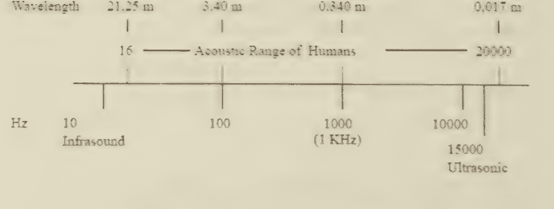

*不同频率的波长。*

低于 16 Hz（人类可听最低频率）的声波称为次声波。蓝鲸、大象和长颈鹿可能利用这些声波进行交流。

在光谱的另一端，人类听不到的范围内，从约 20 kHz（每秒 20,000 次振动）到 1 GHz（每秒 10 亿次振动）的声波称为超声波。这些声波的用途极为广泛。例如，超声波在医学中用作诊断成像技术，或用于去除牙结石和粉碎肾结石；在航海中用于测量水深、探测鱼群和导航；在材料工程中用于无损检测等。

但让我们回到人类可听范围内的声波。许多介质仅限于对听觉或交流必需的频率范围。一方面，这有非常实际的原因，例如为了能在 CD 上存储足够数量的歌曲，或者就电话而言，仅仅因为制造只记录或重放相对较小频率范围的麦克风或扬声器更便宜。

以下是一些示例：

| 介质 | 采样频率 | 频率范围 | 通道 | 采样格式 |
| --- | --- | --- | --- | --- |
| Telephone | 8 kHz | 300 - 3400 | mono | 8 bit |
| AM Radio | 11,025 kHz | 50 - 5000 | mono | 8 bit |
| FM Radio | 20.05 kHz | 20 - 15000 | stereo | 16 bit |
| CD | 44.1 kHz | 20 - 20000 | stereo | 16 bit |
| DAT-Recorder | 48 kHz | 20 - 20000 | stereo | 16 bit |
| Audio-DVD | 44.1 to 192 kHz | 20 - 20000 | stereo or up to max. 6 channels | 16, 20 or 24 bit |

数字技术的发展最终带来了模拟信号与数字信号之间的区分。

例如，如果您使用磁带录音机配合麦克风录制语音或歌唱等模拟声音，结果将保持模拟状态。在这种情况下，模拟信号可以取某个范围内的任意值。

然而，如果您通过计算机保存音频信号，信号将被数字化，即转换为离散的、也就是整数的数值。这里使用的是模数转换器，以及用于反向转换的数模转换器（`a/d`、`d/a` 转换器），两者都位于声卡上。

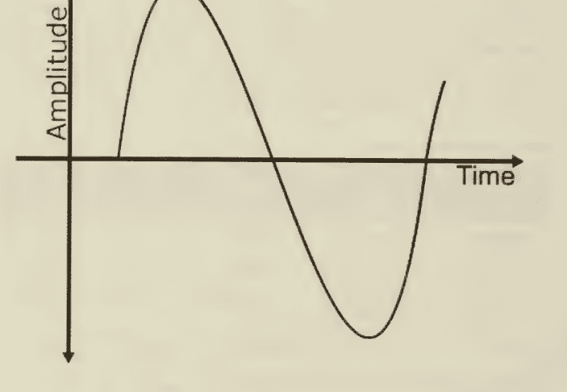

在这个也称为量化的过程中，模拟信号以固定的间隔（即所谓的采样率）进行测量，并转换为离散值。在下图中，每条垂直线代表一次采样序列。

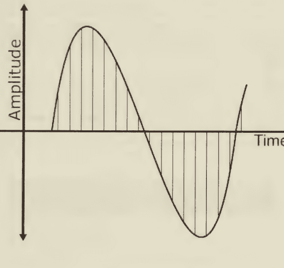

*模拟信号的采样。*

计算值通过四舍五入分配到最接近的栅格值。下图的测量和转换值清楚地展示了这种方法的缺点。这里的水平线即为转换后的栅格值。

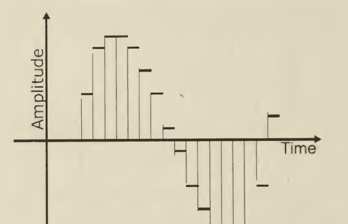

> 测量结果分别向上或向下取整到给定的栅格值。

计算值与最近可能栅格值之间的差值即为量化误差。这种误差的出现，是因为信号的采样值并不总是恰好落在所用栅格的给定值上，因此必须向上或向下取整。这必然导致数字信号与原始信号相比存在微小的偏差。

然而，数字化的优势是显而易见的：数字数据更易于处理和操作，不会经历老化过程，而且可以无次数限制地复制而没有任何质量损失。此外，数据还可以通过压缩以数字形式高效保存，或通过互联网向全球提供。

在数字化过程中，音频信号的振幅或音量以一定频率进行采样，并将由此计算出的数值保存下来。每秒执行的采样序列称为采样率。例如，音频 CD 的采样率为 44.1 kHz，这意味着音频信号每秒被采样 44,100 次，并将由此计算出的数值保存下来。

数字化模拟信号的第二个重要因素是所谓的采样格式或采样范围。它实际上设置了转换数值的刻度或栅格的大小，从而决定了可能的增量数量。前述音频 CD 通常使用 16 位的采样范围，可以精确显示 65,536 个不同的值。

| 采样格式或采样范围 | 可能的数值 |
| --- | --- |
| 4 bit (2⁴) | 16 |
| 8 bit (2⁸) | 256 |
| 16 bit (2¹⁶) | 65536 |
| 24 bit (2²⁴) | 16777216 |
| 32 bit (2³²) | 4294967296 |
| 48 bit (2⁴⁸) | 281474976710656 |
| 96 bit (2⁹⁶) | 79228162514264337593543950336 |


选择的采样率越高，一方面内存需求越大，但另一方面动态范围也越大，即最低音与最高音之间的差值。对于 16 位立体声，动态范围约为 96 dB（约每比特采样范围 6 dB）。同时，更高的采样范围相对于原始信号可以减少量化误差。

此外，奈奎斯特-香农采样定理展示了采样率与频率范围之间的直接关系，并指出采样范围必须至少是最大可显示频率的两倍：

> $$最大可显示频率 = \frac{采样率}{2}$$

最大可显示频率又取决于接收者，即人类可听见的频率范围。因此，CD 定义了 44.1 kHz 的采样率，resulting in a maximum frequency signal of 22.5 kHz，这已经超出了人类最高约 20 kHz 的感知范围。

通过使用多个声道，还可以实现环绕声，而仅有一个声道的单声道录音则无法实现。立体声录音使用两个独立的声道，在渲染时可以分别输出到右扬声器和左扬声器。更多的声道应用还包括四声道立体声（4 声道立体声）或杜比环绕声（使用五个扬声器的多声道声音再现）以及 5.1 音频（六个声道）。

以普通音频 CD 为例：采样率为 44.1 kHz，采样范围为 16 位，立体声效果使用 2 个声道，其数据率计算如下：

> $$(44.100 * 16) * 2 = 1.411.200\,bit/s$$

因此，音频录音如果未经压缩，需要相当大的存储容量。三分钟 CD 品质的录音就已经需要约 30 MB 的磁盘空间。这相当于约 6,000 页文本的数据量，或超过 20 张软盘的容量。就在几年前，计算机还无法处理如此大量的数据。

### 1.2 音频数据与压缩

正如你在上一章看到的，保存音频文件可能非常占用内存，因此人们使用不同的方法来实现数据压缩。这既可以节省存储容量，也能使数据处理更加高效。用于压缩数字数据（如电影或文档）的算法在此过程中主要寻找重复部分，以便覆盖重复区域，从而节省磁盘空间。由于音乐中完全相同的重复很少，音频数据不容易压缩。

因此，大多数无损压缩器使用预测编码，它首先预测振幅，然后保存与预测的实际差值。然而，可达到的压缩程度在很大程度上取决于各自的音频数据，平均约为原文件的 25–70%，而有损压缩可以将数据减少到原文件的约 10%，而音质上听不出差异。

最受欢迎的音频格式无疑是 `MP3`，它由弗劳恩霍夫研究所与 `AT&T`、贝尔实验室和汤姆森公司合作开发。这种格式虽然已经被 `Vorbis` 或 `AAC` 等其他格式在质量上超越，但其原理是通过舍弃不可听或几乎不可听的频率范围、外差频率以及音量变化序列（如紧随高音量序列之后的低音），人耳无法将这些声音彼此区分，或根本无法感知。

在使用 Audacity 时最重要的音频数据格式，在本书末尾的术语表中有更详细的讨论。

### 1.3 通过麦克风直接输入电脑

编辑数字音频的第一步通常是通过麦克风录制语言、音乐和声音。直接在电脑上录制音频，你只需要 Audacity 软件、声卡和麦克风。

在工作流程伊始犯下的错误，通常很难或无法在后期纠正。因此，录音本身和麦克风的选择至关重要。我们先从麦克风说起，如今麦克风可以分为三大类：

- 动圈式麦克风（动圈麦克风）
- 电容式麦克风
- 驻极体电容式麦克风（电容式麦克风的变体）

这些麦克风类型的共同点是，它们都通过机械振动的振膜将声波转换为电信号。动圈式麦克风通过磁场内线圈的移动进行转换，这也称为电磁感应原理。动圈式麦克风可以承受巨大的声压而不失真，因此非常受舞台现场演出的欢迎，也适合录制响亮的乐器，如低音鼓和小号。另一个优点是，与电容式麦克风不同，它们不需要任何电源供电。

然而，缺点在于振膜的重量较大，这导致脉冲重现质量较低，且余振较长。这反过来又对频率响应产生负面影响，不像电容式麦克风那样大致呈线性处理，而通常在高频和低频范围内衰减。此外，动圈式麦克风本身的频率范围通常低于电容式和驻极体麦克风。

电容式麦克风是典型的录音室或演讲麦克风。如果你想用 Audacity 进行播客录制，电容式麦克风是推荐的选择。当需要尽可能准确地录制原始声音时，几乎都会使用它们。前面提到的轻微缺点是，电容式麦克风需要电源来为振膜和前级放大器充电。这一问题通常通过使用 9 伏电池来解决舞台麦克风的供电，而在录音室中则通过所谓的幻象电源供电，通常是麦克风输入端提供的 48 伏直流电压。

驻极体电容式麦克风是电容式麦克风的一种变体，但它使用位于电容板之间的驻极体振膜进行传声。这种麦克风因其非常紧凑的结构和低廉的制造成本，如今最为流行，可以在许多设备中找到，如（移动）电话、对讲系统、笔记本电脑、婴儿监视器，甚至助听器。

一个非常重要的方面是麦克风的指向性，它提供了关于从不同方向吸收声音效果的信息。一些现代电容式麦克风已经提供可选的可选指向性。通常可以区分四种基本特性：

- **全向型（Omnidirectional）**：这类麦克风从各个方向均匀地吸收声音。这种麦克风也称为无指向型，主要用于录制背景氛围或在录音室中使用。
- **双向型（Bi-directional）**：这种指向性的麦克风也称为"8 字形麦克风"。它们是压差式传声器，从振膜的前方和后方吸收声音。通过结构性改变，甚至可以达到心形指向性。

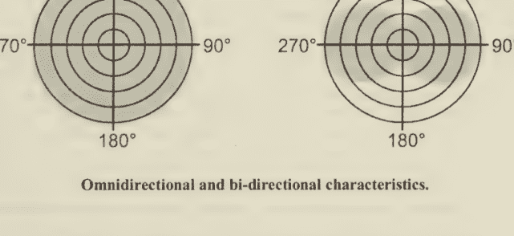

*全向型和双向型特性。*

- **心形指向（Cardioid）**：这种特性的麦克风主要从它们所朝向的方向录音，而来自后方的声音几乎完全被屏蔽。此外，它们的指向性大致与人耳匹配，因此更受环境音录制的青睐。
- **超心形指向和强指向（Supercardioid and Hypercardioid）**：这些极性模式与普通心形指向相比，指向性明显更强，因此可以更好地抑制背景声音。因此，它们通常用于较远的声源，如电影和电视拍摄，此时麦克风必须位于画面之外。

最后，你还应注意麦克风所使用的接口类型，或者记得购买适用的适配器。标准麦克风通常使用以下四种接口：

- **3.5 mm TRS 接口**：即所谓的"迷你 TRS 接口"

选择哪款麦克风实际上只能因人而异。麦克风必须适合人声或乐器。你可以在各种在线论坛中阅读到关于这一主题的 lengthy 消费者报告和讨论，这绝对有助于做出购买决策。因此，我们的建议是：首先，阅读有追求的用户撰写的消费者报告，准确确定所需用途，并比较技术规格。位于 `http://audacityteam.org/forum` 的 Audacity 论坛也能为你提供良好的概览。

如果有条件——例如在大型音乐商店、会议场所或类似地方——当然应该事先测试各种麦克风。一旦你选定了一款麦克风，首次录音将畅通无阻。

以下是成功录音的一些技巧：

- 首先，调节录音电平的设置。调整音量，使声音尽可能大声地被录制下来，但一定要绝对避免削波。
- 如适用，在实际录音前先进行几秒钟的测试录音，并检查结果是否存在可能的干扰、失真、削波等问题。
- 尽量消除或避免背景噪音。例如，室内录音时应找一个安静、无回声的房间。室外录音时，你可以使用防风罩来抵御风声，掩盖衣物飘动的部分，并事先关掉其他干扰源，比如可能响铃的手机。
- 如果你有无法关闭的背景噪音，应将麦克风尽可能靠近要录制的声源。这样，背景噪音至少会被微弱地录制下来。
- 语音录制应以尽可能恒定的音量进行，即不要出现上下波动。
- 录制乐器时，你应该熟悉各个乐器的指向性特征，以便尽可能优化地放置麦克风。

如果仍然存在干扰，或者有明显的嘶嘶声，你必须系统地检查录音链中的所有元件，尽可能单独测试它们，并在必要时更换可能导致错误的组件。但在盲目操作之前，你应该始终先测试接线和已进行的设置。

### 1.4 从其他播放设备录音

如果你有其他播放设备，例如 MP3 播放器或 CD 播放器，你可以通过电脑的线路输入或相应的蓝色接口，录制来自其线路输出接口或绿色接口的输出信号。

电脑的不同端口通常使用以下颜色：

| 颜色 | 功能 |
| --- | --- |
| 银色（灰色） | 侧面扬声器输出（立体声） |
| 黑色 | 后置扬声器输出（立体声） |
| 橙色 | 低音炮输出和中置输出。通常可切换为数字输出。 |
| 粉色 | 麦克风输入（单声道） |
| 绿色 | 扬声器输出，线路输出（立体声） |


| 蓝色（浅蓝色） | 线路输入（立体声） |

如果你想从其他程序的输出进行录音，首先应检查该程序本身是否允许录音。随后你可以用 `Audacity` 编辑结果。

许多声卡允许你将整个输出作为输入通道选择。在这种情况下使用了不同的术语，例如`Wave Out`或`What U Hear`。使用此设置，你可以利用`Audacity`在其他程序回放某些内容时录制声音。在个别情况下可能会发生冲突，因为两个程序同时访问声卡。

使用较新的驱动程序或不同的操作系统可能会解决这个问题。或者，一个临时解决方案可以简单地将输出`line out`（绿色接口）通过线缆直接连接到`line in`接口（蓝色接口），并通过`Audacity`从`line in`录制输入。

## 1.4 Audacity 究竟是什么？

`Audacity`是一款免费且跨平台的音频编辑程序。此处免费不仅指免费使用，更重要的是指自由。这主要包括所有人都能将该软件用于任何用途，甚至是商业用途的自由。此外，该软件可以被复制、传播以及根据个人需求进行调整。自由软件的其他显著特征包括：在 GNU 通用公共许可证（GPL）下授权，该许可证也被称为软件的自由 copyleft 许可证；以及源代码对所有人开放。

这种自由软件（也称为开源项目）的发展趋势直接取决于相应开发者团队的构成和兴趣，以及用户的请求和建议。然而，许多团队还提供各自软件的个性化增强功能。如有需要，只需联系相应的团队。

`Audacity`最初是为美国匹兹堡卡内基梅隆大学的一个项目创建的，该项目涉及频率分析。`Dominic Mazzoni`从一开始就参与其中，至今仍在显著监督该项目。他和一群通过互联网组织的国际志愿者持续进一步开发`Audacity`。`Audacity`使用 C++ 编程语言编写。

一个特别之处是，`Audacity`是为三大主流操作系统（Windows、Mac OS X 和 Linux）开发的。为了在不同操作系统上提供类似的图形用户界面，使用了`wxWidgets`软件库。最新版本是 1.3.6（测试版），于 2008 年 10 月发布；而最新的稳定版本是 1.2.6，推荐用于高效工作。

`Audacity`使个人用户能够独立处理各种任务，这些任务以前只能在录音棚中费时、费力且费钱地完成。通过与互联网连接和网站或相应互联网门户的接入，这些作品可以在全球范围内提供。这种发展已经以自录和混音音乐、音频博客和播客的形式扎根，并在一段时间内丰富了文化生活。

以下将介绍最新版本 1.3.6（测试版）。

## 1.5 Audacity 的功能范围

使用`Audacity`，你可以完成很多任务。请注意，某些任务和功能可能需要额外的设备或软件。例如，对于前面提到的语音、声音或音乐的现场录音，你至少需要一个麦克风，它必须通过调音台或直接通过声卡连接到电脑。

最重要的功能包括：

- 导入不同的音频格式，如 WAV、FLAC、AIFF、AU、Ogg Vorbis 和 MPEG 数据
- 导入音频原始数据
- 创建无限数量的音轨
- 编制现场录音
- 将模拟数据介质（如盒式磁带或黑胶唱片）数字化
- 剪切、复制、删除和混合音频数据
- 为音频数据添加特殊效果，如改变录音的速度或音调
- 无限次撤销操作和恢复工作步骤
- 通过麦克风和其他来源经由线路输入进行录音，例如调音台或放大器以及在线来源（取决于所用声卡的功能）。支持高达 96 kHz 的采样率和高达 32 位的采样及浮点精度的录音。
- 对无限数量的音轨进行更改和混音
- 删除连续的背景噪音
- 通过绘图工具手动删除干扰
- 在录音前、录音中和录音后显示录音电平
- 以 16、24 或 32 位（浮点）进行录音
- 导出 WAV、AIFF 数据，以及通过可选的 LAME 编码器库导出 MP3 文件
- 显示频率的频谱图模式
- 用于更精确频率分析的绘制频谱命令
- 实时混合不同的采样率和格式

作为单纯的音频编辑器，`Audacity`不提供任何可能从所谓的音序器程序中得知的高级功能。这更具体地意味着，MIDI 数据确实可以导入并显示在`Audacity`中，但无法编辑、回放或保存。不过，这些功能已计划在未来的版本中实现。

## 2 程序设置

启动`Audacity 1.3.6`程序后，您将在显示器上看到大致如下的界面。根据操作系统的不同，界面在图形上可能略有差异，因为由于不同的前提条件，各版本无法完全相同。

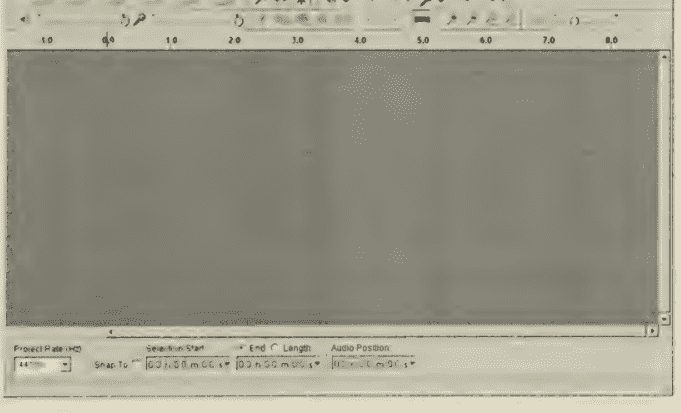

> 首次启动后的程序界面。

默认情况下，`Audacity`以一个空的项目窗口打开，其界面从上到下依次呈现如下：

标题栏下方是菜单栏，包含*文件（File）*、*编辑（Edit）*、*视图（View）*等项目。其下是各种工具栏。最后，您可以在空项目窗口上方的区域看到一条时间轴。在空项目窗口下方，是时间和项目采样率栏以及状态栏，后者显示当前使用的频率。

## 2.1 各种工具栏

*控制工具栏（control toolbar）*中的符号对大多数人来说应该很熟悉，它们与其他音频设备上的类似。

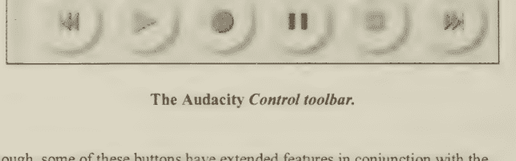

不过，其中一些按钮在与 SHIFT 键（即用于输入大写字母的键）配合使用时具有扩展功能。

| 符号 | 名称 | 功能 |
|--------|------|----------|
| ⏸ | 暂停 | 暂停当前录音或播放。要恢复，请再次按下*暂停（Pause）*。 |
| ▶（循环播放） | 播放 / 循环播放 | 从选择光标的当前位置或所选部分的开头开始播放。如果在按下*播放（Play）*的同时按住*SHIFT*，按钮的图标及其功能将会改变。音轨或音轨的所选部分将会反复播放（循环播放），直到您按下*停止（Stop）*。 |
| [停止图标] | 停止 | 按下此按钮，您将停止当前录音或播放。如果已激活暂停，前述操作和暂停都将立即停止。 |
| [跳至开头图标] | 跳至开头 | 将光标移动到项目的开头（时间位置 0）。按住*SHIFT*将从当前位置到项目起点标记音轨部分。 |
| [跳至结尾图标] | 跳至结尾 | 将光标移动到项目的末尾。按住*SHIFT*将从当前位置到项目末尾标记音轨部分。 |
| [录音图标] | 录音 | 按下*录音（Record）*按钮后，将创建新音轨。录音从当前光标位置开始，以设定的录音采样率进行，可以通过按*暂停（Pause）*暂停，通过按*停止（Stop）*结束。 |

*工具工具栏（tools toolbar）*看起来相当不起眼，但对于通过鼠标进行操作也很重要，下文将对其进行介绍。

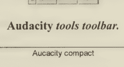

### Audacity 工具工具栏。

各个工具也可以通过键盘方便地选择，因为它们通常从左上方到右下方分别对应功能键*F1*到*F6*。

| 符号 | 名称 | 功能 |
|--------|------|----------|
| I | 选择工具 | 激活此工具后，您可以通过鼠标点击定义音轨中的光标位置，或通过按住鼠标按钮标记某个区域。 |
| ✁ | 包络工具 | 使用此工具，您可以更改所选区域的音量。例如，这对于手动淡入淡出音轨很有用。 |
| ✏ | 绘制工具 | 首先放大音频轨道，直到您可以看到作为点的各个样本。按住鼠标按钮，您可以重新绘制这些样本。例如，这对于手动去除短促的背景噪音很有用。 |
| 🔍 | 缩放工具 | 允许放大（鼠标左键）或缩小（鼠标右键或*SHIFT* + 鼠标左键），以改变音频轨道的视角。 |
| ↔ | 时间平移工具 | 借助此工具，您可以水平移动整个音频轨道——即在时间轴上移动。为此，您按住鼠标按钮将音频轨道拖动到所需位置。如果音频轨道的部分被移动到负时间轴，小箭头将会指示。 |
| ✱ | 多重工具模式 | 一种工具，根据鼠标指针的样式和应用位置组合不同的功能： |

| 符号 | 名称 | 功能 |
|--------|------|----------|
| I | 选择 | 允许通过鼠标点击定位播放点，通过按住鼠标按钮进行标记。右键点击会缩小视角，而在按住鼠标右键的同时进行选择和停放，则会使标记直接适应视角。 |
| ▽ △ | 包络 | 鼠标指针在包络边缘时呈现此样式，然后您可以通过按住鼠标按钮移动它。 |
| ↔ | 时间平移 | 按住 CTRL 键，您可以在时间轴上移动音频轨道。选中的区域也可以通过在开始移动的位置直接拖动来移动。 |

在设备工具栏的右侧，您可以找到*电平表工具栏（meter toolbar）*。

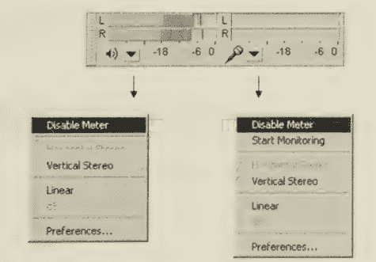

*带有菜单的电平表工具栏。*

菜单中的各个命令：

- **禁用仪表（Disable Meter）**：禁用相应的仪表，显示为灰色。
- **启用/禁用仪表（Enable/Disable Meter）**：启用或禁用输入电平表（麦克风图标）。
- **水平立体声（Horizontal Stereo）**：标准显示，将电平表从左到右水平显示。
- **垂直立体声（Vertical Stereo）**：将电平表从下到上垂直显示。
- **线性（Linear）**：切换到电平表中的线性刻度（0.0 = 静音，1.0 = 最大电平表）。
- **分贝（db）**：标准显示，对数显示电平表的刻度（0 dB = 最大电平表）。此显示范围的进一步设置可通过*编辑（Edit）> 首选项（Preferences）> 界面（Interface）> 最小显示范围（Display range minimum）*进行。
- **首选项（Preferences）**：在此您可以确定每秒刷新显示的次数。可能值为 1 到 100。请注意，高刷新率需要相应更高的处理能力。

接下来，您会在控制工具栏下方找到*混音器工具栏（mixer toolbar）*。借助它，左侧调节输出音量，右侧调节输入音量。输入源可通过右侧的下拉菜单选择。

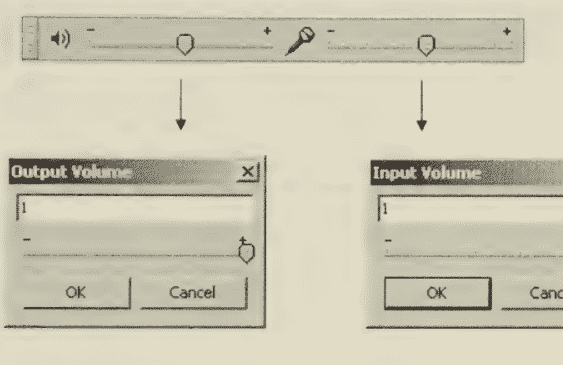

您可以通过按住鼠标按钮将控制器拖动到所需位置来更改设置，或者通过在刻度上双击打开相应窗口直接输入数值。

*编辑工具栏（edit toolbar）*提供了更多用于编辑和查看音频轨道的重要功能。


| 符号 | 名称 | 功能 |
|--------|------|----------|
| ✂ | 剪切 | 从音频轨道中剪切出所选部分。可能剩余的部分音频轨道会向左移动，并无缝连接到左侧音频轨道的剩余部分。因此，新的音频轨道恰好缩短了被移除部分的长度。此外，根据设置的不同，后续的片段也会被移动或不会移动。设置可通过*编辑（Edit）> 首选项（Preferences）> 界面（Interface）> 编辑片段可移动其他片段（Editing a clip can move other clips）*进行更改。 |
| 📋 | 复制 | 将所选区域复制到剪贴板，原始音频轨道保持不变。复制的区域可以根据需要粘贴到其他区域任意次数。 |
| 📋 | 粘贴 | 此功能可将剪切或复制的音频轨道区域的内容插入到光标位置。 |
| ✂ | 修剪 | 修剪与剪切相反。修剪会删除除所选区域以外的所有内容。修剪后的区域保持其位置不变。 |
| 🔇 | 静音 | 所选区域被静音替代。 |
| ↩ | 撤销 | 撤销最后一次编辑操作。 |
| ↻ | 重做 | 此功能可恢复已撤销的操作。 |
| 🔍+ | 放大 | 此功能放大显示的音轨。该操作可以重复，直到例如单个样本清晰可见，并可以使用绘图工具进行编辑。 |
| 🔍- | 缩小 | 与放大功能相反，缩小视图。 |
| ⊕ | 适配选区 | 将标记区域的显示适配到`Audacity`窗口。根据当前视角，可能会放大或缩小。 |
| ⤢ | 适配项目 | 将整个项目适配到窗口。根据当前视角，相应地会放大或缩小。此功能特别有用，可以让你快速概览整个项目。 |

在编辑工具栏的右侧，是*转录工具栏*，它提供加快或减慢音频数据播放速度的选项。

> 带输入窗口的转录工具栏。

除了可以通过鼠标指针按住鼠标按钮拖动的滑块外，你还可以通过双击刻度打开*播放速度*输入窗口，直接输入数值。

要以更快或更慢的速度播放当前项目，首先将滑块设置到所需的速度。系数 1.0 代表原始速度。系数 0.5 代表降低 50% 的速度，系数 1.5 分别代表提高 50% 的速度。然后点击*转录工具栏*上带绿色箭头的按钮，以选定的速度播放当前选区。

## 2.2 选择工具栏

最后，在项目窗口下方是*选择工具栏*。*选择工具栏*允许在左侧设置项目采样率。

如果激活了*吸附到*功能，则只允许以所选单位进行选择。例如，如果选择了*小时:分钟:秒*格式，选择只能开始和结束于整数秒。用于视频影片的格式，如*hh:mm:ss + PAL 帧*（25*fps*），其优点是声音编辑与画面切换完全匹配，因此可以进行逐帧精确编辑。此外，这避免了不必要的点击和音频轨道中可能出现的其他干扰。

格式一次性为所有三个显示范围更改，无论在哪个下拉菜单中进行了更改。你可以在第二个显示中选择*结束*或*长度*作为指示，而第三个显示（*音频位置*）显示当前光标位置或允许设置其值。

> *选择工具栏。*

为了完全精确地工作，你还可以直接在*选择工具栏*中编辑数值。为此，直接用鼠标指针点击相应的显示，然后输入所需的数值。

小箭头指示音频轨道的哪些部分被移动到负时间范围。

**箭头显示音频轨道的开头位于负时间范围。**

下表解释了不同的时间格式：

| 格式 | 说明 |
| --- | --- |
| 秒 | 以六位数显示完整秒数。示例：`000.047` 秒。 |
| hh:mm:ss | 这里，*h*代表小时，*m*代表分钟，*s*代表秒。示例：`02 h 16 m 34 s` 表示 2 小时 16 分 34 秒。 |
| dd:hh:mm:ss | 对于极长的录音，此格式额外显示*d*表示天数。这意味着显示在 00 天 23 h 59 m 59 s 后变为 01 天 00 h 00 m 00 s。 |
| hh:mm:ss 毫秒 | 此格式除小时、分钟和秒外，还显示毫秒。示例：`02 h 16 m 34.986 s`。 |
| hh:mm:ss + 采样点 | 此格式将秒划分为相应的采样点。要达到 CD 质量，这意味着每秒包含 44,100 个采样点。 |
| 采样点 | 以九位数显示采样点。 |
| hh:mm:ss + 电影帧（24 fps） | 一种适用于胶片拍摄的时间和剪辑格式，每秒曝光 24 帧（fps 意为“每秒帧数”）。这里，`00:59:59:23` 之后显示 `01:00:00:00`。 |
| 电影帧（24 fps） | 用于每秒 24 帧胶片拍摄的格式，以六位数显示单帧。示例：`073.396`。 |
| hh:mm:ss: NTSC 丢帧 | NTSC 制作使用 29.97 帧每秒。为了达到这个奇数，*NTSC 丢帧*最初以 30 帧每秒工作，但随后省略或“丢弃”每第 900 帧。示例：`00 h 02 m 48 s+29` 帧。 |
| hh:mm:ss: NTSC 非丢帧 | 此格式以 29.97 帧每秒工作，不省略或“丢弃”帧。示例：`00 h 02 m 48 s+29` 帧。 |
| NTSC 帧 | 仅以六位数显示帧数。示例：`002.481` 帧。 |
| hh:mm:ss + PAL 帧（25 fps） | 欧洲视频标准 PAL 的显示格式，每秒曝光 25 帧。示例：`01 h 23 m 45 s + 15` 帧。 |
| PAL 帧（25 fps） | 以六位数显示 PAL 帧数。示例：`025.832` 帧。 |
| hh:mm:ss + CDDA 帧（75 fps） | 音频 CD 的显示格式。CDDA 每秒由 75 帧组成。同时，一帧是可以刻录到音频 CD 上的最小扇区。示例：`00 h 01 m 27 s+08` 帧。 |
| CDDA 帧（75 fps） | 以六位数显示帧数。示例：`018.481` 帧。 |

在程序窗口的底部，是状态栏，它提供各种有用的提示，例如“点击并拖动以移动左侧选择边界”。

各个区域和工具栏几乎可以完全由用户自定义移动。锯齿状的左边缘是相应的分隔线。要移动一个单元，将鼠标指针放到锯齿状的左边缘，按住鼠标按钮将单元移动到新位置。如果你想恢复原始布局，选择*视图>工具栏>重置工具栏*。

## 2.3 计算机延迟

每台计算机都有一定量的延迟，即一定的延时。即使只是几毫秒的问题，信号的处理也需要一定的时间来完成其路径，例如到声卡，再从那里到扬声器。然而，如果延迟太大，某些工作就无法合理地进行。

### 2.4 计算计算机延迟

如果你例如想要同时录制和播放音轨，则需要优化设置延迟。

下面，我们将尝试找到计算机延迟的最佳设置。请注意，必须在*音频 I/O*注册表中激活偏好设置*Multiplay*，并确保选择正确的录音设备（例如*Microsoft Soundmapper*），或者例如使用线路输入和线路输出之间的连接线，以便能够同时播放和录制音轨。然后执行以下步骤：

- 首先，在选择工具栏中设置显示，使其显示毫秒。
- 现在选择*生成> 节拍音轨*，这将打开相应的窗口，并创建一个类似节拍的点击音轨。为此，你可以保持给定的设置，只需点击*确定*接受。
- 现在点击录音按钮，在播放的同时录制点击音轨。
- 通过停止按钮在几个小节之后停止操作。

根据声卡的质量，音频信号的录制清晰程度不同。渲染的音频信号在第二条音轨中略有相位偏移地被录制。在以下示例中，信号首先必须放大才能测量延迟。

**高噪声成分和 0.072 秒的延迟。**

要测量延迟，从点击音轨上信号的开始处标记到录制音轨上相同信号的开始处。现在你可以在选择工具栏中读取计算机的延迟。

上述示例使用了一张标准安装的声卡，延迟为 72 毫秒。

### 调整延迟

要调整延迟，必须将计算得出的数值以负数形式（单位为毫秒）输入到窗口*Preferences*中，在*Audio I/O*寄存器下的*Latency correction*中。现在你可以重复上述录音操作。两个录制的音轨现在应该彼此同步。

## 4 使用 Audacity


本章将介绍处理该程序的基本功能。

## 3.1 打开和导入文件

默认情况下，你可以用 Audacity 打开不同的音频文件格式，如 WAV、MP3、FLAC、AIFF、AU 和 Ogg Vorbis。

要打开其中一种支持的音频格式，请按以下步骤操作：

- 使用拖放方法，按住鼠标按钮将音频文件拖入 Audacity 的程序窗口中。
- 通过快捷键 `Ctrl + O` 打开 `Open` 窗口，选择你要打开的一个或多个文件。
- 通过 `File > Open...` 打开 `Open` 窗口，选择你要打开的一个或多个文件。

文件现在被导入，随后将以标准波形形式显示在程序窗口中。

**导入各自的格式。**

**波形——音频文件的标准显示。**

默认显示为线性的波形，在外部较暗区域显示峰值，在内部较亮区域显示均方根值（RMS）。

**重要提示：** 如果你选择打开多个文件，将为每个文件分别创建一个程序窗口。然而，如果你想在一个程序窗口中打开多个音频文件，则必须使用 `Import` 命令。通过这种方式，可以加载更多音频文件、文本轨道、时间轨道和 MIDI 文件等内容到一个程序窗口中，并在那里显示。

为此，请按以下步骤操作：

使用菜单命令 `File > Import`，在子菜单中从预设项 `Audio`、`Labels`、`MIDI` 和 `Raw Data` 中选择所需的类别。

根据所选类别，将打开一个带有相应筛选器的窗口，你可以在其中选择相应的单个或多个文件。

此外，原始数据的导入非常有趣，即使是对于 Audacity 最初不支持的所谓专有音频文件也是如此。如果音频文件内部使用未压缩的原始数据形式，即 PCM（脉冲编码调制），Audacity 很可能仍然可以通过原始数据导入来打开这些文件。

通过菜单命令 `File > Import > Raw Data` 选择文件后，将打开 `Raw Data Import` 窗口，你可以在其中输入有关该文件的更多详细信息。在这种情况下，你必须输入通常包含在文件头中的信息。然而，在某些不明确的情况下，只能通过尝试来解决。

**原始数据导入的可能设置。**

原始数据导入仅适用于未压缩的文件。ASF、AAC、MP3、WMA、WMV 等格式的文件无法导入，加密的文件也是如此。

各项说明如下：

- **Signed/unsigned**：此说明提供有关数据内部存储方式的信息。例如，Signed 8 bit PCM 使用 -128 到 127 的值，而 Unsigned 8 bit PCM 使用 0 到 255 的值。
- **8, 16, 24, 32 bit**：在此输入量化类型，即文件数字化时使用的采样范围。
- **PCM**：此缩写代表脉冲编码调制（Puls-Code-Modulation），是一种常用于将模拟音频信号转换为数字音频信号的方法。为此，模拟信号以一定的频率进行时间离散采样，即以等时距离采样，然后通过模数转换器进行量化。
- **U-Law/A-Law**：用于音频信号动态压缩的类似方法，可降低低电平时的噪声。然而，这些方法差异足够大，因此在欧洲（使用 A-Law 方法）和北美（使用 U-Law 方法）之间的电话通话中需要使用转换器。
- **DWVW**：`"Delta With Variable Word Width"` 的缩写；AIFF-C 文件格式的一种压缩类型。
- **GSM**：是一种有损的语音压缩标准。GSM 代表 `"Global Standard for Mobile telecommunications"`（全球移动通信标准）。此格式用于（移动）电话、语音程序和语音消息。
- **ADPCM**：代表 `"Adaptive Differential Pulse Code Modulation"`（自适应差分脉冲编码调制），是一种用于通过窄带数字介质传输音频信号的压缩方法。文件速率在此根据输入信号动态调整。例如，此过程用于 DECT 电话（Digital Enhanced Cordless Telecommunications，数字增强无绳通信），即无绳电话。
- **Endianness**：设置字节顺序，以便正确解释。Big-endian 格式将高有效字节（也称为 MSB，Most Significant Byte）放在首位，而 Little-endian 格式将低有效字节（Least Significant Byte，LSB）放在首位。
- **1 Channel ... 16 Channels**：在此设置通道数。
- **0-Byte Offset**：在此输入文件头的大小。
- **Amount to import**：设置要导入的数据量。
- **Sample rate**：在此设置使用的采样率。

遗憾的是，Audacity 目前还无法直接导入 CD。尝试此操作时，你会收到一条消息，指向其他程序。

这方面的可用性仍有待改进。

**提示：** 如果你想使用 Audacity 不支持的文件格式，应尝试使用音频转换器将其转换为支持的格式。建议先将数据转换为无损格式，如 WAV、AIFF 或 FLAC，然后使用 Audacity 进行编辑，最后将音频数据导出为所需的目标格式。

## 3.2 标记音频轨道

就像你可能已经从文本编辑程序中了解到的那样，在 Audacity 中，你必须先标记文件中要剪切、编辑或替换的部分。为此，你有许多不同的选项：

要通过鼠标操作，必须激活 `selection tool` 或 `multi-tool`。现在按住鼠标按钮标记音频文件的所需部分。随后，选区将显示得比音频轨道的其余部分稍暗。要扩展或缩小标记，只需按住 Shift 键，同时通过鼠标点击选择新的终点。如果你想标记整个音频轨道，可以点击轨道前标题中的属性或控制器下方的空闲区域。

使用箭头键将光标移动到起点，然后按住 Shift 键用右或左箭头键标记所需的区域。同样，要扩展标记，你也可以按住 Shift 键来移动相应的边界。要移除标记，你可以使用右箭头键将光标设置到右端位置，使用左箭头键设置到左端位置。你可以通过快捷键 `Ctrl + A` 标记整个音频轨道。

如果光标位于所需位置，你可以通过菜单项 `Edit > Select` 执行以下操作：`All`、`None`、`Left at Playback Position`（打开窗口 `Set Left Selection Bound`）、`Right at Playback Position`（打开窗口 `Set Right Selection Bound`）、`Track Start to Cursor` 和 `Cursor to Track End`。

音频轨道的标记区域现在显示为稍暗的颜色，如以下示例所示：

**带有标记区域的立体声音频轨道。**

如果你在一个窗口中处理多个音频轨道，还可以创建跨越多个轨道的标记。

**跨轨道标记。**

要创建跨多个轨道的标记，如上所述，请按以下步骤操作：

- 按住鼠标按钮，在音频轨道上标记所需区域，并在操作过程中拖动鼠标跨越所有要选择的轨道。
- 首先，使用上下方向键跳转到所需轨道，然后通过回车键采用该轨道的标记。如果再次按回车键，该轨道的标记将被取消。

## 3.3 编辑音轨

以下示例中，为简化起见，使用了单声道录音。

图片中显示为稍暗的标记区域，现在可以进一步处理，或者例如用剪贴板中的音频文件替换。最重要的命令可以在 `编辑` 菜单中找到。

### 3.3.1 剪切和删除（带预览检查）

标记区域的剪切和删除是非常相似的操作步骤。两个命令唯一的区别是，剪切时提取的文件会保存到剪贴板。

一个非常实用的辅助功能是剪切预览。通常，这是评估标记是否设置正确的唯一方法。使用键盘上的字母 `C` 可以预览剪切。

默认情况下，你将听到从剪切点前一秒到剪切点后一秒的轨道内容，这样你就可以估计剪切的效果。你可以通过 `编辑 > 首选项 > 剪切预览` 更改预览时间。

如果你想剪切掉音频轨道的标记区域，请按以下步骤操作：

- 选择![剪刀图标] `剪切`按钮。
- 使用快捷键 `Ctrl + X`。
- 选择菜单命令 `编辑 > 剪切`。

你可以看到，`剪切` 命令会移除音频轨道的标记区域，而音频轨道的右侧部分会向左移动。剪切时，提取的部分还会额外地保存到剪贴板。后续片段是否移动，取决于 `编辑 > 首选项 > 界面 > 编辑片段可以移动其他片段` 中的设置。

你可以使用以下命令删除素材：

- 使用快捷键 `Ctrl + K`，或者使用 Del 键或退格键。
- 选择菜单命令 `编辑 > 删除`。

结果最初是相同的。区别仅在于提取的部分不会被复制到剪贴板。

### 3.3.2 剪切和拆分剪切

如果你想剪切掉标记区域并分割轨道，可以选择以下选项之一：

- 使用快捷键 `Ctrl + Alt + X`。
- 选择菜单命令 `编辑 > 拆分剪切`。

在此操作步骤中，标记区域从音频轨道中被剪切掉，音频轨道被分割，形成两个独立的片段。

### 3.3.3 复制

如果你只想复制标记区域，音频轨道的显示不会改变。复制时，请使用以下命令：

- 使用 `复制` 按钮。
- 使用快捷键 `Ctrl + C`。
- 选择菜单命令 `编辑 > 复制`。

在所有情况下，复制的文件都会保留在剪贴板中，例如可以插入到其他音频轨道中。

> `复制` 将标记区域保存到剪贴板。

### 3.3.4 粘贴

保存到剪贴板的内容可以按需要多次插入到相应的音频轨道中。为此，可使用以下命令：

- 使用 `粘贴` 按钮。
- 使用快捷键 `Ctrl + V`。
- 选择菜单命令 `编辑 > 粘贴`。

**从剪贴板粘贴音频内容的示例。**

在上面的示例中，剪贴板的内容已被插入（第二个音频轨道的标记部分）。但也可以剪切先前标记的区域，并用保存到剪贴板的音频轨道替换它。在给定的示例中，第一个音频轨道的标记区域被剪切掉，并用一个明显更短的片段替换，从而缩短了音频轨道的总长度。

**剪切标记并将内容粘贴到剪贴板。**

如果你尝试将立体声音频轨道的部分插入到单声道音频轨道中，系统会提示你这不是不可能的。相反的情况则可行。

**立体声和单声道轨道不能混用。**

### 3.3.5 修剪

修剪音频轨道相当于反向剪切。请按以下步骤操作：

1. 使用 `Trim` 按钮。
2. 使用快捷键 `Ctrl + T`。
3. 选择菜单命令 `编辑 > 修剪`。

> **修剪会删除除标记以外的所有内容。**

只有标记区域保留在轨道中，并保持在时间轴上的原位置，而标记外的所有内容都会被删除。

### 3.3.6 拆分删除

要使用 `拆分删除` 命令，请按以下步骤操作：

- 使用快捷键 `Ctrl + Alt + K`。
- 选择菜单命令 `编辑 > 拆分删除`。

`拆分删除` 的结果是两个分离的片段，标记区域已被删除。现在可以通过时间偏移工具在时间轴上独立移动这两个片段。

### 3.3.7 静音音频

此命令不会分离音频轨道，而是删除标记并用静音覆盖它。优点是：音频轨道保持其精确长度。使用该命令的方法如下：

- 使用 `Silence Audio` 按钮。
- 使用快捷键 `Ctrl + L`。
- 选择菜单命令 `编辑 ▸ 静音音频`。

**标记区域被剪切并用静音替换。**

如上例所示，音频轨道的长度以及标记后方音频轨道的时间位置都不会改变。

### 3.3.8 拆分

要在标记处拆分片段，可以使用以下命令：

- 使用快捷键 `Ctrl + I`。
- 选择菜单命令 `编辑 > 拆分`。

**音频轨道被分割成三个独立的片段。**

你只能从两条水平线看出命令已执行，这两条线位于之前标记结束的位置。它们表示音频轨道已在此处分离，现在由三个独立的片段组成。

## 3.4 命令菜单

这里再次列出完整的命令菜单：

| 功能 | 符号 | 快捷键 | 菜单命令 |
|---|---|---|---|
| 剪切 | ✂ | `Ctrl + X` | `编辑 > 剪切` |
| 拆分剪切 |  | `Ctrl + Alt + X` | `编辑 > 拆分剪切` |
| 复制 | 📋 | `Ctrl + C` | `编辑 > 复制` |
| 粘贴 | 📋 | `Ctrl + V` | `编辑 > 粘贴` |
| 修剪 | ✂ | `Ctrl + T` | `编辑 > 修剪` |
| 删除 |  | `Ctrl + K` | `编辑 > 删除` |
| 拆分删除 |  | `Ctrl + Alt + K` | `编辑 > 拆分删除` |
| 静音音频 | 🔇 | `Ctrl + L` | `编辑 > 静音音频` |
| 拆分 |  | `Ctrl + I` | `编辑 > 拆分` |
| 拆分新建 |  | `Ctrl + Alt + I` | `编辑 > 拆分新建` |

## 3.5 优化剪切位置

自制音频素材很少直接按录制的方式使用。通常需要额外的编辑步骤。音频处理中最重要的编辑元素是剪切。以下步骤将指导你如何在 Audacity 中优化剪切位置。各个步骤的顺序取决于所需结果和个人构思。

### 3.5.1 剪切预览

如果你已为剪切设置了标记，可以在最终确定剪切之前先听一下结果，并在必要时进行修改。此功能称为 `剪切预览`，激活方法如下：选择键盘上的 `C` 键。

默认情况下，你现在将听到从剪切点前一秒到剪切点后一秒的内容，这样你就可以估计剪切的效果。

音频轨道上方水平以及中间间断的线表示 `剪切预览` 功能在标准设置中的播放区域。

预览长度可以在 `Audacity 首选项` 窗口中单独设置，该窗口可通过 `编辑 > 首选项` 或快捷键 `Ctrl + P` 打开，在 `音频 I/O` 选项卡的 `剪切预览` 处进行设置。

### 3.5.2 可变播放区域

当你标记了一个区域后，可以通过按空格键来开始和停止标记区域的回放。按 `C` 键可以预览可能的剪切点。如果你只想从不同部分中再次收听某一特定部分，`B` 键可以根据鼠标指针的位置，播放标记区域内外的不同部分。

如果鼠标指针位于标记左侧，按 `B` 键将从该位置播放至标记起始处。


> **从鼠标指针位置回放至标记处。**

然而，如果鼠标指针位于标记的左半部分，按 `B` 键将从标记处播放至鼠标指针位置。


> **从标记处回放至鼠标指针位置。**

如果鼠标指针位于标记的右半部分，按 `B` 键将从该点播放至标记末尾。


**从鼠标指针位置回放至标记处。**

如果鼠标指针位于标记右侧，按 `B` 键将从标记右端播放至鼠标指针位置。


**从标记处回放至鼠标指针位置。**

对于 `B` 键的所有示例，均只与鼠标指针的水平位置相关，而与垂直位置无关。

最后，还可以直接收听某个特定区域。为此，在音轨上方的 `timeline` 上按住鼠标按钮标记一个区域，该区域将立即被回放。


**timeline 上的标记将立即被回放。**

### 3.5.3 查找过零点

过零点是波形与 x 轴相交的位置，即波形从负值区域变为正值区域或 vice versa 的位置。

为了设置无干扰的剪切点，你应该在这样的过零点处剪切音轨。前提条件是，采样点必须尽可能精确地位于零线上。Audacity 提供了一种通过菜单命令 `Edit > Find Zero Crossings` 查找相应过零点的优秀方法。这对于立体声音轨特别有帮助，因为要在两个声道同时处于过零点的地方找到合适的点可能非常困难。

按照以下步骤在过零点处设置剪切：

- 设置剪切标记。
- 选择菜单命令 `Edit > Find Zero Crossings` 或分别使用 `Z` 键。Audacity 现在将自动设置剪切边缘。
- 进行剪切。

如果 Audacity 无法通过菜单命令 `Edit > Find Zero Crossings` 找到合适的剪切位置，程序将删除标记并跳转到下一个过零点。在这种情况下，你可以在所需剪切边缘使用极短时间的淡入或淡出来解决。

为此，几个采样的长度就足够了，目的只是简单地塑造波形，以创建必要的过零点。

## 3.6 不同的音轨

Audacity 不仅认识不同的音频音轨，还有标签音轨、时间音轨和 MIDI 音轨。

你可以通过选择菜单命令 `Tracks > Add New` 并在子菜单中选择相应的音轨来添加新音轨。

### 3.6.1 音频音轨

最重要的音轨无疑是音频音轨，因为它们包含音频数据。音轨头部提供了显示音频数据的最重要的参数的快速概览，并提供了更改不同设置和显示的可能性。

音频数据默认以线性波形显示，其中幅度以图形方式显示。波形的主要幅度在此显示中代表高音量，而小幅度则表示静音部分。中心位置没有上下幅度的直线相应地显示静音。

通过音频文件的音轨头部，可以选择其他显示方式，如对数波形、频谱或音高（`EAC`）。


**音频音轨的头部。**

如果你点击左上角的叉号，该音轨将被删除。但是，这个操作步骤也可以通过 `Undo` 按钮撤销。

点击音轨名称或向下指向的箭头，将打开上下文菜单，如右上方所示，该菜单提供以下功能和命令：

- **Name**：打开 `Track Name` 窗口，你可以在其中输入标题。
- **Move Track Up**：将音轨向上移动一个位置。此命令仅在当前音轨上方有另一个音轨时才会激活。
- **Move Track Down**：将音轨向下移动一个位置。此命令仅在当前音轨下方有另一个音轨时才会激活。
- **Waveform**：加载音频文件时的标准显示，提供线性显示。
- **Waveform (dB)**：以对数显示方式显示音频文件的波形。
- **Spectrum**：显示音频信号的频率组成。
- **Pitch (EAC)**：使用增强自相关（Enhanced Autocorrelation, EAC）算法显示音频信号的基本频率。
- **Mono**：你可以将单个音轨定义为单声道音轨。此命令对立体声音轨不激活。首先需要分离立体声音轨，才能在单个音轨上使用此命令。
- **Left Channel**：将单声道音轨定义为左声道。


- `Right Channel`：将单声道音轨定义为右声道。
- `Make Stereo Track`：此命令从两个单声道音轨创建一个立体声音轨。
- `Split Stereo Track`：将立体声音轨分割为两个单声道音轨，其中一个音轨初始为左声道，另一个为右声道。
- `Set Sample Format`：在这里你可以设置采样格式或采样范围，从而设置质量和动态范围。在 `16-bit PCM`（CD 质量，约 96 dB 动态范围）、`24-bit PCM`（标准录音棚录音质量，约 144 dB 动态范围）和 `32-bit float`（浮点精度格式，理论动态范围为 192 dB）之间进行选择，后者适用于处理多种效果，但 admittedly 对 RAM 和硬盘存储单元的要求也最高。
- `Set rate`：在这里你可以设置采样率。标准值例如为 44100 Hz（音频 CD 格式）、48000 Hz（标准视频声音）、96000 Hz（录音棚录音质量）。不同的音轨可以有不同的设置，在播放和导出期间将转换为相应的项目采样率。

在音轨名称下方，你可以找到音轨特性的列表。在给定的例子中：`stereo, 44100 Hz, 32-bit float`。

通常你可以区分立体声音轨、单声道音轨、左声道音轨和右声道音轨。音轨头部显示相应的音频音轨类型。

你可以通过选择菜单命令 `Tracks > Stereo Track to Mono` 从立体声音轨创建单声道音轨。但是要创建左声道和右声道音轨，你需要点击名称打开音频音轨的上下文菜单，并在上下文菜单中选择 `Split Stereo Track` 命令。

如果你在这里点击或在两个控制器下方的空白区域点击，你将选中整个音频音轨，该音轨随后会稍微变暗显示。

`Mute` 和 `Solo` 按钮提供以下功能：

- `Mute`：在回放时打开或关闭整个音轨。此按钮的位置对混音或导出没有影响。
- `Solo`：将所有其他音轨切换为静音，因此只播放此音轨。此按钮的位置对混音或导出没有影响。

直接在这两个按钮下方，是 `Volume` 和 `Panorama` 的控制器。通过现有的控制器调整设置，或双击刻度打开相应的输入窗口直接输入设置。通过 `Panorama` 控制器，你还可以为立体声信号设置立体声效果。

最后，在音轨头部的下端有一个向上指向箭头的按钮，通过它可以折叠音轨或 respectively 展开折叠的音轨（箭头向下）。

你还可以通过鼠标设置音轨的宽度。为此，你需要将鼠标指针指向音轨头部右侧的下边缘，直到鼠标指针变为垂直双箭头。然后按住鼠标按钮将音轨拖动到所需大小。

#### 3.6.2 标签音轨

标签音轨用于在标签中保留简短的关键词或注释以供参考。此外，音频音轨也可以基于标签标记进行剪切（参见 4.1，通过标签剪切音频音轨）。在这种情况下，标签可以标记某个点或某个区域，如下例所示。


您可以按如下方式创建标签：


首先，将光标设置到所需位置，或者在音轨上标记一个区域，然后通过快捷键 `Ctrl + B` 创建标签，这样标签轨道就会获取一个精确的时间点或特定时间段。

或者，您也可以在播放音轨时直接通过快捷键 `Ctrl + M` 设置标签。

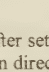

通过菜单命令 `轨道 > 编辑标签`（`Tracks > Edit labels`）打开 `编辑标签`（`Edit Labels`）窗口，然后在那里输入标签的值。

通过快捷键设置标签后，光标会出现在标签中，您可以直接通过键盘输入所需的文本。

如果您使用 `编辑标签`（`Edit Labels`）窗口，也可以在那里更改时间格式。为此，只需在时间输入区域双击，然后点击向下的小箭头打开相应的子菜单。

另外，如果您已经处于输入模式，也可以在时间窗口中右键点击鼠标，选择显示不同时间格式的子菜单。

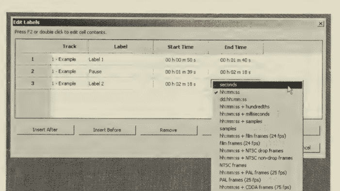

**编辑标签窗口（`Edit Labels`）**

要删除标签，请按以下步骤操作：

在标签轨道上标记标签区域，然后使用以下选项之一删除标签：

- 使用 `!静音（!Silence）` 按钮。
- 使用快捷键 `Ctrl + L`，或者使用 `Del` 键或退格键。
- 选择菜单命令 `编辑 > 静音音频`（`Edit > Silence Audio`）。

通过轨道标题的上下文菜单，您可以重命名标签轨道、选择字体，以及上下移动轨道。

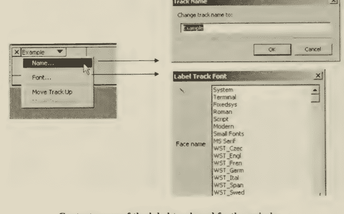

标签轨道的上下文菜单及其他窗口。

说明：

- **名称（Name）：** 打开 `轨道名称`（`Track Name`）窗口，您可以在其中输入一个有意义的轨道标题。
- **字体（Font）：** 选择字体及其大小。
- **上移轨道（Move Track Up）：** 此命令将标签轨道上移至上一轨道，仅在标签轨道上方至少有一个轨道时才会激活。
- **下移轨道（Move Track Down）：** 此命令将标签轨道下移至下一轨道，仅在标签轨道下方至少有一个轨道时才会激活。

### 3.6.3 时间轨道

您可以通过菜单命令 `轨道 > 新建 > 时间轨道`（`Tracks > Add New > Time Track`）创建时间轨道。通过时间轨道，您可以连续改变音轨的播放速度。要调整基本设置，如选择标题或速度变化区域，请用鼠标指针单击 `时间轨道`（`Time Track`）名称或轨道标题中的向下箭头，随后会打开以下上下文菜单。

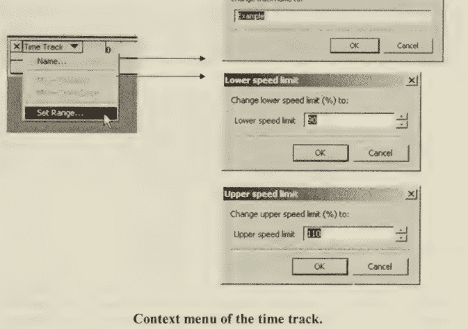

时间轨道的上下文菜单。

菜单详细说明：

- **名称（Name）**：打开 `轨道名称`（`Track Name`）窗口，您可以在其中输入一个有意义的标题。
- **上移轨道（Move Track Up）**：此命令将时间轨道上移至上一轨道，仅在时间轨道上方至少有一个其他轨道时才会激活。
- **下移轨道（Move Track Down）**：此命令将时间轨道下移至下一轨道，仅在时间轨道下方至少有一个其他轨道时才会激活。
- **设置范围（Set range）**：您可以在这里设置最低速度限制，以原始速度的百分比表示（>=13），以及最高速度限制（<=1200）。默认预设为 90% 和 110%。

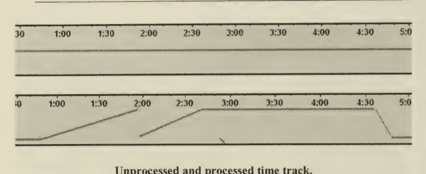

> 未处理和已处理的时间轨道。

您可以使用包络工具处理时间轨道，从而创造出类似唱片机播放过快或过慢的效果。如果音轨运行更快，会产生更高的音高；如果运行更慢，则会产生更低的音高。

#### 3.6.4 MIDI 轨道

如前所述，Audacity 目前尚不能处理 MIDI 文件，但这些文件已经可以以轨道形式显示。在未来的版本中，计划支持 MIDI。您无法生成 MIDI 轨道，只能通过导入 MIDI 文件来创建。

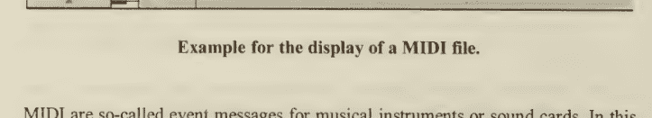

> MIDI 文件显示的示例。

MIDI 是用于乐器或声卡的所谓事件消息。在此上下文中，例如乐器、音符、音量、声像及其他信息被设置。与数字音频文件不同，MIDI 文件非常小。大约 10 KB 就足以容纳一分钟的音乐。然而，人声等复杂声音无法通过 MIDI 再现。此外，您还面临这样的风险：同一个 MIDI 文件在不同的硬件上听起来可能差异很大，因为 MIDI 文件只保存“音符”，而不是单个乐器的声音。

您可以通过点击鼠标在轨道标题处显示或隐藏各个通道。轨道标题的上下文菜单显示以下图中所示的条目。

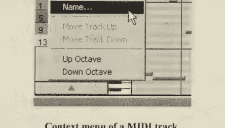

如前所述，目前不支持 MIDI 轨道。它们只能被显示，但无法播放或处理。菜单项：

- **名称（Name）**：打开 `轨道名称`（`Track Name`）窗口，您可以在其中输入一个有意义的轨道标题。
- **上移轨道（Move Track Up）**：此命令将 MIDI 轨道上移至上一轨道，仅在 MIDI 轨道上方至少有一个其他轨道时才会激活。
- **下移轨道（Move Track Down）**：此命令将 MIDI 轨道下移至下一轨道，仅在 MIDI 轨道下方至少有一个其他轨道时才会激活。
- **高八度（One Octave Up）**：显示 MIDI 轨道的下一个更高八度。
- **低八度（One Octave Down）**：显示 MIDI 轨道的下一个更低八度。

## 3.7 录音

Audacity 允许从不同的来源进行录音，这些来源又取决于您计算机的设备。例如，如果您拥有一个与计算机声卡兼容端口的麦克风，就可以用它进行录音。

为此，在电平控制器的下拉菜单中选择 `麦克风`（`Microphone`）选项。


根据声卡和使用的声音系统，下拉菜单可能包含比图中显示的更多的选项。

在上面显示的三个选项的情况下，如果您想录制另一个程序的输出，请选择 `立体声混音`（`Stereomix`）；对于连接的设备如唱片机、磁带录音机或迷你碟播放机，请选择 `线路输入`（`Line-In`）；对于直接连接到声卡的麦克风录音，请选择 `麦克风`（`Microphone`）。

通过两个滑动控制器，您可以设置录音源的 `输出音量`（`Output Volume`）和 `输入音量`（`Input Volume`）。这两个值可以分别设置。

## 3.8 使用快捷键

如果您经常使用该程序，应该学习不同的快捷键，这样您可以更快地工作。您可以在菜单命令后面看到快捷键，也可以在 `首选项`（`Preferences`）中查看（菜单命令 `编辑 > 首选项`（`Edit > Preferences`）或快捷键 `Ctrl + P`），您也可以在那里进行个性化定制和扩展。为了让您更好地概览，这里按功能的字母顺序显示命令：

| 按键或快捷键 | 功能 |
|---|---|
| `Ctrl + M` | 在播放位置添加标签 |
| `Ctrl + B` | 在选定区域添加标签 |
| `Ctrl + Shift + N` | 添加新音轨 |
| `Ctrl + W` | 关闭 |
| `Ctrl + Shift + C` | 折叠所有轨道 |
| `Ctrl + C` | 复制 |
| `Ctrl + X` | 剪切 |
| `Ctrl + K` | 删除 |
| `Ctrl + Alt + J` | 在静音处分离 |
| `Ctrl + D` | 复制 |
| `Ctrl + Q` | 退出 |
| `Ctrl + Shift + X` | 展开所有轨道 |
| `Z` | 查找零点交叉 |
| `Ctrl + F` | 适应窗口 |
| `Ctrl + Shift + F` | 垂直适应 |
| `Ctrl + Shift + I` | 导入音频 |
| `Ctrl + J` | 连接 |
| `Alt + L` | 标记区域静音 |
| `Ctrl + Shift + M` | 混音并渲染到新轨道 |
| `Ctrl + N` | 新建 |
| `D` | 下一个工具 |
| `Ctrl + O` | 打开 |

| 按键或快捷键 | 功能 |
|---|---|
| `Ctrl + V` | 粘贴 |
| `P` | 暂停 |
| `L` 或 `Shift + 空格` | 循环播放 |
| `1` | 播放一秒 |
| `B` | 播放到选定区域 |
| `空格` | 播放/停止录音 |
| `Ctrl + P` | 首选项 |
| `A` | 上一个工具 |
| `R` | 录音 |
| `Ctrl + Y` | 重做 |
| `Ctrl + R` | 重复上一个效果 |
| `Ctrl + S` | 保存项目 |
| `Ctrl + Shift + S` | 项目另存为... |
| `Ctrl + A` | 全选 |
| `Ctrl + L` | 静音音频 |
| `Ctrl + I` | 分割 |
| `Ctrl + Alt + X` | 分割剪切 |
| `Ctrl + Alt + K` | 分割删除 |
| `Ctrl + Alt + I` | 分割新建 |
| `S` | 停止 |
| `Ctrl + T` | 修剪 |
| `Ctrl + Z` | 撤销 |

| 按键或快捷键 | 功能 |
|---|---|
| `Ctrl + 1` | 放大 |
| `Ctrl + 2` | 正常缩放 |
| `Ctrl + 3` | 缩小 |
| `Ctrl + E` | 缩放至选定区域 |

默认情况下，功能键 `F1` 到 `F6` 分别对应 Audacity 工具栏中的相应工具：

| 功能键 | 对应工具 |
|---|---|
| `F1` | 选择工具 |
| `F2` | 包络工具 |
| `F3` | 绘制工具 |
| `F4` | 缩放工具 |
| `F5` | 时间平移工具 |
| `F6` | 多工具 |

对于工具的选择，你还可以额外使用——如上面表格中标注的——按键 `D` 选择下一个工具，以及按键 `A` 选择上一个工具。

## 4 使用示例

在本章中，将介绍一些使用示例，以帮助你更好地熟悉该程序的功能。

### 4.1 通过标签剪切音轨

Audacity 允许你借助已设置好的标签来剪切音轨。如第 3.6.2 章“标签轨道”中所述，标签可以通过多种完全不同的方式进行设置和删除。除此之外，你还可以在聆听音轨的同时设置标签。为此，你可以使用快捷键 `Ctrl + M`。这种方法很有用，例如用于将访谈中的问题和回答分开。

以下示例展示了如何通过标签将音轨剪切为单独的片段。为此，请按以下步骤操作：

- 首先，通过菜单命令 `文件 > 打开` 或 `文件 > 导入` 导入所需的音频文件，或录制一个新文件。
- 播放音轨，并在聆听过程中通过快捷键 `Ctrl + M` 设置标签。

带标签的音轨。

- 通过菜单命令 `文件 > 导出多个` 打开 `导出多个` 窗口，并在此处配置各部分的存储设置。文件现在将按照指定的方式进行创建。

`导出多个` 窗口。

在 `导出多个` 窗口中，你有以下设置选项：

- **导出格式**：通过此下拉菜单，acclaim 设置单个文件的导出格式。你可以在 WAV、AIFF、MP3、MP2、FLAC、OGG 及其他未压缩文件格式之间进行选择，前提是你已安装 MP3 编码器。例如，如果你想制作音频 CD，应首先选择 `WAV、AIFF 及其他未压缩` 类型作为导出格式，然后通过 `选项` 按钮设置 WAV 格式。
- **选项**：打开与预设导出格式对应的窗口，你可以在其中设置质量。例如，对于 MP3 导出格式，会打开 `指定 MP3 选项` 窗口，你可以在其中首先设置 `比特率模式`。这里你可以在 `预设`（给定的可变和固定质量级别的数据传输率）、`可变`（预设频率范围）、`平均`（平均传输）和 `恒定`（固定传输率）之间进行选择。在 `质量` 下拉菜单中，你可以指定所需的质量级别。`可变速度` 下拉菜单仅在比特率模式为 `预设` 和 `可变` 时激活，并允许在 `快速` 和 `标准` 之间进行选择。你可以在 `联合立体声`（此处应用一种算法，借助该算法可以在恒定数据速率下生成更高质量）和 `立体声` 之间选择作为 `声道模式`。
- **导出位置**：在此处选择文件应保存的位置。通过 `选择` 按钮，你可以打开文件管理器窗口，在其中选择文件夹；通过 `创建` 按钮，你可以新建一个文件夹。
- **基于...分割文件**：在 `标签` 和 `轨道` 之间选择。`标签` 选择还有一个子选项 `包含第一个标签之前的音频`，这会使第一个文件包含从开头到第一个标签的音频。默认情况下，轨道名称会显示在 `第一个文件名` 框中，但可以进行用户自定义调整。`轨道` 选项仅在确实存在多个轨道时才会激活。
- **命名文件**：在此处设置各个文件的名称。`使用标签/轨道名称` 选项采用标签的名称作为文件名，而 `连续编号` 选项则从 1 开始连续为文件编号。`文件名前缀` 框可以根据需要进行更改，并相应地显示在标签名称或编号之前的文件名中。
- **覆盖现有文件**：此选项会直接覆盖已存在的同名文件，不再询问。

> 设置 MP3 质量。

### 4.2 去除背景噪声

较小的干扰可以借助此工具消除。然而，此效果只能处理最多 128 个采样点的极小区域。如果你标记了更大的区域，系统会提示你。

首先，精确定位干扰往往很困难。一个很好的辅助工具是 `适配选择` 按钮，它将标记的音轨区域适配到 Audacity 窗口中。这样，你可以逐步接近所需的位置。

如果是削波问题，菜单命令 `视图 > 显示削波` 也能帮上忙。在以下示例中，就是通过这种方式找到了故障位置。

**通过菜单命令 `视图 > 显示削波` 进行故障排除。**

削波通过垂直红线明确显示。

**放大后，可以看到两处削波。**

现在应标记故障位置区域，并通过 `适配选择` 按钮相应放大视图。首先，你应该进一步放大以查看单个采样点，然后标记故障区域以应用 `修复` 功能。

**现在可以应用 `修复` 效果。**

现在，对标记的区域应用 `修复` 功能。

**修复后的区域。**

## 5 效果

根据你所使用的操作系统，在安装完成后会有多种效果可供使用。这主要是因为某些效果仅为特定操作系统开发。本章将介绍内置效果，最后还将描述如何安装更多可选效果。

### 5.1 效果的应用

对于那些尚未从事音频编辑太久的人来说，应用效果可能会很快变得令人沮丧，因为往往无法精确达到预期的效果。以下介绍的操作模式可以改善这种情况，因为将效果隔离然后可控地混合进去是很有用的。

以下将展示如何系统地混合 `BassBoost` 效果。为简化操作并获得更好的概览，本示例中将使用单声道轨道。不过，该步骤也可以轻松应用于立体声轨道。

首先，启动 Audacity。

- 通过菜单命令 `文件 > 导入 > 音频` 打开一个音轨。


点击轨道标题栏中的空白处标记整个音轨。轨道现在会显示为稍暗的颜色。

通过菜单命令`编辑 > 复制`或快捷键`Ctrl + D`复制该轨道。你现在应该能看到两个相同的音轨。

标记下方的音轨并执行`反向`效果。此效果会反转所选音频材料的极性。

再次通过标记原始轨道并使用菜单命令`编辑 > 复制`或快捷键`Ctrl + D`制作原始轨道的另一个副本。你现在应该能看到原始轨道、反向轨道和原始轨道的副本。

现在对原始轨道的副本应用所需的效果。在本示例中，我们在`200 Hz`处使用`4 dB`的低音增强。

现在标记已应用效果的原始轨道副本和反向轨道，方法是在按住`Shift`键的同时点击各自轨道的标题栏。通过菜单命令`轨道 > 混音并渲染`从两者创建一个新轨道。

现在同时播放两个轨道，并通过两个音轨的输出电平表调整原始轨道与效果之间的比例。

当你找到合适的混合比例后，标记两个轨道（`Ctrl + A`或在轨道标题栏中按住`Shift + 鼠标点击`），然后选择菜单命令`轨道 > 混音并渲染`。

这种隔离效果并系统混合的方法提供了许多全新而迷人的可能性。例如，你可以对已隔离的效果应用效果，或根据运行时长创建任意数量的效果，以精确混合，例如通过包络工具。

然而，请注意同时重叠多个效果可能会导致音频信号的放大，这可能很快导致削波，即过载。因此，建议你激活菜单命令`视图 > 显示削波`。削波将以红色垂直线显示在音轨中。你可以通过降低所有轨道的音量来避免削波。

## 5.2 标准效果

本节将更仔细地研究 Audacity 默认包含的那些效果。许多效果提供预览功能，你可以单独设置其持续时间。为此，通过菜单命令`编辑 > 首选项`打开`Audacity 首选项`窗口，并在`效果预览`中设置该功能的长度。

### 5.2.1 淡入/淡出

`淡入`和`淡出`效果没有进一步的设置选项。它们可以平滑地将音频轨道上标记的区域淡出至静音，或者从静音平滑地淡入。作为该效果的替代，也可以使用包络工具。

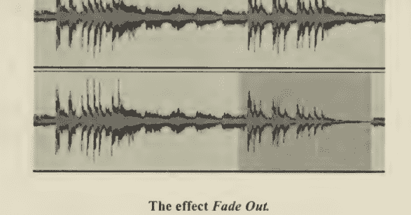

> **淡出效果。**

如果你通过声音生成器生成一个恒定的声音，然后应用`淡入`或`淡出`效果，可以更好地看到结果。


> **恒定声音的淡入和淡出。**

### 5.2.2 自动闪避

此效果提供了自动修改音频轨道的可能性，以便淡入另一条轨道。需要一条新的控制轨道，它必须直接放置在要修改的标记音频轨道的下方。例如，此效果可用于DJ的播报或旁白翻译。

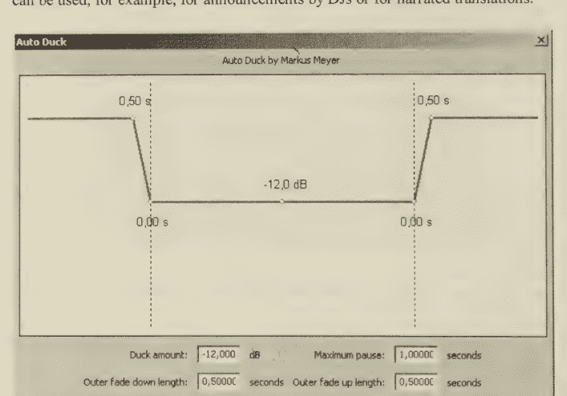

> `自动闪避`效果的设置选项。

您可以设置以下参数：

- **闪避量：** 在此设置音频轨道的音量降低幅度。默认设置为`-12 dB`。

- **最大暂停：** 所选轨道中暂停的最大长度。

- **外部淡入/淡出长度：** 设置导入控制轨道前后的淡出和淡入。

- **内部淡入/淡出长度：** 设置控制轨道内的淡出和淡入。

### 5.2.3 低音增强

使用此效果可以系统性地增强低音。在此过程中，所选频率可以提高`0`至`36 dB`。在给定的示例中，选择了在`200 Hz`处提升`4 dB`。

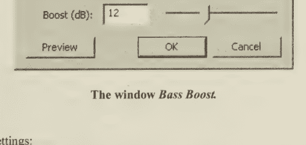

**低音增强窗口。**

两项设置：

- **频率（Hz）：** 在此设置要提升的频率。可输入值为`1-1000 Hz`。

- **增强量（dB）：** 确定提升幅度，最大可提升`36 dB`。

### 5.2.4 回声

此效果产生回声，您可以选择其延迟时间和强度。设置如下：

- **延迟时间（秒）：** 在此设置原始信号与效果信号之间的时延。

- **衰减因子：** 在此字段中设置回声的衰减因子。小于`1`的值会导致信号衰减，而大于`1`的值则会导致相应的增强。

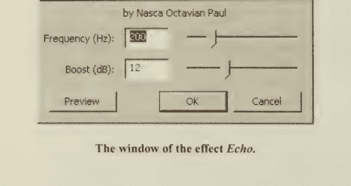

### 5.2.5 均衡

借助均衡功能，您可以分别增加或减少特定的频率。为此，有两种不同的视图可供选择：一种是可通过鼠标绘制频率曲线；另一种是图形均衡器，提供每`1/3`倍频程宽度的`31`个波段。在这种情况下，设置可以通过滑块进行。曲线可以单独创建和保存。

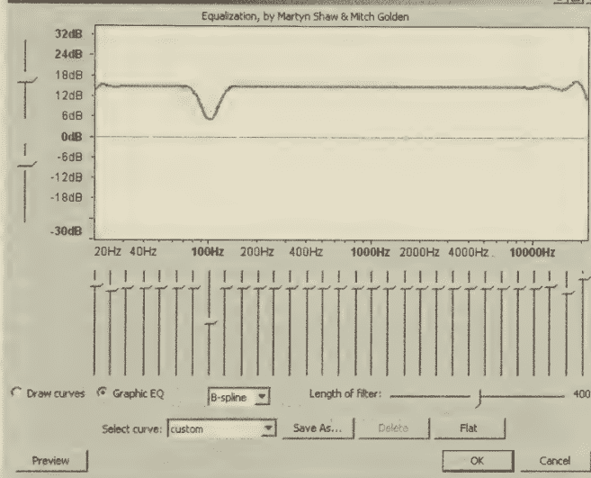

具有`31`个滑块的图形均衡器。

以下设置可用：

- **绘制曲线：** 提供均衡视图，您可以在其中借助鼠标绘制曲线，从而增加或减少频率。

- **图形均衡器：** 此均衡视图提供每`1/3`倍频程宽度的`31`个波段，您可以通过可用的滑块设置其增益或衰减。

- **下拉框：** 在此可以选择不同的插值方法：`B 样条`、`余弦`和`三次`可供选择。

- **滤波器长度：** 通过滑块可以调节滤波器的长度。适用以下原则：滑块越靠左，滤波器越长；滑块越靠右，滤波器越点状。

- **选择曲线：** 在此下拉框中，已有不同的预设曲线可用。如果您保存了一条曲线，还会在此下拉框中以保存的名称找到它。

- **另存为：** 打开一个窗口，您可以在其中输入均衡曲线的标题。

- **删除：** 删除所选曲线。

- **平直：** 将所有波段设置为`0 dB`。

### 5.2.6 改变速度

此效果改变回放速度，同时改变音高。数值可以通过鼠标借助滑块设置，也可以直接输入到字段中。此外，还提供了黑胶唱片的不同速度作为默认值。

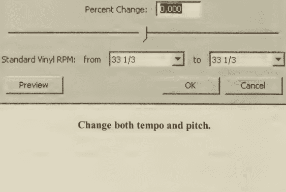

设置：

- **百分比变化：** 在此输入所需的速度变化百分比。

- **标准黑胶转速 从/到：** 在此下拉框中预设了黑胶唱片最常见的回放速度，单位为每分钟转数（`rpm`）。

### 5.2.7 反相

此效果产生相位反转，不提供进一步的设置选项。所选音频素材的所有负振幅变为正，所有正样本振幅变为负。此效果在音频轨道的放大视图中可以非常清楚地看到。

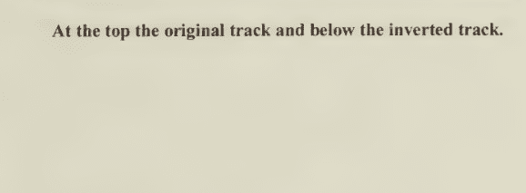

**上方为原始轨道，下方为反相轨道。**

两个轨道会相互抵消，一起播放时不会产生声音。

### 5.2.8 咔嗒声消除

咔嗒声消除用于去除短促的脉冲背景噪声。因此，此工具非常有用，例如可以去除数字化黑胶唱片时产生的咔嗒声和爆音。

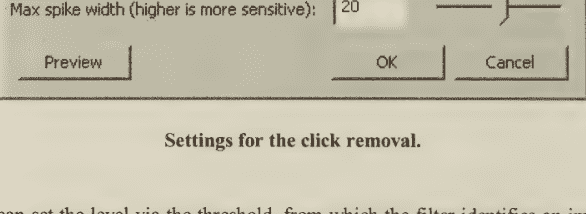

**咔嗒声消除的设置。**

您可以通过阈值设置滤波器将脉冲识别为干扰的水平，而脉冲宽度则设置最大长度。设置如下：

- **选择阈值（越低越灵敏）：** 在此选择应用咔嗒声消除的阈值。选择的值越低，滤波器应用得越早。

- **最大尖峰宽度（越高越灵敏）：** 在此设置计入干扰的宽度。选择的值越高，越短的干扰被去除。

### 5.2.9 压缩器

压缩器的功能是减小音频信号的动态范围，以获得更均匀的音量。为此，较响段落的音量被降低，而较低的段落则相应放大。

您可以更改以下设置：

- **阈值：** 设置压缩器开始工作的电平值。可能的值为`-60 dB`至`-1 dB`。

- **比率：** 设置响度部分（高于阈值）与较低部分调整的比例（从`1.5:1`到`10:1`）。

- **启动时间：** 在此可以控制效果的反应速度。

- **衰减时间：** 在此输入效果的持续时间。

- **压缩后标准化至 0 dB：** 如果选择了此选项，压缩后动态范围减小的音频信号将再次提升到`0 dB`。

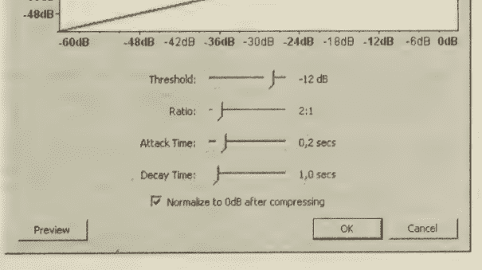

用于减小动态范围的压缩器。

### 5.2.10 自动电平

自动电平也用于使音频轨道中柔和和响亮的部分趋于一致。但是，电平调整程度和噪声阈值的设置选项有限。对于电平调整程度，您可以在五个步骤之间选择，而对于噪声阈值，可以从`-20 dB`以五点为步长选择至`-80 dB`。

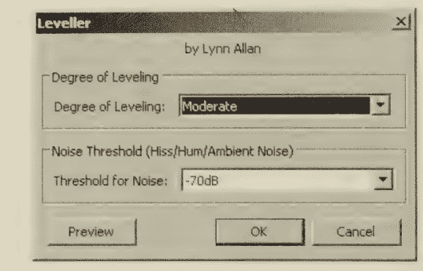

用于音量趋近的自动电平。

两项设置：

- **电平调整程度：** 在此可以在五个可能的步骤之间选择。

- **噪声阈值：** 噪声阈值可以从`-20 dB`到`-80 dB`以五点为步长选择。

### 5.2.11 标准化

此效果一方面可以提升输入电平过低录制的音频素材的电平，另一方面可以使不同的音频轨道以恒定音量趋于一致。

此外，该效果还可以去除可能存在于音频信号中的直流偏移。

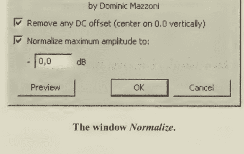

> **标准化窗口。**

设置：

- **去除任何直流偏移（垂直居中于 0.0）：** 使用此选项，可以去除音频信号中存在的任何直流偏移。这是波形垂直偏移的问题，通常在使用麦克风录制时由基础声卡引起。

- **标准化最大振幅至：** 此选项可以降低或提升音量，直到最响部分达到给定值。此效果最多可应用到无失真音量`0 dB`。

### 5.2.12 Nyquist 命令行

一个接口，使得用 Nyquist 编程语言输入以生成插件成为可能。您可以在以下网址找到相关介绍：`http://audacity.sourceforge.net/help/nyquist`

## 5.2.13 Phaser（移相器）

移相器是一种用于相位失真的效果器。除了可以调节效果强度的滑块外，你还有以下设置选项：

- **Stages（级数）：** 在此可以设置`2`到`24`级。

- **LFO Frequency (Hz)（LFO频率）：** LFO代表"Low Frequency Oscillator"（低频振荡器）。低频可在此选择`0.1`到`4.0 Hz`之间的值。

- **LFO Start Phase (deg.)（LFO起始相位）：** 在此选择振荡开始的区域。

- **Depth（深度）：** 调制深度可在`0`到`255`之间设置。

- **Feedback（反馈）：** 在此选择`-100`到`+100`之间的值。

对于移相器来说，用不同的数值进行测试基本上是不可或缺的。你可以设置`LFO Start Phase`（LFO起始相位），使某些部分获得更多或更少的效果。

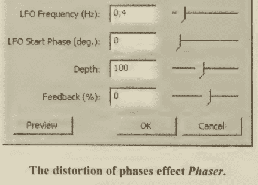

**相位失真效果`Phaser`（移相器）。**

为了直观地展示作用方式，用`Sound generator`（声音发生器）创建一个`440 Hz`、振幅为`0.8`的正弦波声音。现在将移相器以显示的设置应用到这个音调上。

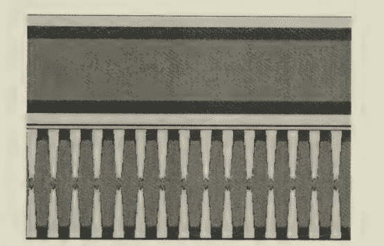

**应用`Phaser`（移相器）效果前后的正弦波声音。**

波形已经能让人很好地了解该效果的工作原理。

## 5.2.14 Noise removal（噪声消除）

此效果可以后续消除恒定的背景噪声。噪声越恒定，通常越能更好地消除。

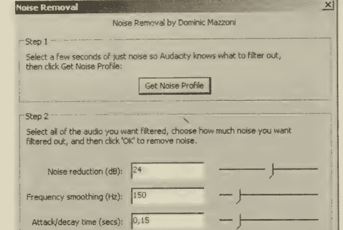

首先，创建一个噪声样本，该样本最好只包含你想消除的噪声，然后将此噪声系统地从整个信号中去除。你可以编辑以下设置：

- **Get Noise Profile（获取噪声样本）**：首先，标记音频轨道中最好只包含你想降低的噪声的区域，然后选择`Get Noise Profile`（获取噪声样本）按钮。

- **Noise reduction (dB)（噪声降低量）**：在此以分贝为单位设置噪声降低量。

- **Frequency smoothing (Hz)（频率平滑）**：将显示的频率从`1`平滑到`1,000 Hz`。

- **Attack/decay time (secs)（起音/衰减时间）**：在此设置起音和衰减时间。

## 5.2.15 Repair（修复）

此工具可以修复轻微干扰。然而，该效果只能处理最多`128`个采样点的极短标记区域。此功能在第`4.2`章"去除背景噪声"中有详细描述。

## 5.2.16 Reverse（反转）

此效果将标记区域反向录制，不提供进一步的设置选项。试着将一个反向播放的单词或句子进行测试。

## 5.2.17 Truncate silence（截断静音）

此效果提供了通过去除超过一定长度的静音时段来创建均匀测量停顿的可能性。

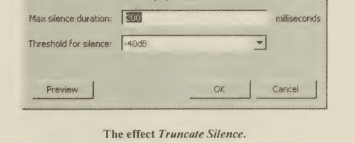

**效果`Truncate Silence`（截断静音）。**

两项设置：

- **Max silence duration（最大静音时长）**：在此可以设置标记区域中静音时段的最大长度。

- **Threshold for silence（静音阈值）**：在此设置从哪个值开始视为静音。

## 5.2.18 Change tempo（改变速度）

借助此效果，你可以在不改变音调的情况下修改回放速度。与此相关，标记选区的长度也会相应改变。

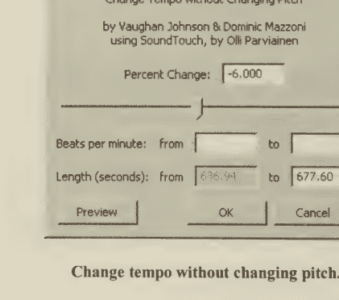

> **不改变音调而改变速度。**

你可以编辑以下设置：

- **Percent Change（百分比变化）**：在此输入所需的速度变化百分比。慢速回放需要负值。

- **Beats per minute（每分钟节拍数）**：在此你可以通过每分钟节拍数（`bpm`）输入速度变化。

- **Length (seconds)（时长（秒））**：显示运行时长的变化。第一个框显示原始长度，第二个框显示应用效果后的新长度。你也可以自由编辑第二个框，这时变化将自动以百分比计算。

## 5.2.19 Change pitch（改变音调）

此效果提供了在不改变速度的情况下修改音调的可能性。在此情况下，你可以以音符、半音、频率变化或百分比变化输入数值。

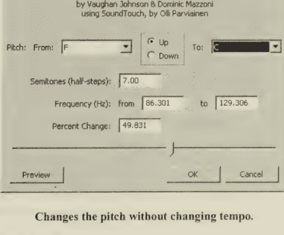

详细设置：

- **Pitch（音调）：** 在这些框中，你可以用音符设置音调变化。此外，还必须指定结果是更高（`up`）还是更低（`down`）。

- **Semitones (half-steps)（半音）：** 你可以通过此框以半音输入音调变化。输入负值可获得更低的音调。

- **Frequency (Hz)（频率）：** 在这些框中，你可以精确设置以`Hz`为单位的频率变化。

- **Percent Change（百分比变化）：** 在此输入百分比变化。此框可自由编辑，但也可以通过下面的滑块进行设置。

## 5.2.20 Amplify（放大）

此效果可以放大和降低（负放大）音频信号的音量。

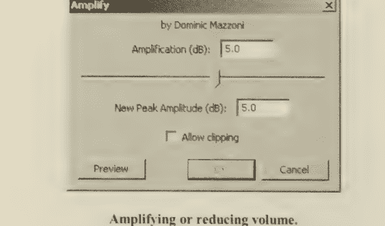

三项设置可供选择：

- **Amplification (dB)（放大（分贝））：** 在此直接编辑框或使用滑块输入以分贝为单位的放大或降低（负值）量。新的峰值振幅将自动计算。

- **New Peak Amplitude (dB)（新峰值振幅）**：在此直接编辑框或使用滑块设置新的峰值振幅值。在峰值振幅 > `0 dB`时，必须激活`Allow clipping`（允许削波）选项才能启动效果。相应的放大或降低将由此自动计算。

- **Allow clipping（允许削波）**：如果激活此选项，将允许削波。如果音频信号在应用当前预设值的效果时会出现过放大，则只有激活`Allow clipping`（允许削波）选项后，才能按下`OK`按钮启动效果。

## 5.2.21 Wahwah（哇音）

类似于电吉他的电子效果器或小号弱音器，此效果调制声音频率。该效果的正确名称是`wah-wah`（哇音）。

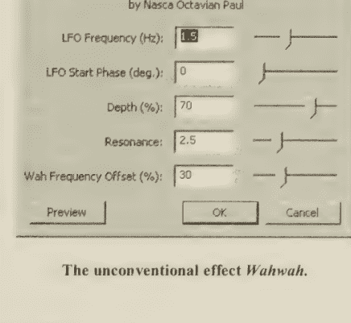

**非常规效果`Wahwah`（哇音）。**

效果设置：

- **LFO Frequency (Hz)（LFO频率）**：LFO代表"Low Frequency Oscillator"（低频振荡器）。低频可在此选择`0.1`到`4.0 Hz`之间的值。

- **LFO Start Phase (deg.)（LFO起始相位）：** 在此定义振荡开始的区域。

- **Depth (%)（深度）**：调制深度可以以百分比形式在`0`到`100`之间设置。

- **Resonance（共鸣）：** 在此以`0-10`的量表定义共鸣质量。

- **Wah Frequency Offset (%)（哇音频率偏移）**：频率偏移可以以百分比形式在`0`到`100`之间设置。

## 5.2.22 Repeat（重复）

此效果可按需重复标记区域。

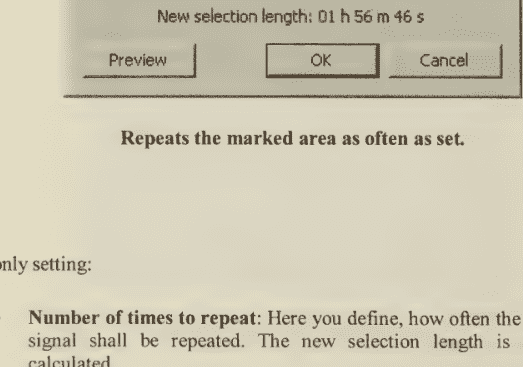

唯一一项设置：

- **Number of times to repeat（重复次数）：** 在此定义所选音频信号应重复多少次。新的选区长度将自动计算。

## 5.3 问题及可能的解决方案

在本章中，将讨论典型的困难和问题及其解决方案。

### 5.3.1 录制时出现中断和干扰

完成录制后，在回放时你发现存在短暂的中断和杂音。

这些问题表明计算机在录制或回放期间过载。这可能由多种不同原因造成：

- 在使用Audacity时，打开了其他在后台运行的程序，因此需要额外的主内存和处理时间。请特别注意那些几乎监控计算机所有活动的程序，如病毒扫描软件、反间谍软件或索引程序，并在使用Audacity时关闭这些程序。

- 声卡及其转换器所使用的驱动程序错误或过时。这个问题不仅出现在旧电脑上。即使是全新的电脑，通常也配备过时的驱动程序。可以通过在制造商网站上查找来解决这个问题，必要时可以下载并安装更新的驱动程序。还要检查制造商是否有所谓的芯片组驱动程序。如果有，你应该测试哪个驱动程序更合适。


- 硬盘访问速度太慢。如果你拥有一台较旧的电脑，你的硬盘可能无法以必要的速度执行访问。在更换硬盘之前，请先检查是否可以通过碎片整理来提高其性能。此外，还应测试硬盘驱动器的 DMA 模式（Direct Memory Access，直接内存访问）或 UDMA 模式（Ultra Direct Memory Access，超高速直接内存访问）是否已激活。该模式使驱动器直接访问主存储，从而节省处理器容量。使用 Windows 操作系统时，你需要在 `System Control`（系统控制）下访问 `System`（系统）按钮，然后选择“硬件”选项卡中的“设备管理器”按钮，将打开一个相应的窗口。单击“IDE ATA/ATAPI 控制器”前面的小加号，将展开相关条目的列表。双击选择“主要 IDE 通道”条目。现在，您可以在“高级设置”选项卡的“传输模式”下拉菜单中，将条目设置为“DMA（若可用）”。

- 您系统的主内存太小，或者处理器太旧，无法处理需求。如果是这种情况，您应该检查升级是否可行且合理。

您也可以通过调整程序本身来降低需求。以下是一些方法：

- 降低采样格式（采样范围）和采样频率。对于单个音轨：为此，打开轨道标题的上下文菜单，选择所需的设置。您可以通过菜单命令“编辑 > 首选项”打开“Audacity 首选项”窗口，在左侧选择“质量”选项卡，并在“采样”下设置更改来修改默认值。

- 增加延迟（从 1.3.2 版本起可用）。为此，在“Audacity 首选项”窗口中切换到“音频 I/O”选项卡，并在“延迟”下进行设置。

- 禁用回放时的滚动（“播放时更新显示”）。此首选项可在“Audacity 首选项”窗口的“界面”选项卡下的“行为”中设置。

### 5.3.2 录音音量不一致

您进行录音时发现音量波动极大。如果与此相关的是低音部分被“提升”而高音部分被抑制，那么您的声卡很可能具有自动录音电平功能。在这种情况下，尝试通过声卡驱动程序禁用此自动录音电平。此功能例如可能被称为 AGC，即“自动增益控制”。不幸的是，有多个型号不允许禁用此功能。

### 5.3.3 录音未“居中”

一个经常出现在基础声卡上的问题是，波形的振幅并不完全分散在零电平处，而是位于其下方或上方。这在录音的绝对静音部分尤其明显。可以使用“去除任何直流偏移（垂直居中于 0.0）”功能来抑制此问题，该功能位于“标准化”效果下方。

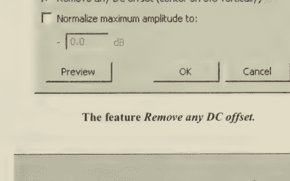

> “去除任何直流偏移”功能。

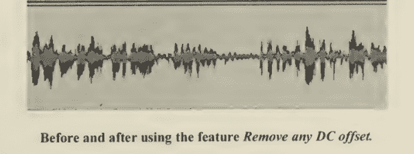

> 使用“去除任何直流偏移”功能前后的对比。

# 6 首选项

安装 Audacity 后，您可以立即开始编辑音频文件，因为该程序自带的首选项涵盖了大多数常见应用场景。但是，如果您想执行非常特定的任务，例如在录制新音轨的同时收听已有的音轨，您需要先设置相应的首选项。您可以在“Audacity 首选项”窗口中进行设置，该窗口可以通过菜单命令“编辑 > 首选项”或快捷键 `Ctrl + P` 打开。

该窗口分为九个选项卡，显示在左侧（“音频 I/O”、“质量”、“导入/导出”等），可以在那里选择。

## 6.1 音频 I/O

在此选项卡中，可以设置程序输入和输出音频流的偏好设置等。

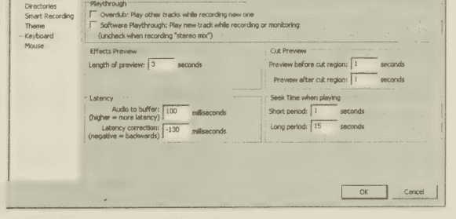

> “Audacity 首选项”窗口。

设置：

- **回放**：在此处通过下拉菜单选择用于音频回放的声音卡。

- **录音**：通过下拉菜单选择音频录音设备。

- **通道**：在此处可以设置所需的录音通道数量。

在“监听”区域，您可以找到两个选项，可以通过单击前面的小方框来激活或停用。当选项被激活时，方框内会显示一个勾选标记。

设置：

- **叠录**：此选项可以在播放现有音轨的同时录制新音轨。

- **软件监听：录制或监听时播放新音轨（录制“立体声混音”时取消勾选）**：此选项可以直接收听当前录音。

几乎所有效果都允许在应用前预览相应效果。在“效果预览”区域，您可以设置预览长度（以秒为单位）：

- **预览长度**：在此处设置效果的预览时间（秒）。

在“剪切预览”部分，您可以设置剪切前或剪切后想要听到的时长：

- **剪切区域前预览**：在此处设置剪切前多少秒开始回放。

- **剪切区域后预览**：在此处设置剪切后多少秒继续回放。

在“延迟”部分，一方面可以调整处理时间，另一方面可以进行修正，例如为了能够与已有音轨同步录制。

## 6.2 质量

在此面板中，您可以设置录音、导入和转换的质量。

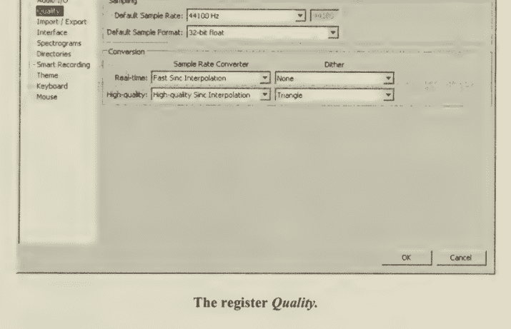

> “质量”选项卡。

设置选项：

- **默认采样率**：在此处设置默认录音或导入时想要使用的采样频率。下拉菜单提供了不同的常用参数，以及通过选择“其他”在其后的框中输入自己参数的可能性。

- **默认采样格式**：在此下拉菜单中，您可以在 16 位（CD 质量）、24 位（标准录音棚录音质量）和 32 位浮点（浮点精度格式）之间选择。

- **实时/高质量**：在此下拉菜单中，为音频文件处理选择“快速 Sinc 插值”（更快）或“高质量 Sinc 插值”（更好质量）。

- **抖动**：您可以选择或取消选择此功能，它通过添加更高的噪声分量来防止数字失真。如果您选择使用“抖动”，可以在不同类型之间选择（“无”、“矩形”、“三角形”和“塑形”）。

## 6.3 导入/导出

在此面板中，您可以设置音频文件的处理方式。

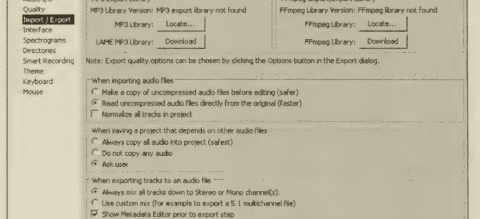

> “导入/导出”面板。

可能的修改：

- **导入音频文件时**：在此处决定导入时如何处理未压缩文件。当然，创建文件的副本比直接播放原始文件更安全。这两个选项是互斥的，即一次只能选择其中一个选项。

此外，您可以选择“标准化项目中的所有音轨”选项，这样导入的文件将通过批处理自动标准化。

- **保存依赖于其他音频文件的项目时**：最安全的可用选项是“始终将所有音频复制到项目中”，这样所有必要的文件都会保存到项目中。“不要复制任何音频”。BufferSize...

## 6.5 目录

在此您可以更改临时文件目录，设置保存备份副本的间隔时间，以及选择存储类型。

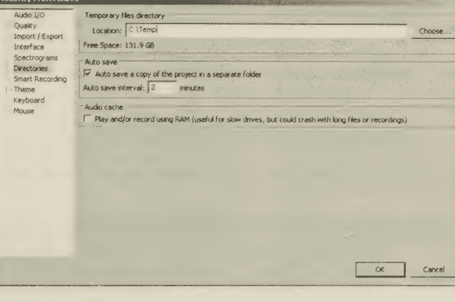

各项设置：

- **临时文件目录/选择**：在此设置 Audacity 文件的临时目录。可以直接在框中编辑路径，也可以通过“选择”按钮打开“选择文件夹”窗口来选定文件夹。

- **自动保存**：首先通过选项“在单独的文件夹中自动保存项目副本”来设置 Audacity 是否定期自动备份您的文件。借助这些备份副本，当计算机在录音或编辑过程中崩溃，或因例如停电而关闭时，Audacity 可以恢复最后一次更新。因此，强烈建议在正常情况下不要选择此功能。

- **音频缓存**：如果选择了“使用 RAM 播放和/或录制”选项，文件将保留在主存储器中，直到录音停止；只有到那时才会写入硬盘。此外，项目中存在的所有音频文件都完全保存在计算机的主内存中。通过此选项，即使对于那些保存在慢速数据介质上的项目，例如通过慢速网络连接的网络驱动器，也可以流畅地工作。用户需注意，不要打开大于可用主内存的文件，因为它们可能导致 Audacity 或整台计算机崩溃。因此，强烈建议在正常情况下不要选择此功能。

### 6.6 调整程序界面

此选项卡分为四个部分：“行为”、“语言”、“显示范围最小值”、“模式”和“显示/隐藏”。

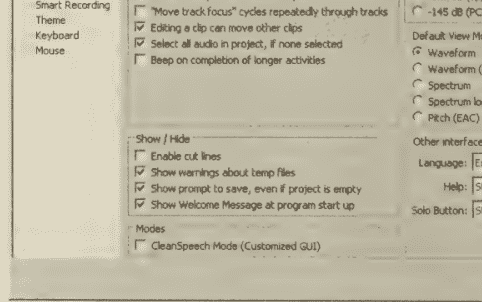

> “界面”选项卡。

在“行为”部分，您会看到以下选项：

- **播放时更新显示**：如果选择了此选项，当前播放部分将在程序窗口中持续显示。

- **关闭最后一个窗口即退出 Audacity**：此功能默认选中，通过菜单命令“文件 > 退出”或 `[X]` 按钮关闭最后一个 Audacity 窗口后，会导致程序 Audacity 本身关闭。这是 Windows 程序的常规表现。如果取消选择此功能，在关闭最后一个 Audacity 窗口后将自动打开一个新的空文档。要退出 Audacity，您需要使用菜单命令“文件 > 退出”。

- **启用左右选择边缘的拖动**：此选项默认选中，允许后续更改左或右标记边框。如果在此情况下使用鼠标操作，鼠标指针将变为伸出食指的手形。

- **符合人体工效的音频输入/输出按钮排列**：此选项将控件排列得更符合人体工学，以实现更快的操作。下图展示了区别。


- **自动垂直缩放适配轨道**：如果选择了此功能，音频轨道将在打开时自动垂直适配。

- **“移动轨道焦点”在轨道间循环切换**：此选项使您在使用箭头键标记时，可以从最后一个音频轨道跳转到第一个，反之亦然。

- **编辑片段时可以移动其他片段**：此功能默认选中，会导致同一音频轨道中位于剪切右侧的独立片段，按剪切标记的长度向左移动。

- **若未选择则全选项目中的音频**：此选项默认选中。它使得需要选择的工作步骤，如效果，默认应用于整个项目，只要没有做出明确的标记选择。

- **较长活动完成时发出蜂鸣声**：在较长时间的活动完成后，会生成一个声音信号，向用户指示处理结束。在 Windows 中，只有在系统控制器的“声音和音频设备”中启用了程序活动“标准声音警报”的播放时，声音信号才会响起。

- **语言**：通过下拉菜单选择所需语言。为了正确显示语言，必要时需要安装相应的字体。

- **显示范围最小值：电平表和“波形 (dB)”**：在此设置以“波形 (dB)”显示时的垂直刻度显示，其中所选值代表“零”电平。

- **启用剪切线**：如果选择了此选项，在使用“剪切”功能时，会在音频文件从音频轨道中剪出的位置显示所谓的剪切线。用鼠标左键单击剪切线，可以撤销相应的剪切。如果用鼠标右键单击剪切线，则剪切线会被移除。

- **显示关于临时文件的警告**：通常，在每次程序启动时，如果 Audacity 文件夹中仍有临时文件，例如在崩溃或停电后，系统会提醒您。您可以在此处关闭此功能。此设置主要对 Audacity 开发人员有意义，对程序的正常使用不重要。

- **即使项目为空也显示保存提示**：此选项默认选中，会导致系统询问您是否要保存空项目。通常无需更改此设置。

- **程序启动时显示欢迎消息**：如果选择了此选项，每次启动程序时都会显示“欢迎使用 Audacity”窗口。

- **CleanSpeech 模式（自定义 GUI）**：此选项将控制工具扩展为多了一个按钮，通过它可以访问批处理“Clean Speech”。此外，还调整了 Audacity 的若干功能和界面元素，以优化语音录制校正的工作流程。

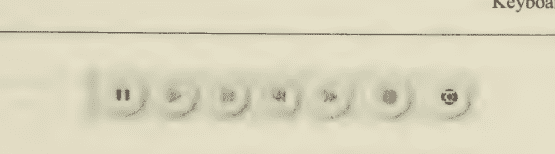

## 6.7 键盘

如今许多程序都提供了为特定命令设置自定义快捷键的功能。在 Audacity 中，您可以在首选项窗口的“键盘”选项卡中设置这些首选项。例如，如果您使用笔记本电脑工作，您会特别欣赏这一功能。

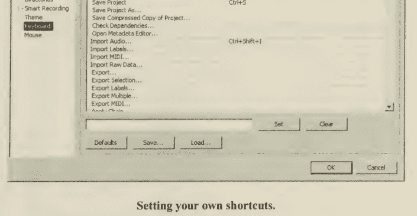

设置自定义键盘快捷键的方法如下：

- 首先标记您要为其分配快捷键的操作。

- 将鼠标指针放在快捷键表格正下方的空框中（上图中的框，其中显示 `Ctrl + Alt + M`）。

- 在键盘上选择所需的快捷键。

- 选择“设置”按钮。快捷键现在将显示在“按键组合”列中该命令的后面。

- 通过“确定”按钮关闭窗口。

要删除快捷键，首先标记该命令，然后选择“清除”按钮。

此外，还可以通过“保存”和“加载”按钮以 XML 文件的形式导入或导出完整的命令列表。如果要恢复快捷键的原始状态，请选择“默认值”按钮。

## 6.8 鼠标设置

在此选项卡中，您可以很好地概览鼠标的不同编辑选项，尽管无法设置任何首选项。

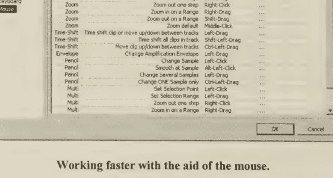

> 借助鼠标更快地操作。

在这里您肯定能找到这样或那样的建议，帮助您更快地达到预期结果。

# 7 命令列表

下面将解释各个菜单命令。

## 7.1 文件

| 菜单命令 | 功能 |
| --- | --- |
| 新建 | 打开一个新的程序窗口。 |
| 打开... | 打开“选择一个或多个音频文件...”窗口，您可以在其中选择一个或多个要在 Audacity 中打开的文件。如果选择多个文件，每个文件将在单独的程序窗口中打开。 |
| 关闭 | 关闭当前项目。如果项目中仍有未保存的更改，为了您的安全起见，系统会询问您是否保存这些更改。 |
| 保存项目 | 保存当前项目。如果项目尚未保存为 AUP 文件（Audacity 项目文件），将打开“项目另存为...”窗口，您可以在其中设置项目的存储位置和名称。 |
| 项目另存为... | 打开“项目另存为...”窗口，您可以在其中设置项目的存储位置和名称。 |
| 检查依赖项... | 检查项目的所有依赖项是否满足。如果 Audacity 发现并非所有依赖项都满足，将在“Audacity 错误”窗口中显示错误警告。如果用“确定”按钮确认该窗口，“警告”窗口中将提供不同的操作方案。 |
| 打开元数据编辑器... | 打开“编辑元数据标签”窗口，您可以为项目分配不同的给定元数据，以及 |
| 导入... | 打开子菜单，您可以在其中选择要导入的内容：“音频、标签、MIDI”和“原始数据”。 |
| 导出... | 打开窗口“导出文件”，您可以在此设置项目的存储位置和文件格式。您可以选择 WAV、AIFF、OGG、FLAC、MP2 格式的文件，如果安装了 MP3 编码器 LAME，甚至可以选择 MP3。 |
| 导出所选... | 打开窗口“导出文件”，您可以在此设置所选内容的存储位置和文件格式。您可以选择 WAV、AIFF、OGG、FLAC、MP2 格式的文件，如果安装了 MP3 编码器 LAME，甚至可以选择 MP3。 |
| 导出标签... | 打开 nuovo 窗口“导出标签为”，通过它您可以将您的标签以 TXT 格式保存。 |
| 批量导出... | 打开相应窗口，通过它项目可以根据设置的标签或现有音轨进行单独保存。 |
| 应用链... | 提供将已定义的链应用到一个或多个文件的可能性。 |
| 编辑链... | 打开相应窗口，在其中您可以在图形辅助工具和设备的支持下输入链的指令。 |
| 页面设置... | 打开相应窗口，您可以在此调整打印页面。 |
| 打印... | 打开窗口“打印”，通过它您可以调整各种打印设置。 |
| 退出 | 退出 Audacity 程序。 |

## 7.2 编辑

| 菜单命令 | 功能 |
| --- | --- |
| 撤销 | 通过此菜单命令，您撤销上一步操作。 |
| 重做 | 通过此菜单命令，您重做之前撤销的操作步骤。 |
| 剪切 | 使用此功能，选中的文件或音轨被剪切并复制到剪贴板。 |
| 拆分剪切 | 剪切音轨的选中部分，并在相应位置拆分片段。 |
| 复制 | 将选中部分复制到剪贴板。 |
| 粘贴 | 粘贴剪贴板的内容。 |
| 修剪 | 删除所有未选中的区域。 |
| 删除 | 删除整个音轨或音轨的选中部分。 |
| 拆分删除 | 删除选中部分，并将音轨拆分为两个可以独立移动的片段。 |
| 静音音频 | 将选中部分转换为静音。因此，音轨的长度保持不变。 |
| 拆分 | 将音轨拆分为两个可以独立移动的片段。 |
| 拆分新建 | 剪切选中部分并将其移动到新的音轨中，该音轨在同一窗口中创建，位于现有音轨下方。 |
| 合并 | 在当前位置合并音轨的片段。可能缺失的部分用静音填充。 |
| 在静音处分离 | 提供在静音处自动拆分音轨的机会，从而将其分成多个片段。 |
| 复制 | 将选中部分或整个选中的音轨分别复制到一个新的音轨中，该音轨在现有音轨下方创建。 |
| 标签区域... | 打开子菜单，您可以在其中找到以下功能：剪切、拆分剪切、复制、删除、拆分删除、静音、拆分、合并、在静音处分离。 |
| 选择... | 打开子菜单，您可以在此定义要进行的选择。您可以选择全部、无、播放位置左侧（打开窗口设置左侧选择边界，您可以在此设置选择的起始位置）、播放位置右侧（打开窗口设置右侧选择边界，您可以在此设置选择的结束位置）、音轨起点到光标、光标到音轨终点。 |
| 查找过零点 | MGM | 自动查找音频素材中振幅为零的位置。因此，消除了剪切时可能出现的干扰，这些干扰可能是由振幅的突然变化引起的。 |
| 移动光标... | 此菜单命令帮助将光标精确设置到特定位置。在子菜单中选择到选择起点、到选择终点、到音轨起点、到音轨终点。 |
| 区域保存 | 此命令提供保存选择的可能性，以后可以通过菜单命令区域恢复来检索。 |
| 区域恢复 | 恢复先前删除的选择。 |
| 播放区域 | 子菜单为您提供锁定和解锁命令。如果选择锁定，显示选择的双箭头将显示为红色并保持，例如，如果您移动下方的音轨。解锁命令将移除锁定。 |
| 首选项... | 打开窗口“Audacity 首选项”，您可以在此进行个人预设。可能的偏好设置在第 6 章中有详细描述。 |

## 7.3 视图

| 菜单命令 | 功能 |
| --- | --- |
| 放大 | 放大音轨的显示。如果您连续多次选择此功能，您最终可以看到单个样本并在必要时编辑它们。 |
| 正常缩放 | 显示音轨的正常显示。 |
| 缩小 | 缩小音轨的显示。 |
| 适应窗口 | 以所选项目恰好适合显示窗口的方式显示。 |
| 垂直适应 | 将音轨垂直适应到显示窗口。 |
| 缩放到选择 | 通过放大或缩小，使选择（标记）恰好适合显示窗口。 |
| 折叠所有音轨 | 以节省空间的垂直微型显示方式显示窗口的各个音轨。 |
| 展开所有音轨 | 此命令从音轨的微型显示切换到正常显示。 |


| 历史... | 打开窗口*撤销历史*，您可以在此系统地撤销单个操作步骤。 |

| 工具栏 | 打开子菜单，通过它您可以分别显示或隐藏各种工具栏。前缀的勾选标记表示该栏已显示。通过*重置工具栏*选项，所有栏将再次显示在其默认指定的位置。 |

## 7.4 音轨

| 菜单命令 | 功能 |
|---|---|
| 添加新的 | 打开子菜单，您可以在其中选择新音轨的类型。您可以选择*音轨*、*立体声音轨*、*标签音轨*和*时间音轨*。 |
| 立体声到单声道 | 从选中的立体声录音创建单声道音轨。 |
| 混音并渲染 | 混合选中的音轨。 |
| 重采样... | 打开窗口*重采样*，您可以在其中输入新的采样频率。 |
| 移除音轨 | 此命令从当前打开的窗口中移除选中的音轨。 |
| 对齐音轨 | 打开子菜单，您可以在其中选择不同的命令来对齐音轨。基准可以是光标、选择的起点或终点或其他音轨。 |
| 对齐并移动光标 | 打开子菜单，您可以在其中选择不同的命令来同时对齐光标和音轨。基准可以是光标、选择的起点或终点或其他音轨。 |
| 在选择处添加标签 | 在当前光标或选择位置添加标签。如果没有标签音轨，也会创建它。 |
| 在播放位置添加标签 | 在光标的当前位置添加标签。 |
| 编辑标签 | 打开相应窗口，您可以在其中添加、更改、导入或导出标签。 |
| 排序音轨 | 打开子菜单，您可以选择*按开始时间*（在时间线上）和*按名称*。 |

## 7.5 生成

| 菜单命令 | 功能 |
|---|---|
| 啁啾... | 打开窗口*啁啾发生器*，您可以在其中创建啁啾。为此，您必须以字母和数字的形式输入数字序列，设置振幅（0-1.0）和以秒为单位的持续时间。 |
| 噪声... | 打开窗口*噪声发生器*，您可以在其中创建三种类型的噪声：*白噪声*、*粉红噪声*和*棕噪声*。 |
| 静音... | 打开窗口*静音发生器*，您可以在其中输入要创建的静音持续时间。如果通过*确定*按钮确认输入，静音将插入到当前光标位置。 |
| 双音多频音... | 打开一个音调发生器，您可以在其中设置创建声音的参数。如果通过*确定*按钮确认输入，声音将插入到当前光标位置。 |
| 音调... | 打开一个高级音调发生器，可以在声音播放期间改变频率和振幅。 |

# 8 下载与安装

如前所述，Audacity 是一个独立于任何操作系统的程序。这意味着该程序可在 Windows、Mac OS X 和 Linux 上使用。

下载请访问项目的官方网站：*http://audacity.sourceforge.net*。选择您想要下载的版本。

至少有两种不同的版本可供选择。版本号较旧或较小的版本（目前为 1.2.6 版）是官方认可的稳定版本，适合高效应用；而较新的程序版本，即所谓的测试版（beta 版本），尚未经过完整的潜在错误测试。

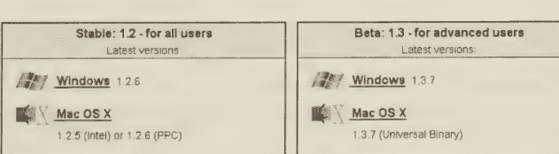

**程序版本选择。**

此外，您还可以选择下载某个版本的源代码，或者直接从 CVS（并发版本系统，Concurrent Versions System）下载某个程序版本的当前状态，然后进行编译。

### 8.1 Windows

您可以在 Windows 98、ME、2000、XP 和 Vista 上使用 Audacity。为此，您需要从项目网站下载相应的安装文件。通过双击 `.exe` 文件打开它，安装向导将便捷地引导您完成安装。

此外，您还可以找到用于创建 MP3 文件的 LAME MP3 编码器、用于使用扩展模块 VST 效果插件的 VST Enabler 以及相应的插件。

请注意，您的硬件应满足以下最低系统要求：

| 特性 | 最低内存 | 最低 CPU | 推荐内存 | 推荐 CPU |
|---|---|---|---|---|
| 98/ME | 256 MB | 300 MHz | 512 MB | 500 MHz |
| 2000/XP | 512 MB | 300 MHz | 1 GB | 1 GHz |
| Vista Home Basic | 512 MB | 1 GHz | 2 GB | 1 GHz |
| Vista Home Premium/Business/Ultimate | 1 GB | 1 GHz | 4 GB | 2 GHz |

推荐值适用于以下任务：

- 时长约一小时的录音，或
- 同时编辑三个时长为 20 分钟的音轨。

然而，如果您想处理更复杂的任务，则应拥有相应更好的硬件配置。

### 8.2 Mac OS

对于 Macintosh 操作系统（Mac OS），前述网站也提供了不同的版本。1.00 版仍然可用于 Mac OS 9 操作系统，尽管该系统的开发已停止。对于较新的程序版本，您需要 Mac OS X 10.1 或更高版本的操作系统，或者从 1.3.0 版开始的程序版本分别需要 10.3 或更高版本的操作系统。

操作步骤如下：如果通过双击下载的 `.dmg` 文件开始安装，将会生成一个名为 *audacity-macosx-版本号* 的虚拟驱动器。再次双击打开该驱动器，将所有文件复制到 Audacity 的目标程序文件夹（如有必要，先创建一个新文件夹）。然后弹出虚拟驱动器。所有必要的配置文件将在首次启动程序时生成。

Audacity 至少需要 64 MB 的空闲内存和 300 MHz 的处理器，对于更复杂的任务，则需要相应更好的硬件配置。

### 8.3 Linux

目前，Audacity 已包含在许多 Linux 发行版中，因此您可以通过软件包管理器轻松安装该程序。不过，有时会是稍旧的版本。在前述网站上，您可以找到适用于您发行版的软件包链接。或者，您也可以直接从 CVS 下载源代码并自行编译程序。

以下列表显示了编译源代码所需的软件组件：

- **wxWidgets 库**：一个基于 C++ 的开源框架，用于开发具有跨平台图形用户界面（简称 GUI）的程序。

此外，还可以选择使用以下软件：

- **libmad**：用于解码 MPEG 音频的库；支持 MPEG-1（Layer 1、Layer II 和 Layer III，即 MP3）、MPEG-2 和 MPEG-2.5 格式。
- **Libsndfile**：用 C 语言编写的库，用于读取和写入 AIFF、AU 和 WAV 格式的音频文件。支持 8、16、24 和 32 位的 PCM 文件的读写，以及 32 位（浮点）WAV 文件和几种压缩格式。
- **Ogg Vorbis**（`libvorbis-dev`、`libogg-dev`）：免费的流兼容编解码器，用于有损音频文件压缩。作为非常常见但专有的 MP3 格式的替代品而开发。文件扩展名为 `.ogg`。Vorbis 在此指音频编码器。与 MPEG-1 Audio Layer III（MP3）相比，该格式在相同甚至更小文件大小的情况下具有更好的质量。遗憾的是，目前仍缺乏业界必要的硬件支持。

编译本身通过所谓的 autotools（`autoconf`、`automake`、`autoheader`、`libtool`）完成，使用命令 `./configure && make && make install`。为此，需要先安装相应的编译器，如 `g++` 编译器。您可能会收到相应的错误消息，指出缺少某些软件。

## 常见问题

下面将介绍一些已知问题及其解决方案。如果您遇到的问题未在此讨论，可以尝试在互联网上寻找解决方案。在此请留意附录中关于 Audacity 的 URL。

### C compiler cannot create executables

如果在 Debian 或基于此的 Linux 发行版（如 Ubuntu、Kubuntu 等）上收到 *C compiler cannot create executables* 消息，您应以 root 用户身份输入以下命令：

```
apt-get install build-essential make bin86
```

（安装编译所需的软件包）

### 找不到 wx-config：wxWidgets 是否已安装？

在使用 OpenSuse 时，出现了生成文件 `/usr/bin/wx-config-2.8` 而不是文件 `/usr/bin/wx-config` 的错误，于是计算机生成了以下消息：*找不到 wx-config：wxWidgets 是否已安装？wx-config 是否在您的路径中？*

在这种情况下，通过命令 `ln -s /usr/bin/wx-config-2.8 /usr/bin/wx-config` 创建一个简单的符号链接即可解决问题。

## 8.4 安装 MP3 编码器

为了能够生成流行的 MP3 文件，您需要额外的程序 LAME MP3 编码器。只需按照下载页面中 *更多下载* 部分的相应链接，为您的操作系统下载编码器。

| 操作系统 | Audacity 版本 | LAME MP3 编码器名称 |
| --- | --- | --- |
| Windows | 全部 | `libmp3lame-win-3.97.zip` |
| Mac OS X (PPC) | 1.2.6 | `LameLib-Carbon.sit` |
| Mac OS X (Intel) | 1.2.6 | `libmp3lame-osx-universal-3.97.zip` |
| Mac OS X (Intel, PPC) | 1.3.3 | `libmp3lame-osx-universal-3.97.zip` |
| Solaris 10 (SPARC) | 全部 | `lame-3.97.pkg.gz` |

解压压缩包后，您会在其中找到文件 `lame_enc.dll` 等。这就是编码器文件。您可以将其复制到硬盘上您选择的任意位置。当您首次导出为 MP3 时，系统会简单询问编码器文件的存储位置。

曾有许多不同的 MP3 编码器，如适用于各种 Linux 发行版的 Blade、Shine、Audioactive 和 GoGo-No-Coda，但由于其质量优势，Lame 即使在 Linux 操作系统上也已确立了自己事实上的标准地位。

## 6 术语表

**AAC** 代表"高级音频编码"（Advanced Audio Coding），是一种有损压缩方法，本质上是流行的 MP3 文件格式的进一步发展。它由弗劳恩霍夫研究所与 AT&T、诺基亚和索尼公司合作开发。

**AIFF** 代表"音频交换文件格式"（Audio Interchange File Format），是一种用于保存音频文件的格式，不使用数据压缩。它由苹果公司开发，在 Macintosh 上用作标准音频格式。它可以说是 Windows 的 WAV 格式的对应物，以 `*.aif` 或 `*.aiff` 为文件扩展名保存。

**AUP** 代表"Audacity 项目"（Audacity Project），是 Audacity 内部使用的文件格式，基于 XML。其他声音编辑程序无法读取它。为了达到尽可能高的读写速度，音频文件被拆分为许多小音频文件并保存在 `_data` 文件夹中。

**CDDA** 代表"光盘数字音频"（Compact Disc Digital Audio），是一种光学海量存储器，通常简称为 CD，它取代了以前常见的黑胶唱片。最常见的 CD 存储容量约为 650 到 800 MB。

**FLAC** 代表"自由无损音频编解码器"（Free Lossless Audio Codec）。因此，它是一种免费的无损压缩音频格式。FLAC 主要用于刻录 CD 和传播免费的非商业音乐。FLAC 的压缩率部分高达 50%。

**GSM** 代表"全球移动通信系统"（Global Standard for Mobile telecommunications），是一种语音压缩标准，除电话外，主要用于语音节目。

**延迟**（Latency）是数字音频编辑中信号输入和输出之间出现的滞后。这既是由程序处理信号引起的，也是由信号路径本身引起的。

**Macintosh HCOM** 是 Macintosh 的一种采样格式，使用霍夫曼编码。在这种情况下，可以进行 8 位或 16 位录音，分别有单声道和立体声。

**Maud (Amiga)** 是一种符合 IFF 标准的音频格式，由 MS MacroSystem Computer GmbH 为 Amiga 的"Toccata 声卡"开发。

**MIDI** 代表"乐器数字接口"（Musical Instrument Digital Interface），是乐器和声每一件乐器和声卡的数字接口。MIDI 文件包含这些切割点的控制数据，这些切割点位于许多乐器和声卡上。

**MPEG-1 音频层 III (MP3)** 是目前最知名的专有音频格式。它是一种有损压缩音频信号的文件格式，试图将可听损失保持在尽可能低的水平。如果您有编码器，可以使用 Audacity 以 8 到 320 kbps 的数据速率保存 MP3 文件。

**Musepack** 或 **MPC** 是一种有损音频压缩的文件格式。特别是在约 160 kbps 及以上的较高比特率下，Musepack 在音质方面优于其他格式，因为从这个值开始，通常可以获得透明的音乐质量。当原始文件和压缩文件之间没有可听出的差异时，音乐质量就被称为透明。因此，Musepack 是一种理想的注重质量的保存格式。Musepack 文件的后缀为 `mpc`、`mpp` 或 `mp+`。

**Ogg-Vorbis** 是一个免费且不受软件专利限制的开源项目，用于在多媒体容器中压缩音频、视频和文本文件。使用文件扩展名 `.ogg`。Vorbis 是这里的音频编码器。与 MPEG-1 音频层 III (MP3) 相比，这种格式在相同甚至更小文件大小的情况下提供更好的质量。遗憾的是，它仍然缺乏业界必要的硬件支持。

**Sun AU** 是 Sun 公司开发的一种格式，被视为 Unix 及其衍生系统的标准音频格式。通过所谓的"对数编码"，可以以牺牲较高噪声水平为代价表示更高的动态范围。

**Wave** 或 WAV 是一种容器格式，支持无损、未压缩的音频文件保存，以及压缩音频格式（如 MP3 文件）的保存。这种格式也常被称为 RIFF-WAV，因为可以在一个 WAV 文件中编码多个 RIFF 数据流。RIFF 代表"资源交换文件格式"（Resource Interchange File Format），由微软和 IBM 开发。它通常可以在便携式录音设备（如录音机）上找到。

## 10 附录

以下是有关 Audacity 的最重要的在线地址列表：

**Audacity 官方主页** -- http://audacity.sourceforge.net

在这里您可以找到最新的程序版本以及指向其他效果器、MP3 编码器等的连续链接。

**英文论坛** -- http://audacityteam.org/forum/

关于 Audacity 和音频编辑的提示和信息，约有 4,000 名注册用户。在这里您还可以找到大量的常见问题（"*Frequently asked questions*"）。

**Audacity 维基** -- http://audacityteam.org/wiki/

英文网站的集合，包含关于 Audacity 特别是音频编辑的提示和技巧，用户不仅可以阅读，还可以在线修改和扩展。

## 邮件列表 – http://audacity.sourceforge.net/contact/lists

在此注册邮件列表，享受从经验丰富的用户那里快速获得问题解答的可能性。但是，在提问之前，您应该先搜索存档。

## 索引

#### A

- AAC 第17页, 第143页
- 声速 第9页
- ADPCM 第46页
- AIFF 第143页
- 调幅广播 第11页
- 放大 第106页
- 振幅 第15页
- 模数转换器 第12页
- 模拟信号 第11页
- 分析 第134页
- 效果的应用 第87页
- Audacity 第24页
- Audacity 论坛 第147页
- Audacity 主页 第147页
- Audacity 邮件列表 第148页
- Audacity 技术领导委员会 第8页
- Audacity 维基 第147页
- 音频 CD 第15页
- 音频数据 第17页
- 音频编辑 第24页
- 音频 I/O 第113页
- 音频技术 第9页
- 音轨 第25页, 第66页
- 音频 DVD 第11页
- AUP 第143页
- 自动闪避 第89页

#### B

- 背景噪声 第84页
- 低音增强 第91页

#### C

- CD 第11页
- CDDA 第143页
- 改变音高 第105页
- 改变速度 第94页
- 改变节奏 第104页
- 咔嗒声移除 第96页
- 削波 第85页
- 命令列表 第127页
- 命令菜单 第60页
- 压缩 第17页
- 压缩器 第17页, 第97页
- 计算机延迟 第40页
- 控制工具栏 第28页
- 转换器 第12页
- 复制 第53页
- 跨平台程序 第24页
- 剪贴 第52页
- 剪切预览 第62页
- 剪切 第25页

#### D

- DAT 录音机 第11页
- 不同轨道 第65页
- 不同的录音电平 第110页
- 数模转换器 第12页
- 数字音频 第9页
- 数字化 第14页
- 数字化 第25页
- 目录 第VK-Vorschläge zum Thema:楚 119页
- 干扰 第84页
- 干扰 第109页
- 下载 第137页
- DWVW 第46页

#### E

- Echo 91
- Edit 129
- Edit toolbar 33
- Editing audio track 51
- Effects 86
- Equalization 92
- Export format 83
- Export options 83

#### F

- Fade in/out 88
- Features 25
- File 127
- FLAC 143
- FM Radio 11
- Fraunhofer Institute 17
- Frequency 9
- Frequency spectrum 18

#### G

- Generate 133
- GPL 24
- GSM 143

#### H


## I

- `Import raw data` 45
- `Import/Export` 116
- `Importing` 25
- `Importing files` 43
- `Installation` 137
- `Interference` 65
- `Invert` 95

## K

- `Keyboard` 123

## L

- `Label tracks` 69
- `Labels` 81
- `Latency` 143
- `Leveller` 98
- `Linux` 24, 139

## M

- `Mac OS` 139
- `Mac OS X` 24
- `Macintosh HCOM` 144
- `Marked area` 49
- `Marking of audio track` 47
- `Marking over two tracks` 50
- `Maud` 144
- `Meter toolbar` 31
- `Meyer, Markus` 8
- `Microphone` 17, 21
- `Microphone characteristic` 19
- `Microphone types` 18
- `MIDI` 26, 44, 144
- `MIDI track` 74
- `Mixer toolbar` 32
- `Mixing` 25
- `Mouse setup` 124
- `MP3` 17
- `MP3 quality` 83
- `MP3-Encoder` 141
- `MPC` 144
- `MPEG-1 Audio Layer III` 144
- `Musepack` 144

## N

- `Noise removal` 101
- `Normalize` 98
- `Nyquist prompt` 99

## O

- `Nyquist-Shannon` 16
- `Ogg-Vorbis` 144
- `Opening files` 43

## P

- `Paste` 54
- `PCM` 45
- `Phaser` 100
- `Playback` 63
- `Playback device` 23
- `Preamplifier` 18
- `Preferences` 76, 113
- `Preliminary check` 51
- `Problems` 109
- `Programme interface` 120
- `Pulse Code Modulation` 45

## Q

- `Quadraphonic` 16
- `Quality` 115
- `Quantisation` 12
- `Quantisation error` 14

## R

- `Recording` 25, 76
- `Recording chain` 22
- `Recording tips` 21
- `Repair` 103
- `Repeat` 108
- `Reverse` 103

## S

- `Sample Format` 15
- `Sampling` 13
- `Sampling rate` 12
- `Selection toolbar` 36
- `Shortcuts` 76
- `Silence Audio` 58
- `Sound` 9
- `Sound card` 12
- `Sound wave` 9
- `Spectrogram mode` 25
- `Spectrograms` 118
- `Split` 57
- `Standard effects` 88
- `Stereomix` 76
- `Sun AU` 144

## T

- `Tape recorder` 11
- `Telephone` 11
- `Time format` 38
- `Time track` 72
- `Toolbars` 28
- `Tools toolbar` 29
- `Tracks` 132
- `Transcription toolbar` 36
- `Trim` 56
- `TRS connector` 21
- `Truncate silence` 103

## U

- `Ultrasound` 11

## V

- `View` 131
- `Volume` 15
- `Vorbis` 17

## W

- `Wah-wah` 107
- `WAV` 144
- `Wave` 144
- `Wavelengths` 10
- `Windows` 24, 138

## X

- `wxWidgets` 24
- `XLR` 21
