# 审计与安全：AS 400、NT、Unix、网络及灾难恢复计划

# 献辞

本书献给我的祖母 Kulsumbai Nurbhai 女士，她教会了我牺牲，以便我成长。

献给我的母亲 Fatima Musaji 女士，她牺牲了自己的物质福利，以便我能支付学费。

献给我的儿子 Ali Musaji，他教了我坚韧、耐心以及生活的奇迹。

献给我的妻子 Naomi Musaji，感谢她的爱、宽容和信仰。

# 前言

由于信息技术是科学与艺术的结合，信息系统审计需要掌握许多学科的知识。管理科学、计算机科学、信息安全、会计、财务、商业和人力资源仅仅是有效胜任这项工作所需的体力、智力和情感能量的一小部分。

在开始研究信息技术审计各个方面之前，需要对最先进的平台有了解并明确其范围。信息技术管理（包括对必要人力资源的激励和动员）是任何信息审计的基石。一旦我们开始掌握硬件与操作系统的连接，就可以专注于实现所有这些平台互联的网络连接，以及用于信息技术物流和部署的应用程序。最后，需要对灾难恢复计划进行审查，因为如果没有它，信息技术的应用可能在达到其全部潜力之前就面临巨大的危险。

第一章向审计员介绍了信息安全（`IS`）管理的整体结构，以及适用于动态公司对信息安全经理/领导者需求的考量。这些信息安全经理/领导者是变革代理，致力于向动态文化转型，并激励他人投入。经理/领导者需要理解大局，看到自身在其中的角色，不断提高技能，并对他进行指导和导师。学习者需要知道如何以及何时进行领导、管理和执行。因此，他们成为了动态公司核心价值观的榜样。

第二章讨论了信息技术资源的物理保护或物理安全，并重申了这一老旧的现实：`安全是一个管理问题……而不是技术问题！`

在大型机全盛时期，物理安全和逻辑安全是同义词，因为它们都被认为是重要的。因为大型机体积巨大，信息处理地点在哪里是不疑问的。随着计算机的演进（矛盾的是，计算机在变得越来越小的同时功能也变得越来越强大），随着网络能力的出现，逻辑安全变得更加重要，而物理安全变得模糊。现在，由于逻辑安全需要技术专业知识且计算机资源可以被远程访问，计算机所有集中在逻辑安全上以保护他们的资源。然而，在试图从黑客和计算机窃手中保护计算机资源时，企业忽视了物理安全方面，导致由于缺乏物理安全控制而遭受财务损失，从而成为坏法子的可乘之机。尽管如此，物理安全仍被认为局限于边界控制和正门的保镖。

信息处理资源的被盗或损坏、专有信息的未经授权泄露、对专有业务流程支持的中断，是负责或应负责信息资源的经理必须评估的所有内容。由于对信息处理资源的物理访问会使公司面临所有这些风险，管理层必须建立与公司面临风险和潜在损失相适应的物理访问控制。

物理安全审计的目标是确定管理流程是否已实施、是否有效以及是否符合公司政策中制定的指令和标准，并确保信息资源不受授权的访问或使用。

第三、四、五、六章讨论了最先进平台的审计：`AS/400`、`Microsoft NT` 和 `Unix`。

为什么理解系统架构很重要？企业并不是从选择符合其业务需求的平台开始的。正因如此，计算机系统通常被首先考虑。为什么计算机架构很重要？硬件和软件技术的加速变化使得所选系统必须考虑未来。平台能够以最小的努力适应不可避免的快速剧变？平台是否面向系统？矛盾的是，最先进的设计和技术的特征是微妙的。它适应了快速变化的硬件和软件组件——允许充分利用最新技术。

操作系统是否被视为一个整体？关系型数据库、通信和网络能力等功能是否完全集成到操作系统和机器中？

计算机平台的成功审计旨在对计算和硬件组件提供风险分析和建议。如果计算平台不安全，公司的数据也不安全。

第七章继续讨论网络审计。企业部署网络是为了降低网络总成本、实现投资回报、提供无缝的企业级服务、启用应用程序、增强性能、控制网络资源、加速项目实施并减少风险和复杂性。电子商务使安全迅速成为 `IT` 基础设施的关键组件。通过保护这些关键任务网络免受破坏和入侵，网络安全通过降低风险并为内网、外网和电子商务应用程序提供基础，实现了新的业务应用。

因此，网络安全应该是一个持续的循环，包括建立定义企业安全目标的安全策略、采用综合分层的方法实施安全，以及定期对网络进行审计以确保良好的网络安全更容易实现且更具效益。此外，网络安全应确保随着网络演进没有出现异常，并根据审计结果根据需要修改安全策略和技术实施。

# 前言

第 `8` 章讨论了灾难恢复计划的审计。现代企业计算机中心的特征是拥有大型共享数据库池、分时系统、巨大的远程处理网络、与非公司设施的电信连接、多个分布式打印机和系统，以及数千名用户。服务中断或数据的故意或无意破坏都可能导致业务流程停滞。

在整个基础架构中，必须实施信息安全（`IS`）流程，以确保公司信息资产的机密性、完整性和可用。有效信息安全计划的实施责任根据公司的目标和宗旨进行分配。通常，这一责任根据其作为“服务提供者”的传统角色委托给信息系统。然而，对于现场的小型系统，信息安全并不是服务提供者。无论组织角色职责如何，首席信息官（`CIO`）都负责整体实施。

随着灾难恢复计划的出现，物理安全被认为是制定可行灾难恢复计划的基石。专家们突然惊呼“我发现了”，物理安全作为构建灾难恢复计划基础的黎明已经到来。保护资产免受灾难现在是双刃剑的一刃，另一刃则是防止由于盗窃和人为错误造成的损失，事实上，这不能完全抵消灾难恢复计划的成本。审计人员必须确保支持关键业务流程的计算环境在发生灾难时是可恢复的。

《审计与安全》一书为 `IT` 经理、`IT` 运营管理人员以及 `IT` 审计从业者人员和学生编写。本书的目的是突出计算机控制的主要领域，并以实用且务实的方式呈现读者。每章都包含了可用的审计程序和控制方法，这些方法可以直接应用于信息技术审计。作为附加值，网上还有两份演示文稿。第一份文稿是关于投资灾难恢复计划的建议，第二份是防火墙选择指南。请访问 `www.wiley.com/musaji`。用户密码为：`auditing`：这些文档为 `Power-point` 格式。

# 作者简介

Yusufali F. Musaji 是 Ali’s Y. Consulting Inc. 的创始人、董事和总裁，这是一家专门从事咨询的 `IT` 和财务咨询公司。Yusufali 拥有深厚的计算机科学和财务背景。他涵盖了现代组织所需的全方位财务、运营和 `IT` 学科。他的功能和技术专长包括系统开发与实施、项目管理、计算机安全和财务系统。

Yusufali F. Musaji 在关于 `IT/用户` 关系的 `IT`、财务和安全期刊上发表了论文，并开发了许多业务连续性计划。

他拥有加拿大多伦约大学的计算机科学学士学位，拥有 `C.G.A`、`CISA` 和 `CISSP` 认证。

# 目录

## 物理安全
- 安全是一个管理问题 40
- 物理安全 41
  - 物理访问控制 42
  - 公司设施的物理保护 42
  - 物理安全计划 43
  - 风险分析与接受 47
  - 审计测试 49
- 存储媒体 52
  - 风险/暴露 53
  - 控制要求 53
  - 审计测试 57
  - 便携存储媒体 58
- 环境控制 59
  - 电力 59
  - 电话安全 63
  - 水 64
  - 加湿器 65
  - 火 65
  - 灰尘 67
  - 温度控制 67
- 人员 69
  - 风险/暴露 70
  - 分类 70
  - 安全策略 70
  - 信任内部人员 77
  - 防止盗窃 77
  - 威胁 78

## IBM AS/400 架构与应用
- 引言 81
- AS/400 硬件 82
  - 中央控制 82
  - 整合为一体 82
- AS/400 系统概念与架构 83
  - 系统概念 83
  - 完全集成到操作系统和机器中 85
  - 基于对象的操作系统 88
  - 权限参数 89
  - 应用开发工具 (`ADTs`) 89
  - 系统实用程序 91
  - AS/400 查询 91
  - 初始程序 93
  - 命名法 94
  - 库 94
  - 备份与恢复 96
  - 辅助池 96
  - 日志记录 97
  - 提交 (`Commit`) 97
  - 磁盘镜像 97
  - 空磁盘阵列 (`RAID`) 97
  - 系统 98
  - 系统密钥 99
  - 系统 98
  - 系统值 103
  - 系统权限 105
  - 用户配置文件 106
  - 组配置文件 108
  - 采用权限 109
  - 其他权限 110
  - 其他值 111
  - 总结 119
- 目标 124
  - AS/400 目标与程序 127
  - 运营控制 127
  - 组织结构 128
  - 开发、获取与维护 129
  - 数据访问 129
  - 业务连续性 130
  - 通用控制 131
  - 机房 131
- 单元 131
  - 系统密钥 131
  - 专用服务 132
  - 允许用户对象 133
  - 最大登录尝试 134
  - 限制安全访问 135
  - 远程登录 135
  - 限制设备数量 135
  - 虚拟设备自动配置 136
  - 本地设备自动配置 136
  - 关注程序 136
  - 违规报告与后续 137
  - 公共访问 138
  - 登录信息 139
  - 作业超时 139
  - 系统库列表 140
  - 提供的用户配置文件 141
  - 特殊用户配置文件 141
  - 用户配置文件 142
  - 组配置文件 144
  - 库访问 144
  - 数据访问 145
  - 程序库访问 146
  - 权限列表 146
  - 采用权限 147
  - 对象所有权 147
  - 高风险实用程序 149
  - 初始程序 149
  - PC 支持 150
  - 输出队列 150
  - 敏感命令 151
  - 备份与恢复 152
  - 审计测试 153
  - 目标 153
  - 用户验证 155
  - 审计跟踪 157
  - 特权用户授权 158
  - 总结 160

## 附录 4A 审计程序
- 4A.1 环境 161
  - AS/400 已安装 161
- 4A.2 系统值 161
- 4A.3 配置文件 165
- 4A.4 库 168
- 4A.5 其他对象 169
  - 采用权限的程序 169
  - 权限列表 170
  - 对象级安全 170
- 4A.6 实用程序 170
  - 命令 171
- 4A.7 运营 172
  - 作业描述 172
  - 子系统 173
  - 输出队列 174
- 4A.8 网络考虑 174
- 4A.9 安全管理 178
  - 审计日志 178

## 5 Windows NT 服务器：安全功能
- 引言 182
- 安全引用监 182
- 安全账户管理器 183
- 自主性访问控制 183
- 其他功能 184
- 安全概述 184
  - 登录过程与用户身份 184
  - 对象与安全 185
  - 权限 186
  - 访问控制列表 188
  - 设计特性 188
  - 创建用户账户 213
  - 复制用户账户 215
  - 禁用和删除用户账户 216
  - 重命名用户账户 217
  - 编辑用户环境配置文件 217
  - 登录脚本 218
  - 主目录 218
  - 创建用户目录 218
  - 总结 221

### 附录 5A
- 域与信任 222
- 支持的网络传输协议 224
- 攻击与防御 224
- 增强或影响安全的服务 227
- 安全特性的 231
- 安全认证 238

#### 目录
- 建议读物 240
- 网站 240

### 附录 5B
- 241

## 6 Unix
- 简介 336
- 安全规划 336
- 安全策略 336
- 关键安全人员 339
- 安全系统设置 340
- 系统管理员经理审查 340
- 调用 `SRM` 340
- 建立安全系统 340
- 安全系统维护 344
- 创建产品描述文件 344
- 验证文件系统一致性 345
- 使用 `PDF` 创建自定义文件集 346
- 规划用户对系统和文件的访问 346
- 密码安全 346
- 文件权限 349
- 保护关键子系统 350
- 模式标准 350
- 设备文件的安全考虑 351
- 保护磁盘分区 352
- 通过调制解调器访问系统 352
- 管理用户账户 352
  - 添加用户账户的指南 353
  - 用户账户的密码过期 354
  - 禁用和重新激活用户账户的指南 354
  - 账户的指南 354
  - 移动用户账户的指南 355
- 添加组的指南 355
- 组的指南 356
- 修改组的指南 356
- 选择性控制文件访问 356
- 访问控制条目 (`ACE`) 357
- 使用 `ACL` 功能 363
  - 控制用户对目录和文件的访问 365
  - 为特定用户和组分配文件权限 365
  - 保护目录免受文件篡改 368
  - 操作系统和文件保护 369
  - 查找 `SETUID` 和 `SETGID` 程序 369
  - 验证密码文件安全性 370
  - 保护用户账户 371
  - 维护设备安全 372
- `Unix` 操作系统的风险 373
  - 总体风险管理指南 373
  - 设置用户 `ID` (`SETUID`) 和设置组 `ID` (`SETGID`) 374
  - 安全系统初始化 377
  - 豁免的系统程序 377
  - 其他典型软件威胁 377
  - 可信网络 378
  - 控制管理域 379
  - 理解网络服务 380
  - 使用远程访问时保护密码 380
  - 使用 `INET.SEC` 限制外部访问 380
  - 通过 `/ETC/FTP_USERS` 拒绝访问 381
  - 在网络文件系统环境中挂载的文件 381
  - 保护网络文件系统挂载的文件 382
  - 链路级访问 382
  - 保护网络安全 382
  - 识别管理域 382
  - 在网络控制文件上的验证权限设置 384
  - 控制文件系统导出 385
  - 处理网络安全漏洞的指南 385
- 技术审计关注点 386
- 使用 `/ETC/HDST` 表管理网络 389
- 路由 391
- 审计 398
  - 选择审计事件类型 399
  - 精简审计日志数据 400
  - 编写程序 401
  - 审计记录 403
  - 审计日志文件 403
  - 定义审计系统参数 404
  - 审计任务 406
- 设置审计监视和审计日志参数 408
  - 选择需要审计的用户 409
  - 选择需要审计的系统调用 410
- 配置 481

# 安全管理

满足客户在这四个问题上的需求，尤其是前两个问题，很大程度上取决于信息安全（`IS`）经理领导者在领导员工和管理员工流程方面是否卓越。如果没有高技能和高积极性的员工，公司在安全意识方面的形象将非常低落。信息安全经理必须确保员工管理流程达到世界级水平。并不是经理比非管理人员更重要，而是员工流程比以往任何时候都更加重要。区分不同员工的流程至关重要，这些员工中一些是经理，一些是专业人员，他们共同承担集体成功的责任。

## 信息安全经理-领导者的角色

为了定义信息安全经理领导者的角色，需要解决以下问题：

- 信息安全经理领导者目前及未来的使命是什么？
- 他们的使命与公司信息安全文化有什么关系？具有安全意识的文化/公司是什么样的？
- 信息安全经理领导者应该使用哪些角色来完成他们的使命？
- 团队化和流程管理的矩阵型组织的新现实如何影响信息安全经理领导者的角色？
- 信息安全经理领导者完成其角色需要哪些技能？
- 信息安全管理/领导中的员工因素是否如预想的那样重要？

对这些问题的回答引导我们进入文化领域，而文化的创造需要重新定义经理领导者的角色。重新定义需要理解以下术语：

- 信息安全经理与信息安全领导者
- 信息动态文化
- 角色与工作及头衔
- 过去、现在和未来的预期

此外，本节的标题指的是信息安全经理领导者的“多种角色”而非“单一角色”。复数形式表明，信息安全经理领导者的工作由多个角色组成，而这些角色（经理领导者）的组合正在发生变化。

接下来，我们将针对“信息安全经理-基础”技能模板的使命和角色，对比动态文化中预期的信息安全经理角色。

## 动态文化是增长的前提

任何成功的商业策略都旨在让领导者为客户创造价值。这也是一种竞争的必然要求。高度满意的客户具有传染性的忠诚度驱动驱动公司收入、利润和市场份额的不断增长。因此，是忠实客户驱动了公司的长期增长。

当客户体验到世界级的技术、集成解决方案、服务和支持——最重要的是对他们个人业务的安全感和隐私感时，就会产生忠实且非常满意的客户。只有那些不断变化并能够维持客户忠诚度的动态公司才能生存。动态公司等同于动态文化，在图 `1.1` 的能量爆发图中得到了体现。

## 通过动态文化实现信息安全

文化被定义为我们沉浸其中并赖以生存的行为、规范、价值观和假设的氛围。文化包围并渗透我们的角色，并体现在我们的系统、结构和流程中。

向动态文化的转型是“必须做”而非“可以做”，这是由外部环境（竞争、法规、市场需求）的现实驱动的，如图 `1.1` 所示。对市场份额、收入和利润的渴望为动态文化提供了“拉力”。外部环境和对业务失败的恐惧提供了“推力”。集体重组工作是公司历史上规模最大的重组工程，其旨在实现业务成功。所需的文化背景在图 `1.2` 中讨论。企业重组工作的失败率一直很高——这归于未能配合重组工作的同时完成文化转型。

图 `1.1` 动态文化公司


图 `1.2` 流程改进

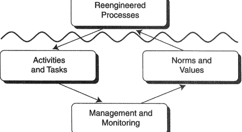

## 为流程改进维持文化

图 `1.2` 中的菱形图显示了重组后的流程得以有效实施必须具备四个要素。仅仅有重组后的流程是不够的。如果没有活动、管理和监控方法以及嵌入组织文化的规范和价值观的相应变化，新流程将失败——这些是图 `1.2` 中波浪线所绘的表面下的无形因素。

将重组后的流程视为水面上可见的冰山角。向员工强加新方法是行不通的，特别是流程已经过真正的重组时。超过一半的重组努力失败了，因为公司忽视了水下文化因素的关键重要性。如果预期的投资回报惨不忍睹，公司无法承受其在新流程上的巨大投入。因此，关注文化基础已成为强制性要求。

`transforming`（转型）一词旨在捕捉这一历程以及动态命名新文化的需要。这要求以人们执行操作、培养新关系以及在不断发展的组织网络中增加价值的方式来对新文化进行建模：满意的员工 → 满意的客户。

## 向内关注

虽然每个人都能从动态文化中受益——员工、客户和股东——但现在的重点是内部；除非你改变内部环境（即员工），否则你无法改变外部环境。领先公司日益明显发现，员工的成功和组织的成功是紧密交织的。因此，确保员工是组织的驱动者，与客户和投资者处于平等地位，对于创造动态工作环境至关重要。使员工满意度成为对自身成功和组织成功责任的核心驱动力。客户关系反映了员工关系：“像你对待客户那样对待你的员工。”

必须激励员工投入到长期的承诺旅程中。承诺不同于合从。承诺需要员工的心、头脑和手的参与——而合从需要员工的手。

## 动态文化概述

理解实现转型的经理领导者角色是重要的。以下是提供框架的五个关键点：

1. 描述动态文化的通用语言：文化的三个层次模型——行为、规范和价值观以及假设提供了一个框架。
   - 20 种行为：“入门套装”。
   - 三种规范：获胜、执行、团队。
   - 四种价值观：尊重、诚信、团队、卓越。
   - 假设：包括关键原则和思维模式。

2. 转型需要经理领导，领导者负责管理：这就是使用“经理领导者”术语的原因。“信息安全经理”、“信息安全领导者”和“经理领导者”等术语将得到定义。


3. 信息安全经理领导者领导、管理和执行：经理领导者加速向动态文化的行为转型：

   - 领导：“领导组织/设定方向”和“以身作则/日常领导”。
   - 管理：“管理业务流程”和“管理人力资源/员工”。
   - 执行：“执行特定任务”。

4. 经理领导者的技能模板与其角色一致：“信息安全经理-基础”技能模板包含 50 种技能，其中 15 种是关键技能，对应信息安全经理领导者的角色。

5. 员工是最重要的资产：动态公司/文化需要高技能和高积极性的员工，信息安全经理领导者必须优先营造吸引和留住人才的环境。

## 信息安全经理领导者所需的领导力

理想情况下，信息安全经理领导者对自己以及阻碍转型速度的障碍感到不耐烦。他们需要紧迫感，这源于意识到业务结果取决于这些变化的成功。

首先，正如转型使命暗示的，信息安全经理领导者需要成为变革赞助者、变革代理人、变革倡导者和适应者。他们需要接受这些变革角色，并成为变革吸收者，在“解冻”当代文化/公司时减轻痛苦、困惑和挫败感。其次，他们需要跨部门协作并在关系网络中模拟团队合作。第三，信息安全经理领导者在投入长期的承诺旅程时，需要担任教练和协调员。承诺不同于合从。承诺需要员工的心、头脑和手的参与——而合从需要员工的手。

## 通过动态文化实现信息安全

合从需要执行他人想法的清晰度和参与。信息安全经理领导者需要理解承诺与合从之间的巨大差异。承诺需要清晰度、相关性、参与和意义，如图 1.3 所示。

## 承诺模型

# 安全管理

表 1.3 四要素承诺模型

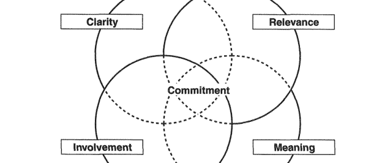

合规性。一个动态的文化/公司能够释放那些致力于他们参与塑造的、清晰、相关且有意义的目标的员工潜力。

当以下四个要素到位时，员工将投入到新的动态文化中：

- **清晰性**：员工理解什么是新的动态文化——这种文化的特征对他们来说是的，并且能够向他人阐述。
- **相关性**：员工看到新的动态文化与公司业务成功的相关性——他们看到这将如何有利于公司的客户并帮助公司增长。
- **意义感**：员工看到新的动态文化对个人的意义——它对他们个人意味着什么，并且他们对此感到兴奋。
- **参与感**：员工希望并参与新的动态文化的塑造和部署——由于如果没有承诺，要让每个人参与大规模变革的塑造是不切实际的，他们选出的代表可以参与。给予员工参与的选择是关键点，即使他们选择不参与。

这种需要所有人，特别是 IT 管理人员-领导者，帮助维持这段旅程而不倒退——不断地强化、演进和培养动态文化/公司。总而言之，IT 管理人员-领导者促成了动态文化，产生了高度满意和忠诚的客户，推动公司增长。

# 变革模型

变革关乎改变。有很多模型描述了个人变革和组织变革的阶段。表 1.4 中的变革模型概述了五个阶段，这些阶段为文化变革提供了有用的背景。本书通过以下方式支持文化变革的早期阶段：

- 阶段 1：识别需求。该阶段受到增长拉力和外部环境推力的支持。正如表 1.2 所解释的那样，还有避免浪费公司在重组方面巨大投资的推力。

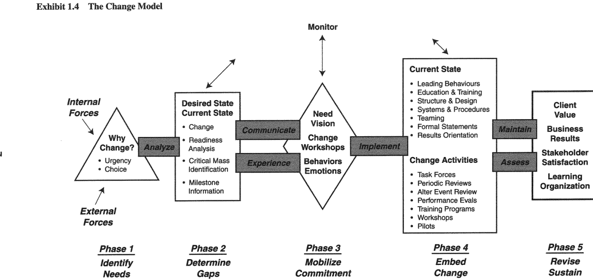

# 安全管理

- **阶段 2：确定差距。** “理想状态”将在章节“动态文化变革”中描述，其中包含评估问卷以帮助识别差距。

我们对 IT 管理人员-领导者的角色和技能的概述涉及以下内容：

- **阶段 3**：动员承诺。
- **阶段 4**：嵌入变革。
- **阶段 5**：修订和维持。

然而，考虑到文化变革是一个持续的过程，这些阶段将需要更多的迭代。

## 动态文化变革

阶段 2 暗，如果我们希望 IT 管理人员-领导者帮助加速向动态文化/公司的转型，我们需要确切明确这种理想的动态文化看起来是什么样的。

将任何组织转变为动态文化/公司都是量级的变化。进展似乎是不可及的——长万里之途——但可以一步步完成。企业文化的三个层次模型表明文化是由行为、规范、价值观和假设组成的。IT 管理人员-领导者帮助将规范、价值观和假设带出来，并将其转化为新的动态文化/公司。（见表 1.5。）

表 1.5 组织文化变革

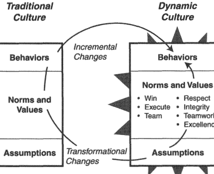

## 特质识别

最明显的信号取决于员工的行为方式。这需要判断和有价值的思考，并且没有明确的答案。

通过管理类文章、高管演讲和多次讨论，识别出了动态安全文化中的20 种行为。它们是一组入门方案，旨在作为动态组织对话中达成的更具体行为的催化剂。

## 动态文化变革

表 1.6 成为动态公司的意义


为了帮助在现有框架背景下理解这些行为，它们围绕三个基础组织承诺：`win`、`execute`和`team`进行组织。

动态公司六六核心要素，如表 1.6 所示。动态文化/公司的拼图碎片如下：

- 1. 公司
    - 其员工是一个充满活力的全球团队。
    - 它在为客户创造价值方面领先。
    - 它通过技术、集成解决方案和服务赢得胜。
    - 它建立了股东价值。
    - 它参与了我们的社区建设。
- 2. 价值观
    - 它期望每位员工具备团队合作、诚信、尊重和卓越。
- 3. 工作
    - 它在做正确的事。
    - 它被帮助其赢得和学习的工作注入了活力。
    - 它根据原则而非规则工作。
    - 它对自己的产品和服务感到自豪。
    - 它使用自己所卖的东西。
- 4. 团队
    - 其员工是多样化的。
    - 它分享并利用知识。
    - 它对提高技能投入了持久的关注。
    - 它是负责的。
    - 它自觉地分享结果的荣誉。
- 5. 奖励
    - 其员工获得有竞争力的薪酬和福利。
    - 奖励基于个人和公司结果。
    - 安全来自于其与客户的成功。
    - 它选择在平衡工作和个人优先级之间做出选择。
- 6. 领导力
    - 其领导者制定并传达胜利战略。
    - 其领导者知道要做什么并执行。
    - 其领导者在思考上很大胆，对新想法持开放态度。
    - 其领导者广泛分享信息。
    - 它的领导者言行一致。

## 动态文化的十个属性

以下是员工需要展示的十个属性：

1. 专注于赢
2. 坚持结果
3. 对官僚主义的厌恶
4. 设定激进目标的欲望
5. 相信责任制和承诺
6. 在真相不愉快时关注真相
7. 对多样化同事的敏锐认可
8. 对质量和生产力的关注
9. 对公司产品的极度忠诚
10. 与客户和同事的卓越沟通

## 十五点清单

1. 是否专注于赢？
2. 是否对结果有坚持？
3. 是否对官僚主义感到厌恶？
4. 是否有设定激进目标的欲望？
5. 是否相信责任制和承诺？
6. 在真相不愉快时是否关注？
7. 对多样化同事是否敏锐认可？
8. 对质量和生产力的关注？
9. 对公司产品是否极度忠诚？
10. 与客户和同事是否有卓越沟通？
11. 是否能利用变革？
12. 是否不受地点或思维束缚？
13. 你是否分享并利用知识？
14. 你是否不断提高技能？
15. 你是否期望同事具备团队合作、诚信、尊重和卓越？

## 期望的行为：赢、执行、团队

根据十个相似项和十五个答案，定义了`win`、`execute`和`team`的组织承诺的步骤。（另见表 1.7。）

## 赢

1. 专注于赢/创造最大价值
2. 客户第一/公司第二/部门第三
3. 设定激进目标
4. 坚持结果
5. 让员工对承诺负责

## 执行

6. 表现出对质量和生产力的关注
7. 使用并对公司产品忠诚
8. 有效的沟通/倾听
9. 欢迎真相
10. 利用变革
11. 对官僚主义表现出厌恶
12. 对技能提高投入持久的关注
13. 承诺成为流程管理的业务
14. 树立工作与生活的平衡

## 团队

15. 在尊重、诚信、团队合作和卓越方面言行一致
16. 重视多样性
17. 分享并利用知识
18. 行动不受边界限制
19. 赋能个人和团队
20. 充满活力地构建跨部门/全球团队合作

## 动态文化自评估

在 1 到 5 分的范围内，1 代表“低性能”，5 代表“动态”，对动态文化/公司的以下每个方面进行评估。

## 图 1.7 支持动态文化行为的倡议

| 期望行为 | 支持动态公司/文化的倡议 |
| --- | --- |
| **赢胜 (`win`)** | • 设定目标 |
| 1. 专注于赢胜/创造最佳客户价值 | • 示例 |
| 2. 客户优先/公司第二/部门第三 | • 目标 |
| 3. 设定进取目标 | • 结果 |
| 4. 坚持结果导向 | • 问责 |
| 5. 让员工对其承诺负责 | • 重组/规模与规模 |
| **执行 (`execute`)** | • 扁平化组织 |
| 6. 关注质量和生产力 | • “快速融入”清单 |
| 7. 使用并对公司产品忠诚 | • “适合你”卡片 |
| 8. 有效的沟通/倾听 | • 授权 |
| 9. 欢迎真相 | • 技能流程 |
| 10. 把握变化 | • 技能重点 |
| 11. 对官僚主义表示厌恶 | • 职业发展 |
| 12. 对技能改进投入持续关注 | • 专家职业 |
| 13. 致力于成为流程管理型企业 | • 职位动态 |
| 14. 营造工作/生活平衡的模型 | • 全球流程 |
| **团队 (`team`)** | • 工作负量研究/模块 |
| 15. 在尊重、诚信、团队合作和卓越方面身体力行 | • 多样性委员会 |
| 16. 重视多样性 | • 多样性培训 |
| 17. 分享并利用知识 | • 灵活的工作选择 |
| | • 团队实施 |
| | • 团队研讨会 |
| | • 团队化奖励 |
| | • 360度反馈 |
| 18. 行动不受边界束缚 | • 同行认可 |
| 19. 赋能个人和团队 | • 职责对比工作 |
| 20. 充满活力地构建跨部门/全球团队合作 | |

## 动态文化转型

## 赢胜 (`win`)

1. 你是否专注于赢胜——专注于成为为客户创造最佳价值的领导者，并利用技术、集成解决方案和服务？
2. 你是否在所有决策中都明显地做到“客户优先/公司第二/部门第三”？
3. 你是否参与了你的社区建设？
4. 你是否设定了进取目标？
5. 你是否由对自身使命的共同愿景所驱动？
6. 你是否坚持结果重于努力？
7. 你是否根据个人和公司的结果获得具有竞争力的薪酬和福利？
8. 你是否让员工对其承诺负责？

## 执行 (`execute`)

1. 你是否关注质量和生产力？
2. 你是否对公司的产品和服务有强烈的忠诚度？
3. 你是否会自豪地使用你所销售的产品？
4. 你是否在客户和同事之间练习卓越的沟通/倾听？
5. 你是否欢迎真相，即使它是令人不悦的？
6. 是否鼓励具有挑战性的询问？
7. 你是否能把握变化并快速采用新的工作/角色和结构？
8. 你是否对新想法持开放态度？
9. 你是否对官僚主义表示厌恶？
10. 你是否知道该做什么并付诸行动？
11. 你是否持续努力以提高你的技能？
12. 你的管理和衡量系统支持你成为一家流程管理型企业吗？
13. 你是否在营造工作/生活平衡的模型？
14. 你是否在做正确的事情？
15. 你是否因工作而感到充满活力？
16. 你是否在平衡个人生活优先级方面做出了明智的选择？

## 团队 (`team`)

1. 你是否在个人层面做到了尊重、诚信、团队合作和卓越？
2. 你是否期望同事展现尊重、诚信、团队合作和卓越？
3. 你是否重视多样化、充满活力的同事？
4. 你是否广泛地分享并利用知识？
5. 你工作是否不受地点或思想边界的束缚？
6. 你是否会尽责地分享结果的功劳？
7. 你是否乐意帮助你全球化公司中的他人？
8. 你是否在赋能个人和团队？
9. 你是否根据原则而非规则工作？
10. 你是否充满活力且显性地展示跨部门的团队合作？

与公司内其他人的持续讨论对于评估表现最低的行为以及决定可以采取哪些措施来改进它们具有价值。

## 准则与价值观

准则类别的三个承诺是：

1. 赢胜 (`win`)
2. 执行 (`execute`)
3. 团队 (`team`)

四个价值观是：

1. 尊重 (`respect`)
2. 诚信 (`integrity`)
3. 团队合作 (`teamwork`)
4. 卓越 (`excellence`)

由此产生的缩写有助于人们记住这些是“RITE”价值观。其中，尊重和卓越似乎源于公司的基本信念，这加强了进行对话的必要性，以确保所有人理解这些价值观的当前含义。

## 系统、结构与流程

公司需要系统、结构和流程来进行全球运营。这些示例包括：

- 系统：管理和衡量系统；奖励和认可系统
- 结构：层级制或团队制；职能制或矩阵结构
- 流程：客户关系管理 (`CRM`); 集成产品开发 (`IPD`)

当系统、结构和流程与目标不一致时，转型努力将是徒劳的。

## 假设

假设是那些我们理所当然、甚至不会去思考的设定——我们识别出的潜在偏见和见解，它们是变革的强大催化剂或阻碍。我们认为这些范式看待世界的方式。由于它们反映了关于人性、信任、时间范围和内部竞争的假设。例如，“团队/部门越大，我就越重要”可能根根于层级思维，“我掌握的越多、引导和领导的，我就越有”可能基于知识的团队结构；而“我掌握的越多，对他人的权力就越大，并会导致我的职业晋升”可能存在于政治驱动环境中。

如果假设与准则、价值观和行为一致，则具有一致性。如果不一致，则意味着存在错位，需要重新审视，甚至可能是第一次发现它们。

表 1 中的陈述/假设为讨论提供了一个起点，并提供了一些引发对话和思考的建议。还有许多假设，可能并不是你提到的这些。术语的选择及其背后的含义对动态文化中的团队合作、赋能和管理方法有深远影响。找到有效的方法来发现这些隐藏的假设是困难且紧迫的——而且才刚刚开始。

## 是经理、领导者还是经理-领导者

在许多公司中，经理和领导者的词是互换使用的。“经理”出现在名片上的频率更高。“经理”作为职位名称使用的比“领导者”更多，它意味着对员工和业务流程的责任。经理获得业务结果。

“领导者”标签通常应用于肯尼迪、甘迪等著名领袖，以及通用电的韦尔、微软的比盖茨等商业领袖。在组织层级结构中，顶部的员工通常被称为“领导者”。在团队制组织中，“领导者”和“领导力”可以适用于任何人——通常指“团队负责人”、“项目负责人”、“一线经理”、“高级管理人员”或“执行者”。领导者设定方向。

## 图表 1.8 转向动态思维

### 一组假设

### 动态假设

#### 关于人性

- 员工本质上不喜欢工作，他们懒惰，需要被强制和控制，并倾向于让上级为他们做决定。
- 员工本质上喜欢有意义工作的挑战，并且当他们做出影响工作环境的决策时，会感到充满活力。

#### 关于信任

- 信任与权力挂钩；上级不受质疑，因为他们的行为或价值观必须有充分的理由。
- 展现出正直和能力、并鼓励和开启双向对话的信赖员工可以赢得信任。

#### 关于激励

- 外在的“胡萝卜加大棒”是员工的动力。
- 内在满足是激励员工的动力——奖励是“卫生因素”。

#### 关于时间范围

- 短期生存/成功至关重要；我们可以通过节约来获得利润；股价的每日波动影响我的心情。
- 长期生存/成功至关重要；我们基于客户的终身价值和原则采取行动；客户和员工满意度的趋势影响我的心情。

#### 关于内部竞争

- 内部竞争能激发员工的最优表现，应该被鼓励以刺激高绩效；奖励制度应该促进努力比同伴更好。
- 内部竞争破坏团队合作，抑制共享和杠作用，并使团队成员民主化；奖励制度应该促进协作。

## 领导或管理

领导与管理领域的术语可能是一个语义地雷区。关于经理、领导者和高管的文章已数以千千计。关于领导力的书籍、视频和演讲爆发式增长，特别是在过去的十五里。遗憾的是，大多数作者在定义术语时并不清晰。然而，从“专家”们说法的精髓中，以下列表提供了领导与管理之间的一些总体区别：

- 领导是设定方向；管理是到达那里。
- 领导关注长期视野；管理关注短期底线。
- 领导员工；管理过程、系统和结构。
- 领导是辅导、赋能、促进和服务；管理是计划、控制和指导。
- 领导是做正确的事；管理是把事做对。
- 领导是引导范式之间的变革；管理是在范式内维持和运营现状。

## 动态文化转型

- 基于能力的赢得权力进行情境领导；从去中心化的职位权力进行管理。
- 领导支持创新的无序性；管理渴望秩序。
- 领导激发对新方向的信念；管理要求证明。
- 领导依赖信任；管理依赖控制。
- 领导是问“什么/为什么？”；管理是问“怎么做？”

## 领导、管理与执行

我们过早地开始对这些特征进行价值判断了。我们既不需要领导也不需要管理，而是两者都需要，如图表 1.9 所示。对于体现了领导与管理能力丰富融合的人，更倾向于使用“完整领导者”这一标签。“完整经理”一词也同样有效。这种对领导与管理的理想混合通过乔尔·巴克（`Joel Barker`）视频《愿景的力量》结尾的引言得到了进一步强化：

> 没有行动的愿景只是梦想；
>
> 没有愿景的行动只是在虚度光阴；
>
> 有愿景的行动可以改变世界。

根据图表 1.9 中的“完整领导者”，可以注意到领导力这一术语包含了领导、管理和执行。领导力的工作定义是“有效设定/重置方向并树立人际行为标准（领导），对齐/管理业务和人力/员工以实现预期的业务结果（管理），并个人对预期业务结果做出贡献（执行）”。

### 图表 1.9 管理与领导


### 图表 1.10 领导力要素

| 角色类型 | 管理职责 | 领导职责 |
| :--- | :--- | :--- |
| **甩手掌者** | 完整领导者 | 梦想家 |
| 低 | 低 | 高 |

图表 1.10 显示，任何工作中都存在不同程度的领导、管理和执行技能。也就是说，领导力是一个总术语——领导、管理和执行是信誉领导力的子集。图表 1.10 还表明，领导力在整个组织中都是预期的——它并不是高级经理和高管的特权。某些员工在特定情况下可能会担任领导者的角色。其他人可能是更永久的领导者，例如在高职位或某些团队中。在情况下，确保业务成功的领导要素是相同的。结论是，需要“完整经理”来领导，需要“完整领导者”来管理。对于典型的组织而言，“经理-领导者”适用于那些被称为“一线经理”、“二线经理”、“高级领导者”或“高管”的员工。他们也可能是“团队领袖”。

| 专业人员 | “领导力”维度 | 领导组织 / 设定方向 | 管理业务流程 | 执行具体的业务任务 |
| :--- | :--- | :--- | :--- | :--- |
| 团队领袖/一线经理 | 以身作则 / 日常领导 | | 管理人力资源/人员流程 | |
| 高级领导者 | 0% | 管理 | 执行 100% | |

## 自主/自导型员工

员工正对自己的工作、职业、技能、自我评估等承担越来越多的责任。这是健康的，并鼓励他们控制自己的命运，而不是采取更具家长式的做法。员工在所有领域的不断赋权使公司能够对客户做出更敏锐的反应，并减少对经理——领导者计划、控制和指导员工及业务流程的依赖。这是本章的一个基础假设，并与领导和管理自身的观点一致。

## 全方位模型

工作是角色的集合。“全方位工作模型”展示了任何工作中领导、管理和执行的角色，并以个人特质和属性为共同基础。如图表 1.11 所示，任何工作包含五个角色，程度各异。这可能对所有人来说并不清晰，但经理领导者有助于在组织内部使这些角色合法。五个角色如下：

1. **领导组织/设定方向**。这一角色是关于设定方向并实现它。它包括：
    - 构想并激励组织未来的共同愿景
    - 通过开放的信息流进行沟通
    - 获取变革的承诺
    - 在组织内外建立联系
2. **以身作则/日常领导**。这一角色包括在个人和团队的数百个每日真实时刻中展示人际领导力。注意，这涉及到所有其他角色，并加强了领导、管理和执行角色之间的相互依赖关系。领导者的职位越高，“鱼缸效应”就越大——`CEO` 的每一个行动都被组织解读为具有意义和意图，无论其用意如何。这一角色包含了转型为动态文化的经理领导者的关键`3C`描述：
    - a. 教练（这反过来需要考虑、勇气、坦诚和正直）
    - b. 变革推动者（需要沟通、鼓舞和个人的投入）
    - c. 协作者（需要创造力、能力和共同目标）
3. **管理业务流程**。这一角色包括：
    - 管理对既定工作方法的承诺
    - 挑战那些无法为满意客户提供盈利解决方案的业务流程
    - 管理财务
    - 发起必要的改进以实现业务结果

    存在一个公认的矛盾：重组流程需要领导，但一旦主要的新流程运行，就需要管理，这包括实施持续改进和管理业务财务方面。

4. **管理人力资源/员工流程**。这一角色确保后文描述的五个人力/员工管理流程得到有效执行。

### 图表 1.11 工作模型


5. **执行具体的业务任务**。这一角色包括单独或团队形式执行特定任务，以实现业务成果。

## “全方位模型”的关键因素

适用于全方位模型（`Total Job Model`）的有四个关键因素。

1. **“领导”、“管理”和“执行”适用于所有人。** 所有员工都会发现自己正在履行五种角色。根据责任等级的不同，每个角色的重点可能有所不同，但其基本要素是相同的。个人的风格是独特的，组织正处于演化的不同阶段，外部环境因素可能会发生意料之外的变化——这并不是关于哪种角色更受青睐以及该如何执行它们的问题。

3. **管理型领导者负责“执行”。** 由于组织部门规模缩减、管理层级减少并变得更加团队化，管理型领导者发现他们正在从事更多工作——在某些情况下，甚至是面向外部客户的计费工作。管理型领导者日益被保持技术技能，以便他们独立或作为团队成员执行任务。

4. **整体工作大于各个角色的总和。** 尽管很难将管理型领导者的工作描述为具体的角色，但这项工作要求在现场对所有角色进行强大、有效且独特的结合。这一点通过图表体现，即“以身作则/日常领导”涵盖了所有角色；然而，也可以认为所有角色是重叠的。正如汽车的本质是交通，而非引擎、轮子、座椅、变速箱等的总和，管理型领导者也高于上述角色或部分的总和。正是这些全面且整合的组合使得管理型领导者有效。

我们每个人在各种角色中都有独特的优势组合，某些领域的竞争能力会相互抵消。换句话说，领导力是一种艺术。我们对领导力组成角色的“科学”分析，仅仅是为了突出有助于有效管理型领导者的方面。

## 应用于信息系统（`IS`）管理领导者的全方位模型

审计人员应该询问信息领导者在过去的几个月里是如何分配时间的，每天关注的焦点是什么。如果让他们将这五个角色从最不主导到最主导排序，顺序是怎样的？请对列表从 `1` 到 `5` 进行排序，`1` 表示最不主导的角色，`5` 表示最主导的角色。

- 组织/设定方向
- 以身作则/日常领导
- 管理业务流程
- 管理人力资源/员工流程
- 执行具体任务

## 动态文化转型

列出管理型领导者执行的所有不符合上述类别的活动。思考题：如果在接下来的六个月里采取不同的主导重点，他们会更有效吗？

管理型领导者的五种角色使他们能够完成将组织转型动态文化的使命。表 1.12 显示了这些角色如何贡献于之前概述的动态文化的二十种行为。

### 表 1.12 角色如何支持动态文化行为

| 预期行为 | 设定方向 | 以身作则 | 管理业务流程 | 管理人员流程 | 备注 |
| :--- | :--- | :--- | :--- | :--- | :--- |
| 1. 专注于获胜/创造最佳客户价值 | | H | H | H | M |
| 2. 客户优先/公司第二/部门第三 | | H | H | M | M |
| 3. 设定进取目标 | M | L | H | H | L |
| 4. 坚持结果 | M | L | H | H | L |
| 5. 让员工对他们的承诺负责 | M | L | H | H | L |
| 6. 关注质量和生产力 | M | H | H | H | H |
| 7. 使用并忠于公司产品 | M | H | H | M | H |
| 8. 有效的沟通/倾听 | H | H | M | M | L |
| 9. 欢迎真理 | M | H | L | M | L |
| 10. 利用变化 | M | H | H | M | L |
| 11. 对官僚主义表现出反感 | L | H | H | H | M |
| 12. 对技能的持续关注 | L | H | M | H | M |
| 13. 致力于成为流程管理业务 | M | M | H | H | M |
| 14. 工作/生活平衡的模范 | L | H | L | M | M |
| 15. 在尊重、诚信、团队合作和卓越方面言行一致（“RITE”价值观） | M | H | H | H | M |
| 16. 重视多样性 | M | H | M | H | M |
| 17. 分享并利用知识 | M | H | M | H | M |
| 18. 无边界限制地行动 | M | H | H | L | M |
| 19. 赋能个人和团队 | M | H | H | H | L |
| 20. 充满活力地建立跨部门/全球团队合作 | H | H | H | H | M |

## 人力资源/员工流程

人力资源（`HR`）/员工流程由于其重要性需要更多的解释。因为它们是流程，所以有一致的步骤构成了执行每项任务的最佳方式。因此，管理流程意味着确保正确遵循这些步骤。（见表 1.13。）

执行质量应当符合其所得缩写词的目标，正如这些字母唱出的旋律一样，“没有人比我们 `BEDER`（此处原文应为 `Better`，做得更好）。”以下五个流程进行了详细描述：

- **平衡**。这一流程包括
    - 将发展规划纳入业务
    - 理解何时配置人员以及何时使用外部资源
    - 按照政策确保人员配置
    - 使用技能标准进行招聘和雇用
    - 应对市场多样性

### 表 1.13 人力资源/员工流程

- **按预期使用员工流程**。
- **参与员工**。这一流程包括
    - 将员工的愿景/使命/价值观/目标与组织目标对齐
    - 对新员工进行引导
    - 创建一个满足个人需求和期望的环境，让他们充满活力
- **发展技能**。这一流程包括
    - 评估整个部门所需的技能
    - 确保整个部门拥有所需的技能互补
    - 支持并培养部门成员的个人技能计划（`ISP`）
    - 为员工分配与其技能计划的发展活动
    - 通过公开使用技能工具和提升个人技能来模范
- **评估绩效**。这一流程包括
    - 在他人帮助下，根据计划承诺进行评估
    - 确保在内部及相关部门之间的评分公平
    - 召开评估会议
    - 处理任何承诺问题或机会
- **认可贡献**。这一流程包括
    - 通过建立正确的职位级别并遵循薪酬指南公平地补偿员工
    - 以开放回应的方式沟通并解释整体补偿计划
    - 根据员工表达的偏好选择合适的奖励和认可
    - 征求同事关于谁应该被认可以及如何认可的意见
    - 利用组织提供的全系列正式奖励
    - 特别关注最简单、最有价值且最被低估的认可——真诚的“感谢”。

## 管理型领导者的责任

通常，管理型领导被定义为“负责确保有效管理员工流程和/或业务流程的人员”，以实现业务成果。这种责任通常伴随着对这些流程的共同责任。

经理-领导者定义中的每个元素都至关重要：

- “其工作包括确保……的责任人……因为经理-领导者对员工和/或流程产生的可衡量结果负最终责任。无论结果是个人完成还是与其他共同承担责任的人完成，这种责任始终存在。”
- “对员工流程进行有效管理……”因为经理-领导者对员工或人力资源流程负责。每位经理-领导者都需要了解这一点。

相反，每位员工都必须清楚谁在为他们的流程提供支持，特别是在矩阵式组织中。经理-领导者共同共同责任，员工信任基于流程的方法将确保业务部门之间的一致性。

- “和/或业务流程”因为经理-领导者通常对员工流程和业务流程负责。虽然流程在整个组织中是通用且共同的，但业务流程取决于部门自身的授权。诸如客户关系管理（`CRM`）等流程在整个流程部门和销售组织中是一致的，但不适用于许多制造和开发部门。对于员工流程，经理-领导者可以与其他分担许多业务任务的责任，但对业务结果的成功实现负责任。

当使用“经理”一词时，它是经理-领导者的简写，其工作包括对确保员工流程和业务流程有效管理负责任和共同责任。经理-领导者可以是一线经理、总经理、高级领导者或高层执行官。这种责任是他们共同拥有的。这是基本要求，显然并不新鲜。新奇之处在于，在许多情况下，传统经理的角色被碎片化分配给了多名员工。

## 经理的新角色

新奇的是将传统的经理角色拆分给多名员工。由于我们的团队协作方法和专业知识，曾经由单个人（“经理”）完成的工作，现在通常由几名员工完成。

描述这种共享责任矩阵的很有用术语是“价值网”。组织需要培养“精通网络”的 `IT` 经理-领导者，他们能够完全了解自己如何创造价值，以及如何建立构成其价值网的关系网络。这个由员工、合作伙伴和供应商组成的网络与如今许多组织中盛行的组织结构有何不同：

- 网络中所有的“眼睛”都看向客户，而不是经理。
- 控制是通过流程而非层级实现的。
- `IT` 经理为客户优化价值创造流程。
- 文化有了新的锚点：价值创造、能力和团队协作。

- `IT` 经理需要是精通网络的实践者，而不是传统意义上的职位持有者。
- 基于信任建立的关系至关重要。

传统管理工作在多名员工之间的碎片化是新结构的基础。专职经理的示例包括：

- **资源协调员**。此人不是传统意义上的经理，但负责将具有高价值技能的员工部署到各个项目中。
- **项目/提案领导者/经理**。此人监督工作的实际执行。员工在不同项目之间移动，因此在一年中会有一系列领导者。根据项目的性质，其中一些人通员工的专业知识，另一些则不通。此人的主角色是前述描述的总体工作模型中的“管理业务流程”。
- **技能/能力经理/导师**。由于员工是专家，因此需要一位深耕其领域的人来指导他们何时应该阅读、应该加入哪些协会等。在服务业，这些是实践领导者。在其他地方，这种形式则较不正式。这一角色构建了公司的知识资本，并集中于“管理人力资源/员工流程”角色中的“开发技能”流程。
- **个人经理**。个人监督涉及聘用、转岗、评估和评价、介绍规划教育、处理加薪等相关的流程。他们确保“管理人力资源/员工流程”角色中的所有“`BER`”（入职、变更、离职）流程良好运行。
- **地点经理**。通常，如果员工有一个“远程”经理，当地经理将处理个人问题、设施等事项。地点经理帮助确保远程管理员工具有社区感和归属感，并通常会执行总体工作模型中五个角色的结合。

这种经理角色拆分的现象正在许多企业中发生，他们正转向虚拟的、基于项目的结构。由于将这些角色尽可能无缝地结合在一起很重要，让我们看看它们如何共同为五个人力资源/员工流程形成价值网。示例源自客户关系管理（`CRM`）环境，尽管也适用于其他领域。

## 人力资源/员工流程的共同责任

一些团队领导（`TL`）及其团队已达到某种经验和能力水平，使他们分享或承担许多经理-领导者的责任。当团队领导的业务和技术知识允许其在日常领导团队，且管理跨度支持很大时，情况尤其如此。其他团队领导可能是新手，与处于发展早期阶段的团队合作，此时经理-领导者可能需要更多参与。这种参与/赋权的光谱可见图 1.14。

图 1.15 显示了碎片化的经理角色是如何汇聚的。团队领导角色下的“特定于团队”表述承认了在整个组织中为团队领导定义一个一一无切的角色是不可能的。存在极其多样化的团队实施方案，这些不应受规定蓝图的限制。团队领导可能是“技能/能力经理/导师”。

### 图 1.14 经理责任的光谱

| 领导者/团队的赋权程度 | 低 0 | 1 | 2 | 3 | 高 |
| :--- | :--- | :--- | :--- | :--- | :--- |
| 描述 | 经理-领导者执行任务，无团队输入 | 经理-领导者执行任务，有团队输入 | 团队领导执行任务，有经理-领导者输入 | 团队领导执行任务，无经理-领导者输入 | |

*注：原文中存在一段看似错位的文字：“此前或其他‘基地’团队，该人在项目之间会返回。”此处保留语义，但根据上下文推测其属于前文或图表说明的残留，鉴于排版需求保留在相关段落附近或忽略，此处根据严格不删减原则保留在图1.14后。*

此前或其他“基地”团队，该人在项目之间会返回。

图 1.15 底部的图例说明“`MGR`”指的是“持有职位的经理”。这就是前述描述的个人经理，他是本章介绍的主要经理-领导者之一。

在跨职能团队中，可能涉及多个经理-领导者。此外，团队的领导力通常在 `TL` 和团队成员之间共享。是否存在与人力资源流程相关的经理权力是不可能与团队领导共享的？薪酬管理、招聘员工（做出最终决定和录取）以及管理个人绩效问题似乎仍然是经理-领导者的责任。无论赋权程度如何，经理-领导者对员工流程的有效运行仍负责任——并与赋予责任的其他人更多共同所有权。

### 图表 1.15 五大人力资源流程——职责与责任矩阵

| | 流程角色（例如 `CRM`） | MGR | TL | EE | RC | PTL | PRT |
| :--- | :--- | :--- | :--- | :--- | :--- | :--- | :--- |
| **平衡资源** | | A | S | P | E | C | A |
| | | | I | R | | | |
| | | R | R | | | | |
| **激励员工** | | F | C | R | R | | |
| | | T | O | R | | | |
| | | O | R | | | | |
| | | R | A | | | | |
| | | A | T | | | | |
| | | T | E | | | | |
| | | E | A | | | M | |
| **发展技能** | | | | | | | |
| **评估绩效** | | | | | | | |
| **认可贡献** | | | | | | | |

*(注：原表格结构较为复杂且存在错位，上述表格尝试还原其视觉逻辑，但原文中表格数据行与列对应关系在纯文本中难以完美对齐，以下列出原文中的图例和角色描述内容)*

**平衡资源**
- 确定招聘来源
- 招聘、筛选、聘用员工
- 转岗/调动员工
- 解雇员工

**激励员工**
- 设定愿景/使命/价值观/目标
- 理解工作关联性——业务/个人
- 建立特定目标
- 对齐并设定整体目标
- 将员工分配到特定的项目机会
- 建立特定的项目目标
- 确定 360 度输入来源和机制
- 创建能够激发投入的环境
- 提供持续的反馈、辅导和咨询
- 评估参与投入度水平
- 就“适合你”达成共识
- 解决激励/投入度问题

**发展技能**
- 针对需求开发团队技能差距
- 制定团队技能投资计划
- 根据技能计划为员工分配角色
- 确保个人发展计划（`ISP`）到位
- 确保个人/团队技能得到建立
- 衡量流程的有效性

**评估绩效**
- 收集绩效数据——360 度输入
- 确定整体评估
- 执行评估
- 解决承诺问题/机会

**认可贡献**
- 识别认可机会
- 确定适当的认可
- 持续交付认可

**角色图例**：
- `MGR` = 部门经理
- `EE` = 员工
- `TL` = 团队负责人
- `RC` = 资源协调员
- `PTL` = 提议团队
- `PRTL` = 项目团队负责人
- `A` = 负责（确保完成；有权授权）
- `R` = 执行（负责具体工作）

## 经理-领导者的关键特质

- 展现原则和目的的一致性。
- 表现强大的道德准则。
- 遵循上述价值观和原则。

1. **诚信**
- 2. **业务判断力**（“聪明”）
    - 展现系统性思考的能力。
    - 展现创造力和创新精神。
    - 平衡直觉与深思。
    - 良好地处理复杂性和模糊性。
    - 表现自己“学习能力快”。
    - 前瞻性思考并做好良好预测。
    - 表现良好的常识和平衡的观点。
- 3. **勇气**
    - 展现信念的勇气。
    - 承担应该承担的风险。
    - 站出来并承担责任。
    - 展现与众不同的意愿。
- 4. **成就导向**
    - 努力成长和改进。
    - 表现成功的渴望。
    - 设定清晰且进取的目标。
    - 采取主动并领先。
    - 表现承担更多责任的渴望。
- 5. **能量**
    - 拥有高能量。
    - 展现能量并激励他人。
    - 平衡个人需求。

## 特质/属性是赋予

这些特质对每个人来说都很重要。将它们视为“准入因素”——员工必须具备这些特质才能成为经理级领导。


动态的公司在招聘员工时寻找理想的特质，因为员工在加入组织时通常已经表现出了这些特质——将它们视为某种天性或后天培养混合的初始“给定项”。理想的特质需要在一个强化性的文化环境中被明确化、更新、被庆祝并被重视。

## 改进特质的方法

这些特质对每个人来说都很重要。将它们视为“准入因素”——员工必须具备这些特质才能成为经理级领导。

动态的公司在招聘员工时寻找理想的特质，因为员工在加入组织时通常已经表现出了这些特质——将它们视为某种天性或后天培养混合的初始“给定项”。理想的特质需要在一个强化性的文化环境中被明确化、更新、被庆祝并被重视。

## 改进特质的方法

如果特质和属性很重要，如何改进它们？

特质和属性的改进方式是重要的。图表 16 展示了技能和属性的改进方式。通过持续性的反馈、辅导和反思，技能和属性可以得到改进。在一个强化性的文化环境中，这种反馈能够让变革发生。

## 人力资源/员工流程

| 技能和特质/属性 | 改进技能和特质/属性 |
| :--- | :--- |
| 技能 | 选择，并获得 300 度输入 |
| 特质/属性 | 建立特定目标 |
| 技能 | 建立并执行项目目标 |
| 特质/属性 | 选择、辅导、反思、建立认可、确定认可、并提供持续的认可 |

## 经理级领导的特定技能

经理级领导需要哪些技能来达成目标？“基础”技能涵盖了技能和属性。图表 17 比较了技能和属性的改进方式。通过持续性的反馈、辅导和反思，技能和属性可以得到改进。在一个强化性的文化环境中，这种反馈能够让变革发生。

终身学习是这种方式的产物。经理级领导从自我反思、对个人追求的反思以及学习中获益。在内在力量的基础上，他们建立了能够实现个人愿景/使命的知识和技能。这种由内而外的领导方法是非常有效的。

最后，经理级领导鼓励分享知识、专业知识以及成功失败的“教训”。只有这样，他们才能从个人精通提升到团队学习，从而提高我们知识和经验的总体水平，增强动态公司的竞争力。

## 管理人力资源/员工流程

- 实施人力资源

### 1. 平衡资源

“平衡人力资源”

- 招聘员工
- 员工从业务中解脱

### 2. 员工参与

“让员工参与/投入”

- 委派任务/责任

### 3. 发展技能

“强调并培养技能发展”

- 使用技能发展流程
- 给出职业建议

### 4. 评估绩效

“管理员工绩效”

### 5. 认可贡献

“认可员工贡献”

## 应当做的 (DO)

- 阐述公司产品/技术
- 解决问题/决策制定
- 分析问题/情况
- 市场驱动的质量
- 客户关系
- 质量/问题预防
- 应用项目管理实践
- 内部支持

## 高管技能对比经理基础技能

总量模型显示，高管在“领导”和“管理”技能的范围上比一线经理更广。然而，高管技能模板中“领导”和“管理”技能的比例更高，原因如下：

- 对高管在某些技能上的预期能力水平更高。
- 高管的某些技能更具包容性，尽管明确说明的技能较少。
- 高管技能中隐含的范围比一线经理技能更大，因为他们对组织和业务结果负责。

## 图表 1.18 熟练程度定义

熟练水平如下：

`0 级：`
熟练：无技能。
经验：无。

`1 级：`
熟练：技能有限。
经验：无。

`2 级：`
熟练：执行能力有限。仅具有概念知识。
经验：非常有限。

`3 级：`
熟练：可以在协助下执行。拥有应用知识。
经验：多次在协助下执行。曾在独立情况下执行。

`4 级：`
熟练：无需协助即可执行。拥有深入知识。可以指导他人执行。
经验：反复成功。

`5 级：`
熟练：可以提供专家建议并引导他人执行。寻求咨询。拥有全面的知识和判断能力。
经验：广泛且全面。

## 冲突解决

为什么经理/领导会参与冲突解决？

因为在任何涉及两个或多个学科的努力中，冲突都是不可避免的。随着涉及变量数量的增加，意见分歧和处理方法的可能性也会增加。在项目实施期间，这些冲突通常是因为人们对变化的自然抵制、压力或对系统功能性的初步感知。

经理在冲突解决中应该寻找什么？以下回答了这个重要问题。

## 正式冲突解决的特征

忽视冲突意味着经理/领导将不会花宝贵的时间处理情绪，而是将重点放在寻找障碍的最佳解决方案上。实施中的冲突是后退、重组、重新评估并采取积极步骤的机会，包括：

- 重新检查当前的业务实践（通常在冲突中显现）。
- 以以前未承认的方式对接，因为对底层问题有完全理解。
- 头脑风暴并探索冲突解决的多种视角。
- 为受到真实或感知伤害的人提供表达其贡献和反馈的论坛。

这些是确保项目期间员工忠诚和高效的重要组成部分。

## 冲突意识

冲突的解决方式将影响员工之间的关系并影响项目的成功。因此，需要采取有效措施来管理冲突，确保获得积极结果。有效解决的步骤涉及承认团队成员之间的差异，并使团队成员协作而非孤立工作。

建立强大的冲突意识的基础是项目经理（团队领、协调员）承认冲突将会发生，它们必须被视为积极的基石，而不是破坏项目成功的负面能量。

第二个前提是理解引发冲突的原因：

- 政治原因：感知或受威胁的权力或控制。
- 组织原因：不同部门的预期整合打破了现状，导致受影响员工对角色产生焦虑。
- 政策变更：这些变化导致员工离开舒适区。
- 对未知的恐惧：在排除调整阶段，最困难且易变的冲突导致理性无法解决问题。

范式转变——以公正人性的方式处理冲突的正确态度将确保获得收益。认可冲突解决中固有的机会将为所采取的方法定基调。

构建冲突解决策略的关键步骤是向团队成员正式声明冲突的可能性、管理层对此的态度，以及建立的有效应对问题出现问题的机制。这一步等同于在问题爆发之前将其“清除”，并消除隐藏意图或对团队活动/决定的被迫接受的可能性。

通过宣布冲突是不可避免的，并设定积极和谐解决的预期，参与项目的员工将不再让问题或担忧被埋没，从而防止问题发酵并失控。

构建冲突解决策略的最后也是最重要的一步是为有效、及时和完全解决问题的需求提供“为什么”。这种个人的“为什么”可以通过以下方式提供给团队成员：

1. 讨论冲突解决的质量导向益处。
2. 认可团队整体可以做出的贡献。
3. 确保每个成员都能通过解决问题做出个人贡献。
4. 确保设计并实施一种组织程序，以便所有团队成员实现目标。

### 积极解决的格式

首先，是领导和成员要求的态度和方法。然后，向整个团队展示冲突解决的结构化计划以及冲突解决期间应遵循的沟通指南。

为了验证解决任务的重要性，计划应在项目开始时作为正式的书面结构提交。当规则在开始被明确定义并被理解时，人们通常运行得良好。通过提供书面形式，消除了对不同人不同标准的误解，使所有团队成员能够进行舒适的沟通。这是一项艰巨的任务，取决于领导的质量和诚信，因为过去的经验表明通常只是口头功夫。当人们发表意见时，可能会产生后果，这是冲突解决在理论上看起来理想但在实践中不可行的、以及未能获得预期结果的主要原因。

在冲突计划的口语部分，团队领应特别关注“我”字陈述，作为澄清组织化、结构化冲突解决概念的积极工具。冲突总是与情感、业务导向的术语相结合。通过说“相信，我觉得”、“我有信心我们的解决方法将是积极的”，领导正在认可并肯定一种个人的情感连接。

## 冲突解决

使用能够充分定义并分类每个特定关注点的问题日志，对于冲突解决的组织工作是必要的。这些日志应提供给团队成员，以便他们在问题出现时有工具可以手处理他们关注的问题。日志应注明问题的描述、日期和姓名，并提交给问题协调员，由其负责每个特定问题的监控和跟进。

问题协调员将希望创建一个汇总日志，作为实施过程中所处理的所有问题的“待办事项跟踪表（toe sheet）”。这将成为对整个项目期间成功满足的所有关注点进行总结和跟踪的最终工具。

当协调员收到团队成员提交的问题时，判定必须相对于该特定关注点的“所有权”（例如，如果关注点属于政策性质，则解决方案将提交给团队内部或外部的决策人员；如果关注点涉及程序或系统，则解决方案的“所有权”属于项目团队成员本身）。

问题协调员将分配成员负责检查、讨论，并为解决方案提供可行的、双方认同的建议。被选负责解决方案的成员应由受所提问题直接影响的部门或职能部门代表组成。例如，一个系统使用问题。问题可能是：“创建主表时的输入数据——是否应该包含会计、采购或工程部门？”只有每个相关部门（即会计、采购和工程部门）的代表才是理想的，因此他们应被授权检查、讨论并做出初步解决方案。

在实施过程中，还会出现涉及很少使用的业务实践的冲突，无论是发生在部门内部还是部门之间。一个例子是，生产经理对采购部门在提出请求后所需的时间表示担心。采购经理可能担心缩短时间带来的成本。每一方都试图服务个人部门的目标，却牺牲了公司的整体目标，即交付所需的产品以满足公司在市场上保持可靠和具有竞争力的要求。

这是一个常见问题的例子，虽然它不一定与系统有关，但因此在项目期间处理是适当。在这种情况下，问题协调员将分配受问题影响最大的两个个人来执行解决方案。在待解决问题没有合适的部门代表的情况下，问题协调员应寻求相应部门管理层提供合适的人力来完成充分的解决方案。

在完成对每个重要问题进行讨论的分配后，应为讨论、头脑风暴（如有必要）以及解决方案建议制定时间框架。时间框架必须参考团队成员的工作量保持务实，但应建立一种紧迫感，并确保及时解决问题。

一旦团队成员被分配到每个问题，他们的初步解决方案应带回团队进行评审和接受。为了解释决策过程中的机制，团队应该提供“假设会怎样（what-if）”场景，以确保团队成员他们寻求的是现实的预期。这些评审阶段可以在当天开始或结束时、强化会议期间，或在定期的项目团队会议期间进行。然而，这些会议的持续性和严肃性决定了它们在项目内部建立的信任和尊重。此外，将初步解决方案带回团队进行评审和接受所带来的益处包括：`可能解决未预见的冲突`（例如，由于该问题的政治性质，此前没有人能解决这些内部部门问题）；`为相关人员提供支持和验证`包括对他们的努力提供重要反馈；以及向团队其他成员展示“成长阵痛”的案例。这是一种对“成长阵痛（growing pains）”的意识。这种对“成长阵痛”的意识尤为重要，因为它创造了一种客观和现实的文化，使得无论是系统还是业务相关的冲突，都能通过坚持和耐心得到多次解决。进一步、退三步的历程，是接受小失败以追求持续改进策略的前提，而这种策略是冲突解决中最重要（如果不是唯一的）策略。

如果冲突在分配的团队成员之间的初始讨论中未能达到满意的初步解决方案，那么他们之间达成一个初步妥协是重要的，以开发出一种可供所有人综合的解决方案策略。在此过程中，应该扩大环境，以包含其他可能提供价值见解的人的额外投入和监控。这可能包括技术支持、管理层代表或问题协调员的投入。然而，让原始团队成员引导讨论仍然重要的，以此执行原始分配的意图和价值。

## 基础规则

当最初向所有团队成员概述解决策略时，应该介绍冲突检查和解决的特殊考量，并在开始进行任何充分的解释。通过提供一套在会议中遵循的基准规则，参与的团队成员将更专注于任务，所花费的时间将允许快速彻底地达成解决方案。

有效冲突解决的规则涉及所有可能的情感交流中的行为风格，并提供了自我监控检查，以确保想法的输出和自由，而不会产生长期负面情绪的问题。

有效解决的规则如下：

- 1. 为了解决而讨论，而不是为了智力练习或为了会议。这是一种隐蔽的、秘密的做法，有时当团队成员试图尝试或夺回他们认为由于系统变化而失去的控制权时会发生。问题协调员在接受分配之前，应通过提问技巧验证所关注问题的存在性和有效性。通过确保这是解决的第一条规则，琐碎问题更容易消失。

- 2. 讨论应一次集中在一个特定的主题上，不要徘徊和偏离到其他领域。在讨论期间，如果出现或强调了可能对原始问题产生其他关注点，应将其提交给协调员、进行记录，并分配作为单独的问题或关注点进行解决。限制讨论范围可以防止问题得到充分且及时的解决，对会议目标产生干扰。

## 冲突解决

- 3. 应采用积极沉默的技巧。这确保了每个人都能倾听他人的观点和投入。不允许“抢话”或中断。良好的法则是，每个人提出的问题数量与他们所陈述的数量相等。问题应该有助于理解他人的观点，并检查问题周围的所有方面。目标是避免只呈现问题的一面，并深入了解他人的视角。这增加了彻底解决底层问题的可能性。

- 4. 正常情况下应采用积极的肢体语言，高质量的沟通比所看到的更重要。采用积极的身体语言意味着开放、接受的姿态，并向他人呈现没有判断性表情的面。这有助于审查符合公司运营和管理框架的目标。有效冲突解决中要解决的问题如下：

- 问题对反对方的的相对重要性如何？这可能使讨论更快地结束，因为提出的问题通常可以被对方接受。通过寻找相对重要性并意识到这可能是最初的解决方案，可以避免很多问题。

- 冲突或产生问题的做法源于哪里（例如，哪个个人或部门拥有该特定主题）？回到问题的起点寻找解决方案通常比找到一个方便的答案要好。

- 每个部门的变化会对多少人产生影响？人比“事物”更难，因此需要优先考虑涉及的人数，这决定了改变的难度。

- 每个部门的变化会影响什么？在解决了涉及的人数问题后，可以通过受现状改变影响的报告、表单或技术来衡量难度。

- 高层的观点是什么？这应该是对于管理层对当前问题以及正在讨论的潜在变化机制可能提出的任何担忧的“最佳猜测”。

# 安全管理

请记住，这是针对审计师的评审内容。根据冲突的性质，解决过程可能需要更复杂的程序，例如在解决冲突之前可能需要进行“扩散”（`diffusion`）。在这种情况下，沟通职场中这种紧张局势的存在就成了审计师的责任。在任何情况下，评估冲突是如何被管理和解决的都会为客户的管理职增加价值。

## 总结

动态化的公司需要信息系统（`IS`）经理型领导者。他们需要那些作为变革推动者、致力于将公司向动态文化转型，并将这种承诺传递给客户的 `IS` 经理型领导者。他们需要那些能够与全球同事合作，以追求客户的长期忠诚并实现短期业务结果的 `IS` 经理型领导者。他们需要那些理解大局、认清自己在其中的角色、不断提高技能，并指导和导师他人学习的 `IS` 经理型领导者。他们需要那些知道何时以及如何领导、管理和执行，并作为动态公司核心价值榜样的动态 `IS` 经理型领导者。动态 `IS` 经理型领导者赋能动态组织！`IS` 管理流程总结请参见表 1.19。

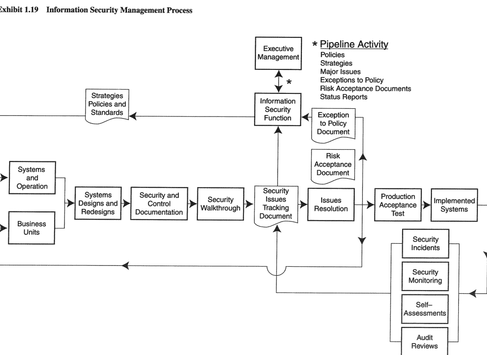

## 第二章

## 物理安全

### 安全是一项管理问题

为组织定义安全策略、实践和程序是管理层的责任。在选择支持这些策略和实践的产品时，评估、选择并实施用于管理程序以及应用程序系统中适当控制的产品安全功能，同样是管理层的责任。

在大型机统治的黄金时代，物理安全和逻辑安全是同义词，因为它们都被认为是非常重要的。这是因为大型机体积巨大，信息在哪里被处理是不言疑问的。随着计算机的演进（矛盾的是，计算机在变得更小的同时变得更强大了）以及网络能力的出现，逻辑安全变得更加重要。由于逻辑安全需要技术知识以及随之而来的技巧，计算机资源可以被远程访问；这对于那些专注于逻辑安全以保护资源的计算机所有者构成了巨大的财务风险。然而，在试图从黑客和计算机窃手保护计算机资源时，组织忽视了物理安全方面，导致在这一过程中遭受了财务损失，因为缺乏安全控制使得坏分子可以得以乘机。尽管如此，物理安全仍然局限于边界控制和正门的保镖。

这种情况随着灾难恢复计划的出现而改变了，正因为如此，物理安全被视为制定可行灾难恢复计划的基石。专家们大呼“找到了”，物理安全作为基础的黎明到来，使得灾难恢复计划（`DRP`）能够得以稳固。

为了使安全有效，它必须是管理和技术类程序与实践的结合，以确保硬件、软件以及存放这些技术的物理设施得到安全，包括这些数据中心之间的连接。它还包含了制定这些策略的人以及想要利用这些策略的人的心态。作为审计师，我们希望从这两个角度来看安全。被寄托此项责任的人是否充分实施了策略和程序？控制措施是否足以防范来自我们想要保护的对象的攻击，且考虑到这些犯罪分子也为他们的计划花费了大量精力？

我们可以从细节开始通向整体，也可以从整体开始并分解出细节。最终结果应该帮助我们评估组织的整体安全性。从规划的角度来看，从整体开始并使用“分而治之”的策略向下工作，从碎片开始构建整体，是更明智的，因为破坏总是比建设更容易。

因此，我们将从审阅物理安全开始，并转向逻辑安全的技术细节。以下是我们可以执行物理安全的两个原因：

- 1. 可用性
- 2. 数据和/信息的窃取

## 物理安全

### 第一道防线

大多数计算机系统的第一道防线是物理安全。由于具有网络基础设施和关键应用程序、数据库和复杂服务器为特征的去中心化、分布式 `PC` 计算环境，这一点尤为重要。

信息资产包括内部系统中系统、数据、图像、文本和语音，支持公司的业务活动。公司内部系统的计算环境从大型集中式大型机计算机到分布式个人电脑网络不等。在所有这些环境中，都必须实施信息安全（`IS`）流程，以确保公司信息资产的机密性、完整性和可用性。

信息审计的目标是确定管理流程是否已实施、有效，并符合公司安全策略中制定的既有指令和标准。它们是否确保了公司的信息资源免受未经授权的访问？

这需要对可信系统组件进行访问控制。可信系统组件定义为支持计算环境且必须具有完整性赖的物理物品。例如，某些可信系统组件可能包括中央处理器（`CPU`）、直接访问存储设备（`DASD`）、本地控制，或更分布式计算环境的单元，如局域网（`LAN`）和广域网（`WAN`）服务器以及微处理器。

应该消除的一些危险包括：

- 获取 `PC` 的简易性
- 使用社交工程的机会（例如：冒充身份、撒谎或欺骗某人以获取访问权限）
- 尾便车的机会（在他人刷钥匙卡后跟随其进入安全门）

此外，审计师必须确定管理控制是否确保在灾难发生时关键流程是可恢复的。`IS` 程序的实施责任被分配给相关人员（注：原文此处可能缺失主语，根据语境推断）。`IS` 计划的实施责任被分配给相关人员。`IS` 计划的实施责任被分配给相关人员（此处原文逻辑重复，已意译为“实施责任分配”）。`IS` 计划的实施责任被分配给相关人员。

![](img/e58c9dbdee5b0b2b9dfd3ded1b75e0ec_63

## 物理安全

通常，首席信息执行官被分配给相关目标。`IS` 计划的实施责任被分配给相关人员。`IS` 计划的实施责任被分配给相关人员。`IS` 计划的实施责任被分配给相关人员。`IS` 计划的实施责任被分配给相关人员。`IS` 计划的实施责任被分配给相关人员。`IS` 计划的实施责任被分配给相关人员。`IS` 计划的实施责任被分配给相关人员。

大多数业务（例如：人力资源、产品开发、市场预测、定价、财务）依赖于有效的数据处理系统。随着越来越多的分类信息被收集到数据处理环境中，损失的影响（例如：盗窃、欺诈）变得巨大。尖端运营中心以大型共享数据库、分时、外部设施的电信连接、数千用户为特征。

## 保护公司设施的安全


计划是否制定良好，是否考虑了公司的物理安全需求以及预期的未来方向？物理安全计划是一个活文档，根据新信息的可用不断修订和开发。理想情况下，此类计划应包含：

- 计算机资源所在计算机设施的描述，即划分你们领土与外部世界的边界，以及边界中所有提供访问你们领土房屋并保护的计算机资源的点。这些点包括入口、出口、网络电缆连接、电源插座、电气插座以及任何提供与外部世界连接的连接
- 设施内计算机资源的描述，包括（例如：包括中央处理器、系统控制台、终端以及其他外围设备的硬件。软件包括操作系统、程序和数据。

## 物理安全

- 场所内受控区域的描述、这些受控区域的定义及其包含的内容。
- 风险（威胁）的识别以及对其发生概率的关注。
- 防御这些风险的控制措施以及与之相关的可衡量成本。
- 在风险分析中被容忍和接受的风险。

物理安全计划及其随附文档是一份敏感文件，包含了有关公司风险/控制措施的详细信息。因此，它必须以整洁的部门隔化格式呈现，以便你无必从不同的来源获取信息。然而，在实践中，情况可能并非如此，现在可能是说服公司管理层编制这些信息需要良好的规划的良机。它还可以服务于许多需求（即，这些信息在公司规划灾难恢复策略，以及谈判灾难恢复服务和/或保险合同时，在公司的风险分析中也可能有用）。

根据对审计员偶尔会掉入的陷阱的直观经验，审查物理安全计划的重要性再强调也不不过。这是因为物理安全所涵盖的问题——威胁、实践和保护措施——对于几乎每个站点都是不同的。由于不同组织的风险和需求不同，物理安全在不同组织之间也是不同的。因此，请始终记住，在基于任何理论模型评估物理安全时，要敏锐并质疑你的成本效益措施和风险假设。无论多少理论知识都无法替代通过睁开眼睛并在很大程度上保持开放的心态（尽管带有怀疑态度）而获得的现实世界经验。对于缺乏经验的人来说，请记住审计是一个累积过程，在工作过程中等待获取信息，可能会导致在得出任何结论之前对你对风险和重要性的判断进行修订。

## 物理安全计划

信息资产是偶然保护的还是通过设计保护的？物理安全计划应包含保护信息资产的措施。公司已经建立了各种保护和限制访问信息处理资源的方法，以减少损失风险。限制物理访问的主要方法是使用边界控制，例如带围栏的建筑工地、建筑入口的安保人员和锁闭的机房。设施的边界应识别所有的访问点，探索风险并实施保护这些点的方法。

### 受保护区域

一旦计算机设施受到免授权访问的保护，随后的措施对于将边界控制内的内部空间划分为需要不同类型保护的区域至关重要，从而根据“按需使用”原则进一步限制访问。给予这些受控区域的保护类型可以从完全保护和严密监控（严密保护区域）到松散保护区域不等。

通常，公司将内部空间划分为两个或三个分区区域，并建立了标准，规定了为这些指定的受控区域中的每一个提供种种保护。例如，内部空间可以被分为三个区域：`Zone 1`、`Zone 2` 和 `Zone 3`。为了确保这些区域的安全，它们通常会被称为：

- `Zone 1` 严密保护区域（即完全保护和严密监控）
- `Zone 2` 松散保护区域（即有限的保护和监控）
- `Zone 3` 内部空间 –（`Zone 1` + `Zone 2`）

安全计划定义了访问 `Zone 1`、`2` 和 `3` 的要求，以及位于这些区域内的计算机资源（例如，计算机系统、便携式存储介质、远程打印机等）类型。

注意，出于问责考虑，`Zone 1`、`2` 和 `3` 必须分配所有者，所有者将负责这些区域的授权和维护。

`Zone 1` 区域位于 `Zone 2` 内部。因此，你必须获得进入 `Zone 1` 的许可，并且这种访问必须包含以下额外控制：

- 区域所有者必须明确标识。
- 区域即使在有人看守时也必须锁定。
- 对该区域的访问必须限于获得区域所有者授权的人员。
- 对该区域的访问仅允许从 `Zone 2` 内部进入，应急出口必须配备报警系统。
- 地层安装不允许有外窗。
- 区域必须包含楼板对楼板（`slab-to-slab`）屏障或入侵检测。
- 对该区域的访问必须通过电子方式控制，除非获得区域所有者或同等高管专门豁免。

`Zone 1` 区域的控制要求为：

- `Zone 1` 类所有者（们）应确保对边界墙（包括楼板对楼板结构）进行视觉检查，以验证其内部空间的完整性。至少这种检查应每年进行一次。
- `Zone 1` 类所有者（们）应记录用于确定访问 `Zone 1` 的有效业务需求的标准，并应仅根据这些标准授权访问。拥有计算中心权限但不符合记录标准的人员必须在案中有书面理由以访问这些区域。

`Zone 2` 区域位于 `Zone 3` 内部（即计算机设施），并包含以下额外控制：

- 区域所有者必须明确标识。
- 区域始终受到外部的保护。
- 对该区域的访问必须限于获得区域所有者授权的人员。

### 管理受控访问区域

负责受保护区域的经理负责维护该区域有效的业务控制。控制可以通过各种手段实现。钥匙、密码锁、计算机访问系统 (`CAS`) 和守卫入口都是物理访问控制的示例。无论选择何种方法，都必须满足以下六项控制要求：

1. 访问控制限制在获得区域授权的人员。授权程序根据控制级别和受控区域的类型而异。在所有情况下，只有批准的访问列表上的人员才被认为是授权的。对于 `Zone 1` 和 `Zone 2` 区域，由授权人员允许临时访问的人员被视为一次性授权访问。

2. 拥有区域访问权限的人员必须具有业务需求。所有者预计要确定什么构成业务需求，并证明已做出该项决定。`Zone 1` 类所有者（们）将记录用于确定访问 `Zone 1` 的业务需求的标准，并仅根据这些标准授权访问。拥有计算中心权限但不符合记录标准的人员必须在案中有书面理由以访问这些区域。

3. 访问授权应进行审查：

   - 对于 `Zone 1`，所有者应至少每六个月对访问列表进行验证并签字（纸质或电子版）。拥有访问权限的人员必须及时从访问列表中移除。
   - 对于 `Zone 2`，定期审查的要求应至少每年一次。然而，由于请求撤销或因终止雇佣而撤销授权的人员必须及时从访问列表中移除。
   - 注意：“及时”的定义取决于解释，在缺乏特定标准的情况下，它通常是指“通过管理流程所提供的最早机会”。

4. `Zone 1` 的应急出口必须具有完好的、声音的且监控的报警器。出于安全的考虑，报警器必须在应急电源下运行，并且报警事件必须启动调查。应定期对应急出口的功能进行验证并记录。`Zone 1` 所有者必须确保每年对应急出口进行检查。

5. 对于 `Zone 1`，必须保留一份准确、实时的非例访问日志，反映访客姓名、进入时间、陪同或授权人员以及离开事实。日志的目的是提供访问的历史记录，并作为一种控制工具。因此，应要求管理层对此日志进行审查。如果使用证件变更，必须有一份描述如何控制证件发放、收回和盘点的本地程序。访问 `Zone 1` 的非例访问日志必须保留当年及加一年。

6. 计算机访问系统 (`CAS`) 及相关设备的正常运行是 `CAS` 服务商的责任。`Zone 1` 所有者注意到的任何操作缺陷（例如门故障、报警器等）应立即报告给安全部门或 `CAS` 服务商。

### 安装责任

为了确保系统完整性的有效性并避免损害系统提供的任何完整性控制，安装必须对位于计算机设施内的信息处理资源负责。

这些物理访问控制要求适用于大型机环境和中期环境。大型机环境包括 `CPU`、通道连接

## 物理安全

设备以及物理系统/主控制台（即：为操作系统提供命令界面但未对操作员进行身份识别和认证的交互式设备）。中端环境包括：

- `IBM AS/400`, `UNIX`
- `Microsoft NT`
- `DEC`
- `Hewlett-Packard UNIX`

网络（局域网、`LAN` 连接系统和 `LAN` 连接的外围设备）及 `WAN` 包含以下基础设施组件：

- 分段
  - 端口 (`Jacks`)
  - 连接介质，如布线、光纤和无线连接
  - 中继器
  - 布线集线器
- 分段连接设备
  - 桥器
  - 网关
  - 路由器
  - 调制解调器
- 分段管理设备
  - 局域网管理系统
  - 性能和跟踪工具
  - 协议分析仪

`LAN` 连接的系统包括：

- 工作站
- 服务器

`LAN` 连接的外围设备包括：

- 用于打印机和绘图仪的 `IBM 4033` `LAN` 连接
- 传真服务器
- 打印机/绘图仪
- 存储设备

注：此处使用的“服务提供者”术语是指代表局域网基础设施所有者和或 `LAN` 连接系统或外围设备所有者提供 `LAN` 服务的组织或管理部门。

## 系统类型分类

物理访问控制的实施要求所有者将系统分类为 `A` 类、`B` 类或 `C` 类，如表 2.1 所示。通常，系统可以根据提供服务的范围和价值进行分类。高、中、

### 表 2.1 系统类型分类

根据更换成本和系统更换的难易程度来决定高低价值。反之，这决定了它将被放置在 `Zone 1`、`Zone 2` 或 `Zone 3`。

| 资源/控制 | 所有者 | A 类 | B 类 | C 类 |
|---|---|---|---|---|
| 主机 | XYZ | X | | |
| AS/400 | | X | | |
| HP-Unix | | X | | |
| NT-主主域控制器 | | X | | |
| 终端接布线和网络电缆 | | X | | |
| 电话线 | | X | | |
| 人员 | X | X | X | X |

或低价值。高价值系统被分类为 `A` 类，并要求位于严格安全区域。因此，中价值系统被分类为 `B` 类，可以放置在松散区域，即 `Zone 2`。最后，低价值系统将被分类为 `C` 类，并要求放置在内部空间，即 `Zone 3`。物理访问控制的水平，以及相应的逻辑访问控制水平，是基于对 `A`、`B` 或 `C` 类系统的判定的。

## 风险分析与接受

数据处理安装设施中应该保护什么？答案是所有一切。然而，对于许多读者来说，100% 的安全性是不现实的。首先，无法预见信息系统环境中每种可能的威胁或危害。其次，完全预防的实施成本可能太高。这正是风险分析（即确定保护什么以及保护到何种程度）发挥作用的地方。

服务提供者在将系统分类为高价值、中价值或低价值时需要进行判断。在这里不需要涉及复杂的数学方程和概率理论，这些应该在早些时候处理。你可以使用每个人都深认同的常识方法。一个通用的规则涉及以下七步骤。见表 2.2，该表显示了风险分析决策矩阵。

- 1. 确定哪些资产应该被保护：信息系统环境由许多元素组成，包括物理设施、人员、机器（硬件）、程序（软件）、通信设备、文档和信息（数据）。安全可以定义为“人员、设施和信息免受自然和人为危害的安宁状态”。
- 2. 识别潜在的威胁/危害：以错误和遗漏为首的危害列表包括火灾、地震、恶作剧、破坏行为、盗窃、欺诈、骚乱等事件。该列表几乎是无尽的，且价值很小。

### 表 2.2 风险分析决策矩阵

| 需要保护的设备 | 威胁/危害 | 发生概率 | 潜在损失 | 成本/效益分析 | 价值 |
|---|---|---|---|---|---|
| | | | | | |
| | | | | | |

在评估保护安全措施时，必须理解不理想事件的影响及其发生的可能性。

- 3. 确定发生的概率：证据表明，意外事件（如错误和遗漏）造成了大部分损害。虽然意外事件的后果有限，但它们发生的频率高于故意行为。故意行为每次事件的后果往往更严重，但发生频率较低。因此，应该处理所有的威胁和危害，以便确定每种情况发生的可能性。
- 4. 计算可能的损失：风险分析若要有效，必须有以每单位成本或每年金额描述损失成本的数据。这是通过估算与单个事件相关的成本，并乘以该事件发生的概率来实现的。在损失中，应考虑没有受影响资产业务的影响以及生产受影响资产的成本。

  - 更换成本和时间：实际损失计算为：`原始成本 + 更换成本 + 杂杂费用 + 法律费用 + 机会成本 + 业务损失 + 停机时间`。
  - 对生产的影响：生产损失、客户不满、信誉丧失、法律诉讼。
- 5. 评估保护的性：需要进行成本/效益分析来支持决定是否实施保护措施的过程。决策应基于实施和维护保护的成本与被保护物品的价值。决策过程必须基于该区域设备的更换价值。在对系统进行分类时，`IT` 经理会同安全经理考虑其他因素，例如完全折旧的设备或不需要更换的设备。此外，还应考虑涉及的尖端技术和版本的新颖性。如果这些因素影响决策，则必须予以记录。

所选物理访问控制水平应由 `CIO` 或所属服务的经理进行记录和审阅。见表 2.3。

- 6. 记录过程：风险分析程序和结果应予以记录。结果应让管理层易于理解且有用

### 表 2.3 物理访问控制要求

| 系统 | 系统价值 | 最低安全要求 |
|---|---|---|
| A 类 | | |
| 对关键业务流程至的系统 | 高 | 区域 1 或无人时的锁闭房间 |
| 无论支持何种服务的网络控制单元 | 高 | 区域 1 或无人时的锁闭房间 |
| 所有网络控制单元 | 高 | 区域 1 或无人时的锁闭房间 |
| B 类 | 中 | 区域 2 |
| C 类 | 低 | 区域 3 |

- 7. 定期审查与更新：信息系统环境不断变化。因此，风险分析应该成为一个持续的过程，定期进行和重新评估，以确保实施相关的成本正在为组织带来预期收益。虽然接受哪些风险和防止哪些风险的最终决定权在管理层，但风险分析需要整个团队的努力。它需要所有有助于评估风险的人员的合作。

## 物理安全

旨在确保信息资产免受未经授权的访问或丢失的指令和标准。此外，审计人员必须确定所实施的管理控制是否确保了支持关键业务流程的计算环境在灾难发生时是可恢复的。

## 安全区域的确定

目标：确保服务提供者已识别并记录了所有信息系统和/或设备所需的安全控制的使用、价值和安全控制级别。

方法：获取并检索相关文档，这些文档应识别区域及其用途、组织建立的信息资产价值以及所需的控制级别（例如：系统 `A` 型、`B` 型、`C` 型或高、中、低价值）。确定资源所有者是否定期重新评估了安全需求，或者信息/系统 (`I/S`) 资源的价值或分类是否发生了变化。

有关所需信息以及管理层参与本文文件参与的细节，请参阅安全策略。

## 安全区域的访问程序

目标：确保有书面程序描述了保护受信任系统组件的整体控制策略（例如：是否存在授予对信息系统设施访问权限的程序？）。

方法：按照安全策略概述，审查记录在案的安全访问文档。对于网络，对服务器、桥接和布线（基础设施）的访问应限制普通访问，这些内容应位于 `Zone 1`。程序应概述每个安全区域（`Zone 1`、`Zone 2` 和 `Zone 3`）针对以下情况的有效访问控制机制：

- 根据常规访问所需的需要对业务需求进行审查
- 根据非公司访客、清洁人员、设施人员等访问所需的访问

程序应定义有效的控制措施，以确保在职位变动或离职时能够及时撤销授权。应根据以下情况对区域定义的访问能力进行考量：

- 访问列表（即：组访问列表或其他列表）——从访问列表中删除
- 密码锁——更改锁的组合
- 钥匙——更换锁或取回已分发的钥匙，并对钥匙进行定期盘点

## 安全区域的常规访问

目标：如果使用安全内部或受限空间进行物理访问控制，确保常规访问需要适当的管理批准，并定期对访问授权进行重新验证。

方法：获取安全区域的访问列表。确保在对受受安全空间保护的信息系统资源进行审查时，包含了网络基础设施组件。

对比安全区域访问列表、组访问列表（`GAL`）或其他列表、组织架构图/信息。记录所有异常（例如：未找到个人），并考虑将以下情况纳入您的样本中：

- 在 `I/S` 中但不在运行中
- 不在 `I/S` 中

检查样本以确认当前的访问授权（访问授权可能由空间所有者或 `GAL` 类管理器执行的最新访问验证组成）。确保能够证明访问的有效业务需求。确保根据安全区域和受限空间环境的标准对授权进行进行审查。对于非 `GAL` 控制的区域，核实列表是根据所需的控制级别保留的（即：第 1 区域、2 区域或 3 区域访问）。

如果系统被认为是 `A` 型（高）或 `B` 型（中），且非住留员工位于计算中心，请核实这已获得服务提供者高级高管的批准。

注意：如果数量足够，可以使用临时模式下的计算机访问审计工具和技术来验证具有访问权限人员的就业状态。

## 安全区域的物理检查

目标：确保已充分实施程序和指令要求，以防止对受信任系统组件的未经授权访问。

方法：对安全内部或受限区域进行物理检查，包括：

- 根据特定安全或受限区域（即：受限空间或访问）定义的规定，审查非常规访问日志以获取所需信息。
- 确保所有入口和出口均已安全。核实在要求的地方已安装报警器并确保其运行正常。
- 核实员工佩戴证件并在区域内获得授权。

此外，对于网络基础设施，获取识别审查范围内包含的任何网络的组件示意图，并确定所有服务器、桥接和网关的位置。核实所有组件均受到适当的安全访问级别机制的保护。

## 管理流程/程序审查

目标：确定操作策略是否充分涵盖了内部访问的控制点。

方法：确保在对受安全空间保护的信息系统资源进行审查时，包含了网络基础设施组件。

对比安全区域访问列表、组访问列表（`GAL`）或其他列表、组织架构图/信息。记录所有异常（例如：未找到个人）。

...对于非 `GAL` 控制的区域，确保列表是根据所需的控制级别保留的（即：第 1 区域、2 区域或 3 区域）。

根据安全策略。

目标：确保能够证明对系统的访问管理，并在无业务理由时（例如：离职或任务变更时）撤销此类访问。

方法：从审计的计算环境中随机选取访问样本。对于每个所选访问，核实：

- 管理层已通知并知晓访问
- 访问能力是当前的

至少必须对访问权限进行年度重新验证，并对离职或退休员工的访问权限进行季度处理。所有访问权限必须是可以识别的（例如：经理可能拥有非人员访问权限的所有权）。参考安全策略以了解管理非人员访问权限的频率。对于离开工作的人员，确定访问权限是否仍然有效：

1. 活跃员工的持续业务需求 (`CBN`)。对于任何非人员访问，这些应追溯至人员数据库中的非人员，或者在供应商的情况下，访问权限应追溯至活跃员工。
2. 分配给离职员工的活跃访问。这是所有已离职但仍活跃的访问权限列表。所有访问权限必须经过说明。可能会审查的子集是离职日期后使用的活跃访问权限。
3. 无法“映射”到人员的活跃访问（即：未知所有权）。这是系统中无法找到记录的所有权限列表（这可能是由于输入错误或缺失员工工号等）。所有访问权限必须经过说明。安全策略要求所有访问权限、服务机器和任务必须是可识别的。


对于 AS/400，可以使用 `WRKUSPRF`（工作用户配置文件）命令获取用户列表。对于 LAN (OS/2)，应相同的测试。为了获取网络环境访问权限的信息，可以使用 `DOMQUERY.CMD` 相关工具提取每个服务器的信息。`DOMQUERY.CMD` 程序是一个使用 LAN Server 获取网络环境信息的 `REX` 程序。它列出了域中的所有服务器、访问权限、组和别名，以及所有服务器的访问控制列表（`ACL`）。或者，从管理员用户 ID 为每个服务器运行 `NET ACCESS d:/TREE` 以获取 `ACL`。

# 存储介质

在任何作为另一小组移动存储介质保管人的情况下，都应实施与移动存储介质相关的控制。传统上，这描述了主计算机中心磁带管理员的角色。然而，类似的控制也适用于维护 LAN 服务器软件的移动存储介质保管人。包含正确分类信息的移动存储介质保管人负责介质的保护和控制。

## 存储媒体

这些控制措施不适用于控制与其微处理器关联的磁盘，因为并不存在托管关系。

## 风险/暴露

对便携式存储介质的控制不力可能导致存储数据的丢失或被未经授权的访问。该领域的潜在欺诈指标包括：

- 仅由管理员执行的磁带清单和核对
- 无法解释库存结果与磁带库系统之间的差异
- 允许在没有所有者批准的情况下移除磁带的程序

存储介质包括磁带、可拆式和非可拆式光盘或磁盘以及卡带。存储介质保管人是指代表他人接受存储可拆介质责任的个人。与用于普通系统/备份目的介质不同，处于托管护理下的介质会为了业务处理而定期进行装载/卸载，包含被识别为记录留存至关重要的信息，或包含被识别为灾难恢复至关重要的信息。

因此，必须能够对保管人存储介质库中介质的移动进行计数。

## 控制要求

未经数据所有者批准，便携式存储介质不得从保管人的控制中移除。所有者将数据标记为重要记录，表明所有者已批准其按照循环计划移出设施。

## 存储介质分类

信息的分类是数据所有者的责任。包含“所有机密”（`Proprietary Confidential`）信息的介质应尽可能进行相应标记。非易失性介质不需要在实际设备上贴分类标签。用于备份、记录留存或灾难恢复的介质可以标记/贴上通用状态“`XYZ 有限公司财产，并可能包含所有机密信息，且必须防止未经授权的 la 或访问。未经授权且未加“所有机密”信息标签，不得从控制中移除。”此标签也可用于运输到/从存储在授权留存设施的出的介质，以及用于运输此类介质的锁定容器。注意：磁带标签符合通用标签要求，但必须必须获得法律顾问的批准。

包含机密数据的介质在从公司保管人的控制中移除时，需要标记“`Confidential`”标签。

## 存储介质的物理保护

受托管控制的介质以及用于备份、记录留存或灾难恢复的介质必须存储在安全区域 1 或安全区域 2，或者区域 3 的办公室内（无人看守时锁定），或无人看守时的锁定柜柜内。磁带驱动器和介质处理设备（例如“磁带机器人”、直接存取“自动库机”）在位于安全区域 1、安全区域 2 或无人看守时锁定的普通办公室时，不需要锁定。

## 物理安全

用于普通系统/数据备份目的的介质应与托管控制的介质分开存放。必须谨慎管理，以确保在需要恢复时介质的可用性，但不需要包含适用于托管护理下介质的库存控制过程中。

## 保护备份

备份是任何计算机操作的前提。然而，存储在备份磁带上的信息极其脆弱，因为没有操作系统的检查平衡机制来防止未经授权的人查看数据。在信息写入备份磁带后，任何物理拥有磁带的人都可以读取。因此，备份所需的保护至少等于甚至超过计算机本身。

备份保护的控制指南：

- 备份不应留在机房内无人看管。
- 仅将备份委托给正规且有担保的信使者。
- 确保备份磁带在出售或丢弃前经过清理。
- 如果可能，备份应存储在另一个地区的异地存储设施中。

## 备份应经过验证

应定期验证备份以确保其包含有效数据。建议每月至少检查一次备份磁带样本以确保这种有效性。

## 备份应加密

存储在备份磁带上的数据应进行加密以增强备份安全性。当你加密文件系统的备份时，如果丢失密钥，它对你来说将毫无用处。

注意：如果无法实现介质分离，则所有介质必须按照下文所述的介质分离进行。

在运输到授权留存设施的/从那里存储的介质，以及用于运输此类介质的锁定容器上，也可以使用此标签。未经授权且未加“所有机密”信息标签，不得从控制中移除。注意：磁带标签符合通用标签要求，但必须必须获得法律顾问的批准。

受托管控制的介质以及用于备份、记录留存或灾难恢复的介质必须存储在安全区域 1 或安全区域 2，或者区域 3 的办公室内……

打印库管理员必须能够显示以下内容：

- 初始库存（之前结束的库存）
- 增加（从其他位置接收）
- 减少（发送到其他位置）
- 增加（加入库的介质）
- 减少（报废的介质）
- 等于当前库存（磁带总数）

所有差异必须说明。所有用于介质库的介质（包括打开的空白介质）以及处理设备中的介质必须包含在清单内。

负责保管介质库的经理必须签署完成的清单。最后的清单和支持文件（包括之前签名的总清单页）必须保留。

## 剩余信息

剩余信息是从之前遗留的可处理信息（例如删除的 `DASD` 和磁带文件、`CD-ROM`）。机密数据在处置前必须变得不可读。

## 保护本地存储

现代打印机等电气数据处理设备通常包含可以下载和上传信息的内存。因此，这些内存持有敏感信息，当内存没有密码或加密设备保护时，会产生安全风险。

由于计算机传输信息的速度快于打印机的速度，打印机配备了称为“打印卷”的半导体内存。这些内存从计算机接收信息很快，向打印机传输缓慢。然而，通过按下打印卷器上的 `COPY` 按钮，就可以复制其存储中的信息。通过按下 `COPY` 按钮，发送的内容将再次打印。保护打印机缓冲区中敏感信息的唯一方法是提供了使用 `COPY` 按钮为自己复制的机会。

高速激光打印机包含大量的本地存储，可以存储 `MB` 甚至 `GB` 的信息。此外，这些缓冲区可以被设置为在打印完成后存储任何文档的副本，除非在任何有技能的人检索它们之前对其进行了清理。

如果打印机不在安全位置，工作组打印机的输出也会面临被盗或复制的风险。不用说，如果打印机、绘图机用于机密任务，它们应该放在安全位置。

## 处置前的介质清理

清理是确保磁带上的数据被完全删除的过程。一种常见的清理方法是覆盖整个磁带。

简单地在硬盘上删除文件不会删除与文件相关的数据。原始数据的部分和有时文件可以被检索。必须使用针对特定磁盘驱动器型号和修订版本的特殊软件对硬盘进行清理。

## 物理安全

对于高度机密和与安全相关的材料，磁盘或磁带应进行多次覆盖。仅覆盖一次是有风险的，因为数据可以被恢复。磁带应覆盖三次：先用 `0` 块覆盖，然后用 `1` 块覆盖，最后用随机数。

最后，可以对磁带进行消磁处理，将其通过带锯条切割直到化成成千上万个微小的塑料碎片。建议在处置前对所有介质进行彻底清理。

## 功能键

功能键绝不应用于存储密码或任何敏感信息（如加密密钥）。

配备功能键的智能终端可以程序化为在按下这些键时向计算机发送一系列按键，这通常被用作存储密码的快捷方式。这使得系统面临安全风险，因为获取了终端访问权限的熟练人员也将获得计算机系统的逻辑访问权限。此外，这些终端还面临被盗的风险，当它们被盗时，不说，存储其中的密码、加密密钥以及任何其他敏感信息都会落入坏人手中。

## 无人值守的终端

登录后无人监管的终端会让明的笨蛋和具有破坏倾向的不满员工能够肆无忌惮地访问文件（无论敏感是否敏感），并导致严重的后果。通过良好的规划，这些账户还可以用于对计算机系统或整个网络发动攻击，除了账户使用者的身份外，没有任何执行者的痕迹。对某人怀有严重敌意的恶意员工可以轻松向 `CEO` 发送电子邮件，在组织内部制造混乱。

底线是，当终端无人值守时（即使是短暂），所有屏幕应该是空白的（屏幕保护程序），所有键盘都应该锁定。如果预计离开较长时间，用户应该注销，不要让公司面临不必要的风险。应使用在键盘和鼠标空闲十分分钟后自动注销的屏幕保护程序。

## 开关

计算机前面板上的键开关可以防止系统在单用户模式下重启。某些 `ROM` 监控器也可以防止系统在没有密码的情况下以单用户模式重启。因此，在可用时应使用这些键开关和 `ROM` 监控器密码。尽管如此，计算机只需通过掉电源即可变得无法运行。

因此，最重要的第一道防线是计算机物理访问控制的强度。

## 介质处置

丢弃在垃圾中的重要公司材料为黑客或竞争对手提供了有用信息。这些材料包括计划、设计、初步代码和软件打印件（包括不完整版本）——收集的程序打印件足以让专家了解任何软件开发项目的全貌，特别是当代码有良好的注释时。这些材料还可以提供关于测试人员、客户、测试策略和营销计划身份的线索，而这些人正...

# 存储介质

知道他们在做什么。垃圾中的信息带有有关计算机、使用的操作系统类型和版本、序列号、补丁级别等线索。垃圾还提供了主机名、互联网协议 (`IP`) 账户和其他对黑客至关重要的信息。留存在废纸篓里的完整防火墙配置和过滤规则列表对于试图渗透计算机或寻找进入系统方法的人来说是一种诱惑。

垃圾中的材料被用于获取有关公司人员及其运营的重要信息。例如，电话簿可让骗子在电话中伪装成员工，并获取敏感信息，包括拨号数字、账户名和密码。这被称为社交工程。粗略的内部信息，如公司官员及其员工的姓名、办公室号码和分机号，有助于骗子获取公司内部信息内部的敏感信息。骗子只需说服操作员通过电话获取额外信息即可。老办法对付经验丰富的信条。在处置介质之前，需要回答以下重要问题：

1. 是否仔细考虑了被丢弃信息的价值？
2. 在丢弃价值信息的地方是否有粉碎机？
3. 是否已对用户进行充分教育，让他们不要在工作和家里垃圾中丢弃敏感材料，而是将其带回进行粉碎？
4. 是否有现场焚烧敏感废纸的规定？

将垃圾桶放在守卫的围栏内是不够的。有必要知道它在被垃圾车收集并运走后去了何处。它是否被倾倒在任何想要查看公司法律边界和限制之外信息的人都能触及的地方？

## 审计测试

### 目标 1

确保有书面程序描述便携存储介质的整体控制策略，包括库存控制、残留数据控制、责任分配以及介质从磁带库中移除时的问责制。残留数据由从之前的使用中留的可处理信息组成（例如划痕磁带上的数据、已删除的 `DASD` 和文件等）。

方法。

审查便携存储介质库程序。确保记录的流程涵盖了所有便携存储介质处理功能，如挂载、标记、运输、释放、返回、存储和销毁。与审计员对访问控制的审查协调，确保绕过标签处理已充分防止了未经授权的使用。抽取带有便携介质交易的记录/文档，以确保已获得适当批准、记录了日期等。审查便携介质物理控制、分类和标记、磁带移除程序、库存和核对流程，以及在处置或非专有使用之前将数据归类为机密的有效性。将库存条目与库中的便携介质进行比较。

### 物理安全

### 目标 2

确保所有便携介质要么被分配分类，要么被标记以标识内容包含机密数据，确保控制确保介质从磁带库中移除时的问责制，并且库存记录与物理资产相符。安全策略应规定哪些磁带允许具有通用分类，哪些磁带必须标有分类标签。

方法。

获取便携介质最新清单的副本。如果被视为在范围内，则获取所有网络介质的列表。确定介质上是否支持机密数据。从这些清单中选择便携介质样本进行物理审计。对于每项清单，验证便携介质是否可以被找到、是否正确标记，以及标记信息是否与库存记录一致。此外，选择物理存在的便携介质样本，并验证其在库存记录上显示是正确的。

### 目标 3

确保已有效实施控制，以防止对存放便携存储介质的加密区域（例如磁带库）的未经访问。安全策略应为分类为机密的便携存储介质规定最低物理控制要求（例如第 1 区域保护）。

方法。

确保包含机密数据的便携介质存储并保护在与其分类相适应的区域（参考安全策略）。确定谁有权访问磁带，并在需要时提供相关理由。

### 目标 4

确保至少执行一次库存并与上一次库存进行核对，并且执行库存和核对时具有适当的职责分离，并维护核对记录（对于包含机密数据的库）。

方法。

如果库包含机密信息，必须至少每年执行一次包含的所有便携介质的库存。验证是否存在库存控制。审查最后两次（当前和上一次）库库存和核对，以确认遵循了流程并解决了异常。验证负责的经理审阅并签署了完整的库存文档，并且物理盘点和核对是在具有适当职责分离的情况下执行的。

## 便携存储介质

便携存储介质是否免受未经的复制、损坏、破坏或盗窃？敏感或专有数据通过以下措施得到保护：

- 将介质存档在场外的锁定设施中。

## 环境控制

- 删除过时数据。
- 碎碎或安全处置控制日志或打印输出。

## 评估

已完成 (`Y/N`) _________________

`WP` 引用 ______________________

事实表 # ______________________

备注______________________________________

## 环境控制

你现在已经确保了计算设施的物理访问。接下来的问题是：

- 计算机处于最佳水平运行需要哪些基本服务？
- 你将如何提供这些基本服务？
- 你将如何维护这些基本服务？
- 你将如何监控这些基本服务？

毫无疑问，基本服务包括：

- 电源
- 电话
- 水
- 加湿器

计算机像所有复杂的设备一样需要维护和监控，并且需要物理和环境条件的精确平衡才能在最佳水平运行。如果没有这种平衡，计算机可能会以意想不到且不理想的方式发生故障。更糟糕的是，计算机可能会继续异常运行，极其痛苦地产生错误的结果并损坏贵贵数据。（有关基本服务和相关危险的更多信息，请参阅图 2.4。关于风险和缓解控制的更多信息，请另参阅图 2.5。）

## 电源

电源可能会被烧毁。你有什么保护措施？

即使电压浪涌没有破坏你硬盘上的信息，它仍可能导致信息在计算机系统修复之前无法访问。电压浪涌可能来自各种来源：

- 电噪声
- 自然界（例如：闪电、风暴）

### 图 2.4 基本服务及相关危险

| 基本服务 | 火灾 | 烟雾 | 水灾 | 盗窃 | 蓄破坏 |
| --- | :--- | :--- | :--- | :--- | :--- |
| 电源 | X | X | | | X |
| 布线 | X | X | X | | X |
| 布线 | X | X | | | X |
| 空调 | | | X | X | X |
| 水 | | | X | | X |
| 加湿器 | | | X | | X |
| 电话 | | | | X | X |
| 人员 | X | X | X | X | X |

- 电压浪涌导致电源致命短路
- 外部和内部破坏分子
- 破坏行为

## 电噪声

电噪声通常由正在使用的重设备、工厂、电机和引擎产生，也可能来自风扇和其他导致电源波动的计算机。例如，插在电源插座上作为工作站的普通吸尘器可能会产生足以摧毁工作站电源甚至导致短路的尖峰值。

严重的电噪声还会引起震动，尽管震动也可以由其他因素引起。无论震动来自哪里，都可能导致计算机系统过早故障。震动（无论轻微还是其他）都会使打印电路板离开边缘连接器，使集成电路离开插座。硬盘可能会发生偏移，增加灾难性数据丢失的概率。

电噪声的控制措施为：

- 为计算机供电的电路上不应有重设备。事实上，推荐的规范是为每个大型计算机系统安装带有隔离接地的特殊电路。
- 每台大型计算机的电源上都应安装一个线路滤波器。
- 计算机区域周围应安装静电接地垫，以最大限地减少静电。
- 应规定在计算机区域下方的地毯上喷洒防静喷雾，以最大限地减少静电。

### 图 2.5 风险与缓解控制

| 风险/控制 | 探测 | 预防 | 纠正 |
| --- | :--- | :--- | :--- |
| 火灾 | 报警器、烟雾探测 | 应急程序、消防演习、维护 | 火器、二氧化碳、水、干式、卤素、喷淋头、灾难恢复计划、保险 |
| 布线 布线槽、天花板、布线间 | 烟雾器 | 规则和法规 | 喷淋头 |
| 包括烟草的烟雾 | 烟雾器 | 规则和法规 | 清洁 |
| 灰尘 | | 维护、吸尘 | |
| 空过滤器 | | 维护、防尘罩 | |
| 加湿器 | 报警 | 维护 | 吸尘 |
| 温度导致电路板或集成电路裂纹 | 温度报警 | 维护 | 吸尘 |
| 水导致电路板载电压迹路和接地迹路 | 水传感器、水检测器 | 自动断电 | 灾难恢复计划、保险 |

- 所有无线发射器应距离大型计算机、电缆和外围设备至少五英尺。手机、对讲机和其他电子设备等无线发射器在传输时可能会导致计算机发生故障。功率发射器可能会对系统造成永久性，并可能触发某些密封灭火器系统中的爆炸装置（例如：`卤素`）。

## 物理安全

- 应张贴告示和说明，防止在计算机区域使用便携式发射器。

震动控制的对应包括确保计算机周围没有震动源。例如，如不在计算机上方放置打印机等简单预防措施即可控制震动。

## 闪电

闪电会产生巨大的电压浪涌，损坏计算机。它还会产生强磁场，损坏磁介质。

闪电控制的对应为：

- 在严重的雷电暴期间，应采取关闭并拔掉计算机系统的措施。
- 备份磁带如果存储在磁介质上，应远离建筑的结构构件。
- 在严重闪电区应使用防浪涌保护插座条。
- 在法律未要求电话电路配备防雷器的情况下，应使用浪涌抑制器并对敏感电话设备提供额外保护。

## 电源控制清单

（注：原文此处存在大量重复的段落，已根据文档工程师逻辑进行去重复后的核心内容。）

## 物理安全

保护电话线路的物理访问安全与保护连接电话线路及其调制解调器的计算机同等重要。某些控制指南包括：

1. 保护电话线路的物理访问。电话线路在物理上应当是安全的。所有的接线盒都应该锁好。电话线路本身应该放置在电线管内，穿过墙体，或至少位于锁定的 `1` 类区域内。获得电话线路物理访问权限的入侵者可以在线路上连接他们自己的调制解调器，并在通话到达计算机之前对其进行拦截。通过欺骗手段，入侵者可以获取登录名和密码，以进一步破解计算机。入侵者还可以监控电话，获取在此过程中的所有的相关信息。通过这种方式，不仅被监控系统的密码会泄露，用户所连接的其他系统的密码也可能泄露。
2. 电话线路不应允许呼叫转移和第三方计费。如果电话可以设置呼叫转移，入侵者可以将所有入入电话转移到另一个号码。如果该号码处有一台模仿你系统的计算机，用户可能会被误导使用用户名和密码。如果没有第三方计费，人们无法将通话费用计入你的调制解调器线路。


- 3. 在安全风险较高时使用专线。如果调制解调器的用途是到单一出口位置，请使用专线。专线是公司提供的两点之间的专用电路。它像一根专用电缆，不能用于拨打或接收电话。因此，它允许你保持与远程站点的连接，但不允许任何人拨号并尝试入侵。在大多数地方，专线比普通线路贵，但从安全考虑来说，这种支出是合理的。专线还提供更快的通信速度，因此数据传输比标准电话线快得多，非常有效。

# 水

水会引起电气短路而损坏计算机。这是水带来的最大危险。当水在电路板载电压的迹线与载电流的迹线之间提供接触点时，就会发生。短路会导致通过迹线的电流负载增加，并产生热量，甚至可能熔化它。短路还会通过通过过大电流损坏电子元件。水的危险通常源于洪水。洪水的成因包括大雨、喷淋系统故障以及意外事件，如抽马桶溢出、水管和胶带损坏，甚至是消防部门的误操作。

对水的控制要求为：

- 水传感器应安装在计算机系统区域的所有楼层，以及与该区域相邻的楼层。

- 水检测器应安装在计算机房架空地板下方和上方。

- 优选标准是安装两个不同高度的报警器。第一个水传感器应发出报警；第二个报警器应自动切断计算机设备的电源。自动断电可以在洪水发生在非工作时间或由于响应时间延长导致情况无法缓解时，减轻损害并挽救生命。

- 建议计算机不应放置在建筑的地下室或易洪区域，或者如果该建筑带有喷淋系统。

## 加湿器

干燥会导致静电积聚。湿度可以防止这种积聚。计算机房不应太干燥，因为这会产生电，放电会破坏信息并可能损坏计算机本身（在许多情况下确实如此）。相反，计算机房也不应太潮湿，因为这会导致计算机电路产生凝露，从而引起短路。短路会导致过电流通过迹线，使迹线加热并可能熔化它。短路通过通过过大电流损坏电路并破坏电子元件。

湿度控制的控制为：

- 为了获得最佳性能，计算机房的相对湿度应在 `20%` 与露点之间，这取决于房间的环境温度。

- 应有一个听觉式湿度报警器，当湿度超出接受范围时报警器应响铃。

- 加湿器应良好维护。

空调的控制要求为：

- 对空调系统进行监控。

- 备有经过系统测试的充足备用设备。

- 空调设备应接受充分的预防性维护。

## 火灾

你的计算机能在火灾中幸存吗？控制要求为：

- 功能良好的灭火设备

- 应急程序

- 消防演习

- 保险

灭火设备的控制要求为：

- 报警器应定期测试。

- 灭火设备应定期测试。

## 二氧化碳 (CO2)

二氧化碳窒息灭火并对人类造成伤害，但不会导致环境退化。

## 物理安全系统

## 自动喷淋系统

只要在水流之前关闭计算机电源，设备损坏的风险就很低（尽管开启的磁盘、磁带和打印输出可能会受到影响）。然而，当喷淋开启时，必须自动关闭计算机电源。不间断电源（`UPS`）必须自动关闭。此外，在恢复电源之前，计算机必须完全干燥，以避免员工触电。如果矿物含量极高，在开启电源前需要对计算机电路板进行专业清洁。

计算机现在可以经受水浸，因此喷淋系统优于二氧化碳系统。此外，水系统的寿命比二氧化碳系统长，因此应对火灾更加可靠。喷淋系统也便宜得多，且对人类的危害更小。

“干管”系统是优选的水基喷淋系统。它在实际触发报警之前保持在管道外，对于防止风暴漏水和其他不幸事故更安全。

控制要求为：

- 明确标识灭火系统的类型（例如，二氧化碳或干管系统）。

- 在合适位置张贴清晰的告示和说明，确保进入房间的每个人在火紧急情况下看到并理解该做什么，特别是在报警铃响起时。

- 计算机房门口必须放置功能良好且定期测试的手持灭火器。

- 每月验证每个灭火器的充电状态。灭火器压力需要确认功能正常。

- 培训计算机操作人员正确使用灭火设备以及应急和灾难恢复程序（`DRP`）。

- 培训计划规定季度进行演习，并根据应急程序定期进行灭火器练习。

- 需要一个自动火灾报警系统，以便在误报时可以“覆盖”。

- 为操作人员以及任何发现火灾、误报或需要立即响应的情况员提供电话权限。

## 烟雾

烟雾损害的控制要求为：

- 布线需要受到保护。

- 烟雾探测器和喷淋头应放置在正确的位置，以保护电线槽（通常在吊顶上方）和电缆室内的布线。

烟雾无疑会损坏设备。烟雾是一种强力磨剂，会聚集在磁盘、光盘和驱动器的头部，以及几乎所有沉降的表面上。烟雾颗粒如果聚集，会导致没有密封驱动腔的大多数磁盘驱动器发生严重崩溃。

当计算机因过热或持续使用（即每天 `24` 小时、每周 `7` 天、每年 `365` 天）时，也会产生烟雾。

## 环境控制

“开启。”结果是，视频显示器中的变压器已知会引起火灾。火灾会产生极其刺鼻、辛辣的烟雾，这不仅会对其他设备造成损坏，还会释放强效致癌物。

烟草烟雾也不例外。这种烟雾不仅危害健康，而且对计算机及其外设设备也是威胁。因此，如果不比正常频率增加清洁，烟雾会导致键盘故障。此外，它还会引发同事之间的怨恨，并导致员工在工时和缺勤方面付出沉重代价。

谈到烟雾时，请记住一氧化碳（`CO`）的致命影响，并确保探测器是第一道防线，通常也是安全保障。在使用燃煤、燃油或燃气设备时应特别安装探测器。封闭式办公楼非常容易受到由于加热器通风设备缺陷、不间断电源（`UPS`）发电机排气，或室外怠速且排气对准建筑进气口的卡车而导致的高浓度一氧化碳聚集。

必须执行烟雾控制。

- 应执行“禁烟”政策。

- 只要房间内有外设设备或终端，无论是否有计算机，每个房间都应安装烟雾探测器。如今大多数房间都有某些计算机设备或附件，因为大多数办公室都涉及网络。

- 烟雾探测器应安装在架空地板以及上方的地板下方。

- 烟雾探测器还应安装在吊顶板上方。

## 尘埃

尘埃会破坏数据吗？就像烟雾一样，尘埃会聚集在磁磁盘、磁带驱动器和光驱的头上。尘埃也是良好的导导体。大量的空气和尘埃随着保持计算机冷却的空气进入计算机内部。尘埃沉积在计算机电路板上，最终会导致电路短路和失效。

尘埃控制要求如下：

- 计算机房应尽可能无尘。

- 应定期清洁和更换空气过滤器。

- 应定期对计算机及其所有外设进行吸尘清洁。

- 应尽可能使用防尘罩。

## 温度控制

需要控制计算机周围的环境温度。如果温度过高，计算机的内部冷却系统将无法防止内部组件受到损坏。反之，如果温度过低，系统在开启时容易受到热冲击，导致电路板或集成电路断裂。计算机的最佳工作范围是 `10°C` 到 `32°C`（或 `50°F` 到 `90°F`）。理想温度范围应始终参考安装手册。

## 物理安全

温度控制的控制要求为：

- 应检查计算机说明书以查看计算机的理想温度范围。

- 计算机房必须安装温度报警器，当温度超出范围（即太低或过高）时触发报警。选择可以连接电话线的报警器，可以程序设置为拨打定义的电话号码，以告知计算机房温度超出范围。这可能成本很高，但某些成本是值得的，并且多次回报。

- 计算机应放置在每侧留有 `6` 到 `12` 英寸空间的地方。这有助于空气流通和温度控制。

- 为了检测异常问题，持续监控并记录计算机房的温度和相对湿度。根据一般原则，每 `1000` 平英里的办公空间应有其自己的记录设备。

- 定期记录并检查记录。

完成工作后，下一步负责的步骤是与信息服务人员讨论，获取有关环境监控的信息。评估环境控制以及现有的功能和程序，以确保执行预防性维护。采取的步骤包括：

1. 获取并审查空调和湿度控制程序。

2. 通过与信息服务管理层的讨论，完成以下环境控制清单：

   a. 空调系统正受监控。

   b. 空调系统有足够的备用设备并已经过测试。

   c. 空调设备接受充分的预防性维护。

   d. 计算机设施免受环境控制系统产生的水损害保护。

   e. 在紧急情况下，空调系统可以自动或手动关闭。

3. 获取并审查停机日志，以确定空调故障是否影响了运行。

4. 获取并审查维护日志，以验证正在进行预防性维护。

5. 验证安全站是否为每台空调配备公告面板，显示：

   - 运行状态

   - 冷却泵状态

   - 每个泵的输出压力

   - 输入压力

   - 冷却液温度

   - 室内外温度

## 人员

- 室内外湿度

- 洪水警报

6. 空调故障是否影响了运行？

7. 进气口是否影响了运行？

8. 是否有温度记录仪器？

9. 是否有气流记录仪器？

10. 是否有湿度记录仪器？

11. 关键区域是否接受以下各方面的维护：

    - 温度控制？

    - 湿度控制？

    - 系统安全？

    - 空调控制？

    - 冷却液？

    - 发电机过热？

13. 是否有足够的空调系统备用设备？

14. 系统是否经过测试？

15. 空调设备是否接受充分的维护？

16. 设备何时进行过检查？

17. 是否定期检查？

18. 检查间隔是多少？

19. 水管是否穿过设施？

20. 架空地板下方是否有探测器？

21. 架空地板下方是否有足够的排水设备？

22. 所有排水管是否安装了阀以防止倒流？

23. 地板和墙壁是否防水？

24. 窗户是否防水？

25. 架空地板下的接线盒是否安装以防止渗透？

26. 水水可以快速关闭？

27. 在火灾报警时，空调系统是否会自动关闭？

28. 总电源开关也会切断所有空调电源？

信任组件的物理安全以防止因人员导致的信息资源损失。

## 风险/暴露

- 谁引起入室？

- 谁编写计算机病毒？

- 谁窃取密码？

- 谁引起破坏？

- 谁是臭名威胁？

- 是来自外星的吗？

不，简单的答案是人员。如果人员发生从简单错误到复杂的刑事犯罪的计算机安全违规行为，那么需要对这些进行更多说明。审计计算机安全暴露了限制访问信任组件的控制漏洞。这些暴露被利用会导致公司物理和信息资产的损失、盗窃或误用。漏洞还会导致设施服务中断。最大的威胁不是来自天气变幻或地震，而是来自人员，只要照顾好人员，其余将自其一切。

## 分类

物理访问权限级别根据级别授予。因此，需要根据风险概况对人员进行分组，风险概况基于自主权限访问控制（`DAC`）。美国国防部信任计算机系统评估标准将自主权限访问定义为“基于主体身份或其所属组来限制对对象的访问的方法”。这些控制是自主的的，因为具有特定访问权限的主体能够将权限传递给任何其他主体。

## 图表 2.6 不同用户之间的安全相关职责

## 信息管理

各种类别的管理职位。

## 系统安全官任务

- 启动并监控审计策略。

- 确定哪些用户和事件需要审计。

- 维护安全密码系统。

- 在公共文件上初始化 `DAC`（自主访问控制）权限。

- 授权新用户账户。

- 检查文件系统中是否存在敏感安全程序。

## 系统管理员任务

- 执行审计程序。

- 检查并分析审计日志。

- 管理组和用户账户。

- 修复损坏的文件和卷。

- 更新系统软件。

- 设置系统配置参数。

- 收集各种系统统计数据。

- 禁用和删除账户。

- 定期系统检查。

- 监控重复登录尝试。

- 定期扫描文件权限。

- 处理无效的超级用户账户和无效的网络请求。

## 操作员任务

- 安装与安全相关的软件。

- 执行备份等常规维护。

- 执行在线终端和设备测试。

- 响应用户对例行系统维护的请求。

## 系统程序员任务

- 安装系统升级。

- 执行转储分析。

- 编写符合安全标准的程序。

## 计算机用户

- 使用计算机资源。

当不再具有业务合理性时（例如在离职或岗位变动时），应处理此类物理访问。

物理访问权限必须保持实效。至少必须每年对物理访问权限进行一次重新验证，并每季度通过一个流程协助移除已离职或退休员工的物理访问权限。所有物理访问权限必须能够识别到特定个人（例如，经理可能拥有非正式员工物理访问权限的所有权）。物理访问控制应用于标记差异，安全标准应规定所属经理审查非正式物理访问权限的频率。

## 图表 2.7 人员类别（与其风险概况一致）到区域的映射

| 类别 | 区域 1 | 区域 2 | 区域 3 |
|---|---|---|---|
| 信息安全官 | | | |
| 物理安全官 | | | |
| 系统安全官 | | | |
| 信息系统管理 | | | |
| 系统管理员 | | | |
| 操作员任务 | | | |
| 系统程序员 | | | |
| 应用程序程序员 | | | |
| 计算机用户 | | | |
| 网络管理员 | | | |
| 帮助热台 | | | |
| 小偷 | | | |

安全策略应确保，在授予用户 `CAS`（访问控制卡）、胸牌和钥匙等物理访问权限时，已提供有效的教育，并让他们意识到当前安全策略中定义的信息安全责任。对于在系统控制可以被未察觉地绕过的岗位使用的非正式人员，应证明服务提供方高管的批准。关于完整性、职责分配和合规性的记录性程序应涵盖以下内容：

- 如何识别用户（例如，谁授权用户访问计算环境）。

- 如何识别资源（例如，谁拥有数据集、微磁盘或子系统的所有权）。

- 如何将用户“映射”到资源（例如，谁授权用户进入或排除用户进入哪些受保护区域）。

- 提供了哪些访问审计跟踪（成功和失败）（例如，由谁决定审计哪些内容）。

- 提供了哪些报告（例如，由谁生成和审查这些报告）。

- 如何识别和管理“特权用户”（例如，谁授权，以及他们确定需要哪些控制）。

场地的操作程序应充分涵盖针对计算设施和资源物理访问管理的特定控制点。

## 人员

应执行以下三项特定测试：

1. 在职员工的持续业务需求。对于在系统控制可以被未察觉地绕过的岗位上使用的非正式人员，应证明服务提供方高管的批准。

2. 已离职人员的物理访问权限。

3. 针对员工的物理访问权限。

所有物理访问权限必须能够识别到特定个人（例如，经理可能拥有非正式员工物理访问权限的所有权）。物理访问控制应用于标记差异，安全标准应规定所属经理审查非正式物理访问权限的频率。

安全策略应确保，在授予用户 `CAS`、胸牌和钥匙等物理访问权限时，已提供有效的教育，并让他们意识到当前安全策略中定义的信息安全责任。关于完整性、职责分配和合规性的记录性程序应涵盖以下内容：

- 如何识别用户（例如，谁授权用户访问计算环境）。

- 如何识别资源（例如，谁拥有数据集、微磁盘或子系统的所有权）。

- 如何将用户“映射”到资源（例如，谁授权用户进入或排除用户进入哪些受保护区域）。

- 提供了哪些访问审计跟踪（成功和失败）（例如，由谁决定审计哪些内容）。

- 提供了哪些报告（例如，由谁生成和审查这些报告）。

- 如何识别和管理“特权用户”（例如，谁授权，以及他们确定需要哪些控制）。

场地的操作程序应充分涵盖针对计算设施和资源物理访问管理的特定控制点。

## 审计方法

场地的操作程序应充分涵盖针对计算设施和资源物理访问管理的特定控制点。

应执行以下三项特定测试：

1. 在职员工的持续业务需求。对于在系统控制可以被未察觉地绕过的岗位上使用的非正式人员，应证明服务提供方高管的批准。

2. 已离职人员的物理访问权限。

3. 针对员工的物理访问权限。

所有物理访问权限必须能够识别到特定个人（例如，经理可能拥有非正式员工物理访问权限的所有权）。物理访问控制应用于标记差异，安全标准应规定所属经理审查非正式物理访问权限的频率。

安全策略应确保，在授予用户 `CAS`、胸牌和钥匙等物理访问权限时，已提供有效的教育，并让他们意识到当前安全策略中定义的信息安全责任。关于完整性、职责分配和合规性的记录性程序应涵盖以下内容：

- 如何识别用户（例如，谁授权用户访问计算环境）。

- 如何识别资源（例如，谁拥有数据集、微磁盘或子系统的所有权）。

- 如何将用户“映射”到资源（例如，谁授权用户进入或排除用户进入哪些受保护区域）。

- 提供了哪些访问审计跟踪（成功和失败）（例如，由谁决定审计哪些内容）。

- 提供了哪些报告（例如，由谁生成和审查这些报告）。

- 如何识别和管理“特权用户”（例如，谁授权，以及他们确定需要哪些控制）。

## 审计清单

场地的操作程序应充分涵盖针对计算设施和资源物理访问管理的特定控制点。

## 物理安全

1. 停电期间是否维持访问控制？

2. 换班期间是否维持访问控制？

3. 是否有定期或在人员离职时更改密码和锁的规定？

4. 磁带是否免受未经授权的人员？

5. 敏感表单是否免受未经授权的人员？

6. 访问控制是否维护了人员移动日志？

7. 访问控制设施是否记录了违规尝试？

8. 是否对安全违规行为进行了调查？

9. 电子访问控制是否配备了紧急机械覆盖？

10. 所有人员是否有足够的意识挑战未戴胸牌的员工？不明的访客？

11. 信息系统人员是否要求报告所有故意或无意的安全违规？

12. 是否已清洁工、电工和其他内部人员安排了安全措施？

13. 是否已供应商人员安排了安全措施？

14. 通过访问控制系统进入普通办公区域是否允许进入机房？

15. 程序员是否通常禁止进入机房？

16. 用户是否被允许无护进入关键区域？

17. 记录并评估以下内容的充分性：

    - `na`. 在计算机中心内实施的安全程序/设备。

    - `nb`. 访问控制系统的效率和有效性。

    - `nc`. 信息系统人员的安全意识。

    - `nd`. 为清洁工、电工和其他内部人员安排的安全措施。

    - `ne`. 为供应商支持人员安排的安全措施。

    - `nf`. 数据中心内部的安全级别。

## 人员

- `b`. 向外部人员发放卡片/钥匙。

- `c`. 防止“库存”卡片被未经授权的使用。

- `d`. 将已发放的卡片/钥匙归还“库存”。

- `e`. 管理卡片/钥匙的安全级别。

- 4. 获取所有卡片/钥匙编号列表。

  - `a`. 识别已发放、访客及“库存”的卡片/钥匙编号。

  - `b`. 抽取十五张已发放卡片作为样本进行测试，确保它们是按照程序发放的。

  - `c`. 核对所有“库存”卡片/钥匙。

  - `d`. 验证卡片/钥匙是否仅发放给了经过授权的用户。

- 5. 根据 (4)，识别所有卡片的访问权限。抽取二十五个样本，并根据员工的职能判断所授予的权限是否经过授权且恰当。

- 6. 根据 (4)，核对所有访客卡片。

  - `a`. 新员工是否仅在完成试用期后才发放卡片/钥匙？

  - `b`. 是否对新入员工设置了访问限制？

  - `c`. 新入员工是否需要有人陪同？

  - `d`. 请求的访问级别是否经过验证？

  - `e`. 存储在安全站内部卡片/钥匙是否受到防盗和防未经使用的保护？

  - `f`. “库存”卡片是否有有限的访问权限？

  - `g`. 离职员工是否要求立即上交卡片/钥匙？

  - `h`. 辞职员工是否要求立即上交卡片/钥匙？

  - `i`. 离职员工是否有人陪同？

  - `j`. 回还的卡片是否已停用或销毁？

  - `k`. 是否维护了一份列出所有已发放、访客及“库存”卡片及其访问权限的列表？

  - `l`. 是否始终佩戴身份识别牌？


### III. 获取并审查安全钥匙的发放和归还的行政程序

1. 记录安全钥匙的发放方式以及谁有权授权。
2. 通过与计算机中心管理层的讨论，记录并评估以下程序的充分性：
    a. 向新员工发放安全钥匙。
    b. 向现有员工发放安全钥匙。
    c. 防止安全钥匙被未经授权的使用。
    d. 归还安全钥匙。
    e. 获取所有安全钥匙列表。
    f. 抽取十五把钥匙作为样本进行测试，确保它们是按照程序发放的。
    g. 核对所有安全钥匙。
    h. 验证安全钥匙是否仅发放给了经过授权的用户。
3. 抽取二十五个持有安全钥匙的人员作为样本，并根据他们的职能判断授权是否恰当。
4. 抽取十五个离职/辞职/转岗员工的样本，验证其是否遵循了安全钥匙归还程序。
5. 验证安全系统能够对特定的访问卡片设置时间和范围限制，并能够在逻辑上停用访问卡片。
6. 获取并审查访问日志并验证：
    a. 建筑内的人员移动是否被记录。
    b. 违尝试是否被记录并调查。

### IV. 确保访客访问计算机中心的控制程序

简而言之，访客、维护人员、清洁人员、顾问、承包商、供应商以及其他对计算机设施及其内容拥有临时访问权限的人员，都是外部人员，由于他们现在处于受保护的区域内并拥有许可，其构成的风险与外界人员相同，甚至更大。评估这些具有临时访问权限的人员带来的盗风险，并确定有哪些可用的检测和预防性措施。至少，不应允许外部人员对计算机和网络设备不受限制的物理访问。

1. 获取并审查访客签到程序。
2. 通过与物理安全管理层的讨论，完成文档并评估以下内容的充分性：
    a. 访客签到和陪同程序
    b. 维护人员程序
3. 在两周内抽取二十五位访客作为样本，验证其是否遵循了签到程序。
    a. 陪同人员是否陪同访客在计算机中心周围移动？
    b. 访客是否必须在室外大厅等待陪同人员到达？
    c. 访客在领取临时卡/钥匙时是否需要出示身份证明？
    d. 访客是否要求签到？
    e. 访客是否要求签退？
    f. VIP 访客在以下方面是否与普通访客受到同样对待：
        * 身份验证？
        * 签到？
        * 签退？
        * 陪同？
    g. 访客在正常工作时间后是否被限制离开现场？
    h. 供应商雇用的维修或维护人员是否在经过适当身份识别后才允许进入关键区域？
    i. 是否始终有人陪同和监督？
    j. 维修和递送人员在被允许移除任何设施财产之前是否必须正式办理结账手续？

## 可信内部人员

在审查了计算机设施的安全性并确定只有经过授权的人员才能访问这些设施后，下一步是评估“可信内部人员”的盗窃风险。保护措施包括视频监控，但这是一种检测性控制。评估对预防性控制的需求。一个标准是个人电脑、笔记本电脑、内存芯片和可以被盗的小物品的盗窃。

1. 除了你之外是否其他人可以对你的计算机进行物理访问？
2. 如果那个人情绪崩溃或发火并试图用锤子砸碎你的系统，会发生什么？
3. 如果你最大的竞争对手的员工在无人察觉的情况下进入建筑，会发生什么？
4. 如果建筑内发生某些大型灾难，你会失去对计算机的使用吗？
5. 如果你的系统发生某些灾难，你将如何面对？

## 防止盗窃

个人电脑、笔记本电脑、内存芯片和可以被盗的小物品的盗窃是预防性控制的标准（注：此处原文逻辑可能略有跳跃，译文已按语意调顺）。

1. 除了你之外是否其他人可以对你的计算机进行物理访问？
2. 如果那个人情绪崩溃或发火并试图用锤子砸碎你的系统，会发生什么？
3. 如果你最大的竞争对手的员工在无人察觉的情况下进入建筑，会发生什么？
4. 如果建筑内发生某些大型灾难，你会失去对计算机的使用吗？
5. 如果你的系统发生某些灾难，你将如何面对？

物理保护计算机面临许多问题，特别是当可以开放访问昂贵物品时。为了防止数据丢失，需要对那些易被损坏的硬件、内存芯片、硬盘、调制解调器和其他辅助设备进行保护。即使有备份计划，仍需要有效的措施。离地备份是灾难恢复计划的必备元素。即使有备份计划，仍需要大量的资源来恢复系统。对于安全区域来说，数据的丢失可能导致声誉受损甚至引发诉讼。显而易见，计算机是最昂贵的资产之一。然而，安全区域还应具有额外的保护。

## 架空地板和吊花板

未延伸到吊花板的内墙使得相邻房间（有时是相邻办公室）很容易进入安全区域。

## 物理安全

对于架空地板和吊花板要求的控制指南为：

* 建筑内墙应延伸到吊花板上方，以便入侵者无法通过攀爬进入安全区域。
* 架空地板的墙体应延伸至真实地面，防止任何人从地板下方进入。

## 通过通风道进入

服务机房的通风道不应大到允许入侵者进入安全区域。

通风道的控制指南包括使用多个小通风道而不是大通风道，以满足需要大量通风的需求。虽然可以在通风道内焊接网罩以防止未经授权进入，但这种预防措施可能因网罩被切割而失效。

## 玻璃墙

玻璃墙和大窗户经常增加安全风险，因为它们很容易被破碎——一块砖头或一瓶汽油扔进去就足以造成巨大的破坏。玻璃墙还是透明的，因此潜在的盗窃者可以通过仔细观察内部人员获取宝贵的知识，如密码或系统操作信息。安全敏感区域的控制指南：

* 禁止使用易碎的玻璃墙和窗户
* 必要时使用无法看清内部的半光玻璃。

## 威胁

### 破坏

计算机破坏如果不加制，可能会高效且有效地实施并导致高昂费用。

理想情况下，包括系统资源在计算机系统任何部分都可能成为破坏目标。为什么？因为破坏通常是不满且报复性员工宣泄的方式。因此，任何提供易受目标的区域都可能是脆弱的。简要描述两个极其危险的区域：网络电缆和网络连接器。

局域网和广域网由于容易损坏而脆弱。破坏者只需切断一条以太网即可禁用整个工作站网络。光纤电更为脆弱，因为它们容易损坏（仅仅踩上去就会导致光纤断裂，由于没有外层破损将很难定位），维修困难，且成本是巨大的。

如前，破坏者只需切断一条以太网即可禁用或损坏整个网络。即使有备份计划，仍需要大量的资源来恢复系统。以太网容易受到接地和

### 人员 79

网络终止问题。然而，所有基于线缆的网络也容易受到高电压攻击。

因此，网络电缆和网络连接器应在物理安全的位置进行物理保护和加固。以太网电缆应放置电线槽中，或用塑料环悬挂在天花板上。如果可能，以太网应穿过办公室之间的钢制导管。这还能保护其免受网络窃听和火灾的影响。

**注意：** 高安全性设施使用双层墙屏蔽导管。导管上的压力传感器会在压力下降时（例如管壁被穿透时）切断流量传输并触发警报铃。在初始安装期间将电线放置在电线管内可以避免高昂的维修和停机成本。

## 保护数据

物理安全与数据安全（即隐私和完整性）之间存在强重叠。许多攻击的目标并不是通过渗透、访问和盗取敏感信息来物理上摧毁计算机系统。这种攻击对任何组织都是致命的。这种间谍活动被称为窃听。窃听就是数据盗版。窃听者只需要廉价的设备即可获取击键信息——屏幕上的信息和/或打印机信息。平庸的价值会泄露密码和程序，从而对更复杂、敏感的信息发起更严重的攻击。在大多数情况下，即使窃听者尝试利用被盗信息，受害者也从未察觉到窃听者的存在。以下漏洞在物理访问保护方面需要特别关注。

### 窃听

电线辐射的电流会产生干扰（串扰），并使其易受窃听和监听的影响。请确保通过以下方式防止窃听和监听：

* 应使用屏蔽电缆保护电线免受窃听，并尽可能使用装甲电缆提供额外保护。需要严格的安全措施，电缆应封装在钢制导管中。钢制导管本身可以加压并使用压力监测器在发生窃听时触发警报系统。这些措施成本高昂，因此应当证明其价值。
* 应应对所有电线进行物理损坏的定期检查，特别是易受影响的终端电线和用于调制的电话线。
* 空闲的办公室内部不应有以太网或双绞端口，因为以太网和局域网容易受到窃听。

## 离职

人员离开，有时是自愿的，有时是非自愿的。无论何种情况，都需要一套处理离职定义的动作集。该程序应包括关闭账户；转发电子邮件；更改关键密码、电话号码和组合；以及移除对系统的访问权限。

在其他环境中，离职是非常突然且剧烈的。某人出现在工作场所，却发现锁换了，保安正等在门口，手里拿着一个盒子，里面装着用户办公桌抽屉里的所有物品。账户已被删除，所有系统密码已更改，用户的办公室电话号码也不再分配。这种形式的离职管理在金融服务行业非常常见，并被认为是工作的一部分。

# 第 3 章

# IBM `AS/400` 架构与应用

## 引言

第一批基于 `64` 位 `RISC` `PowerPC` `AS` 处理器的 `AS/400` 型于 1995 年 6 月发布。客户迁移到这些强大系统的易易程度，证明了 `AS/400` 架构的根本实力。

1999 年 8 月，`AS/400` 系列在硬件和软件解决方案上再次得到了扩展。引入了 `Domino` 专用服务器，以便在独立服务器上部署 `Domino` 解决方案。`Domino` 专用服务器基于 `170` 型，为 `Domino` 工作负载支持提供了改进的性能价格。引入了适用于 `AS/400` 的 `Lotus Enterprise Server` 软件为办公用户提供额外选择。引入了先进的读取缓存技术以提高输入/输出 (`I/O`) 子系统的响应时间。

`OS/400` `V4R4` 以及 `AS/400` 上的其他软件在服务器整合、`Web` 服务、网络安全、网络管理、`Java` 服务和数据库管理等显著领域提供了增强功能。凭借其作为集成系统的持久实力，`AS/400` 为网络计算提供了巨大的支持。

1999 年 2 月发布了三个额外的 `7XX` 型号。`AS/400e` 设计为市面上最灵活的服务器，`AS/400e` `720`、`730` 和 `740` 提供了匹配业务需求的定制化性能，无论是主要运行办公应用程序、新的电子商务应用程序，还是两者的混合。现有的 `AS/400e` 服务器可以升级到这些新配置。在未来，升级能力将允许精细调整性能，以应对变化的业务环境。

`AS/400` 硬件和软件概述包括 `9406` 型 `170`、`720`、`730`、`740` 和 `SB1`，以及作为 `9401` 型的 `150`。`AS/400` 操作系统的 `V4R3` 和 `V4R4` 支持这些型号。（`V4R4` 用于专用 `Domino` 服务器）。

《`AS/400` 系统手册》旨在回答 `IBM` 员工、合作伙伴和客户关于 `AS/400` 的初级问题。然而，它对涉及的主题没有进行大量的详细介绍。因此，更多信息请咨询配套手册 `AS/400 System Builder, SG24-2155` 以及 `IBM` 销售代表。此外，请参考 `IBM` 在线物以及 `ViewBlue` 和 `PartnerInfo` 等系统。

## `IBM AS400` 架构与应用

### `AS400` 硬件

* `150` 型：为小型企业提供低成本、高性能的选择。支持约 `150` 个客户端。
* `170` 型：为小型企业提供稳健、易于实施且带安全的解决方案。
* `730/740` 型：在易管理的封装中提供企业级性能。
* `SB1` 型：具有八路或十二路处理器配置。
* `DSD` 型：专为 `Domino` 构建的新 `AS/400`。

### 中央控制

管理各种计算环境（包括桌面、`Windows NT` 服务器、`Domino` 服务器和 `Java` 服务器）至少是一项挑战性任务。`AS/400` 提供了一个简单的解决方案。

`AS/400` 通过为 `Windows` `PC` 提供原生文件和打印共享极大简化了支持。不需要特殊的硬件或软件；`AS/400` 服务器和打印机直接出现在网络邻域中。为了更完整，`Client Access` 让 `Windows` `95/98` `PC` 共享 `AS/400` 资源变得更容易。您可以在 `IntegratedServer` 上运行 `Windows NT`，获得两者的优势。如果网络包含本地 `PC`，`AS/400` 提供了管理这一切所需的图形化工具——从操作导航到操作控制。

通过紧密集成硬件、软件、中间件和操作系统，`AS/400` 提供了动力、灵性和易用性的结合，有助于业务顺利运行。这种设计也使得 `AS/400` 能够跟上技术。最新的 `AS/400` 硬件增强和最新版本的 `AS/400` 操作系统 `OS/400` 版本 4 发布 4 (`V4R`) 旨在为业务、企业资源计划、商业智能和整合软件等关键领域提供性能、工具和易用性。有了 `V4R`，互联网服务器现在提供了增强的图形界面 (`GUI`) 和扩展的数字安全。此外，新的 `WebSphere Application Server` 将 `AS/400` 的 `HTTP Server` 转换为 `Java` 应用程序服务器。

### 整合

通过将多个服务器整合到 `AS/400e`（其无缝支持 `Windows NT` 服务器和 `Windows` `95/98` 客户端），您可以创建一个更易管理的 `IT` 基础设施。通过 `V4R`，`AS/400` 作为整合服务器的角色通过交付逻辑分区（`LPAR`）得到了增强。

逻辑分区允许您在单个对称多处理 `AS/400e` 内运行多个独立的分区——每个分区都有自己的处理器、内存和磁盘。它是服务器整合、业务部门整合、生产与测试混合环境以及集成集群的理想选择，也同样适用于在单一服务器中支持多种自然语言和时区。保护您的业务免受计划和意外的

# `AS/400` 系统概念与架构

同时也使得规模灾难变得更简单。随着在基础 `OS/400` 操作系统引入了集群资源服务（`Cluster Resource Services`），`AS/400` 迈出了重要的一步。结合 `IBM` 业务伙伴提供的高可用性应用和专业知识，`V4R` 提供了一套完整且易于管理的集群解决方案。通过定制化服务器解决方案，`AS/400` 服务器配备了多种由定制化服务提供的应用程序，包括预装和支持。对于企业内部开发，`V4R` 提供了最新一代面向对象的编程工具和语言，例如 `Java`，它是用于创建 `Internet` 客户端/服务器程序的代码语言。`V4R` 还包含了您更新现有关键任务解决方案所需的工具。

业务要求将时间和资源用于运行业务，而不仅仅是用于应对竞争对手。`AS/400` 硬件、操作系统、数据库、输入/输出设备、中间件和工具的紧密集成，在性能、易用性和可靠性方面提供了显著优势，有助于业务的高效运行。`V4R` 提供了在网络化世界运行业务所需的更新特性和功能，而无需大量的 `IT` 投资。而且 `AS/400` 可以从 `Windows` 桌面运行。`AS/400` `Client Express` 允许使用 `Windows` 并交付 `AS/400` 桌面的力量。`Client Express` 的一部分是操作导航（`Operations Navigator`），它提供了图形化用户界面和“向导”，引导您完成系统管理任务。您可以仅安装需要的功能。您可以将报告拖放到各种打印机或桌面。您甚至可以为操作导航中的术语创建桌面“快捷方式”。

管理中心（`Management Central`）是集成到操作导航中的一套工具，它使得多个系统的管理变得像管理单个系统一样简单。实时性能监控、资产盘点、软件补丁管理、对象封装和分发只是所提供的工具中的几项，用于简化 `AS/400` 系统的管理。

# `AS/400` 系统概念与架构

为什么理解系统概念和架构很重要？业务领并不是并不是选择计算机系统开始的。他们是从选择符合业务需求的应用程序开始的。正如此，计算机系统通常被首先考虑。为什么 `AS/400` 架构很重要？硬件和软件技术变化速度的加速要求所选系统在设计时必须考虑到未来。`AS/400` 能以最小的相对努力适应不可避免的快速且剧烈的变化。系统面向未来？自矛盾的是，最先进设计和技术的特征是微妙的。它能够从容应对快速变化的硬件和软件技术——允许人们充分利用最新技术。

## 系统概念

`AS/400` 被设计并构建为一个整体系统，完全集成了业务所需的所有硬件和软件组件。作为一种通用的业务和网络系统，它针对快速变化的环境进行了优化，具有独特的优势。

`AS/400` 高级应用架构（`AS/400 Advanced Application Architecture`）是一种卓越的、技术中性的架构，它使企业能够随时利用最新的硬件和软件技术，而不会对现有应用程序造成干扰。`AS/400` 架构每个部分的单一目标是为企业提供可用的最先进技术，而不会使其被这些技术不可避免带来的复杂性所负担累。换句话说，`AS/400` 允许您快速部署先进的业务应用程序并促进您的业务增长。

# `IBM AS/400` 架构与应用

客户通常先决定所需的软件，然后选择运行它的环境。`AS/400` 拥有大量的业务应用程序，其中包含数千个客户端/服务器应用程序。此外，`AS/400` 为 `Windows NT` 和 `Lotus Domino` 应用提供了一个出色的平台。全球合作伙伴的卓越网络提供了全球支持。`AS/400` 架构的简明且详尽的解释包含在修订的内部书籍《`AS/400`》（`ISBN: 1-882419-66-9`）中，该书由 `AS/400` 首席架构 `Frank G. Soltis` 博士编写。该书现在是第二版，由 `Duke Communications International` 出版。

## 技术无关机器接口 (`TIMI`)

`AS/400` 的独特之处在于它是由软件定义的，而不是硬件。换句话说，当程序向机器接口提交指令进行执行时，它“认为”该接口就是 `AS/400` 硬件。但事实并非如此！向接口提出的指令在被硬件本身理解之前，必须通过一层微代码（`microcode`）。这种设计通过这层全面的微代码层，保护了应用程序和用户免受硬件特性变化的影响。当部署了不同的硬件技术时，`IBM` 会重写微代码部分以吸收硬件特性的波动。结果是，呈现给客户的接口保持不变。这种接口被称为技术无关机器接口（`TIMI`）。

微代码层被称为系统许可内部代码（`SLIC`）。这种设计的精妙在 1995 年 `AS/400` 将处理器从复杂指令集计算（`CISC`）转换为精简指令集计算（`RISC`）时得到了充分说明。对于任何其他系统，从 `CISC` 到 `RISC` 的迁移将涉及程序的重新编译（并可能重写）。即使如此，程序也会在新的 `64` 位硬件上以 `32` 位模式运行。由于 `TIMI` 的存在，`AS/400` 并非如此。客户能够在 `AS/400` 上保存程序，并在新的 `RISC` 设备上恢复它们——程序就能运行。它们不仅运行了，而且是完全的 `64` 位程序。一旦他们完成这一转变，客户就拥有了 `64` 位应用程序。

（注：此处原文存在大量重复段落，已根据指令要求保留核心逻辑并避免重复输出）


一旦他们完成这一转变，客户就拥有了 64 位应用程序。这种设计的精妙在 1995 年 `AS/400` 将处理器从复杂指令集计算（`CISC`）转换为精简指令集计算（`RISC`）时得到了充分说明。对于任何其他系统，从 `CISC` 到 `RISC` 的迁移将涉及程序的重新编译（并可能重写）。即使如此，程序也会在新的 64 位硬件上以 32 位模式运行。由于 `TIMI` 的存在，`AS/400` 并非如此。客户能够在 `AS/400` 上保存程序，并在新的 `RISC` 设备上恢复它们——程序就能运行。它们不仅运行了，而且是完全的 64 位程序。

# AS/400 系统概念与架构

同时也使得规模灾难变得更简单。随着在基础 `OS/400` 操作系统引入了集群资源服务，`AS/400` 迈出了重要的一步。结合 `IBM` 业务伙伴提供的高可用性应用和专业知识，`V4R` 提供了一套完整且易于管理的集群解决方案。通过定制化服务器解决方案，`AS/400` 服务器配备了多种由定制化服务提供的应用程序，包括预装和支持。对于企业内部开发，`V4R` 提供了最新一代面向对象的编程工具和语言，例如 `Java`，它是用于创建 `Internet` 客户端/服务器程序的代码语言。`V4R` 还包含了您更新现有关键任务解决方案所需的工具。

业务要求将时间和资源用于运行业务，而不仅仅是用于应对竞争对手。`AS/400` 硬件、操作系统、数据库、输入/输出设备、中间件和工具的紧密集成，在性能、易用性和可靠性方面提供了显著优势，有助于业务的高效运行。`V4R` 提供了在网络化世界运行业务所需的更新特性和功能，而无需大量的 `IT` 投资。而且 `AS/400` 可以从 `Windows` 桌面运行。`AS/400 Client Express` 允许使用 `Windows` 并交付 `AS/400` 桌面的力量。`Client Express` 的一部分是操作导航（`Operations Navigator`），它提供了图形化用户界面和“向导”，引导您完成系统管理任务。您可以仅安装需要的功能。您可以将报告拖放到各种打印机或桌面。您甚至可以为操作导航中的术语创建桌面“快捷方式”。

管理中心（`Management Central`）是集成到操作导航中的一套工具，它使得多个系统的管理变得像管理单个系统一样简单。实时性能监控、资产盘点、软件补丁管理、对象封装和分发只是所提供的工具中的几项，用于简化 `AS/400` 系统的管理。

# AS/400 系统概念与架构

为什么理解系统概念和架构很重要？业务领并不是并不是选择计算机系统开始的。他们是从选择符合业务需求的应用程序开始的。正如此，计算机系统通常被首先考虑。为什么 `AS/400` 架构很重要？硬件和软件技术变化速度的加速要求所选系统在设计时必须考虑到未来。`AS/400` 能以最小的相对努力适应不可避免的快速且剧烈的变化。系统面向未来？自矛盾的是，最先进设计和技术的特征是微妙的。它能够从容应对快速变化的硬件和软件技术——允许人们充分利用最新技术。

## 系统概念

`AS/400` 被设计并构建为一个整体系统，完全集成了业务所需的所有硬件和软件组件。作为一种通用的业务和网络系统，它针对快速变化的环境进行了优化，具有独特的优势。

`AS/400 高级应用架构`（`AS/400 Advanced Application Architecture`）是一种卓越的、技术中性的架构，它使企业能够随时利用最新的硬件和软件技术，而不会对现有应用程序造成干扰。`AS/400` 架构每个部分的单一目标是为企业提供可用的最先进技术，而不会使其被这些技术不可避免带来的复杂性所负担累。换句话说，`AS/400` 允许您快速部署先进的业务应用程序并促进您的业务增长。

# IBM AS/400 架构与应用

客户通常先决定所需的软件，然后选择运行它的环境。`AS/400` 拥有大量的业务应用程序，其中包含数千个客户端/服务器应用程序。此外，`AS/400` 为 `Windows NT` 和 `Lotus Domino` 应用提供了一个出色的平台。全球合作伙伴的卓越网络提供了全球支持。`AS/400` 架构的简明且详尽的解释包含在修订的内部书籍《`AS/400`》（`ISBN: 1-882419-66-9`）中，该书由 `AS/400` 首席架构 `Frank G. Soltis` 博士编写。该书现在是第二版，由 `Duke Communications International` 出版。

## 技术无关机器接口 (TIMI)

`AS/400` 的独特之处在于它是由软件定义的，而不是硬件。换句话说，当程序向机器接口提交指令进行执行时，它“认为”该接口就是 `AS/400` 硬件。但事实并非如此！向接口提出的指令在被硬件本身理解之前，必须通过一层微代码。这种设计通过这层全面的微代码层，保护了应用程序和用户免受硬件特性变化的影响。当部署了不同的硬件技术时，`IBM` 会重写微代码部分以吸收硬件特性的波动。结果是，呈现给客户的接口保持不变。这种接口被称为技术无关机器接口（`TIMI`）。

微代码层被称为系统许可内部代码（`SLIC`）。这种设计的精妙在 1995 年 `AS/400` 将处理器从复杂指令集计算（`CISC`）转换为精简指令集计算（`RISC`）时得到了充分说明。对于任何其他系统，从 `CISC` 到 `RISC` 的迁移将涉及程序的重新编译（并可能重写）。即使如此，程序也会在新的 64 位硬件上以 32 位模式运行。由于 `TIMI` 的存在，`AS/400` 并非如此。客户能够在 `AS/400` 上保存程序，并在新的 `RISC` 设备上恢复它们——程序就能运行。它们不仅运行了，而且是完全的 64 位程序。

## 全集成到操作系统和机器

正如之前提到的，`AS/400` 操作系统，`OS/400`，被构想为一个单一实体。这意味着关系型数据库、通信功能、在线帮助等功能完全集成到操作系统和机器中。用户使用单一命令语言或控制语言（`CL`）与 `OS/400` 的所有组件通信。

`OS/400` 提供了处理两种环境的工具：系统和服务器。`AS/400` 继续基于传统的计算环境提供集成功能。`AS/400` 客户端/服务器维度将单一操作系统环境与 `AS/400` 的价格、性能和集成相结合，扩展为完整的服务器产品包。

计算行业正快速向全球网络的网络化世界移动。`AS/400` 第4 版本包含了在该领域的许多重大增强。最新版本 `V4R` 在此基础上构建，使 `AS/400` 系统成为这一充满活力且关键领域的关键参与者。这些 `AS/400` 网络化系统能力的增强将在在本节以及后续包含许可程序描述的章节中进行描述。

# IBM AS/400 架构与应用

`SB1` 和 `Domino` 专用服务器。`AS/400` 第 4 版 (`IMPI`) 不运行在基于内部微程序接口 (`IMPI`) 处理器的早期 `AS/400` 型上。我们包含了 `BXX`。

`AS/400` 第 4 版仅通过 `CD-ROM` 交付，以加快加载速度并减少介质错误的风险。电子版手册也通过 `CD-ROM` 交付。

`AS/400` 具有一个次级层次文件系统，以支持 `PC` 和 `Office Vision`（即 `AS/400` 办公效率产品）。该文件系统完全包含在两种对象类型中 (`*DOC` 和 `*FLR`)。这些对象的所有实例都存储在库中。`*DOC` 对象支持存储 `ASCII` 数据（通常使用 `EBCDIC` 存储）。

## 微处理器的层次结构

`AS/400` 拥有一系列处理器，每个处理器都用于特定的 `I/O` 设备类型。单个 `AS/400` 配置可以拥有超过 200 个处理器。

主系统处理器（本身由两个独立的处理器组成）可能会遇到读取或写入任何 `I/O` 设备的请求。该请求被委托给专门负责该 `I/O` 设备的微处理器。同时，主系统处理器继续执行另一个应用程序。纳秒（10⁻⁹ 秒）是衡量存储访问时间的单位。同时，主系统处理器继续执行应用程序。`I/O` 操作以毫秒（10⁻³ 秒）计。这种设计为 `AS/400` 在商业和基于事务的环境中提供了卓越的性能。`AS/400` 是为业务计算设计的，该环境的主要特征之一是 `I/O` 密集型而非计算密集型。

除了在业务环境中具有卓越性能的优点外，这种设计还为 `AS/400` 提供了一种优雅的方法，将各种环境集成到单一、和谐的客户服务。负责特定 `I/O` 设备的微处理器安装在适合系统总线的 `I/O` 卡上。其中一张卡可能是集成网络服务器（信息请参见 `#2866 PCI Integrated Netivity Server`）。这使得 `AS/400` 能够运行 `Windows NT`，例如。在这台 `PC` 上，`AS/400` 的互联网防火墙功能也利用了集成网络服务器（参见 `IBM Firewall for AS/400 V4R4, 5769-FW1`）。

## 单级存储

由于 `TIMI` 的存在，`AS/400` 上的应用程序感知不到底层硬件特性。由于单级存储，它们无法感知 `AS/400` 上任何存储设备的特性。

通过 `TIMI`，单级存储的概念意味着硬件设备的底层特性知识（在此例中为硬件设备——主存储和磁盘存储）存储在 `SLIC` 中。所有存储都由系统自动管理。程序与对象工作（见下一节关于基于对象的操作系统），并通过名称访问对象，而从通过地址访问。不需要用户干预即可充分利用任何存储技术。

`AS/400` 的地址空间非常巨大。`AS/400` 系统可以寻址 64 位允许的位数。值 2⁶64 等于 18,446,744,073,709,551,616。因此，`AS/400` 系统可以寻址 18,446,744,073,709,551,616 字节，或 1800 万亿字节。为了让这更有意义，它是光年中毫米数量的两倍。光在一年内大约旅行 6 万亿英。

单级存储实现了 `AS/400` 极其重要的益处——对象持久化。对象持久化意味着对象在内存系统中永远存在。普通机器要求，如果信息要共享或长期保留，则必须将其存储在单独的文件系统中。对象的持久化对于未来支持面向对象的数据库至关重要。即使在创建者离开后，对象需要继续存在。`AS/400` 在利用这种对象持久化特性方面具有独特优势。普通系统使用不太优雅的机制，需要将持久化对象存储在单独的文件系统中，并带有所有的性能影响。

## AS/400 逻辑分区

逻辑分区对于希望在一个系统中运行交互式和服务器工作负载的公司来说也是理想的。逻辑分区允许将 `AS/400` 系统的交互性能在分区之间灵活分配。所有分区都有一个主分区，资源最初分配给它。创建和制作次级分区是从主分区执行的。分区之间处理器、内存和交互性能的移动只需对受影响的分区进行初始程序加载 (`IPL`) 或启动即可。输入输出处理器 (`IOP`) 的移动无需 `IPL` 即可实现。逻辑分区独立运行。分区之间的通信通过标准的 `LAN/WAN` 系统实现。可以安装 `OptiConnect` 软件用于分区之间的高性能通信，而不需要额外的 `OptiConnect` 硬件。`OS/400` 的许可证根据其正常的处理器组授予整个系统，无论分区数量多少。不支持跨分区的许可证管理。逻辑分区不支持 `V4R4`。

## 逻辑分区 (LPAR) 随着随着企业级服务器性能的增长，划分其以独立运行多个工作负载的需求也之增长。自 20 世纪 90 年代中期以来，分区企业服务器在大型机市场已成为常态。

`AS/400` 是一个强大的系统，可用于托管许多应用程序。分区允许将单个物理机划分为多个虚拟机，每个虚拟机都有自己的操作系统和应用程序。这是最大化利用 `AS/400` 的一种非常有效的方法。

逻辑分区可以配置为不同数量的资源。例如，可以给一个分区比另一个分区更多的内存或 `CPU` 功率。这允许系统根据不同工作负载的需求分配资源。

# IBM AS/400 架构与应用

随着企业级服务器性能的增长，划分其以独立运行多个工作负载的需求也之增长。自 20 世纪 90 年代中期以来，分区企业服务器在大型机市场已成为常态。

`AS/400` 是一个强大的系统，可用于托管许多应用程序。分区允许将单个物理机划分为多个虚拟机，每个虚拟机都有自己的操作系统和应用程序。这是最大化利用 `AS/400` 的一种非常有效的方法。

逻辑分区可以配置为不同数量的资源。例如，可以给一个分区比另一个分区更多的内存或 `CPU` 功率。这允许系统根据不同工作负载的需求分配资源。

## 基于对象的操作系统

对象是一个容器。系统使用的所有内容——用户和数据结构——都封装在这些容器中。`AS/400` 操作系统是面向对象的。

## 基于对象的操作系统

将数据和程序等资源定义为对象，提供了一种提高程序员效率的方法，因为与对象相关的所有信息都包含在对象的头文件中。然而，审计人员应该意识到，面向对象的架构也可能在实际上不存在的情况下提供控制的假象。程序和数据作为对象，存在于库（`libraries`）中。如果安全设置不当，可能会授予程序员或用户对库以及库中包含的对象不同且可能冲突的权限。

`CL` 命令是对象，并可能有其自身的安全机制。大多数 `CL` 命令的默认授权适用于正常使用。然而，在默认授权不合适的情况下，可以将其从 `*USE*`（使用）更改为 `*OWN*`（所有）。在更改默认授权时应小心，因为当安装操作系统新版本时，命令的默认设置将被重置。

## 权限参数 (AUTHORITY PARAMETER)

权限（`AUT`）参数用于在创建对象时指定对象的公共权限。系统使用创建对象所在库中的 `CRATUT` 值。该值的默认值为 `*SYSVRL*`，这意味着将使用 `QCAUT` 系统中的值。`QCAUT` 系统值的默认值为 `*CHANGE*`（更改）。

## 应用程序开发工具 (ADTS)

`IBM` 将应用开发程序组合在一起，并称为开发工具组（`ADTs`）。这些工具有助于提高程序员的效率。此外，这些工具可能会影响 `AS/400` 安装的审计和控制环境。这些工具包括：

- 程序管理器——编程开发管理器 (`PDM`)

- 全屏编辑器——源输入实用程序 (`SEU`)

- 数据文件工具——数据文件工具 (`DFU`)

- 屏幕设计工具——屏幕设计辅助 (`SDA`)

## 编程开发管理器 (PDM)

编程开发管理器 (`PDM`) 是一种实用程序，允许用户选择对象列表（例如：库、库成员、文件、程序）并执行应用于列表上所有对象的功能（例如：复制、删除、编译、保存、重命名、恢复、运行）。`PDM` 与其他开发工具（`ADTS`）集成，因此系统会根据对象的类型和所选的函数使用正确的参数来调用函数。例如，如果通过 `PDM` 选择的对象是一个报告生成器（`RPG`）程序，`PDM` 将调用 `SEU`（源输入实用程序），这是一种带有恰当参数的全屏编辑器，用于编辑选定的源代码。

`PDM` 的一个控制关注点是，它可以根据通配符标准创建（例如：所有薪资程序，`pay****`）。因此，如果组织没有标准的命名规范，对象可能会被排除在 `PDM` 生成的更新/列表器之外。此外，不当使用通配符标准可能会导致对象的不当包含。因此，结合 `PDM` 一起使用通配符应进行谨慎管理。应当审查命名规范，以确定在使用 `PDM` 时使用通配符的影响。

# IBM AS/400 架构与应用程序

## 源输入实用程序 (SEU)

源输入实用程序 (`SEU`) 是一种用于在线创建和维护源代码的全屏编辑器。`SEU` 可用于创建和维护控制语言过程、数据描述规范（`DDSS`）以及编程语言源代码，如 `RPG`、`COBOL` 和 `BASIC`。`SEU` 包含一个语法检查器，在输入或编辑语句时会检查语句语法。以下是 `SEU` 可以执行的一些功能：

- 添加、删除、更改、移动和复制源代码语句。

- 同时滚动两个不同的源成员。

- 定位指定的字符字符串。

- 在源成员中扫描并替换指定的字符字符串。

此外，`SEU` 会对 `SEU` 会期间添加或修改的每条源语句进行日期标记。日期戳记录在每条语句的右侧列。记录的日期是操作系统维护的当前日期，这很可能是系统最初编程（`IPLED`）时输入的日期。请注意，如果系统在 `IPLED` 时使用了错误的日期，则 `SEU` 的日期标记也会出错。然而，使用 `System/3X` 产品，可以在当前 `SEU` 会话的初始 `SEU` 编辑界面覆盖系统日期。因此，应当建立控制措施以确保日期标记准确。由于 `SEU` 允许用户修改源代码并更改审计跟踪，因此对 `SEU` 的访问应限制在授权人员范围内。安全章节包含了对 `AS/400` 安全功能和控制关注点的详细讨论。

## 数据文件工具 (DFU)

数据文件工具 (`DFU`) 是一种实用程序，允许通过开发简单的在线、交互式程序来管理数据文件。`DFU` 链接到数据字典，该字典包含了系统中数据库的描述。通过将 `DFU` 链接到 `DDS`，用户可以访问逻辑文件和物理文件，无需了解数据的物理特性（例如：字段长度和类型）。

`DFU` 允许用户快速创建程序来添加、删除、创建、读取或修改数据文件，而无需任何其他编程过程。`DFU` 易于使用，但用 `DFU` 开发的应用程序可能没有遵循系统开发生命周期，可能缺乏编程控制，且程序可能存在未知的设计缺陷。使用 `DFU` 修改数据文件可以轻易绕过传统应用程序中通常存在的编程控制（例如：发布前的数据编辑）。因此，管理人员应对严密监控 `DFU` 的使用。

虽然不是强制性的，但 `DFU` 内部一个可选的审计控制提示允许 `DFU` 程序的创建者对这些查询指定“`YES`”（是）或“`NO`”（否）：

- 是否允许添加和删除记录？

- 是否允许更改记录？

- 您是否想打印所有添加操作的日志？

随后，`DFU` 程序将根据创建者对上述问题的回答进行执行。

## 基于对象的操作系统 91

如果指定了 `DFU` 的审计控制日志选项，将维护由 `DFU` 程序对数据文件所做的的。由于 `DFU` 程序内部有审计控制提示，对 `DFU` 程序的访问必须注册。由于审计控制提示是可选的，因此 `DFU` 添加和删除的操作难以验证。由于 `DFU` 允许在不留下审计跟踪的情况下修改数据文件，对 `DFU` 的访问应限制在授权人员范围内。为了防止文件中的数据被更改，拥有 `DFU` 命令权限的用户应对数据文件具有只读访问权限。为了使用 `DFU` 修改数据文件，用户必须对数据文件拥有权限。

## 屏幕设计辅助 (SDA)

屏幕设计辅助 (`SDA`) 是一种交互式屏幕设计工具，允许程序员交互式设计和维护应用程序屏幕和菜单。通过 `SDA`，程序员可以定义输入数据类型（例如：数字、字母）和显示属性（例如：颜色、闪烁、不显示）以及光标敏感帮助。这些 `SDA` 的功能可用于限制应用程序的数据验证。因此，在应用程序审查期间，可能需要检查源成员。

## 系统工具

后续章节将讨论工具及其审计影响。除了之前列出的 `IBM` 提供的工具外，许多软件供应商为 `AS/400` 编写了实用程序、效率工具、培训工具和其他系统软件。某些工具或软件包引入了额外的安全关注点。审计人员感兴趣的实用程序和操作系统功能如下：

- 数据定义实用程序 (`IDDU`)

- `AS/400` 查询

- 查询管理器/400

- 专用服务工具 (`DSTs`)

- 用户工具 (`QUSRTOOL`)

- 高级打印功能 (`APF`)


## 交互式数据定义实用程序 (IDDU)

IDDU 是一种交互式数据定义实用程序，方便创建和维护数据字典、文件定义、记录格式定义和字段定义。通过 IDDU，用户可以修改或删除记录布局并链接到 `DFU` 以修改存储中的数据。由于 IDDU 允许用户在不留下审计跟踪的情况下修改数据定义并链接到 `DFU`，对 `IDDU` 的访问应限制在授权人员范围内。

## AS/400 查询

AS/400 查询简化了数据库查询。`QUERY` 允许用户交互式地指定提取、汇总和演示数据库的标准。

# IBM AS/400 架构与应用程序

信息。这些信息可以格式化为可在屏幕显示或打印的报告。此外，信息也可以定向到文件。它是一个重要的即时报告工具。

`QUERY` 使用在数据库数据描述规范 (`DDSs`) 中维护的数据字段定义。因此，用户只需要提供文件名即可。由于 `QUERY` 应用程序是使用菜单、提示和帮助文本创建的，因此不需要传统的编程经验。`QUERY` 允许有限的计算，例如字段总计、字段平均值和获取记录计数。此外，还可以根据特定标准提取记录。`QUERY` 可以成为访问数据信息的非常有价值的审计工具。

## QUERY Manager/400

`QUERY Manager/400` 是一种实用程序产品，作为结构化查询语言 (`SQL/400`) 的部分随带发布。它被用于执行与 `QUERY` 类似的功能，并具有许多相同的审计关注点。预计 `IBM` 在未来的某个时候将两个 `QUERY` 功能合并到一个产品中。这两个产品都没有留下审计踪迹，因此对它们的访问应限制在授权人员范围内。

## 专用服务工具 (DST)

专用服务工具 (`DSTs`) 用于维护系统以及管理磁盘和打印机。这些功能的示例包括安装操作系统、修改 `AS/400` 的许可内部代码，以及重置 `QSECFR`（安全官）用户配置文件的密码。`DST` 在操作系统未运行时使用。它们在 `IPL`（初始加载）期间，当系统键锁（System Key Lock）处于手动（Manual）位置时，从系统控制台激活。

根据其用途，每个工具都被分配到 `DST` 提供的三个安全级别之一：安全（security）、全权限（full）和基础（basic）。每个级别都有自己的默认密码，这些密码对所有 `AS/400` 都是相同的，并在 `AS/400` 的几份 `IBM` 手册中记录。

| DST 级别 | 密码 |
| :--- | :--- |
| 安全 (Security) | `QSECFR` |
| 全部 (Full) | `22222222` |
| 基础 (Basic) | `11111111` |

所有三个 `DST` 级别密码应由安装人员更改，并存储在安全处的密封封中。如果知道了安全级别密码，未经授权的人可以恢复所有其他 `DST` 级别密码，并获得对 `QSECFR` 配置的控制权以及更改系统上所有安全选项和设置的能力。`QSECFR` 是 `IBM` 提供的分配给安全官的用户配置。它是系统上最强大的配置，可用于添加、删除和维护所有用户配置、系统安全选项以及对所有数据对象的访问。

执行不访问敏感数据的功能。

用户必须拥有系统控制台和处理器权限才能访问 `DST` 配置，因为 `DST` 只有在对机器进行 `IPL` 时才能访问。注意：`DST` 永远不会列为 `AS/400` 上的一个配置。

## 基于对象的操作系统

`QSRTOOL` 库由供 `AS/400` 用户使用的例程和程序组成，使用正常程序安装。该库包含某些程序的源代码，这些程序的测试程度不如标准的 `OS/400` 代码那样充分。因此，`IBM` 不保证其可靠性。为这些工具提供的唯一文档包含在在线库 `QARTINFO` 中。随着 `OS/400` 新版本和修改版的发布，某些工具将成为操作系统的一部分。库也会定期添加新工具。在 `AS/400` 新版本发布之间，必须向 `IBM` 服务引擎请求更新的库。

某些工具执行可以用于绕过安全的功能，例如 `CHKPWD` 和 `DSPPLWD`，它们可以用于在验证时显示（并捕获）新密码。其他工具用于执行正常的审计功能，例如生成随机数 (`GENRNBR`)、显示程序成员的最后更改日期 (`DSPMBRD`)、锁定和解锁源代码模块以辅助控制程序 (`SRCCTL`)、比较源成员并显示差异的摘要 (`DMPSRC`) 或细节、确定每个用户限制容量参数的设置 (`CHKLCPCP`) 以及显示审计日志 (`DSPAUDLOG`)。

应定期审查 `QSRTOOL` 库，以扫描可能影响安全性的程序（例如 `CHKPWD`）。`CHKPWD` 仅对执行命令的终端登录的 ID 起效。它对尝试次数限制为 `QMAXSIGN` 值。

## 高级打印机功能实用 (APF)

高级打印机功能 (`APF`) 是一种允许使用不同字体、生成条形、创建标志以及创建条形图的实用。`APF` 对审计和控制的影响有限。

## 初始程序

在用户配置中可以分配一个初始程序和/或初始菜单。如果用户登录系统时分配了初始程序（即参数为 `*NONE`），则定义的程序会被自动调用。通常，初始程序可以在登录时显示系列消息、复杂的密码例程、库分配，或由一系列程序组成的控制程序（可能以强制性菜单结束）。

这种控制功能仅在初始程序提供适当限制时才有效。例如，如果初始程序允许用户输入 `CL` 命令，或具有允许访问强大的数据修改实用程序（例如 `DFU`）的选项，则该控制功能的有效性就会消失。管理层应审查作为初始程序使用的菜单，检查是否有用户需要的选项以及其他允许用户访问不相关程序、文件、显示和库的选项。

控制潜在弱点的一个示例是 `IBM` 提供的程序员菜单。此菜单允许用户访问 `DFU` 和 `SEU`。除非采取了其他安全措施（例如在生产环境中将公共权限指定为 `*CLUDE`），否则使用此菜单可能允许未经授权访问敏感程序。

# IBM AS/400 架构与应用程序

当按下键盘上的“注意”（attention）键时，操作系统会中断正在执行的程序并启动用户配置或系统值中注意处理参数指定的程序。该参数的默认设置为 `*NONE`，这会强制用户返回初始程序。

用户配置中的限制能力（Limited Capability）参数定义了用户是否可以使用某些 `CL` 命令。默认设置 `*NO` 允许用户更改上述设置。大多数用户的期望设置为 `*YES`。此外，`LMTCPB` (`*YES`) 的用户被限于以下 `CL` 命令，除非向 `ALMTUSR` 添加了额外的命令：

- `SIGNOFF`
- `SNDMSG`
- `DSPMSG`
- `DSPJOB`
- `DSPBLOG`
- `SPRACO`

`AS/400` 操作系统有 200 多个预定义菜单。使用这些预定义菜单应该受到质疑，因为预定义菜单可能没有提供充分的职责分离，特别是当分配给配置的初始菜单允许用户访问与其工作描述相冲突的选项时。

如果初始用户配置参数设置为 `*SIGNOFF`，那么当初始程序执行完毕后，系统会自动注销。这是一个非常有用的安全功能，可以防止用户在使用系统后仍保持登录状态。在设计菜单时，软件供应商不应在同一个菜单中允许具有不同安全需求的功能，且菜单不应允许命令行。

## 命名法

`AS/400` 操作系统使用“库名/对象名”作为对象的命名规范（例如，程序、文件、过程）。这种命名法包含了存储对象的库名称和对象名称。根据这种命名法，操作系统能够通过其完全限定名称（库/对象）检测系统上的对象。然而，库名是可选的，可以省略。如果省略了库名，操作系统将在用户的库列表中搜索该对象。由于该库不在用户的库列表中，可能会出现“未找到对象”的消息。这是另一种帮助控制访问的方法。

## 库

安装管理人员在设置库和确定将哪些对象放入库中时应尽谨慎。为了方便安全管理，一个库应该包含按应用程序或用途分类相似的对象。如果遵循了这一点，就可以在库级别上授予适当的访问，而不是在单个对象级别。

## 基于对象的操作系统

生产对象不应存放在同一个库中。`AS/400` 上有两种类型的库：

1. 系统库
2. 用户库

系统库包含 `IBM` 提供的程序和实用程序，其名称以字母 `Q` 开头。所有系统库都应该具有默认的公共访问权限 `*READ*`（读取），但 `QGPPL`、`QRJE`、`QTEMP` 和 `QSRASYS` 除外。由于这些是库，如果在执行对象时未指定权限，则可以将其设置为 `*CHANGE*`（更改权限）。

用户库是由安装程序创建的库，其中包含由安装程序创建的对象（测试、生产和开发对象）。

库列表（Library list）指定了搜索对象的库及其搜索顺序。两个库列表是 `QSYSLIB`（系统库列表）和 `QSARLIB`（用户库列表）。当在没有指定限定库名的情况下引用对象时，系统将顺序搜索用户库列表，直到找到对象或搜索完库列表中的所有库。用户可以通过指定当前列表（`*CURLIB`）来更改搜索顺序，该列表是该用户最常用的库。

可以通过以下示例来说明库搜索。如果办事员 `X` 请求一个名为 `"Program2"` 的程序，系统将顺序搜索办事员 `X` 的每个库，从 `LIB_A`、`LIB_B` 等开始，直到在 `LIB_X` 库中找到 `"Program2"`。然而，如果与 `"Program2"` 同名的程序意外或故意放在 `LIB_X` 之前的 `LIB_B` 中，系统将执行 `LIB_B` 库中名为 `"Program2"` 的程序。因此，执行了错误的程序。通过这种方式将未经授权的程序放入生产环境，可能会破坏变更控制。

权限与库列表结合使用也会导致安全漏洞。例如，如果允许办事员 `Y` 采用办事员 `X` 的权限，那么办事员 `Y` 正在执行 `"Program3"`，办事员 `Y` 有同名程序 `"Program3_B"`。如果 `"Program3"` 顺序通过库列表调用另一个名为 `"Program3_B"` 的程序，由于 `"Program3_B"` 是根据 `"Program3"` 的权限（即被采用所有者办事员 `X` 的权限）调用的，那么 `"Program3_B"` 也将拥有 `"Program3"` 的采用权限。因此，如果办事员 `Y` 在库列表中的 `Sales` 库的任何库中添加一个名为 `"Program_3_B"` 的程序，则 `Sales` 库开头的名为 `"Program_3_B"` 的程序将执行 `"Program3"` 发出的未限定调用。第一个出现的 `"Program_3_B"` 将办事员 `X` 的采用权限执行，办事员 `Y` 可能会对办事员 `X` 拥有的对象获得不适当的访问级别或办事员 `X` 的访问权限。这些示例强调了使用完全限定对象名称以及防止用户修改库列表内容的重要性。

控制库权限的参数。

## 权限 (Authority)

权限 (`AUT`) 参数用于指定公共权限或保护库的授权列表。系统使用 `QSYS` 库中的 `CRAUT` 值。该值作为 `*SYSVAL*`（系统值）发布，这意味着将使用 `QCRTAUT` 系统值。`QCRTAUT` 系统值的默认值为 `*CHANGE*`。

如果将授权级别指定为 `AUT` 参数的值，则库的公共权限将设置为 `*AUTH*`。默认值为 `*LIBCAUT*`。

## 创建权限 (Create Authority)

创建权限参数 (`CRTAUT`) 决定了分配给库中创建的所有新对象的默认权限。权限被设置为 `QCRTAUT` 系统值的值。默认值为 `*SYSVAL*`。

## 备份与恢复 (BACKUP AND RECOVERY)

`AS/400` 许多选项和功能，以确保系统和应用程序数据可用或可以在合理时间内恢复。这些包括：

- 辅助存储池 (`Auxiliary Storage Pools`)
- 日志记录 (`Journaling`)
- 提交控制 (`Commitment Control`)
- 校验保护 (`Checksum Protection`)
- 磁盘镜像 (`Disk Mirroring`)
- 独立磁盘阵列 (`RAID`) 保护

## 辅助存储池 (AUXILIARY STORAGE POOLS)

辅助存储池允许安装确定在哪些磁盘驱动器上存储。当所有磁盘都分配给系统存储池 `ASP 1` 时，`AS/400` 将数据均匀存储在所有可用磁盘驱动器上。这带来了风险，因为如果单个磁盘驱动器崩溃，整个系统都必须恢复——不仅仅是用户磁盘，用户不知道故障驱动器上有哪些数据。事实上，辅助存储池 (`ASP`) 将磁盘控制权交给了用户；他们现在负责管理磁盘空间。

为了尽可能地减少数据丢失的风险，应为所有文件和日志接收器建立单独的 `ASP`。这将导致文件和保存/日志接收器位于物理不同的磁盘上，从而降低丢失风险。系统存储池 `ASP 1` 包含内部代码、操作系统、用户配置文件和其他未分配到其他 `ASP` 的数据。可以有十五个用户 `ASP`，标记为 `1` 到 `16`。

与 `ASP` 相关的审核风险是它们可能会填满，导致 `AS/400` 崩溃。用户必须管理 `ASP` 存储空间。可以通过 `WRKDSSTS`（处理磁盘统计）和 `WRKSYSSTS`（处理系统统计）功能进行检查。

## 日志记录 (JOURNALING)

可选的日志功能是记录数据文件更改的方法。可以通过创建日志和日志接收器来启动。日志可以用于通过记录的更改前后的映像、时间戳和更改的 `userID` 来重建数据文件。如果数据库失败，日志中的所有条目都可以应用到恢复的数据库，使其处于故障之前的相同状态。如果没有此功能，上次备份以来的所有事务都必须重新捕获。日志功能还用于创建事务日志和审计跟踪。查看系统日志接收器的命令是 `DSPRNCTL`。

## 提交控制 (COMMITMENT CONTROL)

当单个事务更新多个文件时，如果系统在更新所有文件之前崩溃，存在数据损坏的风险。提交控制是一种使用日志技术恢复数据的功能，直到事务完成，从而最大限度地减少数据损坏的风险。

## 校验保护 (CHECKSUM PROTECTION)

校验使用算法在其他磁盘上存储冗余信息。如果任何磁盘故障，校验可以使用冗余数据恢复到故障点，而无需恢复整个系统。然而，此功能占用约 15% 的内存。校验保护的代价是增加了 `CPU` 时间和额外的磁盘存储空间。

## 磁盘镜像 (DISK MIRRORING)

这种方法在单独磁盘上存储重复的数据。如果其中一个磁盘故障，处理将使用镜像磁盘继续。这种保护级别的代价是所有写入操作都会复制，且可用存储减半。当系统运行至关重要时使用此选项。

## 独立磁盘阵列 (RAID)

`IBM 9337` 磁盘单元提供的独立磁盘阵列 (`RAID`) 技术选项使用数据检测和纠正技术，使得如果配置中的一个磁盘故障，系统能够重建数据并继续运行，直到磁盘修复或更换。

此操作与校验类似，但通过磁盘单元硬件功能改进了性能（相对于校验）。

## 安全 (SECURITY)

在 `AS/400` 内部，可以选择安全级别来满足客户需求。这些级别范围从：

- 最小安全——不使用密码，任何用户都可以执行任何功能。
- 密码安全——使用密码，但用户可以执行任何功能。

# IBM AS/400 架构与应用

- 资源安全——需要密码，并且可以对对象使用进行控制，可以将用户限制在特定功能范围内。
- 资源安全与操作系统完整性——需要密码，并可以对对象使用进行控制。可以将用户限制在特定功能范围内，并限制使用不支持的接口。

`AS/400` 安全系统为系统定义的每个单独用户提供了高粒度的权限控制（例如，能够仅授予所需的访问级别）。该安全系统提供了访问权限的离散分配；该系统非常复杂。这种复杂性可能导致实施不当或出现意外的安全漏洞。因此，安全措施的实施需要经过仔细的考虑和执行。系统还提供了一个记录所有安全违规行为的安全日志。最高级别的安全（50）使 `AS/400` 能够按照美国政府定义的 `C2` 信誉级别运行。

对于成员具有相同职责或要求的部门，可以使用组配置文件（group profiles）。系统有许多系统值可以用来控制密码及其过期日期，以及密码的允许和禁止规则。`OS/400` 对应的出版物《保护您的 AS/400 技巧与工具》（`Tips and Tools for Securing Your AS/400, SC41-5300`）提供了报告完整性工具，帮助管理员评估其安全实施情况。在通信方面，通过为 `AS/400` 实现 `LU6.2` 会话级加密（`SLE`），可以进一步增强安全性，它使用 `LU6.2` 通信。

安全功能是 `OS/400` 操作系统的标准配置。这些功能已显著增强，以适应保护对象（如程序、数据文件）的不同方法和策略。安全功能的使用是可选的，并不需要使用所有的安全功能来提供有效的安全水平。因此，对于安装管理来说，制定一个利用 `AS/400` 适当安全功能的策略至关重要。如果没有适当策略来有效实施 `AS/400` 安全功能，安全功能实施不当或错误的风险，以及数据意外或无意的更改或删除的风险将会增加。

后续章节将详细介绍主要的安全功能。系统密钥锁（System Key Lock）是唯一的物理安全功能。其他功能都是操作系统的标准功能，基于对象所有权和限制对对象的访问的概念。

## 系统密钥锁

`AS/400` 配备了一个四位的系统密钥锁（即：手动、正常、自动、安全），如图 3.1 所示。系统密钥锁用于限制通过系统面板执行的功能。系统面板包括计算机的控制面板、主电源开关和瓷砖手动 `IPL`（初始加载）按钮。这些按钮和开关可用于物理操作或逻辑操作（例如，关闭计算机并重新 `IPL` 系统）。

图 3.1 列出了根据系统密钥锁的位置可以从系统面板执行的一些功能。当系统密钥锁处于“手动（Manual）”位置时，任何可以访问主电源开关的人都可以开启或 `AS/400`。此外，当密钥锁处于“手动”位置时，用户可以选择不同的 `IPL`（即启动操作系统）或使用专用服务工具绕过 `AS/400` 的安全设置，例如 `*CLUDE*`。当系统密钥置于“自动（Auto）”或“安全（Secure）”位置时，用户被阻止手动 `IPL` 系统或使用专用服务工具。“安全”是保护性最强的设置。然而，如果没有远程用户，“自动”提供的安全级别与“安全”相同。见图 3.2。

注意：恰当使用系统密钥锁可以显著降低不当使用专用服务工具，或通过手动 `IPL` 系统或关闭电源导致意外关机的风险。不使用时，应将钥匙取出并放在安全位置。

### 图 3.1 AS/400 系统密钥锁

| 手动 (Manual) | 3. 安全 (Secure) |
| :--- | :--- |
| 2. 正常 (Normal) | 4. 自动 (Auto) |

### 图 3.2 按密钥锁位置的操作

| 操作 | 手动 (Manual) | 正常 (Normal) | 自动 (Auto) | 安全 (Secure) |
| :--- | :--- | :--- | :--- | :--- |
| 手动 `IPL` | 是 | 否 | 否 | 否 |
| 自动 `IPL` | 是 | 是 | 否 | 否 |
| 远程 `IPL` | 否 | 是 | 是 | 否 |
| 电源开关 (关) | 是 | 否 | 否 | 否 |
| 电源开关 (开) | 是 | 是 | 否 | 否 |
| `PWRDWNSYS` | 是 | 是 | 是 | 是 |


| 运行专用服务 | 是 | 否 | 否 | 否 |

| 工具 (DSTs) | | | | |

## 全局安全值

AS/400 有许多全局安全参数，这些参数影响所实施的安全级别和类型。例如，全局选项包括定义安全性、密码格式规则、安全违规日志记录以及远程用户功能所需的选项。影响安全的全局选项将在后续章节中描述。每个系统值都包含其名称、可能值、默认值和推荐值。也可以打印全局安全值以供审查。请参考图 1.3 的 AS/400 示例报告。

### 系统安全级别

AS/400 支持五个全局安全级别，定义了操作系统执行的安全检查程度。安全管理员可以将系统安全值值设置为这五个值中的任何一个（即 `SECURITY = 10, 20, 30, 40 或 50`）。然而，在几乎所有情况下，使用的 `SECURITY` 值为 `10` 或 `20`。在 `10` 级上，不进行安全检查；在 `20` 级上，提供了基础安全性。在 `30`、`40` 和 `50` 级上，安全性日益严格。最高级别的安全（`50`）使 AS/400 能够按照美国政府定义的 C2 信誉级别运行。

对于成员具有相同职责或要求的部门，可以使用组配置文件。系统有许多系统值可以用来控制密码及其过期日期，以及密码的允许和禁止规则。OS/400 对应的出版物《保护您的 AS/400 技巧与工具》（Tips and Tools for Securing Your AS/400, SC41-5300）提供了报告完整性工具，帮助管理员评估其安全实施情况。在通信方面，通过为 AS/400 实现 LU6.2 会话级加密（SLE），可以进一步增强安全性，它使用 LU6.2 通信。

安全功能是 OS/400 操作系统的标准配置。这些功能已显著增强，以适应保护对象（如程序、数据文件）的不同方法和策略。安全功能的使用是可选的，并不需要使用所有的安全功能来提供有效的安全水平。因此，对于安装管理来说，制定一个利用 AS/400 适当安全功能的策略至关重要。如果没有适当策略来有效实施 AS/400 安全功能，安全功能实施不当或错误的风险，以及数据意外或无意的更改或删除的风险将会增加。

后续章节将详细介绍主要的安全功能。系统密钥锁（System Key Lock）是唯一的物理安全功能。其他功能都是操作系统的标准功能，基于对象所有权和限制对对象的访问的概念。

# IBM AS/400 架构与应用

## 本地设备的自动配置

系统值 `QRAUTOCFG` 决定系统是否会自动配置添加到系统中的新本地控制器或设备。

## 注意键程序

系统值 `QATNPGM` 指定了用户按下注意键时调用的程序。

## 将工作站指定为系统控制台

系统值 `QCONSOLE` 指定了分配系统控制台状态的设备地址。此值可验证工作站是否为系统控制台。从此控制台提交的所有作业优先级均为 `10`，并可用于控制作业和打印文件（spool files）。

## 使用审计日志的系统值

默认情况下，大多数系统生成的消息都会写入历史日志（history journal）。使用单独的审计日志简化安全相关消息的审查。审计日志将在日志（journals）章节中介绍。与审计日志相关的系统值应设置为适当的值，以确保记录适当的操作，以满足组织的安全要求。

## 创建时建立对象权限

如果满足以下规则，系统值 `QCRATUT` 决定对象在创建时的公共权限（public authority）：

- 创建创建权限库参数 `CRATUT` 指定了指定库内创建的所有对象的公共权限，设置为 `*SYSVAL*`（此参数的默认值），且新对象是以 `*LIBCRATUT*` 的公共权限创建的。

## 显示登录信息

系统值 `QDSPSIGNIN` 用于在成功登录后立即显示相关的登录信息（例如：上次登录日期、无效登录尝试次数、密码过期前的剩余天数——如果少于七天）。

## 作业超时

如果作业处于非活动状态超过了系统值 `QINACTIV` 指定的分钟数，系统将根据系统值 `QINACTMSGQ` 中指定的值采取操作（例如 `ENDJOB`）。

## 库列表（Library List）的系统部分

系统值 `QSYSLIB` 指定了库列表的系统部分。此列表用于 IBM 提供的库。在搜索库列表用户部分的任何库之前，会先搜索库列表系统部分的对象。此列表最多可以包含十五个条目。要更改 `QSYSLI` 系统值，用户必须同时拥有 `*ALLOBJ*` 和 `*SECADAM*` 特殊权限。

## 库列表的用户部分

系统值 `QSALIB` 指定了库列表的用户部分。在搜索完库列表系统部分的所有库后，将搜索此列表中的库。该列表最多包含二十五个条目。

## 系统权限 (SYSTEM AUTHORITY)

AS/400 操作系统是面向对象的。所有连接到 AS/400 或使用存储空间的内容都被定义为对象。例如，工作站、打印机、程序、库、用户、文件和数据库在操作系统中定义为对象。系统上的每个对象都包含一个对象头和描述。对象头和描述包含安全相关信息（例如：对象名称、对象创建或修改的日期、可能访问该对象的对象列表以及对象类型）。如果对象类型不同，同一个库中可能存在两个同名的对象。通过用对象头识别所有资源，操作系统能够控制对每个对象的逻辑访问。

通常情况下，逻辑安全是由操作系统控制的。AS/400 将逻辑安全分为三类：

1. 特殊权限（Special Authority），共七种。
2. 特定权限（Specific Authority），共八种。
3. `*EXCLUDE`（排除），用于限制对对象/资源的访问。

公共权限（Public Authority）是授予未拥有请求对象特殊权限、特定权限或 `*EXCLUDE*` 权限的用户访问该对象的权限。

## 特殊权限 (Special Authority)

特殊权限广泛与某类用户执行其工作功能所需的函数类型和权限有关。例如，系统管理员可能需要作业控制 (`*JOBCTL*`) 特殊权限来启动和停止作业以及打印队列，而服务技术人员可能需要服务 (`*SERVICE*`) 权限来显示和更改系统功能。所有特殊权限的使用应仔细控制，因为它们授予了对对象的特权访问级别。

七种特殊权限是：

1. `*ALLOBJ*`（所有对象特殊权限）。在未授予资源特定权限的情况下，允许用户访问所有系统资源。
2. `*SECADAM*`（安全管理员特殊权限）。允许用户：
   - 向系统添加用户。
   - 从系统删除用户。
   - 修改用户密码。
   - 向其他用户授予安全官权限。
3. `*AUDIT*`（审计特殊权限）。允许用户：
   - 修改审计特性。
   - 使用 `CHGOBJJAUD`、`CHGOBJRAUD` 和 `CHGUSRAUD`。
4. `*SAVSYS*`（保存系统特殊权限）。在没有特定权限的情况下，允许用户对系统上的所有资源执行保存和恢复操作。
5. `*JOBCTL*`（作业控制特殊权限）。允许用户：
   - 对输出队列上的所有文件进行更改、取消、保持和释放。
   - 保持、释放和清除作业队列和输出队列。
   - 保持、释放、更改和取消用户的作业。
   - 启动输出设备。
   - 修改作业的运行属性（例如作业的打印机）。
   - 停止子系统。
   - 加载系统。
6. `*SERVICE*`（服务特殊权限）。允许用户执行服务并更改系统功能。
7. `*SPLCTL*`（溢出控制特殊权限）。允许用户显示和更改功能。

这七种特殊权限是：

1. `*ALLOBJ*`（所有对象特殊权限）
2. `*SECADAM*`（安全管理员特殊权限）
3. `*AUDIT*`（审计特殊权限）
4. `*SAVSYS*`（保存系统特殊权限）
5. `*JOBCTL*`（作业控制特殊权限）
6. `*SERVICE*`（服务特殊权限）
7. `*SPLCTL*`（溢出控制特殊权限）

（注：由于提供的后续 OCR 文本存在大量重复和错误，此处已根据上下文逻辑进行了清理和整合。）

# IBM AS/400 架构与应用

## 图表 3.3 系统权限

| 权限 | OPR | MGT | EXIST | READ | ADD | UPD | DLT |
| --- | --- | --- | --- | --- | --- | --- | --- |
| `*ALL` | X | X | X | X | X | X | X |
| `*CHANGE` | | | | X | X | X | |
| `*USE` | | | | X | | | |
| `*EXCLUDE` | | | | | | | |

系统权限数据 `DLT`

未赋予系统权限

### `EXCLUDE`（排除）权限

`*EXCLUDE*` 权限显式地防止用户或用户组访问命名对象。如果指定了 `*EXCLUDE*`，则不能为被排除的配置文件（profile）授予该对象的任何其他权限。对于生产库，组织应将公共访问参数设置为 `*EXCLUDE*`，以确保仅允许被授予的访问。此程序可以防止基于公共访问意外授予访问权限。

### 公共权限（Public Authority）

如果没有显式授予或拒绝特定用户或其用户组对对象的访问，则公共权限是授予的默认权限级别。默认公共权限取决于创建库或对象时使用的创建库参数 `CRTAUT` 或 `CRTXX` 命令中的创建权限参数 `AUT`。`AUT` 参数可以在创建后进行修改。本节稍后将将讨论 `AUT` 参数。

## 用户配置文件（USER PROFILES）

用于标识系统上的用户、控制他们可以访问的对象、控制他们对这些对象可以进行的操作，以及系统如何呈现为其用户配置文件的结构。

用户访问系统对象的权限根据其用户配置文件中包含的信息被允许或拒绝。用户配置文件包含有关用户（在组配置文件的情况下为一组用户）的信息以及该用户或用户组可以访问的对象。对于 AS/400 的安全性而言，用户是指任何使用系统的人，包括信息系统人员（例如：程序员、系统操作员）和终端用户（例如：会计文员、终端）。

与 AS/400 操作系统的面向对象性一致，每个用户配置文件被定义为一个对象。用户的许多能力定义在用户的配置文件中，例如特殊权限（Special Authorities）。用户配置文件定义了用户工作环境（例如：初始库、初始程序、初始菜单、最大辅助存储、用户优先级级别、中断键处理、I/O 队列）。

# 安全

用户配置文件还包含一个该配置文件显式授权的对象列表。该列表包括由用户配置文件拥有的对象、由于所有者转移所有权而授予该配置的所有权，或由另一个用户配置文件拥有但显式授予此用户配置文件特定访问权限的对象。该列表不包括用户通过公共访问、通过授权列表（authorization lists）或通过其组配置文件授予的访问的对象。某些系统级值可以在单个用户配置文件中覆盖。

如果用户配置文件拥有任何对象，则无法删除。如果迫切需要删除用户配置文件，请将 `STATUS` 参数的设置更改为 `*DISBLED*` 或将 `password` 参数更改为 `*NONE*`。这可以防止任何人使用该配置文件登录系统。如果使用此解决方案，应尽快更改对象的所有权并删除用户配置文件。

## 系统定义的用户配置文件

AS/400 操作系统出厂时带有二十个预定义的用户配置文件，所有这些配置都以字母 "Q" 开头。有 14 个密码为 `*NONE*` 的内部配置文件，这可以防止任何人使用它们登录系统。另外的六个用户配置文件旨在用于登录系统。其中每个配置最初都被授予与配置文件 `userID` 相同的密码，且配置文件名称和密码在 AS/400 系统文档中清晰打印。因此，安装时应更改这六个 IBM 提供的用户配置文件密码，或者不使用这些配置文件。此外，在需要之前应禁用这些配置文件。

可以使用图表 3.4 所示的登录系统。

另一个可能让审计人员感兴趣的 IBM 提供的用户配置文件是 `QDFTOWN`。当恢复的对象在系统上没有原始所有者时，该配置文件被授予该恢复对象的所有权。这可能是由于原始所有者已从系统中删除，或者由于从另一个系统传输而从未有过所有者导致的。需要 `QDFTOWN` 是因为系统上的所有对象都必须有一个所有者。

## 图表 3.4 用户配置文件和密码

| 用户配置文件 | 密码 |
|--- |--- |
| 1. `QSECOFR` | `QSECOFR` |
| 2. `QPGMR` | `QPGMR` |
| 3. `QUSER` | `QUSER` |
| 4. `QSYSOPR` | `QSYSOPR` |
| 5. `QSRVBAS` | `QSRVBAS` |
| 6. `QSRV` | `QSRV` |

# 共享用户配置文件

AS/400 操作系统不会防止并发使用相同的用户配置文件和密码。因此，某些安装可能会在个人组之间共享用户配置文件。多个用户并发使用同一个用户配置文件会降低用户的责任归属。因此，不应鼓励共享会降低用户责任归属的用户配置文件。

## 组配置文件（GROUP PROFILES）

如果系统上的若干用户需要相同的访问权限，他们都可以成为一个组配置文件的成员。这种方法可以通过在组配置文件级别控制多个用户，来减少权限的管理工作。

组配置文件是一种用于向多个用户分配相同访问权限的用户配置文件。这是通过在组文件（group file）级别定义访问权限，然后将用户配置文件分配给组配置文件来实现的。使用组配置文件的一个优势是安全官员可以在组配置文件级别管理个的访问权限。但是，并不要求将用户分配给组配置文件。

可以将多个具有不同访问级别的对象分配给一个组配置文件。这些对象也可以分配给多个组配置文件。然而，一个用户配置文件只能分配给一个组配置文件。例如，如果组中的所有用户都需要对某个对象具有相同级别的访问权限，安全官员可以在组配置文件中授予该对象的访问，然后将每个个人用户配置文件分配到该组。如果用户之一对该对象需要不同级别的访问权限，则该访问权限在用户的配置文件中为该个人定义（参见“权限检查顺序”部分）。除了节省管理成本外，组配置文件还节省了存储空间和检查安全性所需的时间。如果没有在系统范围内对对象和配置文件使用标准命名规范，使用组配置文件在管理上是复杂的。

组配置文件可以用于登录系统。然而，这样做使它们的责任归属更加困难。因此，一种良好的策略是将所有组配置文件的密码设置为 `*NONE*`，以防止它们登录系统。

## 授权列表（AUTHORIZATION LISTS）

授权列表是指定一组用户配置文件权限的手段。授权列表功能用于保护对象。授权列表标识可以访问受该授权保护的对象的用户配置文件（及其关联的权限）。授权列表的两个关键特性是：(1) 分配给每个用户的安全级别与列表上的其他用户是独立的；(2) 分配的权限适用于该列表保护的所有对象。

## 授权列表与组配置文件的比较

授权列表的控制功能与组配置文件的控制功能相似，因为它们都控制对多个对象的访问。然而，差异如图表 3.5 所示。

## 图表 3.5 授权列表与组配置文件

| 授权列表 | 组配置文件 |
| --- | --- |
| 用户可以被分配不同的访问权限。 | 所有用户被授予相同的访问权限。 |
| 用户对列表保护的所有对象被授予相同的访问权限。 | 用户（作为组的一部分）对组配置文件保护的每个对象可能有不同的访问权限。 |
| 用户可以列在多个授权列表中。 | 用户只能分配给一个组配置文件。 |
| 对象只能分配给一个授权列表。 | 对象可以被多个组配置文件保护。 |
| 对象必须显式添加到授权列表中。 | 当设置组成员时，对象会自动授权。 |

## 采用权限（ADOPT AUTHORITY）

这是一种安全功能，通过采用用户以假设所有者的权利，临时向另一个用户扩展所有权权限。

采用权限基于对象所有权的概念。每个对象（例如：程序、文件）都有一个所有者，所有者可以是任何有效配置文件或组配置文件。然而，对象只能有一个所有者。对象所有权在用户配置文件中定义，通过从另一个用户分配（所有权转移）或创建（用户拥有他们创建的文件和程序）。所有者默认对他们拥有的对象具有 `*ALL*` 权限。

采用权限功能通过采用用户以假设另一个用户的权利，临时将一个用户的权限扩展到另一个用户。扩展的权限可以是用户级别的所有权权限。在这种情况下，采用的用户假设其配置文件中包含的权利（权限）以及其用户配置文件保护的所有对象的所有者权限。

特殊权限也可以被采用。这可以提供更好的安全性，允许有时需要执行某些需要特殊权限（如启动打印机，`*JOBCTL*`）的功能的用户通过这种方式，而不是永久性地授予用户特殊权限。例如，工资文员可能没有被授予对工资主文件的更新权限。但是，工资文员可能拥有执行工资主文件更新程序的权限，该程序采用了部门经理的权限，部门经理对工资主文件具有 `*ALL*` 权限。在这种情况下，每当工资文员执行工资主文件更新程序时，文员就会采用部门经理的 `*ALL*` 权限，因此获得了与经理相同的访问权限。文员对工资主文件的采用 `*ALL*` 权限仅在工资主文件更新程序运行时有效。每当用户执行采用所有者权限的程序时，用户就会假定其用户配置文件保护的所有对象的显式权限。文员采用了部门经理用户配置文件所保护的所有资源的权限，特别是 `*ALL*` 权限。

## IBM/400 架构与应用

工资主文件。在工资程序执行期间，采用的权限将保留在文员处。

“采用权限”（Adopt Authority）功能如果使用得当，可以通过允许预定义程序修改数据来极大增强安全性。可以使用以下命令列出特定用户拥有且具有采用权限的程序：`DSPPGMRADP USRPRAF (userID)`。

采用权限功能不仅适用于已分配了采用权限的程序，还适用于该程序通过 `CALL` 命令调用的所有程序。例如，如果创建了一个采用高级权限的初始菜单程序，并允许用户添加由该菜单调用的程序，该高级权限将传递到被调用的程序。

采用权限的程序所使用的采用权限参数（`USERADAPT`）决定了系统是否使用其在发出 `CALL` 命令时所采用的权限。在创建程序时，`USERADAPT` 参数的默认设置为“YES”，这意味着采用的权限将传递给被调用的程序。建议将此参数设置为“NO”，以最大限度地减少安全暴露风险。

如果使用 `TRAFCTL` 命令，第一个程序的采用权限将不会传递。然而，如果使用 `CALL` 命令，第一个程序的采用权限将传递给下一个程序。可以使用以下命令确定一个程序是否忽略了采用权限：`DSPPGM PGM (library name/program name)`。

## 权限检查顺序

AS/400 根据显式定义的权利授予用户访问。系统根据以下逻辑确定用户对对象的访问权限。

系统按照以下顺序检查足够的权限：

1. 分配给用户配置的特殊权限（Special Authorities）。
2. 分配给用户配置的特定权限（Specific Authorities）。


- 3. 用户配置所在的授权列表（Authorization lists）。
- 4. 分配给组配置的特殊权限。
- 5. 分配给组配置的特定权限。
- 6. 用户配置所在的授权列表。
- 7. 首先测试用于特定权限的默认公共访问权。
- 8. 检查授权列表。
- 9. 检查采用权限。

在检查对象权限时，系统首先检查对对象库的权限。如果对库的权限足够，系统将检查对对象本身的权限。访问权限不是累加的，一旦发现权限（即使不充足），权限检查也会停止。如果用户配置、组配置或公共权限包含 `*EXCLUDE*`（`EXCLUDE` `Authority`），用户将被拒绝访问对象，因为权限检查已停止，即使他们是组成员或位于已授予对象访问权的授权列表中。因此， `*EXCLUDE*` 应被视为“权限不足”而非“无权限”。采用权限将覆盖发现的任何特定（且不足的）权限。

## 其他安全问题

### 作业描述 (Job Descriptions)

系统的每个作业在启动期间都会使用作业描述。这控制了作业的属性，并避免了每个作业重复指定相同参数的需求。一旦设置了作业描述，就可以供需要相同初始库列表、输出队列和作业队列的用户组使用。

作业描述也代表潜在的安全风险。如果作业描述的 `USER` 参数中指定了用户配置名称，系统上其他能够访问该作业的用户将能够使用作业描述中 `USER` 参数所指定的用户配置的权限来提交作业。如果作业描述的用户配置参数设置为 `*QRD*`，则作业将在提交作业的用户的权限下运行。

另一个与作业描述相关的暴露风险是 `QATCH` 描述。正常创建的 `QATCH` 作业（具有公共访问权），系统上任何拥有 `SBMJOB` 命令权限的用户都可以使用 `QPMG` 用户配置。因此，应该更改 `QATCH` 作业描述以消除这种可能的暴露风险。限制暴露。

## 权限持有者 (Authority Holders)

权限持有者是存储对象权限的特殊对象。权限持有者的独特之处是它们可以为系统中不存在的对象创建。因此，用户可以创建一个权限持有者，并为不存在的其他对象分配访问权限。当随后创建或恢复一个与权限持有者同名的对象时，权限持有者中的访问权限将链接到新创建或恢复的对象。这种链接消除了对象所有者或安全官为新创建或恢复的对象授予访问权限的需求。

权限持有者在对象删除后仍维护权限持有者中定义的访问权限。因此，如果重新创建或恢复对象，该对象将获得权限持有者维护的访问权限。权限持有者功能对于执行期间创建和删除程序描述文件（例如工作文件）的应用非常有用。

权限持有者的使用通常与迁移到 `AS/400` 的 `System/36` 应用有关。从 `System/36` 迁移时，对于 `System/36` 资源文件中迁移时不存在的每个条目，系统会自动创建一个权限持有者。这可能导致产生应从系统中删除的必要的权限持有者。`System/36` 迁移辅助软件包中的一个选项可以防止权限持有者的自动创建。

使用权限持有者可能会导致用户能够为不存在的文件创建权限持有者。例如，用户创建了一个“虚拟”权限持有者和一个与该权限持有者同名的文件。如果随后创建、恢复或重命名该“虚拟”权限持有者，则权限持有者的所有者将成为新创建、恢复或重命名文件的所有者——即使

## IBM/400 架构与应用

采用权限覆盖与 `CREATE` 命令结合指定的任何权限。因此，用户通过控制 `CREATE` 可以获得更高级别的权限。当 `AS/400` 从出厂时，`CREATE` 的公共权限（`CRTAUT`）设置为 `*CLUDE`。因此，只有具有特殊权限（`*ALL`）的用户可以使用该命令。可以使用以下顺序保存授权者：

- `RSTUSR` (`*ALL`)
- `RSTAUT` (`*ALL`)

## 日志 (Journals)

`AS/400` 等于历史文件或控制台日志的是日志，它由自动创建的多个历史文件组成。随着条目的增加，日志最终会填满，系统会自动创建另一个（类似于 IBM 主机上的生成数据组），而不是覆盖自身或停止记录。根据操作系统版本，可以维护不同类型的日志。常见的类型有历史、会计和审计。

在 `AS/400` 术语中，记录被记录为日志条目。日志附加到日志并是写入日志条目的实体。每个类型日志的库名称包含序列号。当一个接收器满时，系统会自动创建一个并使用下一个序列号作为名称。要查看记录日志中的事件，可以使用 `DSPJRN`（显示日志）命令从接收器中检索指定的条目，将其转换为可读格式并显示在屏幕上。

## 审计日志

在从版本 13 开始之前，IBM 提供了可选的审计日志（`QSYSAUDAUDRN` 库）和日志接收器，可以通过 `QAUDLV` 值激活。在版本 23 中添加了重大增强。审计日志导致指定的类别安全事件除了写入历史日志外，还写入审计日志。默认设置是仅在历史日志中记录安全事件。从安全角度来看，使用审计日志具有优势。在审计日志中，审查此类事件花费的时间更短，审阅人员更容易发现需要关注和跟进的事件。

+ 发生在系统上的事件可以按三个不同级别记录：
    1. 独立于用户或对象的系统级事件日志
    2. 与特定用户相关的事件
    3. 与特定对象相关的事件

### 图表 3.6 QAUDLVL 系统参数和事件

| 参数 | 要记录的事件 |
|---|---|
| `AUTFAIL` | 记录权限失败。 |
| `CREATE` | 记录对象的创建操作。 |
| `DELETE` | 记录对象的删除操作。 |
| `JOBDATA` | 记录影响作业的操作。 |
| `OBJMGMT` | 记录对象的移动和重命名操作。 |
| `OFCSV` | 记录系统分布目录的更改和办公邮件操作。 |
| `PGMDPM` | 记录从采用权限的程序获取权限。 |
| `PGFAIL` | 记录系统完整性违规。 |
| `PRDT` | 记录打印打印队列文件并将输出直接发送到打印机。 |
| `SARVST` | 记录恢复操作。 |
| `SECURITY` | 记录与安全相关的操作。 |
| `SERVICE` | 记录使用服务工具。 |
| `SPLFDTA` | 记录在打印队列文件上执行的操作。 |
| `SYSMGT` | 记录系统管理功能的使用。 |

系统级事件日志

通过在 `QAUDLVL` 系统值中包含一个或多个参数，图表 3.6 中的事件可以按系统级进行记录。为了进行此类记录，`QAUDCTL` 系统值必须包含 `*AUDUDLVL` 作为其参数之一。参见图表 3.6 的参数和事件。

个人用户事件日志

通过在 `AUDLVL` 用户配置文件参数中包含一个或多个参数，图表 3.7 中的事件可以按个人用户进行记录。为了进行此类记录，`QAUDCTL` 系统值必须包含 `*AUDLVL` 作为其参数之一。参见图表 3.7。

个人对象访问日志

这涉及 `QAUDCTL` 系统值、`OBJAUD` 用户配置文件参数以及用于审计特定对象的 `OBJAUD` 值。这些值的组合决定了将记录哪些特定的访问。

如果 `QAUDCTL` 系统值包含参数 `*OBJAUD*`，则适用图表 3.8。

`OBJAUD` 用户配置文件参数与特定对象的 `OBJAUD` 值的组合，允许审计日志记录所有访问系统上关键对象的用户，或记录访问系统上关键对象的特定用户。

## IBM AS/400 架构与应用程序

### 图表 3.7 QAUDLVL 个人参数和事件

| 参数 | 要记录的事件 |
|---|---|
| `*CMD` | 记录命令字符串。 |
| `*CREATE` | 记录对象的创建操作。 |
| `*DELETE` | 记录对象的删除操作。 |
| `*JOBDATA` | 记录影响作业的操作。 |
| `*OBJMGT` | 记录对象的移动和重命名操作。 |
| `*OFCSRAV` | 记录系统分布目录的更改和办公邮件操作。 |
| `*PGMADP` | 记录从采用权限的程序获取权限。 |
| `*SVARST` | 记录恢复操作。 |
| `*SECURITY` | 记录与安全相关的操作。 |
| `*SERVICE` | 记录使用服务工具。 |
| `*SPLFDTA` | 记录在打印队列文件上执行的操作。 |
| `*SYSMGT` | 记录系统管理功能的使用。 |

### 图表 3.8 OBJAUD 值和参数

| 特定对象的 `OBJAUD` 值 | 用户配置文件的 `OBJAUD` 参数值 |
|---|---|
| `*NONE` | `*CHANGE` / `*ALL` |
| `*NONE` | `None` |
| `*USPSPAF` | `None` / `Change and Use` |
| `*CHANGE` | `Change` |
| `*ALL` | `Change and Use` |

使用 `CHGOBJAUD` 和 `CHGUSJAUD` 命令只能更改对象和用户配置文件的 `OBJAUD` 值。这些命令仅对具有 `*AUDIT` 特殊权限的用户可用。可以通过 `QCATJAUD` 系统值和库的 `CATJAUD` 值设置库级创建创建对象的默认审计。这将影响新创建对象的审计值。但它不会更改库中已存在对象的审计值。

## 通信

所有 `AS/400` 在销售时都至少配备一条通信线路（以便进行 IBM 服务诊断）。该链路可以提供技术问题的解答、接收程序临时补丁 (`PTF`) 的手段，以及报告问题的方法。

`OS/400` 支持以下协议：

- IBM 令牌环网络 (`IEEE 802.5` 和 `IEEE 802.2`)
- 以太网 (`IEEE 802.3`)
- `Apple LocalTalk`
- 同步数据链路控制 (`SDLC`)
- `X.21` 和 `X.25`
- `ISO 9314` (`FDDI` 网络)
- `IDLC` (`ISDN` 网络)
- 异步
- 二进制同步
- `TCP/IP`

`AS/400` 提供以下通信设施：

- `OSI` (开放系统互连)。可选的 `AS/40` 扩展允许 `AS/400` 与 `OSI` 标准组织定义的其他计算机环境（包括 IBM 和非 IBM）通信。
- `DDM` (分布式数据管理)。`OS/400` 的此功能允许 `AS/400` 用户访问远程 `AS/400` 上的数据。对于用户来说，数据就像位于本地 `AS/400` 上，因为用户不需要知道请求的数据位于哪个 `AS/400`。
- `DSPT` (显示站透传)。此功能允许用户通过直接登录 `AS/400` 来访问网络中的任何其他 `AS/400`。
- `APPC` (高级程序间通信)。
- `APPN` (高级对点网络)。
- `SNADS` (系统网络架构服务)。
- `ODF` (对象描述)。

## AS/400 PC 支持

# 安全

1. 新的管理中心组功能，用于对象封装和分发、远程操作、`PTF`、库存管理以及作业调度程序
2. 拖放式文件系统文件到服务器作业
3. 第三方插件的应用程序管理
4. `Java` 和 `Visual Basic` 第三方插件的启用

拥有 `AS/400 Client Access Family for Windows` 许可后，可以使用上述功能以及 `PC5250` 显示、打印机仿真和数据传输。

# `OUTPUT(*PRINT)`

# 作业动作网络属性 (`JOBACN`)

作业动作网络属性 (`JOBACN`) 决定了系统如何处理传入的作业。可能的值有：

- `REJECT`：所有输入流均被拒绝。向发送者和预期接收者均发送消息，说明输入流已被拒绝。
- `FILE`：输入流被填充在接收用户的网络文件队列中。用户可以显示、取消或将输入流接收到数据库文件中，或将其提交到作业队列。向发送者和接收者发送消息，说明输入流已填充。
- `SEARCH`：所采取的操作由网络作业表控制。默认值为 `*FILE`。

## PC 支持网络属性

PC 支持网络属性 (`PCSACC`) 决定了 PC 支持如何处理来自个人计算机访问对象的请求。该属性控制个人计算机访问 `AS/400` 对象是否被拒绝。可能的值有：

- `REJECT`：所有个人计算机访问 `AS/400` 对象的请求均被拒绝。向 PC 程序发送错误名称。
- `OBAUT`：由 PC 支持程序验证访问对象的请求。然而，仅在存在足够权限时才允许访问。
- `Qualified name`（限定名称）：如果对对象的权限检查成功，则调用指定的安装程序。该程序由 PC 支持指定，以决定是否应拒绝 PC 请求。PC 支持程序将有关用户和请求功能的信息传递给退出程序。该程序返回一个代码，指示请求应被允许还是拒绝。如果请求被拒绝或发生错误，将发送消息。默认值为 `*OBAUT`。

# 分布式数据管理访问网络属性

分布式数据管理访问网络属性决定了系统如何处理来自其他系统的请求。这些请求使用分布式数据管理 (`DDM`) 或分布式数据库功能。可能的值有：

- `REJECT`：不允许来自远程系统的 `DDM` 请求。这不会阻止系统作为请求方系统向其他服务器系统发送请求。
- `*OBJAUTH`：系统上的对象权限控制远程请求。
- `Qualified program name`（限定程序名称）：如果输出的正常权限检查成功，则调用指定的程序。指定的程序仅针对 `DDM` 文件调用，而不针对分布式关系数据库函数。退出程序接收一个参数列表，用于标识本地用户和请求。一旦请求经过评估，将拒绝或授予该请求。

# 输出队列（参阅物理安全）

当产生输出时，它首先保留在输出队列中然后进行打印。输出可能包含敏感和机密信息。因此，在输出队列等待期间保护此类信息至关重要，以防止其被显示、打印或被打开。

打印机文件（spool file）的权限由输出队列上的各种参数管理。打印机文件的所有者始终可以访问打印机文件。必须注意的是， `*SPLCTL*` 特殊权限将允许用户在打印机文件上执行所有功能，无论该打印机文件的安全参数如何。输出队列的显示数据参数 `*DSPTA*` 控制打印机文件的查看、复制和发送，以及将打印机文件从一个输出队列移动到另一个输出队列。除非用户具有以下权限，否则无法查看、复制或发送打印机文件：

- `*JOBCTL*` 特殊权限且 `*OPRACTL*` 参数为 `*YES`。
- 如果 `*AUTCHK*` 参数为 `*DTARUT*`，则对输出队列具有 `*CHANGE*` 权限。
- 如果 `*AUTCHK*` 参数为 `*OWNER*`，则拥有输出队列的所有权。

可能的值有：

- `*YES`：具有输出队列 `*READ*` 权限的用户能够查看、复制或发送其他用户的打印机文件。
- `*OWNER`：查看、复制或发送打印机文件限制为打印机文件的所有者。如果输出队列的 `*OPRACTL*` 参数设置为 `*YES`，则任何具有 `*JOBCTL*` 特殊权限的用户都可以通过持有、释放或更改打印机文件来管理队列。默认值为 `*NO`。

输出队列参数 `*AUTCHK*` 的权限决定了具有输出队列 `*CHANGE*` 权限的用户是否允许他们更改和删除其他用户的打印机文件。可能的值有：

- `*OWNER`：更改或删除文件限制为拥有输出队列的用户。
- `*DTARUT`：任何具有输出队列 `*READ*`、`*ADD*` 和 `*DLT*` 权限的用户都可以删除或更改由其他用户的所有打印机文件。默认值为 `*OWNER`。

输出队列的操作员参数 `*OPRACTL*` 决定了具有 `*JOBCTL*` 特殊权限的用户管理输出队列的能力。如果输出队列的 `*DSPTA*` 参数设置为 `*OWNER*`，任何具有 `*JOBCTL*` 特殊权限的用户都可以通过持有、释放、删除和更改打印机文件来管理队列，但被限制查看、复制、发送或移动打印机文件。如果输出队列的 `*DSPTA*` 参数设置为 `*NO*`，具有 `*JOBCTL*` 权限的用户可以执行输出队列上的所有功能。具有 `*JOBCTL*` 特殊权限的用户不会授予高于普通用户权限的权限。默认值为 `*YES`。

# 安全

## 系统值

以下按字母顺序列出的 21 个安全值。不同安全级别功能的比较请参阅表 3.9。

### `QALWSDMN`

可能的值有：

- `*ALL`：允许在系统中的任何库中使用类型为 `*USARSPC*`、`*USRIDX` 和 `*USARQ` 的用户域对象。最多包含 50 个可能包含类型为 `*USARSPC`、`*USRIDX` 和 `*USARQ` 的用户域对象的库名。
- 默认值：`*ALL`
- 推荐值：取决于具体需求。

### `QATNPGM`

可能的值有：

- `*NONE`：用户不使用中断处理程序。
- `*ASSIST`：使用 IBM Operational Assistant。当用户在交互式作业期间按下中断键时，将执行指定的程序。
- 默认值：`*ASSIST`
- 推荐值：取决于具体需求。

### `QAUDCTL`

此系统用于确定系统对执行审计。从 `VR3` 开始生效，用于启用或禁用以下属性：

- `QAUDCTL` 系统值和 `QAUDLV` 用户配置文件。

可能的值有：

- `*NONE`：不进行用户审计。
- `*OBJJAUD`：对 `CHGDAUD` 和 `CHGOBJAUD` 指定的对象进行审计。
- `*QAUDLV`：对 `QAUDLV` 系统值指定的函数以及 `CHGRAUD` 参数进行审计。
- 默认值：`*NONE`
- 推荐值：取决于具体需求。

### `QAUDACN`

此系统值决定了系统处理来自其他系统请求的方式。当审计功能激活但系统无法写入审计日志时，所采取的操作。可能的值有：

- `*NOTIFY`：每小时向 `QSYSOPR` 队列和 `QSYSMSG`（如果存在）发送 `CP12283`，直到系统能够写入审计日志。`QAUDCTL` 系统值重置为 `*NONE`，并继续。
- 如果在审计功能重启之前执行 `IPL`，将在启动期间发送相同的消息。
- 如果系统无法写入，系统将立即关机。系统将异常终止，可能导致漫长的启动。系统重启时，存在以下限制：
    - 仅允许控制台登录。
    - `QAUDCTL` 设置为 `*NONE`。
    - 登录控制台的用户必须具有 `*ALLOBJ` 和 `*AUDIT` 特殊权限。
- 默认值：`*NOTIFY`
- 推荐值：取决于具体需求。

### `QAUDFLV`

此系统值决定了新的审计日志记录从内存写入磁盘的频率。这将允许管理员控制系统异常时可能丢失审计量。可能的值有：

- `*SYS`：系统决定频率。基于内部系统性能。一个 1 到 100 之间的数字。此数字将决定在写入辅助存储器之前可以在内存中积累的审计日志记录数。数字越大，对系统性能的影响越小。
- 默认值：`*SYS`
- 推荐值：取决于具体需求。

### `QAUDLVL`

此系统值决定了审计日志中记录的事件类型。可能的值有：

- `*NONE`：记录系统值 `QAUDLVL` 指定事件。然而，基于用户配置文件参数 `QAUDLVL` 的个人用户事件将继续在日志中记录以下一个或多个项：
- `*AUTFAIL`：记录权限失败。


## SECURITY

- `*CREATE`：记录对象创建操作。
- `DELETE`：对象删除操作会被记录。
- `JOBTRA`：影响作业的 Action 操作会被记录。
- `OBJJMGT`：移动和重命名操作会被记录。
- `OFCSAV`：对系统分发目录的更改和办公室邮件操作会被记录。
- `PGMADP`：从采用权限的程序获取权限会被记录。
- `PGMFRL`：系统完整性违规行为会被记录。
- `PRDTOA`：打印溢出文件并将输出直接发送到打印机的操作会被记录。
- `SAVAST`：恢复操作会被记录。
- `SECURITY`：与安全相关的操作会被记录。
- `SERVICE`：使用服务工具会被记录。
- `SPFLDT`：在溢出文件上执行的操作会被记录。
- `SYSMGT`：使用系统管理功能会被记录。
- 默认值：`*NONE`
- 推荐值：取决于特定需求。

## QCONSOLE

系统值决定控制台的设备名称。建议将控制台位于安全的物理环境中。

## QCATATUT

可能的值为：

- `*`：公共可以查看但不能更改创建的对象。
- 公共可以更改创建的对象。
- 公共可以对创建的对象执行任何功能。
- 公共明确被排除在创建的对象上执行任何功能。
- 默认值：`*CHANGE`
- 推荐值：`*USE`

将参数更改为不同的权限不会更改使用现有 `QCATATUT` 值定义的权限创建的任何对象的权限。

## QCATOBJAUD

当库的审计默认值为 `*SYSAVL` 时，此系统值定义了新对象的审计值。该系统值也是没有文件夹的文档的默认对象审计值。可能的值为：

- `*NONE`：对对象不进行任何审计。
- `USARPRF`：审计基于访问对象的用户文件的用户配置参数 `AUDLVL`。

## IBM AS400 架构与应用程序

- `*CHANGE`：每当对象发生更改时，就会写入审计日志条目。
- `*ALL`：当对象内容发生更改时，就会写入审计日志条目。
- 默认值：`*NONE`
- 推荐值：取决于特定需求。

## QDSCSJOBITV

此系统值决定了交互式作业在结束之前可以断开的时间（以分钟为单位）。如果用户在该系统值指定的时间内登录系统，则作业不会被断开，但用户将带回他们之前所在的位置。可能的值为：

- `*NONE`：作业保持断开状态的时间限制。值为 5 到 1,440 分钟。
- 默认值：240 分钟
- 推荐值：取决于特定需求。

## QDSPSGNINF

可能的值为：

- 0：不显示登录信息。
- 1：显示登录信息。
- 默认值：0
- 推荐值：1

## QINACTITV

可能的值为：

- `*NONE`：系统不检查作业空闲的时间。间隔为 5 到 300 分钟。
- 默认值：`*NONE`
- 推荐值：5 到 300 分钟

## QINACTMSGQ

系统值 `QINACTMSGQ` 决定当达到 `QINACTITV` 系统值指定的空闲时间时系统采取的操作。可能的值为：

- `*ENDJOB`：空闲作业、从属作业和/或组作业将被结束。`QDSCSJOBITV` 系统值决定系统是否实际结束断开的作业。此值对 PC Support 用户无效。
- 默认值：`*ENDJOB`
- 推荐值：取决于特定需求。

## QLMTDEVSSN

可能的值为：

- 0：允许并发设备会话。
- 1：不允许并发设备会话。
- 默认值：0
- 推荐值：1

## QLMTSECOFR

可能的值为：

- 0：拥有 `*ALLOBJ` 和/或 `*SERVICE` 特殊权限的用户能够在具有至少 `*CHANGE` 公共权限的任何工作站上登录。
- 1：拥有 `*ALLOBJ` 和/或 `*SERVICE` 特殊权限的用户只能在他们被专门授权的工作站上登录（需要 `*CHANGE` 或更高权限）。
- 默认值：1
- 推荐值：1

## QMAXSGACN

此系统值决定当达到 `QMAXSIGN` 系统值指定的最大失败登录尝试次数时系统采取的操作。可能的值为：

- 1：仅禁用设备。
- 2：仅禁用用户配置。
- 3：设备和用户配置均被禁用。
- 默认值：3
- 推荐值：3

## QMAXSIGN

可能的值为：

- `*NOMAX`：错误登录尝试次数无限制。
- 1 到 25 的值：这将决定在系统采取行动之前的失败登录尝试次数。
- 默认值：15
- 推荐值：3 到 5

## QPWDEEXPITV

可能的值为：

- `*NOMAX`：用户不需要更改密码。
- 1 到 365 的值：这代表密码过期前的天数。
- 默认值：`*NONE`
- 推荐值：30

## QPWDLMTJC

此系统值可用于防止指定密码。可能的值为：

- 0：允许相邻数字。
- 1：禁止相邻数字。
- 默认值：0
- 推荐值：1

## QPWDLMTRA

此系统值指定密码中不允许字符。可能的值为：

- 0：允许相邻数字。
- 1：禁止相邻数字。
- 默认值：`*NONE`
- 推荐值：取决于特定需求。

## QPWMTCH

此系统值允许出现在密码中。可能的值为：

- 0：允许相邻数字。
- 1：禁止相邻数字。
- 默认值：`*NONE`
- 推荐值：取决于特定需求。

## SECURITY

10, 20, 30, 40, 50

## SUMMARY

`AS400` 架构使其客户能够在采用最新技术的同时对工作的影响最小。这种灵活的架构通过允许客户跟进快速变化的硬件和技术继续很好提供服务。64 位 `AS/400` 架构的另一个优势是：让数据和应用程序的管理变得更容易。为什么？因为 `AS400` 使用单级存储技术为系统内的每个数据和应用程序分配了唯一的永久地址。想象如果你是一个拥有 10000 栋建筑的市长，法律要求使用三位数地址而不是街道名称，会发生什么。

## 图 3.9 不同级别的功能对比

| 执行的安全功能 | 10 | 20 | 30 | 40 | 50 |
| :--- | :--- | :--- | :--- | :--- | :--- |
| 自动创建用户配置 | 是 | 否 | 否 | 否 | 否 |
| 需要用户配置名称 | 是 | 是 | 是 | 是 | 是 |
| 需要密码 | 否 | 是 | 是 | 是 | 是 |
| 激活密码安全 | 否 | 是 | 是 | 是 | 是 |
| 激活初始程序和菜单安全 | 否 | 是 | 是 | 是 | 是 |
| 激活功能限制 | 否 | 是 | 是 | 是 | 是 |
| 激活资源安全 | 否 | 否 | 是 | 是 | 是 |
| 用户访问所有对象 | 是 | 是 | 否 | 否 | 否 |
| 可用安全审计 | 是 | 是 | 是 | 是 | 是 |
| 程序可能包含受限指令 | 是 | 是 | 是 | 是 | 是 |
| 程序可能使用不支持的调用接口 | 否 | 否 | 否 | 是 | 是 |
| 可用增强硬件存储系统 | 否 | 否 | 否 | 是 | 是 |
| `QTEMP` 库是临时对象 | 否 | 否 | 否 | 否 | 是 |

`QLRUSMN` 值决定了创建 `*USRSPC`、`*URDX` 和 `USRQ` 对象的边界。

- 指针在系统状态下运行的用户域程序中是有效的。
- 系统状态和用户状态程序之间消息处理规则的强制。
- 内部控制块受到保护。

> 当 `SECURITY = 20` 时，资源安全已激活，但可能无效，因为在创建用户配置时授予了默认 `*ALLOBJ` 特殊权限。

想象一下在这样的城市中递送邮件或响应紧急情况会有多困难。信不信由，如今许多“现代”服务器都面临着类似的问题——它们无法为内存或磁盘存储中的每个对象分配唯一的地址。尽管程序员已经找到了许多巧妙的方法来解决这些问题，但这些方法都涉及编程时间、增加复杂性、增加成本以及容易出错的软件。相比之下，单级存储允许 `AS/400` 为每个对象（无论是在内存中还是磁盘存储中）标记一个唯一的、永久的地址。这减少了开发和增强应用程序的时间和人员资源。它还让整个系统运行更高效，尤其是在运行多个任务时。最重要的是，它让 `AS/400` 的软件故障变得更少。正如一位客户所说，拥有 `AS/400` 意味着永远不需要说“通用保护故障”（`General Protection Fault`）。

# 第四章

## AS/400 审计目标与程序

本节识别了 `AS/400` 安装的风险点，并列出了审计员可能会问的问题，以获取 `AS/400` 环境控制有效性的概述。此外还识别了在 `AS/400` 安装中可能执行的控制技术。控制目标和技术并非详尽列表，而且在任何情况下都没有必要执行所有测试。执行哪些程序取决于审计员的判断，而这只有在对所有关键风险进行适当的评估和分析后才能确定。

审计计划涉及获取和审阅以下内容：

- 信息系统（`IS`）功能的组织结构图。
- 程序更改控制策略和程序的副本。
- 组织信息系统策略的副本。
- 系统值值报告。
- 重要的用户 `ID` 和组 `ID` 列表。
- 重要的权限列表。
- 重要的生产库的目录列表。
- 系统实用工具和编译器的列表。

## 运行控制

需要将计算机本身提供的自动控制程序与管理层设计开发的人工控制程序有效结合，以：(1) 控制所有程序的开发、获取和维护，以及 (2) 控制对数据文件的访问。本节识别了在所有计算机安装中都应考虑的运行控制。这些控制并非详尽列表，而且安装程序并不拥有所有控制才能使内部控制结构无无不入。审计员对结构的整体评估是一个判断问题，只有在对特定计算机安装进行风险评估后才能确定。

## `AS400` 审计目标与程序

## 组织结构

`IS` 部门的组织设计应提供操作、系统与应用程序编程以及数据控制之间的隔离。在在中型计算机安装中，`IS` 人员通常有限，控制需求可能导致职责不分。

可能解决或监控 `IS` 部门职责不分离的缓解控制措施示例：

- 使用内置的系统安全功能，将程序员对生产对象的访问限制为只读。
- 使用内置安全功能限制对源生产程序和编译器的访问。仅在管理层授权的情况下允许访问这些对象。
- 管理层对审计日志或历史记录进行验证，以检查未经授权使用系统程序、实用工具和编译器。异常活动按用户/或对象进行记录并调查。
- 操作人员被限制在初始程序和/或初始菜单，从而限制了处理选项。
- 设置限制的能力和应答键处理，以防止 `MIS` 和终端用户人员修改其初始程序和/或初始菜单。
- 定期将对象描述（包括最后更改日期）与批准的程序更改表单进行比较。
- 对计算机和系统控制台的物理访问仅限于授权人员。
- 所有远程用户均需要正常登录。
- 计算机调制调器位于安全区域。不使用时关闭或拔掉调制调器，或者设有内部安全功能（如回拨或挑战程序）。
- 生产源代码进行离线维护。

如果没有进行内部程序开发，则使用购买的软件或第三方承包商可以在 `IS` 部门提供适当的职责分离。

可能解决或监控用户与 `IS` 部门之间缺乏隔离的缓解控制措施示例：

- 为用户分配初始程序和/或初始菜单，限制每个用户可用的选项。
- 设置限制的能力和应答键处理，以防止 `MIS` 和终端用户人员修改其初始程序和/或初始菜单。管理层通过系统安全功能限制程序员访问生产数据文件。
- 有一套有效的输入输出核对系统（例如，使用批控制、审查事务列表）。
- 独立于授权和输入交易的人员负责核对和查阅程序。

## 程序开发、获取与维护

安装程序应具有控制程序开发、获取和维护的程序标准。建立标准和审阅标准执行情况的适当系统，提供了控制措施，以确保程序在投入生产之前已经过授权、测试和批准。可以通过建立并遵循以下标准来实现控制：

- 程序开发、获取和维护的申请表经过标准化，并由信息系统和用户管理部门审查。
- 所有程序开发、获取和维护程序在投入生产之前，均经过信息系统和用户管理的充分测试和审阅。
- 所有程序和程序更改均有妥善记录，并对文档的合理性进行审查。
- 源输入实用工具（`SEU`）在每行源代码上的时间戳用于确定更改是否已授权。
- 维护独立的生产库和测试库。
- 生产环境中不允许使用 `SEU`（即所有源代码均在测试环境中创建和更新）。
- 使用源代码实用工具确定更改的属性。
- 生产源代码遵循签入（`Check-in`）和签出（`Checkout`）程序。
- 限制程序员向生产库添加新程序或更改后的程序。只有指定的操作或信息系统管理人员拥有生产对象的管理权限（移动、重命名、授权、撤销授权和修改对象属性的权利）。排除生产源库的公共权限。

与购买软件获取及后续修改相关的程序也应受控制，要求在程序生产前获得用户和信息系统的批准并进行适当测试。无论修改是在内部完成还是由外部供应商完成，都应执行这些程序。

## 数据文件的访问

安装程序应具有相关程序，确保对数据文件的访问限制在授权的用户和程序。计算机提供了用于限制访问的系统安全。然而，安全的有效性取决于如何实施和使用。安装程序和控制的示例包括：

- 授予用户的对象访问已记录并经其主管批准。
- 每个人都分配了唯一的配置文件和密码。
- 密码是保密的且难以猜测的。
- 密码（包括安全员的密码）定期更改。
- 在密码违反达到合理次数后，工作站和/或用户配置文件将被禁用。允许的次数由系统值 (`QMAXSIGN`) 指定。
- 违规访问将由适当的管理人员及时调查。
- 安全专员配置文件（`profile`）仅分配给个人，且特殊权限（`Special Authority`）分配给少数具有安全责任的管理人员。
- 安全功能可能仅在有限数量的终端上执行。
- 对生产数据文件的公共权限设置为 `*CLUDE`（排除）。
- 用户被分配的初始程序（`Initial Program`）和/或初始菜单（`Initial Menu`），仅限访问执行工作所需的功能。
- 设置了限制权限（`Limited Capabilities`）和按键输入（`attention-keying`），以防止 `MIS` 和用户修改其初始程序和/或初始菜单。
- 业务时间之外，通过自动化设备和通信线缆控制对系统的访问。
- 对可移动数据文件（例如软磁盘、磁带）的访问限制为授权人员。
- 系统已设置为：如果在指定的时间内无活动，将取消或停用交互式作业（即终端会话）。
- 系统保存（`Save`）、作业控制（`Job Control`）和打印队列控制（`Spool Control`）权限限制在适当的人员。
- 恢复命令的权限限制在适当的人员。
- 修改数据工具的使用限制在授权人员和生产环境中，且其使用受到严密监控。
- 作业在计划的时间范围内执行，并对与计划处理的偏差进行监控和审查。

## 业务连续性

组织正越来越依赖信息处理设施来支持其关键应用程序。因此，维护这些信息以及相关处理设施的可用性，并在服务中断时能够迅速恢复关键信息处理系统非常重要。与业务连续性相关的操作控制包括：

- 应建立相关程序，定期衡量和评估信息处理中断对业务的影响。
- 信息系统（`IS`）部门和用户部门均应分配系统恢复责任并准备应急预案。
- 应急预案应当记录并经过测试，以确保关键信息系统得到及时、受控的恢复。
- 应为关键信息和材料建立现场和离现场备份。
- 应制定应急程序，并采取预防措施，以最大限度地减少灾难或服务中断对业务造成的损害并减轻影响。

## 通用控制

## 机房

## 审计目标

系统环境足够安全。

### 审计程序

观察机房内以下要求的充分性（机房要求取决于 `AS/400` 的规模和用途）：

- 危险检测工具和设备
- 空调设备
- 防止水损风险的保护
- 如 `UPS` 等支持设施

## 系统单元的物理访问

## 审计目标

系统单元在物理上是安全的。

### 审计程序

观察系统单元周围的物理区域并评估其是否位于安全环境中（例如，限制未经授权的人员进入）。

- 计算机及其外围位于何处？
- 使用了哪些物理安全措施来减少或防止访问？
- 进入机房的访客（非机房人员）是否需要签名并由人员陪同？

## 系统锁

`AS/400` 配备有四位系统锁（`System Key Lock`）。每个位置都允许不同层级的系统控制。

## 审计目标

系统锁未被设置为手动（`manual`）或正常（`normal`），且系统锁的钥匙保管在安全的地方。

### 审计程序

确定系统锁是否处于自动（`auto`）或安全（`secure`）位置。确定系统钥匙是否保管在安全的地方。

- 系统锁的钥匙保管在何处，谁有权访问？
- 当更改系统锁位置时，使用了/遵循了哪些程序？
- 系统锁的位置目前是什么？

## 系统控制台

## 审计目标

系统控制台位于物理安全的位置。某些受限和敏感操作只能从系统控制台执行。从此控制台提交的所有作业均以优先级 10 运行，并且它可以用于控制作业和打印队列（`spool files`）。`QSECOFR` 配置文件允许登录系统控制台，即使该配置因密码尝试无效而被禁用。

### 审计程序

审阅系统值报告上的 `QCONSOLE` 参数。确定控制台设备在物理上是安全的。使用 `DSPOBJAUTH` 命令检查对象的权限（`object authority`），以确定设备的公共权限和专门授权使用设备的用户。评估对象权限是否适当。

- `QCONSOLE` 的值是多少？
- `QCONSOLE` 系统指定的设备是否位于物理安全的位置？（注意：系统控制台可以在物理上与系统单元分离。）
- 所有未获得适当授权使用系统控制台的用户是否被限制使用？
- 控制台设备的默认公共权限（`Default Public Authority`）是否设置为 `*CLUDE`？

## 专用服务工具

## 审计目标

专用服务工具（`DSTs`）不用于提供敏感数据的访问。

### 审计程序

在 `IPL`（初始加载）期间，在客户协助下，观察它们是否已更改。审阅现有的程序，通过在使用 `DST` 时控制 `DST` 的默认密码，并确保 `DST` 密码得到良好控制。

- `DST` 的默认密码已更改？
- 谁有权访问 `DST` 密码？
- `DST` 密码多久更改一次？
- 是否对 `DST` 的使用进行了监控和记录？

## 安全级别

## 审计目标

系统安全级别设置在足够的水平，以提供适当的安全。

### 审计程序

审阅 `QSECURITY` 系统值，确定该系统值至少设置为 30。如果自创建用户配置文件时为每个用户配置授予默认 `*OBJ` 之后，已删除了特殊权限（`Special Authorities`），那么级别 20 可能也是适当的。

- 安全级别是多少？
- 安全级别是否更改过？


- 更改安全级别时使用了/遵循了哪些程序？

- 谁有权更改安全级别？

- 系统安全级别的更改在下次 `IPL` 后才生效。因此，有必要验证系统在更改 `QSECURITY` 值后执行过 `IPL`。

## 允许领域对象

### 审计目标

不允许用户向其他用户传递机密数据。

### 审计程序

客户处理环境需要高水平的安全。是否需要将类型为 `*USRASPC`、`*USRIDX` 和 `*USAQ` 的用户领域对象被限制在特定的库中？使用系统值报告确定 `QALWUSRDMN` 参数已从 `*ALL` 更改为包含这些类型领域对象的库列表。确保此系统值指定的库是适当的。

## 密码格式规则

### 审计目标

强制用户定期更改自己的密码，并防止使用旧密码。由于未实施格式规则，防止用户选择非常短、易猜的密码。

> 注意：`OS/400` 有许多密码格式选项，使得通过随机尝试猜测密码来访问系统变得困难。

### 审计程序

- 是否涵盖密码的安全策略？

- 使用了哪些密码格式规则（例如：长度、重复周期、密码有效期、重复字符）？

- 使用了哪些程序防止易猜的密码？

- 遵循哪些策略和程序来防止用户写下密码？

- 是否向用户传达了密码保密性的必要性？

### AS/400 审计目标与程序

- 是否所有用户都至少每季度更改一次密码？

- 是否审查了历史或审计日志以检查是否存在可能的密码违规行为？

- 每个用户是否都有唯一的用户 `ID` 和密码？

使用系统取值报告来确定以下内容：

- 密码过期参数（`QPWDEXPRTV`）已从 `*NOMAX` 更改为合理的天数。

- 已激活了要求新密码必须与前 32 个密码不同的参数（即 `QPWDQRQDDIF` 设置为 1）。

- 最小密码长度参数（`QPWDMINLEN`）不低于 5 位。

- 最长密码长度参数（`QPWDMAXLEN`）大于 8 位。

如果使用了密码验证程序，请确保额外的验证检查不会导致用户强制使用可能易于猜测的格式。使用密码验证程序存在安全风险，即在输入新密码时，验证程序会将密码复制到数据文件中。

以下参数已设置为某种组合，该组合可以合理地防止易猜的密码被使用：

- `QPWDLMTAJC`
- `QPWDLMTSCH`
- `QPWDLMTREP`
- `QPWPDPSOSIF`
- `QPWWDRAQODGT`

## 最大登录尝试

### 审计目标

最大失败登录尝试次数未设置得过高。当达到最大失败登录尝试次数时，该用户 `ID` 将撤销和/或终端将被停用。

### 审计程序

- `QMAXSIGN` 和 `QMAXSIGNACN` 的值是多少？
- 谁有权更改 `QMAXSIGN` 和 `QMAXSIGNACN` 的值？
- 这些值是否更改过？

检查系统取值报告上的 `QMAXSIGN` 值，确定最大失败登录尝试次数是否设置了合理的数字。最大次数不应超过三到五次。此外，确定安全人员是否审查了所有失败的登录尝试。

在客户的协助下，尝试使用无效密码和用户 `ID` 登录系统。尝试次数应超过 `QMAXSIGN` 系统值，以测试违规尝试时终端和/或用户 `ID` 是否被禁用。检查审计日志中是否记录了未经授权的访问尝试。检查客户的后续处理程序是否恰当。

## 通用控制

检查系统取值报告上的 `QMAXGNACN` 值，以确定达到最大失败登录尝试次数时的操作。

# 限制安全人员访问

### 审计目标

`QLMTSECOFR` 参数的设置已更改，以防止具有 `*ALLOBJ` 和/或 `*SERVICE` 权限的用户配置登录到任何具有 `*CHANGE` 或更高公共权限的工作站上。

### 审计程序

- `QLMTSECOFR` 的值是多少？
- 此值是否更改过？

检查系统取值报告上的 `QLMTSECOFR` 值，确定 `QLMTSECOFR` 参数已设置为 1。验证对该值的更改已获得授权。

# 远程登录控制

### 审计目标

`QRMSIGN` 参数的设置未更改为允许通过远程工作站对系统进行未经授权的值。

### 审计程序

- `QRMSIGN` 的值是多少？
- 远程用户需要登录系统吗？

从系统取值报告中获取 `QRMSIGN` 参数的值。该值应设置为 `*FRCSIGNON`，以允许透传用户登录到远程 `AS/400`。如果远程用户不需要访问系统，则该值应设置为 `*REJECT`。

## 限制设备会话数量

### 审计目标

`QLMTDEVSSN` 参数的设置已更改，以防止用户同时登录超过一个工作站。

### 审计程序

- `QLMTDEVSSN` 的值是多少？
- 在什么情况下，用户需要同时登录多个一个工作站？
- 哪些用户允许登录多个工作站？

检查系统取值报告上的 `QLMTDEVSSN` 参数值，确定 `QLMTDEVSSN` 参数已设置为 1。验证对该值的更改已获得授权。

## AS/400 审计目标与程序

# 虚拟设备的自动配置

### 审计目标

通过透传允许的尝试次数为 `QAUTVRT` 乘以通过 `QMAXSIGN` 允许的失败登录次数。`QAUTVRT` 参数的设置未更改为大于 0 的值，允许自动配置虚拟设备。

### 审计程序

- `QAUTVRT` 的值是多少？
- `QMAXSIGN` 的值是多少？
- 在什么情况下需要自动配置虚拟设备？

检查系统取值报告上的 `QAUTVRT` 参数值，确定 `QAUTVRT` 参数设置为 0。验证对该值的更改已获得授权。

## 本地设备的自动配置

### 审计目标

`QAUTOCFG` 参数已设置为 0，允许本地设备自动配置。

### 审计程序

- `QAUTOCFG` 的值是多少？
- 在什么情况下需要自动配置本地设备？

检查系统取值报告上的 `QAUTOCFG` 参数值，确定 `QAUTOCFG` 参数设置为 0。验证对该值的更改已获得授权。

## 注意程序 (Attention Program)

### 审计目标

按下注意键时执行的程序不会授予用户权限。`ATNPGM` 参数覆盖了系统值。

### 审计程序

- `ATNPGM` 的值是多少？
- 该程序是否授予了不当权限？
- 是否按库设置 `ATNPGM`？

检查系统取值报告上的 `ATNPGM` 参数，确定程序是否授予了不当权限。如果程序是恰当的，验证其是否按库限定。

## 违规报告与后续处理

系统会将安全相关事件写入历史日志，如果已激活审计日志，还会写入审计日志。

### 审计目标

安全违规行为得到了完整且及审查和处理，且审计日志已激活。所有相应的活动都被记录。

### 审计程序

- 审计功能是否已激活？
- 谁在何时审查历史日志/审计日志？
- 用户记录了哪些安全相关事件？
- 发现安全违规时遵循了哪些程序？
- 历史日志/审计日志是否免受未经授权的访问和修改？
- 谁拥有审计权限？
- 由谁决定记录哪些活动？
- 是否需要对特定用户的活动进行更详细的记录？
- 是否需要监控用户对特定对象的使用和更改？
- 是否只需要监控特定用户对特定对象的使用和更改？

检查取值报告上的系统值设置并评估设置的合理性：

- `QAUDCTL`：如果正在进行审计记录，此参数的值不应设置为 `*NONE`。验证参数设置为 `*OBJAUD`、`*AUDITVL` 或两者 `*OBJAUD` 和 `*AUDITVL`。如果使用了特定对象监控，则设置为 `VL`；如果监控了所有用户活动，则设置为 `AUDITVL`。
- `QAUDVL`：如果组织正在监控所有用户的安全相关事件，此参数应设置为十四可用值中的一个或多个。确保参数设置符合组织和管理层的需求。
- `QCATOBJAUD`：如果组织要求系统上创建的所有对象都分配默认审计值，请确保该参数设置为 `*NONE` 外的可用值之一。验证该设置符合组织的安全策略或管理层要求。
- `QAUDNENC`：如果此值设置为 `*NOTIFY`。如果组织的安全策略要求在系统无法写入审计日志时立即关闭防止进一步处理，则该参数应设置为 `*PUROWNYS`。只有在用户管理完全理解此类设置的潜在后果后，才提出此类建议。
- `QAUDFRACL`：将此参数设置为 `*5YS` 可确保最佳性能。与安全管理员讨论当前设置，并确保该设置在组织范围内是合理的。

### 通用程序

- 评估现有设置，并确定哪些对象和用户活动被记录。确保活动记录符合组织的安全需求且恰当。
- 检查支持定期审查历史 (`QHST`) 日志或审计日志的文档。确定该审查设计是否用于检测和跟进未经授权的访问尝试、未经授权使用系统工具和编译器以及未计划的处理。
- 在管理层的协助下，尝试在没有授权用户的情况下登录敏感对象。查阅历史 (`QHST`) 日志或审计日志中是否有对这些尝试的记录。
- 获取审计日志、历史日志以及日志接收器的访问权限，并确保对这些内容的访问受到适当限制。
- 确定哪些系统用户被分配了 `*AUDIT` 特殊权限。确定允许这些用户自由分配和重新审计用户对象的数值，以及更改与审计记录相关的系统值，这样做是恰当的。
- 使用显示配置文件 (`DPSUSPRF`) 命令创建一个包含所有用户配置的输出文件。在客户协助下，使用 `QUERY`、`SQL` 或类似的工具生成该文件的样本。对于用户样本，检查以下用户配置设置：
    - 如果要求在用户访问特定对象时向审计日志写入审计记录，则确定 `OBJAUD` 参数已从默认设置 `*NONE` 更改为 `*CHANGE` 或 `*ALL`。注意，被监控对象的 `OBJAUD` 属性也必须设置；即使用户配置设置为 `*CHANGE` 或 `*ALL`，如果如果设置为 `*NONE`，则不会发生任何审计记录。
    - 如果需要对单个用户操作进行额外监控，则确定 `AUDAVL` 参数已从默认设置 `*NONE` 更改为十二可用值之一。评估参数设置的恰当性，并确保参数设置符合组织的安全需求。

对于系统上的关键对象，使用 `DSPOBJ` 命令确定 `OBJAUD` 值的设置是否恰当，以便对对象的访问能在审计日志中产生条目。注意，如果当前设置为 `*USPARAF`，则必须结合 `OBJAUD` 用户配置进行评估。如果设置为 `*USPARAF` 且用户配置设置为 `*NONE`，则不会发生任何审计记录。

为了确保无论哪个配置访问该对象，都会发生该对象的审计记录，对象的 `OBJAUD` 属性设置必须为 `*CHANGE` 或 `*ALL`。可以开发一个查询来执行上述测试。

# 默认公共访问权限

### 审计目标

系统值 `QCTAUT` 设置为一个值，不授予对创建对象的不当访问权限。

### 通用控制

### 审计程序

- `QCRATAUT` 的值是多少？
- 谁授权更改 `QCRATAUT`？
- 生产程序和文件的默认公共访问权限是否已更改为 `*EXCLUDE`？

检查系统值报告上的 `QCRATAUT` 参数，确保它已从默认设置 `*CHANGE` 更改为 `*USE` 或更低的设置。验证对此系统值的更改已获得授权。

确定生产数据库和生产源代码文件维护在一个访问受到适当限制的库中。或使用显示对象权限命令，并确定每个重要的生产数据库和生产源代码的公共访问 (`PUBAUT`) 参数是否为 `*EXCLUDE`，且允许的个人访问是恰当的。

## 显示登录信息

### 审计目标

`QDSPSGNINF` 参数已设置为 0，防止显示登录信息。

### 审计程序

- `QDSPSGNIF` 的值是多少？
- 用户是否被要求在登录信息显示使用其用户 `ID` 尝试登录失败，或上次登录日期不时不报告这些实例？
- 谁授权更改 `QDSPSGNIF`？

检查系统值报告上的 `QDSPSGNINF` 参数，确保其已设置为 1。

## 作业超时

### 审计目标

无人值守的终端将超时；防止为未经授权的用户提供通过活动但无人监管的工作站访问系统的机会。

### 审计程序

- 不活跃的作业是否会被取消/断开？
- 不活跃作业在多少分钟后被取消/断开？
- 断开的作业在多少分钟后被取消？
- `QINACTIVITY` 的值是多少？
- `QINACTMSGQ` 的值是多少？
- `QDSCJOBITY` 的值是多少？

### AS400 审计目标和程序

检查系统值报告以确定：

- `QINACTIV` 参数设置为合理的分钟数（例如 10 到 30 分钟）。
- `QINACTMSGQ` 参数已设置为 `*DSCJOB`。这对于 `PC` 支持用户无效，其功能将类似于 `*ENDJOB`。
- `QDSCJOBIT` 参数已设置为合理的分钟数。

## 库列表的系统部分

### 审计目标

库列表的系统部分代表了潜在的安全风险，因为该库列表中的库会在用户列表之前被按顺序搜索。`CHGSYSLIBL` 命令的权限尚未从 `*EXCLUDE` 更改为授予不当用户访问权限的值。

### 审计程序

- `CHGSYSLIBL` 命令的对象权限是否已偏离默认值？
- 谁授权更改系统库列表？

使用 `DSPBJAUT` 命令确定对 `CHGSYSLIBL` 命令的访问是否已偏离默认。必须检查系统列表上库的恰当性。验证对系统列表的所有更改都已获得授权。

## 库列表的用户部分

### 审计目标

库列表的用户部分在系统列表之后按顺序搜索未指定库名的对象。用户可以更改其库列表。

### 审计程序

- 是否允许用户更改其库列表？
- 更改用户列表的必要命令是否足够安全？
- 谁授权更改库列表？

使用 `DSPBJAUT` 命令确定对 `CHGLIB`、`ADDLIB`、`RMVLIB` 和 `EDTLIB` 命令的访问是否已偏离默认。必须检查用户列表上库的恰当性。验证所有更改。

# IBM 提供的配置文件

### 审计目标

六个 `IBM` 提供的配置文件的密码已更改。六个 `IBM` 提供的配置文件未被用作用户或组配置文件。

### 审计程序

- 提供的用户 `ID` 的密码是否已更改或设置为 `*NONE`？
- 是否有任何 `IBM` 提供的配置文件被用作用户或组配置文件？

确定 `IBM` 提供的配置文件密码已更改：

| 配置文件 | 默认密码 |
| --- | --- |
| `QSECOFR` | `QSECOFR` |
| `QPGMR` | `QPGMR` |
| `QYSOPR` | `QYSOPR` |
| `QUSER` | `QUSER` |
| `QSRV` | `QSRV` |
| `QSRVBAS` | `QSRVBAS` |

使用 `DSPAUTUSR` 命令显示用户配置，验证每个 `IBM` 提供的配置密码已设置为 `*NONE`。

# 特殊配置文件

### 审计目标

具有特殊权限的用户配置文件对 `AS400` 的几乎所有方面提供无限访问。用户没有访问超出其工作功能所需的特殊权限配置。

### 审计程序

- 哪些用户被分配了特殊权限？
- 所有拥有特殊权限的用户是否需要这些特殊权限来执行其工作功能？

评估分配 (`QSECOFR`) 配置和/或特殊权限的人员职责的恰当性。使用显示用户配置 (`DSPUSRPRF`) 命令创建一个包含所有用户配置的输出文件。在客户协助下，使用 `QUERY`、`SQL` 或类似的工具扫描每个文件以查找特殊权限 (`*ALLOBJ`, `*SECADM`, `*SRVYS`, `*JOBCTL`, `*SERVICE`, `*SPTCL` 和 `*AUDIT`)。

通过询问系统人员，获取获得安全官员 (`QSECOFR`) 配置密码的用户列表。如果 `QSECOFR` 被用作组配置，则使用 `DSPAUTUSR` 命令按组排序以确定安全官员组配置文件的成员。评估分配给此组的每个用户的合理性。

## 用户配置文件 (USER PROFILES)

### 审计目标

用户配置文件不包含定义用户许多权限的参数。

### 审计程序

- 用户被限制在预定义的初始程序（Initial Programs）和初始菜单（Initial Menus）中。
- 用户无法跳出其分配的初始程序和初始菜单。
- 用户无法修改自己的用户配置文件参数。
- 用户配置文件中的参数不能覆盖系统值，例如设备会话限制和强制自动更改密码。
- 用户配置文件未被设为不恰当的值。
- 使用了什么策略和程序来分配用户 `ID`（User IDs）？
- 是否通过使用初始程序和初始菜单将用户权限限制在他们的职能范围内？
- 是否在用户配置文件级别上覆盖了系统值？
- 是否使用了 `RLWLMTUSR` 命令来授予额外的 `CL` 命令访问权限？

审查并评估安装程序所使用的程序，以：

- 修改用户配置文件参数的默认设置。
- 确定是否分配初始程序和/或初始菜单。
- 修改安装标准的参数设置。
- 确定在用户配置文件中何时覆盖系统值是合适的。

此外，使用 `DSPRUTUSR SEQI*(GAPRPF)OUTPUT*(PRINT)` 命令按组名称的字母顺序打印所有用户及其组配置文件名称列表，并对报告中的用户示例进行如下审查：

- 审查用户配置文件名称，以确定在分配用户配置文件名称时使用了某种命名规范（例如，所有组或部门中包含 `GRP` 或 `OPT` 的组组）。
- 确定没有“通用”配置文件（例如“`ACCOUNTS`”），或配置文件被限制为仅供查询。
- 检查上次密码更改日期是否与组织的安全策略一致。
- 检查没有密码被设置为 `*`。

使用显示用户配置文件 (`DPSUSPRF`) 命令创建一个包含所有用户配置文件的输出文件。在客户的协助下，使用 `QUERY`、`SQL` 或类似的工具打印此文件的样本。对于用户示例，审查以下用户参数设置：

- 检查“上次登录日期”（last sign-on date）字段。如果用户配置文件长时间未登录系统，请检查该配置文件是否与当前员工有关。
- 如果用户配置文件中的“有效登录尝试”（Sign-On Attempts Valid）字段值大于 3，请调查该配置文件并与安全管理员讨论无效登录尝试的原因。
- 检查“状态”（STATUS）字段未被设置为 `*DISABLED`（禁用）。如果是，请与安全管理员讨论设置的原因以及该配置文件在系统中是否仍有必要。某些 `ID` 虽然被禁用但对于处理仍然有效，例如拥有应用程序的 `ID`。
- 检查密码过期间隔是否设置为 `*SYSVAL` 而不是 `*NONE` 或显式值。
- 考虑到员工的正常职责，检查授予用户的用户类（user class）参数和特殊权限（special authorities）是否合理。
- 如果用户被分配了一个组，则根据员工的正常职责，组配置文件授予的权限应当是合理的。检查 `OWNER` 参数是否设置正确，即是在用户配置文件或组配置文件中正确授予了由用户配置文件创建的对象的所有权。如果 `OWNER` 参数被设置为 `*USRAF`，请确保组权限参数已设置，以授予该组对用户配置文件创建的对象的适当访问权限。
- 如果使用了初始程序，验证员工的初始程序 (`INLPGM`) 与员工的正常职责兼容，且初始菜单 (`INLMNU`) 被设置为 `*SIGNOFF`，以确保在初始程序完成后终止会话。（这有助于避免在无人值守的情况下访问命令行。）


- 检查“限制能力”（`LMTCPB`）是否设置为 `*YES`，以确保终端用户无法修改自己的配置文件。
- 检查中断键处理参数（`ATNPGM`）是否设置为 `*SYSVAL` 或适当的安装程序编写的程序，以防止用户使用中断键跳出他们的初始程序和初始菜单。
- 检查允许的最大存储空间是否设置为合理的值且未设置为 `*NOMAX`。
- 检查分配给用户配置文件的作业描述（`job description`）是否允许用户使用高级用户配置文件的权限提交作业。
- 检查会计代码（`accounting code`）参数是否设置正确，以便在安装程序使用此功能时准确监控用户对系统资源的使用情况。如果没有使用，则不应设置此项。
- 根据用户在组织中的工作职能，验证分配给用户的输出队列和打印机设备是否恰当。
- 确定“限制设备会话”（`Limit Device Sessions`）参数被设置为 `*SYSVAL` 且未在用户配置文件级别被覆盖。
- 确定“显示登录信息”（`Display Sign-On Information`）参数被设置为 `*SYSVAL` 且未在用户配置文件级别被覆盖。
- 确定用户的处理优先级被设置为符合组织策略的水平。
- 如果正在使用审计日志，请参考历史日志和审计日志的章节，以确定在 `AUDLVL` 和 `OBJAUD` 参数上需要执行哪些审计程序。

## 组配置文件 (GROUP PROFILES)

安全官员可以为具有相同权限的用户组定义一个组配置文件。当用户被分配给一个组时，该用户将获得组配置文件中定义的系统权限。因此，分配给组的权限对于所有组员来说都应该是合适的。

### 审计目标

授予用户的访问级别未超过执行其职能所需的水平。

### 审计程序

- 使用了什么策略和程序来分配组？
- 如何授予和撤销组成员？
- 审查组权限的流程是什么？
- 组设置对于所有成员是否合适？

## 库访问 (LIBRARY ACCESS)

### 审计目标

授予用户的访问级别未超过执行其职能所需的水平。

### 审计程序

- 哪些库包含敏感信息？
- 对这些库的公共权限是否合适？
- 谁授权访问敏感库？

## 通用控制 (GENERAL CONTROLS)

使用 `DSPLOBJ QSYS/* OBJTYPE(*LIB) OUTPUT(*PRINT)` 命令获取系统中所有库的列表。通过与客户讨论识别重要库。这些应包括系统库、工具库以及任何编程语言库和生产数据库。对于样本库，确定以下：

- 公共权限不高于 `*USE` 且最好为 `EXCLUDE`（排除）。
- 用户对系统和工具库的最大权限为 `*USE`（`QGL` 和 `QTEMP` 为 `*CHANGE`），对编程语言库为 `EXCLUDE`，对程序库为 `*USE`，对生产数据为 `*CHANGE`，对生产源码库为 `EXCLUDE`。
- 程序员对系统和工具库的最大权限为 `*USE`，对编程语言库为 `*USE`，对生产对象库为 `EXCLUDE`，对生产数据库为 `EXCLUDE`，对生产源码库为 `*USE`。

注意 `Q` 或没有密码的内部配置文件（如 `QSYS`）是这些库的所有者。此外，注意大多数供应商编写的源码、对象和数据库的所有者可能也是终端用户的组。这意味着用户实际上对供应商编写的对象具有 `*ALL` 权限，因此必须通过包控制（例如限制菜单选项）来控制访问。

## 数据访问 (ACCESS TO DATA)

当创建对象时，默认公共权限被设置为 `*CHANGE`（如果 `QCATUT` 和 `CRTAUT` 参数未更改出厂值），这允许用户读取、添加、更新和删除数据。

### 审计目标

授予用户的访问级别未超过执行其职能所需的水平。

### 审计程序

- 如何确定和授予用户访问权限？
- 授予用户的默认公共权限级别是什么？
- 如何隔离生产数据和测试数据？
- 如何防止程序员在生产环境的生产库中测试程序？

## AS/400 审计目标与程序

审查并评估授予用户访问对象（特别是数据和程序）的程序。对用户访问对象的情况进行抽查，以确定其合理性。

审查并评估客户使用的程序，以确定每个用户都分配了唯一的用户配置文件（`User Profile`）和密码。如果一组用户共享一个配置文件（即使用相同的配置文件访问系统）：

- 显示该组配置文件，以确定该配置对哪些对象具有特定权限（`Specific Authority`）的访问权。
- 对于之前识别的每个对象，使用 `DSPPOBJTAUT` 命令确定该配置被允许只读访问。

## 程序库的访问

当创建对象时，默认的公共访问权限设置为 `*CHANGE`（更改）（如果 `QCRTAUT` 和 `CRTAUT` 参数未从出厂值更改过），这允许用户和程序员读取（`READ`）、添加（`ADD`）、更新（`UPDATE`）和删除（`DELETE`）源代码模块和可执行程序模块。

### 审计目标

对象的默认公共访问权限设置为 `*EXCLUDE`（排除）。终端用户、程序员和/或操作员未被授予与其分配的工作职责不兼容的生产程序库的访问权限。

### 审计程序

- 是否为开发、测试和生产使用了独立的库？
- 将完成的程序传输到生产库遵循了什么程序？
- 谁有权向生产库中添加程序？
- 如何防止程序员访问生产库？
- 是否定期备份生产库？
- 生产对象是否分配给了生产所有者 ID（`Ownership ID`）？

确定生产程序对象维护在独立的库中。请求每个生产库的 `DSPPOBJTAUT` 报告。评估允许访问的配置文件以及相关的访问级别（例如：`READ`、`DELETE`、`ADD`）。在客户的协助下，识别列表中所有个人或组配置的工作职责，并确定访问级别是否在程序员、操作员和用户之间提供了适当的职责分离（例如：允许程序员只读访问）。验证生产库的公共权限（`*PUBLIC`）访问参数设置为 `*USE`（使用）或优选 `EXCLUDE`（排除）。如果对库的访问没有限制，应在对象级别使用抽样技术执行这些程序。

## 授权列表 (AUTHORIZATION LISTS)

### 审计目标

授权列表未授予敏感对象不适当的访问。

### 审计程序

#### 通用控制

- 使用什么策略和程序来创建授权列表？
- 如何确定授权列表？
- 是否定期对授权列表进行审查？

获取系统上的授权列表，并确定哪些列表保护了敏感对象。对于这些列表，获取分配给这些列表的所有用户配置文件及其访问能力列表，并验证设置的妥当性。

## 工作描述 (JOB DESCRIPTIONS)

工作描述代表了某种潜在的安全风险。如果工作描述的 `USER` 参数字段中指定了用户配置文件名称，系统上其他可以访问该工作描述的用户可以使用工作描述中 `USER` 参数指定的的用户配置文件的权限来提交作业。

### 审计目标

通过使用工作描述，用户无法获得对数据文件和程序的不适当的访问级别。

### 审计程序

- 安全级别是否为 30 或更低？
- 是否使用工作描述来授予敏感数据的访问权限？
- 建立工作描述遵循了什么程序？
- 是否定期审查工作描述？
- 系统上是否存在用户配置文件参数设置为 `*RQD` 以外值的工作描述？

对于运行在安全级别 30 或更低的系统，使用显示对象权限（`DSPOBRAUT`）命令，并获取所有用户配置文件参数设置为 `*RQD` 以外值的工作描述的作业权限列表。

## 采用权限 (ADOPT AUTHORITY)

AS/400 操作系统允许用户采用程序所有者的系统权限。此功能允许具有程序访问权限的用户以程序所有者相同的系统权限执行该程序。例如，具有 `*READ` 权限的用户可以运行一个从程序所有者处采用 `*ALL`（全权）权限的程序。因此，程序采用功能可能允许用户在未经授权的情况下访问对象。

### 审计目标

使用采用权限功能，用户无法获得对数据文件和程序的不适当的访问级别。

### AS/400 审计目标与程序

#### 审计程序

- 是否使用采用权限来授予敏感数据的访问权限？
- 授权使用采用权限遵循了什么程序？
- 是否定期审查采用权限的使用情况？

使用显示采用权限程序（`DSPPGMADP`）命令获取采用安全官权限的程序列表，以及所有具有 `*ALL` 权限的配置。审查授予所有者用户配置文件的对象，以确定对于所有使用该采用程序的用户来说，访问权限是否妥当。

## 权限持有者 (AUTHORITY HOLDERS)

由于 AS/400 系统中的对象访问权限通常在对象删除时被移除，因此设计了“权限持有者”，以避免在对象被删除和重新创建时重新定义访问权限。

### 审计目标

用户无法为（暂时的）不存在的文件创建权限持有者，防止他们利用此能力为自己授予不应拥有的访问权限。

### 审计程序

- 谁有权创建权限持有者？
- 未使用的权限持有者是否被及时移除？
- 权限设置的访问权限是否设置在尽可能低的水平？

使用显示权限持有者（`DSPAUTHL`）命令列出所有权限持有者。如果 AS/400 当前未以 System/36 模式运行但发现了权限持有者，确定它们的用途。

- 审查创建权限持有者（`CRTAUTHL`）命令的公共权限访问参数，以验证公共权限访问是否仍为 `EXCLUDE`。

## 对象所有权 (OBJECTERSHIP)

除非被撤销，否则用户配置文件对对象具有 `*ALL`（全权）权限。例如，程序员创建了一个程序，因此就是所有者。当程序传输到生产库时，所有权应转移给生产所有者。

### 审计目标

程序员不会通过所有权拥有生产程序的 `*ALL` 权限。

### 审计程序

- 程序传输到生产库时，所有权是否也转移到了配置文件？

### 对象所有权（继续）

#### 通用控制

- 对象是由用户级别还是组级别所有？
- 所有权转移时遵循了什么程序？
- 当所有者/用户配置文件删除时，对象归谁所有？

识别安装人员执行的程序，以确保当前或之前的所有权不会损害安装安全。通过审查由程序员和其他指定用户拥有的对象，评估这些程序的充分性。

## 高风险工具 (HIGH-RISK UTILITIES)

### 审计目标

对敏感工具程序（例如 `DFU`、`SEU`、`SDR`，这些程序可修改数据和/或程序以及编译器）的访问受到了适当限制。

### 审计程序

- 哪些用户拥有敏感工具？
- 是否记录了敏感工具的使用？
- 所有 `DFU` 程序是否要求产生审计跟踪？

获取系统上数据文件实用（`DFU`）程序和其他敏感工具的显示权限。如果访问是在库级别控制的，获取包含 `DFU` 程序的库的显示权限。确定公共权限（`PUBRAT`）访问参数是否为 `EXCLUDE`，以及列出的个人权限是否妥当。如果允许访问，验证用户对数据文件的最大权限为 `READ`。

审查安装人员监控这些程序使用的审查程序，并评估这些程序的合理性。

## 初始程序 (INITIAL PROGRAM)

如果用户配置文件没有分配初始程序或没有足够的限制，用户可能会访问敏感的系统命令或其他不受限制的对象。

### 审计目标

用户无法访问操作系统命令行。

### 审计程序

- 哪些用户能够访问命令行？
- 哪些用户的限制能力设置为 `*NO` 或 `*PARTIAL`？
- 用户菜单上列出的命令是否符合其工作职责？
- 哪些命令可以限制用户执行的能力（`*YES`）？

在客户的协助下，使用显示用户配置文件（`DSPUSR`）命令并确定用户配置文件已分配了初始程序。根据安装规模，此程序可以在部分用户配置文件上执行。

### AS/400 审计目标与程序

评估分配给个人用户职能初始程序（`Initial Program`）的合理性。检查已分配的初始程序（通常为菜单），确定其选项是否允许用户访问与安装的职责分离惯例冲突的程序或数据文件。

检查限制能力参数（`limited capabilities parameter`）并验证其设置为 `*YES`。如果用户被授予使用额外命令的权限，验证这些命令是否授予了适当的能力。

## PC 支持

`PC Support` 是一种实用程序，允许用户使用微机而非“普通”工作站访问 AS/400。为了让 `PC Support` 执行功能（例如传输数据文件），`PC Support` 将忽略菜单安全性。

### 审计目标

- `PC Support` 用户未将其 AS/400 密码存储在易被破解的 PC 文件中。
- 安装环境使用授权列表（`authorization lists`）或特定权限（`Specific Authorities`）保护了生产程序和数据文件。
- AS/400 列表在 PC 环境中是安全的。
- 用户无法通过提交远程命令（`SBMMRMTCMD`）绕过安全限制。
- `PC Support` 用户无法自由地下载和上传数据文件。

### 审计程序

- 是否使用 `PC Support` 传输文件？
- 谁有权访问 `PC Support`？
- PC 上是否存储了安全数据？
- 数据是否上传到了 AS/400？
- 下载了哪些数据？

选取若干通过 `PC Support` 连接到 AS/400 的微机，并确定密码未存储在 PC 上。

在客户协助下，确定生产程序库和数据文件的名称。使用显示对象权限（`DSPOBJAUT`）命令确定这些资源是否已妥善保护以防止未经授权的使用。

验证 `QRTOVAT` 和 `QRTOTCCFG` 的值已设置为 0。

确定 `SBMMRMTCMD` 命令或所在库的公共权限（`Public Authority`）已设置为 `*EXCLUDE`（排除）。

验证已建立相关程序以保护传输到 PC 的敏感 AS/400 数据文件。确定用于控制/限制从 PC 上传数据到 AS/400 的程序的合理性。

## 输出队列

### 审计目标

用户在数据处于输出队列时无法访问敏感和机密数据。

### 审计程序

- 系统中的打印文件（`spooled files`）中是否存在敏感或机密信息？
- 用户是否被分配了 `*SPLCTL` 特殊权限，使其能够访问输出队列中包含的所有信息？
- 输出队列的内容是否限制为授权用户？

确定系统上哪些输出队列被用于打印敏感和机密信息。在客户协助下，检查以下输出队列参数：

- 显示数据参数（`DSPTPR`）
- 权限检查参数（`RUTCHK`）
- 操作控制参数（`OPRCTL`）

确保参数设置恰当，以便对包含敏感和机密信息的打印文件的输出队列实现所需的安全级别。

## 敏感命令

### 审计目标

用户无法访问敏感的系统命令。

### 审计程序

使用 `DSPBJAUT` 命令检查以下敏感命令的权限，以确保此类命令是适当的：

| 命令 | 描述 |
| --- | --- |
| `ADDATLE` | 添加授权列表项 |
| `ADDDIRE` | 向分发目录添加 PC 支持用户 |
| `ADDREXBUF` | 添加 REXX 缓冲区 |
| `CHGAUTLE` | 更改授权列表项 |
| `CHGOSTPWD` | 更改专用服务工具密码 |
| `CHGDTA` | 更改数据库文件（使用 `DFU`） |
| `CHGNETRA` | 更改网络属性 |
| `CHGOBOWN` | 更改对象所有者 |
| `CHGSYSLIB` | 更改系统库列表 |
| `CHGSYSVAL` | 更改系统值 |
| `CHGUSARF` | 更改用户配置文件 |
| `CLRLFM` | 清除逻辑文件成员 |
| `CLARIB` | 清除库 |
| `CLROUT` | 清除输出队列 |
| `CLAPFM` | 清除物理文件成员 |
| `CRTAUTHL` | 创建权限持有者 |
| `CRATAUL` | 创建授权列表 |
| `CRTCBLPGM` | 创建 Cobol 程序 |
| `CRTPLPGM` | 创建控制语言程序 |
| `CRTLIB` | 创建库 |
| `CRTOUTQ` | 创建输出队列 |
| `CRTAPPGGM` | 创建 RPG/400 程序 |
| `CRTATPPGM` | 创建 S/36 自动报告程序 |
| `CRTS36RPG` | `CRTS36RPGR` |
| `CRTSCPF` | 创建源物理文件 |
| `DLTRAUTLR` | 删除权限持有者 |
| `DLTAUT` | 删除授权列表 |
| `DTLIB` | 删除库 |
| `DTLICPGM` | 删除许可程序 |

## 备份与恢复

### 审计目标

已建立并有效管理针对关键/重要信息和材料的现场及离线存储的备份程序。

### 审计程序

是否存在针对程序和数据文件备份及离线存储的策略和程序？执行以下审计程序：

1. 检查备份程序以确认其是否充分。
2. 确定在变更前后，包括测试库在内的所有库都已定期进行备份。
3. 验证比较备份带内容与库列表的程序，以确保所有内容均已备份。如果是保存库，请验证所有库均已保存。
4. 作为一般原则，安装环境应使用以下命令或执行列出的程序：
   - 检查若干库以确保所有内容均已备份。
   - `SAVSYS`：保存操作系统。
   - `SAVLIB`：保存所有库。
   - `SAVCHOBJ`：保存更改的对象。
   - `SAVLD`：保存办公文档。
   - `SAVSECTA`：保存用户配置文件和访问权限。
   - 注意：`SAVLIB` 不保存以下库：`QSYS`, `QSRV`, `QTEMP`, `QSPL`, `QDOC`(`SARVDLO`), `QRPLOBJ`, `QRECOVERY`。
   - 注意：`SAVLIB` 或 `SAVSYS` 无法保存 `QDOC`；只有 `SARVDLO` 命令保存 `QDOC` 中的对象。
   - 注意：IBM 开发了一个“活动保存”选项，在执行保存时不会强制用户退出应用程序。应用程序中的用户将冻结，直到保存完成。
   - 检查若干库以确保所有 AS/400 数据文件均已传输到 PC。
   - 检查若干库以确认其是否充分。
9. 验证日志记录（提交控制——程序技术）已用于单个应用程序，以便在备份之间发生数据丢失时可以重建。
10. 验证离线备份介质不受损坏和盗窃。AS/400 的安全性不再适用于备份介质，因为信息可以在另一台 AS/400 上恢复/读取。
11. 至少应在异地保留一份系统备份副本。检查所在地的备份方案。
12. 检查备份保留期限的合理性。
13. 检查备份带列表，显示每种磁带的内容及位置（例如磁带索引副本或备份计划日志）。

## 审计测试

## 系统控制

AS/400 的访问控制设施集成在 AS/400 架构中，而不是作为在操作系统（`OS/400`）上运行的产品（资源访问控制设施 `RACF`）。

### 目标


验证只有授权的人员才可以在系统中添加、更改或删除用户 ID。注意：此功能需要命令 `CRTUSPRF`（添加用户）、`CHGUSARPRF`（更改用户配置文件）和 `DLTUSPRF`（删除用户）。

## AS/400 审计目标与程序

安全人员（`QSECOFR`）或具有 `*SECADM` 特殊权限的人员可以使用命令，除非这些命令已受到额外限制。对特权 ID 的授权必须落实到个人（例如，如果允许使用组配置文件，则该组中的每个个人都必须获得授权）。如果使用程序（特别是采用权限运行的程序）来执行此功能，请确保只有授权的人员才能运行该程序。采用权限的程序始终在程序所有者的用户配置文件下运行。

此测试应与后讨论的特权用户 ID 授权测试同时进行。测试的重点是验证执行管理任务员是否有责任确保业务需求存在适当的管理意识和授权。

## 方法

列出所有具有 `*SECAD` 权限的用户。将此列表与获得用户配置授权的用户进行比较，以确定谁可以添加和删除用户。可以使用 `DSPUSR` 获取特权用户列表。可以使用 `DSPBOJAUT` 获取命令授权。如果使用了授权列表，`DSPATL` 命令将列出授权列表中的个人。可以使用 `DSPPGM` 命令显示程序所有权和授权。`USPRF*OWNER` 规范表示程序以采用权限运行。

AS/400 的审计跟踪包含有关用户配置文件更改和删除的信息。该站点可能还实施了用户配置文件维护的审计跟踪，应对其进行审查。可以使用 `DSPJournal` 命令审查日志文件。

## 如何识别用户

对于所有 AS/400 用户，都有一个用户配置文件。该配置文件可能包含以下类型的信息：

- 姓名（用户 ID）
- 员工姓名或序列号
- 密码
- 用户类控制菜单选项
- 特殊权限，包括系统资源权限
- 可用于作业的权限组配置文件
- 有限能力 (`LMTCPB`) 可能会限制用户使用初始菜单和/或初始程序的功能
- 初始程序指定了用户登录时调用的程序
- 初始菜单指定了用户登录时显示的菜单

对于用户识别，关注的领域包括如何将用户 ID 添加到系统，以及如何验证每个用户 ID（即，操作系统如何确定用户 ID 是由“正确”的个人访问）。

## 用户验证

## 目标

确保密码完整性措施有效。

### 方法

通过两种方式进行测试：

1. 审查系统值中指定的密码规则。
2. 使用系统上的用户 ID 测试这些规则。

审查被测试系统的系统值。如果系统值中未指定密码语法规则，则可能通过 `QPWDVLOPGM` 值指定的密码验证程序进行控制。在这种情况下，所有测试必须使用您的用户 ID 进行。对特权用户 ID 的密码间隔进行测试，从特权用户 ID 列表中列出配置文件并检查 `PWDEPITV`。使用您的 ID 尝试成功生成简单的密码或不符合密码语法规则要求的密码。

## 目标

确保对“共享用户 ID”的使用有适当的控制。注意：AS/400 上没有发现像资源控制访问设施 (RACF) 那样的软件功能来管理共享用户 ID。在没有记录的程序化控制的情况下，不应允许共享用户 ID。

### 方法

获取管理共享用户 ID 的程序。程序应包括对用户 ID 以及授权使用这些用户 ID 的个人的识别。获取用户分配的手动日志（这应包括日期、时间、个人以及可能的目的）。这可以通过日志文件进行验证，日志文件将显示用户配置文件更改的日期和时间戳。

## 目标

确保系统上的所有对象都有负责的所有者。

### 方法

在审计的系统中随机选取若干不属于默认所有者 (`QDFTOWN`) 的对象样本。`FILE`、`USPRF`、`PGM` 和 `LIB` 对象类型尤为重要。如果系统是办公系统，审计员可能希望在样本中包含文档库 (`*DLO*`)。确定所有权是否可以归属于个人。审查 `QDFTOWN` 拥有的对象。

1. 确定 `QDFTOWN` 拥有的对象数量是否合理。
2. 确定为 `QDFTOWN` 拥的所有对象寻找有效所有者的程序是否充分。

注意：可以使用 `DSPDBJAUT` 命令查看对象属性。

## 如何识别资源

AS/400 上的所有资源称为对象。系统对所有对象维护以下类型的信息：

- 所有者（用户或组）
- 公共权限 (`*PUBLIC*`)
- 特殊权限（个人用户或组）
- 授权列表
- 对象类型（文件、用户配置文件、程序、库等）

这些信息识别了对象所有者；任何被授权通过公共、特定或通过授权列表访问的个人；以及对象的类型。健全的安全策略要求除非显式需要，否则所有资源都应免受普通访问，并对所有异常情况的业务理由提供正式文档说明（例如，远程广播功能）。这种实现不仅减轻了所有者识别其资源最高分类级别的要求，还减轻了服务提供组织“扫描”暴露的机密数据的要求。

AS/400 上的对象没有所有者就不存在。例如，在删除该用户拥有的所有对象或将其分配其他所有者之前，无法删除用户配置文件。可能会出现系统无法确定对象所有者的情况。例如，系统会将所有权分配给默认所有者 (`QDFTOWN`)。对象可能由用户或组配置文件所有。

## 目标

验证访问方法有效。

### 方法

1. 审查系统值、使用的系统出口和组结构是否存在潜在风险。
2. 审查样本对象的列表。
3. 审查 `*PUBLIC` 组、用户和授权列表的实现。

注意：确保使用适当的控制机制（例如，系统网络架构 [SNA] 远程位置配置和 SNA 分服务 [SNADS] 系统目录）来控制从主机系统到企业骨干网络的访问。

如果适用，从管理层获取异常注册列表，并判断业务情况是否合理。对数据所有者进行控制评估。审查异常和关键系统资源的对象访问授权。

## 审计测试 157

注意：可以使用 `DSPBOBJAUT` 命令显示对象授权。可以使用 `DSPAUTL` 命令显示授权列表。可以使用 `WRKSYSVAL` 命令显示系统值。

## 如何将用户映射到资源

AS/400 安全提供了分层方法来控制对对象的访问或排除在对象之外。访问通过 `*PUBLIC` 特殊或列表授权进行控制。特定授权是授权列表指定的组或用户。

请参考组织标准中关于系统值、网络属性和用户访问数据的最低要求。审查异常列表以确保符合标准。

用户可以属于一个组。用户可能位于多个授权列表上。组的成员具有相同的权限。授权列表上的用户可以具有不同的权限。多个组配置文件可以访问一个对象。一个对象可以有一个授权列表。组不能包含组作为成员。

共有八种基础权限：`*OBJOPA`、`*OBJMGT`、`*OBJEXIST`、`*AUTMLGT`、`*READ`、`*RDD`、`*UPDATE` 和 `*DELETE`。某些基础权限组合有单独名称。它们如下：

- `*ALL`：允许对对象及其数据进行无限访问。
- `*CHANGE`：允许对对象中的数据进行无限访问。
- `*USE`：允许读取对象中的数据。
- `*EXCLUDE`：不允许访问对象或其数据。

授权搜索顺序如下：

- 用户具有 `*ALLOWED`
- 用户具有对象的特定权限（基础授权）
- 用户在对象的关联授权列表上
- 用户所属组具有 `*ALLOWED`
- 用户所属组具有对象的特定权限（基础授权）
- 用户所属组在对象的关联授权列表上
- 对象的 `*PUBLIC` 权限
- 对象授权列表的 `*PUBLIC` 权限

注意：采用第一个匹配用户和对象的授权条目。可能存在其他更高或更低权限的匹配，但不会被使用。

## 审计跟踪

## 目标

确保生成足够的审计跟踪并维护审计跟踪历史，为管理层和法律部门提供足够的文档以进行安全事件的跟踪和解决。数据保留期的要求应记录在信息管理计划 (`IMP`) 中。

## AS400 审计目标与程序

## 方法

审查最新的 `IMP`（信息维护程序）并确保历史日志和审计日志的记录保留符合相关规定。企业标准应规定 `QRUDVL` 的最小审计参数规范。

## 提供了哪些审计跟踪轨迹

审计轨迹维护在历史日志和日志文件中。系统值 `QRUDLV` 控制哪些与安全相关的事件会被记录在安全审计日志中。任何用户都无法更改日志条目。日志的使用更多地与应用设计相关，而非整体系统安全相关。

由于日志的使用与应用设计相关而非整体系统安全相关，因此审计人员需要了解系统的实现情况。例如，可以编写一个程序来记录安全管理员的所有活动。你可以请求系统审计的保存和恢复信息、授权失败、被删除的对象或与安全相关的函数。

## 特权用户 ID 授权

## 目标

确保 AS/400 特权用户存在且具有当前的有效业务需求。系统安全所有者应为权限的授权者。

需要注意的是“安全管理权限”、其他 AS/400 权限以及具有访问控制系统组件的用户 ID 之间的区别：

- 安全管理权限通常用于在系统上执行添加、删除和更改用户 ID 的操作（例如，`*QSEADM*`）。即使拥有用户 ID 或带有 `*QSEADM*` 权限的服务机器的个人没有“系统管理”的岗位职责，他们仍被认为拥有此权限，并且必须遵守其授权的要求。
- 前述描述的其他 AS/400 属性通常可以认为是系统支持部门的要求。
- 访问 AS/400 访问控制系统的组件并不被视为该术语显式意义上的“特权”。然而，由于其具有绕过访问控制系统本身的潜在能力，在执行此测试时，具有访问这些组件的用户 ID 应被纳入考虑。此类类别的用户 ID 通常属于 AS/400 系统支持部门。

## 方法

1. 审查每个特权用户或用户组的管理授权，并在时与系统安全所有者进行后续控制评估访谈。
2. 审查长期（超过两周）和短期（少于两周）使用的书面理由。长期分配必须每十二个月重新验证一次；紧急或短期分配必须获得 IT 经理或其指定人员的批准。
3. 审查以采用纳权限（adopted authority）运行的程序的管理授权和业务逻辑。应特别关注特权用户拥有的程序。
4. 如果存在具有权限的紧急用户 ID，审查为个人提供密码的管理授权流程。

可以使用 `*DSPRAUTSR*` 命令获取特权用户列表。如果使用了授权列表，`*DSPRUTL*` 命令将列出授权列表中的个人。可以使用 `*DSPPGM*` 命令显示程序所有权和授权。`*ASUPRF*OWNER*` 的规范表示该程序以采用纳权限运行。

## 如何识别和管理特权用户

AS/400 拥有提供权限的特殊权限和用户类。特殊权限不是分级的。少数的几个用户类是分级的。用户类会影响在系统菜单上显示的选项，并且是为不同类型的用户分配特殊权限的方便方法。这些权限可以直接分配给用户或组。

## 特殊权限

- `*ALLOBJ`：访问所有系统资源。
- `*SECAM`：创建、更改和删除配置文件并添加目录条目。
- `*SERVICE`：访问显示和更改服务功能。
- `*SAVSYS`：访问系统资源的保存/恢复操作。
- `*JOBCTL`：控制输出、作业队列和其他用户的作业。
- `*SPLCTL`：控制其他用户文件的打印作业功能。

## 用户类（按分级顺序）

- `*SECOFR`—安全管理员
- `*SECAM`—安全管理人员
- `*PGMR`—程序员
- `*SYSOPR`—系统操作员
- `*USER`—终端用户

此外，任何显式访问任何 AS/400 关键资源的用户 ID、服务机器或作业，无论其是否具有安全管理员或管理员权限，都应考虑此项测试的审查。

程序可以实现为以采用纳权限运行。采用纳权限运行的程序始终在程序所有者的权限下运行。采用纳权限将包括程序所有者拥有的任何权限或授权。虽然应该关注特权用户拥有的程序，但授权的访问对于系统资源是关重要的。

技术变化的加速正迫使行业重新思考关于组织、合作伙伴以及与客户关系的规则。这种变化令人振奋，但也令人清醒。只有最强大的公司才能生存，即便如此，也属于那些拥有勇气、实力和适应能力的公司。

## 总结

信息技术（IT）基础设施的成功审计旨在对物理环境进行分析。如果构成 IT 基础设施的硬件不安全，那么数据也是如此。

审计的目标应该是确定物理数据中心（电源、布线、安全、磁带加载等）、操作管理和网络管理是否达到了确保业务最佳运行时间的水平。

如果审计得良好，环境的所有组件将通过评估，以确保它们符合标准并足够稳定以纳入基础设施。这些审计可能会显示来自未经授权的用户、糟糕的文件安全、密码过期等数据安全风险。它们通过定义和实施确保环境不会在没有适当控制的情况下发生更改，并确保通过标准方法和程序进行管理。审计人员还通过充分评估任何更改的影响并对完整环境进行测试，来维护计算环境的完整性。即使是精心实施的简单可靠解决方案也会为组织增加业务价值。

## 表 4.1 示例 AS400 报告

以下是具有审计意义的报告列表。它们可以打印并用于审计 AS/400 平台：

- 系统值报告
- 系统所有库
- 库保存和恢复信息
- 指定库的描述
- 指定库中的所有对象
- 登录用户的库列表
- 对象的描述基本信息
- 对象的描述完整信息
- 对象的服务信息
- 授权访问特定对象的用户
- 系统所有授权列表
- 由授权列表保护的对象
- 授权列表授予的访问
- 用户配置基本信息
- 所有用户配置的所有参数
- 用户配置序列中的授权用户
- 组配置序列中的授权用户
- 系统所有作业描述
- 作业描述内容
- 系统所有设备
- 程序信息
- 以所有者权限运行的程序
- 权限持有者
- 库中所有程序的最后更改日期
- 系统统计
- 磁盘统计
- 活跃作业统计
- 网络属性
- 命令信息
- 本地硬件
- IBM 软件列表

# 附录 4A 审计程序

- 4A.1 环境 162
- 4A.2 系统值 162
- 4A.3 配置文件 166
- 4A.4 库 169
- 4A.5 其他对象 170
- 4A.6 工具程序 171
- 4A.7 操作 173
- 4A.8 网络考虑 175
- 4A.9 安全管理 179

## 4A.1 环境

本节与通用环境信息有关。从 IT 管理部门获取最新的战略规划规划文档。

### AS/400 已安装

1. 记录业务应用程序的运行情况。
2. 这些应用程序是内部开发的还是第三方软件包？
3. 记录 IT 部门的结构。开发功能与运维功能之间是否有有明确的职责分工？
4. 确定由谁保管 `QSECOFR` 密码。安排工作计划中的所有系统查询都使用 `QSECOFR` 配置文件进行。

注意：对对象权限的查询必须使用 `QSECOFR` 配置文件进行，因为其他配置文件没有足够的权限。

## 4A.2 系统值

（访问安全）

系统值允许 IT 配置 AS/400 以满足特定需求。然而，如果选择了或更改了不恰选项，安全性可能会受到损害。要显示系统值的设置，请输入命令：

```
DSPSYSVAL SYS(SYSTEM VALUE)
```

- 2.1 确定安装安全级别：`SECURITY`

  - 10: 无安全限制
  - 20: 仅限密码（登录）安全
  - 30: 密码和资源安全
  - 40: 与级别 30 相同，控制特权指令和机器界面
  - 50: 与级别 40 相同，带有额外的完整性检查

必须实施安全级别 30，对于具有高固有风险的客户，应考虑级别 40 或级别 50。

注意：虽然 `QSECURITY` 可以动态更改，但它需要 `IPL`（重新启动）才能生效。

- 2.2 确定允许用户的最大登录尝试次数：`QMAXSIGN`

如果达到 `QMAXSIGN` 值，工作站设备将被变更为（varied off），并发送到存在的 `QSYSMSG` 消息队列；否则发送到 `QSYSOPR`。

- `NOMAX`：系统允许无限次尝试。
- 15: IBM 默认值

建议使用以下值：最大 3 次尝试。

注意：`QMAXSIGN` 对于通过显示透传（DPST）访问系统的用户无效。（参见子章节 8.5.8）。

- 2.3 确定当超过 `QMAXSIGN` 时系统采取的操作，参数为 `QMAXGNACN`

  - 1: 禁用设备。
  - 2: 禁用用户配置文件。
  - 3: 禁用用户配置文件和设备。
  - 3: 建议禁用用户配置文件和设备。

- 2.4 确定控制密码的系统值：

### 2.4.1 更改频率：`QPWDEPITV`

`NOMAX`：系统允许无限天数。

1–366：可以指定 1 到 366 之间的值。

建议使用以下值：30。

### `QPWDOMLEN`

### `QPWMAXLEN`

这两个值均可以从 1 到 10。建议使用以下值：

至少 6 个字符

### 2.4.3 需要的不同密码数量：`QPWDRQODIF`

- 0: 密码可以与之前的密码相同，
- 1: 密码不能与之前的 22 个密码相同。
- 2: 密码不能与之前的 24 个密码相同。
- 3: 密码不能与之前的 18 个密码相同（注：原文此处为3对应后文18，逻辑如此）。
- 4: 密码不能与之前的 12 个密码相同。
- 5: 密码不能与之前的 10 个密码相同。
- 6: 密码不能与之前的 8 个密码相同。
- 7: 密码不能与之前的 6 个密码相同。
- 8: 密码不能与之前的 4 个密码相同。

建议值值为：1。

### 2.4.4 最多 10 个限制字符列表：`QPWDLMTCHR`

`NONE`：无限制字符。

字符字符串：最多 10 个不可使用的字符列表。有效字符为 A 到 Z、0 到 9、£、$@ 和 _。

### 2.4.5 限制重复字符：`QPWDLMTREP`

- 0：字符不允许重复超过一次。
- 1：字符不能重复。
- 2：字符不能连续使用。

### 2.4.6 限制相邻字符：`QPWDLDTALC`

- 0：密码中允许数字字符相邻。
- 1：密码中不允许数字字符相邻。

建议值为：1。

### 2.4.7 需要一个或多个数字：`QPWDRQDDST`

- 0：新密码中不需要数字。
- 1：新密码中需要一个或多个数字。

由特殊程序验证密码：

### 2.4.8 `QPWVDLOPGM`

`NONE`：不使用程序。

程序名称：指定验证程序的名称。

检查任何指定的程序，确保其不允许某些用户绕过安全，且不包含硬编码密码。

### 2.4.9 更改密码时强制不同字符：`QPWDPOSIF`

- 0：相同的位置可以使用相同的字符。
- 1：相同的位置不能使用相同的字符。

如果 `WRQDDIF` 过于繁琐，建议这样做。

- 2.5 确定超时功能的当前设置：

### 2.5.1 `QINACTV`

`NONE`：无超时。

5-300：指定超时间隔。

`QINACTV` 指定系统如何检查非活动作业，以及周期结束后允许保持非活动状态多久。

建议值为：30–60。

子系统将向 `QINACTMSG` 指定队列发送消息。监控队列的用户或程序可以结束该作业。

### 2.5.2 `QINACTMSG`

`DSCJOB`：作业从任何终端断开但不停止。用户必须登录并指定正确的密码来恢复断开的任务。


# 警告

系统无法按要求断开某些作业。如果系统无法断开活动作业，则结束该作业。

*ENDJOB：结束任何作业、从作业或组作业。

LIB：指定发送消息的库。

**注意：** 建议使用 `*ENDJOB`。在某些情况下这可能不利（例如，如果正在运行长时间的任务，请考虑使用 `DSCJOB`）。

确定作业断开一段时间后系统采取的操作：`QDCSOBTV`

* `*NONE`：不采取任何操作。
* `240`：系统在 240 分钟后断开作业。
* `5`–`40`：断开作业后的时间间隔（分钟）。断开的任务应在 15 到 30 分钟后结束，但这取决于环境。任何建议都应与管理层讨论。

## 2.6 确定是否限制并发会话：QLMTDEVSSN

* `0`：用户配置文件可以同时登录多个终端。
* `1`：用户配置文件不能同时登录多个终端。

建议值为：`1`。

## 2.7 确定是否使用了限制具有 *ALLOBJ 或 *SERVICE 特权配置文件访问工作站的系统值。只有当用户或 QSECOFR 配置文件被授予显式权限时才允许访问：QLMTSECOFR

* `0`：具有 `*ALLOBJ` 或 `*SERVICE` 的用户除非获得特定授权，否则无法登录任何显示站。
* `1`：具有 `*ALLOBJ` 或 `*SERVICE` 的用户可以登录任何公共权限为 `*CHANGE` 的显示站。

建议值为：`1`。

## 2.8 确定库中创建对象的默认公共权限：QCATAUT

* `*ALL`
* `*CHANGE`
* `*USE`
* `*EXCLUDE`

此系统值影响：

如果库的创建权限（`CRTAUT`）设置为 `*SYSVAL`，新对象将公共权限（`AUT`）创建。建议使用 `*LIBEXCLUDE` 或 `*USE`，但客户管理在实施此更改时应谨慎，因为所有用户通常需要对某些对象（例如设备描述、线路等）具有 `*CHANGE` 权限。

## 2.9 确定系统范围的中断键处理程序：QATNPGM

* `*ASSIST`
* `*NONE`：无中断键处理程序。
* 程序：处理中断的用户编写程序。

## 2.10 确定系统值 QALWJBAST，该值决定安全敏感对象是否可以恢复到你的系统：QALWJBAST

* `*ALL`：具有适当权限的用户可以将任何对象恢复到系统。
* `*NONE`：安全敏感对象，例如系统状态程序或可能无法恢复到系统的程序。
* `*ALWYST`：系统状态对象可以恢复到系统。
* `*ALWPGDP`：采用的对象的对象恢复到系统。

建议使用 `*NONE`；如果客户经常恢复程序和应用程序，则应设置为 `*ALWPGDP`。

## 4A.3 配置文件

（组织，访问安全）

应定义用户和组配置文件以反映 IT 和用户部门组织，确保良好的职责分工。配置文件属性和特殊权限应反映用户的业务功能。

* **3.1** 通过输入命令 `DSPRPRF SEQ (*GPPRF)` 显示所有授权的用户和组配置文件。

此列表将显示组配置文件以及每个组内的用户配置文件。它还将列出任何不在组的用户配置文件。

* **3.2** 评估每个组配置文件，确保它代表具有相同或相似业务的用户组。在使用组配置文件时，确保组配置文件的密码为 `NONE` 以防止任何未经的登录。

* **3.3** 检查以下 IBM 提供的配置文件是否已更改原始密码：

| 用户配置文件 | 原始密码 |
| :--- | :--- |
| `QSECOFR` | `QSECOFR` |
| `QSYSOPR` | `QSYSOPR` |
| `QPGMR` | `QPGMR` |
| `QUSER` | `QUSER` |

**注意：** 从 `OS/400 V3R1` 版本开始，只有 `QSECOFR` 提供了 `QSECOFR` 密码；所有其他配置文件现在出厂值均为 `*NONE`。

# 配置文件 167

**3.4** 检查以下 IBM 提供的配置文件的密码是否已更改、是否安全存储，并且仅供授权的 IBM 工程师使用：

| 用户配置 | 原始密码 |
| :--- | :--- |
| `QSRVAS` | `QSRVAS` |
| `QSRV` | `QSRV` |

**3.5** 检查 `DST` 实用程序的密码是否已更改，或者 `AS/400` 密钥是否由 `QSECOFR` 持有且密钥锁处于“正常”（`Normal`）位置。

| DST 安全 | 默认 |
| :--- | :--- |
| 等级 | 密码 |
| 安全 | `QSECOFR` |

（注释：执行所有 `DST` 功能，包括更改 `DST` 密码。）

`Full 22222222`

（注释：供服务代表执行除密码更改以外 `DST` 功能。）

`Basic 11111111`

（注释：供服务代表或操作员使用不访问敏感的数据。）

**注意：** 手动 `IPL` 期间可以通过系统控制台访问 `DST`，并可以将 `QSECOFR` 的密码重置为 `QSECOFR`。要使用 `DST`，密钥锁必须处于“手动”（`Manual`）位置。

**3.6** 获取用户和组配置的完整列表：

```
DPUSARPF USARP (配置名称) TYPE (*BASIC)
```

对于每个配置，检查以下参数：

### 3.6.1 GROUP（组配置）

确保用户是与其业务功能相关的适当组的成员。

### 3.6.2 PWWDEXPITV（密码过期间隔）

数值表示已为该用户设置了特定间隔。

`*SYSVAL` 表示该值为在 `PWWDEXPITV` 中指定的系统默认值。

### 3.6.3 SPECAUT（特殊权限）

* `*USRACLS`
* `*NONE`
* `*SECADMOM`
* `*ALLOBJ`
* `*AUDIT`
* `*SAVSYS`
* `*SERVICE`
* `*SPCLTL`
* `*JOBCTL`
* `*IOSYCFG`

# 附录 4A 审计程序

请参阅技术指南（Technical Guidance）注释，了解有关向哪些用户类分配哪些特殊权限的指南。

通常，生产用户和开发人员应具有任何特殊权限；操作员可能拥有 `*SARSYS` 和 `*JOBCTL`。安全人员可能拥有所有权限，IBM 工程师拥有 `*SERVICE`。安全管理员应拥有 `*ALLOBJ` 和 `*SECRADM`，但不应拥有 `*AUDIT`。

### 3.6.4 OWNER（所有者）指定哪个用户配置是该用户配置创建的对象的所有者。

* `*USAF`：用于作业的用户配置将成为对象的所有者。
* `*GRPPRF`：组配置成为新创建对象的所有者，并授予对对象的 `*ALL` 权限。

### 3.6.5 GPAUT（组权限）

* `*NONE`：当此用户创建对象时，未授予组配置任何权限。
* `*ALL`：用户可以控制对象的存在、指定对象的安全性并更改对象。
* `*CHANGE`：用户可以添加、更改和删除对象中的条目，或读取对象中某个条目的内容。
* `*USE`：用户可以运行程序或显示文件的内容。
* `*CLUDE`：排除权限防止用户使用该对象或其内容。

### 3.6.6 CURALIB（当前库）

指定用户当前库的名称。它应该反映用户执行正常功能所需。记录此库并检查其是否经过适当保护。（参见第 4A.4 节）。

### 3.6.7 INPLGM（初始程序）

指定用户登录时使用的默认初始程序。

* `*NONE`：用户登录时不调用任何程序。如果在用户配置的初始菜单参数中指定了菜单，则会显示该菜单。
* Program-Name（程序名称）：指定用户登录时调用的程序名称。

### 3.6.8 LMCTPB（限制能力）

指定用户是否可以更改初始程序、初始菜单、当前库和中断处理程序的值。

生产用户在登录时应锁定在不允许输入 `OS/400` 命令的应用程序或菜单中。这是通过使用限制能力参数实现的。

**注意：** 如果值为 `MAIN`，则用户具有对命令行的访问权限。

* `*NO`：用户可以使用 `CHGPPRF` 命令更改用户配置中的所有值。
* `*PARTIAL`：在登录显示界面无法更改初始程序和当前库值。初始菜单值可以更改，并且可以从菜单的命令行运行命令。用户可以使用 `CHGPPRF` 更改初始菜单值。初始程序、当前库和中断处理程序的值无法使用 `CHGPPRF` 更改。
* `*YES`：在登录显示界面无法更改初始程序、初始菜单和当前库值。可以从菜单的命令行运行某些命令。允许的命令为 `SIGOFF`、`SNDMSG`。

# 库 169

`DSPMSG`, `DSPJOB`, `DSPJOBBLOG`。用户无法使用 `CHGPPRF` 更改程序、初始菜单、当前库和中断处理程序的值。

**注意：** 可以对命令进行修改，以便具有 `LMTCBP (*YES)` 的用户执行。这由 `ALWLMTUSAR` 参数控制，可以通过使用 `DSPCMD` 显示命令属性来获取该参数。

建议生产用户使用 `*YES`。

### 3.6.9 INLMNU（初始菜单）

当初始程序结束后，将显示初始菜单。如果 `INLMNU = *SIGFF`，则用户将注销。

### 3.6.10 LMTCBP（限制能力）

指定用户是否可以更改初始程序、初始菜单、当前库和中断处理程序的值。

生产用户在登录时应锁定在不允许输入 `OS/400` 命令的应用程序或菜单中。这是通过使用限制能力参数实现的。

**注意：** 如果值为 `MAIN`，则用户具有对命令行的访问权限。

* `*NO`：用户可以使用 `CHGPPRF` 命令更改用户配置中的所有值。
* `*PARTIAL`：在登录显示界面无法更改初始程序和当前库值。初始菜单值可以更改，并且可以从菜单的命令行运行命令。用户可以使用 `CHGPPRF` 更改初始菜单值。初始程序、当前库和中断处理程序的值无法使用 `CHGPPRF` 更改。
* `*YES`：在登录显示界面无法更改初始程序、初始菜单和当前库值。可以从菜单的命令行运行某些命令。允许的命令为 `SIGOFF`、`SNDMSG`。

### 3.6.11 ATNPGM（中断处理程序）

指定该用户的中断处理程序。如果 `ATNPGM = *NONE`，则不调用中断处理程序。

* `*NONE`：不调用中断处理程序。
* `*SYSVAL`：该值为 `ATNPGM` 中指定的系统默认值。
* Program-Name（程序名称）：指定按下中断键时调用的程序名称。

### 3.6.12 GPAUT（组权限）

（此处文本似乎重复或混乱，遵循逻辑进行翻译）

# 4A.4 库

（访问安全，程序更改）

应在库级别定义适当的访问权限，以确保生产数据文件和程序受到保护。

### 4.1 列出系统中所有的库：

```
DSPBJO OBJ(QSYS/* *ALL) OBJTYPE(*LIB)
```

### 4.2 显示示例生产库的内容：

```
DSPLIB (库名称)
```

### 4.3 显示关键生产和开发库的对象权限：

```
DSPAUT(库名称) OBJTYPE(*LIB)
```

### 4.4 库列表指定了系统尝试查找未明确指定库的程序时将搜索的库。系统搜索从系统部分的第一个项开始，一直到用户部分的最后一项。

确定系统部分的内容：

```
DSPSYSVAL(QYSLIB)
```

系统值 `QYSLIB` 决定了库列表系统部分的初始设置。只有具有所有对象 (`*ALLOBJ`) 和安全管理员 (`*SECADM`) 特殊权限的用户才能使用 `CHGMSYS` 命令进行更改。

确定示例生产用户库列表中用户部分指定的库。

```
DSPSVAL(USRALIB)
```

### 4.5 审查生产用户的库列表，并确保列表中仅包含生产库。

### 4.6 评估新或修订生产程序或文件从开发到生产库的发布和变更控制流程。

# 采用权限的程序

5.1 使用 `DSPPGMRADP` 命令运行任何采用生产或其他特权用户权限的程序：

```
DSPPGMRADP USRPRF(配置名称)
```

# 工具

5.2 安排运行 `DSPPGMADP (QSECOFR)` 或在系统活动低谷期间运行（运行可能需要很长时间）。这将列出任何采用安全官（security officer）权限的程序。检查所列出的任何程序的运行原因。确保安全官对此类程序存有记录，这些程序允许用户更改对象所有权或授予命令行访问权限。此类程序通常具有显而易见的名称，如 `QCMD`、`QCL`、`CHOWN` 等。

# 授权列表

5.3 检查是否有生产对象（文件、程序、输出队列）通过授权列表受保护，运行以下命令输出所有授权列表：

```
DSPBOBJ OBJ (YS/*ALL) OBJTYPE (*AUTL)
```

5.4 显示并检查通过授权列表获取权限的用户和生产对象：

```
DSPAUTL (Name of List)
```

确保只有恰当的已授权用户才能访问生产对象。

# 对象级安全

5.5 如果没有使用库级保护，或者客户端具有较高的固有风险，请使用以下命令检查所选文件和程序的特定对象属性：

```
DSPBJAUT OBJ (库名/文件名) OBJTYPE (*FILE)
```

和

```
DSPAUT OBJ (库名/程序名) OBJTYPE (*PGM)
```

确保只有授权的用户和组配置文件可以访问所选的生产对象。

5.6 随着 `AS/400 V3R1` 的发布，可以使用一个新的命令来检查被修改过的对象。被修改的对象通常意味着有人正试图篡改系统。你可能想以下操作后运行此命令：

* 将对象恢复到你的系统。
* 使用 `DST`（专用服务工具）。

命令：

```
CHKKOBJITG
```

**注意：** `CHKOBJITG` 需要 `*AUD*` 特殊权限。请在系统不忙时运行此命令。

5.7 检查授予关键系统和生产对象访问权限的客户端管理和授权程序。确保更改已获得所有者的授权。

# 工具与命令

(访问安全，程序更改)

AS/400 随附了许多工具和命令，包括：

* `SST`（系统服务工具）
* `DST`（专用服务工具）

# 附录 4A 审核程序

* `DFU`（数据文件工具）
* `SEU`（源输入工具）
* `SDA`（屏幕设计辅助）
* `PDM`（程序开发管理器）
* `QUERY`

这些工具和命令供任何具有命令行访问权限的用户使用，如果资源级别已充分实施 `SST` 和 `DST`，则不会产生安全风险。这些工具的权限分别通过 `*SERVICE` 特殊权限和密码进行控制。

6.1 使用以下命令确定哪些用户具有 `CHGDOSTPWD` 命令的访问权限：

```
DSPBAJUT OBJ (QQSYS/CHGDOSTPWD) OBJTYPE (*CMD)
```

应仅允许安全官使用此命令。

6.2 通过输入以下命令确定哪些用户具有工具的访问权限：

```
DSPBAJUT OBJ(QQSYS/STRDFU) OBJTYPE (*CMD)
DSPBAJUT OBJ(QQSYS/STREU) OBJTYPE (*CMD)
DSPBAJUT OBJ(QQSYS/STRDA) OBJTYPE (*CMD)
DSPBAJUT OBJ(QQSYS/STRPDM) OBJTYPE (*CMD)
```

只有授权的程序员才具有访问这些工具。公共访问应设置为 `*EXCLUDE`（排除）。

6.3 使用以下命令确定哪些用户具有 `QUERY` 功能的访问权限：

```
DSPBAJUT OBJ(QQSYS/STRQRY) OBJTYPE (*CMD)
```

仅允许接受过充分培训的授权用户进行 `QUERY`。应防止对查询定义的访问。

# 命令

6.4 使用以下命令检查所有安全相关命令的对象权限：

```
DSPBAJUT OBJ (QQSYS/command) OBJTYPE (*CMD)
```

关键命令有：

| `ADOCFGLE` | `STASST` |
| :--- | :--- |
| `CHGCFGL` | `WAKOBJ` |
| `CATUSPAF#2` | `CRATAHLA` |
| `CHGUS#2` | `DLTAHLA#5` |
| `DLTPAF#2` | `SAYSYS#6` |
| `CHGOSTPWD#1` | `CHGSLIB` |
| `ASTUSPAF#3` | `ASTVAL` |
| `ASTUT#3` | `PWRDWNS#7` |

应仅允许安全官使用这些命令。确保更改已获得对象所有者的授权。

6.5 检查授予关键系统和生产对象访问权限的客户端授权程序。检查 `QSYS` 库中所有对象的权限：

```
DSPBAJUT OBJ (QQSYS/command) OBJTYPE (*CMD)
```

只有适当的授权用户可以使用此命令。

6.6 检查 `QSYS38` 库中所有对象的权限：

```
DSPBAJUT OBJ (QQSYS/command) OBJTYPE (*CMD)
```

只有适当的授权用户可以使用此命令。

6.7 检查 `QSYS38` 库中所有对象的权限：

```
DSPBAJUT OBJ (QQSYS/command) OBJTYPE (*CMD)
```

对于具有高风险的客户端，特别注意 `SNOMDS`、`DSPMSG`、`DSPJOB` 和 `DFU` 命令的使用。

6.8 检查所有通过授权列表保护的对象的权限：

```
DSPBAJUT OBJ (QQSYS/command) OBJTYPE (*CMD)
```

# 作业描述

7.1 使用以下命令检查所有作业的权限：

```
DSPBAJUT OBJ (*ALL) OBJTYPE (*JOB)
```

7.2 输入以下命令检查检查作业描述的对象权限：

```
DSPBAJUT OBJ (库名/作业描述) OBJTYPE (*JOB)
```

7.3 使用以下命令获取作业描述列表：

```
DSPJOBD (库名/作业描述)
```

7.3.1 确保任何指定用户配置文件（`USER = user profile`）的 `JOBD`，其公共权限均设置为 `*EXCLUDE`。

特别检查并确认指定以下用户的 `JOBD`：

* `QSEFR`
* `QSOPR`
* `QSAV`
* `QSYSOPR`
* 生产用户

7.3.2 确保所有指定 `USER=*RQD` 的作业，其公共权限均设置为 `*USE` 或 `*CHANGE`。

# 子系统

7.4 使用命令获取 `AS/400` 上运行的所有子系统列表：

```
TAKBSD (QSYS/*ALL)
```

7.5 对于每个子系统，显示：

* 工作站名称项
* 工作站类型项
* 通信网络项
* 远程位置

7.6 检查以下没有工作站类型输入的非交互式子系统描述：

* `QBATCH`
* `QCMN`
* `QDSNX`
* `QFNC`
* `Q`
* `QSPL`

7.7 检查具有工作站类型输入的以下交互式子系统：

* `QBASE`
* `QCTL`
* `QYSSBSD`
* `QPGMA`

7.8 确保只有以下子系统具有工作站项：

* `QBASE`
* `QCTL`
* `QYSSBSD`

7.9 检查所有工作站类型或名称项的作业描述均设置为指定 `USER=*RQD` 的作业描述。

如果在作业描述中指定了用户配置文件，则子系统用户无需输入用户配置文件或密码即可登录。

**注意：** 工作站项标题下的 `*USERPRF` 意味着作业描述将从用户配置文件定义的默认值中获取。

7.10 IBM 提供的默认系统中没有远程位置项。如果设置了任何项，表明该 `AS/400` 参与了与其他系统的远程作业输入或分布式数据管理。

## 输出队列

7.11 使用命令获取所有输出队列列表：

```
DSPBOJD (*ALL/*ALL) (*OUTQ)
```

7.12 通过讨论确定哪些输出队列包含必须防止被更改的文件，哪些包含必须防止被显示的文件。


### 7.13 确保只有授权的用户才能更改输出队列文件

要删除、复制或重新排队输出队列上的文件，用户必须对包含该队列的库具有至少 `*USE` 权限，并且：

1. `*SPLCTL`
   或
2. `*JOBCTL` 且输出队列必须为 `*OPACTL`
   或
3. 输出队列的对象权限必须为 `*CHANGE` 或 `*ALL`，输出队列的权限检查参数必须为 `*AUTCHK(*DTAUT)`，且 `DSPDATA` 必须为 `*YES`。

### 7.14 显示输出队列中的文件权限要求

要显示输出队列中的文件，用户必须对包含 `OUTQ` 的库具有至少 `*USE` 权限，并且：

1. 对 `OUTQ` 的对象权限为 `*CHANGE` 且 `AUTCHK(*OWNER)` 以及 `DSPDATA(*YES)`
   或
2. 对 `OUTQ` 的对象权限为 `*USE` 且 `DSPDATA(*YES)`
   或
3. 对 `OUTQ` 的对象权限为 `*CHANGE` 且 `AUTCHK(*DTAUT)`
   或
4. 7.13 中标识的任何项。

**注意**：使用命令 `WKOUTQD(库名/输出队列)` 获取 `AUTCHK`、`OPRACTL` 和 `DSPDATA` 参数，并使用命令 `DSPBOJAUT(库名/输出队列) OBJTYPE(*OUTQ)` 获取对象权限。

## 4.8 网络考虑因素

**(访问安全)**

从其他地方访问系统的用户应该被拒绝，或者受到相同的用户配置和对象权限安全控制。

这是一个潜在复杂的领域，在提供建议时应格外小心。

### 8.1 显示系统网络属性

使用以下命令显示当前使用的系统网络属性：

```
DSPNETA
```

### 8.2 检查 JOBACN 网络属性

检查 `JOBACN` 网络属性，该属性决定了系统如何向远程系统提出请求。当系统作为目标系统接收输入流时，它可以采取以下操作：

* `*REJECT`: 拒绝输入流。向发送者和预期的接收者发送一条说明输入流已被拒绝的消息。
* `*FILE`: 输入流被存档在接收用户的网络文件队列中。用户可以显示、取消或将作业流接收到数据库文件中或将其提交到队列。向发送者和接收者发送一条说明输入流已存档的消息。
* `*SEARCH`: 网络作业表使用表中的值控制操作。您应该输入命令 `WRKNETJOBE` 来显示系统对拒绝输入流的操作。

参数说明：

* `USER ID`: 作业发送者的网络 ID。`*ANY` 意味着任何用户。
* `ADDRESS`: 作业发送者的网络地址。`*ANY` 意味着任何地址。
* `ACTION`:
    * `*FILE`: 作业被放在目标用户的队列中。
    * `*REJECT`: 丢弃传入的作业。
    * `*SUBMIT`: 运行传入的作业。

`USER` 参数用于指定运行作业的用户配置。如果操作为 `*SUBMIT`，请检查是否仅允许有效用户提交作业，并确认他们运行的 `USER` 没有对生产数据或程序进行不受控制的访问。还要确保该用户配置没有如 `*ALLOBJ` 等特殊权限。

如果 `ACTION` 为 `*FILE` 或 `*REJECT`，则没有风险；但如果是 `*SUBMIT` 且 `USER` 赋予了生产文件的权限，这将增加未经授权访问的风险，特别是当用户 ID 为 `*ANY` 或用户 ID 列表中未经授权的添加时。

### 8.3 检查 PCSACC 网络属性

* `*REJECT`: 指定系统不允许任何来自远程系统的 PC 请求。
* `*DBOBJ`: 指定允许所有远程请求，但它们受此系统对象授权的控制。
* `Program-Name`: 指定用户编写的退出程序，该程序为系统对象安全级别提供额外的安全保护。

#### 8.3.1 检查 PCSACC 设置

如果设置为 `*DBOBJ`，请确认实际使用了 PC。如果不是，则 `PCSACC` 应设置为 `*REJECT`。

#### 8.3.2 PC 用户权限验证

如果正在使用 PC，则用户对对象的权限将通过 PC 路由器和/或用户登录时使用的用户配置来确定。您应该意识到，PC 用户可能登录一个用户配置，并通过 PC 路由器使用另一个用户配置进行文件传输。

PC 用户还受到 `QMAXSIGN` 参数的限制，该参数防止重复但无效的登录尝试。

#### 8.3.3 检查通信网络条目

检查通过 PC 支持访问的通信网络条目的设置。IBM 默认值为子系统 `QCMN` 或 `QBASE`。使用此默认 PC 用户可能会使用默认配置 `QUSER` 访问系统。`DEFAULT USER` 应该设置为 `*NONE` 和 `QSUPP` 以防止这种情况。

#### 8.3.4 PC 支持用户命令访问

PC 支持用户可以在没有激活交互式工作站仿真的情况下使用“提交远程”命令功能。因此，如果用户的配置指定了 `LMCTPB(*YES)`，用户仍然可以输入命令。DDM（见 8.4.3 节）对 `SBMRMTCMD` 的访问应被限制（`PUBLIC = *EXCLUDE` 且允许授权用户）。可能需要编写退出程序（在 `PCSACS` 网络程序中指定）以在复杂环境中正确控制访问。

#### 8.3.5 检查自动登录文件

与 PC 和 DP 支持用户讨论，确认用户配置和密码没有存储在 `STARTPCS.BAT`（或 PC 任何地方）中以便自动登录 `AS/400`。

#### 8.3.6 保护 PCSACS 程序

如果 `PCSACS` = 程序名，请确认该程序、其库和源已得到良好的保护、文档记录，并受到有效的更改控制。确保它们不会绕过安全。

### 8.4 检查 DDMAX 网络属性

检查 `DDMAX` 网络属性，该属性决定系统作为远程系统如何向其他系统请求。共享文件夹无法由 PC 支持用户编写的退出程序控制，但可以使用分布式数据管理 (DDM) 退出程序控制。控制访问的值如下：

* `*REJECT`: 系统不允许任何来自远程系统的 DDM 请求。然而，系统（作为本地系统）可以使用 DDM 访问允许的其他系统文件。
* `*OBJECT`: 指定允许所有远程请求，但它们受此系统对象授权的控制。
* `Program-Name`: 指定用户编写的退出程序，该程序为系统对象安全级别提供额外的安全保护。

#### 8.4.1 检查 DDMAX 设置

如果设置为 `*DBOBJ`，确认实际使用了 PC。如果不是，`PCSACC` 应设置为 `*REJECT`。

#### 8.4.2 DDM 用户权限验证

如果正在使用 PC，则用户对对象的权限将通过 PC 路由器和/或用户登录时使用的用户配置来确定。您应该意识到，PC 用户可能登录一个用户配置，并通过 PC 路由器使用另一个用户配置进行文件传输。

PC 用户还受到 `QMAXSIGN` 参数的限制，该参数防止重复但无效的登录尝试。

## 安全管理

系统允许在无需指定密码的情况下访问。这可能带来安全风险，例如在使用了 `QSEOFR` 时。

如果用户在目标系统上指定了不同的用户配置文件，无论密码是否有效，登录都将被拒绝。

* **8.5.5** `*SAMEPRF` 和 `SECLOC(*NO)`
    用户在目标系统上只能使用与源系统上使用的相同的配置文件，并且必须包含有效的密码。

* **8.5.6** `*VERIFY` 和 `SECURELOC(*YES)`
    如果用户在目标系统上指定的配置文件与源系统上使用的配置文件相同，即 `STRASPHA AMTUSER(*CURRENT)`，则系统允许在无需指定密码的情况下访问。除非目标系统信任源系统，否则这代表了一个潜在的安全弱点。如果用户在目标系统上指定了不同的用户配置文件，只要包含正确的密码，请求将被允许。

* **8.5.7** `*VERIFY` 和 `SECURELOC(*NO)`
    任何访问目标系统的尝试必须在透传请求中包含该系统用户配置的有效密码。

* **8.5.8** 注意：如果指定了 `*VERIFY` 且安全级别为 10，则登录不需要密码。

访问系统的无效尝试次数 (`QMAXSIGN`) 对于透传用户并不一定有效。

透传用户通过虚拟设备 (`VRTODEV`) 访问系统，其方式是进入虚拟设备，用户被分配到目标系统上配置的第一个可用虚拟设备。

如果透传次数超过 `QMAXSIGN`，则其尝试访问系统的虚拟设备将处于离线状态。然而，用户可以重复登录请求，目标系统将简单分配下一个可用的虚拟设备，直到达到系统定义的最大数量。如果 `QRATOVAT` 未设置为 0，情况会变得更加复杂，因为这允许创建系统预定义之外的额外设备。最大数量由 `QRATOVAT` 的值决定，可以高达 9,999。

可以降低这种风险，但该方法复杂且并非万无一失。

# 4A.9 安全管理

**(访问安全)**

未经授权访问系统及其资源的尝试将记录在审计日志和历史日志中，此外还有其他活动。因此，应定期检查日志，并在必要时采取适当措施。

## 审计日志

* **9.1** 输入命令显示控制审计日志记录的系统值设置：
    ```
    DSPSYSVAL SYSVAL(系统值)
    ```

* **9.2** 确定是否正在审计：`QAUDCTL`
    * `*NONE`: 不对用户操作或对对象的访问进行审计。
    * `*OBJJAUD`: 对使用 `CHGOBJAUD` 和 `CHGDLOAUD` 命令选择的对象进行审计。
    * `*AUDLVL`: 对 `*AUDLVL` 系统值和用户配置文件上的 `AUDLVL` 参数选择的所有功能进行审计。

    至少应启用 `*AUDLVL`。如果需要对特定重要对象（库、数据文件、程序等）的访问进行审计，也应启用 `*OBJJAUD`。

* **9.3** 确定安全相关事件是否正在写入审计日志：`QAUDLVL`
    * `*NONE`: 不记录由 `AUDLVL` 系统值控制的事件。根据用户配置文件的 `AUDLVL` 值记录单个用户的事件。
    * `*AUTFAIL`: 记录权限失败事件。
    * `*CREATE`: 记录创建对象的操作。
    * `*DELETE`: 记录删除操作。
    * `*JOBTRA`: 记录影响作业的动作。
    * `*OBJMGT`: 记录对系统目录的更改和办公室邮件操作。
    * `*PGMADP`: 记录从采用权限的程序中获取权限。
    * `*PGMFA`: 记录系统完整性违规。
    * `*PTRTRA`: 记录打印池文件并直接将输出发送到打印机。
    * `*SAVREST`: 记录恢复操作。
    * `*SECURITY`: 记录安全相关函数。
    * `*SERVICE`: 记录使用服务工具。
    * `*SPLFDTR`: 记录对打印文件执行的动作。
    * `*SYSMGT`: 记录使用系统管理功能。

    应启用以下项：`*AUTFAIL`, `*PGMFAL`, `*SECURITY` 和 `*SERVICE`。根据客户端环境，可能启用上述参数的任何一个。

    **注意**：某些参数（例如 `*PGMADP`, `*PTRTRA`, `*SPLFDTR` 等）可能会导致写入大量的审计日志。这可能会影响系统性能。在做出任何建议之前，请与管理层讨论引入该审计级别的任何需求。

* **9.4** 确定对新对象的审计：`QTOBJAUD`
    * `*NONE`: 不对对象进行审计。
    * `*USPRF`: 根据访问对象的用户的配置文件中的参数设置进行审计。
    * `*CHANGE`: 每当对象更改时，都会写入审计记录。
    * `*ALL`: 对于任何影响对象内容的动作，都会写入审计记录。

    当包含对象的库的默认审计被设置为 `*SYSVAL` 时，使用 `QRCTOBJAUD` 系统值。

## 安全管理

尚未对此系统值做出特定建议。请与管理层讨论是否需要对对象的访问进行默认审计记录。

对于任何用于紧急修复的配置文件，请通过输入命令确保已启用用户配置文件审计：

```
CHUGUSRAUD user profile
```

检查 `OBJAUD` 和 `AUDLV` 参数的设置。用户配置文件的 `OBJAUD` 参数应设置为 `*CHANGE`。紧急用户访问的对象的 `OBJAUD` 参数应设置为 `*USPAF`, `*CHANGE` 或 `*ALL`；否则，将不会写入审计记录。用户配置文件中的 `AUDLV` 参数应设置为 `*CMD`, `*CREATE`, `*DELETE`, `*OBJMGT` 和 `*SECURITY`。

对于重要生产对象的样本（例如，包含利率或类似信息的对象），请通过输入命令确保已启用对象审计：

```
DSPOBJUD library/name/object object type
```

这些对象的 `OBJAUD` 参数应设置为 `*CHANGE` 或 `*USPAF`。

> **注意**：在做出建议之前，请与管理层讨论审计特定对象更改的任何需求。

确认审计日志是安全的。使用命令：

```
DSPUBJAUT (QSYS/QAUDJAN) OBJTYPE (*JRN)
```

公共权限应为 `*EXCLUDE`。

与安全官员讨论检查和重新分配归 `QDFTOWN`（默认所有者用户配置文件）对象的程序。

确认 `QDFTOWN` 的权限受限。

```
DSPOAUT (QDFTOWN) OBJUS
```

根据 9.7 和 9.8 确认 `SEC` 是足够的。

使用 `DSLOG` 命令查看消息。

选择消息类型：

* 无效登录尝试（或密码）。
* 对象权限违规。

使用命令：

```
DSPLOG (QHST)
```

确保安全管理员定期检查安全违规记录。

# 第 5 章

# Windows NT 服务器：安全功能

## 引言

对 NT 服务器进行审计需要了解其内置和自定义的安全功能。NT 服务器在设计时考虑了一些显著目标。这些目标中的第一个是扩展性，即操作系统根据其需求增长的能力。NT 服务器通过其模块化设计实现了扩展性，这种设计促进了被称为内核模式的特权处理器模式和被称为用户模式的非特权处理器模式。它还促进了对象的使用、加载设备程序的能力、远程过程调用设施以及应用程序利用 NT 服务的能力。所有这些功能都存在自己的安全问题，将在本章后面讨论。

NT 服务器的另一个设计目标是安全。操作系统中的安全是一种分层安全模型，通过开发安全系统及其相关组件（如 `LSA`、`SRM`、`SAM` 和权限控制）来实现。本地安全体系（`LSA`）为 Windows 系统的安全系统提供许多服务。它通过验证用户登录确保用户具有访问系统的权限。它管理管理员设置的本地安全策略，生成访问令牌，并在请求任何对象时提供交互式验证。`LSA` 还控制管理员设置的审计策略，并将安全引用器（`SRM`）生成的消息写入事件日志。

# 安全引用器

`SRM` 是 NT 内核执行体的一部分，如图 5.1 所示，其中安全功能用灰色突出。它负责执行本地安全体系定义的所有访问和审计策略。通过这种方式，`SRM` 设计用于保护所有对象免受未经授权的访问或修改。`SRM` 是访问验证代码的存储库，它是任何特定 Windows NT 系统上代码的副本。这确保了为所有对象提供统一的保护。`SRM` 提供验证访问的服务

## 引言

图 5.1 Windows NT 服务器架构（示意图）

``

...项目对象，生成审计消息并随后由本地安全机构进行记录，同时验证用户账户具有适当的权限。

# 安全账户管理器

安全账户管理器 (`SAM`) 控制并维护安全账户数据库 (`SAM`)。`SAM` 是注册表的一部分，在正常处理期间对用户不可见。`SAM` 包含所有用户和组账户的信息。`SAM` 在登录期间为本地安全机构 (`LSA`) 提供用户验证服务。它将登录时提供的密码的加密哈希值与存储在 `SAM` 中的哈希化密码进行比较。然后，它将用户的安全标识符 (`SID`) 以及用户所属的任何组的 `SID` 传递给 `LSA`，用于创建在该会话期间使用的访问令牌。

# 酌情访问控制

酌情访问控制 (`DACs`) 为对象和资源所有者提供了控制谁可以访问资源以及访问权限范围。对系统资源（如文件、目录和文件夹、打印机、网络共享和系统服务）的访问可以通过基于 GUI 的系统工具或命令行进行控制。

Windows NT 中的对象支持酌情访问控制。NT 资源管理器、打印机管理器、域用户管理器和服务器管理器用于操纵 NT 环境中用户和管理员处理的常用对象的 `DACs`。从控制台来看，Windows NT 的基本用户身份验证是用户名和密码的组合。这是通过首先按下 `CTRL+ALT+DEL` 完成，即所谓的安全注意序列 (`SAS`)，它会激活 `WinLogin` 进程。

# Windows NT 服务器：安全特性

NT 服务器的其他特性包括其可移植性、可靠性、兼容性和性能。其可移植性使其能够在 `CISC`（复杂指令集计算机）和 `RISC`（精简指令集计算机）架构环境中运行。可移植性通过 Windows 硬件抽象层实现，该层将 NT 与平台架构分离。其可靠性体现在对潜在事件的防御能力、获得美国政府 `C2` 安全认证以及错误异常处理能力上。兼容性方面，Windows NT 执行为其他操作系统编写的应用程序，并可以运行 32 位、16 位应用程序，以及某些 `OS2` 应用程序和 `POSIX` 应用程序。Windows NT 的性能也表现优秀，因为它能够快速处理数据计算，并利用更快的多处理器、同步多处理器 (`SMP`)、内存管理和优化的系统服务。自最初发布以来，微软对 Windows NT 进行了巨大的改进，导致 Windows Server 现在被应用于各种场景，甚至是在 `SAP R/3` 这样严苛的生产环境中。

# 安全概述

Windows NT 允许根据用户身份和组组成关系访问资源，而不需要对每个请求的资源输入密码。Windows NT 安全基于登录过程中通过密码确认的信任访问。一旦用户登录，Windows NT 就会将用户身份与存储在对象中的访问权限进行比较，以确定用户是否有权访问所请求的对象。登录过程和权限将在本章稍后部分进行详细描述，并说明解释 Windows NT 安全模型如何提供安全的工作环境。本节讨论了以下安全特性：

* 登录过程和用户身份
* 对象与安全
* 权限
* 访问控制列表

# 登录过程和用户身份

Windows NT 域处理安全的方法相当复杂；它始于登录过程。用户只需登录一次域。随后，计算机会跟踪其可以访问的详细信息；例如，计算机将确定某人是否有权访问特定文件或目录。访问服务器资源或网络共享时，不需要每次都用用户名和密码来证明访问权限。

这个过程就像打开保险箱并取出一组钥匙（安全标识符）。一旦用户拥有了只有自己可以访问物品的个人密钥（账户安全标识符）以及其所属每个组的密钥（组安全标识符），用户就可以在不需要再次输入组合的情况下访问资源。Windows 在登录时会自动创建一个名为“仅使用一次”的钥匙环，称为安全标识符，其中包含用户登录时被允许访问的所有资源所需的必要代码。例如，如果用户属于财务部门，我们登录时收到的密钥之一就是财务结账的密钥。用户不需要为所有安全过程选择要使用的密钥。Windows 仅会尝试用户的每个密钥，只有在所有密钥都不起作用时才会打扰用户。

`CTRL+ALT+DEL` 登录对话框是 Windows NT 计算机的门卫，当第一个用户登录 Windows NT 服务器时会出现。该对话框在计算机启动以及用户已注销但保持机器运行时也会出现。


当 Windows NT 服务器开启时，操作系统软件的 `Win32` 子系统启动登录过程（进程是系统中运行的微程序、工具或其他程序；在 Unix 中这些被称为守护进程），生成登录对话框。当在对话框中输入用户名和密码时，登录过程会将信息传递给名为安全账户管理器的进程。当用户从网络客户端登录域时，客户端会请求用户名和密码，并通过网络连接将它们提交给 `SAM`。如前文定义，`SAM` 是 `Windows NT` 进程，负责确保每个用户（推此，由用户启动的每个进程）仅具有系统管理员启用或操作系统用户分配的安全权限。

账户管理器查询安全账户数据库以检查用户名的有效性。如果用户名有效且密码正确，`SAM` 将生成访问令牌。访问令牌包含了用户被允许访问的所有资源所需的代码。

# 安全概述

访问令牌（Access tokens）是对象。与任何其他 `Windows NT` 对象一样，它们包含了属性和和服务，这些属性和服务向系统描述对象并提供其服务。访问令牌中的重要属性包括：

- 代表登录用户的安全标识（Security ID）

- 代表登录用户所属组成员的安全标识

- 允许用户拥有的权限

## 用户的安全标识

`Windows NT` 为用户账户数据库中的每个用户和组创建了唯一的安全标识。由于安全标识是唯一的，如果某个账户或组被删除，新创建的账户或组将不会保留授予给旧账户或组的相同权限。安全标识绝不会重复，因此系统永远不会将一个用户误认为另另一个用户。

## 组的安全标识

组的安全标识与用户的安全标识有相似之处，即它们都允许某些权限的授予。然而，与用户的安全标识不同，组的安全标识并不代表单个用户。相反，这些安全对象包含了根据某些共同标准（如部门或工作职）分配给用户组的权限。当用户成为某个组的成员时，该组的安全标识就会附加到用户的访问令牌中。你将在本章稍后的部分学习更多关于用户、组以及可以分配给它们的权限的知识。

当管理员根据组授予或拒绝对对象的访问时，该组的安全标识将带有特定权限添加到对象的 `ACL`（访问控制列表）中。由于用户的访问令牌包含了用户的安全标识以及用户所属所有组的安全标识，`ACL` 和令牌将包含一个匹配的 `ID`，从而告诉 `Windows` 允许哪些权限。`ACL` 和访问控制项将在本章后面的“访问控制列表”中详细介绍。

如果用户属于多个具有权限的组，可能会有多个 `ID` 匹配。`Windows NT` 会合并权限，因此，如果一个人因为属于组 `A` 对对象具有读取权限，又因为属于组 `B` 对同一对象具有写入权限，那么他就同时拥有该对象的读取和写入权限。权限是包含在对象 `ACL` 中的访问控制项。一个访问控制项包含一个安全标识以及分配给该标识的权限，例如读取权限、写入权限或完全控制权限。

## 将访问令牌附加到进程

当进程尝试访问对象时，将根据进程的访问令牌与对象的 `ACL` 进行比对。如果 `ACL` 允许请求的特定访问，则启动新进程，并将调用进程的访问令牌在其执行期间附加到新进程。由于没有访问令牌就无法启动任何进程，且所有进程都会接收启动它的进程的访问令牌，因此无法通过启动一个比调用它的进程安全权限更高的进程来绕过安全子系统。

## 控制控制列表

每个对象都有一个 `ACL`，描述了用户或组账户可以访问该对象以及它们拥有什么种类型的访问。如果用户在 `ACL` 中没有允许访问对象某个服务的条目，`Windows NT` 将不允许用户对该对象执行请求的操作。例如，如果用户尝试打开一个文件，则该用户必须对该文件拥有打开和读取权限，或者是拥有该文件打开和读取权限的组的成员。`Windows NT` 将不允许用户打开该文件。对象的 `ACL` 包含访问控制项，每个项描述用户或组对特定服务的特定权限。

## 检查权限

当用户请求访问对象或调用对象的某个服务时，`Windows NT` 会将调用进程访问令牌中的安全标识与 `ACL` 中的每条目进行比较。这验证了是否显式拒绝了用户或其所属任何组的访问。然后它检查请求的访问是否被特定允许。`Windows NT` 会重复这些步骤，直到遇到拒绝访问的情况或收集到所有必要的权限以授予请求的访问。如果 `ACL` 未专门为每个请求的访问允许权限，则访问将被拒绝。

`Windows NT` 通过在首次打开对象时执行所有安全访问检查来优化控制。当对象打开时，所有允许的请求访问都会被复制到对象的进程表中。对对象的任何后续访问，如果该访问出现在进程表中则将成功，如果不在则将失败。得益于这种优化，一旦对象启动，`Windows NT` 的安全开销就非常小。然而，用户或组权限的任何更改对当前运行的任何进程都不会生效，直到该进程关闭并重启。在这种情况下，可能需要重启系统，因为用户将无法关闭和重启许多系统服务。另注意，只有在打开对象时请求的权限会被复制到对象的进程表中。例如，一个为了读取、写入访问而打开的文件，在关闭并以删除权限重新打开之前是无法被删除的。

在描述了 `Windows NT` 安全架构的通用框架后，下一节将详细回顾安全架构的组件。

## 设计特性

`Windows NT Server` 利用集成架构来对操作系统内部的安全信息进行身份验证、校验和记录。

整个系统架构分为两个主要区域：内核和用户态。这些如图 5.1 所示。与安全相关的架构部分是引用监视（reference monitor）、安全子系统和登录过程，它们在图中被高亮显示。在此架构中，`Windows NT` 能够对其管理的每个对象和进程应用安全控制。这意味着位于 `Windows NT` 计算机上的每个对象以及运行在该计算机上的每个进程都受到整体架构安全控制的影响。

## 登录过程

如图 5.2 所示的 `Windows NT` 登录过程是启动 `Windows NT` 服务器或工作站会话的强制要求。登录过程略有不同。

### 图 5.2 登录过程

#### A. 本地机器

1. 按 `CTRL+ALT` 显示登录框。

2. 输入用户 `ID`。

3. 按回车。

4. 密码被发送到 `LSA`。

5. `LSA` 调用本地数据库。

6. `LSA` 使用组信息生成令牌。

7. 带有用户令牌的资源管理器。

#### B. 域账户

1. 按 `CTRL+ALT` 显示登录框。

2. 输入用户 `ID`。

3. 按回车。

4. 密码被发送到 `LSA`。

## Windows 服务器：安全特性

- 服务器颁发一个 16 字节的挑战（nonce）。
- 挑战和哈希密码被加密在一起。
- 此加密响应传回服务器。
- 服务器使用挑战和哈希密码创建副本。
- 用户的响应与服务器响应进行比较。
- 域控制器上的 `NETLOGON` 将信息传递给 `SAM`。
- 域控制器上的 `NETLOGON` 将 `SID` 返回给客户端。
- 客户端上的 `NETLOGON` 将 `SID` 信息返回给 `LSA`。
- `LSA` 进程在本地 `SAM` 中查找本地组信息。
- 用户 `SID`、全局 `SID` 和本地 `SID` 用于生成访问令牌。

## 访问控制列表

`Windows NT` 系统中的每个对象都有一个访问控制列表（`ACL`）。`ACL` 是访问或操作指定对象的用户和组列表。`Windows NT` 系统中的每个对象包含一个安全描述符，它由对象所有者的安全标识（`SID`）、访问权限的常规 `ACL`、审计的系统 `ACL`（`SACL`）以及组安全标识组成。

`ACL` 可以包含访问控制项（`ACE`）。在某些情况下，`ACL` 可能没有 `ACE`，这被称为空 `ACL`。每个 `ACE` 描述了每个用户或组的权限。`Windows NT` 中的访问控制由标准权限或特殊权限组成。每种权限类型对文件和目录有效。特殊权限由六个独立的权限组成，而标准权限是根据特殊权限推导出的组合。这些权限级别包括无访问（`NoAccess`），这是一种高于其他权限的级别。以下是无访问权限的示例：

- 本地组 `Marketing` 被授予对 `data` 目录下文件的读取权限。
- `Marketing` 组成员的域用户 `joseph` 被明确列为对 `data` 目录无访问权限。

## 安全概述

- 因此，约瑟夫无法读取数据目录中的文件，但市场部的所有其他成员可以。

在后续列表和附表 5.3 中描述的权限可以表述为新技术文件系统 (`NTFS`) `ACL` 权限。特殊权限包括：

- 读取 (`R`) 目录：允许查看文件和子目录名称；文件：允许读取文件数据
- 写入 (`W`) 目录：允许添加文件和创建子目录；文件：允许更改文件数据
- 执行 (`X`) 目录：允许切换到子目录；文件：如果文件是程序，则允许运行
- 删除 (`D`) 目录：允许删除目录和子目录；文件：允许删除文件
- 更改权限 (`P`) 目录：允许更改目录权限；文件：允许更改文件权限
- 取所有权 (`O`) 目录：允许获取目录所有权；文件：允许获取文件所有权

标准权限包含附表 5.3。

`Windows NT` 系统中还有其他形式的 `ACL`。这些包括注册表权限 `ACL`，包含两个标准权限和一个特殊权限，特殊权限包含九个用于操作注册表键的子权限。注册表子权限将在后文中描述。另一种类型的 `ACL` 是用于管理进程和文档打印机 `ACL`。

## 访问令牌和安全标识符

访问令牌是由本地安全机构在 `SAM` 验证后作为成功登录过程的一部分创建的。在此创建的访问令牌只要用户保持登录，就会一直留在该用户的会话。每当用户启动会话时，令牌副本就会附加到该进程。一旦用户注销，令牌将被销毁且不再再次使用。每个令牌包含以下内容：

- 用户安全标识符
- 组安全标识符
- 用户权限
- 所有者（分配给会话期间创建任何对象的 `SID`）
- 主组 `SID`
- 默认 `ACL`（分配给用户创建的任何对象）

## 访问控制：安全管理

`Windows NT` 在访问控制方面提供了安全功能。最主要的是 `NT` 文件系统。`NTFS` 是 `Windows NT` 支持的两种文件系统技术之一，也是唯一在文件和目录级别提供安全功能的 `Windows NT` 文件系统。除了为 `Windows NT` 服务器提供至关重要的物理安全之外，如果你想部署一个安全环境，`NTFS` 是唯一应该使用的文件系统。

`NTFS` 是一种将每个文件和文件夹视为对象的文件系统。每个对象都包含与其存储的属性，例如大小、名称和安全描述符。文件系统包含一个主文件表，用于跟踪存储在系统上的信息以及执行文件或目录恢复所需的信息。基本系统设计在创建时考虑了酌情控制（discretionary control），正如美国政府的 `C2` 规范所述。这意味着操作系统必须允许任何对象的所有者允许或拒绝对该对象的访问。对象包括程序、文件、目录、进程等。`Windows NT` 通过使用访问控制列表（`ACL`）来实现这种级别的控制。当用户执行登录过程时，会创建一个带有用户权限（已验证用户的名称、该用户所属的组等）的令牌，并在整个会话期间跟随用户。此令牌被应用于用户启动的所有进程，因此进程将拥有与用户相同的权限（继承令牌）。如果用户（或分配给该用户的组）定义了对象或其部分的所有者以允许访问（如 `ACL` 中定义），则授予访问权限。在所有其他情况下，访问均被拒绝。此外，在访问控制列表中，系统管理员或对象所有者可以定义允许对对象的种种访问类型。这些访问级别包括完全控制、更改、读取、写入、执行、删除、更改权限、取所有权和无访问。

除了 `ACL` 之外，还有额外的控制级别。`Windows NT` 中可以分配（或限制）给用户或组的 27 用户权利。这些级别包括从网络访问计算机、更改系统时间、登录系统、获取对象所有权，甚至关闭系统。最后，可以对帐户设置特定的限制以控制用户对系统的访问。这些限制通过密码限制、登录时间、远程访问能力、组成员身份、入侵检测/帐户锁定以及用户特定配置文件。

### 附表 5.3 ACL 的标准权限

| 权限名称 | 目录权限 | 文件权限 | 解释 |
| :--- | :--- | :--- | :--- |
| 无访问 | 无 | 无 | 访问文件和目录 |
| 列出 | `RX` | 未指定 | 列出目录内容，切换到子目录，除非显式授予，否则无法访问文件 |
| 读取 | `RX` | `RX` | 列出目录内容，切换到子目录，从文件中读取数据，执行程序 |
| 添加 | `WX` | 未指定 | 创建子目录，创建文件，除非显式授予，否则无法访问现有文件 |
| 添加和读取 | `RWX` | `RX` | 列出目录内容，切换到子目录，创建子目录，从文件中读取数据，执行程序 |
| 更改 | `RWXD` | `RWXD` | 列出目录内容，切换到子目录，删除子目录，创建子目录，读取文件数据，创建和修改文件，执行程序，删除文件 |
| 完全控制 | 所有 | 所有 | 所有目录权限，所有文件权限，更改权限，取所有权 |

## 用户身份验证

用户身份验证（确定用户的身份）是 `Windows NT` 安全的基础。（注：原文文本中存在大量重复的 OCR 错误，已根据提供的内容进行逻辑合并）。

## 用户环境

下一节将更详细描述登录过程和权限，并解释 `Windows NT` 安全模型如何提供安全的工作环境。

网络操作系统（如 `Windows NT`）使用用户账户概念来控制网络服务器上包含的信息的安全性和可追溯性。通过称为“登录”（logging on）的过程（即通过提供用户名和密码来建立与网络的连接），网络能够为每个访问网络的人识别应使用哪个用户账户。登录允许网络能够：

- 显示适用于每个用户的信息。
- 为每个用户定制网络会话。
- 允许每个用户对信息进行正确的访问。

本节包含对如何创建和维护用户账户的说明、对安全和账户策略主题的讨论，以及如何通过用户分组来增加安全性和管理控制并减轻管理负担的方法描述。

## 用户账户

安装时，`Windows NT Server` 会创建两个默认账户：`Administrator`（管理员）和 `Guest`（访客）。

### Administrator 账户

`Administrator` 账户在安装任何版本的 `Windows NT` 时建立。该账户功能强大，允许对系统进行完全访问。当将 `PDC`（主域控制器）上的 `Administrator` 账户添加到域管理员（Domain Admin）组，并且将域管理员组添加到工作站的本地 `Administrators` 组时，该账户就可以管理该特定工作站。

`Administrator` 账户无法删除。它不能从控制台登录禁用。但是，它可以从网络登录禁用。在 `Windows NT` 4.0 资源工具包中，有一个名为 `passprop.exe` 的实用程序。在 `Windows NT` 系统上使用时，该程序允许从网络锁定 `Administrator` 账户，就像锁定任何其他普通用户账户一样。

为了保护此账户，必须将其重命名为一个模糊的值，并仅在需要时使用。需要注意的是，重命名 `Administrator` 账户并不会完全从视图隐藏它。每个 `Windows NT` 系统上的 `Administrator` 账户具有相同的 `SID`，这使得恢复重命名后的 `Administrator` 账户身份成为可能。如果必须使用此账户，完成任务后应立即注销。`Windows` 系统的管理员应确保自己的账户是适当管理组的成员。

通过创建一个名为 `Administrator` 的账户（此处）并授予其有限权限，并强制其在多次无效访问尝试后锁定，可以增强 `Administrator` 账户的安全。

### Guest 账户

`Guest` 账户允许对域匿名登录。由于该账户是 `Everyone`（所有人）组的成员，该账户拥有与 `Everyone` 组相同的访问权限。默认情况下，该账户是禁用的，且应保持禁用状态。为了额外的保护，应为 `Guest` 账户分配一个强密码，以防其被意外启用。`Guest` 账户只有在被启用且没有密码的情况下，才会对匿名访问生效。

## 用户权限

对网络资源的访问通过两种方式之一定义：向用户分配执行特定任务的权利，或者直接向对象（文件、目录和设备）设置权限。根据规则，分配给用户的权利将覆盖对象层面的权限。以下列表详细列了系统上可用的基本权限，以及应如何仔细评估默认组：

- 从网络访问访问计算机。默认情况下，此权限授予 `Administrators` 和 `Everyone` 组。将此权限授予 `Everyone` 组将允许所有用户从网络访问服务器。因此，不应向 `Everyone` 组分配此权限。在这种情况下，应用新组替换 `Everyone` 组，该组应包含需要网络访问的用户或组。

- 备份文件和目录。默认情况下，此权限授予 `Administrators`、`Backup Operators`（备份操作员）和 `Server Operators`（服务器操作员）。由于此权限会覆盖设置在对象上的特定权限，拥有此权限的用户能够无视权限复制所有文件。因此，应仔细审查被授予此权限的用户和组。

- 从远程系统强制关机。默认情况下，此权限授予 `Administrators`、`Server Operators` 以及 `Windows NT Workstation` 组中的 `Power Users`（高级用户）。此权限允许指定的用户或组成员从网络上的任何服务器发送关机命令。因此，不应向任何组授予此权限。

- 登录。默认情况下，此权限授予 `Administrators`、`Backup Operators`、`Server Operators`、`Account Operators`（账户操作员）和 `Internet Guest` 账户。由于此权限允许用户登录服务器的控制台，因此只应授予 `Administrators` 组此权限。

- 关机系统。此权限表示指定的用户或组成员在已登录控制台的情况下，可以从系统的本地控制台颁发关机命令。默认情况下，此权限授予 `Administs`、`Backup Operators`、`Server Operators`、`Account Operators` 和 `Print Operators`（打印操作员）。只有 `Administrators` 和 `Server Operators` 的成员才需要此权限。

除了基本用户权限外，`Windows NT Server` 还提供了若干高级权限。应对这些权限的管理应进行仔细审查。

## 用户账户、组与安全


为了向特定用户提供特定资源，并防止特定资源被未经授权的泄露，网络操作系统（NOS）必须识别其用户的身份。这些信息在登录验证期间提供给 NOS。登录验证通过确保在登录对话框中输入有效的账户名和密码来限制访问。登录名识别每个唯一用户，且域中的每个账户都是不相同的。密码将账户的使用限制为仅知道密码的个人。通常情况下，这种基于密码的账户隐私性延伸到个人。当使用账户组时，即使他们的权限相同，两个或更多个人也没有什么理由共享同一个账户。例如，假设 `Jack` 和 `Jill` 是需要访问相同应用程序的员工。你可以通过让他们使用同一个账户来减少管理上的麻烦。这种做法在某些大型机计算机和没有强大分组概念的简单网络操作系统上相对常见。通过使用同一个账户，`Jack` 和 `Jill` 将具有相同的权限。（注：提供的 OCR 文本在后半部分关于 `Jack` 和 `Jill` 包含了一些重复/乱码句子；此处已平滑逻辑流）。

# 规划

规划账户策略、安全结构、命名规范和组，为创建一个连贯且安全的网络环境奠定了基础。添加用户、在某人拥有过度权限时分配目录权限，以及仅在需要时创建组，会导致环境混乱，这不仅让用户感到沮丧，还会使系统暴露在安全漏洞之中。开发一个连贯的网络环境需要周密的规划。规划应包含以下要素：

- 组织中的自然分组，例如会计部、财务、经理、高管、新员工和 CAD 用户。每一个可以想象到的组都应该列出来。
- 标准的命名规范。建议使用倾向于“姓氏+名字首字母”的互联网命名规范。某些组织倾向于使用头衔、级别或组名称作为帐户，特别是当这些称呼是唯一的时。
- 网络共享和目录的安全权限。确定您将创建哪些共享文件夹，以及应该为这些共享分配哪些权限。通常在 `NTFS` 卷上，您应该创建一个单一网络共享并允许无限制访问。然后，您应该使用文件级权限对子目录进行安全保护。对于 `FAT`-文件分配表，您必须显式地保护每个需要唯一权限的目录。
- 默认帐户策略，如密码长度、帐户锁定功能和默认策略。大多数没有特定安全要求或组织的安装程序不需要更改 `Windows NT` 默认的帐户策略。
- 网络用户需要访问的资源共享。提前规划共享可以防止网络大容量存储（即文件服务器）变成毫无组织的文件和目录的泥潭。

# 规划良好的组

规划良好的组将使管理员对网络用户的管理工作变得简单得多。经验管理员很少为单个帐户分配权限。相反，他们创建组并让个人帐户成为这些组的一部分。例如，管理员不再直接给单个用户授予备份系统的访问权限，而是创建一个具有这些权限的备份组，并将用户添加到这些组中。这样，当备份过程发生变化时（例如增加了服务器），管理员只需对组帐户进行更改，而无需修改每个单独的帐户。`Windows NT Server` 将使用全局组来维护跨网域内所有计算机的组。全局组与使用 `Windows NT` 工作站创建的本地组不同。

将用户分配到组允许管理员跟踪谁需要什么资源。例如，文字处理用户可能需要访问文字处理程序、其数据文件，以及一个包含组织常用文档和模板的共享目录。这三项权限都可以授予一个名为“文字处理”的组，通过将该个人帐户添加到组中，可以一次性将权限授予个人帐户。您可以通过将用户分配到“域用户”组来为网域内的每个人分配权限。“域用户”是网域中的主要组。在为网络创建网络组之前，应该确定用户需要访问的网络资源。应该确定不同用户之间的共同点，并创建组以向用户提供这些访问权限。理想情况下，将权限分配给组，并通过让用户成为适当组的成员来允许其访问。组通常基于以下标准：

- 组织功能单元（营销部）
- 网络程序（文字处理）
- 网络资源（`Canon` 打印机）
- 位置（51号区域）
- 个人功能（备份操作员）

在创建共享之前应该创建全局组，因为只要组已经存在，就可以在创建共享时将权限分配给共享。

# 命名规范

管理网络需要开发一致且连贯的命名规范。一个良好的命名规范具有以下三个特征：

1. 易于使用和理解。如果用户不理解命名规范，他们就不会使用它。
2. 任何熟悉命名规范的人都能够在几秒钟内构建出对象名称。对于用户来说，名称可能包含他们的全名和在公司的职能。对于打印机，名称可能包含型号、配置细节、在建筑中的物理位置以及该打印机旨在的工作类型。
3. 对象名称应与与其对应的对象具有明显且有意义的关系。如果对象代表打印机，名称应对应打印机（例如，三层的惠尔-惠普 `LaserJet III` 打印机）。如果对象是用户帐户，帐户应该能够将 `JASMITH` 确定为 `John A. Smith`。

构建能为对象产生意义名称的命名规范相对容易；但构建可以双向易转换的命名规范则更为困难。

# 安全规划

安全规划涉及保护资源免受未经授权的访问。安全规划有两种方法：

1. 乐观策略：允许用户拥有最大的信息访问权限，除非在那些信息不应向其提供的特定情况下外。
2. 悲观策略：允许用户仅访问其执行工作所需的信息。

这两种方法都同样有效。组织的性质及其执行的工作通常会决定选择哪种方法。例如，政府遵循乐观策略，因为访问其信息可能会给国家带来安全风险。然而，大多数中小型企业使用乐观策略，因为他们可能没有对组织之外的任何人有用的信息。

# 200 Windows NT 服务器：安全功能

悲观安全策略比乐观策略需要更多的管理工作，但它提供了更高的安全性，并且不完全依赖用户来保护数据。因此，在悲观策略下，当有人需要访问超出知情范围范围的信息时，网络管理员必须专门授权该人员访问该信息。

乐观安全策略需要的管理工作非常少，但没有那么安全。网络上的几乎每个用户都可以访问其上的大部分信息。出于这个原因，通常不需要专门为资源分配访问权限。

这两者是光谱的两个极端；大多数安全策略处于中间位置。在开始时决定策略位于光谱的哪个位置，将为策略实施提供指导。

# 权限摘要

用户的访问令牌在登录时创建。它包含用户的身份以及用户所属的所有组的身份。此访问与用户尝试的每个安全资源（如共享、文件或目录）进行比较。这些资源的访问控制列表列出了允许使用的安全标识符。如果用户访问令牌中的任何标识符与访问控制列表中的标识符匹配，则根据访问控制列表中的条目允许访问。

# 共享权限

共享权限控制对共享资源访问的管理。表 5.4 显示了共享级权限的影响。

# 文件系统权限

文件系统权限补充了基本的共享级权限。旧文件系统（例如 `FAT`）没有丰富的文件和目录属性来以文件或目录为基础实现安全性，因此这些卷不支持文件系统权限。共享权限由服务器用于访问所有未实现安全性的文件系统。文件系统权限适用于 `NTFS` 卷。

像 `NTFS` 等现代文件系统通过文件系统权限对信息共享实施更精细的安全控制，这些权限通过存储在文件系统目录表中的文件系统属性位分配给单个文件和目录。

| 表 5.4 权限影响 |
|---|---|
| 禁止 | 无论其他权限如何，都阻止访问共享目录。 |
| 读取 | 允许查看包含的文件和目录、加载文件以及执行软件。 |
| 修改 | 包含所有读取权限，以及创建、删除和更改包含的目录和文件。 |
| 完全控制 | 包含所有修改权限，以及更改文件系统权限和获取所有权。 |

# 用户环境 201

| 图表 5.5 文件系统权限 |
| 权限 | 效果 |
| --- | --- |
| NoAccess (无访问) | 防止对目录及其文件的任何访问，即使用户已被授予共享或文件级控制权限。 |
| List (列出) | 允许查看和浏览目录但无法访问文件，除非被其他文件或目录权限覆盖。 |
| Read (读取) | 允许打开文件和执行应用程序。 |
| Add (添加) | 允许在没有读取权限的情况下添加文件子目录。 |
| Change (更改) | 包含添加和读取权限以及删除权限。 |
| Full Control (完全控制) | 包含更改权限以及获取所有权和分配权限。 |

因此，文件系统权限在单机计算机上同样有效。例如，如果某人创建一个目录并仅为该个人分配权限，那么即使其他用户登录到同一台机器上，其他人也无法访问该目录（管理员除外）。

文件系统权限还可以用于限制资源可以使用哪些文件。尽管共享权限允许访问目录，但文件系统权限仍然可以对其进行限制。图表 5.5 列出了 `NTFS` 卷中可用的文件系统权限。

# 权限冲突

在网络环境中可以创建无数共享、组、文件和目录，某些资源权限冲突在所避免。当用户是多个组的成员时，其中某些组可能专门允许访问某种资源，而其他组成员则拒绝。此外，可能会发生累积权限。例如，一个用户可能因为是域用户而对某个目录的读取权限，但同时也作为工程师组的成员而具有完全控制权限。`Windows NT` 以以下方式确定访问权限：

- 管理员始终对所有资源具有完全访问权限。
- 特定的拒绝（`NoAccess` 权限）始终会覆盖对资源的特定访问。
- 在解决共享权限和文件权限之间的冲突时，`Windows` 选择限制性最大的。例如，如果共享权限允许完全控制，但文件权限允许只读，则该文件为只读。
- 当用户是多个组的成员时，用户始终拥有所有组成员身份的组合权限。

权限组合包含了 `NoAccess` 权限。因此，如果加入工程组允许访问目录，但加入新员工组允许 `NoAccess`，则该用户将具有 `NoAccess` 权限。

# Windows NT 服务器：安全功能

# 选择权限

共享权限和文件系统权限是保护文件的两种方法。使用以下标准帮助决定使用哪种：

- 如果用户与 `FAT` 文件系统共享，则用户无法使用文件安全，因此用户必须共享每个需要唯一权限的目录。
- 如果用户需要保护对本地登录系统上文件的访问，则用户必须使用文件系统安全。共享安全仅适用于网络连接，不适用于本地用户。
- 通常情况下，用户应该在工作环境中创建尽可能少的共享。例如，与其共享服务器上的每个子目录，不如只共享高层目录，然后使用文件级权限保护子目录。某些共享应预留给硬件设备的共享，如硬盘或 `CD-ROM`。
- 文件系统安全允许更丰富的集，并且可以进行更精细的控制。尽可能使用它。

# 策略规划

策略是 `Windows NT` 的通用操作特性。更改策略基本上意味着更改 `Windows NT` 建立安全性的默认方式。将策略考虑为影响所有用户的 `Windows NT` 安全行为。四大类主要策略包括：

1. 账户策略 (`Account Policy`)
2. 用户权限 (`User Rights`)
3. 审计策略 (`Audit Policy`)
4. 系统策略 (`System Policy`)

用户通过域用户管理器（或 `Windows` 工作站中的系统管理器）的策略菜单控制前三项：账户策略、用户权限和审计策略，并从系统策略编辑器中控制第四项。

# 账户策略

账户策略允许对账户用户的通用安全设置进行控制。用户可以设置以下账户策略：

- 用户被强制更改密码之前的最大持续时间。
- 如果必要的最小年龄。
- 密码的最小长度。
- 更改时密码是否必须唯一。
- 用户必须在多少密码之间轮换。
- 是否发生账户锁定。
- 发生锁定之前的尝试次数。
- 计数生效多久。
- 锁定持续时间的长度。
- 是否严格执行登录时间。
- 用户是否可以登录以更改密码。换句话说，如果他们的登录有效期过期，他们仍然可以更改密码还是必须联系管理员？

# 定义安全设置

`Windows NT` 允许修改默认安全设置。用户账户策略控制跨域所有用户帐户的密码特性。图表 5.6 `Windows NT` 账户策略选项和建议。

这些策略不言自明，除非实施了特定的安全策略或预计会有更高水平的入侵尝试（例如，服务器直接连接到互联网），否则通常不需要更改。

| 图表 5.6 Windows NT 账户策略选项和建议 |
| NT 策略功能 | 策略选项 | 建议 |
| :--- | :--- | :--- |
| 最大密码年龄 | 密码永不过期 | x 天后过期 | 密码在 30 到 60 天后过期* |
| 最小密码年龄 | 允许立即更改 | x 天后更改 | 允许七天后更改 |
| 最小密码长度 | 允许空密码 | 至少 x 个字符 | 密码至少六个字符 |
| 密码唯一性 | 不保留密码历史 | 记住 x 个密码 | 记住十个密码 |
| 账户锁定 | 无账户锁定 | 账户锁定 | 选中账户锁定 |
| 账户锁定 | 在错误登录尝试后锁定 | 三次错误登录后锁定 |
| 账户锁定 | x 分钟后重置计数 | 在 1,440 分钟（24 小时）后重置计数 |
| 锁定持续时间 | 永久（直到管理员解锁）x 分钟 | 选择永久 |
| 登录时间过期时强制断开远程用户连接 | 未选中 | 取决于创建用户时指定的登录时间 |
| 用户必须登录以更改密码 | 未选中 | 选中 |

*六十天仅在实施强密码时为允许的更改速率。强密码可以在 `Windows NT 4.0` 域控制器下实施。`passfilter.dll` 提供的强密码在密码过滤部分有详细说明。

# 修改用户账户策略

更改账户策略时使用以下步骤：

1. 选择 `开始` → `程序` → `管理工具` → `域用户管理器`。
2. 选择 `策略` → `账户`。
3. 选择过期时间，在最大年龄控制中输入 30 天。
4. 选择至少，在最小长度控制中输入 6。
5. 选择账户锁定，在锁定后控制中输入 5 次。
6. 选择持续时间，在锁定持续时间控制中输入 60 分钟。
7. 勾选登录时间过期时强制断开远程用户连接。
8. 点击确定。
9. 关闭域用户管理器。

# 用户权限策略

用户权限允许您控制用户在特定机器上可以进行的活动。权限适用于整个系统，而不是权限控制的特定对象。图表 5.7 显示了分配给 `Windows NT` 的默认权限。权限不同影响计算机或域的整体运行，而不是特定资源。除非不使用 `Windows` 为某些功能提供的组（例如服务器管理或备份 `Windows` 系统），否则很少用户需要更改用户权限。修改用户权限时使用以下步骤：

1. 选择 `开始` → `程序` → `管理工具` → `域用户管理器`。
2. 选择 `策略` → `用户权限`。
3. 修改右选择框中的系统时间。
4. 点击添加。
5. 双击 `Everyone` 组。
6. 点击确定。
7. 关闭域用户管理器。

# 审计策略

审计策略告诉 `Windows NT` 跟踪哪些安全事件。每当用户想要审计时，审计会在其中创建条目。用户可以跟踪登录失败、更改安全策略的尝试以及其他关键安全的操作。具体而言，用户可以审计以下事件的成功或失败：

- 登录和注销
- 文件和对象访问
- 受权限控制的功能使用
- 用户和组管理活动
- 安全策略更改

## 图表 5.7 Windows NT 分配的默认权限

| 权限 | 授予对象 |
| :--- | :--- |
| 从网络访问此计算机 | 管理员、所有人 (`Everyone`) |
| 将工作站添加到域 | 无默认组 |
| 备份文件和目录 | 管理员、备份操作员、服务器操作员 |
| 更改系统时间 | 管理员、服务器操作员 |
| 从远程系统强制关机 | 管理员、服务器操作员 |
| 加载和卸载设备驱动程序 | 管理员 |
| 本地登录 | 账户操作员、管理员、备份操作员、打印操作员、服务器操作员 |
| 管理审计和安全日志 | 管理员 |
| 恢复文件和目录 | 管理员、备份操作员、服务器操作员 |
| 关系统 | 账户操作员、管理员、备份操作员、打印操作员、服务器操作员 |
| 获取文件或其他目录的所有权 | 管理员 |

- 系统重启和关机
- 进程（如启动应用程序）需要对频繁登录失败的账户进行跟踪，或者以指示外部对网络攻击的程度。

某些安全策略要求对频繁登录失败的账户进行跟踪，或者以指示外部对网络攻击的程度。如果预计会有黑入系统的尝试，即使安全策略没有明确规定，用户可能需要启用审计。使用以下步骤启用审计：

1. 选择“开始” → “程序” → “管理工具” → “域用户管理器”。
2. 选择“策略” → “审核”。
3. 选择“审核事件”。
4. 勾选“登录和注销审核失败”。
5. 点击“确定”。
6. 关闭“域用户管理器”。

对文件和对象访问等频繁事件进行审计会严重降低服务器的性能。仅在尝试跟踪特定入侵行为时，才作为最后手段审计这些事件。

## 系统策略

系统策略与其他策略略有不同之处在于它们通过“系统策略编辑器”进行管理，该编辑器是在 `Windows NT 4.0` 中引入的。系统策略编辑器提供了一种方便的方法，用于编辑以前只能通过“注册表编辑器”访问的系统策略。用户可以通过系统策略编辑器修改许多系统设置。重要设置包括：

- 启动时运行的程序
- 创建隐藏共享
- 打印优先级和设置
- `RAS` 成本设置
- 登录安全功能（如横幅和关机）的可用性
- 文件系统设置
- 本地用户限制
- 禁用注册表编辑工具

系统策略编辑器呈现了非常复杂的安全设置。系统策略编辑器处理微软认为人们可能想要控制的任何注册表设置。可以浏览注册表中的不同策略设置——但务必理解更改设置的影响。在修改系统策略时，系统策略的更改可能会将计算机锁定得非常安全，以至于即使是管理员也无法通过以下步骤解锁：

- 选择“开始” → “程序” → “管理工具” → “系统策略编辑器”。
- 选择“文件” → “打开注册表”。
- 双击“本地计算机”。
- 展开“`Windows NT` 系统”。
- 展开“登录”。
- 勾选“登录横幅”。
- 在“标题”输入框中输入“安全通知”。
- 在“文本”输入框中输入“未经授权访问本系统可能导致严重的法律处罚（`UNAUTHORIZED ACCESS OF THIS SYSTEM MAY RESULT IN SERIOUS LEGAL PENALTIES`）”。
- 在身份验证对话框中勾选“启用关机”。
- 点击“确定”。
- 关闭“系统策略编辑器”。
- 在“是否保存更改？”提示时回答“是”。

通过更改系统策略编辑器中的一个简单设置，可以提高文件系统性能（从而提高服务器性能）。

要使用系统策略编辑器，选择 `注册表` → `本地计算机` → `Windows NT 系统` → `文件系统`，并勾选“不更新访问时间”。这禁用了记录文件最后读取时间的 `NTFS` 功能（每次读取文件时，都会触发一次不必要的寻道和写入操作），这种方法效果更好。


通过系统策略编辑器，你可以配置 Windows NT 或 Windows 95 环境的任何方面。通过直接编辑注册表，你所做的更改将立即生效，覆盖你之前可能做的任何策略设置。你可以在“用户管理器”中或使用“系统策略编辑器”来更改这些设置。与其修改注册表，不如修改策略文件（Windows NT 的 `NTCONFIG.POL` 和 Windows 95 的 `CONFIG.POL`），并将策略文件保存在主域控制器的 `NetLogon` 目录中。这些策略更改将在在用户下次登录网络时生效。存储在策略文件中的更改将传输到登录服务器的计算机的注册表中，更改将覆盖任何冲突的设置。每当用户登录时，更改都会再次执行，因此你不能简单地使用“用户管理器”或“域用户管理器”程序将设置还原。

## 共享规划

管理磁盘资源需要以下任务：

- 在文件系统之间复制和移动文件
- 创建并共享资源
- 实现权限和安全
- 建立文件审核

创建一个一致的共享目录结构并不困难，但确实需要思考。

- 用户需要哪些资源？
- 哪些自然边界或组可能需要自己的共享？
- 哪些信息需要保持私密？

## 创建共享

在服务器上选择文件夹（如果共享整个设备则选择大存储设备）并共享，为每个组分配适当的共享权限。例如，考虑服务器的目录结构。在我们的示例中，我们将以下目录分配给 `M` 盘根目录：`Admin`、`Apps`、`Common`、`Engineering`、`Finance`、`Marketing`、`Research`、`Software`、`temp`、`Users`、`Windows`。每个目录都可以按照图表 5.8 所示分配功能和权限。

不要将为 `Admin` 部门创建的组与内置的管理员（`Administrators`）组混淆。注意，图表 5.8 中的权限包含“所有人 (`Everyone`)”组。省略“所有人”可以保持该信息对该用户私密。

此服务器现在设置为允许用户共享特定目录。如果这些组的成员需要交换文件，可以使用公共共享。下面的插图显示了如何创建目录、共享它并分配共享权限。

## 创建网络共享

要创建网络共享：

1. 转到桌面并双击“我的计算机”。
2. 双击 `C` 盘。
3. 选择 文件 → 新建 → 文件夹。
4. 将文件夹命名为 `share`。
5. 右键点击刚刚创建的 `share` 文件夹并选择“属性”。
6. 点击“共享”选项卡。
7. 点击“共享”。
8. 点击“权限”。
9. 点击“删除”移除“所有人”权限。
10. 点击“添加”。
11. 在组列表中选择“`Domain Users`”。
12. 点击“添加”。
13. 在访问类型选择框中选择“完全控制”。
14. 点击“确定”。
15. 点击“确定”。`share` 目录现在在域中共享，名称为 `share`。

**目录功能与权限**

| 目录 | 功能 | 权限 |
| :--- | :--- | :--- |
| `Admin` | `Admin` 部门成员私有的文件 | `Admin`:完全控制 |
| `Apps` | 从服务器运行的已安装应用程序 | `Domain Users`:读取 |
| `Common` | 域内所有人公共的文件 | `Domain Users`:完全控制 |
| `Engineering` | 工程全局组私有的文件 | `Engineering`:完全控制 |
| `Finance` | 财务组私有的文件 | `Finance`:完全控制 |
| `Marketing` | 营销组私有的文件 | `Marketing`:完全控制 |
| `Research` | 研发组私有的文件 | `Research`:完全控制 |
| `Software` | 可以从网络安装到本地计算机的应用程序 | `Domain Users`:读取 |
| `temp` | Windows NT 和服务器软件使用的文件 | 不需要访问。此目录未共享。 |
| `Users` | 每个用户私有子目录的容器 | `Domain Users`:读取 |
| `Winnts4` | 包含 Windows NT 的系统目录 | 不需要显式访问。此目录未共享。 |

# 设置文件系统权限

请记住，非 NTFS 卷不支持文件系统权限——将没有“安全”选项卡。在 NTFS 卷上设置文件系统权限时，请使用以下步骤：

- 双击“我的电脑”。
- 双击 `C` 盘（如果不是 `C` 盘，则是 NTFS 卷）。
- 在驱动器窗口中选择 文件 → 新建 → 文件夹。
- 输入 `Secure` 以重命名文件夹。
- 右键点击刚创建的 `Secure` 文件夹并选择“属性”。
- 选择“安全”选项卡。如果没有“安全”选项卡，说明你没有选择 NTFS 卷。
- 点击“权限”。
- 选择 `Everyone` → 完全控制权限。
- 在“名称”列表框中之前创建的 `Finance` 组。
- 在“访问类型”框中选择“完全控制”。
- 点击“添加”。
- 点击确定。

点击确定。你现在已更改文件夹，使得只有 `Finance` 组的成员（当然还有管理员）可以访问。尝试以非成员用户的身份登录并访问此目录。

# 管理组

为网络许多用户设置特定权限是一项容易出错且耗时的工作。大多数组织的安全需求并不会随每个用户变化。通过安全概念设置权限更具可管理性，即权限被分配给组而不是个人。作为组员的用户将拥有分配给该组的所有权限。组员身份在大型网络中尤为重要。

组在许多情况下都有用。例如，组织的财务部门可以拥有存储在计算机上的所有财务数据的权限。此时，你可以在“域用户和管理器”中创建一个名为 `Finance` 的组，并将财务部门的每个人都成为该组的成员。`Finance` 组的每个成员都可以访问所有数据。

组还使更改变得简单。分配给组的权限会影响组的每个成员，因此通过更改组的权限就可以对整个组进行更改。例如，为组添加新目录只需向该目录分配组权限，即可让每个成员访问。此过程比为许多个人账户分配权限要简单得多。

组的两种基本类型是本地组和全局组。本地组仅影响创建它的 Windows 计算机。全局组影响整个网络，并存储在主域控制器 (`PDC`) 上。

一个个人可以属于许多组。这种安排便于为许多许多目的设置组。你可能会定义与组织中功能区域对应的组——行政、市场、财务、制造等。可以为主管创建一个组，为网络支持人员创建另一个组，再为新员工创建一个组。例如，`Finance` 组的成员可能拥有会计信息和财务报表的权限，但 `New Users` 组的成员对会计信息可能有“无访问”权限。通过同时分配这两个组的成员身份，你可以允许访问财务报表，但不允许访问会计信息，直到新用户成为受信任的员工并从 `New Users` 组中移除。

所有用户必须至少属于一个组。为了强制这一点，Windows NT 使用了组。在将用户分配到不同的组之前，无法删除用户从主组的成员身份。默认情况下，主组是“域用户”（`Domain Users`）。使用默认主组（域用户）而不是 `Everyone` 组来设置文件系统权限。域用户组成员提供了正确的凭据，而访客（`Guests`）和未知网络用户是 `Everyone` 的成员。

Windows NT 还有一个特殊的 `Everyone` 组，包含域的所有成员以及任何受信任域的成员。具有 `Everyone` 访问权限的资源可以连接到域和受信任域。Microsoft Exchange 使用 NT 组信息来定义其组。因此，当你安装 Microsoft Exchange 时，安全组的所有成员也将成为消息组的成员。

# 全局组与本地组

Windows NT 支持两种组：全局组（或网络组）和仅适用于单台计算机的本地组。作为域控制器的 Windows NT 服务器使用“域用户管理器”创建全局组。Windows NT 工作站可以为该工作站创建本地组。

本地组在 Windows NT 服务器上并不重要，因为用户通常不会登录服务器。本章中的所有示例都涉及全局组。本地组可以包含全局组，但全局组不能包含本地组。

# 特殊组和内置组

Windows NT 有许多内置组，涵盖了广泛的典型功能，并为这些功能分配了权限。包含 `Guests` 本地组是为了与 Windows NT 工作站完全兼容，并且在专用服务器上应保持禁用状态。图 5.9 显示了 Windows NT Server 的内置组列表。

Windows NT 还包含一个在组列表中不显示的特殊组：`Everyone`。`Everyone` 组包含以任何方式连接到域的所有用户，包括受信任域的用户和访客，用于在不考虑组身份的情况下分配权限。

可以使用“域用户管理器”创建、修改和删除组。下面的插图显示了如何创建一个全局组。创建本地组的过程非常简单；只需选择本地组项目即可。

# 创建全局组

创建全局组时，使用以下步骤：

1. 选择 开始 -> 程序 -> 管理工具 -> 域用户和管理器。
2. 选择 用户 -> 新建全局组。

# 设置文件系统权限

| 组 | 类型 | 功能 |
| --- | --- | --- |
| `Account Operators` | 本地 | 成员可以管理域用户和组帐户。 |
| `Administrators` | 本地 | 成员可以完全管理服务器和域。 |
| `Backup Operators` | 本地 | 成员可以绕过文件安全来归档文件。 |
| `Domain Admins` | 全局 | 成员可以管理域中的域帐户和计算机。 |
| `Domain Guests` | 全局 | 成员对所有域资源拥有访客权限。 |
| `Domain Users` | 全局 | 所有域用户都是此组的一部分。 |
| `Guests` | 本地 | 成员拥有域的权限。此组应保持为空。 |
| `Print Operators` | 本地 | 成员可以管理域打印机。 |
| `Replicator` | 本地 | 用于目录复制的特殊组。 |
| `Server Operators` | 本地 | 成员可以管理域服务器。 |
| `Users` | 本地 | 服务器用户。 |

3. 在“组名”输入框中输入 `Finance`。
4. 在“描述”输入框中输入 `Members of the Finance and Accounting Departments`。
5. 点击确定。要从现有用户列表向此组添加成员，请双击“不是成员”列表框中的用户名。还将显示如何在创建用户时添加用户。
6. 关闭“域用户和管理器”。

# 特殊组

除了内置组外，Windows NT 还有两个特殊功能的组：`Everyone` 和 `Guests`。你可以使用这两个组来创建特殊的权限集，而无需自己创建它们。

# Everyone

在 Windows NT 中，`Everyone` 是一个特殊的组，它不仅适用于域用户（如 `Domain Users` 全局组），还适用于受信任域的所有成员。`Everyone` 组无法被删除或禁用；它是共享任何资源时被授予的默认权限组。具体来说，如果不允许全局访问共享资源，则必须删除 `Everyone` 权限并向其他组分配权限。

# 匿名用户

匿名用户是连接到域但由于没有帐户而无法提供有效登录的帐户。Windows NT 与其他网络操作系统不同，

# WINDOWS NT 服务器：安全功能

例如，网络或 Unix 将匿名用户视为特定账户。匿名用户是指任何未能正确登录 Windows NT 计算机或网域的用户。

匿名用户是“`Everyone`”组的成员。如果你允许“`Everyone`”访问某个共享项（这是默认设置），那么任何可以访问你网络的人都可以访问该共享上的所有内容。

除了这两个组之外，在某些情况下还会出现几个内部组。权限无法分配给这些内部组，因此它们的影响不大，但它们确实揭示了 Windows NT 在内部如何管理组和连接。这些内部组包括：

- 交互式（`Interactive`）：任何在本地使用计算机的人
- 网络（`Network`）：所有通过网络连接的用户
- 系统（`System`）：操作系统
- 创建者/所有者（`Creator/Owner`）：创建了相关子目录、文件或打印作业的用户的别名

你没有必要担心这些组的操作或影响，因为它们完全是 Windows NT 功能内部的。

# 管理用户账户

管理用户包括为在网络上工作的人员创建和维护用户账户。创建用户环境最简单的方法是先创建组，然后创建根据组成员身份分配权限的安全共享，最后创建用户并将其分配到组。

# 网络用户和本地用户

从组的角度来看，Windows NT 有两种用户——本地用户和全局用户。本地用户是允许登录计算机本身的用户。全局用户是允许登录网域的用户。你使用 Windows NT 工作站以及被指定为独立服务器的 Windows NT 服务器自带的“用户管理器（`User Manager`）”创建本地用户。你使用“网域用户管理器（`User Manager for Domains`）”创建全局用户，该工具适用于被指定为主主网域控制器、备份网域控制器或成员的 Windows NT 服务器。全局用户账户在主网域控制器上创建。主网域控制器将其账户数据库复制到网域中指定为备份网域控制器的所有 Windows NT 服务器。如果主网域控制器在短时间内未能登录客户端，备份网域控制器将响应登录尝试；即主网域控制器忙或暂时无法访问。

# 特殊内置账户

Windows NT 默认创建两个用户账户：`Administrator`（管理员）账户和 `Guest`（来客）账户。

### `Administrator`账户

`Administrator` 账户始终存在，应使用强密码进行保护。该账户管理计算机的整体配置，并用于管理安全策略、创建或更改用户和组、设置网络共享目录，以及执行其他硬件维护任务。此账户可以重命名，但不能删除。

重命名 `Administrator` 账户可以增加猜测密码的难度。黑客知道 Windows NT 默认有一个无法被锁定的 `Administrator` 账户，因此他们会尝试破解该账户的密码。更改 `Administrator` 账户名称可以消除这一安全漏洞。

### `Guest`账户

`Guest` 账户允许一次性用户或具有低或无安全访问的用户以限制的方式使用计算机，因此来客用户所做的任何更改在注销时都会丢失。`Guest` 账户不保存用户偏好或配置更改。`Guest` 账户安装时密码为空白。如果密码留空，远程用户可以使用 `Guest` 账户连接到计算机。此账户可以重命名，但不能删除。

除非需要允许无密码的用户使用特定服务，否则请保持 `Guest` 账户禁用状态。记住，特殊组“`Everyone`”包含了 `Guest` 用户，并且默认情况下对“`Everyone`”拥有共享的完全控制权限。如果使用了 `Guest` 账户，请务必注意共享权限。

# 创建用户账户

可以通过两种方式将用户账户添加到 NT 网络：通过创建新用户账户或复制现有用户账户。在在这两种情况下，都可以在三个区域进行更改：

- 用户账户信息
- 组成员身份信息
- 用户账户描述信息

要添加新用户账户，你将使用“新建用户（`New User`）”对话框。当你使用“网域用户管理器”创建用户时，你正在创建全局用户账户。

### 用户账户属性

以下描述了从“新建用户”对话框可以访问的用户账户属性：

| 字段 | 值 |
| :--- | :--- |
| 用户名 (`Username`) | 必填文本字段，最多二十个字符。可以使用大写和小写字母，除了 `*`、`/`、`[`、`]`、`;`、`,`、`+`、`<>`。此名称在工作站用户之间或网络网域成员之间必须是唯一的。 |
| 全名 (`Full Name`) | 可选文本字段，通常用于用户的姓名。例如，一个全名为 `Mae West` 的用户可能是大多数人的用户名。 |
| 描述 (`Description`) | 可选文本字段，用于完整描述用户及其在公司、家庭办公室等的位置。此字段限制为 48 个字符。 |
| 密码 (`Password`) | 最多十四个字符的文本字段，且区分大小写。此字段显示星号而非输入的字符，以保持密码安全。 |
| 确认密码 (`Confirm Password`) | 用于确认密码字段的文本字段。这种方法避免了因输入错误导致未知密码。与密码字段一样，确认密码字段显示星号。 |
| 用户下次登录时必须更改密码 (`User Must Change Password at Next Logon`) | 复选框字段，用于强制在下次登录时更改密码。注意，如果此字段和“用户无法更改密码”字段都被勾选，Windows 将不允许你对用户账户应用更改。 |
| 用户无法更改密码 (`User Cannot Change Password`) | 复选框字段，使用户无法更改自己的密码。此功能用于共享账户（如 `Guest` 账户），因为用户更改账户密码将阻止该账户的其他用户登录。你通常不会为典型用户勾选此项。 |
| 密码永不过期 (`Password Never Expires`) | 复选框字段，防止密码根据密码策略过期。此设置通常用于必须以用户身份登录的自动化软件服务。注意，设置“密码永不过期”将覆盖“下次登录时必须更改密码”。 |
| 账户禁用 (`Account Disabled`) | 复选框字段，设置后可防止用户使用此账户登录网络，这为临时停用账户提供了一种方便的方法。 |
| 账户锁定 (`Account Locked Out`) | 如果账户当前由于登录失败而被锁定，此选项将被勾选。可以清除它以恢复对账户的访问，但不能手动设置。 |
| 组按钮 (`Groups button`) | 分配组成员身份。 |
| 配置文件按钮 (`Profile button`) | 激活用户环境配置文件信息。 |
| 小时按钮 (`Hours button`) | 设置用户可以登录的时间。默认是“始终所有计算机（`Always All Computers`）”。 |
| 登录到 (`Logon To`) | 指定用户可以从哪些计算机登录网络。默认是“所有计算机（`All Computers`）”。 |
| 账户 (`Account account`) | 指定账户过期日期和账户类型。 |
| 拨入按钮 (`Dialin button`) | 允许用户使用远程访问服务拨入此计算机。可以使用“小时（`Hours`）”按钮在办公室时禁止所有用户访问网络，并可以设置策略在到达时间时强制断开已登录的连接。在此期间安排备份运行以确保备份期间没有文件处于打开状态。NT 磁带备份工具无法备份已打开的文件。 |

用户账户使用“网域用户管理器”管理工具进行管理。

# 创建新用户账户

下面的插显示了创建新用户账户的过程。（本章中的后续插图假设你已经打开了网域用户管理器。）


# 管理用户账户

使用以下步骤创建新用户账户：

- 1. 以管理员身份登录网络。


## 创建用户账户

1. 点击开始菜单并选择`程序 -> 管理员工具 -> 域用户管理器`。
2. 选择`用户 -> 新建用户`。
3. 在“用户名”字段中输入`mwest`。
4. 在“全名”字段中输入`Mae West`。
5. 在“描述”字段中输入`Movie Star/Pop Culture Icon`。
6. 在“密码”字段中输入你想要的任何密码。良好的密码至少包含八个字符并包含至少一个标点符号。密码是敏感信息。
7. 在“确认密码”字段中输入完全相同的密码。
8. 暂时保持复选框状态不变。
9. 点击确定。

不要在此任何地方记录此密码。如果忘记了，请使用管理员账户为该账户分配新密码。

记录管理员密码，将其封在信封，并放在保险箱或其他安全位置。确保至少有一个受信任的个人知道密码的存储位置。

# 复制用户账户

为了给许多用户创建账户（例如在学生每年都会流替的学术环境中），可以创建几个基础用户账户模板并根据需要进行复制。用户账户模板是一个提供新用户所需所有功能且其“账户禁用”字段处于启用状态的用户账户。如需添加用户账户，可以复制模板。当你复制用户账户时，Windows NT 会自动从模板中复制一些用户账户字段值；由你提供剩余信息。Windows NT 会从模板中将以下值复制到新用户账户中：

- 描述
- 组账户成员
- 配置文件设置
- 用户不能更改密码
- 密码永不过期
- 用户在下次登录时必须更改密码

Windows NT 在“新建用户”对话框中将以下字段留为空：

- 用户名
- 全名
- 账户禁用

“用户名”和“全名”字段留空是为了输入新用户信息。“用户在下次登录时必须更改密码”复选框默认勾选。作为安全预防措施，如果你想强制新用户在首次登录时更改你分配的密码，请保留此设置。使用以下步骤复制用户账户：

1. 在域用户管理器中选择`mwest` 账户。
2. 选择`用户 -> 复制`。
3. 在`mwest` 的复制对话框中输入以下信息。保持复选框字段默认状态。
4. 在“用户名”字段中输入`valentino`。
5. 在“全名”字段中输入`Valentino`。
6. 注意，“描述”字段是从新建用户对话框复制的。尽管在此示例中它通常会更改。
7. 在“密码”字段中输入`ruvara`。
8. 查看配置文件和组设置，注意`mwest` 的分配已自动分配给`valentino`。要执行此操作，点击配置文件并点击确定返回`mwest` 的复制对话框。
9. 点击确定完成`valentino` 账户的创建。

根据特定规则分配基于用户名的初始密码，这种方法可以防止组织外部的人员猜测新密码。然而，完全安全的方法是通过物理手段向用户分配随机生成的密码。安全措施可能需要更严格的预防措施。

# 禁用和删除用户账户

当用户不再需要访问域时，应禁用账户。留存未使用的活动账户允许潜在的入侵者在注销后继续尝试登录。禁用账户可以防止其被使用，但保留了账户信息以备将来。删除账户会从系统中移除所有用户信息。如果账户已被删除且该用户再次需要访问，必须设置一个具有新权限的新账户。创建一个相同名的账户无法恢复之前的账户信息。

## 禁用用户账户

按照以下步骤禁用用户账户：

1. 在域用户管理器中双击用户账户`valentino`。
2. 勾选“账户禁用”字段。
3. 点击确定完成操作。
4. 注销并尝试以`valentino` 登录。

## 编辑用户配置文件

如果用户不再使用该系统，请删除账户而不是禁用它。删除账户将破坏所有用户偏好和权限，因此在删除账户之前确保用户不需要访问系统。

## 删除账户

删除用户账户的过程如下：

1. 以管理员身份登录网络。进入开始菜单。
2. 选择`程序 -> 管理员工具 -> 域用户管理器`。
3. 选择用户账户`valentino`。
4. 选择`用户 -> 删除`（或按`Del`键）。
5. 在对话框中点击确定。
6. 点击“是”确认删除。
7. 注销并尝试以`valentino` 登录。

## 重命名用户账户

域用户管理器中的任何用户账户（包括管理员和访客账户）都可以重命名。如果与特定作业相关的账户分配给了另一个人，或者组织更改了网络策略，可能需要更改管理员和访客的名称。更改名称不会更改账户的其他属性。熟悉 Windows 默认用户账户的入侵者无法通过猜测密码访问你的系统。重命名用户账户的步骤如下：

1. 以管理员身份登录网络。
2. 选择`程序 -> 管理员工具 -> 域用户管理器`。
3. 在用户列表中选择`guest`。
4. 选择`用户 -> 重命名`。
5. 在更改框中输入`wema`。
6. 点击确定完成操作。

用户配置文件根据登录用户更改 Windows NT 的默认行为。例如，配置文件允许你根据当前用户更改默认文件位置，或者在人员登录网络时将驱动器映射到服务器上的用户目录。

用户配置文件允许你在用户登录时运行批文件或可执行程序。此批文件可用于设置路径、环境变量和驱动器映射，或用于任何随用户变化的目的。

# 登录脚本

登录脚本可用于维护一致的网络连接集。登录脚本提供了一种从旧操作系统迁移用户而无需转换为 Windows NT 的方法。登录脚本通常实现为 DOS 批处理（带有`BAT` 扩展），但在 Windows 3.5 及更高版本中可以是可执行文件。某些环境变量允许你从登录脚本内部更改设置：

- `%PROCESSOR%` 更改机器的 CPU 类型。
- `%HOMEDIVE%` 更改系统磁盘器。
- `%HOMEPATH%` 更改用户的家路径。
- `%HOMESHARE%` 更改用户的家共享名。
- `%OS%` 更改正在使用的操作系统。
- `%USERDOMAIN%` 更改用户所在的域。
- `%USERNAME%` 更改为用户名。

如果你从 Novell NetWare 迁移，可以利用 Windows NT 处理 NetWare 登录脚本的能力无需将其转换为 Windows NT 登录脚本。如果你的网络专门使用 Windows 且很少用户运行 MS-DOS 程序，你不需要创建登录脚本，因为驱动器映射会在会话之间保持。此外，环境变量在当前环境中不像在 MS-DOS 中那样重要。只有在需要其他无法提供的功能时，使用登录脚本才能避免很多麻烦。维护登录脚本对于大多数网络来说是不必要的管理负担。

## 编辑用户环境配置文件

5. 以文件夹名称输入用户名。
6. 右键点击该文件夹。
7. 选择“共享”。
8. 选择“共享as”。
9. 点击“确定”。
10. 选择`开始 → 程序 → 管理工具 → 域用户管理器`。
11. 在用户帐户列表中双击`wema`。
12. 点击“配置文件”按钮。
13. 在“连接到”框中选择`Z`。
14. 在文本框输入`\\server_name\users\%username%`。将包含括号内的`{server_share}` 替换为您的服务器名称。
15. 点击“确定”关闭用户环境配置文件对话框。
16. 再次点击“配置文件”按钮。Windows NT 已将环境变量`%username%` 替换为我们的用户名`wema`。（使用`%username%` 变量可以确保在复制模板时名称会被更改。）
17. 点击“确定”关闭用户环境配置文件对话框。
18. 点击“确定”关闭用户对话框。
19. 在域用户管理器中关闭。

当你打开你的文件夹时，你会发现 Windows NT 创建了一个名为`wema` 的目录，并且对该目录拥有完全权限——其他用户没有。即使是管理员，如果不先获取所有权，也无法打开该目录。

既然可以将 C 盘的共享路径和目录包含，为什么还要为用户创建一个新的共享呢，这可以消除一个步骤和一个共享？原因是，与大多数共享不同，用户目录在共享的生命周期内可能会在卷之间移动。拥有独立的共享名称对于这一目的非常方便。这种情况是规则的极少数例外，该规则规定尽可能少创建共享，并使用目录权限来创建安全环境。

另一个好主意是专门且仅为用户文件创建一个卷。这种技术限制了用户文件在硬盘上可以占据的大小。这是因为 Windows NT 不像其他操作系统那样支持基于帐户的配额，而且这可以确保当下载的文件开始占用过多空间时，你的系统和卷不会耗尽。

Windows NT 在用户环境配置文件对话框中无法自动创建超过一层的目录结构。如果在没有先创建用户目录的情况下输入了之前建议路径，Windows NT 会设置配置文件，但会警告手动创建目录。在创建配置文件信息之前为用户目录创建路径，可以确保在创建目录时不会遗忘或拼错。

尽管具有明显的用途，但“连接驱动器到 UNC路径”功能仅在 Windows NT 客户端上运行。它在 DOS 或 Macintosh 客户端上不起作用。然而，你可以用它创建具有特定用户权限的文件夹。

虽然创建主目录很简单，但比较耗时。不过，你可以在用户列表中选择多个用户并使用`%username%` 变量一次性创建许多主目录。

# Windows NT 服务器：安全功能

## 配置文件

用户配置文件控制 Windows NT 特性，如桌面颜色和设置、程序组和开始菜单以及网络连接。由于这些设置对每个用户都不同，分开存储它们允许用户自定义并控制他们的 Windows NT 环境。Bob 将始终登录到相同的环境，即使 Susan 更改了壁纸。

## 本地

Windows NT 将每个用户的设置存储在 Windows 系统`WINNT_ROOT` 目录下`Profiles` 目录下的特殊目录。每个用户的本地配置文件存储在以用户命名的子目录。这些目录包含所有用户特定的设置。一个名为`Users` 的特殊目录存储所有用户的全局设置。每个配置文件包含许多子目录。Word 和 Excel 等应用程序将首选项存储在`Application Data` 子目录中，共享这些应用程序的副本可以为每个用户维护不同的自定义功能。NetHod 处理持久网络连接。可能存在许多其他目录并包含其他设置，如开始菜单程序和程序组。

## 漫游

漫游配置文件的存储类似于本地配置文件，但存储在 Windows NT 服务器上。在服务器上存储一个配置文件，而不是在你使用的每个 Windows NT 计算机上存储本地配置文件，意味着你对环境的更改将适用于你使用的所有计算机，而不仅仅是执行更改操作的那台。

在用户帐户的用户设置中指定漫游配置文件时，每当你登录时都会从服务器下载配置文件。你所做的更改将发送回服务器，这样当你下次登录并下载配置文件时，这些更改仍然有效。Windows NT 配置文件仅影响 Windows NT。登录 Windows 95 计算机不会下载漫游配置文件。

你可能希望每个用户的主目录包含用户的配置文件。在创建用户目录时可以使用`%username%` 变量来自动化此过程（之前讨论的关于创建用户目录的步骤）。要创建漫游配置文件，请遵循以下步骤：

1. 选择`开始 -> 程序 -> 管理工具 -> 域用户管理器`。
2. 双击`Administrator`。
3. 点击`Profile`。
4. 在用户配置文件路径输入框中输入`\name_of_your_server\winnt\profiles`。（将`name_of_your_server` 替换为你的服务器共享名称，并将`winnt` 替换为你的 Windows NT 目录名称。）如果你的 Windows NT 目录未共享，请使用以下路径：`\name_of_your_server\c_drive_share\winnt\profiles`。
5. 点击“确定”关闭配置文件。
6. 点击“确定”关闭用户窗口。

## 总结 221

7. 关闭域用户管理器。
8. 在域中的另一台 Windows NT 上以管理员身份登录以观察结果。

## 总结

为网络用户服务只是网络的主要目的，创建一个协调、安全且实用的用户环境是网络管理的主要功能。Windows NT 服务器通过组帐户、安全权限、用户权利和策略以及网络共享创建这样的环境。

有效的组使得管理大量用户变得简单。与其向单个用户分配权限，你可以向组分配权限，并只需为每个用户指示其组成员身份。Windows NT 将管理具有多个组身份的用户权限组合。

安全资源防止受到未经授权的访问。乐观的安全策略允许对信息进行最大范围访问并保护特定信息。悲观的安全策略保护所有资源并仅在必要时授予访问。这两种方法都是有效的，选择取决于物理环境。Windows NT 支持两种类型的资源：网络共享和文件对象。文件系统对象对安全的提供了比共享更多的控制。在解决文件系统和共享的冲突时，Windows NT 选择最严格的权限。

策略是 Windows NT 的通用安全特性。策略影响整个系统，而不只是单个用户或组。Windows NT 实现了四种类型的策略：帐户策略（访问用户帐户）、用户权利（允许或限制与安全相关的活动）、审核策略（对用户活动的审核）以及系统策略（控制所有与其他安全相关的系统设置）。

为网络中的许多用户设置权限是一项易错且耗时的工作。使用安全组概念设置权限会更易于管理，将权限分配给组而不是单个用户。属于某个组的 Windows NT 用户将拥有该组分配的所有权限。Windows NT 实现了两种类型的组：本地组和全局组。全局组存储在主域控制器上并复制到所有备份控制器。

用户帐户允许你按个人控制安全。每个访问 Windows 域的人都会获得一个用户帐户，该帐户确立网络身份并据此授予资源权限。Windows NT 提供两种类型的用户帐户：本地帐户和全局帐户。通过组，全局帐户存储在主域控制器上并备份到备份域控制器。用户帐户可以拥有登录脚本、主目录和漫游用户偏好配置文件，允许用户在网络中的任何计算机上舒适地工作。

# 附录 5A

## 域与信任

域是一组具有中央安全权威（即主域控制器，`PDC`）的计算机，该权威负责授予对域的访问权限。通常，一个域还包含一个或多个备用域控制器（`BDC`），它们提供分布式身份验证服务，以便在`PDC` 故障时继续提供服务，并实现身份验证服务的负载均衡。按照规定，许多类型的系统都可以加入域，但由于其能够提供分区域的安全性，`PDC` 和`BDC` 必须是 Windows NT 系统。建立域可以方便对资源的查看和访问、共享通用的用户账户数据库和通用安全策略，并允许管理员跨越物理、部门或公司边界实施统一的安全态势。用户通过`PDC` 或`BDC` 对域进行身份验证后，便可以访问域的资源（如打印和文件共享），或访问域内所有服务器上的应用程序。这种全域范围的用户帐户和密码的概念消除了每台机器都必须提供自身身份服务的的需求。相反，认证过程将通过域控制器针对该用户账户数据库进行远程身份验证。

`PDC` 的主要功能是维护安全数据库。该数据库的只读副本会定期复制到每个`BDC` 上，以保持环境的一致性。由于`PDC` 和`BDC` 维护安全数据库非常重要，应当实施严格的逻辑和物理访问控制。

信任是域之间可以建立的单向关系，可以进一步简化管理。这些关系允许用户或组在一组域中创建一次，即可访问跨多个域的资源。有多种信任模型用于配置域。第一种是单域模型，它有一个`PDC`，并且根据定义，没有信任关系（参见图表 5.10）。

下一个模型是主域模型，适用于希望进行中心化安全管理的人员。在该配置中，所有域（称为用户域或资源域）都信任主域。主域维护该结构内所有域的安全资源。此配置可以支持多达 15,000 个用户。每个信任主域的域都有一个信任关系（参见图表 5.1）。

多主域模型为希望进行中心化安全管理的大型组织设计。由于有多个主域，因为需要在每个主域上创建所有网络帐户，管理需求也随之增加。在这种情况下，两个主域互信对方，而资源域与每个主域都有一个信任关系（参见图表 5.12）。

最后是完全信任模型。它是为希望实现完全去中心化安全管理的大型公司设计的。这种配置带来了巨大的风险，因为所有域之间都存在双向信任关系。这种概念本质上提供了对等点域（参见图表 5.13）。

# 图表 5.10 单域模型

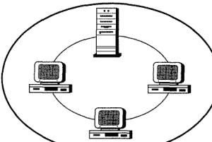

# 图表 5.11 主域模型

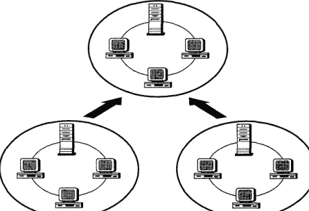

# 图表 5.12 多主域模型

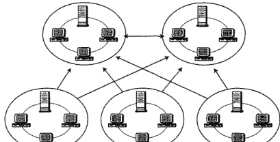

# 图表 5.13 完全信任模型

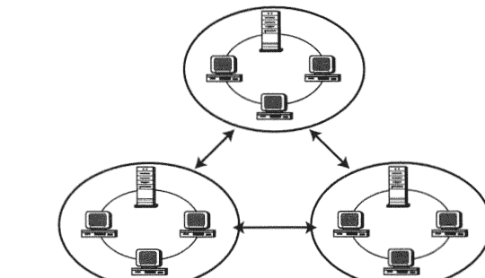

## 支持的网络传输协议

Windows NT 不仅与微软的网络协议配合，还符合其他标准网络和通信协议。配置 Windows NT 服务器时，首要考虑因素之一涉及安装和使用哪些协议。支持的协议可能包括：

- `TCP/IP`
- `NetBEUI`
- `NWLLink (IPX/SPX)`

操作系统供应商面临的一个主要挑战是在可能依赖旧的、不安全的协议的情况下，如何制作出基于标准的安全性。这对于所有操作系统供应商来说一直是一个问题。从本质上说，Windows NT 并不修复任何协议中的弱性。对于对安全敏感的组织，补偿性控制（如链路级或应用级加密）可能是必要的补充。

## 攻击与防御

随着 Windows NT 在商业和工业领域的使用日益增加，其可能存在的安全漏洞和缺陷一直受到审查。图表 5.14 检查了针对 Windows NT 操作系统的各种攻击以及为缓解这些攻击而采取的防御。

Windows NT 曾受到拒绝服务（`DoS`）和其他攻击的威胁，这些攻击试图获取敏感信息，或尝试获得高于攻击者已知的权限。为了提供安全环境，微软以补丁和服务包的形式提供修复。在接到暴露问题的通知后，微软会发布修复程序。图表 5.14 列出了已识别的一些较常见的攻击以及发布的相关的修复。

# 图表 5.14 Windows NT 攻击与防御

| 攻击/方法 | 防御 |
| :--- | :--- |


| 访问获取和信息收集：匿名用户连接（红色按钮）被用于获取有关管理帐户和可用网络共享的信息。 | 在注册表中插入项以防止匿名用户向服务器建立网络连接：<br>`HKLM\System\CurrentControlSet\Control\LSR\RestrictAnonymous\*`<br><br>类型: `REG_DWORD`<br>值: `1` |

| 远程注册表访问：尝试访问注册表，以检索密码或更改系统设置。 | Windows NT 4.0 版本通过添加注册表项防止远程注册表访问。该项在 Windows NT 4.0 的新安装中默认存在，但在 Windows Workstation 4.0 中默认不存在。在从 Windows Server 3.51 升级的计算机中也可能不存在。`HKLM\System\CurrentControlSet\Control\SecurePipeServers\winreg` |

| 密码盗取和破解：尝试捕获哈希密码并破解它们以获得对系统的进一步访问。 | 通过应用 `SP3` 的功能增加 `SAM` 中的密码加密。移除对系统的匿名访问并收紧注册表安全性。 |

| 弱且易猜的密码 | 使用域控制器强制执行强密码策略，`passflit.dll` 可从服务包 20 中获取。 |

| 回滚：`Rollback.exe` 包含在 Windows NT 4.0 中。这是一个强制将系统配置回到安装设置的工具。 | `Rollback` 可能被用作木马，应从所有系统中删除。 |

| `GetAdmin`：`GetAdmin` 程序最近最近从一个俄罗斯来源发布。`GetAdmin` 允许普通用户在本地机器上获得管理员权限。 | 微软已发布了修补 `GetAdmin` 及后续问题的安全修复程序。 |

| `GetAdmin` 的后续版本已发布，其可能会绕过热补丁。 | |

| 在 `System` 上下文中运行的服务可能被用于以“`SYSTEM`”身份访问注册表和其他系统部分。 | 尽可能使用系统帐户以外的帐户运行服务。 |

| 不安全的文件系统访问：使用基于 `DOS` 或 `Linux` 的工具在没有任何安全控制的情况下访问 `NTFS` 文件系统。 | 物理上保护服务器，以防止访问磁盘驱动器。 |

| 服务器消息块 (`SMB`) `NetBIOS` 访问：这些用于文件共享的访问端口可能会提供访问路径，特别是当暴露到互联网或与运行 `Samba` 工具set的 `Unix` 服务器配合使用时。 | 应用服务包 3，并在任何连接到外部网络的服务器上使用所有 `TCP` 和 `UDP` 端口 137、138 和 139。 |

## 图表 5.14 Windows NT 攻击与防御续

| 攻击/方法 | 防御措施 |

| :--- | :--- |

| 拒绝服务：连接到意外端口的 `Telnet` 可能导致系统锁定或 `CPU` 占用率增加。`Telnet` 仅预期连接到 23 端口。Windows NT 不支持 `telnet` 守护进程。 | 安装 `Service Pack 2` 或 `Service Pack 3`。 |

| 死亡之源（`Ping of Death`）——这种影响过许多操作系统的攻击被发现也会影响 Windows NT。死亡之源是由发送大于正常尺寸的 `ping` 包引起的。如果有人执行 `ping` 命令并指定大包尺寸（> 64 字节），`TCP/IP` 栈将停止正常工作。这会影响系统，直到重启为止。某些 Windows 实现不允许大于默认 64 字节的数据包大小；Windows '95 和 NT 不允许此类异常，因此可能受到此类系统拒绝服务的攻击。 | 此问题在 `SP2` 中已解决。 |

| 该问题的最新版本影响了运行 `IIS` 且暴露在互联网上的 Windows NT Server 4.0 `SP3` 系统。这是由于分段且格式不正确的 `ICMP` 包导致的。 | 已发布 `SP3` 之后的新补丁，称为 `icmp-fix`。 |

| `SYN` 泛洪攻击——向包含“伪造”源 `IP` 地址的 `IIS` 服务器发送大量的 `TCP` 连接请求（`SYN`）。在接收到连接请求后，`IIS` 服务器会分配资源来处理和跟踪新连接。随后会将响应发送到被“伪造”的不存在的 `IP` 地址。使用默认值，服务器将重传，并最终在 189 秒后释放为该连接预留的资源。这有效地占用了服务器，多个请求可能导致 `IIS` 服务器对所有连接请求响应重置（`reset`）。 | `Service Pack 2` 为此漏洞提供了修复。 |

| 带外攻击（`Out of Band` Attacks）——数据在正常范围之外发送的带外（`OOB`）攻击已被证明会影响 Windows NT。第一个 `OOB` 攻击在 `Service Pack 2` (`SP2`) 之后被识别，补丁也包含在 `SP3` 中。这种攻击会导致不可预知的结果，有时会导致 Windows NT 在执行此类操作后处理任何网络操作出现困难。自 `SP3` 发布以来，在 `TCPIP` 网络驱动程序中发现了另一个问题，导致 Microsoft 网络客户端仍然容易受到来自 `Apple Macintosh` 环境的各种 `OOB` 攻击。`OOB` 攻击会导致 `TCP/IP` 协议栈崩溃，强制 Windows NT 重启。随后发布了热补以应对应对攻击。 | 安装 `Service Pack 3` 以及随后的 `OOB-fix`。 |

## 领域与信任

## 增强或影响安全的服务

### 互联网的影响

互联网演变自 20 世纪 60 年代末创建的国防部 `Arpanet`。1991 年，商业流量首次被允许运行。随着商业化使用以及随后的超文本传输协议和使用该协议的万维网的发展，公司开始连接其企业局域网（`WAN`）。大量的人对数据观点产生了许多变化。企业网络直观的连接性和访问性影响了人们的意识。在很短时间内，非技术人员开始讨论技术，并开始询问它们的安全性。围绕互联网功能和风险的炒作和虚假信息产生了对技术解决方案以及技术和安全教育的需求。任何人都可能在一夜之间成为内容发布者。与员工、战略合作伙伴、客户甚至竞争对手共享数据已变得非常容易。自然地，这增加了组织数据的风险。

### 互联网信息服务器

在基础 Windows NT 操作系统添加互联网信息服务器（`IIS`）为 Windows NT Server 提供了新功能，同时也使 Windows NT 暴露在互联网的安全风险之中。`IIS` 与 Windows NT 操作系统集成，使其成为 NT 扩展到局域网和互联网服务器的替代方案。`IIS` 还包含了用于 `FTP` 和 `Gopher` 的标准 `TCP/IP` 服务器。这种 `Web` 客户端服务器模型提供了一种利用 Windows NT 为内部网络及互联网上的人提供信息的方法。

与互联网相关的安全风险有很多有很多，而 `IIS` 使 Windows NT 暴露在这些风险中。然而，由于 `IIS` 与 Windows NT 耦合，它允许使用操作系统中的安全功能。此外，还开发了其他应用程序和协议试图限制这些安全暴露。随后的章节中探讨了其中一些应用程序和协议，作为微软在互联网技术中作用的示例。一如既往，任何暴露在互联网上的系统都应该应该使用多层安全进行保护。

### 代理服务器

Microsoft 代理服务器提供站点过滤、访问控制、请求日志、多协议支持、缓存和远程管理等功能。该应用程序还与 `IIS` 和 Windows NT 系统集成。代理服务器是一个可选产品，不包含在基础操作系统中。

代理服务器通过从外部网络隐藏内部网络来帮助防止网络渗透。客户端请求可以被处理，以验证它们来自内部网络。带有目的地址的 `IP` 包不会被阻止访问内部网络上的计算机。这有助于防止欺骗攻击。过滤可以限制对指定网络地址、地址范围、子网掩码或域的访问。代理服务器提供两个级别的活动或安全日志。在客户端和代理服务器之间提供了用户级身份验证。

特定协议在个人或组级别受到安全保护，或者存在完全禁用协议访问的选项。

### 安全套接层 (SSL)

Microsoft 代理服务器支持安全套接层（`SSL`）。这允许服务器与客户端计算机之间建立安全会话。`SSL 3.0` 是一种在 `Web` 浏览器和 `Web` 服务器之间提供相互认证和机密性的协议。`SSL` 提供了一种用于初始化 `TCP/IP` 网络连接的安全“握手”。这种握手使双方对将使用的安全级别（例如算法和密钥长度）达成一致并识别双方。`SSL` 要求使用数字证书并为连接提供服务器端客户端证书。`SSL` 加密和解密所用应用程序的字节流（例如：`HTTP`）。这意味着 `HTTP` 请求和 `HTTP` 响应中的所有信息都经过加密，包括客户端请求的资源定位符（`URL`）、任何提交的表单（如信用卡号）以及任何 `HTTP` 授权信息（用户名和密码），以及返回给服务器的所有数据。

### 服务器路由

微软引入了路由远程访问服务。新功能与微软代理服务器集成并提供了额外的安全层。Windows NT 的路由功能支持 `IP` 网络上的 `RIP`、`OSPF` 和 `DHCP` 中继协议，以及跨 `IP` 网络的 `SAP` 协议。

结果提供了类似于许多硬件路由器上的数据包过滤安全性。过滤可用于包层网络安全，并在与代理服务器配合时补充应用层安全。过滤器基于异常进行配置。用户可以配置过滤器仅通过列出的路由，或通过除指定路由以外的所有。

另一个安全功能由远程认证拨入用户服务（`RADIUS`）提供。为该服务提供了另一种安全和计数选项。通过 `RADIUS` 客户端支持，管理员可以选择使用 Windows Server 域数据库进行用户验证，或者选择选择其他 `RADIUS` 服务器数据库来执行验证。

### 点对点隧道协议

点对点隧道协议（`PPTP`）是一种网络协议，通过在 `TCP/IP` 网络上创建虚拟专用网络（`VPN`），促进从移动客户端到私有企业服务器的安全数据传输。`PPTP` 协议对数据进行封装以便在 `TCP/IP` 网络上传输。封装使得软件即插即用。任何封装软件都包含两个部分——一个向外部世界展示的接口和一个保留的实现。如果用户发送了接口请求的消息并带有约定的格式的适当属性，对象将以约定的格式向用户返回响应。`PPTP` 在之上提供了一种形式的安全和加密通信

# 域与信任

公共电话线路和互联网。`PPTP` 删除了对昂贵的租用专线或私有专用通信服务器的需求，因为 `PPTP` 可以在标准电话线上使用。

远程 `PPTP` 客户端的身份验证是通过使用与直接连接到 `RAS` 服务器的 `RAS` 拨号时相同的身份验证方法完成的。微软的 `RAS` 实现支持挑战性握手认证协议（`CHAP`）、微软挑战性握手认证协议（`MS-CHAP`）以及密码认证协议（`PAP`）认证方案。身份验证后，对私有局域网的访问继续使用基于 Windows NT 的安全模型。这些用户身份验证方法在早前的章节“用户身份验证”中有所讨论。

对于数据加密，`PPTP` 使用远程访问服务器（`RAS`）“共享密钥”加密，并要求使用 `MS-CHAP` 认证过程之一。数据包被加密并封装成更大的数据包，以便在互联网上路由到 `PPTP` 服务器。

通过在 `PPTP` 服务器上启用 `PPTP` 过滤，还可以增加网络安全性。当启用 `PPTP` 过滤时，私有网络上的 `PPTP` 服务器仅接受并路由来自已身份验证用户的 `PPTP` 数据包。这防止了所有其他数据包进入 `PPTP` 服务器和私有网络。

# 注册表

注册表是硬件和软件组件配置与用户配置选项的结合。注册中有五个子树。每个子树都有特定的用途。这五个子树及其用途如下：

- `HKEY_CURRENT_USER` 保留所有已登录特定用户的配置信息。

- `HKEY_USERS` 保留曾经登录过机器的每个用户的信息。

- `HKEY_CLASSES_ROOT` 包含与 `OLE`（对象链接与嵌入）相关的信息。

- `HKEY_CURRENT_CONFIG` 仅包含与当前设置的信息。

- `HKEY_LOCAL_MACHINE` 包含与硬件设置相关的信息。

当用户安装软件或更改用户使用的硬件时，用户应使用前端工具来更改注册表，而不是通过 `REGEDIT32` 命令手动编辑，因为用户可能会意外修改一个更改机器的参数。前端工具的示例包括控制面板安装程序和组策略编辑器。`REGEDIT32.exe` 实用程序用于编辑注册表。

# 保护注册表

保护注册表将有助于防止用户或其他人员通过无意或其他方式更改注册表值为 Windows NT 引起问题。所有用户必须对注册表的某些部分具有读取权限才能在 Windows NT 环境中运行，但不应能够更改所有注册表值或创建新的注册表项。

# 附录 5A

注册表支持三种访问权限：

- 完全控制用户可以编辑、创建、删除或获取键的所有权。

- 读取用户可以读取任何值但不进行任何更改。

- 特殊访问用户可以被授予特定键的十种特定权限中的一种或多种。这十种特定权限列在表 5.15 中。

表 5.15 注册表子键权限

| 权限级别 | 描述 |

|---|---|

| 查询值 | 读取子键中值项的设置 |

| 设置值 | 设置子键中的值 |

| 创建子键 | 在选定的键或子键内创建新键或子键 |

| 枚举子键 | 识别键或子键内的所有子键 |

| 通知 | 接收由子键生成的审核通知 |

| 创建链接 | 为子键创建符号链接 |

| 删除 | 删除选定的键或子键 |

| 写入 DAC | 修改键的任意性访问控制列表 (`DAC`) |

| 写入所有者 | 获取选定的键或子键的所有权 |

| 读取控制 | 读取选定子键内的安全信息 |

应使用以下远程技术来保护注册表：

- 通过验证存在或创建来禁用注册表编辑：`HKLM\System\CurrentControlSet\Control\LServers\winreg`

- 通过创建禁用匿名访问：`HKLM\System\CurrentControlSet\Control\RestrictAnonymous`

类型：`REG_DWORD`

- 如表 5.16 所示的保护根键。

- 使用表 5.16 所示的限制 `Everyone` 组的：`HKEY_LOCAL_MACHINE\Software\Windows NT\CurrentVersion`

- 保护 `HKEY_LOCAL_MACHINE\Software\RPC`

# 表 5.16 注册表权限

| 注册键 | 默认设置 | 推荐设置 |

|---|---|---|

| `HKEY_LOCAL_MACHINE` | 完全控制<br>所有者：完全控制<br>`Everyone`：读取 | 完全控制<br>所有者：完全控制 |

| `HKEY_CLASSES_ROOT` | 完全控制<br>所有者：完全控制<br>`Everyone`：读取 | 完全控制<br>所有者：完全控制 |

| `HKEY_USERS` | 完全控制<br>所有者：完全控制<br>`Everyone`：读取 | 完全控制<br>所有者：完全控制 |

| `HKEY_CURRENT_USER` | 完全控制<br>所有者：完全控制<br>`Everyone`：读取 | 完全控制<br>所有者：完全控制 |

| `HKEY_CURRENT_CONFIG` | 完全控制<br>所有者：完全控制<br>`Everyone`：读取 | 完全控制<br>所有者：完全控制 |

- 允许 `Everyone` 组具有四种特殊访问：查询值、枚举子键、通知和读取控制。`**警告：** 错误使用此工具会导致系统问题。`

# 安全特性

Windows NT 设计旨在从本地应用程序到访问服务器提供安全性。Windows NT 有安全特性，表 5.17 列出了特性及其描述。

# 表 5.17 Windows NT 安全特性

| 特性 | 描述 |

|---|---|

| 本地安全局 (`LSA`) | `LSA` 也称为安全子系统和 Windows NT 的核心。`LSA` 提供以下服务：在登录过程中创建访问令牌；允许与第三方验证包连接；管理安全策略；向审核日志记录审核消息 |

| 安全帐户管理器 (`SAM`) | `SAM` 维护帐户数据库。`SAM` 提供 `LSA` 使用的用户验证服务。`SAM` 为用户和任何组提供安全标识符 |

| 安全帐户数据库 (`SAD`) | `SAD` 包含所有用户组帐户的信息。它被 `SAM` 用于验证用户。取决于工作组或域模型，`SAD` 的副本可能存在于多个服务器上。存储在 `SAD` 中的密码使用 128 位强密钥 |

| 安全引用监视器 (`SRM`) | `SRM` 是负责执行 `LSA` 访问验证和审核策略的 Windows NT 服务器组件。它保护资源或对象不受未经授权的访问或修改。Windows NT 服务器不允许直接访问对象。`SRM` 提供验证对象（文件、目录等）、测试主体（账户）对于（权限等）以及生成必要的审核消息的服务。`SRM` 包含系统中唯一的访问验证代码。这确保了无论类型如何，在整个 Windows NT 中提供统一的对象保护。 |

## 域与信任

## 图表 5.17（续）

### 登录过程

 登录过程

交互式登录过程是 Windows NT Server 防御未经授权访问的第一道防线。在成功的登录过程中，流程从客户端系统流向服务器系统，而不会在网络上以以明文形式暴露用户密码。整个登录过程在之前名为“登录过程”的章节中进行了描述。

| 特性 | 说明 |

| :--- | :--- |

| 注册表 (`Registry`) | Windows NT Server 注册表是一个访问控制的数据库，包含安全、应用程序、硬件和设备驱动程序的配置数据。注册表是存储这些数据的中心点。注册表包含所有用户配置信息以及哈希后的用户密码。 |

| 事件日志（审计） | Windows NT Server 审计记录事件，显示哪些用户访问了哪些对象、尝试的访问类型以及尝试是否成功。审计可以应用于：<br> - 系统事件，例如登录和注销、文件和对象访问、用户权限使用、用户和组管理、更改和系统关机以及进程跟踪 <br> - 文件和目录事件，如读取、写入、执行、删除、更改权限和获取所有权 <br> - 注册表项子键访问 <br> - 打印机访问事件，如打印、获取完全控制、删除、更改权限和获取所有权 <br> - 远程访问服务事件，如身份验证、由于超时导致的断开、连接但验证失败、连接但验证超时、由于验证会话期间传输层错误导致的断开以及由于无法投影到网络导致的断开 <br> - 剪贴板页面事件，如读取页面、删除页面内容、更改权限和更改审计类型 <br> - 重要事件可以发送到传号机接口，以立即通知安全系统和人员 |

### 事件日志

有三个日志记录了错误、警告、安全以及应用程序相关的事件：

- 1. 系统日志记录由 Windows NT Server 系统生成的错误、警告或信息。

- 2. 安全日志记录有效和无效的登录尝试，以及与使用资源（如创建、打开或删除文件或其他对象）相关的事件。

- 3. 应用程序日志记录应用程序软件（如电子邮件或数据库应用程序）生成的错误、警告和信息。

## 图表 5.17 Windows NT 安全特性（续）


每个日志的大小和替换策略都可以修改。可以显示每个日志事件的细节。

### 进程隔离

`Windows NT` 的设计旨在提供进程隔离，以防止各个进程相互干扰。这是通过为每个进程提供自己的内存空间，且无法访问任何其他进程的内存来实现。这种内存隔离也是为了防止数据从内存空间中被捕获。

有一个选项，可以在注销后覆盖个人的交换或临时磁盘空间，以防止任何人读取该用户的临时文件和数据。

### 用户账户安全

用户账户安全通过用户管理器管理，由账户策略和用户权限策略组成。

- 账户策略控制所有用户账户使用密码的方式。账户策略包括最小和最大密码年龄、最小长度、唯一性、登录时间之外的强制磁盘量量以及账户锁定。
- 用户权限允许被授权的用户影响整个系统。`Windows NT Server` 提供的基本权限包括网络访问、备份、更改系统时间、远程关机、本地登录、管理审计和安全日志、恢复文件、关机以及更改对象的所有权。`Windows NT Server` 还包含许多高级权限。总共有二十种可以分配给用户的权限。

### 内置账户

`Windows NT` 提供两个内置账户：来宾账户（`Guest`）和管理员账户（`Administrator`）。这些账户是为特定用途创建的，并且默认是多个默认组的成员。来宾账户默认是禁用的。

### 用户账户属性

用户功能允许管理用户账户、密码、密码策略、组 `Membership`、用户配置文件、登录时间、用户可以登录的工作站以及账户过期日期。此外，可以实施密码过滤以增强密码安全策略的强度。

### 用户配置文件

用户配置文件允许 `NT` 服务器结构化并管理用户的桌面操作系统环境，并在不考虑工作站类型的情况下呈现相同的环境。此文件在登录时加载。用户配置文件编辑器允许禁用文件菜单中的“运行”、禁用“保存设置”菜单项、显示常用组、更改启动组、锁定程序组、限制对未解锁程序组的访问，并在打印管理器中禁用连接和移除连接。

### 主目录

可以为每个用户分配主目录以存储私有文件。

## 图表 5.17（续）

### 登录脚本

登录脚本在用户登录时执行。它们为网络管理员提供了一个创建标准登录程序的程序。

### 组

组允许管理员将大量用户视为一个账户。`Windows NT Server` 在其分层管理模型中使用了两类组：

- 本地组定义在每台机器上，可以包含用户账户和全局组。`Windows NT` 提供了许多内置的本地组账户。
- 全局组在域级别定义，可以仅包含来自本地域的用户账户，而不能包含来自信任域的账户。`Windows NT` 提供了几个内置组账户。

### 网络模型

在 `Windows NT` 网络环境中，可以实现两种网络模型：工作组模型或域模型。

- 工作组模型允许不参与域的机器进行点对点网络。参与工作组的 `Windows NT` 机器维护自己的安全策略和 `SAD`。
- 域模型是网络环境中实现安全和简化管理的有效方法。域允许共享的安全策略和 `SAD`。

### 信任关系

| 特性 | 说明 |
| :--- | :--- |
| 信任关系 | 域允许共享的安全策略和 `SAD`。域模型是网络环境中实现安全和简化管理的有效方法。工作组模型允许不参与域的机器进行点对点网络。参与工作组的 `Windows NT` 机器维护自己的安全策略和 `SAD`。每个日志的大小和替换策略可以修改。可以显示每个日志事件的细节。 |

### 主备与备份

`Windows NT Server` 通过使用主控制器和备份控制器提供域身份验证。如有必要，备份控制器可以提升为主控制器。

### 复制

复制功能是自动的。该功能包含一个导入和导出的安全工具。

### 复制

`Windows NT` 使用复制来同步各种服务器上的 `SAD`。此过程是自动的。复制不仅限于 `SAD`，还可用于目录树。

## 图表 5.17 Windows NT 特性（续）

### 服务器管理

服务器管理器启用以下类型的管理活动：

- 显示域的成员计算机
- 选择特定的计算机进行管理
- 管理服务器属性和服务，包括启动服务和停止服务，以及生成警报
- 共享目录
- 向系统发送消息

这些管理功能需要管理员访问权限。

### NTFS

`NTFS` 是 `Windows NT` 支持的两个可写文件系统中更安全的。`NTFS` 是唯一利用 `Windows NT` 文件和目录安全的文件系统。`NTFS` 是一个基于日志的文件系统，在发生故障时提供可恢复性。

操作系统的下一个主要版本将提供文件级加密选项。

### 法律通知

提供法律通知功能是为了加强尝试未经授权访问系统的人员的法律责任。该功能在登录过程中按下 `CTRL+ALT+DEL` 组合键后向用户显示消息。当法律通知出现时，用户必须点击消息中的确认框来确认通知。

### 容错

`Windows NT Server` 具有容错功能，可以单独或结合使用保护数据免受介质故障。这些功能允许磁盘镜像、双工、带校验的磁盘条带以及热插拔。

### 带备份

带备份允许文件和目录的备份和恢复。备份可以是全、增量、差异、自定义或对当天更改的文件进行每日备份。

### 最后良好配置

最后良好配置功能允许将系统恢复到上次良好配置。使用时，它将丢弃自上次良好配置以来的任何更改。此功能在每次系统启动后会自动更新。

### 紧急修复磁盘

紧急修复磁盘允许系统恢复到初始设置状态。如果系统文件损坏且用户无法恢复之前的设置配置，可以使用紧急修复磁盘。由于它包含安全账户数据库的密钥，确保紧急修复磁盘的安全至关重要。

# 图表 5.17（续）

## 网络监控器 (Network Monitor)

网络监控器允许在数据包级别检查服务器的网络流量。这些流量可以被捕获以供后续分析，从而更容易诊断网络问题。

## 任务管理器 (Task Manager)

任务管理器监控应用程序任务以及基于 `Windows NT` 服务器系统关键性能指标的工具。任务管理器提供了工作站上运行每个应用程序和进程的详细信息，以及内存和 `CPU` 使用情况。它允许终止应用程序和进程。

## 性能监控器 (Performance Monitor)

性能监控工具能够对系统容量进行监控并预测潜在瓶颈。

## 网络警告 (Network Alerts)

可以将消息发送给指定的个人。这些消息可以报告安全相关的事件，例如登录违反过多或性能问题。

## CryptoAPI

这组加密 `API` 允许开发者开发可以在互联网等不安全网络上安全运行的应用程序。

## 点点隧道 (Point-to-Point Tunneling)

`PPTP` 提供了一种利用公共数据网络（如互联网）创建虚拟私有网络的方法以连接客户端 `PC` 和服务器。`PPTP` 为数据隐私提供了协议封装和加密。

## 协议 (PPTP)

## 分布组件 (Distributed Component)

`Windows NT 4.0` 是 `DCOM`（以前称为 `Network OLE`），它允许开发者和解决方案提供商使用现成和自定义的 `OLE` 组件来构建健壮的分布式应用程序。最重要的是，它利用了 `NT` 服务器内置的安全机制。它解决了一个经常与在 `Windows NT` 下运行服务的 `OLE` 相关的问题：`NT` 服务器内置的安全机制无法让 `OLE` 服务在应用程序之间通信，因为大多数应用程序是从运行在不同安全上下文的桌面启动的。通过 `DCOM`，`Windows NT 4.0` 现在允许不同上下文之间进行通信。

## 对象模型 (DCOM)

## Windows NT 诊断工具 (Windows NT Diagnostic Tool)

`Windows NT` 诊断工具用于检查系统，包括驱动程序、网络用户和系统资源的信息。

## 服务管理 (Services Administration)

服务管理器允许对网络和操作系统服务的访问和管理。

| 特性 | 描述 |
| :--- | :--- |
| 远程访问服务 (RAS) | `RAS` 管理工具控制远程连接环境。 |
| 管理工具 | 以下工具用于 `RAS` 配置和管理过程： |

- 网络设置允许安装和配置网络软件、适配器卡以及它们所在的端口。
- 网络配置控制 `RAS` 的入站和出站协议以及加密要求。每个协议都有后续带有配置和控制功能的对话框。
- 远程访问管理工具允许监控特定端口、管理远程访问权限以及配置任何回拨连接。
- `IIS` 是 `Windows NT 4.0` 的插件。`IIS` 与 `NT 4.0` 的集成允许 `IIS` 能够充分利用 `NT 4.0` 服务器和目录服务。该集成支持将服务器日志记录 `NCSA` 通用日志格式以及任何 `ODBC` 数据库。`IIS` 为 `Windows NT` 系统提供 `Web`、`FTP` 和 `Gopher` 服务。

| TCP/IP 支持 | `Windows NT` 支持 `TCP/IP` 协议和 `IP` 地址格式。`TCP/IP` 配置工具允许管理员管理 `TCP/IP` 以及 `SNMP`、`DHCP` 和 `WINS`。配置工具还控制 `IP` 路由。支持传统的 `TCP/IP` 命令如 `ARP`、`NBTSTAT`、`NETSTAT`、`PING`、`TRACERT` 以及 `Unix` 命令。 |
| C2 工具 | `C2` 工具为确保 `Windows NT` 服务器符合 `C2` 安全标准提供指导。 |
| 图表 5.17 Windows NT 安全特性（续） |

| :--- |
| 在过去的几十年里，美国政府编写了一系列计算机安全手册，封面颜色各异。这套“彩虹系列”手册包含了如何设计、构建、选择、分析和操作受信系统。橙色书（`Orange book`）于 1985 年 12 月发布，讨论了评估受信系统的标准。随后产生了其他手册，扩展了橙色书中使用的通用术语。它们是红书（`Red book`，从网络系统角度解释橙色书）和蓝书（`Blue book`，从子系统角度解释橙色书）。 |

橙色书将安全分为部分，从 `D` 到 `A`。`D` 级是最小保护，而 `A` 类是验证保护。在 `C` 类中有 `C1`（自由裁量安全保护）和 `C2`（控制访问保护）。每个级别都规定了以下领域的要求——安全策略、可追溯性、保证性和文档，并定义了系统在每个领域必须能够做什么以满足该级别的要求。

当根据这些标准对系统进行评估时，会创建并使用特定的硬件和软件配置进行评估。完成后，需要适当安全级别的政府机构就可以购买经过评估的系统。

# 域与信任

`D` 级没有标准，保留给那些经过评估但未达到更高评估类别标准的系统。`C2` 级是政府使用的最低可接受级别。

由于政府使用所需的分级标准，公众认为它对于国防部来说已经足够了。然而，今天许多人说出“`C2` 安全”时，并不理解这些认证的要求或影响。一些常见的误解包括：

- 如果操作系统被认证为 `C2`，那么它在任何环境或配置下都将是 `C2`。
- `C2` 标准适用于并适用于所有商业用途。
- `C2` 标准包含了诸如特定的密码控制和密码学用用等领域。

上述所有内容都是错误的。定义 `C2` 要求的整个章节长达三页。它规定用户需要通过日志程序对自己的行为承担个人责任，审计安全相关事件、审计将包含的内容以及资源隔离的要求。

`ITSEC` 是英国等同于美国国防（`DOD`）国家计算机安全中心的机构。从中心来看，他们的分级系统是相同的，他们分级分为功能类（`F-C`，其中 `F-2` 等同于 `C2`）和评估级（`E0` 到 `E3`），后者定义了产品是否能在尽可能多的场景下满足功能标准。`Windows NT` 在客户端和服务器端都获得了 `F-2/E3` 级。有关这些分级的更多详细信息可以访问 `www.itsec.gov.uk`。

微软出于服务市场的意图，并考虑到公众对 `C2` 安全的印象，设计的 `Windows NT` 架构以符合“橙-红-蓝-蓝”方案的标准。它纳入了以下控制措施：根据安全数据库验证用户操作、使用会话令牌、保护安全数据库、使用用户名和密码组合访问系统、按用户逐一审计成功和失败事件、定义访问的访问控制列表（`ACL`）、使用安全引用文件监控对对象的控制访问、内存空间保护以及集成功能。请注意，对计算机系统访问的物理控制在 `C2` 合规中起着至关重要的作用，并且通常不是可以构建在操作系统中的功能。

截至 1995 年，`Windows NT 3.5 Service Pack 3`（未安装网络）通过了 `NCSC` 橙色蓝级认证要求。带有 `Service Pack 3` 的 `Windows NT 4.0` 正在评估中。`Windows NT 3.1` 工作站和 `Windows NT 3.51` 服务器在 1996 年 10 月被 `ITSEC` 评为符合其 `F-2/E3` 标准级。`Windows NT 4.0` 的评级已提交给 `ITSEC` 审查。与 `C2` 认证相关的一个重要点是，由于测试级别非常严格，政府确实会确定合规性，测试可能需要很长时间。在此期间，可能会发布补丁、热修复程序和服务包。如果供应商希望将这些内容包含在评估中，过程将显著延长，以允许对补丁以及与其交互的代码进行审查，以确保在修复另一个问题时不会引入新的安全漏洞。在对每个进行评估时

# 240 附录 5A

对于 `C2` 或 `E3` 认证，系统源代码可供审查，整个开发过程也是公开的。需要理解的关键概念包括：

- 许多开箱即运行的操作系统（包括 `Windows NT`）被认为是安全的。
- `C2` 合规性可能满足也可能不满足组织的安全需求。
- `C2` 级的安全配置（包括不使用软盘驱动器且无网络连接）在许多组织中可能不实际或不合适。
- 还有其他控制措施，例如物理控制和监控控制，这些是合规必须解决的，但不包括操作系统组件。
- 可用性在许多企业环境中通常是至关重要的，但它不是 `C2` 认证的标准之一。
- 组织必须评估其试图保护的数据的相关的风险水平，制定政策来定义其环境中合适的安全级别，并建立监控控制措施以确定是否遵守了该政策。
- 通过这些标准，公司可以相应地决定其所实施的安全级别是过高的、适中的，还是需要额外的控制（例如客户端和服务器之间的链路级加密）。从这个角度来看，问题不是“该产品是否通过了 `C2` 认证”，而是“该系统单独或配合额外的 `OEM` 或第三方工具，是否能满足我组织的安全需求？”

# 建议阅读材料

- Cowarts, R. `Windows NT 4.0 Server—Workstation Unleashed`. Sams Publishing, 1997.
- Daily, S. `Migrating to Windows NT`. Duke Press, 1997.
- Dalton, W., et al. `Windows NT Server 4: Security, Troubleshooting, and Optimization`. New Riders, 1997.
- Jarms, J., et al. `Windows NT Server 4 Unleashed`. Sams Publishing, 1997.
- Grant, G., et al. `Troubleshooting with Microsoft: Common Windows NT Problems`. `Windows NT Magazine`.
- Karanjit, S. `Windows NT Server Professional Reference (4.0)`. New Riders, 1997.
- Microsoft Corporation. `Windows NT Workstation and Server`.
- Pleas, K. `Windows NT 4.0: Explore the New Features`.
- Ramos, F. `Windows NT Security Issues`. Somarsoft Corp.
- Sheldon, T. `Windows NT Security Handbook`. McGraw-Hill, 1997.
- Sutton, A. `Windows NT Security Guide`. Trusted Systems, 1997.

# 网站

- Microsoft 安全 (`www.microsoft.com/security`)
- NT 管理常见问题解答 (`www.itfetch.com/oltc/admin/admin.stm`)
- NT 错误跟踪 (`ntbugtrack.rc.on.ca`)
- NT 安全 (`www.ntsecurity.net`)
- NT 安全常见问题解答 (`www.it.kth.se/~rom/ntsech.html`)

# 附录 5B


# 附录 5A

对于 `C2` 或 `E3` 认证，系统源代码可供审查，整个开发过程也是公开的。需要理解的关键概念包括：

- 许多开箱即运行的操作系统（包括 `Windows NT`）被认为是安全的。
- `C2` 合规性可能满足也可能不满足组织的安全需求。
- `C2` 级的安全配置（包括不使用软盘驱动器且无网络连接）在许多组织中可能不实际或不合适。
- 还有其他控制措施，例如物理控制和监控控制，这些是合规必须解决的，但不包括操作系统组件。
- 可用性在许多企业环境中通常是至关重要的，但它不是 `C2` 认证的标准之一。
- 组织必须评估其试图保护的数据的相关风险水平，制定政策来定义其环境中合适的安全级别，并建立监控控制措施以确定是否遵守了该政策。
- 通过这些标准，公司可以相应地决定其所实施的安全级别是过高的、适中的，还是需要额外的控制（例如客户端和服务器之间的链路级加密）。从这个角度来看，问题不是“该产品是否通过了 `C2` 认证”，而是“该系统单独或配合额外的 `OEM` 或第三方工具，是否能满足我组织的安全需求？”

## 建议阅读材料

- Cowarts, R. *Windows NT 4.0 Server—Workstation Unleashed*. Sams Publishing, 1997.
- Daily, S. *Migrating to Windows NT*. Duke Press, 1997.
- Dalton, W., et al. *Windows NT Server 4: Security, Troubleshooting, and Optimization*. New Riders, 1997.
- Jarms, J., et al. *Windows NT Server 4 Unleashed*. Sams Publishing, 1997.
- Grant, G., et al. *Troubleshooting with Microsoft: Common Windows NT Problems*. Windows NT Magazine.
- Karanjit, S. *Windows NT Server Professional Reference (4.0)*. New Riders, 1997.
- Microsoft Corporation. *Windows NT Workstation and Server*.
- Pleas, K. *Windows NT 4.0: Explore the New Features*.
- Ramos, F. *Windows NT Security Issues*. Somarsoft Corp.
- Sheldon, T. *Windows NT Security Handbook*. McGraw-Hill, 1997.
- Sutton, A. *Windows NT Security Guide*. Trusted Systems, 1997.

## 网站

- Microsoft 安全 (`www.microsoft.com/security`)
- NT 管理常见问题解答 (`www.itfetch.com/oltc/admin/admin.stm`)
- NT 错误跟踪 (`ntbugtrack.rc.on.ca`)
- NT 安全 (`www.ntsecurity.net`)
- NT 安全常见问题解答 (`www.it.kth.se/~rom/ntsech.html`)

# 附录 5B

# 243

# 实现技术

# 合规评估技术

# 合规验证技术

## 附录 5B：Windows NT 主域控制器安全审查计划

| 编号 | 类别 | 控制目标 | 风险 | 控制技术 |
| :--- | :--- | :--- | :--- | :--- |
| 1 | 系统配置 | 域内的所有服务器都应为 `Windows NT 3.51` 或更高版本；域内不应存在 `3.51` 版本之前的 `LAN Manager` 或 `Windows` 服务器。 | 旧服务器（如 `Windows NT 3.5` 或 `LAN Manager`）可能会使 `Windows NT` 环境面临不当的安全风险。 | 应立即从域内消除所有 `Windows NT 3.5` 和 `LAN Manager` 服务器或对其进行升级。 |
| | 系统配置 | 应安装并正确配置最新的 `Microsoft` 服务包和热补丁。每次安装新软件时都应重新应用服务包和热补丁。 | 当前版本的操作系统包含处理和安全增强功能。服务包修复了已向微软反馈的漏洞。如果版本系统是最新状态，未经授权的用户可能利用操作系统漏洞的风险将会增加。某些服务包和热补丁需要系统管理员的干预，例如运行应用程序或手动向注册表输入注册表项。 | 从 `Microsoft` 获取最新的服务包和热补丁，并正确安装和配置它们。`Windows NT 3.5` 的最新服务包是 `5`，`Windows NT 4.0` 的最新服务包是 `3`。 |
| | 系统配置 | 应实施服务包 `3` (`SP3`) 的“系统密钥”（`system key`）选项。 | 服务包 `3` 的系统密钥功能为 `SAM` 数据库提供了更强的加密。此选项降低了密码哈希值在获取后被破解的风险。已发布了一种即使实施了 `syskey` 也能提取 `Windows NT` 密码值的实用程序；因此，该风险仅得到了部分缓解。 | 启用 `syskey` 选项 |

### 实现技术

将所有 `LAN Manager` 和 `Windows NT 3.5` 服务器升级到 `Windows NT 3.51` 或更高版本。

浏览 `Microsoft` 首页并下载最新的服务包。识别可用的热补丁，并确定哪些补丁需要在目标系统上安装。在每台机器上安装服务包和相应的热补丁，以确保与现有应用程序兼容。

### 合规评估技术

通过与公司讨论和实地检查，验证每台服务器运行的 `Windows NT` 操作系统版本为 `3.51` 或更高。本文仅对上述版本适用并有效。

在审查服务器期间，参考 `<servername>\wmnrmsd.txt` 以验证操作系统的版本。

### 合规验证技术

通过检查 `<servername>.services` 文件并确保安装并启动了身份验证相关的服务，验证 `PDC` 是否仅用于身份验证。此外，检查 `<servername>.pullist.txt` 文件以确保只有与身份验证相关的进程正在运行。

1. 打开服务器管理器。
2. 从 `Computer` 下拉菜单中选择 `Services...`。
3. 检查每个运行的服务，确定其是否用于身份验证之外的任何用途。

允许的应用包括 `DHCP`、`WINS` 和 `DNS`。

当服务启动时，不应允许服务与桌面选项进行交互。为每个服务选择服务器管理器。打开 `Computer` 下拉菜单。双击每个服务，并验证 `Log On As` 的设置。

通过检查 `<servername>.uimsd.txt` 的服务报告，并注意任何服务帐户名称非 `LocalSystem` 或具有交互式（`Interactive`）标志的服务，来验证服务无法与桌面进行交互。

1. 打开服务器管理器。
2. 从 `Computer` 下拉菜单中打开 `Services...`。
3. 双击每个服务，验证未勾选 `Allow services interact with the desktop` 选项。

在输入新用户或更改现有用户时，执行以下步骤：

通过检查 `<servername>.users.txt` 并确定系统中的任何用户是否执行了时间限制，来验证用户的登录时间工作站限制。

1. 打开用户管理器。
2. 双击用户名打开用户属性。
3. 点击 `Hours` 按钮。
4. 选择适当的时间，并根据情况分别点击 `Allow` 和 `Disallow`。
5. 点击 `OK` 确认更改。
6. 点击 `Logon` 按钮。
7. 按工作站验证用户访问情况。


| 编号 | 类别 | 控制目标 | 风险 | 控制技术 |
|---|---|---|---|---|
| 3 | 网络 | 当用户登录时间过期时，应强制断开与服务器的连接。 | 用户时间过期时自动断开系统连接，可以确保除非用户在这些时间内获得特定授权，否则无法访问网络资源。 | 在账户策略中启用强制账户断开连接功能。 |
| 3 | 用户管理 | 维护 Windows NT 环境的组应对对域内的所有用户和组进行识别和记录。 | 如果域内存在未知或未记录的用户和组，则域安全性受到损害的风险增加。 | 应定期对用户和组进行清点，并与批准的用户组列表进行比对。如果发现“流氓”用户或组，应立即进行调查。 |
| 3 | 用户管理 | 所有用户和目录管理应通过 Windows NT 工具执行。 | 某些版本的非 Windows NT 管理工具（Windows 95）会以不安全的方式创建用户帐户和主目录。 | 仅应使用 Windows NT 管理工具来管理用户、组和目录。 |
| 3 | 用户管理 | 所有用户帐户都应有适用且信息丰富的全名和描述。 | 要求所有用户都有描述和全名，可以减少创建额外、不用户帐户的可能性。此类用户可能会绕过系统管理并用于不利目的。 | 为每个用户帐户添加适用且信息丰富的全名和描述。 |

## 附录 5B

### 实现技术

通过执行以下步骤在账户策略中启用强制账户断开：

1. 打开用户管理器。
2. 从用户菜单中选择“选择域 (Select Domain)”。
3. 在域中输入“Authentication”。
4. 点击“确定 (OK)”。
5. 从策略菜单中选择“帐户 (Account...)”。
6. 勾选“在登录时间检查时强制断开远程用户的服务器连接 (Forcibly disconnect remote users from server when logon hours)”复选框。
7. 点击“确定 (OK)”。
8. 关闭用户管理器。

### 合规性评估技术

通过执行以下步骤验证账户策略中的强制账户断开功能已启用：

1. 打开用户管理器。
2. 从用户下拉菜单中选择“选择域 (Select Domain...)”。
3. 在框中输入 Authentication Domain。
4. 点击“确定 (OK)”。
5. 从策略菜单中选择“帐户 (Account...)”。
6. 验证“在登录时间检查时强制断开远程用户的服务器连接”复选框已勾选。
7. 点击“确定 (OK)”。
8. 关闭用户管理器。

### 合规验证技术

通过检查 `<servername>.policies.txt` 并确保实施了“强制登录过期 (Force logon hours expire)”验证账户策略中的强制账户断开功能已启用。

验证已为用户设置了登录时间。

记录域内的所有用户和组。通过从人力资源部门获取列表验证所有用户目前均在公司工作。

将清点结果与人力资源部的实际员工列表进行比较，并验证所有用户均为现职员工。还应确定是否有程序定期根据此列表检查域内的用户和组。

利用原生 NT 管理工具管理用户、组并创建目录。

通过与网络管理员讨论以及对系统进行物理检查，确定使用哪些工具管理网络。确保所有工具都是专为 Windows NT 设计的。

在创建用户时，在用户管理器中为新帐户填写“名称 (Name)”和“描述 (Description)”字段。

通过执行以下步骤并查看用户管理器中的用户，验证相应字段中的所有名称和描述：

1. 从用户下拉菜单中选择“选择域 (Select Domain...)”。
2. 输入 Authentication Domain。
3. 点击“确定 (OK)”。

检查 `<servername>.users.txt` 并验证所有用户均有适用的全名和描述。

查看所有用户并验证他们拥有全名和描述。

## 附录 5B

### Windows NT 主域控制器安全评审审查计划

| 编号 | 类别 | 控制目标 | 风险 | 控制技术 |
| --- | --- | --- | --- | --- |
| 3 | 用户管理 | 应为所有用户帐户建立并遵循命名规范。命名规范应涵盖最终用户、承包商、顾问和供应商。 | 让所有用户使用相同的命名规范可以增加网络安全性，因为用户可以被容易识别。不符合命名标准的帐户很容易被识别。为承包商、顾问和供应商设置具有可识别命名规范的临时帐户，可以这些这些账户被识别和清理。 | 所有用户帐户均符合既定的命名规范。 |
| 3 | 用户管理 | 用户帐户应仅输入 Authentication 域的 PDC 中，而不是在工作站或服务器上。 | 由域集中管理所有用户帐户会增加网络安全性，因为无法控制资源分配。在域之外（本地工作站上）存在的唯一帐户是内置的 Guest 和 Administrator 帐户。 | 从资源域、服务器和工作站中删除所有用户帐户，并将其移动到相应的身份验证域中。 |

## 附录 5B

### 实现技术

根据既定的命名规范命名所有用户账户。

通过执行以下步骤并在用户管理器中查看用户，验证所有用户的命名均符合公司策略：

获取公司用户命名规范副本，并通过检查 `<server>.users.txt` 文件确保其已应用于所有用户账户。注意命名规范是否提供了识别员工、供应商和临时 ID 的功能。

* 4. 从用户下拉菜单中选择“选择域...”。
* 5. 输入身份验证域。
* 6. 点击“确定”。
* 7. 查看所有用户并验证它们已按照公司策略命名。

通过执行以下步骤将所有用户账户从资源服务器移动到身份验证域：

注意命名规范提供了识别员工、供应商和临时 ID 的功能。

检查 `<server>.users.txt` 并确保终端用户账户已在身份验证域中创建。

* 1. 从用户下拉菜单中打开“用户管理器...”。
* 2. 从下拉菜单中选择“选择域...”。
* 3. 输入服务器名称。
* 4. 点击“确定”。
* 5. 双击用户账户查看信息。
* 6. 记录下所有可见信息。
* 7. 关闭用户信息。
* 8. 选中用户账户，从用户下拉菜单中选择“删除”。
* 9. 点击“确定”。
* 10. 重复步骤 5-9，直到所有用户均已删除。
* 11. 从用户下拉菜单中选择“选择域...”。
* 12. 输入身份验证域名称。
* 13. 点击“确定”。
* 14. 从用户下拉菜单中选择“新建用户...”。
* 15. 输入所有用户信息。
* 16. 点击“确定”。
* 17. 重复步骤 14–16，直到所有用户均已添加。
* 18. 关闭用户管理器。

通过执行以下步骤验证每台服务器和工作站上没有账户：

* 1. 打开“用户管理器...”。
* 2. 从用户下拉菜单中选择“选择域...”。
* 3. 输入服务器或工作站名称。
* 4. 验证列出的账户仅为默认账户。
* 5. 重复步骤 2–4，直到所有服务器和工作站均已验证。
* 6. 关闭用户管理器。

## 附录 5B

### Windows NT 主域控制器安全评审审查计划

| 编号 | 类别 | 控制目标 | 风险 | 控制技术 |
|---|---|---|---|---|
| 3 | 用户管理 | 任何长时间未登录身份验证域的账户都应被禁用。 | 闲置账户经常被入侵者用于突破网络。如果用户账户一段时间未被使用，则应禁用该账户直到需要使用为止。这最大限度地减少了未经授权的用户利用该账户的可能性。 | 根据公司标准禁用所有未登录的账户。行业指南规定，如果账户闲置了 90 天，则只有在联系并核实该用户后才被视为闲置。 |
| 3 | 用户管理 | 应删除已离职或不再需要账户的个人账户。 | 留有不再需要的账户会增加未经授权访问的风险。 | 删除所有不需要的账户，包括供应商账户、离职员工和承包人员。 |

## 附录 5B

### 实现技术

通过执行以下步骤禁用过期用户账户：

1. 在命令提示符下，对每个用户执行 `net user <User Name>` 命令。
2. 记录最后登录时间。如果账户在指定时间内未登录（根据我们的最佳实践），应禁用该账户。
3. 通过执行 `net user <Name>/Active:no` 禁用账户。

### 合规性评估技术

通过执行以下步骤验证闲置用户账户已禁用：

1. 在命令提示符下，对每个用户执行 `net user <User Name>` 命令。
2. 记录最后登录时间。如果账户在指定时间内未登录（根据公司策略或我们的最佳实践），则应禁用该账户。
3. 通过工具验证最后一次有效登录时间。

通过检查 `<username>.txt` 中“TrueLastLogon Time”超过公司策略的账户，验证闲置用户账户已通过审查。

注意：如果用户身份验证到的是 BDC 而非 PDC，则此过程可能无法提供真实的最后登录时间。

通过执行以下步骤从身份验证域中删除不需要的用户账户：

1. 打开用户管理器。
2. 高亮不需要的账户并从用户下拉菜单中选择*删除*。
3. 重复操作直到所有不需要的账户均已移除。

### 合规验证技术

通过执行以下步骤验证身份验证域中没有不需要的用户账户：

1. 打开用户管理器。
2. 检查用户列表。
3. 与网络管理员和人力资源部门讨论这些用户以确定其合理性。

通过从人力资源部门获取近期离职员工列表，并确保前员工账户已从身份验证域中移除或禁用，来验证没有不需要的用户账户。这些可以在相应的 `<username>.txt` 文件找到。

## 252 附录 5B

### Windows NT 主域控制器评审计划

| 编号 | 类别 | 控制目标 | 风险 | 控制技术 |
|---|---|---|---|---|
| 3 | 用户管理 | 任何长时间未登录身份验证域的账户都应被禁用。 | 闲置账户经常被入侵者用于突破网络。如果用户账户一段时间未被使用，则应禁用该账户直到需要使用为止。这最大限度地减少了未经授权的用户利用该账户的可能性。 | 根据公司标准禁用所有未登录的账户。行业指南规定，如果账户闲置了 90 天，则只有在联系并核实该用户后才被视为闲置。 |
| 3 | 用户管理 | 应删除已离职或不再需要账户的个人账户。 | 留有不再需要的账户会增加未经授权访问的风险。 | 删除所有不需要的账户，包括供应商账户、离职员工和承包人员。 |

## 附录 5B

### 253

### 实现技术

通过执行以下步骤重命名默认账户：

1. 使用*用户管理器*高亮 *Administrator* 账户。
2. 从用户下拉菜单中选择相应的选项。
3. 在更改框中输入符合公司标准的*新账户名称*。
4. 点击“确定”确认更改。
5. 双击 *Administrator* 账户。
6. 在密码和确认密码框中输入符合公司策略的*强密码*。
7. 点击“确定”确认更改。
8. 从用户下拉菜单中选择“新建用户”。
9. 在用户名框中输入 *Administrator*。
10. 在全名框中输入符合公司策略的*全名*。
11. 在描述框中输入*入侵检测的管理日志*。
12. 在密码和确认密码框中输入*强密码*。
13. 确保未勾选“下次登录时必须更改密码”复选框。
14. 勾选“密码永不过期”复选框。
15. 点击“组”框。
16. 选择“所属组：”框下的所有组。
17. 点击“删除”按钮。
18. 点击“确定”按钮确认更改。
19. 点击“关闭”按钮。
20. 对 *Guest* 账户执行步骤 1–7 并关闭用户管理器。

### 合规评估技术

通过网络管理员和物理检查验证 Administrator 和 Guest 账户已重命名并分配了强密码。

检查 `<server>.users.txt` 并确保 Administrator 和 Guest 账户已重命名。如果允许，对 `<server>.password.txt` 执行 `hashcrack` 以确保强密码。

如果密码存在且使用方式明确，就可以使用密码破解程序。

某些公司可能不允许运行密码破解程序。在这种情况下，你只能接受系统管理员关于密码强度的说明。

# 附录 5B

# Windows NT 主域控制器安全评审查程序

| 编号 | 类别 | 控制目标 | 风险 | 控制技术 |
|---|---|---|---|---|
| 3 | 用户管理 | 安装后应立即禁用默认 Guest（访客）账户。 | 已知所有 Windows NT 系统存在 Guest 账户。因此，它是入侵者尝试使用的第一个账户之一。如果启用该账户，攻击者将尝试以 Guest 身份登录并破坏系统。<br><br>默认情况下，Windows NT 4.0 禁用了此账户并设置了空密码。 | 在所有 Windows NT 系统上禁用默认 Guest 账户。该账户应始终保持禁用状态。如果任何类型的服务（如打印）需要该账户，请为该功能定义新账户。 |
| 3 | 用户管理 | Replicator（复制器）账户应得到充分保护。 | 如果该账户及其使用的密码没有得到充分保护，域安全性遭到破坏的风险增加。 | Replicator 账户应具有安全的用户名和密码，且不应允许覆盖默认策略。Replicator 账户应该是 Replicators 组的成员。<br><br>（Replicators 组不具有“本地登录”或“通过网络访问此计算机”的用户权限——只有“作为服务登录”。） |

# 附录 5B

# 实现技术

通过以下步骤禁用 Guest 账户：

1. 使用“用户管理器”打开 Guest 账户。
2. 通过勾选“账户禁用”（Account Disabled）复选框禁用账户。
3. 点击 OK 确认更改。

通过以下步骤验证 Guest 账户已禁用：

1. 打开“用户管理器”。
2. 双击 Guest 账户。
3. 验证“账户禁用”复选框已勾选。

检查 `<servername>.users.txt` 并确保 Guest 账户已禁用。

通过以下步骤重命名 Replicator 账户并确保安全：

1. 使用“用户管理器”高亮 Replicator 账户。
2. 选择 Replicator 菜单下的选项。
3. 在“更改”（Change）框中输入符合公司标准的新账户。
4. 点击 OK 确认更改。
5. 双击 Replicator 账户。
6. 根据策略，在“密码”和“确认密码”框中输入强密码。
7. 确保“用户管理器”中的“更改”框未被选中。
8. 勾选“密码永不过期”（Password Never Expires）复选框。
9. 点击“组”对话框。
10. 选择成员列表下的所有组。
11. 点击“删除”按钮。
12. 将 Replicator 账户添加到 Replicators 组。
13. 点击 OK 按钮确认更改。
14. 点击关闭。

# 合规性评估技术

通过网络管理员检查和物理检查，验证 Replicator 账户已重命名并分配了强密码。同时确保 Replicator 账户仅是 Replicators 组的成员。可以通过以下步骤实现：

1. 打开“用户管理器”。
2. 验证该账户名已不存在。
3. 双击重命名后的 Replicator 账户。
4. 点击“组”按钮。
5. 验证此账户仅是 Replicators 组的成员。

检查 `<servername>.users.txt` 中的 Replicator 账户安全设置，确保该账户难以猜测、属于 Replicators 组且没有覆盖默认策略。同时，在允许的情况下，确保 Lottracker 已根据 `<servername>.password.txt` 文件为该账户分配了强密码。

# 合规性验证技术

可以使用破解程序来确定该账户密码的强度。

某些公司可能不允许运行破解程序。在这种情况下，你可能必须接受系统管理员关于密码强度的说明。

# 256 附录 5B

# Windows NT 主域控制器安全评审查程序

| 编号 | 类别 | 控制目标 | 风险 | 控制技术 |
| --- | --- | --- | --- | --- |
| 3 | 用户管理 | 不不应启用服务器的自动登录选项。 | 未经授权的用户可能获取域用户名和密码的风险增加，因为使用此选项会将账户密码以明文形式嵌入注册表中的。 | 确保 AutoAdminLogin 注册表键的值设置为 0。 |
| 3 | 用户管理 | 不应存在自动登录的默认值。 | 即使禁用了自动登录选项，默认密码可能仍存在于注册表中。未经授权的用户可能会访问此键并破坏系统。 | 确保 DefaultPassword、DefaultUserName 和 DefaultDomainName 注册表键不存在。 |

# 附录 5B

# 实现技术

通过以下程序确保 AutoAdminLogon 注册表键的值设置为 0：

通过以下程序验证 AutoAdminLogon 注册表键的值设置为 0：

检查 `<servername>.winlogon.txt` 并确保 AutoAdminLogon 的值为 0。

1. 打开 regedit32。
2. 选择 HKLM\Software\Windows\NTLogon 键值。
3. 确定 AutoAdminLogon 的值设置为 0。
4. 关闭 regedit32。

通过以下程序确保 DefaultPassword、DefaultUserName 和 DefaultDomainName 注册表键不存在：

检查 `<servername>.winlogon.txt` 并确保 AutoAdminLogon 的值为空。

1. 打开 regedit32。
2. 选择 HKLM\Software\Windows\NTLogon 键值。
3. 删除上述键。

# 258 附录 5B

# Windows NT 主域控制器安全评审查程序

| 编号 | 类别 | 控制目标 | 风险 | 控制技术 |
| --- | --- | --- | --- | --- |


| 3 | 用户管理 | 使用空凭据（Null Credentials）连接的匿名用户应被拒绝访问域中的所有系统。 | 空凭据提供了获取所有共享和用户名的方法。有了这些信息，攻击者可以开始破解密码并尝试破坏系统。 | 在 `HKLM\System\ControlSet\Control` 中添加 `RestrictAnonymous` 注册键。该设置的值应为 `1`。 |

| | | 应禁用空会话。 | 检查 `HKLM\System\Services\lanmanServer\parameter` 中的值。 |

| | | **注意：** 某些软件在更改后无法运行。此外，用户可能无法主动更改密码。 | |

# 实现技术

# 合规性评估技术

# 合规性验证技术

通过以下步骤在注册表的 `...Set\NullSA` 部分添加 `RestrictAnonymous` 注册键：

1. 打开 `regedit32`。

2. 选择 `HKLM\System\CurrentControl\Set\NullSA` 键。

3. 从左侧下拉菜单中选择 `RegValue...`。

4. 为值名称添加 `RestrictAnonymous`：

5. 为数据类型选择 `REG_DWORD`。

6. 点击 `OK`。

7. 在数据框中输入 `1`。

8. 点击 `OK`。

通过以下步骤验证注册表的 `HKLM\System\CurrentControl\Set\NullSA` 部分已添加 `RestrictAnonymous` 键：

1. 打开 `regedit32`。

2. 选择 `HKLM\System\CurrentControl\Set\NullSA` 键。

3. 验证存在注册键 `RestrictAnonymous:REG_DWORD:0x1`。

检查 `<servername>.txt` 并确保 `RestrictAnonymous` 设置 `1`。

通过以下步骤验证空会话访问已限制：

1. 打开 `regedit32`。

2. 选择 `HKLM\System\CurrentControl\Services\LanmanServer\Parameters` 键。

3. 验证 `RestrictNullSessionAccess` 键设置为 `1`。

4. 关闭 `regedit32`。

5. 验证 `RestrictNullPipes` 键为默认值。

6. 验证 `RestrictNullShares` 键为默认值。

# 附录 5B

# Windows NT 主域控制器安全审查计划

| 编号 | 类别 | 控制目标 | 风险 | 控制技术 |
|---|---|---|---|---|
| 4 | 密码管理 | 应根据公司安全标准和指南设置最大密码有效期。 | 如果不强制用户更改密码，则密码在泄露后可能被无限期有效，风险将会增加。 | 根据公司安全标准和指南设置最大密码有效期。 |
| | | 行业指南建议为 60 天。 | | 行业指南建议为 60 天。 |
| 4 | 密码管理 | 应根据公司安全标准和指南设置最小密码长度。 | 足够的密码长度可以增加破解密码的难度。 | 根据公司安全标准和指南设置最小密码长度。 |
| | | 行业指南建议为 7 个字符。 | | 行业指南建议为 7 个字符。 |
| 4 | 密码管理 | 应根据公司安全标准和指南设置最小密码有效期（间隔）。 | 启用此功能可以防止用户将新密码改回原始密码，从而绕过密码唯一性控制。 | 根据公司安全标准和指南设置最小密码有效期。 |
| | | 行业指南建议为 3 天。 | | 行业指南建议为 3 天。 |

# 附录 5B

# 实施技术

# 合规性评估技术

# 合规性验证技术

对于所有服务器，通过以下步骤选择最大密码有效期参数：

对于所有服务器，通过以下步骤验证最大密码有效期参数：

检查 `<servername>.policies.txt` 是否符合有关最大密码有效期的公司策略。如果不存在相关公司策略，则以 60 天为基准。

1. 使用“用户管理器”，进入“策略”的 `...` 选项。
2. 输入“最大密码有效期”的天数。这应根据公司标准设置。
3. 点击“确定”确认更改。

1. 打开“用户管理器”。
2. 选择“账户”。进入“策略”下的 `...` 选项。
3. 确保勾选“密码在 X 天后过期”复选框。查看“最大密码有效期”的显示数。这应根据公司标准或我们的最佳实践设置。
4. 点击“确定”退出。

行业指南建议为 60 天。

行业指南建议为 60 天。

检查 `<servername>.policies.txt` 是否符合有关最小密码长度的公司策略。如果不存在相关公司策略，则以 7 个字符为基准。

对于所有服务器，通过以下步骤设置最小密码长度：

对于所有服务器，通过以下步骤验证最小密码长度：

1. 使用“用户管理器”，进入“策略”的 `...` 选项。
2. 输入“最小密码长度”所需的字符数。这应根据公司标准设置。
3. 点击“确定”确认更改。

1. 打开“用户管理器”。
2. 选择“账户”。进入“策略”下的 `...` 选项。
3. 确保勾选了“至少 X 个字符”复选框。查看“最小密码长度”所需的字符数。这应根据公司标准或我们的最佳实践设置。
4. 点击“确定”退出。

行业指南建议为 7 个字符。

行业指南建议为 7 个字符。

检查 `<servername>.policies.txt` 是否符合有关最小密码有效期的公司策略。如果不存在相关公司策略，则以 3 天为基准。

对于所有服务器，通过以下步骤设置最小密码有效期：

对于所有服务器，通过以下步骤验证最小密码有效期参数：

1. 使用“用户管理器”，进入“策略”的 `...` 选项。
2. 输入“最小密码有效期”的天数。这应根据公司标准设置。
3. 点击“确定”关闭用户属性窗口。

1. 打开“用户管理器”。
2. 选择“账户”。进入“策略”下的 `...` 选项。
3. 确保勾选了“X 天内允许更改”复选框。查看“最小密码有效期”的显示天数。这应根据公司标准或我们的最佳实践设置。
4. 点击“确定”退出。

行业指南建议为 3 天。

行业指南建议为 3 天。

| 编号 | 类别 | 控制目标 | 风险 | 控制技术 |
| --- | --- | --- | --- | --- |
| 4 | 密码管理 | 应根据公司安全标准和指南设置密码唯一性。行业指南建议为 6 个密码。 | 要求密码唯一可以防止用户重复使用过去可能已经泄露的旧密码。 | 根据公司安全标准和指南设置密码唯一性。行业指南建议为 6 个密码。 |
| 4 | 密码管理 | 应实施服务包增强工具 `passfilt` 以强制强密码控制。 | 高强度的密码降低了密码被入侵者猜中的概率。 | 启用 `passfilt`，使密码不仅需要小写字母。注意在 Windows 95 公司中，`passfilt` 不强制区分大小写密码。此外，`passfilt` 生成的错误信息通常不清晰，管理员必须保持警惕。最后，管理员可以根据自己的密码规则创建 `dll`。 |

# 附录 5B

# 263

# 实施技术

# 合规性评估技术

# 合规性验证技术

对于所有服务器，通过以下步骤设置密码唯一性参数：

1. 使用“用户管理器”，选择“账户”，进入“策略”菜单的 `...` 选项。
2. 输入“密码唯一性”的数量，这应根据公司标准设置。
3. 点击“确定”确认更改。

对于所有服务器，通过以下步骤验证密码唯一性参数已设置：

1. 打开“用户管理器”。
2. 选择“账户”，进入“策略”菜单下的 `...` 选项。
3. 验证是否勾选了“记住 X”按钮。查看此字段中的值。这应根据公司标准设置。
4. 点击“确定”退出。

检查 `<servername>.policies.txt` 是否符合有关密码唯一性的公司策略。如果不存在公司策略，则以 6 个密码为基准。

行业指南建议为 6 个密码。

行业指南建议为 6 个密码。

检查 `<servername>.isa` 以确保 `Notification Packages` 条目。

对于 PDC，通过以下步骤启用 `passfilt`：

1. 打开 `reg32`。
2. 选择 `HKEY_LOCAL_MACHINE\System\CurrentControlSet\Control`。
3. 编辑 `Notification Packages` 的值。
4. 在值中添加 `passfilt`。

对于 PDC，通过以下步骤检查 `passfilt`：

1. 打开 `reg32`。
2. 选择 `HKEY_LOCAL_MACHINE\System\CurrentControlSet\Control`。
3. 查看 `Notification Packages` 的值。

如果 `Notification Packages` 值包含 `FPNCLNT.dll` 条目，请确保公司是否需要 NT 与 Novell 服务器之间的连接。此外，确保 `FPNCLNT.dll` 存在于系统路径并经过安全保护。

确保 `FPNCLNT.dll` 根据服务包和任何安装的热补具有正确的大小、日期和版本。

# Windows NT 主域安全审查计划

| 编号 | 类别 | 控制目标 | 风险 | 控制技术 |
| --- | --- | --- | --- | --- |
| 4 | 密码管理 | 应启用账户锁定功能，并根据公司安全标准和指南设置相关参数。 | 在指定次数登录失败后锁定账户可以降低用户账户被暴力破解攻击破解的风险。 | 启用账户锁定功能，并根据公司安全标准设置适当参数。 |
| | | 行业指南建议失败 3 次后并在 1440 分钟后重置计数。账户将永久锁定，直到管理员手动解锁。 | | | 行业指南建议失败 3 次后并在 1440 分钟后重置计数。账户将永久锁定，直到管理员手动解锁。 |
| 4 | 密码管理 | 应利用资源包工具 `passprop` 对网络连接上的管理员账户启用锁定。 | 除非实施 `passprop`，否则管理员账户在网络连接上受到无限密码猜测。无论如何，管理员不应能够“从网络访问此计算机”，但这是一个很好的补充程序。 | 启用 `passprop` 功能。 |
| 4 | 密码管理 | 每台服务器维护的管理员密码应根据公司标准和指南进行更改，并在所有服务器上保持唯一。 | 每台服务器保留的管理员账户是系统中权限最高的账户。对其需格外小心。更改密码策略可以延长泄露密码的使用寿命。要求不同系统使用唯一密码可以限制管理员账户泄露时的影响范围。 | 要求定期更改每台服务器上的管理员密码，并对所有服务器保持唯一。 |

## 实现技术

## 合规性评估技术

## 合规验证技术

对于所有服务器，通过执行以下步骤设置账户锁定参数：

审核

1. 使用用户管理器（User Manager），选择账户，然后选择策略（Policies）下的选项。
2. 确保已选择账户锁定（Account Lockout）选项。

`policies.txt`

1. 打开用户管理器。
2. 选择账户，然后选择策略下的选项。
3. 确保已勾选账户锁定。
4. 验证“登录尝试失败后锁定”、“重置计数分钟数”和“锁定时长”的设置。这些设置应根据公司标准或我们的最佳实践进行设置。
5. 点击 `OK` 退出。

行业指南建议登录失败 3 次，并在 1,440 分钟后重置计数器。账户应永久锁定，或直到管理员手动解锁。

*   1,440 分钟等于 24 小时。

3. 为“登录尝试失败后锁定”、“重置计数分钟数”和“锁定时长”输入适当设置。这些设置应根据公司标准进行设置。
4. 点击 `OK` 确认更改。

行业指南建议登录失败 3 次，并在 1,440 分钟后重置计数器。账户应永久锁定，或直到管理员手动解锁。

验证已使用密码短语通过网络连接启用管理员账户的锁定。

审核 `passphrase.txt` 以确保已启用管理员账户锁定控制。

从命令提示符输入 `passphrase` 并查看结果。

通过执行以下步骤更改管理员级账户的密码：

与管理员及管理员等效单位一起验证，确保管理员级账户密码已根据公司安全标准进行更改，并且在所有服务器上都是唯一的。

检查 `users.txt` 并确保管理员账户遵循默认账户策略。审核 `passswd.txt` 并确保管理员账户的密码哈希值在服务器间是唯一的。

1. 使用用户管理器，打开需要更改密码的账户。
2. 在“密码”（Password）和“确认密码”（Confirm Password）字段中输入新密码。
3. 点击 `OK` 关闭用户属性（User Properties）。

在 Windows NT 的大量部署中，这可能不是一个实行的策略。替代方案可能是位于不同的域中使用不同的密码。

## Windows NT 主域控制器安全复审程序

| 编号 | 类别 | 控制目标 | 风险 | 控制技术 |
|---|---|---|---|---|
| 4 | 密码管理 | 软件包中提供的默认密码应在安装时进行更改。 | 应用程序默认密码广为人知，通常是攻击的初始目标。如果不更改密码将增加未经授权访问的风险。 | 在安装应用程序时更改所有默认应用程序密码。 |
| 4 | 密码管理 | 特权用户密码不应广泛分发。 | 将特权账户密码分发给多个用户会削弱严格密码策略的有效性，并降低用户的责任感。 | 仅向因合法业务目的需要此类访问权限的用户分发特权密码。每个拥有特权账户的用户都应该拥有唯一的 ID 和密码。 |
| 4 | 密码管理 | 除了服务账户外，不应允许任何用户账户覆盖密码策略。 | 如果允许用户级覆盖密码策略，则增加了用户获得未经授权访问的风险。 | 移除密码策略中的“无法更改密码”和“密码永不过期”用户覆盖设置。 |
| 4 | 密码管理 | 所有新用户账户都应要求在首次登录时更改密码。默认不应使用通用或可预测的密码。创建每个新账户时都应创建一个唯一且难以推定的密码。 | 要求新用户在登录时更改密码可确保临时密码不会被使用。此外，通过让用户创建自己的密码，显著增加了他们记住密码的概率。 | 要求所有新用户账户在首次登录时更改密码。 |
| 4 | 密码管理 | 应实施相关控制措施，以确保在紧急情况下可以使用管理员密码。 | 系统管理员应提供一种在紧急情况下获取管理员密码的机制，以减少重大停机的风险。这些密码应储存在场内和场外外。它们应存放在物理安全的地方。 | 写下管理员密码，将其放在安全信封中，并保存在安全位置及异地，以备紧急情况之需。 |

## 附录 5B

## 267

## 实现技术

合规性评估技术

合规验证技术

通过执行以下步骤更改相应账户的密码：

4. 使用用户管理器，打开需要更改的账户。
5. 在“密码”和“确认密码”字段中输入新密码。
6. 点击 `OK` 关闭属性。

为因合法业务目的需要此类访问权限的用户实施账户分发程序。

与网络管理员一起并通过检查验证默认密码已根据公司标准进行了更改。

审核 `<servername>.users.txt` 并确保所有默认账户都遵循默认策略。同时审核 `<servername>.passwd.txt` 并确保这些账户的哈希值在服务器间是唯一的。

审核账户分发程序。验证特权账户仅分发给具有合法业务目的的个人。

审核账户分发程序。验证特权账户仅分发给具有合法业务目的的个人。

对于所有用户，通过执行以下步骤禁用默认策略的覆盖：

1. 使用用户管理器，打开账户。
2. 确保未启用“用户无法更改密码”（User Cannot Change Password）和“密码过期”（Password Expires）。如果已启用，应取消勾选以禁用。
3. 点击 `OK` 确认更改。

对于所有用户，通过执行以下步骤验证已禁用默认策略的覆盖：

1. 打开用户管理器。
2. 双击账户。
3. 验证“用户无法更改密码”和“密码永不过期”选项未勾选。
4. 点击 `OK` 退出。

`<servername>.users.txt` 并确保不允许用户账户覆盖默认策略。

对于所有添加主域控制器（PDC）的新用户，通过执行以下步骤要求他们在初始登录时更改密码：

1. 使用用户管理器工具创建新用户时，确保“用户在须更改密码”（User Must Change Password at Login）框已勾选。

与网络管理员一起验证，创建账户时“用户在须更改密码”框已勾选。

询问公司有关创建新用户账户的程序。确定账户是否要求在首次登录时更改密码。还要审核 `<servername>.users.txt` 中要求登录时更改密码的用户。

建立一套将密码写下来并存放在安全位置的程序。建立另一套在紧急情况下获取密码的程序。

# 附录 5B

Windows NT 主域控制器安全评审审查计划

| 编号 | 类别 | 控制目标 | 风险 | 控制技术 |
| :--- | :--- | :--- | :--- | :--- |
| 5 | 组管理 | Users 本地组应仅包含来自身份验证域（Authentication Domain）主域控制器（PDC）的 Domain Users 全局组。 | Users 本地组和 Domain Users 全局组都是内置的。所有用户都是 Domain Users 组的成员。不需要在 Users 本地组中有额外的账户，这样做会增加本地系统资源被滥用的风险。 | 将 Domain Users 全局组添加到 Users 本地组中。 |
| 5 | 组管理 | 除了内置的 Guest 和全局组外，所有用户账户都应该是全局组。全局组应分配给本地组。 | 将所有用户账户包含在全局组中可以通过简化管理来提高网络安全性。用户账户绝不应出现在本地组中，也不应对任何对象具有访问控制列表 (ACL)。 | 从本地组中删除所有用户账户，并将其移动到相应的全局组中。 |
| | | 重命名后的 Administrator 账户应该是 Administrators 本地组中唯一的用户账户。 | | 重命名后的 Administrator 账户应该是 Administrators 本地组中唯一的用户账户。 | |

# 附录 5B

# 实现技术

# 合规性评估技术

# 合规性验证技术

通过执行以下步骤将 Domain Users 全局组添加到 Users 本地组：

通过执行以下步骤验证 Domain Users 组是否列在 Users 本地组中：


# 附录 5B

## Windows NT 主域控制器安全评审审查计划

### 组管理：包含本地组

检查 `<servername>.groups.txt` 并确保通过身份验证，`Users` 本地组中的唯一用户账户是包含在 `Domain Users` 全局组中的账户。

**实施步骤：**

1. 打开用户管理器（`User Manager`）。
2. 从用户下拉菜单中选择“选择域...”（`Select Domain...`）。
3. 在文本框中输入服务器名称。
4. 点击确定（`Ok`）。
5. 双击 `Users` 本地组（`Users Local Group`）。
6. 应该存在 `Domain Users`。
7. 如果没有 `Domain Users`，点击“添加”（`Add`）按钮。
8. 在“从列表选择”（`List Names From`）框中选择身份验证域（`Authentication Domain`）。
9. 选中 `Domain Users` 全局组（`Domain Users Global group`）。
10. 点击“添加”（`Add`）按钮。
11. 点击确定（`OK`）确认更改。
12. 点击确定（`OK`）关闭本地属性（`Local Properties`）框。
13. 关闭用户管理器。

### 组管理：全局组分配

通过执行以下步骤从本地组中删除所有用户账户并将其移动到相应的全局组中：

通过执行以下步骤确保所有用户账户仅为全局组的成员：

检查 `<servername>.groups.txt` 并确保所有分配到本地组的终端用户都是通过使用全局组完成。

**实施步骤：**

1. 打开用户管理器（`User Manager`）。
2. 双击相应的本地组（`Local Group`）。
3. 不应存在 `Domain Users`。
4. 如果不存在 `Domain Users`，点击“添加”（`Add`）按钮。
5. 在“从列表选择”（`List Names From`）框中选择身份验证域（`Authentication Domain`）。
6. 选中 `Domain Users` 全局组（`Domain Users Global group`）。
7. 点击“添加”（`Add`）按钮。
8. 点击确定（`OK`）确认更改。
9. 点击确定（`OK`）关闭本地属性（`Local Properties`）框。
10. 关闭用户管理器。

### 合规性评估技术

1. 打开用户管理器（`User Manager`）。
2. 从用户下拉菜单中选择“选择域...”（`Select Domain...`）。
3. 在域（`Domain`）框中输入服务器或工作站名称。
4. 点击确定（`Ok`）。
5. 双击 `Users` 组（`Users Group`）。
6. 验证 `Domain Users` 是否作为 `Users` 的成员存在。
7. 点击“取消”（`Cancel`）关闭。
8. 关闭用户管理器。

**合规性验证技术**

1. 打开用户管理器（`User Manager`）。
2. 从用户下拉菜单中选择“选择域...”（`Select Domain...`）。
3. 在域（`Domain`）框中输入服务器或工作站名称。
4. 点击确定（`Ok`）。
5. 双击 `Users` 组（`Users Group`）。
6. 应该存在 `Domain Users`。
7. 点击“取消”（`Cancel`）关闭。
8. 关闭用户管理器。

---

| 编号 | 类别 | 控制目标 | 风险 | 控制技术 |
| :--- | :--- | :--- | :--- | :--- |
| 5 | 组管理 | 通过身份验证域（`Authentication Domain`）中的全局组来包含本地组。 | 包含全局组通过简化管理来提高网络安全性。 | 在身份验证域中将全局组添加到本地组。 |
| 5 | 组管理 | 全局组应分配给本地组。 | 用户账户绝不应出现在本地组中，也不应对任何对象具有访问控制列表 (ACL)。 | 从本地组中删除所有用户账户，并将其移动到相应的全局组中。 |
| 5 | 组管理 | 重命名后的 `Administrator` 账户应该是 `Administrators` 本地组中唯一的用户账户。 | 重命名后的 `Administrator` 账户应该是 `Administrators` 本地组中唯一的用户账户。 | 重命名后的 `Administrator` 账户应该是 `Administrators` 本地组中唯一的用户账户。 |

## 实现技术

根据公司策略创建全局组并将相应的用户添加到这些组中。

## 合规性评估技术

通过与网络管理员讨论并审查策略，确保全局组已创建并符合公司策略。通过用户管理器进行物理检查以确保符合策略。

询问公司关于授予用户访问资源的程序。

通过与网络管理员讨论并审查策略，确保全局组的命名符合公司策略。通过用户管理器进行物理检查以确保符合策略。

## 合规性验证技术

通过检查 `<servername>.groups.txt` 文件确保全局组符合公司策略。

通过以下步骤为所有服务器的本地组提供适用且详细的描述：

1. 使用用户管理器，打开本地属性（`Local Properties`）。
2. 在描述（`Description`）框中输入适用且详细的描述。
3. 点击确定（`OK`）确认更改。

通过以下步骤验证所有服务器的本地组都有适用且详细的描述：

1. 打开用户管理器（`User Manager`）。
2. 双击组名（`Group name`）。
3. 验证描述（`Description`）框中是否存在适用且详细的描述。
4. 点击确定（`OK`）退出。
5. 对每个本地组重复此操作。

检查 `<servername>.groups.txt` 并确保所有组都有适用且详细的描述。

## 操作组管理

通过以下操作，将授权的全局组添加到身份和资源域中每个服务器以及网络环境工作站上的备份操作员（`Backup Operators`）、服务器操作员（`Server Operators`）、帐户操作员（`Account Operators`）和打印操作员（`Print Operators`）本地组中：

1. 打开用户管理器（`User Manager`）。
2. 从下拉菜单中选择域（`Domain...`）。
3. 在域框中输入服务器名称。
4. 找到 `Backup Operator` 本地组。
5. 点击添加（`Add`）按钮。
6. 选择授权的组。
7. 点击添加按钮。
8. 点击确定（`OK`）按钮。
9. 为 `Server Operators` 组重复步骤 4-8。
10. 关闭用户管理器。

通过以下步骤，验证授权的全局组是否为身份和资源域中每个服务器以及网络环境工作站上的备份操作员、服务器操作员、帐户操作员和打印操作员本地组的成员：

1. 打开用户管理器。
2. 从下拉菜单中选择域（`Domain...`）。
3. 在域框中输入服务器名称。
4. 双击 `Backup Operator` 本地组。
5. 验证是否仅列出了授权组。
6. 点击取消（`Cancel`）按钮。
7. 为 `Server Operators` 组重复步骤 4-6。
8. 关闭用户管理器。

检查 `<servername>.groups.txt`，并确保只有授权的用户是这些组的成员。

## 文件系统权限管理

通过以下步骤，限制应用程序和系统文件及目录的默认组访问：

1. 打开 Windows NT 资源管理器。
2. 右键点击文件或目录设置安全权限并选择属性（`properties`）选项。
3. 点击安全（`Security`）选项卡中的权限（`Permissions`）按钮。
4. 根据需要勾选“所有子目录权限”（`Permissions on Subdirectories`）和“替换现有文件的权限”（`Replace Permissions on Existing Files`）复选框。“所有子目录权限”将您选择的安全权限应用于所选目录下的所有文件和子目录，而“替换现有文件的权限”将确保目录中包含的所有文件具有所选的安全权限。
5. 如果某个组具有您想要删除的权限，请突出显示相应的组并点击删除（`Remove`）按钮。应从系统所有文件和目录中删除 `Everyone` 特殊组权限。如果所有用户都需要此访问权限，则应将其授予 `Users` 本地组（`Users Local Group`）。
6. 点击添加按钮以包含需要授予权限的相应组。选好所有相应组后，点击确定按钮确认这些添加。
7. 通过突出显示相应组并从“访问类型”（`Type of Access`）框中选择“访问”（`Access`），为每个组授予访问类型。权限应根据公司系统标准进行设置。
8. 点击确定按钮确认这些更改。
9. 更改完成后，点击确定按钮关闭文件和目录属性窗口。

**注意**：某些应用程序以及 Windows NT 系统目录如果没有 ACL（访问控制列表）中的 `Everyone` 组将无法运行。这对于数据目录更为合适。

删除资源域中包含的所有全局组（默认全局组除外），并在身份域（`Authentication Domain`）中重新创建它们。

通过与网络管理员讨论以及实地检查，验证资源域中不存在全局组。

检查 `<servername>.groups.txt`，确保非身份域中不存在全局组。

## 附录 5B 控制目标

| 编号 | 类别 | 控制目标 | 风险 | 控制技术 |
|---|---|---|---|---|
| 5 | 组管理 | 除内置全局组外，身份域之外不应存在全局组。 | 全局组通过包含用户的逻辑组简化了网络管理。没有必要在资源域上创建全局组。这样做只会降低网络管理员有效管理网络的能力。 | 删除资源域中包含的所有全局组（默认全局组除外），并在身份域中重新创建它们。 |

## Windows NT 主域控制器安全审查

| 编号 | 类别 | 控制目标 | 风险 | 控制技术 |
| --- | --- |---|---|---|
| 5 | 组管理 | 文件和目录的访问控制列表 (ACLs) 仅应指定组具有访问权限。ACL 不应指定单个用户帐户或组被授予或撤销访问。 | 在 Windows NT 中，仅应向本地组授予资源权限。所有用户都应放在全局组中，而全局组应放在本地组中。这确保了环境具有结构化的管理方法，并减少了用户被授予过度权限的可能性。 | 利用本地组为文件和目录授予权限。 |
| 6 | 文件系统访问与管理 | 所有分区都应使用 Windows NT 文件系统 (NTFS)。此外，驱动器上存在未格式化的空间。 | NTFS 允许每个文件和目录拥有权限。使用这些权限，可以为不同的用户组授予或拒绝不同级别的访问权限。在 NT 下，文件访问完全基于权限。 | 所有分区都应使用文件分配表 (NTFS)。此外，驱动器上存在未格式化的空间。 |
| 6 | 文件系统访问与管理 | 所有分区都应使用 Windows NT 文件系统 (NTFS)。此外，驱动器上存在未格式化的空间。 | NTFS 允许每个文件和目录拥有权限。使用这些权限，可以为不同的用户组授予或拒绝不同级别的访问权限。在 NT 下，文件访问完全基于权限。 | 检查 `<servername>.perms` 并确保特殊组 `Everyone` 不允许访问任何文件。 |
| 6 | 文件系统访问与管理 | 所有分区都应使用 Windows NT 文件系统 (NTFS)。此外，驱动器上存在未格式化的空间。 | NTFS 允许每个文件和目录拥有权限。使用这些权限，可以为不同的用户组授予或拒绝不同级别的访问权限。在 NT 下，文件访问完全基于权限。 | 与网络管理员一起验证，`Everyone` 特殊组已被域用户或域组替换。 |
| 6 | 文件系统访问与管理 | 所有分区都应使用 Windows NT 文件系统 (NTFS)。此外，驱动器上存在未格式化的空间。 | NTFS 允许每个文件和目录拥有权限。使用这些权限，可以为不同的用户组授予或拒绝不同级别的访问权限。在 NT 下，文件访问完全基于权限。 | 如果需要更广泛的组命名，可以使用身份验证用户（`Authenticated Users`）组作为 `Everyone` 的替代品。 |

## 实现技术

实施一项程序，利用本地组为文件和目录授予权限。

## 合规性评估技术

验证是否存在一项程序以确保权限仅授予本地组。通过与网络管理员讨论，确保该程序的执行。

## 合规性验证技术

检查 `<servername>.groups.txt`，确保只有本地组可以访问文件和目录。

打开磁盘管理器查看所有驱动器的文件系统。

通过以下步骤验证 NTFS 分区是否存在未格式化或未分区空间：

1. 打开磁盘管理器。
2. 查看所有分区的分区信息和文件系统。

检查 `<servername>.groups.txt`，确保所有驱动器都使用 NTFS 文件系统且不存在未格式化或未分区空间。

运行命令将 FAT 分区转换为 NTFS：在提示符处输入 `X: /fs:ntfs`，其中 `X` 为要转换的驱动器。

实施一项程序，将应用程序目录的默认用户权限设置得尽可能严格。如果需要此类类型的权限，请创建包含相应用户且所需权限的新组。

与网络管理员一起确定应用程序和系统目录适当（最严格的）权限级别。验证这一点。确保组授予了文件系统权限。在某些情况下，确保创建新组来管理宽松的权限。

实施一项程序，将数据文件放在与应用程序和系统目录分开的目录中。

## Windows NT 主域控制器安全审查程序

| No. | 类别 | 控制目标 | 风险 | 控制技术 |
|---|---|---|---|---|
| 6 | 文件系统访问与管理 | 应应对包含敏感 Windows NT 系统文件的某些目录进行安全保护（这些目录在实施检查清单中列出）。 | 如果未经授权的用户访问了敏感系统文件，他们可能会执行木马病毒或在 PDC（主域控制器）上导致拒绝服务。 | 限制对敏感 Windows NT 目录的访问（如实施检查清单所示）。 |

## 实施技术

通过执行以下步骤，限制对以下目录的访问：

通过执行以下步骤，验证以下目录的权限是否符合建议：

检查 `<servername>.perms<system drive>.txt` 并确保以下项已设置以下权限：

1. 打开 Windows 资源管理器。
2. 右键点击文件或目录以设置安全权限，并选择“属性”选项。
3. 右键点击目录。
4. 选择“属性”。
5. 选择“安全”选项卡。
6. 点击“权限”按钮。
7. 将当前权限与建议进行比较。
8. 对所有列出的目录重复此操作。

```
Directories:
C:\windows
C:\windows\system32
C:\windows\system32\drivers
```

应设置以下权限：

| 角色 | 权限 |
| :--- | :--- |
| 管理员 | 完全控制 |
| 服务器操作员 | 更改 |
| 所有人 | 读取 |
| 创建者/所有者 | 完全控制 |
| `System` | 完全控制 |

3. 点击“安全”选项卡上的“权限”按钮。
4. 根据需要勾选“替换所有子目录对象权限”和“替换现有文件的权限”框。“替换所有子目录对象权限”将把您选择的安全权限应用于所选目录下的所有文件和子目录，而“替换现有文件的权限”将确保目录中包含的所有文件都具有所选权限。
5. 点击“确定”按钮确认这些更改。
6. 安全权限更改后，点击“确定”按钮关闭文件和目录属性窗口。

## Windows NT 主域控制器安全审查程序

| No. | 类别 | 控制目标 | 风险 | 控制技术 |
|---|---|---|---|---|
| 6 | 文件系统访问与管理 | `c:\windows\system32\config` 目录包含 `SAM`、审计文件和其他注册表文件。应对这些进行安全保护以防止未经授权的使用。 | 如果未经授权的用户访问此目录，他们可能会查看审计文件，或者在服务器崩溃时尝试获取 `SAM`。 | 限制对 `c:\windows\system32\config` 目录的访问以防止未经授权访问。 |

## 实施技术

通过执行以下系统，限制对 `c:\windows\system32\config` 的访问：

通过执行以下步骤，验证以下目录是否符合建议：

检查 `<servername>-perms<system driveletter>:txt` 并确保以下项已设置以下权限：

1. 打开 Windows NT。
2. 在资源管理器中右键点击目录：
3. 选择“属性”。
4. 选择“安全”选项卡。
5. 点击“权限”按钮。
6. 将当前权限与建议进行比较。
7. 对所有列出的目录重复此操作。

```
Directories:
C:\windows\system32\config
```

应设置以下权限：

| 角色 | 权限 |
| :--- | :--- |
| 管理员 | 完全控制 |
| 所有人 | 列表 |
| 创建者/所有者 | 完全控制 |
| `System` | 完全控制 |


# 附录 5B

## 第 282 页

### Windows NT 主域控制器安全审查程序

| 编号 | 类别 | 控制目标 | 风险 | 控制技术 |
| :--- | :--- | :--- | :--- | :--- |
| 6 | 文件系统访问与管理 | `c:\windows\system32\spool` 目录包含打印机程序和文件。应对这些进行安全保护以防止未经授权的使用。 | 如果未经授权的用户访问此目录，他们可能会获取打印机设置和驱动程序。 | 限制对 `c:\windows\system32\spool` 目录的访问以防止未经授权。 |
| 6 | 文件系统访问与管理 | 复制目录包含登录脚本、策略和其他在服务器之间复制的用户敏感数据。应对这些进行安全保护以防止未经授权的使用。。 | 如果未经授权的用户访问这些目录，他们可能会获取用户数据、策略和登录脚本。此类信息可能会被木马病毒替换。 | 限制对复制目录的访问，仅允许授权用户访问。 |

### 实施技术

### 合规性评估技术

### 合规性验证技术

通过执行以下步骤，限制对 `c:\windows\system32\pool` 的访问：

1.  打开 Windows 资源管理器。
2.  右键点击文件或目录以设置安全权限，并选择“属性”选项。
3.  点击“安全”选项卡上的“权限”按钮。
4.  根据需要勾选“所有子目录对象权限”和“替换现有文件的权限”复选框。“替换所有子目录对象权限”将把您选择的安全权限应用于所选目录下的所有文件和子目录，而“替换现有文件的权限”将确保目录中包含的所有文件都具有所选的安全权限。
5.  点击“确定”按钮确认这些更改。
6.  安全权限更改后，点击“确定”按钮关闭文件和目录属性窗口。

通过执行以下步骤，验证以下目录的权限是否符合建议：

1.  在资源管理器中右键点击目录。
2.  选择“属性”。
3.  选择“安全”选项卡。
4.  点击“权限”按钮。
5.  将当前权限与建议进行比较。
6.  对所有列出的目录重复此操作。

检查 `<servername>.perms<system_drive_letter>.txt` 并确保以下项已设置以下权限：

应设置以下权限：

目录：`C:\windows\system32\pool`

*   管理员：完全控制
*   打印机操作员：完全控制
*   所有人：完全控制
*   创建者/所有者：完全控制
*   System：完全控制

建议权限：

*   管理员：完全控制
*   打印机操作员：完全控制
*   所有人：完全控制
*   创建者/所有者：完全控制
*   System：完全控制

3.  点击“安全”选项卡上的“权限”按钮。
4.  根据需要勾选“所有子目录对象权限”和“替换现有文件的权限”复选框。“替换所有子目录对象权限”将把您选择的安全权限应用于所选目录下的所有文件和子目录，而“替换现有文件的权限”将确保目录中包含的所有文件都具有所选的安全权限。
5.  点击“确定”按钮确认这些更改。
6.  安全权限更改后，点击“确定”按钮关闭文件和属性窗口。

# 附录 5B

## 第 283 页

### 实施技术

### 合规性评估技术

### 合规性验证技术

应设置以下目录权限：

目录：`C:\windows\system32\vepl\`

建议的权限：

*   管理员：完全控制
*   服务器操作员：完全控制
*   所有人：读取
*   创建者/所有者：完全控制
*   系统：完全控制

4.  点击“权限”按钮。
5.  将权限与建议进行对比。
6.  对列出的目录重复此操作。

建议的权限：

*   管理员：完全控制
*   服务器操作员：完全控制
*   所有人：读取
*   创建者/所有者：完全控制
*   系统：完全控制

目录：`C:\windows\system32\veplimport`

建议的权限：

*   管理员：完全控制
*   服务器操作员：更改
*   创建者/所有者：完全控制
*   复制器：无访问
*   系统：完全控制

目录：`C:\windows\system32\veplimport`

建议的权限：

*   管理员：完全控制
*   服务器操作员：更改
*   创建者/所有者：完全控制
*   复制器：无访问
*   系统：完全控制

目录：`C:\windows\system32\vepl\`

目录：`C:\windows\system32\velexport`

建议的权限：

*   管理员：完全控制
*   服务器操作员：更改
*   创建者/所有者：完全控制
*   复制器：无访问
*   系统：完全控制

目录：`C:\windows\system32\velexport`

建议的权限：

*   管理员：完全控制
*   服务器操作员：更改
*   创建者/所有者：完全控制
*   复制器：读取
*   系统：完全控制

3.  点击“安全”选项卡上的“权限”按钮。
4.  根据情况勾选“所有子目录权限”和“替换现有文件的权限”复选框。“所有子目录权限”将把你选择的安全权限应用于所选目录下的所有文件和目录，而“替换现有文件的权限”将确保目录中包含的所有文件都具有所选的安全权限。
5.  点击“确定”按钮确认这些更改。
6.  修改安全权限后，点击“确定”按钮关闭文件和目录属性窗口。

# 附录 5B

## 第 285 页

### 实现技术

### 合规评估技术

### 合规验证技术

# 附录 5B

## Windows NT 主域控制器安全复评审计划

| 编号 | 类别 | 控制目标 | 风险 | 控制技术 |
| :--- | :--- | :--- | :--- | :--- |
| 6 | 文件系统访问与管理 | `c:\winntrepair` 目录包含 `SAM` 的备份副本，需要防止未经授权的访问。 | 如果未经授权的用户访问了 `SAM` 的备份副本，他们可以运行密码破解器并可能猜测用户密码。 | 限制对 `c:\winntrepair` 目录的访问，使得只有授权用户可以访问。 |
| 6 | 文件系统访问与管理 | 默认系统共享（用于文件系统）应禁用并在标准共享安全下重新创建。默认的管理员级别共享有：`C$`、`D$`、... 和 `Admin$`。 | Windows NT 默认创建具有预设安全级别的特殊管理员级共享。这些共享提供了对每个 NT 驱动器根级别和 NT 系统根目录的访问权限。 | 记录默认共享及其对应的目录。如果不需要，则将其永久禁用。如果需要，使用适当的权限为这些目录创建新共享。 |

# 附录 5B

## 第 287 页

### 实现技术

### 合规评估技术

### 合规验证技术

通过执行以下步骤限制对 `C:\winntrepair` 的访问：

1.  打开 Windows NT 资源管理器。
2.  右键点击文件或目录以设置安全权限，并选择“属性”选项。
3.  点击“安全”选项卡上的“权限”按钮。
4.  根据情况勾选“所有子目录权限”和“替换现有文件的权限”复选框。“所有子目录权限”将把你选择的安全权限应用于所选目录下的所有文件和目录，而“替换现有文件的权限”将确保目录中包含的所有文件都具有所选的安全权限。
5.  点击“确定”确认更改。
6.  修改安全权限后，点击“确定”按钮关闭文件和目录属性窗口。

通过执行以下步骤验证后续目录的权限是否符合建议：

1.  在资源管理器中右键点击目录。
2.  选择“属性”。
3.  选择“安全”选项卡。
4.  点击“权限”按钮。
5.  将当前权限与建议进行对比。
6.  对所有列出的目录重复此操作。

检查 `<servername>.perms<system_drive_letter>.txt` 并确保以下目录已设置权限：

目录：`C:\winntrepair`

建议的权限：

*   管理员：更改

检查 `<servername>.shares.txt` 以确保仅允许授权用户访问共享。

通过执行以下操作禁用目录中的共享：

1.  打开 `reg`。
2.  选择键 `HKL_LOCAL_MACHINE\System\CurrentControlSet\Services\LanmanServer\Parameters`。
3.  数值：`ShareAuth`。
4.  将值设置为 `0`。
5.  点击“确定”。
6.  通过服务器管理器检查共享是否存在。

# 附录 5B

## Windows NT 主域控制器安全复评审计划

| 编号 | 类别 | 控制目标 | 风险 | 控制技术 |
| :--- | :--- | :--- | :--- | :--- |
| 7 | 敏感权限与实用 | 共享权限不允许赋予“写入”、“更改”或“所有权”。 | 共享允许用户在网络上访问资源。因此，在设置共享权限时应小心。 | 为组设置默认权限。移除“所有人”组的访问权限。 |

# 附录 5B

### 实现技术

### 合规评估技术

### 合规验证技术

通过执行以下步骤限制共享权限：

1.  使用服务器管理器，高亮显示共享并在“计算机”菜单下选择共享目录。
2.  点击“属性”按钮查看共享的属性。
3.  点击“权限”按钮查看通过网络访问此共享的用户。
4.  点击“添加”按钮包含要授予此共享访问权限的组，并选择要访问的组。选择完所有相应的组后，点击“确定”按钮确认这些添加。
5.  通过高亮相应组并从权限类型中选择，授予组的访问类型应根据公司系统标准设置。
6.  点击“取消”按钮关闭。
7.  对共享重复此操作。

通过执行以下步骤验证共享权限已得到正确限制：

1.  打开服务器管理器。
2.  高亮显示共享并在“计算机”菜单下选择共享目录。
3.  点击“属性”按钮查看该共享的属性。
4.  点击“权限”按钮查看通过网络访问此共享的用户。
5.  验证是否仅向相应组授予了此共享的访问权限。验证“所有人”组没有访问权限。
6.  如果“所有人”组具有访问权限，应通过高亮成员并点击“删除”按钮来移除该访问权限。
7.  点击“确定”按钮，然后点击“是”按钮确认这些更改。
8.  关闭服务器管理器。

# 附录 5B

## Windows NT 主域控制器安全复评审计划

| 编号 | 类别 | 控制目标 | 风险 | 控制技术 |
| :--- | :--- | :--- | :--- | :--- |
| 7 | 敏感系统权限和实用程序 | 应从所有不需要因合法业务需要而访问敏感系统实用程序的用户中移除这些访问权限。 | 如果授予用户账户对可能敏感的实用程序的访问权限，则增加了用户获取可能用于破坏域安全或执行可能影响域安全和生产力操作信息的风险。 | 移除用户对无需因合法业务需要而访问的系统实用程序的访问权限。 |
| 8 | 维护与操作 | 如果使用了标准用户配置文件，则应在 PDC（主域控制器）上进行维护。 | 如果使用了标准配置文件，它们应驻留在 PDC 上，以便控制其访问权限并监控更改。在本地系统中拥有标准用户配置文件很容易导致其被修改和/或滥用。 | 如果实施了标准用户配置文件，请将其全部移动到身份域中的 PDC。 |

### 实现技术

### 合规性评估技术

### 合规性验证技术

对于所有服务器，通过以下步骤禁用普通用户访问敏感系统实用程序的能力：

1.  打开 Windows 资源管理器。
2.  右键点击要限制的实用程序并选择“属性”选项。
3.  点击“安全”选项卡中的“权限”按钮。
4.  点击“添加”按钮以包含要授予安全权限的适用组。
5.  选择您想要添加到安全权限的组。选完所有适用组后，点击“确定”按钮确认这些添加。
6.  通过高亮适用组并从“访问”框中选择访问类型，为每个组授予访问类型。这些权限应根据公司系统标准设置。
7.  如果特殊组或 `Users` 组对实用程序具有权限，应使用“删除”按钮将其移除。
8.  点击“确定”按钮确认这些更改。
9.  更改安全权限后，点击“确定”按钮关闭文件属性窗口。

敏感实用程序包括：

*   `Regedit32.exe`
*   `Poledit.exe`
*   域用户管理器 (`User Manager for Domains`)
*   服务器管理器 (`Server Manager`)
*   资源包工具 (`Resource kit utilities`)
*   审计工具 (`Auditing tools`)

如果实施了用户配置文件，将所有用户配置文件移动到身份域中的 PDC。

如果使用了标准配置文件，通过与网络管理员讨论和物理检查，验证所有配置文件均驻留在身份域中，并获取相应的策略和程序。

# 附录 5B

## 第 292 页

### Windows NT 主域控制器安全审查计划

| 编号 | 类别 | 控制目标 | 风险 | 控制技术 |
| :--- | :--- | :--- | :--- | :--- |
| 8 | 维护与操作 | 应启用 Windows NT 屏幕保护并开启密码保护功能。未使用时，应从系统控制台注销账户。 | 启用带有密码保护的 Windows NT 屏幕保护可以减少无人服务器和工作站被破解的概率。 | 启用激活密码保护功能的 Windows NT 屏幕保护。 |
| 9 | 容错备份与恢复 | 应根据公司安全标准和指南制定恢复计划。 | 如果没有配置和测试良好的恢复计划，系统可能会长时间停机。 | 使用第三方工具或资源包中的重建工具备份注册表。备份应与应急修复磁盘副本一起在离线存储位置之间循环备份。 |
| 9 | 容错备份与恢复 | 所有 Windows NT DC 必须使用不间断电源 (UPS)。这将在断电或电压降低时为系统关闭提供电源。 | 不使用 UPS 将使系统更容易受到损坏，并增加断电时丢失用户数据的风险。 | 不间断电源完全兼容 Windows NT UPS，允许 NT 系统安全关机，防止某种程度的文件损坏和数据丢失。 |
| 10 | 物理访问 | 应制作两份应急修复磁盘（ERD），并将每份放置在物理安全位置。 | 应急修复磁盘包含引用用户和文件系统细节的关键信息。如果未经授权的用户获取了这些信息，可能会被销毁。应制作两份磁盘：一份用于本地存储，一份用于异地存储。两份副本都应位于物理安全区域。 | 创建两份关键 Windows NT 系统应急修复磁盘。将一份存储在本地，另一份放在安全的远程位置。 |

### 实现技术

### 合规性评估技术

### 合规性验证技术

通过以下步骤启用原生 NT 屏幕保护：

1.  右键点击桌面的空白区域。
2.  选择“属性”选项。
3.  在“显示属性”框中选择“屏幕保护”选项卡。
4.  从下拉框中选择一个屏幕保护程序。
5.  点击“密码保护”复选框，并设置适当的时间以启用屏幕保护的安全功能。
6.  点击“确定”关闭“显示属性”框。

验证是否存在相关策略，强制在所有机器上启用密码保护的屏幕保护。尝试通过移动鼠标或按下键盘按键来禁用随机选机器和 PDC 上的屏幕保护。验证系统是否提示输入密码。

检查 `<servername>.desktop` 并确保 `ScreenActive` 和 `ScreenSaverSecure` 的值等于 `1`。

注意：在创建备份之前，务必运行 `DISK/S` 以确保修复目录是最新的。

咨询公司关于定期更新应急修复磁盘的策略和程序。检查修复目录中的文件，以确保它们已过期。

咨询公司关于定期更新应急修复磁盘的策略和程序。检查 `<servername>.dir<system_drive>` 并确保 `<system_drive>\trepair` 中的文件日期是最新的。

不适用。

咨询公司关于减轻断电影响的控制措施。如果服务器受单独 UPS 保护，询问 UPS 是否与 NT 操作系统集成。然后确保 PDC 连接到运行良好的 UPS 系统。

咨询公司关于减轻断电影响的控制措施。如果服务器受单独 UPS 保护，询问 UPS 是否与 NT 操作系统集成。然后确保 PDC 连接到运行良好的 UPS 系统。

运行 `DISK` 并点击“创建修复磁盘”。

确保有相关程序用于创建、更新、物理保护和使用应急修复磁盘。验证应急修复磁盘存在、未过期且已得到物理安全保护。确保相关人员了解恢复流程。

确保有相关程序用于创建、更新、物理保护和检索应急修复磁盘。验证应急修复磁盘存在、未过期且已得到物理安全保护。确保相关人员了解恢复流程。

提示：在未使用 `/S` 开关时，`DISK/S` 仅会在磁盘上创建默认信息。

# 附录 5B

## Windows NT 主域控制器控制器安全审查程序

| 编号 | 类别 | 控制目标 | 风险 | 控制技术 |
| :--- | :--- | :--- | :--- | :--- |
| 11 | 审计、日志记录和监控 | 如果使用了网络管理器，则应以安全的方式安装 SNMP。 | 需要注意的是，SNMP 不应以名为“public”的默认社区名运行。这可能导致潜在的安全漏洞。在 Windows NT 环境中，必须保护 SNMP 错误和警报数据库，因为它可能包含有关主机或路由器操作系统、地址接口、网络转换和协议软件的信息。这些信息可能被用于通过“欺骗”或“拒绝服务”来破坏环境。 | 如果 Windows NT 系统配备了 SNMP，请确保对此服务的访问仅限于日常监控和向管理层的警告。 |
| 11 | 审计、日志记录和监控 | 应应对登录（Logon）和注销（Logoff）启用审计。 | 黑客可能会尝试猜测用户的密码并获得系统的访问。如果没有审计，这可能无法被发现。 | 启用登录和注销的成功与失败审计。 |


| 11 | 审计、日志记录和监控 | 应应对文件和对象访问启用审计。 | 如果不对文件和对象进行审计，黑客可能有足够的时间找到绕过补偿控制措施的方法。例如，黑客可能会尝试访问他们没有读取权限的文件。此外，如果启用了程序文件（如 `.exe` 和 `.dll` 扩展名）的写访问审计，则可以检测到病毒爆发。 | 启用文件和对象访问成功与失败审计。 |

## 实现技术

通过执行以下步骤移除默认社区“public”并输入正确的社区名称：

1. 打开控制面板。
2. 选择“服务”选项卡。
3. 双击 `SNMP` 服务。
4. 禁用“public”社区并输入相应的名称。
5. 点击“确定”。

通过执行以下步骤验证未使用默认社区“public”：

1. 打开控制面板。
2. 双击“网络”程序。
3. 选择“服务”选项卡。
4. 双击 `SNMP` 服务。
5. 查看社区设置。
6. 点击“确定”。

通过执行以下步骤启用系统登录和注销的审计：

1. 使用“用户管理器”，从“策略”菜单中选择“审计”选项。
2. 确保选中了“审计审核事件”单选按钮。
3. 同时启用登录和注销审计选项中的“成功”和“失败”复选框。
4. 点击“确定”按钮以确认这些更改。

通过执行以下步骤验证已启用系统登录和注销的审计：

1. 打开“用户管理器”。
2. 从“策略”菜单中选择“审计”选项。
3. 确保选中了“审计这些事件”单选按钮。
4. 验证登录和注销审计选项的“成功”和“失败”复选框均已选中。
5. 点击“确定”按钮退出。

检查 `<hostname>.policies` 以确保对登录和注销的成功和失败已启用审计。

通过执行以下步骤启用文件和对象访问的审计：

1. 使用“用户管理器”，从“策略”菜单中选择“审计”选项。
2. 确保选中了“审计事件”按钮。
3. 同时启用文件和对象访问审计选项中的“成功”和“失败”复选框。
4. 点击“确定”按钮以确认这些更改。

通过执行以下步骤验证已启用文件和对象访问的审计：

1. 打开“用户管理器”。
2. 从“策略”菜单中选择“审计”选项。
3. 确保选中了“审计这些事件”单选按钮。
4. 验证文件和对象访问审计选项的“成功”和“失败”复选框均已选中。
5. 点击“确定”按钮退出。

检查 `<hostname>.policies` 以确保对文件和对象访问的成功和失败已启用审计。

| 11 | 审计、日志记录和监控 | 应应对“权限使用”的失败启用审计。 | 用户可能会尝试获取他们没有权限的文件的所有权以进行编辑，或者用户以某种方式获取了主域控制器（PDC）的物理访问并可能尝试本地登录。如果没有审计，这些事件可能无法被发现。 | 仅对“权限使用”的失败启用审计。 |

通过执行以下步骤启用“权限使用”的审计：

1. 使用“用户管理器”，从“策略”菜单中选择“审计”选项。
2. 确保选中了“审计事件”按钮。
3. 启用“权限使用”的“失败”复选框。
4. 点击“确定”按钮以确认这些更改。

通过执行以下步骤验证已启用“权限使用”的审计：

1. 打开“用户管理器”。
2. 从“策略”菜单中选择“审计”选项。
3. 确保选中了“审计事件”按钮。
4. 验证“权限使用”审计选项的“失败”复选框已选中。
5. 点击“确定”按钮退出。

检查 `<servername>.policies` 以确保对“权限使用”的失败已启用审计。

| 11 | 审计、日志记录和监控 | 应应对“用户和组管理”启用审计。 | 如果授予了用户的超过其应有的权限，那么知道是谁做了这些更改就非常重要。如果没有对用户和组管理的审计，在 `Windows NT` 内将无法得知。 | 启用用户和组管理的成功与失败审计。 |

通过执行以下步骤启用“用户和组管理”的审计：

1. 使用“用户管理器”，从“策略”菜单中选择“审计”选项。
2. 确保选中了“审计事件”按钮。
3. 同时启用用户和组管理审计选项中的“成功”和“失败”复选框。
4. 点击“确定”按钮以确认这些更改。

通过执行以下步骤验证已启用“用户和组管理”的审计：

1. 打开“用户管理器”。
2. 从“策略”菜单中选择“审计”选项。
3. 确保选中了“审计事件”按钮。
4. 验证用户和组管理审计选项的“成功”和“失败”复选框均已选中。
5. 点击“确定”按钮退出。

检查 `<servername>.policies` 以确保对“用户和组管理”的成功和失败已启用审计。

| 11 | 审计、日志记录和监控 | 应应对“安全策略更改”启用审计。 | 如果对安全策略进行了更改导致用户被授予了不应拥有的资源访问权限，管理员能够确定是谁做了这些更改将关重要。 | 启用安全策略更改的成功与失败审计。 |

通过执行以下步骤启用“安全策略更改”的审计：

1. 使用“用户管理器”，从“策略”菜单中选择“审计”选项。
2. 确保选中了“审计事件”按钮。
3. 同时启用安全策略更改审计选项中的“成功”和“失败”复选框。
4. 点击“确定”按钮以确认这些更改。

通过执行以下步骤验证已启用“安全策略更改”的审计：

1. 打开“用户管理器”。
2. 从“策略”菜单中选择“审计”选项。
3. 确保选中了“审计事件”按钮。
4. 验证安全策略更改审计选项的“成功”和“失败”复选框均已选中。
5. 点击“确定”按钮退出。

检查 `<servername>.policies` 以确保对“安全策略更改”的成功和失败已启用审计。

# 附录 5B

## Windows NT 主域控制器安全审查程序

| 11 | 审计、日志和监控 | 应该启用重启、关机和系统的审计。 | 只有授权的用户才具有更改系统状态的能力。在所有服务器上都应特别审查此类活动。 | 对重启、关机和系统启用成功和失败审计。 |

| 11 | 审计、日志和监控 | 应该禁用进程跟踪的审计。 | 进程跟踪对于确定任何安全违规没有帮助。它对于调试运行不正常的程序更有用。如果使用，进程跟踪将在几秒内生成数千条审计条目，从而导致日志溢出。 | 不要为进程跟踪选择成功或失败。 |

### 实现技术

通过以下步骤启用重启、关机和系统的审计：

1. 使用用户管理器，从策略菜单中选择审计选项。
2. 确保选中了审计事件。
3. 对于重启、关机和系统审计选项，同时勾选“成功”和“失败”复选框。
4. 点击 `OK` 按钮确认这些更改。

通过以下步骤验证已启用重启、关机和系统的审计：

1. 打开用户管理器。
2. 从策略菜单中选择审计选项。
3. 确保选中了审计事件按钮。
4. 验证重启、关机和系统审计选项的“成功”和“失败”复选框均已选中。
5. 点击 `OK` 按钮退出。

检查 `<servername>.policies.txt` 以确保重启、关机和系统已启用了成功和失败的审计。

通过以下步骤禁用进程跟踪的审计：

1. 使用用户管理器，从策略菜单中选择审计选项。
2. 确保选中了审计事件按钮。
3. 取消选择进程跟踪审计选项的“成功”和“失败”复选框。
4. 点击 `OK` 按钮确认这些更改。

通过以下步骤验证已禁用进程跟踪的审计：

1. 打开用户管理器。
2. 从策略菜单中选择审计选项。
3. 确保选中了审计事件按钮。
4. 验证进程跟踪审计选项的“成功”和“失败”复选框均已取消选择。
5. 点击 `OK` 按钮退出。

检查 `<servername>.policies.txt` 以确保进程跟踪已禁用了成功和失败的审计。

### 合规性评估技术

（本节内容合并至上述步骤中）

### 合规性验证技术

（本节内容合并至上述步骤中）

# 附录 5B

## Windows NT 主域控制器安全审查程序

| 11 | 审计、日志和监控 | 审计日志可能包含有关系统的敏感信息，并被用于破坏系统。此外，如果日志不受安全，则可能删除它们以消除审计轨迹。 | 应该保护日志，以防止被未经授权的人员查看或删除。 |
| :--- | :--- | :--- | :--- |

| 11 | 审计、日志和监控 | 所有审计文件都应该根据公司标准进行归档和清理。 | 对所有已审查的审计文件进行归档和清理，可以确保在需要时它们可用，同时保证未经授权的用户无法追踪审计文件来识别系统模式。 | 在根据公司标准和指南对审计文件进行充分审查后，所有审计文件都应该被归档和清理。 |

### 实现技术

审计组（`Auditors`）和系统组（`System`）应该拥有文件的完全控制权限，且不应指定其他权限：

建议权限：

* `Auditors`: `Read`
* `System`: `Change`

`System` 组是内置的，而 `Auditors` 组则需要创建。

### 合规性评估技术

通过以下步骤验证后续文件的权限是否符合建议：

检查 `<servername>.perms` 和 `<system drive letter>.txt` 并确保以下内容：

```
c:\win\System32\config\APPEVENT.EVT
c:\win\System32\config\SEVENT.EVT
c:\win\System32\config\SYSEVENT.EVT
```

1. 在资源管理器中右键点击该文件。
2. 检查属性。
3. 选择安全选项卡。
4. 点击权限按钮。
5. 将当前权限与建议进行比较。
6. 对所有列出的文件重复此操作。

### 合规性验证技术

根据公司标准和指南审查审计文件。从系统中妥善备份日志。

确保存在归档和清理的策略。通过与网络团队讨论，验证这些程序得到了执行。

# 附录 5B

## 301

### 实现技术

对所有敏感系统文件和目录启用 `Windows NT` 审计。根据公司标准识别这些目录。此外，应该对以下系统目录和文件进行审计：

### 合规性评估技术

通过以下步骤验证所有敏感系统文件和目录已启用 `Windows NT` 审计：

检查 `<servername>.perms` 和 `<system drive letter>.txt` 并确保对以下操作进行了审计：

```
C:\winnt
C:\winntrepair
C:\winntsystem32
C:\winntsystem32\config
```

1. 在资源管理器中右键点击该文件。
2. 选择属性。
3. 选择安全选项卡。
4. 点击审计按钮。
5. 将当前审计建议进行比较。
6. 对所有列出的目录重复此操作。

应该对以下项目进行审计：

* `Read` (读取): 成功和失败
* `Delete` (删除): 成功和失败
* `Modify Permissions` (修改权限): 成功和失败
* `Take Ownership` (获取所有权): 成功和失败

建议设置：

* `Read` (读取): 成功和失败
* `Delete` (删除): 成功和失败
* `Modify Permissions` (修改权限): 成功和失败
* `Take Ownership` (获取所有权): 成功和失败

### 合规性验证技术

检查 `<servername>.perms` 和 `<system drive letter>.txt`：

```
C:\winnt
C:\winntrepair
C:\winntsystem32
C:\winntsystem32\config
```

# 附录 5B

## 303

### 实现技术

对所有敏感系统注册表项启用 `Windows NT` 原生审计。根据公司标准识别这些键。此外，还应对以下键进行审计：

### 合规性评估技术

通过执行以下步骤，验证所有敏感系统注册表键已启用 `Windows` 原生审计功能：

检查 `<servername>` 的 `HKLM.txt`，并确保注册表的 `HKLM\SYSTEM`、`HKLM\SOFTWARE`、`HKCR` 部分已对以下操作进行了审计：

1. 打开 `reg32`。
2. 点击相应的键。
3. 从安全下拉菜单中选择“审核 (Auditing...)”。
4. 将当前审计设置与建议设置进行比较。
5. 对所有列出的键重复此操作。

键：

* `HKLM\SYSTEM`
* `HKLM\SOFTWARE`
* `HKCR`

应当对以下项目进行审计：

* `Set Value`: 成功和失败
* `Create Subkey`: 成功和失败
* `Create Link`: 成功和失败
* `Delete`: 成功和失败
* `Write DAC`: 成功和失败

建议设置：

* `Set Value`: 成功和失败
* `Create Subkey`: 成功和失败
* `Create Link`: 成功和失败
* `Delete`: 成功和失败
* `Write DAC`: 成功和失败

### 合规性验证技术

检查 `<servername>` 的 `HKLM.txt`，确认 `HKLM\SYSTEM`、`HKLM\SOFTWARE`、`HKCR` 下已启用相应审计。

# 附录 5B

## 304

### 实现技术

（内容同 303）

# 附录 5B

## 305

### 实现技术

（内容同 304 补充）

# Windows NT 主域控制器安全审查程序

| 11 | 审计、日志和监控 | 事件查看器应为审计日志分配足够的空间。 | 如果事件在审核之前被覆盖，则持续的未经授权活动未被检测到的风险将会增加。 | 事件查看器应分配足够的磁盘空间来存储所有审计日志。所需的磁盘空间应根据域的大小和审计日志的审核间隔来确定。 |

| 12 | 安全管理活动 | 不允许未经授权的人员远程编辑注册表。 | 如果未经授权的用户可以访问注册表，他们可能会获得有关主域控制器（PDC）和域的信息，甚至可以使用拒绝服务攻击或木马攻击系统，风险将会增加。 | 设置注册表权限以符合公司标准。行业指南指出，只有管理员（`Administrators`）具有完全控制权。 |

# 附录 5B

## 307

### 实现技术

通过执行以下步骤设置分配的空间量：

1. 打开事件查看器。
2. 从日志菜单中选择“日志设置 (Log Settings...)”。

日志：`Security`

设置：`5–10 MB`（14 天后覆盖）

日志：`System`

设置：`1–2 MB`（14 天后覆盖）

日志：`Application`

设置：`1–2 MB`（根据需要）

### 合规性评估技术

通过执行以下步骤，验证是否为日志文件分配了足够的空间：

检查 `<servername>.eventlog.txt` 的 `MaxSize` 值，并确保分配了足够的空间。

1. 打开事件查看器。
2. 从日志菜单中选择“日志设置 (Log Settings...)”。
3. 在“更改日志设置 (Change Settings for Log)”列表中选择适当的文件。
4. 将当前设置与建议设置进行比较。
5. 点击“取消”。
6. 关闭事件查看器。

### 合规性验证技术

根据公司标准设置日志设置。以下是行业指南：

* `Security` (安全): `5–10 MB`（14 天后覆盖）
* `System` (系统): `1–2 MB`（14 天后覆盖）
* `Application` (应用): `1–2 MB`（根据需要）


## 日志：应用程序 (Application)

设置：`1–2 MB`（`14 天`后覆盖）。

3. 点击“取消”。

注意：如果按此方式设置日志（例如安全日志 `5MB`，`14 天`），日志可能会在第一天填满，在后的 `13 天`内不会记录任何事件。

日志大小基于系统大小，如果将跟踪登录和注销，则取决于用户数量。

通过执行以下步骤保护 `winreg` 注册表键：

通过执行以下步骤，验证 `winreg` 注册表键上的适当安全设置：

1. 打开 `regent32`。
2. 选择键 `HKLM\System\CurrentControlSet\Control\SecurePipeServers\WinReg`。
3. 从下拉菜单栏选择“权限 (Permissions)”。
4. 权限应符合公司标准。

1. 打开 `regent32`。
2. 选择键 `HKLM\System\CurrentControlSet\Control\SecurePipeServers\WinReg`。
3. 从安全下拉菜单选择“权限 (Permissions)”。
4. 将权限与建议设置进行比较。

检查 `<servername>.hklm`，并确保值 `HKLM\System\CurrentControlSet\Control\SecurePipeServers\WinReg` 的权限限制在授权用户。

建议设置：

- 设置值 (Set Value)：选择成功和失败
- 创建子项 (Create Subkey)：选择成功和失败
- 创建链接 (Create Link)：选择成功和失败
- 删除 (Delete)：选择成功和失败
- 写入 DAC (Write DAC)：选择成功和失败

5. 关闭 `regent32`。

| 编号. | 类别 | 控制目标 | 风险 | 控制技术 |
|---|---|---|---|---|
|  |  | 启动时的注册表部分应配置为不允许编辑程序列表。 | 根据默认权限级别，任何本地用户都可以更改 `Run` 值指向木马程序。 |  |

# 实现技术

# 合规评估技术

# 合规验证技术

通过执行以下步骤保护 `Run` 和 `RunOnce` 注册表键：

通过执行以下步骤，验证 `Run` 和 `RunOnce` 注册表键上的适当安全设置：

检查 `<servername>.run.txt` 并确保以下内容：

键：

1. 打开 `reg32`。
2. 点击相应的键。
3. 从安全下拉菜单中选择“权限 (Permissions)”。
4. 将权限与建议设置进行比较。
5. 关闭 `reg32`。

```
HKLM\SOFTWARE\Windows\CurrentVersion\Run
```

```
HKLM\SOFTWARE\Windows\CurrentVersion\Run
```

```
HKLM\SOFTWARE\Windows\CurrentVersion\RunOnce
```

```
HKLM\SOFTWARE\Windows\CurrentVersion\RunOnce
```

建议设置：

- 设置值 (Set Value)：选择成功和失败
- 创建子项 (Create Subkey)：选择成功和失败
- 创建链接 (Create Link)：选择成功和失败
- 删除 (Delete)：选择成功和失败
- 写入 DAC (Write DAC)：选择成功和失败

行业指南指出：

建议设置：

- 设置值 (Set Value)：选择成功和失败
- 创建子项 (Create Subkey)：选择成功和失败
- 创建链接 (Create Link)：选择成功和失败
- 删除 (Delete)：选择成功和失败
- 写入 DAC (Write DAC)：选择成功和失败

所有者 (Creator Owner)：完全控制
管理员 (Administrator)：完全控制
系统 (System)：完全控制
所有人 (Everyone)：读取

所有者 (Creator Owner)：完全控制
管理员 (Administrator)：完全控制
系统 (System)：完全控制
所有人 (Everyone)：读取

# 310 附录 5B

# Windows NT 主域控制器安全审查程序

| 编号. | 类别 | 控制目标 | 风险 | 控制技术 |
|---|---|---|---|---|
| 12 | 安全管理活动 | 注册表的某些包含敏感系统信息，如性能数据、登录过程和安全信息。这些注册表键应配置为不允许未经授权的用户编辑程序列表。 | 如果未经授权的用户可以读取这些注册表键，他们可能会访问敏感系统资源或获取有关主域控制器（PDC）的信息。 | 设置注册表键（实施清单所示）的权限以符合公司标准或行业指南。 |

# 附录 5B

## 实现技术

## 合规性评估技术

## 合规性验证技术

通过以下步骤保护以下注册表项的安全：

通过以下步骤验证以下注册表项是否存在适当的安全设置：

检查 `<servername>.hklm.txt` 并确保以下几点：

1. 打开 `regedit32`。
2. 独立选择以下键值：
3. 从“安全”菜单选择“权限”。
4. 将权限与推荐设置进行比较。
5. 关闭 `regedit32`。

键值：

- `HKLM\SOFTWARE\Microsoft\WindowsNTCurrentVersion\PerLib`
- `HKLM\SOFTWARE\Microsoft\WindowsNTCurrentVersion\Winlogon`
- `HKLM\System\CurrentControl\Control\Control`
- `HKLM\System\CurrentControl\LSR`
- `HKLM\System\CurrentControl\ControlServices\LanServer\`

推荐设置：

- 创建者所有者 (Creator Owner):完全控制
- 管理员 (Administrator):完全控制
- 系统 (System):完全控制
- 所有人 (Everyone):读取

行业指南：

- 创建者所有者 (Creator Owner):完全控制
- 管理员 (Administrator):完全控制
- 系统 (System):完全控制
- 所有人 (Everyone):读取

推荐设置：

- 创建者所有者 (Creator Owner):完全控制
- 管理员 (Administrator):完全控制
- 系统 (System):完全控制
- 所有人 (Everyone):读取

通过以下步骤保护以下注册表项的安全：

通过以下步骤验证以下注册表项是否存在适当的安全设置：

检查 `<servername>.hklm.txt` 并确保键值的权限：

1. 打开 `regedit32`。
2. 独立选择以下键值：
3. 选择相应的键。
4. 从“安全”菜单选择“权限”。
5. 将权限与推荐设置进行比较。
6. 关闭 `regedit32`。

- `HKCR`（所有子键）
- `HKLM\SOFTWARE\Microsoft`
- `HKLM\SOFTWARE\Microsoft\WindowsNTCurrentVersion\`
- `RPC`（所有子键）
- `HKLM\SOFTWARE\Microsoft\WindowsNTCurrentVersion\AeDebug`

Windows NT 主主域控制器安全审查程序

| 编号 | 类别 | 控制目标 | 风险 | 控制技术 |
|---|---|---|---|---|

# 附录 5B

## 实现技术

## 合规性评估技术

## 合规性验证技术

`HKLM\SOFTWARE\MICROSOFT\Windows\CurrentVersion\AeDebug`

行业指南：

推荐设置：

- 创建者所有者 (Creator Owner):完全控制
- 管理员 (Administrator):完全控制
- 系统 (System):完全控制
- 所有人 (Everyone):读取

`HKLM\SOFTWARE\MICROSOFT\Windows\CurrentVersion\Compatibility`

- 创建者所有者 (Creator Owner):完全控制
- 管理员 (Administrator):完全控制
- 系统 (System):完全控制
- 所有人 (Everyone):读取

`HKLM\SOFTWARE\MICROSOFT\Windows\CurrentVersion\Drivers`

`HKLM\SOFTWARE\MICROSOFT\Windows\CurrentVersion\Compatibility`

`HKLM\SOFTWARE\MICROSOFT\Windows\CurrentVersion\Embedding`

`HKLM\SOFTWARE\MICROSOFT\Windows\CurrentVersion\Drivers`

`HKLM\SOFTWARE\MICROSOFT\Windows\CurrentVersion\Fonts`

`HKLM\SOFTWARE\MICROSOFT\Windows\CurrentVersion\`（及所有子键）

`HKLM\SOFTWARE\MICROSOFT\Windows\CurrentVersion\Embedding`

`HKLM\SOFTWARE\MICROSOFT\Windows\CurrentVersion\Substit`

`HKLM\SOFTWARE\MICROSOFT\Windows\CurrentVersion\Compatibility`

`HKLM\SOFTWARE\MICROSOFT\Windows\CurrentVersion\Substitutes`

`HKLM\SOFTWARE\MICROSOFT\Windows\CurrentVersion\Font`

`HKLM\SOFTWARE\MICROSOFT\Windows\CurrentVersion\AeDebug`

`HKLM\SOFTWARE\MICROSOFT\Windows\CurrentVersion\FontDrivers`

`HKLM\SOFTWARE\MICROSOFT\Windows\CurrentVersion\Mapper`

`HKLM\SOFTWARE\MICROSOFT\Windows\CurrentVersion\Compatibility`

`HKLM\SOFTWARE\MICROSOFT\Windows\CurrentVersion\FontCache`

`HKLM\SOFTWARE\MICROSOFT\Windows\CurrentVersion\Cache`

`HKLM\SOFTWARE\MICROSOFT\Windows\CurrentVersion\FontDrivers`

`HKLM\SOFTWARE\MICROSOFT\Windows\CurrentVersion\Initialize`

`HKLM\SOFTWARE\MICROSOFT\Windows\CurrentVersion\MCI`

`HKLM\SOFTWARE\MICROSOFT\Windows\CurrentVersion\Mapper`

`HKLM\SOFTWARE\MICROSOFT\Windows\CurrentVersion\MCI`

`HKLM\SOFTWARE\MICROSOFT\Windows\CurrentVersion\ICE`

`HKLM\SOFTWARE\MICROSOFT\Windows\CurrentVersion\Initialize`

`HKLM\SOFTWARE\MICROSOFT\Windows\CurrentVersion\Extensions`

`HKLM\SOFTWARE\MICROSOFT\Windows\CurrentVersion\Port`（所有子键）

`HKLM\SOFTWARE\MICROSOFT\Windows\CurrentVersion\FontCache`

`HKLM\SOFTWARE\MICROSOFT\Windows\CurrentVersion\Port`（所有子键）

`HKLM\SOFTWARE\MICROSOFT\Windows\CurrentVersion\TypeInstaller`

`HKLM\SOFTWARE\MICROSOFT\Windows\CurrentVersion\MCI`

`HKLM\SOFTWARE\MICROSOFT\Windows\CurrentVersion\ProfileList`

`HKLM\SOFTWARE\MICROSOFT\Windows\CurrentVersion\ProfileList`

`HKLM\SOFTWARE\MICROSOFT\Windows\CurrentVersion\Extensions`

`HKLM\SOFTWARE\MICROSOFT\Windows\CurrentVersion\ProfileList`（所有子键）

`HKLM\SOFTWARE\MICROSOFT\Windows\CurrentVersion\Status`（所有子键）

`HKLM\SOFTWARE\MICROSOFT\Windows\CurrentVersion\Port`（所有子键）

`HKLM\SOFTWARE\MICROSOFT\Windows\CurrentVersion\WOW`（所有子键）

`HKLM\SOFTWARE\MICROSOFT\Windows\CurrentVersion\WOW`（所有子键）

`HKLM\System\CurrentControlSet\Services`

`HKLM\System\CurrentControlSet\Services`

`HKLM\System\CurrentControlSet\Services`

`HKEY_USERS\default`

1. 从下拉菜单选择“权限”。
2. 权限应符合标准。

推荐设置：

- 创建者所有者 (Creator Owner):完全控制
- 管理员 (Administrator):完全控制
- 系统 (System):完全控制
- 所有人 (Everyone):读取

| 编号 | 类别 | 控制目标 | 风险 |
|---|---|---|---|
| 1 | 合规性检查 | 权限应符合标准 |  |

## 316 附录 5B

## Windows NT 主域控制器安全评审审查程序

| 编号 | 类别 | 控制目标 | 风险 | 控制技术 |
|---|---|---|---|---|
| 12 | 安全管理活动 | 如果所有公司运行 Windows NT，则应接受 NT 挑战响应认证。 | Windows NT 支持 LanManager 挑战响应和 Windows NT 挑战认证。由于 LanManager 使用了较弱的加密形式，如果它在网络中传输，黑客可能会破解密码哈希值。 | 如果所有公司运行 Windows NT，将 `LMCompatibility Level` 注册表项的值设置为 2。否则，将其设置为 1，即仅在需要时发送 LM 哈希值。<br>注意：这需要 LM 热修复补丁或服务包 4。 |
| 12 | 安全管理活动 | 仅应允许管理员调度作业。 | 计划服务可能允许未经授权的用户以管理员身份执行恶意代码。 | 将 `SubmitControl` 注册表项的值设置为 0。 |
| 12 | 安全管理活动 | 只有在绝对必要时，个人才能作为 Administrators 组的成员。管理文件和共享的人员应为 Server Operators。管理账户的人员应为 Account Operators。管理打印机的人员应为 Print Operators，执行备份的人员应为 Backup Operators。如果是远程备份，除 Administrators 和 Backup Operators 外，这些账户不应允许本地登录。 | 将个人分配到 Administrators 组可能会赋予他们过多的用户权限。这些额外权限可能允许他们执行不适当的管理功能。 | 通过将个人放在适当的用户组，授予他们执行工作所需的最小权限。 |

## 附录 5B

## 实现技术

## 合规性评估技术

## 合规性验证技术

通过以下步骤将 `LMCompatibilityLevel` 注册表项的值设置为 1 或 2（如果所有公司都是 Windows NT，则设置为 2）：

通过以下步骤验证 `LMCompatibilityLevel` 注册表项的值已设置为 1 或 2：

检查 `<servername>.lsat` 并查看 `LMCompatibilityLevel` 的值。如果审查的环境是严格的 NT，该值应等于 2。如果环境是混合的，该值应等于 1。

- 1. 打开 `regedit2`。
- 2. 选择配置单元 `HKLM\SYSTEM\CurrentControlSet\Control\LSA`。
- 3. 验证键 `LMCompatibilityLevel` 是否设置为 1 或 2。
- 4. 关闭 `regedit2`。

注意：这需要 LM 注册表项或服务包 4。

通过以下步骤将 `SubmitControl` 注册表项的值设置为 0：

通过以下步骤验证 `SubmitControl` 注册表项的值已设置为 0：

检查 `<servername>.lsat` 并确保 `SubmitControl` 的值设置为 0。

- 1. 打开 `regedit2`。
- 2. 选择配置单元 `HKLM\SYSTEM\CurrentControlSet\Control\LSA`。
- 3. 验证键 `SubmitControl` 是否设置为 0。
- 4. 关闭 `regedit2`。

## 打开域用户管理器并实施以下操作：

管理文件和共享的人员应为 Server Operators。管理账户的人员应为 Account Operators。管理打印机的人员应为 Print Operators，执行备份的人员应为 Backup Operators。如果 PDC 不是进行远程备份，除管理员和备份操作员外，这些账户不应允许本地登录。

在与网络管理员讨论用户角色后，打开域用户管理器并确保以下内容：


管理文件和共享的人员是`Server Operators`。管理账户的人员是`Account Operators`。管理打印机的人员是`Print Operators`，执行备份的人员是`Backup Operators`。如果`PDC`不是进行远程备份，除管理员和备份操作员外，这些账户不应允许本地登录。

检查`<servername>.rights.txt`并确保向授权用户授予了用户权限。验证以下内容：管理文件和共享的人员是`Server Operators`。管理账户的人员是`Account Operators`。管理打印机的人员是`Print Operators`，执行备份的人员是`Backup Operators`。如果`PDC`不是进行远程备份，除管理员和备份操作员外，这些账户不应允许本地登录。

## 附录 5B

## Windows NT 主域控制器安全评审审查程序

| 编号 | 类别 | 控制目标 | 风险 | 控制技术 |
|---|---|---|---|---|
| 12 | 安全管理活动 | 宾账户不应能够查看系统事件日志和应用程序事件日志。 | 系统和应用程序事件日志可能包含关于`PDC`的敏感信息，访客可以利用这些信息攻击系统。 | 将`RestrictGuestAccess`注册表项的值设置为`1` |
| 12 | 安全管理活动 | “从网络访问此计算机”的标准用户权限应受到限制，以确保`PDC`免受外部威胁，并确保即使管理员账户被攻破，整个域也不会受到影响。 | 如果管理员账户被攻破，它将无法从网络攻破`PDC`。此外，未经授权的用户将无法从网络访问`PDC`。 | 限制谁可以从网络访问`PDC`。 |

## 实现技术

## 合规性评估技术

## 合规性验证技术

通过以下步骤将`RestrictGuest`注册表项设置为`1`：

1. 打开`regedit2`。
2. 选择配置单元`HKLM\SYSTEM\CurrentControlSet\Control\LSA`。
3. 将`RestrictGuest Access`设置为`1`。
4. 关闭`regedit2`。

通过以下步骤验证`RestrictGuest`注册表项的值已设置为`1`：

1. 打开`regedit2`。
2. 选择配置单元`HKLM\SYSTEM\CurrentControlSet\Control\LSA`。
3. 验证`RestrictGuest Access`是否设置为`1`。
4. 关闭`regedit2`。

检查`<servername>.lsat`并确保系统和安全条目中的`RestrictGuestAccess`值设置为`1`。

```
HKLM\System\CurrentControlSet\Services\EventLog
HKLM\System\CurrentControlSet\Services\EventLog\Application
```

通过以下步骤限制用户权限：

1. 打开用户管理器。
2. 从下拉菜单中选择策略并选择用户权限...。
3. 滚动列表并找到“从网络访问此计算机”。
4. 编辑列表以符合公司标准。

通过以下步骤验证“从网络访问计算机”的权限：

1. 打开用户管理器。
2. 从下拉菜单中选择策略并选择用户权限...。
3. 滚动列表并找到“从网络访问计算机”。
4. 验证用户列表符合公司标准和最佳实践。
5. 点击确定。
6. 关闭用户管理器。

检查`<servername>`权限文本，并确保仅向授权用户授予了“从网络访问该计算机”的用户权限。可以使用以下指南：

- 用户
- 服务器操作员
- 账户操作员
- 备份操作员

# 附录 5B

# Windows NT 主域控制器安全评审审查计划

| 编号 | 类别 | 控制目标 | 风险 | 控制技术 |
|---|---|---|---|---|
| 12 | 安全管理活动 | 应该限制“将工作站添加到域”标准用户权限，以确保未经授权的用户无法向域添加杂杂机器。 | 除非经过授权，否则用户不应向域添加机器。他们可能会添加域控制器并攻破`SAM`。 | 限制谁可以向域添加计算机。 |
| 12 | 安全管理活动 | 应该限制“备份文件和目录”标准用户权限，因为任何具有此用户权限的人都可以绕过资源`ACL`并读取所有文件。 | 管理员、用户和可以备份文件的个人员之间应该实现职责分离。具有此用户权限的个人员可以绕过文件的`ACL`并读取他们想看的任何文件。 | 限制谁可以添加备份文件。 |

# 附录 5B

# 实施技术

# 合规性评估技术

# 合规性验证技术

通过执行以下步骤来限制用户权限：

1. 打开用户管理器 (`User Manager`)。
2. 从下拉菜单中选择策略 (`Policies`) 并选择用户权限 (`User Rights...`)。
3. 滚动查看权限列表并找到“将工作站添加到域 (`Add Workstation to the Domain`)”。
4. 编辑授予列表 (`Grant List`)，使其符合公司标准。

通过执行以下步骤验证谁拥有“将工作站添加到域”用户权限：

1. 打开用户管理器 (`User Manager`)。
2. 从下拉菜单中选择策略 (`Policies`) 并选择用户权限 (`User Rights...`)。
3. 滚动查看权限列表并找到“将工作站添加到域 (`Add Workstation to the Domain`)”。
4. 验证用户列表符合公司标准和最佳实践。
5. 点击取消 (`Cancel`)。
6. 关闭用户管理器。

检查`<servername>.rights.txt`，确保仅向授权用户授予了“将工作站添加到域”用户权限。可以使用以下指南：

- 管理员 (`Administrators`)
- 服务器操作员 (`Server Operators`)

行业指南规定：

- 管理员 (`Administrators`)
- 服务器操作员 (`Server Operators`)

5. 在新窗口上点击确定 (`OK`) 以确认更改。
6. 关闭用户管理器。

行业指南规定：

- 管理员 (`Administrators`)
- 服务器操作员 (`Server Operators`)

通过执行以下步骤来限制用户权限：

1. 打开用户管理器 (`User Manager`)。
2. 从下拉菜单中选择策略 (`Policies`) 并选择用户权限 (`User Rights...`)。
3. 滚动查看权限列表并找到“备份文件和目录 (`Backup Files and Directories`)”。
4. 编辑授予列表 (`Grant List`)，使其符合公司标准。

通过执行以下步骤验证谁拥有“备份文件和目录”用户权限：

1. 打开用户管理器 (`User Manager`)。
2. 从下拉菜单中选择策略 (`Policies`) 并选择用户权限 (`User Rights...`)。
3. 滚动查看权限列表并找到“备份文件和目录 (`Backup Files and Directories`)”。
4. 验证用户列表符合公司标准和最佳实践。
5. 点击取消 (`Cancel`)。
6. 关闭用户管理器。

检查`<servername>.rights.txt`，确保仅向授权用户授予了“备份文件和目录”用户权限。可以使用以下指南：

- 备份操作员 (`Backup Operators`)

行业指南规定：

- 备份操作员 (`Backup Operators`)

5. 在新窗口上点击确定 (`OK`) 以确认更改。
6. 关闭用户管理器。

行业指南规定：

- 备份操作员 (`Backup Operators`)

# 合规性评估

# Windows NT 主域控制器安全评审审查计划

| 编号 | 类别 | 控制目标 | 风险 | 控制技术 |
| --- | --- | --- | --- | --- |
| 12 | 安全管理活动 | 应该限制“更改系统时间 (`Change the System Time`)”标准用户权限，因为任何具有此权限的人都可以更改系统时间，这可能导致所有成员服务器的时间配置错误。 | 系统时间的准确性是审计跟踪的前提，审计跟踪可以知道谁在指定时间访问了资源，这涉及到某位用户。整个审计、事件监控和日志系统都是基于时间的，因此要求时间不被篡改。安全策略（例如账户锁定和过期策略）也是基于系统运行的。 | 限制谁可以更改系统时间。 |
| 12 | 安全管理活动 | 应该限制“本地登录 (`Log on Locally`)”标准用户权限，使普通用户无法与`PDC`交互。 | 与`PDC`交互的个人通常可以访问非常敏感的系统资源或导致拒绝服务。 | 限制谁可以与`PDC`交互。 |

# 附录 5B

# 实施技术

# 合规性评估技术

# 合规性验证技术

通过执行以下步骤来限制用户权限：

1. 打开用户管理器 (`User Manager`)。
2. 从下拉菜单中选择策略 (`Policies`) 并选择用户权限 (`User Rights...`)。
3. 滚动查看权限列表并找到“更改系统时间 (`Change the System Time`)”。
4. 编辑授予列表 (`Grant To list`)，使其符合公司标准。

通过执行以下步骤验证谁拥有“更改系统时间”用户权限：

1. 打开用户管理器 (`User Manager`)。
2. 从下拉菜单中选择策略 (`Policies`) 并选择用户权限 (`User Rights...`)。
3. 滚动查看权限列表并找到“更改系统时间 (`Change the System Time`)”。
4. 验证用户列表符合公司标准和最佳实践。
5. 点击取消 (`Cancel`)。
6. 关闭用户管理器。

检查`<servername>.rights.txt`，确保仅向授权用户授予了“更改系统时间”用户权限。可以使用以下指南：

- 管理员 (`Administrators`)
- 服务器操作员 (`Server Operators`)

行业指南规定：

- 管理员 (`Administrators`)
- 服务器操作员 (`Server Operators`)

5. 在新窗口上点击确定 (`OK`) 以确认更改。
6. 关闭用户管理器。

行业指南规定：

- 管理员 (`Administrators`)
- 服务器操作员 (`Server Operators`)

检查`<servername>.rights.txt`，确保仅向授权用户授予了“本地登录”用户权限。可以使用以下指南：

- 备份操作员 (`Backup Operators`)（仅在执行了备份时）
- 服务器操作员 (`Server Operators`)

通过执行以下步骤来限制用户权限：

1. 打开用户管理器 (`User Manager`)。
2. 从下拉菜单中选择策略 (`Policies`) 并选择用户权限 (`User Rights...`)。
3. 滚动查看权限列表并找到“本地登录 (`Log on Locally`)”。
4. 编辑授予列表 (`Grant List`)，使其符合公司标准。

通过执行以下步骤验证谁拥有“本地登录”用户权限：

1. 打开用户管理器 (`User Manager`)。
2. 从下拉菜单中选择策略 (`Policies`) 并选择用户权限 (`User Rights...`)。
3. 滚动查看权限列表并找到“本地登录 (`Log on Locally`)”。
4. 验证用户列表符合公司标准和最佳实践。
5. 点击取消 (`Cancel`)。
6. 关闭用户管理器。

行业指南规定：

- 管理员 (`Administrators`)
- 备份操作员 (`Backup Operators`)（仅在执行了备份时）
- 服务器操作员 (`Server Operators`)

行业指南规定：

- 管理员 (`Administrators`)
- 备份操作员 (`Backup Operators`)（仅在执行了备份时）
- 服务器操作员 (`Server Operators`)

5. 在新窗口上点击确定 (`OK`) 以确认更改。
6. 关闭用户管理器。

# 附录 5B

# Windows NT 主域控制器安全评审审查计划

| 编号 | 类别 | 控制目标 | 风险 | 控制技术 |
|---|---|---|---|---|
| 12 | 安全管理活动 | 应该限制“管理审计和安全日志 (`Manage Auditing and Security Log`)”标准用户权限，以便指定的审计员查看并删除`PDC`的日志。 | 管理员、用户和可以审计`PDC`日志的个人之间应该实现职责分离。由于具有此权限的个人可以清除安全日志，他们有能力对系统进行尝试然后删除日志，尽管`Windows NT`内置的安全控制会记录新旧日志中的第一个条目被清除了以及由谁清除的。授权的人员（例如安全审计员或内部审计员）应被授予此权限。这类人员应该是审计员组的成员。 | 限制谁可以审计`PDC`。 |
| 12 | 安全管理活动 | 应该限制“恢复文件和目录 (`Restore File and Directories`)”标准用户权限，因为任何具有此用户权限的人都可以绕过`ACL`并读写所有文件。 | 管理员、用户和可以恢复文件的个人之间应该实现职责分离。具有此用户权限的个人可以绕过文件的`ACL`并读取或写入`PDC`上的任何文件。 | 限制谁可以从备份中添加恢复文件。 |

## 实现技术

## 合规性评估技术

## 合规验证技术

通过以下步骤限制用户权限：

1. 打开用户管理器。
2. 从下拉菜单中选择“策略”并选择“用户权限”。
3. 滚动查找权限并找到“管理审核和安全日志”。
4. 编辑授权列表以符合公司标准。

通过以下步骤验证“管理审核和安全日志”用户权限：

1. 打开用户管理器。
2. 从下拉菜单中选择“策略”并选择“用户权限”。
3. 滚动查找权限并找到“管理审核和安全日志”。
4. 验证用户列表符合公司标准和最佳实践。
5. 点击取消。
6. 关闭用户管理器。

检查`<servername>.rights.txt`，确保只有授权用户被授予“管理审核和安全日志”权限。可以使用以下准则：

- 审计员（必须创建）
- 备份操作员

行业指南规定：

- 审计员（必须创建）
- 备份操作员

通过以下步骤限制用户权限：

1. 打开用户管理器。
2. 从下拉菜单中选择“策略”并选择“用户权限”。
3. 滚动查找权限并找到“还原文件和目录”。
4. 编辑授权列表以符合公司标准。

通过以下步骤验证谁拥有“还原文件和目录”用户权限：

1. 打开用户管理器。
2. 从下拉菜单中选择“策略”并选择“用户权限”。
3. 滚动查找权限并找到“还原文件和目录”。
4. 验证用户列表符合公司标准和最佳实践。
5. 点击取消。
6. 关闭用户管理器。

检查`<servername>.rights.txt`，确保只有授权用户被授予“还原文件和目录”权限。可以使用以下准则：

- 备份操作员

行业指南规定：

- 备份操作员

5. 在新窗口上点击“确定”确认更改。
6. 关闭用户管理器。

## 326 附录 5B

## Windows NT 主域控制器安全审查程序

| 编号 | 类别 | 控制目标 | 风险 | 控制技术 |
| --- | --- | --- | --- | --- |
| 12 | 安全管理活动 | “关机系统”标准用户权限应受到限制，以防止未经授权的人员关闭`PDC`（主控制器）导致拒绝服务。 | 能够关闭`PDC`的个人可能会根据`BDC`的配置导致拒绝服务或降低网络性能。 | 限制谁可以关闭`PDC` |
| 12 | 安全管理活动 | “采取文件或其他对象的所有权”标准用户权限应受到限制，使无人能够操纵其并不拥有的文件。 | 这是一个非常强大的用户权限，因为个人可以忽略对象的`ACL`（访问控制列表），获取对象的所有权并将`ACL`更改为他们想要的。 | 限制谁可以采取文件或其他对象的所有权 |

## 附录 5B

## 实现技术

## 合规性评估技术

## 合规验证技术

通过以下步骤限制用户权限：

1. 打开用户管理器。
2. 从下拉菜单中选择“策略”并选择“用户权限...”。
3. 滚动查找权限并找到“关机系统”。
4. 编辑授权列表以符合公司标准。

通过以下步骤验证谁拥有“关机系统”权限：

1. 打开用户管理器。
2. 从下拉菜单中选择“策略”并选择“用户权限...”。
3. 滚动查找权限并找到“关机系统”。
4. 验证用户列表符合公司标准和最佳实践。

检查`<servername>.rights.txt`，确保授权用户被授予“关机系统”权限。可以使用以下准则：

- 管理员
- 服务器操作员

行业准则规定：

- 管理员
- 服务器操作员

5. 在新窗口上点击“确定”确认更改。
6. 关闭用户管理器。

行业准则规定：

- 管理员
- 服务器操作员

检查`<servername>.rights.txt`，确保授权用户被授予“采取文件或其他对象的所有权”权限。可以使用以下准则：

- 无

通过以下步骤限制用户权限：

1. 打开用户管理器。
2. 从下拉菜单中选择“策略”并选择“用户权限...”。
3. 滚动查找权限并找到“采取文件或其他对象的所有权”。
4. 编辑授权列表以符合公司标准。

通过以下步骤验证谁拥有“采取文件或其他对象的所有权”权限：

1. 打开用户管理器。
2. 从下拉菜单中选择“策略”并选择“用户权限...”。
3. 滚动查找权限并找到“采取文件或其他对象的所有权”。
4. 验证用户列表符合公司标准和最佳实践。

行业准则规定：

- 无

5. 在新窗口上点击“确定”确认更改。
6. 关闭用户管理器。

行业准则规定：

- 无

## 附录 5B

## Windows NT 主控制器安全审查程序

| 编号 | 类别 | 控制目标 | 风险 | 控制技术 |
|---|---|---|---|---|
| 12 | 安全管理活动 | “作为操作系统的一部分运行”高级用户权限应受到限制，使无人能够像“系统”一样运行。某些应用程序需要此权限例如 | “作为操作系统的一部分运行”权限是`Windows`中强大的权限之一。它允许指定的账户作为受信任的系统运行。 | |


| 12 | 安全管理活动 | “遍历检查”高级用户权限应对“所有人”可用。如果移除了此权限，POSIX 应用程序在尝试遍历子目录时可能会拒绝访问。 | 这允许忽略父级权限进行访问。 | 限制谁可以绕过检查 |

## 实现技术

## 合规性评估技术

## 合规验证技术

通过以下步骤限制用户权限：

1. 打开用户管理器。
2. 从下拉菜单中选择“策略”并选择“用户权限...”。
3. 选择“高级权限”复选框。
4. 滚动查找权限并找到“作为操作系统的一部分运行”。
5. 编辑授权列表以符合公司标准。

通过以下步骤验证谁拥有“作为操作系统的一部分运行”权限：

1. 打开用户管理器。
2. 从下拉菜单中选择“策略”并选择“用户权限...”。
3. 选择“高级权限”复选框。
4. 滚动查找权限并找到“作为操作系统的一部分运行”。
5. 验证用户列表符合公司标准和最佳实践。

检查 `<servername>.rights.txt`，确保授权用户被授予“作为操作系统的一部分运行”权限。可以使用以下准则：

- 无

+ 行业准则规定：

- 无

+ 行业准则规定：

- 无

+ 6. 在新窗口上点击“确定”确认更改。
6. 关闭用户管理器。

通过以下步骤确保用户权限：

1. 打开用户管理器。
2. 从下拉菜单中选择“策略”并选择“用户权限...”。
3. 选择“高级权限”复选框。
4. 滚动查找权限并找到“遍历检查”。
5. 确保特殊组“所有人”被授予了此权限。
6. 在新窗口上点击“确定”确认更改。

通过以下步骤验证谁拥有“遍历检查”用户权限：

1. 打开用户管理器。
2. 从下拉菜单中选择“策略”并选择“用户权限...”。
3. 选择“高级权限”复选框。
4. 滚动查找权限并找到“遍历检查”。
5. 验证用户列表符合公司标准和最佳实践。
6. 点击取消。
7. 关闭用户管理器。

检查 `<servername>.rights.txt`，确保授权用户被授予“遍历检查”用户权限。可以使用以下准则：

- 所有人

+ 行业准则规定：

- 所有人

+ 行业准则规定：

- 所有人

+ 7. 关闭用户管理器。

## 330 附录 5B

## Windows NT 主域控制器安全审查程序

| 编号 | 类别 | 控制目标 | 风险 | 控制技术 |
|---|---|---|---|---|
| 12 | 安全管理活动 | 应该限制“作为服务登录”高级用户权限，以确保无人能以服务身份运行。 | “作为服务登录”权限允许用户以服务身份登录，类似于病毒扫描程序和修复软件所需的权限。这些服务在后台运行，且不需要任何额外的用户。某些服务对系统具有“完全控制”权限，如果配置不当，可能会非常强大。 | 限制谁可以作为服务登录 |

| 12 | 安全管理活动 | 应该限制“修改固件环境变量”高级用户权限，以确保用户无法修改影响某些程序的系统环境变量。 | “修改固件环境变量”权限允许用户修改影响某些程序的系统环境变量。如果变量被篡改，它可能被设置为指向一个启动木马程序或拒绝服务攻击的批处理程序。 | 限制谁可以修改固件环境变量 |

## 附录 5B

## 实现技术

## 合规性评估技术

## 合规性验证技术

通过执行以下步骤来限制用户：

通过执行以下步骤验证“作为服务登录”用户权限：

检查 `<servername>.rights.td`，并确保只有授权的用户被授予了“作为服务登录”用户权限。以下是指南：

1. 打开“用户管理器”。
2. 从下拉菜单中选择“策略”并选择“用户权限”。
3. 勾选“显示高级权限”复选框。
4. 滚动查找权限并找到“作为服务登录”。
5. 编辑授予列表，使其符合公司标准。

通过执行以下步骤验证“作为服务登录”用户权限：

1. 打开“用户管理器”。
2. 从下拉菜单中选择“策略”并选择“用户权限”。
3. 勾选“显示高级权限”复选框。
4. 滚动查找权限并找到“作为服务登录”。
5. 验证用户列表符合公司标准和最佳实践。
6. 点击“取消”。
7. 关闭“用户管理器”。

行业指南规定：

- * 复制器

通过执行以下步骤来限制用户：

通过执行以下步骤验证谁拥有“修改固件变量”用户权限：

检查 `<servername>.rights.td`，并确保只有授权的用户被授予了“修改固件环境变量”用户权限。以下是指南：

1. 打开“用户管理器”。
2. 从下拉菜单中选择“策略”并选择“用户权限”。
3. 勾选“显示高级用户权限”复选框。
4. 滚动查找权限并找到“修改固件环境”。
5. 编辑授予列表，使其符合公司标准。

通过执行以下步骤验证“修改固件环境变量”用户权限：

1. 打开“用户管理器”。
2. 从下拉菜单中选择“策略”并选择“用户权限”。
3. 勾选“显示高级用户权限”复选框。
4. 滚动查找权限并找到“修改固件环境变量”。
5. 验证用户列表符合公司标准和最佳实践。
6. 点击“取消”。
7. 关闭“用户管理器”。

行业指南规定：

- * 管理员

通过执行以下步骤来限制用户：

通过执行以下步骤验证谁拥有“修改固件变量”用户权限：

检查 `<servername>.rights.bt`，并确保只有授权的用户被授予了以下用户权限。可以使用以下指南：

1. 打开“用户管理器”。
2. 从下拉菜单中选择“策略”并选择“用户权限”。
3. 勾选“显示高级用户权限”复选框。
4. 滚动查找权限并找到以下：
5. 编辑授予列表以符合公司标准或上述行业指南。
6. 在新窗口上点击“确定”确认更改。
7. 关闭“用户管理器”。

通过执行以下步骤验证谁拥有某些用户权限：

1. 打开“用户管理器”。
2. 从下拉菜单中选择“策略”并选择“用户权限”。
3. 勾选“显示高级用户权限”复选框。
4. 滚动查找权限并找到以下：
5. 验证用户列表符合公司标准和最佳实践。
6. 点击“取消”。
7. 关闭“用户管理器”。

行业指南规定：

- * 组 A（管理员）
* 组 B（无）

注意：标准权限“远程关机”和高级权限“作为作业登录”未列在 ESAS 中，因为它们在 Windows NT 4.0 中未实现且没有影响。

## 附录 5B

## Windows NT 主域控制器安全审查程序

| 编号 | 类别 | 控制目标 | 风险 | 控制技术 |
|---|---|---|---|---|
| 12 | 安全管理活动 | 应该咨询公司的法律部门，并考虑实施在登录时显示的法律警告信息。 | 显示法律警告可以确保用户意识到未经授权访问的后果，并有助于传达对公司资产的保护。 | 将注册表值 `LegalNoticeCaption` 和 `LegalNoticeText` 分别设置为“仅限系统”和“仅限授权人员。其他人将依法追究”。 |

| 12 | 安全管理活动 | 不应启动损害域安全的服务。 | 如果公司运行了损害域安全的服务，则域资源受到损害的风险就会增加。 | 禁用任何不需要或不安全的服务。 |

| 12 | 安全管理活动 | 应该禁用提供权限信息的服务。 | 某些服务（`Messenger` 和 `Alerter`）允许用户获取有关域及其资源的权限信息。 | 应尽可能禁用 `Messenger` 和 `Alerter` 服务以及任何其他提供权限信息的服务。 |

## 附录 5B

## 实现技术

## 合规性评估技术

## 合规性验证技术

对于所有服务器，请执行以下步骤启用法律文本显示：

确认已创建适当的法律通知（`Legal Notice`）并经过法律部门审核。通过尝试登录选定的机器并验证法律通知的存在，确保法律通知已在所有机器上实施。

检查 `<servername>.login.txt` 并确保 `LegalNoticeCaption` 和 `LegalText` 值包含充分的法律文本。

1. 打开注册表编辑器 [`regedt32.exe`]。
2. 选择 `Software\Microsoft\Windows\CurrentVersion\Winlogon` 子键。
3. 在 `LegalNoticeCaption` 和 `LegalText` 值中输入相应的文本。
4. 关闭注册表编辑器。

通过执行以下步骤验证 PDC（主域控制器）上没有运行会导致不必要的风险和暴露的服务：

通过检查 `services.txt` 并确保没有运行不必要或不安全的服务，来验证 PDC 上没有运行会导致不必要的风险和暴露的服务。

1. 打开服务器管理器。
2. 选择 PDC 并在计算机下拉菜单中选择“服务...”。
3. 检查每个运行的服务，以确定其是否会损害 PDC 的安全性。

与网络管理员讨论 `Messenger` 和 `Alerter` 服务的使用。如果不使用这些服务，请确保它们已停止。

检查 `<servername>.services.txt` 和 `Alerter` 服务，确定 `Messenger` 和 `Alerter` 服务是否正在运行。如果服务正在运行，请咨询公司这些服务对于支持运行在服务器上的应用程序或服务（例如备份软件）。

## 第 6 章

## UNIX

## 引言

本章关于 Unix 的内容提供了执行特定安全相关任务的说明，并解释了安全关注问题的底层概念。它还包含了管理 Unix 计算机作为可信系统时至关重要的程序和指南。根据行业标准的国防部《可信计算机系统评估标准》，可信系统是指“采用了足够的硬件和软件完整性衡量措施，使其能够同时处理一系列敏感或机密信息”的系统。

## 安全规划

本节的重点是对全面安全策略的需求。为了确保策略能够得以实施和维护，必须将任务分配给不同的人员。

1987 年的美国《计算机安全法》为所有业务领域的计算机安全带来了新的紧迫性。该法规定，如果因计算机欺诈或滥用导致财务损失，则由公司而非违法者承担赔偿责任。因此，保护信息的最终责任在于企业自身。

处理敏感或专有数据的系统本质上是作剧或破坏的目标。破坏可能是意外的、物理的或故意的，例如恶意使用软件。由于 Unix 是为了协作用户环境而开发的，并非所有的安全漏洞都已通过程序进行修正。未经授权的人员获取敏感材料可能会给系统造成巨大的破坏。

## 安全策略

为了保护系统和数据的完整性，业务实体应建立一个管理计算机使用的全面安全策略。计算机安全策略是一项规范用户行为的规则陈述，以确保系统和数据的完整性。以下基本原则指导着良好的安全：

- 将管理投入安全工作。
- 控制物理设备。
- 教育员工，让他们了解对他们的期望。
- 设计管理程序以增加安全性。
- 对数据进行隔离和分区管理。
- 断开未使用的终端和质存储设备。
- 绝不用任何可以使用较低权限完成的任务以超级用户（`super user`）身份执行。
- 不要信任他人可以更改的内容。
- 要求用户有目的地地进入系统，并基于“按需知晓”（`need-to-know`）原则。
- 让用户向当局报告任何异常或不负责的活动。这些活动可能包括未记录的程序或意外的软件行为。

除了软件特性，支持对于实现可行的安全策略至关重要。在制定安全策略时，务必回答以下问题：

- 哪些设施需要保护？
- 哪些数据值得保护？
- 谁允许访问系统以及在什么情况下？
- 维护安全需要哪些权限和保护？
- 如何通过物理、程序和系统机制来执行系统安全策略？

## 物理安全策略

物理安全保护系统硬件免受损坏。它保护软件免受环境导致的损坏，并确保未经授权的人员无法访问包含系统设备。硬件包括中央处理器（`CPU`）、系统控制台、终端和其他外设备（如打印机、磁盘驱动器和带驱动器）。软件包括操作系统、程序数据。通过以下方式限制对系统设备区域的物理访问：

- 使用边界控制，如锁定的计算机机房、围栏建筑工地和建筑入口处的守卫。
- 对桌面计算机使用防盗保护。
- 发放钥匙和 `ID` 证。
- 物理上保护终端接线和网络电缆的访问。
- 通过将媒体存档在场外的锁定设施中来保护敏感或专有数据。
- 擦除过时数据。
- 粉碎或安全处置控制台日志或打印输出。

## 程序安全策略

尽管做法可能根据涉及的计算机类型而异，但程序安全策略应规范以下内容：

- 设备的使用和系统操作。
- 软件和数据管理，包括以下：
    - 如何访问、操纵和监控计算机处理的信息以维护系统防护。
    - 整个系统生命周期中的信息处理。
    - 系统安全功能的使用，包括审核审查和分析的频率。
    - 数据的物理存储。

常见的安全实践包括：

- 将软件的登录访问限制给有合法需求的人员。
- 让用户在不使用终端时注销或使用锁定命令。
- 通过轮换操作人员使计算机职责去中心化。
- 将备份存储在有担保的场外仓库。

## 系统安全策略

审计等系统安全任务应仅由授权人员执行。然而，用户可能会使用适用于用户文件的访问控制列表（`ACLs`）。维护系统安全性涉及：

- 用户识别。所有用户必须有一个唯一的登录身份（`ID`），以标识他们为合法用户。`ID` 由帐户名和密码组成，没有它，用户无法登录系统。
- 用户验证。当用户登录时，系统通过检查 `/etc/passwd` 来验证用户密码的有效性。
- 用户授权。在系统层面，Unix 提供了两种授权权限：普通和超级用户。个人用户还可以通过传统的文件权限和访问控制列表获得或限制访问。
- 用户审计。Unix 允许按系统、调用和事件对计算机使用进行审计。
- 用户教育。所有用户对安全负责。只有当用户了解他们的控制措施并接受培训时，安全策略才是有效的。

遵循系统安全策略的指南如下：

- 将安全责任集中在明确的安全官员手中并确保所有用户知道在怀疑安全泄露时联系谁。
- 准备一份安全指南并分发给所有计算机用户。
- 让管理层审查安全指南以建立各层的合规性。
- 根据技术和需求的变化定期审查和更新指南。
- 及时发布策略变更的信息。
- 考虑在每个用户账户中安装安全指南文件。
- 在接受安全策略时考虑人性因素。
- 强调良好安全策略带来的益处。
- 保持安全策略与组织的“企业文化”一致。

## 安全规划

## 关键安全人员

系统管理中增加问责制的一种技术是将安全相关的职责分配给不同的用户。在以下由国家计算机安全中心（`National Computer Security Center`）推荐的模型中，系统安全官负责系统的整体安全，而系统管理员负责维护系统运行，并与系统安全官共同规划系统的整体硬件和软件需求。

### 系统安全官的任务

系统安全官的任务包括：

- 启动并监控审计策略。
- 确定哪些用户和事件需要进行审计。
- 维护安全密码系统。
- 在公共文件上初始化 `DAC`（强制性访问控制）权限。
- 授权新用户账户。
- 检查文件系统是否存在 `setuid/setgid`（设置用户 ID/设置组 ID）程序。

### 系统管理员的任务

系统管理员的任务包括：

- 执行审计程序。
- 检查并分析审计日志。
- 管理组和用户账户。
- 修复受损的用户文件和卷。
- 更新系统软件。
- 设置系统配置参数。
- 收集各种系统统计数据。
- 禁用和删除账户。
- 进行定期系统检查。
- 监控重复登录尝试。
- 定期扫描文件权限。
- 处理无效的 `SU`（替换用户或超级用户）尝试和无效的网络请求。

### 系统操作员的任务

系统操作员的任务包括：

- 安装安全相关软件。
- 执行备份等常规维护。
- 执行在线终端和设备测试。
- 响应用户关于常规维护维护的。

### 系统程序员的任务

系统程序员的任务包括：

- 安装系统升级。
- 执行转储分析（`dump`）。
- 编写符合安全标准的程序。

### 安全系统设置

本节提供了设置安全系统的战略路线图。关键主题包括设置系统、启用审计以及在实施安全功能后维护系统。

### 系统管理经理审核

系统管理经理（`System Administration Manager`，简称 `SAM`）用于执行安全相关的管理任务。`SAM` 是一个为具有用户权限的用户保留的窗口环境，它会在每一步询问用户，聚焦选择，并防止用户损坏关键文件。它避免了引入可能导致违反安全的错误或妥协。可以使用 `SAM` 执行以下相关的系统管理任务：

- 开启或关闭审计。
- 设置审计监控器和日志参数。
- 查看审计日志。
- 查看并修改用户、事件和系统调用的审计选项。
- 转换为可信系统。
- 管理用户账户。

### 调用 SAM

通过输入：`/usr/bin/sam` 调用 `SAM`。选择您希望执行的工作区域：

- 在 `X Window` 系统界面中，双击区域标题。


在文本终端界面中，使用方向键（`↑`）在`SAM`列表项之间移动高亮，并按`<Return>`键。

关于`X Window`系统界面和文本终端界面之间的差异，请咨询您的系统管理员。特定任务提供了有关`SAM`使用的详细信息。

# 设置安全系统

此处介绍的程序涵盖了实现安全（可信）系统所需的所有任务。确定是否遵循了以下步骤：

- 转换前进行计划。
- 从磁带安装系统。
- 转换为安全（可信）系统。
- 启用审计以建立安全系统。

## 转换前的计划

在转换计划之前，必须采取以下步骤：

1. 评估审计需求。
   - 如何确定审计日志文件的大小？
   - 如何决定要审计的事件和用户？
   - 如何确定评估审计日志的频率？
2. 建立整体安全策略。
   - 如何识别工作地的安全需求？
   - 在管理层和用户层，如何建立反映工作地实际需求的书面指南？
   - 如何让所有人员、管理人员和个人用户了解他们的安全职责？
   - 当需求`way`时，有哪些程序可以保持安全指南的更新并确保所有用户知情？
3. 是否已对系统上的所有现有文件进行了安全风险检查？这在首次安装安全（可信）系统时是强制性的。之后，应定期检查文件，或在怀疑发生安全泄露时检查。如何确定在进入下一节之前不存在安全泄露？

## 安装系统

不应直接对系统进行更新，而应从磁带安装，因为如果系统文件被篡改，安全功能的有效性可能会受到损害。应该采取的步骤如下：

1. 应备份文件系统，以便稍后恢复用户文件。
2. 应从磁带安装`Unix`操作系统。
3. 应从备份介质恢复用户文件。
4. 应为系统上安装的每个产品文件集创建产品描述文件（`pdfs`）。这些文件在未来检查安全泄露时应作为参考。
5. 在转换之前不应发生其他操作。执行步骤 4 之后，直接进入下述的转换任务。

## 转换为安全（可信）系统

当`Unix`转换为安全（可信）系统时，转换程序将：

- 创建一个新的安全密码文件名为`/.secure/etc/passwdd`。
- 将`/etc/passwd`文件复制到`/etc/passwd.old.save`，这是一个具有限制权限的文件。

### UNIX

- 将`/etc/passwd`文件中的加密密码移动到`/.secure/etc/passwd`文件，并将`/etc/passwd`中的密码字段替换为`*`。
- 强制所有用户使用密码。
- 为每个用户创建一个审计`ID`号。
- 在所有现有用户上设置审计标记。
- 将`at`、`batch`和`crontab`文件转换为提交者的审计`ID`。

# 前提条件

在运行转换过程之前：

1. 确保`/etc/filesets`目录包含`AUDIT`文件集。如果系统返回`AUDIT`，则该文件集存在，用户可以继续。如果没有返回，说明在安装时没有选择所有文件集。请添加`AUDIT`文件集。
2. 验证`/etc/newconfig/auditrc`已复制到`/etc/auditrc`。如果系统返回未找到`/etc/auditrc`，请使用以下命令复制文件：`cp /etc/newconfig/auditrc /etc/auditrc`。
3. 验证`/etc/rc`文件调用了`/etc/auditrc`参数，输入`more /etc/rc`。找到`/etc/rc`脚本的核心部分，并验证以下行出现在其中：

`audit-start`

```
(#启动审计子系统 if [ -x /etc/auditrc ] & /etc/auditrc then echo "Audit subsystem started" fi)
```

如果不存在，请在此文件独立（`standalone`）部分和`localhost`部分的调用列表末尾插入`audit-start`子程序。

要转换为（可信）系统：

1. 输入`/usr/bin/sam`调用`SAM`。
2. 高亮`Auditing and Security`并激活打开。
3. 按`Y`开始转换过程。在转换期间，用户将收到有关转换进展的消息。

审计子系统现在准备好启用。

# 启用审计

系统在安装时提供默认审计参数。其中某些默认值会自动激活，另一些必须手动启用。在开启审计之前，请按照以下步骤操作。

在“`Auditing and Security`”窗口中，可以更改用户、事件或系统的审计状态。要进行更改，通过高亮`Users`、`Events`或`System Calls`进入相应的功能区域。

## 安全系统设置

1. 默认情况下，所有用户的审计状态均设置为`y`。请验证如果对其进行修改，是否已记录了充分的理由。
2. 系统默认选择了`admin`、`j.login`和`maddac`事件类型。审计成功（`Audit Success`）和审计失败（`Audit Failure`）均设置为`y`。这是运行安全系统时建议的最小事件类型选择。要激活这些默认事件类型，请进入“事件”（`Events`）功能区域，高亮这些事件，并在“操作”（`Actions`）菜单中选择“审计成功和失败”（`Audit both success and failure`）。验证已完成此操作。
3. 要进入“设置审计监器和日志参数”窗口，请从任何“审计与安全”功能区域（用户、事件或系统调用）选择“`Log/Monitor Params`”。图 6.1 描述了在此设置的参数，并显示了安装时自动提供的默认值。审计文件的交互将在稍后进行详细讨论。
4. 使用`bdf`命令评估文件系统的大小。可以通过按下`Shell`键从`SAM`转出并在`shell`提示符下输入`bdf`来执行`bdf`命令。这将提供有关文件系统的以下信息：
   - 以`kbytes`为单位的大小。
   - 以`kbytes`为单位的已用空间。
   - 以`kbytes`为单位的可用空间。
   - 挂载点。

## 图 6.1 审计监器和日志参数

| SAM 屏幕输入 | 默认 | 此设置的内容 |
|---|---|---|
| 主日志文件路径 | `/.secure/etc/auditlog-1` | 用于收集审计数据的文件的完整路径 |
| 主日志文件切换大小 (AFS) | `5,000 kbytes` | 主审计日志的审计文件切换大小 (AFS) |
| 辅助日志文件路径 | `/.secure/etc/auditlog-2` | 用于收集审计数据的备份文件的完整路径 |
| 辅助日志文件切换大小 (AFS) | `1,000 kbytes` | 备份审计日志的审计文件切换大小 (AFS) |
| 监控唤醒间隔 | `1 分钟` | 当审计系统接近 AFS 或 FSS 时，你希望 audomon 检查系统状态的频率 |
| 最小可用空空间 (FSS) | `20%` | FSS 值为文件切换点，即在尝试创建备份文件之前，文件系统允许的最小文件空间量 |
| 触发警告的日志大小限制百分比 | `90%` | 当 AFS 或 FSS 点接近此百分比时，audomon 将发送初始警告消息。 |

## UNIX

以下是`bdf`命令可能的输出示例：

| 文件系统 | kbytes | 已用 | 可用 | 容量容量 | 挂载点 |
|---|---|---|---|---|---|
| `/dev/dsk/c2000d0s0` | `23,191` | `19,388` | `1,483` | `93%` | `/` |
| `/dev/dsk/c2000d00s2` | `207,267` | `184,224` | `2,316` | `99%` | `/mnt` |
| `/dev/dsk/c3d0s2` | `120,942` | `13,374` | `95,473` | `12%` | `/mnt/oth` |
| `/dev/dsk/c2d0s10` | `121,771` | `48,273` | `61,320` | `44%` | `/usr/tool` |

5. 选择一个具有足够空间存储审计日志文件的系统。例如，使用系统默认值作为主审计日志意味着：
   a. `/secure/etc`文件系统必须有超过`5,000 kbytes`的可用空间用于主审计日志文件。
   b. 其可用文件空间比例不得超过`20%`。
   
   如果文件系统空间不足，可能会发生以下错误：
   a. 如果主审计日志位于文件空间小于`20%`的文件系统中，当调用审计时，系统会立即切换到辅助日志文件。
   b. 如果文件系统空间不足以处理指定的审计文件切换大小（即`5,000 kbytes`），系统将发出以下警告：`May not have completed at... current audit file /secure/etc/auditlog-1 insufficient space on audit file, specify a different audit file or a smaller RFS auditing system unchanged.`

6. 为辅助审计日志文件提供新路径。主日志和辅助日志文件应位于不同的文件系统。由于每个`Unix`安装版本都不同，无法确定用户安装环境中哪些文件系统可用。因此，默认情况下，主日志和辅助日志文件都位于同一个文件系统`/secure/etc`上。

7. 现在可以启用这些参数并开启审计。在“开启审计？”（`Turn auditing ON?`）问题上保留默认答案`y`，如果希望这些参数成为新的默认参数，请在“永久更改更改”（`Make changes permanent (live beyond reboot?)`）查询处保留默认值(`y`)。按下“执行任务”（`Perform Task`）键。

系统现在已准备好作为安全系统正常运行。

## 安全系统维护

系统一旦运行，应定期验证文件系统的安全性，并定期检查是否存在安全违规。

## 创建产品描述文件

应为系统上安装的每个产品文件集（`filesets`）创建产品描述文件（`pdfs`），作为以后比较的依据。创建的`pdf`文件将包含每个文件的单一条目。

### 安全系统维护

| 字段 | 注释 |
|---|---|
| 路径 (Pathname) | 文件的绝对路径 |
| 所有者 (Owner) | 所有者的用户 ID |
| 组 (Group) | 组的组 ID |
| 模式 (Mode) | 文件权限位 |
| 大小 (Size) | 以字节为单位的文件大小 |
| 链接 (Links) | 硬链接数 |
| 校验和 (Checksum) | 文件的校验和值 |
| 版本 (Version) | 文件的版本 |

### 创建产品描述文件

应为系统上安装的每个产品文件集（`filesets`）创建产品描述文件（`pdfs`），作为以后比较的依据。创建的`pdf`文件将包含每个文件的单一条目。

### 安全系统维护

| 字段 | 注释 |
|---|---|
| 路径 (Pathname) | 文件的绝对路径 |
| 所有者 (Owner) | 所有者的用户 ID |
| 组 (Group) | 组的组 ID |
| 模式 (Mode) | 文件权限位 |
| 大小 (Size) | 以字节为单位的文件大小 |
| 链接 (Links) | 硬链接数 |
| 校验和 (Checksum) | 文件的校验和值 |
| 版本 (Version) | 文件的版本 |

### 创建产品描述文件

应为系统上安装的每个产品文件集（`filesets`）创建产品描述文件（`pdfs`），作为以后比较的依据。创建的`pdf`文件将包含每个文件的单一条目。

## 规划系统和文件的访问

本节介绍了密码安全、系统和用户权限以及文件访问控制列表（`ACL`）的基本信息。

## 密码安全

密码是最重要的个人身份标识符号。由于密码在使用、存储甚至被知晓时容易受到破解，因此必须始终保持保密。安全官和系统中的每个用户必须共同承担密码安全的责任。安全策略应基于以下假设：

- 密码在用户被添加到系统时进行分配。
- 用户应定期更改密码。
- 系统必须维护密码数据库。
- 用户必须记住自己的密码并保持保密。
- 用户在身份验证时必须输入密码。

## 密码责任

安全官执行以下安全任务：

- 分配初始系统密码。
- 维护`/etc/passwd`和`/secure/etc/passwd`文件的权限。
- 为所有新用户分配初始密码。
- 建立密码老化策略。
- 删除或取消过期密码、不再符合访问条件的用户`ID`和密码。

# 设计用户对系统和文件的访问

每个用户都必须遵守以下规则：

- 始终保持密码保密。
- 立即更改初始密码。
- 记住密码（永远不要将其写在纸上）。
- 报告任何状态变化和任何疑似的安全违规行为。
- 定期更改密码。
- 在输入密码时确保没有人在旁边看。
- 为每个拥有账户的机器选择不同的密码。

# 良好密码的标准

在选择密码时，请遵循以下指南：

- 密码应至少包含六个字符。它必须包含至少两个字母和一个数字或特殊字符。特殊字符可以包括控制字符以及诸如星号和斜杠等符号。
- 不要选择字典中存在的单词，即使你倒过来拼写也不行。软件程序可以找到并匹配它。
- 不要选择与你容易建立关联的密码，例如家人或宠物的名字，或者爱好。
- 不要使用简单的键盘序列，如`asdfghjkl`，或者登录账号的重复（例如，登录名为`ann`；密码为`annann`）。
- 拼写错误的单词或两个无关单词的音节组合可以构成合适的密码。
- 考虑使用密码生成器，它通过组合音节来生成可读的乱码。

注意：保持密码私密。用户共享密码属于安全违规行为。

# 密码加密

所有密码在输入后都会立即加密，并存储在`.secure/etc/passwd`文件中。比较时仅使用加密后的密码。

# 两个密码文件

受信任的系统维护两个密码文件：`/etc/passwd`和`.secure/etc/passwd`。每个用户在这文件中都有条目，登录会查看这两个条目以验证登录请求。

`/etc/passwd`文件用于在登录时验证用户。该文件包含`Unix`系统上每个账户的描述。每个条目包含由冒号分隔七个字段。当系统转换为受信任系统时，通常位于`/etc/passwd`第二字段的加密密码会被移动到`.secure/etc/passwd`，并用星号占据`/etc/passwd`文件中相应的位置。受信任系统中`/etc/passwd`的典型条目如下所示：

```
robin: *:102:99:robinTewes:/mnt/robin:/bin/csh
```

### 348 UNIX

字段包含以下信息（按顺序列表）：

1. 用户（登录）名称，最多包含八个字符。
2. 加密密码字段，由星号代替实际密码。
3. 用户 `ID` (`uid`)，小于 `60,000` 的整数。
4. 组 `ID` (`gid`)，取自 `/etc/group` 文件。该 `gid` 必须是小于 `60,000` 的整数。
5. 注释字段，用于标识信息，如用户的全名。
6. 目录目录，用户初始登录目录。
7. 登录程序路径，当用户登录时执行。

用户可以通过调用`passwd(1)`命令更改加密密码字段（第二个字段），通过`chfnid(1)`命令更改注释字段（第五字段），以及通过`chsh(1)`命令更改登录路径（第七字段）（参见《`Unix` 参考手册》）。系统管理员设置其余字段，包括用户和组 `ID` (`uid` 和 `gid`) 以及审计 `ID` (`aid`)。`aid` 必须是唯一的；`uid` 也应该是唯一的。

安全元素存储在`.secure/etc/passwd`文件中，仅超级用户可以访问。典型条目如下：

`.secure/etc/passwd`由四个冒号分隔的字段组成。

```
robin: 9ax0EmtQsK6qc: 101:1
```

`.secure/etc/passwd`文件的四个字段包含以下信息（按顺序列表）：

1. 用户（登录）名称，最多包含八个字符
2. 加密密码
3. 审计 `ID`
4. 审计标记：`l=on`, `q=off`

普通用户无法更改`.secure/etc/passwd`中的任何字段。

# 伪账户

按照传统，`/etc/passwd`文件包含许多“伪账户”。这些条目与个人用户关联，且没有真正的交互式`shell`。这些条目中的某些在密码字段中有一个星号；有时它们也有密码。

其中一些条目（如`date`、`who`、`sync`和`tty`）是完全为了用户方便而演化的。为了加强安全，应该从`/etc/passwd`中消除这些条目，以便这些程序只能由登录的用户执行。这还防止了知道伪账户密码的黑客在不登录的情况下建立系统的远程文件访问连接。

其他条目留在`/etc/passwd`中是因为它们是文件的所有者。其中包括`bin`、`daemon`、`adm`、`uucp`、`lp`和`hpdb`。

# 设计用户对系统和文件的访问

# 操作密码文件

可以使用以下库程序来访问密码文件中的信息：

- `getpwnt`: 从`/etc/passwd`和`.secure/etc/passwd`获取密码条目
- `getspwd`: 从`.secure/etc/passwd`获取密码条目
- `putpwnt`: 将密码文件条目写入`/etc/passwd`
- `putspwd`: 将密码文件条目写入`.secure/etc/passwd`

详细规范请参考《`Unix` 参考手册》。

# 文件权限

`Unix`通过用户账户控制所有权限。对于系统而言，只有两种账户：`root`和所有其他。安全系统管理员必须考虑许多因素，例如程序的使用以及程序如何运行，以设置适当的文件权限，有助于在不丢失功能的情况下确保系统安全。

在设置权限时，请考虑“最小权限”原则以及用户是否确实需要文件访问权限。

# root

`Root`（或超级用户）是有效用户`ID`为零的用户。超级用户可以访问并修改任何文件。在受信任系统中，超级用户是维护系统安全性和完整性责任最大的用户。

许多命令和系统调用只能由超级用户成功执行。超级用户可以执行以下任务：

- 调用系统中的任何可执行命令。
- 覆盖设置在用户文件上的任何保护。
- 添加和删除系统用户。
- 执行其他系统功能。

# root 使用指南

仅限系统管理员使用的命令和系统调用保留给超级用户。为了保护系统，请遵循以下规定：


- 将知道 `root` 密码的人数限制在尽可能少的人——可能只有一个人。`root` 密码应严格保密并定期更改。
- 所有 `root` 账户在 `.profile` 或 `.login` 中的 `PATH` 都应设置为默认值，且不包含当前目录（`“.”`）。推荐的 `PATH` 为：`bin: /`

## 规划用户对系统和文件的访问

不变化的目录（静态目录）不应具有任何写权限。它们的模式设置为 555，例如：

| 路径 | 模式 | 权限 | 所有者 | 组 |
| :--- | :--- | :--- | :--- | :--- |
| `/bin` | 555 | `dr-xr-xr-x` | `bin` | `Bin` |
| `/dev` | 555 | `dr-xr-xr-x` | `bin` | `Bin` |
| `/lib` | 555 | `dr-xr-xr-x` | `bin` | `Bin` |

经常添加或删除文件的目录（动态目录）需要写权限，例如：

| 路径 | 模式 | 权限 | 所有者 | 组 |
| :--- | :--- | :--- | :--- | :--- |
| `/usr/` | 755 | `drwxr-xr-x` | `bin` | `Bin` |

应仅设置标准二进制文件（同时设置 `setuid` 和 `setgid`）的执行位和读取位：

| 路径 | 模式 | 权限 | 所有者 | 组 |
| :--- | :--- | :--- | :--- | :--- |
| `/bin/sh` | 555 | `r-xr-xr-x` | `bin` | `Bin` |
| `/bin/su` | 4555 | `r-sr-xr-x` | `root` | `Bin` |
| `/bin/ps` | 2555 | `r-xr-sr-x` | `bin` | `Sys` |

静态和动态目录的相同指南也适用于可执行文件、脚本和数据库（例如 `/etc/tmp`, `/etc/utmp`）。

## 设备文件的安全考量

系统中所有设备的访问由设备特殊文件控制，使程序能够独立运行。这些文件在发布时带有权限设置，以确保正确使用和最大的安全性。如果安装任何其他特殊文件，请参考 `ins manual` 命令条目和 `/etc/config/mkdev` 文件以获取正确的权限。

由于设备特殊文件可能像其他文件一样受到篡改，请遵守以下预防措施：

- 内核中仅包含 Unix 特殊设备驱动程序。如果你编写了自己的驱动程序，将破坏可信计算基础（`TCB`）。
- 保护内存和特殊文件——`mem`、`kmem` 和 `swap`——免受随意访问，因为这些文件包含可能被用于破坏的用户信息。例如，监控内存以检测登录程序调用的程序可能会在用户输入密码时从登录缓冲区中复制密码。
- 所有设备都应保留在 `/dev` 中。
- 对用户对所有特殊文件进行写保护，以防止无意的数据损坏。
- Unix 系统上的终端端口可能被你允许通过 `write` 或 `talk` 程序进行通信的用户可写。然而，只有所有者应具有读取权限。
- 个人用户永远不应拥有终端设备或个人打印机以外的设备文件。

## 保护磁盘分区

虽然磁盘可以分为分区，但通过将整个磁盘视为一个分区，这里描述的概念适用于所有磁盘。

- 磁盘分区应仅允许 `root` 读取。
- 由于所有权和权限存储在 `inode` 中，任何对挂载分区具有写权限的人都可以使用该分区中任何文件的用户 `ID`，而不论所有者是谁，从而绕过 `cname(d)` 系统调用和其他安全检查。
- 如果程序（如数据库）需要对分区的进行直接访问，则该分区应为该程序专门保留且永不挂载。应告知程序用户，文件的安全性是通过其权限设置强制执行的，而不是通过 Unix 文件系统。

## 调制解调器的系统访问

调制解调器访问系统带来的安全问题与设备特殊文件类似。为了防止系统渗透，请遵守以下规定：

- 所有交互式调制解调器都需要使用硬件拨回系统，而不是允许用户直接拨入，以便系统可以进行授权验证。这有助于防止试错性入侵。
- 通过在 `/etc/dialups` 以及可能的 `/etc/d_passwd` 文件中调制解调器设备添加条目，要求调制解调器用户提供额外密码。
- 让用户频繁更新拨入账户以确保访问列表是最新的。
- 用户不再受雇时，立即取消其调制解调器访问。
- 建立定期审计计划（例如每年四次），审查远程使用情况。
- 对调制解调器访问系统保持足够的保护。将调制解调器和拨回设备连接到单个 Unix `CPU`，并允许使用网络服务从该点到达目标 `CPU`。
- 必须为 `UUCP` 留出例外。可以通过适当的 `UUCP` 配置实施更多限制。另一个可能的异常是通过 `kern` 进行文件传输。
- 如果发生了带有未知因素的安全泄露，请关闭计算机的网络和电话访问，并通知网络管理员。仅在识别并修复泄露后，才向外部开放计算机。
- 在配置拨回调制解调器系统时最大化安全性，将拨出机制专门用于拨出功能。不应配置为接受拨入。使用另一条电话线上的调制解调器进行拨入服务。

## 管理用户账户

每个用户账户都可能执行或破坏系统安全性。用户账户的组织可以推进或损害安全目标。

理想情况下，用户应该能够方便访问工作所需的文件、目录和程序，而不应该能够使用他们需要的资源。通过选择性权限，用户可以根据需要获取资源的访问权限。根据最小权限原则，用户应在执行特定任务时在所需时间内获得最低权限级别。

**注意：** 有关管理用户账户的基本指令，请参阅《系统管理任务参考手册》。

管理用户账户应遵循的指南是：

- 使用 `SAM` 管理用户账户。
- 根据任务、安全级别和需求对用户进行分组。为工作机密项目的人员创建特定组。

### 用户账户管理

- 在移除主目录后，在系统中查找属于该用户的文件。在 `/usr/spool/cron/crontabs` 中查找文件。在 `cron` 允许和拒绝列表中删除对该用户的引用。

  ```
  rm /usr/spool/cron/crontabs/<user>
  ```

- 查找用户的 `at` 任务，这些任务默认位于 `/usr/spool/cron/atjobs` 中。要删除这些任务，输入以下命令：

  ```
  at -r <job_number>
  ```

- 在 `at` 允许和 `at` 拒绝列表中删除对该用户的引用。
- 从 `/usr/mail/` 删除该用户的邮箱。
- 使用 `find(1)` 命令列出所有用户显式包含在 `ACL` 条目中的文件，如下所示：

  ```
  find <user> -hidden -acl '<user>.*' -print
  ```

- 如果适当，通知文件所有者并移除 `ACL` 条目。
- 在 `/usr/lib/aliases` 中删除对该用户的引用，或者在适当的情况下重定向用户的邮件。
- 用户可能在其他你不管理的系统中拥有账户。通知其他系统管理员删除该用户。
- 使用 `SAM` 移除账户。

## 迁移用户账户的指南

将用户账户从一个系统迁移到另一个系统比看起来要复杂。

- 使用 `SAM` 将用户添加到新系统上。


- 确保用户的 `uid` 和 `gid` 在新系统中已存在。如果存在其中任何一个，则必须为新系统为用户重新分配一个新的，并且必须更改该用户所有文件的 `uid`/或 `gid`。从用户的家目录开始执行此操作，并使用绝对路径：

```
find <directory> -user <old_uid> -exec chown <new_uid> {} \;
```

或

```
find <directory> -group <old_gid> -exec chgrp <new_gid> {} \;
```

- 将用户的文件从旧系统拷贝到新系统。

- 移除或停用 `/usr/mail/<user>` 文件。

- 将用户移动到更安全的环境。

- 如果是从你不管理的系统获取用户，或者用户正从低安全环境移动到高安全环境，请仔细检查用户文件是否存在 `setuid`/`setgid` 程序。移除任何可能危害安全的 `setuid`/`setgid` 程序。

## 添加组的指南

由于员工团队通常需要访问公共文件和目录，因此在 `/etc/group` 中对用户进行细分并链接到 `/etc/logroup`。所有成员在登录时都会获得组 ID (`gid`)。用户可以属于多个组；对资源的访问可以通过组组成关系来管理。管理员应该拥有 `/etc/group` 和 `/etc/logroup` 的唯一访问权限，使用 `newgrp` 和 `chgrp` 命令操作 `/etc/group`，或者通过登录命令和 `ingroups` 库函数操作 `/etc/logroup`。（具体用法请参阅系统管理参考手册）。

组可能会被个人（如共享内存段和消息队列）拒绝访问。要使用组来拒绝访问，可以创建一个包含除拒绝访问的个人之外的所有用户的组。对于文件，使用 `ACL` 来选择访问权限。

添加组时：

- 使用 `SAM` 添加组。

- 将具有相似需求或在同一项目的用户放在同一个组中。这允许用户链接彼此的数据，或者方便地访问，而不是不必要的复制文件或目录。

- 每当有新项目加入用户群时，添加相应的组。

- 不要分配带数字的组名，因为 `chgrp` 命令将名称视为 `gid`。

- `/etc/group` 和 `/etc/passwd` 中的组 ID 和用户 ID 应该保持一致，尽管没有工具可以验证这种一致性。每当进行更改时，确保两者都包含相同的组 ID。

- 为需要开发或其他高度机密工作隐私的用户创建一个新组。

## 移除组的指南

以下是移除组的指南：

- 没有成员的组应该被移除，但要找到任何带有该组 ID 的文件或目录。从你预期能找到 `gid` 的目录开始搜索，并将该目录视为绝对路径。调用以下命令：`find <directory> -group <group_name> -print`。

- 为这些文件分配新的组 ID 或将它们删除。

- 使用 `SAM` 移除组。

## 修改组的指南

以下是修改组的指南：

- 使用 `SAM` 修改组。

## 选择性控制文件访问

Unix 已经允许非特权用户或进程通过用户和/或组身份设置对文件和其他对象的访问权限（请参阅 Unix 参考手册中的 `passwd(4)` 和 `group(4)`）。这种级别的控制可以通过设置或更改文件的权限，来授予或限制所有者、组或其他人的访问（同样请参阅 Unix 参考手册中的 `chmod(2)`）。

## 用户账户管理

## 访问控制条目

访问控制列表（`ACL`）是自主访问控制（`DAC`）的关键强制执行机制，用于根据用户对访问的合法需求，比传统 Unix 机制更选择性地指定用户和组对对象的访问。

`ACL` 提供了更高程度的权限位选择性，允许文件所有者或用户设置（允许或拒绝）单个用户或组的访问。

## 比较 ACL 和文件权限

`ACL` 与传统权限之间的关系，请考虑以下内容：

| ACLs | | | |
| :--- | :--- | :--- | :--- |
| 所有者的 | rwx | | |
| 组的 | rwx | | |
| 其他人的 | r-- | | |

传统的 Unix 权限映射为 `ACL` 基础条目，如果请求的是多种一种类型的访问（例如同时读取和写入），由于进程属于多个组，访问可能没有通过任何一个条目被授予，但可能通过条目的组合被授予。

## 基础 ACL 模式

在创建 `ACL` 时，基础 `ACL` 条目映射到文件的所有者、组或其他：

- `(uid%, mode)` 所有者的基础条目
- `(%gid, mode)` 组的基础条目
- `(% , mode)` 其他人的基础条目

## 使用可选 ACL 授予选择性访问

可选列表条目包含可以使用 `setacl()` 设置的其他信息。可以指定用户组组合。例如，文件：

- `(mary, rwx)` 授予 `mary` 读取、写入和执行权限。
- `(george%, - -)` 拒绝任何组中的 `george` 。

## 访问检查算法

`ACL` 条目根据其用户和组 ID 的特定性分为四个级别。在访问检查时，按以下顺序比较 `ACL` 条目：

- `(u.g, rwx)` 特定用户、特定组
- `(u%, rwx)` 特定用户、任意组
- `(% , g, rwx)` 任意用户、特定组
- `(% , rwx)` 任意用户、任意组

一旦匹配 `ACL` 条目，只检查相同特定性的其他条目。更具体的条目具有优先级。

在 Berkeley 模型中，进程可能拥有多个组 ID，在这种情况下适用于该进程可能有多个 `(u.g. mode)` 或 `(% , mode)` 条目。请参阅 Unix 手册中的 `setgroups(2)`。在这些情况下，所有匹配条目（具有相同特定性 `u. g` 或 `%`）拒绝的访问。如果结果模式位允许则授予访问。由于条目是唯一的，它们在每个类型中的顺序并不重要。

## 如何使用 ACL 表示法

支持 `ACL` 的库调用和命令识别三种不同的符号表示法：

## 管理用户账户

| | | |
| :--- | :--- |
| 运算符形式 (`operator form`) | 用于输入整个 `ACL`，并使用与 `chmod(l)` 命令相似的语法修改现有的 `ACL` |
| 短格式形式 (`short form`) | 更易于读，主要用于输出。`acl(l)` 命令接受此格式作为输入，以解释来自 `getacl(l)` 命令的输出 |
| 长格式形式 (`long form`) | 多行格式，最易读，但仅支持输出。 |

我们示例文件的基础 `ACL` 条目用三种表示法表示如下：

- 运算符形式 `karen.% = rux, %.admin = rx, %. = r`
- 短格式形式 `(karen.%, r, x] %.admin , r-x) (%.%, r- -)`
- 长格式形式 `r-x %.admin r-%%%`

某些库调用和命令使用一种名为 `ACL` 的变体格式（在本节稍后描述）。

## ACL 的运算符形式（仅限输入）

每个条目由一个用户标识符和一个组标识符组成，随后是一个或多个运算符和模式字符，其模式语法使用 `chmod(l)` 命令。多个条目由逗号分隔，

```
user . group operator mode [ operator mode] . . . .
```

整个 `ACL` 必须是一个单一参数，如果它包含空格或特殊字符，则应在 shell 中加引号。名称内部的空格会被忽略。空 `ACL` 是合法的，根据上下文，它不表示“无访问权限”或“无更改”。每个用户或组 ID 可以由以下方式表示：

- `name` 有效的用户名或组名。
- `number` 有效的数字 ID 值。
- `%` 根据需要表示任何用户或组。
- `@` 根据需要表示当前文件的所有者或组；这对于引用文件的 `u.%` 和 `%.g` 基础 `ACL` 条目非常有用。

每个条目都需要一个运算符。运算符包括：

- `=` 将条目中的所有位都设置为给定的模式值。
- `+` 设置条目中指定的模式位。
- `-` 清除条目中指定的模式位。

模式是 0 到 7 的八进制值，或者是 `r`、`w`、和 `x` 的任意组合。如果运算符是 `+` 或 `-`，则模式将拒绝更改。多个条目和条目中的多个运算符-模式部分按指定的顺序应用。如果为用户和组指定了多个条目或运算符，则指定的条目或运算符将生效。条目不需要按特定顺序出现。

## UNIX

注意，`chmod(l)` 命令仅允许 `u`, `g`, `a` 分别符号地引用文件所有者、组、其他或所有用户。由于 `ACL` 与任意的用户组标识符配合，因此提供了 `@` 以方便使用。准确语法为：

```
acl ::= [entry,entry]..
entry ::= .id op mode [op mode]..
id ::= .name number | % @
op ::= = | l | -
mode ::= .0..7 | [char[char]..
char ::= = r | w x
```

## 使用 acl 设置 ACL 条目（运算符形式）

注意：关于设置访问控制列表条目的基础说明，请参考 Unix 参考手册中 `acl(l)` 命令的信息。

以下示例设置了 `%.y` 以限制其他用户仅读取 `myfile`。

```
acl '.% = r myfile'
```

以下操作允许组中的用户 `bill` 写入文件，假设假设没有比 `bill.%y` 条目更具特定性的限制条目，例如，`bill.adm` 拒绝写入。（有关 `ACL` 评估访问的顺序的信息，请参见“访问检查算法”部分。）

```
acl 'bill.+w myfile'
```

以下 `ACL` 包含两个条目。第一个条目删除了用户 2、组 4 条目的写入和读取权限。第二个条目拒绝任何用于未指定组的用户的访问。这两个条目之间用逗号和所需的空格分隔。

```
acl '12.4-w+r, %y. = myfile'
```

以下条目对将将文件的所有者设置为当前用户，允许同时读取和执行，结果是为其他用户增加了权限（`%y` 条目）。注意，为了说明，重复了一个模式字符 (`X`)。

```
acl '@.% = 5, %y + xwx' myfile
```

## ACL 的短格式（输入和输出）

短格式与运算符形式在几个方面有所不同：

- 条目允许由括号、逗号分隔。
- 每个条目都指定模式，包括所有模式位。无法通过 `+` 和 `-` 运算符更改模式值。然而，逗号的功能类似于运算符形式中的 `=` 运算符。
- 为了清晰起见，连字符在输出中表示未设置的权限位，并允许在输入中使用。这类似于 `ls -l` 命令使用的模式输出样式。

## 管理用户账户

多个条目被连接在一起。为了与运算符形式保持一致，使用 `(.)` 来分隔用户和组标识符。

在输出时，会打印空格，但名称（如果有）除外。如果不知道匹配的名称，则打印标识符数字。任一标识符都打印为 `%` 表示“任何用户或组”。模式始终由三个字符表示：(`r`, `w`, 和 `x`)，并用连字符填充未设置的模式位。如果从系统读取 `ACL`，条目根据标识符部分的数字值按特定性进行排序。在输入时，整个 `ACL` 必须用引号括定，以保留其作为单一参数的属性，因为它可能包含空格或括号等特殊字符。`ACL` 是合法的，根据上下文，它意味着“无访问权限”或“无更改”。用户和组标识符的表示方式与运算符形式。模式由 0 到 7 的八进制值或 `r`、`w`、`x` 的任意组合表示。空模式拒绝访问。

## ACL 的长格式（仅限输出）

每个条目占据一行。模式首先出现在固定宽度字段中，使用连字符（模式位）表示未设置。每个用户和组标识符显示为名称（如果已知）、数字，或表示“任何用户或组”的 `%`。条目按数值从最具体到最不具体排序。每个打印的 `ACL` 至少有三个条目，即基础 `ACL` 条目 `u`、`g` 和 `%`。准确语法为：

```
acl = entry [<newline>entry
entry = mode-id
mode = r <-> w <-> x
id = name number %
```

这是之前示例相同 `ACL` 的长格式输出。

```
r-x jpc.adm
--- ajs.trux
r- jpc.%
r-x %
```

## ACL 模式

某些库调用和命令识别并使用 `ACL` 模式而不是 `ACL`。这允许对所有匹配模式的条目进行操作。`ACL` 语法通过以下方式扩展：

### 通配符用户组 ID

星号用户名匹配包括 `%`（任何用户或组）在内的任何条目的 ID。

### 模式位开启、关闭或忽略

对于运算符形式的输入，`= `、`+`/`-` 运算符的应用如下：

- `=` 条目值精确匹配此模式值
- `+` 开启条目模式中的这些位
- `-` 在条目模式中关闭这些位

当仅使用 `+` 和 `-` 运算符时，命令忽略未指定模式的值。短格式模式处理模式的方式类似于运算符形式中的 `=` 运算符。

### 通配符模式值

运算符或短输入中的星号模式（例如 `ajs.*` 或 `ajs.,*`）匹配任何模式值，前提是运算符形式条目中没有给出其他值。此外，可以省略条目的模式部分达到相同效果。

### 不合并条目

具有匹配用户和组 ID 值的条目不会合并。接受模式的命令将单独指定每个条目。

# 管理用户账户

以下命令用于查找 `ACL` 中包含允许任何用户/组组合读取但拒绝写入的条目的的文件。

```
find -acl '.*+r-w-' -print
```

以下命令匹配 `bin` 组中的任何用户以及任何组中的用户 `tammy` 的条目，无论条目的模式值如何。匹配可选 `ACL` 条目将被删除，匹配基础 `ACL` 条目的模式值将被设置为零：

```
chacl -d '%.bin,tammy.*=*' myfile
```

以下命令匹配所有条目，删除可选条目并将基础 `ACL` 条目的模式值设置为零：

```
chacl -d '(*,.**)' myfile
```

# 使用 ACL 功能

## 新的 ACL 命令和程序

本节描述了可用于操作文件访问控制列表信息的新程序。详细的规范请参阅《Unix 参考手册》。

## 命令

- `chacl(1)` 更改（添加、修改、删除、复制）文件的访问控制列表，限制对文件的访问，将指定的 `ACL` 信息转换为基础权限位。
- `getaccess(1)` 列出对文件的访问权限。
- `isacl(1)` 列出文件的访问控制列表。

## 系统调用

- `getaccess(2)` 获取用户对文件的有效访问权限。
- `getacl(2)`, `fgetacl(2)` 获取访问控制列表信息。
- `setacl(2)`, `fsetacl(2)` 设置访问控制列表信息。

## 库例

- `aclstr(3)` 将 `ACL` 结构转换为字符串形式。
- `chownacl(3)` 更改文件访问控制列表中代表的所有者和/或组。
- `cpacacl(3)`, `fcpacl(3)` 从一个文件复制访问控制列表和模式位到另一个文件。
- `setaclentry(3)`, `fsetaclentry(3)` 在文件的访问控制列表中添加、修改或删除条目。
- `strtoacl(3)` 解析并转换 `ACL` 结构转换为字符串形式。
- `strtoaclatt(3)` 解析并将 `ACL` 模式字符串转换为数组。

## 现有的 Unix 核心程序和 ACL

可选 `ACL` 条目受许多 Unix 命令、系统调用和子程序库的影响；有时会以意料之外的方式发生。本节识别了在实现访问控制列表的系统中，对我们熟悉的 Unix 程序的关键问题。详细的规范请参阅特定条目的《Unix 参考手册》。

通用命令和系统调用有：

- `chmod(1)` 使用 `-R` 选项保留 `ACL`。
- `chmod(2)` 当执行 `chmod(1)` 时，所有可选 `ACL` 条目都会被删除。使用 `getacl(1)` 和 `setacl(1)` 保存并恢复 `ACL` 条目的权限位。
- `cpset(1)` `Cpset` 不设置文件的可选 `ACL` 条目。
- `find(1)` 新功能使 `find` 能够识别其 `ACL` 条目匹配或包含特定 `ACL` 模式的文件。
- `ls(1)` 在长格式下，`ls` 通过在文件权限位后显示 `+` 来指示 `ACL` 的存在。
- `mail(1)` `Mailx` 不支持 `/usr/*` 文件的可选 `ACL` 条目。
- `compact(1)` 这些程序将可选条目复制到它们创建的新文件中。
- `compress(1)`
- `cp(1)` `ed(1)`
- `makecdf(1)`
- `pack(1)` `unpack(1)`

文件存档命令有：

- `frecover(IM)`, `fbackup(IM)` 仅使用这些程序选择性地恢复和备份文件。但是，对于未实现 `ACL` 的系统，在备份和恢复文件时使用 `-R` 选项。
- `ar(1)`, `cpio(1)` 这些程序在存档和还原时不会保留 `ACL`。它们使用 `stat(1)` 返回的 `st_mode` 值。
- `ftio(1)`
- `shar(1)`
- `tar(1)`
- `dump(IM)`
- `restore(IM)`

配置控制命令有：

- `SCCS`, `RCS` 这些包中的命令不支持 `ACL`。作为常规做法，不要在系统软件上放置可选 `ACL` 条目。它们在更新时不会被保留。

# 控制用户对目录和文件的访问

在创建新系统时，访问控制列表会使用额外的“接续节点”。在使用以下程序时考虑它们。文件系统命令是：

```
fsck(IM)
```

`Fsck` 返回带有可选 `ACL` 条目的的文件数量作为 `icount` 的值。使用 `-p` 选项清除过度引用的接续节点。

```
diskus(IM), ncheck(IM)
```

这些命令忽略接续节点。在新磁盘上允许使用接续模式。

## 网络环境中的 ACL

在通过远程文件访问 (`RFA`) 或网络文件系统 (`NFS`) 时，远程文件上的 `ACL` 是不可见的，尽管它们对权限的控制规定了在这种情况下各种系统调用、库调用和命令的行为。在通过网络传输带有可选条目的文件或操作远程文件时要小心，因为可选条目可能会在没有指示的情况下被删除。

# 控制用户对目录和文件的访问

本节解释了以下概念：

- 如何列出和更改目录和文件的权限。
- 如何使用访问控制列表 (`ACL`) 限制目录和文件的访问。
- 如何保护目录免受篡改。

# 为特定用户和组分配文件权限

在传统的 Unix 系统中，可以使用 `ls -l` 命令查看文件权限的完整列表，使用 `ls -id` 列出目录权限。`chmod(l)` 命令允许用户更改目录和文件的模式权限。

在安全系统中，要为特定用户和组分配权限，使用 `chacl(l)` 命令查看文件关联了哪些权限。`chmod(l)` 命令允许更改目录和文件的模式权限。

## 列出文件权限

要准确查看谁可以访问文件以及设置了哪些权限，请使用 `isacl` 命令。`isacl` 命令的一般形式如下：

```
$ isacl file_name
```


系统将以这种一般形式响应：

```
(user.group, mode)
```

`(user.group, mode)` 是一个 ACL 条目（始终至少三个），`file_name` 是文件名。以下示例描述了条目中每个元素的含义：

## 此元素含义

- `User`: 用户的登录名；此位置的百分号 (`%`) 表示所有用户。
- `Group`: 用户所属的组；此位置的百分号 (`%`) 表示所有组。
- `mode`: 允许的权限：读取 (`r`)、写入 (`w`)、执行 (`x`)。破折号 (`-`) 表示拒绝权限（例如，`rw-` 意味着允许读取和写入权限，但拒绝执行/搜索权限）。

假设你对以下内容运行了 `ls`：

```
$ ls myfile
```

`(sally.adm,rw-) (lesie.r, -) (%.mtg,r -) (%,--)`

列表解释如下：

- `sally.adm,rw-`: 用户 `sally` 对 `myfile` 具有读取和写入权限 (`rw-`)。
- `(lesie.r, -)`: 任何组中的用户 `lesie` 对 `myfile` 具有读取权限 (`r -`)。
- `(%.,mtg,r -)`: `mtg` 组中的任何用户 (`%`) 对 `myfile` 具有读取权限 (`r -`)。
- `(%,,--)`: 其他用户 (`%`) 对 `myfile` 没有任何读取、写入或执行权限 (`---`)。

## 更改权限

`chmod(l)` 命令允许更改文件和目录的通用权限，`chacl(l)` 命令允许为特定用户或组授予或限制文件访问。例如，你可能希望某个特定目录只能由另一个人访问。为此，使用 `chacl(l)` 更改 ACL 命令为特定用户或组授予或限制文件访问。

## `chmod` 和 `chacl` 命令的交互

由于 `chmod` 和 `chacl` 命令都可以用于更改访问权限，因此必须了解它们是如何交互的。

- `chacl` 命令是 `chmod` 命令的超集。使用 `chacl` 命令分配的特定权限会被添加到使用 `chmod` 命令分配的更通用权限中。例如，假设你使用 `chmod` 命令仅允许自己对 `myfile` 写入权限。你可以使用 `chacl` 命令创建一个例外，允许你的经理对 `myfile` 写入权限。此外，除了你和经理之外的其他人将被拒绝之前 `chmod` 命令指定的写入权限。

## 控制用户对目录和文件的访问

- 在处理为 `chmod` 命令分配了额外权限的文件时，使用带有 `-A` 选项的 `chmod`。如果不使用 `-A` 选项，额外的权限将被删除。例如，要保留 `myfile` 上的 ACL 权限，请输入 `$ chmod -A number myfile`。

## 使用 `chacl` 命令

`chacl` 用户操作模式的通用格式如下：

```
$ chacl .group operator mode file_name
```

- `user` 表示用户的登录名；此处的百分号 (`%`) 表示所有用户。
- `group` 表示用户组；此处的百分号 (`%`) 表示所有组。
- `operator` 表示您是在为现有的 ACL 条目添加还是拒绝权限，或者您是在添加新的 ACL 条目。加号 (`+`) 表示添加权限，减号 (`-`) 表示拒绝权限，等号 (`=`) 表示“恰好为此权限”，通常用于添加 ACL 条目。
- `mode` 表示允许的权限。可能的模式有读 (`r`)、写 (`w`) 和执行/搜索 (`x`)。一个操作符（前文已解释）紧邻模式之前（例如，`+rw` 添加读和写权限；`-rw` 拒绝读和写权限）。
- `file_name` 表示您要指定的文件名。

假设您的名字是 Ali，您在 `users` 组。如果您需要限制对 `myfile` 的访问，使得任何人都可以读取该文件，但只有您和您的经理（Yusuf）可以读取和写入，请按照以下步骤操作：

- 使用 `chmod` 命令保护 `myfile`，使您可以读取它，但只有您可以读写它（注意：如果您之前设置了任何 ACL 条目，除非使用 `-A` 选项，否则 `chmod` 会将其删除）
- 查看刚刚设置的权限，在 `myfile` 上运行 `ll` 命令：

```
$ chmod 640 myfile
```

```
$ ll -rw- - - - 1 Ali users 236 Dec 8 14:04 myfile
```

`ll` 命令显示所有者 (Ali) 对 `myfile` 具有读和写权限；组 (users) 仅具有读取权限，其他用户无法访问该文件。

- 现在使用 `isacl` 命令将前面的长列表与 ACL 条目进行比较：

```
$ isacl myfile (All,%,users,r-)(%,%,- -) myfile
```

`isacl` 命令显示，任何组 (%) 中的 Ali 都对 `myfile` 具有读和写权限；`users` 组中的任何人 (%) 都对 `myfile` 具有读取权限；其他人无法访问 `myfile`。

## 图 6.2 使用 `chacl` 命令

如果您想 ...

使用此命令 ...

- 创建一个新的 ACL，允许任何组 (`+`) 中的用户 `cyc` 对 `myfile` 具有读和写 (`=rw`) 访问权限。

```
$ chacl cyc.%=rw myfile
```

- 修改现有的 ACL，允许所有组 (`%`) 中的所有用户 (`%`) 对 `foofile` 具有读 (`+`) 访问权限。

```
$ chacl %%,+r foofile
```

- 修改现有的 ACL，拒绝 `adm` 组中所有用户 (`%`) 对 `afile` 的写 (`-w`) 访问。

```
$ chacl %.adm-w afile
```

- 创建一个新的 ACL，拒绝 `mkt` 组中的用户 `jon` 对 `olddir` 的读、写或执行/搜索访问。

```
$ chacl jon.mkt= olddir
```

- 要指定您的经理（位于不同的组 `mtg` 中）应对 `myfile` 具有读和写权限，请使用 `chacl` 命令为 `myfile` 创建一个新的 ACL 条目：

```
$ chacl yusuf.mtg=rw myfile
```

- 现在在 `myfile` 上运行 `ll` 命令：

```
$ ll myfile
-rw-r-- - - - - + All users 236 Dec 8 14:04 myfile
```

权限末尾的符号 (`+`) 表示 `myfile` 存在额外的权限（以可选 ACL 条目的形式存在）。

- 运行 `isacl` 命令查看这些可选的 ACL 条目：

```
$ isacl
(yusuf.mtg,rw-)({%users,r-)({%users,%,- - -) myfile
```

`isacl` 命令现在显示除了之前的 ACL 条目外，该组的 yusuf 对 `myfile` 具有读和写权限。

由于目录也是文件，可以使用使用 `isacl` 和 `chacl` 的相同技术来选择目录的访问权限。

图 6.2 阐了使用 `chacl` 命令的方法。

## 防止目录被篡改

如果目录是可写的，无论文件的权限如何，任何人都可以删除其文件。确保无法从目录中删除文件的唯一方法是移除该目录的写权限。为了获得最大的保护，此技术可以应用于用户账户的目录。

- 创建一个秘密目录。为了从常规视图隐藏目录名称，使用点 (`.`) 作为其第一个字符。

```
$ mkdir .secret
```

- 将敏感文件移动到目录中。

```
$ mv report report2.secret
```

## 操作系统和文件保护

- 3. 使用 `ll -d` 查看设置在目录上的权限。

```
$ ll -d .secret
drwx-xr-x 1 leslie users 236 Dec 8 14:04 .secret
```

- 4. 使用 `chmod` 命令更改目录的权限模式，将访问限制为仅所有者。

```
$ chmod g=.o=.secret
```

符号表示法拒绝组 (`g`) 和所有其他 (`o`) 用户的读、写和执行访问。

- 5. 列出目录的权限。

```
$ ll -d .secret
```

- 6. 要允许另一个人访问目录，使用 `acl(l)` 和 `isacl(l)`。

```
$ ll -d .secret
drwx------ 1 leslie users 236 Dec 8 14:04 .secret
```

- 7. 使用 `isacl` 命令列出 ACL。

```
$ isacl .secret
(yusuf.mtg,rw-)({%users,r-)({%users,%,- - -) myfile
```

权限末尾的符号 (`+`) 表示 `myfile` 存在额外的权限（以可选 ACL 条目的形式存在）。`isacl` 命令显示，除了之前的 ACL 条目外，该组的 yusuf 对 `myfile` 具有读和写权限。

## 操作系统和文件保护

本节提供了可以使用操作操作工具：

* 评估系统文件的潜在风险
* 为了常规维护审查系统文件
* 在发生安全泄露时定位可疑文件

在安装 Unix 之前，您必须检查系统。此后，定期检查，并在每当怀疑发生任何安全泄露时检查。

## 寻找 `setuid` 和 `setgid` 程序

由于 `setuid` 和 `setgid` 程序对系统的威胁最大，

* 记录哪些程序是 `setuid` 和 `setgid`
* 对它们的任何更改保持警惕

## 370 UNIX

- 调查任何似乎是不必要的 `setuid` 的程序
- 将任何不必要的 `setuid` 程序权限更改为 `setgid`

## 验证密码文件安全性

在转换之前，密码位于 `/etc/passwd` 中。在受信任的系统中，密码位于 `.secure/etc/passwd` 中。

任何密码文件中都不应允许空密码字段。转换工具会将 `/etc/passwd` 中的任何空密码字段替换为 ...，以强制用户在首次登录时选择密码。尽管如此，这留下了安全泄露的风险，因为任何用户都可以设置该账户的密码。

## 操作系统与文件保护

- 在受信任的系统中，`/etc/passwd` 文件的密码字段应包含一个星号。要查找偏差，请输入 `awk -F: '$2 != "*"' /etc/passwd`。
- 每个用户都应该有一个唯一的用户 ID (`uid`)，并且在拥有账户的所有计算机系统上应具有相同的 `uid`。要定位重复的用户 ID，请输入 `sort -t: +2n /etc/passwd | awk -F: 'if ($2 == $3) print; duplicate = $3;`。应该只会发现具有 root 权限的 root（用户 ID 为 0）。检查这些账户以确保这些用户有获得 root 权限。为任何具有重复 ID 的普通用户分配新的用户 ID。

## 保护用户账户

主目录不应是可写的，因为它们允许任何用户向其中添加和删除文件。查找其他用户可写的主目录，请运行：

```bash
find `awk -F: 'print $6' /etc/passwd` \
-prune -prune -02 -exec ls -ld '{}' ` \
```

以下是输出示例：

| 权限 | 所有者 | 组 | 大小 | 时间 |
| :--- | :--- | :--- | :--- | :--- |
| drwxrwxr-wx | cwagner | topaz | 2048 | Feb 16 07:18 |
| /mnt/topaz/cwagner | | | | |
| drwxrxr-x | ekr | topaz | 1024 | Aug 10 19:88 |
| /mnt/topaz/ekr | | | | |
| drwxrxr-x | achoy | topaz | 2048 | Jun 8 12:49 |
| /mnt/topaz/achoy | | | | |
| drwxrxr-x | gnuss | topaz | 1024 | May 5 15:12 |
| /mnt/topaz/gnuss | | | | |
| drwxrxr-x | jacques | topaz | 3072 | Jun 13 17:35 |
| /mnt/topaz/jacques | | | | |

将目录权限设置为 `drwxr-xr-x`，仅向组成员授予权限：

```bash
chmod 775 [directory]
```

如果涉及机密性，文件不应被账户所有者以外的任何人可写；将权限设置为 `drwxr-xr-x`：

```bash
chmod 755 [directory]
```

用户的 `.profile`、`.bashrc` 和 `.login` 文件不应被账户所有者以外的任何人可写。要查找这些组成员或其他可写的文件，请运行：

```bash
find `awk -F: 'print %s/.profile', $6' /etc/passwd` \
-prune -022 -exec ls -l '{}' ` \
find `awk -F: 'print %s/.bashrc', $6' /etc/passwd` \
-prune -022 -exec ls -l '{}' ` \
find `awk -F: 'print %s/.login', $6' /etc/passwd` \
-prune -022 -exec ls -l '{}' `
```

消息 `find: cannot stat...` 意味着用户没有列出的该文件。这只是一个警告，可以忽略。

用户的 `.hosts` 文件不应被所有者以外的任何人可读或可写。这种预防措施防止了用户猜测你拥有哪些账户，并防止任何人编辑 `.hosts` 文件以获取系统的访问。要查找可读可写的 `.hosts` 文件，请运行：

```bash
awk -F: '{printf "%s/.hosts\n", $6} ' /etc/passwd \
-prune -perm -066 -is -l '{}' `
```

在此命令中，`awk` 打印 `/etc/passwd` 中每个条目的第六字段（主目录），后面紧跟字符串和换行符 (`\n`)。此输出由 `find` 选项进行评估，该选项会搜索并显示任何授予组或其他用户读写权限 (`-066`) 的条目的详细列表 (`ls -l`)。

如果用户没有 `.hosts` 文件，将返回消息 "cannot stat ..."。这是一个警告，表示 `.netrc` 文件被丢弃，因为它跳过了远程登录的身份验证并包含用户的未加密密码。如果使用，`.netrc` 不得被其所有者以外的任何人可读或可写。要查找可读可写的 `.netrc` 文件，请运行：

```bash
awk -F: '{printf "%s/.netrc\n", $6} /etc/passwd \
-prune -perm -066 -is -l '{}' `
```

某些系统维护一个 `/etc/security` 文件，该文件不应是可写的。如果系统上存在该文件，使用 `ls -l /etc/security` 验证其模式是否正确。

## 维护设备文件安全

确保设备文件的完整性：

```bash
find / -hidden -name /dev -prune -o -type b -exec ls -l \;
```

在 `/dev` 其他地方发现的设备都应删除，除非它们是为了特定原因而添加的。任何用户都不应拥有设备文件。

在挂载来源不明的设备之前，首先检查其文件是否有特殊文件和 `setuid` 程序：

```bash
ncheck -s /dev/dsk/ [device name]
```

该程序运行需要几秒钟，仅提供未挂载设备的初步印象。它返回 inode 和文件名列表 (l)。仅返回未挂载设备的初步印象。如果使用，`.netrc` 不得被其所有者以外的任何人可读或可写。要查找可读可写的 `.netrc` 文件，请运行：

```bash
awk -F: '{printf "%s/.netrc\n", $6} /etc/passwd \
-prune -perm -066 -is -l '{}' `
```

如果使用，`.netrc` 不得被其所有者以外的任何人可读或可写。

## 操作系统的风险

## UNIX 的风险

## 总体管理指南

- 1. 熟悉计算基础（TCB）。信任基础（TCB）包括硬件、固件和软件。
- 2. 尽可能限制使用 `umask`。
- 3. 需要时使用 ACL。
- 4. 确保所有软件没有安全漏洞。

## 任意访问控制

### 根目录

### 任意访问控制

- 敏感文件如 `rhosts` 和密码文件。
- 配置文件 `inetd.sec`。
- 公共目录。
- 日志文件。

## 最小权限

最小权限原则要求系统的每个主体仅被执行授权任务所需的权限。用户应根据有效的“需要”访问信息。这些标准有助于限制意外、错误或未经授权的使用造成的损害。

## 责任追踪

为了确保个人用户对其在线活动负责，转换为受信任系统会创建一个审计 ID (`aid`)，唯一标识每个用户并与调用的每个进程关联。`aid` 和 Unix 功能允许授权人员评估审计事件，即可能允许访问、生成或释放敏感信息的行为。参见审计包括审计 ID 的章节。

## 设置用户 ID (`setuid`) 和设置组 ID (`setgid`) 程序

`setuid` 和 `setgid` 程序具有以下特征。这些注释适用于 `setuid` 和 `setgid` 脚本。能够成功运行 `setuid` 和 `setgid` 的程序：

- `setuid` 程序是其 `setuid` 位开启的程序。
- `setgid` 程序是其 `setgid` 位开启的程序。`setuid` 和 `setgid` 位在文件权限模式的所有者执行（`setuid`）或组执行（`setgid`）位置上用 `s`（或 `5`）来表示。

例如，在 `/bin/passwd` 中，`setuid` 位已设置为其所有者 `root`：

```
/bin/passwd
-sr-xr-x 1 root  bin  110592 Jul 21 12:55 /bin/passwd
```

# UNIX 操作系统的风险

在 `/bin/ps` 中，`setgid` 位被设置为其组，即 `sugsid`：

```
11 /bin/ps
-r-xr-sr-x  1 bin  sys  116736 Jul 21 12:55 /bin/ps
```

# ID 如何设置

设置 ID 的步骤如下：

- `ruid` 和 `rgid` 继承自登录过程，由该登录过程设置了 `uid` 和 `gid`。
- `uid` 和 `gid` 位于 `/etc/passwd` 中。


- `aid` 也在登录时设置，并位于 `/secure/etc/passwd`。在运行 `setuid` 和 `setgid` 程序时，`aid` 不会改变。
- `login` 命令还会更改 `ruid` 和 `euid`（实际 ID 和有效用户 ID）以及 `rgid` 和 `egid`（实际组 ID 和有效组 ID）。
- `su` 命令更改 `euid` 和 `ruid`。
- `newgrp` 命令可以更改 `gid`。
- 使用 `chmod()` 系统调用或命令设置 `setuid` 和 `setgid` 位。使用 `chmod 4000` 设置 `setuid` 位，使用 `chmod 2000` 设置 `setgid` 位。

## 为什么 setuid 程序存在风险

每当执行任何程序时，都会创建一个带有四个数字的进程：实际和有效 ID（`uid` 和 `euid`）以及实际和有效组 ID（`rgid` 和 `egid`）。通常，这些 ID 对是相同的。然而，运行 `setuid` 或 `setgid` 程序会更改与所有者或对象相关的进程 `euid` 或 `egid`。

派生的进程从对象处获取其属性，使用户对程序的所有者和/或组具有相同的访问权限。

- 如果开启了 `setuid` 位，进程的权限将设置为文件所有者的权限。
- 如果开启了 `setgid` 位，进程的权限将设置为文件组的权限。
- 如果未开启 `setuid` 或 `setgid` 位，则进程的权限保持不变。

如果一个程序被设置为 `setuid-to-root`，用户将获得 `root` 可用的所有权限。这是危险的，因为该程序可能被用于破坏 TCB（信任计算基础）。

## 攻击类型

系统最常见的“攻击”是由于操作员失误！然而，系统攻击者利用 `setuid` 和 `setgid` 程序通常通过以下两种方式之一：

1. 通过让 `setuid` 或 `setgid` 程序执行攻击者定义的命令，无论是交互式执行还是通过脚本执行。
2. 用伪造的数据替换程序创建的数据。

关于计算机攻击的讨论超本节的范围。感兴趣的读者可以参考行业期刊中关于该主题的文章。然而，对系统程序保持恰当的限制性文件权限可以增强计算机安全保障。

## 限制 setuid 权限的指南

特权程序比其他程序更强大，因为它赋予了用户执行原本不被允许的操作的能力。如果使用不当，权限可能会威胁系统完整性。用户不能向现有的受信任系统添加 `setuid-to-root` 程序。添加 `setuid-to-root` 程序会更改系统配置并可能损害安全性。

通过以下建议强制特权程序的限制：

- 仅在绝对必要时使用 `setuid`。
- 确保没有 `setuid` 程序是其他用户可写的。写权限允许特洛伊马攻击。
- 尽可能使用 `setgid` 代替 `setuid`，以减少因代码缺陷或安全破密而可能造成的损害范围。
- 定期在文件系统中搜索新的或修改过的 `setuid` 和 `setgid` 程序。如果怀疑被篡改，请移除 `setuid` 位。在恢复之前，要彻底检查程序或从可信源重新构建。
- 确切 `setuid` 和 `setgid` 程序的功能，并验证它们仅执行预期的操作。如果不是，请移除程序或其 `setuid` 属性。
- 如果必须复制 `setuid` 程序，请确保目标文件的模式是正确的。
- 编写 `setuid` 程序时，使其能够在不具有 `setuid` 或 `setgid` 属性的情况下在非关键数据上进行测试。仅在代码经过审查且所有影响的用户都确认程序维持安全性后，才应用这些属性。

## 编写 setuid 程序的指南

以下指南可以最小化编写 `setuid` 和 `setgid` 程序时的风险：

- 不要编写 `setuid-to-root` 程序。如果可能，请编写设置为 `setuid-user`（`root` 以外的用户）或 `setgid` 程序。
- 确保 `setuid` 程序不会创建除预期用户之外的任何人可写的文件。
- 在进行 `exec` 系统调用之前重置 `uid`。注意，`exec` 可能会在其他库例程内部被调用，并通过派生 `shell` 来执行程序的例程（包括 `popen`, `system`, `execcl` 和 `execvp`）被调用。
- 在 `exec()` 之前关闭所有不必要的文件描述符。
- 确保程序环境中的所有变量（`PATH`, `IFS` 和 `umask`）具有足够的限制性。
- 不要使用 `create(())` 系统调用创建锁文件。使用 `lockf()` 或 `fcntl` 代替。

# UNIX 操作系统的风险

## 安全系统初始化

Unix 在大多数 `setuid-to-root` 程序的开始时通过调用特殊的库函数来建立以下条件以设置安全的运行环境：

- 环境变量不能仅设置为值。

## 免豁的系统程序

| 程序 | 行为 |
| :--- | :--- |
| `at(l)`, `crontab(l)` | 标准错误被关闭。 |
| `hpterm(l)`, `xterm(l)` | 标准错误保持打开。 |
| `newgrp(l)` | 环境变量被保留。 |
| `su(l)` | 环境被传递。 |

## 其他类型的软件威胁

由于 Unix 相对开放且具有内置保护（包括密码、账户管理和访问控制），它容易受到以下攻击：

### 欺骗

欺骗是一种用于将恶意程序伪装成系统的技术，提示用户登录。

### 定时炸弹

定时炸弹是在时间触发前保持活动状态的程序。

### 后门

后门是一种隐藏的软件或硬件机制，通过执行与记录不同的行为来绕过系统保护。

### 特洛伊木马

特洛伊木马是一个看似实用的程序，包含额外的（隐藏）功能，利用程序的能力来损害安全性。

### 可信网络

- 在使用 RFA 时保护密码。
- 使用 `inetd.sec` 限制外部访问。
- 通过 `/etc/ftpusers` 拒绝访问。
- 在 NFS 环境下挂载文件。
- 保护链路级访问。

### 控制管理域

管理域是一组通过网络验证连接的系统。管理域允许用户在无需密码验证的情况下进行相互访问。当一个管理域作为其宿主机时，该宿主机已经验证了系统用户。换句话说，网络服务假设安全性已经在系统层级建立。管理域的示例请参见图 6.3。

- 系统 `sales` 上的用户无需输入密码即可读取系统 `mfg` 上的 NFS 挂载文件，因为当用户登录 `sales` 时，`sales` 已经验证了其密码。`mfg` 系统和 `sales` 系统属于同一个管理域。
- 系统 `legal` 上的用户执行登录以在 `sales` 系统上建立远程会话。`legal` 系统未列在 `sales` 的 `/etc/hosts` 中，因此 `sales` 要求用户提供密码。`legal` 和 `sales` 系统不属于同一个管理域。
- 系统 `design` 和 `sales` 不属于同一个管理域。然而，由于 `design` 和 `sales` 属于同一域，且 `mfg` 和 `sales` 通过关联 `mfg` 属于同一域，因此 `design` 和 `sales` 确实属于同一个管理域。

图 6.3 管理域示例

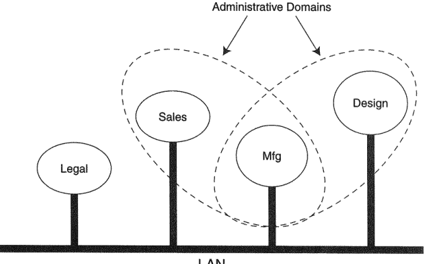

## 理解网络服务

Unix 提供了各种网络服务，每种服务都通过密码验证或系统文件中的授权设置提供身份验证手段。有关使用这些服务的信息，请参阅特定于服务的系统参考手册。图 6.4 识别了与这些网络服务相关的一些主要安全问题。

### 使用远程文件访问（RFA）时保护密码

潜在情况下，任何用户可以在系统的任何位置创建网络特殊文件，并利用它访问网络上的任何其他系统。

为了防止这种情况，远程文件访问 (RFA) 要求用户向 `netnam(l)` 命令指定密码。然而，这允许用户在命令行中指定密码，因为它们将以明文形式执行。这构成了严重的安全风险。如果在脚本中使用 `netnam`，则不应以未加密的状态输入密码。它还将暴露给任何运行 `ps` 的人，从而获取广播消息。

### 使用 inetd.sec 限制外部访问

除远程文件访问 (RFA) 和网络文件传输 (NFT) 外，单个网络服务的访问控制可以在 `/usr/adm/inetd.sec` 中设置，这是 Internet daemon 的可选文件。显式允许或拒绝使用大多数网络服务需要它们位于列表或按子网划分。

`/usr/adm/inetd.sec` 中条目的语法为：

```
<service name> <allow/deny>/net addresses, host/net names>
```

服务名是 `/etc/services` 文件中有效服务的正式名称（不是别名）。基于 RPC 的服务（NFS）的服务名是 `/etc/rpc` 文件中有效服务的正式名称（不是别名）。地址中允许使用通配符 `*` 和范围字符 `-`。

图 6.4 网络服务的安全问题

| 网络服务 | 访问验证 |
| :--- | :--- |
| `netnam(l)` | 密码验证 |
| `dscpy(l)` | 密码验证 |
| `rcp(l)` | `.hosts` 或 `hosts.equiv` 文件中的条目 |
| `remsh(l)` | `.hosts` 或 `hosts.equiv` 文件中的条目 |
| `login(l)` | 密码验证或 `.hosts` 或 `hosts.equiv` 文件中的条目 |
| `telnet(l)` | 密码验证 |
| `ftp(l)` | 密码验证 |
| `mount(1M)` | `/etc/exports` 中的条目 |

请参考 Unix 手册条目 `inetd.sec(4)` 获取有关该文件语法和使用的完整细节。

### 通过 /etc/ftpusers 拒绝访问

当在 `/etc/services` 指定端口接收到服务请求时，由 Internet daemon (见 `inetd(1M)`) 运行文件传输服务器 `ftp(1M)`。

`ftp(1M)` 拒绝对 `/etc/ftpusers` 中指定的用户账户进行远程登录。每个受限账户名必须单独出现在文件的一行。该行不能包含任何空格或制表符。在 `/etc/passwd` 中具有受限登录 shell 的用户账户应列在 `/etc/ftpusers` 中，因为 `ftp(1M)` 访问本地账户时不使用其登录 shell。`uu` 账户也应列在 `/etc/ftpusers` 中。如果 `/etc/ftpusers` 不存在，`ftp(1M)` 将跳过安全检查。

### 在网络文件系统环境中的挂载文件

网络文件系统 (NFS) 用于：

- 保存文件空间。
- 保持一致的文件使用。
- 提供精简、协作的用户环境。

NFS 通过 `/etc/exports` 文件控制访问，简化了服务器与客户端系统之间的文件共享。`/etc/exports` 中的条目提供了将服务器上的文件系统挂载到任何客户端机器的权限。一旦文件系统被放入 `/etc/exports`，任何可以执行 NFS 挂载的人都可以获取该信息。

因此，NFS 客户端可以在不登录服务器系统的情况下访问服务器文件系统。RFA 和磁盘集群也提供了对连接到远程 CPU 的文件的访问，但不会绕过密码验证。

#### 服务器漏洞

通过对文件 `/etc/exports` 设置限制性权限来维护服务器安全性。Root 权限在网络文件系统 (NFS) 中并不持续。因此，在客户端上拥有 `root` 权限并不会提供对服务器的特殊访问。

服务器通过网络接收的客户端用户 ID 和组 ID，像处理本地一样对客户端进行访问检查。检查在内核中进行。在 NFS 客户端上拥有特权的用户可以利用特权获取 NFS 服务器的无限访问。

#### 客户端漏洞

在工作站网络文件系统的早期版本中，`dev` inode 位于客户端磁盘。网络文件系统现在允许包含客户端设备的主和小设备号的 `dev` inode 存在于服务器侧。这为某些通过服务器侧找到的文件和节点创建覆盖客户端权限的木马提供了可能。

尽管缺乏在客户端创建设备文件的权限，想要破坏客户端的攻击者可以使用服务器侧的 `root` 权限创建设备文件，例如 `/dev/kmem`。新创建的 `dev` 文件与客户端的目标设备相同，但具有以下权限：

```
crw-rw-rw-
```

然后攻击者可以到客户端，以普通用户登录，并使用网络文件系统打开新创建的服务器侧设备文件并将其用于（例如，清除内核内存、读取所有进程的内容或其他破坏行为）。

### 链路访问

链路访问是一项非常强大的功能，允许程序员直接访问主机的链路驱动程序。在错误的人手中，这种能力可以使普通用户伪造任何网络包，包括网络控制包。

系统上的一切都被封装在带有头部和主体的数据包中。头部包含所有管理信息，包括内容、路由、计时和计费数据。这通常是事务的关键，而不是文件本身。由于 Unix 协议有自己的管理层，信息经过的协议越多，封装得越深。为了保护链路访问，请确保 `/dev/ether*`, `/dev/ieee*` 和 `/dev/lan*` 文件仅由 `root` 所有并可写。

## 维护网络安全

本节提供了检查网络控制文件的技术。

### 识别管理域

以下是识别和控制管理域的步骤。这些步骤使用的示例假设你可以在网络上访问的计算机命名为 `cor-`

#### 维护网络安全 383

公司部门，如财务、销售和市场部，以及你正在一台机器 `h` 上工作。

- 列出导出文件系统的节点。

```
cat /etc/exports
```

`/etc/exports` 条目文件列出了包含文件系统路径的条目，随后是一系列计算机名称和计算机组名称。任何仅包含文件路径而没有后跟计算机名称的条目都是网络上每台计算机可用的文件系统。所有分区都应与特定的计算机关联。

`/etc/exports` 条目可能包含计算机组的名称。你可以通过检查 `/etc/netgroup` 来确定哪些机器包含在组内。如果命令 `cat /etc/exports` 的输出如下：

```
/u1 mfg mktg
/u2 personnel
/u3 mfg design quality
```

你可以得出结论：`hq`、`mfg`、`mktg`、`design`、`personnel` 和 `quality` 属于同一个管理域。

- 列出具有等效密码数据库的节点。

```
cat /etc/hosts.equiv
```

`/etc/hosts.equiv` 文件列出了具有等效密码文件的计算机名称。如果此命令的输出如下：

```
legal
mfg
mktg
quality
```

你可以得出结论：`hq`、`mfg`、`mktg`、`design`、`personnel`、`quality` 和 `legal` 属于同一个管理域。

- 验证管理域中的每个节点都没有将权限扩展到任何未链接的节点。在这些机器（`mfg`、`mktg`、`design`、`personnel`、`quality` 和 `legal`）上重复步骤 1、2 和 3。

例如，假设这些机器中的大多数机器只将权限扩展到管理域内的计算机，但 `mktg` 同时也向 `sales` 导出文件系统。对名为 `sales` 的机器重复步骤 1、2 和 3。

- 控制管理域内每台节点上的 `root` 和本地安全。具有超级特权的用户可以在该域内的每台机器上获取权限。遵循本手册中其他部分描述的系统安全程序来保护每台机器上的 `root` 权限。

- 维护管理域内用户名、`uid` 以及密码文件之间的一致性。要验证域内系统的一致性，请比较它们的密码文件。

例如，如果你正在系统 `hq` 上工作，并希望检查与 `mfg` 的一致性（`mfg` 的文件系统被远程挂载到 `hq` 的 `/nfs/mfg/`），输入以下系列命令：

```
awk -F: '{print "%s %s %s\n", $1, $3, $4}' /etc/passwd > /tmp/hq-pwd
```

```
awk -F: '{print "%s %s %s\n", $1, $3, $4}' /nfs/xyz/etc/passwd > /tmp/mfg-pwd
diff /tmp/hq-pwd /tmp/mfg-pwd
```

`awk` 命令将 `/etc/passwd` 的第一、第三和第四字段的值（分别为用户名、`uid` 和 `gid`）打印到临时文件中。然后，在临时文件上运行 `diff` 命令产生的任何输出都表明两个 `/etc/passwd` 文件之间存在不一致。编辑一个或两个 `/etc/passwd` 文件以使它们保持一致。本地 (`hq`) 和远程 (`mfg`) 系统的 `/etc/passwd` 文件可以使用 `rsync` 而替代 NFS 进行更新。如果你没有 NFS 且 `mfg` 列在 `hq` 的 `/etc/hosts.equiv` 文件中，使其成为 `hq` 管理域的成员，你可能选择使用这些命令：

```
rcp mfg:/etc/passwd /tmp/mfg-passwd
awk -F: '{print "%s %s %s\n", $1, $3, $4}' /etc/passwd > /tmp/hq-pwd
awk -F: '{print "%s %s %s\n", $1, $3, $4}' /tmp/mfg-passwd > /tmp/hq-pwd
diff /tmp/hq-pwd /tmp/mfg-pwd
```

- 维护管理域内所有节点上任何组文件的一致性。如果你正在系统 `hq` 上工作，并希望检查与系统 `mfg` 的一致性，且 `mfg` 的文件被远程挂载到 `hq` 的 `/nfs/mfg/`：

```
diff /etc/group /nfs/mfg/etc/group
```

如果你看到任何输出，说明两个 `/etc/group` 文件是不一致的。`diff(1)` 的手册条目将解释如何解释输出。编辑一个或两个文件，使它们相同。对于非 NFS 方法：

```
rcp mfg:/etc/group /tmp/mfg-group
diff /etc/group /tmp/mfg-group
```

在两种情况下，如果你没有看到输出，说明两个 `/etc/group` 文件是一致的，你已经完成了。

### 验证网络控制文件的权限设置

所有系统文件的模式、所有者和组都经过仔细设置。它们的正确值记录在口袋描述文件 (`pdf`) 数据库中。所有偏离这些值的情况都应该记录并修正。


应特别注意位于 `/etc` 中的网络控制文件，它们是显著的目标，因为它们提供了对网络本身的访问。网络控制文件永远不应允许公共写入。这些：

* `networks`: 网络名称及其地址
* `hosts`: 网络主机及其地址
* `hosts.equiv`: 允许等同于本地主机访问的远程主机
* `services`: 服务名称数据库
* `exports`: 导出到 NFS 客户端的文件系统列表
* `protocols`: 协议数据库

## 维护网络安全

* `inetd.conf`: Internet 配置文件
* `netgroup`: 网络组列表

## 控制文件系统导出

`/etc/exports` 文件定义了哪些文件系统可以导出到其他系统。每行条目应至少有两个字段：第一个是正在导出的文件系统名称，第二个及后续是文件系统可以导出的系统名称。如果少于两个字段，则文件系统可以发送到世界的任何地方。验证没有文件系统可以被通用导出：

```
sed -e'/exports*/d -e '^[space,tab]*$/d' /etc/exports | awk 'NF < 2'
```

此命令检查 `/etc/exports`，删除所有注释行，删除所有空行（仅包含空格或制表符的行），然后在文件中搜索具有少于两个字段的行。

## 处理网络安全泄露的指南

如果由于未知原因发生网络安全泄露：

* 关闭计算机的网络和电话访问。
* 立即通知网络管理员。
* 只有在识别并消除问题后，才允许对计算机进行访问。

安全泄露可能以许多不同的形式出现：

* 有人可能会报告普通程序出现意外或具有破坏性的行为。
* 用户可能会注意到系统负载平均值突然增加，导致计算机无响应。
* 读/写权限或所有权可能发生与预期的变化。
* 任何系统文件的字节发生意外变化。

任何似乎偏离正常系统行为的情况都可能暗示存在篡改。如果怀疑发生了安全泄露（例如病毒或蠕虫），应通过限制其即时影响来处理。

* 关闭系统。如果可以给用户提供权限。

例如，假设这些机器中的大多数机器只将权限扩展到管理域内的计算机，但 `mktg` 也向 `sales` 导出文件系统。对名为 `sales` 的机器重复步骤 1、2 和 3。

# 维护网络安全

针对互联网计算机的攻击利用了 `Unix` 操作系统的漏洞。例如，通过某种方式获取管理员权限，然后删除所有人的账户。因此，保护信息的方法之一是使用计算机系统的权限来限制对信息的访问。另一种方法是对信息进行加密。

# 工具程序

`Unix` 工具被用作更大型程序的构建组件。许多 `Unix` 工具程序都是以这种方式使用的。因此，请确保敏感的工具受到保护。

常用的 `Unix` 数据过滤工具有：

# TCP/IP 概念

关键概念包括：

* 硬件地址。
* 软件地址。
* 主机名和 IP 地址。
* 路由器、网桥器和网关概述（网关是一个包含两个或多个网络接口的主机，用于在网络之间传递或转发数据报。网关以路由表的形式存储网络拓扑信息，其中以目标 IP 地址为键。表中的每个条目由目的地址、网关地址以及指向直接连接的网关的指针组成。）
* 将 IP 地址转换为硬件地址。
* 协议和端口。
* `TCP/IP` 协议栈。
* 网络主机数 -> 子网掩码 -> 网络地址。
* 网络和路由器。
* `/etc/hosts` 文件。
* 审查关于域名空间拓扑（即子网拓扑结构）的规划文档。
* 审查 `TCP/IP` 配置是如何制作。
* 是否测试过 `TCP/IP` 配置？（注意：使用 `ifconfig`）。
* `ifconfig` 命令可用于配置网络接口并动态更改其配置，包括临时将接口退出服务。

# UNIX

* 运行：你可以随时运行命令 `ifconfig -a` 来查看当前配置的接口列表及其参数。
* `ttl` - 生存时间；发送主机指定生存时间（`ttl`），单位为秒。一旦 `ttl` 达到 0，数据包将被丢弃。
* 选项：IP 数据报中常用的选项如下：
  1. `Source Route`：数据报必须通过的互联网地址列表。
  2. `Record Route`：指示数据报通过的节点返回其互联网地址。因此，我们可以确定数据报所走的路径。
  3. `Time Stamp`：数据报通过节点所需的时间将返回给主机。这允许对网络性能进行测量和比较。
  4. 检查远程主机：主机可以发送 ICMP Echo 消息以查看远程系统的互联网协议是否启动并运行。`PING` 命令使用此消息。

# TCP/IP 命令

`TCP/IP` 命令有：

| command | 描述 |
| :--- | :--- |
| `login` | 为远程系统提供登录 |
| `telnet` | 为远程系统提供远程登录，以及一组用于执行特殊功能的命令套件，如通过网络复制文件。 |
| `rcp` | 在网络上执行文件的远程复制。 |
| `rcmd` | 通过网络在远程系统上执行命令。 |
| `ftp` | 一个文件传输程序，提供一套文件传输工具。 |
| `netstat` | 提供衡量网络硬件和数据传输环境负载和效率的统计数据。 |
| `Ping` | 检查网络连通性和网络传输数据包的效率。 |

一些为用户交互进程提供服务的常用 `TCP/IP` 应用有：

* 名称服务 (DNS) 将 IP 地址映射到分配给网络设备的名称。
* 网络文件系统 (NFS) 允许网络上的各种主机共享文件系统和目录。
* 路由信息协议 (RIP) 通过互联网地址分配指定的设备在网络中转发数据报。

# 维护网络安全

# 名称服务

名称服务为每个主机指定唯一的名称（即主机名）和地址（即 IP 号），并指定路径或通信通道（即远程主机到达该主机的路由）。名称指示了我们寻找的内容，地址指示了它所在的位置，而路由指定了我们到达那里的路径。

为了进行通信，网络上的主机必须具备以下特性：

1. 唯一的地址（即 NIS 或 `/etc/host` 表中的 IP 地址）。
2. 广播地址，允许接收发送给所有类似地址主机的消息（即在启动时执行的 `ifconfig` 命令：`ifconfig -a`，`vi /etc/tcp`，`ifconfig` /* 搜索 `ifconfig`）。
3. `TCP/IP` - 网络配置管理器 -> 更改 IP 地址 -> `ping` IP 地址，例如：`ping 157.178.173.4` /* 以检查网络是否正常运行并在线。
   * 或者执行 `ping net 'n'`
   * `Telnet`
   * 使用 `vi /etc/hosts` 或 `grep ifconfig /etc/tcp` 来验证 `tcp` 启动脚本是否包含了正确的 `ifconfig` 命令，并为系统上的每个接口设置正确的子网掩码和广播地址。
4. 它必须能够确定哪些主机和用户可以通信（即在 `/etc/host` 表和 `/etc/passwd` 文件中有条目）。
5. 它必须知道通过哪些路径（即路由）可以发送数据以到达已知和未知目的地（即路由表）。
6. 它必须具备选择网络上指向自己的数据包的能力，并能够丢弃或转发未指向的数据包。

提供上述能力并提供网络管理能力的三个网络服务是：

1. `/etc/hosts`
2. 网络信息服务 (NIS)
3. 域名服务 (DNS)

# 使用 /etc/hosts 管理网络

`/etc/hosts` 文件也称为主机表，包含互联网上主机的网络地址和名称。它可能会被域名服务 (DNS) 或 NIS 取代。

# 互联网协议地址

如果要连接网络，必须为机器分配 32 位 IP 地址和主机名。IP 地址和主机名分发到网络服务器。

# 普通网络配置和管理表

Ethers 文件

控制目标：使用 `/etc/ethers` 可以减少主机的开销并加快网络访问。位于 `/etc/ethers` 中的 `Ethers` 文件包含有关互联网主机和网关主机的 48 位以太地址。这些信息可以封装在帧中，以便可以使用 `arp`（地址解析协议）将 IP 号映射到接口号。

以太网上的每个主机在 `ethers` 文件中都应该有一行：

```
Ethernet-Address Official-host-name
```

网络文件

控制目标：`/etc/networks` 列出了互联网上的网络。审查列出的文件是否存在安全威胁。

协议文件

控制目标：审查协议文件以确保使用了授权的协议且没有安全漏洞。该文件位于 `/etc/protocols`。

服务文件

控制目标：审查服务文件以确保使用了授权的服务且没有安全漏洞。该文件位于 `/etc/services`。

Host.equiv 文件

控制目标：审查 `hosts.equiv` 文件以确保信任主机和用户经过授权且没有安全破坏或损坏的危险。`/etc/hosts.equiv` 文件包含受信任主机的列表。将主机名与系统的 `/etc/passwd` 文件交叉引用。此文件控制主机无需密码远程登录或执行 `RCP` 命令。此文件由 `root` 或超级用户账户控制。

Home/.hosts 文件

控制目标：`/Home/.hosts` 文件包含受信任用户列表。确保 `hosts` 文件在没有特定授权的情况下授予“受信任”远程主机和用户权限。`Rhosts` 文件可以允许“受信任”远程主机和用户在无需指定相应密码的情况下使用本地用户名。此文件通常控制并配置以授予本地账户远程访问。

RPC（远程过程命令）是伯克利远程工具的一套命令（如 `login`, `rcmd`, `rcp`, (或 `rsh`), `who` 和 `uptime`），用于-

# 维护网络安全

在跨网络远程主机上执行的本地主机命令对用户来说是透明的，看起来像是在本地执行的命令。这可能导致 `Unix` 系统安全出现漏洞，并需要额外的安全保护形式。

* 你可以通过在用户的 `/etc/passwd` 条目中放入 `rsh` 或 `ksh` 来限制用户的登录 shell。此外，在用户运行这些 shell 后，获取其 `.profile` 和环境变量文件。

## 子网地址

根据限制条件和性能需求确定是否有计划的子网拓扑。获取网络上所有接口定义的子网掩码、网络号、广播地址和 IP 地址。使用的是何种物理层介质电缆类型？例如：厚以太网、普通以太网、`10Base`、`100Base`、令牌环（`Token Ring`）和 `FDDI`。每种电缆段允许连接的主机数量都有限制。随着组织向网络中添加更多节点，可能会达到电缆类型的限制。确定子网的数量。配置了多少个子网？

优势：

* 它提供了更强的安全控制。
* 随着更多服务的广泛分布，它减少了大型网络上的流量。
* 它能更高效地将网络管理任务和数据库分配到网络的选定部分。
* 它为组织的某个子组提供了更有效的管理和安全性。

查看 `/etc/hosts` 数据库。

## 路由

路由问题包括：

* 配置路由器。
* 路由配置。
* 获取和解释路由信息。

`/etc/gateways` 文件：

```
# cat /etc/gateways
# netstat -r
# netstat -rn
```

* 配置其他 LAN 和 WAN 接口。
* 配置点对点协议（PPP）。
* 调优串口行内核参数。
* 互联网地址和域名注册。

## PPP 文件使用

1. 检测到传出的 PPP 请求。
2. 联系 `pppd` 以建立连接。
3. `pppd` 查找 `ppphosts`；从 `/etc/ppphosts` 获取远程系统的 UUCP 名称。
4. 调用 UUCP 子系统，查找系统文件，获取电话号码（`/usr/lib/uucp/Systems`）。
5. UUCP 查找 `Devices` 文件以选择 `tty` 线并调用拨号器（`/usr/lib/uucp/Devices`）。

## TCP/IP 网络内核配置

大多数 `Unix` 系统没有专门针对网络进行特殊配置。对于这些系统，必须从软件介质下载网络模块并将其配置到内核，以便 `TCP/IP` 服务整合到操作系统中。检查该过程并确定配置是如何执行以及由谁执行的：

* 多久检查一次配置以确定其充分性？
* 配置过的 `Unix` 系统会在多用户启动时启动若干守护进程以启用网络服务。启动哪些进程取决于系统的特定配置和所需的网络服务。
* 确定选择了哪些守护进程启动。（通常，在多用户启动时启动的网络守护进程由 `/etc/rc` 目录中的文件激活）。

其他守护进程在启动时不会运行，但可能根据需要由超级服务器守护进程 `inetd`（'net-d'）调用，它有时被称为互联网守护进程。互联网超级守护进程 (`inetd`) 会根据 `/etc/inetd.conf` 中列出的列表等待网络守护进程的连接请求，并根据需要启动这些进程，从而节省内存和进程资源。当 `inetd` 进程完成执行时，`inetd` 会终止该进程。仅在需要时利用 `inetd` 调用进程可以减少系统开销。

因此，确定 `inetd` 可以调用哪些守护进程以及在何时调用。启动以下守护进程以增加多用户模式的功能：

* `pppd`

  点对点协议 只有在配置了 `/etc/ppphosts` 文件时才会启动。

* `snmpd`

  简单网络管理协议守护进程只有在配置了 `/etc/snmpd.conf` 文件后才会启动。如果配置了这些文件，它们将作为 SNMP 代理中的系统进行设置。

* `named(ADMIN)`

  只有在配置了 `/etc/named.boot` 文件后，`named` 守护进程才会启动。

* `routed` 或 `gated`

  需要其中一个配置 `/etc/gated.conf` 文件以让 `gated` 启动。否则，`routed` 将默认启动。`routed` 的行为可能会由于 `/etc/gateways` 的存在而修改。

* `xntpd`

  该守护进程用于同步互联网上的内核时服务器。互联网守护进程只有在创建了 `/etc/ntp.conf` 文件后才会启动。

* `lpd`

  只有当任何一个打印机被配置为打印服务器或客户端，并且系统上存在 `/etc/printcap` 文件时，此行打印机才会启动。

## 维护网络安全

未启动的网络守护进程

若干守护进程没有通过 `/etc/tcp` 脚本启动，因为它们的启动代码被注释掉了。要启动这些守护进程中的任何一个，请编辑 `/etc/tcp` 文件并取消其启动代码的注释。

* `lrdd`

  该守护进程是 `routed` 或 `gated` 的替代方案。

* 该守护进程是 `xntpd` 的一个较旧且可靠性不佳的替代方案。

* `timed`, `broadcast`。

* `rarpd`

  响应反向 ARP。

## 启动 TCP/IP

如果系统配置了两种高级安全，则需要 `sd` 命令来启动 `TCP/IP`。`sd` 位于 `/usr/sbin` 目录。命令行将是：`/etc/tcp/start`。确保 `sd` 命令受到限制。

### Inetd 超级守护进程文件 (/etc/inetd.conf)：

* `inetd.conf` 文件列出了所有应由 `inetd` 启动的服务器守护进程（例如 `logind` 和 `telnetd`）。
* 有若干条目被注释掉了，防止 `inetd` 启动。
* 有若干条目被注释掉了，为 `inetd` 运行守护进程提供了替代方案，这些条目可能被注释也可能未被注释。

可以使用标准的文本编辑器进行修改。

`inetd` 监听对提供互联网服务的守护进程（例如 `logind`, `telnetd`）的请求，然后产生请求的服务器进程。`inetd` 监听的守护进程默认列在 `/etc/inetd.conf` 文件中，尽管可以通过从命令行启动 `inetd` 来更改。

### /etc/services 文件

将此文件的条目与 `/etc/inetd.conf` 文件进行交叉引用。

## 从网络启动

设备从网络启动通过以下两种方式获取启动信息：

1. BOOTP（启动协议）。`bootpd`（启动协议守护进程）位于 `/etc/bootpt` 文件。另一个需要关注的文件是 `bootpgpw`。
2. RARP（反向地址解析协议）。RARP允许设备发现 IP 地址、子网掩码、服务器名称等。

## 下载内核

一旦设备从网络启动并知道了其 IP 地址（如果使用 BOOTP 则可能还有其他信息），通常有两种方法用于下载内核：TFTP 和 NFS。

1. 获取文件的一种方法是通过简易传输协议 (TFTP)。它不需要身份验证。结果是由于不需要密码，它造成了巨大的安全风险。检查 `/etc/inetd.conf` 文件以查看是否启用了 `tftpd`（`-5` 表示已启用）。

确保防火墙对 BOOTP、RARP 和 FTP 协议采取适当关注，例如：

* 永远不要网关广播或重播（使用 `bootpgpw`）向你的网络之外（即互联网）发送任何此类数据包。
* 永远不允许来自网络外部的 TFTP 包。
* 通过确保 `tftpd` 使用参数 `-s dir` 启动来限制 TFTP 目录，其中 `dir` 是包含下载文件的目录名称。这防止恶意人员下载任何公开读取但对网络敏感的文件（例如 `/etc/passwd`）。

确定对 FTP 使用的限制类型，例如控制可以使用什么种用户名访问 FTP 服务器。防止用户以 `root` 和其他敏感账户访问 FTP 服务器。此外，显示的账户名必须：

* 存在于系统中，或者在配置了匿名 ftp 时为 `anonymous` 或 `ftp`。
* 没有空密码。
* 不存在于 `/etc/ftpusers` 文件中，除非它是匿名的。
* 具有 `/etc/shells` 文件中存在的登录 shell。
* 确保 `tftpd` 会话记录在 `syslog` 文件中。

## 配置信任访问

信任访问（Trusted Access）允许用户通过 `login` 命令以更方便、更安全的方式利用企业网络。如果 `login` 未配置信任访问，它将提示用户输入密码。该密码跨网络传输，甚至可能在互联网上。包含这些密码的数据包相对容易拦截和识别，从而危及企业网络的安全。请记住：

* 如果设置了信任访问，登录不需要密码。
* 如果没有设置信任访问，`rcmd` 和 `rcp` 命令甚至无法工作。

信任访问可以在主机级、用户级或两者级进行设置。

## 维护网络安全

信任主机访问（Trusted host access）允许你指明信任另一主机上所有与 `login`、`rpc` 和 `rcmd` 登录具有相同登录名的用户，而无需指定密码。


必须是 `root` 用户才能在主机级别配置信任访问。此项配置涉及编辑 `/etc/hosts.equiv`。`/etc/hosts.equiv` 中的每个条目指定了你信任的远程系统。`root` 账户可以通过 `/etc/hosts.equiv` 中的条目等效实现。如果网络连接到互联网，出于安全考虑，请始终在该文件中使用完全限定的主机名。

## 配置信任用户访问

信任用户访问（Trusted user access）允许系统上的用户通过他们信任的另一个系统使用其账户执行 `login`、`rpc` 和 `rcmd` 命令，而无需提供密码。与信任主机访问不同，为不同机器上具有不同登录名的用户创建。

人们可以通过在用户主目录中创建或修改名为 `.hosts` 的文件，为用户配置信任用户访问，或为自己配置。其格式与 `/etc/hosts.equiv` 文件相同。

## TCP/IP 性能调优

与 TCP/IP 相关的性能问题通常是由于流量过大导致的。流量产生可能涉及多个因素：

- 物理层性能。
- 网卡性能。
- 机器性能。
- 网络负载。
- 数据损坏。
- 资源向适当节点和网络的分配。

如果网络性能看起来糟糕，上述因素的任何组合都可能是可能源。

## 数据损坏

数据可以通过多种方式被损坏：

- 通过回声。
- 电缆终止不当。
- 使用电缆扫描仪检测回声。
- 数据包传输到主机的速度快于网卡缓存数据包的速度。
- 流量增加。

网络性能问题也可能是由于物理层能力负载。诊断性能问题的工具包括 `Ping-f`。

## UNIX

使用的命令：

- `netstat -i` 列出显示所有者的文件。
- `netstat -l` 显示每个网络接口的统计信息。
- `netstat -s` 显示数据包统计。

### 网络文件系统

`NFS` 允许将一台主机上的文件系统或目录供许多其他主机使用，这些主机将磁盘空间视为自己的。

磁盘上的文件系统是如何挂载的？手动使用 `mount(ADFM)` 命令，以及在启动时通过 `/etc/default/filesys` 文件中的条目自动挂载。这相当于 Berkeley 和 System V 系统中找到 `/etc/fstab` 文件。

```
passwd=string* / 在挂载请求时提示的可选密码
time=*
fsck=yes,no, dirty, prompt
cmount=yes,no, prompt
fstype=type
nfsopts=opts
```

`mount` 命令也可用于将远程计算机的文件系统或目录挂载到本地主机的挂载点上。实现此目标必须满足两个条件：

- 两之间必须建立网络通信。
- 远程主机必须允许本地主机挂载其文件系统的权限。

`fsck` 检查文件完整性。当文件系统挂载到挂载点目录时，它会用其根目录替换挂载目录。

## 服务器配置

服务器配置涉及出服务器应该导出哪些目录以及向哪些客户端导出。查看 `/etc/exports` 文件以了解如何处理匿名 UID，并查看 NFS 服务器愿意与其他系统共享的文件系统列表以及其共享方式。启动 NFS 守护进程（daemons）的脚本是 `/etc/nfs`。如果 `/etc/export` 文件存在，该脚本将只启动必要的守护进程。通常会创建一个空的 `/etc/export` 文件，以便在将来需要 NFS 服务器时，守护进程已经在运行。然而，一个空的

## 网络文件系统性能

通过输入 `nfsstat -z` 显示 NFS 统计信息。使用 NFS 会使系统面临额外的安全风险，所有这些都是可管理且已过处理的。NFS 安全问题包括以下：

- NFS 服务器上文件系统上的 `setuid` 和 `setgid` 位。标记有 `setuid` 和 `setgid` 位的文件对通过类似方式挂载这些文件的远程系统构成了风险。

## 维护网络安全

它们物理上所在的本地系统。此外，NFS 服务器可能拥有 `setuid` 文件，你不希望这些文件在 NFS 客户端上是 `setuid` 的。因此，请确保在 `mount` 命令中指定 `nosuid` 选项。指定此标志后，NFS 将不会尊重通过 NFS 访问的文件的 `setuid` 权限。

- Root 权限。所有 NFS 操作都使用从客户端到服务器的操作所需的 UID 和 GID。但是，如果 UID 为 0（即客户端上的进程以 `root` 身份运行），这可能是危险的。因此，如果客户端上的 UID 是 `root`，NFS 通常会将 UID -2 传递给 NFS 服务器。你可以通过指定：`/etc/exports` 完全限定主机名文件强制 NFS 将 UID 0 传递给服务器。检查强制使用 UID 0 以确定其合理性。

## 网络信息服务

网络信息服务 (NIS) 为提供了一种维护整个企业网络用户等效性的简单方法，包括与管理工具的完全集成。NIS 用户应该能够回答以下问题：

- 什么是 NIS？
- 如何配置它？
- 如何管理？
- NIS 的客户端-服务器架构是什么，包括各种类型的 NIS 服务器？
- 默认可配置的 NIS 映射（maps）有哪些？
- NIS 工具有哪些？

实现 NIS 的守护进程执行什么功能？

用户等效性的重要性可能被估。随着网络规模的扩大，管理员的维护能力变得不可能。NIS 的创建是为了高效地在整个范围内维护账户信息。默认情况下，NIS 分发以下文件：

- `etc/passwd`
- `etc/group`
- `etc/auto`

此外，NIS 信息可以包含在其他相关文件中：

- `etc/exports`
- `etc/hosts`
- `etc/master`

## NIS 安全问题

NIS 为网络打开了几个潜在的大安全漏洞。通过小心，这些漏洞可以被堵住。

如果所有运行 NIS 的机器的管理账户应该是相同的。这意味着如果破解了网络上某一台机器的 `root` 密码，他们将获得网络所有机器的密码。如果任何机器允许设置

## TCP/IP 管理

TCP/IP 功能通过以下内容配置：

- `//tcp` 文件初始化 TCP/IP 环境的作用。
- `inetd` 守护进程的功能。

TCP/IP 应该进行调优以获得更好的性能。

## 审计

审计允许记录对对象的访问。生成的记录可以显示诸如用户尝试获得超过许可的权限（即，超级用户）。通过检查审计可以监控系统活动。一旦你遵循了本节中关于安装新操作系统和转换为安全（信任）系统的程序，就可以开始审计了。审计子系统允许对选定用户特定类型的活动进行审计。用户通过与其审计 ID 的关联进行审计。审计 ID（范围从 0 到 60000）保留在 `/.secure/etc/passwd` 文件中，只有超级用户可以读取。当被审计的用户登录时，其执行的任何操作（也是已选定的审计操作）都可以通过审计 ID 进行追踪。

选择你想要监控的删除操作。选择审计你选择的任何操作：

- 当操作尝试且无论成功还是失败时。
- 仅当操作尝试且失败时。
- 仅当操作尝试且成功时。
- 需要监控的活动类型为：
    - 使用识别和验证机制作为登录。
    - 文件操作如打开、删除和创建。
    - 安全相关的操作如开启和关闭审计系统以及更改密码文件。
    - 打印。

# 审计 399

## 选择审计的事件类型

为了简化待审计操作的选择，具有相似行为的系统操作被归类为名为 `事件类型` 的。选择其中一种事件类型进行审计将自动开启该类型中所有进程的审计。然而，也可以单独选择审计系统调用而无需选择其所属的事件类型。此外，也可以移除由于关联特定事件类型而被选中审计的系统调用。

图 6.5 显示了可以用于审计的事件类型（及其关联进程）。

### 图 6.5 事件类型

| 事件类型 | 操作描述 | 关联进程 |
|---|---|---|
| `Create` (创建) | 记录所有对象的（文件、目录、其他文件对象）创建 | `create(2)`, `mknod(2)`, `mkdir(2)`, `semget(2)`, `msgget(2)`, `shmget(2)`, `shmat(2)`, `pipe(2)` |
| `Delete` (删除) | 记录所有对象的（文件、目录、其他文件对象）删除 | `rmdir(2)`, `unlink(2)`, `msgsctl(2)` |
| `Moddac` (修改权限) | 记录所有对象的修改任意访问控制 | `chmod(2)`, `chown(2)`, `umask(2)`, `fchown(2)`, `fchmod(2)`, `setat(2)`, `fsetat(2)` |
| `Modadress` (修改地址) | 记录除任意访问控制以外的所有访问性修改 | `link(2)`, `unlink(2)`, `chdir(2)`, `setuid(2)`, `setgid(2)`, `chroot(2)`, `setgroups(2)`, `setresuid(2)`, `setresgid(2)`, `rename(2)`, `nmctl(2)`, `shmtd(2)`, `new uspr(1)` |
| `Open` (打开) | 记录所有文件的打开（文件打开、其他打开对象） | `open(2)`, `execve(2)`, `ptrace(2)`, `truncate(2)`, `ftruncate(2)`, `lpsched(1)` |
| `Close` (关闭) | 记录所有文件的关闭（文件关闭、其他关闭对象） | `close(2)` |
| `Process` (进程) | 记录所有对进程的操作 | `exit(2)`, `vfork(2)`, `kill(2)` |
| `Removable` (可移动) | 记录所有可移动介质事件（挂载和卸载事件） | `samount(2)`, `umount(2)`, `vfsmount(2)`, `rfa_renatun` |
| `Login` (登录) | 记录所有登录和注销 | `login(1)`, `init(1)` |
| `Admin` (管理) | 记录所有管理和特权事件 | `stime(2)`, `clone(2)`, `swapon(2)`, `setimeday(2)`, `sethisid(2)`, `setgrp(2)`, `setvent(2)`, `setaudproc(2)`, `auditswitch(2)`, `setaudit(2)`, `domainname(2)`, `reboot(2)`, `sam(1)`, `auditism(1)`, `audit(1)`, `audit(1)`, `chfn(1)`, `icsh(1)`, `passuid(1)`, `puck(1)`, `init(1)` |
| `Ipccreate` (IPC 创建) | 记录所有 `ipccreate` 事件 | `socket(2)`, `bind(2)`, `ipccreate(2)`, `ipcdest(2)` |
| `Ipcopen` (IPC 打开) | 记录所有 `ipcopen` 事件 | `connect(2)`, `accept(2)`, `ipclookup(2)`, `ipconnect(2)`, `ipcrecv(2)` |
| `Ipcclose` (IPC 关闭) | 记录所有 `ipcclose` 事件 | `shutdown(2)`, `ipcshutdown(2)` |
| `Ipcdiagram` (IPC 诊断) | 记录 `ipc` 数据事务 | `udp(7)` user data |
| `uevent 1`, `uevent 2` | 记录用户定义事件 | 参见下节“精简审计日志数据” |

## 精简审计日志数据

某些进程会调用一系列可审计的操作。为了减少收集的审计日志数据量，并在审计日志文件中提供更具意义的标记，某些进程被设计为：挂起其调用的操作的审计，并产生描述该发生进程的审计日志条目。这样编写的进程被称为 `自审计程序`。

例如，当日志程序被调用时，它会打开、读取并关闭几个文件，以收集用户登录系统所需的记录。这些进程中的每一个读取和关闭操作都可能是一个可审计的操作。然而，由于登录是一个自审计程序，审计子系统不会记录这些操作。它会在审计日志文件中创建一个条目，记录 `UserX` 已登录系统（参见图 6.6）。

以下进程具有自审计能力：

- `chfn(1)` 修改 finger 条目。
- `cssh(1)` 修改登录 shell。
- `login(1)` 登录工具。
- `newgrp(1)` 修改有效组。
- `passud(1)` 修改密码。
- `auditvent(1M)` 选择要审计的事件。
- `audisp(1M)` 显示审计数据。
- `audysys(1M)` 或停止审计系统。
- `audus(1M)` 选择要审计的用户。
- `init(1M)` 更改运行级别和用户注销。
- `lpsched(1M)` 调度行打印机请求。
- `pwck(1M)` 密码/组文件检查器。
- `sam(1M)` 系统管理管理器对某些安全相关任务执行自审计。

自审计程序对于精简系统上收集的审计数据非常有用。因此，留下了两个事件类型 `UEVENT1` 和 `UEVENT2`，供你可能想要编写的自审计程序使用。关于如何编写自审计程序的指南，请参阅下节。

图 6.6 自审计进程


## 编写程序

### 审计审计

具有超级用户权限的用户可能希望编写自己的程序来精简审计。使用 `audswitch` 和 `audwrite` 调用来挂起进程的审计并生成审计记录。你可以挂起审计 (`audswitch(AUD_SUSPEND)`)，在程序的关键点生成审计记录 (`audwrite`)，然后恢复审计 (`audswitch(AUD_RESUME)`)。

#### 自审计程序

这是一个自审计程序的示例：

```c
#include <stdio.h>
#include <sys/audit.h>
void writrec();
struct self_audit_rec audrec;
main() {
    char *errmessage, *wr_string;
    int fd;
    /* 挂起此进程的审计 */
    if (audswitch(AUD_SUSPEND)) {
        fprintf(stderr,"You do not have privilege this command");
        exit(1);
    }

    /* 执行被审计的工作 */
    /* 打开测试文件 */
    if(create("test_file", 0666)==1) {
        errmessage="could not create test file\n";
        fprintf(stderr, errmessage);
        writrec(errmessage,3);
    }
    /* 向测试文件写入 "that's all folks" */
    wr_string="that's all folks\n";
    if(write(fd,wr_string,strlen(wr_string))==1) {
        errmessage="could not write to test file\n";
        fprintf(stderr,errmessage);
        writrec(errmessage,3);
    }
    /* 告诉用户我们做了什么 */
    errmessage="successfully created that's all folks\n";
    printf(errmessage);

    /* 写入审计记录 */
    writrec(errmessage,0);
}

/* 写入审计记录并退出的例 */
static void
writrec(mesg,err)
char *mesg;
int err;
{
extern struct self_audit_rec audrec;

/* 将消息拷贝到审计记录体 - audit_body.text */
strncpy(audrec.audit_body.text, mesg, MAX_AUD_TEXT);

/* 初始化审计记录头 */
/* 1. 将 ah_error 设置为返回值 */
/* 2. 将 ah_event 设置为事件类型 */
/* 3. 将 ah_len 设置为 audit_body.text 的长度 */
audrec.audit_head.ah_error = err;
audrec.audit_head.ah_event = EVENT_UEVENT;
audrec.audit_head.ah_len = strlen(mesg);

/* 恢复审计 */
audswitch(AUD_RESUME);

/* 写入审计记录 */
audwrite(&audrec);
exit(err);
}
```

注意：如果在程序运行时审计系统已关闭，`audwrite` 返回成功，但没有写入审计记录。有关如何编写自审计程序的更多信息，请参考 Unix 参考手册。

# 审计记录

对于每个审计的事件，审计日志文件中记录了以下信息：

- 事件日期。
- 生成事件的用户审计 ID。
- 主体（用户/进程）。
- 事件类型。
- 事件的成功或失败。
- 身份识别/认证事件的来源 (`tty`)。
- 从用户空间引入或删除的对象名称。
- 系统管理员对用户/系统安全数据库进行的修改描述。
- 与事件的其他信息。

## 审计日志文件

所有审计数据都写入审计日志文件。可以指定两个文件来收集审计数据：主日志文件和（可选的）辅助日志文件。这些文件应位于不同的文件系统中。审计溢出守护进程会密切监控这些文件（及其所在的文件系统）的增长，以确保不丢失审计数据。

主日志文件是开始收集审计记录的地方。当它接近预定义的容量（其审计文件切换 AFS 大小），或其所在的文件系统接近预定义的容量（其文件空间切换 FSS 大小）时，审计子系统会发出警告。当主文件的 AFS 或 FSS 时，审计子系统尝试切换到辅助日志文件记录审计数据。如果没有指定辅助日志文件，主日志文件将继续增长。图 6.7 和 6.8 显示了文件增长时发生的情况。

该示例假设：

- 只指定了主日志文件。
- 它位于没有其他用户竞争空间的的文件系统中。

主审计日志已达到其 AFS 大小的 90%。监控审计系统状态的 `Audoman` 向系统控制台显示所示警告消息。

主审计日志已通过第一个警告点并达到 AFS 大小。系统尝试切换到辅助日志文件，但由于未找到，向系统控制台发出指示消息。


在图 6.9 中，主审计日志已超过其 `AFS` 大小，并达到了文件系统中分配给它的空间的 90%。该消息表示审计文件系统即将饱和。

在图 6.10 中，主日志文件已达到 `FSS`。所示的消息定期发送到系统控制台。如果其他活动消耗了文件系统的空间，或者所选的文件系统没有足够的空间满足选定的 `AFS` 大小，则可能在审计文件切换点之前到达文件系统切换点。

## 图表 6.7 主审计日志接近 AFS

### 阶段 1

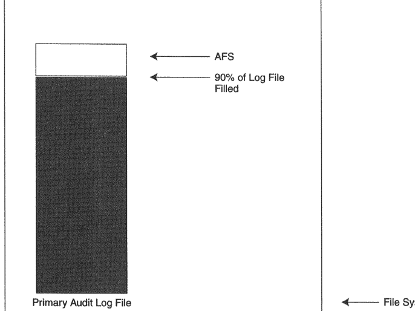

消息：“审计系统正在接近审计文件切换点（`AFS`）。当前审计文件大小 = _______千字节”

## 审计关注 (AuditConcern)

如果主审计日志持续增长超过 `FSS` 点，可能会达到系统定义参数 `min_free`。此时，普通用户的所有可审计操作将暂停。请通过归档审计数据或在具有空间的文件系统上指定新的审计日志文件来恢复系统运行。

如图表 6.11 所示，如果在与主日志文件不同的系统上指定了辅助日志文件，则当主日志文件达到 `AFS` 或 `FSS` 时，系统将切换到辅助日志文件。从此时起，辅助日志文件将成为新的主日志文件，增长阶段将如第一个示例所示进行。注意：为了获得效果，请同时指定位于不同文件系统的主日志和辅助日志文件。

## 定义审计系统参数

要定义参数：

1. 评估审计需求。
   a. 审计日志文件的大小是如何确定的？
2. 建立整体安全策略。
   a. 如何识别工作场所的安全需求？
   b. 如何建立涵盖管理层和用户层面的书面指南，以反映工作场所的需求？
   c. 如何让所有人员（管理员和个人用户）了解其安全责任？
   d. 采取了哪些程序以便在需求更改时更新安全指南并确保所有用户知情？
3. 是否已对系统上的所有现有文件进行了安全风险检查。在首次安装安全（受信任）系统时，这是强制性的。此后，应定期检查文件，或在怀疑发生安全疏漏时检查。

## 图表 6.9 主审计日志接近 FSS

### 阶段 3

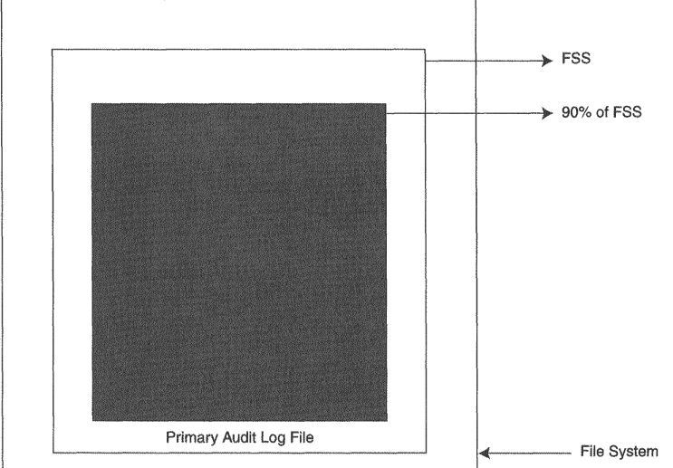

消息：“审计系统接近文件空间切换点。文件系统剩余空间 ____%”

## 审计任务

审计任务包括有关安装时提供的默认审计系统参数的信息以及以下程序：

- 设置审计监控和审计日志参数。
- 开启或关闭审计。
- 选择要审计的用户。
- 选择要审计的事件。
- 选择要审计的系统调用。
- 查看审计日志文件。

## 图表 6.8 主审计日志达到 RFS

### 阶段 2

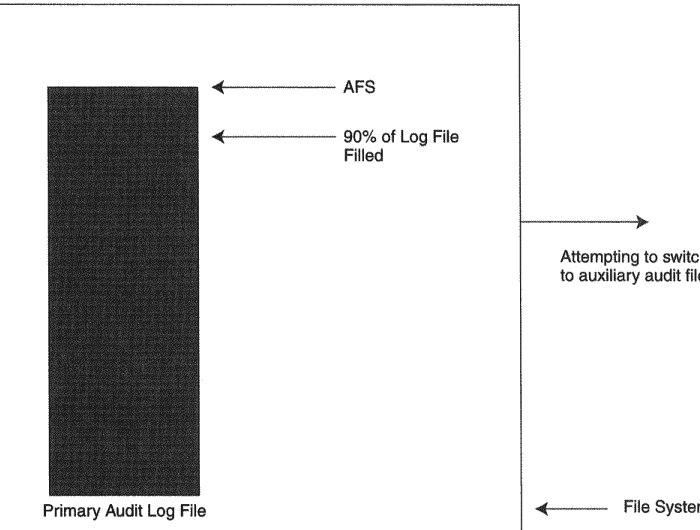

消息：“当前审计文件大小为 ____千字节。尝试切换到备份文件失败。”

## 图表 6.10 主审计日志达到 FSS

### 阶段 4

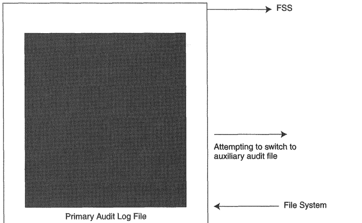

消息：“审计文件所在的文件系统剩余 ___ % 空间。尝试切换到备份文件失败。”

## 图表 6.11 主日志文件与辅助日志文件

## 独立文件系统上的两个日志文件

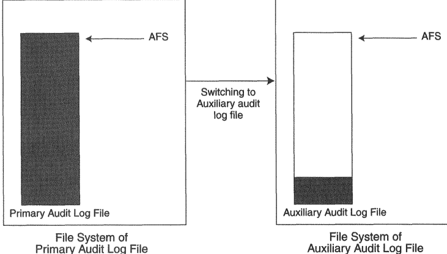

## UNIX

建议使用 `SAM` 执行所有审计任务，因为它集中了选择并有助于避免可能导致安全疏漏的错误。然而，可以使用以下命令手动完成所有审计任务：

```
audsys(IM)
```

启动或停止审计系统并显示审计文件信息。

```
audusr(IM)
```

选择要审计的用户。

```
audevent(IM)
```

更改或显示事件或系统状态。

```
auddomon(IM)
```

设置审计文件监控和大小参数。

```
audisplay(I)
```

显示审计记录。

## 设置审计监控和日志参数

系统自动提供以下默认值，这些值将保留，直到使用 `SAM` 提供新信息为止：

- 主日志文件名 = `/.secure/etc/auditlog-1`。
- 主日志文件切换大小 (`AFS`) = 5,000 kbytes。
- 辅助日志文件路径 = `/secure/etc/auditlog-2`。
- 辅助日志文件切换大小 (`AFS`) = 1,000 kbytes。
- 监控唤醒间隔 = 1 分钟。
- 最小可用空空间 (`FSS`) = 20%。
- 日志达到 90% 时开始发送警告消息。

## 程序

在保护系统时，要更改上述任何参数：

1. 输入 `/usr/bin/sam` 调用 `SAM`。
2. 选择 `Auditing and Security`（审计与安全）。
3. 选择 `Users`（用户）。
4. 从“`Actions`”（动作）菜单中选择 `Log/Monitor Params...`（日志/监控参数...）。
5. 到你想要更改的字段并输入更改。

## 开启或关闭审计

当当前开启审计时，审计状态窗口（“用户”、“事件”或“系统调用”）显示“审计已开启”。当审计关闭时，显示“审计已关闭”。

## 程序

在保护系统时，更改上述任何参数：

1. 输入 `/usr/bin/sam` 调用 `SAM`。
2. 选择 `Auditing and Security`（审计与安全）。
3. 选择 `Users`（用户）。
4. 从“`Actions`”（动作）菜单中选择 `Log/Monitor Params...`（日志/监控参数...）。
   a. 开启审计
   b. 关闭审计
5. 审计状态窗口指示更改。

## 选择要审计的用户

所有现有用户已设置审计标记。要更改审计用户列表，请执行以下程序。

## 程序

保护系统并按照以下步骤操作：

1. 输入 `/usr/bin/sam` 调用 `SAM`。
2. 选择 `Auditing and Security`（审计与安全）。
3. 选择 `Users`（用户）。
4. 高亮要更改审计状态的用户。
5. 要更改高亮用户的审计状态，从“`Actions`”（动作）菜单中选择一项：
   a. 审计用户
   b. 不审计用户
6. 系统将收到确认消息。确定。注意：此选项将在下次登录时生效。例如，如果将用户 1 添加到审计列表中而用户 1 当前处于登录状态，则在用户 1 注销并重新登录之前，其操作不会被审计。

## 选择要审计的事件

以下事件类型建议作为最小审计事件集。它们由系统作为默认事件类型提供，并在按下“执行任务”时激活。

- 登录 (`Login`)
- 修改 (`Moddac`)
- 管理 (`Admin`)

当选择特定事件类型时，与其相关的系统调用将自动审计。请参考 `Unix` 手册事件类型及其相关系统调用列表。

## 程序

保护系统并按照以下步骤操作：

1. 输入 `/usr/bin/sam` 调用 `SAM`。
2. 选择 `Auditing and Security II`（审计与安全 II）。
3. 选择 `Events`（事件）。
4. 高亮要更改审计状态的事件。
5. 要更改高亮事件的审计状态，从“`Actions`”菜单中选择一项：
   a. 仅审计成功
   b. 仅审计失败
   c. 成功和失败
   d. 不审计成功或失败
6. 系统将收到确认消息。确定。注意：事件名称旁相应列中的 `y` 或 `n` 将更改以反映选择。

## 选择要审计的系统调用

与所选事件类型相关的所有系统调用将自动审计。以下是系统提供的事件类型相关的系统调用和命令列表。

```
login    login(1), init(1M)
moddac  chmod(2), chown(2), umask(2), fchown(2), fchmod(2), setacl(2), fsetacl(2)
admin   stime(2), cluster(2), swapon(2), settime(2), sethostid(2), privgrp(2), setevent(2), setaudproc(2), audswitch(2), setaudit(2), setdomainname(2), reboot(2)
```

要选择额外的系统调用进行审计，或删除因与所选事件类型关联而被选中的系统调用，请执行以下程序。

## 步骤

安全系统并按照以下步骤操作：

1. 输入 `/usr/bin/sam` 运行 `SAM`。
2. 选择 `Auditing and Security II`（审计与安全 II）。
3. 选择 `System Calls`（系统调用）。
4. 高亮显示需要更改审计状态的系统调用。
5. 要更改高亮系统调用的审计状态，请从“`Actions`”（动作）菜单中选择以下项之一：
   a. 仅审计成功
   b. 仅审计失败
   c. 同时审计成功和失败
   d. 不审计成功或失败
6. 将收到系统的确认消息。激活 `OK` 继续。

**注意：** 每个高亮系统调用名称旁相应列中的 `y` 或 `n` 将发生变化，以反映所做选择。

## 查看审计日志

审计会产生大量数据。`SAM` 让您有机会选择想要查看的数据。

## 步骤

按照以下步骤操作：

1. 输入 `/usr/bin/sam` 运行 `SAM`。
2. 选择 `Auditing and Security II`（审计与安全 II）。
3. 选择 `Users`（用户）。
4. 从“`Actions`”（动作）菜单中选择 `View Audit Log`（查看审计日志）。
5. 使用 `Tab` 键切换到您想要更改的字段并输入更改。您可以更改以下项：
   a. 日志输出是重定向到屏幕还是文件。
   b. 日志输出重定向的文件名。
   c. 查看成功事件记录、失败事件记录、两者都看或两者都不看。
   d. 读取哪个日志文件。
   e. 查看哪个用户的登录。
   f. 查看哪个 `tty`。
   g. 选择哪些事件或系统调用进行查看。在为审计日志文件指定新路径名时，该文件必须为空或不存在。
6. 使用此屏幕上的默认设置，或根据特定需求进行修改。
7. 激活 `OK`。

注意：在处理大型审计日志时，准备查看记录可能需要几分钟时间。

## 示例

以下来自审计日志文件的示例记录显示了尝试打开安全密码文件的失败尝试：

用户和辅助：

```
hash
69
```

选取了以下事件：

5

所有 `tty` 已选中。

正在选择成功和失败事件。

```
TIME PID E EVENT PPID AID RUID RGID EUID EGID TTY
890620 14:31:30 570 F 5 567 69 69 11 69 69 111 11 ttsr
[ Event-open; User=hash; Real Grp=topaz; Eff. Grp=topaz; Origin=hpkang];
```

```
RETURN_VALUE 1 = -;
PARAM #1 (file path) = 1 (inode);
0x000e0000 (dev);
6418 (inode);
(path) = /.secure/etc/passwd
PARAM #2 (int) = 0
PARAM #3 (int) = 438
```

初始行识别了搜索审计日志文件的信息。表格形式的记录显示：

- 年、月、日（本例中 1989 年 6 月 20 日）。
- 当天时间（本例中 14 时 31 分 30 秒）。
- 进程 ID（本例中 570）。
- 操作是否失败或成功（本例中 `F` 表示失败）。
- 与事件类型标识的事件号（本例中 5）。
- 父进程 ID（本例中 567）。
- 用户的审计 ID（本例中 69）。
- 真实用户 ID（本例中 69）。
- 真实组 ID（本例中 11）。
- 有效用户 ID（本例中 69）。
- 有效组 ID（本例中 11）。
- 审计事件的 `tty`（本例中 `ttysx`）。

自审计命令遵循相同的表格格式。

```
890621 14:12:38 1063 S 92218 1062 76 0 11 0 ttyu
[ Event=login; User=nlib; Real Grp=topaz; Eff. Grp=topaz; Origin=hpkang];
SELF-AUDITING TEXT: User=nlib uid=2419 audid=76 Successful login
```

## 解读审计日志数据

由于审计会产生大量数据，因此在选择要审计的事件类型和用户时要谨慎。审计所有事件和用户可能会导致数据量过大并迅速填满磁盘空间。在操作适当的情况下，自审计程序会有很大帮助。

查看审计数据时，请注意以下异常情况：

- 当程序调用可审计系统调用并提供错误的参数时，审计数据可能是不准确的。例如，不带参数调用 `kill(2)` 系统调用（即 `kill()`）会在审计记录的参数部分产生不可预测的值。
- 创建文件名的系统调用可能没有正确记录设备和 `inode` 信息。如果调用未成功完成，值将为零。
- 使用 `SRM` 界面更改事件或系统调用参数来审计超级用户会导致大量的审计记录。例如，当你在 `SRM` 中添加一个要审计的事件时，如果同时审计了成功和失败，将为每种正在审计的事件类型生成记录，而不仅仅是新添加的事件类型。

# 管理审计日志资源

由于审计会产生大量数据，需要仔细管理审计资源。以下指南将证明很有帮助：

- 在选择审计事件和用户时要有选择性。
- 一旦审计文件满，立即对目标文件处理审计日志条目。
- 归档满的审计文件以释放磁盘空间。

在线审计文件应至少保留 24 小时，所有离线存储的审计记录应至少保留 30 天。

# 管理审计系统

建议在管理系统时遵循以下指南：

1. 至少每天检查一次审计日志。
2. 检查审计日志是否存在异常活动，例如：
   - 深夜登录。
   - 登录失败。
   - 访问失败。
   - 尝试失败。
3. 如果计划恢复文件，请确保审计日志已归档或处理。
4. 一旦审计文件满，立即对目标文件处理审计日志。
5. 如果计划恢复文件，确保备份完整。
6. 如果计划恢复文件，确保存储空间足够。
7. 如果计划恢复文件，确保权限正确。
8. 如果计划恢复文件，确保磁带完好。

# 性能考虑

由于备份需要时间并使用大量介质，应该根据能够承受丢失的数据量设置计划。标准包括系统使用情况、可用介质和存储空间。建议进行每日增量和全备份。

# 在磁盘环境中使用审计

# 安全环境下的备份与恢复

在用户错误或系统故障后恢复数据的能力使用户能够与同事和管理层共同恢复。恢复当前数据对于保护计算机信息至关重要。请遵守以下注意事项：

- 使用 `recover` 命令恢复文件并保留访问控制信息。但是，在为未实现 `ACL` 的系统恢复文件时，请使用 `recover` 的 `-R` 选项。

# UNIX

- `frecover(IM)` — 允许覆盖文件。然而，该文件将保留备份时设置的权限和 `ACL`（访问控制列表）。
- 当从另一台机器恢复时，如果用户和组在新系统中不存在，则可能需要执行 `chown(1)` 命令为当前所在的系统设置用户 ID (`UID`) 和组 ID (`GID`)。如果将文件恢复到一个没有指定组的新系统，文件将由运行 `frecover(IM)` 的人员继承其所有权。如果不同系统上的所有者和组名称的含义不同，恢复结果可能会出乎意料。
- 保持恢复系统磁带锁定状态或通过其他物理方式确保安全。仅根据经证明的需求允许访问归档文件。
- 断电不会导致文件丢失。然而，如果有人在断电后报告文件丢失，请在从备份磁带恢复之前，先在 `/last-found` 中查找。
- 要验证正在恢复的磁带内容，使用 `frecover(IM)` 的 `-l` 选项来预览磁带上的文件索引。但注意，备份会完整保留文件系统的现有权限；如果权限禁止读取，`frecover(IM)` 将阻止读取该文件。
- 检查文件列表，是否存在过于宽松的权限、`setuid`、`setgid` 或粘滞位（`sticky bits`）。如果需要，使用带有 `-R` 选项的 `chmod(1)` 命令更改属性，确保可能设置 `ACL`。详细规格请参阅《`Unix` 参考指南》。
- 绝不要原位恢复关键文件，如 `/etc/passwd` 或在 `/secure` 中恢复。相反，应将文件恢复到 `/tmp` 目录，并赋予该目录 `drwx------` 权限，防止其他人在使用该文件后再次使用（即使在验证了他们的身份并将其移动到最终位置之后）。将存储的文件与要替换的文件进行比较，以确保所有数据完整保留。进行任何更改，然后将文件移动到目标位置。

如果不遵循此预防措施，在系统备份后（可能在 `/etc/passwd` 文件更改后）添加到系统的用户，在当前文件和归档文件进行调和之前，将无法登录。

- 绝不要原位恢复 `/dev` 文件。如果这样做并重启，系统很可能会挂起且无法重启。

设备文件可以在 `/tmp` 中恢复。必须手动将磁带上的任何内容复制并恢复到 `/tmp`。

- 在另一种 `/dev` 恢复场景中，假设磁盘崩溃且无法从其系统中恢复。你的同事可能有一台运行中的系统。你可以将你的磁盘切换到同事的系统，并将磁盘挂载到 `/mysys` 中，使用 `root` 权限并设置权限设置为 `drwx------`。然后 `cd /mysys` 并原位恢复 `/dev` 文件。取回你的磁盘并启动。
- 系统恢复后，审计功能不会自动开启。用户必须手动开启审计。

# 挂载和卸载文件系统

挂载文件系统可能会产生安全问题：

- 如果操作不小心。
- 如果被挂载的介质包含破坏性文件。

# 安全地关闭系统

- 在配置了 `NFS` 的计算机环境中。

本节旨在为这些任务提供安全视角。`/etc/mount` 命令允许使用可移动的文件系统和磁盘分区挂载到现有的文件树。


`mount` 命令使用一个名为 `/etc/mtstab` 的文件，其中包含可用文件系统的列表及其权限。`/etc/mtstab` 文件应仅允许 `root` 写入，但其他人可读。在挂载文件系统或磁盘时请遵守以下预防措施：

- 创建一个挂载点（如 `/mnt`）来挂载新的文件系统。不要在已包含文件的目录树中挂载文件系统，因为那些文件将无法访问。

挂载的文件系统的挂载点将获得该文件系统根目录的权限和所有权。

- 使用 `mount` 命令的 `-r` 选项维护磁带驱动器和磁盘的写保护。

- 挂载新的或外部文件系统时，确保介质是安全的：

  - 通过将权限设置为 `700` 创建一个只读的目录。
  - 在该位置只读地挂载外地文件系统，例如，通过加载设备并输入 `/dev/disk/securefile -r`。
  - 检查所有目录的特殊对象和特权程序，并验证每个程序的身份。
  - 运行 `ncheckck -s` 扫描 `setuid` 和 `setgid` 程序以及设备文件，并调查任何可疑活动。移除任何不必要的 `setuid` 和 `setgid` 权限。如果用户请求挂载个人文件系统，这些预防措施尤为重要。
  - 运行 `fsck` 程序验证文件系统在技术上是否损坏。只有在执行这些测试后，才应卸载文件系统并重新挂载到目标位置。
  - 确保卸载你要禁用或删除的用户帐户的所有已挂载文件系统。

# 安全地关闭系统

`shutdown` 用于有序停止系统以进行维护、安装或关机，而不对文件系统产生不利影响。在宽限期之后，`shutdown` 将：

- 杀死所有必要的进程。
- 强制将文件系统的 I/O 缓冲区内容写入磁盘（使用 `sync` 命令）。
- 将系统置于单用户状态（也称为系统管理模式，或运行级别 `s`）。

# UNIX

`shutdown` 也可以强制停止或重启系统。由于它仅由 `root` 权限运行，必须谨慎执行 `shutdown` 以维护系统安全。

在关闭系统时遵守以下安全预防措施：

- 在启动最终程序之前指示用户注销。
- 调用 `shutdown` 命令时，设置宽限期以允许滞留用户注销。
- 始终使用 `reboot` 停止 CPU。如果你直接拔插或按下重置键，所有进程将停止，`syncer` 无法写入磁盘上的缓冲区。
- 切勿让系统留在系统管理 (`s`) 运行级别的时间过长。`shutdown` 不自审计，它会关闭审计。
- 不要物理写保护挂载的文件系统，因为这会阻止 `syn` 更新。
- 在离线任何驱动器或外围设备之前完成关闭。
- 在未同步和卸载文件系统的情况下离线磁盘。

如果计算机停止时最后涉及文件系统的命令不是 `reboot` 或 `shutdown`，内核可能会损坏。可以使用 `fsck` 程序检测不一致。

# 附录 6A

# UNIX 术语表

- 行政域 (Administrative domain)：通过网络服务连接的组，允许用户在无需密码验证的情况下访问。
- 审计文件切换点 (AFS)：当审计尝试将日志记录切换到备份文件时，审计文件的饱和点。
- 审计 ID (Audit ID)：系统分配给每个用户的唯一数字，用于审计目的识别用户。
- `audoman`：审计系统守护进程。
- 辅助日志文件 (Auxiliary log file)：收集数据的备份文件。
- 任意访问控制 (DAC)：根据所有者可以设置的文件权限模式限制访问对象的方法。
- 事件类型 (Event type)：已被分组用于审计的系统活动。
- 文件系统切换点 (FSS)：当审计尝试将日志记录切换到备份文件时，审计日志文件所在的文件系统饱和点。
- 最小权限原则 (Least privilege)：用户获得执行任务所需的最低级别权限。
- 最小剩余 (Min-free)：文件系统定义的饱和点。
- 密码 (Password)：用于身份验证的私密字符字符串。
- 主日志文件 (Primary log file)：审计当前用于收集数据的文件。
- `SAM`：系统管理管理器。一个菜单驱动的软件包，简化了一些最常用的系统管理任务。
- 自审计程序 (Self-auditing programs)：可以暂停某些进程低级审计的程序。

## 附录 6A

- `setgid` 程序
  
  其组 ID 被设置，以授予用户与程序组同等的权限的程序。

- `setuid` 程序
  
  其用户 ID 被设置，以授予用户与程序所有者相同权限的程序。

- 后门 (Trap door)
  
  一种绕过系统安全性的隐藏软件或硬件机制。

- 木马 (Trojan horse)
  
  一种包含额外功能的计算机程序，其利用程序的功能来实现破坏性目的。

- 可信计算基础 (TCB)
  
  计算机系统内部所有负责执行安全策略的保护机制（包括硬件、固件和软件）。安全有效性取决于 `TCB` 机制本身以及系统管理人员对其的正确实现。

- 可信系统 (Trusted system)
  
  采用足够的硬件和软件安全措施的系统，允许其用于处理敏感材料。

- 病毒 (Virus)
  
  一种在系统中进行破坏性自我复制的代码段。

- 蠕虫 (Worm)
  
  一种为了有害目的而在系统中迁移的程序。

## 附录 6B

# UNIX 环境控制特性

### NIS Unix 环境控制特性

| 编号 | 审计测试 | 控制目标 | 风险 |
|---|---|---|---|
| 1 | 检查 NIS `/usr/bin/ypswch` 是否存在。 | NIS 是一个分布式数据库系统，允许许多计算机通过网络共享密码文件、组文件和其他文件。 | 域名（`Domainname`）应该是难以被猜测的。它可以结合 NIS 用来获取密码文件。 |
| 2 | 检查命令 `domainname` 的输出。 | 域名和 NIS 服务器名称很容易被猜测。 | |
| 3 | 使用命令 `ypcat passwd` 检查 NIS 密码文件。 | NIS 密码文件中定义的所有用户标识代码都有密码。 | 这增加了未经授权的用户登录未受保护账户的风险。一旦获得这种访问权限，未经授权的用户就可以访问用户的配置文件以及任何该用户拥有的系统进程。此外，该用户可能随后尝试利用其他漏洞获取对系统的进一步访问。 |
| 4 | 使用特权命令检查 NIS 密码文件，查找 `UID` 为 `0` 的任何用户账户。 | `Root` 级标识代码定义在本地服务器上，未通过 NIS 密码文件提供防御。 | 这增加了管理用户对其工作职责所需的系统拥有特权访问的风险。以 `root` 身份访问这些系统的用户有能力修改或删除系统配置文件、系统进程，并修改或删除敏感的用户数据文件。 |
| 5 | | 不允许重复的 `UID`，NIS 密码文件中不应存在重复 `UID`。 | 重复 `UID` 增加了未经授权的用户修改或删除其他用户创建的文件的风险，且问责制受到威胁。 |
| 6 | 检查 `ypcat passwd` 命令的脚本输出。注意列出的用户数量与整个用户群相比。与系统管理员一起检查列表，并验证对于列出的用户访问级别是否适当。 | 只有需要防御访问的用户才包含在 NIS 密码文件中。 | 具有域范围访问权限的用户可能拥有超出工作职责的权限。他们可能会执行未经授权的功能或访问敏感文件。 |

### 控制技术

**发现**

避免使用显而易见的域名。

系统管理员应立即为这些账户分配密码，通知每个用户其分配的密码，并要求他们登录并更改密码。如果用户 ID 未关联任何用户，则应从 NIS 密码文件中删除该用户 ID。

系统管理员应从 NIS 密码文件中删除任何特权标识代码。

系统管理员应删除任何重复的 `UID`，并为每个用户创建新的唯一标识代码。任何重复用户拥有的文件的所有权应更改以匹配新创建的 `UID`。

系统管理员应通过从 NIS 密码文件中删除用户，在适当的情况下限制用户访问。

### NIS Unix 环境控制特性

| 编号 | 审计测试 | 控制目标 | 风险 |
| --- | --- | --- | --- |
| 7 | 检查 `ypcat passwd` 命令的脚本输出。识别 NIS 密码文件最后字段中具有 shell 访问（即访问 `/bin/sh`、`/bin/csh`、`/bin/ksh`）的用户。与系统管理员检查列表，并验证具有 shell 访问权限的用户对于其工作职责是否。 | 不向终端用户提供对 Unix 操作系统的命令行访问权限。 | 通过 shell（命令行解释器）访问命令行增加了用户访问未经授权的命令、数据和配置文件的风险。 |
| 8 | 检查 `ypcat passwd` 命令的脚本输出并识别通用标识代码。与系统管理员一起检查通用用户，定义其用途和目的。 | 系统内不允许使用通用标识代码，且是显而易见的。 | 通用用户标识代码限制了以通用用户身份登录时执行的操作的问责制。如果系统正在记录通用用户的所有事件，此外，如 `guest` 标识代码等通用用户通常是试图获取访问系统的入侵者的目标。 |
| 9 | 检查 NIS 密码文件命令 `niscat passwd.org_dir` 的问题。 | | | |
| 10 | 检查命令 `ypcat group` 的输出。 | 验证没有重复的 `GID`。 | 这增加了未经授权的用户修改或删除他人创建文件的风险。 |
| 11 | 检查 `ypcat passwd group` 的输出。 | 验证只有授权并批准的用户代码才是特权组的成员。 | 列在特权组（如 `GID=0`）中的标识代码具有访问由 `root` 用户创建并拥有的组可写文件的权限。 |

**发现**

**控制技术**

- 检查 `ypcat passwd` 命令的脚本输出。识别 NIS 密码文件最后字段中具有 shell 访问（即访问 `/bin/sh`、`/bin/csh`、`/bin/ksh`）的用户。与系统管理员检查列表，并验证具有 shell 访问权限的用户对于其工作职责是否。
- 检查 `ypcat passwd` 命令的脚本输出并识别通用标识代码。与系统管理员一起检查通用用户，定义其用途和目的。
- 检查 NIS 密码文件命令 `niscat passwd.org_dir` 的问题。
- 检查命令 `ypcat group` 的输出。
- 检查输出：`ypcat passwd group`。

系统管理员应立即为这些账户分配密码，通知每个用户其分配的密码，并要求他们登录并更改密码。如果用户 ID 未关联任何用户，则应从 NIS 密码文件中删除该用户 ID。
系统管理员应从 NIS 密码文件中删除任何特权标识代码。
系统管理员应删除任何重复的 `UID`，并为每个用户创建新的唯一标识代码。任何重复用户拥有的文件的所有权应更改以匹配新创建的 `UID`。
系统管理员应通过从 NIS 密码文件中删除用户，在适当的情况下限制用户访问。
不向终端用户提供对 Unix 操作系统的命令行访问权限。
通过 shell（命令行解释器）访问命令行增加了用户访问未经授权的命令、数据和配置文件的风险。
系统内不允许使用通用标识代码，且是显而易见的。 通用用户标识代码限制了以通用用户身份登录时执行的操作的问责制。如果系统正在记录通用用户的所有事件，此外，如 `guest` 标识代码等通用用户通常是试图获取访问系统的入侵者的目标。

| 编号 | 审计测试 | 控制目标 | 风险 |
|---|---|---|---|
| 1 | 检查 NIS `/usr/bin/ypswch` 是否存在。 | NIS 是一个分布式数据库系统，允许许多计算机通过网络共享密码文件、组文件和其他文件。 | 域名（`Domainname`）应该是难以被猜测的。它可以结合 NIS 用来获取密码文件。 |
| 2 | 检查命令 `domainname` 的输出。 | 域名和 NIS 服务器名称很容易被猜测。 | |
| 3 | 使用命令 `ypcat passwd` 检查 NIS 密码文件。 | NIS 密码文件中定义的所有用户标识代码都有密码。 | 这增加了未经授权的用户登录未受保护账户的风险。一旦获得这种访问权限，未经授权的用户就可以访问用户的配置文件以及任何该用户拥有的系统进程。此外，该用户可能尝试利用其他漏洞获取对系统的进一步访问。 |
| 4 | 使用特权命令检查 NIS 密码文件，查找 `UID` 为 `0` 的任何用户账户。 | `Root` 级标识代码定义在本地服务器上，未通过 NIS 密码文件提供防御。 | 这增加了管理用户对其工作职责所需的系统拥有特权访问的风险。以 `root` 身份访问这些系统的用户有能力修改或删除系统配置文件、系统进程，并修改或删除敏感的用户数据文件。 |
| 5 | | 不允许重复的 `UID`，NIS 密码文件中不应存在重复 `UID`。 | 重复 `UID` 增加了未经授权的用户修改或删除其他用户创建的文件的风险，且问责制受到威胁。 |
| 6 | 检查 `ypcat passwd` 命令的脚本输出。注意列出的用户数量与整个用户群相比。与系统管理员一起检查列表，并验证对于列出的用户访问级别是否适当。 | 只有需要防御访问的用户才包含在 NIS 密码文件中。 | 域范围访问权限的用户可能拥有超出工作职责的权限。他们可能会执行未经授权的功能或访问敏感文件。 |

| 编号 | 审计测试 | 控制目标 | 风险 |
| --- | --- | --- | --- |
| 7 | 检查 `ypcat passwd` 命令的脚本输出。识别 NIS 密码文件最后字段中具有 shell 访问（即访问 `/bin/sh`、`/bin/csh`、`/bin/ksh`）的用户。与系统管理员检查列表，并验证具有 shell 访问权限的用户对于其工作职责是否。 | 不向终端用户提供对 Unix 操作系统的命令行访问权限。 | 通过 shell（命令行解释器）访问命令行增加了用户访问未经授权的命令、数据和配置文件的风险。 |
| 8 | 检查 `ypcat passwd` 命令的脚本输出并识别通用标识代码。与系统管理员一起检查通用用户，定义其用途和目的。 | 系统内不允许使用通用标识代码，且是显而易见的。 | 通用用户标识代码限制了以通用用户身份登录时执行的操作的问责制。如果系统正在记录通用用户的所有事件，此外，如 `guest` 标识代码等通用用户通常是试图获取访问系统的入侵者的目标。 |
| 9 | 检查 NIS 密码文件命令 `niscat passwd.org_dir` 的问题。 | | | |
| 10 | 检查命令 `ypcat group` 的输出。 | 验证没有重复的 `GID`。 | 这增加了未经授权的用户修改或删除他人创建文件的风险。 |
| 11 | 检查 `ypcat passwd group` 的输出。 | 验证只有授权并批准的用户代码才是特权组的成员。 | 列在特权组（如 `GID=0`）中的标识代码具有访问由 `root` 用户创建并拥有的组可写文件的权限。 |

# 附录 6B

## 427

| 发现 | 控制技术 |
|---|------|
| 如果 `FTP`、`Telnet` 和 `SMTP` 服务分别配置在端口 `20`、`21`、`23` 和 `25` 上，则不需要提供任何建议。然而，如果服务配置在任何其他端口上，系统管理员应将服务重新配置为标准端口。 | |
| 如果需要开放端口，则不需要提供任何建议。然而，系统管理员应从列表中删除不必要的端口。 | |
| 如果需要所有主机，则不需要提供任何建议。然而，系统管理员应从列表中删除任何不必要的主机。 | |
| 如果需要所有主机，则不需要提供任何建议。 | 通过注释掉 `/etc/inetd.conf` 文件中的 `rstat` 条目来禁用服务。重启 `inetd` 进程。 |
| | 通过注释掉 `/etc/inetd.conf` 文件中的 `rusers` 条目来禁用服务。 |
| | 如果可能，应该采取不同的方法向服务器分发此类信息。有许多商业软件包以及许多自建系统可以以更安全的方式完成这些任务。 |

# 附录 6B

### 本地用户与组：Unix 环境控制特性

| 编号 | 审计测试 | 控制目标 | 风险 |
|---|---|---|---|
| 19 | 检查 `cat /etc/passwd` 的输出。注意文件中的第二个字段是否包含 "x" 或加密的密码字符串。 | 密码文件应经过影子处理（shadowed），且不包含加密密码。 | 未经影子处理的密码文件增加了未经授权的用户通过破解密码尝试访问系统的风险。 |
| 20 | 检查 `cat /etc/passwd` 的输出。 | 验证本地密码文件中定义的所有用户识别代码都具有密码。 | 这增加了未经授权的用户登录这些不受保护账户的风险。一旦获得访问权限，未经授权的用户就可以访问用户的配置文件以及该用户运行的任何系统进程。此外，该用户随后可能会尝试利用其他漏洞来获得对系统的进一步访问权限。 |
| 21 | 检查 `cat /etc/passwd` 中是否存在 `UID=0`。 | 验证本地服务器上仅定义了 `root` 级别的识别代码。`UID=0` 的用户识别代码是 `root` 等级账户。 | 多个 `UID=0` 识别代码增加了用户拥有其工作功能所需的系统权限的风险。此外，针对特权识别代码的未经授权用户有多次获得 `root` 权限的机会。 |
| 22 | 检查 `cat /etc/passwd` 中是否存在重复的 `UID`。 | 验证本地密码文件中不允许且不存在重复的 `UID`。 | 重复的 `UID` 增加了未经授权的用户修改或删除另一个用户创建的文件的风险，且审计/问责制将受到威胁。 |


# 附录 6B 429

| 编号 | 审计测试 | 控制目标 | 风险 |
|---|---|---|---|
| 23 | 检查 `cat passwd` 的脚本输出。识别具有 shell 访问权限的用户（即在密码文件最后字段中访问 `/bin/`、`/bin/sh` 或 `/bin/bash`的用户）。与系统管理员一起审核列表，并验证具有 shell 访问权限的用户是否因工作功能而需要该权限。 | 不向终端用户提供对 Unix 系统的命令行访问权限。 | 通过 shell（命令行解释器）访问命令行增加了用户访问未经授权的命令、数据和配置文件的风险。 |

## 发现

| 发现 | 控制技术 |
|---|---|
| 系统管理员应对对密码文件进行影子处理。 | |
| 系统管理员应立即为这些账户分配密码，然后通知每个用户其分配的密码，并要求他们登录并更改密码。如果用户 ID 没有关联用户，则应从本地密码文件中删除该用户 ID。 | |
| 系统管理员应删除 `root` 之外的所有 `UID=0` 识别代码。应要求用户使用自己的非特权识别代码登录，并“`su`”切换到 `root`。 | |
| 系统管理员应删除任何重复的 UID，并为每个用户创建新的唯一识别代码。重复用户拥有的任何文件的所有权应改为新创建的 UID。 | |

## 控制技术

按有效性排序：

1. 将密码文件最后字段中的 shell 替换为菜单程序。
2. 给用户一个受限的 shell，其无法访问 `cd`、`rm`、`cat` 和其他敏感命令。

# 附录 6B

### 本地用户与组：Unix 环境控制特性

| 编号 | 审计测试 | 控制目标 | 风险 |
|---|---|---|---|
| 24 | 检查 `cat passwd` 命令的脚本输出并识别通用用户识别代码。与系统管理员一起审核通用用户列表，以定义它们的用途和目的。 | 系统不允许使用通用用户识别代码，且系统中不应存在此类代码。 | 通用用户识别代码限制了以通用用户身份登录时执行的操作的可问责性，即使系统记录了通用用户的所有事件。此外，默认通用用户（例如 `guest` 识别代码）通常是入侵者尝试访问系统的目标。 |
| 25 | 检查 `cat /etc/passwd` 和 `cat /etc/group` 的输出。 | 不允许存在重复的 GID，且不应存在于组文件中。 | 验证只有授权和批准的用户代码才是特权组的成员，例如 `GID=0`。 | 重复的 GID 增加了未经授权的用户修改或删除另一个用户创建的文件的风险，且审计问责制将受到威胁。列在特权组（如 `GID=0`）中的识别代码具有对 `root` 用户创建并拥有的组可写文件的访问权限。这增加了敏感系统配置文件被更改或删除的风险。 |

## 发现

| 发现 | 控制技术 |
|---|---|
| 系统管理员应禁用通用用户并将其从密码文件中删除。 | |
| 应调查当前通过通用 ID 系统的用户是否可以迁移到具有类似环境的 ID。 | |
| 系统管理员应删除任何重复的 GID，并为每个用户创建新的唯一识别代码。重复用户拥有的任何文件的所有权应改为新创建的 UID。 | |
| 系统管理员应删除不需要访问 `GID=0` 的用户代码。 | |

# 附录 6B

### NFS：Unix 环境控制特性

| 编号 | 审计测试 | 控制目标 | 风险 |
|---|---|---|---|
| 27 | 检查 `cat /etc/exports` 输出。验证没有导出 `root` 分区。 | Unix 主机的 root 分区未导出供任何其他系统使用。 | 对导出文件的 root 访问可能允许远程系统上的特权用户不受限制地访问导出文件。该用户随后可以修改或删除导出系统上的任何文件。 |
| 28 | 检查命令 `showmount -e` 的输出，查看主机正在告知的 NFS 导出。 | 只有授权的文件系统被导出供其他系统使用。 | 导出未经授权的文件系统可能允许远程系统的用户不受限制地访问导出文件。这些用户可以修改或删除导出系统上的任何文件。 |
| 29 | 检查 `cat /etc/exports` 的输出。验证授予导出系统的权限。 | 文件系统分区（如 `/usr`）应以只读导出。 | 以读写方式导出文件系统增加了未经授权的用户更改配置文件的风险。这些更改可能会导致额外的未经授权访问或对提供的服务的拒绝。 |
| 30 | 或用户文件系统导出时应带有 `nosuid` 选项。 | 导出系统时不带 `nosuid` 选项增加了系统上非特权用户通过执行 SUID 命令获得权限的风险。通过获得系统权限，用户将能够修改或删除文件。 | |
| 31 | 所有 NFS 导出均为完全限定域名。 | 向不带完全限定名的主机导出增加了 DNS 服务器被攻破后允许访问导出文件系统的风险。 | |
| 32 | 通用 NFS | | |

## 发现

| 发现 | 控制技术 |
|---|---|
| 如果存在导出根分区的需求，系统管理员应以只读权限导出文件系统。然而，如果不需要导出文件系统，系统管理员应从 `/etc/exports` 文件中删除该文件。 | |
| 如果需要这些文件系统，尽可能显式地指定每个 NFS 挂载这些目录的节点。 | |
| 所有已导出的文件系统都应该列在 `/etc/exports` 中，且最好具有只读（Read Only）访问权限。如果文件系统未通过审批，应将其从 `/etc/exports` 中删除。 | |
| 如果需要导出文件系统，系统管理员应在 `/etc/exports` 文件中将导出配置为只读。 | |
| 系统管理员应使用 "noshuid" 参数导出应用或用户文件系统。 | |
| 确保在 `/etc/exports` 文件中定义主机时，仅使用完全限定的主机名（fully qualified hostnames）。 | |
| 确保导出列表不超过 256 个字符。 | |

# 附录 6B

## 433

## 发现

## 控制技术

如果存在导出根分区的需求，系统管理员应以只读权限导出文件系统。然而，如果不需要导出文件系统，系统管理员应从 `/etc/exports` 文件中删除该文件。

如果需要这些文件系统，尽可能显式地指定每个 NFS 挂载这些目录的节点。

所有已导出的文件系统都应该列在 `/etc/exports` 中，且最好具有只读（Read Only）访问权限。如果文件系统未通过审批，应将其从 `/etc/exports` 中删除。

如果需要导出文件系统，系统管理员应在 `/etc/exports` 文件中将导出配置为只读。

系统管理员应使用 "noshuid" 参数导出应用或用户文件系统。

确保在 `/etc/exports` 文件中定义主机时，仅使用完全限定的主机名（fully qualified hostnames）。

确保导出列表不超过 256 个字符。

## 434 附录 6B

受信任的主机（网络内允许用户在无需密码验证的情况下访问的主机）

### Unix 环境控制特性

| 编号 | 审计测试 | 控制目标 | 风险 |
|---|---|---|---|
| 33 | 检查命令的输出：`cat /etc/hosts.equiv`。验证该文件中没有条目。此外，验证该文件中没有 "+" 条目，因为这允许系统上任何未经验证的用户访问系统。 | 确保网络内没有受信任的主机。 | 该文件中的任何条目都会增加未经授权的用户在不输入密码的情况下从远程系统访问系统的风险。在获得访问后，该用户可能会修改或删除文件，并可能访问系统上的敏感进程。 |
| 34 | 检查命令的输出：`find / -name .hosts*`。验证根目录下没有此类文件。此外，与系统管理员一起审查有关这些文件的策略和程序。 | 系统上不应存在根级别的 `.hosts` 文件。 | 此文件的存在增加了未经授权的用户获取根身份标识代码的风险。 |
| 35 | 检查命令的输出：`find / -name .hosts -print`。 | 不允许在环境中创建 `.hosts` 文件。 | 这些文件的存在增加了未经授权的用户访问系统上用户账户的风险。 |
| 36 | 检查上一步中各个 `.hosts` 文件的输出。 | | 这些文件的存在增加了未经授权的用户访问系统上用户账户的风险。 |

注意：`.hosts` 文件很容易被用于意想不到的用途。例如，入侵计算机系统的黑客经常添加用户毫无防备的 `.hosts` 文件，以便他们将来能够更容易地入侵系统。

## 发现

| 发现 | 控制技术 |
| --- | --- |
| 系统管理员应删除 `hosts.equiv` 文件，或删除其内部的所有条目。 | |

系统管理员应删除 `/.hosts` 或 `//hosts` 文件。

系统管理员应删除系统上的所有 `.hosts` 文件。此外，系统管理员应创建一个 `cron` 任务，定期（例如每周）搜索并删除这些文件。

确保系统上所需的任何 `.hosts` 文件仅包含在同一网络内直接控制的主机名。系统管理员应删除任何不符合此标准的主机。

## 436 附录 6B

### 通用系统：Unix 环境控制特性

| 编号 | 审计测试 | 控制目标 | 风险 |
|---|---|---|---|
| 37 | 使用命令 `uname -a` 验证操作系统级别和主机名。 | 与管理员讨论安全补丁更新的应用和计划。 | 较旧版本或未打补丁版本的操作系统存在漏洞，这些漏洞可以在远程或本地在服务器上被利用。 |
| 38 | 使用命令 `cat /etc/services netstat -a` 查看服务输出，并验证服务是否正在运行，特别是它们是否在非标准端口上。 | FTP 服务定义在“已知端口” 21 上。telnet 服务定义在“已知端口” 23 上。邮件或 SMTP 服务定义在“已知端口” 25 上。 | 许多基于网络的访问控制列表 (ACL) 根据所访问的端口过滤 TCP/IP 数据包。在“已知端口”以外的任何端口上配置这些服务会增加未经授权的用户绕过 ACL 控制的风险。许多公开公布的扫描器会识别开放端口以及分配给主机的服务。 |
| 39 | 检查 `cat /etc/services` 和 `netstat -na` 的输出。 | 在特权端口范围内（大于 1,023 的端口）仅提供配置正确且经过批准的服务。 | 许多第三方软件包需要在特权端口范围内具有与网络内其他主机通信的能力。开放端口增加了未经授权的用户访问系统的风险。 |
| 40 | 检查命令的输出：`cat /etc/inetd.conf`。 | 确保 `inetd 守护进程`之外，主机上仅运行必要的服务。 | 标准的 Unix“开箱即用”配置运行了许多不必要的服务，这可能导致服务器遭受拒绝服务攻击，并为入侵者提供额外的入口或信息收集点。 |
| 41 | 确保 finger 服务未运行。 | | finger 守护进程增加了未经授权的用户获取有关用户的敏感信息的风险，这些信息可能使他们获得访问。 |

## 附录 6B

## 437

| 发现 | 控制技术 |
| --- | --- |
| 建议升级操作系统或应用所有安全补丁。 | 如果 FTP、Telnet 和 SMTP 服务分别配置在端口 21、23 和 25 上，则不需要建议。然而，如果服务配置在任何其他端口上，系统管理员应将服务重新配置为标准端口。 |
| 如果需要开放端口，则不需要建议。然而，系统管理员应从列表中删除不必要的端口，并在 `/etc/services` 中为需要的端口添加定义。 | 限制服务器上运行的服务数量。许多服务都有安全的替代方案。 |

系统管理员应从启动文件或 `//inetd.conf` 删除 finger 守护进程。

## 438 附录 6B

### 通用系统：Unix 环境控制特性

| 编号 | 审计测试 | 控制目标 | 风险 |
|---|---|---|---|
| 42 | 确保 TFTP（简单文件协议）已禁用或带有安全选项运行。<br><br>RIX 标志：<br>-l 用错误消息记录调用机器的 IP 地址。<br>-n 允许远程用户在你的机器上创建文件。<br>-f 在记录消息之前尝试将 IP 地址转换为相应的主机名。此标志必须与 -l 或 -v 标志配合使用。<br>-s 开启套接级调试。<br>-v 当 tftpd 守护进程成功传输文件时记录信息。此记录了谁通过 tftpd 守护进程远程向系统传输文件。 | 使用 TFTP 增加了未经授权的文件跨网络传输的风险。例如，如果跨网络传输 `/etc/passwd` 文件，用户可以对密码文件运行破解程序并获取未经授权的密码。 |

| 检查命令输出：`cat /etc/tftpass.ctl` 以查看与 TFTP 访问控制。 | 这是一个 RIX 特有的文件。TFTP 读取文件中以 `alloc;` 或 `deny:` 开头的行。如果没有该文件，则允许访问。<br><br>允许的目录和文件减去拒绝的目录和文件即可被访问。<br><br>例如，允许 `/usr` 目录但拒绝 `/usr/ucb` 目录。这意味着 `/usr/ucb` 目录中的任何目录或文件都可以访问。文件中的条目必须是绝对路径。 |

# 附录 6B

## 发现

## 控制技术

如果不需要使用 TFTP，则系统管理员应从 `/etc/netd.conf` 文件将其删除。否则，应通过调用 `-s` 选项进行限制，将其用途限制在特定目录。

该文件应仅允许 root 用户写写，并允许所有组和其他用户读取（即所有者为 root，权限为 644）。`nobody` 用户必须能够读取该文件。否则，`tftpd` 守护进程将无法识别文件的存在并允许访问整个系统。

搜索过程假设 `tftp` 命令中使用的本地路径是绝对路径。它会搜索 `/etc/tftpaccess.ctl` 文件以查找 `allow/`。它会在通过添加文件路径中的下一个组件来构建每个部分路径时，反复搜索允许的路径。匹配到的最长路径为允许的路径。随后，它对拒绝的名称执行相同的操作，从匹配到的最长允许路径开始。

例如，如果文件路径为 `/a/b/c` 而 `/etc/tftpaccess.ctl` 文件包含 `allow:/a/b` 和 `deny:/a`，则会产生一个拒绝匹配 `(/a/b)`，且不会对 `/a/b/` 产生拒绝匹配，从而允许访问。

如果文件包含 `allow:/a/b` 和 `deny:/a/b`，则会产生一个允许匹配 `(/a)` 和一个从 `/a` 开始的拒绝匹配 `(/a/b)`，从而拒绝访问。如果文件中既包含 `allow:/a/b` 也包含 `deny:/a/b`，则访问将被拒绝，因为会先搜索允许的名称。

# 通用系统：Unix 环境控制功能

| 编号 | 审计测试 | 控制目标 | 风险 |
|---|---|---|---|
| 43 | FTP 访问 | | |
| 44 | 检查命令的输出：`cat /etc/ftpusers` 以检查 FTP 访问限制。 | 应该限制 FTP（文件传输协议）的使用。 | 如果不存在 `/etc/ftpusers`，`/etc/passwd` 中列出的任何用户都可以跨网络传输文件。这增加了未经授权的文件跨网络传输的风险。 |
| 45 | 检查上述输出。与系统管理员一起确认列表中包含的系统用户，以确定哪些用户不需要 FTP 功能。 | 系统标识码应被限制使用 FTP。 | 不在 `/etc/ftpusers` 中的系统用户可以跨网络传输文件。这增加了未经授权的文件跨网络传输的风险。 |
| 46 | 检查上述输出。应识别并限制不需要特殊 FTP 的用户使用它。与系统管理员一起检查列表，以确定哪些用户不需要 FTP 访问。 | | 未列在 `/etc/ftpusers` 中的终端用户可以跨网络传输文件。这增加了未经授权的文件跨网络传输的风险。 |
| 47 | 检查命令的输出：`ls -al /etc`，通过查看系统配置文件（如 `passwd`、`hosts`、`services` 和 `inet.conf`），这些文件控制系统安全但 root 之外的任何用户均不可写。 | 系统配置文件应仅允许 root 写入。 | 其他用户可写的系统配置文件增加了未经授权的用户删除或修改这些文件的风险。 |
| 48 | 检查命令的输出：`ls -al /bin -ls -al /usr/bin -ls -al /sbin`。 | 如 `su`、`login` 和 `passwd` 等系统文件应仅允许 root 写入。 | 其他用户可写的系统配置文件增加了未经授权的用户删除或修改这些文件的风险。 |
| 49 | 检查命令的输出：`ls -al /`。 | 如 `vmunix`、`.login`、`.profile` 和 `.cshrc` 等系统文件不应仅允许 root 写入。 | 这增加了未经授权的用户删除或修改这些文件的风险，包括其他用户创建的文件。 |

# 系统文件

## 发现控制技术

系统管理员应创建 `/etc/ftpusers` 文件，至少包含以下标识码：这包括 root 账户、任何客宾账户、ucp 账户、受限 shell 账户以及任何其他不应跨网络复制文件的账户。

系统管理员应在 `/etc/ftpusers` 文件中包含以下系统用户：root、bin、`uocp`、`nuuc`、`sync`、`hpdh` 和 `sys`，以及其他系统 ID。

系统管理员应在 `/etc/ftpusers` 文件中包含以下用户：任何客宾账户、受限 shell 账户以及任何其他不应跨网络复制文件的账户。

系统管理员应降低这些文件的权限设置，使其仅允许 root 写入。

系统管理员应降低这些文件的权限设置，使其仅允许 root 写入。

系统管理员应降低这些文件的权限设置，使其仅允许 root 写入。

# 通用系统：Unix 环境控制功能

| 编号 | 审计测试 | 控制目标 | 风险 |
|---|---|---|---|
| 50 | 检查命令的输出：`xhost` 和 `cat /etc/X0.hosts` 以检查基于 XII 的设置。 | 基于 XII 的软件已通过安全方式配置，显式允许访问网络上需要访问的地址。 | 不安全的 X Windows 访问允许未经授权的人捕获用户按键以获取登录 ID 和密码。此外，未经授权的用户可以模拟用户按键，就像漏洞计算机上的用户输入了命令一样（例如，`rm -F *`），或将整个屏幕导出到网络上的远程计算机。 |
| 51 | 检查命令的输出：`find /- -type f -a -perm -print`。 | 已记录 SUID 文件。 | 这增加了未经授权的用户逃逸到 shell 的风险。 |
| 52 | 检查命令的输出：`find /- -type l -perm -print`。与系统管理员一起检查列表，识别任何专利、敏感或机密文件。 | 和用户文件不应由所有者以外的用户写入 | 未经授权的用户修改这些文件。 |
| 53 | 检查命令的输出：`find /-name .netrc -print`。 | 环境不允许包含明文密码的脚本或引用文件。 | 明文密码文件或脚本增加了未经授权的用户访问系统的风险。 |


| 54 | 检查命令的输出：`cat /etc/profile` 以及由 `find /-name .profile -print find /-name .login -print find /-name .cshrc -print find /-name .bashrc -print` 输出的文件 | 用户文件创建默认设置配置为限制他人的访问。 | 在用户的 `.profile`、`.login` 或 `.cshrc` 脚本中不当设置 `umask` 命令增加了未经授权的用户修改他人创建文件的风险。 |

## 控制技术

系统管理员应执行命令：`xhost -`。

其他安全步骤包括：

- 1. 指定允许访问 X-Windows 服务器的特定计算机。
- 2. 通过将所有者设置为 `root` 并赋予 700 权限来保护 `xserver` 命令，这将仅允许 `root` 进行读取、写入和执行。
- 3. 确保 `xserver` 以安全方式启动。启动 X windows 时不要执行 `-noauth` 命令。
- 4. 通过输入以下命令运行 MIT X 服务器：`x -MAGIC_COOKIE -auth $HOME/.Xauthority`

系统管理员应验证这些文件是否正确且对系统运行是必要的，并尽可能降低权限。此外，系统管理员应为剩余文件创建一个静态清单，并创建一个 `cron` 任务，定期（例如每周）搜索并报告新创建的 SUID 文件。

## 附录6B

通用系统：Unix 环境控制特性

| 编号 | 审计测试 | 退出的控制目标 | 风险 |
| --- | --- | --- | --- |
| 55 | 检查前一个命令的输出。 | 限制用户在启动脚本完成前执行。 | 陷阱（`traps`）设置不当允许用户跳出登录 shell 或脚本并访问命令行。一旦获得命令行访问权限，用户可以读取敏感配置文件并尝试获取更高的系统权限。 |
| 56 | 检查前一个命令的输出。 | 用户 `PATH` 变量以安全的方式进行配置。 | 不安全的 `PATH` 变量增加了用户被“`ls`”（列出文件）等常用系统命令“欺骗”的风险，即执行的程序取代了系统的 `ls`。例如，未经授权的用户可以编写一个执行某些虚假函数的程序并调用程序程序 `ls`。当授权用户调用 `ls` 命令时，该程序将被执行。 |
| 57 | 检查命令的输出：`SUNOS: cat /etc/ttyab; SOLARIS: cat /etc/default/login; HPUX: cat /etc/securetty`。 | 要求用户从控制台外的每个终端以非权限用户身份登录。 | 允许用户从网络上的任何主机（包括 PC）直接以 `root` 身份登录系统，增加了未经授权的用户获得系统特权限的风险。 |
| 58 | 检查命令的输出：`rpcinfo -p`。验证所有 RPC 程序都是适当的。 | 在 TCP 和 UDP 端口上应仅运行已知的 RPC 程序。 | TCP 或 UDP 提供的未知或未经授权的 RPC 程序增加了未经授权的用户访问系统的风险。 |

## 附录6B 445

# 发现控制技术

系统管理员应通过在配置文件（即 `.login`、`.cshrc` 或 `.profile`）的开头设置陷阱来纠正任何问题。

系统管理员应构建 `PATH` 变量，使目录按照以下顺序进行搜索：

(A) 系统目录，
(B) 应用程序目录，
(C) 用户目录（如果需要），
(D) `"."` 或当前目录（如果需要）。

任何时候都不应在任何用户的 `PATH` 语句中包含 world 可写目录。

适当的设置应包括：根据操作系统的不同，保护此功能的方法也会所不同。对于未指定的系统，此控制必须放置在单个用户的配置文件中。

`SUNOS`：检查 `cat /etc/htylab` 文件的脚本输出，只有控制台条目应被定义为“secure”。

`Solaris`：检查 `cat /etc/default/login` 文件的脚本输出，并验证命令 `CONSOLE=/dev/console` 已取消注释。

`HPUX`：检查 `cat /etc/securetty` 文件的脚本输出，并验证条目 `"console"` 是该文件中唯一的条目。

系统管理员应禁用系统上运行的任何未知或未经授权的 RPC 程序。

## 附录6B

通用系统：Unix 环境控制特性

| 编号 | 审计测试 | 控制目标 | 风险 |
|---|---|---|---|
| 59 | | 所有网络接口均已恰当配置（即未启用混杂模式）。 | 这增加了网络嗅探器处于激活或可能被未经授权的用户激活的风险。 |
| | 检查命令的输出：<br><br>```<br>ifconfig -a lan0<br>ifconfig -a lan1<br>ifconfig -a lan2<br>ifconfig -a le0<br>ifconfig -a le1<br>ifconfig -a hme0<br>ifconfig -a hme2<br>```<br><br>验证所有网络地址配置均为适当的。 | | 路由不当的网络流量可能允许未经授权的用户查看网络流量。 |
| 60 | 检查命令的输出：<br><br>`netstat -rn` `netstat -a`。 | 确保网络流量通过适当的网络正确路由。 | | |
| | 验证所有主机都是适当的。 | 仅允许授权的主机与网络通信。 | 网络上的未知主机增加了未经授权的用户访问系统的风险。 |
| 61 | 检查命令的输出：<br><br>`arp -a`。<br><br>验证所有主机都是适当的。<br><br>与管理员一起查看 `tail -50 /var/admin/log`，以确保只有授权用户在使用 `root`。 | 确保访问 `root` 的用户已记录，并定期对日志进行审查。 | 访问 `root` 的用户有修改或删除系统上任何文件的能力。 |
| 62 | 检查命令的输出：<br><br>`dmesg` 以及系统重启策略，记录任何差异。 | 仅在授权时才重启系统。 | 未经授权的系统重启可能表明未经授权的用户正尝试获取特权限访问，或者存在严重的配置或应用程序问题。 |
| 63 | 检查命令的输出：<br><br>`cat /etc/syslog.conf`。 | 确保系统活动有充分的记录。 | 记录不足会导致在发生未经授权访问时缺乏审计轨迹。通过记录和监控，管理员通常可以获得硬件和软件错误或问题的早期警报。 |
| 64 | 检查命令的输出：<br><br>`cat /etc/resolv.conf`。 | 确保机器上使用了正确的域名服务器和域名。 | 如果使用反向查找，错误的信息可能会大幅降低许多网络请求。 |

| 发现 | 控制技术 |
| | | |
| 系统管理员应重新配置任何配置错误的网络接口。 | | |
| 系统管理员应与网络组（或管理员）协作以恰当配置网络路由。 | | |
| 系统管理员应调查并移除任何未知和未经授权的主机。 | | |
| 系统管理员应更改 `root` 密码并确保只有授权用户接收该密码。 | | |
| 系统管理员应检查系统消息并调查任何计划外的重启。 | | |
| 系统管理员应检查系统日志。 | | |
| 确保 `/etc/resolv.conf` 中的 DNS 信息是正确的。 | | |

## 第 7 章

# 网络

## 互联网

### 概述

什么是互联网？互联网是由中间设备连接的各个网络集合，作为一个大型网络运行。互联网是指满足创建和管理互联网挑战的行业、产品和程序。

### 设备

三类互联网设备是：工作在第一层的集线器（以太网集线器）、工作在第二层的链路交换机以及工作在第三层的网络路由器。

## 互联网

### 通信设备

数据互联网的基础构建模块涉及让多个计算机相互通信。该构建模块的设备通过在连接系统之间传输信息来实现。传输方法包括物理介质、数据封装、路由确定和数据转发。示例包括：

- `RS-232`（串口接口）
- `LAN` 中使用的以太网

### 线缆接头

- 1 卡口、`BNC` 或“插拔旋转”
- 2 `RJ-45`（扩展电话接口）
- 3 `D` 接口，9 针
- 4 `B` 接口

### 网卡基于：

- 1 网络类型
- 2 总线类型
- 3 介质类型

### 网络类型

- 1 以太网
- 2 令牌环
- 3 `Arc Net`
- 4 `AppleTalk`

### 总线类型

- 1 `ISA`（8 位或 16 位）总线
- 2 `PCI` 总线（用于高性能，32 位）
- 3 `PCMCIA`（PC 卡-笔记本类型连接）
- 4 `MCA`（基于原始 `IBM PS2` 的微架构总线）
- 5 `NuBus`（用于 `Macintosh` 的架构）

### 介质类型

根据使用的介质类型分类网络接口卡：

- 1 同轴电
- 2 双绞线
- 3 光纤
- 4 微波
- 5 红外
- 6 电波

### 网卡上的设置

- 1 `IRQ` 设置：`IRQ` 默认 1-15。在系统中的每个设备上设置 `IRQ` 设置。
- 2 `I/O` 端口地址：主键应是唯一的。网络上每块卡上的地址是否相同？
- 3 `RAM` 地址：`BIOS` 或 `BIOS` 地址将所在的位置。如果设置错误，则系统将死机。

## 图表 7.3 媒体类型及关注问题

| # | 成本 | 安装难易程度 |
|---|---|---|
| 1 | 同轴电 | 中等，电缆便宜 | 相对容易 |
| 2 | 双绞线 | | |
| (i) | 非屏蔽双绞线 (UTP) | 低 | 如果在墙内、墙外或转角处则容易 |
| (ii) | 屏蔽双绞线 | 比 `UTP` 高 | 相当容易 |
| | 图例：带宽容量：同时可传输的信息量；节点容量：连接数（即对点或多点连接） | | |
| 3 | 光纤 | 高 | 如果线缆断裂则传输困难——无法传输 |
| 4 | 地表（点对点） | 中等到高 | 困难 |
| (ii) | 卫星 | 高 | 困难 |
| 5 | 红外—激光 | | |
| (i) | 点对点 | 极高 | 困难 |
| (ii) | 广播 | 取决于设备——极高 | 容易 |
| 6 | 无线 | | |
| (i) | 低功率，单频 | 中等 | 简单 |
| (ii) | 高功率，单频 | 高 | 困难 |
| (iii) | 扩频 | 中等 | 困难 |

| 带宽容量 | 节点容量 | 衰减 | 电磁干扰（嗅探器）EMI |
| --- | --- | --- | --- |
| 10 Mbps | 每段电缆 30 个节点 | 低，因此适合远距离传输 | 中等脆弱性 |
| 高达 10 Mbps；可达 155 Mbps | 每段 2 个节点（即 2 个连接，电缆两端各，点对点） | 高，因此适合短距离传输 | 高脆弱性 |
| 1 Mbps 到 155 Mbps | 每段 2 个节点（点对点或到集线器） | 高，因此适合短距离传输 | 中等脆弱性 |
| 高达 2 Gbps（通常为 100 Mbps） | 点对点（每段 2 个节点） | 低，因此登录距离达 2 km | 不易被嗅探，适用于制造业 |
| 1-10 Mbps（例如两座大楼之间） | 2 个节点 | 取决于大气条件（如雷暴） | 高脆弱性 |
| 1-10 Mbps，更远距离 | 2 个节点 | 取决于大气条件 | 高脆弱性 |
| 100 Kbps–16 Mbps | 取决于应用 | 取决于光质 | 脆弱性=0，仅受强光影响，易被拦截。 |
| 低于 1 Mbps | 取决于应用 | 取决于光质和纯度 | 脆弱性=0，仅受强光影响，易被拦截。 |
| 1–10 Mbps | | 高 | 高 |
| 1–10 Mbps | | 低 | 高 |
| 2–6 Mbps | | 高 | 中等脆弱性：比上述 (i) 或 (ii) 更安全 |

* `EMI`（干扰）：噪声进入或信息丢失

## 网络

- `LAN` 中使用的令牌环 (Token ring)
- `IP` (互联网协议)
- `IPX` (Novell 网络)
- `SNR` (IBM 首选网络解决方案)

## 互操作性

数据互连的第二个构建模块是互操作性。互操作性包含了在相似和不同系统之间有效交换信息的能力。著名的相似系统互操作性解决方案是互联网 (`ASCII`, `IP`)。最著名的异构系统互操作性解决方案是 `EBCDIC` (SNA) <> `ASCII` (IP)，其中 `EBCDIC` 和 `ASCII` 是字符表示。

## 控制需求

确定网络设计中投入了多少思考。选择了哪些拓扑结构以及如何选择的？

## 不同类型的网络

最早的网络是使用大型主机和连接终端的分时网络。此类环境由 `IBM` 的系统网络架构 (SNA) 和 Digital 的网络架构实现。

局域网 (`LAN`) 随着 PC 革命而演变。`LAN` 允许较小地理范围内的多个用户交换文件和消息，并作为文件服务器访问共享资源。

## 本地接入网络

`LAN` 是覆盖单个地理位置或场点的互连系统组。`LAN` 通常用于数据业务和语音。`LAN` 解决方案示例包括：

- 以太网 (`10, 100, 1,000 Mbps, 1 Gbps`)
- 令牌环
- `FDDI` (光纤分数据数据接口)

广域网 (`WAN`) 通过普通电话线（或其他媒介）互连 `LAN`，从而互连地理分散的用户。

## 广域接入网络

`WAN` 是一个互连多个地理位置（即全球）的通信系统。`WAN` 通常用于语音、数据和视频。某些 `WAN` 解决方案包括：

- 帧中继 (Frame Relay)
- `ISON`
- `ATM`
- `T1, T3`

今天，高速 `LAN` 和交换互连正被广泛使用，很大程度上是因为它们运行速度极快，并支持语音和视频会议等高带宽应用。

互连演变为解决三个关键问题的解决方案：

- 1. 孤立的 `LAN`
- 2. 资源重复
- 3. 缺乏网络管理

孤立的 `LAN` 使不同办公室或部门之间无法进行电子通信。资源重复意味着每个办公室或部门必须提供相同的硬件和软件，以及独立的支持人员。这种缺乏网络管理...

# ITU-TS 的 V 系列建议

| 标准 | 含义 |
| --- | --- |
| `V.22` | 在 600 波特下提供每秒 1200 位（每秒状态变化） |
| `V.2bis` | 第一个真正的世界标准，允许在 600 波特下提供每秒 2400 位 |
| `V.32` | 在 2400 波特下提供 4800 和 9600 比特秒 |
| `V.32bis` | 提供 14400 比特秒或回退至 12000、9600、7200 和 4800 比特秒 |
| `V.32terbo` | 提供 19200 比特秒或回退至 12000、9600、7200 和 4800 比特秒；可通过压缩以更高速率运行；曾非 `CCITT/ITU` 标准 |
| `V.34` | 提供 28800 比特秒或回退至 24000、19200 比特秒，并与 `V.32` 和 `V.32bis` 兼容 |
| `V.34bis` | 提供高达 33600 比特秒或回退至 31200 或 `V.34` 传输速率 |

`V.35` 是网络接入设备与分组交换网络之间数据速率大于 19.2 Kbps 的中继接口。`V.35` 将多个电话电路的带宽作为一个组使用。有 `V.35` 性别转换器和适配器。

`V.42` 传输速率与 `V.32`、`V.32bis` 及其他标准相同，但具有更好的纠错能力，因此更可靠。

`V.90` 提供高达 56000 比特秒的下行速率（但实际上略低）。来源于 `3Com`（美国机器人）的 `x2` 技术和 `Rockwell` 的 `K56flex` 技术。

一种行业标准集成业务数字网络 (ISDN) 在电话线上使用数字编码方法进行传输高达 128,000 比特秒的速率。另一种技术数字用户线路 (DSL) 提供了更快的速率。

`OSI` 的核心思想是通信网络中两点之间的通信过程可以分为若干层，每层都添加自己的相关功能。每个通信用户或程序都是一台配备了这七层功能的计算机。因此，在用户之间的某个特定消息中，数据流将通过该计算机的每一层逐层向下流动；在另一台计算机上，当消息到达时，数据流通过接收端计算机的层层，并最终到达终端用户或程序。形成这七层功能的实际编程和硬件通常是计算机操作系统、应用程序（如 Web 浏览器）、`TCP/IP` 或替代的传输和网络协议，以及使信号能够放在计算机连接的某条线路上的软件和硬件。

`OSI` 将网络分为七层。这些层分为两组。每当消息从用户通过或发送到用户时，都会使用上四层。当任何消息通过主机计算机时，使用低三层（到网络层）。`OSI` 意图将此消息通过这台计算机传递给用户。发往某些其他主机的消息不会传到上层，而是被转发到另一个主机。

# 网络

图 7.4 七层 OSI 模型

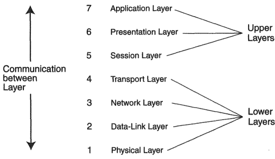

# 通过封装进行数据通信

每一层的数据包被插入到其下方层字段。这一过程一直持续到第 1 层。大型数据包可能会被分成多个较小部分进行插入（见图 7.4）。数据包穿越网络，目标层“解封装”数据包的数据部分并处理其发现的内容。这可能包括向更高层传递。记住，数据通信是从应用层向下 → 表示层 → 会话层 → 传输层 → 网络层 → 数据链路层 → 物理层。

在物理层，它到达目的地并在那里逐层解封装：物理层 → 数据链路层 → 网络层 → 传输层 → 会话层 → 表示层 → 应用层。目的地的应用层是处理包的地方。以下是对这七层的讨论。

# OSI 第一层：物理层

`OSI` 模型的第一层是物理层，由硬件组成。该层在电气和机械层面通过网络传输比特流。它提供了在载波上发送和接收数据的手段。

该层定义了：

- 用于时钟和同步的电平和平信号
- 传输距离
- 物理连接器
- 链路的开启和关闭（电压）
- 硬件示例：
  - `EIA/TIA—232` (`RS-232`)
  - `v.35`
  - `HSI`—串口接口
  - `BRI` (`ISDN`)

# OSI 模型

`V.35` 是网络接入设备与分组交换网络之间数据速率大于 19.2 Kbps 的中继接口。`V.35` 可能将多个电话电路的带宽作为一个组使用。有 `V.35` 性别转换器和适配器。

# ISDN 中的基本速率接口 BRI (ISDN)

在集成业务数字网络 (ISDN) 中，有两种业务级别：用于家庭和小型企业的基本速率接口 (BRI)，以及用于大型企业的初级速率接口 (PRI)。

`BRI` 由两个 64 kbps B 信道和一个 64 kbps 的 D 信道组成。`PRI` 由二十个 64 kbps B 信道和一个 128 kbps 的 D 信道组成。

D 信道用于信号和控制，而 B 信道用于语音和数据。

# HSSI—高速串口接口


高速串口接口 (HSSI) 是一种用于广域网链路的 `DTE/DCE` 接口，由美国国家协会 (ANSI) 和电子工业协会 (EIA) 定义。

| 特性 | 值 |
| :--- | :--- |
| 最大信号速率 | 52 Mbps |
| 最大电缆长度 | 50 英尺 |
| 引脚数 | 50 |
| 接口 | `DTE/DCE` |
| 电气技术 | 差分 |
| 典型功耗 | 610 mW |
| 拓扑 | 点对点 |
| 线缆类型 | 屏蔽双对 |

# EIA/TIA 布线标准由电信工业协会 (TIA)

# OSI 第二层：数据链路层（虚拟世界）

OSI 模型的第二层是数据链路层。该层为物理层提供同步并对连续的 `1` 进行填充。它由硬件和软件（构建在固件中）组成。该层定义了：

- 比特流格式化
- 物理地址
- 网络拓扑（总线型、星型）
- 错误修改（终站）
- 流控制

数据链路层包含两个子层：`LLC`（逻辑链路控制）和 `MAC`（介质访问控制）。

当工作环境中的某些 `LAN` 技术结合了第一层和第二层。`LAN/MAN`（城域网）示例有：

- 第一层和第二层结合
- 常见的 `IEEE 802.X` 标准
- `802.2` 定义了所有 `802.X` 标准都可以使用的 `LLC` 协议
- `802.3` 以太网 (`CSMA/CD`)
- `802.4` 快速以太网，`100 BaseT`
- `802.5` 令牌环
- `802.6` 双纤总线 (`MAN`)
- `802.11` 使用 `CSMA/CA` 的 `Windows LAN`
- `802.12` `100 VG-Any LAN` (惠普)

# OSI 第三层：网络层

网络层处理数据的路由（在向外传输中将其向正确的方向发送到目的地，并在接收传输中进行包级处理）。网络层负责路由和转发。它有两个重要组件：路由协议 (`IP`) 和路由协议。

路由协议有一种传输机制，可以将数据放入其中并在网络中移动，它运行在第三层。路由协议实际上是运行在路由器中的程序，它跟踪所有网络地址、网络分段以及网络状况，以便路由协议能够穿越网络（见图 7.5）。

## 网络层 (WAN)

`x.25` (原始的第 3 层分组交换网络)

**图 7.5** 帧中继云

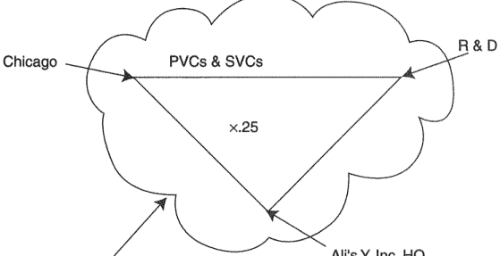

`WAN` — 帧中继云

- `VC` — 虚拟电路
- `PVC` — 永久虚拟电路（始终可用）
- `SVC` — 交换电路——需要时创建

事实标准 (De facto) = 由于使用广泛而被接受为标准

## 网络层寻址

逻辑地址或软件地址被放入第 3 层的网络软件中。它包含一个网络部分（用户定义）和一个节点部分（由 `MAC` 地址生成）。节点部分是 `MAC` 地址（制造商固化的的第 2 层地址）。

路由协议在数据包级别具有必要的信息，使得分层寻址和路径决策成为可能。分层地址结构使得大型网络的扩展成为可能。

路由协议（Roundtrip Protocol）维护路由转发表，用于决定到达目的地的最佳方式（连接指标——首选路径）。它维护网络路由器之间持续的通信，以便获取网络状况的最新信息。它使得极其复杂的网络对终端来说是透明的。

## OSI 第 4 层：传输层

OSI 模型的第四层是传输层。该层管理端到端控制（例如确定所有数据包是否到达）和错误检查。它确保数据的完整传输和服务质量。该层还确保了透明、可靠、一致的网络使用方式（没有长时间停顿等）。

## 460 网络

第 4 层任务包括：

- 流量控制——信息解复用
- 网络计算机中多一个程序同时使用网络连接的多复用能力
- 错误检查和通知

## 多复用基础

多复用是指在源端将多个数据通道合并到单一数据或物理通道的过程。多复用可以在 OSI 的任意层实现。相反，解复用是在在目的地分离多复用数据通道的过程。多复用的一个示例是将来自多个应用程序的数据复用到单个低层数据包中。多复用的另一个示例是将来自多个设备的数据合并到单一物理通道中（使用称为多复用器的设备）。

多复用器是一种物理设备，在源端将多个数据流合并为一个或多个输出通道。解复用器在远端将通道分离为多个数据流，通过允许多个流量源共享来最大限度地利用物理介质的带宽。用于数据多复用的方法有时分复用（`TDM`）、异步时分复用（`ATDM`）、频分复用（`FDM`）和统计多复用。

在 `TDM` 中，每个数据通道的信息根据预设的时间隙分配带宽，无论是否有数据要传输。在 `ATDM` 中，通过使用动态分配的时间隙，根据需要为数据通道的信息分配带宽。在 `FDM` 中，每个数据通道的信息根据流量的信号频率分配带宽。在统计多复用中，带宽动态分配给任何有要传输信息的数据通道。

## 错误检查基础

错误检查方案确定传输的数据在从源端到目的地的过程中是否损坏或其他损坏。错误检查在多个 OSI 层中实现。

一种常见的错误检查方案是循环冗余校验（`CRC`），它可以检测并纠正损坏的数据。错误纠正功能（如数据重传）留给高层协议。`CRC` 值是由源设备执行的计算生成的。目的设备将此值与自己的计算结果进行比较，以确定传输过程中是否发生错误。首先，源对要发送包的内容执行一组预定的计算。然后，源将计算出的值放在包中并发送到目的地。目的地对包的内容执行相同的预定计算，并将其计算出的值与包中包含的值进行比较。如果值相等，则该数据包被认为是有效的。如果值不等，则包包含错误并被丢弃。

## 面向连接和无连接网络服务

通常情况下，网络协议及其支持的数据流量可以表征为面向连接或无连接的。简而言之，面向连接的数据处理涉及使用在连接期间建立的特定路径。无连接的数据处理涉及通过一个永久建立的连接。

面向连接的服务涉及三个阶段：连接建立、数据传输和连接终止。

在连接建立阶段，确定源系统和目的系统之间的单一路径。此时通常会预留网络资源以确保一致的服务等级，例如保证的吞吐量速率。

在数据传输阶段，数据在已建立的路径上顺序传输。数据总是按照发送的顺序到达目的地。

在连接终止阶段，终止不再需要的已建立的连接。源系统和目的系统之间的未来通信需要建立新连接。

与无连接相比，面向连接的服务有两个显著缺点：静态路径选择和网络资源的静态预留。静态路径选择会产生困难，因为所有流量必须沿着相同的静态路径传输。该路径任何部分的故障都会导致连接失败。网络资源的静态预留会导致困难，因为它需要保证吞吐量速率，从而占用了其他网络用户无法共享的资源。除非无连接使用完整的带宽，否则带宽不会被有效利用。然而，面向连接的服务对于传输不耐延迟和数据包排序的应用程序有用。语音和视频应用程序通常基于面向连接的服务。

无连接服务不确定从源到目的系统的路径，也不保证数据包排序、数据吞吐量或其他网络资源。每个数据包必须有完整的地址，因为根据各种影响，可能会选择不同的路径。每个数据包由源系统独立传输，并由网络设备独立处理。然而，无连接服务相对于面向连接服务有两个重要优势：动态路径选择和动态带宽分配。动态路径选择允许流量绕过网络故障，因为路径是基于数据包选择的。通过动态带宽分配，带宽的利用更加高效，因为网络资源没有分配给无法容忍某些延迟和重排序的连接。

无连接服务对于可以容忍延迟和重排序的应用程序传输数据有用。基于数据的应用程序通常基于无连接服务。

总结来说，面向连接的服务确保点之间的路径是开启的，并确保路径的可靠性。面向连接的服务内部具有机制来纠正沿途发生的错误并处理重传，因此程序不需要具备这些资源。使用这种传输服务的程序是传输控制协议（`TCP/IP`）。这是一种面向连接的可靠服务，通过确认机制来确保交付，并自动重传错误或丢失的数据包。它可以调整传输

# 462 网络

通过“滑动窗口”动态缓冲区重置方法，根据网络状况动态调整速率。

无连接服务提供尽力而为的交付；然而，网络并不保证信息能够到达。使用此服务的程序是用户数据报协议 (`UDP/IP`)。这是一种无确认机制的无连接服务，错误检查需要由下一层处理。

上述是下层协议，物理层 → 数据链路层 → 网络层 → 传输层也是如此。上层协议为会话层 → 表示层 → 应用层。

# OSI 第 5 层：会话层

该层负责在终端应用程序之间建立、协调和终止会话、交换和对话。它处理会话和连接的协调。它还处理与在表示层（第 6 层）实体之间建立、管理和终止连接相关的任务。例如是 `AppleTalk` 的 `ZIP`（区域信息协议），它负责协调 `AppleTalk` 命名绑定协议。

# OSI 第 6 层：表示层

这一层（通常是操作系统的一部分）负责将输入和输出的数据从从一种格式转换为另一种格式（例如，从文本流转换为带有新到达文本的弹出窗口）。表示层有时被称为语法层，处理与数据编码、转换和表示相关的任务。详细任务项包括：

- 不同系统间的常用数据表示格式（`ASCII`, `EBCDIC` (`IBM/SNA`)）
- 数据压缩/解压缩
- 数据加密和解密通信（安全系统）

# OSI 第 7 层：应用层

这是识别通信伙伴、识别服务质量（`QoS`）、考虑用户身份验证和隐私，并识别对数据语法的任何限制的层。（此层并不是应用程序本身，尽管某些应用程序可能会执行应用层的功能。）

应用层是最高层。该层通过下层提供的网络资源直接与应用程序交互。典型的第 7 层任务包括：

- 识别通信伙伴
- 确定可用资源
- 同步系统之间的通信

示例包括：

- `FTP` (`TCP/IP`) 文件传输协议
- `SMTP` (`TCP/IP`) 用于电子邮件的简单邮件传输协议

# 局域网拓扑结构 463

图 7.6 以太网——四种常见实现

| 名称 | 传输速率 | 拓扑结构 | 介质/布线 |
| :--- | :--- | :--- | :--- |
| `10 Base T` | 10 Mbs | 星型 | `UTP` |
| `10 Base F` | 10 Mbs | 星型 | 光纤 |
| `10 Base 2` | 10 Mbs | 总线型 | 50 欧细同轴电 |
| `10 Base 5` | 10 Mbs | 总线型 | 50 欧细同轴电 |
| `10 Base—以太网网络` | | | |
| `10 Base—光纤` | | | |

# 局域网拓扑结构

常见的局域网网络拓扑结构是 `DIX`（Digital, Intel 和 Xerox）。常见实现请参见图 7.6。

# 实现以太网

# 载波监听多路冲突检测

网络上的不同设备可能在任何时间需要通信，因此需要建立接入方法。使用载波监听多路冲突检测 (`CSMA/CD`)，设备首先检查电缆是否没有其他载波占用，然后在传输的同时监控是否有其他载波存在。如果检测到冲突，设备将停止传输并在稍后尝试。在具有冲突检测的 `CSMA` 网络中，所有站点都具有感知网络上流量的能力。

数据被分组成一个位帧（1 和 0）以便物理传输。以太网数据链路层或帧层的信息与图 7.7 类似，该层的信息被称为**帧**（`frame`）。`CSMA/CD` 是工作在这一层的协议示例。目的等同于名称。它检查电缆查看是否已有其他 `PC` 在传输（载波监听），允许所有计算机共享相同的带宽（多路访问），并检测和重传冲突。本质上，它是网络层的“高速交警”。

| 图 7.7 以太网帧 | 来源 | 长度 | 数据 | `FCS` |
| :--- | :--- | :--- | :--- | :--- |
| 前导 (`Preamble`) | 目的地址字段 | | | |
| `SOF`—帧起始 | | | | |
| `FCS`—帧检举序列 | | | | |

# 令牌环

令牌环网络是一种局域网 (`LAN`)，其中所有计算机以星型拓扑结构连接，并使用二进制位令牌传递方案，以防止同时想要发送消息的两台计算机之间发生数据冲突。

令牌环协议是以太网局域网上最广泛使用的协议。`IBM` 令牌环协议产生了一个标准版本，规定为 `IEEE 802.5`。两种协议均被使用且非常相似。

`IEEE 802.5` 环形技术提供每秒 4 或 16 兆的数据传输速率。简之，其工作原理如下：

空帧在环路上持续循环。当计算机有消息要发送时，它在空帧中插入一个令牌（这可能通过通过将帧中令牌位部分的 0 改为 1 实现），并在帧中插入消息和目的标识符。

每个后续工作站都会检查该帧。如果工作站发现自己是该消息的目的地，它就会从帧中复制消息并将令牌改回 0。当帧回到源点处时，它看到令牌已变为 0 且消息已被复制和接收。它从帧中移除消息。

该帧继续作为“空”帧循环，直到被另一个工作站取用。

## 网络

- `SLIP` 的下一代
- 运行于大多数 `WAN` 串行链路、`DSD`、`T1`、`T3`、`ISDN`
- 包括加密、多协议支持、错误控制、安全性、动态 `IP` 地址、自动连接协商
- 三种帧类型：链路控制协议帧 (`LCP`)、网络协议帧 (`NCP`) 和数据帧

## 数据链路层接口 (WAN)—帧中继 (Frame Relay)

帧中继是 `X.25` 的升级版。在列出的 `WAN` 协议中，它是最快的，因为其帧结构简化且没有错误修正。它必须使用电信公司的高质量数字设施，因此并非处处可用（见图 7.9 和 7.10）。

集成服务数字网络 (`ISDN`) 如图 7.11。

## 数据链路层接口 (WAN)—异步传输模式 (ATM)

异步传输模式 (`ATM`) 规范包括：

- 固定长度的 53 字节单元交换协议。两种类型为：
- `UNI`：用户到网络接口
- `NNI`：网络到网络接口
- 像帧中继一样使用 `PVCs` 和 `SVCs`
- 引入了 `QoS`（服务质量）特性
- `T1` 的物理层速度（1.54 Mbps 到 2.4 Mbps）

`ATM` 单元见图 7.12。

## 图 7.8 帧中继

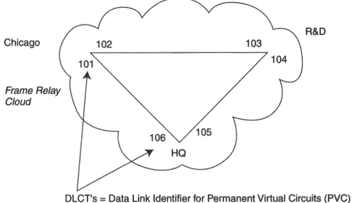

## 图 7.9 PPP 帧

| 标志 (Flag) | 地址 (Address) | 控制 (Control) | 协议 (Protocol) | 协议类型 | 数据 (Data) | `FCS` |
|---|---|---|---|---|---|---|
| | | | | | | |

`FCS` 未发生损坏。

## 图 7.10 帧中继帧

| 标志 (Flag) | `DLCI, FECN` | 数据 (Data) |
|---|---|--|
| | | |
| | `DECL, DE Bits` | |

用于拥塞

## 图 7.11 ISDN (集成服务数字网络)

终端

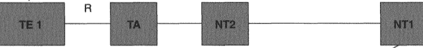

`TA` = 终端适配器 (Terminal Adapter)

`TE1` = 终端类型 1：支持 `ISDN` 的终端

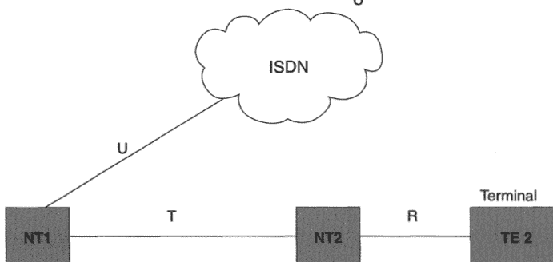

## 图 7.12 ATM 单元

| `GFC` | `VPI` | `VCI` | `PT` | `CLP` | `HEC` | 数据负载 (Data Payload) |
|---|---|---|---|---|---|---|
| `UNI` 单元 | | | | | | |
| `VPI` | `VCI` | `PT` | `CLP` | `HEC` | 数据负载 |

`AFC VCI`—虚拟电路标识符 标识符 `VPI`—虚拟路径标识符 如何操作以及面向对象

## 基础网络设备

基础网络设备包括：

- 第1 层—集线器（以太网集线器）
- 第2 层—数据链路交换机
- 第3 层—网络路由器

## CISCO 路由器

`CISCO` 路由器规范为：

- 运行在第 3 层（网络层），有其局限性
- 使互联网络的复杂性透明
- 为路由协议、`IP`、`IPX` 和 `AppleTalk` 的第 3 层数据包转发决策
- 计算机使用路由协议和算法路由“矩阵”
- 高性能的专用“网络计算机”
- `CPU`、`RAM`、`ROM`、磁盘存储 (`TFTP`)、接口等
- 操作系统—`CISCO` 互联网操作系统 (`IOS`)

见图 7.13 至 7.15。

## 实验概览

`Ali Y's Consulting, Inc.`—`WAN` 配置

- 串行接口 (`Serial 0`)
- 使用第 1 层—`v.35`，`DTE` 接口
- 第 2 层—帧中继，`DLCI` 105 和 106
- `DLCI`—数据链路连接标识符
- 以太网接口 (`Ethernet 0`)

## 基础网络设备

图 7.13 路由协议与被路由协议

## CISCO 路由器

芝加哥终端

`210.157.64.1`

纽约研发中心终端

`210.157.64.2`


总部终端

`210.157.64.3.`

- 第 1 层—`Base T` (`UTP`)
- 第 2 层—以太网，10 Mbps，`IEEE 802.3` 以太网帧
- 令牌环接口 (`Token ring 0`)
- 第 1 层—`UTP`
- 第 2 层—令牌环帧，16 Mbps，`IEEE 802.5` 帧格式

## 路由器

- 主控制台端口
- 辅助端口—连接调制调器
- 收发器—连接到 May 的令牌环

## 站点路由器

- 串行接口 (`Serial 0`)
- 第 1 层—`v.35`，`DTE`
- 第 2 层—帧中继，`DLCI` 103 和 104

图 7.14 路由表

| `IP` 地址 | 端口 | 度量 (Metric) |
|---|---|---|
| `210.157.64.1` | 1 | 10 |
| `210.157.64.2` | 2 | 10 |
| `210.157.64.3` | 3 | 10 |

## 网络

图 7.15 `Ali Y's Consulting, Inc.`

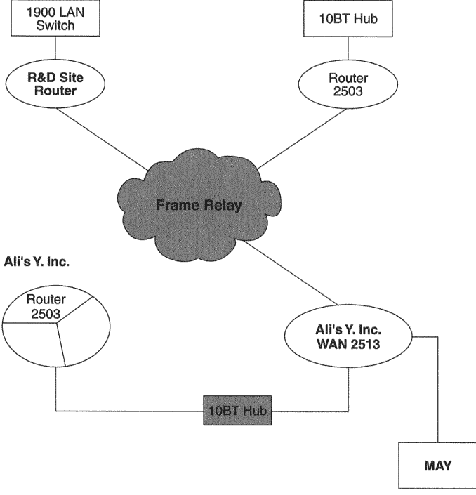

- 以太网接口 (快速以太网 0)
- 第 1 层—`Base T` (`UTP`)
- 第 2 层—100 Mbps (`VLAN` 躯干，`VLANs`)

## 使用 TFTP 服务器启动并基础访问路由器

`NVRAM`—非易失性随机存储器

启动路由器

系统引导消息

加载已连接的接口、网络编号

访问路由器

用户模式 ">" 显示用户模式

特权模式# 指示特权模式

## 基础网络设备

互联网操作系统 (`IOS`) 模式：

- 用户模式 `>`
- 访问权限最低
- 仅限基本任务
- 无法查看配置
- 特权模式 `#`
- 最高访问权限
- 对所有命令和配置具有完全访问权限

## 配置内部

显示命令：

- `Show running-config`—显示 `RAM` 中的路由器配置。


### 命令详解

- `show startup-config`——显示存储在 `NVRAM` 中的配置（启动时）。
- `show flash`——显示 `flash` 的格式和内容。
- `show buffers`——显示路由器池的统计数据。
- `show memory`——显示内存统计数据。
- `show process cpu`——显示路由器中的活动进程（程序）。

其他命令：

- `show protocols`——显示路由器配置支持的所有协议信息、网络地址。
- `show stats`——内存利用率。
- `show version`——系统硬件、`IOS` 版本、配置文件和镜像。
- `show <interface> <interface id>`——显示所选接口信息。

### 配置寄存器

配置寄存器值：此值应该是：`0x2102`

配置寄存器为 `0x2102`

虚拟配置寄存器——`NVRAM` 特殊区域中的 16 位寄存器

- 在特权模式下的 `show version` 结果中可见
- 十六进制 `0x2102`——默认值
- 前 4 位 (`0x2`) 控制启动操作、启动字段

```
0x0—路由器在 ROM 监控模式下启动
0x1—路由器从 ROM IOS 镜像启动
0x2—从 flash 正常启动。
```

其他启动用途请参见文档。

## 互联网操作系统 (IOS)

`IOS` 镜像——存储在本地 `flash` 存储器中：

### 全局配置模式

```
# config terminal
# boot system flash
# exit
# manage configured from "Terminal"
# copy running-config startup-config
[ OK ]
```

### IOS 启动

`IOS` 加载和启动命令（来自全局配置模式）：

- `boot system flash`——正常的、基于 `flash` 的 `IOS` 加载
- `boot system tftp <tftp>` (在此处输入服务器地址)
- `boot system ROM`——路由器从 `ROM` 版本的 `IOS` 启动

## 路由器配置模式

`IOS` 配置模式：

- 全局：`Router (config)#`
- 接口：`Router (config-if)#`
- 子接口：`Router (config-subif)#`
- 线路：`Router (config-line)#`
- 路由器：`Router (config-router)#`
- `IPX` 路由器：`Router (config-ip)`

管理配置和 `IOS` 文件：

- `IOS` 镜像——二进制执行镜像（路由器）
- 配置文件——文本文件（在 `NVRAM` 中）
- 拷贝到外部位置（例如 `tftp` 服务器）

`IOS` 文件处理：

- `copy tftp flash`——将 `IOS` 镜像从 `tftp` 服务器拷贝到 `flash` 内存
  - 注意拼写
  - `flash` 会先擦除
- `copy flash tftp`——将 `IOS` 从路由器的内存拷贝到 `tftp` 服务器
  - 路由器可以作为 `tftp` 服务器
  - `tftp server <文件名>`

配置加载：

- 配置文件包含路由器的指令
- `CLI` 命令立即进入路由器配置

`X.7 (f) CLI` = 命令行界面

## 基础网络设备

配置管理命令：

- `copy running-config startup-config`——将 `RAM` 中的配置拷贝到 `NVRAM`。
- `copy tftp running.config`——将配置到 `NVRAM`。
- `copy running.config ftp`——将 `RAM` 运行配置拷贝到 `tftp` 服务器。
- `copy startup.config ftp`——将 `NVRAM` 配置拷贝到 `tftp` 服务器。

命令：

```
# copy tftp 验证校验和 OK 过程升级路由器。
```

另一个常见任务 → 备份拷贝

```
# running.config tftp
```

需要 `IP` 地址 ← 远程主机

（例如 `157.100.128.20`）

广播地址意味着它将查看连接到路由器的所有接口

## CISCO 服务路由器

1. **CISCO 12000 ASR（高级交换路由器）**
   - 面向 `ISP`（互联网服务提供商）
   - `WAN` 接口 `T3` (`52 Mbps`) 到 `OC-48` (`2.4 Gbps`)

2. **CISCO 7500 系列**
   - `CISCO` 顶级多协议路由器
   - `WAN` 接口从 `T1` (`1.54 Mbps`) 到 `OC-12` (`622 Mbps`)
   - 运行 `CISCO IOS`

3. **CISCO 7200 系列**
   - 运行 `CISCO IOS`
   - `WAN` 接口适用于 `T1` (`1.54 Mbps`) 到 `GC=3` (`150 Mbps`)

4. **CISCO 4000 系列**
   - 运行 `CISCO IOS`

5. **CISCO 3600 系列**
   - 高性能 `CPU`

6. **CISCO 2500 系列**
   - 运行 `CISCO IOS`—所有区域都有某些命令
   - `WAN` 接口速度高达 `T1` (`1.54 Mbps`)

## CISCO LAN 交换机

- 通常工作在第 2 层（数据链路层）
- 新一代交换机具有第 3 层和第 4 层敏感性

## 474 网络：基于 MAC 端口的二层帧转发决策

- 基于 `MAC` 端口进行二层帧转发决策
- 极高性能的专用“数据链路”计算机
- 包含 `CPU`、`RAM`、`ROM`、磁盘存储 (`UTP`)、接口等
- 操作系统 `CISCO IOS` 交换机

`CISCO 1900/2000` 系列：

- 局域网接口速度从 `10 Mbps` 到 `100 Mbps` 不等
- 用于高性能“骨干”应用

## CISCO 局域网集线器

- 工作第 1 层（即物理层）
- 充当电信号“中继器”并分发设备
- 提供 `10-Mbps` 和 `100-Mbps` 版本

## 防火墙

### 什么是防火墙？

让我们先从定义术语开始。什么是防火墙？防火墙的标准定义是一种防止互联网或局域网危害扩展到网络的设备。或者更具体地说，它是一个在两个（或多个）网络之间强制边界的系统。

防火墙最现实的定义仅仅是“互联网安全策略的实施”。如果一个人没有安全策略，他就没有防火墙。相反，他拥有的只是一个在某些事情的东西，但人们不知道它正试图做什么，因为没有人告诉过它应该做什么。

虽然防火墙的安装和配置是一门复杂的艺术，但正确实施防火墙的最困难方面是确定要实施特定且合适的防火墙架构类型，特别是当存在三十多种防火墙时。做出正确且智能的选择并不简单。

只有当人们定义了对防火墙的标准和特定需求时，为环境选择防火墙架构才是可能的。试图在不明确自身防火墙资质的情况下购买“最佳防火墙”只会导致虚假的安全感。事实上，结果可能恰恰相反。不恰当的防火墙会给组织带来虚假的安全感，从而使他们的安全漏洞变得更大。

总结来说，防火墙的好坏取决于：

- 启用它的安全策略规则库。
- 连接到防火墙的设备。
- 操作系统及其配置。
- 安装和配置防火墙的人员。

必须意识到，防火墙并不是安全的万能灵药。有些事情是防火墙简单无法做到或防止的。其中包括：

- 停止内部攻击。
- 弥补安全策略的缺陷。
- 成为神奇的安全毯。
- 防止敌对的小型程序或恶意的 `ActiveX` 或 `Java` 代码（尽管某些防火墙供应商提供此类软件插件）。
- 停止不通过防火墙的连接（拨号模拟线路）。
- 防止病毒（虽然通过软件插件进行病毒防护是可行的，但原生防火墙架构并不负责病毒及其消除）。
- 防止新威胁。

### 安全策略

在进入各种防火墙架构的细节之前，让我们先花点看看有效网络安全策略的必要性。安全策略是详细说明企业安全考量的文档。在没有策略的情况下设置防火墙，类似于聘佣了一名不知道法律是什么的警察。只有在制定了安全策略后，公司才能真正地开始为其环境搜索并实施最佳防火墙。

为了使安全策略有效，它必须是根据为其服务的公司需求而创建的文档。它必须识别组织内部网络、计算机、服务和信息的潜在威胁，此外还要包括人员为应对这些风险而必须实施的程序和策略。

与防火墙直接相关的策略示例是关于如何处理未知数据包的问题。有两种可能：允许数据包进入网络或拒绝数据包。发生什么取决于防火墙是如何设置的。防火墙可以设置为两种可能状态：

- 方法 #1：拒绝任何未明确许可的服务（或数据包）。
- 方法 #2：允许任何未被明确拒绝的服务（或数据包）。

大多数防火墙遵循方法 #1 的安全原则。

至于策略，要遵循的最佳程序涉及网络安全的“四 P”原则：

- 偏执的 (`Paranoid`)
- 审慎的 (`Prudent`)
- 许可的 (`Permissive`)
- 杂乱的 (`Promiscuous`)

最佳方法通常是这四者的结合。

### 常见互联网威胁

互联网上有无数威胁。以下是防火墙试图对抗的几个更具隐蔽性的问题：

- `SMTP`（电子邮件）。`SMTP` 是互联网电子邮件协议传输服务。`SMTP` 有很多问题。其中一个主要问题是，当人们收到消息时，没有办法验证“发件人”部分出现的人名是否是消息的实际发送者。
- `Sendmail`。`Sendmail` 经常是黑客进入网络（通过其安全漏洞）的代码入口。`Sendmail` 是处理系统所有电子邮件的应用程序。`Sendmail` 有技术问题历史，并以极其难以配置而闻名。虽然美国可能有超过 25 万名 `CNE`（认证 `NetWare` 工程师），但真正理解 `Sendmail` 的人非常有限。
- `DNS`（域名服务）是一个映射用户名和主机名的数据库。`DNS` 的一个安全问题是它提供了一个搜索 `IP` 地址的地方。

### 防火墙架构

现在已经涵盖了准备工作，让我们讨论一下防火墙架构的细节。防火墙架构决定了防火墙的核心能力和功能。

目前使用的领先防火墙类型有：

1. 应用层网关/代理
2. 网络层网关
3. 数据包过滤

#### 应用层网关/代理防火墙

这种是在允许连接之前查找有效应用层数据的防火墙类型。应用网关防火墙会检查所有数据包中的应用层数据。防火墙上运行着该程序的特殊版本。在防火墙上的 `Telnet` 对用户显示为 `Telnet` 客户端，对服务器显示为 `Telnet` 客户端。

应用层防火墙使用代理。代理是一种机制，它将通过的所有流量的内部（安全）网络主机的 `IP` 地址替换为自己的地址。

大多数网络层网关都包含了内置代理以确保安全。这是因为隐藏内部主机的地址使得攻击者很难针对防火墙内部的设备。

许多黑客和入侵者会尝试通过利用程序的各种方法进入网络。1988 年入侵者利用 `Sendmail` 程序漏洞的互联网大战就是一个例子。基于应用程序的防火墙的功能防止此类入侵的发生。这是因为应用层是黑客攻击的主要区域。

#### 网络层网关防火墙

这种是在通过防火墙打开连接之前验证 `TCP` 和 `UDP` 会话的防火墙类型。防火墙将执行会话设置以验证是否存在有效的 `TCP` 或 `UDP` 握手，并在握手完成之前不转发数据包。一旦建立会话，防火墙将维护授权连接表，并在会话信息与表条目匹配时允许数据通过。当会话完成后，条目从表中删除，电路终止，直到另一个进程启动。

网络层网关只能在会话层（第 4 层）验证连接，因此一旦启动会话，由于任何应用程序可以在该连接上运行，其安全性低于应用网关。

#### 数据包过滤

`# 防火墙`

数据包过滤允许根据源地址、目的地址以及会话中使用的协议来控制连接。数据包过滤防火墙（最基本的防火墙类型之一）在网络层（第 3 层）检查每个数据包。数据包过滤使用权限规则来授权或拒绝访问和端口。数据包过滤器允许从一个源地址（主机）和端口的任何数据包通过第二个目的地址和端口。数据包过滤器通常被认为安全性最低的防火墙类型，但它在速度（非常快）和透明性（用户无需进行任何操作，代码无需重新编译）方面弥补了这一点。当 `TCP` 端口定义为接受流量时，防火墙可能会允许任何具有相同端口号的数据包通过。这意味着任何具有相同端口号的其他应用程序或会话也能通过防火墙。路由器上提供了低级数据包过滤功能。

数据包过滤器的问题在于它对网络的视图是短视的。由于它运行在网络层，因此它只能看到（并保护）网络的最低三层。此外，其有限的安全性意味着它无法防止 `IP` 伪造攻击，而且它不是具备充分日志功能的包过滤防火墙。

数据包过滤器根据 `IP` 数据包中的六个主要头部进行工作。这些头部是：

1. `IP` 源地址
2. `IP` 目的地址
3. 协议（`TCP`、`UDP` 或 `ICMP`）
4. `TCP` 或 `UDP` 源端口
5. `TCP` 或 `UDP` 目的端口
6. `ICMP` 消息类型

#### 状态检测

`# 状态检测`

状态检测由 `Check Point Software Technologies`（加州红木市：`www.checkpoint.com`）发明，该公司是 `FireWall-1` 产品的制造商。`Check Point` 在 1997 年 2 月因其状态检测技术获得了美国专利（专利 5,606,668）。状态检测是带有大脑的数据包过滤。它在网络层（第 3 层）检查数据包，然后分析数据包中的数据。状态检测维护用户请求的“状态”和“上下文”，以便数据通过防火墙返回时，它能够验证数据是否是专门请求的。状态检测尝试跟踪打开的有效连接，而无需为每个数据包处理规则。

#### 数据包过滤器

`# 数据包过滤器`

数据包过滤器优点：

- 速度快
- 对于非业务关键环境足够
- 通常成本较低
- 灵活
- 透明
- 可以在现有路由器上实现

#### 网络

`# 网络`

- 与应用程序无关
- 良好的可扩展性

#### 数据包过滤器缺点

`# 数据包过滤器缺点`

- 通常缺乏管理功能
- 较容易被伪造
- 通常缺乏日志功能
- 不支持用户认证
- 无法自动从公共视图中隐藏网络和系统地址
- 无法防止应用层攻击（电子邮件、`Web`、`Java` 等）
- 容易受到复杂的 `IP` 分片和源路由攻击
- 无法筛选网络层以上的内容
- 某些协议在过滤器环境中无法完全运行（如 `NFS`、`NIS/YP`、Berkeley “r” 命令）
- 无法提供时间访问控制

#### 电路网关

`# 电路网关`

电路网关优点：

`# 电路网关优点：`

- 防止内部和外部机器之间的直接连接

电路网关防火墙缺点：

`# 电路网关防火墙缺点：`

- 必须修改内部网络上的客户端软件
- 仅在会话层（第 4 层）运行

#### 应用层网关

`# 应用层网关`

应用层网关防火墙优点：

`# 应用层网关防火墙优点：`

- 通常提供更高的安全性
- 允许自定义禁用或修改特定的命令、协议或服务
- 代理在内部主机与外部不可信主机之间提供直接连接
- 支持强终端用户认证（`SecID`、`S/Key`、`Safeward` 等）
- 卓越的日志记录
- 可以自动从公共视图中隐藏网络和系统地址
- 能够提供时间访问控制

应用层网关防火墙缺点：

`# 应用层网关防火墙缺点：`

- 通常更复杂
- 比状态检测和数据包过滤慢

#### 选择防火墙

`# 选择防火墙`

- 必须支持用户想要通过防火墙使用的每个应用程序
- 在某些环境中，足够的 `WAN` 带宽可能是一个限制因素
- 可扩展性差
- 对防火墙设备需要更高的算力
- 设置和配置更困难
- 缺乏检测代理意味着应用程序无法运行
- 某些服务（如聊天和 `talk`）很难开发代理
- 对终端用户不透明

#### 状态检测的优点与缺点

`# 状态检测的优点与缺点`

状态检测优点：

- 智能性
- 比标准数据包过滤器更安全
- 针对伪造有更好的保护
- 在添加新应用程序、服务和协议方面能够灵活
- 比基于代理的防火墙快
- 良好的可扩展性

状态检测缺点：

- 无法防止应用层攻击
- `CPU` 密集型
- 无法自动从公共视图中隐藏网络和系统地址

#### 注意事项

`# 注意事项`

公司如何对购买防火墙做出正确决策？首先，如果防火墙供应商声称如“可用最好的防火墙，没有任何黑客破解过它”，请将该公司从你的备选列表中剔除。任何声誉良好的防火墙供应商都不会做出这种荒谬的声明。供应商举办公开黑客挑战并不能证明任何问题。这些挑战通常是随机测试，没有基准测试方法。没有发现问题并不意味着问题确实存在。如果你是一个心怀不轨的黑客，你不会希望公开你发现的安全漏洞；相反，你会希望供应商交付有缺陷的产品然后。

#### 选择防火墙

`# 选择防火墙`

#### 安全审计

`# 安全审计`

对合适的防火墙做出决策的好方法是进行安全审计。安全审计是由组织的内部人员或外部人员对安全架构进行的调查。从策略和程序到网络系统配置的一切都经过评估。审计结果可以为合适的防火墙架构提供强有力的指示。审计的另一个好处是它可以让公司更好地了解自己的真实需求。许多公司犯的共同错误是它们过于关注防火墙的功能，而忽略了自己的需求。

#### 网络

`# 网络`

组织日益依赖任务关键型客户端/服务器程序和系统来维护性能。分布式计算环境以其开放、灵活和可扩展性而称。另一方面，这些计算环境为资源访问控制和一致的安全策略制造了障碍。

#### 选择防火墙

`## 选择防火墙`

#### 解决超级用户问题

`## 解决超级用户问题`

超级用户（`superuser`）概念创建于 `Unix` 开发的早期。在那个时代，大多数系统都是单机运行，需要一种简单的方法来方便多用户环境下的系统管理。一种的解决方案是创建一个名为 `root` 的账户，该账户拥有在系统上执行任何操作的权限。随着应用程序数量和网络连接机器的需求增长，超级用户的权限已远远超出了其最初的设定。

访问权限的另一种方法是通过运行带有 `setuid` 机制的程序，该机制的设计目的是允许普通用户运行特定的系统程序以获取 `root` 账户权限，从而访问保护的文件或资源。

`Unix` 中存在交互式超级用户（或 `root`）访问会导致以下安全问题：

1. 超级用户权限会覆盖所有系统保护。作为具有 `root` 权限的超级用户，人员可以查看任何人拥有的文件、修改系统配置、中断网络连接、复制硬盘数据库文件，并通过向操作系统引入病毒或特洛马来绕过系统安全。
2. 无法对系统管理功能建立问责机制。在 `Unix` 系统上，使用一个通用的用户名作为超级用户 `ID`，即 `root` 账户。所有系统管理员都使用该账户执行管理任务。无法识别是谁登录了超级用户账户。

`Unix` 中存在程序化超级用户（或 `setuid`）访问会导致以下安全问题：

1. 允许“后门”的创建，这是进入 `Unix` 系统的流行方式。这涉及窃取超级用户的密码、创建一个 `setuid` 程序，并在系统中放置该 `setuid` 程序以备日后篡改。此后，后门的创建者以普通用户身份登录系统，运行 `setuid` 程序并获取用户权限。作为超级用户，黑客可以匿名地在网络中移动，窃取或销毁信息，而不必担心被识别或报复。
2. 系统管理员经常编写自己的 `setuid` 程序来提供额外的系统管理功能。由这些程序创建的后门可能会导致安全漏洞，这些漏洞通常在发生重大泄露之前不会被发现。

人们已经尝试了许多方法来解决这些问题。遗憾的是，大多数方法都是完整的，或者实施和管理的成本过高。


现在有一种新的方法论，允许通过消除超级用户威胁，然后显式允许访问管理权限和计算资源，从安全层面工作。这种方法将所有需要 `root` 权限的管理任务集中在一个工具上，该工具负责委托和监控管理任务。通过为使用安全解决方案的用户分配安全管理员角色来确保访问安全。此外，所有需要 `setuid` 权限的自定义程序都通过一个工具进行。

这些软件和硬件屏障隔开了私有内部网络与其外部世界（如互联网）。防火墙提供了额外的保护并调节控制通信。

## 通用背景信息

在防火墙和整体安全设计中进行了哪些规划？

- 1. 应该保护什么？例如信息、计算设施、数据存储设施或通信设施（如语音黑客、长途电话）。
- 2. 应该防止什么？例如入侵、拒绝服务或信息窃取。防火墙有助于防止入侵（例如，配置妥的防火墙可以减少从外部访问的易受猜测的账户数量）。
- 3. 对防火墙的预期是什么？
- 4. 防火墙能否高效记录互联网活动？
- 5. 它是否高效收集有关系统和网络使用及滥用的信息？
- 6. 公司是否意识到防火墙无法防止恶意内部人员，且防火墙也无法保护不经过它的公司连接？
- 7. 防火墙只能防御已知威胁。
- 8. 防火墙无法防御病毒。
- 9. 公司是否对所有可以在互联网上提供或使用的服务进行了记录并执行了风险评估？例如电子邮件或简单邮件传输协议（`SMTP`）、文件传输（`FTP`）、远程终端访问（`Telnet`）、`Usenet` 新闻（`NNTP`）、`HTTP`、`DNS`、`Finger`、`Whois`。
- 10. 公司是否意识到其最薄弱的环节和弱点？是否涵盖了所有关注的安全问题，以最大限度地减少薄弱环节和弱点的暴露？
- 11. 公司对安全的立场是什么？是限制性的还是许可性的？
- 12. 是默认拒绝（`Default Deny`）立场还是默认许可（`Default Permit`）立场？
- 13. 用户需要的服务是否经过了充分的检查？
- 14. 是否已对这些服务的安全影响（即风险评估）进行了充分的调查？
- 15. 是否已仔细考虑了提供这些服务的策略？
- 16. 是否允许用户设置未经授权的服务器？
- 17. 是否使用了任何身份验证工具（互联网防火墙工具包 [`FWTK`], `Kerberos`）？
- 18. 是否使用了任何分析工具（`COPS`, `Tiger`, `Tripwire`, `Satan`, `ISS`）？
- 19. 使用了哪些包过滤工具（`Screened`, `Ipfwadm`, `Drawbridge`, `Karlbridge`）？
- 20. 采取哪些步骤来保持防火墙的更新先进？
- 21. 防火墙通常是一个运行 `Unix` 操作系统防火墙软件的计算机。它是从 `URL` 下载的还是作为独立产品购买的？
- 22. 如何确定防火墙的有效性？
- 23. 数据电路（链路可能是瓶颈）。是谁在进行规划？

## 网络

网络化的趋势是通过向现有硬件添加额外功能来简化管理和控制成本。但由于安全和虚拟专用网络（`VPN`），一些经理正在采取另一种路线：向其网络中添加独立的专用硬件。

网络安全专用硬件正赢得胜算，主要基于以下三个原因：

- 1. 首先，它改进了网络性能，因为加密的安全过程会消耗大量资源。例如，数据加密标准（`DES`）的处理量可能比普通 `IP` 包高出二十倍。
- 2. 第二，由于技术如此复杂且日益具有战略性，管理员不愿意解决在将新软件集成到现有产品时产生的问题。
- 3. 第三，一些网络经理认为将加密信息与其他分开更安全。

网络操作系统必须具备的技能有哪些？

- 1. 安装、配置和故障排除。在遇到故障排除问题时，需要判断是硬件还是软件相关问题——如果知识不全面，可能会导致失败。
- 2. 对操作系统的运行和管理任务的基础知识是必要的，不仅要了解“如何做”，还要了解“为什么”和“何时做”。知道如何添加用户、配置网络协议或安装服务器是不够的。必须理解这三者如何相互作用以及它们对彼此的影响。
- 3. 开发人员需要网络基础设施服务，如主服务、目录服务（如轻量级目录协议 `LDAP`）、安全服务、代理服务和防火墙。他们需要了解诸如 `Novell` 文件服务或 `Unix` 网络文件系统（`NFS`）的网络应用程序。

所有的操作系统都存在已知漏洞，提供了攻击机会。虽然提供补丁以修复漏洞是操作系统制造商的责任，但学习操作系统并确保应用补丁是用户的责任。应该禁用所有不需要的协议和服务，删除未使用的配置文件，并确保密码不明显。

许多攻击始于物理接触电脑以安装“嗅探”程序、复制密码文件进行后期解密或添加新账户，任何一种操作都几秒钟内完成。

- 1. 在办公环境中，离开电脑时永远不要注销。
- 2. 确保服务器访问受限。
- 3. 不要将磁盘或备份带随处丢弃。
- 4. 锁好写有自己密码的小纸条。
- 5. 最后，每当有人离开公司时，立即禁用其账户。

# 网络

连接互联网的用户如何确保其网络与外部世界之间的流量是安全且受控的？如果可以忍受这种连接方式所带来的限制，请使用它来减少安全环境所需的工作量。

# 调制解调器

在现有网络上连接个人调制解调器有许多选择。这些选项包括模拟、`ISDN`、电缆以及各种类型的数字用户线路——从安全角度来看，它们通常是等同的。

但互联网服务提供商（`ISP`）是否维护了强大的防火墙？例如，电缆调制解调器使用固定的真实 `IP` 地址（通常来自 `ISP` 分配的地址范围），这让你暴露在黑客面前。如果 `ISP` 不保护你，你就必须学习更多网络安全知识。否则，许多共享资源（如个人文件）将供公众使用。

# 浏览器

浏览器呢？黑客花费了大量的精力来破解如 `Internet Explorer` (`IE`) 等微软产品。`IE` 有许多安全漏洞，允许黑客和恶意网站导致浏览器崩溃或更严重的后果。这并不意味着 `Netscape Navigator` 就更安全。

通过清除你不信任的网站以及在绝对必要的情况下禁用 `Java`、`JavaScript` 和 `ActiveX`，可以避免许多问题。在计划在互联网上开展业务时，获取支持强加密的浏览器版本，并在发送个人信息时使用套接层 (`SSL`) 或安全 `HTTP` (`S-HTTP`)。

# 在互联网上开展业务

租线网络和远程访问设备已被虚拟专用网络 (`VPN`) 取代，`VPN` 提供了基础设施支持并有助于降低成本。为了实现私有通信，请实施以下措施：

- 隧道技术
- 身份验证
- 加密
- 密钥管理技术

由于这些技术没有经过“实战检验”，`VPN` 容易受到攻击。在新兴协议、标准和产品成熟之前，它们将一直存在。

三个关键的 `VPN` 组件是：

1. 安全（访问控制、身份验证和加密）
2. 流量管理（确保关键应用程序可靠地以最高可能的性能交付）
3. 基于策略的网络管理（有能够从一个中央控制台或一个易于安装的开箱即用解决方案管理整个网络的能力）

如何熟悉 `www.cert.org` 或 `www.NTSecurity.net` 等网站上的最新病毒和其他所有安全问题？敌人可能更有经验，但少量的预防可以事半功倍。通常，像防火墙等防御互联网黑客的技术由于配置不当。在排排除故障时，如何采取主动措施发现漏洞？即使防火墙配置得当，安全管理员如何决定允许用户访问哪些内容并将他们排除在哪些内容之外？最好的方法是从无访问权限的用户开始，并在此基础上进行构建。

# 性能

高可用性是互联网客户的一个重大需求。在集群环境中，今天有多少百分比的互联网服务是高可用的？服务能否自动或手动从一个 `TruCluster` 节点移动到另一个节点，从而提供保证的可用性？

性能是互联网应用的另一个需求。以下问题涉及互联网系统的性能水平：

1. 如何调优互联网系统以获得最佳性能？
2. 安装界面是否允许系统管理员调整内核调优参数？哪些参数值专门设计用于改进 `Web` 服务器、代理服务器、`FTP` 服务器、邮件服务器和中继器、网关及系统的性能？
3. 你是否拥有立即上网所需的资源——设置好 `Web` 浏览器、建立安全方案并获取互联网邮件？你是否拥有创建和自动安装主页的工具？如果是，它们是什么？
4. 如何减少管理网络、系统、数据库和应用程序的成本和复杂性？
5. 病毒扫描消耗了防火墙大量的资源。如何管理防火墙上的扫描？
6. 防病毒和入侵检测系统都非常消耗 `CPU`，你无法承受防火墙即使只有一分钟的故障。你该怎么办？

# 配置

可以配置防火墙，以限制个人向公司外发送电子邮件，并禁止他们访问互联网。外部访问也可能受到限制，因为很少公司允许公众或竞争对手访问文件和信息。

防火墙技术是可用的。例如，示例数据包过滤器将拒绝访问任何源和目的未经过系统授权的信息。要设置过滤器，请为过滤代码定义一组规则。这将允许系统决定是否允许数据包通过。

# 网络地址转换

`NAT`（网络地址转换）是将用于在一个网络内部的互联网协议 (`IP`) 地址翻译为另一个网络中已知的不同 `IP` 地址。其中一个网络被指定为内部网络，另一个被指定为外部网络。通常，公司将其本地网络地址映射到一个或多个外部 `IP` 地址，并将传入数据包上的全局 `IP` 地址映射回本地 `IP` 地址。这有助于确保安全，因为每个传出或传入的请求必须经过翻译过程，同时也提供了筛选或验证请求，或将其与之前的请求进行匹配的机会。`NAT` 还节省了公司所需的全局 `IP` 地址数量，并让公司可以使用单个 `IP` 地址与世界通信。

`NAT` 包含在路由器中，并通常是企业防火墙的一部分。网络管理员创建一个 `NAT` 表，翻译全局到本地和本地到全局的 `IP` 映射。`NAT` 还可以与策略路由配合使用。`NAT` 可以静态定义，也可以设置为从一个 `IP` 地址池进行动态转换。

`NAT` 允许内部互联网地址或互联网协议被隐藏。从防火墙后的主机发送的数据包将通过防火墙的外部地址发送。这使得发送者在互联网上是不可见的，使得黑客难以追踪网络信息和地址。`NAT` 如何设置的？

状态检测是最先进的技术。围绕此技术构建的防火墙根据源、目的、协议和通信端口对数据包进行检查。状态检测技术（根据源、目的、协议和通信端口检查数据包？）

设计是否包含路由器和网桥配置？路由器设置最用于商业防火墙，它们接收数据包，与定义的规则进行比较，然后允许或拒绝访问另一个网络。这种情况涉及若干网络更改，包括管理静态路由表，并可能使其成为黑客的目标。为了解决这些问题，防火墙构建在安全的操作系统之上。

# 监控

另一个重大需求是监控。拥有正确的监控和检测工具对于响应入侵至关重要。监控可以分解为三个关键问题：

- 正在检测什么？
- 多快可以检测到？
- 检测更新的频率有多高？

即使有了监控，很少有公司在发现入侵时知道该做什么。众所周知，大多数公司所做的只是改进他们的安全系统。根据行业观察者的说法，很少有公司通过法律追究黑客。因此，如果不进行追究，必须有相应的程序来响应入侵。

# 安全

关键安全任务包括网络协议分析以及安全网络管理解决方案。

这些任务应适用于网络开发和安全的所有阶段——从规划和设计到实施和持续管理。它们包括：

- 运行任务
- 软件分发
- 事件警报
- `IT` 环境内的全病毒防护系统监控

## 网络连接

特定的集成点包括：

- 全方位病毒防护（`Total Virus Defense`）产品的远程部署和更新。
- 向网络中所有支持的全方位病毒防护客户端和服务器分发病毒特征库更新。
- 对整个网络内的病毒特征文件进行自动轮询，以监控文件老化并识别需要更新的系统。
- 对整个网络内的病毒日志进行集中监控。
- 集中显示全方位病毒防护事件警告，以识别未受保护的系统、不合规或过时的病毒防护以及特定的病毒活动。

全方位病毒防护套件应为网络中所有可能的切入点提供全面的病毒安全，包括桌面电脑、文件服务器、电子邮件服务器和互联网网关。对于任何互联网应用程序，安全性都是一个考虑量的问题。总功能的一部分包括 128 位加密、防火墙以及用户密码。这些安全级别已被接受为行业标准。远程管理安全程序如下：

- 使用 `Netscape` 企业级服务器生成公钥/私钥对。
- 生成证书请求。
- 查找公司的邓白氏编码（`DUNS`）编号。
- 将带有 `DUNS` 编号的证书请求提交给 `VeriSign`。
- 使用 `VeriSign` 发送的 `PIN` 码检索数字 `ID`（此程序对大多数用户来说过于复杂）。

## 网络信息服务

网络信息服务（`NIS`）为您提供了一种简单的方法，通过企业网络维护用户等效性，包括与账户管理工具完全集成。

1. 什么是 `NIS`？
2. 如何配置？
3. 如何管理？
4. `NIS` 的客户端-服务器架构是怎样的，包括各种类型的 `NIS` 服务器？
5. 什么是 `NIS` 映射（`maps`）？列出默认可配置的映射。
6. 什么是 `NIS` 管理工具？
7. 获取实现 `NIS` 使用的守护进程列表，包括它们的功能。

最后需要考虑的一点是是否通过引入强加密、身份验证和安全的防火墙穿透功能来解决安全问题。

## 文档清单

文档清单包括：

- 信息系统（`IS`）人员的组织架构和职位描述。
- 关于防火墙整体设计和功能的文档。

广域网（`WAN`）拓扑结构，标明所有 `LAN` 的名称和网络位置，包括使用的 `WAN` 传输方法（`X.25`、帧中继、`T1`、拨号等）。这应与 `Novel`、`Banyan` 等网络系统的文档进行交叉引用。

数据电路（链路可能是瓶颈）。是谁在进行规划？

- `POTS` 上的 28.8 kb/s `v.34`
- `ISDN BRI` 上的 56, 64 或 128 kb/s
- 使用分段 `T1` 的 256, 384 kb/s
- 使用 `T3` 或 `Sunset` 的 1.5 Mb/s
- 使用 `T3` 的 45 Mb/s
- 有线电视上的 30 Mb/s

- 组织内外所有局域网的详细网络拓扑结构应包括以下所有重要参考点：
    - 路由器（类型、品牌、型号）；对路由表和域名系统（`DNS`）的访问，这些决定了数据如何路由。
    - 防火墙（防火墙是否正在执行路由器功能，或者是否有独立的路由器？放置在何处？）它通常应该放在防火墙之外（互联网侧）。防火墙是作为产品购买的，还是从 `URL` 下载的？
    - 网关
    - 文件服务器（有多少个？它们是什么？所有文件服务器列表）
    - 主机处理系统（`Unix`、大型机等）
    - 网络和节点 `IP` 地址
    - 链路传输方法（以太网、令牌环等）
    - 使用中的重要应用程序名称及其在系统中的驻位置，以及详细说明应用程序所有者和用户访问权限的安全矩阵（包括他们的个人配置）。
    - 支持应用程序所需的 `TCP/IP` 服务描述（`Telnet`, `ftp`, `nfs`, `tftp` 等）。
    - 对审计范围内重要系统的网络控制文件的访问（`/etc/inet.conf`、`/etc/hosts.equiv`、`/etc/exports` 等）。
    - 连接到外部网络或用于在用户网络上划分服务器网络的路由器的配置文件打印件。
    - 防火墙配置文件和日志文件的打印件。
    - 网络运营与安全策略和程序（按以下功能分类系统所有用户的安全配置文件：管理员、安全专官、开发人员、系统工程师和程序员）。
    - 确定是否进行过任何风险评估，如果是，系统的整体安全评估如何（即在检查防火墙之前，安全性是否足够）。
    - 确定是否使用包过滤工具拦截了 `RCP`（`login`, `rsh`, `rcp`）等危险服务。
    - 确定是否使用了包过滤工具。

## 防火墙清单

防火墙清单包括以下问题：

- 如何确定特定且适当的防火墙架构类型
- 定义防火墙的标准和具体需求是什么？
- 防火墙是否与运行在单独服务器上的独立入侵检测和反病毒软件关联？
- 防火墙是否与反病毒扫描和网络监控功能紧密集成，能够响应更广泛的网络安全攻击？
- 是否形成了防火墙的内向型角色（即：在办公室之间放置多个防火墙，以防止对部门服务器的内部滥用）？这些被称为“幼年期防火墙”（`infant firewalls`）。
- 防火墙是否扫描所有相关流量，包括 `HTTP`、`FTP` 和 `SMTP`？
- 是否可以针对不同时间对不同人群应用不同的过滤器？
- 规则定义是否良好，是否易于定义源和端口？

通过引入强加密、身份验证和安全的防火墙穿透功能来解决安全问题。

## 过滤器

### 垃圾邮件过滤器

垃圾邮件过滤器旨在防止垃圾邮件阻塞网络。它通过使用互联网网关来实现。

### 内容过滤

内容过滤涉及：

- 提供阻止病毒或恶意代码的产品。
- 扫描流量的关键词、域名。
- 解决影响用户的日益严重的垃圾邮件问题。

## 网络

- 阻止病毒、垃圾邮件和其他不当内容的传播。

电子邮件现在可用于传播机密或不当信息，这将引发一系列法律问题。公司策略如何由 `IT` 专家实施和集中控制？

## 防火墙测试

可能的测试：

- 安装数字锤（`digital sledgemers`）。
- 尝试用基本 `TCP` 扫描、分片扫描以及 `SYN` 和 `FIN` 扫描绕过它。
- 尝试用 `SYN` 和 `ICMP` 洪水使其崩溃。

规则设计良好，易于定义源地址和端口。通过防火墙允许 `RealAudio` 和 `NetMeeting` 等动态端口通常很难，但解决方案包括依赖映射（`dependency masks`），允许在初始连接建立后定义后续协议。例如，对于 `RealAudio`，你可以定义 `TCP` 用于控制连接，`UDP` 用于后续连接。

## 技术审计程序

### 互联网防火墙配置安全

目的：确定与外部网络（如互联网）的连接由应用网关防火墙保护，并且防火墙配置正确以保护互联网流量。

A. 获取防火墙网络配置的详细拓扑图（路由器、`DNS` 服务器、防火墙主机系统、`Web` 服务器等），以及主机名和 `IP` 地址。

- 确定防火墙网络的所有物理和逻辑组件均由同一小组管理，且控制程序和策略记录良好并定期更新。
- 审查防火墙网络操作和控制程序，确保有相关的记录并制定了备份备份和配置文件的程序，并在系统故障以及软件或操作系统升级后能够正确恢复这些文件。
- 以网络拓扑图为指南，观察各个组件之间的物理连接，注意所有物理连接的标记情况，并确保所有物理连接与图表一致。调查防火墙网络连接到图表中未记录的网络或链路的连接。
- 确定防火墙只有两个网络接口：连接到外部网络的链路和连接到内部网络的链路。

# 技术审计程序

- 确定连接到互联网的路由器只有两个接口：一个连接到互联网服务提供商，另一个直接连接到防火墙，或者连接到防火墙外的牺牲网络（`sacrificial network`）。
- 对于牺牲网络上的所有系统（`Web` 服务器、`DNS` 服务器、路由器、防火墙），确定每个组件都与网络的任何其他部分或其他网络没有连接。
- 审查连接到互联网服务提供商的路由器的配置文件。确定已设置恰当的过滤器，用以检测并丢弃未经授权在牺牲网络上任何组件上使用的入站服务（可能包括 `Telnet`、`snmp`、`bootp` 等）。


- 确保应用网关防火墙的操作系统已经过适当修改，以禁用可能用于破坏防火墙软件安全的服务：
    - 审查`/etc/inetd.conf`文件和`/etc/rc`启动文件，确保所有标准网络服务均已禁用（通过注释`#`条目实现）。
    - 在操作系统提示符下执行`netstat`命令并检查输出结果（输出应显示为无可用路由），以确保操作系统内核已禁用`IP`数据报文路由。
    - 审查`/etc/hosts`、`$HOME/.rhosts`和`$HOME/.netrc`的内容，确保这些文件在系统上为空或不存在。
    - 审查`/etc/passwd`文件，确保只有`root`账户和一个防火墙管理账户处于激活状态（不包括禁用了的账户——如`bin`、`wheel`等）。评估对这些账户的访问控制——密码、日志和审计。
    - 审查目录结构，确保系统上没有加载其他应用程序、语言编译器、解释器或其他实用程序。
    - 审查防火墙软件的配置。通常可以打印出并审查配置文件。
    - 识别所有支持的、活跃的网络代理，以及关于连接可能发起的地点的指示（这可能被为从内部网络发起的连接标记为“可信网络”，为从外部网络（互联网）发起的连接标记为“不可信网络”），并将其与互联网策略中对授权服务的描述进行对比。调查任何偏离策略的偏离情况。
    - 对于所有允许从互联网发起的网络连接的代理，确保在密码中（挑战-响应、加密）中实现了身份验证控制，或者实施了关于`tftp`的第三方安全方案（如`SecureID`、`S/key`）。
    - 对于所有允许从互联网发起的网络连接的代理，通常应对此类连接的源（基于`IP`地址或主机名）以及互联网用户可以访问的内部系统进行限制。评估这些限制的必要性并审查此类访问控制的配置。

# 网络

- 审查`ID`和密码控制——`ID`授权、密码格式和老化控制。
- 审查并评估使用用户组来为用户分配服务和访问能力的情况。
- 对于可能使用的通用代理程序，审查端口号和`IP`源/目的限制，以确保其设计正确，能够限制此类流量。评估补偿性控制（如路由器过滤器）的必要性及实施情况。
- 对于每个代理，确定已激活恰当的日志机制，并确保定期审查日志。
- 确定审计警报已设计恰当，能够实时向管理层报告需要立即关注的安全事件（警报方式如`snmp`陷阱、电子邮件消息、传真机等）。
- 识别并评估有权查看和修改防火墙配置的管理员的合理性。审查配置变更日志（许多防火墙产品支持此项功能），并与管理员讨论几处变更，以确保它们是授权的变更。

有关技术网络审计的更多详细信息，请参考第 6 章中的“保护网络安全”部分。请特别注意“技术审计程序”和“使用`/etc/hosts`表管理网络”子章节。

# 第 8 章

# 灾难恢复规划

## 引言

在线实时应用程序已在所有业务环境中变得普遍。事实上，由于计算机系统和业务目标通常是相互依赖的，计算机应用程序对于业务成功至关重要。业务关键型实时操作处理的扩散使得信息处理的可用性成为一个关键问题。然而，用户交互式在线系统的本质极大增加了恢复策略的复杂性。

# 新兴技术

最近的技术进步不仅为组织提供了巨大的实用价值，还增加了对技术的依赖。关键应用程序的短期停机也可能因停止了生产和服务而危及业务。然而，尽管有硬件冗余和容错操作系统，火灾、洪水和许多其他灾害仍然构成了全面恢复计划应当解决的风险。关注边缘计算、网络、电子数据交换和电子商务等新兴技术。

# 终端用户计算

终端用户计算是微机革命的派生物。处理能力不再仅存在于计算机房中，而是可以位于任何用户的桌面上。随着微机处理能力的增加，终端用户正在获得更强大、更易于使用的语言和工具。终端用户无需等待数据处理部门开发和增强应用程序，可以自己开发。许多任务关键应用程序目前运行在完全由终端用户控制的微机或微控制器上。因此，发生灾难时处理终端用户应用程序的能力对组织可能是至关重要的。

# 网络

`LAN`和`WAN`允许用户共享公共数据文件。数百个用户可以通过公共文件服务器进行连接。`LAN`通常局限于较小的地理区域（如部门），而`WAN`覆盖更大的区域。`LAN`和`WAN`的设计是为了让终端用户快速方便地共享信息。在许多情况下，用户维护在其`LAN`内的关键应用程序。

# 灾难恢复规划

`EDI`在业务功能中的接受和使用稳步增长。在过去五年中，`EDI`用户数量大幅增加。大型企业要求其合作伙伴用电子交易取代过去的交易。依赖`EDI`执行常规业务业务的企业如果`EDI`系统无法运行，可能无法处理或接收交易。

# 电子数据交换

终端用户计算（`E`）、`LAN`和`WAN`的增长凸显了灾难恢复计划（`DRP`）的需求。在许多组织中，即使是全面的`DRP`可能无法解决必要的计算资源问题。系统的设计、开发、实施和恢复不再是`IT`专业人员的领域。恢复的最终责任显然属于管理层。审计的作用是通过提供对组织`DRP`的完整、及时的审查来帮助管理层履行职责。

# 电子商务

全面且有效的`DRP`是必要的，因为自动化信息服务影响`IT`的生存。在系统可用性中断期间，`IT`可能会遭遇效率低下和不便。由于实时系统的普及，计算机灾难现在被视为潜在的企业灾难。

# 成功的灾难恢复计划的关键要素

成功的`DRP`是完整、当前且文档良好的。具体而言，计划应描述管理层的角色、恢复小组的职责、完成计划的发布、成本效益和操作可行性、测试、恢复方案、操作程序以及可能在长期恢复环境中使用的其他信息。针对这些领域的具体陈述有助于确保`DRP`是全面的，并减少危机情况下对关键决策的需求。

为了建立全面且有效的恢复计划，管理层的支持和参与至关重要。灾难恢复的最终责任在于管理层。作为对组织资产整体责任的一部分，管理层必须确保有足够的资源用于规划、测试和维护。

# 管理承诺与资金支持

灾难恢复需要额外的资源，并在公司范围内更广泛地分配`DRP`职责。由于技术不再孤立于大型数据中心的受控环境中，技术部门不再是公司`DRP`的唯一提供者和赞助者。

## 成功的灾难恢复计划的关键要素

与任何业务计划一样，灾难恢复计划（`DRP`）应该是具有成本效益且在操作上可行的。高管理层应根据计划目标、业务中断的潜在原因、灾难可能导致的经济后果、潜在的法律责任以及组织资源来源，确定`DRP`的适当范围。通过制定应对最坏情况的计划，可以降低成本。这种涵盖最坏情况的全面计划将易于修改以适用于不严重的灾难。

高管理层还应确定`DRP`的操作可行性。这一步骤涉及批判性地评估组织员工执行已批准的恢复程序的能力和意愿，以及人员在灾难情况下留守并实际执行其应执行的计划的可能性。确定恢复团队成员和其他员工对灾难情况的反应，将直接影响`DRP`的结构和内容。

由于审计部门对组织的许多业务部门非常熟悉，他们可以根据审计发现作为催化剂，促使管理层进行充分的资金分配，并提高公司对`DRP`的意识。对于`DRP`的教育、所有权和费用，可能需要在各个业务部门之间进行分配。有些组织认真吸纳了建议，甚至开始将灾难恢复职责纳入业务经理的职位描述和评估过程中。

如果一家公司处于灾难恢复规划的早期阶段，随着`DRP`项目进入维护和测试模式，该阶段将趋于稳定。在规划早期，灾难恢复规划者应该审计如何获得管理层对资源的承诺，并在整个范围内分配`DRP`职责。审计可以与管理层合作传递以下信息：

- 恢复计划是一项至关重要的工作。
- 管理层致力于实施有效的`DRP`计划。
- 管理层将雇并部署所需的资源。
- 这些是`DRP`团队的任务分配。
- 团队的参与和合作是我们成功的关键。
- 这是对您的期望。

审计在获得管理层承诺支持将确保支持贯穿`DRP`的所有阶段。

审计在灾难恢复过程中应通过多种方式发挥同等重要的作用，能够为灾难恢复计划和策略的制定、持续测试、维护和支持增加价值。然而，适当的审计参与水平应与组织的整体审计计划、审计资源的可用性以及组织灾难恢复计划的存在和成熟度相匹配。

审计部门处于独特的地位，可以接触跨组织的相关倡议。他们还拥有接触高管理层和董事会的独特渠道。这些属性应当被探索和利用，作为任何`DRP`计划的收益。因此，在灾难恢复计划中利用审计过程是有意义的。

然而，审计应避免仅强调组织流程或控制的负面方面。灾难恢复规划者也容易受到这种审计审查，这通常导致向高管理层汇报报告仅强调现有`DRP`计划中的缺陷。

## 灾难恢复规划

审计应避免提供那些未能为`DRP`策略增加价值的建议。这对于典型的审查类审计发现尤为如此：

- 特定的业务领域没有灾难恢复计划。
- 特定的业务领域有灾难恢复计划。然而，发现、意见和相关内容涉及文档的缺陷，而不是计划和策略本身，这本身表明审计没有花精力在阅读和理解计划上。这可能是因为他们缺乏专业知识而无法做到，导致建议没有意义且不具实践性。

那些灾难恢复规划者可能不愿与审计自由分享想法、意见和顾虑，导致他们会避审计，这已成为一种现状。为了克服这一点，应对对审计传统的“批评和报告”角色进行重新评估并可能进行加强。

审计在过程中能够提供比“事后”报告更多的价值，而组织中的大多数报告似乎是试图对`DRP`过程“找刺子”，而不是成为其的一部分。审计参与灾难恢复过程的方法应该是完全集成的，因为这是业务、技术和操作的需要。审计的参与可能涵盖整个计划，也可能限于本章稍后描述的一个或多个特定类别。审计的总体目标是确保组织拥有一有效的灾难恢复计划，并确保计划是最新且经过定期测试的。向高管理层的报告应就计划状态传递清晰且独立的信息，突出已发现的问题和改进领域。应该建立灾难恢复成功的衡量标准和持续管理报告的机制。最后，审计可以监控业务组对`DRP`过程的参与，并向管理层提供持续的进展报告。

下列出了审计可以增加价值并成为灾难恢复过程重要部分的几个特定领域。

## 恢复团队

灾难恢复团队应包括高级经理、信息系统部门人员以及能够帮助组织从业务中断中恢复的终端用户。可以组织特定的恢复团队来处理损害评估、现场设施管理、通信、硬件、软件和通用物流。

`DRP`应包含一个通知部分，其中包含关键人员的姓名、地址和电话号码，当高管理层决定在关键处理站点宣布灾难时，需要联系这些人。该通知部分还应包含程序和组织图，识别在宣布灾难后联系恢复团队成员的适当顺序。

## 灾难准备

在当今高度竞争的企业环境中，企业日益依赖信息技术来维持生存，“灾难”的定义变得更加重要。管理层应该如何定义灾难？

## 成功的灾难恢复计划的关键要素

首先，从评估组织对信息技术的依赖程度开始。灾难可以定义为任何非计划的或自发的事件或状况，导致组织无法使用信息技术并造成重大损失。

并非所有事件都是灾难，即使它被认为是灾难。因此，风险范围有如下分类：

- 中断——产生有限公司后果的任何中断。运营故障可能属于此类。
- 紧急情况——灾难或重大中断，取决于其持续时间对组织持续生存的影响。

定义灾难时要考虑的标准包括对信息技术的依赖程度以及组织`DRP`的质量。

灾难恢复计划不能依赖任何特定个人或小组的参与。计划应详细描述关键活动和关键决策，以便任何可用员工都能执行恢复任务。

灾难恢复计划应尽可能全面，并记录危机氛围下做出决策的预设标准。计划还应提供恢复行动的细节和文档保留政策。这些信息将成为恢复过程的重要资源。

`DRP`应包含保护组织、管理层和员工免受利用其处境的人员侵害。准备、组织和审查灾难恢复文档的要求具有抵御诉讼和不当指控的额外益处。

虽然`DRP`应基于最坏情况（例如，整个信息设施长时间不可用），但应重点为基础中断定义恢复程序，这些中断如果处理得不当，可能会导致全面灾难。一些业务中断的潜在原因包括：

- 火灾
- 破坏
- 蓄意（外部/内部）
- 欺诈
- 断电
- 动乱/社会动荡
- 人为错误
- 恐怖袭击
- 坠机
- 计算机黑客
- 地震
- 飓风或龙卷
- 盗窃
- 洪水

确定灾难潜在影响的第一步是识别需要保护的关键资产。实现此目的方法是进行影响研究。一些关键资产（例如设施、硬件、软件）可能是有形的、易于识别的，且价值易于计算。然而，数据的价值更难评估，因为它取决于其相对于管理的相对价值。在制定需要保护的关键资产清单时，应考虑以下类别：

- 设施
- 数据
- 软件
- 人员
- 数据处理硬件
- 通信线路
- 通信硬件

这些资产极易受到列表所列出的业务中断可能原因的任何威胁。管理层负责识别业务中断的可能原因，并在很大范围内采取措施保护关键信息技术运营。审计人员应评估暴露风险以及为防止或减少灾害影响而采取的预防措施的充分性。开发和维护灾难恢复计划（`DRP`）的可能是昂贵的。设计`DRP`是一项劳动密集型的任务，可能需要一年或更长时间才能完成。

## 为灾难恢复建立理由

审计部门有机会向高层传达建立`DRP`程序的必要性。审计必须强调如果未能准备好并能够继续公司的关键业务职、不符合监管要求、未能履行合同义务和服务水平协议，以及组织内部意识水平不足的风险。

由于审计人员在定期审计期间对这些领域进行了密切检查，他们可能也非常适合收集整个组织范围内关于设施和业务流程风险及潜在威胁的信息。此外，审计部门通常可以汇总并共享跨部门和地点的`DRP`基准数据和领先实践。审计部门还可以从行业集团内的类似组织或其他公司获取有关`DRP`计划、策略和实践的信息，这有助于公司的`DRP`效果。

## 业务影响分析

业务影响分析（`BIA`）是有效灾难恢复规划的基础。它必须源于各个业务领域，并突出业务战略以及实现业务目标所面临的固有风险和关键威胁。因此，它代表了业务领域对其财务、运营、竞争和系统环境的风险评估。`BIA`越明确，就越容易向高层证明灾难恢复计划支出的合理性。

审计通过使用适当测量工具和风险评估技术，帮助帮助这一过程更加客观和可量化。记住，这是审计经常做的工作。这是一个专业领域。

## 成功的灾难恢复计划的关键组成部分

审计对`BIA`过程最显著的贡献是验证。至少，他们应该审查并验证以下组件：

- 业务流程清单
- 业务流程所有者
- 资源清单（包括系统清单）
- 业务影响信息（财务和非财务）
- 关键时期
- 依赖关系
- 恢复时间目标
- 恢复资源需求

获取审计对上述项目的评估和验证将增强`DRP`的框架，并且不仅在管理层考虑的情况下，而且在发生中断时也能加强其有效性。

## 策略选择

灾难恢复策略从提供功能完备的备址到“快速发货”计划不等，这些计划可以由内部或外部提供。根据`BIA`，应选择合适的策略，以便在预定的恢复时间目标（`RTOs`）内为组织提供必要的恢复源。

审计部门应审查该策略，确保其符合整体业务流程并适应组织的大局。在这一过程中，审计部门还可以对供应商合同和协议进行独立审查，并与采购和法律部门联系。关键是确保所选的恢复策略以及围绕这些策略的所有假设都经过了充分且独立的审查。

这些假设包括：

- 假设备用设施在危机时刻可用。
- 假设备用设施有一定距离且不太受影响。
- 假设关键人员将到位以协助恢复。
- 假设已确定的供应商和备选方案能够提供产品和服务。

审计部门应与灾难恢复规划师合作，确保在`DRP`程序实施后不会出现“意外”审计发现。在开发期间将审计要求整合到`DRP`过程中，比在事后根据审计要求的控制措施补救`DRP`要高效有效得多。

## 计划准备

由于各业务经理最终对中断发生时计划的成功执行负责，他们应该承担计划的所有权。他们应该提供时间和资源，清楚地记录恢复和继续关键业务活动所需的详细恢复程序。

## 灾难恢复规划

审计部门在开发灾难恢复计划期间应尽早分享关注和期望，这将简化在计划开发期间实施审计建议的流程。审计人员应对对初稿和最终计划进行独立审查。

审计小组对记录的恢复程序的详细程度感到满意至关重要。由于不能指望审计精通组织内的每一个业务流程，因此它应该监控适当的关键经理（包括部门/职能经理、技术经理、设施经理、`DRP`团队负责人以及执行团队领导者和经理）对`DRP`计划章节或模块的审查和批准。

在计划准备的另一个领域，审计可以帮助`DRP`软件工具。审计部门通常可以为软件选择活动提供帮助，并作为采购部门的联系人，确保合适的供应商参与并最终选择了正确的方案。审计部门还应参与供应商支持和变更管理问题，因为最终`DRP`的每个部分都将取决于其他每个部分。

## 通过测试

执行计划意味着验证它。它也是培训负责恢复活动的人员的方法，也是确保计划文档完整性和准确性的测试。这一过程不仅仅是一个一天的活动。测试可以从通过圆桌讨论进行的结构化演练，一直到在备址开展的、全用户参与的完全业务恢复模拟等。

审计部门应独立评估测试过程的有效性。这包括参与测试周期的所有阶段，包括从初始准备到测试日期、测试本身以及后期活动。

在测试前或准备阶段，评估应从审计监控初始规划会议开始。这将确认正确的人员参与并共同制定了测试范围，讨论职责和期望以及之前的测试结果，并为即将到来的测试活动做好准备。

这是审计利用各自的专业知识审查测试计划的最佳时机，确定它们准确阐述了业务领域的关键路径并包含了所有的依赖关系。进行“合理检查”是一个至关重要的步骤，如果计划不完整且未能充分覆盖关键业务职，那么人们可能会问：“为什么不值得测试？”或“我们为什么要为此测试支付费用？”

接下来，审计在测试活动本身期间扮演着关键作用。审计不仅应作为独立观察者，还应执行许多功能。这些包括：

- 对备址及周边区域进行设施审查
- 对安全和技术配置进行独立测试
- `RTOs`
- 确认足够的支持人员到位
- 验证演练期间是否有充分的沟通（包括所有参与者的启动和总结会议、班次交接以及与技术人员的问题解决会议等）
- 观察问题是否被记录、妥善处理和解决
- 通过对比供应商联系方式和业务计划要求进行设备清单检查

# 灾难恢复计划测试 501

- 确保脱离程序得到适当执行
- 观察测试参与者的最终签出流程

审计参与的最后阶段将包括：

- 参加事后总结会议
- 在适当的情况下执行后分析审计运行
- 对未解决问题进行持续跟进
- 对全公司的进展情况进行汇总报告

通过将审计纳入并使其成为灾难恢复计划（`DRP`）测试阶段所有阶段和方面不可或缺的一部分，应急计划者和高级管理人员可以确保在发生真实紧急情况下，计划是有效且完备的。

# 测试灾难恢复计划

对于越来越多的组织来说，计算机系统的丢失将产生毁灭性的影响。尽管如此，调查显示，只有少数组织在灾难恢复计划上投入了更多资金，遗憾的是，这些计划中只有极少数对审计职能采取了形式主义的关注。即使在公司已经制定了合理的灾难恢复策略并记录了计划，在许多情况下，这些计划也经过过测试。一个过时且未经测试的计划可能比完全没有计划更危险，因为它会让组织中的每个人都产生一种虚假的安全感。计划虽然存在，但在真实紧急情况下是否足够用？


为什么组织不测试他们的灾难恢复计划？有两个主要原因可以被认为是灾难恢复测试最大的误言。这些是：

1. “我不需要测试，因为我的技术人员致力于他们的职责，并在灾难发生时解决所有问题。”

大多数员工都是尽职尽业的，并在时刻表现会超出预期。如果计划没有经过测试，那么有高于平均水平的概率某些程序将无法运行（例如，备份没有恢复系统所需的数据），整个计划将失败，并对整个组织产生严重后果。

2. “我无法测试该计划，因为供应商不会向我提供这样的系统。”

这项活动被认为成本太高、执行太困难。对于那些订阅了外部服务（如带有供应商更换协议的冷备或热备）的组织来说，这是一个常见的借口。

正如我们将看到的，当前的操作系统对于测试备份和恢复程序等低级任务来说通常是令人满意的，通过合理的规划，只需极少的支出即可完成大量的灾难恢复测试。

# 测试类型

下描述的方法将为创建测试提供良好基础，以证明灾难恢复计划的准确性和有效性。如果计划要跟上技术变化和公司目标，测试是至关重要的。

# 502 灾难恢复规划

在恢复计划完成并准确之前，需要开发并执行一系列测试程序。以下是四类测试：

1. 假设性测试（计划流程演练）

2. 组件测试（可以有多个组件测试）

3. 模块测试（也可以与其他模块结合）

4. 全测试（需要独立的机器时间）

根据计算机设施的大小和复杂性，执行所有测试阶段可能并不合适。人们可能希望省略模块测试直接进行全测试，或者可能无法进行全测试，在这种情况下，尽可能地执行模块测试。在每次测试期间（假设性测试外）都应记录时间，以验证完全恢复系统所需的时间范围。如果超出了计划规定的时间范围，则应对对计划和/或恢复方法进行审查。

# 假设性测试

假设测试是为了验证恢复计划中指定的所有必要程序和动作的存在，并证明这些程序的理论性。这是一种理论检查，应该每六个月进行一次。该活动通常很短，大约需要两个小时进行，旨在考虑设备的最坏情况，确保整个计划流程得到审查。

# 组件测试

组件是恢复计划中能够执行特定过程的最小指令集。例如，系统加载/IPL 过程涉及一系列用于加载系统的命令。然而，在恢复情况下，它可能与正常操作需求不同。某些功能可能需要启用或禁用以适应新环境。如果这些没有经过充分测试，可能会与其他组件产生不兼容问题。组件测试旨在验证恢复计划中单个程序的详细程度和准确性，并可以在无法长时间提供额外系统时使用。

组件测试的示例包括：

- 备份程序

- 异地磁带存储

- 组装地点

- 恢复程序

- 恢复站点检查

- 安全包启动

# 模块测试

模块是组件的组合。理想的测试方法是在将每个组件包含在模块之前，对其进行单独测试和证明。（其中某些组件可以在日常日常操作活动中执行和验证。）

# 测试灾难恢复计划

模块测试的目标是验证当多个组件组合时恢复程序的有效性和功能性。如果您能够测试所有模块，即使您无法执行全测试，您也可以确信业务将在大型中心灾难中幸存。如果一系列组件在没有经过单独测试的情况下组合在一起，就会出现困难。

模块测试的示例包括：

- 备地激活

- 网络恢复

- 数据库恢复

- 系统恢复

- 运行生产处理

# 全测试

全测试验证每个模块中的每个组件都是可行的，并满足恢复计划中详细的策略和时间范围要求。测试还验证了各个模块之间的依赖关系，以确保从一个模块到另一个模块的进展可以在不出现问题或丢失数据的情况下实现。

全测试有两个目标：

1. 确认建立生产环境所需的时间符合计划目标。

2. 证明恢复计划的效率，以确保从模块到模块的顺利流动。

为了实现第一个目标，必须在计划规定的预计时间范围内提供容量和速度相似的计算机系统。这对于实现第二个目标不是关键的。

# 设定目标

每个测试都是根据设备的最坏情况设计的，以确保整个计划保持完整并应对所有灾难情况。根据人员的最佳情况设计测试，以确保所有参与者都参与，并有专业知识来理解和解决计划过程中的每个问题。

适当的人员记录计划的任何弱点或改进机会。可以测试人员方案（即最坏情况），以确保程序是完整的并且可以由技术性较低的人员执行。只有当与每个组件相关的每个要求都已记录并验证后，才能说恢复计划是完整且功能性的。在承诺启动测试之前，仔细检查测试的所有方面是非常重要的。

由于是测试，可能需要一些在真实灾难中可能不需要的考量。测试可能需要与业务部门达成一致以防止对生产产生任何影响，或者要求在一段时间内冻结更改控制，或者需要与大楼管理员进行讨论，以确保没有计划电力或空调维护。这可能导致测试被推迟或在周末进行。管理层或测试参与者最不希望的就是测试因为忽略了一个简单的项目而被迫取消。这将是对时间、投入和金钱的浪费。

示例测试目标包括：

- 在备用站点恢复系统，并建立一个能够完全容纳所指定应用程序的环境。

- 提供一套记录完备的程序，以便成功获取并利用现场磁带，将系统和关键应用程序恢复到恢复计划中列出的约定恢复点。

- 成功从异地备份或磁带中恢复系统/应用程序/数据库数据。

- 提供详细文档，说明如何按照灾难恢复计划的规定，将生产数据恢复到约定的恢复点（例如：当日开始时）。

- 提供记录完备的程序，用于建立通信线路/设备，以确保相关区域（例如：业务部门、数据录入人员、用户等）能够完全使用并获得其区域的可用性。

- 按照计划规定建立通信线路/设备。

- 检查指定的备用站点，并确认站点手册中已记录所有组件。

# 定义边界

需要测试边界来满足灾难恢复策略、方法论和流程。管理团队还必须考虑未来的测试标准，以确保实现现实且可实现的进展，以达成最终目标。应尽可能利用测试实际恢复程序的机会（例如：购买新设备或额外设备、签署供应商协议、使用热备站点、或在站点借用系统、冷备站点）。管理层还必须包含用于审计和数据安全服务的观察员。

# 场景

场景是对理论性灾难的描述，它解释了与此类灾难相关的各种标准。例如，场景应该概述导致灾难发生的原因，以及设备和设施遭受的损坏程度，以及无论是否能从残骸中救回任何东西。其目的不是陷入细节，而是向所有参与者说明哪些是可用的、哪些不可用、可以使用哪些工具、灾难发生时练习的目标是什么，以及计划的恢复点。

注意：测试的目标是获得一个完全验证的恢复计划。然而，在初始阶段不应增加测试的难度。尚未经过验证的复杂测试计划只会延迟进度并浪费资源。

# 测试标准

并非所有测试都需要人员参加。测试标准会告知所有参与者（包括适当时的观察员）他们应位于何处，以及练习进行的时间和日期。观察员的作用是提供客观的观点，并对成功或关注的领域进行评论，以协助未来的测试。

# 假设

将需要做出一些假设。这使得测试能够获得结果，而不受恢复计划中其他可能尚未验证的元素的限制。假设允许在测试边界之外建立特定组件/模块的先决条件。

示例：

- 计划中记录的所有技术信息（包括附录）都是完整且准确的。

- 所有采购项目（设备/家具等）都可以在所需的时间范围内完成。

- 从异地取回的磁带和其他设备是有效且可用的。

# 测试前提

在尝试任何测试之前，必须验证恢复计划在所有章节中都有完整的记录，包括流程引用的所有附录和附件。参与测试的每个团队必须了解自己的角色如何与其他团队相关、预计何时以及如何执行执行任务，以及哪些工具是允许的。每个团队负责人都有责任记录过程以便改进，并为未来的测试做好更好的准备。

# 简报会议

无论是是假设性测试、组件测试、模块测试还是全方位测试，对团队进行简报会议都是必要的。会议将解释测试边界，并提供讨论任何技术不确定性的机会。

根据测试的复杂性，可能需要额外的简报会议来讨论任何通用边界，可能还需要一次面向高级管理层的说明测试目标。练习的规模和涉及的人员数量将决定简报与测试之间的时间。然而，这段时间必须为人员提供充足的机会进行充分准备，特别是技术人员。建议最后一次简报在测试日期前不于两天举行，以确保所有活动在参与者脑海中保持新鲜，且测试不会因迟到受到影响。

议程如下：

- 团队目标

- 灾难场景

- 测试时间

- 每个团队的地点

- 对特定团队的限制

- 测试假设

- 每个团队的先决条件

# 检查清单

检查清单用于为所有类型的测试提供最少准备。检查清单与恢复计划的特定模块直接相关，在设定测试日期之前，必须验证与特定测试相关的所有章节。

由于这些检查清单遵循与恢复计划相关的各种模块，因此只有适用于即将举行的测试的部分才是该测试的强制性先决条件。然而，建议尽快完成检查清单的所有部分。以下示例检查清单显示了所需的细节。

# 文档检查

维护恢复计划内文档的实效性，不仅对测试的成功至关重要，更重要的是为了在发生真实灾难时恢复关键业务活动。有许多重要文档在测试和紧急情况下需要进行监控、维护和发布。它们通常分为两大主类。

通用部分。

以下是通用准备列表：

- 是否对备份程序进行了定期审查？

- 关键文件/记录（例如：备份）是否存储在异地？

- 磁带在创建后是否立即发送到异地？

- 每个恢复步骤所需的磁带列表是否在异地？

- 是否可以在要求范围内从异地获取这些磁带？

- 收集这些磁带需要任何权限或密码？

- 获取磁带的过程是否记录在计划中？

- 从异地获取磁带的过程是否经过测试？多久一次？- 在没有预警的情况下？

计划部分。

审查恢复计划以确保以下内容是新的：

- 团队目标和责任

- 团队程序

- 团队行动

- 所有级别（包括组件）

- 操作程序

- 操作计划

- 应用程序运行手册

- 灾难恢复手册

- 网络配置图

- 安全日志/登记

- 备用站点手册

- 系统配置

- 存储需求

# 恢复计划

## 系统模块检查

灾难后建立系统的第一个模块是系统模块。它涵盖了硬件安装后人员所需的项目，并一直持续到可以开始应用程序恢复。（网络/通信作为独立模块涵盖。）

第一部分异地磁带构成了系统恢复的关键部分。（该标题下的附加检查清单位于应用程序/数据库模块。）

## 异地磁带

关于异地磁带的问题包括：

- 恢复系统和所有子系统所需的磁带列表是否存在？

- 这些是否在异地存储并记录在计划中？

- 你是否了解并理解恢复系统的顺序？

- 这是否记录在计划中？

- 这些程序是否经过测试/验证？

- 你是否曾执行过这些操作或协助他人？

## 系统

关于系统的问题包括：

- 恢复系统和所有子系统所需的磁带列表是否存在？

- 这些是否在异地存储并记录在计划中？

- 你是否了解并理解恢复系统的顺序？

- 这是否记录在计划中？

- 这些程序是否经过测试/验证？

- 你是否曾执行过这些操作或协助他人？

- 你的备份副本是否是最新的（`PTF`、修复/补丁、升级级别等）？

- 你是否能在规定的时间内恢复系统？

- 你能否恢复操作系统以及这是否记录在计划中？

- 变更控制活动

- 应用程序恢复顺序

- 关键应用程序

- 主恢复方案的同步更新

- 高级流程图（路线图）

- 你是否可以恢复每个子系统？这些系统是否在计划中有记录？

- 你是否知道需要恢复到什么时间哪一天？是当天开始 (`SOD`)？还是前一天的结束？还是中午？这是否在计划中有记录中？

- 你的恢复程序是否反映了应使用的正确备份带？（例如，如果恢复到 `SOD`，备份带的日期可能是前一天的。）

- 你是否知道恢复点是什么（例如，`SOD` 或全日结束 [`EOD`] 检查点恢复？）？这是否在计划中有记录中？

- 你是否可以将数据库恢复到 `SOD`？

## 计划

针对计划要提问的问题包括：

- 你是否可以将数据库前向恢复到故障发生点？这是否在计划中有记录中？

- 你是否知道如何验证数据库的完整性和时效性？

- 由谁来执行此任务？这是否在计划中有记录中？

- 此人是否需要正式授权这一事实？

- 你是否可以对系统进行 `IPL`（初始加载）？这是否在计划中有记录中？

- 这些流程是否准确？也就是说，你的经理是否可以使用它们来加载系统？

- 是否有流程未包含在恢复计划中？如果没有，为什么？

- 你的供应商/供应商/维护者是否已检查并验证了所有程序？

- 你是否有记录并验证过的程序来执行：

    - 初始化磁盘驱动器

    - 恢复系统（重载）

    - 从独立备份重启

    - 执行重启

    - 恢复其他库

    - 初始化目录

    - 系统启动

    - 应用程序恢复

    - 数据库恢复

    - 设置单元地址

    - 执行重启

## 冷备地检查

针对冷备地要提问的问题包括：

- 每个人是否都知道恢复地的位置？

- 所有将位于该地的人是否都访问过该地？

- 你是否检查了该地点的进出访问情况？

- 声明或合同约定的设备是否真的在现场？

- 你是否已经测试了设备以验证其功能完备？

- 你是否知道在此处启动 `DRP`（灾难恢复计划）的程序？

- 该地是否有安全系统？你是否知道如何编写/使用它？

- 所有的电缆、电话、电源、电传和调制解调器是否符合约定的类型和数量以满足恢复需求？

- 你是否已验证了空调、灯光、电话和电源的功能正常？

- 是否有足够的地面和空间满足你的需求？

- 你是否检查了设备和人员进出的权限？

- 你是否有一张显示网络/系统配置和平面图的图表？

- 你是否知道该地的紧急疏散程序？

- 防火设备是否符合要求标准？近期是否经过检查？

- 这些内容都记录在站点手册中吗？

- 你是否持有一个站点手册的副本？

- 该地是否满足了你所有的恢复通信/网络设备需求？

- 是否有其他人位于该地？

- 如果是，他们是否与你的设备/通信完全隔离开（例如，电缆移动、安全风险、物理风险）？

- 是否有方法可以定期检查设施的就绪状态？

- 所有关键耗品（特殊表单）是否都位于受控条件下并分布在多个地点？

## 第三方热备地检查

针对第三方热备地检查要提问的问题包括：

- 根据恢复计划中所述，你需要哪些外围设备来满足灾难需求？

- 在灾难模式下你需要多大的系统规模/容量？

- 热备地（例如系统、外围、通信）是否与你现有的生产地兼容？

- 在开始恢复过程之前，可以接受的最时间范围是多少？

- 该地是否有带库设施？

- 你是否定期检查该地以检查所有这些项目？

- 占用热备地时的系统状态将是什么（例如：开机/关机、操作系统、配置）？

- 如果已开机，发布版本、补丁等水平是多少？

- 有什么程序可以确保热备地始终保持最新状态？

- 你是否在此地对该系统进行过任何测试？

- 在恢复模式下于第二个地点运行时是否有特殊的软件许可要求？

## 温/热备地检查

针对温/热备地检查要提问的问题包括：

- 你在该处有一台 `DRP` 机器吗？

- 该系统是开发机还是第二台生产机？

- 系统是否足够大，以便加载 `DRP` 系统及其所有要求（例如 `CPU`/磁盘容量、磁带/卡带驱动器、满足用户满意度的速度）？

- 你是否知道需要从 `DRP` 系统中删除哪些文件/库以提供足够的空间？

- 你是否希望保留 `DRP` 机器上的数据，并在测试或实际灾难后恢复它？

- 如果不是，你是否有一个计划来清理或准备此系统以用于测试目的和实际灾难？

- 你是否有执行此清理功能的程序（备份和删除）？

- 你是否在测试完成后有 `DRP` 机器的清理程序，以便恢复正常处理？

# 分析测试

虽然测试本身是有益的，但有效的恢复计划只能通过通过事后分析（`postmortem`）对每项测试及测试结果进行建设性分析来实现。这还能保持从测试中获得的动力，这对于构建可行的计划的过程至关重要。

许多员工将灾难恢复视为额外的工作量。

## 总结会议

虽然测试本身是有益的，但有效的恢复计划只能通过通过事后分析对每项测试及测试结果进行建设性分析来实现。这还能保持从测试中获得的动力，这对于构建可行的计划的过程至关重要。

许多员工将灾难恢复视为额外的工作量。

虽然测试本身是有益的，但有效的恢复计划只能通过通过事后分析对每项测试及测试结果进行建设性分析来实现。这还能保持从测试中获得的动力，这对于构建可行的计划的过程至关重要。

许多员工将灾难恢复视为额外的工作量。

虽然测试本身是有益的，但有效的恢复计划只能通过通过事后分析对每项测试及测试结果进行建设性分析来实现。这还能保持从测试中获得的动力，这对于构建可行的计划的过程至关重要。

许多员工将灾难恢复视为额外的工作量。

虽然测试本身是有益的，但有效的恢复计划只能通过通过事后分析对每项测试及测试结果进行建设性分析来实现。这还能保持从测试中获得的动力，这对于构建可行的计划的过程至关重要。

许多员工将灾难恢复视为额外的工作量。额外的工作量。

虽然测试本身是有益的，但有效的恢复计划只能通过通过事后分析对每项测试及测试结果进行建设性分析来实现。这还能保持从测试中获得的动力，这对于构建可行的计划的过程至关重要。

许多员工将灾难恢复视为额外的工作量。

虽然测试本身是有益的，但有效的恢复计划只能通过通过事后分析对每项测试及测试结果进行建设性分析来实现。这还能保持从测试中获得的动力，这对于构建可行的计划的过程至关重要。

许多员工将灾难恢复视为额外的工作量。

虽然测试本身是有益的，但有效的恢复计划只能通过通过事后分析对每项测试及测试结果进行建设性分析来实现。这还能保持从测试中获得的动力，这对于构建可行的计划的过程至关重要。

许多员工将灾难恢复视为额外的工作量。

虽然测试本身是有益的，但有效的恢复计划只能通过通过事后分析对每项测试及测试结果进行建设性分析来实现。这还能保持从测试中获得的动力，这对于构建可行的计划的过程至关重要。

许多员工将灾难恢复视为额外的工作量。

虽然测试本身是有益的，但有效的恢复计划只能通过通过事后分析对每项测试及测试结果进行建设性分析来实现。这还能保持从测试中获得的动力，这对于构建可行的计划的过程至关重要。

许多员工将灾难恢复视为额外的工作量。


# 灾难恢复规划

虽然测试本身是有益的，但有效的恢复计划只能通过通过事后分析对每项测试及测试结果进行建设性分析来实现。这还能保持从测试中获得的动力，这对于构建可行的计划的过程至关重要。

许多员工将灾难恢复视为额外的工作量。

## 评估与考核

如前所述，审计应该是灾难恢复过程中的盟友。如果情况并非如此，可能需要对角色进行重新评估和定义。审计应作为一个独立小组，负责监控和报告灾难恢复计划的进度和有效性。他们还应该确认高层在灾难恢复准备方面接收到了正确的信息，而不是虚假的安全感。以下陈述应被视为“警告信号”，可能表明组织管理层存在虚假的安全感：

- 我们有技术方面的灾难恢复计划。
- 我们在供应商的设施进行年度计划测试。
- 我们有一套灾难恢复计划（`DRP`）软件包。
- 如果我受到灾难影响，我的竞争对手也会受到。

此类陈述表明公司的 `DRP` 计划可能不全面。审计应该识别这些症状，并提出解决方案以将 `DRP` 计划提升到适当水平。审计应与灾难恢复规划人员和业务经理合作，以识别与其他企业层级活动的协同效应，例如公司标准、自我评估合规计划、意识计划、`DRP` 费用报告、计划制定以及监控工具的开发和使用。

审计在大型企业的工作中可能感觉像“裁判员”。但灾难恢复规划显然是审计可以脱下“条纹衫”，穿上公司的“队服”，参与并为至关重要的 `DRP` 过程做出贡献的领域。

## 完成计划的分发

灾难恢复团队的成员和高级管理人员应收到一份完成的 `DRP` 副本。建议还考虑向外部小组（如警察和消防部门）提供计划副本，这些部门可能有助于灾难预防和恢复。然而，`DRP` 应被视为专有文档，不应在内部或外部随意分发。

如上一节所述，`DRP` 不应依赖于任何个人或团队的参与。灾难恢复可能导致关键恢复团队成员缺失、受伤或死亡。恢复团队的关键成员也可能发现过程难以负担负并辞职。因此，为了防止灾难后的混乱，`DRP` 应该包含足够的细节，以便可用人员在灾难发生后能够尽快开始实施恢复过程。还应在易于访问的场外维护一套完整、最新的计划，以确保需要时可以访问。

## 审计灾难恢复计划

### 通用问题

#### 概述

- `DRP` 是否至少包含以下章节：
  - 高层管理人员职责概述
  - 短期灾难恢复策略
  - 长期灾难恢复策略
  - 恢复团队职责和程序
  - 员工通知
  - 备份站点和外部支持协议
  - 数据中心运营和关键程序
  - 数据中心规格和清单
  - 应急程序和信息

该计划应包含建筑疏散、人员配置职责、损害评估和关键任务优先级排序的具体信息和程序。

#### 计划组织与分配

- `DRP` 是否清晰、简洁、完整且最新？计划应涵盖所有关键业务领域和相关数据。恢复团队的具体任务分配和适当的通知程序也应在计划中明确定义。

#### 硬件和软件要求

- `DRP` 是否提供了足够的硬件和软件，以便在灾难发生后恢复到必要的运行水平？硬件考虑应包括对数据运行、数据留存、供应存储、`PC` 和电信的需求。此外，计划还应包含完全恢复处理操作所需的所有软件的清单。

#### 法律要求与责任

- `DRP` 是否保护了关键业务记录和合同？应存在针对主要合同、员工法定文件、机密材料和其他文档的备份、场外存储和控制程序。

#### 场外存储

- `DRP` 是否能防止公司遭受因数据丢失导致的财务损失？这应该是 `DRP` 的首要考虑因素。`DRP` 应包括场外存储设施的接送和交付服务、关键数据和程序的电子库存储可能性，以及灾难发生时的可用应急交付服务。`DRP` 还应包括存储成本、设施位置的便利性和充分性，以及存储设施实施的特定限制。

#### 第三方设施

- 与第三方设施相关的两个关键领域是充分性和安全性。因此，`DRP` 应确保所有第三方设施都能满足公司的技术需求。审计应对对存储库、设施访问程序和其他安全控制措施进行物理检查，以确保它们被维持在组织可接受的水平上。正式协议应解决使用备份站点的权利、备份站点变更和变动的通知、占用该站点前的要求的通知、允许停留的时间、测试程序、备份站点可提供的援助以及办公空间的充分性问题。

#### 备份站点

- `DRP` 是否充分描述了目前数据中心正在使用的操作和程序，以及为内部备份站点而开发的任何独特程序？这些信息允许员工成员（最熟悉任务的人员之外）快速恢复关键处理。`DRP` 应定义存储在内部备份站点的关键数据、文档和物资。它还应包括何时以及如何将人员、设备和物资转移到备用站点的程序。`DRP` 应解决机房布局、建筑规格和安全规定的充分性。

#### 测试

- `DRP` 的定期测试是否实现了审计目标：
  - 确定场外存储设施和恢复程序的充分性？将获得有关场外文件可用性以及高效恢复所需文档的信息。
  - 识别恢复能力和相关内部控制的缺陷？计划测试将有助于管理层对局的掌控以及适应异常情况的能力。
  - 识别并评估在备用站点继续运营的成本和有效性？

审计应考虑所测试控制措施的关键性与测试结果的强度。如果两者相等（即关键性高且合规性水平高），则灾难恢复程序应被认为是充分的。合规性与关键性之间的差异可能表明与控制相关的资源过度使用或使用不足。

#### 关键应用选择

- `DRP` 是否充分识别了运行和高效恢复所需的关键文件？验证是否存在关键文件备份、文档和存储的适当程序至关重要。

#### 终端用户计算

- `DRP` 设计旨在保护和恢复组织内所有层级的数据？除了处理主机数据外，`DRP` 还应为保护和恢复用户在 `PC` 上开发的程序和数据提供政策和程序。

#### 保险

- 组织是否保持了足够的保险范围以确保灾难发生后的恢复？组织的保险还应防止因第三方供应商表现不当导致的业务损失。

## 计划组织与分配：49项检查清单

### 文档编制问题

1. 是否已制定了全面的灾难恢复计划（`DRP`）？
2. 计划存储在何处？
3. 计划是否包含：
   a. 配置文档？
   b. 备份位置？
   c. 人员配置与职责？
   d. 灾难恢复技能培训？
   e. 测试？
   f. 关键数据识别？
   g. 恢复时间范围？
   h. 备用处理设施？
4. 计划上次测试是什么时候？
5. 是否对测试结果进行了彻底审查并得出了结论？
6. 是否根据测试结果更新了计划？
7. 关键备份是否存储在场外？
8. 数据多长时间传输一次场外？数据是如何传输到场外的？
9. 是否针对每种类型的重大灾难都制定了灾难恢复计划？
10. 随着处理条件和人员的变更，正式的灾难恢复计划是否定期更新？
11. 是否定期审查计算机数据库保险覆盖范围是否足够？

灾难恢复计划应至少每六个月（通常为每年）进行一次审查、测试和评估，以确保程序是实用、可行且及时的。测试应包括至少一次对计划流程的详细演练。组织应定期在本地和远程站点对信息系统功能进行预告和/或不预告灾难演习。如果无法一次测试整个计划，测试可以采用模块化方法进行。

### 计划组织与分配：49项检查清单

1. `DRP` 是否包含目标和假设的声明？
2. `DRP` 是否识别了中断级别，例如灾难、单个系统组件的丢失以及资源的临时丧失？
3. `DRP` 是否描述了由系统管理部门识别的每种潜在灾难的场景，包括：
   - 通信交汇
   - 程序的损毁
   - 数据库的损毁
   - 交易量过大
4. `DRP` 是否定义了什么是灾难、谁有权宣布灾难以及如何实施恢复程序？

## 灾难恢复规划

5. `DRP` 是否为根据风险分析过程识别出的每个恢复区域定义了程序？例如：
   - 应用程序系统恢复
   - 电信系统恢复
   - 系统软件恢复
6. `DRP` 是否描述了电子数据交换（`EDI`）的替代操作和处理程序？
7. `DRP` 是否还描述了维护与增值网络的通信？
8. 是否有用于更新 `DRP` 和销毁旧副本的授权列表？
9. 多久审查或修订一次？`DRP` 是否包含所需的管理层批准？
10. `DRP` 是否描述了谁负责更新计划以反映操作、硬件、人员、软件和电信的变化？
11. `DRP` 是否考虑了热备灾难机房（`hot vault site`）处理设施的成本/效益？
12. `DRP` 是否要求在安全的场外地点至少保留一份完整、实时的计划副本？
13. `DRP` 是否识别了测试团队以及该团队在记录计划物理测试时应遵循的程序？
14. `DRP` 是否规定了定期安排对整个计划进行测试并记录其结果的程序？
15. 恢复团队是否包含以下业务实体的关键代表：
   a. 数据处理管理
   b. 数据管理
   c. 用户部门
   d. 电信（语音和数据）
   e. 设施管理
   f. 计算机操作
   g. 系统和应用程序编程
   h. 人员、安全、审计和供应商代表
16. 高级经理是否已正式分配了启动灾难恢复程序的职责？
17. `DRP` 是否为每个正式团队成员提供了替补人员？替补团队成员是否知道此项分配？他们是否知道自己的工作职责？
18. `DRP` 是否列出了团队成员、用户、供应商和备用场地的地址和电话号码？
19. `DRP` 是否提供了清晰的程序，用于通知供应商和备用站点联系人灾难？
20. `DRP` 是否规定了培训恢复团队成员以履行其分配的角色？
21. `DRP` 是否在任务层级处理了团队成员职责的定义？

## 计划组织与分配：49项检查清单

这些定义应包括以下功能：

   a. 部门间的 `DRP` 协调
   b. 损害评估
   c. 应用程序系统迁移
   d. 设备
   e. 通信和系统软件
   f. 数据中心运营搬迁
   g. 人员运输
   h. 数据准备
   i. 补给安排
   j. `DRP` 管理
   k. 安全与抢救
   l. 新设施准备

22. 是否已准备好恢复所需的数据处理和终端用户必需品（如笔、纸、预印表单、列表等）的清单？
23. `DRP` 是否包含关键人员的职位描述？（注意：当前的职位描述允许在灾难发生后必要时由非相关人员担任角色。）
24. `DRP` 是否包含关键人员用于灾难通知的当前家庭电话和地址？该列表多久审查一次？
25. 数据处理和终端用户人员的恢复职责是否是 `DRP` 的一部分？这些职责和责任包括：
   a. 应用程序和作业控制语句的传输
   b. 电信的恢复
   c. 物资采购
   d. 系统迁移
   e. 抢救操作
   f. 协助重建数据中心
   g. 人员培训
26. 组织是否为灾难准备了发布稿？
27. 是否有应急通信？清单在哪里？
28. 是否已尝试防止火灾、盗窃和其他灾难原因？
29. 在主要人员缺席时，是否为所有灾难工作分配了替补人员？
30. 是否建立了灾难恢复团队？
31. 是否制定了应急组织图？
32. 是否准备了灾难期间使用的员工名单？
33. 人员是否接受了严重灾难的培训？

## 灾难恢复规划

34. 管理人员不在时，是否能够运行计算机中心？
35. 是否进行了个人技能调查，以识别应急期间可以特殊技能？
36. 灾难期间数据库的访问权限是否仅限于指定的管理员？
37. 是否已分配了恢复团队，以便在灾难发生时能够立即开始？
38. 用户管理是否深度参与了灾难恢复？
39. 关键位的计算机人员是否经过了担保？
40. 人员是否接受了火灾报警、爆炸威胁和其他应急程序的培训？
41. 人员是否接受了在警报响起时如何做的培训？
42. 计算机人员是否接受了灾难恢复期间保护机密数据的培训？
43. 灾难期间所有安全措施是否仍然有效？
44. 灾难恢复职责是否包含在相应的职位描述中？
45. 新员工或转岗员工是否接受了充分的灾难恢复培训并分配了相应职责？
46. 安全地点是否有一份完整的供应商清单？
47. `DRP` 是否经过高级管理层的审查并获得所有负责经理的批准？
48. 如果维护了计划的额外副本，是否定期更新？
49. 在灾难发生时，是否为运输、运营费用和应急物资分配了足够的资金？

## 关键业务流程所有者

以下问题应由拥有关键业务流程的管理人员回答：

1. 你是否确保了关键业务流程在灾难发生时能够履行其使命？
2. 你是否准备了灾难恢复计划，其中包含了关键业务流程的恢复需求以及供应商的服务承诺要求？

## 计划组织与分配：49项检查清单

3. 你是否在过去一年内计划并执行了灾难恢复计划的审查，并更新了解决了在该期间发现的任何缺陷？
   - `(C)` 已在过去一年内完成审查
   - `(A)` 目标日期
   - `(AE)` 目标日期

4. 你是否在过去两年内进行过灾难恢复测试，并解决了测试期间发现的任何问题或风险？
   - `(C)` 已在过去两年内进行测试
   - `(A)` 目标日期
   - `(AE)` 目标日期

5. 如果你管理着支持关键业务流程的自有计算设施（例如局域网、`RISC` 机器等），你是否回答了“服务提供者”部分？
   - `(C)` 服务提供者部分适用/不适用
   - `(A)` 目标日期
   - `(AE)` 目标日期

`C`—合规，`A`—进行中，`AE`—行动结束日期，`R`—风险接受目标日期

## 服务供应

以下问题必须由关键业务流程恢复至关重要的服务供应商管理人员回答（例如信息系统服务、现场服务、现场安全），这些人员必须与关键业务流程的所有者协商服务水平协议，以定义从灾难发生到恢复正常运营期间内承诺的服务。

1. 你是否与位于你服务/系统上的关键业务流程所有者协商了服务水平协议？
   - 准备涵盖其服务承诺的灾难恢复计划，并将其离线保护。
   - `(C)` 目标日期
   - `(A)` 目标日期
   - `(AE)` 目标日期
   - `(R)` 风险编号
   - `(RD)` 目标日期

2. 你是否为你的服务/系统准备了一份灾难恢复计划，能够按照服务水平协议的承诺恢复关键业务流程？
   - `(C)`
   - `(A)` 目标日期
   - `(AE)` 目标日期
   - `(R)` 风险编号
   - `(RD)` 目标日期

3. 你针对你的服务/系统的灾难恢复计划是最新的？（最新意味着在过去的十二个月内更新过。）
   - `(C)`
   - `(A)` 目标日期
   - `(AE)` 目标日期
   - `(R)` 风险编号
   - `(RD)` 目标日期

信息系统服务供应商除满足所有服务提供者的要求外，还在以下方面协助关键业务流程所有者：

- 设计测试以利用离线保护的灾难恢复信息证明在替代设施的灾难恢复能力。
- 测试频率、测试计划，以及测试地点和参与者。

4. 你最近是否测试了你针对服务/系统的灾难恢复计划？（最近意味着在过去的十二到二十四个月内。）
   - `(C)`
   - `(A)` 目标日期
   - `(AE)` 目标日期
   - `(R)` 风险编号
   - `(RD)` 目标日期

与替代内部计算设施的经理协商书面服务水平协议，以恢复关键业务流程。

除了支持关键业务流程的努力外，信息系统服务供应商必须根据对硬件产品、电信线路、架空地板、冷水等可用性的本地估算，制定恢复受影响现场计算能力的时间表。应告知用户管理层拟定的计划，如果认为该计划不可接受，应建议其采取替代安排。

5. 你是否最近在服务水平汇总协议中包含了站点协议，并向用户管理层制定并传达了恢复计划？（最近意味着在过去的十二到二十四个月内。）
   - `(C)`
   - `(A)` 目标日期
   - `(AE)` 目标日期
   - `(R)` 风险编号
   - `(RD)` 目标日期

6. 你是否评估了你负责的所有地点（即本地和远程地点）是否符合关键业务流程灾难恢复指令的要求？
   - `(C)` 所有地点已完成评估
   - `(A)` 目标日期
   - `(AE)` 目标日期

## 计划组织与分配：49项检查清单

7. 你是否评估了 `VBP`（关键业务流程）所有者的测试计划，以验证每个 `VBP` 是否已在过去二十四个月内进行过测试？
   - `(C)` 所有 `VBP`
   - `(A)` 目标日期
   - `(AE)` 目标日期

8. 当测试不符合测试计划时，你是否会向 `VBP` 管理层和 `CIO` 报告？
   - `(C)` 已通知 `VBP` 管理层日期
   - `(A)` 目标日期
   - `(AE)` 目标日期

参见附件 `8.1` 以获取灾难恢复计划示例。

## 附件 8.1 Ali Yusuf 的 Consulting, Inc.

### 灾难恢复计划

地点：中央维护

完成日期：`00/1/10` 编制人：`Ali Yusuf`

最后修订日期：`00/1/10` 修订人：`无/A`

| 损失类型 | 短期行动计划 | 长期行动计划 | 上次备份日期 |
|---|---|---|---|
| 供应商 | 持续优先 | 持续优先 | | |
| 我们目前对几乎需要的生产设备都有替代供应商。 | 如果我们失去了一个关键供应商，我们将转向其他供应商。我们可能在短期内支付溢价。 | 继续与替代供应商协商价格和交货。 | | |
| 公用事业 | 5 天内 | 6 个月内 | | |
| 车间停电 | 如果是车间局部停电，`XX` 先生可以在工程部的网络站点执行任务。如果是整个城市停电，他将恢复到手动订单。所有必要的车间工作将转移或在具有公用事业的工厂之一执行。 | 如果停电时间很久，`XX` 先生可以在另一个系统上重新安装软件。设施的大部分将转移到其他区域。 | | |
| 自然灾害 | 无期 | 7 天内 | | |
| 设施完全损毁 | 无期 | | 必要的工作将转移或在具有公用事业的工厂之一执行。 | 如果停电时间很久，`XX` 先生可以在另一个系统上重新安装软件。设施的大部分将转移到其他区域。 | | |

| 损失类型 | 短期行动计划 | 长期行动计划 | 上次备份日期 |
|---|---|---|---|
| 公用事业 | 5 天内 | 6 个月内 | | |


| 车间停电 | 如果是车间局部停电，XX 先生可以在工程部的网络站点执行任务。如果是整个城市停电，他将恢复到手动订单。所有必要的车间工作将转移或在具有公用事业的工厂之一执行。 | 如果停电时间很久，XX 先生可以在另一个系统上重新安装软件。设施的大部分将转移到其他区域。 |  |  |  |

| 自然灾害 | 无期 | 7 天内 |  |  |  |

| 设施完全损毁 | 必要的工作将转移或在具有公用事业的工厂之一执行。 | 如果停电时间很久，XX 先生可以在另一个系统上重新安装软件。设施的大部分将转移到其他区域。 |  |  |  |

- 5. 如果你管理着支持关键业务流程的自有计算设施（例如局域网、`RISC` 机器等），你是否回答了“服务提供者”部分？

(C) 服务提供者部分适用/不适用

(A) 目标日期

(AE) 目标日期

`C`—合规，`A`—进行中，`AE`—行动结束日期，`R`—风险接受目标日期

| 损失类型 | 短期行动计划 | 长期行动计划 | 上次备份日期 |
|---|---|---|---|
| 计算机 | 小时级 | 在现场建立临时办公室。 | 小时级 |  |
| 主机 | 不间断电源供应（30 分钟）。 |  |  |  |
| 关键设备 | 小时级 | 小时级 |  |  |
| 任何设备 | 转向 `Northside Machining` 进行加工。可以在 8 周内更换。 |  |  |  |

## 附件 8.1 `Ali Yusuf` 的 `Consulting, Inc.` (续)

## 灾难恢复计划

地点：公司办公室

完成日期：00/1/10 编制人：`Ali Yusuf`

最后修订日期： 修订人：

| 损失类型 | 短期行动计划 | 优先级 | 长期行动计划 | 优先级 | 上次备份日期 |
|---|---|---|---|---|---|
| 供应商 | 小时级 |  | 小时级 |  |  |
| 承包商 | 我们有所有区域的替代承包商。 |  |  |  |  |
| 供应商 | 有几家随时可用的替代供应商。 |  |  |  |  |
| 公用事业 | 1 天内 |  |  |  |  |
| 电力中断 | 市将在一天内修复。变压器有库存。 |  | 办公室人员将搬迁到 `22` 工厂。 |  |  |
| 水供应中断 | 为消防提供 24 小时防火警戒。 |  | 同上 |  |  |
| 气体供应中断 | 提供卫生用水罐。 |  | 同上 |  |  |
| 电话： | 24 小时内提供 `LP` 罐。 |  | 提供更大的罐并切换到 `LP`。 |  |  |
| 如果我们失去 `Jasper` 的 `GTE` 局： | 可以在 2 天内更换（部分零件库存）。使用热电话和传真机）。将运营转移到 `22` 工厂（可容纳 50 人，可在一天内建立）。 |  | 同上 |  |  |

## 图表 8.1 `Ali Y` 的 `Consulting, Inc.`（续）

## 灾难恢复计划

位置：客户服务

完成日期：xx-xx-xx 准备人员：`Ali Yusuf`

最后修订日期：

| 损失类型 | 短期行动计划 | 长期行动计划 | 上次备份日期 |
|---|---|---|---|
| 供应商 | 优先级：数天/小时 | 优先级：数天/小时 |  |
| `N/A` |  |  |  |
| 公用事业 | 优先级：数天/小时 | 优先级：数天/小时 |  |
| `N/A` |  |  |  |
| 自然灾害 | 优先级：数天/小时 | 优先级：数天/小时 |  |
| `N/A` |  |  |  |
| 计算机 | 优先级：数天/小时 | 优先级：数天/小时 |  |
| `N/A` |  |  |  |
| 关键设备 | 优先级：数天/小时 | 优先级：数天/小时 |  |
| `N/A` |  |  |  |

## 索引

- 访问 (`Access`), 129, 144, 145, 146

- 访问控制 (`Access control`), 191

- 访问控制列表 (`ACL`), 188

- `ACL` 条目, 360

- `ACL` 符号, 358

- `ACL` 模式, 362

- `ACL` 与文件权限, 357

- `ACL` 的完整形式, 361

- 运算符形式的 `ACL`, 359

- `ACL` 的简写形式, 360

- `ACL` 功能

    - 命令和程序, 363

    - 网络环境, 365

    - `Unix` 核心程序, 364

- `ACL`（参见访问控制列表）

- 账户策略 (`Account policy`), 202

- 问责制 (`Accountability`), 24

- 行政域 (`Administrative domains`), 382

- 采用权限 (`Adopt authority`), 109, 147

- 空风道 (`Airducts`), 78

- 应用开发工具, 89

- 应用层 (`Application layer`), 462

- 架构 (`Architecture`), 83

- 假设 (`Assumptions`), 14, 16

- 攻击 (`Attacks`), 374

- 攻击与防御, 224

- 注意力程序 (`Attention program`), 136

- 审计 (`Audit`), 479

- 审计方法 (`Audit approach`), 73

- 审计清单 (`Audit checklist`), 73

- 审计策略 (`Audit policy`), 204

- 审计测试 (`Audit tests`), 49, 57, 153

- 审计过程 (`Auditing`), 398, 512

    - 管理, 413

    - 审计记录, 400, 403, 408

    - 审计任务, 406

    - 无盘环境, 414

    - 启用审计, 342

    - 事件类型, 399, 410

    - 关键关注点, 386

    - 挂载与卸载文件系统, 416

    - 选择用户, 409

    - 系统调用, 410

    - 系统参数, 404

    - 开启或关闭, 408

- 权限持有者 (`Authority holders`), 148

- 权限参数 (`Authority parameter`), 89

- 授权列表 (`Authorization lists`), 108, 146

- 自动配置 (`Automatic configuration`), 136

- 自动喷淋系统, 66

- 辅助存储池 (`Auxiliary storage pools`), 96

- 备份与恢复, 96, 152

- 行为、规范与价值观, 5, 14

- 浏览器 (`Browser`), 484

- 为灾难恢复建立立据, 498

- 业务连续性 (`Business continuity`), 130

- 业务影响分析 (`Business impact analysis`), 498

- 二氧化碳, 65

- `CHACL` 命令, 367

- 变更模型 (`Change model`), 6, 7

- 清单 (`Checklist`), 515

- 校验和保护 (`Checksum protection`), 97

- 分类 (`Classification`), 70

- 承诺 (`Commitment`), 5, 11

- 合规性 (`Compliance`), 5

- 计算机房 (`Computer room`), 131

- 配置 (`Configuration`), 485

- 冲突意识 (`Conflict awareness`), 33

- 冲突解决 (`Conflict resolution`), 32, 33

- 面向连接的 (`Connection-oriented`), 461

- 无连接 (`Connectionless`), 461

- 控制需求 (`Control requirements`), 53, 452

- 受控访问区域 (`Controlled access areas`), 44

- 转换计划 (`Conversion plan`), 341

- 拷贝 (`Copy`), 55

- 模式标准 (`Criteria for modes`), 350

- 托管媒介库存控制 (`Custodial media inventory control`), 54

- 客户满意度 (`Customer satisfaction`), 1, 14

- 文件系统一致性 (`File system consistency`), 345

- 文件系统导出 (`File system export`), 385

- 过滤器 (`Filters`), 477

- 火灾 (`Fire`), 65

- 防火墙 (`Firewall`), 474, 476

- 向内注视 (`Focus inward`), 4

- `FTTP`, 470

- 功能键 (`Function keys`), 56

- 数据链路层 (`Data Link Layer`), 458

- 专用服务工具 (`Dedicated Service Tools`), 132

- 默认公共访问权限 (`Default Public Access Authority`), 138

- 定义边界 (`Defining the boundaries`), 504

- 离开 (`Departure`), 79

- 设计特性 (`Design features`), 188

- 期望行为:

    - 赢、执行、团队, 11

- 设备会话 (`Device sessions`), 135

- 目录 (`Directories`), 368

- 网关 (`Gateways`), 478

- 通用控制 (`General controls`), 127, 131

- 玻璃墙 (`Glass walls`), 778

- `Unix` 术语表 (`Glossary of Unix terms`), 419

- 组规则 (`Group rules`), 36

- 组配置文件 (`Group profiles`), 108

- 指南 (`Guidelines`):

    - 添加组, 355, 356

    - 网络安全漏洞, 385

    - 整体风险管理, 373

    - 用户账户, 353, 354, 355

- 禁用和删除用户账户, 296

- 灾难备备 (`Disaster preparedness`), 496

- 灾难恢复 (`Disaster recovery`), 498

- 任意性访问控制 (`Discretionary access control`), 70, 183, 373

    - 问责制, 374

    - 最小权限 (`least Privilege`), 374

    - 对象, 374

    - 主体, 373

- 磁盘镜像 (`Disk mirroring`), 97

- 磁盘分区 (`Disk partitions`), 352

- 显示登录信息 (`Display sign-on information`), 139

- 媒介处置 (`Disposing of media`), 56, 73

- 文档查询 (`Documentation queries`), 515

- 域对象 (`Domain objects`), 133

- 域与信任 (`Domains and trusts`), 222

- 吊顶板 (`Dropped ceilings`), 77

- 灰尘 (`Dust`), 67

- 动态文化 (`Dynamic culture`), 1, 2, 4, 6, 8, 10

- 动态文化属性 (`Dynamic culture attributes`), 108

- 动态文化自评估, 311

- 硬件 (`Hardware`), 82

- 高风险公用事业 (`High-risk utilities`), 149

- 目录 (`Home directories`), 218

- 集线器 (`Hub`), 474

- 人力资源 (`Human resources`), 19, 22, 23, 25

- 加湿器 (`Humidifier`), 65

- `IBM` 提供的配置文件 (`IBM-supplied profiles`), 141

- 信息安全 (`Information security`), 1, 2

- 初始程序 (`Initial program`), 92, 149

- 安装责任 (`Installation responsibility`), 45

- 安装系统 (`Installing the system`), 341

- 集成 (`Integration`), 85

- 接口 (`Interfaces`), 464, 465

- 国际标准组织 (`ISO`), 383

- 互联网操作系统 (`Internet operating system`), 472

- 互联网威胁 (`Internet threats`), 475

- 互联网互联 (`Internetworking`), 448, 453, 468

- 引言 (`Introduction`), 81

- `ISO`（参见国际标准组织）

- 问题协调员 (`Issue Coordinator`), 34

- 电子商务 (`E-commerce`), 494

- 电子噪声 (`Electronic noise`), 60

- 电子数据交换 (`Electronic data interchange`), 494

- 新兴技术 (`Emerging technologies`), 493

- 封装 (`Encapsulation`), 456

- 终端计算 (`End-user computing`), 493

- 环境控制 (`Environmental controls`), 59

- 以太网 (`Ethernet`), 463

- 职位描述 (`Job descriptions`), 147

- 作业超时 (`Job time-out`), 139

- 日志记录 (`Journalizing`), 96

- `FDDI`（参见光纤分布式数据接口）

- 光纤分数据数据接口 (`FDDI`), 464

- 文件权限 (`File permissions`), 349, 356, 384

- 文件安全 (`File security`), 368, 369, 372

- 关键组件 (`Key components`), 494

- 关键子系统 (`Key subsystems`), 350

- 关键开关 (`Key switches`), 56

- （参见本地访问列表）

- 领先 (`Leading`), 5, 16

- 库 (`Libraries`), 94

- 库 (`Library`), 140

- 照明 (`Lighting`), 62

- 链路访问控制 (`Link-access control`), 311

- 局局域网 (`LAN`), 452

- 登录过程 (`Logon process`), 184

- 登录脚本 (`Logon scripts`), 218

- 人 (`People`), 69

- 性能 (`Performance`), 485

- 权限 (`Permissions`), 186, 200

- 物理控制 (`Physical controls`), 42

- 物理层 (`Physical layer`), 456

- 物理媒介保护 (`Physical protection of storage`), 53

- 物理安全 (`Physical security`), 43

- 物理安全安装 (`Physically securing the installation`), 42

- 计划准备 (`Plan preparation`), 499

- 便携存储媒介 (`Portable storage media`), 58

- 正向解决 (`Positive resolution`), 340

- 电源 (`Power supply`), 62

- 电源 (`Power supply`), 59

- 表示层 (`Presentation layer`), 462

- 防止盗窃 (`Preventing theft`), 77

- 管理承诺 (`Management commitment`), 494

- 管理 (`Managing`), 5, 17

- 管理组 (`Managing groups`), 209

- 管理 `/etc/hosts` (`Managing with /etc/hosts`), 389

- 管理用户账户 (`Managing user accounts`), 212

- 市场 (`Marketplace`), 14

- 调制解器 (`Modem`), 63

- 过程改进 (`Process improvement`), 484

- 产品描述 (`Product description`), 344

- 生产力 (`Productivity`), 15

- 配置文件 (`Profiles`), 141

- 程序开发 (`Program development`), 369

- 程序维护 (`Program maintenance`), 349

- 保护备份 (`Protecting backups`), 354

- 保护数据 (`Protecting data`), 70

- 名称 (`Name`), 65

- 命名术记法 (`Naming nomenclature`), 94

- 网络地址转换 (`Network Address Translation` (`NAT`)), 485

- 网络客户端环境 (`Network client environment`), 381

- 网络服务器 (`Network server`), 381

- 网络传输 (`Network transfer`), 458

- 网络拓扑结构 (`Network topologies`), 463

- 网络 (`Networks`), 493

- 设备数量 (`Number of devices`), 135

- 识别特征 (`Recognizing traits`), 77

- 恢复 (`Recovery`), 496

- 冗余磁盘阵 (`Redundant array of disks` (`RAID`)), 97

- 远程访问 (`Remote access` (`RFA`)), 380

- 远程登录 (`Remote sign-on`), 135

- 剩余信息 (`Residual information`), 55

- 风险分析 (`Risk analysis`), 70

- 风险管理 (`Risk management`), 373


- `风险暴露 (Risk exposure)`, `53`
- `对象 (Object)`, `185`
- `对象所有权 (Object ownership)`, `148`
- `基于对象的操作系统 (Object-based operating system)`, `88`
- `操作系统 (Operating system)`, `369, 373`
- `开放系统互连 (Open Systems Interconnection (OSI))`, `354`
- `密码加密 (Password encryption)`, `356`
- `密码管理 (Password management)`, `349`
- `密码解密 (Password de-encryption)`, `346`
- `密码文件 (Password files)`, `348`
- `密码安全 (Password security)`, `350`
- `受保护用户 (Protected users)`, `360`
- `Unix 术语表 (Unix glossary)`, `419`
- `无人值终端 (Unattended terminals)`, `56`
- `用户账户 (User accounts)`, `195, 213, 215, 217, 352, 353, 355, 371`
- `用户身份认证 (User authentication)`, `193`
- `用户目录 (User directories)`, `218`
- `用户环境配置文件 (User environment profiles)`, `195, 217`
- `用户配置文件 (User profiles)`, `106`
- `用户权利 (User Rights)`, `204`
- `用户权利 (User Rights)`, `196`
- `用户组与安全 (User groups, and security)`, `196`
- `用户与组 (Users and groups)`, `365`
- `破坏行为 (Vandalism)`, `78`
- `违规 (Violations)`, `137`
- `关键业务 (Vital business)`, `518`
