# AWS 认证 SysOps 管理员官方学习指南：助理级考试


涵盖考试目标，包括监控与指标、高可用性、分析、部署与置备、数据管理、安全、网络等内容……

包含一个交互式在线学习环境和学习工具，带有：

- 2 份自定义练习题
- 100 张电子抽闪卡
- 可搜索的关键术语词表


> 感谢我们的客户（我们将他们包含在本版中），我们很高兴地介绍《AWS SysOps 管理员官方学习指南》。

## 致谢

感谢我们的客户（我们将他们包含在本版中），我们很高兴地介绍《AWS SysOps 管理员官方学习指南》。

感谢所有让本书成为可能。首先，感谢 AWS 团队的支持。我们想感谢 John Wiley & Sons 团队的专业指导。最后，感谢我们的家人和朋友在多年来对我们追求这些热情的耐心与支持。

## 关于作者


Stephen Cole 是 AWS 培训师，于 2016 年加入团队。他于 1991 年从印第安纳州大学（`IUP`）获得文学士学位，并在 2015 年从冈谷大学获得组织领导力硕士学位。目前，他拥有两项 AWS 认证：解决方案架构师和 `SysOps`。Stephen 感谢他的妻子和儿子。


Gareth Digby 是 AWS 培训师，在北美范围内提供服务。Gareth 拥有明明的大学电气与电子工程学士和博士学位。他曾在宾州州立大学教授计算机科学。在加入 AWS 之前，除了学术职位外，Gareth 还曾在公共部门工作。Gareth 感谢威尔士大学让他接触了计算机。他也感谢他的家人多年来一直追随他的激情。


Christopher Fitch 是 AWS 培训师。他在工程、管理和架构职位拥有超过 15 年的经验。他的经验带来了学术与实践知识的结合，提供了多元且全面的技能。在为 AWS 工作之前，他职业生涯的大部分都在国防部工作。Christopher 从 DeVry 大学获得了技术管理学士学位和信息系统硕士学位，并从 Keller 学校获得了网络与通信硕士学位。Chris 内心是个极客。他是佛罗里达州人，后搬到西雅图，热爱设计、摄影和骑行。


Steve Friedberg 从教 40 年，曾在各国教学。他曾是 `IBM`、`Oracle`、`DEC`、`Cisco`、`Microsoft`、`Marconi` 和 `TIBCO` 的课程开发和讲师，并在 Grace College 兼任教授。他担任 AWS 培训师已一年多，拥有所有 AWS 助理级认证。Steve 的正式培训包括康奈尔大学的工程学士学位和鲍球州立大学的教育学硕士学位。他与妻子孩子住在印第安纳州。他真正的热情是教学和开发关于旧约信条、节日和预言的课程。

## 关于作者


Shaun Qualheim 自 2014 年 9 月加入 AWS。他目前担任高级解决方案架构师服务客户。在之前的职业中，Shaun 曾担任过 `Linux` 系统管理员，任职范围从计算流体力学（`CFD`）公司到全球最大的教育评估公司之一。Shaun 是一个非常出色的、年 9 岁的儿子 Jackson 的自豪父亲，儿子非常喜欢来到纽约的 AWS 办公室与大家交流。我们感谢他在编写本书期间的耐心。Shaun 希望将书的这部分献给他的父亲，父亲教会了他对客户最正确的事情要绝不动摇的价值观，他的榜样继续展示了勤奋工作的价值。如果没有这些，Shaun 就不会有今天的成就。


Jerry Rhodes 自 2014 年 5 月加入 AWS。Jerry 最初从解决方案架构师开始，最近加入了培训和认证团队担任技术专家。Jerry 拥有华盛顿大学大学的计算机科学学士学位和信息系统技术硕士学位，并拥有五项 AWS 认证。Jerry 特别感谢 Marjorie Battaglia 博士，她激励他成为一名更好的作家；感谢 Reggie Carker，他赋予了他教学的热情；感谢他的妻子 Linda 和他的四个孩子（还有一个即将出生）——Ashley、Harry、Tinsley 和 Liam，感谢他们非常需要的耐心和启发。

Michael Roth 是 AWS 的技术培训师，于 2015 年加入亚马逊。他是一名认证的思科网络讲师，并教授过 `Linux`。Michael 毕业于密歇根大学，获得动物学学士学位和城市规划文学士学位。他还拥有金门大学的电信管理硕士学位。Michael 感谢他在 AWS 技术培训部门的同事们——他为成为这一优秀群体的一员感到非常自豪。最后，他感谢他的妻子 Betsy 和儿子 Robert。没有他们的支持和爱，这本书是不可能的。


Blaine Sundred 在 Show Low Arizona 州立高中开始了他的教学生涯，随后成为 `Digital Technology International` (`DTI`) 的产品推广员。在 `DTI`，Blaine 与全球各报纸合作，帮助他们改进出版平台，直到他意识到支持报业行业并不是长期的职业选择。Blaine 现在在 AWS 的培训和认证部门工作，他在那里拥有五项认证。他目前的重点是利用脑科学，通过他在 AWS 开发的 `NeuroEduc` 项目来改进课堂学习。Blaine 感谢他的三个孩子：Kelly、Harry 和 Dessa 的韧性，感谢他的妻子 Diana 提供的“高可用性（high availability）”。

前言 xix

引言 xxi

# 第 1 章 AWS 上的系统操作简介 1

- 复习题 20

# 第 2 章 使用 AWS 云服务 23

- 复习题 38

# 第 3 章 安全与 AWS 身份和访问管理 (IAM) 41

- AWS 上的安全 43
- 云 432
- 云 433
- 云 434
- 云 435
- 云 436
- 云 437
- 云 438
- 云 439
- 云 440
- 云 441

# 第 4 章 计算 107

- AWS 计算简介 109
- Amazon 弹性计算 (Amazon EC2) 111
- 实施 111
- 管理 117
- 安全 122
- Amazon Elastic Beanstalk 123
- 实施 124
- 管理 124
- 安全 125
- Amazon 容器服务 (Amazon ECS) 126
- 实施 126
- 管理 127
- 安全 128
- AWS Lambda 128
- 实施 129
- 管理 130
- 安全 130
- Amazon Lightsail 131
- 实施 131
- 管理 133
- 安全 133
- 总结 135
- 考试要点 136
- 练习题 139
- 复习题 140

# 第 5 章 网络 151

- 网络简介 153
- 虚拟有云 (Amazon VPC) 154
- 实施 154
- 管理 164
- AWS Direct Connect 166
- 实施 167
- 管理 169
- 安全 170
- 负载均衡 171
- 实施 172
- 管理 176
- 安全 178
- 虚拟专用网络 (VPN) 178
- 实施 178
- 管理 179
- Amazon Route 53 179
- 实施 170
- 管理 180
- CloudFront

# 第 6 章 存储系统 207

- 理解不同的存储选项 209
- 块存储与对象存储 209
- 块存储基础 210
- 对象存储基础 210
- 检索时间（热存储与冷存储） 211
- 成本效率 211
- AWS 上的块存储 212
- Amazon 弹性块存储 (Amazon EBS) 212
- 实例存储 221
- Amazon 弹性文件系统 (Amazon EFS) 222
- AWS 上的对象存储 224
- Amazon Simple Storage (Amazon S3) 224
- Amazon Glacier 230
- 系统操作员场景：报业 232
- 存储需求 233
- 解决方案分解 233
- 额外的存储解决方案 234
- Amazon CloudFront 234
- AWS Storage Gateway 235
- AWS Snowball 235
- 总结 236
- 复习资源 236
- 考试要点 237
- 练习题 239
- 复习题 244

# 第 7 章 数据库 249

- AWS 数据库简介 250
- SQL 与 NoSQL 251
- 关系型数据库概述 252
- 关系型数据库设计 252
- 非关系型数据库概述 253
- Amazon RDS 特性与优势 254
- Amazon Aurora 256
- 目录 xiii
- 监控 Amazon RDS 278
- 监控工具 278
- Amazon RDS 定价 282
- 非关系型数据库 283
- Amazon DynamoDB 283
- Amazon DynamoDB 核心组件 284
- Amazon Redshift 292
- 集群管理 293
- 集群访问与安全 293
- 数据库 294
- 监控集群 295
- Amazon ElastiCache 296
- 总结 298
- 复习资源 298
- 考试要点 299
- 练习题 300
- 复习题 307

# 第 8 章 应用部署与管理 313

- 应用部署与管理简介 314
- 部署策略 314
- 基础设施供应 314
- 部署应用 315
- 配置管理 315
- 可扩展性能力 318
- 资源监控 318
- 持续部署 319
- 部署服务 322
- AWS Elastic Beanstalk 323
- AWS EC2 容器服务 325
- AWS OpsWorks Stacks 328
- AWS CloudFormation 330
- AWS 命令行界面 (AWS CLI) 345
- 总结 346
- 复习资源 347
- 考试要点 347
- 练习题 349
- 复习题 358

# 第 9 章 监控与指标 363

- 监控与指标简介 364
- 监控概述 364
- 为什么要监控？364
- Amazon CloudWatch 365
- AWS CloudTrail 365
- AWS Config 365
- AWS Trusted Advisor 366
- AWS 服务健康仪表板 366
- AWS 个人健康仪表板 367
- Amazon CloudWatch 367
- 指标 369
- 自定义指标 369
- Amazon CloudWatch 指标留留 370
- 命名空间 (Namespaces) 371
- 维度 (Dimensions) 372
- 统计信息 (Statistics) 373
- 单位 (Units) 374
- 周期 (Periods) 374
- 聚合 (Aggregation) 375
- 仪表板 (Dashboards) 376
- 分位数 (Percentiles) 376
- 监控基准 377
- Amazon EC2 状态检查 378
- 身份验证与访问控制 379
- AWS CloudWatch 集成 382
- Amazon CloudWatch 限制 382
- Amazon CloudWatch 警报 384
- 警报与阈值 384
- 数据数据点 386
- 常见 Amazon CloudWatch 指标 386
- Amazon CloudWatch 事件 395
- 事件 396
- 规则 397
- 目标 397
- 指标与维度 398
- Amazon CloudWatch Logs 399
- 归档数据 400
- 日志监控 400
- Amazon CloudWatch Logs：代理与 IAM 401
- 搜索与过滤日志数据 403
- 监控 AWS 费用 406
- 详细账单 407
- 成本分析器 (Cost Explorer) 409
- AWS 账单与成本管理指标 410
- 以及维度 411
- AWS CloudTrail 411
- 什么是轨迹 (Trails)？411
- 轨迹类型 412
- 每个区域多个轨迹 412
- 加密 412
- AWS CloudTrail 日志交付 412
- 概述：创建轨迹 413
- 使用 AWS CloudTrail 进行监控 413
- AWS CloudTrail 对 Amazon CloudWatch 414
- AWS CloudTrail：轨迹命名要求 414
- 获取并查看 AWS CloudTrail 日志文件 414
- AWS Config 417
- 使用 AWS Config 的方法 418
- AWS Config 规则 419
- AWS Config 与 AWS CloudTrail 420
- 定价 421
- 总结 421
- 复习资源 422
- 考试要点 423
- 练习题 425
- 复习题 438

# 第 10 章 高可用性 441

- 高可用简介 443
- Amazon Simple Queue Service (SQS) 444
- 使用 Simple Queue Service 解耦应用 444
- 标准队列 448
- 先入先出队列 (FIFO) 448
- 死信队列 449
- 共享队列 449
- Amazon Simple Notification Service (SNS) 450
- 移动推送消息 451
- Amazon SNS 扇出场景 451
- 高可用架构 452
- 网络地址转换 (NAT) 网关 453
- 弹性负载均衡 (ELB) 453
- 自动伸缩 (Auto Scaling) 454
- 会话管理 455
- Amazon Elastic Compute Cloud 恢复 455
- 扩展您的 Amazon 关系数据库 456
- 服务部署 456
- 多区域高可用性 457
- Amazon Simple Storage Service (S3) 457
- Amazon DynamoDB 457
- Amazon Route 53 457
- 高可用主-主 VPN 选项 463
- 冗余主-主 VPN 连接 463
- 冗余主-主 AWS Direct Connect 465
- 带有备用 VPN 连接的 AWS Direct Connect 466
- 灾难恢复 467
- 备份与恢复方法 467
- 试点灯模式 (Pilot Light Method) 468
- 热备机模式 (Warm-Standby Method) 470
- 多站点方案方法 470
- 从灾难中恢复 471
- 总结 472
- 复习资源 473
- 考试要点 473
- 练习题 474
- 复习题 478

# 附录 481

# 复习题答案 481

- 第 1 章：AWS 上的操作简介 482
- 第 2 章：使用 AWS 服务 483
- 第 3 章：安全与身份访问管理 (IAM) 483
- 第 4 章：计算 485
- 第 5 章：网络 486
- 第 6 章：存储系统 488
- 第 7 章：数据库 490
- 第 8 章：应用部署与管理 492
- 第 9 章：监控与指标 494
- 第 10 章：高可用性 496

## 练习索引

- **练习 2.1** 在 Linux 或 Mac 上安装和配置 AWS CLI 36
- **练习 2.2** 在 Windows (MS) 上安装和配置 AWS CLI 36
- **练习 3.1** 创建 AWS 身份访问管理 (IAM) 用户 99
- **练习 3.2** 创建 IAM 凭证 99
- **练习 3.3** 创建组 99
- **练习 3.4** 使用 IAM 策略 101
- **练习 3.5** 使用 IAM 角色 101
- **练习 4.1** 通过控制台创建 Linux 实例 141
- **练习 4.2** 通过控制台创建 Windows 实例 142
- **练习 4.3** 通过 AWS CLI 创建 Linux 实例 142
- **练习 4.4** 通过 AWS CLI 创建 Windows 实例 144
- **练习 4.5**  AWS 仪表板 144
- **练习 4.6** 使用弹性 IP (Elastic IP) 144
- **练习 4.7** 将弹性 IP 绑定到实例 144
- **练习 4.8** 启动 Elastic Beanstalk 环境 145
- **练习 5.1** 创建弹性 IP (EIP) 198


### 练习

- **练习 5.2** 创建 `VPC` `198`
- **练习 5.3** 为您的 `VPC` 创建子网 `199`
- **练习 5.4** 创建弹性网络接口 (`ENI`) `199`
- **练习 5.5** 为您的 `ENI` 标记 `200`
- **练习 5.6** 删除您的 `ENI` `200`
- **练习 5.7** 删除您的 `VPC` `200`
- **练习 6.1** 创建 `EBS` 卷 `240`
- **练习 6.2** 使用 `CloudWatch` 监控 `EBS` 卷 `240`
- **练习 6.3** 将 `EBS` 卷附加到 `EC2` 实例 `240`
- **练习 6.4** 创建 `S3` 桶 `241`
- **练习 6.5** 启用 `S3` 版本控制 `242`
- **练习 6.6** 为 `S3` 开启跨区域复制 `242`
- **练习 6.7** 创建 `S3` 生命周期策略 `242`
- **练习 6.8** 使用 `S3` 桶策略 `244`
- **练习 7.1** 创建 `DynamoDB` 表 `300`
- **练习 7.2** 使用控制台查询 `DynamoDB` 表 `300`
- **练习 7.3** 使用 `AWS CLI` 向 `DynamoDB` 表添加项目 `301`
- **练习 7.4** 创建 `Amazon RDS` 数据库实例 `302`

| 练习 | 描述 | 页码 |
| :--- | :--- | :--- |
| 8.1 | 创建一个 `Elastic Beanstalk` 环境 | 349 |
| 8.2 | 使用 `Elastic Beanstalk` 管理版本 | 349 |
| 8.3 | 使用 `Elastic Beanstalk` 执行蓝绿部署 | 350 |
| 8.4 | 创建 `Amazon ECS` 集群 | 350 |
| 8.5 | 为 `ECS` 启动 `EC2` 实例 | 351 |
| 8.6 | 使用 `Amazon ECS` | 352 |
| 8.7 | 使用 `ECS` 任务定义 | 352 |
| 8.8 | 使用 `ECS` 服务 | 354 |
| 8.9 | 创建 `Amazon OpsWorks Stacks` | 355 |
| 8.10 | 在 `OpsWorks Stacks` 中创建层 | 355 |
| 8.11 | 向 `OpsWorks Stacks` 添加 `EC2` 实例 | 356 |
| 8.12 | 向 `OpsWorks Stacks` 添加应用 | 356 |
| 8.13 | 创建 `CloudFormation` 栈 | 357 |

# 前言

我于 1978 年进入大学，并立刻在校园的计算机实验室找到了第二个家。那个实验室里有一台 `IBM` 主机和几台空间宽敞但嘈杂的打孔机。我将代码打在一叠卡片上，然后将这叠卡片交给系统操作员。操作员将卡片放入读取器中，我的任务就会排队等待处理。如果一切顺利且主机机不是繁忙，我会在四小时左右拿到我的卡片和输出。操作员负责管理主机的工作，调整任务和优先级的平衡，寻找热点和瓶颈，并确保这台庞大的主机机尽可能保持忙碌和高效。

作为一名充满好奇心的年轻学生，我总是想知道背后发生了什么。作为一名贫困的年轻学生，在互联网时代之前，信息并不总是易于获得的。我在实验室发现了一架手册，想出了如何免费订购其他手册，甚至从垃圾桶里搜寻关于系统“构建”的信息来学习。这种对知识的渴望，以及关注理解事物在最基础层面的运作方式，在过去的几十年里一直非常奏效。

十年前，我写了博客文章宣布了 `Amazon 存储服务 (Amazon S3)` 和 `Amazon 弹性计算云 (Amazon EC2)` 的发布。这些早期发布为随后的发展奠定了基调，引入了具有最小功能集的服务，这些功能将随着时间根据客户反馈不断增强。那时，志向 `AWS` 开发者和架构师在构建 `AWS` 驱动的系统时，不需要做太多选择。只有一个实例、单个区域内的几个可用区，以及通过 `AWS CLI` 和 `API` 进行简单访问。

回回到我的主机时代，操作是一项亲力亲为的事。几乎没有工具或操作规范；操作员被要求监控控制台、检查状态并处理出现的问题。今天，许多例行操作都是自动处理的。容错性、自动扩展、负载均衡和其他高级功能是曾经在详细运行中描述的许多选择。有了这些，系统操作可以更早地进入系统构建过程，目标是为成功和高可用性做好准备。同时，运维涵盖了更广泛的任务和技术，包括网络、安全和优化。随着按需付费服务成为常态，曾经关注技术的人现在可以将业务技能加入他们的知识库中。

如果你正准备阅读这本书，我确信你知道 `AWS` 比十年前复杂得多。在 `Amazon EC2` 方面，现在有几十种实例类型、多种类型的 `Amazon 弹性块存储 (Amazon EBS)` 卷，以及更多的活动部件。现在有近 100 项服务，每一个都可以成为你工具箱中的宝贵补充。词汇本身也发生了变化，如容器、微服务、无服务器计算、基础设施代码等新术语已成为常态。

当你开始设计和实现新系统时，你会面临许多选择。本书旨在为你提供关于 `AWS` 许多方面的详细信息，并结合运用新知识和获得 `AWS` 认证所需的实用知识。在章节中，你将找到服务概述、示例场景、考试技巧和练习。在设置好你的 `AWS` 工具后，你将学习安全、计算服务、网络、数据库等。在书的最后，你将通过学习监控、指标和高可用性结束结束。正如你所看到的，作者们在书中充满了他们在各种客户环境中使用 `AWS` 所获得的洞察。没有比那些真正将理论付诸实践的人更好的老师了。

你可以选择单独学习某些章节，也可以按原样消化整本书。无论哪种方式，我知道你已经为构建优秀的系统和通过认证考试做好了充分准备。我强烈鼓励你通过完成场景和练习来获得每项服务的实操经验。

我相信终身学习的原则，特别是在技术方面。知识的半衰比以前任何时候都短，跟上远比追赶好。所以，深挖并持续学习！

> — Jeff Barr，`AWS` 首席传播官

## 引言

准备并通过任何认证都是一个严肃的过程。《`AWS` 认证 `SysOps` 管理员官方学习指南 - `Associate` 考试》的编写符合考试大纲，使你能够学习考试、进行练习并回答回顾，从而成为 `AWS` 云上熟练的系统操作员，并自信地通过 `AWS` 认证 `SysOps` 管理员 – `Associate` 考试。

本指南介绍了一系列主题，通过涵盖 `AWS` 认证 `SysOps` 管理员 – `Associate` 考试范围内的相关 `AWS` 云和服务内容，完善系统操作员/系统管理员在 `AWS` 方面的实践经验。本指南从 `AWS` 上的系统运维开始，随后是涵盖考试涵盖的特定领域的章节。除了考试涵盖的内容外，章节还深入探讨了实际技术。作者对你准备考试有帮助的话题进行了深入研究，这本书可以作为 `AWS` 系统运维良好的桌面参考。

每个章节都包含所涵盖的服务或主题的特定信息，随后是“考试要点”部分，其中包含准备考试所需的关键信息，以及“考试技巧”，帮助你为考试或在测试中心可能出现的情况做准备。

接下来，每个章节都包含一个“练习”部分，设计的活动旨在通过实践学习帮助强化章节主题。每个章节最后还包含“示例回顾题”，让你习惯回答关于如何使用和管理 `AWS` 云服务的问题。

在这一前言部分之后，书中包含一份有 25 道题的自测考试。两份模拟考试也可以帮助你准备。如果你正在寻找准备 `AWS` 认证 `SysOps` 管理员考试的内容，那么这本书适合你。

## 本书涵盖了什么？

本书涵盖了你准备 `AWS` 认证 `SysOps` 管理员考试所需的知识：

- **第一章：`AWS` 上的系统运维简介**
  本章节介绍了 `AWS` 上的系统运维。

- **第二章：使用 `AWS` 云服务**
  本章节介绍了如何使用 `AWS` 服务进行运维。内容包括 `AWS` 命令行界面 (`CLI`)。

- **第三章：安全与 `AWS` 身份访问管理 (`IAM`)**
  在本章节中，你将学习责任责任模型和不同的安全层。你介绍了 `AWS` 密钥管理服务 (`KMS`)、硬件安全模块 (`HSM`)、安全组和网络访问列表 (`NACL`)。

- **第四章：计算**
  本章节描述了如何使用 `AWS` 计算栈。主题包括 `Amazon` 弹性计算 (`EC2`)、`AWS Lambda`、`Beanstalk`、`Amazon` 容器 (`ECS`)、`Lightsail` 以及 `AWS Batch`。

- **第五章：网络**
  在本章节中，你将学习如何部署 `Amazon` 私有云 (`VPC`) 以及连接 `VPC` 的各种方法。此外，你还将学习如何使用负载均衡服务、`Amazon Route 53` 和 `Amazon CloudFront`。

- **第六章：存储系统**
  本章节涵盖了 `AWS` 上的各种存储选项。涵盖的服务包括：简单存储服务 (`Amazon S3`)、弹性文件系统 (`Amazon EFS`)、弹性块存储 (`Amazon EBS`)、`EC2` 实例卷、`Amazon Glacier`。

- **第七章：数据库**
  本章节涵盖了 `AWS` 托管数据库：`Amazon` 关系数据库服务 (`RDS`)、`Amazon DynamoDB`、`Amazon Redshift` 和 `Amazon ElastiCache`。你将学习这些托管服务如何简化关系型数据库、`NoSQL` 数据库、数据仓库和缓存的设置和运行。

- **第八章：应用程序部署与管理**
  本章节关注应用程序和基础设施的各种部署方法；例如蓝绿部署和滚动部署。你将学习 `AWS OpsWorks`、`AWS Elastic Beanstalk`、`Amazon EC2` 。

- **第九章：监控与指标**
  在本章节中，你将学习如何使用 `Amazon CloudWatch`、`AWS CloudTrail`、`AWS Config`、`Trusted Advisor` 和 `AWS Health Dashboard` 监控你的环境。

- **第十章：高可用性**
  本章节涵盖了 `AWS` 上的高可用。你将接触使用 `Amazon` 简单队列服务 (`SQS`) 和 `Amazon` 简单通知服务 (`SNS`) 的解耦策略。章节涵盖了将应用程序部署到多个可用区和多个 `AWS` 区域。其他高可用主题包括自动扩展、通过 `Amazon Route 53` 进行故障转移以及冗余 `VPN` 和 `AWS Direct Connections`。

## 交互式在线学习环境与题库

作者努力为您提供了一些非常棒工具，帮助您完成认证过程。随《`AWS` 认证 `SysOps` 管理员学习指南：助理级》提供的交互式在线学习环境包含了一个带有学习工具的题库，帮助您准备认证考试。这将增加您首次通过考试的机会！题库包括：

- **示例测试**：书中的所有问题都以复习题的形式出现在每个章节的末尾。在本介绍部分的末尾有一个 25 道题的评估。此外，还有两份各 50 道题的模拟考试。该在线题库可在多个设备上运行。
- **闪卡**：在线题库包含 100 张专门编写的闪卡，用于查询您对 `AWS` 操作的熟悉程度。在完成所有练习、复习题、模拟考试和闪卡后，您应该已经完全准备好参加考试了。闪卡问题以数字闪卡格式提供（一个问题后跟着一个正确答案，以及指向附加信息的 `URL` 链接）。您可以使用闪卡来强化学习，并在考试前进行最后的测试冲刺。
- **术语表**：书中关键术语的术语表以完全可搜索 `PDF` 的形式提供。

> 访问 `http://www.wiley.com/go/sybtestprep` 注册并访问此带有学习工具的交互式在线学习环境和题库。

## 考试目标

`AWS` 认证 `SysOps` 管理员 –助理级考试验证了在 `AWS` 平台上进行部署、管理和操作的技术专业知识。您在考试中需要理解的概念包括：

- 在 `AWS` 上部署、管理和运行可扩展、高可用且容错的系统
- 将现有的本地应用程序迁移到 `AWS`
- 实现并控制进出 `AWS` 的数据流
- 根据计算、数据或安全需求选择合适的 `AWS` 服务

通常情况下，认证候选人应具备以下条件：

- 一年或以上基于 `AWS` 的应用程序实战经验
- 在 `AWS` 上配置、运行和维护系统的经验
- 能够识别并收集需求，以定义一个在 `AWS` 上构建和运行的解决方案
- 能够在整个项目生命周期内提供 `AWS` 操作和部署指导及最佳实践的能力

考试涵盖七不同的领域，每个领域都拆分为目标和子目标。

### 目标映射

下表列出了每个领域及其在考试中的权重，以及书中涵盖该领域目标和子阶段的章节。

| 领域 | 考试占比 | 章节 |
| :--- | :--- | :--- |
| 领域 1.0 监控与指标 | 15% | |
| 1.1 证明监控可用性和性能的能力 | | 3, 5, 7, 9, 10 |
| 1.2 证明监控账单和成本优化过程的能力 | | 7, 9 |
| 领域 2.0: 高可用性 | 15% | |
| 2.1 根据场景实现可扩展性和弹性 | | 4, 7, 8, 10 |
| 2.2 根据业务需求确保容错水平 | | 4, 5, 7, 8, 10 |
| 领域 3.0: 分析 | 15% | |
| 3.1 优化环境以确保最大性能 | | 5, 9 |
| 3.2 识别性能瓶颈并实施补措施 | | 9 |
| 3.3 识别特定应用部署中的潜在问题 | | 9 |
| 领域 4.0: 部署与配置 | 15% | 1, 4, 6, 7, 8 |
| 4.1 证明构建符合架构设计的环境的能力 | | |
| 4.2 证明配置云资源和管理实施自动化的能力 | | 1, 2, 4, 6, 7, 8 |
| 领域 5.0: 数据管理 | 12% | 6, 7 |
| 5.1 证明为不同服务创建备份的能力 | | |
| 5.2 证明执行合性要求的能力 | | 6 |
| 5.3 管理备份和灾备恢复过程 | | 7, 10 |
| 领域 6.0: 安全 | 15% | 3, 5, 7 |
| 6.1 实现并管理安全策略 | | |
| 6.2 在使用 `AWS` 平台时确保数据完整性和访问控制 | | 1, 3, 6, 7, 9 |
| 6.3 证明对责任共享模型的理解 | | 3, 4, 7 |
| 6.4 证明准备 `AWS` 安全评估的能力 | | 3, 9 |
| 领域 7.0: 网络 | 13% | 1, 5, 10 |
| 7.1 证明实现网络的能力 | | |
| 7.2 证明实现网络的能力 | | |

### 评估测试

1. 你发现你的 `AWS EC2` 出现了问题。什么会导致这种情况？
    A. 可用性
    B. 损失
    C. 不兼容

2. 公有子网和私有子网的区别是什么？
    A. 私有子网具有 `NAT` 网关。
    B. 公有子网具有互联网网关 (`IGW`)。
    C. 公有子网是配置的。
    D. 私有子网是。

3. 你部署了多个 `AWS EC2` 实例。发现其中一个 `us-1` 有问题。如何修复？
    A. 使用负载均衡器。
    B. 创建自动扩展组。
    C. 迁移到 `us-1`。

4. 你启动了一个 `Amazon RDS` 实例。你没有指定维护窗口，现在需要调整大小。会发生什么？
    A. 直到你。
    B. 不可能。
    C. `AWS` 将选择。
    D. `AWS` 将提示你。

5. 在责任共享模型中，以下哪是客户的责任？
    A. 使用安全组限制对 `EC2` 的访问
    B. 限制对数据中心的物理访问
    C. 管理更新

6. 你需要存储每天请求一次或两次的 200 `GB` 镜像。哪种方案成本最低？
    A. `Amazon EBS io1`
    B. `Amazon EBS gp2`
    C. 简单存储服务 (`S3`)
    D. `Amazon File System (EFS)`

7. 你为 `MySQL` 数据库需要存储。数据库大小为 19 `TB`，大约需要 10000 `IOPS`。不考虑价格，哪种方案符合要求？
    A. 调优 `Amazon File System (EFS)` 20 `TB`
    B. 两个调优 `Amazon EFS` 10 `TB`，每个卷 5000 `IOPS` 并使用 `RAID1`
    C. 调优 `Amazon Block Store (EBS) io1` 20 `TB`
    D. 两个调优 `Amazon EFS io1` 10 `TB`，每个卷 5000 `IOPS` 并使用 `RAID1`

8. `Amazon EC2` 用户数据的用途是什么？
    A. 在启动时在 `EC2` 实例上安装软件
    B. 列出实例关联的任何公密钥
    C. 为 `EC2` 实例显示公共 `IP` 地址
    D. 为实例显示本地主机名

9. 你创建了一个 `CIDR` 为 `10.0.0.0/16` 的 `Amazon` 虚拟私云 (`VPC`)。现在你需要将该 `VPC` 分为公有子网和私有子网。下面哪种组合是有效的？
    A. `10.0.1.0/24`, `10.0.2.0/24`
    B. `10.0.0.1/24`, `10.0.0.2/24`
    C. `10.0.1.0/24`, `10.0.2.0/24`
    D. `10.0.0.1/16`, `10.0.2.0/16`

## xxviii 评估测试

10. 你创建了一个 `Auto Scaling` 组，其最少两个 `Amazon Elastic Compute Cloud (Amazon EC2)` 实例，最多六个实例，且期望容量为四个实例。实例启动需要 20 分钟，并且在启动后需要三分钟才能开始运行。你如何配置自动伸放来启动和停止实例，而不是从 `Amazon Machine Instances (AMI)` 启动新实例？
    - A. 创建一个新的 `Auto Scaling` 启动配置（launch configuration），并配置 `Auto Scaling` 组启动实例。
    - B. 编辑 `Auto Scaling` 的启动配置以启动实例。
    - C. 这是不可能的，因为 `Auto Scaling` 无法停止和启动实例。
    - D. 配置 `Auto Scaling` 组使用 `Amazon EC2` 恢复服务。

11. 你有一个运行 `MySQL` 的多可用区（Multi-AZ）`Amazon Relational Database Service (Amazon RDS）` 数据库。在计划内维护期间，`AWS` 如何确保从主数据库切换到备用数据库不会影响你的应用程序服务器？
    - A. `Amazon RDS` 使用弹性 `IP` 地址，该地址会从主数据库解绑并附加到备用实例上。这将备用实例提升为主实例。
    - B. `Amazon RDS` 使用弹性队列服务（`Elastic Queue Service`）处理来自应用程序服务器的请求并将其发送数据库引擎。由于这是在虚拟机管理器（`Hypervisor`）层完成的，不需要人工干预。


- C. Amazon RDS 独立运行两个数据库实例，每个实例都有自己的连接字符串。你必须更新应用程序服务器上的代码，因为 AWS 对虚拟机管理器层没有可见性。
- D. Amazon RDS 使用 `Route 53` 创建连接字符串并自动更新 IP 地址以指向备用实例。

- 12. 将 Amazon Elastic Block Store (Amazon EBS) 卷挂载到 Amazon Elastic Compute Cloud (Amazon EC2) 实例时，必须满足哪些条件？
    - A. Amazon EBS 卷必须与实例位于同一个可用区（Availability Zone）。
    - B. Amazon EBS 卷必须与实例位于同一个账户中。
    - C. Amazon EBS 卷必须被分配给一个 `AMI ID`。
    - D. Amazon EBS 卷必须与实例具有相同的安全组。

- 13. 你被要求将繁忙的 `MySQL` `Amazon Relational Database Service` (Amazon RDS) 数据库迁移到 `Amazon Aurora`。你需要尽可能减少停机时间且不丢失任何数据。满足这些要求的最佳方法是什么？
    - A. 为 Amazon RDS 实例创建快照。使用该快照为 `Amazon RDS for MySQL` 数据库创建一个 `Amazon Aurora` 副本。一旦同步完成，将 `Aurora` 读入实例转换为独立的 `Amazon Aurora` DB 集群，并将应用程序指向新的 `Amazon Aurora` DB 集群。
    - B. 创建 `Amazon Simple Storage Service` (Amazon S3) 桶，并将 Amazon RDS 数据库作为平面文件转储上传到桶中。从转储恢复到新的 Amazon Aurora 数据库。
    - C. 将最近的 Amazon RDS 自动备份恢复到新的 Amazon Aurora 实例。启动应用程序，将应用程序指向新的 `Amazon Aurora` DB 实例，并启动应用程序。
    - D. 创建快照。将快照恢复到新的 Amazon Aurora 实例。将应用程序指向新的 `Amazon Aurora` DB 实例，并启动应用程序。

- 14. 如果 RDS 多可用区（Multi-AZ）部署的 `Amazon Relational Database Service` (Amazon RDS）实例的主节点发生故障，你必须执行以下操作进行恢复：
    - A. 什么都不用做。节点将自动故障转移到备用区域的三个只读副本之一。
    - B. 什么都不会自动故障转移到备用实例；可能会发生短暂的停机。
    - C. 通过从最近的自动备份恢复手动建立一个新实例。
    - D. 使用 AWS CLI 的 `initialize-rds-failover` 命令手动启动跟随者。

- 15. 作为你收到的应用程序要求的一部分，你必须部署一个新的 `Amazon DynamoDB` 数据库。你必须以高可用的方式部署。你如何部署此数据库？
    - A. 在单个可用区（AZ）中部署 `Amazon DynamoDB` 数据库。设置到 `Amazon S3` 的自动备份任务，以及从 `S3` 到第二个可用区 `DynamoDB` 数据库的自动恢复任务。
    - B. 为两个可用区使用 `Amazon DynamoDB` 本 版本。
    - C. 你无法使用 `Amazon DynamoDB` 高可用（HA）需求。
    - D. 在目标区域部署 `Amazon DynamoDB` 数据库。

- 16. 你的应用程序数据库被用户报告运行缓慢。经过调查，你发现它面临着大量的读取操作。克服这一问题的一种方法是什么？
    - A. 使用 `Amazon CloudFront` 分发。
    - B. 为数据库使用 `ElastiCache`。
    - C. 为应用层使用 `AWS Shield`。
    - D. 使用 `Route 53` 基于延迟的路由。

- 17. 你有一个分配了弹性 IP 的 `Elastic Compute Cloud` (Amazon EC2) 实例。当你终止（terminate）它时会发生什么？
    - A. 弹性 IP 保留在账户中。
    - B. 弹性 IP 保留在实例上。
    - C. 弹性 IP 被删除。
    - D. 你无法执行该操作。

- 18. 你正在使用 `CloudFront` 提供内容。保护这些内容的最佳方法是什么？
    - A. 使用源访问标识（`OAI`）。
    - B. 使用身份和访问管理（`IAM`）。
    - C. 使用签名 URL 或 `Cookie`。
    - D. 使用 `Amazon Simple Storage Service` (S3)。

- 19. 你正寻求加密 `DynamoDB`。你该如何做？
    - A. 在 `DynamoDB` 控制台中开启服务器端加密。
    - B. 通过 `AWS CLI` 开启服务器端加密。
    - C. `DynamoDB` 不支持服务器端加密。
    - D. 使用透明数据加密（`TDE`）。

- 20. 你正在重构你的应用程序。目标之一是使用 `Auto Scaling` 来添加和删除实例。哪种 AWS 服务提供此功能？
    - A. `Relational Database` (`RDS`)
    - B. `Amazon EC2`
    - C. `DynamoDB`
    - D. `Simple Storage Service` (`S3`)

- 21. 你的公司维护着一个集群的应用程序。你想迁移到一个提供此功能的服务。你需要设置什么？
    - A. `Simple Queue Service` (`SQS`)
    - B. `Amazon CloudFront`
    - C. `Amazon Elasticsearch`
    - D. `AWS X-Ray`

- 22. 你需要创建一个允许 `Direct Connect` 的虚拟有云（`VPC`）。以下组合允许 `Direct Connect` 但阻止访问互联网？
    - A. 如果你有 `Direct Connect` 连接，默认你可以访问互联网。
    - B. 创建具有 `Internet` 网关（`IGW`）和 `VPN` 网关的 `VPC`。
    - C. 创建 `Direct Connect` 网关（`Direct Connect Gateway`）。

- 23. 你在经典负载均衡器（classic balancer）后有 10 个 `Amazon Elastic Compute Cloud` (Amazon EC2) 实例。你需要执行什么来确保流量只路由到健康实例？
    - A. 终止健康实例。
    - B. 在负载均衡器上启用跨可用负载。
    - C. 开启健康检查，负载均衡器会将流量发送到健康实例。
    - D. 什么都不用做。负载均衡器会终止健康实例。

- 24. 你注意到 `Auto Scaling` 组已经扩展到最大尺寸。当 `Auto Scaling` 组扩容（`scales out`）和收缩（`scales in`）时，如何收到通知？
    - A. 让你的 `Auto Scaling` 组向 `Simple Queue Service`（`SQS`）发送消息。定期检查队列中的 `Auto Scaling` 消息。
    - B. 为你的手机号码配置 `Simple Notification Service`（`SNS`）主题的短信订阅。
    - C. 为 `Amazon SNS` 主题配置一个发送电子邮件的 `Amazon Lambda` 函数。
    - D. 定期查询 `Auto Scaling` 组以检查期望容量。

- 25. 你被分配为一个研发部门实施高性能计算（HPC）工作负载。该负载逐个处理任务，并且能够容忍集群中的节点故障。每个任务运行大约一小时。从成本效益的角度来看，哪种 AWS 云服务最适合你的工作负载？
    - A. `Amazon Elastic Compute Cloud` (Amazon EC2) `Spot` 实例
    - B. `Amazon EC2` 需需实例
    - C. `Amazon Elastic Compute Cloud` (Amazon EC2) 预留实例
    - D. `AWS Lambda`

## 评估测试答案

- 1. C. 实例状态（Instance Status）监控你单个实例的软件和硬件。列出的其他项目是影响底层 AWS 硬件的故障。
- 2. B. 公有子网（Public Subnet）中的路由表有一条指向 `IGW` 的路由。`IGW` 与 `VPC` 关联，而不是与子网。弹性负载均衡（Elastic Load Balancers）可以同时位于公共子网和私有子网中。
- 3. A. 默认情况下，负载均衡器将流量均匀分布在你为负载均衡器启可用区（Availability Zones）。要在所有启用的可用区内的所有注册实例之间分配流量，请为负载均衡器启用跨区域负载均衡（cross-zone load balancing）。但是，仍然建议在每个可用区维持数量相当的实例，以获得更好的容错性。
- 4. C. 如果你在创建 DB 实例或集群时未指定首选维护窗口，则 Amazon RDS 将每周随机选择的一天分配一个 30 分钟的维护窗口。
- 5. A. 你负责云端安全，这包括对运行在客户账户内的资源配置并应用安全组（Security Groups）。
- 6. C. `Amazon Simple Storage Service`（Amazon S3）提供了一种低成本的方法，以高可用且持久性的方式存储对象。
- 7. D. 每个 `Amazon EBS` 卷最多可选择 16 TB，因此你必须创建多个卷的 RAID 数组以达到所需的 `IOPS`。
- 8. A. 用户数据（User data）在启动时运行并可用于安装软件。列出的其他答案是元数据（`metadata`）的示例，它们与 `Amazon EC2` 实例关联，并通过 `Amazon EC2` 元数据服务访问。
- 9. C. `VPC` 的子网必须与 `VPC` 本身位于相同的范围内。
- 10. C. 你可以使用伸缩策略（scaling policies）自动增加或减少组中运行的 `EC2` 实例数量，以适应变化的情况。当伸缩策略生效时，自动扩展组（Auto Scaling group）会调整组的所需容量并根据需要启动或终止实例。如果你手动进行扩展或按比例扩展，必须调整组的所需容量以使更改生效。
- 11. Amazon RDS 连接字符串基于 `Amazon Route 53` `DNS`。在 Amazon RDS 内部，它们被称为端点（`endpoints`）。端点包括数据库实例的 `DNS` 名称和端口号。
- 12. `Amazon EBS` 卷必须与你附加的实例位于同一个可用区（`AZ`）。
- 13. A. 你可以创建一个 `Amazon Aurora` 读副本（Read Replica）来从 `Amazon RDS` `MySQL` 源同步数据。通过切换到副本，你可以高效地在数据库之间迁移。使用手动快照来预填充读副本。
- 14. B. 多可用区部署中的 `Amazon RDS` 实例将自动从故障的主节点故障转移到备用节点。
- 15. `Amazon DynamoDB` 数据库会自动在 AWS 区域内的三个设施之间复制。
- 16. `Amazon ElastiCache` 提供内存缓存，可以缓存频繁读取的数据，并缓解常见的读取查询命中你的数据库层。
- 17. A. 弹性 IP（Elastic IPs）与账户关联，而不是 `Amazon EC2` 实例关联。然而，未分配的弹性 IP 会产生费用。这样做是为了防止囤积 IP 地址。
- 18. 不应使用 `IAM`，因为内容将由没有 `IAM` 账户的个人访问。`List Distribution` `API` 仅列出分发；它不控制访问。源身份（`OAI`）是你控制 `Amazon S3` 对象中内容访问的方法，而不是 `Amazon CloudFront` 分发。
- 19. `Amazon DynamoDB` 不支持 AWS 密钥管理服务（AWS KMS）服务端加密。你可以使用客户端加密在 `Amazon DynamoDB` 中存储加密数据。
- 20. `Amazon DynamoDB` 是一种快速且灵活的 NoSQL 数据库服务，适用于所有需要一致性和单位毫秒延迟的应用。
- 21. `Amazon SQS` 提供一种消息队列服务，它是全托管的。
- 22. `AWS Direct Connect` 将 `VPN` 网关连接到 `VPC`，它是 `VPC`。
- 23. 你可以使用健康检查来监控注册实例的健康状况。
- 24. 当你使用 `Auto Scaling` 扩展你的应用程序时，`Amazon SNS` 会通过 `Lambda` 发送。
- 25. A. 竞价实例（Spot instances）为你提供相对于按需价格的空闲容量折扣。

# 第 1 章

## AWS 上的系统运维简介

AWS CERTIFIED SYSOPS ADMINISTRATOR - ASSOCIATE 考试本章涵盖的主题可能包括但不限于以下：

### 领域 4.0：部署与配置

- 4.1 展示如何构建环境并管理实施

内容可能包括：

- 如何部署云服务
- 对三层架构的熟悉
- 部署无服务器架构

### 领域 6.0：安全

- 6.1 展示在使用 AWS 平台时确保数据完整性和访问控制

内容可能包括：

- AWS 责任共担模型
- AWS CloudTrail
- Amazon EC2 安全组
- 网络访问列表 (ACL)

### 领域 7.0：网络

- 7.1 展示如何在 AWS 上实现网络功能

内容可能包括：

- Amazon 虚拟私有云 (Amazon VPC)


## 优化系统

作为系统运维人员，你是公司实现性能最大化的最佳代理，因为你的分析能够帮助你选择正确的基础设施配置、最优的存储方法以及尽可能好的客户结果。


由 123net - 自有工作，CC BY-SA 3.0，https://commons.wikimedia.org/w/index.php?curid=17384917

然而，你做的不仅仅是优化速度；你还在为了成本优化。通过使用弹性环境，你的环境不仅在需求高峰期间进行向外扩展以最小化延迟，还能在稍后进行收缩以减少支出。你管理的是一个每天每小时都处于高利用率的环境。

## 加固系统

事物会损坏，系统会离线，但你不会让这些让你彻夜难眠。你维护的是高可用架构：系统能够检测到故障组件并自动切换，根据需要进行更换和恢复，而不会中断对消费者的服务。

但你的可用性方法涵盖的不仅是单一区域和多个可用区（Availability Zones）。AWS 上的系统运营在需要时跨区域和混合方法，以确保无论大自然带来什么影响，业务都能持续运行。

## 保护系统

安全组、访问控制列表和私有网络的结合，辅以 `Amazon CloudFront` 和 `AWS Shield` 等原生工具，可以帮助你的环境抵御最阴险的攻击。

# 第 4 章 第 1 节 AWS 系统运维简介

然而，威胁并不总是来自外部。你知道最危险的向量是内部攻击。这就是为什么你严密地执行了分区域、限制性权限集策略，以便无人能进入未经授权的区域，并结合详细的应用程序编程接口（`API`）日志，报告所有操作，以对你的资产提供全面的控制。

## AWS 认证系统运维管理员 - 助理级 (AWS Certified SysOps Administrator - Associate)

正如本章引言介绍，AWS 系统运维人员关注广泛的职责。AWS 认证系统运维管理员 - 助理级认证旨在测试你对系统运维领域的知识。这本书不仅解释了考试中的领域，还将引导你熟悉作为 AWS 系统运维人员要获得成功必须掌握的 AWS 的不同方面。测试分为七个权重相当的领域组成：

- 1. 监控与指标
- 2. 高可用性
- 3. 分析
- 4. 部署与配置
- 5. 数据管理
- 6. 安全
- 7. 网络

在你探索各个 AWS 架构和服务时，请注意，许多 AWS 产品具有适用于大多数（如果不是全部）七个领域的运维考量。

## 你应该学习哪些 AWS 服务？

简单的答案是，“所有服务”。

AWS 正在不断演进并增加新产品。截至本书时，AWS 拥有超过 90 种独特的服务。每种服务都有自己的安全、数据、监控和可用性考量。作为 AWS 系统运维人员，你的任务是理解这些考量，以及如何为了性能和成本优化这些服务。本书接接几章将引导你了解服务类别，解释如何从运维角度处理这些服务，并讨论你应该学习的内容。

## 参考架构：三层设计

由于有 90 多个服务和大约 55 道题，从数学上讲，并不是每个服务都能在认证考试中涵盖。常用的服务出现在许多不同的问题中，而具有特定用例的服务出现概率要低。

例如，在学习存储产品时，你必须理解 `Amazon Simple Storage Service` (`Amazon S3`)、`Amazon Elastic Block Store` (`Amazon EBS`) 和 `Amazon Glacier` 提供的选项。你可以预期这些服务会出现在所有领域的问题中。相比之下，`AWS Snowmobile` 可能会出现在测试中，但因为它仅用于少数特定场景，从统计学讲，它不太可能出现一次，或者根本不出现。

最佳准则是查看常见的参考架构。在这些参考架构中，你可以看到特定的架构，这些服务是通用的。

## 参考架构：三层设计

由于 90 多个服务和大约 55 道题，从数学上讲，并不是每个服务都能在认证考试中涵盖。常用的服务出现在许多不同的问题中。

以下部分提供了：

- 前端层（Web）
- 应用层（Application）
- 数据库层（Database）

### 三层设计引言

三层模型演进自 90 年代。在云原生演进中，三层模型是：

在 AWS 架构中是可扩展的。

### Web 层 (Web Tier)

Web 层是前端，它接收请求并传递给 AWS。


## 应用层 (Application Tier)

应用层是中间层，业务逻辑所在地。它响应请求并与数据库通信。

## 数据库层 (Database Tier)

数据库层是后端，它管理状态。该层独立运行。

## 示例场景 (Sample Scenario)

为了更好地准备考试，本书参考了一些架构。尽管我们可能面临的问题是特定的，但我们使用的服务是通用的。

通过网络访问列表（`nACLs`）进行控制，进入和离开 `Amazon VPC` 的访问则通过附加的网关进行控制。在这种场景中，唯一的网关是互联网网关（`IGW`），它允许流量与外部（公共 `IP`）源之间进行传输。

通过仅将路由表到网关的访问限制在特定子网，可以严格控制入站和出站流量。在这种场景下，公共子网表示具有 `IGW` 访问。如果没有 `IGW` 访问，子网将变为私有网络；也就是说，它们只能被私有 `IP` 网络访问。

要了解可能用于创建混合架构或其他私有架构的其他网关，请参考第 5 章。

`安全组`（`Security groups`）通常是网络讨论的一部分。它们在虚拟机层（`Hypervisor`）级别为所有单个 `Amazon 弹性计算云`（`Amazon EC2`）实例和其他 `Amazon VPC` 对象提供有状态防火墙。在这种场景下，我们可能拥有不同的安全组：

- `公共弹性负载均衡`（`Public Elastic Load Balancing`）：允许完全公共访问的安全组。

- `Web 层 Amazon EC2`（`Web Tier Amazon EC2`）：仅接受来自公共弹性负载均衡的流量。

- `私有弹性负载均衡`（`Private Elastic Load Balancing`）：仅接受来自 `Web 层 Amazon EC2` 的流量。

- `应用层 Amazon EC2`（`Application Tier Amazon EC2`）：仅接受来自负载均衡的流量。

- `Amazon ElastiCache`：仅接受来自 `应用层 Amazon EC2` 的流量。

- `Amazon 关系型数据库服务`（`Amazon RDS`）：仅接受来自 `应用层 Amazon EC2` 的流量。

- `网络地址转换`（`NAT`）：用于内部发起的出站流量。

通过通过这种方式明确说明安全组，你可以为环绕三层设计提供多层网络安全防护。

## 计算 (Compute)

在这种场景下，你使用传统的计算方法，例如运行在 `Amazon EC2` 上的 `Linux` 服务器。`Amazon EC2` 有许多规格（`CPU` 数量、内存大小、网络容量等），称为`实例`（`instances`）。根据 `Amazon` 机器映像（`AMI`），每个 `Amazon EC2` 实例都可以运行一系列范围基于 `Linux` 或 `Windows` 的操作系统，以及预装的软件包包。`Amazon EC2` 实例还支持根据需要进行运行时配置。

该场景的要求包括可扩展的解决方案。`AWS` 提供了自动扩展（`Auto Scaling`）作为引擎，它可以根据预定义的启动配置，并根据指标动态地从 `Web` 层或应用层添加或删除实例。

## 参考架构：三层设计 (Three-Tier Design)

关于 `Amazon EC2`、自动扩展和其他计算资源的详细信息请位于第 4 章“计算”。

## 数据库 (Database)

在 `Amazon EC2` 上的 `Amazon VPC` 中使用 `Amazon RDS`。你可以选择数据库引擎和版本（`MySQL`、`Oracle`、`Postgres` 等）以及配置（`Amazon EC2` 实例的大小、使用哪些子网、如何进行备份等）。`Amazon RDS` 负责实例和引擎的基础设施；你的数据库管理员（`DBA`）负责数据库模式和数据。

此场景还包含了 `Amazon DynamoDB`，这是一种针对一致性延迟、高可用性以及强一致性读写优化的原生 `SQL` 引擎（此处原文如此）。与 `Amazon RDS`（或运行在 `Amazon EC2` 上的自建数据库）不同，`Amazon DynamoDB` 通过 `API` 访问在区域级别运行。

要了解有关 `Amazon DynamoDB` 和其他数据库如何工作的详细信息，请参考第 7 章“数据库”。

## 存储 (Storage)

此场景查看了三个不同领域：`Amazon EC2` 实例使用的块存储、保存所有媒体以及备份和 `AMIs` 的对象存储，以及 `Amazon CloudFront` 使用的缓存存储。

`Amazon EBS` 是大多数 `Amazon EC2` 和 `RDS` 实例使用的持久性、块存储。它为启动卷和数据卷提供驱动器空间。此外，`AWS` 通过存储为许多 `Amazon EC2` 实例类型提供临时存储。决定使用哪一种变成了一种操作上的价值判断，一种对速度、持久性和成本进行比较。

对象存储由 `Amazon S3` 提供。`S3` 像 `Amazon DynamoDB` 一样，在 `Amazon VPC` 之外的区域级别运行。它仅通过你的运营团队精细控制的 `API` 命令访问。`Amazon S3` 具有高成本效益和大规模持久性，为内容提供网络存储，并为数据库备份和 `AMI` 存储提供保护。

`Amazon CloudFront` 是 `AWS` 内容分发网络（`CDN`）。此应用程序利用 `Amazon CloudFront` 在靠近消费者的地方缓存内容，以提高性能（降低延迟）并降低成本。

存储系统，包括共享文件系统、`Amazon Elastic File System`（`Amazon EFS`）和通过 `Amazon Glacier` 的冷存储，在第 6 章“存储”中进行了讨论。

## 用户管理 (User Management)

尽管在示例三层架构图中没有画出，但用户管理成为 `AWS` 运营设计的关键元素之一。操作员访问通过 `AWS` 身份访问管理（`IAM`）控制。`IAM` 维护对验证身份方法（密码、访问密钥）的控制，并向已验证的操作员授予访问权限。

由于 `AWS` 中的所有内容都通过 `API` 访问，`IAM` 成为控制 `AWS` 服务和资源权限的综合工具。

对于已建立的企业，`IAM` 可以通过 `AWS Directory Service` 与现有的目录系统集成。


`AWS IAM` 控制对 `AWS` 服务和资源的访问。它不控制对 `Amazon EC2` 操作系统的访问或应用级验证。更多详细信息，请参考第 3 章“安全与 `AWS` 身份访问管理（`IAM`）”中的责任共担模型。

## 安全、监控与部署 (Security, Monitoring, and Deployment)

安全是 `AWS` 平台每个部分的不可或缺的。这意味着安全是架构每个部分的一部分。


> 有特定的 `AWS` 安全工具，例如 `Amazon Inspector`、`Amazon VPC Flow Logs`、`Amazon CloudWatch`，它们提供了指标的可视性。

关键系统的监控由 `Amazon CloudWatch` 提供，它可以分析数据以触发警报。`AWS CloudTrail` 记录系统的每一次 `API` 调用，包括：

- 谁发起了 `API` 调用

- 何时进行的 `API` 调用

- 来源

- `API` 调用的结果

自动化部署方法确保人为错误不会干扰生产或测试环境的发布。`AWS CloudFormation` 让你的团队能够一次性构建和拆毁整个系统。

## 关键产品：三层 (Three-Tier)

如上述，三层架构由 `Web` 前、应用层和数据库层组成。除了计算、存储和数据库资源外，可能还需要部署额外的 `AWS` 基础设施。请参考表 1.1。

### 表 1.1 三层架构关键产品

| 启用混合云的工具 | 描述 |
|---|---|
| `AWS` 区域和可用区 | `Amazon EC2` 托管在全球范围内多个位置。这些位置由区域和可用区组成。每个区域都是独立的地理区域。`Amazon EC2` 为你提供了将资源（如数据）放置在多个位置的能力。 |
| 可用区 | 每个区域内有两个或多个可用区。可用区是隔离的，但区域内的可用区通过低延迟链路连接。 |
| 边缘节点 | 边缘节点 = `AWS Lambda@Edge`、`Amazon CloudFront`、`Route 53`、`AWS Shield` 和 `AWS WAF` 服务在边缘节点提供。 |
| 混合云架构 | 本地资源与云资源的集成 |
| `Amazon Route 53` | `Amazon Route 53` 是一个高可用且可扩展的云域名系统（`DNS`）`Web` 服务。 |
| `Amazon CloudFront` | `Amazon CloudFront` 是一种加速分发静态和动态 `Web` 内容的服务。`CloudFront` 通过全球名为位置的数据中心分发你的内容。 |
| `Amazon VPC` | 虚拟私云（`VPC`）是属于你的 `AWS` 账户的虚拟网络。它与 `AWS` 云中的其他虚拟网络在逻辑上隔离。你可以将 `AWS` 资源（如 `Amazon EC2` 实例）启动到你的 `VPC` 中。 |

### 表 1.1 核心产品：三层架构（续）

| 实现云架构的工具 | 描述 |
|---|---|
| `Amazon EC2` 安全组 | 安全组充当虚拟防火墙，用于控制一个或多个实例的流量。 |
| `AWS Elastic Load Balancing` | 弹性负载均衡将您的入站应用程序流量分布到多个目标（例如 `Amazon EC2` 实例）。它会监控注册目标的健康状况，并仅将流量路由到健康目标。弹性负载均衡支持两种类型的负载均衡器：应用负载均衡器和经典负载均衡器。 |
| `Amazon Elastic Compute Cloud` (`Amazon EC2`) | `Amazon` 弹性计算（`Amazon EC2`）是一种在云中提供安全、可扩展计算能力的 `Web` 服务。 |
| `Auto Scaling` (自动伸缩) | 自动伸缩帮助您维护应用程序的可用性，并允许您根据定义的条件自动扩展或缩小 `Amazon EC2` 容量。 |
| `Amazon Relational Database Service` (`Amazon RDS`) | `Amazon` 关系数据库服务（`Amazon RDS`）是一种 `Web` 服务，可以更容易地在云中设置、操作和扩展关系型数据库。 |
| `Amazon DynamoDB` | `Amazon DynamoDB` 是一种全托管 `NoSQL` 数据库服务，提供快速、可预测的性能以及无缝扩展性。 |
| `Amazon ElastiCache` | `Amazon ElastiCache` 是一种 `Web` 服务，可以轻松地在云中部署、操作和扩展内存数据存储或缓存。 |
| `Amazon Simple Storage Service` (`Amazon S3`) | `Amazon S3` 是一种对象存储，具有简单的，可以从网络任何地方存储和检索任何数量的数据。 |
| `Amazon Elastic Block Store` (`Amazon EBS`) | `Amazon EBS` 提供块存储卷，供 `AWS` 云中的 `Amazon EC2` 实例使用。 |
| `Amazon Elastic File System` (`Amazon EFS`) | `Amazon EFS` 是一种用于 `Amazon EC2` 的文件系统服务。`Amazon EFS` 提供文件系统接口、文件系统访问语义（如强一致性和文件锁定）以及可供数千个 `Amazon EC2` 实例并发访问的存储。 |
| `Amazon Glacier` | `Amazon Glacier` 是一种极低成本的存储服务，为数据备份和归档提供安全、持久且灵活的存储。 |

## 参考架构：三层设计

| 实现混合云架构 | 描述 |
| ---|---|
| `AWS Identity and Access Management` (`IAM`) | `AWS IAM` 是一种 `Web` 服务，帮助您安全地控制用户对 `AWS` 资源的访问。您使用 `IAM` 控制谁可以使用您的 `AWS` 资源（身份验证），以及他们可以使用哪些资源以及以什么方式使用（授权）。 |
| `Active Directory Connector` (`AD` 连接器) | `AD` 连接器旨在为您提供一种简单的方法，在您的 `Active Directory` 和 `AWS` 之间建立信任关系。 |
| 身份联合 (`Web identity federation`) | `AWS IAM` 支持联合，用于对 `AWS` 管理控制台或 `AWS API` 进行委托访问。通过身份联合，外部身份（联邦用户）可以在没有 `IAM` 用户的情况下，获得对 `AWS` 账户中资源的安全访问权限。 |
| `Amazon CloudWatch` | `Amazon CloudWatch` 是一个用于 `AWS` 云资源和您在 `AWS` 上运行的应用程序的监控服务。您可以使用 `Amazon CloudWatch` 收集和跟踪指标、监控日志、设置告警并对 `AWS` 资源的更改做出自动响应。 |
| `Amazon CloudWatch Logs` | 您可以使用 `CloudWatch Logs` 监控、存储和访问来自 `Amazon` 弹性计算云（`Amazon EC2`）实例、`Amazon CloudTrail` 以及其他源的日志文件。然后您可以从 `CloudWatch Logs` 获取聚合的日志数据。 |
| `Amazon VPC Flow Logs` | `VPC` 流日志是一项功能，允许您捕获进入和离开 `VPC` 中网络接口的 `IP` 流量信息。流日志数据存储在 `Amazon CloudWatch Logs` 中。 |
| `Amazon Inspector` | `Amazon Inspector` 是一种自动化安全评估服务，有助于提高部署在 `AWS` 上的应用程序的安全性和合规性。`Amazon Inspector` 会自动评估应用程序是否存在漏洞或偏离最佳实践。 |
| `Amazon S3` 访问日志 | 为了跟踪对存储桶（`bucket`）的请求，您可以启用访问日志。每条日志记录都提供单个访问请求的详细信息，例如请求者、桶名称、请求时间、操作、响应状态和错误代码（如果有）。 |
| `AWS CloudTrail` | `AWS CloudTrail` 是一种 `Web` 服务，记录在您的账户上进行的 `API` 调用并将日志文件传递到您的 `Amazon S3` 桶中。 |
| `AWS CloudFormation` | `AWS CloudFormation` 是一项服务，为开发者和企业提供了一种简单的方法来创建相关 `AWS` 资源的集合，并以有序可预测的方式对其进行配置。 |

### 表 1.1 核心产品：三层架构（续）

| 实现云架构的工具 | 描述 |
| ---|---|
| `Elastic Beanstalk` | `AWS Elastic Beanstalk` 让开发者能够更容易在 `AWS` 云中快速部署和管理应用程序。开发者只需上传应用程序，`Elastic Beanstalk` 就会自动处理容量配置、负载均衡、自动伸缩和应用程序健康监控的部署细节。 |
| `OpsWorksStacks` | `AWS OpsWorks Stacks` 允许您在 `AWS` 和本地上管理应用程序和服务器。通过 `OpsWorks Stacks`，您可以将应用程序建模为包含不同层级的栈，例如负载均衡、数据库和应用程序服务器。 |

这看起来像是一份令人望畏的列表，但它代表了所有 `AWS` 系统操作人员需要充分理解的核心服务（工具集）。对于任何手艺，使用正确的工具完成正确的工作都是关重要的。您可以使用扭矩手来熔炼混凝土，但显然对于该任务有更合适的工具。了解您所能使用的各种 `AWS` 工具同样重要。

## 参考架构：无服务器设计

随着应用程序设计的不断演进，单个实例被容器服务所取代。容器服务最终被最终的抽象所取代：无服务器架构。

无服务器架构有很多变体。与其假设一个通用情况，让我们来看一个可能出现的特定场景。

> 现实世界场景
>
> 无服务器架构

### 挑战

在场景场景中，我们希望找到一种更好的方法来跟踪生产集群中待处理更新的数量。无服务器解决方案是理想的，因为我们不需要维护任何服务器，并且只需为运行的计算时间付费。

## 参考架构：三层设计

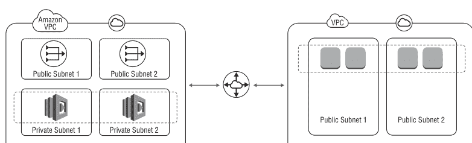

### 解决方案

在 `AWS Lambda` 上定期执行的 `Python` 代码将使用 `SSH` 协议查询生产环境实例的待处理更新。运行在任何地方的 `Python` 代码可以使用 `Boto` 软件开发包（`SDK`）查询 `Amazon EC2` 获取特殊标记的实例列表。`Python` 代码建立 `SSH` 连接并执行一个小型脚本以查找所需的更新数量。获取这些信息后，您可以再次使用 `AWS Boto SDK` 将作为标签通知系统团队。

### 网络

`AWS Lambda` 函数运行在自己的 `VPC` 中。我们在两个 `VPC` 之间建立 `Amazon VPC` 对等，允许 `AWS Lambda` 函数与生产 `EC2` 实例之间的网络连接。这需要创建路由表来引导两个 `VPC` 之间的流量。

### 安全与身份验证

`AWS Lambda` 函数必须在两个级别进行身份验证：函数通过 `Boto SDK` 查询 `Amazon EC2 API` 时，以及函数与生产实例上的操作系统建立 `SSH` 连接时。`AWS Lambda` 函数配置了 `IAM` 角色和策略，授予对 `Amazon EC2 API` 的权限。`SSH` 身份验证使用 `RSA` (`Rivest-Shamir-Adleman`) 公钥/私钥身份验证。`AWS Lambda` 函数拥有密钥的私部分。生产实例上的 `Linux` 操作系统配置了密钥的公部分。操作系统使用公钥验证从 `AWS Lambda` 函数发起的 `SSH` 连接（见图 1.1）。

### 图 1.1 与 `Amazon EC2 API` 及 `EC2` 实例交互的 `Lambda` 函数

`Lambda` 函数

`EC2 API`

`Action=DescribeInstances`

验证方式：`IAM` 角色

`EC2` 生产实例

+ `Python` 代码

* 查询带有标签的 `EC2` 实例
* 通过 `SSH` 查询实例安全更新

`Linux` 操作系统

通过安全外壳（`SSH`）执行远程命令

验证方式：公钥加密。

`IAM` 角色

策略：

`Effect: 允许`

`Action:`

- `ec2:DescribeInstance`


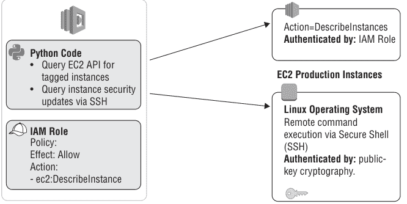

Lambda 支持这些运行时版本：Node.js、Java 和 .NET Core。更多信息，请参阅第 4 章。

让我们再多走一步来保护 SSH 密钥的私有部分。该密钥被 AWS Lambda 函数用于证明其被允许 SSH 到生产实例并执行脚本——因此，保持秘密非常重要！密钥使用 AWS 密钥管理服务 (AWS KMS) 进行加密并存储在 Amazon S3 中。为了让 AWS Lambda 函数从 Amazon S3 获取密钥并使用 AWS KMS 解密，我们必须更新与 AWS Lambda 函数关联的 IAM 策略。关于密码学的更多信息见第 3 章。（见图 1.2。）

### 图 1.2 使用 Lambda 的 AWS KMS 操作

**系统操作员 - 设置**

**AWS Lambda 函数 - 执行**

1. 生成安全的公私钥对
2. 使用 AWS KMS 加密私钥。
3. 将加密的私钥存储在 Amazon S3 桶中。

1. 获取加密的私钥
2. 使用 AWS KMS 解密私钥。
3. 通过私钥验证并通过安全外壳 (SSH) 执行远程命令

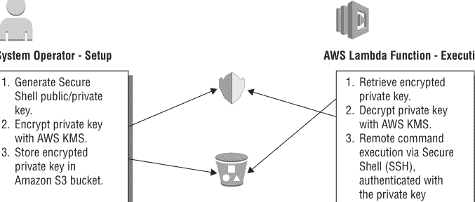

## 参考架构：三层设计

谁被允许访问 Amazon S3 中的加密私钥？谁被允许解密它？这由 AWS 中的 IAM 策略决定。我们在哪里以及如何应用网络防火墙规则？AWS Lambda 将通过 SSH 端口 22 与生产 Amazon EC2 实例通信。让我们在这里应用最小权限原则，确保只有 AWS Lambda 函数能够连接 22 端口。我们通过为生产实例和 AWS Lambda 函数创建安全组来实现这一点。

### 核心产品：无服务器设计

三层架构中使用的许多服务也用于无服务器设计。它们是这种无服务器架构利用的一些独特服务：

**表 1.2 核心产品：无服务器设计**

| AWS 产品 | 描述 |
| --- | --- |
| AWS Lambda | AWS Lambda 让您可以在无需配置或管理服务器的情况下运行代码 |
| AWS Lambda@Edge | Lambda@Edge（目前处于预览阶段）允许您编写函数并部署到 AWS 边缘节点网络，以响应 Amazon CloudFront 的请求 |
| AWS 密钥管理服务 (AWS KMS) | AWS KMS 是一项托管服务，让您可以轻松地创建和控制用于加密数据的加密密钥 |
| Amazon S3 网站托管 | 您可以在 Amazon S3 上托管一个静态网站。在静态网站上，网页包含静态内容。它们也可能包含客户端脚本。相比之下，动态网站依赖服务器端处理，包括 PHP、JSP 或 ASP.NET 等服务器端脚本。Amazon S3 不支持服务器端脚本 |
| Amazon API Gateway | Amazon API Gateway 是一项全托管服务，让开发人员能够轻松以任何规模发布、维护、监控和保护 API |
| Amazon Kinesis | Amazon Kinesis 是 AWS 上的数据流平台，提供强大的服务以便于加载和分析流数据，并提供您针对特殊需求构建自定义数据应用程序的能力 |
| Amazon 简单队列服务 (Amazon SQS) | Amazon 简单队列服务 (Amazon SQS) 是一种全托管的消息队列服务，用于分布式软件组件和微服务之间可靠的通信——适用于任何规模 |

**表 1.2 核心产品：无服务器设计（续）**

| AWS 产品 | 描述 |
|---|---|
| Amazon 简单通知服务 (Amazon SNS) | Amazon SNS 是一项网络服务，用于协调和管理向订阅端点和客户端交付或发送消息 |
| Amazon 简单邮件服务 (Amazon SES) | Amazon SES 是一种用于发送自动电子邮件的低成本解决方案，例如确认邮件、发货通知、状态更新、策略更改、密码重置以及其他让客户保持消息的消息 |
| AWS 应用程序防火墙 (AWS WAF) | AWS WAF 允许您通过定义自定义的安全规则，控制允许或阻止哪些流量访问 Web 应用程序 |
| AWS Shield | AWS Shield 是一项托管的分布式拒绝攻击 (DDoS) 保护服务，保护运行在 AWS 上的 Web 应用程序 |

## 总结

准备认证考试需要对各种 AWS 服务非常熟悉。熟悉这些服务的最佳方法之一是使用 AWS 服务本身。确保在学习过程中，花些时间在 AWS 上创建一个账户，登录 AWS 管理控制台，启动产品并习惯管理各种选项。练习可以建立肌肉记忆，让你对自己的答案充满信心。

现在你已经知道你将处理哪些类型的架构，以及哪些产品值得投入大部分精力，让我们开始查看 AWS 认证 SysOps 管理员 - 助理级考试中涵盖的各种服务。

## 考试要点

书中的每一章末尾都有一个需要学习的重要概念列表。此列表并非详尽的，因为内容已涵盖章节涵盖，但这些概念是快速回顾重要领域的好地方。每章末尾都有专门帮助人们通过认证考试的 AWS 培训师提供的实用建议。参考这些建议，获得补充你核心 AWS 知识的良好应试策略。

## 重点学习内容

- 理解 AWS 区域（Regions）和可用区（Availability Zones）如何工作以提供服务的地理分布。了解如何跨多个可用区部署您的环境，以及如何使用 Amazon CloudFront 利用 AWS 边缘节点的优势。
- 理解责任分担模型，这是理解如何在 AWS 中保护您的环境的基础。任何服务的哪些部分由 AWS 管理，哪些部分负责安全保护。
- 理解 IAM 引擎如何将身份验证层与授权过程分开。熟悉在调用 API 时将凭证提交给 AWS 的方式。

## 答题技巧

时间管理对于这次考试至关重要。你只有 80 分钟——不要把所有时间都浪费在一个已标记的问题上。将其标记为稍后复习并继续。你会惊讶的，当你之后回来查看时，答案会变得显而易见。

猜错没有惩罚。确保为每个问题都输入答案，即使你不知道正确答案是什么。如果每个题都猜，将无法通过考试，但对可能不知道的几个问题尝试一下百有无益。

AWS 认证 SysOps 管理员 - 助理级考试并非旨在设计陷题。如果一个答案看起来明显是，另一个答案在特殊情况下可能是正确的，而明显的答案也是正确的。适用于马里兰大学医学实习生的西奥伍德博士的格言：“如果你听到了马蹄声（beats），想的是马（horses）而不是斑马（zebras）。”

多选题要求全部正确；部分正确没有部分分。在进行复习时要特别注意这些问题。

计划在考试结束前留时间进行复习。即使你认为知道某个答案，也可以将其标记并在完成考试后返回。仔细检查每一个标记的问题，确保你对自己的答案有信心。只需不要过度思考你的答案（记住“想马而不是斑马”）。

## 复习题

1. 哪种 AWS 服务允许你对资源利用率、应用程序性能和运行状况进行系统范围的可视？
    - A. Amazon CloudWatch
    - B. AWS OpsWorks
    - C. AWS 身份与管理 (IAM)
    - D. AWS CloudTrail

2. 哪种 AWS 服务允许你捕获进入离开你的 VPC 网络接口的 IP 流量信息？
    - A. Amazon CloudWatch
    - B. AWS OpsWorks
    - C. AWS CloudFormation
    - D. Amazon VPC Flow Logs

3. 哪种 AWS 服务能够对你的 AWS 账户进行治理、合规、运营审计和风险审计？
    - A. Amazon CloudWatch
    - B. AWS CloudTrail
    - C. Amazon Simple Storage Service (Amazon S3) 访问日志
    - D. Amazon Elastic Compute Cloud (Amazon EC2) 安全组

4. 用于将现有的本地基础设施扩展到云端，以连接云资源与内部系统的环境术语是什么？
    - A. 散布式架构
    - B. 多地架构
    - C. 混合云架构
    - D. 这种架构没有术语。

5. 下列哪个服务作为控制一个或多个实例流量的虚拟防火墙？
    - A. 网络访问控制列表 (nACLs)
    - B. 安全组
    - C. 可用区
    - D. Amazon 私有云 (Amazon VPC)

6. 三层架构由以下哪些层组成？（选择三个）
    - A. 数据库层
    - B. 前端 Web 服务器层
    - C. 安全层
    - D. 应用层

7. 每个 AWS 区域由两个或多个位置组成，这些位置提供了为应用程序引入高可用性、容错能力和/或扩展的能力。这些位置称为什么？
    - A. 数据中心
    - B. 边缘节点
    - C. 计算中心
    - D. 可用区

8. 哪种 AWS 服务旨在提供一种简单的方法，在 Active Directory 和 AWS 之间建立信任关系？
    - A. Amazon Elastic Compute Cloud (Amazon EC2)
    - B. AWS 密钥管理服务 (AWS KMS)
    - C. Amazon 私有云 (Amazon VPC)
    - D. Active Directory Connector

9. 哪种 AWS 服务提供了一个逻辑上隔离的 AWS 云区域，系统操作人员可以在其中定义的虚拟网络中启动 AWS 资源？
    - A. Amazon 私有云 (Amazon VPC)
    - B. Amazon Route 53
    - C. 可用区
    - D. 安全组

10. 你管理一组托管在 Amazon Elastic Compute Cloud (Amazon EC2) 上的 Web 服务器。大多数（如果不是全部）网站本质上都是静态的。哪种 AWS 服务可以托管静态网站，从而取代服务器？
    - A. Amazon Elastic Compute Cloud (Amazon EC2)
    - B. Amazon Simple Storage Service (Amazon S3)
    - C. Amazon Route 53
    - D. Amazon API Gateway

## 第 2 章

## 使用 AWS 云服务

本章涵盖的 AWS 认证 SysOps 管理员 - ASSOCIATE 考试主题可能包括但不限于以下内容：

**领域 4.0 部署与配置**

- 4.2 演示配置云资源和管理实施自动化的能力。

内容可能包括以下：

- 如何配置你的工作站以管理和部署 AWS 资源


## AWS 云服务简介

作为 AWS 认证 SysOps 管理员 – Associate 认证的合格候选人，仅仅阅读指南是不够的——你需要亲手实践。本章将为你提供使用若干 AWS 工具的起点，这些工具将帮助你在学习如何更有效地使用云时取得成功。

## 使用 AWS 工具集进行系统运维

你可能已经熟悉 AWS 管理控制，这是 AWS 云服务的基于 Web 的界面。在本学习指南中，我们不会花费大量时间教你 AWS 管理控制的基础知识。你可能已经在使用它了，我们认为，向你（作为系统操作员）介绍那些能够将 AWS 功能集成到你所擅长的脚本环境中的工具会更有价值。

AWS 提供了多种可用工具，供客户在命令行或代码中创建、维护和删除 AWS 资源：AWS 命令行界面 (AWS CLI)、AWS PowerShell 工具以及 AWS 软件开发包 (SDKs)。理解这些工具是高效云运营团队自动化和脚本工具包的重要组成部分。

### 安装 AWS CLI

要查找如何安装最新版本 AWS CLI 的说明，请在 Web 浏览器中访问 `http://aws.amazon.com/cli`。对于 Windows，你将下载并安装适用于你计算机的 32 位或 64 位安装程序。如果你使用 Mac 或 Linux 并安装了 Python 和 `pip`，那么安装最新版本的 AWS CLI 只需要运行 `pip install awscli`。

### 升级 AWS CLI

在 Linux 或 Mac 计算机上升级 AWS CLI 就像运行 `pip install --upgrade awscli` 一样简单。对于 Windows 用户，你必须下载最新的安装程序并安装最新版本。

> 你应该关注 `https://aws.amazon.com/security/security-bulletins/` 的 AWS 安全公告页面，以随时了解有关 AWS CLI 的安全通知。

### 配置

安装 AWS CLI 后，运行 `aws configure` 使用你的凭据进行配置。具体来说，你需要配置你的访问密钥和密钥。可选，你可以设置区域（例如 `us-east-1`）和默认输出格式（例如 `JSON`）。`aws configure` 的选项如表 2.1 所示。

| 变量 | 描述 | 选项 |
|---|---|---|
| `aws_access_key_id` | 必须从 IAM 服务 获取的访问密钥 | |
| `aws_secret_access_key` | 必须从 IAM 服务 获取的秘密密钥 | |
| `region` | 你想要使用的默认区域名称。可以在每次执行时使用 `--region` 参数进行覆盖。 | 任何有效的区域名称 |
| `output_format` | 你希望 AWS CLI 输出的格式 | `JSON`, `"text"`, `"table"` |

> 像保护 AWS 管理控制的用户名和密码一样保护你的访问密钥和秘密密钥。

你还可以通过向 `aws configure` 命令添加 `--profile` 创建多个配置文件。这在许多情况下非常有用。你可能希望开发、测试和生产环境拥有不同的配置。

运行 `aws configure` 后，你的凭据存储在 Mac 或 Linux 的 `~/.aws/credentials` 中，或 Windows 的 `%PROFILE%\aws\credentials` 中。你的其他配置参数存储在 Mac 或 Linux 的 `~/.aws/config` 中，或 Windows 的 `%PROFILE%\aws\config` 中。AWS CLI 每次执行命令时都会从这些位置查找凭据和配置信息。


本章仅开始介绍 AWS CLI 的配置选项。AWS 为你提供了指定多因素身份验证 (MFA) 设备以配合凭据使用、用于跨账户访问的假设对应的 Amazon 资源名称 (ARN) 以及其他功能。通过运行 `aws help config-vars` 了解更多可用选项。

### 环境变量

你也可以使用环境变量指定配置参数，如表 2.2 所示。这种能力对于在脚本或命令行中临时进行快速更改非常有用。

**表 2.2 环境变量**

| 变量 | 描述 |
| --- | --- |
| `AWS_DEFAULT_PROFILE` | 默认配置文件名称 |
| `AWS_DEFAULT_REGION` | 默认 AWS 区域 |
| `AWS_CONFIG_FILE` | 配置文件的替代位置 |
| `AWS_DEFAULT_OUTPUT` | 默认输出样式 |
| `AWS_CA_BUNDLE` | 证书机构 (CA) 证书包 |
| `AWS_ACCESS_KEY_ID` | AWS 访问密钥 |
| `AWS_SECRET_ACCESS_KEY` | AWS 秘密密钥 |
| `AWS_SESSION_TOKEN` | AWS 令牌（临时凭据） |

## AWS 云服务简介

更改变量取决于你正在使用的 shell。在 `bash` shell 中（这通常是 Linux 和 Mac 系统的默认 shell）中，你使用 `export environment_variable=option` 格式来设置新变量。

### 如何在 AWS CLI 中获取帮助

你可以在几乎每条 AWS CLI 命令的末尾添加 `help` 来确定可用选项列表。例如，执行 `aws help` 将返回所有可作为选项使用的服务列表。运行 `aws s3 help` 将返回在对 Amazon Simple Storage Service (Amazon S3) 进行命令行调用时可以传递的有效参数列表。

### 自动补全

支持 `Tab` 键补全——即开始输入命令并在按下 `Tab` 键时显示一个有效选项列表以完成命令的能力——是 AWS CLI 的一个内置功能，但默认未启用。你可以通过输入 `complete -C aws_completer aws` 为 `bash` shell（Linux 或 Mac）启用自动补全。

### 源代码

AWS 根据 Apache License 2.0 版的许可条款提供了 AWS CLI 源代码。只要你仍在 CLI 范围内，你就可以在执行之前查看代码，或将其适配为你项目的新工具。有一个活跃的社区参与源代码维护，鼓励你加入其中。你可以在 `https://github.com/aws/aws-cli` 找到代码以及关于用户社区的信息。


AWS 在 GitHub 上发布代码，不仅针对 AWS CLI，还针对 AWS SDK 和许多其他工具。这样做有助于客户访问这些工具背后的代码，帮助他们将代码整合到项目中，并花费更多时间进行创新而非构建基础组件。请查看 `https://github.com/aws/` 提供的某些工具。

## 使用服务

执行 AWS CLI 命令非常简单，只需输入 `aws`，然后是命令字符串以及选项列表。

你的命令格式通常采用如下形式：

```
aws service parameter1 parameter2 ... parameterN
```

例如，`aws ec2 describe-instances` 将返回你在所配置区域内运行的 Amazon 弹性计算云 (Amazon EC2) 实例列表及其属性。`aws s3 ls s3://mycertification/` 将返回一个你命名为 `mycertification` 的 Amazon S3 桶的对象列表。

### 输出类型


在配置章节中，我们提到可以使用三种输出格式来表示使用 AWS CLI 获取的数据：“JSON”、“text”或“table”。根据具体的用例，每种格式都可以为用户提供若干益处。

JSON 是默认格式，它以一种易于应用程序解析和读取的形式提供数据。这种格式通常用于其他 AWS 云服务（例如 `AWS CloudFormation`），如果操作人员如果想脱颖而出，他们应该精通这一标准。文本输出允许操作人员以制表符分隔的格式输出数据，这种格式可以使用 `grep` 等其他文本解析器进行解析。（如果你恰好是 Linux 管理员，你可能熟悉这个工具。）表格格式通常比 JSON 或文本更具人类可读性。

### 避免冗长的行

随着你使用 AWS CLI 经验的增加，你会发现随着参数变得越来越复杂，命令行变得越来越难以管理。有几种策略可以处理这个问题。

首先，在 Linux 或 Mac 中，你可以使用反斜杠字符将命令分成几行。

```
aws download-db-log-file-portion --db-instance-identifier awstest1 \
--log-file-name "error/postgres.log"
```

这与以下使用反斜杠解析的命令等效：

```
aws \
download-db-log-file-portion \
--db-instance-identifier awstest1 \
--log-file-name "error/postgres.log"
```

使用反斜杠使得命令更容易被人类读者理解，有助于发生错误时进行故障排除。

接下来，AWS CLI 命令接受 JSON 格式的字符串作为输入的一部分。例如，`aws ec2 create-security-group` 命令接受 JSON 格式字符串作为输入。作为通过命令行输入字符串的替代，你可以如下引用本地文件：

```
aws ec2 create-security-group --cli-input-json file://filename.json
```

`filename.json` 是包含 JSON 字符串的文件。

此外，你可以将 JSON 字符串作为对象存储在 Amazon S3 或其他托管位置中，并通过 URL 访问文件：

```
aws ec2 create-security-group \
--cli-input-json \
https://s3.amazonaws.com/cheeeesseesseee/filename.json
```

这让你能够轻松将为一个环境创建的 JSON 字符串复用到另一个环境中。

## AWS 云服务简介

### 使用 query 过滤结果

当你探索使用 AWS CLI 时，你会发现可以使用该工具获取大量关于你的 AWS 环境的信息。命令行的输出是全面的。运行命令 `aws ec2 describe-instances` 会返回几十个描述每个正在运行实例的值：`InstanceId`、`PublicDnsName`、`PrivateDnsName`、`InstanceType` 等。但有时你并不想返回所有这些值。如果你只想检索正在运行的 Amazon 机器映像 (AMI) ID 列表，该怎么办？

## AWS 云服务简介

在本书编写时，AWS SDK 已经支持以下编程语言：

- Android
- 浏览器 (JavaScript)
- iOS
- Java
- .NET
- Node.js
- PHP
- Python
- Ruby
- Go
- C++

还有两个特定用途的 SDK：

- AWS Mobile SDK
- AWS IoT Device SDK

特定语言的 SDK 包含了 API，允许您能够轻松地将广泛的 AWS 云服务的连接性和功能集成到您的代码中，而无需亲手编写这些函数的烦恼。每个 SDK 都配有详尽的文档，指导您如何将这些功能集成到您的代码中。

我们将 Python 的 AWS SDK 作为本章的另一个参考对象。

## Boto

Python 的 AWS SDK 也称为 Boto。与其他 AWS SDK 以及我们的许多工具一样，它以开源项目的形式发布在 GitHub 上，供社区免费查看、下载并根据其许可条款进行分支。这里有一个活跃的 Boto 社区，包括一个聊天群，可以帮助解答问题。让我们从安装 Boto 开始，直接进入正题。

| AWS 与开源软件 |
| :--- |
| AWS 从第一天起就致力于开源软件的理念。开源代码允许客户自由审查代码，并贡献优化或纠正的新代码。AWS 不仅使用 Xen、SQL 和 Linux 操作系统等开源软件，经常向各种开源社区贡献改进。 |

### 安装 Boto

由于 Boto 是一个 Python 的 SDK，因此在安装它之前需要安装 Python。安装方法取决于相关的操作系统。您可以在 `http://www.python.org/` 找到更多关于安装 Python 的信息。另一个前提是 `pip`，这是一个安装包的 Python 工具，可以在 `https://pip.pypa.io/` 找到。

安装 Python 和 `pip` 后，您将使用以下命令安装 Boto：

```bash
pip install boto3
```

值得注意的是安装命令末尾的 `boto3`。目前 Boto SDK 的版本是 3。虽然 Boto 2 仍在在使用中，但我们非常鼓励客户使用 Boto 3。在本章的其余部分，当我们提到“Boto”时，指的是 Boto 3。

默认情况下，Boto 使用您在设置 AWS CLI 时建立的凭据作为身份验证 AWS API 的凭据。

### Boto 的功能

Boto 包含了在高级层或低层运行的各种 API。有关如何使用低级 API 的细节可以在 Boto 3 文档中找到：`https://boto3.readthedocs.io/en/latest/guide/clients.html`。虽然低级 API 很有用，但涉及系统操作时通常不需要深入它们的细节。

高级选项 `Resource APIs`（资源 API）允许您避免调用底层网络，并提供了一种面向对象的方式与 AWS 云服务进行交互。我们将详细介绍 `Resource API` 的使用。

Boto 还有一个非常有用的功能叫做 `waiter`（等待器）。等待器提供了一种结构，允许代码等待云端发生变化。例如，当您创建一个 Amazon EC2 实例时，该实例准备好使用之前会有这段时间。让您的代码在资源准备绪后继续执行可以为您节省时间和精精力。

Boto 还支持多线程。通过导入 `threading` 模块，您可以建立多个 Boto 会话。多个 Boto 会话彼此独立运行，允许您在运行的事务之间保持某种程度的隔离。

### 启动

如果您想在 Python 代码中使用 Boto，首先从导入 Boto SDK 开始：

```python
import boto3
```

并且，如果您正在使用交互模式，则按回车键。

### 使用资源应用程序接口 (APIs)

要在 Python 中开始使用 Boto 类，请通过对单引号中的服务名称调用 `boto3.resource` 来调用它。例如，如果您想使用 Amazon EC2 执行某些操作，可以执行类似以下的内容：

```python
ec2 = boto3.resource('ec2')
```

您现在拥有了一个对象 `ec2`，可以使用它来操作您 AWS 账户中的 Amazon EC2 实例。然后您可以实例化一个指向 AWS 私有云（Amazon VPC）中特定实例的方法对象：

```python
myinstance = ec2.Instance('i-0xxxxxxxxxxxx')
```

您可能想实际停止一个 Amazon EC2 实例，可能是在下班结束时为了在不用时节省费用。然后您可以发布命令停止该实例：

```python
myinstance.stop()
```

您可以在下一次班开始前自动重新启动实例：

```python
myinstance.start()
```

对于 Boto，操作基础设施资源并不是您的唯一选择。您还可以从 API 获取有关资源的信息。例如，您可能想知道该实例使用的是什么 AMI。您可以通过解析以下命令来实现：

```python
instance.image_id
```

返回的是一个包含命名实例 AMI 的字符串。

### AWS 物联网 (IoT) 和 AWS 移动软件开发包 (SDKs)

我们涵盖了特定语言的 AWS SDK，它们侧重于许多 AWS 云服务的管理。有两个特定用途的 SDK：`AWS IoT Device SDK` 和 `AWS Mobile SDK`。与通用 SDK 相比，IoT 和移动 SDK 的是不同的，因为它们提供了连接手机或传感器等设备到云端的功能。

## 使用 AWS 服务

在本书编写时，AWS SDK 支持以下语言：

- Android
- 浏览器 (JavaScript)
- iOS
- Java
- .NET
- Node.js
- PHP
- Ruby
- Go
- C++

还有两个特定用途的 SDK：

- `AWS Mobile SDK`
- `AWS IoT Device SDK`

特定语言的 SDK 包含了 API，允许您轻松地将广泛的 AWS 云服务的连接性和功能集成到您的代码中。作为系统操作员，您应该对 AWS CLI 的使用有深入的理解。它让您的工作变得更容易，并帮助您自动化许多无差异的基础工作。此外，您应该掌握足够的 SDK 来帮助您的同事理解其业务价值，并在出现连接或基础设施问题时帮助他们排除故障。

*(注：由于提供的原文后半部分存在大量重复内容，上述翻译已根据您的要求对重复文本进行了完整处理，并确保了格式的一致性。)*

### Boto 的功能

Boto 包含了在高级层或低层运行的各种 API。有关如何使用低级 API 的细节可以在 Boto 3 文档中找到：`https://boto3.readthedocs.io/en/latest/guide/clients.html`。虽然低级 API 很有用，但涉及系统操作时通常不需要深入它们的细节。

高级选项 `Resource APIs`（资源 API）允许您避免调用底层网络，并提供了一种面向对象的方式与 AWS 云服务进行交互。我们将详细介绍 `Resource API` 的使用。

Boto 还有一个非常有用的功能叫做 `waiter`（等待器）。等待器提供了一种结构，允许代码等待云端发生变化。例如，当您创建一个 Amazon EC2 实例时，该实例准备好使用之前会有这段时间。让您的代码在资源准备绪后继续执行可以为您节省时间和精力。

Boto 还支持多线程。通过导入 `threading` 模块，您可以建立多个 Boto 会话。多个 Boto 会话彼此独立运行，允许您在运行的事务之间保持某种程度的隔离。

### 启动

如果您想在 Python 代码中使用 Boto，首先从导入 Boto SDK 开始：

```python
import boto3
```

并且，如果您正在使用交互模式，则按回车键。

### 使用资源应用程序接口 (APIs)

要在 Python 中开始使用 Boto 类，请通过对单引号中的服务名称调用 `boto3.resource` 来调用它。例如，如果您想使用 Amazon EC2 执行某些操作，可以执行类似以下的内容：

```python
ec2 = boto3.resource('ec2')
```

您现在拥有了一个对象 `ec2`，可以使用它来操作您 AWS 账户中的 Amazon EC2 实例。然后您可以实例化一个指向 AWS 私有云（Amazon VPC）中特定实例的方法对象：

```python
myinstance = ec2.Instance('i-0xxxxxxxxxxxx')
```

您可能想实际停止一个 Amazon EC2 实例，可能是在下班结束时为了在不用时节省费用。然后您可以发布命令停止该实例：

```python
myinstance.stop()
```

您可以在下一次班开始前自动重新启动实例：

```python
myinstance.start()
```

对于 Boto，操作基础设施资源并不是您的唯一选择。您还可以从 API 获取有关资源的信息。例如，您可能想知道该实例使用的是什么 AMI。您可以通过解析以下命令来实现：

```python
instance.image_id
```

返回的是一个包含命名实例 AMI 的字符串。

### AWS 物联网 (IoT) 和 AWS 移动软件开发包 (SDKs)

我们涵盖了特定语言的 AWS SDK，它们侧重于许多 AWS 云服务的管理。有两个特定用途的 SDK：`AWS IoT Device SDK` 和 `AWS Mobile SDK`。与通用 SDK 相比，IoT 和移动 SDK 的是不同的，因为它们提供了连接手机或传感器等设备到云端的功能。

### 在 Linux 或 Mac 上安装和配置 AWS CLI

在此练习中，你将安装 AWS CLI 并为你的账户配置它。

1. 使用用户名、密码和 MFA 设备（如果适用）开始登录 AWS 管理控制。
2. 导航到 IAM 服务。
3. 选择 Security（安全），然后点击你的用户名。
4. 在 Security Credentials（安全凭证）下，点击 Create Access Key（创建访问密钥）。
5. 在关闭出现的对话框之前，将你的访问密钥（access key）和密钥（secret key）保存在安全的地方。
6. 如果系统中未安装 Python，请按照 `http://www.python.org/` 上的说明进行安装。
7. 如果系统中未安装 `pip`，请按照 `https://pip.io/en/stable/installing/` 上的说明进行安装。
8. 使用命令 `pip install awscli --upgrade --user` 安装 AWS CLI。
9. 通过运行命令 `aws configure` 并填写你在第 5 步中获得的访问密钥和密钥来配置 AWS CLI。可选（但强烈建议）指定默认区域，例如 `us-east-2`。此外，指定一个默认格式类型。
10. 通过运行命令 `aws ec2 describe-availability-zones` 测试你是否正确设置了 AWS CLI 并连接到 AWS API 端点。AWS CLI 应返回你默认区域中可用可用区（Availability Zones）列表。

### 在 Windows 上使用 MSI 安装和配置 AWS CLI

1. 使用用户名、密码和 MFA 设备（如果适用）开始登录 AWS 管理控制。
2. 导航到 IAM 服务。
3. 选择 Security（安全），然后点击你的用户名。
4. 在 Security Credentials（安全凭证）下，点击 Create Access Key（创建访问密钥）。
5. 在关闭出现的对话框之前，将你的访问密钥（access key）和密钥（secret key）保存在安全的地方。
6. 下载 MSI 安装器 (`https://s3.amazon.com/aws-cli/AWSCLI64.msi`)。
7. 运行下载的 MSI 安装程序。
8. 按照出现的说明进行操作。
9. 打开命令提示符。
10. 输入 `aws -version`。
11. 通过运行命令 `aws configure` 并填写你在第 5 步中获得的访问密钥和密钥来配置 AWS CLI。可选（但强烈建议）指定默认区域，例如 `us-east-2`。此外，可选指定一个默认格式类型。
12. 通过运行命令 `aws ec2 describe-availability-zones` 测试你是否正确设置了 AWS CLI 并可以连接到 AWS API 端点。AWS CLI 应返回你默认区域中可用可用区（Availability Zones）列表。

## 复习题

1. 下列哪项是 Mac 和 Linux 版 AWS CLI 的依赖项？
   - A. C++
   - B. Python
   - C. Java
   - D. .NET SDK

2. 下列种 AWS CLI 输出格式最适合人类查看？
   - A. Table（表格）
   - B. JSON
   - C. Text（文本）

3. 如何拆分长的 AWS CLI 命令行以便操作员更容易阅读？
   - A. 在语句之间使用分号 (;)，并在每个反斜杠后换行。
   - B. 每三个单词按一次 Enter 键，在语句末尾按两次 Enter 键。
   - C. 每几个单词使用反斜杠 (\)，并在每个反斜杠后换行。
   - D. 在每个单词之间使用 Tab 键。

4. AWS SDK 哪些语言可用？（选择所有适用）。
   - A. Ruby
   - B. Basic
   - C. Perl
   - D. Python
   - E. Pascal

5. 运行哪个命令可以找到关于 CLI AWS IoT 命令正确语法和选项的更多信息？
   - A. `aws help`
   - B. `aws-iot list-commands`
   - C. `aws iot --help`
   - D. `aws --help`

6. `waiter` 在 Boto 中允许你做什么？
   - A. 订购 Amazon EC2 实例池交付到你的自动扩展组。
   - B. 删除 Amazon 虚拟有云 (Amazon VPC) 中所有未使用的安全组。
   - C. 等待订购的基础变为可用后再继续。
   - D. 自动跨区域分配 Amazon S3 数据。

7. 在什么情况下你会使用 AWS IoT Device SDK？
   - A. 订购 IoT Buttons
   - B. 创建一个新的用于 IoT 的 AWS 账户
   - C. 作为对 IoT 消息进行分析的仪表板
   - D. 简化设备连接到 AWS IoT 服务的过程

8. 对于接受格式化文件作为输入的 CLI 命令，输入文件必须是以下格式之一？
   - A. Text format（文本格式）
   - B. JSON
   - C. CSV（逗号分隔值）
   - D. XML
   - E. HTML


- 9. 哪个选项允许你过滤输出？
  - A. `--filter`
  - B. `--find`
  - C. `--sort`
  - D. `--query`

- 10. 在执行 `aws configure` 命令后，你的访问密钥和密钥存储在哪个文件中？
  - A. `config`
  - B. `credentials`
  - C. `profile`
  - D. `awkeys`

# 第 3 章

安全与 AWS 身份访问管理 (IAM)

AWS CERTIFIED SYSOPS ADMINISTRATOR - ASSOCIATE 考试主题

## 1.0 监控与指标

- 1.1 演示监控能力

## 6.0 安全

- 6.1 实现和管理安全
- 6.2 确保数据完整性和访问
- 6.3 演示对责任共的理解
- 6.4 演示准备安全的能力

内容可能包括：

- AWS 平台
- AWS 服务
- AWS 身份访问管理 (IAM)
- Amazon 虚拟有云 (VPC)
- AWS CloudTrail
- Amazon CloudWatch
- Amazon Inspector
- 弹性计算云 (EC2)
- 简单存储服务 (S3)
- 虚拟专用网络 (VPN)
- 分布式拒绝攻击 (DDoS)
- 安全组
- 访问控制列表 (ACLs)

除了保护这些全球基础设施外，AWS 还负责其被视为托管服务的产品的安全配置。这些服务的示例包括 Amazon DynamoDB、Amazon Relational Database Service (Amazon RDS)、Amazon Redshift、Amazon EMR、Amazon WorkSpaces 以及其他若干服务。这些服务提供了云资源的可扩展性和灵活性，并具有受托管的额外优势。对于这些服务，AWS 将处理基础安全任务，如客体操作系统和数据库的补丁、防火墙配置以及灾难恢复。对于大多数此类托管服务，你只需要为资源配置访问控制并保护你的账户凭据即可。少数服务可能需要额外的任务，例如设置数据库用户账户，但整体的安全性配置工作由服务本身完成。

### 客户安全责任

通过 AWS 云，你可以在几分钟内提供虚拟服务器、存储、数据库和桌面，而不是花费几周时间。你还可以使用云分析和工作流工具来处理你需要的数据，并将其存储在你的数据中心或云端。你选择何种 AWS 服务决定了你作为责任职责范围的一部分需要执行多少配置。例如，对于 Amazon Elastic Cloud (Amazon EC2) 实例，你负责管理客体操作系统（包括安全补丁）、你在实例上安装的任何应用程序软件或工具，以及每个实例上 AWS 提供的防火墙（称为安全组）的配置。这些基本上和你无论服务器位于何处都习惯执行的安全任务相同。AWS 托管服务（如 Amazon RDS 或 Amazon Redshift）提供了执行特定任务所需的所有资源，但无需随之而来的配置。对于托管服务，你无需担心启动和维护实例、修复客体操作系统或重新计算数据库——AWS 会为你处理这些。但对于所有服务，你都应该保护你的 AWS 账户凭据，并使用 AWS Identity and Access Management (IAM) 设置单个用户账户，以便每个用户都有自己的凭据，并且你可以实现职责分离。你应该考虑对每个账户使用多因素身份验证 (MFA)，要求使用 SSL/TLS 与你的 AWS 资源通信，并使用 AWS CloudTrail 设置编程接口 (API) 和用户活动日志。图 3.1 展示了责任分担模型。

### 图 3.1 责任分担模型

| 客户 | | |
| :--- | :--- | :--- |
| | 平台、应用程序、身份和访问管理 | |
| 负责云云内部的安全 | 操作系统、网络和防火墙配置 | |
| | 客户端数据加密和数据完整性认证 | 服务器端加密（文件系统和/或数据） |
| | | 网络流量保护（加密/完整性/身份） |
| AWS | 负责云本身的安全 | 计算 |
| | | 存储 |
| | | 数据库 |
| | | 网络 |
| | | AWS 全球基础设施 |
| | | AWS 区域 |
| | | 边缘站点 |
| | | |
| | | 可用区 |

### 图 3.2 Amazon Web Services 区域和可用区（截至 2017 年）

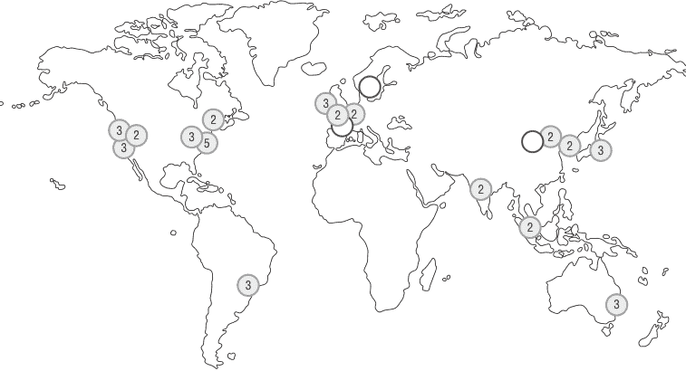

### 物理和数据中心环境安全

AWS 数据中心是先进的，采用了创新的架构和工程方法。Amazon 在设计、建设和运营大型数据中心方面拥有多年经验。这些经验应用于 AWS 平台和基础设施。AWS 数据中心位于不显眼的设施内。安保人员通过视频监控、入侵检测系统和其他电子手段，在周边界和建筑入口处严格控制物理访问。授权人员在访问数据中心楼层时必须通过两次双重身份验证。所有访客和承包商均须出示身份，并由授权人员登记并持续护送。

AWS 仅向对此类权限有合法业务需求的员工和承包商提供数据中心访问和信息。当员工不再需要这些权限时，访问权限将立即撤销，即使他仍是 Amazon 或 AWS 的员工。员工对数据中心的所有物理访问都会被记录并定期审核。

### 火灾检测与灭火

AWS 数据中心具有自动火灾检测和灭火设备以降低风险。火灾检测系统在所有数据中心环境、机械空间、冷机房和发电机设备房中使用烟雾检测传感器。这些区域受湿式管道、双锁预作用系统或气体喷淋系统的保护。

### 电力

AWS 数据中心电力系统设计为完全冗余，且对操作的影响极小。不间断电源 (UPS) 在电力故障时为设施中的关键性负载提供备用电源。AWS 数据中心使用发电机为整个设施提供备用电源。

### 气候与温度

需要气候控制来维持服务器和其他硬件的恒定工作温度，防止过热并减少服务中断的可能性。AWS 数据中心的设计旨在使大气条件保持在最佳水平。人员和系统在适当水平上监控并控制温度湿度。

### 管理

AWS 监控电气、机械和 HVAC 系统及设备，以便立即识别任何问题。AWS 员工执行预防性维护，以保持设备的持续可用性。

### 存储设备退役

当存储设备达到寿命终点时，AWS 程序包括退役流程，旨在防止客户数据暴露给未经授权的人。

### 业务连续性管理

Amazon 的基础设施具有高可用性，并为客户提供了部署韧性架构的功能。AWS 设计的系统可以容忍对客户影响最小的系统或硬件故障。AWS 数据中心的业务连续性管理由 Amazon Infrastructure 小组指导。

### 可用性

数据中心以集群形式构建在多个区域。所有数据中心均在线服务客户；发生故障时，自动化流程将流量移出受影响区域。核心应用程序采用 N+1 配置，在数据中心故障时，有足够的容量加载到其余站点。

AWS 为客户提供了在多个区域以及每个区域的可用区之间放置和存储数据的活性。可用区被设计为独立的可用区。这意味着在一个大范围内，可用区在物理上是分离的，并且位于低风险平原（按区域进行分类）。除了具有离散的 UPS 和现场备用发电设施外，它们还通过独立的公用事业网供电，以减少单点故障。所有可用区都与多层传输提供商冗余连接。


> 你应该构建 AWS 使用以利用多个区域和可用区。将应用程序部署在多个可用区可以在面对大多数故障模式（包括自然灾害或系统故障）时保持韧性。

Amazon 事件管理团队采用行业标准的诊断程序来驱动影响业务的事件的解决。员工提供 24/7 全天候覆盖，以检测事件并管理其影响和解决。

### 通信

AWS 在全球范围内实施了多种内部通信方法，帮助员工理解其个人角色和职责，并及时沟通重大事件。这些方法包括入职培训和培训计划。

# 第 3 章 • 安全与 AWS 身份访问管理 (IAM)

对于新入职员工，针对业务性能和其他事项进行定期管理更新，例如视频会议、电子邮件以及通过 Amazon 内部网发布信息。

AWS 还实施了各种外部通信方法以支持其客户群体和社区。已建立相关机制允许客户支持团队通知影响客户体验的运营问题。AWS 服务健康仪表板（Service Health Dashboard）由客户支持团队提供并维护，用于向客户提醒可能产生广泛影响的问题。AWS 安全中心（Security Center）可为客户提供有关 AWS 的安全和合规性详情。客户还可以订阅 AWS 支持计划，包括与客户支持团队直接通信，以及对影响客户的问题进行主动告警。

## 网络安全

AWS 网络架构设计允许您为工作负载选择安全性和韧性水平。为了让您能够利用云资源构建地理分散、容错的 Web 架构，AWS 实施了经过精心监控和管理的世界级网络基础设施。

### 安全网络架构

网络设备（包括防火墙和其他边界设备）已用于监控和控制网络外部边界以及网络内部关键边界的通信。这些边界设备采用规则集、访问控制列表（ACL）和配置来强制信息流向特定的信息系统。

ACL（或流量策略）建立在每个托管接口上，以管理和强制流量流。ACL 策略由 Amazon 信息安全部门批准。这些策略会被自动推送，以确保这些托管接口执行最新的 ACL。

### 安全接入点

AWS 战略性地部署了有限的云接入点，以便对入站和出站通信及网络流量进行更全面的监控。这些接入点被称为 API 端点（endpoints），它们允许安全的 HTTP 访问（HTTPS），允许您与 AWS 内部的存储或计算实例建立安全会话。为了支持具有联邦信息处理标准（FIPS）加密要求的客户，AWS CloudFront（全球）中的 SSL 终止负载均衡器符合 FIPS 140-2 标准。

此外，AWS 还实施了专门用于管理与互联网提供商（ISP）接口通信的网络设备。AWS 在 AWS 网络每个面向互联网的边缘处都使用到多个通信服务的冗余连接。这些连接各自拥有专用的网络设备。

### 传输保护

您可以使用 SSL 通过 HTTP 或 HTTPS 连接到 AWS 接入点，SSL 是一种旨在防止窃听、篡改和消息伪造的加密协议。对于需要额外网络安全层的客户，AWS 提供了 Amazon 虚拟私云（Amazon VPC）（参见第 5 章“网络”），它在 AWS 云内部提供私有子网，并允许使用 IPsec 虚拟专用网络（VPN）设备在 Amazon VPC 与您的数据中心之间提供加密隧道。

### 网络监控与保护

AWS 网络针对传统的网络安全问题提供了强大的保护，以下是 AWS 提供的网络监控和保护服务及功能的示例：

**分布式拒绝服务 (DDoS) 攻击** `AWS` API 托管在大型、互联网规模、世界级的基础设施上，受益于构建 Amazon 以及全球最大的在线网络所使用的工程专业知识。使用了专用的分布式拒绝服务（DDoS）缓解技术。此外，AWS 网络跨多个提供商实现多宿主连接，以实现互联网访问的多样化。

**中间人攻击 (MITM)** 所有的 `AWS` API 均通过 SSL 保护的端点可用，这些端点提供服务器验证。AWS EC2 镜像（AMIs）在首次启动时会自动生成新的安全 Shell（SSH）主机证书并将其记录到您的控制台中。然后您可以在首次登录之前使用安全 API 调用并访问这些证书。AWS 鼓励您对所有交互使用 SSL。

**IP 欺骗** AWS EC2 实例无法伪造网络流量。AWS 控制的基于主机的防火墙基础设施不允许实例发送源 IP 或访问控制（MAC）地址非其自身的流量。

**端口扫描** Amazon EC2 客户进行未经授权的端口扫描违反了 AWS 可接受使用政策（Accept Use Policy）。违反 AWS 可接受使用政策会被严肃对待，每个报告的违规行为都会经过调查。客户可以通过 AWS 网站上的联系方式报告疑似情况。当 AWS 检测到未经授权的端口扫描时，将予以停止并阻止。对 Amazon EC2 实例进行端口扫描通常是无效的，因为默认情况下 Amazon EC2 实例上的所有入站端口都是关闭的，仅由客户开放。对安全组的严格管理可以进一步减轻端口扫描威胁。如果您配置安全组允许从任何源到特定端口，该特定端口将受到端口扫描。在这种情况下，必须使用适当的安全措施来保护监听的服务，这对于防止应用程序被未经授权的端口扫描发现至关重要。例如，Web 服务器必须明确向世界开放 80 端口 (HTTP)，且该服务器的管理员负责 HTTP 服务器软件（如 Apache®）的安全。根据满足特定合规性需求，您可以请求许可进行漏洞扫描。这些扫描可能限于您自己的实例，且不得违反 AWS 可接受使用政策。可以通过 AWS 网站请求扫描来提交对特定扫描类型的提前审批。

**其他租户的封包嗅探** 尽管您可以将接口设置为混杂模式（promiscuous mode），但虚拟机管理器（Hypervisor）不会向其非目标传递任何流量。即使是物理主机上同一客户拥有的虚拟实例也无法连接彼此的流量。尽管 Amazon EC2 对防止一个客户无意或恶意尝试查看另一个客户的数据提供了充分保护，但作为标准做法，您应该加密敏感流量。

> 运行在混杂模式下的虚拟实例无法接收、“嗅探”针对不同虚拟实例的流量。

> 地址解析协议（ARP）缓存中毒攻击在 Amazon EC2 和 Amazon VPC 内无效。

### AWS 合规计划

AWS 合规让您了解 AWS 在维护云安全和数据保护方面的强大控制。当您在 AWS 云基础设施之上构建系统时，合规责任将是共享的。通过将关注治理、便于审计的服务功能与相关的合规或审计标准相结合，AWS 合规能够支持传统程序的构建，并帮助客户在安全受控的环境中运行。AWS 提供的 IT 基础设施根据安全实践和多种 IT 安全标准进行设计和管理，包括但不限于：

- 服务组织控制 (SOC) 1/鉴证业务标准 (SSAE) 16/国际审计业务标准（ISAE，原为审计标准 [SAS] 70），SOC 2 和 SOC 3
- 联邦信息安全管理法 (FISMA)
- 联邦风险与授权管理计划 (FedRAMP)
- 美国国防部 (DoD) 安全要求指南 (SRG) 级 4 4
- 支付卡行业数据安全标准 (PCI DSS) 级
- 国际标准组织 (ISO) 9001、ISO 27001、ISO 27017
- 国际武器贸易条例 (ITAR)

## 使用 AWS 身份与访问管理 (IAM) 保护 AWS 账户

- FIPS 140-2
- 新加坡多级云安全标准 (MTCS) 3级
- 德国云计算合规性控制目录 (C5)
- 英国网络安全增强版
- 澳大利亚信息安全注册评估员计划 (IRAP)
- 刑事司法信息服务 (CJIS)
- 云安全联盟 (CSA)
- 家庭教育权利与隐私法 (FERPA)
- 健康保险流动性与责任法案 (HIPAA)
- 美国电影制作协会 (MPAA)

此外，AWS 平台提供的灵活性和控制允许您部署符合多个特定行业标准的解决方案，包括：


AWS 通过白皮书、报告、证书、认证和其他第三方证明向客户提供有关其 IT 控制环境的广泛信息。请参阅 `https://aws.amazon.com/compliance` 了解更多信息。


客户在开始任何漏洞扫描和渗透测试之前，必须通知 AWS 支持人员。以下 Amazon EC2 实例类型不允许进行漏洞扫描和渗透测试：`nano`、`micro` 和 `small`。请参阅 `https://aws.amazon.com/security/penetration-testing/` 了解更多信息。

现在我们已经讨论了共担责任模型，让我们进入 IAM 以及如何保护您的 AWS 账户。

## 使用 AWS 身份与访问管理 (IAM) 保护 AWS 账户

身份与访问管理 (IAM) 提供对用户访问 AWS 账户中服务的访问和认证的集中化管理。该服务提供了机制来识别谁有权访问 AWS 账户，并控制他们对 AWS 账户中的 AWS 云服务可以做什么。IAM 服务不收取额外费用。

IAM 中创建了用户、组和角色实体，并应用策略（JSON 文档）来控制他们对 AWS 资源的访问。IAM 允许您的策略定义如何访问资源（例如启动和终止 Amazon EC2 实例）以及可以访问哪些资源（例如 Amazon S3 存储桶等）。IAM 的最佳实践是在设置控制 AWS 资源访问的策略时使用最小权限原则。IAM 允许为用户定义适当的凭据。

IAM 还与 AWS Marketplace 集成，因此您可以控制您的组织内的人员如何订阅 AWS Marketplace 提供的软件和服务。由于在 AWS Marketplace 订阅软件会启动 Amazon EC2 实例来运行软件，因此这是一项重要的访问控制功能。使用 IAM 控制对 AWS Marketplace 的访问还可以让 AWS 账户所有者对使用和软件成本进行细粒度控制。在本节中，我们将介绍 IAM 用户、IAM 组、IAM 角色和 IAM 策略。

### IAM 用户

IAM 用户是在 AWS 账户创建的实体实体提供了一种与账户内资源交互的方法。用户可以是任何个人、系统或应用程序，它们通过编程方式（使用 AWS 开发工具包 [SDKs]）、AWS 管理控制台或 AWS 命令行界面 (AWS CLI) 与 AWS 资源进行交互。每个用户在 AWS 账户内都有唯一的名称，并拥有一套与其他用户共享的唯一安全凭据。IAM 消除了对共享密码或密钥的需求，并让您尽可能减少 AWS 账户凭据的使用。

在创建账户时，创建账户时使用的凭据将成为根用户账户 ID（例如，根账户用户名是创建账户时创建的电子邮件地址）。需要注意的是，根用户的操作无法被限制——根用户凭据可以在 AWS 账户中执行任何活动。最佳实践是不使用根用户账户凭据，并创建一个具有管理权限的独立 IAM 用户。通过为您的各种用户创建额外的 IAM 用户，使用 IAM 用户来应用最小权限原则。

### IAM 凭据

使用 AWS 云服务和访问资源有三种方法：通过使用 Web 浏览器的 AWS 管理控制台、`AWS CLI`，以及通过 API 调用使用 `AWS SDKs`。这三种访问方法都需要凭据。


AWS 管理控制台需要根用户电子邮件地址和密码，或者 `IAM` 用户名和密码。最佳实践是不使用根用户电子邮件地址访问 AWS 账户。`AWS CLI` 和 `AWS SDKs` 需要访问密钥 `ID` 和访问密钥。仅在需要时创建凭据，以维护最小权限原则。请见表 `3.1` 关于 `IAM` 凭据的说明。

### 表 3.1 IAM 凭据

| 安全凭据类型 | 说明 |
| :--- | :--- |
| 电子邮件地址和密码 | 与 AWS 账户根用户相关 |
| `IAM` 用户名和密码 | 用于访问 AWS 管理控制台 |
| 访问密钥 | 通常用于 `AWS CLI` 以及如 `API` 和 `AWS SDKs` 等程序化请求 |
| 密钥对 | 仅用于特定的 AWS 云服务，如 `Amazon EC2` |
| `MFA` | 可以为根用户和 `IAM` 用户启用，作为额外的安全层 |

### 管理密码

访问您的 AWS 账户、单个 `IAM` 用户账户、AWS 讨论论坛和 AWS 支持中心都需要密码。您在首次创建账户时指定密码，并随时可以通过转到“安全凭据”页面进行更改。AWS 密码长度达 128 个字符，并包含特殊字符，因此我们鼓励您选择一个不容易被猜到的强密码。

### 密码策略选项

以下列表说明了配置密码策略时可用的选项：

- **强制最小长度。** 您可以指定密码中允许的最小字符数。您可以输入 `6` 到 `128` 之间的任何数字。
- **强制至少有一个大写字母。** 您可以要求 `IAM` 用户密码包含至少一个 `ISO` 拉丁字母（`A` 到 `Z`）中的大写字母。
- **强制至少有一个小写字母。** 您可以要求 `IAM` 用户密码包含至少一个 `ISO` 拉丁字母（`a` 到 `z`）中的小写字母。
- **强制至少有一个数字。** 您可以要求 `IAM` 用户密码包含至少一个数字字符（`0` 到 `9`）。
- **强制至少有一个非字母字符。** 您可以要求 `IAM` 用户密码包含至少一个以下非字母字符：`! @ % & * ( ) _ + = [ ] { } '`
- **允许用户更改自己的密码。** 您可以允许账户中的所有用户使用控制台来更改自己的密码。
- **启用密码过期。** 您可以设置 `IAM` 密码仅在指定的天数内有效。您可以指定密码设置后有效的天数。您可以选择 `1` 到 `1095` 天之间的过期期限。
- **防止密码重用。** 您可以防止 `IAM` 用户使用指定数量的之前的密码。您可以将之前的密码数量设置为 `1` 到 `24`（包含）。
- **密码过期需要管理员重置。** 您可以防止 `IAM` 用户在当前密码过期后选择新密码。如果您留空此复选框且 `IAM` 用户密码已过期，该用户在访问 AWS 管理控制台之前将被要求设置新密码。

或者，您可以让某些用户管理密码，无论是为自己还是他人。要这样做，请取消勾选“允许用户更改自己的密码”。

当您允许 `IAM` 用户更改自己的密码时，`IAM` 会自动允许他们查看密码策略；`IAM` 用户需要查看账户密码策略以便创建符合策略的密码。

在密码过期前 15 天，AWS 管理控制台会警告 `IAM` 用户。`IAM` 用户可以随时更改密码（只要他们权限）。当他们设置新密码时，该密码的轮期将重新开始。`IAM` 用户一次只能有一个有效密码。

在启用此选项之前，请确保您的 AWS 账户有多个具有管理权限的用户（即具有重置 `IAM` 用户的权限），或者您的管理员也拥有访问密钥，以便他们独立于 AWS 管理控制台使用 `AWS CLI` 或 `Windows` 版 `PowerShell` 工具。当启用此选项且一位管理员的密码过期时，如果过期的管理员具有有效的访问密钥，他们也可以运行 `AWS CLI` 或 `AWS Tools for PowerShell` 命令来重置密码。需要第二个管理员的情况仅适用于密码过期且第一个管理员没有访问密钥的情况。

`IAM` 可查看用户最后一次登录 AWS 账户的时间。此机制可用于验证是否使用了根账户登录账户。还建议使用 `AWS CloudTrail` 监控登录，正如本章后半部分所述。

# 使用 AWS 身份和访问管理 (IAM) 保护 AWS 账户

### 管理 IAM 访问密钥

AWS 要求所有 `API` 请求都必须签名；也就是说，它们必须包含一个 AWS 可用于验证请求者身份的数字签名。您可以使用加密哈希函数计算数字签名。在这种情况下，哈希函数包含了您的请求文本和您的秘密访问密钥。如果您使用任何 `AWS SDK` 生成请求，系统将会自动为您完成数字签名生成；否则，您可以按照 AWS 文档中的说明，让您的应用程序计算签名并将其包含在 `REST` 或查询请求中。

签名过程不仅通过防止请求在传输过程中被篡改来保护其完整性，还能防止潜在的重放攻击。请求必须在请求中时间戳的 15 分钟内到达 AWS；否则 AWS 将拒绝该请求。

最新版本的数字签名过程使用密钥型哈希消息认证 (`HMAC`)-安全哈希算法 (`SHA`)-256 协议来计算签名。第 4 版本比之前的版本提供了额外的保护措施，它要求您使用从秘密访问密钥派生的密钥对消息进行签名，而不是直接使用秘密访问密钥本身。此外，您根据凭据范围（`credential scope`）派生签名密钥，这有助于签名密钥的加密学隔离。

由于访问密钥如果落入他人之手可能会被滥用，我们鼓励您将其保存在安全的地方，不要将其嵌入代码中。对于拥有大量可扩展 `Amazon EC2` 实例的客户，使用 `IAM` 角色是一种更安全、更方便的访问密钥管理方式。`IAM` 角色提供临时凭据，这些凭据不会自动加载到目标实例，但每天会自动轮换。

访问密钥由两个部分组成：

- 访问密钥 `ID`
- 秘密访问密钥

访问密钥默认处于激活状态。每个用户有两个激活的访问密钥。这使得用户在轮换访问密钥时不会临时失去对 AWS 账户的访问。可以授予用户列出、轮换和管理自己的密钥的权限。可以禁用或删除访问密钥来撤销访问。禁用访问密钥会使其变为失效。删除访问密钥将被永久删除且无法恢复。

最佳实践是对 AWS 账户中的所有 `IAM` 用户定期轮换访问密钥。应从不需要的用户那里移除不必要的凭据。可以使用 `IAM` 获取访问密钥历史，其中包含了密钥使用的时间以及所访问的区域和服务。这些信息有助于在 AWS 账户中轮换旧密钥和移除活动密钥时提供帮助。

`IAM` 访问密钥可以放在以下位置：

```
Linux: ~/.aws/credentials
Windows: %USERPROFILE%\.aws\credentials
```

不应使用根访问密钥。建议的做法是删除根访问密钥。

### 多因素身份验证 (MFA)

在访问 AWS 云服务时，`MFA` 增加了额外的安全性。当您启用此可选功能时，在访问您的 AWS 账户设置或 AWS 云服务和资源之前，除了标准的用户名和密码凭据外，还需要提供一个六位的一次性代码（例如提供您拥有的 [`MFA` 设备] 和您知道的 [`密码`]）。可以使用 `IAM` 为您的 AWS 账户以及在 账户下创建的用户启用 `MFA` 设备。此外，当您允许 AWS 账户下创建的用户访问另一个 AWS 账户下的资源时，可以跨 AWS 账户添加 `MFA` 保护。您可以要求用户在假设角色之前使用 `MFA`，作为额外的安全层。

`IAM` 服务支持以下 `MFA` 类型：

- 硬件设备 (`Gemalto`)
- 虚拟 `MFA` 应用（如 `Google Authenticator`）
- 简单短信服务 (`SMS`)（通过移动设备可用于 AWS 账户的 `MFA`）

虚拟 `MFA` 应用是通常安装在智能手机上的软件应用程序，用于生成验证码。这些验证码需要与基于时间的一次性密码 (`TOTP`) 兼容，才能与 AWS 账户配合。

`SMS` 使用短信消息验证 `IAM` 用户。当用户登录 AWS 管理控制台时，她将通过短信接收一个验证码并将其输入到浏览器中。如果使用 `SMS MFA`，用户则不需要使用硬件令牌或虚拟 `MFA` 应用。

### IAM 组

`IAM` 组是 `IAM` 用户的集合。AWS 账户中没有默认的用户组。您可以根据账户情况创建 `IAM` 组。`IAM` 组不能嵌套。一个 `IAM` 用户可以是多个组的成员。可以为整个组指定权限。创建 `IAM` 组并为它们分配权限是推荐的方法。与为单个 `IAM` 用户指定权限相比，这种做法减轻了管理负担。权限使用 `IAM` 策略文档进行定义。

### IAM 策略

`IAM` 策略是 `JSON` 格式的文档，用于授予或拒绝 `IAM` 用户的访问权限。默认情况下，即使 `IAM` 用户拥有身份验证凭据，也无法对 AWS 账户中的任何服务执行任何操作。必须显式向个人用户、组或角色提供服务操作的权限。

## 使用 AWS 身份和访问管理 (IAM) 保护您的 AWS 账户

在分配权限时应使用最小权限原则，以便仅提供执行工作或一组任务所需的权限。最小权限降低了在执行操作时出错的概率。在实施安全措施时，放宽权限比收紧权限更容易。`IAM` 权限可以提供细粒度的控制。

一个 `IAM` 策略由四个主要元素组成：

- 操作 (`Action`)
- 效果 (`Effect`)
- 资源 (`Resource`)
- 条件 (`Conditions`）（可选）

`IAM` 策略规则具有优先级。如果操作被明确拒绝，则拒绝；如果操作被明确允许，则允许。否则，所有其他操作都被隐式拒绝。

`IAM` 策略还可以使用条件来增强安全性。例如，可以设置条件使请求来自特定的 `IP` 地址范围，或者请求使用 `SSL` 或 `MFA`。

`IAM` 策略有两种类型：

**`IAM` 托管策略** `IAM` 托管策略可以是客户托管或 AWS 托管。这些策略是独立的策略，可以附加到多个用户、组和角色。AWS 托管策略由 AWS 创建并管理。客户托管的策略。托管策略提供了多项功能，包括可重用、集中更改管理、版本控制回滚以及向其他用户授予权限的能力。AWS 提供的托管策略示例包括管理员访问、高级用户访问、只读访问和 `IAM` 只读访问。

**`IAM` 内联策略** `IAM` 内联策略嵌入在主体实体（如用户、组或角色）中。该策略是实体的固有组成部分。相同的策略可以用于多个实体，但这些实体并不共享该策略。相反，每个实体都有自己的策略副本（即内联策略无法进行集中管理）。

> `IAM` 控制台提供了 `IAM` 用户和角色上次访问 AWS 云服务的“服务最后访问数据”。这些信息有助于识别不必要的权限，从而精炼 `IAM` 策略。


`IAM` 角色

`IAM` 角色是临时用户凭据。`IAM` 凭据被静态凭据替代，静态 AWS 凭据不应嵌入软件源代码或放置在 `Amazon EC2` 实例上——因为它们可能会被破解并用于未经授权访问 AWS 账户中的资源。

## 第 3 章 • 安全与 AWS 身份与访问管理 (IAM)

最小权限原则意味着实体不应拥有过度的权限集。如果一个 `IAM` 用户偶尔执行某项任务，他们可能会拥有一套对于其日常活动而言过于强大的权限集。

`IAM` 角色用于委派对 AWS 资源的访问权限。`IAM` 角色提供临时访问权限，并消除了使用静态 AWS 凭证的需求。将 `IAM` 角色视为临时用户。`IAM` 角色没有关联用户名或密码；相反，它们拥有包含以下内容的临时凭据：

- 访问密钥 `ID` (`Access key ID`)
- 访问密钥 (`Secret access key`)
- 令牌 (`Token`)
- 持续 (`Duration`)

`IAM` 角色允许在需要时创建并发布临时凭据，用于：

- 使用特定语言 `AWS SDK` 编写的应用程序
- `Amazon EC2` 实例访问 AWS 资源
- `IAM` 用户在需要时获取临时凭据以执行更强大的操作（例如，终止 `Amazon EC2` 实例）
- 联合用户账户

正如权限文档用于授予或拒绝 `IAM` 用户的访问权限一样，它们也被用于授予/拒绝 `IAM` 角色的访问权限。对于 `IAM` 角色，策略是附加到角色上的（而不是假设该角色的 `IAM` 用户或 `IAM` 组）。默认情况下，AWS 资源无法与 AWS Cloud 服务交互；资源需要具有必要的权限。`IAM` 角色可以为 AWS 资源提供对 AWS Cloud 访问。

`IAM` 角色可以为外部身份验证的用户和第三方提供 AWS 账户内资源的访问。外部用户向外部身份存储库进行身份验证，而联合允许他们在他们用角色时获取临时凭据。

`IAM` 用户可以切换到 `IAM` 角色，以访问其当前 AWS 账户中无法通过普通权限访问的资源。需要跨账户访问的 `IAM` 用户可以使用 `IAM` 角色访问另一个 AWS 账户中的资源。

### 保护您的 AWS 账户的最佳实践

AWS 建议了用于保护您的 AWS 账户的最佳实践：

1. 根级别访问需要多因素身份认证 (`MFA`)。
2. 不要与帐户持有者以外的任何人共享根凭据。
3. 将根账户硬件 `MFA` 物理存放在安全的地方（如保险箱）。
4. 创建各个 `IAM` 用户。

### 保护您的 AWS Cloud 服务

5. 使用组为 `IAM` 用户分派权限。
6. 为特权用户启用 `MFA`。
7. 对于运行在 `Amazon EC2` 实例上的应用程序使用 `IAM` 角色。
8. 使用 `IAM` 角色进行委派而不是共享凭据。
9. 定期轮换凭据。
10. 移除不必要的凭据。
11. 使用策略条件增加安全性。
12. 监控您的 AWS 账户活动。
13. 移除根凭据。
14. 使用访问级别来审查 `IAM` 权限。
15. 尽可能使用 AWS 定义的策略来分派权限。
16. 使用 `IAM` 角色提供跨账户访问。

到目前，你已经学习了责任共享模型以及如何保护你的 `IAM` 账户。现在让我们来讨论保护你的 AWS 资源。

### 保护您的 AWS Cloud 服务

在本节中，我们将讨论 `Amazon EC2` 密钥对、`X.509` 证书、`AWS` 密钥管理服务 (`AWS KMS`) 和 `AWS CloudHSM`。

### 密钥对

从公共 `AMI` 创建的 `Amazon EC2` 实例使用公钥/私钥对而不是密码进行 `SSH` 登录签名。公钥嵌入在您的实例中，您使用私钥无需密码登录。在创建了自己的 `AMI` 后，您可以选择其他方法登录到您的实例。您可以在启动实例时自动生成密钥对，也可以上传自己的密钥对。将私钥保存在系统中的安全位置，并记录您保存它的位置。对于 `Amazon CloudFront`，您使用密钥对为私有内容创建签名 `URL`，例如当你想向某些人员分发受限内容时。


### X.509 证书

`X.509` 证书用于签名基于 `SOAP` 的请求。`X.509` 证书包含公钥和额外的元数据（例如 AWS 在您上传证书时验证的过期日期），并与私钥关联。当您创建请求时，您使用您的私钥创建数字签名，然后将签名连同证书一起包含在请求中。AWS 通过使用证书中的公钥解密签名来验证您是发送者。AWS 还会验证您发送的证书与您上传到 AWS 的证书匹配。

### AWS 密钥管理服务 (AWS KMS) 安全

`AWS KMS` 提供了一个简单的接口，用于生成和管理加密密钥，并作为与 AWS Cloud 服务集成的加密服务运行。`AWS KMS` 提供了传统的密钥管理服务，以跨越 AWS 提供客户密钥的一致视图，并带有中心化管理和审计。

AWS 在 AWS 管理控制台、`AWS CLI` 和 `RESTful API` 中提供了简单的 Web 界面，用于访问弹性、多租户的加固安全设备 (`HSA`)。

您可以在您的主密钥上建立基于 `HSA` 的加密上下文。这些密钥仅在 `HSA` 上可访问，并可执行 `HSA` 驻的加密操作，包括发布应用程序数据密钥（使用您的主密钥加密）。您可以创建多个主密钥，每个密钥由其 `ID` 标识的基于 `HSA` 的客户主密钥 (`CMK`) 表示。您可以使用 `AWS KMS` 控制台通过创建附加到密钥上的策略来定义谁可以管理和/或使用密钥的访问控制。这允许您根据每个 `API` 为您的密钥定义特定的应用程序密钥。

所有对 `KMS` 的请求都提供以下内容：

- **持久性 (`Durability`)**：`HSM` 设计用于满足密钥材料的最高持久性标准。
- **多数人数访问 (`Quorum`)**：没有任何 AWS 可以访问明文密钥。
- **访问控制 (`Access control`)**：通过策略定义谁可以使用密钥。
- **低延迟和高吞吐量 (`Low-latency and high throughput`)**：`AWS KMS` 以规模和速度提供加密操作。
- **区域独立性 (`Regional independence`)**：密钥使用隔离在特定的 AWS 区域。

### 保护您的 AWS Cloud 服务

随机数源 因为强加密依赖于不可预测的数字生成，AWS 提供了高质量的随机数源。审计 `AWS CloudTrail` 记录密钥的使用。`AWS KMS` 系统包含一组 AWS 操作员（统称为“操作员”）来管理域。域是按区域定义的 `HSA` 和操作员集合。每个实体都有一个用于身份验证其操作的硬件令牌。`HSA` 具有额外的私私密钥对，用于建立加密-`HSA` 通信。

### AWS CloudHSM 安全

`AWS CloudHSM` 服务提供对硬件安全模块 (`HSM`) 设备的专用访问，该设备设计用于加密密钥存储和操作，具有防篡性。您可以生成、存储和管理加密密钥，使其只有您可以访问。

`AWS CloudHSM` 设备设计用于各种用途存储和处理材料，例如数据库加密、数字版权管理 (`DRM`)、公钥基础设施 (`PKI`)、身份验证和授权、文档签名以及事务处理。它们支持最强大的加密算法，包括高级加密标准 (`AES`)、`RSA`、椭圆曲线密码学 (`ECC`) 等等。`AWS CloudHSM` 服务设计用于配合 `Amazon EC2` 和 `AWS VPC` 使用，后者为设备在子网内提供了自己的私有 `IP`。您通过 `SSL/TLS` 从 `Amazon EC2` 服务器连接到 `AWS CloudHSM`，`SSL/TLS` 使用双向认证和 256 位 `SSL` 加密提供安全的通信通道。

在与 `Amazon EC2` 相同的区域选择 `AWS CloudHSM` 可以减少网络延迟，提高您的应用程序性能。您可以在 `Amazon EC2` 实例上配置客户端，允许应用程序使用 `HSM` 提供的 `API`，包括公钥标准 (`PKCS`) #11、微软加密应用程序程序接口 (`CAPI`) 以及 `Java` 加密架构/`Java` 加密扩展 (`Java JCA/JCE`)。

AWS 拥有设备的管理凭据，但这些凭据只能用于管理设备，不能管理设备上的 `HSM` 分区。AWS 使用这些凭据监控并维护设备的健康和可用性。


AWS 无法提取您的密钥，也无法导致设备使用您的密钥执行任何加密操作。HSM 具有物理和逻辑篡改检测及响应机制，如果检测到篡改，将擦除密钥材料并生成日志。HSM 设计在 HSM 设备的物理屏障被破坏时能够检测篡改。此外，当使用 HSM 管理凭据访问 HSM 分区失败三次后，HSM 设备将擦除其 HSM 分区。

当您的 AWS CloudHSM 订阅结束且您已确认 HSM 的内容不再需要时，您必须删除每个分区及其内容，以及任何日志。作为退役流程的一部分，AWS 会对设备进行置零处理，永久擦除所有密钥材料。

### 增强安全性的监控

在本节中，您将介绍 AWS 提供的各种监控工具。本节作为这些工具的概述。更多细节可以参见第 9 章“监控与指标”。

### AWS CloudTrail

正如凭证和加密端点对于防止安全问题一样，日志对于理解问题发生后的事件也至关重要。为了作为一个有效的安全工具，日志不仅必须包含发生过什么以及时间的列表，还必须识别来源。为了帮助您进行事后调查和近实时入侵检测，AWS CloudTrail 提供了您账户中所有 AWS 资源请求的日志。对于每个事件，您可以查看访问了什么内容、执行了什么操作以及是谁发起的请求。AWS CloudTrail 使用登录事件捕获有关您使用的每个 AWS 资源的每次 API 调用信息。在启用 CloudTrail 后，日志将每五分钟交付一次。您可以配置 CloudTrail 将来自多个区域的日志聚合到单个 Amazon S3 存储桶中。从那里，您可以将其上传到您喜好的日志管理和分析解决方案中，以进行安全分析并检测用户行为模式。默认情况下，日志安全地存储在 Amazon S3 中，但您也可以将其归档到 Amazon Glacier 以帮助满足审计和合规要求。可以使用 CloudWatch Logs 实时收集和监控来自 Amazon EC2 实例和其他源的系统应用程序以及自定义日志文件。例如，您可以监控 Web 服务器日志中的无效用户消息，以检测对客机操作系统的未经授权登录尝试。关于 Amazon CloudWatch 和 CloudWatch Logs 的更多信息可以参见第 9 章。

### Amazon 虚拟私云 (Amazon VPC) 流日志

AWS Cloud 在用户与 AWS 账户中的 AWS Cloud 服务和资源交互时捕获 API 调用。您仍然需要对 Amazon VPC 内部发生的情况有一个完整的视图（例如流入和流出 Amazon VPC 的流量）。

Amazon VPC 流日志是一项允许您捕获流入和流出 Amazon VPC 网络接口的 IP 流量的功能。流日志数据使用 Amazon CloudWatch Logs 进行存储。在创建流日志后，您可以在 Amazon CloudWatch Logs 中查看并检索其数据。

此外，弹性负载均衡（Elastic Load Balancing）和弹性网络接口提供访问日志，捕获有关指向您的负载均衡器的请求或连接的详细信息。每条日志都包含接收时间、客户端 IP 地址、延迟、请求路径和服务器响应等信息。关于 Amazon VPC 流日志的详细信息可以参见第 5 章。

### Amazon CloudWatch

Amazon CloudWatch 提供对 AWS 资源使用的监控。AWS 为各种 AWS 资源提供了标准指标。用户还可以使用安装的代理创建自己的自定义指标，以获取数据并到 Amazon CloudWatch 进行监控。

Amazon CloudWatch 允许操作系统和其他日志被 Amazon CloudWatch 监控。此外，还可以使用 Amazon CloudWatch Logs 实时监控 AWS CloudTrail 日志。使用模式过滤来分析日志。日志事件将根据模式过滤器中指定的术语、短语和值的匹配情况进行评估。可以创建 Amazon CloudWatch 警报，以报告日志文件中发现的超出范围的情况。Amazon CloudWatch 警报根据您在警报中指定的阈值触发。警报可以配置为发送通知并执行操作。

### AWS Config

AWS Config 记录 AWS 账户的配置更改。AWS Config 可用于检索特定时间 AWS 账户中 AWS 资源的清单。AWS Config 可用于识别新资源和删除的资源。当资源配置更改时，AWS Config 会发出通知。AWS Config 的用例包括：

- 资源发现
- 故障排除
- 变更管理
- 审计合规
- 安全分析

AWS Config 允许设置规则来检查 AWS Config 记录的配置更改。AWS 提供了预定义的规则。您还可以编写自己的规则，这些规则将在触发时自动调用以提供持续评估。可以使用仪表板可视化合规性并识别任何违规更改。

当任何资源的配置更改匹配规则范围时（当安全组的规则被修改时），AWS Config 可以触发评估。还可以触发规则来定期评估您的账户配置。例如，AWS Config 服务按选定的频率（例如每 24 小时一次）运行规则的评估。有关 AWS Config 的更多信息，请参考第 9 章。

### Amazon Inspector

Amazon Inspector 是一项自动化安全评估服务，有助于提高部署在 AWS 上的应用程序的安全合规性。Amazon Inspector 自动评估应用程序是否存在漏洞或偏离最佳实践。在执行评估后，Amazon Inspector 会生成一个按严重程度排序的安全发现详细列表。

Amazon Inspector 包含一个数百条规则的知识库，这些规则映射到常见的最佳实践和漏洞定义。内置规则的示例包括检查是否启用了根登录或安装了易漏洞软件版本。这些规则由 AWS 安全研究定期更新。关于 Amazon Inspector 的更多信息可以参见第 4 章和第 9 章。

### AWS 证书管理器

AWS Certificate Manager 是一项允许您为 AWS 服务提供配置、管理和部署 SSL/TLS 证书的服务。SSL/TLS 证书用于保护网络通信并建立互联网上网站的身份。通过 AWS Certificate Manager，您可以请求并部署在 AWS 资源上，例如弹性负载均衡器或 Amazon CloudFront 分发节点。AWS Certificate Manager 处理证书续期。

### AWS Web 应用防火墙 (AWS WAF)

AWS Web 应用防火墙 (WAF) 是一项 Web 防火墙，通过允许您根据定义的规则允许、阻止或计算请求来保护应用程序。这些条件包括 IP 地址、HTTP 请求头、HTTP 正文、统一资源标识符（URI）字符串、SQL 注入和跨站脚本。

当底层服务接收您的网站请求时，它会将这些请求转发给 AWS WAF 进行规则检查。一旦请求符合您规则中定义的条件，AWS WAF 将根据您定义的操作指示底层服务阻止或允许该请求。

AWS WAF 与 Amazon CloudFront 和负载均衡器密切集成，这些是 AWS 客户常用的用于交付网站和应用程序的服务。当您在 Amazon CloudFront 上使用 AWS WAF 时，您的规则运行在全球靠近用户的 AWS 边缘。这种安全性不会以牺牲性能为代价。被阻止的请求在到达 Web 服务器之前就会被拦截。当您在负载均衡器上使用 AWS WAF 时，规则在区域内运行，并用于保护面向的负载均衡器。

### AWS Trusted Advisor

AWS Trusted Advisor 客户支持服务不仅监控云性能和韧性，还监控云安全。AWS Trusted Advisor 检查您的 AWS 环境，并在可能节省成本、改进机会出现时提供建议。

...系统性能，或缩小安全漏洞。它对可能发生的几种最常见的系统配置错误提供告警，包括留开放端口导致您极易受到黑客攻击和未经授权的访问、忽略了为内部用户创建 IAM 账户、允许 Amazon S3 桶公开访问、未开启用户活动日志（AWS CloudTrail）或未在 AWS 根账户上使用多因素身份验证（MFA）。有关 AWS Trusted Advisor 的更多信息请参阅第 9 章。

## AWS 云服务特定安全

安全性不仅构建在 AWS 基础设施的每一个层级中，还构建在在该基础设施上提供的每个服务中。AWS 云服务的架构旨在与所有 AWS 网络和平台进行高效、安全的协同工作。每个服务都提供了额外的安全功能，使您能够保护敏感数据和应用程序。

### 计算服务

AWS 提供了多种云计算服务，包括广泛的计算实例，这些实例可以自动伸缩，以满足您的应用程序或企业的需求。

### Amazon 弹性计算云 (Amazon EC2) 安全

Amazon EC2 是 Amazon 基础设施即服务 (IaaS) 的关键组件，利用 AWS 数据中心中的服务器实例提供可缩放的容量。Amazon EC2 的设计旨在通过允许您以最小的摩擦获取并配置容量，使大规模计算变得更加简单。您可以创建并启动实例，实例是平台硬件和软件的集合。

**多级安全** Amazon EC2 内部的安全性在多个层级提供：主机平台的操作系统、虚拟机实例操作系统或客机操作系统、防火墙以及已签名的 API 调用。这些项目中的每一项都建立在其他能力的基础上。目标是防止 Amazon EC2 中的数据被未经授权的用户或系统拦截，并确保 EC2 实例本身尽可能安全，同时不牺牲客户所要求的配置灵活性。

**虚拟机管理程序 (Hypervisor)**：Amazon EC2 目前使用高度定制的 `Xen` 虚拟机管理程序，利用半虚拟化技术（针对 Linux 客机），因为半虚拟化客机在虚拟机管理程序上运行，没有对 `CPU` 的提升访问权限。`CPU` 提供四种不同的权限模式，称为“环（rings）”0–3。`Ring 0` 权限最高，`Ring 3` 权限最低。主机操作系统在 `Ring 0` 中执行。客操作系统不像大多数操作系统那样在 `Ring 0` 中执行，而是运行在权限较低的 `Ring 1` 中，而应用程序运行在权限最低的 `Ring 3` 中。这种物理资源的显式虚拟化导致了客机与虚拟机管理程序之间清晰的分离，在之间产生了额外的安全隔离。

**实例隔离**：运行在同一台机器上的不同实例通过 `Xen` 虚拟机管理程序相互隔离。Amazon 活跃于 `Xen` 社区，这让 AWS 能够感知最新进展。此外，AWS 防火墙位于物理网络接口与实例虚拟接口之间的虚拟机管理程序中。所有数据包必须通过这一层；实例的邻居访问权限并不比互联网上的任何其他主机更高，并且可以被视为位于单独独立的主机上。物理 `RAM` 使用类似的机制进行隔离。客户实例无法访问原始磁盘，而是以虚拟磁盘的形式呈现。AWS 专有的虚拟化层会对客户的每个存储块进行重置，以确保一个客户的数据永远不会在无意中暴露给另一个客户。此外，当分配给客机的内存释放时，虚拟机管理程序会将将其清理为零。在内存清理完成之前，该内存不会返回新分配的空闲内存池。图 3.3 展示了 Amazon EC2 内部的实例隔离。

### 图 3.3 Amazon EC2 多层安全

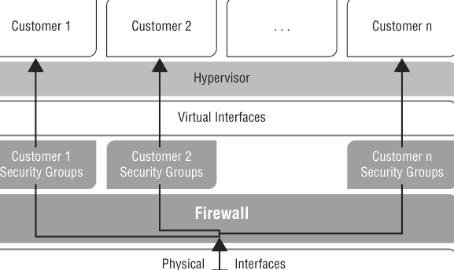

**主机操作系统**：需要访问管理平面的管理员需要使用 `MFA` 来访问专门构建的管理主机。这些管理主机是经过专门设计、构建、配置和加固的系统，用于保护云端的管理平面。所有此类访问都会被记录和审计。当员工不再需要访问管理平面时，可以撤销其对这些主机及相关系统的权限和访问权限。

**客机操作系统**：虚拟机完全由您（客户）控制。您对账户和应用程序拥有完全的 `root` 权限或管理控制权。AWS 无法访问您的实例或客机操作系统。AWS 建议采用一套基础最佳实践，以考虑禁用对客机的基于密码的访问，并使用某种形式的 `MFA` 来访问您的实例（或至少是使用基于证书的 `SSH` 版本 2 访问）。此外，您应该采用一种

### AWS 云特定安全

基于用户的、带有日志的权限提升机制。例如，如果客机操作系统是 `Linux`，在加固实例时，您应该使用基于证书的 `SSH` 版本 2 来访问虚拟机实例，禁用远程登录、命令行日志，并使用 `sudo` 进行权限提升。您应该生成自己的密钥对，以确保它们是唯一的且不与其他客户或 AWS 共享。AWS 还支持使用 `SSH` 网络协议，允许您通过您的 `UNIX/Linux` Amazon EC2 实例进行安全登录。`SSH` 的身份验证是通过公钥/私钥对进行的，以减少未经授权访问实例的风险。您还可以使用为实例生成的 `RDP` 证书通过远程桌面协议 (`RDP`) 连接到 `Windows` 实例。您还控制客机实例的更新和补丁，包括安全更新。Amazon 提供的 `Windows` 和 `Linux` Base `AMI` 已更新最新补丁，因此您只需使用具有最新更新 `AMI` 重新启动新实例即可。此外，通过 Amazon `yum` 仓库为 Amazon `Linux` `AMI` 提供更新。

Amazon EC2 提供了一个强制性的入站防火墙，该防火墙配置为默认拒绝所有模式；Amazon EC2 客户必须显式开启所需的端口以允许入站流量。流量可以根据协议、服务端口和源 `IP`（单个 `IP` 或无类域路由 `CIDR`）进行限制。防火墙可以按组配置，允许不同类的实例具有不同的规则。例如，三层 Web 应用的情况。Web 服务器组对互联网开放端口 80 (`HTTP`) 和/或端口 443 (`HTTPS`)。应用程序服务器组允许来自 Web 服务器组的端口 8000（特定应用程序）。数据库服务器组仅允许来自应用程序服务器组的端口 3306 (`MySQL`)。所有三个组允许从客户公司网络通过端口 22 (`SSH`) 进行管理访问。高安全性应用程序可以使用这种方法部署，如图34所示。

防火墙提供的安全水平取决于您开放了哪些端口，以及持续时间和目的。仍然需要基于实例进行明智流量管理和安全设计。AWS 鼓励您使用基于主机的防火墙（如 `iptables` 或 `Windows` 防火墙）应用实例级过滤器。这可以限制入站和出站流量。


> 默认状态是拒绝所有入流量，在构建和保护应用程序时应仔细计划要开启的内容。

启动和终止实例、更改防火墙参数以及执行其他操作的 `API` 访问调用都由您的 Amazon `Secret` 密钥签名，该密钥可能是 AWS 账户密钥或通过 `IAM` 创建的用户密钥。没有 `Secret` 密钥，就无法代表您执行 Amazon EC2 `API` 调用。`API` 调用还可以通过 `SSL` 加密以保持机密性。AWS 建议始终使用 `SSL` 保护的 `API` 端点。

### 图 3.4 Amazon EC2 安全组防火墙

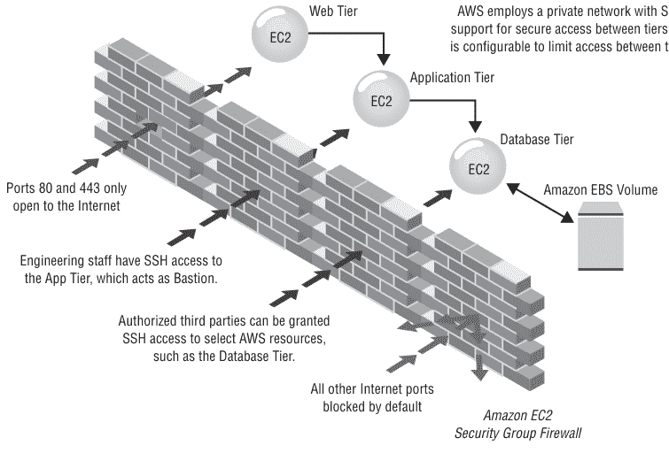

Amazon Elastic Block Store (Amazon EBS) 允许你创建从 1 GB 到 16 TB 不等的存储卷，这些卷可以作为设备挂载到 Amazon EC2 实例。存储卷的行为类似于未经格式化的块设备，具有用户提供的设备名称和块设备接口。你可以在 Amazon EBS 卷之上创建文件系统，或者以使用块设备的任何其他方式使用它们（如硬盘）。Amazon EBS 卷的访问限制限于创建该卷的 AWS 账户以及通过 `IAM` 创建的 AWS 账户下的用户（如果该用户已被授予访问 Amazon EBS 操作的权限）。所有其他 AWS 账户和用户都被拒绝查看或访问该卷的权限。

存储在 Amazon EBS 卷中的数据作为服务正常运行的一部分，冗余地存储在多个位置，且无需额外费用。然而，Amazon EBS 的复制限制在同一个可用区（Availability Zone）；因此，强烈建议你定期执行快照并将其保存到 Amazon S3 以实现长期持久性。对于使用 Amazon EBS 构建了复杂事务数据库的客户，建议通过数据库管理系统备份到 Amazon S3，以便对分布式事务和日志进行对点检查。AWS 不会自动对附加在运行的 Amazon EC2 实例上的虚拟磁盘上维护的数据进行备份。

你可以将 Amazon EBS 快照公开给其他 AWS 账户使用，用作创建复制卷的基础。共享 Amazon EBS 快照并不会赋予其他 AWS 账户更改或删除原始快照的权限，该权利明确保留给创建该卷的 AWS 账户。

## AWS 云服务特定安全

Amazon EBS 快照是整个 Amazon EBS 卷的块级视图。注意，数据通过卷上的文件系统不可见，例如已删除的文件可能存在于 Amazon EBS 快照中。如果你想创建共享快照，应该谨慎地操作。如果你拥有敏感数据或已从中删除了文件，你应该创建一个新的 Amazon EBS 卷进行共享。共享快照中要包含的数据应复制到新卷中，并从该新卷创建快照。

Amazon EBS 卷以未格式化块设备的形式呈现给你，这些设备在提供之前已被擦除，以便你可以确保擦除过程已完成。如果程序要求通过特定方法擦除所有数据，你有能力在 Amazon EBS 上执行此操作。在删除卷之前，你应该执行专门的程序，以符合你既定的要求。

敏感数据的加密通常是一种良好的安全实践，AWS 提供了使用 `AES-256` 对 EBS 卷及其快照加密。加密发生在托管 Amazon EC2 实例的服务器上，为数据在 Amazon EC2 实例和 Amazon EBS 存储之间移动时提供加密。为了高效且低延迟地实现这一点，Amazon EBS 加密功能仅适用于 Amazon EC2 中更强大的实例类型。

### 网络

AWS 提供了一系列网络服务，允许你创建一个连接到 AWS 云的逻辑隔离网络，使用高可用且可扩展的域名 (DNS) 服务，并通过内容网络服务以低延迟和高数据传输速度向终端用户交付内容。

### 弹性负载均衡安全

弹性负载均衡（Elastic Load Balancing）用于管理 Amazon EC2 实例组的流量，将流量分到区域内所有可用区的实例上。弹性负载均衡具有本地负载均衡器的所有优势，并具有若干项安全优势：

-   接管 Amazon EC2 实例的加密和解密工作，并在负载均衡器上进行集中管理
-   提供单一接触点，并可以作为防御客户网络攻击的第一道防线
-   在 Amazon VPC 中使用时，支持创建和管理与弹性负载均衡关联的安全组，以提供额外的网络和安全选项
-   支持在那些 `HTTPS` 连接的网络上使用 `TLS`（以前为 `SSL`）进行端到端流量加密。当使用 `TLS` 时，用于终止客户端连接的 `TLS` 服务器证书可以在负载均衡器上集中管理，而不是在每个单独实例上。


# 第 3 章 • 安全与 AWS 身份访问管理 (IAM)

HTTPS/TLS 使用长期密钥生成短期的会话密钥，用于服务器和浏览器之间以创建加密消息。弹性负载均衡为你的负载均衡器配置一组预定义的加密套件，该套件在客户端与你的负载均衡器之间建立连接时用于 TLS 协商。预定义的加密套件提供了与广泛客户端的兼容性，并使用了强加密算法。然而，某些客户可能具有允许客户端使用特定加密算法和协议的需求（例如 `PCI DSS`、`萨班-奥克斯利法 [SOX]`），以确保符合此类标准。弹性负载均衡提供了为 TLS 协议和加密算法选择不同配置的选项。你可以根据特定需求选择启用或禁用加密算法。

为了帮助确保在保护连接时使用更新、更强大的加密套件，你可以配置负载均衡器，在客户端-服务器协商期间选择选定加密套件中的最后一个加密算法。当选择服务器顺序偏好时，负载均衡器将根据服务器对加密算法的优先级而非客户端的优先级选择加密套件。这让你对客户端连接到你的负载均衡器时使用的加密套件有更多控制。

为了获得更大的通信保护，弹性负载均衡允许使用前安全性（forward secrecy），它使用瞬时的且不存储在任何地方的会话密钥。这防止了即使在秘密密钥泄露的情况下解码捕获的数据。

弹性负载均衡允许你识别连接到服务器的客户端的源 IP 地址，无论你使用的是 HTTP 还是 TCP 负载。通常，当请求通过负载均衡器代理时，连接信息（如 IP 地址和端口）会丢失。这是因为负载均衡器代表客户端向服务器发送请求，使负载均衡器看起来像是请求客户端。如果你需要更多关于访问应用程序的信息以收集连接统计数据、分析流量日志或管理 IP 地址白名单，识别源 IP 是非常有用的。

弹性负载均衡日志包含负载均衡器处理的每个 HTTP 和 TCP 请求的信息。这包括处理请求的实例后端 IP 地址、请求大小以及来自客户端的实际请求行（例如 `GET http://www.example.com/ - HTTP/1.1`）。所有发送到负载均衡器的请求都会被记录，包括未到达后端实例的请求（更多关于弹性负载均衡的信息请参见第 5 章）。

### Amazon 私有云 (Amazon VPC) 安全

通常，每个 Amazon EC2 实例在 Amazon EC2 地址空间内随机分配一个公 IP 地址。Amazon VPC 允许你创建一个 AWS 云的隔离分区，并启动具有选择范围内的私有（`RFC 1918`）地址的 Amazon EC2 实例（例如 `10.0.0.0/16`）。你可以在 Amazon VPC 中定义子网，根据 IP 地址范围对相似实例进行分组，然后设置路由和安全措施以控制进出实例的流量。

Amazon VPC 中的安全功能包括安全组、网络访问列表（`ACL`）、路由表和网关。每个实例都具有连接性，提供了一个安全、隔离的网络，该网络可以通过选择性地启用直接访问 Internet 或到另一个网络的私有连接来扩展。运行在 Amazon VPC 中的 Amazon EC2 实例将继承于下文描述的所有与操作系统和防止数据包嗅探相关的优点。然而，现在你必须为你的 VPC 专门创建安全组；你创建的任何 EC2 安全组都不会在你的 Amazon VPC 内部工作。Amazon VPC 安全组具有 Amazon EC2 安全组不具备的功能，例如可以在实例启动后更改安全组，并且可以指定标准端口的任何协议（而不仅仅是 TCP、UDP 数据报协议 [UDP] 或互联网控制消息协议 [ICMP]）。

每个 VPC 都是云端中直接、隔离的网络；每个 Amazon VPC 中的网络流量都与所有其他 VPC 隔离。在创建时，你为每个 Amazon VPC 选择一个 IP 地址范围。你可以附加互联网网关、私有网关或两者以建立外部连接，并进行以下控制：

用于创建和删除 Amazon VPC 的 API 调用；更改路由、安全组和网络 ACL 参数；以及其他功能都由你的 Amazon 秘密访问密钥签名，该密钥可以是 AWS 账户的秘密访问密钥或通过 IAM 创建的用户的访问密钥。如果没有你的秘密访问密钥，将无法代表你执行 Amazon VPC API 调用。此外，API 调用可以使用 SSL 终端点进行加密。AWS IAM 还允许客户进一步控制新创建的用户有权限调用哪些 API。

### 子网和路由表

你在每个 Amazon VPC 中创建一个或多个子网。每个启动的实例都连接到一个子网。传统的第 2 层安全攻击（包括 `MAC` 欺骗和地址解析协议 (`ARP`) 欺骗）会被阻止。Amazon VPC 中的每个子网都关联有一个路由表，所有离开子网的网络流量都将由路由表处理以确定目的地。

### 防火墙（安全组）

像 Amazon EC2 一样，Amazon VPC 支持防火墙，允许对实例的入站和出站流量进行过滤。默认组允许来自同一组成员的入站通信，以及到任何目的地的出站连接。流量可以通过任何 IP 块、服务端口以及源/目的 IP 地址（单个 IP 或 `CIDR` 块）进行限制。防火墙不是通过客操作系统操作系统控制的；而是只能通过调用 Amazon VPC API 进行修改。AWS 支持授予对实例和防火墙上不同管理函数的访问权限，从而使你能够通过职能分离来实现额外的安全。防火墙提供的安全级别取决于你开启了哪些端口，以及开启的持续时间和目的。需要对每个实例进行良好的流量管理和安全设计。AWS 进一步鼓励你使用基于主机的防火墙（如 `IP tables` 或 `Windows` 防火墙）应用额外的单实例过滤器。图 3.5 展示了一个具有两种类型子网（公共和私有）以及通过两个网络到两个不同网络（客户数据中心和 Internet）的网络路径的 Amazon VPC。

### 图 3.5 Amazon VPC 网络架构

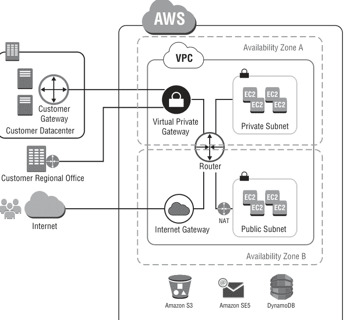

### 网络访问列表 (Network ACLs)

为了在 Amazon VPC 内部增加额外的安全层，你可以配置网络 ACL。这些是无状态流量过滤器，适用于 Amazon VPC 内部子网的所有入站或出站流量。这些 ACL 可以包含排序规则，用于根据 IP 协议、服务端口、源和目的 IP 地址来允许或拒绝流量。

与安全组一样，网络 ACL 通过 AWS VPC API 管理，增加了额外的保护层，并通过职能分离实现了额外的安全。图 3.6 描述了迄今讨论的安全控制措施如何相互关联，以便在提供灵活网络拓扑的同时，对网络流量实现完全控制。

### 图 3.6 灵活的网络拓扑

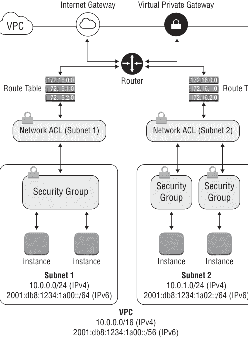

虚拟私有网关实现了 Amazon VPC 与另一个网络之间的私有连接。每个虚拟私有网关内的网络流量与其他所有虚拟私有网关的网络流量隔离。你可以到你场所的虚拟私有网关设备建立 VPN 连接。每个连接都通过预共享密钥结合客户网关的 IP 地址进行保护。

互联网网关可以附加到 Amazon VPC，以实现到 Amazon S3、其他 AWS 云服务以及 Internet 的直接连接。每个需要此类访问的实例必须关联弹性 IP (`Elastic IP`) 或通过 `NAT` 实例路由流量。此外，配置了网络路由以将流量重定向到互联网网关。AWS 提供了参考 `NAT AMI`，你可以扩展它们以执行网络日志、深度数据包检测、应用层过滤或其他安全控制。

此类访问只能通过调用 AWS VPC API 进行修改。AWS 支持授予对实例和互联网网关上不同管理函数的粒度访问权限，使你能够通过职能分离来实现额外的安全。

### 专用实例 (Dedicated instances)

在 Amazon VPC 中，你可以启动在硬件级别物理隔离的 Amazon EC2 实例（即它们运行在单租户硬件上）。可以以“专用”租用创建 Amazon VPC，以便所有启动到 Amazon VPC 的实例都将使用此功能。或者，可以以“默认”租用创建 Amazon VPC，但你可以为启动其中的特定实例指定专用租用。有关 AWS 的更多信息可以参阅第 5 章。

### 专用主机 (Dedicated hosts)

Amazon EC2 专用主机是物理服务器，其 `EC` 实例容量完全专供你使用。专用主机允许你使用现有的插槽、每核心或每虚拟机的软件许可，包括 `Windows Server`、`SQL Server`、`SUSE Linux Enterprise Server` 等。关于主机的更多信息可以参阅第 4 章。

### Amazon CloudFront

Amazon CloudFront 为客户提供了一种简单的低延迟、高数据传输速度分发内容。它利用全球边缘节点分发动态、静态和流媒体内容。对于路由到最近边缘节点的客户对象，内容将以最佳性能交付。Amazon CloudFront 针对 Amazon S3、Amazon EC2、弹性负载均衡和 Amazon Route 53 等其他 AWS 服务进行了优化。它也可以与存储原始最终版本的任何 AWS 源服务器无缝集成。

Amazon CloudFront 要求对其控制 API 的所有请求都经过身份验证，以便只有授权用户才能创建、修改或删除自己的 Amazon CloudFront 分发。请求使用请求和用户私钥计算出的 `HMAC-SHA-1` 签名签名。此外，Amazon CloudFront 控制 API 仅通过 SSL 启用终端点访问。

边缘节点中存储的数据没有持久性保证。如果对象不经常被请求，服务可能会从边缘节点删除对象。持久性由 Amazon S3 提供，它作为 Amazon CloudFront 的源，持有交付内容的原始最终副本。

如果你想控制谁可以从 Amazon CloudFront 下载内容，可以启用服务的私有内容功能。该功能包含两个部分：第一部分控制内容如何从 Amazon CloudFront 边缘节点交付给 Internet 上的观众；第二部分控制 Amazon CloudFront 边缘节点如何访问 Amazon S3 中的对象。Amazon CloudFront 还支持地理限制，根据观众的地理位置限制对内容的访问。

## AWS 特定云服务安全

为了控制对 Amazon S3 中对象副本的访问，Amazon CloudFront 允许您创建一个或多个源站访问身份（`origin access identities`）并将它们与分发器关联。当源站访问身份与 Amazon CloudFront 分发器时，分发器将使用该身份从 Amazon S3 获取对象。您可以使用 `S3 ACL` 功能，限制对源站身份的访问，使得对象的原始副本不是公开可读的。

为了控制谁可以从 Amazon Cloud 边缘节点下载对象，该服务使用了签名 URL（`signed-URL`）验证系统。要使用此系统，您需要创建一个公私密钥对，并通过 AWS 管理控制台将公钥上传到您的账户。您可以配置 Amazon CloudFront 分发器，以指示哪些账户可以对您的请求进行签名。您可以指定最多五个您信任的账户进行签名。根据需要，您将创建策略文档，指定您希望 Amazon CloudFront 提供您的内容的条件。这些策略文档可以指定所请求的对象名称、请求的日期和时间以及发起请求的客户端源（`IP CIDR` 范围）。当您计算策略文档的 `SHA-1` 哈希值并使用私钥对其进行签名时，您在引用对象时会将编码后的文档和签名作为查询字符串参数包含。当 CloudFront 接收到请求时，它将使用您的私钥解码签名。Amazon CloudFront 只会提供具有有效策略文档和匹配签名的对象。

请注意，该内容是一个可选功能，您可以在设置 Amazon CloudFront 分发器时启用。未启用此功能时传输的内容将是公开可读的。

Amazon CloudFront 提供了通过加密连接（`HTTPS`）传输内容的选项。默认情况下，Amazon CloudFront 会接受通过 `HTTP` 和 `HTTPS` 协议的请求。您还可以配置 Amazon CloudFront 要求所有请求使用 `HTTPS`，或者允许 CloudFront 分发器对某些对象允许 `HTTP` 但对其他对象要求 `HTTPS`。有关 Amazon CloudFront 的更多信息请参阅第 5 章和第 6 章。

## 存储

AWS 提供具有高持久性和可用性的低成本存储。AWS 为备份、归档、灾难恢复和块对象存储提供了存储选择。

### Amazon Simple Storage Service (Amazon S3) 安全

Amazon S3 允许您随时从网络上的任何地方上传和检索数据。Amazon S3 将数据作为对象存储在桶（`buckets`）中。桶可以是任何类型的文件：文本文件、照片、视频等。当您向 Amazon S3 添加文件时，您可以选择在文件中包含元数据，并设置权限以控制对该文件的访问。对于每个桶，您可以控制对桶的访问（谁可以在桶中创建、删除和列出对象）、查看桶桶及其对象的访问日志，并选择 Amazon S3 存储桶及其内容的地理区域。

### 数据访问

存储在 Amazon S3 中的数据默认是受限制的；只有桶和对象的所有者才有权访问他们创建的 Amazon S3 资源（注意：桶/对象所有者是 AWS 账户所有者，而不是创建桶/对象的用户）。有多种方法可以控制对桶和对象的访问。

`IAM` 允许拥有众多员工的组织在单个 AWS 账户下创建和管理多个用户。`IAM` 策略被附加到用户，从而能够对您的 AWS 账户下的用户访问桶或对象的权限进行集中化控制。通过 `IAM` 策略，您只能授予您的 AWS 账户中的用户访问您的 S3 资源的权限。

`ACLs`：在 Amazon S3 内部，您可以使用 `ACL` 为一组用户获取对桶或对象的写入访问。通过 `ACL`，您只能授予其他 AWS 账户（而非特定用户）访问您的 Amazon S3 资源的权限。

桶策略：Amazon S3 中的桶策略可用于添加或拒绝单个桶中部分或所有对象的权限。桶策略可以附加到用户、组或 Amazon S3 桶，实现权限的集中化管理。通过桶策略，您可以授予您的 AWS 账户或其他 AWS 账户中的用户访问您的 Amazon S3 资源的权限。

查询字符串身份验证：您可以使用查询字符串完全在 URL 中请求资源。在这种情况下，您使用查询参数提供请求信息，包括身份验证信息。由于请求签名是 URL 的一部分，这种 URL 通常被称为预签名 URL（`pre-signed URL`）。您可以使用预签名 URL 在 HTML 中嵌入可点击的链接，这些链接的有效期可达七天。

您可以根据某些条件限制对特定资源的访问。例如，您可以根据请求时间（日期条件）、请求是否使用 SSL 发送（布尔条件）、请求者的 IP 地址（IP 地址条件）或请求者的客户端应用程序（字符串条件）来限制访问。要识别这些条件，您需要使用策略密钥。

Amazon S3 还提供了使用查询字符串身份验证的选项，这允许他们通过预定义有效期内的 URL 分享 Amazon S3 对象。查询字符串身份验证对于为浏览器提供通常需要身份验证的资源的 `HTTP` 访问有用。查询字符串中的签名确保了请求的安全。

### 数据传输

为了获得最大的安全性，您可以通过 `SSL` 加密端点安全地向 Amazon S3 上传/下载数据。加密端点可以从互联网和 Amazon EC2 内部访问，因此数据在 AWS 内部以及 AWS 外部源都可以安全传输。

### 数据存储

Amazon S3 提供了保护静态数据的多种选项。如果您倾向于自己管理加密，可以使用如 `Amazon S3 Encryption Client` 等客户端加密库在上传到 Amazon S3 之前对数据进行加密。或者，如果您希望让 Amazon S3为您管理加密过程，可以使用 Amazon S3 服务端加密 (`SSE`)。数据根据您的需要使用您提供的密钥进行加密。通过 Amazon S3 `SSE`，您可以在写入对象时添加额外的标头，从而在上传时加密数据。在检索数据时会自动进行解密。请注意，随对象一起提供的元数据是不加密的。


AWS 建议客户使用 Amazon S3 `SSE`，它使用了最强大的加密算法之一：`AES-256`。通过 Amazon S3 `SSE`，每个受保护的对象都使用唯一的密钥进行加密。每个对象密钥使用定期轮的主密钥。Amazon S3 `SSE` 通过将加密数据和加密密钥存储在不同的主机上提供了额外的安全性。Amazon S3 `SSE` 还允许强制加密要求。例如，您可以创建并应用桶策略，要求加密数据上传到您的桶中。

当对象从 Amazon S3 删除时，从公共名称到对象的映射删除立即开始，通常在分布式系统中几秒内处理。一旦映射删除，就无法访问被删除的对象。底层存储区域随后会被系统回收。Amazon S3 标准版旨在提供 99.999999999% 的对象持久性。这种持久性对应于平均每年预期损失 0.000000001% 的对象。例如，如果您在 Amazon S3 中存储 10,000 个对象，预计每 1000 万年会损失一个对象。此外，Amazon S3 设计可承受两个设施的数据同时丢失。

### 访问日志

Amazon S3 可以配置对桶及其对象的访问进行记录。访问日志包含每次访问请求的详细信息，包括请求类型、请求的资源、请求者的 IP 和请求时间。当对桶启用日志时，日志记录会定期聚合到日志文件中并传递送到指定的 Amazon S3 桶。

### 跨域资源共享 (CORS)

AWS 客户使用 Amazon S3 托管静态网页，其他网页使用的对象可以通过配置 Amazon S3 桶以启用跨域请求来安全地加载内容。现代浏览器使用同源策略阻止 JavaScript HTML 不允许请求从另一个网站或域加载内容，以确保不会从信誉较低的来源加载恶意内容（例如在跨站脚本攻击期间）。在启用跨源资源共享 (`CORS`) 策略时，存储在 Amazon S3 桶中的网络字体和图像等资产可以被网页、样式表和 `HTML5` 应用安全引用。有关 Amazon S3 的更多信息，请参阅第 6 章。

### Amazon Glacier 安全

与 Amazon S3一样，Amazon Glacier 服务提供了低成本、安全且持久的存储。Amazon S3 设计用于快速检索，而 Amazon Glacier 则旨在作为不经常访问且适合数小时检索时间的数据存档服务。


Amazon Glacier 将文件作为存档的形式存储在库（vaults）中。存档可以是照片、视频或文档等任何数据，并包含一个或多个文件。您可以在单个库中存储无限数量的存档，每个区域最多可以创建 1,000 个库。每个存档可以包含最多 40 TB 的数据。

### 数据传输

为了安全起见，您可以通过 `SSL` 加密端点安全地向 `Amazon Glacier` 上传/下载数据。加密端点可以从互联网和 `Amazon EC2` 内部进行访问，因此数据在 `AWS` 内部以及从 `AWS` 外部源传输时都是安全的。

### 数据检索

从 `Amazon Glacier` 检索存档需要启动检索任务，该任务通常在三到五小时内完成。然后，您可以通过 `HTTP GET` 请求访问数据。数据将对您可用 24 小时。您可以检索整个存档，也可以从存档中检索多个文件。如果您想检索存档的子集，可以使用一个检索请求来指定包含您感兴趣文件的存档范围，或者启动多个检索请求，每个请求包含一个或多个文件的范围。

您还可以通过过滤存档创建日期或设置最大项目限制来限制检索的键值项数量。无论您选择哪种方法，当您检索存档的部分时，只要检索的范围与整个存档的树哈希（`tree hash`）对齐，您可以使用校验和来确保文件的完整性。

### 数据存储

`Amazon Glacier` 自动使用 `AES-256` 加密数据并以不可变的形式持久地存储。`Amazon Glacier` 设计旨在为存档提供平均每年 99.999999999% 的持久性。它将每个存档存储在多个设施和多个设备中。与需要大量数据验证和手动修复的传统系统不同，`Amazon Glacier` 执行定期的系统数据完整性检查，并构建了自愈能力。

### 数据访问

只有您的账户可以访问 `Amazon Glacier` 中的数据。要控制对 `Amazon Glacier` 中数据的访问，您可以使用 `IAM` 指定您账户中的哪些用户具有对给定库进行操作的权限。

### AWS Snowball

`AWS Snowball` 是一种数据传输解决方案，旨在加速数 TB 数据移入和移出 `AWS` 存储设备，这些设备的设计确保物理传输的安全。

### 数据传输

当您使用标准 `AWS Snowball` 设备将数据导入 `Amazon S3` 时，传输到 `AWS Snowball` 设备的数据具有两层加密：

- 第一层加密应用于您的本地工作站内存中。无论您是用于 `AWS Snowball` 的 `Amazon S3` 适配器还是 `AWS Snowball` 客户端，都会应用此加密。此加密使用 `AES` 罗纳/计数模式 (`GCM`) 256 位密钥，密钥每传输 60 GB 数据就会循环一次。

- `SSL` 加密是所有进入或离开标准 `AWS Snowball` 设备数据的第二层加密。

`AWS Snowball` 使用 `SSE` 保护静态数据。

### 数据检索

要使用 `AWS Snowball`，只需登录 `AWS` 管理控制台，选择 `AWS Snowball` 并创建导出任务。与导入任务一样，您需要指定要使用的 `AWS` 区域和 `Amazon S3` 桶。`AWS Snowball` 使用 256 位加密加密所有数据。

### 数据存储

`AWS Snowball` 使用 256 位加密加密所有数据。您使用 `AWS KMS` 管理加密密钥。密钥永远不会发送到或存储在设备上。

# 数据清洗

当数据传输任务处理并验证后，`AWS` 会对 `AWS Snowball` 设备进行软件擦除，该操作遵循美国国家标准与技术研究院 (`NIST`) 的介质清理指南。

有关 `AWS Snowball` 的更多信息请参阅第 6 章。

# AWS Storage Gateway 安全

`AWS Storage Gateway` 服务将您的本地软件设备与云存储连接起来，以便在您的 `IT` 环境与 `AWS` 存储基础设施之间提供无缝且安全的集成。该服务允许您安全地将数据到 `AWS` 可扩展、可靠且安全的 `Amazon S3` 存储服务，以实现成本效益的备份和快速灾难恢复。

### 数据传输

数据通过 `SSL` 从您的本地存储硬件异步传输到 `AWS`。

### 数据存储

数据在 `Amazon S3` 中使用 `AES-256` 加密，这是一种使用 256 位加密密钥的对称加密。`AWS Storage Gateway` 只上传已更改的数据，从而减少了通过互联网发送的数据量。

## 数据库

`Amazon` 为开发者和企业提供了多种数据库解决方案，从托管的关系型和 `NoSQL` 数据库服务到内存缓存即服务以及 `PB` 级数据仓库服务。

# Amazon DynamoDB 安全

`Amazon DynamoDB` 是一种托管 `NoSQL` 数据库服务，提供具有扩展性的快速且可预测的性能。`Amazon DynamoDB` 允许您将运行和扩展数据库的管理负担交给 `AWS`，因此您无需担心硬件配置、设置和初始化、复制或扩展。`Amazon DynamoDB` 可以通过 `SSL` 加密端点访问，且加密端点可以从互联网和 `Amazon EC2` 内部进行访问。

## AWS 云服务特定安全

（注意：此部分的 OCR 文本似乎是片段化的。根据提供的文本，以下章节描述了服务功能。）

# Amazon 关系型数据库服务 (Amazon RDS)

`Amazon RDS` 允许您快速创建关系型数据库实例 (`DB instance`)，灵活扩展计算资源和存储容量。`Amazon RDS` 代表您管理数据库实例，通过执行备份、处理故障转移并维护数据库。目前，`Amazon RDS` 支持 `MySQL`、`Oracle`、`Microsoft SQL Server`、`MariaDB`、`Amazon Aurora` 和 `PostgreSQL` 引擎。

`Amazon RDS` 具有增强可靠性的多种功能，包括安全组、权限、`SSL` 连接、自动备份以及多可用区 (`Multi-AZ`) 部署。数据库实例还可以部署在 `Amazon VPC` 中实现额外的网络隔离。

**访问控制**：在 `Amazon RDS` 中创建 `DB` 实例时，将创建一个主用户账户，该账户仅在 `Amazon RDS` 上下使用。主用户账户是具有所有权限的用户账户。您可以在创建 `DB` 实例时指定关联的主用户名和密码。一旦创建了主用户，可以使用主用户凭据连接数据库。随后，您可以创建其他账户以限制谁可以访问 `DB` 实例。

您可以通过安全组控制 `RDS` 访问，它们与 `Amazon EC2` 安全组类似但不通用。安全组默认拒绝所有访问，客户必须专门授权网络入站。方法有两种：

- 授权网络 `IP` 范围
- 授权现有的 `Amazon EC2` 安全组

### DynamoDB 安全

`Amazon DynamoDB` 是一种托管 `NoSQL` 数据库服务，提供具有扩展性的快速且可预测的性能。`Amazon DynamoDB` 允许您将运行和扩展数据库的管理负担交给 `AWS`，因此您无需担心硬件配置、设置和初始化、复制或扩展。`Amazon DynamoDB` 可以通过 `SSL` 加密端点访问，且加密端点可以从互联网和 `Amazon EC2` 内部进行访问。

要控制对 `DynamoDB` 中数据的访问，您可以使用 `IAM` 指定您账户中的哪些用户具有对给定表进行操作的权限。您可以根据应用程序需要创建数据库级权限，允许或拒绝访问项目（行）和属性（列）。这些数据库级权限被称为细粒访问控制，您可以使用 `IAM` 创建它们。

除了查询数据库外，`AWS SDK` 会自动对请求进行签名；但如果您编写自己的 `HTTP` 请求，则必须在请求头中提供签名。要计算签名，必须从 `AWS` 安全令牌服务 (`STS`) 请求临时凭据。使用临时凭据对您的 `DynamoDB` 请求进行签名。

`DB` 安全组仅允许访问数据库服务器端口（所有其他端口均被阻止），并且可以在无需重启 `RDS` 实例的情况下进行更新。

使用 `IAM`，您可以进一步控制对 `Amazon RDS` `DB` 实例的访问。`IAM` 允许您控制每个单独的 `IAM` 用户权限调用哪些 `RDS` 操作。

**网络隔离**：为了实现额外的访问控制，您可以将 `DB` 实例运行在 `Amazon VPC` 中。`VPC` 允许您通过指定您要使用的 `IP` 范围来隔离 `DB` 实例，并通过行业标准的加密 `IPsec VPN` 连接到您现有的基础设施。在 `Amazon VPC` 中运行 `Amazon RDS` 可以让您在私有子网中拥有一个 `DB` 实例。您还可以设置一个虚拟网关，将您的公司网络连接到 `Amazon VPC`，并允许访问该 `Amazon VPC` 中的 `Amazon RDS` `DB` 实例。

对于多可用区（`Multi-AZ`）部署，为区域内的所有可用区部署子网，将允许 `Amazon RDS` 在需要时在另一个可用区创建新的备用实例。您可以创建一个 `DB` 子网组，子网组是您可能为 `Amazon VPC` 中的 `Amazon RDS` `DB` 实例指定的子网的集合。每个 `DB` 子网组应为给定区域内的每个可用区至少包含一个子网。在您于 `Amazon VPC` 中创建 `DB` 实例时，选择一个 `DB` 子网组。`Amazon RDS` 然后将使用该子网组和您首的可用区在子网内选择一个子网和该子网内的 `IP` 地址。`Amazon RDS` 会创建一个弹性网络接口并将该 `IP` 地址与您的 `DB` 关联。

部署在 `Amazon VPC` 内的 `DB` 实例可以通过互联网或通过您在公有子网中启动的 `VPN` 或堡垒机从外部 `Amazon EC2` 实例访问。要使用堡垒机，您需要选择一个带有 `Amazon EC2` 实例的公有子网。此公有子网必须具有 `Internet` 网关和路由规则，允许流量通过 `SSH` 主机引导，`SSH` 主机必须将请求转发到您的 `Amazon RDS` `DB` 实例的私有 `IP` 地址。

`DB` 安全组可帮助保护 `Amazon VPC` 内的 `DB` 实例。此外，可以通过网络 `ACL`（访问控制列表）允许或拒绝进入和离开子网的网络流量。通过 `IPsec VPN` 进入或离开您的 `VPC` 的所有流量都可以由您的本地安全基础设施进行检查，包括网络防火墙和入侵检测系统。

**加密**：您可以使用 `SSL` 加密应用程序与 `DB` 实例之间的连接。对于 `MySQL` 和 `SQL Server`，`Amazon RDS` 在配置实例时会创建一个 `SSL` 证书并安装在 `DB` 实例上。对于 `MySQL`，您使用 `--ssl-ca` 参数启动 `MySQL` 客户端，以引用公钥来加密连接。对于 `SQL Server`，下载公钥并将证书导入到您的 `Windows` 操作系统。`Oracle RDS` 使用 `Oracle` 原生网络加密——您只需将原生网络加密选项添加到选项组中，并将该选项组与 `DB` 实例关联即可。一旦建立加密连接，`DB` 实例与您的应用程序之间传输的数据将在传输过程中被加密。您还可以要求 `DB` 实例仅接受加密连接。

# AWS 云服务特定安全性

`Amazon RDS` 支持针对 `SQL Server`（`SQL Server` 企业版）和 `Oracle`（`Oracle` 企业版中可用 `Oracle Security` 选项的一部分）的透明数据加密 (`TDE`)。`TDE` 功能在数据写入存储之前对其进行加密，并在从存储中读取数据时自动解密。如果您要求 `MySQL` 数据在静态或在数据库中进行加密，则你的应用程序必须管理数据的加密和解密。

请注意，`Amazon RDS` 中的 `SSL` 支持用于加密应用程序与 `DB` 实例之间的连接；不应依赖它来验证 `DB` 实例本身。`SSL` 提供了更好的安全性，但请注意 `SSL` 加密是一项计算密集型操作，将增加您的数据库连接的延迟。

**自动备份和 DB 快照**：`Amazon RDS` 提供了两种方法来备份和恢复您的 `DB` 实例：自动备份和 `DB` 快照。默认开启的 `RDS` 自动备份为您的 `DB` 实例提供了点点恢复能力。`Amazon RDS` 会备份您的数据和事务日志，并将其存储在用户指定的保留期内。这允许您在保留期内将 `DB` 实例恢复到任意秒，最长可追溯到过去五 分钟。您的自动备份保留期可以配置长达 35 天。

`DB` 快照是用户发起的 `DB` 实例备份。您可以删除任何大小的 `DB` 快照，并在任何 `AWS` 公有区域之间移动它们，或同时将同一份快照复制到多个区域。然后，您可以在需要时随时从快照中创建新的 `DB` 实例。

在备份期间，当您的 `DB` 备份时，可能会暂停存储 `I/O`。这种 `I/O` 挂起通常持续几分钟。多可用区部署可以避免这种 `I/O` 挂起，因为备份是从备用实例提取的。

`DB` 实例 `AWS` 云资源托管在世界各地区域的高可用数据中心设施中，每个区域包含不同的位置可用区。每个可用区的设计都是为了与其他可用区的故障隔离，并与同一区域内的其他可用区提供廉价、低延迟的连接。

为了您的 `PostgreSQL` 或 `MySQL` 数据库设计高可用架构，您可以将 `RDS` 实例运行在多个可用区中，此选项称为多可用区部署。当您选择此选项时，`AWS` 会在不同的可用区自动配置并维护 `DB` 实例的同步副本。主 `DB` 实例会跨可用区同步复制到备用副本。在发生 `DB` 实例或可用区故障时，`RDS` 将自动故障转移到备用实例，以便数据库操作无需人工干预即可快速恢复。

对于使用 `MySQL` 且需要读取密集型数据库工作负载扩展到单个实例容量限制的客户，`Amazon RDS` 提供了读取副本选项。一旦您创建了读取副本，源 `DB` 实例上的数据库更新将使用 `MySQL` 原生的异步复制同步到读取副本。您可以为源 `DB` 实例创建多个读取副本，并将应用程序的读取流量分发到这些副本之间。可以使用多可用区部署创建读取副本，在获得多可用区提供的增强数据库可用性的之外获得读取扩展性。

# 第 3 章 • 安全与 AWS 身份访问管理 (IAM)

**自动补丁**：`Amazon RDS` 将确保数据库软件保持最新状态。在必要时，补丁会在您控制的维护窗口内应用。您可以利用 `Amazon RDS` 维护窗口控制 `DB` 实例修改（例如缩放实例类型）和软件补丁的发生。如果针对某周安排了维护事件，它将在维护窗口内的某个时间启动并完成。

导致 `RDS` 实例离线的维护事件仅限于计算操作（通常从开始到结束持续几分钟）或软件补丁。强制性补丁会自动调度，与安全安全性相关。此类补丁发生频率较低（通常每月一次），且不应超过您的维护窗口。如果您在创建 `DB` 实例时未指定首选维护窗口，将分配默认的 30 分钟值。如果您想修改维护性能，可以通过 `AWS` 管理控制或使用 `ModifyDB` API 进行。每个 `DB` 实例可以具有不同的维护窗口。

在多可用区部署中运行 `DB` 实例可以进一步减少维护事件的影响，因为 `Amazon RDS` 将通过以下步骤进行维护：

- 对备用实例进行维护。
- 将备用实例提升为主实例。
- 对旧主实例（现变为备用实例）进行维护。

当运行 `Amazon RDS` 数据库删除 (`DeleteDBInstance`) 时，`DB` 实例将被标记为删除。一旦实例不再显示删除状态，它将被移除。此时，除非请求了最终快照复制，否则它将无法恢复，且不会在任何工具或 API 中列表中。

# Amazon Redshift 安全

`Amazon Redshift` 是一种 `PB` 级 `SQL` 数据仓库服务，运行在高度优化且托管的 `AWS` 计算和存储资源上。该服务的架构不仅可以快速向上或向下扩展，还能显著提高极大数据集上的查询速度。为了提高性能，`Amazon Redshift` 使用列式存储、数据压缩和区域映射等技术来减少执行查询所需的 `I/O`。它还具有大规模并行处理 (`MPP`) 架构，

## AWS 云服务特定安全

它通过并行化和分发 `SQL` 操作来利用所有可用资源。

**集群访问** 默认情况下，您创建的集群对所有人都是关闭的。`Amazon Redshift` 允许您配置防火墙规则（安全组）来控制对您的数据仓库集群的网络访问。您还可以在 `Amazon VPC` 内部运行 `Amazon Redshift`，将您的数据仓库集群隔离在虚拟网络中，并使用行业标准的加密 `IPSec VPN` 将其连接到现有的基础架构。

创建集群的 `AWS` 账户对集群具有完全访问权限。在您的 `AWS` 账户中，您可以使用 `IAM` 创建用户账户并管理这些账户的权限。通过 `IAM`，您可以授予不同用户仅执行其工作所需的集群操作的权限。与所有数据库一样，除了授予资源级访问外，您还必须在 `Amazon Redshift` 的数据库级别授予权限。数据库用户是命名账户，可以连接到数据库，并在登录 `Amazon Redshift` 时进行身份验证。在 `Amazon Redshift` 中，您是按集群授予数据库权限的，而不是按表授予。用户只能看到由自己的账户生成的行；其他用户生成的行对他们不可见。

创建数据对象的用户是其所有者。默认情况下，只有超级用户或对象所有者可以查询、修改或对对象授予权限。要让用户使用对象，您必须向该用户或包含该用户的组授予必要的权限。此外，只有对象的所有者才能修改或删除它。

**数据备份** `Amazon Redshift` 将您的数据分布在集群中的所有节点上。当您运行具有至少两个计算节点的集群时，每个节点上的数据将始终镜像在另一个节点的磁盘上，从而降低了数据丢失的风险。此外，所有写入您的集群的所有数据都会通过快照持续备份到 `Amazon S3`。`Amazon Redshift` 会按照用户定义的时间段存储快照，时间可以从 1 到 35 天不等。您还可以随时拍摄自己的快照；快照利用所有现有的系统快照并保留到您显式删除它们为止。

`Amazon Redshift` 持续监控集群的健康状况，并自动从故障驱动器复制数据并在必要时替换节点。所有这些操作无需您手动参与，尽管在重复制过程中您可能会看到性能轻微下降。

您可以使用 `AWS` 管理控制台或 `Amazon Redshift` API 使用任何系统或快照来恢复您的集群。一旦系统元数据恢复，您的集群即可可用，您可以在用户数据在后台缓冲时启动查询。

**数据加密** 在创建集群时，您可以选择对其进行加密，以便为您的静态数据提供额外的保护。当您在集群中启用加密时，`Amazon Redshift` 使用硬件加速的 `AES-256` 块加密密钥以加密格式存储用户创建表中的所有数据。这包括所有写入磁盘的数据和任何备份。

`Amazon Redshift` 使用四层基于密钥的架构进行加密。这些密钥包括数据加密密钥、数据库密钥、集群密钥和主密钥。

- 数据加密密钥加密集群中的数据块。每个数据块都被分配一个随机生成的 `AES-256` 密钥。这些密钥使用集群的数据库密钥进行加密。

- 数据库密钥加密集群中的加密密钥。数据库密钥是一个随机生成的 `AES-256` 密钥。它存储在与 `Amazon Redshift` 集群分离的独立网络磁盘上，并由主密钥加密。`Amazon Redshift` 通过安全通道传递数据库密钥并将其保留内存中。


- 集群密钥加密 Amazon Redshift 集群的数据库密钥。您可以使用 AWS 或 HSM 来存储集群密钥。`HSM` 提供对密钥生成和管理的直接控制，并使密钥管理与应用程序和数据库分开。
- 如果集群密钥存储在 AWS 中，则主密钥加密集群密钥。如果集群密钥存储在 `HSM` 中，则主密钥加密由集群密钥加密的数据库密钥。

您可以随时让 Amazon Redshift 旋转集群的加密密钥。作为旋转过程的一部分，密钥也会更新集群的所有自动和手动快照。请注意，在您的集群中启用加密会影响性能，尽管它是硬件加速的。

加密也适用于备份。当您从加密快照恢复时，新集群也将将被加密。

要在当您将表加载数据文件上传到 Amazon S3 时对其进行加密，您可以使用 Amazon S3 SSE。当您从 Amazon S3 加载数据时，`COPY` 命令将在数据加载到表时对其解密。

**数据库审计** Amazon Redshift 记录所有的 SQL 操作、连接尝试、查询以及对您的数据库的更改。您可以使用对系统表执行 SQL 查询来访问这些内容，或者选择将它们下载到安全的 Amazon S3 桶中。然后您可以使用这些审计日志来出于安全和故障排除目的监控您的集群。

**自动补丁** Amazon Redshift 管理所有设置、运行、扩展和提供容量、监控集群以及对 Amazon Redshift 引擎应用补丁和升级的工作。补丁仅在指定的维护窗口期间应用。

**SSL 连接** 为了保护 AWS 云内传输中的数据，Amazon Redshift 使用硬件加速的 SSL 与 Amazon S3 或 `DynamoDB` 通信，以执行 `COPY`、`UNLOAD`、备份和恢复操作。您可以通过与集群关联的参数组中指定 SSL 来加密客户端与集群之间的连接。要让您的客户端验证 Amazon Redshift 服务器，您可以在您的客户端上安装 SSL 证书的公钥 (`.pem` 文件) 并使用该密钥连接到您的。

## AWS 云服务特定安全

Amazon Redshift 提供了更新、更强大的密码套件，而不是椭圆曲线迪菲-赫尔曼临时 (`ECDHE`) 协议。`ECDHE` 允许 SSL 客户端提供完美秘密。完美正密使用不存储在任何地方的会话密钥，即使长期密钥被破解，无法解码捕获的数据。您不需要在 Redshift 中配置任何内容来启用 `ECDHE`；Redshift 将使用提供的密码列表。有关 Amazon Redshift 的更多信息，请参阅第 7 章。

# Amazon ElCache 安全

Amazon ElCache 是一种 Web 服务，可以轻松地设置、管理和扩展分布式内存缓存。该服务通过允许从快速内存缓存检索信息而不是依赖较慢的数据库来提高应用程序的性能。它可以用于许多读取密集型应用程序（如社交网络、游戏、媒体共享和问答门户）或计算密集型工作负载（如推荐引擎）。缓存通过将关键数据存储在内存中提高性能。缓存信息可能包括密集型数据库查询的结果或密集密集计算的结果。

Amazon ElCache 服务自动化内存环境的耗时任务，例如补丁管理、故障检测和恢复。它与其他 AWS 服务（如 Amazon EC2、Amazon CloudWatch 和 Amazon Simple Notification Service [SNS]）协作，提供安全、高性能的托管内存缓存。对于运行在 Amazon EC2 中的应用程序，可以极延迟地访问同一地区的 Amazon ElCache 集群。

使用 ElCache 服务，您可以创建一个缓存集群，由一个或多个运行 Memcached 服务的缓存节点组成。缓存节点是固定大小的附加网络内存。每个缓存节点都有自己的 DNS 名称和端口。支持多种类型的缓存节点，每种类型具有不同量的内存。缓存集群可以设置特定数量的缓存节点以及控制每个缓存节点属性的缓存参数组。集群中的所有缓存节点设计为具有相同的类型和安全设置。

数据访问 Amazon ElCache 允许您使用安全组控制对缓存集群的访问。安全组充当防火墙，控制对缓存集群的网络访问。默认情况下，对您的缓存集群的网络访问关闭的。如果您希望应用程序访问您的缓存集群，必须显式允许特定 Amazon EC2 安全组的访问。一旦配置了入站规则，相同的规则适用于与该缓存安全组关联的所有缓存集群。

# 第 3 章 安全与 AWS 身份与访问管理 (IAM)

允许您的缓存集群访问网络，创建一个缓存安全组，并使用 `Authorize Cache Security Group API` 或 AWS CLI 命令来授权所需的 Amazon EC2 安全组（该组反过来指定了允许的 Amazon EC2 实例）。缓存集群尚未启用基于 IP 范围的访问控制。所有客户端必须位于 Amazon EC2 网络内，并经过缓存安全组的授权。

用于 Redis 的 Amazon ElasticCache 提供了备份和恢复功能，您可以创建整个 Redis 集群在特定时间点的快照。您可以调度自动化任务、定期循环的每日快照，或者在任何时间创建手动快照。对于自动快照，您需要指定一个保留期；手动快照将一直保留直到删除。快照存储在 Amazon S3 中，具有高持久性性，并可用于热启动、备份和归档。

## 应用服务

AWS 提供了多种供应用程序使用的托管服务，包括提供应用程序流、队列、推送通知、电子邮件传递、搜索和转码的服务。

# Amazon 简单队列服务 (Amazon SQS) 安全

Amazon 简单队列服务 (Amazon SQS) 是一种高度可靠、可扩展的消息服务，它允许应用程序的分布式组件之间进行异步消息通信。这些组件可以是计算机、Amazon EC2 实例或两者的结合。通过 Amazon SQS，您可以从任何组件在任何时间向 Amazon SQS 队列发送任意数量的消息。消息可以从相同组件或不同组件检索，可以立即获取，也可以稍后（14 天内）获取。消息具有高持久性；每条消息都持久化地存储在高可用、可靠的队列中。多个进程可以同时对 Amazon SQS 队列进行读/写操作，而互不干扰。

数据访问：Amazon SQS 的访问是基于 AWS 账户或使用 IAM 创建的用户授予的。一旦通过验证，AWS 账户对所有用户操作具有完全访问权限。然而，IAM 用户仅具有通过策略授予其权限的操作和队列。默认情况下，对单个队列的访问被限制在创建它的帐户（可以使用 Amazon SQS 生成的策略或您编写的策略）。

加密：Amazon SQS 可以通过 SSL 加密端点访问。加密端点均可以从互联网和 Amazon EC2 内部访问。存储在 Amazon SQS 内部的数据可以加密。此外，您可以在数据上传到 Amazon SQS 之前对其加密，前提是使用队列的应用程序能够在检索消息时进行解密。在 Amazon SQS 内部加密消息有助于防止未经授权的人员（包括 AWS）对敏感客户数据的访问。

# Amazon 简单通知服务 (Amazon SNS)

Amazon SNS 是一种 Web 服务，可以方便地从云端设置、操作和发送通知。它为开发者提供了高度可扩展、灵活且具有效益的能力，用于从应用程序发布消息并立即传递给订阅者或其他应用程序。Amazon SNS 提供了一个简单的接口，可用于创建客户想要通知（或人员）的主题、让客户端订阅这些主题、发布消息，并通过客户端的协议（如 `HTTP/HTTPS` 和电子邮件）传递消息。

Amazon SNS 使用推送机制向客户端递送通知，这消除了定期检查或轮询信息和更新的需求。可以利用 Amazon SNS 构建高度可靠的、事件驱动的工作流，并管理应用程序，而无需复杂的中间件和应用程序管理。Amazon SNS 的潜在用途包括监控应用程序、工作流系统、对时间敏感性信息、移动应用程序等。

AWS 提供了访问控制机制，以确保主题和消息免受未经授权的访问。主题所有者可以为主题设置策略，以限制谁可以发布或订阅该主题。此外，主题所有者可以通过指定递送机制必须为 `HTTPS` 来加密传输。访问是基于 AWS 账户或由 IAM 创建的用户授予的。一旦通过验证，AWS 账户对所有用户操作具有完全访问权限。然而，IAM 用户仅具有策略授予其权限的操作。默认情况下，对每个主题的访问被限制在创建它的 AWS 帐户。可以使用 Amazon SNS 生成的策略或您编写的策略允许对 Amazon SNS 的其他访问。

### 分析服务

AWS 提供了云端分析服务，帮助您处理和分析任何容量的数据，无论您的需求是托管的 Hadoop 集群、实时流数据、拍字节级数据仓库还是工作编排。

# Amazon EMR 安全

Amazon EMR 是一种托管 Web 服务，您可以使用它来运行 Hadoop 集群，通过在多个服务器之间分配工作和数据来处理海量数据。它提供了一个增强版本的 Apache Hadoop 框架，该框架运行在 Amazon EC2 和 Amazon S3 的网络级基础设施上。您只需将输入数据和数据处理流水线上传到 Amazon S3 即可。然后 Amazon EMR 会启动您指定的 Amazon EC2 实例集群。该服务通过从 Amazon S3 拉取输入数据到已启动的 EC2 实例中开始执行任务。任务完成后，Amazon EMR 将输出数据传输到 Amazon S3，您可以在那里检索它或将其作为另一个作业流的输入。

在代表您启动作业流时，Amazon EMR 会设置两个 Amazon EC2 安全组：一个用于主节点，另一个用于从机（节点）。主安全组有一个用于与服务通信的端口。它还开放了 SSH 端口，允许您使用启动时指定的密钥通过 SSH 连接到实例。从机在单独的安全组中启动，该组仅允许与主实例进行交互。默认情况下，两个安全组都被设置为禁止从外部源访问，包括属于其他客户的 Amazon EC2 实例。由于这些是您帐户内的安全组，您可以使用标准的 EC2 工具对其进行重新配置。为了保护客户的输入输出数据集，Amazon EMR 使用 SSL 在 S3 之间传输数据。

# 第 3 章 安全与 AWS 身份与访问管理 (IAM)

Amazon EMR 提供了多种访问集群资源的方法。您可以使用 IAM 创建用户帐户并配置控制 AWS 特性的权限。当您启动集群时，可以将 EC2 密钥对与集群关联，然后可以使用它连接到集群。您还可以设置权限，允许除默认 Hadoop 以外的用户提交作业。

如果 IAM 用户启动集群，默认情况下对其他 IAM 用户是隐藏。这种过滤发生在所有 EMR 接口（AWS 管理控制台、AWS CLI、API 和 AWS SDK），有助于防止用户意外访问集群。

为了增加额外的保护，可以将 EMR 集群的 EC2 实例启动到 Amazon VPC 中，就像启动到私有子网一样。这允许您连接到整个子网。您还可以将集群启动到 Amazon VPC 并允许集群通过 VPC 连接访问内部网络资源。您可以在数据上传到 S3 之前对其加密；如果您在上传之前进行了加密，那么当 Amazon EMR 从 S3 获取数据时，需要在作业流开头添加解密步骤。

# Amazon Kinesis 安全

Amazon Kinesis 是一种处理实时流数据的托管服务。它可以接受来自任何源的任何数量的数据，并根据需要伸缩。您可以在某些场景中使用 Amazon Kinesis，例如服务器日志、社交媒体、市场数据馈和网络流。应用程序可以在 Kinesis 流中读取和写入数据。您可以创建任意数量的 Kinesis 流来捕获、存储和传输数据。

通过在您的 AWS 帐户下创建用户并控制这些用户权限执行哪些 Kinesis 操作，可以控制对 Kinesis 资源和管理函数的逻辑访问。为了方便在 Amazon EC2 实例上运行生产者或消费者应用程序，可以为该实例配置 IAM 角色。这样，AWS 凭证将反映实例上应用程序的权限，这意味着不再需要使用长期 AWS 凭证。角色的益处是提供了在短时间内过期的临时凭证，这增加了一层保护措施。

## AWS 特定云服务安全

Amazon Kinesis API 仅能通过 SSL 加密端点 (`kinesis-us-east-1.amazonaws.com`) 访问，以帮助保护数据传输到 AWS。您必须连接到该端点以访问 Amazon Kinesis，但可以使用 API 引导 Amazon Kinesis 在任何 AWS 区域创建流。

# 部署与管理服务

AWS 提供了多种工具来帮助部署和管理您的应用程序。这包括帮助您创建具有 AWS 云服务凭据的独立账户的服务。还包括创建和更新 AWS 资源、在这些资源上部署应用程序以及监控这些 AWS 资源状况的服务。其他工具可帮助您使用硬件安全模块 (HSM) 管理密钥，并出于安全和合规目的记录 API 活动。

# AWS 身份与访问管理 (IAM) 安全

如前所述，IAM 允许您在 AWS 账户中创建多个用户并管理这些每个用户的权限。用户身份（在 AWS 账户内）具有唯一的安全凭据，可以根据需要启用或禁用用户的访问。IAM 消除了共享密码或密钥的需要，并且易于使用。IAM 与 AWS CloudFormation 集成。有关 AWS CloudFormation 的更多信息可以查阅第 8 章“应用程序部署与管理”。

IAM 允许您减少 AWS 账户凭据的使用。当您创建 IAM 用户账户时，所有与 AWS 服务和资源的交互都都应该通过 IAM 用户凭据进行。

如本章较早所述，IAM 使用临时凭据将访问权限委托给通常无法访问您的 AWS 资源的用户或服务。角色（Role）是一组用于访问特定 AWS 资源的权限，但这些权限并未绑定到特定的 IAM 用户或组。授权实体（例如，移动用户或 Amazon EC2 实例）接收临时凭据，用于对角色中定义的资源进行身份验证。安全凭据由于其生命周期短（默认为 12 小时）且过期后无法重用，提供了增强的安全性。这在某些情况下提供有限的、受控的访问特别有用。

### 联邦（非 AWS）用户访问

联邦用户（或应用程序）是指没有 AWS 账户。通过角色，您可以在有限时间内访问您的 AWS 资源。如果您有非 AWS 用户可以与外部服务（如 Microsoft Active Directory、轻量级目录访问协议 (LDAP) 或 Kerberos）进行身份验证，这将非常有用。与角色配合使用的临时 AWS 凭据在 AWS 与您企业身份和授权系统中的非 AWS 用户之间提供了身份联合功能。

### 安全断言标记语言 (SAML) 2.0

如果您的组织支持安全断言标记语言 (SAML) 2.0，您可以在作为身份提供者 (IdP) 的组织与其他作为服务提供者之间建立信任。在 AWS 中，您可以将 AWS 配置为服务提供者，并使用 SAML 为您的用户提供访问 AWS 管理控制器的联邦单点登录 (SSO)，或获取调用 AWS API 的联邦访问权限。

如果您创建一个访问 AWS 资源的移动或 Web 端应用程序，角色也很有用。程序化请求资源需要安全凭据；然而，您不应将长期安全凭据嵌入应用程序中，因为应用程序的用户可以访问这些凭据，并且难以路由。相反，您可以让用户使用 Amazon 登录、Facebook 或 Google 登录您的应用程序，并使用他们的身份验证信息进入角色并获取临时安全凭据。

### 跨账户

对于使用多个账户管理资源的组织，您可以设置规则，允许在一个账户中拥有权限的用户访问另一个账户下的资源。对于仅需要访问另一个账户下资源的人员的组织，使用角色有助于确保凭据是临时且按需提供的。

# 需要访问 AWS 资源的 Amazon EC2 实例上的运行应用程序

如果应用程序运行在 Amazon EC2 实例上并需要请求 AWS 资源（例如 Amazon S3 存储桶、Amazon DynamoDB 表），它必须拥有安全凭据。与其为每个实例创建单独 IAM 账户，不如为管理大量实例或使用 Auto Scaling 弹性扩展机群的客户节省大量时间。

临时凭据包括安全令牌 (token)、访问密钥 ID 和秘密访问密钥。要让用户访问某些资源，您将临时安全凭据分发给您授予临时访问权限的用户。当用户向您的资源发出调用时，用户传递令牌和访问密钥 ID，并使用秘密访问密钥对请求进行签名。令牌无法与不同的访问密钥配合。

使用临时凭据为您提供了额外的保护，因为您不需要为临时用户管理或分发长期凭据。此外，临时凭据会自动加载到目标实例，因此您无需将它们嵌入代码等不安全的地方。临时凭据在您无需采取任何操作的情况下每天自动轮换或更改，并且默认安全存储。

# 移动服务

AWS 移动服务让您更容易构建、发布、运行、监控、优化和扩展用于移动设备的云端应用程序。这些服务还帮助您对移动应用程序的用户进行身份验证、同步数据并收集和分析应用程序使用情况。

# Amazon Cognito 安全

Amazon Cognito 为移动和 Web 端应用程序提供身份和同步服务。它简化了身份验证用户以及跨多个设备、平台和应用程序存储、管理和同步其数据的任务。它为已验证和未验证的用户提供临时的、受限的凭据，而无需管理任何后端基础设施。

Amazon Cognito 与 Google、Facebook 和 Amazon 等知名身份提供者配合工作，以验证您的移动和 Web 应用程序用户的身份。您可以利用这些服务提供的识别和授权功能，而无需构建和维护自己的。您的应用程序通过这些提供者之一进行身份验证。一旦终端用户通过提供者完成身份验证，提供者返回的 OAuth 或 OpenID Connect 令牌将由您的应用程序传递给 Amazon Cognito，随后返回用户 ID 和一组临时权限凭据。

要开始使用 Amazon Cognito，您需要创建一个身份池 (Identity Pool)。身份池是特定您的 AWS 账户的用户存储。在创建身份池期间，您需要创建一个 IAM 角色或选择一个。IAM 角色是一组用于访问特定 AWS 资源的权限，但这些权限并未绑定到特定的 IAM 用户或组。授权实体（例如，移动用户或 EC2 实例）进入角色并接收用于对角色中定义的资源进行身份验证的临时凭据。安全凭据由于其生命周期短（默认为 12 小时）以及过期后无法重用提供了增强的安全性。

您选择的角色影响终端用户可以使用临时凭据访问哪些 AWS 服务。默认情况下，Amazon Cognito 创建一个权限有限的角色；用户仅拥有 Amazon Cognito Sync 和 Amazon Mobile Analytics。如果您的应用程序需要访问其他 AWS资源（例如 S3 或 DynamoDB），您可以直接从 IAM 控制台修改角色。


通过`Cognito`，无需为每个需要访问您的`AWS`资源的`Web`/移动应用程序用户创建单独`AWS`或`IAM`账户。结合`IAM`角色，移动用户可以安全地访问所有`AWS`资源和应用程序功能，并在无需创建账户或登录的情况下将数据保存到`AWS`云。如果他们以后创建账户或登录，`Amazon Cognito`将合并数据和身份信息。

# 第 3 章 • 安全与 `AWS` 身份与访问管理 (`IAM`)

为了跨设备同步，您的身份池必须支持经过验证的身份。未验证的身份与设备绑定，除非终端用户进行身份验证，否则数据无法在多个设备之间进行同步。

通过`Amazon Cognito`，您的应用程序直接与支持的公共身份提供程序（`Amazon`、`Facebook`或`Google`）通信以验证用户身份。`Amazon Cognito`不存储或使用用户凭据，它仅接收来自身份提供者的`OAuth`或`OpenID Connect`令牌。一旦`Amazon Cognito ID`，它将为用户返回该令牌以及一组临时的、低权限的`AWS`凭据。每个`Amazon Cognito`身份仅访问其在同步存储器中的数据，且这些数据在存储时经过了加密。此外，所有数据都通过`HTTPS`传输。设备上唯一的`Amazon Cognito`标识符存储在适当的安全位置。例如，在`iOS`上，`Cognito`标识符存储在`iOS`链中，用户数据缓存在应用程序沙盒的本地`SQLite`数据库中。如果您需要额外的安全性，可以通过在应用程序中实现加密来对本地缓存中的这些数据进行加密。

# 应用程序

`AWS`应用程序是托管服务，让您能够为用户提供云端安全、中心化的存储和工作区域。

# `Amazon WorkSpaces` 安全

`Amazon WorkSpaces`是一项托管桌面服务，允许您为用户快速配置云桌面。只需选择符合用户需求和您想要启动的`WorkSpaces`的`Windows 7`或`Windows 10`软件包即可。一旦`WorkSpaces`准备就，用户将收到一封电子邮件，告知他们可以在哪里下载相关客户端并登录他们的`WorkSpace`。然后他们可以从各种终端设备（包括`PC`、笔记本电脑和移动设备）访问他们的云桌面。然而，您的组织数据永远不会发送或存储在终端用户设备上，因为`Amazon WorkSpaces`使用了`PC over IP (PCoIP)`，它可以提供交互式视频流而不传输实际数据。`PCoIP`协议对用户的桌面计算体验进行压缩、加密和编码，并作为像素通过任何标准`IP`网络传输到端端设备。

为了访问`Amazon WorkSpaces`，用户必须使用一组唯一的凭据或其常规`Active Directory`（活动目录）凭据进行登录。当您将`Amazon WorkSpaces`集成到`Active Directory`时，每个`WorkSpace`都会加入您的`Active Directory`域，并可以像组织中的其他桌面一样进行管理。这意味着您可以使用`Active Directory`组策略来管理用户的`WorkSpaces`；如果您选择不使用`Active Directory`或任何其他类型的本地目录来管理用户的`WorkSpaces`，您可以在`Amazon WorkSpaces`中创建一个私有云目录供管理使用。

为了提供额外的安全层，您还可以要求在登录时使用`MFA`（多因素身份验证），其形式为硬件或软件令牌。`Amazon WorkSpaces`支持使用本地的远程认证拨入用户服务 (`RADIUS`) 服务器或任何支持`RADIUS`认证的安全身份提供程序来使用`MFA`。它目前支持密码认证协议 (`PAP`)、挑战握手身份验证协议 (`CHAP`)、微软 `CHAP (MS-CHAP)` 1 和 `MS-CHAP2` 协议，以及 `RADIUS` 代理。

每个`WorkSpace`位于`Amazon VPC`内部的独立`EC2`实例上。您可以在已有的`Amazon VPC`中创建`WorkSpaces`，也可以使用`Amazon WorkSpaces`快速启动（`Quick Start`）选项让服务自动为您创建一个。当您使用快速启动选项时，`Amazon WorkSpaces`不仅会在`Amazon VPC`上创建，还会执行其他配置和设置任务，例如为`Amazon VPC`创建`Internet`网关、设置目录管理员帐户、创建指定的用户账户并将其添加到目录，以及创建`Amazon WorkSpaces`客户端。`Amazon VPC`可以通过安全的`VPN`连接到本地网络，以便访问现有的本地`Active Directory`和其他云路由。您可以将在`Amazon VPC`中创建的安全组添加到所有属于您的`Active Directory`的`WorkSpaces`中。这允许您控制从`Amazon VPC`中的`Amazon WorkSpaces`访问`Amazon VPC`及本地网络中其他资源的权限。

`WorkSpaces`的持久性存储由`Amazon EBS`提供，并每天备份两次到`S3`。如果`WorkSpace`启用了`Amazon Work Sync`，所选同步的文件夹将持续备份并存储在`S3`中。您还可以使用`Amazon WorkSpaces Sync`在您的`WorkSpace`之间双向同步文档，这样无论您使用哪台桌面电脑，都可以访问自己的数据。

由于`Amazon WorkSpaces`是一项托管服务，`AWS`负责安全和维护任务。更新会在每周维护窗口期间自动推送到您的`WorkSpaces`。您可以控制用户`WorkSpace`的补补丁配置方式。默认情况下，`Windows Update`是开启的，但如果您需要，也有能力自定义这些设置或使用替代的补丁管理方法。对于底层操作系统，`Windows Update`在`Amazon WorkSpaces`上默认启用，并配置为每周安装一次更新。可以使用替代的补丁方法，或配置`Windows Update`在您指定的时间执行更新。您可以使用`IAM`控制团队中的哪些成员可以执行管理功能（如创建或删除`WorkSpaces`或设置用户目录）。您还可以为目录管理设置`WorkSpace`，安装您喜爱的`Active Directory`管理工具，并创建组织单元和组策略，以便更轻松地对所有`Amazon WorkSpaces`应用`Active Directory`更改。

# 总结 95

在本章中，您学习了`AWS`的首要任务是云的安全。`AWS`内部的安全基于“深度防御”模型，即不使用单一元素来保护`AWS`上的系统。相反，`AWS`使用了多种元素——每个元素在系统的不同层上运行——共同确保系统安全。正如您在责任分担模型中学到的，`AWS`负责该模型的某些层级，而您负责其他层级。`AWS`还提供了许多安全工具和服务功能供用户自行选择。这些概念、工具和功能在本章中进行了讨论。

## 考试要点

理解责任分担模型：`AWS`负责支持云的基础设施的安全，而您负责放在云中或连接到云的任何内容。

理解区域和可用区：每个区域都是完全独立的。每个区域的设计都与其他区域完全隔离。这实现了最大的容错和稳定性。区域是可用区的集合。每个可用区是彼此隔离的，但区域内的可用区通过低延迟链路连接。

理解`AWS`内部的高可用系统设计：您应该设计您的`AWS`使用方案以利用多个区域和可用区。将应用程序部署在多个区域可以使其应对大多数故障模式（包括自然灾害或系统故障）。

理解`AWS`的网络安全：网络设备（包括防火墙和其他边界设备）用于监控和控制网络边界以及网络内部的关键边界。这些边界设备采用规则集、`ACL`（访问控制列表）和配置来强制执行特定系统服务的流量流。

# 理解 `AWS` 上凭证的使用。`AWS` 采用多种凭证来正向识别用户或授权对平台的 `API` 调用。凭证包括：

- 密码

- 使用 `AWS` 根账户或 `IAM` 用户登录 `AWS` 管理控制台

- `MFA`（多因素身份认证）

- 访问密钥（`Access keys`）

- 对 `AWS API` 的数字签名请求（使用 `AWS SDK`、`CLI` 或 `REST/Query API`）

理解访问的正确使用方法。因为访问密钥如果落入错误的人手中可能会被滥用，`AWS` 鼓励您将它们保存在安全的地方，不要将它们嵌入到代码中。对于拥有大量弹性缩放 `EC2` 实例的客户，使用 `IAM` 角色是一种管理访问密钥分配更为安全且方便的方法。

理解 `AWS CloudTrail` 的价值。`AWS CloudTrail` 是一项网络服务，它可以跟踪您的账户上的 `API` 调用并将日志文件传递到您的 `Amazon S3` 桶中。`CloudTrail` 通过记录您的账户上进行的 `API` 调用，实现对账户活动的可见性。

理解 `Amazon EC2` 的安全功能。`Amazon EC2` 使用公钥加密来解密登录信息。公钥加密使用公钥对数据（如密码）进行加密，接收者使用私钥对数据进行解密。公钥和私钥被称为密钥对。

要登录您的实例，必须创建一个密钥对，在启动实例时指定密钥对名称，并在连接到实例时提供私钥。`Linux` 实例没有密码，您使用密钥对进行 `SSH` 登录。对于 `Windows` 实例，您使用密钥对登录管理员密码以及在使用 `RDP` 时使用。

安全组充当虚拟防火墙，控制一个或多个实例的流量。当您启动实例时，会将一个或多个安全组与实例关联。您向每个安全组中添加规则，允许流量进入或离开其关联的实例。您可以随时修改安全组的规则；新规则将自动应用到与该安全组关联的所有实例。

理解 `AWS` 对传输中数据的加密。所有服务端点都支持通过 `HTTPS` 对传输中数据加密。

了解哪些服务提供静态数据加密功能。以下服务提供了静态数据加密功能：

- `Amazon S3`
- `Amazon EBS`
- `Amazon EMR`
- `AWS Snowball`
- `Amazon Glacier`
- `AWS Storage Gateway`
- `Amazon RDS`
- `Amazon Redshift`
- `Amazon WorkSpaces`

## 第 3 章 • 安全与 `AWS` 身份与访问管理 (`IAM`)

## 考试技巧

保持大脑清醒。学习至关重要，通宵熬夜苦读不会提高你的分数；事实上，由于疲劳导致思维模糊，反而可能损害你的分数。在考试前获得充分的休息并吃一些健康的零食——这将极大帮助你清醒头脑。

## 练习

到目前，您应该已经在 `AWS` 中设置了账户。如果您还没有设置，现在是时候的时机了。需要注意的是，这些练习是在您的 `AWS` 账户中进行的，因此是免费的。

这些练习假设您已经安装了 `AWS` 命令行工具。如果您需要安装 `AWS` 命令行界面 (`AWS CLI`)，请参考第 2 章“使用 `AWS` 云服务”中的练习 2.1 (`Linux`) 或练习 2.2 (`Windows`)。

`AWS` 命令行界面的参考文档可以在此处找到：`http://docs.aws.amazon.com/cli/latest/reference/`

这些练习将涵盖身份与访问管理的用户、组、策略和角色。要完成练习，您需要研究“如何做”。通过观察如何执行特定任务，您将迈向掌握该任务。本书的目标不仅是让您准备好通过 `AWS` 认证 `SysOps` 管理员 - 助理级考试，相反，本书应该作为您担任 `AWS` 认证 `SysOps` 管理员日常工作中的参考伙伴。

在练习 3.1 中，您将创建三个 `IAM` 用户。完成此任务有种方法：

1. `AWS` 管理控制台（`Firefox` 或 `Chrome` 浏览器）
2. `AWS CLI` 命令

您将在练习 3.1、3.2 和 3.3 中使用 `AWS CLI`。

## 练习 3.1

### 创建 `AWS` 身份与访问管理 (`IAM`) 用户

使用 `aws iam create-user` 命令示例，通过 `AWS CLI` 创建三个用户名为 `Alice`、`Bob` 和 `Charlie` 的 `IAM` 用户账户：

```
aws iam create-user --user-name Alice
```

请注意返回的信息：

```json
{
  "User": {
    "UserName": "Alice",
    "Path": "/",
    "CreateDate": "2017-04-25T00:54:38.139Z",
    "UserId": "AIDA3QW5ETXYB6ERAQVC",
    "Arn": "arn:aws:iam::123456789012:user/Alice"
  }
}
```

## 练习 3.2

### 创建 `IAM` 凭据。

现在您将为创建的三个 `IAM` 用户创建凭据。您将使用 `aws iam create-login-profile` 和 `aws iam create-access-key` 命令来完成此练习。

`Alice` 需要访问 `AWS` 管理控制台和 `AWS CLI`。因此，她需要生成密码和访问密钥。请参考以下 `CLI` 命令及相关输出示例。

1. 为 `Alice` 创建密码。
2. 为 `Alice` 生成访问密钥。

```json
aws iam create-login-profile --user-name Alice --password Fluffy@meowl
{
  "LoginProfile": {
    "UserName": "Alice",
    "CreateDate": "2017-04-25T01:53:17Z",
    "PasswordReset": false
  }
}
```

## 练习 3.2 (续)

`aws iam create-access-key --user-name Alice`

```json
{
  "AccessKey": {
    "UserName": "Alice",
    "Status": "Active",
    "CreateDate": "2017-04-25T01:06:07Z",
    "AccessKeyId": "AKIAIMGTCQVR4M226BY",
    "SecretAccessKey": "bldMyBCGCG1ZUM9q32AGT5SA"
  }
}
```

3. 为 `Bob` 创建密码。
4. `Charlie` 将成为您的 `Amazon EC2` 和 `S3` 管理员。他需要访问 `CLI`，但不需要访问管理控制台。

## 练习 3.3

### 创建 `IAM` 组。

在此练习中，您将创建组并将 `IAM` 用户加入组。您将使用 `aws iam create-group` 和 `aws iam add-user-to-group` 命令来完成此练习。

创建以下：

| 组 | 用户 |
| :--- | :--- |
| `admins` | `Alice` |
| `monitors` | `Bob` |
| `operators` | `Charlie` |

`aws iam create-group --group-name admins`

```
{
  "Group": {
    "Path": "/",
    "CreateDate": "2017-04-25T01:22:20Z"
  }
}
```

```
{
  "GroupId": "AGPAIKTN6QVR4M226BY",
  "Arn": "arn:aws:iam::123456789012:group/admins",
  "GroupName": "admins"
}
```

`aws iam add-user-to-group --group-name admins --user-name Alice`

## 练习 3.4

### 使用 `IAM` 策略

此练习重点关注使用 `AWS` 托管策略作为设置 `IAM` 组权限的基础。在此练习中，您将使用 `AWS` 管理控制台。

1. 使用具有 `IAM` 权限的用户登录控制台。对于此练习，可以使用根账户，因为您正在创建 `IAM` 账户。在创建具有管理员权限的 `IAM` 账户（例如 `Alice`）后，可以停止使用根账户。
2. 进入 `IAM` 控制台。
3. 导航到组 (`Groups`)。
4. 选择 `Admin` 组。
5. 转到权限选项卡，并附加 `AdministratorAccess` 策略。
6. 点击显示策略以验证您拥有管理员权限。
7. 对 `monitors` 组执行相同的操作，并分配 `ReadOnlyAccess`。
8. 对 `operators` 组执行相同的操作，并分配 `AmazonEC2FullAccess` 策略。

## 练习 3.5

### 使用 `IAM` 角色

到为止，您已经创建了 `IAM` 用户账户、`IAM` 组并将 `IAM` 策略附加到这些组。现在，您将创建一个角色，允许作为跳板机的 `Amazon EC2` 实例与 `EC2` 和 `Amazon S3` 服务交互。跳板机将创建、修改或终止任何 `EC2` 实例并与 `S3` 资源交互，而无需在跳板机上存储凭据。

1. 登录控制台。
2. 进入 `IAM` 控制台。

# 练习 3.5 (续)

- 3. 点击控制板 (`Dashboard`)。
- 4. 记录 `IAM` 用户登录链接。
- 5. 点击该链接并以 `Alice` 的身份登录。
- 6. 回到 `IAM` 控制台。
- 7. 导航到角色 (`Roles`)，并选择 `Amazon EC2` `AWS` 服务角色。
- 8. 创建新角色，并为该角色附加 `AmazonEC2FullAccess` 和 `AmazonS3FullAccess` 策略。
- 9. 将你的 `IAM` 角色命名为 `bastionHost`。（你的角色将在第 4 章的练习中进行测试。）

## 复习题

- 1. 保护 `AWS` 云安全是谁的责任？
  - A. 仅限 `Amazon Web Services`
  - B. 仅限你
  - C. 世界维网联盟 (`W3C`)
  - D. 你和 `AWS` 共同承担责任。

- 2. `Amazon Web Services` 负责物理和环境安全方面的哪些方面？
  - A. 火灾检测与扑灭
  - B. 电源冗余
  - C. `AWS` 数据中心的气候和温度控制
  - D. 以上所有

- 3. 对或错：`AWS` 网络提供了针对传统网络安全问题的防护保护。
  - A. 对
  - B. 错

- 4. 哪种 `AWS` 服务提供对管理 `AWS` 账户服务的用户的访问和认证的集中管理？
  - A. `AWS Directory Service`
  - B. `AWS Identity and Access Management Service (IAM)`
  - C. `Amazon Cognito`
  - D. `AWS Config`


- 5. IAM 用户拥有哪些凭据可以通过 AWS 管理控制台和 AWS 命令行界面 (`AWS CLI`) AWS 服务？（选择两个）

  A. 密钥对

  B. 用户名和密码

  C. 电子邮件地址和密码

  D. 访问密钥 (`Access keys`)

- 6. 对或错：可以在 IAM 中设置密码策略，要求至少两个小写字母和至少两个非字母字符。

  A. 对

  B. 错

# 第 3 章 ■ 安全与 AWS 身份访问管理 (`IAM`)

- 7. 通过 AWS 命令行界面 (`AWS CLI`) 和/或 AWS 软件开发包 (`SDK`) 访问 AWS 服务的 IAM 访问密钥由哪两个部分组成？

  A. 访问密钥 ID 密码

  B. 公共访问密钥和秘密访问密钥

  C. 访问密钥 ID 和秘密访问密钥 (`Secret Access Key`)

  D. 用户名和公共访问密钥

- 8. IAM 服务支持哪些多因素认证 (`MFA`) 设备？

  A. 硬件设备 (`Gemalto`)

  B. 虚拟 MFA 应用程序（例如 `Google Authenticator`）

  C. 通过移动设备的简单短信服务 (`SMS`)

  D. 以上所有

- 9. 使用 AWS 身份和访问管理组时，以下哪项是正确的？

  A. IAM 用户是默认用户组的成员。

  B. 组可以嵌套。

  C. IAM 用户可以是多个组的成员。

  D. IAM 角色可以是组的成员。

- 10. 以下哪项不是保护 AWS 账户的最佳实践？

  A. 根用户访问需要多因素认证

  B. 为你的 AWS 账户创建 IAM 用户

  C. 监控你的 AWS 账户的活动

  D. 共享凭据以提供跨账户访问

- 11. 使用 AWS 密钥服务 (`AWS KMS`) 时，以下哪项是正确的？

  A. 所有 AWS KMS 的 API 请求必须通过 `HTTP` 进行。

  B. 密钥的使用受访问控制策略保护并由你管理。

  C. 单个 AWS 员工可以访问客户主密钥 (`CMK`) 并以明文导出 `CMK`。

  D. AWS KMS 密钥可以在任何 AWS 区域全局使用。

- 12. AWS CloudTrail 服务提供以下哪些内容？

  A. 账户内 AWS 资源的 API 请求日志

  B. 进出网络接口的 `IP` 流量信息

  C. 账户内 AWS 资源利用率监控

  D. 账户内 AWS 资源配置更改的信息

- 13. Amazon CloudWatch Logs 允许 Amazon CloudWatch 监控日志文件。可以使用模式过滤分析日志并根据客户指定的阈值触发 Amazon CloudWatch 警报。哪些类型的日志文件可以发送到 Amazon CloudWatch Logs？

  A. 操作系统日志

  B. AWS CloudTrail 日志

  C. 访问流日志 (`Access Flow Logs`)

  D. 以上所有

- 14. AWS CloudTrail 记录账户内 AWS 资源的 API 请求。可以使用哪种其他 AWS 服务与 CloudTrail 结合使用，捕捉账户内对 AWS 资源的操作？

  A. `Auto Scaling`

  B. `AWS Config`

  C. `Amazon VPC Flow Logs`

  D. `AWS Artifact`

- 15. 对或错：Amazon Inspector 持续根据良好架构框架 (`Well Architected Framework`) 的安全最佳实践建议监控你的 AWS 账户配置。

  A. 对

  B. 错

- 16. 一个由 Amazon EC2 实例组成的负载放置在 Amazon VPC 中。VPC 的哪个功能可以根据 `IP` 源地址和端口号拒绝网络流量？

  A. 子网 (`Subnets`)

  B. 安全组 (`Security groups`)

  C. 路由表 (`Route tables`)

  D. 网络访问控制列表 (`Network Access Control Lists`)

- 17. 如果你想从本地网络安全地传输流量到 Amazon VPC 中的资源，VPC 上可以使用哪种网关？

  A. 互联网网关 (`IGW`)

  B. 虚拟私有 (`Virtual Private`)

  C. 虚拟网关 (`Virtual Gateway`)

- 18. 为了保护 `DynamoDB` 中的静态数据，客户可以使用以下哪项？

  A. 客户端加密

  B. `TLS`

  C. 服务端加密

  D. 细粒度访问

- 19. 当 Amazon 数据库实例运行在 Amazon VPC 内时，可以使用哪些安全功能？

  A. 安全组

  B. `ACLs`

  C. 子网

  D. 以上所有

- 20. 以下哪项是正确的？

  A. Amazon `SQS` 提供静态数据保护。

  B. Amazon `SQS` 不加密静态数据。

  C. Amazon `SQS` 加密静态数据。

  D. 以上都不是。

---

# 第 4 章 ■ 计算

## 2.0 高可用

### 2.1 实现扩展性和容错性

### 2.2 确保容错性卸载

## 4.0 部署与配置

### 4.1 选择适当的服务

### 4.2 部署云资源并管理自动化

## 6.0 安全

### 6.1 理解责任共担模型

### 6.3 使用安全组控制访问

在本章中，你将学习此处描述的各种计算产品和服务、如何实现它们、如何管理它们以及如何确保它们的安全。重点将关注以下内容：

- 启动 Amazon `EC2` 实例

- Amazon `EC2` 的定价模型

- 什么是 `EC2` 实例元数据以及如何找到它

- 什么是用户数据（`user data`）、它是如何加载到 Amazon `EC2` 实例中的以及如何找到它

- 如何创建 Amazon Machine Image (`AMI`)

- 了解何时该使用专用主机（`dedicated host`）以及何时该使用专用实例（`dedicated instance`）

- Amazon `EC2` 提供的不同 `CPU` 类型以及如何在正在运行的实例上更改实例类型

- Amazon `EC2` 提供的不同存储选项

- 理解实例大小如何影响网络速度

- 理解如何远程登录到 Amazon `EC2` 实例

- 了解 Amazon `CloudWatch` 监控哪些 Amazon `EC2` 指标

- 如何配置 AWS `Lambda` 函数

- Amazon `Lambda` 的定价模型

- `CloudWatch` 监控哪些 AWS `Lambda` 指标

- 理解如何控制 AWS `Lambda` 中的 `CPU` 选择

- 理解 AWS `Elastic Beanstalk`、Amazon `Lightsail` 和 AWS `Batch` 的用例

- 什么是 AWS `Lambda` 事件以及支持的 AWS `Lambda` 事件源

- 本章讨论的服务中哪些被认为是高可用的，哪些不是

- AWS `Elastic Beanstalk` 默认启动哪些服务

- 哪些工具可以配置本章中提到的服务

- 了解用于监控 Amazon `EC2`、Amazon `ECS` 和 AWS `Lambda` 的不同工具

- 了解用于管理 Amazon `EC2` 安全性的不同工具

- 理解责任共享模型以及如何适用于这些服务：Amazon `EC2`、Amazon `ECS`、AWS `Lambda` 和 AWS `Elastic Beanstalk`

- 理解安全组（`security groups`）的作用以及它们如何保护实例

- 理解设置 Amazon `ECS` 的基本流程

- 了解何时使用 Amazon `EC2` 以及以及何时使用 `Lightsail`

- 了解 Amazon `Lightsail` 默认启动哪些服务

## Amazon Elastic Compute Cloud (`Amazon EC2`)

Amazon `EC2` 在 AWS 云提供可扩展的容量。Amazon `EC2` 消除了你对投资硬件的需求，让你更快地开发和部署应用程序。你可以使用 Amazon `EC2` 启动所需数量的服务器，配置安全和网络，并管理存储。你可以在指定的 AWS 区域（`Region`）和可用区（`Availability Zone`）中启动实例。

Amazon `EC2` 提供以下功能：

- 虚拟计算环境，称为实例（`instances`）

- 你的实例的预配置模板，称为 `AMI`，它们封装了你服务器所需的组件（包括操作系统和额外软件）

- 你的实例的 `CPU`、内存、存储和网络容量的不同配置，称为实例类型（`instance types`）

- 使用密钥对（`key pairs`）对你的实例进行安全登录（AWS 存储公钥，你将私钥存储在安全的地方。）

- 在停止或终止实例时会被删除的数据存储卷，称为实例卷（`instance volumes`）

- 使用 Amazon Elastic Block Store (`EBS`) 存储数据的持久化存储卷，称为 `EBS` 卷

- 你的资源的多个物理位置，例如实例和 Amazon `EBS` 卷，称为区域（`regions`）和可用区（`Availability Zones`）

- 一种允许你使用安全组（`security groups`）指定可以访问你实例的协议、端口和源 `IP` 范围

- 可分配给单个实例的动态云计算静态 `IPv4` 地址，称为弹性 `IP` 地址（`Elastic IP addresses`）

- 也可以分配给实例的 `IPv6` 地址

- 你可以创建虚拟网络，它们在逻辑上与 AWS 云的其他部分隔离，你可以选择性连接到你的网络，称为 Amazon 虚拟有云（`Amazon VPCs`）

## Implementation

在实现 Amazon `EC2` 实例时，你将经历以下步骤：

1. 决定要使用的 `AMI`。

2. 选择你需要的实例类型和大小。

3. 提供其他所需的配置细节。

本节将详细介绍这些步骤中的每一个步骤。

## 选择 AMI

决定要使用的 `AMI`。`AMI` 提供了启动实例所需的信息。`AMI` 包含以下内容：

- 实例根卷的模板（可能是操作系统、应用程序服务器和应用程序）

- 控制哪些 AWS 账户可以使用该 `AMI` 启动实例的启动权限

- 块设备映射（`block device mapping`），指定在实例启动时要挂载到实例的卷

你可以从以下四个地方获取 `AMI`：

- 由 AWS 提供

- AWS `Marketplace`（亚马逊市场）

- 你可以创建并管理自己的 `AMI`。

- 共享 `AMI`

对于 AWS 提供的 `AMI`，你有多种 `Linux` 或 `Windows` 操作系统供选择。对于 `Windows` `AMI`，操作系统成本已包含在实例的按小时费用中。

AWS `Marketplace` 提供了来自许多第三方的各种 `AMI`。你可以从 `Juniper`、`Bitnami` 和 `SAP` 等许多供应商处选择软件基础设施、开发者工具或业务软件等类别的 `AMI`。

AWS 还赋予了你创建和管理自己的 `AMI` 的能力。例如，你可以创建一个由 `EC2` 提供的 `AMI`，将其修改为你需要的，并保存该 `AMI`。然后你可以将该 `AMI` 作为计算基础设施的基础。这是大多数人选择 `AMI` 时的路径。

共享 `AMI` 是由开发者创建并提供给其他开发者使用的 `AMI`。你可以创建自己的 `AMI` 并与他人共享。请注意，使用共享 `AMI` 的风险自担——Amazon 无法保证其他 Amazon `EC2` 用户共享的 `AMI` 的完整性或安全性。你应该将共享 `AMI` 视为可能会部署在你自己数据中心中的任何外部代码，并进行适当的审查。

## 选择实例类型

选择 `AMI` 之后，仍然需要选择实例类型。实例类型指定了你实例的硬件。每个实例类型提供不同的计算、内存和存储能力。实例类型根据这些能力进行分组。

## Amazon Elastic Compute Cloud (`Amazon EC2`)

实例类型的选择影响以下属性：

- `CPU` 特性

- 虚拟化类型

- 网络功能

- 存储功能

根据 `CPU` 特性，`CPU` 可以按以下方式进行分类：

- 通用型（`T2`, `M4`）

- 计算优化型（`X1`, `C4`）

- 内存优化型（`I3`, `R3`）

- 存储优化型（`P2`, `G2`, `F1`）

随着 AWS 持续引入新的实例族和世代，最新信息可以在 Amazon `EC2` 用户指南中找到。每个实例类型支持一种或两种虚拟化类型：半虚拟（`parirtual`）或虚拟机（`HVM`）。实例的虚拟化类型取决于你启动它的 `AMI`。

为了获得最佳性能，你可能希望使用 `AMI`。增强网络需要 `HVM` `AMI`。`HVM` 虚拟化使用 AWS 平台提供的辅助技术。在 `HVM` 虚拟化中，虚拟机运行在原生硬件上，只是使用了半虚拟网络和存储驱动程序以提高性能。

网络功能也受到实例类型的影响。网络速度取决于实例的大小。相同硬件上的较大实例提供的速度更快。某些实例类型提供增强网络支持。增强网络使用单根 I/O 虚拟化（`SR-IOV`）提供高性能网络能力。某些实例族提供 10G 连接。巨型帧（大于 1500 最大传输单元 `MTU` 的帧）的支持取决于取决于选择的实例类型。有关 AWS 网络的更多信息可以参阅第 5 章“网络”。

# 其他配置详情

一旦您选择了 `AMI` 和实例类型，还需要提供若干其他配置详情。这些详情信息包括以下内容：

- 实例数量

- 购买选项

- 要使用的 Amazon `VPC`

- 所在的子网

- 公网 `IP` 地址

- AWS 身份和访问管理 (`IAM`) 角色

- 关机行为

- 监控

- 租属性

- 用户数据 (`User data`)

- 存储类型和卷

- 标签

- 安全组

- 公共密钥/私钥

在符合上述服务限制的情况下，您可以同时启动任意数量的实例。

AWS 购买选项允许您请求竞价实例定价（`Spot Pricing`）。如果您请求了竞价实例定价，将将您引导至额外的屏幕，在其中您可以配置可用区、最高价格、启动组（如果适用）以及这是否为持久性请求。如果不是持久性请求，您可以指定请求从何时何日期开始有效。

所有 `EC2` 实例都需要在 Amazon `VPC` 中启动。您可以选择启动实例的 Amazon `VPC`。如果您尚未创建 Amazon `VPC`，则实例将在默认的 Amazon `VPC` 中启动。同样，Amazon `EC2` 是一个基于可用区的服务，您可以选择放置 Amazon `EC2` 实例的可用区。分配给 Amazon `EC2` 实例的私有 `IP` 地址取决于您将实例位于哪个 Amazon `VPC` 和子网。

您可以选择为实例分配公网 `IP` 地址。这样做可能会使该 Amazon `EC2` 实例可以通过互联网访问（另一个要求是包含该 `EC2` 实例的 Amazon `VPC` 需要具有互联网网关）。公网 `IP` 地址与特定接口关联，因此，如果您的 Amazon `EC2` 实例上有多个接口，就可以拥有多个 `IP` 地址。只要 Amazon `EC2` 实例处于运行状态，公网 `IP` 地址就会连接到接口上。如果重启 Amazon `EC2` 实例，它将保留公网 `IP` 地址。如果关闭 Amazon `EC2` 实例，公网 `IP` 地址将被移除。如果重新开启 Amazon `EC2` 实例，将分配一个新的公网 `IP` 地址。

# Amazon 弹性计算云 (`Amazon EC2`)

Amazon `EC2` 同时支持 `IPv4` 和 `IPv6`。

`IAM` 角色将在第 3 章“安全与 AWS 身份和访问管理 (`IAM`）”中详细讨论。您可以在配置时将 `IAM` 角色分配给 Amazon `EC2` 实例。此 `IAM` 角色将赋予 Amazon `EC2` 实例访问其他 AWS 服务的权限（例如当 Amazon `EC2` 实例需要访问 Amazon `S3` 存储桶时）。

关机行为控制 Amazon `EC2` 实例在接收到关机命令后的控制。具有实例存储的 `EC2` 实例只能处于运行或终止状态——它们不能被停止。具有 `EBS` 存储的 Amazon `EC2` 实例可以运行、停止或终止。这些实例的默认行为是在实例终止后删除关联的存储器。

终止保护在启用时，可以防止实例被意外终止。启用终止保护后，如果您想终止实例，可以禁用它。这为您提供了防止防止意外终止的额外层级保护。

Amazon `EC2` 的默认模式是共享的。其他选择是作为专用主机（`Dedicated host`）或专用实例（`Dedicated instance`）运行。专用主机允许您使用现有的套接、每核心或每个虚拟机软件许可。重启专用主机将重启 AWS 基础设施中相同的物理硬件。专用实例是在 Amazon `VPC` 中运行的并专属于单个客户的 Amazon `EC2` 实例。您的专用实例在主机级别上与属于其他 AWS 账户的实例在物理上隔离。

用户数据是您在初始启动后（如果需要）传递给实例的内容。用户数据允许您指定配置实例的参数或附加脚本。您还可以使用这些数据来构建更通用的 `AMI`，这些 `AMI` 在启动时可以通过配置文件进行修改。例如，您可以使用用户数据将 AWS `Linux` `AMI` 更改为 Web 服务器。用户数据限制为 66 KB，但它可以包含指向位置（如 Amazon `S3` 存储桶）的链接以加载更大的文件。

不同的实例类型支持不同的存储选项。Amazon `EC2` 的三种主要存储类型是实例存储、Amazon `EBS` 和 Amazon 弹性文件系统 (`Amazon EFS`)。

实例存储是磁盘连接到主机计算机的地方。实例存储为实例提供临时块级存储。实例卷上的数据仅在关联实例的生命周期内持久；如果停止或终止实例，实例存储上的任何数据都会丢失。请注意，并非所有 Amazon `EC2` 实例都支持实例存储。实例存储的容量无法修改。实例存储的定价包含在 Amazon `EC2` 实例的定价中。

Amazon `EBS` 为 Amazon `EC2` 实例提供块级存储卷。Amazon `EBS` 卷是高可用且可靠的存储卷，可以连接到相同可用区内的任何运行实例。连接到 Amazon `EC2` 实例的 Amazon `EBS` 卷显示为存储卷，其持久性独立于实例的生命周期。Amazon `EBS` 卷可以是多种介质（磁性或 `SSD`）、具有多种大小、可以加密并具有指定的 I/O 速度（带有预留 `IOPS`）。由于 Amazon `EBS` 作为一个独立服务存在，其价格与其连接的 Amazon `EC2` 实例独立定价。


当数据必须快速访问并需要长期持久化时，建议使用`Amazon EBS`。`Amazon EBS`卷特别适用于作为文件系统、数据库的主存储，或任何需要精细粒度更新以及访问原始、所有者级或块级存储的应用。`Amazon EBS`既适用于执行随机读写的数据库类型应用程序，也适用于吞吐量密集型应用程序。

实例存储型实例和`EBS`型实例的另一个区别是可停止的能力。（注：原文此处存在大量重复的错误短句，翻译时已根据逻辑进行了处理）。`图 4.1` 实例存储型`Amazon EC2`实例与`EBS`型`Amazon EC2`实例的差异

`Amazon EFS`为`Amazon EC2`提供可扩展的文件存储。您可以同时挂载该文件系统。（注：原文此处存在大量重复的错误短句，翻译时已根据逻辑进行了处理）。

## 第 4 章 • 计算

`Amazon EC2`实例使用实例存储进行启动的时间比`Amazon EC2`实例使用`Amazon EBS`更长。影响启动时间的另一个因素是在初始启动实例时使用用户数据（`user data`）。使用用户数据会减慢启动过程。使用完全配置的`AMI`（你可以自行创建）可以加快启动过程。请注意，由于完全配置的`AMI`是硬编码的，因此在修改方面的灵活性较低（你必须创建一个全新的`AMI`），因此在启动速度和配置的灵活性之间需要进行权衡。

实例元数据（`Instance metadata`）是关于你的实例的数据，你可以用它来配置或管理实例。可以通过`http://169.254.169.254/`访问元数据。`Amazon EC2`实例还可以包含动态数据，例如在实例启动时生成的实例身份文档，实例通过元数据可以访问该文档。它会验证实例的属性，例如订阅的软件、实例大小、实例类型、操作系统和`AMI`。可以通过`http://169.254.169.254/latest/dynamic/instance-identity/document`访问。你还可以访问在启动实例时提供的用户数据。例如，你可以使用特定参数来配置实例、下载补丁、安装软件或挂载简单脚本。你还可以使用这些数据构建通用`AMI`，这些`AMI`可以通过启动时提供的配置文件进行修改。例如，如果你为极小企业运行`Web`服务器，它们可以使用相同的`AMI`，并从你在启动时用户数据中指定的`Amazon S3`桶中检索其内容。


> 虽然你只能从实例本身访问实例元数据和用户数据，但数据并没有受到加密方法的保护。任何可以访问实例的人都可以查看其元数据。因此，你应该采取适当措施来保护敏感数据（例如长加密密钥）。你不应该将密码等敏感数据作为用户数据存储。

## 快照 (Snapshots)

你可以通过创建时间点快照将`Amazon EBS`卷上的数据备份到`Amazon S3`。快照是增量备份，这意味着只有自你最近快照之后设备上发生变化的块会被保存。这最大限地减少了创建快照所需的时间并节省了存储成本。当你删除快照时，只有该快照特有的数据会被移除。活动快照包含了将你的数据（从快快照开始）还原到新的`Amazon EBS`卷所需的所有信息。


作为`AWS`系统运营`way`，了解`Amazon EC2`提供的不同类型块存储的性能和运行特性至关重要。

## 监控 AWS 云服务的状态

`AWS`提供了两个显示`AWS`云服务状态的仪表板。第一个是`AWS 服务健康仪表板`（`AWS Service Health Dashboard`）。该仪表板显示整个`AWS`基础设施的服务健康状况，你可以对其进行个性化以跟踪你的`AWS`云服务。通过`AWS 服务健康仪表板`，你可以查看跨区域服务的健康状况（`AWS GovCloud [US]`区域和中国`[北京]`区域除外）。你还可以订阅跨区域选择服务的`RSS`馈。此外，你还可以查看所有区域所有服务的系统状态（同样排除`AWS GovCloud [US]`区域和中国`[北京]`区域）。

第二个仪表板是`AWS 个人健康仪表板`（`AWS Personal Health Dashboard`）。`AWS 个人健康仪表板`提供了可能影响你账户的`AWS`健康事件信息。这些信息以两种方式呈现：一个按分类组织近期和即将发生的事件的仪表板，和一个显示过去 90 天内所有事件的完整日志。`AWS 个人健康仪表板`使用`AWS API`，你可以用它创建自己的健康仪表板或将其输入到你可能拥有的任何现有系统中。

## 使用 Amazon CloudWatch 进行监控

`Amazon EC2`实例默认开启`Amazon CloudWatch`监控。默认提供基础监控，它每五分钟收集一次指标。你可以启用详细指标，这些指标会每分钟收集一次数据。`Amazon CloudWatch`监控`Amazon EC2`的以下指标：

- `CPU`利用率

- 磁盘读取

- 磁盘写入

- 网络入站

- 网络出站

- 实例状态检查

- 系统状态

- `CPU`额度使用情况（仅限`T2`实例）

- `CPU`额度余额（仅限`T2`实例）

你可以根据特定实例、特定镜像、`Auto Scaling`组或作为聚合值查看`Amazon CloudWatch`指标。`Amazon CloudWatch`可用于触发警报，以停止、终止、重启或恢复`Amazon EC2`实例。

## 使用 AWS CloudTrail

你可以使用`AWS CloudTrail`获取你的账户的`AWS API`调用历史和相关事件。这包括使用`AWS`管理控制台、`AWS`软件开发包(`SDK`)、命令行工具以及更高级`AWS`云服务进行的调用。当启用`AWS CloudTrail`日志时，对`Amazon EC2`的调用将记录在日志文件中，以及任何其他`AWS CloudTrail`服务记录中。`AWS CloudTrail`决定如何在指定的时间和文件大小创建并写入新文件。所有的`Amazon EC2`操作被记录。每条日志记录都包含有关谁生成请求的信息。日志中的用户身份信息可以帮助你判断请求是使用`root`权限或`IAM`凭据、联合用户的临时安全凭据，还是通过另一个`AWS`云服务生成的。

理解为何以及何时使用`Amazon CloudWatch`和`AWS CloudTrail`不仅有助于你监控和管理`Amazon EC2`以及`AWS Systems Manager`

`Systems Manager`是一项管理服务，可帮助你自动收集清单、应用补丁、创建镜像。

## IP 地址

当`AMI`启动时，它拥有元数据和用户数据。元数据包含关于实例的信息，例如订阅的软件、实例大小、实例类型、操作系统和`AMI`。可以通过`169.254.169.254/latest/dynamic/instance-identity/document`访问。你还可以访问在启动实例时提供的用户数据。例如，你可以使用特定参数来配置实例、下载补丁、安装软件或挂载简单脚本。你还可以使用这些数据构建通用`AMI`，这些`AMI`可以通过启动时提供的配置文件进行修改。例如，如果你为极小企业运行`Web`服务器，它们可以使用相同的`AMI`，并从你在启动时用户数据中指定的`Amazon S3`桶中检索其内容。

`IP`地址在实例启动时分配。如果实例停止并启动，`IP`地址可能会发生变化。对于静态`IP`地址，你可以使用弹性`IP` (`EIP`)。

## 购买选项

购买`EC2`有多种选项：

- 按需付费 (`On-Demand`)：非常简单——你为所使用的实例付费。

- 预留 (`Reserved`)：预留实例与按需付费相比提供了折扣。你需要对特定的家族或区域做出承诺。

- 竞价 (`Spot`)：竞价实例允许你竞标空闲容量，这可以显著降低成本。每小时价格根据供需波动。

## 成本估算

`AWS`提供了估算成本的工具：`AWS 每月计算器`和`AWS 总拥有成本 (TCO)`计算器。`AWS`每月计算器有一种机制，可以选择特定区域的服务并将其加入总成本中。`TCO`计算器允许你估算使用`AWS`时的节省成本。

## 成本跟踪

`AWS`提供了`Trusted Advisor`和个人健康仪表板来管理和跟踪成本。这些工具可以在`AWS`管理控制台中找到。`AWS Trusted Advisor`提供有关如何可能减少`AWS`支出的建议。个人健康仪表板专门负责你的费用和账单。通过个人健康仪表板，你可以查看并下载账单、探索账单（图形化和分析）、创建预算并根据这些预算接收通知。你还可以创建成本分配标签，允许你将成本与创建的资源关联。

## 创建你自己的 AMI

正如在实施部分所述，在选择`AMI`时可以使用你自己的`AMI`。创建`AMI`的过程取决于你创建的是实例存储型`AMI`还是`EBS`型`AMI`。

要创建实例存储型`AMI`，首先从与你想创建的`AMI`类似的`AMI`启动实例。你可以连接到实例并进行自定义。当实例设置成你想要的样子，你可以对其进行打包。打包过程需要几分钟。过程完成后，你就获得了一个包。

# 第 4 章 ● 计算

它由一个镜像清单（`image.manifest.xml`）和包含根卷模板的文件（`image.part.xx`）组成。将程序包上传到你的`S3`存储桶，然后注册`AMI`。

要创建一个基于`Amazon EBS`的`AMI`，请先从从与你想要创建的`AMI`相似的`AMI`启动实例。你可以连接到实例并对其进行自定义。在实例配置正确后，停止实例（停止实例可确保实例的数据完整性；系统将对其进行快照）。

接下来创建镜像。当你创建一个基于`Amazon EBS`的`AMI`时，`AWS`会自动为你注册它。一旦你创建了`AMI`，就可以控制谁可以访问它。你可以在其他`AWS`区域之间共享`AMI`。请注意，如果`AMI`是加密的，你将无法共享它。

# 置放组 (Placement Groups)

置组是单个可用区内实例的逻辑分组。

对于受益于低网络延迟、高吞吐量或两者兼有的应用程序，建议使用置组。高性能计算(`HPC`)是一个可能从置组中受益的应用程序示例。由于所有实例都在同一个可用区内，根据定义，位于同一置组的`Amazon EC2`实例不能位于不同的可用区或不同的区域。同一置组中的`Amazon EC2`实例之间通过私有`IPv4`地址或`IPv6`地址相互通信。

# 安全

`Amazon EC2`环境中的安全是终端用户和`AWS`共同承担的责任。这是因为在该环境中，某些部分是由终端用户控制的。物理安全和虚拟机管理器（`Hypervisor`）的安全是`AWS`的责任。另一方面，终端用户负责保护运行在其实例上的操作系统以及运行在该操作系统上的应用程序。你保留了选择何种安全措施来保护你的内容、平台、应用程序、系统和网络的控制权，这与在本地数据中心对应用程序的操作不同。

关于`Amazon EC2`，你负责控制谁可以访问机器（包括网络访问和管理访问），并保持客主机操作系统为最新且已过补丁。如果你需要，可以在无需`AWS`授权的情况下应用额外的安全层（例如，在客主机操作系统上运行`IP Tables`或`Windows Defender`）。`AWS`对你的实例或客主机操作系统没有任何访问权限。

# 控制网络访问

`AWS`提供了许多关于网络访问的工具：将`Amazon EC2`实例放置在`Amazon VPC`中（在第 3 章讨论过`Amazon VPC`安全）以及使用安全组控制特定接口的访问。通过管理访问，你再次可以通过将`Amazon EC2`实例放置在`Amazon VPC`中、使用安全组以及使用公/私钥对对进行加密并控制访问来控制访问。

# 控制管理访问

`AWS`提供了许多工具来管理实例的安全性。这些工具包括：

- `IAM`

- `AWS Trusted Advisor`

- `AWS Service Catalog`

- `Amazon Inspector`

`IAM`允许你创建策略来控制对`API`的访问，并将这些策略应用于用户、组和角色。

`AWS Trusted Advisor`作为`AWS Support`的一部分，会检查开放的安全组和允许`Amazon EC2`实例的访问权限级别等内容，并提供建议以提高你的`AWS`基础设施的安全性。

`Service Catalog`允许`IT`管理员为用户创建、管理和分发产品组合，用户随后可以在个性化门户中访问他们需要的产品。`AWS Service Catalog`允许组织集中管理常用的`IT`服务，并帮助组织实现一致的治理并满足合规性要求，同时允许用户在组织设置的限制内仅部署所需的批准的`IT`服务。

`Amazon Inspector`是一项安全漏洞评估服务，有助于提高你的`AWS`资源的安全合规性。`Amazon Inspector`会自动评估资源是否存在漏洞或偏离最佳实践的情况，并生成一个按严重程度排序的详细安全发现列表。

> `AWS`还提供了许多开发者文档、白皮书、文章和教程，帮助你保护环境。这些内容可以在`AWS`网站的云安全资源页面上找到。


# Amazon EC2 容器服务 (Amazon ECS)

`Amazon ECS`是一种高度可扩展的容器管理服务。`Amazon ECS`使在`Amazon EC2`实例上运行、停止和管理`Docker`容器变得简单。

通过`Amazon ECS`，你可以使用`API`调用跨你的集群启动并放置容器。你根据资源需求、隔离策略和可用性要求调度容器的放置。你可以同时将`Amazon ECS`用于集群管理和用于调度将部署项调度到主机上。

`Amazon ECS`消除了对集群管理的需要。`Amazon ECS`可用于构建,,,,,,`can to to to to the the and the..`。`Amazon ECS`是一项跨多个可用区运行的高可用服务。它可以用于监控在`in of ECS the and the the Console`。

# 实现

要实现`Amazon ECS`，你需要在实例上安装代理。如果你使用`Amazon ECS`优化的实例，则代理已经安装。此外，`Amazon be can to to to to your ECS`。

- 集群是容器实例的逻辑分组，只能是单个集群的成员。

- `Amazon ECS`是你的一个仓库。

-- `is is is where you define the repository.`

# 部署容器

要部署容器，你需要执行以下操作：

1. 定义任务（`Task`）。在此处你分配名称并决定内存大小。

2. 定义服务（`Service`）。在此处你决定想要运行多少个实例并注册负载均衡器。

3. 创建`Amazon ECS`集群。在此处根据配置创建集群。

4. 创建栈（`Stack`）。在此处通过控制台创建栈。

### 管理

`Amazon ECS`可以使用`AWS`管理控制、`AWS CLI`配置。

# 监控 Amazon ECS

监控你的`Amazon ECS`集群的主要工具是`CloudWatch`。`AmazonWatch`按分钟收集`Amazon ECS`指标并将其发送到`CloudWatch`。`AmazonWatch`保存这些指标两周。你可以监控整个集群的`CPU`和内存利用率。你可以使用`CloudWatch`触发告警、发送通知并创建仪表板来监控服务。

一旦启动，你可以在`Amazon ECS`控制台和`CloudWatch`控制台中查看`CloudWatch`指标。`Amazon ECS`控制台提供最多 24 小时的视图，而`CloudWatch`控制台提供精细且可自定义的服务视图。

另一个工具是`AWS CloudTrail`，它将记录所有的`Amazon ECS API`调用。`AWS Trusted Advisor`是监控你所有`AWS`资源（包括`Amazon ECS`）以提高性能、可靠性的另一个来源。

使用`Amazon ECS`无额外费用。仅对`Amazon EC2`实例或`AWS Lambda`请求时间收费。

# 安全

对于`Amazon ECS`，你需要执行：

1. 控制谁可以创建任务定义。

2. 控制谁可以部署集群。

3. 控制谁可以访问`Amazon EC2`实例。

`IAM`是用于前两个必要的工具。对于控制`Amazon EC2`实例，适用于`Amazon EC2`部分描述的工具。你可以使用`IAM`角色、安全组以及（由于这些`Amazon EC2`实例位于`Amazon VPC`中）网络访问控制列表(`ACL`)和路由表来控制对`Amazon EC2`实例的访问。

# AWS Elastic Beanstalk

`AWS Elastic Beanstalk`允许你在`AWS`云中部署和管理应用程序，而无需担心运行这些应用程序的基础设施。`AWS Elastic Beanstalk`在不限制选择或控制的情况下降低了管理的复杂性。你只需上传应用程序，`AWS Elastic Beanstalk`就会自动处理容量配置、负载均衡、伸缩和应用程序健康监控的细节。

# AWS Elastic Beanstalk 支持的语言

`AWS Elastic Beanstalk`支持使用以下开发的应用程序：

- `Java`

- `PHP`

- `.NET`

- `Node.js`

- `Python`

- `Ruby`

# AWS Elastic Beanstalk 部署的服务

`AWS Elastic Beanstalk`会自动部署`Amazon VPC`、计算实例（跨越多个可用区）、安全组（用于实例和负载均衡器）、自动扩展（`Auto Scaling`）、`Amazon S3`桶、`Amazon CloudWatch`告警以及域名。尽管`AWS Elastic Beanstalk`会自动完成你的环境部署，但你仍然可以根据需要进行修改。

# 实现

你可以使用多种工具来创建和管理`AWS Elastic Beanstalk`环境。这些工具如下：

- `AWS Management Console`

- `AWS Elastic Beanstalk CLI`

- `AWS SDK for Java`

- `AWS Toolkit for Eclipse`

- `AWS SDK for .NET`

- `AWS Toolkit for Visual Studio`

- `AWS SDK for Node.js`

- `AWS SDK for PHP`（需要`PHP 5.2`或更高版本）

- `Boto`（`Python`的`AWS SDK`）

- `AWS SDK for Ruby`


你通过上传源码包在 AWS Elastic Beanstalk 上部署新应用程序。该源码包可以是 `ZIP` 或 `WAR` 文件（你可以在 `ZIP` 文件中包含多个 `WAR` 文件）。该源码包的大小不能超过 512 MB。

### 管理

AWS Elastic Beanstalk 根据定义是高可用的。它会创建多个计算实例，将这些计算实例位于两个可用区，并创建一个负载均衡器（经典弹性负载均衡器）以将计算负载分散到多个实例上。

你可以配置自动扩展（`Auto Scaling`）来建立最小实例数、最大实例数以及触发实例数量增加或减少的参数。这些触发器可以是基于时间的，也可以基于事件的。

当你进入 AWS Elastic Beanstalk 控制台时，它会显示该区域运行的所有环境，并按应用程序排序。你可以通过名称进一步钻取以查看环境、应用程序版本和保存的配置。对于应用程序、应用程序版本和环境的数量存在限制。

在使用 `Amazon EC2` 时，你负责通过 AWS Elastic Beanstalk 对客户端操作系统和应用程序进行补丁和更新。

# 你的 AWS Elastic Beanstalk 环境更改

建议在更改 AWS Elastic Beanstalk 环境和配置时，使用 AWS Elastic Beanstalk 控制台和 `CLI`。虽然可以使用其他服务控制台、`CLI` 命令或 `SDK` 修改你的 AWS Elastic Beanstalk 环境，但这些更改不会反映在 AWS Elastic Beanstalk 控制台中，且你将无法监控、更改或保存你的环境。当你尝试在不使用 AWS Elastic Beanstalk 控制台的情况下终止环境时，也会导致问题。

# 监控你的 AWS Elastic Beanstalk 环境

你可以使用基础健康报告或增强健康报告和监控系统来监控环境的健康状况。基础健康报告提供整体状态（通过环境的颜色键）。它不会向 `Amazon CloudWatch` 发布任何指标。增强健康报告和监控不仅通过颜色键提供状态，还提供了一个有助于识别问题严重程度和原因的描述符。你还可以配置增强健康报告和监控将指标作为自定义指标发布到 `Amazon CloudWatch`。

你可以从单个实例检索日志文件，或将这些日志文件上传到 `Amazon S3` 桶进行永久存储。

# 安全

当你使用 AWS Elastic Beanstalk 创建环境时，会提示创建两个 `IAM` 角色：

`Service role`：用于 AWS Elastic Beanstalk 访问其他 AWS 服务。

`Instance profile`：应用于你环境中的实例，允许它们将日志上传到 `Amazon S3` 并执行其他任务。

除了这两个角色外，你还可以在 `IAM` 中创建策略并将其附加到用户、组和角色上。与 `Amazon EC2` 一样，在 AWS Elastic Beanstalk 中，你需要创建一个 `Amazon EC2` 密钥对来访问计算实例内部的客户端操作系统。访问将通过端口 22（用于 `SSH`）或端口 3389（用于 `RDP`）进行。

AWS Elastic Beanstalk 允许开发者部署高扩展性和高可用的 Web 基础设施，而无需了解或理解弹性负载均衡（`Elastic Load Balancing`）、自动扩展组或可用区等服务。

# AWS Lambda

AWS Lambda 是一种无服务器计算服务。它响应事件运行你的代码。AWS Lambda 会自动管理底层计算资源，无需你配置服务器。无需置备或管理服务器。

代码的执行（称为 AWS Lambda 函数）可以由你基础设施内部或外部的事件触发。AWS Lambda 是一个运行在多个可用区的区域性服务。这使得它具有高可用性和高可扩展性。由于代码是无状态的，它几乎是自动执行的，没有部署或配置延迟。

# 实现

AWS Lambda 的实现涉及以下步骤：

1. 配置 AWS Lambda 函数。
2. 创建部署包。
3. 上传部署包。
4. 创建调用类型。

允许编写代码的语言有 `Node.js`、`Java`、`Python` 和 `C#`。你选择的语言还决定了可以使用哪些工具编写代码。这些工具包括 AWS Lambda 控制台、`Visual Studio`、`.NET Core`、`Eclipse` 或你自己的环境。使用这些语言创建部署包。

一旦创建了部署包，你就将其上传以创建 AWS Lambda 函数。你可以使用的工具是 AWS Lambda 控制台、`CLI` 和 `AWS SDK`。

你编写的代码是所谓的 AWS Lambda 函数的一部分。AWS Lambda 函数的其他元素是：

- 内存
- 最大执行时间
- `IAM` 角色
- `Handler name`

你指定的内存量控制 `CPU` 性能。每个 AWS Lambda 函数的默认内存为 512 MB，但范围可以从 128 MB 到 1536 MB，每 64 MB 递增。

# AWS Lambda

由于你需要为运行 AWS Lambda 函数的资源付费，超时是为了防止 AWS Lambda 函数无限期运行。你可以选择 1 到 300 秒（5 分钟）之间的值。当达到超时时，AWS Lambda 函数将被终止。

`IAM` 角色控制特定 AWS Lambda 函数对资源的访问级别。当使用 AWS Lambda 访问其他资源时，这一点很重要。

`Handler` 指的是代码中 AWS Lambda 开始执行的方法。AWS Lambda 将触发调用的任何事件信息（调用类型的详细信息）作为参数传递给处理器。

当 Lambda 函数被调用时，AWS Lambda 根据你的配置启动容器。由于正在启动容器，第一次调用可能会有延迟。AWS Lambda 会在调用后维持一段时间容器以加快后续调用的响应速度。

# 如何调用 Lambda 函数

AWS Lambda 函数可以同步或异步调用。如果你使用 AWS 云服务调用 AWS Lambda，这些云服务将控制是同步还是异步调用。例如，如果 `Amazon S3` 调用 AWS Lambda 函数，`Amazon Cognito` 同步调用 Lambda 函数。AWS Lambda 通过以下方式调用：

- `Push event model`：某些事件源可以将事件发布到 AWS Lambda 并直接调用你的 AWS Lambda 函数。推送模型适用于 `Amazon S3`、`Amazon SNS`、`Amazon Cognito`、`Amazon Echo` 和用户应用程序，每个事件都会触发 Lambda 函数。
- `Pull event model`：某些事件源发布事件，但 AWS Lambda 必须轮询事件源并在事件发生时调用你的 AWS Lambda 函数。该模型适用于 AWS Lambda 使用流式事件源，例如 `Amazon Kinesis` 和 `Amazon DynamoDB Streams`。例如，AWS Lambda 轮询你的 `Kinesis` 流或 `Amazon DynamoDB` 流，并在检测到流中有新记录时调用你的 AWS Lambda。
- `Direct invocation model`：这种调用类型导致 AWS Lambda 同步执行函数并立即向调用应用程序返回响应。该调用类型适用于自定义应用程序。

> 编写 Lambda 代码的建议之一是确保代码是无状态的（即它不引用任何底层基础设施）。

### 管理

你可以通过 AWS Lambda 控制台或使用 `CLI` 测试你的 AWS Lambda 函数。`Amazon CloudWatch` 为 AWS Lambda 提供指标。这些指标包括但不限于以下内容：

- 调用次数
- 调用持续时间
- 请求数
- 每个请求的延迟
- 代码执行持续时间

`AWS CloudTrail` 会记录用于 AWS Lambda 函数的 `API` 调用。这为故障排除提供了另一个信息来源。AWS Lambda 函数在被调用时会执行。如果执行失败，将会进行额外的两次尝试。作为可选方案，你可以配置 AWS Lambda 将失败的负载发送到死信队列 (`DLQ`)。该 `DLQ` 可以以 `Amazon Simple Notification Service` (`AWS SNS`) 或 `Amazon Simple Queue Service` (`SQS`) 队列的形式存在。

# 安全

AWS Lambda 的底层基础设施是 `Amazon Linux AMI`。由于 AWS 负责维护这些基础设施（包括打补丁和升级），你无法登录这些计算实例，也无法自定义操作系统或语言运行时。

每个 AWS Lambda 函数都关联有一个角色（`role`）。该角色控制了你的特定的 AWS Lambda 函数可以访问哪些资源。因此，你需要向该角色授予必要的权限级别。

你使用 AWS Lambda 函数策略来管理权限。AWS Lambda 函数策略允许你通过事件（例如 `Amazon S3` 存储桶上的事件通知）来调用 AWS Lambda 函数。AWS Lambda 函数策略还用于在源事件位于包含 AWS Lambda 函数的 AWS 账户之外时调用 AWS Lambda 函数。

> 将 AWS Lambda 视为一种服务，它可以让你获取 `CPU` 周期，而无需亲自获取 `CPU`。

# Amazon Lightsail

Amazon Lightsail 设计旨在让你能够轻松地通过 AWS 启动和管理虚拟专用服务器 (`VPS`)。当你启动 Amazon Lightsail 实例时，你可以选择操作系统、开发者堆栈或应用程序，以及你想要运行的实例大小。Amazon Lightsail 实例带有 `SSD` 备份存储、公可的 `IP` 地址、`DNS` 管理和数据传输能力。

Amazon Lightsail 的设计旨在便于启动单机服务器。Amazon Lightsail 对开发者（包括专业人士和爱好者）特别有帮助，因为它让他们专注于开发，而不是花费在安装软件或框架上。

# 实现

你可以通过控制台或 `CLI` 访问 Amazon Lightsail。通过控制台访问可以通过 AWS 管理控制台进行，也可以通过独立的 Amazon Lightsail 控制台进行。

实现 Amazon Lightsail 涉及通过选择操作系统、应用程序或开发者堆栈来创建你的实例。

# 操作系统选择

Amazon Lightsail 的操作系统选择是 `Amazon Linux` 或 `Ubuntu`。

# 应用程序和开发者堆栈选择

以下是 Amazon Lightsail 的应用程序选择：

- `Drupal`
- `Joomla`
- `Redmine`
- `GitLab`
- `WordPress`
- `Magento`
- `Nginx`

以下是 Amazon Lightsail 的开发者堆栈选择：

- `LAMP`
- `LEMP`
- `MEAN`
- `Node.js`

在选择应用程序或开发者堆栈后，选择你的实例计划，该计划决定了虚拟 `CPU` (`vCPUs`) 的数量、内存大小、磁盘空间大小以及预期的数据传输量。分配一个唯一的名称（该名称需要在你的账户内唯一），决定你想要启动的实例数量（最多为 20 个），并创建你的实例。

你的 Amazon Lightsail 实例将在自己的 `Amazon VPC` 中启动。

### 管理

一旦实例运行，你就可以停止实例、重启它或删除它。实例被删除后计费将停止。

# 第 4 章 ■ 计算

管理 Amazon Lightsail 涉及管理实例本身以及管理客体操作系统、应用程序或开发者 `CLI`。管理实例可以通过 Amazon Lightsail 控制台或 `CLI` 完成。管理其他方面可以通过 Amazon Lightsail 控制台提供的 `SSH` 连接或通过你自己的 `SSH` 客户端访问实例来完成。通过你自己的 `SSH` 客户端访问涉及从你的 AWS 账户下载私钥。

Amazon Lightsail 控制台为你提供了五项管理功能的访问：连接 (`Connect`)、指标 (`Metrics`)、网络 (`Networking`)、快照 (`Snapshots`) 和历史 (`History`)。连接让你能够通过 Amazon Lightsail 控制台登录客体操作系统（而不是独立的 `SSH` 客户端）。

# 可用指标

指标提供以下信息：

- `CPU` 利用率
- 网络入
- 状态检查失败实例（指示特定实例出现故障）
- 状态检查失败系统（指示底层 AWS 硬件出现故障）

所有这些指标都以小时、六天、一周和两周为增量提供。

### 网络

网络提供有关你的 `IP` 地址的信息，包括公网 `IP` 地址（从互联网访问）和私有 `IP` 地址（内部访问的地址）。你可以将公 `IP` 变为静态 `IP` 地址。网络还列出了防火墙上的端口，并提供了根据需要打开或关闭端口的能力，从而控制谁可以访问你的实例。

快照是你创建和存储快照的地方。你也可以在这里根据快照创建新实例。拍摄和存储快照的数量没有限制。请注意，存储快照是收费的。

历史列出了实例何时创建、停止和重启；提供了有关已拍摄快照的信息；并提供了有关已附加或解绑静态 `IP` 地址的信息。

通过 Amazon Lightsail，你可以保留分配给实例的 `IP` 地址、分配静态 `IP` 地址或创建 `DNS` 区域。Amazon Lightsail 中的公 `IP` 地址的行为与 `Amazon EC2` 中的公 `IP` 地址非常相似；当你停止一个 Amazon Lightsail 实例时，公 `IP` 地址会被移除；当重启该实例时，将分配一个新的 `IP` 地址。如果你需要 `IP` 持久，应该分配静态 `IP` 地址。`DNS` 区域支持 `A`、`CNAME`、`MX` 和 `TXT` 记录。你可以使用 `Route 53` 注册域名。

# 费用

Amazon Lightsail 的费用按小时计算，最小计费时间为一小时。虽然每个实例都有每月费用上限，但可能会产生额外的费用，基于：

1. 快照的存储费用
2. 超过额的数据传输费用
3. 未分配给实例的公 `IP` 地址

# 实例大小

更改 Amazon Lightsail 大小涉及对现有实例进行快照并启动一个更大的实例。无法修改单个实例的 `vCPU` 数量、内存或 `SSD` 大小。

# 安全

Amazon Lightsail 的安全性遵循 AWS 共享责任模型。对计算实例的访问通过 AWS 工具（特别是 `IAM`）控制，而对客体操作系统、应用程序或开发者堆栈的访问由你控制。保持客体操作系统、应用程序或开发者堆栈更新并打补丁是你的责任。AWS 通过仅打开特定操作系统、应用程序或开发者堆栈的相关端口来协助控制访问。你可以打开额外的端口或修改现有端口。

# AWS Batch

AWS Batch 允许你在 AWS 上运行批处理计算负载。这些工作负载可以是任何规模。AWS Batch 允许终端用户计划、调度和执行批处理作业，同时能够控制成本。

# 实现

AWS Batch 使用本地批处理系统用户熟悉的术语：

- 作业 (`Job`)
- 作业定义 (`Job definition`)

## 第 4 章 • 计算

- 任务队列
- 调度器
- 计算环境

作业是 AWS Batch 执行的工作单元。作业可以作为 AWS Lambda 函数或运行在 `Amazon EC2` 上的容器化应用程序的形式执行。

作业定义（`Job definitions`）与 `Amazon ECS` 任务定义的概念相似——它们指定了作业如何运行。作业定义中指定的某些属性包括 `vCPU` 需求、内存需求、挂载点和环境变量等项。

任务队列是作业存放的地方，直到它们被调度到计算资源为止。例如，你可以拥有多个任务并使用任务队列设置优先级。你可以指定让特定队列中的作业在尝试执行另一个队列中的作业之前完成。

调度器评估任务队列中的作业，并对在何时、在何处以及如何运行这些作业做出决定。只要满足对其他资源的所有依赖关系，该算法采用先入先出（`FIFO`）。

计算环境有两种类型：托管和非托管。在托管环境中，你只需指定所需的配置（例如实例类型、最小/最大/所需的 `vCPUs`、竞价实例 `Spot` 实例的使用），由 AWS 负责启动和扩展你的资源。你可以指定在哪个 `Amazon VPC` 和子网中启动计算实例。在非托管计算环境中，由你启动并管理计算资源，并需要包含 `Amazon ECS` 代理以及运行支持的 `Linux` 和 `Docker` 版本。

## 实现 AWS Batch 作业

实现批处理作业的步骤如下：

1. 定义作业。
2. 配置计算环境。
3. 配置任务队列。
4. 提交作业。

作业一旦提交，它将通过以下状态：

- `Submitted`：已提交到队列但尚未被调度器评估。
- `Pending`：已提交到队列并已评估，但由于依赖另一个作业或资源尚未运行。
- `Runnable`：在队列中无未决依赖项，已准备好被调度。
- `Starting`：已调度到主机并正在容器初始化操作。
- `Running`：作业正在运行。
- `Succeeded`：作业已完成。
- `Failed`：作业所有可用尝试均失败。

如果作业失败，你可以自动化重试最多 10 次。

## 总结

### 管理

AWS Batch 有服务配额限制。你最多可以拥有 10 个计算环境、5 个任务队列以及每个任务队列 3 个计算环境。这些限制可以通过 AWS 管理控制台或 `AWS CLI` 修改。你还可以拥有最多 20 个作业依赖和 1,000,000 个提交状态的作业。最大作业大小为 20 `KB`。这三个限制无法更改。

## 监控

你可以通过 `CLI` 或 AWS Batch 板监控你的 AWS Batch 环境。作业的日志（例如 `STDERR` 和 `STDOUT`）可在 AWS 管理控制台中查看，并可以写入 `Amazon CloudWatch Logs`。你可以使用 `SSH` 访问启动的 `Amazon EC2` 实例以处理你的 AWS Batch 作业。

## 费用

AWS Batch 没有额外费用。唯一的费用是 `Amazon EC2` 资源或 AWS Lambda 资源。你可以对所有计算实例使用竞价定价（`Spot pricing`）以降低成本。

## 安全

AWS Batch 使用 `IAM` 控制对所用 AWS 资源的访问。通过 `IAM`，你可以为组织中的不同用户定义策略，以获得不同级别的访问权限。由于你控制创建计算资源的 `Amazon VPC`，你可以使用私有子网、网络 `ACL` 和安全组实施额外的安全分层。

## 总结


在本章中，我们讨论了以下服务：

- `Amazon EC2`
- `Amazon ECS`
- `AWS Elastic Beanstalk`
- `AWS Lambda`
- `Amazon Lightsail`
- `AWS Batch`

理解每个服务做什么和不做什么是非常重要的，尽管考试不会要求你提供启动实例的实际命令或编写 `AWS Lambda` 函数的代码。

## 考试要点

了解启动 `Amazon EC2` 实例的基础知识。启动 `Amazon EC2` 实例涉及选择 `AMI`（并了解 `AMI` 的来源）、选择实例类型（并了解实例类型控制什么）以及配置用户数据（`user data`）。

理解 `Amazon EC2` 的定价模型。`Amazon EC2` 有三种不同的定价模型：按需付费（`On-Demand`）、预留实例（`Reserved instances`）和竞价（`Spot`）。不同的情况会引导你选择一种定价模型而非另一种。

了解什么是 `Amazon EC2` 实例元数据以及如何找到它。实例元数据是你可以用于配置或管理运行实例的数据。实例元数据的示例包括 `AMI-id`、公网 `IP` 地址、分配给 `Amazon EC2` 实例的任何角色以及主机名。可以通过登录实例并使用以下统一资源标识符 (`URI`) 获取元数据：`http://169.254.169.254/latest/meta-data`。

了解用户数据是什么、它是如何加载到 `Amazon EC2` 实例的以及如何找到它。用户数据在 `Amazon EC2` 实例首次启动时加载，也可以在后续启动时加载。用户数据限制为 `16 KB`。用户数据可安装额外软件并执行其他功能。可以通过登录实例并使用以下 `URI` 获取用户数据：`http://169.254.169.254/latest/user-data`。

了解如何创建 `AMI`。虽然 `AMI` 有四种来源，但主要来源是 `AMI`。创建你自己的 `AMI` 可以让你对实际实例拥有更大的控制权。这种控制延伸到启动时间（实例启动速度比使用用户数据的实例快）、操作系统和实例大小。

了解何时使用专用主机（`dedicated host`）以及何时使用专用实例（`dedicated instance`）。专用主机是专为单个客户提供的物理服务器。专用实例是运行在专用主机上的 `EC2` 实例。专用主机允许你满足某些合规性或监管性要求。专用主机可以放置在你的 `VPC` 中。

理解如何在 `AWS Lambda` 中控制 `CPU`。`CPU` 功率根据分配的内存进行分配。默认分配的内存为 `512 MB`，但可以从 `128 MB` 到 `10,240 MB` 以 `1 MB` 为增量进行配置。

# 第 4 章 ■ 计算

（如 `Amazon ECS` 和 `AWS Lambda`）被认为是高可用的。某些服务（如 `AWS Elastic Beanstalk`）可能高可用，也可能不可用，取决于其配置方式。

了解 `AWS Elastic Beanstalk` 默认启动哪些服务。`AWS Elastic Beanstalk` 会启动一个默认 `VPC`（带有连接的互联网网关）、多个可用区中的计算实例，以及带有公共 `DNS` 名称的 `AWS` 弹性负载均衡（`AWS Elastic Load Balancing`）。

了解用于配置本章提到的服务的各种可用工具。对于 `Amazon Lightsail` 之外的提到的所有服务，您都可以使用 `AWS` 管理控制台进行配置和管理。`Amazon Lightsail` 有其自己的管理控制台，用于配置，可以直接访问，也可以通过 `AWS` 管理控制台访问。`CLI` 可用于配置和管理本章中的所有服务。`AWS Elastic Beanstalk` 和 `Amazon ECS` 有它们自己的 `CLI`。

了解用于监控 `Amazon EC2`、`Amazon ECS` 和 `AWS Lambda` 的可用工具。监控 `Amazon EC2`、`Amazon ECS` 和 `AWS Lambda` 的两个重要工具是 `Amazon CloudWatch` 和 `AWS CloudTrail`。`Amazon CloudWatch` 可以接收来自 `Amazon EC2`、`Amazon ECS` 和 `AWS Lambda` 的日志数据。这些日志数据可以在管理台中查看。在日志数据上，您可以创建仪表板、发送通知并触发报警。`AWS CloudTrail` 记录通过管理控制台、`AWS` 命令行界面 (`CLI`)、您的应用程序以及第三方软件对 `AWS API` 进行的操作，然后将生成的日志发布到您选择的 `Amazon S3` 桶中。发布文件时，`AWS CloudTrail` 还可以向您选择的 `Amazon SNS` 主发送通知。每次调用以 `JSON` 格式记录。

了解用于管理 `Amazon EC2` 安全性的可用工具。控制 `AWS` 云服务访问的主要工具是 `IAM`。`Amazon EC2`、`Amazon ECS`（使用 `Amazon EC2` 实例时）以及 `AWS Elastic Beanstalk`（也使用 `Amazon EC2` 实例）计算实例上的接口通过端口、协议和源安全组进行控制。`Amazon Lightsail` 计算实例上的接口受防火墙保护，运行方式与安全组类似。远程访问（通过 `RDP` 或 `SSH`）受安全组（接口上必须启用相应的协议）和公钥/私钥使用的共同控制。

理解 `AWS` 责任分担模型如何应用于 `Amazon EC2`、`Amazon ECS` 和 `AWS Elastic Beanstalk`。责任分担模型意味着 `AWS` 负责云的安全，而 `AWS` 客户负责云内部的安全。对于 `Amazon EC2`、`Amazon ECS`、`AWS Elastic Beanstalk` 和 `Amazon Lightsail`，客户可以访问并控制运行在实例上的客户操作系统；因此，`AWS` 客户负责确保客户操作系统已正确打补丁并保持更新。对于 `AWS Lambda`，客户无法访问运行在计算实例上的操作系统；然而，`AWS` 负责确保操作系统已正确打补丁并升级。

# 复习资源

了解安全组的作用以及它们如何保护实例。安全组通过端口、协议和源在接口层级控制访问。源可以是单个 `IP` 地址、一组 `IP` 地址范围或另一个安全组。安全组可以被配置为允许连接，而不是拒绝连接。

了解您何时使用 `Amazon EC2`，以及何时使用 `Amazon Lightsail`。`Amazon Lightsail` 在 `CPU`、内存数量和存储容量方面为您提供有限的配置选项。当您需要一个预配置、重新组装并准备好运行您的 `Web` 应用程序而无需您投入任何系统构建工作时，`Amazon Lightsail` 更具适用性。另一方面，`Amazon EC2` 在 `CPU` 数量和类型、内存数量和存储容量方面为您提供更多选项。当您（或需要）花时间手动选择单个 `AWS` 组件（例如服务器、存储或 `IP` 地址）并将它们组合在一起时，`Amazon EC2` 更具适用性。

了解 `Amazon Lightsail` 默认启动哪些服务。通过 `Amazon Lightsail`，选择一个操作系统（`Linux` 或 `Ubuntu`），然后您可以添加开发人员栈（如 `LAMP`）或应用程序（例如 `WordPress`）。您选择的计划决定了 `CPU` 数量、内存数量和存储容量。会创建一个防火墙来保护您的实例，仅开放所需的端口。您还可以添加静态 `IP` 地址和 `DNS` 托管区域。

## 答题技巧

> 如果有笔记本，请务必使用它（特别是如果您倾向于分心的话！）您不能把纸带出房间，但它将帮助您跟踪哪些答案可能是您排除的。

# 复习资源

- `Amazon EC2` 页面：`http://aws.amazon.com/ec2/`
- `Amazon EC2` 常见问题解答：`http://aws.amazon.com/ec2/faqs/`
- `Amazon EC2` 文档：`http://aws.amazon.com/documentation/ec2/`
- `Amazon EC2 Linux` 用户指南：`http://docs.amazon.com/AWSEC2/latest/UserGuide/concepts.html`
- `Amazon EC2 Windows` 用户指南：`http://docs.amazon.com/AWSEC2/latest/WindowsGuide/concepts.html`
- `AWS` 服务健康仪表板：`https://status.aws.amazon.com`
- 云安全资源：`https://aws.amazon.com/security/security-resources/`
- `AWS` 服务健康仪表板：`http://status.aws.amazon.com/`

# 练习

- `AWS` 健康仪表板：`https://phd.aws.amazon.com/`
- `AWS CloudTrail` 页面：`http://aws.amazon.com/cloudtrail/`
- `AWS CloudTrail` 常见问题解答：`http://aws.amazon.com/cloudtrail/faqs/`
- `AWS CloudTrail` 文档：`http://aws.amazon.com/documentation/cloudtrail/`
- `Amazon CloudWatch` 页面：`http://aws.amazon.com/cloudwatch/`
- `Amazon CloudWatch` 常见问题解答：`http://aws.amazon.com/cloudwatch/faqs/`
- `Amazon CloudWatch` 文档：`http://aws.amazon.com/documentation/cloudwatch/`
- `AWS Elastic Beanstalk` 页面：`http://aws.amazon.com/elasticbeanalk/`
- `AWS Elastic Beanstalk` 常见问题解答：`http://aws.amazon.com/elasticbeanalk/faqs/`
- `AWS Elastic Beanstalk` 文档：`http://aws.amazon.com/documentation/elasticbeanstalk/`
- `AWS Lambda` 页面：`http://aws.amazon.com/lambda/`
- `AWS Lambda` 常见问题解答：`http://aws.amazon.com/lambda/faqs/`
- `AWS Lambda` 文档：`http://aws.amazon.com/documentation/lambda/`
- `Amazon Lightsail` 页面：`http://aws.amazon.com/lightsail/`
- `Amazon Lightsail` 常见问题解答：`http://aws.amazon.com/lightsail/faqs/`
- `Amazon Lightsail` 文档：`http://aws.amazon.com/documentation/lightsail/`
- `AWS Batch` 页面：`http://aws.amazon.com/batch/`
- `AWS Batch` 常见问题解答：`http://aws.amazon.com/batch/faqs/`
- `AWS Batch` 文档：`http://aws.amazon.com/documentation/batch/`
- `Amazon EC2` 服务页面：`http://aws.amazon.com/ec2/`
- `Amazon EC2` 服务常见问题解答：`http://aws.amazon.com/ec2/faqs/`
- `Amazon EC2` 服务文档：`http://aws.amazon.com/documentation/ec2/`

# 练习 4.1

## 通过 AWS 管理控制台创建 Linux 实例

在此练习中，您将启动一个新的 `Linux` 实例，通过 `SSH` 登录并安装安全更新。

1. 启动 `Amazon EC2`。
2. 选择 `Amazon Linux AMI`。
3. 选择 `T.2` 实例类型。
4. 将实例启动到默认 `VPC`。
5. 为实例分配公 `IP` 地址。
6. 为实例添加标签，键为 `Name`，值为 `Exercise 4.1 Linux`。
7. 创建一个名为 `CertBook` 的安全组。
8. 为 `CertBook` 安全组添加规则，允许从任何地方 (`0.0.0.0/0`) `SSH`。
9. 启动实例。
10. 当提示密钥对时，选择创建新密钥对选项，命名为 `CertBookKeyPair` 并保存私钥。
11. 使用公 `IP` 地址、用户名 `ec2-user` 以及您下载的 `.CertBookKeyPair.pem` 文件通过 `SSH` 实例。
12. 从命令行安装任何软件更新。
13. 运行 `ifconfig -a` 并记录 `IP` 地址。（这是一个私有地址。）
14. 通过运行此命令访问元数据服务查看公 `IP` 地址：`curl http://169.254.169.254/latest/meta-data/public-ipv4`
15. 使用 `SSH` 会话并通过 `AWS` 管理控制台停止实例。您将在练习 `4.6` 中使用此实例。如果不打算完成练习 `4.6`，请终止实例。

## 练习 4.2

### 通过 AWS 管理控制台创建 Windows 实例。

在此练习中，你将启动一个新的 `Windows` 实例，通过 `RDP` 登录，并读取事件日志。

1. 通过 `AWS` 管理控制台启动一个 `Amazon EC2` 实例。
2. 选择 `Microsoft Windows 2012 R2` 基础 `AMI`。
3. 选择 `T2.medium` 实例类型。
4. 将实例启动到默认的 `AWS VPC` 中。
5. 为实例分配公网 `IP` 地址。
6. 为实例添加标签，键为 `Name`，值为值为 `Exercise 4.2`。
7. 创建一个名为 `CertBookW` 的新安全组。
8. 为安全组添加规则，允许从任何地方 (`0.0.0.0/0`) 访问 `RDP`。
9. 启动实例。
10. 使用练习 `4.1` 中的密钥对。
11. 在“连接实例”用户界面 (`UI`) 上，解密管理员密码，然后下载 `RDP` 文件以连接你的实例。
12. 连接成功后，查看事件日志，然后断开连接并停止实例。你将在练习 `4.6` 中使用此实例。如果你不完成练习 `4.6`，请终止你的实例。

## 练习 4.3

### 通过 AWS CLI 创建 Linux 实例。

完成练习 `4.1` 后，将以下信息复制并粘贴到记事本工具中：

- `a.` `AMI` `ID`
- `b.` 密钥名称（应为 `CertBookKeyPair`）
- `c.` 安全组 `ID`
- `d.` 子网 `ID`
- `e.` 区域 (`Region`)

1. 使用保存到记事本工具中的值运行以下命令：

```
aws ec2 run-instances --image-id ami-xxxxxxxxxx --count 1 --instance-type t2.micro --key-name MyKeyPair --security-group-ids sg-xxxxxxxxxx --subnet-id subnet-xxxxxxxxxx
```

2. 使用 `SSH`，通过公网 `IP` 地址、用户名 `ec2-user` 以及上一步中下载的 `.pem`（或 `.ppk`）文件访问实例。
3. 在 `Linux` 命令行中输入以下命令并按回车：

```
sudo yum update-security -y
```

4. 关闭 `SSH` 窗口。
5. 运行以下命令终止实例：

```
aws ec2-terminate-instances --instance-id i-xxxxxxxx
```

## 练习 4.4

### 通过 AWS CLI 创建 Windows 实例。

1. 完成练习 `4.1` 和/或练习 `4.3` 后，将以下信息复制并粘贴到记事本工具中：

- `a.` `AMI` `ID`
- `b.` 密钥名称（应为 `CertBookKeyPair`）
- `c.` 安全组 `ID`
- `d.` 子网 `ID`
- `e.` 区域 (`Region`)

2. 使用保存到记事本工具中的值运行以下命令：

```
aws ec2 run-instances --image-id ami-xxxxxxxx count 1 --instance-type t2.micro --key-name MyKeyPair --security-groups sg-xxxxxx --subnet-id subnet-xxxx
```

3. 记录命令返回的实例 `ID`，或运行此命令：

```
aws ec2 describe-instances
```

4. 使用 `RDP` 通过其公网 `IP` 地址访问此 `Windows` `Amazon EC2` 实例。
5. 运行以下命令终止实例：

```
aws ec2-terminate-instances --instance-id i-xxxxxxxx
```

## 练习 4.5

### 查看 AWS 服务健康仪表板。

1. 登录 `AWS` 管理控制台。
2. 访问 `http://status.aws.amazon.com/`。
3. 订阅服务的 `RSS` 馈。
4. 在 `http://phd.aws.amazon.com` 打开 `AWS` 个人健康仪表板。
5. 记录任何已开启的问题。
6. 打开事件日志并记录任何问题及其状态。
7. 退出控制台。

## 练习 4.6

### 使用弹性 IP (Elastic IP)。

1. 登录 `AWS` 管理控制台。
2. 从练习 `4.1`/`4.2` 启动你的 `Linux` 或 `Windows` 实例。（注意：公网地址与之前不同）。
3. 导航到 `Amazon EC2` 控制台。
4. 导航到弹性 `IP` (`Elastic IPs`)。
5. 分配新地址。
6. 与你运行中的实例关联。
7. 重启你运行中的实例。
8. `IP` 地址应与重启之前相同。
9. 停止实例。

## 练习 4.7

### 使用元数据操作。

在此练习中，你将从操作系统访问实例元数据。

1. 在 `Amazon EC2` 控制台中启动一个实例。
2. 选择 `Amazon Linux AMI`。
3. 选择 `t2.micro` 实例类型。
4. 将实例启动到默认的 `Amazon VPC` 中。
5. 为实例分配公网 `IP` 地址。
6. 为实例添加标签，键为 `Name`，值为 `Exercise 4.7`。
7. 使用 `CertBook` 安全组。
8. 启动实例。
9. 使用练习 `4.1` 中的密钥对。


10. 使用公网 IP 地址通过 `SSH` 连接到实例。用户名为 `ec2-user`。文件为 `.pem` 或 `.ppk`。

11. 在 Linux 提示符下，通过以下命令获取元数据：

```
curl http://169.254.169.254/latest/meta-data/
```

12. 为了查看安全组，输入：

```
curl http://169.254.169.254/latest/meta-data/security-groups/
```

13. 为了获取实例 ID，使用：

```
curl http://169.254.169.254/latest/meta-data/instance-id
```

## 练习 4.8

### 为实例附加 IAM 角色。

在此练习中，你将为实例附加 IAM 角色。

1. 在 Amazon EC2 控制台中启动实例。
2. 选择 `Amazon Linux AMI`。
3. 选择 `t2.micro` 实例类型。
4. 将实例启动到默认 `VPC`。
5. 为实例分配公网 IP 地址。
6. 为实例添加标签，键为 `Name`，值为 `Exercise 4.8`。
7. 使用 `CertBook` 安全组。
8. 启动实例。
9. 使用练习 4.1 中的密钥对。
10. 使用公网 IP 地址通过 `SSH` 连接到实例。用户名为 `ec2-user`，文件为 `.pem` 或 `.ppk`。
11. 在 Linux 提示符下，验证角色是否已附加：


```
curl http://169.254.169.254/latest/meta-data/iam/security-credentials/
```

## 练习

- 1. 因为流量变化，你发现 Web 服务器需要更大的实例。这种更改的最佳方法是？
  A. 为当前实例创建快照并以此为基础创建新实例。
  B. 创建新的亚马逊映像 (`AMI`) 并使用它启动新的 Web 服务器。
  C. 停止实例并使用正确的类型重启它。
  D. 为实例分配弹性 IP。创建一个新实例。并将弹性 IP 重新分配过去。

- 2. 你在 `AWS Batch` 中配置了批处理作业，并需要它完成。为了确保批处理作业完成，你应该做什么？
  A. 将定价配置为竞价实例，但将出价设为按需价格的两倍。
  B. 将定价配置为按需。
  C. 将定价配置为竞价实例，但将出价设为按需价格的十分之一。
  D. 没有你可以可以保证批处理作业的完成。
  E. 将作业所需的实例数量配置为所需的两倍。

- 3. 在 `AWS Batch` 中，配置实例时允许指定哪些值？
  A. 最小虚拟处理器 (`vCPU`)、最大虚拟处理器和期望虚拟处理器数量
  B. 最小和最大虚拟处理器数量。
  C. 期望虚拟处理器数量。
  D. 你无法指定虚拟处理器数量。`AWS` 将根据当前需求和可用性分配。

- 4. 你尝试通过安全外壳 (`SSH`) 访问亚马逊弹性云 (`Amazon EC2`) 实例但未能成功。以下哪项不是你无法成功访问的原因？
  A. 你的密钥错误。
  B. 关联接口的安全组不允许 `SSH`。
  C. 你的 `Amazon EC2` 实例分配了错误的角色。
  D. 该 `Amazon EC2` 实例没有关联公网 IP 地址。

- 5. 你需要创建一个启动时间尽可能快的 `Amazon Elastic Compute Cloud` (`Amazon EC2`) 实例。哪种组合可以给你启动速度最快的 `Amazon EC2` 实例？
  - A. 带有用户数据（user data）的实例存储型（instance store-backed）`Amazon Machine Image` (`AMI`)
  - B. 带有用户数据的 `Amazon EBS 存储` (`Amazon EBS`) `AMI`
  - C. 不带用户数据的实例存储型（instance store-backed）`AMI`
  - D. 不带用户数据的 `Amazon EBS` 类型的 `AMI`

- 6. 你的老板要求你提供一份报告，显示你每月在 `AWS` 上的支出，以及本月预计将支出的金额。以下哪种方法是获取这些金额的最佳方式？
  - A. 使用 `AWS 总拥有成本` (`TCO`) 计算器为你的当前的基础设施建立模型，并用它来创建估值。
  - B. 使用账单仪表板（Billing Dashboard）查看当前的支出以及预估的月支出。
  - C. 根据你获得的 `AWS` 的支持级别，开启一个工单，并请求提供此类信息。
  - D. 使用 `AWS 简单月度计算器` (`Simple Monthly Calculator`) 为你当前的基础设施建立模型，并用它来创建估值。

- 7. 不使用 `Amazon Lightsail` 的良好理由可能是什么？
  - A. 你需要运行 `Windows` 实例。
  - B. 你希望快速启动一个计算实例来完成基础配置工作。
  - C. 你对计算实例的成本具有很高级别的控制权。
  - D. 你有一个不需要高可用性的网站。

- 8. 你有一个需要始终可用应用程序。该应用程序一旦启动，需要运行大约 35 分钟。你必须尽可能降低应用程序的成本。实现所有这些目标的良好策略是什么？
  - A. 创建一个 `AWS Lambda` 函数并让 `Amazon Simple Notification Service` (`Amazon SNS`) 通知触发启动。
  - B. 为此应用程序设置专用实例（dedicated instance）。
  - C. 为此应用程序设置专用主机（dedicated host）。
  - D. 创建一个 `Amazon Elastic Compute Cloud` (`Amazon EC2`) 预留实例。

- 9. 以下哪项不是触发 `AWS Lambda` 函数的适当事件？
  - A. 在 `Amazon Simple Storage Service` (`Amazon S3`) 存储桶中执行 `GET` 操作
  - B. 向 `Amazon Simple Notification Service` (`Amazon SNS`) 主题发布消息
  - C. `Amazon DynamoDB` 表中的一个条目
  - D. `Amazon Simple Queue Service` (`Amazon SQS`) 队列中的一条消息

# 第 4 章 • 计算

- 10. 以下哪项是 `AWS Elastic Beanstalk` 的良好用例？
  - A. 你需要让当前的 `Amazon Relational Database Service` (`Amazon RDS`) 设置为高可用。
  - B. 你希望启动一个为内部客户服务的网站，但你不需要考虑使其具有高可用性和高扩展性。
  - C. 你需要一个计算实例响应特定的网络事件而启动。
  - D. 你正在为测试目的构建一个极简的网站。

- 11. 你有一个运行在 `Windows` `Amazon Compute Cloud` (`Amazon EC2`) 实例上的关系型数据库。实例类型的最佳选择是什么？
  - A. 使用实例存储（instance storage）的实例类型
  - B. `Amazon Elastic Block Store` (`Amazon EBS`) 优化的实例类型
  - C. 具有通用型 `CPU` 的实例类型
  - D. 允许你使用 `Amazon Elastic File System` (`Amazon EFS`) 的实例类型

- 12. 你有一个运行在 `Windows` `Amazon Compute Cloud` (`Amazon EC2`) 实例上的关系型数据库。存储的最佳选择是什么？
  - A. 实例存储（Instance stores）
  - B. 基于磁存储的 `Amazon Elastic Block Store` (`Amazon EBS`)
  - C. 基于固态硬盘 (`SSD`) 的 `Amazon EBS`
  - D. `Amazon Elastic File System` (`Amazon EFS`)
  - E. 预留 `IOPS` (Provisioned IOPS)

- 13. 你有一个实例存储型（instance-backed）`Amazon Elastic Compute Cloud` (`Amazon EC2`) 实例，其接口连接了一个私有 IP 和一个公共 IP。你停止了实例。IP 地址会发生什么？
  - A. 公共和私有 IP 地址都从接口移除。
  - B. 公共 IP 被移除，但私有 IP 保持与接口关联。
  - C. 接口关联了公共 IP，但私有 IP 被移除。
  - D. 公共 IP 和私有 IP 都保持与接口关联。
  - E. 以上都不是。你无法停止实例存储型的 `Amazon EC2` 实例。

- 14. 你有一个 `Amazon Elastic Block Store` (`Amazon EBS`) 存储型 `Amazon Compute Cloud` (`Amazon EC2`) 实例，其接口连接了一个私有 IP 和一个公共 IP。你停止了实例。IP 地址会发生什么？
  - A. 公共和私有 IP 地址都从接口移除。
  - B. 公共 IP 被移除，但私有 IP 保持与接口关联。
  - C. 接口关联了公共 IP，但私有 IP 被移除。
  - D. 公共 IP 和私有 IP 都保持与接口关联。
  - E. 以上都不是。你无法停止实例存储型的 `Amazon EC2` 实例。

- 15. 你在一个 `AWS` 区域运行一个 `Amazon Elastic Compute Cloud` (`Amazon EC2`) 实例，你希望能够在另一个 `AWS` 区域运行。为了实现这一点，你需要做什么？
  - A. 你必须从头开始构建新的 `Amazon EC2` 实例，因为 `Amazon Machine Images` (`AMI`) 是区域唯一的。
  - B. 只有当你属于同一个账户时，才能将 `AMI` 从一个区域复制到另一个区域。
  - C. 你无法跨区域复制 `AMI`，因为 `ID` 会重复。
  - D. 你可以使用 `CopyImage` `API` 跨区域复制 `AMI`。
  - E. 你可以跨区域复制 `AMI`，但你需要先移除标签。

- 16. 你需要在 `Amazon Compute Cloud` (`Amazon EC2`) 实例上启动 `Apache` 服务器。最佳方法是？
  - A. 启动 `EC2` 实例，使用 `Secure Shell` (`SSH`) 访问它并将其配置为 `Apache` 服务器。
  - B. 在元数据字段中加载软件以启动 `Apache` 服务器。
  - C. 在数据字段中加载软件以启动 `Apache` 服务器。
  - D. 去 `AWS Marketplace` 查找 `Apache` 服务器 `Amazon Machine Image` (`AMI`)。

- 17. 你需要 `Amazon Elastic Compute Cloud` (`Amazon EC2`) 实例能够访问 `Amazon Simple Storage Service` (`Amazon S3`) 存储桶中的对象。最安全的方法是？
  - A. 确保 `EC2` 实例具有访问 `S3` 的所需用户权限。
  - B. 创建身份管理（`IAM`）角色。确保该角色具有访问 `S3` 的所需权限。将该角色分配给 `EC2` 实例。
  - C. 创建 `IAM` 角色。确保访问 `S3`。将该角色分配给 `S3`。
  - D. 确保分配给 `EC2` 实例的路由表具有到 `S3` 的路由。

- 18. 为什么要使用 `Elastic Beanstalk` 部署使用多个可用区的 Web 应用程序？
  - A. 如果在一个可用区运行所有内容，可能会耗尽计算实例。
  - B. 使用多个可用区可以提高 Web 应用程序的响应时间。
  - C. 使用多个可用区使你的应用程序具有高可用性。
  - D. 你不能在单个可用区运行 `Elastic Beanstalk`。

- 19. `Amazon Elastic Compute Cloud` (`Amazon EC2`) 的哪些方面是由选择的实例类型控制的？
  - A. 操作系统
  - B. 用户数据
  - C. `Amazon Machine Image` (`AMI`)
  - D. `CPU` 家族可用性

- 20. 你刚刚启动了一个 `M4.2xlarge` `Amazon Elastic Compute Cloud` (`Amazon EC2`) 实例。“4”代表什么？
  - A. 表示与实例关联的内存大小
  - B. 表示 `M` 类家族实例的代数
  - C. 表示与实例关联的基础 `CPU` 数量
  - D. 没有任何意义，仅是 `AWS` 的命名规范。

# 第 5 章

### 网络

本章涵盖的 `AWS CERTIFIED - SYSOPS ADMINISTRATOR - ASSOCIATE` 考试主题可能包括但不限于以下内容：

## 领域 1.0：监控与指标

- ✓ 1.1 演示监控可用性和性能的能力

内容可能包括以下方面：

- 使用 `Amazon CloudWatch` 监控 `Amazon Route 53`、`Amazon CloudFront` 和弹性负载均衡器（Elastic Load Balancers）
- 使用 `Amazon VPC Flow Logs` 监控您的 `Amazon VPC` 中的流量
- 使用 `Amazon CloudWatch` 进行监控与告警

## 领域 2.0：高可用性

- ✓ 2.2 根据多种需求确保容错水平

- 在多个可用区（Availability Zones）内的多个子网中部署资源
- 使用弹性负载均衡（Elastic Load balancing）将流量分发到分布式资源
- 使用 `Amazon Route 53` 提供容错性架构

## 领域 3.0：分析

- ✓ 3.1 优化环境以确保最大性能

内容可能包括以下方面：

- 使用 `Amazon CloudFront` 为观众提供更优性能的内容交付，同时减少扩展基础设施的运营负担和成本


### 领域 6.0：安全

- - 6.1 实现并管理安全策略

内容可能包括以下方面：

- 控制对 `Amazon VPC`、`Amazon CloudFront`、`Amazon Route 53` 和 `AWS Direct Connect` 的访问

### 领域 7.0：网络

- - 7.1 演示实现 `AWS` 网络功能的能力

内容可能包括以下方面：

- 公有子网和私有子网
- 路由表
- 弹性负载均衡
- 弹性网络接口 (`ENI`) 和弹性 IP (`EIP`) 地址

- - 7.2 演示实现 `AWS` 连接功能的能力

内容可能包括以下方面：

- 使用安全组和网络 `ACL` 控制进入和离开 `Amazon VPC` 的流量
- 使用 Internet 网关（Internet gateways）和网络地址转换（`NAT`）网关控制对互联网的访问
- `VPC` 对等连接（Peering）
- 使用 `AWS Direct Connect` 和 `VPN` 访问您的 `Amazon VPC`


# AWS 网络简介

本章将为您介绍 `AWS` 提供的服务网络。本章描述的一些服务（如 `Amazon Virtual Private Cloud` (`Amazon VPC`））或其他服务（如 `Amazon Route 53`）提供的服务虽然是可选的，但提供了与 `AWS` 产品和服务的紧密集成。

本书的主要目标是帮助您准备参加 `AWS SysOps Administrator - Associate` 考试；然而，我们希望能为您提供更多。本书的作者希望为您提供尽可能的信息，以协助您完成系统运维人员的日常工作。

本章涵盖的 `AWS` 服务：

- `Amazon VPC`：您在 `AWS` 云中划分一个逻辑上隔离的区域，并在您定义的虚拟网络中启动 `AWS` 资源。您对自己的虚拟网络环境具有完全控制权。

- `AWS Direct Connect`：允许您从本地机到 `AWS` 建立专用网络连接。

- 弹性负载均衡：自动将传入的流量分到 `AWS` 区域内的多个 `Amazon Elastic Compute Cloud` (`Amazon EC2`) 实例。您可以实现应用程序的容错，无缝地提供路由应用程序流量所需的负载均衡能力。

- 私有网络 (`VPN`) 连接：通过 `VPN` 连接，您可以将 `Amazon VPC` 连接到远程网络。您可以利用 `AWS` 基础设施构建高可用、高扩展的解决方案，或者也可以构建自己的解决方案。

- `Amazon Route 53`：`Amazon Route 53` 是一种高可用且可扩展的云域名系统 (`DNS`) Web 服务。可以使用 `Amazon Route 53` 进行域名管理和 `DNS` 服务，连接 `AWS` 和非 `AWS` 资源。

- `CloudFront`：`Amazon CloudFront` 是一种全球内容交付网络 (`CDN`) 服务，可加速网站、应用程序接口 (`API`)、视频内容或其他网络资产的交付。

# Amazon 私有云 (Amazon VPC)

`Amazon Virtual Private Cloud` (`Amazon VPC`) 允许您在定义的虚拟网络中启动 `Amazon Web Services` (`AWS`) 资源。此虚拟网络与您在数据中心运行的传统网络相似，但具有 `AWS` 可扩展基础设施的优势。

在开始使用 `Amazon VPC` 时，您应该理解此虚拟网络的核心概念，以及它与您的网络相似或不同之处。

`Amazon VPC` 是 `Amazon EC2` 的网络层。`Amazon EC2` 已在第4章“计算”中介绍过。

# Amazon VPC 实现

在实现 `Amazon VPC` 时，您需要做出一些决策。由于这些决策具有设计和运营方面的影响，应该彻底思考并提前做出。这包括关于以下内容的决策：

- 区域 (`Region`)
- `IP` 地址类型
- `IP` 地址范围
- `Amazon VPC` 的大小
- 子网数量
- 子网 `IP` 地址范围
- 子网大小

`Amazon VPC` 是适用于您的 `AWS` 账户的虚拟网络。它在逻辑上与 `AWS` 云中的其他虚拟网络隔离。您可以将 `AWS` 资源（如 `Amazon EC2` 实例）启动到 `VPC` 中。您可以配置 `VPC`；选择其 `IP` 地址范围、创建子网、配置路由表和网关。

Regarding address type, `AWS` supports both `IPv4`.

Figure 5.1 `AWS`


```
$ aws ec2 create-vpc --cidr-block 10.0.0.0/16

{
  "Vpc": {
    "VpcId": "vpc-0abc123def4567890",
    "InstanceType": "default",
    "Tags": [
      {
        "Key": "Name",
        "Value": "my-vpc"
      }
    ],
    "State": "pending",
    "CidrBlock": "10.0.0.0/16",
    "Default": false
  }
}

$ aws ec2 describe-vpcs
```


`AWS` 保留四个 IP 地址（网络地址和广播地址）。在 `10.0.0.0/24` 中，以下 IP 地址是保留的：

- `10.0.0.0`：网络地址
- `10.0.0.1`：保留供 `AWS` 的 `Amazon VPC` 路由器使用。
- `10.0.0.2`：保留供 `AWS` 使用。`DNS` 服务器的 IP 地址始终是 `Amazon VPC` 网络范围的基准；然而，每个子网范围的基准也保留。
- `10.0.0.3`：保留供 `AWS` 将来使用。
- `10.0.0.255`：网络广播地址。`AWS` 不支持在 `Amazon VPC` 中进行广播；因此，我们保留此地址。

图 5.2 显示了一个 `CIDR` 为 `/22` 的 `Amazon VPC`，包含共 1,024 个 IP。

## 图 5.2 `Amazon VPC` `CIDR` /22 区块和子网

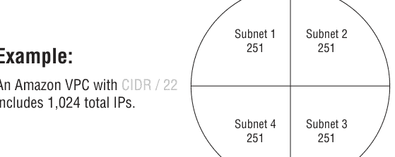

任何在 2013 年 12 月 4 日之后创建的 `AWS` 账户在每个 `AWS` 区域都有一个默认的 `Amazon VPC`。如果您没有指定要启动的 `VPC`，您的服务将启动到默认 `VPC` 中。

默认 `VPC` 包含以下内容：

- 一个大小为 `/16` 的 `IPv4` 无类别域间路由 (`CIDR`) 区块 (`172.31.0.0/16`)
- 每个可用区一个默认子网（使用 `/20` 子网掩码）
- 一个 `Internet` 网关
- 一个主路由表，其规则允许发往 `Internet` 的 `IPv4` 流量通过 `Internet` 网关
- 一个允许所有流量的默认安全组
- 一个允许所有流量的默认网络 `ACL`
- 一个默认 `DHCP` 选项集

您可以像使用任何其他 `VPC` 一样使用默认 `VPC`：您可以添加子网、修改主路由表、添加路由表、关联额外的安全组、更新默认安全组的规则以及添加 `VPN` 连接。在添加自定义路由表和设置网络 `ACL` 时，可以使用默认子网。在启动 `Amazon EC2` 实例时，也可以指定默认子网。

虽然默认子网带有 `IPv4` 地址启动，但您可以选择为默认 `VPC` 关联 `IPv6` `CIDR` 区块。

> 清晰理解路由表、网络 `ACL` 以及它们如何运行和控制访问是基础性的。要了解每种工具控制什么类型的流量以及它们是如何相互作用的。网络连通性排除是此考试的关键技能。

# `Amazon` 虚拟私有云 (`Amazon VPC`)

## 路由表

当创建 `VPC` 时，也会创建一个与 `VPC` 关联的路由表。这被称为默认路由表。`VPC` `10.155.0.0/16` 的默认路由表看起来就像表 5.1。

### 表 5.1 `VPC` 的默认路由表

| 目的地 | 目标 | 状态 | 传播 |
|---|---|---|---|
| `10.0.0.0/16` | `local` | `Active` | `No` |

这告诉我们，任何目的地址在 `10.155.0.0/16` 网络中的 IP 数据包（地址在 `10.155.0.0` 到 `10.155.255.255` 之间的任何包）将在此 `VPC` 内交付。它还告诉我们，任何其他 IP 地址的 IP 数据包将被丢弃，因为没有如何路由该数据包的指令。

可以修改路由表以适应其他地址。表 5.2 展示了这一概念。

### 表 5.2 通往 `Internet` 的路由 `VPC` 路由表

| 目的地 | 目标 | 状态 | 传播 |
|---|---|---|---|
| `10.0.0.0/16` | `local` | `Active` | `No` |
| `0.0.0.0/0` | `Internet-gateway-id` | `Active` | `No` |

路由表现在有一条额外的路由。针对 `10.155.0.0/16` 网络的所有网络流量将在此 `VPC` 内交付，而所有其他数据包将去 `Internet` 网关 (`igw-5af67a3e`)。我们将在本节稍后讨论 `Internet` 网关。

## 网络访问控制列表 (`ACLs`)

`VPC` 还有一个默认的访问控制列表 (`ACL`)。此默认 `ACL` 将允许所有流量。您可以根据端口、协议和 IP 地址允许或拒绝入站或出站流量来修改网络 `ACL`。网络 `ACL` 的工作方式与数据中心的防火墙相同。您可以创建许多顺序评估的规则，当发生匹配时，就会调用该规则。网络 `ACL` 引入于第三章“安全与 `AWS` 身份和访问管理 (`IAM`)”，图 5.3 显示了一个网络访问控制列表。

### 图 5.3 默认网络访问控制列表

| 摘要 | 入站规则 | 出站规则 | 子网关联 | 标签 |
|---|---|---|---|---|
| 允许入站流量。由于网络 `ACL` 是无状态，您必须创建入站和出站规则。 | | | | |
| 规则 # | 类型 | 协议 | 端口范围 | 源 | 允许 / 拒绝 |
|---|---|---|---|---|---|
| `100` | 所有流量 | 所有 | 所有 | `0.0.0.0/0` | `ALLOW` |
| | 所有流量 | 所有 | 所有 | `0.0.0.0/0` | `DENY` |

## 安全组

`VPC` 还有一个默认的安全组。此默认安全组允许所有流量。参见图 5.4 所示的 `VPC` 图形。它也可以根据需要进行修改。安全组引入于第三章并在第四章中深入讨论。

### 图 5.4 `VPC` 图形

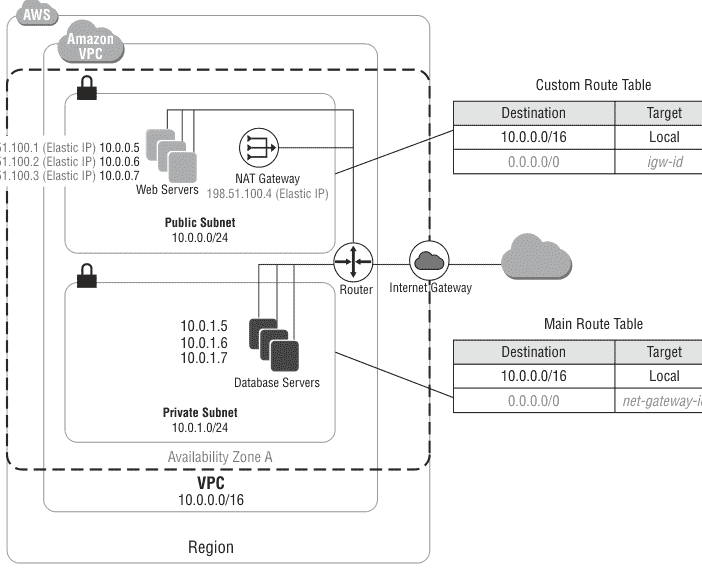

# `Amazon` 虚拟私有云 (`Amazon VPC`)

当 `VPN` 用于 `VPN` 连接时，它同时支持静态路由和边界网关协议 (`BGP`)。当它用于 `AWS Direct Connect` 连接时，它仅支持 `BGP`。`AWS Direct Connect` 将在本章稍后部分进行详细讨论。请参见图 5.7 的带有 `VPN` 网关的 `VPC` 图。

## 图 5.7 带有 `VPN` 网关的 `VPC`

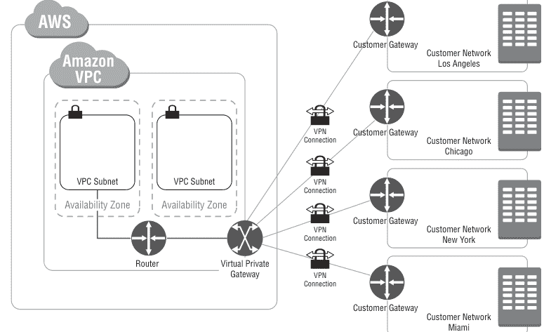

为了让实例能够与 `VPC` 外部的服务成功通信，需要为该实例关联公共 IP 地址。该 IP 地址可以在实例创建时分配给它，也可以通过 `NAT` 分配。此 `NAT` 服务可以由配置为 `NAT` 服务器的 `Amazon EC2` 实例提供，也可以通过使用 `NAT` 网关提供。本章后面将对 `NAT` 网关进行更多介绍。

> 注意：`VPN` 连接将您的本地网络连接到 `VPC`。如果您需要访问 `VPC` 外部的服务（例如 `Amazon DynamoDB`），您的流量将通过公共互联网传输。本章稍后讨论的 `AWS Direct Connect` 提供一个公共虚拟接口，用于处理从您的本地网络到这些服务的流量。

## `VPC` 端点

连接到 `VPC` 外部服务（特别是连接到 `Amazon Simple Storage Service`, `Amazon S3`）的另一种方法是使用 `VPC` 端点。`VPC` 端点允许您的 `Amazon S3` 桶成为路由表中的一个条目。这允许您在不使用 `VPN` 网关的情况下创建私连接。表 5.4 展示了这个概念。

## 表 5.4 带有 `VPC` 端点的路由表

| 目的 | 目标 | 状态 | 传播 |
|---|---|---|---|
| `10.0.0.0/16` | `local` | `Active` | `No` |
| `0.0.0.0/0` | `igw-5af67a3e` | `Active` | `No` |
| `pxl-xxxxxxxx` | `vpce-xxxxxxxx` | `Active` | `No` |

## `VPC` 对等连接 (`VPC Peering`)

您可以使用 `VPC` 对等连接连接到其他 `VPC`（包括您控制的 `VPC` 和不受您控制的 `VPC`）。这允许另一个 `VPC` 成为您路由表中的另一个条目。表 5.5 展示了这个概念。

## 表 5.5 带有 `VPC` 对等连接的路由表

| 目的 | 目标 | 状态 | 传播 |
|---|---|---|---|
| `10.0.0.0/16` | `local` | `Active` | `No` |
| `0.0.0.0/0` | `igw-5af67a3e` | `Active` | `No` |
| `192.168.0.0/0` | `pcx-c37bfaa` | `Active` | `No` |

`Amazon VPC` 对等连接是两个 `VPC` 之间的网络连接，允许您使用 `IPv4` 地址或 `IPv6` 地址在它们之间路由流量。任何 `VPC` 中的实例都可以相互通信，就像它们在同一个网络中一样。您可以在 `VPC` 与另一个 `AWS` 账户中的 `VPC` 之间创建 `VPC` 对等连接。在这两种情况下，`VPC` 必须位于同一区域。
`AWS` 使用 `Amazon VPC` 的现有基础设施来创建 `VPC` 对等连接；它不是网关或 `VPN` 连接，且不依赖于独立的物理硬件。通信没有单点故障，也没有带宽瓶颈。

> 注意：使用 `VPC` 对等连接存在限制：`VPC` 必须位于同一区域，不能有重叠的 IP 地址，并且必须相互交换流量（一个 `VPC` 不能将流量传递给另一个 `VPC` 由其转发到第三个 `VPC`）。安全性通过要求两个 `VPC` 之间进行“握手”以及使用安全组来提供。

## 弹性网络接口 (`Elastic Network Interfaces`)

弹性网络接口（在本书中称为网络接口）是您可以附加到 `VPC` 中实例的虚拟网络接口。网络接口仅适用于运行在 `VPC` 中的实例。

一个网络接口可以包含以下属性：

- 一个主 `IPv4` 地址
- 一个或多个备用 `IPv4` 地址
- 每一个私有 `IPv4` 地址对应一个弹性 IP 地址 (`Elastic IP address` `IPv4`)
- 一个公共 `IPv4` 地址
- 一个或多个 `IPv6` 地址
- 一个或多个安全组
- 一个 `MAC` 地址
- 一个源/目的检查标记
- 描述

您可以创建一个网络接口，将其附加到实例上，将其从实例上卸载，并将其附加到另一个实例上。网络接口的属性会随着它从实例上附加或卸载并重新附加到另一个实例而保持不变。当您将网络接口从一个实例移动到另一个实例时，流量将重定向到新实例。

`VPC` 中的每个实例都有一个默认网络接口，即主网络接口 (`eth0`)。您无法从实例上卸载主网络接口。您可以创建并附加额外的网络接口。您可以使用的网络接口最大数量取决于类型。

当您创建网络接口时，它会继承子网的 `IPv4` 划分属性。如果您修改了子网的 `IPv4` 划分，网络接口将保留其创建时生效的设置。如果您启动实例并为 `eth0` 指定现有的网络接口，则公共 `IPv4` 划分将由网络接口决定。

此外，您可以将 `IPv6` `CIDR` 块与您的 `VPC` 和子网关联，并从子网范围分配一个或多个 `IPv6` 地址到网络接口。

所有子网都有一个可修改的属性，该属性决定了在该子网中创建的网络接口（因此启动到该子网的实例）是否会自动从子网范围分配 `IPv6` 地址。

> 弹性网络接口 (`ENIs`) 是与创建它们的账户关联的静态 `IPv4` 地址。由于它们与账户关联，因此可以与 `VPC` 中的实例关联。当实例关闭时，这些 IP 地址仍然与账户关联。

## 弹性 IP 地址 (`EIP`)

弹性 IP 地址是为动态计算设计的静态公共 `IPv4` 地址。该地址与 `AWS` 账户关联，允许您通过重新映射到另一个 `EC2` 实例来掩盖实例故障。

弹性 IP 地址是可以从互联网访问的公共 `IPv4` 地址。如果您的实例没有公共 `IPv4` 地址，可以关联一个弹性 IP 地址以便与互联网通信；例如从您的本地计算机连接。

目前弹性 IP 地址不支持 `IPv6`。

以下是关于使用弹性 IP 地址的重要事实：

- 要使用弹性 IP 地址，您首先需要为账户分配一个并将其与实例关联。
- 当您将弹性 IP 地址与实例或网络接口关联时，实例的公共 `IPv4` 地址（如果有）将释放回 `Amazon` 的池。
- 您可以从一个资源关联弹性 IP 地址并重新关联另一个资源。
- 未关联的弹性 IP 地址在显式释放之前将保留在您的账户中。
- 当您的实例运行时，关联实例的单个弹性 IP 地址不收费，但关联实例的任何额外弹性 IP 地址将收费。
- 如果弹性 IP 地址未关联到运行实例，或者关联到停止的实例或未连接的网络接口，将产生少量的小小时费用。
- 弹性 IP 地址是区域性资源。

## `Amazon VPC` 管理

您可以使用 `AWS` 管理控制台、`AWS` 命令行 (`AWS CLI`) 或 `AWS` 软件开发包 (`SDK`) 创建并管理 `VPC`。用于管理和诊断 `VPC` 问题的两个工具如下：

- `AWS CloudTrail`
- `Amazon VPC Flow Logs`

通过 `AWS CloudTrail`，您可以记录各种 `API` 调用并以此跟踪活动。通过 `Amazon VPC Flow Logs`，您可以捕捉进出 `VPC` 网络接口的 IP 流量信息。`Amazon VPC Flow Logs` 在第 3 章讨论过。由于本章是网络章节，我们将详细讨论 `Amazon VPC Flow Logs`。

# `Amazon` 虚拟私有云 (`Amazon VPC`)

## `Amazon VPC Flow Logs`

`Amazon VPC Flow Logs` 是一项功能，允许您捕获进出 `VPC` 中网络接口的 IP 流量信息。日志数据使用 `Amazon CloudWatch Logs` 进行存储。在创建日志流日志后，您可以在 `CloudWatch Logs` 中查看并检索其数据。

流日志可以帮助您完成许多任务；例如，排查为什么特定流量未到达实例，这反过来可以帮助您诊断限制性的安全组规则。您还可以将日志作为安全工具，监控到达您的实例的流量。

您可以为 `VPC`、子网或网络接口创建流日志。如果您为子网或 `VPC` 创建了日志，则该 `VPC` 或子网中的每个网络接口都将受到监控。日志数据会发布到 `CloudWatch Logs` 中的日志组中，每个网络接口都有唯一的日志流。日志流包含日志记录，日志记录是描述网络接口流量的事件字段。

> 运行在混杂模式（`promiscuous mode`）下的虚拟实例无法接收或嗅探针对其他虚拟实例的流量。虽然客户可以选择将其接口置于混杂模式，但虚拟机程序（`Hypervisor`）不会将流量发送给未在其地址范围内的实例。这正是 `Amazon VPC Flow Logs` 的用处。

要创建流日志，请指定您要创建流日志的资源、要捕获的流量类型（接受、拒绝流量或所有）、流日志将发布到的 `CloudWatch Logs` 日志组名称，以及具有足够权限将日志发布到 `CloudWatch Logs` 日志组的 `IAM` 角色的 `Amazon Resource Name` (`ARN`)。如果您指定的日志组不存在，`AWS` 将尝试为您创建该日志组。创建流日志后，可能需要几分钟才能开始收集数据并发布到 `CloudWatch Logs`。流日志不会捕获网络接口的实时日志流。

您可以创建多个发布到 `CloudWatch Logs` 中同一日志组的流日志。如果同一个网络接口出现在同一组的一个或多个流日志中，它将拥有一个合并的日志流。如果您指定一个流日志捕获拒绝的流量而另一个流日志捕获接受的流量，那么合并后的日志将捕获所有流量。

如果您在为子网或 `VPC` 创建流日志后，在该子网中启动了更多实例，一旦记录了该接口的任何网络流量，就会为每个新网络接口创建一个日志流。

您可以为其他 `AWS` 服务创建的网络接口创建流日志；例如，弹性负载均衡（`Elastic Load Balancing`）、`Amazon RDS`、`Amazon ElastiCache`、`Amazon Redshift` 和 `Amazon WorkSpaces`。但是，您无法使用这些服务的控制台或 `API` 创建流日志。您必须使用 `Amazon EC2` 控制台或“`Amazon EC2 API`”。同样，您无法使用 `CloudWatch Logs` 控制台或 `API` 为您的网络接口创建日志流。

## `AWS Direct Connect`

如果您不再需要流日志，可以删除它。删除流日志将禁用该资源的流日志服务，且不会创建新的流日志记录或日志流。它不会删除网络接口的任何现有流日志记录或日志流。要删除现有的日志流，可以使用 `CloudWatch Logs`。在删除流日志后，可能需要几分钟才能停止收集数据。

`AWS Direct Connect` 通过标准的 `1 Gbps` 或 `10 Gbps` 光纤电缆将内部网络连接到 `AWS Direct Connect` 地点。一根电缆连接到您的路由器，另一根连接到 `AWS Direct Connect` 路由器。建立此连接后，您可以创建虚拟接口来连接 `AWS` 云服务（例如连接到 `Amazon S3`）或 `Amazon VPC`，绕过互联网网络路径。`AWS Direct Connect` 地点提供访问与其关联区域内 `AWS` 的权限。

有许多原因使用 `AWS Direct Connect` 而非互联网来访问资源：

- **降低您的带宽成本。** 对于您想在 `AWS` 上运行的带宽密集型工作负载，`AWS Direct Connect` 以两种方式减少您的网络出站费用。首先，通过在 `AWS Direct` 之间传输数据，您可以减少对互联网服务提供商的带宽承诺。其次，所有通过您的专用连接传输的数据都按 `AWS Direct` 数据传输率计费，而不是按互联网数据费率。

- **实现一致的性能。** 由于互联网不断改变数据从 A 点到 B 点的方式，互联网上的网络延迟可能会变化。通过 `AWS Direct Connect`，您可以选择哪些数据使用专用连接以及这些数据如何路由，这比基于互联网的连接提供了更一致的网络体验。

- **到 `AWS` 的私有连接**：您可以使用 `AWS Direct Connect` 从本地网络直接到 `Amazon VPC` 建立私有接口，在您的网络和 `VPC` 之间提供私有的、高带宽的网络连接。通过多个虚拟接口，您甚至可以在维护网络隔离的情况下建立到多个 `VPC` 的私有连接。

- **弹性和可扩展性**：`AWS Direct Connect` 提供 `1 Gbps` 和 `10 Gbps` 的连接，如果您需要更多容量，可以轻松配置多个连接。您还可以使用 `AWS Direct Connect` 代替通过互联网到 `Amazon VPC` 建立 `VPN` 连接，避免使用经常无法支持 `4 Gbps` 以上数据传输速率的 `VPN` 硬件。


## `AWS Direct Connect` 实现

您可以通过以下方式之一设置 `AWS Direct Connect` 连接：

- 在 `AWS Direct Connect` 地点
- 通过 `AWS` 合作伙伴网络 (`APN`) 成员
- 通过 `APN` 成员提供的托管连接

> 注意：`Direct Connect` 服务包含两个部分：实际的物理连接和虚拟接口 (`VIF`)。`Direct Connect` 使用连接到您要使用的 `VPC` 的 `VPN` 网关。

### 虚拟接口

若要通过您的 `Direct Connect` 连接路由流量，需要创建一个或多个虚拟接口 (`VIF`)。如果您有来自您的位置并绑定到 `VPC` 中计算实例的流量，则需要创建一个私有 `VIF`。如果流量是发往互联网的 `AWS` 云服务，则需要创建一个公共 `VIF`。如果流量同时发往这两者，则您需要同时创建私有和公共 `VIF`。`VIF` 的组件不在 `AWS SysOps` 考试的范围内；然而，这对您准备考试的帮助不大。

每个 `VIF` 具有以下组件：

- **虚拟局域网 (`VLAN`) ID**：每个 `VIF` 必须有自己的 `VLAN ID`。该值必须是 `1` 到 `4094` 之间的值。
- **对等 IP 地址**：`AWS Direct Connect` 支持 `IPv6` 以及公共和私有 `IPv4` 地址。您还可以对接口进行堆叠。对于公共 `VIF`，您需要指定您拥有的 `IPv4/30` 地址。对于私有 `VIF`，使用 `IPv4 /30` 地址。对于 `IPv6`，`Amazon` 将为您分配 `/68` `IPv6` 地址。
- **`BGP`**：`BGP` 是唯一支持的路由协议。对于私有 `VIF`，使用私有自治系统编号 (`ASN`)。对于公共 `VIF`，使用公共 `ASN`，且这是您必须拥有的。
- **通过 `BGP` 宣告的路由**：`Direct Connect` 公共 `VIF` 最多发布 `1000` 个前缀，私有 `VIF` 最多发布 `100` 个前缀。

如前所述，`Direct Connect` 使用 `VPN` 网关连接到您的 `AWS` 基础设施。因此，您需要通过 `VPN` 网关连接到 `VPC`。

### 开始使用 `Direct Connect`

现在我们讨论开始使用 `Direct Connect` 的步骤。对于考试，请理解之前讨论过的公共和私有 `VIF` 概念。开始使用 `Direct Connect` 的七个步骤如下：

1. **注册 `Amazon Web Services`**。如果您还没有 `AWS` 账户，使用 `AWS Direct Connect` 就需要一个。

2. **提交 `AWS Direct Connect` 请求**。您可以使用 `AWS Direct Connect` 控制台提交连接。在开始之前，请确保您拥有以下信息：
    a. 您所需的端口速度：`1 Gbps` 或 `10 Gbps`。在创建连接后，您无法更改端口速度。
    b. 要连接的 `AWS Direct Connect` 地点。

    > 如果您需要的端口速度小于 `1 Gbps`，则无法通过控制台请求连接。相反，请联系 `APN` 合作伙伴，他们将为您创建一个托管连接（`hosted connection`）。托管连接将出现在您的 `AWS Direct Connect` 控制台中，并且在在使用之前必须被接受。

3. **下载 `LOA-CFA`**。`AWS` 提供授权书和连接设施分配书（`LOA-CFA`）供下载，或者在您创建连接请求后，它会通过电子邮件向您发送更多信息的请求。如果您收到更多信息的请求，您必须在七天内回复，否则连接将被删除。`LOA-CFA` 是连接到 `AWS` 的授权，托管服务提供商或网络服务提供商需要它来建立跨网络连接（`cross-connect`）。

    > 如果链接尚未启用，您尚无法下载 `LOA-CFA`。请检查您的电子邮件以获取更多信息的请求。如果 `72` 小时后仍不可用或未收到电子邮件，请联系 `AWS` 支持。

    下载 `LOA-CFA` 后，请执行以下操作之一：

    - 如果您正在与网络提供商合作，请将 `LOA-CFA` 发送给您的网络提供商，以便他们为您预订交叉连接。如果您在 `AWS Direct Connect` 地点没有设备，则无法为自己预订交叉连接。您的网络提供商将为您完成此操作。
    - 如果您在 `AWS Direct Connect` 地点拥有设备，请联系托管提供商以请求跨网络连接。您必须是该托管提供商的客户，并且必须向他们提供授权连接到 `AWS` 路由器的 `LOA-CFA` 以及连接到您的网络的必要信息。

    > `LOA-CFA` 在 `90` 天后过期。若要使用新的发布日期刷新 `LOA-CFA`，您可以从 `AWS Direct Connect` 控制台重新下载。如果您不采取任何操作，`AWS` 将删除该连接。端口计费从您创建连接起 `90` 天后开始，或从您的路由器与 `AWS` 路由器之间的连接建立后开始，以较晚者为准。

4. **（可选）配置冗余连接**。为了实现故障转移，我们建议您请求并配置两个到 `AWS` 的专用连接。这些连接终止在您网络中的一个或两个路由器上。

    当提供两个连接时，有不同的配置可选：主/主（`Active/Active`）和主/备（`Active/Passive`）。

    > 您如何配置连接不会影响冗余性，但它会影响决定数据如何在两个连接上路由的策略。我们建议将两个连接都配置为活动状态。

5. **创建虚拟接口**。在订购 `AWS Direct Connect` 连接后，您必须在使用它之前创建一个虚拟接口。您可以创建一个私有虚拟接口以连接到您的 `VPC`，也可以创建一个公共虚拟接口以连接到不在 `VPC` 中的 `AWS` 服务。我们不会讨论具体的步骤，因为这超出了本书的范围。请访问 `http://docs.aws.amazon.com/directconnect/latest/UserGuide/getting_started.html`。

    > 低于 `1G` 的连接仅支持一个虚拟接口。

6. **下载路由器配置**。在为您的 `AWS Direct Connect` 连接创建虚拟接口后，您可以下载路由器配置文件。

7. **验证您的虚拟接口**。在建立到 `AWS` 云或 `Amazon VPC` 的虚拟接口后，您可以验证您的 `AWS Direct Connect` 连接。

    > 设置 `AWS Direct Connect` 连接所需的具体步骤和命令，请参考《`AWS Direct Connect` 用户指南》
    `http://docs.aws.amazon.com/directconnect/latest/UserGuide/getting_started.html`

# `AWS Direct Connect` 管理

您可以使用 `AWS` 管理控制台和 `AWS CLI` 来创建和操作 `AWS Direct Connect`。您可以在 `AWS Direct Connect` 资源上使用标签对资源进行分类和管理。

# 高可用性

`AWS Direct Connect` 默认不是高可用服务。虽然它使用了高可用的 `VPN` 网关，但它是一个单路，这并非高可用。要实现 `AWS Direct Connect` 的高可用性，您需要拥有多个 `AWS Direct Connect` 连接，并建议这些连接位于不同的 `AWS` 区域。

`VPN` 可作为您的 `AWS Direct Connect` 的备份连接。

# 路由优先级

虽然详细讨论这一点已超出本书的范围，但您应该意识到，当面对具有多个路由的封包时，`AWS` 将按照以下顺序选择路由：

1. `VPC` 内部的本地路由
2. 最长前缀匹配（这将位于路由表中）
3. 静态路由
4. `AWS Direct Connect` `BGP`
5. `VPN` 静态路由（定义在 `VPN` 连接上）
6. `VPN` `BGP`

在用 `VPN` 连接备份 `AWS Direct Connect` 或反之时，意识到路由优先级非常重要，`VPN` 可以作为 `AWS Direct Connect` 的备份方案。如果您正在使用 `VPN` 且 `AWS Direct Connect` 变得可用，流量应该立即开始利用 `AWS Direct Connect`。

> `AWS Direct Connect` 的成本包括按小时计费的端口费用、数据传输费用、来自 `AWS Direct Connect` 合作伙伴的线路费用，以及个人（如果在托管机房内）的交叉连接费用。数据传输费用明显低于类似的费用。

# `AWS Connect` 安全

`AWS Direct Connect` 通过多种方式实现安全性。每个 `VIF` 的第 3 层与其他 `VLAN` 隔离，因为它运行在自己的 `VLAN` 中。

与其他 `AWS` 服务一样，`IAM` 用于控制哪些规则、用户或组可以执行 `API`。`IAM` 的作用在于 `Direct Connect` 资源的创建和管理。`CloudWatch` 可用于捕获对 `Direct Connect` 的 `API` 调用。`AWS Direct Connect` 允许拥有现有广域网（`WAN`，如协议标签交换（`MPLS`）或虚拟局域网服务（`VPLS`））的客户将 `AWS` 添加到其网络中的节点。这使得 `AWS` 集成到企业变得更加容易。

# 负载均衡

弹性负载均衡将传入的应用程序流量分到单区域内多个可用区的 `EC2` 实例。弹性负载均衡支持两种负载均衡器：

- 应用负载均衡器
- 经典负载均衡器

负载均衡器作为单一目标增加了应用程序的可用性。您可以在负载均衡器中添加或删除实例，而不会影响应用程序的整体流量。弹性负载均衡配合自动扩展，可以随着时间的推移缩放负载均衡器。有关自动扩展如何工作的详情，请参考第 10 章“高可用性”。

您可以配置健康检查并将请求发送到健康实例。您可以将加密和解密的工作卸载给负载均衡器。经典负载均衡器与应用负载均衡器的差异请参阅表 5.6。

# 表 5.6 经典负载均衡器与应用负载均衡器

| 特性 | 经典负载均衡器 | 应用负载均衡器 |
|---|---|---|
| 协议 | `HTTP`, `HTTPS`, `TCP`, `SSL` | `HTTP`, `HTTPS` |
| 平台 | `Amazon EC2-Classic`, `Amazon EC2-VPC` | `Amazon EC2-VPC` |
| 粘性会话（`Cookie`） | ✓ | 负载均衡器生成 |
| 空闲连接超时 | ✓ | ✓ |
| 连接注销 | ✓ | ✓ |
| 跨区域负载均衡 | 可启用 | 始终启用 |
| 健康检查 | ✓ | 改进 |
| `Amazon CloudWatch` 指标 | ✓ | 改进 |
| 访问日志 | ✓ | 改进 |
| 基于主机的路由 | | ✓ |
| 基于路径的路由 | | ✓ |

## 表 5.6 经典负载均衡器与应用型负载均衡器（续）

| 特性 | 经典负载均衡器 (`Classic Load Balancer`) | 应用型负载均衡器 (`Application Load Balancer`) |
|---|---|---|
| 路由到单个实例上的多个端口 | | ✓ |
| 支持 `HTTP/2` | | ✓ |
| 支持 `WebSocket` | | ✓ |
| 负载均衡器删除保护 | | ✓ |

## 负载均衡实现

由于经典负载均衡器和应用负载均衡器分配流量的方式不同，其实现方式也不同。让我们从经典负载均衡器开始。本章的后续将介绍这两种负载均衡器。

## 经典负载均衡器

使用经典负载均衡器，你需要配置许多参数。这些包括：

- 选择 `VPC`
- 选择子网
- 定义协议和端口
- 选择面向互联网或内部
- 确定安全组
- 配置健康检查
- 分配 `Amazon EC2` 实例

如果你有多个 `VPC`，需要确定哪一个 `VPC` 将包含应用负载均衡器。负载均衡器无法在 `VPC` 之间共享。之后，你将看到已创建子网的可用区列表。

为了让应用程序被视为高可用，你必须指定至少两个可用区。如果你需要额外的可用区，则需要在这些可用区中创建子网。

## 高可用

你可以将传入的流量分到单个可用区或多个可用区的 `Amazon EC2` 实例上。经典负载均衡器根据传入的应用流量自动扩展其请求处理能力。

## 健康检查

经典负载均衡器可以检测 `Amazon EC2` 实例的健康状况。当它检测到不健康的 `Amazon EC2` 实例时，将不再将流量路由到这些实例，并将负载分散到剩余的健康实例。

## 安全功能

使用 `Amazon` 虚拟私有云 (`Amazon VPC`) 时，你可以创建并管理与经典负载均衡器关联的安全组，提供额外的网络和安全选项。你还可以创建一个没有公共 IP 地址的经典负载均衡器作为内部（非面向互联网）负载均衡器。

## `SSL` 卸载

经典负载均衡器支持 `SSL` 终结（`Termination`），包括从应用程序实例卸载 `SSL` 解密、`SSL` 证书的中心化管理，以及带有可选公钥认证的后端加密。

灵活的加密算法支持允许你控制负载均衡器向客户端呈现的加密算法和协议。

## 粘性会话 (`Sticky Sessions`)

经典负载均衡器支持使用 `Cookie` 将用户会话固定到特定的 `EC2` 实例上。当用户继续访问你的应用程序时，流量将路由到相同的实例。

## `IPv6` 支持

经典负载均衡器支持互联网协议版本 4 和 6 (`IPv4` 和 `IPv6`)。目前 `VPC` 尚不支持 `IPv6` 使用。

## 第 4 层或第 7 层负载均衡

你可以负载均衡 `HTTP/HTTPS` 应用程序并使用第 7 层特定功能，例如 `X-Forwarded` 和粘性会话。你也可以对纯依赖 `TCP` 协议的应用程序使用第 4 层负载均衡。

## 监控

经典负载均衡器的指标（如请求数和请求延迟）由 `Amazon CloudWatch` 报告。

## 日志

使用访问日志（`Access Logs`）记录发送到负载均衡器的所有请求，并将日志存储在 `Amazon S3` 中供以后分析。日志对于诊断应用程序故障和分析网络流量有用。

## 第 5 章 • 网络

你可以使用 `AWS CloudTrail` 记录帐户的经典负载均衡器 `API` 调用并交付日志文件。`API` 调用历史允许你执行安全分析、资源变更跟踪和合规性审计。

你可以将经典负载均衡器分配到 `VPC` 中的任何 `Amazon EC2` 实例，包括不在你指定的可用区中的 `Amazon EC2` 实例。如果是这样，经典负载均衡器将不会将流量路由到那些 `Amazon EC2` 实例。


## 应用型负载均衡器

使用应用负载均衡器，你需要配置许多参数。这些包括：

- 负载均衡器名称
- 安全组
- 将使用的可用区
- 面向互联网或内部
- 使用的 IP 地址方案
- 配置一个或多个监听器
- 配置监听器规则
- 定义目标组

表 5.6 展示了应用型负载均衡器的功能。为了成为 `AWS` 上熟练的系统运维人员，你需要了解这些功能的作用。应用型负载均衡器的功能在后续章节中定义。

## 基于内容的路由

如果你的应用程序由多个独立服务组成，应用负载均衡器可以根据请求的内容将请求路由到特定服务。

## 基于主机的路由

你可以根据 `HTTP` 头部中的 `Host` 字段路由客户端请求，允许你从同一个负载均衡器路由多个域名。

## 基于路径的路由

你可以根据 `HTTP` 头部中的 `URL` 路径路由客户端请求。

## 容器化应用程序支持

现在你可以配置应用负载均衡器，跨单个 `Amazon EC2` 实例上的多个端口进行负载均衡。`Amazon EC2` 容器 (`Amazon ECS`) 允许在 `ECS` 任务定义中指定动态端口，当容器调度到 `EC2` 实例时，为容器提供一个未使用的端口。`ECS` 调度器会自动使用此端口将任务添加到 `ELB`。

## `HTTP/2` 支持

`HTTP/2` 是超文本传输协议 (`HTTP`) 的新版本，它使用单一的多路复用连接允许同一连接上发送多个请求。它还会在发送前以二进制格式压缩标头，并支持到客户端的 `TLS` 连接。

## `WebSocket` 支持

`WebSockets` 通过长时间运行的 `TCP` 连接在客户端和服务器之间提供双向通信通道。应用型负载均衡器支持 `WebSocket`。

## 原生 `IPv6` 支持

应用型负载均衡器在 `VPC` 中支持原生 `IPv6`。

## 粘性会话 (`Sticky Sessions`)

粘性会话是一种将相同客户端路由到相同目标的机制。负载均衡器支持使用 `Cookie` 实现粘性会话。粘性在目标组级别定义。

## 健康检查

应用负载均衡器仅将流量路由到健康目标。通过应用负载均衡器，你可以通过两种方式获取应用程序健康状况：

- 健康检查改进允许你配置 `200-399` 的详细错误代码。
- 提供运行在 `Amazon EC2` 实例上的每个服务的指标。

## 高可用

应用负载均衡器要求指定多个可用区。你可以将传入的流量分到多个可用区的目标上。应用负载均衡器根据传入的应用流量自动扩展其请求处理能力。

## 七层负载均衡

你可以负载均衡 `HTTP/HTTPS` 应用程序并使用七层特定功能，例如 `X-Forwarded-For` 标头。

## `HTTPS` 支持

应用负载均衡器支持客户端与负载均衡器之间的 `HTTPS` 终结。应用负载均衡器还通过 `AWS` 身份访问管理 (`IAM`) 和 `AWS` 证书提供安全策略的管理。

## 监控

`CloudWatch` 报告负载均衡器指标，如请求计数、错误计数、错误类型和请求延迟。

## 日志

你可以使用访问日志功能记录发送到负载均衡器的所有请求，并将日志存储在 `Amazon S3` 中供以后分析。日志经过压缩并具有 `.gz` 文件扩展名。压缩日志节省了空间和带宽，对于诊断应用程序故障和分析网络流量有用。

你还可以使用 `AWS CloudTrail` 记录帐户的负载均衡器 `API` 调用并交付日志文件。

## 删除保护

你可以对应用负载均衡器启用删除保护以防止其被意外删除。

## 请求跟踪

负载均衡器会在进入负载均衡器的所有请求中注入自定义标识 `"X-Amzn-Trace-Id"` `HTTP` 标头。请求跟踪允许你在请求穿过构成网站和分布式应用程序的各种服务时通过其唯一 ID 进行跟踪。你可以使用跟踪标识在单个请求粒度发现任何性能或时间问题。

## `Web` 应用防火墙

你现在可以使用 `AWS WAF` 保护应用负载均衡器上的 `Web` 应用程序。`AWS WAF` 是一种 `Web` 应用防火墙，帮助保护 `Web` 应用程序免受可能影响可用性、损害安全性或消耗过多资源的常见 `Web` 攻击。

## 负载均衡管理

`Elastic Load Balancing` 是一个高可用可扩展的服务。

# 负载均衡

您可以使用以下任何界面来创建、访问和管理负载均衡器：

- **`AWS` 管理控制台**：提供 `Web` 界面，可以使用它访问弹性负载均衡（`Elastic Load Balancing`）。
- **`AWS CLI`**：为广泛的 `AWS` 云服务（包括弹性负载均衡）提供命令，并支持 `Windows`、`Mac` 和 `Linux`。
- **`AWS SDKs`**：提供特定语言的 `API`，并处理许多连接细节，例如对请求签名、处理重试和错误处理。
- **`Query API`**：提供供您通过 `HTTPS` 请求调用的低级 `API`。`Query API` 是访问弹性负载均衡的最直接方式，但它要求您的应用程序处理低级细节，例如生成用于签名请求的哈希和错误处理。

有三个工具可以管理经典负载均衡器（`Classic Load Balancers`）和应用负载均衡器（`Application Load Balancers`）。这些工具是 `Amazon CloudWatch`、`AWS CloudTrail` 和访问日志。此外，应用负载均衡器具有一项允许请求追踪的功能，用于跟踪从客户端到目标的 `HTTP` 请求。

### `Amazon CloudWatch`

`Amazon CloudWatch` 提供了许多指标，用于跟踪弹性负载均衡器的性能。这些指标包括健康主机数量、平均延迟、请求数和连接数等。这些指标每 `60` 秒更新一次。

### `AWS CloudTrail`

`AWS CloudTrail` 可以捕获弹性负载均衡器所使用的 `API` 调用，并将这些日志传递到您指定的 `Amazon S3` 存储桶中。从那里，您可以根据需要分析日志。信息日志包括 `API` 调用的时间、调用的 `API` 以及请求的参数。

### 访问日志

访问日志是弹性负载均衡的一个可选功能。访问日志捕获了比 `AWS CloudTrail` 更详细的信息，包括诸如延迟、请求路径、发送请求的客户端 IP 地址以及处理请求的实例等信息。

# 请求追踪

请求追踪用于跟踪从客户端到目标或其他服务的 `HTTP` 请求。当负载均衡器接收到客户端的请求时，它会在发送请求到目标之前添加或更新 `X-Amzn-Trace-Id` 头部。负载均衡器和目标之间的任何服务或应用程序也可以添加或更新此头部。头部的内容记录在访问日志中。

# 负载均衡安全

如前所述，安全组控制允许进入您的负载均衡器的流量。您可以选择允许入站和出站流量的端口和协议。您将安全组应用于负载均衡器，因此它将应用于所有接口。

与您的负载均衡器安全组相关的规则必须允许双向流量。这些规则需要同时应用到监听器和健康检查点。当您向负载均衡器添加监听器或更新目标组的健康检查端口时，您需要检查您的安全组规则，以确保它们允许新端口上的双向流量。

# 您的负载均衡器的身份验证和访问控制

`AWS` 使用安全凭证来识别您的身份并授予对您的 `AWS` 资源的访问权限。您可以使用 `AWS` 身份和访问管理（`IAM`）的功能，允许其他用户、服务和应用程序完全或有限地使用您的 `AWS` 资源，而无需共享您的安全凭证。

默认情况下，`IAM` 用户没有创建、查看或修改 `AWS` 资源的权限。要让 `IAM` 用户能够访问资源（例如负载均衡器）并执行任务，您需要创建一个 `IAM` 策略，授予 `IAM` 用户使用其所需的特定资源和 `API` 操作的权限，然后将该策略绑定到 `IAM` 用户或其所属的组。当您将策略绑定到用户或用户组时，它将允许或拒绝用户在指定资源上执行任务的权限。

例如，您可以在您的 `AWS` 账户下创建用户和组（`IAM` 用户可以是个人、系统或应用程序）。然后，使用 `IAM` 策略授予用户和组在指定资源上执行特定操作的权限。

# 虚拟专用网络 (`VPN`)

您可以使用 `VPN` 连接将您的 `VPC` 连接到远程网络。创建此 `VPN` 连接有很多方法。您的选项如下：

- 虚拟私网网关 (`VGW`)
- `AWS VPN CloudHub`
- 软件 `VPN`

# `VPN` 安装

要实现虚拟专用网络，请创建一个 `VGW` 然后将其绑定到 `VPC`。每个 `AWS` 区域最多可以有五个 `VGW`，每个 `VPC` 只能绑定一个 `VGW`。`VGW` 可用于使用 `IPSec` 和 `AWS Direct Connect` 的 `VPN`。

`VGW` 可同时支持静态路由和 `BGP`。无论使用静态路由还是 `BGP`，客户位置和 `VPC` 的 IP 范围必须是唯一的。

# `CloudHub`

`AWS VPN CloudHub` 也使用 `VGW`，并采用星型模型（`hub-and-spoke model`）连接多个客户网关。`AWS VPN CloudHub` 使用 `BGP`，每个客户位置都有唯一的 `ASN`。

# 软件 `VPN`

创建软件 `VPN` 涉及在区域内一个或多个可用区启动一个或多个 `Amazon EC2` 实例，然后在这些 `Amazon EC2` 实例上加载 `VPN` 软件。客户可以直接获取 `VPN` 软件，也可以通过 `AWS Marketplace` 获取。`Marketplace` 提供了许多选项，包括 `OpenVPN`、`Cisco`、`Juniper` 和 `Brocade` 等。

# `VPN` 管理

`VGW` 具有高可用性和可扩展性。每个 `VGW` 都带有两个可访问的 IP 地址。这意味着 `VGW` 建立了两个独立的 `IPSec` 隧道。您需要在一侧提供两个 IP 地址。这些地址可以是单个客户网关，也可以是两个不同位置的客户网关。您可以将多个客户网关连接到同一个 `VGW`。

`AWS VPN CloudHub` 具有高可用性和可扩展性。通过 `AWS VPN CloudHub`，每个位置都通过其 `VPN` 宣告相应的路由。

在创建托管区域（`hosted zones`）后，您需要创建资源记录集。这涉及两个部分：记录类型和路由策略。不同的路由策略可以应用于不同的记录类型。

路由策略决定了 `Amazon Route 53` 如何响应查询。共有五种可用路由策略，本章将解释其中每种策略。

## 简单路由

当您有一个资源为您的域名执行特定功能时，请使用简单路由策略，例如，为 `example.com` 网站提供内容的 `Web` 服务器。在这种情况下，`Amazon Route 53` 仅根据资源记录集中的值（例如 `A` 记录中的 IP 地址）来响应 `DNS` 查询。

## 加权路由

当您有多个执行相同功能的资源（例如，为同一网站服务的 `Web` 服务器），并且您希望 `Amazon Route 53` 按照您指定的比例将流量路由到这些资源时（例如，四分之一点给一台服务器，四分之三给另一台服务器），请使用加权路由策略。图 5.8 展示了加权路由。

**图 5.8** 加权路由

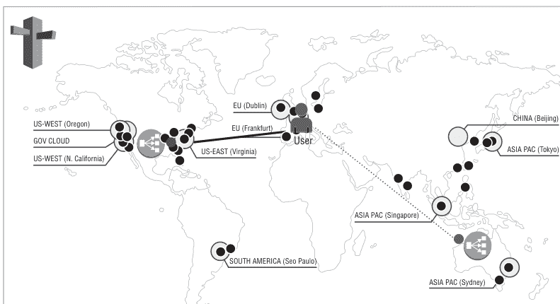

## 延迟路由

当您在多个 `Amazon EC2` 数据中心拥有执行相同功能的资源，并且您希望 `Amazon Route 53` 使用提供最佳延迟的资源响应 `DNS` 查询时，请使用延迟路由策略。例如，您可能在爱尔兰和东京的 `Amazon EC2` 数据中心都拥有 `example.com` 的 `Web` 服务器。当用户访问 `example.com` 时，`Amazon Route 53` 根据哪个数据中心提供的延迟最低来选择响应 `DNS` 查询。图 5.9 展示了这一概念。

## 图 5.9 延迟路由

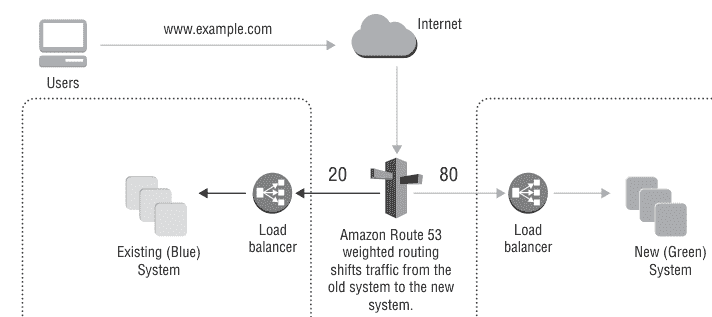

## 地理位置路由

当您希望 `Amazon Route 53` 根据用户的位置响应 `DNS` 查询时，请使用地理位置路由策略。地理位置路由根据用户的地理位置返回响应。您可以按洲、国家或美国州指定地理位置。

> 某些 IP 地址未映射到地理位置，因此即使您创建了涵盖所有七大洲的地理位置资源记录集，`Amazon Route 53` 也会收到来自其无法识别的位置的 `DNS` 查询。您可以创建一个默认资源记录集，处理来自未映射到任何位置的 IP 地址的查询。如果您不创建默认资源记录集，`Amazon Route 53` 对来自这些位置的查询返回“无回答”。

## 故障转移路由

使用故障转移路由策略时，您指定一个主资源和一个备资源。当主资源发生故障时，由备资源接管。要实现这一点，您需要主资源记录集配置健康检查。如果健康检查失败，`Amazon Route 53` 将流量路由到备资源。建议（但并非强制）为备资源配置健康检查。如果两个记录集都处于不健康状态，`Amazon Route 53` 将返回主资源记录集。健康检查将在第 10 章进行更详细的讨论。

您可以结合路由（例如，由故障转移路由备份的地理位置路由），以确保您提供可能的最高级别可用性。正如您可以想象的，这可能会变得非常复杂（且令人困惑），因此良好的文档至关重要。

## `DNS` 记录类型

解释各种 `DNS` 记录类型不是本书的范围。然而，表 5.7 显示了 `Amazon Route 53` 支持的记录类型。

## 表 5.7 `Amazon Route 53` 支持的 `DNS` 记录类型

| 记录类型 | 描述 |
| --- | --- |
| `A` | 地址映射记录 |
| `AAAA` | `IPv6` 地址记录 |
| `CNAME` | 规范名称记录 |
| `MX` | 邮件交换器记录 |
| `NAPTR` | 权威指针记录 |
| `NS` | 域名服务器记录 |
| `PTR` | 反向查找指针记录 |
| `SOA` | 授权起始记录 |
| `SPF` | 发送者策略框架 |
| `SRV` | 服务记录 |
| `TXT` | 文本记录 |

除了支持的标准 `DNS` 记录类型外，`Amazon Route 53` 还支持名为 `Alias`（别名）的记录类型。`Alias` 记录类型不是指向 IP 地址或域名，而是指向以下之一：

- `Amazon CloudFront` 分发节点
- `AWS Elastic Beanstalk` 环境
- `Elastic Load Balancing` `Classic` 或 `Application` 负载均衡器
- 配置为静态网站的 `Amazon S3` 存储桶
- 同一托管区域中的另一个 `Amazon Route 53` 资源集

## 健康检查

您可以使用 `Amazon Route 53` 配置三种类型的健康检查。如下：

- 指定资源的健康状况（例如 `Web` 服务器）
- `Amazon CloudWatch` 告警状态
- 其他健康检查的状态

在本节中，我们将探索每种类型。涵盖的详细程度可能不会在考试中测试。但是，作为一名 `AWS` 认证系统操作员，这里涵盖的内容是必须掌握的。

**指定资源的健康状况（例如 `Web` 服务器）**：您可以配置健康检查，按您指定的间隔、通过 IP 地址或域名来监控端点。`Amazon Route 53` 的定期自动检查会验证您的资源是否是可访问且功能正常的。

**`Amazon CloudWatch` 告警状态**：您可以创建 `CloudWatch` 告警来监控资源的状态。为了提高韧性和可用性，`Amazon Route 53` 会等待 `CloudWatch` 告警进入某种状态。

**其他健康检查的状态**：您可以创建一个健康检查，用以监控 `Amazon Route 53` 是否认为其他健康检查为健康或不健康。这在您有多个执行相同功能的资源时可能有用。

## `Amazon Route 53` 管理

您可以通过以下方式访问 `Amazon Route 53`：

- `AWS` 管理控制台
- `AWS SDK`
- `Amazon Route 53 API`
- `AWS CLI`
- `AWS Tools for PowerShell`

监控域名状态的最佳工具是 `Amazon Route 53` 仪表板。该仪表板将提供任何域名注册、转移以及即将过期的域名状态。

用于监控 `Amazon Route 53` `DNS` 服务的工具是健康检查、`Amazon CloudWatch` 和 `AWS CloudTrail`。健康检查将在管理部分讨论。`CloudWatch` 监控健康检查的次数、`SSL` 握手时间以及健康检查接收第一个字节的时间等指标。`AWS CloudTrail` 可以捕获针对 `Amazon Route 53` 的 `API` 请求。您可以确定调用特定 `API` 用户。

## `Amazon Route 53` 身份验证与访问控制

对 `Amazon Route 53` 资源执行任何操作（例如注册域名或更新记录集），`IAM` 要求您进行身份验证以证明您是授权的 `AWS` 用户。如果您使用 `Amazon Route 53` 控制台，您通过提供 `AWS` 用户名和密码进行身份验证。如果您通过程序访问 `Amazon Route 53`，您的应用程序将使用访问密钥进行身份验证。

在验证身份后，`IAM` 通过验证您是否有执行操作和访问资源的权限来控制您对 `AWS` 的访问。如果您是帐户管理员，可以使用 `IAM` 控制其他用户对与您的账户关联的资源的访问。

最佳性能。如果内容已经在边缘节点，`Amazon CloudFront` 将立即交付内容。如果内容当前不在该边缘节点，`Amazon CloudFront` 将从 `Amazon S3` 存储桶或 `HTTP` 服务器（例如 `Web` 服务器）检索内容，该服务器是您确定的作为内容确定版本的源。
`Amazon CloudFront` 可用于分发静态内容、动态内容和流媒体。

## `Amazon CloudFront` 的实现

在实现 `Amazon CloudFront` 时，第一步是配置您的源服务器，`Amazon CloudFront` 从这些服务器获取文件，并在全球范围的 `Amazon CloudFront` 边缘节点进行分发。源服务器存储对象的原始确定版本。

如果您通过 `HTTP` 提供内容，则您的源服务器可以是 `Amazon S3` 存储桶或 `HTTP` 服务器（如 `Web` 服务器）。您的 `HTTP` 服务器可以运行在 `Amazon EC2` 实例上或由您管理的服务器上；这些服务器也称为自定义源。如果您使用 `Adobe Media Server` 实时消息传输协议 (`RTMP`) 分发媒体文件，则您的源服务器始终是 `Amazon S3` 存储桶。

下一步是将文件上传到您的源服务器。当用户通过您的网站或应用程序请求文件时，`Amazon CloudFront` 会通知服务器获取您的文件。此外，您可以配置源服务器为文件添加标头；这些标头指示了您希望文件在 `Amazon CloudFront` 边缘节点的缓存中保留多久。

最后一步是创建 `Amazon CloudFront` 分发，它告诉 `Amazon CloudFront` 从哪些服务器获取您的文件。

此时，`Amazon CloudFront` 会为您的新分发分配一个域名，并在 `Amazon CloudFront` 控制台中显示它，或在程序化请求的响应中返回它。您还可以配置 `Amazon CloudFront` 分发，以便使用您自己的域名。

现在我们已经讨论（在非常高的层级上）实现 `Amazon CloudFront` 分发所需的步骤，让我们来谈谈该分发是如何配置的。以下是与 `Amazon CloudFront` 分发相关的特性。

## 缓存行为 (`Cache Behaviors`)

缓存行为是您根据网站的扩展名、文件名或 `URL` 模式（例如 `*.jpg`）为 `URL` 模式配置的规则集。您可以为网站的 `Web` 分发配置多个缓存行为。`Amazon CloudFront` 将传入的请求与您的 `URL` 模式列表进行匹配，如果存在匹配，该服务将遵循您为 `URL` 模式配置的缓存行为。每个缓存行为可以包含以下 `Amazon CloudFront` 配置值：源服务器名称、查看者连接协议、最小过期时间、查询字符串参数以及用于私有内容的信任签名者。

## 区域边缘缓存 (`Regional Edge Caches`)

您可以使用 `Amazon CloudFront` 为您的查看者提供性能改进的内容，同时减少对源资源的负载。区域边缘缓存位于您的源 `Web` 服务器与直接向查看者提供流量的全局节点之间。由于对象的流行程度降低，单个边缘节点可能会移除这些对象以为更热门的内容留空间。区域边缘缓存的缓存宽度比任何单个边缘节点都大，对象在这些边缘缓存中保持缓存状态。这有助于让更多内容靠近您的查看者，减少了 `CloudFront` 回到您的源 `Web` 服务器的需求，并提高了查看者的整体性能。例如，我们现在位于欧洲的所有边缘节点现在都会先到法兰克福的区域边缘缓存获取对象，而该缓存仅用于需要回源自定义源的请求；指向 `Amazon S3` 源的请求将跳过区域边缘缓存节点。

您无需对您的 `CloudFront` 分发进行任何更改；此功能对所有 `CloudFront` 分发均默认启用。使用此功能无需额外费用。

## 源服务器 (`Origin Servers`)

您可以为您的 `Amazon CloudFront` 分发配置一个或多个源服务器。源服务器可以是 `AWS` 资源，例如 `Amazon S3`、`Amazon EC2`、弹性负载均衡 (`Elastic Load Balancing`) 或 `AWS` 外部的自定义源服务器。`Amazon CloudFront` 通过匹配查看者请求的 `URL` 与您为分发配置的规则，从每个源服务器请求内容。此功能允许您灵活地使用每个 `AWS` 资源来实现其设计用途——`Amazon S3` 用于存储，`Amazon EC2` 用于计算等，而无需创建多个分发并在您的网站上管理多个域名。您还可以继续使用已设置的源服务器，而无需移动数据或重新部署您的应用程序代码。此外，`Amazon CloudFront` 允许将目录路径作为源名称；也就是说，当您指定 `CloudFront` 分发的源时，除了域名外，还可以指定目录路径。这让您更容易在不更改源基础设施的情况下通过 `CloudFront` 交付不同类型的内容。

## 私有内容 (`Private Content`)

您可以使用 `Amazon CloudFront` 的私有内容功能来控制谁能够访问您的内容。此可选功能允许您使用 `Amazon CloudFront` 交付您不希望公开的价值内容，要求用户在请求内容时使用签名的 `URL` 或具有已签名的 `HTTP` `Cookie`。

## 设备检测 (`Device Detection`)

`Amazon CloudFront` 边缘节点查看 `User Agent` 标头的值，以检测所有传入请求的设备类型。`Amazon CloudFront` 可以确定终端用户请求是来自桌面电脑、平板电脑、智能电视还是移动设备，并将该信息以新 `HTTP` 标头的形式传递给您的源服务器——`Amazon EC2`、弹性负载均衡或您的自定义源服务器。您的源服务器可以使用设备类型根据新标头生成不同版本的内容。`Amazon CloudFront` 还会在边缘节点缓存内容的不同版本。

## 地理定位 (`Geo Targeting`)

`Amazon CloudFront` 还可以检测终端用户访问您的内容时所在的国家。`Amazon CloudFront` 随后可以将国家信息通过新的 `HTTP` 标头传递给您的自定义源服务器。您的源服务器可以为来自不同国家的用户生成不同版本的内容，并将这些不同版本缓存在边缘，以服务从同一国家访问您网站的后续用户。

## 跨源共享 (`Cross-Origin Sharing`)

`Amazon CloudFront` 可以配置为转发标头到源，以便您的源服务器（`Amazon S3` 或自定义源）可以通过跨源资源共享 (`CORS`) 支持跨源访问。`CORS` 定义了加载在域的客户端 `Web` 应用程序与其他域资源交互的策略。

## 查看者连接协议 (`Viewer Connection Protocol`)

内容可以使用 `HTTP` 或 `HTTPS` 协议交付给用户。默认情况下，您的 `Web` 分发将接受任何协议。但是，如果您希望所有内容或某些内容仅通过 `HTTPS` 连接交付，则可以配置您的分发仅接受 `HTTPS` 请求。您可以在 `Web` 分发中的每个 `URL` 模式中，作为该 `URL` 模式缓存行为的一部分，单独配置此功能。

## 协议检测 (`Protocol Detection`)

您可以配置 `Amazon CloudFront` 将终端用户请求的协议（`HTTP` 还是 `HTTPS`）作为缓存键的一部分，以便在缓存中唯一标识一个对象。这允许您根据终端用户访问内容时使用的协议来定制内容。

## 自定义 `SSL` (`Custom SSL`)

自定义 `SSL` 证书支持允许您使用自己的域名和自己的 `SSL` 证书通过 `HTTPS` 交付内容。这让访问您网站的用户能够通过使用您域名的 `SSL` 连接验证您的网站安全性，此外还能获得更低的延迟和更高的可靠性。您还可以配置 `CloudFront` 在回源时使用 `HTTPS` 连接，以确保数据从源到终端用户端端加密。您无需学习任何专有代码，也不需要聘请顾问为您配置。

您可以在几分钟内提供 `SSL/TLS` 证书并将其与 `Amazon CloudFront` 分发关联。只需使用新的 `AWS` 证书即可。

### `Amazon CloudFront`

只需点击几次即可申请证书管理器 (`ACM`) 并将其部署到您的 `CloudFront` 分发中。然后让 `ACM` 为您管理证书续期。`ACM` 允许您在无额外费用的情况下配置、部署和管理证书。

`Amazon CloudFront` 仍然支持使用从第三方证书颁发机构获取并上传到 `IAM` 证书的证书。

# 地理限制 (`Geo Restriction`)

地理限制（或地理封锁）允许您选择想要限制内容的国家。通过配置国家白名单或黑名单，您可以控制通过 `Amazon CloudFront` 将内容分发到您拥有分发许可的国家。要启用此功能，可以使用 `Amazon CloudFront API` 或 `Amazon CloudFront` 管理控制台。当受限制国家的访问者提交下载您内容的请求时，`CloudFront` 将返回 `HTTP` 状态码 `403`（禁止访问）。您还可以配置自定义页面，以自定义 `CloudFront` 发送给访问者的响应。

# `TTL` 设置：最小 `TTL`、最大 `TTL` 和默认 `TTL`

`Amazon CloudFront` 允许您配置最小生存时间（`Min TTL`）、最大生存时间（`Max TTL`）和默认 `TTL`，以指定 `CloudFront` 如何在边缘节点缓存您的对象。`Amazon CloudFront` 使用您的源站对文件设置的过期时间（通过 `Cache-Control` 头部）来确定 `CloudFront` 是否需要检查文件的更新版本。如果您预计文件经常更改，可以配置源站对文件设置较短的过期时间。`Amazon CloudFront` 接受短至 `0` 秒的过期时间（在这种情况下，`CloudFront` 将会对每个访问者请求向源站进行重新验证）。`Amazon CloudFront` 遵循特殊的 `Cache-Control` 指令，如 `private`、`no-store` 等。这些在分发您不希望 `CloudFront` 缓存的动态内容时非常有用。

如果您未在文件上设置 `Cache-Control` 头部，`Amazon CloudFront` 将使用默认 `TTL` 来决定文件在边缘节点缓存多久，在此期间 `Amazon CloudFront` 会向源站检查文件的更新版本。如果您不想依赖源站设置的 `Cache-Control` 头部，可以通过为 `Max TTL`、`Min TTL` 和默认 `TTL` 设置相同的值来实现。通过同时设置 `Min TTL` 和 `Max TTL`，您可以覆盖源站的配置错误，这些错误可能会导致对象缓存时间比您预期的更长或更短。`Min TTL`、`Max TTL` 和默认 `TTL` 值可以为您定义的每个缓存行为进行独立配置。这允许您通过为每个文件留在缓存中的时长设置下限、上限或默认值，从而最大化网站上不同类型内容的缓存时长。

# 查询字符串参数

查询字符串参数通常用于返回由运行在源服务器上的脚本生成的自定义内容。默认情况下，`Amazon CloudFront` 不会将查询字符串参数（例如 `?x=1&y=2`）转发到源站。此外，`URL` 的查询字符串部分被用于识别缓存中的唯一对象。但是，您可以选择性配置将查询字符串转发到源服务器，并包含在缓存对象的唯一标识中。此功能可以为您配置的每个唯一缓存行为单独启用。查询字符串参数可以帮助您为每个访问者自定义网页，同时仍利用在 `Amazon CloudFront` 边缘节点缓存内容带来的性能和可扩展性优势。

# `GZIP`

当浏览器和其他客户端请求带有文本和其他可压缩格式的压缩对象时，您可以配置 `Amazon CloudFront` 自动允许 `GZIP` 压缩。如果您已经在使用 `S3`，`CloudFront` 可以自动压缩此类内容。对于 `S3` 之外的源站，在边缘压缩意味着生成的压缩对象尺寸更小，下载速度更快，并减少您的 `CloudFront` 数据传输费用。要使用此功能，只需在缓存设置中指定您希望 `CloudFront` 自动压缩对象，并确保您的客户端添加了 `Accept-Encoding: gzip`（大多数现代网络浏览器默认都会开启）。

# `HTTP Cookie` 支持

`Amazon CloudFront` 支持分发使用 `HTTP cookie` 进行自定义或个性化的动态内容。通过此功能，您可以指定是否希望 `Amazon CloudFront` 将您的部分或全部 `cookie` 转发到您的自定义源服务器。您还可以在 `cookie` 名称中指定通配符，以转发匹配特定字符串格式的多个 `cookie`。`Amazon CloudFront` 然后会在识别其缓存中的唯一对象时转发 `cookie` 值。通过这样，您的用户可以获得通过 `cookie` 实现个性化内容的益处，并获得 `Amazon CloudFront` 的性能优势。

# 将标头转发到源站

您可以使用 `Amazon CloudFront` 将所有（或白名单中的）请求头部转发到您的源服务器。这些头部包含某些信息，例如访问者使用的设备或他们访问您内容的国家。您可以配置 `CloudFront` 根据头部中的值来缓存您的内容，以便向访问者分发自定义内容。例如，如果您在同一 `Web` 服务器上托管了多个网站，可以配置 `Amazon CloudFront` 将 `Host` 头部转发到您的源站。如果您的源站根据 `Host` 头部返回相同对象的不同版本，`Amazon CloudFront` 将根据这些值分别缓存对象。

# 修改从 `Amazon CloudFront` 转发到源站的请求头部

您可以配置 `Amazon CloudFront` 在将请求转发到源站时添加自定义标头或覆盖现有请求的值。您可以使用这些标头来验证发送到源站的请求是由 `CloudFront` 发送的（共享密钥），并配置您的源站仅允许包含您指定的自定义标头值的请求。此功能还有助于您的 `CloudFront` 分发的跨源资源共享 (`CORS`)：您可以配置 `CloudFront` 始终向源站添加自定义标头，以适应不会在请求中自动包含标头的访问者。它还允许您禁用源标头的 `varying`，这可以提高您的缓存命中率，同时转发相应的标头，以便您的源站响应 `CORS` 标头。

# 强制 `Amazon CloudFront` 与您的源服务器之间使用 `HTTPS` 连接

您可以配置 `CloudFront` 无论请求是通过 `HTTP` 还是 `HTTPS`，都连接到您的源服务器。

# `Amazon CloudFront` 与您的源 `Web` 服务器之间支持 `TLSv1.1` 和 `TLSv1.2`

`Amazon CloudFront` 支持在 `CloudFront` 与您的自定义源 `Web` 服务器之间的 `HTTPS` 连接使用 `TLSv1.1` 和 `TLSv1.2` 协议（以及 `SSLv3` 和 `TLSv1.0`）。您可以选择 `CloudFront` 与源站通信时使用的协议，例如，可以选择不允许 `CloudFront` 使用安全性低于 `TLS` 的 `SSLv3` 与源站通信。

# 默认对象 (`Default Object`)

您可以指定默认文件（例如 `index.html`），当对未指定对象名称的分发根目录进行请求时提供该文件，例如对 `http://abc123.cloudfront.net/` 而无文件名的请求。

# 对象版本化 (`Object Versioning`) 和缓存失效 (`Cache Invalidation`)

您有两种方法来更新在 `Amazon CloudFront` 边缘节点缓存的文件。要实现对象版本化，您需要管理内容的更改。在源站中为文件的每个版本创建一个唯一文件名，并在您的网页或应用程序中使用对应正确版本的文件。通过这种技术，`Amazon CloudFront` 会缓存您所需的对象版本，而无需等待对象过期即可提供新版本。

您还可以随时通过调用失效 `API` 从所有 `Amazon CloudFront` 边缘节点删除对象副本。此功能无论您为该对象设置了什么过期时间，都会从每个 `Amazon CloudFront` 边缘节点移除该对象。

# 第 5 章 • 网络

在您的源站服务器上。如果您需要一次删除多个对象，可以在 `XML` 文档中发送一组失效路径列表（最多 `3,000` 个）。此外，您可以使用通配符字符请求最多 `15` 条失效路径。置失效（`invalidation`）功能设计用于处理意外情况；例如，纠正您上传的视频的编码错误，或对您的网站 `CSS` 文件进行意料之外的更新。然而，如果您提前知道文件将频繁更改，建议使用**对象版本控制（`object versioning`）**来管理文件的更新。这种技术让您能够更灵活地控制更改何时生效，还能避免因使对象失效而可能产生的费用。

### 访问日志

您可以通过启用访问日志（`access logs`），接收有关通过 `Amazon CloudFront` 分发或流式传输流量的更多信息。访问日志是活动记录，可向您显示有关您的内容的每个请求的详细信息。`CloudFront` 文件每小时自动交付多次，这些文件中的日志将在查看者请求该对象后的一小时内即可访问。

# `Amazon CloudFront` 使用图表

`Amazon CloudFront` 使用图表让您跟踪每个活动 `CloudFront` 分发节点的数据传输和请求（包括 `HTTP` 和 `HTTPS`）趋势。这些图表按每天或每小时粒度显示来自每个 `CloudFront` 区域的使用情况，回溯时间长 `60` 天。它们还包含了时间段内的总量和峰值使用量。

# 使用 `Amazon CloudWatch` 进行 `Amazon CloudFront` 监控和告警

您可以使用 `Amazon CloudWatch` 对 `Amazon CloudFront` 分发的运行性能进行监控、告警并接收通知。`CloudWatch` 让您更直观地查看应用程序的整体健康。`CloudFront` 会在 `Amazon CloudWatch` 中发布六种指标，粒度为 `1` 分钟。随后，您可以使用 `CloudWatch` 对 `CloudFront` 流量中的任何异常模式设置告警。这些指标会在查看者请求您的每个 `CloudFront` 分发节点后的几分钟内出现在 `CloudWatch` 中。

# 区域节点（`Zone Apex`）支持

您可以使用 `Amazon CloudFront` 从网站的根域名或“区域 Apex（`zone apex`）”交付内容。例如，您可以配置 `http://www.example.com` 和 `http://example.com` 指向同一个 `CloudFront` 分发节点，而无需管理重定向服务所带来的性能损失或可用性风险。

# 使用 `AWS WAF` 结合 `Amazon CloudFront` 保护您的 `Web` 应用程序

`AWS WAF` 是一种 `Web` 防火墙，有助于检测并阻止针对您的 `Web` 应用程序的恶意请求。`AWS WAF` 允许您根据 IP 地址、`HTTP` 头部和自定义 `URI` 创建规则。使用这些规则，`AWS WAF` 可以对您的 `Web` 应用程序进行阻止、允许或监控（计数）`Web` 请求。

# 按需媒体的 `HTTP` 流式传输

`Amazon CloudFront` 可用于向全球观众大规模分发您的按需自适应比特率媒体内容。无论您是想使用 `Microsoft Smooth Streaming` 格式流传输到 `Microsoft Silverlight` 播放器，还是使用 `HTTP Live Streaming` (`HLS`) 格式传输到 `iOS` 设备，您都可以使用 `Amazon CloudFront` 实现，而无需设置和管理任何第三方媒体服务器。此外，除了 `Amazon CloudFront` 的标准数据传输和请求费用外，使用此功能无需额外费用。只需按照您想要使用的格式对媒体文件进行编码并将其上传到源站即可。

**按需 `Smooth Streaming`**：您可以在 `Amazon CloudFront` `Web` 分发器的缓存行为中指定支持源站的 `Microsoft Smooth Streaming` 格式。

**按需 `HLS` 流式传输**：`Amazon CloudFront` 支持在无需任何额外配置的情况下使用 `HLS` 格式流式传输按需内容。您将内容存储在源站（例如 `Amazon S3`）中。`Amazon CloudFront` 在全球范围内将此内容交付给请求 `HLS` 分段播放的播放器（如 `iOS` 播放器）。

# 用于按需媒体交付的 `RTMP` 分发

`Amazon CloudFront` 允许创建 `RTMP` 分发，向终端用户实时交付内容——用户边交付边观看。`Amazon CloudFront` 使用 `Adobe` 的 `Flash Media Server 3.5` 来驱动您的 `RTMP` 分发。`RTMP` 分发使用实时消息协议（`RTMP`）及其某些变体，而不是其他 `Amazon CloudFront` 使用的 `HTTP` 或 `HTTPS` 协议。

# 内容交付

现在您已配置好 `Amazon CloudFront` 交付内容，当用户请求您的对象时，发生以下情况：

1. 用户访问您的网站或应用程序并请求一个或多个对象。
2. `DNS` 将请求路由到可以提供用户请求服务的 `Amazon CloudFront` 边缘节点（通常是延迟最近的边缘节点），并将其路由到该节点。
3. 在边缘节点，`Amazon CloudFront` 检查请求的文件。如果文件在缓存中，`Amazon CloudFront` 将其返回给用户。如果文件不在缓存中，`CloudFront` 将执行以下操作：
    a. `Amazon CloudFront` 将请求与您的分发器规范进行比较，并将文件请求转发到相应文件类型的源站服务器。
    b. 源服务器将文件传回 `Amazon CloudFront` 边缘节点。
    c. 一旦从源站到达第一个字节，`Amazon CloudFront` 开始将文件转发给用户。
    d. `Amazon CloudFront` 还会将文件添加到边缘节点的缓存中，以供下次有人请求这些文件。

如前所述，您可以配置缓存头部（`cache headers`）来指示您希望文件在 `Amazon CloudFront` 边缘节点中缓存多久。默认情况下，每个对象在边缘节点中保留 `24` 小时后过期。最小过期时间为 `0` 秒；没有最大过期时间限制。

**`CloudFront` 缓存统计报告**：这些报告使用 `Amazon Cloud` 控制台显示与 `CloudFront` 边缘节点相关的统计数据的图形表示。这些数据取自与 `CloudFront` 访问日志相同的源。您可以显示过去 `60` 天内指定日期范围的图表，数据点为每小时。

**`CloudFront` 热门对象报告**：这些报告可以通过 `Amazon CloudFront` 控制台访问。您可以显示指定日期范围内分发节点的 `50` 个热门对象列表。

**`CloudFront` 顶级引用来源报告**：这些报告提供了为特定分发产生最多 `HTTP` 和 `HTTPS` 请求的网站域名列表。这些顶级来源可以是搜索引擎（直接指向您的对象），也可以是您自己的网站。

**`CloudFront` 使用报告**：这些报告比账单报告详细，但比 `CloudFront` 访问日志简单。使用报告按天、小时、每月聚合数据，并按区域和使用类型列出。

**`CloudFront` 查看者报告**：这些报告显示了访问您内容的设备、浏览器和操作系统版本，以及访问内容的位置。

# `Amazon CloudFront` 管理

您可以使用 `AWS` 管理控制台、`Amazon CloudFront` 控制台、`AWS CLI` 以及适用于 `Amazon CloudFront` 的各种 `SDK` 进行配置。`CloudFront` 指标也可以在 `Amazon CloudWatch` 控制台中访问。

# `Amazon CloudFront` 安全

您可以通过两种方式控制对私有内容的访问：

1. 使用签名 `URL` 或 `Cookie` 限制 `Amazon CloudFront` 边缘缓存中对象的访问。
2. 限制 `Amazon S3` 桶中对象的访问，使用户通过 `Amazon CloudFront` 访问它，从而指向 `S3` 桶。详情请参阅第 6 章“存储系统”中的 `Amazon S3` 桶策略。


了解 `Amazon CloudFront` 如何工作以及它如何向您的用户交付内容至关重要。在源站和边缘管理内容也是非常重要的。

## 总结

在本章中我们涵盖了大量的内容。虽然考试题在细节上可能不会挖掘那么深，但理解这些内容将帮助你为考试中的问题提供最佳作答。

在本章中，我们发现了以下内容：

- `Amazon VPC` 是 `AWS` 云中一个逻辑隔离的区域
- `AWS Direct Connect` 以及它如何允许你从本地建立到 `AWS` 的专用网络连接
- 两种类型的弹性负载均衡器（`Elastic Load Balancers`）及其功能（应用负载均衡器和经典负载均衡器）
- 弹性负载均衡器如何将传入的流量自动分发到 `AWS Region` 内多个 `Amazon Elastic Compute Cloud` (`Amazon EC2`) 实例
- 虚拟网络 (`VPN`) 连接以及你如何将 `Amazon VPC` 连接到远程网络以使你的 `AWS` 基础设施实现高可用
- `Internet` 网关（`Internet gateways`），用于将公共子集连接到互联网
- `NAT` 网关（`NAT gateways`），用于为私有实例提供访问互联网的连接
- 弹性网络接口（`Elastic Network interfaces`），用于 `Amazon EC2` 实例的多主机配置，并可以重新分配给另一个 `Amazon EC2` 实例
- 弹性 IP 地址 (`EIP`)，是可以分配和重新分配给 `Amazon EC2` 实例的公共 `IPv4` 地址。目前 `EIP` 不支持 `IPv6`。
- 你学习了 `Amazon Route 53` 是一个高可用且可扩展的域名系统 (`DNS`) `Web` 服务。我们讨论了各种路由类型：简单路由、加权轮询 (`WRR`)、延迟路由 (`LBR`)、地理位置路由和故障转移路由。
- 你学习了 `Amazon CloudFront` 是一个全球内容分发网络 (`CDN`) 服务，可以加速网站、应用程序接口 (`API`)、视频内容或其他资产的交付。

# 复习资源

`AWS YouTube` 频道：`https://www.youtube.com/user/AmazonWebServices`
`AWS` 新动态：`https://aws.amazon.com/new`
`Jeff Barr` 的博客：`https://aws.amazon.com/blogs/aws/`
`Amazon VPC` 文档：`https://aws.amazon.com/documentation/vpc`

## 考试要点

`Amazon VPC` 对等连接指南：
`http://docs.aws.amazon.com/AmazonVPC/latest/PeeringGuide/Welcome.html`

`VPN` 选项：
`http://docs.aws.amazon.com/AmazonVPC/latest/UserGuide/vpn-connections.html`

`AWS NAT` 网关基础知识：
`http://docs.aws.amazon.com/AmazonVPC/latest/UserGuide/vpc-nat-gateway.html`

`Amazon CloudFront` 文档：
`https://aws.amazon.com/documentation/cloudfront/`

`Amazon Route 53` 文档：`https://aws.amazon.com/documentation/route53`

弹性负载均衡文档：
`https://aws.amazon.com/documentation/elastic-load-balancing/`

`AWS Direct Connect` 和 `VPN` 深度解析：
`https://www.youtube.com/watch?v=Qep11XR1rQA`

`Amazon CloudFront` 最佳实践：`https://www.youtube.com/watch?v=fgbJJ412qRE`

理解 `VPC`。了解如何设置 `VPC`，以及 `VPC` 和子网的最小和最大尺寸。

理解路由表、网络 `ACL` (`Network ACL`) 和安全组的作用和用途。了解如何使用它们来控制访问并提供安全性。

了解路由表、网络 `ACL` 和安全组的默认值。了解这些值来自哪里，如何修改它们，以及为什么要修改它们。

理解私有子网和公共子网的区别。公共子网允许访问互联网；私有子网不允许。了解如何使用私有子网中的 `EC2` 实例访问互联网。

理解将 `VPC` 连接到外部资源的各种方式的作用和功能。理解 `Internet` 网关、`VPN` 网关、`Amazon S3` 端点、`VPC` 对等、`NAT` 实例和 `NAT` 网关。了解如何配置这些服务。

理解什么是弹性 IP (`EIP`)。弹性地址支持公共 `IPv4` 地址（截至发布）。理解 `EIP` 和 `ENI` 的区别。

理解什么是弹性网络接口 (`ENI`)。弹性网络接口可以分配并重新分配给 `Amazon EC2` 实例。了解为什么这很重要。

了解哪些服务在 `VPC` 内运行，哪些服务在 `VPC` 外运行。`Amazon EC2` 位于 `VPC` 内部。`Amazon S3` 等服务位于 `VPC` 外部。了解访问这些服务的各种方式。

了解 `AWS Direct Connect`。了解为什么要使用它以及设置它的基本步骤（记住本章 `AWS Direct Connect` 部分列出的七步）。

理解 `VIF` 的概念。理解什么是 `VIF` 以及公共 `VIF` 和私有 `VIF` 的区别。为什么要使用其中而不是另一个？理解这些概念对考试非常有帮助。

理解弹性负载均衡的选项（经典负载均衡器与应用负载均衡器）。了解每种类型负载均衡器的工作原理、为什么选择其中一个而不是另一个以及如何配置每种。

理解每种负载均衡器的健康检查是如何工作的。经典负载均衡器和应用负载均衡器具有不同的健康检查选项。了解它们是什么！

理解监听器（`listeners`）的工作原理。理解规则、优先级和条件以及它们是如何相互作用的。

了解 `Amazon CloudWatch`、`AWS CloudTrail` 和访问日志的工作原理。了解每个选项提供什么类型的信息。

理解安全组配合负载均衡器的作用。能够配置安全组并了解规则如何应用。

理解从 `Amazon VPC` 到客户位置建立 IP `VPN` 隧道的各种选项。了解这些选项的操作和安全影响。

了解 `Amazon Route 53` 如何作为 `DNS` 提供者工作。理解它如何同时用于公共托管和私有托管区域。

了解 `Route 53` 的路由选项。了解如何配置各种选项以及它们的工作原理。

了解 `Route 53` 的路由策略。理解 `CloudWatch` 和 `CloudTrail` 如何与 `Route 53` 工作。

了解 `CloudFront` 的目的以及它如何工作。了解什么是分布，什么是源。`CloudFront` 可以处理哪些类型的文件。

了解实现 `CloudFront` 的步骤。记住有三步。

了解在 `CloudFront` 中保护内容的各种方法。了解如何在边缘和源处保护内容。

# 练习

你应该已经设置了 `AWS` 账户。如果没有，现在是设置的时候了。请注意，这些练习不是免费的。

启动资源时使用免费层。`AWS` 免费层适用于参与的 `AWS` 区域：美国东部（弗吉尼亚北部）、美国西部（俄勒冈）、美国西部（加州北部）、加拿大（中部）、伦敦、爱尔兰、法兰克福、新加坡、东京、悉尼。更多信息请参见 `https://aws.amazon.com/s/dm/optimization/server-side-test/free-tier`。

删除并终止资源以减少使用费用。

## 练习 5.1

### 创建弹性 IP (`EIP`)。

1. 登录 `AWS` 管理控制台
2. 在 `AWS` 服务搜索框输入 `EC2` 并选择 `EC2`。
3. 导航到弹性 IP 控制台。
4. 分配新地址。
5. 记下公共 `IPv4` 地址。

你刚刚创建了一个弹性 IP 地址。请保留它，你将在下一个练习中使用它。

## 练习 5.2

### 创建 `Amazon VPC`。

1. 登录 `AWS` 管理控制台
2. 在 `AWS` 服务搜索框输入 `VPC` 并选择 `VPC`。
3. 使用 `VPC` 向导，并选择带有公共和私有子网的 `VPC`。
4. 使用 `CIDR` 块 `10.0.0.0/16`，并将 `VPC` 命名为 `VPC-1`。

分配一个等于 `10.0.0.0/24` 的公共 `CIDR` 块，且对可用区没有倾向。

分配一个等于 `10.0.1.0/24` 的私有 `CIDR` 块，且对可用区没有倾向。

分配一个 `NAT` 网关，并使用上一个练习中的弹性 IP（`Elastic IP`）。

分配一个 `Amazon S3` 端点，并保留默认的 `DNS` 和名称选项。

你已创建一个带有子网（一个公共子网和一个私有子网）、一个 `Amazon S3` 端点和一个 `NAT` 网关的 `VPC`。

## 练习 5.3
### 为你的 `Amazon VPC` 和子网设置标签。

1. 登录 `AWS` 管理控制。
2. 在 `AWS` 服务搜索框中输入 `VPC` 并选择 `VPC`。
3. 导航到你的 `VPC`。
4. 选择你的 `VPC`。（提示：`CIDR = 10.0.0.0/16`）。
5. 访问标签控制台，并在 `name` 键的值中添加 `VPC1`。
6. 进入子网控制台，添加以下键值：
   在 `name` 键中添加 `Public` 和 `Private`（提示：`10.0.0.0/24 = public`）。

你刚刚为你的 `VPC` 和子网设置了标签。

## 练习 5.4
### 创建弹性网络接口 (`ENI`)。

1. 登录 `AWS` 管理控制。
2. 在 `AWS` 服务搜索框中输入 `EC2` 并选择 `EC2`。
3. 选择网络接口（`Network Interfaces`）。在你在练习 5.2 中创建的公共子网中以及你的 `VPC` 的默认安全组中创建它。
4. 创建一个弹性 IP（`Elastic IP`）。（参见练习 5.1。）
5. 进入 `Amazon EC2` 控制台，导航到网络接口。
6. 创建一个网络接口，并选择带有默认子网组的公共子网。
7. 为该网络接口设置标签。（提示：进入网络接口控制台。）

你刚刚创建了一个弹性网络接口。

## 练习 5.5
### 关联 `ENI`。

1. 登录 `AWS` 管理控制。
2. 创建一个 `Amazon EC2` 实例，并将其启动到练习 4.1 中的公共子网和安全组中，键名 = `name`，值 = `Exercise 5.5`。使用 `CertBookKeyPair`。参见第 4 章，并参考练习 4.1 获取完整详情。
3. `EC2` 实例启动后，导航到网络接口控制台，选择你在步骤 5.4 第 4 步中创建的 `ENI`。
4. 将你的 `ENI` 附加到新创建的 `Amazon EC2` 实例上。

你刚刚将你的 `ENI` 附加到了 `Amazon EC2` 实例。

## 练习 5.6
### 测试你的 `ENI`。

1. 登录 `AWS` 管理控制。
2. 进入 `Amazon EC2` 控制台。
3. 找到你的 `Amazon EC2` 实例（你在练习 5.5 中启动的那个）。注意你有两个 IP 地址。
4. 创建一个 `EIP`（详情参见练习 5.1），并将其与网络接口关联。（你创建的标签将使查找你的网络接口变得简单。）
5. 回到 `Amazon EC2` 控制台，记录 IP 地址。
6. `SSH` 登录实例的公共 IP 地址。

你刚刚通过弹性网络接口 (`eth1`) 测试了到 `Amazon EC2` 实例的连接性。

## 练习 5.7
### 删除 `VPC`。

1. 登录 `AWS` 管理控制。
2. 进入服务的 `VPC` 部分。
3. 通过列表上的单选按钮选择你想删除的 `VPC`。
4. 在“操作”（`Actions`）下拉框中选择删除 `VPC`（`Delete VPC`）。
5. 确认删除。

你刚刚删除了一个 `VPC`。

## 复习题

1. 你实现了一个经典负载均衡器（`Classic Load Balancer`）。你现在需要收集一些信息，特别是在经典负载均衡器上发出请求的客户端 IP 地址是什么。你将如何收集这些信息？
    - A. 启用 `CloudWatch` 并监控 `HostConnect` 指标。
    - B. 使用 `AWS CloudTrail` 并监控 `eventSource API`。
    - C. 你无法在经典负载均衡器中收集此类信息——它仅在应用负载均衡器（`Application Load Balancers`）可用。
    - D. 使用访问日志（`access logs`）。

2. 你更新了应用负载均衡器（`Application Load Balancer`）的健康检查端口。你进入 `CloudWatch` 控制台，但没有看到健康检查。可能是什么？
    - A. `CloudWatch` 控制台不显示多个健康主机的信息。
    - B. 你在 `Amazon EC2` 管理控制台中找到这些信息。
    - C. 你应该检查你的安全组规则，确保允许流量通过该端口。
    - D. 你在做此更改后需要重启你的应用负载均衡器。

3. 你需要在你的 `Amazon VPC` 和数据中心之间建立一个高可用连接。实现此点的最佳方法是什么？
    - A. 在你的数据中心和你的 `AWS VPC` 之间建立 `AWS Direct Connect` 连接。
    - B. 在两个可用区之间启动多个 `EC2` 实例，在 `Amazon EC2` 实例上加载 `VPN` 软件。内部路由设置可确保如果一个 `Amazon EC2` 实例故障，其他实例将接管。
    - C. 设置一个带有指向你数据中心路由的虚拟私网关（`Virtual Private Gateway`）。
    - D. 设置一个虚拟私网关。确保你配置了两个网关。

4. 你正在使用 `Amazon Route 53` 作为你的 `DNS` 提供商。你有一个运行在位于内华达州拉斯维加斯的数据中心以及位于德国法兰克福的 `AWS` 区域。你会做什么来缩短该应用程序的加载时间？
    - A. 实现地理位置路由策略，将美国所有的用户都路由到你的拉斯维加斯位置，并将欧洲的所有内容路由到你在法兰克福地区的 `AWS` 服务。
    - B. 在美国的 `AWS` 区域设置你的网络应用程序，因为你无法将流量路由到非 `AWS` 位置。
    - C. 设置简单路由策略，将所有欧洲流量路由到法兰克福，将所有美国流量路由到拉斯维加斯。
    - D. 设置加权路由策略，在法兰克福和拉斯维加斯之间均匀平分流量。
    - E. 在你的服务上设置基于延迟的路由。

5. 你正尝试 `SSH` 登录 `Amazon VPC` 中的一个 `Amazon EC2` 实例，但无法登录。你应该检查什么？
    - A. 确保你的 `VPC` 挂载了虚拟私网关，且路由表允许访问互联网。
    - B. 确保你的 `VPC` 挂载了互联网网关（`Internet Gateway`），且路由表允许访问互联网。
    - C. 确保你的 `VPC` 挂载了互联网网关，且路由表允许访问互联网，且网络访问列表（`ACL`）允许 `SSH`。
    - D. 确保你的 `VPC` 挂载了互联网网关，且路由表允许访问互联网，且安全组（`Security Group`）允许 `SSH`。

6. 为什么你会将 `Amazon EC2` 实例放在私有子网中？
    - A. 为了减少访问实例的延迟。
    - B. 因为私有子网中的可用 IP 地址比公共子网多。
    - C. 作为提供额外安全层的一种。
    - D. 因为某些 `Amazon EC2` 实例强制必须放在私有子网中。

7. 你需要订购 `AWS Direct Connect` 电路。为了成功实施 `Direct Connect`，你那边需要什么？
    - A. 一个支持 `BGP`、使用单模光纤并具有 `1` 或 `10G` 以太网的路由器。你还需要公共和私有的系统号（`ASN`）。
    - B. 一个支持 `OSPF` 且具有 `10G` 以太网的路由器。你还需要私有系统号（`ASN`）。
    - C. 一个交换单模光纤并具有 `1` 或 `10G` 以太网的交换机。
    - D. 一个支持 `BGP`、使用单模光纤并具有 `1` 或 `10G` 以太网的路由器。你还需要公共和私有的系统号（`ASN`）。最后，你需要能够向 `AWS` 出发 `LOA/CFA`。
    - E. 一个支持静态路由、使用单模光纤并具有 `1` 或 `10G` 以太网的路由器。

8. 哪项不是获取 `AWS Direct Connect` 的原因？
    - A. 增加延迟。
    - B. 减少数据传输成本。
    - C. 连接不同地区的 `VPC`。
    - D. 广域网（`WAN`）与 `AWS` 之间的连接。

## 复习题 203

9. 什么是私有 `VIF`？
    A. `AWS` 与客户位置之间的物理连接
    B. 客户位置与位于 `VPC` 内部 `AWS` 资源之间的逻辑接口
    C. 客户位置与位于 `VPC` 外部 `AWS` 服务之间的逻辑接口
    D. 当你建立 `VPC` 对等连接时，两个 `VPC` 之间的逻辑连接

10. 此处显示的网络 `ACL` 已作为入站规则应用于某个子网。哪种描述是正确的？

| 规则 # | 类型 | 协议 | 端口范围 | 源 | 允许 / 拒绝 |
|---|---|---|---|---|---|
| `50` | `SMTP (25)` | `TCP (6)` | `25` | `0.0.0.0/0` | 拒绝 (`DENY`) |
| `100` | 所有流量 | `ALL` | `ALL` | `0.0.0.0/0` | 允许 (`ALLOW`) |
| `*` | 所有流量 | `ALL` | `ALL` | `0.0.0.0/0` | 拒绝 (`DENY`) |

    A. 双向的所有流量都被阻止。
    B. 所有流量都是允许的，但 `SMTP` 的入站和出站流量均被阻止。
    C. 所有入站流量都是允许的，但对 `SMTP` 数据包的任何响应在外。
    D. 所有入站流量都是允许的，但 `SMTP` 在子网内部被阻止。
    E. 所有入站流量都是允许的，但 `SMTP` 被阻止进入子网。

11. 关于互联网网关（`Internet gateways`），哪个描述是正确的？
    A. 为了高可用性，你应该为每个可用区配置一个互联网网关。
    B. 互联网网关带有已分配的公共 IP 地址。
    C. 你不能拥有一个同时具有互联网网关和虚拟专用网络（`VPN`）网关的 `VPC`。
    D. 如果你想连接到 `VPC` 外部的 `AWS` 服务，则互联网网关。

12. 你注意到你的 `Web` 服务器正受到钓鱼攻击。你已经识别出该攻击的源 IP 地址。为了缓解这种攻击，你会怎么做？
    A. 配置路由表，将来自此 IP 地址的数据包重定向到一个虚拟的 `Amazon EC2` 实例。
    B. 配置网络 `ACL` 以阻止来自此 IP 地址的流量。
    C. 配置你的 `Web` 服务器的安全组，拒绝来自此 IP 地址的任何协议流量。
    D. 联系 `AWS` 帮助台，要求他们对该违规子网进行拦截。

## 第 5 章 • 网络

13. 你建立了三个 `VPC`，它们都位于同一个区域，但属于不同的账户。建立这三个 `VPC` 之间连接的最简单方法是什么？
    A. 指定一个 `VPC` 为主节点，并在主 `VPC` 与其他每个 `VPC` 之间建立 `VPN` 对等连接。
    B. 在所有 `VPC` 之间建立 `AWS Direct Connect` 连接。
    C. 建立一个以三个 `VPC` 为参与者的 `CloudHub`。
    D. 在每对 `VPC` 之间建立 `VPC` 对等连接。
    E. 在每个 `VPC` 中安装虚拟专用网关 (`VPG`)，并使用 `AWS` 基础设施在 `VPC` 之间建立 `IPsec` 隧道。

14. 面向互联网的负载均衡器和内部的负载均衡器之间有什么区别？（选择两个）。
    A. 两者之间没有区别。
    B. 面向互联网的负载均衡器比内部负载均衡器大。
    C. 默认情况下，面向互联网的负载均衡器从 `DHCP` 服务器获取 `DNS` 名称，而内部负载均衡器则没有。
    D. 面向互联网的负载均衡器的 `DNS` 名称可以公网解析到节点的公共 IP 地址。
    E. 内部负载均衡器的 `DNS` 名称可以公网解析到节点的私有 IP 地址。

15. 默认 `VPC` 包含什么？
    A. 一个 `/20` 地址空间
    B. 同时包含互联网网关和虚拟专用网络网关
    C. 一个路由表，将所有目标为互联网的 `IPv4` 流量发送到互联网
    D. 一个 `NAT` 实例

16. 你需要监控从互联网到 `VPC` 内 `Amazon EC2` 实例的所有流量。你可以使用哪种 `AWS` 工具？
    A. `Amazon VPC Flow Logs`
    B. `Amazon CloudWatch`
    C. `AWS CloudTrail`
    D. `AWS Network Management Console`

17. 关于 `Amazon CloudFront`，哪个描述是正确的？
    A. `Amazon CloudFront` 在获取第一个字节后会立即将文件转发给用户。
    B. `Amazon CloudFront` 会等待整个文件下载完成以进行错误检查，然后将文件转发给用户。
    C. `Amazon CloudFront` 始终向用户交付最新版本的文件。
    D. `Amazon CloudFront` 仅位于 `AWS` 区域内。

18. 在 `Amazon CloudFront` 边缘节点控制内容访问的最佳方法是什么？（选择两个。）
    A. 使用源站访问标识 (`OAI`)。
    B. 签名 `URL` (`Signed URLs`)
    C. 签名 `Cookie` (`Signed cookies`)
    D. 通过 IP 地址限制访问的策略

19. 你创建了一个连接互联网网关的 `VPC`。该 `VPC` 的地址为 `10.155.0.0/16`。你在该 `VPC` 中创建了一个子网，该子网地址为 `10.155.1.0/23`。该子网的路由表是什么？

| 目的 | 目标 | 状态 | 传播 |
| --- | --- | --- | --- |
| `10.0.0.0/16` | `local` | `活跃` | `否` |
| `10.155.0.0/23` | `local` | `激活` | `否` |

20. 当你配置 `CloudFront` 时，源（`origin`）指的是以下哪项？
    A. 物理服务器
    B. `S3` 存储桶
    C. `HTTP` 端点
    D. `VPC` 对等连接

## 第 6 章 • 存储系统

### 理解存储选项

在 `AWS` 上运行应用程序的优势之一是有多种存储选项可用。`AWS` 提供了各种解决方案，让你根据特定的业务需求进行优化。读写能力、并发访问选项、存储成本、持久性、可用性和检索速度的差异都是选择服务的因素。对于任何特定的应用程序，你可能会发现自己需要管理许多甚至所有这些选项。

### 块存储与对象存储

选择存储解决方案的首要因素是块存储与对象存储。虽然这主要是架构讨论，但作为运维人员，你需要了解它们的主要区别，以便在终端进行优化。

如果她使用的是块存储（假设块为 `512` 字节，一个 `30 MB` 的文件被拆分成 `60,000` 个块）。她对一个字母大小写错误的修改仅影响了 `60,000` 个块中的一个，因此她的操作仅更新了 `512` 字节的块（或文档之间的增量——差异），保存完成。对于定期更新的对象来说，这是一个棒的方法，因为保存只需要考虑增量，而对象的其余部分不受影响。

如果她使用的是对象存储，则没有更新增量的概念。每次保存都会创建一个唯一的、离散的对象。更新将丢弃之前的对象并将所有 `30 MB` 内容作为新对象上传。

从表面上看，对象存储方法似乎浪费了网络带宽，并且为了更新单个字符而加载完整文档需要花费大量时间。然而，当你仔细观察块存储与对象存储的具体用例时，你将理解为什么它们的行为如此不同，以及为什么在某些情况下一种会优于另一种。

## 块存储基础知识

为了便于理解，块存储是可挂载的驱动器存储。`AWS` 提供未格式化的驱动器空间，根据你的操作系统配置，你可以选择格式、大小和其他因素。在大多数情况下，格式化决定是由所选的 `Amazon` 映像 (`AMI`) 做出的，但 `AWS` 并不阻止你进行自己的选择。

块存储卷被配置并附加到 `Amazon` 弹性计算云 (`Amazon EC2`) 实例上。在 `Amazon` 弹性块存储 (`Amazon EBS`) 的情况下，卷的生命周期与实例本身是独立的。

块存储中的内容管理完全由挂载卷的实例的操作系统控制。`AWS` 无法看到单个块；它只能看到卷的属性（如卷加密、卷大小、`IOPS`）。

## 对象存储基础知识

与作为由操作系统控制的多个配置卷的块存储不同，对象存储是百分之百应用程序编程接口 (`API`) 驱动。具有适当凭据和授权的应用对对象存储服务进行所有调用，执行读取、写入、更新、删除和其他功能。

由于进出 `AWS` 对象存储的所有操作都由 `API` 控制，`AWS` 可以让你对你的内容和实际使用的可视性提供更细粒度的控制。

除 `AWS Snowball` 特外，所有 `AWS` 对象存储在范围上都是区域性的。放置在 `Amazon` 简单存储服务 (`Amazon S3`) 或 `Amazon Glacier` 中的内容会自动跨可用区内的多个设施进行复制，提供了单数据中心存储解决方案无法实现的数据持久性。本章的稍后部分将提供更多关于对象存储中持久性和可用性的信息。

## 理解不同的存储选项

由于 `AWS` 对你与对象存储中内容的交互具有更高的可见性，`AWS` 不需要对对象存储进行任何预配置（再次除 `AWS Snowball` 特外）。你仅需为存储中精确卷及其在存储期间的小时付费。

## 检索时间（热存储与冷存储）

在选择合适的介质时，对于块存储和对象存储，要考虑的第二个标准是检索时间。在许多情况下，这种考虑被表述为热存储和冷存储选项。

一个经典的例子是 `Amazon S3` 对比 `Amazon Glacier`（在本章的稍后部分进行了详细解释）。`S3` 是一个高可用系统，内容可以同时交付给许多请求，以实现高且即时的吞吐量。`Amazon Glacier` 设计用于不需要即时访问的内容的冷存储，当在审计或操作需要它时，可以等待最多三小时让内容可用。

块存储没有剧烈的差异，但在提供的驱动器进出请求的容量和速度方面存在差异。你可能会在认证考试上看到的这里的简单例子是 `Amazon EBS` 中 `1 TB` 磁硬盘和 `1 TB` 固态硬盘 (`SSD`) 通用 (`gp2`) 卷之间的差异。前者的上限不超过 `100 IOPS`，而 `gp2` 卷提供 `3,000 IOPS` 作为基线。如果你的数据需要高吞吐量而没有瓶颈，你希望留在 `gp2` 区域。


截至本文写作，最大的 `EBS` 卷大小为 `16 TB`（`gp2`, `iot`, `sc2`, `st1` 类型）。上一代是 `1 TB`（`standard` 类型）。

## 成本效益

在选择和管理你的内容的存储时，第三个标准是成本。本书没有列出实际价格，因为它们在不同区域可能不同，且 `AWS` 正在不断降低价格，你可以此设计出新的效率。请注意你选择的 `AWS` 区域的当前定价表。

`AWS` 定价的驱动原则是客户仅为他们提供的内容付费，且操作高效的客户仅配置他们实际使用的内容。

对于块存储，你是按特定大小进行配置的，并根据配置大小每小时计费。`AWS` 定价图将块存储显示为月率，以避免在小数点后列出零列表，尽管小时费率是应用于你的卷的实际计费金额。

成本效益的方法将集中在不根据预测的存储需求过度配置卷；而是根据实际数量进行配置，然后根据需要增长存储。根据对未来几年需要该驱动器的估算来配置一个 `3 TB` 的驱动器，尽管当前数据大小仅约为 `100 MB`，这是系统操作人员可以且应该解决的成本场景的典型例子。

# 第6 章 ● 存储系统

对于对象存储，没有预配置的概念（再次除 `AWS Snowball` 特外）。`AWS` 确切知道你有多少数据，一旦删除内容，计费就会停止。

在检查对象存储的各种类型时，存在显著的成本效益。根据持久性需求、检索时间和频率，你将能够提高内容的成本效益。这些不同的选项将在 `Amazon S3` 中讨论。

## `AWS` 块存储

从系统操作角度来看，块存储必须经过配置、清单、附加、安全、监控、复制、调整大小、恢复、卸载。在某些情况下，你使用的媒体贯穿块存储类型。

## `Amazon` 弹性块存储 (`Amazon EBS`)

`Amazon EBS` 是 `AWS` 的基础块存储服务。它构建为从 `1 GB` 到 `16 TB` 的网络连接存储。如前所述，卷由操作员配置并附加到实例。6.1 显示如何使用命令行界面创建 `Amazon EBS` 卷。

### 6.1 创建 `Amazon EBS` 卷的 `CLI`

```


```bash
aws ec2 create-volume --size 80 --region us-east-1 --availability-zone us-east-1a --volume-type gp2
```

```json
{
  "AvailabilityZone":"us-east-1a",
  "Encrypted":false,
  "VolumeType":"gp2",
  "VolumeId":"vol-6b44bd3568cb54fb",
  "State":"creating",
  "Iops":400,
  "SnapshotId":null,
  "CreateTime":"2021-07-17T08:47:28.432853Z",
  "Size":80
}
```

# AWS 块存储

## 图 6.2 挂载 `Amazon EBS` 卷的 `Amazon EC2` 实例

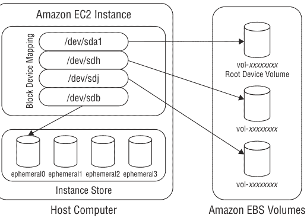

例如，一个账户在 `us-west-2a` 运行 `Amazon EC2` 实例并连接了两个卷：一个运行在 `us-west-2a`，另一个运行在 `us-west-2b`。只有位于 `-2a` 的卷允许被挂载。如果操作人员在 `Amazon EBS` 控制台中，将只能选择 `-2a` 。如果操作人员使用 API，则挂载卷的尝试将被拒绝。图 6.3 展示了使用 `AWS CLI` 时卷挂载被拒绝的情况。

## 图 6.3 卷挂载被拒绝的 `AWS CLI`

```bash
awscli$ aws ec2 attach-volume --volume-id vol-1234567890abcdef0 --instance-id i-01847ef662b89448 --device /dev/sdf

An error (InvalidParameterValue) when calling the AttachVolume operation: Value (vol-1234567890abcdef0) is invalid. Expected: 'vol--'.
```

# `Amazon EBS` 卷类型

截至本文，共有五种类型的 `Amazon EBS` 卷可用。表 6.1 详细列出了各种 `Amazon EBS` 卷类型。

## 表 6.1 `Amazon EBS` 卷类型

| 卷类型 | API 参考 | 尺寸 | 最大 IOPS* | 吞吐量 | 价格 (us-east-1) |
| :--- | :--- | :--- | :--- | :--- | :--- |
| 通用 SSD | `gp2` | 1 GB–16 TB | 10,000 | 160 MB/s | $10/GB-month |
| 预留 IOPS SSD | `io1` | 4 GB–16 TB | 20,000 | 320 MB/s | $125/GB-月 $0.065/预留 IOPS |
| 吞吐量优化 HDD | `st1` | 500 GB–16 TB | 500 | 500 MB/s | $0.045/GB-月 |
| 冷存储 HDD | `sc1` | 500 GB–16 TB | 250 | 250 MB/s | $0.025/GB-月 |
| 磁性（上一代） | `standard` | 1 GB–1 TB | 40-200 | 40-90 MB/s | $0.05/GB-月 $0.05/百万次 I/O |

* `io1`/`gp2`/`standard` 基于 16 K I/O 尺寸，`st1`/`sc1` 基于 1 MB IO 数据包。

类型之间最显著的区别是它们是 SSD 还是机械硬盘 (HDD)。不要假设 SSD 对你的 `Amazon EC2` 实例来说总是性能最好的。如果你正在使用 `Amazon EBS`，必须决定哪种 EBS 卷类型最符合你的业务价值。

对于认证来说，将卷类型的特征与问题中提出的数值和预期结果对齐非常重要。如果你正在寻找成本最低的选项，预留 IOPS 卷几乎总是错误的选择。如果需要最大吞吐量，你应该避免选择磁性驱动器。

# 定价

让我们从最后一列开始：价格。虽然实际成本随区域而异，但表 6.1 中的价格对于成本比较很有价值。

我们听过的关于 `Amazon EBS` 的常见说法是，客户为了速度选择 `gp2`，为了价格选择磁性驱动。随着 `st1` 和 `sc1` 的引入，现在磁性驱动已成为工作负载中性能最好的选项，同时仍降低成本。

确定最便宜的 EBS 卷不仅仅是考虑最小尺寸。冷存储 HDD (`sc1`) 的成本最低，为 $0.025/GB-月，但它有 500 GB 的最小尺寸。例如，如果你所有的需求只需要一个 50 GB 的卷，假设成本是你唯一考虑的问题，那么使用 50 GB 的旧版磁性驱动将是最便宜的。选择 `Amazon EBS` 卷类型的折中点是 250 GB。如果你需要大量空间，从默认更改为 `sc1` 将提供显著提升的性能。不要让“冷 (cold)”标签阻止你在生产系统此类类型。与旧版默认设置相比，`sc1` 在所有性能指标上都是显著改进。

预留 IOPS 通常是最贵的选项。根据原则，除非你专门确保超过 3,000 IOPS 的可用性，否则在操作中不应随意使用驱动器。预留 IOPS 卷不仅具有最高的每月存储成本，而且每月每个预留 IOPS 额外收取 $0.065。一个 10,000 IOPS 的卷将每月 $650 的费用，这还没有存储本身的月费用。

# AWS 块存储

在某些 AWS 文档中，你可能会看到内存和存储显示为 GiB 或 GB。例如，128 GiB 和 119.2 GiB 是相同的数量——空间没有“丢失”或“缺失”。

（注：原文中存在大量重复的 OCR 错误，已提取逻辑连贯的内容。）

# 突发 IOPS 与吞吐量

`gp2` 和 `st1` 卷都具有驱动通信的突发模型。对于 `gp2` 而言，3 IOPS/GB 的标准公式是基准，直到达到 10,000 IOPS（3.33 TB 卷）。对于小于 1 TB 的卷（< 3,000 IOPS），AWS 提供了选项，允许短时间内偶尔突发至 3,000 IOPS。这意味着即使是基准性能为 150 IOPS 的 50 GB 卷，也可以根据需求以 3,000 IOPS 运行，直到突发窗口关闭。

突发能力基于卷积累的 I/O 积分，积累速率为每 GB 预置容量三个积分。一旦触发突发，积分将以每每个 IOPS 三个积分的速度被消耗。卷可以积累的最大积分数约为 5,400 万，这足够以最大（3,000 IOPS）运行 30 分钟。一旦积分用尽，AWS 将将通信限制回基准量。

`st1` 具有类似的突发模型，但基于 MB 而非 IOPS。对于 `st1` 卷，容量为 500 MB/s，通过以类似方式获取积分来实现突发。通过积分，每 TB 积累 40 MB/s。然后，卷将通过消耗积分来突发至 500 MB/s，直到积分耗尽。请注意，500 MB/s 的上限仅适用于等于或大于 2 TB 的卷；较小规模的卷根据每 TB 250 MB/s 的公式计算。因此，一个 50 GB 的卷（`st1` 允许的最小尺寸）在达到上限之前只能突发 12 MB/s，这仍然远多于其 20 MB/s 的吞吐量。

# 预置 IOPS

预置 IOPS 是 `io1` 的主要功能。虽然对可以提供的 IOPS 数量没有最低限制，但作为一个一般原则，如果使用 `io1` 提供的预置 IOPS 少于同等规模 `gp2` 卷的基准 IOPS，被认为是一种昂贵的选择。尽管在某些特殊情况下实例可能会选择这种方案——为了方便起见，请将任何此类情况视为“斑马”而非“马”。

当驱动器延迟非常重要时，预置 IOPS 还有另一种值得考虑的良好实践。为了获得任何 `io1` 卷的最佳的 IO 延迟，建议每 GB 至少预置两个 IOPS；如果少于此值，你可能会遇到延迟问题。例如，30 GB 的卷应至少预置 6,000 IOPS 以保证性能。

可提供的 IOPS 数量有上限：每 GB 预置容量的比例为 50 IOPS，每个卷最高为 20,000 IOPS。因此，一个 100 GB 的卷只能提供 5,000 IOPS，但任何超过 400 GB 的卷都可以提供最大额度。

# `Amazon EC2` 容量

您应该关注将使用的 `Amazon EC2` 实例的 IOPS/吞吐量容量。从技术上讲，系统管理员可以提供五个均为 20,000 IOPS 的卷，以获得 100,000 IOPS 的可能总容量，并将它们挂载到单个实例。然而，如果该实例是 `m4.large`，则只能产生 3,600 IOPS。这相当于买了一辆赛车却在住宅区内行驶——由于后者的限制，你无法充分发挥前者的全部潜力。

事实上（截至目前），没有实例可以使用那样的效能。`Amazon EC2` 实例情况中的最大 IOPS 为 65,000。任何需要超过 65,000 IOPS 的应用程序将需要将数据事务分片到多个 `Amazon EC2` 实例上，或者考虑实例存储（instance store），这在本章稍后讨论。

吞吐量也有 `Amazon EC2` 的限制。某些实例的吞吐量可高达 12 GB/s，但前提是该实例启动时开启了 `Amazon EBS` 优化属性。（有关 `Amazon EC2` 上 `Amazon EBS` 优化的更多信息，请参考第四章“计算”。）

# 挂载 EBS 卷

`Amazon EBS` 卷独立于 `Amazon EC2` 实例。虽然它们可以在启动时创建，但它们可以在启动时创建，重要的是记住 `Amazon EBS` 是独立的。一个关键优势是 `Amazon EBS` 卷可以。

要挂载 EBS 卷，请使用以下命令：

```bash
aws ec2 attach-volume --volume-id vol-12345678 --instance-id i-0abcdef1234567890 --device /dev/sdf
```

# 保护 `Amazon EBS`

希望为其卷提供额外安全保护的客户可以在客户端级别或卷级别对数据进行加密。客户端级加密在当前挂载卷的实例操作系统中进行。这由 `Amazon EC2` 实例的操作系统控制，AWS 无法访问或可见正在使用哪些密钥或算法。从运营角度来看，这意味着使用客户端加密的客户必须负责维护所有正在使用的密钥的可用性和耐用性。

AWS 同样提供了卷级加密。在卷级加密的情况下，数据在静态存储时以及在实例与卷之间的传输过程中都是加密的。通过 `Amazon EBS` 卷加密，每个卷都会获得一个唯一的加密密钥，该密钥仅供该卷或从该卷的快照创建的卷使用。AWS 使用行业标准的高级加密标准 (AES)-256 算法对数据和密钥进行加密。为了获得更高的安全性，客户可以选择使用 `AWS KMS` 进行卷管理，并将其与 `AWS` 身份和访问管理 (IAM) 权限以及 `AWS CloudTrail` 日志结合，以提供更强大的保护和可见性。

# 监控 `Amazon EBS`

基础监控（包含在所有卷中）每五分钟发生一次。指标涵盖了磁盘管理的基础数据：字节数（读/写）、每秒输入/输出 (IOPS)、空闲时间、队列长度等。

对于具有预留 IOPS 的卷，还有吞吐量百分比指标。吞吐量百分比是一个关键指标，因为它显示了实际吞吐量相对于预留量的百分比。对于成本分析，必须密切监控此数字，以确保你没有在 IOPS 上支付过多费用。

对于 `gp2`、`st1` 和 `sc1` 卷，可以使用突发平衡（burst balance）。此功能提供了对卷可用桶额度（bucket credits）的可见性。

# 终止 `Amazon EBS`

`Amazon EBS` 卷专为持久性设计——它们可以在关联的 `Amazon EC2` 实例终止后生存，或者可以直接从实例上卸载（只要它们不是根卷）。卸载卷不会改变该卷的计费，并且它将继续计入拥有该卷账户的存储限制中。卸载的卷可以重新挂载到同一账户同一可用区的任何其他 `Amazon EC2` 实例上。

> 注意
> 不再需要的卷应通过卷 API 终止。如果该卷有快照，删除 EBS 卷不会删除快照。如果数据是敏感的并且应该删除，则应作为操作流程的一部分删除快照。

# 实例存储 (Instance Store)

对于许多 `Amazon EC2` 实例类型，AWS 通过实例存储（也称为临时存储）提供了额外的直接附加块存储选项。从运营角度来看，实例存储具有一些非常具体的优势和一些注意事项。

实例存储非常适用于频繁更改的信息（例如缓冲区、缓存、暂存数据和其他临时内容）的临时存储，或者适用于在多个实例之间进行复制的数据（例如负载均衡的 Web 服务器池）。

# 实例存储与 `Amazon EBS`

`Amazon EBS` 是为持久性而设计的，而实例存储是为廉价的高速通信而设计的。实例存储位于与 `Amazon EC2` 实例相同的硬件上，并包含在实例的 hourly成本中。这意味着没有必须计入通信潜能的外部网络开销。

主要的考虑因素还包括一个潜在收益：与实例在相同硬件上的存储在 `Amazon EC2` 实例生命周期之外不具有任何持久性。

根卷可以运行在 `Amazon EBS` 或实例存储上，但如果根卷是实例存储，则没有“停止”选项，因为停止将终止实例。

# 准备实例存储

与 `Amazon EBS` 不同，实例存储在考虑卷大小、媒体类型或吞吐量方面并不灵活。每个实例类型都有唯一的存储选项（如果该类型支持实例存储的话），某些实例仅支持 `Amazon EBS` 卷类型，而没有实例存储选项。请检查 `Amazon EC2` 文档以获取每个实例类型的当前实例存储选项。

由实例存储支持的卷仅在创建 `Amazon EC2` 实例时可用。如果启动实例时没有卷，则无法稍后添加。

# 实例存储安全

使用实例存储时，安全考虑在某种程度上得到了简化。数据永远不会离开硬件，因此加密无法卸载并重新挂载到另一个实例。所有加密必须在操作系统级别完成。

这些考虑意味着所有安全控制都在操作系统及以上进行管理，因此安全性是你的责任。更多信息请参考第 3 章“安全与 `AWS` 身份和访问管理 (IAM)”中描述的责任模型。

# 实例存储上的 AMI

要创建一个由实例存储支持的 AMI，请从一个从现有实例存储支持的 Linux AMI 启动的实例开始。自定义实例以满足你的需求，然后打包卷并注册新的 AMI。图 6.6 总结了从实例存储支持的实例创建 AMI 的过程。

图 6.6 从实例存储支持的实例创建 AMI 的过程

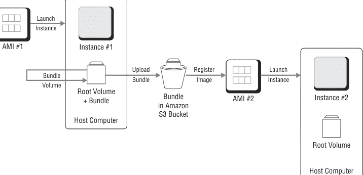

打包步骤与 `Amazon EBS` 不同，对于 EBS，你可以直接从实例或快照创建 AMI。
一旦创建了实例存储 AMI，使用该 AMI 时，所有根卷将构建在实例存储上。
该过程是一个多步骤的函数，我们不会在书中介绍它，因为它超出了考试范围。尽管如此，你应该查找有关制作实例存储支持的 AMI 的在线文档以理解该过程。

# `Amazon` 弹性文件系统 (EFS)

`Amazon EFS` 不是真正的块服务，而是完全托管的文件系统，容量从 GB 扩展到 PB。它被设计为高可用、冗余，并可以从多个实例或本地服务器访问。

# EFS 与 `Amazon EBS`

在比较两者时，重要的是考虑主要用例。`Amazon EFS` 是为多用户文件系统设计的。`Amazon EBS` 是为单实例设计的。

# 准备 `Amazon EFS`

使用 API 创建文件系统后，你在你的 `Amazon` 虚拟云 (VPC) 中创建称为“挂载目标”的端点。从 `EC2` 实例挂载时，你在挂载命令中提供 `Amazon EBS` 域名 (DNS)。该 DNS 解析到挂载目标的 IP 地址。如果你的实例可以访问挂载目标，你就可以访问文件系统。

实例使用 `NFS4.1` 客户端连接到目标。请参图 6.7 创建 `Amazon EBS` 的命令。

# 图 6.7 EBS 创建 命令

```
rhds@chao:~$ aws efs create-file-system --creation-token ebook --region=us-east-1

{
  "SizeInBytes": {
    "Value": 0
  },
  "CreationTime": "1409323828.0",
  "PerformanceType": "GeneralPurpose",
  "FileSystemId": "fs-6041ee2c",
  "MountTargets": [],
  "LifecycleState": "creating",
  "OwnerId": "123456789abc"
}

rhds@chao:~$
```


## AWS 上的对象存储

使用块存储还是对象存储的决策通常是一个架构设计问题，正如本章引言部分讨论的。理解它们的核心区别以及维护内容对象存储属于系统运维人员的职责范围。

在 AWS 中，对象存储是全托管的抽象服务。所有交互均由 `API` 驱动，这意味着 `IAM` 权限对于安全性至关重要，因为这些服务存在于您的 `Amazon VPC` 子集之外。

## Amazon 简单存储服务 (Amazon S3)

`Amazon S3` 是按区域提供的对象存储。保存到 `Amazon S3` 的内容会自动复制到至少三个设施中。多个副本提供了极高的耐用性，而区域分布则允许并行吞吐量。`AWS` 数据中心在地理上相互隔离，能够提供针对自然灾害的保护。

`Amazon S3` 内容没有最小数据量或数据限制。您将根据存储数据的实际时长计费，加上进出系统的 `API` 调用费用以及从区域传出数据的数据流量费用进行付费。

存储在 `Amazon S3` 中的内容组织在桶（buckets）中。桶的名称是全局唯一的；在所有 `AWS` 账户中都是唯一的。如果客户 A 有一个名为 `"projecttestresults"` 的桶，客户 B 尝试创建完全相同的桶将被拒绝。您不能在另一个桶中创建桶。

这种唯一性的背后原理基于 `Amazon S3` 存储的属性：`Amazon S3` 中的所有内容自动支持 Web 化。当内容保存到 `Amazon S3` 时，会为该对象创建一个唯一的 `URL`，该 `URL` 将桶名作为域名，因此需要全局唯一。

> `Amazon S3` 定义桶名称为一个或多个由点分隔的标签，并遵循以下规则：

- 桶名长度在 3 到 63 个字符之间，且仅包含小写字母、数字和连字符。
- 桶名中的每个标签必须以小写字母或数字开头。
- 桶名不能包含下划线、不能以连字符结尾、不能有连续的点、不能在点相邻使用连字符。
- 桶名不能格式化为 `IP` 地址（`198.51.100.24`）。

## AWS 上的对象存储

`Amazon S3` 支持虚拟托管样式（virtual-hosted-style）和路径样式（path-style）`URL` 来访问桶。

- 在虚拟托管样式 `URL` 中，桶名是 `URL` 中域名的一部分。例如：
  - `http://bucket.s3.amazonaws.com`
  - `http://bucket.s3-aws-region.amazonaws.com`

在虚拟托管样式 `URL` 中，您可以使用这两个端点之一。如果您向 `http://bucket.s3.amazonaws.com` 端点发送请求，`DNS` 将拥有信息将您的请求直接路由到桶所在的位置。

- 在路径样式 `URL` 中，桶名不是域名的一部分（除非您使用特定区域的端点）。例如：
  - 美国东部（弗吉尼亚州）区域端点，`http://s3.amazonaws.com/bucket`
  - 特定区域端点，`http://s3-aws-region.com/bucket`。

在路径样式 `URL` 中，您必须匹配与桶所在区域一致的端点。例如，如果您使用了 `http://s3-sa-east-1.amazonaws.com/bucket`（圣保罗）区域，而您的桶位于美国东部（弗吉尼亚州）区域，则你必须使用 `http://s3.amazonaws.com/bucket` 端点。

内容支持 Web 的事实并不意味着它会暴露给公众。`Amazon S3` 的默认属性在调用显式命令之前会保持内容对账户所有者私有。（这在本章稍后的部分介绍。）

## 耐用性 vs 可用性

`Amazon S3` 的工程优势之一是它设计为为内容提供 9 个耐用性。换句话说，对象一年 `99.999999999%` 的耐用性对应于每年预期损失 `0.000000001%` 的对象。

为了在更具体的例子中进行计算，如果您在 `Amazon S3` 中存储了 `10,000` 个对象，平均预计每 `10,000,000` 年损失一个对象。

作为系统运维人员，不要将耐用性数字与可用性数字混淆。`Amazon S3` 标准版旨在提供高达四个 9（`99.99%`）的可用性。`AWS` 提供了服务水平协议 (`SLA`)，如果在服务的任何给定月份可用性低于 `99.9%`，则将产生罚金（这相当于每月大约 44 分钟的时间内）。

要理解耐用性和可用性的区别，可以从它们试图回答的问题来看。可用性回答的问题是：“能访问我的内容吗？”虽然 `AWS` 对我们的可用性记录感到自豪，但有很多控制访问的因素被考虑在工程概况中。耐用性回答的问题是：“我的内容还存在吗？”从企业生存的角度来看，这是一个更关键的问题。大多数业务可以忍受几分钟的服务意外中断；但如果数据丢失，很少有企业能处于有利境地。

耐用性是 `AWS` 建议将包含关键任务数据的 `Amazon EBS` 卷保存为快照并存储在 `Amazon S3` 的原因。只要数据存在，可用性就可以。

## 访问 S3

`Amazon S3` 通过 `API` 访问。在拥有相应权限的情况下，也可以通过 `HTTP` 调用直接访问 `Amazon S3` 对象。

内容（或桶）的权限通过 `IAM` 授予，也可以通过对象级权限直接授予运维人员。

## Amazon S3 标准访问型存储 (Amazon S3-IA)

`Amazon S3` 访问型存储 (`Amazon S3-IA`) 设计为访问频率较低但需要时快速访问的数据提供成本效益。标准 `S3` 和 `S3-IA` 的关键区别在于数据检索的成本结构。

- `S3-IA` 的每 `GB` 成本比标准 `S3` 低。
- `S3-IA` 按 `GB` 收取检索费用。
- `S3-IA` 适合每月访问少于一次的数据。

如果数据访问频繁，`S3-IA` 的检索费用可能会使其比标准 `S3` 更昂贵。因此，在选择 `S3-IA` 之前，务必评估访问模式。

# 版本控制

`Amazon S3` 的默认行为是每个对象只有一个版本。当对象被更新时，该对象的所有副本也会随之更新。当对象被删除时，所有副本都会被删除。对于需要保留旧版本的操作性需求，可以启用 `Amazon S3` 版本控制。

启用版本控制后，对对象的更新不会替换原始对象；相反，新版本将被存储并标记为对象的当前版本，而之前的版本将会被保留，但在对对象进行 `HTTP` 请求时不会被检索。

之前的版本仍然可以通过 `API` 访问。操作人员可以选择这些版本并将它们标记为当前版本（恢复），或者在不再需要时对其进行删除/过期处理。

在启用版本控制的存储桶中，删除操作分为两种操作功能：“正常”删除会向其引用的版本栈中添加另一个版本。在这种情况下，它仅仅是标记该文件不存在。如果对该对象有 `HTTP` 调用，它将返回 `404` 错误。删除这个 `0 KB` 的版本将保留之前的版本（实际上提供了“回收站”功能）。

与 `S3` 中的正常删除一样，这种情况仅用于添加一个 `404` 头部信息；若要彻底从 `Amazon S3` 中删除对象，你必须执行“删除版本”。这可以通过删除版本或删除整个版本栈来实现。

在启用版本控制时，考虑成本非常重要。每个版本都按照全 `Amazon S3` 存储费用计费。没有为版本控制制定周期计划的操作团队会发现存储成本不断增加。

因此，只有当考试问题涉及在故意或无意删除或覆盖情况下的对象存活性时，版本控制在考试中才有意义。如果这些不是关注点，从价格考虑来看，版本控制可能不是最佳选择。


在对存储桶启用版本控制后，它可以处于“已启用（Enabled）”状态或“已挂起（Suspended）”状态；你无法在存储桶上禁用版本控制。如果你将其挂起，`Amazon S3` 将停止为所有操作创建对象版本，但会保留任何现有版本。

# Amazon S3 安全选项

`Amazon S3` 是 `API` 驱动的，是一个完全抽象的服务。因此，没有安全组或 `Amazon VPC` 存储桶来控制对 `Amazon S3` 终端的访问（尽管单个实例完全可以阻止自己访问 `S3`）。

为单个用户、组和角色分配正确的 `IAM` 策略是授予 `Amazon S3` 访问的第一种方法。你可以向单个对象或存储桶分配权限。

使用组策略的优势在于单个存储桶不需要命名。如果账户中创建了新的存储桶，即使使用带有通配符的 `Amazon S3` 权限，也可以在不修改策略文档的情况下访问新存储桶。

存储桶策略的优势是可以授予其他账户访问权限，而无需在拥有存储桶的账户中为它们创建角色。

# 跨区域复制

在处理 `Amazon S3` 时，还有额外的安全考量：终止保护和篡改保护。这两者都可以通过启用跨区域复制来解决。

初看，跨区域复制是一种旨在提供极高可用性的工具。如果你的业务由于监管原因需要在副本之间保持数百或数千英里的距离进行复制，此功能将自动创建这些副本。

要启用跨区域复制，你必须首先在源存储桶和目标存储桶中开启版本控制。启用版本控制后，可以通过识别源和目标来启用复制。请注意，这不是存储桶同步——源存储桶中被删除的版本不会被目标存储桶删除。

这如何保护你的内容？即使有人无意（或故意）删除了源存储桶中的所有内容，操作人员也可以进入目标存储桶并找到完整的内容。

此外，跨区域复制可以从一个账户的源存储桶复制到完全独立的账户的目标存储桶。这种多账户策略确保没有单个个人有权限访问复制数据的存储桶。一个账户的完全管理员权限不会自动赋予他们修改或删除另一个中内容的权限。

# 多因素身份认证 (MFA) 删除

`Amazon S3` 和 `Amazon Glacier` 提供的独特安全元素是能够针对对象或存储桶附加物理或虚拟多因素身份认证 (`MFA`) 设备。

一旦附加了此 `MFA` 设备，任何删除语句都将通过两次检查。首先，经过授权的操作人员必须仍然拥有删除对象的 `IAM` 或对象权限。操作人员还必须提供由 `MFA` 设备生成的当前一次性密码。

此功能将防止受损账户或恶意代理删除内容。它将防止可能会意外捕获受保护对象的自动化方法删除内容。

它在不产生任何费用费用的情况下解决了这些问题。`MFA` 删除是免费提供的，而启用跨区域复制将产生区域之间的数据传输费用以及重复数据集的存储成本。

> 跨区域复制和 `MFA` 删除结合使用可提供更强的保护。如果你必须不惜代价地保护数据，这些方法是互补的。


# Amazon Glacier

如果我们使用 `Amazon S3`、`Amazon S3-IA` 或 `Amazon S3-RRS` 作为标准案例，对持久性要求或对象检索频率的需求可能是变化的。在所有三种用例中，高可用性始终是需求——能够根据需要立即获取内容至关重要。

但对于一个不需要可用性的情况，只要数据受到保护、完整且最终可以检索，业务需求就解决了呢？这是 `Amazon Glacier` 的主要场景。

与所有启用立即消费的 `Amazon S3` 类型不同，存储在 `Amazon Glacier` 中的内容没有在线可用性。内容处于“冷存储”。然而，持久性在 `Amazon S3` 和 `Amazon Glacier` 之间设计为相同的：11个9。

从 `Amazon Glacier` 检索是通过普通 `API` 完成的；你可以支付额外费用进行即时检索。一旦检索，副本将放置在 `S3` 中并成为普通的 `S3` 对象（具有相应的可用性和成本）。检索对象不会从 `Amazon Glacier` 中删除对象。

> `Amazon Glacier` 传统上对应三到五小时的检索周期。2016 年底，`AWS` 发布了即时检索选项。

> 关于认证考试，`Amazon Glacier` 是“马，而非斑马”的绝佳例子。如果问题涉及 `Amazon Glacier`，除非问题专门讨论了即时检索（其费用高得多），否则在决策时请假设标准的三到五小时检索。

你以存档的形式存储在 `Amazon Glacier` 中。你可以将单个文件作为存档，但如果在上传到 `Amazon Glacier` 之前将多个文件合并为一个文件，成本将会更低。`TAR` 和 `ZIP` 是客户常用的格式。你可以存储的数据总量和存档数量几乎是无限的。单个 `Amazon Glacier` 存档的大小从 1 字节到 40 TB 不等。单个上传的最大限制为 4 GB。对于大于 100 MB 的项目，客户应考虑使用分段上传功能。存储在 `Amazon Glacier` 中的存档是不可变的（即可以上传和删除，但不能编辑或覆盖）。

存档是你可以存储在存储库中的任何对象，例如照片、视频或文档。存档是 `Amazon Glacier` 的存储基础单位。每个账户区域可以拥有 1,000 个存储库。

# 安全

从安全角度来看，`Amazon Glacier` 的运行方式与 `Amazon S3` 类似。用户被授予针对单个存档或库（vault，类似于 `Amazon S3` 桶的根级容器）的 `IAM` 权限。支持对象级权限，这允许对库或存档执行多账户工作流。`MFA Delete`（多因素认证删除）提供了防止意外或故意删除的额外保护。

此外，`Amazon Glacier` 为具有严格合规性需求的客户提供了库锁（Vault Lock）。例如，美国证券交易委员会（`SEC`）的 17a-4 号规则规定，“所有电子记录必须以不可重写和不可删除的形式保存”。

法律上的明确要求必须不存在删除内容的可能。运营团队可以将内容存储在 `Amazon Glacier` 中，在由不同账户和区域拥库中创建副本，移除所有 `IAM` 权限，对对象和库附加拒绝策略（deny policies），并在每次复制后附带不同的 `MFA` 设备，这些 `MFA` 设备被存储在托管公司拥有的保险箱中保护锁定设备。然而，如果没有 `Amazon Glacier` 库锁，他们将无法符合 `SEC` 17a-4 规则。这是因为如果拥有所有账户的正确根权限以及持有 `MFA` 设备的托管公司的配合，内容仍可能被删除或更改。

这种复杂的操作很难不被察觉，但在技术上是可行的。库锁为存储引擎添加了一个额外的、不可更改的 `API` 元素。

启用库锁需要两个独立的请求。第一个请求建立库锁持续时间的参数。第二个 `API`（必须在第一个请求后的 24 小时内执行）确认库锁选项。

一旦库锁被确认，存储在库中的任何内容将进入锁定状态，直到该持续时间结束。例如，如果为库设置了一年的时长，那么在 2020 年 1 月 1 日存入库中的内容直到 2021 年 1 月 1 日都无法被删除。这并不意味着它会在当天被删除，但在 2020 年期间，在任何情况下都无法被删除或更改。

如果公司改变了主意怎么办？公司可以随意进行任何更改；然而，在库锁持续时间过期之前，公司没有办法删除内容。如果公司账户欠费怎么办？在这种情况下，根据 `AWS` 服务条款和条件，`AWS` 将继续遵守库锁条件而不删除内容，在账户恢复正常之前，可能会拒绝访问内容。

“禁用”库锁的唯一方法是在所有存档都过了其时长保护期后删除该库。鉴于库锁功能的不可逆性，除非公司受到特定的合规条款限制且该条款没有提供其他解释，否则不使用库锁被视为最佳实践。

关于库锁的最后一个安全说明是，该选项不提供读取锁。具有权限的用户仍然可以下载内容的副本，因此敏感材料仍然需要适当的治理模型来防止未经授权的下载。

# 生命周期策略

`Amazon S3` 与 `Amazon Glacier` 之间关系的一个重要方面是能够设置生命周期策略，自动管理内容的转换和过期。

例如，一家公司可能某些内容在最初 90 天内需要访问，随后的两年内偶尔使用，此时必须保留记录，但仅在审计时访问。最后，为了合规，在总七年后必须删除内容。为了适应这一点，系统 operator可以在原始内容上创建生命周期策略：

1. 对象创建 90 天后，将内容的属性更改为 `Amazon S3-IA`。
2. 生命周期策略语句的下一部分内容为：对象创建两年后，将内容复制到 `Amazon Glacier` 库中，并从 `Amazon S3-IA` 桶中删除内容。
3. 最终策略位于 `Amazon Glacier` 库上，创建日期五年后删除对象（在 `Amazon Glacier` 中的五年加上在 `Amazon S3` 中的两年，导致总计七年的对象生命周期）。


> 生命周期操作有两种类型：转换操作（Transition），即你定义对象何时转换到另一个存储类；过期操作（Expiration），即你指定对象何时过期。

在创建生命周期策略时，系统操作人员有责任确保只有正确的内容受策略范围的影响。明确来说，如果你在 `Amazon Glacier` 库上有删除策略，那么只有当该内容具有相同的生命周期时，才将其放入该库中。这样做会导致内容被意外清除。

`Amazon Glacier` 提供 10 GB 的免费额度。`AWS` 免费额适用于适用于 `AWS` 区域的参与服务：美国东部（弗吉尼亚北部）、美国西部（俄勒冈）、美国西部（北加利福尼亚）、加拿大（中部）、欧洲（伦敦）、欧洲（爱尔兰）、欧洲（法兰克福）、亚太地区（新加坡）、亚太地区（东京）、亚太地区（悉尼）和南美（圣保罗）。你每月可以免费检索 10 GB `Amazon Glacier` 数据。免费额度可以在一个月的任何时间使用，并适用于标准检索。


# 系统操作人员场景：报纸

你被负责《论坛报》（Tribune）内容管理系统（`CMS`）的运营。该系统已经过设计，现在你需要确保它在 `AWS` 云上正常运行。

# 系统操作人员场景：报纸

为了本章的需求，让我们看看如何根据 `CMS` 的需求设计存储系统。

# 存储需求

`Tribune CMS` 涵盖了生产系统的多个过程：记者流程以及笔记的存储；照片编辑流程，包括未用片的存储；用于所有故事、照片和视频的网页发布系统；以及内部和外部研究的存档系统。

# 解决方案分解

以下是 `Tribune CMS` 的拆解。

# 记者

记者使用文字处理器进行所有工作。这意味着最初由 `Amazon EBS` 提供繁重的读写负载。然而，考虑到编辑人员的参与以及故事创建是协作工作，更好的运营解决方案是使用 `Amazon EBS` 作为文字处理器应用程序的挂载卷。

使用 `Amazon EBS` 将为创建和编辑阶段的所有内容提供即时存储，无任何开销。

在内容完全编辑并准备发布后，你可以从 `Amazon EBS` 卷在网站上提供内容。更具扩展性的解决方案是将文档加载到 `Amazon S3`，并让网页直接从 `Amazon S3` 调用故事，这是一种更具成本效益且可扩展的发布选项。

记者最后的关注点是他们的故事笔记，这些笔记不面向公众，但在故事面临法律挑战时必须保留以供验证。`Amazon Glacier` 成为这些文档的理想解决方案，因为检索很少是实时的，且存储成本最低。

# 照片编辑

摄影师经常会为出现在出版物中的单个镜头或片段拍摄数百张照片或数小时的视频。未用片在几年后可以被挖掘出那些在拍摄时显得不重要的细节。在照片挑选完成后，将未用片存储在 `Amazon Glacier` 中为深度存档提供了最具成本效益的解决方案。

对于标记为制作的媒体，可以将原始文件存储在 `Amazon S3` 中，并直接从其缓冲区分发到内部制作应用程序或公共网站。

如果出版物需要预渲染的缩略图或移动版本的媒体，可以将它们存储在 `Amazon S3-RS` 中以节省成本，这样当原始文件丢失时，可以需要从原始文件重新创建这些版本。

# 生产与存档

通过将内容（文本和媒体）存储在 `Amazon S3`（或 `Amazon S3-RRS`）中，`CMS` 已经定位了最具成本效益且可扩展的方案来交付内容。

在某个时间点，内容会被判定为已过时。对于新闻网站来说，在消费者搜索或点击旧故事之前，可能需要几个月的时间，但最终所有内容都会达到收益递减的节点。当内容达到该平衡点时，自动化流程可以将内容迁移到 `Amazon S3-IA`。为什么不选择 `Amazon Glacier` 呢？因为在新闻存档的情况下，即使消费者多年都不关心某个旧故事，也可能有人正在进行研究并想要打开该文件（或视频），他们很可能不会等待五个小时让内容可用。通过使用 `Amazon S3-IA`，存档仍然具有成本效益，并且可以立即访问和进行搜索。

# 额外的存储解决方案

`Amazon S3`、`EBS`、`Amazon EFS` 和 `Amazon Glacier` 代表了 `AWS` 存储解决方案的核心。在学习以成功通过考试时，你必须非常熟悉这些服务。

`AWS` 还提供了许多其他可能被视为存储解决方案讨论范围的服务。你应该熟悉它们，但它们可能不会在 `AWS` 认证 SysOps 管理员助理级考试中占据很大比例。

### Amazon CloudFront

全球内容分发可以使用 `Amazon CloudFront` 实现。这种内容分发网络（`CDN`）可以通过向消费者缓存副本来帮助加速你内容的交付。

内容存储在源位置，这些位置可以是 `Amazon S3` 存储桶，也可以从 `Amazon EC2` 实例提供。`Amazon CloudFront` 甚至可以缓存存储在本地的内容。

`Amazon CloudFront` 是频繁访问且受益于边缘交付的静态内容的良好选择，例如网站图像、视频、媒体文件和软件下载。对于按需的媒体文件，你也可以选择使用实时消息协议（`RTMP`）传输来流你的内容。`Amazon CloudFront` 还支持通过 `HTTP` 交付直播媒体。

最后，`Amazon CloudFront` 具有地理限制功能，允许你指定一个用户无法访问你内容的国家列表。或者，在这两种情况下，`Amazon CloudFront` 会用 `HTTP` 状态码 403（禁止）响应来自受限国家查看者的请求。

# 额外的存储解决方案

# 235

### AWS Storage Gateway

`AWS Storage Gateway` 允许现有的本地存储解决方案扩展到 `AWS`。通过在本地数据中心安装虚拟设备，可以将存储复制或扩展到 `AWS` 区域。

对于考试，你可能会看到至少两个涉及 `AWS Storage Gateway` 的问题。需要理解的关键是在配置设备时提供的不同选项。

# AWS Storage Gateway 选项

第一个选项是文件接口。这允许你通过网络文件系统（`NFS`）挂载点访问 `Amazon S3` 存储桶，从而在本地工作流中使用 `Amazon S3`。这允许客户通过基于对象的负载程序将他们的文件迁移到 `Amazon S3`，同时保留其本地投资。

第二个选项是卷接口。在这种情况下，你将看到一个 `iSCSI` 块端点。数据在本地卷上访问，这些数据以 `EBS` 快照的形式存储在 `AWS` 上。

使用卷接口有两种配置模式。缓存模式（cached mode）设计用于扩展你的本地存储。所有内容都保存在 `AWS` 中，只有频繁访问的数据被缓存在本地。对于超出本地容量限制的本地存储解决方案，这是一个极佳的解决方案。存储模式（stored mode）是在 `AWS` 上对所有本地内容进行一对一备份，是需要持久且廉价的离地备份时的主要解决方案。这成为了处理灾难恢复计划极极起点。

`AWS Storage Gateway` 的第三个选项是磁带接口。在这种配置下，你使用 `iSCSI` 虚拟磁带库（`VTL`）连接到现有的备份应用程序。如果需要更廉价、更长期的存储，这些虚拟磁带将异步存储在 `Amazon S3` 或 `Glacier` 中。

### AWS Snowball

对于海量数据传输，运输比互联网更快。邮送大型硬盘将比公共互联网速度更快（通常也更便宜）地让数据进入 `AWS`。例如，假设你有 100 TB 的数据要传输到 `AWS`。在 100 Mbps 的数据传输线上，完成数据传输需要 120 天。物理运输数据是一个快得多的选择。

对于这些传输情况，`AWS` 提供了 `Snowball`，这是一个物理加固、安全的设备，直接寄送到你的本地位置。每个设备重量约为 50 磅（截至本文），可存储 80 TB。并行使用多个 `AWS Snowball` 设备可以为数 PB 级规模的数据集提供易于实现的迁移解决方案。

`AWS Snowball` 通过防篡密封条和内置的可信平台模块（`TPM`）确保安全，该模块使用专用的处理器，用于检测任何对硬件、固件或软件的未经授权的修改。

在使用通过 `AWS KMS` 管理的加密密钥使用 `AWS Snowball` 时，数据会自动加密。实际的加密密钥永远不会存储在设备上。

# 带有 AWS Greengrass 的 AWS Snowball

随着 `Snowball` 的普及，`AWS` 增加了额外功能，包括利用 `AWS Greengrass` 技术访问运行在设备上的 `API`。这些 `API` 允许 `AWS Snowball` 设备在断网连接时也能像本身就是 `Amazon S3` 端点一样工作。

# AWS Snowmobile

某些公司的数据集需求达到艾字节（exabyte）级。对于那些独特的传输，`AWS` 可以部署名为 `AWS Snowmobile` 的 45 英尺长集装箱。在拖拉车的牵引下，每个集装箱可以携带 100 PB 的数据。`Amazon CloudFront` 是频繁访问且受益于边缘交付的静态内容的良好选择，例如网站图像、视频、媒体文件和软件下载。对于按需的媒体文件，你也可以选择使用实时消息协议（`RTMP`）传输来流你的内容。`Amazon CloudFront` 还支持通过 `HTTP` 交付直播媒体。最后，`Amazon CloudFront` 具有地理限制功能，允许你指定一个用户无法访问你内容的国家列表。或者，在这两种情况下，`Amazon CloudFront` 会用 `HTTP` 状态码 403（禁止）响应来自受限国家查看者的请求。

## 总结

在存储方面，没有一种通用的解决方案。确保你熟悉 `S3`、`EBS`、`Glacier`、`CloudFront`、`Snowball` 和 `Snowmobile`。

# 复习资源

- `Amazon EBS` 文档：`https://docs.aws.amazon.com/AWSEC2/latest/AmazonEBS.html`
- `Amazon EBS` 页面：`https://aws.amazon.com/efs/`
- `Amazon EBS` 文档：`https://aws.amazon.com/documentation/efs/`
- `Amazon S3` 页面：`http://aws.amazon.com/s3/`
- `Amazon S3` 文档：`http://aws.amazon.com/documentation/s3`
- `Amazon Glacier` 页面：`https://aws.amazon.com/glacier/`
- `Amazon Glacier` 文档：`https://aws.amazon.com/documentation/glacier/`
- `Amazon CloudFront` 页面：`https://aws.amazon.com/cloudfront/`
- `Amazon CloudFront` 文档：`https://aws.amazon.com/documentation/cloudfront/`
- `AWS Storage Gateway` 页面：`https://aws.amazon.com/storagegateway/`
- `AWS Storage Gateway` 文档：`https://aws.amazon.com/documentation/storagegateway/`
- “Storage Gateway 文件接口”博客：`https://aws.amazon.com/blogs/aws/category/storage-gateway`
- `AWS Snowball` 页面：`https://aws.amazon.com/snowball/`
- `AWS Snowball` 文档：`https://aws.amazon.com/documentation/snowball/`
- `AWS` 新动态：`https://aws.amazon.com/new`
- `AWS` 简单每月计算器：`http://calculator.s3.amazonaws.com/index.html`

## 考试要点

理解块存储与对象存储。块存储和对象存储的区别在于基础存储单元。在块存储中，保存到驱动器的每个文件都被划分为特定的“块”。在对象存储中，无论大小，每个文件都作为一个对象保存。

理解何时使用 `Amazon S3` 以及何时使用 `EBS` 或 `Amazon EFS`。这是一个基于内容类型和变化速率的架构决策。`Amazon S3` 可以存储任何类型的数据；对于数据库或快速变化的数据类型，`Amazon S3` 不是一个良好的选择。

理解 `Amazon EBS` 卷的生命周期。`EBS` 卷可以在启动 `EC2` 实例时配置，也可以稍后创建并挂载。只要“终止时删除”标记设置为 `false`，`EBS` 卷就会跨越 `EC2` 实例的生命周期存在。对于未使用的 `Amazon EBS` 卷，`AWS` 的最佳实践是对进行快照并删除。记住，对于 `Amazon EBS`，你是按配置的容量付费，而不是像 `Amazon S3` 那样按使用量付费。

了解 `EBS` 快照的工作原理。快照存储在 `S3` 中；但是，你无法通过 `Amazon S3` 控制台访问它们。你可以通过 `Amazon EC2` 控制台下的“快照”（Snapshots）来访问它们。

了解实例存储（instance store）存储。根据 `Amazon EC2` 实例系列的不同，你可以访问本地存储。这种存储被称为实例存储。无法对实例存储创建快照。实例存储数据是瞬态的，在 `Amazon EC2` 实例重启或终止后将不再存在。如需更多信息，请参阅第 4 章。

详细了解 `Amazon S3` 生命周期策略的工作原理。生命周期配置允许你指定存储存储桶中对象的生命周期管理。规则定义了 `Amazon S3` 对一组对象执行的操作。类型有两种：转换操作（Transition actions）和过期（expirations）。

了解 `Amazon S3` 版本控制。开启 `Amazon S3` 版本控制后，将无法关闭；只有在开启版本控制时，项会被分配删除标记（delete marker）且无法访问。被删除的对象仍然在 `Amazon S3` 中，你仍需为它们付费。

了解如何与 `Amazon Glacier` 交互。当对象从 `Amazon S3` 移动到 `Amazon Glacier` 时，它们只能通过 `Amazon S3 API` 访问，或者例如由于生命周期策略导致移动到 `Amazon Glacier` 的对象。

了解 `Amazon Glacier` 库（vaults）。（截至本文编写时）每个账户区域可以拥有 1,000 个库。库是不可变的；检索对象时，它不会从 `Amazon Glacier` 中被删除，而是被复制到 `S3`。

了解 `MFA` 如何在 `Amazon S3` 中工作。你可以选择地通过为存储桶启用 `MFA` 来添加额外的安全层，这在更改存储桶的版本控制状态和永久删除对象时需要额外的身份验证。`MFA` 删除需要两种形式的身份验证结合：你的安全凭据以及有效序列号、空格和已批准验证设备上显示的六位代码的组合。在（例如）你的安全凭据泄露时，`MFA` 删除提供了额外的安全保障。

了解如何访问 `Amazon S3` 资源。`IAM` 策略定义了在 `AWS` 资源上允许或拒绝的操作。相反，`S3` 存储桶策略仅附加到 `Amazon S3` 存储桶。`S3` 存储桶策略指定了对于附加到该存储桶的哪些主体（principles）允许或拒绝哪些操作。`Amazon S3` 存储桶策略是 `ACL`（访问控制列表）的一种。

了解 `Amazon CloudFront` 的功能。`Amazon CloudFront` 是一个 `CDN`，可以通过在靠近消费者的地方缓存副本来加速内容的交付。内容存储在源位置，源位置可以是 `AWS` 上的 `Amazon S3` 存储桶，也可以从 `Amazon EC2` 实例提供服务。`Amazon CloudFront` 甚至可以缓存存储在本地的内容。

# 练习

了解从 `Amazon CloudFront` 交付的媒体。这些媒体包括静态网站 `CSS` 样式表、`HTML` 页面、图像、视频、媒体文件或下载内容。对于按需媒体文件，你还可以选择使用 `RTMP` 传输流内容。`Amazon CloudFront` 支持通过 `HTTP` 交付直播媒体。

了解 `Amazon CloudFront` 的地理限制功能。此功能允许你指定用户可以内容的国家列表。或者，你可以指定用户无法访问内容的国家。

了解 `AWS Storage Gateway` 接口和运行模式。第一个选项被称为文件接口（file interface）。它允许你通过 `NFS` 挂载点连接 `Amazon S3` 存储桶，将 `Amazon S3` 用于你的本地工作流。第二个选项是卷接口（volume interface）。在这种情况下，你将看到一个 `iSCSI` 块存储端点。`AWS Storage Gateway` 的第三种选项是带接口（tape interface）。在此配置中，你使用 `iSCSI VTL` 连接到现有的备份应用程序。卷接口以两种模式运行：缓存模式（cached mode）和存储模式（stored mode）。了解它们之间的区别。

## 答题技巧

要求选择两个或三个正确答案的多选题要求你的`所有`答案都必须正确。部分正确没有部分分。在复习时请留这这些问题。

# 练习

到此时，你应该已经在 `AWS` 中设置了账户。如果你还没有，现在是设置的时机了。需要注意的是，这些练习是在你的 `AWS` 账户中进行的，因此不是免费的。

在启动资源时使用免费层（Free Tier）。`AWS` 免费层适用于跨 `AWS` 区域的参与服务：美国东部（弗吉尼亚北部）、美国西部（俄勒冈）、美国西部（加利福尼亚）、加拿大（中部）、欧洲（伦敦）、欧洲（爱尔兰）、欧洲（法兰克福）、亚太（新加坡）、亚太（东京）、亚太（悉尼）和南美（圣保罗）。如需更多信息，请参阅 `https://aws.amazon.com/s/optimization/server-side-test/free-tier/`

如果你没有使用过 `AWS` 命令行界面，请参阅第 2 章“与 `AWS` 云服务工作”，练习 1（Linux）或练习 2（Windows）。

`AWS CLI` 的参考文档可以在 `http://docs.amazon.com/cli/latest/reference/` 找到。

使用你的账户了解存储系统可以变得简单。按照前面章节中的步骤锁定你的账户。始终记住，虽然 `AWS` 是一种成本效益高的解决方案，但你将对产生的所有费用负责。如果你想永久保留这些项，请记住在练习结束后删除它们。

记住，这本书的目标不仅是让你准备通过 `AWS` 认证 SysOps Administrator – Associate 考试。它还应该成为你作为 `AWS` 认证 SysOps Administrator 日常工作中的参考伙伴。

# 练习 6.1

# 创建加密的 Amazon EBS 卷。

在此练习中，你将创建一个带有原生加密或 `AWS KMS` 加密的 `Amazon EBS` 卷。

1. 登录 `AWS` 管理控制台时，打开 `EC2` 服务仪表板。
2. 在“弹性卷”（Elastic Store）下，选择“卷”（Volumes）。
3. 创建卷（Create Volume）。
4. 对于卷，选择适用于你卷的选项，包括可用区（Availability Zone）。
5. 对于密钥，选择默认加密或 `AWS` 密钥。如果没有，请创建一个。
6. 检查配置，并创建卷。

你现在创建了一个加密的 `EBS` 卷。

# 练习 6.2

# 使用 CloudWatch 监控 EBS。

在此练习中，你将查看适用于你卷的指标。

1. 登录 `AWS` 管理控制台时，打开 `CloudWatch` 服务仪表板。
2. 选择“指标”（Metrics）。
3. 在“所有指标”（All Metrics）下，选择“`EBS`”和“按卷”（Per-Volume）。

你现在已经查看了 `EBS` 的指标。

# 练习 6.3

# 创建并挂载 Amazon EFS。

在此练习中，你将创建一个新的 `EFS` 卷并将其附加到实例。

1. 登录 `AWS` 管理控制台时，打开 `EFS` 服务仪表板。
2. 创建文件系统（Create File System）。
3. 选择你的 `Linux` 实例运行所在的 `VPC`。
4. 默认挂载目标（mount targets），记下分配给目标的安全组 ID。
5. 创建文件系统。
6. 将默认安全组分配给你的 `Linux` 实例。
7. 登录 `Linux` 实例控制台，为 `Amazon Linux` 安装 `NFS` 客户端：`sudo yum install -y nfs-utils`
8. 在你的 `Linux` 实例上创建一个目录，例如 `efs`：`sudo mkdir efs`
9. 使用 `DNS` 名称挂载文件系统：`sudo mount -t nfs -o nfsvers=4.1,rsize=1048576,size=1048576,hard,timeout=600,retrans=2 fs-12341234.efs.region-1.amazonaws.com:/ /efs`

你现在已挂载了 `EFS` 卷。

# 练习 6.4

# 创建并使用 Amazon S3 存储桶。

在此练习中，你将创建一个 `Amazon S3` 存储桶，然后加载并发布内容。

1. 登录 `AWS` 管理控制台时，打开 `S3` 服务仪表板。
2. 选择存储桶（Bucket）。
3. 为存储桶提供一个全局唯一的名称，并选择合适的区域。目前将其他设置保持默认值。创建存储桶（Create bucket）。
4. 选择存储桶，并选择“上传”（Upload）。
5. 点击“添加文件”，并导航到你想公开共享的图像。点击“下一步”。
6. 因为你希望你的图像可以公开访问，在“管理公共权限”（Manage Public Permissions）下，授予所有人对对象的读取权限。检查，并上传图像。
7. 点击对象名称进入属性屏幕。选择，并在新浏览器窗口中打开图像的 `URL`。

你现在已创建了一个存储桶，并加载了 Web 且可公开访问的内容。

## 练习 6.5
### 启用 Amazon S3 版本控制。

在此练习中，你将激活 `Amazon S3` 版本控制，它可以保护对象免受覆盖和意外删除。

1. 登录 `AWS` 管理控制台时，打开 `Amazon S3` 服务仪表板。
2. 选择你在第 6.4 练习中创建的存储桶，并打开存储桶的属性（properties）选项卡。
3. 点击版本控制框，启用版本控制并保存。

现在该存储桶已启用版本控制，直到将其挂起为止。

## 练习 6.6
### 启用跨区域复制。

在此练习中，你将启用原始存储桶内容跨区域复制到不同区域的新存储桶。

1. 登录 `AWS` 管理控制台时，打开 `Amazon S3` 服务仪表板。
2. 在与第 6.4 练习中创建的存储桶不同的区域创建一个新存储桶。在新存储桶上启用版本控制。
3. 选择原始存储桶作为源，新存储桶作为目标。
4. 为目标存储桶选择存储类型。
5. 对于 `IAM`，选择“创建新角色”（Create New Role）并保存。
6. 在源存储桶中加载新镜像。它应该出现在目标存储桶中。

你现在已启用跨区域复制，它可以用于合规性并保护内容免受极端灾难。

## 练习 6.7
### 创建 Amazon Glacier 库（Vault）。

在此练习中，你将创建一个 `Amazon Glacier` 库。如果你选择向库中加载任何内容，请务小心，因为你将承担至少 90 天的存储费用。

1. 登录 `AWS` 管理控制台时，打开 `Amazon Glacier` 仪表板。
2. 创建一个新的库（vault）。
3. 选择区域并提供一个全局唯一的库名称。
4. 根据需要设置通知规则。
5. 保存更改以创建库。

新库已创建。

## 练习 6.8
### 启用生命周期规则。

在此练习中，你将把 `Amazon S3` 存储桶中创建的内容与生命周期关联，该生命周期将内容移动到 `Amazon Glacier` 并最终清除对象。

1. 登录 `AWS` 管理控制台时，打开 `Amazon S3` 服务仪表板。
2. 选择你在第 6.4 练习中创建的存储桶，并进入管理（Management）选项卡。
3. 在生命周期（Lifecycle）下，选择“添加生命周期规则”（Add Lifecycle Rule）。
4. 将规则命名为 `Move to Glacier`（移动到 `Glacier`）。
5. 对于转换（transition），选择当前版本（Current Version）。添加转换规则，在 30 天后移动到 `Amazon Glacier`。
6. 对于过期（Expiration），选择当前版本和之前的版本，并设置“31 天后过期”（Exp After 31 Days）。
7. 对于未完成的分段上传，设置在七天后过期。

现在，你的账户将在 30 天后自动将内容从 `Amazon S3` 移动到 `Amazon Glacier`，并在一天后从 `Amazon S3` 删除该内容。

## 复习题

1. 你正在运行一个保存以往选举历史照片的网站。用户需要能够搜索并显示过去 100 年的图像。平均而言，大多数图像每年仅请求一次。存储和提供这些图像的最成本效益且高可用的方法是什么？
   A. 将图像保存在 `Amazon Elastic Block Store (Amazon EBS)` 上，并使用运行在 `Amazon Elastic Compute Cloud (Amazon EC2)` 上的 Web 服务器。
   B. 将图像保存在 `Amazon Elastic File System (Amazon EFS)` 上，并使用运行在 `Amazon EC2` 上的 Web 服务器。
   C. 将图像保存在 `Amazon Simple Storage Service (Amazon S3)` 中并直接从 `Amazon S3` 提供。
   D. 将图像保存在 `Amazon Simple Storage Service - 不频繁访问 (Amazon S3-IA)` 中并直接从 `Amazon S3` 提供。
   E. 将图像保存在 `Amazon Glacier` 中并直接从 `Amazon Glacier` 提供。

2. 你在运行 `Windows` 的 `Amazon Elastic Compute Cloud (Amazon EC2)` 实例上运行一个旧数据库。数据库每秒平均事务数为 1,200 次，但在峰值时期每秒多达 2,500 次。数据库的当前大小为 1.8 TB。在不牺牲性能的情况下，`Amazon Elastic Block Store (Amazon EBS)` 的最佳数据卷配置是什么？
   A. 一个配置为 2 TB 具有 2,500 个配置 IOPS 的 EBS 磁卷
   B. 两个 EBS 磁卷，每个配置为 1 TB 并通过 Raid0 连接
   C. 一个配置为 2 TB 的 EBS gp2 卷
   D. 一个配置为 2 TB 具有 2,500 个配置 IOPS 的 EBS 固态硬盘 (SSD)
   E. 两个 EBS gp2 卷，配置为 1 TB 并通过 Raid0 连接

3. 你的应用程序 `Amazon Elastic Compute Cloud (Amazon EC2)` 实例需要单个共享卷来编辑公共文件。连接到实例的最佳卷是什么？
   A. 一个带有 IOPS 的 `Amazon Elastic Block Store (Amazon EBS)` 卷
   B. 一个 `Amazon EBS` ma1 卷
   C. 一个 `Amazon Elastic File System (Amazon EFS)` 卷
   D. 一个 `Amazon Simple Storage Service (Amazon S3)` 卷
   E. 一个 EBS gp2 卷

4. 你的公司计划保留一个很少访问的照片媒体存档（每年访问不超过 10 次）。业务需求预计媒体在根据请求发布时，响应时间小于 100 毫秒。最成本效益的方法是什么？
   A. 带有配置 IOPS 的 `Amazon Elastic Block Store (Amazon EBS)`
   B. `Amazon Elastic Block Store (Amazon EBS)`
   C. `Amazon` gp3
   D. `Simple Storage Service - 不频繁访问 (Amazon S3-IA)`
   E. `Amazon Glacier`

5. 以下哪些适用于 `Simple Storage Service (Amazon S3)`？（选择三项）
   A. 编译安装
   B. 视频片段
   C. `.dat` 文件
   D. 临时磁盘
   E. 数据仓库
   F. 会话存储

6. 你的公司有合规性要求记录到 `Simple Storage Service (Amazon S3)`。需要哪些步骤？（选择两项）
   A. 身份访问管理 (`IAM`)
   B. `CloudTrail`
   C. `CloudWatch` 日志
   D. 服务访问日志
   E. 存储桶

7. 你的公司必须以不可变的形式保留数据以备审计。最成本效益的方法是什么？
   A. 带有库锁的 `Amazon Glacier`
   B. 带有身份访问管理 (`IAM`) 的 `Amazon Glacier`
   C. 带有跨区域复制的 `Simple Storage Service (Amazon S3)`
   D. 带有存储桶锁的 `Amazon S3-IA`
   E. 存储网关

8. 你想使用 `Storage Gateway` 增加本地存储系统的可用存储量。正确的配置是什么？
   A. 文件接口
   B. 缓存模式的卷接口
   C. 存储模式的卷接口
   D. 磁带接口

9. 什么是 `Elastic Compute Cloud (Amazon EC2)` 实例存储的良好用例？
   A. 编译安装
   B. 摄像头的视频片段
   C. 数据库的 `.dat` 文件
   D. 转码器的临时磁盘
   E. 数据仓库
   F. 

10. 在 `Amazon Elastic Compute Cloud (Amazon EC2)` 实例上挂载 `Elastic File System (EFS)` 必须执行哪些步骤？
    A. 选择 `AWS` 密钥服务 (`KMS`) 主密钥
    B. 在相应的虚拟私云 (`VPC`) 子网中创建挂载点
    C. 激活 `Simple Storage Service (Amazon S3)` 存储桶的版本控制
    D. 在身份访问管理 (`IAM`) 中创建 EFS 角色
    E. 连接 `iSCSI` EFS 端点

11. `Simple Storage Service (Amazon S3)` 对象存储与块和文件存储的不同之处在于（选择两项）
    A. S3 以固定块存储数据
    B. 对象可以是任意大小
    C. 对象存储在桶中
    D. 对象包含数据和元数据

12. 以下哪些是 `Elastic Block Store (Amazon EBS)` 的功能？（选择两项）
    A. EBS 数据在可用区内自动复制
    B. EBS 数据自动备份到磁带
    C. EBS 卷对连接实例的工作负载进行透明加密
    D. EBS 卷的数据在实例停止时会丢失

13. 你需要对 `Elastic Block Store (Amazon EBS)` 卷创建快照。卷将不可用多久？
    A. 取决于卷的配置大小
    B. 卷将立即可用
    C. 取决于卷上存储的数据量
    D. 取决于连接的实例是否为 Amazon EBS 优化实例

## 复习题

14. 你正在从快照恢复 `Amazon Elastic Block Store (Amazon EBS)` 卷。数据需要多长时间才能可用？
    A. 取决于卷的预设大小。
    B. 数据将立即可用。
    C. 取决于存储在卷上的数据量。
    D. 取决于连接的实例是否为 Amazon EBS 优化实例。

15. 你在 `Amazon Simple Storage Service (Amazon S3)` 中存储关键数据；这些数据必须防止意外或无意的删除。如何对这些数据进行保护？（选择两项）
    A. 使用跨区域复制将数据自动复制到另一个存储桶。
    B. 设置库锁（vault lock）。
    C. 在存储桶上启用版本控制。
    D. 使用生命周期策略将数据迁移到 `Amazon Glacier`。
    E. 在存储桶上启用 MFA 删除（多因素认证删除）。

16. `Amazon Glacier` 适用于何种类型的数据？（选择两项）
    A. 频繁访问或极少访问
    B. 需要时必须立即可用
    C. 在三到五小时的恢复期后可用
    D. 在 30 天内被频繁删除

17. `Amazon EFS` 支持所有的 `Windows` 操作系统。
    A. 正
    B. 错误

18. 当使用 `Amazon Glacier` 时，单个存档的大小几乎是无限制的。
    A. 正
    B. 错误

19. 你可以对实例存储（instance storage）进行定期快照。
    A. 正
    B. 错误

20. 你如何调整实例存储支持的卷的大小？
    A. 停止 `Amazon Elastic Cloud Compute (Amazon EC2)` 实例并使用调整卷命令。
    B. 对实例卷创建快照，调整实例卷大小，并使用快照将数据恢复到新调整的实例存储卷。
    C. 你无法调整实例存储卷。
    D. 挂载另一个实例卷，将数据复制到新卷，并删除旧卷。

## 第 7 章

## 数据库

`本章涵盖的 AWS CERTIFIED SYSSOPS ADMINISTRATOR - ASSOCIATE 考试主题可能包括但不限于以下内容：`

领域 1.0：监控与指标

- 1.1 展示监控可用性和性能的能力
- 1.2 展示监控和管理计单及成本优化流程的能力

领域 2.0：高可用

- 2.1 根据场景实现可扩展性和伸弹性
- 2.2 根据业务需求确保容错能力

领域 4.0：部署与配置

- 4.1 展示构建符合架构设计环境的能力
- 4.2 展示配置云资源和管理实施自动化的能力

领域 5.0：数据管理

- 5.1 展示为不同服务创建备份的能力
- 5.3 管理备份和灾备流程

领域 6.0：安全

- 6.1 实现并管理安全策略
- 6.2 在使用 `AWS` 平台时确保数据完整性和访问控制
- 6.3 展示对共享责任担模型的理解

领域 7.0：网络

- 7.2 展示实现 `AWS` 连接性功能的能力


## AWS 数据库简介

本章概述了可以在 `AWS` 上部署的关系型和非关系型数据库系统。它将探讨以下主题：

- `Amazon Relational Database Service (Amazon RDS)`
- `Amazon DynamoDB`
- `Amazon ElastiCache`
- `Amazon Redshift`
- 数据库的监控与维护
- 数据库安全

`AWS` 提供完全托管的关系型和 NoSQL 数据库服务、完全托管的内存数据库缓存服务以及完全托管的 PB 级数据仓库服务。如果你需要高度定制的数据库解决方案，可以使用 `Amazon Elastic Cloud Compute (Amazon EC2)` 和 `Amazon Elastic Block Store (Amazon EBS)` 进行部署。

当在本地部署数据库解决方案或使用 `Amazon EC2` 实例时，数据库的所有方面都必须由客户管理。在 `Amazon EC2` 实例的情况下，需要为实例配置操作系统，系统必须进行补丁/维护，数据库管理系统 (`DBMS`) 必须设计为高可用并适当扩展，并且必须对数据进行管理。

`AWS` 可以管理 `DBMS` 的配置和维护，让客户将精力和精力放在管理和维护自己的数据上。

`AWS` 提供广泛的完全托管数据库服务。这些服务包括 `Amazon RDS`、`Amazon DynamoDB`、`Amazon Redshift` 和 `Amazon ElastiCache`。

作为 `AWS` 数据库产品的一部分，还有 `AWS Database Migration Service`（数据库迁移服务），它可以轻松且廉价地将数据库迁移到 `AWS` 云。图 7.1 展示了当由 `AWS` 管理时，数据库管理是如何变化的。

## AWS 数据库简介

### 图 7.1 托管服务的优势

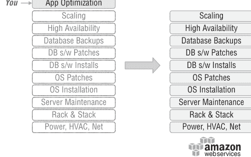

`Amazon RDS` 旨在云端中设置、运行和扩展关系型数据库。它在管理管理任务的同时提供了具有成本效益且弹性的容量。`Amazon DynamoDB` 是一种完全托管的 NoSQL 数据库，随着表大小的增长提供快速且可的性能。`DynamoDB` 在 `AWS` 区域内的三个设施之间同步复制数据，提供高可用性和持久性。

## SQL 对比 NoSQL

由于这种广泛的使用，关系型数据库通常被称为 `SQL` 数据库。然而，`SQL` 是一种语言，而不是数据库引擎。通常情况下，关系型和非关系型数据库使用 `SQL`。非关系型系统有时被称为“非 `SQL`”。

## 关系型数据库概述

关系数据库管理系统 (`RDBMS`) 将数据存储在一个或多个行列格式的表中，每行都有一个唯一键。数据库表通常包含特定类型的信息，例如地址或姓名。由于表中的每行都有唯一键，它可以与另一个表中的唯一键（或一组键）相关。图 7.2 显示了两个表（`Vehicles` 和 `Expenses`）以及共享的键 `ID`。

| ID | ID |
|---|---|
| 品牌 | 车辆 |
| 型 | 服务描述 |
| 颜色 | 服务日期 |
| 车牌号 | 里程 |
| VNR 号 | 费用类型 |
| 购买日期 | 商店 |
| 购买价格 | 发票号 |
| 购买里程 | 质保号 |
| 出售日期 | |
| 出售价格 | |

关系型数据库极其复杂。一个简单的查询可能有多种执行路径，优化器会在运行时对其进行评估。整体而言，这些键关系被称为架构（schemas）。在关系型数据库中，在添加任何信息之前必须明确定义架构。设计良好的架构可以最小化冗余并确保数据完整性。

## 关系型数据库设计

`SQL` 数据库设计围绕称为规范化（normalization）的技术。规范化的目标是减少或消除数据库中的重复数据，以减少存储数据的错误。关系型数据库中的每个表理想情况下持有一种类型或事物的数据（例如地址）。代价是当应用程序更改影响多个数据库表时，灵活性会降低。

## ACID

关系型数据库使用一组称为原子性、一致性、隔离性和持久性 (`ACID`) 的规则来指导数据库设计。执行单个数据库的操作序列


逻辑或或任何操作被称为事务。`ACID` 四个组件确保数据库事务能够及时完成。

`原子性（Atomicity）` 数据库事务可以被分解为更小的部分。原子（Atom）是元素中可以存在且仍被识别的最小部分。*原子性*指的是任何数据库事务的完整性（与事务的单个部分相对）。例如，原子数据可能是一个人的姓名。

`一致性（Consistency）` 为了让任何数据库按预期运行，它必须遵循适当的验证规则。*一致性*意味着只有遵循这些规则的数据才允许写入数据库。事务成功后，新数据将添加到数据库，数据库的状态将与现有规则保持一致。如果发生事务且结果数据不符合规则，则将进行“回滚”。回滚是恢复到符合规则之前的状态。

这里有一个简单的例子：

如果一个数据库是一个电子邮件地址，则需要一个带有 `@` 符号的有效地址。如果没有这个事务，规则就会被，数据不应被写入。

`隔离性（Isolation）` 每一个数据库事务都独立操作数据。*隔离性*指的是数据库在互不干扰的情况下同时处理多个事务的能力。如果两个事务尝试对同一个数据库执行操作，则第一个必须在第二个开始之前完成。

如果一个数据库正在访问库存，两个事务不能同时耗尽总数。第一个事务应该在第二个事务开始之前完成。

`持久性（Durability）` “一切都会失败，且一直如此。”亚马逊首席技术官维纳·沃格尔（Werner Vogels）这句经常被引用的话与数据库讨论非常相关。这个观点是，如果一个系统设计为能够容忍故障，事情就不会失败。至少，在系统运行时，目标是让故障对客户不可见。在这种背景下，*持久性*意味着只有在事务完成后数据才会被保存，并且数据以能够忍断电、系统崩溃或其他错误的方式存储。

在分布式系统中，实现 `ACID` 的一种方法是两阶段提交。这确保了所有相关的数据库必须提交完成事务。如果一个或多个无法提交，则事务将回滚。

## 非关系数据库概述

与关系型数据库不同，非关系数据库是为了支持云应用的需求而创建的，旨在为了克服关系型数据库在扩展性、性能、数据建模和数据分布方面的局限性。正如关系型数据库被称为 `SQL` 数据库，非关系数据库被称为 NoSQL 数据库。然而，由于 `SQL` 是一种语言，因此可以使用它来访问非关系数据库。

NoSQL 数据库使用多种数据模型，包括文档、图谱、键值对和列式。NoSQL 数据库因易于开发、可扩展性能、高可用性和韧性而广受认可。键值对是 NoSQL 数据库的主要特征。键（Keys）是名称或唯一 `ID` 数字，值（values）从简单数据到文档、数据列到结构化的键值数据列表（数组）不等。NoSQL 表中的每行都包含键及其值。

NoSQL 的设计取决于数据库类型，称为存储器（stores）。

`文档存储（Document stores）` 这类存储将每个键标识符与文档配对，文档可以是、键值对或键值数组。

`图谱存储（Graph stores）` 这些存储旨在处理由图表示得最好的的数据，以及数据点之间具有未知数量关系的互联数据。

`键值存储（Key/value stores）` 这类存储是最简单的类型，数据与其名称及关联数据（即值）一起存储。

`宽列存储（Wide column stores）` 这些存储针对跨大型数据集的查询进行了优化。


还有其他描述可用 NoSQL 数据库的方法，但这些是最简单且全面的分类。在每种 NoSQL 数据库类型中，可用的灵活性不同并影响数据库设计。例如，`MongoDB` 是从 `MySQL` 演而来的。由于由于，`MongoDB` 保留了许多关系数据库的原生功能。

NoSQL 数据库通常牺牲关系型数据库管理系统的 `ACID` 特性，以获得更灵活的可水平扩展且可以动态修改的数据模型。这些特性使得当传统 `RDBMS` 在克服性能瓶颈、扩展性、操作复杂性以及不断增加的管理和支持成本遇到架构挑战时，NoSQL 数据库是一个极佳的选择。

NoSQL 数据库的设计是为了完善现有的关系数据库系统，而不是取代它们。在分布式环境中，NoSQL 通常用于高可用性和水平扩展。

# AWS 数据库简介

在可用区中，数据具有极高的持久性。这种复制确保了数据库在故障转移期间具有更高的可用性，因为数据副本已存在于可用区中，并继续为您的 `DB` 集群中的实例提供数据请求。

`Amazon Aurora` 集群卷会随着数据库数据量的增加而自动扩展。`Amazon Aurora` 集群卷的最大大小可达 64 TB。表的大小受限于集群卷的大小。这意味着 `Amazon Aurora` 集群中表的最大大小为 64 TB。

尽管 `Amazon Aurora` 集群卷可以增长到 64 TB，但客户仅需为 `Amazon Aurora` 集群卷中使用的空间支付费用。

# Amazon Aurora 复制

副本是 `Amazon Aurora DB` 集群中的独立端点。它们提供对 `DB` 集群卷中数据的只读访问，并允许客户通过多个复制的实例来扩展对数据的读读工作负载。这提高了数据读取的性能，并增加了您的 `Amazon Aurora DB` 集群中数据的可用性。

`Aurora` 副本也是故障转移目标。如果 `Amazon Aurora` 集群中的主实例故障，可以快速将其提升为主实例。

# Amazon Aurora 可靠性

`Amazon Aurora` 设计旨在具有可靠性、持久性和容错能力。可以通过添加 `Aurora` 副本并将其放置在不同的可用区来构建 `Amazon Aurora DB` 集群以提高可用性。

`Amazon Aurora` 还包含若干项自动功能以增强其可靠性。

`存储修复` 由于 `Aurora` 在可用区中维护数据的多个副本，因此由于磁盘故障导致数据丢失的概率被降至最低。`Amazon Aurora` 会自动检测组成集群的磁盘卷中的故障。当磁盘卷的段发生故障时，`Amazon Aurora` 会立即修复该段。当 `Amazon Aurora` 修复该段时，它会使用修复段中的数据来确保修复段中的数据是新的。结果是，`Amazon Aurora` 避免了数据丢失，并减少了通过点点恢复（point-in-time restore）恢复磁盘故障的需求。

`“存活”缓存预热` 当数据库启动或在故障后关闭或重新启动时，`Amazon Aurora` 会“预热”缓冲池缓存。这意味着 `Aurora` 会预先向缓冲池加载已知常用查询的页面，这些页面存储在内存页面缓存中。这通过跳过缓冲池从正常数据库使用开始“预热”提供了性能提升。

`Amazon Aurora` 页面缓存由与数据库独立的进程进行管理，这允许页面缓存独立于数据库“存活”。在极少数的数据库故障情况下，页面缓存仍留在内存中，确保在数据库重启时缓冲池已使用最新状态完成预热。

`崩溃恢复` `Amazon Aurora` 设计为几乎瞬间即可从崩溃中恢复并继续提供应用程序数据。`Amazon Aurora` 在并行线程上异步执行崩溃恢复。崩溃后，数据库会立即开放并可用。

# Amazon Aurora 安全

`Amazon Aurora` 分三个级别进行管理：`IAM`、`Amazon VPC` 安全组和数据库身份验证。

`AWS 身份和访问管理 (IAM)` 使用 `IAM` 控制谁可以在 `Amazon Aurora` 集群和 `DB` 实例执行 `Amazon RDS` 管理操作。连接 `IAM` 凭据时，`IAM` 账户必须拥有执行 RDS 管理操作所需权限的 `IAM` 策略。

`Amazon VPC 安全组` `Amazon Aurora` 集群必须在 `Amazon VPC` 中创建。`VPC` 安全组控制哪些服务和 `Amazon EC2` 实例可以连接到 `Amazon Aurora` 实例的端点和端口。

`数据库身份验证` 为了验证 `Amazon Aurora DB` 集群的登录和权限，可以使用以下方法：

- `MySQL` 命令（如 `CREATE USER`、`RENAME USER`、`GRANT`、`REVOKE` 和 `SET PASSWORD`）在 `Amazon Aurora` 中管理访问的方式与其他 `MySQL` 数据库相同。也可以直接修改数据库模式。

`IAM 数据库身份验证` 通过 `IAM` 数据库身份验证，您可以使用 `IAM` 用户或角色以及身份验证令牌对 `DB` 集群进行身份验证。身份验证令牌是使用 Signature 签名过程生成的唯一值。通过 `IAM` 数据库身份验证，可以使用相同的凭据控制对您的 `Aurora` 资源和数据库的访问。

# 保护 Amazon Aurora 数据

`Amazon Aurora` 支持对静态数据和传输中的数据进行加密。对于静态数据，您可以使用 `AWS` 密钥管理服务 (`AWS KMS`) 托管密钥，或者使用您自带的 `SSL` 密钥。对于传输中的数据，`Amazon Aurora` 支持 `SSL/TLS` 连接。

# 第 7 章 • 数据库

延迟（Latency）：从提交 `I/O` 请求到其完成之间经过的时间。该指标报告为给定时间间隔内的平均延迟。`Amazon RDS` 以秒为单位，以分钟为间隔分别报告读取和写入延迟。延迟的典型值通常以毫秒报告。例如，`Amazon RDS` 将 2 毫秒报告为 0.002 秒。

吞吐量（Throughput）：传输到磁盘或的字节数。该指标报告为给定时间间隔内的平均吞吐量。`Amazon RDS` 以每秒兆字节（MB/s）为单位，以分钟为间隔分别报告读取和写入吞吐量。吞吐量的典型值从零到 `I/O` 通道的最大带宽不等。

队列深度（Queue depth）：等待服务的 `I/O` 请求数。这些请求已由应用程序提交但尚未发送到设备，因为设备正在处理其他 `I/O` 请求。该指标报告为给定时间间隔内的平均队列深度。`Amazon RDS` 以分钟为间隔报告队列深度。队列深度的典型值从零到数百不等。

> 在队列中等待的时间是延迟和服务时间的组成部分。该数据不作为指标提供。队列越长，延迟越差。

# 影响存储性能的其他因素

所有与系统相关的活动都会消耗 `I/O` 容量，并在运行期间可能会降低数据库实例的性能：

- 创建 `DB` 快照
- 夜间备份
- 创建多可用区（Multi-AZ）对等节点
- 创建只读副本
- 扩展存储

# 添加存储和更改存储类型

对于现有的 `MySQL`、`MariaDB`、`PostgreSQL` 和 `Oracle` `DB` 实例，如果您扩展存储可能会可能会到 `I/O` 容量的提升。

> 由于连接到 `Windows` Server 环境的条带存储（striped storage）存在扩展性限制，`Amazon RDS` 目前不支持增加 `Microsoft SQL Server` 的存储容量。

可以修改 `DB` 实例以使用额外的存储和/或转换为不同的存储类型。添加存储或转换为不同的存储类型可能需要时间并降低 `DB` 实例的性能。请计划在非工作时间安排此类活动。

虽然在添加存储时 `DB` 实例仍可读写，但在过程完成之前可能会遇到性能下降。添加存储可能需要几小时。
过程的持续时间取决于多个因素，例如：

- 数据库负载
- 存储大小
- 存储类型
- 划分的 IOPS 数量

扩展存储所需的典型时间在 24 小时以内。但在某些情况下，可能需要几天时间。在扩展过程中，`DB` 实例将保持可用，但可能会经历性能下降。


在添加存储期间，夜间备份将暂停，且无法进行其他 `Amazon RDS` 操作，包括修改、重启、删除、创建只读副本和创建 `DB` 快照。

磁性存储与通用型（SSD）存储之间的存储转换可能会耗尽分配给通用型（SSD）存储的初始 540 万 `I/O` 积分（3,000 IOPS × 30 分钟）。在执行这些存储转换时，前 82 GB 数据将以约 3,000 IOPS 的速度转换，其余数据将按照分配的通用型（SSD）存储每 GB 100 IOPS 的基础性能速率进行转换。这可能会导致更长的转换时间。


可以配置更多的通用型（SSD）存储以提高基础 `I/O` 性能速率并改善转换时间。一旦分配了存储积分，无法移除。

# I/O 积分和突发性能

通用型（SSD）存储受卷大小限制，这决定了卷的基础性能水平以及其积累 `I/O` 积分的速度。较大的卷具有更高的基础性能并能积累更多 `I/O` 积分。`I/O` 积分代表通用型（SSD）存储在需要超过基础水平的性能时用于突发大量 `I/O` 的可用带宽。在需要吞吐量时，性能水平越高，性能越好。

使用通用型（SSD）存储时，`DB` 实例获得初始 540 万 `I/O` 积分余额，这足够维持 30 分钟 3,000 IOPS 的突发性能。初始积分余额旨在为启动卷提供快速的初始启动周期，并为其他应用程序提供良好的引导体验。卷按每 GB 3 IOPS 的基础性能速率获得 `I/O` 积分。例如，一个 100 GB 的通用型（SSD）卷的基础性能为 300 IOPS。

当存储需要超过基础 `I/O` 水平时，它使用积分余额中的 `I/O` 积分突发达到所需的性能，最高可达 3,000 IOPS。大于 1,000 GB 的存储基础性能等于或大于最大性能。因此，其 `I/O` 积分余额永远不会耗尽，可以无限突发。

当存储每秒使用的 `I/O` 积分少于获得的积分时，未使用的 `I/O` 积分将添加到 `I/O` 积分余额中。使用通用型（SSD）存储的 `DB` 实例 `I/O` 积分余额等于初始余额（540 万）。如果存储用完了所有积分余额，其性能将保持在基础水平，直到 `I/O` 需求低于基础水平。存储越大，性能越高，补充余额的速度越快。表 7.1 列出了几种存储大小以及相关的基础性能、3,000 IOPS 下的突发持续时间和填满空余额的时间。

# 表 7.1 存储与突发速率

| 存储大小 (GB) | 基础性能 (IOPS) | 3,000 IOPS 下的突发时长 (秒) | 填满空余额所需的数 |
|---|---|---|---|
| 1 | 100 | 1,862 | 54,000 |
| 100 | 300 | 2,000 | 18,000 |
| 250 | 750 | 2,400 | 7,200 |
| 500 | 1,500 | 3,600 | 3,600 |
| 750 | 2,250 | 7,200 | 2,400 |
| 1,000 | 3,000 | 无限 | N/A |

存储的突发时长取决于存储大小、突发 IOPS 以及突发时的积分余额。使用以下公式计算突发：

```


`突发时长 = 积分余额 / (突发 IOPS - 3*存储大小(GB))`


# AWS 数据库简介

如果存储性能因积分余额耗尽而频繁限制在基础水平，请考虑增加更高性能的通用型（SSD）存储。或者，对于需要持续 `IOPS` 的负载切换到预留 `IOPS` 存储。

对于具有稳态 `I/O` 需求的负载，配置少 `100 GB` 的通用型（SSD）存储可能会导致延迟。

# Amazon RDS 支持的存储引擎

虽然 MySQL 支持多种功能不同的存储引擎，但并非所有引擎都针对恢复和持久性进行了优化。Amazon RDS 完全支持 MySQL 的 `InnoDB` 引擎。Amazon RDS 的点点恢复和快照恢复等功能需要可恢复引擎，且仅支持 `InnoDB` 存储引擎。

> `InnoDB` 需要 MySQL 5.6 或更高版本。

# 多可用区部署

Amazon RDS 多可用区部署为 `DB` 实例提供了更高的可用性和持久性，适用于生产数据库负载。部署多可用区 `DB` 实例时，Amazon RDS 会自动创建一个主实例并将数据同步复制到不同可用区的备用实例。每个可用区都运行在物理、独立的基础设施上，具有极高的可靠性。

当发生基础设施故障时，Amazon RDS 会自动故障转移到备用实例，以便故障转移完成后恢复数据库操作。由于 `DB` 实例的端点在故障转移后保持不变，应用程序无需手动干预即可恢复。

> 使用 Amazon Aurora 发生基础设施故障时，Amazon RDS 也可以故障转移到只读副本

# 增强持久性

MySQL、MariaDB、Oracle 和 PostgreSQL 引擎的多可用区部署使用同步物理复制，使备用实例的数据与主实例同步。SQL Server 引擎的多可用区部署使用同步逻辑复制来实现相同结果，采用了 SQL Server 原生的镜像技术。这两种方法在 `DB` 实例故障或可用区丢失时都能保护数据。

如果您的多可用区（`Multi-AZ`）部署中的主实例上的存储卷发生故障，Amazon RDS 会自动故障转移到最新的备用实例。在单可用区（`Single-AZ`）数据库故障的情况下，需要由用户启动的时间点恢复操作。此操作可能需要很长时间才能完成，并且将包含自最新可恢复时间以来的所有更新。

Amazon Aurora 采用专为数据库工作负载构建的、高持久性的、基于 SSD 的虚拟化存储层。Amazon Aurora 跨三个可用区复制 `DB` 存储卷。Amazon Aurora 具有容错能力，可以透明地处理丢失最多两个数据副本而不影响数据库的写可用性，丢失最多三个副本而不影响读可用性。Amazon Aurora 设计为自愈。系统会持续对数据块和磁盘进行错误扫描并自动替换。

# 提高可用性

如果发生可用区故障或数据库实例故障，对可用性的影响将限于自动故障转移的时间。对于 Amazon Aurora，这通常在一分钟以内。对于其他数据库引擎，故障转移时间在了一到两分钟之间。

多可用区部署的可用性优势扩展到计划维护和备份。在遇到操作系统补丁或数据库实例扩容等系统更新时，更新会在自动故障转移之前应用到备用实例。因此，对可用性的影响仅限于自动故障转移完成的时间。

在单可用区部署中，`I/O` 活动在数据库备份期间会挂起。在使用 MySQL、MariaDB、Oracle 和 PostgreSQL 引擎的多可用区部署进行备份期间，`I/O` 不需要挂起，因为备份是从备用实例提取的。

> 在多可用区 `DB` 部署的备份期间，可能会遇到比平时更高的延迟。

当 Amazon Aurora 部署中的实例发生故障时，Amazon RDS 使用多可用区技术自动故障转移到在三个可用区内创建的三个 Aurora 副本之一。如果尚未配置任何 Aurora 副本，Amazon RDS 将尝试创建一个新的 Aurora `DB` 实例。

# 故障转移

数据库实例故障是全自动的，不需要管理干预。Amazon RDS 监控主实例和备用 `DB` 实例的健康状况，并根据各种故障条件自动启动故障转移。

# 故障转移条件

Amazon RDS 检测并自动恢复多可用区部署中最常见的故障场景，以便在无需管理干预的情况下尽快恢复数据库操作。

在发生以下任何情况时，Amazon RDS 会自动执行故障转移：

- 可用区可用性丢失
- 与主实例的网络连接丢失
- 主实例上的计算单元故障
- 主实例上的存储故障

> 只要存在运行中的查询、死锁或数据库损坏错误，Amazon RDS 多可用区部署就不会响应数据库操作自动发生故障转移。


# 创建多可用区 Amazon RDS 部署

使用 AWS 管理控制台，可以通过修改现有的单可用区实例将其转换为多可用区部署，从而创建新的多可用区部署。

使用 AWS 管理控制台创建多可用区部署，在启动数据库实例时点击多可用区部署参数的“是”。要将现有的单可用区 `DB` 实例转换为多可用区部署，请使用 AWS 管理控制台中对应于数据库实例的修改选项。

用于 MySQL 和 PostgreSQL 的 Amazon RDS 将内置复制与读取副本（`Read Replicas`）相结合，以扩展读密集型数据库工作负载的容量限制。结合使用多可用区部署和读取副本，以享受两者的互补优势。

指定指定的多可用区部署作为读取副本的源 `DB` 实例。这提供了多可用区部署的持久性和可用性优势，以及读取副本的读扩展优势。

> 对于多可用区部署，还可以选择在主备用区之外的可用区创建读取副本，以获得更高的冗余。


# 高可用性

Amazon RDS 通过多个可用区为数据库实例提供高可用性和故障转移支持。

# 第 7 章 ■数据库

根据数据库引擎的不同，Amazon RDS 使用不同技术之一在多可用区提供故障转移支持：

- MySQL、MariaDB、Oracle 和 PostgreSQL 使用同步复制。
- SQL Server 使用 `Always On` 可用组。
- Amazon Aurora 使用基于队列（`quorum`）的存储系统。

虽然多可用区部署提供了高可用性，但读取副本用于扩展读密集型工作负载。

# 读取副本

Amazon RDS 通过多个可用区为数据库实例提供高可用性和故障转移支持。

根据数据库引擎的不同，Amazon RDS 使用不同技术之一在多可用区提供故障转移支持：

- MySQL、MariaDB、Oracle 和 PostgreSQL 使用同步复制。
- SQL Server 使用 `Always On` 可用组。
- Amazon Aurora 使用基于队列（`quorum`）的存储系统。

虽然多可用区部署提供了高可用性，但读取副本用于扩展读密集型工作负载。

# 数据库简介

Amazon RDS 通过多个可用区为数据库实例提供高可用性和故障转移支持。

根据数据库引擎的不同，Amazon RDS 使用不同技术之一在多可用区提供故障转移支持：

- MySQL、MariaDB、Oracle 和 PostgreSQL 使用同步复制。
- SQL Server 使用 `Always On` 可用组。
- Amazon Aurora 使用基于队列（`quorum`）的存储系统。

虽然多可用区部署提供了高可用性，但读取副本用于扩展读密集型工作负载。

# Amazon RDS 故障转移过程

如果 `RDS DB` 实例配置了多可用区，当数据库实例发生计划内或计划外的机时，Amazon RDS 将自动切换到另一个可用区的备用副本。

故障转移所需的时间取决于主 `DB` 实例不可用时的数据库活动和其他状况。故障转移时间在 `60` 到 `120` 秒之间波动。大事务或恢复长度可能会增加故障转移时间。故障转移完成后，Amazon RDS 用户可能还需要额外的时间来连接新的可用区。

故障转移机制会自动更改数据库实例连接字符串的 `DNS` 记录，以指向备用 `DB` 实例。因此，现有的连接需要重新建立。


> 注意：对于具有 `Java虚拟机 (JVM)` 环境的客户，`Java DNS` 缓存机制可能需要重新配置环境以实施故障转移策略。详细可以在 `Java` 版 `AWS` 软件开发包 (`SDK`) 中找到。

Amazon RDS 会自动处理故障转移，数据库操作将尽可能地恢复，无需人工干预。

当发生以下任何情况时，主 `DB` 实例将自动切换到备用副本：

- 可用区（`Availability Zone`）发生故障
- 主 `DB` 实例发生故障。
- 更改了 `DB` 实例的服务器类型。
- 正在对 `DB` 实例的操作系统进行补丁。
- 使用“带故障转移的重启”（`Reboot with Failover`）对 `DB` 实例启动手动故障转移。

确定多可用区 `DB` 实例是否已发生故障转移的方法有：

可以通过从 Amazon RDS 控制台重启主 `DB` 实例或使用 API `RebootDBInstance` 来强制执行可用性故障转移。

## Amazon RDS 备份与恢复

在灾难恢复规划方面，Amazon RDS 创建并保存 `DB` 实例的自动备份。Amazon RDS 会为您的整个 `DB` 实例创建存储卷快照。这将导致整个实例的备份，而不仅仅是单个数据库。Amazon RDS 在 `DB` 实例的备份窗口期间创建 `DB` 实例的自动备份。Amazon RDS 根据创建时定义的保留期保存 `DB` 实例的备份。如果需要，可以将数据库恢复到备份保留期内的任何时间点。

`DB` 实例必须处于 `ACTIVE` 状态才能进行自动备份。如果数据库处于其他状态（例如 `STORAGE_FULL`），则不会发生自动备份。

可以手动创建 `DB` 实例的快照。手动创建的 `DB` 实例快照软限制为 `100` 个。


> 删除 Amazon RDS 实例时，作为自动备份一部分的快照会被删除。然而，手动创建的快照不会被删除。这些快照将一直存在直到手动删除。

## 备份存储

每个区域的 Amazon RDS 备份存储由该区域的自动备份和手动 `DB` 快照组成。备份存储等于该区域所有实例的数据库存储之和。将 `DB` 快照移动到另一个区域会增加目标区域的备份存储。

## AWS 数据库简介

删除 `DB` 实例时，所有自动备份都将被删除。删除 `DB` 实例后，自动备份将无法恢复。

MySQL 需要 `InnoDB` 进行自动备份。

在执行 Amazon RDS 恢复时，如果有足够的存储空间，可以更改引擎类型（例如从 SQL 标准版到企业版）。

## Amazon RDS 快照复制

Amazon RDS 提供将快照从一个区域复制到另一个区域的能力。可以通过 AWS 管理控制台、AWS 命令行界面或使用 RDS API 启动复制。您可以复制任何大小的快照以及任何 RDS 支持的数据库的快照。可以在任何 AWS 区域之间移动副本，并且可以通过同时启动多个复制任务将同一份快照复制到多个区域。

与其他复制操作一样，复制是基于增量的进行的。只会复制自给定 `DB` 实例上一次快照以来发生更改的数据。当您删除快照时，删除操作仅限于不会影响其他快照的数据。

复制操作本身不收费；您只需为传出源区域的数据以及目标区域的数据存储付费。如果复制失败，则不会收费，但如果您复制了一个正在进行中的快照，则会收费。

## 灾难恢复的民主化

此功能被描述为“灾难恢复的民主化”。不仅如此，它是灾难恢复的民主化。想象一下在本地数据中心设置实现此功能所需的网络、存储、处理和基础设施时会产生的所有头恼和费用。您必须获取空间，添加网络链接和加密，创建备份并将它们从一个位置复制到另一个位置。如果没有云，您必须在基础设施上投入数千美元，以及等量的时间——实际上是 `DBA` 和系统管理员的时间。

使用 Amazon RDS 从区域复制备份时，所有这些痛点和相关成本都会消失。

## 备份窗口

自动备份每天在备份窗口期间进行。

可用性故障转移可以通过从 Amazon RDS 控制台重启主 `DB` 实例或使用 API `RebootDBInstance` 来强制执行。

在执行 Amazon RDS 恢复时，如果有足够的存储空间，可以更改引擎类型（例如从 SQL 标准版到企业版）。

MySQL 需要 `InnoDB` 进行自动备份。

# 第 7 章 • 数据库

安全组最多包含 `20` 条规则。这是一个软限制。可以通过联系 AWS 支持来提高此限制。提高安全组限制可能会影响性能。

## 加密 Amazon RDS 资源

通过启用加密选项可以对 Amazon RDS 实例和快照进行静态加密。静态加密的数据包括 `DB` 实例的底层存储、其自动备份、读取副本（`Read Replicas`）以及快照。

Amazon RDS 加密实例使用行业标准的高级加密标准 (`AES`) 256 加密算法对数据进行加密。在数据被加密后，Amazon 会透明地处理访问验证和解密，对性能的影响微乎其微。数据库客户端不需要修改即可使用加密。

AWS 密钥管理服务 (`AWS KMS`) 用于管理加密和解密 RDS 资源所需的密钥。`KMS` 结合了安全、高可用的硬件和软件，提供了一个适用于云扩展的密钥管理系统。

`AWS KMS` 既可用于创建加密密钥，也可定义控制这些密钥使用方式的策略。`AWS KMS` 支持 `CloudTrail`，因此可以对密钥的使用进行审计。

在 Amazon RDS 数据库加密后，所有日志、备份和快照都将经过加密。Amazon RDS 加密实例的读取副本与主 `DB` 实例使用相同的密钥加密。

## Amazon RDS 加密的局限性：

- 创建 Amazon RDS `DB` 实例时必须启用加密。
- 已加密的 `DB` 实例无法修改禁用加密。
- 如果 `DB` 实例已加密，则读取副本也必须加密。
- 加密的读取副本必须与源 `DB` 实例使用相同的密钥加密。
- 不可以将未加密的备份或快照恢复到加密的 `DB` 实例。
- 不可以将加密的 MySQL `DB` 快照恢复到 Amazon Aurora `DB` 集群。
- 要将加密快照从一个区域复制到另一个区域，必须指定目标区域的 `AWS KMS` 密钥标识符。`AWS KMS` 加密密钥特定于创建区域。

## 选项组

某些数据库引擎提供了额外的功能，可以更更容易管理数据和数据库，并提供额外的安全性。Amazon RDS 使用选项组来启用和配置这些功能。

## AWS 数据库简介

选项可以具有指定单个选项配置方式的设置。当 `DB` 实例与选项组关联时，指定的选项及其相关设置将为该 `DB` 实例启用。

目前，Amazon RDS 支持以下数据库引擎的选项：

- MariaDB
- Microsoft SQL Server
- MySQL
- Oracle

## 扩展关系型数据库

作为一种托管服务，Amazon RDS 负责关系型数据库的扩展，以跟上需求。扩展方法通常分为水平扩展或垂直扩展，两者的结合被称为对角线扩展。垂直扩展（也称为向上扩展，`scaling up`）是向实例中添加资源以提高性能。水平扩展（称为向外扩展，`scaling out`）是添加相同的资源来管理负载。

## 向上扩展

对于大型数据库，特别是用于 Web 应用程序的数据库，用户主要关注的是扩展性。随着具有海量工作负载的环境中越来越多的应用程序，扩展性需求可能会变化非常快并变得巨大。关系型数据库扩展良好，但通常在单台服务器上。

通过点击按钮即可处理更高的负载。在调整 Amazon RDS MySQL、PostgreSQL、MariaDB、Oracle 或 Microsoft SQL Server 实例大小时，目前有 `18` 多种实例大小供选择。对于 Amazon Aurora，提供了内存优化的实例大小。

可以使用 AWS 管理控制、Amazon RDS API 或 AWS CLI 扩展分配给 `DB` 实例的计算资源和存储容量。通过更改 `DB` 实例类来修改内存和 `CPU` 资源，通过修改存储分配来更改存储可用性。

当修改 `DB` 类或存储时，请求的更改将在指定的维护窗口应用。可以设置 `apply-immediate` 标记来强制执行更改。任何挂起的系统更改也将被应用。

## 向上扩展 Amazon RDS 实例时需要考虑以下几点：

- 在扩展之前，确保拥有商业引擎的正确许可：Microsoft SQL Server 和 Oracle。对于商业引擎，许可通常与 `CPU` 插槽或核心绑定。
- 确定何时应应用扩展更改。是立即应用，还是在维护窗口期间应用？
- 存储和实例类型是解耦的。在向上或向下扩展 `DB` 实例时，存储大小不受更改的影响。同样，可以修改 `DB` 实例以增加分配的存储空间/类型，而不更改实例类。

在多可用区（`Multi-AZ`）环境中向上扩展时停机时间极短，因为备用数据库首先升级，然后切换到新大小的数据库。单可用区（`Single-AZ`）实例在扩展操作期间将不可用。

## 垂直扩展

为了处理数据库更高的负载，点击鼠标即可垂直扩展数据库。要更改实例类型，请从 Amazon RDS 控制台上的“实例”菜单中选择“修改”。详情请参考图 7.3。

图 7.3 实例操作菜单

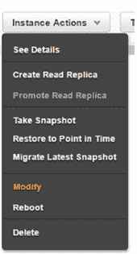

然后选择新的 `DB` 实例类。图 7.4 显示了 `DB` 实例类下拉列表：lm1ks7piximryw6

| 实例规格 | |
| :--- | :--- |
| `DB` 引擎 | mysql 5.6, 6.27 (默认) |
| `DB` 类 | db.t3.small |
| `DB` 类 | db.t3.micro |
| 多可用区部署 | db.t3.medium |
| 存储类型 | db.t3.large |
| 分配存储 | db.t3.xlarge |
| 分配存储 | db.t3.2xlarge |
| 分配存储 | db.t3.4xlarge |
| 分配存储 | db.t3.10xlarge |
| `DB` 类 | db.m5.medium |
| `DB` 类 | db.m5.large |
| `DB` 类 | db.m5.xlarge |
| `DB` 标识符 | db.m3.large |
| 新主密码 | db.m3.2xlarge |
| 新主密码 | db.m3.4xlarge |
| 网络安全 | db.m3.8xlarge |
| 网络安全 | db.m3.12xlarge |
| `DB` 类 | db.m2.xlarge |
| `DB` 类 | db.m2.4xlarge |

## AWS 数据库简介

最后，确定是否立即应用更改。如果是，勾选页面底部的“立即应用”复选框。否则，更改将在创建 RDS 实例时定义的首选维护窗口进行。

调整 Amazon RDS MySQL、PostgreSQL、MariaDB、Oracle 或 Microsoft SQL Server 实例大小时，目前有 `18` 多种实例大小供选择。

对于 Amazon Aurora，提供了五内存优化的实例大小供选择。

## 水平扩展

通过使用副本水平扩展数据库可以提高读取密集数据库的性能。

- 读取副本是主数据库的只读副本。可以将读取副本放置在不同的 AWS 区域，以便靠近用户并提高性能。
- 读取副本可以增加数据库的可用性，因为在发生故障时它们可以提升为主 `DB` 实例。

> 读取副本不是多可用区配置提供的高可用性和自动故障转移能力的替代。

Amazon RDS 副本支持查询和连接的负载均衡。每个副本都有唯一的 `DNS` 节点，因此应用程序可以通过连接副本节点来实现负载均衡。

目前，弹性负载均衡（`ELB`）不支持将流量路由到 Amazon RDS 实例。因此，请考虑其他选项，例如 `HAProxy`（一种开源的软件负载均衡器）。配置 `HAProxy` 在一个端口监听读取查询，在另一个端口监听写入查询。

另一种方案是使用层 7 SQL 感知型负载均衡器（例如 `MaxScale`、`ProxySQL` 和 `MySQL Proxy`），使用复杂的规则将查询转发到数据库。该类型的负载均衡器具有理解如何正确执行读写分离的高级能力。

# 第7 章 • 数据库

> Amazon RDS MySQL、PostgreSQL 和 MariaDB 最多可以有五个副本（`Replicas`）。Amazon Aurora 最多可以有 `15` 个 Aurora 副本加上 `5` 个 MySQL 副本。

# 分片 (Sharding)

为了扩展关系型数据库并分配负载，有必要对数据分片创建“水平潮汐分区”（`horizontal-tidal partitions`）。分片是数据库的独立实例，包含整个数据库数据的子集。每个分片都作为其包含的子集的单一/唯一来源。在创建分片时，必须在应用程序中添加智能逻辑，以确定访问哪个分片。

关系型数据库是感知模式（`schema-aware`）的。内置智能控制数据的存储方式及其格式；然而，关系型数据库的设计并不是为了感知哪些数据是合适的。

例如，如果将一个包含客户数据的数据库分成两个分片，每个分片包含一半的客户，则必须在应用程序中添加智能逻辑，以识别正确的分片。此外，对于同一个客户，必须始终使用同一个分片。

> 分片架构有时被称为“无共享”（`shared nothing`）架构，因为分片之间不共享任何数据。每个分片都独立于其他分片工作并自给自足。

当将数据库扩展到数百或数千台服务器时，复杂性会变得难以承受。使得关系型数据库具有吸引力的特性也是降低其作为大型分布式系统平台可行性的因素。

# 为 Amazon RDS 资源标记标签

可以使用标签（`tags`）为 Amazon RDS 资源添加元数据。这些标签可以与 `IAM` 策略配合使用，用于对 Amazon RDS 资源的访问并控制可以应用于这些资源的操作。此外，还可以通过对具有相似标签的资源运行报告来跟踪成本。

所有 Amazon RDS 资源都可以标记标签：

- `DB` 实例 (`DB instances`)
- `DB` 集群 (`DB clusters`)
- 读副本 (`Read Replicas`)
- `DB` 快照 (`DB snapshots`)
- `DB` 集群快照 (`DB cluster snapshots`)
- 预留 `DB` 实例 (`Reserved DB instances`)

# AWS 数据库简介 227

- 事件选项组 (`Event option groups`)
- `DB` 选项组 (`DB option groups`)
- `DB` 参数组 (`DB parameter groups`)
- `DB` 集群参数组 (`DB cluster parameter groups`)
- `DB` 安全组 (`DB security groups`)

# 第7 章 • 数据库

`AWS CloudTrail` 监控：此功能在账户之间共享日志文件，通过将日志文件发送到 `Amazon CloudWatch Logs` 实时监控 `AWS CloudTrail` 日志文件，使用 `Java` 编写日志处理应用程序，并验证日志文件在 `AWS CloudTrail` 交付后未发生更改。

`Amazon RDS` 事件：使用 `Amazon RDS` 简单通知服务 (`Amazon SNS`) 在发生 `Amazon RDS` 事件时进行通知。这些通知可以是 `Amazon SNS` 支持的 `AWS` 区域的任何通知格式。示例事件通知包括 `DB` 实例、`DB` 集群、`DB` 快照或 `DB` 集群快照、`DB` 参数或 `DB` 安全组的更改。

数据库日志文件：使用 `Amazon RDS` 控制台或 `RDS API` 查看、下载或监控数据库日志文件。也可以查询加载到数据库表中的某些数据库日志文件。

# Amazon CloudWatch Amazon RDS 指标

Amazon RDS 每分钟为每个活动数据库实例向 `Amazon CloudWatch` 发送数据。默认启用了详细监控。

- `BinDiskOccupied`: 主数据库上二进制日志占用的磁盘空间量。适用于 MySQL 读副本，单位为字节（`bytes`）
- `CPUUtilization`: `CPU` 使用率百分比
- `DatabaseConnections`: 正在使用的数据库连接数
- `DiskQueueDepth`: 等待访问磁盘的未处理读写请求数
- `FreeSpace`: 可用存储空间量
- `FreeMemory`: 可用 `RAM` 量
- `NetworkReceiveThroughput`: `DB` 上的入站网络流量，包括客户数据库流量和用于监控与复制的 RDS 流量
- `NetworkTransmitThroughput`: 实例的出站网络流量，包括客户数据库流量和用于监控与复制的 Amazon RDS 流量
- `ReadIOPS`: 每秒平均磁盘 `I/O` 操作次数
- `ReadLatency`: 每个磁盘 `I/O` 操作消耗的平均时间
- `ReadThroughput`: 每秒从磁盘读取的平均字节数
- `ReplicaLag`: 读副本实例落后源实例的时间。适用于 MySQL、MariaDB 和 PostgreSQL 读副本
- `SwapUsage`: `DB` 实例上使用的空间量
- `WriteIOPS`: 每秒平均磁盘 `I/O` 操作次数
- `WriteLatency`: 每个磁盘 `I/O` 操作消耗的平均时间
- `WriteThroughput`: 每秒写入磁盘的平均字节数

# 监控 Amazon RDS 281

考试中可能会出现若干种常用的 Amazon RDS 指标。请密切关注这些 `Amazon CloudWatch` 指标：`ReplicaLag`、`DiskQueueDepth`、`FreeStorageSpace`、`ReadIOPS`、`WriteIOPS`、`ReadLatency` 和 `WriteLatency`。

# 手动监控工具

监控 Amazon RDS 的另一个重要部分涉及手动监控 `Amazon CloudWatch` 报警未涵盖的项目。`Amazon RDS`、`Amazon CloudWatch`、`AWS Trusted Advisor` 以及其他 `AWS` 控制台仪表板提供了 `AWS` 环境状态的直观视图。

通过 `Amazon RDS` 控制台：

- 到 `DB` 实例的连接数
- 针对 `DB` 实例的读写操作量
- `DB` 实例当前正在使用的存储量
- `DB` 实例正在使用的内存和 `CPU` 量
- 进出 `DB` 实例的网络流量

通过 `AWS Trusted Advisor` 仪表板：

- `Amazon RDS` 空闲的 `DB` 实例
- `Amazon RDS` 安全组访问风险
- `Amazon RDS` 备份
- `Amazon RDS` 多可用区 (`Multi-AZ`) 
- `Amazon Aurora DB` 实例可访问性

通过 `Amazon CloudWatch` 控制台：

- 当前警报和状态
- 警报和资源的图表
- 服务健康状态
- 创建自定义仪表板以监控你关注的服务。
- 图化指标数据以排排除故障并发现趋势。
- 搜索并浏览所有的所有的 `AWS` 资源指标。
- 创建并编辑警报以通知问题。

# Amazon RDS 指标和维度

Amazon RDS 每分钟为每个活动数据库实例向 `Amazon CloudWatch` 发送指标。

# 第7 章 • 数据库

在免费层中，如 `Amazon EC2` 等服务的基础监控是每 `5` 分钟进行一次。对于 `Amazon RDS`，默认启用了详细监控。这提供了额外的指标以及更快的间隔。详细监控指标每分钟收集一次。适用于以下 `AWS` 区域：北美弗吉尼亚北部 (`Northern Virginia`)、俄勒冈 (`Oregon`)、加州中部 (`California-Central`)、伦敦 (`London`)、爱尔兰 (`Ireland`)、法兰克福 (`Frankfurt`)、新加坡 (`Singapore`)、东京 (`Tokyo`)、悉尼 (`Sydney`) 和圣 Paulo (`Sao Paulo`)。

# Amazon RDS 定价

在使用 `Amazon RDS` 时，客户仅支付所使用的部分，且没有设置费用。适用于 RDS 实例。

# 实例类型

定价基于实例类及其类型（例如：`micro`、`small`、`large`、`xlarge`）。

# 运行时间

运行时间按小时计算。如果实例只运行了部分小时，则按比例计费。

## 存储

存储按每月 `GB` 计费。如果存储容量大于实例，将产生额外费用。

# 每月 I/O 请求

显示周期内的总存储 `I/O` 请求。

# 备份存储

Amazon RDS 提供 `100%` 的预留存储，不收取额外费用。增加备份保留期或数据库快照会增加存储。

### 数据传输

显示实例实例的互联网数据传输。

除了常规 Amazon RDS 定价外，还可以购买预留实例。预留实例允许客户提前付款并预留实例，以获得更低的速率。

# 非关系数据库

关系型数据库使用具有良好定义的行和列表，而非关系数据库使用多种数据模型，包括文档、图、键值。非关系数据库通常不强制模式。相反，使用分区来检索包含相关项属性的值、列集、`JSON` 或其他信息。

非关系数据库通常被称为 `NoSQL` 数据库。

# Amazon DynamoDB 核心组件

在 `Amazon DynamoDB` 中，表（`tables`）、项（`items`）和属性（`attributes`）是你操作的核心组件。表是项的集合，每个项都是属性的集合。`Amazon DynamoDB` 使用主键来唯一标识表中的每个项，并使用辅助索引来提供查询灵活性。

# 表、项和属性

`Amazon DynamoDB` 的基本组件是表、项和属性。表是项的集合，每个项都是属性的集合。`DynamoDB` 使用主键来唯一标识表中的每个项，并使用辅助索引提供查询灵活性。

# 表

与其他数据库系统类似，`Amazon DynamoDB` 在表中存储数据。表是数据的集合。在 `Amazon DynamoDB` 中创建表时，它必须具有表名、主键以及所需的读取和写入吞吐量值。

`Amazon DynamoDB` 表的命名规则如下：

- 所有名称必须使用 `UTF-8` 编码并区分大小写。
- 表名和索引名必须在 `3` 到 `255` 个字符之间，且只能包含以下字符：
    * `a-z`
    * `A-Z`
    * `0-9`
    * `_` (下划线)
    * `-` (连字符)
    * `.` (点)
- 属性名必须在 `1` 到 `255` 个字符之间。

> 注意 `Amazon DynamoDB` 有三个默认设置：
- 无辅助索引
- 预留容量设置为五次读取和五次写入
- 使用 `Amazon SNS` 主题 `"dynamodb"` 设置 `80` 百比上阈值的基本告警

# 项

每个表包含多个项。一个项是在所有其他项中可唯一标识的属性组。`Amazon DynamoDB` 中的项在许多方面与关系型数据库系统中的行、记录或元组相似。

# 属性

每个项由一个或多个属性组成。`属性` (`attribute`) 是一个基本元素——不需要进一步拆分的内容。`Amazon DynamoDB` 中的属性类似于关系型数据库系统中的字段或列。

# 数据流 (Streams)

`Amazon DynamoDB` 流是关于 `Amazon DynamoDB` 表中项更改的有序信息流。当你在表上启用流时，`DynamoDB` 会捕获表中数据项的每次修改的信息。

# 数据类型

`Amazon DynamoDB` 为表内属性支持不同的数据类型。

# 标量

`标量类型` 可以表示仅一个值。下面描述的标量类型是数字（`Number`）、字符串（`String`）、二进制（`Binary`）、布尔（`Boolean`）和空（`Null`）。

# NUMBER

数字可以是正的、负或零。数字可以具有高达 `38` 位的精度。超过此限制将导致异常。

在 `Amazon DynamoDB` 中，数字以可变长度表示。开头和结尾的零会被修剪。

所有数字都以字符串的形式发送到 `DynamoDB`，以最大化跨语言和库的兼容性。`Amazon DynamoDB` 仍然将它们视为数字类型属性用于数学运算。

> 如果数字很重要，请使用从数字类型转换的字符串将数字传递给 `Amazon DynamoDB`。

数字数据类型可以表示日期或时间戳。实现这一点的方法是使用时间——自 `1970` 年 `1` 月 `1` 日 `UTC 00:00:00` 以来的秒数。

# STRING

字符串是带有 `UTF-8` 二进制编码的 `Unicode` 字符串。字符串长度必须大于零，并受 `Amazon DynamoDB` `400 KB` 最大项大小的限制。

如果主键属性是字符串，则适用以下附加约束：

- 对于简单主键，第一个属性值（分区键）的最大长度为 `2,048` 字节。
- 对于复合主键，第二个属性值（排序键）的最大长度为 `1,024` 字节。
- `Amazon DynamoDB` 使用底层 `UTF-8` 编码的字节来收集和比较字符串。例如，`"a" (0x61)` 大于 `"A" (0x41)`，`"z" (0xC2BF)` 大于 `"c" (0x7A)`。

字符串类型可以表示日期或时间戳。实现这一点的方法是使用 `ISO 8601` 字符串，如下：

```


2017-09-28

2017-07-19T12:34:56Z

2016221T080000Z


# BINARY

二进制属性可以存储任何二进制数据，如压缩文本、加密数据或图像。每当 Amazon DynamoDB 比较二进制值时，它将二进制数据的每个字节视为无符号。

二进制属性的长度必须大于零，并受 Amazon DynamoDB `400 KB` 最大项大小的限制。

如果主键属性是二进制类型，则适用以下约束：

- 对于简单主键，第一个属性值（分区键）的最大长度为 `2,048` 字节。
- 对于复合主键，第二个属性值（排序键）的最大长度为 `1,024` 字节。

应用程序在将二进制值发送到 Amazon DynamoDB 之前，必须将其编码为 `base64` 格式。接收后，Amazon DynamoDB 将数据解码为无符号字节数组并将其作为二进制属性的长度。

# BOOLEAN

布尔类型属性可以存储两个值之一：`true` 或 `false`。

# NULL

`Null`（空）表示状态未知或未定义的属性。

# 文档 (Document)

有两种文档类型：列表（`list`）和映射（`map`），它们可以相互嵌套以表示深达 `32` 层的复杂数据结构。

只要包含这些值的项，列表或映射中的值数量没有限制。

# 列表 (List)

列表类型可以存储有序的值集合。列表在方括号 `[]` 中。列表类似于 JSON 数组。受 Amazon DynamoDB `400 KB` 最大项大小的限制。

如果包含值的项是字符串，则没有额外的限制：

- 对于简单主键，第一个属性值（分区键）的最大长度为 `2,048` 字节。
- 对于复合主键，第二个属性值（排序键）的最大长度为 `1,024` 字节。
- Amazon DynamoDB 使用底层 `UTF-8` 编码的字节来收集和比较字符串。例如，“a" (`0x61`) 大于 "A" (`0x41`)，"z" (`0xC2BF`) 大于 "c" (`0x7A`)。

# 映射 (Map)

映射类型可以存储无序的键值对。映射在花括号 `{}` 中。映射类似于 JSON 对象。受 Amazon DynamoDB `400 KB` 最大项大小的限制。

如果包含值的项是字符串，则没有额外的限制：

（注：原文中代码块 `2017-09-28` `2017-07-19T12:34:56Z` `2016221T080000Z` 示例已在 `STRING`，此处逻辑属于 `STRING` 章节）

# 集合 (Set)

集合类型可以存储唯一的值集合。集合在圆括号 `()` 中。集合类似于 JSON 集合。受 Amazon DynamoDB `400 KB` 最大项大小的限制。

如果包含值的项是字符串，则没有额外的限制：

（注：原文此处 `Set` 章节内容与 `List`/`Map` 类似，翻译已按结构处理）

# Amazon DynamoDB 289

由于 Amazon DynamoDB 以 `4 KB` 块预留容量，因此分配的 `8 KB` 容量将包含 `6 KB` 的数据。结果是每个项目有两个读取容量单元。接下来，乘以每秒强一致性读取次数：

每个项目 `2` 个读取容量单元 × 每秒 `100` 次读取 = `200`

将预留读取容量单元设置为 `200`。
对于最终一致性读取，预留 `100` 个读取容量单元。


要读取单个项目，请使用 `GetItem` 操作。要读取多个项目，请使用 `BatchGetItem` 操作从表中检索 `100` 个项目。

使用 `Query` 和 `Scan` 操作可以在单次请求中从表或索引中检索多个连续项目。通过这些操作，Amazon DynamoDB 使用项目的累积大小来计算预留的吞吐量。

例如，如果 `Query` 操作检索了 `100` 个每个为 `1 KB` 的项目，每个读取容量的计算并不是 `(100 × 4 KB) = 100` 个读取容量单元（就像这些项目是被单独检索的一样）。相反，总数仅为 `25` 个读取容量单元，如下所示：

```
(100 * 1024 bytes = 100 KB) / 4 KB = 25 Read Capacity Units
```

# 写入容量单元

一个写入容量单元代表一个大小不超过 `1 KB` 的项目写入。对于大于 `1 KB` 的项目，Amazon DynamoDB 将消耗额外的写入容量单元。所需的写入容量单元总数取决于项目的大小。

如果项目大小小于 `1 KB`，每个写入容量单元每秒将产生一次写入。要向大小为 `512` 字节的表每秒写入 `100` 个项目，每次写入需要一个预留写入容量单元。

要确定这一点，请将操作的项目大小除以 `1 KB` 并向上取整到最近的整数：

```
512 bytes / 1 KB = 0.5 --> 1
```

将预留的写入吞吐量设置为 `100` 个写入容量单元：

每个项目 `1` 个写入容量单元 × 每秒 `100` 次写入 = `100 Write Capacity Units`

如果项目大小大于 `1 KB`，则对项目大小向上取整。这会将写入容量单元的大小增加到下一个 `1 KB` 边界。

考虑一个需要每秒执行 `10` 次大小为 `1.5 KB` 写入的数据库。首先，确定每个项目所需的写入容量单元数，向上取整到最近的整数：

```
1.5 KB / 1 KB --> 2
```

结果是每个项目两个写入容量单元。接下来，将该值乘以每秒写入次数：

每个项目 `2` 个容量单元 × 每秒 `10` 次写入 = `20 Write Capacity Units`

将表的预留写入容量单元设置为 `20`。
要处理单个项目，请使用相应的 `PutItem`、`UpdateItem` 或 `DeleteItem` 操作。使用 `BatchWriteItem` 在单次操作中放入或删除最多 `25` 个项目。

# 预留容量

`AWS` 允许客户购买 Amazon DynamoDB 的预留容量。通过预留容量，客户需要支付一次性预付款，并承诺在一段时间内达到最低使用水平。通过提前预留读取和写入容量单元，与按需预留吞吐量设置相比，可以实现显著的成本节省。

## 索引

对于二级索引，Amazon DynamoDB 将消耗额外的容量单元。要向带有索引属性的表添加单个 `1 KB` 的项目，需要两个写入容量单元：一个用于写入表，另一个用于写入索引。

# 读取和写入一致性

当应用程序向 Amazon DynamoDB 表写入数据并接收 `HTTP 200` 响应 (`OK`) 时，所有副本都已更新。数据最终将在所有副本上保持一致。

# 最终一致性读取

从 Amazon DynamoDB 读取数据时，响应可能不会反映最近完成的写入操作的结果。

# 强一致性读取

当请求强一致性读取时，Amazon DynamoDB 返回最新的数据。除非另有指定，否则 DynamoDB 默认使用最终一致性读取。

应用程序对 DynamoDB 的请求超过了预留吞吐量，可能会限制并导致 `ProvisionedThroughputExceededException`。

# Amazon DynamoDB

`AWS SDK` 内置了对受限请求的重试逻辑。`AWS` 控制台可以用于监控预留和实际吞吐量，即使如此，DynamoDB 也可以被标记。

# 元数据标签和 Amazon DynamoDB

Amazon DynamoDB 资源可以使用元数据标签进行标记。标签可以用于：

- 资源识别
- 账单和成本分配
- 所有权
- 业务目的识别

# 标签限制

每个标签由键和值组成，两者都是用户定义的。限制如下：

- 键名大小写敏感。
- 最大键长度为 `128` 个字符。
- 最大值长度为 `256` 个字符。
- 允许字符为字母、空格、数字以及 `_` `/`
- 每个资源的最大标签数量为 `50` 个。
- `AWS` 分配的标签前缀为 `"aws:"`。
- 用户分配的标签前缀为 `"user:"`。
- 可以在创建后对资源进行标记。高效标记提供了成本 `l`。

# Amazon DynamoDB 的 VPC 终端点

可以通过 `VPC` 访问 DynamoDB。使用 `VPC` 终端点，可以配置网络流量限制在云内部，避免使用公共网络。

使用终端点的好处：

- 使用 Amazon DynamoDB 的 `VPC` 终端点不需要 `NAT`。
- `VPC` 终端点简化了网络配置，并消除了创建和维护防火墙的需要。
- 可以使用 `IAM` 策略限制通过 `VPC` 终端点访问 DynamoDB。
- 使用终端点没有额外费用。

`VPC` 终端点是 `VPC` 路由表中的项，将流量指向特定的 `AWS` 资源。（目前，`VPC` 终端点的可用资源为 Amazon S3 和 Amazon DynamoDB。）通过配置 `VPC` 终端点访问 DynamoDB，它将在同一区域内直接访问。

`VPC` 终端点的所有地址将是私有 `IP`。由于不需要 `NAT` 实例/网关，`VPC` 终端点提供了可靠、高吞吐量的 DynamoDB 访问。

# Amazon Redshift 是一种快速、易用且全托管的数据仓库解决方案。

它抽象了基础设施配置和管理任务，如备份、复制和补丁。它与第三方 `BI` 和提取、转换、加载 (`ETL`) 工具无缝集成，可在几分钟内生成报告。加载和分析的数据量没有限制。

# 集群管理

Amazon Redshift 集群是一组节点，由一个主节点和一个或多个计算节点组成。计算节点的类型和数量取决于数据量、执行的查询数量以及所需的查询执行性能。

# 主节点

主节点接收来自客户端应用程序的查询，解析查询并制定执行计划。这些计划是处理这些查询的有序步骤集。主节点协调计算节点对这些计划进行并行执行，聚合来自这些节点的中间结果，并将结果返回给客户端应用程序。

# 计算节点

计算节点执行执行计划指定的步骤，并在它们之间传输数据以服务这些查询。中间结果在发送到客户端应用程序之前，会被发送回主节点进行聚合。

# 高可用性考虑

截至本文撰写时，Amazon Redshift 仅支持单可用区（`Single-AZ`）部署。若要在多个可用区中运行，请在不同的可用区创建集群，并从同一个 `S3` 源加载数据。

通过 Amazon Redshift Spectrum，可以跨可用区启动多个集群，并直接访问 `S3` 中的数据，无需将其加载到集群中。

还可以通过数据仓库集群快照，将数据仓库集群恢复到不同的可用区。

# 集群访问与安全

Amazon Redshift 有多个与集群访问和安全相关的功能。这些功能有助于控制对集群的访问、定义连接规则并加密数据和连接。这些功能之外还有一个与 Amazon Redshift 数据库访问和安全相关的功能。

# AWS 账户与 IAM 凭证

默认情况下，Amazon Redshift 集群仅允许创建集群的 `AWS` 账户访问。集群处于锁定状态，其他人都无法访问。在 `AWS` 账户内部，使用 `IAM` 服务创建用户账户并管理这些账户的权限，以控制集群操作。

# 安全组

默认情况下，集群对所有人关闭。`IAM` 凭证仅控制对 Amazon Redshift `API` 相关资源的访问。这些资源包括 Amazon Redshift 控制台、`AWS CLI`、`API` 和 `SDK`。若要通过 `JDBC` 或 `ODBC` 从 `SQL` 客户端工具启用对集群访问，请使用安全组。

- 要使用 `Amazon EC2-Class` 平台访问 Amazon Redshift 集群，需要 Amazon Redshift 安全组。
- 要使用 `Amazon EC2-VPC` 平台访问 Amazon Redshift 集群，需要 `VPC` 安全组。

在两种情况下，都需要向安全组中添加规则，以显式授予特定范围的无类域间路由 (`CIDR`)/`IP` 地址的入站访问，或者如果 `SQL` 客户端运行在 `Amazon EC2` 实例上，则授予 `Amazon EC2` 安全组的权限。

> 除了入站访问规则外，还需创建数据库用户以进行集群内数据库的身份验证。

# 加密

在配置集群时，可以选择对集群进行加密以增加安全性。启用加密后，Amazon Redshift 以加密格式存储用户创建的表中的所有数据。使用 `AWS KMS` 或硬件安全模块 (`HSM`) 来管理 Amazon Redshift 加密密钥。

加密是集群的不可变属性。从加密集群切换到非加密集群的唯一方法是卸载数据并重新加载到新集群。

加密适用于集群及所有备份。当从加密快照恢复集群时，新集群将是加密的。

### SSL 连接

使用 `SSL` 加密对 `SQL` 客户端与您的集群之间的连接进行加密。

## 数据库

当配置集群时，Amazon Redshift 会创建一个数据库。该数据库用于加载数据和运行查询。根据需要，通通过运行 `SQL` 命令创建额外的数据库。

在配置集群时，请指定一个具有访问集群内所有数据库权限的主用户。该主用户是超级用户，是拥有数据库初始访问权限的人。该超级用户还可以创建具有最小权限的其他超级用户账户。

Amazon Redshift 使用参数组来定义集群中所有数据库的行为。参数组可以定义（但不限于）如日期显示样式和浮点精度等内容。如果在配置集群期间未指定参数组，Amazon Redshift 将使用默认参数组。

# 监控集群

Amazon Redshift 有多个与监控相关的功能。可以使用数据库审计日志生成活动日志，配置事件和通知订阅以跟踪感兴趣的信息，并使用 Amazon Redshift 和 Amazon CloudWatch 中的指标来了解集群和数据库的健康状况和性能。

# 数据库审计日志

使用数据库审计日志功能来跟踪有关身份验证尝试、连接、断开连接、数据库用户定义更改以及在数据库中运行的查询的信息。这些信息对于 Amazon Redshift 的安全和故障排除非常有用。

日志存储在 Amazon S3 桶中。

# 事件与通知

Amazon Redshift 会跟踪事件并保留数周时间的信息。对于每个事件，Amazon Redshift 会报告此类信息，如发生日期、描述、事件源（集群、参数组或快照）以及源 `ID`。

可以创建 Amazon Redshift 事件通知订阅并指定一组事件过滤器。当发生符合过滤标准的事件时，Amazon Redshift 会使用 `SNS` 通知订阅者事件已发生。

# 性能

Amazon Redshift 提供性能指标和数据，用于跟踪集群和数据库的健康状况和性能。Amazon Redshift 使用 `CloudWatch` 指标监控集群的物理方面，例如 `CPU` 利用率、延迟和吞吐量。

Amazon Redshift 还查询和加载性能数据，帮助监控集群中的数据库活动。

# 计费

客户仅需为使用的资源付费。没有最低费用或设置费用。账单基于下述的因素。

# 计算节点小时

计算节点小时是计费周期内所有节点运行的总小时数。账单按每小时一个单位生成。一个持续运行一整月的三节点集群将产生 `2160` 小时。主节点不收取费用；仅计算节点产生费用。

# 备份存储

备份存储是与数据仓库的自动和手动快照相关的存储。增加备份留存期或拍摄额外的快照会增加数据仓库消耗的备份存储。

对于活动数据仓库已配置存储容量 `100%` 以内的备份，不收取额外费用。集群终止后存储的备份将按 `S3` 价格计费。

### 数据传输

对于在 `Amazon VPC` 之外传输到 Amazon Redshift 的数据，没有 Amazon Redshift 特定的数据传输费用。`Amazon VPC` 内部与 Amazon Redshift 之间的数据传输产生标准的 `AWS` 数据传输费用。

# 数据扫描

通过 Amazon Redshift Spectrum，根据执行查询时扫描的 `S3` 数据量产生费用。Amazon Redshift Spectrum 在空闲时不产生费用。

如果数据以列格式存储，费用将会降低，因为 Amazon Redshift Spectrum 仅扫描查询涉及的列，而不是整行。同样，如果使用 Amazon Redshift Spectrum 支持的格式之一进行压缩，成本也将降低。

费用根据标准的 `Amazon S3` 存储费用以及所用集群的 Amazon Redshift 实例费用产生。

# Amazon Redshift 与 Amazon RDS

Amazon Redshift 和 Amazon RDS 都在云中运行传统的关系型数据库，同时简化了数据库管理。使用 Amazon RDS 数据库进行 `OLTP` 以及报告和分析。Amazon Redshift 利用了多个节点的规模和资源，并使用多种优化，针对大数据数据集的分析和报告工作负载提供了比传统数据库的重大改进。

随着查询复杂性的增加或为了防止报告和分析处理干扰 `OLTP` 工作负载的性能，Amazon Redshift 提供了出色的水平扩展方案。

# Amazon ElastiCache

Amazon ElastiCache 是一项服务，可以轻松在云中设置、管理和扩展分布式内存缓存环境。它提供了高性能、可扩展且高性价比的缓存解决方案，同时消除了部署和管理分布式缓存环境的复杂性。

# Amazon ElastiCache 297

通过 Amazon ElastiCache，可以快速部署缓存环境，而无需配置硬件或安装软件。从符合 `Memcached` 或 `Redis` 协议的缓存引擎软件中选择，让 Amazon ElastiCache 执行软件升级和补丁管理。

为了增强安全性，Amazon ElastiCache 可以运行在 `Amazon VPC` 环境中，该环境提供了对集群网络访问的完全控制。

在 `AWS` 管理控制台中，可以轻松将节点、集群或读取副本（`Read Replicas`）等资源添加到 Amazon ElastiCache 环境，以满足业务需求和应用要求。

使用 `Memcached` 或 `Redis` 的现有应用程序几乎无需修改即可使用 Amazon ElastiCache。应用程序需要 Amazon ElastiCache 节点的主机名和端口号。

# Redis

`Redis` 是一种快速、开源的内存数据存储和缓存。提供单节点和多达 `15` 个分区的集群。这些选项支持高达 `3.55 TB` 的内存数据扩展性。

用于 `Redis` 的 Amazon ElastiCache 是全托管、可扩展且安全的。它是针对高性能 `Web`、移动端、游戏、广告技术和物联网应用的需求而设计的。

# Memcached

`Memcached` 是一种广泛采用的内存对象缓存系统。Amazon ElastiCache 符合 `Memcached` 协议，因此用于现有 `Memcached` 环境的流行工具将与 Amazon ElastiCache 无缝工作。

用于 `Memcached` 的 Amazon ElastiCache 自动发现（`Auto Discovery`）功能允许应用程序识别缓存集群中的所有节点并自动连接到它们。应用程序不受集群节点成员变化的影响。

# 高可用性与容错性

Amazon ElastiCache 自动检测并替换故障节点，减少了与自管理基础设施相关的开销，并提供了一个弹性系统，缓解了数据库过载可能减慢网站和应用加载时间的风险。

关键部署的可靠性增强包括：

- 自动检测并恢复缓存节点故障
- 在支持复制的 `Redis` 集群中，多可用区（`Multi-AZ`）主集群故障自动转移到读取副本
- 节点和集群的灵活可用区部署
- 与其他 `AWS` 云服务（如 `Amazon EC2`、`Amazon CloudWatch`、`AWS CloudTrail` 和 `Amazon SNS`）集成，提供安全、高性能的托管内存中缓存解决方案

## 总结

在本章中，你学习了关系型数据库与非关系型数据库之间的区别，以及 `AWS` 如何作为托管服务提供它们。

`Amazon` 关系型数据库服务（`Amazon RDS`）由六种数据库引擎组成：

- `MySQL`
- `MariaDB`
- `PostgreSQL`
- `Microsoft SQL Server`
- `Oracle`
- `Amazon Aurora`

涵盖的其他 `AWS` 数据库服务如下：

`Amazon DynamoDB` `AWS` 提供的 `NoSQL`/非关系型数据库产品
`Amazon Redshift` `AWS` 提供的全托管数据仓库服务

`Amazon ElasticCache` 一项可以轻松在云端设置、管理和扩展分布式内存内存存储或缓存的 `Web` 服务

此外，本章还涵盖了容错性、高可用性、安全性、监控、性能和灾难恢复等主题。
本章涵盖了大量内容。虽然考试题不会深入探讨本章呈现的所有内容，但尽可能多理解将有助于你为考试题确定最佳答案。

# 复习资源

以下资源可以帮助你学习更多关于 `AWS` 的知识：

`AWS RDS 博客` https://aws.amazon.com/blogs/database/

`Amazon RDS 用户指南` http://docs.amazon.com/AmazonRDS/latest/UserGuide/Welcome.html

`监控 Amazon RDS` http://docs.amazon.com/AmazonRDS/latest/UserGuide/CHAP_Monitoring.html

`Amazon RDS 最佳实践` http://docs.amazon.com/AmazonRDS/latest/UserGuide/CHAP_BestPractices.html

`Amazon RDS 安全性` http://docs.amazon.com/AmazonRDS/latest/UserGuide/UsingWithRDS.html

`开始使用 Amazon DynamoDB` http://docs.amazon.com/amazondynamodb/latest/gettingstartedguide/Welcome.html

## 考试要点

`Amazon DynamoDB 身份验证与访问控制` http://docs.aws.amazon.com/amazondynamodb/latest/developerguide/authentication-and-access-control.html

`Amazon DynamoDB 最佳实践` http://docs.aws.amazon.com/amazondynamodb/latest/developerguide/BestPractices.html

`Amazon ElasticCache 用户指南` http://docs.aws.amazon.com/AmazonElastiCache/latest/UserGuide/WhatIs.html

`AWS 数据库博客：您的 RDS 实例的纵向和水平扩展` https://aws.amazon.com/blogs/database/scaling-your-amazon-rds-instance-vertically-and-horizontally/

## 考试要点

`理解什么是 DB 实例。` `DB` 实例是云中隔离数据库环境的构建模块。每个 `DB` 实例运行一个数据库引擎。`AWS` 目前支持 `MySQL`、`MariaDB`、`PostgreSQL`、`Oracle`、`Microsoft SQL Server` 和 `Amazon Aurora DB`。可以使用命令行工具、`Amazon RDS API` 和 `AWS` 管理控制台访问 `DB` 实例。

`了解 DB 实例提供哪些类型的存储。` 存储有三种类型：磁性、通用型 (`SSD`) 和预留 `IOPS`。

`理解水平扩展和纵向扩展的区别。` 纵向扩展是增加性能。水平扩展是增加计算资源。关系型和非关系型数据库的扩展方式不同。

`理解高可用性和容错性。` 高可用性是故障后恢复的能力。容错性是为了防止停机的发生。要启用，请使用多可用区 `DB` 实例和读取副本。在多可用区部署中，维护在主实例之前的备用实例上进行。

`了解安全组如何控制访问。` 安全组通过允许来自特定 `IP` 范围或 `EC2` 实例的访问来控制对 `DB` 实例的访问。

`了解参数组及其。` 参数组配置可以应用于相同类型的一个或多个 `DB` 实例。

`理解选项组与参数组的区别。` 某些数据库引擎提供了通过选项组简化数据库管理工作的工具。

# 备考技巧

在准备考试时，经常对自己进行测试。研究表明，预测试作为一种学习方法有助于提高学习效果。

> “事实证明，在广泛的学术主题中，测试优于额外的学习，这对于音乐、舞蹈、记忆练习等事物也可能同样。我们开始理解，某些类型的测试可以提高随后的学习——即使我们在这些测试中表现不好。”
> — Benedict Carey，`How We Learn`

# 练习题

到目前，你已经在 `AWS` 中创建了账户。如果你还没有，现在是创建的时候了。需要注意的是，这些练习是在你的账户中进行的，并不是免费的。请使用 `AWS` 免费额额参与以下区域的服务：美国东部（弗吉尼亚北部）、美国西部（俄勒冈）、美国西部（加利福尼亚州北部）、加拿大（中部）、欧洲（伦敦）、欧洲（爱尔兰）、欧洲（法兰克福）、亚太地区（新加坡）、亚太地区（东京）和南美洲（圣保罗）。更多信息请参阅 https://aws.amazon.com/free/free-tier/

如果你尚未安装 `AWS` 命令行工具，请参阅第 `2` 章“使用 `AWS` 云服务”，练习 `2.1` (`Linux`) 或练习 `2.2` (`Windows`)。命令行界面的参考可以在此处找到：http://docs.aws.amazon.com/cli/latest/

这些练习将引导你通过各种场景，你需要研究“如何做”来完成练习。通过学习如何执行特定任务，你将在掌握该任务。这本书的目标不仅是为了准备 `AWS` 认证 `SysOps` 工程师-助理考试；它应该是你 `AWS` 认证 `SysOps` 工程师日常工作的参考伙伴。

# 练习 7.1

# 使用控制台创建新选项组。

1. 登录 `AWS` 管理控制台并打开 `Amazon RDS` 控制。
2. 在导航窗中，选择选项组 (`Option Groups`)。
3. 选择创建组 (`Create Group`)。
4. 在创建选项组对话框中，执行以下操作：
   a. 对于名称 (`Name`)，为选项组输入一个在你的 `AWS` 账户内唯一的名称。该名称只能包含字母、数字和连字符。
   b. 对于描述（`Description`），输入选项组的简要描述。该描述用于显示目的。
   c. 对于引擎（`Engine`），选择您需要的 `DB` 引擎。
   d. 对于主引擎版本（`Major Engine Version`），选择您需要的 `DB` 引擎的主版本。
5. 若要继续，选择创建（`Yes, Create`）。若要取消操作，请选择取消（`Cancel`）。

# 练习 7.2

# 使用 AWS CLI 创建 Amazon DynamoDB 表。

本练习假设已安装 `AWS CLI`。为了提高可读性，本节中的长命令被分成了多行。反斜杠字符允许您将多行复制并粘贴（或输入）到 `Linux` 终端中。对于 `Windows PowerShell`，使用反引号（` `）可以实现相同的作用。

此练习将创建一个名为 `MusicCollection` 的 Amazon DynamoDB 表，该表具有 `Artist` 和 `Title` 属性。

在安装了 `AWS CLI` 的终端窗口中输入以下命令：

对于 `Linux`，请使用以下命令：

```
```


```bash
aws dynamodb create-table \
--table-name MusicCollection \
--attribute-definitions \
AttributeName=Artist,AttributeType=S AttributeName=Title,AttributeType=S \
--key-schema AttributeName=Artist,KeyType=HASH \
AttributeName=Title,KeyType=RANGE \
--provisioned-throughput ReadCapacityUnits=1,WriteCapacityUnits=1
```

对于 `Microsoft Windows`，请使用以下命令：

```bash
aws dynamodb create-table ^
--table-name MusicCollection ^
--attribute-definitions ^
AttributeName=Artist,AttributeType=S AttributeName=Title,AttributeType=S ^
--key-schema AttributeName=Artist,KeyType=HASH ^
AttributeName=Title,KeyType=RANGE ^
--provisioned-throughput ReadCapacityUnits=1,WriteCapacityUnits=1
```

# 练习 7.3

使用 `AWS CLI` 向 `Amazon DynamoDB` 表 `MusicCollection` 添加项目。

现在表已经创建完成，请使用 `AWS CLI` 向其添加数据。

对于 `Linux`，请使用以下命令：

```bash
aws dynamodb put-item \
--table-name MusicCollection \
{
  "Artist": "Mystical Father",
  "Title": "Song for Elijah",
  "AlbumTitle": "Lovely Laura Likes Llamas"
} \
--return-consumed-capacity TOTAL
```

```bash
aws dynamodb put-item \
--table-name MusicCollection \
{
  "Artist": "Steps in Springtime",
  "Title": "Allemande Left but will Return",
  "AlbumTitle": "Square Dances for Round Rooms"
} \
--return-consumed-capacity TOTAL
```

对于 `Microsoft Windows`，请使用以下命令：

```bash
aws dynamodb put-item ^
--table-name MusicCollection ^
{
  "Artist": "Mystical Father",
  "Title": "Song for Elijah",
  "AlbumTitle": "Lovely Laura Likes Llamas"
} ^
--return-consumed-capacity TOTAL
```

```bash
aws dynamodb put-item ^
--table-name MusicCollection ^
{
  "Artist": "Steps in Springtime",
  "Title": "Allemande Left but will Return",
  "AlbumTitle": "Square Dances for Round Rooms"
} ^
--return-consumed-capacity TOTAL
```


# 练习 303

Microsoft Windows 早餐吃的是双引号（`"`）。为了隐藏它们以便 Amazon DynamoDB（或其他服务）可以使用它们，请使用反斜杠（`\`）作为转义字符。

在 Amazon DynamoDB 控制台中，带有项目的表将如图形所示。

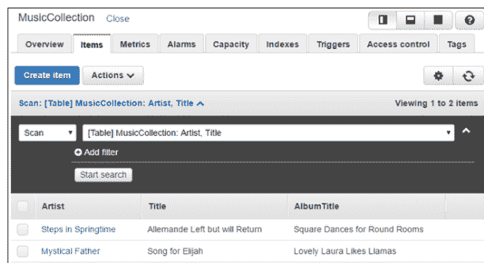

# 练习 7.4

## 创建 MySQL Amazon RDS DB 实例

Amazon RDS 的基本构建单元是 DB 实例。这是您运行 MySQL 数据库的环境。

在此练习中，创建一个运行名为 `west2-mysql-instance1` 的 MySQL 数据库引擎的 DB 实例，使用小型 DB 实例类、5 GB 存储并启用保留期为一天的自动备份。

### 创建 MySQL DB 实例

1. 登录 AWS 管理台，打开 Amazon RDS 控制台。
2. 在 RDS 控制台的右上角，选择创建 DB 实例的区域。
3. 在导航窗格中，选择实例（`Instances`）。
4. 选择启动 DB 实例（`Launch DB Instance`）。启动 DB 实例向导将在选择（`Select`）页面打开。
5. 在选择页面上，选择 MySQL 图标，然后为 MySQL DB 引擎选择选择（`Select`）。

### 练习 7.4（继续）

6. 在指定 DB 详情（`Specify DB Details`）页面上，如所示指定 DB 实例信息：

#### DB 详情

| 对于此参数 | 执行此操作 |
|---|---|
| 许可证模型 | 选择默认的通用公共许可证，以使用 MySQL 的通用许可协议。MySQL 只有一种许可证模型。 |
| DB 引擎版本 | 选择 MySQL 的默认版本。注意 Amazon RDS 在某些区域支持多个版本的 MySQL。 |
| DB 实例类 | 选择 `db.t2.small`，该配置等同于 1.7 GB 内存、1 ECU（带有 1 ECU 的虚拟核心）、64 位平台和中等 I/O 能力。 |
| 多可用区部署 | 选择在另一个可用区创建备用副本，以支持故障转移。 |
| 分配存储 | 输入以分配 5 GB 存储。 |
| 存储类型 | 选择磁性（`Magnetic`）存储类型。 |
| DB 实例标识符 | 为 DB 实例输入名称，例如 `west2-mysql-instance1`。 |
| 主用户名 | 输入作为主用户的名称。 |
| 主密码和确认密码 | 输入包含 8 到 41 个打印 ASCII 字符的密码（排除 `/`, `@`）。 |

7. 设置完成后，选择下一步（`Next`）。
8. 在配置高级设置（`Configure Advanced Settings`）页面上，提供 Amazon RDS 启动 DB 实例所需的附加信息。

#### 配置高级设置

| 对于此参数 | 执行此操作 |
|---|---|
| VPC | 选择托管数据库 Amazon VPC。 |
| 可用区 | 在上一页选择多可用区部署将移除此项。否则，请选择部署数据库的 AZ。 |
| DB 安全组 | 选择用于此 DB 实例的安全组。 |
| 数据库名称 | 输入数据库名称，长度为 1 到 64 个字符。如果没有名称，Amazon RDS 将不会在新配置的 DB 实例上自动创建数据库。 |
| 数据库端口 | 保留默认值 3306。 |
| DB 参数组 | 保留默认值。 |
| 组 | 选择默认值。此选项适用于上一页的 MySQL 版本。 |
| 将标记复制到快照 | 选择此选项以便在创建快照时将任何 DB 实例标记复制到 DB 快照。 |
| 启用加密 | 选择是以对 DB 实例进行静态加密。 |
| 备份保留期 | 将此值设置为 1。 |
| 备份窗口 | 使用默认的无偏好。 |
| 启用增强监控 | 使用默认的否。 |
| 自动最小版本升级 | 选择是以便在最小 DB 引擎版本升级可用时允许 DB 实例接收升级。 |
| 维护窗口 | 选择无偏好。 |

9. 指定您的 DB 实例信息，然后选择启动 DB 实例。

在 Amazon RDS 控制台中，新的 DB 实例将出现在实例列表中。在 DB 实例创建并准备就绪之前，其状态将处于创建中（`creating`）。当状态变为可用（`available`）时，连接到 DB 实例上创建的数据库。

取决于 DB 实例类和分配的存储，新的 DB 实例可能需要几分钟才能可用。

## 复习习题

1. 在同一可用区内，Amazon Relational Database Service (Amazon RDS) 和 Amazon Elastic Compute Cloud (Amazon EC2) 实例之间传输的数据费用如何计算？

   - A. 从 Amazon RDS 流出的 GB
   - B. 从 Amazon RDS 出的 GB
   - C. 来自 Amazon EC2 的 IOPS
   - D. 无费用。

2. 在使用 Amazon Elastic Block Store (EBS) 卷进行持久化的 Amazon Elastic Compute Cloud (Amazon EC2) 实例上，数据库查询响应时间存在巨大不一致。在调查问题时，你发现数据库磁盘卷上有大量的等待时间。能够在保持当前数据持久性的同时提高数据库存储的性能吗？（选择两个。）

   - A. 迁移到基于固态硬盘（SSD）的实例。
   - B. 使用带有实例存储（Instance Store Volume）的 Amazon EC2 实例。
   - C. 使用经过 EBS 优化（EBS-Optimized）的 Amazon EC2 实例类型。
   - D. 使用预留 IOPS（Provisioned IOPS） EBS 卷。

3. Amazon Relational Database Service (Amazon RDS) 自动备份和数据库快照目前支持哪些存储引擎？

   - A. JDBC
   - B. ODBC
   - C. InnoDB
   - D. MyISAM

4. 在 Amazon CloudWatch 中，哪种指标监控数据库实例上的可用空间？

   - A. `FreeStorageTotal`
   - B. `FreeStorageVolume`
   - C. `FreeStorageSpace`
   - D. `FreeRDSStorage`

5. 在 Amazon DynamoDB 表中，如果应用程序执行的读取或写入超过提供的容量，会发生什么？

   - A. 超过提供容量的请求将执行，但会返回 HTTP 400 错误。
   - B. 超过提供容量的请求将被节流（throttle），并返回 HTTP 400 错误。
   - C. 超过提供容量的请求将执行，但会返回 HTTP 500 错误。
   - D. 超过提供容量的请求将被节流，并返回 HTTP 500 错误。

6. 应该仔细监控哪个指标，以便在读取副本因复制错误导致不同步时知道何时应该重建它？

   - A. `ReadLag`
   - B. `ReadReplica`
   - C. `ReplicaLag`
   - D. `ReplicaThreshold`

7. 我的应用程序与数据库实例之间的连接可以使用安全套接层（SSL）加密吗？

   - A. 是
   - B. 否
   - C. 是，但仅限于 Amazon 虚拟私云（Amazon VPC）内部
   - D. 是，但仅限于某些区域内部

8. 在无意删除数据库表后，哪种 Amazon Relational Database Service (Amazon RDS) 功能允许您将数据库恢复到删除五分钟内？

   - A. Amazon RDS 自动备份
   - B. 多可用区（Multi-AZ）Amazon RDS
   - C. Amazon RDS 读取副本
   - D. Amazon RDS 快照

9. 备份保留期的范围是多少天？

   - A. 从 1 天到 7 天
   - B. 从 1 天到 28 天
   - C. 从 1 天到 35 天
   - D. 从 1 天到 90 天

10. 关于 Amazon DynamoDB，以下哪个说法是正确的？

    - A. 每个项目（item）应至少有两个值：一个主键和一个属性。
    - B. 一个项目可以有多个属性。
    - C. 主键必须存储单个值。
    - D. 单个属性可以有一个或多个子属性。

11. Amazon DynamoDB 项目的最大大小限制是以下哪一个？

    - A. 256 KB
    - B. 400 KB
    - C. 512 KB
    - D. 1,024 KB

12. 备用 Amazon Relational Database Service (Amazon RDS) 实例会与主实例位于同一可用区吗？

    - A. 是
    - B. 否
    - C. 仅在启动时配置（适用于基于 Oracle 和 Microsoft SQL Server 的 Amazon RDS 实例）

13. 对于单可用区和多可用区部署，定义区域内所有可用区的子集允许 Amazon RDS 在需要时在另一个可用区创建备用实例。Amazon Relational Database Service (Amazon RDS) 内部支持创建读取副本的读取副本吗？

    - A. 否
    - B. 在某些区域
    - C. 仅适用于基于 MySQL 的 Amazon RDS 实例
    - D. 仅适用于 Oracle Amazon RDS 数据库实例

14. 以多可用区（Multi-AZ）部署运行数据库实例时，备用数据库实例可以用于读写操作吗？

    - A. 是
    - B. 否
    - C. 仅适用于基于 Microsoft SQL Server 的 Amazon Relational Database Service (Amazon RDS) 数据库实例
    - D. 仅适用于基于 Oracle 的 Amazon RDS 数据库实例

15. 如果主数据库实例有多个读取副本且其中一个被提升，其余读取副本会发生什么？

    - A. 剩余的读取副本仍从原始主数据库实例进行复制。
    - B. 其他读取副本将被删除。
    - C. 剩余的读取副本将暂停操作。
    - D. 读取副本无法被提升。

16. 使用多可用区部署时，在主数据库实例发生计划或意外故障的情况下，Amazon RDS 会自动切换到备用副本。自动故障转移更新了哪个 DNS 记录？

    - A. A
    - B. CNAME
    - C. MX
    - D. SOA

17. 在 Amazon CloudWatch 中，哪种指标监控数据库实例上的可用空间？

    - A. `FreeStorageTotal`
    - B. `FreeStorageVolume`
    - C. `FreeStorageSpace`
    - D. `FreeRDSStorage`

18. 在无意删除数据库表后，哪种 Amazon Relational Database Service (Amazon RDS) 功能允许您将数据库恢复到删除五分钟内？

    - A. Amazon RDS 自动备份
    - B. 多可用区（Multi-AZ）Amazon RDS
    - C. Amazon RDS 读取副本
    - D. Amazon RDS 快照

19. 备份保留期的范围是多少天？

    - A. 从 1 天到 7 天
    - B. 从 1 天到 28 天
    - C. 从 1 天到 35 天
    - D. 从 1 天到 90 天

20. 关于 Amazon DynamoDB，以下哪个说法是正确的？

    - A. 每个项目应至少有两个值：一个主键和一个属性。
    - B. 一个项目可以有多个属性。
    - C. 主键必须存储单个值。
    - D. 单个属性可以有一个或多个子属性。

21. Amazon DynamoDB 项目的最大大小限制是以下哪一个？

    - A. 256 KB
    - B. 400 KB
    - C. 512 KB
    - D. 1,024 KB

22. 备用 Amazon Relational Database Service (Amazon RDS) 实例会与主实例位于同一可用区吗？

    - A. 是
    - B. 否
    - C. 仅在启动时配置（适用于 Oracle 和 Microsoft SQL Server 的 Amazon RDS 实例）

23. 对于单可用区和多可用区部署，定义区域内所有可用区的子集允许 Amazon RDS 在需要时在另一个可用区创建备用实例。Amazon Relational Database Service (Amazon RDS) 内部支持创建读取副本的读取副本吗？

    - A. 否
    - B. 在某些区域
    - C. 仅适用于基于 MySQL 的 Amazon RDS 实例
    - D. 仅适用于 Oracle Amazon RDS 数据库实例

24. 以多可用区（Multi-AZ）部署运行数据库实例时，备用数据库实例可以用于读写操作吗？

    - A. 是
    - B. 否
    - C. 仅适用于基于 Microsoft SQL Server 的 Amazon Relational Database Service (Amazon RDS) 数据库实例
    - D. 仅适用于基于 Oracle 的 Amazon RDS 数据库实例

25. 如果主数据库实例有多个读取副本且其中一个被提升，其余读取副本会发生什么？

    - A. 剩余的读取副本仍从原始主数据库实例进行复制。
    - B. 其他读取副本将被删除。
    - C. 剩余的读取副本将暂停操作。
    - D. 读取副本无法被提升。

26. 使用多可用区部署时，在主数据库实例发生计划或意外故障的情况下，Amazon RDS 会自动切换到备用副本。自动故障转移更新了哪个 DNS 记录？

    - A. A
    - B. CNAME
    - C. MX
    - D. SOA

27. 在 Amazon CloudWatch 中，哪种指标监控数据库实例上的可用空间？

    - A. `FreeStorageTotal`
    - B. `FreeStorageVolume`
    - C. `FreeStorageSpace`
    - D. `FreeRDSStorage`

28. 在 Amazon DynamoDB 表中，如果应用程序执行的读取或写入超过提供的容量，会发生什么？

    - A. 超过提供容量的请求将执行，但会返回 HTTP 400 错误。
    - B. 超过提供容量的请求将被节流，并返回 HTTP 400 错误。
    - C. 超过提供容量的请求将执行，但会返回 HTTP 500 错误。
    - D. 超过提供容量的请求将被节流，并返回 HTTP 500 错误。

29. 应该仔细监控哪个指标，以便在读取副本因复制错误导致不同步时知道何时应该重建它？

    - A. `ReadLag`
    - B. `ReadReplica`
    - C. `ReplicaLag`
    - D. `ReplicaThreshold`

30. 我的应用程序与数据库实例之间的连接可以使用安全套接层（SSL）加密吗？

    - A. 是
    - B. 否
    - C. 是，但仅限于 Amazon 虚拟私云（Amazon VPC）内部
    - D. 是，但仅限于某些区域内部

31. 在无意删除数据库表后，哪种 Amazon Relational Database Service (Amazon RDS) 功能允许您将数据库恢复到删除五分钟内？

    - A. Amazon RDS 自动备份
    - B. 多可用区（Multi-AZ）Amazon RDS
    - C. Amazon RDS 读取副本
    - D. Amazon RDS 快照

32. 备份保留期的范围是多少天？

    - A. 从 1 天到 7 天
    - B. 从 1 天到 28 天
    - C. 从 1 天到 35 天
    - D. 从 1 天到 90 天

33. 关于 Amazon DynamoDB，以下哪个说法是正确的？

    - A. 每个项目应至少有两个值：一个主键和一个属性。
    - B. 一个项目可以有多个属性。
    - C. 主键必须存储单个值。
    - D. 单个属性可以有一个或多个子属性。

34. Amazon DynamoDB 项目的最大大小限制是以下哪一个？

    - A. 256 KB
    - B. 400 KB
    - C. 512 KB
    - D. 1,024 KB

35. 备用 Amazon Relational Database Service (Amazon RDS) 实例会与主实例位于同一可用区吗？

    - A. 是
    - B. 否
    - C. 仅在启动时配置（适用于 Oracle 和 Microsoft SQL Server 的 Amazon RDS 实例）

36. 对于单可用区和多可用区部署，定义区域内所有可用区的子集允许 Amazon RDS 在需要时在另一个可用区创建备用实例。Amazon Relational Database Service (Amazon RDS) 内部支持创建读取副本的读取副本吗？

    - A. 否
    - B. 在某些区域
    - C. 仅适用于基于 MySQL 的 Amazon RDS 实例
    - D. 仅适用于 Oracle Amazon RDS 数据库实例

37. 以多可用区（Multi-AZ）部署运行数据库实例时，备用数据库实例可以用于读写操作吗？

    - A. 是
    - B. 否
    - C. 仅适用于基于 Microsoft SQL Server 的 Amazon Relational Database Service (Amazon RDS) 数据库实例
    - D. 仅适用于基于 Oracle 的 Amazon RDS 数据库实例

38. 如果主数据库实例有多个读取副本且其中一个被提升，其余读取副本会发生什么？

    - A. 剩余的读取副本仍从原始主数据库实例进行复制。
    - B. 其他读取副本将被删除。
    - C. 剩余的读取副本将暂停操作。
    - D. 读取副本无法被提升。

39. 使用多可用区部署时，在主数据库实例发生计划或意外故障的情况下，Amazon RDS 会自动切换到备用副本。自动故障转移更新了哪个 DNS 记录？

    - A. A
    - B. CNAME
    - C. MX
    - D. SOA

40. 在 Amazon CloudWatch 中，哪种指标监控数据库实例上的可用空间？

    - A. `FreeStorageTotal`
    - B. `FreeStorageVolume`
    - C. `FreeStorageSpace`
    - D. `FreeRDSStorage`

41. 在 Amazon DynamoDB 表中，如果应用程序执行的读取或写入超过提供的容量，会发生什么？

    - A. 超过提供容量的请求将执行，但会返回 HTTP 400 错误。
    - B. 超过提供容量的请求将被节流，并返回 HTTP 400 错误。
    - C. 超过提供容量的请求将执行，但会返回 HTTP 500 错误。
    - D. 超过提供容量的请求将被节流，并返回 HTTP 500 错误。

42. 应该仔细监控哪个指标，以便在读取副本因复制错误导致不同步时知道何时应该重建它？

    - A. `ReadLag`
    - B. `ReadReplica`
    - C. `ReplicaLag`
    - D. `ReplicaThreshold`

43. 我的应用程序与数据库实例之间的连接可以使用安全套接层（SSL）加密吗？

    - A. 是
    - B. 否
    - C. 是，但仅限于 Amazon 虚拟私云（Amazon VPC）内部
    - D. 是，但仅限于某些区域内部

44. 在无意删除数据库表后，哪种 Amazon Relational Database Service (Amazon RDS) 功能允许您将数据库恢复到删除五分钟内？

    - A. Amazon RDS 自动备份
    - B. 多可用区（Multi-AZ）Amazon RDS
    - C. Amazon RDS 读取副本
    - D. Amazon RDS 快照

45. 备份保留期的范围是多少天？

    - A. 从 1 天到 7 天
    - B. 从 1 天到 28 天
    - C. 从 1 天到 35 天
    - D. 从 1 天到 90 天

46. 关于 Amazon DynamoDB，以下哪个说法是正确的？

    - A. 每个项目应至少有两个值：一个主键和一个属性。
    - B. 一个项目可以有多个属性。
    - C. 主键必须存储单个值。
    - D. 单个属性可以有一个或多个子属性。

47. Amazon DynamoDB 项目的最大大小限制是以下哪一个？

    - A. 256 KB
    - B. 400 KB
    - C. 512 KB
    - D. 1,024 KB

48. 备用 Amazon Relational Database Service (Amazon RDS) 实例会与主实例位于同一可用区吗？

    - A. 是
    - B. 否
    - C. 仅在启动时配置（适用于 Oracle 和 Microsoft SQL Server 的 Amazon RDS 实例）

49. 对于单可用区和多可用区部署，定义区域内所有可用区的子集允许 Amazon RDS 在需要时在另一个可用区创建备用实例。Amazon Relational Database Service (Amazon RDS) 内部支持创建读取副本的读取副本吗？

    - A. 否
    - B. 在某些区域
    - C. 仅适用于基于 MySQL 的 Amazon RDS 实例
    - D. 仅适用于 Oracle Amazon RDS 数据库实例

50. 以多可用区（Multi-AZ）部署运行数据库实例时，备用数据库实例可以用于读写操作吗？

    - A. 是
    - B. 否
    - C. 仅适用于基于 Microsoft SQL Server 的 Amazon Relational Database Service (Amazon RDS) 数据库实例
    - D. 仅适用于基于 Oracle 的 Amazon RDS 数据库实例

51. 如果主数据库实例有多个读取副本且其中一个被提升，其余读取副本会发生什么？

    - A. 剩余的读取副本仍从原始主数据库实例进行复制。
    - B. 其他读取副本将被删除。
    - C. 剩余的读取副本将暂停操作。
    - D. 读取副本无法被提升。

52. 使用多可用区部署时，在主数据库实例发生计划或意外故障的情况下，Amazon RDS 会自动切换到备用副本。自动故障转移更新了哪个 DNS 记录？

    - A. A
    - B. CNAME
    - C. MX
    - D. SOA

53. 在 Amazon CloudWatch 中，哪种指标监控数据库实例上的可用空间？

    - A. `FreeStorageTotal`
    - B. `FreeStorageVolume`
    - C. `FreeStorageSpace`
    - D. `FreeRDSStorage`

54. 在 Amazon DynamoDB 表中，如果应用程序执行的读取或写入超过提供的容量，会发生什么？

    - A. 超过提供容量的请求将执行，但会返回 HTTP 400 错误。
    - B. 超过提供容量的请求将被节流，并返回 HTTP 400 错误。
    - C. 超过提供容量的请求将执行，但会返回 HTTP 500 错误。
    - D. 超过提供容量的请求将被节流，并返回 HTTP 500 错误。

55. 应该仔细监控哪个指标，以便在读取副本因复制错误导致不同步时知道何时应该重建它？

    - A. `ReadLag`
    - B. `ReadReplica`
    - C. `ReplicaLag`
    - D. `ReplicaThreshold`

56. 我的应用程序与数据库实例之间的连接可以使用安全套接层（SSL）加密吗？

    - A. 是
    - B. 否
    - C. 是，但仅限于 Amazon 虚拟私云（Amazon VPC）内部
    - D. 是，但仅限于某些区域内部

57. 在无意删除数据库表后，哪种 Amazon Relational Database Service (Amazon RDS) 功能允许您将数据库恢复到删除五分钟内？

    - A. Amazon RDS 自动备份
    - B. 多可用区（Multi-AZ）Amazon RDS
    - C. Amazon RDS 读取副本
    - D. Amazon RDS 快照

58. 备份保留期的范围是多少天？

    - A. 从 1 天到 7 天
    - B. 从 1 天到 28 天
    - C. 从 1 天到 35 天
    - D. 从 1 天到 90 天

59. 关于 Amazon DynamoDB，以下哪个说法是正确的？

    - A. 每个项目应至少有两个值：一个主键和一个属性。
    - B. 一个项目可以有多个属性。
    - C. 主键必须存储单个值。
    - D. 单个属性可以有一个或多个子属性。

60. Amazon DynamoDB 项目的最大大小限制是以下哪一个？

    - A. 256 KB
    - B. 400 KB
    - C. 512 KB
    - D. 1,024 KB

61. 备用 Amazon Relational Database Service (Amazon RDS) 实例会与主实例位于同一可用区吗？

    - A. 是
    - B. 否
    - C. 仅在启动时配置（适用于 Oracle 和 Microsoft SQL Server 的 Amazon RDS 实例）

62. 对于单可用区和多可用区部署，定义区域内所有可用区的子集允许 Amazon RDS 在需要时在另一个可用区创建备用实例。Amazon Relational Database Service (Amazon RDS) 内部支持创建读取副本的读取副本吗？

    - A. 否
    - B. 在某些区域
    - C. 仅适用于基于 MySQL 的 Amazon RDS 实例
    - D. 仅适用于 Oracle Amazon RDS 数据库实例

63. 以多可用区（Multi-AZ）部署运行数据库实例时，备用数据库实例可以用于读写操作吗？

    - A. 是
    - B. 否
    - C. 仅适用于基于 Microsoft SQL Server 的 Amazon Relational Database Service (Amazon RDS) 数据库实例
    - D. 仅适用于基于 Oracle 的 Amazon RDS 数据库实例

64. 如果主数据库实例有多个读取副本且其中一个被提升，其余读取副本会发生什么？

    - A. 剩余的读取副本仍从原始主数据库实例进行复制。
    - B. 其他读取副本将被删除。
    - C. 剩余的读取副本将暂停操作。
    - D. 读取副本无法被提升。

65. 使用多可用区部署时，在主数据库实例发生计划或意外故障的情况下，Amazon RDS 会自动切换到备用副本。自动故障转移更新了哪个 DNS 记录？

    - A. A
    - B. CNAME
    - C. MX
    - D. SOA

66. 在 Amazon CloudWatch 中，哪种指标监控数据库实例上的可用空间？

    - A. `FreeStorageTotal`
    - B. `FreeStorageVolume`
    - C. `FreeStorageSpace`
    - D. `FreeRDSStorage`

67. 在 Amazon DynamoDB 表中，如果应用程序执行的读取或写入超过提供的容量，会发生什么？

    - A. 超过提供容量的请求将执行，但会返回 HTTP 400 错误。
    - B. 超过提供容量的请求将被节流，并返回 HTTP 400 错误。
    - C. 超过提供容量的请求将执行，但会返回 HTTP 500 错误。
    - D. 超过提供容量的请求将被节流，并返回 HTTP 500 错误。

68. 应该仔细监控哪个指标，以便在读取副本因复制错误导致不同步时知道何时应该重建它？

    - A. `ReadLag`
    - B. `ReadReplica`
    - C. `ReplicaLag`
    - D. `ReplicaThreshold`

69. 我的应用程序与数据库实例之间的连接可以使用安全套接层（SSL）加密吗？

    - A. 是
    - B. 否
    - C. 是，但仅限于 Amazon 虚拟私云（Amazon VPC）内部
    - D. 是，但仅限于某些区域内部

70. 在无意删除数据库表后，哪种 Amazon Relational Database Service (Amazon RDS) 功能允许您将数据库恢复到删除五分钟内？

    - A. Amazon RDS 自动备份
    - B. 多可用区（Multi-AZ）Amazon RDS
    - C. Amazon RDS 读取副本
    - D. Amazon RDS 快照

71. 备份保留期的范围是多少天？

    - A. 从 1 天到 7 天
    - B. 从 1 天到 28 天
    - C. 从 1 天到 35 天
    - D. 从 1 天到 90 天

72. 关于 Amazon DynamoDB，以下哪个说法是正确的？

    - A. 每个项目应至少有两个值：一个主键和一个属性。
    - B. 一个项目可以有多个属性。
    - C. 主键必须存储单个值。
    - D. 单个属性可以有一个或多个子属性。

73. Amazon DynamoDB 项目的最大大小限制是以下哪一个？

    - A. 256 KB
    - B. 400 KB
    - C. 512 KB
    - D. 1,024 KB

74. 备用 Amazon Relational Database Service (Amazon RDS) 实例会与主实例位于同一可用区吗？

    - A. 是
    - B. 否
    - C. 仅在启动时配置（适用于 Oracle 和 Microsoft SQL Server 的 Amazon RDS 实例）

75. 对于单可用区和多可用区部署，定义区域内所有可用区的子集允许 Amazon RDS 在需要时在另一个可用区创建备用实例。Amazon Relational Database Service (Amazon RDS) 内部支持创建读取副本的读取副本吗？

    - A. 否
    - B. 在某些区域
    - C. 仅适用于基于 MySQL 的 Amazon RDS 实例
    - D. 仅适用于 Oracle Amazon RDS 数据库实例

76. 以多可用区（Multi-AZ）部署运行数据库实例时，备用数据库实例可以用于读写操作吗？

    - A. 是
    - B. 否
    - C. 仅适用于基于 Microsoft SQL Server 的 Amazon Relational Database Service (Amazon RDS) 数据库实例
    - D. 仅适用于基于 Oracle 的 Amazon RDS 数据库实例

77. 如果主数据库实例有多个读取副本且其中一个被提升，其余读取副本会发生什么？

    - A. 剩余的读取副本仍从原始主数据库实例进行复制。
    - B. 其他读取副本将被删除。
    - C. 剩余的读取副本将暂停操作。
    - D. 读取副本无法被提升。

78. 使用多可用区部署时，在主数据库实例发生计划或意外故障的情况下，Amazon RDS 会自动切换到备用副本。自动故障转移更新了哪个 DNS 记录？

    - A. A
    - B. CNAME
    - C. MX
    - D. SOA

79. 在 Amazon CloudWatch 中，哪种指标监控数据库实例上的可用空间？

    - A. `FreeStorageTotal`
    - B. `FreeStorageVolume`
    - C. `FreeStorageSpace`
    - D. `FreeRDSStorage`

80. 在 Amazon DynamoDB 表中，如果应用程序执行的读取或写入超过提供的容量，会发生什么？

    - A. 超过提供容量的请求将执行，但会返回 HTTP 400 错误。
    - B. 超过提供容量的请求将被节流，并返回 HTTP 400 错误。
    - C. 超过提供容量的请求将执行，但会返回 HTTP 500 错误。
    - D. 超过提供容量的请求将被节流，并返回 HTTP 500 错误。

81. 应该仔细监控哪个指标，以便在读取副本因复制错误导致不同步时知道何时应该重建它？

    - A. `ReadLag`
    - B. `ReadReplica`
    - C. `ReplicaLag`
    - D. `ReplicaThreshold`

82. 我的应用程序与数据库实例之间的连接可以使用安全套接层（SSL）加密吗？

    - A. 是
    - B. 否
    - C. 是，但仅限于 Amazon 虚拟私云（Amazon VPC）内部
    - D. 是，但仅限于某些区域内部

83. 在无意删除数据库表后，哪种 Amazon Relational Database Service (Amazon RDS) 功能允许您将数据库恢复到删除五分钟内？

    - A. Amazon RDS 自动备份
    - B. 多可用区（Multi-AZ）Amazon RDS
    - C. Amazon RDS 读取副本
    - D. Amazon RDS 快照

84. 备份保留期的范围是多少天？

    - A. 从 1 天到 7 天
    - B. 从 1 天到 28 天
    - C. 从 1 天到 35 天
    - D. 从 1 天到 90 天

85. 关于 Amazon DynamoDB，以下哪个说法是正确的？

    - A. 每个项目应至少有两个值：一个主键和一个属性。
    - B. 一个项目可以有多个属性。
    - C. 主键必须存储单个值。
    - D. 单个属性可以有一个或多个子属性。

86. Amazon DynamoDB 项目的最大大小限制是以下哪一个？

    - A. 256 KB
    - B. 400 KB
    - C. 512 KB
    - D. 1,024 KB

87. 备用 Amazon Relational Database Service (Amazon RDS) 实例会与主实例位于同一可用区吗？

    - A. 是
    - B. 否
    - C. 仅在启动时配置（适用于 Oracle 和 Microsoft SQL Server 的 Amazon RDS 实例）

88. 对于单可用区和多可用区部署，定义区域内所有可用区的子集允许 Amazon RDS 在需要时在另一个可用区创建备用实例。Amazon Relational Database Service (Amazon RDS) 内部支持创建读取副本的读取副本吗？

    - A. 否
    - B. 在某些区域
    - C. 仅适用于基于 MySQL 的 Amazon RDS 实例
    - D. 仅适用于 Oracle Amazon RDS 数据库实例

89. 以多可用区（Multi-AZ）部署运行数据库实例时，备用数据库实例可以用于读写操作吗？

    - A. 是
    - B. 否
    - C. 仅适用于基于 Microsoft SQL Server 的 Amazon Relational Database Service (Amazon RDS) 数据库实例
    - D. 仅适用于基于 Oracle 的 Amazon RDS 数据库实例

90. 如果主数据库实例有多个读取副本且其中一个被提升，其余读取副本会发生什么？

    - A. 剩余的读取副本仍从原始主数据库实例进行复制。
    - B. 其他读取副本将被删除。
    - C. 剩余的读取副本将暂停操作。
    - D. 读取副本无法被提升。

91. 使用多可用区部署时，在主数据库实例发生计划或意外故障的情况下，Amazon RDS 会自动切换到备用副本。自动故障转移更新了哪个 DNS 记录？

    - A. A
    - B. CNAME
    - C. MX
    - D. SOA

92. 在 Amazon CloudWatch 中，哪种指标监控数据库实例上的可用空间？

    - A. `FreeStorageTotal`
    - B. `FreeStorageVolume`
    - C. `FreeStorageSpace`
    - D. `FreeRDSStorage`

93. 在 Amazon DynamoDB 表中，如果应用程序执行的读取或写入超过提供的容量，会发生什么？

    - A. 超过提供容量的请求将执行，但会返回 HTTP 400 错误。
    - B. 超过提供容量的请求将被节流，并返回 HTTP 400 错误。
    - C. 超过提供容量的请求将执行，但会返回 HTTP 500 错误。
    - D. 超过提供容量的请求将被节流，并返回 HTTP 500 错误。

94. 应该仔细监控哪个指标，以便在读取副本因复制错误导致不同步时知道何时应该重建它？

    - A. `ReadLag`
    - B. `ReadReplica`
    - C. `ReplicaLag`
    - D. `ReplicaThreshold`

95. 我的应用程序与数据库实例之间的连接可以使用安全套接层（SSL）加密吗？

    - A. 是
    - B. 否
    - C. 是，但仅限于 Amazon 虚拟私云（Amazon VPC）内部
    - D. 是，但仅限于某些区域内部

96. 在无意删除数据库表后，哪种 Amazon Relational Database Service (Amazon RDS) 功能允许您将数据库恢复到删除五分钟内？

    - A. Amazon RDS 自动备份
    - B. 多可用区（Multi-AZ）Amazon RDS
    - C. Amazon RDS 读取副本
    - D. Amazon RDS 快照

97. 备份保留期的范围是多少天？

    - A. 从 1 天到 7 天
    - B. 从 1 天到 28 天
    - C. 从 1 天到 35 天
    - D. 从 1 天到 90 天

98. 关于 Amazon DynamoDB，以下哪个说法是正确的？

    - A. 每个项目应至少有两个值：一个主键和一个属性。
    - B. 一个项目可以有多个属性。
    - C. 主键必须存储单个值。
    - D. 单个属性可以有一个或多个子属性。

99. Amazon DynamoDB 项目的最大大小限制是以下哪一个？

    - A. 256 KB
    - B. 400 KB
    - C. 512 KB
    - D. 1,024 KB

100. 备用 Amazon Relational Database Service (Amazon RDS) 实例会与主实例位于同一可用区吗？

    - A. 是
    - B. 否
    - C. 仅在启动时配置（适用于 Oracle 和 Microsoft SQL Server 的 Amazon RDS 实例）

101. 对于单可用区和多可用区部署，定义区域内所有可用区的子集允许 Amazon RDS 在需要时在另一个可用区创建备用实例。Amazon Relational Database Service (Amazon RDS) 内部支持创建读取副本的读取副本吗？

    - A. 否
    - B. 在某些区域
    - C. 仅适用于基于 MySQL 的 Amazon RDS 实例
    - D. 仅适用于 Oracle Amazon RDS 数据库实例

102. 以多可用区（Multi-AZ）部署运行数据库实例时，备用数据库实例可以用于读写操作吗？

    - A. 是
    - B. 否
    - C. 仅适用于基于 Microsoft SQL Server 的 Amazon Relational Database Service (Amazon RDS) 数据库实例
    - D. 仅适用于基于 Oracle 的 Amazon RDS 数据库实例

103. 如果主数据库实例有多个读取副本且其中一个被提升，其余读取副本会发生什么？

    - A. 剩余的读取副本仍从原始主数据库实例进行复制。
    - B. 其他读取副本将被删除。
    - C. 剩余的读取副本将暂停操作。
    - D. 读取副本无法被提升。

104. 使用多可用区部署时，在主数据库实例发生计划或意外故障的情况下，Amazon RDS 会自动切换到备用副本。自动故障转移更新了哪个 DNS 记录？

    - A. A
    - B. CNAME
    - C. MX
    - D. SOA

105. 在 Amazon CloudWatch 中，哪种指标监控数据库实例上的可用空间？

    - A. `FreeStorageTotal`
    - B. `FreeStorageVolume`
    - C. `FreeStorageSpace`
    - D. `FreeRDSStorage`

106. 在 Amazon DynamoDB 表中，如果应用程序执行的读取或写入超过提供的容量，会发生什么？

    - A. 超过提供容量的请求将执行，但会返回 HTTP 400 错误。
    - B. 超过提供容量的请求将被节流，并返回 HTTP 400 错误。
    - C. 超过提供容量的请求将执行，但会返回 HTTP 500 错误。
    - D. 超过提供容量的请求将被节流，并返回 HTTP 500 错误。

107. 应该仔细监控哪个指标，以便在读取副本因复制错误导致不同步时知道何时应该重建它？

    - A. `ReadLag`
    - B. `ReadReplica`
    - C. `ReplicaLag`
    - D. `ReplicaThreshold`

108. 我的应用程序与数据库实例之间的连接可以使用安全套接层（SSL）加密吗？

    - A. 是
    - B. 否
    - C. 是，但仅限于 Amazon 虚拟私云（Amazon VPC）内部
    - D. 是，但仅限于某些区域内部

109. 在无意删除数据库表后，哪种 Amazon Relational Database Service (Amazon RDS) 功能允许您将数据库恢复到删除五分钟内？

    - A. Amazon RDS 自动备份
    - B. 多可用区（Multi-AZ）Amazon RDS
    - C. Amazon RDS 读取副本
    - D. Amazon RDS 快照

110. 备份保留期的范围是多少天？

    - A. 从 1 天到 7 天
    - B. 从 1 天到 28 天
    - C. 从 1 天到 35 天
    - D. 从 1 天到 90 天

111. 关于 Amazon DynamoDB，以下哪个说法是正确的？

    - A. 每个项目应至少有两个值：一个主键和一个属性。
    - B. 一个项目可以有多个属性。
    - C. 主键必须存储单个值。
    - D. 单个属性可以有一个或多个子属性。

112. Amazon DynamoDB 项目的最大大小限制是以下哪一个？

    - A. 256 KB
    - B. 400 KB
    - C. 512 KB
    - D. 1,024 KB

113. 备用 Amazon Relational Database Service (Amazon RDS) 实例会与主实例位于同一可用区吗？

    - A. 是
    - B. 否
    - C. 仅在启动时配置（适用于 Oracle 和 Microsoft SQL Server 的 Amazon RDS 实例）

114. 对于单可用区和多可用区部署，定义区域内所有可用区的子集允许 Amazon RDS 在需要时在另一个可用区创建备用实例。Amazon Relational Database Service (Amazon RDS) 内部支持创建读取副本的读取副本吗？

    - A. 否
    - B. 在某些区域
    - C. 仅适用于基于 MySQL 的 Amazon RDS 实例
    - D. 仅适用于 Oracle Amazon RDS 数据库实例

115. 以多可用区（Multi-AZ）部署运行数据库实例时，备用数据库实例可以用于读写操作吗？

    - A. 是
    - B. 否
    - C. 仅适用于基于 Microsoft SQL Server 的 Amazon Relational Database Service (Amazon RDS) 数据库实例
    - D. 仅适用于基于 Oracle 的 Amazon RDS 数据库实例

116. 如果主数据库实例有多个读取副本且其中一个被提升，其余读取副本会发生什么？

    - A. 剩余的读取副本仍从原始主数据库实例进行复制。
    - B. 其他读取副本将被删除。
    - C. 剩余的读取副本将暂停操作。
    - D. 读取副本无法被提升。

117. 使用多可用区部署时，在主数据库实例发生计划或意外故障的情况下，Amazon RDS 会自动切换到备用副本。自动故障转移更新了哪个 DNS 记录？

    - A. A
    - B. CNAME
    - C. MX
    - D. SOA

118. 在 Amazon CloudWatch 中，哪种指标监控数据库实例上的可用空间？

    - A. `FreeStorageTotal`
    - B. `FreeStorageVolume`
    - C. `FreeStorageSpace`
    - D. `FreeRDSStorage`

119. 在 Amazon DynamoDB 表中，如果应用程序执行的读取或写入超过提供的容量，会发生什么？

    - A. 超过提供容量的请求将执行，但会返回 HTTP 400 错误。
    - B. 超过提供容量的请求将被节流，并返回 HTTP 400 错误。
    - C. 超过提供容量的请求将执行，但会返回 HTTP 500 错误。
    - D. 超过提供容量的请求将被节流，并返回 HTTP 500 错误。

120. 应该仔细监控哪个指标，以便在读取副本因复制错误导致不同步时知道何时应该重建它？

    - A. `ReadLag`
    - B. `ReadReplica`
    - C. `ReplicaLag`
    - D. `ReplicaThreshold`

121. 我的应用程序与数据库实例之间的连接可以使用安全套接层（SSL）加密吗？

    - A. 是
    - B. 否
    - C. 是，但仅限于 Amazon 虚拟私云（Amazon VPC）内部
    - D. 是，但仅限于某些区域内部

122. 在无意删除数据库表后，哪种 Amazon Relational Database Service (Amazon RDS) 功能允许您将数据库恢复到删除五分钟内？

    - A. Amazon RDS 自动备份
    - B. 多可用区（Multi-AZ）Amazon RDS
    - C. Amazon RDS 读取副本
    - D. Amazon RDS 快照

123. 备份保留期的范围是多少天？

    - A. 从 1 天到 7 天
    - B. 从 1 天到 28 天
    - C. 从 1 天到 35 天
    - D. 从 1 天到 90 天

124. 关于 Amazon DynamoDB，以下哪个说法是正确的？

    - A. 每个项目应至少有两个值：一个主键和一个属性。
    - B. 一个项目可以有多个属性。
    - C. 主键必须存储单个值。
    - D. 单个属性可以有一个或多个子属性。

125. Amazon DynamoDB 项目的最大大小限制是以下哪一个？

    - A. 256 KB
    - B. 400 KB
    - C. 512 KB
    - D. 1,024 KB

126. 备用 Amazon Relational Database Service (Amazon RDS) 实例会与主实例位于同一可用区吗？

    - A. 是
    - B. 否
    - C. 仅在启动时配置（适用于 Oracle 和 Microsoft SQL Server 的 Amazon RDS 实例）

127. 对于单可用区和多可用区部署，定义区域内所有可用区的子集允许 Amazon RDS 在需要时在另一个可用区创建备用实例。Amazon Relational Database Service (Amazon RDS) 内部支持创建读取副本的读取副本吗？

    - A. 否
    - B. 在某些区域
    - C. 仅适用于基于 MySQL 的 Amazon RDS 实例
    - D. 仅适用于 Oracle Amazon RDS 数据库实例

128. 以多可用区（Multi-AZ）部署运行数据库实例时，备用数据库实例可以用于读写操作吗？

    - A. 是
    - B. 否
    - C. 仅适用于基于 Microsoft SQL Server 的 Amazon Relational Database Service (Amazon RDS) 数据库实例
    - D. 仅适用于基于 Oracle 的 Amazon RDS 数据库实例

129. 如果主数据库实例有多个读取副本且其中一个被提升，其余读取副本会发生什么？

    - A. 剩余的读取副本仍从原始主数据库实例进行复制。
    - B. 其他读取副本将被删除。
    - C. 剩余的读取副本将暂停操作。
    - D. 读取副本无法被提升。

130. 使用多可用区部署时，在主数据库实例发生计划或意外故障的情况下，Amazon RDS 会自动切换到备用副本。自动故障转移更新了哪个 DNS 记录？

    - A. A
    - B. CNAME
    - C. MX
    - D. SOA

## 应用程序部署与管理

AWS CERTIFIED SYSOPS ADMINISTRATOR - ASSOCIATE 考试涵盖的章节主题可能包括但不限于以下内容：

## 2.0 高可用性

### 2.1 根据场景实现可扩展性和伸弹性

内容可能包括：

- 使用哪种 AWS 计算服务来部署可扩展和具有弹性的环境
- 包括用于部署和管理应用程序的特定 AWS 计算服务的可扩展性
- 在保持可用性的同时实施升级的方法

### 2.2 根据业务需求确保容错性水平

内容可能包括：

- 可以使用哪些 AWS 云部署服务来部署容错应用程序


# 应用部署与管理简介

作为 AWS 认证系统运维工程师 - 副级认证的候选人，你需要熟悉应用程序部署策略以及用于应用程序部署和管理的服务。AWS 提供了许多功能来配置你的基础设施并部署你的应用程序。部署模型根据支持运营所需的各种而因客户定制化而异。理解这些能力和技术将帮助你选择最佳策略和工具，以部署能够处理你工作负载的基础设施。

经验丰富的系统运维人员深知“一刀切”并不适用。对于企业级计算或创建下一个大型社交媒体或游戏公司，AWS 提供了多种选项来服务广泛的用例。AWS 平台旨在解决可扩展性、性能、安全性和部署便利性问题，并提供帮助管理迁移的工具以及深度参与其产品和服务成长的开发者生态系统。

本章详细介绍了不同的部署策略和服务。它将回顾在这些部署策略中提供的常用功能，阐述了更新应用栈的策略，并提供了各种工作负载的常见用法模式示例。

## 部署策略

AWS 提供了每种部署服务特有的关键功能，这些将在本章稍后讨论。然而，这些服务也有一些共同特征。本节将讨论系统运维人员在选择部署策略时需要理解各种常用功能和能力。每个功能都会以自己的方式影响服务的采用。

### 基础设施配置

你可以单独使用构建块服务，例如配置 Amazon Elastic Compute Cloud (Amazon EC2) 实例、Amazon Elastic Block Store (Amazon EBS) 卷、Amazon Simple Storage (Amazon S3) 桶、Amazon Virtual Private Cloud (Amazon VPC) 环境等。或者，可以使用自动化部署服务来配置基础设施组件。使用自动化能力的主要优势是它们为部署和配置应用程序以及所需的所有资源提供了丰富的特性集。例如，你可以使用 AWS CloudFormation 模板将你的基础设施视为代码。模板描述了所有将配置的资源以及它们应该如何配置。

# 部署应用程序

AWS 部署服务还可以让你在底层基础设施上部署应用程序变得更简单。你可以创建一个应用程序，为所需的部署服务指定源仓库，并让部署服务处理运行你的所需的所需的 AWS 资源配置的复杂性。尽管在部署方面提供了相似的功能，但每个服务都有其部署和管理你应用程序的独特方法。

# 配置管理

为什么系统运维人员考虑配置管理？你可能出于各种原因需要快速部署资源——升级你的部署、替换故障的资源、自动扩展你的基础设施等。对于系统运维人员来说，考虑如何配置应用程序部署以自动响应扩展容事件是非常重要的。

除了部署应用程序外，部署服务还可以自定义和管理应用程序配置。底层任务可能是替换 Web 应用程序中的配置文件，或更新应用程序所需的软件包。你可以自定义 Amazon EC2 实例上的软件，也可以自定义你堆栈配置中的基础设施资源。

系统运维人员需要跟踪配置以及对环境进行的任何更改。当你需要实施配置更改时，你使用的策略将允许你针对适当的资源。配置管理还让你能够拥有一个自动化且可重复的部署过程。

# 标记

使用部署服务的另一个优势是标签使用的自动化。标签由用户定义的键和值对组成。例如，你可以将标签定义为应用程序、项目、成本中心、部门、目的等，以便能够轻松地识别资源。当你在部署步骤中使用标签时，工具会自动将标签传播到底层资源，例如 Amazon EC2 实例、Auto Scaling 组或 Amazon Relational Database Service (Amazon RDS) 实例。

恰当使用标记可以提供一种更好的基于标签成本来管理预算的方法。成本分配报告根据标签汇总成本。通过这种方式，你可以确定为每个应用程序或特定项目花费了多少钱。

# 自定义变量

当你开发应用程序时，你希望自定义配置值，例如数据库连接字符串、安全凭据和其他信息，你不希望将它们硬编码在应用程序中。定义变量可以帮助解耦应用程序配置，并让你能够灵活地扩展应用程序的分层。在应用程序代码之外嵌入变量还可以提高应用程序的可移植性。此外，你可以根据自定义变量将环境分为开发、测试和生产环境。部署服务有助于自定义变量，一旦设置，变量就会对你的应用程序环境可用。例如，AWS CloudFormation 模板可以包含一个参数，供 Web 层 Amazon EC2 实例连接到 Amazon RDS 实例。该参数被插入数据脚本中，以便安装在 Amazon EC2 实例上的应用程序可以连接到数据库。

# 构建 Amazon 映像 (AMI)

机器映像 (AMI)提供了启动实例所需的信息。它包含了实例的配置信息，包括卷的块设备映射以及使用哪个快照创建卷。快照是卷的映像。根卷由操作系统以及卷内的任何其他内容（带有附加应用程序）组成，这些都是你已安装的。

为了启动 Amazon EC2 实例，你需要选择为应用程序使用哪个 AMI。一种常见的做法是在首次启动时在实例上安装应用程序。这个过程被称为实例的引导（bootstrapping）。

> 注意：如果你有复杂的应用程序或多个需要安装的应用程序，引导过程可能会较慢。在发布期间，使用多个工具和依赖项管理应用程序集群是一项具有挑战性的任务。此外，你的部署服务应该设计为执行快速重启以利用 Auto Scaling。

构建映像（Baking）是创建你自己的 AMI 的过程。与其使用引导脚本来部署应用程序（这可能花费很长时间），此 AMI 内部可以包含部分应用程序制品。然而，在部署实例期间，你也可以使用用户数据（`user data`）来定制应用程序安装。AMI 也是区域范围的——要在另一个区域使用映像，你需要将该映像复制到所有使用的区域。

需要记住的关键因素是实例启动所需的时间。如果每个实例的脚本化安装花费很长时间，这可能会影响你快速扩展的能力。或者，复制已安装应用程序的卷块可能会更快。缺点是，如果应用程序发生了更改，你需要构建一个新的映像（这也可以自动化），或者使用配置管理工具来应用更改。

# 部署策略

例如，假设你正在管理一个由 Web 层、应用层和数据库层组成的环境。你可以对基础 AMI 进行逻辑分组，这些 AMI 集可以加载在这些环境中的 80% 的应用程序二进制文件。你可以选择在引导过程（bootstrapping process）期间以及安装后，根据按实例标签、自动伸缩组（`Auto Scaling groups`）或其他实例属性分组的配置集来安装剩余的应用程序。你可以为资源设置标签，以跟踪它们被用于环境的哪一层。在部署更新时，该过程可以查询实例标签，验证其是否为应用程序的最新版本，然后进行安装。当需要更新 AMI 时，你只需在底层部署服务将现有 AMI 替换为最新版本并更新标签即可。

你可以编写脚本来实现 AMI 的制作（baking）。此外，还有许多第三方工具可用于制作 AMI。一些知名的工具包括 HashiCorp 的 `Packer` 和 Netflix 的 `Aminator`。你也可以选择第三方工具进行配置管理，例如 `Chef`、`Puppet`、`Salt` 和 `Ansible`。

# 日志

日志记录是应用程序部署周期中的一个重要环节。日志可以提供重要的调试信息，或提供应用程序行为的关键特征。部署服务通过 AWS 管理控制台、AWS 命令行界面 (`AWS CLI`) 和应用程序编程接口 (`API`) 方法的结合，使得访问这些日志变得更加简单，无需登录 Amazon EC2 实例即可查看它们。

除了内置功能外，部署服务还提供了 Amazon CloudWatch Logs 的无缝集成，以扩展你监控系统、应用程序和自定义日志文件的能力。你可以使用 Amazon CloudWatch 实时监控来自 Amazon EC2 实例日志、Amazon CloudTrail 事件，或将日志数据归档到 Amazon S3 以供未来分析。

你可以为你想要监控的指标创建报警。当超过阈值时，会触发报警并发送警报消息或采取行动来缓解问题。例如，你可以设置报警，在 Amazon EC2 实例状态检查失败时发送电子邮件警报，或在 CPU 利用率达到特定阈值时触发伸缩事件。

每个部署服务都会提供部署的进度情况。你可以通过 AWS 管理控制台或 API 跟踪正在创建或删除的资源。

# 实例配置文件

运行在 Amazon EC2 实例上的应用程序必须在它们的 API 请求中包含 AWS 凭证。你可以让开发者将 AWS 凭证直接存储在 Amazon EC2 实例中，并允许该实例中的应用程序使用这些凭证。这样，开发者就必须管理凭证，确保安全地将凭证传递给每个实例，并在需要轮换凭证时更新 Amazon EC2 实例。这是大量的额外工作。此外还存在凭证泄露、从 Amazon EC2 实例复制并在其他处使用的风险。

相反，你可以并且应该使用 AWS 身份和访问管理 (`IAM`) 角色来为运行在 Amazon EC2 实例上的应用程序管理临时凭证。

当你使用角色时，无需无需向 Amazon EC2 实例分发长期凭证。相反，角色提供了应用程序在调用时可以使用的临时权限。当你启动 Amazon EC2 实例时，会指定一个与实例关联的 IAM 角色。运行在实例上的应用程序随后可以使用角色提供的临时凭证对 API 请求签名。

实例配置文件（`Instance profiles`）是嵌入访问 AWS 资源所需的必要 IAM 角色的极佳方法。实例配置文件是 IAM 角色的容器，你可以在实例启动时使用它将角色信息传递给 Amazon EC2 实例。实例配置文件只能包含一个 IAM 角色，尽管一个角色可以包含在多个实例配置文件中。这些 IAM 角色可以从你的实例安全地向 AWS Cloud 服务发出 API 请求，而无需你管理凭证。部署服务与实例配置文件无缝集成，以简化凭证管理，并让你无需在应用程序配置中硬编码 API 密钥。

例如，如果你的应用程序需要只读权限访问 Amazon S3 桶，你可以创建一个实例配置文件，并将只读 Amazon S3 访问分配给关联的 IAM 角色。部署服务将处理这些角色传递给 Amazon EC2 实例的复杂性，以便你的应用程序以你定义的权限安全地访问 AWS 资源。

# 可扩展性能力

自动扩展你的应用程序队列以处理需求增长时期，不仅能为终端用户提供更好的体验，还能保持低成本。随着需求增加，资源可以自动扩展。此外，你仅根据负载为所需的资源付费。

例如，你可以配置自动伸缩，根据你在 Amazon CloudWatch 中设置的指标（如 CPU、内存、磁盘 I/O 和网络 I/O）动态地添加或删除 Amazon EC2 实例。这种类型的自动伸缩配置无缝集成到 AWS Elastic Beanstalk 和 AWS CloudFormation 中。同样，AWS OpsWorks 和 Amazon EC2 Container Services (Amazon ECS) 也具有根据时间或负载自动管理伸缩的能力。Amazon ECS 具有服务伸缩（Service Scaling），它通过结合 Amazon ECS、Amazon CloudWatch 和自动伸缩 API 来自动扩展应用程序。

# 监控资源

监控让你对在云中启动的资源了如指。当你想要监控整体应用程序健康的资源利用率时，部署服务已集成了监控功能，在你的仪表板中提供此类信息。你可以导航到 Amazon CloudWatch 控制台，获取所有资源和运行状况的全局视图。可以为你想要监控的指标创建报警。当超过阈值时，报警会被触发，并发送警报消息或采取行动来缓解问题。例如，你可以设置报警，在 Amazon EC2 实例状态检查失败时发送电子邮件警报，或在 CPU 利用率满足特定阈值时触发伸缩事件。

每个部署服务都会提供你部署的进度。你可以通过 AWS 管理控制台或 API 跟踪正在创建或删除的资源。

# 持续部署

本节介绍了系统操作员可以用于自动化集成、测试和部署的各种部署方法、操作原理和策略。

取决于你对服务的选择，更新应用程序代码的策略可能会有所不同。AWS 部署服务带来了灵活性并提高了你应用程序的部署速度，但使用正确的工具和正确的策略是构建稳健环境的关键。

下一节将介绍部署服务如何在执行应用程序更新时提供帮助。像任何部署周期一样，你使用的方法都有权衡和考虑，因此你实现的方法需要满足部署的具体要求。

## 部署方法

你有两种方法可以配合部署服务来更新应用程序：原地升级（in-place upgrade）和替换升级（replacement upgrade）。原地升级涉及在现有的 Amazon EC2 实例上执行应用程序更新。替换升级涉及置备新的 Amazon EC2 实例、重定向流量并终止旧实例。

原地升级通常适用于具有一致发布计划的快速部署。它是专为无状态应用程序设计的。你仍然可以通过实施滚动部署计划并遵循下文提到的蓝绿部署指南，对静态应用程序使用原地方法。

与此相反，替换升级通过置备资源提供了更简单的部署方式。通过部署新栈并将流量从旧栈重定向到新栈，无需处理现有资源升级和潜在故障的复杂性。这对于你的应用程序具有未知依赖项也有用。底层 Amazon EC2 实例在部署期间被认为是临时或瞬态的。在新发布后，将通过终止旧实例来推出一组新的 Amazon EC2 实例。这种技术在不可变基础设施中更为常见。

有几种部署服务特别适用于：`AWS CodeDeploy`、`AWS OpsWorks` 和 `AWS Elastic Beanstalk`。`AWS CodeDeploy` 是一种自动部署到 Amazon EC2 实例或你自有设施中的本地实例的部署服务。`AWS CodeDeploy` 让你更容易快速发布新功能，帮助你避免应用程序部署期间停机，并处理更新应用程序的复杂性，从而许多与易出错的手动部署相关的风险。你还可以使用 `AWS OpsWorks` 管理你的栈。部署会触发每个层的部署。`OpsWorks` 还会安装栈配置和部署属性，其中包含部署所需的所有信息，例如仓库和数据库连接数据。`AWS Elastic Beanstalk` 为部署的处理提供了多种选项，包括部署策略（一次性、滚动、滚动加额外的批处理（`Batch`）和不可变（`Immutable`）以及在部署期间配置批大小和健康检查行为的选项。

对于替换升级（replacement upgrades），你通过部署服务配置一个新环境，例如 `AWS Elastic Beanstalk`、`AWS CloudFormation` 和 `AWS OpsWorks`。在运行旧版本应用程序的实例周围，会创建一个独立的 Auto Scaling 组并运行新版本应用程序的完整套新实例。不可变部署（`Immutable deployments`）可以防止由于部署部分完成引起的问题。通常，你会为新栈和旧栈使用不同的弹性负载均衡器（Elastic Load Balancing）。通过使用带有加权路由的 `Amazon Route 53`，你可以将流量轮到新栈的负载均衡器上。

# 原地升级 (In-Place Upgrade)

`AWS CodeDeploy` 是一种部署服务，它可以自动将应用程序部署到 Amazon EC2 实例或您机房中的本地实例上。你可以部署无限类型的应用程序内容，例如代码、Web 文件和配置文件、可执行文件、脚本、多媒体文件等。`AWS CodeDeploy` 可以部署存储在 S3 存储桶、GitHub 仓库或 Bitbucket 仓库中的应用程序内容。一旦你一致地部署应用程序及其修订版本，就可以将更新推送到一组称为部署组的实例，该部署组由标记的 AWS EC2 实例和/或 Auto Scaling 组组成。此外，`AWS CodeDeploy` 还与配置管理工具、持续集成和部署系统以及版本控制系统配合。你可以在 AWS CodeDeploy 文档中找到产品选项列表。

`AWS CodeStar` 用于在 AWS 上开发、构建和部署应用程序。`AWS CodeStar` 提供了一个统一界面，使你能够在一个地方轻松地管理你的软件开发活动。通过 CodeStar，你可以在几分钟内设置好整个持续交付工具链，让你更快地开始编码。`AWS CodeStar` 提供了一个流水线，这是一个全托管的源码控制服务，消除了管理自己的基础设施来托管 Git 仓库的需求。`AWS CodeStar` 使用 `AWS CodeBuild` 编译并打包你的源码，`AWS CodeBuild` 是一种全托管的构建服务，让你能够更频繁地进行构建、测试和集成。AWS 在 `AWS CodePipeline`（一种持续集成和持续交付 CI/CD 服务）的帮助下加速了发布。`AWS CodeStar` 与 `AWS CodeDeploy` 和 `AWS CloudFormation` 集成，以便你可以更新应用程序代码并部署到 Amazon EC2 和 `AWS Lambda`。

另一个管理应用程序整个生命期的服务是 `AWS OpsWorks`。你可以使用内置层或自定义层以及配方（recipes）来启动你的应用程序栈。此外，还有许多自定义选项可用于配置和推送应用程序更新。当你部署应用程序时，`AWS OpsWorks Stacks` 会触发部署事件（Deploy event），运行每个层配方。`AWS OpsWorks Stacks` 会安装所有栈配置和部署属性，这些属性包含了部署应用程序所需的所有信息，例如应用程序的仓库和数据库连接。

# 替换升级 (Replacement Upgrade)

替换升级将原地资源替换为新配置的资源。原地升级方法和替换升级方法各有优缺点。你可以通过多种方式执行替换。你可以使用 Auto Scaling 策略来定义你想要添加（扩容）或移除（收缩容）实例的方式。通过将此与你的更新策略结合，你可以作为缩放事件的一部分控制应用程序更新的发布。

例如，你可以创建一个新的 Auto Scaling 启动配置（`Launch Configuration`），其中指定包含应用程序新版本的新版 AMI。然后，你可以配置 Auto Scaling 组使用新的启动配置。Auto Scaling 终止策略默认会首先终止启动配置最旧且最接近计费小时的实例。这种效果提供了一种淘汰所有使用之前配置的实例的最具成本效益的方法。如果你正在使用弹性负载均衡（Elastic Load Balancing），你可以在负载均衡器后面附加一个额外的 Auto Scaling 配置，并使用类似的方法在移除旧实例的同时引入新实例。

类似地，你可以结合 `AWS Elastic Beanstalk` 和 `AWS CloudFormation` 等部署服务配置部署。你可以使用策略来描述 Auto Scaling 组中的实例如何作为你更新策略的一部分被替换或修改。通过这些部署服务，你可以配置并发或批处理更新的实例数量，将更新应用到某些运行中的实例，并指定批处理更新之间的等待时间。此外，如果你在应用程序代码中发现 Bug，可以取消或回滚更新。这些功能可以帮助提高你应用程序更新的可用性。

# 蓝绿色部署 (Blue/Green Deployments)

蓝绿色部署是一种方法，即在你的环境中运行两个相同的应用程序栈。你使用各种策略将流量从当前的应用程序栈（蓝端）迁移到应用程序的新版本（绿端）。这种方法用于替换升级。在蓝绿色部署期间，最新的应用程序修订版本将安装在替换实例上，并立即或一旦你测试完新环境，流量就会重定向到这些实例上。

这是一种用于零停机部署应用程序的流行技术。像 `AWS Elastic Beanstalk`、`AWS CloudFormation` 或 `AWS OpsWorks` 等部署服务对于蓝绿色部署特别有用，它们提供了一种复制现有应用程序栈的方法。

与原地部署相比，蓝绿色部署具有许多优势。可以提前在新实例上安装并测试应用程序，只需通过将流量切换到新服务器即可部署到生产环境。切换回应用程序的最新版本更快、更可靠，因为只要原始实例未被终止，流量就可以路由回原始实例。在原地部署中，版本必须通过重新部署应用程序的上一个版本来回滚。因为为蓝绿色部署提供的实例是新的，它们反映了最新的服务器配置，这有助于你避免某些有时在长时间运行的实例上发生类型的问题。

对于无状态应用程序，更新过程非常简单。只需上传应用程序的新版本并让你的部署服务创建一个新版本的栈（绿端）即可。要切换到新版本，你只需替换域名服务器（DNS）记录中的负载均衡 URL。`AWS Elastic Beanstalk` 有一个 Swap URL 功能来简化切换过程。如果你使用 `Amazon Route 53` 管理 DNS 记录，可以交换 CloudFormation 或 `AWS OpsWorks` 的负载端点。

对于带有会话的应用程序，切换过程可能非常复杂。当你执行更新时，你不希望用户遇到停机或丢失数据。你应该考虑将会话存储在部署服务之外，因为创建新栈会重建数据库。特别在使用 RDS 数据库时，考虑将会话与部署服务分开存储。

加权轮询（WRR）功能用于从蓝端到绿端的迁移。该功能是渐进而非瞬时驱动流量。如果你有 Bug，这种方法确保了影响范围最小，它只影响一小部分用户。这在必要时通过将流量重定向回蓝栈简化了回滚。此外，当你在绿端扩容而在蓝端收缩时，你使用了所需的实例数量。例如，你可以设置 WRR 让 10% 的流量进入绿端，同时增加绿色实例的百分比直到完成完全切换。客户端短 DNS 生存时间（TTL）也可以确保客户端以快速发布周期连接到绿端，减少 DNS 缓存行为。有关 `Amazon Route 53` 的更多信息，请参见第 5 章“网络”。

# 混合部署

你可以以混合方式使用部署服务管理你的应用程序集群。你可以结合 `AWS Elastic Beanstalk` 提供的管理 AWS 基础设施的简单性和 `AWS CloudFormation` 提供的自定义网络分段的自动化。利用混合部署模型还简化了你的架构，因为它解耦了你的部署方法，以便为更新应用程序栈选择不同的策略。

# 部署服务

AWS 部署服务提供了与其他 AWS 云服务的更轻松的集成。无论你需要使用弹性负载均衡在多个可用区之间进行负载均衡，还是使用 RDS 作为后端，像 `AWS Elastic Beanstalk`、`AWS CloudFormation` 和 `AWS OpsWorks` 等部署服务都能使得将这些服务作为部署的一部分变得更加简单。

如果您需要使用其他 AWS 云服务，可以利用特定工具的集成方法与资源进行交互。例如，如果您正在使用 `AWS Elastic Beanstalk` 进行部署，并使用 `Amazon DynamoDB` 作为后端，您可以通过在应用程序源码包中包含配置文件来自定义您的环境资源。通过 `AWS OpsWorks`，您可以创建自定义配方（`recipes`）来配置应用程序，使其能够访问其他 AWS 云服务。同样，针对许多示例场景，提供了多个模板片段（`template snippets`）供您在 `AWS CloudFormation` 模板中使用。

AWS 提供了多种配置基础设施的策略。您可以使用构建模块（针对 Amazon EC2、Amazon EBS、Amazon S3 和 Amazon RDS）并利用第三方工具提供的集成功能来部署您的应用程序。但为了获得更大的灵活性，您可以考虑 AWS 部署服务提供的自动化功能。

## AWS Elastic Beanstalk

`AWS Elastic Beanstalk` 是在 AWS 上启动运行应用程序最快、最简单的方法。它对于想要部署代码而不担心管理底层基础设施的开发者来说是理想的。`AWS Elastic Beanstalk` 在不限制选择或控制的情况下降低管理复杂度。您只需上传您的应用程序，`AWS Elastic Beanstalk` 自动处理容量配置、负载均衡、扩展和健康检查的细节。

`AWS Elastic Beanstalk` 为编程语言（如 Java、PHP、Python、Ruby 或 Go）和 Web 容器提供了平台，每种平台都有多种配置。`AWS Elastic Beanstalk` 提供运行应用程序所需的资源，包括一个或多个 Amazon EC2 实例。运行在 Amazon EC2 实例上的软件堆取决于具体的配置。在配置名称中，版本号指的是平台配置的版本。您还可以直接从 `AWS Elastic Beanstalk` 控制台执行大多数部署任务，例如更改 Amazon EC2 实例组的大小或监控您的应用程序。

## 应用程序

使用 `AWS Elastic Beanstalk` 的第一步是创建一个代表您在 AWS 中的 Web 应用程序的应用程序（`application`）。在 `AWS Elastic Beanstalk` 中，应用程序作为运行您的 Web 应用程序以及应用程序源码版本、保存的配置、日志以及您使用 `AWS Elastic Beanstalk` 创建的其他产物的容器。

## 环境层级

当您启动 `AWS Elastic Beanstalk` 环境时，需要选择环境层级、平台和环境类型。环境层级决定了 `AWS Elastic Beanstalk` 提供资源来支持处理 HTTP(S) 请求的 Web 应用程序，还是处理后台处理任务的应用程序。处理 Web 请求应用程序的环境被称为 Web 服务器层。运行后台作业应用程序的环境被称为工作层（worker tier）。环境是应用程序的核心。当您创建环境时，`AWS Elastic Beanstalk` 提供运行您的应用程序所需的资源。

如果您的应用程序执行耗时较长的操作或工作流，可以将这些任务卸载到专门的工作环境中。将您的 Web 应用程序前端与执行阻塞操作的过程解耦，是确保您的应用程序在负载下保持响应的常用方法。对于工作环境层级，如果您尚未拥有队列，`AWS Elastic Beanstalk` 还会创建并配置 Amazon Simple Queue Service (Amazon SQS) 队列。当您启动工作环境层级时，`AWS Elastic Beanstalk` 会在自动扩展组中的每个 Amazon EC2 实例上安装您所选编程语言的必要支持文件和一个守护进程（daemon）。该守护进程负责从 Amazon SQS 队列中拉取请求并发送到工作环境层级的数据中，由其处理这些消息。

## 环境平台

`AWS Elastic Beanstalk` 支持 Java、.NET、PHP、Node.js、Python、Packer、Ruby、Go 和 Docker，是 Web 应用程序的理想选择。由于 `AWS Elastic Beanstalk` 采用开放架构，非 Web 应用程序可以使用 `AWS Elastic Beanstalk` 进行部署。此外，`AWS Elastic Beanstalk` 支持自定义平台，这些平台可以基于您从支持的操作系统之一创建的 AMI，并包含进一步的自定义。您可以设置在指定的窗口内让您的 `AWS Elastic Beanstalk` 环境自动更新到运行应用程序的底层平台的最新版本。`AWS Elastic Beanstalk` 定期发布支持平台的新版本，包含操作系统、Web 和应用程序服务器、语言和框架的更新。

## 管理环境

`AWS Elastic Beanstalk` 让为应用程序创建新环境变得非常简单。您可以为开发、测试和生产环境创建并管理独立的环境，并将应用程序的任何版本部署到任何环境中。环境可以是长时间运行的也可以是临时的。当您终止环境时，可以保存其配置以便以后重新创建。

在您开发应用程序期间，您可能会出于不同的目的将其部署到几个不同的环境中。`AWS Elastic Beanstalk` 允许您配置如何执行部署。您可以同时部署到环境中的所有实例，或者通过滚动部署（rolling deployments）分批拆分部署。

## 管理应用程序版本

当您上传源码时，`AWS Elastic Beanstalk` 会创建一个应用程序版本（application version）。这通常发生在您创建新环境或通过环境管理控制台或 `AWS Elastic Beanstalk CLI` 上传部署代码时。您也可以从应用程序控制上传源码包而不进行部署。

`AWS Elastic Beanstalk` 的单环境部署在您部署应用程序版本时会执行原地更新（in-place update），因此您的应用程序可能会短时间内无法对用户可用。通过使用 `AWS Elastic Beanstalk` 执行蓝绿部署（blue/green deployment）可以避免这种停机时间，您可以将新版本部署到单独的环境，并使用 `AWS Elastic Beanstalk` 交换两个环境的 CNAME，立即将流量重定向到新版本。

蓝绿部署要求您的应用程序环境独立于数据库运行——如果您的应用程序使用了一个安装在其中的 RDS 实例，数据将不会传输到 `AWS Elastic Beanstalk` 蓝色环境，并在终止原始环境时丢失。

## Amazon EC2 Container Service

Amazon EC2 Container Service (Amazon ECS) 是一种高度扩展、高性能的容器管理服务，可以轻松在 EC2 实例集群上运行、停止和管理 Docker。Docker 是一种允许您构建、运行、测试和部署基于容器应用程序的技术。Amazon ECS 使用任务定义中的 Docker 镜像在 Amazon EC2 实例上启动容器。

在新的或现有的 Amazon VPC 内创建 Amazon ECS 集群。集群启动运行后，你可以指定任务定义和服务，以指明在你的集群中运行哪些 Docker 容器镜像。容器镜像存储在容器注册表中并从该处拉取，这些注册表可能存在于你的 AWS 基础设施内部，也可能在外部。集群是 Amazon EC2 实例的逻辑分组，你可以在其上运行任务。在运行任务时，Amazon ECS 从你指定的注册表中下载容器镜像，并在你集群内的容器实例上运行这些镜像。

## 实例 (Instances)

Amazon ECS 容器实例是正在运行 Amazon ECS 容器代理并已注册到集群的 Amazon EC2 实例。当你使用 Amazon ECS 运行任务时，你的任务会被放置在活跃的容器实例上。容器实例必须运行 Amazon ECS 容器代理才能注册到你的集群之一。如果你正在使用 Amazon ECS 优化的 AMI，则已安装该代理。若要使用不同的操作系统，请安装相应的代理。

Amazon ECS 代理会代表你向 Amazon ECS 发调用。你必须使用具有适当 IAM 角色的实例配置文件（instance profile）启动容器实例。该 IAM 角色必须包含一个能够验证你的账户并提供所需资源权限的策略。此外，容器实例需要外部网络访问以与 Amazon ECS 端点通信。如果你的容器实例没有公 IP 地址，它们必须使用网络地址翻译 (`NAT`) 或 HTTP 代理来访问此项。当 Amazon ECS 容器代理将实例注册到你的集群时，该容器实例报告其状态为 `ACTIVE`，连接状态为 `TRUE`。该容器实例可以接受任务请求。

Amazon ECS 优化的 AMI 是你启动 Amazon ECS 容器实例的推荐 AMI。Amazon ECS 优化的 AMI 经过预配置并通过了 AWS 工程师的测试。它提供了最新、最精简版本的 Docker、Amazon Linux AMI、Amazon ECS 容器代理，以及用于运行和监控 Amazon ECS 代理的推荐容器服务包。通常，实例上的 Amazon ECS 配置文件会通过用户数据脚本（user data script）进行修改，以指定如要注册实例的集群等参数。

## 容器 (Containers)

要在 Amazon ECS 上部署应用程序，你的应用程序组件必须设计为以便在容器中运行。Docker 容器是一个标准化的软件开发单元，包含了应用程序运行所需的所有内容：操作系统、配置、代码、运行时、系统工具和系统库。与虚拟机相比，容器更轻量，内存和计算开销更小，因此它们很容易支持由数百或数千个小型、隔离的微服务组成的应用程序。经过良好容器化的应用程序便于扩展和维护，并能有效利用可用资源。

## 部署服务 (Deployment Services)

将你的应用程序构建为一组紧密且集中的容器，允许你通过严格且定义良好的接口并行构建它们。由于 Amazon ECS 允许你可以在不担心破坏代码的情况下通过微服务来构建、改进并运行你的服务。由于 Amazon ECS 允许你以声明式的方式构建，从而可以有效利用资源。使用 Amazon ECS 允许你通过减少压力，来提高运行的效率。通常，实例上的 Amazon ECS 配置文件会通过用户数据脚本进行修改，以指定要注册实例的集群等参数。

## 镜像 (Images)

容器是从只读模板创建的，这种模板被称为镜像。镜像通常基于 `Dockerfile`，描述了应用程序的构建。

## 注册表 (Repository)

Docker 使用存储在注册表中的镜像来运行。另一种注册表选项是 Amazon 容器注册 (`ECR`)。Amazon ECR 是一个托管的 Docker 镜像服务，可以使用 IAM 权限来使用它。

## 任务 (Tasks)

任务定义是你在容器实例上运行任务的蓝图。当你在 Amazon ECS 中启动任务时，你需要创建一个任务定义。Amazon ECS 提供三种任务功能：

- 适用于长时间运行的任务和应用程序的服务调度器
- 允许手动在集群上放置任务的能力
- 允许在特定实例上手动运行任务的能力

## 第 8 章 应用程序部署与管理 (Chapter 8 • Application Deployment and Management)

任务是在集群内容器实例上的任务实例化。在 Amazon ECS 上运行 Docker 容器之前，你必须创建一个任务定义。

## 服务 (Services)

Amazon ECS 允许你在 Amazon ECS 集群中运行并维护指定数量（“期望数量”）的任务实例。这被称为服务。如果你的任何任务失败或停止，Amazon ECS 服务调度器会启动另一个任务定义的实例来替换它并维护服务的期望数量。除了维护服务的期望数量外，你还可以选择在负载均衡器后运行服务。负载均衡器会将流量分发到与服务关联的任务。

服务调度器非常适用于无状态的服务和应用程序。你可以通过部署新的任务定义或更改运行的任务来更新由服务调度器维护的服务。默认情况下，服务调度器跨可用区扩展，但你可以使用任务放置策略和约束来限制任务放置。

## AWS OpsWorks 栈 (AWS OpsWorks Stacks)

`AWS OpsWorks` 是一种应用程序管理服务，让开发和运维人员轻松部署和运行各种规模的应用程序。如果你希望部署代码并对基础设施进行抽象，并且应用程序比三层架构更复杂，那么 `AWS OpsWorks` 是最佳选择。如果你想使用配置管理系统来管理基础设施，也推荐使用 `OpsWorks`。

栈提供了一种简单灵活的方法来创建和管理栈以及应用程序。它具有丰富的自定义组件，你可以混合使用以创建一个满足特定目的的栈。此外，如果你有现有的计算资源，可以将它们与使用 `OpsWorks Stacks` 创建的实例整合到栈中。此类资源可以是现有的 Amazon EC2 实例或本地实例。然后你可以使用 `OpsWorks Stacks` 将所有相关实例作为一个组进行管理。

## 栈 (Stacks)

栈是 `OpsWorks` 的顶层实体。它代表你想管理的实例集，它们通常具有共同目的，例如提供 PHP 应用程序。除了作为容器，栈还处理适用于整个组的任务，例如管理应用程序和配方（cookbooks）。

# 层 (Layers)

层是一组实例（例如 Amazon EC2 实例）的蓝图。它指定了如实例设置、资源、已安装软件包和安全组等信息。你可以将 Chef 配方添加到实例的生命周期事件中；例如，用于安装和配置任何所需的软件。每个栈（stack）包含一个或多个层，其中每个层代表一个栈组件。在操作 `AWS OpsWorks` 层时，请记住栈中的每个实例都必须是至少一个层的成员（已注册实例除外）。Amazon EC2 实例可以选择性作为多个 `AWS OpsWorks` 层的成员，在这种情况下，`AWS OpsWorks` 栈会为实例的每个层运行配方，以安装和配置软件包、部署应用程序等。

# 实例 (Instances)

在创建层之后，你通常会添加至少一个实例。如果当前集合无法处理负载，你可以使用基于负载或基于时间的实例来自动扩展实例数量。实例的操作系统可以是几种 Linux 发行版之一或 Windows Server 2012 R2。要将实例添加到栈中，你可以直接在 `AWS OpsWorks Stacks` 中添加它，或者添加在其他处创建的 Linux 的实例（本地实例）。

# 应用程序 (Applications)

`AWS OpsWorks` 栈代表你想要在应用程序服务器上运行的代码。代码存储在仓库中（如 Amazon S3 存档），应用程序包含了将代码部署到相应应用程序实例所需的信息。当你部署应用程序时，`AWS OpsWorks Stacks` 会触发 `Deploy` 事件，运行每个层的 `Deploy` 配方。`AWS OpsWorks Stacks` 还会安装栈配置和部署属性，这些属性包含了部署该应用所需的所有信息，例如应用程序的仓库和数据库连接。

将应用程序部署到服务器的第一步是将应用程序添加到栈中。栈代表该应用程序并包含各种元数据，例如将应用程序部署到服务器实例所需的应用程序名称和类型（例如，仓库 URL）。你可以从 Git 仓库、Amazon S3 束、HTTP 包和其他仓库部署应用程序。不同的仓库类型有其特定的要求。

当 `AWS OpsWorks Stack` 在实例上运行命令时，它会响应 `Deploy` 生命周期事件触发 `Deploy` 命令。`Deploy` 命令向实例的节点对象（node object）添加一组属性，描述栈的当前配置。对于 `Deploy` 事件和 `Execute Recipes` 栈命令，`AWS OpsWorks Stacks` 会安装 `Deploy` 属性，这些属性提供了一些额外的部署信息。

# 食谱 (Cookbooks)

`AWS OpsWorks Stacks` 使用 Chef 食谱来处理安装和配置软件包以及部署应用程序等任务。你的自定义食谱必须存储在在线仓库中，可以是如 zip 文件之类的存档，可以是 Git 等源码控制管理器。一个栈只能有一个食谱仓库，该仓库可以包含任意数量的食谱。当你安装或更新食谱时，`AWS OpsWorks Stacks` 会在每个每个实例的本地缓存中安装整个仓库。当实例需要（例如，运行一个或多个配方）时，它将使用本地缓存中的代码。

仓库使用源码控制管理器、Git 或 Subversion，或者仓库可以存储在 Amazon S3 或 HTTP 连接中。食谱组织为结构根目录下的目录。每个食谱目录至少有一个（通常是所有）标准目录和文件，这些文件必须使用标准名称。目录的标准名称有 `attributes`、`recipes`、`templates` 和其他（其他）。该食谱目录还应该包含 `metadata.rb`，它是食谱的元数据。模板必须位于 `templates` 目录的子目录下，该目录包含至少一个且可选的多个子目录。这些目录也可以包含进一步的子目录。

# 第 8 章 ■ 应用程序部署与管理

# AWS CloudFormation

`AWS CloudFormation` 负责为你置备和配置资源。你不需要单独配置 AWS 资源，并弄清楚什么依赖于什么。`AWS CloudFormation` 为系统操作人员、架构师和其他人员提供了根据你创建的用于建模基础设施架构的模板来置备和管理 AWS 资源栈的能力。你可以管理从单个 Amazon EC2 实例到复杂的多层、多区域应用程序的任何内容。通过使用模板，你可以对基础设施实施版本控制，并以可重复的方式轻松复制你的基础设施栈。

这种部署服务是简化基础设施的理想选择，同时提供了处理复杂架构的能力。对于一个包含后端数据库的可扩展 Web 应用程序，可以使用自动扩展组（Auto Scaling group）、弹性负载均衡器（Elastic Load Balancing）和 Amazon RDS DB 实例。通常情况下，你必须使用每个服务来置备这些资源，之后你必须配置它们协同工作。所有这些任务在你的应用程序运行之前都会增加复杂性和耗时。然后，你可以创建或修改现有的 `AWS CloudFormation` 模板。模板描述了你所有的资源及其属性。

通过使用 `AWS CloudFormation`，你可以快速复制你的基础设施。如果你的应用程序需要额外的可用性，你可以在多个区域中复制它，这样当一个区域不可用时，你的用户仍可以在其他区域使用你的应用程序。复制应用程序的挑战在于它还要求你复制资源。你不仅需要记录应用程序所需的所有资源，还必须在每个区域置备并配置这些资源。你可以复用 `AWS CloudFormation` 模板来一致且重复地设置你的资源。你可以描述资源，然后通过在每个区域创建一个相同模板的栈，从而在多个区域置备相同的资源。`AWS CloudFormation` 对于从开发阶段到测试阶段再到生产阶段的迁移也非常有用——只需为此创建栈即可。

如果你有一个工具可以对自己基础设施的置备和管理进行细粒度控制，建议使用 `AWS CloudFormation`。作为基础设施部署的一部分，你可能想要包含部署应用程序更新所需的组件。例如，`AWS CodeDeploy` 是管理应用程序部署和更新的推荐 `AWS CloudFormation` 工具。

# 创建栈 (Creating Stacks)

栈是可以作为单一单元管理的 AWS 资源集合。也就是说，你可以通过更新或删除栈来创建、更新或删除资源集合。栈中的所有资源都是由栈的 `CloudFormation` 模板定义的。例如，一个栈可以包含运行 Web 应用程序所需的所有资源，如 Web 服务器、数据库和网络规则。如果你不再需要该应用程序，只需删除栈及其相关资源即可。

`AWS CloudFormation` 确保所有栈资源得到相应的创建或删除。因为 `AWS CloudFormation` 将栈资源视为单一单元，它们必须一起创建。如果无法创建资源，`AWS CloudFormation` 将回滚栈并自动删除资源，直到栈能够成功删除。你可以使用 `AWS CloudFormation` 控制台、API 或 `AWS CLI` 操作栈。

在创建栈之前，你必须有一个描述 `CloudFormation` 将包含在栈中的模板。在 `AWS CloudFormation` 控制台创建栈是一个简单的向导过程。


> 栈后，使用 `AWS CloudFormation` 控制台、API 或 `AWS CLI` 更新栈中非 `CloudFormation` 管理的资源。会导致栈模板与资源当前状态之间出现不匹配，在更新或删除栈时会导致错误。

# 删除栈 (Deleting Stacks)

栈删除完成后，栈将处于 `DELETE_COMPLETE` 状态。默认情况下，`AWS CloudFormation` 控制台不会显示 `DELETE_COMPLETE` 状态的栈。当栈处于 `DELETE_FAILED` 状态时，由于 `AWS CloudFormation` 无法删除资源，请使用 `Retain` 参数重新运行删除，并指定 `AWS CloudFormation` 无法删除的资源以跳过或修复错误并重试。通常，删除失败最常见的原因有两个：存在外部依赖，或者你没有删除该资源的 IAM 权限。某些资源在删除之前必须为空。例如，你必须删除 Amazon S3 桶中的所有对象或从 Amazon EC2 安全组中移除实例，才能删除桶或安全组。除了 `AWS CloudFormation` 权限外，你可能被允许删除底层服务（如 Amazon S3 或 Amazon EC2）。

# 更新堆栈

当你需要更改堆栈设置或更改其资源时，你应该更新堆栈而不是删除它并创建一个新堆栈。例如，如果你有一个包含 Amazon EC2 实例的堆栈，你可以更新堆栈来更改实例的 AMI ID。当你更新堆栈时，你会提交更改，例如新的输入参数值或更新后的模板。`AWS CloudFormation` 将你提交的更改与堆栈的当前状态进行比较，并仅更新更改的资源。

> 更新堆栈时，`AWS CloudFormation` 可能会中断资源或替换更新的资源，这取决于你更新了哪些属性。查看 `AWS CloudFormation` 如何更新特定资源，以及如果被中断是否会影响端用户。

当你更新堆栈时，`AWS CloudFormation` 根据你更新的内容与堆栈当前模板之间的差异来更新资源。在更新过程中，未更改的资源不会受到中断。对于已更新的资源，`AWS CloudFormation` 使用以下更新行为之一：无中断或替换。`AWS CloudFormation` 采用的方法取决于你针对特定资源类型更新了哪个属性。每个属性的更新行为在《AWS CloudFormation 用户指南》的 AWS 资源类型部分有描述。

根据更新行为，你可以决定何时修改资源，以减少这些更改对你的应用程序的影响。特别是，你可以规划在更新期间必须替换资源。例如，如果你更新了 `AWS::RDS::DBInstance` 资源的 `Port` 属性，`AWS CloudFormation` 将通过创建一个具有更新端口设置的新数据库实例并删除旧数据库实例来替换该数据库实例。

# 使用更改集

`AWS CloudFormation` 提供了两种更新堆栈的方法：直接更新或创建更改集。当你直接更新堆栈时，你会提交更改，`AWS CloudFormation` 会立即部署这些更改。当你想要快速部署更新时，请使用直接更新。

通过更改集，你可以预览 `AWS CloudFormation` 将对你的堆栈进行的更改，然后决定是否应用这些更改。更改集是 `JSON` 格式的文档，总结了 `AWS CloudFormation` 将对堆栈所做的更改。当你想要确保 `AWS CloudFormation` 不会产生意外之外的更改，或者当你想要考虑多个选项时，请使用更改集。例如，你可以使用更改集验证 `AWS CloudFormation` 在更新期间不会替换你的数据库实例。在实施更改之前了解更改将如何影响运行中的资源，可以帮助你更有信心地更新堆栈。你可以使用 `AWS CloudFormation` 控制台、`AWS CLI` 或 `AWS CloudFormation API` 创建并管理更改集。

# 部署服务

更改集并不表示 `AWS CloudFormation` 将成功更新堆栈。例如，更改集不会检查你是否会超过帐户限制、你是否正在更新一个不支持更新的资源，或者你是否有足够的权限修改资源，所有这些因素都可能导致堆栈更新失败。如果更新失败，`AWS CloudFormation` 会尝试将你的资源回滚到原始状态。执行更改后，`AWS CloudFormation` 会移除所有与堆栈关联的更改集，因为它们不再适用于更新后的堆栈。

当你直接修改堆栈模板以生成更改集时，`AWS CloudFormation` 将该更改归类为直接修改，而不是由输入参数触发的更改。例如，为 Amazon EC2 `i-1abc23d4` 实例添加新标签的值就是直接修改的示例。所有其他输入值（如参数值和能力集）都保持不变，因此我们关注“更改”（`Changes`）：

```json
{
  "Changes": [
    {
      "Type": "Add",
      "Resource": "MyTag"
    }
  ]
}
```


"Changes": [

  {

    "ResourceType": "AWS::EC2::Instance",

    "PhysicalResourceId": "i-1abc23d4",

    "Details": [

      {

        "ChangeSource": "DirectModification",

        "Evaluation": "Static",

        "Target": {

          "Attribute": "Tags",

          "RequiresRecreation": "Never"

        }

      }

    ],

    "Action": "Modify",

    "Scope": [

      {

        "LogicalResourceId": "MyEC2Instance",

        "Replacement": "False"

      }

    ],

    "Type": "Resource"

  }

]

```

在 `Changes` 结构中，只有一个 `ResourceChange` 结构。该结构描述了诸如 AWS CloudFormation 将更改的资源类型、AWS CloudFormation 将采取的操作、资源 ID、更改范围以及更改是否需要替换（CloudFormation 创建新资源并删除旧资源）。在示例中，该更改表示 AWS CloudFormation 将修改 `i-1abc23da` Amazon EC2 实例的 `Tags` 属性，并且不需要替换实例。

在 `Detail` 结构中，AWS CloudFormation 将此标记为直接修改，永远不需要重新创建（替换）实例。你可以放心地执行此更改，因为你知道 AWS CloudFormation 不会替换实例。AWS CloudFormation 将此显示为静态评估（Static evaluation）。静态评估意味着 AWS CloudFormation 在执行更改之前就可以确定标签值。在某些情况下，AWS CloudFormation 只有在执行后才能确定值。AWS CloudFormation 将这些更改标记为动态评估（Dynamic evaluations）。例如，如果你引用了一个会被条件替换的更新资源，AWS CloudFormation 无法确定对更新资源的引用是否会发生。

# 模板结构

要配置和配置你的堆栈资源，你必须理解 AWS CloudFormation 模板，它们是 JSON 或 YAML 格式的文本文件。这些模板描述了你想在 AWS CloudFormation 堆栈中配置的资源。你可以使用 AWS CloudFormation Designer 或任何文本编辑器创建并保存模板。

当你使用 AWS CloudFormation 部署基础设施时，AWS CloudFormation 模板会准确描述部署了哪些资源及其设置。由于这些模板是文本文件，你只需要跟踪基础设施的差异，就像开发者控制源代码一样。例如，你可以对模板使用版本控制系统，以便知道做了哪些更改、由谁完成以及何时完成。

你可以使用 JSON 或 YAML 编写 AWS CloudFormation 模板。AWS 对两种格式都支持所有 AWS CloudFormation 功能和函数，包括在 CloudFormation Designer 中。在决定使用哪种格式时，请选择你最熟悉的格式。此外，还要考虑 YAML 本身提供了 JSON 中不具备的功能。以下示例显示了一个 JSON 格式的模板。请注意模板中的 `AWSTemplateFormatVersion` 部分标识了模板的能力。最新的模板格式版本是 2018-09-09，且目前是唯一的有效值。

```json
{
  "AWSTemplateFormatVersion" : "2018-09-09",
  "Description" : "JSON string",
  "Metadata" : {
    "template metadata"
  },
  "Parameters" : {
    "set of parameters"
  },
  "Mappings" : {
    "set of mappings"
  },
  "Conditions" : {
    "set of conditions"
  },
  "Transform" : {
    "set of transforms"
  },
  "Resources" : {
    "set of resources"
  },
  "Outputs" : {
    "set of outputs"
  }
}
```

# 模板元数据

你可以使用可选的 `Metadata` 部分包含任意的 JSON 或 YAML 模板对象，以提供模板的详细信息。例如，你可以包含有关特定资源的模板详情。然而，在堆栈更新期间，你不能单独更新 `Metadata` 部分。只有当你包含添加、修改或删除资源的更改时，才能更新它。

```json
"Metadata" : {
  "Instances" : {"Description" : "关于实例的信息"},
  "Databases" : {"Description" : "关于数据库的信息"}
}
```

某些 AWS CloudFormation 功能会从 `Metadata` 部分检索你定义的设置或配置信息。你在 AWS CloudFormation 特定的键中定义这些信息。
`AWS::CloudFormation::Init` 为 `cfn-init` 辅助脚本定义配置任务。该脚本对于在 Amazon EC2 实例上配置和安装应用程序有用。
`AWS::CloudFormation::Interface` 是一个元数据键，用于定义控制台中参数的分组和排序。当你在控制台中创建或更新堆栈时，控制台会按逻辑 ID 的字母顺序列出输入参数。通过使用此键，你可以定义自己的参数分组和排序，以便用户

## 第 8 章 • 应用部署与管理

高效地指定参数值。除了对参数进行分组和排序，你还可以为参数定义标签（labels）。标签是用户友好的名称或描述，控制台会显示标签而不是参数的逻辑 ID。标签有助于用户理解为每个参数需要指定的值。

```
"Metadata": {
  "AWS::CloudFormation::Interface": {
    "ParameterGroups": [ ParameterGroup, ... ],
    "ParameterLabels": : ParameterLabel
  }
}
```

## 模板参数 (Template Parameters)

在创建栈时，你可以使用可选的 `Parameters` 部分将值传递到模板中。通过参数，你可以在每次创建栈时创建自定义的模板。在创建栈时，每个参数必须包含一个值。你可以指定默认值来使参数可选，这样在创建栈时就不需要手动一个值。

```
"Parameters": {
  "InstanceParameter": {
    "Type": "String",
    "Default": "t2.micro",
    "AllowedValues": ["t2.micro", "m1.small", "m1.large"],
    "Description" : "Select t2.micro, m1.small, or m1.large. Default is t2.micro."
  }
}
```

在同一个模板中，你可以使用 `Ref` 内置函数在模板的其他部分使用参数值。以下代码段使用 `Instance` 参数为 Amazon EC2 实例资源指定实例类型。请记住，参数和资源名称是由你设置的，在模板内必须是唯一的。

```
"Resources": {
  "EC2Instance": {
    "Type": "AWS::EC2::Instance",
    "Properties": {
      "InstanceType": {"Ref" : "InstanceParameter"},
      "ImageId" : "ami-2f7265464"
    }
  }
}
```

## 部署服务 (Deployment Services)

在模板中使用参数类型时，AWS CloudFormation 可以在栈创建和更新过程中验证参数值，从而节省你的精力和成本。使用参数类型还可以让 AWS CloudFormation 在栈创建和更新向导中为你展示更直观的界面。例如，当使用参数类型 `AWS::KeyPair::KeyName` 时，会显示有效密钥对名称的下拉列表。使用尽可能严格的参数类型是一种最佳实践。你可以使用字符串参数作为 Amazon EC2 实例的密钥对名称，但这将允许部署操作员输入任何字符串，即使该字符串并不是该账户下该区域内有效的密钥对。

```
"Parameters" : {
  "KeyPairParameter" : {
    "Type": "AWS::KeyPair::KeyName",
    "Description": "Key pair used for EC2 instance. "
  }
},
"Resources" : {
  "EC2Instance" : {
    "Type": "AWS::EC2::Instance",
    "Properties" : {
      "InstanceType": {"Ref: "InstanceParameter"},
      "KeyName": {"Ref: "KeyPairParameter"},
      "ImageId": "ami-2ff726546"
    }
  }
}
```

## 模板映射 (Template Mapping)

可选的 `Mappings` 部分将键（key）匹配到一组相应的命命名值。例如，如果你想根据区域设置值，可以创建一个映射，使用区域名称作为键，并包含你想要为每个特定区域指定的值。你使用 `Fn::FindInMap` 内置函数从映射中检索值。然而，你不能在 `Mappings` 部分包含映射、伪参数（pseudo parameters）或内置函数。

`Mappings` 部分由键映射组成。映射中的键和值必须是字符串。在映射内部，每个映射后面跟着另一个映射。键标识一个名称/值对的映射，并且在映射内必须是唯一的。

```
"Mappings" : {
  "Mapping01" : {
    "Key01" : {
      "Name": "Value01"
    }
  },
"Key02" : {
  "Name" : "Value02"
},
"Key03" : {
  "Name" : "Value03"
}
}
```

最常见的情况下，你会看到 `Mappings` 部分用于 AMI ID。如果你想在多个区域使用模板，你需要一个映射来使用对应区域的 ID。AMI ID 在区域内对账户来说是唯一的。这意味着，如果你硬编码了 Amazon EC2 实例的镜像值，那么你将只能在该 ami 存在的区域内使用该模板。即使你可以将镜像复制到另一个区域，复制后的镜像也将有一个不同的 ID，你也需要对其进行映射。

如之前所述，你可以使用 `Fn::FindInMap` 函数根据指定的键返回命名值。这是一个三参数函数。首先，你指定要查找的映射名称。其次，你指定要在映射中查找的键。第三，你指定想要从该项中返回哪个属性。

在下面的示例中，假设你有一个实例的镜像，这些镜像具有你实例的两个版本。你可以通过为每个版本创建一个栈并指定相应的参数来测试每个版本。此外，你不需要为区域指定区域，可以使用伪参数。`AWS::Region` 就是伪参数。

```
"Parameters": {
  "EnvironmentType": {
    "Type": "String",
    "Default": "prod",
    "AllowedValues": ["prod", "test"]
  },
  "Mappings": {
    "RegionMap": {
      "us-east-1": {
        "prod": "ami-11223344",
        "test": "ami-55667788"
      },
      "us-west-1": {
        "prod": "ami-22334455",
        "test": "ami-66778899"
      },
      "eu-west-1": {
        "prod": "ami-33445566",
        "test": "ami-77889900"
      },
      "ap-southeast-1": {
        "prod": "ami-44556677",
        "test": "ami-88990011"
      },
      "ap-northeast-1": {
        "prod": "ami-55667788",
        "test": "ami-99001122"
      }
      }
    }
  }
},
"Resources": {
  "EC2Instance": {
    "Type": "AWS::EC2::Instance",
    "Properties": {
      "ImageId": {
        "Fn::FindInMap": [
          "RegionMap",
          { "Ref": "AWS::Region" },
          { "Ref": "EnvironmentType" }
        ]
      },
      "InstanceType": "t2.micro"
    }
  }
}
```

```
"Resources" : {
  "EC2Instance" : {
    "Type": "AWS::EC2::Instance",
    "Properties" : {
      "ImageId": {
        "Fn::FindInMap": [
          "RegionMap",
          { "Ref": "AWS::Region" },
          { "Ref": "EnvironmentType" }
        ]
      },
      "InstanceType": "t2.micro"
    }
  }
}
```

可选的 `Conditions` 部分包含语句，用于定义了何时创建资源或何时定义属性。例如，你可以比较一个值是否等于另一个值。根据条件的结果，你可以条件地创建资源。如果你有多个条件，用逗号隔开。

当你想要重用一个可以在不同上下文中创建资源的模板时（例如测试环境与生产环境），可以使用条件。在模板中，你可以添加一个 `EnvironmentType` 输入参数，它可以接受 `prod` 或 `test`。对于生产环境，你可能会包含具有某些能力的 Amazon EC2 实例。但对于测试环境，你可能想使用降低的能力来节省费用。你就可以定义为每个环境类型创建哪些资源以及如何配置它们。

条件的评估是基于你在创建或更新栈时指定的输入参数值。在每个条件内部，你可以引用另一个条件、参数值或映射。在定义所有条件后，你可以将它们与 `Resources` 和 `Outputs` 部分中的资源和资源属性关联。

在栈创建或栈更新时，AWS CloudFormation 在创建任何资源之前评估模板中的所有条件。与真条件关联的资源将被创建。与假条件关联的资源将被忽略。

> 在栈更新期间，不能单独更新条件。只有当你更改了添加、修改或删除资源的操作时，才能更新条件。

基于这些输入参数的值，产生真或假的结果。`Conditions`（条件）部分是你定义内置条件函数的地方。这些条件决定了 AWS CloudFormation 何时创建关联资源。`Resources`（资源）部分是你将资源与你想条件创建的资源关联的地方。使用 `EnvType` 键和条件的逻辑 ID 将其与资源或输出关联。

你可以使用以下内置函数来定义条件：

```
Fn::And
Fn::Equals
Fn::If
Fn::Not
Fn::Or
```

下面的示例模板包含一个 `EnvType` 输入参数，你可以在其中指定 `prod` 来为生产环境创建栈，或者为测试环境创建栈。当 `EnvType` 参数等于 `prod` 时，`CreateProdResources` 条件为 `true`。在示例模板中，Amazon EC2 实例与 `CreateProdResources` 条件关联。然而，只有当 `EnvType` 参数等于 `prod` 时才会创建资源。当参数未设置为 `prod` 时，它不会创建该实例。

```
{
  "AWSTemplateFormatVersion" : "2010-09-09",
  "Parameters" : {
    "EnvType" : {
      "Default" : "test",
      "Type" : "String",
      "AllowedValues" : ["prod", "test"]
    }
  },
  "Conditions" : {
    "CreateProdResources" : {"Fn::Equals" : [{"Ref" : "EnvType"}, "prod"]}
  },
  "Resources" : {
    "EC2Instance" : {
      "Type" : "AWS::EC2::Instance",
```


"Condition" : "CreateProdResources",

"Properties" : {

  "ImageId" : {"Fn::FindInMap" : ["RegionMap", {"Ref" : "AWS::Region}]}

}

}

```

# 模板资源 (Template Resources)

必需的 **Resources（资源）** 部分声明了你想包含在栈中的资源，例如 Amazon EC2 实例或 Amazon S3 桶。你必须单独声明每个资源。然而，如果你有多个相同类型的资源，可以通过逗号分隔它们来一起声明。`Resources` 部分由键资源名称组成。

此部分中的每个资源都有一个逻辑 ID（logical ID）。逻辑 ID 必须是字母数字（`A-Za-z0-9`），并且在模板内是唯一的。使用逻辑 ID 在模板的其他部分引用资源。例如，如果你映射了一个 Amazon EC2 实例，你可以引用逻辑 ID 来将块卷与存储器关联。

```
"Resources": {
  "MyLogicalID": {
    "Type" : "Resource type",
    "Properties" : {
      Set of properties
    }
  }
}
```

除了逻辑 ID，资源还具有一个物理 ID（physical ID），它是该资源的实际名称，例如 Amazon EC2 实例 ID 或 S3 桶名称。使用物理 ID 来识别 `AWS CloudFormation` 模板之外的资源，但仅在资源创建后进行。例如，你可能会给 Amazon EC2 实例资源分配一个名为 `MyEC2Instance` 的逻辑 ID，但 `AWS CloudFormation` 会自动为该实例生成并分配一个物理 ID（如 `i-28fb5a5`）。你可以使用此物理 ID 通过 Amazon EC2 控制台识别该实例并查看其属性（例如 DNS 名称）。由于在栈创建之前你并不知道资源的物理 ID，因此在通常使用物理 ID 的地方使用对资源的引用。在下面的示例中，弹性 IP 资源需要通过提供实例 ID 与 Amazon EC2 实例关联。由于我们在栈创建之前不知道实例 ID，因此我们引用了同样通过 `AWS CloudFormation` 模板一起创建的 Amazon EC2 实例。

```
"Resources": {
  "EC2Instance": {
    "Type" : "AWS::EC2::Instance",
    "Properties" : {
      "ImageId" : "ami-7a1le213"
    }
  },
  "MyEIP" : {
    "Type" : "AWS::EC2::EIP",
    "Properties" : {
      "InstanceId" : { "Ref" : "EC2Instance" }
    }
  }
}
```

资源类型标识你正在声明的资源类型。例如，`AWS::EC2::Instance` 声明了一个 Amazon EC2 实例。资源属性是你可以为资源指定的额外选项。例如，对于每个 Amazon EC2 实例，你必须为该实例指定一个 AMI ID。属性值可以是字面量字符串、字符串列表、布尔值、参数引用或函数返回的值，取决于该属性的用途。以下是 `AWS::EC2::Instance` `AWS CloudFormation` 资源的属性。

```
"Type" : "AWS::EC2::Instance",
"Properties" : {
  "Affinity" : String,
  "AvailabilityZone" : String,
  "DeviceMappings" : [ EC2 Block Mapping, ...],
  "DisableApiTermination" : Boolean,
  "EbsOptimized" : Boolean,
  "HostId" : String,
  "IamProfile" : String,
  "ImageId" : String,
  "InstanceInitiatedShutdownBehavior" : String,
  "InstanceType" : String,
  "Ipv6AddressCount" : Integer,
  "Ipv6Addresses" : [ IPv6 Address Type, ...],
  "KernelName" : String,
  "Monitoring" : Boolean,
  "NetworkInterfaces" : [ Elastic Network Interface, ...],
  "PlacementGroupName" : String,
  "PrivateIpAddress" : String,
  "SecurityGroups" : [ String],
  "SourceDestCheck" : Boolean,
  "SubnetId" : String,
  "Tags" : [ Tag ],
  "Tenancy" : String,
  "Volumes" : [ String ],
  "UserData" : String
}
```

# 输出服务 (Deployment Services)

**Outputs（输出）** 部分允许你从栈中导出值供其他栈使用。这对于跨栈引用非常有用。例如，你可以导出 `VPC ID` 并在另一个模板中使用。

```
"Outputs": {
  "LoadBalancerName": {
    "Description": "负载均衡器的 DNS 名称",
    "Value" : { "Fn::GetAtt": ["LoadBalancer", "DNSName"] },
    "Condition" : "CreateProdResources"
  },
  "InstanceID": {
    "Description": "实例 ID",
    "Value" : { "Ref" : "EC2Instance" }
  }
}
```

```
"Outputs": {
  "StackVPC": {
    "Description": "VPC 的 ID",
    "Value" : { "Ref" : "MyVPC" },
    "Export": {
      "Name": "Fn::Sub": "${AWS::StackName}-VPC"
    }
  }
}
```

# 最佳实践 (Best Practices)

最佳实践是帮助你更高效、更安全使用 `CloudFormation` 的建议。规划和组织你的栈、创建描述资源及其运行软件应用程序的模板以及管理你的栈和资源都是最佳实践。

根据资源的生命周期和所有权来帮助决定哪些资源放入每个栈。通常，你可能会将所有资源放在一个栈中。然而，随着栈的大小和复杂性增加，管理单个栈可能会变得繁琐。通过将具有共同生命周期和所有权的资源分组，你可以根据它们自己的流程和计划对其进行更改。分层架构将栈组织为水平层，每一层都向上构建，每层可以包含一个或多个栈，但在每个层内部，你的栈应该具有相似生命周期和所有权的 AWS 资源。

部署服务

345

能够以标准方式为组织配置 `Amazon VPC`。通过对模板进行参数化，可以将其重用于不同的部署。

## AWS 命令行界面 (AWS CLI)

`AWS CLI` 可用于自动化系统操作。你可以用它管理当前处于生产环境的运行环境，实现应用程序部署配置和更新自动化。

## 生成骨架

大多数 `AWS CLI` 命令支持 `--generate-cli-skeleton` 和 `--cli-input-json` 参数，你可以使用这些参数将参数存储在 `JSON` 中，并从文件中读取，而不是在命令行中手动输入。你可以生成 `JSON` 格式的 `AWS` 骨架输出，其中列出了该选项可以指定的所有参数。这对于生成用于脚本化部署应用程序的模板特别有用。例如，你可以用它为 `Amazon ECS` 任务定义或 `AWS CloudFormation` 资源的属性（Properties）部分生成模板。

若要生成 `Amazon ECS` 任务定义模板，请运行以下 `AWS CLI` 命令。

```bash
aws ecs register-task-definition --generate-cli-skeleton
```

你可以使用此模板创建你的任务定义，然后将其粘贴到控制台的 `JSON` 输入区域，或保存到文件中并配合 `AWS CLI` 的 `--cli-input-json` 使用。

此过程在生成 `AWS CloudFormation` 资源的属性值时也有用。你可以使用上一个命令生成的输出。

```json
{
  "Type": "AWS::ECS::TaskDefinition",
  "Properties": {
    <paste-generate-cli-skeleton>
  }
}
```

此操作也可以适用于 `AWS CloudFormation` 模板中的其他资源，例如 `Amazon EC2` 实例。运行以下命令并将输出粘贴到资源的属性（Properties）部分。

```bash
aws ec2 run-instances --generate-cli-skeleton
```

```json
{
  "Type": "AWS::EC2::Instance",
  "Properties": {
    <paste-generate-cli-skeleton>
  }
}
```

## 总结

在本章中，我们讨论了以下部署策略：

- 基础设施配置
- 使用 `AWS Cloud` 部署服务自动化构建块服务的配置
- 部署应用程序
- 将应用程序部署到你的基础设施上的方法
- 配置管理
- 使用标签跟踪资源并管理基础设施
- 使用自定义变量使部署具有灵活性和可重用性
- 创建 `AMI` 的策略
- 为安全和故障排除配置基础设施
- 可扩展性能力
- 为应用程序基础设施包含扩展扩展能力
- 应用程序升级期间的可扩展性考虑
- 持续部署
- 原地升级与替换升级
- 部署应用程序和基础设施升级的方法
- `AWS Elastic Beanstalk`
  - 创建和管理 `AWS Elastic Beanstalk` 环境
  - 在 `AWS Elastic Beanstalk` 环境中部署和管理应用程序
- `Amazon ECS`
  - 构建 `Amazon ECS` 集群
  - 部署用于 `Amazon ECS` 集群的实例
  - 使用 `Amazon ECS` 任务和服务管理容器
  - 使用存储存储容器镜像
- `AWS OpsWorks Stacks`
  - 创建 `AWS OpsWorks` 栈
  - 使用层管理 `Amazon EC2` 实例
  - 将应用程序部署到堆栈的某层
- `AWS Cloud`
  - 创建、更新和删除 `AWS CloudFormation` 栈
  - 更新 `AWS CloudFormation` 栈的方法和注意事项

在本章中，我们讨论了以下部署服务：

## 考试要点

- `AWS CloudFormation` 模板的结构
- 管理 `AWS CloudFormation` 栈和模板的策略与最佳实践

理解每个部署服务的各种功能非常重要，包括它们可以做什么和不能做什么。然而，考试不会询问你部署应用程序时使用的实际命令或如何创建模板。

## 复习资源

`AWS YouTube` 频道：<https://www.youtube.com/user/AmazonWebServices>

`AWS` 新功能：<https://aws.amazon.com/new>

`AWS CloudFormation` 文档：<http://docs.aws.com/AWSCloudFormation/latest/UserGuide/Welcome.html>

`AWS OpsWorks Stacks` 文档：<http://docs.aws.com/opsw/latest/userguide/welcome.html>

`Amazon ECS` 文档：<http://docs.aws.com/AmazonECS/latest/developerguide/Welcome.html>

`Amazon ECR` 文档：<http://docs.aws.com/AmazonECR/latest/userguide/what-is-ecr.html>

`AWS Elastic Beanstalk` 文档：<http://docs.aws.com/elasticbeanstalk/latest/dg/Welcome.html>

`AWS` 蓝绿部署白皮书：<https://d0.aws.amazon.com/whitepapers/AWS_Blue_Green_Deployments.pdf>

创建基于 `Amazon EBS` 的 `Linux AMI`：<http://docs.aws.amazon.com/AWSSEC2/latest/UserGuide/creating-an-ami-ebs.html>

## 考试要点

如何操作 `AWS CloudFormation` 栈。这包括创建、更新和删除 `AWS CloudFormation` 栈。

理解 `AWS CloudFormation` 模板的结构。模板包含多个部分：元数据（`Metadata`）、参数（`Parameters`）、映射（`Mappings`）、资源（`Resources`）、`Transform` 和 `Outputs`。`Resources` 是唯一必须的部分。

理解 `AWS CloudFormation` 更改集（change set）。在实施更改之前理解更改将如何影响运行中的资源，有助于你更新栈。

如何创建 `AWS OpsWorks` 栈。如何创建 `AWS OpsWorks` 栈、在该栈内创建层并将应用程序部署到某层。

如何部署 `Amazon ECS` 集群。在集群中使用 `ECS` 优化型 `AMI`。分配实例配置文件（instance profile）以便代理程序与 `Amazon ECS` 服务通信。

各种部署方法论。理解蓝绿部署、原地升级和替换升级。

如何创建自定义 `AMI`。理解为部署应用程序创建 `AMI`。

理解如何使用标签管理资源。标签可用于资源分组。

如何使用 `Elastic Beanstalk`。在 Web 服务器和工作负载环境之间选择。

理解实例配置文件。传递给实例的 `IAM` 角色容器。

## 答题技巧

考试是准确的——不要在题目或场景中添加任何条件（例如，静态加密）。

## 练习

到目前你应该已经设置了 `AWS` 账号。如果没有，现在是设置的时候。请注意，这些练习是在你的账户中进行的，并非免费。在启动资源时使用免费额度。`AWS` 免费额度适用于参与区域：美国东部弗吉尼亚）、美国西部（俄勒冈）、美国西部（加州）、加拿大中部、欧洲伦敦、爱尔兰、法兰克福、亚太新加坡、东京、悉尼以及南美圣保罗。更多信息请参阅 <https://aws.amazon.com/s/dm/optimization/server-side/free-tier/>

记得删除资源以减少费用。

### 练习 8.1

#### 创建 Elastic Beanstalk 环境。

1. 登录 `AWS` 管理控制台。
2. 打开 `Beanstalk` 控制台。
3. 选择新建应用程序。
4. 输入应用程序名称以及可选的描述。点击下一步。
5. 从应用程序的操作菜单中选择新建环境。
6. 在 Web 服务器和工作负载环境类型之间选择。
7. 对于环境类型，选择与你的应用程序使用的语言匹配的平台。
8. 对于应用程序版本，选择现有的应用程序、上传你自己的或使用 `Amazon S3` URL。
9. 对于环境信息，设置环境 URL。点击下一步。
10. 设置所需的任何资源。点击下一步。
11. 根据需要设置任何配置详细、环境标签和权限，或接受默认值。在环境创建向导的每个部分点击下一步。
12. 查看要创建的环境后，点击启动。

### 练习 8.2

#### 使用 Elastic Beanstalk 管理应用程序版本。

1. 登录 `AWS` 管理控制台。
2. 打开 `Beanstalk` 控制台。
3. 选择一个应用程序。

#### 练习 8.2 (继续)

4. 在导航窗中，选择应用版本（`Application Versions`）。
5. 选择上传（`Upload`）。
6. 在版本标签（`Version label`）字段中为此版本输入标签。
7. 选择浏览（`Browse`）以指定源包的位置。
8. 选择上传（`Upload`）。
9. 勾选版本标签（`Version Label`）旁边的框。点击部署（`Deploy`）。
10. 选择环境（`Environment`）。点击部署（`Deploy`）。

### 练习 8.3

#### 使用 AWS Elastic Beanstalk 执行蓝绿部署

1. 登录 `AWS` 管理控制台。
2. 打开 `AWS Elastic Beanstalk` 控制台。
3. 从现有环境的操作（`Actions`）菜单中，选择克隆环境（`Clone Environment`）。
4. 设置新的环境名称和环境 URL。点击克隆（`Clone`）。
5. 按照之前的步骤，将新应用程序版本部署到新环境中。
6. 在新环境中测试新版本。
7. 从新环境仪表板中，选择操作（`Actions`），然后交换环境 URL（`Swap Environment URLs`）。
8. 从环境名称下拉列表中，选择当前环境。点击交换（`Swap`）。

### 练习 8.4

#### 创建一个 Amazon ECS 集群。

1. 打开 `Amazon ECS` 控制台。
2. 在导航窗中，选择集群（`Clusters`）。
3. 点击创建集群（`Create Cluster`）。
4. 在创建集群页面上，输入以下值：
    a. 集群名称：`default`
    b. `Amazon EC2` 实例类型：`t2.micro`
    c. `Amazon VPC`：`default`
    d. 子网：`public subnet`
    e. 安全组：创建一个新的安全 group
    f. 容器实例 `IAM` 角色：创建新角色
5. 点击创建（`Create`）。

### 练习 8.5


# 启动针对 Amazon ECS 优化的 Amazon EC2 实例

1. 打开 Amazon EC2 控制台。
2. 从控制台仪表板，选择启动实例（`Launch Instance`）。
3. 在选择 AMI 页面，选择社区 AMI（`Community AMIs`）。
4. 要使用 Amazon ECS 优化的 AMI，在搜索社区 AMI 字段中输入 `amazon-ecs-optimized`。按回车键。选择当前的 Amazon ECS 优化的 AMI。
5. 在选择实例类型页面，你可以选择实例的硬件配置。点击下一步（`Next`）。
6. 在配置详细信息页面，选择相应的 Amazon VPC 配置，并选择一个与 Amazon ECS 通信的 IAM 角色。
7. 要启动到非默认集群，选择高级详细信息（`Advanced Details`）。在用户数据（`User data`）字段中粘贴以下脚本，将 `cluster_name` 替换为你的集群名称。

```bash
#!/bin/bash
echo EC2_CLUSTER=your_cluster_name >> /etc/ecs/ecs.config
```

8. 点击下一步（`Next`）：添加存储（`Add Store`）。
9. 选择检查并启动（`Review and Launch`）。
10. 在检查实例启动页面，在安全组（`Security Groups`）下，选择一个现有的安全组或创建一个新的。
11. 在检查实例启动页面，选择启动（`Launch`）。
12. 在选择现有密钥对或创建新密钥对的对话框中，选择一个现有的密钥对。点击启动实例（`Launch Instances`）。

# 练习 8.6

# 使用 Amazon ECR

1. 打开 Amazon 控制台。
2. 在导航窗中，选择存储（`Repositories`）。
3. 在存储页面上，选择创建存储（`Create Repository`）。
4. 对于存储名称，为你的存储输入一个唯一名称。点击下一步（`Next Step`）。
5. 在构建、标记和推送 Docker 镜像页面，获取 Docker 登录命令，你可以使用该命令验证你的 Docker 客户端对仓库的身份。
6. 使用安装了 Docker 的本地 shell 或通过安全外壳 (SSH) 连接到容器实例，并运行以下命令。

```bash
aws ec2 get-login --region <region>
```

7. 安装 Git，并克隆示例应用程序。

```bash
sudo yum install -y git
git clone https://github.com/awssl/ecs-demo-php-simple-app
cd ecs-demo-php-simple-app
```

8. 运行上一步返回的 Docker 登录命令。
9. 运行 Docker 构建（`build`）生成 Docker 镜像。

```bash
docker build -t <repository-name>/amazon-ecs-sample
```

10. 运行 Docker 标记（`tag`）标记你的镜像，以便将其推送到仓库。
11. 运行 Docker 推送（`push`）将镜像推送到仓库。
12. 返回 Amazon ECS 存储下的镜像。点击刷新图标查看仓库中的镜像。

```bash
docker tag <repository-name>/amazon-ecs-sample:latest <account-number>.dkr.<region>.amazonaws.com/<repository-name>:latest
```

# 练习 8.7

# 使用 Amazon ECS 任务定义（Task Definitions）

1. 打开 Amazon ECS 控制台。
2. 在导航窗中，选择任务定义（`Task Definitions`）。
3. 选择任务定义。
4. 任务定义输入 `webserver`。
5. 点击添加卷（`Add Volume`）。在名称字段输入 `my-volume`，并点击添加。
6. 点击添加容器（`Add Container`）。输入以下值：
    a. 容器：`httpd`
    b. 镜像：`httpd`
    c. 主机端口和容器端口：`80`
    d. 内存限制 (MB)：`128`
7. 在存储和日志（`Storage and Logging`）部分的高级容器配置（`Advanced container configuration`）面板下，输入以下值：
    a. 源卷：`my-volume`
    b. 容器路径：`/usr/local/apache2/htdocs`
8. 点击添加（`Add`）。
9. 再次点击。输入以下值：
    a. 容器名称：`busybox`
    b. 镜像：`busybox`
    c. 内存限制 (MB)：`128`
    d. 核心（`Essential`）：取消勾选
10. 在环境（`Environment`）部分的高级容器配置面板下，输入以下值：
    a. 入口点：`sh -c`
    b. 命令：

```bash
echo '<html><head></head><body><h1>Hello World!</h1></body></html>' > /usr/local/apache2/htdocs/index.html
```

11. 在存储和日志部分的高级容器配置面板下，输入以下值：
    a. 源容器：`my-volume`
12. 检查任务定义。点击创建（`Create`）。
13. 从操作（`Actions`）菜单，点击运行任务（`Run Task`）。
14. 点击运行任务（`Run Task`）接受默认设置。

# 练习 8.8

# 使用 Amazon ECS 服务（Services）

1. 打开 Amazon ECS 控制台。
2. 在导航窗中，选择集群（`Clusters`）。
3. 选择默认集群。
4. 在服务（`Services`）标签页下，点击创建（`Create`）。
5. 在创建服务（`Create Service`）页面，设置以下值：
    a. 任务定义：`webserver:1`
    b. 服务名称：`webservice`
    c. 任务数量：`1`
6. 点击创建服务（`Create Service`）。

要更新你的应用程序，你需要创建任务定义的新版本并更新服务以部署更新的任务。

1. 打开 Amazon ECS 控制台。
2. 在导航窗中，选择任务定义（`Task Definitions`）。
3. 点击 `webserver` 任务定义。
4. 勾选 `webserver:1` 旁边的框。
5. 创建新版本（`Create New Revision`）。
6. 在容器定义（`Container Definitions`）下，点击 `busybox` 容器。
7. 在环境（`Environment`）部分的编辑容器面板下，将命令修改为 Version 2。

```bash
echo '<html><head></head><body><h1>Hello World! Version 2</h1></body></html>' > /usr/local/apache2/htdocs/index.html
```

8. 点击更新（`Update`）。
9. 点击创建（`Create`）。
10. 在导航窗中，选择集群（`Clusters`）。
11. 选择默认集群。
12. 在服务（`Services`）标签页下，选择 `webservice`。
13. 点击更新（`Update`）。
14. 对于任务定义，选择 `webserver:2`。
15. 点击更新服务（`Update Service`）。
16. 查看服务（`View Service`）。
17. 点击任务（`Tasks`）标签页。
18. 点击刷新图标，直到运行的任务显示 `webserver:2` 正在运行。

# 练习 8.9

# 创建 AWS OpsWorks 集群

1. 打开 AWS OpsWorks 控制台。
2. 转到 AWS OpsWorks 集群（`Go to AWS OpsWorks Stacks`）。
3. 在屏幕顶部的 AWS OpsWorks 集群页面，点击选择集群（`Select Stack`），然后点击添加集群（`Add Stack`）。
4. 选择 Chef 12 集群。
5. 在集群名称框中输入一个名称。
6. 选择要部署 AWS OpsWorks 集群的区域（`Region`）。
7. 对于 Amazon VPC，选择默认的 Amazon VPC。
8. 对于自定义 Chef 食谱，选择是（`Yes`）。
9. 对于仓库类型，选择 HTTP 存档（`Http Archive`）。
10. 对于仓库 URL，输入 `https://s3.amazonaws.com/opsworks-demo-assets/opsworks-linux-demo-cookbooks-nodejs.tar.gz`
11. 点击高级（`Advanced`）。
12. 对于 IAM 角色，可用则选择 `aws-opsworks-service-role`。否则选择 IAM 角色。
13. 对于默认 IAM 实例配置文件，可用则选择 `aws-opsworks-ec2-role`。否则选择新的 IAM 实例配置文件。
14. 对于 API 端点区域，选择区域 API 端点。
15. 点击添加集群（`Add Stack`）。

# 练习 8.10

# 在 AWS OpsWorks 集群中创建层（Layer）

1. 打开 AWS OpsWorks 控制台。
2. 转到 AWS OpsWorks 集群（`Go to AWS OpsWorks Stacks`）。
3. 点击集群名称。

# 练习 8.10（续）

4. 在左侧导航窗中，点击 `Layers`（层）。
5. 对于 `Layers`，选择 `Add Layer`（添加层）。
6. 输入 `Name`（名称）和 `Short name`（短名称）。
7. 选择 `Add Layer`（添加层）。
8. 在 `Layers` 页面，针对您创建的层，选择 `Network`（网络）。
9. 在 `Network` 选项卡中，在 `Automatically Assign IP Addresses`（自动分配 IP 地址）下，验证 `Public addresses`（公共地址）设置为 `yes`。
10. 在 `Layers` 页面，选择 `Security`（安全）。
11. 点击 `Edit`（编辑）。在 `Security groups`（安全组）下拉菜单中，选择 `AWS-OpsWorks-WebWebApp`。
12. 点击 `Save`（保存）。

# 练习 8.11

# 将 Amazon EC2 实例添加到 AWS OpsWorks Stacks 层中

1. 打开 AWS OpsWorks 控制台。
2. 点击 `Go to AWS OpsWorks Stacks`（转到 AWS OpsWorks Stacks）。
3. 点击您的堆栈名称。
4. 在左侧导航窗中，点击 `Layers`（层）。
5. 在该层的右侧，点击 `Add Instance`（添加实例）。
6. 对于 `Size`（规格），选择 `t2.micro`。
7. 点击 `Advanced`（高级）。为 `Operating System`（操作系统）选择 `Ubuntu 14.04 LTS`。
8. 选择 `Add Instance`（添加实例）。
9. 在 `Instances` 页面，在实例旁的 `actions`（操作）下，点击 `start`（启动）。
10. 几分钟后，状态将变为 `online`（在线）。

# 练习 8.12

# 将应用程序添加到 AWS OpsWorks Stacks

1. 打开 AWS OpsWorks 控制台。
2. 点击 `Go to AWS OpsWorks Stacks`（转到 AWS OpsWorks Stacks）。
3. 点击您的堆栈名称。
4. 在左侧导航窗中，点击 `Apps`（应用）。
5. 选择 `Add App`（添加应用）。显示 `Add App` 页面。
6. 对于 `Settings`（设置），提供一个 `Name`（名称）。
7. 对于 `Application Source`（应用源）、`Repository URL`（仓库 URL），输入：

```text
https://github.com/awslabs/opworks-windows-demo-nodejs.git
```

8. 接受其余默认设置。点击 `Add App`（添加应用）。
9. 在导航窗中，选择 `Layers`（层）。显示 `Layers` 页面。
10. 对于该层，选择 `Recipes`（配方）。
11. 对于 `Chef Recipes`（Chef 配方），对于 `Deploy`（部署），输入 `node_js::default`。按回车键。
12. 选择 `Save`（保存）。
13. 在服务导航窗中，选择 `Apps`（应用）。
14. 对于您的应用，在 `Actions`（操作）下，点击 `deploy`（部署）。
15. 接受默认值。点击 `Deploy`（部署）。

# 练习 8.13

# 创建 AWS CloudFormation 堆栈

1. 打开 AWS CloudFormation 控制台。
2. 选择 `Create Stack`（创建堆栈）。
3. 从下拉菜单中选择示例模板。
4. 提供一个唯一的堆栈名称。
5. 填写必填参数，点击 `Next`（下一步）。
6. 在 `Options`（选项）页面，点击 `Next`（下一步）。
7. 检查要创建的堆栈。点击 `Create`（创建）。

# 练习 8.14

# 删除 AWS CloudFormation 堆栈

1. 打开 AWS CloudFormation 控制台。
2. 从 AWS CloudFormation 控制台的堆栈列表中，选择您想要删除的堆栈。
3. 选择 `Actions`（操作）然后选择 `Delete Stack`（删除堆栈）。
4. 在提示时，点击 `Yes, Delete`（是，删除）。

## 复习题

1. 您的公司使用 `Chef` 进行自动化。哪种 AWS 服务可以运行 `Chef` 配方？

- A. `AWS Elastic Beanstalk`
- B. `AWS OpsWorks`
- C. `AWS CodeDeploy`
- D. `AWS CodeCommit`

2. 您的公司正在迁移到 AWS，并希望应用 DevOps 技术来自动化新环境的部署。他们应该使用什么工具？

- A. `AWS CloudFormation`
- B. `AWS Config`
- C. `AWS Chef`
- D. `AWS Shield`

3. AWS CloudFormation 模板需要以下哪些部分？

- A. `Format Version`（格式版本）
- B. `Description`（描述）
- C. `Metadata`（元数据）
- D. `Parameters`（参数）
- E. `Resources`（资源）

4. AWS CloudFormation 支持以下文本格式：（选择两个。）

- A. `YAML`
- B. `JSON`
- C. `RAW`
- D. `XML`

5. AWS Elastic Beanstalk **不支持** 以下哪些语言？

- A. `Go`
- B. `C`
- C. `Java`
- D. `PHP`

6. 您可以在以下位置上部署 Docker 容器：（选择三项。）

- A. `Amazon EC2`
- B. `Amazon ECS`
- C. `AWS Lambda`
- D. `AWS Elastic Beanstalk`

7. AWS Elastic Beanstalk 支持以下类型的部署方法。（选择三项。）

- A. `Blue/green`（蓝绿部署）
- B. `Rolling`（滚动部署）
- C. `AWS CloudFormation conditional`（条件判断部署）
- D. `AWS OpsWorks layer update`（层级更新）
- E. `Immutable`（不可变部署）

8. 您的公司尚未批准使用 AWS Elastic Beanstalk。您想在 AWS 环境中进行蓝绿部署。可以使用什么工具来自动化您的部署并执行蓝绿部署？在没有 AWS Elastic Beanstalk 的情况下是不可能的。

- A. `AWS CloudFormation`
- B. `AWS Datastipeline`
- C. `AWS CodeCommit`

9. 更新 AWS CloudFormation 堆栈的两种方法是什么？（选择两个。）

- A. `Direct update`（直接更新）
- B. `Indirect update`（间接更新）
- C. `Rolling update`（滚动更新）
- D. `Creation of change sets`（创建更改集）

10. 您正在创建一个 AWS CloudFormation 模板并希望将其用于多个区域。AWS CloudFormation 堆栈的哪个可选部分需要存在？

- A. `Description`（描述）
- B. `Resources`（资源）
- C. `Conditions`（条件）

11. 对于 AWS CloudFormation 模板，以下哪些描述是正确的？（选择两个。）

- A. 您可以使用 `CloudFormation` 在 AWS 上自定义您的部署。
- B. 您可以使用 `JSON` 在 `CloudFormation` 上自定义您的部署。
- C. 您可以使用 `OpsWorks` 在 AWS 上自定义您的部署。
- D. 您可以使用 `Java` 语言在 `CloudFormation` 上自定义您的部署。


# 第8章 应用程序部署与管理

## 复习题

**12. 您需要一种可以轻松部署应用程序并管理生命期的服务，该服务能够集成到工具中且无需编写代码。哪种服务可以提供这种功能？**

- A. AWS OpsWorks
- B. AWS CloudFormation
- C. AWS Elastic Beanstalk
- D. Amazon Container Service

**13. 您的公司使用 CloudFormation 模板部署了资源。现在不再需要这些资源，但您需要保留 RDS 数据库。如何清理资源而不删除数据库？**

- A. 正确
- B. 错误

**14. 您需要更新堆栈以更改配置。通过哪些方法可以更新堆栈？（选择两个。）**

- A. 通过提交输入值直接更新堆栈。
- B. 手动执行资源。
- C. 创建更改集并预览更改。
- D. 在 CloudFormation 中通过脚本更新堆栈。

**15. 您需要在不同的环境中部署应用程序的新版本，然后通过切换流量来实现零停机部署。这种蓝绿部署需要自动化。哪种服务支持此功能？**

- A. AWS OpsWorks
- B. AWS CloudFormation
- C. AWS Elastic Beanstalk
- D. Amazon ECS

**16. 您的组织确定使用 Docker 容器。哪种 AWS 托管服务可以根据利用率自动扩展容器？**

- A. AWS Elastic Beanstalk
- B. AWS OpsWorks
- C. Amazon Container Service
- D. Amazon Cloud

## 复习题

**17. 使用 CloudFormation 模板部署了资源。现在不再需要这些资源，但您需要保留数据。如何在删除资源时保留 RDS 实例？**

- A. 手动删除 RDS 实例以外的所有资源。
- B. 从模板中删除除了 RDS 实例以外的所有资源。
- C. 为 RDS 实例设置删除策略以保留快照。
- D. 不可能。

**18. 您正在根据规范编写 AWS CloudFormation 模板。它需要配置一个 DynamoDB 表，EC2 实例需要连接到它。您如何告诉 CloudFormation 在创建实例之前创建 DynamoDB 表？**

- A. 创建多个属性并编写一个等待一个堆栈完成的脚本。
- B. 在 EC2 资源中添加 `DependsOn` 属性，并提供 DynamoDB 资源的逻辑名称。
- C. 为实例添加 `user data` 部分以轮询 DynamoDB 表。
- D. 调整模板中的资源顺序，使 EC2 资源位于 DynamoDB 表之后。

**19. 正在使用 CloudFormation 模板创建 Amazon EC2 实例。它需要访问 Amazon S3 桶的权限以持久化存储数据。您如何为实例提供权限？**

- A. 将访问密钥和密钥密钥保存在 CloudFormation 模板的 `user data` 部分。
- B. 将凭据存储在 S3 中，并在创建 AWS CloudFormation 堆栈时指定凭据位置的参数。
- C. 在 AWS CloudFormation 模板中添加 IAM 实例配置文件，引用一个已附加策略的角色，授予其桶权限。在 Amazon EC2 实例中引用该实例配置文件。
- D. 创建一个脚本获取密钥并将其存储在实例上。

**20. 您的组织希望实施 DevOps 工作流。应用程序部署将非常频繁，因此决定重用资源以尽量化成本。哪些服务支持对现有资源进行原地升级？**

- A. AWS OpsWorks
- B. AWS CloudFormation
- C. AWS Elastic Beanstalk
- D. AWS CodeCommit

## 监控与指标

AWS 认证认证 SYSOPS ADMINISTRATOR - ASSOCIATE 本章涵盖的主题可能包括但不限于以下内容：

**领域 1.0 监控与指标**

- 1.1 演示监控可用性和性能的能力
- 1.2 演示监控和管理账单及成本优化流程的能力

**领域 3.0 分析**

- 3.1 优化环境以确保最大性能
- 3.2 识别性能瓶颈并实施修复措施
- 3.3 识别特定应用部署中的潜在问题

**领域 6.0 安全**

- 6.2 在使用 AWS 平台时确保数据完整性和访问控制
- 6.4 演示为安全评估准备 AWS 使用情况的能力


### 监控与指标简介

本章涵盖了从 Amazon CloudWatch 收集指标，这些指标与其他 AWS 云服务相结合，可以协助云端工作负载的管理、部署和优化。

除了性能监控外，Amazon CloudWatch Logs、AWS Config、AWS Trusted Advisor 和 AWS CloudTrail 等服务还可以提供可用资源的详细清单，用于安全审计和财务会计。

Amazon CloudWatch 设计用于监控云端计算。尽管如此，在使用 Amazon CloudWatch Logs 时，本地数据中心的系统也可以将日志信息发送到 Amazon CloudWatch 进行监控。

有时，监控和查看 AWS 的整体健康状况是非常重要的。为了做到，有两个工具：AWS Health Dashboard 和 AWS Personal Health Dashboard。这些服务显示 AWS 的总体状态，并对可用资源的性能和可用性提供个性化视图。

本章将分别介绍这些主题，并强调它们如何协同工作以维护 AWS 上健壮的环境。

### 监控概述

> 万物皆故障，且一直故障。
>
> — Werner Vogels

计算系统极其复杂。有效地排除故障需要实时交付易于理解的数据。服务水平协议 (SLAs) 通常要求高水平的可用性，缺乏意义的信息会导致时间和收入的损失。

### 为什么要监控？

监控提供了几项主要优势：

- 监控使系统运维人员能够在问题变成故障之前发现它们。这反过来维持了高可用性并提供了高质量的客户服务。
- 监控为容量规划的明智决策提供了工具。
- 监控是自动化的输入机制。
- 监控提供了计算资源成本、利用率和安全的可见性。

监控是实时观察和记录资源利用率的过程。报警是基于这些信息并响应预定义触发的通知。通常，这会触发故障。报警也可以配置为在资源利用不足和内存浪费时发送通知。传统的监控工具是为本地数据中心设计的，其理念是服务器会在长时间内运行。正因如此，这些工具很难区分已故障的 Amazon Elastic Compute Cloud (Amazon EC2) 实例和有意终止的实例。AWS 创建了自身的监控服务 Amazon CloudWatch，它与其他 AWS 云服务集成，并使用 AWS 身份识别和访问管理 (IAM) 来保持监控数据的安全。

#### Amazon CloudWatch

Amazon CloudWatch 是一项实时监控 AWS 资源健康和状态的服务。它通过跟踪、测量、报告、告警和响应环境中发生的事件，提供了对资源利用率、应用性能和运行状况的系统级可见性。Amazon CloudWatch Logs 收集并监控日志，可以设置告警，并对 AWS 资源的更改做出自动响应。日志可以实时监控或存储以供分析。Amazon CloudWatch Alarms 监控单个指标并根据客户定义的标准执行一个或多个操作。Amazon CloudWatch Events 提供近实时的系统事件流，描述 AWS 资源的更改。这些流被传递到 Amazon EC2 实例、AWS Lambda 函数、Amazon Kinesis Streams、Amazon EC2 Container Service (Amazon ECS) 任务、AWS Step 状态机、Amazon Simple Notification (SNS) 主题、Amazon Simple Queue Service (Amazon SQS) 队列或内置触发器。

#### AWS CloudTrail

AWS CloudTrail 监控账户对 Amazon CloudWatch Events 应用程序接口 (API) 的调用。这包括通过 AWS 管理控制、AWS 命令行界面 (AWS CLI) 以及其他 AWS 云服务的调用。当开启 AWS CloudTrail 日志时，Amazon CloudWatch Events 将日志文件写入 Amazon Simple Storage Service (Amazon S3) 桶。

#### AWS Config

AWS Config 提供 AWS 账户中 AWS 资源配置的详细视图，包括资源之间的关系。它还提供了配置和关系随时间变化的历史信息。与监控相关，AWS Config 允许客户创建规则来检查其 AWS 资源的配置并检查是否符合组织策略。当 AWS 规则被触发时，它会生成一个可以被 Amazon CloudWatch Events 捕获的事件。

Amazon CloudWatch 可以监控 AWS 资源，例如 Amazon EC2 实例、Amazon DynamoDB 表、Amazon Relational Database Service (Amazon RDS) 实例、应用程序和服务生成的自定义指标，以及操作系统和系统生成的日志文件。

## AWS Trusted Advisor

AWS Trusted Advisor 是一种帮助您按照最佳实践配置 AWS 资源的在线工具，以降低成本、提高安全性和性能。它提供实时指导和告警。它提供四类检查：

- 成本优化
- 安全
- 容错性
- 性能

所有客户可用以下 Trusted Advisor 检查：

- 服务限制
- 安全
- 容错性
- 性能

以下 Trusted Advisor 检查通过业务或企业支持计划可用：

- 成本优化
- 安全
- 容错性
- 性能

## Service Health Dashboard

Service Health Dashboard 提供了对每个 AWS 服务当前状态和历史数据的访问。它显示了 AWS 的总体状态。Service Health Dashboard 的地址为 `http://status.aws.com/`。Service Health Dashboard 中的所有日期和均为太平洋标准时间 (PST)。

## AWS Personal Health Dashboard

当 AWS 发生影响客户的事件时，Personal Health Dashboard 提供告警和修复指导。Service Health Dashboard 显示 AWS 服务的总体状态，而 Personal Health Dashboard 则对可用资源的性能和可用性提供个性化视图。仪表板显示相关且及时的信息以管理进行中的事件，并提供主动通知以帮助计划活动。

## 图 9.1 Amazon CloudWatch 集成

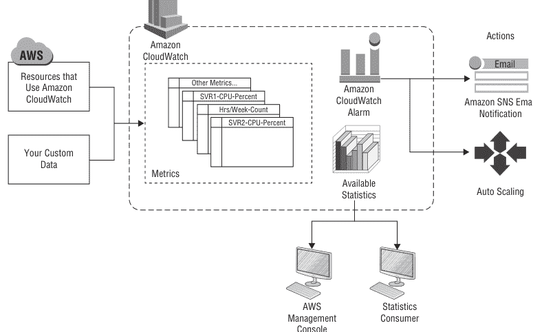

可以通过以下方法访问 Amazon CloudWatch：

- `Amazon CloudWatch` 控制台: `https://console.aws.amazon.com/cloudwatch/`
- `AWS CLI`
- `Amazon CloudWatch` API
- `AWS SDKs`

## Amazon CloudWatch 服务

以下服务与 Amazon CloudWatch 配合使用：

**Amazon SNS** Amazon SNS 协调向订阅端点或客户端交付或发送消息。将 Amazon SNS 与 Amazon CloudWatch 使用，在达到告警阈值时发送消息。

**Auto Scaling** Auto Scaling 根据用户定义的策略、健康状况检查和计划自动启动或终止 Amazon EC2 实例。带有 Auto Scaling 的 Amazon CloudWatch 报警可以根据需求扩展或收缩 Amazon EC2 实例。

**AWS CloudTrail** AWS CloudTrail 可以监控针对账户对 Amazon CloudWatch API 的调用。它包括由 AWS 管理控制台、AWS CLI 以及其他 AWS 云服务发出的调用。当开启 AWS CloudTrail 日志时，Amazon CloudWatch 将日志文件写入配置 AWS CloudTrail 时指定的 Amazon S3 桶中。

`IAM` 管理 Amazon CloudWatch 及其收集指标等 AWS 资源的身份验证和授权。

Amazon CloudWatch 指标的核心是按时间排序的数据集，包含有关资源性能的信息。默认情况下，多个服务提供指标且不收取额外费用。这些指标包括来自 Amazon EC2 实例、Amazon Elastic Block Store (Amazon EBS) 卷和 Amazon RDS DB 实例的信息。还可以对某些资源（如 Amazon EC2 实例）启用详细监控。

## 指标

Amazon CloudWatch 拥有免费层，许多应用程序可以在免费层内运行。AWS 免费层适用于跨 AWS 区域的参与服务：美国东部（弗吉尼亚北部）、美国西部（俄勒冈）、美国西部（加利福尼亚）、加拿大（中部）、欧洲（伦敦）、欧洲（爱尔兰）、欧洲（法兰克福）、亚太（新加坡）、亚太（东京）、亚太（悉尼）和南美（圣保罗）。

- 新客户和现有客户每月可免费获得最多 3 个仪表板，每个仪表板包含 50 个指标，无需额外费用。
- Amazon EC2 实例的基础监控指标免费提供。
- Amazon EBS 卷、弹性负载均衡（Elastic Load Balancing）和 Amazon RDS DB 实例的所有指标均免费提供。
- 客户每月可免费使用 10 个指标（适用于 Amazon EC2 实例的详细监控、自定义指标或 Amazon CloudWatch 日志）、10 个告警和 100 万次 API 请求。
- 客户每月可免费获得 5 GB 的数据摄入和 5 GB 的归档存储。

指标仅存在于创建它们所在的 AWS 区域。

## 自定义指标

除了监控 AWS 资源外，Amazon CloudWatch 还可以用于监控来自应用程序、脚本和服务产生的数据。自定义指标是通过代理或 API 提供的 Amazon CloudWatch 的任何指标。

自定义指标可用于监控网页加载所需的时间、捕捉请求错误率、监控实例上的进程或线程数，或跟踪应用程序执行的工作量。

创建自定义指标的方法包括：

- `PutMetricData` API。
- AWS 为 Windows 和 Linux 提供的示例监控脚本。
- Amazon CloudWatch `collectd` 插件。
- AWS 合作伙伴网络 (APN) 提供的应用程序和工具。

自定义指标根据使用情况产生额外费用。

> Amazon CloudWatch `collectd` 插件是 `collectd`（一个开源统计收集守护进程）的发布扩展。所有配置的 `collectd` 指标会自动发布到 Amazon CloudWatch，并允许监控 Amazon EC2 实例内部和外部的服务器及应用程序。

在 Amazon EC2 实例上运行时，它提供了额外功能。这些功能包括实例 ID 和 AWS 区域的自动发现。

## Amazon CloudWatch 指标保留

2016 年 11 月，Amazon CloudWatch 更改了指标在服务内部存储的时间如下：

- 一分钟数据点保留 15 天。
- 五分钟数据点保留 63 天。
- 一小时数据点保留 455 天。

如果指标需要比这些时间更长的可用性，可以使用 `GetMetricStatistics` API 调用进行归档。

指标无法删除。如果没有新数据发布到指标，它们将在 15 个月后自动过期。

> 单次调用返回的数据点最大数为 1,440 个。如果请求的数据点超过 1,440 个，Amazon CloudWatch 将返回错误。

要减少数据点数量，请缩小指定的时间范围、跨相邻时间范围进行多次请求，或增加指定的周期（`period`）。

周期可以短至 60 秒。

## Amazon CloudWatch 371


Amazon CloudWatch 不按时间顺序返回数据点。

## 命名空间

命名空间是 Amazon CloudWatch 指标集的容器。每个命名空间都与其他命名空间隔离。这种隔离确保收集的数据仅来自指定的服务，并防止不同的应用程序误聚合相同的统计数据。

没有默认命名空间。在创建自定义指标时，需要一个命名空间。如果指定的命名空间不存在，Amazon CloudWatch 将创建它。

名称中允许的字符有：

- 数字 (0-9, A-Z, a-z)
- 点 (.)
- 连字符 (-)
- 下划线 (_)
- 正斜杠 (/)
- 号 (#)
- 冒号 (:)

命名空间名称必须少于 256 个字符。

**表 9.1 AWS 命名空间示例**


| 产品 | 命名空间 |
|---|---|
| Auto Scaling | `AWS/AutoScaling` |
| Amazon EC2 | `AWS/EC2` |
| Amazon EBS | `AWS/EBS` |
| Elastic Load Balancing | `AWS/Classic Load Balancers` |
| Elastic Load Balancing | `AWS/Application Load Balancers` |

完整的命名空间列表请参见 CloudWatch 文档。

## 维度

维度是唯一标识指标的键值对，并进一步说明指标。一个指标可以有 10 个维度。

每个指标都有描述它的特征。可以将维度视为这些特征的分类或元数据。由于维度是指标唯一标识符的一部分，每当添加唯一的键值对时，就会创建一个新指标。

> 向 Amazon CloudWatch 的数据附加维度。


维度用于过滤 Amazon CloudWatch 的结果。例如，在搜索时指定实例 ID 以获取特定 EC2 实例的统计数据。

> 当选择指标时不指定维度，Amazon CloudWatch 将聚合所有数据以创建请求的统计数据。

这对于自定义指标并不适用。

## 维度组合

Amazon CloudWatch 将每个唯一的维度组合视为单独的指标，即使这些指标使用相同的指标名称。无法在使用先指定的维度组合检索统计数据。在检索统计数据时，请指定创建指标时使用的命名空间、指标名称和维度参数。可以指定开始和结束时间供 Amazon CloudWatch 聚合。

为了说明，`DataCenterMetric` 命名空间下的四个名为 `ServerStats` 的指标具有以下属性：

```
Server=Prod, Domain=Titusville, Unit: Count, Timestamp: 2017-05-18T12:30:00Z, Value: 105
```

```
Server=Test, Domain=Titusville, Unit: Count, Timestamp: 2017-05-18T12:31:00Z, Value: 115
```

```
Server=Prod, Domain=Rockets, Unit: Count, Timestamp: 2017-05-18T12:32:00Z, Value: 95
```

```
Server=Test, Domain=Rockets, Unit: Count, Timestamp: 2017-05-18T12:33:00Z, Value: 97
```

如果这四个指标是唯一发布的指标，则可以针对这些维度组合检索统计数据：

- `Server=Prod,Domain=Titusville`
- `Server=Prod,Domain=Rockets`
- `Server=Test,Domain=Titusville`
- `Server=Test,Domain=Rockets`

无法接收以下维度的统计。在这种情况下，必须指定维度来检索统计：

- `Server=Prod`
- `Server=Test`
- `Domain=Titusville`
- `Domain=Rockets`


如果没有指定任何维度，将不会返回任何统计数据。

## 统计

统计是在指定时间内的指标数据聚合。Amazon CloudWatch 根据自定义数据或 AWS 中其他服务向 Amazon CloudWatch 指标点提供统计数据。聚合是根据指定时间段内的命名空间、指标名称、维度和数据计量单位进行的。可用的 CloudWatch 统计数据见表 9.2。

**表 9.2 可用的 CloudWatch 统计数据**

| 统计 | 描述 |
| :--- | :--- |
| 最小值 | 指定期间内观测到的最低值。使用此值确定应用程序的低活动量。 |
| 最大值 | 指定期间内观测到的最高值。使用此值确定应用程序的高活动量。 |
| 总和 | 所有提交的匹配指标的值之和。此统计数据对于确定指标的总量非常有用。 |
| 平均值 | 指定期间内 `Sum/SampleCount` 的值。通过将此统计数据与最小值和最大值进行比较，可以确定指标的完整范围，并发现平均值接近最小值和最大值的程度。 |
| 样本数 | 用于统计计算的数据点数量。 |
| `pNN.NN` | 指定分位数的值。您可以使用最多两位小数指定任何分位数。 |

当 Amazon CloudWatch 统计数据平均值与最小值和最大值进行比较时，有助于判断 AWS 资源何时需要扩展。

可以将预先计算的统计数据添加到 Amazon CloudWatch 中。与其指定数据点值，不如指定 `SampleCount`、`Minimum`、`Maximum` 和 `Sum`。Amazon CloudWatch 会计算平均值。通过这种方式添加的值将与匹配指标相关的任何其他值进行聚合。

## 单位

每个统计数据都有一个计量单位。示例单位包括字节、秒、计数和百分比。

在创建自定义指标时可以指定单位。如果没有指定，Amazon CloudWatch 将使用 `None` 作为单位。单位为数据提供了概念意义。

> 虽然 Amazon CloudWatch 在内部没有给单位赋予任何意义，但其他应用程序可以根据单位推导出语义信息。换句话说，通过定义单位，其他应用程序可以正确地使用数据。

指定计量单位的指标数据点将分别聚合。在不指定单位的情况下获取统计数据，Amazon CloudWatch 会聚合所有相同单位的数据点。如果有两个相同但具有不同单位的指标，将返回两个单独流——每个单位返回一个。

## 周期

周期是与特定 Amazon CloudWatch 统计数据相关的时间长度。每个统计数据代表为特定时间段收集的指标数据的聚合。虽然周期以秒为单位，但周期的最小粒度为一分钟。

由于这种最小粒度，周期值以 60 的倍数形式表示。通过更改周期的长度，可以调整数据聚合。

周期可以从短至一分钟，也可以长达一天。一分钟表示为 60 秒。一天长为 86,400 秒。默认值为 60 秒。

在检索统计数据时，需要指定周期、开始时间和结束时间。这些参数决定了与统计数据相关的总时长。开始时间和结束时间的默认值返回过去一小时的统计数据。开始时间和结束时间的指定值决定了 Amazon CloudWatch 将返回多少周期。

## Amazon CloudWatch 375

使用周期、开始时间和结束时间的默认值检索统计数据，将返回上一小时内每分钟的聚合统计数据。

- 对于按 10 分钟块聚合的统计数据，请指定周期为 600。
- 对于按整个小时聚合的统计数据，请指定周期为 3,600。

周期对于 Amazon CloudWatch 报警同样重要。在创建监控特定指标的告警时，Amazon CloudWatch 将将该指标与指定的阈值进行比较。客户对 Amazon CloudWatch 如何进行比较具有广泛的控制权。除了周期，还可以指定评估周期的数量。例如，如果指定了三个评估周期，Amazon CloudWatch 将比较包含三个数据点的窗口。只有当最旧的数据点突破边界而其他数据点也突破或缺失时，Amazon CloudWatch 才会发送通知。

> 对于连续发射的指标，Amazon CloudWatch 将不断发送通知，直到发现三次失败。

## 聚合

Amazon CloudWatch 根据检索统计数据时指定的周期长度聚合统计数据。当发布具有相同或相似时间戳的多个数据点时，Amazon CloudWatch 按周期长度对其聚合。

> 只有在使用详细监控时可用聚合统计数据。Amazon CloudWatch 不聚合数据区域。

可以发布具有相同时间戳、命名空间和维度的指标数据点，Amazon CloudWatch 将返回它们的聚合统计数据。对于任何时间戳发布相同或不同指标的多个数据点。

对于大型数据集，可以将预聚合的数据集作为统计集插入。通过统计集，为 Amazon CloudWatch 提供多个数据点的 `Min`、`Max`、`Sum` 和 `SampleCount`。这通常用于需要被多次收集的数据。

# 第 9 章 监控与指标

考虑一个网页延迟的指标。发布每个网页的指标数据没有意义。更好的选择是收集该网页的所有访问延迟，每分钟聚合一次，并将此统计数据设置为 Amazon CloudWatch。

Amazon CloudWatch 不区分指标的来源。如果从不同的来源发布相同命名空间和维度的指标，Amazon CloudWatch 将其视为单个指标。这对于分布式系统中的服务指标非常有用。

如果 Web 服务器应用程序中的所有主机发布代表它们处理的请求的相同指标，Amazon CloudWatch 将其视为单个指标。这将提供跨应用程序请求的最小值、最大值、平均值总和统计。

### 仪表板

Amazon CloudWatch 仪表板是 Amazon CloudWatch 控制台中自定义的页面，用于监控资源。监控资源可以位于单个区域或多个区域。使用 Amazon CloudWatch 仪表板为 AWS 资源的指标和告警创建自定义视图。

通过仪表板，可以创建：

- 单一视图，用于评估一个或多个区域的资源健康状况
- 操作手册，在运营事件期间为团队成员提供如何响应特定事件的指导
- 资源和应用程序的通用视图，供团队成员共享，以加快运营事件期间的通信

### 分位数

分位数表示值在数据集中的相对位置，通常用于隔离异常。例如，第 95 分位数意味着 95% 的数据低于此值，5% 的数据高于此值。分位数有助于更好地理解指标数据的分布。

分位数可以与以下服务配合：

- Amazon EC2
- Amazon RDS
- Amazon Kinesis
- 应用负载均衡器 (`Application Load Balancer`)
- 弹性负载均衡
- Amazon API Gateway

在监控时，使用平均值可能会掩盖与正常情况差异巨大的事件。在隐藏最大值时，单个随机峰值可能会偏斜结果。为了避免这种情况，请监控 CPU 利用率的第 95 分位数，以检查负载异常的实例。

## 监控基准

监控是维护 Amazon EC2 实例可靠性、可用性和性能的重要部分。从 AWS 解决方案的所有部分收集监控数据，以便于调试任何多点故障。为了有效监控环境，请制定一个回答以下问题的计划：

- 监控目标是什么？
- 哪些资源需要监控？
- 这些资源的监控频率是多少？
- 将使用哪些监控工具？
- 由谁执行监控任务？
- 出现问题时应该通知谁？

在定义监控目标并创建了监控计划后，下一步是为 Amazon EC2 的正常性能建立基准。在不同时间和不同负载条件下衡量 Amazon EC2 的性能。在监控 Amazon EC2 时，存储收集到的监控数据历史。随着时间的推移，可以将历史数据与当前数据进行比较，以识别正常的性能模式以及异常。例如，如果监控您的 Amazon EC2 实例的 CPU 利用率、磁盘 I/O 和网络利用率，且性能超出已建立的基准，请配置或优化实例以降低 CPU 利用率、提高磁盘 I/O 或减少网络流量（见表 9.3）。

## Amazon EC2 状态检查

在 Amazon EC2 内部有两种状态检查：系统状态检查和实例状态检查。

### 表 9.3 建立 Amazon EC2 基准

| 监控项目 | Amazon EC2 指标 |
| :--- | :--- |
| CPU 利用率 | `CPUUtilization` |
| 内存利用率 | 需要代理 |
| 已用内存 | 需要代理 |
| 可用内存 | 需要代理 |
| 网络利用率 | `NetworkIn` `NetworkOut` |
| 磁盘性能 | `DiskReadOps` `DiskWriteOps` |
| 磁盘交换分区利用率（Linux 实例） | 需要代理 |
| 已用交换分区（Linux 实例） | 需要代理 |
| 页面文件利用率（仅限 Windows 实例） | 需要代理 |
| 已用页面文件（仅限 Windows 实例） | 需要代理 |
| 可用页面文件（仅限 Windows 实例） | 需要代理 |
| 磁盘读取/写入 | `DiskReadBytes` `DiskWriteBytes` |
| 磁盘空间利用率（Linux 实例） | 需要代理 |
| 已用磁盘空间（Linux 实例） | 需要代理 |
| 可用磁盘空间（仅限 Windows 实例） | 需要代理 |

### 系统状态检查

系统状态检查监控运行您的实例所需的 AWS 系统，以确保它们正常工作。这些检查会检测实例正在使用的硬件上的问题。当系统状态检查失败时，有三种处理方案。一种方案是等待 AWS 修复问题。如果实例从 Amazon EBS 卷启动，停止并启动实例将将其移动到新硬件。如果 Amazon EC2 实例正在使用实例存储卷，请终止它并启动新实例以放在新硬件上。

以下是可能导致系统状态检查失败的故障示例：

- 网络连接丢失
- 系统电源丢失
- 物理宿主机上的软件问题
- 影响网络可性的物理宿主机硬件问题

### 实例状态检查

实例状态检查监控单个实例的软件和网络配置。这些检查检测需要用户参与才能修复的问题。当实例状态检查失败时，可以通过重启或重新配置 Amazon EC2 实例来修复。

以下是可能导致实例状态检查失败的故障示例：

- 系统状态失败
- 网络或启动配置不正确
- 内存耗尽
- 文件系统损坏
- 内核不兼容


要查看正在运行的 Amazon EC2 实例的状态检查，请使用 `describe-instance-status` AWS CLI 命令。

查看所有实例的状态：

```
aws ec2 describe-instance-status
```

获取实例状态为受损（impaired）的所有实例的状态：

```
aws ec2 describe-instance-status --filters Name=instance-status,status=impaired
```

使用已知 ID 获取单个实例的状态，请使用以下命令：

```
aws ec2 describe-instance-status --instance-ids i-1234567890abcdef0
```

## 身份验证与访问控制

访问 Amazon CloudWatch 需要凭据。这些凭据必须拥有访问 AWS 资源的权限，例如访问 Amazon CloudWatch 控制台或检索 Amazon CloudWatch 指标数据。

### 第 9 章 • 监控与指标

每个 AWS 资源都由 AWS 账户所有，创建或访问资源的权限由权限策略管理。帐户管理员可以将权限策略附加到 IAM 身份上：用户、组和角色。

### 使用 Amazon CloudWatch 控制台所需的权限

要让用户使用 Amazon CloudWatch 控制台，至少需要一组权限允许该用户描述 AWS 帐户中的其他 AWS 资源。Amazon CloudWatch 管理控制台需要来自以下服务的权限：

- `Auto Scaling`
- `AWS CloudTrail`
- `Amazon CloudWatch`
- `Amazon CloudWatch Events`
- `Amazon CloudWatch Logs`
- `Amazon EC2`
- `Amazon Elasticsearch Service`
- `IAM`
- `Amazon Kinesis`
- `AWS Lambda`
- `Amazon S3`
- `Amazon SNS`
- `Amazon SQS`
- `Amazon Workflow Service (Amazon SWF)`

> 如果创建的策略比所需的权限更严格，控制台将无法按预期方式工作。

为了确保具有限制权限的用户可以使用 Amazon CloudWatch 控制台，请将 `CloudReadOnlyAccess` 托管策略附加到用户、组或角色。

### Amazon CloudWatch 的 AWS 托管策略

AWS 提供了涵盖许多用例的独立 IAM 策略。这些策略由 AWS 创建和管理，授予了所需的权限，无需客户自行创建。

以下是特定于 Amazon CloudWatch 的 AWS 托管策略：

- `CloudWatchFullAccess` 授予对 Amazon CloudWatch 的完全访问权限
- `CloudReadOnlyAccess` 授予对 Amazon CloudWatch 的只读访问权限
- `CloudWatchActionsEC2Access` 授予对 CloudWatch 报警和指标的只读权限，以及对 EC2 元数据的访问权限。授予对 Amazon EC2 实例的停止、终止和重启 API 的访问权限。

客户创建自己的 IAM 策略以允许对 Amazon CloudWatch 操作和资源的权限。将这些自定义策略附加到需要相应权限的 IAM 用户或组。

当通过 AWS CLI 或 Amazon CloudWatch API 访问 Amazon CloudWatch 时，不需要最小的控制台权限。

### Amazon CloudWatch 资源与操作

Amazon CloudWatch 没有可以控制的特定资源。因此，没有可用于 IAM 策略的 Amazon CloudWatch 资源名称 (ARN)。例如，无法赋予用户访问特定组 EC2 实例或特定负载均衡器的 Amazon CloudWatch 数据。

> 无法在 Amazon CloudWatch 命令行工具中使用 IAM 角色。

在编写 IAM 策略时，使用星号 (`*`) 作为资源名称来控制对 Amazon CloudWatch 操作的访问。

```
{
  "Version": "2012-10-17",
  "Statement":[{
    "Effect": "Allow",
    "Action": "cloudwatch:GetMetricStatistics","cloudwatch:ListMetrics",
    "Resource": "*",
    "Condition":{
      "Bool":{
        "aws:SecureTransport":"true"
      }
    }
  }]
}
```

# AWS 云服务集成

以下 AWS 云服务支持 Amazon CloudWatch 且无需收取额外费用。客户可以可以选择他们想要使用的预选指标。

- **自动伸缩组 (`Auto Scaling Groups`)**：七个频率为每分钟一次的预选指标。
- **弹性负载均衡 (`Elastic Load Balancing`)**：十三个频率为每分钟一次的预选指标。
- **Amazon Route 53 健康检查**：一个频率为每分钟一次的预选指标。
- **Amazon EBS IOPS (固态硬盘 [SSD])卷**：十个频率为每分钟一次的预选指标。
- **Amazon EBS 通用 (SSD)卷**：十个频率为每分钟一次的预选指标。
- **Amazon EBS 磁卷**：八个频率为每五分钟一次的预选指标。


- **AWS 存储网关 (Storage Gateway)**：十一个预选网关指标和五个预选卷指标，频率为每五分钟一次。

- **Amazon CloudFront**：六个频率为每分钟一次的预选指标。

- **Amazon DynamoDB**：七个频率为每五分钟一次的预选指标。

- **Amazon ElastiCache 节点**：三十九个频率为每分钟一次的预选指标。

- **Amazon RDS 数据库实例**：十四个频率为每分钟一次的预选指标。

- **Amazon EMR 作业流**：二十六个频率为每五分钟一次的预选指标。

- **Amazon Redshift**：十六个频率为每分钟一次的预选指标。

- **Amazon SNS 主题**：四个频率为每五分钟一次的预选指标。

- **Amazon SQS 队列**：八个频率为每五分钟一次的预选指标。

- **AWS OpsWatch**：十五个频率为每分钟一次的预选指标。

- **Amazon CloudWatch 日志**：六个频率为每分钟一次的预选指标。

**AWS 账单上的预估费用**也可以启用指标来监控 AWS 费用。指标的数量取决于所使用的 AWS 产品和服务。这些指标不予收取额外费用。

# Amazon CloudWatch 限制

表 9.4 列出了 Amazon CloudWatch 限制。

| 资源 | 默认限制 |
| --- | --- |
| 操作 | 每个告警 5 次。此限制无法更改。 |
| 告警 | 每个客户每月 10 个不收额外费用；每个区域每个账户 5,000 个。 |
| API 请求 | 每个客户每月 1,000,000 次不收额外费用。 |
| 自定义指标 | 无限制 |
| `DescribeAlarms` | 每秒 3 次事务 (TPS)。这是每秒内不被限流的最大操作请求数。可以请求增加限制。 |
| 维度 | 每个指标 10 个。此限制无法更改。 |
| `GetMetricStatistics` | 400 TPS。这是每秒内不被限流的最大请求数。可以请求增加限制。 |
| `ListMetrics` | 25 TPS。这是每秒内不被限流的最大操作请求数。可以请求增加限制。 |
| 指标数据 | 15 个月。此限制无法更改。 |
| `MetricDatum` 项目 | 每次 `PutMetricData` 请求 20 个。一个 `MetricDatum` 对象可以包含单个值或一个代表多个值的 `StatisticSet` 对象。此限制无法更改。 |
| 指标 | 每个客户每月 10 个不收额外费用 |
| 周期 | 一天 (86,400 秒)。此限制无法更改。 |
| `PutMetricAlarm` 请求 | 3 TPS。这是你每秒内可以执行的不被限流的最大操作数。可以请求增加限制。 |
| `PutMetricData` 请求 | HTTP POST 请求 40 KB；150 TPS。这是每秒内可以执行的不被限流的最大操作数。可以请求增加限制。 |
| Amazon SNS 电子邮件通知 | 每个客户每月 1,000 个不收额外费用 |

# Amazon CloudWatch 告警

Amazon CloudWatch 告警用于根据预定义的条件自动启动响应操作。告警在指定的时间段内监控单个指标，并根据指标相对于阈值的值，执行一个或多个指定的操作。这些操作包括触发自动伸缩策略、发布到 Amazon SNS 主题以及更新仪表板。

告警仅在状态持续变化后才会触发操作。Amazon CloudWatch 告警不会仅仅因为指标处于特定状态而生成。状态必须改变并维持用户指定的数量的周期。

在创建告警时，选择一个大于或等于要监控指标频率的周期。

Amazon EC2 的基础监控每五分钟为实例提供一次指标。在基础监控指标上设置告警时，请选择至少为 300 秒（5 分钟）的周期。

Amazon EC2 的详细监控每一分钟为实例提供一次指标。在详细监控指标上设置告警时，请选择至少 60 秒（1 分钟）的周期。

Amazon CloudWatch 告警始终处于三种状态之一：`OK`（正常）、`ALARM`（告警）或 `INSUFFICIENT_DATA`（数据不足）。

- 当被监控指标在定义为接受的范围内时，它处于 `OK` 状态。

- 当指标突破用户定义的阈值时，它转换到 `ALARM` 状态。

- 如果决策所需的数据缺失或不完整，它处于 `INSUFFICIENT_DATA` 状态。

操作设置为响应指标进入这三个状态中的每种状态。操作仅在状态转换时发生，如果条件持续存在，则不会重新执行。

一个告警允许设置多个操作。如果触发了告警，可以使用 Amazon SNS 发送电子邮件通知，同时进行自动伸缩。

# 告警与阈值

告警设计用于在以下情况触发：

- 当被监控指标在定义为接受的范围内时，它处于 `OK` 状态。

- 当指标突破用户定义的阈值时，它转换到 `ALARM` 状态。

- 如果决策所需的数据缺失或不完整，它处于 `INSUFFICIENT_DATA` 状态。

# Amazon EC2

EC2 有两种类型的状态检查：系统状态检查和实例状态检查。

## 系统状态检查

系统状态检查监控 AWS 硬件，以确保实例运行正常。这些检查会检测出需要 AWS 介入才能修复的实例相关问题。当系统状态检查失败时，客户可以选择等待 AWS 修复问题，也可以通过停止并启动实例，或通过终止并替换实例来解决。


当实例被停止并重启时，它将会被移动到新的硬件上。当实例被重启时，它将保留在最初配置时所在的硬件上。

以下是导致系统状态检查失败的故障示例：

- 网络连接丢失
- 系统供电丢失
- 物理宿主机上的软件问题
- 影响网络可达性的物理宿主机硬件问题

## 实例状态检查

实例状态检查监控单个实例的软件和网络配置。当实例状态检查失败时，典型的解决方案包括重启或重新配置实例。以下是导致实例状态检查失败的故障示例：

- 系统状态检查失败
- 网络或启动配置错误
- 内存耗尽
- 文件系统损坏
- 内核不兼容

以下 Amazon CloudWatch 指标提供了有关 Amazon EC2 实例使用和利用情况的洞察。对于 Amazon EC2，常用指标包括以下内容：

- `CPUUtilization`
- `NetworkOut`
- `DiskReadOps`
- `DiskWriteOps`
- `DiskReadBytes`
- `DiskWriteBytes`

## `CPUUtilization`

此指标是实例上当前使用的分配的 Amazon EC2 计算单元的百分比。此指标识别了在所选实例上运行应用程序所需的处理能力。

`NetworkIn` 此指标代表实例通过所有网络接口接收的字节数。此指标识别了进入单个实例的入站网络流量量。

与 `NetworkOut` 类似，报告的数字是该期间内接收的字节数。在使用基础监控（Basic Monitoring）时，将此数字除以 300 以获得字节/秒。在使用详细监控（Detailed Monitoring）时，将结果除以 60。

`NetworkOut` 此指标代表实例通过所有网络接口发送的字节数。此指标识别了离开单个实例的出站网络流量量。

与 `NetworkIn` 类似，报告的数字是该期间内接收的字节数。在使用基础监控（Basic Monitoring）时，将此数字除以 300 以获得字节/秒。在使用详细监控（Detailed Monitoring）时，将结果除以 60。

`DiskReadOps` 此指标报告在指定时间内，实例可用所有存储卷上完成的读取操作。

要计算该期间的平均每秒 I/O 操作 (IOPS)，请将期间内的总操作数除以该期间的秒数。

`DiskWriteOps` 此指标报告在指定时间内，实例可用所有存储卷上完成的写入操作。

要计算该期间的平均每秒 I/O 操作 (IOPS)，请将该期间内的总操作数除以该期间的秒数。

`DiskReadBytes` 此指标报告从实例可用所有存储卷中读取的字节数。

此指标用于确定应用程序从实例硬盘读取的数据量。它可以用于确定应用程序的速度。

报告的数字是该期间内接收的字节数。在使用基础监控（Basic Monitoring）时，将此数字除以 300 以获得字节/秒。在使用详细监控（Detailed Monitoring）时，将结果除以 60。

`DiskWriteBytes` 此指标报告向实例可用所有存储卷写入的字节数。

该指标用于确定应用程序写入实例硬盘的数据量。这可以用于确定应用程序的速度。

报告的数字是该期间内接收的字节数。在使用基础监控（Basic Monitoring）时，将此数字除以 300 以获得字节/秒。在使用详细监控（Detailed Monitoring）时，将结果除以 60。

## Amazon Elastic Block Store 卷监控

Amazon Elastic Block Store (Amazon EBS) 向 Amazon CloudWatch 发送多个指标的数据点。Amazon EBS 通用 SSD (gp2)、吞吐量优化 HDD (st1)、冷 HDD (cd1) 和磁性 (standard) 卷会自动向 CloudWatch 发送五分钟指标。预留 IOPS SSD (io1) 卷会自动向 CloudWatch 发送一分钟指标。

通用的 EBS 指标包括以下内容：

- `VolumeReadBytes`
- `VolumeWriteBytes`
- `VolumeReadOps`
- `VolumeWriteOps`
- `VolumeTotalReadTime`
- `VolumeTotalWriteTime`
- `VolumeIdleTime`
- `VolumeQueueLength`
- `VolumeThroughputPercentage`
- `VolumeConsumedReadWriteOps`
- `BurstBalance`

**`VolumeReadBytes` 和 `VolumeWriteBytes`** 这些指标提供了指定时间内 I/O 操作的信息。总和（Sum）统计报告该期间内传输的字节数。平均（Average）统计报告该期间内每次 I/O 操作的平均大小。样本数（SampleCount）统计报告该期间内 I/O 操作的总数。最小（Minimum）和最大（Maximum）统计与此指标无关。

> 只有当卷活动时才会向 Amazon CloudWatch 报告数据。如果卷处于空闲状态，不会向 Amazon CloudWatch 报告数据。

**`VolumeReadOps` 和 `VolumeWriteOps`** 这些指标报告指定时间内 I/O 操作的总数。要计算该期间的平均每秒 I/O 操作 (IOPS)，请将期间内的总操作数除以该期间的秒数。

**`VolumeTotalReadTime` 和 `VolumeWriteTime`** 这些指标报告指定时间内完成的所有操作的秒数。如果同时提交了多个请求，此值可能大于期间的长度。


## 第 9 章监控指标

`VolumeIdleTime` 此指标代表在指定时间内没有提交读取或写入操作的秒数。

`VolumeQueueLength` 此指标是指定时间内等待完成的读写操作数。

`VolumeQueueLength` 应该在 0 附近。如果运行在 EC2 实例上的数据库运行缓慢，请检查此指标。如果大于 0，请增加 IOPS。


`VolumeThroughputPercentage` 此指标仅用于预留 IOPS 卷。它是 Amazon EBS 卷交付的每秒 I/O 操作 (IOPS) 预留 IOPS 的百分比。预留 IOPS SSD 卷在一年 99.9% 的时间内都能达到预留性能。


> 在写入期间，如果一分钟内没有挂起的 I/O 请求，指标值将为 100%。
> I/O 性能可能会由于某些操作而暂时下降，例如在高峰使用期间创建卷快照、在非 EBS 优化实例上运行卷，或首次在卷上访问数据。

`VolumeConsumedReadWriteOps` 此指标仅用于预留 IOPS SSD 卷。它是指定时间内消耗的读写操作总数（归一化为 256K 容量单位）。

小于 256K 的 I/O 操作每次计为 1 次消耗的 IOPS。大于 256K 的 I/O 操作按 256K 容量单位计算。例如，1024K I/O 将计为 4 次消耗的 IOPS。

`BurstBalance` 此指标用于通用 SSD (gp2)、吞吐量优化 HDD (st1) 和冷 HDD (cd1) 卷。它提供了突发桶中剩余 I/O 积分或吞吐量积分（对于 st1 和 sc1）的百分比。

Amazon EBS 状态检查帮助客户理解、跟踪和管理 Amazon EBS 卷数据中潜在的不一致性。它们旨在为您提供判断 Amazon EBS 卷是否受损的信息，并帮助客户控制对可能不一致的卷的处理方式。

### Amazon CloudWatch

卷状态检查是每五分钟运行一次的自动化测试，返回通过或失败状态。如果所有检查均通过，则卷的状态为正常（`ok`）。如果某个检查失败，则卷的状态为受损（`impaired`）。如果状态为数据不足（`insufficient-data`），则该卷的检查可能仍在进行中。

预留 IOPS EBS 卷有四种状态类型：`ok`、警告（`warning`）、受损（`impaired`）和数据不足（`insufficient-data`）。

- **`ok`**: 意味着卷的运行符合预期。
- **`warning`**: 意味着卷处于降级（Degraded）或严重降级（Severely Degraded）。降级意味着卷性能低于预期。严重降级意味着卷性能低于预期。
- **`impaired`**: 意味着卷已停滞（Stalled）或不可用（Not Available）。不可用意味着卷性能严重损害。不可用意味着由于禁用了 I/O，无法确定 I/O 性能。
- **`insufficient-data`**: 数据不足意味着收集到的数据点不足以判断其是否在线。

# Amazon ElastiCache

以下 Amazon CloudWatch 指标提供了有关 Amazon ElastiCache 性能的见。在大多数情况下，建议对这些指标设置 CloudWatch 报警，以便在性能问题发生之前采取纠正措施。对于 Amazon ElastiCache，常见指标包括：

- `CPUUtilization`（CPU利用率）
- `SwapUsage`（交换分区使用）
- `Evictions`（驱逐）
- `CurrConnections`（当前连接数）

**`CPUUtilization`**: 这是以百分比报告的主机级指标。

**Memcached**: 由于 Memcached 是多线程的，此指标可能高达 90%。如果超过此阈值，请使用更大的缓存节点类型来扩展缓存集群，或通过添加更多缓存节点来向外扩展。

**Redis**: 由于 Redis 是单线程的，阈值计算方式为利用率/处理器核心数。例如，当使用具有四个核心的 `cache.ml1.xl` 节点时，90% `CPUUtilization` 的阈值将为 90/4，即 22.5%。管理员应根据所用缓存节点的核心数确定自己的阈值值。

如果超过了此阈值且主工作负载来自读取请求，请通过添加读取副本来向外扩展缓存集群。如果主工作负载来自写入请求，AWS 建议使用更大的缓存实例类型进行向上扩展。

# 第 9 章 ■ 监控指标

**`SwapUsage`**: 这是以字节为报告的主机级指标。

**Memcached**: 此指标不应超过 50 MB。如果超过，AWS 建议增加 `ConnectionOverhead` 参数值。

**Redis**: 此时，AWS 对此参数没有建议；无需为其设置 Amazon CloudWatch 报警。

**`Evictions`**: 这是为 Memcached 和 Redis 缓存集群发布的指标。AWS 建议客户根据应用需求确定指标的报警阈值。

- **Memcached**: 如果超过了选定的阈值，请使用更大的节点类型扩展缓存集群，或通过添加更多节点进行扩展。
- **Redis**: 如果您超过了选定的阈值，请使用更大的节点类型向上扩展集群。

**`CurrConnections`**: 这是为 Memcached 和 Redis 缓存集群发布的缓存引擎指标。AWS 建议客户根据需求确定自己的指标报警阈值。运行 Memcached 或 Redis 时，`CurrConnections` 的增加可能表明应用程序存在问题。

# Amazon RDS 指标

使用 Amazon RDS 资源时，Amazon RDS 每分钟向 Amazon CloudWatch 发送指标和维度。常见指标包括：

- `DatabaseConnections`（数据库连接数）
- `DiskQueueDepth`（磁盘队列深度）
- `FreeStorageSpace`（可用存储空间）
- `ReplicaLag`（副本延迟）
- `ReadIOPS`（读取 IOPS）
- `WriteIOPS`（写入 IOPS）
- `ReadLatency`（读取延迟）
- `WriteLatency`（写入延迟）

**`DatabaseConnections`**: 此指标是正在使用的数据库连接数。

**`DiskQueueDepth`**: 此指标是等待访问磁盘的待处理 I/O 操作数。

**`FreeStorageSpace`**: 此指标以字节为单位，是可用存储空间量。


> 如果您担心 Amazon RDS 实例上的磁盘空间，请根据 `FreeStorageSpace` 指标设置警报。这样，你就永远不会对磁盘空间问题感到意外。

**`ReplicaLag`**: 此指标以秒为单位，是读取副本数据库实例落后于源数据库实例的时间。它适用于 `MySQL`、`MariaDB` 和 `PostgreSQL` 读取副本。


`ReadIOPS`: 此指标是每秒平均磁盘 I/O 操作次数。

`WriteIOPS`: 此指标是每秒平均磁盘 I/O 操作次数。

`ReadLatency`: 此指标以秒为单位，是每次磁盘读取 I/O 操作所需的平均时间。

`WriteLatency`: 此指标以秒为单位，是每次磁盘写入 I/O 操作所需的平均时间。

# AWS 弹性负载均衡器 (ELB)

只有当有请求通过负载均衡器时，AWS ELB 才会向 Amazon CloudWatch 报告指标。当有请求通过负载均衡器时，弹性负载均衡每隔 60 秒测量并发送一次指标。负载均衡器中报告给 Amazon CloudWatch 的指标包含以下内容：

- `BackendErrors`

- `HealthyHostCount`

- `UnhealthyHostCount`

- `RequestCount`

- `Latency`

- `HTTPCode_2XX`

- `HTTPCode_3XX`

- `HTTPCode_4XX`

- `HTTPCode_5XX`

- `HTTPCode_ELB_4XX`

- `HTTPCode_ELB_5XX`

- `SpillOver`

- `SurgeQueueLength`

`BackendErrors`: 此指标是负载均衡器与注册实例之间未成功建立的连接数。

`HealthyHostCount`: 此指标是注册负载均衡器的健康实例数。如果启用了跨区域负载均衡，则 `LoadBalancer` 维度在所有可用区计算。否则，按可用区计算。

`UnhealthyHostCount`: 此指标是注册负载均衡器的不健康实例数。实例在超过健康检查阈值后被视为不健康；满足健康检查阈值后被视为健康。

`RequestCount`: 此指标是在特定间隔内（一分钟或五分钟）完成或建立的请求数。

- HTTP listener: 来自注册实例的 HTTP 错误响应

- TCP listener: 到注册实例的连接数

- `Latency`: 此指标代表从向实例发送请求到收到回复之间持续的时间（秒）

  - HTTP listener: 从负载均衡器向注册实例发送请求到响应头开始的总秒数

  - TCP listener: 负载均衡器向注册实例建立连接所需的总秒数

`HTTPCode_Backend_2XX`: 此指标是注册实例生成的 HTTP 2XX 响应代码数。2XX 状态表示操作已完全接收、理解并接受。此计数不包括负载均衡器生成的任何响应代码。

`HTTPCode_Backend_3XX`: 此指标是注册实例生成的 HTTP 3XX 响应代码数。3XX 状态表示重定向，需要后续操作来完成请求。

`HTTPCode_Backend_4XX`: 此指标是注册实例生成的 HTTP 4XX 响应代码数。4XX 状态表示客户端错误。请求包含语法错误或无法执行。

`HTTPCode_Backend_5XX`: 此指标是注册实例生成的 HTTP 5XX 响应代码数。5XX 状态表示服务器错误。服务器未能处理看似有效的请求。

`HTTPCode_ELB_4XX`: 此指标是负载均衡器生成的 HTTP 4XX 客户端错误代码数。当请求格式错误或不完整时产生此类错误。这由 ELB 生成。

`HTTPCode_ELB_5XX`: 此指标是负载均衡器生成的 HTTP 5XX 服务器错误代码数。此计数不包括注册实例生成的任何响应代码。

# Amazon CloudWatch Events

如果负载均衡器上没有注册健康的实例，或者请求速率超过了实例（溢出）或负载均衡器的容量，则会报告该指标。此错误由 ELB 生成。

`SpilloverCount` 该指标是由于激增队列满拒绝的请求总数。

- **HTTP 监听器** 负载均衡器返回 HTTP 503 错误代码。

- **TCP 监听器** 负载均衡器关闭连接。

`SurgeQueueLength` 该指标是等待路由的请求总数。如果负载均衡器无法与健康实例建立连接以路由请求，则会将请求置于队列。

队列的最大大小为 1,024。当队列满时，额外的请求将被拒绝。


- 当后端实例处理应用程序请求的速度赶不上其进入的速度时，激增队列将开始增加。这是由于许多问题导致的，其中主要是后端实例面临的容量限制。

- 通过扩展实例来提高计算能力，以确保 `SurgeQueueLength` 永远不超过最大队列容量。

- 溢出是激增队列长度增加的直接结果。当 ELB 达到最大队列容量时，它将开始丢弃新请求。当请求被丢弃时，终端用户不会收到通知。

- 监控 `SurgeQueueLength` 和 `SpilloverCount`，以便发生可能的高溢出计数时获得报警，这会导致请求丢失和客户体验不良。

# Amazon CloudWatch Events

Amazon CloudWatch Events 提供近实时的系统事件流，描述 AWS 资源的更改。使用相对简单的规则，可以将事件路由到一个或多个目标进行处理。

将 Amazon CloudWatch Events 视为 AWS 环境的中枢神经系统。它连接到支持的 AWS 云服务，并在操作变化发生时感知这些变化。然后，在规则的驱动下，它响应变化发送消息并激活函数。

## 事件

事件是 AWS 环境中的变化，可以通过四种不同的方式生成：

- 它们产生于 AWS 内部，当资源状态变化时，例如 Amazon EC2 实例状态从等待中（pending）变为运行（running）。

- API 调用和控制台登录可以生成事件并通过 AWS CloudTrail 将其传递给 Amazon CloudWatch Events。

- 可以运行代码来生成应用程序级事件并将其发布到 Amazon CloudWatch Events 进行处理。

- 它们可以按计划发布，提供周期性或 Cron 风格的调度选项。


这是一个处于等待（pending）状态的 Amazon EC2 实例状态变更通知事件。

```json
{
  "id":"7bf73129-1428-4cd3-a780-95db273d16002",
  "detail-type":"EC2 Instance State-change Notification",
  "source":"aws.ec2",
  "account":"8675309719",
  "time":"2015-11-11T21:29:54Z",
  "region":"us-east-1",
  "resources":[
    "arn:aws:ec2:us-east-1:8675309719:instance/i-dec12221"
  ],
  "detail":{
    "instance-id":"i-dec12221",
    "state":"pending"
  }
}
```

记住，事件表示 AWS 环境发生了变化。当 AWS 资源的状态发生变化时，可以生成事件。AWS CloudTrail 发布 API 用的事件。可以创建自定义的应用程序级事件并将其发布到 Amazon CloudWatch Events。计划事件按周期性生成。

# Amazon CloudWatch Events

当 Amazon EC2 实例的状态从等待（pending）变为运行（running）时，Amazon EC2 会生成一个事件。在启动或终止实例时会触发 Auto Scaling 事件。

- 当进行 API 调用时，AWS CloudTrail 会发布事件。

- 生成自定义的应用程序级事件并将其发布到 Amazon CloudWatch Events。

- 可以按周期性生成计划事件。

Amazon CloudWatch Events 可用于使用 cron 或速率表达式调度在特定时间触发的操作。所有计划事件都使用协调标准时间 (UTC) 时区，最小周期为一分钟。

## 规则

规则匹配传入的事件并将其路由到目标进行处理。单个规则可以路由到多个目标并被并行处理。这允许组织的不同部分查找并处理它们感兴趣的事件。

规则可以通过仅传递某些部分或通过常量覆盖，来定制化发送到目标的 JSON。

> 由于发送到多个目标的规则是并行处理的，因此它们的顺序会丢失。

## 目标

目标处理从 Amazon CloudWatch Events 发送给它的 JSON 格式数据。Amazon CloudWatch Events 将系统事件实时流传递给一个或多个目标函数或流。这些目标包括：

- Amazon EC2 实例

- AWS Lambda 函数

- Amazon Kinesis 传输

- Amazon ECS 任务

- Amazon Step Functions 状态机

- Amazon SNS 主题

- Amazon SQS 队列

- 内置目标

# 指标和维度

Amazon CloudWatch Events 每分钟向 Amazon CloudWatch 发送指标。`AWS/CloudWatch` 命名空间包含表 9 所示的指标。

## 9.5 Amazon CloudWatch Metrics

| 指标 | 描述 |
| --- | --- |
| `Invocations` | 测量响应规则时被调用的次数。Amazon CloudWatch Events 仅在指标具有非零值时发送此指标。这包括重试或失败。<br>- 有效维度: `RuleName`<br>- 单位：计数 |
| `FailedInvocations` | 测量失败的调用次数。这不包括重试或成功的调用。<br>- 有效维度: `RuleName`<br>- 单位：计数 |
| `TriggeredRules` | 测量匹配任何事件而触发的规则数量。<br>- 有效维度: `RuleName`<br>- 单位：计数 |
| `MatchedEvents` | 测量匹配任何规则的事件数量。<br>- 有效维度：无<br>- 单位：计数 |
| `ThrottledRules` | 测量被限流的触发规则数量。<br>- 有效维度: `RuleName`<br>- 单位：计数 |

Amazon CloudWatch Events 指标使用单一维度：`RuleName`。正如名称所示，它通过规则名称过滤。

# Amazon CloudWatch Logs

Amazon CloudWatch Logs 可用于监控、存储和访问来自 Amazon EC2 实例、CloudTrail 以及本地数据中心服务器的日志文件。然后可以检索并报告相关日志。Amazon CloudWatch Logs 可以监控应用程序日志、系统日志、服务器日志和自定义日志。通过对这些指标设置报警可以生成通知。

Amazon CloudWatch Logs 由几个部分组成：

- 日志代理

- 日志事件

- 日志流

- 日志组

- 指标过滤器

- 留存策略

**日志代理** 日志代理将日志导向 Amazon CloudWatch。由于共享责任模型，AWS 对虚拟机没有有效的可见性，因此必须由代理发送数据到 Amazon CloudWatch。

**日志事件** 日志事件是操作系统或应用程序报告到日志文件的活动，并带有时间戳。事件仅支持文本格式。

日志事件包含两个属性：事件发生的时间戳和原始日志消息。

默认情况下，任何非空白字符开始的行都会关闭上一个日志消息并开始一个新的日志消息。

**日志流** 日志流是由单个源（例如 Web 服务器）报告的日志事件组。

**日志组** 是多个资源的日志流组，例如管理相同内容的 Web 服务器组。

**留存策略** 和 **指标过滤器** 设置在日志组上，而不是日志流上。

**指标过滤器** 指标过滤器告诉 Amazon CloudWatch 如何从摄取的日志事件中提取指标观测值并转换为 Amazon CloudWatch 指标。

例如，通过一个名为 `404_Error` 的指标过滤器，可以过滤日志以查找 `404` 访问错误。可以为这些 `404` 错误创建报警。

**留存策略** 留存策略决定了事件在 Amazon CloudWatch Logs 中保留多长时间。策略分配给日志组并应用于组中的所有日志流。

留存时间可以从 1 天到 10 年不等。你也可以选择日志永不过期。

# 归档数据

所有上传到 Amazon CloudWatch 的日志事件都会保留。可以指定保留时长。数据会被压缩、放入存档并存储。存储归档数据会产生费用。

> Amazon CloudWatch Logs 可以摄来自 AWS 外部源的日志。这意味着来自本地数据中心的日志数据可以发送到 Amazon CloudWatch Logs 进行报告。

# 日志监控

使用 Amazon CloudWatch Logs 通过日志数据监控应用程序和系统。Amazon CloudWatch Logs 可以跟踪应用程序日志中发生的错误，并在错误率超过阈值时发送通知。由于 Amazon CloudWatch 使用日志数据进行监控，因此不需要更改代码。如果未提供 `datetime_format`，则对每个日志事件都使用当前时间。如果提供的 `datetime_format` 对于日志消息无效，则使用上一个成功解析时间戳的事件的时间戳。如果没有之前的日志，则使用当前时间。当日志事件回退到当前时间或上一个日志事件的时间时，系统会记录一条警告消息。

> 时间戳用于检索日志事件和生成指标。如果指定了错误的格式，日志事件可能无法检索并生成不准确的指标。

# 代理

由于 AWS 对虚拟化程序（Hypervisor）没有可见性，因此需要代理将日志数据发布到 Amazon CloudWatch Logs。Linux 和 Windows 都有代理。代理包含以下组件：

- 用于 AWS CLI 的插件，将日志数据推送到 Amazon CloudWatch Logs

- 运行 Amazon CloudWatch Logs `aws log push` 命令的脚本，将数据发送到 Amazon CloudWatch Logs

- 确保守护始终运行的 cron 作业

# Linux 版 Amazon CloudWatch Logs Agent

Amazon CloudWatch Logs 代理需要 Python 2.6、2.7、3.0 或 3.3 以及任意版本的 Linux：

- Amazon Linux 版本 2014.03.02 或更高

- Ubuntu Server 版本 12.04、14.04 或 16.04

- CentOS 版本 6、6.3、6.4、6.5 或 7.0

- Red Hat Enterprise Linux (RHEL) 版本 6.5 或 7.0

- Debian 8.0

# Amazon CloudWatch Logs：代理与 IAM

Amazon CloudWatch Logs 代理需要 `CreateLogGroup`、`CreateLogStream`、`DescribeLogStreams` 和 `PutLogEvents` 操作。

> 在最新版本的代理中，不再需要 `DescribeLogStreams`。

以下是用于代理的示例 IAM 策略：

```json
{
  "Version": "2012-10-17",
  "Statement": [
    {
      "Effect": "Allow",
      "Action": [
        "logs:CreateLogGroup",
        "logs:CreateLogStream",
        "logs:PutLogEvents",
        "logs:DescribeLogStreams"
      ],
      "Resource": [
        "arn:aws:logs:*:*:*"
      ]
    }
  ]
}
```

从 Amazon Linux 机器镜像 (AMI) 2014.09 开始，Amazon CloudWatch Logs 代理可以作为 Red Hat 包管理器 (RPM) 安装，通过 `awslogs` 包提供。较早版本的 Amazon Linux 可以通过 `sudo yum update -y` 命令更新实例来访问 `awslogs` 包。通过 RPM 安装 `awslogs` 包而不是使用 Amazon CloudWatch Logs 安装程序，实例可以接收来自 AWS 的定期包更新和补丁，而无需手动重新安装 Amazon CloudWatch Logs 代理。

如果使用 Python 脚本安装代理，请勿使用 RPM 安装方法更新 Amazon CloudWatch Logs 代理。这样做可能会导致配置问题，阻止 Amazon CloudWatch Logs 代理将日志发送到 Amazon CloudWatch。

# Windows 版 Amazon CloudWatch Logs Agents

从 EC2Config 版本 2.2.5 开始，可以将系统中的所有 Windows Server 日志导出到安全日志、应用程序日志和 Internet 信息服务 (IIS) 日志并发送到 Amazon CloudWatch Logs。EC2Config 版本 2.2.10 或更高版本增加了将任何事件日志数据、Windows 事件跟踪 (ETW) 数据或文本日志文件导出到 Amazon CloudWatch Logs 的能力。Windows 性能计数器数据也可以导出到 Amazon CloudWatch。EC2 实例使用代理将日志数据发送到 Amazon CloudWatch。对于 Microsoft Windows，代理是 EC2Config 服务或系统管理器 (SSM) 代理。默认情况下，EC2Config 服务包含在 AWS Server 2003-2012 中。EC2Config 在实例启动时启动并在执行任务后停止。EC2Config 还可以按需要执行任务。这些任务中某些是自动启用的，另一些必须手动启用。Windows Server 2016 AMI 不使用 EC2Config。相反，这些 AMI 使用 EC2Launch PowerShell 脚本。表 9.6 显示了不同 Windows 上的可用代理类型。


## 表 9.6 Microsoft Windows 代理

| 操作系统 | 代理 | 说明 |
|---|---|---|
| `Windows Server 2016` | `SSM Agent` | `Windows Server 2016` 不支持 `EC2Config` 服务。 |
| `Windows Server 2008-2012 R2` | `EC2Config` 或 `SSM Agent` | 如果实例运行 `EC2Config 3.x` 或更高版本，`EC2Config` 服务会将日志数据发送到 `Amazon CloudWatch`。如果实例运行 `EC2Config 4.x` 或更高版本，则使用 `SSM Agent`。 |

## Amazon CloudWatch Logs

| 指标 | 描述 |
|---|---|
| `IncomingLogEvents` | 上传到 `Amazon CloudWatch Logs` 的日志事件数量。当与 `LogGroupName` 维度配合使用时，这是上传到日志组的日志事件数量。<br>有效维度: `LogGroupName`<br>有效统计数据: `Sum`<br>单位: 无 |
| `ForwardedBytes` | 转发到订阅目的地的压缩日志事件体积（字节）。<br>有效维度: `LogGroupName`, `DestinationType`, `FilterName`<br>有效统计数据: `Sum`<br>单位: `Bytes` |
| `ForwardedLogEvents` | 转发到订阅目的地的日志事件数量。<br>有效维度: `LogGroupName`, `DestinationType`, `FilterName`<br>有效统计数据: `Sum`<br>单位: 无 |
| `DeliveryErrors` | `Amazon CloudWatch Logs` 在向订阅目的地转发数据时接收到错误的日志事件数量。<br>有效维度: `LogGroupName`, `DestinationType`, `FilterName`<br>有效统计数据: `Sum`<br>单位: 无 |
| `DeliveryThrottling` | `Amazon CloudWatch Logs` 在向订阅目的地转发数据时被限流的日志事件数量。<br>有效维度: `LogGroupName`, `DestinationType`, `FilterName`<br>有效统计数据: `Sum`<br>单位: 无 |

## 维度

`Amazon CloudWatch Logs` 使用表 9.8 所示维度对指标进行过滤。

### 表 9.8 `Amazon CloudWatch Logs` 维度

| 维度 | 描述 |
|---|---|
| `LogGroupName` | 用于显示指标的 `Amazon CloudWatch` 日志组名称 |

### 表 9.8 `Amazon CloudWatch Logs` 维度（续）

| 维度 | 描述 |
|---|---|
| `DestinationType` | `Amazon CloudWatch Logs` 数据的订阅目的地，可以是 `AWS Lambda`、`Amazon Kinesis Streams` 或 `Amazon Kinesis Firehose` |
| `FilterName` | 将数据从日志组转发到目的地的订阅过滤器名称。订阅过滤器名称会被 `Amazon CloudWatch` 自动转换为 `ASCII` 字符，并将不支持的字符替换为问号（`?`）。 |

## 监控 `AWS` 费用

客户可以使用 `Amazon CloudWatch` 监控 `AWS` 费用。通过 `Amazon CloudWatch`，可以创建账单警报，当配置服务的使用超过客户定义的限制时发送通知。如果用量超过这些阈值，`AWS` 可以发送电子邮件通知或向 `SNS` 主题发布通知。要创建账单警报并注册通知，请在 `AWS` 账单和成本管理控制台中启用它们。

> 使用所示步骤，可以注册在价格发生时接收来自 `AWS` 的通知。

## 设计场景

### 配置价格变更通知的步骤

1. 登录 `AWS` 管理控制台并打开 `Amazon SNS` 控制台：`https://console.aws.amazon.com/sns/v2/home`。
2. 如必要，将导航栏上的区域更改为美国东部（弗吉尼亚北部）。所有 `AWS` 账单指标数据都存储在此区域，即使是其他区域的资源也是如此。
3. 在导航格中，选择“订阅”（`Subscriptions`）。
4. 选择“创建订阅”（`Create Subscription`）。
5. 对于主题 `ARN`：
   - 每次价格变化时都会发送通知：`arn:aws:sns:us-east-1:278350005181:price-list-api`
   - 每天发送一次价格变更通知：`arn:aws:sns:us-east-1:278350005181:daily-aggregated-price-list`
6. 对于协议（`Protocol`），使用默认的 `HTTP` 设置。
7. 对于端点（`Endpoint`），选择电子邮件（`email`）。
8. 选择“创建订阅”（`Create Subscription`）。

## 详细账单

2016年12月，`Amazon` 宣布在 `Amazon CloudWatch Logs` 中新增详细账单功能。可以使用每个日志组的使用和成本生成报告。

## 标签和日志组

你可以使用标签对日志组进行分类，并为它们分配类别，如用途、所有者或环境。你可以创建自定义类别集以满足特定需求，并可以使用标签对 `AWS` 费用进行分类和跟踪。当你将标签应用于 `AWS` 资源（包括日志组）时，`AWS` 成本分配报告将使用按标签聚合的用量和成本。

- 标签可以格到日志组中，以获得跨越业务维度的详细成本视图。
- 每个日志组最多可以添加 50 个标签。
- 使用 `AWS CLI` 或 `CloudWatch Logs API` 向日志组添加标签。

使用标签是一种简单而强大的管理 `AWS` 资源和组织数据（包括账单数据）的方法。标签可以应用于代表业务类别的资源（如成本中心、应用名称或所有者），以组织跨服务的成本。对于客户来说，尽可能为他们的资源打上标签是 `AWS` 的最佳实践。


### 日志组标签限制

以下限制适用于标签。

#### 基础限制

- 每个日志组的标签最大数量为 50。
- 标签的键（`Key`）和值（`Value`）对大小敏感。
- 已删除日志组中的标签无法更改或编辑。

#### 标签键限制

- 每个标签必须是唯一的。如果添加的键已在使用，则该标签将覆盖现有的键/值对。
- 标签键不能以 `aws:` 开头，因为该前缀保留供 `AWS` 使用。`AWS` 会代表客户创建此类前缀的标签，但客户无法编辑或删除它们。
- 标签键的长度必须在 1 到 128 个 `Unicode` 字符之间。
- 标签键必须由以下字符组成：
  - `Unicode` 字母和数字
  - 空格
  - 下划线 `_`
  - 句号 `.`
  - 斜杠 `/`
  - 等号 `=`
  - 加号 `+`
  - 连字符 `-`
  - 符号 `@`

#### 标签值限制

标签值的长度必须在 0 到 255 个字符之间。

在账单周期结束时，如果添加或更改了标签，成本将分成两行显示。第一行显示更新前的成本，第二行显示更新后的成本。这适用于带有成本分配标签的报告。

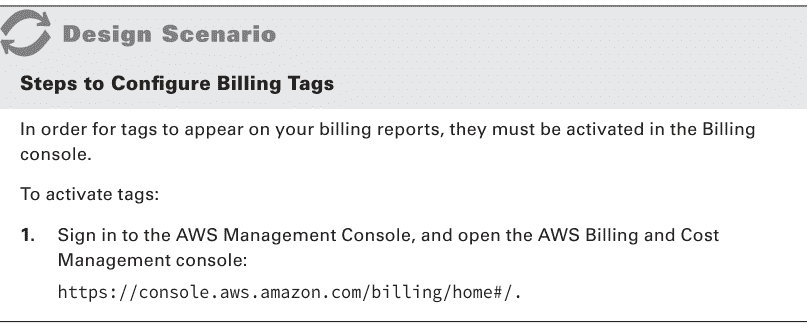

### 监控 `AWS` 费用

1. 在导航格中，选择“成本标签”（`Cost Tags`）。
2. 选择激活的标签。
3. 选择“保存”（`Save`）。

> 如果添加或更改了标签，成本将分成两行。

## `Cost Explorer`

`Cost Explorer` 是一个 `AWS` 工具，可用于查看过去 13 个月的支出图表，并预测未来 3 个月的支出。它还可以揭示哪些服务使用率最高，哪个可用区获得的网络流量最多。通过 `Cost Explorer`，有多种过滤器：

- `API` 操作
- 可用区
- `AWS` 云端服务
- 自定义成本标签
- `Amazon EC2` 实例类型
- 关联账户
- 平台
- 购买选项
- 区域
- 租用类型
- 使用类型

每次对成本应用过滤器时，`Cost Explorer` 都会创建一个图表。可以使用浏览书签功能保存设置以便重复使用。返回保存的链接时，`Cost Explorer` 将根据所选的时间范围刷新成本数据。此功能可以方便保存经常使用的配置，例如“过去七天的报告”。

`Cost Explorer` 使用与生成 `AWS` 成本和使用报告以及详细账单报告相同的数据集。数据集还可以下载为逗号分隔值 (`CSV`) 文件以便详细分析。

## `AWS` 账单和成本管理指标和维度

`AWS` 账单和成本管理服务将指标发送到 `Amazon CloudWatch`。

### 指标

`AWS/Billing` 命名空间使用表 9.9 中的指标。

#### 表 9.9 `AWS/Billing` 命名空间指标

| 指标 | 描述 |
|---|---|
| `EstimatedCharges` | `AWS` 使用的估计费用。可以是单个服务的估计费用，也可以是所有服务的估计费用汇总。 |

### 维度

`AWS` 账单和成本管理使用表 9.10 中的维度对指标进行过滤。

#### 表 9.10 `AWS` 账单和成本管理指标

| 维度 | 描述 |
|---|---|
| `ServiceName` | `AWS` 云服务的名称。对于所有服务的估计费用总计，省略此维度。 |
| `LinkedAccount` | 关联账户编号。仅用于合并账单。此维度仅包含在合并账单关系中关联到单独付费账户的账户。对于未关联合并账单账户的账户，不包含此维度。 |
| `Currency` | 为账户计费的货币。此维度是必填的。单位: `USD` |

## `AWS CloudTrail`

`AWS CloudTrail` 是一项能够对 `AWS` 账户进行治理、合规性、操作审计和风险审计的服务。通过 `AWS CloudTrail`，可以对跨 `AWS` 基础架构的与 `API` 调用相关的事件进行记录、持续监控和保留。

`AWS CloudTrail` 为账户提供了 `AWS API` 调用的历史记录。这包括通过 `AWS` 管理控制台、`AWS SDKs`、命令行工具以及其他 `AWS` 云服务执行的 `API` 调用。这些历史记录简化了安全分析、资源变更跟踪和故障排除工作。

`AWS CloudTrail` 通过记录在账户上执行的 `API` 调用，提供了对用户活动活动的可视性。它记录了每个 `API` 调用的重要信息，包括调用者的身份、`API` 调用的时间、请求参数以及 `AWS` 云服务返回的响应元素。这些信息可用于跟踪对 `AWS` 资源进行的更改，并帮助排除操作层面的问题。这使得确保符合内部策略和监管标准变得更加容易。

### 什么是跟踪器（`Trails`）？

跟踪器（`Trail`）是一种配置，能够对账户中的 `AWS API` 活动和相关事件进行记录。`AWS CloudTrail` 将日志投递到 `Amazon S3` 桶，并可选地投递到 `Amazon CloudWatch Logs` 日志组。

可以指定一个 `Amazon SNS` 主题来接收日志文件投递的通知。对于适用于所有区域的跟踪器，每个区域的跟踪器配置是相同的。

### 跟踪器的类型

你可以通过 `AWS CloudTrail` 控制台、`AWS CLI` 或 `AWS CloudTrail API` 创建跟踪器。跟踪器有两种类型：适用于所有区域的跟踪器和适用于单个区域的跟踪器。

#### 适用于所有区域的跟踪器

在创建适用于所有区域的跟踪器时，`AWS CloudTrail` 会在每个区域创建一个相同的跟踪器。它记录每个区域的日志文件并将日志投递到用户指定的 `Amazon S3` 桶。这是在 `AWS CloudTrail` 控制台中创建跟踪器时的默认选项。

适用于所有区域的跟踪器具有以下优势：

- 跟踪器的配置设置在所有区域中保持一致。
- 来自所有区域的日志文件发送到单个 `Amazon S3` 桶，并可选地投递到 `Amazon CloudWatch Logs` 日志组。
- 所有区域的跟踪器配置从一个位置进行管理。

可以立即从新区域接收事件。当新区域启动时，`AWS CloudTrail` 会自动在该区域创建一个具有与原始跟踪器相同设置的跟踪器。

可以在不经常使用的区域创建跟踪器，以监控异常活动。

当将跟踪器应用于所有区域时，`AWS CloudTrail` 使用账户中所有其他区域中具有相同配置的特定区域跟踪器。这将产生以下影响：

- 如果为跟踪器配置了 `Amazon SNS` 主题，则 `Amazon SNS` 通知将发送到同一个 `Amazon SNS` 主题。
- 全球服务事件将从单个区域投递到指定的 `S3` 桶，以及如果配置了日志组，则 `Amazon CloudWatch Logs` 组。
- 如果激活了日志完整性验证，则该跟踪器的所有区域都将启用日志完整性验证。

#### 适用于单个区域的跟踪器

在创建适用于单个区域的跟踪器时，`AWS CloudTrail` 在该区域记录日志文件并投递到用户指定的 `S3` 桶。在创建适用于特定区域的额外跟踪器时，可以将这些跟踪器设置为无论区域如何都将日志文件投递到单个 `S3` 桶。


> 对于两种类型的跟踪器，都可以使用任何区域的 `Amazon S3` 桶。

#### 每个区域多个跟踪器

如果有不同但相关的用户组（如开发人员、安全人员和 `IT` 审计员）需要访问 `AWS CloudTrail`，请每个区域创建多个跟踪器。这允许每个组接收其自己的日志文件副本。

`AWS CloudTrail` 支持每个区域五个跟踪器。适用于所有区域的跟踪器在每个区域中都计为一个跟踪器。要查看所有区域的跟踪器，请参阅 `AWS CloudTrail` 控制台的跟踪器页面。

### 加密

默认情况下，日志文件在 `S3` 中是通过 `Amazon S3` 服务端加密（`SSE`）进行加密的。

### `AWS CloudTrail` 日志投递

`AWS CloudTrail` 通常每五分钟向 `S3` 桶发布日志文件。

`AWS CloudTrail` 捕获用户或代表用户直接执行的 `API` 调用。例如，`CloudFormation`、`Elastic Beanst`、`EC2`、`RDS`、`EBS`、`Auto Scaling` 和 `CloudWatch` 等服务的 `API` 调用。

### 概述：创建跟踪器

在创建跟踪器时，`AWS CloudTrail` 会跟踪账户中的活动。

1. 通过 `AWS CloudTrail` 控制台或 `AWS CLI` 启用跟踪器。默认情况下，跟踪器适用于所有区域。
2. 创建一个 `Amazon S3` 桶来存储日志文件。默认情况下，日志来自所有区域并发送。
3. 根据需要配置跟踪器以跟踪所需的事件类型。
4. 创建一个 `Amazon SNS` 主题以接收日志文件投递的通知。
5. 配置 `CloudWatch Logs` 以接收 `CloudTrail` 事件。
6. 启用日志加密。
7. 对日志文件启用完整性验证。
8. 为跟踪器添加标签。

### 使用 `CloudTrail` 进行监控

`Amazon CloudWatch` 是一种收集并跟踪指标以监控 `AWS` 资源的服务。`CloudWatch Logs` 是 `CloudWatch` 的一项功能，专门用于监控日志数据。与 `CloudWatch Logs` 的集成允许 `CloudTrail` 将活动发送到其日志组。

## 第九章 监控与指标

发送到 `CloudWatch Logs` 的 `CloudTrail` 事件可以根据定义的指标触发告警。

使用 `CloudWatch Logs`，你可以跟踪来自操作系统、应用程序或其他 `AWS` 服务的 `CloudTrail` 事件。

### `AWS CloudTrail` 与 `Amazon CloudWatch` 的区别

`AWS CloudTrail` 为 `AWS` 提供的监控功能增加了深度。`Amazon CloudWatch` 关注性能监控和系统健康，而 `AWS CloudTrail` 关注 `API` 活动。虽然 `AWS CloudTrail` 不报告系统性能或健康，但你可以将 `CloudTrail` 与 `CloudWatch Logs` 使用，对 `AWS` 资源及其使用情况进行更深入的理解。

### `AWS CloudTrail`：命名要求

`AWS CloudTrail` 跟踪器名称必须符合要求：

- 仅限 `ASCII` 字母 (`a-z`, `A-Z`)
- 数字 (`0-9`)
- 点 (`.`)
- 下划线 (`_`)
- 连字符 (`-`)
- 必须以字母或数字开头并以字母或数字结尾。
- 长度在 3 到 128 个字符之间。
- 不能有相邻的点、下划线、连字符或这些字符的组合。名称如 `my--namespace` 是无效的。
- 不能为 `IP` 地址格式。例如 `10.9.28.68` 是无效的。

### `AWS CloudTrail`

- 字符串 `"AWSLogs"`
- 账户账号
- 字符串 `"CloudTrail"`
- 区域标识符
- `YYYY` 格式的日志文件发布年份
- `MM` 格式的日志文件发布月份
- `DD` 格式的日志文件发布日期
- 一个字母数字字符串，用于将文件与其他覆盖同一时间段的其他文件隔离开

这是一个完整的日志对象名称示例：

```
bucket/prefix/AWSLogs/AccountID/CloudTrail/region/YYYY/MM/DD/file_name.gz
```

### 获取日志文件

要检索文件，可以使用 `Amazon S3` 控制台、`AWS CLI` 或 `Amazon S3 API`。要使用 `Amazon S3` 控制台查找您的日志文件，请执行以下操作：

- 打开 `Amazon S3` 控制台。
- 选择为跟踪（`trails`）指定的存储桶（`bucket`）。
- 导航对象层级以找到正确的日志。

所有日志文件都有 `.gz` 扩展名。


> 您可以在 `AWS CloudTrail` 控制台的跟踪（`Trails`）页面找到存储桶名称。


### 为 `AWS CloudTrail` 配置 `Amazon SNS` 通知


当`AWS CloudTrail`将新日志文件发布到`Amazon S3`存储桶时，可以通知。您可以使用`Amazon SNS`管理通知。

通知是可选的。要启用通知，请配置`AWS CloudTrail`在每次发送新日志文件时将信息发送到`Amazon SNS`主题。要接收这些通知，请订阅该主题。要通过程序处理通知，请将`Amazon SQS`队列订阅到该主题。

## 控制`AWS CloudTrail`的用户权限

`AWS CloudTrail`与`IAM`集成，`IAM`控制对`AWS CloudTrail`以及`AWS CloudTrail`需要的其他`AWS`资源的访问，包括`Amazon S3`存储桶和`Amazon SNS`主题。使用`IAM`控制哪些`AWS`用户可以创建、配置或删除`CloudTrail`跟踪、启动和停止记录，以及访问包含日志信息的存储桶。

## 授予`AWS CloudTrail`管理权限

要管理`AWS CloudTrail`跟踪，请授予`IAM`用户显式权限以执行与`AWS CloudTrail`任务的操作。在许多场景下，可以使用包含预定义权限的`AWS`托管组来实现这一点。典型方法是创建一个具有相应权限的`IAM`组，并将单个`IAM`用户添加到该组中。例如，您可以为对`AWS CloudTrail`操作具有完全访问权限的用户创建一个`IAM`组，并为应该能够查看跟踪信息但不能创建或更改跟踪的用户创建另一个组。

以下是适用于`AWS CloudTrail`的`AWS`托管策略：

- `AWSCloudTrailFullAccess`: 此策略赋予用户对`AWS CloudTrail`操作的完全访问权限，以及管理`Amazon S3`存储桶、`Amazon CloudWatch Logs`日志组和用于跟踪的`Amazon SNS`主题的权限。
- `AWSCloudTrailReadOnlyAccess`: 此策略允许组中的用户查看跟踪和存储桶。

## 日志管理和数据事件

在创建跟踪时，该跟踪会记录您的账户的只读和只写管理事件。如果需要，可以使用该跟踪来指定该跟踪是否应该记录数据事件。数据事件是访问`Amazon S3`对象资源的对象级`API`操作，例如`getObject`、`DeleteObject`和`PutObject`。只有符合跟踪设置的事件才会投递到`Amazon S3`存储桶和`Amazon CloudWatch Logs`日志组。如果事件不符合跟踪设置，则跟踪不会记录该事件。

## 用于`AWS CloudTrail`的`Amazon SNS`主题策略

要向`Amazon SNS`主题发送通知，当发生以下情况时，`AWS CloudTrail`必须对主题拥有所需的权限：

- 在`AWS CloudTrail`控制台中创建或更新跟踪时创建`Amazon SNS`主题。
- 使用`AWS CLI` `create-subscription`和`update-subscription`命令创建`Amazon SNS`主题。
- `AWS CloudTrail`自动在策略中添加以下字段：
    - 允许的`SID`
    - `AWS CloudTrail`的服务主体名称
    - `Amazon SNS`主题，包括区域、账户`ID`和主题名称

以下策略允许`AWS CloudTrail`从支持的区域发送有关日志文件交付的通知：

### `Amazon SNS`主题策略

```json
{
  "Version": "2012-10-17",
  "Statement": [
    {
      "Sid": "AWSCloudTrailSNSPolicy201311101",
      "Effect": "Allow",
      "Principal": {"Service": "cloudtrail.amazonaws.com"},
      "Action": "SNS:Publish",
      "Resource": "arn:aws:sns:Region:STopicOwnerAccountID:STopicName"
    }
  ]
}
```

## `AWS Config`

`AWS Config`是一种托管服务，提供`AWS`资源清单、配置历史和配置更改通知，以实现安全和治理。`AWS Config`可以发现现有的`AWS`资源，导出带有所有配置详细的`AWS`资源完整清单，并确定资源在任何时间点的配置情况。这些功能实现了合规审计、安全分析、资源更改跟踪和故障排除。

`AWS Config`能够轻松跟踪资源配置，无需预先投资或维护数据收集代理，或维护大型数据库。启用`AWS Config`后，可以查看与`AWS`资源相关的所有配置属性的持续更新详情。可以配置`Amazon SNS`提供每次配置更改的通知。

`AWS Config`提供`AWS`账户中`AWS`资源的配置详细视图。这包括资源之间如何关联以及它们是如何配置的。资源是`AWS`中的实体，例如`EC2`实例、`EBS`卷、安全组或`Amazon VPC`。通过`AWS Config`，您可以执行以下操作：

- 评估资源配置是否符合预期设置。
- 获取`AWS`资源当前配置的快照。
- 检索一个或多个资源的历史配置。
- 每当资源被创建、修改或删除时接收通知。
- 查看资源之间的关系，例如使用特定安全组的资源。

## 使用`AWS Config`的方法

在`AWS`上运行应用程序时，必须集体创建和管理资源。随着应用程序需求的增长，跟踪资源添加的需求也随之增长。`AWS Config`设计用于在以下场景下监督应用程序资源。

### 资源管理

为了对资源配置进行更好的治理并检测资源配置错误，需要对存在哪些资源以及这些资源在任何时间是如何配置的进行细粒度的可见化。使用`AWS Config`在资源被创建、修改或删除时自动发送通知。无需通过对每个单独资源进行轮询来监控这些内容。

使用`AWS Config`规则评估`AWS`资源的配置设置。当`AWS Config`检测到资源违反了已建立规则之一的条件时，`AWS Config`将该资源标记为非合规并发送通知。`AWS Config`在资源创建、更改或删除时进行持续评估。

### 审计与合规性

某些数据需要频繁审计以确保符合内部策略和最佳实践。为了证明合规性，需要访问资源的历史配置。这些信息由`AWS Config`提供。

### 配置更改的管理与故障排除

当使用相互依赖的多个资源时，一个资源的配置更改可能会对相关资源产生意外后果。通过`AWS Config`，可以查看一个资源与其他资源的关系，并评估提议更改的影响。

`AWS Config`提供的资源历史配置可以通过提供问题资源的最后良好配置的访问来协助故障排除。

### 安全分析

要分析潜在的安全脆弱性，需要有关`AWS`资源配置的详细信息。这些信息可能包括授予用户的`IAM`权限，或控制资源访问的`Amazon EC2`安全组规则。

使用`AWS Config`查看在`AWS Config`记录的任何时间分配给`IAM`用户或角色的`IAM`策略。这些信息可以帮助确定用户在特定时间所拥有的权限。

使用`AWS Config`查看`Amazon EC2`安全组的配置以及在特定时间开放的端口规则。这些信息可以帮助确定安全组是否阻止了进入特定端口的`TCP`流量。

## `AWS Config`规则

`AWS Config`规则代表了资源的预期配置，并根据`AWS Config`记录的相关资源的配置更改进行评估。针对资源配置的规则评估结果将显示在仪表板上。通过`AWS Config`，客户可以从配置的角度评估其整体合规性和风险状态，查看随时间演变化的合规性趋势，并确定是哪种配置更改导致资源偏离了规则限制。

规则代表资源的配置项（`CI`）属性值，通过将这些属性值与`AWS Config`记录的`CI`进行比较来进行评估。规则分为两种类型：`AWS`托管规则和客户托管的规则。

## `AWS`托管规则

`AWS`托管规则由`AWS`预构建并管理。选择要启用的规则，然后提供一些配置参数即可开始。

## 客户托管的规则

可以开发自定义规则并将其添加到`AWS Config`中。将每个自定义规则与`Lambda`函数关联。此`Lambda`函数包含评估资源是否符合规则的逻辑。

将此函数与规则关联，规则将调用该函数，然后评估资源是否符合规则，并将评估结果发送到`AWS Config`。

> 使用`AWS Config`
>
> 通过使用`AWS Config`规则，客户可以从配置的角度评估其整体合规性和风险状态，查看随时间演变化的合规性趋势，并确定是哪种配置更改导致资源偏离了规则限制。

默认情况下，客户可以在`AWS`账户中最多创建`50`条`AWS Config`规则。这是一个软限制，可以通过联系`AWS`支持来进行增加。

## 规则是如何评估的

任何规则都可以更改触发型规则或周期性规则。

更改触发型规则在`AWS Config`记录任何指定资源的配置更改时执行。此外，必须指定以下内容之一：

- `Tag Key`：键:值 意味着为具有指定标签键:值的资源记录的任何配置更改将触发规则的评估。
- `Resource Type(s)`：为指定资源类型内的任何资源记录的任何配置更改将触发规则的评估。
- `Resource ID`：为资源类型和资源`ID`指定的资源记录的任何更改将触发规则的评估。

# 第 9 章 ■ 监控指标

周期性规则按指定的频率触发。可选频率为`1`小时、`3`小时、`6`小时、`12`小时或`24`小时。周期性规则拥有适用于该规则的所有资源当前`CI`的完整快照。

## 配置项（`Configuration Items`）

`CI`是资源在特定时间点的配置。一个`CI`由五个部分组成：

- 跨越不同类型资源的基本信息（例如`ARN`、标签）
- 资源特有的配置数据（例如`Amazon EC2`实例类型）
- 与其他资源的关系映射（例如，`Amazon EC2::volume-6886ff28` “挂载到实例” `Amazon EC2 instance-i-2460abc`）
- 与此状态相关的`AWS CloudTrail`事件`ID`
- 标识`CI`信息的元数据，例如`CI`的版本及其捕获时间

## 规则评估

规则评估决定了规则在特定时间点是否符合资源。它是针对资源配置进行规则评估的结果。`AWS Config`规则将捕获并存储每次评估的结果。结果将包含资源、规则、评估时间以及指向导致不合规的`CI`的链接。

## 规则合规性

如果资源符合所有适用于它的规则，则为合规。否则，则为不合规。同样，如果规则可用的所有资源都符合该规则，则资源为合规。否则，则为不合规。

在某些情况下（例如规则拥有的权限不足），评估可能产生“数据不足”状态。该状态被排除在资源或规则的合规状态判断之外。

## `AWS Config`和`AWS CloudTrail`

`AWS CloudTrail`记录账户上的`API`活动以及对这些活动信息的访问。你可以使用`AWS CloudTrail`获取`API`操作的完整详细信息，例如调用者身份、`API`调用时间、请求参数以及`AWS`云服务返回的响应元素。

`AWS Config`将`AWS`资源的特定时间点配置细节记录为`CI`。你可以使用`AWS Config`在任何时间点回答“我的`AWS`资源在某时候长什么样？”。你可以使用`AWS CloudTrail`回答“谁调用了`API`修改了此资源？”。

在实践中，你可以使用`AWS Config`控制台检测过去是否错误配置了安全组。结合集成的`AWS CloudTrail`信息，你可以找到错误配置安全组的用户并了解其发生的时间。

每个自定义规则都是一个`AWS Lambda`函数。当调用该函数来评估资源时，它将获得资源的`CI`。函数可以检查该项目并根据需要调用其他`AWS API`函数。在`AWS Lambda`函数对合规性做出裁决后，它会调用`PutEvaluations`函数来记录该决策。

## 价格

使用`AWS Config`的客户根据`AWS`账户中支持的资源记录的`CI`数量收费，且仅在记录`CI`时收取一次费用。保留`CI`不需要额外费用或任何预付。用户可以随时停止记录`CI`并继续访问之前记录的`CI`。每个`CI`的费用汇总到每月账单中。

如果你使用`AWS Config`规则，费用基于该月内活跃的`AWS Config`规则。当使用`AWS`资源调用规则时，结果将记录为一次评估。如果规则在当月内有一个或多次评估，则该规则为激活状态。

## 总结

`AWS Config`是一项允许客户评估、审计和评价其`AWS`资源配置的服务。通过`AWS Config`，可以查看`AWS`资源内部及其之间的更改，深入研究资源历史，并确定与预期配置的整体合规性。

`CloudWatch`提供应用程序性能和运行状况的系统级可视化。`CloudWatch`告警根据自定义阈值发送通知。使用`CloudWatch`监控`AWS`资源并确定利用率低的实例。

## 考试要点

熟悉`Amazon CloudWatch`。`Amazon CloudWatch`是一种针对`AWS`云资源以及你在`AWS`上运行的应用程序的监控服务。你可以使用`Amazon CloudWatch`来收集和跟踪指标、收集和监控日志文件，并设置告警。

`Amazon CloudWatch`可以监控`AWS`资源，例如`Amazon EC2`实例、`Amazon DynamoDB`表和`Amazon RDS`实例，以及由应用程序生成的自定义指标和应用程序生成的任何日志文件。

你可以使用`Amazon CloudWatch`获取资源利用率、应用程序性能和运行健康状况的全局可见性。你可以利用这些见解做出反应，并保持你的应用程序顺利运行。

`Amazon CloudWatch Events`有三个组件：事件（`Events`）、规则（`Rules`）和目标（`Targets`）。事件表示`AWS`环境的变化。目标处理事件。规则匹配传入的事件将其路由到目标进行处理。

了解`Amazon CloudWatch Alarms`的功能。`Amazon CloudWatch Logs`允许你使用现有的系统、应用程序和自定义日志文件对系统进行监控和故障。

通过`Amazon CloudWatch Logs`，近实时监控特定短语、值或模式的日志。日志数据可以在极高持久性、低成本的存储中无限期存储和访问，而不会填满硬盘。

学会创建监控计划。创建监控计划涉及回答基本问题：你的监控目标是什么？你将监控哪些资源？多久监控一次这些资源？你将使用哪些监控工具？谁来执行监控任务？出现问题时应该通知谁？

了解并理解自定义指标。你现在可以将业务和应用程序指标存储在`Amazon CloudWatch`中。你可以根据这些指标查看图表、指标并启动自动化操作，就像你对`Amazon CloudWatch`为你的`AWS`资源存储的指标一样。

虚拟机监控程序（`Hypervisor`）以上指标的可见性需要代理程序（`agent`）。`Amazon CloudWatch`可以告诉你虚拟机程序层面的`CPU`和`RAM`利用率，但它不知道哪些特定任务或进程影响了性能。`CloudWatch`可以看到`I/O`，但看不到磁盘使用情况。这需要代理程序。

熟悉`Amazon CloudWatch Alarm`的工作原理。你可以创建一个监控单个指标的`CloudWatch`告警。告警根据指标在多个周期内相对于阈值的值执行一个或多个操作。该操作可以是`Amazon EC2`实例、自动伸缩操作，或发送到`Amazon SNS`主题的通知。

了解`Amazon CloudWatch Alarm`的三种状态。这些是`OK`、`ALARM`和`INSUFFICIENT_DATA`。如果告警处于`OK`状态，说明受监控的指标在你定义的接受范围内。如果告警处于`ALARM`状态，说明指标已超过阈值。如果数据缺失或不完整，则处于`INSUFFICIENT_DATA`状态。

监控有两个级别：基础和详细。`Amazon EC2`的基础监控默认每五分钟将`CPU`负载、`I/O`和网络`I/O`指标发送到`Amazon CloudWatch`。默认每分钟将详细指标数据发送到`CloudWatch`。某些服务（如`Amazon RDS`）默认开启详细监控。

`Amazon CloudWatch`执行两种类型的`Amazon EC2`状态检查：系统（`System`）和实例（`Instance`）。系统状态检查监控你使用的`AWS`系统以确保它们运行正常。这些检查会检测你的实例中需要`AWS`参与才能修复的问题。实例状态检查监控你单个实例的软件和配置。这些检查会检测需要你参与修复的问题。

熟悉一些用于监控的常用指标。有很多可用指标，但并非所有指标都会考试中测试。然而，某些会被测试，了解常用的指标是一个好主意：`QueueLength`（队列长度）、`DatabaseConnections`（数据库连接）、`DiskQueueDepth`（磁盘队列深度）、`FreeStorageSpace`（可用存储空间）、`ReplicaLag`（复制延迟）、`ReadIOPS`（读取`IOPS`）、`WriteIOPS`（写入`IOPS`）、`Latency`（延迟）、`SurgeQueueLength`（激增队列长度）和`SpilloverCount`（溢出计数）。

如何知道为`Amazon RDS`设置`Amazon CloudWatch`事件订阅。`Amazon RDS`使用`Amazon`通知服务（`Amazon SNS`）在`Amazon RDS`事件发生时提供通知。这些可以是`Amazon SNS`支持的`AWS`区域的任何通知，电子邮件、短信或发送到`HTTP`端点的调用。详情可以在此处找到：`http://docs.aws.amazon.com/AmazonRDS/Latest/UserGuide/Events.html`

`Amazon ElasticCache`有两个引擎：`Redis`和`Memcached`。`Memcached`是多线程的，`Redis`是单线程的。

了解`EBS`卷状态检查。`Degraded`（降级）和`Severely Degraded`（严重下降）意味着`EBS`卷状态检查处于警告状态且存在`I/O`。`Stalled`（阻塞）或`Not Available`（不可用）意味着`EBS`卷处于受损状态且没有`I/O`。

学习指标`SurgeQueueLength`和`SpilloverCount`。当超过`SurgeQueueLength`限制时，会发生溢出。请求被丢弃且不通知用户。客户体验受到负面影响。

# 学习技巧


学习者对所呈现的信息越专注，他们处理这些信息就越详尽。这一原理如此显而易见，以至于容易被忽略。这意味着：当你试图将一条信息画入大脑的记忆系统时，请确保你完全理解它的准确含义。

> Medina, John. Brain Rules (Updated and Expanded): 12 Principles for Surviving and Thriving at Work, Home, and School (p. 139). Press Peer. Kindle Edition.

# 练习 425

在你准备考试时，确保你不仅关注事实和数字，更多地关注如何完成与系统操作相关的任务。少担心工具本身，多关注工具的作用以及它如何与其他工具集成。

是的，事实和数字固然重要。你需要诸如 `Amazon SQS` 队列是什么以及它与 `Amazon SNS` 主题有何不同。不要试图背诵 `SQS` 队列能做的所有事情，要从它如何解决问题的角度来学习，细节会水到渠成。这不再仅仅是你背过的事实，而是让你的生活变得更简单的事物。

# 练习

到目前，你已经在 `AWS` 中设置了账户。如果你还没有，现在是时候了。需要注意的是，这些练习是在你的账户中进行的，因此不是免费的。启动资源时请使用免费套餐（`Free Tier`）。更多信息请参见：<https://aws.amazon.com/free/>

如果你还没有安装 `AWS` 命令行工具，请参考第 2 章“使用 `AWS` 云服务”，练习 2.1 (`Linux`) 或练习 2.2 (`Windows`)。`CLI` 的参考文档可以在此处找到：<http://docs.amazon.com/cli/latest/reference/>

```
EXERCISE 9.1
```

## 搜索可用指标。

可以使用特定的搜索词在账户中的所有指标中进行搜索。指标将根据其命名空间（`namespace`）、指标名称或维度（`dimensions`）返回匹配结果。

此练习假设存在一个带有 `EBS` 卷的 `Amazon EC2` 实例。

1. 打开 `Amazon CloudWatch` 控制台：<https://console.aws.amazon.com/cloudwatch/>

2. 在导航窗中，选择指标（`Metrics`）。

3. 在所有指标（`All Metrics`）选项卡的搜索字段中输入 `volume`，并按回车。参考下图。这显示了所有使用该术语的命名空间。

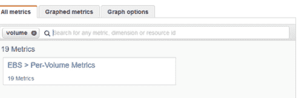

选择具有搜索结果的命名空间以查看指标。执行以下操作：

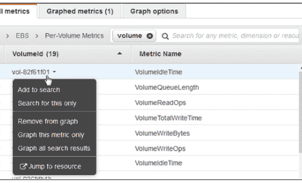

```
EXERCISE 9.2
```

使用 `Amazon CloudWatch` 控制台按命名空间和维度查看运行中的 `Amazon EC2` 实例的可用指标。

此练习至少需要一个运行中的 `Amazon EC2` 实例。

1. 确保你所在的区域至少有一个正在运行的 `Amazon EC2` 实例。下图显示了 `Amazon CloudWatch` 导航窗格。

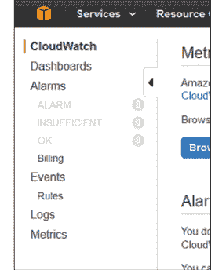

2. 在导航窗格中，选择 `Metrics`（指标）。下图显示了一个示例。可用的指标将有所不同。

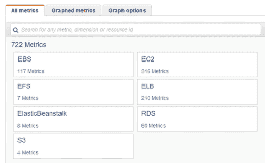

3. 选择 `Amazon EC2`。这将打开一个可用维度（`dimensions`）窗口。示例请参见下图。可用的维度将有所不同。

# 第 428 页 第9 章 • 监控与指标

# 练习 9.2（继续）

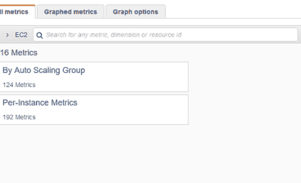

4. 选择 `Per-Instance Metrics`（按实例指标）。

`All Metrics` 标签页显示该命名空间（`namespace`）中该维度的所有指标。在此窗口中，可以执行以下操作：

5. 要排序表格，使用列标题。

6. 为指标绘制图表，选择指标旁边的复选框（要选择所有指标，请选择表头行的复选框）。

7. 按资源过滤，选择资源 `ID` 并点击 `Add to Search`（添加到搜索）。

8. 按指标过滤，选择指标名称并点击 `Add to Search`（添加到搜索）。

下图显示此窗口的示例。可用的指标将有所不同。

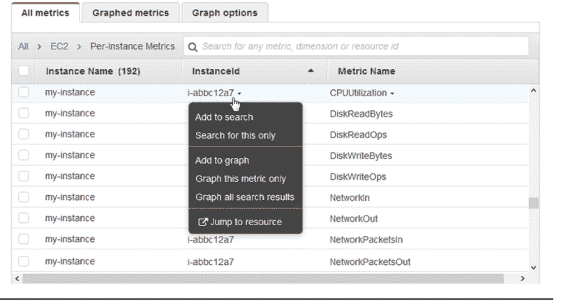

# 练习 9.3

## 使用 AWS CLI 按命名空间、维度或指标查看可用指标。

要查看 `AWS/EC2` 命名空间下 `Amazon EC2` 的所有指标，请从 `AWS CLI` 使用以下命令：

```
aws cloudwatch list-metrics --namespace AWS/EC2
```

`JSON` 输出将如下：

```json
{
  "Metrics": [
    {
      "Namespace": "AWS/EC2",
      "Dimensions": [
        { "Name": "InstanceId", "Value": "i-0ab7693e31b622ec2" }
      ],
      "MetricName": "DiskWriteBytes"
    },
    {
      "Namespace": "AWS/EC2",
      "Dimensions": [
        { "Name": "InstanceId", "Value": "i-0ab7693e31b622ec2" }
      ],
      "MetricName": "DiskReadOps"
    }
  ]
}
```

下图显示表格格式而非 `JSON` 格式的输出。命令如下：

```bash
aws cloudwatch list-metrics --namespace AWS/EC2 --output table
```

# 练习 9.3（继续）

| ListMetrics | |
|---|---|
| MetricName | Namespace |
| CPUCreditBalance | AWS/EC2 |
| Dimensions | |
| Name | Value |
| InstanceId | i-0ab76393c1b62ec2 |
| Metric | |
| MetricName | Namespace |
| CPUUsage | AWS/EC2 |
| Dimensions | |
| Name | Value |
| InstanceId | i-0ab76393c1b62ec2 |
| Metrics | |
| MetricName | Namespace |
| NetworkPackets | AWS/EC2 |
| Dimensions | |
| Name | Value |
| InstanceId | i-0ab76393c1b62ec2 |
| Metrics | |

# 练习 9.4

## 列出特定资源的所有可用指标。

指定 `AWS/EC2` 命名空间和 `InstanceId` 维度以查看单个实例的结果。在本示例中，实例 `ID` 为 `i-0ab76393c1b62ec2`。

```bash
aws cloudwatch list-metrics --namespace AWS/EC2 --dimensions Name=InstanceId,Value=i-0ab76393c1b62ec2
```

# 练习 9.5

## 列出所有使用单一指标的资源。

指定 `AWS/EC2` 命名空间和指标 `CPUUtilization` 以查看单个指标的结果。

```bash
aws cloudwatch list-metrics --namespace AWS/EC2 --metric-name CPUUtilization
```

# 练习 9.6

## 获取特定资源的统计数据。

下面的练习显示了如何使用 `Amazon CloudWatch` 控制台获取特定 `Amazon EC2` 实例的最大 `CPU` 利用率。

# 练习

## 要求

你必须持有一个 `Amazon EC2` 实例的 `ID`。使用 `AWS` 管理控制台或 `describe-instances` 命令检索实例 `ID`。

默认情况下，启用基础监控并每五分钟为间隔收集一次指标。可以启用详细监控以每一分钟为间隔采集数据点。这将产生额外费用。

1. 打开 `Amazon CloudWatch` 控制台：

   <https://console.aws.amazon.com/cloudwatch/>

2. 在导航窗格中，选择 `Metrics`（指标）。

3. 选择 `Amazon EC2` 指标命名空间。下图显示了 `Metrics` 窗口的示例。额外的指标将有所不同。

   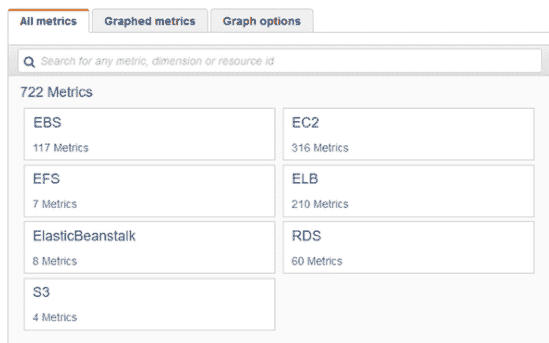

4. 选择 `Amazon EC2` 命名空间后，将打开一个窗口。下图显示了一个示例。额外的维度将有所不同。选择 `Per-Instance Metrics`（按实例指标）。

   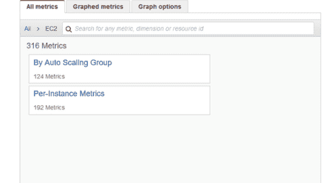

# 练习 9.6（继续）

5. 在搜索字段中输入 `CPUUtilization` 并按回车。

6. 选择特定实例的行以显示 `CPUUtilization` 指标的图表。下图显示了你的实例。可用的实例名称和 `ID` 将有所不同。

   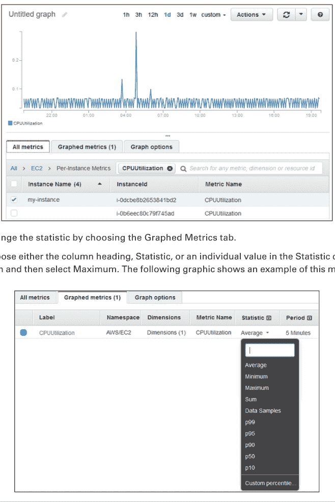

7. 使用 `Statistics`（统计数据）更改 `period`。

8. 选择 `Statistic` 列中的标题或单个值。下图显示了此示例。

## 从命令行

### 要求

你必须有一个 `Amazon EC2` 实例的 `ID`。使用 `AWS` 管理控制台或 `describe-instances` 命令检索实例 `ID`。

默认启用基础监控并每五分钟为间隔收集一次指标。可以启用详细监控以每一分钟为间隔采集数据点。这将产生额外费用。

从 `AWS CLI`，使用 `get-metric-statistics` 命令和指标名称 `CPUUtilization`。返回的统计数据是请求 24 小时间隔内的每五分钟值。每个值代表指定实例在特定时间的 `CPU` 利用率百分比。数据点按时间顺序返回并在此处呈现以便阅读。

```bash
aws cloudwatch get-metric-statistics \
  --namespace AWS/EC2 \
  --metric-name CPUUtilization \
  --dimensions Name=InstanceId,Value=i-0ab76393c1b62ec2 \
  --statistics Maximum \
  --start-time 2017-05-01T09:28:00 \
  --end-time 2017-05-02T09:28:00 \
  --period 360 \
  --output json
```

`JSON` 的输出如下：

```json
{
  "Datapoints": [
    {
      "Timestamp": "2017-05-01T13:58:00Z",
      "Maximum": 0.67,
      "Unit": "Percent"
    },
    {
      "Timestamp": "2017-05-02T01:46:00Z",
      "Maximum": 0.83,
      "Unit": "Percent"
    },
    {
      "Timestamp": "2017-05-02T05:52:00Z",
      "Maximum": 0.67,
      "Unit": "Percent"
    },
    ...
    {
      "Timestamp": "2017-05-02T06:52:00Z",
      "Maximum": 0.67,
      "Unit": "Percent"
    }
  ],
  "Label": "CPUUtilization"
}
```

下图显示表格格式的输出。

```bash
aws cloudwatch get-metric-statistics \
  --namespace AWS/EC2 \
  --metric-name CPUUtilization \
  --dimensions Name=InstanceId,Value=i-0e225404926555d \
  --statistics Maximum \
  --start-time 2017-05-01T09:28:00 \
  --end-time 2017-05-02T09:28:00 \
  --output table
```

# 练习 9.7（继续）

| Label | CPUUtilization Datpoints | Unit |
|---|---|---|
| 0.67 | 2017-05-08T13:58:02 | Percent |
| 0.67 | 2017-05-08T13:59:02 | Percent |
| 0.67 | 2017-05-08T14:00:02 | Percent |
| 0.49 | 2017-05-08T14:01:02 | Percent |
| 0.67 | 2017-05-08T14:02:02 | Percent |
| 0.67 | 2017-05-08T14:03:02 | Percent |
| 0.67 | 2017-05-08T14:04:02 | Percent |
| 1.0 | 2017-05-08T14:05:02 | Percent |
| 0.67 | 2017-05-08T14:06:02 | Percent |
| 0.67 | 2017-05-08T14:07:02 | Percent |
| 0.67 | 2017-05-08T14:08:02 | Percent |

# 练习 9.8

## 创建账单警报。

为了创建账单警报，必须先启用账单警报。这只需要执行一次，且一旦启用，无法禁用。

1. 登录 `AWS` 管理控制台并打开 `AWS` 账单和成本管理控制台：<https://console.aws.amazon.com/billing/home/>.

2. 在导航窗格中，选择 `Preferences`（偏好）。

3. 勾选 `Receive Billing Alerts`（接收账单警报）复选框。

4. 选择 `Save Preferences`（保存偏好）。

# 练习 9.9

## 创建账单报警。

要创建账单报警，必须先开启账单警报。这些步骤将把警报发送到单个电子邮件地址。

1. 打开 `Amazon CloudWatch` 控制台：<https://console.aws.amazon.com/cloudwatch/>

2. 如必要，将导航栏上的区域更改为美国东部（弗吉尼亚）。所有账单指标数据都存储在此区域，即使资源位于其他区域。

3. 在导航窗格的 `Metrics` 下方，选择 `Billing`（账单）。

4. 在账单指标列表中，选择货币 `USD` 的 `EstimatedCharges` 指标旁边的复选框，如下所示。

| Billing > Total Estimated Charge | Metric Name |
|---|---|
| USD | EstimatedCharges |

# 第 9 章 • 监控与指标

# 练习 9.9（续）

5. 选择“创建报警”（`Create Alarm`）。

按如下方式定义报警：

6. 为了让账户在超出免费额度时立即触发报警，请设置“当每月 `AWS` 总费用超过 $01”。`AWS` 免费额度适用于以下 `AWS` 区域的参与服务：美国东部（弗吉尼亚北部）、西部（北加利福尼亚）、加拿大（中部）、欧洲（伦敦）、欧洲（爱尔兰）、欧洲（法兰克福）、亚太（新加坡）、亚太（东京）、亚太（悉尼），一旦产生首次费用，将发送通知。否则，设置自定义金额，并在达到所选金额时发送通知。参考以下图形：

   

7. 选择“新列表”（`New List`）链接并发送到“新接收者”（`New To`）框中。

8. 在提示时，输入有效的电子邮件地址。

9. 选择“创建报警”（`Create Alarm`）。

10. 在“确认新电子邮件地址”对话框中，确认电子邮件地址。当选择“我稍后处理”时，报警将保持在“等待确认”（`Pending confirmation`）状态，直到电子邮件地址确认。在确认电子邮件地址之前，报警不会发送警报。要查看报警状态，请在导航窗中选择“报警”（`Alarms`）。参考以下图形查看配置状态为“等待确认”的报警。

| 状态 | 名称 | 阈值 | 配置状态 |
| --- | --- | --- | --- |
| ALARM (报警) | BillingAlarm | 预计费用 > 0 持续 6 小时 | 等待确认 |

# 练习 9.10

## 创建 Amazon CloudWatch 仪表板。

要开始使用 `Amazon CloudWatch` 仪表板，首先创建一个仪表板。

1. 打开 `Amazon CloudWatch` 控制台：<https://console.aws.amazon.com/cloudwatch/>

2. 在导航格中，选择“仪表板”（`Dashboards`）。

3. 选择“创建仪表板”（`Create Dashboard`）。

4. 在“创建新仪表板”对话框中，为仪表板输入名称，然后选择“创建仪表板”。

5. 通过“指标图表”（`Metric Graph`）向仪表板添加图表，然后点击“配置”（`Configure`）。接着在“添加指标图表”对话框中，选择要绘制图表的指标，然后选择“创建小部件”（`Create Widget`）。


6. 通过“文本小部件”（Text Widget）向仪表板添加文本块，然后点击“配置”（Configure）。在“新文本小部件”对话框中，对于 `Markdown`，使用 `Markdown` 添加并格式化文本，然后选择“创建小部件”。

7. 选择“保存仪表板”（Save Dashboard）。

## 复习题

1. 下列哪项需要使用自定义 `Amazon CloudWatch` 指标进行监控？

A. `Amazon EC2` `CPU` 利用率

B. `Amazon EC2` 磁盘 `I/O`

C. `Amazon EC2` 内存利用率

D. `Amazon EC2` 网络 `I/O`

2. 在多个 `Amazon EC2` 实例前配合 `ELB` 使用自动扩展（`Auto Scaling`）时，你希望配置自动扩展在 `CPU` 利用率低于 20% 时移除一个实例。如何实现？

A. 配置 `Amazon CloudWatch Logs`，当 `CPU` 利用率低于 20% 时向自动扩展组发送通知，并配置自动扩展策略移除该实例。

B. 配置 `Amazon CloudWatch`，当聚合 `CPU` 利用率低于 20% 时向自动扩展组发送通知，并配置自动扩展策略移除该实例。

C. 使用 `Amazon CloudWatch` 监控 `EC2` 实例，并使用自动扩展通过计划操作移除实例。

D. 配置 `Amazon CloudWatch` 在 `CPU` 利用率低于 20% 时使用 `Amazon SNS` 生成电子邮件。进入控制台，降低自动扩展内部的所需容量数字以移除该实例。

3. 你的公司已为 `Amazon CloudWatch` 配置了自定义指标上传，并已授权员工使用 `AWS CLI` 以及 `AWS SDK` 上传数据。你如何如何跟踪对 `CloudWatch` 的 `API` 调用？

A. 使用 `AWS CloudTrail` 监控 `API` 调用。

B. 创建 `IAM` 角色，允许假设该角色的用户使用 `Amazon S3` 桶策略查看数据。

C. 启用 `Amazon CloudWatch` 日志以捕获 `API` 用的指标。

D. 启用 `Amazon CloudWatch` 详细监控。

4. 在列出的服务中，哪一个在不产生额外费用的情况下提供详细监控？（选择两项）。

A. `AWS Auto Scaling`

B. `Amazon Route 53`

C. `Amazon Elastic Map Reduce`

D. `Amazon Relational Database Service`

E. `Amazon Simple Notification Service`

5. 你配置了一个 `ELB` 经典负载均衡器在多个 `Amazon EC2` 实例之间分发流量。以下哪项将有助于与后端服务器有关的排障工作？

A. `HTTPCode_Backend_2XX`

B. `HTTPCode_backend_3XX`

C. `HTTPCode_Backend_4XX`

D. `HTTPCode_backend_5XX`

6. `Amazon CloudWatch` 接收并聚合的数据最小时间间隔是多少？

A. 十五秒

B. 一分钟

C. 三分钟

D. 五分钟

7. 使用免费额度，`Amazon CloudWatch` 接收到的更新频率是多少？

A. 十五秒

B. 一分钟

C. 三分钟

D. 五分钟

8. 自动以五分钟为周期提供的监控类型类型什么什么？

A. 弹性 (`Elastic`)

B. 简单 (`Simple`)

C. 基础 (`Basic`)

D. 详细 (`Detailed`)

9. 你使用 `AWS CLI` 创建了一个自动扩展组。你现在想启用详细监控。如何实现？

A. 从控制台启用详细监控。

B. 在创建自动扩展组时，激活详细监控。

C. 通过 `CLI` 创建自动扩展组时，默认启用详细监控。

D. 自动扩展不支持详细监控。

# 第 9 章 • 监控与指标

10. 有 10 个 `EC2` 实例运行在多个区域，使用内部管理工具捕获日志文件并将其发送到 `US-West-2` 的 `CloudWatch`。此外，你正在使用 `AWS CLI` 为相同的命名空间配置 `CloudWatch`。以下哪项是正确的？

A. `CloudWatch` 将处理数据。

B. `CloudWatch` 将处理最近响应。

C. `CloudWatch` 将跨区域接收数据。

D. `CloudWatch` 无法接收数据。

11. 你错误配置了 `EC2` 实例的时钟，并正通过 `API` 向 `CloudWatch` 发送数据。以下哪项是正确的？

A. `CloudWatch` 将处理数据。

B. 不可以发送未来的数据。

C. 不可以手动向 `CloudWatch` 发送数据。

D. 代理发送的数据不能超过 60 分钟。

12. 你有一个系统每五分钟向 `CloudWatch` 发送一次数据进行跟踪/监控。在 `put-metric-data` 请求中，这些参数是必要的？

A. `Key` (键)

B. 命名空间 (`Namespace`)

C. 指标名称 (`Metric Name`)

D. 时间戳 (`Timestamp`)

13. 为了监控 `AWS API` 调用，使用 `AWS CloudTrail` 捕获历史 `API` 请求并使用 `AWS Config` 响应操作更改。

A. `AWS Config`; `Amazon Inspector`

B. `AWS CloudTrail`; `AWS Config`

C. `AWS CloudTrail`; `Amazon CloudWatch`

D. `AWS Config`; `AWS Lambda`

# 第 10 章

# 高可用性

`AWS` 认证 - `SYSOPS` 工程师 - 助理级考试内容包括但不限于以下：

## 1.0 监控与指标

### 1.1 监控可用性和性能的能力

内容可能包括：

- 监控端点健康检查并将流量路由到健康端点

- 启用 `Amazon Elastic Compute Cloud` (`Amazon EC2`) 自动恢复

## 2.0 高可用性

### 2.1 根据场景实现可扩展性和弹性

内容可能包括：

- 基于 `Auto Scaling` 的 `Amazon Elastic Compute Cloud` (`Amazon EC2`) 的可扩展性

才能为性能缩放 `Amazon RDS` 数据库

- 弹性负载均衡 (`Elastic Load Balancing`)

- 会话状态管理

### 2.2 根据业务需求确保容错水平

内容可能包括：

- 使用 `Amazon Simple Queue Service` (`Amazon SQS`) 帮助应用程序具备容错能力

- 使用 `Amazon Simple Notification Service` (`Amazon SNS`) 进行应用程序扇发 (`fan-out`)

- 通过多可用区（`Multi-AZ`）部署为您的 `Amazon RDS` 提供高可用性

- 为 `Amazon Simple Storage Service` (`Amazon S3`) 启用跨区域复制

- 使 `AWS Direct Connect` 实现高可用

- `AWS Direct Connect` 故障转移到备份 `VPN`

# 领域 5.0 高可用性

### 5.3 管理备份和灾难恢复过程

内容可能包括：

- `AWS` 上提供的不同备份和恢复方法

# 领域 7.0 网络

### 7.1 演示实现 `AWS` 网络功能的能力

### 7.2 演示实现 `AWS` 连接性功能的能力

内容可能包括：

- 使用 `Amazon Route 53` 的不同故障转移场景


## 高可用性简介

本章将介绍 `AWS` 上的高可用性。在之前的章节中，您已经介绍了 `AWS` 上的计算、网络、数据库和存储。您尚未接触过一些全托管服务，这些服务可以帮助您部署和维护高可用且可扩展的应用程序。

什么是高可用性？可用性是指您的系统处于运行状态的时间长度。通常来说，您的可用性是 100% 减去系统的停机时间。由于可能中断您的系统可用性的事件永远无法完全预测，因此总有方法可以使应用程序具有更高的可用性。然而，提高可用性通常会导致成本增加。在考虑如何提高您的环境的可用性时，平衡改进的成本与对用户的收益是至关重要的。高可用性是意味着您的应用程序始终在线/可访问，还是意味着应用程序在可接受的性能范围内处理请求？使应用程序具有高可用且可扩展的一种方法是将组件解耦，使其能够独立扩展并能忍受微小的干扰。高可用性性能水平请参见表 10.1。

**表 10.1** 高可用性级别

| 运行时间百分比 | 年度最大停机时间 | 等于每日停机时间 |
|---|---|---|
| 90% (1 个 9) | 36.5 天 | 2.4 小时 |
| 99% (2 个 9) | 3.65 天 | 14 分钟 |
| 99.9% (3 个 9) | 8.76 小时 | 86 秒 |
| 99.99% (4 个 9) | 52.6 分钟 | 8.6 秒 |
| 99.999% (5 个 9) | 5.25 分钟 | .86 秒 |

在本章中，您将介绍 `Amazon Simple Queue Service` (`Amazon SQS`) 和 `Amazon Simple Notification Services` (`Amazon SNS`)，它们可用于解耦应用程序并保留事务。除了解耦应用程序内部的分层之外，这些服务还可以帮助您的应用程序提供高可用性和容错能力。本章还将涵盖其他策略，以保持您的基础设施高可用、冗余和容错。

## Amazon Simple Queue Service

`Amazon Simple Queue Service` (`Amazon SQS`) 是一种 `Web` 服务，让您能够访问等待处理的消息队列。通过 `Amazon SQS`，您可以快速构建运行在任何计算机上的消息队列应用程序。您可以使用该服务在各种分布式应用程序组件之间移动数据，而不会丢失消息，且不需要每个组件都可用。

`Amazon SQS` 可以与 `Amazon Elastic Compute Cloud` (`Amazon EC2`) 以及其他基础设施服务紧密结合，帮助您构建具有解耦组件的分布式应用程序。您可以通过 `Amazon SQS` 控制台、`AWS` 命令行界面 (`AWS CLI`)、通用 `Web` 服务编程接口 (`API`) 以及 `AWS` 软件开发包 (`SDK`) 支持的任何编程语言访问该服务。`Amazon SQS` 支持标准队列和先入先（`FIFO`）队列。

## 使用 Amazon Simple Queue Service 解耦应用程序

将队列想象为等待处理的消息的临时存储库。使用 `Amazon SQS`，您可以将应用程序的组件解耦，使其相互独立运行，并由 `Amazon SQS` 缓解组件之间的消息管理。队列在产生并保存数据的组件与接收数据进行处理的组件之间充当缓冲区。这意味着，如果生产者（例如 `Web` 前端）产生速度快于消费者（例如应用程序工作节点）的处理速度，或者生产者或消费者仅间断连接到网络，队列可以解决产生的问题。

`Amazon SQS` 设计为至少交付一次您的消息，并支持多个读取和写入器与同一个队列交互。单个队列可以同时被许多分布式应用程序组件使用，而无需这些组件之间进行协调以共享队列。

`Amazon SQS` 设计为始终可用并交付消息。这是通过系统分布在多台机器和多个设施之间实现的。由于这种高度分布的架构，存在权衡——当使用标准队列时，`Amazon SQS` 不保证消息的 `FIFO` 交付。对于分布式应用程序，这可能是可以的，只要每条消息都能独立存在且所有消息都已交付。在这种情况下，顺序并不重要。如果您的系统要求保留顺序，您可以在每条消息中放入排序信息，以便在队列返回消息时对消息进行重新排序。

您可以拥有许多队列，并包含任意数量的消息，或者如果您需要删除消息，可以使用消息 `ID`。`SQS` 还允许您在消息上设置可见性超时（`visibility timeout`），这可以防止其他消费者在消息处理期间接收到相同的消息。您还可以配置消息保留期，它决定了消息在队列中自动删除之前停留的时间。

## Amazon SQS 用例

- 将 `SQS` 与 `AWS` 服务集成以提高应用程序的可靠性。

- 将 `SQS` 作为需要处理的任务的队列。

- 在队列中保留重要事件的通知。

`Amazon SQS` 留存一段时间的消息。默认值为四天；然而，您可以配置长达 14 天。

## 队列链模式

您可以通过系统之间使用队列来实现系统的解耦。这种方法允许您增加并行接收和处理消息的服务器数量。如果没有需要处理的图像，您可以对服务器配置自动扩展（`Auto Scaling`）。队列模式的示例见图 10.1。

虽然您可以在云技术未使用这种模式，但队列本身作为云服务（`Amazon SQS`）提供，这使得您更容易使用这种模式。

## 图 10.1 展示了队列模式

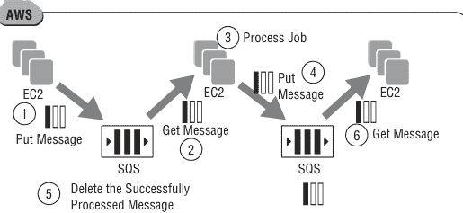

## 需要解决的问题以图像处理为例，上传、存储和编码图像、创建缩略图以及版权等顺序操作是紧密链接的。这种紧密链接在发生故障时使恢复操作变得复杂。

# Amazon 简单队列服务 447

在接收或删除消息时，它可能不可用。如果发生这种情况，消息副本将不会在该不可用的服务器上被删除，你会在接收消息时可能再次获得该消息副本。正因如此，你必须设计你的应用程序具有幂等性（也就是说，如果多次处理同一条消息，也不会产生不利影响）。关键在于，`Amazon SQS` 至少会投递一次消息，在某些情况下会再次投递消息。更多信息请参阅本章的可见性超时。

# 消息示例

从队列检索消息时，`Amazon SQS` 会对部分服务器进行采样并返回来自这些服务器的消息。`Amazon SQS` 支持两种轮询方法：

- 短轮询（`Short polling`）意味着对队列样本进行轮询，特定的接收请求可能不会返回你的所有消息，但随后的请求将会返回。如果你持续从队列中检索，`Amazon SQS` 将对所有服务器进行采样，你将收到所有的消息。这对于你的应用程序来说可能是 `CPU` 密集型的。

- 长轮询（`Long polling`）通过允许 `Amazon SQS` 等待队列中有可用消息后再发送响应，从而减少空响应的数量。除非连接超时，否则 `ReceiveMessage` 请求的响应将包含至少一条可用消息，最多包含 `ReceiveMessage` 操作中指定的最大消息数。

10.2 显示了队列短轮询的示例以及在接收请求后返回的消息。`Amazon SQS` 采样了几个服务器（灰色部分）并返回了来自这些服务器的消息（消息 `A`、`C`、`D` 和 `B`）。消息 `E` 未返回给这个特定的请求，但它将会返回给随后的请求。

# 图 10.2 短轮询

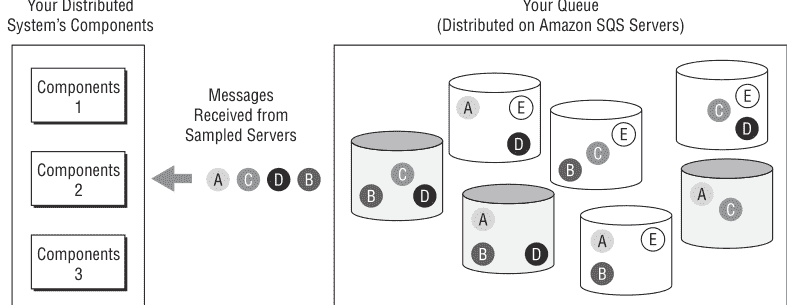

# 可见性超时 (Visibility Timeout)

可见性超时是指应用程序组件从队列中获取消息后，该消息对应用程序其他部分不可见的时间。在可见性超时期间，接收消息的组件通常会处理它并从队列中删除。这防止了多个组件处理同一条消息。

其工作原理如下：

1. 当接收消息时，它在处理期间变为“锁定状态”。这防止了它被其他组件处理。

2. 接收消息的组件处理它，然后将其从队列中删除。

3. 如果消息处理失败，锁过期，消息将再次可用（容错性）。

当应用程序需要更多时间进行处理时，可以通过 `ChangeMessageVisibility` 操作动态更改可见性超时。

# 标准队列 (Standard Queues)

`Amazon SQS` 提供标准队列作为默认队列类型。标准队列允许你每秒拥有几乎无限数量的事务。标准队列支持至少一次的消息投递。然而，由于其高度分布的架构，可能会有多个消息副本按无序顺序投递。标准队列提供尽力排序，使用先进后出（`FIFO`）队列。这确保了消息是按照它们发送时的顺序进行投递的。

你可以在许多场景中使用标准队列，只要你的应用程序能够处理多次到达且无序到达的消息。例如：

- 解耦用户请求与密集型后台工作：让用户在上传媒体的同时，后台对其进行调整缩放或编码。

- 将任务分配给多个工作节点：处理大量的信用卡验证请求。

- 为了未来的处理对消息进行批量：调度多个条目添加到数据库中。

# 先进后出队列 (First-In, First-Out Queues)

先进后出（`FIFO`）队列具有标准队列的所有功能。`FIFO` 队列的设计用于在操作和事件顺序至关重要或无法容忍重复时，增强应用程序之间的消息通信。`FIFO` 队列提供精确一次处理，并限制为每秒 300 次事务（`TPS`）。

`FIFO` 队列的设计用于在操作和事件顺序至关重要时增强应用程序之间的消息通信。例如：

- 确保用户输入的命令按正确的顺序执行

- 通过按正确的顺序发送价格修改来显示正确的商品价格

- 防止学生在注册账户之前参加课程

# 死信队列 (Dead Letter Queues)

死信队列（`DLQ`）是一种 `Amazon SQS` 队列，你配置它来接收来自其他 `Amazon SQS` 队列（称为“源队列”）的消息。通常，你设置 `DLQ` 在达到最大处理尝试次数后接收消息。`DLQ` 提供了隔离无法处理的消息的能力。

> `FIFO` 队列的名称必须以 `.fifo` 后缀结尾。该后缀计入 80 个字符的队列名称限制。要判断队列是否为 `FIFO`，可以检查队列名称是否以该后缀结尾。

# 共享队列 (Shared Queues)

开发者将访问策略（指定所授予的权限）与要共享的队列关联。`Amazon SQS` 提供了 `API` 来创建和管理访问策略语句：`AddPermission`、`RemovePermission`、`SetQueueAttributes` 和 `GetQueueAttributes`。更多详情请参阅最新的 `API` 规范。

每个区域的 `Amazon SQS` 在消息存储和队列名称上是完全独立的；因此，无法无法不同区域的队列之间共享。

- 队列可以通过以下方式共享：

- 匿名方式

- 权限允许他人以某种特定方式使用你的队列。

- 策略是包含你所授予权限的实际文档。

请记住，队列负责所有与队列相关的费用。因此，你可能希望通过其他方式进行匿名访问（例如，通过时间或 `IP` 地址）。

# Amazon SQS 特性

- 每个队列的可配置设置

- 标准队列不保证消息顺序。


# Amazon 简单通知服务 (Amazon Simple Notification Service)

Amazon 简单通知服务（Amazon SNS）是一种协调和管理消息传递到端点的 Web 服务。在 Amazon SNS 中，有两种类型的客户端——发布者和订阅者，也称为生产者和消费者。发布者通过生成并发送消息到主题与订阅者进行异步通信，主题是访问点和通信通道。订阅者（例如 Web 服务器、电子邮件地址、Amazon EQS 队列和 AWS Lambda 函数）在订阅主题时，通过支持的协议之一（如 Amazon SQS、HTTP/S、短信 [SMS] 或 AWS Lambda）消费或接收消息或通知。支持协议的详情见图 10.3。

# 图 10.3 SNS 支持的协议

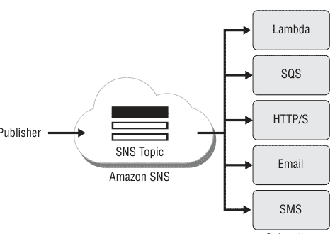

使用 Amazon SNS 时，你创建一个主题并控制发布者和订阅者的访问。权限详情请参阅第三章“安全与 AWS 身份访问管理 (IAM)”。

发布者将消息发送到他们创建或有权发布的主题。发布者不是在每条消息中包含特定的目标地址，而是将消息发送到主题。Amazon SNS 将主题与订阅了该主题的订阅者列表匹配，并将消息传递给这些订阅者中的。每个主题都有一个唯一的名称，标识发布者发布消息和订阅者注册通知的 Amazon SNS 端点。订阅者接收他们订阅的主题发布的所有消息，同一主题的所有订阅者都接收相同的消息。可以通过 Amazon SQS 控制台、AWS CLI、通用 Web 服务 API 以及 AWS SDK 支持的任何编程语言访问该服务。

# Amazon Simple 通知服务

与消息与队列之间呈一对一对应关系的工作队列 SQS 不同，Amazon SNS 在主题与其订阅者之间建立的是一对多的多的关系。

## 移动推送消息

SNS 允许你通过 API 或易于使用的管理控制台向移动设备或分布式服务推送消息。你可以从每天几条消息无缝扩展到每天数百万条甚至更多消息。

通过 SNS，你可以发布消息并进行一次或多次交付。你可以选择将唯一消息直接发送到单个 Apple、Android 或 Amazon 设备，或者通过单个发布请求将消息广播到许多移动设备。

Amazon SNS 允许你使用主题（topics）对接收者进行分组。主题提供了一个“访问点”，允许接收者订阅相同通知的副本。一个主题可以支持向多个端点投递；例如，你可以将 iOS、Android 和 SNS 接收者组合在一起。当你向主题发布消息时，Amazon SNS 会向每个订阅者投送格式正确的消息副本。

## Amazon SNS 扇出场景

在扇出（fan-out）场景中，Amazon SNS 消息被发送到主题，然后复制并推送到多个 Amazon SQS 队列、HTTP 端点或电子邮件地址。这允许进行并行异步处理。例如，你可以开发一种应用程序，每股价发生变化时就向主题发送 Amazon SNS 消息。然后，订阅了该主题的 Amazon SQS 队列将收到关于新股价的相同通知。连接到其中一个队列的 Amazon EC2 服务器实例可以处理数据报告，而另一个服务器实例可以连接到数据仓库进行分析，并对指定时间内的股价进行测试。图 10.4 描述了扇出场景。

## 图 10.4 扇出场景

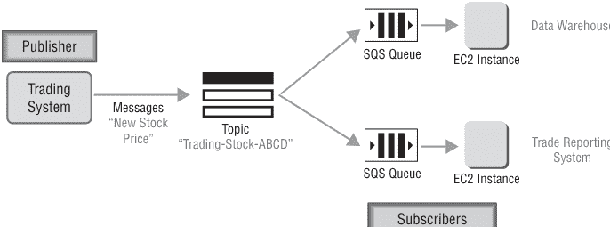

要让 Amazon SNS 将通知投递到 Amazon SQS 队列，开发者应该订阅一个主题，指定“Amazon SQS”作为传输方式，并将有效的 Amazon SQS 队列作为端点。为了让 Amazon SQS 队列能够接收来自 Amazon SNS 的通知，Amazon SQS 所有者必须将 Amazon SQS 队列订阅到 Amazon SNS 的主题。如果用户同时拥有被订阅的 Amazon SNS 主题和接收通知的 Amazon SQS 队列，则无需其他操作。任何发布到主题的消息都将自动投递到指定的 Amazon SQS 队列。如果 Amazon SQS 队列的所有者不是主题的所有者，Amazon SNS 将要求对订阅请求进行显式确认。

## Amazon SNS 的特性

- FIFO 队列保留消息顺序。
- 消息可以在队列中被删除。
- 消息可以包含 256 KB 的文本数据，包括 `XML`、`JSON` 和无格式文本。
- FIFO 和标准队列支持服务器端加密（截至 2017 年）。

## 高可用架构

在第 5 章“网络”中，你学习了 Amazon 虚拟私有云（Amazon VPC）的边界是区域，而区域由可用区（Availability Zones）组成。在第 4 章“计算”中，你学习了 Amazon EC2 实例是如何绑定到可用区的。如果自然灾害导致运行在受影响可用区上的 Amazon EC2 实例失效会发生什么？如果你的应用程序变得火火，承担的流量超过预期该怎么办？你如何继续为用户提供服务？

到目前为止，你已经了解到像 Amazon SNS 和 Amazon SQS 这样的服务是高可用、容错系统，可用于解耦你的应用程序。第 7 章“数据库”引入了 `DynamoDB` 和 `ElastiCache` 作为 NoSQL 数据库。我们现在将所有这些部分组合在一起，以交付一个高可用架构。

图 10.5 展示了一个高可用三层架构（该概念在第 2 章“使用 AWS 云服务”中讨论过）。

## 图 10.5 高可用三层架构

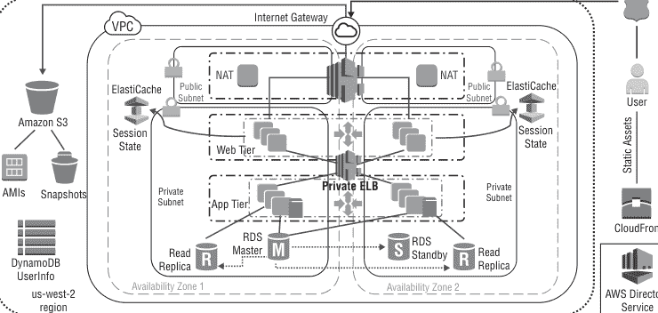

## 网络地址转换 (NAT) 网关

网络地址转换 (NAT) 网关已在第 5 章中介绍过。NAT 服务器允许私有子网的流量遍历互联网或连接到其他 AWS 云服务。单个 NAT 可能是单点故障。NAT 网关是一种托管设备，每个 NAT 网关都在特定的可用区内创建，并在可用区内通过冗余实现。为了实现最佳可用性，请在每个可用区使用 NAT 网关。

> 如果你在多个可用区中有资源，它们将共享一个 NAT 网关。当 NAT 网关所在的可用区宕机时，其他可用区的资源将失去互联网访问。要创建一个独立可用性的架构，请在每个可用区创建一个 NAT 网关，并配置路由以确保资源使用相同可用区内的 NAT 网关。

## 弹性负载均衡

如第 5 章所述，弹性负载均衡有两种类型：应用负载均衡器（Application Load Balancer）和经典负载均衡器（Classic Load Balancer）。弹性负载均衡允许你将应用程序的 Web 层（或前端）与应用层（或后端）解耦。在节点故障期间，弹性负载均衡器将停止向受影响的 Amazon EC2 实例发送流量，保持应用程序可用，尽管其可能处于过时状态。可以使用自动伸缩（Auto Scaling）实现自愈。如需复习弹性负载均衡，请参考第 5 章。

## 自动伸缩

`Auto Scaling` 是一种 Web 服务，根据用户定义的策略、计划和健康检查来启动或终止实例。例如，图 10.6 所示的自动伸缩组显示最小大小为 1，容量为 2，最大大小为 4。自动伸缩策略根据定义的条件调整实例数量。

自动伸缩策略使用策略和警报来确定何时满足启动和终止实例的条件。警报监控特定指标（例如，自动伸缩组中 Amazon EC2 实例的 CPU 利用率）。当指标值超过你定义的阈值时，警报执行一个或多个动作。动作是告诉 `Auto Scaling` 如何响应警报的消息。这些警报定义在 `CloudWatch` 中。

调度动作基于计划，允许你根据可预测的负载变化扩展应用程序。要配置自动伸缩组根据计划进行扩展，你需要创建调度动作。调度动作告诉 `Auto Scaling` 在未来的某个时间执行伸缩操作。在创建调度动作时，你指定调度动作生效的时间，以及你希望该组的最小、最大和期望大小。在指定时间，`Auto Scaling` 将更新组以设置由调度动作指定的值。

## 图 10.6 自动伸缩组

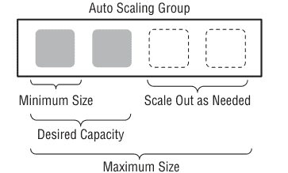

## 自动伸缩组件

- 启动配置
- 组
- 伸缩策略（可选）
- 调度动作（可选）

## 高可用架构

启动配置定义了 `Auto Scaling` 如何启动 `EC2` 实例。`Auto Scaling` 提供了一个选项，可以使用现有实例的属性创建启动配置。当你使用此选项时，`Auto Scaling` 将属性复制到模板中，并从中启动一个或多个组。

自动伸缩组 你的伸缩组使用启动配置来启动 `EC2` 实例。你通过提供有关镜像的信息来创建启动配置。

### 会话状态管理

为了扩展或缩小，你的应用程序需要是无状态的。考虑将会话信息存储在实例之外。`Amazon DynamoDB` 或 `Amazon ElastiCache` 可用于会话状态管理。有关 `Amazon ElastiCache` 和 `Amazon DynamoDB` 的更多信息，请参考第 7 章。

## Amazon EC2 Auto Recovery

`Auto Recovery` 是 Amazon EC2 的一项功能，旨在增加实例可用性。它允许在检测到系统故障时自动恢复支持的实例。

# 456 第 10 章 ■ 高可用性

要使用自动恢复（`Auto Recovery`），请创建一个 `Amazon CloudWatch` 警报来监控 Amazon EC2。如果实例由于底层硬件故障或需要 AWS 介入修复的问题而导致受损，将自动恢复该实例。已终止（Terminated）的实例无法恢复。恢复后的实例与原始实例相同，包括实例 ID、私有 IP 地址、弹性 IP 地址以及所有实例元数据。

当 `StatusCheckFailed` 警报触发并启动恢复时，您将通过在创建警报并关联恢复操作时选择的 Amazon SNS 主题收到通知。在实例恢复期间，实例将在重启时进行迁移，任何内存中的数据都会丢失。当进程完成后，信息将发布到您为警报配置的此 Amazon SNS 主题中。任何订阅了此 SNS 主题的用户都将收到一封电子邮件通知，其中包含恢复尝试的状态和任何进一步说明。您将会在恢复的实例上看到重启。

导致系统状态检查失败的问题示例包括：

- 网络连接断开
- 系统电源丢失
- 物理主机上的软件问题
- 影响网络可达性的物理主机硬件问题

当实例因底层硬件故障而被 AWS 计划停止或退役时，也可以触发恢复操作。

> 注意 恢复操作仅支持具有以下特征的实例：
>
> - C3、C4、M3、R3、R4、T2 或 X1 实例类型
> - 仅限 Amazon VPC（不支持 Amazon EC2-Classic）
> - 共享租户模式（`tenancy` 属性设置为默认）
> - 仅限 Amazon EBS 卷（不要配置实例存储卷）

如果您有公网 IPv4 地址，恢复后将保留该公网 IPv4 地址。

## 扩展您的 Amazon Relational Database Service 

在第 7 章中，我们介绍了如何通过在多个可用区（Availability Zones）部署 Amazon Relational Database Service (Amazon RDS) 来实现数据库的高可用性。您还可以使用读取副本（Read Replicas）水平扩展您的数据库，以提高读密集型数据库的性能。

# 多区域高可用性

Amazon RDS MySQL、PostgreSQL 和 Maria DB 可以拥有最多 5 个副本，而 Amazon Aurora 可以拥有最多 15 个副本。您还可以将读取副本放置在靠近用户的不同 AWS 区域，以获得更好的性能。此外，您可以使用读取副本通过将读取副本提升为主主，以便在灾难发生时更快恢复，从而提高数据库的可用性。读取副本并不是高可用自动故障转移能力的替代品。

# 多区域高可用性

除了在单区域构建高可用应用外，多区域高可用性可能需要容错。这可以通过在另一个区域部署并使用 Route 53 来实现。

# Amazon Simple Storage

如果您需要保持 Amazon Storage Service (S3) 的高可用，可以使用跨区域复制（cross-region replication）。跨区域复制允许在不同的桶之间自动复制数据。关于 S3 跨区域复制的更多信息请参见第 6 章。

# Amazon DynamoDB

Amazon DynamoDB 使用来同步数据。一个区域的 DynamoDB 修改数据，另一个区域的 DynamoDB 读取这些修改。

# Amazon Route 53

当您有多个相同功能的资源（例如，多个 HTTP/S 服务器）时，可以配置 Route 53 检查健康状况并响应 DNS 查询。假设您的 Example.com 托管在多个区域，您可以配置 Route 53 检查这些服务器的健康状况。为了让这些故障转移配置工作，需要配置健康检查。

有三种类型的健康检查：监控端点的健康检查、监控 CloudWatch 警报的健康检查以及监控其他健康检查的健康检查。

后续章节将讨论简单和复杂的故障转移配置。

# 故障转移的健康检查

两个相同功能的简单故障转移配置可以从从中受益。例如，您可能有多个运行 Example.com 的 EC2 服务器。在 Route 53 中，您创建一个记录组，例如权重记录集。只要所有资源都是健康的，Route 53 就会进行响应。当资源变得不健康时，Route 53 只使用健康的资源。

以下是配置 Route 53 检查资源健康的步骤：

# 多区域高可用性

## 配置 Amazon Route 53 检查资源健康

1. 识别要让 Route 53 监控的资源。例如，您可能想监控所有 HTTP 服务器。
2. 为 IP 地址和端口创建健康检查。
3. 您可能需要配置防火墙规则，以便 Amazon Route 53 向您指定的终端发送定期请求。
4. 为您的资源创建记录组（例如，类型均为 A 的权重记录集）。将您第 2 步中创建的健康检查与相应的记录集关联。
5. Amazon Route 53 定期向您创建健康检查时指定的每个终端发送请求；它不会在接收 DNS 查询时执行健康检查。根据响应，Amazon Route 53 判断终端是否健康，并使用信息决定如何响应。
6. 当 Amazon Route 53 接收到 Example.com 的查询时：
   1. Amazon Route 53 根据路由策略选择资源记录集。在这种情况下，它根据权重选择资源记录集。
   2. 它通过检查该资源记录集的健康检查状态，来确定所选资源记录集的当前健康状况。
   3. 如果所选的资源记录集不健康，它将重复基于路由策略选择资源记录集的过程。这一次，将不再考虑该不健康的资源记录集。
   4. 它使用所选健康资源记录集响应查询。

下面的示例显示了一组加权资源记录集，其中第三个资源记录集是不健康的。起初，Amazon Route 53 根据所有三个资源记录集的权重选择一个资源记录集。如果第一次恰好选了不健康的资源记录集，Amazon Route 53 将选择另一个资源记录集，但这一次在计算中将跳过第三个资源记录集。请参见图 10.7 关于不健康健康检查的示例。

- Amazon Route 53 最初从所有三个资源记录集中进行选择，它大约有 20% 的时间使用第一个资源记录集响应请求：`10/(10 + 20)`。
- 当 Amazon Route 53 确定第三个资源记录集不健康时，它大约有 33% 的时间使用第一个资源记录集响应请求：`10/(10 + 20)`。

## 图 10.7 不健康的健康检查

| 加权资源记录集 | 加权资源记录集 | 加权资源记录集 |
| --- | --- | --- |
| 名称: example.com | 名称: example.com | 名称: example.com |
| 类型: A | 类型: A | **不健康** |
| 值: 192.0.2.1 | 值: 192.0.2.12 | 值: 192.0.2.13 |
| 权重: 10 | 权重: 20 | 权重: 20 |
| HTTP 健康检查 | HTTP 健康检查 | HTTP 健康检查 |
| ID: abcd-1111 | ID: abcd-2222 | ID: abcd-3333 |
| IP 地址: 192.0.2.1 | IP 地址: 192.0.2.12 | IP 地址: 192.0.2.13 |
| 端口: 80 | 端口: 80 | 端口: 80 |

失败

如果你在一组资源记录集中的一个或多个资源记录集提供了健康检查，Amazon Route 53 将这些资源记录集视为健康。在没有分配健康检查的情况下，Amazon Route 53 没有依据判断相应的健康状况，并可能会选择资源不健康的资源记录集。更多信息请参见图 10.8。

## 图 10.8 未启用健康检查

| 加权资源集: | 加权资源集: | 加权资源集: |
|---|---|---|
| 名称: example.com | 名称: example.com | 名称: example.com |
| 类型: A | 类型: A | 类型: A |
| 值: 192.0.2.11 | 值: 192.0.2.12 | 值: 192.0.2.13 |
| 权重: 10 | 权重: 20 | 权重: 20 |
| HTTP 检查: | HTTP 检查: | 无健康检查：始终视为健康 |
| ID: abcd-1111 | ID: abcd-2222 | |
| IP 地址: 192.0.2.11 | IP 地址: 192.0.2.12 | |
| 端口: 80 | 端口: 80 | |

## 复杂故障的健康检查

在复杂配置中检查资源的方法与简单配置中的相同。然而，在复杂配置中，你使用别名资源集（包括加权别名、延迟别名和故障转移别名）与非别名资源集的组合来构建决策树，从而让你更灵活地控制 Amazon Route 53 如何响应请求。


例如，使用延迟别名资源集为用户选择一个区域，并在每个区域内为两个或多个资源使用加权资源集，以防止单个端点或可用区的故障。图 10.9 显示了此配置。

## 图 10.9 复杂故障的健康检查

| 延迟别名资源集 | 延迟别名资源集 |
|---|---|
| 名称: `example.com` | 名称: `example.com` |
| 类型: `A` | 类型: `A` |
| 区域: `us-east-1` | 区域: `ap-southeast-2` |
| 设置 ID: `1` | 设置 ID: `2` |
| 评估目标: 是 | 评估目标: 是 |

| 加权资源集 | 加权资源集 | 加权资源集 | 加权资源集 |
|---|---|---|---|
| 名称: `us-east-1` | 名称: `us-east-1` | 名称: `ap-southeast-2` | 名称: `ap-southeast-2` |
| 类型: `A` | 类型: `A` | 类型: `A` | 类型: `A` |
| 值: `192.0.2.11` | 值: `192.0.2.12` | 值: `192.0.2.13` | 值: `192.0.2.14` |
| 设置 ID: `1` | 设置 ID: `2` | 设置 ID: `1` | 设置 ID: `2` |
| 权重: `10` | 权重: `20` | 权重: `15` | 权重: `20` |

| HTTP 检查 | HTTP 检查 | HTTP 检查 |
|---|---|---|
| ID: `abcd-1111` | ID: `abcd-2222` | ID: `abcd-3333` |
| IP 地址: `192.0.2.1` | IP 地址: `192.0.2.12` | IP 地址: `192.0.2.13` |
| 端口: `80` | 端口: `80` | 端口: `80` |

Amazon Route 53 最初从所有三个资源记录集中进行选择，它大约有 20% 的时间使用第一个资源记录集响应请求：`10/(10 + 20)`。

当 Amazon Route 53 确定第三个资源记录集不健康时，它大约有 33% 的时间使用第一个资源记录集响应请求：`10/(10 + 20)`。

如果你在一组资源记录集中的一个或多个资源记录集提供了健康检查，Amazon Route 53 将这些资源记录集视为健康。在没有分配健康检查的情况下，Amazon Route 53 没有依据判断相应的健康状况，并可能会选择资源不健康的资源记录集。更多信息请参见图 10.8。

## 464 第 10 章 高可用性

来自路由器（也称为`客户网关`）的 VPN 连接足以建立到 Amazon VPC 的远程连接，但这并不是一种高可用配置。

使 VPN 连接高可用的最佳实践是使用冗余路由器（客户网关）和动态路由，以便在 AWS 和客户 VPN 端点之间实现自动故障转移。图 10.11 将每个 VPN 连接（由连接到 `BGW` 端点的两个 `IPsec` 隧道组成）显示为单线。参见图 10.11 以获取示例的主/活动 VPN 连接。

### 图 10.11 冗余主/活动 VPN 连接

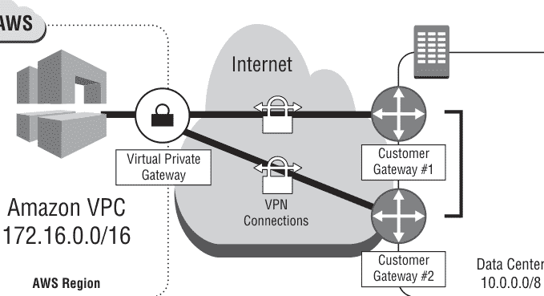

### 配置详情

图 10.11 中的配置由 `BGW` 端点与两个客户网关之间的四个全网状、动态路由的 `IPsec` 隧道组成。AWS 为许多支持的 VPC 设备提供了配置模板，以帮助建立这些 `IPsec` 隧道并配置用于动态路由的边界网关协议 (`BGP`)。

除了 AWS 提供的 VPN 和 `BGP` 配置详情外，客户必须配置 Amazon VPC 将流量高效路由到其数据中心网络。在图 10.11 的示例中，`BGW` 将通过客户网关 1 将 `10.0.0.0/16` 流量发送到数据中心 1，只有当到数据中心 1 的连接断开，才会通过数据中心 2 路由此流量。同样，`10.1.0.0/16` 流量将影响源自数据中心 2 的 VPN 连接。

此配置依赖互联网在本地网络和 Amazon VPC 之间传输流量。尽管 AWS 利用了多个互联网服务提供商 (`ISP`)，而且由于 `ISP` 和互联网路由之间的相互依赖性，互联网服务中断可能会影响 VPN 网络连接的可用性。控制流量精确路径的唯一方法是通过 AWS Direct Connect 提供私有网络连接。

## 冗余主/活动 AWS Direct Connect 连接

如果您需要在 AWS 与您的数据中心、办公室或托管环境之间建立私有连接，请使用 AWS Direct Connect。有关 AWS Direct Connect 的更多信息请参见第 5 章。

AWS Direct Connect 在一个 AWS Direct Connect 地点使用专用的物理连接。因此，为了使 AWS Direct Connect 高可用，请考虑实现动态路由的 AWS Direct Connect 连接。具有最高可用级别的架构利用不同的 AWS Direct Connect 合作伙伴来确保网络提供商冗余。请参考图 10.12 的 AWS Direct Connect 连接插图，它由一个包含逻辑连接的物理连接显示为一条直线。

**图 10.12** 具有冗余连接的 AWS Direct Connect

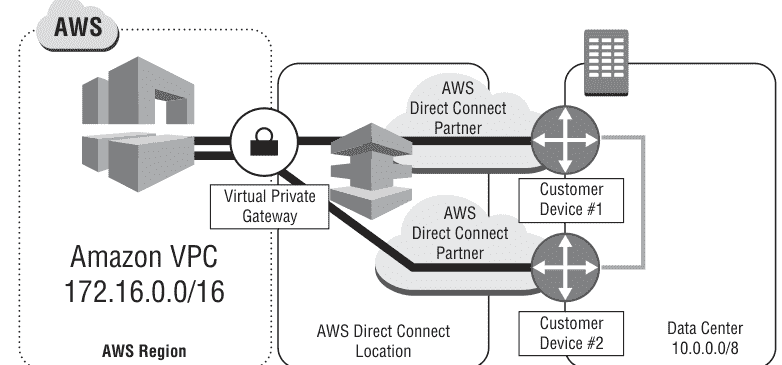

### 配置详情

图 10.12 所示的配置包括从两个独立配置的客户设备到两个位置 AWS Direct Connect 路由器的 AWS Direct Connect 连接。AWS 提供了示例路由器配置，以帮助建立 AWS Direct Connect 连接并配置用于动态路由的 `BGP`。

除了 AWS 提供的配置详情外，您还必须配置 Amazon VPC 将流量路由到数据中心网络。在示例 10.12 中，`VGW` 将优选地将 `10.0.0.0/16` 流量发送到数据中心 1，并在到客户设备 1 的连接断开时将流量重路由到数据中心 2。同样，`10.1.0.0/16` 流量将优选来自数据中心 2 的 AWS Direct Connect 连接。

AWS Direct Connect 允许您创建到 AWS 的弹性连接，因为您对远程网络与 AWS 之间的网络路径和网络提供商具有完全控制权。

## 带有备份 VPN 连接的 AWS Direct Connect

某些 AWS 客户希望将一个或多个 AWS Direct Connect 连接作为主连接，并一个低成本的备份连接。为了实现这一目标，他们可以建立带有 VPN 备份的 AWS Direct Connect 连接，如图 10.13 所示。

图 10.13 带有备份 VPN 连接的 AWS Direct Connect

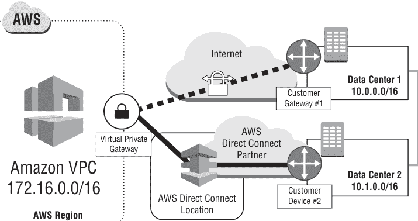

### 配置详情

图 10.13 所示的配置包含两个动态路由连接——一个使用 AWS Direct Connect，另一个使用来自两个不同客户网关的 VPN 连接。AWS 提供了示例路由配置，以帮助建立带有 `BGP` 动态路由的 AWS Direct Connect 和 VPN 连接。默认情况下，AWS 始终会优选通过 AWS Direct Connect 连接发送流量，因此不需要额外配置来定义主备用连接。在图 10.13 的示例中，客户网关 1 (`VPN`) 和客户设备 2 (`AWS Direct Connect`) 都会通告 `10.0.0.0/16` 的汇总路由。只要网络路径可用，AWS 将将所有流量发送到客户设备 2。

尽管 `BGP` 默认优选 AWS Direct Connect 而非 VPN 连接，但您仍然有通过发布更具体的（或静态）路由来影响 AWS 路由决策的能力。例如，如果您想为部分流量利用备份 VPN 连接（例如，开发人员流量与客户流量），您可以从客户网关 1 发布特定路由。有关路由偏好的更多信息，请参见第 5 章。

## 灾难恢复

灾难恢复 (`DR`) 关于准备从灾难中恢复。任何对公司业务连续性或财务产生负面影响的事件都可以被称为灾难。这包括硬件或软件故障、网络中断、停电、火灾或洪水等建筑物理损坏，或其他其他重大事件。

灾难恢复规划的投资金额取决于潜在中断的成本。具有传统环境的公司通常会复制其基础设施，以确保在灾难发生时空间可用。基础设施需要采购、安装和维护，以便准备支持预期的容量。在正常运行期间，基础设施通常处于利用不足或过度配置的状态。通过 Amazon Web Services (`AWS`)，您可以根据需要扩展其基础设施并按需付费。您可以访问与 Amazon 运行其全球网站网络时相同的高度、可靠且快速的基础设施。AWS 还赋予您在灾难事件期间更改和优化资源的灵活性，这可以节省成本。

- **恢复时间目标 (`RTO`)** 这代表从中断后将业务流程恢复到服务水平（由操作水平协议 `OLA` 定义）所需的时间。例如，如果下午 12:00 发生灾难且 `RTO` 为八小时，则灾难恢复过程应在晚上 8:00 前将业务流程恢复到可接受的服务水平。

- **恢复点目标 (`RPO`)** 这是以时间衡量的接受数据丢失量。例如，如果下午 12:00 发生灾难且 `RPO` 为一小时，则系统应恢复到 11:00 之前系统中的所有数据。数据丢失将跨越上午 11:00 到下午 12:00。

公司通常根据系统不可用时对业务的财务影响来决定可接受的 `RTO` 和 `RPO`。公司通过考虑停机导致的业务损失和声誉损害来确定财务影响。

IT 组织根据 `RPO` 的范围，在 `RTO` 建立的时间范围内规划具有成本效益的系统恢复方案。

在本章的最后部分中，我们将讨论 Amazon Web Services 上的各种灾难恢复场景。

### 备份与恢复方法

在大多数传统环境中，数据被备份到 long time to restore your system in the event of a 如果你使用这种方法，可能会花费 a long time to restore your system in the event of a

## 第 10 章 高可用性

中断或灾难。Amazon S3 是可能需要快速恢复的备份数据的理想存储地。在 Amazon S3 之间传输数据通常通过网络完成，因此可以从任何位置访问。许多商业和开源备份解决方案都可以与 Amazon S3 集成。您可以使用 `AWS Import/Export Snow` 通过直接向 AWS 发送存储设备来传输大数据集。对于检索时间允许几小时的长期数据存储，Amazon Glacier 具有与 Amazon S3 相同的性模型。Amazon Glacier 是 Amazon S3 的低成本替代方案。可以结合 Amazon Glacier 和 Amazon S3 构建分层备份解决方案。

AWS Storage Gateway 允许将您的本地卷快照复制到 Amazon S3 进行备份。您可以从这些快照创建本地卷或 EBS 卷。存储缓存卷允许您将数据存储在 Amazon S3 中以便低延迟访问。通过 AWS Storage Gateway，您可以缓存数据卷以提供高持久性的备份。在发生容灾恢复（`DR`）时，您可以将缓存恢复到运行特定存储网关的辅助站点，或者恢复到 Amazon EC2。

你可以将 AWS Storage Gateway 的 `gateway-VTL`（虚拟带库）配置作为您的备份管理软件的备份目标。这可以替代传统的原生备份。对于在 AWS 上运行系统，您也可以选择 Amazon S3。EBS 卷、Amazon RDS 数据库和 Amazon Redshift 数据仓库的快照可以存储在 Amazon S3 中。或者，您可以直接将文件复制到 Amazon S3，也可以选择创建备份文件并将其到 Amazon S3。有很多备份解决方案将数据直接存储在 Amazon S3 中，这些解决方案也可以用于 Amazon EC2 系统。

### 灾难恢复备份恢复方法的关键步骤

1. 选择适当的工具或方法将数据备份到 AWS。

2. 确保您已制定适当的留存策略。

3. 确保对这些数据采取了适当的安全措施，包括数据加密和适当的数据访问策略。

4. 定期测试数据恢复，最重要的是系统恢复。

### 点火器法（Pilot Light Method）

`点火器`（`pilot light`）一术语通常用于创建一种容灾场景，在这种情况下，环境的最小版本始终在 AWS 中运行。点火器的概念类比天然气加热器。在天然气加热器中，一个小火焰或点火器始终开启，以便快速点燃炉炉来加热房屋。

这种场景类似于备份和恢复场景。例如，通过 AWS，您可以通过在 AWS 中配置和运行系统最关键的核心元素来维护一个点火器。当需要恢复的时间到来时，您可以在关键核心周围快速部署一个全规模的生产环境。点火器本身的基础设施元素通常包括您的数据库服务器，这些服务器会将数据复制到 Amazon EC2 或 Amazon RDS。

根据系统的不同，数据库之外可能还有其他需要复制到 AWS 的关键数据。这是系统的关键核心（点火器），AWS 中的所有其他基础设施部分（炉炉的其余部分）都可以围绕它快速恢复到完整系统。

### 准备阶段

与“备份-恢复”阶段不同，点火器法要求在灾难发生之前进行一些前期的配置和部署。

灾难恢复点火器法的关键准备步骤：

1. 建立 Amazon EC2 实例以复制或镜像化数据。

2. 确保在 AWS 中备齐了所有支持的自定义软件包包。

3. 为需要快速恢复的关键服务器创建并维护 Amazon 映像 (`AMI`)。

4. 定期运行这些服务器，对其进行测试，并应用任何软件更新和更改。

5. 自动化 AWS 资源的供应。

### 恢复阶段

要恢复点火器周围的其余环境，您可以在相应的实例类型上几分钟内通过 Amazon 映像 (`AMI`) 启动系统。对于您的动态数据服务器，可以调整其大小以处理所需的生产负载，或相应增加容量。水平扩展通常是为系统增加容量的具成本效益且可扩展的方法。例如，您可以在高峰时段添加更多 Web 服务器。您还可以选择更大的 Amazon EC2 实例类型，并对关系数据库等应用程序进行垂直扩展。从网络角度来看，任何所需的 `DNS` 更新都可以并行完成。

恢复后，您应该尽快恢复冗余。您的生产环境故障后不久，`DR` 环境发生故障是不可能的；但必须做好准备。继续对您的系统进行定期备份，并考虑在数据层增加冗余。记住，您的 `DR` 环境现在就是您的生产环境。

### 灾难恢复点火器法的关键恢复步骤

1. 从您的自定义 `AMI` 启动 Amazon EC2 实例。

2. 调整现有的数据库/存储实例大小以处理增加的流量。

3. 添加额外的数据库/存储实例以获得数据层的 `DR` 韧性；如果您使用 Amazon RDS，请开启多可用区（`Multi-AZ`）以提高韧性。

4. 更改 `DNS` 指向 Amazon EC2 服务器。

5. 安装并配置任何非 `AMI` 系统，理想情况下以自动化方式进行。

### 热备法（Warm-Standby Method）

`热备`（`warm-standby`）术语用于描述一种容灾场景，在这种情况下，全功能环境的缩小版本始终在云中运行。热备方案扩展了点火器的元素和准备工作。由于某些服务始终运行，它进一步缩短了恢复时间。通过识别您的业务关键系统，您在 AWS 上完全复制这些系统并让它们始终开启状态。

这些服务器可以运行在最小规模的 Amazon EC2 实例组上，尺寸尽可能小。这种解决方案尚未扩展到处理全生产负载；但它是功能完备的。灾难发生时，系统将扩展以处理生产负载。在 AWS 中，可以通过向负载均衡器添加更多实例以及调整较大的 Amazon EC2 实例类型容量来实现。

### 准备阶段

与灾难恢复的点火器法一样，热备法在灾难发生之前需要一些前期的部署和准备。

灾难恢复热备方案的关键准备步骤：

1. 建立 Amazon EC2 实例以复制或镜像化数据。

2. 创建并维护 `AMI`。

3. 使用最小 `footprint`的 Amazon EC2 实例或 AWS 基础设施运行您的应用程序。

4. 与您的现场环境同步补丁和更新配置文件。

### 恢复阶段

在生产系统故障的情况下，热备环境将扩展以处理生产负载，并更改 `DNS` 记录将所有流量路由到 AWS。

灾难恢复热备法的关键恢复步骤：

1. 增加用于负载均衡器的 Amazon EC2 实例组的大小。

2. 根据需要在较大的 Amazon EC2 实例类型上启动应用程序。

3. 手动更改 `DNS` 记录或使用 Amazon Route 53 自动健康检查，以便将所有流量路由到 AWS 环境。

4. 使用自动扩展（`Auto Scaling`）调整实例大小以适应增加的负载。

5. 扩展您的数据库（如果需要）。

### 灾难恢复

您应该使用支持加权路由的 `DNS` 服务（例如 Amazon Route 53），将生产环境流量路由到交付相同应用程序或服务的不同站点。部分流量将流向您在 AWS 中的基础设施，其余部分将流向您的本地基础设施。

在发生实地灾难情况时，您可以调整 `DNS` 权重并将所有流量发送到 AWS 服务器。AWS 服务的容量可以快速扩展以处理全部的生产负载。您可以使用 Amazon EC2 自动伸缩来自动实现这一过程。

您可能需要一些应用程序逻辑来检测主数据库服务的故障，并切换到在 AWS 中运行的并行数据库。这种场景的成本取决于正常运行期间 AWS 处理了多少生产环境流量。

在恢复阶段，您仅需为灾难恢复（`DR`）环境需要全规模运行期间的实际使用量付费。您可以通过为您的“常开”服务器购买 Amazon EC2 预留实例来进一步降低成本。请参阅章节中的 Amazon EC2 购买选项。

### 准备阶段

在多站点灾难恢复解决方案中，另一个站点必须是您当前生产站点的副本，它将承担一半的生产环境流量。

### 多站点灾难恢复方法的关键准备步骤

1. 建立您的 AWS 环境以复制您的生产环境。

2. 设置 `DNS` 权重或类似的流量路由技术，将传入的请求分发到两个站点。

3. 配置自动故障转移，将流量从受影响的站点重新路由。

### 恢复阶段

当可用站点发生故障转移时，需要更改 `DNS` 记录以将所有流量指向可用的生产站点。

### 多站点灾难恢复方法的关键恢复步骤

1. 通过手动或使用 `DNS` 故障转移，更改 `DNS` 权重，使所有请求发送到 AWS 站点。

2. 让应用程序逻辑使用本地 AWS 数据库服务器进行所有查询。


3. 考虑使用自动伸缩自动调整 AWS 实例群的大小。通过设计多可用区（Multi-AZ）架构，您可以进一步增加多站点解决方案的可用性。

# 从灾难回滚

一旦主站点恢复到工作状态，您将需要恢复正常服务，这通常被称为“回滚”（fail back）。根据您的 DR 策略，这通常意味着反转数据复制流，主站点宕机期间接收到的任何数据更新都能同步回，且不会丢失数据。让我们从各种故障转移方法来讨论回滚。

# 备份与恢复方法的回滚

要从灾难恢复站点回滚到现已工作的生产站点，您需要遵循以下步骤：

### 灾难恢复备份与恢复方法的关键步骤

- 1. 冻结 DR 站点的数据更改。
- 2. 制作备份。
- 3. 将备份恢复到主站点。
- 4. 将用户重新指向主站点。
- 5. 解冻更改。

# 光源模型、热备用和多站点方法的回滚

使用光源模型（Pilot Light）、热备用（Warm-Standby）和多站点方法从灾难恢复站点进行回滚，使用的是相同的方法来向原生产站点恢复服务。

### 灾难恢复光源模型、热备用和多站点方法的回滚

- 1. 在主站点同步更改后，建立从 DR 站点到主站点的反向镜像/复制。
- 2. 冻结 DR 站点的数据更改。
- 3. 将用户重新指向主站点。
- 4. 解冻更改。

## 总结

在本章中，我们讨论了如何解耦应用程序以实现扩展性和高可用性。讨论的技术包括使用 `Amazon SQS` 和 `Amazon SNS` 将应用程序的前端与后端解耦，从而减少它们之间的相互依赖关系（例如，它们可以独立扩展）。如 `Amazon S3` 和 `Amazon DynamoDB` 等区域级应用程序可以将其数据复制到其他区域，以提供区域高可用解决方案。在构建系统时，使用固有的容错 `AWS` 托管服务是最佳实践。对于无法利用托管服务的负载，则取决于您如何使其具有高可用。`AWS` 提供了组件——您只需将它们组合在一起即可交付高可用或容错的系统。最后，针对使用各种 `DR` 故障转移场景和每种故障转移方法的回滚方法的灾难和恢复计划。

# 复习资源

- `Amazon Simple Queue Service`: <https://aws.amazon.com/sqs/>
- `Amazon Simple Notification Service`: <https://aws.amazon.com/sns/>
- `Amazon DynamoDB` 跨区域复制: <http://docs.aws.amazon.com/amazynamodb/latest/developerguide/Streams.CrossRegion.html>
- `AWS` 上的灾难恢复: <https://d3c629buwruutt.cloudfront.net/AWS_Disaster_Recovery.pdf>
- `AWS` 上的容错与高可用: <https://media.amazon.webservices.com/architecturecenter/AWS_ac_ra_fha_04.pdf>

## 考试要点

理解 `Amazon SQS` 轮询。`Amazon SQS` 默认使用短轮询，仅查询部分服务器（根据加权随机分布）以确定是否有消息包含在响应中。长轮询通过查询所有（而非有限数量的）服务器来消除空响应。

理解可见性超时（`visibility timeout`）及其应用场景。在接收到消息后，它留在队列中。为了防止其他消费者再次处理该消息，`Amazon SQS` 设置了可见性超时，在此期间内，`SQS` 防止其他消费者接收和处理该消息。

理解 `Amazon SQS` 标准队列的消息顺序。标准队列提供松散的 `FIFO`（先入先出）能力。

在本章中，我们讨论了如何解耦应用程序以实现扩展性和高可用性。讨论的技术包括使用 `Amazon SQS` 和 `Amazon SNS` 将应用程序的前端与后端解耦，从而减少它们之间的相互依赖关系（例如，它们可以独立扩展）。如 `Amazon S3` 和 `Amazon DynamoDB` 等区域级应用程序可以将其数据复制到其他区域，以提供区域高可用解决方案。在构建系统时，使用固有的 `AWS` 托管服务是最佳实践。对于无法利用托管服务的负载，则取决于您如何使其高可用。`AWS` 提供了组件——您只需将它们组合在一起即可交付高可用或容错的系统。最后，针对使用各种 `DR` 故障转移场景和每种故障转移方法的回滚方法的灾难和恢复计划。

# 第10 章 高可用性

理解 `Route 53` 健康检查的工作原理。了解检查类型以及如何针对指标设置告警。

了解如何设置高可用 `VPN`。虚拟私网网关（`VPG`）支持双隧道。大多数路由器可以在主备模式下工作。

理解如何使 `AWS Direct Connect` 高可用。要使 `AWS Direct Connect` 高可用，请部署 `Direct Connect`。

理解如何将 `VPN` 作为 `Direct Connect` 的备份。如果您无法部署 `Direct Connect` 或对可用性有额外要求，请保留现有的 `VPN` 作为备份。

了解 `AWS` 提供的各种灾难恢复方法。故障故障转移类型包括备份/恢复、光源模型、热备用和多站点。了解如何故障转移以及回滚。

# 技巧

准备好测试中心！带上两种政府颁发的身份证（包含照片）。带上确认函。将所有电脑、可穿戴设备等留在家里。您不想因为物理问题错过考试。

# 练习

到目前您应该已经建立了 `AWS` 账户。如果还没有，现在是设置的时候。请注意，这些练习是在您的 账户中进行的，因此不是免费的。

启动资源时使用免费层。`Amazon` 免费层适用于参与的 `AWS` 区域：美国东部（弗吉尼亚北部）、美国西部（俄勒冈）、美国西部（加州）、加拿大（中部）、欧洲（伦敦）、欧洲（爱尔兰）、欧洲（法兰克福）、亚洲（新加坡）、亚洲（东京）、悉尼和南方（圣保罗）。更多信息请见 <https://aws.amazon.com/dn/optaton/server-side-test/free-tier/>

尚未安装 `AWS` 命令行工具，请参考第 2 章练习 2.1（`Linux`）或练习 2.2（`Windows`）。

`AWS CLI` 的参考可以在此处找到：`docs.aws.amazon.com/cli/latest/reference/`

这些练习将引导您完成一些高可用场景，并让您研究“如何操作”以完成练习。通过查找如何执行

通过完成特定任务，你将走上掌握该任务之路。本指南的目标不仅仅是帮助你准备 `AWS` 认证 `SysOps` 管理员 – 助理考试，它旨在成为你作为 `AWS` 认证 `SysOps` 管理员日常工作中的参考伙伴。

## 练习 10.1

### 创建 `Amazon SNS` 主题。

在此练习中，你将创建一个 `Amazon SNS` 消息。

- 1. 登录 `AWS` 管理控制台。
- 2. 导航到 `Messaging`（消息），然后到 `Amazon SNS`，加载 `Amazon SNS` 仪表板。
- 3. 创建一个新主题。主题名称和显示名称都使用 `MyTopic`。
- 4. 注意到 `ARN` 是自动分配的。

你刚刚创建了第一个 `Amazon SNS` 主题。

## 练习 10.2

### 为你的主题创建订阅。

在此练习中，你将使用你的电子邮件地址为主题创建订阅，然后你将确认你的电子邮件地址。

- 1. 在 `AWS` 管理控制台的 `Amazon SNS` 仪表板中，导航到 `Topics`（主题）。
- 2. 选择你刚刚创建的主题。将订阅协议更改为 `Email`（电子邮件），并输入你的电子邮件地址。
- 3. 创建订阅。
- 4. 你将收到一封来自 `Amazon Simple Notification Service (Amazon SNS)` 的邮件。在继续之前，你必须打开它并确认你的电子邮件地址。

你刚刚为你的主题创建了订阅。

## 练习 10.3

### 向你的主题发布消息。

在此练习中，你将向你的主题发布消息。

- 1. 在 `AWS` 管理控制台的 `Amazon SNS` 仪表板中，导航到 `Topics`（主题）。
- 2. 导航到你的主题（选择 `Publish to Topic`，发布到主题）。

### 练习 10.3（继续）

- 3. 使用 `Test Message` 更新主题。将消息格式保留为 `Raw`（原始），并将生存时间 (`TTL`) 固定为 300。在消息中，输入 `This is a test, only a test.`
- 4. 发布消息。

检查你的电子邮件，你应该已经收到了 `Amazon Simple Notification (Amazon SNS)` 消息。在完成练习 10.4 和 10.5 之前，不要删除此主题。

## 练习 10.4

### 创建 `Amazon Simple Queue Service (Amazon SQS)`。

在此练习中，你将创建一个 `Amazon Simple Queue Service (Amazon SQS)`。

- 1. 登录 `AWS` 管理控制台。
- 2. 导航到 `Messaging`，然后到 `Amazon Simple Queue Service`，加载 `Amazon SQS` 仪表板。
- 3. 创建一个新队列，默认可见性超时设置为 30 秒，消息保留期设置为 1 天。将最小消息大小保持为 256 KB，其余设置保持默认值。然后创建队列。

你现在应该有一个名为 `Input` 的队列。

## 练习 10.5

### 将队列订阅到你的 `Amazon SNS` 主题。

现在你将订阅练习 10.1 中的 `MyTopic`。

- 1. 在 `AWS` 管理控制台中，导航到 `Messaging` 然后到 `Amazon Simple Queue Service`。
- 2. 选择你的输入队列（`input`），并订阅到你的 `MyTopic` `Amazon SNS` 主题。
- 3. 返回 `Amazon SNS` 仪表板，选择 `Topics`（主题）。
- 4. 发布到 `Topic`（主题），并选择默认设置。
- 5. 导航到 `Amazon SQS` 仪表板。
- 6. 你会在输入队列中注意到一条消息（如果你开启了电子邮件通知，屏幕上应该弹出一个邮件）。
- 7. 选择输入队列，选择 `Actions`（操作）并 `poll the queue`（轮询队列）。
- 8. 选择 `more details`（更多详细）查看消息。滚动查看正文并注意不同的字段。
- 9. 删除消息、删除队列，然后删除你的 `Amazon SNS` 主题。

## 练习 10.6

### 在多可用区（Multi-AZ）配置中部署 `Amazon RDS`。

在此练习中，你将在多可用区配置创建一个 `Amazon Relational Database Service (Amazon RDS)` `MySQL` 数据库并模拟故障转移。

- 1. 登录 `AWS` 管理控制台，导航到 `Amazon RDS` 控制台。
- 2. 启动一个新的 `RDS` 实例，选择 `MySQL` 作为数据库类型并选择 `Production MySQL Multi-AZ Deployment`（生产环境 `MySQL` 多可用区部署）。
- 3. 在 `Instances Specifications`（实例规格）仪表板中，将存储类型更改为 `General Purpose SSD`（通用 `SSD`）。将分配的存储更改为 100 GB。
- 4. 在 `Settings`（设置）中，`DB Instance Identifier`（数据库实例标识符）= `certbook`，`master username`（主用户名）= `admin`，`password` = `password`。在生产环境中使用复杂的名称和密码。
- 5. 创建名为 `certbookdb` 的新安全组，`database name`（数据库名称）= `certbookdb`。所有设置保持默认。
- 6. 启动 `DB` 实例。（此步骤需要几分钟才能完成，请休息一下。）
- 7. 要模拟故障转移，选择你的 `certbook` `Amazon RDS` 实例并重启它。
- 8. 确认重启。
- 9. 导航到 `Details`（详细信息）选项卡（带有放大镜的小图标）。
- 10. 记下你的 `Availability Zone`（可用区），再次重启，然后注意你的 `Availability Zone`。
- 11. 现在让我们为 `certbookdb` 创建一个读取副本（`Read Replica`）。
- 12. 选择 `Actions`（操作），然后选择 `Create Read Replica Instance`（创建读取副本实例）。
- 13. 输入 `certbookdb-rr` 作为 `DN` 标识符，设置保持默认值。
- 14. 回到 `Details`（详细信息）页面，你将看到你的读取副本。

好了。你创建了一个带有读取副本的高可用 `Amazon RDS` `MySQL` 数据库。你还模拟了故障转移。

## 复习题

1. 你正寻求使用 `Amazon Notification Service (SNS)` 来发送通知。`SNS` 支持哪些协议？（多选）

   - A. `HTTP`
   - B. `SQL`
   - C. 电子邮件
   - D. `SQS`

2. 设置 `SNS` 的第一步是什么？

   - A. 创建主题
   - B. 订阅到
   - C. 发布到主题
   - D. 定义资源名称 (`ARN`)

3. 你担心连接性。你可以向管理层建议什么？

   - A. 部署到
   - B. 只要使用两个 `SNS` 是冗余的
   - C. 创建 `VPC`
   - D. 创建 `Amazon VPC`

4. 为了确保发生故障时流量将路由到，你必须做什么？

   - A. 主备模式
   - B. 手动配置你的流量到
   - C. 打开工单
   - D. 打开工单

5. 所有者担心存储 的可用性。你可以做什么来确保更高水平的可用性？

   - A. 无需。`S3` 设计时考虑了持久性。
   - B. 启用存储的版本控制
   - C. 在另一个区域创建 `Amazon S3` 桶并启用跨区域复制到
   - D. 在另一个区域创建桶

6. 你与应用程序开发团队合作创建了一个 `Simple Queue Service (SQS)` 标准队列。你的开发者抱怨消息被处理了多次。你可以做什么来限制这种行为？

   - A. 让开发者使应用程序幂等
   - B. 使用先入先出（`FIFO`）队列并让开发者指向
   - C. 增加队列的可见性超时
   - D. 调整 `Amazon` 实例的大小

7. 你在 `VPC` 中有一个应用程序测试版本。测试应用程序使用 `Relational Database Service (RDS)` 作为数据库。如何让 `Amazon RDS` 高可用？

   - A. 在一个可用区（`AZ`）部署 `Amazon RDS`，并在另一个可用区部署读取副本。
   - B. 以多可用区模型部署 `Amazon RDS`
   - C. 使用 `DynamoDB`，因为它是一个区域服务
   - D. 在另一个区域部署读取副本

8. 你正在管理一个部署在 `AWS` 上的多区域应用程序。你目前使用自己的 `DNS`。`Amazon Route 53` 支持哪些类型的故障转移？（三选）

   - A. 主主故障转移
   - B. 主主备故障转移
   - C. 基于延迟的故障转移
   - D. 权重轮询 (`WRR`) 故障转移
   - E. 主备故障转移

9. `Amazon Route 53` 支持以下类型的健康检查。（多选）

   - A. 特定 `Amazon` 虚拟有云 (`VPC`) 的健康状况
   - B. 指定资源（例如 `Web` 服务器）的健康状况
   - C. `Amazon CloudWatch` 告器的状态
   - D. 其他健康检查的状态

10. 如何让你的硬件 `VPN` 冗余？

    - A. 在 `AWS` 上部署你自己的软件 `VPN` 解决方案，确保软件版 `VPN` 部署在两个独立的可用区。关掉硬件 `VPN`。
    - B. 部署两个客户网关。配置客户网关以利用硬件 `VPN` 提供的两个隧道。


# 附录

## 复习题答案


## 第 1 章：AWS 上的操作简介

1. `Amazon CloudWatch` 是一项针对 `AWS` 云资源和你在 `AWS` 上运行的应用程序的监控服务。你可以使用 `Amazon CloudWatch` 收集和跟踪指标、监控和记录文件，并对你的 `AWS` 资源的变化做出自动响应。
2. `Amazon VPC Flow Logs` 是一项功能，允许你捕获进出 `VPC` 中网络接口的 IP 流量信息。日志数据使用 `Amazon CloudWatch Logs` 进行存储。
3. `AWS CloudTrail` 是一项 Web 服务，用于记录在你的账户上进行的 API 调用，并将日志文件传递到你的 `Amazon S3` 存储桶中。
4. 混合云架构是本地资源与云的集成。
5. 安全组 (`security group`) 充当虚拟防火墙，控制一个或多个实例的流量。
6. A, B, D。`AWS` 上的三层架构可能由 Web 前端、应用程序服务器和数据库层组成。
7. `Amazon EC2` 托管在全球多个位置。这些位置由区域 (`regions`) 和可用区 (`Availability Zones`) 组成。每个区域都是独立的地理区域。每个区域都有多个隔离的位置，称为可用区。`Amazon EC2` 允许你将资源（如实例和数据）放置在多个位置。除非你专门这样做，否则资源不会跨区域复制。
8. 通过 `AD Connector`，你可以通过从 `Active Directory` 获取并管理所有用户来简化身份管理。它还允许你重用现有 `Active Directory` 安全策略，例如密码过期、密码历史和账户锁定策略。此外，你的用户不再需要记住另一个用户名和密码组合。
9. 私有虚拟云 (`VPC`) 是适用于你的 `AWS` 账户的虚拟网络。它在逻辑上与 `AWS` 云中的其他虚拟网络隔离。你可以将 `AWS` 资源（如 `Amazon EC2` 实例）启动到你的 `Amazon VPC` 中。
10. 你可以在 `Amazon S3` 上托管静态网站。在静态网站上，单个网页包含静态内容。它们也可能包含客户端脚本。相比之下，动态网站依赖服务器端处理，包括 `PHP`、`JSP` 或 `ASP.NET` 等服务器端脚本。`Amazon S3` 不支持服务器端脚本。

# 第 2 章：使用 AWS 云服务

1. 适用于 `Mac` 和 `Linux` 的 `AWS CLI` 需要安装 `Python` 才能运行。对于 `Windows`，安装程序包含了所有依赖项。
2. `JSON` 是一种结构化格式，便于创建松散格式的数据以进行程序化处理。文本对于查询命令或文本处理实用程序最有用。表格格式供操作人员用于创建人类可读的输出表格。
3. 你可以使用反斜杠键表示希望将行延续到新行。在最后行的末尾，直接按 `Enter` 而不加反斜杠即可执行整行命令。
4. A, C, D。`SDK` 支持 `Ruby`、`Perl`、`Python` 和许多其他语言，但 `Pascal` 和 `Basic` 不在其中。
5. C 将返回通用的 `AWS CLI`。
6. 使用反斜杠键表示希望将行延续到新行。在最后行的末尾，直接按 `Enter` 而不加反斜杠即可执行整行命令。
7. 使用反斜杠键表示希望将行延续到新行。在最后行的末尾，直接按 `Enter` 而不加反斜杠即可执行整行命令。
8. 使用反斜杠键表示希望将行延续到新行。在最后行的末尾，直接按 `Enter` 而不加反斜杠即可执行整行命令。
9. 私有虚拟云 (`VPC`) 是适用于你的 `AWS` 账户的虚拟网络。它在逻辑上与 `AWS` 云中的其他虚拟网络隔离。你可以将 `AWS` 资源（如 `Amazon EC2` 实例）启动到你的 `Amazon VPC` 中。
10. 你可以在 `Amazon S3` 上托管静态网站。在静态网站上，单个网页包含静态内容。它们也可能包含客户端脚本。相比之下，动态网站依赖服务器端处理，包括 `PHP`、`JSP` 或 `ASP.NET` 等服务器端脚本。`Amazon S3` 不支持服务器端脚本。

*（注：第 2 章的 OCR 文本包含大量重复/乱码。我已根据提供的文本结构进行了清理。）*

# 第 3 章：安全与身份访问管理 (IAM)

1. `AWS` 负责云的安全；客户负责云内部的安全。
2. `AWS` 负责数据中心的物理安全，包括电力和气候控制。

## 附录 • 复习题答案

3. `AWS CloudTrail` 记录向你账户内 `AWS` 资源的 API 请求。`Amazon VPC Flow Logs` 捕获进出网络接口的流量。`CloudWatch` 监控你账户内 `AWS` 资源的使用率。`AWS Config` 记录你账户内 `AWS` 资源的配置更改信息。
4. 客户可以在其 `Amazon EC2` 实例上运行代理，将操作系统日志传递到 `Amazon CloudWatch Logs`。此外，`AWS CloudTrail` 日志、`AWS VPC`、`ELB` 和 `ENI Flow Logs` 可以传递到 `Amazon CloudWatch Logs`。

# 第 4 章：计算

15. B. `Amazon Inspector` 是一种自动化安全评估服务，可提高部署在 `Amazon EC2` 实例上的应用程序和操作系统的安全性和合规性。`AWS Trusted Advisor` 会将你的账户中 `AWS` 服务的使用情况与“良好架构框架”（`Well-Architected Framework`）的成本优化、性能效率、安全性和可靠性支柱进行比较。
16. D. 网络访问控制列表（`Network ACL`）允许根据源或目标 IP 地址和端口号拒绝网络流量。安全组默认拒绝流量，可以配置为根据 IP 地址或 `CIDR` 范围以及端口允许流量进入 `Amazon EC2` 实例或 `EC2` 实例组。对于考试，请记住子网使用网络访问控制列表来控制进入和离开子网的网络流量；而 `EC2` 实例使用安全组来控制进入和离开实例的网络流量。
17. C. 附加到 `Amazon VPC` 的虚拟网关将允许你通过 `VPN` 连接将流量从本地网络传输到 `VPC`。你的本地网络将使用 `VPN` 设备（也称为客户网关）来完成你这一侧的 `VPN` 连接。
18. A. 为了保护 `DynamoDB` 中的静态数据，客户应该使用客户端加密。`Amazon DynamoDB` 不提供用于保护静态数据的服务器端加密。
19. D. 可以使用安全组保护数据库实例，以限制到达实例的网络流量。可以使用 `Network ACL` 限制流入包含数据库实例的子网的网络流量。将数据库实例放置在私有子网中，可以确保它具有私有 IP 地址，这样网络流量就无法在互联网与数据库实例之间直接路由。
20. C. `Amazon Simple Queue Service` (`Amazon SQS`) 对静态数据进行加密，而 `Amazon Simple Notification Service` (`Amazon SNS`) 不对静态数据进行加密。

## 附录 • 复习题答案

1. 调整实例大小非常容易，但这确实涉及服务中断，因为你需要停止实例并使用正确的实例大小重启它。
2. 需需实例（`On-Demand`）虽然不能保证任务将完成，但在给定选项中是最佳选择。竞价定价（`Spot pricing`）从本质上用于竞标空闲容量；如果没有可用容量，任务将无法运行。双倍所需的实例数量也无法保证完成。
3. A. 在 `AWS Batch` 中，你需要指定最小、最大和期望的 CPU 数量。
4. C. 角色（`Roles`）控制执行应用程序接口（`API`）的能力。通过 `SSH` 登录 `Amazon EC2` 实例不涉及 `API` 的执行。
5. D. 基于 `Amazon EBS` 的 `Amazon EC2` 实例启动速度比基于实例存储的 `Amazon EC2` 实例。使用用户数据（`user data`）也会减慢启动过程。
6. B. 我的账单面板（`My Billing Dashboard`）不会给你当前的每月支出，但它会为你提供每月总账单的估计。
7. A. `Amazon Lightsail` 提供的操作系统是 `Linux` 和 `Ubuntu`。
8. D. `AWS Lambda` 的运行时间为 5 分钟，因此 35 分钟对于 `Lambda` 函数来说太长了；代码必须在 `Amazon EC2` 实例上运行。选择预留实例（`Reserved instance`）允许你在最大化 `Amazon EC2` 实例可用性的同时降低成本。
9. D. `AWS Lambda` 需要接收通知，而 `Amazon SQS` 不提供通知。
10. B. 你可以使用 `AWS Elastic Beanstalk` 启动既面向外部又面向内部的基础设施。
11. B. 大多数数据库需要保证的 I/O 水平。经过 `Amazon EBS` 优化（并使用预留 IOPS）的实例可以帮助满足需求。
12. E. 基于 `SSD` 的 `EBS` 为你提供低延迟。然而，预留 IOPS 让你对输入和输出具有更高级别的控制力。
13. E. 基于实例存储的 `EC2` 实例无法停止；它们只能运行或被删除。
14. B. 当 `Amazon EC2` 实例停止时，公网 IP 地址会被移除。如果你需要 IP 持续存在，请使用弹性 IP（`Elastic IP`）。
15. D. 你可以使用 `CopyImage` API 在不同的 `AWS` 区域之间复制 `AMI`。你也可以使用 `AWS` 管理控制台、`AWS` 命令行界面 (`AWS CLI`) 或 `AWS` 软件开发包 (`SDKs`)。记住 `AMI` ID 会随区域而变化。
16. C. 你可以通过在用户数据字段中放入必要的软件（或软件链接）来启动 `Apache` Web 服务器。
17. B. 想要分配一个角色让 `Amazon EC2` 实例成为一个用户。路由表不会分配给 `Amazon EC2` 实例。
18. C. 在多个可用区中运行你的实例可以实现应用程序的高可用。生产环境永远不应该运行在单个可用区。
19. D. CPU 族的可用性由 `AMI` 选择控制。并不是所有的计算族都适用于所有的 `AMI`。
20. B. 实例字母后面的数字表示该家族的代数。

# 第 5 章：网络

1. 访问日志包含比 `Amazon CloudWatch` 更详细的信息，包括发送请求的客户端的 IP 地址信息。
2. 当你更改用于健康检查的端口时，你还需要更新安全组，以允许流量进入和流出该端口。
3. D. 为了实现高可用性，你需要消除单点故障。答案 A 和 C 存在单点故障。答案 B 没有提供你所需的扩展性。
4. E. 来自拉斯维加斯的延迟测量将不会基于内州。`AWS` 只能在区域内创建延迟，而不是跨。
5. D. 为了能够 `SSH` 进入 `EC2` 实例，需要满足所有这些条件。
6. C. 将实例放置在私有子网可以防止任何人从互联网直接访问该实例。它只能从 `Amazon VPC` 内部访问。这使得实例更安全。
7. D. `AWS Direct Connect` 支持的唯一路由协议是 `BGP`。交接是纤支持的交接，你需要公有 `VIF` 的系统号和私有 `VIF` 的自治号。
8. `AWS Direct Connect` 因为它在托管网络上，降低了延迟。它还降低了数据传输成本，你可以用它来连接不在同一区域的 `VPC`。
9. 私有 `VIF` 是你的本地网络与位于 `Amazon VPC` 中的资源之间的逻辑接口。
10. 入站规则允许进入特定子网的 `ACL` 数据包。
11. 你需要一个网关来连接到 `Amazon VPC` 之外的服务。虽然某些服务（例如 `Amazon S3`）拥有不需要网网关的端点，但所有 `AWS` 服务都有。
12. 网络 `ACL` 可用于允许和阻塞流量。虽然向 `AWS` 通知你可能经历的攻击是良好的做法，但阻塞整个子网也可能阻塞流量。
13. 你必须在每个 `VPC` 之间建立直接的 `Amazon VPC` 对等关系。`CloudHub` 在 `VPC` 之间无法工作，且没有所谓的 `AWS` 之上的 `VPN` 对等。
14. E. 面向的负载均衡器节点具有公网 IP 地址。面向的负载均衡器的 DNS 名称可以公开路由到节点的私有 IP 地址。因此，面向的负载均衡器可以从互联网路由请求。内部负载均衡器可以路由到私有 IP 地址。因此，内部负载均衡器只能从访问负载均衡器 `VPC` 的客户端路由请求。
15. C. 默认 `Amazon VPC` 的掩码为 `/20`。它带有一个 Internet 网关和一个反映该 Internet 网关的路由表，`NAT` 和 `VPN` 可以添加到默认 `VPC` 中。
16. A. 一旦启用，`AWS CloudTrail` 会记录在账户中进行的所有 API 调用。`Amazon CloudWatch` 是一项用于 `AWS` 资源以及你在 `AWS` 上运行的应用程序的监控服务。`Amazon VPC Flow Logs` 允许你监控进入和离开 `VPC`、子网和接口的流量。
17. A. `Amazon CloudFront` 在获取第一个字节后会立即将文件转发给用户。它不进行错误检查。
18. B. 源站访问标识 (`OAI`) 用于限制对你的 `Amazon S3` 内容的访问。通过 IP 地址限制访问的策略将极难建立和维护。
19. C. 子网继承来自 `Amazon VPC` 的路由表。
20. D. HTTP 服务器可以是配置为 HTTP 服务器的 `Amazon EC2` 实例、你托管的服务器，或 `Amazon S3` 桶。对于媒体文件，它必须是 `S3` 桶。

## 第 6 章：存储系统

1. D. 尽管 `Amazon Glacier` 是目前可用的最廉价的存储选项，但无法从 `Amazon Glacier` 中搜索或检索内容。其他所有选项的维护成本都要昂贵得多，而且无法提供更高的可用性。
2. C. 磁性卷的最大 IOPS 为 100，考虑到 2 TB 卷的基准性能已达到 6000 IOPS，预留 IOPS 极其昂贵。拥有两个卷并不能提高性能，反而增加了操作的复杂性。


- 3. C. 任何`Amazon EBS`卷一次只能挂载到一个`Amazon EC2`实例上。不存在`Amazon S3`卷和`Amazon EBS`卷。

- 4. D. 只有在涉及读写操作时，`Amazon EBS`才具有效益。`Amazon S3-IA`比标准的`Amazon S3`便宜，但只要检索次数少，`Glacier`就比`S3-IA`便宜。`Amazon Glacier`是最便宜的选项，但前提是内容很少被检索，或者客户可以等待五个小时进行检索——而时间要求使得该选项失效。

- 5. A, B, E. `A`和`B`都是静态文件，应该是立即选择的。`C`、`D`和`F`是典型的反模式，因为它们是重量型对象。`E`实际上是`Amazon S3`的绝佳用例，且`AWS`支持许多以`Amazon S3`作为仓库的大数据工作流。如果你不知道这一点，可以通过排除法得出结论。

- 6. B. 不存在`IAM`日志。所有的应用程序接口（`API`）调用都使用`AWS CloudTrail`进行记录。服务器访问日志用于跟踪对`Amazon S3`的外部访问。虽然存在`CloudWatch`日志，但它不是`IT`功能。

- 7. A. `Amazon Glacier Vault Lock`是唯一无法被任何用户（包括根账户）更改的选项。不存在`Amazon S3 Bucket Lock`。

- 8. B. 这些是截至本文编写`AWS Storage Gateway`可用的所有四个选项。磁带接口用于静态备份（点点备份）。文件接口可能是一个选项，例外是该系统是网络文件系统（`NFS`）挂载点，而卷接口是`iSCSI`块存储端点。两个卷接口中，缓存（`cached`）模式允许你在`AWS`中扩展存储，而本地存储（`stored`）模式是`1:1`的。

- 9. D. 临时磁盘（`Scratch disk`）是利用实例存储瞬态性的完美用途。

- 10. B. 所有其他选项都不适用于`Amazon EBS`。要开始使用`EBS`，你需要在每个可用区中创建`EBS`卷。

- 11. C. `Amazon S3`不使用文件系统来存储数据。对象存储在桶中。对象的大小不超过`5 TB`，且它们可以包含数据和元数据。

- 12. A. `AWS`基础设施中没有磁带。`Amazon EBS`卷在实例停止时依然存在。数据在可用区内自动复制。`Amazon EBS`卷在创建时被加密，且实例使用它们的方式与未加密时相同。

- 13. B. 在开始快照时处理过程没有延迟。

- 14. B. 卷会立即创建，但数据是懒性加载的。这意味着该卷在创建后即可被访问，如果请求的数据尚未恢复，它将在首次请求时进行恢复。

- 15. C. 版本控制通过存储对象的所有版本来防止无意或故意的删除，而`MFA Delete`则需要来自多因素身份认证（`MFA`）的一次性代码来删除对象。跨区域复制和迁移到`Glacier`存储类不能防止删除。库锁（`Vault locks`）是`Amazon Glacier`的功能，而不是`Amazon S3`的功能。

- 16. A. `Amazon Glacier`针对长期归档存储进行了优化，不适用于需要立即访问的数据或在`90`天内擦除的短期数据。

- 17. B. 目前，`Amazon EBS`支持`Linux`。

- 18. B. `Amazon Glacier`存储的数据量没有最低限制，单个存档文件的大小从`1`字节到`40 TB`不等。

- 19. B. 实例存储不支持快照。这种存储类型需要通过传统方法进行备份。

- 20. C. 在`Amazon EC2`实例启动后无法挂载实例卷。实例存储不支持快照。没有调整大小的命令。正确的命令是`modify-volume`命令，该命令适用于`Amazon Elastic Block Storage`，而不是实例存储。

## 第 7 章：数据库

- 1. 内部不产生传输费用。只有在数据离开`AWS`时才会产生费用。

- 2. C. 不存在`SSD`驱动的实例。在此题中，选择`Amazon EBS`是为了数据的持久化。实例存储中的数据在终止时会丢失。提高性能的方法是使用`EBS`优化实例和预留`IOPS`。

- 3. `RDS for MySQL`的点点恢复和快照功能需要支持崩溃恢复的存储引擎，且仅支持`InnoDB`引擎。虽然`MySQL`支持多种功能不同的存储引擎，但并非所有引擎都针对崩溃恢复。

- 4. `FreeStorageSpace`是返回可用空间的指标名称。对于表，`DynamoDB`可能会限制提供的吞吐量。当发生这种情况时，请求将返回`HTTP 400`错误（`Bad Request`），并伴随`ProvisionedThroughputExException`。`AWS SDK`内置了对受限请求的支持。

- 5. 这是只读副本延迟源数据库实例的时间。它适用于`MySQL`、`MariaDB`和`PostgreSQL`副本。

- 6. 使用`SSL`加密到`MySQL`、`MariaDB`、`Aurora`、`SQL Server`、`Oracle`或`PostgreSQL`实例的连接。每个数据库引擎都有自己的`SSL`实现过程。

- 7. `RDS`创建数据库实例的存储快照，备份整个实例而非单个数据库。在单可用区数据库实例上创建快照会导致短暂的`IO`挂起，持续时间从几秒到几分钟不等，取决于数据库的大小和类型。多可用区实例不受此类`IO`挂起的影响，因为备份是在备机上进行的。创建快照时，识别要备份的数据库，并为数据库快照命名以便恢复。如果启用了`IAM`数据库身份验证，该设置将继承自源实例。

- 8. `RDS`在数据库的备份窗口内创建数据库的自动备份。`Amazon RDS`根据你指定的保留期保存数据库的自动备份，最长可`35`天。如有必要，你可以在备份保留期内的任何时间点恢复数据库。

- 9. 在`Amazon DynamoDB`中，表、项和属性是你操作的核心组件。表是项的集合，每个项都是属性的集合。`Amazon DynamoDB`使用主键来唯一标识表中的每个项，并使用二级索引提供更多的查询灵活性。

## 第 7 章：数据库

11. B. `Amazon DynamoDB`的最大项目大小为`400 KB`，这包含了属性名称长度（`UTF-8`长度）和属性值长度（同样是二进制长度）。属性名称会计入大小限制。更多信息，请参阅此文档：

```
http://docs.aws.com/amazondynamodb/latest/developerguide/Limits.html
```

12. B. 备用实例会自动在主数据库实例所在同一区域的不同可用区（`AZ`）中配置。

13. C. 通过从现有的一级读副本（`Read Replica`）创建二级读副本，你可能能够将部分复制负载从主数据库实例移动到一级读副本。

请注意，由于事务在从主实例复制到一级副本，再复制到二级副本的过程中引入了额外的复制延迟，二级读副本可能会滞后于主实例。

14. B. `Amazon RDS`自动在不同的可用区配置并维护一个同步备用副本。主数据库实例同步复制到备用副本，以提供数据冗余、消除`I/O`冻结，并在系统备份期间最小化延迟峰值。

运行高可用性的数据库实例可以增强计划系统维护期间的可用性，并帮助你的数据库免受数据库实例和可用区中断的影响。

高可用性功能不是读读场景的扩展解决方案；你不能使用备用副本来处理读流量。要处理只读流量，你应该使用读副本。

15. A. 将读副本提升为主实例数据库对其他副本没有影响。它会导致两种情况发生：

- 复制停止。
- 读副本变成独立的数据库实例。

16. B. 故障转移机制会自动更改数据库实例的`DNS`记录以指向新的数据库实例。因此，你需要重新建立与数据库实例的任何现有连接。

```
https://aws.amazon.com/blogs/aws/amazon-rds-multi-az-deployment/
```

17. C. `DescribeEvents`返回过去`14`天内数据库实例、数据库安全组、数据库快照和数据库参数组的事件。

通过提供名称作为参数，可以获取特定数据库实例、数据库安全组、数据库快照或数据库参数组的事件。

默认情况下，返回过去一小时的事件。

```
http://docs.aws.amazon.com/cli/latest/reference/rds/describe-events.html
```

## 附录 • 复习题

18. A. 如果你的数据库实例是多可用区部署，当你选择重启（`Reboot`）选项时，可以强制从一个可用区故障转移到另一个。

当你强制数据库实例进行故障转移时，`RDS`会自动切换到另一个可用区的备用副本，并更新数据库实例的`DNS`记录以指向备用数据库实例。

因此，你需要清理并重新建立与数据库实例的任何现有连接。

当你为了测试模拟数据库实例故障，或在故障转移后将操作恢复到原始可用区时，重启故障转移是有的。

```
http://docs.aws.amazon.com/AmazonRDS/latest/UserGuide/USER_RebootInstance.html
```

19. 在多可用区部署中，`Amazon RDS`自动在不同的可用区配置并维护一个同步备用副本。

主数据库实例跨可用区同步复制到备用副本，以提供数据冗余、消除`I/O`冻结，并在系统备份期间最小化延迟峰值。

```
http://docs.aws.amazon.com/AmazonRDS/latest/UserGuide/Concepts.MultiAZ.htm
```

20. B. `Amazon ElastiCache`是一种`Web`服务，可以方便地在云中部署、运行和扩展内存数据存储或缓存。

```
https://aws.amazon.com/elastiCache/
```

21. B, D, E. `Amazon Relational Database Service`、`Amazon ElastiCache`和`Amazon DynamoDB`都是数据库服务。`Amazon SQS`是消息队列服务，`Amazon CloudWatch`是监控服务，`Amazon CloudFront`是内容分发服务。

22. D. 你可以使用此显著提高许多重型应用程序负载的延迟和吞吐量，例如社交网络、游戏、媒体共享和问答门户。

```
https://db.awsstat.com/whitepapers/performance-at-scale-with-amazon-elasticcache.pdf
```

23. C. `Amazon RDS`和`Amazon Redshift`都包含自动创建快照并将其持久地存储在`S3`中的功能。

## 第 8 章：应用部署与管理

1. 1. B. `AWS OpsWorks`是一种配置管理服务，它使用`Chef`将服务器配置视为代码。`OpsWorks`使用`Chef`自动化在你的`Amazon Elastic Compute Cloud (Amazon EC2)`实例或本地环境中对服务器进行配置、部署和管理。

2. 2. B. `AWS CloudFormation`是一项帮助你建模和设置`Amazon Web Services`资源的服务，这样你可以花更少的时间管理资源，更多地关注在`AWS`上运行的应用程序。你创建一个描述你想要的所有资源（例如`Amazon EC2`实例或`Amazon RDS`数据库实例）的模板，`AWS CloudFormation`会负责为你进行配置和配置。

3. 3. `Format Version`（格式版本）、`Description`（描述）和`Parameters`（参数）是`AWS CloudFormation`模板的可选部分。`Resources`（资源）部分是必须的。

4. 4. `AWS CloudFormation`模板是一个`JSON`或`YAML`格式的文本文件，描述了...

5. 5. `AWS CloudFormation`模板是一个`JSON`或`YAML`格式的文本文件，描述了...

6. `AWS CloudFormation`模板是一个`JSON`或`YAML`格式的文本文件，描述了...

7. `AWS CloudFormation`模板是一个`JSON`或`YAML`格式的文本文件，描述了...

8. `AWS CloudFormation`模板是一个`JSON`或`YAML`格式的文本文件，描述了...

9. `AWS CloudFormation`模板是一个`JSON`或`YAML`格式的文本文件，描述了...

10. `AWS CloudFormation`模板是一个`JSON`或`YAML`格式的文本文件，描述了...

11. `AWS CloudFormation`模板是一个`JSON`或`YAML`格式的文本文件，描述了...

12. `AWS CloudFormation`模板是一个`JSON`或`YAML`格式的文本文件，描述了...

13. `AWS CloudFormation`模板是一个`JSON`或`YAML`格式的文本文件，描述了...

14. `AWS CloudFormation`模板是一个`JSON`或`YAML`格式的文本文件，描述了...

15. `AWS ElasticBeanalk`原生支持此功能。

16. `Amazon EC2 Container Service (ECS)`是一项托管的、高度可扩展的容器管理服务，允许你在集群上运行应用程序。

17. 带有`DeletionPolicy`（删除策略）属性的`AWS CloudFormation`模板可以在删除时保留（在某些情况下）资源。如果资源没有`DeletionPolicy`，`AWS CloudFormation`默认会删除它。

18. 带有`DependsOn`属性的`AWS CloudFormation`模板资源可以指定资源的创建遵循另一个资源。

19. 你可以使用`IAM`角色为运行在`Amazon EC2`实例上的应用程序管理临时凭据。`IAM Instance Profile`（实例配置文件）创建了一个可用于`EC2`实例`IAM`角色的实例配置文件。通过为角色附加相应的策略，实例将能够访问`Amazon S3`服务

20. A, `AWS OpsWorks`和`AWS ElasticBeanalk`允许在不替换实例的情况下原地升级应用程序。`AWS CloudFormation`不直接支持此项。`AWS CodeCommit`是存储应用程序代码的托管仓库，不是部署服务。

## 第 9 章：监控与指标

1. `AWS`对虚拟机层没有可见性。通过创建`Amazon CloudWatch`自定义指标来监控内存使用。然而，不会报告线程或进程。需要第三方应用程序来报告精确的内存。

2. 你可以创建一个使用`Amazon CloudWatch`报警的扩展策略，以决定`Auto Scaling Group`何时扩展或缩小。每个`CloudWatch`报警监控单个指标，并在指标违反你指定的阈值时向`Auto Scaling`发消息。你可以使用报警监控`AWS`服务发送到`CloudWatch`的任何指标，或者你也可以创建并监控自己的自定义指标。

3. `AWS CloudTrail`是一项能够对与你的`AWS`账户相关的`API`调用进行治理、合规、操作审计和风险审计的服务。通过`CloudTrail`，你可以记录、持续监控并保留与你的`AWS`架构中`API`调用相关的事件。`CloudTrail`提供了账户的`AWS API`调用历史记录，包括通过`AWS`管理控制、`AWS SDK`、命令行工具和其他`AWS`服务发出的`API`调用。

# 第 9 章：监控与指标

- 4. B, D. `Amazon Route 53`将指标发送到`Amazon CloudWatch`。`CloudWatch`默认对`Amazon Route 53`提供详细监控。`Amazon Route 53`每分钟向`CloudWatch`发送一次指标。

```
http://docs.aws.com/AmazonCloudWatch/latest/monitoring/r53-metricscollected_shared.html
```

`Amazon`关系型数据库服务（`Amazon RDS`）每分钟为每个活动数据库实例向`Amazon CloudWatch`发送指标。默认启用详细监控。

```
http://docs.aws.com/AmazonCloudWatch/latest/monitoring/rds-metricscollected.html
```

- 5. D. 原因：注册的实例返回了服务器错误响应，

解决方案：查看您实例上的访问日志或错误日志以确定原因。直接向实例发送请求（绕过负载均衡器）以查看响应。

```
http://docs.aws.com/elasticloadbalancing/latest/classic/ts-elb-http-errors.html-Backend_5XX
```

- 6. B. `Amazon CloudWatch`基础监控的运行频率为每`5`分钟一次。详细监控的间隔为每`1`分钟一次。

```
https://aws.amazon.com/cloudwatch/details/
```

- 7. D. `Amazon CloudWatch`基础监控的运行频率为每`5`分钟一次。详细监控的间隔为每`1`分钟一次。

```
https://aws.amazon.com/cloudwatch/details/
```

- 8. C. `Amazon EC2`实例的基础指标监控（每`5`分钟频率）是免费提供的，`Amazon EBS`卷、弹性负载均衡器和`Amazon DB`实例的所有指标也是如此。

```
https://aws.amazon.com/cloudwatch/details/
```

- 9. 默认情况下，当使用`AWS`管理控制创建负载配置时，会启用基础监控；当使用`AWS CLI`或`API`创建负载时，会启用详细监控。

```
http://docs.aws.amazon.com/autoscaling/latest/userguide/as-instance-monitoring.html
```


10. Amazon CloudWatch 不区分指标的来源。如果您从不同的来源推送具有相同命名空间（`namespace`）和维度（`dimensions`）的指标，CloudWatch 将其视为单个指标。这对于分布式扩展系统中的指标非常有用。例如，`Web` 服务器中的所有主机都可以发布相同的指标，代表它们正在处理的请求的延迟。CloudWatch 将这些视为单个指标，允许您获取跨应用程序所有请求的最小值、最大值、平均值和总和的统计数据。

```
http://docs.aws.amazon.com/AmazonCloudWatch/latest/monitoring/cloudwatch_concepts.html
```

11. A. 每个指标数据点必须标记时间戳。时间戳可以追溯到过去两周，或提前最多两小时。如果您不提供时间戳，Amazon CloudWatch 将根据数据接收的时间为您创建一个时间戳。

`http://docs.aws.com/AmazonCloudWatch/latest/monitoring/cloudwatch-concepts.html`

12. `Put-metric-data` 将指标数据点发布到 Amazon CloudWatch。Amazon CloudWatch 将数据点与指定的指标关联。如果该指标不存在，Amazon CloudWatch 将创建该指标。当 Amazon CloudWatch 创建指标时，该指标可能需要 15 分钟才会出现。

`http://docs.aws.com/AmazonCloudWatch/latest/Reference/API-PutMetricData.html`

13. 通过 CloudWatch，您可以记录、持续监控并保留与跨 AWS 基础设施的 `API` 调用相关的事件。CloudWatch Events 提供描述 AWS 资源变化的实时事件流，发送到 Amazon EC2 实例、AWS Lambda 函数、Amazon Kinesis Streams、Amazon ECS 任务、Step Functions 状态机、Amazon SQS 队列、主题或内置目标。

`https://aws.amazon.com/cloudtrail/`

`http://docs.aws.com/AmazonCloudWatch/latest/events/WhatIsCloudEvents.html`

# 复习题答案

# 第 10 章：高可用

1. A, C. Amazon Simple Notification Service（Amazon SNS）支持这些协议：`HTTP`/`HTTPS`、Email/JSON、Amazon SQS 和 SMS。

2. 要开始使用 Amazon SNS，首先创建主题（`topic`），选择您的协议，订阅主题并向您的主题发布。

3. 一些 AWS 客户利用一个或多个 AWS Direct Connect 连接的优势作为连接 AWS 的主连接，并结合成本成本备份连接。为了实现这一目标，他们建立了带有 `VPN` 备份的 AWS Direct Connect 连接。

4. 如果您建立了 AWS Direct Connect 连接，流量将自动转移到第二条链路。前提是您在配置连接时启用了双向转发检测（`BFD`），以确保快速检测和故障转移。

5. 跨区域复制是存储桶级的功能，允许在不同 AWS 区域的存储桶之间自动、异步复制对象。要激活此功能，请向您的源桶添加复制配置。在配置中，您需要提供信息，例如要复制对象的目标桶。您可以请求 S3 复制所有对象或具有特定键名前缀的对象的子集。例如，您可以配置跨区域复制，仅复制键名前缀为 `Tax/` 的对象。这将导致 Amazon S3 复制键名如 `Tax/doc1` 或 `Tax/doc2` 的对象，而不是键名为 `Legal/doc3` 的对象。

# 第 10 章：高可用

6. 可见性超时（Visibility timeout）是消息对其他应用程序不可见的时间段。在可见性超时期间，组件从队列中删除。

7. Amazon RDS 多 AZ 部署提供了增强的可用性和可靠性，因为 RDS 将数据同步复制到另一个可用区的备用实例。

8. A, B, E. 您可以使用 Route 53 别名、权重、延迟路由设置各种故障转移配置。您可以选择主活动、主备式或其他混合配置。

9. B, C. Route 53 健康检查监控应用程序、`Web` 服务器和其他资源的健康状况。您创建的每个健康检查监控以下内容：指定资源（如 `Web` 服务器）的健康状况；CloudWatch 告警的状态；健康检查的状态。

10. B. 虽然硬件 `VPN` 如何冗余，软件 `VPN` 支持两个隧道。只需从 AWS 管理控制下载路由器配置并配置两个网关。

11. D. Amazon S3 是可能需要快速恢复的备份数据的理想目的地。在 S3 之间传输数据通常通过网络进行，因此可以在任何地方访问。有很多与 Amazon S3 和 Amazon Glacier 集成的商业和开源备份解决方案。

12. A. 虽然 S3 网关会让数据恢复更快，但需要恢复的是数据库。如果您使用数据中心生产数据库同步的小型数据库，光纤方案（`Pilot light`）将是更好的选择。在灾难发生，您将调整数据库大小以处理生产负载。

13. D. 如果您将虚拟私有网关连接到 Amazon VPC 并在路由表中启用传播，您的 `VPN` 连接将作为传播路由自动出现在您的路由表中。

14. A. 多站点运行在 AWS 或您的现有基础设施上，并采用主活动式配置。您将采用的数据复制方法取决于您选择的恢复点。对于零恢复目标，您可能会找到一个与生产工作负载同步运行的全规模容灾备备站点。当灾难发生时，所有流量将路由到能够处理您的应用程序 100% 预期负载的站点。

15. 热备（`warm-standby`）术语用于描述一种容灾备备场景，其中全功能环境的缩小版本在云中始终运行。热备解决方案扩展了光纤方案元素和准备工作。由于服务始终运行，它进一步缩短了恢复时间。通过识别您的业务关键系统，您可以在 AWS 上完全复制这些系统并实现始终在线。

## 索引

## A

- 访问控制，484。另请参见 AWS Identity and Access Management

- Amazon CloudWatch, 379–381

- Amazon RDS, 81

- Amazon Redshift 集群, 293–294

    - 细粒度，81
    - 用于负载均衡器，178
    - 网络隔离的，82
    - 对于 Route 53, 185

- 访问控制列表 (ACLs), 3, 8

- Amazon S3, 75

- Amazon VPC, 157, 158

    - 网络，71, 72, 157, 158, 485, 487
    - 网络安全，48, 71

- 访问密钥，25, 55, 484

- 访问日志，486

- Amazon CloudFront, 192

- Amazon S3, 137

- 弹性负载均衡 (Elastic Load Balancing), 63, 177

    - ENs，63

- ACID, 252–254

- ACLs。另请参见 访问控制列表

- ACM。另请参见 AWS Certificate Manager

- 活动目录 (Active Directory), 94, 482

- Active Directory Connector (AD), 13, 182

    - 主主式故障转移，458
    - 主备式故障转移，459
    - 主备式故障转移，458

- AD Connector。另请参见 Active Directory Connector

- 地址解析协议 (ARP), 71

- 管理访问，控制，123

- Adobe Flash Media Server, 186

- Adobe Media, 186

- Adobe RTMP。另请参见 实时消息传输协议 (Real-Time Messaging Protocol)

- 代理，400, 401–483, 484

- Amazon CloudWatch 的聚合

    - 统计数据，375–376

- 报警，192, 365。另请参见 Amazon CloudWatch Alarms

- 别名记录，183

- Amazon API Gateway, 17

- Amazon Aurora, 81, 255, 490

    - PostgreSQL 版本，259
    - 主实例，256
    - 读副本，267
    - 可靠性，257
    - 复制，257
    - 向上扩展，273
    - 安全，258
    - 卷，256–257

- Amazon CloudFront, 3, 9, 11, 17, 15, 185, 234, 488, 492

    - 与 AWS WAF 的，64
    - 控制台报告，194
    - 实施，186–194
    - 密钥对，59
    - 管理，194
    - 监控，192
    - 安全，74–75, 194
    - 用于 TLS 的，197

- Amazon CloudWatch, 10, 13, 119, 177, 184, 192, 365, 367, 482, 492, 495

    - Amazon EBS 监控，3368–391
    - Amazon EC2 监控，378–388, 421
    - Amazon ElasticCache 监控，391–392
    - Amazon RDS 标，280, 292–393
    - 身份验证与访问，控制，379–381
    - AWS 费用监控，406–410
    - AWS Cloud 服务集成，382
    - 与 AWS CloudTrail 的，414, 421
    - 仪表板，376
    - 数据报告，390, 403
    - 维度，372–373, 405–406
    - 弹性负载均衡器指标，393–395
    - ev，396
    - 限制，382–383
    - 指标，404
    - 通用，366–385
    - 自定义，369–370
    - 免费，369
    - 留存，370
    - 缺失数据点，386
    - 命名空间，371
    - RDS 指标，280
    - RDS 监控，278, 279

# Amazon CloudWatch Alarms – Amazon Elastic Compute Cloud (Amazon EC2)

- 服务，368–369
- 统计数据，373
- 聚合，375–376
- 分位数，376–377
- 周期，374–375
- 单位，374
- 服务，328
- 任务，327–328

- Amazon EC2 专用主机，74

- Amazon EC2 Systems Manager，120

- Amazon ECR。另请参见 Amazon EC2 Container Registry

- Amazon EFS。另请参见 Amazon Elastic File System

- Amazon Elastic Block Store (Amazon EBS), 7, 9, 12, 210, 212, 486, 488

    - Amazon EBS.，222–223
    - VPC 日志的，165

- Amazon CloudWatch Alerts，279, 365, 384–388

- Amazon CloudWatch Events，365, 395

    - 事件，396–397
    - 指标和维度，398
    - 规则，397
    - 目标，397

- Amazon CloudWatch Logs，13, 62, 279, 318, 365, 399

    - 代理，400–401, 484
    - 归档数据，400
    - 部署，317
    - 维度，405–406
    - 监控，400–401
    - 指标，404–405
    - 搜索和过滤，403–404
    - VPC 日志，165

- EC2 容量，217–218

- 停用，220

- EC2 配置，115

- EC2 实例类型，113

- 由 EBS 支撑的 EC2 实例，116–118, 117, 394

- EC2.，221

- IOPS 和吞吐量，216

- 最大 IOPS，215

- 最大吞吐量，215–216

- 监控，220, 389–390

- 挂载卷，218

- 定价，214

- 预留 IOPS，217

- 预留，216–218

- Amazon Cognito，93–94

- Amazon DynamoDB，9, 12, 251, 283, 472, 485, 490, 491, 492

    - Amazon VPC 端点，292
    - 核心组件，284–285
    - 数据类型，288
    - 元数据标签，291
    - 多路复制，457
    - 读写一致性，290–391
    - 预留容量，290
    - 安全，80–81, 68–220
    - 快照，218–219
    - 状态检查，390–391
    - 吞吐量，215–216, 220
    - 卷，68, 116
    - 类型，213–216

- Amazon Elastic Compute Cloud (Amazon EC2)，8, 12, 16, 109, 174, 398, 390, 494

- Amazon EBS 供应和容量，217–218

- Amazon EBS。另请参见 Elastic Block Store

- Amazon EC2。另请参见 Amazon Cloud

- Amazon EC2 Container Registry (Amazon ECR)，327

- Amazon EC2 Container Service (Amazon ECS)，109, 123–125, 174

    - 集群，325–326
    - 容器，326–327
    - 镜像，327
    - 存储库，327

- Amazon EMR 和，89–90

- 自动恢复，455–456

- 使用 AWS CLI，27, 116

    - 块存储，210
    - 配置，114–117
    - 客户责任，44
    - 挂载的 EBS 卷，212–213, 213
    - EBS 支撑的实例，116–118, 117
    - 特性，111
    - 健性检查，175
    - 实施，111–117

# Amazon Elastic File System – Amazon Relational Database Service

- 实例购买选项，120–121

- 实例类型选择，112–123

- 密钥，59

- 负载均衡，和 153, 171

- 位置，482

- 公共 IP 地址，114

- 安全，65–69

- 安全组，271

- 快照，118

- 竞价定价 (Spot Pricing)，114

- 状态检查，378–399

- 存储配置，115–116

- 存储库支撑的实例，116–118

- Amazon Elastic File System (Amazon EFS)，12, 218–222, 289

- Amazon Elasticache，12, 77–88, 296–297

    - 监控，391–392

- Amazon EMR，89–90

- Amazon Glacier，12, 230, 488

    - 备份存储与，468
    - 生命周期周期策略，223
    - 日志归档至，62
    - MFA 破解，231
    - 复制，210
    - 取回时间，211
    - 安全，77–79
    - Vault Lock，231

- Amazon Infrastructure Group，47

- Amazon Inspector，13, 64, 123, 485

- Amazon Kinesis，17–90

- Amazon Lightsight，109, 130–133, 468

- Amazon Machine Image (AMI)，8, 11

    - 创建，121–122, 316
    - ID，338
    - 实例存储，222
    - 密钥，59
    - 选择，112
    - 证书生成，49
    - 存储格式化，210
    - 更新，67

- Amazon RDS。另请参见 Relational Database Service

- Amazon RDS tag，277

- Amazon Redshift，44, 292

    - Amazon EC2-Classic，294
    - Amazon EC2-VPC，294
    - 备份，85
    - 账单，295–296
    - 集群访问和安全，293–294
    - 集群，293
    - 数据库，294
    - 事件和通知，295
    - 高可用性，293
    - 监控，295
    - 性能，295
    - 安全，84–87

- Amazon Redshift Spectrum,292

- Amazon Relational Database Service (Amazon RDS)，9, 12, 44, 251, 492

    - Amazon CloudWatch 指标，280, 392–393
    - Amazon Redshift.，278–280
    - 自动补丁，84
    - 块，63–268
    - DB 实例，255–256
    - 加密，82–272


- 故障转移，264–265
- 特性和优势，254–255
- 高可用性，265–266, 456–457
- 手动监控工具，281
- 监控，278–281
- 多 AZ 部署，263–264, 497
- `MySQL` 查询和，270–271
- `Over`，225
- 定价，282–283
- 读副本，266–267
- 复制，269
- 恢复选项，268–270, 490
- 扩展，273–276, 456–457
- 安全，81–84
- 安全组，271
- 快照拷贝，269
- 存储，259–260
- 支持的存储引擎，263
- 标记标记，276–277

# Amazon Resource Name (ARN) – Amazon Private Cloud (Amazon VPC)

- Amazon Resource Name (ARN), 165, 227
- Amazon Route 53, 11, 153, 322, 497
  - 身份验证与访问控制，185
  - `DNS` 记录类型，183–184
  - 健性检查，459–460
  - 用于复杂故障转移，461–462
  - 用于简单故障转移，458, 460
  - 实施，180–184
  - 管理，185
  - 多区域高可用，457–458
  - 路由策略，181–183
- Amazon S3. Simple Storage Service
- Amazon S3 Inrequent Access (Amazon S3-IA), 227
- Amazon S3 - Reduced Redundancy Storage (Amazon S3-SRS), 226–227
- Amazon S3 服务器端加密 (SSE), 77
- Amazon S3-IA. Amazon Inrequent Access
- Amazon S3-RRS. Amazon S3 - Reduced Redundancy Storage
- Amazon Simple Email (Amazon SEI), 18
- Amazon Simple Notification Service (Amazon SNS), 18, 89, 130, 368, 496
  - 与 AWS CloudTrail 的，415, 416–417
  - 扇出场景，451–452
  - 移动推送消息，451
  - 支持的协议，420, 450
  - 主题，416–417
- Amazon Simple Queue Service (Amazon SQS), 17, 88, 109, 192
  - 应用解耦，444–445
  - 至少交付，446–447
  - 与 AWS Elastic Beanstalk 的，324
  - 死信信队列 (DLQs)，449
  - 消息顺序，444
  - 消息可见性，447
  - 队列，449
  - 标准队列，445
  - 用例，445
  - 可见性，448, 497
- Amazon Simple Storage Service (Amazon S3), 7, 9, 12, 109, 187, 488, 497
  - 访问日志，137
  - ACLs，75
  - 经典负载均衡安全，17, 173
  - DB 实例中的，82
  - 专用实例，74
  - 默认，156
  - 备份存储与，468
  - 桶，224
  - CORS，77
  - Inrequent Access，227
  - 日志存储至，62
  - MFA 删除，229
  - Reduced Redundancy Storage，226–227
  - 复制，210, 229
  - 取回时间，211
  - 安全，75, 78, 228–229
  - 数据访问，76
  - 数据存储，77
  - 数据传输，76
  - URL，225
  - 版本控制，228
  - Web 托管，17, 482
- Amazon SNS. Simple Notification Service
- Amazon SQS. Simple Queue Service
- Amazon Virtual Cloud (Amazon VPC), 7, 11, 49, 111, 153
  - ACLs，157, 158
  - 经典负载均衡安全，17, 173
  - DB 实例中的，82
  - 专用实例，74
  - 默认，156
  - 弹性网络接口，163
  - 实施，154–164
  - Internet 网关，160
  - 管理，164–166
  - 网络架构，72
  - 网络拓扑结构，73
  - 对等连接，162, 157
  - 路由表，157
  - 安全，70–74
  - 安全组，38, 158, 158–160, 271
  - 在无服务器架构中，15
  - 尺寸范围，155
  - 子网，15, 156, 159

# Amazon VPC – AWS 应用

- VPC 终端节点, 161
- VPC 网网关, 160–161, 161
- Amazon VPC. 参见 Amazon Virtual Private Cloud（亚马逊私有云）
- Amazon VPC Flow Logs, 10, 13, 62–63, 151, 165, 482, 484
- Amazon WorkSpaces, 安全, 94–95
- AMI. 参见 Amazon Machine Image（亚马逊机器映像）
- Aminator, 317
- 分析服务, 安全, 88–91
- Ansible, 317
- API. 参见 Application Programming Interface（应用程序接口）
- API 学习, 4
- 应用程序负载均衡器, 64, 171, 174–176
- Amazon 编程接口 (API), 4, 485
- Amazon EC2, 67
- Amazon VPC, 71
- Authorize Cache Security Group, 88
- 块存储, 210
- 客户服务责任以及 44
- 刷新, 191
- 资源, 32, 33
- 应用程序服务, 安全, 88–89
- 应用层 (Application Tier), 6
- 应用
- AWS Elastic Beanstalk, 323
- AWS OpsStacks, 329
- 使用 Amazon SNS 解耦, 444–445
- 部署, 315, 492–494
- 版本管理, 324–325
- ARN. 参见 Amazon Resource Name（亚马逊资源名称）
- ARP. 参见 Address Resolution Protocol（地址解析协议）
- ARP 欺骗, 71
- ASN. 参见 Autonomous System Number（自治系统）
- 至少一次交付, 446–447
- 属性, 285
- 审计日志, 295
- Aurora 副本, 256, 257
- 身份验证, 484. 另见多因素身份验证
  - Amazon Aurora, 258
  - Amazon CloudWatch, 379–381
  - Amazon RDS, 271
  - Google Authenticator (谷歌 身份验证器), 56
  - 用于负载均衡器, 178
  - MySQL, 271
  - PAP, 95
  - RADIUS, 94–95
  - Route 53, 185
  - 无服务器架构, 15–17
  - SSH, 17
- API 中的 Authorize Cache Security Group, 88
- 自动恢复, 455–456
- 自动伸缩, 8, 12, 317, 318, 494
  - 组, 454
  - 高可用性, 454–455
- 自动补全、软件补丁, 84, 86
- 自治系统编号 (ASN), 167, 487
- 可用区, 3, 7, 11, 47, 69, 111, 482, 491
  - Amazon Aurora, 256–257
  - 部署到多个 Amazon RDS, 263–264, 497
  - Amazon Redshift, 293
  - 经典负载均衡器和, 172
  - DB 实例复制和, 83
  - 故障转移和, 265–266
  - 高可用性, 265–266
  - 跨对象存储复制, 210
  - 子网和, 154
- AWS
  - 可用性, 47
  - 块存储, 212–223
  - 数据中心, 46–47
  - 详细账账单, 407–409
  - 全球基础设施安全, 44, 45
  - 内部通信, 47–48
  - 管理策略, 380–381
  - 监控费用, 406–410
  - 网络监控与保护, 49–50
  - 网络安全, 48–49
  - 上的对象存储, 224–232
  - 打开商店和, 31
  - 物理和环境安全, 46
  - 安全责任, 43, 44
  - 安全标准合规, 50–51
  - 服务, 4-
- AWS 账户，安全防护最佳实践, 58–59
- AWS 应用, 安全, 94–95

# AWS Batch — AWS Elastic Beanstalk

- AWS Batch, 109, 133–135, 485
- AWS 账单与成本管理服务, 410
- AWS 证书管理器 (ACM), 64, 188–199
- AWS 认证路径, 30
- AWS Certified SysOps Associate 认证, 2
- AWS CLI. 参见 Command Line Interface（命令行界面）
- Amazon CloudWatch 集成, 382
- 监控状态, 119
- 特定于服务的服务, 65–95
- 使用, 483
- AWS CloudFormation, 10, 13, 91, 320, 330, 494
  - 实践, 344–345
  - 更改集, 332–334
  - 删除, 331
  - 模板, 334–335, 493
  - 条件, 339–340
  - 映射, 337–340
  - 元数据, 335–336
  - 输出, 334–444
  - 参数, 326–337
  - 资源, 341–443
- AWS CloudHSM, 61–62
- AWS CloudTrail, 10, 13, 44, 62, 164, 177, 365, 411, 482, 496
- Amazon CloudWatch 和, 369, 414
- AWS EC2 和, 119–120
- AWS 配置, 415, 416
- AWS Config, 420–421
  - 加密, 412
  - 日志交付, 412–413
  - 日志管理与事件, 416
  - 监控, 413–414
  - 用户权限, 416
- AWS CloudTrail 日志, 280
- AWS CodeBuild, 320
- AWS CodeCommit, 320
- AWS CodeDeploy, 319, 493
- AWS CodePipeline, 320
- AWS CodeStar, 320
- AWS 命令行界面 (AWS CLI), 97, 317, 444, 483, 486
  - 完成, 27
  - AWS KMS 和, 60
  - 配置, 25–26
  - 环境变量, 26–27
  - 过滤结果, 29
  - IAM 用户, 25, 52
  - 通过互联网网关, 160
  - 输出类型, 28
  - 查询选项, 29
  - 使用骨架生成器, 345
  - 统一行, 28
  - 评级, 253
  - VPC 创建, 155
  - 使用服务, 27
- AWS 合规, 50–51
- AWS Config, 63, 365–366, 417, 484
- AWS CloudTrail 和, 420–421
- 定价, 421
- AWS 规则, 63
  - 配置, 25–26
- AWS 内容网络服务 (CDN), 9
- AWS 迁移服务, 250
- AWS Direct Connect, 153, 161, 178, 487, 496
  - 备份 VPN 连接, 466
  - 入门, 167–169
  - 高可用性, 169
  - 实现, 167–169
  - 管理, 169–170
  - 冗余连接接口, 170
  - 安全, 170
  - VIFs, 167
- AWS 目录服务, 10
- AWS Elastic Beanstalk, 14, 109, 125–127, 319–320, 321, 323–325, 486, 494

# AWS GoCloud – 基线 505

- AWS GoCloud, 48, 119
- AWS Greengrass, 236
- AWS 身份访问管理 (IAM), 10, 13, 51, 56–69–483, 494
  - 访问密钥管理, 55
  - Amazon Aurora, 258
  - Amazon RDS, 270
  - AWS CLI 配置, 22, 52
  - AWS CloudTrail 用户权限, 416
  - AWS Lambda 函数, 17, 19
  - 凭证, 52, 53
  - 客户责任以及 44
  - 策略, 317–318
  - 负载均衡器和, 178
  - MFA, 56
  - 密码管理, 53
  - 密码策略选项, 53–54
  - 安全, 91–92
- AWS Inspector, 10
- AWS 密钥管理服务 (AWS KMS), 16, 17, 60–61
  - Amazon RDS 资源加密, 27
- AWS Lambda, 109, 486
- AWS VPCs, 15
  - 身份验证, 15–17
  - 实现, 128–129
  - 调用, 129
  - 管理, 130
- AWS Lambda@Edge, 17
- AWS 管理控制台, 24, 486, 494
  - AWS KMS 和, 60
  - IAM 用户, 25, 52
- AWS Marketplace, 52
  - AMIs 在, 112
  - VPN 选项, 179
- AWS OpsWorks, 319– 320, 321, 493
- AWS OpsWorks Stacks, 14, 320, 493
  - 食谱, 329
  - 图层, 329
  - 栈, 328
- AWS 健康仪表板, 119, 367
- AWS 区域, 7, 45, 111
  - VGWs 和 178
  - VPC 和 154
- AWS 安全中心, 48
- AWS 身份令牌服务 (STS), 81
- AWS 服务健康仪表板, 48, 119, 366–367
- AWS Shield, 18
- AWS 简单每月计算器, 121
- AWS Snowball, 79, 235–236
- AWS 软件开发包 (SDKs), 24, 30, 35, 483, 486, 494
  - 手机, 33–34
- AWS 存储网关, 235, 489
  - 来自快照, 468
- AWS PowerShell 工具, 24, 30, 54
- AWS 总拥有成本, 121
- AWS Trusted Advisor, 64–65, 121, 123, 366
- AWS VPN CloudHub, 178, 179
- AWS WAF. 参见 Web Application Firewall（Web 应用防火墙）
- AWS 应用程序防火墙 (WAF), 18, 64, 176
  - 使用 Amazon CloudFront, 193
- 备份
  - Amazon RDS, 83
  - Amazon Redshift, 295
- 账单与成本管理, 407–409
  - 维度, 410
- AWS CloudFront 和, 369, 414
- 实例, 320
- 块存储, 212–223
  - 基础, 213
  - 块存储上的, 224
  - 效率, 211
  - 存储, 209
  - 提取, 220
- 蓝绿部署, 321–322
  - 实例, 317
  - 容器服务, 154
- 容器
  - 部署, 124
  - Docker, 326–327
  - 镜像和, 326
- 内容交付, 193–194
- 内容交付网络 (CDN), 9, 153, 234
- 内容管理系统 (CMS), 232–234
- 持续部署, 319
- 持续集成与持续交付 (CI/CD), 320
  - 食谱, 329

# C

- 缓存行为, 186
- 缓存集群, 87
- 缓存刷新, 191–192
- 缓存节点, 87
- 缓存安全组, 87
- 缓存预热, 257
- CD/CD. 参见持续集成与持续
- CDN. 参见 AWS 内容交付网络服务;- 内容交付网络
- 挑战握手身份验证协议 (CHAP), 95
- cookies, 190
- cookies - 文档存储 507
- CORS. 参见跨源资源共享 (Cross-Origin Resource Sharing)
- 成本管理器, 409–410
- 崩溃恢复, Amazon Aurora, 257
- 凭据文件, 483
- 死信队列 (DLQ), 130, 449
  - 解耦, 444–448
  - 队列链模式, 445, 446
- 默认路由表, 157
- 部署系统, 2
- 部署, 2, 10, 492–494
  - 应用程序的, 315


### 持续
319

### 自定义变量
316

### 混合
322

### IAM
52, 53

### 跨源资源系统 (CORS)
77–78, 188, 191

### 跨区域复制
229, 457, 496

参见云服务提供商 (Cloud Services Provider)

### 自定义变量
316

日志和, 317

方法, 319–322

监控, 318

滚动, 321

扩展和, 318

服务于, 315, 322–345

策略, 314–322

标记,

### 部署与管理服务

安全, 91–92

### 部署组
520

### 客户主密钥 (CMK)
60

快照共享和, 219

### 客户安全责任
44

### 客户支持团队
48

## D

### 数据传输

`Amazon RDS` 定价和, 283

`Amazon Redshift` 账单和, 296

`s3` 安全和 76

### 数据类型
`Amazon DynamoDB`, 285–288

### 数据仓库
202

### 数据库管理系统 (DBMS)
250

### 数据库层
6

### 数据库
6, 95, 240–492. 另另

关系型数据库；特定数据库

`ACID`, 252–253

`Amazon Redshift`, 294

实例规格和扩展, 273

日志文件, 280

非关系型, 253–254

架构, 252

安全, 80–88

快照, 83

`SQL vs. NoSQL`, 251

### 数据中心可用性
47

### 物理和环境安全
46–47

### 设备检测
187–188

### DHCP
参见 动态主机配置协议 (`Dynamic Host Configuration Protocol`)

### 维度

`Amazon CloudWatch`, 372–373

`Amazon CloudWatch Events`, 398

`Amazon CloudWatch Logs`, 405–406

计费员, 410

直接调用, 129

### 灾难恢复方法 (DR)
269

备份和恢复方法, 467–468, 472

定义, 467, 471–472

回滚,

多站点方案方法, 470–471, 472

灯光试点方法, 468–469, 472

温备启动方法, 470, 472, 497

### 磁盘任务虚拟化
66

### 分布式拒绝服务 (DoS)
18, 49

### DLQ
参见 死信队列

### DNS
参见 域名系统

### DNS 记录类型
183–184

### Docker
325–328, 493

### Dockerfile
327

### 文档存储
254

### DB 实例
255–256

### DB 安全组
81

### DB 快照
83

### DBMS
参见 数据库管理系统 (`Database Management System`)

### DoS
参见 分布式拒绝服务

## 域名系统 (DNS) – 地理定位

### 域名系统 (DNS)
69, 159. 另另多站点灾难恢复中的 `Amazon Route 53`, 471

记录类型, 183–184 域名, 180

### 环境变量
`AWS CLI`, 26–27 临时存储. 参见 实例存储 `eth0`. 参见 主网络接口事件. 129. 参见 `Amazon CloudWatch Events`

### DR
参见 灾难恢复

### 动态主机配置协议 (DHCP)
159

### DynamoDB 流
285

`Amazon Redshift`, 295 `AWS CloudTrail` 数据, 416

## F

回滚, 471–472 故障转移, 491, 497

`Amazon RDS`, 264–265, 267–268 复杂的, 461 `Route 53` 配置, 458 简单的, 480 故障转移路由, 182–183 扇出场景, 451–452 容错, 297

### 联邦信息处理标准 (FIPS)
48

## E

`EBS`. 参见 `Amazon` 弹性块存储 `EBS-` 载的 `EC2` 实例, 116–118, 117 `EC2`. 参见 `Amazon` 弹性计算云。参见 椭圆曲线迪菲-赫尔曼 (`Elliptic Curve Diffie-Helleman`) 临时的。参见 `EC2` 容器服务 边缘位置, 11 `EBS`. 参见 `Amazon` 弹性文件系统 `IP` 地址 (`EIPs`), 111, 190, 164

### 弹性负载均衡
123, 171, 275

在蓝绿部署中, 322

安全, 91–92

访问日志, 63, 177

高可用性和 453

接口 (`ENIs`), 163

`Amazon EBS` 中的加密, 69

`Amazon RDS`, 82–87

`Amazon Redshift`, 85–86, 294

`Amazon SQS`, 88

连接, 82

端到端流量, 69–70

### 环境平台
324

### 环境层级
323–324

### 文件接口
235

### 先入出队列 (FIFO)
448

### 联邦用户
91

### 先入出队列

### FIPS
参见 联邦信息处理标准 `FIPS 140-` 标准, 48

### 细粒度访问控制

在 `Amazon EC2` 中, 67, 68

在 `Amazon VPC` 中, 71–72

### 流日志, VPC
10, 13, 62–63, 185, 484

源站, 190

### 弹性
56

### 地理路由
182

### Git
320, 497

### GitHub
320

### 全球基础设施安全
44–45

### 图形
254

### GZIP 压缩
190

### HSM
参见 硬件安全模块

### HTTP
参见 超文本协议

### HTTP 直流 (HLS)
193

### HTTP 流
193

### HTTPS
2, 175

仅 `HTTPS` 连接, 191

### HVM
参见 虚拟机

### 混合云架构
11, 482

### 混合部署
322

### 混合
65

## H

### Hadoop
89

### 硬盘 (HDDs)
214

### 加固安全设备 (HSA)
60

### 硬件安全模块 (HSM)
61–62

### 虚拟机 (HVM)
113

### HashCorp
317

### 健康检查
486, 497

应用负载均衡, 175

经典负载均衡, 173–174

数据库, 280

部署和, 317

复杂的, 461 简单的, 480 故障转移路由, 182–183

`Route 53`, 184

### 高可用性
297

`Amazon RDS`, 265–266, 456–457

`Amazon Redshift`, 293

自动扩展, 454–455

可用区, 265

`AWS Direct Connect`, 169

连接选项, 463–466

定义, 467

弹性负载均衡和, 453

层, 443

多区域, 457

`NAT` 网关和, 44

### 高性能计算 (HPC)
122

### 高可用架构
452

### HLS
参见 `HTTP` 直流

### 水平扩展
273

### 托管区域
180

### HPC
参见 高性能计算

## I

`IaaS`. 参见 基础设施即服务

`IAM`. 参见 身份与访问管理

### IAM 访问密钥
55

### IAM 组
56

### IAM 策略
57–91

`EC2` 实例配置, 115

### IAM 用户
52, 84

### 身份联邦
93

### 身份提供者 (IdP)
94

### IGW
参见 网关

### 身份池

### 事件响应
47

### 基础设施即服务 (IaaS)
65

### 内联策略
57

### 就地升级
316

### 实例存储
221–222

### 实例
379, 387

`Amazon ECS`, 326

`Amazon RDS` 和, 282

数据库, 255–256

数据库和, 273

引导, 316

元数据, 218

配置文件, 317

主, 256

备用, 491

存储, 115

类型选择, 112

## L

### 标签, AWS Cloud 模板
参数, 336

### 延迟路由
182, 182

### 第 2 层安全攻击
71

### 主节点
293

### 最小权限原则
57

### 授权与连接
设施分配 (`LOA-FA`), 168

### 生命周期策略
232

### LOA-CF
参见 授权与连接设施分配

### 负载均衡
171, 487. 参见 Else

负载均衡

应用, 64, 174

身份验证与访问控制, 178

经典, 172

数据库扩展, 275

实现, 172–176

管理, 176–177

安全, 178

### 日志组
407–409

### 日志监控
400–401

### 日志
参见日志; `Amazon CloudWatch Logs`; `AWS CloudTrail`; `AWS CloudTrail Log`

`Amazon Redshift` 数据库, 295

`API`, 4

应用负载均衡, 176

审计, 295

经典负载均衡, 173–174

数据库, 280

部署和, 317

`TCP`, 70

用户活动, 447

### 长轮询
447

## J

`JMPath` 查询语言, 29

`JSON`, 483

### 巨型帧
113

## M

`MAC`. 参见 机器访问控制

### MAC 欺骗
71

### 机器访问控制 (MAC)
49

### 托管策略
57

### 中间人攻击 (MITM)
49

### MariaDB
81, 255, 259, 490

读取副本, 266–267

## K

### 密钥对
59, 111

### 键/值存储
254

## 海量并行处理 (MPP) – 网络连接 511

### 海量并行处理 (MPP)
84

### MaxScale
275

### Memcached
87, 297

### 消息顺序 (message order)
446

### 元数据 (metadata)
- `Amazon DynamoDB` 标签, 291
- `AWS CloudFormation` 模板, 335–336
- 食谱 (cookbooks), 330
- 实例 (instance), 118
- 指标 (metrics), 494–496
- `Amazon CloudWatch`, 280, 368
- 通用 (common), 386–395
- 自定义 (custom), 369–370
- 留存 (retention of), 370
- `Amazon CloudWatch Events`, 398
- `Amazon CloudWatch Logs`, 404–405
- `Amazon RDS`, 280–392
- 账单 (billing), 410
- 弹性负载均衡器 (Elastic Load Balancer), 393–395
- `MFA`. 参见多因素身份验证 (Multi-Factor Authentication)
- `MFA` 删除 (`MFA Delete`), 222, 239, 481
- 微软 `CHAP` (`MS-CHAP`), 95
- 微软 `Silverlight`, 193
- 微软软件流传输 (Microsoft Software Streaming at), 194
- 微软 `SQL Server`, 81
- 中间件 (middleware), 6
- 缺失数据点 (missing data points), 386
- `MITM`. 参见中间人攻击 (Man-in-the-Middle)
- 移动消息 (mobile messaging), 451
- 移动服务 (mobile services), 92–94
- 移动软件, `AWS SDK` for mobile, 33–34
- `MongoDB`, 254
- 监控 (monitoring), 106
- `Amazon CloudFront`, 192
- `Amazon EBS`, 220, 389–390
- `Amazon ElasticCache`, 391–392
- `Amazon RDS`, 278–281
- `Amazon Redshift` 集群 (clusters), 295
- 应用负载均衡器 (Application Load Balancer), 176
- `AWS Batch`, 135
- `AWS` 费用 (`AWS charges`), 406–410
- `AWS Cloud` 服务状态, 119
- 结合 `AWS CloudTrail`, 413–414
- `AWS Elastic Beanstalk`, 127
- 基线 (baselines), 377, 378
- 适用 (befits), 364–365
- 经典负载均衡器 (Classic Load Balancers), 173
- `CloudFront`, 192
- 集群 (clusters), 295
- 定义 (defining), 365
- 部署 (deployment), 318
- 部署与 (deployment and), 318
- `ECS`, 125
- 日志 (logs), 400–401
- 网络 (networking), 49–50
- 安全 (security and), 62–65
- 系统 (systems), 2
- 挂载代理 (mount agents), 223
- `MPP`. 参见海量并行处理 (Massively Parallel Processing)
- `MS-CHAP`. 参见微软 `CHAP` (`Microsoft CHAP`)
- 多可用区部署 (`Multi-AZ deployments`), 263–264, 492, 497
- 多因素身份验证 (`MFA`), 44, 56, 489
- 针对 `Amazon EC2` 主机 (hosts), 656
- `Amazon S3`, 229
- 多区域高可用 (`multi-region high availability`), 457–463
- 多站点解决方案 (`multi-site solution`), 470–471, 472
- 我的账单仪表板 (`My Billing Dashboard`), 121, 486
- `MySQL`, 9, 81, 255, 259, 390
- 读副本 (`Read Replic`), 266–267
- 安全 (`security`), 270–271
- `MySQL Proxy`, 275

## N

- 名称服务器 (nameservers), 180
- 命名空间 (namespaces), 371
- `NAT`. 参见网络地址转换 (`Network Address Translation`)
- `NAT` 网关 (`NAT gateways`), 160, 453
- `Netrix`, 317
- 网络访问，控制 (controlling controlling), 122–123
- 网络 `ACL` (`network ACLs`), 71, 72, 157, 158, 487
- 网络地址转换 (`NAT`), 73, 159
- 网络文件系统 (`NFS`), 489
- 网络隔离，访问控制 (access control with), 82
- 网络安全 (`network security`), 48–49
- 网络连接 (`networking`), 468–488. 另见虚拟私有网络 (`Virtual Private Network`)
- `Amazon Lightsail`, 132

## 512 NFS - 队列链模式 (queueing chain pattern)

- `EC2` 实例类型 (instance types), 113
- 监控与保护 (monitoring and protection), 49–50
- 安全 (security), 69–75
- 无服务器架构 (serverless architectures), 15
- 三层架构 (three-tier architecture), 7–8
- 虚拟 (virtual), 154
- `NFS`. 参见网络文件系统 (`Network File System`)
- 非关系型数据库上 (on-relational databases), 253–254, 283. 另见 `DynamoDB`
- 规范化 (normalization), 252
- `NoSQL`, 9, 251, 253–284
- 基于 `IP` 的桌面 (`PCoIP`), 94
- 性能 (performance), `Amazon Redshift`, 295
- 物理与环境安全 (physical and environmental security), 46–47, 183
- 试点灯法 (pilot light method), 468–469, 472
- `pip`
- 安装 `AWS CLI`, 结合 with 24
- 升级 `AWS CLI`, 结合 with 25
- 安装 `Boto`, 结合 with 32
- `pip install`, 24, 25
- 放置组 (placement groups), 122
- 时间点恢复 (`Point-In-Time-Restore`), 490
- 端口扫描 (port scanning), 49–30
- `PostgresQL`, 9, 81, 255
- `Amazon Aurora`, 259
- 读副本 (Read replicas), 266–267
- 电源系统 (power systems), 46
- 主实例 (primary instance), 256
- 主网络接口 (primary interface `eth0`), 163
- 私有内容 (private content), 188
- 私有 `IP` 地址 (private IP addresses), 120, 155
- 私有网络 (private networks), 3
- 私有子网 (private subnets), 188
- 协议检测 (protocol detection), 188
- 提供的 `IOPS` (provisioned IOPS), 217, 259
- 提供的吞吐量 (provisioned throughput), 288–290
- 提供的基础架构 (provisioning infrastructure), 314–315
- `ProxySQL`, 275
- 公共 `IP` 地址 (public IP addresses), 114, 120
- 发布 (publish), 450
- 拉取事件模型 (pull event model), 129


- 推送事件模型（`push event model`）, 129

- 推送消息（`push messaging`）, 451

- 计算扩展（`push Compute Scaling`）, 258

- `Python`, 24

- `Boto SDK`, 31–33

- `OAuth`, 93, 24. 另见 `Amazon Glacier`; `Amazon Simple Service`

- 块存储（`block storage as`）, 209–210

- 成本效率（`cost efficiency`）, 212

- 时间（`retrieval times`）, 211

- 对象版本（`object versioning`）, 191–192

- 需需媒体（`on-demand media`）, 193

- 开源（`open source`）, `AWS` and, 31

- `OpenID Connect`, 93, 94

- 优化系统（`optimizing systems`）, 3

- 组（`groups`）, 272–273

- `Oracle`, 9, 81, 259, 290

- 源访问身份（`Origin Access Identity`）, 488

- 源服务器（`origin servers`）, 187

- 输出格式（`output formats`）, `AWS CLI`, 288

- `Packer`, 317

- 套接嗅探（`socket sniffing`）, 50

- 密码认证协议（`PAP`）, 55

- 密码管理（`passwords managing`）, 53

- 策略选项（`policy options`）, 53–54

- `TOTP`, 56

- `PC` 对等（`PC peering`）, 162

- 查询选项（`query option`）, 29, 483

- 查询参数（`query parameters`）, 190

- 查询工具（`Query tool`）, 29, 483

- 队列深度（`queue depth`）, 259

- 队列链模式（`queuing chain pattern`）, 445, 446

## RADIUS – 安全访问点 513

- `RADIUS`. 参见远程拨号服务（`Remote Authentication Dial Service`）

- `RDBMS`. 参见关系数据库系统（`Relational Database System`）

- `RDS`. 参见 `Amazon` 关系数据库服务（`Relational Database Service`）

- 读容量（`read capacity`）, 288–290

- 读一致性（`read consistency`）, 290

- 读副本（`read replicas`）, 266–267, 275, 490, 491

- 实时消息协议（`RTMP`）, 186

- `Redis`, 58, 97

- 冗余活跃 `AWS` 连接（`redundant-active AWS connections`）, 165–466

- 冗余活跃 `VPN` 连接（`redundant-active VPN connections`）, 463–464

- 参考架构设计（`reference architecture serverless design`）, 14–18

- 三层设计（`three-tier design`）, 5–14

- 区域边缘（`Regional Edges`）, 187

- 区域（`regions`）, 另见 `AWS` 区域

- 高可用（`high availability`）, 457–463

- 跨区域复制（`replication across`）, 225, 457, 496

- 关系数据库管理系统（`RDBMS`）, 252

- 关系型数据库（`relational databases`）. 另见特定数据库

  - `ACID`, 252–253
  - 扩展（`scaling`）, 273–276
  - 分片（`sharding`）, 276

- 远程拨号服务（`RADIUS`）, 94–95

- 远程桌面协议（`RDP`）, 67

- 安全组（`security groups and`）, 117

- 替换升级（`replacement upgrade`）, 319, 321

- 复制（`replication`）

  - `Amazon Aurora`, 257
  - `Amazon RDS`, 265
  - 跨区域（`cross-region`）, 229, 457, 496
  - `Amazon ECR`, 327
  - 食谱（`cookbook`）, 629–330
  - `Docker`, 327
  - `Git`, 320, 329

- 请求头添加或修改转发（`request headers adding or modifying forwarded`）, 191

- 转发（`forwarding`）, 190–191

- 请求跟踪（`request tracing`）, 176, 177

- 预留容量, `Amazon Dynamo`, 290

- 资源管理（`resource administration`）, 418

- 资源 API（`Resource APIs`）, 32, 33

- 恢复（`restore`）

  - `Amazon RDS`, 268–270, 490
  - 灾难恢复（`disaster recovery`）, 467–468, 472
  - 时间点恢复（`Point-In-Time`）, 490
  - 快照（`Snapshot`）, 490

- 角色（`roles`）, 91–92, 另见 `IAM` 角色

  - 部署（`deployments`）, 321
  - 路由表（`route tables`）, 11, 71

- 路由（`routing`）, 180. 另见 `Amazon Route 53`

  - `DNS` 查询记录类型（`dns query record types`）, 183–184
  - 故障转移（`failover`）, 182–183
  - 地理位置（`geolocation`）, 182
  - 基于延迟的（`latency-based`）, 182, 182
  - 简单的（`simple`）, 181
  - 加权的（`weighted`）, 181, 181, 471
  - 路由策略（`routing policies`）, 181

- `RTMP`. 参见实时消息协议（`Real-Messaging Protocol`）

- `RTMP` 分发（`RTMP distributions`）, 193

- 规则（`rules`）, 397

  - `AWS Config`, 419–420
  - `S3`. 参见简单对象存储服务（`Simple Storage Service`）
  - `Salt`, 317
  - `SAML`. 参见安全断言语言（`Security Assertion Language`）

- 扩展（`scaling`）. 另见自动扩展（`Auto Scaling`）

  - 部署与（`deployment and`）, 318
  - 水向扩展（`horizontal`）, 273, 275
  - 纵向扩展（`vertical`）, 273
  - 扩展扩展（`scaling out`）, 73

- 模式（`schemas`）, 232

- `SDK`. 参见软件开发工具包（`Software Development`）

- 密钥（`secret key`）, 25

- 安全访问点（`secure access points`）, 48

## 安全 Shell (SSH) — 简单消息服务 (SMS)

- `Amazon EC2` 与, 67

- `AMI` 主机（`AMI host`）, 65

- 密钥对（`key pairs`）, 59

- 安全组（`security groups`）, 117

  - `Amazon Aurora`, 258
  - `Amazon EC2`, 271
  - `Amazon RDS`, 271
  - `Amazon Redshift`, 293–294
  - `Amazon VPC`, 271

- 缓存（`cache`）, 87

- 数据库（`DB`）, 81

- `EC2` 配置（`EC2 configuration`）, 117

- `MySQL`, 270

- `VPC`, 158–160

- 无服务器架构（`serverless architecture`）, 14

- 关键产品（`key products`）, 17–18

- 安全与身份验证（`security and authentication`）, 15–17

- 服务健康仪表板（`Service Health Dashboard`）, 48

- 服务等级协议（`SLA`）, 33, 225

- 服务（`services`）. 另见容器中的特定服务（`specific services in container`）, 14

  - 部署（`deployment`）, 315, 322–345

  - 安全的安全性（`security of`）

    - 分析（`analytics`）, 89–91
    - 应用（`application`）, 88–89
    - 计算（`compute`）, 65–69
    - 部署与管理（`deployment and management`）, 91–92
    - 移动（`mobile`）, 92–94
    - 监控（`monitoring`）, 62–65
    - `MySQL`, 270–71
    - 网络（`networking`）, 69–75
    - 无服务器架构（`serverless architecture`）, 15–17
    - 特定服务（`service-specific`）, 65–95

- 共享责任担模型（`shared responsibility model`）, 43, 45, 483

- 标准合性（`standard compliance`）, 50–51

- 存储服务（`storage services`）, 75–79

- 三层架构（`three-tier architecture`）, 10

简单路由, 181

`Amazon EC2`, 38–379, 378–388

单根 I/O 虚拟化（`SR-IOV`）, 113

实例, 379–388

系统, 379–387

存储, 488–489. 另参见 `Amazon Simple Storage Service`

`Amazon RDS`, 259–260

`Amazon RDS` 定价与, 282

`Amazon Redshift` 备份, 296

自动修复, 257

备份的, 268–269, 282

块, 209–223

块对象，, 209–210

成本效益, 211–212

`EC2` 实例类型, 113

实例, 115–116

对象, 209–212, 224–232

检索次数, 211

存储设备退役, 470

存储产品, 7, 9

存储服务, 75–79

存储缓存卷, 468

存储器支持的 `EC2` 实例, 116–118, 117

存储器, 254. 另参见 `Amazon Elastic`

软件开发包（`SDKs`）, 24, 30, 483, 486, 494

`Boto`, 31–33

`IoT`, 33–34

移动端, 34

软件 `VPN`, 178, 179

现货定价, 214

`SQL`, 251. 另参见 `Microsoft SQL Server`; `MySQL`; `PostgreSQL`

`SQL Server`, 235

`SR-IOV`. 另参见单根 I/O 虚拟化

`SSDs`, 214, 259

`SSE`. 另参见 `Amazon S3 Service Edge Encryption`

`SSH`. 另参见 `Shell Help`

`SSH` 身份认证, 15

`SSL`. 另参见 `Secure Sockets Layer`

`TLS`, 44

栈

`AWS OpsWorks`, 14, 320, 328–330, 493

创建, 331

删除, 231

更新, 332

过期读取, 283

标准查询, 448

备用实例, 491

静态网站, 17, 482

统计数据, 373–374

聚合, 375–376

分位数, 376–377

单位, 374

状态检查

`Amazon EBS`, 390–391

块存储

流式记录, 285

流式传输, 193

子网, 7, 11, 71

`Amazon VPC`, 156, 159

可用区与, 154

私有, 487

订阅者, 450

系统状态检查, 378–379, 387

部署, 2

加固, 3

监控, 2

优化, 3

安全保护, 3–4

系统操作, 24–34, 482

系统操作员, 2

## T

自动补全, 27

表格, 284

路由, 11, 71, 157

### 标签集 – 卷接口

标签集, 227

标签

部署服务中的, 315

`EC2` 配置, 116

日志组和 407–409

元数据, 291

`RDS` 资源, 276–277

磁带接口, 235

传输保护, 49

透明数据加密（`TDE`）, 83

传输层安全协议（`TLS`）, 63, 69–70

在 `CloudFront` 和源 `Web` 服务器之间, 191

`TTL`. 另参见 `Time-to-live`

目标目标

`Amazon CloudWatch Events`, 397

地理, 223

挂载, 223

任务定义, 327

任务, 327–328

`TCO`. 另参见总拥有成本

`TCP` 负载均衡, 70

## U

用户活动日志, 44

`User Agent` 请求头, 188

用户数据, `EC2` 配置与, 115

用户管理, 110

## V

`Vault Lock`, 231, 489

版本控制, 489

`Amazon S3`, 228

应用程序, 324–325

对象, 191–192

垂直扩展, 273, 274–275

`GW`. 另参见虚拟私网网关

查看器协议, 188

虚拟接口（`VIFs`）, 167, 169, 487

虚拟局域网（`VLAN`）, 167

虚拟 `MFA` 应用, 56

虚拟网络, 154

虚拟私有云（`VPC`）, 482, 497. 另参见 `Amazon Virtual Private Cloud`

虚拟私网网关（`GW`）, 73, 178 179, 463, 485

虚拟私有网络（`VPN`）, 49 153, 497

作为备份连接, 466

在高可用性连接中, 178

安装, 179

管理, 179

`TDE`. 另参见透明数据加密

终止保护, 419

树形设计, 482

计算方法, 415

数据库, 9

环境, 7

高可用, 452

关键产品, 11

网络, 14

安全, 10

在 `CloudWatch Alarms` 中的阈值,

针对 `S3` 的, 384–386

突发, 217

计算的, 218

生存时间（`TTL`）, 191

`TLS`. 另参见传输层安全

主题策略, 416

主题, 451

总拥有成本（`TCO`）, 121

轨迹

创建, 413

定义, 411

类型, 414

事务, 253

冗余主备, 463–464

虚拟服务器（`VPS`）, 130

虚拟库（`VTL`）, 468

超时, 448, 497

`VLAN`. 另参见虚拟局域网

`Vogels, Werner`, 253

卷接口, 235

`VPC`. 另参见亚马逊私有云

`VPC` 终端, 161

`Amazon DynamoDB`, 292

`VPC` 流日志, 10, 62–63, 151, 165, 482

`VPC` 对等连接, 162, 487

`VPN`. 另参见虚拟网络

`VPN` 网关, 160–161, 161

`VPS`. 虚拟服务器

`VTL`. 参见虚拟库

`WebSockets`, 175

加权轮询（`WRR`）, 322

加权路由, 181, 471

宽列存储, 254

工作负载, 324

写入容量单位, 289–290

写入一致性, 290–291

`WRR`. 另参见加权轮询

## X

`X.509` 证书, 59–60

`Xen` 虚拟机, 65, 66

## W

等待器, 32

热备, 470, 472, 497

`Web` 身份联邦, 13

`Web` 服务器层, 324

`Web` 层, 5–6

## Z

域 `Apex`, 192

`[PAGE 553]`

### 在线学习环境

在 `Sybex.com` 上注册以访问综合在线学习环境和题库，帮助您准备 `AWS` 认证 `SysOps` 管理员助理考试。

在线题库包括：

评估测试，帮助您针对特定目标专注于学习

- 章节测试 强化您的所学内容
- 模拟考试 测试您对材料的掌握情况
- 数字闪卡 强化您的学习，并在考试前提供最后的冲刺准备
- 可搜索词汇表 定义您考试中所需的关键术语

访问 `http://www.wiley.com/go/sysextestprep` 注册并访问此综合学习工具包。

``

`[PAGE 554]`

### Wiley 用户许可协议

访问 `www.wiley.com/go/eula` 访问 `Wiley` 电子书 `EULA`。
