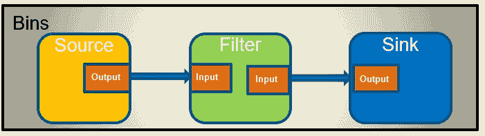

# AXU2CG 课程 5

我们承诺本教程不是一份永久性的、不变的文档。我们将根据论坛反馈和实际开发经验持续对教程进行修订和优化。

4) 设置名称和路径

路径为：

`/tools/xilinx_sdk_tool/sysroots/x86_64-petalinux-linux/usr/bin/aarch64-xilinx-linux/aarch64-xilinx-linux-gcc`

5) 与上述步骤相同，添加 C++ 编译工具

路径为：

`/tools/xilinx_sdk_tool/sysroots/x86_64-petalinux-linux/usr/bin/aarch64-xilinx-linux/aarch64-xilinx-linux-g++`

6) 点击“Apply”（应用）按钮完成此设置

7) 切换到“Qt Versions”（Qt 版本）并点击添加按钮

8) 选择 qmake

路径为：

`/tools/xilinx_sdk_tool/sysroots/x86_64-petalinux-linux/usr/bin/qmake`

9) 点击“Apply”（应用）按钮完成此设置

10) 切换到“Debuggers”（调试器）项并点击“Add”（添加）按钮

添加项目并修改内容如图所示，路径为：

`/tools/xilinx_sdk_tool/sysroots/x86_64-petalinux-linux/usr/bin/aarch64-xilinx-linux/aarch64-xilinx-linux-gdb`

11) 点击“Apply”（应用）按钮完成此设置

12) 切换到“Kits”（套件）项并点击“Add”（添加）按钮

13) 如图所示修改新添加项目的的内容

14) 点击“OK”按钮完成设置

## 第二部分：远程调试的 Hello World

### 第 2.1 部分：GDB 简介

GDB（GNU 项目调试器）允许你查看程序在执行时“内部”发生了什么，或者当程序崩溃时程序正在做什么。其主要功能如下：

1) 启动程序，指定任何可能影响其行为的内容，例如环境变量、运行参数等。

2) 在指定条件下停止程序

3) 检查程序停止时发生了什么，例如寄存器状态、变量值等。

4) 手动修改程序运行中的各种值，以便更方便地验证程序功能。

Linux 下的 GNU 调试工具有 `gdb` 和 `gdbserver`。其中，`gdb` 和 `gdbserver` 可以完成目标板上 Linux 程序的远程调试。`gdbserver` 是运行在目标板上的小型应用程序，可以监控被调试进程的操作，并通过网络与主机计算机上的 `gdb` 通信。开发者可以通过主机计算机上的 `gdb` 输入命令来控制目标板上进程的操作，并查看内存和寄存器的内容。

### 第 2.2 部分：Qt Creator 简介

Qt Creator 是一个跨平台集成开发环境（IDE），允许开发者跨桌面、移动和嵌入式平台创建应用程序。我们通常称之为 Qt Creator。Qt Creator 是帮助我们开发应用的工具。

### 第 2.3 部分：实验目标

1) 获取 GDB

2) 配置 GDB 连接

3) 将可执行程序移动到板

4) Qt Creator 项目

### 第 2.4 部分：Qt Creator 项目

Qt Creator 的 `.pro` 文件指定了需要使用的库。如果是空的，则意味着没有调用该库。

### 第 2.5 部分：获取板的 IP 地址

1) 可以通过“ipconfig”命令检查板的 IP 地址。默认启用 DHCP。如果不支持本地 DHCP 服务，结果如下：此时，你需要手动分配一个 IP 地址，例如 192.168.1.45，掩码为 255.255.255.0。

### 第 2.6 部分：QtCreator 配置 GDB 连接

1) 打开以下设置

2) 点击“Add”（添加）按钮并选择“Device”（设备）

3) 返回“Device”项，点击“Apply”（应用）完成此设置

4) 点击“Next”（下一步）和“Finish”（完成），随后出现的界面如下：

### 第 2.7 部分：运行 Hello World

1) 打开 helloworld 项目

2) 编译应用程序

3) 点击 QtCreator 的运行按钮

我们可以看到右侧运行的打印信息表明程序已运行并退出。

### 第 2.8 部分：运行参数设置

1) 打开以下设置项

如果提示以下错误，需要检查板是否已上电并进入了 Linux 系统，以及网络是否正常。如果提示以下错误，需要清除编译结果并重新编译。

此处的参数设置为 10

2) 在主函数的 if 处设置一个断点

3) 点击调试按钮或使用快捷键 F5

4) 我们看到程序已停止在我们设置的断点处

5) 按 F5 继续运行，我们看到的打印信息如下

我们可以看到 "hello world" 之后的起始数字已经变为 10，这表明我们设置的参数已经生效

## 第 3 部分：OpenCV 边缘检测

### 第 3.1 部分：OpenCV 简介

OpenCV（开源计算机视觉库）是一个开源计算机视觉和机器学习软件库。OpenCV 的建立为计算机视觉应用提供了通用的基础架构，并加速了机器感知在商业产品中的应用。作为一种基于 BSD 许可的产品，OpenCV 使公司能够轻松使用和修改代码。

该库包含 2500 多个优化算法，包括全套经典和最先进的计算机视觉和机器学习算法。这些算法可以检测和识别人脸、识别物体、分类视频中的人类行为、跟踪摄像头移动、跟踪移动物体、提取对象的 3D 模型、从立体相机生成 3D 点云、将图像拼接以生成整个场景的高分辨率图像、从图像库中寻找相似图像、去除闪光灯拍摄照片中的红眼、跟踪眼动、识别场景并创建标记以覆盖增强现实等。OpenCV 拥有 47,000 多个用户社区，预计下载量超过 1800 万次。它被广泛应用于公司、研究小组和政府机构。

Xilinx reVision 的许多实现都基于 `opencv` 接口，硬件实现为 `xfopencv`。这将帮助我们实现相应算法的硬件（FPGA）加速

### 第 3.2 部分：边缘检测简介

边缘检测是图像处理和计算机视觉中的基础问题。边缘检测的目的是识别数字图像中亮度明显变化的点。图像属性的显著变化通常反映了重要的事件和属性变化。这些包括深度的不连续性、表面方向的不连续性、材料属性的变化以及场景光照的变化。边缘检测是图像处理和计算机视觉中的一个研究领域，特别是特征提取。

图像边缘信息主要集中在高频带。通常来说，图像锐化或边缘检测本质上是高频滤波。我们知道微分运算是为了寻找信号的变化率，具有增强高频分部分的作用。在空间计算中，图像锐化是微分计算。由于数字图像是离散信号，微分运算变成了差分或梯度的计算。图像处理中有多种边缘检测（梯度）算子。

常用的包括普通一阶差分、Robert 算子（交叉差分）、Sobel 算子等，它们基于寻找梯度强度。拉普拉斯算子（二阶差分）基于零交叉点检测。通过计算梯度并设置阈值，即可边缘图像。

边缘检测的一般步骤为：

1) 滤波：边缘检测算法主要基于图像强度的一、二阶导数，但导数对噪声非常敏感，因此需要滤波器来提高噪声相关边缘检测器的性能。

2) 增强：边缘增强的基础是确定图像每个点邻域强度的变化值。增强算法可以突出灰度点邻域值发生显著变化的点。

3) 检测：邻域中有许多点较大的梯度值，但在特定的应用中，这些点并不是要寻找的边缘点，需要进行筛选。

### 第 3.3 部分：实验目标

1) 使用 `opencv` 捕获 摄像头图像

2) `canny`、`sobel` 和 `laplacian` 算法的边缘检测

3) 使用 `opencv` 显示图像

4) 响应 `opencv` 窗口关闭操作

### 第 3.4 部分：软件流程图

### 第 3.5 部分：操作准备

1) dp 接口连接到显示器

2) 插入 usb 摄像头

3) 开发板上电后，等待系统启动完成，系统可以正确显示桌面。

4) 在终端中可以查看 usb 摄像头设备。

### 第 3.6 部分：程序运行

你可以参考上一章的示例，打开 `opencv` 项目，并使用 QtCreator 直接运行。运行效果如下：

### 第 3.7 部分：代码分析

1) 设置环境变量：`export DISPLAY=:0`

2) 启动桌面：`/etc/init.d/xserver-start`

3) 调整显示器分辨率：如果上述实验使用 4K 显示器，那么桌面上的图标会非常小。为了更好地显示效果，在应用程序中，通过系统调用将输出分辨率设置为 1080P。命令如下：`xrandr --output DP-1 --mode 1920x1080`

4) 显示输出管理：系统默认使用输出功率管理，即显示器一段时间后会变空。此时，可以使用命令取消该功能，命令如下：`xset s 0 0 xset dpms 0 0`

5) 多线程操作：本实验使用三种不同的算法完成边缘检测。这三个算法被分配给三个线程任务，可以充分利用 ARM 四核 A53 的性能。

6) usb 摄像头捕获：摄像头分辨率设置为 640x480，默认开启的摄像头设备为：`/dev/video0`，因为这里的算法计算较慢，显示的图像会有一定延迟。

7) canny 边缘检测：由 John F. Canny 于 1986 年开发的层级边缘检测算法被许多人认为是边缘检测的最佳算法。最优边缘检测三个三个评估标准是：

- 低错误率：尽可能识别所有真实的边缘，同时尽可能减少由噪声引起的误报。

- 高定位：标记的边缘应尽可能接近图像中的实际边缘。

- 最小响应：图像中的边缘只能被识别一次。

8) sobel 边缘检测

这是一种更常用的边缘检测方法。Sobel 算子集成了高斯平滑和微分求导，也被称为一阶微分算子。微分算子用于获取水平和垂直方向的导数。得到的是图像在 X 方向和 Y 方向的梯度图。缺点：敏感且容易受影响。使用高斯模糊（平滑）可以减少噪声，但边缘定位精度不够。

`cv::sobel` 函数参数如下：

| InputArray | src | 输入图像 |
| OutputArray | dst | 输出边缘图像 |
| int | ddepth | 输出图像深度 |
| int | dx | x 方向导数的阶数 |
| int | dy | y 方向导数的阶数 |
| int | ksize = 3 | Sobel 卷积核 |
| double | scale = 1 | 计算导数值的可选缩放因子 |
| double | delta = 0 | 在将结果存储到 dst 之前累加的可选增量 |
| int | borderType = BORDER_DEFAULT | 像素外推类型 |

9) Laplacian 边缘检测

Laplace 算子是 欧几里得空间中的二阶微分算子。当你只关心边缘位置而不考虑周围像素的灰度差异时，它更为合适。Laplace 算子对孤立像素的响应比对边缘或线的响应强，因此它只适用于无噪声图像。在存在噪声的情况下，在使用 Laplacian 算子进行边缘检测之前需要低通滤波。因此，通常的分割算法是结合 Laplacian 算子和平滑算子来生成新模板。Laplace 算子与 Sobel 算子一样属于空间锐化滤波操作。

`cv::Laplace` 函数参数如下：

| InputArray | src | 输入图像 |
| OutputArray | dst | 输出边缘图像 |
| int | ddepth | 输出图像深度 |
| int | ksize = 1 | 用于计算二阶导数核的大小 |
| double | scale = 1 | 用于计算 Laplace 的可选缩放因子 |
| double | delta = 0 | 在将结果存储到 dst 之前累加的可选增量 |
| int | borderType = BORDER_DEFAULT | 像素外推类型 |

## 第 4 部分：OpenCV+Qt 人脸检测

### 第 4.1 部分：OpenCV 级联分类器

分类器是判断事物是否属于某一类别的设备。级联分类器：可以理解为将 N 个类分类器串联。如果一个符合串联的所有分类器，则最终结果判断为是；如果其中一项不匹配，则判断为否。

例如，人脸有许多属性。我们将每个属性制成一个分类器。如果一个模型符合我们定义的人脸的所有属性，我们就认为这个模型是人脸。那么这些属性指的是什么呢？例如，人脸需要两条眉毛、只眼睛、一个鼻子、一个嘴巴、一个呈 U 型的下巴或轮廓等。

基于 Haar 特征的级联分类器目标检测是 Paul Viola 和 Michael Jones 在 2001 年的论文《使用增强级联简单特征的快速目标检测》中提出的一种有效目标检测方法。这是一种基于机器学习的方法，通过许多正样本和负样本图像训练级联函数，然后用它检测其他图像中的物体。

我们在此处进行人脸检测。算法首先需要大量的正样本（人脸图像）和负样本（无人脸的图像）来训练分类器。然后我们需要从中提取特征。

Haar 特征分为三类：边缘特征、线性特征、中心特征和对角特征，它们被组合成特征模板。

特征模板中有白色和黑色矩形，模板的特征值定义为白色矩形像素之和减黑色矩形像素。Haar 特征值反映了图像的灰度变化。例如，人脸的某些特征可以用矩形特征简单地描述，如：眼睛比脸颊暗，鼻侧面比鼻梁暗，嘴巴比周围暗。然而，矩形特征只对某些简单的图形结构（如边缘和线段）敏感，因此只能描述特定方向（水平、垂直、对角线）的结构。

通过改变特征模板的大小和位置，可以在图像子窗口中列出大量特征。上图中的特征模板被称为“特征原型”；在图像子窗口中扩展（平移和缩放）特征原型所得到的特征被称为“矩形特征”；矩形特征的值被称为“特征值”。

### 第 4.2 部分：积分图

为了快速计算特征，这里引入了积分图（Integral Map），无论图像多大，它都能将给定像素的计算减少为涉及四个像素的操作。积分图是一种快速算法，只需遍历图像即可找到所有区域的像素和，极大地提高了图像特征值的计算效率。

积分图是一种描述全局信息的矩阵表示方法。积分图的构建方法为

即位置 $(i,j)$ 处的值 $ii(i,j)$ 是原始图像 $(i,j)$ 左上角所有像素之和：

$ii(i,j) = \sum_{0 \le x \le i, 0 \le y \le j} f(x,y)$

积分图构建算法

1) 使用 $s(i,j)$ 表示行方向的累加和，并初始化 $s(i,-1)=0$

2) 使用 $ii(i,j)$ 表示积分图，并初始化 $ii(-1,i)=0$

3) 逐行扫描图像，递归计算每个像素 $(i,j)$ 在行方向的累加和 $s(i,j)$ 以及积分图的值 $ii(i,j)$：

$s(i,j) = s(i,j-1) + f(i,j)$

$ii(i,j) = ii(i-1,j) + s(i,j)$

4) 扫描一次图像，当到达图像右下角的像素时，积分图 $ii$ 构建完成。

积分图构建完成后，图像中任意矩阵区域的像素累加和可以通过如图所示的简单计算获得。

假设 $D$ 的四个顶点为 $\alpha, \beta, \gamma, \delta$，则 $D$ 的像素之和可以表示为：

$\sum D = ii(\alpha) + ii(\beta) - (ii(\gamma) + ii(\delta))$

Haar 特征特征值仅仅是两个矩阵像素和之差，这可以在常数时间内完成。因此，矩形特征特征值的计算仅与特征矩形端点的积分图有关，所以无论特征矩形的大小如何变化，计算特征值消耗的时间都是常数。这样一来，只要遍历一次图像，就可以获得所有子窗口的特征值。

### 第 4.3 部分：选择特征

在所有这些特征中，大多数都是无关的。例如，考虑下图。第一行显示了两个良好的特征。第一个特征似乎关注于眼部区域通常比鼻子和脸颊区域暗的属性。第二个特征依赖于眼睛比鼻梁暗的属性。但将相同的窗口应用于脸颊或任何其他地方都没有效果。那么，我们如何从超过 160,000 个特征中选择出最好的函数呢？这可以通过 AdaBoost 算法实现。我们将每个特征应用到所有训练图像上。对于每个特征，它将找到最佳阈值，并将脸部分为两类：正类和负类。显然，会出现正确或错误的分类。我们选择错误率最小的特征，这意味着它们是对人脸和非人脸图像分类最准确的特征。这个过程并不简单。每张图像最初具有相同的权重。在每次分类后，分类错误的图像的权重将会增加。然后重复相同的过程。计算新的错误率，产生新的权重。该过程将持续，直到达到所需的准确率或错误率，或者找到了所需的特征数量。

### 第 4.4 部分：Qt 简介

Qt 是跨平台的 C++ 开发库，主要用于开发图形用户界面（GUI）程序，当然，你也可以开发无界面的命令行界面（CUI）程序。Qt 还提供了针对 Python、Ruby 和 Perl 等脚本语言的绑定，这意味着可以使用脚本语言基于 Qt 开发程序。Qt 支持许多操作系统，如通用操作系统 Windows、Linux、Unix，手机系统 Android、iOS、WinPhone，嵌入式系统 QNX、VxWorks 等。虽然 Qt 通常用作 GUI 库来开发图形界面应用，但这并不是 Qt 的全部；除了绘制漂亮的界面（包括控件、布局和交互），Qt 还包含许多其他功能，如多线程、数据库访问、图像处理、音频视频处理、网络通信、文件操作等，这些都已经集成。尽管 Qt 也支持手机操作系统，但由于 Android 已经有了 Java 和 Kotlin，而 iOS 已经有了 Objective-C 和 Swift，Qt 在移动终端的市场份额几乎可以忽略。

### 第 4.5 部分：实验目标

- 调用 Qt 库显示视频图像和人脸框图

- 使用 OpenCV 库的 CascadeClassifier 类

### 第 4.6 部分：软件流程图

### 第 4.7 部分：操作准备

- 根据上一章进行准备

- 将 `haar_train` 文件夹拷贝到开发板的 `/home/root`

### 第 4.8 部分：程序运行

运行应用程序，效果如下

### 第 4.9 部分：代码分析

- 人脸检测主要是 `face_lookup.cpp` 中的 `cascade.detectMultiScale`。在初始化期间，调用 `cascade.load` 加载模型 `haarcascade_frontalface_alt.xml`。


- 在`MainWindow::flushFace`中，在`.pro`文件中添加了几个核心GUI控件。

- Qt的信号与槽将`face_lookup`的信号绑定到槽，由`MainWindow`处理脸部位置。与上述相同，显示效果相对延迟。

## 第 5 部分：GStreamer 摄像头显示

### 第 5.1 部分：GStreamer 简介

GStreamer 是用于创建流媒体应用的框架。其基本设计理念源于俄勒冈研究生学院关于视频流水线的观点，并汲取了 DirectShow 的设计思想。它的特点如下：

1.  结构清晰，功能强大
2.  面向对象编程
3.  功能灵活且可扩展
4.  高性能
5.  核心库与插件的分离

GStreamer 的架构如下。它支持从简单的 Ogg/Vorbis 回放和音频/视频流到复杂的音频（混合）和视频（非线性编辑）处理等应用程序。应用程序可以透明地利用先进的解码器和过滤技术。

### 第 5.2 部分：GStreamer 基本概念

1.  **Element（元件）**

    元件是组成流水线的 Basic 组件。多个元件可以连接在一起创建一个流水线以完成特定任务，例如媒体播放或视频录制。元件根据功能分类：

    -   Source elements（源元件）
    -   Sink elements（汇点元件）
    -   Filter elements（过滤器元件）

    应用程序框图如下：

     

2.  **bin（容器）和 Pipeline（流水线）**

    Bin 是可以包含元素的容器。Pipeline 是 Bin 的特殊子类。Pipeline 可以操作其内部包含的所有元素。如下所示

    

3.  **Pad（节点）**

    Pad 等同于组件的接口，每个组件都通过此接口连接，以便数据流可以在这些组件之间传输。Pad 类别有：

    -   always（始终）
    -   sometimes（有时）
    -   on request（按请求）

4.  **Cap（类型）**

    Caps 描述了可以通过 Pad 或当前通过 Pad 的数据流格式。你可以通过`gst-inspect-1.0`命令查看组件支持的媒体类型。

5.  **Bus（总线）**

    每个 pipeline 默认包含一个 bus，应用程序不需要创建另一个总线。应用程序在总线上设置了一个消息处理器。当主循环运行时，总线会轮询消息处理器以获取新消息。当收集到消息时，总线将调用相应的回调函数完成任务。

6.  **Buffer（缓冲区）**

    buffer 包含创建管道中的数据流。通常源组件会创建一个新的缓冲区，同时组件会将缓冲区中的数据传递给下一个组件。使用 GStreamer 的底层结构创建媒体流水线时，你不需要自己处理缓冲区，组件会自动处理这些缓冲区。缓冲区主要由以下部分组成：

    -   指向内存块的指针
    -   内存大小
    -   Buffer 时间戳
    -   引用计数，表示使用缓冲区的组件数量。当没有组件引用它时，该引用将销毁缓冲区

7.  **Events（事件）**

    事件包括流水线中的控制信息，例如搜索信息和流终止信号。

### 第 5.3 部分：实验目标

GStreamer 工具使用

GStreamer 编程

## 第 5.4 部分：Gstreamer 工具

### 1 `gst-inspect-1.0`

如果不带参数，它将列出所有可用的元素，即你可以使用的所有元素。如果带有文件名，它会将该文件作为 GStreamer 的插件并尝试打开它，然后列出所有内部元素。对于 GStreamer 的某个元素，将列出该元素的所有信息。

打印列表及其信息，例如：

-   打印支持的插件列表：`gst-inspect-1.0 -a`
-   打印插件 `filesrc` 信息：`gst-inspect-1.0 filesrc`

Pad Templates（Pad 模板）：此部分将列出所有类型的 Pad 及其 Caps。通过这些你可以确认是否可以连接到某个元素。

### 2 `gst-discoverer`

此工具用于查看文件中包含的 Caps，这是一个 `GstDiscoverer` 对象包。它接受命令行传入的 URI，然后打印所有信息。这在查看媒体如何编码和复用非常有用，以便我们决定在流水线中放置哪个元素。

### 3 `gst-launch-1.0`

此工具可以创建、初始化并运行一个流水线。它允许你在正式编写代码之前快速测试流水线以查看其运行情况。如果你需要查看流水线中元素生成的 Caps，请在 `gst-launch` 中使用 `-v` 参数，如下：

```
gst-launch-1.0 -v v4l2src device=/dev/video0
```

如底图片所示，摄像头的默认视频格式为 YUY2，分辨率为 2592x1944

### 第 5.5 部分：`gst-launch-1.0` 摄像头显示

### 1) 确认你的 USB 摄像头支持的视频格式

将`tools/uvc_fmt`拷贝到 FPGA 开发板上运行，可以扫描支持的分辨率

### 2) 控制

在控制下，输入以下命令。需要根据显示器设置你的 USB 摄像头支持的分辨率：

```
gst-launch-1.0 -v v4l2src device=/dev/video0 ! video-x-raw,format=YUY2,width=1920,height=1080 ! kmssink video-id=0 sink-overlay=0x000000 fullscreen=1
```

如底图片所示，摄像头的默认视频格式为 YUY2，分辨率为 2592x1944。注意：需要根据显示器设置你的 USB 摄像头支持的分辨率。

### 3) 运行后

运行后可以看到图像非常流畅，但缺点是只能显示在单个屏幕上。

### 第 5.6 部分：编程

本章中的程序用于实现上述场景，但如果我们想要更多效果，则需要通过编程来实现。

1.  **`gst_parse_launch`**

    此函数创建一个流水线，函数参数如下：

    -   `const gchar *pipelinedescription`: 描述流水线
    -   `GError **error`: 错误返回

2.  **`gst_bus_add_watch`**

    添加总线的回调函数以处理必要的消息。

### 第 5.7 部分：代码分析

## 第 6.1：DRM 简介

DRM 全称为 Direct Rendering Manager（直接渲染管理器）。它的创建是为了解决多个程序协作使用显卡资源的问题。它为用户空间提供了一组用于输出管理的 API。DRM 现在已经涵盖了以前由用户空间程序处理的功能，例如帧缓冲区管理和模式设置、内存共享对象和内存同步。其中一些扩展有特定名称，例如图形执行管理器 GEM 或内核模式设置 KMS，它们属于 DRM 子系统。

1.  **DRM Framebuffer（帧缓冲区）**

    从开发者的角度来看，Framebuffer 是一块内存，向内存中写入特定格式的数据意味着向屏幕输出内容。因此，Framebuffer 是一个画布。例如，对于初始化为 16 位颜色的 FrameBuffer，Framebuffer 中的两个字节代表屏幕上的一个点，从上到下、从左到右，屏幕位置与内存地址之间存在关系。

    有序线性关系。

2.  **CRTC**

    CRTC 的任务是从帧缓冲区（Framebuffer）中读取要显示的图像，并根据相应的格式将其输出到编码器（Encoder）。虽然 CRTC 的字面意思是“阴极射线显示管控制器”，但 CRT 早已在普通显示设备中被淘汰。CRTC 在 DRI 中的主要功能如下：

    -   配置适用于显示器的分辨率（内核）并输出相应的时序（硬件逻辑）
    -   扫描帧缓冲区并将其发送到一个或多个显示设备

3.  **Planes（平面/层）**

    随着软件技术的不断更新，对硬件性能的要求越来越高。在满足正常功能需求的前提下，对功耗的要求变得越来越严苛。最初 GPU 可以处理所有图形任务，但由于其运行期间功耗较高，设计人员决定将一些简单任务交给显示器控制器（Display Controller）处理（如合成），让 GPU 专注于绘制（即渲染）这一主任务。减轻 GPU 的负担，从而达到降低功耗和提高性能的目的。因此，Plane（硬件层单元）应运而生。

    Plane 主要用于叠加和输出多个层。某些硬件支持层平移、缩放、裁剪、Alpha 通道等。

4.  **Encoder（编码器）**

    将特定格式的图像信号（如 RGB、YUV 等）编码为连接器需要输出的信号。以 HDMI 为例，帧/行同步/显示内容通过 TMDS 数据的串行线输出，然后根据 HDMI 标准将并行序列编码为串行序列，这就是编码器的任务。

5.  **Connector（接口）**

    Connector 实际上是连接到显示器的物理接口。常见的有 VGA/HDMI/DVI/DP 等。可以通过接口读取显示支持的参数。

## 第 6.2 部分：实验介绍

MPSoc 的 DP 输出支持层，上层（Primary）支持 Alpha 通道。本章实验使用 Qt 输出内容到 Primary 层，并使用 Gstreamer 捕捉视频数据到后续层（Overlay）。最后，这两层由硬件进行混合并输出。工作框图如下：

## 第 6.3 部分：实验目标

1.  DRM 输出管理
2.  DRM 层管理
3.  Qt 和 GStreamer 分层显示

## 第 6.4 部分：运行程序

1.  需要注意的是，本实验需要支持 1080 分辨的 USB 摄像头（指裸流，例如上述的 YUYV422 格式）
2.  实验操作效果

    你可以看到 Qt 界面叠加在视频上。

## 第 6.5 部分：代码分析

1.  **检查显示器是否连接**

    在主函数中，调用`init_drm`判断初始化是否成功，返回 -2 表示没有支持的显示格式，说明未连接显示器。

2.  **设置显示器输出分辨率**

    通过函数`drmModeSetCrtc`设置输出分辨率和刷新率。这里没有设置缓冲区，所以第三个...

3.  **设置显示器输出分辨率**

    图形层的透明度

    图形层支持 Alpha 通道。这里`it_alpha`设置为 0。

4.  **Qt 显示 Gstreamer**

    可以通过`drmModeGetPlane`获取 Plane 信息。从代码中可以看到，Plane 的属性设置如下：

    -   `type=dp`
    -   `id=35`
    -   `fullscreen=false`
    -   `overlay=0`
    -   `alpha=0`

5.  **Encoder**

    Plane id 设置为 35。

## 第 7 部分：寄存器操作

### 第 7.1 部分：内存映射

内存映射是将用户空间的一个区域映射到内核空间。映射成功后，对该区域的修改可以直接反映在内核空间。同样，对该区域的修改也可以直接反映在用户空间。

### 第 7.2 部分：实验介绍

有时，某个外设的功能已经在裸机上通过验证。如果该外设不使用中断，此时我们可以使用 Linux 下映射寄存器的方法直接将裸机程序移植到 Linux。此示例移植了 Vitis 下的 gpio 示例来驱动`ps_led`，使 LED 每秒闪烁一次。其他操作的过程也类似。

### 第 7.3 部分：运行程序

运行`application_opt`后，你可以看到 PS 的 LED 每秒闪闪一次。

### 第 7.4 部分：代码分析

1.  关于 gpio 的寄存器地址，这里全部是从 Vitis 的 gpio 程序中复制的，我们以后的开发思路应该是：先使用 Vitis 的裸机程序进行验证。对于许多外设和 FPGA 端的 IP，Vitis 会帮助我们生成良好的操作方法和操作地址，这样我们就不需要寻找对应关系。

2.  打开`/dev/mem`时，使用`O_SYNC`选项。

    内存映射的效率高于调用`read/write`。为什么？因为`read()`是系统调用，涉及数据拷贝。它首先将文件内容从硬盘拷贝到内核空间的缓冲区，然后将数据拷贝到用户空间。在这个过程中，数据实际上被拷贝了两次。而`mmap()`也是一个系统调用，`mmap()`中没有数据拷贝，真实的数据拷贝是在页异常中断被处理时执行的。因为`mmap()`直接将文件映射到用户空间，所以只执行一次数据拷贝。

    在向外部写入数据后，数据通常会被写入缓存缓冲区。`O_SYNC`会确保数据在返回之前已写入外设。需要注意的是，这里的`O_SYNC`仅影响写操作。

3.  **调用`msync`**

    如果你需要一次性向外设写入更多数据，此时如果调用`O_SYNC`将严重影响系统性能。此时，如果我们不使用`O_SYNC`，而在写入数据后调用`msync`，这将提高写入性能。

4.  **读取操作的一性问题**

    如果你需要读取外设的数据，由于缓存的存在，应用程序中获取的数据是缓存中的数据，而不是外设的最新状态。此时，读取到的可能是错误的值。
