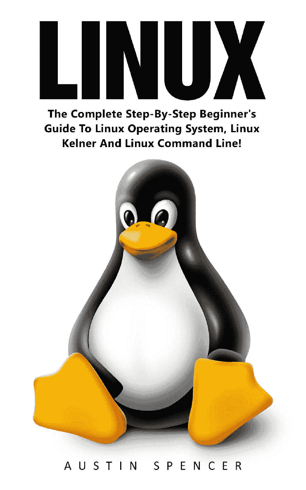

# B01M22BPXD

送给您的额外赠品！

点击下方链接免费获取您的赠送书籍《亚马逊书籍合集：5 款亚马逊产品完整用户指南》。

[>>>点击此处下载<<<](https://freebookpromo.leadpages.co/amazon-book-bundle/)

（或访问：https://freebookpromo.leadpages.co/amazon-book-bundle/)

# 引言

人类发展史上的过去所有年份都被标记为对人类文明生活水平的追求。尽管进步发生在每个领域和每个方面，但没有什么能与科学技术领域压倒性的进步相拟。

在信息技术领域，软件开发是最具有进步性的领域，每一分钟的上升都意味着软件开发领域的进步。在这个领域中，程序员和研究人员的贡献巨大，使得普通大众领域能够从这种快速发展中获益。这种严谨研究的结果之一就是名为 `Linux` 的编程软件。

`Linux` 是一种类 Unix 且通常符合 `POSIX` 标准的操作系统，通过开源和免费软件发行及开发的模式收集而成。`Linux` 的显著特征是著名的 `Linux 内核`，它是一个著名的操作系统，首次于 1991 年 9 月 17 日发布。

这由 `Linus Torvalds` 引入。最初，`Linux` 是作为一种免费操作系统引入的，以便在具有 `Intel x86` 架构的个人电脑上使用。由于智能手机上 `Android` 的主地位，`Linux` 似乎是操作系统的主要的安装基础。

# 第 1 章 – Linux 操作系统简介

与 `windows 7`、`windows 8`、`windows 10` 和 `Mac OS X` 等不同的操作系统一样，`Linux` 同样是最灵活的工作框架。框架用于运行设备，就像你的 `window 7 or 8` 运行便携式 PC 或桌面 PC 一样。简单来说，工作框架建立了硬件与程序之间的对应关系。

没有产品，我们的硬件部分无法提供功能。框架允许不同的软件项目在上面运行，`Linux` 就是其中之一。`Linux` 真的无处不在；它在你的汽车里，在你的手机里，在你的冰箱里，也在微波炉里。请看我们在下面对 `Linux` 工作框架的详细概述。

`Linux` 是极其开放且私密的，这意味着 `Linux` 工作框架中的每个部分对每个用户都是可见的。如果不学习框架的结构，用户很难理解 `Linux 操作系统` 中每个模块背后的原理。

`Linux` 是开源的，这意味着它的源代码可以免费获取并允许使用。开源框架 `Linux` 是一种基于 `Unix` 的自由分发和跨平台框架，可以安装在便携式 PC、笔记本电脑、手机等上。

`Linux` 与 `UNIX` 非常相似。`UNIX` 是多任务用户框架的集合。`Linux` 的用途描述如下：

## Linux 的巨大功能

`Linux` 工作框架涉及三个主要部分：

1. 内核 (Kernel)：

它是 `Linux` 的中心和重要部分，负责框架的所有工作。该部分真正被称为 `Linux 内核`。它处理 `CPU`、边缘设备和内存。部分基本上用于不同设备之间的通信以及等。它包含一些模块，并直接与硬件交互。该部分提供了必要的反射，以隐藏程序的硬件细节。它是框架的最低层次。

该部分的几个元素有：
- 设备管理
- 处理框架
- 内存管理
- 进程管理

### 系统库 (System Library)

这些是框架实用程序或程序访问 `内核` 组件的独特功能。这些库处理了框架的大部分功能，它们不需要操心位代码的收益。

由于该部分本身尚未准备好执行很多工作，因此首先应该被邀请来执行任务。此类请求是由应用程序发出的，这些应用程序必须熟悉如何为该部分进行框架调用。

### 系统工具 (System Utility)

系统工具项目能够执行特定的个人层级任务。

与框架库一样，对于框架设备没有特定的描述。工具项目对终端用户是完全透明的。这就是为什么 `Linux` 提供相同的框架工具，或设备，但具有不同的用途。

## Linux 操作系统的设计

`Linux 系统`的设计涉及以下层级：

字体 硬件层 (Hardware layer)：这一层由每个边缘设备组成，例如 `RAM`、`HDD`、`CPU`、输入设备、输出设备等。

* **内核 (Kernel)**: `Kernel` 是 Linux 操作系统的核心部分。它与硬件直接协作，并为上层部分提供底层服务。
* **工具项目 (Utility projects)**: 工具项目是指为客户端提供工作框架绝大部分功能的项目。就像 Windows 和 Mac 提供许多可以轻松发现和引入的优秀编程程序一样，Linux 也为其客户提供了大量的工具项目。

最先进的 Linux 发行版包含了如应用商店之类的设备，用于协调和改进应用程序的开发。

* **外壳 (Shell)**: `Shell` 是内核的接口。它为终端用户隐藏了内核能力的复杂性。shell 从终端用户接收命令并执行内核的功能。

它是曾经让人们最恐畏离开 Linux 的原因，因为他们认为需要学习一种看似古老的命令行结构才能让 Linux 运行起来。

* **图形服务器 (Graphical Server)**: 它是在屏幕上显示表示的子框架。它通常被称为 X server 或简称为 "X"。

## 常用应用：

Linux 根据客户的需求有不同的形式。从业余爱好者到设计师，你有各种类型的 Linux 来满足你的需求。

这些 Linux 操作系统的版本被称为“发行版”，也称为 "distros"。任何此工作系统的发行版都可以免费下载、刻录在光盘或 USB 驱动器上，并安装到你喜欢的任何不同的机器上。

著名的 Linux 发行版有 Linux Mint、Ubuntu Linux、Arch Linux、Fedora、Deepin、Debian、openSUSE。每个发行版对桌面都有不同的影响。一些客户选择极其图形化的 UI，他们选择了 Deepin 桌面和 Ubuntu 的 Unity，而另一些人不需要图形桌面，因此他们使用 openSUSE 的 KDE。

# 第二章 – Linux：Linux 操作系统的内核

`Linux Kernel` 是一个类似于 UNIX 的计算机操作系统部分。Linux 操作系统依赖于内核，并发布在已安装框架以及自定义计算机系统中，例如服务器和 PC，通常作为 Linux 发行版。用于手机、平板电脑和智能表的 Android 操作系统也基于 `Linux Kernel`。

`Linux Kernel` 由 Linux Torvalds 在 20 世纪 90 代创建。他为自己的没有跨平台期的 PC 编写内核，但已扩展到支持大量的计算机结构，比其他操作系统或内核支持更多。

Linux 迅速吸引了从其他软件项目中迁移代码以用于新工作系统的的设计师和终端用户。`Linux Kernel` 收到了来自全球 12,000 名开发人员、1200 多家组织的承诺，其中包括大多数最大的硬件和软件供应商。

Linux 内核 API `(应用程序编程接口)` 是客户端程序与内核交互的通道，旨在非常稳定且不会破坏用户空间程序。在内核的功能中，许多设备驱动程序控制硬件；主流设备驱动程序也非常稳定。

然而，可加载内核模块之间的接口与其他内核框架完全不同，其设计上并不打算非常稳定，但由于其许多特性（如速度、内存、执行效率、执行各种任务的能力等），吸引了许多客户。

## 影响力：

运行 Linux 内核的 Android 操作系统声名的巨大上升，使内核成为手机设计师最最重要的决策，成为其他操作系统的基础。随着过去的增长，不同机构估计已销售 30 亿部 Android 手机。

一些客户使用了 `Linux Kernel`，这适用于许多不同的设备，例如智能电视、服务器和其他嵌入式系统。然而，该内核在传统桌面 Linux 发行版中的应用与许多其他操作系统相比仍然较少。

## 特殊特性

### 编程语言：

`C` 语言由 `GCC` 支持，内核是用该语言编写的。标准语言 `C` 经过多次修订。除了 `C` 语言外，底层计算机结构也可用于编写 `Linux Kernel`，汇编语言也支持 `GCC`。过去，`GCC` 是适用于编译 `Linux Kernel` 的主要编译器。

### 编译器比较：

`GCC` 是 Linux 内核的内置编译器。`GCC` 是内核最快且最可靠的编译器。它可以在更短时间内作为许多复杂项目汇集过程的一部分。

### 接口：

如果仅使用其他编程工具进行客户端程序开发，规范或一致将是内核设备无法被 Linux 内核识别。

### 抢占

`Linux Kernel` 在某些条件下允许抢占式调度。在采用 `2.4` 版本之前，单用户改进是非常是非抢占的，也就是说，在客户端用户方法中关闭现有策略执行之外，如果被驱动的任务需要进入运行状态，该执行将被中断。

向 `2.6` 系列版本的过渡，内核允许在内核代码执行期间插入任务，尽管内核代码单元无法被有效地调用。内核涵盖了不同的不同的调度器类。`Linux Kernel` 自然地使用调度器系统，被称为完全公平调度器 (CFS)，它是以 Linux 内核 `(2.6.23)` 的形式开发的。

### 可移植性

尽管如此，该内核从未被设计为可移植的。Linux 现在是完全可移植的操作系统，运行在从 ARM 开发到 IBM 的之前或之后不同范围的设备上。

Linux 想象的 `386` 开发之外的最重要移植是 `68000` Motorola 平台，但为了实现这一点，他们替换了 Torvalds 的内核真实分区以使其分支并形成类似的工作系统。Torvalds 运行了内核的首次重建，以便随后的移植工作。

## 现场修复 (Live fixing)

通过利用被称为热补丁的技术可以将计算机更新调整到内核。一些热补丁技术包括 `kpatch`、`kGraft` 和 `Ksplice`。修复程序在特定的 `4.0` 版本合并到了 Linux 内核，于 2015 年 4 月 12 日发布。

这些程序被称为现场修复，依赖于内核的最优功能，形成一个可以辅助热修复的聚合中心；对于 `akGraft` 和 `kpatch`，通过为包含热补丁的 Linux 内单元提供 API 以及用户空间管理设备的 `ABIs`。

本节的目的是直观且精彩地介绍和执行 Linux 命令行 shell（command shell）及其核心用途。命令行 shell 是一个允许用户编写和执行命令的程序。

它允许用户通过在终端中物理输入命令来执行任务，此外还可以在被称为 shell 脚本的项目中执行。它并不是一个工作框架；它是与操作系统交互并运行特定命令的最佳方法。

## BASH

`BASH` 被称为 Bourne Again Shell（再次的 Bourne 壳）。`BASH` 是一种 shell，它是用于 UNIX 系统的标准 shell——即 Bourne Shell（`/bin/sh`）——的替代品。

它获取了原始 Bourne Shell 的大部分核心元素，并且使得编程和使用命令行变得容易得得多。由于它是免费软件，因此在许多 Linux 发行版中被认为是非常有效的 shell。

## BASH 与 DOS 不同

以下是 `BASH` 区别于 DOS 的几个特性。

### 大小写敏感

在 Linux 中，文件名和命令是区分大小大小的，这意味着编写 `"EXIT"` 而不是 `"exit"` 是一个错误。系统会在这些细微错误上报错。

### "\" 与 "/"

在 Dos 中，`"/"` 用作命令行分隔符，而目录分隔符是 `"\"`。在 Linux/UNIX 中，目录分隔符是正斜杠，而转义字符通过反斜杠完成。

### 文件名

对于文件名传统，“八三三”规则意味着每个文件都遵循相同的格式，DOS 允许文件名最多包含 8 个字符，后面跟着一个点，然后是长度最多 3 个字符的扩展名，例如 `ANYFILE.TXT`。

在 Linux 和 UNIX 中，没有这种关于文件扩展名的传统。点可以设置在文件名的任何位置，扩展名可以由项目进行不同的解析。

### 特殊字符

在转向 Linux shell 命令之前，用户首先应该意识到有一些符号和字符在 shell 中以异常方式运行。

这意味着这些编写的字符在特定情况下没有能力使用，它们可能被用于执行特殊操作，或者如果用户需要以普通方式使用它们，则应该对它们进行“转义”。

## 执行命令

### 命令路径 (PATH)

命令被设置在你 shell 的“路径”（Way）中，这意味着你可以直接输入程序的名称来执行它。例如，输入 `"ls"` 将运行 `"ls"` 命令。shell 的“路径”因素包含最广泛的程序区域，例如：

`/usr/bin,/bin,/usr/X109A/bin,` 等。要运行不在当前 `PATH` 中的命令，需要先输入完整路径。例如：`/home/john/myprogram`

*   `./program`（这将允许你在当前索引中运行特定的程序）
*   `~/bin/program`（这将允许你沿着用户目录运行特定的程序）

### 命令语法

命令可以自然地执行，用户也可以传递额外的参数来完成某些特定功能。命令语法的结构是：`command [-argument] [-- - another argument] [filename]` 一些示例是：

*   `ls` 将列出当前目录下的文件
*   `ls -l` 将以长格式列出每一个文件
*   `cat filename` 将显示文件的内容*
*   `cat -n filename` 将显示文件内容及其行号

## 入门指南

当用户卡住并需要一些 Linux 命令行 shell 的帮助时，他/她可以轻松地从中获得帮助。

许多 Linux 命令的帮助通常直接在命令本身中，通过在线帮助或案例信息页和基础页面打开。

### 使用命令的内置帮助

大多数命令都有基本的帮助选项，可以使用特殊的标志来调用。这些命令通常看起来像 `--help` 或 `-h`。

例如：`grep --help`

### 主页-在线手册

某些命令的最佳数据源可以有效地在在线页面中找到，简称为 `man` 页面。输入 `"man"` 配合特定目标可以浏览不同命令的 man 页面。例如，输入 `man ls` 将演示与 `"ls"` 命令关联的手册，输入 `man manual` 将出现 manual 调用命令。

要在 man 页面中搜索特定单词，输入 `'/word'`；要离开手册页，只需按 `'Q'` 键即可。有时，用户可能会忘记他需要搜索的命令名称，因此，请参考以下示例：

假设你要修改文件的权限但忘记了命令名称，考虑到这一切，输入与你正要执行的任务相关的单词，例如，输入 `man-k consent`。输出将显示文件权限命令如下：

`chmod (1)` 将更改文件的访问权限

现在用户知道他正在寻找的命令是 `"chmod"` 了。输入 `'man chmod'` 将显示 chmod 命令的手册页。

### 导航 Linux 文件系统的命令

下表中出现的命令将让你知道你可以去哪里，并向你展示那里有什么。其中一些非常简单，例如 `cd`（切换目录）、`ls`（列出文件）等等。

## 第 4 章 – 使用 Linux 的优点与围绕 Linux 的误言

如今，Linux 处于巅峰地位，并在软件工程师以及全球普通用户中非常流行。在本节中，将讨论 Linux 的重要优点以及它所面临的误言。

Linux 的优点

*   **成本**：使用 Linux 的一个显著优点是它是免费的。Linux 发行版可以在任何系统中引入而无需付费。此外，不同的应用程序也是免费获取的。事实上，即使是普通用户也可以通过命令下载这些程序。
*   **安全性**：尽管是免费，Linux 的安全特性非常稳固。它不需要额外的病毒防护产品。用户不需要花费巨资购买对抗性病毒。
*   **开源**：Linux 工作框架是开源的，如果今天出现全球性的 Linux 病毒，明天就会有补丁发布，甚至是使用该工作框架的普通用户或维护人员。
*   **选择 (自由)**：选择权是最好的优势之一。通过 Linux，用户有能力控制工作框架的每一个部分。
*   **硬件**：Linux 工作框架非常适合几乎没有处理能力的旧电脑，但现在它们正被工程师们用于组装新设备的一部分，例如手机、汽车，甚至冰箱等许多其他设备。

Linux 特别值得的一点是，它有自己的产品仓库，任何用户只需在 `Terminal`（终端）或 `Linux Shell` 中输入单个命令即可下载并安装大量应用程序。Linux 工作框架同样可以运行 Windows 应用程序。

### Live CD/USB
几乎每个 Linux 发行版都带有 Live USB 或 CD 亮点，通过用户可以在不安装系统的情况下运行或尝试该工作框架。

### 图形化用户界面 (GUI)
人们往往认为 Linux 是一个命令行操作系统，在某种程度上这种说法是正确的但并非完全如此，Linux 有许多软件包可以被轻松安装，以使得整个工作框架的界面看起来像 Windows。

除了这些有利的情况，关于 Linux 操作系统还有许多神话，例如：

### 关于“难以安装”的神话
某些用户在安装 Linux 工作框架时可能会遇到挑战。
Linux 的“发行版”实际上包含了一个文档，解释了安装 Linux 发行版、构建编译器和查找文件等过程；在某种程度上，如果文档没有更新，可能会变得困难且具有风险。

### 关于“不支持”的神话
在过去，事实情况是 Linux 没有商业支持，但现如今，普通用户可以从主要的编程供应商（例如 `RedHat` 或 `Novell`）那里获得带有支持的 Linux 工作框架。
用户也可以使用免费下载的 Linux 应用程序并获得提供特定发行版的组织许可协议。
通常不需要任何 PC 客户端获得商业支持，例如，免费提供的支持渠道与某些其他标记的操作系统相比具有显著的优势。

### 关于“在 Linux 中无法运行许多产品”的神话
对于某些 Microsoft Windows 软件这可能是真的，但对于 Linux 来说，这只是一个神话。任何产品都可以毫无费力地下载、安装并在 Linux 中持续运行。微软的一些软件也可以安装在 Linux 上，用户可以像在 Microsoft windows 中使用一样使用它们。著名的软件 `Google Chrome` 和 `Firefox` 毫无疑问可以摆脱这种困境。

除了这些传说，另外一些更常见的误解是关于 Linux 的安全、可靠性和内存限制的。有些人认为它是非图形化的，另一些人认为它很难操作，然而一旦用户使用了这个工作框架，他自己就能考虑到这个框架的特性。

# 第 5 章 – Linux vs mac vs windows

在本节中，为了对 windows、Linux 和 Mac OS 进行比较，列出了这三个重要工作框架的优缺点：Linux、Mac 和 Windows 通常称为‘PC’。

除了这些还有许多其他工作框架，但由于市场份额很小而很少为人知。以下是三个领域的划分：Linux、`Macintosh` 和 windows，目标是根据它们的优缺点对它们进行对比。

## Windows
从最流行的工作框架 windows 开始，没有人会错过这个框架，因为它占据了整个操作系统市场几乎 90% 的份额。它存在于企业结构、机械办公室、你的手机中，以及家用 PC 上。

Windows 于 1985 年；从以后推出了许多版本的 windows，如 `XP`、`NT`、`windows 98`、`2000`、`windows vista`、`windows 7`、`8`、`8.1` 以及 2015 年推出的 `windows 10`。除了这种快速的迭代周期，它也有一些缺陷，windows 的优缺点如下：

### 优点
* **兼容性**：几乎每个应用程序或软件工具、驱动程序、游戏都会 Windows 上高效运行。
* **技术支持**：除了拥有大量的用户之外，如果发生任何需要帮助的情况，你只需找到一个在线或离线的人，他们就可以毫不费力地帮助你处理 Windows。
* **巨大的容量**：当你熟悉 Windows 后，你会发现有很多功能可以让你以非常简单的方式在 windows 中完成任何事情。

### 缺点
* **病毒**：每个用户都需要购买防病毒程序来保护他们的框架免受几乎每天产生的病毒侵害。虽然存在免费的防病毒软件，但由于感染数量巨大，恰切需要非常专业的防病毒工具。
* **慢**：某些 Windows（特别是是 `Vista` 和 `7`）需要大量的 PC 资源，例如内存、处理器、磁盘空间，因此它们通常运行得较慢。总而言之，框架的效率会下降。
* **价格**：Windows 非常昂贵。它们的成本通常在几百美元的范围内。

## Macintosh 工作框架
操作系统世界的另一个大巨头是 Macintosh。Apple 的 `Macintosh OS` 比 Windows 更老牌。

它是第一个有效的图形界面操作系统，比微软的竞争对手早一年发布。`Macintosh OS X` 是一件精妙且精确的作品，它为专业人士提供了工具，而这些工具在很多时候 PC 是无法提供的。用户体验和 UI 界面都经过了精简，使得每个图标、动画和关联都为了明确的原因而被更改。其优缺点如下：

### 优点
* **病毒**：Apple Macs 几乎没有感染。没有必要购买防病毒软件并运行安装它们。
* **可靠性**：Macintoshes 仅在 Apple PCs 上运行，因此较少发生软件和硬件崩溃。
* **外观**：Mac 看起来通常比任何 Windows 都好。它拥有像 Windows 一样易于理解的界面，但视觉上比任何 Linux 好得多。

### 缺点
* **昂贵**：Macintosh 非常贵，比 Windows 贵得多。对于某些工程师来说，获取它是不现实的。
* **仅限 Apple PC 使用**：如果你现在有一台 PC，你无法在上面运行 Mac OS，否则后果是严重的，你需要购买另一台 PC。
* **兼容性**：只有少数项目可以在 Mac 上运行，或者用户可能需要购买每一个程序来使其运行。

## Linux
Linux 较小，但正在迅速发展。Linux 是对 Windows 和 Mac 的响应，这意味着 Linux 是“免费的”。所谓免费，是你无需花分钱就可以下载、修改和重新分发该 OS。Linux 是操作系统领域一个较年轻的玩家，但遗憾的是，它有一些局限性。

### 优点
* **成本**：Linux 是免费的。你只需在它的终端输入几个命令就可以安装、下载、使用和调整它。许多程序你都可以从这里免费获取。
* **多样性**：Linux 只是一部分。为了使用这个部分，应该为 Linux 安装一些额外的软件。这些包通常被称为“发行版”或基本的“发行版 (distros)”。著名的版本包括 `Ubuntu`、`Fedora` 和 `Mint`。
* **病毒**：尽管由于开源比 Mac 更容易感染，但 Linux 仍然面临极小程度的感染。

### 缺点

*   **复杂：**

有些功能使用起来非常简单，但其中大部分都需要对计算机知识有一定程度的了解才能使其正常工作。

*   **兼容性：**

与 Mac 类似，Linux 操作系统仅占市场份额的百分之几，因此它不像 Windows 那样拥有大量的程序和游戏。

*   **供应商：**

主要问题在于，你找不到大量销售 Linux 电脑的商家。通常情况下，你最终只能购买一台 Windows 电脑，然后重新格式化硬盘，再自己安装 Linux。

最后，没有哪个操作系统是真正更好的；选择权在于用户。如果用户是游戏玩家，那么他/她只能在有限的选择中做出决定，直接选择 Windows 即可。软件工程师通常更倾向于 Linux，而设计师或视频制作者则往往倾向于 Mac OS。

对于富有同情心、希望在软件开发领域迈出革命性一步的现代程序员来说，Linux 可以成为最有前途的工具之一。

# 结论

在这个进步与发展的现代领域，没有什么能比得上技术所提供的成果。人们声称自然是智慧的最高源泉，但人类已经足够公平地继承了这份智慧遗产。在过去的这些年里，技术进步中展现出了最大的发展潜力。

人类生活的每一个领域现在都同样受到这项技术奇迹的影响。如今，由于这项技术的充分贡献，许多体力劳动已被消除。现在没有什么是不可能的，因为技术已经足够强大。

在信息技术领域，软件开发领域深受研究最大效用的影响。随着每一个新一天的到来，软件开发也在不断发展。

Linux 就是软件开发的一个奇迹，它提供了足够的特权和进步。Linux 最大的优点之一是其用户友好的方法。尽管它是高级和复杂程序员的最佳工具，但对于个人用户来说也并非那么困难。

Linux 的用户友好方法使其易于学习和应用。你不仅能理解它的潜力，还能进行修改和创新。本书是学习 Linux 基础知识的第一步，以便实现最大效用。一旦学习者开始实践，其效用的潜力将是无限的且易于掌握。

