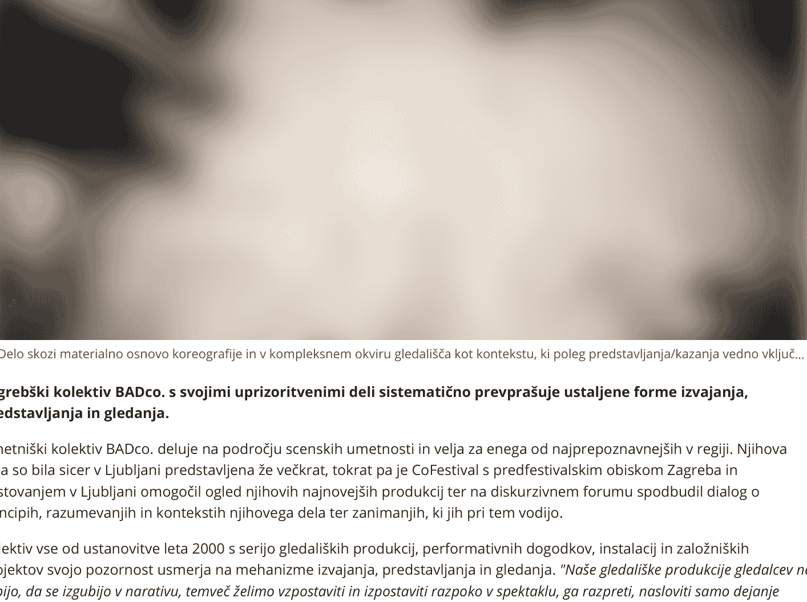

## BADco.：奇观解构

**萨格勒布集体 BADco. 通过其表演作品，系统性地质疑既定的表演、呈现与观看形式。**

艺术家集体 BADco. 活跃于舞台艺术领域，被认为是该地区最具辨识度的团体之一。他们的作品虽已在卢布尔雅那多次呈现，但此次 CoFestival 通过节前访问萨格勒布以及在卢布尔雅那的驻演，使观众得以观摩他们最新的制作，并在话语论坛上促进关于其工作原则、理解与语境以及驱动他们的兴趣的对话。

自2000年成立以来，该集体通过一系列戏剧制作、表演事件、装置和出版项目，将注意力聚焦于表演、呈现和观看的机制。"我们的戏剧制作并不邀请观众迷失于叙事之中，而是希望建立并凸显奇观中的裂隙，将其撕开，直面观看行为本身，并促使观众提出政治与艺术问题，"**伊万娜·伊夫科维奇**，集体成员之一说道。与同质化的媒体现实相反，他们将戏剧行为理解为一种不稳定的交流交换和想象空间，并如此保持——这种想象空间赋予观众自由，以及与此自由相应的观看责任——正如他们在2011年威尼斯双年展上以空间介入和视频装置*《对所见的责任》（Responsibility for the Things Seen）*所明确提出的。

### 集体栖居与视角的检验

集体的核心由**伊万娜·伊夫科维奇、安娜·克雷特迈尔、托米斯拉夫·梅达克、戈兰·塞尔盖伊·普里什塔什、尼科利娜·普里什塔什**和**兹林卡·乌兹比内茨**组成——三位舞者和编舞家、两位戏剧构作和一位哲学家，尽管他们工作的本质特征在于，他们以平等身份进入集体过程，没有预先设定的职业角色，或者说在创作功能之间存在持续的流动性。他们在多样的场地创作作品——在舞台上、画廊空间或废弃的工业建筑中——并以不同的形式——作为戏剧制作、共享空间的社群活动、装置、出版物（小册子、研究和创作过程的目录、视觉材料）。这使得表征的边界得以凸显，并打断总是相同图像及其配置的不断重复之流，在那里没有空间让差异在构想共同未来时涌现。

### 事件的痕迹进入身体

各个项目的工作方法取决于情境并同时反思情境。我们可以将共同点定义为他们在线性时间流中建立非线性戏剧构作的意图。为了强调我们如何建构视角这一问题，需要仔细考虑观众的位置以及观众与事件之间关系的形成。他们可以将此放得非常近并使其在观众眼前消散，建立对实际场所的边缘性、非寻常视角，或将观众分布于空间中，使多个层面甚至多部作品的编舞在单个视角中同时呈现，尽管他们不要求观众主动参与。他们邀请观众与表演者一同探索表演的物质性及其全部复杂性，从而强化观看作为一种创造性行为，并肯定共同创作即作品生产的价值。BADco. 运用文本材料、编舞、广泛的参考场域、节奏性和电影式蒙太奇以及对空间的深思熟虑的关系，创造精确结构化的作品，可在不同层面被接受——其中一些艺术符号、在场和思想"可读，另一些具有暗示性，第三种则仅是认知和感官动态的手段，直接进入我们的身体"，正如他们在 CoFestival 上所写的；艺术作品作为情感丛结，弥漫于观众之中，直到图像获得某种新意义和新想象力的轮廓，正如皮娅·布热扎夫舍克所言；图像与意义共同在编舞构造和观众接受之间涌现，并直面视角行为和观看行为本身。

正如伊夫科维奇所说，演出结束后观众常常留在舞台上，观看那里留存的东西，环顾空座位，触摸物品，开始他们自己的个人挖掘，在视角中转换戏剧事件，检验事件的痕迹和对刚见之事的记忆。留存在舞台上的东西如同某种事后手册或指南，是表演本身的延伸，某种正在形成而非刚刚发生的事情的感觉。

### nostalgia

### 语境，舞动改变

尽管创作者有舞蹈的专业背景，他们自视为戏剧集体，但类型归属的问题在他们这里比初看更有意思，因为这已经裂解了他们研究的本质特征。正如戈兰·塞尔盖伊·普里什塔什所解释的，他一直被抽象逻辑所吸引，这种逻辑更多与舞蹈和编舞思维相关，而非戏剧。舞蹈抽象性实际上要求显著的具象性；它不能容忍伪装，而这种伪装是角色表演性诠释所固有的，相反，它要求你将某物带入存在，然后我们才能共同思考发生了什么以及该物产生了什么。正是编舞的物质基础为这个集体打开了无限可能。"舞动比戏剧更容易改变（事物），"普里什塔什确信。在描述他们的工作时，他总结道：我们通过编舞过程来思考，以及它如何与观看行为联系起来。前者我们讨论的是舞蹈，它关乎显现/呈现的东西，当我们谈论观看时，我们讨论的是戏剧装置，作为展示和观看语境的戏剧。

在自身实践中，他们汲取并进入广泛的理论和实践参考库。普里什塔什在个人影响中首先提及的是**德拉甘·日瓦迪诺夫**的演出*《诺东——祈祷机器》*，其中他站在观众中间，在严肃的戏剧情景中鼓励他们发笑和做出大声反应，通过这些对观众的干扰切入观看经验本身；"感知到身后某处的这种噪音，第一次将我带到了观看经验本身，"普里什塔什在回顾性视角中认识到，这在他们后来的oppervlakt（原词为斯洛文尼亚语，保留不译）后期实践中得到体现，当时他关注表征逻辑以及观看行为中可见图像与不可见之间建立关系的可能性。法国启蒙哲学家**德尼·狄德罗**已将图像理念引入戏剧，在寻找不同的表演模态时从对同时代绘画的批评出发，并通过*活人画（tableau vivant）*引入停顿，中止舞台生活的可能性，使观众得以观察一幅图像。普里什塔什援引的另一个参考是**本雅明**关于瑜伽士身体的思考，他们将机器的实践（瑜伽练习）与呼吸和伸展的生命力结合起来，后者进入与图像结构的关系；尤其是电影的出现以及电影和电影理论对剧院黑匣子中观看转变的影响；电影如何运作，我们在剧院或影院中如何观看，如何将对象从一个坐标系统（电影）转换到另一个（剧院），如何找到表征在剧院中坍塌的视角。

### 环境中舞者的觉察与完整性

他们集体实践的重要部分是讨论。演出中的编舞工作始终是不同立场的所有参与者协商的结果，也是工作过程中所发生一切的总和沉淀。在此过程中，他们从调研和思考所设定的问题即问题主题出发，在数月的过程中，每个人作为个体找到自己进入材料的入口、与之建立联系也很重要，因为只有如此，表演的身体才能复杂而完整地运作。正如尼科利娜·普里什塔什所说，对他们的戏剧构作和编舞工作而言，"他者性逻辑"也很重要，这很好地体现在*Whatever Dance Toolbox*中，这是一款用于分析、发展和教育舞蹈动作的软件工具，它记录舞者的动作并将其投射为变形后的——有延迟、模糊或以其他方式处理的。"作为舞者，我们非常内化地专注，在使用这个工具时，当我们与屏幕上技术的自己形象共舞，并试图将其纳入动作时，重要的是分配注意力——向内和向外，对自己、对我们的形象以及对他人。必须不断转移注意力，在动作构成中，就空间、身体和周围一切进行协商，以稳定舞者工作时的完整性。"舞者必须意识到空间中发生的一切——环境、物品、声音和人。

始终是身体与环境的组合。如果舞者不以开放的感官工作，一切很快就会变得平庸。

对于人们不理解他们在跳什么的评论，她用观察足球的有趣比较来回应：组织场地的是球，当我们假装球不存在时，剩下的就是运动和编舞，在其中我们无法检测到规则。空间中的身体及其之间的关系，由一种对外部观察者而言陌生、模糊的逻辑所组织。"而对我来说，作为编舞，当我不在演出中跳舞时，这也是最有趣的；当舞者不再仅仅是我们约定规则或指令的诠释者，而是'偏离'它们并开始跳舞，对我来说变得陌生时，"她补充道。在这种物质性中，出现了一个空间，使得无尽的协商和视角得以涌现。

### 作品及其节奏

他们的作品*Spore*，在CoFestival框架内演出，将无限维护的任务（我们维护身体、房子、孩子、关系、清洁、技术、组织等）置于中心，这是每项活动、创造力和生产不可见的前提，同时也是顺畅工作和创造的障碍。创作者的出发点是美国诗人**Anne Boyer**的散文诗*《什么是不写作？》*，她在其中幽默而讽刺地写出了个人在众多工作、"半工作"和私人活动及角色（艺术家、母亲、朋友……）之间日常生活节奏的经验；这种经验既是个人的，也是社会和政治的。BADco. 将永无止境的维护的重复和惯性——它阻止了改变、移动、发展、创造的可能性——置于身体旋转——转动的编舞中。在干净且光线柔和、给人舒适温馨亲近感的场景中，他们构建了一个停滞动作、中断活动和在持续工作流中重复刻板的情境，展开了关于日常生活节奏、交替和自由可能性的问题。

在Kino Šiška还展出了三部分视频装置*《时间炸弹》*，作为艺术系列*《机构需要被构建》*的一部分，这是项目的记录和反思，在该项目中，集体成员与其他艺术家和观众一起，在24小时内占领了废弃的工业场所，这些场所（或应该）成为当代艺术实践的机构：里耶卡的Benčić工厂，即现代和当代艺术博物馆，萨格勒布的独立文化和青年中心Pogon – Jedinstvo，以及斯普利特未实现的青年之家。通过重构一些演出、电影放映、记录事件、讨论和按规范节奏（工作–自由时间–睡眠）睡觉，事件成为卢米埃尔兄弟第一部记录电影*《工厂出口》*（1895年）的重构，它成为工业崩溃和劳动及社会生活变化的社会编舞。被占领场所的用途改变，伴随着新的、认知和创造性工作形式，这些形式也打破了工作与休息时间的界限，并基于资本主义对人的消费，要求持续生产力，引发了关于机构作为建筑、工作、时间动态、时间表、组织形式的正式化因素，以及它们在结构可持续性与保持与公共领域需求和倡议接触的活力之间的张力的讨论。占领和视频装置的第三部分是对懒惰作为可能抵抗的某种致敬——少工作或/和以不同方式工作；毕竟，谁工作、何时工作以及如何工作的问题贯穿了这个项目的所有毛孔，该项目将参观者作为工人和观众同时带到现场。

### 乌托邦与行动

在表演装置*《建筑坑》*中，BADco. 以两个出发点探讨了规划未来的乌托邦思想，这两个出发点有趣地交织在一起：节日和十五：工作节奏——BADco.

*[本文尚需从斯洛文尼亚语翻译为中文。以下为根据上下文进行的推测性翻译，仅供参考。]*

### 辛西娅·冈萨雷斯——舞蹈剧透者

成为舞蹈剧透者意味着什么？在注意到辛西娅·冈萨雷斯在COFestival活动中为每位观众提供剧目简介时，走廊里就有人这样问她。"我不会做任何解决方案，在我的实践中，我认为我无法提供任何解决方案；这更多是关于撕裂空间的问题，"她说。

冈萨雷斯活跃于剧场和表演领域，是所有这些行动呆滞的表演者的桥梁，她从那里看到并联结一些大多时候相互忽视的元素：作品、表演中的表演者、身体、空间、当代艺术、学术和理论话语、与年长者相关的舞蹈实践——不仅仅作为表征对象，而当作经验知识库，也包括空间设计、剧透概念等。

作为所谓的舞蹈剧透者，冈萨雷斯试图干预和联结所有这些点，这绝非一个假定的中立立场。以下是**她的自白**：身体、关系、运动和观看的模式是她所热衷的，概念兴趣和时空政治也是如此。

### 翻译到此处中断，以下为原文剩余部分的直接呈现：

对于人们不理解他们在跳什么的评论，她用观察足球的有趣比较来回应：组织场地的是球，当我们假装球不存在时，剩下的就是运动和编舞，在其中我们无法检测到规则。空间中的身体及其之间的关系，由一种对外部观察者而言陌生、模糊的逻辑所组织。"而对我来说，作为编舞，当我不在演出中跳舞时，这也是最有趣的；当舞者不再仅仅是我们约定规则或指令的诠释者，而是'偏离'它们并开始跳舞，对我来说变得陌生时，"她补充道。在这种物质性中，出现了一个空间，使得无尽的协商和视角得以涌现。

### 作品及其节奏

Njihova predstava *Spore*, izvedena v okviru CoFestivala, v središče postavi neskončno opravilo vzdrževanja (vzdržujemo telo, hišo, otroke, odnose, čistočo, tehnologijo, organizacijo ipd.), ki je neviden predpogoj vsake dejavnosti, ustvarjalnosti in proizvodnje ter obenem prepreka nemotnemu delu in ustvarjanju. Izhodiščni impulz je ustvarjalcem predstavljala pesem v prozi *Kaj je ne-pisanje?*, v kateri ameriška pesnica **Anne Boyer** duhovito in ironično izpiše osebno izkušnjo vsakdanjega ritma življenja med številnimi delovnimi, "pol-delovnimi" in zasebnimi aktivnostmi ter vlogami (umetnice, matere, prijateljice …); izkušnjo, ki je osebna v enaki meri kot družbena in politična. Ponavljanje in inercijo nikoli končanega vzdrževanja, ki zaustavlja možnost spremembe, premika, razvoja, ustvarjanja, BADco. postavi v koreografijo telesne rotacije – obrata. Na izčiščenem in rahlo osvetljenem prizorišču, ki daje vtis prijetnega ambienta domačnosti in bližine, konstruirajo situacijo zaustavljenih gibov, prekinjenih dejavnosti in ponavljajoče se utirjenosti v toku nenehnega dela, razpirajo vprašanja o ritmih vsakdanjega življenja, možnostih premen in svobode.

V Kinu Šiška je bila razstavljena tudi tridelna video instalacija *Časovne bombe* kot del umetniške serije *Institutions Need to be Constructed*, dokument in refleksija projekta, v katerem so člani kolektiva z drugimi umetniki in občinstvom za 24 ur naselili zapuščena industrijska prizorišča, ki so (ali naj bi) postala institucije sodobnih umetniških praks: Reško tovarno Benčić oziroma Muzej moderne in sodobne umetnosti, zagrebški Center za neodvisno kulturo in mlade Pogon – Jedinstvo ter nerealizirani Dom mladih v Splitu. Z rekonstrukcijo nekaterih predstav, projekcijami filmov, snemanjem dogajanja, diskusijami in spanjem v ritmu normiranega (delo – prosti čas – spanje) dogajanje postane rekonstrukcijo prvega posnetega filma *Odhod iz tovarne* (1895) bratov **Lumière**, ki postane družbena koreografija za propad industrije in spremembo delovnega ter družbenega življenja. Sprememba namembnosti naseljenih prizorišč z novimi, kognitivnimi in ustvarjalnimi oblikami dela, ki porušijo tudi mejo med časom dela in počitka ter temeljijo na kapitalistični potrošnji ljudi z zahtevo po konstantni produktivnosti sproža razpravo o institucijah kot dejavnikih formalizacije arhitekture, dela, časovnih dinamik, urnikov, organizacije in njihovi napetosti med trajnostjo strukture ter ohranjanjem vitalnosti v stiku s potrebami in iniciativami javne sfere. Tretji del naselitve in video instalacije je nekakšen hommage lenobi kot možnem uporu – delati manj ali/in delati drugače; ne nazadnje, je vprašanja kdo dela, kdaj in kako vpleten v vse pore tega projekta, ki je na prizorišča obiskovalce pripeljal kot delavce in gledalce hkrati.

## Utopije in delovanje

V predstavi-instalaciji *Gradbena jama* BADco. naslavlja utopične ideje načrtovanja prihodnosti z dvema izhodiščema, ki zanimivo prepleteta arhitekturni in družbeni inženiring. Plesno instalacijo izvedejo v hiši hrvaškega arhitekta Vjekoslava Rihterja in igralke Nade Kareš Rihter (danes zbirka, ki jo upravlja Muzej sodobne umetnosti v Zagrebu). Rihterjevi utopični arhitekturni načrti – Zigurat kot ogromna stavba oziroma mesto v malem izhaja iz ideje po minimaliziranju časovnih izgub ob premikanju po mestu – se prekrijejo s protislovji utopističnih projektov v stalinistični Sovjetski zvezi, kot jih v distopijsko-satiričnem romanu *Iskop* izpiše **Andrej Platonov**; tu gradnja velikanskega stolpa kot proletarskega doma za vse pripadnike delavskega razreda in obljube svetle prihodnosti nove družbe propade pred postavitvijo temeljev in postane grob mladega dekleta. BADco. v tem tematskem kontekstu preplete koreografijo, besedila in postavitev prostora, dogajanje umesti v različne sobe hiše, po kateri se lahko obiskovalci prosto sprehajajo (po podiju, ki deluje kot del gradbenega odra) ter koreografijo zasnuje na konstrukcijskih principih arhitekturnega oblikovanja in s prevajanjem logike ter principov heroiziranih podob močnih, mladih in atletskih teles socrealistične umetnosti ter njene podpore političnim idealom. Ta logika in principi postanejo material za nov koreografski jezik in morda tudi za premislek o mehanizmih današnjih zamišljanj prihodnih teles ter arhitektur zanje.

Plesno-gledališka predstava *Poprave ritma* je nastala v koprodukciji s Hrvaškim narodnim gledališčem v Zagrebu na podlagi kratke zgodbe Pavla Pavličiča *Dobri duh Zagreba*, v kateri glavni junak obsesivno beleži zločine v mestu in gradi statističen model predikcije negativnih pojavov, ki se mu kažejo kot bistvo urbanega utripa in svojevrsten red, pravilnost, norma mesta. BADco. razbije klasični okvir uprizoritvene situacije, dogajanje kot v časovnem stroju zlje v trenutek, ki obsega različne (vse) čase hkrati in gledalce že z netipično organizacijo prostora postavi v izpostavljeno situacijo opazovanja te analitično forenzične obsesije preiskovanja zločinov in mestnih ritmov; najprej z balkona gledališča ob poslušanju besedila (Goran Ferčec) v mraku zremo v globino parterja in na prazen oder, kjer se za hip zasveti le gibljiva projekcija Zemlje, nato v tonske studiu, prehodnem prostoru s pogledom na trg in mestni vrvež, pričamo fragmentiranim koreografskim predlogam repetitivni strukturi se razkriva prepleteno omrežje dogajanj, v katerem protagonistovo opazovanje in analiza postane tudi konstrukcija in delovanje. Koreografska navodila so razvidna, izpeljava polna prizadevanj avtonomnih teles, nelagodje odločitev v popravkih ritma in ustvarjanju prihodnjih ritmov pa neizogibno.

## Sorodne novice

### CoFestival: Razprost uprizoritvenih situacij

### CoFestival - širitve plesnega polja: gibi vsakdanjega življenja in starejša telesa

### V središču CoFestivala letos hrvaški BADco. in ameriška koreografka Lucinda Childs
