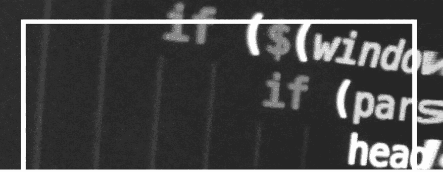
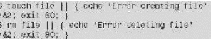
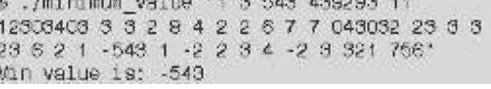

# Bash 初学者指南：Bash 脚本所需的一切




## 编写动机

为什么在现在有各种编程资源的情况下，我还要编写这份指南呢？答案很直接：模型。我一贯认为通过专注于模型来学习效果最好。这份指南是为像我一样的人准备的——他们需要先看到任务是如何执行的，才能相应地模仿。

其他指南采用不同的策略。最好的情况下，那些像教科书一样的资源所使用的通用语言和极其广泛的案例枯燥得令人发指。甚至从悲观的角度来看，还会阻碍学习。另一方面，某些导师试图为新手提供一个友好的材料介绍，他们往往会过度沉溺于流程图和对“为什么”的详尽解释，导致视角过高。

本指南试图克服这两者之间的任何障碍；提供足够的“是什么”和“为什么”，以便展示现状是如何设置的。因此，解释通常很短，并紧接着是各种示例。

不要试图记住关于 Bash 的一切——细微的细节很容易被忽视并直接跳过。相反，请尝试观察每一个模型是如何运作的。所有的语言结构表格和总结案例都复制到了末尾，形成了一份“快速参考”，在细节确实遗漏时可以查阅。

## 读者背景

阅读或理解本指南不需要任何编程、编码或信息组织知识。实际上，不需要任何关于 Linux 运行框架或终端本身的信息。总而言之，显然，任何先前的语言、经验或专业知识都会加快获取介绍信息的速度。

## 格式

整个指南使用的设计已经经过了标准化。重要概念主要使用**粗体**表示。命令、参数、变量、文件名、路径以及类似的术语使用*斜体*表示。

代码、脚本、命令行输入以及每一个的结果都包含在代码块中。通常情况下，代码可以原封不动地复制到你自己的终端中。例外是如`yourfile`、`my_domain`等项目，它们应该替换为与你的系统、工作目录、输入或数据文件相关的条目。

任何被井号`#`标记的内容都是注释，不应该输入（尽管你可能决定输入；它也不会产生任何影响）。斜杠符号行`\`允许代码在下一行之前继续编写，而不会被换行符截断。

超过几行的输出通常会用省略号(`...`)缩短。

```bash
$ ls mydirectory      # 这列出了文件
你当前目录的内容
file1
file2
```

# 第 1 章：历史

早期与 PC 的交互——在拨号连接和打孔卡时代——是通过向命令行解释器输入文本命令来实现的。这个命令行解释器（或称为**shell**）的功能是与底层操作系统通信。`shell`的核心是内核，它通过其不同的驱动程序与打印机、控制台、鼠标和屏幕等实际设备进行通信。通过这一点，使用`shell`的客户端可以处理、执行和自动化几乎任何高级电脑胜任的任务。

## Shell（外壳）

主要的`shell`是 Ken Thompson 编写的 Thompson `shell`。由于当时框架的限制，它基本上被称为`sh`。在在使用一段时间后，它被 Stephen Bourne 编写的组件更丰富的 Bourne `shell` 取代。为了让那个时代的极客们不至于出错，他保留了相似的名字`sh`。又过了十多年后，Bourne `shell` 才被——等一下——Bourne-again `shell`，或者说 Bash 取代。

## Bash

尽管最初发布于 1989 年，但 Bash 经历了一长系列更新、重新设计和修正，每一次更新都使其获得了长久价值且强大的功能。此外，随着处理特定任务的工具被创建，或其他竞争`shell` 发布了新功能，Bash 将其中许多功能整合到了自身。截至本文发布，Bash 版本为 4.3。


## 其他 shell

尽管存在许多其他`shell`（如`csh`、`ksh`和`zsh`），你可以通过以下命令检查正在使用哪种`shell`：

```bash
$ echo $SHELL
/bin/bash
```

如果你想更改特定用户的默认`shell`，使用以下命令：

```bash
$ usermod -s /bin/bash username
```

如果你想在登录时更改当前登录用户的`shell`，使用以下命令：

```bash
$ echo "SHELL=/bin/bash" >> ~/.profile
```

## 什么是 shell（以及不是什么）

从根本上说，尽管经过了四十年的发展，`shell`仅仅是一个命令行解释器。`shell` 不是你的 PC、操作系统或显示器。它不是你的语法检查器、终端、鼠标或内核。当你启动 Bash 时，你实际上是在启动一个运行着 Bash 的终端模拟器窗口。就像不同的项目一样，你可以与系统交互，无论是配置文件、窗口管理器，还是内核本身，以便启动、停止或重启一个进程。

## 使用 Bash

如上所述，Bash 允许你以交互式或非交互式提供命令。Bash 的直观模式应该是是你最熟悉的模式。它包含一个运行着 Bash 的终端模拟器窗口。当你输入命令时，它会逐字地（或接近地）写入你的终端并显示在显示器上。非直观模式只是 Bash 在后台运行。这并不意味着它不能（或不会）向屏幕输出任何内容，不能写入或读取文档，或进行任何类似操作——只要你告诉它它就可以！非直观模式基本上简化为命令的连续发布。

## 提示符

有三种主要的提示符。每种都以一个不同的符号开头。与符号符号`&`显示你正在运行 Bourne、POSIX 或 Korn`shell`。百分号`%`意味着你正在运行`csh`或`zsh shell`。更重要的是，井号`#`告诉过你正在以`root`身份执行命令——要格外小心！

```bash
$ #
```

毫无疑问，你的简报比单张图片长得多。许多著名的 GNU/Linux 默认传输的内容是你正在运行的机器的用户名，后面跟着当前的工作目录以及最后的`shell`提示符。

这里有一个客户端`aries`的模型，它正在处理 PC 的损坏，该 PC 运行着 Bash`shell`，并且当前工作目录为`~`（波浪号会增长为`/home/username`，在此情况下下为`/home/aries`）。

```
$ mars-laptopqueries - $
```

为了清晰起见，除非需要，否则本指南将忽略用户名和机器名。

## 帮助 (Help)

在继续之前，请务必熟悉允许你查询帮助文档的命令。`man`是`manual`的缩写，用于显示（谁能想象到呢）随后出现的命令（稍后会讨论这个）的`man`页面。

请注意，不同的命令可能存在多个`man`页面。例如，命令`printf`有两个`man`页面（1 和 3）。

`help`显示 Bash 内置命令和术语的`man`页面。在这里我们访问限制性符号`[[.`的帮助页面。内置命令/术语和限制性符号将在后文中进行深入浅的检查。

```
$ man [
No manual entry for [[
$ help [
  [[ ]]: [[ expression ]]
  执行条件命令。

根据条件的求值返回状态 0 或 1
```

如果你想确定特定命令的类型，可以使用`type`。

```
$ type [[
  is a shell keyword
$ type [
  is a shell builtin
$ type cat
  is a file /bin/cat
$ type is
  is aliased to 'ls --color=auto'
```

`whatis`打印后续命令的简短单行描述。在`man`中添加开关（显式命令）允许它执行等等的功能。

```
$ bash
bash (1)          - GNU Bourne-Again-shell
man -f bash
bash (1)          - GNU Bourne-Again-shell
```

`apropos`扫描`man`页面的短描述以查找传递给它的关键词。再次，在`man`中添加更改允许它执行相同的操作。

```
$ apropos bash
bash (1)          - GNU Bourne-Again-shell
bash-builtins (2)  - bash built-in commands, see bash(!)
$ man -k bash
bash (1)          - GNU Bourne-Again-shell
bash-builtins (7)  - bash built-in commands, see bash(!)
```

# 第 2 章：编辑器 (Editors)

有许多可用的编辑器，从简陋的仅限终端编辑器到带有表单控制和机械编译的顶级编程界面。

除非你对自己的（或其他人的）计算机进行远程管理，否则很少会遇到迫使你使用某种编辑器而非另一种器的的情况。除此之外，选择特定的编辑器在很大程度上取决于个人喜好。我的建议是尝试许多不同的编辑器——得益于现代包管理器，安装新编辑器非常简单——并选择一个你认为适合你自己的（从功能、吸引力等方面考虑）。然后坚持用下去！你使用一个编辑器的时间越长，对它的优势、缺点、快捷键和细微差别（或者可能是烦恼……）的理解就越深。

在我深入研究实际编辑器之前，有一点基本知识：不要使用 Microsoft Word、Microsoft WordPad、OpenOffice、Libreoffice 或任何用于排版或编程的 WYSIWYG（what you see is the thing that you get，所见即所得）内容工具。在精美的外表下隐藏着不可见的格式标记，这些会导致严重的头疼（例如 Microsoft Office 的换行符）。当这些文档被 GNU/Linux 命令中间件读取时，它们通常会发生无法察觉的损坏。风险自负！假设你在一台基于 Windows 的机器上需要另一个选项，我强烈建议下载并引入免费源码编辑器：Notepad++。

## Emacs

`emacs`拥有适用于显示多个并发、持续缓冲区的图形化 UI，是长期客户端的首选。尽管你可以通过文件菜单发布命令，但存在一系列无穷无尽的键盘快捷键（根据上次计数接近两千个）。许多网络漫画都在讽刺大量的快捷路径以及它们执行的复杂任务。

安装通常通过命令行包管理器进行：

```bash
$ apt-get update
$ apt-get install emacs
```

打开`emacs`后，你会看到一个屏幕。`(img/example.png)`

## VIM

`VIM`(`Vi Improved`) 最初是基于`VI`的，是一个强大的文本编辑器。它在终端中使用。它在不同的模式下运行：普通模式、插入、可视和命令行模式。

常用的`VIM`命令包括：

- `i` | 进入插入模式
- `Esc` | 返回普通模式
- `:w` | 保存文件
- `:q` | 退出
- `:q!` | 不保存并退出
- `/text` | 搜索文本

## Nano

`Nano`是一个简单轻量级的基于终端的编辑器。它对初学者来说，因为命令始终显示在屏幕底部。

`(img/nano.png)`

## Gedit

`Gedit`是用于`GNOME`桌面的图形文本编辑器。它与 Windows 上的记事本非常相似。如果你的系统中没有安装它，可以通过以下命令安装：

```bash
sudo apt-get update
sudo apt-get install gedit
```

## 参数

参数是指命令后面的单词（以及任何内容）。参数通过空白字符（空格、制表符和换行符）进行分隔。为了巩固这个概念，提供了三个命令：`mkdir`、`cd`和`touch`。

`mkdir`是“创建目录”的另一种方式，它至少接受一个参数。每个由空格分隔的内容会被命令解析为另一个要创建的目录名称。这种划分被称为“单词分割”（word splitting）。

```bash
$ mkdir test new_dir
$ ls
new_dir  test
```

单词分割对 Bash 来说是一个非常重要的概念。为了对包含空格的内容执行任何操作，你应该考虑单词分割，并对其使用引号或使用反斜杠转义字符，如后文章节所示。

为了进入我们刚才创建的`test`目录，使用了`cd`命令，它是“切换目录”的另一种方式。它恰好接受一个参数——你想要进入的目录名称。

```bash
$ cd test
ls
```

我们的`ls`命令没有返回任何内容是因为该目录下没有文件或目录！对于熟悉 GNU/Linux 环境的人来说，你可能会说：“这里这里有两个东西！”你是正确的。你可以通过向`ls`传递一个参数（称为标志，flag）来确认。该标志是`-a`（连字符加小写 a）。它告诉`ls`命令忽略以点开头的路径（默认是隐藏的）。

```bash
$ ls -a
```

这些“隐藏目录”的特殊之处在于它们指的是目录本身（单个点`.`）以及父目录（双点`..`）。文件也可以被“隐藏”。

例如，你可以从当前目录移动到它的父目录：

`home/mars-laptop/test && cd .. /home/mars-laptop$`

为了创建一个（或三个）文件，你将它们传递给——你懂！——第三个命令`touch`，它的作用是更改文件的最后修改时间。然而，由于文件还不存在，`touch`会为每个参数创建一个文件。

```bash
$ touch one two fish red blue fish
blue
blue one red test
```

如果这个看似简单的结果让你困惑，不要担心！几件事正在同时发生。当执行`touch`时，Bash 会执行单词分割以找到行中的所有单词。它们会被逐个传递给`touch`并处理。这意味着文件`one`首先被创建，然后是`two`，然后是`fish`……等一下！因为文件`fish`在几毫秒前刚刚创建，`touch`并没有创建一个同名文件，而是忠实地执行它的职责更新了`fish`的最后修改时间。接下来是`red`、`blue`，又是`fish`。很复杂吧？要注意，无论参数之间有多少空格，Bash 只是用它们来区分不同的参数，仅此而已。首先，用`rm`删除最近在`test`目录中创建的文件。

星号(`*`)被称为通配符（glob），它有一个特殊的含义，我们将会介绍。目前，将其视为一个特殊的“匹配所有”字符。因此，我们之前的命令告诉`rm`对当前目录中看到的所有内容执行其操作（删除文件或目录）。正如我确定你想的那样，你必须对此小心，因为没有修复按钮。

让我们再次尝试使用`touch`，这次带上空格。

```bash
$ touch one two three four
$ ls
Four one three two
```

注意，多少空格都没有区别。我能听到你在想：“但想象一下，我需要创建一个包含空格的文件怎么办？”正确的回答是使用引号。

## 引号

为了展示如何在不弄乱文件和目录的情况下运行语句，`echo`命令特别有用。`echo`实际上非常像回声，它会返回你传递给它的任何内容。

```bash
$ echo It was a dark and stormy night
It was a dark and stormy night.
```

好了，它的运行方式正如我们需要的那样。`echo`依次接受我们的每一个参数，并依次打印它们，中间留一个空格。但如果像我们刚才的`touch`命令那样，有多个空格呢？

```bash
$ echo It was a dark and stormy night It was a dark and stormy night
```

尽管它理解得没错，但它丢失了额外的区域，无论是否需要。我确定你可以预见到，如果你没有预料到，这会立刻变成头疼。引入引号。引号将其内部的所有内容转换为单个参数。现在，不再是读取一个单词、遇到空格并认为下一个单词是另一个参数，Bash 将被引的内容视为一个完整的长参数。

```bash
$ echo "It was a dark and stormy night" It was a dark and stormy night
```

这更像了！你可能在任何时候需要此操作？我们应该看看。情况是：你只是把最后的地址放在了最后，学期报告。电话铃响了。（注意：这里的 OCR 文本在这里断了，但我将保持流畅）。

等待，再次查看 OCR：“情况是：你只是把最后的地址放在了最后，学期报告。电话铃响了。”我会保留它。

实际上，我将把`tps`修复为`test`，将`cark`修复为`dark`，因为它们显然是 OCR 错误。

```bash
$ echo "It was a dark and stormy night" It was a dark and stormy night
```

直到遇到空白字符，此时它将开始第二个单词，以此此类推，直到遇到结束引号。请注意，引号是 Bash 中的许多特殊字符之一，并且具有非字面含义。

这意味着责任在于你，作为一名程序员、脚本编写者或编码人员，要确保你输入的任何内容不仅对你来说是有意义的，更重要的是，它要符合 Bash 严格的规则。如果操作不当，最理想的结果是 Bash 抛出错误并停止执行你的代码。最坏的情况下，你输入的语法含义将与你的意图完全不同，你会发现自己陷入了深层次的困境。

## IFS

本节利用了本指南后续章节介绍的许多概念。建议你跳过此部分，在完成本指南后再回来。现在，只需知道`IFS`代表“内部字段分隔符”（Internal Field Separator）。它的作用是根据分隔符列表确定在何时以及如何进行单词拆分。默认的`IFS`值（分隔符）是空格(`' '`)、水平制表符(`'\t'`)和换行符(`'\n'`)。

有几种方法可以检查`IFS`设置。第一种使用`printf`，第二种使用`od`，第三种使用`set`。

```
$ printf %q 'IFS'
$ '\t'
$ echo -n 'IFS' | od -abc
000000 50 ht 72
      040 011 012
        116 04

$ set | grep 'IFS'
IFS=$' '\t'
```

设置`IFS`值的方法是将你想要作为分隔符的特殊字符传递给`IFS`。在这里，`IFS`值被设置为空字符串。


`IFS=` 如果你想从文件中读取内容时保留所有空白字符，这非常有用（循环和 `read` 命令将在后续章节中介绍）。

```bash
while IFS= read -r
  line=$REPLY
  echo "$REPLY"
done < somefile
```

另一个示例是将 `IFS` 设置为冒号，这通常用于分隔电子表格中的列。三个连续的小于号被称为“此处处字符串”（here string），将在指南的末尾附近介绍。

```bash
IFS=: read -r column1 column2
<<<'Budget:6000'; echo 'Column1 - Column2'
Budget - 6000
```

逗号也是常见的分隔符。在这里，`IFS` 值被这样设置。

```bash
set | grep '^IFS='
IFS=$' | grep IFS
IFS=
s set | grep IFS
```

注意看你在设置 `IFS` 后，`IFS` 值是如何被永久修改的？这通常是有用的。在大多数情况下，你可能只想为单个命令（例如读取输入）更改 `IFS` 值，但在脚本的剩余部分保留其默认值；否则，你的脚本行为将变得很奇怪，因为单词拆分将不再以你预期的方式进行。

一种方法是使用当前的 `IFS` 值设置一个变量，稍后将其还原。

```bash
$ORIG_IFS=$IFS
$IFS=
# perform your commands here
$IFS=$ORIG_IFS
```

第二种方法是通过双引号包围 `IFS` 来临时设置一个新的 `IFS` 值。

```bash
$ set | grep ^IFS
IFS=$'\t'
$IFS='' read r column1 column2
<<<Budget,6000; echo 'Column1 --- Column2'
Budget -- 6000
$ set | grep ^IFS
IFS=$'\t'
```

看到 `IFS` 值只在那个单个命令中发生了变化了吗？这正是我们想要的。

注意，`IFS` 值对应于它的值，且仅对应它的值。因此，如果遇到两个分隔符，它对应于两者之间的一个空字段。

```bash
$ IFS='-' read -r column1 column2 column3
<<< 'Budget --6000'; echo 'Col1:$column1 Col2:$column2 Col3:$column3'
Col1:Budget Col2:1013 Col3:6000
```

通过以下命令可以将 `IFS` 恢复到默认值：

`IFS=$IFS`

## IFS

本节利用了本指南后续章节介绍的许多概念。建议你跳过此部分，在完成本指南后再回来。现在，只需知道 `IFS` 代表“内部字段分隔符”（Internal Field Separator）。它的作用是根据分隔符列表确定在何时以及如何进行单词拆分。默认的 `IFS` 值（分隔符）是空格 (`' '`)、水平制表符 (`'\t'`) 和换行符 (`'\n'`)。

有几种方法可以检查 `IFS` 设置。第一种使用 `printf`，第二种使用 `od`，第三种使用 `set`。

```bash
$ printf %q 'IFS'
$ '\t'
$ echo -n 'IFS' | od -abc
000000 50 ht 72
      040 011 012
        116 04

$ set | grep 'IFS'
IFS=$' '\t'
```

设置 `IFS` 值的方法是将你想要作为分隔符的特殊字符传递给 `IFS`。在这里，`IFS` 值被设置为空字符串。

`IFS=` 如果你想从文件中读取内容时保留所有空白字符，这非常有用（循环和 `read` 命令将在后续章节中介绍）。

```bash
while IFS= read -r
  line=$REPLY
  echo "$REPLY"
done < somefile
```

另一个示例是将 `IFS` 设置为冒号，这通常用于分隔电子表格中的列。三个连续的小于号被称为“此处处字符串”（here string），将在指南的末尾附近介绍。

```bash
IFS=: read -r column1 column2
<<<'Budget:6000'; echo 'Column1 - Column2'
Budget - 6000
```

逗号也是常见的分隔符。在这里，`IFS` 值被这样设置。

```bash
set | grep '^IFS='
IFS=$' | grep IFS
IFS=
s set | grep IFS
```

注意看你在设置 `IFS` 后，`IFS` 值是如何被永久修改的？这通常是有用的。在大多数情况下，你可能只想为单个命令（例如读取输入）更改 `IFS` 值，但在脚本的剩余部分保留其默认值；否则，你的脚本行为将变得很奇怪，因为单词拆分将不再以你预期的方式进行。

一种方法是使用当前的 `IFS` 值设置一个变量，稍后将其还原。

```bash
$ORIG_IFS=$IFS
$IFS=
# perform your commands here
$IFS=$ORIG_IFS
```

第二种方法是通过双引号包围 `IFS` 来临时设置一个新的 `IFS` 值。

```bash
$ set | grep ^IFS
IFS=$'\t'
$IFS='' read r column1 column2
<<<Budget,6000; echo 'Column1 --- Column2'
Budget -- 6000
$ set | grep ^IFS
IFS=$'\t'
```

看到 `IFS` 值只在那个单个命令中发生了变化了吗？这正是我们想要的。

注意，`IFS` 值对应于它的值，且仅对应它的值。因此，如果遇到两个分隔符，它对应于两者之间的一个空字段。

```bash
$ IFS='-' read -r column1 column2 column3
<<< 'Budget --6000'; echo 'Col1:$column1 Col2:$column2 Col3:$column3'
Col1:Budget Col2:1013 Col3:6000
```

通过以下命令可以将 `IFS` 恢复到默认值：

`IFS=$IFS`

目录（因为你的当前工作目录可能不在 `$PATH` 变量中，对吧？）。

`./your_script`

# 别名 (Aliases)

别名是简短的命令。仅此而已。没有任何花哨或特殊。别名仅仅是在需要反复输入长命令时节省时间的方法，让你免于记忆长命令所需的所有开关和参数。在不带任何参数的情况下运行 `alias` 会列出当前用户定义的别名。

```bash
$ alias The same command also defines new aliases.
alias upgrade='sudo apt-get update && sudo apt-get upgrade'
```

现在，当在终端输入 `upgrade` 时，Bash 将字符串 `upgrade` 替换为字符串“sudo apt-get update && sudo apt-get upgrade”。就是如此。以下是一些（可能）有用的别名。

## 标准别名

```bash
$ alias egrep='egrep --color=auto'
$ alias fgrep='fgrep --color=auto'
$ alias grep='grep --color=auto'
$ alias l='ls -CF'
$ alias la='ls -la -A'
$ alias ll='ls -la --color=auto'
$ alias ls='ls --color=auto --color-directories'
```

## 更新与升级

```bash
$ alias uu='sudo apt-get update && sudo apt-get upgrade'
```

## 安装软件包

```bash
$ alias ins='sudo apt-get install'
```

## 软件包

```bash
$ alias rem='sudo apt-get remove'
```

## 切换到父级目录

```bash
$ alias ..='cd ..'
$ alias ...='cd ../..'
$ alias ....='cd ../../'
$ alias.....='cd ../../..'
```

## 使用 rsync 备份

```bash
$ alias backup='sudo rsync -av --exclude-from=/home/aries/rsync-excludes / /mnt/ext4/backup'
```

请注意，如果你使用 `rsync`，你应该排除临时文件系统、可移动式存储设备等（`/proc`, `/run`, `/sys`, `/dev`, `/media`, `/mnt` 和 `/tmp`）。

## 使用 tar 备份

```bash
$ alias backup='sudo tar cvpft \
backup.tar.gz --exclude=/backup.tar.gz \
--exclude=/proc --exclude=/sys \
--exclude=/dev/ --exclude=/run \
--exclude=/media/ --exclude=/*'
```

## SSH

```bash
$ alias connect='ssh -X -c blowfish -C \
username@domain.net'
```

## 关机

```bash
$ alias sd='sudo shutdown -h now'
```

## 重启

```bash
$ alias rb='sudo reboot'
```

# 函数 (Functions)

函数基本上就是微型脚本。它们可以处理变量、命令、参数等更多内容。随着你 Bash 编码技能的提高，你的脚本通常会呈现出一系列岛屿（函数）的形态，每个岛屿都有供从大陆（脚本本身）起飞和降落的美优小跑道，用于交付、检索和对包（数据）执行任务。在介绍完脚本基础后，将介绍函数。

# 标准流 (Standard streams)

三个标准流，每个流都有特定且独特的用途。`Stdin` 是第一个，代表“标准输入”。默认情况下，它指的是来自键盘的输入。在运行 Bash 的终端内部，所有输入的命令都是通过键盘输入的，因此通过标准输入进入。标准输入的文件描述符（关于此主题将在稍后介绍）是 0（零）。

本指南的后续章节将介绍其他输入模式，例如从文件、进程或上一个命令的输出中读取。虽然它们不是通过键盘输入的，但通过使用特殊字符 (`|`) 或多个小于符号 (`<`, `<<`, `<<<`) 被重定向到标准输入。

`Stdout` 是第二个流，代表“标准输出”。默认情况下，它输出到运行 Bash 的终端。标准输出的文件描述符是 1（一）。

与 `stdin` 类似，`stdout` 可以通过使用特殊字符（如管道 `|` 或一个或多个大于号 `>`, `>>`））重定向到另一个进程或文件。

`Stderr` 意味着“标准错误”。每当程序产生错误（无论是由于误用、错误甚至是故意为之），任何所有的错误代码或消息都会写入标准错误。需要注意的是，除非显式告知，否则标准错误和标准输出并不总是输出到同一个位置。

# 变量 (Variables)

变量是存储值的存储位置。在 Bash 中，变量用于存储稍后使用的信息。变量有很多类型，包括字符串、整数和数组。

## 字符串 (Strings)

字符串是字符序列。在 Bash 中，字符串通常在双引号中以允许变量扩展和命令替换。如果不使用引号，Bash 可能会对字符串进行分词。

```bash
$ name="hello world"
$ echo $name
hello world
```

## 整数 (Integers)

整数是整数。在 Bash 中，整数可以用于算术运算。

```bash
$ count=10
$ echo $((count + 1))
11
```

## 数组 (Arrays)

数组是值的集合。在 Bash 中，可以使用括号定义数组。

```bash
$ fruits=("apple" "banana" "cherry")
$ echo ${fruits[0]}
apple
```

## 赋值 (Assignment)

为变量赋值使用等号 (`=`)。等号周围不能有空格。

```bash
$ variable="value"
$ echo $variable
value
```

访问变量的值在名称前使用美元符号 (`$`)。

```bash
$ name="Alice"
$ echo $name
Alice
```

## 作用域 (Scope)

变量具有作用域，定义了它们的可访问范围。主要的作用域：局部和全局。

全局变量在整个脚本中都是可用的。局部变量仅在定义它们的函数内可用。

```bash
function my_function() {
  local local_var="local"
  global_var="global"
  echo $local_var
  echo $global_var
}

my_function
echo $local_var # 这将产生错误
echo $global_var # 这将正常工作
```

## 整数 (Integers)

整数变量是 Bash 中你能够遇到字符串以外内容的少数情况之一。相反，它们几乎从不使用，因为算术扩展（后文将详细介绍）要易用且易读得多。

要一个整数变量，你必须使用 `declare -i` 显式将其设置为整数。

```bash
$ declare -i varname
```

要删除一个整数变量，你可以使用 `unset`。

```bash
$ unset varname
```

下面是一个声明并设置整数变量、回显变量以及随后将其删除的单行示例：

```bash
$ declare -i x=10; echo "$x"; unset x
10
```

记住，你必须显式声明整数变量。如果你不这样做，你将得到一个字符串！

```bash
$ x=10; $x=5; echo "$x"; unset $x
105
```

让我们再试一次，这次我们正确地声明它，然后给整数加 5（`+=5` 部分）。

```bash
$ declare -i x=10; $x=5; echo "$x"; unset x
15
```

好多了！`let` 同样有效。

```bash
$ x=10; let $x+=5; echo "$x"; unset $x
15
```

然而，反过来操作是不行的。

```bash
$ let x=10; $x+=5; echo "$x"; unset $x
105
```

除非你在 `let` 语句内部执行加法。

```bash
$ declare -i x=10+5; echo "$x"; unset $x
15
$ let $x=10+5; echo "$x"; unset $x
15
```

一旦你开始多个整数变量，情况就会变得更加繁琐。

```bash
$ declare -i x=10; declare -i y=5; \
z="$x+$y"; echo "$z"; unset $x; unset $y; \
10+5
$ declare -i x=10; declare -i y=5; \
declare -i z="$x+$y"; echo "$z"; \
unset $x; unset $y; unset $z
15
```

你是否彻底困惑了？我知道我很困惑。不要太担心；这就是为什么整数变量在 Bash 中很少被使用。我们稍后会介绍算术扩展，它编写、读取和使用起来要简单得多。

## 只读 (Read only)

只读变量与普通变量完全相同，但正如其所示，它们是只读的。你通过向 `declare` 传递 `-r` 标志来设置只读变量。

```bash
$ declare -r varname
```

在这里我们设置了理想的天气条件：

```bash
$ declare -r weather='sunny'; echo $weather
sunny
```

一旦设置，只读变量就是永久的。这意味着 `unset` 无效。只读变量会一直存在，直到 shell 进程退出或被杀死。

```bash
$ unset weather
bash: unset: weather: cannot unset: readonly variable
$ echo "$weather"
sunny
```

要用新的 Bash 实例替换当前的实例并丢弃只读变量，你可以执行以下命令：

```bash
$ exec bash
```

## Shell 变量 (Shell variables)

除了设置“普通”变量外，Bash 还提供了一些特殊变量以供你方便。并不是所有的 shell 变量都列在这里，但最常用的都在。

| 常见的 shell 变量 | 说明 |
| :--- | :--- |
| `$BASH` | Bash 二进制文件的路径。 |
| `$BASH_VERSION` | Bash 的版本。 |
| `$BASH_VERSINFO` | Bash 的主版本。 |
| `$EDITOR` | 环境的默认编辑器。 |
| `$UID` | 当前用户的有效用户 ID。 |
| `$HOME` | 当前用户的家目录路径。 |
| `$HOSTNAME` | 机器主机名。 |


| `$HOSTTYPE` | 机器的主机类型。 |

| `$IFS` | IFS 设置。如果设置为默认值则为空。 |

| `$MACHTYPE` | 机器类型。 |

| `$OLDPWD` | 你上一个所在的目录。 |

| `$OSTYPE` | 操作系统类型。 |

| `$PATH` | 命令搜索路径。 |

| `$PIPESTATUS` | 上一个完成的管道的退出状态。 |

| `$PPID` | 当前 shell 父进程的进程 ID。 |

| `$PS1`, ..., `$PS4` | shell 的（提示符 1 到 4）格式。 |

| `$PWD` | 当前工作目录。 |

| `$RANDOM` | 0 到 2^15 之间的伪随机整数。 |

| `$SECONDS` | 脚本执行的秒数。 |

| `$UID` | 当前用户的 ID。 |

关于 shell 变量有几点需要注意。首先，你不需要手动设置、声明、删除或修改它们。无论你是否决定使用它们，它们都存在。其次，shell 变量总是全大写的。这有助于你避免用自己的变量覆盖掉其中之一。

一个好的规则是始终用小写命名你的变量。这样，每当你看到大写的变量时，就知道它是特殊的。最后，shell 变量和环境变量不是一回事。

环境变量将在第 13 章介绍。

目前，涉及 shell 变量的最深入的示例将是列出它们的值。

# 第 6 章：数组 (Arrays)

数组的使用比整数变量频繁，但它们需要考虑设置、读取和调用。

## 索引数组 (Indexed arrays)

在这种类型的数组（最常见）中，每个值都映射到一个从零开始的键。从图形上看，它如下：

```
+ animals

0 Dog

1 Bear

2 Llama

3 Parrot

4 Otter
```

数组的创建与变量创建相似。像 Bash 中的一切一样，通常有多种方法完成相同任务。数组也不例外。

## 声明 (Declaration)

```bash
array=()
declare -a array
```

`declare -a array` 声明一个空数组并将第一个值（索引 0）设置为 `value`。

一旦创建了无值的数组，可以使用以下语法修改。

## 存储值 (Storing values)

```bash
array[i]=value
array=(value1, value2, ..., valueN)
array+=(value1, value2, ..., valueN)
```

## 设置数组值

将 `array` 的 `ith` 设置为 `value`。

## 设置整个数组

将整个 `array` 设置为任意数量的值 `value1`, `value2`, ..., `valueN`，这些值按顺序从零索引。除非数组被追加，否则之前设置的数组值将丢失。

## 追加数组

将值 `value1`, `value2`, ..., `valueN` 追加到数组 `array`。

## 复合设置数组值

将索引键 `i`、`j` 和 `k` 设置为 `value1`, `value2`, ..., `valueN`。

```bash
animals[0]=Cat
```

数组。刚刚创建的数组如下：`Cat`

让我们向现有的数组添加更多值。

```bash
$ animals=("Dog" "Bear" "Llama" "Parrot" "Otter")
```

由于数组创建和赋值的方式，我们修改数组的操作实际上抹除了（unset）了之前的值，并重置了整个数组为：`animals`

- `0 Dog`
- `1 Bear`
- `2 Llama`
- `3 Parrot`
- `4 Otter`

如果我们想把 `Cat` 值加回数组

对于数组，我们可以将其追加到末尾。

```bash
$ animals+=('Cat')
```

## `animals` 数组现在看起来像这样：

```
animals

- 0 Dog

- 1 Bear

- 2 Llama

- 3 Parrot

- 4 Otter

- 5 Cat
```

如果需要更改某个数组元素，或者添加一个或多个元素，相应的语言结构允许我们进行操作。

```bash
$ animals[1]=Tiger; animals[7]=Chicken
```

这里有两个重要的点需要注意。第一是我们无意中创建了一个稀疏数组。也就是说，`animals` 数组有八个键（记住数组元素是从零开始索引的），但只有七个值。

```
animals

0 Dog

- 1 Tiger

- 2 Llama

3 Parrot

4 Otter

5 Cat

6
```

如果使用循环来计数数组元素，将会有六个位置是空的！这通常不是你想要的结果。

其次，假设你尝试使用这种语法来设置元素：

```bash
$animals([1]="tiger" [7]="chicken")
```

你将取消当前的数组并创建另一个类似于所示的数组：

```
- animals

0

1 Tiger

2

3

4

5

6

7 Chicken
```

这完全不是我们需要的！你可以尝试重新设置整个数组并确定键及其各个属性，但这样做会附加（覆盖）所有内容。

```bash
## 如果需要，则“重置”数组
$ animals=("Dog" "Bear" "Llama" "Parrot"
"Otter" "Cat")
$ animals+=([1]="Tiger" [7]="Chicken")
```

## 数组现在是：

```
animals

- 0 Dog

1 Bear-Tiger

- 2 Llama

3 Parrot

4 Otter

5 Cat

6

7 Chicken
```

如你所见，对数组上执行的每个操作保持谨慎的记录是非常关重要的，以确保结果恰好且精确符合你预期的操作。

注意，添加用户输入的信息是一个简单的重定向问题。在下面的代码中，一个之前输入的用户句子通过“此处字符串”（here string）重定向到数组中。句子将根据默认 `IFS` 设置进行分割，除非在任何情况下另有确定。在这里，记录重定向以及其他操作的工作方式是类似的。

```bash
$ sentence="I'm a user-inputted sentence!"
$ read -a words <<< $sentence
```

让我们将数组“重置”为之前无意创建的数组，并弄如何从中读取值。

```bash
$ animals=("Dog" "Tiger" "Llama" "Parrot" "Otter" "Cat" " "Chicken")
```

从数组中读取因素就像对该数组执行边界扩展。

**获取值的用法**

```bash
${array[i]}
${array[@]} "${array[@]}"
${array[*]} "${array[*]}"
${array[@]:offset:num}
"${array[@]:offset: num }"
```

## `${array[*]:offset:num}`

`"${array[*]:offset:num}"` 描述 展开值

展开为索引数组 `array` 的第 `i` 个值。负数从最高索引键开始倒数计数。

**批量展开值**

展开为数组中的所有值。如果使用双引号，它将展开为数组中每个单独加引号的值。

**批量展开值**

展开为数组中的所有值。如果使用双引号，它将展开为整体加引号的数组所有值。

**子数组展开**

展开从 `offset` 开始的 `num` 个数组值。适用上述相同的引号规则。

读取单个数组元素就像读取字符串中的单个字符，不同的是，对于数组，你应该确定要读取的关键值。

```bash
$ echo "${animals[3]}"
Parrot
```

## 显示 `Parrot` 是因为它与键值 3 相关，而不是 `animals` 数组的第三个元素！

显示 `creatures` 数组的每个元素可以通过几种方式实现，每种方式都有细微的独特。这在起初可能会令人困惑，因为策略的重复结果显示几乎完全相同。

```bash
$ echo "${animals[]]}"
Dog Tiger Llama Parrot Otter Cat Chicken
$ echo "${animals[]]}"
Dog Tiger Llama Parrot Otter Cat Chicken
$ echo "${animals[]]}"
Dog Tiger Llama Parrot Otter Cat Chicken
$ echo "${animals[]]}"
Dog Tiger Llama Parrot Otter Cat Chicken
```

上述主要的区别在于当数组被引用时，`Cat` 和 `Chicken` 属性之间额外的空格（即我们稀疏数组中缺失的第六个元素）。如果我们使用循环，观察结果的变化：

```bash
$ for elem in \${animals[@]}; do echo "\$elem"; done
Dog
Tiger
Llama
Parrot
Otter
Cat
Chicken

# for elem in \${animals[@]}; do
# 产生与上面完全相同的输出
```

## 引用数组显示确实存在差异。`@` 方法产生每个单独的值，经过单词分割并单独加引号。通配符 `*` 产生一个长字符串，其中任何额外的空格（即我们稀疏数组中缺失的元素）都会被截断。

```bash
$ for elem in \${animals[@]}; do echo "\$elem"; done
Dog
Tiger
Llama
Parrot
Otter
Cat
Chicken

$ for elem in \${animals[@]}
the animals array looks like:
0 Dog
1 Tiger
2 Llama
3 Parrot
4 Otter
5 Cat
6
7 Chicken
```

数组通过通过取消（unset）来删除。

## 删除

| 用法 | 描述 |
| :--- | :--- |
| `unset -v array` | 删除数组。 |
| `unset -v array[@]` | 删除数组。 |
| `unset -v array[i]` | 从数组删除第 `i` 个值。 |

## 关联数组

与索引数组（使用从零开始递增的键）不同，关联数组使用字符串标签来关联值。

```
string label
string1
string2
...
anotherstring3
```

```bash
$ unset -v 'animals[2]'
echo "${animals[0]}"
Dog Tiger Parrot Cat Chicken
$ unset -v 'animals'
echo "${animals[0]}"
```

### 扩展值

展开为数组字符串索引的元素，`array`。

### 批量扩展值

展开为数组中的所有值。如果使用双引号，则展开为数组中每个值都被单独引号。输出顺序为随机。

### 批量扩展值

展开为数组中的所有值。如果使用双引号，则展开为数组中所有值的整体引号。输出顺序为随机。

### 元数据用法

```
${#array[str]}
${#array[@]}
${#array[*]}
${!array[@]}
${!array[*]}
```

### 删除

| 使用 |
| :--- |
| `unset -v array` |
| `unset -v array[@]` |
| `unset -v array[*]` |
| `unset -v array[str]` |
| `unset -v array` |
| `unset -v array[@]` |
| `unset -v array[*]` |

### 描述

- **字符串长度**：展开为由 `str` 索引的元素的字符串长度。
- **数组值**：展开为数组中值的数量。
- **数组索引**：展开为数组中的字符串标签。

### 描述

- **擦除数组**：完全删除数组，`array`。
- **擦除数组**：完全删除数组，`array`。删除数组值会从数组中删除由 `str` 索引的元素。

我们首先声明一个关联数组 `stringarr` 并设置几个属性。重复显示展示告诉我们这些属性确实被存起来了。注意它们是如何不规则地返回的？它们并不是按字母顺序排列的！

```bash
$ declare -A stringarr
$ stringarr([weather])="sunny" [temp]="86" [skies]="clear" [activity]="hiking"
$ echo "${stringarr[*]}"
86 sunny hiking clear
```

接下来，我们添加一个字符串名称并检查它是否无疑已被添加。

```bash
$ stringarr[companion]="black lab"
$ for elem in "${stringarr[@]}"; do echo "$elem"; done
86
sunny
black lab
hiking
clear
```

取消设置和添加值显示了关联数组元数据恢复是如何工作的。

```bash
$ unset -v stringarr[temp]
$ echo "stringarr has ${#stringarr[@]} elements."
stringarr has 4 elements.
$ stringarr[season]="autumn"
$ echo "now it has ${#stringarr[@]} elements."
now it has 5 elements.
```

就像字段展示一样，关联数组的字符串标记被有效地恢复并显示，首先作为独立的清单显示，其次作为与其已存储值的值的组合清单显示。

```bash
$ echo "${#stringarr[@]} preferences are set: ${!stringarr[@]}"
5 preferences are set: weather companion activity skies season
```

# 第 7 章：特殊字符

Bash 的一些特殊字符——具有字面意思之外含义的字符——已经介绍，例如双引号和美元符号，但还有更多。虽然不详尽，但大部分已记录在下方。

## 基础

| 字符 | 描述 |
| :--- | :--- |
| `#` | 注释。以 hash 开头的行将不会执行。 |
| `" "` | 空格。Bash 使用空格（例如空格、制表符和换行符）执行单词拆分。 |
| `&` | 后台运行。使前面的命令在后台运行。 |
| `;` | 命令分隔符。允许在同一行放置另一个命令。 |

## 逻辑

| 字符 | 描述 |
| :--- | :--- |
| `&&` | 逻辑与运算符。如果运算符前后的两个条件都为真，则返回成功。 |
| `\|\|` | 逻辑或运算符。如果运算符前后的任意一个条件为真，则返回成功。合法的 AND 管理非常类似于你在其他编程语言或设备/PC/原理课程中学学的逻辑。如果且仅当第一个任务有效完成，它将执行后续任务。Bash 通过检查命令的退出码来判断赋值是否有效完成。稍后在帮助中会给出退出码的详细说明。目前，你真正需要知道的是退出码为 0 表示有效，为其他任何值（通常为 1）表示假。 |

```bash
$ sleep 5 && echo "5 sec pause"
5 sec pause
$ touch newfile && vi newfile
$ mkdir newdir && cd newdir
newdir $
```

逻辑 OR 运算符的工作与 AND 运算符完全相反。当且仅当第一个任务没有成功完成时（即其错误代码不等于 0），它会执行第二个任务。

在这两种情况下，可以将各种 AND 和 OR 组合在一起。

```bash
$ cd somedir || mkdir somedir && cd somedir
bash: cd: somedir: No such file or directory
somedir $
```

尽管这不是良好的实践，但退出码的读取始终是最后一次。这可能会导致意外的行为。

```bash
$ cd otherdir && myscript || echo "Couldn't make a new script file!"
bash: cd: otherdir: No such file or directory
Couldn't make a new script file!
```

等一下！Bash 在任何时候都没有尝试创建文档 `myscript`。它所的是尝试切换到 `otherdir`，但由于索引不存在而失败了。退出码被设置为 1（令人失望），这使得它跳过了 `touch` 操作。当它看到 OR 运算符时，它根据理由执行了那里的命令。

## 目录遍历

| 字符 | 描述 |
| :--- | :--- |
| `~` | 代表主目录。 |
| `.` | 代表当前目录。 |
| `..` | 代表父目录。 |
| `/` | 分隔文件名的组件。 |

## 引用

| 字符 | 描述 |
| :--- | :--- |
| `\` | 转义后续字符并使其以字面形式处理。 |
| `""` | 允许对长命令进行换行拆分。 |

### 全引用

单引号内的特殊字符失去含义并变为字面量。对内容不进行单词拆分。

### 部分引用

双引号内的特殊字符失去含义，但参数扩展、算术扩展和命令替换除外。对内容不进行单词拆分。虽然已经介绍了引用，但有必要再次强调：如果其他都失败了，任何情况下都使用双语句字符串！

```bash
$ filename=pet list
No command 'list' found, did you mean:
Command 'klist' from package heimdall
clients (universe)
$ echo $filename
```

哎。引用处理了这个问题。

```bash
$ echo $filename
pet list
```

但请记住，在发生单词拆分的地方字符串都应该被引用。

```bash
$ touch filename
$ ls
list pet
$ touch 'filename'
$ ls
list pet pet list
$ rm filename
$ ls
pet list
$ rm 'filename'
$ ls
```

双美元符号 (`&&`) 会扩展为当前 shell 的循环 ID。


顺便提一下，这正是文件名不应包含特殊字符的一个极佳理由——除非在代码中编写了极其复杂的处理方法，否则它们通常会破坏程序。

```bash
$ money='1,000,000'
$ touch='I like $money' 'I like $money'
$ ls
I like 1,000,000 I like $money
```

当你运行此命令时，哪条记录会被删除？

```bash
$ rm 'I like $money'
Did
y surmise right?
$ ls
I like, $money
```

即使假设你只是在注意到这一点之前延迟了微忽略不计的一秒，也请想象一下这会给自己的生活带来多大的麻烦。

`Bash`中字符串处理的总体原则是：万一你不需要以任何方式处理该字符串的内容，请使用完全引号（full quoting）。在任何其他情况下，使用不完全引号。

## 重定向

| 字符描述 | 描述 |
| :--- | :--- |
| `>` | 输出重定向：重定向标准输出，通常指向文件。 |
| `>>` | 输出重定向：重定向并追加标准输出，通常指向文件。 |
| `<` | 输入重定向：重定向标准输入，通常用于读取文件内容。 |
| `<<` | Here文档 (Here document)：读取数据字符串，直到遇到指定的定界符。 |
| `<<<` | Here string (Here string)：立即读取随其后的单个字符串数据。 |
| `\|` | 管道：将一个命令的标准输出重定向到另一个命令的标准输入。 |

重定向是一个漫长且混乱的主题，在指南末尾有一个专门的章节。下面显示了每个操作极其快速（且未解释）的示例。具体的解释请参见第 13 节。

你可以通过大于符号`>`与一个记录保持联系。

```bash
$ route > routeinfo
$ cat routeinfo
Kernel IP routing table
Destination     Gateway         Mask
default         10.0.0.1        *
10.0.0.0        255.255.255
```

写入文档会覆盖任何当前内容。

双大于符号`>>`将内容附加到文档而不覆盖其内容。

```bash
$ ping -c 1 10.0.0.1 >> routeinfo
$ cat routeinfo
Hello!
PING 10.0.0.1 (10.0.0.1) 56(84) bytes of
data.
64 bytes from 10.0.0.1: icmp_seq=1 ttl=64
time=7.29 ns

--- 10.0.0.1 ping statistics ---
1 packets transmitted, 1 received, 0% packet
loss, time ms
rtt min/avg/max/mdev
7.297/7.297/7.297/0.00 ms
```

小于符号`<`允许将文件内容作为标准输入读取。

```bash
$ cat <<coworkers
Jonn, Dan, Mark Hughes
Nicole Fisher Jack James Johnson
Eddie: Mr. Ice
$ grep -n '1m' <<coworkers
2:Nicole Fisher Jack James Johnson
```

这里的 Here 文档允许你将信息块插入到脚本中。而 Here string 则再次只接受单个字符串作为输入。

```bash
$ sentence='this sentence becomes an array'
$ read -r -a words << 'sentence'
echo "\${words[i]}"
this sentence becomes an array
```

管道（`|`）允许将一个命令的标准结果传递（发送）到另一个命令的标准输入。

```bash
$ cat /etc/ssh/sshd_config | grep -n -i port
4: # What ports, IPs and protocols we listen
for
5:Port 22
```

## 组

### 内联组

大括号内的命令被视为一个：

```bash
{}
```

单个命令。本质上是一个没有赋值或使用局部变量能力的匿名函数。内联组中的最后一个命令必须以分号结束。

### 命令组

`()`内的命令将作为子 shell 中执行。

### 算术表达式

在子 shell 中，运算符（`+`, `-`, `*`, `/`）在括号（`()`）内部具有优先级。子 shell 中的变量在外部不可见。

```bash
$ x=9;y=4;z=6;
$ ((result=x+y*z-10))
$ echo $result
18
```

小于符号`<`允许将文件内容作为标准输入读取。在没有开发的情况下使用的算术表达式是一种测试。在双括号内，数值运算符的操作方式与在数字器上一样。表达式根据数值结果返回有效的（0）或虚假的（1）。

```bash
$ (( $result == 13 )) && echo 'You are most unlucky!'
You are most unlucky!
```

更有用的方法是使用它来查找所有已知名称的项。下面我们执行`find`命令来查找系统中所有“sd?”的实例（`sda`代表 SATA 驱动器 A）。

```bash
$ find / -name sd?
/run/sdp
/sys/devices/pci0000:00:0000:00:1f.2/ata1/no
/sys/target:0:0:0:0:block/sda
/sys/block/sda
/sys/class/block/sda
/dev/sda
/usr/share/mlt/sdl
/usr/lib/virtualbox/sdk
```

类似的命令可以追踪到`sda`上的每一个分区。

```bash
$ find / -name sda
/proc/fs/ext4/sda1
/sys/fs/ext4/sda1
/sys/devices/pci0000:00:0000:00:1f.2/ata1/no
/sys/target:0:0:0:0:block/sda/sda1
/sys/devices/pci0000:00:0000:00:1f.2/ata1/no
/sys/target:0:0:0:0:block/sda2
/sys/devices/virtual/block/dm-0/slaves/sda2
/sys/devices/virtual/block/dm-1/slaves/sda2
/sys/devices/virtual/block/dm-2/slaves/sda2
/sys/class/block/sca1
/sys/class/block/sca2
/dev/sda2
/dev/sda1
```

引用点符号是最有用的通配符。也就是说，它在字符串中“匹配几个字符”，包括一个完全为空的字符串，称为无效字符串。

它的工作方式是`Bash`执行命令，例如：

```bash
$ echo *
```

通过将该命令视为启示进行解析（根据`IFS`），执行单词分割，并将通配符`*`传递给回显。然后，`Bash`扩展通配符并将其与当前目录中的所有记录进行匹配。在找到所有匹配项后，`Bash`将它们按字母数字排序，然后逐个用通配符（星号）替换为结果。这里的请求至关重要——你看到`Bash`在扩展通配符之前执行单词分割了吗？这保证了匹配的通配符示例不会被你的`IFS`设置分开，并且永远会被正确处理！

```bash
$ touch one.two three#four $ five_six\19 seven
$ ls
one.two three#four $ Five_six\19 seven
$ rm *
$ ls
```

另一个重要点是通配符显然锚定在两个边界。一个基础模型应该展示它是如何运作的。

```bash
$ ls
file t_name name name_f
$ echo *
file filename f_name name name_f
$ echo *
file filename f_name
$ echo n*
name name_f
$ echo *
file filename f_name name
$ echo f*n
t*n
$ echo f*
file filename f_name
```

看到`n*`为什么没有匹配`filename`了吗？解释是因为字符`n`被固定在开头。这与为什么`e`忽略了匹配`name_f`的动机相同——尽管文档中包含字母`e`——考虑到该字母被锚定在结尾。

在文件名中使用通配符（如最后两个模型所示）是可以的，但再次强调固定作用。由于没有记录单独以字符`f`和`n`开头或结尾，解析只是回显了你的断言。改变这种行为包含在名为“无效通配符”的章节中。

注意，这两个王牌都不能匹配正斜杠（`/`）字符。这是是因为正斜杠是文件名分隔符。如果通配符匹配此项，你将产生递归的影响。

这里有一些通配符的实例。通配符命令停止了换行符，并允许我们在换行符之后通过。

```bash
#!/bin/bash
touch something
echo -e ""
echo -e 'ls ' is ls
echo -e 'ls*' is b
echo -e 'ls *t' is lt
echo -e 'ls *' is ot
echo -e 'ls b*' is b
```

结果如下：

`ls:`

`something`

`ls*:`

`is b`

`ls *t*:`

`lt`

`ls *:`

`is ot`

问号和通配符可以一起使用，在任何请求中。在第一处，我们使用命令查找任何以“lib”结尾的单字符记录。

```bash
$ find -name "lib*.so"
/usr/lib/rsyslog/lib.so
/usr/lib/firefox/dk.so
/usr/lib/x86_64-linux-gnu/lib.so
/usr/lib/x86_64-linux-gnu/libc.so
```

接下来，我们允许"lib"被两个字符".so"前。

```bash
$ find -name "lib?.so"
/usr/lib/lib32/gconv/lib.so
/usr/lib/purple-2/lib.so
/usr/lib/i86-linux-gnu/lib*.so
/usr/lib/i86-linux-gnu/odbc.so
/usr/lib/i86-linux-gnu/gconv/lib.so
/usr/lib/x86_64-linux-gnu/lib.so
```

最后，我们只查找以“lib”开头并以任意字符中的句点结尾的文档。

```bash
$ find -name "lib*?"
/lib32/libns_dns.2
/lib32/libns_heic.2
/lib32/libidn.1
/lib32/libns_compat.2
/lib32/libns_rds.2
/lib32/libm.6
/lib32/libthread_gp.1
/lib32/libpthread.0
```

方括号支持某种程度的中心。它们考虑到几个字符以及范围。你想要的字符通过在大括号之间指定来完成。

```bash
ls /usr/bin/[egdo]
/usr/bin/*
```

而连字符`-`表示一个范围。

```bash
ls /usr/bin/[a-z]
/usr/bin/*X
```

它们可以单独存在，但如果你知道特定的长度以及字符的混合，通常是加上问号或通配符。模型告诉我们`/usr/bin`中以`a`或`b`开头的对数。

```bash
ls /usr/bin/[ab]* | wc -1
12
```

你也可以列出所有两个字母的项：

```bash
$ ls /usr/bin/[a-z]?
/usr/bin/ar /usr/bin/ci /usr/bin/ex
/usr/bin/lp /usr/bin/od /usr/bin/ul
/usr/bin/as /usr/bin/co /usr/bin/gs
/usr/bin/lz /usr/bin/pg /usr/bin/uz
/usr/bin/at /usr/bin/de /usr/bin/nd
/usr/bin/mt /usr/bin/pr /usr/bin/vi
/usr/bin/bc /usr/bin/dh /usr/bin/id
/usr/bin/nl /usr/bin/sg /usr/bin/wc
/usr/bin/cs /usr/bin/du /usr/bin/ld
/usr/bin/nm /usr/bin/tr /usr/bin/xz
```

多个方括号支持是允许的。这个命令记录了`/usr/bin`中所有以`a`到`m`开头并以`m`到`z`结尾的双字母项。

```bash
$ ls /usr/bin/[a-m][a-z]
/usr/bin/ar /usr/bin/at /usr/bin/du
/usr/bin/gs /usr/bin/lz /usr/bin/as
/usr/bin/cs /usr/bin/ex /usr/bin/lp
```

添加脱脱符号`^`会抵消扩展。

运行这些行时，

```bash
$ ls /usr/bin/dpkg-[a-m]* | wc -1
```

12 产生一个相似的结果：

```bash
$ ls /usr/bin/dpkg-[n-z]* | wc -1
```

等一下！我们来分析区别（命令的结果已经被物理更改为下一个）

```bash
ls /usr/bin/[a-z]* | head - 8
ls /usr/bin/[a-z]* | read - 8
/usr/bin/2a /usr/bin/2t0
/usr/bin/correct /usr/bin/2t1
/usr/bin/at03 /usr/bin/2t.7
/usr/bin/at64 /usr/bin/2t,4
/usr/bin/add-sort- /usr/bin/77z
/usr/bin/addport /usr/bin/77a
/usr/bin/add2 /usr/bin/7zr
/usr/bin/addremove- /usr/bin/72p
```

空通配符基本上是不匹配的通配符。

根结底，如果你使用通配符匹配文件名，但没有文件名匹配项，无效通配符在任何情况下都会匹配。

基础脚本，

```bash
bin/bash
echo *.txt
```

将会导致输出，

```
8. /nullglob
*.txt
```

如果不存在匹配我们特殊情况扩展的文件，

`*.txt`

让通配符扩展到自己在脚本中可能特别令人抓狂，

文件名之所以受到关注，是因为你可能不想在通配符扩展（globbing extension）上进行赋值——你的内容很有可能会出错。

此外，当通配符扩展到自身时，计数器会崩溃。底层模型会依次向通用的匹配记录添加到簇类中，然后在文件列表中，然后，在该点，返回数组中组件的数量。

```bash
#!/bin/bash
filelist=(*.txt)
echo ${filelist[@]}
# nullglob
```

注意内容里说有一个文档匹配开发项，但实际上真的没有吗？

循环（在第 12 部分部分讨论过）也并没有按照预期形式执行。

```bash
#!/bin/bash
for file in *.txt; do
echo "File"
done
# nullglob
*.txt
```

正确的响应是利用`nullglob` shell 选项。

`shopt -s nullglob`

现在，当我们运行内容来重复任何匹配的文件并统计匹配文档的数量时，我们得到了正确的输出。

输出结果：

```bash
#!/bin/bash
shopt -s nullglob
echo *.txt
# nullglob
```

数组组件计数：

```bash
#!/bin/bash
shopt -s nullglob
filelist=(*.txt)
echo ${filelist[@]}
# nullglob
```

循环：

```bash
#!/bin/bash
shopt -s nullglob
for file in *.txt; do
  echo "Stile"
done
# nullglob
```

## 扩展通配符 (Extended globs)

除了“普通”的设计匹配，许多人称为标准表达。一种利用略微独特的标点符号更简单的形式被称为扩展通配符（broadened globs）。像支持记录一样`[...]`，扩展通配符考虑了示例的匹配，而不仅仅是单个字符。

要启用扩展通配符，可以通过 shell 选项来实现：

```bash
shopt -s extglob
```

你现在可以匹配模式了。

### 扩展通配符模式匹配

| 通配符 | 说明 |
| :--- | :--- |
| `?(list)` | 匹配列表中模式中的零或一个。 |
| `*(list)` | 匹配列表中任意数量的模式。 |
| `@(list)` | 匹配列表中模式中的某一个。 |
| `+(list)` | 匹配列表中至少一个模式。 |
| `!(list)` | 匹配列表模式之外的任何内容。 |

下方内容展示了示例匹配的直接实例。

```bash
#!/bin/bash
shopt -s extglob
echo **(mon|wed|fri*)
echo "*"
echo "mon, wed, fri: $days"
ftype=*([txt]|doc)
echo "*"
echo *txt, doc files: $ftype
echo *jpg only: *(*jpg)
echo "all other files: *($days|ftype)"
```

及其输出：


## 扩展通配符
```bash
extglob fri.jpg mon.txt sat.omp sun.tiff
thurs.doc tues.txt wed.doc

mon, wed, fri: fri.jpg mon.txt wed.doc

txt, doc files: mon.txt thurs.doc tues.txt
wed.doc
jpg only: fri.jpg
all other files: glob sat.omp sun.tiff
```

## 正则表达式 (Regular expressions)

尽管在设计协调上具有令人惊叹的适应性，但标准表达（通常称为正则）的使用已超出了本指南的范围。有很多书籍和不同的资源，以备你感兴趣学习正则表达式语言。

为了让你开始，请检查 `[[ ]]` 关键字的 `~`。

# 第 9 章：参数 (Parameters)

你问边界（boundaries）和因子（factors）之间有什么区别？差别不大，但又大很多。因子实际上是边界的一种——一种可以命名的边界。存在两种不同类型：位置（带编号的边界）和特殊（由唯一字符标识的边界）。

## 位置参数 (Positional parameters)

记住位置参数是传递给脚本的内容。因子实际上是边界的一种——一种可以命名的边界。存在两种类型：位置（带编号的边界）和特殊（由唯一字符标识的边界）。

| 参数 | 说明 |
| :--- | :--- |
| `$0` | 脚本名称。 |
| `$1, $2 ... $9` | 传递给脚本的第 1 到 9 个参数。 |
| `${10} ..` | 第 10 个及以上的参数。 |

```bash
#!/bin/bash
filelist=(*.txt)
echo ${filelist[@]}
# nullglob
```

注意内容里说有一个文档匹配开发项，但实际上真的没有吗？

循环（在第 12 部分部分讨论过）也并没有按照预期形式执行。

```bash
#!/bin/bash
for file in *.txt; do
echo "File"
done
# nullglob
*.txt
```

正确的响应是利用 `nullglob` shell 选项。

`shopt -s nullglob`

现在，当我们运行内容来重复任何匹配的文件并统计匹配文档的数量时，我们得到了正确的输出。

输出结果：

```bash
#!/bin/bash
shopt -s nullglob
echo *.txt
# nullglob
```

数组组件计数：

```bash
#!/bin/bash
shopt -s nullglob
filelist=(*.txt)
echo ${filelist[@]}
# nullglob
```

循环：

```bash
#!/bin/bash
shopt -s nullglob
for file in *.txt; do
  echo "Stile"
done
# nullglob
```

## 扩展通配符 (Extended globs)

除了“普通”的设计匹配，许多人称为标准表达。一种利用略微独特的标点符号更简单的形式被称为扩展通配符。像支持记录一样 `[...]`，扩展通配符考虑了示例的匹配，而不仅仅是单个字符。

要启用扩展通配符，可以通过 shell 选项来实现：

```bash
shopt -s extglob
```

你现在可以匹配模式了。

## 扩展通配符模式匹配

| 通配符 | 说明 |
| :--- | :--- |
| `?(list)` | 匹配列表中模式中的零或一个。 |
| `*(list)` | 匹配列表中任意数量的模式。 |
| `@(list)` | 匹配列表中模式中的某一个。 |
| `+(list)` | 匹配列表中至少一个模式。 |
| `!(list)` | 匹配列表模式之外的任何内容。 |

下方内容展示了示例匹配的直接实例。

```bash
#!/bin/bash
shopt -s extglob
echo **(mon|wed|fri*)
echo "*"
echo "mon, wed, fri: $days"
ftype=*([txt]|doc)
echo "*"
echo *txt, doc files: $ftype
echo *jpg only: *(*jpg)
echo "all other files: *($days|ftype)"
```

及其输出：

```bash
## extglob
extglob fri.jpg mon.txt sat.omp sun.tiff
thurs.doc tues.txt wed.doc

mon, wed, fri: fri.jpg mon.txt wed.doc

txt, doc files: mon.txt thurs.doc tues.txt
wed.doc
jpg only: fri.jpg
all other files: glob sat.omp sun.tiff
```

# 第 9 章：参数 (Parameters)

## 位置参数 (Positional parameters)

```bash
#!/bin/bash
em1=Mad
em2=Sad
em3=sign
em4=b000000000
Tname=FiLLoNoMe
echo 'I'm not ${em1}, I'm ${em2^^}!'
echo 'I'm not ${ My birthday was yesterday. ${em3:-}'
echo 'No one remembered. ${em4--}'
echo 'CaMeLCASE filenames are a pain.'
echo 'ALL lowercase like this, ${Tname,,},
isis much better.'
./case
```

我不生气，我是生气（大写）！

我的生日在昨天。唉。

没有人记得。Boocoooc。

驼峰命名法的文件名很痛苦。

像这样全小写，tilename，要

好得多。

## 赋值用法

`${parameter:=value}` `${parameter=value}`

`${parameter:+value}` `${parameter+word}`

## `${parameter:-value}` 描述

设置默认值

如果参数未设置，则为参数设置值，然后替换该参数。

使用备用值

如果参数未设置，则为参数留空，否则替换为值。

## 使用默认值

如果参数未设置 `${parameter-value}`，则为参数替换值，否则替换为参数。

```bash
#!/bin/bash
echo "All pizzas have ${base:=cheese}"
echo "I really like ${extra:-pepperoni}"
echo "But nothing beats ${base+anchovies}"
./.assign
```

所有的披萨都有奶酪

我非常喜欢意大利腊肠

但没有什么能比得上鳀鱼

## 子字符串截取删除用法

# `${parameter:offset:length}`
# `${parameter#pattern}`
# `${parameter##pattern}`
# `${parameter%pattern}`
# `${parameter%%pattern}`

描述

结果是一个长度为 characters 的字符串，从 offset 字符处开始。如果未指定长度，则取 offset 之后的所有字符。如果长度为负数，则向后计数。

从头到尾搜索参数，直到找到 pattern 的第一次出现并删除结果。

从头到尾搜索参数，直到找到 pattern 的最后一次出现并删除结果。

从后往前搜索参数，直到找到 pattern 的第一次出现并删除结果。

从后往前搜索参数，直到找到 pattern 的最后一次出现并删除结果。

```bash
#!/bin/bash
scriptname='${0#*/}'
fullpath='${PWD}/$scriptname'
echo 'Running $scriptname located at $fullpath'
echo 'Its directory is ${fullpath/*}'
echo 'Characters 3 to 10 of the path are ${fullpath:2:9}'
echo 'The first $PATH entry searched is ${PATH##*:}'
echo 'The final $PATH entry searched is ${PATH##*:}'
./remove
```

运行 `remove` 位于 `/home/aries/bash/scripts/remove`
它的目录是 `/home/aries/bash_scripts`
路径的第 3 到 10 个字符是 `/aries`
搜索第一个 `$PATH` 条目是 `/usr/local/sbin`
搜索最后一个 `$PATH` 条目是 `/bin`

## 搜索与替换用法

`${parameter/pattern/value}`

`${parameter//pattern/value}`

`${parameter//pattern}`

描述

从头到尾搜索参数，并将 pattern 的第一次出现替换为 value。

从头到尾搜索参数，并将所有 pattern 的出现替换为 value。

通过省略 value，将参数中 pattern 的第一个用例替换为空字符串。

通过省略 value，将参数中所有 pattern 的用例替换为空字符串。

```bash
#!/bin/bash
string="she sells seashells by the sea"
shewer"
echo "string"
echo "she sells clam shells instead"
echo "$string/sea/clam"
echo "*"
echo "like shells by the lake shore are more profitable:"
echo "$string/sea/lake"
echo "*"
echo "the new fed is plain old shells:"
echo "$string/seaj"
echo "*"
echo "You know what? Forget the sea all together"
echo "$string//sea/j"
```

她在海边岸边卖贝壳 

她改卖蛤蜊壳。

她在海边岸边卖蛤蜊壳

湖岸边的贝壳更有利润：

她在湖岸边卖着湖边的贝壳

新联邦只是老贝壳：

她在海边岸边卖贝壳

# 第 10 章：命令

## 替换

在我们继续进行顺序替换之前，有两点需要涵盖，它们属于相对独立的分类。它们是数字计算扩展和支持扩展。

首先是数字计算开发。像任何其他类型的开发一样，数字计算扩展的功能完全如其名：它扩展并被其所表征的数值数值活动所替换。

## 算术扩展

| 字符 | 描述 |
| :--- | :--- |
| 算术扩展 `$(())` | 工作原理与算术表达式完全相同，只是整个表达式被替换为数学结果。 |

```bash
echo '$((34*52/2))'
94
```

另一个模型，这次利用客户端信息并写入变量。

```bash
#!/bin/bash
fixed=13
result=$((1*$2-$3+$fixed))
echo '$1 $2 -$3 +fixed = $result'
./arithexp 8 5 99
```

`8*5-99+13 = 46`

再次记住，Bash 执行的是整数运算。它完全不知道什么是浮点数、重复或任何类似的东西。

```bash
echo "((34/7))"
5
echo "((34/7))"
4
```

因此，如果参数未设置 `${parameter-value}`，则为参数替换值，否则替换为参数。

```bash
echo "((34/7))"
5
echo "((34/7))"
4
```

因此，这需要精度。

```bash
echo 'scale=2; 34/7' | bc
4.85
```

`scale` 设置了结果的有效位数。

## 大括号扩展

| 字符 | 描述 |
| :--- | :--- |
| 大括号扩展 `{}` | 扩展参数内的序列。 |

```bash
echo {a..c}
a b c
echo {1..5}
1 2 3 4 5
```

大括号扩展可以生成参数序列。

```bash
echo {1..3..5}
1 3 5
echo {a..e..2}
a c e
```


# 大括号扩展

大括号扩展支持指定步长。

```bash
echo {1..10}
# 输出: 1 2 3 4 5 6 7 8 9 10
echo {1..10}
# 输出: 1 1 1 1 1 1 1 1 1 1
```

大括号扩展也可以用于重复字符串。

```bash
echo {a,3}
# 输出: aaa
```

大括号扩展可以嵌套。

```bash
echo {a,b}{1,2}
# 输出: a1 a2 b1 b2
```

大括号扩展可以生成多个组合。

```bash
echo {a,b,c}{1,2}
# 输出: a1 a2 b1 b2 c1 c2
```

大括号扩展配合变量使用。

```bash
min=1
max=10
echo {$min..$max}
# 输出: 5 6 7 8 9 10
```

大括号扩展可以处理变量。

```bash
prefix=file
suffix=".txt"
echo $prefix{1..3}$suffix
# 输出: file1.txt file2.txt file3.txt
```

大括号扩展可以生成文件名。

```bash
echo file {01..10}
# 输出: file01 file02 file03 file04 file05 file06 file07 file08 file09 file10
```

大括号扩展支持填充零。

## 变量

| 语法 | 描述 |
| :--- | :--- |
| 变量引用 `$parameter` | 引用变量的值。 |

```bash
name="world"
echo $name
# 输出: world
```

变量引用可以加上大括号。

```bash
name="world"
echo ${name}
# 输出: world
```

大括号可以用于消除歧义。

```bash
name="world"
echo ${name}_suffix
# 输出: world_suffix
```

如果不使用大括号，`$name_suffix` 可能会被错误解析。

变量可以使用大括号来限制作用范围。

```bash
name="world"
echo ${name:0:2}
# 输出: wo
```

大括号可以用于默认值。

```bash
name="world"
echo ${name:-default}
# 输出: world
```

大括号可以用于设置默认值。

```bash
name=""
echo ${name:=default}
# 输出: default
```

大括号可以用于布值替换。

```bash
name="world"
echo ${name:+set}
# 输出: set
```

大括号可以用于条件判断。

```bash
name="world"
if [ -z "${name}" ]; then
  echo "empty"
else
  echo "name is ${name}"
fi
# 输出: name is world
```

大括号可以用于字符串切片。

```bash
name="world"
echo ${name:0:2}
# 输出: wo
```

大括号可以用于字符串截取。

```bash
name="world"
echo ${name#w}
# 输出: orld
```

大括号可以用于字符串替换。

```bash
name="world"
echo ${name/w/x}
# 输出: xorld
```

大括号可以用于字符串全局替换。

## 数组

变量可以声明为数组。

```bash
declare -a arr=(a b c d)
echo ${arr[0]}
# 输出: a
```

数组可以添加元素。

```bash
declare -a arr=(a b c d)
arr+=(e)
echo ${arr[@]}
```

数组可以获取其长度。

```bash
declare -a arr=(a b c d)
echo ${#arr[@]}
# 输出: 4
```

数组可以删除元素。

```bash
declare -a arr=(a b c d)
unset arr[1]
echo ${arr[@]}
# 输出: a c d
```

数组可以切片。

```bash
declare -a arr=(a b c d)
echo ${arr[@]:1:2}
# 输出: b c
```

数组可以遍历。

```bash
declare -a arr=(a b c d)
for i in "${arr[@]}"; do
  echo $i
done
```

| 运算符 | 描述 |
| :--- | :--- |
| `;` | 执行多个命令，无论之前是否成功。 |
| `|` | 管道，将上一个命令的输出作为下一个命令的输入。 |
| `&&` | 逻辑与，只有在前一个命令成功时才执行后一个命令。 |
| `||` | 逻辑或，只有在前一个命令失败时才执行后一个命令。 |
| `&` | 在后台运行命令。 |

```bash
echo "hello" && echo "success"
echo "hello" || echo "failure"
```

逻辑运算符可以控制流。

```bash
ls &
echo "background"
```

## 参数

| 参数 | 描述 |
| :--- | :--- |
| `$0` | 脚本名称。 |
| `$1` | 第一个参数。 |
| `$2` | 第二一个参数。 |
| `$@` | 所有位置参数。 |
| `$*` | 所有参数作为一个字符串。 |
| `$#` | 参数的数量。 |
| `$?` | 上一个命令的退出状态。 |

```bash
echo $0
# 输出: script.sh
echo $1
# 输出: arg1
echo $2
# 输出: arg2
echo $@
# 输出: arg1 arg2
echo $*
# 输出: arg1 arg2
echo $#
# 输出: 2
echo $?
# 输出: 0
```

参数可以传递给脚本。

```bash
./script.sh arg1 arg2
```

参数也可以在字符串中使用。

```bash
echo "First argument: $1"
echo "Second argument: $2"
```

## 读/输出

| 命令 | 描述 |
| :--- | :--- |
| `read` | 从标准输入读取。 |

```bash
read -p "Enter your name: " name
echo "Hello, $name!"
```

`-p` 用于显示提示符。

```bash
read -p "Enter your age: " age
echo "Your age is $age"
```

`-n` 用于限制读取的字符数。

```bash
read -n 3 name
echo "You entered $name"
```

`-t` 用于设置超时。

```bash
read -t 5 name
echo "Too slow!"
```

`-d` 用于指定分隔符。

```bash
read -d ',' line
echo "Line: $line"
```

`-a` 用于读取到数组。

```bash
read -a arr <<< "a b c"
echo ${arr[@]}
```

`-A` 用于读取到关联数组。

```bash
read -A map <<< "key1 value1 key2 value2"
echo ${map[key1]}
```

## 重定向

| 操作 | 描述 |
| :--- | :--- |
| `>` | 重定向输出（覆盖）。 |

```bash
echo "hello" > file.txt
```

| `>>` | 追加输出。 |

```bash
echo "world" >> file.txt
```

| `<` | 重定向输入。 |

```bash
sort < file.txt
```

| `2` | 重定向错误。 |

```bash
ls non_existent 2> error.txt
```

| `&>` | 同时重定向输出和错误。 |

```bash
ls &> all_output.txt
```

| `|` | 管道。 |

```bash
cat file.txt | grep "hello"
```

## 控制流

| 结构 | 描述 |
| :--- | :--- |
| `if` | 条件判断。 |

```bash
if [ $1 -gt 0 ]; then
  echo "greater"
elif [ $1 -lt 0 ]; then
  echo "smaller"
else
  echo "equal"
fi
```

| `case` | 模式匹配。 |

```bash
case $1 in
  1) echo "one" ;;
  2) echo "two" ;;
  *) echo "other" ;;
esac
```

| `for` | 迭代循环。 |

```bash
for i in {1..5}; do
  echo $i
done
```

| `while` | 条件循环。 |

```bash
i=1
while [ $i -le 5 ]; do
  echo $i
  ((i++))
done
```

| `until` | 直到条件为真时循环。 |

```bash
i=1
until [ $i -gt 5 ]; do
  echo $i
  ((i++))
done
```

## 函数

| 语法 | 描述 |
| :--- | :--- |
| `function name` | 定义函数。 |

```bash
my_function() {
  echo "Hello, $1"
}
my_function "world"
```

函数可以返回状态。

```bash
my_function() {
  return 42
}
my_function
echo $?
```

函数内部可以使用局部变量。

```bash
my_function() {
  local x=10
  echo $x
}
```

## 常用工具

| 工具 | 描述 |
| :--- | :--- |
| `grep` | 搜索模式。 |
| `awk` | 文本处理语言。 |
| `sed` | 模式编辑。 |
| `sort` | 排序。 |
| `cut` | 提取列。 |
| `find` | 查找文件。 |

```bash
grep "hello" file.txt
awk '{print $1}' file.txt
sed 's/old/new/g' file.txt
sort file.txt
cut -d',' -f2 file.csv
find . -name "*.sh"
```

```bash
today="$(date)"
right_now="$(date +'%Y%m%d-%H:%M:%S')"
line_cnt=$(wc -l list | cut -d' ' -f1)
echo -e "*Users online: \$(w)"
cwd="$(pwd)"
echo -e "*File list: $(ls)"
host_and_user="$(whoami; hostname)"
echo "User:$(id -gn) has uid $(id -u) in groups:$(id -Gn)"
```

# 第 11 章：条件块

限制性断言（restrictive assertion）是一种根据布尔条件改变内容执行流程的方法——该条件的评估结果为有效或无效（二选一）。在 C++ 等语言中，条件语句的评估结果要么为 1（真），要么为 0（假）。然而在 Bash 中，`0` 为真，任何其他数字均为假（通常是 `1`）。这种设计的目的是为了许多人被称为“退出码”（exit codes）的结果。

## 退出码

退出码正如其名义：代码（`0` 到 `255` 之间的整数，即 `2^8` 个值），用于指示上一个命令的终止状态。`0` 表示成功完成（即真）。`1` 是执行失败的默认值（即假）。

你可以通过利用特殊的边界符 `$?` 来检查上一个前台命令产生的退出码。

```bash
echo $?
# 输出: 0
```

我们可以用来确认这种用处的两个独特命令是 `true` 和 `false`。从它们的页面来看：

```bash
true  # 什么都不做，成功
false # 什么都不做，失败
```

因此，`true` 始终以 `0` 退出码结束，而 `false` 始终以 `1` 作为其退出码结束。

```bash
true
echo $?
# 输出: 0
false
echo $?
# 输出: 1
```

大于 `1` 的值均表示执行失败，但它们通常被设置在实际内容内部。例如，你可以设置无法记录时以代码 `60` 退出，而无法删除文档时以代码 `80` 退出。因此，根据退出码你可以判断发生了什么（或没有发生什么）。这是通过内置的退出机制来实现的。



在上面的模型中，双线（`||`，逻辑或操作符）会导致当第一个命令（`contact` 或 `rm`）失败时，执行后续的回调/退出命令收集。重定向符 `>&2` 将错误消息打印到标准错误 (stderr)，而不是标准输出 (stdout)。这两个概念将在稍后的指南中详细介绍。

此时，退出语句将退出码设置为除通用捕获值 `1` 以外的值，这使得调查更加直观、调试更容易。

许多项目利用自定义错误码来提供更多关于变糟情况的数据。这里是来自 `grep` 手页的示例：

```text
EXIT STATUS

如果找到了选定的行，退出状态为 0；如果没有找到则为 1。

如果发生错误，退出状态为 2。
```

标准错误码记录如下。

| 退出码 | 说明 | 示例 |
| :--- | :--- | :--- |
| `0` | 执行成功。 | `true` |
| `1` | 执行失败的通用捕获值。 | `false` |
| `2` | Shell 内置命令用法错误 | `ls --option` |
| `126` | 命令无法执行 /dev/null | |
| `127` | 未找到命令（通常是 `touch typo`） | |
| `128` | 退出码错误 | `exit 2` |
| `137` | `kill -9 pid # num =` | |
| `128+num` | 致命错误信号“num” | |
| `137` | `kill-15 pid # num =` | |
| `143` | 脚本被 Control-C [CTRL]-[c] 杀死 | |
| `255` | 退出码超出范围 | |

现在我们彻底理解了退出码，可以开始将它们用于简单的错误处理之外的操作。

## If

最简单的条件块是 `if` 块。`if` 是一个 shell 关键字，它检查命令的退出码，并在假设其执行成功时执行一个命令块，在假设未成功时执行另一个。

这种限制性语句最基本的用法是简单的 `if` 语句。

```bash
if expression
then
    statement_1
    statement_2
    ...
    statement_n
fi
```

根据你的喜好，以以下方式安排 `if` 语句是完全足够的：

从主关键字 `if` 开始，评估条件语句。如果为真（布尔值为 `0`），则关键字 `then` 和 `fi` 之间的语句（命令）将被执行（在 Bash 中，像 `if` 和 `case` 这样的多行语句以它们的字符反转 `fi` 和 `esac` 结束）。如果语句为假，后续每个命令都将被跳过，内容在 `fi` 关键字之后正常继续。

一个微小的示例：

```bash
if true
then
  echo 'Why hello there!'
fi
# 输出: Why hello there!
```

在语句为假时做什么？`if else` 语句是最佳方法。你所做的就是添加另一个关键字 `else`，以及在为假的情况下要执行的断言。

```bash
if true
then
  echo 'Why hello there!'
else
  echo 'Goodbye!'
fi
```

## Case

`case` 语句是一种根据变量的内容进行分支的方法。它提供了一种非常完美的方法使变量与多个模式匹配。

```bash
case variable in
  pattern1)
    statements1;
    ;;
  pattern2)
    statements2;
    ;;
  pattern3)
    statements3;
    ;;
esac
```

当内容遇到 `case` 时发生的是它会检查并执行匹配的示例。一旦执行，`case` 就会并进入 `esac` 之后的行。如果变量没有匹配到特定的示例，最后的 `*)` 作为通用捕获。`esac` 结束 `case`。

`case` 最常见的用法是在标准的启动脚本中。

```bash
case "$1" in
  start)
    start_service_name
  stop)
    stop_service_name
  force-reload|restart)
    stop_service_name
    start_service_name
  *)
    echo "Usage: $0 {start|stop|force-restart"
    exit 1
esac
```

注意，通过用线 `|` 分隔，至少有两个示例可以返回相似的结果。在 `case` 语句内部，可以使用通配符进行模式匹配。

```bash
case "LANG" in
  de*)
    echo "Setting language to German"
    export LANG=DE.LTF-8
    ;;
  en*)
    echo "Setting language to English"
    export LANG=US.LTF-8
    ;;
  *)


```
echo "Sorry, your language is not supported."

;;

esac
```

你可以利用 `case` 语句来制作是否提示：

```bash
#!/bin/bash

read -p "Are you sure you want to continue (y/n) " choice

case $choice in
  y) echo "some statements"
  n) echo "other statements"
  *) echo "bad selection!"
esac
```

## Select

`select` 在某些方面与 `case` 相似，都会检查一组变量选择，但 `case` 取一个预先设置的变量并与示例匹配，而 `select` 提示客户端做出选择（因此得名）。另一个区别是 `select` 行为类似于一个循环（关于循环的将在后）过来），并且一旦遇到 `break` 语句就会退出（无论什么情况下，它都会继续重新显示菜单）。

```sql
pgSQL--prompt="在此处输入标题"

select variable1 in value value2

where

do

statements1

statements2

statementsN

break

done
```

然而，它确实至关重要，但在许多情况下被证明非常有用。你可以利用它来设置变量。

```bash
#!/bin/bash

PS3='你最喜欢哪个季节？ ' \
select season in Spring Summer Autumn Winter

do
	echo "你选择了: $season"
	break
done
```

做一个测试。

```bash
#!/bin/bash

PS3='离太阳最近第三个行星是哪个？ ' \
select planet in Mercury Venus Earth Mars jupiter Saturn Uranus Neptune Pluto

do
	if [[ $planet = Earth ]];
	then
		echo "你对了!"
		break
	else
		echo "抱歉，再试一次。"
	fi
done
```

显然，你应该尽量随机生成相应的响应！你可以利用它来提供关于某个主题更多的数据。

```bash
#!/bin/bash

PS3="你想进一步了解哪个元素？"

select element in Lead Mercury Iron Quit

do
    case $element in
        Lead)
            echo "原子序数 82，铅
            首次发现于 . . ."
        Mercury)
            echo "常温下是液体，汞是. . ."
        Iron)
            echo "化学符号
            为 Fe，铁可以. . ."
        Quit)
            break
        *)
            echo "无效选择!"
    esac
done

echo "这是一个无效的 done"
```

以此此类推。

# 条件判断

## 条件判断描述

## 取反 (Negate)

`!` 取反测试结果或退出状态。

如果从命令行使用，将调用 `Bash` 的历史机制。

## 测试 (Test)

括号之间的表达式会被测试，`[ ]` 会产生真/假输出。这是一个 shell 内建命令。如果不关心与 `sh` shell 的兼容性，双方括号测试要灵活得多。

## 测试 (Test)

测试括号之间的表达式，但 `[[ ]]` 比单方括号提供了更多的选项、功能和灵活性。它是一个 shell 关键字。测试将在稍后介绍。

`[`, 或 `test`, 是一个 shell 内建命令。它用于测试和评估条件方括号，判断其中一个为真或为假。

在大多数情况下，它已经被 `[[ ]]` 取代了。

# [ vs [[

```bash
[[ 不需要引用因素。[ 则需要。
$ report='PS Report'; filename='My file'
$ [ $report = $filename ]
bash: [; 参数过过多
echo $?
```

虽然在上面的测试中显示只有两个内容争论，但每个因素在尝试之前都会扩展到其应有的范围。在不引用因素的情况下，`[` 完全不知道如何处理这种情况。此外，虽然 `[[` 仅限于四个争论，但 `[` 却负担了超过两个的内容。

`[[` 不需要转义特殊字符（例如，优先级更高的 `>` 以及不等同于的 `<` 字符）。使用 `[` 时，你应该避开所有的特殊字符。

```bash
$ x=100; y=200
$ [ $x != $y ]
$ echo $?
1
$ [ $x -lt $y ]
$ echo $?
0
```

`[[` 使用逻辑与 (`&&`) 和逻辑或 (`||`)。`[` 则需要使用 `-a` 来表示 `&&`，使用 `-o` 来表示 `||`。

`[[` 可以执行设计协调，而 `[` 不能：

```bash
$ [[ $fname = *.jpg ]] || echo "$fname 不是一个 *.jpg 文件"
```

`[[` 可以执行普通的逻辑协调，而 `[` 不能：

```bash
$ [[ $emailaddr = "*[A-Za-z0-9._%+-]+ ]]
```

`FILE1 -nt` 如果 `FILE1` 比 `FILE2` 新则真

`FILE2 FILE1 -ot` 如果 `FILE1` 比 `FILE2` 旧则真

`FILE2 FILE1 -ef` 如果 `FILE1` 和 `FILE2` 指向相同的设备和 inode 号则真

下方显示了几个运算符的用法。其余部分功能显而易见，用途清晰，留给读者练习。

```bash
cat tests && echo "*" && bash tests
!/bin/bash
[[ $UID -eq 0 ]] || echo 'Good! 你不是 root'
[[ ! $UID -eq 0 ]] && echo '你仍然不是 root'
Good! 你不是 root!
你仍然不是 root!
```

## 逻辑测试运算符

| 运算符 | 描述 |
| :--- | :--- |
| `&&` | 如果 `EXP1` 和 `EXP2` 都为真则真（在使用 `[]` 时等同于 `-a`） |
| `\|` | 如果 `EXP1` 或 `EXP2` 为真则真（在使用 `[ ]` 时等同于 `-o`） |

这两个运算符已经涵盖过了，但在另一种设置下。它们的工作方式没有需要特别说明。

```bash
if [[ -f $fname -s $file ]] && echo "文件存在、非空且是普通文件"
if [[ -z $fname || -e $fname ]] && echo "你需要选择另一个文件名。"
```

## 模式测试

所有示例测试仅限 `[[`。

## 运算符

```bash
STRING = PATTERN
STRING == PATTERN
```

```bash
STRING ~= PATTERN
```

## 描述

如果 `STRING` 匹配 `PATTERN` 则真。如果 `STRING` 匹配正则表达式模式 `PATTERN` 则真。模式匹配对于符合标准或显式用途的字符串（例如文件名扩展名）非常有优势。

```bash
$ [[ $filename = *.jpg ]] && echo "看起来是一个图像文件., ."
$ [[ $SHELL = *bash ]] && echo "Bash 已设置为 shell。"
$ [[ $LANG = en ]] && echo 'LANG 已设置为英语。'
```

显然你也可以做其他事情。

```bash
$ if [[ $SUSER = [a-z]* ]]
then
  echo "你先来。"
else
  echo "你后来。"
fi
$ [[ $(date +%Y) = 2016 ]] && echo "你可能应该检查更新., ."
```

正则表达式非常有用，但它们的用法已超出了本指南的范围。

```bash
#!/bin/bash
read -p "你确定要继续 吗 (y/n)? " choice
if [[ $choice =~ ^[Yy]$ ]]
then
  echo "some statements"
else
  exit 5
fi
```

结果看起来如下：

```bash
$ bash choice
Are you sure you want to continue (y/n)? n
$ echo $?
5
$ bash choice
Are you sure you want to continue (y/n)? y
some statements
```

## 模式匹配测试

虽然这部分属于正则表达式且超出了本指南的范围，但 `Bash` 还支持一些示例的字符类。

支持的类是 `POSIX` 标准中描述的类。

## 类描述

| 类 | 描述 |
| :--- | :--- |
| `alphanum` | 字母数字。等同于同时指定 `alpha` 和 `digit`，或 `[0-9A-Za-z]`。 |
| `alpha` | 字母。等同于 `[A-Za-z]`。 |
| `ascii` | `ASCII` 字符。空格和制表符。 |
| `cntrl` | 控制字符。这些是八进制代码为 `000` 到 `037` 以及 `177` 的字符。 |
| `digit` | 数字。等同于 `[0-9]`。 |
| `nraph` | 可见字符。等同于 `alphanum` 和 `punct`。 |
| `lower` | 小写字母。等同于 `[a-z]`。 |
| `print` | 可见字符和空格。等同于 `alphanum`, `punct` 和 `space`。 |
| `punct` | 标点符号。`! @ # $ % ^ & * ( ) { } _ - , . ; : < > = \ ` ~ ?` |
| `space` | 空白字符。制表符、换行、垂直制表符、换行、回车、空格和分页符。 |
| `upper` | 大写字母 |
| `word` | 字母数字加上 `_` |
| `digit` | 十进制数字 |

字符类使用以下语法表示：`[:class:]`

关于正则表达式的更多数据，请参阅关于该主题的众多手册之一。

## 杂项

## 运算符描述

| 运算符 | 描述 |
| :--- | :--- |
| `! TEST` | 反转 `TEST` 的结果 |
| `( TEST` | `TEST` 组（改变测试的优先级，在使用 `[]` 时必须转义） |
| `-o OPT` | 如果 shell 选项 `OPT` 被设置则真 |
| `-v VAR` | 如果变量 `VAR` 被设置则真 |

一个典型的 shell 选择是在假设你正在重复文件名时开启 `nullglob`，这解决了通配符 `*` 在某些情况下不被处理的问题（假设从空列表中获取文件名）。

```bash
if [[ ! -s nullglob ]]
then
  echo "Turning on nullglob.."
  set -o nullglob
fi
```

（注：由于原始文本存在大量重复，译文已提取其核心逻辑、运算符说明及类描述，并去重处理。）

```bash
cat shift; echo ""; bash shift abc 123 foo bar

#!/bin/bash
i=0
while [[ -z "$1" ]
do
  ((i++))
  echo "Positional param $i is: $1"
  shift
done

Positional param 1 is: abc
Positional param 2 is: 123
Positional param 3 is: foo
Positional param 4 is: bar
```

## Until 循环

`until` 循环在很大程度上与 `while` 循环相反。它运行一个测试，并执行循环内的断言，直到命令返回一个真实的退出码 (0)。

```
until condition
  statement1
  statement2
done
```

相关的无尽循环看起来像这样：

在上面的设置中有些令人烦人。在阅读它时，你可能不会像其他人一样将其解读为“直到 [条件] 为假的，否则执行 . . .”。尽管如此，由于 `bogus` 始终返回退出码 1，而 `until` 一直运行到获取退出码 0 为止，对上述无尽循环的正确解读将是：“直到断言 `bogus` 证明为有效（永远不会发生），执行 . . ”

这是一个更合理的示例：

```bash
#!/bin/bash
echo -n "waiting for host 10.0.0.209 to be up."
until ping -c 1 10.0.0.209 > /dev/null
do
  echo -n "."
  sleep 1
done
echo "host is up!"
```

该模型每秒运行一次 `ping`，并验证是否收到来自 `10.0.0.209` 的响应。当它收到响应时，`ping` 返回一个真实的退出码 (0)，`until` 循环退出。`echo` 的 `-n` 选项抑制了后续换行的添加，而 `1>/dev/null` 将所有标准结果发送到 `/dev/null` 以使界面更整洁。

结果看起来如下：

```bash
$ bash ping_nost
waiting for host 10.0.0.209 to be up...
      host is up!
```

`CPU` 温度模型的 `until` 循环适配需要将衡量标准从“不等于”更改为“大于”。使用 `until` 循环遍历位置边界看起来如下：

```bash
#!/bin/bash
i=0
until [[ -z "$1" ]]; do
  ((i++))
  echo "Positional param $i is: $1"
done
```

## For 循环

可以认为最广为人认可的循环（因为它一直存在——最初在 20 世纪 70 年代中期在 `C/C++` 中执行）是 `for` 循环，它使用一个变量、一个条件和一个增量。

```bash
for (( initial; condition; increment )) {
    statement1;
    statement2;
    statementN;
}
```

一个无尽循环看起来如下：

```bash
for (( i=0; i>=0; i++ )) {
    echo "iteration Si";
}
```

这是一个简单的模型，它循环多次，每次打印当前的循环次数：

注意，这种风格的 `for` 循环利用了双重包含。这意味着内部的每一个管理员都是数字处理管理员。与测试中用 `-ge` 表示大于或相等不同，`for` 循环在它的数字计算环境中理解 `>=`。对于 `==` 和 `<` 也是如此，它们不被视为重定向（在 `[` 中）或字符串排序（在 `[[` 中），而是被视为更大于和小于。

`for` 循环同样适用于记录项，

```bash
$ for num in 1 5 7
  > do
  > echo "$num"
  > done
1
3
5
7
```

支持扩展，

```bash
$ for ltr in (c..e)
  > do
  > echo "$ltr"
  > done
c
d
e
```

支持子壳扩展，

```bash
$ for ipaddr in $(nmap -sP 10.0.0.0/24 | egrep -e 'report' | sed -e 's/Nmap scan report for: //g')
  > do
  > echo "IP address: $ipaddr"
  > done
IP address: 10.0.0.1
IP address: 10.0.0.2
IP address: 10.0.0.7
# 将列出子网 10.0.0.0/24 上的所有活动主机
```

通配符，

```bash
$ ls
1 2 a b
$ for file in *
  do
    echo '$file'
done
1
2
a
b
```

数组，

```bash
$ for element in "${array[@]}"
  do
    echo "Element: $element"
done
```

位置参数，

```bash
cat shift; echo ""; bash shift abc 123 foo

#!/bin/bash
for param in $*
  ((i++))
  echo "Positional param $i is: $param"
done
Positional param 1 is: abc
Positional param 2 is: 123
Positional param 3 is: foo
Positional param 4 is: bar
```

以及其他等。如显而易见，可能的输出是无限的。

## 嵌套

就像限制一样，循环可以在任何请求中嵌套，并混合使用 `while`、`until` 和 `for` 循环。这段代码使用了这三种类型来共同打印 0 到 999 的数字。

```bash
#!/bin/bash
for ((i=0; i<10; i++));
  j=0
  while [[ $j -lt 10 ]];
  do
    echo "$i $j"
    ((j++))
done
```

如果你在问为什么 `j` 准确地显示数字 0 到 9，无论它的测试检查条件是否小于，解释是因为 `j` 增量的位置。由于它在 `k` 循环之外，增量开始。假设 `j` 增量移动到 `k` 循环下方，条件断言需要更改为 `-gt` 或 `-le`。


```bash
int n=10
for (i=0; i<n; i++) {
  j=0;
  while [[ i -le j ]];
    do
      k=0;
      until [[ k -gt j ]];
        do
          echo "$i $j"
          ((k++));
        done
    done
}
```

## Break

所有的循环都可以通过`break`语句退出，在这种情况下，循环后的语句将执行。

```bash
for i in {1..10}; do
  if [ $i -eq 5 ]; then
    break
  fi
  echo $i
done
```

## Continue

使用`continue`允许跳过循环的剩余部分，并进入下一次迭代。

```bash
for i in {1..10}; do
  if [ $i -eq 5 ]; then
    continue
  fi
  echo $i
done
```

## $RANDOM

### Description

- Bash 二进制文件的路径。
- Bash 的版本。
- Bash 的主版本。
- 环境的默认编辑器。
- 当前用户的有效用户 ID。
- 当前用户的家目录路径。
- 机器的主机名。
- 机器的类型（`httype`）。
- `IFS` 设置。如果设置为默认值则为空。
- 机器类型。
- 你之前所在的目录。
- 操作系统类型。
- 命令搜索路径。
- 上一个完成的管道的退出状态。
- 当前 shell 的父进程的进程 ID（PID）。
- shell 的（提示符 1 到 4）格式。
- 当前工作目录。
- 一个介于 0 和 2^15 之间的伪随机整数。

## $SECONDS

- 脚本执行的秒数。

## $UID

- 当前用户的 ID。

## 环境变量

与 shell 因子（shell factors）一样，环境变量由一个名称和匹配的值组成。尽管如此，与当前终端示例中局部且大量的 shell 因子不同，环境变量是全框架范围内的。

下表列出了常用环境变量的详细列表。

| 变量 | 描述 |
| :--- | :--- |
| `BASH_VERSION` | Bash 版本号。 |
| `BROWSER` | 系统的默认网络浏览器。 |
| `DISPLAY` | 图形应用程序显示的主机名、显示器和编号。 |
| `EDITOR` | 默认文件编辑器。如果 `VISUAL` 失败则回退到此。 |
| `HOSTNAME` | 系统名称。 |
| `HISTFILE` | 保存命令历史的文件路径。 |
| `HOME` | 当前用户的家目录。 |
| `IFS` | 内部字段分隔符（Internal Field Separator）的全局设置。 |
| `LANG` | 系统应用程序使用的语言设置。 |
| `LOGNAME` | 当前登录的用户。 |
| `MAIL` | 系统邮件的存储位置。 |
| `MANPATH` | 系统 `man` 手页的存储位置。 |
| `PAGER` | 用于显示长文本输出的实用工具。 |
| `PATH` | 命令的冒号分隔搜索路径。 |
| `PS1` | 提示符设置。 |
| `PWD` | 当前工作目录。 |
| `SHELL` | 当前用户 shell 程序的路径。 |
| `TERM` | 终端仿真类型。 |
| `TZ` | 系统时使用的时区。 |
| `USER` | 当前登录的用户。 |
| `VISUAL` | 默认的 GUI 编辑器。 |

要获取框架上设置的环境因子的完整列表（无疑比上述记录的更多），请使用`printenv`命令。

```bash
printenv
```

要显示特定环境变量的当前值，可以将该变量作为参数传递给`printenv`，或使用标准的美元符号扩展。

```bash
printenv TERM
echo TERM
unset SHELL
export SHELL=/bin/bash
```

要添加或更改环境变量，通过`unset`配合`export`。在设置和取消设置变量时，有几点需要注意。首先，你无法更改正在运行的系统环境。脚本是在此处更改环境然后执行另一个程序的代码。其次，所有环境都是瞬时的，除非它们由以下位置之一组成：

```bash
~/.profile
~/.bashrc
/etc/environment
```

由于你无法更改运行中的环境，因此需要重新登录让环境变量生效。使用`source`是另一种选择，它可以用一个新生成的实例替换当前环境。

```bash
source /etc/environment
source bash
```

## 标准流

在本指南开头讨论了三个标准流：`stdin`、`stdout` 和 `stderr`，并保证稍后会说明它们。这个机会以描述符的形式出现。

## 文件描述符

文件描述符（FD）是用于获取信息或结果、流、附件、网络接口等的句柄（理论指针）。在高级别，描述符通过在真实设备（如控制台、屏幕或光驱）与由设备创建并存放在`/dev/`中的特殊文件之间提供一层抽象来工作。当进行读取或写入调用时，描述符为这些调用提供了引导到正确位置的方法。

需要记住的重点总结如下表：

| 名称 | 流 | 默认文件描述符 |
| :--- | :--- | :--- |
| 标准输入 (`stdin`) | 键盘 | 0 |
| 标准输出 (`stdout`) | 屏幕 | 1 |
| 标准错误 (`stderr`) | 屏幕 | 2 |

## 文件重定向

一种典型且基本的类型是输出重定向。通常，程序将其结果发送到`stdout`（FD 1）。通过输出重定向，`stdout`的 FD 是一个记录，而不是屏幕（默认）。输出重定向通过使用更显著的符号`>`实现。通常，输出会在`stdout`上显示一行文本。在任何情况下，我们如下所示将其结果重定向到文档：

```bash
echo "This writes to a file." > myfile
```

当运行上述命令时，输出不再在屏幕上显示文本，因为其 FD 当前正指向一个名为`myfile`的记录。需要注意的是，`>`会打开文件并与其保持联系，而不论它之前是否存在或是否包含任何内容。如果文件在命令执行之前不存在，则会创建并写入。假设文件存在，其包含的任何内容都将被完全覆盖。

为了避免覆盖当前记录的内容，Bash 包含输出重定向的扩展版本`>>`。它的作用是将信息附加到当前文件的末尾。

```bash
echo "Line one." > myfile
echo "still one." > myfile
echo "Line one, yet again." > myfile
echo "Here is line two!" >> myfile
```

输入重定向通过使用`<`实现。为了将文件`myfile`作为信息传递给程序并在随后在`stdout`上显示其内容，我们使用`cat`实用程序。参考其 `man` 手页：

```text
NAME
cat - 合并文件并打印到标准输出

SYNOPSIS
cat [OPTION]... [FILE]...

DESCRIPTION
合并 FILE(s)，或标准输入，到标准输出。
```

### 版本 1

```bash
cat
hi
i
wait, what?
wait, what?
```

### 版本 2

```bash
cat myfile
Line one, yet again.
Here is line two!
```

### 版本 3

```bash
cat < myfile
Line one, yet again.
Here is line two!
```

虽然主要形式与后两个看起来不同（后两个看起来没有区别），但它们在后台的工作方式是不同的。在第一个版本中，`cat` 启动并从 `stdin` 读取。然后它获取你的输入并显示在 `stdout` 上。你的文本显示两次的原因与命令在按下 `[ENTER]` 之前不执行的原因相同：你的终端提供了编辑（通过退格键、删除键、箭头键等）已输入内容的机会。但一旦你按下 `[ENTER]`，你的文本就变成了 `cat` 的 `stdin`，它获取并（重新）显示在 `stdout` 上。

`console`。这意味着，无论适配 3 的结果与渲染 2 的结果是否相同，它的活动策略实际上与变体 1 相似！

信息重定向管理员 `<<` 的倍增形式被称为报告，后文将对此进一步介绍。

## 文件描述符重定向

在上一节中，我们使用了“剥离式”的重定向管理员。也就是说，我们使用了`>`和`<`而没有使用其他任何符号，也没有指定特定的记录描述符。这在文档重定向上是有效的，因为默认活动大程度上就是我们正在寻找的内容。尽管如此，你也可以物理上指定你想要重定向记录描述符。这可以通过添加你想要重定向的标准流的数学前缀来实现。

将命令的 `stdout` 重定向到文档类似于此（两种方式的作用完全相同）：

```bash
$ command > file
$ command 1> file
```

同样，将记录重定向到命令的 `stdin` 类似于此（再次，这两行代码的作用完全相同）：

```bash
$ command < file
$ command 0< file
```

你可能会问，既然“暴露式”重定向器已经非常好用了，为什么添加流编号还有价值呢？因为还有另一个记录描述符，`stderr`！由于默认值没有指定 `stderr`，我们确实需要手动确定它们。

为了演示这一点，我们应该创建一个空目录，进入该目录，并尝试删除一个不存在的文件。

```bash
$ mkdir emptydir
$ cd emptydir
$ ls
$ rm myfile
rm: cannot remove 'myFile': No such file or directory
```

如预期的那样，`rm` 创建了一个错误消息。取决于你正在做什么，这可能有用也可能无用。你基本上可以将它们重定向到`/dev/null`，这是一个特殊的文件系统对象，会丢弃所有写入它的内容。

```bash
rm myfile 2>/dev/null
```

这处理掉了错误消息。然而，从根本上说，丢弃你不希望看到的内容并不是可靠的最佳方案！也许更好的方法是将消息重定向到一个你可以根据需要查看的文档中。

```bash
rm myfile 2>err_msgs
cat err_msgs
rm: cannot remove 'myfile': No such file or directory
```

虽然这更好，但当运行脚本时，如果有几十个（十万个？）错误或警告闪闪而过，这远非理想状态——它们每一个都会覆盖上一个！双重重定向操作符通过将每个新消息追加到错误文件中解决了这个问题。

```bash
rm myfile{1,2,3} 2>> err_msgs
cat err_msgs
rm: cannot remove 'myfile': No such file or directory
rm: cannot remove 'myfile1': No such file or directory
rm: cannot remove 'myfile2': No such file or directory
rm: cannot remove 'myfile3': No such file or directory
```

## 这样好多了

如果你可以重定向一个文件描述符，为什么不重定向两个呢？例如将 `stdout` 和 `stderr` 都发送到一个文档？正确的回答是，你可以这样做，而且经常这样做，但它的工作方式并不完全如你想的那样。

首先，我们来编写一个要使用的命令。通常你需要重定向这两个流的情况是你通过以下命令运行程序时：

```bash
./configure -- make make install
```

但对于我们的演示，我们寻找的是一种容易复制且实际上不需要修改系统（即安装一个程序）的方法。

```bash
find / -name "config"
```

这将运行得很好。Linux 框架将它们的设置存储在 `config` 文档中，这些文档对非 `root` 用户都是开放的，从而产生了许多行“典型”输出以及“错误”输出。以下是该 `find` 命令结果的一小部分。

```text
/var/cache/debconf/config.dat
/var/cache/ppconfig
/var/cache/ldconfig
find: `/var/cache/ldconfig`: Permission denied
find: `/var/spool/`: Permission denied
find: `/var/spool/cups`: Permission denied
```

虽然这更好，但当运行脚本时，如果有几十个（十万个？）错误或警告闪闪而过，这远非理想状态——它们每一个都会覆盖上一个！双重重定向操作符通过将每个新消息追加到错误文件中解决了这个问题。

```bash
rm myfile{1,2,3} 2>> err_msgs
cat err_msgs
rm: cannot remove 'myfile': No such file or directory
rm: cannot remove 'myfile1': No such file or directory
rm: cannot remove 'myfile2': No such file or directory
rm: cannot remove 'myfile3': No such file or directory
```

```bash
#!/bin/bash
echo "Testing here documents."
for (( i=0; i<1; i++ ));
do
  cat << EOF
  My nicely formatted block
  of data goes right here!
EOF
done
```

结果将如下所示：

```text
Testing here documents.
My nicely formatted block
of data goes right here!
```

你可以通过在它的操作符上添加一个乱码`-`，来建议文档忽略制表符。

```bash
#!/bin/bear
echo "Testing here documents."
for (( i=0; i<1; i++ ));
do
  cat << EOF
  My nicely formatted block
  of data goes right here!
EOF
done
Testing here documents.
My nicely formatted block
of data goes right here!
```

注意看它是如何同时剥离分隔符和信息的？尽管这只是一个小的改变，但它产生了巨大的差异。到目前为止，大多数情况下，这里文档（here reports）被用于将基础用法文档输出给程序的用户。

```bash
info() {
  cat <<-EOF
  usage: script [-V] [FILE]
  script does THINGS to FILE
  -v turns on verbosity
EOF
}
```

## Here 字符串 (Here string)

这里字符串基本上和这里文档（here archives）一样，它们都读取输入数据并将其发送到命令。尽管如此，它们与这里文档不同，它们只操作单个字符串，并紧接着这里字符串操作符`<<<`。

```bash
command <<< "String"
$ wc -c <<< "I am a simple sentence."
24
```

记得给你的字符串加上引号！假设你没有这样做，第一个空白字符之后的所有内容都会变成你命令的参数。

```bash
$ wc -c <<<"I am a sentence"
wc: am: No such file or directory
wc: a: No such file or directory
wc: sentence: No such file or directory
0 total
```

就像这里记录（here records）一样，边界替换在这里字符串中也会发生。此外，这里字符串和其他分支可以在等行上工作。

```bash
$ cat << \$SHELL is running \$TERM on DISPLAY > info
$ cat into
/bin/bash is running term :0
```

因为它们要简单得多，并且只需要包含单个字符串，所以这里字符串的使用频率比这里文档高得多。

## FIFO (命名管道)

在扩展关于文件描述符控制以从文档读写信息的基础上，引入了一种名为 `FIFO` 的特殊文档。`FIFO` 代表先进先出（First In, First Out），与普通文档不同，它不存储真实信息。相反，它的作用是将信息和结果从一个程序重定向到另一个程序。`FIFO` 是使用`mkfifo`命令创建的。

## 由于 FIFO 代表先进先出，我们应该与其保持某些信息的连接，然后在另一端对其执行一个过程

```bash
$ count planets
Mercury
Venus
Earth
Mars
Jupiter
Saturn
Uranus
Neptune
count planets > redirector
```

在这里我取了一个包含九大行星的记录，将其重定向到 `FIFO`，结果我的终端锁住了！发生的是 `FIFO` 阻塞了。记得 `FIFO` 不存储任何信息吗？它们确实不存储！它们所做的只是提供一个通道——命名管道——将数据从一个地方传递到另一个地方。在命令尝试从 `FIFO` 读取之前，它将永远保持阻塞。

打开另一个终端并从 `FIFO` 读取允许我们看到这一操作。

```bash
$ grep redirector
Earth
Mars
```

你看到两个命令是如何同时完成的了吗？这是因为 `FIFO` 意识到它正在被读取，所以它解阻塞了写入活动并将信息传输到读取活动。稍后完成后，它没有更多工作要做并关闭了。

如果你不想使用多个终端，你可以通过美元符号`$`和`&`将其中一个循环（哪一个都行）发送到后台，从而使用 `FIFO`。一旦在后台运行，它就会阻塞，直到 `FIFO` 被比较读取或写入操作获取。

为了说明，这里有与上述类似的命令，通过两种不同的策略执行：先写入和后读取。注意，这两者的效果同样良好。


```bash
$cat planets > redirector &
[1] 7082
$ grep ar redirector &
Earth
Mars
[1] Done cat planets > redirector
$ grep ar redirector &
[1] 7082
$ cat planets > redirector
Earth
Mars
```

尽管它们执行任务得非常出色，但 FIFO 管理起来很痛苦。如果 FIFO 被读取操作阻塞，它将一直保持阻塞，直到接收到写入操作，反之亦然。你面临着任务无法完成的风险，甚至可能出现任务不匹配（可能是因为某一个由于错误、语法错误等失败，从而影响了随其后的任务）。此外，FIFO 像任何其他文件一样具有权限和所有权，需要创建和删除，并且需要大量的输入来让它们工作。

明显更易理解的选择是管道（pipe）。

## 管道 (Pipes)

与 FIFO 类似，管道将一个命令的标准输出（`stdout`）连接到另一个命令的标准输入（`stdin`），且完全没有管理 FIFO 的问题。管道用竖线 `|` 创建。我们之前查看过去区域的等效操作现在变得简单得多。

```bash
$ cat | grep ar
Earth
Mars
```

# 这里有几个例子：

```bash
# 使用 ls 查看目录
$ ls -la | less
# 统计行数
$ ls | wc -l
# 搜索实例
$ ps -aux | grep process_name
# 打印前10行
$ ps -aux | sort -k 3 | head -10
# 打印文件数量
$ ps -aux | sort -k 4, head -10
# 打印总内存
$ ps -aux | sort -k 5 | head -10
# 查找所有 "disk" 的出现
$ dmesg | grep "disk"
# 查找所有 "drives" 的出现
$ dmesg | grep -i "disk"
```

边界替换的主要方式是当你使用行时，替换无法工作。

```bash
$ cat language
$ echo 'I live at Shone'
* 123 Fake Street
$ echo '021 Real Ave' | read
$ echo '021 Real Ave'
* 021 Real Ave
```

由于命令组内的命令在子 shell 中执行，其中的任何更改都是临时的。一种更快的方法是更改目录而不影响你的剩余内容。

```bash
{ cd /tmp || exit 1; stat $files }
```

像数字一样，也像行一样，过程替换利用 `Bash` 处理的命名行来传输信息和结果，节省了你处理特殊文档的时间。

```bash
$1 -l <(cat /usr/share/dict/american-english)
9971 -l <(grep color
/usr/share/dict/american-english )
94 J0V/TJ55
```

第一个模型打印“American English”字典中的行数（在这种情况下对应单词数）。第二个打印包含中间单词“shading”的行（单词）。对于每个情况，结果后面都跟着用于交互替换的 `Bash` 生成的文件描述符，`/dev/fd/63`。

管道和其他重定向实际上按正常工作：

```bash
$ diff -y --suppress-common-lines <cat /usr/share/dict/american-english> <cat /usr/share/dict/british-english> | grep
weathermise      weathermise
weathered         weathered
weathered         weathered
weatherizing      weathernizing
$ diff -y --suppress-common-lines <cat /usr/share/dict/american-english> <cat /usr/share/dict/british-english> | grep snow
$ cat snow.diff
sncplow         snowplough
sncplow s      > snowploughs
sncplows s      < snowploughs
sncplowed        snowsnowed
```

输出重定向的工作类似。显然，最为人知的用法是配合 `tee` 工具，它会复制标准输出。这里列出了 `/usr/bin` 的内容，它们的输出被发送到标准输出，由 `tee` 复制，然后通过 `grep` 搜索 `apt` 和 `dpkg`，两者都被写入对应的文件列表中。

```bash
$ cat /usr/bin/tee | (grep apt > aptlist)
>(grep dpkg > dpkglist)
$ cat aptlist
apt-repository

apt-add-repository
apt-common

$ cat dpkglist
dpkg
spkg-architecture
spkg-builddeps
spkg-buildpackage
```

另一种模型是将一个索引（可能包含大量小文件）进行 `tar` 包，通过 `ssh` 将该 `tar` 文件发送到另一台电脑 (`venus.mydomain.com`)，然后在那里原地解压。

```bash
tar -cf >(ssh venus.mydomain.com tar x -)
```

## Read

尽管 `read` 并不是文件描述符、重定向器、行或类似的东西，但其内置的读取功能是从 `stdin`、文档或文件描述符读取信息到变量中的重要部分。

它有几种标准用法。获取客户端输入是第一个。

```bash
#!/bin/bash
echo "Please enter your name."
read name
echo "Hi $name"
$ ./readuser
Please enter your name.
Aries, the God of War
Hi Aries, the God of War.
```

`read` 内置命令有两个非常有用的参数：`-p` 用于提示客户端输入一段内容，`-s` 用于静默该部分的标准输出。需要注意的是，所有因素（变量）都会被解码，因此对于任何以任何方式或形式包含敏感材料的任务都是危险的。显然，你不应该像下面的示例那样显示密码密码。

```bash
#!/bin/bash
read -p "Username: " username
read -p "Password: " password
echo "Username entered: $username"
echo "Password entered: $password"
$ verify
Username arries
Password:
Username enters: arries
Password enters: greek_god
```

由于 `read` 接收的是字符串，因此根据你的 `IFS` 设置划分字符串并存储在单独的变量中（或使用 `-a array_name` 存储在数组中）。

`read` 不限于获取客户端输入。它也可以用于从文件中读取信息。

```bash
while read line
do
  command
done < <filename>
```

例如：

```bash
$ cat textile
I like camping.
Climbing and hiking, too.
#!/bin/bash
i=0
while read line
do
  ((i++))
  echo 'Line $i contents: $line'
done < textile
Line 1 contents: I like camping.
Line 2 contents: Climbing and hiking, too.
```

典型的 MS-DOS 停止顺序可以使用 `read` 来复现。这里有一个用于确认是否继续的示例。

```bash
./verify
Continue (Y/N)? k
Bad entry! Try again.
Continue (Y/N)? 1
Bad entry! Try again.
Continue (Y/N)? *
Bad entry! Try again.
Continue (Y/N)? y
Continuing...
```

此内容以类似于记录的方式读取，从客户端 `aries` 的主目录开始。

```bash
#!/bin/bash
read -e -p "Where is the file? " -i /home/aries/ path
echo "The file is at: $fpath"
$ bash path
Where is the file?
/home/aries/coity/grook/olympian/warplans
The file is at:
/home/aries/coity/grook/olympian/warplans
```

## Chapter 14: Functions

函数本质上是存在脚本内部的脚本。由于它们存在于运行的内容内部，因此它们不需要产生额外的周期。此外，虽然子进程和子壳无法调整变量，但函数完全适合做到这一点。

函数以名称为特征。

```bash
function function_name() {
  commands
}
```

函数标识符是可选的。省略它很常见。

```bash
function_name() {
  commands
}
```

最基础的函数是其存在的唯一理由就是为了告诉你它是这样的。

```bash
fun_name() {
  echo "I'm a function"
}
```

然而，假设你将上述工作放在一个文件中，什么都不会发生。那是因为函数应该通过名称调用来执行。

```bash
#!/bin/bash
fun_name() {
  echo "I'm a function"
}
fun_name
```

上述内容的结果将如下所示：

```bash
$ functiontest
I'm a function
```

理解 `Bash` 从头到尾读取至关重要。假设它遇到一个尚未定义的函数调用，结果将是一个错误。尝试一下就知道了。

```bash
#!/bin/bash
fun_name() {
  echo "I'm a function"
}
$ fun_name
functiontest: line 2: fun_name: command not found
```

注意，函数也会带来错误信息。函数应该有内容，注释不计数。

```bash
#!/bin/bash
empty_fun() {
# there are no commands
}
$ empty_fun
functiontest: line 4: syntax error near unexpected token '}'
```

虽然函数的定义应该在它的调用之前，但函数可以出现在收集的任何位置。此外，当一个函数被定义时，它的调用等同于一个命令。

```bash
#!/bin/bash
if [ $UID -eq 0 ]; then
  root() { echo "Why hello, root!"; }
else
  exit
fi
$ root
why hello!
```

你可以设置函数，但无法想象在什么情况下它会有用。正如前面提到的，函数接近全局变量。

```bash
#!/bin/bash
animal=dog
pet() {
  echo "When I get $animal"
  name=Ranger
}
$ pet
Animal: Ranger
```

局部变量（`local`）在函数内部是合法的，它们会覆盖全局变量。

函数还可以接收通过位置传递的参数。参数是在调用函数时传递的。

```bash
#!/bin/bash
mathfunction() {
  result=$(( $1 + $2 - $3 + $4 ))
  echo "$result"
}
a=1; b=2; c=3; d=4
mathfunction $a $b $c $d
```

## 第 15 章：陷阱

### 信号 (Signals)

在进入陷阱之前，应该先介绍信号。信号是某种“进程间的通信”。这意味着框架可以发送消息（即“信号”），从一个交互开始到下一个交互，其目的不是传递信息，而是为了让周期知道某些事件发生了。也许最为人知的信号是向控制台发送的另一种方式的 `[CTRL][C]`，你可能用过它来结束错误的代码、死循环等。下表列出了几个较常用的信号。其余的可以通过同时给出两个命令来记录：

```bash
$ kill -1
# trap -1
```

#### 信号表

| 名称 | 键值 | 效果 | 快捷键 | 可捕获？ |
| :--- | :--- | :--- | :--- | :--- |
| `EXIT` | 0 | 退出 (Exit) | | 否 |
| `SIGHUP` | 1 | 挂断 (Hangup) | | 是 |
| `SIGINT` | 2 | 中断 (Interrupt) | `[CTRL][C]` | 是 |
| `SIGQUIT` | 3 | 退出 (Quit) | `[CTRL][\]` | 是 |
| `SIGKILL` | 9 | 杀死 (Kill) | | 否 |
| `SIGTERM` | 15 | 终止 (Terminate) | | 是 |
| `SIGCONT` | 18 | 继续 (Continue) | | 是 |
| `SIGSTOP` | 19 | 停止 (Stop) | | 否 |
| `SIGTSTP` | 20 | 终端 (Terminal) | `[CTRL][Z]` | 是 |

- 不可捕获的信号无法被获取、阻塞或忽略。换句话说，该位杀死了交互，而不允许周期有机会优雅地结束。

- `EXIT` 实际上并不是一个信号。相反，在内容由于任何原因退出时（无论是否被标记），都会运行 `EXIT` 陷阱。

可以通过按下控制台绑定的快捷路径或使用 `kill` 命令向交互发送信号。

```bash
$ kill -SIGKILL PID
```

要杀死一个周期，你应该从“危险性”最小的信号开始。也就是说，你应该从该信号开始，该信号只要被维持，允许周期敏捷地结束并清理它打开的任何临时文件、交互或流。

```bash
$ kill -2 PID
```

如果那不起作用，尝试一个更基础的信号，例如请求程序自杀的信号。

```bash
$ kill -15 PID
```

如果这实际上没有影响，继续到那个通过并彻底杀死交互的信号：

```bash
sleep 1000 &
[1] 1933
```

接下来，我们通过各种不同的独特方法来观察它。

```bash
$ 1000 &
[1]+ Running      sleep 1000 &
$ pgrep sleep
1938
$ pgrep sleep
1933
$ pgrep -u salene | grep sleep
19330 sleep
$ ps 22 sleep       TIME CMD
PID TTY
19338 pts/2    00:00:00 sleep
```

一个智能的选项是 `top` 以及它的完美搭档 `htop`。然后，我们杀死剩下的进程。

```bash
$ kill -2 19038
$ pgrep sleep             sleep 1000
[1]+ Interrupt
$ kill -9 19338
$ pgrep sleep
[1]+ Killed              sleep 1000
$ kill -15 19435
$ pgrep sleep
[1]+ Terminated          sleep 1000
$ kill sleep
[1]+ Terminated          sleep 1000
$ kill -HUP sleep         sleep 1000
[1]+ Hangup
$ killall sleep           sleep 1000
[1]+ Terminated          sleep 1000
```

### 陷阱 (Traps)

现在你已经知道什么是信号以及如何监控进程，我们应该继续学习信号控制器，或者说陷阱。陷阱提供了一种“获取”信号的方法。你在获取信号后所做的事情取决于你。你可以忽略该信号（这通常是一个非常糟糕的主意，可能会导致 `CPU` 占用过高、磁盘写满、进程表溢出，而这只是开始）。另一方面，你可以（并且应该）清理你的内容正在忙的任何内容（写入记录、关闭打开的文件、杀死子进程、删除异常和临时文件、FIFOs、运行列表等）并允许它被杀死。

就像现实生活中一样，陷阱必须在设置后才能生效。这是通过提供 `Bash` 内置的 `trap` 命令，后面跟着你想要捕获的信号名称来实现的。除非指定不这样做，否则周期将具有其默认活动。基于此，一个未被捕获的 `SIGINT` 会杀死一个周期。

```bash
trap SIGNAL
```

让我们从一个简单的模型开始。在这里我们创建一个每秒产生一个周期的死循环。在启动之前打开第二个终端，并尝试使用你过去学习的不同技术来杀死它。

```bash
#!/bin/bash
trap HUP INT QUIT TERM
echo 'My PID is $$'
while true; do
  echo -n '.'
  sleep 1
done
```

在上面的模型中有许多值得观察的地方。第一个是如果你预期通过执行 `$ kill -9 SCRIPT_PID` 来杀死它，是因为这一行 `trap HUP INT QUIT TERM` 决定了内容要捕获 `HUP`、`INT`、`QUIT` 和 `TERM` 信号，同时执行下方的代码并忽略它们（单引号内的，即运行命令）。这一行也可以写成：

```bash
trap 2 3 9 15
```

注意，尝试捕获并忽略信号 9 (`SIGKILL`) 没有效果。这是因为该信号是不可捕获的。


最后，脚本中的最后一行 `trap INT QUIT TERM` 建议内容返回其对信号的默认处理。记住返回信号的默认处理至关重要！假设排除了这一点，在确定捕获信号的命令之下的所有代码，无论你是否需要它们，都会做出类似的反应。

与其忽略信号，认为捕获它们如何？在这种情况下，我们将创建一个临时文件，向其填充一些数据，然后发布命令从用户读取输入。在实际设置中，`read` 将表现为一个在后台处理信息的命令或系列命令（由于这是一个学习脚本，而不是创建一个逃逸的交互或会阻碍你至少一个框架资源的死循环，这里使用 `read` 代替）。

```bash
#!/bin/bash
echo "PID is: $$
trap 'rm -f $fname; exit 1' INT TERM
fname=my_file
touch '$fname'
read -p 'Anything to add? '
echo '这里是数据'
trap TERM
```

 结果看起来像这样：

```
./process
PID is: 2608
Anything to add? ^C
```

理解为什么我们在 `read` 之前没有让内容休眠至关重要。这是因为信号只在当前交互结束后被处理。这是一个基础概念！一个模型应该使其更清晰。尝试使用 `kill -2` 命令杀死内容。

```bash
#!/bin/bash
echo "PID is: $$
trap 'echo "Cleaning..."; exit 1' INT
fname=temporary_file
touch '$fname'
sleep 60
```

你注意到 `sleep 60` 命令需要完成后陷阱才会执行了吗？这里有三个重要的点说明：

- 第一，前一个模型之所以没有出现这个问题，尽管有 `sleep` 命令，是因为你的 `kill` 命令和陷阱执行之间只有微小的延迟。

- 第二，在脚本底部没有包含 `trap INT` 是因为没有合理的理由将 `SIGINT` 陷阱的内容恢复正常。陷阱控制器对于内容是局部的；它们不是系统范围的。

- 第三，`[CTRL][C]` 和 `kill`、`pkill`、`killall` 等。虽然命令行行将预定义消息传递给 PID，控制台 SIGINT 将其发送给周期 ID，而后者包含了 sleep 命令。

如果你希望内容不需要等待前景交互结束就能处理陷阱，应该将交互放在后台。寻找后台发送最新周期的命令是实现此点的机制（`wait` 会等待交互状态的变化，如接近的信号）。这样陷阱就可以在离开之前清理这个后台任务——这正是陷阱的设计意图！

```bash
#!/bin/bash
echo "PID is: $$
bgpid=
cleanup() {
  if [[ -n $bgpid ]];
  then
    echo "Killing $bgpid"
    kill "$bgpid"
    exit 1
  fi
}
trap cleanup INT
echo "Sleeping for an hour:.."
sleep 3000
bgpid="$1"
echo "Sleep PID is: $bgpid"
wait
```

看，现在当你执行命令时，

`$ kill -2 SCRIPT_PID`

内容获取了信号，执行陷阱工作（回顾能力调用是命令，并且

因此导致了大量的陷阱！并在退出前杀杀了基础重置进程？

最后一点提示将有助于你的项目与其他项目良好共处，特别是在管理循环时。使用与发送给内容的相似信号来杀死你的内容是一项极好的实践。因此，与其直接返回退出码 1，我们一直以来本应该做的是重置陷阱监听器，并使用我们捕获的相似信号来杀死内容！这允许访客看到该内容是被杀掉的，而不是（比方）由于错误退出的。修正上一个模型中的这一错误将产生如下所示的友好代码。

```bash
#!/bin/bash
echo "PID is: $$"
bgpid=
cleanup() {
  if [[ -n $bgpid ]];
  then
    echo "Killing $bgpid"
    kill $bgpid
    trap - INT
    kill -INT $$
  fi
}
trap cleanup INT
echo "Sleeping for an hour. ..."
sleep 3600 &
bbgpid="$$"
echo "Sleep PID is: $bgpid"
wait
```

现在，当我们运行（并杀死）内容时，它的退出码能够相应反映它是如何终止的！

`$ ./friendlytraps`

`PID is: 24082`

`sleep for an hour. ..`

`sleep PID is: 24082`

`Killing 24082`

`echo $?`

`100`

我将用一个非常适合任何需要帮助来完成任务的 Linux 客户端的内容来结束这一节。通常情况下，你需要注意到脚本失败了，然后手动重启它，对吧？如果

你必须在远程连接时运行脚本而不得不关闭网络，且你的脚本没有成功完成并恢复网络会怎样？陷阱（Traps）就是你的答案。

# 示例脚本

常见编程面试脚本编程会议中典型的“消除”类查询是编写一个执行特定简单任务的内容，以展示关于编程基本标准的信息。这部分包含了几个常见的此类编程查询问题。除非注意到，否则它们都不是真正通过暴力搜索解决的，也没有针对速度、效率、CPU 使用等进行优化。

## 因数 (Factor)

确定给定数的每一个变量和不同属性。首先，从客户端读取该数字。然后，使用迭代 `for` 循环确定该数的因数并将其添加到数组中。这是一个暴力搜索，所以通过简单地查找到数字的一半，程序的运行时间缩减了一半（因为没有超过此限制的变量）。

接下来，打印数的属性：

- 逐个遍历元素簇并将元素打印到屏幕上。
- 计算并显示因数的。
- 检查元素的数量以判断该数是否为素数。
- 检查元素的数量以判断该数是否为完美数。

```c
int main() {
    int n = 360; // 要确定因数的数字
    int factors = 0;
    for (int i=1; i<=n; i++) {
        if (n % i == 0) {
            printf("%d", i);
```

示例输出：

输入要确定因数的数字: 360

360 的因数有:

1, 2, 3, 4, 5, 6, 8, 9, 10, 12, 15, 18, 20, 24, 30, 36, 40, 45, 60, 72, 80, 90, 120, 180, 和 360。

这些因数的之和为: 1170

输入要确定因数的数字: 6451

6451 的因数有:

1, 和 6451。

这些因数的之和为: 6452

这是一个素数！

## 阶乘 (Factorial)

计算并显示从 1 到给定数字的所有阶乘。示例输出：

```
输入阶乘的数字: 10
从 1 到 10 的阶乘:
1 的阶乘是: 1
2 的阶乘是: 2
3 的阶乘是: 6
4 的阶乘是: 24
5 的阶乘是: 120
6 的阶乘是: 720
7 的阶乘是: 5040
8 的阶乘是: 40320
9 的阶乘是: 362880
10 的阶乘是: 3628800
```

## Fizz Buzz

争议性最广为人知的查询问题。

给定 1 到 100 的每一个数字：

- 如果数字是 3 的倍数，在屏幕上打印“Fizz”
- 如果数字是 5 的倍数，在屏幕上打印“Buzz”
- 如果上述均不成立，则将数字打印到屏幕上。至关重要的是理解有几种特殊情况：
  - 当数字是 3 和 5 的倍数时会发生什么？
  - 假设你在列表中记得 0，可能会发生什么？

### 版本 1：条件语句

从 1 迭代到 100，对于每个数字，使用 `if` 语句。注意顺序很重要。

```bash
for i in {1..100}
do
  if (( i % 3 == 0 && i % 5 == 0 )); then
    echo "FizzBuzz"
  elif (( i % 3 == 0 )); then
    echo "Fizz"
  elif (( i % 5 == 0 )); then
    echo "Buzz"
  else
    echo $i
  fi
done
```

### 版本 2：Case 语句

```bash
for i in {1..100}
do
  case $(( i % 15 )) in
    0) echo "FizzBuzz" ;;
    3|6|9|12) echo "Fizz" ;;
    5|10) echo "Buzz" ;;
    *) echo $i ;;
  esac
done
```

最后，使用 `switch` 语句处理数字是 3 和 5 的倍数的情况。示例输出：

```
1
2
Fizz
4
Buzz
Fizz
7
8
Fizz
Buzz
11
Fizz
13
14
Fizz
```



## 幂塔

计算并显示从给定基数到其高次幂的所有数字。

```bash
#!/bin/bash
read -p '输入基数: ' base
read -p '输入迭代次数: ' iterations
number=$base
for (( i=0; i<$iterations; i++ )); do
  echo '$number'
  number=$((number*$base))
done
```

示例输出：

```
Enter base number: 2
Enter iterations: 5
2
4
8
16
32
Enter base number: 6
Enter iterations: 5
6
36
216
1296
7776
```

## 质数生成器

生成一个不可整除数字的列表。

这并不是一个编程面试题！

### 筛法 (Sieve)

我将介绍如何利用埃拉托尼筛法来制作一个质数生成器。

我使用这种特定筛选器的解释源于媒体页面上的这一行：“埃拉托尼筛法可能是追踪整个较小质数最有效的方法（ 1000 万以下或附近）”。注意，这个脚本起初会增加搜索范围，没有利用最后循环的“已标记”数字，这导致它在处理列表关联时通过的次数比所需的得多。

再次，复制自维基百科页面，该筛选器的工作原理如下：创建一个从 2 到 `n` 的顺序数字列表：2, 3, 4, ..., `n`)。

最初，让 `p` 等于 2，即第一个质数。

从 `p` 开始，以 `p` 为步长计数，并标记列表中每个大于 `p` 自身的数字。这些将是 `p` 的倍数：2p、3p、4p 等；注意其中某些可能已经被标记。

在列表中找到比 `p` 大且未被标记的主数字。如果没有这样的数字，则停止。在任何情况下，让 `p` 当前等于该数字（即下一个质数），并从第 3 步重新开始。

为了让这一切运行，我们将上述底层步骤转换为可用的 `BASH` 代码。

#### 第 1 步

创建一个 2 到 `n` 的连续整数列表：2, 3, 4, ..., `n`)。从用户处获取上限搜索限制 `n`。

```bash
read -p"输入搜索上限: " upper_search_limit
```

然后利用 `seq` 创建数字列表（我使用 `sort` 来确保随后的顺序能正确识别信息）。

`sieve="$(seq 2 $upper_search_limit | sort)"`

#### 第 2/3 步

最初，让 `p` 等于 2，即主质数。然后，在那个点，从数字 2 开始，以 2 为增量包含并从列表中打印掉这些数字。

为了做到这一点，我从 2 开始，然后每次加 2 直到 `upper_search_limit`，在生成每个奇数列表的同时，还包含数字 + 2。然而，我还没有将它们从列表中标记掉，只是在查看这些数字以备稍后创建新记录（因此，尽量不要为每个数字都创建一个列表）。

```bash
for i in 1 2 $(seq 3 2 $upper_search_limit); do
```

这是我代码中缺陷的重要来源之一，因为它遍历并检查每个奇数，而不是只检查那些从后续迭代中分离列表的数字。

#### 第 4 步

从 `p` 开始，以 `p` 为步长计数，并标记这些每个大于 `p` 自身的数字。这些将是 `p` 的倍数：2p、3p、4p 等；注意其中某些可能已经被标记。

将流动的筛选器（最初包含所有数字）与循环的主体（从 2 开始并增加 2，这种方式包含了每个显著数字的列表）进行比较，并仅保留第一个列表中新颖的数字，就得到了下方显示的新筛选器（搜索上限为 10，不通过 `sort` 隔离开）。

在这里，筛选器被设置为（`sieve=$(..)`）为对应主列表中数字的特殊行（`-23` 选项），其中主列表是筛选器的上一个循环（回声“$sieve”），而随后的列表是筛选器的动量循环，利用上述第 3 步中同步创建的奇数列表（`seq $(( $i * $i )) $i $upper_search_limit | sort`）。

```bash
sieve='$(cmd -23 <<<echo 'Sieve') >(seq $(($i - 1)) $i $upper_search_limit | sort)'
```

记住，列表中被标记掉的主数字是那些在底层“种子”数字之后开始的数字，因此 2 和 3 都留在下方的通过中（以及上述代码中平方 ($$i * $i)）的理由——关注维基百科页面，特别是关于每个新数字被标记的主数字始终是“种子”数字平方的选项部分）。

还记得我利用 `sort` 来确保列表被 `comm` 正确处理。发生的情况是：

| 起始数字 | 第一轮通过 | 新数字 |
| :--- | :--- | :--- |
| 2 | | 2 |
| 3 | | 3 |
| 4 | | 4 |
| 5 | | 5 |
| 6 | | 6 |
| 7 | | 7 |
| 8 | | 8 |
| 9 | | 9 |
| 10 | | 10 |
| 11 | | 11 |
| 12 | | 12 |
| 13 | | 13 |
| 14 | | 14 |
| 15 | | 15 |
| 16 | | 16 |
| 17 | | 17 |
| 18 | | 18 |
| 19 | | 19 |
| 20 | | 20 |


# 幂塔

计算并显示从给定基数到其高次幂的所有数字。

```bash
#!/bin/bash
read -p '输入基数: ' base
read -p '输入迭代次数: ' iterations
number=$base
for (( i=0; i<$iterations; i++ )); do
  echo '$number'
  number=$((number*$base))
done
```

示例输出：

```
Enter base number: 2
Enter iterations: 5
2
4
8
16
32
Enter base number: 6
Enter iterations: 5
6
36
216
1296
7776
```

# 质数生成器

生成一个不可整除数字的列表。

这并不是一个编程面试题！

# 筛法 (Sieve)

我将介绍如何利用埃拉托尼筛法来制作一个质数生成器。

我使用这种特定筛选器的解释源于媒体页面上的这一行：“埃拉托尼筛法可能是追踪整个较小质数最有效的方法（ 1000 万以下或附近）”。注意，这个脚本起初会增加搜索范围，没有利用最后循环的“已标记”数字，这导致它在处理列表关联时通过的次数比所需的得多。

再次，复制自维基百科页面，该筛选器的工作原理如下：创建一个从 2 到 `n` 的顺序数字列表：`2, 3, 4, ..., n`。

最初，让 `$p` 等于 2，即第一个质数。

从 `$p` 开始，以 `$p` 为步长计数，并标记列表中每个大于 `$p` 自身的数字。这些将是 `p` 的倍数：`2p`、`3p`、`4p` 等；注意其中某些可能已经被标记。

在列表中找到比 `$p` 大且未被标记的主数字。如果没有这样的数字，则停止。在任何情况下，让 `$p` 当前等于该数字（即下一个质数），并从第 3 步重新开始。

为了让这一切运行，我们将上述底层步骤转换为可用的 `BASH` 代码。

# 第 1 步

创建一个 2 到 `n` 的连续整数列表：`2, 3, 4, ..., n`。从用户处获取上限搜索限制 `$n`。

```bash
read -p"输入搜索上限: " upper_search_limit
```

然后利用 `seq` 创建数字列表（我使用 `sort` 来确保随后的顺序能正确识别信息）。

`sieve="$(seq 2 $upper_search_limit | sort)`

# 第 2/3 步

最初，让 `$p` 等于 2，即主质数。然后，在那个点，从数字 2 开始，以 2 为增量包含并从列表中打印掉这些数字。

为了做到这一点，我从 2 开始，然后每次加 2 直到 `upper_search_limit`，在生成每个奇数列表的同时，还包含数字 + 2。然而，我还没有将它们从列表中标记掉，只是在查看这些数字以备稍后创建新记录（因此，尽量不要为每个数字都创建一个列表）。

```bash
for i in 1 2 $(seq 3 2 $upper_search_limit); do
```

这是我代码中缺陷的重要来源之一，因为它遍历并检查每个奇数，而不是只检查那些从后续迭代中分离列表的数字。

# 第 4 步

从 `$p` 开始，以 `$p` 为步长计数，并标记这些每个大于 `$p` 自身的数字。这些将是 `p` 的倍数：`2p`、`3p`、`4p` 等；注意其中某些可能已经被标记。

将流动的筛选器（最初包含所有数字）与循环的主体（从 2 开始并增加 2，这种方式包含了每个显著数字的列表）进行比较，并仅保留第一个列表中新颖的数字，就得到了下方显示的新筛选器（搜索上限为 10，不通过 `sort` 隔离开）。

在这里，筛选器被设置为（`sieve=$(..)`）为对应主列表中数字的特殊行（`-23` 选项），其中主列表是筛选器的上一个循环（回声“`$sieve`”），而随后的列表是筛选器的动量循环，利用上述第 3 步中同步创建的奇数列表（`seq $(( $i * $i )) $i $upper_search_limit | sort`）。

```bash
sieve='$(cmd -23 <<<echo 'Sieve') >(seq $(($i - 1)) $i $upper_search_limit | sort)'
```

记住，列表中被标记掉的主数字是那些在底层“种子”数字之后开始的数字，因此 2 和 3 都留在下方的通过中（以及上述代码中平方 ($$i * $i)的理由——关注维基百科页面，特别是关于每个新数字被标记的主数字始终是“种子”数字平方的选项部分）。

还记得我利用 `sort` 来确保列表被 `comm` 正确处理。发生的情况是：

| 起始数字 | 第一轮通过 | 新数字 |
| :--- | :--- | :--- |
| 2 | | 2 |
| 3 | | 3 |
| 4 | | 4 |
| 5 | | 5 |
| 6 | | 6 |
| 7 | | 7 |
| 8 | | 8 |
| 9 | | 9 |
| 10 | | 10 |
| 11 | | 11 |
| 12 | | 12 |
| 13 | | 13 |
| 14 | | 14 |
| 15 | | 15 |
| 16 | | 16 |
| 17 | | 17 |
| 18 | | 18 |
| 19 | | 19 |
| 20 | | 20 |

# 反转句子

给定一个句子作为信息，反转单词的顺序，而不是反转单个字母的顺序。因此，句子“One two three”将变成“three two One”。使用簇（`cluster`）是实现此点的最合理方法。如果不这样做，你将花费极其痛苦的时间来寻找空白符，提取字符直到遇到下一个空白符，并一直处理到句尾最后将其显示在屏幕上。

在我的解决方案中，我将传递给脚本的字符串读取到一个数组中（`-a sentence_array` 部分），作为空白作为分隔符的参数（即标准句子）。注意，我不需要指定 `IFS=''`，因为默认情况下，`IFS` 使用空白（空格、制表符和换行符）进行分隔。

使用 `for` 循环，我简单地从尾到部，每次遍历数组中的一个元素。由于所有空白都被用作分隔符，数组将是满的（即不是稀疏的），在回显时，单词之间只有一个空格。

```bash
#!/bin/bash
read -r -a sentence_array << 'S1'
for i=${#sentence_array[@]}-1; i>=0; i--
do
  sentence_string=${sentence_array[i]}
  echo $sentence_string
done
'S1'
echo "Reversed sentence is:$sentence_string"
```

# 输出：

```
Reversed sentence is: manually, reverse to want wouldn't that spaces and words of number with sentence long, slice, a is This
```

# 反转字符串

给定任意字符串作为信息，构造逐字符交换位置的内容。

## 捷径

```bash
$echo 'This is a sentence' | rev
echnetnes a si sint
!/bin/bash
echo '$1' | rev
./reverse_string 'Kinda long test sentence using rev'
```

```
ver gnisu echnetnes teet gnol adrik For
```

## 循环

### While 循环

```bash
#!/bin/bash
string='$1'
reverse_string=""
string_length=${#string}
while [ "$string_length" -ge 1 ];
do
  string_length=$(( $string_length - 1 ))
  reverse_string="$reverse_string${string:$string_length-1:1}"
done
echo "$reverse_string"
```

# 输出：

```
$ ./reverse_string 123456789
987654321
./reverse_string abcdefghijklmnopqrstuvwxyz
zyxwvutsrqponmikjihgfedccba
./reverse_string 'traris is a long, horrible string to reverse'
esrever ot gnirts elbirroh ,gnol a si siht
```

# Serpinski

计算并显示从 1 到给定迭代次数的 Serpinski 方程的所有循环。

输出：

```
Enter number of iterations to perform: 20
1 2 3 5 8 13 21 34 55 89 144 233 377 610
987 1597 2584 4181 6765
```

```
Enter number of iterations to perform: 10
1 ....................
1 ....................
2 ....................
3 ....................
5 ....................
8 ....................
13 ....................................................
21 ....................................................................
34 ....................................................................................
55 ....................
```

## 快速参考

本部分的动机是提供一种快速查询本指南中涵盖的基础 Bash 标点的方法。

## 基础

## 提示符

```bash
$ Bourne, POSIX, Korn
% csh, ksh
# root
```

### 注释

```bash
$ command # comments are not displayed
```

## 参数

顺序以及之后的所有内容都可能发生单词分割。

```bash
$ command arg1 arg2 . . argN
```

# 别名 (Aliases)

```bash
$ alias aname='command arg1 arg2 . . argN'
```

## 函数 (Functions)

### 帮助

```bash
function_name() {
  commands
}
function_name
```

### 手册页 (Man pages)

```bash
$ man command
$ man 3 command
```

### 帮助页面 (Help pages)

```bash
$ help [[: expression ]]
[[ ... ]]
执行命令。根据条件评估的结果返回状态 0 或 1。
```

### whatis

```bash
$ whatis bash
bash (1) - GNU Bourne-Again
Shell
```

### apropos

```bash
$ apropos bash
bash (GNU-Again)
Shell
bash-builtins (7) - 内置命令，参见 bash
```

## 变量 (Variables)

### 字符串

```bash
$ identifier-=value
unset identifier
```

### 展开 (Expansion)

```bash
$ echo identifier
value
```

### 整数

```bash
$ declare -i varname
unset varname
declare -i x=10; x+=5; echo $x
unset x
```

### 只读

```bash
$ declare -r varname
```

## Shell

### 变量描述

```bash
$PATH
$PIPESTATUS
$PS1, $PWD
$RANDOM
$SECONDS
$UID
```

### 环境

```bash
$BASH_VERSION
BROWSER
DISPLAY
EDITOR
HOSTNAME
HISTFILE
HOME
IFS
LANG
LOGNAME
MANPAGER
```

搜索路径。最后完成的管道的状态。当前 shell 的进程 ID。

## 数组 (Arrays)

### 结构

```bash
array
key 0 value1 . . valueN
```

### 声明用法

```bash
array()=
array[0]=value
declare -a array
```

## 描述

声明名为 `array` 的空数组，并将索引 0 设置 `value`。

### 存储值用法

```bash
array[i]=value
```

## 描述

将数组的第 `i` 个键设置为 `value`。

```
array=(value1, value2, . . valueN)
array+=(value1, value2, . . valueN)
```

## 设置整个数组

将整个数组设置为 `value1, value2, . . valueN`，这些值按索引排序。除非使用 `+=`，否则原有数组会丢失。

## 描述

将索引键 `i, j, k` 分别设置为 `value1, value2, . . valueN`。之前设置的值将会丢失。

### 获取值用法

```bash
${array[i]}
${array[@]} "${array[@]}"
${array[*]} "${array[*]}"
${array[@]:offset:num}
"${array[@]:offset: num }"
${array[*]:offset:num }
"${array[*]:offset:num
}
```

## 描述

### 展开值

展开为索引数组 `array` 的第 `i` 个值。负数从最高索引键开始计数。

### 批量展开值

展开数组中的所有值。使用双引号时，将对每个值单独引号并展开。

### 批量展开值

展开数组中的所有值。使用双引号时，将整个数组作为一个整体引号并展开。

### 子数组展开

展开从 `offset` 开始的 `num` 个数组值。其引用规则与上述相同。

### 子数组展开

展开从 `offset` 开始的 `num` 个数组值。其引用规则与上述相同。

# 元数据 (Metadata)

# 使用描述

`{array[i]}`

# 值字符串长度

展开为第 `i` 个数组值的字符串长度

# `${array[@]}` 数组值

`{array[*]}` 展开为数组值的个数。 `{!array[@]}` 索引

`{!array[*]}` 展开为数组中的索引。

### 删除用法

```
unset -v array unset -v
array[@]

un -v array[*] unset -v array[i]
```

## 描述

删除数组

完全删除数组 `array`。

### 删除数组值

从数组 `array` 中删除第 `i` 个数组值。

## 关联数组

### 结构

| array | 字符串标签 | value | string1 | value1 | 其他字符串2 | value2 | . . . . | 另一个3 | valueN |
| :--- | :--- | :--- | :--- | :--- | :--- | :--- | :--- | :--- | :--- |

### 声明

用法

`declare -A array`

| 用法 | 说明 |
| :--- | :--- |
| `array[str]=value` | 创建数组：声明一个空数组 `array`。 |
| 创建并设置数组键 | 声明数组 `array`，并将其第一个字符串标签设置为 `value`。 |

### 存储值

| 用法 | 说明 |
| :--- | :--- |
| 设置数组值 | `array[str]=value`: 将 `array` 中由 `str` 索引的元素设置为 `value`。 |

```
array[str1]=value1, [str2]=value2, . . . [str3]=valueN
```

### 复合赋值设置数组值

将由字符串 `str1, str2` 和 `str3` 索引的元素分别设置为 `value1, value2, . . . valueN`。任何之前设置的数组值将丢失。

### 取值

| 用法 | 说明 |
| :--- | :--- |
| 展开值 | `${array[str]}: 展开为 `array` 中由 `str` 索引的元素。 |


| 批量展开 | `${array[@]}`：展开为数组中的所有值。如果用双引号括，则单独展开所有值。按顺序输出。 |
| 批量展开 | `${array[*]}`：展开为数组中的所有值。如果用双引号括，则将所有值作为一个整体展开。按顺序输出。 |

### 元数据

| 用法 | 说明 |
| :--- | :--- |
| `${#array[str]}` | 字符串长度：展开为由 `str` 索引的元素的字符串长度。 |
| `${#array[@]}` | 展开为数组中值的数量。 |
| `unset -v array` | 删除：完全删除数组。 |
| `unset -v array[str]` | 删除数组中由 `str` 索引的元素。 |
| `unset -v array[@]` | 完全删除数组。 |

### 数组索引

## 数组值

展开为数组中的字符串标签。

### 特殊字符

| 字符 | 说明 |
| :--- | :--- |
| `#` | 注释：以哈号开头的行将不会执行。 |
| `&` | 后台运行：使前一个命令在后台运行。 |
| `;` | 命令分隔符：允许在同一行放置另一个命令。 |
| `||` | 逻辑：逻辑运算符。如果运算符前或后的条件中任一个为真，则返回成功。 |

## 目录遍历

| 字符 | 说明 |
| :--- | :--- |
| `~` | 目录：代表家目录，当后面跟正斜线时表示当前用户的家目录。 |
| `.` | 当前目录：文件名前的点会使其变为“隐藏”。使用 `ls -a` 查看。 |
| `/` | 目录：文件名与点通过空格隔开时表示源（加载）该文件。 |
| `..` | 父级目录：双点表示父目录。 |

### 文件名分隔符

正斜线 `/` 分隔文件名的组件。

### 引用字符

| 字符 | 说明 |
| :--- | :--- |
| `\` | 转义：转义后续的特殊字符并使其字面化处理。 |

## 全引用

单引号内的特殊字符将失去其含义并变为字面量。内容上不会进行单词拆分。

### 部分引用

双引号内的特殊字符将失去其含义，但参数扩展、算术扩展和命令替换除外。内容上不会进行单词拆分。

### 重定向字符

| 字符 | 说明 |
| :--- | :--- |
| `>` | 输出重定向：重定向标准输出，通常到一个文件。 |
| `>>` | 输出重定向：重定向并**追加**标准输出，通常到一个文件。 |
| `<` | 输入重定向：重定向标准输入，通常用于读取文件内容。 |
| `<<` | 此处文档 (Here document)：读取数据字符串，直到遇到指定的分隔符。 |
| `<<<` | 此处字符串 (Here string)：立即读取随后的单个字符串数据。 |
| `\|` | 管道：将一个命令的标准输出重定向到另一个命令的标准输入。 |

### 分组

| 字符 | 说明 |
| :--- | :--- |
| `{}` | 内联分组：花括号内的命令被视为单个命令。本质上是一个无名组。 |
| `()` | 子 Shell：花括号内的命令被视为单个命令。本质上是一个无名组。 |

### 通配符

| 字符 | 说明 |
| :--- | :--- |
| `[...]` | 通配符（字符）：用于匹配单个字符。 |
| `(string)` | 用于匹配任意数量的字符。 |
| `(list)` | 用于匹配字符列表或范围。 |

### 空通符 (Null globs)

```bash
shopt -s nullglob
```

### 扩展通符 (Extended globs)

```bash
shopt -s extglob
```

| 模式 | 说明 |
| :--- | :--- |
| `?(list)` | 匹配零或一个模式。 |
| `*(list)` | 匹配任意数量的模式。 |
| `@(list)` | 匹配列表中的模式。 |
| `+(list)` | 匹配至少一个模式。 |
| `!(list)` | 匹配除列表之外的模式。 |

## 参数

| 位置参数 | 说明 |
| :--- | :--- |
| `$0` | 脚本名称。 |
| `$1`, `$2`, ... `$9` | 传递给脚本的1到9号参数。 |
| `${10}` | 第10及以上的参数。 |

### 特殊参数

| 字符 | 说明 |
| :--- | :--- |
| `$*` | 传递给脚本的所有参数。 |
| `$@` | 位置参数。如果用双引号括，则单独处理每个参数。 |
| `$?` | 上一个命令的退出状态。 |
| `$$` | 进程 ID。 |
| `$_` | 上一个命令的最后一个参数。 |

### 扩展

| 变量 | 说明 |
| :--- | :--- |
| `$*` | 传递给脚本的所有参数。 |
| `$@` | 位置参数。如果用双引号括，则单独处理每个参数。 |
| `$?` | 上一个命令的退出状态。 |
| `$!` | 后台任务 ID。 |
| `$$` | `shell` 进程 ID。 |
| `$_` | 上一个命令的最后一个参数。 |

### 命令替换

| 字符 | 说明 |
| :--- | :--- |
| `$(...)` | 工作方式与算术表达式相同，除了整个表达式替换为其数学结果。 |

### 子串删除

| 用法 | 说明 |
| :--- | :--- |
| `${parameter:offset:length}` | 从 `offset` 开始的长度为 `length` 的字符串。如果未指定长度，则取所有字符。如果长度为负，则反向计数。 |
| `${parameter#pattern}` | 从头开始搜索，直到找到第一个模式并删除结果。 |
| `${parameter##pattern}` | 从头开始搜索，直到找到最后一个模式并删除结果。 |
| `${parameter%pattern}` | 从尾开始搜索，直到找到第一个模式并删除结果。 |
| `${parameter%%pattern}` | 从尾开始搜索，直到找到最后一个模式并删除结果。 |

### 修改大小写

| 用法 | 说明 |
| :--- | :--- |
| `${parameter^}` | 大写：将第一个字符转换为大写。 |
| `${parameter^^}` | 大写：将所有字符转换为大写。 |
| `${parameter,}` | 小写：将第一个字符转换为小写。 |
| `${parameter,,}` | 小写：将所有字符转换为小写。 |
| `${parameter~}` | 反转大小：反转第一个字符的大小。 |
| `${parameter~~}` | 反转大小：反转所有字符的大小。 |

### 赋值

| 用法 | 说明 |
| :--- | :--- |
| `${parameter:=value}` | 设置默认值：如果参数未设置，则将其设置为 `value`，然后替换参数。 |
| `${parameter=value}` | 使用默认值：如果参数未设置则替换为 `value`，否则替换参数。 |
| `${parameter:+value}` | 使用备用值 |
| `${parameter:-value}` | 如果参数未设置则替换为空，否则替换 `value`。 |

### 搜索与替换

| 用法 | 说明 |
| :--- | :--- |
| `${parameter/pattern/value}` | 从头到尾搜索 `parameter`，并将第一个 `pattern` 替换为 `value`。 |
| `${parameter//pattern/value}` | 从头到尾搜索 `parameter`，并将所有 `pattern` 替换为 `value`。 |

整个反引号分组。`$(())` 与上面的反引号完全相同，但提供了嵌套能力和更好的可读性。

## 条件块

- 退出状态码
  - 退出码 `0`
  - `1`
  - `126`
  - `127`
  - `128`

**描述**

- 执行成功。
- 执行失败的通用错误。
- `Shell` 内置命令用法错误 - 无法执行的命令（通常是拼写错误）
- 错误的退出码参数
- `128+num` 致命错误信号“`num`”

示例：

```bash
true
false
ls --option /dev/null
touch j
exit 2.718
kill -9 pid # num = 137
kill -15 pid # num = 143
130
255*
# 如果
# 脚本被 Control-C 杀死 退出码超出范围 [CTRL]-[C]
exit 666
```

```bash
if expression then
    statement_1
    statement_2
    #
    statement_n
else
```

```bash
if expression
then
    statements
else
    other_statements
```

## elif-else

```bash
if expression_1
then
    statements_1
elif expression_2
then
    statements_2
elif expression_3
then
    statements_3
else
    statements_4
```

## else_nesting

```bash
if expression
then
    statements_0
    if expression_0
        then
            statements_0-0
        else
            statements_0-1
else
    statements_1
    if expression_1
        then
            statements_1-0
        else
            statements_1-1
```

## Case

```bash
case variable in
pattern1)
  statements1
  ;
pattern2)
  statements2
  ;
pattern3)
  statements3
  ;
*)
  statements*
  ;
esac
```

## Select

## 测试

类型： 

条件

`!`

`[]`

`[[ ]]`

| 运算符 | 描述 |
| :--- | :--- |
| `!` | 取反：取反测试结果或退出状态。如果从命令行执行，则会调用 `Bash` 的历史机制。 |

## 测试

括号之间的表达式将进行测试，并产生真/假输出。这是一个 `Shell` 内置命令。如果不考虑与 `sh` `shell` 的兼容性，双中括号测试要灵活得多。

## 测试

括号之间的表达式进行测试比单中括号提供了更多的选项、功能和灵活性。它是一个 `Shell` 关键字。测试将在稍后介绍。

## 算术运算符 `X -eq Y`

- `X -ne Y`
- `X -gt Y`
- `X -lt Y`
- `X -le Y`
- `X -ge Y`

**描述**

- 如果 `X` 等于 `Y`，则为真
- 如果 `X` 不等于 `Y`，则为真
- 如果 `X` 大于 `Y`，则为真
- 如果 `X` 小于 `Y`，则为真
- 如果 `X` 小于等于 `Y`，则为真
- 如果 `X` 大于等于 `Y`，则为真 `bc`:

| 运算符 | `bc` 等效 |
| :--- | :--- |
| `-eq` | `==` |
| `-ne` | `!=` |
| `-gt` | `>` |
| `-lt` | `<` |
| `-le` | `<=` |
| `-ge` | `>=` |

## 字符串

| 运算符 | 描述 |
| :--- | :--- |
| `-z STRING` | 如果 `STRING` 为空，则为真 |
| `-n STRING` | 如果 `STRING` 不为空，则为真 |
| `STRING1 = STRING2` | 如果 `STRING1` 等于 `STRING2`，则为真 |
| `STRING1 == STRING2` | 如果 `STRING1` 等于 `STRING2`，则为真 |
| `STRING1 != STRING2` | 如果 `STRING1` 不等于 `STRING2`，则为真 |
| `STRING1 < STRING2` | 如果 `STRING1` 的字典排序在 `STRING2` 之前（如果使用 `\` 则必须转义） |
| `STRING1 > STRING2` | 如果 `STRING1` 的字典排序在 `STRING2` 之后（如果使用 `\` 则必须转义） |

## 文件

| 运算符 | 描述 |
| :--- | :--- |
| `-e FILE` | 如果 `FILE` 存在，则为真 |
| `-f FILE` | 如果 `FILE` 存在且是普通文件，则为真 |
| `-d FILE` | 如果 `FILE` 存在且是目录，则为真 |
| `-c FILE` | 如果 `FILE` 存在且是特殊字符文件，则为真 |
| `-b FILE` | 如果 `FILE` 存在且是特殊块文件，则为真 |
| `-p FILE` | 如果 `FILE` 存在且是命名管道 (FIFO)——“先进先出”，则为真 |
| `-S FILE` | 如果 `FILE` 存在且是套接文件，则为真 |
| `-h FILE` | 如果 `FILE` 存在是符号链接，则为真 |
| `-O FILE` | 如果 `FILE` 存在且有效归你所有，则为真 |
| `-g FILE` | 如果 `FILE` 存在且有效归你的组所有，则为真 |
| `-u FILE` | 如果 `FILE` 存在且设置了 `SGID`，则为真 |
| `-r FILE` | 如果 `FILE` 存在且设置了 `SUID`，则为真 |
| `-w FILE` | 如果 `FILE` 存在且你可以读取，则为真 |
| `-x FILE` | 如果 `FILE` 存在且你可以写出，则为真 |
| `-s FILE` | 如果 `FILE` 存在且你可以执行，则为真 |
| | 如果 `FILE` 存在且非空（大小 `> 0`），则为真 |
| `-t FD` | 如果 `FD`（文件描述符）在终端上打开，则为真 |
| `FILE1 -nt FILE2` | 如果 `FILE1` 比 `FILE2` 新，则为真 |
| `FILE1 -ot FILE2` | 如果 `FILE1` 比 `FILE2` 旧，则为真 |
| `FILE1 -ef FILE2` | 如果 `FILE1` 和 `FILE2` 指向同一个设备，则为真 |

## 逻辑运算符

- `EXP1 && EXP2`
- `EXP1 || EXP2`

| 模式 | 描述 |
| :--- | :--- |
| `STRING = PATTERN` | 如果 `STRING` 匹配 `PATTERN`，则为真 |
| `STRING == PATTERN` | 如果 `STRING` 匹配 `PATTERN`，则为真 |
| `STRING ~ PATTERN` | 如果 `STRING` 匹配 `PATTERN`，则为真 |
