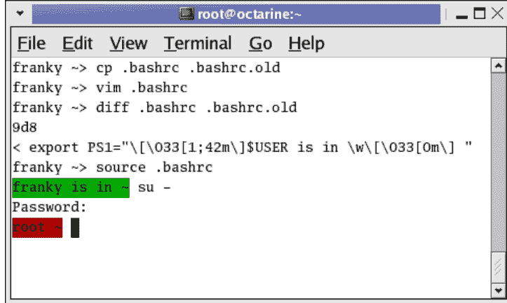

# Bash 初学者指南

## 目录

- **第 7 章 控制结构**
  - 7.1. `if` 引言
    - 7.1.1. 概述
    - 7.1.2. `if` 的简单应用
  - 7.2. 更高级的 `if` 用法
    - 7.2.1. `if/then/else` 结构
    - 7.2.2. `if/then/elif/else` 结构
    - 7.2.3. 嵌套 `if` 语句
    - 7.2.4. 布尔运算
    - 7.2.5. 使用 `exit` 语句和 `if`
  - 7.3. 使用 `case` 语句
    - 7.3.1. 简化条件
    - 7.3.2. 脚本示例
  - 7.4. 总结
  - 7.5. 练习

- **第 8 章 编写交互式脚本**
  - 8.1. 显示用户消息
    - 8.1.1. 是否为交互式？
    - 8.1.2. 使用 `echo` 内置命令
  - 8.2. 捕获用户输入
    - 8.2.1. 使用 `read` 内置命令
    - 8.2.2. 提示用户输入
    - 8.2.3. 重定向与文件描述符
    - 8.2.4. 文件输入与输出
  - 8.3. 总结
  - 8.4. 练习

- **第 9 章 重复性任务**
  - 9.1. `for` 循环
    - 9.1.1. 如何工作？
    - 9.1.2. 示例
  - 9.2. `while` 循环
    - 9.2.1. 什么是？
    - 9.2.2. 示例
  - 9.3. `until` 循环
    - 9.3.1. 什么是？
    - 9.3.2. 示例
  - 9.4. I/O 重定向与循环
    - 9.4.1. 输入重定向
    - 9.4.2. 输出重定向
  - 9.5. `break` 与 `continue`
    - 9.5.1. `break` 内置命令
    - 9.5.2. `continue` 内置命令
    - 9.5.3. 示例
  - 9.6. 使用 `select` 内置命令制作菜单
    - 9.6.1. 概述
    - 9.6.2. 子菜单
  - 9.7. `shift` 内置命令
    - 9.7.1. 它是做什么的？
    - 9.7.2. 示例
  - 9.8. 总结
  - 9.9. 练习

- **第 10 章 变量进阶**
  - 10.1. 变量类型
    - 10.1.1. 值的通用赋值
    - 10.1.2. 使用内置的 `declare` 命令
    - 10.1.3. 常数
  - 10.2. 数组变量
    - 10.2.1. 创建数组
    - 10.2.2. 数组中变量的引用
    - 10.2.3. 删除数组变量
    - 10.2.4. 数组示例
  - 10.3. 变量的操作
    - 10.3.1. 变量的算术运算
    - 10.3.2. 变量的长度
    - 10.3.3. 变量的转换
  - 10.4. 总结
  - 10.5. 练习

- **第 11 章 函数**
  - 11.1. 绪论
    - 11.1.1. 什么是函数？
    - 11.1.2. 函数语法
    - 11.1.3. 函数中的位置参数
    - 11.1.4. 显示函数
  - 11.2. 脚本中的函数示例
    - 11.2.1. 循环
    - 11.2.2. 设置路径
    - 11.2.3. 远程备份
  - 11.3. 总结
  - 11.4. 练习

- **第 12 章 捕获信号**
  - 12.1. 信号
    - 12.1.1. 引言
    - 12.1.2. 使用 `kill` 发送信号
  - 12.2. `trap`（陷阱）
    - 12.2.1. 通用
    - 12.2.2. Bash 如何解释 `trap`


- 12.2.3. 更多示例...................................................................................... 139

- 12.3. 总结................................................................................................ 139

- 12.4. 练习.................................................................. 139

- 附录 A Shell 特性.................................................................. 141

- A.1. 常用特性......................................................................................... 141

- A.2. 差异特性........................................................................... 142

- 附录 B GNU 自由文档许可证.................................. 145

- B.1. 前言...................................................................................... 145

- B.2. 适用范围与定义....................................................... 145

- 索引........................................................................................................... 162

- A.................................................................................................................................... 162

- B.................................................................................................................................... 162

- C.................................................................................................................................... 163

- D.................................................................................................................................... 163

- E.................................................................................................................................... 163

- F.................................................................................................................................... 164

- G.................................................................................................................................... 165

- H.................................................................................................................................... 165

- L.................................................................................................................................... 165

初学者 Bash 指南

# 目录

索引............................................................................................................... 166

- I.................................................................................................................................... 166

- K.................................................................................................................................... 166

- L.................................................................................................................................... 166

- M.................................................................................................................................... 166

- N.................................................................................................................................... 166

- O.................................................................................................................................... 167

- P.................................................................................................................................... 167

- Q.................................................................................................................................... 167

- R.................................................................................................................................... 167

- S.................................................................................................................................... 168

- T.................................................................................................................................... 169

- U.................................................................................................................................... 169

- V.................................................................................................................................... 169

- W.................................................................................................................................... 170

- X.................................................................................................................................... 170

- Y.................................................................................................................................... 170

- Z.................................................................................................................................... 170

vii

# 简介

## 1. 为什么要写本指南？

编写本文档的主要原因是，许多读者觉得现有的 `HOWTO` 指南太短且不完整，而《Bash 脚本指南》又太像是一本参考书。在这两个极端之间缺乏一种平衡点。我编写本指南还基于一个通用原则：目前缺乏足够的免费基础课程，尽管它们本应该是有的。

这是一份实用的指南，虽然并不总是过于严肃，但它提供了真实生活而非理论的示例。也许我之所以写，是因为我厌倦了那些由专业人士编写的精简且过度简化的示例——他们展示了一些非常酷的 `Bash` 特性，但由于脱离了上下文，导致你在实际情况下完全用用不上。你可以在完本书后再读那些内容，本书包含了对现实世界有练习和示例。

根据我作为 `UNIX`/`Linux` 用户、系统管理员和培训师的经验，我知道人们每天与系统打交道，却对任务自动化一无所知。因此，他们经常认为 `UNIX` 不易用，更糟糕的是，他们觉得它运行缓慢且过时。这个问题也可以通过本指南来解决。

## 2. 谁应该读这本书？

任何在 `UNIX` 或类 `UNIX` 系统上工作并希望让生活变得更轻松的人，无论是用户还是系统管理员，都能从本书中受益。已经掌握使用命令行操作系统的读者将学习 `Shell` 脚本的精髓，从而简化日常任务的执行。系统管理很大程度上依赖于 `Shell` 脚本；常见任务通常通过简单的脚本自动化。本文包含了大量的示例，将鼓励你编写自己的脚本，并启发你改进现有脚本。

先决条件/本课程不包含的内容：

- 你应该是一个经验丰富的 `UNIX` 或 `Linux` 用户，熟悉基础命令、`man` 页面和文档

- 能够使用文本编辑器

- 理解系统启动和关闭过程、`init` 和脚本

- 创建用户和组，设置密码

- 权限、特殊模式

- 理解设备命名规范、分区、文件系统的挂载/卸载

- 在你的系统上添加/删除软件

如果你尚未精通上述某一个或多个主题，请参阅《Linux 简介》（你的本地 `TLDP` 镜像）。你可以在你的系统文档（`man` 和 `info` 页面）或 `Linux` 文档项目（`LDP`）找到更多信息。

## 5. 贡献

感谢所有提供过帮助（或尝试帮助）的朋友以及我的丈夫；你们的鼓励让这项工作成为可能。

- 感谢所有提供过帮助（或尝试帮助）的朋友以及我的丈夫；你们的鼓励让这项工作成为可能。

- 感谢所有提供过帮助（或尝试帮助）的朋友以及我的丈夫；你们的鼓励让这项工作成为可能。

- 感谢所有提供过帮助（或尝试帮助）的朋友以及我的丈夫；你们的鼓励让这项工作成为可能。

- 感谢所有提供过帮助（或尝试帮助）的朋友以及我的丈夫；你们的鼓励让这项工作成为可能。

- 感谢所有提供过帮助（或尝试帮助）的朋友以及我的丈夫；你们的鼓励让这项工作成为可能。

## 10. 本文档的结构

本指南讨论了对严谨的 `Bash` 用户日常生活中有用的概念。虽然需要具备 `shell` 使用的基本知识，但我们将在前三章中开始讨论基本的 `shell` 组件和实践。

第四章到第六章讨论了 `shell` 脚本中常用的基本工具。

第八章到第十二章讨论了 `shell` 脚本中最常见的结构。

所有章节都附有练习题，将测试你为下一章做的准备工作。

- 第 1 章：`Bash` 基础：为什么 `Bash` 是好用的、构建块、开发脚本的第一条指南。

- 第 2 章：脚本基础：编写与调试。

- 第 3 章：`Bash` 环境：初始化文件、变量、引用字符、`shell` 展开顺序、别名、选项。

- 第 4 章：正则表达式：简介。

- 第 5 章：`Sed`：`sed` 文本编辑器简介。

- 第 6 章：`Awk`：`awk` 编程语言简介。

- 第 7 章：条件语句：`Bash` 中用于测试测试的构结构。

- 第 8 章：交互式脚本：使脚本对用户友好、捕获用户输入。

- 第 9 章：重复执行命令：`Bash` 中用于自动化命令执行的结构。

- 第 10 章：高级变量：指定变量类型、变量数组简介、变量的操作。

- 第 11 章：函数：简介。

- 第 12 章：捕获信号：进程信号简介、捕获用户发送的信号。

# 第 1 章. Bash 和 Bash 脚本

在本介绍模块中，我们：

- 描述一些常见的 `shell`

- 指出 `GNU Bash` 的优势特性

- 描述 `shell` 的构建块

- 讨论 `Bash` 初始化文件

- 查看 `shell` 如何执行命令

- 查看一些简单的脚本示例

## 1.1. 常见的 shell 程序

### 1.1.1. 通用 shell 函数

`UNIX` `shell` 程序解释用户命令，这些命令由用户直接输入，也可以从名为 `shell` 脚本或 `shell` 程序的文件中读取。脚本是被解释的，而不是编译的。`shell` 按行读取脚本中的命令，对于系统命令（见第 1.2 节），而编译器将程序转换为机器可读的形式，即可执行文件——该文件可以在 `shell` 脚本中使用。

除了向内核传递命令外，`shell` 的主要任务是提供用户环境，该环境可以使用 `shell` 配置文件进行单独配置。

### 1.1.2. Shell 类型

就像人们了解不同的语言和方言一样，你的 `UNIX` 系统通常会提供各种类型的 `shell`：

- `sh` 或 `Bourne Shell`：在 `UNIX` 系统和 `UNIX` 相关环境中仍在使用的原始 `shell`。这是基础 `shell`，一个功能较少的小型程序。虽然它不是标准，但在每个 `Linux` 系统上它仍然可用，以与 `UNIX` 程序保持兼容。

- `bash` 或 `Bourne Again`：标准的 `GNU` `shell`，直观且灵活。对于初学者来说，这可能是最建议的，同时它对高级用户和专业用户来说也是一个强大的工具。在 `Linux` 上，`bash` 是普通用户的标准。这个 `shell` 是所谓的 `Bourne` `shell` 的超集，包含一组附加组件和插件。这意味着 `Bourne Again` 与 `Bourne` `shell` 兼容；在 `sh` 中运行的命令在 `bash` 中同样有效。然而，反之则并不总是成立。书中的所有练习和示例都使用 `bash`。

- `csh` 或 `C`：该 `shell` 的语法类似于 `C` 语言语言。程序员有时会要求使用。

- `tsch` 或 `Turbo C`：`C` `shell` 的超集，增强了用户友好性和速度。

- `ksh` 或 `Korn shell`：有时受到具有 `UNIX` 背景的人青睐。`Bourne` `shell` 的超集；对于初学者来说，其兼容性是一场噩梦。

文件 `/etc/shells` 提供了 `Linux` 系统已知 `shell` 的概览：

```
mia-> cat /etc/shells
/bin/bash
```

`/bin/sh`

`/bin/tcsh`

`/bin/csh`

你的默认 `shell` 设置在 `/etc/passwd` 文件中，用户 `mia` 所示：

```
mia:L2NOfqdlPrHWe:504:504:Mia Maya:/home/mia:/bin/bash
```

要从一个 `shell` 切换到另一个 `shell`，只需在活动终端中输入新 `shell` 的名称。系统通过 `PATH` 设置查找该名称所在的目录，由于 `shell` 是一个可执行文件（程序），当前 `shell` 会激活并执行它。通常会显示一个新的提示符，因为每个 `shell` 都有其典型的外观：

```
mia:~ tcsh
mia@post21]$
```

## 1.2. Bourne Again 的优势

### 1.2.1. Bash 和 GNU shell


# GNU 项目（Bourne Again Shell）

GNU 项目（Bourne Again Shell）提供了用于系统管理的工具，这些工具是自由软件并符合 UNIX 标准。`bash` 是一种兼容 `sh` 的 shell，结合了 Korn shell (`ksh`) 和 C shell (`csh`) 的有用功能。它旨在符合 `IEEE POSIX-1003.1`。它在编程和交互式使用方面比 `sh` 提供了功能性改进；这些包括行编辑、作业控制、shell 函数、索引数组和整数算术。与其他项目一样，`bash` 的启动是为了保护和促进使用、复制、修改和分发软件的自由。

## 1.2. 仅 `bash` 的特性

### 1.2.2.1. 调用

除了通常可以使用 `set` 内置命令配置的单字符 shell 命令行选项外，还有几个你可以使用的多字符选项。我们将在接下来的章节中遇到几个更流行的选项；完整列表可以在 `Bash info` 页面中找到。

### 1.2.2.2. 启动文件

启动文件是 `Bash` 启动时读取并执行的脚本。以下小节描述了启动 shell 的不同方式。

#### 1.2.2.2.1. 作为交互式登录 shell 调用

除了通常可以使用 `set` 内置命令配置的单字符 shell 命令行选项外，还有几个你可以使用的多字符选项。我们将在接下来的章节中遇到几个更流行的选项；完整列表可以在 `Bash info` 页面中找到。

#### 1.2.2.2.2. 启动文件

启动文件是 `Bash` 启动时读取并执行的脚本。以下小节描述了启动 shell 的不同方式。

#### 1.2.2.2.3. 作为交互式登录 shell 调用

除了通常可以使用 `set` 内置命令配置的单字符 shell 命令行选项外，还有几个你可以使用的多字符选项。我们将在接下来的章节中遇到几个更流行的选项；完整列表可以在 `Bash info` 页面中找到。

#### 1.2.2.2.4. 作为交互式非登录 shell 调用

非登录 shell 意味着你对系统进行身份验证。例如，当你打开终端时，这是一个非登录 shell。读取的文件：

- `/etc/profile`
- `~/.bash_profile`
- `~/.login`
- `~/.profile`
- `~/.bashrc`

#### 1.2.2.2.5. 作为非交互式 shell 调用

非登录 shell 用于执行某些任务。`bashrc`：

```bash
if [ -f ~/.bashrc ]; then . ~/.bashrc; fi
```

请参阅第 7 章了解有关结构的更多信息。

#### 1.2.2.2.6. 带有 `sh` 命令调用

`bash` 尝试像传统的 Bourne `sh` 程序一样运行，同时符合 `POSIX` 标准。读取的文件：

- `/etc/profile`
- `~/.profile`

#### 1.2.2.2.7. `POSIX` 模式

在交互式调用时，`ENV` 变量指向额外的启动信息。此选项可以通过 `set` 内置命令启用：

```bash
set -o posix
```

或者在调用 `bash` 程序时使用 `--POSIX` 选项。此时 `Bash` 将尝试尽可能符合 `POSIX` 标准。设置 `POSIXLY_CORRECT` 变量也一样。读取的文件：

- 由 `ENV` 变量定义。

#### 1.2.2.2.8. 远程调用

由 `rsh` 调用时读取的文件：

- `~/.bashrc`

> **避免使用**
>
> 注意使用 `login`, `telnet`, `rsh` 和 `rcp` 等工具的危险。它们在本质上是不安全的；敏感数据在网络上传输未加密。如果你需要执行、文件传输等工具，请使用安全 Shell（通常称为 `SSH`），可以从 `http://www.openssh.org` 免费获取。非 UNIX 系统也有不同的客户端程序，请使用你的本地镜像软件。

#### 1.2.2.2.9. 当 `UID` 不等于 `EUID` 时调用

在这种情况下不读取启动文件。

### 1.2.2.3. 交互式 shell

#### 1.2.2.3.1. 什么是交互式 shell？

交互式 shell 通常从用户的终端读取并写入：输入和输出与终端连接。当调用 `bash` 命令且不带非选项参数时，会启动交互行为，除非选项是用于从标准输入，这允许设置位置参数（见第 3 章）。

#### 1.2.2.3.2. 此 shell 是交互式的吗

通过查看特殊字符 `-` 的内容，当 shell 是交互式的，它包含 `'i'`：

```bash
echo $-
himBu
```

在非交互式 shell 中，提示符 `PS1` 未设置。

#### 1.2.2.3.3. 交互式 shell 行为

交互模式下的差异：

- `Bash` 会读取启动文件。
- 默认启用作业控制。
- 设置了提示符，`PS2` 用于多行命令并已启用，通常设置为 `">"`。当 shell 认为你输入了未完成的命令时，也会出现此提示符，例如当你忘记写引号、无法省略的命令结构等时候。
- 命令默认通过 `readline` 从命令行读取。
- `Bash` 解释 shell 选项 `ignoreeof` 而在接收到 EOF（文件结束）时立即退出。
- 默认启用命令历史和扩展。历史记录在 shell 退出时保存到 `HISTFILE` 指向的文件。默认情况下，`HISTFILE` 指向 `~/.bash_history`。
- 别名（Alias）扩展已启用。
- 在没有设置陷获器（traps）的情况下，`SIGTERM` 信号会被忽略。
- 在没有设置陷获器的情况下，`SIGINT` 会被捕获并处理。因此，输入 `Ctrl-C` 不会退出你的交互式界面。
- 退出时向所有作业发送 `SIGHUP` 信号是通过 `huponxit` 选项配置的。
- 命令在读取时执行。
- `Bash` 定期检查邮件。
- `Bash` 可以配置为遇到未定义变量时退出。在交互模式下此行为被禁用。
- 当 shell 内置命令遇到重定向错误时，不会导致 shell 退出。
- 在 `POSIX` 模式下使用时，特殊的内置返回不会导致 shell 退出。内置命令列在第 1.3 节。
- `exec` 失败不会退出 shell。
- 解析器语法错误不会导致 shell 退出。
- 默认启用对 `cd` 内置命令参数的简单检查。
- 启用在通过 `TMOUT` 变量指定的时间长度后自动退出。

更多信息：

- 第 3.2 节
- 第 3.6 节
- 关于信号，请参见第 12 章。
- 第 3.4 节讨论了在输入命令时执行的各种扩展。

### 1.2.2.4. 条件判断

条件表达式由 `[[` 复合命令和 `test` 内置命令使用。

表达式可以是一元或二元的。一元表达式通常用于检查文件的状态。你只需要一个对象（例如一个文件）即可对其进行操作。

还有字符串运算符和数值比较运算符；这些是二元运算符，需要两个对象来执行操作。如果其中一个操作数的 `FILE` 属性格式为 `/dev/fd/N`（而不是 `/dev/stdout` 或 `/dev/stderr`），则分别检查文件描述符 0、1 或 2。

条件判断将在第 7 章中详细讨论。

### 1.2.2.5. Shell 算术

shell 允许求值算术表达式，作为 shell 扩展的一种或通过 `let` 内置命令实现。

求值在固定宽整数中进行，不进行溢出检查，但除以 0 会被捕获并标记为错误。运算符及其优先级和结合性与 C 语言相同，参见第 3 章。

### 1.2.2.6. 别名 (Aliases)

别名允许在单词作为简单命令的第一个单词使用时，用字符串替换它。shell 维护一个别名列表，可以使用 `alias` 和 `unalias` 命令进行设置和取消。

`Bash` 在执行该行上的任何命令之前，始终会完整读取一整行输入。别名在读取命令时被扩展，而不是在执行时扩展。因此，与另一个命令出现在同一行中的别名在读取下一行输入之前不会生效。该行中别名定义之后的后续命令不会受新别名的影响。

别名在读取函数定义时被扩展，而不是在执行函数时扩展，因为函数定义本身是一个复合命令。结果是，函数中定义的别名在函数执行后才可用。

我们将在第 3.5 节详细讨论别名。

### 1.2.2.7. 数组 (Arrays)

`Bash` 提供了一维数组变量。任何变量都可以作为数组；`declare` 内置命令会显式声明数组。默认启用索引成员。

### 1.2.2.8. 目录栈

目录栈是最近访问目录的列表。`pushd` 将目录添加到栈中，而 `popd` 从栈中移除它们。

可以使用 `dirs` 命令显示内容。

### 1.2.2.9. 提示符 (Prompt)

`Bash` 通过环境变量自定义提示符。

### 1.2.2.10. 受限 shell (Restricted shell)

当受限模式调用时，会发生以下：

- 内置命令受限。
- shell 不能更改环境。
- shell 不能使用函数。
- 不允许重定向。
- shell 不能使用子 shell。
- shell 不能更改工作目录。
- shell 不能设置变量。

更多信息：

- 第 3.2 节
- 第 3.6 节
- 关于信号，请参见第 12 章。
- 第 3.4 节讨论了在输入命令时执行的各种扩展。

## 1.3.1. 概述

`Bash` 确定命令类型。当使用内置名称时，shell 执行它而不创建新进程。

- `fork-exec` 方案仅在 shell 以以下方式分析输入后应用：

## 1.3.2. Shell 内置

内置命令包含在 shell 内部。当将内置命令名称作为简单命令的第一个单词使用时，shell 直接执行它。

## 1.3.3. 从脚本执行程序

当执行的程序是 shell 脚本时，`bash` 会通过 `fork` 创建一个新的 `bash` 进程。子 shell 逐行读取脚本。每行的命令都被读取、解释并执行，就像它们来自键盘一样。

# 第 1 章. Bash 和 Bash 脚本

## 1.4. 构建块

### 1.4.1.1. Shell 语法

如果输入不是注释，shell 会读取并将其划分为单词和运算符，利用引号规则定义输入中每个字符的含义。这些单词和运算符被转换为命令和其他结构，并返回一个供检查的退出状态。

- Shell 从文件、字符串或用户的终端读取输入。
- 输入被拆分为单词和操作符，并遵循引用规则，详见第 3 章。标记（Tokens）通过元字符分隔。将执行别名扩展（Alias expansion）。
- Shell 解析（并替换）这些标记，将其转换为简单命令和复合命令。
- `Bash` 执行各种扩展，将扩展后的标记拆分为命令列表和参数列表。
- 如果需要，将执行重定向，重定向符及其操作数将从参数列表中移除。
- 执行命令。
- 可选情况下，Shell 会等待命令完成并收集其退出状态。

### 1.4.1.2. Shell 命令

如 `touch file1 file23` 这样的简单命令由命令本身以及后续参数组成，参数之间用空格分隔。

更复杂的 Shell 命令由各种方式组合在一起的简单命令组成：在管道中，一个命令的输出成为第二个命令的输入；在循环或条件结构中；或者在其他分组中。这里有几个例子：

```bash
ls | more
gunzip file.tar.gz | tar xvf -
```

### 1.4.1.3. Shell 函数

Shell 函数是一种使用单个名称对一组命令分组以便稍后执行的方法。它们的执行方式与“普通”命令完全相同。当 Shell 函数名作为简单命令使用时，与该函数名关联的命令列表将被执行。

Shell 函数在当前 Shell 上下文中执行；不会创建新进程来解释它们。

函数将在第 11 章中进行介绍。

### 1.4.1.4. Shell 参数

参数是一个存储值的实体。它可以是一个名称、一个数字或特殊值。对于 Shell 而言，变量是一个存储名称的参数。变量具有一个值和零或多个属性。可以使用 `declare` 内置命令创建变量。

如果没有提供值，则变量被赋值为空字符串。变量只能通过 `unset` 内置命令删除。

变量的赋值将在第 3.2 节中讨论，第 10 章将讨论变量的高级用法。

### 1.4.1.5. Shell 扩展

Shell 扩展在每行命令被拆分为标记后执行。这些执行的扩展包括：

- 大括号扩展 (Brace expansion)
- 波浪号扩展 (Tilde expansion)
- 参数和变量扩展 (Parameter and variable expansion)
- 命令替换 (Command substitution)
- 算术扩展 (Arithmetic expansion)
- 单词拆分 (Word splitting)
- 文件名扩展 (Filename expansion)

我们将在 3.4 节详细讨论这些扩展类型。

### 1.4.1.6. 重定向

在执行命令之前，其输入和输出可以使用 Shell 解释的特殊符号进行重定向。重定向也可以用于为当前 Shell 执行环境打开和关闭文件。

### 1.4.1.7. 执行命令

在执行命令时，解析器标记为变量赋值（位于命令名之前）和重定向的单词将被保存备后引用。不是变量赋值或重定向的单词将被扩展；扩展后剩余第一个单词作为命令名，其余的该命令的参数。然后执行重定向，然后扩展赋值给变量的字符串。变量将影响当前的 Shell 环境。

Shell 任务的重要部分是搜索命令。`Bash` 按照以下方式执行此：

- 检查命令是否包含斜杠。如果没有，首先检查函数列表，看是否包含我们要查找的同名命令。
- 如果命令不是函数，则在内置列表中查找。
- 如果命令既不是函数也不是内置命令，则通过分析 `PATH` 中列出的目录进行查找。`Bash` 使用哈希表（内存中的数据存储区域）来记录可执行文件的完整路径，以避免频繁的 `PATH` 搜索。
- 如果搜索失败，`bash` 将打印错误消息并返回退出状态 127。
- 如果搜索成功或命令包含斜杠，则在独立的 Shell 环境中执行命令（注：在 Shell 环境中执行命令）。
- 如果执行失败是因为文件不可执行，则假设它是脚本。
- 如果没有异步执行，Shell 会等待命令完成并收集状态。

### 1.4.1.8. 脚本

当包含命令的文件作为非选项使用时，Shell 会首先在当前目录查找，如果找不到，则在 `PATH` 中查找。

## 1.5 开发良好的脚本

### 1.5.1. 好脚本的属性

在继续之前，这是关于良好脚本的一些通用考虑：

- 脚本应该无错误地运行。
- 脚本应该完成其预期的任务。
- 脚本逻辑清晰且易见。
- 脚本不执行多余工作。
- 脚本应该是可重用的。

### 1.5.2. 结构

脚本的结构非常灵活。尽管 `Bash` 赋予了很大自由，但你必须确保逻辑和效率，以便用户能够轻松正确地执行脚本。

在开始编写新脚本时，问自己以下问题：

- 我会需要来自用户或用户环境的信息吗？
- 我将如何存储这些信息？
- 是否需要创建文件？在哪里创建？权限和所有权是什么？
- 我将使用哪些命令？什么时候使用？

### 1.5.3. 术语

下表提供了编程术语的概述：

**表1. 编程术语概述**

| 术语 | 它是什么 |
| :--- | :--- |
| 命令控制 | 测试命令的退出状态。 |
| 条件分支 | 程序中的逻辑点决定下一步发生什么。 |
| 逻辑流 | 程序的整体设计。 |
| 循环 | 程序中执行多次的部分。 |
| 用户输入 | 程序运行时来自外部的信息，可以存储和调用。 |

### 1.5.4. 关于顺序和逻辑的说明

为了加快开发进程，应该考虑程序的逻辑顺序。这是你的第一步。

### 1.5.5. Bash 脚本示例：mysystem.sh

下面的 `mysystem.sh` 脚本执行了一些已知命令（`date`, `w`, `uname`, `uptime`）来显示关于你和你的机器的信息。

```bash
cat -n mysystem.sh
#!/bin/bash
clear
echo "这是由 mysystem.sh 提供的信息。程序现在开始。"
echo "Hello, $USER"
echo
echo "今天是 $(date)，这是第 $(date +%V) 周。"
echo
echo "当前连接的用户有："
w | cut -d " " -f 1 | grep -v USER | sort -u
echo
echo "这是 $(uname -s) 运行在 $(uname -m) 处理器上。"
echo
echo "这是运行时间信息："
uptime
```

`echo` 和 `printf` 都是内置命令。前者总是以 0 执行，并简单地将以行尾符格式化的参数打印到标准输出，而后者允许定义字符串并在失败时返回非零退出状态。

这是使用 `printf` 内置命令的相同脚本：

第 8 章将介绍如何通过插入消息来创建用户友好的脚本。

> Bourne shell 的标准位置
>
> 这意味着 `bash` 程序安装在 `/bin` 中。

> 如果标准输出（stdout）不可用
>
> 如果你从 `cron` 执行脚本，请使用全路径名并重定向输出和错误信息。由于 shell 在非交互模式下运行，如果不考虑这一点，任何错误都会导致脚本提前执行。

后续章节将讨论上述脚本的细节。

### 1.5.6. 示例 init 脚本

`init` 脚本在 UNIX 和 Linux 上启动系统服务。系统日志守护进程、电源管理进程、名称和邮件守护进程都是常见的示例。这些脚本也称为启动脚本，存储在系统的特定位置，例如 `/etc/rc.d/init.d` 或 `/init.d`。`init` 是初始进程，读取其配置文件并决定在每个运行级别（run level）下启动或停止哪些服务。运行级别是进程的配置；每个系统都有一个用户运行级别，例如执行管理任务，此时系统必须尽可能处于空闲状态，例如从备份中恢复关键系统。通常还会配置重启（`reboot`）和关机（`shutdown`）级别。


# 1.5. 启动与停止服务

启动或停止服务时要执行的任务列在启动脚本中。配置 `init` 是系统管理员的任务之一，以便服务在正确的时刻启动和停止。在面对此任务时，你需要对系统的启动和关机程序有良好的理解。因此，我们建议在开始编写初始化脚本之前，阅读 `init` 和 `inittab` 的 man 手册。

这是一个简单的示例，它会在你启动和停止机器时播放声音：

```bash
#!/bin/bash

# 此脚本用于 /etc/rc.d/init.d
# 在 rc3.d/S99audio-greeting 和 rc0.d/K01audio-greeting 中链接

case "$1" in
  'start')
    cat /usr/share/audio/at_your_service.au > /dev/audio
    ;;
  'stop')
    cat /usr/share/audio/oh_no_not_not_again.au > /dev/audio
    ;;
esac
exit 0
```

此类脚本中使用的 `case` 语句在第 7.2.2 节中描述。

## 1.6. 总结

`Bash` 是 `GNU shell`，与 `Bourne shell` 兼容，并结合了许多 shell 的有用功能。当 shell 启动时，它会读取其配置文件。最重要的有：

- `/etc/profile`
- `~/.bash_profile`
- `~/.bashrc`

`Bash` 在交互模式下的行为有所不同，并且具有 `POSIX` 兼容模式和限制模式。

Shell 命令可以分为三组：shell 函数、shell 内置命令以及系统目录中的现有命令。`Bash` 支持在普通 `Bourne shell` 中未找到的额外内置命令。

Shell 脚本由按照 shell 语法排列的命令组成。脚本按行读取和执行，并应该具有逻辑结构。

## 1.7. 练习

以下是一些为你的下一章做预热的练习：

1. `bash` 程序在你的系统中的位置在哪里？
2. 使用 `--version` 选项查找你正在运行的是哪个版本。
3. 当你使用图形界面登录系统并打开终端窗口时，读取哪些 shell 配置文件？
4. 以下 shell 是交互式 shell 吗？它们是登录 shell 吗？
    - 点击图形桌面背景、选择“终端”或从菜单打开的 shell。
    - 发出命令 `ssh localhost` 后获得的 shell。
    - 在文本模式下登录控制台时获得的 shell。
    - 通过命令 `xterm &` 获得的 shell。
    - 由 `mysystem.sh` 脚本打开的 shell。
    - 在远程主机上获得的 shell，由于你使用 `SSH` 和可能的 `SSH` 密钥，因此不需要提供登录和/或密码。
5. 你能解释为什么在命令行输入 `Ctrl+C` 时 `bash` 不退出吗？
6. 显示目录栈内容。
7. 如果尚未设置，请设置你的提示符使其显示你在文件系统层次结构中的位置，将此行添加到 `~/.bashrc`：
8. 显示目录栈内容。
9. 正在运行多少进程？
10. 如何显示主机名（`hostname`）？

# 2. 编写与调试

学习本章后，你将能够：

- 编写一个简单的脚本
- 使用编辑器
- 在脚本中编写注释
- 修改权限
- 执行脚本

## 2.1. 创建与运行

Shell 脚本是命令的序列。创建脚本时打开一个空文件。任何编辑器都可以：`vim`、`emacs`、`gedit` 等都是有效的。给你的脚本起一个合理的名称，提示该脚本的功能。确保你的脚本名称与现有命令不冲突；脚本名称通常以 `.sh` 结尾。

### 2.1.1. `script.sh`

在这个示例中，我们使用内置命令 `echo` 来通知用户即将发生什么。强烈建议通知用户，因为脚本正在执行操作。我们将在第 8 章回到通知用户的话题。

图 2-1. `script.sh`

```bash
#!/bin/bash

clear
echo "脚本现在开始。"
echo "你好, $USER!"
echo
echo "我将为你获取连接的用户列表："
echo
w
echo
echo "我现在设置两个变量。"
COLOUR="black"
VALUE="9"
echo "这是一个字符串: $COLOUR"
echo "这是一个数字: $VALUE"
echo
echo "我现在把提示符还给你。"
```

### 2.1.2. 执行脚本

脚本应该具有正确用户的执行权限以便运行。在设置权限时，检查你是否真的获得了所需的权限。完成后，该脚本就可以像其他命令一样运行了：

```bash
willy:///scripts> chmod +x script1.sh

willy:///scripts> ls -l script1.sh
-rwx-rw-- 1 willy willy 456 Dec 24 17:11 script1.sh

willy://> script1.sh
脚本现在开始。
你好, Willy!
```

现在我将为你获取已连接的用户列表：

```
3:38pm 18 days, 5:37, 4 users, load average: 0.12, 0.22, 0.15
USER TTY      FROM LOGIN IDLE JCPU PCPU  WHAT
root tty2 Sat 2pm 4:25m 0.05s ? -bash
willy :0 Sat 2pm ? 0.00s ?
willy pts/3 Sat 2pm 3:33m 36.39s 36.39s BitchX willy
willy pts/2 Sat 2pm 3:33m 0.13s 0.06s /usr/bin/screen
```

现在我正在设置两个变量。

这是一个字符串：black

这是一个数字：9

现在我把提示符还还给你。

```bash
willy:///scripts> echo $VALUE
willy:///scripts>
```

这是执行脚本最常用的方法。最好在子 shell（subshell）中这样执行脚本。因为该 shell 的变量和别名只对该子 shell 的特定 `bash` 会话有效。当 shell 退出且父进程重新获得控制时，一切都会被清理，对 shell 状态的所有更改都会被 `bash` 忘记。

如果你没有将脚本目录放入 `PATH` 中，且（当前目录）也不在 `PATH` 中，你可以如下激活脚本：

```bash
./script_name.sh
```

脚本也可以通过指定的 shell 显式执行，但通常我们只在想要获得特殊行为时才这样做，例如检查脚本在另一个 shell 中是否可以工作，或者为了调试而打印跟踪信息：

```bash
bash script_name.sh
```

```bash
sh script_name.sh
```

```bash
bash -x script_name.sh
```

指定的 shell 将作为当前 shell 的子 shell 启动并执行脚本。这在你希望脚本带有特定选项启动，或者在脚本中未指定的条件下启动时使用。

如果你不想启动新 shell 而是想在当前 shell 中执行脚本，请使用 `source` 指令：

```bash
source script_name.sh
```

# 第 2 章 编写与调试脚本

# 初学者 Bash 指南

`source` 等同于 `.`。

`Bash` 的 `source` 内置命令是 `Bourne shell` 的 `.` (点) 命令的同义词。

在这种情况下，脚本不需要执行权限。命令在当前 shell 上下文中执行，因此对你的环境的任何更改在脚本执行完毕后都是可见的：

```bash
willy~/scripts source script1.sh
--output omitted--
willy~/scripts echo $VALUE
9
willy~/scripts>
```

## 2.2. 脚本基础

### 2.2.1. 哪个 shell 将运行脚本？

在子 shell 中运行脚本时，你应该定义由哪个 shell 来运行脚本。你编写脚本时的 shell 类型可能不是系统上的默认类型，因此你输入的命令可能会在错误的 shell 执行时产生错误。

脚本的第一行决定了要启动的 shell。第一行的前两个字符应该是 `#!`，然后是用于解释后续命令的 shell 路径。空行也被视为行，所以不要用空行开始你的脚本。

为了本课程，所有脚本都将以以下行开头：

```bash
#!/bin/bash
```

如所述，这意味着可以在 `/bin` 目录下找到 `Bash` 的可执行文件。

### 2.2.2. 添加注释

你应该意识到，你可能不是唯一阅读你代码的人。许多用户和系统管理员会运行由他人编写的脚本。如果他们想看你是如何做的，注释对于启发读者非常有帮助。

注释还能让你的生活变得更轻松。假设为了在脚本中使用的某个命令实现特定结果，你阅读了大量的 man pages（帮助手册）。如果你在几周或几个月后需要修改脚本，你将忘记它是如何运行的，除非你注释了你做了什么、怎么做的以及/或为什么这样做。

以 `script.sh` 为例，将其复制到 `commented-script.sh`，我们对其进行编辑，使注释反映脚本的功能。脚本在行中 `#` 符号之后遇到的所有内容都会被忽略，只有打开脚本文件时才可见：

```bash
#!/bin/bash
# 此脚本清除终端，显示并提供关于
# 当前连接用户的信息。设置并显示了两个示例变量。
```

# 第 2 章 编写与调试脚本

# 初学者 Bash 指南

```bash
clear
# 终端窗口
echo "The script starts now."
```

```bash
echo "Hi, $USER!"
# 符号用于获取变量的内容
echo
```

```bash
echo "I will now fetch you a list of connected users:"
# 显示谁登录了
w
```

```bash
echo "I'm setting two variables now."
# 设置本地 shell 变量
COLOUR="black"
# 设置本地 shell 变量
VALUE="$"
# 显示变量的内容
echo "This is a string: $COLOUR"
echo "And is: $VALUE"
```

现在我把提示符还给你。这是执行脚本最常用的方法。最好在子 shell 中这样执行脚本。因为该 shell 的变量和别名只对该子 shell 的特定 `bash` 会话有效。当 shell 退出且父进程重新获得控制时，一切都会被清理，对 shell 状态的所有更改都会被 `bash` 忘记。

如果你没有将脚本目录放入 `PATH` 中，且（当前目录）也不在 `PATH` 中，你可以如下激活脚本：

```bash
./script_name.sh
```

## 2.3. 调试脚本

### 2.3.1. 脚本部分的调试

现在我将为你获取已连接的用户列表：

```
3:38pm 18 days, 5:37, 4 users, load average: 0.12, 0.22, 0.15
USER TTY      FROM LOGIN IDLE JCPU PCPU  WHAT
root tty2 Sat 2pm 4:25m 0.05s ? -bash
willy :0 Sat 2pm ? 0.00s ?
willy pts/3 Sat 2pm 3:33m 36.39s 36.39s BitchX willy
willy pts/2 Sat 2pm 3:33m 0.13s 0.06s /usr/bin/screen
```

## 初学者 Bash 指南

下表列出了其他实用 `Bash` 选项的概述：

表 2–1. 设置调试选项概述

| 短写 | 完整写法 | 结果 |
| :--- | :--- | :--- |
| `set -f` | `set -o noglob` | 禁用使用元字符生成文件名（通配符）。 |
| `set -v` | `set -o verbose` | 按照读取顺序打印 shell 输入。 |
| `set -x` | `set -o xtrace` | 在执行命令之前打印命令跟踪。 |

使用减号 `-` 用于激活 shell 选项，加号 `+` 用于禁用它。不要让这困扰你！

在下面的示例中，我们在命令行中演示了这些选项：

```bash
willy:///scripts> set -v
willy:///scripts> ls
ls
commented-scripts.sh script1.sh

willy:///scripts> set +v
set +v

willy:///scripts> ls *
commented-scripts.sh script1.sh

willy:///scripts> set -f
willy:///scripts> ls *
ls: No such file or directory

willy:///scripts> touch *
willy:///scripts> ls
* commented-scripts.sh script1.sh
willy:///scripts> rm *
willy:///scripts> ls
commented-scripts.sh script1.sh
```

或者，可以在脚本中指定这些模式，通过将所需的选项添加到第一行的 shell 声明中。选项可以组合，就像在 UNIX 命令中通常这样做一样：

```bash
#!/bin/bash -xv
```

一旦你发现了脚本中的错误部分，你可以在每个不确定的命令之前添加 `echo` 语句，这样你就能确切看到问题出在哪里以及为什么无法工作。在 `commented-script1.sh` 脚本示例中，可能是这样的，尽管变量的显示仍然给我们带来了问题：

```bash
echo "debug message: now attempting to start command"; w
```

在更高级的脚本中，可以插入 `echo` 来显示变量在脚本不同阶段的内容，以便检测缺陷：

## 第 2 章 编写和调试脚本

## 初学者 Bash 指南

```bash
echo "Variable VARNAME is now set to $VARNAME."
```

## 2.4. 总结

脚本是一系列可重用的命令，放置在一个可执行的文本文件中。任何文本编辑器都可以用于编写脚本。

脚本以 `#` 开头，随后是执行脚本命令的 shell 路径。在脚本中添加注释是为了以后自己的参考，也是为了让其他用户能够理解。解释多总比解释少好。

可以使用 shell 选项对脚本进行调试。shell 选项可以用于部分调试，也可以用于分析整个脚本。在策略位置插入 `echo` 命令也是一种常见的排错技术。

## 2.5. 练习

此练习将帮助你创建第一个脚本。

1. 使用你喜欢的编辑器编写一个脚本。该脚本应该显示你的主目录路径和你正在使用的终端类型。此外，它还要显示系统在运行级别 3 上启动的所有服务（提示：使用 `HOME`、`TERM` 和 `ls /etc/rc.d/*`）
2. 在你的脚本中添加注释。
3. 为脚本的用户添加信息。
4. 修改脚本的权限以便你可以运行它。
5. 在普通模式和调试模式下运行脚本。它应该无错误运行。
6. 在脚本中制造错误：看看如果拼错命令、漏掉第一行或在其中放入一些无法理解的内容、或者如果拼错 shell 变量名或在声明为大写字母后将其写为小写字母会发生什么。检查调试注释对此是如何说明的。

# 3. Bash 环境

在本章中，我们将讨论影响 `Bash` 环境的各种方式：

- 编辑 shell 初始化文件
- 使用变量
- 使用不同的引号样式
- 执行算术计算
- 分配别名（aliases）
- 使用扩展和替换

## 3.1. Shell 初始化文件

### 3.1.1. `/etc/profile`

当使用 `--login` 选项交互式调用或作为 `sh` 调用时，`Bash` 会读取 `/etc/profile` 指令。这些指令通常设置 shell 变量 `PATH`、`USER`、`MAIL`、`HOSTNAME` 和 `HISTSIZE`。

在某些系统中，`umask` 值在 `/etc/profile` 中配置；而在其他系统中，该文件包含其他配置文件，例如：

- `/etc/inputrc`，系统范围 Readline 初始化文件，你可以在其中配置命令行铃声样式。
- `/etc/profile.d` 目录，包含配置特定程序系统级行为的文件。

你希望应用到所有用户环境设置都应该在这个文件中。它看起来可能如下：

```bash
# /etc/profile
# 全局环境和启动程序，用于登录设置
PATH=$PATH:/usr/X11R6/bin
# 默认不产生核心文件
ulimit -s -c 0 > /dev/null 2>&1

USER=$(id -u)
LOGNAME=$USER
MAIL=/var/spool/mail/$USER
HOSTNAME=$(hostname)
HISTSIZE=1000

# 键盘、铃声、显示样式：readline 配置文件：
if [ -z "$INPUTRC" ] && [ ! -f "$HOME/.inputrc" ]; then
INPUTRC=/etc/inputrc
fi
PS1="\u\h \W"
```

```bash
export PATH USER LOGNAME MAIL HOSTNAME HISTSIZE INPUTRC

# 环境设置
for i in /etc/profile.d/*; do
    if [ -r "$i" ]; then
        source "$i"
    fi
done
```

## 初学者 Bash 指南

```bash
export PATH USER LOGNAME MAIL HOSTNAME HISTSIZE INPUTRC

# 环境设置
for i in /etc/profile.d/*; do
    if [ -r "$i" ]; then
        source "$i"
    fi
done
```

### 3.1.2. `/etc/bashrc`


这包含了实用的别名，即使你拼错了命令它们也能工作。我们将在 3.5.2 节讨论别名。此文件包含一个函数 `pskill`，将在第 11 章详细介绍。

这随 Bash 文档提供：

```bash
alias ls='ls -l'
alias dir='ls -ba'
alias c='clear'
alias is='ls --color'

alias mroe='more'
alias pdw='pwd'
alias sl='ls --color'
```

```bash
pskill()
{
```

## Bash 环境

### 初学者 Bash 指南

除了别名，它包含了实用的别名，即使你漏掉了它们也能工作。我们将在 3.5.2 节讨论别名。此文件包含一个函数 `pskill`，将在第 11 章详细介绍。

#### 3.1.2. 用户配置文件

我没有这些文件！！

这些文件默认可能不在你的主目录下；如果需要请创建它们。

##### 3.1.2.1. `.bash_profile`

这是配置用户环境的首选配置文件。在该文件中，用户可以添加额外的配置选项或更改默认设置：

```bash
franky-> cat .bash_profile
################################################################
# .bash_profile 文件                               
# 当你登录 bash shell 时执行                                     
################################################################
```

该用户为不同的操作系统登录配置了退格键字符。除外，用户的 `.bashrc` 和 `.bash_login` 会被读取。

##### 3.1.2.2. `.bash_login`

此文件包含通常在登录系统时执行的特定设置。在示例中，我们使用它来配置 `umask` 值并在登录时显示连接用户列表。这还会获取当前月的日历：

# 初学者 Bash指南

```bash
######################################################################
# Bash_login 文件

# 登录时在 bash shell 中执行的命令
# (从 .bash_profile 来源)

######################################################################
# 文件保护 # 所有用户可读写，组和其他用户可读
# umask 002
# 杂项
wncal `date +%m` `date +%Y`
```

在不存在 `~/.bash_profile` 的情况下，系统将读取此文件。

##### 3.1.2.3. `~/.profile`

在不存在 `~/.bash_profile` 和 `~/.bash_login` 的情况下，会读取 `~/.profile`。它可以包含相同的配置，这些配置也可以被其他 shell 访问。注意，其他 shell 可能无法理解 Bash 语法。

##### 3.1.2.4. `~/.bashrc`

今天，使用非 shell 登录更为常见，例如当使用 X 终端窗口进行图形界面登录时。打开 shell 时，用户无需提供用户名或密码：无需进行身份验证。在这种情况下，Bash 会搜索 `~/.bashrc`，该文件在登录时会被引用，这意味着你不需要在多个文件中输入相同的设置。

###### 在用户的 `.bashrc` 中定义了几个别名（aliases）和变量，例如在设置系统级的 `~/etc/bashrc` 之后设置的：

```bash
franky -> cat .bashrc
# /home/franky/.bashrc

# 引入全局定义
if [ - /etc/bashrc ]; then
    ./etc/bashrc
fi

# shell 选项
set -o noclobber

# 我的 shell 变量
export PS1="\u033[1;44m\u \w\u033[0m]"
export PATH=$PATH:~/bin:scripts

# 我的别名
alias cdrecord='cdrecord -dev 0,0,0 -speed=8'
alias ss='ssh octarine'
alias ll='ls -la'

mozilla
# fix
```

# 第 3 章：Bash 环境

# 初学者 Bash指南

```bash
MOZILLA_FIVE_HOME=/usr/lib/mozilla
LD_LIBRARY_PATH=/usr/lib/mozilla:/usr/lib/mozilla/plugins
MOZ_DIST_BIN=/usr/lib/mozilla
MOZ_PROGRAM=/usr/lib/mozilla/mozilla-bin
export MOZILLA_FIVE_HOME LD_LIBRARY_PATH MOZ_DIST_BIN MOZ_PROGRAM

# 字体修复
alias xt='xterm -bg black -fg white &'

# Bitchkz 设置
export IRNAME="frank"

# 结束
frank ->
```

可以在 Bash 软件包中找到更多示例。请记住，示例文件可能需要修改才能在你的环境中运行。

别名将在第 3.5 节讨论。

##### 3.1.2.5. `~/.bash_logout`

此文件包含注销程序的特定指令。在示例中，终端窗口在退出时会被清除。这对于远程连接非常有用，关闭后会留下一个干净的窗口。

```bash
franky -> cat .bash_logout
######################################################################
#                                                               #
#   Bash_logout 文件                               #
#                                                               #
#   退出时在 bash shell 中执行的命令                      #
######################################################################
clear
franky ->
```

### 3.1.3 修改 shell 配置文件

在修改上述任何文件时，用户必须重新连接系统或 `source`（更改）修改的文件使更改生效。通过这种方式解释脚本，更改将应用于 shell 会话。

图 3–1. 不同用户的不同提示符

# 初学者 Bash 指南



大多数 shell 脚本在私有环境中执行：除非由父 shell 导出（`export`），否则子进程不会继承变量。`source` 包含包含 shell 命令的文件是将更改应用于你自己的环境并在当前 shell 中设置变量的方法。

此示例还演示了不同用户使用不同的提示符设置。在这种情况下，红色代表危险。当你看到绿色提示符时，不必过度担心。

注意 `source resourcefile` 与 `.resourcefile` 是等同的。

如果你在所有这些配置文件中迷失了方向，发现自己面临来源不明的设置，我们可以像调试脚本一样，使用 `echo` 语句；请参见第 2.3.2 节。你可以添加如下行的代码：

```bash
echo "Now executing .bash_profile."
或者像这样：

echo "Now setting PS1 in .bashrc:"
export PS1="[some value]"
echo "PS1 is now set to $PS1"
```

# 3.2 变量

### 3.2.1. 变量类型

如上面的示例所示，习惯上 shell 变量使用大写字母。Bash 维护了两类变量列表：

#### 3.2.1.1. 全局变量

全局变量或环境变量在所有 shell 中均可用。可以使用 `env` 或 `printenv` 命令显示环境变量。这些程序随 `sh-utils` 软件包一起。

以下是典型的输出：

第 3 章：Bash 环境 34

# 初学者 Bash 指南

```bash
franky -> printenv\gcc
CDATH=:/usr/local:/usr/:
CFLAGS=-02 -fomit-frame-pointer
COLORTERM=gnome-terminal
CXXFLAGS=-02 -fomit-frame-pointer
DISPLAY=:0
DOMAIN=hq.alasys.com
```

*(注：此处后续代码块内容为环境变量列表，根据要求不翻译代码块内部内容，仅翻译文本描述)*

#### 3.2.1.2. 局部变量

局部变量仅在当前 shell 中可用。不带任何选项使用内置命令 `set` 将显示所有变量列表（包括环境变量和函数）。输出基于当前的本地化（`locale`）并以可用的格式显示。

以下是通过比较 `printenv` 和 `set` 输出得的差异（`diff`），其中排除了 `set` 命令也显示的函数：

*(注：此处后续代码块内容为差异对比结果，根据要求不翻译代码块内部内容)*

# Awk


第 3 章：Bash 环境

# 初学者 Bash 指南

GNU Awk 语言将在第 6 章中解释。

#### 3.2.1.3. 按内容分类变量

除了将变量分为局部和全局外，我们还可以根据变量包含的内容类型对其进行分类。在这方面，变量分为 4 类：

- 字符串变量
- 整数变量
- 常量变量
- 数组变量

我们将在第 10 章讨论这些类型。现在，我们为变量处理整数和字符串值。

### 3.2.2. 创建变量

变量对大小写敏感，并且默认全大写。给局部变量使用小写名称是一种采用的习惯。然而，你可以自由使用你想要的名称或混合大小写。变量也可以包含数字，但不允许以数字开头命名：

要在 shell 中设置变量，请使用

```bash
VARNAME="value"
```

在等号周围加上空格会导致错误。在为变量赋值时，对内容字符串加引号是一个良好的习惯；这会减少你出错的概率。

使用大小写、数字和空格的一些示例：

# 初学者 Bash指南

```bash
bash: 2: command not found
nfrank -> unset MYVAR1 first_name full_name

frank -> echo $MYVAR1 $first_name $full_name
<--无输出-->

frank ->
```

### 3.2.3. 导出变量 (Exporting variables)

上述示例中的变量仅对当前 shell 可。它是一个局部变量：当前 shell 的子进程感知不到该变量。为了将变量传递给子壳（`subshell`），我们需要使用 `export` 内置命令对其进行导出。被导出的变量被称为环境变量。设置和导出通常在一个步骤中完成：

```bash
export VARNAME="value"
```

子壳可以修改继承自父进程的变量，但子进程的修改不会影响父进程。这可以通过示例所示：

```bash
frank -> full_name="Franky M. Singh"
frank -> bash
frank -> echo $full_name

frank -> exit
frank -> export full_name
frank -> bash

frank -> echo $full_name
Franky M. Singh

frank -> export full_name="Charles the Great"

frank -> echo $full_name
Charles the Great

frank -> exit
frank -> echo $full_name
Franky M. Singh

frank ->
```

当第一次尝试在子壳中读取 `full_name` 的值时，它并不存在（`echo` 显示为空字符串）。子壳退出，并在父进程中导出 `full_name` —— 变量可以在赋值后被导出。然后启动了一个新的子壳，其中从父进程导出的变量是可见的。变量被更改为另一个名称，但父进程中该变量的值保持不变。

### 3.2.4. 预留变量 (Reserved variables)

#### 3.2.4.1. Bourne shell 变量

Bash 使用某些 shell 变量的方式与 Bourne shell 相同。在某些情况下，Bash 会为变量分配一个默认值。下表提供了这些普通 shell 变量的概述：

表 3–1. Bourne shell 变量

| 变量名 | 定义 |
|---|---|
| `CDPATH` | 一个用冒号分隔的目录列表，用作 `cd` 内置命令的搜索路径。 |
| `HOME` | 当前用户的家目录；`cd` 内置命令的默认值。该变量的值也用于波浪号扩展（tilde expansion）。 |
| `IFS` | 用于分隔字段的字符列表；当 shell 在展开过程中拆分单词时使用。 |
| `MAIL` | 如果此参数设置为一个文件名且 `MAILPATH` 变量未设置，Bash 会通知用户指定文件中有新邮件。 |
| `MAILPATH` | 一个用冒号分隔的文件名列表，shell 定期检查这些文件是否有新邮件。 |
| `OPTARG` | `getopts` 内置命令处理的最后一个选项的值。 |
| `OPTIND` | `getopts` 内置命令处理的最后一个选项的索引。 |
| `PATH` | 一个用冒号分隔的目录列表，shell 在这些列表中查找命令。 |
| `PS1` | 主提示符字符串。默认值为 `"\s-\w\$ "`。 |
| `PS2` | 次级提示符字符串。默认值为 `">"`。 |

#### 3.2.4.2. Bash 预留变量

这些变量由 Bash 设置或使用，但其他程序通常不会对它们进行特殊处理。

表 3–2. Bash 预留变量

| 变量名 | 定义 |
|---|---|
| `auto_resume` | 此变量控制 shell 与用户以及作业控制的交互。 |
| `BASH` | 用于执行当前 Bash 实例的完整路径。 |
| `BASH_ENV` | 如果在调用 Bash 执行 shell 脚本时设置了此变量，它会被展开并作为启动文件的名称在执行脚本之前使用。 |
| `BASH_VERSION` | 当前 Bash 实例的版本号。 |
| `BASH_VERSINFO` | 一个只读数组变量，其成员持有此实例的版本信息。 |
| `COLUMNS` | 用于 `select` 内置命令在打印列表时确定终端宽度。在接收到 `SIGWINCH` 信号时自动更新。 |
| `COMP_CWORD` | `${COMP_WORDS}` 中包含当前光标位置单词的索引。 |
| `COMP_LINE` | 当前命令行。 |
| `COMP_POINT` | 当前光标位置相对于当前命令起始位置的索引。 |
| `COMP_WORDS` | 一个由当前命令行中的各个单词组成的数组。 |
| `COMPREPLY` | 一个数组变量，Bash 用其读取由可编程补全功能调用的 shell 函数所生成的可能性。 |
| `DIRSTACK` | 包含目录栈内容的数组变量。 |
| `EUID` | 当前用户的数字有效用户 ID。 |
| `FCEDIT` | 作为 `fc` 内置命令 `-e` 选项使用的编辑器。 |
| `FIGNORE` | 在执行文件名补全时忽略的后缀列表，用冒号分隔。 |
| `FUNCNAME` | 任何当前正在执行的 shell 函数的名称。 |
| `GLOBNORE` | 一个用冒号分隔的模式列表，定义了文件扩展时忽略的文件名集。 |
| `GROUPS` | 一个包含当前用户所属组列表的数组变量。 |
| `HISTCMD` | 当前命令的历史编号，或在历史列表中的索引。 |
| `HISTCONTROL` | 一个用冒号分隔的模式列表，定义了哪些命令不应该从历史中保存。 |
| `HISTFILE` | 存储历史的文件。 |
| `HISTSIZE` | 历史记录中命令的数量。 |
| `HISTIGNORE` | 一个用冒号分隔的模式列表，定义了哪些命令不保存到历史中。 |
| `HISTORYSIZE` | 历史记录的最大行数。 |
| `HOSTNAME` | 描述主机的字符串。 |
| `INPUTRC` | Readline 接口配置。 |
| `LANG` | 区域语言设置。 |
| `OSTYPE` | 描述操作系统的字符串。 |
| `PIPESTATUS` | 包含最近执行管道退出值的数组变量。 |
| `POSIX` | 如果 Bash 启动时存在此变量，shell 将进入 POSIX 模式。 |
| `PPID` | shell 父进程的进程 ID。 |
| `PROMPT_COMMAND` | 如果设置，其值被解释为打印每个提示符（`PS1`）之前执行的命令。 |
| `PS3` | 用于 `select` 命令的提示符。 |
| `PS4` | 用于 `select` 命令的提示符。当设置了 `-x` 选项时会在命令行前显示；默认 `"+ "`。 |
| `PWD` | 由 `cd` 命令设置的当前目录。 |
| `RANDOM` | 每次引用此参数时，都会生成一个 0 到 32767 之间的随机整数。 |
| `REPLY` | `read` 内置命令的默认变量。 |
| `SECONDS` | 此变量展开为 shell 启动后的秒数。 |
| `SHELLOPTS` | 已启用 shell 选项的冒号分隔列表。 |
| `SHLVL` | 每当启动一个新的 Bash 实例时，该值加 1。 |


# 3.2.5. 特殊参数

`shell` 特殊处理某些参数。这些参数只能被读取，不允许对其进行赋值。

表 3–3. `Bash` 变量

第 3 章 `Bash` 环境

41

## 初学者 `Bash` 指南

| 字符 | 定义 |
| --- | --- |
| `$*` | 展开为位置参数，从 1 开始。当在双引号内展开时，它展开为单个单词，每个参数的值由 `IFS` 特殊变量的首字符分隔。 |
| `$@` | 展开为位置参数，从 1 开始。当在双引号内展开时，每个参数展开为一个独立的单词。 |
| `$#` | 展开为十进制的位置参数总数。 |
| `$` | 展开为根据调用、`set` 内置命令或 `shell` 本身（如 `-1`）指定的选项标志的退出状态。 |
| `$$` | 展开为 `shell` 的进程 ID (`PID`)。 |
| `!$` | 展开为最近执行的后台（异步）命令的进程 ID。 |
| `$0` | 展开为 `shell` 或脚本名称。 |

下划线变量 `_` 在启动时设置，包含作为参数列表正在执行的 `shell` 或脚本的绝对名称。随后，它会展开为上一个命令的最后一个参数。它还会设置为执行的每个命令的完整路径，并放置导出到该命令的环境中。在检查邮件时，该参数持有文件名。

位置参数是位于 `shell` 脚本名称后的单词。它们被放入变量 `$1`, `$2`, `$3` 等中。根据需要，这些变量会被添加到内部数组中。`$#` 持有参数的总数，如下面的简单脚本所示：

```bash
#!/bin/bash

# position.sh
# 此脚本读取 3 个位置参数并打印它们。

POSPAR1="$1"
POSPAR2="$2"
POSPAR3="$3"

echo "$1 is the first positional parameter, \$1"
echo "$2 is the second positional parameter, \$2"
echo "$3 is the third positional parameter, \$3"
echo
echo "The total number of positional parameters is $#".
```

执行时，可以获得任意数量的参数：

```
franky -> positional.sh one two five
one is the first positional parameter, $1.
two is the second positional parameter, $2.
three is the third positional parameter, $3.
```

位置参数的总数为 5。

```
franky -> positional.sh one two
one is the first positional parameter, $1.
two is the second positional parameter, $2.
three is the third positional parameter, $3.
```

位置参数的总数为 2。关于评估这些参数的更多信息请见第 7 章和第 9.7 节。

# 第 3 章. `Bash` 环境

关于其他特殊参数的一些示例：

```bash
franky -> grep dictionary /usr/share/dict/words
dictionary

franky -> echo $_
/usr/share/dict/words

franky -> echo $$
10662

franky -> mozilla & 
[1] 11064

franky -> echo $!
11064

franky -> echo $0
bash

franky -> echo $?
0

franky -> ls doesnotexist
l: doesnotexist: No such file or directory

franky -> echo $?
1

franky ->
```

用户开始输入 `grep` 命令，这导致 `_` 变量被赋值。其 `shell` 的进程 ID 是 10662。将一个作业放入后台后，`_` 持有后台作业的进程 ID。运行的 `shell` 是 `bash`。当出错时，`?` 持有一个不同于 0（零）的退出代码。

# 3.2.6. 使用变量递归脚本

除了让脚本更具可读性外，变量还能让你更快地在另一个环境中为了另一个目的应用脚本。考虑以下示例，这是一个简单的脚本，将 `franky` 的家目录备份到远程服务器：

```bash
#!/bin/bash

# 此脚本备份我的家目录。
cd /home

# 这创建了归包
tar /var/tmp/home_franky.tar franky > /dev/null 2>&1

# 删除旧的 bzip2 文件。重定向错误，因为如果归包不存在则会生成错误。然后创建一个新的压缩文件。
rm /var/tmp/home_franky.tar.bz2 > /dev/null
bzip2 /var/tmp/home_franky.tar

# 将文件拷贝到另一个主机 - 我们有 ssh 密钥来实现无干预运行。
scp /var/tmp/home_franky.tar.bz2 bordeaux:/opt/backup/franky > /dev/null 2>&1

# 在日志文件中创建一个时间戳。
date > /home/franky/log/home_backup.log
echo_backup succeeded > /home/franky/log/home_backup.log
```

首先，如果你每次需要时都手动命名文件和目录，你更容易出错。其次，假设 `franky` 想将此脚本给 `carol` 使用，那么 `carol` 在使用该脚本备份她的家目录之前必须进行一些编辑。如果 `franky` 想用此脚本备份其他目录，情况也是如此。为了方便循环使用，将所有文件、目录、用户名、服务器名等都设为变量。这样，你只需要编辑一个值，而无需遍历脚本来检查参数顺序。这是一个示例：

```bash
#!/bin/bash

# 此脚本备份我的家目录。
cd /home

# 这创建了归包
tar /var/tmp/home_franky.tar franky > /dev/null 2>&1
```

# 3.3.5. ANSI–C 引用

形式为 `"$STRING"` 的单词会被特殊处理。该单词将展开为一个字符串，其中反斜杠转义的字符将按照 ANSI–C 标准进行替换。可以在 `Bash` 文档中找到转义字符序列。

# 3.3.6. 语言区域 (Locales)

位于美元符号之前的双引号字符串将导致字符串根据当前的语言区域进行翻译。如果当前语言区域为 `"C"` 或 `"POSIX"`，则忽略美元符号。如果字符串被翻译并替换，则替换内容将带有双引号。

# 3.4. Shell 扩展

## 3.4.1. 通用

在命令被拆分为标记（见第 1.4.1.1 节）后，这些标记或单词将进行扩展或解析。总共执行了八种扩展，我们将在后续章节中按照它们的扩展顺序进行讨论。

在所有扩展之后，将执行引号去除。

## 3.4.2. 大括号扩展

大括号扩展是一种生成任意字符串的机制。大括号扩展的模式形式为：一个可选的前缀（`PREAMBLE`），随后是一对大括号之间由逗号分隔的一系列字符串；前缀加在大括号内的每个字符串之前，然后将后缀（`postscript`）附加到每个生成的字符串之后，从左到右扩展。

大括号扩展可以嵌套。每个扩展字符串的结果不排序；而是保留从左到右的顺序：

```
franky -> echo sp(el,il,al)
spell spill spill
```

大括号扩展在其他扩展之前执行，任何对其他扩展特殊的特殊字符都将保留在结果中。它是严格纯文本的。`Bash` 不对扩展的上下文或大括号之间的文本应用任何语法解释。为了避免与参数扩展冲突，字符串 `"${"` 不被认为符合大括号扩展的条件。

格式正确的的大括号扩展必须包含未加引号的左括号和右括号，以及至少一个未加引号的逗号。任何格式不正确的大括号扩展将保持不变。

## 3.4.3. 波浪号扩展

如果波浪号前缀是 `~+`，则变量 `PWD` 的值替换波浪号前缀。如果波浪号前缀是 `~-`，则替换变量 `OLDPWD` 的值，如果它未设置，则替换为空。

如果波浪号前缀后的字符由数字 `N` 组成（可选 `"+"` 或 `"-"` 前缀），则波浪号前缀被替换为目录栈中相应的元素，其显示方式类似于将波浪号前缀中的波浪号作为参数调用 `dirs` 内置命令。如果波浪号前缀（不带波浪号）由一个没有前导 `"+"` 或 `"-"` 的数字组成，则假设为该数字。

如果登录名无效或波浪号扩展失败，则单词将保持不变。

每个赋值操作都会检查紧跟在 `":"` 或 `"="` 之后的是否有未加引号的波浪号前缀。在这种情况下，也会执行波浪号扩展。因此，可以在对 `PATH`、`MAILPATH` 和 `PATH` 赋值时带有波浪号的文件，`shell` 会分配扩展后的值。

示例：

```
franky -> export PATH=$PATH:~/testdir
~/testdir 将扩展为 $HOME/testdir，如果 $HOME=/var/home/franky，则目录 /var/home/franky/testdir 将添加到 PATH 变量的内容中。
```

## 3.4.4. Shell 参数和变量扩展

`"$"` 引入参数扩展、命令替换或算术扩展。要扩展的参数名或符号可以括在大括号中，这是可选的，但为了保护要扩展的变量不受其紧随其可能被解释为名称部分的字符的影响。

使用大括号时，匹配的右括号是第一个未被反斜杠转义、不在双引号字符串内、且不在嵌入的算术扩展、命令替换或参数扩展内的 `"}"`。

参数扩展的基本形式是 `${PARAMETER}`。`"PARAMETER"` 的值将被替换。当 `"PARAMETER"` 是多位数字的位置参数，或者当 `"PARAMETER"` 后面跟着一个不解释为其名称部分的字符时，则需要大括号。

如果 `"PARAMETER"` 的第一个字符是感叹号，`Bash` 使用由 `"PARAMETER"` 部分形成的变量作为变量名；该变量将被扩展，并在后续替换中使用该值，而不是 `"PARAMETER"` 本身的值。这被称为间接扩展。

你显然熟悉直接参数扩展，因为它经常发生，即使在最简单的案例中也是如此，如下所示或：

```
franky -> echo $SHELL
/bin/bash
```

以下是间接扩展的示例：

```
franky -> echo ${!N*}
NNPORT NNSERVER NPX_PLUGIN_PATH
```

注意，这与 `echo $N*` 不同。

以下构造允许在变量不存在时创建该命名变量：

```
${VAR:=value}
```

示例：

```
franky -> echo $FRANKY
franky -> echo ${FRANKY:=Franky}
Franky
```

然而，特殊参数（包括位置参数等）不能分配此值。

我们将在第 10 章进一步讨论使用大括号处理变量。更多信息也可以在 `Bash` 页面中找到。

## 3.4.5. 命令替换

命令替换允许命令的输出替换命令本身。当命令如下所示被包裹时，会发生命令替换：

```
$(command)
```

或者使用反引号所示：

```
`command`
```

`$(command)` 允许嵌套。

```
franky -> echo `date`
Thu Feb 6
```

如果 `$(command)` 包含在双引号内，则不进行拆分和文件名扩展。使用反引号 `` `command` `` 也可以。

## 3.4.6. 算术扩展

算术扩展允许评估算术表达式并替换结果。算术扩展的形式为：

```
$(( EXPRESSION ))
```

表达式被视为如同在双引号内，但括号内的双引号不被特殊处理。算术扩展可以嵌套。表达式的评估是在固定宽度整数进行的，不检查溢出——尽管除以零会被捕获并识别为错误。运算符与 `C` 语言大致相同。按优先级排序，列表如下：

表 3–4. 算术运算符

| 运算符 | 含义 |
| :--- | :--- |
| `VAR++` and `VAR--` | 变量后增和后减 |
| `++VAR` and `--VAR` | 变量前增和前减 |
| `-` and `+` | 一元负和加 |
| `!` and `~` | 逻辑非和位取反 |
| `**` | 幂 |
| `*`, `/`, `%` | 乘、除、取模 |
| `+` and `-` | 加法、减法 |
| `<<` and `>>` | 左移和右移 |
| `<=`, `>=`, `<` | 比较运算符 |
| `==` and `!=` | 等于和不等于 |
| `&` | 位与 |
| `^` | 位异或 |
| `&&` | 逻辑与 |
| `||` | 逻辑或 |
| `expr ? expr : expr` | 条件求值 |
| `=`, `*`, `+`, `-=`, `<<`, `<=`, `^=` and `|=` | 赋值 |
| `|` | 表达式间的分隔符 |

允许允许操作数；在评估表达式之前执行参数扩展。在表达式内部，也可以不使用参数扩展语法引用 变量。变量的值将被评估为算术表达式。 变量不需要开启整数属性即可在表达式中使用。

以 0（零）开头的常量被解释为八进制数。前导 `"0x"` 或 `"0X"` 表示十六进制。其他形式为 `"BASE#N"`，其中 `"BASE"` 是 2 到 64 之间的十进制数，表示算术基，`N` 是该基下的数字。如果省略 `"BASE#"`，则使用 10。大于 9 的数字由小写字母、大写字母、`@` 和 `_`，按顺序。如果 `"BASE"` 小于或等于 36，则可以使用大小写字母交替使用来表示 10 到 35 之间的数字。

操作符按照优先级求值。括号中的子表达式先求值，并可能会覆盖优先级规则。

只要可能，`Bash` 用户应该尝试使用带有尖角括号的语法：

```
${ EXPRESSION }
```

然而，这只会计算 `EXPRESSION` 的结果，而不会测试：

```
franky -> echo $[365*24]
8760
```

另见第 7.1.2.2 节等获取脚本中的实际示例。

## 3.4.7. 进程替换

进程替换支持具有命名管道（`FIFOs`）或支持通过 `/dev/fd` 方法打开文件的系统。它的形式如下：

```
<LIST>
```

或

```
>(LIST)
```

进程 `LIST` 在运行时，其输入或输出连接到 `FIFO` 或 `/dev/fd` 中的某个文件。该文件的名称将作为扩展的结果作为参数传递给当前命令。该文件将为 `LIST` 提供输入。如果使用 `<LIST>` 形式，则传递的参数文件应被读取以获取 `LIST` 的输出。注意，`<>` 符号与括号之间不能出现空格，否则该构造将被解释为重定向。

在可用情况下，进程替换与参数和变量扩展、命令替换以及算术扩展同时进行。

更多信息见第 8.2.3 节。

## 3.4.8. 单词拆分

`Shell` 扫描参数扩展、命令替换的结果，并将其他扩展的结果（未在双引号内进行单词拆分的））拆分为单词。

`Shell` 将 `$IFS` 中的每个字符均视为分隔符，并将其他扩展的结果按这些字符进行拆分。如果 `IFS` 未设置，或其值恰好为`<制表符>换行`（默认值），则任何 `IFS` 字符序列都用作分隔单词。如果 `IFS` 有除默认值以外的值，则空白字符`"空格"`和`"制表符"`在单词开头和结尾将被忽略，只要该空白字符在 `IFS` 的值中（即 `IFS` 字符）。`IFS` 中的任何非空白字符，以及任何相邻的 `IFS` 字符，都会分隔一个字段。一个 `IFS` 字符序列也被视为分隔符。如果 `IFS` 的值为空，则不发生单词拆分。

显式的空参数 `""` 或 `''` 被保留。未加引号的隐式参数（由于无值的参数扩展而导致的、位于参数开头的参数）会被移除。如果在双引号内扩展一个无值的参数，将获得并保留一个空参数。


## 扩展与单词拆分

如果没有发生扩展，则不执行拆分。

## 3.4.9. 文件名扩展

拆分后，除非设置了 `-f` 选项（见第 2.3 节），`Shell` 会扫描单词中的 `*`、`?` 和 `[` 字符。如果出现了其中之一，它将被视为 `PATTERN`，并替换为按字母排序的文件名。

在生成文件名时，匹配不考虑字母的大小写。

当匹配文件名时，`""` 字符必须显式匹配。在其他情况下，`""` 字符不被特殊对待。

`GLOBIGNORE` 变量用于限制匹配模式的文件名。如果 `GLOBIGNORE` 已设置

# 3.5. 别名

别名允许将字符串作为简单命令的第一个单词进行替换。`Shell` 维护一个别名列表，这些别名可以使用 `alias` 和 `unalias` 内置命令设置。执行 `alias` 命令显示当前 `Shell` 已知的别名。


```
franky: ~ alias
alias ..='cd /'
alias ...='cd ../'
alias ....='cd ../..'
alias PAGER=ls -t
alias xterm='export TERM=xterm'
alias XARGS=xargs -cdrecord
alias cdrecord=cdrecord -dev 0,0,0
alias v='vi'
alias grep='grep -E'
alias format=format -n /dev/fd0u173; ewfsk
alias fg='grep -F'
alias ftp='nc -d15'
alias h='history 10'
```

第 3 章。Bash 环境

```
alias fformat='fformat /devFd0H140'
alias j='jobs -l'
alias ksane='ls -reset'
alias ls='ls -F --color=auto'
alias m='less'
alias md='mkdir'
alias od='od -Ax -taxC'
alias p='pstree -p'
alias ping='ping -vci'
alias ssh='ssh blubber'
alias sl='ls'
alias ss='ss -t'
alias ssm='ssh -C server.us.xalys'
alias ssu='ssh -C server.us.xalys'
alias tar='nc -d15'
alias tmp='tmp'
alias unalias=unalias
alias vt100='export TERM=vt100'
alias which='which'
```

# 初学者 Bash 指南

`xtrace` off

请查看 Bash Info 页面中的 Shell Built-in–Commands->The Set Built-in 部分以获取每个命令的描述。某些命令有一个单字符缩写：例如，`xtrace` 选项等同于指定 `set -x`。

## 3.6.2. 更改选项

Shell 可以在调用 shell 时与默认值不同，也可以在 shell 运行期间设置。它们也可能包含在 shell 资源配置文件中。以下命令以 POSIX 兼容模式执行脚本：

```
willy~/scripts bash --posix script.sh
```

如果要临时或在脚本中更改当前环境，我们更倾向于使用 `set`。使用 `-` 启用选项，使用 `+` 禁用：

```
willy~/test set -o noclobber

willy~/test touch test

willy~/test date > test
bash: test: cannot overwrite existing file

willy~/test set -o noclobber

willy~/test date > test
```

上述示例演示了 `noclobber` 选项，它防止重定向操作覆盖现有文件。单字符选项也是如此，例如 `-u`，设置后它会将未定义的变量视为错误，并在遇到此类错误时进入非交互式 shell：

```
willy> echo $VAR

willy> set -u

willy> echo $VAR
bash: VAR: unbound variable
```

该选项也用于检测对变量的错误赋值：例如，当将字符赋值给一个显式声明为仅包含整数值的变量时，也会发生相同的错误。

最后一个示例演示了 `noglob` 选项，它防止特殊字符被展开：

```
willy~/testdir set -o noglob
willy~/testdir touch *

willy~/testdir ls -l *
-rw-rw-r-- 1 willy willy 0 Feb 27 13:37 *
```

初学者 Bash 指南

## 3.7. 总结

Bash 环境可以进行全局配置，也可以按用户进行配置。使用各种配置文件来精调 shell 的行为。

这些文件包含 shell 选项、变量设置、函数定义以及创建我们舒适环境的其他构建模块。

除了保留的 Bourne shell、Bash 和特殊参数外，变量名可以较多自由地选择。

由于许多字符取决于环境具有双重甚至三重含义，Bash 使用引号引用系统以便在不需要特殊处理时，消除一个或多个字符的特殊含义。

Bash 使用各种方法展开命令行条目，以确定要执行哪些命令。

## 3.8. 练习

在本次练习中，你需要阅读 `useradd` 的 man 页面，因为我们将使用 `/etc/skel` 目录存放默认 shell 配置文件，这些文件会被复制到每个新添加用户的家目录。

首先，我们将对设置和显示变量进行一些通用练习。

- 1. 创建 3 个变量 `VAR1`、`VAR2` 和 `VAR3`；初始化它们分别存储 "thirteen"、"13" 和 "Happy Birthday" 值。
- 2. 显示所有三个变量的值。
- 3. 这些是局部变量还是全局变量？
- 4. 移除 `VAR3`。
- 5. 你能在新的终端窗口中看到剩下的两个变量吗？（测试这一点）。
- 6. 编辑 `/etc/profile`，使所有用户在登录时受到欢迎。
- 7. 对于 `root` 账户，将提示符设置为类似于 "Danger!! root is doing stuff in "，最好在反转模式下使用红色或粉色等亮色。
- 8. 确保新创建的用户获得良好的个性化提示符，告知他们自己正在哪个系统上工作。通过添加新用户并登录该用户来测试你的更改。
- 9. 编写一个脚本，其中为变量分配两个值。该脚本应计算具有这些比例的矩形面积。它应该带有注释并生成优雅的输出。

别忘记对你的脚本执行 `chmod`！

第 3 章。Bash 环境

55

# 第 4 章。正则表达式

在本章中，我们将讨论：

- 使用正则表达式
- 正则表达式元字符
- 在文件或输出中查找模式
- Bash 中的字符范围和字符类

## 4.1. 正则表达式

### 4.1.1. 什么是正则表达式？

正则表达式是一种描述字符串集合的模式。正则表达式的构建方式类似于算术表达式，通过各种运算符组合较小的表达式来构建。

基本的构建块是匹配单个字符的正则表达式。大多数字符（包括所有字母和数字）都是匹配自身的正则表达式。任何具有特殊含义的元字符都可以通过在其前面加上反斜杠来引用。

### 4.1.2. 正则表达式元字符

正则表达式后面可以跟随几个重复运算符（元字符）之一：

表 4–1. 正则表达式运算符

| 运算符 | 效果 |
| :--- | :--- |
| `.` | 匹配任何单个字符。 |
| `?` | 前一个项是可选的，最多匹配一次。 |
| `*` | 前一个项将匹配零或多次。 |
| `+` | 前一个项将匹配一次或多次。 |
| `[N]` | 前一个项恰好匹配 N 次。 |
| `[N,]` | 前一个项匹配 N 次或更多。 |
| `[N,M]` | 前一个项至少匹配 N 次，但不超过 M 次。 |
| `-` | 如果它不在列表的开头或结尾，或者不是列表中范围的终点，则表示范围。 |
| `^` | 匹配行首。 |
| `$` | 匹配行尾。 |
| `\b` | 匹配单词边界。 |
| `\B` | 匹配非单词边界。 |
| `\W` | 匹配非单词字符。 |

两个正则表达式可以连接；生成的正则表达式匹配这两个子表达式。

两个正则表达式可以通过运算符 `|` 连接；生成的正则表达式匹配任意子表达式。

重复优先级高于连接，而连接又高于分支。整个子表达式可以用括号括起来以覆盖这些优先级规则。

### 4.1.3. 基础正则表达式与扩展正则表达式

在基础表达式中，元字符 `?`、`+`、`|`、`(` 和 `)` 失去了特殊含义；相反，请使用它们的转义版本。

## 4.2. 示例

### 4.2.1. 什么是 grep？

`grep` 在输入文件中搜索给定模式。当找到匹配项时，它会将该行复制到标准输出（默认）。由于 `grep` 没有长度限制，它可以匹配任意字符。

一些示例：

```
cathy -> grep root /etc/passwd
root:0:0:/root:/bin/bash
operator:x:1:operator:/sbin/nologin
news:x:13:news:/var/pool/news:
```

第 4 章. 正则表达式

65

Bash Bash 指南

## 4.2. Grep 和正则表达式

- **如果你不在 Linux 上**

  我们在这些示例中使用 `grep`，它支持正则表达式。GNU `grep` 是 Linux 系统的默认工具。如果你在专有系统上工作，请使用 `-V` 选项检查。GNU `grep` 可以从 `http://gnu.org/directory` 下载。

### 4.2.2.1. 行和边界

从之前的示例开始，我们现在专门显示以字符串 "root" 开头的行：

```
cathy -> grep ^root /etc/passwd
root:0:0:/root:/bin/bash
```

如果我们想查看哪些账户没有任何分配，我们搜索以 `:` 结尾的行：

```
cathy -> grep $: /etc/passwd
news:x:13:news:/var/pool/news:
```

为了检查 `~/.bashrc` 中的 `PATH`，首先选择 "export"，然后搜索以 "PATH" 开头的行，以便检查 `MANPATH` 和其他可能的路径：

```
cathy -> grep export ~/.bashrc | grep '\$PATH'
export PATH="/bin:/usr/lib/mh:/lib/usr/bin:/usr/local/bin:/usr/ucb:/usr/sbin:$PATH"
```

同样，`$` 匹配单词的结尾。

如果你想找到一个独立的（通过空格分隔）单词，最好使用 `-w`，就像我们在下面显示根分区信息的示例中所做：

```
cathy -> grep -w /etc/fstab
```

# 初学者 Bash 指南

`LABEL=/ / ext3 defaults 1 1`

如果不使用此项，将显示来自文件系统表中的所有行。

### 4.2.2.2. 字符类

在括号表达式中，范围表达式由两个由连字符分隔的字符组成。它匹配两个字符之间的任何单个字符（包含边界），并使用区域设置（locale）的排序顺序和字符集。例如，在默认的 C 区域设置中 `[a-d]` 等于 "abcd"。在许多字典顺序排序中，这些区域设置下的 `[a-d]` 通常不等于 "abcd"；例如，它可能等于 "[JaBcCdj]"。要获得括号表达式的传统解释，你可以通过将环境变量 `LC_ALL` 设置为 "C" 来。

最后，命名字符定义在括号表达式中。关于定义表达式的信息，请参见 `grep` 的 man 手册或页面。

```
cathy -> grep [yf] /etc/group
sys:x:3:root,bin,adm
tty:5
mail:x:12:mail,postfix
ftp:50
nobody:x:99
floppy:x:19
xfs:x:43
fnobody:x:65534
postfix:x:9
```

```
cathy -> ls [1-9].xml
appl1.xml chap1.xml chap2.xml chap3.xml chap4.xml
```

在示例中，首先显示所有包含 "y" 或 "f" 字符的行，然后使用 `ls` 命令匹配范围。

### 4.2.2.3. 通配符

使用 `\` 匹配单个字符。如果你想获取所有以 "c" 开头并以 "h" 结尾的五个英语字典单词（有助于解决字谜游戏）：

```
cathy -> grep '\c..\h>' /usr/share/dict/words
catch
clash
cloth
coach
couch
cough
crash
crush
```

如果你想显示包含字面点 `.` 的行，请使用 `grep` 的 `-F` 选项。

匹配多个字符时使用星号 `*`。此示例从系统字典中选择所有以 "c" 开头并以 "h" 结尾的单词：

第 4 章 正则表达式 59

# 初学者 Bash 指南

```
cathy -> grep '\<c.*h\>' /usr/share/dict/words
caliph
cash
catch
cheesecloth
cheetah
--output omitted--
```

如果你要在文件或输出中查找字面星号 `*`，请使用 `grep -F`：

```
cathy -> grep */ /etc/profile
cathy -> grep -F '*' /etc/profile
for i in /etc/profile.*/.sh; do
```

## 4.3. 使用 Bash 特性的模式匹配

### 4.3.1. 字符范围

除了 `grep` 和正则表达式外，还有许多模式匹配可以直接在 shell 中完成，而无需使用外部程序。

如你所知，星号 `(*)` 和问号 `(?)` 分别匹配任意长度字符串或任何单个字符。转义这些特殊字符以进行字面匹配：

```
cathy -> touch ""
```

```
cathy -> ls ""
*
```

但你可以使用方括号 `[]` 来匹配任何括号内的字符或字符范围，前提是字符对由连字符分隔。例如：

```
cathy -> ls -d [a-cz-z]*
|drwxr-xr-x 2 cathy 4096 Jul 20 2002 app-defaults/
|drwxr-xr-x 4 cathy 4096 May 25 2002 arabic/
|drwxr-xr-x 4 cathy 4096 Mar 04 18:30:bin/
|drwxr-xr-x 7 cathy 4096 Sep 2 2001 crossover/
|drwxr-xr-x 3 cathy 4096 Mar 22 2002 xml/|
```

这列出了目录中所有以 "a" 开头的文件。

如果括号内的第一个字符是 `]` 或 `-`，则任何字符将不会被包含。要匹配连字符 (`"-"`)，排序取决于当前的区域设置以及已设置的 `LC_COLLATE` 变量。其他区域设置如果按字典顺序排序，可能会将 `[a-cz-z]` 解释为 `[aBCcXxYZa]`。为了确保拥有范围的传统解释，请通过将 `LC_COLLATE` 和 `LC_ALL` 设置为 "C" 来强制此行为。

### 4.3.2. 字符类

字符类可以在方括号内指定，语法为 `[CLASS]`：其中 `CLASS` 在 POSIX 标准中定义，并具有以下值之一：

"alnum", "alpha", "ascii", "blank", "ctrl", "digit", "graph", "lower", "print", "punct", "space", "upper", "word" 或 "xdigit"。

第 4 章 正则表达式

60

```
cathy -> ls -ld [:digit]*
drwxrxr-x 2 cathy          4096 Apr 20 13:45 2 / 

cathy -> ls -ld [:upper:]*
drwwxrxr-x 3 cathy          4096 Sep 30 2001 Nautilus/
drwwxrxr-x 4 cathy          4096 Sep 30 2001 Nautilus/
-rw-r--r-- 1 cathy          4096 Apr 20 13:45 2 /
```

最后，命名字符定义在括号表达式中。关于定义表达式的信息，请参见 `grep` 的 man 手册或页面。

## 4.4. 总结

程序可以使用正则表达式执行模式替换和删除，类似于配合 `grep` 命令使用的表达式；见第 4.2 节。

编辑命令类似于 `vi` 编辑器中的命令：

## 4.5. 练习

这些练习将帮助你掌握正则表达式：

-   1. 显示 `/etc/group` 中的所有用户
-   2. 显示 `/etc/passwd` 中的行
-   3. 打印 `/etc/hosts` 中的行
-   4. 统计字符串在 `/etc/share` 中的次数
-   5. 显示 `/etc/doc` 中的信息
-   6. 查找数字的文件
-   7. 列出 10 小时内修改的文件
-   8. 在脚本中使用命令
-   9. 查找 `grep` 的替代方案
-   10. 使用系统表 `/etc/fstab`
-   11. 检查用户是否存在于 `/etc/passwd`
-   12. 显示 `/etc` 中包含名称的文件

# 初学者 Bash 指南

| `p` | 打印文本。 |
| `r` | 读取文件。 |
| `s` | 搜索并替换文本。 |
| `w` | 写入文件。 |

除了编辑命令外，你还可以获取 `sed` 的选项。下表是其概述：

表 5–2. Sed 选项

| 选项 | 效果 |
| :--- | :--- |
| `-e SCRIPT` | 将 `SCRIPT` 中的命令添加到处理输入时运行的命令集中。 |
| `-f` | 将文件 `SCRIPT–FILE` 中包含的命令添加到处理输入时运行的命令集中。 |
| `-n` | 静默模式。 |
| `-V` | 打印版本信息并退出。 |

`sed info` 包含了更多关于其如何工作原理的信息；我们在这里仅列出最常用的命令和选项。

## 5.2. 包含模式的交互行

### 5.2.1. 打印包含模式的行

这当然是你使用 `grep` 可以做到的，但你无法使用该命令进行“查找并替换”。这只是为了入门。

这是我们的示例文本：


```
sandy -> cat -n example
1 This is the first line of an example text.
2 It is a text with errors.
3 Lots of errors.
4 So much errors, all these errors are making me sick.
5 This is a line not containing any errors.
6 This is the last line.
```

我们想要 `sed` 找到所有包含我们的搜索模式的行，在这种情况下是 `"errors"`。我们使用 `p` 来获取结果：

```
sandy -> sed '/errors/p' example
This is the first line of an example text.
It is a text with errors.
It is a text with errors.
Lots of errors.
Lots of errors.
So much errors, all these errors are making me sick.
So much errors, all these errors are making me sick.
This is a line not containing any errors.
This is the last line.
```

## 第 5 章. GNU sed 流编辑器

正如你所看到的，`sed` 会打印整个文件，包含搜索字符串的行会被打印两次。这并不是我们想要的。为了只打印匹配我们模式的行，请使用 `-n` 选项：

```
sandy -> sed -n '/errors/p' example
It is a text with errors.
Lots of errors.
So much errors, all these errors are making me sick.
sandy ->
```

### 5.2.2. 删除包含模式的输入行

我们使用 `sed` 示例文件。现在我们只想查看不包含搜索字符串的行：

```
sandy -> sed '/errors/d' example
This is the first line of an example text.
This is a line not containing any errors.
This is the last line.
sandy ->
```

匹配以给定模式开始并以第二个模式结束的行显示如下：

```
sandy -> sed -n '/.*\.errors$/p' example
This is a line not containing any errors.
sandy ->
```

### 5.2.3. 行范围

这次我们提取包含错误的行。在示例中，这些是第 2 行到第 4 行。使用 `d` 命令指定此范围：

```
sandy -> sed '2,4d' example
This is the first line of an example text.
This is a line not containing any errors.
This is the last line.
sandy ->
```

要从某行开始到文件末尾打印第一行，请使用类似的命令：

```
sandy -> sed '3,$d' example
This is the first line of an example text.
It is a text with errors.
sandy ->
```

以下命令打印第一个包含模式 `"a text"` 的行，直到并包含下一个包含模式 `"a line"` 的行：

```
sandy -> sed -n '/a text/,./This/p example
it is a text with errors.
Lots of errors.
So much errors, all these errors are making me sick.
This is a line not containing any errors.

sandy ->
```

### 5.2.4. 使用 sed 进行查找和替换

在示例文件中，我们现在将搜索并替换错误，而不是（反）选择包含搜索字符串的行。

```
sandy -> sed 's/errors/errors/' example
This is the first line of an example text.
it is a text with errors.
Lots of errors.
So much errors, all these errors are making me sick.
This is a line not containing any errors.
This is the last line.
sandy ->
```

如你所见，这并不是完全理想的效果：在第 4 行，只有搜索字符串的第一次出现被替换了，而且这仍然是一个“错误”结果。使用 `g` 命令指示 `sed` 应该检查整行，而不是在你的搜索结果的第一次出现处停止：

```
sandy -> sed 's/errors/errors/g' example
This is the first line of an example text.
it is a text with errors.
Lots of errors.
So much errors, all these errors are making me sick.
This is a line not containing any errors.
This is the last line.
sandy ->
```

在文件的每行开头插入一个字符串，例如用于引号：

```
sandy -> sed 's/^$/' example
This is the first line of an example text.
it is a text with errors.
Lots of errors.
So much errors, all these errors are making me sick.
This is a line not containing any errors.
This is the last line.
```

# 初学者 Bash 指南

对包含模式的行进行查找和替换操作。

## 5.5. 练习

这些练习旨在进一步演示 `sed` 的功能。

- 1. 列出你脚本目录中以 `.sh` 结尾的文件列表。注意，你可能需要取消 `ls` 的别名。将结果存放在临时文件中。

- 2. 列出 `/usr/bin` 中第二个字符为字母 `"a"` 的文件。将结果存放在临时文件中。

- 3. 删除每个临时文件的前 3 行。

- 4. 仅向标准输出打印包含模式 `"an"` 的行。

- 5. 创建一个包含 `sed` 命令的文件，以执行上述两个任务。在该文件中添加一个额外的命令，添加类似 `"****"` 的字符串。这可能与 `man` 和 `man pages ***` 有关，即在每个字符串 `"man"` 出现之前的行中添加 `"***man and man pages ***"`。检查结果。

- 6. 使用根目录 `/` 的长列列表作为输入。创建一个包含 `sed` 命令的文件，用于检查符号链接和普通文件。如果是普通文件，在它前面添加一行如 `"--This is a symlink--"` 的内容。如果是普通文件，在同一行添加一个字符串，并添加如 `"<--this is a plain file"` 的注释。

- 7. 创建一个脚本，显示文件中末尾有空格的行。该脚本应使用 `sed` 脚本并向用户显示合理的信息。

# 第 6 章 GNU awk 编程语言

在本章中，我们将讨论：

- 什么是 `gawk`？

- 在命令行上使用 `gawk` 命令

- 如何用 `gawk` 格式化文本

- `gawk` 如何使用正则表达式

- 脚本中的 `gawk`

- Gawk 与变量

为了确保无一

正如 `sed` 一样，已经有许多书籍关于各种版本的 `awk` 的编写。本介绍远非完整，仅用于理解后续章节中的示例。欲了解更多信息，最好从 GNU `gawk` 随附的文档开始看：“GAWK: Effective AWK Programming: A User's Guide for GNU Awk。” 

## 6.1. 开始使用 gawk

### 6.1.1. 什么是 gawk?

`Gawk` 是常用的 UNIX `awk` 程序的 GNU 版本，它是另一个流行的流编辑器。由于 `awk` 程序通常只是 `gawk` 的一个链接，我们将直接统称为 `awk`。

`awk` 的基本功能是搜索包含一个或多个模式的文件或其他单元。当某行匹配其中一个模式时，将对该行执行特殊操作。

`awk` 中的程序与其他语言中的程序不同，因为 `awk` 程序是“数据驱动”的；你描述你想要处理的数据，然后描述在你找到它时要做什么。大多数其他语言是“过程化”的；你必须详细地描述程序要执行的每一个步骤。在处理过程化语言时，通常很难清晰地描述程序将处理的数据。对于这一过程，`awk` 程序的读写性出奇地简单。

这到底意味着什么？

在 20 世纪 70 代，三位程序员共同创建了这种语言。他们的名字分别是 Aho、Kernighan 和 Weinberg。他们取了每个人名字的首字母并将它们组合在一起。所以，这门语言的名字直接叫 `"awk"` 也完全可以。

### 6.1.2. Gawk 命令

当你运行 `awk` 时，你会指定一个 `awk` 程序来告诉 `awk` 要做什么。该程序由一系列规则组成。（它可能还包含函数定义、循环、条件和其他程序构造，我们暂时忽略这些高级特性。）每个规则指定了一个要搜索的模式和一个在找到模式后要执行的操作。

# 初学者 Bash 指南

有几种方法运行 `awk`。如果程序很短，最简单的方法是在命令行上运行它：

```
awk PROGRAM inputfile(s)
```

如果需要进行多次更改，并且可能定期在多个文件上进行，那么将 `awk` 命令放在脚本中会更容易。它的读取方式如下：

```
awk -f PROGRAM-FILE inputFile(s)
```

## 6.2. print 程序

### 6.2.1. 打印选定的字段

`awk` 中的 `print` 命令输出输入文件中选定的数据。

当 `awk` 读取文件的一行时，它会根据指定的输入分隔符 `FS` 对行进行划分，`FS` 是 `awk` 变量（见第 6.3.2 节）。该变量预定义为一个或多个空格或制表符。

变量 `$1, $2, $3, ... $N` 持有输入行第一、第二、第三直到最后一个字段的值。变量 `$0`（零）持有整行的值。如下图所示，其中我们看到 `df` 命令的输出中有六列：

图 6-1. awk 中的字段

``

在 `-l1` 的输出中，有 9 列。`print` 语句使用这些字段的方式：

```
kelly@octarine ~/test ls -l | awk '{ print $5 $9 }'
160orig
```

第 6 章. GNU awk 编程语言

# 初学者 Bash 指南

```
121script.sed
120temp_file
126test
120twolines
44txt2html.sh
```

kelly@octarine - />

此命令打印长文件列表的第五列，包含文件大小。第九列是文件名。

### 6.2.2. 格式化字段

`-l1` 的输出有 9 列。`print` 语句使用这些字段的方式：

```
kelly@octarine ~/test ls -l | awk '{ print $5 $9 }'
160orig
```

第 6 章. GNU awk 编程语言

# 初学者 Bash 指南

```
121script.sed
120temp_file
126test
120twolines
44txt2html.sh
```

kelly@octarine - />

此命令打印长文件列表的第五列，包含文件大小。第九列是文件名。

### 6.2.3. print 命令和正则表达式

正则表达式可以通过包含在斜杠中作为模式。然后会对每条记录的文本进行测试。语法如下：

```
awk '/EXPRESSION ( PROGRAM )/' file(s)
```

示例仅显示本地设备信息，不显示网络文件系统：

```
kelly@ in -> df -h | awk '/dev/hd/ { print $6 $5 }'
/ : 46%
/boot : 10%
/opt : 84%
/usr : 97%
/var : 73%
/.voll : 8%
```

kelly@ in ->

斜杠需要转义，因为它们对 `awk` 程序有特殊含义。

下面另一个示例，我们在 `/etc` 目录中使用以 `.conf` 结尾并以 `"a"` 或 `"x"` 开头的文件，使用扩展正则表达式：

```
kelly@ in /etc> ls -1 | awk '/[a-x]\*.conf$/ { print $9 }'
amd.conf
antivir.conf
xcdroast.conf
xinetd.conf
```

kelly@ in /etc>

此示例说明了点在正则表达式中的特殊含义：第一个表示我们要在第一个字符串之后搜索任何字符，第二个经过转义，是因为它是查找的字符串的一部分（文件名的末尾）。

# 初学者 Bash 指南

可以添加 `END` 语句在处理完整个输入后插入文本：

```
kelly is in /etc ls -l | \
awk '/\/[a-z]*.conf/ { print $9 } (END ( \
"Can I do anything else for you, mistress?" ))
amnt.conf
xcdroast.conf
xinetd.conf
Can I do anything else for you, mistress?

kelly is in /etc>
```

### 6.2.5. Awk 脚本

随着命令变得越来越长，你可能想将它们放入脚本中，以便重复使用。`Awk` 脚本包含定义模式和动作的 `awk` 语句。

为了进行说明，我们将构建一个能够显示我们已加载分区的解析器。请参阅 [第 6.2.2 节](#)

```
kelly is in -> ck diskrep.awk
BEGIN { **** WARNING WARNING WARNING *** \
/\[[8][9][0-9]% { print "Partition" $6 \t" $5 full!" }
END { print Give me for new disks URGENTLY! **** }

kelly is in -> df -h | awk diskrep.awk
*** WARNING WARNING WARNING ***
Partition/usr : 97% full!
*** Give me for new disks URGENTLY! ***
```

`awk` 打印开始消息，然后格式化包含 8 或 9 的行，后面跟着数字和一个百分号。添加一个结束消息。

- 语法高亮

`Awk` 是一种编程语言。大多数编辑器都能对 `Bash`、`HTML`、`C` 等其他语言进行语法高亮。

## 6.3. Gawk 变量

当 `awk` 处理输入文件时，它使用变量。有些是可编辑的，有些是只读的。

### 6.3.1 输入字段分隔符

字段分隔符可以是单个字符或正则表达式，控制 `awk` 如何将输入记录分为字段。输入记录扫描匹配分隔符的字符序列；字段本身的文本。

字段分隔符由内置变量 `FS` 表示。注意，这与 POSIX 兼容 shell 的 `IFS` 变量不同。

### 6. GNU awk 编程语言

字段分隔符的值可以在 `awk` 程序中通过赋值运算符 `=` 更改。这通常在执行开始、处理任何输入之前完成。为了做到这一点，使用特殊的 `BEGIN` 模式。

在下面的示例中，我们构建了一个显示系统所有用户的命令，如下：

```
awk 'BEGIN (FS:") { print $1 "\t" } /etc/passwd
Kelly Smith
Franky B.
eddy Eddy B.
willy Black
cathy the Great
sandy Li
```

在 `awk` 脚本中，它看起来是这样的：

```
printnames.awk
BEGIN (FS:")
{ print $1 "\t" $5 }
```

```
 awk -f printnames.awk /etc/passwd
```

仔细选择字段分隔符以防止问题。这是一个说明此点的示例：假设你获得的输入格式如下：

> `"Sandy L. Wong, 64 Zoo St., Antwerp, 2000"`

你编写了一个命令或脚本，打印出该记录的名字：

```
awk 'BEGIN (FS:") { print $1, $2, $3 }' inputfile
```

但某个记录可能包含 `PhD`，它可能写如下：

> `"Sandy L. Wong, PhD, 64 Zoo St., Antwerp, 2000"`

你的 `awk` 会为该行给出错误的输出。如果需要，使用额外的 `awk` 或 `sed` 来统一数据格式。默认的输入分隔符是一个或多个空格或制表符。

## 6.3.2 输出分隔符

### 6.3.2.1 输出字段分隔符

输出中的字段通常由空格分隔。当你使用 `print` 命令的正确语法时，这一点变得明显，此时参数由逗号分隔：

```
cat test
record1 data
record2 data
```

```
awk '{print $1 $2}' test
```

第 6 章。GNU awk 编程语言

```
record1data1
record2data2

awk '{ print $1, $2}' test
record1 data1
record2 data2
```

如果你不输入逗号，`print` 将要输出的项目视为一个参数，从而省略默认输出分隔符 `OFS`。

通过设置此内置变量，可以使用任何字符串作为输出字段分隔符。


### 6.3.2.2 输出记录分隔符

整个 `print` 语句的输出被称为输出记录。每个 `print` 命令产生一个输出记录，然后输出名为记录分隔符 `ORS` 的字符串。该变量的默认值为 `\n`（换行符）。因此，每个 `print` 语句生成一行。

要更改输出字段和记录的分隔，为 `OFS` 和 `ORS` 分配新值：

```
awk { OFS=";"; ORS="\n" }
{ print $1,$2 }
record1;data1
record2;data2
```

如果 `ORS` 的值不包含换行符，程序的输出将连在一起。

### 6.3.3 记录数

内置变量 `NR` 存储已处理的记录数。它在读取新行后递增。你可以在结尾使用它统计总记录数，也可以在每个输出记录中使用：

```
cat processed.awk
BEGIN { OFS=":"; ORS="\n" }
{ print "Record number " NR $1,$2 }
END { print "Number of records: " NR }
```

```
awk -f processed.test
Record number 1:
record1-data1
Record number 2:
record2-data2
Number of records: 2
```

第 6 章。GNU awk 编程语言

### 6.3.4 用户定义变量

除了内置变量外，你还可以定义自己的。当 `awk` 遇到一个不存在（未预定义）的变量引用时，该变量将被创建并初始化为空字符串。它可以是字符串或数字。

# 初学者 Bash 指南

- 如果配额守护进程正在运行，则使用该信息；如果没有，则使用 `find`。

3. 按照以下格式从制表符分隔的列表创建 XML 风格输出：

带有大量描述的极长行

```
meaning very long line

othermeaning      more longline

testmeaning      ooooooooooooooooooooooooooooooooooooooooooooooooooooooooooooooong line
```

输出应该是：

```
<row>
  <entry>Meaning</entry>
  <entry>
    very long line
  </entry>
</row>
<row>
  <entry>meaning</entry>
  <entry>
    long line
  </entry>
</row>
<row>
  <entry>otherthermeaning</entry>
  <entry>
    more longline
  </entry>
</row>
<row>
  <entry>testmeaning</entry>
  <entry>
    ooooooooooooooooooooooooooooooooooooooooooooooooooooooooooooooool line, but i mean re
  </entry>
</row>
```

此外，如果你了解任何 XML 知识，请编写一个 `BEGIN` 和 `END` 脚本来完成表格。

或者用 HTML 完成。

# 第 7 章 条件语句

在本章中，我们将讨论 Bash 脚本中条件语句的使用。这包括以下主题：

- `if` 语句

- 使用命令的退出状态

- 输入和文件的比较与测试

- `if/then/else` 结构

- `if/then/elif/else` 结构

- 使用和测试位置参数

- 嵌套 `if` 语句

- 布尔表达式

- 使用 `case` 语句

## 7.1. if 简介

### 7.1.1. 通用

在 shell 脚本中，你需要根据命令的成功或失败指定不同的行动方案。`if` 结构允许你指定此类条件。

`if` 命令最紧凑的语法是：

```
if TEST-COMMAND; then CONSEQUENT-COMMANDS; fi
```

执行 `TEST-COMMAND` 列表，如果它的返回状态为 `0`，则执行 `CONSEQUENT-COMMANDS` 列表。返回状态是最后执行的命令的退出状态，如果没有测试任何条件，则为 `0`。

`TEST-COMMAND` 通常涉及数值或字符串比较测试，但也可以是任何在成功时返回状态、失败时返回其他状态的命令。单元表达式通常用于检查文件的状态。如果一个主操作的 `FILE` 参数是 `/dev/fd/N`，则检查描述符 "N"。`stdin`、`stdout` 和 `stderr` 及其文件描述符可用于测试。

### 7.1.1.1. 与 if 使用的表达式

下表包含了所谓的“主操作（primaries）”，它们构成了 `TEST-COMMAND` 命令或命令列表。这些主操作被放在方括号之间，表示对条件表达式的测试。

| 主操作 | 含义 |
| --- | --- |
| `-a FILE` | 如果 `FILE` 存在则为真。 |
| `-b FILE` | 如果 `FILE` 存在且是块设备文件则为真。 |
| `-c FILE` | 如果 `FILE` 存在且是字符设备文件则为真。 |
| `-d FILE` | 如果 `FILE` 存在且是目录则为真。 |
| `-e FILE` | 如果 `FILE` 存在则为真。 |
| `-f FILE` | 如果 `FILE` 存在且是普通文件则为真。 |
| `-g FILE` | 如果 `FILE` 存在且设置了 `SGID` 位则为真。 |
| `-h FILE` | 如果 `FILE` 存在且是符号链接则为真。 |
| `-k FILE` | 如果 `FILE` 存在且设置了粘滞位则为真。 |
| `-p FILE` | 如果 `FILE` 存在且是命名文件（`FIFO`）则为真。 |
| `-r FILE` | 如果 `FILE` 存在且可读则为真。 |
| `-s FILE` | 如果 `FILE` 存在且大小大于零则为真。 |
| `-t FD` | 如果文件描述符 `FD` 已打开并指向终端则为真。 |
| `-u FILE` | 如果 `FILE` 存在且设置了 `SUID`（用户 ID）位则为真。 |
| `-w FILE` | 如果 `FILE` 存在且可写则为真。 |
| `-x FILE` | 如果 `FILE` 存在且可执行则为真。 |
| `-O FILE` | 如果 `FILE` 由有效用户 ID 所有则为真。 |
| `-G FILE` | 如果 `FILE` 由有效组 ID 所有则为真。 |
| `-L FILE` | 如果 `FILE` 存在且是符号链接则为真。 |
| `-N FILE` | 如果 `FILE` 存在且自上次记录以来已修改过则为真。 |
| `-S FILE` | 如果 `FILE` 存在且是套接字则为真。 |
| `FILE1 -nt` | 如果 `FILE1` 的修改时间新于 `FILE2`，或者 `FILE1` 存在且 `FILE2` 不存在则为真。 |
| `FILE1 -ot` | 如果 `FILE1` 比 `FILE2` 旧，或者 `FILE2` 存在且 `FILE1` 不存在则为真。 |
| `FILE1 -ef` | 如果 `FILE1` 和 `FILE2` 指向同一个设备和节点号则为真。 |
| `-o OPTIONNAME` | 如果 shell "OPTIONNAME"启用则为真。 |
| `-z STRING` | 如果 "STRING" 的长度为 `0` 则为真。 |
| `-n STRING` | 如果 "STRING" 的长度不为 `0` 则为真。 |
| `STRING1 == STRING2` | 如果字符串相等则为真。为了符合 POSIX 标准可以使用 "=" 代替 "==" |
| `STRING1 != STRING2` | 如果字符串不等则为真 |
| `STRING1 < STRING2` | 在当前区域设置中，“STRING1" 的字典排序在 "STRING2" 之前则为真。 |
| `STRING1 > STRING2` | 在当前区域设置中，“STRING1" 的字典排序在 "STRING2" 之后则为真。 |
| `ARG1 OR ARG2` | "OP" 为 `-ne`, `-lt`, `-gt` 或 `-ge`。这些算术二元运算符在 "ARG1" 分别等于、小于、小于等于、大于或大于等于 "ARG2" 时返回真，前提是 `ARG1` 和 `ARG2` 是整数。 |

可以使用以下操作符组合表达式，按优先级从高到低列出：

### 表 7–2. 组合表达式

| 运算 | 效果 |
| --- | --- |
| `! EXPR` | 如果 `EXPR` 为假则为真。 |
| `( EXPR )` | 返回 `EXPR` 的值。这可以覆盖运算符的正常优先级。 |
| `EXPR1 -a EXPR2` | 如果 `EXPR1` 和 `EXPR2` 都为真则为真。 |
| `EXPR1 -o EXPR2` | 如果 `EXPR1` 或 `EXPR2` 任一为真则为真。 |

内置的 `(or (test))` 根据参数数量的一组规则评估条件表达式。关于此主题的更多信息可以参考 Bash 文档。

## 7.1.2. if 的简单应用

### 7.1.2.1. 测试退出状态

`$?` 变量保存上一个执行的命令（最近完成的前台进程）的状态。

以下示例显示了一个简单的测试：

```
anny -> if [ $? -eq 0 ]
More input> then echo 'That was a good job'
More input> fi
That was a good job!
```

下面的示例证明了 `TEST-COMMANDS` 可以是任何返回退出状态的 UNIX 命令，如果它返回的退出状态为 `0`：

```
anny -> if ! grep $USER /etc/passwd
More input> then echo "your user account is not managed locally"; fi
your user account is not managed locally
```

```
anny -> echo $?
0
```

可以通过以下方式相同的结果：

```
anny -> grep $USER /etc/passwd
anny -> if [ $? -ne 0 ] ; then echo "not a local account"; fi
not a local account
```

### 7.1.1.3. 检查文件

第一个示例检查文件是否存在：

```
anny -> cat msgcheck.sh
This scripts checks the existence of the file.
Checking...
if [ -f /var/log/messages ]
then
    echo "/var/log/messages exists."
fi
echo
...done.
```

### 7.1.1.4. 检查 shell 选项

添加到你的 Bash 配置文件中：

```
# 这些行在设置了 noclobber 选项时打印消息。
```

环境

上面的示例在命令行执行时将有效有效：

```
anny -> if [ -o noclobber ] ; then echo ; echo "your files are protected against overwriting." ; echo ; fi
```

your files are protected against overwriting.

然而，如果你使用依赖于环境的条件测试，在脚本中输入相同的命令时可能会得到不同的结果，因为脚本会打开一个新的 shell，其中预期的变量和选项可能不会自动设置。

# 初学者 Bash指南

### 7.1.2.2. 数值比较

下面的示例使用了数值比较：

```
anny > num=`wc -l work.txt`
anny > echo $num
201

anny > if [ "$num" -gt "150" ]
then echo "you've worked hard enough for today."
else echo;
fi
```

你今天已经足够努力了。 

anny >

此脚本由 `cron` 每周日执行一次。如果该周是偶数周，它会提醒你去倒垃圾：

```bash
#!/bin/bash

# 使用 date 命令计算周数：
WEEKOFFSET=$(($(date +"%W") % 2))

# 测试是否有余数。如果没有，说明是偶数周，发送消息。
# 否则，什么都不做。

if [ $WEEKOFFSET -eq "0" ]; then
    echo "Sunday evening, put out the garbage cans." | mail -s "Garbage cans out"@your_domain
fi
```

### 7.1.2.3. 字符串比较

一个用于测试用户 ID 的字符串比较示例：

```bash
if [ "$(whoami)" != 'root' ]; then
    echo "You have no permission to run $0 as non-root user."
fi
```

在 Bash 中，你可以缩短这段逻辑。上述测试的紧凑版本如下：

```bash
[ "$(whoami)" != 'root' ] && ( echo you are using a non-privileged account; exit 1 )
```

与 `&` 表达式（表示当测试为真时执行的操作）类似，`|` 指定了当测试为假时执行的操作。

比较中也可以使用正则表达式：

```
anny > gender="female"
anny > if [[ "$gender" == * ]];
 then echo "Pleasure to meet you, Madame."; fi
Pleasure to meet you, Madame.
anny >
```

## 第 7 章. 条件语句

大多数程序员更倾向于使用 `test` 内置命令，这等同于使用方括号进行比较，如下所示：

```bash
test [ "$(whoami)" != 'root' ] && (echo you are using a non-privileged account; exit 1)
```

查看 Bash 的 `info` 页面以获取更多关于使用 "(( EXPRESSION ))" 和 "[[ EXPRESSION]]" 结构进行模式匹配的信息。

## 7.2. 更高级的 if 使用

### 7.2.1. if/then/else 结构

#### 7.2.1.1. 哑哑示例

这是一个在命令测试为真时执行一种操作、测试为假时执行另一种操作的结构。示例：

```bash
freddy scripts> gender="male"
freddy scripts> if [[ "$gender" == "female" ]];
then echo "Pleasure to meet you, Madam."
else 
echo "How the lady hasn't got a drink yet?"
fi
how the lady hasn't got a drink yet?
```

紧跟 `then` 语句的 `CONSEQUENT-COMMANDS` 列表一样，`else` 语句后面的 `ALTERNATE-CONSEQUENT-COMMANDS` 列表包含任何返回退出状态的 UNIX 风格命令。

另一个示例，来自第 7.1.2.1 节：

```bash
anny -> su -
Password:
[root@elegance root]# if grep $USER /etc/passwd 2>/dev/null
then echo "user account is not managed locally"
else 
echo "your account is managed from the local /etc/passwd file"
fi
[root@elegance root]#
your account is managed from the local /etc/passwd file
```

我们切换到 `root` 账户是为了演示 `else` 语句的效果——你的 `root` 通常是本地账户，而你的用户账户可能由中央系统（如 `LDAP`）管理。

#### 7.2.1.2. 检查参数

与其设置变量然后执行脚本，不如在命令行上放置变量值通常更为优雅。

为此目的可以使用位置参数 `$1`, `$2`, ..., `$N`。`$$` 指的是命令行参数的数量。`$0` 指的是脚本的名称。

以下是一个简单的示例：

图 7–1. 使用 `if` 测试命令行参数

```
anny@octarine:~/testdir
File Edit View Terminal Help
anny is in ~/testdir cat penguin.sh
#!/bin/bash

# 此脚本允许向 Tux 展示不同的菜单。只有在给它鱼时，
# 它才会开心。

if [ "$1" = "fish" ]; then
    echo "Hnmmmm... Tux happy!"
else
    echo "Tux don't like that. Tux wants fish!"
fi
anny is in ~/testdir penguin.sh apple
Tux don't like that. Tux wants fish!
anny is in ~/testdir penguin.sh fish
Hnmmmm fish... Tux happy!
anny is in ~/testdir
```

这是另一个示例，使用了两个参数：

```bash
anny -> cat weight.sh
#!/bin/bash

# 如果你提供体重（公斤）和身高（厘米），
# 此脚本将打印一条关于你体重的信息的信息。

weight="$1"
height="$2"
idealweight=$((height-110))

if [ $weight -le $idealweight ]; then
    echo "You should eat a bit more fat."
else
    echo "You should eat a bit more fruit."
fi
```


```bash
anny -> weight.sh 70 180
You should eat a bit more fat.
anny -> weight.sh 70 150
You should eat a bit more fruit.
```

### 7.2.1.3. 测试参数

下面的示例显示了如何检查传递的参数数量：

```bash
#!/bin/bash
if [ $# -ne 2 ]; then
    echo "Usage: $0 weight height"
    exit 1
fi
```

### 7.2.1.4. 测试文件是否存在

这种测试在很多脚本中都会进行，因为你需要知道文件是否存在：

```bash
#!/bin/bash
FILENAME="$1"

if [ -f "$FILENAME" ]; then
    echo "Properties for $FILENAME:"
    echo "Size: $(ls -lh $FILENAME | awk '{print $5}')"
    echo "Type is $(file $FILENAME | cut -d ":" -f2)"
    echo "Inode number is $(ls -i $FILENAME | cut -d "" -f1)"
    echo "on $(df -h | grep -v Use | awk '{print $1}')"
else
    echo "File does not exist."
fi
```

### 7.2.2. if/then/elif/else 结构

#### 7.2.2.1. 通用

这是 `if` 语句的完整形式：

```bash
if TEST-COMMANDS; then
    CONSEQUENT-COMMANDS;
elif MORE-TEST-COMMANDS; then
    MORE-CONSEQUENT-COMMANDS;
else
    ALTERNATE-CONSEQUENT-COMMANDS;
fi
```

执行 `TEST-COMMANDS` 列表，如果其返回状态为零，则执行 `CONSEQUENT-COMMANDS` 列表；如果不是，则依次执行每个 `elif` 列表，如果其退出状态为零，则执行相应的 `MORE-CONSEQUENT-COMMANDS` 并完成命令。如果 `else` 跟着 `ALTERNATE-CONSEQUENT-COMMANDS` 列表，且 `if` 或 `elif` 子句中的最后一个命令退出状态为非零，则执行 `ALTERNATE-CONSEQUENT-COMMANDS`。返回状态为最后一个执行命令的退出状态，如果没有没有条件为真，则为零。

### 7.2.2.2. 示例

这是一个可以在 `crontab` 中每日执行的示例：

```bash
#!/bin/bash
# 此脚本对磁盘空间进行一个非常简单的测试。

space=`df -h | awk 'print $5' | grep % | grep -v Use | sort -n | tail -1 | cut -d "" -f1'
alertvalue=80

if [ "$space" -ge "$alertvalue" ]; then
    echo "At least one of my disks is nearly full!" | mail -s "daily diskcheck" root
else
    echo "Disk space normal" | mail -s "daily diskcheck" root
fi
```

# 初学者 Bash 指南

### 7.2.3. 嵌套 if 语句

在 `if` 语句内部，你可以使用另一个 `if` 语句。你可以根据逻辑管理能力使用任意层次数的嵌套 `if`。

这是一个测试闰年的示例：

```bash
anny ~/testdir> cat testleap.sh
#!/bin/bash
# 此脚本将测试我们今年是否处于闰年。

year=`date +%Y`

if [ $(($year % 400)) -eq "0" ]; then
	echo "This is a leap year. February has 29 days."
elif [ $(($year % 4)) -eq "0" ]; then
	if [ $(($year % 100)) -ne "0" ]; then
		echo "This is a leap year. February has 29 days."
	else
		echo "This is not a leap year. February has 28 days."
	fi
else
	echo "This is not a leap year. February has 28 days."
fi
```

```
anny ~/testdir> testleap.sh
Tue Jan 14 20:37:55 CET 2003

anny ~/testdir> testleap.sh
This is not a leap year.
```

### 7.2.4. 布尔运算

上面的脚本可以使用布尔运算符“与”(`&&`) 和“或”(`||`) 来简化。

图 7–2. 使用布尔运算符的示例

```bash
#!/bin/bash
# 此脚本将测试我们今年是否处于闰年。
year=`date +%Y`

if (( ("$year" % 400) == "0") || (( ("$year" % 4) == "0") && ("$year" % 100) != "0") )); then
	echo "This is a leap year. Don't forget to charge the extra day!"
else
	echo "This is not a leap year."
fi
```

第 7 章. 条件语句

Bash 初学者指南

我们使用双括号进行算术表达式，请参见第 3.4.6 节。这等同于 `let` 语句。如果你尝试类似 `[$Year % 400]` 的操作，将会无法运行，因为在这里，角括号本身并不代表实际的命令。

在编辑器中，`gvim` 是根据文件格式显示配色方案之一；此类编辑器对于检测代码中的错误非常有用。

## 7.2.5. 使用退出状态和 if

我们已经在第 7.2.1.3 节简要介绍过 `exit` 语句。它会终止整个脚本的执行。它通常用于用户要求的输入不正确、语句未执行成功或发生某些错误的情况。

`exit` 语句接受一个可选参数。该参数是整数退出状态码，它被传回父进程并存储在 `$?` 中。

参数 0 表示脚本运行成功。程序员可以使用任何其他值向父进程传递消息，以便根据子进程的成功或失败采取不同的操作。如果未向 `exit` 命令提供参数，父 shell 将使用 `$?` 的当前值。

下面是一个稍微修改过的 `penguin.sh` 脚本示例，它将其退出状态返回给父进程 `feed.sh`：

```bash
ann ~/testdir cat penguin.sh
#!/bin/bash

# 此脚本允许你向 Tux 展示菜单。只有在给他鱼时他才会开心。
# 我们还添加了海豚和（可能可能的）骆驼。

if [ "Menu" = "fish" ]; then
  if [ "Animal" = "penguin" ]; then
    echo "Hmmmm fish... Tux happy!"
  elif [ "Animal" = "dolphin" ]; then
    echo "Pweepweetreetpeteeterdepweet!"
  else
    echo "prrrrrrt*"
  fi
  elif [ "Animal" = "penguin" ]; then
    echo "Tux don't like that."
    exit 1
  elif [ "Animal" = "dolphin" ]; then
    echo "Pweepwishpeeteerdepweet!"
    exit 2
  else
    echo "You will read this sign!"
    exit 3
  fi
```

该脚本被下一个脚本调用，该脚本导出了变量 `menu` 和 `animal`：

```bash
ann ~/testdir cat feed.sh
#!/bin/bash
# 此脚本根据 penguin.sh 给出的退出状态执行操作
```

# 第 7 章. 条件语句

Bash 初学者指南

```bash
export menu="$1"
export animal="$2"

feed="/home/anny/testdir/testpenguin.sh"

$feed $menu $animal
case $? in
1)
    echo "Guard: You'd better give me a fish, lest they get violent..."
    ;;
2)
    echo "Guard: It's because of people like you that they are leaving earth all the time..."
    ;;
3)
    echo "Guard: Buy the food that the Zoo provides for the animals, ***, how
do you think we survive?"
    ;;
*)
    echo "Guard: Don't forget the guide!"
    ;;
esac
```

```
anny ~/testdir/./feed.sh apple penguin
Tux don't like that. Tux wants fish!
Guard: You'd better give me a fish, lest they get violent...
```

如你所示，退出代码是可以自定义的。现有的命令有一系列定义的代码；更多信息请参阅程序员手册。

退出代码可以被选择。现有命令有一系列定义的代码。

嵌套 `if` 语句可能会很有用，但当你面对多种情况时，使用 `case` 语句会更好。对于更复杂的条件，使用 `case`：

```bash
case EXPRESSION in
1) commands;;
2) commands;;
...) commands;;
esac
```

每个 `case` 都是一个匹配模式。在示例中，我们展示了 `disktest.sh`：

```bash
anny ~/testdir cat disktest.sh
#!/bin/bash
# 此脚本对磁盘空间进行简单测试。
space=$(df -h | awk '{print $5}' | grep -v '%' | sort -n)

case $space in
0-6*)
  Message="一切正常。"
7-8*)
  Message="开始清理东西。 分区已满。"
9*)
  Message="我快被淹满了！"
esac

echo $Message | mail -s "disk report" $(date)
```

Initscript 示例

Initscript 经常使用 `case` 语句来启动、停止和查询服务。这是一个按指定天数运行命令的脚本片段：

```bash
case "$1" in
  start)
    start
    ;;
  stop)
    stop
    ;;
  status)
    status acarine
    ;;
  restart)
    if test "$(pgof acarine)" != ""; then
      stop
      start
    fi
    ;;
  *)
    echo "$0"
    ;;
esac
```

在每个 `case` 中执行的任务（例如停止和启动守护进程）定义在函数中，这些函数部分来自 `/etc/rc.d/init.d/functions` 文件。更多解释请参见第 11 章。

在本章中学了如何在脚本中构建条件，以便根据命令的成功或失败采取不同的操作。可以使用 `if` 语句确定操作。这允许你执行算术和字符串比较，以及对脚本所需文件的测试。

简单的 `if/then/fi` 测试位于命令之前，以防止生成输出，这样脚本就可以轻松地在后台或通过 `cron` 运行。更复杂的条件定义通常放在 `case` 语句中。

条件测试成功后，脚本可以显式使用退出 0 状态告知父进程。失败时，可以返回任何其他数字。根据返回码，父程序可以采取适当的操作。

# Bash入门指南

- 5. 编写一个名为 `whichdaemon.sh` 的脚本，检查系统上是否运行 http 和 init 守护进程（daemons）。如果 http 正在运行，脚本应该打印类似“This machine is running a web server.”的消息。使用 `ps` 来检查进程。

- 6. 编写一个脚本，使用 `scp` 在远程机器上对你的主目录进行备份。脚本应将记录在日志文件中，例如 `~/log/homebackup.log`。如果你没有第二台机器来拷贝备份，请使用 `scp` 将其拷贝到本地 localhost 以进行测试。这需要在两个主机之间配置 SSH 密钥，否则你必须提供密码。SSH 密钥的创建请参阅 `man ssh-keygen`。

脚本应使用 `tar cf` 创建备份，使用 `gzip` 或 `bzip2` 对 `.tar` 文件进行压缩。所有的文件名都应存储在变量中。将远程服务器名称和远程目录存储在变量中。这将便于以后重用脚本或对其进行修改。

脚本应该检查压缩归是否存在。如果存在，先将其删除，以防止生成输出。

脚本还应该检查可用磁盘空间。请记住，在任何时刻，你的磁盘上可能同时存在主目录的数据、`.tar` 文件的数据以及压缩归包的数据。如果磁盘空间不足，则在日志文件中输出错误信息并退出。

脚本在退出前应该清理压缩包。

# 第8章 编写交互式脚本

在本章中，我们将讨论如何与脚本用户进行交互：

- 打印友好的消息和解释

- 捕获用户输入

- 提示用户输入

- 使用文件描述符读写多个文件

## 8.1. 显示用户消息

### 8.1.1. 交互还是非交互？

有些脚本完全不需要用户交互即可运行。非交互式脚本的优点包括：

- 脚本每次运行的方式都是预测的。

- 脚本可以在后台运行。

然而，许多脚本需要用户输入，或者在脚本运行时向用户输出内容。交互式脚本的优点包括：

- 可以构建更灵活的脚本。

- 用户可以在运行时自定义脚本，或使其以不同的方式运行。

- 脚本可以在运行时报告进度。

在编写交互式脚本时，永远不要吝啬注释。打印适当消息的脚本要用户友好得多，并且更易调试。一个脚本可能工作得完美，但如果它不告知用户正在做什么，你将会收到大量的支持电话。因此，请包含消息告诉用户正在等待输出，因为正在进行计算。如果执行某些任务时等待通常需要很长时间，你可能希望在脚本的输出中整合一些处理过程。

在提示用户输入时，提供关于输入数据类型的详细信息比提供少的要。这同样适用于参数检查以及随后的用法信息。

使用 Bash 的 `echo` 和 `printf` 命令为用户提供注释，尽管你现在应该已经熟悉 `echo` 的用法，我们将在接下来的章节中讨论更多示例。

## 8.1.2. 使用内置命令 echo

`echo`内置命令输出其参数，以空格分隔并以换行符结束。返回状态始终为零。`echo` 有几个选项：

- `-e`: 解释转义字符。

- `-n`: 抑制末尾换行符。

作为添加注释的示例，我们将第7.2.1.2节中的 `feed.sh` 和 `penguin.sh` 变得更好：

```bash
michel ~</test> cat penguin.sh
#!/bin/bash

# 这个脚本让你向 Tux 展示不同的菜单。只有在得到鱼时，
# 他才会开心。为了增加趣味性，我们添加了另外几个动物。

if [ "$menu" == "fish" ]; then
  if [ "$animal" == "penguin" ]; then
    echo -e "Hmm fish... Tux happy!\n"
  elif [ "$animal" == "dolphin" ]; then
    echo -e "\a\a\Aweeptreetderpeweet!\a\a\n"
  else
    echo -e "*prrrrrrrt*"
  fi
```

```bash
else
  if [ "$animal" == "penguin" ]; then
    echo -e "Tux doesn't like that. Tux wants fish!\n"
    exit 1
  elif [ "$animal" == "dolphin" ]; then
    echo -e "\a\a\a\Aweepwishdeerpeweet!\a\a\a"
    exit 2
  fi
```

```bash
else
  echo -e "Will you read this sign?" Don't feed the \"$animal\"s!\n"
fi
```

```bash
michel ~</test> cat feed.sh
#!/bin/bash
# 这个脚本根据 penguin 给出的退出状态执行操作。

if [ "$#" != "2" ]; then
  echo -e "Usage of the feed script:\t$0 food-on-menu animal-name\n"
  exit 1
fi
```

```bash
else
  export menu="$1"
  export animal="$2"
```

```bash
echo -e "Feeding menu to $animal...\n"

feed=~/home/anny/testdir/penguin.sh

$feed $menu
```


# Bash入门指南

- 5. 编写一个名为 `whichdaemon.sh` 的脚本，检查系统上是否运行 `http` 和 `init` 守护进程（daemons）。如果 `http` 正在运行，脚本应该打印类似“This machine is running a web server.”的消息。使用 `ps` 来检查进程。

- 6. 编写一个脚本，使用 `scp` 在远程机器上对你的主目录进行备份。脚本应将记录在日志文件中，例如 `~/log/homebackup.log`。如果你没有第二台机器来拷贝备份，请使用 `scp` 将其拷贝到本地 `localhost` 以进行测试。这需要在两个主机之间配置 SSH 密钥，否则你必须提供密码。SSH 密钥的创建请参阅 `man ssh-keygen`。

脚本应使用 `tar cf` 创建备份，使用 `gzip` 或 `bzip2` 对 `.tar` 文件进行压缩。所有的文件名都应存储在变量中。将远程服务器名称和远程目录存储在变量中。这将便于以后重用脚本或对其进行修改。

脚本应该检查压缩归是否存在。如果存在，先将其删除，以防止生成输出。

脚本还应该检查可用磁盘空间。请记住，在任何时刻，你的磁盘上可能同时存在主目录的数据、`.tar` 文件的数据以及压缩归包的数据。如果磁盘空间不足，则在日志文件中输出错误信息并退出。

脚本在退出前应该清理压缩包。

# 第8章 编写交互式脚本

在本章中，我们将讨论如何与脚本用户进行交互：

- 打印友好的消息和解释
- 捕获用户输入
- 提示用户输入
- 使用文件描述符读写多个文件

## 8.1. 显示用户消息

### 8.1.1. 交互还是非交互？

有些脚本完全不需要用户交互即可运行。非交互式脚本的优点包括：

- 脚本每次运行的方式都是预测的。
- 脚本可以在后台运行。

然而，许多脚本需要用户输入，或者在脚本运行时向用户输出内容。交互式脚本的优点包括：

- 可以构建更灵活的脚本。
- 用户可以在运行时自定义脚本，或使其以不同的方式运行。
- 脚本可以在运行时报告进度。

在编写交互式脚本时，永远不要吝啬注释。打印适当消息的脚本要用户友好得多，并且更易调试。一个脚本可能工作得完美，但如果它不告知用户正在做什么，你将会收到大量的支持电话。因此，请包含消息告诉用户正在等待输出，因为正在进行计算。如果执行某些任务时等待通常需要很长时间，你可能希望在脚本的输出中整合一些处理过程。

在提示用户输入时，提供关于输入数据类型的详细信息比提供少的要。这同样适用于参数检查以及随后的用法信息。

使用 Bash 的 `echo` 和 `printf` 命令为用户提供注释，尽管你现在应该已经熟悉 `echo` 的用法，我们将在接下来的章节中讨论更多示例。

## 8.1.2. 使用内置命令 echo

`echo` 内置命令输出其参数，以空格分隔并以换行符结束。返回状态始终为零。`echo` 有几个选项：

- `-e`: 解释转义字符。
- `-n`: 抑制末尾换行符。

作为添加注释的示例，我们将第7.2.1.2节中的 `feed.sh` 和 `penguin.sh` 变得更好：

```bash
michel ~</test> cat penguin.sh

#!/bin/bash

# 这个脚本让你向 Tux 展示不同的菜单。只有在得到鱼时，
# 他 才会开心。为了增加趣味性，我们添加了另外几个动物。

if [ "$menu" == "fish" ]; then
  if [ "$animal" == "penguin" ]; then
    echo -e "Hmm fish... Tux happy!\n"
  elif [ "$animal" == "dolphin" ]; then
    echo -e "\a\a\Aweeptreetderpeweet!\a\a\n"
  else
    echo -e "*prrrrrrrt*"
  fi
else
  if [ "$animal" == "penguin" ]; then
    echo -e "Tux doesn't like that. Tux wants fish!\n"
    exit 1
  elif [ "$animal" == "dolphin" ]; then
    echo -e "\a\a\a\Aweepwishdeerpeweet!\a\a\a"
    exit 2
  fi
else
  echo -e "Will you read this sign?" Don't feed the \"$animal\"s!\n"
fi
```

```bash
michel ~</test> cat feed.sh

#!/bin/bash

# 这个脚本根据 penguin 给出的退出状态执行操作。

if [ "$#" != "2" ]; then
  echo -e "Usage of the feed script:\t$0 food-on-menu animal-name\n"
  exit 1
fi

export menu="$1"
export animal="$2"

echo -e "Feeding menu to $animal...\n"
feed=~/home/anny/testdir/penguin.sh
$feed $menu
```

# 初学者 Bash指南

```bash
michel ~/test/ cat leaptest.sh
#!/bin/bash
# 此脚本将测试你是否输入了一个闰年。

echo "输入你想检查的年份（4位数），并按 [ENTER]:"

read year

if (( ("$year" % 400) == "0" )) || (( ("$year" % 4 == "0") && ("$year" % 100) != "0" )) ); then
    echo "$year is a leap year."
else
    echo "This is not a leap year."
fi

michel ~/test/ leaptest.sh
输入你想检查的年份（4位数），并按 [ENTER]
2000
2000 is a leap year.
```

## 8.2.2. 输入提示

下面的示例展示了如何使用提示来解释用户应该输入什么。

```bash
michel ~/test/ cat friends.sh
#!/bin/bash

# 这是一个保持你的通讯录更新的程序。

friends="/var/tmp/michel/friends"
echo "Hello, $USER. This script will register you in Michel's friends database."

echo -n "Enter your name and press [ENTER]:"
read name
echo -n "Enter your gender and press [ENTER]:"
read -n 1 gender
echo

grep -i "$name" "friends"
if [ $? == 0 ]; then
    echo "You are already registered, quitting."
    exit 1
elif [ "$gender" == "m" ]; then
    echo "You are added to Michel's friends list."
    exit 1
else
    echo -n "How old are you? "
    read age
    if [ $age -lt 25 ]; then
        echo -n "Which colour of hair do you have?"
        read colour
        echo "$name $colour" >> "$friends"
        echo "You are added to Michel's friends list. Thank you so much!"
    else
        echo "You are added to Michel's friends list."
        exit 1
fi
```

```bash
michel ~</test> cp friends.sh /var/tmp; cd /var/tmp
```

```bash
michel ~</test> touch friends; chmod a+w friends
```

```bash
michel ~</test> friends.sh
Hello, michel. This script will register you in Michel's friends database.
Enter your name and press [ENTER]: michel
Enter your gender and press [ENTER]: m
You are added to Michel's friends list.
```

```bash
michel ~</test> cat friends
```

注意输出已省略。该脚本仅存储 Michel 感兴趣的人员信息，但除非你已经在列表中，否则它始终会提示你已添加到列表中。

现在其他人也可以开始执行该脚本了：

```bash
[anny@octarine tmp]$ friends.sh
Hello, anny. This script will register you in Michel's friends database.
Enter your name and press [ENTER]: anny
Enter your gender and press [ENTER]: f
How old are you? 22
Which colour of hair do you have? black
You are added to Michel's friends list.
```

一段时间后，朋友列表开始看起来像这样：

```
tille 24 black
anny 22 black
katya 22 blonde
maria 21 blonde
--output omitted--
```

当然，这种情况并不理想，因为每个人都可以编辑（但不能删除）Michel 的文件。你可以使用脚本文件上的特殊访问模式来解决这个问题，请参阅《Linux 入门》中的 `SUID` 和 `SGID`。

## 8.2.3. 重定向与文件描述符

### 8.2.3.1. 通用

正如你从基本用法中所了解的，命令的输入和输出可以在执行之前进行重定向，使用特殊的符号——重定向运算符，由 Shell 解释。重定向也可以用于打开和关闭当前 Shell 执行环境的文件。

重定向也可以发生在脚本中，这样它就可以从文件接收输入，或者将输出发送到文件。稍后用户可以查看输出文件，或者它可以被另一个脚本作为输入。

文件的输入和输出通过整数句柄完成，句柄跟踪给定进程的所有文件。最为人知的文件描述符是 `stdin`、`stdout` 和 `stderr`，文件描述符数字分别为 `0`、`1` 和 `2`。这些数字和相应的设备是被保留的。Bash 还可以将网络主机上的 TCP 或 UDP 端口作为文件描述符。

下面的输出显示了保留的文件描述符如何指向实际设备：

```bash
michel -> ls -l /dev/*
lrwxxrwx root root 17 Oct 20:46 /dev/self/stderr -> ../proc/self/fd2
lrwxxrwx root root 17 Oct 20:46 /dev/stdin -> ../proc/self/fd/0
lrwxxrwx root root 17 Oct 20:46 /dev/stdout -> ../proc/self/fd1
```

```bash
michel -> ls -l /proc/self/fd/[0-2]
lrwx---- 1 michel 64 Jan 23 12:11 /proc/self/fd/0 -> /dev/pts/6
lrwx---- 1 michel 64 Jan 23 12:11 /proc/self/fd/1 -> /dev/pts/6
lrwx---- 1 michel 64 Jan 23 12:11 /proc/self/fd/2 -> /dev/pts/6
```

你可能想检查 `/dev` 以获取更多关于 `/proc` 子目录以及你的系统如何处理每个运行进程的文件描述符的信息。当你运行脚本时，行名可能会改变，子进程将使用与父进程相同的文件描述符。当没有此类父可用时（例如当你使用 `cron` 功能运行脚本时），标准描述符是管道或其他（临时）文件，除非其中某些被重定向了。下方的示例演示了这一点，它显示来自一个简单的脚本：

```bash
michel -> date
Fri Jan 24 11:05:50
```

以及使用 `cron`：

```bash
michel -> crontab -l
# 不要编辑此文件 - 请编辑主文件并重新安装。
# (Cron 版本 1 安装于 Jan 24 11:30)
* * * * ls -l /proc/self/fd -> /var/tmp/fd
```

```bash
michel -> cat /var/tmp/fd
total 0
lrwxxrwx root root 17 Oct 20:46 /dev/self/stderr -> ../proc/self/fd2
lrwxxrwx root root 17 Oct 20:46 /dev/stdin -> ../proc/self/fd/0
lrwxxrwx root root 17 Oct 20:46 /dev/stdout -> ../proc/self/fd1
```

### 8.2.3.2. 错误重定向

从前面的示例中，你可能知道，错误可以在命令执行之前被重定向。重定向也可以用于打开和关闭当前 Shell 执行环境的文件。

重定向错误也可以发生在脚本中。此外，如果你幸运，错误会被发送到任何地方。如果你不幸运，错误会被重定向到某个处，以便被捕获。

在重定向错误时，请注意顺序是重要的。例如，这个在 `/spool` 中的命令：

```bash
ls -l * 2 > /tmp/spool
# 将标准错误重定向到 /tmp/spool
```

```bash
ls -l * > /tmp/spool 2>&1
# 先将标准输出重定向到文件，然后将错误定向到输出
```

```bash
ls -l * 2>&1
# 将标准错误重定向到标准输出
```

```bash
ls -l * &> /tmp/spool
# 将标准输出和错误都重定向到 /tmp/spool
```

此外，你还可以使用 `>>` 来追加错误到文件，例如：

```bash
ls -l * 2 >> /tmp/spool
# 将标准错误追加到文件
```

```bash
ls -l * &>> /tmp/spool
# 将标准输出和错误都追加到 /tmp/spool
```

## 8.2.4. 文件输入和输出

### 8.2.4.1. 使用 /dev/fd

正如你从基本用法中所了解的，命令的输入和输出可以在执行之前进行重定向，使用特殊的符号——重定向运算符，由 Shell 解释。

你可以使用文件句柄。`/dev/fd` 目录包含命名为 `0`、`1`、`2` 等的条目。打开 `/dev/fd/N` 等于复制文件描述符 `N`。如果你的系统提供了 `/dev/stdin`、`/dev/stdout` 和 `/dev/stderr`，你会发现这些都等于 `/dev/fd/0`、`/dev/fd/1` 和 `/dev/fd/2`。

`/dev/fd` 文件的主要用法来自 Shell。这种机制允许使用参数的程序以处理其他路径的方式处理标准输入输出。如果系统上没有 `/dev/fd`，你将不得不找到一种绕过该过程的方法。这例如可以使用连字符（`-`）表示程序应该从管道读取。一个示例：


# 初学者 Bash 指南

前一个命令的选项。`/dev/fd` 实现了统一并防止了混淆：

```
michel -> filter body.txt | cat header.txt /dev/fd/0 footer.txt | lp
```

在这个简洁的示例中，所有输出都通过管道传递给 `lp` 发送到默认打印机。

### 8.2.4.1. 将文件描述符分配给文件

查看文件描述符的另一种方法是将它们看作一种为文件分配数值的方式。与其使用文件名，可以使用文件描述符编号。`exec` 内置命令用于将文件描述符分配给文件。使用：

```
exec fdN->file
```

将文件描述符 N 分配给文件用于输出，以及使用：

```
exec fdN<file
```

将文件描述符 N 分配给文件用于输入。在将文件描述符分配给文件后，就可以配合 shell 重定向操作符一起使用它，如下例所示：

```
michel -> exec 4>result.txt
michel -> filter body.txt | cat header.txt /dev/fd/0 footer.txt >&4
michel -> cat result.txt
```

这段文本会在每个打印任务开始时打印，感谢系统管理员为我们设置了如此棒的打印基础设施。

待过滤的文本。

这段文本会在每个打印任务结束时打印。

- 文件描述符 5

使用此文件描述符可能会导致问题，参见《高级 Bash 脚本指南》第 16 章。

强烈建议不要使用它。

### 8.2.4.2. 在脚本中读取

以下是一个示例，展示了你如何在文件输入和命令行输入之间切换：

```
michel -> ~/testdir cat sysnotes.sh
#!/bin/bash

# 此脚本为重要的配置文件创建一个索引，将它们合并到
# 一个备份文件中，并允许为每个文件添加注释。

CONFIG=/var/tmp/sysconfig.out
rm "$CONFIG" 2>/dev/null
echo "Output will be saved in $CONFIG."

exec 7< /etc/passwd

# 读取 /etc/passwd 的第一行
read rootpassword

echo "Saving root info..."
echo "Your root account info: $rootpassword" >> "$CONFIG"

exec 0<7 7&-

echo -n "Enter comment or [ENTER] for no comment: "
read comment; echo $comment >> "$CONFIG"

echo "Saving hosts information..."

# 首先准备一个不包含注释的 hosts 文件
TEMP=/var/tmp/hosts.tmp
cat /etc/hosts | grep -v "#*" "$TEMP"

exec 0<7 7&-

read ip1 name alias1
read ip2 name alias2

echo "Your local host configuration: >> "$CONFIG"

echo "$ip1 name alias1 >> "$CONFIG"
echo "$ip2 name alias2 >> "$CONFIG"

exec 0<7 7&-

echo -n "Enter comment or [ENTER] for no comment: "
read comment; echo $comment >> "$CONFIG"
rm "$TEMP"
```

```
michel ~/testdir/ sysnotes.sh
Output will be saved in /var/tmp/sysconfig.out
Saving account info...
Enter comment or [ENTER] for no comment: hint for password: blue lagoon
Saving hosts information...
Enter comment or [ENTER] for no comment: in central DNS
```

`michel ~/testdir/ cat /var/tmp/sysconfig.out`

```
Your account info:
root:x:0:0:/bin/bash
hint for password blue lagoon
Your local host configuration:
127.0.0.1 localhost.localdomain localhost
192.168.42.1 tintagel.kingarthur.com tintagel
central DNS
```

等待，在不再需要文件描述符时关闭它是一个良好的习惯。这是通过语法实现的：

```
exec FD&-
```

在上面的示例中，被分配给标准输入的文件描述符 7 每次在用户需要访问标准输入设备（通常是键盘）时都会被关闭。

以下是一个将标准错误重定向到管道的简单示例：

```
michel -> cat listdirs.sh
#!/bin/bash

# 此脚本原封不动地打印标准输出，而标准错误被
# 重定向以供 awk 处理。

INPUTDIR=$1

exec 6> /dev/null

ls "$INPUTDIR"/* 2>&1 6>&- \
  # 为 awk 关闭 fd 6，但不对 ls 关闭。
| awk 'BEGIN { FS=":" } print "YOU HAVE NO ACCESS TO" $2 }' 6>&-
exec 6>&-
```

### 8.2.4.4. Here documents（在此文档）

经常，你的脚本可能会调用另一个需要输入的程序或脚本。here document 提供了一种方法指示 shell 从当前源读取输入，直到找到仅包含该字符串的行（没有尾随空格）。到此为止的所有行都将作为命令的标准输入。

结果是，不需要调用单独的文件；可以使用 shell 字符，而且看起来比一堆 `echo` 要漂亮得多：

```
michel -> cat startsurf.sh
#!/bin/bash

# 此脚本为用户提供了在浏览器之间选择的方便方法。
echo "These are the web browsers on this system:"

# 开始 here document
cat << BROWSERS
mozilla
links
konqueror
opera
netscape
BROWSERS
# 结束 here document

echo -n "Which is your favorite? "
read browser

echo "Starting $browser, please wait..."
```

```
michel -> startsurf.sh
These are the web browsers on this system:
mozilla
links
konqueror
opera
netscape
Which is your favorite?
Starting firefox, please wait...
```

*(注：由于原文提供的文本在示例处存在多处重复和混乱，翻译时尽可能还原原意。)*


# 第 9 章 重复任务

完成本章后，你将能够：

- 使用 `for`、`while` 和 `until` 循环，并决定哪种循环适用于什么场景。
- 使用 Bash 内置命令 `break` 和 `continue`。
- 使用 `select` 编写脚本。
- 编写接受数量参数的脚本。

## 9.1. for 循环

### 9.1.1. 它是如何工作的？

`for` 循环是三种 shell 循环结构中的第一个。该循环允许指定一个值列表。对于列表中的每个值，都会执行一组命令。

该循环的语法为：

`for NAME [in LIST]; do COMMANDS; done`

如果 `[LIST]` 不存在，它将被替换为 `$@`，且 `for` 会为每个已设置的位置参数执行一次 `COMMANDS`（见第 3.2.5 节和第 7.2.1.2 节）。

返回状态是最后一个执行命令的退出状态。如果没有执行任何命令或 `LIST` 没有展开为任何项，则返回状态为零。

`NAME` 可以是任何变量名，尽管 `i` 被经常使用。`LIST` 可以是任何单词、字符串或数字的列表，可以是字面量，也可以由任何命令生成。要执行的 `COMMANDS` 是操作系统命令、脚本、程序或 shell 语句。循环第一次执行时，`NAME` 被设置为 `LIST` 中的第一项。第二次，它的值被设置为列表中的第二项，依此类推。当 `NAME` 已经取了 `LIST` 中的每个值且 `LIST` 中没有留剩余项时，循环终止。

### 9.1.2. 示例

#### 9.1.2.1. 使用替换指定 LIST 项

第一个是命令行示例，演示了如何使用 `for` 循环为每个 `.xml` 文件制作备份。在发出命令后，就可以安全地处理源码了：

```bash
[carol@octopus~/articles] ls *.xml
file1.xml file2.xml file3.xml

[carol@octopus~/articles] ls *.xml > list

[carol@octarine~/articles] for i in $(cat list); do cp "$i".bak; done

[carol@octopus~/articles] ls *.xml*
file1.xml file1.xml.bak file2.xml file2.xml.bak file3.xml file3.xml.bak
```

这一个列出了 `/bin` 中是纯文本且可能是脚本的文件：

```bash
for i in $(ls /sbin); do file /bin/$i | grep ASCII; done
```

#### 9.1.2.2. 使用变量的内容指定 LIST 项

以下是一个将 HTML 文件转换为 PHP 文件的特定应用脚本，符合客户方案。转换通过取前 25 行和最后 21 行，并将它们替换为两个提供头部和页脚行的 PHP 标签来完成：

```bash
[carol@octopus] cat html2php.sh

#!/bin/bash

# 针对我的文件转换为 php 的特定脚本

LIST="*.html"

for i in $LIST; do
NEWNAME=$(ls "$i" | sed -e 's/html/php/')
cat beginfile="$NEWNAME"
cat "$i" | sed -e '1,25d' | tac | sed -e '1,21d' | tac >> "$NEWNAME"
cat endfile="$NEWNAME"
done
```

由于我们这里没有计数，无法知道从哪一行开始删除行直到结束。这个问题通过使用 `tac` 来解决，它会反转文件中的行。

## 9.2. while 循环

### 9.2.1. 它是什么？

`while` 结构允许重复执行命令列表，只要控制 `while` 循环的命令执行成功（退出状态为零）。其语法为：

`while CONTROL-COMMAND; do CONSEQUENT-COMMANDS; done`

`CONTROL-COMMAND` 是任何可以以成功或失败状态退出的命令。`CONSEQUENT-COMMANDS` 可以是任何程序、脚本或 shell 结构。

一旦 `CONTROL-COMMAND` 失败，循环就会退出。在脚本中，`done` 语句之后的命令将被执行。

返回状态是最后一个 `CONSEQUENT-COMMANDS` 命令的退出状态，如果没有执行任何命令，则为零。

### 9.2.2. 示例

#### 9.2.2.1. 使用的简单示例

这是一个给急躁的人的示例：

```bash
#!/bin/bash

# 此脚本打开 4 个终端窗口。

i=0

while [ $i -lt 4 ]
do
xterterm &
i=$[$i+1]
done
```

#### 9.2.2.2. 嵌套循环

下面的示例用于将网络摄像头拍摄的图片复制到网络目录。每五分钟拍摄一张照片。每小时创建一个新目录，存放该小时的图像。每天创建一个包含 24 个子目录的新目录。该脚本在后台运行。

```bash
#!/bin/bash

# 此脚本将文件从我的主目录复制到 Web 服务器目录。

# (使用 scr 和 SSH 密钥用于远程目录)

# 每小时创建一个新目录。

PICSDIR=/home/carol/pics

WEBDIR=/var/www/carol/webcam

while true; do
DATE=date +%Y%m%d
HOUR=date +%H
mkdir "$WEBDIR/$DATE"
while [ $HOUR -ne "00" ]; do
  # (此处逻辑根据原文保持，仅翻译注释)
  done
done
```

*(注：由于原文在 9.2.2.2 之后存在代码片段断裂或重复的情况，译文严格遵循原文提供的结构进行翻译)*

# 初学者 Bash指南

```bash
done

DISKFULL=$(df -h $WEBDIR | grep -v File | awk '{ print $5 }' | cut -d "%" -f1)
done
```

```bash
TOREMOVE=$(find $WEBDIR -type d -mtime +30)

for i in $TOREMOVE; do
rm -rf "$i"
done
```

`done`

注意 `HOUR` 和 `DISKFULL` 变量的初始化，以及使用 `ls` 和 `date` 的选项来获取正确的 `TOREMOVE` 列表。

## 9.4. I/O 重定向与循环

### 9.4.1. 输入重定向

与其通过测试命令结果或用户输入来控制循环，你可以指定一个读取文件来控制循环。在这种情况下，`read` 通常是控制命令。只要循环中有输入行，循环的执行就会继续。一旦读取完所有输入行，循环就会退出。

由于循环结构被视为一个命令结构（例如 `while TEST-COMMAND; do CONSEQUENT-COMMANDS; done`），重定向应该发生在 `done` 语句之后，以便它符合以下格式：

`command < file`

这种重定向也适用于其他类型的循环。

### 9.4.2. 输出重定向

在下面的示例中，`find` 命令的输出被用作控制 `while` 循环的 `read` 命令的输入

```bash
[carol@octarine ~/testdir] cat archiveoldstuff.sh

#!/bin/bash

# 此脚本在当前目录下创建一个子目录，并将旧文件移动到其中。

# 可以作为 cron（稍作调整后）每周或每月执行的任务。

ARCHIVENAME=$(date +%Y%m%d)

DESTDIR=$PWD/archive-$ARCHIVENAME

find $PWD -type f -a -mtime +5 | while read file
do
gzip "$file"; mv "$file".gz "$DESTDIR"
echo "$file archived"
done
```

第 9 章。重复性任务

# 初学者 Bash指南

文件在移动到存档目录之前会进行压缩。

## 9.5. Break 和 continue

### 9.5.1. break 内置命令

`break` 语句用于在循环正常结束之前退出当前循环。这用于在你提前不知道循环需要执行多少次的情况下，例如它取决于用户输入。

下面的示例演示了一个可以中断的 `while` 循环。这是对 9.2.2.3 节中 `wisdom.sh` 脚本的改进版本。

```bash
#!/bin/bash

# 此脚本提供格言

# 你现在可以用体面的方式退出了。

FORTUNE=$usr/games/fortune

while true;
echo "On which topic do you want advice?"
echo "1. politics"
echo "2. startrek"
echo "3. kernelnewbies"
echo "4. sports"
echo "5. bofh-excuses"
echo "6. magic"
echo "7. love"
echo "8. literature"
echo "9. drugs"
echo "10. education"
echo -n "Enter your choice, or 0 for exit: "
read choice
echo
case $choice in
1)
$FORTUNE politics
  ;;
2)
$FORTUNE startrek
  ;;
3)
$FORTUNE kernelnewbies
  ;;
4)
echo "Sports are a waste of time, energy and money."
echo "Go back to your keyboard."
echo -e "\t\t\t\t \t\t\t\t\t\"Unhealthy is my middle name\" Soggie."
  ;;
5)
$FORTUNE bofh-excuses
  ;;
6)
$FORTUNE magic

第 9 章。重复性任务

7)
$FORTUNE love
  ;;
8)
$FORTUNE literature
  ;;
9)
$FORTUNE drugs
  ;;
10)
$FORTUNE education
  ;;
0)
echo "OK, see you"
break
;;
*)
echo "That is not a valid choice, try a number from 0 to 10."
esac
```

请注意 `break` 退出的是循环而不是脚本。这可以通过在脚本末尾添加一个 `echo` 命令来演示。当输入导致 `break` 被执行时（用户输入 "0"），这个 `echo` 也会被执行。

在嵌套循环中，`break` 允许指定要退出哪一个循环。更多信息请参见 Bash info 页面。

### 9.5.2. continue 内置命令

`continue` 语句恢复外层 `for`、`while`、`until` 或 `select` 循环的迭代。

当用于 `for` 循环时，控制变量将获得列表中下一个元素的值。相反，当用于 `while` 或 `until` 结构时，执行将将从循环顶部的 `TEST–COMMAND` 开始。

### 9.5.3. 示例

在接下来的示例中，文件名被转换为小写。如果没有进行转换，`continue` 语句将重新启动循环。这不会消耗多少系统资源，而且很可能，类似的问题可以使用 `sed` 和 `awk` 来解决。然而，在执行密集型任务时，了解这种结构是有用的，而通过在脚本正确的位置插入测试，可能不需要这种操作，从而节省系统资源。

```bash
[carol@octarine ~ /test] cat tolower.sh

#!/bin/bash

# 此脚本将所有字符转换为小写

LIST=$(ls)

for name in $LIST; do
    if [[ "$name" == *[:upper:]]* ]]; then
        continue
    fi
    echo "$name" | tr '[:upper:]' '[:lower:]'
done
```

```bash
;; 

esac
done
rm "$QUIT*"
```

## 9.6.2. 子菜单

`select` 结构中的任何语句都可以另一个 `select` 循环，从而在菜单中启用（子菜单）。

默认情况下，进入嵌套的 `select` 循环时，`PS3` 变量不会发生改变。如果你想在子菜单中使用不同的提示符，请确保在适当的时间设置它。

## 9.7. shift 内置命令

### 9.7.1. 它的作用是什么？

`shift` 命令是 Bash 自带的 Bourne shell 内置命令之一。该命令接受一个参数，并将位置参数向左移动数字 N 位。从 N+1 到 `$#` 的位置参数将被重命名为从 `$1` 到 `$# - N+1` 的变量。

假设你有一个接受 10 个参数的命令，N 为 4，那么 `$4` 变成 `$1`，`$5` 变成 `$2` 依此类推。`$10` 变成 `$7`，而原始的 `$1` 和 `$2` 被丢弃。

如果 N 为 0 或大于 `$#`（参数总数，见第 7.2.1.2 节）。如果没有 N，则假设它为 1。除非 N 大于 `$#` 或小于 0，否则返回状态为零；否则非零。

### 9.7.2. 示例

在未知命令参数数量时，通常使用 `shift`，例如用户可以提供任意数量的参数。在这种情况下，会在带有 `(( $*))` 测试的 `while` 循环中处理参数。只要参数数量大于零，该条件就真。`$1` 变量和 `shift` 语句处理每个参数。每执行一次 `shift`，参数数量就会减少一个，直到变为零，此时 `while` 循环退出。

下面的示例 `cleanup.sh` 使用 `shift` 语句处理由 `find` 生成列表中的每个文件：

```bash
#!/bin/bash

# 此脚本可以清理 365 天前最后访问过的文件。

USAGE="Usage: $0 dir dir2 dir3 ...dirN"

if [ "$#" == "0" ]; then
  echo "$USAGE"
  exit 1
fi

while [ -n "$1" ]; do
  if [ -d "$1" ]; then
    echo "Empty directory, nothing to be done."
  else
    find "$1" -type f -atime +365 -exec rm -i {} \;
  fi
  shift
done
```

`-exec` 命令与 `xargs` 命令可以用以下内容替换：

```bash
find options | xargs [commands_to_execute_on_found_files]
```

`xargs` 命令从标准输入构建并执行命令行。这种方法的优点是命令行会一直填充直到达到系统限制。只有此时才会调用要执行的命令，在本例中将是 `rm`。如果有更多参数，将使用新的命令行行，直到某一行满或没有更多参数为止。`find -exec` 在每次找到文件时都会对执行执行命令。因此，使用 `xargs` 可以极大地提高脚本速度和机器性能。

在下一个示例中，我们修改了第 8.2.4.4 节中的脚本，使其一次性接受多个包：

```bash
#!/bin/bash

if [ $# -lt 1 ]; then
    echo "Usage: $0 package(s)"
    exit 1
fi

while [ $# -gt 0 ]; do
    yum install $1 << CONFIRM
yes
CONFIRM
    shift
done
```

## 9.8. 总结

在本章中，我们讨论了如何将重复命令整合到循环结构中。最常见的循环使用 `for`、`while` 或 `until` 语句构建，或者是这些命令的组合。`for` 循环执行指定次数的任务。如果你不知道命令应该执行多少次，可以使用 `for` 或 `while` 来指定循环何时结束。

可以使用 `break` 和 `continue` 语句中断或迭代循环。

可以使用输入重定向操作符作为循环的输入，循环也可以通过管道读取输入命令的输出。

`select` 结构用于在交互式脚本中打印菜单。可以使用 `shift` 语句遍历脚本的命令行参数。

## 9.9. 练习题

记住：在编写脚本时，要分步骤进行，并在每个步骤整合到脚本之前对其进行测试。

1. 创建一个脚本，对 `/etc` 中的文件进行（递归）复制，以便初级管理员可以无忧地编辑文件。
2. 编写一个仅接受一个参数（目录名）的脚本。如果参数数量少于一个，打印用法信息。如果参数不是目录，打印另一个信息。
3. 你能解释为什么在第 9.4.2 节的示例中将变量放在双引号之间如此重要吗？
4. 写一个与第 9.5.1 节类似的脚本，但想办法在用户执行 3 次循环后退出。
5. 针对第 9.5.3 节的脚本，想出一个比 `move -b` 更好的解决方案以防止覆盖现有文件。例如，测试文件是否存在。不要做没的工作！
6. 重写第 7.2.4 节的 `whichdaemon.sh` 脚本，使其：
   - 打印要检查的服务器列表，例如 Apache、SSH 服务器。
   - 检查每个服务器是否正在运行。
   - 如果正在运行，打印其 PID。
   - 如果未运行，打印错误信息。

# 初学者 Bash 指南

```bash
[bob in ~] TUX=Mickeysoft
```


`bash: TUX: readonly variable`

# 10.2. 数组变量

### 10.2.1. 创建数组

数组是一个包含多个值的变量。任何变量都可以用作数组。数组的大小没有上限，也不要求成员变量必须连续索引或赋值。数组是从 `0` 开始索引的：第一个元素的索引为数字 `0`。

间接声明使用以下语法来声明变量：

```
ARRAY [INDEXNR]=value
```

`INDEXNR` 被视为一个算术表达式，必须求值为一个正数。

使用 `declare` 内置命令对数组进行显式声明：

```
declare -a ARRAYNAME
```

带有索引数字的声明也会被接受，但索引数字会被忽略。可以使用 `declare` 和 `readonly` 内置命令指定数组的属性。属性适用于数组中的所有变量；你不能拥有混合数组。

也可以使用这种格式的复合赋值来创建数组变量：

```
ARRAY=(value1 value2 ... valueN)
```

每个值随后都以 `indexnumber=string` 的形式存在。索引数字是可选的。如果提供，则将该索引分配给它；否则，分配的元素索引是上一个分配的最后一个索引加一。`declare` 命令也接受这种格式。如果没有提供索引数字，则索引从零开始。

使用以下语法在数组中添加额外的成员：

```
ARRAYNAME[indexnumber]=value
```

记住 `read` 内置命令提供了 `-a` 选项，它允许对数组成员变量进行读取和赋值。

### 10.2.2. 数组中变量的解引用

为了引用数组中某项的内容，请使用大括号。如示例所示，这是必要的，用以绕过 shell 对扩展操作符的解释。如果索引数字为 `@` 或 `*`，则引用数组的所有成员。

```
[bob in ~] ARRAY=(one two three)

[bob in ~] echo ${ARRAY[*]}

one two three

[bob in ~] echo $ARRAY[*]

one[*]

[bob in ~] echo ${ARRAY[2]}

three

[bob in ~] ARRAY[3]=four

[bob in ~] echo $ARRAY[*]

one two three four
```

在不提供索引数字的情况下引用数组成员变量的内容，等同于引用索引为零的第一个元素的内容。

### 10.2.3. 删除数组变量

使用 `unset` 命令来删除数组或数组的成员变量：

```
[bob in ~] unset ARRAY[1]

[bob in ~] echo ${ARRAY[*]}

one three four

[bob in ~] unset ARRAY

[bob in ~] echo ${ARRAY[*]}

<--no-output->
```

### 10.2.4. 数组示例

很难找到使用数组的实际示例。你会发现很多脚本实际上并没有在你的系统上做任何事情，但使用了数组来计算数学级数，例如。这本该是最有趣的示例之一……大多数示例只是以一种过度简化和理论化的方式展示你可以用数组做什么。

这种枯燥的原因是数组是相关的复杂结构。你会发现，大多数可以使用数组的实际示例已经在你的系统数组中实现了，但在更底层面，即在编写 UNIX 命令的 C 语言中实现。一个很好的例子是 Bash 内置的 `history` 命令。感兴趣的读者可以检查 Bash 源码树中的 `built` 目录并查看 `fc.def`，它在编译内置命令时会被处理。

另一个很难找到的好例子是，并不是所有的 shell 都支持数组，因此它们破坏了兼容性。

经过几天的搜索，我发现了这个运行在互联网提供商处的示例。它将 Apache 服务器配置文件分发到 Web 机群中的主机上：

```bash
#!/bin/bash

# Id: chap10.xml,v 18 2005/09/05 12:39:22 title Exp $

# Log: chap10.xml,v  $

# Revision 1.8 2005/09/05 12:39:22 file

# sorry made a mistake

# Revision 1.6 2005/03/01 19:39:20 title

# 删除了空白跟踪图像，添加了关于未来调试功能的信息，更多关键词，微调

# Revision 1.5 2004/12/06 12:27:09 title

# 为新域名的更改，微调

# Revision 1.6 2004/10/18 18:58:06 title

# 调试，删除了错误，将第 9 章中的截图替换为屏幕我们

# Revision 1.5 2004/06/24 14:02:48 title

# dced 跟踪图像

# Revision 1.4 2004/06/15 08:47:12 title

# 更多标记，索引

# Revision 1.3 2004/05/22 13:34:18 title

# 为未来的审查

# Revision 1.2 2004/06/26 13:34:18 title

# 相关的结构

# Revision 1.1 2004/09/05 12:39:22 title

# 数组相关的复杂结构

# Revision 1.0 2004/09/05 12:39:22 file

# 修复了错误
```

### 10.3.3.1. 条件赋值与测试

`-z` `"$(COLUMNS:-)"` && `COLUMNS=80` 这是更简短的表示

```bash
-z "$(COLUMNS:-)" && COLUMNS=80
```

```bash
if [ -z "$(COLUMNS:-)" ]; then
COLUMNS=80
fi
```

关于此类条件测试的更多信息，请参见第 7.1.2.3 节。

如果将连字符 (`-`) 替换为等号 (`=`)，当参数不存在时会将值赋值给它：

```bash
[bob in ~] echo $TEST2
```

```bash
[bob in ~] echo ${TEST:=$TEST}
a_string
```

```bash
[bob in ~] echo $TEST2
a_string
```

以下语法测试变量的扩展。如果没有设置，则 `WORD` 的扩展将打印到标准输出和非交互式 shell。示例：

```bash
[bob in ~] cat vartest.sh

#!/bin/bash

# 此脚本测试变量是否已设置。如果没有，
# 它将退出并打印消息。

echo ${TESTVAR:"There's so much I still wanted to do..."}
echo "TESTVAR is set"
```

```bash
[bob in testdir] ./vartest
./vartest.sh: line 6 TESTVAR: There's so much I still wanted to do...
```

```bash
[bob in testdir] export TESTVAR=present
```

```bash
[bob in testdir] ./vartest
present
TESTVAR is set, we can proceed.
```

使用 `+` 代替感叹号会将变量设置为 `WORD` 的扩展值；如果它不存在，则什么都不会发生。

## 10.3.3.2. 删除子字符串

要从变量中删除数量等于 `OFFSET` 的字符，请使用此语法：

```bash
${VAR:OFFSET:LENGTH}
```

`LENGTH` 参数定义了从偏移点后的第一个字符开始保留多少字符。如果省略 `LENGTH`，则取变量内容的剩余部分：

```bash
[bob in ~] export STRING="thisisaverylongname"
```

```bash
[bob in ~] echo ${STRING:4}
aisaverylongname
```

```bash
[bob in ~] echo ${STRING:6:5}
avery
```

`avery` `${VAR#WORD}` 和 `${VAR##WORD}`

这些构造用于从 `VAR` 中删除匹配 `WORD` 扩展的模式。`WORD` 被扩展产生一个模式，就像文件名扩展中一样。如果匹配 `VAR` 值扩展的模式...

如果 `VAR` 是 `*` 或 `@*`，则模式删除操作将依次应用于每个位置参数，扩展的结果为结果列表。

如果 `VAR` 是一个带有 `*` 或 `@` 的下标数组，则模式删除操作将依次应用于数组的每个成员，扩展的结果为结果列表。下例所示：

```bash
[bob in -] echo ${ARRAY[*]}
one two three four
[bob in -] echo ${ARRAY[*]#one}
two three four
[bob in -] echo ${ARRAY[*]#t}
one wo wo hree four
[bob in -] echo ${ARRAY[*]*t}
one wo we one four
[bob in -] echo ${ARRAY[*]##t}
one one one four
```

使用 `%%` 和 `%` 可以获得相反的效果，如下例所示。`WORD` 应该匹配字符串末尾的模式：

```bash
[bob in -] echo ${STRING}
thisisaverylongname
```

```bash
[bob in -] echo ${STRING%name}
thisisaverylong
```

## 10.3.3.3. 替换变量名的部分

这是通过 `${VAR/PATTERN/STRING}` 或 `${VAR//PATTERN/STRING}` 语法实现的。第一形式只替换第一个匹配项，第二形式替换所有 `PATTERN` 为 `STRING`：

```bash
[bob in ~] echo ${STRING/name/string}
thisisaverylongstring
```

更多可以在 Bash info 页面中找到。

## 10.4. 总结

通常，变量可以持有任何类型的数据，除非显式声明变量。常量变量使用 `readonly` 内置命令设置。

数组持有一组变量。如果声明了某种数据类型，则数组中的所有元素将设置为只持有该类型的数据。

Bash 特性允许变量“即时”替换和转换。标准操作包括计算变量长度、对变量进行算术运算、替换变量内容以及替换部分内容。

## 10.5. 练习

这里有一些执行以下操作的脚本：

1. 编写一个执行以下操作的脚本：
   - 显示执行的脚本名称。
   - 显示给脚本的第一个、第三和第十参数。
   - 显示传递给脚本的参数总数。
   - 如果位置参数超过三个，使用 `shift` 将所有值左移 3 位。
   - 打印剩余参数的所有值。
   - 打印参数数量。
   - 使用零、一个、三个和十多个参数进行测试。

2. 编写一个实现简单的 Web 浏览器（文本模式），使用 `wget` 和 `links -dump` 将 HTML 页面显示给用户。用户有 3 个选择：输入 URL、输入 `b` 返回以及输入 `q` 退出。将存储用户输入的最后 10 个 URL。

# 11. 函数

在本章中，我们将讨论：

- 什么是函数
- 函数的创建
- 向函数传递参数
- 何时使用函数

## 11.1. 引言

### 11.1.1 什么是函数？
### 11.1.2 函数语法
### 11.1.3 函数中的位置参数
### 11.1.4 常见错误

## 11.2 函数中的位置参数

函数就像微脚本；它们可以接受参数，可以使用仅在函数内的变量（使用 `local` 内置命令），并向调用 shell 返回值。

当执行函数时，函数的参数在执行期间变为其位置参数。特殊参数 `#` 会更新以反映此变化。在执行期间，Bash 变量 `FUNCNAME` 被设置为函数的名称。

如果在函数中使用 `return` 命令，函数将完成并从函数调用后的命令返回。`return` 接收一个数字参数，示例：

特殊的内置命令有：`break`, `continue`, `eval`, `exit`, `export`, `readonly`, `return`, `set`, `unset`。

注意，函数的返回值或退出状态通常存储在变量中，以便稍后检查。位置参数和特殊参数 `#` 将恢复到执行函数之前的值。

```bash
#!/bin/bash

echo "这演示函数参数。"

echo

echo "脚本的第一个参数是 $1"

echo

test() {
  echo "函数中的第一个参数是 $1"
  RETURN_VALUE=$?
  echo "该函数的退出码是 $RETURN_VALUE。"
}

test other_param
```

`&&` 之后的命令仅在测试结果为真时才会执行；这是表示 `if/then/fi` 结构的简短方式。

函数的返回代码通常用作整个脚本的退出码。你会看到许多以 `exit $RETVAL` 等结尾的初始化脚本。

## 11.1.4. 显示函数

可以使用无参数的 `set` 内置命令显示当前 shell 的所有函数。函数在使用后会被保留，除非被取消。`which` 命令也可以显示函数：

```
[lydia@ointreau ~] zless

zless is a function
{
  zcat "$@" | "$PAGER"
}

[lydia@ointreau ~] echo $PAGER

less
```

这类函数通常在用户的 shell 资源配置文件中。函数比别名（aliases）更灵活，并提供了一种适应用户环境的简单方法。

这里有一个 DOS 用户的示例：

```
dir ()
{
  ls -F --color=auto -LF --color=always "$@" | less -r
}
```

## 11.2. 脚本中的函数示例

### 11.2.1. 回用

系统上有许多脚本使用函数作为处理一系列命令的结构化方法。在 Linux 系统上，你会发现 `/etc/rc.d/functions` 定义文件，并在所有初始化脚本中被加载。使用这种方法，如检查进程是否运行、启动或停止守护进程等任务，只需要以通用的方式编写一次。如果需要相同的任务，代码就可以被复用。参考函数中的 `checkpid` 函数：

```bash
# 检查 $pid（可能是复数）是否正在运行
checkpid() {
  local i
  for i in $*; do
    -d "/proc/$i" && return 0
  done
  return 1
}
```

该函数在同一脚本中与其他函数一起被复用，而这些函数又在其他脚本中复用。例如，`daemon` 函数用于大多数启动服务器进程的启动脚本（在运行该机器上）。

### 11.2.2. 设置路径

此部分可以在你的 `/etc/profile` 文件中找到。函数 `pathauge` 被定义并用于为 root 用户和其他用户设置路径：

```bash
pathauge () {
    if echo $PATH | /bin/egrep -q "^(|:)$1($|)"; then
        if [ "$S2" = "after" ]; then
            PATH=$PATH:$1
        else
            PATH=$1:$PATH
        fi
    fi
}

# 路径操作
if [ `id -u` -ne 0 ]; then
    pathauge /sbin
    pathauge /usr/sbin
    pathauge /usr/local/sbin
fi

pathauge /usr/X11R6/bin after

unset pathauge
```

该函数取第一个参数作为路径名。如果该名称尚未在当前路径中，则将其添加。函数的第二个参数定义了路径将添加到当前 `PATH` 定义的之前还是之后。

普通用户只会将 `/usr/X11R6/bin` 添加到他们的路径中，而 root 用户会获得几个包含系统命令的额外目录。函数在使用后会被取消设置（`unset`），因此不会被保留。

### 11.2.3. 远程备份

以下示例是我用于备份书籍的一个例子。你使用 SSH 密钥启用远程连接。定义了两个函数 `buplinus` 和 `bupbash`，它们创建一个 `.tar` 文件，并进行压缩并发送到远程服务器。之后，清理本地副本。

在周日，只执行 `bupbash`。

```bash
#!/bin/bash

LOGFILE="/nethome/tille/log/backupscript.log"

echo "Starting backups for $(date)" >> "$LOGFILE"

buplinus() {
    DIR="/nethome/tille/xml/db/linux-basics/*"
    TAR="Linux.tar"
    BZIP="$TAR.bz2"
    SERVER="reincwind"
    RDIR="/var/www/intra/html/training/"
}

cd $HOME

tar cf "$TAR" src/*.xml src/images/*.png src/images/*.eps

echo "Compressing $TAR..." >> "$LOGFILE"

bzip2 "$TAR" >> "$LOGFILE"

echo "...done." >> "$LOGFILE"

echo "Copying to $SERVER..." >> "$LOGFILE"
```


```bash
cp "$BZIP" "$SERVER:$RDIR" /dev/null

echo "...done." >> "$LOGFILE"

echo -e "Done backing up Linux course:\nSource files, PNG and EPS images.\nnRubbish removed." >> "$LOGFILE"

rm "$BZIP"

}

bupbash() {

DIR=~/home/tille/xml/db/

TAR=Bash.tar

BZIP=Bash.tar.bz2

FILES=bash-programming/

SERVER=incewind

RDIR=/var/www/intra/tille/html/training/

}

cd "$DIR"

tar cf "$TAR" "$FILES"

echo "Compressing $TAR..." >> "$LOGFILE"

zip2 "$TAR"

echo "...done." >> "$LOGFILE"

echo "Copying to $SERVER..." >> "$LOGFILE"

cp "$BZIP" "$SERVER:$RDIR" /dev/null
```

# 第 11 章. 函数

## 11.3. 总结

函数提供了一种对需要重复执行的命令进行分组的简单方法。当一个函数时。

## 11.4. 练习

以下是使用函数可以做的一些有用事情：

1. 在 `~/.bashrc` 中添加一个函数，自动打印手册页（man pages）。测试时使用伪设备。作为额外，提供他她想要打印的章节号。
2. 在你的主目录中创建一个子目录，可以在其中存储函数定义。有用的函数可能包括，让你在 Linux 下工作时与 DOS 或商业 UNIX 具有相同的命令。这些函数应该在读取 `~/.bashrc` 时导入到你的 shell 环境中。

# 初学者 Bash 指南

| | |
|---|---|
| `Ctrl+Y` | 延迟挂起字符。当运行进程尝试从终端读取输入时，该进程会被停止。控制权返回给 shell，用户可以将进程置于前台、后台或将其杀死。延迟挂起仅在支持此功能的操作系统上可用。挂起信号向运行中的程序发送 `SIGTSTP` 信号，将其停止并将控制权返回给 shell。 |

# 终端设置

检查你的 `stty` 设置。如果你使用的是“现代”终端，通常禁用了输出的挂起和恢复。标准的 `xterm` 默认支持 `Ctrl+S` 和 `Ctrl+Q`。

## 1.12.2. 信号在 kill 中的用法

现代 shell（包括 Bash 在内）具有内置的 `kill` 函数。在 Bash 中，信号名称和数字都可以作为选项，参数可以是进程 ID。可以使用 `-1` 选项报告退出状态：当成功发送了至少一个信号时返回零，发生错误时返回非零。

使用来自 `/usr/bin/kill` 的 `kill` 命令，你的系统可能会启用额外的选项，例如杀死其他用户 ID 进程的能力，以及通过 `pgrep` 和 `pkill` 按名称识别进程。

如果没有提供任何信号，这两个 `kill` 命令都会发送 `TERM` 信号。

以下是最常用的信号列表：

| 表格 12–2. 常见的 kill 信号 |
| 信号名称 | 信号值 | 效果 |
|---|---|---|
| `SIGHUP` | 1 | 挂断 (Hangup) |
| `SIGINT` | 2 | 键盘中断 (Interrupt) |
| `SIGKILL` | 9 | 杀死信号 (Kill) |
| `SIGTERM` | 15 | 终止信号 (Termination) |
| `SIGSTOP` | 17, 19 | 停止进程 |

## SIGKILL 和 SIGSTOP

`SIGKILL` 和 `SIGSTOP` 不能被捕获、阻塞或忽略。
杀死一个进程或系列进程时，通常从危险最小的信号 `SIGTERM` 开始尝试。这样，能够有序关闭的程序就有机会遵循它们在执行 `TERM` 信号时设计的执行程序，例如清理和打开文件。如果你向进程发送 `SIGKILL`，你将剥夺进程进行任何整洁清理和关闭的可能，这可能会导致不幸的后果。

但如果终止无效，`INT` 杀死信号可能是唯一的方法。例如，当进程不响应 `Ctrl+C` 时，最好对该进程 ID 使用 `kill -9`：

```
maud: ~ ps -ef | grep stuck_process

maud 5607 2214 0 20:00:05 pts/5 00:00:02 stuck_process
```

# 第 12 章 捕获信号

# 初学者 Bash 指南

```
maud: -> kill -9 5060

maud: -> ps -ef | grep stuck_process

maud 5614 2214 0 20:15/pts/5 00:00:00 grep stuck_process

[+] Killed stuck_process
```

当语法启动多个事件时，使用 `kill` 可能会更容易。它接受与 `kill` 命令相同的选项，但应用于进程的所有实例。在生产环境中使用之前请对其进行测试，因为在某些商业 Unix 系统上它可能无法按预期工作。

## 12.2. Traps（陷阱）

### 12.2.1. 通用

在某些情况下，你可能希望脚本不要通过键盘序列意外退出，例如因为输入必须被清理或完成。`trap` 语句可以捕获这些序列，并可以编程执行一个用于捕获这些信号的命令列表。

`trap` 语句的语法非常直观：

```
trap [COMMANDS] [SIGNALS]
```

这指示 `trap` 命令捕获列出的 `SIGNALS`，这些可以是带有或不带 SIG 前缀的信号名称。如果信号是 `0` 或 `EXIT`，则在 shell 退出时执行 `COMMANDS`。如果其中一个信号是 `DEBUG`，则在每个简单命令执行后执行 `COMMANDS` 列表。信号也可以指定为 `ERR`；在这种情况下，每当简单命令以非零状态退出时，都会执行 `COMMANDS`。请注意，当非零状态从 `if` 语句的部分退出，或者从 `while` 或 `until` 循环中退出时，这些命令将不会执行。如果逻辑与 (`&&`) 或逻辑或 (`||`) 导致非零退出码，或者当使用 `!` 运算符插入 trap 状态时，也不会执行。

`trap` 命令的返回值是本身，除非遇到无效的信号规范。`trap` 接受一些选项，这些选项在 Bash 页面中有记录。

这是一个非常简单的示例，在打印消息时捕获用户的 `Ctrl-C`。当你尝试在不使用 `KILL` 信号的情况下杀死此进程时，什么都不会发生：

```bash
#!/bin/bash

# traptest.sh

trap "echo Boo!" SIGTERM

echo "pid is $$"

while :

    # 这等同于 "while true"

    sleep 60

    # 这个脚本并没有执行任何事情。

done
```

### 12.2.2. Bash 如何解释 traps

当 Bash 接收到一个正在等待命令完成的 trap 信号时，在命令完成之前，trap 将不会执行。Bash 正在通过 `wait` 内置命令等待一个异步命令，接收到一个已设置 trap 的信号将导致 `wait` 内置命令继续执行。

第 12 章 捕获信号。

当语法启动多个事件时，`kill` 可能会更容易。它接受与 `kill` 命令相同的选项，但应用于进程的所有实例。在生产环境中使用之前请对其进行测试，因为在某些商业 Unix 系统上它可能无法按预期工作。

### 12.2.3. 更多

### 12.2.3. 通用（通用）

在某些情况下，你可能希望脚本不要通过键盘序列意外退出，例如因为输入必须被清理或完成。`trap` 语句可以捕获这些序列，并可以编程执行一个用于捕获这些信号的命令列表。

`trap` 语句的语法非常直观：

```
trap [COMMANDS] [SIGNALS]
```

### 12.2.3.1. 跟踪

在调试脚本时，你可能需要跟踪变量。

```bash
#!/bin/bash

# trace.sh

set -x

echo "Testing: $1"

set +x
```

### 12.2.3.2. 移除文件

以下示例使用 trap 在退出时移除文件：

```bash
#!/bin/bash

# lock.sh

LOCKFILE=/tmp/myscript

trap "rm -f $LOCKFILE" EXIT

touch $LOCKFILE

# ... work ...
```

以下示例显示了在退出时给出消息：

```bash
#!/bin/bash

# cleanup.sh

trap "echo 'Cleaning up...'" EXIT

echo "Working..."

sleep 5
```


## 12.3. 总结

可以使用 `kill` 命令或键盘快捷键向程序发送信号。信号可以使用 `trap` 语句捕获。程序无法忽略的唯一信号是 `KILL`。

## 12.4. 练习

一些实用的示例：

- 使用 `dd` 工具将启动镜像写入磁盘。如果用户尝试使用 `Ctrl+C` 中断脚本，显示此操作将导致磁盘损坏。
- 编写一个脚本自动安装你选择的第三方软件包。软件包必须从网上下载。必须解压缩并编译（如果这些操作适当）。只有实际安装过程应该是不可中断的。

# 附录 A. Shell 功能

本文概述了常见的 shell 功能（每个版本都相同）和不同的 shell 功能（特定 shell 功能）。

## A.1. 通用功能

以下功能在所有 shell 中都是标准的。注意 `stop`、`suspend`、`jobs`、`bg` 和 `fg` 命令仅在支持作业控制的系统中可用。

表格 A–1. 常见 Shell 功能

| 命令 | 含义 |
| --- | --- |
| `>` | 重定向输出 |
| `>>` | 追加到文件 |
| `<` | 重定向输入 |
| `<<` | “在此处”（重定向输入） |
| `\|` | 管道输出 |
| `&` | 在后台运行进程 |
| `;` | 同行内分隔命令 |
| `*` | 匹配文件名中的任意字符 |
| `?` | 匹配文件名中的单个字符 |
| `[]` | 匹配括号内的任意字符 |
| `()` | 在子 shell 中执行 |
| `` ` `` | 替换封闭命令的输出 |
| `"` | 部分引用（允许变量和命令扩展） |
| `'` | 完全引用（不允许扩展） |
| `$var` | 使用变量的值 |
| `$$` | 进程 ID |
| `$0` | 命令名称 |
| `$n` | 第 n 个参数（n 从 0 到 9） |
| `$*` | 所有参数作为一个简单的单词 |
| `#` | 注释/命令开始 |
| `bg` | 后台执行 |
| `break` | 跳出循环语句 |
| `cd` | 切换目录 |
| `continue` | 继续程序循环 |
| `echo` | 显示输出 |
| `eval` | 求值参数 |
| `exec` | 执行一个新的 shell |
| `fg` | 前台执行 |
| `jobs` | 显示活跃的作业 |
| `kill` | 终止运行中的作业 |
| `newgrp` | 切换到新组 |
| `shift` | 移动位置参数 |
| `stop` | 挂起后台作业 |
| `suspend` | 挂起前台作业 |
| `time` | 为命令计时 |
| `umask` | 设置或列出文件权限 |
| `unset` | 擦除变量或函数定义 |
| `wait` | 等待后台作业完成 |

## A.2. 特性差异

下表显示了标准 shell (`sh`)、Bourne Again SHell (`bash`)、Korn shell (`ksh`) 和 C shell (`csh`) 之间的主要差异。

- **Shell 兼容性**

由于 `Bourne Again SHell` 是 `sh` 的超集，所有的 `sh` 命令在 `bash` 中都可以工作，但反之不然。`bash` 拥有许多自己的特性，如下表所示，它包含了许多整合自其他 shell 的特性。

由于 `Turbo C shell` 是 `csh` 的超集，所有的 `csh` 命令在 `tsh` 中都可以工作，但反之不然。

表 A-2. Shell 特性差异

| sh | bash | ksh | csh | 含义/动作 |
| --- | --- | --- | --- | --- |
| `$` | | `$` | `%` | 默认用户提示符 |
| | `>` | | `>!` | 强制重定向 |
| `> file 2>&1` | `&> file or file 2>&1` | `> file 2>&1` | `>& file` | 将标准输出和错误重定向到文件 |
| | | | `}` | 展开列表中的元素 |
| `` `command` `` | `` `command` `` or `$(command)` | | `` `command` `` `$` | 替换输出命令 |
| `$HOME` | `$HOME` | `$HOME` | `$Home` | 家目录 |
| | `~` | `~` | `~` | 家目录符号 |
| | `+, ~, ~, dirs` | `+, ~, ~` | `=, =N` | 访问目录栈 |
| `var=value` | `VAR=value` | `var=value` | | |
| `export var` | `export VAR=value` | `export var=val` | `set var=value` | `setenv var val` | 设置环境变量 |
| | | | `$(...)` | `${...}` | |
| `"$@"` | `"$@"` | `"$@"` | | 可以引用多于 9 个参数 |
| `#` | `#` | `#` | `#argv` | 将所有参数视为独立的单词 |
| `$` | `$` | `$` | `$status` | 最近一次执行命令的退出状态 |
| `!` | `!` | `!` | | 最近一次后台运行进程的 PID |
| `$-` | `$-` | `$-` | | 当前选项 |
| `.file` | `source file or .file` | `.file` | `source file` | 读取文件中的命令 |
| `alias x='y'` | | `alias x y` | `as y` | 名字 `x` 代表命令 `y` |
| `case` | `case` | `case` | `switch` | 选择替代方案 |
| `done` | `done` | `done` | `end` | 结束循环语句 |
| `esac` | `esac` | `esac` | `endsw` | 结束 `case` 或 `switch` |
| `exit n` | `exit n` | `exit n` | `(expr)` | 带状态码退出 |
| `for/do` | `for/do` | `for/do` | `foreach` | 遍历变量 |
| | | `set -f, set -o nullglob\|dotglob\|nocaseglob\|noglob` | `noglob` | 忽略文件名生成中的替换字符 |
| `hash` | `hash` | `alias -t` | `hashtat` | 显示哈希命令（受跟踪的别名） |
| `hash cmds` | `hash cmds` | `alias -t` | `rehash` | 记住命令位置 |
| `hash -r` | `hash -r` | | `unhash` | 忘记命令位置 |
| `history` | `history` | | | 列出之前的命令 |
| `ArrowUp+Enter or !!` | `r` | `!!` | | 重复上一个命令 |
| `!str` | `r str` | `!str` | | 重复最近一次以 "cd" 开头的命令中以 "x" 开头的命令并将其替换为 "y"，然后执行。 |
| `!cmd:s/x/y/` | `r x=y cmd` | `!cmd:s/x/y/` | | |
| `if [ $i -eq 5 ]` | `if [ $i -eq 5 ]` | `if ((i==5))` | `if [[ $i==5 ]]` | 示例条件测试 |
| `fi` | `fi` | | `endif` | 结束 `if` 语句 |
| `ulimit` | `ulimit` | | `limit` | 设置资源限制 |
| `pwd` | `pwd` | `pwd` | `dirs` | 工作目录 |
| `read` | `read` | | `$<` | 从终端读取 |
| `trap 2` | `trap 2` | `trap 2` | `onintr` | 忽略中断 |
| `unalias` | `unalias` | | `unalias` | 移除别名 |
| `until` | `until` | | `until` | 开始 `until` 循环 |
| `while/do` | `while/do` | | `while/do` | `while` 开始 `while` 循环 |

`Bourne Again Shell` 有许多此处未列出的特性。此表只是为了让你了解这个 shell 如何整合来自其他 shell 的所有有用思想：`bash` 的列中没有空白。关于仅在 `Bash` 中找到特性的更多信息，可以从 `Bash` info 页面的“Bash Features”部分获取。

更多信息：

你至少应该阅读一份手册，即你使用的 shell 手册。理想的选择是 `info bash, bash`，因为它是 `GNU` shell 且对初学者最简单。把它打印出来带回家，有时间就学习。

# 附录 B. GNU 文档许可

版本 1.1，2000年3月

版权所有 (C) 2000 软件基金会 Inc.

本许可的目的是让手册、教科书或其他书面文档在自由意义上“自由”：确保每个人都有复制和分发它的自由，无论是否进行修改，无论是商业性的还是非商业性的。其次，本许可为作者和出版者保留了获得他人修改认可的方法，并且不对那些修改负责。

这是一种“拷贝左向许可”（copyleft），这意味着作品的衍生作品本身在相同意义上也是自由的，这补充了 `GNU` 通用公共许可证，后者是为自由软件设计的，因为自由软件不仅限于手册；它可以用于任何文本工作，无论内容如何。

## B.1. 适用性与定义

本许可适用于任何包含版权所有者放置的通知、说明其可以根据本许可的条款分发的手册或其他工作。“文档”是指任何此类手册。公众的任何成员都是被许可者，并被称为“你”。

文档的“修改版本”是指任何包含其部分的作品，无论是逐字复制、经过修改还是翻译成另一种语言的。

“次要章节”是文档中命名的附录或前言部分。

（注：此处后续内容根据翻译逻辑处理原文，保持结构）

在开始大量分发不透明（Opaque）副本时，应采取合理审慎的步骤，以确保该透明（Transparent）副本在指定位置保持可访问，直到您最后一次向公众（直接或通过您的代理或零售商）分发该版本的不透明副本后至少一年。

建议您在重新分发任何大量副本之前（但并非强制）联系文档的作者，以便他们有机会向您提供更新版本的文档。

## B.5. 修改

您可以在上述第 2 节和第 3 节规定的条件下复制并发文档的修改版本（Modified Version），前提是您必须按照本许可证发布修改版本，并由修改版本充当文档的角色，从而许可任何拥有该版本副本的人对其进行分发和修改。此外，您必须在修改版本中完成以下操作：

- 在标题页（以及封面）上使用与文档不同、且与之前的版本不同的标题（如果有之前的版本，应列在文档的“历史（History）”部分中）。如果该版本的原始出版者许可，您可以使用与之前的版本相同的标题。
- 在标题页上列出负责修改版本编写的一个或多个个人或实体作为作者，以及文档至少五位主要作者（如果主要作者少于五位，则为所有主要作者）。
- 在标题页上注明修改版本的出版者名称作为出版者。
- 保留所有版权声明。
- 在其他版权声明中添加针对您的修改的适当版权声明。
- 在版权声明之后，立即包含一份许可，允许公众根据本许可证的条款使用修改版本，如下文附录中所示。
- 保留文档许可通知中给出的完整不变章节（Invariant Sections）和封面文本（Cover Texts）列表。
- 包含一份未经修改的本许可证的副本。
- 保留名为“历史（History）”的章节及其标题，并为其添加一个项目，至少说明标题页上给出的修改版本的标题、年份、新作者和出版者。如果文档中没有名为“历史（History）”的章节，请创建一个，并说明标题页上给出的文档标题、年份、作者和出版者，然后添加一个描述上文所述修改版本的项目。
- 保留文档提供的用于访问文档透明副本的网络位置（如果有），并在“历史”部分中包含其所依据的先前版本的网络位置。如果某作品在文档发布至少四年前发布，或者其原始出版者给予了许可，您可以为其放置网络位置。
- 在任何名为“致谢（Acknowledgements）”或“致辞（Dedications）”的章节中，保留该章节的标题，并保留其中所有贡献者的致谢和/或致辞的内容和语气。
- 保留文档的所有不变章节，其文本和标题均保持不变。章节编号或等效物不视为章节标题的一部分。
- 删除任何名为“认可（Endorsements）”的章节。修改版本中不应包含此类章节。
- 不要将任何现有章节重命名为“认可”或与任何不变章节冲突。

如果修改版本包含了符合次要章节（Secondary Sections）条件的新内容章节或附录，且不包含从文档复制的内容，您可以自行决定将这些部分或全部视为不变章节。要做到这一点，请将它们的标题添加到修改版本许可通知中的不变章节列表中。这些标题必须与任何其他章节标题区分。

您可以添加一个名为“认可（Endorsements）”的章节，前提是它仅包含各方对您修改版本的认可——例如，同行评审声明或该文本已被某组织批准为标准的权威定义的声明。

您可以在修改版本的封面文本末尾添加一段最多五个单词的正封面文本（Front-Cover Text），以及一段最多 25 个单词的背封面文本（Back-Cover Text）。任何实体（或通过其安排）只能添加一段正封面文本和一段背封面文本。您不能添加由您所代表的同一实体所制作的文档；但可以在获得添加旧版本的先前出版者明确许可的情况下，替换旧版本。

文档的作者和出版者并不通过本许可证许可使用其名称进行宣传，也不许可断言或暗示对任何修改版本的认可。

## B.6. 合并文档

您可以根据第 4 节为修改版本定义的条款，将文档与其他根据本许可证发布的文档合并，前提是您包含了所有原始文档的所有不变章节的组合且保持不修改，并在其许可通知中将所有内容列为您合并作品的不变章节。

合并后的作品只需要一份本许可证副本，多个不变章节可以替换为一份副本。如果有多个同名但内容不同的不变章节，请通过在每个章节标题末尾括号内添加该章节的原始作者或出版者的名称（如果已知）或唯一的数字，使每个章节标题唯一。对合并作品许可通知中不变章节列表中的章节标题进行相同的调整。

在合并时，您必须合并原始文档中任何名为“历史（History）”的章节，形成一个名为“历史”的章节；同样合并任何名为“致谢（Acknowledgements）”的章节和名为“致辞（Dedications）”的章节。您必须删除所有名为“认可（Endorsements）”的章节。

## B.7. 文集

您可以创建一个由文档和其他根据本许可证发布的文档组成的集合，并将本许可证的副本替换为一份，前提是您在所有其他方面遵循本许可证。

如果第 3 节的封面文本要求适用于这些副本，那么如果文档占整体的比例小于四分之一，封面文本可以放在围绕文档的封面；否则，它们必须出现在整个整体的周围。

## B.8. 与独立工作的聚合

文档与独立工作在存储或分发介质上的合并整体不被视为文档的修改版本，前提是不主张合并权。此类合并被称为“聚合（aggregate）”，本许可证不适用于独立工作。

您可以从聚合中提取单个文档，并根据本许可证单独分发，前提是您在其中插入本许可证副本并在所有其他方面遵循本许可证。

## B.9. 翻译

翻译被视为一种修改，因此您可以根据第 4 节的条款分发文档的翻译。替换不变章节需要特殊许可，但您可以在原始不变章节的基础上包含它们的翻译。如果翻译与本许可证的英文版之间出现差异，则以英文版为准。

## B.10. 终止

除非本许可证明确规定，否则您不得复制、修改、许可或分发文档。任何其他复制、修改、许可或分发文档的尝试都是无效的，并将自动终止您在本许可证下的权利。然而，从您处获得副本或权利的一方只要仍保持完全符合规定，其许可就不会终止。

## B.11. 许可证的未来修订

自由软件基金可能会经常发布修订版本的 `GNU` 自由文档许可证。新版本将与当前版本相似，但在细节上可能会为了解决新问题或关注。参见 `http://www.gnu.org/copyleft`

每个版本的许可证都有不同的版本号。如果文档指定特定编号版本的许可证“或任何后续版本”适用于它，您可以选择遵循所述指定版本或自由软件基金已发布的任何后续版本的条款和条件。如果文档未指定许可证版本号，您可以选择自由软件基金发布过的任何版本（非草案）。

## B.12. 如何在您的文档中使用此许可证

要在您编写的文档中使用此许可证，请在文档中包含一份许可证的副本，并在标题页之后放置以下版权和许可声明：

> 版权所有 (c) YEAR NAME。允许根据《GNU 自由文档许可证》1.1 版或由自由软件基金发布的任何后续版本的条款来复制、分发、传播和/或修改本文档；其中不变部分为 [LIST THEIR TITLES]，封面文本为 [LIST]，封底文本为 [LIST]。在名为“GNU 自由文档许可证”的章节中包含该许可证的副本。

如果您没有不变部分，请写为“无不变部分 (with no Invariant Sections)”而不是说明哪些部分是不变的。如果您没有封面文本，请写为“无封面文本 (no Front–Cover Texts)”而不是“封面文本为 [LIST]；封底文本亦如此。”

如果您的文档包含非平凡的程序代码示例，我们建议使用您选择的自由软件许可证（如 `GNU` 通用公共许可证）并行发布这些示例，以允许它们在自由软件中使用。

# 术语表

本节包含常用 `UNIX` 命令的字母顺序概述。有关用法的更多信息可以在 `man` 或 `info` 页面中找到。

## A

- `a2ps`: 为 `PostScript` 打印机打印格式化文件。
- `acroread`: `PDF` 查看器。
- `adduser`: 创建新用户或更新默认新用户信息。
- `alias`: 为命令创建 shell 别名。
- `anachron`: 定期执行命令，不假设机器连续运行。
- `apropos`: 在 `whatis` 数据库中搜索字符串。
- `apt-get`: `APT` 软件包处理工具。
- `aspell`: 拼写检查器。
- `at`, `atq`, `atrm`: 队列、检查或删除稍后执行的任务。
- `aumix`: 调整音频混合器。
- `(g)awk`: 模式扫描和处理语言。

## B

- `bash`: `Bourne Again SHell`（再次 Bourne 壳）。
- `batch`: 队列、检查或删除稍后执行的任务。
- `bg`: 在后台运行作业。
- `bitmap`: 用于 `X` 窗口系统的位图编辑器和转换工具。
- `bzip2`: 块排序文件压缩器。

## C

- `cat`: 合并文件并打印到标准输出。
- `cd`: 切换目录。
- `cdplay`: 一个在 `Linux` 下控制和播放音频 `CD` 的交互式文本模式程序。
- `cdparanoia`: 音频 `CD` 读取工具，包含额外的数据验证功能。
- `cdrecord`: 录制 `CD-R`。
- `chattr`: 更改文件属性。
- `chgrp`: 更改组所有权。
- `chkconfig`: 更新或查询系统服务的运行级别信息。
- `chmod`: 更改文件访问权限。
- `chown`: 更改文件所有者和组。
- `compress`: 压缩文件。
- `cp`: 复制文件和目录。
- `crontab`: 维护 `crontab` 文件。
- `csh`: 打开一个 C shell。
- `cut`: 从文件的每行中删除部分。

## D

- `date`: 打印或设置系统日期时间。
- `dd`: 转换并复制文件（磁盘转储）。
- `df`: 报告文件系统磁盘使用情况。
- `dhcpd`: `DHCP` 客户端守护。
- `diff`: 查找两个文件之间的差异。
- `dig`: 向名称服务器发送域名查询数据包。
- `dmesg`: 打印或控制内核缓冲区。
- `du`: 估计文件空间使用情况。

## E

- `echo`: 显示一行文本。
- `ediff`: 英文 `diff` 翻译器。
- `egrep`: 扩展的 `grep`。
- `eject`: 卸载并弹出可移动设备。
- `emacs`: 启动 `Emacs` 编辑器。
- `exec`: 调用子进程。
- `exit`: 退出当前 shell。
- `export`: 向 shell 环境添加函数。

## F

- `fax2ps`: 将 `TIFF` 传真转换为 `PostScript`。
- `fdformat`: 格式化软盘。
- `fdisk`: 用于 `Linux` 分区表操作器。
- `fetchmail`: 从支持 `POP`、`IMAP`、`ETRN` 或 `ODMR` 能力的服务器获取邮件。
- `fg`: 将作业调至前台。
- `file`: 确定文件类型。
- `find`: 查找文件。
- `formail`: 邮件（重）格式化。
- `fortune`: 打印一条随机且可能有趣的格言。
- `ftp`: 文件传输服务（除非使用匿名帐户，否则不安全！）

## G

- `galeon`: 图形化浏览器。
- `gdm`: `Gnome` 显示管理器。
- `(min/a)getty`: 控制控制台设备。
- `gimp`: 图像处理程序。
- `grep`: 打印匹配模式的行。
- `groff`: 使用 `groff` 模拟 `nroff` 命令。
- `grub`: 引导加载程序。
- `gv`: `PostScript` 和 `PDF` 查看器。
- `gzip`: 压缩或解压文件。

## H

- `halt`: 停止系统。
- `head`: 输出文件的第一部分。
- `help`: 显示 shell 内置命令的帮助。
- `host`: `DNS` 查询工具。
- `httpd`: `Apache` 超文本传输协议服务器。

## I

- `id`: 读取真实和有效的 `UID` 和 `GID`。
- `ifconfig`: 配置网络接口或显示配置。
- `info`: 读取 Info 文档。
- `init`: 进程控制初始化。
- `iostat`: 显示 `I/O` 统计信息。
- `ipconfig`: 显示网络状态。
- `iptables`: 防火墙管理。

## J

- `jar`: Java 归档。
- `jobs`: 列出后台任务。

## K

- `kill`: 终止进程。
- `ksh`: Korn shell。

## L

- `ldap`: 修改 `LDAP`。
- `less`: 分页查看文本。
- `mount`: 挂载文件系统。
- `ln`: 创建文件间的链接。
- `locate`: 查找文件。
- `ls`: 列出目录内容。
- `lynx`: 文本模式浏览器。

## M

- `mail`: 发送和接收邮件。
- `man`: 阅读手册页。
- `mcopy`: 复制文件。
- `mdir`: 删除空目录。
- `memusage`: 显示内存使用情况。
- `memstat`: 显示内存统计信息。
- `mesg`: 控制终端写入权限。
- `mformat`: 格式化磁盘。
- `mkboot`: 创建独立的启动系统。
- `mkdir`: 创建目录。
- `mkisofs`: 创建 ISO 镜像。
- `mt`: 磁带驱动操作。
- `mtr`: 网络诊断工具。
- `mv`: 重命名文件。

## N

- `named`: 域名服务器。
- `ncftp`: 简单的 `ftp` 接口。
- `netstat`: 显示网络连接、路由表、接口统计。
- `nfsstat`: 关于网络文件系统的统计。
- `nmap`: 网络探索工具和扫描器。

## P

- `passwd`: 更改密码。
- `pdf2ps`: `Ghostscript` `PDF` 转 `PostScript`。
- `perl`: 实用提取报告语言。
- `pg`: 分页文本输出。
- `ping`: 向主机发送 echo 请求。
- `pr`: 转换文本用于打印。
- `printenv`: 打印所有或部分环境变量。
- `procmail`: 邮件处理器。
- `ps`: 显示进程状态。
- `pstree`: 显示进程树。
- `pwd`: 打印当前工作目录。

## Q

- `quota`: 显示磁盘使用量和限制。

## R

- `rcp`: 远程复制（不安全！）
- `rdesktop`: 远程桌面客户端。
- `reboot`: 停止并重启系统。
- `renice`: 更改运行进程的优先级。
- `rlogin`: 远程登录（`telnet`，不安全！）
- `rm`: 删除文件。
- `rmdir`: 删除目录。
- `roff`: `roff` 排版系统的概述。
- `rpm`: `RPM` 软件包管理器。
- `rsh`: 远程 shell（不安全！）

## S

- `scp`: 安全远程复制。
- `screen`: 带有 `VT100` 仿真的屏幕管理器。
- `set`: 显示、设置或更改变量。
- `setterm`: 设置终端属性。
- `sftp`: 安全（加密）`ftp`。
- `sh`: 打开一个标准 shell。
- `shutdown`: 关机。
- `sleep`: 等待指定的时间。
- `slocate`: 安全增强版的 `GNU Locate`。
- `slrn`: 文本模式 `Usenet` 客户端。
- `snort`: 网络入侵检测工具。
- `sort`: 对文本文件行进行排序。
- `ssh`: 安全 shell。
- `ssh-keygen`: 身份验证密钥生成。
- `stty`: 更改并打印终端行设置。
- `su`: 切换用户。

## T

- `tac`: 反向合并并打印文件。
- `tail`: 输出文件的最后部分。
- `talk`: 与用户对话。
- `tar`: 归档工具。
- `tcsh`: 打开 Turbo C 壳。
- `telnet`: `TELNET` 协议的用户接口（不安全！）。
- `tex`: 文本格式化和排版。
- `time`: 为简单命令计时或提供资源使用情况。
- `tin`: 新闻阅读程序。
- `top`: 显示顶部 `CPU` 进程。
- `touch`: 更改文件时间戳。
- `traceroute`: 打印到网络主机的包路由。
- `tripwire`: `UNIX` 系统的文件完整性检查器。
- `troff`: 格式化文档。
- `twm`: `X` 系统的标签窗口管理器。

## U

- `ulimit`: 控制资源。
- `umask`: 设置用户文件创建掩码。
- `umount`: 卸载文件系统。
- `uncompress`: 解压压缩文件。
- `uniq`: 从排序后的文件中删除重复行。
- `update`: 将脏缓冲区刷回磁盘的内核守护。
- `uptime`: 显示系统运行时间及平均负载。
- `userdel`: 删除用户账户及相关文件。

## V

- `vi(m)`: 启动 `vi`（改进版）编辑器。
- `vimtutor`: `Vim` 教程。
- `vmstat`: 报告虚拟内存统计数据。

## W

- `w`: 显示谁登录了以及正在做什么。
- `wall`: 向所有人的终端发送消息。
- `wc`: 打印文件的字节、单词数和行数。
- `which`: 显示（shell）命令的全路径。
- `who`: 显示谁已登录。
- `who am i`: 打印有效用户 `ID`。
- `whois`: 查询 `whois` 或 `nic` 数据库。
- `write`: 向另一个用户发送消息。

## X

- `xauth`: `X` 授权文件工具。
- `xcdroff`: `xcdrrec` 的图形前端。
- `xclock`: `X` 的模拟/数字时钟。
- `xconsole`: 用 `X` 监控系统控制台消息。
- `xdm`: 支持 `XDMCP`、主机选择器的 `X` 显示管理器。
- `xvi`: `DVI` 查看器。
- `xfs`: `X` 字体服务器。
- `xhost`: `X` 的服务器访问控制程序。
- `xinetd`: 扩展预期服务守护。
- `xload`: `X` 的系统平均负载显示。
- `xlsfonts`: `X` 服务器字体列表显示器。
- `xmms`: `X` 的音频播放器。
- `xpdf`: `PDF` 查看器。
- `xterm`: `X` 的终端模拟器。

## Z

- `zcat`: 压缩或展开文件。
- `zgrep`: 在可能压缩的文件中搜索正则表达式。
- `zmore`: 查看压缩文本的过滤器。

# 索引

## A

- `aliases`（别名）
  第 3.5.1 节
- `ANSI–C quoting`
  第 3.3.5 节
- `arguments`（参数）
  第 7.2.1.2 节
- `arithmetic expansion`（算术扩展）
  第 3.4.7 节
- `arithmetic operators`（算术运算符）
  第 3.4.7 节
- `array`（数组）
  第 10.2.1 节
- `awk`
  第 6.1 节
- `awkprogram`（awk 程序）
  第 6.1.2 节

## B

- `bash`
  第 1.2 节
- `.bash_login`
  第 3.1.2.2 节
- `.bash_logout`
  第 3.1.2.5 节
- `.bash_profile`
  第 3.1.2.1 节
- `.bashrc`
  第 3.1.2.4 节
- `batch editor`（批量编辑器）
  第 5.1.1 节
- `break`（退出）
  第 9.5.1 节
- `boolean operators`（布尔运算符）
  第 7.2.4 节
- `Bourne shell`（Bourne 壳）
  第 1.1.2 节
- `brace expansion`（大括号扩展）
  第 3.4.3 节
- `built-in commands`（内置命令）
  第 1.3.2 节

## C

- `case statements`（case 语句）
  第 7.2.5 节
- `character classes`（字符类）
  第 4.2.2.2 节，第 4.3.2 节
- `child process`（子进程）
  第 1.3.1 节
- `combined expressions`（组合表达式）
  第 7.1.1.1 节
- `command substitution`（命令替换）
  第 3.4.6 节
- `comments`（注释）
  第 2.2.2 节
- `conditionals`（条件判断）
  第 7.1 节
- `configuration files`（配置文件）
  第 3.1 节
- `constants`（常量）
  第 10.1.3 节
- `continue`（继续）
  第 9.5.2 节
- `control signals`（控制信号）
  第 12.1.1.3 节
- `creating variables`（创建变量）
  第 3.2.2 节
- `csh`
  C 壳，第 1.1.2 节

## D

- `debugging scripts`（调试脚本）
  第 2.3 节
- `declare`（声明）
  第 10.1.2 节，第 10.2.1 节
- `double quotes`（双引号）
  第 3.3.4 节

## E

- `echo`
  第 1.5.5 节，第 2.1.2 节，第 2.3.2 节，第 8.1.2 节
- `editors`（编辑器）
  第 2.1.1 节
- `else`（否则）
  第 7.2.1 节
- `emacs`
  第 2.1.1 节
- `env`
  第 3.2.1.1 节
- `esac`
  第 7.2.5 节
- `escape characters`（转义字符）
  第 3.3.2 节
- `escape sequences`（转义序列）
  第 8.1.2 节
- `/etc/bashrc`
  第 3.1.1.2 节
- `/etc/passwd`
  第 1.1.2 节
- `/etc/profile`
  第 3.1.1 节
- `/etc/shells`
  第 1.1.2 节
- `exec`（执行）
  第 1.3.1 节，第 8.2.4 节
- `execute permissions`（执行权限）
  第 2.1.3 节
- `execution`（执行）
  第 2.1.3 节
- `exit`（退出）
  第 7.2.5 节
- `exit status`（退出状态）
  第 7.1.2.1 节
- `expansion`（扩展）
  第 1.4.5 节，第 3.4 节
- `export`（导出）
  第 3.2.3 节
- `extended regular expressions`（扩展正则表达式）
  第 4.1.3 节

## F

- `file descriptors`（文件描述符）
  第 8.2.3 节，第 8.2.4 节
- `file name expansion`（文件名扩展）
  第 3.4.9 节
- `find and replace`（查找与替换）
  第 5.2.4 节
- `for`（循环）
  第 9.1 节
- `fork`（派生）
  第 1.3.1 节
- `functions`（函数）
  第 11.1.1 节

## G

- `gawk`
  第 6.1.1 节
- `gawk commands`（awk 命令）
  第 6.1.2 节
- `gawk fields`（awk 字段）
  第 6.2.1 节
- `gawk formatting`（awk 格式化）
  第 6.2.2 节
- `gawk scripts`（awk 脚本）
  第 6.2.5 节
- `gawk variables`（awk 变量）
  第 6.3 节
- `get`（获取）
  第 2.1.1 节
- `global variables`（全局变量）
  第 3.2.1.1 节
- `globbing`（通配符）
  第 2.3.2 节
- `grep`
  第 4.2.1 节

## H

- `here document`（此处文档）
  第 8.2.4 节

## I

- `if`（如果）
  第 7.1.1 节
- `init`（初始化）
  第 1.3.1 节，第 1.5.6 节
- `initialization files`（初始化文件）
  第 3.1 节
- `input field`（输入字段）
  第 3.2.4.1 节，第 3.2.5 节，第 6.3 节
- `interactive editing`（交互式编辑）
  第 5.2 节
- `interactive scripts`（交互式脚本）
  第 8.1 节
- `interactive shell`（交互式壳）
  第 1.2.2.1 节，第 1.2.2.2 节，第 1.2.2.3 节
- `invocation`（调用）
  第 1.2.2.1 节

## J

## K

- `kill`
  第 12.1.2 节
- `killall`
  第 12.1.2 节
- `ksh`
  Korn shell，第 1.1.2 节

## L

- `length of a variable`（变量长度）
  第 10.3.2 节
- `line anchors`（行锚点）
  第 4.2.2.1 节
- `locale`（本地化）
  第 3.3.6 节
- `locate`
  第 2.1.1 节
- `logic flow`（逻辑流）
  第 1.5.4 节
- `login shell`（登录壳）
  第 1.2.2.2.1 节

## M

- `menu`（菜单）
  第 9.6 节
- `metacharacters`（元字符）
  第 4.1.2 节

## N

- `nested if statements`（嵌套 if 语句）
  第 7.2.3 节
- `glob`（通配符）
  第 2.3.2 节
- `non-interactive editing`（非交互式编辑）
  第 5.3 节
- `non-interactive shell`（非交互式壳）
  第 1.2.2.2.3 节
- `non-login shell`（非登录壳）
  第 1.2.2.2.2 节
- `numeric comparisons`（数值比较）
  第 7.1.2.2 节

## O

- `options`（选项）
  第 3.6 节
- `output field separator`（输出字段分隔符）
  第 3.6.1 节
- `output record separator`（输出记录分隔符）
  第 6.3.2.1 节
- 第 6.3.2 节

## P

- `parameter expansion`（参数扩展）
  第 3.4.5 节
- `PATH`
  第 2.1.2 节
- `pattern matching`（模式匹配）
  第 4.3 节
- `positionalparams`（位置参数）
  第 3.2.5 节，第 11.1.3 节
- `POSIX`
  第 1.2.1 节
- `POSIX mode`（POSIX 模式）
  第 1.2.2.5 节
- `primary expressions`（主表达式）
  第 7.1.1.1 节
- `printenv`
  第 3.2.1.1 节
- `printf`
  第 1.5.5 节，第 6.3.6 节
- `process substitution`（进程替换）
  第 3.4.8 节
- `profile`（配置文件）
  第 3.1.2.3 节
- `prompt`（提示符）
  第 3.1.3 节

## Q

- `quoting characters`（引号字符）
  第 3.3 节

## R

- `redirection`（重定向）
  第 1.4.1.7 节，第 3.6.2 节，第 8.2.3 节，第 9.4 节
- `rbash`
  第 1.2.2.10 节
- `read`
  第 8.2.1 节
- `readonly`
  第 10.1.3 节
- `regular expression operators`（正则表达式运算符）
  第 4.1.2 节，第 5.2 节，第 6.2.4 节
- `regular expressions`（正则表达式）
  第 4.1 节
- `remote invocation`（远程调用）
  第 1.2.2.6 节
- `removing aliases`（删除别名）
  第 3.5.2 节
- `reserved variables`（保留变量）
  第 3.2.4 节
- `return`（返回）
  第 11.1.3 节

## S

- `sed`
  第 5.1 节
- `sed editing commands`（sed 编辑命令）
  第 5.1.2 节
- `sed options`（sed 选项）
  第 5.1.2 节
- `sed script`（sed 脚本）
  第 5.3.2 节
- `select`（选择）
  第 9.6 节
- `set`（设置）
  第 3.2.1.2 节，第 3.6.1 节，第 11.1.4 节
- `shift`（位移）
  第 9.7 节
- `signals`（信号）
  第 12.1.1 节
- `single quotes`（单引号）
  第 3.3.3 节
- `source`（源）
  第 2.1.3 节
- `special parameters`（特殊参数）
  第 3.2.5 节
- `special variables`（特殊变量）
  第 3.2.5 节
- `standard error`（标准错误）
  第 8.2.3 节
- `standard input`（标准输入）
  第 8.2.1 节
- `standard output`（标准输出）
  第 8.2.1 节
- `string comparisons`（字符串比较）
  第 7.1.2.3 节
- `stty`
  第 8.2.1 节
- `syntax`（语法）
  第 12.1.1 节
- `submenu`（子菜单）
  第 9.6.2 节
- `shell`（壳）
  第 2.2.1 节
- `substitution`（替换）
  第 10.3.1 节，第 10.3.3 节
- `substring`（子字符串）
  第 10.3.2 节
- `syntax`（语法）
  第 1.4.1.1 节

## T

- `tcsh`
  第 1.1.2 节
- `terminology`（术语）
  第 1.5.3 节
- `then`（那么）
  第 7.1.1.2 节
- `tilde expansion`（波浪号扩展）
  第 3.4.4 节
- `transformation of variables`（变量转换）
  第 10.3.3 节
- `traps`（陷阱）
  第 12.2.1 节
- `true`（真）
  第 9.2.2.2 节

## U

- `unalias`（取消别名）
  第 3.5.1 节，第 3.5.2 节
- `unset`（取消设置）
  第 3.2.2 节，第 10.2.3 节，第 11.1.4 节
- `until`（直到）
  第 9.3 节
- `user input`（用户输入）
  第 8.2.1 节，第 8.2.2 节
- `user messages`（用户消息）
  第 8.1.1 节

## V

- `variables`（变量）
  第 3.2 节，第 10.1 节
- `variable expansion`（变量扩展）
  第 3.4.5 节
- `verbose`（详细）
  第 3.2.1.2 节
- `vi(m)`
  第 2.3.2 节

## W

- `wait`（等待）
  第 12.2.2 节
- `whereis`
  第 2.1.1 节
- `which`
  第 2.1.1 节
- `while`（循环）
  第 9.2 节
- `wildcards`（通配符）
  第 4.2.2.3 节
- `word anchors`（词锚点）
  第 4.2.2.1 节
- `word splitting`（单词拆分）
  第 3.4.9 节

## X

- `xtrace`
  第 2.3.1 节，第 2.3.2 节

## Y

## Z
