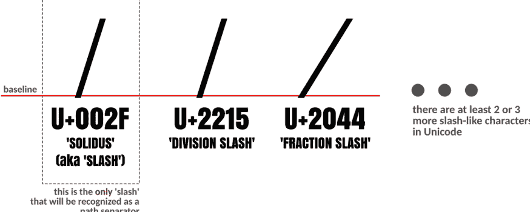
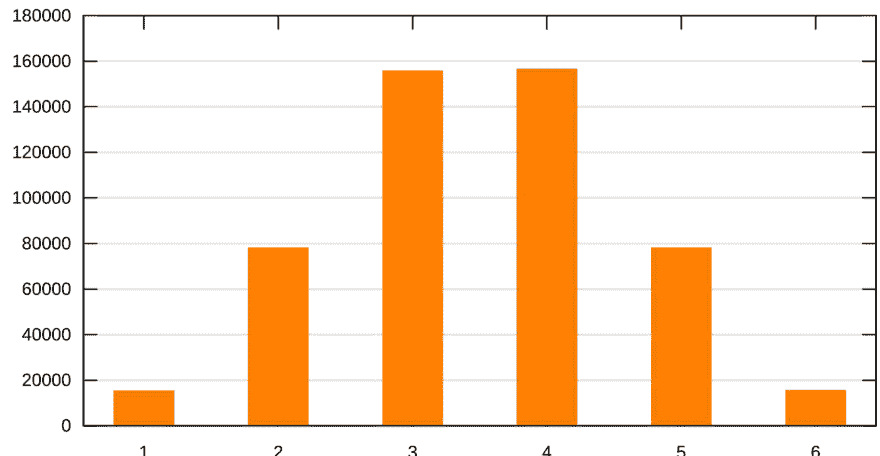

# Bash It Out！：通过 17 个不同难度的脚本挑战强化你的 Bash 知识

# 致谢

这项工作始于 Facebook 上 Linux 用户组的一篇谦虚的帖子。无需多说，我当时完全没有意识到会有这么多 Bash 挑战到至于我们可以出版一整本书！

当然，如果没有 Abhishek Prakash 的帮助，我无法走到这一步。他邀请我不仅将这些挑战发布在 It's FOSS 的 Facebook 页面，还发布在 It's FOSS 网站上。Abhishek 也是将所有挑战（包括一些尚未发布的材料）汇编成你正在阅读的这本书的灵感来源。

但在在博客上发表常规专栏和制作一本书之间，隔着整个世界。插图、分页和整体项目管理是 Rohini Rachita 特别出色的任务。

最后但同样重要的是，我感谢互联网上所有喜欢这些挑战的人。这项工作是为你们做的。我的目标是帮助你们发现 Bash 这一伟大工具的某些微妙之处或陷阱。根据你们在互联网上的评论和反应，我知道你们喜欢这项工作。我诚挚地希望你们在阅读这个增强版的《Bash 挑战》时能获得更多乐趣！

Sylvain Leroux

2017 年 6 月

我知道它

# 出版者前言

《Bash Out》是我们首次以书籍形式呈现独特实用材料。它始于我们 Facebook 页面上的一个帖子。拥有超过 250,000 名成员，我们感到是著名的声音之一。我们计划在未来增加更多问题。

希望你们喜欢这些挑战。

Abhishek Prakash

It's FOSS 创始人

# 如何使用本 Bash 挑战书

既然你正在接受这项挑战，我们假设你已经了解基础知识。挑战分为三个级别：

- 1 级挑战涵盖所有 Bash 脚本人员都可以使用的技巧；
- 2 级挑战需要某些命令或 shell 特性的知识；
- 3 级挑战更具挑战性，可能需要更高级的概念或微妙的解决方案。

尽管如此，这种划分相当任意，所以不要担心按照你顺序尝试挑战。这里真正的先决条件是一些 Bash 语法知识，最重要的是在乐趣中学习的渴望。

说够了！来吧，尽情 Bash 吧！

# 第 1

## Bash 挑战

### 挑战 1：统计当前目录下的文件

我想实现什么目标？

我想统计当前目录下的文件数量。为此，我使用了 `ls` 和 `wc` 命令：

```
yesik:~/ItsFOSS$ ls -l
total 0
-rw-r--r-- 1 yesik yesik Nov 22 22:45 file1
-rw-r--r-- 1 yesik yesik Nov 22 22:45 file2
-rw-r--r-- 1 yesik yesik Nov 22 22:45 file3
ok
yesik:~/ItsFOSS$ ls | wc -l
4
```

我原本预期的结果是 3，因为我肉眼看到目录里有三个文件。但由于某种未知原因，得到的结果并不是我预期的。你能解释一下这是为什么吗？最重要的是，如何实现我的目标？

```
yesik:-/ItsFOSS$ ls -l
total 0
-rw-r--r-- 1 yesik yesik Nov 23 00:29 file1
-rw-f--r-- 1 yesik yesik Nov 23 00:29 file2
-rw-f--r-- 1 yesik yesik Nov 23 00:29 file3
ok
yesik:-/ItsFOSS$ ls | wc -l
4
yesik:-/ItsFOSS$ 
```

### 解决方案

如何复现？

这里是我们用来生成这个挑战的原始代码。如果你在终端中运行它，将能够复现出与挑战插图中完全相同的结果（假设你使用的软件版本与我相同）：

```
mkdir -p ItsFOSS
cd ItsFOSS
touch file1 file2 '$file3\nok'
clear
ls -1
ls | wc -l
```

问题出在哪里？

当使用管道符时，`ls` 命令会将每个文件名写入单独的一行。就像在终端中使用 `ls -1` 一一样。而 `wc -l` 命令用于统计行数。显然，`ls | wc -l` 应该显示当前目录下文件或文件夹的数量。

然而，文件名可能包含换行符（通常表示为 `\n`）。这虽然罕见，但完全是合法的。

在那个挑战中，你在屏幕截图中看到的 `ok` 是第三个文件名的一部分，实际上它是 `file3\nok`，而不是像初眼看到的那样是 `file3`。

你在编写脚本或 shell 命令时可能需要考虑这种情况，以防文件名包含该字符时导致程序崩溃。这可能是意外，也可能是恶意活动的结果。

如何修复？

从 `ls` 的输出中移除不可打印字符

```
ls -q | wc -l
```

现代版本的 `ls` 有 `-q` 选项，它会将不可打印字符替换为问号（?）。`-q` 选项比你有时看到的用于 `-b` 选项更具移植性。在这两种情况下，我们都能完全确定嵌入文件名中的 `\n` 不会干扰我们的计数。根据 POSIX 标准：

- `-q` 强制将每个不可打印文件名字符和 `<tab>` 写入问号字符（`?`）。如果输出目标是终端设备，实现可以默认提供此选项。

在我的 Debian Squeeze 测试系统中，`-q` 不是默认的。这就是为什么 `ok` 单词会出现在单独的一行的原因。在 Debian Stretch 上，`-q` 是默认开启的，且输出默认——**仅当输出到控制台时**——它会将最后一个文件名显示为 `file3?`

忽略文件名

我想统计*文件*的数量，而不是文件名的数量。所以，作为替代方案，我可以直接忽略文件名并为每个遇到的文件发布一个*令牌*（`token`）。统计令牌的数量将得到与统计文件数量相同的结果。由于我们控制了令牌，就不会被欺骗。我们可以使用 `find` 命令来实现此目的：

```
find . -maxdepth 1 -printf '\n' | wc -l
find . ! -path . -printf '\n' | wc -l
```

在这里我选择使用空行（`\n`）作为令牌。因此，这两个命令都会为当前目录产生一个空行。注意实际的文件名从未输出。无论文件名中包含什么字符，都不会干扰管道。我只需要统计行数来获取文件数量。请注意 `-maxdepth 1` 和 `-path .` 是移除当前目录的两个技巧。否则，你的计数会偏差 1。

### 挑战 2：我的 shell 不会计数

我想实现什么目标？

我有一些包含整数的数据，每行一个，我想计算所有数字的和：

```
yesik:~/ItsFOSS$ cat sample.data
102
071
210
153
yesik:~/ItsFOSS$ declare -i SUM=0
yesik:~/ItsFOSS$ while read X ; do
  SUM+=$X
done < sample.data
yesik:~/ItsFOSS$ echo "Sum is: $SUM"
Sum is: 522
```

```
yesik:~/ItsFOSS$ cat sample.data
102
071
210
153
yesik:~/ItsFOSS$ declare -i SUM=0
yesik:~/ItsFOSS$ while read X ; do
  SUM+=$X
done < sample.data
yesik:~/ItsFOSS$ echo "Sum is: $SUM"
Sum is: 522
yesik:~/ItsFOSS$ 
```

遗憾的是，得到的结果是错误的（预期结果是 536）。你能解释为什么结果是错误的，并修复我的命令以获得正确结果吗？

额外挑战：你能仅使用 Bash 命令找到解决方案吗？

### 解决方案

如何复现？

这是我们生成此挑战的原始代码。如果你在终端中运行它，将能够复现出与挑战图中完全相同的结果（假设你使用的软件版本与我相同）：

```
rm -rf ItsFOSS
mkdir -p ItsFOSS
cd ItsFOSS
cat sample.data << 'EOT'
102
071
210
153
EOT
clear
cat sample.data
declare -i SUM=0
while read X; do
  SUM+=$X
done < sample.data
echo "Sum is: $SUM"
```

#### 问题是什么？

问题是由 `071` 值引起的。正如你所看到的，这个数字以 0 开头是为了确保所有数据都是三位数。这里没有什么复杂的，除了遵循 C 语言的约定：在整数前加 0 是指定数字为八进制而非十进制的方法。

八进制用数字 0 到 7 表示。这里有一个简单的表格：

| 十进制 | 八进制 | 十进制 | 八进制 | 十进制 | 八进制 | 十进制 | 八进制 |
| :--- | :--- | :--- | :--- | :--- | :--- | :--- | :--- |
| 0 | 0 | 8 | 10 | 16 | 20 | 56 | 10 |
| 1 | 1 | 9 | 11 | 17 | 21 | ... | 57 |
| 2 | 2 | 10 | 12 | 18 | 22 | 58 | 72 |
| 3 | 3 | 11 | 13 | 19 | 23 | 59 | 73 |
| 4 | 4 | 12 | 14 | 20 | 24 | 60 | 74 |
| 5 | 5 | 13 | 15 | 21 | 25 | 61 | 75 |
| 6 | 6 | 14 | 16 | 22 | 26 | 62 | 76 |
| 7 | 7 | 15 | 17 | 23 | 27 | 63 | 77 |

上表中**加粗**的值是在计算总和时导致错误的那个值。Bash 读取了 `071`，由于前导 0，它将其解释为八进制数 $71_8$，代表十进制值 $57_{10}$。你可以轻松地检查这一点：

```
echo $((071))
57
```

### 如何修复？

我看到了两种解决该问题的主要策略。要么移除前导零，要么找到一种方法让 shell 理解我所有的数字都是**十进制**值。

移除前导零

这是一个使用 `sed` 命令移除前导零的简单解决方案：

```
declare -i SUM=0
while read X ; do
SUM+=$X
done <(sed -E s/^\0+//// sample.data)
echo "Sum is: $SUM"
```


**奖励问题**：我为什么没有使用管道符而是使用了进程替换？

#### 显式指定进制

之前的解决方案（大部分）是直观的——但 Bash 允许我们做得更好。与其尝试修复数据，我们只需显式地指定我们的数字是以十进制（base 10）表示，而不是八进制（base 8）。你可以通过 `base#value` 语法来实现。对比这三个例子：

```
echo $((071))           # 前导 0 指定数字为八进制
57
echo $((8#071))      # 我们显式指定为 8（八进制）
57
echo $((10#071))     # 我们显式指定为 10（十进制）
71
```

为了修复我的初始命令并获得正确结果，我只需要为所有数据显式指定进制 10：

```
declare -i SUM=0
while read X ; do
  SUM+($(10#$X))
done < sample.data
echo "Sum is: $SUM"
```

让你自己检查，这次绝对应该产生正确的结果了！


### 挑战 3：我的命令输出顺序错了！

我想实现什么？

这次，我想写一个 shell 函数来记录到服务器的往返时间 (rtt)。只有当 `ping` 命令成功后，我才希望在 rtt 的下方记录测量的日期。

根据这些要求，我写出了这样的代码：

```
yesik:~/ItsFOSS$ probe((
  > ping -qnc2 www.google.com | \
  > grep rtt & \
  > date +"OK %D %T"
  )
yesik:~/ItsFOSS$ rm -f log
yesik:~/ItsFOSS$ probe >> log
yesik:~/ItsFOSS$ probe >> log
yesik:~/ItsFOSS$ cat log
OK 11/22 22:52:36
rtt min/avg/max/mdev = 53.394/77.140/100.887/23.748
OK 11/22 22:52:39
rtt min/avg/max/mdev = 49.142/49.731/50.320/0.589
```

但是，我不理解为什么日志文件中日期行和 rtt 行反过了？！日期应该出现在 rtt 下方。但在这里它出现在了上方。为什么？你能修复它吗？


### 解决方案是什么？

出现的拼写错误：

我只是写错了一个符号：我把 `&&` 错成了 `&`——也许是被上面的管道 (`|`) 符号搞混了？确实，所有的 `|`、`||`、`&` 和 `&&` 运算符都可以连接两个 shell 命令。它们的含义完全不同：

| cmd | 运算符 | 说明 |
| :--- | :--- | :--- |
| `cmd1 | cmd2` | 管道 | 在子 shell 中并行运行两个命令，并将 `cmd1` 的输出作为 `cmd2` 的输入。管道是组合多个基本命令以完成复杂任务的非常常用方法。 |
| `cmd1 & cmd2` | 安培符 | 将 `cmd1` 作为后台进程运行，并并行地在前台运行 `cmd2`。使用该运算符时，两个命令之间没有任何连接。 |
| `cmd1 || cmd2` | 短路或 | 仅当 `cmd1` 在 `cmd2` 运行之前完成后才运行 `cmd2`。换句话之，命令按顺序执行。 |
| `cmd1 && cmd2` | 短路与 | 仅当 `cmd1` 执行成功时运行 `cmd2`。结果 `cmd1` 必须在 `cmd2` 运行之前完成。换句话之，命令按顺序执行。 |

掌握了这些知识，现在来看看我的原始代码：

```
probe() {
ping -qnc2 www.google.com | \
grep rtt & \\
date +"OK %D %T"
}
```

- 1. 我想运行 `ping` 命令并将其输出发送给 `grep` 命令。管道是正确的运算符。
- 2. 但之后，我只想在管道成功后才写入日期。在这里，我需要的是逻辑与运算符 (`&&`)。但我使用了 `&` 运算符，它基本上是总是将 `ping | grep` 放到后台运行，并总是在前台运行。由于两个进程现在都在并行运行并竞争写入 `stdout`（终端输出），因此存在竞态条件。意乎不用，在那个特定的示例中，`date` 命令每次都赢了 `ping` 命令。

因此，正确的语法应该是：

```
probe() {
ping -qnc2 www.google.com | \ \
grep rtt && \
date +"OK %D %T"
}
```

在我的情况下，问题是立即可见的，因为 `ping` 命令完成的时间比 `date` 命令长。但由于竞态条件经常发生，当两个“竞争者”完成所需的时间相似时，这种错误很容易被隐藏。下面的例子确定性高得多：

```
probe() {
ping -qnc2 itsfoss.com | \
ping -qnc2 kernel.org
}
```

在 2000 次运行中，这个“`bug`”只出现了 15% 的情况。对各位开发者友好一点，即使是竞态条件导致的错误也很难以复现，更难以追踪！


### 挑战 4：保留文件名

我想实现什么？

在一个文件中，我有一行文件名列表（这是日志的一部分）。我想提取所有包含 `.bat` 扩展的文件。该扩展名必须完全匹配并且出现在文件名的末尾。

`grep` 命令是查找包含某些模式的标准工具。遗憾的是，我没有实现预期的结果：

```
yesik:~/ItsFOSS$ cat sample.data
login.bat
logout.batch
acrobat.exe
first-run.pdf
first-run.bat.orig
```

```
yesik:~/ItsFOSS$ grep .bat sample.data
login.bat
logout.batch
acrobat.exe
first-run.pdf
first-run.bat.orig
```

你可以看到，我的解决方案保留了我不需要的文件。对于 `.batch` 或 `.bat.orig` 是可以理解的，但为什么保留了 `exe` 呢？如何修复我的解决方案来实现目标？

### 解决方案

这里问题的原因是 `grep` 命令接收的是正则表达式而不是固定字符串。正则表达式允许描述一组字符串。这是通过使用元字符实现的。点 (`.`) 是一个具有特殊含义的字符。在正则表达式中，点会匹配任何字符。所以，当我们执行：

```
grep .bat sample.data
```

这意味着我想保留包含 `b`、`a` 和 `t` 字母的行，前面是任意字符。可以是字面的点或其他字符。

如何修复？

保护点免受特殊解释

为了修复这个问题，我可能移除点的特殊含义。在正则表达式中，通过在它前面加上斜杠来移除元字符的特殊含义。但有一个陷阱：参数被处理了两次。一次由解析命令的 shell，第二次由解释正则表达式的 `grep` 命令。所以为了让 `grep` 命令看到斜杠，我们必须先对 shell 进行转义：

```
grep \\.bat sample.data
```

如果你不喜欢“双斜杠”，第二个选项是使用单引号保护整个模式免受 shell 的解释：

```
grep '\.bat' sample.data
```

最后，如果你真的不喜欢斜杠，你可以在正则表达式中使用字符集：

```
grep '[.bat]' sample.data
```


### 挑战 4：以 `.bat` 结尾的文件

字符集会匹配括号内的任何字符。如果你只在括号内放一个点，它只能匹配字面的点。

#### 在行末尾锚定模式

上面的三个解决方案都移除了点的特殊含义。但如何保留以 `.bat` 结尾的文件呢？再次，解决方案在于正则表达式元字符。特别是美元符号 `$` 会匹配行尾。同样，由于美元符号在 shell 中也有特殊含义，我们必须保护它免受 shell 的解释。

最终导致这些可能的解决方案：

```bash
yesik:~/ItsFOSS$ grep '\.bat$' sample.data

login.bat

first-run.bat
```

或者

```bash
yesik:~/ItsFOSS$ grep \.bat\$ sample.data

login.bat

first-run.bat
```

或者让我找第三种，也许使用括号？

### 挑战 5：懒打字者挑战

#### 我想实现什么？

我的当前工作目录下有以下内容：

```bash
yesik:~/ItsFOSS$ ls -F

archives/

report-fall-2015.pdf

report-summer-2015.pdf

report-summer-2016.pdf

report-winter-2014.pdf
```

我只想把 2016 年夏季和 2015 年秋季的报告复制到存档文件夹中。这很简单：

```bash
yesik:~/ItsFOSS$ cp report-summer-2016.pdf

yesik:~/ItsFOSS$ cp report-fall-2015.pdf archives/
```

但是，因为我很懒，我无法接受这些命令，因为它们需要 70 次按键。对我这可怜的手来说太多了！你能帮我找到一种用最少按键次数复制这些文件的方法吗？


#### 我的解决方案

对于这个挑战我不声称拥有“唯一的”解决方案。也许你可以获得比我更好的分数？如果是那样，你真的值得祝贺！

总之……
第一个最显而易见的优化是将两个命令合并为一个：

```bash
cp report-summer-2016.pdf report-fall-2015.pdf archives/
```

然后我们可以使用通配符（`glob`）来缩短每个文件名。由于只有一个“秋季”报告，这一个很容易，但对于夏季报告我们必须格外小心，因为我只对 2016 版本感兴趣：

```bash
cp report-s*-2016.pdf report-fall*.pdf archives/
```

事实上，考虑到其他文件名的结构，我可以进一步这样操作：

```bash
cp *6* *fa archives/
```

顺便说一下，我们可以对目标目录执行同样的操作——它是这里唯一的子目录：

```bash
cp *6* *fa */
```

在某些情况下，使用大括号扩展可以进一步减少所需的按键次数。但在那种情况下，我们仍然停留在 15 个字符：

```bash
cp *{6,fa} */

cp *{6,fa*,}
```

除非*你*找到了“更好”的方法？

### 挑战 6：要删除的危险文件

#### 我想实现的是什么？

当我上学校时（在 `VT10` 时代），对于那些离开终端时没有关闭会话的倒霉蛋来说，当他们回来时发现自己的主目录下出现了一些命名奇特的文件，这并不常见见。

那是由其他路过的同学们开的“恶作剧”。对于这个挑战，让我们假设你刚刚在主目录下发现了一个名为 `-rf *` 的文件：

```bash
yesik:~/ItsFOSS$ ls -1

dont remove!

-rf *

yesik:~/ItsFOSS$ 
```

```bash
yesik:~/ItsFOSS$ ls -1

dont remove!

-rf *
```

那么，如何从命令行删除这个不需要的文件，而不删除任何其他文件呢？显然，`rm -rf *` 并不是解决方案……

> **注意**：
> 在尝试回答这个挑战之前，请先思考为什么这这是一场“恶作剧”。这个文件的名称包含哪些风险？如果你先无法回答这个问题，千万不要在主目录下尝试这种操作！

#### 解决方案

这可能是你的第一个反应，但不，使用引号或反斜杠`并不是`解决方案。这些语法都是无效的：

```bash
yesik:~/ItsFOSS$ rm -rf '*'

rm: invalid option --''

Try 'rm --help' for more information.

yesik:~/ItsFOSS$ rm \rf\ '*'

rm: invalid option --'

Try 'rm --help' for more information.
```

为什么这些不是有效的解决方案呢？因为它们会保护特殊字符免受 shell 的解释。但这里的问题不在于 shell，而在于 `rm` 命令本身。

#### 如何解决？

希望 `rm` 像其他几个标准命令一样支持 `--` 特殊选项，用于指示文件名列表的开始。在 `--` 之后，命令将不再尝试将以杠开头的字符串解释为选项。这正是我们需要的：

```bash
yesik:~/ItsFOSS$ rm -- '-rf *'
```

注意，引号（或反斜杠）仍然对于保护空格和星号免受 shell 解释是必要的。如果你想进行更多实验，我鼓励你使用 `ls` 和 `touch` 命令，它们都支持 `--` 选项。而且它们使用起来比 `rm` 命令安全得多！


### 挑战 7：不愿离开的文件

#### 我想实现的是什么？

我被要求删除下面列表中的最后一个文件：

```bash
yesik:~/ItsFOSS$ ls -l

total 0

-rw-r--r-- 1 yesik yesik 0 Nov 23 00:41 a

-rw-r--r-- 1 yesik yesik 0 Nov 23 00:41 b

-rw-r--r-- 1 yesik yesik 0 Nov 23 00:41 c

-rw-r--r-- 1 yesik yesik 0 Nov 23 00:41 d/e

yesik:~/ItsFOSS$ rm e

rm: cannot remove 'e': No such file or directory
```

```bash
yesik:~/ItsFOSS$ ls -l

total 0

-rw-r--r-- 1 yesik yesik 0 Nov 22 22:58 a

-rw-r--r-- 1 yesik yesik 0 Nov 22 22:58 b

-rw-r--r-- 1 yesik yesik 0 Nov 22 22:58 c

-rw-r--r-- 1 yesik yesik 0 Nov 22 22:58 e

yesik:~/ItsFOSS$ rm e

rm: cannot remove 'e': No such file or directory
```

但正如你所看到的，简单的 `rm` 命令不起作用。

为什么？如何删除那个文件？

#### 解决方案

**问题出在哪里？**

你知道斜杠 `/` 不能作为文件名的一部分。你可能以某种方式认为文件 `e` 在某个子目录 `d` 中。

但那是错误的。

首先，`ls -1` 命令没有理由以这种格式显示子目录的内容。而且，从 `ls` 输出的其余部分我们可以看到，这里并没有名为 `d` 的子目录。

这是一个典型的形似字混淆（`homoglyphic confusion`）。你认为你看到了一个斜杠。但实际上它是另一个字符，只是显示了一个不幸令人困惑的字形。在特定情况下，它是 `U+2215 DIVISION SLASH` `Unicode` 字符。



在我的 `UTF-8` 终端上，`U+2215 DIVISION SLASH` `Unicode` 字符使用三字节序列 `0xE2 0x88 0x95` 编码。你可以使用 `hexdump` 命令进行检查（配合一点 shell 脚本以获得更可读的输出）：

| `yesik:~/ItsFOSS$ for f in *; do echo -n $f | hexdump -C; done` |
| :--- |
| `00000000 61` | `a` |
| `00000001` | |
| `00000000 62` | `b` |
| `00000001` | |
| `00000000 63` | `c` |
| `00000001` | |
| `00000000 64 e2 88 95` | `d...e` |
| `00000005` | |

如果你在系统中安装了 `iconv`，你甚至可以通过将数据转换为 `utf-16` 来找到对应的 `Unicode` 节点：

| `yesik:~/ItsFOSS$ for f in *; do echo -n $f | iconv -t utf16 hexdump -C; done` |
| :--- |
| `00000000 00 61` | `a` |
| `00000002` | |
| `00000000 00 62` | `b` |
| `00000002` | |
| `00000000 00 63` | `c` |
| `00000002` | |
| `00000000 00 64 e2 88 95` | `d...e` |

### 挑战 9：我的 Bash 无法对列数据求和

#### 我尝试实现什么？

我有一些整数数据，以固定宽文本文件的格式存储。我只想找到这些数据每列的总和。然而，文件中缺失部分数据，而这些缺失数据应该被视为 0 来计算。

遗憾的是，这些数据似乎困扰了我的 `Bash` 脚本：

```bash
yedik:~/ItsFOSS$ cat sample.data

5 3 7 2

1 -12

  0 -7

  -14 4

    15

yedik:~/ItsFOSS$ declare -i SW SX SY SZ while read W X Y Z; do

  > SW=$W; SX+=$X; SY+=$Y; SZ+=$Z

done < sample.data

yedik:~/ItsFOSS$ printf "%4d %4d %4d %4d\n" "${W,X,Y,Z}"

7 -12 7 2
```

我期望的结果是 "6 -11 7 2"。但由于某种未知原因，我的 shell 计算的前两列总和差了 1。你能修复它吗？

- 你可以假设：
  - 数据文件严格遵循我 "printf" 命令中使用的格式。
  - 最后一列是密集的（即：没有缺失值）。

**额外挑战**：
你能仅使用 `Bash` 内置命令和/或 shell 扩展来找到解决方案吗？

#### 问题出在哪里？

`Bash` 内置命令 `read` 的默认行为是丢弃行首的空格，并将行中间的一组空格视为且仅视为分隔符。

所以基本上，我们看来是固定宽的数据文件，被 `read` 命令读取时会被空格分隔的数据文件。就像如果数据文件如下：

```text
while read ; do echo $REPLY; done < sample.data

5 3 7

1 -12

0 -7

-14 4

15
```

像这样显示时，就能看出为什么第一列之和是 7 而不是我们预期的 8 了。

#### 如何修复？

我可以看到获取正确结果两种策略。首先，我只需要在空单元格中添加缺失的 0 值，这样我们每行都会读取到 4 个整数。第二种策略是在代码中强制执行固定宽度格式。


#### 填充缺失的零

这是上述第一种策略的可能解决方案：

```bash
declare -i SW=0 SX=0 SY=0 SZ=0

while read W X Y Z; do

  SW+=$W; SX+=$X; SY+=$Y; SZ+=$Z

done < <(sed 's/ /0/' sample.data)

printf " %4d %4d %4d %4d\n" ${W,X,Y,Z}
```

在解决方案中，每当我遇到连续 5 个空格时，就在数据中放入一个零。现在，每行都有 4 个整数，`read` 命令正确解析了数据，因此我的总和是正确的。

#### 附加问题

你可以尝试简化 `sed` 表达式吗？

为什么使用管道连接 `sed` 命令和 `while` 循环不是一个好主意？

#### 按固定位置分割数据

另一种完全不同的策略是使用所谓的 `Bash` 字符串提取，使用 `${parameter:offset:length}` 语法。这样你就可以在固定位置切分数据。但为了让它工作，我们需要第二个“技巧”：能够一次读取一整行。

要实现这一点，你需要知道 `IFS` 变量。它存储了 `Bash` 用于将一行拆分为单词的分隔符。为了一次读取一整行（即忽略任何分隔符），我们只需要将 `IFS` 设置为空字符串。

结果如下：

```bash
declare -i SW=0 SX=0 SY=0 SZ=0

while IFS=' ' read LINE; do

  SW+=${LINE:0:5}; SX+=${LINE:5:5}

  SY+=${LINE:10:5}; SZ+=${LINE:15:5}

done < sample.data

printf " %4d %4d %4d %4d\n" ${W,X,Y,Z}
```

> *你可能在另一个挑战中找到这个问题的答案……*

### 挑战 10：在 rm 中幸存留的文件

#### 我尝试实现什么？

这个挑战的描述非常短：
我在目录中有三个文件。作为 `root` 用户，我在那个目录下执行了 `rm *`。
但有一个文件固执地拒绝删除：

```bash
root:011# ls -ls

total 12

4 -rw-r--r-- 1 root root 29 nov 21:25 a

4 -rw-r--r-- 1 root root 29 nov 21:25 b

4 -rw-r--r-- 1 root root 29 nov 21:23 c

root:012# rm *

rm: cannot remove 'c': Operation not permitted

root:013# rm -f c

rm: cannot remove 'c': Operation permitted

root:014# ls -ls

total 4

4 -rw-r--r-- 1 root root 29 nov 21:23 c
```

你的挑战是找到：
1. 是什么阻止了第三个文件被删除？
2. 如何真正删除它。


### 解决方案

#### 如何复现

这里是产生此挑战的原始代码。如果你在终端中运行它，将能够重现与图中所示完全相同的结果：

```bash
cd /tmp

mkdir -p ItsFOSS

touch ItsFOSS/a ItsFOSS/b ItsFOSS/c

chattr +i ItsFOSS/c

cd ItsFOSS

rm *

rm -f c
```

#### 问题出在哪里？

为了计算这些总和，问题在于我最初尝试直接将输入发送到 `grep`，导致丢弃了部分数据。

基本上有三种方法可以解决这个问题：

- 存储流后再处理；
- 复制流并对 `RED`、`BLUE` 和 `GREEN` 分别独立处理；
- 在到达时同时处理所有情况。

为了参考，在每个解决方案之后，我提供了我在系统上观察到的真实数据。这仅供参考，必须谨慎对待。所以请进行你自己的比较！

#### 存储处理方法

存储处理策略的简单实现显而易见：

```bash
stream > stream.cache

grep -F RED < stream.cache | wc -l > RED.CNT

grep -F BLUE < stream.cache | wc -l > BLUE.CNT

grep -F GREEN < stream.cache | wc -l > GREEN.CNT

rm stream.cache
```

（10,000,000 次数据耗 1.3 秒）

它有效，但有几个缺点：我们必须在处理之前存储所有数据。此外，我们是顺序处理这三种情况。更微妙的是，如果你多次读取 `stream.cache` 文件，如果并发进程在处理期间更新了文件，可能会出现竞争条件。

仍然在存储处理范围内，这里有一个完全不同的解决方案：

```bash
stream | sort | uniq -c
```

（10,000,000 次数据耗 5.9 秒）

我认为这是一种存储处理方法，因为 `sort` 命令必须在处理它们之前读取并存储（在内存或磁盘中）所有数据。更具体地说，在我的 `Debian` 系统中，`sort` 命令会在 `/tmp` 中创建几个具有读写权限的临时文件。基本上，这个解决方案和第一个方案有相同的缺点，但性能差得多。

#### 重复流

我们真的必须在处理数据之前存储它们吗？不需要。一个更聪明的想法是将流分成几部分，在每个子流中处理一种类型的标记（`token`）：

```bash
stream | tee >(grep -F RED | wc -1 > RED.CNT) \
>(grep -F BLUE | wc -1 > BLUE.CNT) \
>(grep -F GREEN | wc -1 > GREEN.CNT) \
>/dev/null

0.8s for 10,000,000
```


#### 在数据到达时处理数据

在这里，没有中间文件。`tee` 命令在数据到达时复制流数据。每个处理单元都获得数据的副本，并可以进行实时处理。这是一个聪明的主意，因为我们不仅在数据到达时处理它们，而且现在实现了并行处理。

在计算机科学中，我们可能会说上一个方案对问题采用了函数式方法。另一方面，接下来的方案将是纯命令式的解决方案。在这里，我们将依次读取每个标记，如果这是一个 `RED` 标记，我们就增加 `RED` 计数器；否则这是一个 `BLUE` 标记，我们就增加 `BLUE` 计数器；否则如果这是一个 `GREEN` 标记，我们就增加 `GREEN` 计数器。

这是该想法的简单 Bash 实现：

```bash
declare -i RED=0 BLUE=0

stream | while read TOKEN; do
  case "$TOKEN" in
    RED) RED+=1
    ;;
    BLUE) BLUE+=1
    ;;
    GREEN) GREEN+=1
    ;;
  esac
done

(103.2s for 10,000,000 tokens)
```

最后，作为 `Awk` 命令的忠实粉丝，我无法抵抗使用它来以一种简洁优雅的方式解决这个挑战的诱惑：

```bash
stream | awk '
/RED/ { RED++ }
/BLUE/ { BLUE++ }
/GREEN/ { GREEN++ }
END { printf "%d %d %d\n",RED,BLUE,GREEN }
'

(2.6s for 10,000,000 tokens)
```

我的 `Awk` 程序由四个规则组成：

1. 当遇到包含单词 `RED` 的行时，增加 `RED` 计数器
2. 当遇到包含单词 `BLUE` 的行时，增加 `BLUE` 计数器
3. 当遇到包含单词 `GREEN` 的行时，增加 `GREEN` 计数器
4. 在输入结束（`END`）时，显示所有计数器。

为了完全理解这一点，我们知道对于数学运算符，未初始化的变量被假设为零。

这效果非常好。但它需要重复相同的规则。在这里我们只有三个不同的标记，所以不是大问题。如果有许多标记，就会更令人麻烦。为了改进这个解决方案，我们可以依赖数组：

```bash
stream | awk '
{ C[0]++ }
END { printf "%d %d %d\n",C["RED"],C["BLUE"],C["GREEN"] }
'

(2.0s for 10,000,000 tokens)
```

然而，这里只需要两个规则，当标记数量很多时：

1. 无论读取到什么 (`$0`)，增加对应的数组单元格（这里是 `C["RED"]`、`C["BLUE"]` 或 `C["GREEN"]`）
2. 在输入结束时，显示不同标记的数组内容。

请注意，`"RED"`、`"BLUE"` 和 `"GREEN"` 现在在程序中被作为字符字符串处理（你看到它们周围的双引号了吗？）。这对于 `AWK` 来说不是问题，因为它支持关联数组。和普通变量一样，`AWK` 数组中未初始化的单元在数学运算符中也被假设为零。

正如我之前解释的那样，我选择了使用 `AWK`。但 Perl 粉丝可能对这个主题有不同意见。如果你是他们之一，会写你自己的解决方案吗？

### 挑战 12：在多个不同的文件顶部插入相同的表头

我想实现的是什么？

这次我处理多个数据文件和一个表头文件。我只想将表头内容插入到每个数据文件的顶部：

```bash
yesik:~/ItsFOSS$ head HEADER DATA01

==> HEADER <=<

# Month, Year, Est.Value

==> DATA01 <=<

Dec, 2015, 15000

Jan, 2016, 12540

Feb, 2016, 11970

yesik:~/ItsFOSS$ cat HEADER DATA01 | tee DATA01

# Month, Year, Est.Value

# Month, Year, Est.Value
```

```bash
yesik:~/ItsFOSS$ head HEADER DATA01

==> HEADER <=<

# Month, Year, Est.Value

==> DATA01 <=<

Dec, 2015, 15000

Jan, 2016, 12540

Feb, 2016, 11970
```

为了演示，我只显示了一个文件的内容。但你可以想象我有许多这样的文件——多到无法考虑手动编辑。

我以为我找到了一个使用 `cat` 命令的解决方案：

```bash
yesIk:-ItsFOSS$ cat HEADER DATA01 | tee DATA01

# Month, Year, Est.Value

# Month, Year, Est.Value
```

遗憾的是，由于某些原因，解决方案没有作用：不仅我丢失了数据，表头还出现了两次。

如你所见，我在这里需要帮助——既需要有人向我解释发生了什么，也需要帮助我解决这个问题。

### 解决方案

#### 问题所在哪里

在管道中，所有命令都是并行启动的。这意味着读取 `DATA01` 文件的 `cat` 命令和覆盖该文件的 `cat` 命令是同时启动的。

这确实是一个竞态条件。在 `cat` 命令有机会读取文件之前，`tee` 命令就已经覆盖了目标文件。为了说明这一点，我们让命令延迟：

```bash
cat HEADER DATA01 | sleep 1 | tee DATA01

# Month, Year, Est.Value

Dec, 2015, 15000

Jan, 2016, 12540

Feb, 2016, 11970
```

```bash
sleep 1 | cat HEADER DATA01 | tee DATA01

# Month, Year, Est.ValueDec, 2015, 15000

Jan, 2016, 12540

Feb, 2016, 11970
```

在这种情况下，`cat` 总是覆盖目标文件，直到 `cat` 命令有机会读取它。

#### 如何修复？

显然，没有人会使用 `sleep` 这种技巧来解决这个问题。在 POSIX 工具中，我们有很多命令可以向文件顶部插入表头。在此之前，让我们看看最基础的解决方案。

##### KISS 解决方案

```bash
cat HEADER DATA01 > DATA01.NEW

mv -f DATA01.NEW DATA01
```

我需要注释这个吗？嗯，虽然很原始，但这个解决方案有一个优点：由于我们使用了系统重命名，这种操作本身是原子的。

### 挑战 13：将文本转换为大写

#### 我尝试实现什么？

我有一个文本文件，里面包含了两次相同的句子，一次用英语写，另一次用法语写：

```
yesik.it:~/ItsFOSS$ cat text

This text should be written in all

ercase letters!

Ce text doit être affiché uniquement

en lettres majuscules!
```

我需要全大写地显示该文件的内容。你有什么想法可以完成这个任务吗？我的意思是在不需要重新输入所有文本的情况下……

### 解决方案

执行字符替换的标准工具是 `tr`，它是 transliteration（转写）。`tr` 命令接受两个参数：源字母表和目标字母表。它执行从前者到后者的一一映射。

```
yesik.it:~/ItsFOSS$ tr '[a-z]' '[A-Z]' < text

THIS TEXT SHOULD BE WRITTEN IN ALL

UPPERCASE LETTERS!

CE TEXT DOIT AFFICHÉ UNIQUEMENT

EN LETRES MAJUSCULES!
```

这有效。但只适用于 US-ASCII 字母。带重音的字母以及任何 US-ASCII 范围外的字母都没有被转换。

如果你有使用正则表达式的经验，你可能想使用字符类而不是显式范围：

> 注：`tr` 命令不使用正则表达式。但它接受一种类似于字符范围的语法来指定源和目标字母表。例如，语法 `[a-z]` 是 `abcdefghijklmnopqrstuvwxyz` 的简写。

```
yesik.it:~/ItsFOSS$ tr '[:lower:]' '[:upper:]' < text

THIS TEXT SHOULD BE WRITTEN IN ALL

UPPERCASE LETTERS!

CE TEXT DOIT être AFFICHÉ UNIQUEMENT

EN LETRES MAJUSCLES!
```

遗憾的是这效果并不更好。解决方案是显式地添加所需字符的映射：

```
yesik.it:~/ItsFOSS$ tr 'é[a-z]' 'ÉÉ[A-Z]' < text
THIS TEXT SHOULD BE WRITTEN IN ALL
UPPERCASE LETTERS!

CE TEXT DOIT ÊTRE AFFICHÉ UNIQUEMENT
EN LETRES MAJUSCLES!
```

这次成功了，但这很枯燥。特别是当你预先不知道文本文件中会出现哪些字母时。惊讶的是，`Bash` 比 `tr` 命令更适合更改字符大小：

```
yesik.it:~/ItsFOSS$ while read; do
    echo ${REPLY^^}
  done < text

THIS TEXT SHOULD BE WRITTEN IN ALL
UPPERCASE LETTERS!

CE TEXT DOIT ÊTRE AFFICHÉ UNIQUEMENT
EN LETRES MAJUSCLES!
```

在代码中，`while` 循环只是逐行读取输入文件。`Bash` `read` 命令默认将值存储在 `REPLY` 变量中。我只需要使用特殊的 `${var^^}` 符号来输出该变量，它会展开变量的内容并将字母转换为大写。

作为一个练习，你可以尝试一下 `${var,,}` 参数扩展，它的工作原理相同，但是转换为小写而不是大写。

### 挑战 14：两小时前的函数

#### 我尝试实现什么？

这次，我想让一个 shell 函数显示两个小时前的日期和时间。函数的输出必须遵循 `YYYY-MM-DD hh:mm` 格式。

我使用简单的 shell 算术得到了解决方案：

```bash
minus-two-hours() {
  date -d "$1" +%F %H:%M" | \
  IFS=":" read -a COMP
  echo "${COMP[0]} $((${10#${COMP[1]}-2)):${COMP[2]}"
}
```

正如你所看到的，该函数接受一个日期作为参数，解析它，并写回去两小时后的日期。遗憾的是，结果远不如意，因为并不总是遵循预期格式，我有时甚至得到负的小时：

```
yesik.it:~/ItsFOSS$ minus-two-hours now
2016-11-22 20:55
yesik.it:~/ItsFOSS$ minus-two-hours "2016/11/21 05:27:18"
2016-11-21 3:27
yesik.it:~/ItsFOSS$ minus-two-hours "2016/11/21 01:10:42"
2016-11-21 -1:10
```

能帮我找到一个获得预期结果的解决方案吗？

### 解决方案

算术问题比人们想象的要复杂得多。我强烈建议不要采取我最初尝试时使用的路径：永远不要自己进行日期时间计算。如果你真的需要一个理由来来说服你，可以考虑一下夏令时的问题。

尽管如此，我们还有哪些选择？任何优良的编程语言都应该具有处理特定时间问题的功能。在这里我们使用的是 `Bash`，我们必须依靠 `date` 工具来实现这一目的。

#### 如何修复？

##### 将日期转换为数量

当遇到类似的问题时，典型的解决方案是将（人类可读的）日期和时间转换为某些数值数量。

通常，我们将日期转换为自某个参考时间以来的秒数（或毫秒）。有了这个数值，我们现在可以使用经典的算术来加或减小时。最后，我们将其转换回日期格式。

在实践中，Unix 上的参考时间是 1970-01-01 00:00:00 UTC。因此我们将日期转换为秒，减去秒数，然后转换回日期格式。

```bash
minus-two-hours() {
  local seconds=$(date -d "$1" +%s)
  local new_seconds=$((seconds - 7200))
  date -d "@$new_seconds" +"%F %H:%M"
}
```

等等，上面的解决方案适用于 GNU `date`。在 macOS (BSD `date`) 上，你需要不同的语法：

```bash
minus-two-hours "2016/11/21 05:27:18"
2016-11-21 3:27
```

### 挑战 15：我的 Bash 不会计数

#### 我尝试实现什么？

我只想相加文件中存储的和最后一个整数。

```
yesik.it:001$ cat sample.data
1 2 3
yesik.it:002$ cut -d' ' -f1,3 sample.data | read X Z
yesik.it:003$ echo $X
1
yesik.it:004$ echo $((X+Z))
0
```

我的 shell 显示的结果是 0（零）。拜托，1+3 是 4，不是 0。坏了吗？

### 解决方案

感谢 Riccardo Bernard 对这个“问题”的精彩解释：第 2 行通过启动子进程执行。因此，`read` 不是在 shell 中运行，而是在子壳中运行并设置子壳变量。当执行第 3 行时，我们回到了父 shell——这里的变量从未被修改。注意这在 `zsh` 中是不同的。

要修复这个问题，可以使用进程替换或此处字符串（here string）：

```bash
read X Z < <(cut -d' ' -f1,3 sample.data)
echo $((X+Z))
4
```

或者

```bash
read X Z <<< "$(cut -d' ' -f1,3 sample.data)"
echo $((X+Z))
4
```

最后值得提到 `Bash` 并不是这类问题的最佳解决方案。一个简单的 `Awk` 程序可能会做得更好——特别是由于隐含循环允许你用完全相同的程序处理包含一行的文件和包含数千行的文件：

```bash
awk '{ print $1+$3 }' sample.data
```

### 挑战 16：在两台电脑之间发送文件

#### 我想实现什么？

我有两台连接在同一个局域网上的电脑。它们的 `IPv4` 地址分别为 `192.168.10.10` 和 `192.168.10.11`。

我想从 `192.168.10.10` 发送一个文件到 `192.168.10.11`。在已知它们没有任何文件共享服务的访问权限，且任何一个都没有启用如 `ssh` 或 `telnet` 等远程终端功能的情况下，我该如何做？

你可以假设它们之间可以互相 `ping`，并且你可以在每台主机上访问一个运行着 `Bash` 的终端。你不应该假设自己对任何一台主机拥有 `root` 权限。

显然，使用 `USB` `U` 盘等可移动存储介质是一种解决方案。但我把 `U` 盘留在家里了。而且现在是周日晚上，所有的商店都关门了。无论如何，我想寻求基于网络的解决方案！

### 解决方案

#### 问题是什么？

这里的挑战在于找到一种在主机之间开启某种网络通信通道的解决方案。然后通过该通道将文件从源主机拷贝到目标主机。

这就是像 `scp` 或客户端/服务器模式下的 `rsync` 等工具在底层使用的解决方案。但在挑战描述中，我假设这些功能不可用。

所以，我必须找到一种自己创建通信的方法。即时连接的传统工具是 `netcat`（在你的发行版中可能称为 `nc`）。`netcat` 有可能作为标准 Linux 安装的一部分被安装。所以让我们开始使用该程序吧——除非你的管理员删除了它。

#### 介绍 netcat

注意：如果你无法访问同一网络上的两台不同的电脑，你仍然可以通过在电脑上的两个不同终端进行实验，并使用 `localhost` 代替两个 `IP` 地址。

为了使用 `netcat` 在两个主机之间传输数据，你可能启动该工具的两个实例。每台主机一个。

第一个实例将打开一个端口并等待传入的请求。在目标主机上开启监听器更为直观。这就是我将做的：

```bash
#### 在目标主机上
192.168.10.11$ netcat -l 1234
```

通过这条命令，`netcat` 将打开端口 `1234`（任意数字）并等待传入的连接（选项 `-l` 表示 "listen"）。

在源主机上，我们也将使用 `netcat`，但这次是为了连接到我们刚刚打开的远程主机和端口：

```bash
#### 在源主机上
192.168.10.10$ echo hello | netcat 192.168.10.11 1234
```

按回车键，`"hello"` 消息将显示在目标主机上。

这里发生的情况可以总结为以下几步：

1. 目标 `netcat` 已打开了端口 `1234` 等待传入连接。
2. 源 `netcat` 建立了到目标主机 `192.168.10.11` 端口 `1234` 的连接。
3. 然后源 `netcat` 开始从其标准输入读取数据，并通过之前建立的连接发送数据。
4. 目标 `netcat` 在其标准输出上显示了从连接接收到的数据。
5. 在某一点，源 `netcat` 检测到没有更多数据可读并关闭了连接（遇到 `EOF` 的确切行为由 `-N` 选项控制）。
6. 目标 `netcat` 检测到连接已关闭并随之终止。

一旦你了解了这些，可以使用简单的重定向来实现文件传输：

```bash
#### 在目标主机上
192.168.10.11$ netcat -l 1234 > my.file
```

```bash
#### 在源主机上
192.168.10.10$ netcat 192.168.10.11 1234 < my.file
```

### 用 Bash 替换客户端 netcat


遗憾的是，我们无法仅使用 `Bash` 解决挑战，因为它无法开启服务器 `socket`（通信通道的“监听”部分）。但 `Bash` 可以作为客户端连接到现有的服务器 `socket`。所以，在服务端，我们将使用与上面完全相同的命令：

```bash
#### 在目标主机上
192.168.10.11$ netcat -l 1234
```

在客户端，我们不再需要 `netcat` 了：

```bash
#### 在源主机上
192.168.10.11$ echo hello > /dev/tcp/192.168.10.11/1234
```

在这种情况下，shell 重定向到 `/dev/tcp/...` 将在底层处理到远程主机的连接，就像之前 `netcat` 执行的那样。

顺便说一下，不需要在 `/dev` 中寻找 `tcp` 设备。它并不真实存在。它只是一个 `Bash` 特殊处理的魔法文件名。这意味着你只能在重定向中使用这些特殊文件名。

尽管有局限性，`Bash` 的 `/dev/tcp/...` 伪设备在测试目的或诊断网络问题时非常有用。在这个话题结束之际，我忍不住想向你展示一些用例。

显而易见的结果是不公平的。事实上，你可以识别出正态分布的典型形状：



### 如何修复？

解决方案是考虑取模运算符可以得到公平的解决方案，但仅限于原始范围的一个子集。例如，如果原始范围是 0-15，而目标范围是 0-5，那么对于 0-11 范围内的输入值，取模产生的输出与输入一样`公平`。问题出在 12-15 范围内的输入值。这`恰好`就是我最初图表所所示的。

那么，技巧就是简单地忽略问题范围内的值，如果随机生成器产生了这样的值，则取另一个值。这导致了：

```bash
### 这确实可以解决挑战
getRandomNumber() {
  N=$RANDOM

  while ((N>=32768/6*6))
  do
    # N 处于问题范围内。取另一个值：
    N=$RANDOM
  done

  echo $((N%6+1));
}
```

结束该挑战的三个备注：

- `32768/6*6` 不同于 `32768*6/6`。你能知道为什么吗？
- 使用了这种解决方案，有极小的概率导致 `getRandomNumber` `永远`不会返回。
- 当然，所有的演示都是基于 `$RANDOM` 伪变量产生公平结果这一前提。但它`真的`可以这样吗？


# 后记

如果你读到了这里，说明你可能已经完成了所有的挑战。嗯，是其中的大部分。或者只是少数几个？

无论如何，恭喜你！即使只解决了一个挑战，也需要时间和精力。由于我们通过试错学到的东西比第一次尝试成功学到的更多，因此在这个过程中，你可能学到的不仅仅是挑战的解决方案。希望你在过程中玩得很开心。

等一下，你玩得很开心。不是吗？

如果没有向为所有挑战找到解决方案的读者说几句话，我就无法结束这本书。如果是你的话，你真的太棒了。无论是因为你已经对该主题有了广泛的知识，还是因为你的努力，你都是 `Bash` 大师了！你绝对应该考虑分享和传播你的智慧。为什么不加入 `Facebook Linux User Group`（`https://www.facebook.com/groups/8222867478719993`）呢？

最后，你在这里学习了很多关于 `Bash` 的技巧和陷阱。但这本书不能取代关于该主题的课程。如果你想通过坚实的基础来巩固你的新知识，可能会喜欢我的 `Bash` 和 `Linux` 命令行课程（`https://yes.it/BSH101/BASH-CHALLENGE-2017`）。点击该链接，你将获得本书读者的专属折扣！

爱。享受。学习。

Sylvain Leroux
