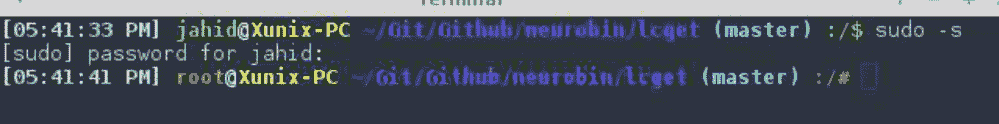
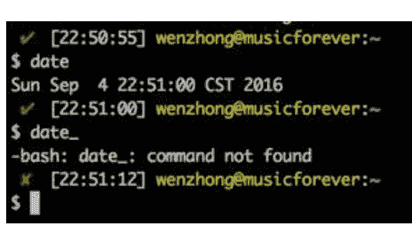
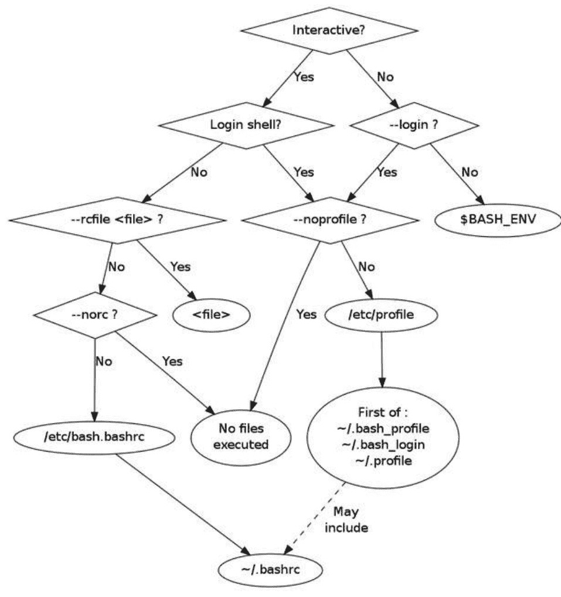
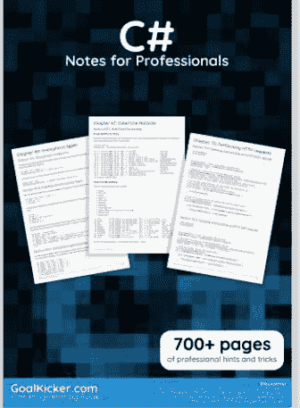
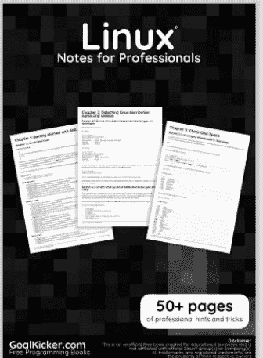
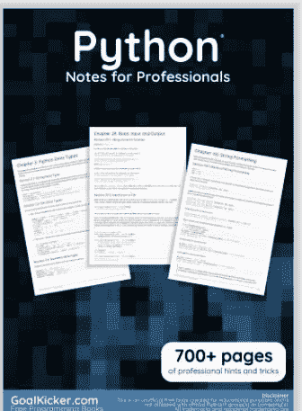

# Bash 专业人士笔记：100+ 页专业技巧与窍门

## 第 12 章：数组

### 第 12.1 节：数组赋值

#### 列表赋值

```bash
myarray=(1 2 3 4 5)
```

如果你想给特定的数组元素赋值，请使用以下语法：

```bash
myarray[0]=6
myarray[1]=7
```

使用新值创建数组：

```bash
myarray+=(6 7 8)
```

#### 下标赋值

要给现有索引赋值，使用：

```bash
myarray[2]="value"
```

#### 通过索引赋值

```bash
myarray[1]="new value"
```

#### 删除

```bash
unset myarray[1]
```

要删除数组中的所有元素，执行：

```bash
unset myarray
```

## 第 21 章：引用

### 第 21.1 节：用于变量和命令替换的双引号

变量替换应该只在双引号内发生。

双引号允许变量扩展，但会保留 `$` 和反引号（backticks）之外大多数特殊字符的字面值。

```bash
name="John Doe"
echo "$name"
```

双引号还允许命令替换。

```bash
echo "$(date)"
```

双引号不会防止单词分割和通配（globbing）。

```bash
echo "$@"
"#"
```

### 第 21.2 节：双引号和单引号的区别

**双引号**

- 允许变量扩展
- 允许命令替换
- 允许单词分割和通配

**单引号**

- 防止所有变量扩展
- 防止命令替换
- 防止单词分割和通配

## 第 36 章：内部变量

### 第 36.1 节：内部变量一览

内部变量是 `Bash` 用于存储各种信息的特殊变量。

## 目录

- 第 1 章：开始使用 `Bash`
  - 第 1.1 节：Hello World
  - 第 1.2 节：使用变量的 Hello World
  - 第 1.3 节：用户输入的 Hello World
  - 第 1.4 节：字符串中引用的重要性
  - 第 1.5 节：查看 `Bash` 内建命令的信息
  - 第 1.6 节：“调试”模式下的 Hello World
  - 第 1.7 节：处理命名参数

- 第 2 章：脚本 shebang
  - 第 2.1 节：Env shebang
  - 第 2.2 节：直接 shebang
  - 第 2.3 节：其他 shebang

- 第 3 章：目录导航
  - 第 3.1 节：绝对目录与相对目录
  - 第 3.2 节：切换到上一个目录
  - 第 3.3 节：切换到主目录
  - 第 3.4 节：切换到脚本目录

- 第 4 章：列出文件
  - 第 4.1 节：以详细列表列出文件
  - 第 4.2 节：列出最近修改的十个文件
  - 第 4.3 节：列出包括隐藏文件的所有文件
  - 第 4.4 节：不使用 `ls` 列出文件
  - 第 4.5 节：列出文件
  - 第 4.6 节：以树状格式列出文件
  - 第 4.7 节：按大小排序列文件

- 第 5 章：使用 `cat`
  - 第 5.1 节：合并文件
  - 第 5.2 节：打印文件内容
  - 第 5.3 节：写入文件
  - 第 5.4 节：显示不可打印字符
  - 第 5.5 节：从标准输入读取
  - 第 5.6 节：显示行号
  - 第 5.7 节：合并 gzipped 文件

- 第 6 章：`grep`
  - 第 6.1 节：搜索文件模式

- 第 7 章：别名 (Alias)
  - 第 7.1 节：绕过别名
  - 第 7.2 节：创建别名
  - 第 7.3 节：删除别名
  - 第 7.4 节：`ALIAS` 是一个内部数组
  - 第 7.5 节：扩展别名
  - 第 7.6 节：列出所有别名

- 第 8 章：作业与进程
  - 第 8.1 节：作业处理
  - 第 8.2 节：检查端口上的进程
  - 第 8.3 节：放弃后台作业
  - 第 8.4 节：列出作业
  - 第 8.5 节：查找运行进程的信息
  - 第 8.6 节：列出所有进程

- 第 9 章：重定向
  - 第 9.1 节：重定向标准输出
  - 第 9.2 节：追加
  - 第 9.3 节：重定向 `STDOUT` 和 `STDERR`
  - 第 9.4 节：使用命名管道
  - 第 9.5 节：重定向到网络地址
  - 第 9.6 节：打印错误信息到 `stderr`
  - 第 9.7 节：将多个命令重定向到同一个文件
  - 第 9.8 节：重定向 `STDIN`
  - 第 9.9 节：重定向 `STDERR`
  - 第 9.10 节：`STDIN`, `STDOUT` 和 `STDERR`

- 第 10 章：控制结构
  - 第 10.1 节：命令列表的条件执行
  - 第 10.2 节：`If` 语句
  - 第 10.3 节：遍历数组
  - 第 10.4 节：使用 `For` 循环迭代数字
  - 第 10.5 节：`continue` 和 `break`
  - 第 10.6 节：循环 `break`
  - 第 10.7 节：`While` 循环
  - 第 10.8 节：C 风格的 `For` 循环
  - 第 10.9 节：`Until` 循环
  - 第 10.10 节：不带列表参数的 `Switch` 语句
  - 第 10.11 节：无列表参数的 `For` 循环

- 第 11 章：`true`, `false` 和命令
  - 第 11.1 节：无限循环
  - 第 11.2 节：函数返回
  - 第 11.3 节：将执行的代码

- 第 12 章：数组
  - 第 12.1 节：数组赋值
  - 第 12.2 节：访问元素
  - 第 12.3 节：数组迭代
  - 第 12.4 节：数组修改
  - 第 12.5 节：数组长度
  - 第 12.6 节：关联数组
  - 第 12.7 节：遍历数组
  - 第 12.8 节：删除或取消数组
  - 第 12.9 节：从字符串创建数组
  - 第 12.10 节：初始化索引列表
  - 第 12.11 节：将整个文件读取到数组
  - 第 12.12 节：数组插入函数

- 第 13 章：关联数组
  - 第 13.1 节：检查数组

- 第 14 章：函数
  - 第 14.1 节：带参数的函数
  - 第 14.2 节：简单函数
  - 第 14.3 节：处理标志和可选参数
  - 第 14.4 节：打印函数定义
  - 第 14.5 节：接受命名参数的函数
  - 第 14.6 节：函数的返回值
  - 第 14.7 节：函数的退出码是其最后一个命令的退出码

- 第 15 章：`Bash` 参数扩展
  - 第 15.1 节：修改字母的大小写
  - 第 15.2 节：参数长度
  - 第 15.3 节：替换字符串中的模式
  - 第 15.4 节：子字符串和子数组
  - 第 15.5 节：从字符串开头删除模式
  - 第 15.6 节：参数方向
  - 第 15.7 节：参数扩展和文件名
  - 第 15.8 节：默认值替换
  - 第 15.9 节：从字符串末尾删除模式
  - 第 15.10 节：扩展过程中的处理
  - 第 15.11 节：变量为空或未设置时的错误

- 第 16 章：复制 (`cp`)
  - 第 16.1 节：复制单个文件
  - 第 16.2 节：复制文件夹

- 第 17 章：`find`
  - 第 17.1 节：搜索文件名或扩展名
  - 第 17.2 节：对文件执行命令
  - 第 17.3 节：按访问时间查找文件
  - 第 17.4 节：按大小查找文件
  - 第 17.5 节：过滤路径
  - 第 17.6 节：按类型查找文件
  - 第 17.7 节：按特定扩展查找文件

- 第 18 章：使用 `sort`
  - 第 18.1 节：`sort` 输出
  - 第 18.2 节：使输出唯一
  - 第 18.3 节：数字排序
  - 第 18.4 节：按键排序

- 第 19 章：源 (Sourcing)
  - 第 19.1 节：源文件
  - 第 19.2 节：源虚拟环境

- 第 20 章：在此文档 (Here documents) 和在此字符串 (here strings)
  - 第 20.1 节：使用文档执行命令
  - 第 20.2 节：缩进文档
  - 第 20.3 节：创建一个文件
  - 第 20.4 节：在此字符串
  - 第 20.5 节：使用 `sudo` 运行命令
  - 第 20.6 节

- 第 21 章：引用
  - 第 21.1 节：用于变量和命令替换的双引号
  - 第 21.2 节：双引号和单引号的区别

- 第 22 章：条件表达式
  - 第 22.1 节：命令列表的条件执行
  - 第 22.2 节：`If` 语句
  - 第 22.3 节：遍历数组
  - 第 22.4 节：使用 `For` 循环迭代数字
  - 第 22.5 节：`continue` 和 `break`
  - 第 22.6 节：循环 `break`
  - 第 22.7 节：`While` 循环
  - 第 22.8 节：C 风格的 `For` 循环
  - 第 22.9 节：`Until` 循环
  - 第 22.10 节：不带列表参数的 `Switch` 语句
  - 第 22.11 节：无列表参数的 `For` 循环

- 第 23 章：带参数脚本
  - 第 23.1 节：动态作用域
  - 第 23.2 节：参数解析
  - 第 23.3 节：包装脚本
  - 第 23.4 节：访问参数
  - 第 23.5 节：将字符串分割数组

- 第 24 章：`Bash` 替换
  - 第 24.1 节：从网络比较两个文件
  - 第 24.2 节：用命令输出提供作业
  - 第 24.3 节：合并文件
  - 第 24.4 节：通过多个进程处理文件
  - 第 24.5 节：使用 `paste` 命令
  - 第 24.6 节：避免使用子 shell

- 第 25 章：数学
  - 第 25.1 节：简单算术 `(( ))`
  - 第 25.2 节：算术命令
  - 第 25.3 节：使用 `expr` 的简单算术

- 第 26 章：`Bash` 算术
  - 第 26.1 节：简单算术 `(( ))`
  - 第 26.2 节：算术命令
  - 第 26.3 节：使用 `expr` 的简单算术

- 第 27 章：作用域
  - 第 27.1 节：动态作用域实例

- 第 28 章：进程替换
  - 第 28.1 节：从网络比较两个文件
  - 第 28.2 节：用命令输出提供作业
  - 第 28.3 节：合并文件
  - 第 28.4 节：通过多个进程处理文件
  - 第 28.5 节：使用 `paste` 命令
  - 第 28.6 节：避免使用子 shell

- 第 29 章：可编程补全
  - 第 29.1 节：使用函数的简单补全
  - 第 29.2 节：选项和文件名的简单补全

- 第 30 章：自定义 `PS1`
  - 第 30.1 节：颜色化和自定义终端提示符
  - 第 30.2 节：在终端提示符中显示 `git` 分支名称
  - 第 30.3 节：在终端提示符中显示时间
  - 第 30.4 节：使用 `PROMPT_COMMAND` 显示 `git` 分支
  - 第 30.5 节：更改 `PS1` 提示符
  - 第 30.6 节：显示上一个命令的返回状态和时间

- 第 31 章：花括号扩展
  - 第 31.1 节：修改文件名扩展名
  - 第 31.2 节：按月份创建目录分组文件
  - 第 31.3 节：备份 dotfiles
  - 第 31.4 节：使用增量
  - 第 31.5 节：使用括号扩展创建列表
  - 第 31.6 节：创建包含子目录的多个目录

- 第 32 章：`getops`：开始位置参数解析
  - 第 32.1 节：`pingmap`

- 第 33 章：调试
  - 第 33.1 节：使用 `-n` 检查脚本语法
  - 第 33.2 节：使用 `ashdb` 进行调试
  - 第 33.3 节：使用 `-x` 调试 `bash` 脚本

- 第 34 章：模式匹配与正则表达式
  - 第 34.1 节：从正则匹配字符串中获取捕获组
  - 第 34.2 节：当 `glob` 未匹配任何内容时的行为
  - 第 34.3 节：检查字符串是否匹配正则表达式
  - 第 34.4 节：正则匹配
  - 第 34.5 节：`* glob`
  - 第 34.7 节：`? glob`
  - 第 34.8 节：`[] glob`
  - 第 34.9 节：匹配隐藏文件
  - 第 34.10 节：不区分大小写的匹配
  - 第 34.11 节：扩展通配

- 第 35 章：切换 shell
  - 第 35.1 节：查找当前 shell
  - 第 35.2 节：列出可用 shell
  - 第 35.3 节：切换 shell

- 第 36 章：内部变量
  - 第 36.1 节：`Bash` 变量概览
  - 第 36.2 节：`@`
  - 第 36.3 节：`$#`
  - 第 36.4 节：`$HISTSIZE`
  - 第 36.5 节：`$FUNCNAME`
  - 第 36.6 节：`$HOME`


## 第 36.7 节：`$IFS` ......................................................... 124

## 第 36.8 节：`$OLDPWD` ................................................ 124

## 第 36.9 节：`$PWD` .......................................................... 125

## 第 36.10 节：`$1` `$2` `$3` 等. ................................... 125

## 第 36.11 节：`$*` .......................................................... 126

## 第 36.12 节：`$` .......................................................... 126

## 第 36.13 节：`$?` ................................................. 126

## 第 36.14 节：`$$` .......................................................... 126

## 第 36.15 节：`$RANDOM` ....................................... 126

## 第 36.16 节：`$BASHID` ....................................... 127

## 第 36.17 节：`$BASH_ENV` ................................... 127

## 第 36.18 节：`$BASH_VERSINFO` ................................ 127

## 第 36.19 节：`$BASH_VERSION` ................................ 127

## 第 36.20 节：`$EDITOR` ................................... 127

## 第 36.21 节：`$HOSTNAME` .......................................... 127

## 第 36.22 节：`$HOSTTYE` ................................... 128

## 第 36.23 节：`$MACHYPE` ................................................................................ 128

## 第 36.24 节：`$OSTYPE` ................................................................................ 128

## 第 36.25 节：`$PATH` ................................................................................ 128

## 第 36.26 节：`$PPID` ................................................................................ 128

## 第 36.27 节：`$SEONDS` ............................................................... 128

## 第 36.28 节：`$SHELLTS` ................................................ 129

## 第 36.29 节：`$` .......................................................... 129

## 第 36.30 节：`$GROUPS` ................................................. 129

## 第 36.31 节：`$LINENO` ................................................ 129

## 第 36.32 节：`$SHLL` ................................................ 129

## 第 36.33 节：`$UID` ................................................ 131

# 第 37 章：作业控制 ................................. 132

## 第 37.1 节：列出后台进程 ................................ 132

## 第 37.2 节：将后台进程调至前台 ............................... 132

## 第 37.3 节：重启后台进程 ................................. 132

## 第 37.4 节：在后台运行命令 ................................. 132

## 第 37.5 节：停止前台进程 ................................ 132

# 第 38 章：`case` 语句 ................................. 133

## 第 38.1 节：简单 `case` ................................ 133

## 第 38.2 节：带有贯穿的 `case` ................................ 133

## 第 38.3 节：仅模式的贯穿 ................................. 133

# 第 39 章：读取文件（数据流、变量）逐行（或逐字段） ....................... 135

## 第 39.1 节：逐行遍历文件 ................... 135

## 第 39.2 节：逐字段遍历命令输出 .. 135

## 第 39.3 节：将行读取到数组中 ................... 135

## 第 39.4 节：将行读取到数组中 ................................ 136

## 第 39.5 节：逐行遍历字符串 ........................ 136

## 第 39.6 节：逐行遍历命令输出 .. 136

## 第 39.7 节：逐字段读取 ................................. 136

## 第 39.8 节：逐字段读取 ................................ 137

## 第 39.9 节：将字段读取到数组中 ................................ 137

## 第 39.10 节：将字段读取到数组中 ................................. 137

## 第 39.11 节：逐行并逐字段读取文件 (`/etc/passwd`) .. 138

# 第 40 章：文件执行顺序 ................................. 140

## 第 40.1 节：`profile_vs_bash_profile`(`bash_login`) ................... 140

# 第 41 章：分割文件 ................................. 141

## 第 41.1 节：分割文件 ................................................ 141

# 第 42 章：使用 `scp` 传输文件 ................................. 142

## 第 42.1 节：`scp` 传输文件 ................................. 142

## 第 42.2 节：`scp` 传输多个文件 ........................ 142

## 第 42.3 节：使用 `scp` 下载文件 ............................ 142

# 第 43 章：管道 ................................. 143

## 第 43.1 节：使用 `ls` ................................................ 143

## 第 43.2 节：分页显示所有进程 ....................... 144

## 第 43.3 节：修改命令的连续输出 ................................. 144

# 第 45 章：单词分割 ................................. 147

## 第 45.1 节：是什么，以及为什么？

## 第 45.2 节：单词分割的负面影响 ................................................ 147

## 第 45.3 节：单词分割的用用 ......................................... 148

## 第 45.4 节：通过分隔符进行分割 ................................................ 149

## 第 45.5 节：使用 `IFS` 进行分割 ....................................................................... 149

## 第 45.6 节：`IFS` 与单词分割 ................................................................ 149

# 第 46 章：使用 `printf` 避免日期

## 第 46.1 节：获取当前日期 ................................................... 151

## 第 46.2 节：将变量设置为当前时间 .......................................... 151

# 第 47 章：使用 `"trap"` 信号和系统事件

## 第 47.1 节：引言；清理临时文件 ................................... 152

## 第 47.2 节：捕获 `SIGINT` 或 `Ctrl+C` .......................................... 152

## 第 47.3 节：积累退出时运行的 `trap` 列表 .......................... 153

## 第 47.4 节：退出时杀死进程 ........................................ 153

## 第 47.5 节：对终端窗口大小变化做出反应 ................ 153

# 第 48 章：命令与操作的链

## 第 48.1 节：统计模式出现次数 .................................. 155

## 第 48.2 节：将根命令输出传输到用户文件 ...................... 155

## 第 48.3 节：使用 `&&` 和 `||` 进行命令的逻辑链 ............ 155

## 第 48.4 节：使用分号进行命令的串行链 ................ 155

## 第 48.5 节：使用 `|` 链命令 ................................... 156

# 第 49 章：Shell 类型

## 第 49.1 节：启动交互式 shell ................................... 157

## 第 49.2 节：检测 shell 类型 ........................................ 157

## 第 49.3 节：点文件介绍 ................................... 157

# 第 50 章：彩色脚本输出（跨平台）

## 第 50.1 节：`color-output.sh` ................................... 159

# 第 51 章：协进程 (co-processes)

## 第 51.1 节：Hello World ................................................. 160

# 第 52 章：变量类型

## 第 52.1 节：声明弱类型变量 ................... 161

# 第 53 章：特定时间的任务

## 第 53.1 节：在特定时间执行任务 ................ 162

## 第 53.2 节：使用 `systemd.timer` 重复处理特定时间的任务 162

# 第 54 章：处理系统提示符

## 第 54.1 节：使用 `PROMPT_COMMAND` 环境变量 164

## 第 54.2 节：使用 `PS2` ....................................... 164

## 第 54.3 节：使用 `PS3` ....................................... 165

## 第 54.4 节：使用 `PS4` ....................................... 165

## 第 54.5 节：使用 `PSI` ......................................... 166

# 第 55 章：`cut` 命令

## 第 55.1 节：单个分隔符字符 ................ 167

## 第 55.2 节：重复的分隔符被解释为空白字段 167

## 第 55.3 节：无引号 ...................................... 167

## 第 55.4 节：提取而非操作 167

# 第 56 章：Windows 10 Bash

## 第 56.1 节：Readme ......................................... 169

# 第 57 章：Cut 命令

## 第 57.1 节：显示文件的第一列 ................................................................ 170

## 第 57.2 节：显示文件的 x 到 y 列 ....................................................... 170

# 第 58 章：全局变量与局部变量 ................................................................ 171

## 第 58.1 节：全局变量 ....................................................................... 171

## 第 58.2 节：局部变量 ....................................................................... 171

## 第 58.3 节：混合使用 ............................................ 171

# 第 59 章：CGI 脚本 ................................................................ 173

## 第 59.1 节：请求方法：GET ................................................................. 173

## 第 59.2 节：请求方法：POST / JSON ................. 175

# 第 60 章：Select 关键字 ............................................ 177

## 第 60.1 节：Select 关键字用于菜单输入 ... 177

# 第 61 章：何时使用 `eval` ....................................... 178

## 第 61.1 节：使用 `Eval` ....................................................... 178

## 第 61.2 节：使用 `Getopt` ................................... 179

# 第 62 章：使用 Bash 进行网络连接 ................................................ 180

## 第 62.1 节：网络命令 ............................................ 180

# 第 63 章：并行处理 ................................................ 182

## 第 63.1 节：并行处理文件列表 ... 182

## 第 63.2 节：并行处理 `STDIN` ................... 183

# 第 64 章：解码 URL ................................................ 184

## 第 64.1 节：简单示例 ......................................... 184

## 第 64.2 节：使用 `printf` 解码 ... 184

# 第 65 章：设计模式 ........................................ 185

## 第 65.1 节：发布/订阅 (Pub/Sub) 模式 ... 185

# 第 66 章：赋值时的空格 ................... 187

## 第 66.1 节：赋值时的空格 187

## 第 66.2 节：失败的命令未停止 ... 187

## 第 66.3 节：文件中的最后一行 ... 187


# 附录 A：键盘快捷键

- A:1 节：编辑快捷键
- A:2 节：回溯快捷键
- A:3 节：宏
- A:4 节：自定义键绑定
- A:5 节：作业控制

# 致谢

# 你可能喜欢

# 关于

请自由分享此 PDF。

本书的最新版本可以从下载：

`https://goalkicker.com/BashBook`

《Bash Notes for Professionals》编译自 `Stack Overflow` 文档，内容由 `Stack Overflow` 的优秀人士编写。文本根据 `Creative Commons BY-SA` 协议发布，请参见书末对各个章节的贡献。图片版权另归所有者。

这是一本出于教学目的的非官方免费书籍，与 `Stack Overflow` 官方小组或公司无关。所有商标和注册商标均为其所有者的财产。

书中的信息不保证正确或准确，使用风险自担。

请将反馈和修正发送至 `web@petercv.com`

# 第 1 章：入门 Bash

| 版本 | 发布日期 |
| :--- | :--- |
| 0.99 | 1989-06-08 |
| 1.01 | 1989-06-23 |
| 2.00 | 1996-12-31 |
| 2.02 | 1998-04-20 |
| 2.03 | 1999-02-19 |
| 2.04 | 2001-03-21 |
| 2.05b | 2002-07-17 |
| 3.0 | 2004-08-03 |
| 3.1 | 2005-12-08 |
| 3.2 | 2006-10-11 |
| 4.0 | 2009-09-20 |
| 4.1 | 2009-12-31 |
| 4.2 | 2011-02-13 |
| 4.3 | 2014-02-26 |
| 4.4 | 2016-09-15 |

## 第 1.1 节：Hello World

### 交互式 Shell

`bash` 通常以交互式使用：它允许你输入并编辑命令，然后在你按下 `Return` 键时执行它们。许多基于 `Unix` 和类 `Unix` 的操作系统使用 `Bash` 作为它们的默认 `shell`（特别是 `Linux` 和 `macOS`）。终端在启动时会自动进入交互式 `Bash shell` 进程。

通过输入以下内容输出 Hello：

```bash
echo "Hello World"
# Hello World # 输出示例
```

#### 注意

- 你可以通过直接在终端输入 `shell` 的名称来切换 `shell`。例如：`sh`、`bash` 等。
- `echo` 是 `Bash` 的内置命令，它将接收到的参数写入标准输出。默认情况下，它会在输出末尾添加换行符。

### 非交互式 Shell

`shell` 还可以从脚本以非交互式运行，使得 `shell` 不需要人工交互。交互式行为和脚本行为应该是一致的——这是 `Unix V7 Bourne shell` 以及继而来的 `Bash` 的重要设计考量。任何可以在命令行完成的操作都可以放入脚本中以供复用。

按照以下步骤创建一个 Hello World 脚本：

1. 创建一个名为 `hello-world.sh` 的新文件

`touch hello-world.sh`

2. 通过运行 `chmod +x hello-world.sh` 使脚本变为可执行。

3. 添加以下代码：

```bash
#!/bin/bash
echo "Hello World"
```

第 1 行：脚本的第一行必须以字符序列 `#!` 开头，称为 `shebang`。`shebang` 指令操作系统运行 `/bin/bash`（即 `Bash` 壳），并将脚本路径作为参数传递给它。

例如，使用 `/bin/bash echo` 命令向标准输出写入 Hello World。

第 2 行：使用 `echo` 命令向标准输出写入 Hello World。

4. 使用以下方法之一从命令行执行 `hello-world.sh` 脚本：

- `./hello-world.sh` - 最常用，且推荐使用
- `/bin/bash hello-world.sh`
- `bash hello-world.sh` - 假设 `/bin` 在你的 `$PATH` 中
- `sh hello-world.sh`

在实际生产环境中，你会省略 `.sh` 后缀（尽管这本身具有误导性，因为这是一个 `Bash` 脚本而不是 `sh` 脚本），并将文件移动到 `$PATH` 目录中，这样无论你当前的工作目录是什么，都可以使用，就像 `cat` 或 `ls` 等系统命令一样。

常见的错误包括：

1. 忘记对文件应用执行权限，即 `chmod +x hello-world.sh`，导致输出 `./hello-world.sh: Permission denied.`。
2. 在 `Windows` 上编辑脚本，会产生 `Bash` 无法解释的错误行结束符。

一种常见的症状是：`command not found`，因为回车符强制光标跳回行首，覆盖了错误消息中冒号之前的文本。

可以使用 `dosunix` 程序修复脚本。

使用示例：`dosunix hello-world.sh`

`dosunix` 会按行编辑文件。

3. 使用 `sh ./hello-world.sh`，而没有意识到 `bash` 和 `sh` 是具有不同特征的不同程序（尽管 `Bash` 向后兼容，相反的错误是无害的）。

无论如何，简单地依赖脚本的 `shebang` 比在每个脚本文件名前显式编写 `bash` 或 `sh`（或 `python`、`perl`、`awk` 或 `ruby`...）要好得多。

为了使你的脚本更具移植性，常用的 `shebang` 是 `#!usr/bin/env bash`，而不是硬编码 `Bash` 的路径。`/usr/bin/env` 必须存在，在此之后，`bash` 只需要在你的 `$PATH` 中即可。在许多系统中，`/bin/bash` 不存在，你应该使用 `/usr/local/bin/bash` 或其他绝对路径；这种更改避免了去弄清楚这些细节的麻烦。

1 也称为 `shebang`、`hasbang`、`pound-bang`、`hash-pling`。

### 第 1.2 节：使用变量 Hello World

创建一个包含以下内容的目录 `hello.sh`，并使用 `chmod +x hello.sh` 赋予其执行权限。

```bash
执行/运行方式：./hello.sh
```

```bash
#!/usr/bin/env bash

# 注意，赋值运算符 '=' 周围不能使用空格
whom_variable="World"

# 使用 printf 安全地输出数据
printf "Hello, %s\n" "$whom_variable"
```

执行时，这将在标准输出打印 Hello, World。

要告诉 `bash` 脚本在哪里，你需要非常具体，指向包含它的目录，通常使用 `/` 是你的工作目录，`.` 是当前目录。如果你不指定目录，`bash` 会尝试在 `$PATH` 环境变量包含的目录之一中查找脚本。

以下代码接受参数 `$1`（即第一个命令行参数），并在格式化字符串中输出它，位于 `Hello,` 之后。

```bash
执行/运行方式：./hello.sh
```

```bash
#!/usr/bin/env bash
printf "Hello, %s\n" "$1"
```

需要注意的是，`$1` 应该用双引号括起来，而不是单引号。`"$1"` 会预期地展开为第一个命令行参数，而 `'$1'` 则评估为字面字符串 `$1`。

> **安全注意：**

阅读 `bash` 壳中忘记给变量加引号的安全影响，以理解将变量文本放置在双引号内的重要性。

### 第 1.3 节：带有用户输入的 Hello World

以下内容将提示用户输入，然后将输入作为字符串（文本）存储在变量中。该变量将用于向用户发送消息。

```bash
#!/usr/bin/env bash
echo "Who are you?"
read name
echo "Hello, $name."
```

`read` 命令从标准输入读取一行数据到变量中。输出示例：

```bash
Who are you?
Matt
Hello, Matt.
```

在这里用户输入了 "Matt"，如果你在打印时向该变量追加内容，请像下面的示例所示在变量周围使用花括号：

```bash
echo "Hello, ${name}!"
```

### 第 1.4 节：字符串中引号的重要性

引号对于 `bash` 中的字符串扩展至关重要。通过这些引号，你可以控制 `bash` 如何解析和展开你的字符串。引号有两种类型：

- **弱引用 (Weak)**：使用双引号
- **强引用 (Strong)**：使用单引号

如果你想让 `bash` 展开你的参数，可以使用弱引用：

```bash
#!/usr/bin/env bash
world="World"
echo "$World"
```

如果你不想让 `bash` 展开你的参数，可以使用强引用：

```bash
#!/usr/bin/env bash
world="World"
echo '$World'
```

你也可以使用转义字符 `\` 来防止扩展：

```bash
#!/usr/bin/env bash
world="World"
echo "\$world"
```

### 第 1.5 节：查看 Bash 内置命令信息

这将显示指定内置命令的帮助（手册）页面。例如，`help unset` 将显示 变量和函数的取消值及其属性。选项：

- `f` 将每个 `NAME` 视为 `shell` 函数
- `v` 将每个 `NAME` 视为 `shell` 变量
- `n` 将每个 `NAME` 视为名称引用并取消变量本身

如果不带选项，首先使用 `unset` 取消一个变量，如果失败了，则尝试取消一个函数。某些变量无法取消；另请参阅 `readonly`。退出状态：除非给出无效选项或 `NAME` 是只读的，否则返回成功。要查看所有带有简短描述的内置命令列表，请使用 `help -d`。

### 第 1.6 节：“调试”模式下的 Hello World

`-x` 参数允许你逐行检查脚本中的每一行。这里有一个很好的例子：

```bash
$ cat hello.sh
#!/bin/bash
echo "Hello World"
$ bash -x hello.sh
+ echo Hello World
Hello World
```

上面的内容可以让你跟踪脚本。使用下面的方法可以修复：

```bash
$ bash -x hello.sh
+ echo Hello World
Hello World
```

### 第 1.7 节：处理命名参数

```bash
#!/bin/bash

deploy=false
uglify=false

while (( $# > 1 )); do case $1 in
  --deploy) deploy="$2";
  --uglify) uglify="$2";
  *) break;
esac shift 2
done
```

```bash
$deploy && echo "will deploy... deploy = $deploy"
$uglify && echo "will uglify... uglify = $uglify"
```

```bash
# 如何运行
chmod +x script.sh
./script.sh --deploy true --uglify false
```

# 第二章：脚本 shebang

## 2.1：Env shebang

为了通过在 `PATH` 中查找 `bash` 可执行文件来执行脚本，脚本的第一行必须指定 `env` 的绝对路径，并将 `bash` 作为参数：

```bash
#!/usr/bin/env bash
```

`shebang` 中的 `env` 路径仅在直接启动脚本时才会解析和使用：

```bash
script.sh
```

脚本必须具有执行权限。当显式指定 `bash` 解释器执行脚本时，会忽略 `shebang`：

```bash
bash script.sh
```

## 2.2：直接 shebang

为了使用 `bash` 解释器执行脚本，脚本的第一行必须指定 `bash` 可执行文件的绝对路径：

```bash
#!/bin/bash
```

`shebang` 中的 `bash` 路径仅在直接启动脚本时才会解析和使用：

```bash
./script.sh
```

脚本必须具有执行权限。当显式指定 `bash` 解释器执行脚本时，会忽略 `shebang`：

```bash
bash script.sh
```

## 2.3：其他 shebang

内核知道两种类型的程序：二进制程序通过其 `ELF`（可扩展加载文件格式）头文件来识别，这通常由编译器产生。第二种是任何类型的脚本。

如果文件的第一行以序列 `#` 开头，那么后面的字符串必须是解释器的路径。如果内核知道这一点，它将通过此路径调用解释器名称，并将该行后续的所有单词作为参数传递给解释器。如果没有名为 "something" 或 "wrong" 的文件：

```bash
#!bin/bash something wrong
echo "这一行永远不会被打印"
```

`bash` 尝试执行其不存在的参数 "something wrong"。脚本文件名也会被添加进去。为了清楚地看到这一点，显示 `shebang`：

```bash
#/bin/echo something wrong
# and now call this script named "thisscript" like so:
# thisscript one two
# the output will be:
something wrong ./thisscript one two
```

像 `awk` 这样的程序使用这种技术来运行位于磁盘文件中的较脚本。

# 第 3 章：目录导航

## 第 3.1 节：绝对路径与相对路径

要切换到绝对指定的目录，请使用完整名称，并以斜杠 `/` 开头，如下：

```bash
cd /home/username/project/abc
```

如果你想切换到当前目录附近的目录，可以指定相对位置。例如，如果你已经位于 `/home/username/project`，你可以进入子目录 `abc`：

```bash
cd abc
```

如果你想切换到当前目录的上一级，可以使用别名 `..`。例如，如果你在 `/home/username/project/abc` 并且想回到 `/home/username/project`，可以执行以下操作：

```bash
cd ..
```

这也可以称为“向上”一个目录。

## 第 3.2 节：切换到上一个目录

对于当前的 `shell`，这会将你带回到之前进入过的目录，无论它在何处。

```bash
cd -
```

执行多次可以实际上让你在当前目录和上一个目录之间反复“切换”。

## 第 3.3 节：切换到主目录

默认目录是主目录（`$HOME`，通常为 `/home/username`），因此输入 `cd` 而不带任何目录即可带你回到那里：

```bash
cd
```

或者你可以更显式地：

```bash
cd $HOME
```

主目录的快捷方式是 `~`，也可以这样使用。

```bash
cd ~
```

## 第 3.4 节：切换到脚本所在的目录

通常情况下，`Bash` 脚本有两类：

- 从当前工作目录运行的**系统工具**
- 相对于其在文件系统中位置修改文件的**项目工具**

对于第二类脚本，切换到脚本存储的目录是有用的。可以通过以下命令实现：

```bash
cd "$(dirname $(readlink -f "$0")"
```

这条命令运行了 3 条命令：

1. `readlink -f "$0"` 确定当前脚本的路径（`$0`）
2. `dirname` 将脚本路径转换为其目录路径
3. `cd` 将当前工作目录更改为从 `dirname` 接收到的目录

# 第 4 章：列出文件

| 选项 | 描述 |
| --- | --- |
| -a, --all | 列出所有项目，包括以点 . 开头的项目 |
| -A, --almost-all | 列出所有项目，排除 `.` 和 `..` |
| -c | 按更改时间排序文件 |
| -d, --directory | 列出目录本身 |
| -h, --human-readable | 以人类可读的格式显示大小（例如 K, M） |
| -H | 与 -h 相同，但以 1000 代替 1024 为幂 |
| -1 | 以长列表格式显示内容 |
| -o | 不带分组信息的长列表格式 |
| -r, --reverse | 以反序显示内容 |
| -s, --size | 以块为打印每个文件的大小 |
| -S | 按文件大小排序 |
| --sort=WORD | 按单词排序内容（size, version, status） |
| -t | 按修改时间排序 |
| -u | 按最后访问时间排序 |
| -v | 按版本排序 |
| -1 | 每行列出一个文件 |

## 第 4.1 节：以长列表格式列出文件

`ls` 命令的 `-1` 选项以长列表格式打印指定目录的内容。如果未指定目录，则列出当前目录的内容。

```bash
ls -1 /etc
```

示例输出：


```
total 1204
drwxr-xr-x 3 root root 4096 Apr 21 03:44 acpi
-rw-r--r-- 1 root root 3028 Apr 21 03:38 adduser.conf
drwxr-xr-x 2 root root 4096 Jun 11 20:42 alternatives
```

输出首先显示 `total`，表示列出目录中所有文件的块总大小。然后它为列出目录中的每个文件显示八列信息。下面是输出中每列的详细信息：

| 列号 | 示例 | 描述 |
| --- | --- | --- |
| 1.1 | `d` | 文件类型（见下表） |
| 1.2 | `drwxr-xr-x` | 权限字符串 |
| 2 | `3` | 硬链接数 |
| 3 | `root` | 所有者名称 |
| 4 | `root` | 所有者组 |
| 5 | `4096` | 字节单位的文件大小 |
| 6 | `Apr 21 03:44` | 修改时间 |
| 7 | `acpi` | 文件名 |

#### 文件类型

文件类型可以是以下字符之一。

| 字符 | 文件类型 |
| --- | --- |
| `-` | 普通文件 |
| `b` | 块设备文件 |
| `c` | 字符设备文件 |
| `C` | 高性能（“连续数据”） |
| `d` | 目录 |
| `D` | Door（Solaris 2.5+ 中的特殊 IPC 文件） |
| `l` | 符号链接 |
| `M` | 离线（迁移）文件 (DMF) |
| `n` | 网络特殊文件 (HP-UX) |
| `p` | FIFO（命名管道） |
| `P` | Port（Solaris 10+ 中的特殊系统文件） |
| `s` | 套接字 |
| `?` | 其他文件类型 |

### 第 4.2 节：列出最近修改的十个文件

以下将列出当前目录中最近修改的十个文件，使用长列表格式 (`-l`) 并按时间排序 (`-t`)。

```bash
ls -lt | head
```

### 第 4.3 节：列出包括隐藏文件的所有文件

隐藏文件是以点 `.` 开头的文件。`ls` 通常不会列出这些文件，除非明确要求。

例如，`ls` 的输出：

```bash
$ ls
bin pki
```

`-a` 或 `--all` 选项将列出所有文件，包括隐藏文件。

```bash
$ ls -a
.ansible
```

要以完全无歧的逐字节形式显示文件内容，十六进制转储（hex dump）是标准解决方案。这适用于文件的非常短片段，例如当你不知道精确的编码时。标准的十六进制转储工具是 `od -cH`，但其表示方式略显麻烦；常用的替代方案有 `xxd` 和 `hexdump`。

```
$ printf 'Hällò world' | xxd
00000000 48c3 a6cc 6333 6270 6b72 6664  H..llò w..rld
```

### 第 5.3 节：写入文件

```bash
cat >>file
```

它允许你在终端输入文本并将其保存到名为 `file` 的文件中。

```bash
cat >>file
```

效果相同，但它会将文本追加到文件的末尾。

注意：按 `Ctrl+D` 结束终端上的输入（Linux）。

可以使用“在此文档”（here document）将文件内容内联到命令行或脚本中：

```bash
cat <<END >file
Hello, World.
END
```

`<<` 重定向符号后的标记是一个任意字符串，它需要单独占一行（没有前导或后缀空格）以指示文档结束。你可以添加引号来防止 shell 执行命令替换和变量插值：

```bash
cat <<'fnord'
Nothing in 'here' will be $changed
fnord
```

（如果不加引号，`here` 将作为命令执行，且 `$changed` 将替换为变量 `changed` 的值——如果它已定义）。

### 第 5.4 节：显示不可打印字符

这对于查看是否存在不可打印字符或非 ASCII 字符很有用。

```bash
$ cat -v file.txt
$ cat -VE file.txt # 用于检测行尾空格。
```

例如：

```bash
$ echo " | cat -VE echo # | 将被实际的文件替换。
M-b-^M-\] $
```

你可能还想使用 `cat -A`（代表 All 全部），它等同于 `cat -VET`。它将显示 `TAB` 字符（显示为 `^I`）、不可打印字符和每行的结束：

```bash
$ echo '' | cat -A
M-bm-^@M-^]I$
```

### 第 5.5 节：从标准输入读取

```bash
cat < file.txt
```

输出与 `cat file.txt` 相同，但它是从标准输入读取文件内容而不是直接读取文件。

```bash
printf "first line\nSecond line\n" | cat -n
```

`|` 之前的 `echo` 命令输出两行。`cat` 命令作用于输出添加行号。

## 第 5.6 节：输出时显示行号

使用 `--number` 标志在每行之前打印行号。或者使用 `-n` 效果相同。

```bash
$ cat --number file
```

```
1 line 1
2 line 2
3
4 line 4
5 line 5
```

在计算行数时跳过空行，使用 `--number-nonblank` 或简单的 `-b`。

```bash
$ cat -b file
```

```
1 line 1
2 line 2
3
4 line 4
5 line 5
```

### 第 5.7 节：合并 gzipped 文件

由 `gzip` 压缩的文件可以直接合并成更大的 gzipped 文件。

```bash
cat file1.gz file2.gz file3.gz > combined.gz
```

这是 `gzip` 的一个属性，但效率低于先合并输入文件再对结果 `gzip`：

```bash
cat file1 file2 file3 | gzip > combined.gz
```

一个完整的演示：

```bash
echo 'Hello world!' > hello.txt
echo 'Howdy world!' > howdy.txt
gzip hello.txt
gzip howdy.txt
```

```bash
cat hello.txt.gz howdy.txt.gz > greetings.txt.gz
gunzip greetings.txt.gz
cat greetings.txt
```

结果如下：

Hello world!

Howdy world!

注意 `greetings.txt.gz` 是单个文件，并被解压为单个文件 `.txt`。这与 `tar -czf hello.txt howdy.txt > greetings.gz` 形成对比，后者在 tar 包内部保持文件独立状态。

## 第 6 章：Grep

### 第 6.1 节：如何在文件中搜索模式

要在文件中查找单词 `foo`：

```bash
grep foo ~/Desktop/bar
```

要在文件中查找不包含 `foo` 的所有行：

```bash
grep -v foo ~/Desktop/bar
```

查找所有以 `foo` 结尾的单词（通配符扩展）：

```bash
grep "*foo" ~/Desktop/bar
```

## 第 7 章：别名

Shell 别名是创建新命令或用自己的命令封装现有命令的简单方法。这与 shell 函数有些重叠，但函数更强大，因此通常应优先选择函数。

### 第 7.1 节：跳过别名

有时你可能临时跳过并禁用别名。为了说明，请考虑此别名：

```bash
alias ls='ls --color=auto'
```

假设你想在不禁用别名的情况下使用 `ls` 命令。你有几种选择：

- 使用内置命令：`command`
- 使用命令的完整路径：`/bin/ls`
- 在命令名的任何位置添加反斜杠，例如：`\ls`
- 使用引号

### 第 7.2 节：创建别名

使用 `alias` 命令定义别名：

```bash
alias ll='ls -l'
```

定义后，输入 `ll` 就会执行 `ls -l`。

### 第 7.3 节：删除别名

使用 `unalias` 命令删除别名：

```bash
unalias ll
```

### 第 7.4 节：查看别名

使用 `alias` 命令列出所有定义的别名：

```bash
alias
```

### 第 7.5 节：修改别名

你可以通过重新定义同名别名来修改它：

```bash
alias ll='ls -la'
```

然后，当你想要杀死它时，使用以下脚本：

```bash
#!/bin/bash

if [[ -e /tmp/test.py.pid ]]; then
    kill /tmp/test.py.pid
    rm /tmp/test.py.pid
else
    echo "test.py is not running"
fi
```

该脚本将精确杀死与你的命令相关的进程，而无需依赖任何易变信息（如用于运行命令的字符串）继续执行。即使在这种情况下，如果文件不存在，脚本也会认为你想杀死一个未运行的进程。

这个示例可以很容易改进，以便多次运行同一个命令（例如，追加到 pid 文件而不是覆盖它），并管理进程在被杀死之前已经死亡的情况。

### 第 8.2 节：检查特定端口上运行的进程

要检查哪个进程运行在端口 `8080` 上

```
lsof -i :8080
```

### 第 8.3 节：剥离后台作业

```
$ grip extremelylargefile.txt &
$ bg
$ disown %1
```

这允许一个长时间运行的进程在你的 shell（终端、ssh 等）关闭后继续运行。

### 第 8.4 节：列出当前作业

```bash
$ tail -f /var/log/syslog > log.txt
[1]+ Stopped
    tail -f /var/log/syslog > log.txt
$ sleep 10 &

$ jobs
[1]+ Stopped    tail -f /var/log/syslog > log.txt
    sleep 10 &
[2]- Running
```

## 第 8.5 节：查找关于运行进程的信息

`ps aux | grep <search-term>` 显示匹配的搜索term

示例：

```
root@server7:~# ps aux | grep nginx
root     315 0.0 0.3 144392 1020 S   May28 0:00 nginx: master process
/usr/bin/nginx
www-data  6547 0.0 0.1 115124 3048 ? S Jul18 0:00 nginx: worker process
www-data  5648 0.0 0.1 144392 376 ? S Jul18 0:00 nginx: cache manager process
root    13134 0.0 0.3 4960 920 S+ 14 0:00 grep --color=auto nginx
root@server7:~#
```

Goalicker.com - 为初学者 Bash 教程

这里，第二列是进程标识符。例如，如果你想杀死 `nginx` 进程，可以使用命令 `kill 5647`。始终建议使用带有 `SIGTERM` 的 `kill` 命令而不是 `SIGKILL`。

### 第 8.6 节：列出所有进程

列出系统上所有进程有两种常用方法。两种方法都会列出所有用户运行的进程，尽管它们输出的格式有所不同（差异的原因是历史原因）。

```
ps -ef # 列出所有进程
ps aux # 列出另一种格式 (BSD) 的所有进程
```

这可以用来检查给应用程序是否正在运行。例如，检查 SSH 服务器 (`sshd`) 是否正在运行：

```
ps -ef | grep sshd
```

## 第 9 章：重定向

| 参数 | 细节 |
| --- | --- |
| 内部文件描述符 | 一个整数。 |
| 方向 | `, , < 或 > 之一` |
| 外部文件描述符或路径 | |
| 或路径 & 后跟文件描述符的整数或路径。 | |

### 第 9.1 节：重定向标准输出

`>` 将当前命令的标准输出（又称 `STDOUT`）重定向到一个文件或另一个描述符。

这些示例将 `ls` 命令的输出写入 `file.txt`。

```
ls >file.txt
ls > file.txt
```

如果目标文件不存在，则创建它；否则，该文件将被截断。

当未指定时，默认重定向是标准输出或 `1`。此命令等同于之前的示例，但显式指定了标准输出：

```
ls 1>file.txt
```

注意：重定向是由执行的 shell 初始化的而不是由执行的命令，因此它在命令之前。

### 第 9.2 节：追加 vs 截断

截断 `>`

1. 如果文件不存在，则创建指定的文件。
2. 截断（移除文件内容）
3. 写入文件

```
$ echo "first line" > /tmp/lines
$ echo "second line" > /tmp/lines
```

追加 `>>`

1. 如果指定的文件不存在，则创建它。
2. 追加文件（在文件末尾写入）。

```
# 覆盖已有的行
$ echo "first line" > /tmp/lines

# 追加第二行
$ echo "second line" >> /tmp/lines
```

### 第 9.3 节：重定向标准输出和错误

`>` 将标准输出 (`STDOUT`) 重定向到一个文件或另一个描述符。

这些示例将 `ls` 命令的输出写入 `file.txt`。

```
ls >file.txt
ls > file.txt
```

如果目标文件不存在，则创建它；否则，该文件将被截断。

当未指定时，默认重定向是标准输出或 `1`。此命令等同于之前的示例，但显式指定了标准输出：

```
ls 1>file.txt
```

注意：重定向是由执行的 shell 初始化的而不是由执行的命令，因此它在命令之前。

### 第 9.4 节：使用命名管道

这允许一个长时间运行的进程在你的 shell（终端、ssh 等）关闭后继续运行。

这种方法可能适用于简单的情况，但并不是通常的方法。在这个示例中，错误消息会将错误和成功输出混合在 `stdout` 中，从而污染脚本的实际输出。

简而言之，错误消息应该输出到 `stderr` 而不是 `stdout`。这非常简单：

```
cmd | echo 'cmd failed' >dev/stderr
```

另一个示例：

```
if cmd; then
    echo 'success'
else
    echo 'cmd failed' >/dev/stderr
fi
```

在上面的示例中，成功消息将打印到 `stdout`，而错误消息将打印到 `stderr`。

打印错误消息的更好的方法是定义一个函数：

```
err(){
    echo "E: $*" >>/dev/stderr
}
```

现在，当你需要打印错误时：

```
err "My error message"
```

### 第 9.7 节：将多个命令重定向到同一个文件

```
{
    echo "contents of home directory"
    ls -
}> output.txt
```

## 第 9.8 节：重定向 STDIN 并写入其左侧参数。

`<` 从其右侧参数读取并写入其左侧参数。

要将文件写入 `STDIN`，我们应该读取 `/tmp/a/file` 并写入 `STDIN`，即 `< /tmp/a/file`

注意：对于 `<`，内部文件描述符默认认为 `0 (STDIN)`

```
$ echo "b" > /tmp/list.txt
$ echo "a" >> /tmp/list.txt
$ echo "c" >> /tmp/list.txt
$ sort < /tmp/list.txt
a
b
c
```

### 第 9.9 节：重定向 STDERR

`2` 是 `STDERR`。

```
$ echo_to_stderr 2>/dev/null # ecos nothing
```

定义：

`echo_to_stderr` 是一个向 `STDERR` 写入 "stderr" 的命令

```
echo_to_stderr () {
  echo stderr >&2
}
```

```
$ echo_to_stderr
stderr
```

### 第 9.10 节：解释 STDIN、STDOUT 和 STDERR

命令有一个输入 (`STDIN`) 和两种输出：标准输出 (`STDOUT`) 和标准错误 (`STDERR`)。

例如：

`STDIN`

```
root@server~# read
Type some text here
```

标准输入用于向程序提供输入。（在这里，我们使用内置命令 `read` 从 `STDIN` 读取一行。）

`STDOUT`

```
root@server~# ls file
file
```

标准输出通常用于命令的“正常”输出。例如，`ls` 列出文件，因此文件被发送到 `STDOUT`。

`STDERR`

```
root@server~# ls anotherfile
ls: cannot access 'anotherfile': No such file or directory
```

标准错误（顾名思义）用于输出错误消息。因为这条消息不是文件列表，所以它被发送到 `STDERR`。

`STDIN`、`STDOUT` 和 `STDERR` 是三个标准流。它们通过数字而不是名称被 shell 识别为：

- `0` = 标准输入 (Standard in)
- `1` = 标准输出 (Standard out)
- `2` = 标准错误 (Standard error)


默认情况下，`STDIN` 附加到键盘，`STDOUT` 和 `STDERR` 都显示在终端上。然而，我们将 `STDOUT` 或 `STDERR` 重定向到任何我们需要的地方。例如，假设你只需要标准输出，并抑制所有打印在标准错误上的错误消息。这就是我们使用描述符 1 和 2 的时候。

## 将 `STDERR` 重定向到 `/dev/null`

参考之前的示例

```bash
root@server~# ls anotherfile 2>/dev/null
root@server~#
```

在这种情况下，如果有任何 `STDERR`，它将被重定向到 `/dev/null`（一个忽略写入其中任何内容的特殊文件），因此你不会在 shell 上看到任何错误输出。

## 第 10 章：控制结构

| 传递给 `or` 或 `test` 的参数 | 详情 |
| :--- | :--- |
| **文件操作符** | |
| `-e $file` | 如果文件存在则返回真。 |
| `-d $file` | 如果文件存在且是目录则返回真。 |
| `-f $file` | 如果文件存在且是普通文件则返回真。 |
| `-h $file` | 如果作为符号链接存在则返回真。 |
| **字符串比较符** | |
| `-z $str` | 如果字符串长度为零则返回真。 |
| `-n $str` | 如果字符串长度不为零则返回真。 |
| `$str = $str2` | 如果 `$str` 等于 `$str2` 则为真。 |
| `$str != $str2` | 如果字符串不等则为真。 |
| **整数比较符** | |
| `$int1 -eq $int2` | 如果整数相等则为真。 |
| `$int1 -ne $int2` | 如果整数不等则为真。 |
| `$int1 -gt $int2` | 如果 `int1` 大于 `int2` 则为真。 |
| `$int1 -ge $int2` | 如果 `int1` 大于或等于 `int2` 则为真。 |
| `$int1 -lt $int2` | 如果 `int1` 小于 `int2` 则为真。 |
| `$int1 -le $int2` | 如果 `int1` 小于或等于 `int2` 则为真。 |

### 第 10.1 节：命令的条件执行

#### 如何使用列表的条件执行

任何内置命令、表达式都可以进行条件执行。任何内置命令都可以使用 `&&`（与）和 `||`（或）运算符进行条件执行。例如，这允许根据前一个命令的退出状态决定是否执行后续命令。

```bash
if command && echo 'command succeeded' || echo 'command failed'
```

在上面的例子中，如果 `command` 成功，则 `echo 'command succeeded'` 会执行。

- 如果 `&&` 成功，`command` 会执行。
- 如果 `&&` 失败，`command` 会执行。


- 如果 `&&` 成功，`command` 会执行。
- 如果 `&&` 失败，`command` 会执行。

## 第 10.2: if 语句

```bash
if [[ $1 -eq 1 ]]; then
  echo "1 was passed in the first parameter"
elif [[ $1 -gt 2 ]]; then
  echo "2 was not passed in the first parameter"
else
  echo "The first parameter was not 1 and is not more than 2."
fi
```

### 第 10.4 节：使用 For 循环遍历数字

```bash
#!/bin/bash
for i in {1..10}; do # {1..10} 展开为 "1 2 3 4 5 6 7 8 9 10"
  echo $i
done
```

此输出如下：

```
1
2
3
4
5
6
7
8
9
10
```

### 第 10.5 节：continue 和 break

`continue` 示例

```bash
for i in [series]
do
  command 1
  command 2
  if (condition); # 跳过 command 3 的条件
    continue # 跳到 "series" 中的下一个值
  fi
  command 3
done
```

`break` 示例

```bash
for i in [series]
do
  command 4
  if (condition); # 跳出循环的条件
    then
      command 5 # 满足跳出循环的条件
      break
  fi
  command 6 # 如果 "condition" 永远为真则执行的条件
done
```

### 第 10.6 节：循环中断

跳出多层循环：

```bash
arr={a b c d e f}
for i in "${arr[@]}"; do
  echo "$i"

  for j in "${arr[@]}";do
    echo '$j'
    break 2
  done
done
```

输出：

```
a
a
```

跳出单层循环：

```bash
arr=(a b c d e f)
for i in "${arr[@]}";do
  echo "$i"
  for j in "${arr[@]}";do
    echo "$j"
    break
  done
done
```

输出：

```
a
a
b
a
c
d
a
e
a
f
```

### 第 10.7 节：While 循环

```bash
#!/bin/bash
i=0
while [ $i -lt 5 ]; # 当 i 小于 5 时
do
```


`echo "i is currently $i"`

`i=$((i+1))` # 注意括号周围缺少空格。这会导致它不是一个测试表达式

`done` # 结束循环

```bash
echo "i is currently $i"
i=$((i+1))
done
```

注意测试期间（`while` 语句之后）括号周围要有空格。这些空格是必要的。

此循环输出：

```
i is currently 0
i is currently 1
i is currently 2
i is currently 3
```

### 第 10.8 节：带有 C 风格语法的 `for` 循环

C 风格 `for` 循环的基本格式为：

```bash
for (( variable assignment; condition; iteration process ))
```

注意：

- 与普通赋值不同，C 风格 `for` 循环内部的变量赋值包含空格
- C 风格 `for` 循环内部的变量不需要 `$` 前缀。

示例：

```bash
for (( i = 0; i < 10; i++ ))
do
  echo "The iteration number is $i"
done
```

我们还可以在 C 风格 `for` 循环中处理多个变量：

```bash
for (( i = 0, j = 0; i < 10; i++, j = i * i ))
do
  echo "The square of $i is equal to $j"
done
```

### 第 10.9 节：`until` 循环

`until` 直到条件为真时执行

```bash
i=5
until [[ i -eq 10 ]]; do # 检查 i 是否等于 10
  echo "i=$i" # 打印 i 的值
  i=$((i+1)) # i 加 1
done
```

输出：

```
i=5
i=6
i=7
i=8
i=9
```

当 `i` 达到 `10` 时，`until` 循环中的条件变为真，循环结束。

## 第 10.10 节：带 `case` 的 `Switch`

使用 `case` 语句可以匹配变量的一个值。

传递给 `case` 的参数会被展开并与每个模式进行匹配。

如果找到匹配项，将执行到 `;;` 之前的命令。

```bash
case "$BASH_VERSION" in
  [34]*)
    echo {1..4}
    ;;
  *)
    seq -s " " 1 4
esac
```

模式不是正则表达式，而是 shell 模式匹配（又称为 `glob`）。

### 第 10.11 节：无列表参数的 `for` 循环

```bash
for arg; do
  echo arg=$arg
done
```

没有单词列表参数的 `for` 循环将遍历位置参数。换句话说，上面的示例等于以下代码：

```bash
for arg in "$@"; do
  echo arg=$arg
done
```

换句话说，如果你发现自己正在写 `for i in "$@"; do ...; done`，只需去掉 `in` 部分，直接写 `for i; do ...; done`。

## 第 11 章：`true`, `false` 和 `:` 命令

### 第 11.1 节：无限循环

```bash
while true; do
    echo ok
done
```

或者

```bash
while ; ; do
    echo ok
done
```

或者

```bash
until false; do
    echo ok
done
```

### 第 11.2 节：函数返回

```bash
function positive() {
    return 0
}
```

```bash
function negative() {
    return 1
}
```

### 第 11.3 节：始终/从不执行的代码

```bash
if true; then
    echo Always
fi
if false; then
    echo Never
fi
```

## 第 12 章：数组

### 第 12.1 节：数组赋值

**列表赋值**

如果你熟悉 Perl、C 或 Java，你可能认为 Bash 使用逗号分隔元素，然而 Bash 使用空格：

```bash
# Perl 中的数组
my @Array = (1, 2, 3, 4);

# Bash 中的数组
array=(1 2 3 4)
```

带有新元素的数组：

```bash
array=('first element' 'second element' 'third element')
```

显式下标赋值：

```bash
array[3]='fourth element'
array[4]='fifth element'
```

按索引赋值：

```bash
array[0]='first element'
array[1]='second element'
```

按名称赋值（关联数组）：

```bash
declare -A Array
array[first]='First element'
array[second]='Second element'
```

**动态赋值**

从其他输出创建数组，例如使用 `seq` 获取 1 到 10 的范围：

```bash
array=$(seq 10)
```

从脚本输入赋值：

```bash
array=("$")
```

循环内赋值：

```bash
while read -r; do
  array+="$REPLY" # 数组追加
  array[$i]="$REPLY" # 按索引赋值
  let i++ # 索引自增
done <(seq 10) # 命令替换
echo ${array[@]} # 输出: 1 2 3 4 5 6 7 8 9 10
```

### 第 12.2 节：访问数组元素

打印下标为 `0` 的元素：

```bash
echo "${array[0]}"
```

使用字符串扩展打印最后一个元素：

```bash
echo "${array[@]: -1}"
```

使用下标语法打印最后一个元素：

```bash
echo "${array[-1]}"
```

分别打印所有元素：

```bash
echo "${array[@]}"
```

作为单个字符串打印所有元素：

```bash
echo "${array[*]}"
```

分别打印从下标 `1` 开始的所有元素：

```bash
echo "${array[@]:1}"
```

分别从下标 `1` 开始打印 `3` 个元素：

```bash
echo "${array[@]:1:3}"
```

**字符串操作**

如果引用单个元素，允许进行字符串操作：

```bash
array=(zero one two)
echo "${array[@]:0:3}" # 输出字符串 zero 中的位置 0、1 和 2
echo "${array[@]:1:3}" # 输出字符串 zero 中的位置 1、2 和 3
```

所以 `${array[$i]:N:M}` 输出字符串中第 `N` 个位置（从 `0` 开始）的 `M` 个字符。

### 第 12.3 节：数组修改

**下标**

初始化或更新数组中的特定元素：

```bash
array[10]="eleventh element" # 因为是从 0 开始
```

**追加**

在未指定下标的情况下向数组末尾添加元素：

```bash
array+=('fourth element' 'fifth element')
```

用新参数列表替换整个数组：

```bash
array=(${array[@]} "fourth element" "fifth element")
```

在开头添加一个元素：

```bash
array=("new element" "${array[@]}")
```

**插入**

在给定下标插入元素：

```bash
arr=(a b c d)
# 在下标 2 插入元素
i=2
arr=("${arr[@]:0:$i} "new" "${arr[@]::$i}")
echo "${arr[2]}" # 输出: new
```

**删除**

使用内置命令 `unset` 删除数组索引：

```bash
arr=(a b c)
echo "${array[@]}" # 输出: a b c
echo "${array[@]}" # 输出: 1 2
unset -v "arr[1]"
echo "${array[@]}" # 输出: c
echo "${array[@]}" # 输出: 2
```

**合并**

```bash
array3("${array[1][]}" "${array[2][]}")
```

这也适用于稀疏数组。

**重新索引数组**

如果数组中删除了元素，或者你不确定数组是否存在间隔，这非常有用。重新创建没有间隔的索引：

```bash
array=("${array[@]}")
```

### 第 12.4 节：数组迭代

数组迭代有两种方式：`foreach` 和经典的 `for` 循环：

```bash
a=(1 2 3 4)
# foreach 循环
for y in "${a[@]}"; do
  # 处理 $y
  echo "$y"
done
# 经典的 for 循环
for ((idx=0; idx < ${#a[@]}; ++idx)); do
  # 处理 ${a[$idx]}
  echo "${a[$idx]}"
done
```

你还可以遍历命令的输出：

```bash
a=($tr ',' 'a,b,c,d')) # tr 可以将一个字符转换为另一个
for y in ${a[@]}; do
  echo "$y"
done
```

### 第 12.5 节：列出关联数组的键

```bash
echo "${!aa[@]}"
# 输出: hello ab key with space
```

### 第 12.6 节：列出关联数组的值

```bash
echo "${!aa[@]}"
# 输出: world cd hello world
```

**遍历关联数组的键和值**

```bash
for key in "${!aa[@]}"; do
  echo Key: ${key}
  echo Value: ${array[$key]}
done
```

```bash
# 输出:
# Key: hello
# Value: world
# Key: ab
# Value: cd
# Key: key with space
# Value: hello world
```

**统计关联数组的元素**

```bash
echo "${#aa[@]}"
# 输出: 3
```

### 第 12.7 节：遍历数组

我们的示例数组：

```bash
arr=(a b c d f)
```

使用 `for..in` 循环：

```bash
for i in "${!arr[@]}"; do
  echo "$i"
done
```

版本 `>= 2.0`

使用 C 风格循环：

```bash
for ((i=0;i<${#arr[@]};i++)); do
  echo "${arr[$i]}"
done
```

使用 `while` 循环：

```bash
i=0
while [ $i -lt ${#arr[@]} ]; do
  echo "${arr[$i]}"
  i=$((i + 1))
done
```

版本 `>= 2.0`

带数值判断的 `while` 循环：

```bash
i=0
while ((i < ${#arr[@]})); do
  echo "${arr[$i]}"
  ((i++))
done
```

使用 `until` 循环：

```bash
i=0
until [ $i -ge ${#arr[@]} ]; do
  echo "${arr[$i]}"
  i=$((i + 1))
done
```

版本 `>= 2.0`

判断的 `until` 循环：

```bash
i=0
until [[ $i -ge ${#arr[@]} ]]; do
  echo "${arr[$i]}"
  ((i++))
done
```

### 第 12.8 节：删除或取消设置数组

删除或取消设置数组：

```bash
unset array
```

删除或取消设置数组元素：

```bash
unset array[10]
```

### 第 12.9 节：从字符串创建数组

```bash
stringVar="Apple Mango"
arrayVar=(${stringVar})
```

字符串中的每个空格表示数组中的一个项。

```bash
echo "${arrayVar[0]}" # 输出 Apple
echo "${arrayVar[1]}" # 输出 Mango
```

同样，其他字符可以用分隔符。

```bash
stringVar="Apple+Orange+Mango"
arrayVar=(${stringVar//+/})
echo "${arrayVar[0]}" # 输出 Apple
echo "${arrayVar[1]}" # 输出 Banana
```

### 第 12.10 节：索引列表

获取数组中初始化的索引列表

```bash
arr[2]='second'
arr[10]='tenth'
arr[25]='twenty five'
echo "${arr[@]}"
```

### 第 12.11 节：将整个文件读入数组

**单步读取**：

```bash
IFS=$'\n' read -a arr < file
```

**在循环中读取**：

```bash
arr()
while IFS= read -r line; do
  arr+="$line"
done
```

版本 `>= 4.0`

使用 `mapfile` 或 `readarray`（两者同义）：

```bash
mapfile -t arr < file
readarray -t arr < file
```

### 第 12.12 节：数组插入函数

此函数在指定的索引处向数组插入元素：

```bash
insert(){
################ insert #
# 用法:
# insert arr_name index element
# 参数:
# arr_name : 数组名
# index : 要插入的索引
# element : 要插入的元素
####################################
[[ -z "$1" ]] && echo "$0" >&2; return 1;
declare -n _arr__=$1
i=$2
el=$3
  # 处理错误
  [[ -z "$i" ]] || [[ "$i" =~ ^[0-9]+$ ]] && echo "E: insert must be a valid integer" >&2;
  return 1; 
  (( $i < 0 )) && echo "E: insert: index cannot be negative" >&2; return 1; 
  # 现在在 $i 处插入 $el
  _arr__[$i]="${_arr__[@]:0:$i} $el ${_arr__[@]:$i}"
}
```

用法：

```bash
insert array_variable_name index element
```

```bash
arr=[a b c d]
echo "${arr[2]}" # 输出: c
# 现在调用 insert 函数并传递数组变量名、
# 插入索引以及要插入的元素
insert arr 2 'New Element'
# 'New Element' 已插入 arr 的索引 2，现在打印它们
echo "${arr[2]}" # 输出: New Element
echo "${arr[3]}" # 输出: c
```

## 第 13 章：关联数组

### 第 13.1 节：检查关联数组

此代码段的所有用法：

```bash
echo
echo "are the values of assoc_array:"
echo ${assoc_array[@]}
echo "not useful,"
echo "this is better:"
declare -p assoc_array
echo "have a look at the spaces above!"
```

```bash
echo "the keys"
echo "the keys in assoc_array are ${!assoc_array[*]}"
echo "the use of indirection operator"
```

```bash
echo "we loop over assoc_array by line"
echo "indirection operator which works differently,"
echo "used with assoc_array."
```

```bash
for key in "${!assoc_array[@]}"; do # 访问键
printf "%s:%s\n" "$key" "${assoc_array[$key]}"
done
```

```bash
echo "have a look at the spaces in entries with two, three and four above!"
```

```bash
echo "there is a difference between integers as keys"
i=1
echo
```


# 第 14 章：函数

## 第 14.3 节：处理标志和可选参数

`getopts` 可以在函数内部用于编写处理标志和可选参数的函数。这并没有特别困难，但必须正确处理由 `getopts` 触及的相应值。在一个示例中，我们定义了一个 `failwith` 函数，它在标准错误（`stderr`）上输出消息，并根据 `-x` 选项提供的任意代码或代码 `1` 退出：

```bash
# failwith [-x STATUS] PRINTINT-LIKE-ARGV
# Fail with the given diagnostic message
# The -x flag can be used to convey a custom exit status, instead of
# the value 1. A newline is automatically added to the output.

failwith() {
  local OPTIND OPTARG status
  status=1
  OPTIND=1
  while getopts 'x:' OPTION; do
    case $OPTION in
      x) status="${OPTARG}";
      *) 1>&2 printf 'failwith:%s: Unsupported option.\n' "${OPTION}";
    esac
  done
  shift $((OPTIND - 1))
  {
    printf 'Failure: '
    printf "$@"
    printf '\n'
    1>&2
    exit "${status}"
  }
}
```

该函数可以如下所示使用：

`failwith %s: File not found. "${filename}"`  
`failwith -x 70 'General internal error.'`

以此类推。

注意对于 `printf`，不应将变量作为第一个参数。如果要打印的消息包含变量值的内容，应该使用 `%s` 标识符来打印它，例如：

`failwith '%s' "${message}"`

## 第 14.4 节：打印函数定义

```bash
getfunc() {
  declare -f "$@"
}

function func() {
  echo "I am a sample function"
}

funcd=$(getfunc func)

getfunc func # or echo "$funcd"
```

输出：

```bash
func() {
{
  echo "I am a sample function"
}
}
```

## 第 14.5 节：接受命名参数的函数

```bash
foo() {
  while [[ $# -gt 0 ]]; do
    case $1 in
      -f|--follow)
        local FOLLOW="following"
        ;;
      -t|--tail)
        local TAIL="tail=$2"
        ;;
    esac
    shift
  done
  echo "FOLLOW: $FOLLOW"
  echo "TAIL: $TAIL"
}
```

示例用法：

```bash
foo -f
foo -t 10
foo -f --tail 10
foo --follow --tail 10
```

## 第 14.6 节：函数的返回值

Bash 中的 `return` 语句并不像 C 语言函数那样返回一个值，而是以返回状态退出函数。你可以将其视为该函数的退出状态。

如果你想从函数返回一个值，可以像这样将值发送到标准输出（`stdout`）：

```bash
fun() {
  local var="Sample value to be returned"
  echo "$var"
  printf "%s\n" "$var"
}
```

现在，如果你执行：

```bash
var=$(fun)
```

`fun` 的输出将存储在 `$var` 中。

## 第 14.7 节：函数的退出码是其最后一个命令的退出码

考虑这个检查主机是否在线的函数：

```bash
is_alive() {
  ping -c "$1" & /dev/null
}
```

该函数向第一个函数参数指定的主机发送单个 `ping`。`ping` 的输出和错误输出被重定向到 `/dev/null`，因此函数永远不会输出任何内容。但 `ping` 命令成功时退出码为 `0`，失败时为非零。这是函数的最后一个（在本例中也是唯一的）命令，`ping` 的退出码将复用作为函数本身的退出码。

这一事实在条件语句中非常有用。

例如，如果主机 `graucho` 是在线的，则通过 `ssh:` 连接到它：

```bash
if is_alive graucho; then
  ssh graucho
fi
```

另一个示例：反复检查直到主机 `graucho` 在线，然后通过 `ssh:` 连接到它：

```bash
while ! is_alive graucho; do
  sleep 5
done

ssh graucho
```

# 第 15 章：Bash 参数扩展 (Parameter Expansion)

`$` 字符引入了参数扩展、命令替换或算术扩展。参数名称或扩展符号可以括在大括号中，大括号是可选的，但它可以保护变量不被紧随其后的字符意外扩展，因为那些字符可能会被解释为名称的一部分。

请在 [Bash 用户手册]() 中阅读更多内容。

## 第 15.1 节：修改字母的大小写

### 转为大写

```bash
$ v='hello'

# 仅转换第一个字符
$ printf '%s\n' "${v^^}"
Hello

# 所有字符
$ printf '%s\n' "${v^^}"
HELLO

# 另一种方法
$ v='hello world'
$ declare -u string="$v"
$ echo "$string"
HELLO WORLD
```

### 转为小写

```bash
$ v='BYE'

# 仅转换第一个字符
$ printf '%s\n' "${v,,}"
byE

# 所有字符
$ printf '%s\n' "${v,,}"
bye

# 另一种方法
$ v='HELLO WORLD'
$ declare -l string="$v"
$ echo "$string"
hello world
```

### 切换大小写 (Toggle Case)

```bash
$ v='Hello World'

# 所有字符
$ echo "${v~}"
HELLO WORLD

$ echo "${v^}"

# 仅转换第一个字符
hello World
```

## 第 15.2 节：参数长度

```bash
# 字符串长度
$ var='12345'
$ echo "${#var}"
```

注意，它是字符数量的长度，不一定等同于字节数（例如在 `UTF-8` 中，大多数字符被编码为多个字节），也不等同于字形/字素数（某些字符是字符的组合），更不等同于显示宽度。

```bash
# 字符数量
$ var='12345'
$ echo "${#var}"
```

## 第 15.3 节：替换 (Pattern Substitution)

```bash
# 替换
$ var='hello world'

# 替换第一个匹配
$ printf '%s\n' "${var/hello/hi}"
hi world

# 替换所有匹配
$ printf '%s\n' "${var//hello/hi}"
```

## 第 15.4 节：删除 (Deletion)

```bash
$ var='hello world'

# 删除结尾的匹配
$ printf '%s\n' "${var%world}"
hello

# 删除结尾的所有匹配
$ printf '%s\n' "${var%%world}"
hello
```

## 第 15.5 节：从字符串开头删除模式

```bash
$ var='hello world'

# 删除开头的最短匹配
$ printf '%s\n' "${var#hello}"
world

# 删除开头的最长匹配
$ printf '%s\n' "${var##hello}"
world
```

## 第 15.6 节：间接引用 (Indirection)

Bash 间接引用允许获取包含另一个变量名的变量的值。变量示例：

```bash
$ red="the color red"
$ green="the color green"
$ color=red
$ echo ${$color}
# the color red
$ color=green
$ echo ${$color}
```


## 第 15.7 节：参数扩展与文件名

你可以使用 Bash 参数扩展来模拟文件名处理操作，如 `basename` 和 `dirname`。

我们将使用此路径：

```bash
FILENAME="/tmp/example/myfile.txt"
```

模拟 `dirname` 并返回目录名：

```bash
echo "${FILENAME%/*}"
# 输出: /tmp/example
```

模拟 `basename` 并返回文件名：

```bash
echo "${FILENAME##*/}"
```

要模拟 `basename` `$FILENAME.txt` 并返回不带 `.txt` 扩展的文件名：

```bash
BASENAME=$(FILENAME##*/)
echo "${BASENAME%%.txt}"
#Out: myfile
```

## 第 15.8 节：默认值替换

| `(parameter:-word)` | |
| :--- | :--- |
| 如果参数未设置或为空，则替换为 `word`。否则，替换参数的值。 | |

```bash
$ unset var
echo "${var:-XX}"
XX
# 参数未设置 -> 发生扩展 XX

$ var=
# 参数为空 -> 发生扩展 XX
echo "${var:-XX}"

$ var=23
# 参数不为空 -> 发生原始扩展
echo "${var:-XX}"
23
```

| `(parameter:=word)` | |
| :--- | :--- |
| 如果参数未设置或为空，则将 `word` 的扩展被赋值给参数。然后替换参数的值。位置参数和特殊参数不能通过这种方式赋值。 | |

```bash
$ unset var
echo "${var:=XX}"
XX
# 参数未设置 -> word 被赋值给 XX
echo "$var"

$ var=
# 参数为空 -> word 被赋值给 XX
echo "${var:=XX}"
XX
echo "$var"

$ var=23
# 参数不为空 -> 不发生赋值
echo "${var:=XX}"
23
echo "$var"
23
```

### 第 15.9 节：从字符串末尾删除模式

最短匹配：

```bash
$ a="I am a string"
echo "${a%*}"
I
```

最长匹配：

### 第 15.10 节：处理扩展（Munging expansion）

变量并不一定扩展它们的值；在扩展期间可以提取子字符串，这对于提取文件扩展名或路径部分非常有用。通配符保持其通常含义，因此 `.` 和 `*` 指的是由任何字符序列组成的字面量点；它不是正则表达式。

```bash
$ v=foo-bar
$ echo ${v%%-*}
foo
$ echo ${v%-*}
foo-bar
$ echo ${v##-*}
baz
$ echo ${v#-*}
bar-baz
```

也可以使用默认值来扩展变量——假设我想调用用户的编辑器，但如果他们没有设置，我给他们提供 `vim`。

```bash
$ EDITOR=nano
$ $(EDITOR:-vim)/tmp/some_file
# 打开 nano

$ unset EDITOR
$ $(EDITOR:-vim)/tmp/some_file
# 打开 vim
```

执行此扩展有两种方法，其区别在于相关变量为空还是未设置。使用 `:-` 在变量为空或未设置时都会使用默认值，而 `:-` 只在变量未设置时使用默认值，如果变量设置为空字符串则使用该变量：

```bash
$ a="set"
$ b=""
$ unset c
$ echo $(a:-default_a) $(b:-default_b) $(c:-default_c)
set default_b default_c

$ echo ${a:-default_a} ${b:-default_b} ${c:-default_c}
set default_c
```

类似的，可以提供替代方案；当特定变量不可用时使用默认值，当变量可用时使用备选方案。

```bash
$ a="set"
$ b=""
$ echo $(a:+alternative_a) $(b:+alternative_b)
alternative_a
```

注意扩展是可以嵌套的，在使用替代方案为行标志提供参数时变得特别有用：

```bash
$ output_file=/tmp/foo
$ wget ${output_file:-}-o ${output_file} www.stackexchange.com
# 扩展为 wget -o /tmp/foo www.stackexchange.com

$ unset output_file
$ wget ${output_file}+-o ${output_file} www.stackexchange.com
# 扩展为 wget www.stackexchange.com
```

## 第 15.11 节：变量为空或未设置时报错

此处的语义与默认值替换相似，但它不是替换为默认值，而是使用提供的错误消息报错。形式为 `$(VARNAME?ERRMSG)` 和 `$(VARNAME:ERRMSG)`。带有冒号的形式在变量未设置或为空时报错，而不带冒号的形式仅在变量未设置时报错。如果抛出错误，将输出 `ERRMSG` 并退出码设置为 `1`。

```bash
#!/bin/bash
FOO=
# ./script.sh: line 4: FOO: EMPTY
echo "FOO is ${FOO?EMPTY}"

# FOO is 
echo "FOO is ${FOO?UNSET}"

# ./script.sh: line 8: BAR: EMPTY
echo "BAR is ${BAR?EMPTY}"

# ./script.sh: line 10: BAR: UNSET
echo "BAR is ${BAR?UNSET}" 
```

为了运行上面的完整示例，需要注释掉每个 `echo` 语句以继续。

## 第 16 章：复制 (`cp`)

| 选项 | 描述 |
| :--- | :--- |
| `-a`, `--archive` | 结合了 `d`, `p` 和 `r` 选项 |
| `-b`, `--backup` | 在删除之前创建备份 |
| `-d`, `--no-deference` | 保留链接 |
| `-f`, `--force` | 在不提示用户的情况下删除现有目标 |
| `-i`, `--interactive` | 在覆盖前显示提示 |
| `-l`, `--link` | 创建链接 |
| `-p`, `--preserve` | 保留属性 |
| `-R`, `--recursive` | 递归复制 |

### 16.1 复制单个文件

`cp` 命令用于复制文件或目录。基本用法如下：

`cp [选项] SOURCE ... DESTINATION`

- `SOURCE`: 要复制的文件或目录。
- `DESTINATION`: 目标文件或目录。如果目标是目录，则文件将被复制到其中。

```bash
$ touch file1.txt file2.txt
$ cp file1.txt file2.txt
```

### 16.2 复制目录

要复制目录，必须使用 `-r` 或 `-R` 选项。

```bash
$ mkdir dir1 dir2
$ cp -r dir1 dir2
```

### 16.3 常用选项

- `-a` (archive): 归档模式，等同于保留所有属性、权限、时间戳并递归复制。
- `-b` (backup): 在覆盖或删除目标文件前，对其进行备份。
- `-i` (interactive): 交互模式，在覆盖现有文件前询问用户。
- `-f` (force): 强制覆盖，不提示。

```bash
$ cp -i file1.txt file2.txt
# 覆盖 file2.txt? (y/n)
y
```

### 16.4 复制多个文件

`cp` 允许一次性复制多个文件，最后一个参数作为目标。

```bash
$ cp file1.txt file2.txt file3.txt destination_dir/
```

查找在过去 2 小时内修改过的文件：

```bash
$ find . -mmin +120
```

上面的示例仅针对修改时间进行搜索 - 要搜索访问时间或更改时间，请分别使用 `a` 或 `c`。

```bash
$ find . -amin -120
$ find . -cmin +120
```

通用格式：

- `-mmin n`: 文件在 `n` 分钟前被修改过
- `-mmin -n`: 文件在 `n` 分钟内被修改过
- `-mmin +n`: 文件在 `n` 分钟前被修改过

查找在过去 2 天内修改过的文件：

```bash
find . -mtime -2
```

查找在过去 2 天内未被修改过的文件：

```bash
find . -mtime +2
```

分别使用 `-atime` 和 `-ctime` 查找访问时间和状态更改时间。

通用格式：

- `-mtime n`: 文件在 `n*24` 小时前被修改过
- `-mtime -n`: 文件在 `n*24` 小时内被修改过
- `-mtime +n`: 文件在 `n*24` 小时前被修改过

查找日期范围内的文件，从 `2007-06-07` 到 `2007-06-08`：

```bash
find . -type -newt 2007-06-07 -newt 2007-06-08
```

查找在时间戳范围内访问的文件（使用文件作为时间戳），从 1 小时到 10 分钟前：

```bash
touch -t $(date -d '1 HOUR AGO' +%Y%m%d%H%M%S) start_time
touch -t $(date -d '10 MINUTE AGO' +%Y%m%d%H%M%S) end_time
time 10 find "LOCAL_FOLDER" -newt "start_date" -newt "end_date" -print
```

通用格式：

- `-newt XY reference`: 将当前文件的时间戳与 `reference` 进行比较。`XY` 可以取以下值：`at`（访问时间）、`mt`（修改时间）、`ct`（更改时间），`reference` 是用于比较指定时间戳（访问、修改、更改）的文件名，或描述绝对时间的字符串。

## 第 17.4 节：根据大小查找文件

查找大于 `15MB` 的文件：

查找小于 `12KB` 的文件：

```bash
find -type f -size -12k
```

查找大小正好为 `12KB` 的文件：

```bash
find -type f -size 12k
```

或者

```bash
find -type f -size 12288c
```

或者

```bash
find -type f -size 24b
```

或者

```bash
find -type f -size 24M
```

通用格式：

```bash
find [options] -size n[cwbkMG]
```

> 查找大小为 `n` 块的文件，其中 `+n` 意味着大于 `n` 块，`-n` 意味着小于 `n` 块，`n`（不带任何符号）意味着恰好为 `n` 块。

块大小：

- `c`: 字节 (bytes)
- `w`: 2 字节
- `b`: 512 字节（默认）
- `k`: 1 KB
- `M`: 1 MB
- `G`: 1 GB

## 第 17.5 节：过滤路径

- `-path` 参数允许指定一个用于匹配结果路径的模式。该模式也可以匹配名称本身。

查找路径中任何位置（文件夹或名称）包含 `log` 的文件：

```bash
find . -type f -path '*log*'
```

查找名为 `log` 的文件夹内的文件（任意层级）：

```bash
find -type f -path '*/log/*'
```

查找名为 `log` 或 `data` 的文件夹内的文件：

```bash
find . -type f -path '*/log/*' -o -path '*/data/*'
```

查找排除 `bin` 文件夹内包含的文件：

```bash
find . -type f -not -path '*/bin/*'
```

查找所有排除在 `bin` 文件夹或 `log` 文件之外的文件：

```bash
find . -type f -not -path '*/log*' -not -path '*/bin/*'
```

## 第 17.6 节：按类型查找文件

查找文件，使用 `-type f` 标志

```bash
$ find . -type f
```

查找目录，使用 `-type d` 标志

```bash
$ find . -type d
```

查找块设备，使用 `-type b` 标志

```bash
$ find /dev -type b
```

查找符号链接，使用 `-type 1` 标志

```bash
$ find . -type 1
```

## 第 17.7 节：按特定扩展名查找文件

要在当前路径下查找特定扩展名的文件，可以使用以下 `find` 语法。它通过 `bash` 内置的 `glob` 结构来匹配所有具有 `.extension` 后名的名称。

```bash
find /directory/to/search -maxdepth 1 -type f -name "*.extension"
```

仅从当前目录查找所有 `.txt` 类型的文件，执行

```bash
find . -maxdepth 1 -type f -name "*.txt"
```

## 第 18 章：使用 `sort`

| 选项 | 含义 |
| :--- | :--- |
| `-u` | 使输出的每行唯一 |

`sort` 用于对行排序。

## 第 18.1 节：排序输出

`sort` 用于对行排序。

## 第 18.2 节：排序输出

`sort` 用于对行排序。

## 第 18.3 节：数值排序

`sort` 用于对行排序。

## 第 18.4 节：按键排序

如果我们有多个键，那么对于 `-k` 选项，我们需要指定排序开始的位置。

## 第 20 章：在此文档 (here documents) 和在此字符串 (here strings)

### 第 20.1 节：使用在此文档执行命令

```bash
ssh -p 21 example@example.com <<EOF
echo 'printing pwd'
echo '\$(pwd)'
ls -a
find '*.txt'
EOF
```

`$` 需要转义是因为我们不希望它被当前 `shell` 扩展，例如 `$(pwd)` 将在远程 `shell` 上执行。

另一种方法：

```bash
ssh -p 21 example@example.com <<'EOF'
echo 'printing pwd'
echo "$(pwd)"
ls -a
find '*.txt'
EOF
```

注意：结束的 `EOF` 应该位于行首（前面不要有空格）。如果需要缩进，当你在启动 heredoc 时使用 `<<`，可以使用制表符。请参考“缩进文档”和“限制字符串”示例获取更多信息。

### 第 20.2 节：在此文档的缩进

你可以使用制表符对在此文档内的文本进行缩进，此时你需要使用 `<<` 重定向运算符而不是 `<<`。

```bash
$ cat << EOF
	这是一个用制表符缩进的内容 \t。
	你不能用空格缩进，你必须使用制表符。
	Bash 会移除这些行之前的空格。
	__注意__：在复制此示例时，请确保将空格替换为制表符。
EOF
```

这是一个用制表符缩进的内容 `\t`。
你不能用空格缩进，你必须使用制表符。
`Bash` 会移除这些行之前的空格。
注意：在复制此示例时，请确保将空格替换为制表符。

这种用法的一个实际案例（如 `man bash` 中提到的）是在 `shell` 脚本中，例如：

```bash
if cond; then
	cat << EOF
		hello
		there
	EOF
```

为了更好的可读性，通常会对代码块（如此 `if` 语句）内的行进行如下缩进。如果没有 `<<-` 语法，我们将被迫像这样编写上面的代码：

```bash
if cond; then
	cat << EOF
hello
there
EOF
fi
```

这读起来非常不舒服，在更复杂的实际脚本中情况会更糟。

### 第 20.3 节：创建一个文件

在此文档的一个经典用法是通过输入其内容来创建一个文件：

```bash
cat > fruits.txt << EOF
apple
orange
lemon
EOF
```

在此文档是 `<< EOF` 和 `EOF` 之间的行。

该文档成为 `cat` 命令的输入。`cat` 命令只需输出其输入，使用输出重定向运算符 `>` 将其重定向到文件 `fruits.txt`。

结果 `fruits.txt` 文件将包含以下行：

```text
apple
orange
lemon
```

适用于输出重定向的规则：如果 `fruits.txt` 之前不存在，它将被创建。如果它已存在，它将被截断。

### 第 20.4 节：在此字符串

版本 ≈ `2.05b`

你可以像这样使用在此字符串为命令提供输入：

```bash
$ awk '{print $2}' <<< "hello world - how are you?"
world
```

```bash
$ awk '{print $1}' <<< "hello how are you
> she is fine"
hello
she
```

你也可以用在此字符串为 `while` 循环提供输入：

```bash
$ while IFS=" " read -r word1 word2 rest
> do
	echo "$word1"
> done <<< "hello how are you - i am fine"
hello
```

### 第 20.5 节：使用 `sudo` 运行多个命令

```bash
sudo -s <<EOF
```


a='var'

echo 'Running serveral commands with sudo'

mktemp -d

echo $a

EOF

```

- `$`需要转义以防止它被当前shell扩展

或者

```bash
sudo -s <<'EOF'

a='var'

echo 'Running serveral commands with sudo'

mktemp -d

echo "$"

EOF
```

### 第 20.6 节：限制字符串

Heredoc使用限制字符串来确定何时停止消耗输入。终止限制字符串必须：

- 位于行首。
- 是行上的唯一文本。注意：如果你使用`<<-`，限制字符串可以用制表符`\t`前缀。

正确用法：

```bash
cat <<limitstring

line 1

line 2

limitstring
```

这将输出：

line 1
line 2

错误用法：

```bash
cat <<limitstring

line 1

line 2

limitstring
```

由于最后一行的`limitstring`并不完全在行首，shell将继续等待进一步输入，除非该行是以`limitstring`开头且不包含任何其他内容。此时，它将停止等待输入，并将在此文档传递给`cat`命令。

注意，如果你在限制字符串前加上连字符，行首的任何制表符会在解析前被移除，因此数据和限制字符串可以使用制表符缩进（例如在shell脚本中读取）。

```bash
cat <<limitstring

line 1 has a tab before the words line and has

line 2 has two leading tabs

limitstring
```

将产生

```
line 1    has a tab before the words line and has

line 2 has two leading tabs
```

并移除了开头的制表符（但不移除内部制表符）。

## 第 21 章：引用 (Quoting)

### 第 21.1 节：用于变量和命令替换的双引号

变量替换应该只在双引号内使用。

（注意：OCR有重复的句子，已清理）

### 第 21.2 节：双引号和单引号的区别

| 双引号 | 单引号 |
| :--- | :--- |
| 允许变量扩展 | 阻止变量扩展 |
| 允许历史扩展 | 阻止历史扩展 |
| 允许命令替换 | 阻止命令替换 |
| * 具有特殊含义 | * 均为字面量 |
| 可以包含单引号 | 不允许单引号 |

两者共有的属性：

- * 防止通配符
- 防止单词拆分

### 第 21.3 节：换行符和控制字符

换行符可以包含在单引号或双引号字符串中。注意，反斜杠换行不会产生换行，换行符会被忽略。

```bash
newline1='

'

newline2=""

newline3='$

'

echo "Line${newline1}break"

echo "Line${newline2}break"

echo "Line${newline3}break"

echo "No line break${empty} here"
```

在双引号字符串内部，可以使用反斜杠字母或反斜杠八进制插入控制字符，就像许多编程语言一样。

```bash
echo $Tab:\[t]

echo $Tab again:\[009]

echo $Form feed:\[f]

echo $Line\nbreak
```

### 第 21.4 节：引用字面文本

此段落中的所有示例都打印该行

```bash
#!"$&'=>? @\[\\^]\{}~
```

反斜杠引用下一个字符，即下一个字符被视为字面量。一个例外是换行符：反斜杠换行扩展为空字符串。

```bash
echo "\\!\"\\$&'=>? @\[\\^]\{}~ \\\\\\\\\\\\\\\\\\\\\\\\\~
```

字符串（单引号 `'`，也称为撇号）之间的所有文本都会字面打印。即使反斜杠也代表自身，且无法包含单引号；相反，你可以停止字符串，使用反斜杠包含字面单引号，然后重新启动字符串。四个字符序列`'\\''`有效允许在字符串中包含单引号。

```bash
echo '#"$&'=>? @\[\\^]\{}~
```

单引号`'`与许多其他编程语言一样启动字符串字面量`'...'`，其中反斜杠`\`可以转义下一个字符。

```
echo $ '!\#$&\(\);*<=? @[\\|\^'\{\}]~'

#      AA      AA
```

双引号`"`定义字面量字符串，只有字符`\`和``` ` ```保留其特殊含义。这些字符前面需要加反斜杠（注意，如果反斜杠后面跟着其他字符，则反斜杠保持不变）。双引号在包含变量或命令替换时非常有用。

```
echo "!\#$&\(\);*<=? @[\\|\^'\{\}]~"

#      AA      AA

echoecho "!\#$&\(\);*<=? @[\\|\^'\{\}]~"

#      AA      AA

\[\] prints \[
```

在交互式模式下，请注意`!`在双引号内部会触发历史扩展：`"!oops"`会查找包含`\oops`的旧命令；而`"\oops"`不会进行历史扩展但保留反斜杠。这在脚本中不会发生。

## 第 22 章：条件表达式

### 第 22.1 节：文件类型测试

`-e`条件运算符测试文件是否存在（包括所有文件类型：目录等）。

```bash
if [[ -e $filename ]]; then

    echo "$filename exists"

fi
```

也有针对特定文件类型的测试。

```bash
if [[ -f $filename ]]; then

    echo "$filename is a regular file"

elif [[ -d $filename ]]; then

    echo "$filename is a directory"

elif [[ -p $filename ]]; then

    echo "$filename is a named pipe"

elif [[ -s $filename ]]; then

    echo "$filename is a named socket"

elif [[ -b $filename ]]; then

    echo "$filename is a block device"

elif [[ -c $filename ]]; then

    echo "$filename is a character device"

fi
```

```bash
if [[ -L $filename ]]; then

    echo "$filename is a symbolic link (to any file type)"

fi
```

对于符号链接，除了`-L`之外，这些测试都作用于目标文件，并且对于损坏的链接会返回假。

```bash
if [[ -L $filename && -e $filename ]]; then

    echo "$filename exists (may be a broken symbolic link)"

fi
```

### 第 22.2 节：字符串比较与匹配

字符串比较在带引号字符串上使用`==`运算符。`!=`运算符否定比较。

```bash
if [[ "$string1" == "$string2" ]]; then

    echo "$string1 and $string2 are identical"

fi

if [[ "$string1" != "$string2" ]]; then

    echo "$string1 and $string2 are not identical"

fi
```

如果右侧未加引号，则它是一个通配符，`string1`将与之进行匹配。

```bash
string='abc'

pattern1='a'

pattern2='x*'

if [[ "$string" == $pattern1 ]]; then

    # 测试结果为真
    echo "The string $string matches the pattern $pattern"

fi

if [ "$string" != $pattern2 ]; then

  # 测试结果为假
  echo "The string $string does not match the pattern $pattern"

fi
```

`<`和`>`运算符按字典顺序比较字符串（字符串没有“小于等于”或“大于等于”运算符）。

有针对空字符串的一元测试。

```bash
if [[ -n "$string" ]]; then

  echo "$string is non-empty"

fi

if [[ -z "($string//)" ]]; then

  echo "$string is empty or contains only spaces"

fi

if [[ -z "$string" ]]; then

  echo "$string is empty"

fi
```

上述的`-z`可能意味着`$string`未设置，或者它被设置为空字符串。为了区分“空”和“未设置”，

```bash
if [[ -n "${string*}}}" ]]; then

  echo "$string is set, possibly the empty string"

fi

if [[ -n "${string-x}" ]]; then

  echo "$string is either unset or set to a non-empty string"

fi

if [[ -z "${string+x}" ]]; then

  echo "$string is unset"

fi

if [[ -z "${string-x}" ]]; then

  echo "$string is set to an empty string"

fi
```

其中`x`是任意字符。表格形式如下：

| $string 状态为： | 未设置 | 空 | 非空 |
|-----------|-------|-------|------------|
| -z ($string) | true | true | false |
| -z ($string-x) | true | false | false |
| -z ($string//x) | false | false | true |
| -n ($string) | false | false | true |
| -n ($string-x) | false | true | true |
| -n ($string-x) | true | false | true |

或者，可以在`case`语句中检查状态：

```bash
case $(var+Svar) in

  (x) echo empty;

  ("") echo unset;

  (*x![:blank:]]) echo non-blank;

  (*) echo blank
```

其中`[:blank:]`是区域特定的水平空白字符（制表符、空格等）。

### 22.3：对命令退出状态的测试

退出状态`0`：成功

退出状态非`0`：失败

测试命令的退出状态：

```bash
if command;then

    echo 'success'

else

    echo 'failure'

fi
```

### 22.4：单行测试

你可以这样做：

```bash
[[ $s = 'something' && echo 'matched' || echo 'didn't match' ]]

[[ $s = 'something' && echo 'matched' || echo 'didn't match' ]]

[[ $s != 'something' && echo 'didn't match' || echo 'matched' ]]

[[ $s -eq 10 ]] && echo 'equal' || echo 'not equal' ]]

[[ $s != 10 ]] && echo 'equal' || echo 'not equal' ]]
```

退出状态的单行测试：

```bash
command && echo 'exited with 0' || echo 'non-exit'

cmd || $1 && echo 'previous successful' || echo 'one of them failed'
```

### 22.5：文件比较

```bash
if [[ $file1 -eq $file2 ]]; then

    echo '$file1 and $file2 are the same'

fi
```

如果是同一个文件，修改其中一个会影响另一个。如果两个文件名称不同但它们是硬链接，或者是指向相同目标的符号链接，那么它们也可以是相同的。对于符号链接，除了`-L`之外，这些测试都作用于目标文件，并且对于损坏的链接会返回假。

```bash
if [[ -L $filename && -e $filename ]]; then

    echo "$filename exists (may be a broken symbolic link)"

fi
```

（注：此处原文逻辑对应如下）

```bash
if [[ $file1 -eq $file2 ]]; then

    echo '$file1 and $file2 are the same'

fi
```

同一个文件，修改其中一个文件会影响另一个。如果两个文件名称不同但它们是硬链接，或者是指向相同目标的符号链接，那么它们也可以是相同的。对于符号链接，除了`-L`之外，这些测试都作用于目标文件，并且对于损坏的链接会返回假。

相同的文件权限测试：

```bash
if [[ -r $filename ]]; then

    echo "$filename is readable"

fi
```

（示例：）

### 22.6：文件权限测试

```bash
if [[ -r $filename ]]; then

    echo "$filename is readable"

fi

if [[ -w $filename ]]; then

    echo "$filename is writable"

fi

if [[ -x $filename ]]; then

    echo "$filename is executable"

fi

if [[ -s $filename ]]; then

    echo "$filename is not empty"

fi
```

### 22.7：数值比较

数值比较使用`-eq`等运算符。

```bash
if [[ $num1 -eq $num2 ]]; then

    echo "$num1 and $num2 are equal"

fi

if [[ $num1 -ne $num2 ]]; then

    echo "$num1 and $num2 are not equal"

fi
```

常用的数值运算符：

- `-eq` 等
- `-ne` 不等于
- `-le` 小于
- `-lt` 小于
- `-ge` 大于
- `-gt` 大于

注意`<`和`>`运算符比较的是字符串而不是数字。

```bash
if [[ 9 -lt 10 ]]; then

    echo "9 is less than 10"

fi

if [[ 9 > 10 ]]; then

    echo "9 is greater than 10"

fi
```

两个边必须是十进制（或以`0`开头的八进制）。或者，使用`((...))`算术表达式，它可以执行整数运算。

```bash
x=2

if ((2*x == 4)); then

    echo "2 times 2 is 4"

fi

((x += 1))

echo "2 plus 1 is $x"
```

## 第 23 章：带参数脚本

### 第 23.1 节：多参数解析

解析列表的推荐方法是使用`while`循环、`case`语句和`shift`。`shift`用于弹出序列中的第一个参数，使得原来的`$2`现在变成`$1`。这对于一次处理一个参数非常有用。

```bash
#!/bin/bash

# 加载用户定义的参数

while [[ $# > 0 ]];

do

    case "$1" in

        -a|--valueA)

            valA="$2"

            shift

            ;;

        -b|--valueB)
```


`valB="$2"`

`shift`

`;;`

`--help*)`

`echo "Usage:"`

`echo "--valueA <value>"`

`echo "--valueB <value>"`

`echo "--help"`

`exit 1`

`;;`

`esac`

`shift`

`done`

```bash
echo "A: $valA"

echo "B: $valB"
```

输入与输出

```bash
$.multipleParams.sh --help

Usage:

    --valueA <value>

    --valueB <value>

    --help
```

```bash
$.multipleParams.sh --valueB 2

A:

B: 2
```

```bash
$.multipleParams.sh --valueB 2 --valueA "hello world"

A: hello world

B: 2
```

## 第 23.2 ：使用 `for` 循环进行参数解析

这是一个提供选项的简单示例：

| 选项 | 备选项 | 详情 |
| - | - | - |
| `-h` | `--help` | 显示帮助 |
| `-v` | `--version` | 显示信息 |
| `-dr path` | `--doc-root` | 一个接收二级参数（路径）的选项 |
| `-i` | `--install` | 布尔选项（`true`/`false`） |
| `-*` | | 无效选项 |

```bash
#!/bin/bash

dr=''

install=false

for op in "$@"; do

  if $skip; then skip=false;continue; fi

  case $op in

    --version)

      echo "$ver_info"

      shift

      exit 0

      ;;

    -h|--help)

      echo "$help"

      shift

      exit 0

      ;;

    -dr|--doc-root)

      shift

      if [ "$1" != "" ]; then

        dr="${1///\/}"

        shift

        skip=true

      else

        echo "E: Arg missing for -dr option"

        exit 1

      fi

      ;;

    -i|--install)

      install=true

      shift

      ;;

    *)

      echo "E: Invalid option: $1"

      shift

      exit 1

      ;;

  esac

done
```

## 第 23.3 ：包装脚本

包装脚本是一个封装另一个脚本或命令的脚本，用于提供额外功能或仅仅是为了让麻烦的操作变得简单。

例如，GNU/Linux 系统中的实际 `egrep` 被一个名为 `egrep` 的包装脚本取代。它的样子如下：

```sh
#!/bin/sh

exec grep -E "$@"
```

因此，你在这些系统中运行 `egrep` 时，实际上是在运行转发了所有参数的 `grep -E`。

通常情况下，如果你想用另一个脚本 `mexmp` 来运行脚本/命令 `exmp`，那么包装脚本 `mexmp` 看起来如下：

```sh
#!/bin/sh

exmp "$@" # 添加其他选项 "$@"

# 或者

#full/path/to/exmp "$@"
```

## 第 23.4 ：访问参数

在执行 Bash 脚本时，传入脚本的参数根据其位置命名：`$1` 是第一个参数的名称，`$2` 是第二个参数的名称，依此类推。

缺失的参数将简单地评估为空字符串。可以通过以下方式检查参数是否存在：

```bash
if [ -z "$1" ]; then

echo "No argument supplied"

fi
```

## 获取所有参数

`$` 和 `$*` 是与所有脚本参数交互的方法。参考 Bash 手页，我们看到：

- `$*` 展开为从位置 1 开始的位置参数。当在双引号内进行展开时，它将展开为单个单词，每个参数的值由 `IFS` 特殊变量的第一个字符分隔。
- `$@` 展开为从位置 1 开始的位置参数。当在双引号内进行展开时，每个参数将展开为一个独立的单词。

## 获取参数数量

`$#` 获取传递给脚本的参数数量。一个典型的用例是检查是否传递了适当参数：

```bash
if [ $# -eq 0 ]; then

echo "No arguments supplied"

fi
```

## 示例 1

遍历所有参数并检查它们是否为：

```bash
for item in "$@"

do

  if [[ -f $item ]]; then

    echo "$item is a file"

  fi

done
```

GoalKicker.com – 专业人士 Bash Notes

## 示例 2

遍历所有参数并检查它们是否为文件：

```bash
for (( i = 1; i <= $#; i++ ))

do

  item=${@:$i}

  if [[ -f $item ]]; then

    echo "$item is a file"

  fi

done
```

## 第 23.5 ：在 Bash 中将字符串拆分为数组

假设我们有一个字符串参数，并想通过逗号将其拆分

```bash
my_param="foo, bar,bash"
```

为了通过逗号拆分此字符串，可以使用：

```bash
IFS=',' read -r array <<< "$my_param"
```

在这里，`IFS` 是一个特殊的变量，称为内部字段分隔符（Internal field separator），它定义了用于将参数拆分为操作标记的字符或字符。

访问单个元素：

```bash
echo "${array[0]}"
```

遍历元素：

```bash
for element in "${array[@]}"

do

  echo "$element"

done
```

同时获取索引和值：

```bash
for index in "${!array[@]}"

do

  echo "$index ${array[index]}"

done
```

## 第 24 章：Bash 历史记录替换

### 第 24.1 节：快速参考

与历史记录交互

```bash
# 列出所有之前的命令

history

# 清除历史记录，如果不小心输入了密码很有用

history -c
```

**事件标识符 (Event designators)**

```bash
# 展开为 bash 历史第 n 行

!n 

# 展开为上一个命令

!!

# 展开为以 "text" 开头的上一个命令

!text

# 展开为包含 "text" 的上一个命令

!?text

# 展开为 n 行之前的命令

!-n

# 展开为第一次出现 "foo" 的上一个命令

!foo

# 展开为第一次出现 "foo" 的上一个命令

!^

# 展开为第一次出现 "foo" 的上一个命令

!*

# 展开为第一次出现 "foo" 的上一个命令

!$

# 展开为第一次出现 "foo" 的上一个命令

!:

# 展开为第一次出现 "foo" 的上一个命令

!,

# 展开为第一次出现 "foo" 的上一个命令

!.

# 展开为第一次出现 "foo" 的上一个命令

!/

# 展开为第一次出现 "foo" 的上一个命令

!|

# 展开为第一次出现 "foo" 的上一个命令

!?

# 展开为第一次出现 "foo" 的上一个命令

!]

# 展开为第一次出现 "foo" 的上一个命令

!}

# 展开为第一次出现 "foo" 的上一个命令

![

# 展开为第一次出现 "foo" 的上一个命令

!<

# 展开为第一次出现 "foo" 的上一个命令

!>

# 展开为第一次出现 "foo" 的上一个命令

!=

# 展开为第一次出现 "foo" 的上一个命令

!~

# 展开为第一次出现 "foo" 的上一个命令

!^

# 展开为第一次出现 "foo" 的上一个命令

!'

# 展开为第一次出现 "foo" 的上一个命令

!""

# 展开为第一次出现 "foo" 的上一个命令

!`

# 展开为第一次出现 "foo" 的上一个命令

!$

# 展开为第一次出现 "foo" 的上一个命令

!
```

例如，如果你最近执行了 `crontab`，你可以通过输入 `cr` 快速找到它。

**单词标识符 (Word designators)**

这些由冒号隔开，指向：

```bash
# 展开为 n 行之前的命令
!:-n

# 展开为 n 行之前的命令
!:-s

# 展开为 n 行之前的命令
!:-w

# 展开为 n 行之前的命令
!:-f

# 展开为 n 行之前的命令
!:-d

# 展开为 n 行之前的命令
!:-a

# 展开为 n 行之前的命令
!:-g

# 展开为 n 行之前的命令
!:-h

# 展开为 n 行之前的命令
!:-j

# 展开为 n 行之前的命令
!:-k

# 展开为 n 行之前的命令
!:-l

# 展开为 n 行之前的命令
!:-m

# 展开为 n 行之前的命令
!:-x

# 展开为 n 行之前的命令
!:-y

# 展开为 n 行之前的命令
!:-z

# 展开为 n 行之前的命令
!:-```

默认情况下，搜索找到匹配模式的最近命令。你可以反复按下它直到找到所需的命令。

**修饰符 (Modifiers)**

这些修改事件：

```bash
# 替换字符串的第一次出现位置
:s/foo/bar

# 替换字符串的所有出现位置
:gs/foo/bar

# 替换字符串的最后一次出现位置
:sc/foo/bar

# 替换字符串的最后一次出现位置
:sc/foo/bar

# 删除字符串的第一次出现位置
:s/foo//

# 删除字符串的所有出现位置
:gs/foo//

# 删除字符串的最后一次出现位置
:sc/foo//

# 删除字符串的最后一次出现位置
:sc/foo//

# 在字符串的第一次出现位置之前插入
:s/^/bar

# 在字符串的所有出现位置之前插入
:gs/^/bar

# 在字符串的最后一次出现位置之前插入
:sc/^/bar

# 在字符串的最后一次出现位置之前插入
:sc/^/bar

# 在字符串的第一次出现位置之后追加
:s/$/bar

# 在字符串的所有出现位置之后追加
:gs$//bar

# 在字符串的最后一次出现位置之后追加
:sc$//bar

# 在字符串的最后一次出现位置之后追加
:sc$//bar

# 替换匹配字符串的第一个单词
:s/foo*/bar

# 替换匹配字符串的所有单词
:gs/foo*/bar

# 替换匹配字符串的最后一个单词
:sc/foo*/bar

# 替换匹配字符串的最后一个单词
:sc/foo*/bar

# 删除匹配字符串的第一个单词
:s/foo//

# 删除匹配字符串的所有单词
:gs/foo//

# 删除匹配字符串的最后一个单词
:sc/foo//

# 删除匹配字符串的最后一个单词
:sc/foo//
```

注意，在上一个示例中，我们没有得到 `ping`，这是一个很棒的游戏，因为传递给上一个命令的最后一个参数是 `pong`，我们可以通过添加引号来避免此类问题。继续示例，我们的最后一个参数是 `game`：

```bash
$ echo "it is $ time"
it is game time
$ echo "hooray, !!"
hooray, it is game time!
```

如果 `HISTCONTROL` 包含 `ignorespace`，你可以通过在命令前加空格来防止命令存储在历史记录中。

### 第 24.2 节：使用替换重复上一个命令

默认搜索匹配模式的最近命令。你可以反复按下它直到找到所需的命令。

### 第 24.4 节：切换到新创建的目录

```bash
$ mkdir backup_download_directory && cd !:#1
mkdir backup_download_directory && cd backup_download_directory
```

这替换了命令行的参数。在示例中 `!:#1` 被替换为第一个参数，即 `backup_download_directory`。

### 第 24.5 节：使用 `!$`

```bash
$ echo ping
ping
$ echo !$
ping
```

你也可以在此基础上进行重复：

```bash
$ echo !$ pong
ping pong
$ echo,$ a great game
pong, a great game
```

注意，在上一个示例中，我们没有得到 `ping`，一个很棒的游戏，因为传递给上一个命令的最后一个参数是 `pong`，我们可以通过添加引号来避免此类问题。

## 第 25 章：数学

### 第 25.1 节：使用 `dc` 数

`dc` 是 Unix 上最老的程序之一。

它使用逆波兰表示法（reverse polish notation），这意味着你首先将数字入栈，然后进行操作。例如，`1+1` 被写作 `1 1`。

使用命令 `p` 打印栈顶元素

```bash
echo '2 3 + p' | dc
5
```

或者

```bash
dc <<< '2 3 + p'
5
```

你可以多次打印栈顶元素

```bash
dc <<< '1 1 + p 2 + p'
2
4
```

负数使用 `_` 符号前缀

```bash
dc <<< '_ 1 p'
-1
```

你可以使用 `A` 到 `F` 大写字母表示 10 到 15 之间的数字，并使用 `.` 作为小数点

```bash
dc <<< 'A.4 p'
10.4
```

`dc` 使用任意精度，这意味着精度仅限于可用内存。默认情况下，精度设置为 0 位小数。

我们可以使用命令 `k` 来增加精度。`2k` 将使用

```bash
dc <<< '2k 4 3 / p'
1.33
```

```bash
dc <<< '4k 4 3 / p'
1.3333
```

你也可以跨多行使用它

```bash
dc << EOF
1 1 +
3 *
p
EOF
```

`bc` 是 `dc` 的预处理器。

### 第 25.2 节：使用 bash 能力进行数学

算术计算也可以不涉及任何其他程序完成完成如下：

乘法：

```bash
echo $((5 * 2))
10
```

除法：

```bash
echo $((5 / 2))
2
```

取模：

```bash
echo $((5 % 2))
1
```

幂运算：

```bash
echo $((5 ** 2))
25
```

### 第 25.3 节：使用 `bc` 进行数学

`bc` 是一种任意精度计算器语言。它可以以交互方式使用，也可以从命令行执行。

例如，它可以打印表达式的结果：

```bash
echo '2 + 3' | bc
5
```

```bash
echo '12 / 5' | bc
2
```

对于浮点算术，你可以导入标准库 `bc -l`：

```bash
echo '12 / 5' | bc -l
2.400000000000000000000
```

它可以用于比较表达式：

```bash
echo '8 > 5' | bc
1
```

```bash
echo '10 == 11' | bc
0
```

```bash
echo '10 == 10 && 8 > 3' | bc
1
```

### 第 25.4 节：使用 `expr` 进行数学

`expr` 或 Evaluate expressions 用于求表达式的值并将结果写入标准输出。

基础算术

```bash
expr 2 + 3
5
```

在乘法时，你需要转义 `*` 号

```bash
expr 2 \* 3
6
```

你也可以使用变量

```bash
a=2
expr $a + 3
5
```

请记住，它只支持整数，所以像这样的表达式

```bash
expr 3.0 / 2
```

将会报错错误 `expr: not a decimal number: '3.0'`。

它支持正则表达式来匹配模式

```bash
expr 'Hello World' : 'Hell\(.*\)r'
o Wo
```

或者查找搜索字符串中第一个字符的索引

> 这在 Mac OS X 上会报错：`syntax error`，因为它使用的是 BSD 版本的 `expr`，该版本没有 `index` 命令，而 Linux 上的 `expr` 通常是 GNU `expr`。

```bash
expr index hello 1
3
```

```bash
expr index 'hello' 'lo'
3
```

## 第 26 章：Bash 算术

| 参数 | 详情 |
|-----------|---------|
| `EXPRESSION` | 要求值的表达式 |

## 26.1：使用 `(( ))` 进行简单算术

```bash
#!/bin/bash
echo $(( 1 + 2 ))
```

输出：`3`

```bash
# 使用变量
#!/bin/bash
var1=4
var2=5
output=$((var1 + $var2))
printf "%d\n" "$output"
```

输出：`20`

## 26.2：算术命令

`+` - `let num=1+2`


## 使用 `let` 进行算术运算

```bash
let num=1+2
let num="1+2"
let 'num=1 + 2'
let num=1; num+=2
```

对于空格或通配符字符需要引号。这些会导致错误：

```bash
let num = 1 + 2      # 错误
let num = '1 + 2'    # 正确
let a[1] = 1 + 1      # 错误
let 'a[1] = 1 + 1'   # 正确
```

### 使用 `(( ))` 进行算术运算

`+` `-` `(( ))`

```bash
((a=$a+1))          # 给 a 加 1
((a = a + 1))       # 同上
((a += 1))          # 同上
```

我们可以在 `if` 中使用 `(( ))`。一些示例如：

```bash
if (( a > 1 )); then echo "a is greater than 1"; fi
```

`(( ))` 的输出可以赋值给变量：

或者直接在输出中使用：

```bash
echo "The result of a + 1 is $((a + 1))"
```

## 26.3：使用 `expr` 进行简单算术

```bash
#!/bin/bash
expr 1 + 2
```

## 第 27 章：作用域

### 27.1：动态作用域

动态作用域意味着变量查找发生在调用它的地方。

```bash
$ x=3
func1 () { echo "in func1: $x"; }
func2 () { local x=9; func1; }
$ func2
in func1: 3
```

在静态作用域，`func1` 会在全局作用域查找 `x` 的值，因为 `func1` 定义在局部作用域。在动态作用域中，`func1` 在调用它的地方查找。当在 `func2` 内部调用时，它首先在 `func2` 的体中查找 `x`。如果那里没有定义，它会在全局作用域查找。

## 第 28 章：进程替换

### 28.1：比较两个文件

使用进程替换而不是创建临时文件来比较两个文件

```bash
diff <(curl://example.com/page1) <(curl://example.com/page2)
```

### 28.2：将命令的输出供给循环

将 `grep` 命令的输出供给循环：

```bash
while IFS= read -r user; do
  echo "$user"
done <(grep "hello" /etc/passwd)
```

### 28.3：合并文件

众所周知，你在命令的输入和输出中使用同一个文件。例如

```bash
$ cat header.txt > body.txt
```

并没有按你想要的方式。`cat` 读取了 `body.txt`，它已经被重定向清空。最终结果只有 `header.txt` 的内容。你可能认为通过进程替换可以避免这种情况，即

```bash
$ cat header.txt <(cat body.txt) > body.txt
```

这将 `body.txt` 的内容在文件被截断之前保存到缓冲区中。向另一个文件添加内容的方法是创建一个中间文件：

```bash
$ cat header.txt > body.txt.new
$ mv body.txt.new body.txt
```

这就是 `sed` 或 `perl` 等程序在原地编辑选项下做的。

### 28.4：通过多个程序流文件

在压缩文件的同时使用 `gzip` 统计行数。两者并发运行。

```bash
tee >(wc -l>&2) | gzip > bigfile.gz
```

通常 `tee` 将其输入写入一个或多个文件（stdout）。我们可以向命令而不是文件写入 `tee`（command）。这里命令 `wc` 统计来自 `tee` 的行（`tee` 正在读取 `bigfile`）。行数发送到 `stderr`（避免与 `gzip` 的输入混合）。`tee` 的 stdout 同时供给 `gzip`。

### 28.5：使用 `paste` 命令

```bash
# 使用 paste 命令进程替换很常见
# 比较两个目录的内容
paste <(ls /path/to/directory1) <(ls /path/to/directory2)
```

### 28.6：避免使用子 shell

进程替换的一个方面是允许我们在管道命令时避免使用子 shell。可以通过下面的示例演示。我的当前文件夹中有以下文件：

```bash
$ find -maxdepth 1 -type f -print
foo bar foobar foozoo barzoo
```

如果我将其到一个如下增加计数器的 `while/read`：

```bash
count=0
find . -maxdepth 1 -type f -print | while IFS= read -r _; do
  ((count++))
done
echo $count
```

`count` 不包含 5，因为它在子 shell shell 上文中被修改了。下面显示的任何命令都在子 shell 子 shell 上文中：

```bash
command &
  command | command
  ( command )
```

进程替换通过避免使用管道 `|` 运算符来解决这个问题，如下

```bash
count=0
while IFS= read -r _; do
  ((count++))
done <(find . -maxdepth 1 -type f -print)
```

这将保留变量的值，因为没有调用子 shell。

## 第 29 章：可编程补全

### 第 29.1：使用函数的简单补全

```bash
_mycompletion() {
  local command_name="$1" # 示例中未使用
  local current_word="$2"
  local previous_word="$3" # 示例中未使用
  # COMPREPLY 是一个填充了可能补内容的数组
  # compgen 用于过滤匹配的补全
  COMPREPLY=$($compgen -W 'hello world' -- "$current_word")
}
complete -F _mycompletion mycommand
```

用法示例：

```
$ command [TAB]
hello world
$ command h[TAB]
$ command hello
```

### 第 29.2 节：选项和文件名的简单补全

```bash
# 下面的 shell 函数将用于生成
# "nuance_tune" 命令的补全
nuance_tune_opts () {
  local curr_arg=$prev_arg
  curr_arg=$($COMP_WORDS[COMP_WORD])
  prev_arg=$($COMP_WORDS[COMP_WORD-1])

  # config 接受一个文件参数，因此获取当前目录的文件列表。
  # 在这里可能不需要 case 语句，但为其他标志自定义参数留了空间。
  case "$curr_arg" in
    --config)
      COMPREPLY=$($ /bin/ls -1 ))
      return 0
  esac

  # compgen 为所有已知选项提供补全。
COMPREPLY=$($compgen -W '-analyze-experiment -generate-groups -compute-thrash -config-output -help -usage -force-grammar-overrides -begin-end-date -group -dataset-multiparases dump_records -no_index -confidencelevel -nsecs -dry-run -rec_scripts_only -save_temp -full_trc single_session -verbose -ep -unsupervised-write_manifest -remap -noreparse -upload -reference -target -use_only_matching -histogram-stepsize' -- "$curr_arg ))
}

# -o 参数告诉 Bash 将补全处理为文件名（如果适用）。
complete -o filenames -F _nuance_tune_opts nuance_tune
```

## 第 30 章：自定义 PS1

### 第 30.1 节：彩色和自定义终端提示符

以下是作者设置 `PS1` 变量的方式：

```bash
gitps1=$(git branch 2>/dev/null | grep '*')
gitps1=$(${gitps1#\/* })
echo "$gitps1"
# 如果你是 mac 用户，请使用以下函数
gitPS1ForMac() {
  git branch 2>/dev/null | sed -e '^[^/]*' -e 's/\(.*)/\1/'
}
timeNow() {
  echo "$(date +%m)"
}
if [ "$color.prompt" = yes ]; then
  if [ "$SEUID" -eq ${timeNow} ]; then
    PS1='\033[31m;1:30m][\033[00m]\033[31m][\033[37m]@\033[00m]\033[34m][\033[36m]$($gitps1)\033[00m][\033[31m]:#\033[00m'
  else
    PS1='\033[31m;1:30m][\033[00m]\033[31m][\033[37m]@\033[00m]\033[34m[\033[36m]$($gitps1)\033[00m][\033[31m]:$\033[00m'
  fi
fi
PS1='${timeNow}]@h \w($gitPS1):$'
```

我的提示符看起来是这样的：



颜色参考：

```bash
# Colors
txtblk='\e[30m' # 黑色 - 常规
txtred='\e[31m' # 红色
txtgrn='\e[32m' # 绿色
txtyell='\e[33m' # 黄色
txtblue='\e[34m' # 蓝色
txtpur='\e[35m' # 紫色
txtcyan='\e[36m' # 青色
txtwmt='\e[37m' # 白色
bldblk='\e[30m' # 黑色 - 粗体
bldred='\e[31m' # 红色
bldgrn='\e[32m' # 绿色
bldyell='\e[33m' # 黄色
bldblue='\e[34m' # 蓝色
bldpur='\e[35m' # 紫色
bldcyan='\e[36m' # 青色
```

GoalKicker.com - 专业人士 Bash Notes

### 第 30.2 节：在终端提示符中显示 git 分支名称

你可以让 `PS1` 变量使用函数，只需确保使用单引号括起来或对特殊字符进行转义：

```bash
gitps1() {
  gitps1=$(git branch 2>/dev/null | grep ' ')
  gitps1="$gitps1+ (${gitps1#**/})"
  echo "\$gitps1"
}
```

它将给你一个这样的提示符：

`user@Host:~/path (master)$`

注意：

- 在 `~/.bashrc` 或 `/etc/bashrc` 或 `~/.bash_profile` 或 `~/.profile` 文件（取决于操作系统）中进行更改并保存。

- 保存文件后运行 `source ~/.bashrc`（具体视发行版而定）。

### 第 30.3 节：在终端提示符中显示时间

`timeNow()`

```bash
timeNow() {
  echo "$(date +%r)"
}
```

GoalKicker.com - 专业人士 Bash Notes

它将给你一个这样的提示符：

```
[05:34:37 PM user@Host:/path$]
```

注意：

- 在 `~/.bashrc` 或 `/etc/bashrc` 或 `~/.bash_profile` 或 `~/.profile` 文件（取决于操作系统）中进行更改并保存。

- 保存文件后运行 `source ~/.bashrc`（具体视发行版而定）。

### 第 30.4 节：使用 PROMPT_COMMAND 显示 git 分支

如果你在 git 仓库的文件夹内，显示当前所在的分支可能会很有。在 `~/.bashrc` 或 `/etc/bashrc` 中添加以下内容（需要安装 `git` 才能工作）：

```bash
function prompt_command {
    # 检查是否在 git 仓库中
    if git status > /dev/null 2>&1; then
        # 只获取分支名称
        export GIT_STATUS=$(git status | grep 'On branch' | cut -b 10-)
    else
        export GIT_STATUS=""
    fi
}

# 此函数会在每次显示 PS1 时被调用
PROMPT_COMMAND=prompt_command

PS1='$GIT_STATUS \u@h:\w$ '
```

如果我们在 git 仓库文件夹中，它将输出：

> `branch user@machine:--$`

如果我们在普通文件夹中：

> `user@machine:--$`

### 第 30.5 节：更改 PS1 提示符

要更改 `PS1`，只需更改 `PS1` 变量的值。该值可以设置为 `~/.bashrc` 或 `/etc/bashrc` 文件中，取决于发行版。`PS1` 可以更改为任何纯文本：

```bash
PS1="hello"
```

除了纯文本，还支持反斜杠转义的字符：

| 格式 | 动作 |
| :--- | :--- |
| `\a` | ASCII 铃声 (07) |
| `\d` | “星期日期”格式 (例如 "Tue May 26") |
| `\e` | ASCII 转义字符 (033) |
| `\h` | 主机名为 '.' |
| `\j` | shell 管理的任务数 |
| `\n` | 换行 |
| `\r` | 回车 |
| `\s` | shell 名称 |
| `\t` | 24小时制 HH:MM:SS 时间 |
| `\T` | 12小时制 HH:MM:SS 时间 |
| `\@` | 12小时制 am/pm 时间 |
| `\u` | 当前用户 own |
| `\v` | bash 版本（例如5.0） |
| `\V` | bash 补丁级别（例如5.0.0） |
| `\w` | 当前工作目录，带 $HOME 路径 |
| `\W` | 当前工作目录，带 $HOME 缩写 |
| `\!` | 命令历史 |
| `\$` | 有效 UID 为 0，否则为 # |
| `\nn` | 八进制字符 |
| `\[` | 不打印字符的开始序列 |
| `\]` | 不打印字符的结束序列 |

例如，我们可以设置 `PS1`：

```bash
PS1="\u@h:\\w$"
```

它将输出：

> `user@machine:~$`

### 第 30.6 节：显示上一个命令的状态和时间

有时我们需要一个视觉提示来指示上一个命令的状态。注意 `__stat()` 函数应该在每次生成新的 `PS1` 时调用，否则它将返回 `.bashrc` 或 `.bash_profile` 的最后一个命令的状态。

```bash
# ANSI-COLOR
Color_off="\033[0m"
# 常规
Red="\033[01m"
Green="\033[02m"
```

```bash
function __stat() {
  if [ $? -eq 0 ]; then
    echo -en "$Green $Color_Off"
  else
    echo -en "$Red $Color_Off"
  fi
}
```

```bash
PS1='$(__stat)'
PS1+='\e[0;33m\u\h\e[0m\e[1;34m\w\e[0m \$'

export PS1
```



## 第 31 章：括号扩展 (Brace Expansion)

### 第 31.1 节：修改文件名

```bash
mv filename.{jar,zip}
```

展开为 `mv filename.jar filename.zip`。

### 第 31.2 节：按月份和年份创建目录

```bash
mkdir 20{09..11}-{01..12}
```

输入 `ls` 命令将显示创建了以下目录：

```
2009-01 2009-04 2009-07 2009-10 2010-01 2010-04 2010-07 2010-10 2011-01 2011-04 2011-07 2011-10
2009-02 2009-05 2009-08 2009-11 2010-02 2010-05 2010-08 2010-11 2011-02 2011-05 2011-08 2011-11
2009-03 2009-06 2009-09 2009-12 2010-03 2010-06 2010-09 2010-12 2011-03 2011-06 2011-09 2011-12
```

在示例中 0-9 前面加上零可以确保数字补齐单个 0。你也可以用多个零填充数字，例如：

### 第 31.3 节：创建备份

```bash
cp filename.{,bak}
```

这创建了 `filename` 和 `filename.bak`。

### 第 31.4 节：使用增量

```bash
touch file{1..3}
```

这创建了 `file1`, `file2` 和 `file3`。


### 第 31.5 节：组合多个括号

```bash
echo {a..c}{1..2}
```

这创建了 `a1`, `a2`, `b1`, `b2`, `c1`, `c2`。

### 第 31.6 节：创建带有子目录的目录

```bash
mkdir -p toplevel/sublevel_{01..09}/{child1,child2,child3}
```

这将创建一个名为 `toplevel` 的文件夹，在 `toplevel` 内部有九个名为 `sublevel_01`、`sublevel_02` 等文件夹。在这些子目录内部：有 `child1`、`child2`、`child3` 文件夹，为你提供：

```text
toplevel/sublevel_01/child1
toplevel/sublevel_01/child2
toplevel/sublevel_01/child3
toplevel/sublevel_02/child1
```

以此类推。

# 第 32 章：getopts：智能位置参数解析

| 参数 | 详情 |
| :--- | :--- |
| `optstring` | 要识别的选项字符 |
| `name` | 存储解析后选项的名称 |

### 第 32.1 节：pingmap

```bash
#!/bin/bash
# 脚本名称：X 公司的系统管理员厌倦了单调的
# ping 检测和 nmap 操作
# 场景：他决定使用脚本来简化工作。
# 他需要完成的任务是：
# 1. 以 5 次为最大计数次数 ping 给定的 IP 地址/域名。和/或者
# 2. 检查给定 IP 地址/域名的特定端口是否开放。
# 并对其进行映射以便救急。
# 选项简述：
# n：用于 nmap
# t：用于 ping
# i：输入 IP 地址的选项
# p：输入端口的选项
# v：获取脚本版本的选项

while getopts 'nti:p:v' opt
# 在开头加减号 (-)可以抑制无效选项的错误
do
case "$opt" in
  'i')ip="${OPTARG}"
    ;
  'p')port="${OPTARG}"
    ;
  'n')nmap_yes=1;
    ;
  't')ping_yes=1;
    ;
  'v')echo "pingmap version 1.0.0"
    ;
  *) echo "Invalid option $opt"
    echo "Usage: $0"
    echo "pingmap [-n|t|i ip|p port] [v]"
    ;
esac
done
if [ -z "$nmap_yes" ] && [ "$nmap_yes" -eq "1" ];
then
  if [ -z "$ip" ] && [ -z "$port" ];
  then
    nmap -p "$port" "$ip"
  fi
fi
if [ -z "$ping_yes" ] && [ "$ping_yes" -eq "1" ];
then
  if [ -z "$ip" ];
  then
    ping -c 5 "$ip"
  fi
fi

fi $(( OPTIND - 1 )) # 处理额外的参数
if [ ! -z "$@" ]
then
echo Bogus arguments at the end : "@"
fi

# 输出
```

```text
$ ./pingmap -nt -i -p 80

Starting Nmap 6.40 ( http://nmap.org ) at 2016-07-23 14:31 IST

Nmap scan report for google.com (216.58.197.78)

Host is up (0.034s latency).

rDNS record for 216.58.197.78: maa03s21-in-f14.le100.net

PORT STATE

80/tcp open http

mapmap: 1 IP address (1 host) scanned in 0.22 seconds

PING google.com (216.58.197.78) 56(84) bytes of data.

64 bytes from maa03s21-in-f14.le100.net (216.58.197.78) icmp_seq=1 ttl=57 time=29.3 ms

64 bytes from maa03s21-in-f14.le100.net (216.58.197.78) icmp_seq=2 ttl=57 time=30.9 ms

64 bytes from maa03s21-in-f14.le100.net (216.58.197.78) icmp_seq=3 ttl=57 time=34.7 ms

64 bytes from maa03s21-in-f14.le100.net (216.58.197.78) icmp_seq=4 ttl=57 time=39.6 ms

64 bytes from maa03s21-in-f14.le100.net (216.58.197.78) icmp_seq=5 ttl=57 time=32.7 ms

--- google.com ping statistics

5 packets transmitted, 5 received, 0% packet loss, time 407ms

tr min/avg/max/mdev = 29.342/23.401/39.631/3.576 ms

$ ./pingmap -v

pingmap version 1.0.0

$ ./pingmap -h

Invalid option ?

Usage:

pingmap -n[t|i[p]|v]

$ ./pingmap -v

pingmap version 1.0.0

$ ./pingmap -h

Invalid option ?nUsage:

pingmap -n[t|i[p]|v]
```

## 第 33 章：调试

### 第 33.1 节：使用 "-n" 检查脚本语法

`-n` 标志允许你在无需执行脚本的情况下检查脚本的语法：

```bash
bash -n testscript.sh

testscript.sh: line 128: unexpected EOF while looking for matching '"'

testscript.sh: line 138: syntax error: unexpected end of file
```

### 第 33.2 节：使用 bashdb 调试

`bashdb` 类似于 `gdb`，你可以在行或函数处设置断点、打印变量内容、重启脚本执行等操作。

你通常可以通过包管理器安装它，例如在 `Fedora` 上：

```bash
sudo dnf install bashdb
```

或者从主页获取。然后你可以将脚本作为参数运行它：

```bash
bashdb <SCRIPT>
```

这里是一些启动命令：
- `l` 显示本地行，再次按 `l` 向下滚动
- `step` 移动到下一行
- `print` 打印变量内容
- `restart` 重启脚本
- `eval` 执行某些自定义命令，例如：`eval echo hi`
- `set` 在某行设置断点
- `continue` 直到断点
- `b` 显示断点信息
- `delete` 删除断点
- `shell` 在执行中间进入子 `shell`，这对于操作变量非常有用

如需更多信息，请参阅手册：`http://www.smithplus.com/bashdb.html` 或查看主页：`http://bashdb.sourceforge.net/`

### 第 33.3 节：使用 "-x" 调试 bash 脚本

使用 `-x` 启用执行行的调试输出。它可以在整个会话或脚本中运行，也可以在脚本内部以编程方式运行。

```bash
bash -x myscript.sh
```

或者

```bash
$ --debug myscript.sh
```

在 `bash` 脚本内部开启调试。脚本退出时会自动重置调试。

```bash
#!/bin/bash

set -x # 启用调试

# 一些代码

set +x # 禁用调试
```

## 第 34 章：模式匹配与正则表达式

### 第 34.1 节：从正则匹配中获取捕获组

输出：

```text
I am a simple string with digits1234
I am a simple string
```

### 第 34.2 节：glob 未匹配到任何项的行为

准备：

```bash
mkdir globbing

cd globbing

mkdir -p folder/{sub,another}/folder/content/deepfolder/

touch space{sub,another}/folder/content/deepfolder/

.hidden
```

在 `glob` 未匹配的情况下，结果由 `nullglob` 和 `failglob` 选项决定。如果两者都没有设置，`Bash` 将返回 `glob` 本身：

```bash
$ echo no*

no*match
```

如果启用了 `nullglob`，则返回空（`null`）：

```bash
$ set nullglob

echo no*
```

如果启用了 `failglob`，则返回错误消息：

```bash
$ set failglob

echo no*

bash: no match: no*match
```

注意，`failglob` 选项优于 `nullglob`，即如果 `nullglob` 和 `failglob` 都设置了，将返回错误。

### 第 34.3 节：检查字符串是否匹配正则表达式

版本 ≥ 3.0

检查字符串是否正好包含 8 个数字：

输出：

```text
I am a string with some digits102434
```

除了将正则表达式赋值给变量 (`$pat`)，我们也可以这样做：

```bash
[[ $s ~ ^[0-9]+[0-9]+ ]]
```

解释：
- `[[ $s ~ $pat` 执行正则匹配
- 匹配的捕获组位于名为 `BASH_REMATCH` 的数组中
- `BASH_REMATCH` 数组中的第 0 个索引是总匹配
- `BASH_REMATCH` 数组中的索引 `i` 是捕获组，`i` = 1, 2, 3 ...

### 第 34.5 节：* glob

准备：

```bash
mkdir globbing

cd globbing

mkdir -p folder/(sub,another)/folder/content/deepfolder/

touch many story "file with space" folder/(sub,another)/folder/content/deepfolder/

.hidden
```

星号 `*` 可能是最常用的 `glob`。它只需匹配任何字符串：

```text
$ echo *

many story folder
```

单个 `*` 不匹配位于子文件夹中的文件和文件夹：

```bash
$ echo *

emptyfolder folder folder

$ echo folder/*

folder/anotherfolder/subfolder
```

### 第 34.6 节：** glob

版本 ≥ 4.0

准备：

```bash
mkdir globbing

cd globbing

mkdir -p folder/{sub,another}folder/content/deepfolder/

touch macy tracy "file with space" folder/{sub,another}folder/content/deepfolder/file
```

`Bash` 能够将相邻的星号解释为单个 `glob`。在启用 `globstar` 的情况下，这可以匹配位于目录结构深处的文件夹：

```bash
echo **

emptyfolder folder/anotherfolder/anotherfolder/content

folder/anotherfolder/content/deepfolder/anotherfolder/content/deepfolder/file

folder/subfolder/folder/subfolder/content/deepfolder/content/deepfolder

folder/subfolder/content/deepfolder/file macy tracy
```

`**` 可以被看作路径扩展，无论路径有多深。此示例匹配任何以 `deep` 开头的文件或文件夹，无论它嵌套有多深：

```bash
$ echo /**deep/

folder/anotherfolder/content/deepfolder folder/subfolder/content/deepfolder
```

### 第 34.7 节：? glob

准备：

```bash
mkdir globbing

cd globbing

mkdir -p folder/{sub,another}folder/content/deepfolder/

touch macy tracy "file with space" folder/{sub,another}folder/content/deepfolder/file

.hiddenfile
```

```bash
$ shopt -u nocaseglob

$ shopt -u extglob

$ shopt -u globstar
```

`?` 仅匹配一个字符

```bash
$ echo ?acy

macy

$ echo ??acy

stacy tracy
```

## 第 34.8 ：[ ] 通配符

### 准备

```bash
$ mkdir globbing

$ cd globbing

$ mkdir -p folder/(sub, another)/folder/content/deepfolder/

touch macy stacy tracy "file with space" folder/(sub, another)/folder/content/deepfolder/.file_hidden

$ shopt -u nullglob

$ shopt -u failglob

$ shopt -u dotglob

$ shopt -u nocaseglob

$ shopt -u extglob

$ shopt -u globstar
```

如果需要匹配特定字符，可以使用 `'[]'`。`[]` 内部的任何字符都被精确匹配一次。

```bash
$ echo [macy]

macy

$ echo [[st]]acy

stacy tracy
```

然而，`[]` 通配符比此更通用。它还允许否定匹配，甚至可以匹配字符范围和类。通过在 `[` 后的第一个字符使用 `!` 或 `^` 可以实现否定匹配。我们可以匹配 `stacy`

```bash
$ echo [[!r]acy

stacy
```

这里的意思是我们只想匹配不以 `t` 开头且第二个字母不是 `r` 且以 `ac` 结尾的文件。

可以通过连字符（`-`）分隔一对字符来匹配范围。两个闭合字符之间的任何字符（包含边界字符）都会被匹配。例如，`[r-t]` 等同于 `[rst]`。

```bash
$ echo [r-t][r-t]

stacy tracy
```

可以使用 `[[:class:]]` 匹配类，例如，为了匹配包含空格的文件

```bash
$ echo *[:blank:]*

file with space
```

## 第 34.9 ：匹配隐藏文件

### 准备

```bash
$ mkdir globbing

$ cd globbing

$ mkdir -p folder/{sub,another}folder/content/deepfolder/

touch macy tracy "file with space" folder/{sub,another}folder/content/deepfolder/file.hiddenfile

$ shopt -u nullglob

$ shopt -u failglob

$ shopt -u dotglob

$ shopt -u nocaseglob

$ shopt -u extglob

$ shopt -u globstar
```

`Bash` 内置的 `dotglob` 允许匹配隐藏文件和文件夹，即以 `.` 开头的文件和文件夹

```bash
$ shopt -s dotglob

$ echo *

file with space .hiddenfile macy tracy
```

## 第 34.10 ：忽略大小写的匹配

### 准备

```bash
$ mkdir globbing

$ cd globbing

$ mkdir -p folder/{sub,another}folder/content/deepfolder/

touch macy tracy "file with space" folder/{sub,another}folder/content/deepfolder/file.hiddenfile

$ shopt -u nullglob

$ shopt -u failglob

$ shopt -u dotglob

$ shopt -u nocaseglob

$ shopt -u extglob

$ shopt -u globstar
```

设置 `nocaseglob` 选项将以忽略大小的方式匹配通配符

```bash
$ echo M*

M*

$ shopt -s nocaseglob

$ echo M*
```


## 第 34.11 ：扩展通配符

版本 `≥ 2.02`

### 准备

```bash
$ mkdir globbing
$ cd globbing
$ mkdir -p folder/{sub,another}folder/content/deepfolder/
touch macy tracy "file with space" folder/{sub,another}folder/content/deepfolder/file.hiddenfile
$ shopt -u nullglob
$ shopt -u failglob
$ shopt -u dotglob
$ shopt -u nocaseglob
$ shopt -u extglob
$ shopt -u globstar
```

Bash 内置的 `extglob` 选项可以扩展通配符的匹配能力

```bash
$ shopt -s extglob
```

以下子模式由有效的扩展通配符组成：

- `?(pattern-list)` - 匹配给定模式的零次或一次
- `*+(pattern-list)` - 匹配给定模式的零次或多次
- `*|pattern-list)` - 匹配给定模式的一次或多次
- `@(pattern-list)` - 匹配给定模式中的其中一个
- `!(pattern-list)` - 匹配给定模式之外的任何内容

`pattern-list` 是一个由 `|` 分隔的通配符列表

```bash
$ echo *([r-t])acy
stacy tracy
```

```bash
$ echo *([r-t]|m)acy
macy stacy tracy
```

```bash
$ echo ?([a-z])acy
macy
```

`pattern-list` 本身可以是另一个嵌套的扩展通配符。在上面的示例中，我们看到通过 `*([r-t])` 匹配 tracy 和 stacy。这个扩展通配符本身可以使用否定通配符 `!(pattern-list)` 内部，以匹配 macy

```bash
$ echo !(*([r-t]))acy
macy
```

它匹配任何不以零或多次字母 `r`、`s` 和 `t` 开头的内容，因此留下了 macy 作为可能的匹配项。

## 第 35 章：更改 shell

### 节 35.1：查找当前 shell

有几种方法可以确定当前 shell

```bash
echo $$
```

### 节 35.2：列出可用 shell

列出可用 shell

```bash
cat /etc/shells
```

### 节 35.3：更改 shell

更改 shell

```bash
export SHELL=/bash
```

## 第 36 章：内部变量

内部变量概述及用法

| 变量 | 详情 |
| :--- | :--- |
| `$?` | 上一个命令的退出状态 |
| `$#` | 参数个数 |
| `$*` | 所有参数 |
| `$@` | 所有参数 |
| `$0` | 脚本名称 |
| `$1` | 第一个参数 |
| `$$` | 进程 ID |
| `$IFS` | 字段符 |
| `$PWD` | 当前目录 |
| `$UID` | 用户 ID |
| `$GID` | 组 ID |
| `$RANDOM` | 随机整数 |
| `$REPLY` | 返回值 |
| `$BASH` | Bash 版本 |
| `$PS1` | 主提示符 |
| `$PIPESTATUS` | 管道状态 |
| `$SHOPT` | 选项 |
| `$SECONDS` | 登录以来的秒数 |
| `$BASHSOURCE` | 脚本源 |
| `$ALIASES` | 别名 |
| `$BASHVERSION` | 版本 |
| `$BASHINFO` | 信息 |
| `$BASHMATCH` | 匹配 |
| `$BASH_VERSION` | 版本 |
| `$BASH_ENO` | 行号 |
| `$BASH_REV` | 修订 |
| `$BASH_VERSID` | ID |
| `$BASH_LINENO` | 行号 |
| `$BASH_COMMAND` | 执行的命令 |
| `$BASH_MATCH[0]` | 匹配 0 |
| `$BASH_MATCH[1]` | 匹配 1 |
| `$BASH_MATCH[2]` | 匹配 2 |
| `$BASH_MATCH[3]` | 匹配 3 |
| `$BASH_MATCH[4]` | 匹配 4 |
| `$BASH_MATCH[5]` | 匹配 5 |
| `$BASH_MATCH[6]` | 匹配 6 |
| `$BASH_MATCH[7]` | 匹配 7 |
| `$BASH_MATCH[8]` | 匹配 8 |
| `$BASH_MATCH[9]` | 匹配 9 |
| `$BASH_MATCH[10]` | 匹配 10 |
| `$BASH_MATCH[11]` | 匹配 11 |
| `$BASH_MATCH[12]` | 匹配 12 |
| `$BASH_MATCH[13]` | 匹配 13 |
| `$BASH_MATCH[14]` | 匹配 14 |
| `$BASH_MATCH[15]` | 匹配 15 |
| `$BASH_MATCH[16]` | 匹配 16 |
| `$BASH_MATCH[17]` | 匹配 17 |
| `$BASH_MATCH[18]` | 匹配 18 |
| `$BASH_MATCH[19]` | 匹配 19 |
| `$BASH_MATCH[20]` | 匹配 20 |
| `$BASH_MATCH[21]` | 匹配 21 |
| `$BASH_MATCH[22]` | 匹配 22 |
| `$BASH_MATCH[23]` | 匹配 23 |
| `$BASH_MATCH[24]` | 匹配 24 |
| `$BASH_MATCH[25]` | 匹配 25 |

### 节 36.1：$$

`$$` 将所有行参数作为独立的单词展开。这与 `"$"` 不同，后者将所有参数展开为单个单词。

`"$"` 特别适用于遍历参数并处理带有空格的参数。

假设我们有两个参数的脚本，如下：

```bash
$ ./script.sh "_1_2_" "_3_4"
```

变量 `$*` 或 `$$` 将展开为 `$1_$2`，随后展开为 `1_2_3_4`，因此循环：

```bash
for var in $*; do same for var in $$; do
echo "\$var"
done
```

将打印：

```
<1>
<2>
<3>
<4>
```

而 `"$*"` 将展开为 `"$1_$2"`，随后展开为 `"_1_2___3_4"`，因此循环：

只会调用一次 echo 并打印：

```
<1_2___3_4_>
```

最后 `"$$"` 将展开为 `"$1 "$2"`，这将展开为 `"_1_2_" "_3_4"`，因此循环：

```bash
for var in "$"; do
echo "\$var"
done
```

将打印：

```
<_1_2_>
<_3_4>
```

从而保留了参数内部的空格和参数分隔符。注意赋值前后不能有空格。`a=123` 而不是 `a = 123`。后者（隔离的等号意味着运行带有参数 `=123` 的命令，尽管这在字符串比较运算符（语法上是你使用的 `[` 或 `[[` 的参数）中也会看到）。

`construction var in "@"; do ...` 这种结构非常常见且符合习惯，以至于 for 循环可以简化为 `for var; do ...`

## 章节 36.3: $$

要获取命令行参数或位置参数的数量 - 输入：

```bash
#!/bin/bash
echo $#
```

当带有三个参数运行时，上面的示例将产生输出：

```
-> ./testscript.sh firstarg secondarg thirdarg
3
```

## 章节 36.4: $HISTSIZE

记住的命令的最大数量：

```
-> $ echo $HISTSIZE
1000
```

## 章节 36.5: $FUNCNAME

要获取当前函数的名称 - 输入：

```bash
my_function() {
  echo "This function is $FUNCNAME"  # 这将输出 "This function is my_function"
}
```

如果你在函数外输入此指令，它将返回空内容：

```bash
my_function
echo "This function is $FUNCNAME"  # 这将输出 "This function is "
```

## 章节 36.6: $HOME

用户的家目录

```
-> $ echo $HOME
/home/user
```

## 章节 36.7: $IFS

包含内部字段分隔符（Internal Field Separator）字符串，用于在循环等时分割字符串。默认是空白字符：`\n`（换行）、`\t`（制表符）和空格。将其更改其他内容允许你使用不同的字符分割字符串：

```bash
IFS=""
INPUTSTR="a,b,c,d"
for field in ${INPUTSTR}; do
  echo $field
done
```

上面的输出是：

```
a
b
c
d
```

备注：

* 这负责了所谓的“单词拆（word splitting）”现象。

## 章节 36.8: $OLDPWD

`OLDPWD`（打印工作目录）包含上一次 `cd` 命令之前的目录：

```
-> cd directory
directory> $ echo $OLDPWD
home/user
```

## 章节 36.9: $PWD

`PWD`（打印工作目录）你目前所在的当前工作目录：

```
-> $ echo $PWD
/home/user
-> $ cd directory
directory> $ echo $PWD
/home/user/directory
```

## 章节 36.10: $1 $2 $3 等..

从命令行或函数传递给脚本的位置参数：

```bash
#!/bin/bash
# $n 是第 n 个位置参数
echo "$1"
echo "$2"
echo "$3"
```

上面的输出是：

```
-> $ ./testscript.sh firstarg secondarg thirdarg
firstarg
secondarg
thirdarg
```

如果参数数量大于九，则必须使用大括号。

```bash
# set "-" 设置位置参数
set -- 1 2 3 4 5 6 7 8 9 ten eleven twelve

# 下面一行将输出 10 1 作为 $1 的值，数字 1
# 将与随后的 0 拼接
echo $10 # 输出 1
echo ($10) # 输出 ten

# 为了清楚地显示：
set -- arg{1..12}
echo $10
echo ${10}
```

## 章节 36.11: $*

在单个字符串中返回所有位置参数。

`testscript.sh`:

```bash
#!/bin/bash
echo "$*"
```

带有多个参数运行脚本：

```bash
./testscript.sh firstarg secondarg thirdarg
```

输出：

```
firstarg secondarg thirdarg
```

## 章节 36.12: $!

后台运行的最后一个作业的进程 ID (`pid`)：

```
-> $ ls &
testfile! testfile2
[|]+ Done ls
-> $ echo $!
21715
```

## 章节 36.13: $?

上一个执行的函数或命令的退出状态。通常 `0` 表示 OK，其他任何值都表示失败：

```
-> $ ls *.b;; echo $?
ls: cannot access *.b;; No such file or directory
2
-> $ ls;echo $?
testfile1 testfile2
0
```

## 章节 36.14: $$

当前进程的进程 ID (`pid`)：

```
-> $ echo $$
13246
```

## 章节 36.15: $RANDOM

每次引用此参数时，都会生成一个 0 到 32767 之间的随机整数。为变量赋值会初始化随机数生成器（源）。

```
-> $ echo $RANDOM
27119
-> $ echo $RANDOM
1349
```

## 章节 36.16: $BASHPID

当前 Bash 实例的进程 ID (`pid`)。这与 `$$` 变量不同，但通常给出相同的结果。这在 Bash 4 中不存在且在 Bash 3 中不起。

```
-> $ echo "\pid = $$ BASHPID = \$BASHPID"
$$ pid = 9265 BASHPID = 9265
```

## 章节 36.17: $BASH_ENV

指向 Bash 启动文件的环境变量，该文件在脚本被调用时会被读取。

## 章节 36.18: $BASH_VERSINFO

包含完整版本信息的数组，拆分为元素，如果你在查找主版本时比 `$BASH_VERSION` 方便得多：

```
-> $ for ((i=0; i<=5; i++)); do echo "BASH_VERSINFO[$i]}"; done
BASH_VERSINFO[0] = 4
BASH_VERSINFO[1] = 1
BASH_VERSINFO[2] = 2
BASH_VERSINFO[3] = 25
BASH_VERSINFO[4] = release
BASH_VERSINFO[5] = x86_64-linux-gnu
```

## 章节 36.19: $BASH_VERSION

运行的 Bash 版本，允许你判断可以使用哪些高级功能：

```
-> $ echo $BASH_VERSION
4.1.2(1)-release
```

## 章节 36.20: $EDITOR

脚本调用的默认编辑器：

```
-> $ echo $EDITOR
vi
```

## 章节 36.21: $HOSTNAME

启动期间分配给系统的主机名。

```
-> $ echo $HOSTNAME
mybox
```

## 章节 36.22: $HOSTTYPE

该变量识别操作系统。

```
-> $ echo $HOSTTYPE
linux-gnu
```

## 章节 36.23: $MACHYPE

类似于 `$HOSTTYPE`，它包含了硬件信息。

```
-> $ echo $MACHYPE
x86_64-linux-gnu
```

## 章节 36.24: $OSTYPE

返回操作系统类型。

```
-> $ echo $OSTYPE
linux
```

## 章节 36.25: $PATH

二进制文件的搜索路径。该变量是一个冒号分隔的目录列表。

```
-> $ echo $PATH
/usr/local/bin:/usr/bin:/bin
```

## 章节 36.26: $PPID

父进程的进程 ID (`pid`)。

```
-> $ echo $PPID
1234
```

## 章节 36.27: $SECONDS

自 shell 启动以来的秒数。

```
-> $ echo $SECONDS
120
```

## 章节 36.28: $SHELL

当前使用的 shell 路径。

```
-> $ echo $SHELL
/bin/bash
```

## 章节 36.29: $_

上一个命令的最后一个参数。

```
-> $ ls testscript.sh
echo $_
testscript.sh
```

## 第 36.33 节: $UID

一个只读变量，存储用户的 ID 数字：

```
~> echo $UID
12345
```

## 第 37 章：作业控制

### 第 37.1 节列出后台进程

```
$ jobs
[1] Running      sleep 500 & (wd ~)
[2]- Running      sleep 600 & (wd ~)
[3]+ Running      ./Fritzing &
```

前几列显示作业 ID，跟在作业 ID 的 `+` 和 `-` 符号分别表示当前默认作业和下一个默认作业 ID。当使用 `fg` 或 `bg` 命令而不带任何参数时，将使用默认作业。

第二个字段给出作业状态。第三字段是用于启动进程的命令。

最后一个字段 `(wd:~)` 表示 `sleep` 命令是从工作目录 `~`（主目录）启动的。

### 第 37.2 节将后台进程带到前台

```
$ fg %2
sleep 600
```

`%2` 指定作业号 2。如果使用 `fg` 而不带任何参数，则将最后一个放入后台的进程带到前台。

```
$ fg ?sle
sleep 500
```

`?sle` 指向包含 `"sle"` 的后台进程命令。如果多个后台命令包含该字符串，则会产生错误。

### 第 37.3 节重启已停止的后台进程

```
$ bg
[8]+ sleep 600 &
```

### 第 37.4 节在后台运行命令

```
$ sleep 500 &
[1] 7582
```

将 `sleep` 命令放入后台。`7582` 是后台进程的进程 ID (`PID`)。

### 第 37.5 节停止前台进程

按下 `Ctrl + Z` 停止前台进程并将其放入后台


`$ sleep 600`

`^Z`

`[8]+ Stopped sleep 600`

## 第 38 章：case 语句

### 第 38.1 节：简单 case 语句

在所有版本 bash 都支持的最简单形式中，`case` 语句执行匹配模式的 case 分支；`;` 运算符在第一次匹配后（如果有的话）中断。

```bash
#!/bin/bash

var=1

case $var in
1)
    echo "Antarctica"
    ;;
2)
    echo "Brazil"
    ;;
3)
    echo "Cat"
    ;;
esac
```

输出：

Antarctica

### 第 38.2 节：具有穿透（fall through）功能的 case 语句

**版本 ≥ 4.0**

从 bash 4.0 开始，引入了一个新运算符 `;&`，它提供了穿透机制。

```bash
#!/bin/bash

var=1

case $var in
1)
    echo "Antarctica"
    ;&
2)
    echo "Brazil"
    ;&
3)
    echo "Cat"
    ;&
esac
```

输出：

Antarctica
Brazil
Cat

### 第 38.3 节：仅当后续模式匹配时才穿透

**版本 ≥ 4.0**

从 Bash 4.0 开始，引入了另一个运算符 `;;&`，它也提供了穿透功能，但仅当后续 case 语句（如果有）中的模式匹配时才穿透。

```bash
#!/bin/bash

var=abc

case $var in
a)
    echo "Antarctica"
    ;;&
xyz)
    echo "Brazil"
    ;;&
*b)
    echo "Cat"
    ;;&
esac
```

输出：

Antarctica
Cat

在下例示例中，`abc` 匹配第一个和第三个 case，但不匹配第二个 case。因此，不执行第二个 case。

## 第 39 章：逐行（和或逐字段）读取文件（数据流、变量）？

| 参数 | 详情 |
| --- | --- |
| `IFS` | 内部字段分隔符 |
| `file` | 文件名/路径 |
| `-r` | 防止读取时解释反斜杠 |
| `-t` | 移除 `read` 读取的每行末尾的换行符 |
| `-d DELIM` | 继续直到读取到 `DELIM` 的第一个字符（使用 `read` 时），而不是换行符 |

### 第 39.1 节：逐行循环文件

```bash
while IFS= -r line; do
    echo "$line"
done < file
```

如果文件可能不包含末尾换行符，则：

```bash
while IFS= -r line || [ -n "$line" ]; do
    echo "$line"
done < file
```

### 第 39.2 节：逐字段循环命令输出

假设字段分隔符为：

```bash
while IFS= read -d : -r field || [ -n "$field" ]; do
    echo "$field"
done <(ping google.com)
```

使用管道时：

```bash
ping google.com | while IFS= read -d : -r field || [ -n "$field" ]; do
    echo "$field"
done
```

### 第 39.3 节：将文件行读入数组

```bash
readarray -t file
```

使用循环：

```bash
arr=()
while IFS= read -r line; do
    arr+=("$line")
done < file
```

### 第 39.4 节：将字符串行读入数组

```bash
var='line 1
line 2
line3'

readarray -t arr <<< "$var"
```

或者使用循环：

```bash
arr=()
while IFS= read line; do
    arr+=("$line")
done <<< "$var"
```

### 第 39.5 节：逐行循环字符串

```bash
var='line 1
line 2
line3'

while IFS= read -r line; do
    echo "$line"
done <<< "$var"
```

或者：

```bash
readarray -t arr <<< "$var"
for i in "${arr[@]}"; do
    echo "$i"
done
```

### 第 39.6 节：逐行循环命令输出

```bash
while IFS= read -r line; do
    echo "$line"
done <(ping google.com)
```

或者使用管道：

```bash
ping google.com | while IFS= read -r line; do
    echo "$line"
done
```

### 第 39.7 节：逐字段读取

假设文件中字段分隔符为 `:`

```bash
while IFS= read -d : -r field || [ -n "$field" ]; do
    echo "$field"
done < file
```

### 第 39.8 节：逐字段读取字符串

假设字段分隔符为 `:`

```bash
var='line 1:line 2:line3'
while IFS= read -d : -r field || [ -n "$field" ]; do
    echo "$field"
done <<< "$var"
```

### 第 39.9 节：将文件字段读入数组

假设字段分隔符为 `:`

```bash
arr=()
while IFS= read -d : -r field || [ -n "$field" ]; do
    arr+=("$field")
done < file
```

### 第 39.10 节：将字符串字段读入数组

假设字段分隔符为 `:`

```bash
var='1:2:3:4'
arr=()
while IFS= read -d : -r field || [ -n "$field" ]; do
    arr+=("$field")
done <<< "$var"
```

### 第 39.11 节：行和字段读取文件 (/etc/passwd)

在 unix 格式中，用户信息按行存储，每行由冒号分隔。在本示例中，逐行读取文件，行还使用冒号分隔为字段。

```bash
#!/bin/bash

FILENAME=/etc/passwd

while IFS=: read -r userid group; do
    echo "$userid, $group"
done < $FILENAME
```

**示例输入**

```
mysql:x:27:27:MySQL Server:/var/lib/mysql:/bin/bash
pulse:x:497:495:PulseAudio Daemon:/var/run/pulse:/sbin/nlogin
sshd:x:74:74:Privilege-separated SSH:/var/empty/sshd:/sbin/nlogin
tomcat:x:91:91:Apache Tomcat:/usr/share/tomcat6:/sbin/nlogin
webizer:x:67:67:Webalizer:/var/www/usage:/sbin/nlogin
```

**示例输出**

```
mysql, 27, MySQL Server /var/lib/mysql
pulse, 497, PulseAudio Daemon /var/run/pulse
sshd, 74, Privilege-separated SSH /var/empty/sshd
tomcat, 91, Apache Tomcat /usr/share/tomcat6
webizer, 67, Webalizer /var/www/usage
```

要逐行读取并将整行赋值给变量，以下是示例的修改版本。注意这里只有一个命名的变量。

```bash
#!/bin/bash

FILENAME=/etc/passwd

while IFS= read -r line; do
    echo "$line"
done < $FILENAME
```

**示例输入**

```
mysql:x:27:27:MySQL Server:/var/lib/mysql:/bin/bash
pulse:x:497:495:PulseAudio Daemon:/var/run/pulse:/sbin/nlogin
sshd:x:74:74:Privilege-separated SSH:/var/empty/sshd:/sbin/nlogin
tomcat:x:91:91:Apache Tomcat:/usr/share/tomcat6:/sbin/nlogin
webalizer:x:67:67:Webalizer:/var/www/usage:/sbin/nlogin
```

**示例输出**

```
mysql:x:27:27:MySQL Server:/var/lib/mysql:/bin/bash
pulse:x:497:495:PulseAudio Daemon:/var/run/pulse:/sbin/nlogin
sshd:x:74:74:Privilege-separated SSH:/var/empty/sshd:/sbin/nlogin
tomcat:x:91:91:Apache Tomcat:/usr/share/tomcat6:/sbin/nlogin
webalizer:x:67:67:Webalizer:/var/www/usage:/sbin/nlogin
```

## 第 40 章：文件执行顺序

`.bash_profile`, `.bash_login`, `.bashrc` 和 `.profile` 的作用几乎完全相同：设置和定义函数、变量等。

主要区别在于，`.bashrc` 在打开非登录但交互式的窗口时被调用，而 `.bash_profile` 和其他文件在登录 shell 时被调用。尽管如此，许多人也会让他们的 `.bash_profile` 或类似文件调用 `.bashrc`。

### 第 40.1 节：.profile vs .bash_profile (以及 .bash_login)

`.profile` 在大多数 shell 启动时被读取，包括 bash。然而，`.bash_profile` 用于特定 bash 的配置。对于通用初始化代码，请将其放在 `.profile` 中。如果是 bash 特有的，请使用 `.bash_profile`。

## 第 41 章：分割文件

有时，将一个文件分割成多个独立的文件是有用的。如果你有大文件，将其拆分成较小的块可能是一个好主意。

### 第 41.1 节：分割文件

运行不带任何选项的 `split` 命令会将文件分割为 1 或多个包含最多 1000 行的独立文件。

```bash
split file
```

这将创建名为 `xaa`、`xab`、`xac` 等的文件，每个文件包含最多 1000 行。如你所见，默认情况下所有文件的前缀都是 `x`。如果初始文件少于 1000 行，则只会创建一个这样的文件。

若要更改前缀，请在命令行末尾添加你所需的前缀：

```bash
split customprefix
```

现在将创建名为 `customprefixaa`、`customprefixab`、`customprefixac` 等的文件。

要指定每个文件的输出行数，请使用 `-l` 选项。以下命令将文件分割为最多 5000 行：

```bash
split -l 5000 file
```

或者

```bash
split --lines=5000 file
```

或者，你也可以指定最大字节数而不是行数。这通过使用 `-b` 或 `--bytes` 选项来实现。例如，允许最大 1MB：

```bash
split --bytes=1MB file
```

## 第 42 章：使用 scp 传输文件

### 第 42.1 节：scp 传输文件

要安全地传输文件到另一台机器——输入：

```bash
scp file1.txt tom@server2:$HOME
```

此示例演示了将 `file1.txt` 从我们的主机传输到 `server2` 用户 `tom` 的家目录。

### 第 42.2 节：scp 传输多个文件

`scp` 也可以用于将 `my_folder` 目录下所有扩展名为 `.txt` 文件从一个服务器传输到另一个服务器。在示例中，所有文件将传输到用户家目录。

```bash
scp /my_folder/*.txt tom@server2:$HOME
```

### 第 42.3 节：使用 scp 下载文件

要从远程服务器下载文件到本地机器——输入：

```bash
scp tom@server2:$HOME/file.txt /local/machine/path/
```

此示例显示了如何将用户 `tom` 家目录下的文件 `file.txt` 下载到我们本地机器的当前目录。

## 第 43 章：管道

### 第 43.1 节：使用 |

`|` 将第一个命令的标准输出和标准错误连接到第二个命令，而 `||` 仅将第一个命令的标准输出连接到第二个命令。

在示例中，页面通过 `curl` 下载，当带有 `-v` 选项时，`curl` 会向 `stderr` 写入一些信息，包括下载的页面被写入 `stdout`。页面标题位于 `<title>` 和 `</title>` 之间。

```bash
curl -vs `http://www.google.com/` | awk '/^Host:/{print}/<title>/{match($0,/<title>(.*)<\title>/,a);print a[1]}'
```

输出为：

```
> Host: www.google.com
Google
```

但使用 `|` 时会打印更多信息，即那些发送到 `stderr` 的信息，因为 `stdout` 被管道到了下一个命令。在示例中，除了最后一行（Google）外，所有内容都通过以下方式发送到了 `stderr`：

```
* Hostname NOT found in dns cache
* Trying 172.217.20.228...
* Connected to www.google.com (172.217.20.228) port 80 (#0)
> GET / HTTP/1.1
> User-Agent: curl/735.0
> Host: www.google.com
> Accept: */
* HTTP 1.0 close after body
< HTTP 200 OK
< Date: Sun, 24 Jul 2016 19:04:59 GMT
< Cache-Control: private, max-age=0
< Content-Type: text/html; charset=ISO-8859-1
< P3: CP(This is not a P3 policy!) See
https://www.google.com/support/accounts/151657?hl=en 获取更多信息。
> Server:
< XSS-Protection: 1; mode=block
< X-Frames: SAMEORIGIN
< Set-Cookie: ID-v8e2X0Y8ZLPLPEut73lkKNNeVUCcdgB9Ze_C030oIM-
EoG5QL0MTEAEg16651L1vRYTO00khq4ApFvYfWaoF-
AEI80088333D3508Aglnc33JnTRBQQelMcUs90qQA;expires=Mon, 23-Jan-2017 19:04:59 GMT;
path=/; domain=google.com; HttpOnly
< Accept-Ranges: none
< Vary: Accept-Encoding
< X-Cache: MISS from jetbis appliance
< X-Loop-Control: 5.202.190.187E4F9836653D50812995BA3992F8065
< Connection: close
<
```

```
{data not shown}
* Closing 0
Google
```

### 第 43.2 节：显示所有进程

在示例中，`ps` 会显示所有进程。

### 第 43.3 节：修改输出

在示例中，`|` 会修改 `stdout` 的内容。

## 第 44 章：单词拆分

```bash
bash: too many arguments
```

> `grep` 命令返回一个带有空格的多行字符串，所以你可以想象一下这里有多少个参数……

查看基础知识的查看、何时以及为什么。

### 第 44.1 节：单词拆分的用处

在某些情况下，单词拆分是非常有用的：

填充数组：

```bash
arr=$(grep -o '[0-9]\+' file)
```

> 这将把文件中找到的所有数值填充到 `arr` 中

遍历空格分隔的单词：

```bash
words='foo bar baz'
for w in $words; do
    echo "W: $w"
done
```

输出：

```
W: foo
W: bar
W: baz
```

传递不包含空白字符的空格分隔参数：

```bash
packs='apache2 php php-mbstring php-mysql'
sudo apt-get install $packs
```

或者

```bash
packs=
apache2
php
php-mbstring
php-mysql
sudo apt-get install $packs
```


> 这将安装这些包。如果你给 `$packs` 加上双引号，它将报错错误。

未加引号的 `$packs` 将所有用空格分隔的包名作为参数传递给 `apt-get`，而加引号会将 `$packs` 作为一个单一参数传递，导致 `apt-get` 尝试安装一个名为 `apache2 php php-mbstring php-mysql` 的包（对于第一个来说），这显然是不存在的

查看基础知识的查看、何时以及为什么。

### 第 45.4 节：按分隔符更改拆分

我们可以像下面的示例一样，简单地将分隔符从空格替换为换行：

```bash
echo $sentence | tr " " "\n"
```

它会将变量 `sentence` 的值逐行显示。

### 第 45.5 节：使用 `IFS` 拆分

为了更清楚，我们来创建一个名为 `showarg` 的脚本：

```bash
#!/usr/bin/env bash
printf "%d args:" $$
printf "<%s>" $"
echo
```

现在让我们来看看区别：

```
$ var=This is an example
$ showarg $var
4 args: <This> <is <an> <example>
```

> `$var` 被拆分成了 4 个参数。`IFS` 是空格字符，单词拆分发生在空格处

```
$ var=This/is/an/example
$ showarg $var
1 args: <This/is/an/example>
```

> 在上述中没有发生单词拆分，因为没有找到 `IFS` 字符。

现在我们将 `IFS` 设置为 `/`

```
$ IFS=/
$ var=This/is/an/example
$ showarg $var
4 args: <This> <is <an> <example>
```

`$var` 被拆分成了 4 个参数，而不是一个单一参数。

### 第 45.6 节：`IFS` && 单词拆分

如果你不知道 `IFS` 与单词拆分的关系，请查看查看、何时以及是否

让我们将 `IFS` 仅设置为为空格字符：

```bash
set -x
var='I am
a multiline string'
IFS='='
fun() {
  echo "-\$1-"
  echo "+$2*"
  echo ".$3"
}
fun $var
```

这一次，单词拆分只对空格有效。`fun` 函数的执行方式如下：

```
fun I 'am
a multiline string'
```

> `$var` 被拆分成了 3 个参数。`I`, `am\na\nmultiline` 和 `string` 将打印

让我们将 `IFS` 仅设置为换行符：

```bash
IFS='\n'
...
```

现在 `fun` 的执行方式如下：

```
fun I 'am' a 'multiline string'
```

> `$var` 被拆分成了 3 个参数。`I am`, `a multiline string` 将打印

让我们看看如果 `IFS` 设置为空字符串会发生什么：

```bash
IFS=
...
```

这一次 `fun` 的执行方式如下：

```
fun 'I am
a multiline string'
```

> `$var` 没有被拆分，即保持为单一参数。

你可以通过将 `IFS` 设置为空空字符串来防止单词拆分。

防止单词拆分的通用方法是使用双引号：

```bash
fun "$var"
```

这将防止上述讨论的所有情况下的单词拆分，即 `fun` 函数将仅带一个参数执行。

## 第 46 章：使用 `printf` 避免日期

在 `Bash` 4.2 中

## 第 46.1 节：获取当前日期

```bash
$ printf '%(F)T\n'
2016-08-17
```

## 第 46.2 节：将变量设置为当前时间

```bash
$ printf -v now '%(T)T'
$ echo '$now'
12:42:47
```

## 第 47 章：使用 "trap" 响应信号和系统事件

| 参数 | 含义 |
| :--- | :--- |
| `-p` | 列出当前安装的 traps |
| `-l` | 列出信号名称及对应的数字 |

## 第 47.1 节：引言：清理临时文件

你可以使用 `trap` 命令来“捕获”信号；这相当于 `C` 和其他编程语言中用于捕获信号的 `signal()` 或 `sigaction()` 用。

`trap` 最常用的用途之一是在预期和意外退出时清理临时文件。遗憾的是，并不是所有的 shell 都会这样做：

```bash
#!/bin/sh
# 创建一个清理函数
cleanup() {
  rm -f "$tmp"
}

# 捕获特殊的 "EXIT"，它在 shell 退出时总是运行。
trap cleanup EXIT

# 创建一个临时文件
tmp=$(mktemp -p /tmp)

echo "Hello, world!" >> "$tmp"

# 不需要 rm -f。使用 EXIT 的优点是即使发生错误，它仍然有效。
```

## 第 47.2 节：捕获 SIGINT 或 Ctrl+C

`trap` 会在子 shell 中被重置，`sleep` 仍然会对 `SIGINT` 起作用（通常是退出），但父进程（即 shell 脚本）不会。

```bash
#!/bin/sh

# 在接收到信号时运行命令（SIGINT，即 Ctrl+C 发出的信号）
sigint() {
  echo "Killed!"
}

trap sigint INT

# 使用空操作以便在第一次 Ctrl+C 时被杀死
echo "Sleeping..."
sleep 500
```

另一种变体仍然允许你通过连续两次 `Ctrl+C` 退出：

```bash
last=0
allow_quit() {
  [ $(date +%s) -lt $((last + 1)) ] && exit
  echo "连续按 C+C 退出"
  last=$(date +%s)
}

trap allow_quit INT
```

## 第 47.3 节：累积退出时运行的 trap 工作

你是否曾经忘记添加 `trap` 来清理临时文件或在退出时执行其他工作？你是否设置过取消另一个的 `trap`？这段代码让你能够逐一个添加内容，而不是在某处只有一个 `trap` 语句：

```bash
#!/bin/sh

# on_exit 和 add_on_exit
tmp=$(mktemp)
rm -f "$tmp" 

echo "I am exiting"

function on_exit() {
  for i in "${items[@]}"; do
    eval $i
  done
}

function add_on_exit() {
  n=${#items[@]}
  items[$n]="$1"
  trap on_exit EXIT
}

items items=()
```

## 第 47.4 节：退出时杀死子进程

`trap` 表达式不必是单个函数或程序，它们也可以是复杂的表达式。通过组合 `jobs -p` 和 `kill`，我们可以在退出时杀死所有进程：

```bash
trap 'jobs -p | xargs kill' EXIT
```

## 第 47.5 节：大小变化时响应

有一个信号 `WINCH`，它在调整终端大小时触发。

```bash
declare -x rows cols
update_size() {
  rows=$(tput lines)
  cols=$(tput cols)
  echo 窗口有 $rows 行，宽度为 $cols字符
}
trap update_size WINCH
```

## 第 48 章：命令链

有很多方法可以将命令组合在一起。简单的如 `;` 或者更复杂的逻辑链。第三种是管道命令，它有效地将输出数据传递给下一个命令。

## 第 48.1 节：计数文本出现次数

使用管道让一个命令的输出作为下一个命令的输入。

```bash
ls -1 | grep "conf"
```

在这种情况下，`ls` 命令的输出被用 `grep` 命令的输入。结果将是包含 `"conf"` 名称的文件数量。这可以用于构建所需的子命令链：

```bash
ls -1 | grep ".conf" | grep -c
```

## 第 48.2 节：将 root 命令输出传输到用户文件

经常希望将 `root` 执行的命令结果显示给其他用户。`tee` 命令允许轻松地从以 `root` 身份运行的命令为用户写入文件：

```bash
su -c ifconfig | tee ~/results-of-ifconfig.txt
```

只有 `ifconfig` 以 `root` 身份运行。

## 第 48.3 节：使用 && 和 || 进行命令逻辑链

`&&` 链接两个命令。只有当第一个命令成功退出时，第二个才会运行。`||` 链接两个。但只有当第一个命令失败时，第二个才会运行。

```bash
[ a = b ] && echo "yes" || echo "no"
# 如果你想在逻辑链中运行多个命令，使用大括号
# 它指定了一个命令块
# 它们在右括号前需要一个 ; 以便 bash 区分其他大大的用户

[ a = b ] && {
  echo "让我看看.";
  echo "yes, 我认为它是真的";
} || {
  echo "由于我在否定中，我认为这是假的"; \
  echo "这是假的，a 不是 a b.";
}
 注意换行延续符的使用 \
# 仅在将 yes 块与 | 链时需要
```

## 第 48.4 节：使用分号进行串行链命令

分号仅分隔两个命令。

```bash
echo "我是第一个"; echo "我是第二个"; echo "我是第三个 "
```

## 第 48.5 节：使用 | 链接命令

`|` 将左侧命令的输出管道作为右侧命令的输入。注意，这是在子 shell 中执行的。因此，你无法在管道内设置调用进程的变量。

```
find . -type f -iname '*.mp3' | \
  while read filename; do
    mute --noise "$filename"
  done
```

# 第 49 章：Shell 的类型

## 第 49.1 节：启动交互式 shell

```bash
bash
```

## 第 49.2 节：检测 shell 类型

```bash
sh -q login_shell && echo 'login' || echo 'not-login'
```

## 第 49.3 节：隐藏文件（dot files）

在 Unix 中，以点开头的文件和目录通常包含特定程序或一系列程序的设置。隐藏文件通常对用户隐藏，因此你需要运行 `ls -a` 才能看到它们。

隐藏文件的一个示例是 `.bash_history`，它包含了最近执行的命令（假设用户正在使用 `Bash`）。

当你进入 `Bash` shell 时，会有各种文件被加载（sourced）。下图取自该网站，展示了在启动时选择加载哪些文件的决策过程。



# 第 50 章：彩色脚本输出（跨平台）

## 第 50.1 节：color-output.sh

在 `bash` 脚本的开头部分，可以定义一些变量，作为脚本运行期间格式化终端输出的助手。不同的平台使用不同的字符序列来表示颜色。然而，有一个名为 `tput` 的工具，它可以在所有 `*nix` 系统上运行，并通过一致的跨平台 API 返回特定平台的终端颜色字符串。

例如，存储将终端文本变为红色或绿色的字符序列：

```bash
red=$(tput setaf 1)
green=$(tput setaf 2)
```

或者，存储将文本重置为默认外观的字符序列：

```bash
reset=$(tput sgr0)
```

然后，如果 `BASH` 脚本需要显示不同颜色的输出，可以通过以下方式实现：

```bash
echo "${green}Success!${reset}"
echo "${red}Failure.${reset}"
```

# 第 51 章：协进程（co-processes）

## 第 51.1 节：Hello World

```bash
# 创建协进程
coproc bash

# 向它发送命令 (echo a)
echo 'echo Hello World' >&${COPROC[1]}

# 从它的输出中读取一行
read <${COPROC[0]}

# 显示该行
echo "$line"
```

输出为 `"Hello World"`。

# 第 52 章：变量类型化

## 第 52.1 节：声明弱类型变量

`declare` 是 `bash` 的一个内置命令。（使用内置命令 `help` 可显示“帮助文档”）。它用于定义变量和显示函数体。

语法：`declare [options][name=value]...`

```bash
# options 用于定义
# 一个整数
declare -i myInteger
declare -i anotherInt=10

# 带有值的数组
declare -a anArray=( one two three )

# 一个关联数组
declare -A asocArray=( [element1]="something" [second]=anotherthing )

# 注意它能识别 [] 内的字符串内容
# 存在一些修饰符
# 大写内容
declare -u big;this will be uppercase

# 同样适用于小写
declare -l small='THIS WILL BE LOWERCASE'

# 只读数组
declare -ra constarray=( eternal true and unchangeable )

# 导出整数环境变量
declare -xi importantInt=42
```

你可以使用 `+` 来移除给定的属性。大多数情况下没用，只是为了完整性。

要显示变量和/或函数也有一些选项：

```bash
# 打印定义的变量和函数
declare -f

# 仅限制输出为函数
declare -F # 如果调试时还会打印定义的行号和文件名
```

# 第 53 章：特定时间执行任务

## 第 53.1 节：在特定时间执行一次任务

注意：大多数发行版默认没有安装 `at` 命令。

要在现在的其他时间（本例中为下午 5 点）执行任务，你可以使用：

```bash
echo somecommand & | at 5pm
```

如果你想捕获输出，可以用通常的方法处理：

```bash
echo somecommand > out.txt 2>err.txt & | at 5pm
```

`at` 理解许多时间格式，或者你也可以说：

```bash
echo somecommand & | at now + 2 minutes

echo somecommand & | at 17:00

echo somecommand & | at 17:00 Jul 7

echo somecommand & | at 4pm 12.03.17
```

如果没有给出顺序，它假设为下一次发生的时间。如果你给出一个今天已经过去的小时，它将假设是明天；如果你给出一个今年已经过去的月份，它将假设是明年。

这也可以配合 `nohup` 使用：

```bash
echo nohup somecommand > out.txt | at 5pm
```

（注：后续原文存在大量重复段落，已按要求不重复输出翻译）

```bash
printf "\033[5;1;31mmind lunch break\033[0m\n"
else
    printf "\033[33still working...\033[0m\n"
fi;
# 激活它
export PROMPT_COMMAND=lunchbreak
```

## 第 54.2 节：使用 PS2

当命令跨多行且 `bash` 等待更多按键输入时，会显示 `PS2`。当输入像 `while...do.done` 类的复合命令时，它的显示过于频繁。

```bash
export PS2="would you please complete this command?\n"

# 现在输入一个至少包含两行的命令来查看 PS2
```

## 第 54.3 节：使用 PS3

当执行选择时，它会显示带有数字前缀的选项，然后显示 `PS3` 提示符：

```bash
export PS3=" To choose your language type the preceding number :"

select lang in EN CA FR DE; do
    # 在此处检查输入，直到有效。
    break
done
```

## 第 54.4 节：使用 PS4

当 `bash` 处于调试模式时，显示 `PS4`。

```bash
#!/usr/bin/env bash
# 开启调试
set -x
# 定义一个 stupid_func
stupid_func(){
    echo I am line 1 of stupid_func
    echo I am line 2 of stupid_func
}
# 设置 PS4 "DEBUG" 提示符
export PS4="\nDEBUG level:${SHLV} subshell-level:${BASH_SUBSHELL} \nsource-file:${BASH_SOURCE}line:${LINENO} function:${FUNCN[0]}:${FUNCN[0]}\nstatement:"
# 一条普通语句
```


# 基础示例

```
echo something
```

# 函数调用

```
stupid_call
```

# 在子壳中运行的命令管道

```
( ls -1 | grep 'x' )
```

## 第 54.5 节：使用 PS1

`PS1` 是正常的系统提示符，表示 `bash` 正在等待输入命令。它能理解某些转义序列，并可以执行函数或程序。为了让 `bash` 在显示提示符后定位光标，它需要知道如何计算提示符字符串的有效长度。为了表示 `PS1` 变量中的非打印字符序列，使用了转义符号：`\[a non printing sequence of chars\]`。所有 `PS*` 变量均适用此规则。

（黑色插入符号光标）

```bash
# 所有不是转义序列的内容都将字面打印
export PS1='literal sequence' # 提示符现在是：literal sequence
```

```bash
# \u 用户 \h == \w 实际工作目录
# 注意单引号以避免 shell 解释
export PS1='\u\h:\w ' # \u 用户, \h == 主机, \w 实际工作目录
# 输出示例：looser@host:/some/path >
```

```bash
# 在 PS1 中执行某些命令
# 下面行会将前景颜色设置为红色，如果用户==root
# 稍后我们通过以下命令重置属性

PS1="\$(((EUID == 0)) && tput setaf 1)\$(tput sgr0)\]@\w \$ "
# 输出示例：loser@host:/some/path > # 如果不是 root 则 <red>root<default>@host...
```

## 第 55 节：cut 命令

| 参数 | 详情 |
| --- | --- |
| `-f, --fields` | 基于字段的选择 |
| `-d, --delimiter` | 基于分隔符的选择 |
| `-c, --characters` | 基于字符的选择，忽略分隔符或报错 |
| `-s, --only-delimited` | 抑制不含分隔符的行（否则原样打印） |
| `--complement` | 反向选择（除指定的字段/字符以外的每一项） |
| `--output` | 当输出分隔符与输入分隔符不同时指定 |

`cut` 命令是提取文件行部分的快速方法。它属于最古老的 `Unix` 命令之一。最流行的实现是 `Linux` 上的 `GNU` 版本和 `MacOS` 上的 `FreeBSD` 版本，但每个 `Unix` 变体都有自己的版本。差异见差异。输入行从标准输入（`stdin`）或命令行周围列出的文件中读取。

### 第 55.1 节：单个分隔符

你不能有多个分隔符：如果你指定了 `-d ":"`，某些实现将仅使用第一个作为分隔符（在这种情况下，是逗号）。其他实现（例如 `GNU cut`）会给出一个错误信息。

```bash
$ cut -d ":" <<< J.Smith,1 Main Road,cell:1234567890;land:4081234567"
cut: the delimiter must be a single character
try cut --help for more information.
```

### 第 55.2 节：重复的分隔符被解释为空空字段

```bash
$ cut -d ' ' -f1,3 <<< "a,b,c,d,e"
a b
```

这显而易见，但对于空格分隔的字符串，对某些人可能没那么明显。

```bash
$ cut -d ' ' -f1,3 <<< "a b c e"
a b
```

`cut` 不能用于解析 shell 或程序中的参数。

### 第 55.3 节：无引号

没有办法可以保护分隔符。电子和其他类似的处理软件通常识别文本引号，这使得定义包含分隔符的字符串成为可能。使用 `cut` 则无法做到这一点。

```bash
$ cut -d, -f3 "John,1, Main Street"
1
```

### 第 55.4 节：提取部分

`cut` 无法用于提取文件行的部分（（此处原文保护分隔符的误误）。

```bash
$ cut -d, -f3 "John,1, Main Street"
1
```

loser@host:/some/path > # 如果不是 root 则 <red>root<default>@host...

# 注意，环境变量 $REQUEST_METHOD 和 $QUERY_STRING 可以由 shell 直接处理。

# 必须对输入进行过滤，以避免代码脚本注入。

```bash
Var1=$(echo "$QUERY_STRING" | sed -n 's/.*var1=\([^&]*\).*/\1/p') # "var1" 的值
Var1_Dec=$(echo -e "$Var1" | sed 's/%/+/%/g') # html 解码
Var2=$(echo "$QUERY_STRING" | sed -n 's/.*var2=\([^&]*\).*/\1/p')
Var2_Dec=$(echo -e "$Var2" | sed 's/%/+/%/g')
```

```bash
# 为状态创建内容
echo "<title>Bash-CGI Example 1</title>"
echo "<head><body>"
echo "<h1>Bash-CGI Example 1</h1>"
echo "<p>QUERY_STRING: $QUERY_STRING<br>var1=$Var1_Dec<br>var2=$Var2_Dec</p>" # 打印
```

```bash
else
echo "<title>456 Wrong Request Method</title>"
echo "</head><body>"
echo "<h1>456</h1>"
echo "<p>请求数据错误。<br>请求方法必须为 \"GET\"！</p>"
```

```bash
fi
echo "<hr>"
echo "$SERVER_SIGNATURE" # 另一个环境变量
echo "</body></html>" # 关闭 html
```

```bash
exit 0
```

**html-文档** 看起来像这样 ...

```html
<html>
<head>
<title>Bash-CGI Example 1</title>
</head>
<body>
<h1>Bash-CGI Example 1</h1>
<p>QUERY_STRING: var1=Hello%20World!&amp;var2=Thisis%20a%20Test.&amp;var1=HelloWorld<br>var2=This is a Test.</p>
<hr>
<address>Apache/2.4.10 (Debian) Server at example.com Port 80</address>
</body>
</html>
```

变量的**输出**看起来像这样

```
var1=Hello%20World&var2=Thisis%20a%20Test.

Hello World!

This is a Test.

Apache/2.4.10 (Debian) Server at example.com Port 80
```

# **以下是负面影响：**

- 所有的编码和解码看起来并不好，但是是必要的
- 请求是公开可见的并留下痕迹
- 请求的大小受到限制

GoalKicker.com – 专业人士 Bash Notes

## 第 59.2 节：请求方法：POST / JSON

结合 `SSL` 使用 `POST` 方法传输数据更安全。

此外...

- 不再需要大多数编码和解码
- `URL` 对所有人可见，因此需要 `URL` 编码
- 数据分开传输，因此 数据大小几乎不受限制
- 仍然需要防止跨站脚本 (`XSS`) 攻击

为了保持这个演示，我们希望接收 `JSON` 数据，并且应通过跨源资源共享 (`CORS`) 进行。

以下脚本将演示两种不同的 `Content-Types`。

```bash
#!/bin/bash
exec 2>/dev/null      # 我们不希望任何错误消息打印到 stdout
trap "response_with_html && exit 0" ERR      # 发生错误时用 html 消息响应并退出脚本

function response_with_html(){
  echo "Content-type: text/html"
  echo ""
  echo "<!DOCTYPE html>"
  echo "<head>"
  echo "<title>as56</title>"
  echo "<body>"
  echo "<h1>as56</h1>"
  echo "<p>尝试与服务器通信时发生错误。</p>"
  echo "<hr>"
  echo "$SERVER_SIGNATURE"
  echo "</body></html>"
}

function response_with_json(){
  echo "Content-type: application/json"
  echo ""
  echo "{\"message\": \"Hello World!\"}"
}

if [ $REQUEST_METHOD = "POST" ]; then
  # 环境变量 $CONTENT_TYPE 描述接收到的数据
  case $CONTENT_TYPE in
    application/json)
      # 环境变量 $CONTENT_LENGTH 描述数据的大小
      read -n "$CONTENT_LENGTH" QUERY_STRING_POST
      # 读取数据流

      # 以下几行将防止 XSS 并检查有效的 JSON 数据。
      # 但这些符号在发送此脚本之前需要编码
      QUERY_STRING_POST=$(echo $QUERY_STRING_POST | sed 's/\//g' | sed 's/\$/\\\$/g;s/\*/\\*/g;s/\$\\\$/g') # 移除某些符号 ( \ | * $ ) 以防止 XSS 使用 Bash 和 SQL.
      QUERY_STRING_POST=$(echo "$QUERY_STRING_POST" | sed -e :a -e 's/<[^>]*>//g;/:N;ba') # 移除 html 声明以防止 XSS
      JSON=$(echo "$QUERY_STRING_POST" | jq .) # json 代码
```

*(注：由于提供的原始文本在结尾处存在逻辑断裂和重复片段，上述翻译已根据上下文对代码块部分进行了结构化处理。)*

## 第 62 章：使用 Bash 进行网络

`Bash` 常用于服务器和集群的配置与维护。文中应包含网络操作中使用的典型命令信息、何时为了什么目的使用哪个命令，以及这些命令独特或有趣的应用程序示例/样本。

### 第 62.1 节：网络命令

```
ifconfig
```

上述命令将显示机器所有激活的接口，并提供以下信息：

1. 分配给接口的 `IP` 地址
2. 接口的 `MAC` 地址
3. 广播地址
4. 发送和接收的字节数

示例命令：

```
ifconfig -a
```

上述命令还将显示禁用的接口：

```
ifconfig eth0
```

上述命令将仅显示 `eth0` 接口：

```
ifconfig eth0 192.168.1.100 netmask 255.255.255.250
```

上述命令将把静态 `IP` 分配给 `eth0` 接口：

```
ifup eth0
```

上述命令将启用 `eth0` 接口：

```
ifdown eth0
```

下面的命令将禁用 `eth0` 接口：

```
ping
```

上述命令（分组数据报协议）用于测试两个节点之间的连通性：

```
ping -c2 8.8.8.8
```

上述命令将与 `google` 服务器进行 2 秒的 `ping` 或连通性测试。

```
traceroute
```

上述命令用于故障排除，以查找到达目标所需的跳数数。

```
netstat
```

上述命令（网络统计）提供连接信息及其状态：

```
dig www.google.com
```

上述命令（域名信息组）查询 `DNS` 相关信息：

上述命令查询 `DNS` 并查找对应网站名称的 `IP` 地址。

```
route
```

上述命令用于检查网络信息。它基本上显示了路由表：

```
route add default gw 192.168.1.1 eth0
```

上述命令将在路由表中添加 `eth0` 接口的网络默认网关到 `192.168.1.1`：

```
route del default
```

上述命令将从路由表中删除默认路由。

## 第 63 章：并行 (Parallel)

|  | 说明 |
| --- | --- |
| `-j n` | 并行运行作业 |
| `-k` | 保持原有顺序 |
| `-X` | 带有上下文替换的多参数 |
| `--colsep regex` | 使用正则分割输入以便位置替换 |
| `{ } (.) (1) (/) (#)` | 替换字符串 |
| `{3} (3) {3} (3/)` | 位置替换字符串 |
| `-S sshlogin` | 示例：`foo@server.com` |
| `--trunc .bar` | `-transfer return (r).-bar` 的简写 |
| `--all` | 在所有 `sshlogin` 上运行带参数的命令 |
| `--nonall` | 在所有 `sshlogin` 上运行不带参数的命令 |
| `--pipe` | 将 `stdin`（标准输入）拆分为多个作业 |
| `--recend str` | 为 `--pipe` 记录结束分隔符 |
| `--restart str` | 为 `--pipe` 记录开始分隔符 |

`Linux` 中的作业通过 `GNU parallel` 实现并行化。一个作业可以是一个单独的命令，也可以针对输入的每一行运行的小型脚本。典型输入可以是文件列表、主机列表、用户列表、`URL` 列表或表格列表。作业也可以是可以从管道读取的命令。

### 第 63.1 节：对文件列表进行重复任务并行化

如果利用更多的计算机资源（即 `CPU` 和内存），可以更高效地执行许多重复作业。以下是并行运行多个作业的示例。

假设你有一个文件列表，例如 `1s` 的输出。假设这些文件是 `bz2` 压缩的，并且需要按照以下顺序对它们执行任务：

1. 使用 `bcat` 将 `bz2` 文件解压到标准输出
2. 使用 `grep <某些关键词>` 过滤（例如筛选）包含特定关键词的行
3. 使用 `gzip` 将输出合并成单个 gzipped 文件

使用 `while` 循环运行此操作可能如下所示：

使用 `GNU Parallel`，我们只需执行以下操作即可同时运行 3 个作业：

```
parallel -j 3 "bzcat {} | grep puppies" ::: $(cat filelist.txt) | gzip > output.gz
```

该命令简单、简洁，并且当文件数量和大小较大时更高效。由 `parallel` 启动的作业 `-j 3` 启动了 3 个并行作业，并行作业的输入通过 `:::` 获取。输出最终被传递到 `gzip > output.gz`。

### 第 63.2 节：STDIN 并行化

现在，假设我们有一个大文件（例如 30 GB）需要逐行转换。假设我们有一个脚本 `convert.sh` 来执行此项任务。我们可以将该文件的内容管道到 `stdin`，让 `parallel` 接收并分块处理：

```
<stdin | parallel --pipe --block size= -k task > output.txt
```

其中 `<stdin>` 可以源自任何地方，例如 `cat <file>`。

作为一个可复现的示例，我们的任务是 `nl -n rz`。任何文件都将作为数据。

```
subscribe "/do/work" "action1" "${DIR}"
subscribe "/do/more/work" "action2" "${DIR}"
subscribe "/do/even/more/work" "action1" "${DIR}"

# 执行我们的事件
# publish "/do/work"
publish "/do/more/work"
publish "/do/even/more/work" "again"

:
```

```
chmod +x pubsub.sh
./pubsub.sh
```

## 第 66 章： pitfalls

### 第 66.1 节：变量赋值时的空格

赋值变量时，空格非常重要。

```
foo = 'bar' # 错误
foo= 'bar' # 错误
foo='bar' # 正确
```

前两个将导致语法错误（或者糟，执行了错误的命令）。最后一个示例将正确将变量 `$foo` 设置为文本 `"bar"`。

### 第 66.2 节：命令失败不会停止执行

在大多数脚本语言中，如果函数执行失败，它可能会抛出异常并停止程序的执行。`Bash` 命令没有异常，但它们有退出状态码（`exit codes`）。非零退出状态码表示失败，然而，非零状态码不会停止程序的执行。

这可能导致危险的（尽管确实如此）情况，如下：

```bash
#!/bin/bash
cd ~/non/existent/directory
rm -rf *
```

如果 `cd` 进入此目录失败，`Bash` 将忽略失败并继续执行下一个命令，从你运行脚本的目录中删除所有内容。

处理此最佳方法是使用 `set` 命令：


```bash
#!/bin/bash
set -e
cd ~/non/existent/directory
rm -rf *
```

`-e` 告诉 `Bash` 如果任何命令返回非零状态，则立即退出脚本。

### 第 66.3 节：文件缺少最后一行

`C` 标准规定文件应该以换行符结束，因此 `EOF`（文件结束符）出现在行的末尾，该行可能会被某些命令忽略。例如：

```bash
$ echo 'one\nothree\c' > file.txt
```

```bash
$ cat file.txt
one
two
```

```bash
$ while read line ; do echo "line $line"; done < file.txt
one
two
```

为了使上述示例能够正常工作，添加一个测试，使得如果最后一行不为空则继续循环。

```bash
$ while read line || [ -n "$line" ]; do echo "line $line" : done < file.txt
one
two
three
```

## 附录 A：快捷键

### 第 A.1 节：编辑快捷键

| 快捷键 | 说明 |
| --- | --- |
| `Ctrl + a` | 移动到行首 |
| `Ctrl + e` | 移动到行尾 |
| `Ctrl + k` | 删除从当前光标位置到行尾的文本 |
| `Ctrl + u` | 删除从当前光标位置到行首的文本 |
| `Ctrl + w` | 删除光标前的单词 |
| `Alt + b` | 向后移动单词 |
| `Alt + f` | 向前移动单词 |
| `Ctrl + Alt + e` | 将最近删除的文本扩展回光标处的缓冲区 |
| `Ctrl + y` | 剪切（`Yank`）已删除的文本。只有在上一个命令是 `Ctrl + y` 或 `Alt + y` 时才能执行此操作 |

删除文本会将其删除，但用户可以通过 `yank` 重新插入。这类似于剪切和粘贴，文本被放置在一个环（`ring`）中，允许存储多组文本以便 `yank` 回命令行。

你可以在 `emacs` 手册中找到更多信息。

### 第 A.2 节：召回快捷键

| 快捷键 | 说明 |
| --- | --- |
| `Ctrl + r` | 反向搜索历史 |
| `Ctrl + p` | 历史中的上一个命令 |
| `Ctrl + n` | 历史中的下一个命令 |
| `Ctrl + g` | 退出历史搜索模式 |
| `Alt + .` | 使用上一个命令的最后一个单词 / 重复以获取上一个+1 命令的最后一个单词 |
| `Alt + n Alt + .` | 使用上一个命令的第 `n` 个单词 |
| `!! + Return` | 再次执行上一个命令（忘记 `sudo` 时有用：`sudo !!`） |

### 第 A.3 节：宏

| 快捷键 | 说明 |
| --- | --- |
| `Ctrl + x (` | 开始记录宏 |
| `Ctrl + x )` | 停止记录宏 |
| `Ctrl + x e` | 执行最后记录的宏 |

### 第 A.4 节：自定义按键绑定

通过 `bind` 可以定义自定义按键绑定。

下一个示例将 `Alt + w` 绑定到 `/dev/null` `2>&`：

```bash
bind "\ew":"" >/dev/null 2>&\"
```

如果你想立即执行该行，为其添加 `\C-m` (`回车`)：

```bash
bind "\ew\" : >/dev/null 2>&&\C-m\"
```

### 第 A.5 节：作业控制

| 快捷键 | 说明 |
| --- | --- |
| `Ctrl + c` | 停止当前作业 |
| `Ctrl + z` | 挂起当前作业（发送 `SIGTSTP` 信号） |

## 致谢

非常感谢 `Stack Overflow Documentation` 中所有帮助提供内容的人，更多更改可以发送至 `web@petercv.com` 以发布新内容。

| 姓名 | 章节 |
| --- | --- |
| Ajay Sangala | 第 1 章 |
| Ajinkya | 第 20 章 |
| Alessandro Mascolo | 第 11, 26 章 |
| Alexei Magura | 第 9, 12, 36, 61 章 |
| Amir Rachum | 第 8 章 |
| Anil | 第 1 章 |
| anishane | 第 5 章 |
| Antoine Bolvy | 第 9 章 |
| Archemar | 第 12 章 |
| Arronical | 第 36 章 |
| Ashari | 第 36, 43 章 |
| Ashkan | 第 17 章 |
| Benjamin W. | 第 1, 9, 12, 15, 24, 31, 36, 47 章 |
| binki | 第 21 章 |
| Blachs | 第 1 章 |
| Bob Bagwill | 第 1 章 |
| Bostjan | 第 14 章 |
| Bryndon | 第 9 章 |
| Bubblepop | 第 1, 5, 8, 12, 24 章 |
| Burkhard | 第 1 章 |
| BurnsBA | 第 22 章 |
| Carpets | 第 47 章 |
| cb0 | 第 28 章 |
| Chandra Aroori | 第 6 章 |
| chaos | 第 9 章 |
| charneykaye | 第 50 章 |
| Chris Rasys | 第 15, 27, 46 章 |
| Christopher Bottoms | 第 1, 3, 5 章 |
| codeforter | 第 12 章 |
| Cody | 第 66 章 |
| Colin Yang | 第 1 章 |
| Cows quick | 第 30 章 |
| CraftedCart | 第 1 章 |
| CrazyMax | 第 64 章 |
| criw | 第 36 章 |
| Daniel Käfer | 第 67 章 |
| Danny | 第 1 章 |
| Dario | 第 28, 36, 55 章 |
| David Grayson | 第 9 章 |
| Deepak KM | 第 20 章 |
| deepmax | 第 25 章 |
| depperm | 第 4, 35 章 |
| dhimanta | 第 62 章 |
| dimo41 | 第 14 章 |
| dingalapad | 第 7, 16 章 |
| divyum | 第 1, 14 章 |
| DocSalvager | 第 10 章 |
| Doctor J | 第 28 章 |
| donyorM | 第 10 章 |
| Dr Beco | 第 36 章 |
| Dunatotatos | 第 51 章 |
| echoes 86 | 第 17 章 |
| Edgar Rojas | 第 10 章 |
| edi999 | 第 14 章 |
| Eric Renouf | 第 9 章 |
| fedorqui | 第 12, 15, 17, 20, 28, 34 章 |
| ifaltra | 第 8, 53 章 |
| Flows | 第 18 章 |
| Gavyn | 第 9, 26, 33, 36 章 |
| George Vasiliou | 第 9, 15, 58 章 |
| Gilles | 第 21, 22 章 |
| glenn jackman | 第 1, 4, 5, 7 章 |
| Grexis | 第 15 章 |
| Grisha Levit | 第 36 章 |
| gzh | 第 10 章 |
| hedgar2017 | 第 9, 15, 22 章 |
| Holt Johnson | 第 4 章 |
| I0_ol | 第 64 章 |
| lain | 第 4, 20 章 |
| lamaTacos | 第 35 章 |
| Inanc Gumus | 第 1 章 |
| Inian | 第 17, 28 章 |
| intbootstrap | 第 4, 5, 7 章 |
| Jahid | 第 1, 5, 9, 10, 12, 14, 15, 17, 20, 21, 22, 23, 30, 34, 39, 43, 44, 45 章 |
| James Taylor | 第 23 章 |
| Jamie Metzger | 第 31 章 |
| jandob | 第 29 章 |
| janos | 第 7, 10, 12, 20, 24 章 |
| Jeffrey Lin | 第 49 章 |
| JepZ | 第 3 章 |
| jerblack | 第 12 章 |
| Jesse Chen | 第 15, 26, 45 章 |
| JHS | 第 7, 19, 67 章 |
| jisug | 第 24 章 |
| John Kugelman | 第 12 章 |
| Jon | 第 63 章 |
| Jon Ericson | 第 9 章 |
| Jonny Henly | 第 4 章 |
| jordi | 第 48 章 |
| Judd Rogers | 第 9, 67 章 |
| Kelum Senanayake | 第 23 章 |
| ksoni | 第 30 章 |
| leftaroundabout | 第 17 章 |
| Leo UFimitsev | 第 33 章 |
| liborn | 第 9 章 |
| lynlyxlynnyx | 第 43 章 |
| m02ph3u5 | 第 67 章 |

# 你可能喜欢











