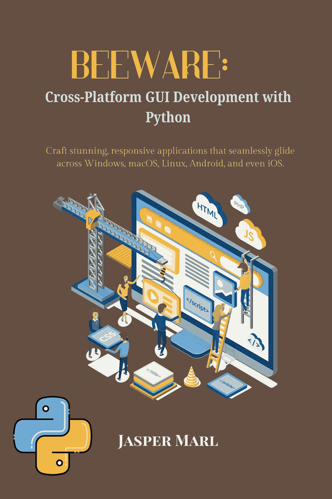

# BeeWare：Python 跨平台 GUI 开发：打造在 Windows、macOS、Linux、Android 甚至 iOS 上流畅运行的精美响应式应用程序。





***


***


# 引言

厌倦了与代码作斗吗？

你是一个 Python 程序员。你热爱优雅、可读性以及编写能够运行良好代码的纯粹快乐。但在构建漂亮且用户友好的 GUI 时，你可能感觉自己是在不断与九头蛇作斗争。

- “但这只在 Windows 上运行！”
- “Mac 用户永远不会理解这个！”
- “Linux？别想了！”

“编写一次，随处运行”的梦想似乎像一个遥不可及的幻影。

欢迎来到 BeeWare。

这本书不仅仅是另一本枯燥的技术手册。它是你 GUI 开发革命的指南。BeeWare 赋予你利用 Python 的力量来构建精美、响应迅速的应用程序，使其在 Windows、macOS、Linux、Android 甚至 iOS 之间流畅运行。

想象一下：

- 编写单一代码库并轻松地将其部署到每个主流操作系统。
- 释放 Python 庞大生态系统在 GUI 开发中的潜力，从数据可视化库到机器学习框架。
- 构建真正的跨平台应用程序，让任何设备上的用户感到愉悦，同时不牺牲性能或优雅性。

在书中，你将发现：

- BeeWare 的核心原理：学习这一突破性工具包如何利用 `Toga`（一个 Python 优先的 GUI 框架）的力量来创建原生外观的应用程序。
- 实用的、逐步的教程：构建真实的应用程序，从简单的计算器到复杂的数据仪表板。
- 高级技巧：掌握样式、主题以及与原生平台功能集成等高级概念。
- 跨平台开发的最佳实践：学习如何编写可维护、可扩展且面向未来的代码。
- Python GUI 开发的未来：探索 BeeWare 及其充满活力的社区令人兴奋的可能。

《BeeWare: 使用 Python 进行跨平台 GUI 开发》不仅仅是一本书；它是一份邀请。邀请你打破特定平台开发的限制，拥抱 Python 的力量来创建真正的通用应用程序。

无论你是资深 Python 开发者还是刚刚起步，这本书都将赋予你知识和信心去：

- 轻松地构建精美的跨平台 GUI。
- 加入一个不断发展的开发者社区，推向 Python 的边界。
- 无论操作系统如何，体验编写真正发光代码代码的快乐。

不要让平台限制限制了你的脚步。深入 BeeWare 的世界，释放你作为 Python 开发者的全部潜力。

# 第 1 章

## 什么是 BeeWare？

BeeWare 是一个开源工具包，赋予开发者使用 Python 创建跨平台图形用户界面 (GUI)。它利用每个平台上原生用户界面工具包的力量，同时保持一致的 Python 风格 API。这意味着你可以用 Python 编写一次 GUI 逻辑，并部署到 iOS、Android、macOS、Windows 和 Linux 等各种操作系统，且均使用同一代码库。

BeeWare 的核心目的是桥接 Python 的多功能性与视觉良好且高性能原生应用的需求之间的差距。通过抽象特定平台 UI 框架的复杂性，BeeWare 允许开发者专注于应用程序的逻辑和用户体验，而不是深陷于复杂的特定平台细节。

### BeeWare 生态系统：Toga、Briefcase 以及更多

BeeWare 生态系统围绕几个关键组件展开：

- `Toga`：这是 BeeWare 的核心。`Toga` 是一个 Python 库，为构建用户界面提供声明式 API。它抽象了每个平台的底层 UI 工具包，允许你使用一致的 Python 类和方法定义 UI 元素。`Toga` 支持广泛的 UI 元素，包括按钮、标签、文本字段、图像以及复杂的布局。
- `Briefcase`：这是一个命令行工具，简化了打包和分发 BeeWare 应用程序的过程。通过 `Briefcase`，你可以轻松为各种平台创建独立应用程序，包括 iOS、Android、macOS、Windows 和 Linux。它处理代码签名、配置和生成特定平台的安装程序等任务，使部署过程变得更加顺畅。
- 平台后端：BeeWare 依赖于特定平台的后端来渲染 UI 并底层操作系统交互。

这些后端包括：

- `Toga-iOS`：用于构建 iOS 应用。
- `Toga-Android`：用于构建 Android 应用。
- `Toga-Desktop`：用于为 macOS、Windows 和 Linux 构建应用程序，使用原生 UI 工具包，如 macOS 的 Cocoa、Linux 的 GTK 和原生 Windows 控件。

其他工具：BeeWare 生态系统还包含其他实用的工具和库，例如：

- `Pygments`：一个语法高亮库，可以在你的应用程序中显示代码片段。


- 平台特定库：提供访问平台特定功能的库，例如访问设备的摄像头或位置。

## 为什么选择 BeeWare？

选择 BeeWare 进行跨平台 GUI 开发具有多个极具吸引力的优势：

- **跨平台开发**：编写一次应用程序逻辑，即可通过极少的代码更改将其部署到多个平台。这显著减少了开发时间和工作量。
- **原生用户界面**：BeeWare 利用每个平台上的原生 UI 工具包，使得应用程序看起来和感觉就像是专为该平台构建的一样。这增强了用户体验并提升了应用程序性能。
- **Pythonic API**：`Toga` API 设计符合 Python 习惯且易于学习。这让 Python 开发者更容易上手并快速产生生产力。
- **开源且社区驱动**：BeeWare 是一个开源项目，拥有一个充满活力且提供支持的社区。这让用户可以获得丰富的资源，包括文档、教程和社区支持。
- **快速原型设计**：在不同平台上快速构建原型并测试 UI 的能力允许更快的迭代周期和开发周期。
- **灵活性**：BeeWare 提供了高度的灵活性，允许您根据特定的设计需求自定义应用程序的外观和感受。
- **持续改进**：BeeWare 项目正在积极维护和改进，并定期更新和添加新功能。

BeeWare 赋予了开发者使用 Python 创建高质量跨平台应用程序的能力，为在各种操作系统上构建用户界面提供了一个强大且高效的解决方案。通过利用 Python 和原生 UI 工具包的优势，BeeWare 是其他跨平台开发框架的一个极具吸引力的替代方案。

对于想要创建视觉美观且性能良好的跨平台应用程序的 Python 开发者来说，BeeWare 是一个价值工具包。如果您希望利用 Python 的力量进行跨平台 GUI 开发，BeeWare 绝对值得探索。

## 设置您的开发环境

在开始 BeeWare 之之旅之前，您需要建立一个稳固的开发环境。本节将引导您完成基本步骤：

### 1. 安装 Python 和必要的包

### 安装 Python：

- **检查现有安装**：打开终端或命令提示符并输入 `python --version`。如果已经安装了 Python，将看到版本号。

- **安装 Python（如果需要）**：

- **macOS/Linux**：从 Python 官网 (`https://www.python.org/downloads/`) 下载最新的 Python 安装程序并按照屏幕指示操作。
- **Windows**：从官方网站下载并安装最新的 Python 安装程序。确保在安装过程中勾选“Add Python to PATH”。

### 安装 BeeWare 及其依赖项：

- 打开终端或命令提示符，使用 Python 包安装器 `pip` 安装 BeeWare 及其依赖项：

```bash
pip install briefcase toga
```

此命令安装了 BeeWare 核心工具 (`briefcase`) 和 `Toga` 库，该库对于构建用户界面至关重要。

- **验证安装**：运行以下命令验证安装成功：

```bash
briefcase --version
```

您应该能看到已安装的 `briefcase` 工具的版本。

## 2. 选择 IDE 或文本编辑器

合适的集成开发环境 (IDE) 或文本编辑器可以显著增强您的开发体验。以下是一些流行的选项：

- **VS Code**：一个多功能且高度自定义的代码编辑器，具有出色的 Python 支持，包括调试、静态检查和 Git 集成。它还拥有庞大的扩展市场，允许您根据特定需求对其进行定制。
- **PyCharm**：一个强大且功能丰富的 IDE，专为 Python 开发设计。它提供智能代码补全、调试和版本控制集成等高级功能。
- **Sublime Text**：一个轻量级且快速的文本编辑器，界面简洁且性能卓越。它支持各种插件（包括 Python 特定的插件）来增强其功能。
- **Atom**：另一个高度自定义的开源文本编辑器，侧重社区贡献。它拥有庞大的包和主题生态系统。

最佳选择取决于您的个人偏好和所需的特定功能。在做决定时，考虑易用性、性能、调试能力和可用扩展等因素。

## 3. 您的第一个 BeeWare 项目：简单的“Hello, World!”应用程序

让我们创建一个基础的“Hello, World!”应用程序，以熟悉 BeeWare 的工作流：

### 创建项目目录：打开终端或命令提示符，为您的项目创建一个新目录：

```bash
mkdir hello_world_beeware
cd hello_world_beeware
```

### 初始化 Briefcase 项目：使用 `briefcase` 命令初始化新项目：

```bash
briefcase create --template=python
```

这将创建一个包含必要文件的基础项目结构。

### 修改主文件：

- 在您选择的 IDE 或文本编辑器中打开 `app.py` 文件。
- 将现有内容替换为以下代码：

```python
from toga import App, BoxLayout, Button, MainWindow, Text

def build(self):
    # 创建主布局
    self.main_window = MainWindow(title=self.name)
    self.main_window.content = BoxLayout(direction="vertical")

    # 添加标签
    label = Text(text="Hello, World!", style="heading")
    self.main_window.content.add(label)

    # 添加按钮
    button = Button("Click Me!")
    button.on_press = self.show_message
    self.main_window.content.add(button)

    return self.main_window

def show_message(self, widget):
    print("Button pressed!")

def main(self):
    return self.build()

if __name__ == "__main__":
    app = App("Hello World", "org.example.helloworld")
    app.main_loop()
```

### 运行应用程序：使用 `briefcase` 命令运行应用程序：

```bash
briefcase run
```

这将使用适用于您当前操作系统的相应后端启动应用程序。

这个简单的示例演示了 BeeWare 的基本结构：

- `App`：主应用程序类。
- `MainWindow`：应用程序的主窗口。
- `BoxLayout`：用于排列 UI 元素的布局容器。
- `Text`：显示文本的标签。
- `Button`：交互按钮。

通过修改 `build` 方法中的代码，您可以添加更多 UI 元素，自定义它们的外观并定义它们的行为。

这个“Hello, World!”示例为构建更复杂的 BeeWare 应用程序提供了基础。您可以探索 `Toga` 文档以发现丰富的 UI 元素及其属性，让您能够创建丰富且交互的用户界面。

#### 进一步探索

- **探索 Toga 文档**：参考官方 `Toga` 文档以获取关于 UI 元素、布局、样式等的全面概述：`https://beeware.org/toga/`
- **构建不同平台的版本**：使用 `briefcase` 命令将您的应用程序打包到各种平台，例如 iOS、Android、macOS、Windows 和 Linux：

  - `briefcase build android`
  - `briefcase build ios`
  - `briefcase build macos`
  - `briefcase build windows`
  - `briefcase build linux`
- **实验 UI 元素**：尝试向您的应用程序添加文本字段、复选框、图像等不同的 UI 元素。
- **探索样式选项**：学习如何使用样式和主题自定义 UI 元素的外观。
- **利用平台特定功能**：研究如何访问平台特定功能，例如设备摄像头、位置或通知。


通过遵循这些步骤并探索 BeeWare 文档，你将顺利开启创建之旅程。

# 第 2 章

## Toga 基础

`Toga` 是 BeeWare 的基石，为构建跨平台用户界面提供了 Pythonic 的 API。本节将深入探讨 `Toga` 的核心概念，并引导你构建基础用户界面。

### 1. 核心概念

#### 组件 (Widgets):
- `Widgets` 是 `Toga` UI 的基本构建块。它们代表单个的 UI 元素，如按钮、标签、文本框、图像等。
- 每个组件都具有控制其外观和行为的属性，例如尺寸、颜色、文本和事件处理器。
- `Toga` 提供了丰富的内置组件集，以满足各种 UI 需求。

#### 布局 (Layouts):
- `Layouts` 负责在容器内组织和定位组件。它们决定了组件在屏幕上的排列方式，例如水平方向、垂直方向或网格状。

常见的布局类型包括：
- `BoxLayout`：在行或列中排列组件。
- `StackLayout`：将组件堆叠在一起。
- `Grid`：以网格结构排列组件。
- `Table`：在表格的行和列中排列组件。

#### 样式 (Styles):
- `Styles` 允许你为组件定义并应用视觉属性，如颜色、字体和间距。
- `Styles` 可以在组件级或全局范围内定义，为整个应用程序提供一致的视觉体验。
- `Toga` 使用灵活的样式系统，允许你轻松自定义 UI 元素的外观。

### 2. 构建基础用户界面

让我们通过创建一个带有按钮、标签和文本框的简单应用程序，探索如何使用 `Toga` 构建基础用户界面。

#### 2.1 按钮 (Button)

- 创建按钮：
```python
from toga import App, BoxLayout, Button, MainWindow, Text

def build(self):
    # 创建主布局
    self.main_window = MainWindow(title=self.name)
    self.main_window.content = BoxLayout(direction="vertical")
    # 添加一个按钮
    button = Button("Click Me!")
    button.on_press = self.handle_button_press
    self.main_window.content.add(button)
    return self.main_window

def handle_button_press(self, widget):
    print("Button pressed!")

def main(self):
    return self.build()

if __name__ == "__main__":
    app = App("Button Example", "org.example.button")
    app.main_loop()
```
解释：
- 此代码创建了一个带有单个按钮的简单应用程序。
- `Button` 的 `on_press` 属性连接到 `handle_button_press` 方法，该方法在按钮被点击时被调用。
- `handle_button_press` 方法简单向控制台打印了一条消息。

#### 2.2 标签 (Label)

- 创建标签：
```python
from toga import App, BoxLayout, Label, MainWindow

def build(self):
    # 创建主布局
    self.main_window = MainWindow(title=self.name)
    self.main_window.content = BoxLayout(direction="vertical")
    # 添加一个标签
    label = Label("Hello, World!")
    self.main_window.content.add(label)
    return self.main_window

def main(self):
    return self.build()

if __name__ == "__main__":
    app = App("Label Example", "org.example.label")
    app.main_loop()
```
解释：
- 此代码创建了一个带有显示“Hello, World!”标签的简单应用程序。
- `Label` 组件用于在应用程序内显示静态文本。

#### 2.3 文本框 (Text Box)

- 创建文本框：
```python
from toga import App, BoxLayout, MainWindow, TextInput

def build(self):
    # 创建主布局
    self.main_window = MainWindow(title=self.name)
    self.main_window.content = BoxLayout(direction="vertical")
    # 添加一个文本框
    self.text_input = TextInput(placeholder="Enter text here")
    self.main_window.content.add(self.text_input)
    return self.main_window

def main(self):
    return self.build()

if __name__ == "__main__":
    app = App("Text Box Example", "org.example.textbox")
    app.main_loop()
```

#### 组合元素

你可以将这些基础元素组合起来创建更复杂的用户界面。例如：
```python
from toga import App, BoxLayout, Button, MainWindow, Text, TextInput

def build(self):
    # 创建主布局
    self.main_window = MainWindow(title=self.name)
    self.main_window.content = BoxLayout(direction="vertical")
    # 添加一个标签
    label = Text("Enter your name:")
    self.main_window.content.add(label)
    # 添加一个文本框
    self.name_input = TextInput(placeholder="Your Name")
    self.main_window.content.add(self.name_input)
    # 添加一个按钮
    button = Button("Submit")
    button.on_press = self.handle_button_press
    self.main_window.content.add(button)
    return self.main_window

def handle_button_press(self, widget):
    name = self.name_input.value
    print(f"Hello, {name}!")

def main(self):
    return self.build()

if __name__ == "__main__":
    app = App("Name Input", "org.example.nameinput")
    app.main_loop()
```
此示例结合了标签、文本框和按钮，创建一个简单的姓名输入表单。

#### 进一步探索

- 探索更多组件：尝试其他 `Toga` 组件，如 `ImageView`、`Switch`、`Slider`、`ProgressBar` 等。
- 学习布局：研究 `StackLayout`、`Grid` 和 `Table` 等布局选项，以有效地排列组件。
- 自定义样式：探索修改 UI 元素外观的样式选项。
- 处理事件：学习如何处理各种事件，如鼠标点击、键盘输入和窗口调整。
- 构建复杂的应用程序：应用你的知识构建具有交互功能的更复杂的应用程序。

通过掌握这些基础概念，你可以有效地使用 `Toga` 为你的跨平台 Python 应用程序创建美观且功能强大的用户界面。

## 使用容器：框、窗口和对话框

在 `Toga` 中，容器在组织和构建用户界面方面起着至关重要的作用。它们提供了一种在应用程序内分组和定位组件的方法。本节将探索如何处理不同类型的容器，包括框、窗口和对话框。

### 1. 框 (Boxes)

- `BoxLayout`：这是一种多功能容器，以单方向（水平或垂直）排列组件。
```python
from toga import App, BoxLayout, Button, MainWindow, Text

def build(self):
    # 创建一个水平 BoxLayout
    box = BoxLayout(direction="horizontal")
    box.add(Button("Button 1"))
    box.add(Button("Button 2"))
    # 创建主布局并添加框
    self.main_window = MainWindow(title=self.name)
    self.main_window.content = BoxLayout(direction="vertical")
    self.main_window.content.add(box)
    return self.main_window
```

- `StackLayout`：该容器将组件堆叠在一起，创建层叠效果。
```python
from toga import App, StackLayout, Button, MainWindow

def build(self):
    # 创建一个 StackLayout
    stack = StackLayout()
    stack.add(Button("Button 1"))
    stack.add(Button("Button 2"))
    # 创建主布局并添加堆
    self.main_window = MainWindow(title=self.name)
    self.main_window.content = stack
    return self.main_window
```

- `Grid`：该容器以网格结构（带有行和列）排列组件。
```python
from toga import App, Grid, Button, MainWindow

def build(self):
    grid = Grid(cols=2)
    grid.add(Button("Button 1"), row=0, column=0)
    grid.add(Button("Button 2"), row=0, column=1)
    grid.add(Button("Button 3"), row=1, column=0)
    self.main_window = MainWindow(title=self.name)
    self.main_window.content = grid
    return self.main_window
```

### 2. 窗口 (Windows)

- `MainWindow`：这是应用程序的主窗口。它包含了 UI 的主要内容。
- `Subwindows`：你可以创建额外的窗口（子窗口）来显示对话框、二级窗口或其他表单。


```python
from toga import App, BoxLayout, Button, MainWindow, SubWindow

def build(self):
    self.main_window = MainWindow(title=self.name)
    self.main_window.content = BoxLayout(direction="vertical")
    self.main_window.content.add(Button("Open Subwindow", on_press=self.open_subwindow))
    return self.main_window

def open_subwindow(self, widget):
    self.subwindow = SubWindow(title="Subwindow")
    self.subwindow.content = BoxLayout()
    self.subwindow.show()
# ... rest of the code
```

## 3. 对话框

- `Toga` 为常见交互提供了内置的对话框，例如消息框、输入对话框和文件选择对话框。

```python
from toga import App, BoxLayout, Button, MainWindow, MessageDialog

def build(self):
    self.main_window = MainWindow(title=self.name)
    self.main_window.content = BoxLayout(direction="vertical")
    self.main_window.content.add(Button("Show Message", on_press=self.show_message))
    return self.main_window

def show_message(self, widget):
    MessageDialog("Information", "This is a message!").show()
# ... rest of the code
```

## 4. 处理用户输入：事件与事件处理器

- **事件**：`Events` 代表用户与 UI 元素的交互，例如按钮点击、文本输入和窗口缩调整。
- **事件处理器**：`Event handlers` 是在特定事件发生时调用的函数。它们允许你响应用户输入并更新应用程序的状态。

### 示例：按钮点击事件

```python
from toga import App, BoxLayout, Button, MainWindow, Text

def build(self):
    self.main_window = MainWindow(title=self.name)
    self.main_window.content = BoxLayout(direction="vertical")
    self.label = Text(text="Button not clicked")
    self.main_window.content.add(self.label)
    button = Button("Click Me")
    button.on_press = self.handle_button_click
    self.main_window.content.add(button)
    return self.main_window

def handle_button_click(self, widget):
    self.label.text = "Button clicked!"
# ... rest of the code
```

- 在此示例中，`Button` 的 `on_press` 属性连接到了 `handle_button_click` 方法。
- 当按钮被点击时，会调用 `handle_button_click` 方法。
- 在方法内部，`label` 的文本被更新以反映按钮点击点击。

### 示例：文本输入事件

```python
from toga import App, BoxLayout, Button, MainWindow, Text, TextInput

def build(self):
    self.main_window = MainWindow(title=self.name)
    self.main_window.content = BoxLayout(direction="vertical")
    self.text_input = TextInput(placeholder="Enter your name")
    self.text_input.on_change = self.handle_text_change
    self.main_window.content.add(self.text_input)
    self.label = Text(text="")
    self.main_window.content.add(self.label)
    return self.main_window

def handle_text_change(self, widget):
    self.label.text = f"You entered: {widget.value}"
# ... rest of the code
```

- 在此示例中，`TextInput` 的 `on_change` 属性连接到了 `handle_text_change` 方法。
- 每当 `TextInput` 内的文本被修改时，就会调用 `handle_text_change` 方法。
- 在方法内部，标签被更新以显示 `TextInput` 的当前值。

### 注意事项

- **事件传播**：`Events` 可以通过组件层级传播。你可以通过使用 `stop_propagation()` 等方法控制事件的处理方式。
- **自定义事件**：你可以在应用程序中创建并处理自定义事件以触发特定操作。
- **平台特定事件**：某些平台可能提供特定平台的事件，你可以通过处理这些事件与底层操作系统进行交互。

通过有效使用容器、理解事件处理并利用内置对话框，你可以为你的跨平台 Python 应用程序创建动态且交互的用户界面。

以下是实现这一点的几个关键方面：

#### 容器：
- 提供了一种结构化且组织良好的方式来安排和定位组件，从而产生定义清晰且视觉上吸引的布局。
- 通过在特定容器内分组相关组件，能够高效地管理复杂的 UI。

#### 事件处理：
- 允许你的应用程序响应用户交互，使其具有动态且吸引吸引力。
- 允许你实现按钮点击、文本输入和其他用户操作等功能。

#### 内置对话框：
- 为常见的用户交互提供预设计的对话框，例如显示消息、提示输入和选择文件。
- 通过提供标准对话框的即用可用组件，节省开发时间和精力的。

通过结合这些元素，你可以构建稳健且用户友好的应用程序，与用户进行有效交互，并在不同平台之间提供无缝体验。

# 第 3 章

## 高级 UI 组件

本节深入探讨 Toga 中更高级的 UI 组件，探索如何使用表格、树结构、菜单和工具栏来创建复杂且交互的用户界面。

## 1. 使用表格和树结构

### 表格：
- `Toga` 中的 `Table` 组件允许你以行和列相结合的表格格式显示数据。
- 你可以自定义表格单元格的外观和行为，包括格式化、编辑和排序。

```python
from toga import App, BoxLayout, MainWindow, Table, TableCell

class MyTable(Table):
    def __init__(self, kwargs):
        super().__init__(kwargs)
        self.headings = ['Column 1', 'Column 2']
        self.data = [
            ['Row 1', 'Data 1'],
            ['Row 2', 'Data 2'],
            ['Row 3', 'Data 3']
        ]

def build(self):
    self.main_window = MainWindow(title=self.name)
    self.main_window.content = BoxLayout(direction="vertical")
    self.main_window.content.add(MyTable([]))
    return self.main_window
```

### 树结构：
- `Tree` 组件允许你以树形结构显示分级数据。
- 树中的每个节点都可以子节点，创建嵌套结构。

```python
from toga import App, BoxLayout, MainWindow, Tree, TreeItem

def build(self):
    self.main_window = MainWindow(title=self.name)
    self.main_window.content = BoxLayout(direction="vertical")
    tree = Tree()
    parent_node = TreeItem("Parent Node")
    child_node1 = TreeItem("Child 1", parent=parent_node)
    child_node2 = TreeItem("Child 2", parent=parent_node)
    tree.add(parent_node)
    self.main_window.content.add(tree)
    return self.main_window
```

## 2. 实现菜单和工具栏

### 菜单：
- `Menus` 为应用程序内组织命令和选项提供了方法。
- `Toga` 允许你创建包含子菜单、复选框和单选按钮的菜单。

```python
from toga import App, BoxLayout, MainWindow, Menu, MenuItem

def build(self):
    self.main_window = MainWindow(title=self.name)
    self.main_window.content = BoxLayout(direction="vertical")
    menu = Menu(self)
    menu.add_submenu(MenuItem("File"))
    return self.main_window
```

### 工具栏：
- `Toolbars` 为频繁使用的命令和操作提供了快速访问。
- 你可以在工具栏上添加按钮、图标和其他组件。

```python
from toga import App, BoxLayout, Button, MainWindow, Toolbar

def build(self):
    self.main_window = MainWindow(title=self.name)
    self.main_window.content = BoxLayout(direction="vertical")
    toolbar = Toolbar(self)
    toolbar.add(Button("New"))
    toolbar.add(Button("Open"))
    toolbar.add(Button("Save"))
    self.main_window.toolbar = toolbar
    return self.main_window
```

## 高级技术

- **数据绑定**：`Toga` 支持数据绑定，允许将 UI 元素链接到数据源。这简化了数据更新并提高了应用程序的效率。
- **自定义组件**：你可以通过子类现有的 `Toga` 组件或从头创建新组件来创建自定义组件。这允许你扩展 `Toga` 的功能以满足特定需求。


- 平台特定功能：Toga 提供了对平台特定功能的访问，例如系统托盘图标、通知和文件系统访问。

## 示例：简单的文本编辑器

此示例演示了一个具有菜单、工具栏和文本输入区域的基础级文本编辑器：

```python
from toga import App, BoxLayout, Button, MainWindow, Menu, MenuItem, TextArea, Toolbar

class TextEditor(App):
    def startup(self):
        # Create the main window
        self.main_window = MainWindow(title=self.name)
        self.main_window.content = BoxLayout(direction="vertical")
        # Create a toolbar
        toolbar = Toolbar(self)
        toolbar.add(Button("New", on_press=self.new_file))
        toolbar.add(Button("Open", on_press=self.open_file))
        toolbar.add(Button("Save", on_press=self.save_file))
        self.main_window.toolbar = toolbar

        # Create a menu
        menu = Menu(self)
        menu.add_submenu(MenuItem("File"))
        menu.get_item_at_path('File').add(MenuItem("New", on_press=self.new_file))
        menu.get_item_at_path('File').add(MenuItem("Open", on_press=self.open_file))
        menu.get_item_at_path('File').add(MenuItem("Save", on_press=self.save_file))
        self.main_window.menu = menu

        # Create a text area
        self.text_area = TextArea(style=dict(flex=1))
        self.main_window.content.add(self.text_area)
        self.main_window.show()

        # ... (Implement new_file, open_file, save_file methods) ...

if __name__ == "__main__":
    app = TextEditor("Simple Text Editor", "org.example.texteditor")
    app.main_loop()
```

此示例演示了如何使用菜单、工具栏和 `TextArea` 控件来创建一个基础文本编辑器。

通过掌握这些高级 UI 组件和技术，你可以创建复杂且用户友好的应用程序，有效满足你的用户的需求。

## 创建自定义组件

Toga 为构建自定义 UI 组件提供了一个灵活的框架。这允许你扩展其功能，并为你的应用程序创建独特且定制的用户界面。本节将指导你完成创建自定义组件以及与原生平台功能集的过程。

### 1. 创建自定义组件

- 子类现有组件：最常用的方法是继承现有的 `Toga` 组件的子类，并自定义其行为或外观。

```python
from toga import Widget

class CustomButton(Button):
    def __init__(self, text, icon=None, kwargs):
        super().__init__(text, icon, kwargs)
        self.style.background_color = 'green'
        # ... use CustomButton in your application ...
```

- 从零创建组件：对于更复杂的组件，你可以通过继承 `Widget` 类从零开始创建组件。

```python
from toga import Widget, BoxLayout

class MyCustomWidget(Widget):
    def create(self):
        self.native = BoxLayout(direction="vertical")
        # ... add child widgets to self.native ...
    def set_on_press(self, handler):
        # ... implement event handling ...
        # ... use MyCustomWidget in your application ...
```

### 2. 与原生平台功能集成

Toga 提供了访问和集成原生平台功能的机制，增强了你的应用程序的用户体验和功能。

- 通知：显示系统通知以提醒用户事件或更新。

```python
from toga import App, BoxLayout, Button, MainWindow
from toga.platform import notification

def build(self):    
    button = Button("Show Notification")
    button.on_press = self.show_notification    
    return self.main_window

def show_notification(self, widget):
    notification.show_message("Notification Title", "This is a notification message.")
    # ... rest of the code ...
```

- 文件对话框：允许用户使用平台原生文件对话框打开或保存文件。

```python
from toga import App, BoxLayout, Button, MainWindow
from toga.platform import request_file_chooser

def build(self):
    button = Button("Open File")
    button.on_press = self.open_file
    return self.main_window

def open_file(self, widget):
    file_paths = request_file_chooser(multiple=True)  # Allow multiple file selection
    if file_paths:
        # Process the selected files
        print(file_paths)
        # ... rest of the code ...
```

平台特定 API：使用 `toga.platform` 模块访问平台特定 API。这允许你集成诸如功能：

- 相机：访问设备摄像头以捕捉图像或视频。
- 位置：确定用户的当前位置。
- 剪贴板：访问并操作系统剪贴板。
- 系统托盘：创建系统托盘图标以实现应用程序持久存在。

## 示例：自定义切换按钮

```python
from toga import Widget, BoxLayout, events

class ToggleButton(Widget):
    def __init__(self, text, on_toggle=None, kwargs):
        super().__init__(kwargs)
        self.text = text
        self.on_toggle = on_toggle
        self.is_toggled = False

    def create(self):
        self.native = BoxLayout(direction="horizontal")
        self.native.add(self.text)

    def set_on_toggle(self, handler):
        self.on_toggle = handler

    def toggle(self):
        self.is_toggled = not self.is_toggled
        if self.on_toggle:
            self.on_toggle(self)

    def handle_press(self, event):
        self.toggle()

    def set_enabled(self, value):
        # ... implement enabling/disabling logic ...
        # ... use ToggleButton in your application ...
```

此自定义 `ToggleButton` 组件演示了如何从零创建一个新组件。它包含了切换状态和处理 `on_toggle` 事件等基础功能。

## 关键考虑因素

- 平台兼容性：在集成原生平台功能时，确保你的代码与目标平台兼容。
- 性能：在使用平台特定 API 时，请注意性能影响。
- 用户体验：在设计自定义组件和集成平台功能时，应以增强用户体验并保持跨平台一致的外观和感觉的方式。

通过创建自定义组件和集成平台功能，你可以显著增强应用程序的功能和用户体验。这允许你构建满足用户特定需求的高级 UI 组件。


```python
button = Button("Click Me", style=button_style)
```

from toga import Theme

class MyTheme(Theme):
    def __init__(self, kwargs):
        super().__init__(kwargs)
        # 定义不同组件类型的样式
        self.button_style = {
            'background_color': 'purple',
            'color': 'white'
        }
        self.label_style = {
            'font_size': 16
        }
        # ... 定义其他组件的样式 ...

if __name__ == "__main__":
    app = App("My Application", "org.example.myapp", theme=MyTheme())
    app.main_loop()
```

## 1. 高级样式化技术

在 Toga 中，样式（styles）对于定义 UI 元素的视觉外观至关重要。它们允许你自定义颜色、字体、大小和其他视觉属性，确保应用程序在范围内具有一致且美观的外观和感受。

### 1.1 为组件应用样式

#### 内联样式
应用样式的最直接的方法是将样式字典直接传递给组件的构造函数。

```python
from toga import Button

button = Button("Click Me", style={
    'background_color': 'red',
    'color': 'white',
    'font_size': 18
})
```

#### 类级样式
你可以通过在类定义中设置 `style` 属性为组件类定义默认样式。

```python
from toga import Button

class MyButton(Button):
    def __init__(self, kwargs):
        kwargs['style'] = {
            'background_color': 'green',
            'color': 'white'
        }
        super().__init__(kwargs)
```

#### 主题样式
在 `Theme` 类中定义样式并将主题应用于你的应用程序。这确保了应用程序内所有组件样式的一致性。

```python
from toga import App, BoxLayout, Button, MainWindow, Theme

class MyTheme(Theme):
    def __init__(self, kwargs):
        super().__init__(kwargs)
        self.button_style = {
            'background_color': 'blue',
            'color': 'white'
        }
    def build(self):
        # ... 实现 ...
```

#### 为一组组件应用样式
你可以为容器内的多个组件应用样式。

```python
from toga import BoxLayout, Button

box = BoxLayout()
button1 = Button("Button 1", style={'background_color': 'red'})
button2 = Button("Button 2", style={'background_color': 'green'})
box.add(button1)
box.add(button2)
```

#### 覆盖样式
内联样式始终优先于类级样式，而类级样式优先于主题样式。

### 1.2 针对不同平台的主题

Toga 允许你创建特定平台的样式，为目标操作系统定制应用程序的外观。这有助于你的应用程序更好地融入用户的操作系统，并提供更原生的外观和感受。

#### 使用 `get_platform()` 函数
来自 `toga.platform` 模块的 `get_platform()` 函数返回当前的操作系统。

```python
from toga.platform import get_platform

if get_platform() == 'macos':
    # macOS 特有样式
    button_style = {'background_color': 'darkgray'}
elif get_platform() == 'windows':
    # Windows 特有样式
    button_style = {'background_color': 'gray'}
```

## 2. 自定义方法

- **创建自定义主题**：创建一个 Python 模块（例如 `my_theme.py`）来定义你的自定义主题。
- **使用样式继承**：你可以通过继承现有样式创建新样式。这允许你轻松修改或扩展现有的样式定义。
- **使用 CSS**：Toga 支持用于 UI 元素的 CSS 子集。这允许你使用类 CSS 选择器来定位特定组件并应用样式。
- **自定义组件样式**：通过在组件构造函数中定义自定义属性来覆盖单个组件的默认样式。
- **创建样式库**：创建可复用的样式库，在多个项目之间或大型应用程序内部共享样式。

## 3. 示例：主题化按钮

```python
from toga import App, BoxLayout, Button, MainWindow, Theme

class MyTheme(Theme):
    def __init__(self, kwargs):
        super().__init__(kwargs)
        self.button_style = {
            'background_color': 'green',
            'color': 'white'
        }

    def build(self):
        self.main_window = MainWindow(title=self.name)
        self.main_window.content = BoxLayout(direction="vertical")
        self.main_window.content.add(Button("Click Me"))
        return self.main_window

if __name__ == "__main__":
    app = App("My Themed App", "org.example.themedapp", theme=MyTheme())
    app.main_loop()
```

此示例演示了如何创建自定义主题并将其应用于应用程序。`MyTheme` 类为 `Button` 组件定义了自定义样式，将背景颜色更改为绿色。

通过有效使用 Toga 的样式系统，你可以创建视觉上吸引人且一致的用户界面，提升用户体验。尝试不同的样式和主题，为你的应用程序找到最佳的外观和感受。


# 使用 BeeWare 进行数据可视化

BeeWare 专注于跨平台开发，为构建数据可视化应用程序提供了强大的基础。通过通过与 `Matplotlib` 和 `Plotly` 等流行的 Python 库集成，你可以在原生应用程序中创建视觉丰富且具有交互性的数据可视化内容。

## 1. 在 Toga 中集成 Matplotlib 和 Plotly

**Matplotlib**: `Matplotlib` 是一个多功能的库，用于在 Python 中创建各种静态、动画和交互式可视化图。

要将 `Matplotlib` 与 `Toga` 集成，你可以：

- 将图表保存为文件：使用 `Matplotlib` 生成图表并保存为文件（例如 PNG、SVG）。然后，在 `Toga.ImageView` 组件中显示图像。

```python
import matplotlib.pyplot as plt

def create_plot():
    # 在此处生成你的 Matplotlib 图表
    plt.plot([1, 2, 3, 4], [10, 4, 2, 1])
    plt.xlabel("X-axis")
    plt.ylabel("Y-axis")
    plt.title("Matplotlib Plot")
    plt.savefig("my_plot.png")

# ... 在你的 Toga 应用中 ...
from toga import App, BoxLayout, ImageView, MainWindow

def build(self):
    image_view = ImageView(image="my_plot.png")
```

- 使用支持嵌入 GUI 的后端：虽然并不总是那么简单，但你可以探索 `Matplotlib` 的后端（如 `TkAgg` 或 `WXAgg`），它们可能与 GUI 环境提供更好的集成。

**Plotly**:

- `Plotly` 是一个强大的库，用于创建交互式和基于 Web 的可视化。
- `Plotly` 与 Web 环境有更好的集成。你可以使用 `Plotly` 生成交互式图表，并将它们显示在 `Toga` 应用程序的 Web 视图组件中。

```python
import plotly.graph_objects as go

def create_plotly_figure():
    fig = go.Figure(data=go.Bar(x=['A', 'B', 'C'], y=[10, 20, 30]))
    return fig

## 在你的 Toga 应用中
from toga import App, BoxLayout, MainWindow, WebView

def build(self):
    web_view = WebView()
    web_view.url = create_plotly_figure().to_html()
```

## 2. 创建交互式数据可视化

**用户输入与动态更新**：

- 通过在你的 `Toga` 应用中加入用户输入元素（例如滑块、下拉列表、文本字段），允许用户与你的可视化内容进行交互。
- 根据用户输入的变化动态更新可视化图表。

```python
from toga import App, BoxLayout, Button, MainWindow, Slider, WebView

def build(self):
    self.slider = Slider(min_value=0, max_value=100)
    self.slider.on_change = self.update_plot
    self.web_view = WebView()
    return self.main_window

def update_plot(self, widget):
    value = self.slider.value
    # 根据滑块值生成新的 Plotly 图形
    fig = go.Figure(...)
    self.web_view.url = fig.to_html()
```

- **缩放与和平**：如果使用如 `Plotly` 这样的库，利用其内置的缩放和平移动功能为用户提供交互式体验。
- **工具提示与悬停效果**：利用工具提示和悬停效果等交互式功能，显示可视化内容中关于数据点的详细信息。

## 3. 构建数据驱动应用

**数据加载与处理**：

- 与 CSV 文件、数据库或 API 等数据源集成，在应用程序中加载并处理数据。
- 使用 `Pandas` 等库进行数据操作和分析。

**数据过滤与排序**：

- 实现允许用户对数据进行过滤和排序的功能，使能够有效地探索和分析数据。

**用于可视化的自定义组件**：

- 创建自定义的 `Toga` 组件来封装和展示可视化，使你的代码更具模块化和可用性。

**实时数据可视化**：

- 如果处理流式数据，探索实时数据可视化更新的技术。

### 示例：带有用户输入的简单折线图

```python
from toga import App, BoxLayout, Button, MainWindow, Slider, WebView
import plotly.graph_objects as go

def build(self):
    self.main_window = MainWindow(title="Line Chart")
    self.main_window.content = BoxLayout(direction="vertical")
    self.slider = Slider(min_value=1, max_value=10, value=5)
    self.slider.on_change = self.update_plot
    self.main_window.content.add(self.slider)
    self.web_view = WebView()
    self.main_window.content.add(self.web_view)
    self.update_plot(self.slider)  # 初始表
    return self.main_window

def update_plot(self, widget):
    x_values = list(range(1, self.slider.value + 1))
    y_values = [x**2 for x in x_values]
    fig = go.Figure(data=go.Scatter(x=x_values, y=y_values))
    self.web_view.url = fig.to_html()

if __name__ == "__main__":
    app = App("Data Visualization", "org.example.datavis")
    app.main_loop()
```

此示例展示了一个根据滑块值动态更新的简单折线图。

通过有效地将 `Matplotlib` 和 `Plotly` 等数据可视化库与 `Toga` 的 UI 框架集成，你可以创建强大且吸引人的数据驱动应用，为你的用户提供有价值的见解。

# 第 6 章

## 什么是 Briefcase？

`Briefcase` 是一个命令行工具，简化了使用 `Toga` 构建的 Python 应用程序的打包和发布过程。它自动化了为各种平台独立应用程序的许多复杂性，包括：

- 桌面：Windows, macOS, Linux
- 移动：Android, iOS

`Briefcase` 处理如下任务：

- **打包**：将你的应用程序代码、依赖和资源封装成可分发的格式。
- **平台特定配置**：使你的应用程序适应目标平台的特定需求。
- **部署**：创建安装程序、应用包或 APK 文件以便于分发。

## 1. 为 Windows、macOS 和 Linux 构建可执行文件

`Briefcase` 让为流行的桌面操作系统创建独立的可执行文件变得简单：

- **Windows**：创建一个可以在 Windows 机器上直接运行的可执行文件（`.exe`）。

```bash
briefcase build windows
```

- **macOS**：为 macOS 创建应用包（`.app`）。

```bash
briefcase build macos
```

- **Linux**：为 Linux 发行版创建独立的可执行文件或 Debian/RPM 包。

```bash
briefcase build linux
```

## 2. 为 Android 和 iOS 创建移动应用程序

`Briefcase` 简化了构建移动应用程序的过程：

- **Android**：创建一个可以安装在 Android 设备上的 Android 包（APK）。

```bash
briefcase build android
```

- **iOS**：创建一个可以在 `Xcode` 中打开并构建的项目。这需要一台安装了 `Xcode` 的 Mac。

```bash
briefcase build ios
```

## 3. 为发布打包应用程序

`Briefcase` 帮助你准备发布应用程序：

- **创建安装程序**：对于 Windows 和某些 Linux 发行版，`Briefcase` 可以创建安装程序（例如 `.msi`, `.exe`, `.deb`, `.rpm`），引导用户完成安装过程。
- **生成应用包**：对于 macOS，`Briefcase` 创建可以轻松拖入应用程序文件夹的应用包。
- **为应用商店准备**：对于 Android 和 iOS，`Briefcase` 帮助你准备应用程序提交到相应的应用商店（Google Play Store 和 Apple App Store）。这可能涉及代码签名、预备和配置应用商店元数据等任务。


## 构建 Android 应用

```bash
briefcase build android
```

`Briefcase` 将在 `dist/android` 目录下创建一个 APK 文件。

注意：构建 iOS 版本需要一台安装了 `Xcode` 并拥有 Apple 开发者账户的 Mac。你需要配置你的 `Xcode` 开发环境，并遵循 `Briefcase` 为 iOS 开发提供的说明进行。

通过有效利用 `Briefcase`，你可以显著简化跨平台 Python 应用程序的部署过程，使其触及各种设备和操作系统上更广泛的群体。

# 第 7 章：BeeWare 应用的部署策略

成功部署 BeeWare 应用需要对分发渠道、打包格式、彻底测试以及稳健的维护计划进行仔细考虑。

### 1. 选择合适的分发渠道

分发渠道的选择取决于多种因素，包括目标群体、应用程序的性质以及业务目标。BeeWare 应用常用的分发渠道包括：

#### 直接下载
- 在你自己的网站或专门下载页面上托管你的应用程序。
- 为用户提供安装程序或应用程序包的直接下载链接。
- 适用于受众较少或具有特定目标的应用程序。

#### 应用商店
- 通过官方应用商店分发你的应用程序，如 Google Play Store (Android)、Apple App Store (iOS) 和 Microsoft Store (Windows)。
- 提供更广泛的覆盖和更高的可发现性。
- 需要遵循每个应用商店特定的指南和策略。

#### 第三方平台
- 利用 `GitHub Releases`、`PyPI`（Python 包索引）或 `Itch.io` 等平台托管并分发你的应用程序。
- 提供方便的更新访问，通常包含社区功能。

#### 开源仓库
- 对于开源项目，通过 `GitHub`、`GitLab` 或 `Bitbucket` 等平台分发你的应用程序。
- 允许用户访问源代码、为项目做贡献并自行构建应用程序。

### 2. 构建安装程序和包

`Briefcase` 创建各种类型安装程序和包的工具：

#### Windows
- `.exe` 安装程序：创建可以在 Windows 系统上轻松安装的独立可执行文件。
- `.msi` 安装程序：更高级的安装程序，提供自定义安装路径和卸载选项等功能。

#### macOS
- 应用程序包 (`.app`)：创建自包含的包，可以轻松地拖入“应用程序”文件夹中。

#### Linux
- `.deb` (Debian) 和 `.rpm` (Red Hat 包管理器) 包：创建与流行的 Linux 发行版兼容的包。
- 独立可执行文件：为 Linux 系统创建单一可执行文件。

#### Android
- `.APK` 文件：创建用于 Android 设备安装的 Android 包。

#### iOS
- `Xcode` 项目：创建可以在 `Xcode` IDE 中打开并构建的 `Xcode` 项目。

示例：构建 Windows 安装程序

```bash
briefcase build windows --type msi
```

### 3. 在不同平台上进行测试和调试

彻底的测试对于确保流畅的用户体验并在发布前识别并修复任何问题至关重要。

#### 虚拟机和模拟器
- 使用虚拟机（例如 `VirtualBox`、`VMware`）在不同版本的 Windows、macOS 和 Linux 上测试你的应用程序。
- 使用 Android 模拟器（例如 `Android Studio` 的模拟器）测试你的 Android 应用。

#### 真机
- 在真实设备（手机、平板电脑、电脑）上测试你的应用程序，以确保兼容性和性能。
- 考虑在具有不同硬件软件配置的多种设备上进行测试。

#### 用户测试
- 与小小组 Beta 测试员进行用户测试，以获取有关可用性、性能和整体用户体验的反馈。

### 4. 处理更新和维护

#### 版本控制
- 使用 `Git` 等版本控制系统跟踪应用程序代码的更改，以便更容易管理更新并在必要时回滚到之前的版本。

#### 自动化构建
- 使用 `Jenkins`、`GitLab CI/CD` 或 `GitHub Actions` 等工具设置自动化构建和部署流水线，简化发布流程。

#### 更新机制
实现更新应用程序的机制，例如：
- 应用内更新：允许用户直接从应用程序内部更新。
- 自动更新：在后台自动检查并下载更新。
- 为手动更新提供清晰的说明（例如下载并安装新版本）。

#### 跟踪和问题管理
- 使用漏洞跟踪系统（例如 `Jira`、`GitHub Issues`）跟踪报告的问题并管理漏洞修复。
- 及时响应用户反馈并解决任何报告的问题。

#### 更新日志
- 为应用程序的每个新版本创建并发布更新日志，突出新功能、修复和其他任何其他重要更改。

## 最佳实践
- 为你的应用程序选择合适的部署策略。考虑你的目标群体、应用程序的复杂性以及可用资源。
- 在多种平台和设备上进行彻底测试。
- 创建一个稳健的维护计划。
- 收集反馈并及时解决问题。
- 遵循应用商店的指南和策略。
- 保持应用程序使用最新的安全补丁和漏洞修复。

通过遵循这些策略和最佳实践，你可以有效地将 BeeWare 应用部署到广泛平台，并确保良好的用户体验。

# 第 8 章：BeeWare 的持续集成与持续交付

持续集成 (CI) 和持续交付 (CD) 是现代软件开发的重要实践，特别是当处理像 BeeWare 这样的跨平台项目时。这些实践简化了开发和发布流程，提高了软件质量，并实现了更快的迭代周期。

### 1. 设置 CI/CD 流水线

CI/CD 流水线通常涉及以下阶段：

#### 源代码管理
将项目代码存储在 `Git` 等版本控制系统中，并托管在 `GitHub`、`GitLab` 或 `Bitbucket` 等平台。

#### 构建与测试
- 构建：使用 `briefcase` 命令为每个目标平台（例如 Windows、macOS、Android、iOS）自动构建你的 BeeWare 应用程序。
- 测试：执行单元测试、集成测试和 UI 测试，以确保应用程序的功能和稳定性。

#### 部署
- 阶段环境 (Staging)：将构建的应用程序部署到阶段环境进行进一步的测试和验证。
- 生产环境：将应用程序部署到生产环境（例如应用商店、你自己的服务器）。

### 2. 自动化构建和部署

#### 自动化构建
- 使用 CI/CD 工具在代码更改推送到仓库时自动触发构建（例如在每次提交或拉取请求时）。
- 在你的 CI/CD 脚本中使用 `briefcase` 命令为每个目标平台构建应用程序。

#### 自动化部署
使用以下工具自动化到不同环境（例如阶段环境、生产环境）的部署过程：
- 基于脚本的部署：创建脚本以自动化部署任务，如复制文件、配置服务器和重启服务。
- 特定平台的部署工具：利用特定平台的工具部署到应用商店（例如用于 iOS 的 `Fastlane`用于 Android 的 `Google Play Console API`）。

### 3. 使用 GitHub Actions 和 Jenkins 等工具

#### GitHub Actions
- 直接集成到 GitHub 的强大 CI/CD 平台。
- 在仓库中通过 YAML 文件定义工作流，以编排构建、测试和部署过程。

```yaml
name: Build and Test BeeWare Application

on:
  push:
    branches: [ "main" ]

jobs:
  build:
```


```yaml
runs-on: ubuntu-latest

steps:
  - uses: actions/checkout@v3
  - name: Install Python and dependencies
    uses: actions/setup-python@v3
    with:
      python-version: '3.x'
  - name: Install BeeWare and dependencies
    run: |
      python -m pip install briefcase toga
  - name: Build for Android
    run: briefcase build android
  - name: Run tests
    run: pytest
```

### Jenkins:
- 一个流行的开源 CI/CD 服务器，提供了一个更灵活且可定制的环境。
- 使用 `Jenkinsfile` (Groovy) 或其他支持的脚本语言创建 Jenkins 流线。

#### Groovy
```groovy
pipeline {
    agent any
    stages {
        stage('Build') {
            steps {
                sh 'briefcase build android'
            }
        }
        stage('Test') {
            steps {
                sh 'pytest'
            }
        }
        // ... 后续用于部署的阶段
    }
}
```

### 关键注意事项:
- **特定平台的配置**：调整您的 CI/CD 流线以处理每个目标平台的特定要求（例如，iOS 的代码签名、Android 应用商店提交）。
- **测试策略**：实施全面的测试策略，包括单元测试、集成测试、UI 测试和端到端测试。
- **安全性**：实施安全措施以保护 CI/CD 流线中的源代码、API 密钥和其他敏感信息。
- **监控与日志记录**：监控 CI/CD 流线的状态并记录相关事件以识别和排排除问题。
- **持续改进**：定期审查并优化您的 CI/CD 流线，以提高效率、缩短构建时间并增强整体稳定性。

通过实施健壮的 CI/CD 流线，您可以显著提高 BeeWare 开发过程的效率和质量。自动化构建、测试和部署能够实现更迭代周期，减少手动工作，并提高应用程序的整体稳定可靠性。

# 第 9 章

## 在 BeeWare 应用中使用数据库

将数据库集成到 BeeWare 应用中允许您有效地存储、检索和管理数据。本节将探索如何连接到不同的数据库、构建数据驱动的应用，以及实现数据持久化和同步。

### 1. 连接到数据库

#### SQLite:
- SQLite 是一个轻量级的基于文件的数据库，嵌入在您的应用程序中。
- 本地数据存储和离线应用的理想选择。

#### Python
```python
import sqlite3

def connect_to_sqlite():
    conn = sqlite3.connect('my_database.db')
    cursor = conn.cursor()
    return conn, cursor

# ... 使用连接和游标执行 SQL 查询 ...
```

#### PostgreSQL:
- 一个强大且健壮的开源关系型数据库系统。
- 需要独立的服务器来运行。

#### Python
```python
import psycopg2

def connect_to_postgresql():
    conn = psycopg2.connect(
        host="localhost",
        database="my_database",
        user="my_user",
        password="my_password"
    )
    cursor = conn.cursor()
    return conn, cursor

# ... 使用连接和游标执行 SQL 查询 ...
```

#### MySQL:
- 另一个流行的开源关系型数据库系统。
- 需要独立的服务器来运行。

#### Python
```python
import mysql.connector
def connect_to_mysql():
    conn = mysql.connector.connect(
        host="localhost",
        user="my_user",
        password="my_password",
        database="my_database"
    )
    cursor = conn.cursor()
    return conn, cursor

# ... 使用连接和游标执行 SQL 查询 ...
```

### 2. 使用 BeeWare 构建数据驱动的应用

#### 数据驱动 UI:
- 使用从数据库检索的数据填充 UI 元素（例如：列表、表格）。
- 随着数据变化动态更新 UI。

#### Python
```python
from toga import App, BoxLayout, MainWindow, Table, TableCell

def build(self):
    table = Table()
    # . (用来自数据库的数据填充表格) …
```

#### 用户 交互:
- 允许用户通过 UI 与数据进行交互（例如：添加、编辑、删除记录）。
- 根据用户操作相应更新数据库。

#### 数据可视化:
- 集成数据可视化库（例如：Matplotlib、Plotly），根据数据库中的数据创建图表和图形。

### 3. 实现数据持久化和同步

#### 数据持久化:
- 使用 SQLite 或其他合适的数据库在本地存储应用程序数据。
- 这确保即使在应用程序离线时数据也可用。

#### 数据同步:
将本地数据与远程数据库（例如：云端数据库如 PostgreSQL 或 MySQL）同步，以：
- 跨设备共享数据。
- 启用用户之间的协作和数据共享。
- 即使在离线也能提供数据访问。

#### 数据同步技术:
- **定期同步**：在指定的间隔定期同步数据。
- **实时同步**：使用 websockets 或消息队列等技术实时同步数据。
- **增量同步**：仅同步自上次同步以来对数据的更改。

#### 示例：简单的联系人管理器

#### Python
```python
import sqlite3
from toga import App, BoxLayout, Button, MainWindow, TextInput, Table, TableCell

class ContactManager(App):
    def startup(self):
        self.main_window = MainWindow(title=self.name)
        self.main_window.content = BoxLayout(direction="vertical")
        # ... (用于添加/编辑联系人的 UI 元素) ...
        self.contacts_table = Table()
        self.main_window.content.add(self.contacts_table)
        self.load_contacts()
        self.main_window.show()

    def load_contacts(self):
        conn = sqlite3.connect('contacts.db')
        cursor = conn.cursor()
        cursor.execute("SELECT id, name, phone FROM contacts")
        rows = cursor.fetchall()
        conn.close()
        self.contacts_table.data = rows
        self.contacts_table.headings = ['ID', 'Name', 'Phone']
        # ... (用于添加、编辑和删除联系人的方法) ...

if __name__ == "__main__":
    app = ContactManager("Contact Manager", "org.example.contactmanager")
    app.main_loop()
```

此示例展示了一个使用 SQLite 存储和检索联系人信息的基本联系人管理器。

通过有效地将数据库集成到您的 BeeWare 应用中，您可以创建强大且数据驱动的应用，满足广泛用例的需求。请记住根据您的特定需求选择合适的数据库，并实施健壮的数据持久化和同步策略以确保数据完整性和可用性。

# 第 10 章

## 在 BeeWare 中进行异步编程

异步编程对于构建响应且高效的用户界面至关重要，特别是对于涉及网络请求、文件 I/O 或耗时操作的应用。本节将探索如何结合 BeeWare 使用异步编程技术来创建流畅且响应良好的用户体验。

### 1. 理解异步概念

#### 阻塞与非阻塞操作:
- **阻塞操作**：停止当前线程的执行直到操作完成。如果在主线程上执行，会导致用户界面冻结或无响应。
- **非阻塞操作**：允许程序在操作完成之前继续执行其他任务。这保持了响应性并防止 UI 冻结。

#### 事件循环:
- 异步编程的核心。
- 管理异步任务的执行，允许高效地在不同任务之间切换。
- Toga 的底层平台利用事件循环来处理用户输入、重绘 UI 并执行异步操作。

#### 并发与并行:
- **并发**：在单线程内看似同时处理多个任务。异步编程通过事件循环来实现并发。
- **并行**：在多个 CPU 核心上同时执行多个任务。这需要多个线程或进程。

### 2. 在 BeeWare 应用中使用 asyncio

#### asyncio:
- Python 用于异步编程的标准库。
- 提供了使用 `async` 和 `await` 关键字编写异步代码的工具。


-   与 Toga 的事件循环良好集成。

### 示例：异步网络请求

```python
import asyncio
import httpx
from toga import App, BoxLayout, Button, MainWindow, Text

async def fetch_data():
    async with httpx.AsyncClient() as client:
        response = await client.get("https://api.example.com/data")
        return response.json()

def build(self):
    button = Button("Fetch Data")
    button.on_press = self.fetch_data_async

    async def fetch_data_async(self, widget):
        try:
            data = await fetch_data()
            # 使用获取到的数据更新 UI
        except Exception as e:
            # 处理错误
            print(f"Error fetching data: {e}")

def main(self):
    return asyncio.run(self.build())

if __name__ == "__main__":
    app = App("Async Example", "org.example.async_app")
    app.main_loop()
```

#### 注意事项：
- 确保所有的 UI 更新都在主线程中执行（创建 UI 的线程）。
- 使用 `asyncio.run()` 来启动事件循环并在主函数中执行异步代码。

## 3. 构建响应式且非阻塞 UI

#### 后台任务：
- 使用异步任务在后台执行耗时较的操作（例如：文件 I/O、网络请求、数据库查询）。
- 这可以防止 UI 在等待这些操作完成时冻结。

#### 进度指示：
- 在后台任务运行期间显示进度指示器（例如进度条），为用户提供反馈。

#### 取消令牌：
- 允许用户在需要时取消耗时操作。
- 实现能够优雅取消异步任务的机制。

#### 多线程（谨慎使用）：
- 在某些情况下，对于无法通过异步技术轻松并行化的计算密集型任务，可能需要多线程。
- **注意**：从后台线程直接更新 UI 可能会导致意外行为和线程安全问题。使用适当的同步机制（例如队列、锁）来确保线程安全。

### 示例：异步下载文件

```python
import asyncio
import aiofiles
from toga import App, BoxLayout, Button, MainWindow, ProgressBar

async def download_file(url, filename):
    async with httpx.AsyncClient() as client:
        response = await client.get(url, stream=True)
        async with aiofiles.open(filename, 'wb') as f:
            async for chunk in response.aiter_bytes():
                await f.write(chunk)

def build(self):
    self.progress_bar = ProgressBar(max=100)
    self.main_window.content.add(self.progress_bar)
    button = Button("Download")
    button.on_press = self.start_download

    async def start_download(self, widget):
        self.progress_bar.value = 0
        asyncio.create_task(self.download_file_async())

    async def download_file_async(self):
        try:
            await download_file("https://example.com/file.zip", "downloaded_file.zip")
        except Exception as e:
            # 处理错误
            print(f"Download failed: {e}")
        finally:
            self.progress_bar.value = 100

# (代码其余部分)
```

此示例演示了如何使用 `asyncio` 异步下载文件，同时更新 UI 中的进度条。

通过有效利用异步编程技术，你可以创建出高响应式且高效的 BeeWare 应用程序，提供流畅无缝的用户体验。请优先考虑线程安全，并仔细考虑在你的 GUI 应用程序中使用线程。

# 第 11 章

## 测试 BeeWare 应用程序

彻底测试对于确保 BeeWare 应用程序的质量、可靠性和用户体验至关重要。本节将涵盖不同类型的测试，包括单元测试、集成测试和特定平台测试，并演示如何使用 `pytest` 框架进行有效测试。

### 1. 编写单元测试和集成测试

#### 单元测试：
- 隔离测试应用程序的单个组件。
- 专注于测试单个函数、方法和类的正确正确性。

**示例：**
```python
from your_app import your_function

def test_your_function():
    result = your_function(10)
    assert result == 20
```

#### 集成测试：
- 测试应用程序不同部分之间的交互。
- 验证组件是否按预期协同工作。

**示例：**
```python
from your_app import YourClass

def test_class_interaction():
    obj = YourClass()
    obj.method1()
    assert obj.property == expected_value
```

### 2. 在不同平台上进行测试

#### 特定平台测试：
- 编写专门针对每个平台（例如 macOS、Windows、Android、iOS）独特行为和特征的测试。
- 使用条件逻辑来执行特定平台的测试用例。

```python
from toga.platform import get_platform

def test_platform_specific_behavior():
    if get_platform() == 'macos':
        # 执行 macOS 特定测试
        pass
    elif get_platform() == 'windows':
        # 执行 Windows 特有测试
        pass
```

#### 跨平台测试：
- 确保你的应用程序的核心功能在所有支持的平台上都能一致工作。
- 特定平台的 UI 不一致之处和边缘情况进行测试。

### 3. 使用 pytest 等测试框架

`pytest`：一个强大且灵活的 Python 测试框架。
- 提供简洁且具表现力的测试编写语法。
- 支持广泛的功能，包括 fixtures（固件）、参数化（parametrization）和测试发现。

**示例：**


```python
import pytest
from your_app import your_function

def test_your_function():
    assert your_function(5) == 10

def test_your_function_with_zero():
    assert your_function(0) == 0

### 使用 pytest 运行：
#### pytest -v test_your_app.py
```

### Fixtures（固件）
- 用于设置和销毁测试环境的可重用函数。

#### 示例：Python
```python
import pytest

@pytest.fixture
def my_fixture():
    # 测试准备工作
    return "some_data"

def test_using_fixture(my_fixture):
    assert my_fixture == "some_data"
```

### 参数化（Parametrization）
- 使用不同的输入数据集运行同一个测试。

```python
import pytest

@pytest.mark.parametrize("x, y", [(1, 2), (3, 4), (5, 6)])
def test_add(x, y):
    assert x + y == x + y
```

### 高效测试技巧
- 尽早经常编写测试：在编写应用程序代码的同时开始编写测试。
- 使用一致的测试风格和命名规范。
- 保持测试简洁且专注。
- 将测试相互隔离，以避免无意中的依赖关系。
- 使用 CI/CD 系统在每次代码更改时自动运行测试。
- 随着应用程序的演进，持续审查并更新你的测试套件。

通过实施稳健的测试策略并利用 `pytest` 等工具，你可以显著提高 BeeWare 应用程序的质量、可靠性和可维护性。

### 注意
- 测试 GUI 应用比测试纯基于逻辑的代码更具挑战性。考虑使用 `pytest-qt` 或 `pytest-qt5` 等库进行针对 GUI 的特定测试，尽管这些可能需要针对特定平台的设置。
- 在目标平台上对你的应用程序进行彻底测试，以确保它们运行正常并提供无缝的用户体验。

通过遵循这些指南并将全面的测试整合到你的开发工作流中，你可以构建高质量、可靠且用户友好的 BeeWare 应用程序。

# 第 12 章

## BeeWare 社区

BeeWare 社区在项目的成功和增长起着至关重要的作用。它促进了开发者之间的协作、知识共享和支持，确保了 BeeWare 生态系统的持续开发和改进。

### 1. 为 BeeWare 项目做贡献

为 BeeWare 贡献有许多形式：

#### 代码贡献
- **修复 Bug**：识别并修复 `Toga` 库、`Briefcase` 工具或其他 BeeWare 组件中的 Bug。
- **新功能**：为现有库和工具实现新功能增强。
- **平台支持**：为新平台添加支持或改进现有的平台支持。
- **文档工作**：改进现有文档或创建新的教程和指南。

#### 社区贡献
- **回答问题**：在论坛、邮件列表或其他社区渠道上帮助其他开发者。
- **创建教程和示例**：通过创建教程、代码示例和博客文章分享你的知识。
- **导师 (Mentoring)**：指导并支持 BeeWare 社区的新手贡献者。
- **组织活动**：帮助组织与 BeeWare 相关的本地聚会、工作讨会或在线活动。

#### 向 BeeWare Foundation 贡献
- `BeeWare Foundation`（BeeWare 基金会）是一个非营利组织，支持 BeeWare 生态系统的开发和可持续性。
- 考虑成为 `BeeWare Foundation` 的成员，从财务上支持该项目并帮助确保其长期成功。

## 2. 寻找帮助和支持

BeeWare 社区提供了寻找帮助和支持的各种渠道：
- **官方文档**：BeeWare 官方网站 (`https://beeware.org/`)提供了丰富的文档、教程和指南。
- **GitHub**：BeeWare 项目托管在 `GitHub` 上，你可以在那里找到源代码、问题 跟踪器以及与项目相关的讨论。
- **邮件列表**：`BeeWare` 邮件列表是讨论、问题和公告的宝贵资源。
- **社区论坛**：在论坛和在线社区与其他开发者互动。
- **Stack Overflow**：在 Stack Overflow 上搜索与 `BeeWare` 相关的现有问题和答案。

### 3. 探索社区资源
- **BeeWare 网站**：官方网站是所有 BeeWare 相关内容的中心枢纽，提供了文档、社区资源以及最新的新闻和更新。
- **GitHub 仓库**：`GitHub` 仓库是 `BeeWare` 代码库的主要来源，并提供了关于项目开发的宝贵见解。
- **博客文章和教程**：探索 BeeWare 社区成员编写的博客文章和教程，学习新技术和最佳实践。
- **示例项目**：学习使用 `BeeWare` 构建的开源项目，从真实案例中学习并获取灵感。
- **社区活动**：参加本地聚会、工作讨会和在线活动，与其他 BeeWare 开发者建立联系并从经验用户那里学习。

#### 示例：为文档贡献
1. 寻找需要改进的地方：识别文档中不清晰、过时或缺失的部分。
2. Fork `BeeWare` 文档仓库：在 `GitHub` 上创建文档仓库的 fork。
3. 做出你的更改：编辑文档文件以提高清晰度、添加新章节或修复错误。
4. 提交拉取请求 (pull request)：在 `GitHub` 上创建一个拉取请求，将你的更改提交到主文档仓库。

通过积极参与 BeeWare 社区，你不仅可以获得宝贵的知识和支持，还能为项目的持续开发和改进做出贡献。

BeeWare 社区建立在协作、开源原则以及对使用 `Python` 构建跨平台应用程序的共同热情之上。通过参与社区，你可以与其他开发者建立联系，从他们的经验中学习并为 BeeWare 生态系统的持续增长和成功做出贡献。

# 第 13 章

## 跨平台 GUI 开发的未来

在技术进步、用户预期变化以及对跨设备无缝体验日益增长的需求驱动下，跨平台 GUI 开发持续进化。

### 1. 新兴趋势与技术

#### Web 技术
- **Electron**：一个使用 Web 技术（HTML、CSS、JavaScript）构建跨平台桌面应用的流行框架。
- **渐进式 Web 应用 (PWAs)**：提供具有原生功能的 Web 体验，模糊了 Web 和移动应用之间的界限。
- **基于浏览器的框架**：如 `React`、`Vue.js` 和 `Angular` 等框架可用于构建 Web 应用，并可以打包用于桌面部署。

#### 人工智能 (AI) 和机器学习 (ML)
- 在 GUI 应用中集成 `AI/ML` 能力，例如智能用户界面、个性化推荐和预测文本。

#### 云计算
- 利用云服务进行应用程序部署、数据存储和远程处理。
- 云端 GUI 可以允许从任何连接互联网的设备访问应用程序。

#### 跨平台框架
- 现有框架（如 `BeeWare`）的持续进化，改进性能、增强功能并对新兴技术的更好的支持。
- 具有创新跨平台开发方法的新框架的出现。

#### 关注用户体验 (UX)
- 日益强调在所有平台上提供直观、可访问且个性化的用户体验。
- 采用设计系统和 UI 库以确保一致性维护可维护性。

### 2. BeeWare 和 Toga 的未来
- **增强的性能和效率**：持续优化 `Toga` 库，以提高渲染性能并减少资源消耗。
- **扩展的平台支持**：支持更多平台，例如新兴的操作系统和移动设备。
- **与现代技术的集成**：更好地与 Web 技术、`AI/ML` 和云服务的集成。
- **增强的开发工具**：改进工具链和开发体验，包括更好的调试工具、代码补全以及与流行 `IDEs` 的集成。
- **关注可访问性**：增加对构建残障人士可无障碍应用程序的重视。
- **不断增长的社区和生态系统**：BeeWare 社区持续增长，贡献增加，文档改进，社区支持的资源更加广泛。

### 3. 使用 Python 构建跨平台应用程序的未来
- **利用异步编程**：利用异步编程技术构建响应且高效的应用程序。
- **拥抱现代设计**：设计直观、视觉吸引且对所有人可访问的用户界面。
- **采用最佳实践**：遵循代码质量、可维护性和安全性的最佳实践。
- **保持更新**：跟上 `Python` GUI 开发最新进展。

#### 示例：假设未来的 BeeWare 应用程序
```python
# (概念性)
from toga import App, BoxLayout, WebView
from toga.platform import notification

class MyCloudApp(App):
    def startup(self):
        self.web_view = WebView()
        # 从云服务加载应用程序
        self.web_view.url = "https://my-cloud-app.com"

    def handle_cloud_event(self, event):
        # 处理来自云的事件
        if event.type == "notification":
            notification.show_message(event.title, event.message)
```
这个假设的示例展示了未来的 BeeWare 应用。

这个假设的示例展示了未来的 BeeWare 应用。这个假设的示例展示了未来的 BeeWare 应用。这个假设的示例展示了未来的 BeeWare 应用。

Index

A
- Asynchronous Programming
- Async Concepts
- Application Deployment
- Application Testing
- Application Updates
- App Stores
- Artificial Intelligence (AI)
- Asynchronous Requests
- Automated Builds
- Automated Deployments
- Q
- R
- S
- SQLite
- StackLayout
- Styling
- Style Inheritance
- Styles
- Subwindows
- Synchronization
- T
- Tables
- Testing
- Testing Frameworks
- Text Boxes
- Text Editor
- Themes
- Theming
- Threading
- Toga
- Toolbars
- Troubleshooting
- Trees
- U
- UI Elements
- UI Testing
- User Experience (UX)
- User Input
- V
- Virtual Machines
- Visualizations
- W
- Web Technologies
- WebViews
- Windows
- Windows Development
- Widgets

