# Linux 初学者指南：Linux 操作系统入门指南


## 1. 什么是 Linux？

Linux 是一个依赖于 UNIX 标准的工作框架的名称。这个名字源于其芬兰设计者林纳斯·托瓦尔斯（Linus Torvalds）的首要名，并遵循了其他基于 UNIX 的框架所使用的哲学（最后一个字母是 x）。今天，Linux 由全球无数人士共同创建和维护。

工作框架的内核是它的核心。它对于你的 PC 设备与你（客户端）之间的通信至关重要。一个工作框架是各种编程部分的集合：内核、不同的设备以及运行时的库。它是一个扩展了你 PC 基础工作配置（即 BIOS）的产品。

### 1.1 从 UNIX 到 Linux

Linux 的历史背景可以追溯到 20 世纪 90 年代。要理解 Linux 背后的故事，我们还需要短暂地回溯到第二次世界大战后的初期。那时，计算机占据了整个建筑，从机械部件到电子部件（类似于微芯片和集成电路的使用）的转变正在进行中。此外，在 20 世纪 60 年代和 70 年代，硬件和编程部件非常昂贵且不规范。存在不同的供应商专有平台，每种平台都有自己的接口、传输和交换信息的协议，就像工作框架一样。这些单处理设备之间的通信需要特定的信息和对其协议的理解。UNIX 的出现是为了绕过这些障碍，并在更大规模上利用处理设备。

#### UNIX

1965 年初，通用电气（GE）和贝尔实验室/AT&T 之间开发了多路信息和计算服务合作项目。在设计者肯·汤森（Ken Thompson）和迪尼斯·里奇（Dennis Ritchie）的推动下，他们创建的主要项目是 Unics。后来它被更名为`UNIX`。UNIX 工作框架最初在加州大学伯尔克利分校使用。（`Multics`开始。Multics 是麻省理工学院（MIT）的产物。

#### UNIX 变体

UNIX 的理念授权给了少数机构，它们创建并维护了自己的 UNIX 变体。这包括`Solaris/SUN OS`（现由 Oracle 拥有的 SUN Microsystems）、`AIX`（IBM）、Scenix（西门子）、`SCO UNIX`、`Xenix`（微软），以及`HP-UX`（惠普）、`NeXTSTEP`、`Mac OS`（苹果）和`Android`（谷歌）。

开源实现包含了伯克利系统发行（`BSD`）及其变体：`NetBSD`、`OpenBSD`和`FreeBSD`。今天，Linux 是开源工程师中最著名的免费编程系统。上述框架也有稳固的商业支持。

#### UNIX 哲学

UNIX 的设计考虑了几个严格的标准。这些标准涵盖了可移动性、多任务处理以及结合时间共享策略的多客户端方向。此外，它还依赖于遵循`TCP/IP`方案的网络可用性。

首次开发是用`C`语言完成的，这实现了与硬件阶段的解耦。通过一套开发工具和库，它允许你轻松地扩展以满足你的特定需求。然而它虽然简单，但具有自动化任务的惊人能力，支持复杂且可行的脚本。

类似于工具箱，UNIX 由各种工具组成。每种工具都有特定的用途，并为该任务精确设计。核心思想是任务化。为了实现更多目标，将几个工具组合成一条链。下面的模型使用管道连接`ls`和`wc`两个命令，以便统计当前目录中 Python 文件的数量。

```bash
$ ls *.py | wc -l
```

我们将在指南的后部分详细解释这些命令及其用途。

### 1.2 Linux 简史

与 UNIX 类似，Linux 工作框架有多个根源，取决于许多重要力量。其中包括理查德·M·斯塔曼、安德鲁·S·塔纳鲍姆和林纳斯·托瓦尔斯。

Richard M. Stallman 是 MIT 的程序员和工程师，自由软件基金会（FSF）的主要领袖，`GNU`项目之父。GNU 的意思是“GNU 不是 UNIX”。该项目的目标是开发一个自由的 UNIX 工作框架。直到 20 世纪 90 年代初，各种工具可用，但一直缺少内核。整个程序在 1983 年左右根据`GNU Public License`（`GPL`）发布。

Linux 的下一个阶段来自 Andrew S. Tanenbaum。当时他是阿姆斯特大学的教授。为了他的学生，他创建了教学框架`Minix`。正如他所说的，`Minix`并非设计用于实际生产。

赫尔辛基大学的芬兰学生 Linus Torvalds 曾是`Minix`的用户，并对其限制非常不满。1990 年，他开始开发另一个依赖`Minix`思想、UNIX 标准和`POSIX`标准的工作框架。他的灵感是拥有一个既合理又能扩展到硬件极限的自己的框架。他也只是想度过一些美好的时光，首要考虑并不是出于商业目的。Linux 背后的整个故事在他的自传书籍《趣味编程》（*Just for Fun*）中有描述。今天，林纳斯·托瓦尔斯负责监督 Linux 内核的开发。

为了让 Linux 对世界其他地方感兴趣，它需要一个好的标志。在一个吉祥物比赛中，提交了大量的提案。Larry Ewing 了一个企鹅的提案（如书封面所示），结果他的提案赢了。这只名为`Tux`的企鹅有着俏皮的微笑和圆润的身体，呈现了一个快乐满意的形象。

### 1.3 Linux 应用范围

Linux 最初是为 Intel 设备设计的，但现在运行在许多架构上。除此之外，这包含了 ARM 设计（命名为`arm`和`arm64`）、摩托罗拉/Freescale 的 68k 工程（`m68k`）、Intel x86（`i386`和`amd64`）、IBM s390（`s390`）、`powerpc`）以及 SPARC（`sparc`）。

Linux 从一开始就专注于服务器框架。它被广泛用于 Web 服务器、文件服务器、邮件和新闻服务器、网关、远程交换和防火墙。作为计算单元，它帮助制作了《泰坦尼克号》、《史瑞克》和《玩具总动员》等电影。此外，Linux 还应用于汽车、航空、军事、协调等。2006 年左右，Linux 服务器运行着世界上所有的交易所。它还运行在几乎所有的搜索引擎上。

在过去的十年里，Linux 还攻占了桌面。由于其高灵活性安全性，它作为可靠的方案用于消息处理、计算机视觉、桌面计算、会计计算、通信（电子邮件、语音、视频）以及手机和电视的界面。

### 1.4 Linux 认证

Linux 的广泛应用增加了对明确自己所做工作的设计师和客户的兴趣。现在，Linux 认证变得很有价值。这些认证可以分为通用型（不针对特定发行版）和专注于（针对特定 Linux 发行版）。下面的列表列出了目前存在的认证。

#### 非通用型认证

Linux 基础

LPIC-1: Linux 服务器专业人员认证

LPIC-2: Linux 工程师

Linux Foundation 认证管理员 (LFCS)!

Linux Foundation 认证工程师 (LFCE)!

CompTIA A+

CompTIA Network+

#### 特定发行版的认证

红帽认证工程师 (RHCE)!

红帽认证系统架构师 (RHCSA) RedHat 

认证架构师 (RCA)!

SUSE 认证管理员 (SCA)!

SUSE 认证工程师 (SCE) SUSE

企业级架构师 (SEA)

## 2. 软件许可证

与大多数可用的项目一样，编程程序还附带有相应的许可。产品许可描述了该产品的使用方式，并允许或限制其使用。对于商业软件，在严格的限制内允许修改和复制。例如，许可限制你只能供 5 个用户使用，并要求你在添加第六个或第七个用户时获取另一个许可许可。常见的许可证有微软的共享源（Shared Source）和 Apple 许可。

对于开源编程，许可证的限制要少得多。它明确允许修改和复制，有时为了特定的客户和原因进行升级，这也是受欢迎的。其目标是确保产品现在和未来对所有人都是开放的。所谓的“拷贝左”（Copyleft）变体在必要时生效，并确保每个人对受保护程序的重新限制正如预期那样可以忽略不计。用于单个 Linux 部分及其工具的常用许可证是`GNU 公共许可证` (`GPL`)、`BSD 许可证`和`Apache 许可证`。

开源编程许可证遵循几项基本规则：为了任何目的使用程序（无限使用的自由 0）。

了解程序如何工作以及如何根据你的需求更改（读取程序源码的权利 自由 1）。制作软件副本以帮助他人（重新分发的权利 -自由 2）。

改进软件并发布你的更改，以便所有其他用户也能从你的改进中获益（自由 3）。这确保了开放编程的性质不断提高，并且每个人都能获得这些升级。使用`GPL`时，必须使用类似的许可证分发。其他开源许可证（如`BSD`）没有这一硬性要求。

## 3. Linux 发行版

有一些可能会让 Linux 初学者困惑的术语。首先是它的名称，`Linux`与`GNU/Linux`。正如第 1 节之前描述的，`Linux`指的是 Linux 内核本身。实际上，许多客户将`Linux`指代整个操作系统，包括内核、库和工具。`Linux`术语偶尔也用来指代运行在`Linux`上或为该操作系统提供的每一个项目。

此外，`GNU/Linux`的描述需要一些澄清。带有此前缀的 Linux 发行版是由 GNU 框架工具和程序配置而成的。其中一个模型是`Debian GNU/Linux`。正如第 1 节目前强调的，`GNU`项目源于理查德·斯塔尔曼（Richard M. Stallman）和他创建一个自由 UNIX 框架的梦想。他在 MIT 的经历以及与不同伙伴的合作使他决定利用当时许多免费程序来重构他需要的工具。这包含了`TeX`排版框架以及`X11`窗口框架。他在可能的情况下通过`GPL`许可证发布了这些重构的工具，以便让任何感兴趣的人都能免费获取他的工作。

### 3.1 什么是 Linux 发行版？

Linux 发行版是一系列组合在一起的软件包。发行版由一个软件设计师小组维护，小组中的每个人都专注于发行版的某个特定包。总之，他们确保了单个软件包是前瞻性的，并且不会与同一发布版本的其他包发生冲突。

截至 2020 年的`Debian GNU/Linux 10`，官方仓库包含超过 59,000 个不同的软件包。仓库是具有特定用途的软件包目录。`Debian GNU/Linux`根据开发状态对其软件包进行分类。官方仓库名为`stable`，镜像稳定包的当前发布。不同的仓库名为`testing`和`unstable`，工作原理类似但不考虑官方包。

通常，一个 Linux 发行版包含 Linux 内核包、引导加载程序、GNU 工具和库、带有窗口环境的图形工作区域环境，以及额外的软件，如网络浏览器、电子邮件客户端、数据集和文档。产品以两种方式提供：源代码和编译好的二进制包。这允许你看到产品是如何规划的，对其进行深入研究，并根据你自己的需求进行修改。这一过程被描述为第 2 节列表中的自由 1。

根据 Linux 发行版的重点不同，它还包含特定用途的包，例如网络或测量设备、教育目的逻辑程序以及视视频应用程序。更多细节见下文。

### 3.2 选择 Linux 发行版

根据`Distrowatch`，存在超过 600 个不同的 Linux 应用。一个重要的问题是：应该使用哪种 Linux 应用？根据我们的经验，我们有以下建议对于初学者：`Ubuntu`、`Xubuntu`、`openSUSE`、`Linux Mint`。(image_rsrc288.jpg)对于有经验的高级用户：`Debian GNU/Linux`、`Red Hat Enterprise Linux` (`RHEL`)、`Fedora`、`CentOS`。

对于开发者：`Arch Linux`、`Gentoo`、`Slackware`。对于书中的模型，我们使用`Debian GNU/Linux`。尽管这个应用被认为是领先，但它仍然对新手非常友好，我们将在本指南中展示这一点。但选择它的最重要的原因是它的稳定性，以及我们在过去 20 年在服务器和桌面系统持续使用中对该发行版的信任。其他的 Linux 应用对我们来说差异很大。我们看到初学者犯的最大错误是决定在开始时引入一个不稳定的发行版，这通常会摧毁你的整个 Linux 体验并让你完全放弃 Linux。你可以自由选择其他的 Linux 发行版。只需确保没有严重的兼容性问题即可。本书的大部分适用于大多数发行版。但如果你是一个完全的初学者，我们强烈建议在此期间至少坚持 Debian，因为我们将逐步介绍它的安排和配置。


提供的支持：支持可以是免费的（基于社区），也可以是付费的（基于支持合同）。在选择发行版时，我们建议选择一个稳定、定期更新且符合你使用 PC 真实初衷的版本。在下方，你将找到每种主要 Linux 发行版的简要描述。


#### Debian GNU/Linux

Debian GNU/Linux（简称 Debian）建立于 1993 年，是一个遵循 GNU 标准的完全免费且基于局域的工作框架。超过 1,000 名设计人员自愿地持续投入工作。Debian 的改进背后没有公司，这意味着其中不涉及任何商业利益。

其一个主要目标是为有效传递服务的 PC 提供一个稳定且稳固的工作框架。它面向那些明确自己需要的客户，Debian 工程师也维护并使用他们自己的产品。软件包以`.deb`格式提供，并根据相应的许可证进行分类：


- `Main`：自由软件。


- `Contrib`：依赖非自由软件的自由软件。


- `Non-free`：具有非自由许可证的软件包。

Debian 在服务器和工作站框架上运行良好。它支持广泛的设计，如`ARM EABI (arm)`、`IA-64 (Itanium)`、`MIPS`、`MIPSel`、`powerpc`、`s390`（32 和 64 位），以及`sparc`、`i386`（32 位）和`amd64`（64 位）。每个版本的代号取决于电影《玩具总动员》中的人物名字，例如 Debian GNU/Linux 9 的`Stretch`和 Debian GNU/Linux 10 的`Buster`。


#### Ubuntu

Ubuntu 是一个由 Canonical 公司资助的免费 Linux 发行版。它依赖于 Debian，但更关注新手。这就是为什么它为每个任务只包含一个工具。Ubuntu 组以整合需要稳定性的扩展和组件而闻名。这是我们在与新手交流时听到的最大的抱怨之一。对于这类新手，我们不建议业学者使用 Ubuntu。名气并不等同便利。我们的主要建议是 Debian，Mint 是一个不错的次选方案。

软件包以`.deb`格式提供，并根据 Canonical 的支持情况分类：


- `Main`：由 Canonical 支持的自由软件。


- `Restricted`：由 Canonical 支持的非自由软件。


- `Universe`：不受支持的自由软件。


- `Multiverse`：不受支持的非自由软件。

Ubuntu 有三个授权版本：Ubuntu Desktop、Ubuntu Server 和 Ubuntu Core（用于物联网）。支持多种架构，如`i386`、`IA-32`、`amd64`、`ARMhf (ARMv7 VFPv3-D16)`、`ARM64`、`powerpc (64 bit)`和`s390x`。最初于 2004 年发布，每年发布两次：一次在 4 月，一次在 10 月。发布版本通过版本号反映：`18.04`指 2018 年 4 月发布。版本的代号基于一个形容词和一种动物，例如 Ubuntu 14.10 的`Utopic Unicorn`。


#### Linux Mint

Linux Mint 旨在提供一种 Windows 客户会欣赏的更自然的工作体验，同时提供开箱即用的硬件、视觉和音效支持。Mint 的 Cinnamon 桌面版本因其与 Windows 环境相似而深受粉丝青睐，甚至支持类似的键盘快捷键。由于其良好的稳定性，我们可以放心地推荐这个发行版。

Mint 是一个依赖于 Ubuntu 的非商业发行版，并遵循类似的发布策略。底层发行版可以追溯到 2006 年。从 2014 年开始，在 Ubuntu 发布一个月后，每年发布两次版本。版本的代号是以 "a" 结尾的女性名字，例如版本 6 的`Felicia`。Linux Mint 支持`IA-32`和`amd64`两种设计。


#### Red Hat Enterprise Linux (RHEL)


RHEL 是一个商业 Linux 发行版。它依赖于 Red Hat Linux（发布于 1995 年至 2004 年之间）或更多的 Fedora 19 和 20。其独特版本追溯到 2000 年。它对商业客户的关注包含了长期支持、准备和认证计划（见第 1 章）。Red Hat 的社区项目被称为 Fedora（见下文）。

软件包以 `.rpm` 格式（Red Hat 软件包管理器）提供。RHEL 支持 `arm (64 bit)`、`i386`、`amd64`、`powerpc` 以及 `s390` 和 `zSeries`。该版本针对服务器和工作站。版本的代号给人一种随机的感觉，因为它没有遵循 Debian 或 Ubuntu 使用的计划。


### Fedora

Fedora 是一个面向工作站客户的社区 Linux 发行版。它依赖于 Red Hat Enterprise Linux (RHEL) 并由 Red Hat 支持。它于 2003 年 Red Hat Linux 支持结束时发布。从 2020 年开始，它提供以下版本：


- `Workstation`：用于 PC。


- `Server`：用于服务器。


- `IoT`：用于物联网生态系统。

Fedora 支持 `amd64`、`armhf`、`powerpc`、`MIPS`、`s390` 和 `RISCV` 模型。该版本的周期较短，另一个版本通常像时钟一样准时跟随。版本的代号没有特定的命名计划，通常由城市名称组成。


### CentOS

CentOS 源自 Community Enterprise Operating System。与 Fedora 类似，它依赖于 RHEL 并在软件包方面保持兼容。这允许在 CentOS 上使用最初基于 RHEL 开发和提供的软件。与 Fedora 不同，它专注于两个工作站和服务器的大企业级用途，并提供长期支持。CentOS 的底层版本追溯到 2004 年 5 月。软件包来自三个不同的仓库：


- `Base`：常规、稳定的软件包。


- `Updates`：安全、错误修复或增强更新。


- `Addons`：构建构成主 CentOS 发行版的大软件包所需的包，但上游未提供。

CentOS 适用于 `i386` 和 `amd64` 模型。不支持其他模型。


### openSUSE

Linux 发行版 openSUSE 的基础是 SUSE Linux 循环和商业版的 SUSE Linux Professional，后者于 1994 年发布第一个版本。SUSE 的名称是第一家德国所有者 Gesellschaft für Software-und Systementwicklung GmbH 的缩写。

OpenSUSE 依赖于 Red Hat Linux 和 Slackware 的构建，并采用 `.rpm` 作为软件包格式。它适用于 `i586`、`x86-64` 和 `ARM` 设计。openSUSE 项目旨在像时钟一样准时交付另一个版本。与 Fedora 类似，版本的代号没有遵循良好的命名方案。


### Arch Linux

Arch Linux 是一个免费 Linux 发行版，于 2002 年发布第一个版本。它遵循滚动更新的标准，这使得应用程序每月更新一次。目前，核心小组由约 25 名设计人员组成，并由许多工程师（受信用户）支持。Arch Linux 使用 `Pacman` 作为软件包管理框架。软件包存储在四个仓库中：


- `Core`：用于基础系统的软件包。


- `Extra`：额外的软件包，如桌面环境和数据库。


- 社区：由受信任用户维护的包。


- 多架构：可以在多种架构上使用的包。

Arch Linux 坚持 `amd64` 设计。2007 年之前的早期交付版本名称没有遵循特定计划，而随后的交付则遵循持续的编号格式指南。


### Gentoo

与 Arch Linux 一样，Gentoo 遵循滚动更新的规则。新的稳定版本每周发布一次，主版本于 2002 年发布。Gentoo 的特殊之处在于它是基于源码的分发。在引入产品之前，必须先进行编译。支持的设计包括 `alpha`、`amd64`、`arm`、`hpp`、`IA-64`、`m68k`、`MIPS`、`powerpc`、`s390`、`sh` 和 `sparc`。


### Slackware

Slackware 是最古的 Linux 发行版。第一个版本可以追溯到 1992 年。定期发布没有固定的间隔。它针对专业用户并给予他们尽可能的自由。Slackware 使用压缩的 `.tar.gz` 存档作为包格式，并支持 `i486`、`alpha`、`sparc` 和 `arm` 四种架构。该发行版也被移植架构 `s390.4`。

# 安装 Linux 系统

如上一章所述，我们将使用 Debian 进行演示。回顾一下，Debian 是一个提供极佳稳定性的发行版，一旦你的技能和知识超越初级阶段，它的扩展性将非常好。在本章中，我们将安装并配置 Debian，向你展示过程中的每一个步骤。

## 4.1 安装类型

Debian 提供了多种进行正确设置的方法。这包括图形界面安装和文本安装；我们将使用前者。对于安装媒体，Debian 开发者提供了三种变体：


- 适用于 32 位和 64 位的 CD 或 DVD。


- 适用于 32 位和 64 位的网络镜像（所谓的 `Netinst-ISO`）。


- 适用于 32 位或 64 位的迷你 CD。

我们还提供了测试媒体。这些包括 32 位和 64 位的现场镜像（live images），允许你在将其安装到之前之前尝试 Debian。在编写本指南期间，版本 10 是 Debian 的当前稳定发布版本。这里描述的设置基于此版本和 `amd64` 架构。

从 `www.debian.org/distrib` 下载网络镜像后，不再需要额外的静态镜像。相反，它取决于你的互联网连接以检索要安装的包并保持操作系统更新。整个过程将花费大约一小时，并允许你根据特定需求拥有精简的软件选择。你不需要的软件包将不会出现在你的系统中。但是，当你觉得需要时，可以随时添加。

我们安装的目标系统是一个面向单用户的基于 XFCE 的桌面系统，带有网络浏览器和音乐播放器。网络浏览器使用 `Mozilla Firefox`，音乐播放器使用 `VLC`。这两个程序都是 Linux 发行版的永久组件。我们用于演示的环境是基于 `VirtualBox` 的虚拟机，拥有 4 GB 内存和 8 GB 磁盘空间。

## 4.2 逐步安装 Linux

### 引导菜单

要开始安装 Debian，首先从你下载的 `ISO` 镜像启动计算机（在我们案例中为 `VirtualBox` 镜像）。如果你也使用虚拟机，请查看你的虚拟机供应商网站以获取如何启用 `ISO` 镜像。接下来，等待引导菜单出现在屏幕上。下面的图片显示了提供的不同选项。使用光标键导航引导菜单，按 `Enter` 键选择项目。

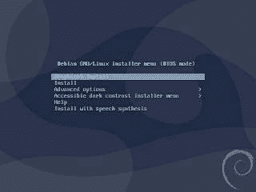

不同的选项有：


- 图形化安装：使用图形化安装程序启动安装过程。


- 安装：使用基于文本的安装程序启动安装过程。


- 高级选项：选择更多选项，如专家模式、自动安装或救援模式（详细信息请见下图）。


- 可访问的高对比度安装程序菜单：切换到高对比度的黑白主题。


- 帮助：获取更多帮助。


- 带语音合成的安装：带有语音支持启动安装过程。

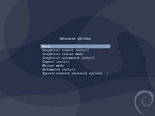

从主引导菜单选择“图形化安装”项目，按 `Enter` 键继续。

### 语言选择

接下来，选择你希望在整个安装过程中使用的语言。对话框和消息将相应地翻译。此选择不会不可逆地决定你的 Linux 系统将使用的语言，你以后可以可以选择不同的语言。

下图显示了对话框。英语已预先选择，因此只需点击对话框右下角的“继续”（Continue）按钮即可继续。

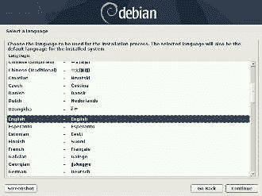

### 位置选择

第三，对您的位置进行选择（见下图）。根据您之前设置的语言，列出的国家主要是使用该语言的国家。这也会影响如计算机时区等本地化设置。如果需要不同的设置，请选择列表末尾名为 `other` 的选项并从那里开始。完成后，点击“继续”（Continue）按钮进入第四步。

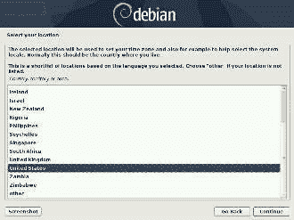

### 键盘选择

第四，从列表中选择您的键盘布局（见下图）。对于美国，预选方案是美式英语。如果您使用不同的键盘布局，请从列表中选择正确的选项。完成后，点击“继续”（Continue）按钮进入第五步。

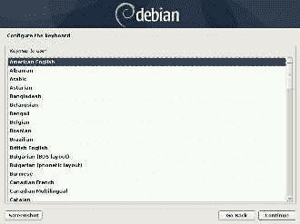

### 网络设置

第五步包括从 ISO 镜像加载安装组件，并检测网络硬件以加载正确的网络驱动程序。然后，安装程序将尝试连接互联网，通过本地网络服务器通过 `DHCP` 获取 IP 地址。

完成后，您可以设置计算机的主机名（见下文）。为机器选择一个唯一的名称，该名称由单个名称组成且在您的本地网段中不存在。使用水果、地点、乐器、作曲家和电影人物的名字是很常见的。在这种情况下，我们选择了名称 `debian106`，它简单代表 Linux 发行版及其版本号。

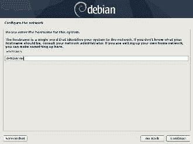

完成后，点击“继续”（Continue）按钮进入第六步以添加如 `yourcompany.com` 的域名。在这种情况下，不需要提供域名，因此我们留输入字段为空。点击右下角的“继续”（Continue）按钮继续安装。

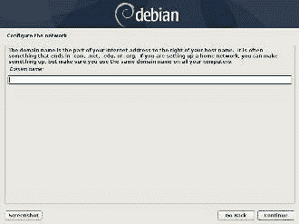

### 用户与角色

我们的 Linux 系统至少需要两个用户才能正常运行。一个是固定名为 `Root` 的管理员用户，另一个是普通用户，在此情况下我们将其命名为 `User`。

在接下来的两个步骤中，您将为 root 用户设置密码，并设置普通用户的全名和用户名。为了简单起见，我们使用 `Debian User` 作为全名，使用 `User` 作为用户名。对于这两个用户，请选择不同的且您能记住的密码。稍后您需要这些密码来登录计算机。

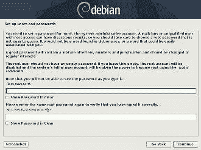

### 时区

设置正确的时区对于与其他服务（尤其是网络）的通信至关重要。请从下所示列表中选择值。列表中的条目基于您之前选择的位置。完成后，点击“继续”（Continue）按钮定义存储媒体及相应的分区。

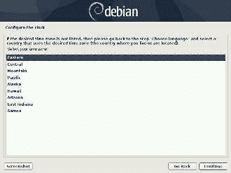

### 存储媒体与分区

Linux 系统可以分布在多个不同的存储媒体上，如硬盘和闪存驱动器。此外，存储媒体可以划分为多个磁盘分区。为此，安装程序提供了以下方法：


- **引导 - 使用整个磁盘 (Guided - use entire disk)**：按照提供的步骤操作，并使用整个磁盘空间进行 Linux 安装。这将创建固定大小的分区。


- **引导 - 使用整个磁盘并设置 LVM (Guided - use entire disk and set up LVM)**：按照提供的步骤操作，并使用整个磁盘空间进行 Linux 安装。此选项利用逻辑卷管理 (LVM) 创建以后可以更改大小的分区。


- **引导 - 使用整个磁盘并设置加密 LVM (Guided - use entire disk and set up encrypted LVM)**：按照提供的步骤操作，并使用整个磁盘空间进行 Linux 安装。此选项利用逻辑卷管理 (LVM) 创建以后可以更改大小的加密分区。


- **手动 (Manual)**：单独创建分区。这是专家模式，需要对分区和文件系统参数有更深的知识。

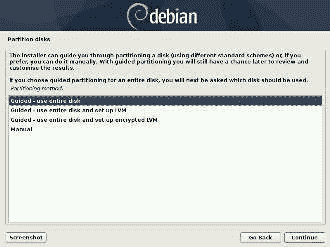

从列表中选择 `Guided - use entire disk`（引导 - 使用整个磁盘）。分区的大小根据经验选择并以算法实现。不需要手动计算。点击右下角的“继续”（Continue）按钮继续安装。

接下来，选择要分区的磁盘。在我们的案例中只有一个可用磁盘（见下图）。在本指南的后后部分，第一块 SCSI 磁盘将被称为 `/dev/sda`。

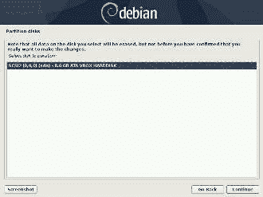

磁盘分区是指存储媒体上单独组织的区域，旨在包含 Linux 文件系统树的一个分支。没有通用的方法来正确进行这种分离。本指南展示了一个适用于基础系统的简单且安全的解决方案。对话框中的菜单提供以下选项：


- **所有文件在一个分区 (All files in one partition)**：仅使用单个分区存放程序和用户数据。


- **独立 `/home` 分区 (Separate /home partition)**：将程序和用户数据存储在独立的分区中。


#### 分离 `/home`、`/var` 和 `/tmp` 分区

将用户数据、变量数据和临时数据放在单独的分区（某些发行版可用）。如下图所示，选择第二个选项 `Separate /home` 分区。点击 `Continue`（继续）按钮继续安装。

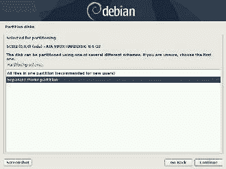

下一步是确认分区方案。这是根据经验自动计算的，包含以下分区：


- `sda1`：第一个 SCSI 磁盘的第一个分区是主分区，大小为 2.8 GB，使用 `ext4` 文件系统格式化，称为文件系统树的根部分（用 `/` 表示）。


- `sda5`：第一个 SCSI 磁盘的第五个分区是逻辑分区，大小为 2.1 GB，格式化为交换分区（swap）文件系统。


- `sda6`：第一个 SCSI 磁盘的第六个分区是逻辑分区，大小为 3.6 GB，使用 `ext4` 文件系统格式化，并用于存储用户数据，称为家目录（用 `/home` 表示）。

由于历史原因，硬盘只能包含四个主分区。如果将第四个分区划分为所谓的逻辑分区或逻辑驱动器，则称为 `Extended Partition`（扩展分区）。在我们情况下，逻辑分区 `/dev/sda5` 和 `/dev/sda6` 存储在主分区 `/dev/sda4` 上。分区 `/dev/sda2` 和 `/dev/sda3` 未未使用。

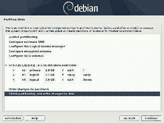

从上述列表中，选择 `Finish partitioning and write changes to disk`（完成分区并将更改写入磁盘）。点击右下角的 `Continue` 按钮继续并确认分区方案（见图）。从列表中选择 `yes` 并点击 `Continue` 按钮进行分区。请注意，所选存储设备上的所有数据将丢失，磁盘将为空。

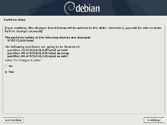

将存储媒体划分为单个分区后，分区将按照之前定义的文件系统进行格式化。在我们情况下，分区 `/dev/sda1` 和 `/dev/sda6` 将获得 `ext4` 文件系统，分区 `/dev/sda5` 将获得交换分区文件系统。一旦完成此步骤，接下来将安装 Debian 的基础系统。

### 软件包管理

ISO 镜像包含了安装程序和用于设置 Linux 基础系统的几个软件包。例如，这包含了下方正在安装的 Linux 内核。

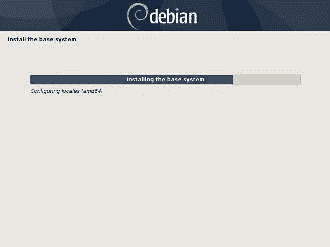

接下来，你需要决定是否使用额外的安装媒体。在我们情况下，我们只有一个安装磁盘，因此可以从菜单中选择 `No`（见下文）。然后点击 `Continue` 按钮继续。

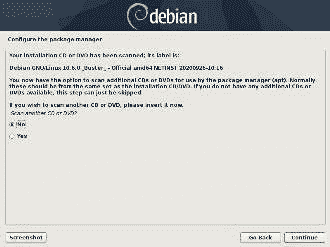

如前所述，Debian 软件是以包的形式组织的。这些软件包由多个软件存储库提供。存储库通过由大学、个人、公司和其他组织维护的软件包镜像提供。这些镜像位于不同的国家。

在下一步中，你必须决定从哪个国家获取你的 Debian 软件包。建议选择地理位置靠近你所在的镜像，以尽量减少通过网络从镜像传输数据到你计算机的时间。作为第一步，选择你所在的国家。

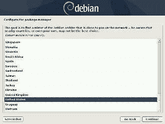

作为第二步，从列表中选择一个首选镜像（见下文）。列表包含了大学、互联网提供商、政府服务和其他组织。

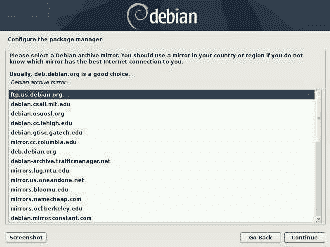

如果你的计算机网络包含用于与外部通信的代理服务器，请在此输入相应信息。在我们情况下，我们没有该服务器，因此留空字段。点击 `Continue` 按钮继续。

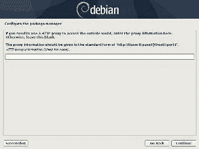


一旦设置了这些参数，Debian 安装程序将连接到之前选择的软件包镜像并从中检索软件包列表。软件包列表包含可用软件包，包括名称、大小和描述。取决于你网络连接的质量和带宽，此步骤可能需要一段时间。

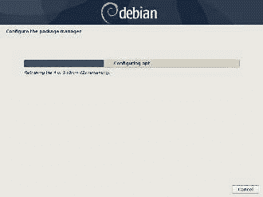

接下来，你会被要求参加`Popcon`（Debian 软件包受欢迎投票）。此信息是可选的，仅供负责 Debian 软件包的开发团队使用。根据`Popcon`，他们可以确定哪些 Debian 软件包安装频率最高。该信息对安装镜像的准备以及在不同架构下保留或舍弃哪些软件包有直接影响。在我们情况下，我们不参与`Popcon`，并将选择设置为`No`。点击`Continue`继续选择软件任务（`tasksel`）。

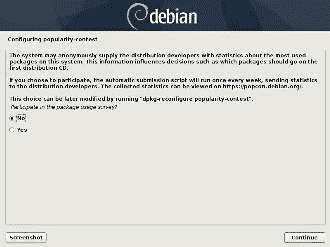

### 软件选择

Debian 提供了精心安排的软件包选择，称为任务（tasks）。其背后的思想是将用于特定用途的软件包分组以简化安装。从对话框列表（见下文）中，你可以不同的不同的桌面环境以及 Web 服务器、打印服务器、SSH 服务器和标准系统实用程序。为了实现精简安装，请仅启用列表中的最后两项。稍后我们将安装`XFCE`桌面环境。

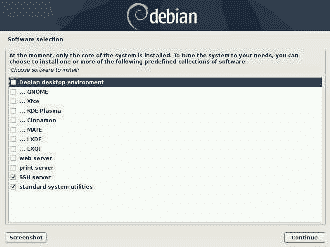

确认软件选择后，Debian 安装程序将从软件包镜像检索所需的软件包、解压并安装它们。下方的条显示了进度。在我们情况下，必须下载 140 个软件包。

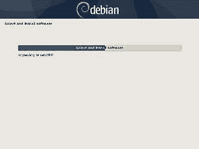

### 设置 GRUB

为了启动新安装的 Debian 系统，我们还必须设置启动信息。这个过程被称为启动系统。处理此步骤的软件组件称为全局统一引导加载程序（准确说是`GRUB`或`GNU GRUB`）。`Yes`选项已预先选中，因此我们可以点击`Continue`继续。

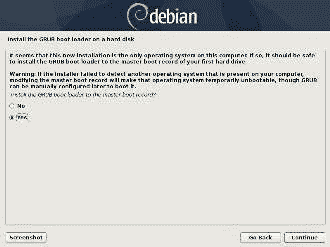

Debian 安装程序需要知道将`GRUB`安装在哪里。下方图像中的菜单列出了需要考虑的存储媒体。在我们情况下，我们选择列表中的第二个项目（`/dev/sda`）。然后点击`Continue`继续。

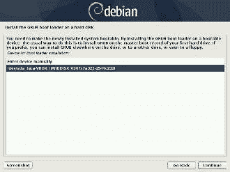

现在我们几乎完成了基础安装，剩下的唯一工作就是阅读一个对话框。

### 完成安装

以下对话框告知你安装已完成。点击`Continue`重启新安装的系统。

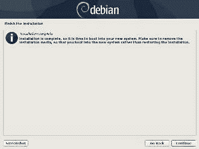

几秒钟，屏幕上将出现文本的`GRUB`启动菜单（见下提取）。启动菜单包含两个选项：`Debian GNU/Linux`和`Advanced options for Debian GNU/Linux`。第一个菜单项被高亮并预选。第二个菜单项允许你设置特定的启动选项。要查看这些选项的完整列表，请查看`www.gnu.org/software/grub/manual/grub`获取`GNU GRUB`手册。保持第一个菜单项选中并按`Enter`继续并启动新系统。

```text
* Debian GNU/Linux
* Advanced options for Debian GNU/Linux
```

你的 Debian 系统将启动并初始化必要的系统服务。此步骤将需要几秒完成。最后，在名为`tty1`的第一个文本终端上将看到一个黑白屏幕，并要求你登录系统。登录提示由两个部分组成：你的 Linux 系统的主机名（`debian106`）跟着一个空格和单词 login。

```text
Debian GNU/Linux 10 debian106 tty1
```

# debian106 登录

登录系统后，你将能够添加更多软件，以使用基于 XFCE 桌面的图形用户界面。在安装过程的这一步，只有以管理员 root 用户身份登录才能添加更多软件。要这样做，请在登录提示处输入`root`，按`Enter`，等待`Password:`文本出现，然后输入你之前定义的 root 用户密码。Linux 系统将用一条登录消息欢迎你（见下文）。登录消息将显示当前运行的 Linux 内核版本以及使用建议。

```text
Debian GNU/Linux 10 debian106 tty1
debian106 login: root
Password:
Linux debian106 4.19.0-11-amd64 #1 SMP Debian 4.19.146-1 (2020-09-17) x86_64
Debian GNU/Linux 系统包含的程序是自由软件；每个程序的具体分发条款在 /usr/share/doc/*/copyright 中的单独文件中说明。Debian GNU/Linux 在适用法律允许范围内不提供任何担保。
```

在欢迎消息之后，Debian 会打开一个命令行提示符：

```text
root@debian106 ~#
```

此命令行提示符由四个部分组成：

- `root`：登录用户的名称。
- `debian106`：Linux 系统的主机名。
- `~`：当前目录。在这种情况下，它是当前登录用户的家目录。如果没有其他设置，对于普通用户定义为`/home/username`，对于管理员用户定义为`/root`。`~`只是此的缩写。
- `#`：登录符号。`#`符号代表 root 用户，而`$`用于没有管理员权限的普通用户。今后在使用各种命令时你会看到这个符号。

**重要**：你现在是以管理员 root 用户身份登录的。请小心输入你输入的命令，并在疑问时双重检查。任何错误都可能导致你必须修复 Linux 系统。

## 4.3 添加图形用户界面

在当前阶段，Debian 系统已完全激活并可以按样使用。对于适合普通用户的桌面系统，它仍然缺少一个漂亮且易于使用的图形用户界面，使其看起来和感觉与你习惯的 Windows 或 macOS 系统更加熟悉。在这一步中，我们将改变这一点并安装 XFCE 桌面管理器。为此，我们将安装以下软件包：

- `aptitude`软件包管理器。
- `xdm`显示管理器。
- `xfce4`桌面环境。

Debian 使用`apt`软件包管理器来处理软件包的安装、更新和删除以及相关的包列表。此外，`apt`会解析所有的软件包依赖，并确保系统上有相关的软件。在我们案例中，必须从软件包镜像检索并安装约 170 MB 的数据。如之前所示，这需要可用的互联网连接来下载所需的软件包。

要安装这三个软件包，请在命令行提示符处输入以下命令。只需在`#`符号后输入命令即可：

```bash
root@debian106 ~# apt-get install aptitude xdm xfce4
```

`apt`将显示有关要安装软件包的更多信息。这包括依赖包列表和推荐软件包。最后，你将看到命令行提示符。输入`Y`或按`Enter`来安装`aptitude`、`xdm`和`xfce4`以及依赖包。对于`xdm`显示管理器，必须确认两个对话框。在两个框上都按`Enter`以确认使用`xdm`。

检索要安装的软件包需要一段时间。完成后，命令行提示符将再次出现。要激活有关图形桌面环境的更改，请重启系统。在命令行提示符处如下输入`reboot`命令：

```bash
root@debian106 ~# reboot
```

重启 Linux 系统后，Debian 用图形启动界面欢迎我们（见下文）。按`Enter`以默认设置启动 Linux 系统。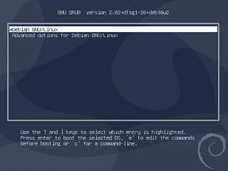几秒后将看到图形登录界面。使用之前创建的名为`user`的普通用户登录系统。输入`user`，按`Enter`并输入该用户的密码。然后再次按`Enter`确认并登录。

接下来，将看到 XFCE 桌面（见下文）。桌面带有几个默认元素：顶部导航栏、底部导航栏和桌面图标。这些元素在下文有详细解释。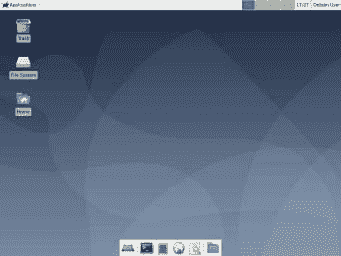

**顶部导航栏**：显示访问不同应用程序、四个虚拟桌面屏幕、时钟以及各种用户操作按钮，如锁定屏幕、切换用户、切换到待机模式和退出当前会话。

**底部导航栏**：此栏包含多个按钮，用于隐藏所有打开的窗口并显示空桌面、打开终端、文件管理器、浏览器、查找应用程序以及直接打开文件管理器。

**桌面图标**：从上到有垃圾桶、链接到计算机的文件管理器图标和家目录。在桌面上右键点击可以打开访问各种应用程序的上下文菜单。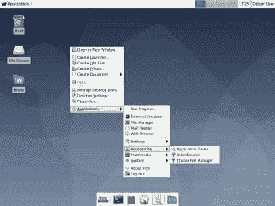

## 4.4 添加额外的软件包

到目前为止，你的 Linux 系统可用的软件相当有限。下一步要做的是使用这四个 Debian 软件包添加一些功能：

- `firefox-esr`：Mozilla Firefox 浏览器（扩展支持版）。
- `gnome-terminal`：由 GNOME 项目维护的终端模拟器。
- `xscreensaver`：X11 系统的基础屏保。
- `vlc`：Video Lan Client (VLC) 视频播放器。

将在终端模拟器的命令行安装三个软件包（将在指南稍后部分详细介绍终端）。目前你的系统中安装了 X11 终端模拟器`xterm`。要打开`xterm`，点击底部导航栏中的终端按钮，或从上下文菜单选择 Application > System > Xterm。第一步打开`xterm`。接下来，在命令行提示符旁输入命令`su`并按`Enter`：

```bash
user@debian106: ~$ su
```

`Password:`你可能记得之前的步骤，只有管理员用户才能 Debian 系统上安装、更新或删除软件。`su`命令是 switch user 的缩写，用于更改你的当前角色。如果不带额外名称，角色将变为管理员 root 用户。在密码提示处输入管理员用户的密码并按`Enter`。

作为管理员用户，按照如下方式安装软件包：`firefox-esr`、`gnome-terminal`、`xscreensaver`和`vlc`：

```bash
root@debian106: ~# apt-get install firefox-esr gnome-terminal xscreensaver vlc
```

输出所示：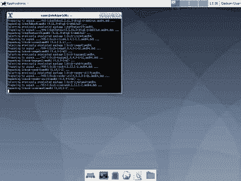

安装这四个软件包后，你可以切换回普通用户角色。按`Ctrl+D`退出管理员部分，再次按`Ctrl+D`关闭`xterm`。

安装 Firefox 有以下效果：

- 应用程序菜单中可以使用新软件`Firefox`。
- 命令行可以使用新命令`firefox`。
- 底部导航栏的地球图标链接到 Firefox 浏览器。

安装 GNOME terminal 软件包有以下效果：

- 命令行和应用程序菜单均可以使用新软件`gnome-terminal`。
- 底部导航栏的终端图标链接到 GNOME terminal。

右键菜单中的`Open Terminal Here`项指向 GNOME 终端。要查看更改，请从右键菜单中选择`Open Terminal Here`。下面的图片显示了终端窗口。它具有白色背景和更大的字体，更容易阅读。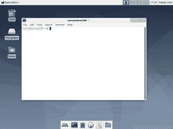

## 4.5 退出 Linux

为了正确使用 Linux，你还需要学习如何退出 Linux 以及重启系统。在下面，你将学习如何退出 XFCE 桌面环境、关闭 Linux 系统以及重启系统。我们将介绍两种方法：第一种基于图形界面，第二种用于服务器和无线路由器等非图形化系统。

### 退出 XFCE 桌面环境

退出 XFCE 桌面并退出当前会话简单的方法是点击导航栏右上角的按钮。该按钮标记有你的用户名，在我们的例子中是 Debian。从弹出菜单中选择最后一个标记为 Log Out（注销）的选项。或者，你可以选择左上角按钮中的 Log Out 选项。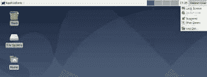

会打开第二个窗口，其中包含 Log Out（注销）、Restart（重启）、Shutdown（关机）和 Hibernate（休眠）按钮。点击 Log Out 退出会话。随后，你将返回登录界面。

### 关闭 Linux 系统

关闭整个 Linux 系统的方法与退出 XFCE 类似。点击导航栏右上角的按钮并选择 Shut Down（关机）。在接下来的对话框中点击 Shut Down 按钮停止 Linux 系统。在终端会话中，你可以以管理员身份运行`halt`或`shutdown -h`命令。普通用户不允许执行这些命令：`halt`

### 重启 Linux 系统

要重启 Linux 系统，点击导航栏右上角的按钮并选择 Restart（重启）项。在接下来的对话框中，点击 Restart 按钮重启 Linux 系统。在终端会话中，你可以以管理员身份运行`reboot`或`shutdown -r`命令。同样，普通用户不允许执行这些命令：`reboot`。随后，系统将重启，你也会返回启动界面。

# 5 Linux 导航

UNIX/Linux 系统上的文件系统包含不同类型的条目。包括普通文件、目录（或文件夹）、符号链接、块设备和字符设备、命名管道和套接字（sockets）。本章将涉及目录及相应的工具。

## 5.1 文件系统标准 (FHS)

现代 Linux 系统具有相当一致的目录结构，该结构基于文件系统标准 (FHS)。此定义规定了哪些主目录以及其中存储了哪些内容。FHS 由 Linux 基金会维护。FHS 的最新版本是 3.0，于 2015 年发布。第 3 章提到的 Linux 发行版遵循 FHS 结构。以下是常用的目录：

| 目录 | 描述 |
| --- | --- |
| `/` | 整个文件系统的主层次结构和根目录 |
| `/bin` | 所有用户的基本命令二进制文件 |
| `/boot` | 引导加载 |
| `/etc` | 特定主机的系统级配置文件 |
| `/home` | 用户的家目录 |
| `/lib` | `/bin`和`/sbin`中二进制文件必需的库 |
| `/media` | 可移动介质的挂载点 |
| `/proc` | 进程，是 Linux 内核的虚拟文件系统 |
| `/root` | root 用户的家目录 |
| `/sbin` | 关键系统二进制文件 |
| `/tmp` | 临时数据和文件 |
| `/usr` | 系统资源，包含用户程序和应用程序 |
| `/var` | 可变数据，如日志文件和数据库文件 |

某些 Linux 发行版拥有额外的目录如`/opt`或使用符号链接。Linux 还有一些常用的缩写，这对你的日常工作非常有帮助：

| 缩写 | 描述 |
| --- | --- |
| `$HOME` | 包含用户家目录的本地变量 |
| `~` | 指向用户家目录，例如`/home/tom` |
| `.` | 指向当前目录 |
| `..` | 指向父目录 |

你可以在终端命令行和脚本中使用这些缩写来缩短命令。接下来，我们将查看其中一些命令。

## 5.2 目录命令

与文件一样，Linux 提供了一系列命令来列出、创建、删除和重命名目录。你可以在终端中使用这些命令。

### 列目录

要列出目录，请使用`ls`命令配合开关`-d`（`--directory`的缩写），如下所示：

```bash
ls -d */
finances/
projects/
work/
...
```

此示例列出了当前目录下的目录名称。输出中的点号（`...`）表示列表更长，此处进行了缩短。

使用`ls`命令的两种常用方式：不带任何选项，以及带有选项`-la`（`-l -a`的缩写，意为详细显示所有）。第一个输出仅显示普通文件的条目名称，而第二个输出则列出普通文件和隐藏条目。

```bash
ls -la
```

要列出包括以点（`.`）开头的隐藏目录在内的所有目录，请如下使用`find`命令：

```bash
find . -maxdepth 1 -type d
./projects
./.mozilla
./.ipython
./.dbus
./video
...
```

`tree`命令递归搜索目录并非常漂亮地输出整个目录结构。开关`-d`将输出限制为目录，显示如下：

```text
.
|–––– archive
| |–––– ballet-zebola
| | |–––– documents
| | |–––– invoices
| | |–––– charles-darwin-university
| |–––– projects
|–––– .dbus
|–––– .ipython
|–––– .mozilla
...
```

### 创建目录

要创建目录，请使用`mkdir`命令（make directory）。下一个示例在当前目录下创建一个名为`training`的新条目：

```bash
mkdir training
```

开关`-v`（`--verbose`的缩写）会打印一条确认命令执行成功的额外信息。


```bash
mkdir -v training
mkdir: directory "training" created
```

开关 `-p`（`--parents` 的缩写）允许你创建整个子目录结构。尚的父目录也会被创建。以下示例创建了目录 `training` 及其子目录 `linux`（第 1 层）和 `lpic1`（第 2 层）。

```bash
mkdir -p training/linux/lpic1
```

要在同一级创建两个子目录，请利用底层命令行解释器的功能。Bash 使用大括号 `{ }` 中的值来实现这一点。下一个示例展示了你如何一次性创建 `training/linux/lpic1` 和 `training/linux/lpic2` 两个目录：

```bash
mkdir -p training/linux/{lpic1,lpic2}
```

### 删除目录

删除目录使用 `rmdir` 命令（remove directory）。下一个示例删除了当前目录中名为 `training` 的条目：

```bash
rmdir training
```

与 `mkdir` 一样，开关 `-v`（`--verbose` 的缩写）会打印一条命令执行成功的额外信息。

```bash
rmdir -v training
mkdir: directory is removed, "training"
```

只要目录是空的，这种方法就有效。如果你的目录包含任何文件或子目录等条目，`rmdir` 命令在使用此信息时会报错并保持目录不变：

```bash
rmdir training
rmdir: failed to remove 'training': Directory not empty
```

为了解决这种情况，`rm` 命令（remove）配合开关 `-r`（`--recursive` 的缩写）变得非常实用。此时，`rm` 会递归删除所有条目。以下示例结合了开关 `-r` 和 `-v` 来删除一个文件和三个目录。

```bash
rm -rv training/
"training/lpic1/introduction.txt" was removed
Directory was removed: "training/lpic1"
Directory was removed: "training/lpic2"
Directory was removed: "training/"
```

在删除文件和目录时为了安全起见，请结合使用 `-i`（对应 `--interactive` 交互）和 `-v`（对应 `--verbose` 详细）。在删除文件之前，`rm` 将请求你的显式确认并打印状态消息。

### 切换目录

`cd`（更改目录）命令允许你在系统中移动。若要向上移动一级到根目录，请使用此命令：

```bash
cd ..
```

若向下移动到子目录，请输入 `cd` 命令后跟目录名称。命令 `cd /home/user/test` 将直接带你进入 `/home/user/test` 目录。正如之前解释的那样，有一些快捷方式可用。命令 `cd ~`（波浪号）和 `cd $HOME` 始终将你带回到主目录，而 `cd /` 则将带你进入 `/` 目录。

**提示：** 由于 Linux 是区分大小写的，因此 `cd` 与 `CD` 相同。在使用大写和小写字母时请小心。

### 重命名目录

`mv` 命令是 move（移动）的缩写，用于移动和重命名文件及目录。它需要两个名称：原始文件的名称及其新名称。若要将目录名称从 `lpic1` 改为 `lpic-1`，请输入以下：

```bash
mv lpic1 lpic-1
```

原始文件将被移除，新条目将接收时间戳。使用选项 `-i`（或 `--interactive`）可以防止覆盖现有文件。

## 5.3 基于终端的文件管理器

在命令行中导航 Linux 并不是最理想的情况。基于终端和图形化的文件管理器是极好的替代方案。基于终端的文件管理器运行在终端内部，不会在桌面上打开单独窗口。有很多程序可用，因此我们只向你介绍我们最喜爱的几款。

### GNU Midnight Commander (`mc`)

www.midnight-commander.org

这是一个免费的、全屏的、文本模式可视化文件管理器，允许你搜索、复制、移动以及删除单个或多个文件，甚至是整个目录树。`mc` 集成了查看器和编辑器。

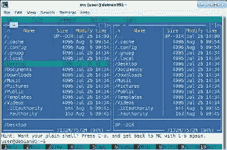

### Vi 文件管理器 (`vifm`)

https://vifm.info

与 `mc` 类似，Vi 文件管理器（`vifm`）带有基于 curses 界面的两个导航窗口。它为管理文件和目录提供了类似 Vi(m) 的环境。如果你熟悉 Vi 的按键绑定，那么这就是适合你的文件管理器。

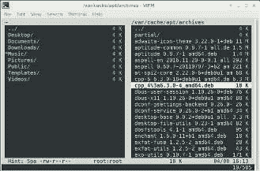

## 5.4 图形化文件管理器

与基于终端的文件管理器类似，图形化文件管理器协助在 Linux 中导航。这些文件管理器会在单独窗口中打开，但提供了更好的用户体验。同样，有很多程序可用，我们只在下方列出我们的喜好。

### Konqueror

https://packages.debian.org/stretch/konqueror

Konqueror 是 KDE 桌面环境强大的文件管理器。Konqueror 提供了简单的文件管理功能，如复制、移动、搜索和删除文件及目录，以及一些高级功能，如访问压缩包、浏览和刻录音频 CD，以及对 FTP、SFTP 服务器和 SAMBA（Windows）共享的支持。

### Nautilus

https://wiki.gnome.org/Apps/Nautilus

Nautilus 是 GNOME 桌面上的文件管理器。它提供了对 Linux 系统文件的便捷导航和管理。这包括简单的文件管理功能，如复制、移动、搜索和删除文件及目录，以及轻松访问本地和远程文件。

### Dolphin

www.kde.org/applications/system/dolphin/

Dolphin 是作为 KDE 应用程序包的一部分开发的轻量级文件管理器。为简单、灵活和完全自定义而设计，允许用户非常轻松地在 Linux 系统中浏览、定位、打开、复制和移动文件。

### Thunar

https://docs.xfce.org/xfce/thunar/start

Thunar 是用于 XFCE 桌面的现代轻量级文件管理器。它的设计旨在快速、响应且易于使用。我们在这里列出它是因为它具有简洁直观的界面并提供了重要的用户选项。

# 6 终端与 Shell 简介

使用 Linux 操作系统需要你了解终端（terminal）和命令行（command line）。了解它们是什么并稍微熟悉它们的用法以及可用命令至关重要。但不要担心，我们将详细描述每一个项。这些术语听起来比实际要吓人得多。

以文本格式与系统通信的能力是程序员对 Linux 产生青睐的原因之一，因为这是程序员向计算机发出指令的标准方式。另一个原因是这种方式允许对系统进行绝对控制，而其他操作系统即使有它们自己的命令行解释器也无法提供这种控制。

一些初学者甚至报告说，使用并熟悉以这种文本格式发布命令使得向程序开发的过渡变得更加容易和快捷。

## 6.1 什么是终端？

终端被描述为“一个在其他显示架构中模拟视频终端的程序。尽管它通常与 shell 或文本终端同义，但‘终端’一词涵盖了所有远程终端，包括图形界面。图形用户界面内部的终端模拟器通常被称为终端窗口”。

准确来说，终端仅仅是外层软件。在终端内部运行着一个被称为 `shell` 的命令行解释器。终端是你通过 GUI 与 `shell` 交互的方式。

Debian 支持很很长的终端软件列表。这包括 `Aterm`，以及 `GNOME terminal`、`Kterm`、`Mate Terminal`、`Rxvt`、`Xterm` 和 `Xvt`。这些不同的终端软件实现在稳定性、对字符集的支持、设计、颜色和字体，以及应用背景图像或处理透明度的方面有所不同。

在书中，我们将使用 `GNOME terminal`，因为它稳定、简单且易于调整。要增大或减少终端窗口内显示内容的大小，请使用组合键 `CTRL+` 和 `CTRL-`。

## 6.2 什么是 Shell？

简单来说，`shell` 是一个复杂的命令行解释器。`shell` 读取你的命令，在某些条件下对其进行修改，然后执行结果。

在从命令行读取和执行实际结果之间，`shell` 必须解释你输入中的特殊字符。下表显示了可用的特殊字符：

| 字符 | 含义 |
| :--- | :--- |
| `$name` | 变量替换 |
| `name=` | 变量赋值 |
| `'command'` | 引用 |
| `$( command )` | 命令替换 |
| `< > >>` | 输入和输出重定向 |
| `2> 2>>` | 输入和输出重定向 |
| `\|` | 命令管道 |
| `* [ ] ?` | 通名创建（通配符匹配） |
| `;` | 命令分隔 |
| `&` | 在后台运行命令 |
| `\|\| &&` | 在特定条件下运行命令 |
| `{ } ( )` | 分组命令 |

出于好奇，`shellid` 通过以下过程将命令行分为单个单词以确定命令：

| 步骤 |  | 特殊字符 |
| :--- | :--- | :--- |
| 1 | 读取直到命令分隔符 | `\n`、`&`、`\|`、`\|\|`、`&&`、`;`、`$(...)`、`\"..."`、`'...'` 和标记（命令替换） |
| 2 | 标记（输入/输出重定向，值赋值） | `$name`，见步骤 1 和 2 的标记 |
| 3 | 分为单个单词 | `$name`，见步骤 1 和 2 的标记 |
| 4 | 变量替换 | `$name`，见步骤 1 和 2 的标记 |
| 5 | 命令替换 | `$name`，根据 IFS 见步骤 1 和 2 的标记 |
| 6 | 输入/输出重定向 | `<`、`>`、`>>`、`2>`、`2>>` |
| 7 | 变量赋值 | `name=` |
| 8 | 分为单词 | |
| 9 | 创建文件名 | |
| 10 | 命令执行 | |

- 在步骤 1 和 2 中，仅对步骤 5 到 7 进行标记，且不进行任何后续操作。如果标记完成，将执行步骤 5 到 7。接下来，shell 会移除所有特殊字符。在步骤 10 中，命令行仅包含执行该命令所需的参数。shell 将第一个单词解释为要执行的命令名称，其余的单词则为其参数：`command arg1 arg2 arg3 ...`

## 6.3 可用的 Shell

你的 Linux 系统允许使用各种 shell。每种 shell 都可以通过我们之前安装的 Debian 包管理器 `Aptitude` 作为一个独立的软件包进行安装。shell 的列表非常长，因此我们只列出可选的几种受欢迎的 shell：


- Almquist Shell (`ash`)

  

- Bourne Again Shell (`bash`)

  

- Debian Almquist Shell (`dash`)

  

- Z Shell (`zsh`)

  

- C Shell (`csh`)

  

- Korn Shell (`ksh`)

  

- Tenex C Shell (`tcsh`)

除非另有说明，本指南中的示例均基于 Bourne Again Shell (`bash`)。在编写本文时，它是 Debian 上的默认 shell。你的 Linux 系统允许哪些其他 shell 是在配置文件 `/etc/shells` 中设置的。使用 `cat` 命令可以看到允许的 shell 列表。`cat` 将在第 7 章详细讨论。现在，只需知道该命令仅是将文件内容输出到屏幕上。

```bash
$ cat /etc/shells
```

```text
#/etc/shells: valid login shells
/bin/sh
/bin/dash
/bin/bash
/bin/rbash
/usr/bin/screen
```

$

终端中当前使用的 shell 名称存储在名为 `$0` 的 shell 变量中。以下简单命令输出 shell 的名称：

```bash
$ echo $0
bash
```

$

要更改当前使用的 shell，请查看配置文件 `/etc/passwd` 以及第 10 章介绍的 `chsh` 命令。

## 6.4 Shell 脚本

乍看之下，shell 脚本听起来可能令人望畏，但其实非常简单。在最简单的形式，它只是存储在文件中的一系列 UNIX/Linux 命令，并由命令行解释器逐行执行。shell 脚本类似于在终端中输入单条命令，但它们是批处理的。这使得速度快得多，并有助于自动化任务。对于本指南，我们不会深入探讨 shell 脚本的编程复杂性。但 shell 脚本的推荐结构值得注意：


- **Shebang 行**：定义将使用哪个程序来正确处理 shebang 行随后的指令。该行以 `#!` 开头，这是一个双字节数字，表示随后的行是可执行的 shell 脚本。shebang 之后是用于处理指令的解释器或程序的路径。

  

- **Docstring（文档字符串）**：对脚本功能和代码软件许可协议的简短描述。这可以是单行，也可以是详细的描述。此类行以 `#` 开头，并被 shell 视为注释。

  

- **Commands（命令）**：由 shell 执行的单条命令的组合。如所述，这可以少到只有单行指令（如我们下方的示例所示），也可以是一个完整的程序。

  

- **Exit state（退出状态）**：定义脚本的返回值。除非明确说明，否则将返回脚本中执行的最后一个命令的退出状态。通常在成功时返回 0，在出错时返回 1 到 255 之间的值。

以下基础脚本包含了上述提到的所有元素。该脚本的目的是确定计算机的运行时间（uptime）。

```bash
#!/bin/bash

# 确定系统的运行时间

# 根据 GNU 公共许可证 (GPL) 发布

uptime

# 定义退出状态：无错误

exit 0
```

执行 shell 脚本有两种方法。我们可以调用 Bash 等 shell 来运行它，或者为脚本设置可执行标记后运行它。第一种方法使用 Bash，如下：

```bash
$ bash uptime.sh
12:20:31 up 7 days, 2:09, 6 users, load average: 0,74, 0,40, 0,27
```

$

第二种方法基于两个步骤。首先，我们使用 `chmod` 命令为脚本设置可执行标记，如下：

```bash
$ chmod u+x uptime.sh
```

$

然后我们可以运行脚本：

```bash
$ ./uptime.sh
12:26:07 up 7 days, 2:14, 6 users, load average: 0,23, 0,34, 0,28
```

## 7 文本处理

Linux 大部分基于文本文件运行。例如，存储在 `/etc` 中的配置文件是以文本文件形式存储的。Linux 提供了丰富的文本处理命令，这些命令非常全面且节省时间。了解它们是什么以及如何工作，将在许多深入探讨 Linux 的后续章节起到起到关重要的作用。在本章中，我们将查看这些命令并展示如何使用它们。

### 7.1 文本处理命令

#### `cat`

concatenate（连接）的缩写，`cat` 将文件内容输出到屏幕或标准输出。命令 `cat /etc/passwd` 将 `/etc/passwd` 文件的所有行输出到屏幕。

```bash
$ cat /etc/passwd
root:x:0:0:root:/root:/bin/bash
daemon:x:1:1:daemon:/usr/sbin:/usr/sbin/nologin
bin:x:2:2:bin:/bin:/usr/sbin/nologin
sys:x:3:3:sys:/dev: /usr/sbin/nologin
sync:x:4:65534:sync:/bin:/bin/sync
games:x:5:60:games:/usr/games:/usr/sbin/nologin
man:x:6:12:man:/usr/sbin:/usr/sbin/nologin
lp:x:7:7:lp:/var/spool:/usr/sbin/nologin
mail:x:8:8:mail:/var/mail:/usr/sbin/nologin
news:x:9:9:news:/var/spool/news:/usr/sbin/nologin
```

`cat` 还可以将文件内容输出到屏幕。例如，`cat output.txt` 将 `output.txt` 的内容输出到屏幕上。

```bash
$ cat output.txt
hello world
this is a test
to see if works
```

`cat` 通过重定向运算符写入文件。例如：

```bash
$ cat > output.txt
hello world
this is a test
to see if works
```

`cat` 还可以输出到屏幕。按下 `Ctrl+D` 退出并输入 `cat output.txt` 查看结果。

```bash
$ cat output.txt
hello world
this is a test
to see if works
```


`cat` 的其他有用选项有：

- `E`（对应 `--show-ends`）：在每行末尾输出 `$`
- `n`（对应 `--number`）：为所有输出行编号
- `s`（对应 `--squeeze-blank`）：压缩连续的空行。

`cat` 还可以同时输出多个文件。命令 `cat /etc/passwd /etc/group` 将输出`/etc/passwd`和`/etc/group`的内容。注意原始文件不受影响。下面的示例两次输出`output.txt`的内容，并持续使用`-n`选项为所有输出编号。

```bash
$ cat -n output.txt output.txt
1 hello world
2 this is a test
3 to see if works
4 hello world
5 this is a test
6 to see if works
```

为了更丰富的示例，我们将创建三个名为`file1`、`file2`和`file3`的文本文件。使用命令`cat > file1`、`cat > file2`和`cat > file3`创建这些文件。不要忘记按下`Ctrl+D`退出并使用命令`cat file1 file2 file3`查看它们。

```bash
$ cat > file1
this is file one

$ cat > file2
this is file two

$ cat > file3
this is file three

$ cat file1 file2 file3
this is file one
this is file two
this is file three
```

使用重定向运算符，我们可以将所有三个文件写入一个文件。

```bash
$ cat file1 file2 file3 > bigfile
```

```bash
$ cat bigfile
this is file one
this is file two
this is file three
```

## `tac`

`tac`命令的工作方式与`cat`相同，但按反顺序显示行。使用上一节的`bigfile`，让我们使用`tac`显示文件：

```bash
$ tac bigfile
this is file three
this is file two
this is file one
```

## `more`

`more`、`cat`和`tac`会一次性显示整个文件，而`more`让你每次查看一屏文件。假设我们有一个名为`alice.txt`的大文件。要查看它，请输入以下命令：

```bash
more alice.txt
```

这会显示从文件开始的一页文本。使用空格键翻页。或者，按`Enter`键可以一次向下滚动一行。`more`命令的缺点是它只能向下滚动而不能回回。对于这一点，可以使用`less`命令。

### 第一章 - 掉进兔子洞

一个七岁的女孩爱丽丝正和姐姐坐在河岸边，感到无聊且昏昏欲睡。这时，她注意到一只穿着衣服、拿着怀表的白兔跑过。她追着兔子掉进了一个兔子洞，突然间掉落了很长距离，来到了一个奇特的大厅，里面有许多各种大小的锁门。她找到了一把小钥匙，对应的门太小了，她无法通过，但透过门门，她看到了一座迷人的花园。随后，她在桌子上发现了一个标有“DRINK ME”的瓶子，里面的内容让她变得非常小，小到够不到放在桌子上的钥匙。章节结束时，她吃了一块写有“EAT ME”字样的干果蛋糕。

## `less`

`less`命令是一个终端分页器，每次显示一屏文本，并允许在文件中向前向后滚动，但它不能编辑文件。在`less`内部，有遍历文件和查找特定模式的命令。示例示例：

- `j` - 向下一行。
- `k` - 向上一行。
- `g`或`<` - 跳到第一行。
- `G`或`>` - 跳到最后一行。
- `<n>G` - 跳到第`<n>`行。
- `Space` - 跳到下一页。
- `d` - 向前移动半页。
- `b` - 跳到上一页。
- `u` - 向后移动半页。
- `v` - 用`VISUAL`环境变量设置的编辑器打开页面。

- `/<regex>` - 向前搜索`<regex>`。
- `?<regex>` - 向后搜索`<regex>`。
- `n` - 下一个匹配`<regex>`的文本实例。
- `N` - 上一个匹配`<regex>`的文本实例。
- `:n` - 在同一命令中打开了多个文件时，切换到下一个文件。

- `:p` - 在同一命令中打开了多个文件时，切换到上一个文件。
- `q` - 退出。

## `head`

此命令输出文件的前`n`行。如果没有指定`n`，默认十行。下面的示例显示了`head`对`/etc/passwd`文件的默认用法。

```bash
head /etc/passwd
```

```bash
root:x:0:0:root:/root:/bin/bash
daemon:x:1:1:daemon:/usr/sbin:/usr/sbin/nologin
bin:x:2:2:bin:/bin:/usr/sbin/nologin
sys:x:3:3:sys:/dev: /usr/sbin/nologin
sync:x:4:65534:sync:/bin:/bin/sync
games:x:5:60:games:/usr/games:/usr/sbin/nologin
man:x:6:12:man:/var/cache/man:/usr/sbin/nologin
lp:x:7:7:lp:/var/spool/lpd:/usr/sbin/nologin
mail:x:8:8:mail:/var/mail:/usr/sbin/nologin
news:x:9:9:news:/var/spool/news:/usr/sbin/nologin
```

要输出`/etc/passwd`文件的前六行，请输入以下命令：

```bash
head -n6 /etc/passwd
```

```bash
root:x:0:0:root:/root:/bin/bash
daemon:x:1:1:daemon:/usr/sbin:/usr/sbin/nologin
bin:x:2:2:bin:/bin:/usr/sbin/nologin
sys:x:3:3:sys:/dev: /usr/sbin/nologin
sync:x:4:65534:sync:/bin:/bin/sync
games:x:5:60:games:/usr/games:/usr/sbin/nologin
```

`head`的相反命令是`tail`，我们接下来将解释。

## `tail`

`tail`命令输出文件的最后`n`行。如果未指定`n`，默认十行。下面的示例显示了`/etc/passwd`文件的最后 5 行。

```bash
tail -n5 /etc/passwd
```

```bash
usbmux:x:109:46:usbmux daemon,,,:/var/lib/usbmux:/bin/false
pulse:x:110:114:PulseAudio daemon,,,:/var/run/pulse:/bin/false
lightdm:x:111:116:Light Display Manager:/var/lib/lightdm:/bin/false
felix:x:1001:1001:Felix,,,:/home/felix:/bin/bash
caro:x:1002:1002:Caro,,,:/home/caro:/bin/bash
```

此外，`tail`可以使用`-f`（或`--follow`）跟踪日志文件的进度。随着更多数据追加到文件末尾，屏幕上的输出会更新。要输出`/var/log/syslog`最后 20 行的更新进度，请使用以下命令：

```bash
tail -f -n 20 /var/log/syslog
```

## `sort`

如名所示，此命令用于排序文件。除外，它还有以下选项：

- `-R`: 随机排序。
- `-r`: 反转排序顺序。
- `-n`: 数值排序。

要按字母顺序对`/etc/passwd`文件的前五行排序排序请使用此命令：

```bash
head -n5 /etc/passwd | sort
```

```bash
bin:x:2:2:bin:/bin:/usr/sbin/nologin
daemon:x:1:1:daemon:/usr/sbin:/usr/sbin/nologin
root:x:0:0:root:/root:/bin/bash
sync:x:4:65534:sync:/bin:/bin/sync
sys:x:3:3:sys:/dev:/usr/sbin/nologin
```

使用选项`-r`反转排序顺序：

```bash
head -n5 /etc/passwd | sort -r
```

```bash
sys:x:3:3:sys:/dev:/usr/sbin/nologin
sync:x:4:65534:sync:/bin:/bin/sync
root:x:0:0:root:/root:/bin/bash
daemon:x:1:1:daemon:/usr/sbin:/usr/sbin/nologin
bin:x:2:2:bin:/bin:/usr/sbin/nologin
```

## `uniq`

此命令报告或删除排序文件中的重复行。除外，它还有以下选项：

- `-c`（`count`的缩写）：输出每行的出现频率。
- `-d`（`repeated`的缩写）：报告出现一次以上的行。
- `-u`（`unique`的缩写）：报告只出现一次的行。

下面的示例显示了`uniq`的基本用法。输出包含只出现一次的行：

```bash
cat names.sorted
```

```bash
Greg 1967
John 1986
John 1986
Kate 1948
Pete 1977
```

```bash
uniq names.sorted
```

```bash
Greg 1967
John 1986
Kate 1948
Pete 1977
```

## `cut`

`cut`命令从文件中提取指定的字段。它需要一个分隔符来检测字段边界。以下示例显示从`/etc/passwd`提取名称和用户 ID。这些是行的第一和第三字段（选项`-f`），字段由冒号分隔（选项`-d`）。

```bash
cut -d":" -f1,3 /etc/passwd
```

```bash
...
colord:108
saned:109
usbmux:110
geoclue:111
sshd:112
uuidd:113
pulse:114
rtkit:115
avahi:116
```

## `tr`

此命令背后的思想是对字符串进行翻译、替换和删除。`tr`从标准输入读取并输出到标准输出。它有以下选项：

- `-d`（`delete`的缩写）：从字符串删除删除字符。
- `-s`（`squeeze-repeats`的缩写）：将重复字符替换为单次。
- `-t`（`truncate-set1`的缩写）：截断给定的字符集。

下面的第一个示例演示了如何将小写字母转换为大写字母。`tr`接受两个字符集：原始字符和替换字符。两个集合中的字符数量必须相同。

```bash
cat bigfile | tr [a-z] [A-Z]
```

```bash
THIS IS FILE ONE
THIS IS FILE TWO
THIS IS FILE THREE
```

第二个示例演示了如何将重复的空格替换为单个。空格被定义为一组字符，即空格、制表符、回车或换行。

```bash
echo "tools for tools for developers $ echo "tools for tools-for-developers" | tr -s [:space:]
```

```bash
tools for tools-for-developers
```

## `nl`

`nl`命令类似于`cat`（在本章开头已讨论过），但它会在输出的每行开头添加行号。`nl`的输出如下：

```bash
1 Amsterdam
2 Berlin
3 Bern
4 Cape Town
```

## `wc`

`wc`命令是`word count`（单词计数）的缩写，分别统计输入数据的行数、单词数和字符数。除非另有指定，否则这三个值都会被打印：`wc`的输出如下：

```bash
4 5 32
```

此外`wc`还提供了以下选项来限制输出：

- `-l`: 仅输出行数，后跟文件名。
- `-w`: 仅输出单词数，后跟文件名。
- `-c`: 仅输出字符数，后跟文件名。

此示例展示了如何仅统计文件的行数：`wc -l`输出：

```bash
4
```

## 7.2 `grep` 简介

命令行工具`grep`是 Linux 中最基本且强大的命令之一，以至于作者们专门为它编写了整个指南。`grep`充当过滤的角色，是“global regular expression print”（全局正则表达式打印）的缩写。

该命令作为文本数据的过滤器工作，仅打印匹配给定模式的文本行。`grep`需要处理的数据以及一个要查找的模式。在此语境下，数据指的是来自`stdin`或文件的系列字符，而模式可以被构建为系列字符或正则表达式。`grep`支持四种不同的模式样式：

- `-G`（`--basic-regexp`的缩写）：模式以基本正则表达式的形式构建。这是默认情况。
- `-F`（`--fixed-strings`的缩写）：不是不是，而是被视为固定字符串。也可以简写为`fgrep`。
- `-E`（`--extended-regexp`的缩写）：模式以扩展正则表达式的形式构建，允许额外的字符集。也可以简写为`egrep`。
- `-P`（`--perl-regexp`的缩写）：模式按照 Perl 语法的正则表达式进行解释。

`grep`选项非常多。以下是最显著的可用选项列表：

- `-c`: 统计并打印匹配次数，但不打印匹配项本身。
- `--color`: 高亮显示匹配项。
- `-H`（`--with-filename`的缩写）：输出的每行以匹配项所在的文件名开头。
- `-i`: 忽略大小写，包含大小写匹配。
- `-l`（`--files-with-matches`的缩写）：仅打印匹配搜索的文件名。
- `-L`（`--files-without-matches`的缩写）：仅打印不匹配搜索的文件名。
- `-n`（`--line-number`的缩写）：输出的每行以文件中对应匹配的行号开头。
- `-r`（`--recursive`的缩写）：在目录结构中递归搜索，包含所有子目录。
- `-v`: 打印所有不匹配搜索模式的行。

通过几个实用示例，这些选项将变得更加清晰。首先，我们一个或多个 AsciiDoc 文件（`.adoc`）中搜索固定字符串`Linux`。输出包含该模式的行。`grep Linux *.adoc`

```bash
The Linux Environment. First Steps
```

接下来，我们执行相同的搜索，但同时输出模式所在的文件名和行号。输出的每行以文件名开头，后跟一个冒号（`:`）、行号、另一个冒号，然后是匹配模式的行。在我们的示例中，模式出现在`introduction.adoc`文件的第 1 行。`grep -Hn Linux *.adoc`

```bash
introduction.adoc:1:The Linux Environment. First Steps.
```

这次，我们将在一个或多个 AsciiDoc 文件中搜索字符串`Linux`，但搜索将包含小写和大写字母。`grep -i Linux *.adoc`

```bash
The Linux Environment. First Steps.
include::what-about-linux/what-about-linux.adoc
include::linux-in-day-to-day-life/linux-in-day-to-day-life.adoc
include::navigating-linux/navigating-linux.adoc
include::using-the-linux-terminal/using-the-linux-terminal.adoc
```

接下来，我们将反向搜索，只显示不包含模式`Linux`的文件名。`grep -vrl Linux */*.adoc`

```bash
acknowledgements/acknowledgements.adoc
getting-help/getting-help.adoc
```


`linux-in-day-to-day-life/linux-in-day-to-day-life.adoc`

`navigating-linux/navigating-linux.adoc`

`preface/preface.adoc`

`references/references.adoc`

`setting-up-debian/setting-up-debian.adoc`

`software-licenses/software-licenses.adoc`

`using-the-linux-terminal/using-the-linux-terminal.adoc`

`what-about-linux/what-about-linux.adoc`

`x11/x11.adoc`

现在让我们看几个稍微复杂的例子。在这种情况下，我们将利用之前在指南中见过的 `ls` 命令，并对特定模式范围的输出进行过滤。具体地说，我们将搜索文件名包含数字 12 到 16 的 PDF 文档。

```bash
$ ls E*.pdf | egrep --color '1[2-6].pdf$' E_20160012.pdf
```

```
E_20160012.pdf
E_20160013.pdf
E_20160014.pdf
E_20160015.pdf
E_20160016.pdf
```

对于下一个示例，我们将搜索当前目录下所有包含模式 `nanostation`（一个产品名）的 TeX 文件，其中开头是大写或小写的 `n`，名称中间是大写或小写的 `s`。

```bash
$ egrep --color '[Nn]ano[Ss]tation' *.tex
```

```
B0047.tex:Ubiquiti NanoStation M2
B0057.tex:Ubiquiti Nanostation M2 Loco
B0092.tex:Ubiquiti Nanostation M5
```

最后，我们列出系统中不再安装但仍配置的所有软件包。这里我们使用 `dpkg` 命令，你将在第 14 章学习更多信息。在我们的示例中，它只是列出已安装的包及其状态。`grep` 命令过滤所有以两个字符 `rc` 开头的行，`rc` 代表已删除（removed）和已配置（configured）。

```bash
$ dpkg -l | egrep '^rc'
```

```
rc doxygen-gui 1.8.8-5 amd64 GUI configuration tool for doxygen
rc kdiff3 0.9.98-1 amd64 compares and merges 2 or 3 files or directories
rc ktorrent 4.3.1-2+b1 amd64 BitTorrent client based on the KDE platform
rc libacpi0 0.2-4 amd64 general purpose library for ACPI
...
```

## 7.3 组合命令

Linux 命令本身已经非常强大，但你可以通过使用管道（pipe）组合它们或重定向输入/输出来进一步增强其功能。我们在下面演示如何实现这一点。

### 管道

### 重定向

重定向是 Linux 中的一项功能，在执行命令时它可以更改标准输入/输出设备。任何 Linux 命令的基本工作流都是接收输入并产生一个输出。标准输入（`stdin`）设备是键盘，标准输出（`stdout`）设备是屏幕。通过重定向，可以更改标准的输入/输出。你可以从不同的输入源读取处理后的数据，并将结果输出到不同的地方。输出重定向由 `>` 和 `>>` 符号表示，输入重定向由 `<` 符号表示：


`>` 符号通过创建一个新文件将输出发送到指定文件。如果文件已存在，它将被完全替换。


`>>` 符号将输出发送到指定文件并追加在末尾。


`<` 符号从指定的输入源读取内容。

第一个示例使用了 `>>` 操作符，并在现有文件的末尾添加了第三行文本。

```bash
$ echo "line 3" >> file2

$ cat file2
this is file two
with a second line
line 3
```

第二个示例更进一步，将标准输出重定向到设备。`cat` 命令读取文件 `music.mp3`并将输出发送到设备 `/dev/audio`，这是一个音频设备。如果你的电脑音效配置正确，此命令将播放该文件。

```bash
$ cat music.mp3 > /dev/audio
```

下一个示例结合了输入和输出重定向。`wc` 命令读取 `file2` 的内容并使用 `-w` 选项统计单词。然后将输出发送到 `stdout`，并使用 `>>` 操作符作为新行追加到文件 `statistics` 中。

```bash
$ cat file2
this is file two
with a second line
line 3

$ wc -w < file2
10

$ wc -w < file2 >> statistics

$ cat statistics
10
```

# 8. Linux 启动过程

## 8.1 启动与引导顺序

我们首先查看所有 Linux 系统中的第一个进程：启动过程。启动一个 UNIX/Linux 系统是一个复杂的多部分过程，由以下高层步骤组成：

1. 基本输入/输出系统（BIOS）执行主引导记录（MBR）。较新的系统使用统一扩展固件接口（UEFI）。
2. `MBR` 执行引导加载程序，例如统一引导加载程序（`GRUB`）或 Linux 加载器（`LILO`）。
3. 引导加载程序随后执行 Linux 内核。
4. Linux 内核通过 `/sbin/init` 运行 `init` 进程启动操作系统。
5. `Init` 然后带有运行级别的 `init.d` 或 `systemd`。

下面将详细解释这些步骤。

### BIOS 和 UEFI

启动电脑时会运行 BIOS 或 UEFI。该软件由电脑主板上特定厂商的固件内存芯片提供，该芯片针对特定主板。BIOS 或 UEFI 首先执行一些系统完整性检查。然后它按照预选顺序搜索硬盘、CD/DVD 驱动器、USB 驱动器和网络，并启动找到的第一个引导加载程序。该引导加载程序被加载到内存中接管系统。简单来说，BIOS 或 UEFI 加载并执行引导加载程序。

在启动时，通常有一个选项可以按 `F1`、`F2`、`F12`、`Escape` 或 `Delete` 进入 BIOS 或 UEFI 菜单。引导加载程序的搜索序列可以在此处更改。一旦做出更改，通常按 `F10` 键保存更改并新设置重启系统。对于大多数现代系统，BIOS 已不再使用并被 UEFI 取代。UEFI BIOS 由统一 EFI 论坛维护。Debian 对 UEFI 的支持是默认设置的一部分。

与 BIOS 相比，UEFI 具有以下优势：

*   能够使用 GUID 分区表（`GPT`）使用大容量磁盘（超过 2 TB）。
*   独立于 CPU 的架构。
*   独立于 CPU 的驱动程序。
*   包含网络功能的灵活预操作系统环境。
*   模块化设计。
*   向后和向前兼容性。

要确定 Debian 系统是否通过 UEFI 引导，请检查目录 `/sys/firmware/efi`。如果该目录存在，则系统以 UEFI 模式运行。没有 UEFI 的系统将返回以下内容：

```bash
$ ls /sys/firmware/efi
ls: cannot access /sys/firmware/efi: No such file or directory
```

### MBR

主引导记录（`MBR`）位于可引导磁盘的第一扇区。通常，这是 `/dev/hda` 或 `/dev/sda`。它包含了关于磁盘上逻辑分区的所有信息。`MBR` 大小小于 512 字节，具有以下三个部分：

1. 前 446 字节中的主引导加载程序信息。
2. 接下来 64 字节中的分区表信息。
3. 最后两个字节中的 `MBR` 验证检查（签名）。`MBR` 包含关于 `GRUB` 的信息。因此简单来说，它加载并执行 `GRUB` 引导加载程序。可以通过以下方式结合 `coreutils` 包和 `bsdmainutils` 包中的命令 `dd`（磁盘转储）和 `hexdump` 来查看 `MBR` 的内容：

```bash
# dd if=/dev/sda bs=512 count=1 | hexdump -C
```

在上述代码中，`dd` 以 512 字节为块分块读取第一个 SCSI 磁盘 `/dev/sda` 的内容。`count=1` 选项限制此步骤仅读取第一个块。然后使用 `-C` 选项将 `dd` 的输出传递给 `hexdump`。`hexdump` 的输出以 ASCII 字符显示。下面的示例更详细说明了这一点。

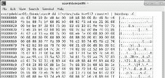

`dd` 命令也可以用于如下所示创建 `MBR` 的备份。输出文件为 `mbr.bin`，使用 `of=mbr.bin` 选项指定，`of` 是 output file 的缩写。

```bash
# dd if=/dev/sda bs=512 count=1 of=mbr.bin
1+0 records in
1+0 records out
512 bytes copied, 0.000371249 s, 1.4MB/s

# file mbr.bin
mbr.bin: DOS/MBR boot sector
```

### GRUB

处理 Linux 启动的软件称为统一引导加载程序（`GRUB`），准确地说是 `GNU GRUB`。它的功能是在启动时从 BIOS 接管，加载自身，将 Linux 内核加载到内存，然后将执行权交给 Linux 内核。一旦内核接管，`GRUB` 就完成了它的工作，不再需要。

注意 `GRUB` 版本 1 已被 `GRUB2` 取代，以前称为 `GRUB Legacy`。为了简单起见，`GRUB2` 简称为 `GRUB`。在启动时，`GRUB` 显示启动屏并提供一个从这里启动系统的菜单。系统中存在的 Linux 内核镜像越多，列表越长。下面的图像显示了带有两个菜单项目的默认安装。除非另有说明，第一项指向默认项。


`GRUB` 等待几秒，然后加载从菜单选择的内核镜像。第一项针对 `GRUB` 配置文件 `/boot/grub2/grub.cfg` 中镜像。该配置文件在 Linux 安装期间生成，并在安装新的 Linux 内核时自动重新生成。

### Linux 内核

在这一步，根文件系统根据 `GRUB` 配置文件中的 `root=` 条目挂载。然后内核执行 `/sbin/init` 程序。内核使用名为 `initrd`（初始内存磁盘的缩写）的文件作为临时根文件系统，直到内核引导并挂载真正的根文件系统。它包含了访问硬盘分区、文件系统和其他硬件组件所需的所有驱动程序。

## 8.2 备用引导加载程序

`GRUB` 不是开源世界唯一的引导加载程序。其他引导加载程序包括：

*   `BURG` - 名称缩写为 Brand-new Unified Loader from GRUB（如果你问我们，为了得到 `GRUB` 的反向命名这有点牵强）。它是 `GRUB` 的一个分支，为单独的配置提供了更大的空间。
*   `SYSLINUX` - 用于网络和 CD/DVD 驱动器的轻量级引导加载程序。
*   **ISOLINUX** - 源自 `SYSLINUX` 项目的引导程序，通常用于 Linux Live CD 和可启动安装 CD。
*   **gummiboot** - 一种带有文本模式界面的基于 EFI 的计算机引导程序。它旨在作为 `GNU GRUB` 的极简替代方案，能够自动检测可启动镜像（包括 Linux 内内核镜像、操作系统和其他引导程序），不需要配置文件，提供基于菜单的基本界面，并可以与 `systemd` 集成以提供性能数据。
*   **Libreboot** - 一个旨在仅执行位或 64 位操作系统的轻量级系统。下面的图片显示了 Libreboot 的菜单。
*   **rEFInd** - 一个具有 GUI 界面的 EFI 计算机启动管理器。`rEFInd` 可用于启动多个操作系统，并提供了进入和浏览 EFI 预启动环境的方法。

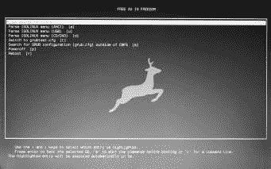

## 8.3 审查启动过程

Linux 会生成日志文件，以便审查启动过程并读取其附的消息。在 Linux 8 之前，启动日志以文本文件存储在 `/var/log/boot`。Linux 8 引入了 `systemd`，格式和位置发生了变化。要检索启动日志，请如下所示使用 `journalctl`（必须是 root 用户）：

```bash
journalctl -b
```

`Systemd` 以特殊格式存储日志消息。`journalctl` 读取日志并按时间顺序显示消息。最早的条目在前，可以使用方向键来回滚动。输出包含四列：日期（时间戳）、主机名、消息类型 `kernel` 以及消息本身。

```
Aug 20 09:36:08 debian106 kernel: Linux version 4.9.0-7-amd64 (debian-kernel@lists.
Aug 20 09:36:08 debian106 kernel: Command line: BOOT_IMAGE=/boot/vmlinux-4.9.0-7-am
Aug 20 09:36:08 debian106 kernel: x86/fpu: Legacy x87 FPU detected
Aug 20 09:36:08 debian106 kernel: e820: BIOS-provided physical RAM map:
Aug 20 09:36:08 debian106 kernel: BIOS-e820: [mem 0x0000000000000000-0x00
Aug 20 09:36:08 debian106 kernel: BIOS-e820: [mem 0x000000000009fc00-0x00
Aug 20 09:36:08 debian106 kernel: BIOS-e820: [mem 0x0000000000000000-0x00
Aug 20 09:36:08 debian106 kernel: BIOS-e820: [mem 0x00000000000f0000-0x00
Aug 20 09:36:08 debian106 kernel: BIOS-e820: [mem 0x0000000000100000-0x00
Aug 20 09:36:08 debian106 kernel: BIOS-e820: [mem 0x00000000c4af0000-0x00
Aug 20 09:36:08 debian106 kernel: BIOS-e820: [mem 0x00000000fffc0000-0x00
Aug 20 09:36:08 debian106 kernel: NX (Execute Disable protection: active
Aug 20 09:36:08 debian106 kernel: SMBIOS 2.5 present.
Aug 20 09:36:08 debian106 kernel: DMI: innotek GmbH VirtualBox/VirtualBox, BIOS
Aug 20 09:36:08 debian106 kernel: e820: update [mem 0x00000000-oxooooofff] usable
Aug 20 09:36:08 debian106 kernel: MTRR default type: uncachable
Aug 20 09:36:08 debian106 kernel: MTRR variable ranges disabled:
Aug 20 09:36:08 debian106 kernel: MTRR: Disabled
...
```

要查看记录的启动列表，可以使用 `list-boots`。输出包含三列：启动条目编号（最后一个条目为 0）、用于识别条目的哈希值以及时间戳。下面的示例显示了输出：

```bash
journalctl --list-boots
```

```
0 5f41f5e968b34d068320f0f13237b7e2 Tue 2020-09-04 19:16:12 EDT
lines 1-1/1 (END)
```


`journalctl` 的替代方案是 `dmesg`。此命令允许你查看整个启动过程，包括 BIOS 消息。下面的图片显示了你将获得的输出。每行由三部分组成：左侧括号内打印的日期（时间戳）、第二个打印在冒号（`:`）之前的组件，以及最后打印的消息。在彩色显示器上，这三部分通过颜色进行区分，即绿色、黄色和黑色。

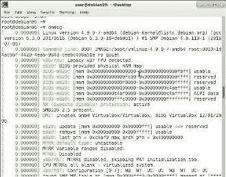

## 8.4 重启和停止系统的命令

在重启和停止系统方面有几个常用的命令。要重启 Linux，你可以使用 `reboot` 或 `shutdown`。停止 Linux，你可以调用 `halt`、`poweroff` 或 `shutdown`。下面我们将讨论一些实际示例。

### `shutdown -r now`

上述命令将重启系统。`-r` 选项指定重启并重启系统。`now` 选项是一个时间参数并立即触发操作。你也可以使用 `reboot` 命令执行与 `shutdown -r now` 命令相同的操作。

### `reboot`

`shutdown` 命令也可以通过使用 `-h` 选项来停止系统。这指示 Linux 停止（halt）。

### `shutdown -h now`

再次使用了 `now` 时间参数来立即停止系统。时间参数也可以指定为精确时间。下面示例中的命令将在五分钟后关闭系统。它还将通过向用户发送相关消息通知所有用户关机。

```bash
shutdown -h +5 "Server shutdown due to maintenance in 5 min"
```

计划于 Thu 2020-09-06 02:28:30 EDT 关机，使用 `shutdown -c` 取消。

与重启系统类似，停止 Linux 也有 `halt` 命令形式的快捷方式。它执行与 `shutdown -h now` 命令相同的操作。

### `halt`

`halt`、`poweroff` 和 `reboot` 命令立即停止系统。它们与 `shutdown -h now` 相似，但 `shutdown` 命令会优雅地终止所有进程，而不是直接杀死它们。记住，上述所有命令都需要管理员权限才能执行。普通用户无法执行这些命令。

## 9. 硬件管理

### 9.1 硬件检测

自动硬件检测过去某种程度上是一种博弈，因为硬件并不总是能自动检测到。过去需要探测硬件来确定安装了什么。在过去的几年里，这种情况有了显著改善，因为制造商更详细地记录了他们的产品并在网上发布了规格。这导致了知识库和支持的支持。

### 9.2 使用 `/proc` 文件系统

`/proc` 是一个虚拟文件系统，也称为内存文件系统，由 Linux 内核在运行时创建。它显示有关内核、进程和其他系统的信息。这些信息以文件结构的形式显示，并且所有人都可以访问。例如，下面的命令显示了 `/proc/cmdline` 的内容，即调用 Linux 内核时使用的选项。记得 `cat` 会将文件内容输出到屏幕。

```bash
$ cat /proc/cmdline

BOOT_IMAGE=/boot/vmlinux-4.9.0-7-amd64 root=UUID=1d4acbbf-4420-4eab-984dceeb408a51e quiet
```

其他有用文件：


`/proc/cpuinfo` - 关于计算机 CPU 信息。


`/proc/meminfo` - 关于系统内存的信息。


`/proc/loadavg` - 平均负载。前三列测量过去 1、5、10 分钟的 CPU 利用率。第四列显示当前运行的进程数和总进程数。最后一列显示最后使用的进程 ID。


`/proc/partitions` - 分区信息。


`/proc/version` - 关于 Linux 版本的信息。

```bash
$ cat /proc/version

Linux version 3.16.0-4-amd64 (debian-kernel@lists.debian.org) (gcc version 4.8.4 (Debian 4.8.4-1) ) #1 SMP Debian 3.16.43-2+deb8u2 (2017-06-26)
```


`/proc/devices` - 配置到当前运行内核中的设备驱动程序列表。


`/proc/filesystems` - 列出内核支持的文件系统。


`/proc/uptime` - 包含系统运行时间。第一个数字是系统运行的总秒数。第二个数字是机器在这些段时间内空闲的时间（秒）。

```bash
$ cat /proc/uptime

15250.54 55603.02
```

Linux 中的进程被分配了多个文件。下面的示例显示了进程 ID (PID) 为 433 的进程的文件结构。接下来，我们将查看通常可用文件的目的和内容。

```text
– 433
|– attr
|– cwd -> /home/user
|– fd
|– fdinfo
|– map_files
|– net
| |– dev_snmp6
| |– netfilter
| |– stat
|– ns
|– root -> /
|– task
|– 433
```

`/proc/PID/cmdline` - 命令行参数。  
`/proc/PID/cpu` - 执行该进程的当前和上一次 CPU。  
`/proc/PID/cwd` - 指向当前工作目录的链接。  
`/proc/PID/environ` - 环境变量的值。  
`/proc/PID/exe` - 指向该进程执行文件的链接。  
`/proc/PID/fd` - 包含所有文件描述符的目录。  
`/proc/PID/maps` - 可执行文件和库文件的映射。  
`/proc/PID/mem` - 此进程持有的内存。  
`/proc/PID/root` - 指向进程根目录的链接。  
`/proc/PID/stat` - 进程状态。  
`/proc/PID/statm` - 进程内存状态信息。  
`/proc/PID/status` - 人类可读的进程状态。

如果你想了解更多关于 `/proc` 文件系统的知识，请查看 `/proc` 的 Man Page（Manual Pages 的缩写）。它涵盖的内容远超本指南的范围。访问 Man 页的内容将在第 19.9.3 节命令行工具中讨论。

## 使用 `cpuid` 检测 CPU

为了获取有关你的 Linux 系统中 CPU 的更多信息，请使用 `cpuid` 命令。该工具可以通过名为 `cpuid` 的 Debian 包获取。下面是该命令返回的详细信息示例。

```text
$ cpuid CPU 0:

vendor_id = "GenuineIntel"

version information (1/eax):

processor type = primary processor (0)

family = Intel Pentium Pro/II/III/Celeron/Core/Core 2/Atom, AMD Athlon/Duron - , Cyrix M2, VIA C3 (6)

model = 0xd (13)

stepping id = 0x4 (4)

extended family = 0x0 (0)

extended model = 0x3 (3)

(simple synth) = Intel Pentium II / Pentium III / Pentium M / Celeron / Celeron M / - Core / Core 2 / Core i / Xeon / Atom (unknown model)

miscellaneous (1/ebx):

process local APIC physical ID = 0x0 (0)

cpu count = 0x10 (16)

CLFLUSH line size = 0x8 (8)

brand index = 0x0 (0)

brand id = 0x00 (0): unknown

feature information (1/edx):

x87 FPU on chip = true

virtual-8086 mode enhancement = true

debugging extensions = true

page size extensions = true

time stamp counter = true

RDMSR and WRMSR support = true

physical address extensions = true

machine check exception = true

CMPXCHG8B inst. = true

APIC on chip = true
```

## 使用 `dmidecode` 检测硬件

`dmidecode` 命令报告关于已安装系统组件的详细数据，例如处理器、主板和内存。这些信息基于桌面管理接口 (DMI)，该框架通过从管理它们的软件中抽象出来，对桌面式电脑、笔记本电脑或服务器的各个单独组件进行分类。该工具可以通过同名的 Debian 包获取。下面的示例显示了在 Debian 中通过 VirtualBox 环境执行命令时的输出。

```bash
# dmidecode

# dmidecode 3.0

Getting SMBIOS data from sysfs. SMBIOS 2.5 present.

10 structures occupying 450 bytes. Table at 0x000E1000.Handle 0x0000, DMI type 0, 20 bytes

BIOS Information

Vendor: innotek GmbH

Version: VirtualBox

Release Date: 12/01/2006

Address: 0xE0000

Runtime Size: 128 kB

Characteristics:

ISA is supported

PCI is supported

Boot from CD is supported

Selectable boot is supported

8042 keyboard services are supported(int 9h)

CGA/mono video services are supported (int 10h)

ACPI is supportedHandle 0x0001, DMI type 1, 27 bytes System Information

Manufacturer: innotek GmbH Product Name: VirtualBox Version: 1.2

Serial Number: 09.4
```

## 图形化工具

还有可以收集和显示硬件信息的图形化工具。这些工具提供了许多用户喜欢的图形用户界面。其中一些工具包括 Hardware Lister (`lshw-gtk`) 和 Debian 包 `hardinfo`。下面的图片使用了使用 `hardinfo` 显示的内存信息。

## 10 用户和组管理

### 10.1 用户和组数据的存储

Linux 是多用户操作系统，这意味着多个用户可以同时访问系统。为了让系统管理这些不同的用户和组，它将这些数据存储在几个配置文件中：

- `/etc/passwd` - 用户数据。
- `/etc/shadow` - 加密的用户密码。
- `/etc/group` - 组数据。
- `/etc/gshadow` - 加密的组密码。

这些文件是文本数据库，具有定义的结构。下面我们将详细查看每一个文件。这些文件的内容可以使用文本编辑器或 `passwd`、`chage`、`chfn`、`chsh` 和 `usermod` 命令进行更改。

#### `/etc/passwd`

此文件包含密码以外的所有用户属性。每行由七列组成，列之间用冒号（`:`）分隔。属性分别是用户名、密码、用户 ID (UID)、组 ID (GID)、`GECOS` 字段、用户主目录和用户登录 shell。

第一个属性 `username` 指的是用户名，它在系统中必须是唯一的。`password` 字段只包含 `x`。密码本身的值已移动到 `/etc/shadow`（见下一节），该属性仅为了向后兼容而保留。`UID` 指的是用户 ID，数值范围介于 0 到 65535 之间。在 Debian 上，root 用户 UID 为 0，服务用户范围从 1 到 999，普通用户从 1000 开始。下面的示例显示了 root 用户和普通用户的信息。

```bash
$ grep root /etc/passwd

root:x:0:0:root:/bin/bash

$ grep user /etc/passwd

user:x:1000:1000:Debian User,123,456:/home/user:/bin/bash
```

`GID` 属性指向用户主组的 ID。`GECOS` 是 General Comprehensive System 的缩写，包含用户的全名，有时包含逗号分隔的用户数据如房间和电话号码。`Home` 是用户的主目录，`shell` 是用户的默认 shell。准确来说，它是用户登录时执行的程序。

#### `/etc/shadow`

此文件包含用户的加密密码和过期数据。格式与上面讨论的 `/etc/passwd` 类似。每行由八列组成，列之间用冒号（`:`）分隔。属性分别是用户名、密码、最后更改日期、最小有效期、最大有效期、警告、置时间和过期日期。

第一个属性 `username` 再次指向 UNIX 用户名，但此处 `password` 字段确实包含用户的加密密码。`lastchange` 表示自 1/1/1970 以来最后更改密码的天数。接下来两个属性 `minimum` 和 `maximum` 显示用户更改密码所需的最小天数以及密码仍然有效的最大天数。`Warn` 显示密码过期前多少天警告用户更改密码。`inactive` 属性是密码过期后到用户被禁用的天数，`expiration date` 是自 1/1/1970 以来账户被禁用的天数。下面的示例显示了普通用户的属性。密码以盐哈希值存储在第二列。

```bash
$ grep user /etc/shadow

user:$6$QB0brhON$R9saRX5Q1/OwYW4S5Viqeh6McumbqnxkJctxRAl…

CshFyblLTZxlCoggH12p21:17763:0:99999:7:::
```

要显示账户详情，请调用 `chage` 命令并后跟选项 `-l`（`--list` 的缩写）以及用户名。下面的示例列出了用户 `user` 的详细信息。

```text
chage -l user

password change : Aug 20, 2020

Password expires : never

Password inactive : never

Account expires : never

Minimum number of days between password change : 0
Maximum number of days between password change : 99999
Number of days of warning before password expires : 7
```

如上述示例所示，该账户没有过期日期。为了将此值设置为 2019 年 12 月 31 日，请调用 `usermod` 命令并带有选项 `-e`（`--expiredate` 的缩写）以及用户名。

```text
usermod -e 2019-12-31 user
```

为了锁定和解锁用户账户，`usermod` 命令有两个选项：

- `-L`（`--lock` 的缩写）和 `-U`（`--unlock` 的缩写）。下一个示例锁定了名为 `user` 的用户的账户。用户仍然可以工作并完成会话，但无法再次登录系统。

```text
usermod -L user
```

#### `/etc/group`

此文件包含用户组属性。每行由四列组成，列之间再次通过冒号分隔。属性分别是组名、密码、组 ID 以及其成员列表。`groupname` 属性类似于 `username` 属性，指的是 UNIX 组名，该名称在系统中必须是唯一的。密码字段包含一个 `x`，因为该值已移动到 `/etc/gshadow` 文件，该字段仅为了向后兼容而保留。

`members` 属性提供了一个访问该组的用户的逗号分隔列表。`GID` 是唯一的组 ID，其数值范围在 0 到 65535 之间，分配方式与 `UID` 类似。用户 `root` 的 `GID` 为 0，`services` 范围从 1 到 999，普通用户从 1000 开始。以下代码段显示了 root 和普通用户的情况。

```text
$ grep root /etc/group

root:x:0:

$ egrep "^user" /etc/group

user:x:1000:
```

下面的示例显示了 `user` 所属组的名称。

```text
$ grep user /etc/group

cdrom:x:24:user

floppy:x:25:user

audio:x:29:user,pulse
dip:x:30:user

video:x:44:user

plugdev:x:46:user
users:x:100:

netdev:x:108:user
bluetooth:x:111:user
user:x:1000:
```


# /etc/gshadow

此文件包含组的加密密码和用户数据。格式与`/etc/shadow`类似。每行由四列组成，通过冒号分隔。属性分别是组名、密码、管理员和成员列表。

`groupname`属性仍然是UNIX组名，密码是加密后的密码。管理员可以使用`gpasswd`命令添加或删除其他成员，而成员是组中的非管理员成员。

## 10.2 用户和组命令

有多个命令可以管理Linux系统中的用户和组。我们将查看查看和更改用户信息、更改密码、创建和删除用户账户所需的命令，以及组命令。除非另有说明，这些命令都可以作为普通用户运行。

### whoami

此命令按如下格式返回你的当前用户ID：

```
$ whoami
user
```

### users, who and w

`who`命令显示当前登录到你的Linux系统的用户。输出的第一列以用户的登录名开始。紧接着是终端名称，其中`console`代表登录终端，`pts`是伪终端会话（pseudo-terminal session）的缩写。最后两列包含登录时间和用户所在的主机名。

```
$ who
user     console 2020-08-20 09:36 (:0)
user     pts/2   2020-08-20 09:47 (:0)
user     pts/3   2020-08-20 09:47 (:0)
```

`w`通过增加额外信息扩展了`who`的输出。`w`的单列包含用户的登录名（`LOGIN`）、终端名称（`TTY`）、用户所在的主机名（`FROM`）、登录时间（`LOGIN@`）、空闲时间（`IDLE`）、CPU使用率（`JCPU`和`PPU`）以及用户执行的最后一个命令（`WHAT`）。

相比之下，`users`仅以空格分隔列表单行输出用户名。

```
$ users
user user user
```

### id and groups

`id`命令输出当前用户的用户组信息（见下文）。从左到右，列显示用户ID（`UID`）、组ID（`GID`）以及用户所属的组名。

```
$ id
uid=1000(user) gid=1000(user) groups=1000(user), 24(cdrom), 25(floppy), 29(audio), 30(dip), 44(video), 46(plugdev), 108(netdev), 111(bluetooth)
```

要列出用户所属的所有组名，你也可以调用`groups`命令。输出是组名的空格分隔列表。

```
$ groups
user cdrom floppy audio dip video plugdev netdev bluetooth
```

### passwd

如第4章所述，Linux系统至少有两个用户：一个管理员root用户和一个我们简称为`user`的普通用户。每个账户也通过密码进行保护。

要更改密码，请使用Debian`passwd`软件包中的`passwd`命令。如下所示，首先输入当前密码，按回车，然后输入新密码，按回车确认，再次输入新密码并按回车再次确认。

```
$ passwd
Changing password for user.
(current) UNIX password:
Enter new UNIX password:
Retype new UNIX password:
passwd: password updated successfully
```

作为普通用户，你只被允许更改自己的密码。管理员root用户也可以为自己和其他用户设置新密码。在这种情况下，我们通过添加用户名来调用`passwd`。

```bash
# passwd felix
Changing password for felix.
(current) UNIX password:
Enter new UNIX password:
Retype new UNIX password:
passwd: password updated successfully
```

密码以哈希值存储在名为`/etc/shadow`的文件中。该文件的内容对管理员用户可见。下面的示例显示了如何借助`grep`命令提取用户`user`的信息。

```
$ grep user /etc/shadow
user:$6$R$17763:0:9999:7:::
```

### chfn

此命令同样来自Debian`passwd`软件包，用于更改存储在系统`/etc/passwd`中的用户信息。基础设置在安装Debian系统时已经完成。要修改这些信息，你可以在交互模式下不带进一步参数运行`chfn`，或带有以下一个或多个选项来适配特定值：

- `-f`或`--full-name`：更改用户的全名。
- `-h`或`--home-phone`：更改用户的家庭电话。
- `-r`或`--room`：更改用户的房间号。
- `-w`或`--work-phone`：更改用户的办公电话。

下面的示例将家庭电话更改为135：

```
$ chfn -h 135
Password:
```

### chsh

此命令（同样来自Debian`passwd`软件包）更改你用于登录Linux系统的shell。同样，这些信息存储在`/etc/passwd`中。允许使用的shell决限于名为`/etc/shells`的配置文件中的项。`chsh`的工作与`chfn`命令类似。不带进一步选项调用时，将使用交互式方法：

```
$ chsh
Password:
Changing the login shell for user
Enter the new value, or press ENTER for the default
Login Shell [/bin/sh]: /bin/bash
```

要修改你本人其他用户的shell，请将用户名作为参数调用`chsh`命令。注意，只有管理员可以为其他用户执行此操作。下一个示例显示了如何为用户`felix`执行。

```bash
# chsh felix
Changing the login shell for felix
```

输入新值，或按回车键使用默认值登录shell [/bin/bash]:

### su 和 sudo

要将角色从一个用户切换到另一个用户，可以使用`su`命令。`su`是switch user的缩写。在不带其他选项的情况下调用，你可以如下切换到root用户：

```bash
$ su
密码：
```

作为管理员root用户工作意味着巨大的责任，并假设你清楚自己在做什么。若要以root以外的用户身份工作，请如下通过指定的用户名调用`su`命令：

```bash
$ su felix
密码：
```

`su`命令会永久更改当前角色。若只想以管理员身份运行单条命令，请使用`sudo`命令。这需要安装Debian的`sudo`软件包，并使用`visudo`命令将额外用户添加到配置文件`/etc/sudoers`中。

### adduser

`adduser`命令用于创建新用户账户。下面的示例了所需的信息。这包括在`/etc/passwd`文件中添加新条目，以及创建一个新组和主目录。此外，来自`/etc/skel`目录的预备数据会被复制到之前创建的主目录中。之后，使用`chsh`命令修改账户信息。

```bash
# adduser caro
```

正在添加用户 'caro' …
正在添加新组 'caro' (1002) …
正在添加新用户 'caro' (1002) 组 'caro' … 正在创建主目录 '/home/caro' …
正在从 '/etc/skel' 复制文件…
输入新的UNIX密码：

重新输入新的UNIX密码：

passwd: 密码更新成功
正在更改caro的信息
输入新值，或按回车键使用默认值
全名 []: Caro
房间号 []:
工作电话 []:
家庭电话 []:
其他 []:
信息正确吗？[Y/n] y

设置好新用户后，`/etc/passwd`中的条目如下：

```bash
# grep caro /etc/passwd
caro:x:1002:1002:Caro, , , :/home/caro:/bin/bash
```

### deluser

删除用户账户通过`deluser`命令完成，而删除组可以通过`delgroup`完成。若要在不删除用户任何文件的情况下删除用户，请以root用户运行以下命令：

```bash
# deluser felix
```

`deluser`命令有以下选项用于精调其执行：

- `--group`: 删除一个组，等同于`delgroup`。
- `--system`: 仅当用户为系统用户时才删除。
- `--backup`: 将用户主目录中的文件备份到名为`/$user.tar.gz`或`/$user.tar.bz2`的文件中。
- `--backup-to`: 将主目录中的文件备份到指定的文件。
- `--remove-all-files`: 删除系统中所有属于该用户的文件。如果指定了备份，将在执行备份后删除文件。

```bash
# deluser --remove-all-files felix1
```

## 文件系统

文件系统是控制数据如何在驱动器存储。如果数据没有结构化，将无法知道特定条目何时结束以及下一个条目何时开始。文件系统将数据分成部分，每个部分都有唯一的名称。通过这种方式，信息可以被隔离和识别。文件系统上的每组数据被称为条目（entry）。文件系统中的条目可以是文件、目录（也称为文件夹）、引用（也称为链接）、套接字和fifo（也称为命名管道）。

文件系统中的每个条目包含以下相关信息：

- `name`: 条目的名称。
- `permissions`: 哪个用户是条目的所有者，并允许读取、写入和执行该条目。
- `creation time, last modified time, last access time`: 条目最后一次创建、修改或访问的时间。
- `file size, number of blocks, IO blocks`: 该条目在文件系统中需要多少磁盘空间。
- `inode number`: index node的缩写，指的是数据条目开始的块号。
- `number of symlinks`: 指向该条目的引用或符号链接的数量。

你可以使用`stat`命令获取上述信息。`stat`是Debian软件包`coreutils`的一部分，仅需要检查条目的名称。下面的示例显示了文件documentation.pdf的信息。

```bash
$ stat documentation.pdf
File: documentation.pdf
Size: 512         Blocks: 8          IO Block: 4096   regular file
Device: 808h/2056d    Inode: 260927    Links: 1
Access: (0644/-rw-r--r--)  Uid: (0/root)   Gid: (0/root)
Access: 2020-09-04 18:44:30.071901792 -0400
Modify: 2020-09-04 18:44:22.358157773 -0400
Change: 2020-09-06 18:08:14.528658813 -0400
Birth: -
```

`Midnight Commander (mc)`也会以略微精炼的方式显示这些信息：

```
IO Block: 4096  regular file  Inode: 260927  Links: 1
Uid: (0/root)  Gid: (0/root)
```

此外，在XFCE桌面上右键点击文件图标，会打开属性窗口，显示日常使用所需的大部分信息。

### 11.1 常用文件系统类型

有很多文件系统非常流行并广泛使用。包括`FAT`、`ext2`、`ext3`、`ext4`、`JFS`、`XFS`、`ZFS`、`ReiserFS`和`SWAP`。让我们详细查看每一个。

#### 文件分配表 (FAT)

FAT于1977年引入软盘，随后在DOS和Microsoft Windows 9X时代被用于硬盘。直到今天，它几乎被所有的操作系统支持，并且作为不同系统之间的数据传输媒介非常有用。它通常用于USB闪存器等外部介质。原始的`FAT`系统仅为8位系统，最大文件大小为8MB，支持6:3的文件名且没有子目录。`FAT`有3种主要变体：

- `FAT12` - 12位文件分配表。支持4KB簇最大16MB的卷大小，或8KB簇最大32MB的卷大小。
- `FAT16` - 16位文件分配表。支持32KB簇最大2GB的卷大小，或64KB簇最大4GB的卷大小。文件名必须是8:3格式的OEM字符或256 UCS字符。
- `FAT32` - 支持512B扇区最大2TB、2KB扇区和32K簇最大8TB，或4KB扇区和64K簇最大16TB。文件名必须是8:3格式的OEM字符或256 UCS字符。

#### 第二扩展文件系统 (ext2)

这是Linux的第一个消费级文件系统，在`ext3`于2001年成为主流之前，它是RedHat和Debian等Linux发行版的默认文件系统。今天，它仍然用于数字内存卡等存储设备，因为在这些设备上不需要`ext3`或`ext4`的日志功能。这可以提高性能并尽量减少写入次数。

#### 第三扩展文件系统 (ext3)

`ext3`是`ext2`的日志版本，可以直接从`ext2`升级，而无需备份和恢复操作。`ext3`的速度没有`ext4`、`JFS`、`XFS`或`ReiserFS`快，但它使用的CPU资源比`ReiserFS`或`XFS`少。`ext3`支持最大16GB的文件和32TiB的文件系统。

#### 第四扩展文件系统 (ext4)

`ext4`是`ext3`的扩展，具有额外的功能，如大文件系统支持。它支持最大16TiB的文件和1EiB的文件系统。此外，它还具有“区”（extents）特性。区是一个连续的块范围，这使得处理超大文件更加高效。

#### 日志文件系统 (JFS)

`JFS`最初为IBM的AIX Unix操作系统开发，后来移植到OS/2。`JFS`是一个完全的64位文件系统，使用区，支持无限的小文件以及高达4 PB的大文件。它是极大型文件系统的理想选择。

#### XFS

`XFS`是Silicon Graphics (SGI)于1993年为IRIX操作系统开发的日志文件系统。它将物理卷划分为分配，允许更高效的并行I/O和文件系统带宽，并支持高达8EiB的大文件。

#### ZFS

泽字节文件系统(`ZFS`)结合了文件系统和逻辑卷管理器(`LVM`)。由SUN Microsystems于2005年发布，它具有扩展性，并包含了针对数据损坏的广泛保护、对高存储容量的支持、高效的数据压缩、文件系统与卷管理的集成、快照和写时复制复制、连续完整性检查和自动修复、RAID-Z以及针对网络文件系统(`NFS`)第4版本的原生访问控制列表(`ACLs`)。`OpenZFS`和`ZFS on Linux`两个项目继续该文件系统的开发。

#### ReiserFS

`ReiserFS`是一种通用日志文件系统，使用基于B+树的Apple分区映射来管理目录内容。`ReiserFS`版本3是SUSE、Elive、Xandros、Linspire和YOPER发行版的默认文件系统。对`ReiserFS`版本4的支持已下降到除了与较新的Linux内核兼容外，开发已停止。

#### 交换空间 (Swap Space)

Linux使用交换空间在内存页空闲时将其交换出。用户无法访问交换空间，且不能用于普通文件存储。交换空间的使用建议如下：

- **桌面系统** - 使用系统总内存的2倍。这样当同时运行许多大型程序时，未使用的内存可以保存到磁盘，使程序运行得更高效。
- **服务器系统** - 使用总内存的0.5倍。服务器不应进行大量的交换，一半内存就足够。
- **内存小于1GB的旧系统** - 使用尽可能多的交换空间，因为系统需要大量的交换才能高效运行。

除了使用独立的交换分区外，也可以使用交换文件。这是通过`dd`在现有分区上创建一个固定大小的文件来实现的。这种方法的优点是不需要固定的交换分区，以后可以为了效率调整其大小。

### 11.2 文件系统命令

以下命令用于管理文件系统：

- `fdisk`和`cfdisk` - 显示、创建和删除驱动器带有文件系统的分区。
- `mkfs` - make file system的缩写，创建一个文件系统。
- `mkswap` - make swap的缩写，创建一个交换文件系统。
- `badblocks` - 显示文件系统上的坏块。
- `fsck` - file system check的缩写，检查并修复Linux文件系统。
- `dumpe2fs` - 显示文件系统的信息。
- `file` - 确定文件系统中条目的类型。
- `link`和`unlink` - 创建和删除文件的链接。
- `ln` - link的缩写，创建硬链接和软链接。
- `ls` - 显示条目（文件、目录、链接、套接字或fifo）的信息。
- `lsof` - 显示打开的文件列表。
- `stat` - 显示条目保留的所有信息。
- `sync` - 将驱动缓存与磁盘同步。
- `mount`和`umount` - 启用或禁用带有文件系统的设备。
- `tune2fs` - 调整`ext2`、`ext3`和`ext4`文件系统上的参数。

### 11.3 实际示例


在下面的示例中，我们将查看如何使用上面学过的命令。我们将模拟一个内存磁盘，在其上面创建一个适当的文件系统，将其挂载并在其上存储数据。首先，我们将使用`dd`创建一个大小为 10MB 的文件，如下：

```bash
$ dd if=/dev/zero of=memory.image bs=512b count=40
```

该文件只包含零，因为数据是从名为`/dev/zero`的设备读取的，该设备只返回零（`if=/dev/zero`）。输出以 512 字节的块大小写入 40 次到`memory.image`文件。下面的示例显示了`dd`的输出以及使用`ls`查看输出文件的大小。

```bash
$ dd if=/dev/zero of=memory.image bs=512b count=40
40+0 records in
40+0 records out
10485760 bytes (10 MB, 10MiB) copied, 0.0156379 s, 671 MB/s

$ ls -lah memory.image
-rw-r--r-- 1 user user 10M Sep 9 05:28 memory.image
```

接下来，我们使用`mkfs.ext4`命令在该文件上创建一个`ext4`文件系统：

```bash
$ /sbin/mkfs.ext4 memory.image 10M
mke2fs 1.43.4 (31-Jan-2017)
Discarding device blocks: done
Creating filesystem with 10240 1k blocks and 2560 inodes
Filesystem UUID: 52c89176-a665-48b3-9bf6-2abb9b2ad721
Superblock backups stored on blocks:8193
Allocating group tables: done
Writing inode tables: done
Creating journal (1024 blocks): done
Writing superblocks and filesystem accounting information: done
```

`-rw-r--r-- 1 user user 10M Sep 9 05:40 memory.image`

这产生了一个具有 10240 个 1K 块的文件系统，可以容纳 2560 个项目。接下来，我们使用`mkdir`命令创建一个挂载点：

```bash
mkdir /tmp/image
```

`mount`命令通过如下方式集成镜像：

```bash
su
Password:
# mount memory.image /tmp/image
```

现在我们可以在挂载的设备上存储数据了。在这里，`cp`命令派上了用场。`cp`命令用于复制文件。为了正常操作，它需要两个名称：原始文件名和副本名。原始文件不会被触动，保持完好。副本的内容与原始文件相同，但具有当前的时间戳。使用选项`-i`（或`--interactive`）可以防止覆盖现有文件。在示例中，我们使用`cp -v`来产生额外的输出。

```bash
su
Password:
# cp -v documentation.pdf /tmp/image/.

'documentation.pdf' -> '/tmp/image/./documentation.pdf'

# ls /tmp/image/

documentation.pdf lost+found

# sync

# umount /tmp/image
```

在卸载设备之前，执行`sync`以清除缓存并将数据写入磁盘。最后，我们可以按照如下方式卸载文件系统：

```bash
umount /tmp/image
# exit
```

# 12. 磁盘存储管理

在本章中，我们将介绍如何处理存储设备和文件系统，这包括设备命名、分区类型和方案，以及分区的挂载和卸载。

## 12.1 设备命名

在 Linux 中，一切皆文件，目录是一个文件，设备也是一个文件。系统上的每个驱动器都表示为`/dev`文件夹内部的块设备。当系统启动时，会运行`udev`服务，它会检测`/dev`中的所有设备并据此进行相应的挂载。

在`/dev`内部，IDE 驱动器的名称从`hda`、`hdb`直到`hdp`。其他设备类型如 SCSI、USB、SATA 和 PATA 表示为`sda`、`sdb`直到`sdp`。CD 或 DVD 驱动器等设备接收如`cdrom`或`dvd`的标签，而 SD 卡通常被标记为`mmcblk`。

如果一个驱动器要在系统中运行，必须至少有一个分区。一个驱动器最多可以有 16 个分区，每个分区都有自己的文件系统。在每个设备内部，设备`/dev/sda`的分区被标记为`sda1`、`sda2`直到`sda16`。Linux 的限制是十六个驱动器，每个驱动器十六个分区。

## 12.2 主分区、扩展分区和逻辑分区

每个驱动器可以有四个主分区，或者三个主分区和一个扩展分区。此外，扩展分区可以包含最多十六个逻辑分区。如果系统仅包含四个主分区，它们如下所示编号为`sda1`到`sda4`：

```
/dev/sda1
/dev/sda2
/dev/sda3
/dev/sda4
```

如果系统包含三个主分区和一个扩展分区（其中包含逻辑分区），主分区`sda4`将消失并被逻辑分区`sda5`、`sda6`、`sda7`等取代：

```
/dev/sda1
/dev/sda2
/dev/sda3
/dev/sda5
/dev/sda6
/dev/sda7
```

第一个逻辑分区始终编号为`sda5`。因此，即使主分区少于三个，它们的编号也如下：

```
/dev/sda1
/dev/sda5
/dev/sda6
```

要查看分区结构，来自`util-linux`包的`lsblk`命令非常有帮助。`lsblk`是 list block devices（列出块设备）的缩写。该命令可以输出所有使用的块设备（如下例所示）以及所有未使用的设备（如下例所示）。

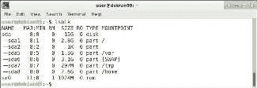

这七列代表以下信息：


- `NAME` - 设备的名称。
- `MAJ:MIN` - 设备的主号和次号。
- `RM` - 如果设备是固定的则为 0，如果设备可以移除则为 1。
- `SIZE` - 人类可读格式的设备大小。
- `RO` - 如果设备是只读的为 1，否则为 0。
- `TYPE` - 设备类型。`loop`代表回环设备，`disk`代表硬盘，`part`指磁盘的分区，`lvm`是由逻辑卷管理器（LVM）运行的分区，`rom`指 CD/DVD 光盘。
- `MOUNTPOINT` - 列出设备挂载到的目录。

要列出已挂载的文件系统，请使用`mount`命令或`findmnt`命令。这两个命令都是`mount`包的一部分。在不带进一步选项的情况下调用，`findmnt`会打印所有挂载的文件系统。这个列表可能很长。为了只选择`ext4`文件系统，可以使用选项`-t ext4`（`--type ext4`的缩写）。

四个输出列包含以下信息：


- `TARGET` - 挂载点，即系统中设备挂载到的目录。
- `SOURCE` - 设备名称。
- `FSTYPE` - 文件系统类型。
- `OPTIONS` - 用于挂载设备时使用的选项。

## 12.3 `udev`、`df`和`du`

`udev`是用户空间`/dev`的缩写，是 Linux 内核的设备管理器。一旦`udev`运行，它找到的驱动器将显示在`/dev/disk`目录。它包含几个下面列出的带有符号链接的子目录。注意，子目录的数量取决于 Linux 版本并取决于 Linux 内核的版本。每当 Linux 系统识别磁盘时，信息就会显示在这里。我们可以使用这些信息找到哪些挂载点正在使用。

`/dev/disk/by-id`

显示 Linux 看到的分区名称以及指向它们的挂载点。

```bash
# ls -al /dev/disk/by-id
total 0
drwxr-xr-x 2 root root 220 Sep 5 07:14 .
drwxr-xr-x 7 root root 140 Sep 5 07:14 ..
lrwxrwxrwx 1 root root 9 Sep 5 07:14 ata-VBOX_CD-ROM_VBO01f00…/sr0
lrwxrwxrwx 1 root root 9 Sep 5 07:14 ataVBOX_HARDDISK_VBb9372…/sda
lrwxrwxrwx 1 root root 10 Sep 5 07:14 ataVBOX_HARDDISK…part1…/sda1
lrwxrwxrwx 1 root root 10 Sep 5 07:14 ataVBOX_HARDDISK…part2…/sda2
lrwxrwxrwx 1 root root 10 Sep 5 07:14 ataVBOX_HARDDISK…part3…/sda3
lrwxrwxrwx 1 root root 10 Sep 5 07:14 ata-VBOX_HARDDISK…part5…/sda5
lrwxrwxrwx 1 root root 10 Sep 5 07:14 ata-VBOX_HARDDISK…part6…/sda6
lrwxrwxrwx 1 root root 10 Sep 5 07:14 ata-VBOX_HARDDISK…part7…/sda7
lrwxrwxrwx 1 root root 9 Sep 5 07:14 ata-VBOX_HARDDISK…
```

`/dev/disk/by-path`

显示硬件定义以及哪些挂载点指向它们。

```bash
# ls -al /dev/disk/by-path
total 0
drwxr-xr-x        0 00:110
drwxr-xr-x 7  root 140  5 07:14 ..
1wxrwxrwx 1  root 9  5 07:14 ata-VBOX_CD-ROM_VBO01f00…/sr0
lrwxrwxrwx 1 root root 9 Sep 5 07:14 ataVBOX_HARDDISK_0b9372…/sda
lrwxrwxrwx 1 root root 10 Sep 5 07:14 ataVBOX_HARD0…part1…/sda1
lrwxrwxrwx 1 root root 10 Sep 5 07:14 ataVBOX_HARDDISK…part2…/sda2
lrwxrwxrwx 1 root root 10 Sep 5 07:14 ataVBOX_HARDDISK…part3…/sda3
lrwxrwxrwx 1 root root 10 Sep 5 07:14 ata-VBOX_HARDDISK…part5…/sda5
lrwxrwxrwx 1 root root 10 Sep 5 07:14 ata-VBOX_HARDDISK…part6…/sda6
lrwxrwxrwx 1 root root 10 Sep 5 07:14 ata-VBOX_HARDDISK…part7…/sda7
lrwxrwxrwx 1 root root 9 Sep 5 07:14 ata-VBOX_HARDDISK…
```

`/dev/disk/by-label`

显示标签应用到了哪些挂载点。

```bash
# ls -al /dev/disk/by-label
total 0
drwxr-xr-x 2 root root 220 Sep 5 07:14 .
drwxr-xr-x 7 root root 140 Sep 5 07:14 ..
lrwxrwxrwx 1 root root 9 Sep 5 07:14 home -> ../sda7
lrwxrwxrwx 1 root root 9 Sep 5 07:14 root -> ../sda1
lrwxrwxrwx 1 root root 9 Sep 5 07:14 tmp -> ../sda5
lrwxrwxrwx 1 root root 9 Sep 5 07:14 var -> ../sda6
```

`/dev/disk/by-uuid`

显示每个挂载点的 UUID 标签。

```bash
# ls -al /dev/disk/by-uuid
total 0
drwxr-xr-x 2 root root 220 Sep 5 07:14 .
drwxr-xr-x 7 root root 140 Sep 5 07:14 ..
lrwxrwxrwx 1 root root 10 Sep 5 07:14 9ef7106a-c885-4cbeaaaa…/sda2
lrwxrwxrwx 1 root root 10 Sep 5 07:14 808e…/sda7
lrwxrwxrwx 1 root root 10 Sep 5 07:14 d2f4fd43-4f76-414c9afa…/sda6
lrwxrwxrwx 1 root root 10 Sep 5 07:14 9192…/sda1
lrwxrwxrwx 1 root root 10 Sep 5 07:14 b1f6…/sda5
```

`/dev/disk/by-partuuid`

这是 GUID 分区表（GPT）的一个组件，它是主引导记录（MBR）相关的磁盘分区的替代方案。

调用`df`和`du`命令查看哪些文件系统已挂载，以及使用了多少块空间和剩余多少块空间。`df`是 disk free（磁盘剩余）的缩写。该命令提供了多种选项：


`df -h`：以人类可读的格式列出。


`df -k`：以 KB 为单位列出。


`df -m`：以 MB 为单位列出。


`df`：以默认的块大小列出。有时这会使用 500KB，可能会引起混淆。

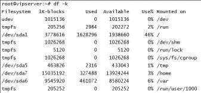

同样，`du`（磁盘 usage）计算目录占用的磁盘空间。常规输出会列出每个条目的值，可能会让人感到困惑。要获取目录的摘要，可以在命令行调用中增加三个参数：`-s`（摘要）、`-c`（总计）和`-h`（人类可读）。

## 12.4 挂载文件系统

在使用文件系统之前，必须将其挂载为目录树的一部分。大多数情况下，这在启动时自动完成，但也可以手动完成。我们在上一章的末尾简要查看了用于手动挂载的命令，但在这里我们将更详细地介绍它们的用法。

为了演示，我们将第二个 SCSI 磁盘的第一个分区（`/dev/sdb1`）挂载到`/space`。首先，为了挂载文件系统，你必须是 root 用户。接下来，如果目录`/space`尚不存在，我们必须使用`mkdir`创建它，如下：

```bash
mkdir /space
```

然后运行`mount`命令包含此目录：

```bash
mount /dev/sdb1 /space
```

大多数情况下，Linux 会自动检测文件系统类型。如果不是如此且没有自动检测类型，请使用`-t`参数（`type`的缩写）后跟文件系统类型名称强制指定。此步骤假设相关的文件系统类型已安装并被 Linux 内核识别。要列出 Linux 内核支持的所有文件系统，可以使用如下所示`cat`、`awk`、`sed`、`ls`和`sort`命令的组合。

在尚未讨论的命令中，`sort`用于按指定顺序排序文件，将在第 7 章中详细讨论。除了这个示例外，我们不会对`awk`和`sed`进行细节，因为这超出了本指南的范围。在这个示例中，它们基本上被用于清理数据以便更易使用。

```bash
cat /proc/filesystems | awk '{print $NF}' | sed '/^$/d'; ls -1 /lib/modules/$(uname -r)/kernel/fs | sort -u
```

```text
9p

adfs

affs

afs

aufsautofs

autofs4

bdev

befs

bfs

binfmt_misc

binfmt_misc.ko

btrfs

cachefiles

ceph

...
```

以下命令扩展了上述命令，以便使用`ext3`文件系统将第二个 SCSI 磁盘的第一个分区（`/dev/sdb1`）挂载到`/space`：

```bash
mount -t ext3 /dev/sdb1 /space
```

## 12.5 卸载文件系统

如果文件系统正忙或在使用中，则无法卸载。要找出哪些程序正在使用该文件系统，来自`lsof`软件包的`lsof`命令派上了用场。`lsof`是 list of open files（打开文件列表）的缩写。下面的示例演示了如何使用该命令，并展示了目录`/home/user/Music`的情况。

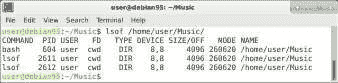

这将提供使用该目录的程序列表。此外，如果用户在该目录下工作，你必须使用`cd`命令切换目录。要卸载我们在上一节中挂载的目录`/space`，你必须再次以 root 用户登录。接下来，通过命令`lsof /space`测试是否有其他程序正在使用`/space`。如果有程序正在运行，停止它们并重试。同时，确保没有终端连接到`/space`。

```bash
su
Password:
# lsof /space
...
```

然后输入`umount /space`。如果你没有收到错误消息，说明`/space`已成功卸载。或者，运行带有`-v`参数（`verbose`的缩写）的`umount`命令来查看事务消息。最后，输入`df -k`查看新的分区状态。

```bash
umount /space
# exit
```

## 12.6 自动化挂载点


要在系统启动时自动挂载挂载点，请在配置文件`/etc/fstab`中添加条目。`fstab`是 file system table（文件系统表）的缩写。下面的示例显示了配置文件的内容：

```bash
# cat /etc/fstab

# /etc/fstab:静态文件系统信息。
#
# 使用 'blkid' 打印设备的唯一标识符；
# 这可以配合 UUID= 使用更稳健的方法来命名设备
# 即使在磁盘被添加或删除时也能工作。请参见
# fstab(5)。
#
# <file system><mount point><type><options><dump><pass>
# / 在安装期间位于 /dev/sda1
UUID=dc78e6f6-8a4f-4be0-9192-e4ca37838765 / ext4 errors= 0 1defaults 0 2
# /home 在安装期间位于 /dev/sda7
UUID=ac2823cc-a7b4-4bf3-808e-e13401e11eaf /home ext4
# /tmp 在安装期间位于 /dev/sda5
UUID=faef6770-b865-43d2-b1f6-56352413d7c4 /tmp ext4 defaults 0 2
# /var 在安装期间位于 /dev/sda6
UUID=d2f4fd43-4f76-414c-9afa-6a53d4cd1d9c /var ext4 defaults 0 2
# swap 在安装期间位于 /dev/sda2
UUID=9ef7106a-c885-4cbe-aaa1-8e2b77ee73cf none swap sw 0 0
/dev/sr0/media/cdrom0 udf,iso9660 user,noauto 0 0
```

文件`/etc/fstab`中的列（字段）为：


`filesystem` - 指定 UUID (`UUID=xxxxx`)、名称 (`/dev/sdb1`) 或文件系统的标签 (`LABEL=home`)。

`mount point` - 定义文件系统挂载的目录。

`type` - 允许的文件系统类型的逗号分隔列表。

`options` - 选项的逗号分隔列表。

`dump` - 文件中的备份信息，0 = 关闭，1 = 开启

`pass` - 文件系统检查的顺序，从 1 开始。0 表示最后。请注意单列之间用制表符分隔，空格无法正常工作。提示：要查找挂载点的 UUID，请查看`/dev/disk/by-uuid`。

要添加一个自动挂载的设备，只需通过添加行来扩展`/etc/fstab`文件。为了在启动时使用`ext3`文件系统将分区`/dev/sdb1`挂载为`/space`，在旧版系统上添加此行：

```text
/dev/sdb1 /space ext3 defaults 0 0
```

在支持 UUID 的现代系统上，使用以下行。注意将`7ca005b2-a7ff-4757-bfdf-81004d4072ef`的值替换为你分区的 UUID：

```text
UUID=7ca005b2-a7ff-4757-bfdf-81004d4072ef /space ext3 defaults 0 0
```

现在`/dev/sdb1`将在启动时始终挂载为`/space`。你可能奇怪使用 UUID 有什么好处。通过使用 UUID，分区被清晰地识别，即使磁盘顺序发生变化。要生成 UUID（或重新生成一个新的），请使用`uuidgen`命令行工具。

## 12.7 设置新分区

`fdisk`及其对应工具`cfdisk`和`gparted`的理念是查看磁盘上的分区并添加、删除或编辑分区。在本节中，我们将查看`fdisk`，它是 Debian 的标准软件包，在所有主流 Linux 发行版中均可用。`cfdisk`和`gparted`都是非标准软件包，可能需要单独安装。我们在第 4 章和第 14 章中讨论了额外软件包的安装。

要使用`fdisk`，root 用户输入`fdisk`后跟驱动器名称。接下来的示例展示了名为`/dev/sda`的第一个 SCSI 磁盘。

```bash
fdisk /dev/sda
```

这将打开一个如下所示的屏幕。在命令行提示符处按`p`以打印分区：

```bash
# fdisk /dev/sda
Welcome to fdisk (util-linux 2.29.2).

更改将仅保留在内存中，直到你决定写入它们。

在使用`write`命令之前务要小心。Command (m for help): p

Disk /dev/sda: 30 GiB, 32212254720 bytes, 62914560 sectors
Units: sectors of 1 * 512 = 512 bytes
Sector size (logical/physical): 512 bytes / 512 bytes
I/O size (minimum/optimal): 512 bytes / 512 bytes
Disklabel type: dos
Disk identifier: 0x2e4f25d8
Device Boot Start End Sectors Size Id Type
/dev/sda1 * 2048 7813119 7811072 3.7G 83 Linux
/dev/sda2 7813120 11718655 3905536 1.9G 82 Linux swap
/dev/sda3 11720702 62912511 51191810 24.4G 85 Extended
/dev/sda5 11720704 12695551 974848 476M 83 Linux
/dev/sda6 12697600 32227327 19529728 9.3G 83 Linux
/dev/sda7 32229376 62912511 30683136 14.6G 83 Linux
```

要获取可用命令列表，输入`m`，将出现屏幕。使用`q`退出`fdisk`。Command (m for help): m

Help:

DOS (MBR)

a 切换启动标记

b 编辑嵌套 BSD 磁盘标签

c 切换 dos 兼容性标记

Generic

d 删除分区

F 列出空未分区空间

l 列出已知分区类型

n 添加新分区

p 打印分区表

t 更改分区类型

v 验证分区表

i 打印分区信息

Misc

m 打印此菜单

u 更改显示/输入单位

v 额外功能（专家专用）

Script

I 从`sfdisk`脚本文件加载磁盘布局

O 将磁盘布局导出到`sfdisk`脚本文件

Save & Exit

w 将表写入磁盘并退出

q 不保存更改退出

Create a new label

g 创建新的 GPT 分区表

G 创建新的 SGI (IRIX) 分区表

o 创建新的 DOS 分区表

s 创建新的 Sun 分区表

### 创建新分区

对于第二个 SCSI 磁盘，按如下方式启动`fdisk`：

```bash
# fdisk /dev/sdb
```

输入`n`创建新分区类型。首先`fdisk`询问我们是否想创建一个主分区或扩展分区。我们选择`p`作为主分区。然后我们被要求选择分区号。我们选择`1`作为第一个分区。接下来，它询问大小。默认情况下，`fdisk`会填充整个磁盘并使用所有可用空间。我们选择`+4GB`创建一个 4GB 的分区。然后我们输入`p`打印结果以确认分区`/dev/sdb1`已创建。Command (m for help): n

```text
Partition type
p primary (0 primary, 0 extended, 4 free)
e extended (逻辑分区的容器)
Select (default p): p
Partition number (1-4, default 1): 1
First sector (2048-41943039, default 2048):
Last sector, +sectors or +size{K,M,G,T,P} (2048-41943039, default 41943039): +4G
Created a new partition 1 of type 'Linux' and of size 4 GiB.Command (m for help): p
```

```text
Disk /dev/sdb: 20 GiB, 21474836480 bytes, 41943040 sectors
Units: sectors of 1 * 512 = 512 bytes
Sector size (logical/physical): 512 bytes / 512 bytes I/O size (minimum/optimal): 512 bytes / 512 bytes
Disklabel type: dos
Disk identifier: 0x056efeb2
Device Boot Start End Sectors Size Id Type
/dev/sdb1 2048 8390655 8388608 4G 83 Linux
```

现在让我们添加一个扩展分区。再次输入`n`创建新分区。这次我们从菜单中选择`e`作为扩展分区，并按回车使用默认设置（分区 2）并填充所有剩余空间。然后输入`p`打印结果。在这里我们可以看到扩展分区`/dev/sdb2`已创建。Command (m for help): n

```text
Partition type
p primary (1 primary, 0 extended, 3 free)
e extended (逻辑分区的容器)
Select (default p): e
Partition number (2-4, default 2):
First sector (8390656-41943039, default 8390656):
Last sector, +sectors or +size{K,M,G,T,P} (8390656-41943039, default 41943039): +16G
Created a new partition 2 of type 'Extended' and of size 16 GiB.Command (m for help): p
```

```text
Disk /dev/sdb: 20 GiB, 21474836480 bytes, 41943040 sectors
Units: sectors of 1 * 512 = 512 bytes
Sector size (logical/physical): 512 bytes / 512 bytes I/O size (minimum/optimal): 512 bytes / 512 bytes
Disklabel type: dos
Disk identifier: 0x056efeb2
Device Boot Start End Sectors Size Id Type
/dev/sdb1 2048 8390655 8388608 4G 83 Linux
/dev/sdb2 8390656 41943039 33552384 16G 5 Extended
```

现在让我们创建一个交换空间。再次输入`n`创建新分区。这次没有空间可以创建主分区了，所以我们只能创建一个逻辑分区。我们使用默认的`First Sector`并为`Last Sector`选择`+1G`，按回车使用默认值。输入`p`查看结果，我们可以看到逻辑分区`/dev/sdb5`已创建。输入`f`显示驱动器上剩余剩余空间。Command (m for help): n

```text
All space for primary partitions is in use.
Adding logical partition 5
First sector (8392704-41943039, default 8392704):
Last sector, +sectors or +size{K,M,G,T,P} (8392704-41943039, default 41943039): +1G
Created a new partition 5 of type 'Linux' and of size 1 GiB.Command (m for help): p
```

```text
Disk /dev/sdb: 20 GiB, 21474836480 bytes, 41943040 sectors
Units: sectors of 1 * 512 = 512 bytes
Sector size (logical/physical): 512 bytes / 512 bytes
I/O size (minimum/optimal): 512 bytes / 512 bytes
Disklabel type: dos
Disk identifier: 0x056efeb2
Device Boot Start End Sectors Size Id Type
/dev/sdb1 2048 8390655 8388608 4G 83 Linux
/dev/sdb2 8390656 41943039 33552384 16G 5 Extended
/dev/sdb5 8392704 10489855 2097152 1G 83
```

最后，让我们使用所有剩余创建一个分区。我们与上一个分区的操作相同，只是这次选择了所有默认值。之后输入`p`就会显示`/dev/sdb6`已创建。Command (m for help): n

```text
Unpartitioned space /dev/sdb: Units: sectors of 1 * 512 = 512 bytes
Sector size (logical/physical): 512 bytes / 512 bytes
Start End Sectors Size
10491904 41943039 31451136 15G
Created a new partition 6 of type 'Linux' and of size 15 GiB.Command (m for help): p
```

现在让我们分区`/dev/sdb5`更改为交换空间。要这样做，在`fdisk`中输入`t`更改分区类型。对于分区号我们选择`5`，然后输入`l`列出所有可用类型。我们需要的类型是 Linux swap / Solaris。输入`p`显示分区类型已更改。Command (m for help): t

```text
Partition number (1,2,5,6,default 6): 5
Partition type (type L to list all types): L0 Empty
1 FAT12
2 XENIX root
3 XENIX usr
4 FAT16 <32M
5 Extended
6 FAT16
7 HPFS/NTFS/exFAT
8 AIX
9 AIX bootable
…
82 Linux swap / So
83 Linux
84 OS/2 hidden or
85 Linux extended
86 NTFS volume set
87 NTFS volume set
88 Linux plaintext
…
Partition type (type L to list all types): 82Changed type of partition 'Linux' to 'Linux swap / Solaris'.Command (m for help): p
```

## 磁盘标识符：0x056efeb2

| 设备 | 启动起始 | 结束 | 扇区 | 大小 | Id | 类型 |

| :--- | :--- | :--- | :--- | :--- | :--- | :--- |

| `/dev/sdb1` | 2048 | 8390655 | 8388608 | 4G | 83 | Linux |

| `/dev/sdb2` | 8390656 | 41943039 | 33552384 | 16G | 5 | Extended (扩展分区) |

| `/dev/sdb5` | 8392704 | 10489855 | 2097152 | 1G | 82 | Linux swap (交换分区) |

| `/dev/sdb6` | 10491904 | 41943039 | 31451136 | 15G | 83 | Linux |

```
lrwxrwxrwx 1 root root 9 Sep 5 12:54 ataVBOX_HARDDISK_VBc544…/sdb
lrwxrwxrwx 1 root root 10 Sep 5 12:54 ataVBOX_HARDDISK…part1…/sdb1
lrwxrwxrwx 1 root root 10 Sep 5 12:54 ataVBOX_HARDDISK…part2…/sdb2
lrwxrwxrwx 1 root root 10 Sep 5 12:54 ataVBOX_HARDDISK…part5…/sdb5
lrwxrwxrwx 1 root root 10 Sep 5 12:54 ataVBOX_HARDDISK…part6…/sdb6
```

到为止，还没有内容被写入磁盘。要完成这一操作，我们需要通过输入`w`写入磁盘来保存并同步。然后我们可以通过输入`q`退出 fdisk。输入`ls -al /dev/disk/by-id`查看新创建的分区。下一步，我们将使用新创建的分区来挂载文件系统。

### ls -al /dev/disk/by-id


```
total 0
drwxr-xr-x 2 root root 300 Sep 5 12:54 .
drwxr-xr-x 7 root root 140 Sep 5 07:14 ..
lrwxrwxrwx 1 root root 9 Sep 5 07:14 ata-VBOX_CD-ROM_VBO01f00…/sr0
lrwxrwxrwx 1 root root 9 Sep 5 07:14 ataVBOX_HARDDISK_VBb9372…/sda
lrwxrwxrwx 1 root root 10 Sep 5 07:14 ataVBOX_HARDDISK…part1…/sda1
lrwxrwxrwx 1 root root 10 Sep 5 07:14 ataVBOX_HARDDISK…part2…/sda2
lrwxrwxrwx 1 root root 10 Sep 5 07:14 ata-VBOX_HARDDISK…part3…/sda3
lrwxrwxrwx 1 root root 10 Sep 5 07:14 ataVBOX_HARDDISK…part5…/sda5
lrwxrwxrwx 1 root root 10 Sep 5 07:14 ataVBOX_HARDDISK…part6…/sda6
lrwxrwxrwx 1 root root 10 Sep 5 07:14 ataVBOX_HARDDISK…part7…/sda7
```

## 创建新文件系统

到目前为止我们只有空分区。这些分区需要填充适当的文件系统。我们将按照以下方式挂载新文件系统：

- `/dev/sdb1` `/mnt/root` `ext2`
- `/dev/sdb5` `swap`
- `/dev/sdb6` `/mnt/home` `ext4`

为了实现这一操作，首先我们创建所需的挂载点：

```bash
# mkdir /mnt/root
# mkdir /mnt/home
```

然后为了添加文件系统，我们执行以下命令：

```bash
# mkfs /dev/sdb1
mke2fs 1.43.4 (31-Jan-2017)
Creating filesystem with 1048576 4k blocks and 262144 inodes
Filesystem UUID: 8e70eeac-83cb-43f1-a402-a10fdecab950
Superblock backups stored on blocks:32768,98304,163840,229376,294912,819200,884736
Allocating group tables: done
Writing inode tables: done
Writing superblocks and filesystem accounting information: done
```

```bash
# mkfs.ext4 /dev/sdb6
mke2fs 1.43.4 (31-Jan-2017)
Creating filesystem with 3931392 4k blocks and 983040 inodes
Filesystem UUID: e7ab67d6-53a6-4c1a-9ee2-5f36d183bef5
Superblock backups stored on blocks:32768,98304,163840,229376,294912,819200,884736,1605632,2654208
Allocating group tables: done
Writing inode tables: done
Creating journal (16384 blocks): done
Writing superblocks and filesystem accounting information: done
```

接下来，我们必须将 `/dev/sdb5` 设置为交换分区。`mkswap` 创建交换文件系统，而 `swapon` 激活分区作为交换空间。

```bash
# mkswap /dev/sdb5
Setting up swapspace version 1, size = 1024 MiB (1073737728 bytes)
no label, UUID=a6e9f014-500b-4659-a45f-86d09238d11c

# swapon /dev/sdb5
```

为每个分区赋予自己的标签（label）是一个好主意。为此，我们结合使用 `tune2fs` 和 `-L`（卷标签）选项。分区 `/dev/sdb1` 与目录 `/root` 相关，而分区 `/dev/sdb6` 与目录 `/home` 相关。

```bash
# tune2fs -L root /dev/sdb1
# tune2fs -L home /dev/sdb6
```

现在我们可以使用使用 `mount` 命令挂载新分区了。输入 `df` 查看结果。

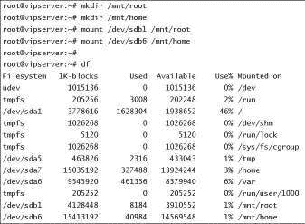

作为最后一步，让我们向配置文件 `/etc/fstab` 添加条目，以便在启动时自动挂载这些文件系统。首先将 `/etc/fstab` 复制为 `/etc/fstab.bak`。

```bash
# cp /etc/fstab /etc/fstab.bak
```

然后为了获取新分区的块 ID，输入 `lsblk -f`。`-f` 选项（`--fs` 的缩写）会扩展额外的文件系统信息。

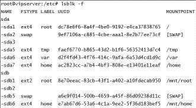

现在编辑配置文件 `/etc/fstab` 并按所示添加最后两行。

```bash
# cat fstab

# /etc/fstab: 静态文件系统信息
#
# 使用 'blkid' 打印设备的通用唯一标识符；
# 这可以配合 UUID= 使用更健壮的设备命名方法，
# 即使磁盘被添加或移除也能工作。参见 fstab(5)。
#
# <文件系统><挂载点><类型><选项><dump><pass>
# / 在安装时位于 /dev/sda1 UUID=dc78e6f6-8a4f-4be0-9192-e4ca3783876
```

```bash
$ stat test
```

```
File: test
Size: 0 Blocks: 0 IO Block: 4096 regular empty file
Device: 808h/2056d Inode: 260930 Links: 4
Access: (0644/-rw-r--r--) Uid: (1000/user) Gid: (1000/user)
Access: 2020-09-19 16:51:10.033912519 +0200
Modify: 2020-09-19 16:51:10.033912519 +0200
Change: 2020-09-19 16:51:19.245900960 +0200
Birth:
```

```bash
$ touch test
```

### 13.2 软链接

软链接，也称为符号链接（symbolic link），是文件系统中指向另一个文件名的链接。它非常类似于 Windows 系统中的快捷方式。与硬链接不同，符号链接不包含目标文件的数据，它只是指向文件系统某处的另一个节点。这种区别使得软链接具有硬链接不具备的特性，例如能够链接到目录、字符设备、块设备或通过 NFS 网络的远程计算机上的文件。

要在 Linux 中创建软链接，我们将使用相同的 `ln` 命令，但加上 `-s` 选项。`-s` 是 `--symbolic` 的缩写。

```bash
$ touch test
$ ln -s test softlink1
$ ln -s test softlink2
$ ln -s test soft link3
```

再次，`ls -i` 的输出显示了两列：索引节点（inode）和文件名。你会发现这四个文件的 inode 号是不同的，且 `softlink1`、`softlink2`、`softlink3` 和 `test` 指向不同的 inode。

```bash
$ ls -i test softlink*
260931 softlink1
260932 softlink2
260933 softlink3
```

如果你使用 `-l` 选项（长格式）调用 `ls` 命令，输出所示。最左侧的列以 `l` 开头表示链接，最右侧列显示软链接指向的文件名。

```bash
$ ls -l softlink*
lrwxrwxrwx 1 user user 4 Sep 15 14:05 softlink1 -> test
lrwxrwxrwx 1 user user 4 Sep 15 14:05 softlink2 -> test
lrwxrwxrwx 1 user user 4 Sep 15 14:05 softlink3 -> test
```

### 13.3 实际示例

在这个示例中，我们将观察如何使用硬链接连接两个文件，以及如何再次取消链接。首先，我们使用 `echo` 并重定向输出创建一个名为 `file1` 的文件。`echo` 是一个内置 shell 命令，用于输出文本。该命令还会打印变量的值。

```bash
$ echo "This is File One" > file1
$ cat file1
This is File One
```

接下来，将 `file2` 链接到 `file1`，并将 `file2` 的内容输出到 `stdout`。

```bash
$ link file1 file2
$ cat file2
This is File One
```

现在它们都是同一个文件。让我们对 `file2` 进行修改并看看会发生什么。

```bash
$ echo "This is line Two" >> file2
$ cat file1
This is File One
This is line Two
```

如示例所示，`file1` 和 `file2` 都被视为同一个文件。

```bash
$ ls -l
total 0
$ echo "This is File One" > file1
$ cat file1
This is File One
$ link file1 file2
$ ls
file1 file2
$ cat file2
This is File One
$ echo "This is line Two" >> file2
$ cat file2
This is File One
This is line Two
$ cat file1
This is File One
This is line Two
```

取消 `file1` 会删除指向 `file1` 的硬链接，但 `file2` 仍在那里。

```bash
$ unlink file1
$ ls
file2
```

取消 `file2` 会删除硬链接并删除文件，因为不再没有指向该文件的硬链接。

```bash
$ unlink file2
$ ls
$ ls -al
total 8
drwxr-xr-x 5 jk 4096 Sep 18 22 .
drwxr-xr-x 3 jk 4096 Sep 18 15 ..
```

## 14. 软件包管理

在当今的世界，软件非常复杂。这种复杂性源于程序被拆分为多个组件，如二进制数据、共享库和文档。这种软件开发的概念被称为模块化，被广泛接受和使用。例如，Debian 提供了超过 50000 个不同的软件包。软件包管理涵盖了处理这些软件包的所有操作，包括安装、配置、删除和更新。它还涵盖了软件包依赖关系。

### 14.1 理解软件包架构

为了解释 Linux 软件包架构，我们将使用 Debian 进行。Debian 发行版以其稳定的软件包系统闻名。以下描述适用于所有源自 Debian 的 Linux 发行版，如 Ubuntu、Linux Mint、Knoppix、Kali Linux 和 Xandros。注意，软件包的名称可能不同，发行版特定的镜像和软件包类别也是如此。

Debian 软件包生态系统包含许多不同的组件，如软件包列表、软件包源、软件包镜像、不同的软件包、用于软件包设置软件以及软件包缓存。这些组件将在下文中详细说明。

#### 软件包列表

Debian 包含可用软件包列表。此列表在 `/etc/apt/sources` 文件中引用，以及 `/etc/apt/sources.list.d` 目录下的特定组件。例如，Messenger 使用 `skype-stable.list` 文件。列表使用文本格式，每行一个软件包源：

```text
deb http://ftp.debian.org/debian/ stretch main contrib non-free
deb-src http://ftp.debian.org/debian/ stretch main contrib non-free
```

每行指向二进制软件包类型 (`deb`) 或源软件包类型 (`deb-src`)。软件包类型后面是软件包源，它指向提供软件包的存储库。接下来，该行包含 Debian 版本的名称，可以指定为版本的别号或分支。

别号源自电影《玩具总动员》中的角色。分支指的是版本的开发阶段，可以是 `oldoldstable`（上上版本）、`oldstable`（上一个版本）、`stable`（当前版本）、`testing`（下一个版本）、`unstable`（未来版本）或 `experimental`。在分支名称之后是软件包类别。

Debian 9 Stretch 的安全更新条目如下：

```text
deb http://security.debian.org/ stretch/updates main contrib non-free
src http://security.debian.org/ stretch/updates main contrib non-free
```

为了从引用的软件包源刷新软件包列表，调用以下命令：

```bash
# apt-get update
```

```text
Get:1 http://security.debian.org/debian-security stretch/updates InRelease [94.3 kB]
Ign:2 http://ftp.us.debian.org/debian stretch InRelease
Get:3 http://ftp.us.debian.org/debian stretch-updates InRelease [91.0 kB]
Get:4 http://security.debian.org/debian-security stretch/updates/main Sources [179 kB]
Get:5 http://security.debian.org/debian-security stretch/updates/main amd64 Packages [447 kB]
Hit:6 http://ftp.us.debian.org/debian stretch Release
Get:8 http://ftp.us.debian.org/debian stretch-updates/main Sources.diff/Index [5,164 B]
Get:9 http://ftp.us.debian.org/debian stretch-updates/main amd64 Packages.diff/Index [5,164 B]
Get:10 http://ftp.us.debian.org/debian stretch-updates/main Translation-en.diff/Index [3,688 B]
Get:11 http://ftp.us.debian.org/debian stretch-updates/main Sources 2018-07-31-2010.17.pdiff [385 B]
```

#### 软件包源

Debian 项目维护着名为软件包镜像的官方软件包源列表。该列表分为主软件包镜像和二级软件包镜像。主软件包镜像提供所有支持的架构，而二级软件包镜像仅提供子集。对于美国，官方的主软件包镜像是：`ftp.us.debian.org`。

你可以在以下地址查看所需软件包镜像的当前状态：

`https://mirror-master.debian.org/status/mirror-status.html`

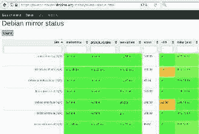

#### 软件包类型

Debian 将其软件包分为三类：

- `主` - 自由软件包。
- `贡献` - 依赖非免费软件包的自由软件包。
- `非免费` - 不提供源代码的非免费软件包。非免费类别的软件包包括固件驱动程序、Skype 软件和 Flash 插件。软件包列表中的每一项都指定了它们的软件类别。

#### 软件包管理工具

为了维护安装在你的 Linux 系统上的软件包选择，有多种工具可用：

- `dpkg` - 用于管理单个软件包。
- `apt`、`aptitude`、`synaptic` - 用于管理带有依赖关系的软件包。
- `tasksel` - 用于管理整个软件集合（任务）。

下面的图片描述了这些工具运行的不同级别以及它们如何协同工作。两个虚线轮廓的框指的是处理软件包管理任务的共享库。在较低级别，我们有 `dpkg`。它的任务是安装单个 Debian 软件包或删除已安装的软件包的内容。为了查询软件包和文件，它使用了两个工具 `dpkg-deb` 和 `dpkg-query`。`dpkg` 允许你维护软件包基础，但不处理软件包依赖关系。

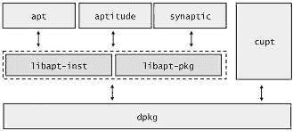


通常，上层由 `apt`、`aptitude` 和 `synaptic` 工具表示。这些工具的任务是通过将所有操作合并到一个应用程序中来简化软件包管理。这些工具使用共享库 `libapt-inst` 或 `libapt-pkg`，或者直接与 `dpkg` 通信以执行软件包管理任务。这包括处理软件包依赖。

## 软件包缓存

软件包缓存位于 `/var/cache/apt/archives`。每当你通过 `apt-get` 或 `aptitude` 安装软件包时，相应的软件包就会被检索并本地存储在此位置。为了说明，下面列表使用 `ls` 列出了缓存的 deb 软件包。

```
$ ls /var/cache/apt/archives/*.deb

/var/cache/apt/archives/cpuid_20140123-2_amd64.deb
/var/cache/apt/archives/libxml2-utils_2.9.1+dfsg1-5+deb8u7_amd64.deb
/var/cache/apt/archives/python3-bitarray_0.8.1-1_amd64.deb
/var/cache/apt/archives/python-bitarray_0.8.1-1_amd64.deb
```

你安装的软件越多，缓存的 deb 软件包就越多。建议定期使用 `aptitude` 或 `apt-cache` 清理软件包缓存。

```
# aptitude clean
# apt-cache clean
```

# 14.2 日常管理任务

本节涉及作为 Linux 所有者和管理员日常生活中需要的基本软件包管理操作。

## 显示已安装的软件包

`dpkg -l` 命令列出已安装的软件包及其状态。下面的图片显示了输出。

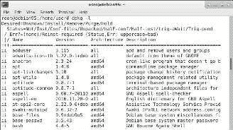

单列包含以下信息：


`status` - 软件包的状态，例如完全安装 (ii) 或已删除但仍保留配置 (rc)。


`name` - 软件包名称。


`version` - 软件包版本。


`architecture` - 软件包构建的架构或平台。


`description` - 软件包的简短描述。

## 安装软件包

要安装软件包，请使用 `apt-get` 命令。下面的输出显示了 `htop` 软件包的情况。

```
# apt-get install htop

Reading package lists… Done
Building dependency tree
Reading state information… Done
Suggested packages:strace

The following NEW packages will be installed:
htop0 upgraded, 1 newly installed, 0 to remove and 35 not updated.

Need to get 88.2 kB of archives.
After this operation, 224 kB of additional disk space will be used.

Get:1 http:..ftp.us.debian.org/Debian stratch/main amd64 htop amd64 2.0.2-1 [88.2 kB] Fetched 88.2 kB in 1s (76.6 kB/s)

Selecting previously unselected package htop.
(Reading database … 82741 files and directories currently installed.)
Preparing to unpack …/htop_2.0.2-1_amd64.deb …
1_amd64.deb …
1) …

Processing triggers for mimesupport (3.60) …
support (3.60) …
1) …

Processing triggers for man-db (2.7.6.1-2)…
Setting up htop (2.0.2-1) …
```

## 更新已安装的软件包

更新已安装的软件包非常简单，按照如下方式即可。首先，使用本章之前提到的 `apt-get update` 更新软件包列表。然后运行 `apt-get install` 来更新软件包。如果有可用的软件包更新版本，将从软件包镜像中检索新软件包，删除旧软件包并安装新软件包。

## 移除已安装的软件包

移除已安装的软件包的方法与安装或更新类似。`apt-get` 命令具有删除软件包的选项，如下所示。

```bash
# apt-get remove htop

Reading package lists… Done
Building dependency tree
Reading state information… Done

The following packages will be REMOVED:
htop
0 upgraded, 0 newly installed, 1 to remove and 35 not updated.

After this operation, 224 kB of additional disk space will be freed.
Do you want to continue? [Y/n]

(Reading database … 82751 files and directories currently installed.)
Removing htop (2.0.2-1)…

Processing triggers for mimesupport (3.60) …
support (3.60) …
1) …
1) …
2) …
```

此步骤会移除所有配置文件之外软件包内容。要彻底移除软件包及其配置文件，请如下添加开关 `--purge`：

```bash
# apt-get remove --purge htop
```

## 寻找 Linux 替代方案

你可能会发现某些程序与 Linux 不兼容，且仅为 Windows 或 macOS 创建。但 Linux 的伟大之处在于，对于每一个 Windows 或 macOS 应用，几乎总有一个 Linux 替代方案。以下是寻找 Linux 特有应用的两个优秀资源。


https://www.linuxalt.com/


https://linuxfinder.com/

# 15. 进程管理

理解程序的执行对于成为一名优秀的管理员至关重要，对普通用户也有用。程序的运行实例被称为进程。每个进程都被分配一个进程 ID (PID)，允许系统跟踪所有进程。系统进程 PID 为 0，然后初始进程 PID 为 1，以此类推。初始进程 PID 1 指向旧系统上的 `/sbin/init` 或现代系统上的 `/sbin/systemd`。

## 15.1 使用 `ps` 和 `pstree`

要列出所有运行中的进程，请使用 `ps` 命令或 `pstree` 命令。

```bash
# ps

PID TTY TIME CMD
628 pts/0 00:00:00 su
629 pts/0 00:00:00 bash
2507 pts/0 00:00:00 ps
```

上述 `ps` 输出由四列组成，含义如下：


`PID` - 进程 ID。


`TTY` - 调用命令的终端。


`TIME` - 进程运行的时间。


`CMD` - 调用的命令。

以下开关可检索有关进程的额外信息：


`-e`：显示所有进程。


`-p`：仅显示指定的 PID 信息。


`-C`：显示指定命令名的进程。


`-u`：显示属于指定用户的进程。

```bash
$ ps -u fritz

PID TTY TIME CMD
1341 ? 00:00:00 systemd
1406 ? 00:00:32 xfwm4
1408 ? 00:01:10 xfce4-panel
1410 ? 00:00:15 xfdesktop
1411 ? 00:00:05 xfsettingsd
1413 ? 00:00:05 x-www-browser
1415 ? 00:00:06 xfce4-power-man
1418 ? 00:00:00 gvfsd
1808 pts/0 00:00:00 bash
1841 pts/0 1-06:21:26 iceweasel
4537 pts/4 00:00:00 bash
4760 pts/5 00:00:00 bash
5281 pts/1 00:00:00 bash
8213 pts/2 00:00:03 bash
```

### `pstree`

`pstree` 命令与 `ps` 命令类似，但它将进程显示为层级树结构。一个非常有用的选项是 `-p`，它可以在进程名称后添加进程 ID（PID）。

### `pidof`

`pidof` 命令简单地显示指定进程的 ID。下面的示例返回了运行 `bash` 的进程的 PID。

```bash
# pidof bash
629 623
```

### `pgrep`

`pgrep` 是用于进程的 `grep` 命令（之前见过）。该命令遍历当前运行的进程，并输出匹配给定模式的进程 ID。

下面的示例展示了两次调用。第一次调用请求 `pgrep` 搜索名称中包含 `xterm` 字符串模式的进程，并只输出结果进程 ID。第二次调用使用了两个选项 `-l`（`-list-name` 的缩写）和 `-a`（`--list-full` 的缩写）来显示进程 ID 和对应的进程名称。

```bash
$ pgrep xterm
741

$ pgrep -la xterm
741 xterm
749 xterm
```

### `top` 和 `htop`

`top` 命令根据活动情况显示进程。最活跃的进程位于顶部，随后是活跃程度较低的进程。列表每秒更新一次。单列包含进程 ID (PID)、进程所有者的用户名 (`USER`)、进程优先级 (`PR`)、nice 值 (`NI`)、虚拟内存使用 (`VIRT`)、保留内存 (`RES`)、共享内存 (`SHR`)、CPU 和内存使用百分比 (`%CPU` 和 `%MEM`)、进程运行时间 (`TIME`) 以及用于调用进程的命令 (`COMMAND`)。

`htop` 是一个额外的软件包（请参考第 4 章和第 14 章关于安装额外软件包的内容），包含一个更具交互性的 `top` 版本。列的布局与 `top` 。使用导航键和功能键来选择、排序或删除进程。

功能键如下：

- `F1`：显示帮助。
- `F2`：配置 `htop`。
- `F3`：在进程列表中搜索。
- `F4`：过滤终端输出。
- `F5`：将进程显示为进程树。
- `F6`：更改进程的排序顺序。
- `F7`：降低选中进程的 nice 值。
- `F8`：增加选中进程的 nice 值。
- `F9`：终止选中进程。
- `F10`：退出程序。

## 15.2 前台进程与后台进程

进程有两种：前台进程和后台进程。前台进程通过终端会话初始化并控制。换句话说，必须有用户连接系统才能启动这些进程，且进程在执行期间会占用终端。相比之下，后台进程不连接终端，不需要显式的任何用户输入。因此，它们在等待完成时不占用终端，允许你运行多个进程。

可以使用 `&` 符号在后台初始化进程。

```bash
$ process1 &
...
```

要将运行中的进程发送到后台，请使用 `bg` 命令加上作业 ID。或者使用 `fg` 将进程发送到前台。你可以使用 `jobs` 命令显示当前正在运行的作业及其相关的作业 ID。

```bash
$ process1 &
$ process2 &
$ jobs
[1]+ Running process1
[2]- Running process2
```

## 15.3 停止与终止进程

如果一个运行中的程序无响应并导致系统负载过高，我们可以做什么来停止并移除它？幸运的是，我们有几个选项可以让我们向程序发送特定信号来停止它。在此情况下使用的命令是 `kill` 命令以及相应的选项。其中，我们有以下选项：

- `SIGHUP` (1) - 挂断信号。程序可以监听此信号并对其采取行动。当你关闭终端时，此信号会被发送给运行在终端中的进程。
- `SIGINT` (2) - 中断信号。此信号被发送给进程以中断它们。程序可以处理此信号并对其采取行动。你也可以通过在运行程序的终端窗口中输入 `CTRL+C` 直接签发出此信号。
- `SIGTERM` (15) - 终止信号。此信号被发送给进程以将其终止。同样，程序可以处理此信号并对其采取行动，例如在终止之前将数据写入文件。这是 `kill` 命令在未指定信号时发送的默认信号。
- `SIGKILL` (9) - 强制杀死信号。此信号会导致 Linux 内核立即终止进程。程序无法监听此信号。

要终止并杀死名为 `hangingProgram` 的程序，你必须首先识别该程序。你可以通过使用 `pgrep` 如下找到相关的进程：

```bash
$ pgrep hangingProgram
3167
```

接下来，向识别出的进程发送 `SIGTERM` 信号：

```bash
$ kill -SIGTERM 3167
```

作为替代，你可以按照如下方式调用 `kill`：

```bash
$ kill -15 3167
```

或者你可以通过按下 `CTRL+Z` 停止挂起的进程，然后使用此命令删除进程：

```bash
$ kill -SIGKILL 3167
```

如上所示，该命令的效果相同：

```bash
$ kill -9 3167
```

## 15.4 调整进程优先级

你机器的处理器可以同时管理多个任务。我们可以为 CPU 在查看不同待执行任务时设定遵循的指南。这些指南被称为 niceness 或 nice 值。Linux 的 niceness 范围从 -20 到 19，数字越小代表任务的优先级越高。如果 nice 值很高（如 19），该任务将被设置为最低优先级，CPU 将在任何有机会时处理它。默认 nice 值为零。

你可以使用 `ps` 如下显示进程的 nice 值：

```bash
$ ps -o pid,comm,nice -p 1808
PID COMMAND NI
1808 bash 0
```

第一列包含进程 ID (`PID`)，第二列包含命令，第三列包含 nice 值 (`NI`)。如上面的示例所示，PID 为 `1808` 的 `bash` 进程的 nice 值为 0。可以使用 `renice` 命令调整现有进程的 nice 值。要将上述进程的 nice 值降低到 10，执行以下命令。请记住，只有 root 用户可以对进程应用负的 nice 值。

```bash
$ renice 10 -p 1808
```

# 16 系统与网络安全

本章的核心思想是建立对如何设置和运行安全系统的基本理解。在接下来的部分中，我们将关注更具实操性的方法，查看开放端口的检测、现有及活跃用户、限制远程访问、更新软件以及利用可用的计算能力。

## 16.1 开放端口

如果你从一开始就跟着操作，可能记得我们在安装 Linux 发行版时采用了极简安装。我们只安装了实际需要的软件包，并在以后需要时事后安装其他软件。我们建议所有新安装都这样做，因为其结果是一个非常精简、高性能且所需资源最少的系统。第二个原因是有限的软件限制了系统内部潜在安全问题的数量。

作为下一步，我们将检查从 Linux 系统外部可用的服务数量。这被称为端口扫描。协助我们的工具是命令行工具 `netcat` 和 `nmap`（Network Mapper 的缩写），以及其图形版本 `zenmap`。

### `netcat`

以下 `nc` (`netcat`) 命令开始扫描本地桌面系统 (`localhost`) 在端口 1 到 1024 之间的可用网络服务。`-zv` 选项启用端口的详细扫描：

```bash
$ nc -zv localhost 1-1024
localhost [127.0.0.1] 631 (ipp) open
localhost [127.0.0.1] 111 (sunrpc) open
localhost [127.0.0.1] 80 (http) open
localhost [127.0.0.1] 25 (smtp) open
localhost [127.0.0.1] 22 (ssh) open
```

`nc` 每行报告一个检测到的服务。上述示例的结果是端口 631 上的网络打印协议 (IPP)、端口 111 上的 Sunrpc 服务、端口 80 上的超文本传输协议 (HTTP)、端口 25 上的简单邮件传输协议 (SMTP) 以及端口 22 上的安全外壳 (SSH)。检测我们 Linux 服务器上的开放端口会给我们略有不同的视图。下面的示例显示了我们的扫描结果。你可以看到，`nc` 接受各种输入：单个端口、整个端口范围或服务名称。如果连接被拒绝。

```bash
$ nc -zv localhost 1-1024 localhost [127.0.0.1] 22 (ssh) open
```

```bash
$ nc -zv localhost ssh
```

```text
localhost [127.0.0.1] 22 (ssh) open
```


```bash
$ nc -zv localhost ftp
```

如果可用则返回 `open`，否则返回：

```
localhost [127.0.0.1] 21 (ftp) : Connection refused
```

```bash
$ nc -zv localhost http
```

```
localhost [127.0.0.1] 80 (http) : Connection refused
```

## nmap 和 zenmap

我们将查看的下一个命令是`nmap`。开关`-T4`设置定时，`-A`启用操作系统的检测。这一步被称为 OS 探测。以下调用对本地系统执行此操作：

```bash
$ nmap -T4 -A localhost
```

报告非常详细，包含了有关检测到的操作系统以及服务的信息。

```bash
$ nmap -T4 -A localhost
Starting Nmap 7.40 ( https://nmap.org ) at 2018-10-05 10:39
Nmap scan report for localhost (127.0.0.1)
Host is up (0.00013s latency).
Other addresses for localhost (not scanned): ::1
Not shown: 999 closed ports
PORT STATE SERVICE VERSION
22/tcp open ssh OpenSSH 7.4p1 Debian 10+deb9u3 (protocol 2.0)
| ssh-hostkey:
| 2048 0d:9e:f0:07:f4:86:33:c1:77:24:d6:4b:af:c7:c2:78 (RSA)
| 256 22:83:b2:bc:b2:7d:64:6b:86:b2:6b:e6:c2:d4:45:6c (ECDSA)
Service Info: OS: Linux; CPE: cpe:/o:linux:linux_kernel
Service detection performed. Please report any incorrect results at https://nmap.org/submit/. Nmap done: 1 IP address (1 host up) scanned in 0.55 seconds
```

下面我们使用`zenmap`扫描我们的 Linux 系统，它为我们提供了与上面相同的结果。两个结果都显示，唯一启用且从外部访问的服务是 OpenSSH（Open Secure Shell 的缩写）。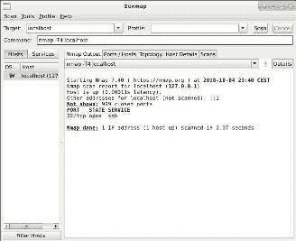

## 16.2 本地和远程用户

Linux 系统的安全性包括用户及其账户。在第 10 章中，我们查看了如`w`、`who`和`users`等基本命令。现在我们将处理更复杂的检测用户信息的方法。

要存在哪些本地账户，你可以查看`/etc/passwd`文件并验证这些条目。普通用户账户的用户 ID 以`1000\.`开始。为了查看哪些本地用户登录了系统，可以使用`lslogins`命令。`lslogins`从不同的配置文件中提取用户信息并以非常漂亮的方式显示结果。作为普通用户调用且不带任何额外开关时，它会显示用户 ID、账户名称、登录次数以及 GECOS 字段的内容。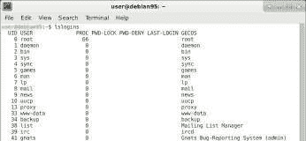

作为管理员用户调用时，`lslogins`会增加`PWD-LOCK`和`PWD-DENY`两列的信息。这些列显示了关联账户是否被锁定或是否拒绝了通过密码登录。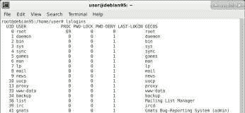

为了查看特定用户的详细信息，`lslogins`使用开关`-u`后接用户名，以及使用`--time iso`以可读的格式显示时间。

### lslogins -u user --time iso

```
Username: user
UID: 1000
Gecos field: Debian User,123,456,135
Home directory: /home/user
Shell: /bin/bash
No login: no
Password is locked: no
Password not required: no
Login by password disabled: no
Primary group: user
GID: 1000
Supplementary groups: Bluetooth, cdrom, floppy, audio, dip, video, plugdev, netdev Supplementary group IDs: 111, 24, 25, 29, 30, 44, 46, 108
Hushed: no
Password expiration warn interval: 7
Password changed: 2018-08-20
Maximum change time: 99999
Running processes: 32
Last logs:
2020-10-05T12:11:19+0200 systemd[438]: Time has been changed
2020-10-05T12:11:52+0200 systemd[438]: Time has been changed
2020-10-05T12:12:24+0200 systemd[438]: Time has been changed
```

如上所述，`lslogins`仅评估本地登录尝试。要检索来自远程系统的登录尝试，请使用`getent`命令。它还评估支持名称服务切换库（NSS）的数据库，该库在`/etc/nsswitch.conf`中配置，并涵盖了轻量级目录访问协议 (LDAP) 和网络信息系统 (NIS) 等服务。要获取用户`caro`的信息，如下所示调用`getent`：

```bash
$ getent passwd caro
```

```
caro:x:1005:1005:Caro,,,:/home/caro:/bin/bash
```

这两个命令`last`和`lastlog`也可以用于显示哪些用户最后登录过。`last`报告如下所示的详细登录情况。列包含用户名、终端和会话信息。

```bash
$ last
```

```
user pts/13 :0 Fri Oct 5 14:11 - 14:24 (00:13 elapsed)
```

`lastlog`打印最后登录用户的统计信息。第一个示例显示所有用户的情况，第二个针对特定用户。）、包名，然后是包类 (`extra`）。

```bash
$ deorphan -szP
235 main/oldlibs iceweasel extra
32 main/oldlibs netcat extra
```

可以使用下面的命令删除不再需要的包。这将清理系统中遗留的未使用的库和旧依赖项。

```bash
$ apt-get autoremove
```

移除未使用的软件非常有帮助。保持剩余软件包更新到最新版本也很重要，我们在第 14.16.5 节中讨论过。

# 有用的网络和系统命令

`uname`是 UNIX name 的缩写。该命令显示系统信息，例如 Linux 内核的准确名称和版本以及计算机的主机名。下面的示例显示了带有参数`-a`（`all`的缩写）的`uname`命令。输出包含操作系统名称（Linux）、主机名（debian106）、内核版本及其编译日期（4.9.8-7-amd64 #1 SMP Debian 4.9.110-1 (2018-07-05))以及系统架构（x86_64）。

```bash
$ uname -a
Linux debian106 4.9.0-7-amd64 #1 SMP Debian 4.9.110-1 (2018-07-05) x86_64 GNU/Linux 
```

`uptime`此命令显示系统运行了多久。它显示当前时间（07:36:47），之后是运行的小时（21:56）、登录用户数（1 user）以及过去 1、5 和 15 分钟的平均负负载（load average: 0.47, 0.43, 0.29）。

```bash
$ uptime
07:36:47 up 21:56, 1 user, load average: 0.47, 0.43, 0.29
```

要以更好的方式查看运行时间，请使用选项`-p`（`pretty`的缩写）。下面的示例显示了更符合人类阅读习惯的信息。系统已运行了 22 小时 3 分钟。

```bash
$ uptime -p
up 22 hours, 3 minutes
```

`ip` `ip`命令（配合关键词`address` `show`）显示当前网络配置。下面的示例显示了回环接口（`lo`）和太网接口（`enp0s3`）。网网接口配置了 IP 地址`10.0.2.15`。网络接口的缩写如下：


- `Lo`：回环接口。用于访问本地服务，如代理或 Web 服务器。


- `eth0`：连接到网络交换机或路由器的第一个太网接口。


- `wlan0`：第一个无线接口。


- `ppp0`：第一个点点接口，用于通过 VPN 或拨号服务连接。

```bash
$ ip address show
1: lo: <LOOPBACK, UP, LOWER_UP> mtu 65536 qdisc noqueue state UNKNOWN group default qlen 1link/loopback 00: 00: 00: 00 00: 00 brd 00: 00: 00: 00 00: 00
inet 127.0.0.1/8 scope host lo
valid_lft forever preferred_lft forever
inet6 ::1/128 scope host
valid_lft forever preferred_lft forever
2: enp0s3: <BROADCAST,MULTICAST, UP, LOWER_UP> mtu 1500 qdisc pfifo_fast state UP group default qlen 1000link/ether 08: 00: 27: e3: 5c: 79 brd ff: ff: ff: ff: ff: ff:inet 10.0.2.15/24 brd 10.0.2.255 scope global enp0s3
valid_lft forever preferred_lft forever
inet6 fe80::a00:27ff:fee3:5c79/64 scope link
valid_lft forever preferred_lft forever
```

`ping`向给定的 IP 地址或主机名发送 ICMP 网络包，并显示往返时间。下面的示例演示了主机`http://www.google.com`的情况。

```bash
$ ping google.com
PING google.com (127.217.23.142) 56(84) bytes of data.
64 bytes from fra16s18-in-f14.1e100.net (172.217.23.142): icp_seq=1 ttl=63 time=36.9 ms 64 bytes from fra16s18-in-f14.1e100.net (172.217.23.142): icp_seq=2 ttl=63 time=37.9 ms 64 bytes from fra16s18-in-f14.1e100.net (172.217.23.142): icp_seq=3 ttl=63 time=40.1 ms ^C
--- google.com ping statistics --
3 packets transmitted, 3 received, 0% packet loss, time 2003ms
rtt min/avg/max/mdev = 36.953/38.353/40.193/1.377 ms
```

# 17. 共享库

Linux 与任何操作系统一样，都包含了用于不同目的的文件集合，例如二进制文件（编译后的程序代码）、运行时解释代码（用 Perl 或 Python 等程序编写的代码）、配置文件、日志文件、库和用户数据。在编程世界中，库是一系列预编译的代码片段，这些片段可以在其他程序中使用。这些库包含了函数、类和数据结构。它们允许重用已经存在并经过测试的代码，因此用户不需要重复造轮子。结果，库极大地简化了程序员的生活。Linux 中最突出的库示例是标准 C 库`libc`以及`libc`的 GNU 版本`glibc`。

Linux 区分了静态链接和动态链接的二进制程序。静态链接意味着库中的例程成为程序的一部分。相比之下，动态链接意味着库中的例程仅被引用，而不会成为程序的一部分。静态链接程序彼此完全独立，但需要更多的磁盘空间。动态链接程序较小，但依赖于引用的库，这意味着如果引用的库已经在内存中，它们的加载速度会更快。这些库被称为共享库或动态库。

## 17.1 命名规范

通常将共享库的文件名扩展为`.so`，这是 shared object（共享对象）的缩写。除了文件名外，共享库还有一个名为`soname`的库名。例如，`libc`的`soname`是`libc.so.6`。这里`lib`是前缀，`c`是描述性名称，`so`是 shared object 的缩写，而`6`是库的版本（应用程序二进制接口 ABI 的版本）。包含路径的文件名是`/lib64/libc.so.6`。注意`soname`是指向文件名的符号链接。

通常这些文件位于以下目录中：


- 默认路径 - `/usr/local/lib`, `/usr/local/lib64`, `/usr/lib`, `/usr/lib64/`。


- 系统启动库 - `/lib`, `/lib64`。

然而，程序员可以在自定义位置安装库。库路径在配置文件`/etc/ld.so.conf`中定义。可以通过以下方式定义库的位置：

```bash
$ cat /etc/ld.so.conf
include /etc/ld.so.conf
```

以下命令说明了如何使用`find`命令在系统中查找共享库：

```bash
$ find / -name "*.so*"
```

## 17.2 识别引用的共享库

要确定一个二进制文件使用了哪些共享对象，我们可以使用`ldd`命令。例如，要查找文件的共享对象，输出中的每一行都由`soname`后接括号中的文件名组成。

```bash
$ ldd /bin/bash
linux-vd-x86-64.so.2 (0x0000555cbfa60000)
libang.so.2 => /lib/x86_64-linux-gnu/libang.so.2 (0x00007f483d6bb00)
libgpm.so.2 => /lib/x86_64-linux-gnu/libgpm.so.2 (0x00007f483d4b50)
libext2fs.so.2 => /lib/x86_64-linux-gnu/libext2fs.so.2 (0x00007f483d26e0)
libssh2.so.1 => /lib/x86_64-linux-gnu/libssh2.so.1 (0x00007f483d0450)
libgmodule-2.0.so => /lib/x86_64-linux-gnu/libgmodule-2.0.so (0x00007f483cb4100)
libglib-2.0.so => /lib/x86_64-linux-gnu/libglib-2.0.so (0x00007f483cb3100)
libpthread.so.0 => /lib/x86_64-linux-gnu/libpthread.so.0 (0x00007f483c91400)
libc.so.6 => /lib/x86_64-linux-gnu/libc.so.6 (0x00007f483c56900)
libdl.so.2 => /lib/x86_64-linux-gnu/libdl.so.2 (0x00007f483c3640)
libm.so.6 => /lib/x86_64-linux-gnu/libm.so.6 (0x00007f483c0630)
libcom_err.so.2 => /lib/x86_64-linux-gnu/libcom_err.so.2 (0x00007f483be5f00)
libz.so.1 => /lib/x86_64-linux-gnu/libz.so.1 (0x00007f483bc4300)
libgcrypt.so.20 => /lib/x86_64-linux-gnu/libgcrypt.so.20 (0x00007f483b96200)
libpcre.so.3 => /lib/x86_64-linux-gnu/libpcre.so.3 (0x00007f483b6f400)
/lib64/ld-linux-x86-64.so.2 (0x0000555cbfa6000)
```

`libgpg-error.so.0 => /lib/x86_64-linux-gnu/libgpg-error.so.0 (0x00007f483b4e1000)`

如果二进制文件是静态链接程序，`ldd`的输出如下：

```bash
$ ldd /usr/bin/ldd
not a dynamic executable
```

## 17. 使用 objdump 识别引用的库


`ldd` 的替代方案是 `objdump`。下面的示例结合了 `objdump` 和 `grep`，以便过滤出包含所需共享对象的行。程序 `mc` 需要下面所示的八个共享库。`grep` 将在第 7 章详细讨论。目前，只需知道该命令作为过滤器处理文本数据，并仅打印匹配指定字符的文本行。

```bash
$ objdump -p /usr/bin/mc | grep NEEDED
NEEDED libslang.so.2
NEEDED libgpm.so.2
NEEDED libext2fs.so.2
NEEDED libssh2.so.1
NEEDED libgmodule-2.0.so.0
NEEDED libglib-2.0.so.0
NEEDED libpthread.so.0
NEEDED libc.so.6
```

# 18. 日志文件

在 Linux 管理中，有时你需要弄清楚系统为何以出乎意料的方式运行。这就是日志文件的用用场。这类文件记录了系统的行为，并帮助你找出任何时间点发生了什么。日志文件存储在 `/var/log` 目录。哪些日志文件对你重要取决于你的系统和需求。

## 18.1 重要的日志文件

下面说明的日志文件是服务器系统中最重要的文件之一。

### `/var/log/messages`

这是 Linux 中最重要的日志文件。它持久地记录通用系统事件，例如系统错误消息、系统启动和关闭，以及网络配置的变化。下面的示例包含了电话（USB 设备）连接时立即记录的日志消息：

```text
Oct 4 15:10:37 debian106 kernel: [532994.056321] usb 2-2: USB disconnect, device number - 16
Oct 4 15:10:37 debian106 kernel: [532994.391279] usb 2-2: new high-speed USB device number 17 using xhci_hcd
Oct 4 15:10:37 debian106 kernel: [532994.520991] usb 2-2: New USB device found, idVendor=04e8, idProduct=6860
Oct 4 15:10:37 debian106 kernel: [532994.520993] usb 2-2: New USB device strings: Mfr - =1, Product=2, SerialNumber=3
Oct 4 15:10:37 debian106 kernel: [532994.520994] usb 2-2: Product: SAMSUNG_Android
Oct 4 15:10:37 debian106 kernel: [532994.520995] usb 2-2: Manufacturer: SAMSUNG ...
```

### `/var/log/lastlog`

该文件记录了哪些用户登录了 Linux 系统。使用 `lastlog` 命令查看登录统计数据。我们在第 16 章中详细讨论过这个命令。

### `/var/log/auth.log`

Debian 和 Ubuntu 服务器中所有认证相关的事件都记录在这里。如果你正在查找任何涉及用户授权机制的记录，可以在此日志文件中找到。

```text
Oct 1 07:30:01 debian106 CRON[4251]: pam_unix(cron:session): session opened for user root by (uid=0)
Oct 1 07:30:01 debian106 CRON[4251]: pam_unix(cron:session): session closed for user root
Oct 1 09:04:14 debian106 systemd-logind[323]: Operation 'sleep' finished.
Oct 1 15:09:03 debian106 systemd-logind[342]: Watching system buttons on /dev/input/event3 (Power Button)
Oct 1 15:09:03 debian106 systemd-logind[342]: Watching system buttons on /dev/input/event4 (Sleep Button)
Oct 1 15:09:03 debian106 systemd-logind[342]: Watching system buttons on /dev/input/event5 (Video Bus)
Oct 1 15:09:03 debian106 systemd-logind[342]: New seat seat0.
Oct 1 15:09:04 debian106 sshd[392]: Server listening on 0.0.0.0 port 22.
Oct 1 15:09:04 debian106 sshd[392]: Server listening on :: port 22.
Oct 1 15:09:04 debian106 sshd[392]: Received UP; restarting.
```

### `/var/log/kern.log`

在这里你可以找到与 Linux 内核相关的消息。

```text
Oct 8 19:19:34 debian106 kernel: [893330.867019] usb 2-1: low-speed USB device number 37 using xhci_hcd
Oct 8 19:19:34 debian106 kernel: [893331.000139] usb 2-1: New USB device, idVendor=046d, idProduct=c03d
Oct 8 19:19:34 debian106 kernel: [893331.000142] usb 2-1: New USB strings: Mfr - =1, Product=2, SerialNumber=0
Oct 8 19:19:34 debian106 kernel: [893331.000144] usb 2-1: Product: USB-PS/2 Optical Mouse
Oct 8 19:19:34 debian106 kernel: [893331.000145] usb 2-1: Manufacturer: Logitech
Oct 8 19:19:34 debian106 kernel: [893331.000259] usb 2-1: ep 0x81 - rounding to 64 microframes, ep80 microframes
Oct 8 19:19:34 debian106 kernel: [893331.004037] input: USB-PS/2 Optical Mouse as /devices/pci0000:00:14.0/usb/2-1/2-1:1.0:0004:C03D.001B/input
Oct 8 19:19:34 debian106 kernel: [893331.004198] hid-generic 0004:C03D.001B/input/hidraw0: HID v10
```

### `/var/log/dpkg.log`

该文件属于 `dpkg`（我们在第 14 章讨论过），并记录了安装、更新和移除包的情况。

```text
2020-10-06 21:52:41 install
2020-10-06 21:53:11 install
2020-10-06 21:53:11 upgrade
2020-10-06 21:53:11 triggers
2020-10-06 21:53:11 half-configured
2020-10-06 21:53:11 half-installed
2020-10-06 21:53:11 unpacked
2020-10-06 21:53:11 upgraded
2020-10-06 21:53:11 upgrade
```

### `/var/log/apt/history`

与上文件类似，该文件记录了 `apt` 对安装、更新和移除包的更改。

```text
Start-Date: 2018-10-06 21:50:02
Upgrade: imagemagick-6.q16:amd64 (6.8.9.9-5+deb8u3, 6.8.9.9-5+deb8u4), imagemagick:amd64 (6.8.9.9-5+deb8u3, 6.8.9.9-5+deb8u4)
End-Date: 2018-10-06 21:50:04
Start-Date: 2018-10-06 21:51:05
Upgrade: bind9-host:amd64 (9.9.5.dfsg-9+deb8u15, 9.9.5.dfsg-9+deb8u16), liblwres90:amd64 (9.9.5.dfsg-9+deb8u15, 9.9.5.dfsg-9+deb8u16), libdns100:amd64 (9.9.5.dfsg-9+deb8u15, 9.9.5.dfsg-9+deb8u16), libisccfg90:amd64 (9.9.5.dfsg-9+deb8u15, 9.9.5.dfsg-9+deb8u16), libbind9-90:amd64 (9.9.5.dfsg-9+deb8u15, 9.9.5.dfsg-9+deb8u16), dnsutils:amd64 (9.9.5.dfsg-9+deb8u15, 9.9.5.dfsg-9+deb8u16), libisc95:amd64 (9.9.5.dfsg-9+deb8u15, 9.9.5.dfsg-9+deb8u16)
End-Date: 2018-10-06 21:51:07
```

## 18.2 核心命令与图形化工具

除了上面介绍的日志文件外，还有系统命令可以显示机器的相关信息。

`dmesg`

正如第 8 章所述，该命令允许你查看整个启动过程，包括 BIOS 消息。

```bash
# dmesg
```

`journalctl -b`

同样见第 8 章，该命令显示系统的启动日志。

```bash
# journalctl -b
```

`journalctl _UID=1000`

该命令显示特定用户的日志记录。在此实例中，它显示 ID 为 1000 的用户的记录。

```bash
# journalctl _UID=1000
```

`journalctl --disk-usage`

要查看存储日志文件需要多少磁盘空间，可以使用如下切换 `-disk-usage`：

```bash
# journalctl --disk-usage
```

归档和活动日志在系统中占用了 11.5M。

对于系统管理员来说，使用 `tail`、`cat` 或 `grep` 等命令行工具是非常常见的。但如果你更喜欢图形化工具，有两个非常棒的选择可以考虑：日志文件导航器 `lnav` 或 `glogg`，如下所示！

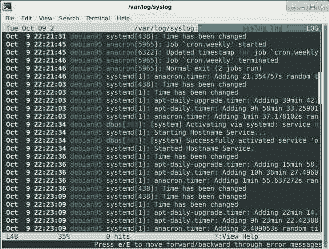

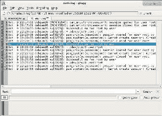

# 19. 获取帮助

Linux 是一个相当复杂的操作系统，对初学者来说尤其是如此。当你开始时，程序列表可能会让你非常困惑。每个程序的参数或选项列表都比上一个长。而且它们并不容易记忆，有长名称和短名称，且没有统一标准。在遇到困难时寻求帮助并不是错误，也不是失败的标志。

要在 Linux 系统上获取帮助，有几种方法可以。这包括手册页（称为 `man pages`）、信息页（称为 `info pages`）以及每个命令内置的帮助。在本章中，我们将更深入地查看这些帮助系统，并熟悉 `man`、`info`、`whereis` 和 `whatis` 命令。

## 19.1 Man Pages

手册页（Man pages）是分发程序文档的传统方式。`man page` 是 `manual page` 的缩写，因为它们对应于打印版手册的页面。手册页是 Linux 系统基础安装的一部分。相应的 Debian 软件包名为 `manpages`。

一个手册页对应于完整 UNIX 手册中的特定章节：1 代表命令，2 代表系统调用，此类等。要获取有关特定命令的信息，请在终端窗口中打开相应的手册页。例如，对于 `cp` 命令，操作如下：

```bash
$ man cp
```

生成的手册页所示：


快捷键绑定与文本编辑器 `vi(m)` 类似。使用方向键向上和向下滚动，按 `q` 退出手册页并返回终端。

## 19.2 Info Pages

`Info` 是 GNU 项目内部文档的默认格式。在 20 世纪 90 年代初，GNU 项目认为手册页系统已经过时，并编写了 `info` 命令来取代它。`info` 具有基础的超链接功能，并使用一种更简单的标记语言（与手册页使用的 `troff` 系统相比）。如今，这两个系统并存存在。

Debian 的基础安装不包含 `info` 页。为了使用它，请后安装名为 `info` 的软件包（参考第 4 章和第 14 章关于如何安装额外软件包）。要获取有关特定命令的信息，请在终端窗口中打开相应的 info 页。例如，对于 `cp` 命令，操作如下：

```bash
$ info cp
```

生成的 info 页所示：


## 19.3 Integrated 帮助

除了 `man` 和 `info`，许多命令都有 `-h` 选项（`-help` 的缩写）。带有此选项调用命令会打开特定的帮助部分。下面的示例显示了 `uname` 命令的内置帮助：


此外，`whatis` 命令对于获取 Linux 命令或函数的简要信息很有帮助。它会为作为命令行参数传递给 `whatis` 的字符串显示单行的手册页描述。`whatis` 在其由 `mandb` 程序维护的索引数据库中搜索该字符串，并从该命令手册页的 `NAME` 部分中选取一个简短描述。下面的示例显示了 `mv` 和 `man` 两个命令的情况：

```bash
$ whatis mv
mv (1) - move (rename) files

$ whatis man
man (1) - an interface to the on-line reference manuals
man (7) - macros to format man pages
```

另一个选项是 `whereis` 命令，有助于在 Linux 系统中定位命令的手册页。这是一个非常简单的实用。下面的示例显示了 `mv` 和 `man` 两个命令：

```bash
$ whereis mv
mv: /bin/mv /usr/share/man/man1/mv.1.gz

$ whereis man
man: /usr/bin/man /usr/local/man /usr/share/man /usr/share/man/man1/man.1.gz /usr/share/man/ma
```

每个命令还提供额外的信息和配置示例。这些内容存储在目录 `/usr/share/doc`，每个程序都有自己的子目录。内容是标准且因程序而异。内容对每个用户可见。下方显示了目录的一个片段：


## 19.4 External Help

如果软件工具提供的帮助不够，且需要进一步的解释，那么外部资源就会派上用场。可以咨询一些在线社区，例如：


- LinuxHint：`https://support.linuxhint.com`

  

- LinuxHelp：`https://www.linuxhelp.com`

另一个选项是 Linux 用户组（LUG）。LUG 是来自同一地理位置的人员小组，他们共享对 Linux 操作系统的共同兴趣。他们被组织成松散的人群或定期聚会的协会。全球 LUG 的完整列表可以通过 `LugsList` 获取，地址为 `http://lugslist.com`。


许多 LUG 组织聚会和经验分享，并从每个国际活动中学习。这包括分享想法和交流的本地和其他活动。


