# Linux 下的 Beowulf 集群计算（科学与工程计算）

Gordon Bell 序言

怀着尊敬与感激献给

Seymour R. Cray

1925–1996

1.4 集群的要素 8

+ 2 集群计算概述—Sterling 15

- 14.1.1 Condor 的特性 308

- 15.2.2 仿真与测试 352

- 16.6.4 作业无法执行 389

- 17.2.2 PVFS 工具 411

- 18.2.2 第二阶段：设计与购买 444

- 18.2.4 第四阶段：开发 446

# 前言

关于并行编程的进展，我们知道两点：

- 1. 几乎所有技术一样，进步源于努力被投入到一个共同且集中的方向，且技术人员在其中进行竞争并共享成果。
- 2. 并行编程仍然非常困难，在可能的情况下应该避免。这支持了使用单一环境，并让他人通过内置的并行函数（例如数据库、强力应用程序共享和应用市场）来完成程序工作。

在高性能计算机架构经历了 20 年的失败尝试和终结后，现在的“道路”已经清晰：Beowulf（贝狼）集群正在成为许多科学、工程和商业应用的平台。来自日本的瑞（Cray）超级计算机仍用于遗留或无法划分的应用代码；但这在超级计算中所占比例正在缩小，因为此类架构不具备可扩展性，也不负担得起。但如果代码无法迁移或划分，则需要大型数据中心的超级计算机。同样，在政府资助的持续十年对可扩展计算机的搜寻中，专有的 MPP（大规模并行处理器）、SMP（共享内存）、多向量处理器和 DSM（分布式共享内存）在 Top500 中的份额正在下降。遗憾的是，这种搜寻所带来的架构多样性确保了标准平台和编程模型无法形成。每个平台都销量低、软件开发成本高昂，且最终走向了死胡同。

仅仅在两个代人之前，根据摩尔定律（1995年），由专有节点和网络构建的大量超级计算机、多处理器和 MPP 集群构成了市场。这让我意识到，早之前的一项预测是错误的，即这些奇特的共享内存机器是超级计算不可避免的未来。当时，几个使用标准微处理器和网络的极具前景的现成（COTS）技术集群正在建设中。威斯康星用于收集工作站周期的 Condo 和伯克利的 NOW（工作站网络）是我的最爱。与专有系统相比，它们在性能/价格上提供了一个到几个数量级的提升，尽管它们的运行开销也更高。

在过去的五年里，“Beowulf way”脱颖而出。它开发并集成了一个运行在基于通用部件构建的可扩展集群上的编程环境——这些部件通常基于 Intel，但有时基于 Alpha 或 PowerPC。它还利用了中立厂商的操作系统（Linux），并帮助成熟了如 GNU、MPI、PVM、Condor 和各种调度器等工具。Windows Beowulf 的引入利用了庞软件基础，例如应用程序、办公和可视化工具以及集群数据库。

Beowulf 的低价格和标准化吸引了大量的用户群体形成共同软件基础。Beowulf 释放了个人电脑的创新：平台的可用性吸引了应用；用户需求吸引了竞争和更多应用；低价格带来了终竞争。与此同时，专用平台变得越来越没有吸引力，因为它们缺乏软件，且处于小众市场。

Beowulf 是硬件供应商最糟糕的噩梦：通用节点和交换机构建的 Beowulf 集群几乎没有利润。通过使用现成 PC 机、网络、免费的基于 Linux/GNU 的操作系统和工具，Beowulf 让任何小组都能构建并拥有自己的超级计算机。这场运动达了临界点，世界转向了这种新的计算范式。无论政府如何努力维持衰落的国内产业，无论如何游说都无法扭转这一趋势。今天，传统的向量超级计算机来自美国，在日本则变成了一项面子工程，在 Top500 向量集群中的占比不足 10%。集群击胜了向量超级计算机，尽管大约需要八个标量微处理器才能等于向量处理器的能力。

Beowulf 运动通过将其“通用化”，统一了集群社区，并改变了技术计算的进程。Beowulf 使用户能够拥有独立于专有处理器、互连、存储或软件基础的共同平台和编程模型。一个应用基础以及一个基于许多低成本“杀手级微处理器”的行业终于形成。

你们是这场革命的发起者，但仍有许多工作要做！然而，确实令人担忧。Beowulf 之成功是因为它是具有临界质量的共同基础。

会有巨大的压力去创建 Linux/Beowulf 方言（例如 64 位版本和各种二进制方言），这将会碎片化社区、用户的注意力跨度、培训和应用，正如当年的专有平台 Unix 方言产生于硬件厂商那里，以区分差异并锁定用户一样。社区必须在这种伪创新和增量式创新与标准化之间取得平衡，因为正是标准化赋予了 Beowulf 巨大的优势。

在描述了 Beowulf/Beowulf 方言不可避免的出现以及相关的陷阱后，我强烈主张 Windows Beowulf。Windows Beowulf 不会碎片化社区，而是会显著增加 Beowulf 社区。Windows 版本将支持那些想要 Windows 工具、分层软件和开发风格的大型社区。已经大多数大型系统的用户运行着异构系统，同时运行 Windows（提供大型可扩展数据库）和桌面 Visual-X 编程工具。此外，竞争将改进两者。最后，巨大的收益将来自 .NET 能力的交叉融合，这些能力正引领着承诺了二十年的真正分布式计算。

20 世纪 80 代中期，NSF 计算中心计划建立是为了应对 Digital 的 VAX 小型机。³ 虽然 VAX 和 Cray 之间的性能差距可能高达 100 倍，⁴ 但性能价格比通常相反：VAX 同样的钱换来的价值多得多。VAX 逐渐成为研究人员的主导计算机。科学家们能够操作自己的计算机，并通过自己的 VAX 获得更多计算资源，包括那些作为第一个集群运行的机器。超级计算机中心主要用于运行那些对于这些个人或部门系统来说太大的作业。

1983 年，ARPA 启动了可扩展计算计划，资助了二十多个研究项目，以设计、构建和购买可扩展的并行计算机。其中许多项目都围绕着新兴“杀手级微处理器”的理念。超过四十家初创公司获得了风险投资和我们的纳税资金资助来构建不同的并行计算机。所有努力都失败了。（我估计这些努力花费了十亿到三十亿美元，至少两倍的用户编程成本，这些最好被视为培训成本。）对所有差异不大的不同物种进行巨额资助确保了进展的缓慢，且没有应用市场。然而，用户社区确实成功地防御性地创建了最低共

## 前言

分母标准旨在使程序能够在各种不同的架构上运行。

1987年，美国国家科学基金会的新计算学部确立了一个目标：在2000年之前实现100倍的并行化。这一目标引发了两种极端的反应：Don Knight和Ken Thompson认为并行编程太难了，我们不应该关注它；而另一些人则认为目标应该是1,000,000倍！其他人要么忽视了这一号召，要么静静地去争取资金。这一号召还伴随着（由我）提供的年度奖项，以奖励那些取得非凡并行性、性能和计算效率的人；1988年，桑迪亚国家实验室的三位研究人员在1000节点的系统上实现了600倍的并行性，同时指出如果有更多内存，100倍是可行的。他们成就的公告激励了其他人，戈登·贝尔奖也持续下去，几乎每年都获得100%的增长。

有趣的是，1000倍的扩展性仍然是大多数可扩展应用的极限，但20-100倍更为常见。事实上，Top500系统中至少有一半系统的处理器少于100个！当然，并行性在很大程度上取决于研究人员的限制，只能使用节点成本在1000-3000美元的小型机器，或者并行性小于10。如果我们在数据中心内，节点成本将至少增加10倍，获得每个系统1000-10000节点的上限。如果节点是向量型的，处理器数量将缩小8-10倍，节点价格将提高10倍。

1993年，Tom Sterling和Don Becker领导了NASA内部的一个小项目，构建一个低于50000美元的十亿次浮运算工作站。所谓的Beowulf项目位于主流并行处理研究社区之外：它基于商品化技术、现货（COTS）技术和公开的软件。Beowulf项目成功了：一个由英特尔486计算机构建的16节点、耗资40000美元的集群在1994年运行。1997年，一个Beowulf集群获得了性能/价格方面的戈登·贝尔奖。Sterling等人在1999年的一本书中介绍了构建一个Beowulf的配方。到2000年，数千节点的计算机已经在运行。2001年6月，33个Beowulf出现在Top500超级计算机列表中（www.top500.org）。今天，在2001年，高中也可以从街角商店买到的零件构建并组装一台超级计算机。Beowulf利用商品化微处理器、局域网以太网交换机、Linux（以及现在是Windows 2000）以及从用户社区演化而来的工具形成了一个自力为集群计算社区。它们之间的供应商关系比现在要密切得多。我终于看到了我在1987年挑战国家基金会计算机科学研究社区去构建的环境！

> ⁵T. Sterling, J. Salmon, D. J. Becker, and D. V. Savarese, How to Build a Beowulf: A Guide to the Implementation and Application of PC Clusters, MIT Press, Cambridge, MA, 1999.

到2010年，我们可以期待Beowulf可能承载通过并行化获得更多算力的几种有趣路径：

- 原位（in situ）Condor调度工作站提供事实上的集群，在许多环境中实现100-10,000倍的规模扩展
- 大容量片上缓存，带有多个处理器，为单节点提供多得多的性能
- 网络附属存储架构中嵌入处理器的磁盘，而不是将磁盘连接到节点上并需要独立系统区域来互连节点的存储区域网络（SAN）

早在在2001年，已有相当数量的应用可以通过“避免”并行编程来利用Beowulf技术，具体如下：

- Web和互联网服务器以极度并行（embarrassingly parallel）的方式运行，以服务大型客户群
- 商业交易处理，包括内置的并行化数据库
- 蒙特卡洛模拟和图像渲染，它们是极度并行的

在应用并行化（例如n体问题）方面已取得了巨大进展，最核心的剩余挑战是继续并行化那些迄为止被定义为共享内存多处理器范畴的应用。这些包括需要随机变量区域和自适应网格细化的问题。例如，汽车和空气动力工程、气候和海洋建模，以及涉及异构系统的应用仍然是向量多处理器的领域。我们需要一份明确挑战清单来记录进度；但遗憾的是，向量超级计算机社区尚未提供这份清单。

另一个挑战将是将并行操作的使用变得像标量编程一样。尽管与计算机科学家合作的计算科学家已取得了巨大进展，但采纳、理解和培训计算机科学家接受这种并行形式的努力微乎其微。很少有计算机科学系准备好承担这一角色。

基于整体架构二十来的“无意外”经验，在摩尔定律之外是否存在任何不可预见的进展来帮助实现百万浮点运算（petaflops）？考虑到处理、存储、网络和用户连接，在摩尔定律的两或四代之后，高性能系统将会是什么？Beowulf会演变成由低成本节点构建的巨大（100,000节点）集群吗？还是集群将仅仅是国际计算“网格”（Grid）的一部分？

微软研究院

## 前言

在过去的三年里，计算机集群的部署和应用迅速增加，将可用范围扩展到传统桌面和服务器平台之外。通过利用主流计算机系统的硬件和软件开发，集群实现了性能和存储能力的数量级或更高的扩展。Beowulf类系统利用廉价的网络技术，为用户提供了前所未有的配置灵活性。Beowulf类系统可以由现有组件实现。但随着其普及，业界对Beowulf系统的支持也随之发展。今天，根据来源和服务，Beowulf系统的安装成本可达每百万浮点运算1至3美元，规模从几十亿次到半万亿次浮点运算。同样重要的是应用多样性的快速增长。最初针对科学和技术领域，Beowulf类系统的范围已扩展到广泛的商业领域，用于交易处理和Web服务，以及涉及特效的娱乐行业。目前，正在开发最大的计算机将达到3万亿次浮点运算峰值性能。可能到本世纪中期，商品化集群特别是Beowulf类系统将主导中高级技术和业务工作负载。

MIT Press出版的《How to Build a Beowulf》标志着商品化计算的一个重要里程碑。第一次有一本入门级的综合著作展示了如何实施和应用PC集群。这本书两年前出版，最初的目标是捕捉作者及其同事在多次会议上的非常成功的系列课程的风格和内容。这本书的时效性以及全球对Beowulf集群近乎极端的兴趣，使其去年MIT科学与工程计算系列中最成功的书籍。虽然在组装主题上出现了其他书籍，但它仍然是硬件、软件和编程方法方面最全面的著作。尽管如此，尽管取得了成功，《How to Build a Beowulf》只满足了快速增长的需求的一部分

## 前言

集群社区。由于硬件和软件的快速演进，书中的某些内容在很短时间内已变得过时。《如何构建比奥武夫系统》（How to Build a Beowulf）仍然是商品化集群的一个非常实用的介绍，并因对初学者易于理解而受到广泛赞誉。它甚至进入了美国许多高中的课堂。但对于自该书出版以来已发生巨大变化的话题，社区需要进行更深入的探讨。

除了硬件方面显而易见的改进外，在过去的两年里，管理集群资源的软件工具和中间件取得了显著进展。早期的 Beowulf 系统通常由少数几个关系密切的工作人员使用，并应用于小型且易于控制的负载，有时专门用于单个应用程序。这允许用户通过通过直接的人工干预进行充分监督。但随着用户群的扩大以及集群资源性质的快速多样化，这种简单的“家庭作坊式”的系统操作方法在许多商业和工业级背景下已被证明是不够的。一位评论员略带无情地说：“*如何构建比奥武夫系统*没有解决棘手的问题。”这至少在某种程度上是真实的，但这反映了该书当时的社区状态。从发展的角度来看，技术水平已经进步到这种程度：对原则和实践进行新的快照不仅是合理的，而且是迫切需要的。

你手持这本书远不仅仅是原版《如何构建比奥武夫系统》的第二版；它实现了从早期的实验性 Beowulf 集群到如今广泛使用的中大型工业级 PC 集群的重大转型。这本新参考书不再描述让 Beowulf 系统运行的单一深度优先极简主义路径，而是反映了系统用户和管理员在编程和管理可能更大的 Beowulf 集群系统基础时拥有的多种选择。事实上，为了满足潜在多元读者的需求，本书分为三个主要部分。第一部分类似于原版《如何构建比奥武夫系统》，提供了介绍性材料、底层硬件技术和组配置说明，用于实现和初步使用集群。但即使这一部分也扩展了基础级描述，包含了关于如何使用现有基准代码来测试和评估集群的讨论和教程。第二部分侧重于编程方法。在这里，我们对两个最常用的编程框架——MPI 和 PVM 给予了同等的对待。这一部分（与其他两个部分一样）是独立的，并详细介绍了并行编程的原理和实践，包括一些最常用的并行算法库。新书最大的部分——第三部分描述了管理集群资源的软件基础设施和工具。这包括用于分布式任务调度的一些流行的可用软件包，以及用于监控和管理系统资源及用户账户的工具。

为了在系列概念、主题和技术上提供必要的多样性和深度，我与集群计算领域的一些世界专家建立了合作。我感谢许多贡献者，他们将专业知识贡献到这项工作中，为你呈现了如此多主题的深度内容。在许多情况下，贡献者就是所描述软件组件的原有开发者。许多贡献者此前发表过关于这些或其他技术主题的作品，并具有以易读形式汇编困难问题的经验。他们都是集群社区的活跃参与者。因此，这本书是通往这一快速发展领域最具影响力推动者的直接渠道。

发生的重要变化之一是节点操作系统。当 Don Becker 和我在 1994 年开发第一批 Beowulf 类系统时，我们采用了那时的 Linux 内核，因为它与从工作站到超级计算机的各种科学计算平台上的其他 Unix 类操作系统保持一致，而且它提供了可以根据需要修改的完整源码库，同时为向其他潜在用户进行技术转移提供了平台。由于这些努力的一部分，Linux 成为许多 Beowulf 类系统和强大的集群用户的首选操作系统。然而，在间隔期间，PC 操作系统的单一最大来源微软（Microsoft）为许多用于数据事务处理和其他面向业务的负载的商业集群提供了基础。Microsoft Windows 2000 反映了多年的开发，拥有成熟且稳健的软件环境以及规模最大的独立软件供应商（ISV）产品基础。NCSA 以及最近康奈尔理论中心（Cornell Theory Center）的重要探索工作表明，科学和技术应用负载可以在基于 Windows 的系统上运行。虽然关于这两个环境的相对优劣的辩论仍在，但市场已经给出了答案：Linux 和 Windows 在集群领域都有各自庞大的用户群。

由于试图代表在节点操作系统上明显表现出两个截然不同阵营的 PC 集群社区，我和同事们决定同时开发同一本书的两个版本。《基于 Linux 的比奥武集群计算》（Beowulf Cluster Computing with Linux）和《基于 Windows 的比奥武集群计算》（Beowulf Cluster Computing with Windows）本质上是同一本书，区别在于正如名称所示，前者假设并讨论了使用 Linux 作为 PC 集群的基础，而后者描述了使用 Microsoft Windows 的类似集群。尽管存在这种显著差异，这两个版本在概念上是相同的。硬件技术没有区别。编程方法在所用软件包的某些特定细节上有所不同，但在形式上是相同的。但并不是资源管理工具都能运行在两类系统上。这种融合趋势在本书编写时仍在进行。另一种且互补的包也存在，并针对另一种系统类型进行了讨论。两本书之间的实际文本约有 80% 是相同的。它们共同涵盖了当今使用的绝大多数 PC 集群。

我代表我以及我自己，欢迎来到低成本比奥武夫集群计算的世界。本书旨在促进、激励并推动这一新兴领域的发展。我们热切地希望你能够从我们的努力和这项工作中受益。

# 致谢

我首先感谢本书贡献章节的作者：

- David Bailey, 伯克利实验室
- Peter, Turbolux
- Remy Evard, 阿森纳国家实验室
- Al Geist, 奥克霍奇国家实验室
- William Gropp, 阿森纳国家实验室
- David B. Jackson, 犹他大学
- James Patton Jones, Veridian
- Jim Kohl, 奥克霍奇国家实验室
- Walt Ligton, 克莱姆大学
- Miron Livny, 威斯康星大学
- Ewing Lusk, 阿森纳国家实验室
- Karen Miller, 威斯康星大学
- Bill Nitzberg, Veridian
- Rob Ross, 阿森纳国家实验室
- Daniel Savarese, 马马里兰大学
- Stephen Scott, 奥克霍奇国家实验室
- Todd Tanenbaum, 威斯康星大学


- Derek Wright, 威斯康星大学

许多其他人员以各种方式帮助了本书的汇编。感谢 Michael Brim, Philip Carns, Anthony Chan, Andreas Dilger, Michele Evard, Tramm Hudson, Andrew Lusk, Richard Lusk, John Mugler, Thomas Naughton, John-Paul Navarro, Daniel Savarese, Rick Stevens 以及 Edward Thornton。

加州的 Jan Lindenheim 为节点和网络硬件章节提供了大量信息。特别感谢阿森纳国家实验室的 Rob Ross 和 Dan Nurmi 在集群设置章节提供的建议和帮助。

加州的 Paul Angelino 贡献了比奥武夫节点的组装说明。加州的 Susan Powell 对书的几个章节进行了初步编辑。

作者谨诚挚感谢微软 George Spix、Svetlana Verthein 和 Todd Needham 提供的重要倡议和支持，这对本书的发展至关重要。Sterling 博士感谢 Gordon Bell 和 Jim Gray 在制定方面的建议和指导。

阿森纳国家实验室数学与计算机科学部的技术作家 Gail Pieper 在风格和用用法方面是不可或缺的指南，极大地提高了了文字的可读性。

# 引言

Thomas Sterling

聚类是一种强大的概念和技术，用于从现有组件类中导出扩展能力。在自然界中，聚类是通过简单基本元素的聚合和合成创造复杂性和多样性的基本机制。其结果不亚于宇宙的演化和结构、决定所有材料形状和属性的化合物分子，以及所有多细胞生命（包括我们自己）的形式和行为。为了实现这种合成，需要一种组合和交换的中间介质，以建立组成元素之间的相互关系并促进它们的协作交互，从而产生复合实体的涌现行为。对于自然中的复合组织，结合机制可能是引力、库仑力或突触连接。在计算系统领域，聚类正从现有的计算元素构建新的系统结构，以提供其他方法可能花费十倍成本的能力。近年来，聚类硬件和软件不断演进，使得潜在的用户机构在规模、环境、成本和实现手段方面拥有大量选择，以满足其可扩展的计算需求。世界上最大的集群是一些集群系统。聚类在在中规模技术和计算机计算中也发挥着重要作用，利用了廉价的大众 PC 计算机技术。这些 Beowulf（贝奥夫）类系统已变得极其流行，提供了卓越的性能比、配置和升级的灵活性以及可扩展性，提供了一种强大的工具，为计算应用开启了全新的机会。

## 1.1 定义与分类

在最通用的术语中，集群是指任何通过某种介质集成、用于协调和协作行为的独立运行元素的集合。这在生物系统、人类组织和计算机结构中都是如此。与这种广泛的解释一致，计算机集群是通过互连网络集成的独立运行计算机集合，并支持用户访问的软件，用于组织和控制可能在共同应用程序或工作负载上运行的计算任务。计算机集群有许多类型，从世界上最大的计算机到丢弃 PC 的集合。聚类是首批显著提高整体性能、用户访问带宽和可靠性的计算机系统架构技术之一。许多研究集群已经在工业界和学术界实现，通常带有专有网络和/或自定义处理节点。

通用集群（Commodity clusters）是本地计算节点集合，是用于主流数据处理市场的商用可得系统。用于集成通用集群计算节点的互连网络是该集群系统专用的，也可以从制造商处商用购买。该网络的“专用”体现在它仅用于集群内部，支持构成集群的计算节点所需的通信、其主机或主节点（它们本身是“通用的”），以及可能负责管理集群部分的大型存储资源的卫星节点。通用集群的网络不能是单一供应商集群产品的专利，而必须能够采购用于任何集群的组装。因此，通用集群的所有组件都可以由第三方集成商或终端用户现场自行购买。通用集群使用的软件对普通社区也可用。软件可以是免费的、以适宜成本重新封装并分发的软件，或由第三方独立软件供应商（ISV）开发并进行商业标记。供应商可能会在其集群产品中使用并分发自己的专有软件，因为有可以替代它的其他外部软件可用。驱动这一类通用计算机的两个动力因素是：(1) 它们使用非特殊部件，利用市场降低成本并保证稳定可靠性；(2) 避免受限于特定集群产品的关键独特解决方案，这些解决方案如果未来不可，将破坏终端用户的生产力并危及用户对代码库的投资。

Beowulf 类系统是利用大众市场制造和分发的消费级电子元件属性的通用集群。Beowulf 由 PC 组成（有很多）；通常是廉价的 `EIDE`（增强集成驱动器电子）硬盘；以及用于主内存的低成本 `DIMM`（双直线内存模块）。多个不同的微处理器家族已成功应用于 Beowulf 中，包括持久的 Intel `x86`（`80386` 及以上）、其 AMD 二进制兼容版本、Com Compaq Alpha 64 位架构，以及 IBM PowerPC 系统，为许多应用提供了卓越的性能比。Beowulf 系统使用低成本或免费软件来管理单个节点和整个集合。使用 Beowulf 的科学技术社区很大一部分采用了 `Linux` 开源操作系统，而许多 Beowulf 的商业用户则支持广泛分发的商用 Microsoft Windows 操作系统。两种类型的 Beowulf 系统都使用免费开源和商业 ISV 产品结合的中间件。这些工具中的许多已移植到这两种环境，尽管某些工具仅限于其中一种环境。Beowulf 的节点要么是单处理器，要么是具有几个处理器的对称多处理器（`SMP`）。性能比的甜点似乎是双节点 SMP 系统，尽管每个微处理器的性能通常低于单处理器。到目前，Beowulf 类系统仍然是最流行的通用集群形式。

在集群光谱的另一端是星座集群（constellations）。星座集群是由大型 SMP 节点组成的集群，其规模扩展使得每个节点上的处理器数量大于组成整个系统的节点数量。这不仅仅是一个任意的区分。许多应用程序的集群性能是通过程序和系统并行性获得的。对于大多数通用集群和 Beowulf 系统，主要利用的并行性是节点间并行性。对于集群而言，主要的并行性是节点内并行性，这意味着大多数并行性用于节点内部。通常情况下，SMP 节点内的处理器通过共享内存耦合得更紧密，并且可以利用出比 Beowulf 集群更细粒度的并行性。共享内存系统需要使用与分布式内存系统不同的编程模型，因此编写 Beowulf 集群以获得最佳性能需要不同。星座集群通常仅限于最大的系统。

## 1.2 机会与优势

通用集群和 Beowulf 类系统为可扩展并行计算带来了许多优势，为用户和应用领域开启了新的机会。这些优势中的许多由于相对于其他具有相当峰值的系统具有更优的性能比。但集群表现出的重要特性归于其结构的本质和实现方法。在这里我们强调并扩展这些特性，既是为了为部署 Beowulf 类系统提供动力，也为了指导其用于各种用途。

能力扩展。比任何时候都更有成本效益，Beowulf 系统的主要属性是其可扩展性。通过聚合现成的商业组件，被认为对特定[此处截断]的资源集合

与等规模的大规模并行处理器 (`MPP`) 和分布式共享内存系统相比，Beowulf 集群在性能成本上的优势高达一个数量甚至更多。今天，使用消费级计算节点，Beowulf 硬件的成本已接近每百万浮点运算一次美元。其意义远大于节省一点金钱本身。它引发了高性能计算在广泛问题和用户中的应用革命，而这些问题和用户原本无法在超级计算机范围内工作。这意味着计算首次在工业、商业和研究中发挥作用。低成本使得 Beowulf 成为教育平台的理想之选择，使得比以往更多的学生能够接受并行计算原理和实践的培训。现在在 Beowulf 级系统上学习并行编程的学生已经超过了所有其他类型并行计算机的总和。

**配置与升级的灵活性。** 根据预期用途和应用基础，集群可以以各种配置组装，商业供应商实施的限制非常少。对于那些由预期管理员和用户在最终现场配置的集群，有广泛的组件和结构可供选择，使各种系统成为可能。对于用于特定工作负载或应用的集群，系统结构可以根据所需的能力和容量进行优化，以最适合所计算问题的性质。随着新技术的出现或额外财政资金的可用，集群所赋予的灵活性对于使用新组件技术升级系统非常有用，可以作为中期的“助推器”，通过保持其运行来延长系统的寿命和效用。

**技术追踪。** 新技术最快地进入那些能提供最快回报的产品中：即主流高端个人电脑和 SMP 服务器。只有在经历了长时间滞后后，此类组件才会被整合到 MPP 中。然而，集群为集成最新技术提供了一条即时路径，即使是那些可能永远被其他形式的高性能计算系统采用的技术。

**高可用性。** 集群提供了多个冗余的相同资源，如果管理得当，即使单个组件故障，也能通过优雅降级继续系统运行。

**个人赋能。** 由于高端集群系统源于易于获得的硬件和软件组件，安装现场、系统管理员和用户对该类系统的结构、元素、操作和演变的控制权比对任何其他系统都更多。这种控制感和灵活性为许多人（尤其是研究领域的人士）提供了强有吸引力，并一直是许多安装项目的重要动力。

**开发成本和时间。** 新兴的集群行业正受到低开发成本和短产品交付周期的推动。基于现有的计算和网络产品，供应商提供的通用型集群可以通过基础系统集成和工程开发，而无需组件设计。由于组成组件的制造用途范围远大于集群市场本身，对供应商的成本远低于定制元件的成本。这些通用品为供应商提供了快速响应多样化客户需求的手段，且首次交付成本低。

## 1.3 简史

集群计算起源于现代电子存储程序数字计算机投入使用后的几年内。`SAGE` 是 IBM 在 20 世纪 50 代根据空军合同，基于 MIT 旋风机架构为北美防空司令部 (`NORAD`) 构建的一的一个集群系统。`SAGE` 使用真空管和磁存储器技术，由多个独立的单机系统组成，运行以管理对北美大陆敌对空中入侵的早期预警探测。集群的早期商业应用采用松耦合计算机，由一台计算机执行用户作业，而另一台计算机管理输入输出设备。

使能技术的突破发生在 20 世纪 70 年代后期，涵盖硬件和软件两个方面，这对未来的计算产生了深远的长期影响。第一代微处理器的设计是基于超大规模集成 (`VLSI`) 技术的初步开发，到该年代末，第一批工作站和个人电脑开始问世。以太网的出现提供了第一个广泛使用的网络技术，为价格适中的多互连介质和数据传输层创建了行业标准。同时，多任务 Unix 操作系统在 AT&T 贝尔实验室创建，并在加州大学伯克利分校通过虚拟内存和网络接口进行了扩展。Unix 以各种商业和公有领域形式被科学和技术领域采用。操作模式可以集成，以提供通过其他手段难以获得的能力。在高端计算领域，最广为人知的可能是 flops（每秒浮点运算次数）衡量的峰值性能。即使是中等水平 Beowulf 系统也能达到 10 到 100 gigataflops 的峰值性能。正在开发的最大的通用集群将实现 30 teraflops 的性能。但另一个重要能力是海量存储，通常通过硬盘驱动器集合实现。大型通用磁盘可以包含超过 100 GB 数据，但商业数据库和科学数据密集型应用都要求 100 TB 以上的在线存储。此外，某些类内存密集型应用（例如处理海量多变量数据的应用）如果为问题投入了足够的硬件内存，就可以被有效地处理。集群为这些大型数据集提供了积累足够 DRAM（动态随机存访问存储器）的方法。我们注意到，集群实现了资源的聚合，但它们在组成元素之间的逻辑和物理耦合是有限的。集成系统内部的这种碎片化可能会对性能和易用性产生负面影响。

**收敛架构。** 创新者并未预料到，通用集群和 Beowulf 级系统已演变为并行计算机结构的事实标准，收敛到了社区级的系统架构上。自 20 世纪 70 年代中期以来，高性能计算行业带领其少数用户和客户群体经历了一系列通常不相同的并行架构类型，要求在连续的代之间进行大量的软件重构。这些变化通常是单个供应商决策的结果，导致客户信心低，并极度不愿意向某个系统投入代码，因为该系统可能在任务完成之前就已过时，且与任何未来代系统不兼容。采用社区级消息传递库的通用集群提供了一个跨供应商边界和系统代的共同结构，确保了软件投资的寿命并增强了客户的信心。通过集群的演进，我们见证了并行系统架构真正的收敛，为硬件和软件供应商提供了一个共享框架，使他们能够在对客户接受的持续保证下开发产品，并让应用开发者能够对供应商持续支持的信心设计用户程序。

## 价格/性能。毫无疑问，Beowulf 级集群系统最广为人知的特征是其与其他并行计算机相比具有卓越的成本优势。对于许多（并非所有）用户应用和工作负载，

计算社区是涵盖从科学工作站到超级计算机等各类计算系统类的主要环境。

在20世纪80年代，对集群计算潜力的日益增长兴趣以研究和工业界的重要实验为标志。美国国家安全局（NSA）使用了一组由160台互连的Apollo工作站组成的集群，来执行某些计算任务。数字设备公司（Digital Equipment Corporation）开发了一个由相互互连的VAX 11/750计算机组成的系统，在此过程中创造了“集群（cluster）”一词。在软件领域，出现了用于管理工作站群的任务管理工具，最著名的是威斯康星大学开发的`Condor`软件软件包。计算机科学研究社区在此期间探索了并行处理的不同策略。从这些早期工作中，诞生了通信顺序进程（更常见地被称为消息传递模型），该模型已主导了如今集群计算的大部分领域。

消息传递模型实际应用中的一个重要里程碑是`PVM`（并行虚拟机）的开发，它是一个链接函数库，允许运行在独立网络化计算机上的例程进行数据交换并协调其操作。`PVM`由奥克里奇国家实验室、埃默大学和田纳西大学开发，是首个跨平台广泛部署的软件系统。到2世纪90年代初，许多站点开始尝试工作站集群。1992年，在NASA刘斯研究中心，一个由IBM工作站组成的小型集群被用于模拟喷气发动机的稳态行为。加州大学伯克利分校的NOW（工作站网络）于1993年开始运行该校的几个集群中的第一个，这导致了第一个进入世界最强计算机`Top500`列表的集群。1993年，作为最早的商业系统区域网之一，`Myrint`被引入商用集群，其在带宽和延迟方面的改进比当时最广泛使用的快速以太网局域网（LAN）要好上一个数量级。

第一个台Beowulf类PC集群于1994年在NASA戈特达德太空飞行中心开发，它使用了早期版本的`Linux`操作系统和`PVM`，并运行在16台基于8048的、频率为100 MHz的个人计算机上，这些计算机通过双10 Mbps以太网局域网连接。Beowulf项目为Linux开发了必要的以太网驱动程序以及额外的低级集群管理工具，并证明了Beowulf系统在现实科学应用中的性能和成本效益。同年，基于对许多其他消息传递软件系统的经验，并行计算社区采纳了第一代消息传递接口（`MPI`）标准，以提供统一的消息传递语义和语法。`MPI`已成为主导性的并行编程标准，并受到几乎所有MPP和集群系统供应商的支持。运行Sun Microsystems Solaris操作系统的工作站集群以及运行Microsoft NT操作系统的NCSA PC集群已应用于现实任务。

1996年，美国能源部（DOE）洛斯阿拉莫斯实验室和加州理工学院独立证明了成本低于50,000美元的Beowulf系统持续性能超过200 Gflops，并因这一成就获得了戈登·贝尔价格性能奖。到1997年，拥有百个节点的Beowulf类系统展示了超过10 Gflops的持续性能，其中洛斯阿拉莫斯的系统进入了`Top500`列表。世纪末，有28个集群进入`Top500`列表，最佳性能超过200 Gflops。2000年，美国能源部和国家科学基金会（NSF）均宣布向康柏奖励，以实现其最大的计算设施——分别为30 Tflops和6 Tflops的集群。

## 1.4 集群的要素

一个Beowulf集群由大量的硬件和软件组件组成。与纯粹的封闭式交箱机框架、服务器和工作站不同，用户或托管机构对集群的系统架构有相当大的选择空间，无论是部分组装，还是由系统集成商或供应商提供。Beowulf集群系统可以被视为由四个主要组件组成，分为硬件和软件。硬件组件是执行工作的计算节点和连接节点的网络；软件组件是开发并行应用程序的工具集以及管理并行资源的软件环境。Beowulf集群的规范反映了在这些领域的选择，并决定了系统的成本、容量、性能和可用性。

硬件节点是物理集群的主要构建块。归根结底，它是集群的核心。每个节点拥有一个或多个微处理器，提供节点的计算能力，与主板上的`DRAM`内存和I/O接口相结合。此外，节点通常包括一个或多个用于持久存储和本地数据的硬盘，尽管某些集群采用无磁盘节点以降低成本和功耗并提高可靠性。

网络为集群节点之间交换数据提供手段，并通过同步机制协调其操作。网络的子组件是网络接口控制器（`NIC`）、网络通道和交换机。每个节点包含至少一个`NIC`，执行网络链路与用户内存之间移动数据的复杂操作。通道链路通常是无源的，由线、多路并行电缆或光纤组成。交换机连接多个通道并在其之间路由消息。网络可以通过其拓扑结构、分割带宽和单通道带宽以及传输延迟来表征。

开发应用的软件工具取决于底层编程模型。幸运的是，Beowulf集群社区内部已经收敛出一个单一主流模型：通信进程，更常见地被称为消息传递。消息传递模型在每个节点上实现并发任务以完成应用程序的工作。这些逻辑任务之间传递消息以共享数据并同步操作。任务本身用`Fortran`或`C++`等通用语言编写。这些任务调用通信服务库来完成与其他节点执行的任务的数据传输。尽管过去二十年开发了许多不同的消息传递语言和实现库，但有两个脱颖而出：`PVM`和`MPI`（`MPI`有多种库实现）。

资源管理软件环境为系统管理员提供了监督机器整体使用的任务，并为用户提供了调度和共享资源以完成工作的能力。书中将讨论几种调度器。对于粗粒度作业调度，可以使用流行的`Condor`调度器。`PBS`和`Maui`调度器处理交互元素的调度。对于轻量级进程管理，新的`Scyid Bproc`调度器将提供高效运行。`PBS`还提供了处理用户账户所需的许多机制。对于并行文件管理，有`PVFS`（并行虚拟文件系统）。

## 1.5 本书介绍


《Beowulf 集群计算》提供了关于通用集群操作与应用的基础知识和实践的全面讨论，重点关注源自大众市场硬件组件和现成可用软件的集群。本书分为三个大部分部分。第一部分描述了构成 Beowulf 系统的硬件组件，以及如何组装此类系统，并使用一些现成的并行基准测试进行初步运行。第二部分讨论了使用两种社区标准 `PVM` 和 `MPI` 编写在 Beowulf 上运行的并行应用程序程的概念和技术。第三部分解释了如何管理 Beowulf 系统的资源，包括系统管理和任务调度。每个部分都是独立的；可以根据需要使用任何一个或两个部分，而无需其他部分。通过这种方式，你可以直接跳到中间部分获取所需的信息格式。为了方便这一点，第 2 章（即下一章）提供了书中所有材料的概述和总结。快速浏览该章节应该就能为理解书中任何单一章节提供足够的背景，而无需阅读全书的其余部分。

《Beowulf》这本书提供了三类信息，以最好满足本书以及多样化集群计算社区的需求。它包含了面向学生和领域初学者的基础材料。它还包含了每个主题领域的参考材料，例如对 `MPI` 和 `PVM` 的主要库调用或 `PBS` 的基本控制。此外，它对如何完成任务提供了明确的逐步指导，例如如何从基础组件组装处理器节点或安装 `Maui` 调度器。

这本书可以以许多不同的方式使用。我们建议你坐下来仔细阅读一小时左右，以便很好地感受你哪些信息对你最有用。浏览第 2 章以获得一个扎实的概述；如果你正在找工作，在看完之后关注你迫切需要的内容；或者，如果你是第一次使用 Beowulf 并正在学习集群计算，请将本书作为你进入该领域的指南。每个章节都设计得趣味十足，并教你如何做新颖且有用的事情。

一个主要挑战是，当所使用的操作系统之间存在重大划分时，如何满足大多数通用集群社区的需求。事实上，集群系统至少使用过不同的操作系统。但大多数社区使用 Linux 或 Windows。选择二者中的哪一个取决于许多因素，其中一些因素完全纯粹是主观的。因此，我们采取了前所未有的行动，提供了一种选择：我们编写了两本书，内容大部分相同，但在操作系统之间有所不同。所以，你手里拿着的是《Windows 版 Beowulf 集群计算》或《Linux 版 Beowulf 集群计算》。无论哪一本最适合你，我们希望你发现它是书架上关于构建集群以及让集群为你服务最有价值的一本书。

# I 赋能技术

## 2. 集群计算概述

Thomas Sterling

通用集群系统为中高端计算能力的可扩展计算系统提供了技术和商业计算市场之外的替代方案。对于许多应用程序，它们取代了上一代的单体超级计算机和多处理器计算机（MPP）。通过仅结合已面向更广泛市场的组件，它们利用了高端计算市场本身无法实现的规模经济，并规避了早期高端系统典型的巨额开发成本和交付周期，对于许多用户工作负载，其价格性能优势可能超过一个数量级。此外，用户在配置、升级和供应商选择方面具有更大的灵活性，确保了这类分布式系统的使用寿命以及用户对软件投资的信心。Beowulf 类系统利用大众化的市场组件为构建系统提供了最广泛的选择空间。Beowulf 集成了广泛可用且易于获取成本或免费的系统软件，以提供系统环境所需的许多功能。由于这些属性及其蕴含的机会，Beowulf 类集群已经渗透到计算的每一个方面，并迅速主导中高端市场。

使用 Beowulf 集群计算涉及四个不同但不相关的考虑领域：

- 1. 硬件系统结构，
- 2. 资源管理和管理环境，
- 3. 分布式编程库和工具，
- 4. 并行算法。

硬件系统结构涵盖了硬件节点组件及其能力的所有方面、专用网络控制器和交换机，以及决定系统全局结构的互连拓扑。资源管理环境是一系列系统软件和工具，负责管理从安装、配置、初始化，到管理和任务调度，再到系统监控、故障诊断和维护的所有操作阶段。分布式编程库和工具决定了最终用户协调分布式计算资源的范式，以同时且协作地执行构成并行应用程序的许多并发逻辑组件。最后，并行算法领域为组织用户的应用程序提供了模型和方法，以便在有效性能的实际约束内运行的同时，利用问题内在的并行性。

本章对构成 Beowulf 集群计算的这四个主要领域提供了简要的顶层概述。其目标是提供足够的背景，让你能够理解书中剩下的任何单一部分，以及它的贡献如何融入通用集群更广泛的框架和功能。

### 2.1 并行计算分类法

通过利用并行性来实现性能的目标与电子数字计算本身一样悠久，它出现于二战时期。多年来，人们实现了许多不同的方法以及随之产生的范式和结构。然而，很少有方法能在数据处理市场的严苛筛选中生存下来。在这里，我们简要回顾这些许多策略，以便更好地理解通用集群计算机和 Beowulf 系统处于什么位置，以及它们代表的权衡和折协。

并行计算架构空间的第一级划分可以根据耦合（coupling）来分类：即执行和利用并行操作时涉及的典型延迟。它的范围从脉动类（systolic class）紧耦合细粒度系统（在该系统中，并行算法实际上被布线到一种特用的超细粒度硬件计算机逻辑结构中，延迟在纳秒级），到另一个极端——被称为分布式计算（它涉及跨越整个大陆或世界的广泛分离的资源，延迟在百毫秒级）。因此，并行计算结构的领域按耦合程度和并行粒度测量跨越了 $10^8$ 的范围。在接下来的列表中，按耦合紧密程度排序的主要类别被简要描述。请注意，任何分类法都是主观的、很少是正交的，并且存在争议。它的提供仅作为选择的丰富性以及集群计算所处通用空间的插图。

**脉动（Systolic）**计算机通常是细粒度并行算法的专用硬件实现，利用了一维、二维或三维流水线。脉动计算通常用于实时后处理器、数字信号处理、图像处理和图形生成，通过自适应计算经历复兴，利用多功能的 `FPGA`（现场可编程门阵列技术允许将不同的脉动算法在不同时间编程到同一个 `FPGA` 介质中。

**向量**计算机通过对存储器访问和算术逻辑单元（`ALU`）结构进行深度流水线处理、对聚集-散布（gather-scatter）操作的硬件支持，以及在向量操作中的许多基本操作上分摊指令取取/执行周期的开销，利用了细粒度的向量操作。向量处理是原始超级计算机（如 Cray）的基础，目前它在某些日本高端系统中仍然是一项强大的策略。

`SIMD`（单指令，多数据流）架构通过让许多（可能成数千计）相同或简单的处理器在同步状态下执行相同的操作，但处理不同的数据，从而利用了细粒度并行性。单个控制处理器通过广播机制同时向所有从处理器发布全局命令。此类系统（例如 `MasPar-2`、`CM-2`）集成了大型通信网络，以便在几个时周期内实现跨系统的大规模数据移动。`SIMD` 结构继续在传感器后处理领域寻找特殊用途应用。

数据流模型采用细粒度的异步流控制，该控制仅依赖于数据优先顺序约束，利用了更高程度的并行性，并提供了响应负载的自适应调度机制。然而，由于受到严重的开销下降的影响，数据流计算机从未具有竞争力，也未能找到市场地位。尽管如此，数据流范式反映的许多概念对现代编译器分析与优化、无序指令完成 `ALU` 设计中的保留站以及多线程架构具有深远影响。

**PIM**（存内计算）架构正作为高端系统结构中的一种可能力量出现，它通过在同一集成电路上将内存（`DRAM` 或 `SRAM`）与处理逻辑合并，为许多面向数据的操作提供高芯片级内存带宽和低内存访问延迟。目前正在探索多种结构，包括片上系统（system on a chip），它将 `DRAM` 存储器和传统处理器核心放在同一块芯片上；片上多处理（`SMP` on chip），将多个传统处理器核心和三级相干分层结构放在单个芯片上；以及智能内存（Smart Memory），在 `DRAM` 内存的感放大器处放置逻辑以实现就地数据处理。`PIM` 可以作为独立系统、在设备阵列中，或作为大型传统多处理器的智能层使用。

`MPP`（大规模并行处理器）构成了一类广泛的多处理器架构，它们在节点板、内存层次结构和全局系统网络的定制化设计中，利用了现成的微处理器和内存芯片。讽刺的是，“`MPP`”最早被用于 `SIMD` 语境，而非 `MIMD`（多指令，多数据流）`MPP`。`MIMD` `MPP` 的范围涵盖从如 `Intel Paragon` 这样的分布式内存机器，到不带相干缓存的共享内存机器（如 `BBN Butterfly` 和 `CRI T3E`），再到非均匀内存访问机器（如 `HP Exemplar` 和 `SGI Origin2000`）。

集群是由网络集成的现成计算机集合，并在单个管理域内（通常在单个间机房内）运行。商品化集群使用商用网络（例如以太网、Myrinet），而不是定制网络（例如 `IBM SP-2`）。Beowulf 类集群在其计算节点中采用了面向大众的 `PC` 技术，以实现最佳的价格/性能比。

分布式计算曾被称为“元计算”（metacomputing），它通过互联网结合了许多地理位置分散的计算机系统的处理能力。无论是通过参与者之间的特殊安排、通过被称为“网格计算”（Grid computing）的学科，还是通过工作站和 `PC` 所有者与商业（如 `DSI`、`Entia`）或慈善（如 `SETI@home`）协调主机组织之间的协议，这类并行计算都利用了现有计算机和 `PC` 的可用周期，从而几乎不花成本地获得收益。

在本书中，我们关注商品化集群，特别是那些利用 `PC` 以获得最佳价格/性能比的集群，即 Beowulf 类集群系统。商品化集群可以分为四类，文中将简要讨论。

工作站集群——通过系统区域网集成的工作站集合（例如 `Sun`、`SGI`）。它们在硬件和软件上往往具有特定的供应商限制。虽然在解决许多问题上其价格/性能比优于 `MPP`，但与类似的基于 `PC` 的类类相比，其成本可能高出 2.5 到 4 倍。

Beowulf 类系统——将 `PC`（例如 `Intel Pentium 4`）集合，通过商用 `COTS` 局域网（例如快速以太网）或系统区域网（例如 `Myrinet`）集成，并使用广泛获取的低成本或免费软件来管理系统资源并协调并行执行。此类系统在许多应用中表现出卓越的价格/性能比。

**集群农场**（Cluster farms）——现有的 `PC` 和工作站局域网，作为专用用户站或服务器，在空闲时可用于执行外部用户的工作。通过利用作业流并行性，人们设计了软件系统（例如 `Condor`）来分发队列，并在需要时防止对用户资源的入侵。由于使用了集成资源的共享网络，而不是工作站集群和 Beowulf 集群所采用的专用网络，这些系统的性能和有效性较低。

**超级计算机**——集群的集群，它们仍处于局域网范围内，如共享的机房，或位于同一工业或学术校区内不同建筑的建筑中，通常由机构的基础设施骨干区域网进行集成。虽然这些集群通常在同一个互联网域网内，但它们可能属于不同的所有者和管理责任。尽管如此，各机构正努力寻找通过多个本地集群合作的潜在机会，至少部分实现大规模计算。

### 2.2 硬件系统结构

集群计算系统最可见且讨论最多的方面是它们的物理组件和组织。这些组件提供了系统的原始能力，占据了机房大量的空间，并决定了其价格/性能。Beowulf 集群的两个主要子系统是其构成的节点和将其集成到单一系统的互连网络。以下是这些内容。

#### 2.2.1 Beowulf 计算节点

计算节点包含了负责程序执行、数据处理和启用 I/O 的所有硬件和机制。五个关键组件组计算节点：处理器、主内存、主板、辅助存储。处理器提供了节点的计算能力，以 `Mips`（每秒百万指令数）和 `Mflops`（每秒百万浮点运算）衡量。尽管 Beowulf 已采用几乎所有可能的处理器家族，但目前主流的是 32 位的 `Intel Pentium 3` 和 `Pentium 4`，以及 64 位的 `AMD Athlon`（后者在集群中也有大量应用）。除了基本的浮点和整数算术单元、寄存器堆、执行流水线和控制逻辑外，现代处理器还包含了 20 到 50 万字节高速内存，称为缓存。缓存通常组织为三级结构，距离处理器最近的最快且最小，最远的较慢但容量较大。这些缓存了主内存中的数据和指令（主内存中的数据重用或空间局部性很高），可以提供大部分的性能。处理器通常通过两个外部总线与节点的其余部分接口：一个专门优化为通往主内存的高带宽接口，另一个用于 I/O。

主内存存储处理器使用的工作数据集和程序。主内存基于 `DRAM` 技术（单比特位存储在小电容器上的电荷，通过专用开关晶体管访问），数据读写操作可能显著慢于缓存访问。然而，主内存设计的进展改进了内存速度并大幅增加了内存带宽。这些改进通过 `RAMbus` 总线设计得以实现。

系统软件和节点硬件。主板还支持其他几个输入输出端口，如用户的键盘/鼠标/显示器，以及如今无处不在的通用总线（`USB`）端口，后者正在取代早期的几种不同接口类型。尽管如此，仍然可以找到遗留的并行打印口，其规格可以追溯到二十多年前的早期 `PC` 时代。

辅助存储提供了大容量的持久性存储。主内存会在系统关机时丢失其所有内容，而辅助存储在掉电状态下完全保留其数据。虽然许多独立 `PC` 包含几类辅助存储，但 Beowulf 节点可能只保留用于启动镜像的必要内容，所有其他数据都从外部主机或主节点下载。辅助存储可以极大提高可靠性并降低节点成本。然而，它错过了低成本、高带宽海量存储的机会。取决于系统的使用方式，任何选择都可能是最优的。辅助存储的主要介质是硬盘，它基于与音频磁带大不相同的磁性介质。这项技术几乎与数字计算一样老，但仍在以指数级持续改进，尽管访问速度和带宽一直在提高。两个主要的竞争者 `SCSI`（小型计算机系统接口）和 `EIDE`（增强型集成数字电子）的区别在于前者速度和容量略高，而 1 GB 的 `EIDE` 硬盘存储对用户来说仅需几美元，而 `RAID`（独立磁盘冗余阵列）配置中的 `SCSI` 价格可能高达每 GB 100 美元（这些额外费用确实带来了更高的速度、密度和可靠性）。大多数工作站使用 `SCSI`，大多数 `PC` 采用 `EIDE` 驱动器，每个驱动器的容量可达 100 GBytes。另外两种辅助存储形式是脆弱的软盘和光盘。3.5 英制软盘实际上并没有让任何人“变软”（因为现在是的是硬拷贝而非软拷贝），它有二十多年的历史，仅能存储 1.4 MBytes 的数据，早就该被淘汰了。然而，由于它的无处不在，它继续存在，并作为 Beowulf 节点的启动介质。取代软盘的是光 `CD`（紧凑光盘）、`CD-RW`（可写光盘）和 `DVD`（数字多功能光盘）。前者存储约 600 MBytes 的数据，访问时间为几毫秒。（基础 `CD` 是只读的，但 `CD-RW` 磁盘是可写的，尽管速度较慢。）大多数商业软件和数据现在分发在 `CD` 上，因为它们的制作很便宜（实际上比单页双面商业传单还要干净）。`DVD` 技术也运行在当前代的 `PC` 上，提供对电影的直接访问。

`PC` 的包装最初是“比萨盒”形式：低矮、扁平的单元，通常放在桌子上，上方放着一个笨重的显示器。一些早期的 Beowulf 配置为这种包装，通常将多达八个盒子堆叠在一起。到 1994 年第一批 Beowulf 实现时，塔式机箱——垂直立于地板（或有时放在视频显示器旁桌上）的组件——因为其在配置上更大的灵活性和可扩展性（有多种高度可选）而正在取代比萨盒。好几代 Beowulf 集群仍然在使用这种低成本、稳健的包装方案，导致了诸如“`PC` 堆”和“架子上的很多盒子”（`LOBOS`）等表达。这种策略的唯一局限性是它的密度（一个通天书架的架子上只能存放大约二十个盒子）以及导致的中大型规模 Beowulf 巨大的占用空间。行业看到了 Beowulf 集群的市场潜力，设计并标准化了新一代机架式包装（例如 `1U`、`2U`、`3U` 和 `4U`，单元高度为 1.75 英寸），使得能够安装一个包含多达 42 个处理器的单立式机架，使处理密度接近增加一倍。提供交钥匙系统的供应商以及硬件集成系统（“自带软件”）的供应商几乎统一地采取了这种方法。对于成本至关重要且简单性是一种特点的小系统，小型实验室、办公室甚至家庭将持续很长时间。而且何不呢？在寒冷的冬日里，它们是极好的取暖器。

Beowulf 集群节点（即 `PC`）自 1994 年 Beowulf 首次引入以来，在过去的七里经历了巨大的、爆炸性的增长。我们注意到，Beowulf 的进入日期并非偶然：大众市场的硬件和软件技术水平（在之前的六个月内）已经达到了可以与根深蒂固的 `MPP` 在小众应用中竞争的水平，并能提供（在最理想的情况下）近 50 比 1 的价格性能效益。新的 `Intel 100 MHz 80486` 使得计算密集型问题每个节点达到如此 `Mflops` 成为可能，而 10 Mbps 以太网控制器和集线器的成本已足够低，允许它们被用作专用系统局域网。同样重要的是初级 Linux 操作系统的可用性，它具有至关重要的免费和开源属性，以及 `PVM` 消息传递库的良好实现。当然，Beowulf 项目必须填补许多空白，包括编写了分随 Linux 分发的大部分以太网驱动程序以及如信道绑定（channel bonding）等简单工具，这些工具促进了这些早期简单系统的管理。

从那时起，每个处理器的浮点性能增长了两个数量级以上，而内存容量增长了十倍。磁盘容量扩展了 100 倍。因此，Beowulf 计算节点见证了容量的异常演变。在本世纪末，节点浮点性能、主内存大小和磁盘容量预计再增长几个数量级。

尚未讨论的节点结构之一是对称多处理（`SMP`）。现代多处理器设计包含多个组合在一起，共享相同的主内存，同时保持处理器缓存的完全一致性，尽管它们有本地副本，让所有处理器对共享数据有一致视图。虽然大型工业级服务器可以在单个 `SMP` 中集成多达 512 个处理器，但 `PC-SMP` 的典型配置是每个单元二或四个处理器。以统一访问时间共享内存的能力应该是提高性能的来源。但设计和定价非常复杂，选择并不显而易见。有时 `SMP` 设计的复杂性抵消了共享资源的明显优势。此外，处理器紧耦合带来的性能收益可能会被内存竞争和可能的抖抖超过。额外的困难是要在两个层面进行编程：节点之间的消息传递和同一节点处理器之间的共享内存。大多数用户并不这样做，选择在同一节点处理器之间保持统一的消息传递模型。

#### 2.2.2 互连网络

如果没有中成本短距离网络可用，Beowulf 集群计算将永远发生。有趣的是，集群专用网络的两个领导者源于非常不同的先驱技术。以太网是用于连接分布式单用户和社区计算资源以及共享外设和文件系统的局域网。`Myrinet` 则源于 `Intel Paragon` 等 `MPP` 中非常紧耦合处理器的经验。快速以太网、千兆以太网和 `Myrinet` 共同成了大多数 Beowulf 类集群的基础。

网络是物理传输与分层层级消息封装相关的控制机制的结合。核心概念是“消息”。消息是按照格式（顺序和类型）组织的信息集合，发送和接收进程都能理解并能够处理


正确地解释。可以将消息看作是一个可以移动的记录。它可以短到只有几个字节（不包括头部信息），也可以长达数千字节。通常，发送端用户应用程序会调用库例程，该例程管理应用程序与网络之间的接口。执行高层发送操作会将用户消息与额外的头部信息封装，并提交给网络内核驱动软件。在实际发送消息之前，会进行额外的路由信息处理和额外的收敛处理。底层硬件通过信号驱动信道线路，而网络交换机根据消息数据包头部编码的路由信息位对消息进行适当路由。在接收节点接收后，过程将反过来，消息最终被加载到用户应用程序命名空间中，由应用程序代码进行解释。

网络的特性主要体现在带宽和延迟上。带宽是消息位传输的速率，通常以吞吐量（每秒比特）的形式给出。延迟是发送消息所需的时间。也许更公平的衡量标准是从发送到接收一个过程的时间，它考虑了涉及的所有层级翻译、转换和复制。但供应商通常引用其网络接口控制器之间更短的时间。更复杂的是，带宽和延迟对消息长度和消息流量都很敏感。较长的消息能更好地利用网络资源并提高吞吐量。较短的消息减少了传输、接收和复制时间，从而提供了更低的整体延迟，但会导致有效带宽降低。较高的总流量（即每单位的消息数）会增加整体吞吐量，但由此产生的竞争和延迟会增加有效消息传输延迟。

最近，一个工业联盟开发了一种名为 `VIA` 的新网络模型。该网络类的目标是支持零拷贝协议，避免在操作系统空间内对消息进行中间复制，并允许应用程序之间的直接消息传输。结果是消息传输延迟显著降低。`Emmux` 开发了 `cLAN` 网络产品，其峰值带宽超过 `1 Gbps`，对于短消息，传输延迟在 `7` 微秒级。

# 集群计算概述

## 2.3 节点软件

集群中的节点通常（但并非总是）是一个自治计算实体，拥有自己的操作系统。`Beowulf` 集群利用现代操作系统的复杂性，既用于管理节点资源，也通过互连网络与其他节点进行通信。

`Linux` 已成为主导地位的 `Unix` 类操作系统。它的发展绝非传统；它由一名研究生（林纳斯·托瓦兹）启动，并通过互联网向全球的志愿者开发者提供贡献。最近，`Linux` 获得了来自 `IBM`、`Compa`、`SGI` 和 `HP` 等大型计算机厂商的主要支持。`Linux` 是一个功能全的多用户、多任务、按需的虚拟内存操作系统，具有先进的内核软件支持高性能网络操作。

## 2.4 资源管理

除最限制的情况外，匹配多样化工作负载的需求与 `Beowulf` 集群系统分布式资源的能力，需要一个可能复杂的资源管理软件系统提供支持和服务。最早的 `Beowulf` 系统仅供（最多）几个人使用，并显式地、一次运行一个应用程序地进行控制。但当今更复杂的 `Beowulf` 集群可能包含成百甚至数千个处理器，并由本地和远程地的大型用户社区共享，它们需要在竞争的需求和可用的处理能力之间取得平衡，以实现用户程序的快速响应和集群资源的高吞吐量。幸运的是，此类软件系统能够为管理员和用户提供广泛的策略和机制，用以管理系统的运行及其向用户任务的分配。

管理构成 `Beowulf` 集群的大量计算节点的挑战涉及多项任务，以便将指定的工作负载与现有资源相匹配。

- **队列。** 用户任务由不同的人提交到 `Beowulf` 集群，可能来自不同的地点，这些人员可能并未意识到其他用户对同一系统所施加的要求。队列系统缓冲随机提交的、来自不同地点且具有不同需求的任务，直到系统资源可用以处理每项任务。根据预先的优先级和特定需求，可能会维护不同的分布式队列以促进优化调度。

- **调度。** 调度器也许是资源管理器中最复杂的组件，它必须平衡每个任务的优先级、与其他任务的需求、现有的系统计算和存储资源，以及系统管理员为其使用设定的管理策略。调度器需要应对各种多样化的需求，例如大型任务加入所有节点、小型任务加入一个或最多几个节点、用户必须在线的交互式任务（以及用于结果的实时可视化或程序开发期间的性能调试等任务），或必须快速完成的高优先级任务（如医学成像）。调度器根据这些独立的优先级评估和经典装箱问题的解决方案来决定执行顺序：哪些任务可以同时放置在机器上？

- **资源控制。** 资源控制是一种中间件组件，将程序放置在指定的节点上，将必要文件移动到相应节点，启动、挂起、终止任务并卸载结果。它在资源可用时通知调度器，并处理提交给给定用户任务的所有节点上的任何异常。

- **监控。** `Beowulf` 集群的运行状态必须持续跟踪并报告到作为系统主节点或主机节点的中央控制站点。资源可用性、每个节点上的任务状态以及节点的运行健康等问题必须不断监控，以帮助成功管理服务于用户需求的整个系统。这些部分信息必须持续更新系统操作员的状态展示，而其他统计和状态参数必须由自动资源管理系统直接使用。

- **计费。** 为了评估计费或至少确定以节点小时计算的用户分配，以及评估系统利用率和可用性，必须手动保留用户账户和工作记录。这是系统管理员和经理评估调度策略、维护实践和用户分配的主要工具。

虽然没有单一资源管理系统可以在所有运行情况下优化地解决这些功能，但某些工具在操作环境中证明是有效的并供用户和管理员使用：

- **`Condor`** 支持强调容量的分布式作业资源管理。`Condor` 在集群节点上调度独立作业，提供多种调度策略。这个经典且稳健的软件包非常适合管理远程工作负载和资源。

- **`PBS`** 是一种广泛使用的系统，用于在并行集群资源上分发并行用户作业，为专业系统提供必要的管理工具。该系统有免费和商业支持版本，并经过专业维护，让用户和管理员感到放心。

- **`Maui`** 是一种高级调度器，包含了处理大量用户需求和资源状态的复杂策略和机制。该软件包位于底层资源管理器之上，提供了额外的功能。

- **`PVFS`** 管理 `Beowulf` 集群的二级存储，在分布式节点之间提供共享并行文件管理。与传统的 `NFS` 相比，它可以提供更快的响应和更高的有效磁盘带宽。

## 2.5 分布式编程

利用 `Beowulf` 集群的潜力很大程度上取决于开发大量的并行应用程序，这些程序能够有效利用并行系统资源，以便在更短时间内探索更大更复杂的问题。集群编程与单处理器工作站或 `SMP` 的编程有显著区别。这种差异部分由于 `Beowulf` 集群节点之间的信息共享比紧密耦合系统的节点慢得多，因为分布式内存系统反映的碎片化内存空间比共享内存系统产生了更多的开销，而且 `Beowulf` 的节点可能比典型的 `32` 处理器 `SMP` 多得多。因此，`Beowulf` 并行应用程序代码的开发者必须

第 2 章

考虑这些以及其他性能退化因素，为计算问题实现有效的可扩展性能。

并行编程和执行已经采用了许多不同的模型，每种模型都强调了需求与理想特性之间的特定平衡。这些模型的区别在 particular在于它们向底层并行系统用户呈现的抽象性质和程度。这些抽象在控制的通用性和具体性上各不相同。但目前一种模型已成为主导策略，这就是“通信顺序进程”模型，更经常地被称为“消息传递模型”。通过这种方法，程序员将问题的全局数据划分到到节点集合中，并指定在每个节点上执行的进程，每个进程主要处理其各自的本地数据分区。当需要来自其他节点的信息时，用户在不同节点上的协作进程之间建立逻辑通信路径。每个进程的应用程序会显式地发送和接收在在自身与一个或多个远程进程之间传递的消息。消息是包含一个或多个值的数据包，其格式是交换双方进程都能理解的。消息还用于同步并发进程，以协调不同节点上并行任务的执行。

程序员可以使用面向网络的低级操作系统内核接口，例如 `Unix` `sockets` 或远程过程调用。幸运的是，存在一种更简单的方法。已经开发了两个主要的消息传递系统以促进并行编程和应用开发。这些系统以链接库的形式存在，可以与 `Fortran` 或 `C` 等传统语言配合使用。受益于对早期工具的经验，`PVM` 拥有大量的关注，并被用于探索广泛的语义结构和分布式机制。`PVM` 是第一个被用于 `Beowulf` 集群的编程系统，它的可用性对于这项早期工作至关重要。`MPI` 是第二个也是最近的分布式编程系统，作为一个社区联盟的产品开发，`MPI` 是 `Beowulf` 集群以及其他形式并行计算（甚至是共享内存机器）中大多数并行社区的首选模型。`MPI` 有许多开源和商业版本，并不断有新进展，特别是并行 I/O 领域的进展，正被整合到 `MPI-2` 的实现中。`MPI` 和 `PVM` 代表了全球开发的大部分并行程序，本书也涵盖了这两种语言。

当然，开发并行算法和编写并行程序涉及的远不止记忆几个新增的构造。有整本书都专门致力于这一主题（包括本系列中的十三本），而且它是活跃研究的焦点。关于并行算法设计的详尽且全面的论述超出了本书的范围。相反，我们提供了具体且详细的示例，提供了可以满足许多编程需求的模板。尽管这些说明绝非详尽，但它们捕捉了许多类型的问题。

## 2.6 结论

`Beowulf` 集群计算是并行处理的一个迷人微观世界，提供了对该领域各个方面的实践接触和经验，从低级硬件到高级并行算法设计以及之间的一切内容。虽然有许多现成的解决方案可以为在许多角色和市场中有效使用 `Beowulf` 集群所需的许多必要服务，但在充分发挥通用集群的潜力方面仍面临着许多挑战。研究和高级开发仍然是集群工作的重要部分，即使它们已有效应用于许多现实工作负载。本书的剩余部分有两个目的：它为那些最终希望扩展 `Beowulf` 集群能力的人代表了先进技术水平，并为那些希望立即将这些现有能力应用于现实问题的人提供了指导。

# 3 节点硬件

`Thomas Sterling`

`Beowulf` 是一个节点网络，每个节点都是一台低成本的个人计算机。它的力量和简单性源于对提供处理和通信的大市场系统的利用。本章将探索与计算和存储相关的所有硬件元素。通信硬件选项将在第 5 章中详细考虑。

人类文明中很少有技术的增长率能像数字计算机及其在 PC 中的顶峰那样。它的低成本、无处不在以及有时显得微不足道的应用往往掩盖了它作为科学和工程产生的最复杂产品之一的复杂性和精密。在计算机发展的五十年历史中，在个人一生中，性能和内存容量增长了近百万倍。计算机曾是为精心构建的机房等特殊环境保留，现在它们出现在几乎每个办公室和家里。如今的个人计算机的性能比二十年前世界上最强大的超级计算机高出一千倍以上的成本。正是这种非凡遗产让 `Beowulf` 利用其开启了计算的新视野。

硬件技术的变化快得令人难以置信。我们今天定义的特定处理器、芯片组和三字母缩写 (`TLAs`) 将在几年内过时。引用的价格在本书到达书店之前就会过时。另一方面，PC 的组织设计及其主要组件的功能将持续得长得多。组件的相对优缺点（例如，磁盘存储比主内存慢、更便宜且更贵）应该仍然有效很长时间。幸运的是，在网上很容易找到最新的价格；请参附录 C 获取一些起始地点。

本章集中于与 `Beowulf` 节点组件选择和组装相关的实际问题。你可以自己组装 `Beowulf` 节点，让其他人（系统集成商）按照你的规范进行组装，或者购买交箱式系统。在何种情况下，你都必须对组件做出一些决定。许多系统集成商服务于知情市场，提供几种基本类型的系统，例如，“办公”和“家庭”模型，其硬件和软件组件的组合略有不同。虽然 `Beowulf` 系统很少需要音频扬声器、摇杆、打印机、帧捕获器等，但其中许多被包含在标准的“家庭”或“办公”模型中。除了视频输出是主要功能的特殊应用外，不需要高性能视频。仅按你需要的数量购买你所需要的组件，这可以是一个巨大的优势。幸运的是，以此方式定制你的系统并不意味着你必须自己组装系统。许多大小的集成商都会以免费或不收费用组装定制系统。

组件的类型和数量上存在着巨大的多样性。有多个微处理器家族可用，并且每个家族内部都有多个版本。主内存的数量和类型都有灵活性。磁盘驱动器也提供各种接口、速度、容量和数量。此外，主板及其芯片组的选择为 PC 节点的实现提供了另一个维度。本章逐一检查了这些问题并考虑了它们之间的相互关系。提供了一份处理器节点组装的逐步程序，以指导初学者并保护过度自信的人。

我们重申，我们并未尝试提供一个完整或详尽的综述。可用的产品远比任何单书中能明确展示的要，而且新产品在不断涌现。尽管无法进行详尽覆盖，但这里提供的信息应该包含实现 `Beowulf` 节点所需的大部分。最终细节可以从部件供应商提供的文档中获得。

## 3.1 Beowulf 节点概述

`Beowulf` 节点负责所有与执行应用程序和支持复杂的软件环境相关的所有活动和能力。这些分为四个大类：

- 1. 指令执行
- 2. 高速临时信息存储
- 3. 高容量持久性信息存储
- 4. 与外部环境（包括其他节点）的通信

节点负责执行由应用程序代码或系统软件指定的的一系列指令。指令及其执行的操作的最低级二进制编码由微处理器决定。

`ISA`。指令及其所作用的数据都存储在并从节点的随机存存储器（`RAM`）加载。处理器的速度通常以兆赫（`MHz`）衡量，表示其时钟每秒跳数百万次。遗憾的是，数据加载到内存或存储的速度远未达到现代微处理器所需的速率（现在 `1 GHz` 及更高速率已很常见）。因此，处理器必须等待内存，而程序运行的整体速度很大程度上取决于内存系统，而非处理器的时钟速度。

微处理器采用巧妙的技术来处理内存慢与处理器快之间的问题。通常，会引入一个内存层次结构，其中包含一层或多层非常快速且昂贵的缓存内存，这些缓存存储了较慢但容量更大的内存内容的副本。执行顺序和内存访问模式会深刻地影响小型高速缓存的性能影响。除了持有应用程序数据集外，内存还必须支持操作系统，并提供足够的空间保持最频繁使用的函数、系统管理表和缓冲区的一致性以确保性能。

除了设计非常精密的应用程序外，程序的整个数据集必须驻留在 `RAM` 中。替代方案是使用磁盘存储，无论是显式的（外存计算）还是隐式的（虚拟交换），但这将带来严的性能惩罚。节点的内存大小是系统设计中的一个重要参数。它决定了在节点上实际运行的问题规模。工程和科学应用通常依赖于经验法则，即对于每秒的浮点运算，需要一个字节的 `RAM`。这在最好情况下只是一个粗略的估算，实际需求可能相差几个数量级，但它提供了一些指导；例如，一个能够维持 `200 Mflops` 的 `1 GHz` 处理器应配备大约 `200 MBytes` 的 `RAM`。

存储在 `RAM` 中的信息不是永久的。当程序执行结束时，分配给它的 `RAM` 将由操作系统回收并重新分配给其他程序。数据不会保留。因此，如果人们希望永久存储计算结果甚至程序本身，就需要一个持久性存储设备。存储在旋转磁介质上的硬盘设备是 `Beowulf` 节点中最常见的存储设备。存储在硬盘上的数据即使在断电情况下也是持久的，这一特性使得硬盘成为操作系统和其他需要从头启动机器的工具的首选位置。一个广泛的指南是，本地磁盘容量至少是主内存容量的十倍，为虚拟内存交换空间提供足够的区域；软件和用户生成的数据则需要更多的空间。由于硬盘成本低廉，单个驱动器即可以系统总成本的一小部分提供这种容量。另一种方案是提供节点外的永久存储能力，通过系统区域网络访问远程存储资源（例如其中一个节点上的 `NFS` 服务器）。这对于小型 `Beowulf` 系统可能是一个实行的解决方案，但随着系统的增长，单个服务器很容易过载。

在 `Beowulf` 节点上执行的计算活动结果必须在计算期间和之后呈现给节点的外部环境。这需要与视频显示器、打印机和外部网络等外围设备通信。此外，用户需要访问系统以启动作业并监控和控制进行中的作业。系统管理员可能需要控制台访问、在 `CD-ROM` 等介质上安装软件发行版的能力，或将数据备份到带或其他或其他存储中。这些需求由节点的 I/O 子系统满足。在今天的 PC 上，这些设备通常共享 `PCI` 总线，低性能设备使用旧的 `ISA` 总线。事实上，系统已不再有 `ISA` 总线了。

在 `Beowulf` 系统中，通常有一两个节点具有系统区域网络通信之外的密集 I/O 能力。所有外部交互都汇聚这些“世界节点”（worldly nodes）中。具体的 I/O 要求随每次安装而大异，无法对连接到世界节点的外围设备给出精确的规格。然而，我们对内部节点或计算节点的 I/O 要求提出了建议。`Beowulf` 系统中的大多数节点缺乏世界节点的特性。它们有一个主要的 I/O 要求，即相互之间通信。涉及处理器间通信的硬件和软件将在第 5 章和第 6 章中讨论。目前，我们只需观察到，处理器通过连接到高速总线上的网络接口控制器与网络进行通信。

### 3.1.1 主要规格

在为新的 `Beowulf` 选择合适的节点配置时，这些选择可能看起来让人无从从。幸运的是，少数关键参数刻画了特定 `Beowulf` 节点的特征。这些参数通常与几个峰值能力或容量有关，并能大致预测任何给定应用程序或工作负载的性能。尽管如此，它们被用于为价格/性能权衡空间提供合理的校准。

- 处理器时钟频率 — 内部主信号的频率（`MHz` 或 `GHz`）决定了指令发射的速率
- 峰值浮点性能 — 时钟频率与每条指令可以发射和/或完成的浮点运算数量的组合（`Mflops`）
- 缓存大小 — 主内存和处理器之间高速缓冲区内存的存储容量（`KBytes`）
- 主内存容量 — 主系统节点内存的存储容量（`MBytes`），其中存放应用程序的全局数据集以及无数支持性程序、缓冲区和参数数据
- 磁盘容量 — 连接到处理节点的永久次级存储的存储容量（`GBytes`）
- `SAN` 网络端口带宽 — 网络控制卡和系统区域网络通信信质的带宽（`Mbps`）

其他感兴趣的参数还包括对称多处理配置中的处理器数量、内存延迟和带宽、各种基准测试的测量性能以及磁盘的寻道访问时间。

### 3.1.2 基础元件

通用 `Beowulf` 节点是多个子系统的复杂组织，支持上述的计算、通信和存储需求。3.1 显示了一个代表今天 PC 通用结构的的节点架构框图。

微处理器 — 执行指令执行、内存管理和地址转换、整数和浮点运算以及缓存管理所需逻辑。处理器时钟速度可以从上一代 `Pentium` 处理器的 `100 MHz` 到 `Intel Pentium 4` 的 `1.7 GHz` 不，其中 `800 MHz` 的 `Pentium 3` 代表了价格/性能的平衡点。

缓存 — 用于保存最近使用数据的小型缓冲区。缓存提供了比实际可用内存快得多的幻象。可能会采用多层缓存；`16 KBytes` 的一级（`L1`）缓存和 `256 KBytes` 的二级（`L2`）缓存是常见的。缓存的影响可能是巨大的，但并非所有程序都能受益。内存系统是如此复杂的，通常确定缓存对给定应用程序有效性的唯一可靠方法是在具有不同数量缓存的机器上测试应用程序。

主内存 — 具有快速读写访问的高密度存储。容量在 `64 MBytes` 到 `512 MBytes` 之间的 `DIMM` 内存模块可以找到 `70` 纳秒的访问时间。这种内存通常针对吞吐量进行了优化，每 `10` 纳秒交付一个连续的数据项。

## 节点硬件

在初始设置步骤之后，这些需求有所减少。

- **`EIDE/SCSI` 磁盘控制器** — 一个复杂的单元，用于管理硬盘和 `CD-ROM` 驱动的操作，缓冲数据块，并控制直接向或从主内存传输数据。


- **硬盘** — 持久性存储，即使在处理器断电后依然存在，并作为主内存的备份存储，用于处理大于主内存容量的数据集。磁盘容量从 1 GByte 到 100 GBytes 不，但目前最常见且性价比最高的尺寸在 20 到 80 GBytes 之间。硬盘符合 EIDE 或 SCSI 接口标准。对于此类电机械旋转存储设备来说，几毫秒的访问时间是不寻的。

- **软磁盘控制器** — 一种极低容量的存储介质，标称容量为 1 MBytes（有双倍容量）。软盘在启动时用于安装最小系统，该系统能够自我引导进入完整配置。其访问时间很长，较小的容量使其不适合其他数据存储角色。尽管如此，它们作为启动媒介的历史作用使其成为 Beowulf 的重要组成部分。

- **主板芯片组** — 一个复杂的特殊用途控制器，通过 PCI、USB 和其他接口管理并协调 PC 各组件的交互。它在内存管理中起着重要作用，特别是对于对称多处理器，其缓存一致性通过嗅探（snooping）协议维持。

- **BIOS ROM 内存** — 执行主板及其接口冗余所需的最小功能例程集，包括自引导和诊断功能。现代系统包含可写的 EEPROM（电子可擦除、可编程只读存储器），其内容可以通过较新版本的 BIOS 程序进行升级，而无需更换实际芯片。

- **PCI 总线** — 高速控制器的通用行业标准。常见的 PCI 总线在 33 MHz 下以 32 位数据路径运行；也提供在 66 MHz 下以 64 位数据路径运行的 PCI 总线。

- **视频控制器** — 一种将来自处理器的数字信号转换为驱动视频显示器的模拟信号的显卡。现代高端显卡包含强大的板载处理器，并且通常具有数兆字节的内存和复杂的程序编程接口。此类显卡可能适用于旨在驱动高分辨率显示器进行数据可视化和交互式显示的 I/O 节点或交互节点。然而，其他 Beowulf 节点对视频输出几乎没有需求。事实上，如果不是因为 BIOS 软件没有显卡无法启动，那么对于大多数 Beowulf 节点来说，显卡是不必要的。显卡提供 PCI 或 AGP 连接。

- **网络接口控制器** — 提供与节点外部环境通信访问的接口。一个或多个接口将节点连接到 Beowulf 的系统区域。普通节点上的第二个网卡（未显示）可以提供 Beowulf 机器与局域网之间的链路，局域网连接到用户环境中的其他资源，如文件服务器、打印机和互联网。

- **电源** — 并非逻辑系统的一部分，但是是整体运行的重要组件。它提供 5 伏、-5 伏、12 伏和 -12 伏的调节输出电压以支持系统运行。电源以瓦特额，每个节点的通用范围在 200 到 400 瓦之间。

- **冷却系统** — 通常是安装在 CPU 散热上的风扇，用于耗散处理器的热量。其他风扇冷却节点的其余部分。由于风扇是机械设备，它们是 Beowulf 集群中最容易故障的组件之一。

## 3.2 处理器

微处理器是基于 PC 的节点和 Beowulf 类系统的关键计算组件。在 1994 年初第一台 Beowulf 完成后的七年里，中央处理器（CPU）的时钟频率增加了 16 倍。令人印象深刻的是，科学和工程问题上的单节点浮点性能，在同一时期提高了两个数量级。如今，单个 CPU 的性能就优于 1994 年第一代的整个 16 处理器 Beowulf。

随着 Linux 节点向各种处理器泛化，Beowulf 类集群正在以几乎每种可以想象的处理器类型进行组装。主要注意力集中在 Intel 处理器及其来自 AMD 的二进制兼容兄弟产品上。Com响 Alpha 系列处理器也有效地应用于这一领域。Compa 最近宣布，Alpha 系列的开发将仅持续到 2003 年，Compa 将 Alpha 技术贡献给未来 Intel IA64 处理器的开发。

本节简要介绍 Beowulf 类系统最可能的微处理器候选者。选择受到三个因素的限制：性能、成本和软件兼容性。原始性能对于构建高效的中高端并行系统至关重要。要构建一台高效的并行计算机，你应该从最好的单处理器开始。当然，这种倾向必须通过成本来制衡。你喜好的应用的整体性能比可能是最有吸引力的。在任何时间，性能最高的处理器很少具有最好的性能比。通常，比领先水平一代或半代之前的处理器具有最具吸引力的价格性能比。然而，Compaq Alpha 为许多应用都提供了最佳性能和最佳价格。第三个因素软件兼容性是一个重要的实务考虑。如果对于某个特定的处理器族没有稳定的软件环境，即使它是技术上的领跑者，它可能也不适合 Beowulf。幸运的是，Linux 现在在每个可行的微处理器族上都可用，这在可预见的未来也将持续如此。当前处理器的某些关键特性总结在表 3.1 中。

### 3.2.1 Intel 族

Pentium III 执行 IA32 指令集，但其架构与 P6 显著不同。Pentium III 是基于旧的 Pentium 设计，针对高主频。Pentium III 包含了 SSE 三维指令集，并将 L2 缓存移动到了芯片上，使其与处理器时钟同步。Pentium III 可以在双处理器节点中运行；更昂贵的变体 Xeon 可以在 SMP 节点中使用。

### 3.2.2 AMD Athlon

AMD Athlon 平台在处理器架构上类似于 Pentium III，但在总线架构上类似于 Alpha。它具有两个64 KByte L1 缓存和 256 KByte L2 缓存，在相同频率下性能比 Pentium III 快。Athlon 支持双处理器 SMP 节点。

| 芯片 | 厂商 | 速度 (MHz) | L1 缓存大小 I/D (KBytes) | L2 缓存大小 (KBytes) |
| :--- | :--- | :--- | :--- | :--- |
| Pentium III | Intel | 1000 | 16K/16K | 256 |
| Pentium 4 | Intel | 1700 | 12K/8K | 256 |
| Itanium | Intel | 800 | 16K/16K | 96 |
| Athlon | AMD | 1330 | 64K/64K | 256 |
| Alpha 2124B | Compaq | 833 | 64K | 64 |

*表 3.1：2001 年年中选取处理器的特性。*

### 3.2.3 Compaq Alpha 21264

Compaq Alpha 处理器是真正的 64 位架构。多年来，Alpha 在许多基准测试中（包括 SPEC 基准测试）处于领先地位，并用于许多快速超级计算机，包括 Cray T3D 和 T3E 以及 Compaq SC 系列。

Alpha 采用精简指令集（RISC）架构，与 Intel 的 Pentium 处理器有所区别。在过去十年主导工作站市场的 RISC 设计舍弃了复杂的指令和寻址模式，通过执行更多指令来获得以更高频率运行的更简单的处理器。

### 3.2.4 IA64

IA64 是 Intel 的第一种 64 位架构。这是一个全新的设计，具有新的指令集、新的缓存设计和新的浮点处理器设计。凭借接近 1 GHz 的时钟和多路浮点指令发射，它应该是第一个提供 1 到 2Gflops 性能的实现。搭载 Itanium 处理器的第一批系统于 2001 年中期发布，并交付了令人惊讶的结果。例如，使用单个 800 MHz Itanium 的 HP 服务器 rx4610 交付了 701 的 SPECfp2000，与 Alpha 系统相当。然而，IA64 架构确实需要编译器大量的帮助来利用 Intel 所说的 EPIC（显式并行指令计算）。

## 3.3 主板

主板是一种印刷电路板，包含了 PC 节点中的大多数活动电子组件及其相互互连。主板为 Beowulf PC 节点子系统的集成提供了逻辑和物理基础设施，并决定了可能使用的组件set。主板定义了节点的功能、可利用的性能范围、存储的最大容量以及可以相互互连的子系统数量。除了微处理器本身外，选择主板是决定用于 Beowulf 级系统构建块的 PC 节点质量最重要的决策。除了包含它的机箱或外壳之外，它无疑是 Beowulf 节点中最显而易的部分。

虽然主板可能不是计算机最有趣的部分，但它实际上是一个关键组件。组装 Beowulf 节点主要涉及将模块插入各自的接口插座中、将电源和信号电缆插入端口，以及在指定的跳线上放置配置跳线。对故障系统的故障排除从验证这些与主板相关的相同元素开始。

主板的目的是在一个稳健且可配置的封装中集成节点的所有电子设备。主板上的插座和连接器包括：

- 微处理器
- 内存
- PCI 总线上的外设控制器
- AGP 端口
- 软磁盘线
- 用于硬盘和 CD-ROM 的 EIDE 数据线
- 电源
- 前面板 LED、扬声器、开关等
- 鼠标、键盘、操纵杆、串口、USB 等等外部 I/O

主板上的其他芯片提供：

- 连接处理器与内存的系统总线
- 外设总线与系统总线之间的接口，
- 以及包含 BIOS 软件的可编程只读存储器 (PROM)。

主板既限制也启用了功能。在选择主板作为 Beowulf 节点的基石时，应该考虑其使用的的几项要求，包括：

- 处理器系列
- 处理器时钟频率
- 处理器数量
- 内存容量
- 内存类型
- 磁盘接口
- 所需的接口插槽
- 接口总线数量（32 位和 64 位 PCI）。

目前，处理器的选择可能是 Intel Pentium III、AMD Athlon 或 Compaq Alpha 2164B。更多的处理器（包括原生 64 位处理器）将继续发布。在大多数情况下，每种选择都需要不同的主板。感兴趣的处理器钟频率范围从 733 MHz 到近 2 GHz，且选定的主板必须支持所需的速率。具有对称多处理器配置的多处理器主板可用，增加了选择的多样性。计算密集型节点通常需要具有高带宽的大内存容量。主板的内存槽数量有限，内存模块也有最大尺寸。这些将决定你系统的内存容量。内存带宽是系统总线宽度和速度的乘积。

有多种类型的内存可用，包括传统的 DRAM、EDO RAM（扩展数据输出 RAM）、SDRAM（同步 DRAM）和 RDRAM（遥存器 DRAM）。内存类型的选择取决于你的应用需求。虽然 RDRAM 目前提供了最高的带宽，但其他类型的内存（如 SDRAM 和 DDR SDRAM（双速率 SDRAM））可以以显著降低的成本提供足够的带宽。常用的两种磁盘接口是 EIDE 和 SCSI。两者都是很好的选择，前者较便宜，后者在某些情况下略快。大多数主板都内置了 EIDE 接口，某些还包含一个 SCSI 接口，如果你选择使用 SCSI，这会非常方便。另一方面，独立的 SCSI 控制器可能提供更多的灵活性和选择。主板具有固定数量的 PCI 插槽，选择一个具有足够插槽以满足你需求的主板是重要的。这在 Beowulf 计算节点中很少考虑，但在提供 I/O 服务的系统中可能会成为问题。

## 3.4 内存

个人计算机的内存系统存储处理器运行的数据。我们希望内存系统是快速、廉价且大量的，但可用组件只能同时提供这三者中的两个（任意两个）。现代内存系统使用通过不同技术实现的层次组件，这些组件在理想条件下共同实现所有三点。在购买计算机系统时，你必须选择使用的内存大小和类型。本节提供了有助于该选择的背景。

### 3.4.1 内存容量

除了处理器速度，内存容量以惊人的速度增长，大约每三年增加四倍。RAM 的价格持续下降，现在每兆字节十美分（高速大容量 SDRAM 略高）。一个通用原则是更快的处理器需要更多的内存。随着日益复杂和需求苛的操作系统、用户界面以及多媒体等高级应用，对不断增长的内存容量的需求。由于需求和可用性，Beowulf 级系统的内存尺寸已逐渐扩大。如今，一个典型的 Beowulf 节点至少需要 256 MBytes 的主内存，预计在未来两到三年内将增长到 2GBytes。

### 3.4.2 内存速度

除了内存容量外，内存速度会显著影响 Beowulf 节点的整体行为和性能。速度可以通过内存访问延迟和单位时间内提供的数据吞吐量来判断。虽然容量一直在增加，但访问时间进展缓慢。将内存技术连接到处理器管理总线的新方法显着提高了内存系统的整体吞吐量。这种增加是因为系统内部的内存带宽远大于引脚的带宽。

### 3.4.3 内存类型

半导体内存有两种基本类型。静态随机存存储器（SRAM）速度快但密度中等，而动态随机存存储器（DRAM）提供高密度存储但运行速度较慢。它们在内存系统中都起着重要作用。

SRAM 由制备为多晶体器触发器电路的位实现。这些活动电路可以快速切换和访问。它们的密度没有 DRAM 那么高，且消耗功率大得多。它们被留给系统中主要需要高速度的部分。当代处理器通常在处理器芯片上直接包含 SRAM。L2 缓存可能安装在主板上或采用异步形式（ASRAM）。

早期的 SRAM 访问时间在 12 到 20 纳秒之间。运行频率 66 MHz 或更高的主板使用同步突发 SRAM（SBSRAM），提供数量级纳秒的访问时间。

DRAM 由制备为电容器和单个晶体管的位实现。电容器被动存储电荷。相关的切换晶体管在单元被寻址时将电容器的电荷状态置在内部内存总线上。与 SRAM 不同的是，读取 DRAM 单元是破坏性的，因此在访问一个位后，必须通过重新充电电容器到原来的状态来恢复电荷状态。结果是DRAM 可能具有更短的访问时间（读取单元的时间）和周期时间（同一单元可以被访问的时间）。此外，单元存储电容器的隔离并不完美，电荷会流失，因此需要每几毫秒刷新（重写）一次。最后，由于电容器是无源、非放大设备，其访问时间比 SRAM 单元长。然而，其益处是巨大的。DRAM 密度可以超过 SRAM 的十倍，且功耗低得多。此外，从 DRAM 内部内存行缓冲区移动数据的新技术缩小了 DRAM 和 SRAM 之间内存带宽的差距。结果是所有 Beowulf 节点的主内存都由许多形式中的任意一种 DRAM 提供。

在许多 的形式中，最可能在 Beowulf 节点中遇到的两种是 EDO DRAM 和 SDRAM。两者都旨在增加内存吞吐量。EDO DRAM 提供了一种改进的内部缓冲方案，比传统 DRAM 在输出引脚上保持数据的时间更长，从而提高了内存

## 节点硬件

45

数据传输速度。虽然许多当前的主板支持 EDO DRAM，但考虑到近期可能用作 Beowulf 节点的高速系统可能会采用 SDRAM 代替。SDRAM 是内存接口设计的一项重大进步。它支持流水线突发模式，允许在上一个访问周期完成之前开始第二个访问周期。当其中一个周期正在将输出置于总线上时，下一个访问周期的地址会同时应用到内存。使用 100 MHz 系统总线的系统可以实现 10 纳秒的有效访问速度；此类内存被标记为 PC100 SDRAM。还有更快的版本，包括 PC133 SDRAM。

其他更高性能的 DRAM 内存形式还有 Rambus DRAM 和 DDR SDRAM。两个最重要的案例可以描述为“PC1600”或“PC2100”。这些并不是指传输率（以 Mbps 计算）是系统总线时钟速度的16倍或21倍。将主板匹配内存类型（例如 SDRAM 或 DRAM）和系统总线（例如 PC133）是非常关重要的。

### 3.4.4 存储层次结构与缓存

现代系统是内存类型的层次结构。图 3.2 显示了典型的内存层次结构。在内存系统顶端靠近处理器的位置是高速的一级（L1）缓存。通常，数据和指令使用单独的缓存，以实现高带宽，以便在同一个周期内将数据和指令都加载到处理器中。主要要求是在每个处理器周期内输送处理所需的数据字和指令字。这些内存运行速度快、发热大、价格昂贵，并且现在通常直接集成在处理器芯片上。由于这些原因，它们往往非常小，典型大小为 16 KBytes。由于 L1 缓存非常小，而主内存需要很长的访问时间，现代架构包含了一个二级（L2）缓存来同时存放数据和指令。获取某块 L2 数据所需的时间可能需要几个处理器周期。典型的 L2 缓存大小为 256 KBytes。某些系统还添加了大型外部缓存（L2 或 L3），大小可达 8 MBytes。

缓存内存通常采用 SRAM 技术实现，这种技术很快（几纳秒），但密度相对较低。只有当处理器所需的数据不在缓存中时，处理器才会直接访问主内存。主内存采用 DRAM 技术之一实现。Beowulf 节点通常会包含 256 MBytes 到 512 MBytes 的 SDRAM 内存。


图 3.2

具有 2001 年 Beowulf 节点典型大小的节点内存层次结构。

### 3.4.5 封装样式

内存封装随着安装它的个人电脑而演进，并最终形成了几个行业通用标准。双直插内存模块（DIMMs）是 DRAM 的主要封装形式，大多数现代主板使用一种或多种此类形式。最常见的规格因素是 168 引和 184 引的 DIMM。

## 3.5 BIOS

尽管有了有效的行业标准化，硬件组件在细节上仍会有不同。为了避免为每个新硬件系统定制不同的操作系统，系统提供了一组低级服务程序，这些程序集成在主板的只读存储器中。这种基础 I/O 系统（BIOS）软件是硬件的逻辑接口，提供了一个抽象层，有助于促进并使高层支持软件更加健壮。除了硬连在主板上的系统 BIOS 外，特定的硬件外设还可能提供额外的 BIOS ROM。这些包括视频 BIOS、驱动器控制器 BIOS、网络接口控制器 BIOS 和 SCSI 驱动器控制器 BIOS。BIOS 包含大量微型程序，分为三组：启动或 POST（用于上电自检）、设置和服务程序。

POST 启动程序管理初始化活动，包括诊断、设置主板芯片组、为 BIOS 数据区域（BDA）组织内存、识别最优设备及其相应的 BIOS ROM，以及引导操作系统加载。CMOS（互补金属氧化半导体）设置程序提供了对系统配置信息的访问，这些信息存储在很小的 CMOS RAM 中。系统服务程序通过中断直接从主板、处理器本身或软件调用。它们允许使用 CPU、内存、主板芯片组、集成驱动器电子设备（IDE）、PCI、USB、启动驱动器、即插即用能力和电源控制接口来访问系统提供的低级服务。

## 3.6 二级存储


除 `BIOS ROM` 外，内存中的所有信息在断电循环期间都会丢失，但属于二级存储类别的外部（主板外部）设备提供的信息除外。在这些设备中，磁盘驱动器、软驱器和 `CD-ROM` 驱动器在 `Beowulf` 节点上最常见。磁盘和软驱是旋转磁介质，而 `CD-ROM` 驱动器使用光存储保存约 650 MB 的数据。较新的 `DVD` 技术正在以更大容量的存储取代 `CD-ROM`。除了存储的持久性外，二级存储的特点是容量极高且比特成本低。虽然 `DRAM` 的价格约为每兆字节几分钱，但磁盘存储成本为每兆字节半分，且价格持续下降。对于 `Beowulf` 的特殊情况，这三种二级存储模式发挥着非常不同的角色。

`CD-ROM` 驱动器允许存储软件和数据，但并不用于节点之间频繁交换的数据。磁盘驱动器是 `Beowulf` 节点二级存储的主要介质，因为它们提供了廉容量容量。

## 3.7 PCI 总线

虽然 `PC` 主板决定了 `PC` 的许多属性，但外设部件互连总线已作为几乎每个现代主板的一部分，为功能单元的设计提供了广泛认可的标准。`PCI` 正在取代 `ISA` 和 `EISA` 总线，成为为个人电脑添加外围的主要手段。

`PCI` 标准使用 33 MHz 时钟和 32 位数据路径实现每秒 132 MBytes 的快速数据传输。定义了 64 位扩展实现了每秒 264 MBytes 的峰值吞吐量。总线频率为 66 MHz 的扩展提供了每秒 528 MBytes 的带宽。预计2001年底推出新版本 `PCI-X`。

`PCI` 总线允许任意两个 `PCI` 设备之间、`PCI` 设备与系统内存之间或系统处理器与 `PCI` 设备之间进行直接连接。`PCI` 支持多主，允许任何 `PCI` 设备获取总线所有权，并允许无需处理器干预的直接内存访问传输。等待中的 `PCI` 主之间的仲裁可以与当前的 `PCI` 总线操作叠加，从而隐藏仲裁延迟并确保高持续吞吐量。

高吞吐量通过称为线性突发传输的过程实现。从 `PCI` 总线上一个设备发送到另一个设备的数据块不需要发送每个字的地址。相反，指定块的长度以及目标位置的初始地址。每接收到一个字，接收单元就会增加本地地址寄存器，为块的下一个字做准备。

虽然总线负载限制了 `PCI` 插槽的数量为三个或四个，但每个连接的板逻辑上可以表示最多八个独立的 `PCI` 功能，总共 32 个。一个系统中可以集成多达 256 条 `PCI` 总线，尽管很少超过两个。

`PCI` 标准包含了配置寄存器的完整位级规范。这使得连接的外围设备进行自动配置成为可能，从而实现即插即用的重配置能力。

## 3.8 Beowulf 节点示例

大多数微处理器（过去七年中的超过五代系统）都采用了 `Intel` 或 `AMD` 的微处理器。这是因为它们是构建成本最低的系统之一，系统架构开放，提供了丰富的组件选择，并且这些系统可以运行 `Linux` 操作系统。虽然在峰值性能上不是最快的处理器，但它们的整体性能良好，性价比极高。该系列中最近的微处理器及其主板支持超过 1 GHz 的时钟频率。

下表显示了基于 `AMD Athlon` 的节点的当前成本快照，并说明了通用标准组件惊人的价值。这些价格取自多种来源，包括在线零售商和关于近期 `Beowulf` 集群的网页。请注意，如前文所述，列表中未包含 `CD-ROM`，因为假设系统安装将通过网络进行。包含了一个软盘驱动器是为了便于初始安装和故障恢复。此外，由于 `BIOS` 需要显卡才能启动，每个系统都包含了一块非常廉价的显卡。

当然，还有许多其他选择，在许多情况下，其他供应商的产品与列出的这些同样值得考虑。

| 组件 | AMD Athlon 1GHz | 价格 |
| :--- | :--- | :--- |
| 处理器 | | $102 |
| 处理器风扇 | | $8.50 |
| 主板 | 通用 | $117.50 |
| 内存 | 512 MB PC SDRAM | $74 |
| 硬盘 | 40GB | $141 |
| 软盘 | 索尼 1.4MB | $13.50 |
| 网控制器 | 100Mb/s 以太网 | $16.50 |
| 显卡 | 通用 VGA | $25 |
| 包装 | 通用塔式机箱含电源和电缆 | $58 |
| 总计 | | $$556 |

## 3.9 箱、架子、堆和机架

在回顾 `Beowulf` 硬件时，如果不提到用于物理支撑（即使其离开地面）`Beowulf` 系统的技术，将是不完整的。封装是一项重要的工程领域，可以显著影响 `Beowulf` 实现和运行的成本及实际方面。`Beowulf` 的封装采取了两条路径：极简主义的“架子上的很多箱子”策略（通过 `NIH LOB` 系统这一缩写很好地体现了这一点），以及“外观优先”策略（被包括 `NASA` 戈达德太空飞行中心 `Hive` 系统和日本现实世界计算倡议在内的多个项目所采用）。极简主义方法的驱动力不仅仅是因为懒惰。它无疑是最经济的方法，而且异常可靠。这归功于使 `Beowulf` 中其他低成本、高可靠性子系统相同的规模效应。在极简主义方法中，节点被封装在与家庭和办公室桌旁完全相同的“塔式机”中。这些塔式机——企业级电源、风扇冷却和布线——成本不到百美元。塔式机提供了统一的配置、标准的接口布线、有效的冷却和结构稳固的组件框架，同时具有足够的活性来支持各种节点配置。工业级架子（通常是钢制框架和颗粒板层板）坚固、易于获得、易于组装且廉价。它还具有灵活性、扩展性且易于重新配置。你可以在最近的园艺中心找到它。

在组装系统时，应注意设计整洁的电源分配和网络布线。延长线和电源插板应用电线或扎带物理固定在架子上——以免系统变成一个无法维护的混乱局面。类似的考虑也适用于以太线。对电缆进行标记以便在不费力追踪整个线路的情况下识别末端，可以节省几个小时的头疼。

视频线和键盘线可以使用不同的方法。在我们的系统中，大多数节点没有键盘和视频线。相反，只有在极少数无法进行远程维护的情况下，我们才会在节点上连接电缆。`Linux` 强大的网络功能使得无需对系统的每个节点保持持续的控制台视频和键盘访问。

机架安装要贵得多，但提供了更高物理密度的可能。带有快速以太网控制器、`SCSI` 控制器和视频控制器的架式格式新主板，提供了构建极其紧密 `Beowulf` 节点的可能，因为它们不需要额外的子卡。随着大型 `Beowulf` 系统的部署以及机房空间成为主要考虑因素，这些系统在未来可能会是重要的。

## 3.10 节点组装

我们用一个构建 `Beowulf` 节点的检查清单结束本章。从组件部件构建 `Beowulf` 节点可能对所有人来说都不是最佳选择。有些人会觉得从系统集成商处购买系统更舒服，或者他们根本没有精力或空间进行现场组装。尽管如此，不应忽视成本；一个节点主机可能花费数百美元。你应该仔细权衡让别人拿螺丝刀的奢侈感与多出 25% 计算能力之间的价值。记住，电缆在运输过程中经常松动，而且无法保证预装系统不需要与自制系统一样或更多的现场故障排除。

尽管此清单是针对从零件构建 `Beowulf` 节点的读者，但它对那些购买预装系统的人来说也有用。在 `Beowulf` 系统的整个生命周期内，技术进步可能会推动内存容量、磁盘存储或改进网络等设备的升级。还有不可避免的偶尔维护阶段。偶尔会有东西坏掉。通常是风扇、内存模块、电源或磁盘驱动器，按可能性从高到低排列。大多数情况下，此类故障发生在前几周内。

### 构建 Beowulf 节点的清单

- 整理所有待组装部件。
- 提供足够的组装空间，包括用于测试的键盘、鼠标和显示器。
- 在光良好的环境下工作。
- 在组装所有单元时遵循相同的任务顺序；程序化带来可靠性。
- 随身携带此类清单，即使仅作为参考。
- 打开机箱时，将螺丝和其他小物品收集在单独容器中。
- 将食物和饮料放在另一张子上以避免意外。
- 正确设置主板上的每个跳线。
- 浏览主板手册并验证每个设置，因为默认设置可能不支持你的 `CPU`、内存或缓存配置。
- 定位每个跳线和接口：软驱、硬盘、`PS/2`、`COM`端口、`LPT`端口、音频接口、扬声器接口、硬盘 `LED`、电源 `LED`、重置开关、键盘锁定开关等。
- 安装 `CPU`。
  - 处理器设计为只能正确插入。不要强迫。
  - 无论什么种芯片，将 `CPU` 缺口与插槽缺口对齐。

**所需工具：**

- `#2` 螺丝刀
- 静电手环
- 用于放置组装的静电垫
- 镊子
- `1/8` 英字平螺丝刀
- 小型高光度手电筒

### 3.10.1 主板预装

- 安装 `CPU`。
- 安装内存。
- 安装任何散热片。
- 安装主板电池。
- 安装任何扩展卡。

# 第 3 章

- 使用 `ZIF` 零引插座时，将手柄抬起 90 度，插入 `CPU`，然后将手柄回到锁定位置。
- 安装内存。
- 主内存 `DIMM`。注意 `DIMM` 上的第 1 引脚，并找到主板上的第 1 引脚标记。虽然错误安装 164 引脚的 `DIMM` 很有困难，但并非不可能。先将 `DIMM` 以相对于 0 组插槽的 45 度角放置。`DIMM` 将向其他 `DIMM` 倾斜（并远离之前安装的任何 `DIMM`）。将 `DIMM` 牢固地插入插槽；然后旋转直到它与主板垂直，并且每个边缘的两个卡扣都夹住了小电路。可能会听到或没有“咔哒”一声，但你应该确认两个卡扣已牢固住 `DIMM`，且它在机箱内不会晃动。重复此操作直到满一个或多个标记。
- 缓存内存（如果已配备）。某些旧设备在主板上带有 `L2` 缓存，而较新的处理器将其包含在处理器模块内部。缓存可能是 `DIMM` 或 `SIMM`；无论如何，请现在安装它。

### 3.10.2 机箱

- 打开机箱，拆所有内部驱动器笼，并找到所有连接器：扬声器、硬盘 `LED`、电源 `LED`、重置开关、键盘锁开关、主板电源、外围电源等。
- 将主板安装在机箱内。
- `ATX` 型机箱仅使用螺丝固定主板，操作非常简单。
- 插入键盘，查看是否合适。
- 插入适配卡，查看是否合适。
- 开始将机箱电缆连接到主板。
- 拉出软驱线、硬盘线、`PS/2` 鼠标线和指示灯线。将每个电缆的第 1 引脚对准红色。
- 安装扬声器。它通常是一个 4 脚连接器，带有两根线（一根红色，一根黑色，在主板上可以任意安装）。
- 如果你的机箱有 `COM` 端口和 `LPT` 端口孔，请冲出这些孔，通过拆下金属挡板填充条上的连接器、取出连接器并将其直接安装在机箱上，以节省一个卡槽。
- 将电源线连接到主板。`ATX` 型机箱只有一个电源连接器，其键位设计仅有一个方向。
- `ATX` 型电源连接器由两部分组成，必须正确连接。插入主板时，黑线必须放在在一起。
- 确保 `CPU` 散热扇已连接到电源。这通常是一个 4 脚公头连接器，连接到电源的一个连接器上。

### 3.10.3 最小外围设备

- 软驱驱动器
- 机械式
  - 可能需要重新安装软驱安装笼（如果之前将其拆掉了）。
  - 软驱器必须从机箱前面伸出。取下机箱前面的一块 3.5 英寸塑料填充板。然后从前面滑入软驱器，直到驱动器前端与机箱前端平齐。使用机箱随附的两颗小螺钉固定软驱器的左侧。如果软驱器是可拆卸的，请取出已安装软驱半部分的驱动器，在取出驱动器后，安装右侧的螺钉。
- 如果驱动器笼除了软驱外还将包含硬盘，请先留出驱动器笼，在将驱动器放回机箱之前转到硬盘安装章节。
- 电气式
  - 软驱需要两个连接：一个到电源，一个到主板或软驱控制器。电源连接器的形状设计可以防止你接反。
  - 某些软驱电源连接器比标准连接器小，大多数电源都带有其中一个插头。这些连接器只有一种安装方式。
  - 数据传输使用扁平排线连接。它是灰色的，有 34 根导体，并有一条红色条纹指示第 1 引脚。电缆的一端通常有一个扭结。扭结部分连接到第二个软驱器（B 驱）；距离扭结远的一端连接到主板或软驱控制器。
- `VGA` 卡安装
- 如果主板带有集成视频适配器，跳过下一步。
- 根据购买的显卡类型，将 `VGA` 卡插入相应的插槽（`PCI` 卡使用 `PCI` 插槽，`ISA` 卡使用 `ISA` 插槽）。
- 使用机箱随附的螺丝之一，将连接在适配器金属支架顶部螺入机箱中。

## 显示器

- 将显示器插入墙上电源座。
- 将视频输入插头（ 15 脚连接器）插入显卡背面。

### 3.10.4 启动系统

设置涉及配置主板组件、外围设备和控制器。设置程序通常位于 `ROM` 中，可以通过在 `POST`（开机自检）期间按下特定键运行。在首次启动之前，使用设置程序检查 `CMOS` 设置。如果你进行了更改，将需要退出设置并将更改保存到 `CMOS` 才能生效。你将能够更改实时时钟的日期和时间。内存配置（如影子 `RAM` 和读写状态）可以从默认值进行更改。`IDE` 硬盘可以被检测并配置。启动顺序和软驱可以重新配置。`PCI` 卡 甚至 `ISA` 卡都可以配置，并禁用即插即用（如果运行非 `Windows` 操作系统，则应这样做）。`ISA` 总线速度可以更改，端口可以启用或禁用。

`IDE` 硬盘几乎总是配置为自动检测或用户定义类型。除非有问题，否则使用影子视频。`IDE` 硬盘可以被检测并配置。启动顺序和软驱可以重新配置。`PCI` 卡可以配置。

启动系统的最小配置如下：

- 软驱驱动器
- 带有内存的主板
- 视频卡
- 连接电源和电源的软驱
- 显示器
- 连接的键盘

启动系统的步骤如下：

- 确保电源开关打开，连接墙上电源。
- 打开显示器。
- 打开 `PC` 电源，如果看到或闻到任何问题请关闭。
- 扬声器可能会发出咔哒声或蜂鸣声。
- 显示器亮起并显示内容。
- 软驱灯在 `POST` 期间会亮一次。

设置系统的步骤如下：

- 按键（delete、`F1`、`F10`、`Esc` 或主板指定的）进入设置，检查 `CMOS` 设置。
- 更改 `CMOS` 设置，查看计算机是否记得。
- 更新日期和时间。
- 将第一个启动设备设置为软驱。
- 如果你有 `EDO` 内存，可以优化内存设置（如果你愿意），或进行任何其他更改。
- 保存更改并重启；重新运行设置，确保更改已生效。
- 在重新运行后保存任何更改。确保软驱在驱动器中，并尝试启动。

### 3.10.5 安装其他组件

如果你的 `PC` 能够启动并运行设置，就快完成了。现在你可以安装所有其他组件。首先，拔掉 `PC` 电源并等待几分钟。如果你还没有这样做，应该开始安装驱动器。

### IDE 硬盘安装

- 机械式。与上面的软驱安装类似，但硬盘从外部可见。
- 电气式

大多数主板 `BIOS` 系统现在可以读取 `IDE` 硬盘规格并自动配置它们。如果不能，你必须获取硬盘参数（通常写在硬盘上），包括柱数、磁头数和每磁道的扇区，并将它们输入 `CMOS` 设置中的驱动器参数表中。

- 排线和电源连接器连接到每个硬盘。电源线内有四根线，且具有键位设计，不会安装错误。

硬盘随附的文档说明了如何设置跳线，如果你只安装了一块硬盘且没有其他 `IDE` 设备，通常可以移除跳线。如果你安装了多块硬盘，请决定哪块硬盘作为启动盘。启动盘应位于主硬盘控制器上。移动硬盘上的跳线将其设置为主盘（`MASTER`）或主设备（`PRIMARY`）。许多较新的硬盘将使用标记为 `MA`、`SL` 和 `CS` 的引脚；你将跳接 `MA` 引脚。第二个硬盘或 `CD-ROM` 将被配置为从盘（`SLAVE`）或次设备（`SECONDARY`）。你将跳接此设备上的 `SL` 引脚。请使用你的驱动器手册或拨打制造商的 800 电话获取正确的跳线设置。如果 `CD-ROM` 驱动器单独使用，请遵循制造商的说明（通常将其设置为从盘是可以的）。驱动器可以连接到 18 英寸 40针排线并供电。引脚 1 通常位于电源接口旁边。

## SCSI 硬盘安装

- 机械式。遵循上述软盘安装方法，不同之处是驱动器在机箱外部不可见。
- 电气
- 除非主板内置了 `SCSI` 控制器，否则 `BIOS` 将无法读取 `SCSI` 驱动器，且硬盘表应设置为“未安装”。
- 每个硬盘上都连接着一根排线和一个电源接口。电源线内部有四根导线，并且有键位设计，因此不会安装错误。排线的另一端插在 `SCSI` 控制器本身上。
- 硬盘随附的文档解释了如何设置跳线。如果你只安装了一块硬盘且没有其他 `SCSI` 设备，通常可以移除跳线，使硬盘设置为 `ID 0`。链（排线）上的每个 `SCSI` 设备都必须有自己唯一的 `ID` 号，通常为 0 到 7，其中 7 留给控制器本身。
- 电缆上的最后一个物理设备必须进行终端接接（terminated），具体取决于设备，可以通过跳线或插入某种类型的电阻网络来实现。这非常重要。

## NIC（网卡）安装

- 这与之前描述的 `VGA` 卡安装类似。如果需要设置任何跳线，请现在进行，并记录下设置。阅读显卡随附的安装手册。

## 声卡安装

## 节点硬件

- 参见上述 `NIC` 安装。如果你正在设置跳线，请确保不要将两块卡设置为相同的资源（中断请求、直接内存访问或端口地址）。保持所有设置相互独立。

此时，你已准备好开始安装操作系统。如果你安装了鼠标和外部扬声器，不要忘记连接它们并接入网络。

## 3.10.6 故障排除

每次启动时，你都应该至少将以下四个组件连接到你的 `PC`：

- 扬器
- 键盘
- 软盘驱动器
- 显示器

正常的启动看起来和听起来应该是怎样的——主板、硬盘、软盘、机箱、`NIC`、打印机、`CD-ROM`、扬器、显示器和键盘。

- 首先，`LED` 会处处亮起——主板、硬盘、软盘、机箱、`NIC`、打印机、`CD-ROM`、扬器、显示器和键盘。
- 硬盘通常会旋转，尽管某些硬盘（尤其是 `SCSI`）可能会等待控制器的信号，或简单等待固定时间开始旋转，以防止启动期间产生电流浪涌。
- `P/S` 和 `CPU` 风扇将开始旋转。
- 显示器上显示的第一内容通常是内存计数或显卡 `BIOS` 显示。
- 在内存计数期间，`PC` 声器可能会发出咔哒声。
- 内存计数完成后，软盘 `LED` 亮起时通常会发出叫声（称为软盘寻道）。
- 显示器可能会来自 `BIOS` 的消息，包括 `BIOS` 版本、`CPU` 数量、密码提示和非致命错误信息。
- 开机自检检（`POST`）的最后部分是一个图表，列出了 `POST` 期间发现的组件，例如 `CPU` 及其速度、`VGA` 卡、串口、`LPT` 端口、`IDE` 硬盘和软盘。如果从可启动的软盘或硬盘上未找到系统文件，你可能会收到 `BIOS` 的消息，显示“插入启动盘并按任意键”或类似内容。这是一个非致命错误，你可以将可启动的软盘放入驱动器并按任意键。

如果发生上述情况，你就知道你的主板至少能够运行 `ROM` 的 `POST`。`POST` 有许多潜在问题，其中大多数是非致命错误。然而，任何持续的错误都值得引起关注。致命的 `POST` 错误通常不会产生视频，因此你需要听声器并数蜂鸣声。蜂鸣声的数量和长短指示了技术人员维修 `PC` 时使用的代码。

此时，`POST` 完成，启动开始。

如果在启动期间没有视频或视频异常，我该怎么办？

- 检查显示器的电源和视频连接。
- 尝试重新插显卡或将其放入新的插槽中（先关闭系统！）。


- 确保扬声器已连接，以防你收到了与视频无关的致命 POST 消息。
- 更换显卡和/或显示器。

最显著和常见的 POST 消息如下：
- HDD（或 FDD）控制器错误。通常是布线问题，例如连接器反了。
- 磁盘驱动器 0 失败。忘记给硬盘供电，或者你。

正常的启动看起来和听起来应该是怎样的——主板、硬盘、软盘、机箱、NIC、打印机、CD-ROM、扬器、显示器和键盘。
- 首先，LED 会处处亮起——主板、硬盘、软盘、机箱、NIC、打印机、CD-ROM、扬器、显示器和键盘。
- 硬盘通常会旋转，尽管某些硬盘（尤其是 SCSI）可能会等待控制器的信号，或简单等待固定时间开始旋转，以防止启动期间产生电流浪涌。
- P/S 和 CPU 风扇将开始旋转。
- 显示器上显示的第一内容通常是内存计数或显卡 BIOS 显示。
- 在内存计数期间，PC 声器可能会发出咔哒声。
- 内存计数完成后，软盘 LED 亮起时通常会发出叫声（称为软盘寻道）。
- 显示器可能会来自 BIOS 的消息，包括 BIOS 版本、CPU 数量、密码提示和非致命错误信息。
- 开机自检检（POST）的最后部分是一个图表，列出了 POST 期间发现的组件，例如 CPU 及其速度、VGA 卡、串口、LPT 端口、IDE 硬盘和软盘。如果从可启动的软盘或硬盘上未找到系统文件，你可能会收到 BIOS 的消息，显示“插入启动盘并按任意键”或类似内容。这是一个非致命错误，你可以将可启动的软盘放入驱动器并按任意键。

如果发生上述情况，你就知道你的主板至少能够运行 ROM 的 POST。POST 有许多潜在问题，其中大多数是非致命错误。然而，任何持续的错误都值得引起关注。致命的 POST 错误通常不会产生视频，因此你需要听声器并数蜂鸣声。蜂鸣声的数量和长短指示了技术人员维修 PC 时使用的代码。

此时，POST 完成，启动开始。

如果在启动期间没有视频或视频异常，我该怎么办？
- 检查显示器的电源和视频连接。
- 尝试重新插显卡或将其放入新的插槽中（先关闭系统！）。
- 确保扬声器已连接，以防你收到了与视频无关的致命 POST 消息。
- 更换显卡和/或显示器。

最显著和常见的 POST 消息如下：
- HDD（或 FDD）控制器错误。通常是布线问题，例如连接器反了。
- 磁盘驱动器 0 失败。忘记给硬盘供电，或者你。

## 4 Linux

Peter H. Beckman

自 20 世纪 70 年代原始 AT&T 和 Berkeley Unix 操作系统以来，出现了许多变体。有些繁荣，有些则沦落。你听说过 Hendrix 或 nX 吗？甚至微软也曾在 1980 年尝试过并发行了 XENIX。

### 4.1 什么是 Linux？

简单来说，Linux 是原始 Unix 操作系统的一种分支（clone）。虽然 Linux 在操作系统领域相对较新（在 Ken Thompson 和 Dennis Ritchie 于 1973 年在普渡大学研讨会上发表第一篇 Unix 论文二十年后），但它已迅速成为广为人知的衍生版本之一。自从 Linux 创始人 Linus Torvalds 在 1991 年 10 月发布它以来，全世界的开发者一直在改进、扩展和修改源代码。Linux 一直是源代码的核心，确保其不会被无用功能、代码膨胀和糟糕编程所淹没。结果，Linux 变得如此流行，国际数据公司（IDC）报告 Linux 是 1999 年和 2000 年增长最快的服务器操作系统，在微软 Windows 之后是最常用的操作系统。

#### 4.1.1 为什么为 Beowulf 使用 Linux？

Linux 用户往往是世界上最有热情的、最有灵感且最忠诚的用户——可能与 Apple Macintosh 用户平起平。这两组用户都可能通过对系统能力的长期、尖锐辩护来反驳任何批评。对于科学计算集群，可爱的企鹅 Tux 和大量的热情是不够的；还需要务实精神。

Linux 是世界上最流行的开源操作系统。它的成功是许多因素的结果，但其稳定性、成熟度和简洁的设计无疑是其增长和市场份额的关键。Linux 的稳定性和可用性还创造了蓬荣的产品市场，这是其他操作系统都无法比拟的。IBM、富士、NEC、康贝 和 Dell 等公司都将 Linux 整合到其业务中

这种模型围绕免费的内核源码分发创建了一个市场。其他公司之所以投入数十亿美元，是因为这在实际业务上是符合逻辑的。

数十亿美元企业的热烈支持是对 Linux 的信任票，但这绝不足以作为选择 Linux 的理由。使用 Linux 构建 Beowulf 集群，最重要的原因可能是由于它的灵活性。因为 Linux 是开源的，可以根据任何任务轻松地修改、重新排列和调整。某些个人可能一想到修改操作系统的想法就会发怵，但 Linux 实际上非常友好。由于它已经变成了一个分布式开发环境，它也极易被修改和调整。在本章的稍后部分，一些简单的指令将展示修改 Linux 有有多简单。

在用 Linux 构建 Beowulf 之前，真的需要对其进行修改吗？嗯，不需要。科学家从本质上来说是极端的生物，尽管可以使用“原生”内核构建出一个极快且易于使用的 Beowulf，但大多数集群构建者很快就会受到几乎不可抵拒的冲动，想要卷起袖子，打开引擎盖看看 Linux 内核内部到底有什么。注意：许多等离子体物理学家或分子生物学家本打算花所有时间研究宇宙的奥秘并编写技术论文，却完全陷入了修改源代码带来的奇妙且创造性的发布中。你经常能看到这些“外星”在 HPC 和 Beowulf 邮件列表中游荡，回答关于最新内核以及对新指令集或功能支持的问题。

选择 Linux 的另一个原因是你不会孤单。拥有 Linux 经验且实际上喜欢与 Linux 工作的资深系统管理员的人才库很大。系统管理员正忙于寻找使用 Linux 构建 Beowulf 的理由。对于其他操作系统则不能这么说。此外，远程管理几十年来一直是所有 Unix 衍生系统的一部分。有许多简单的界面可用于更新远程机器的配置并组织满是服务器的房间。Beowulf 的人才库正在不断增长。Linux 集群在每个角落出现，从小部门到世界上最声誉卓越的实验室。快速查看 Top500（www.top500.com）可以发现，Linux 是使用通用部件构建计算引擎的无可争疑的冠军。

Google（www.google.com）作为最受欢迎和受推誉的搜索引擎之一，现在正使用超过 8,000 个 Linux 节点作为其搜索引擎服务器场 [38]。虽然 Google 不是科学计算集群，但它的规模证明了 Linux 的灵活性适应性。从嵌入式手持电脑到运行在 8,000 处理器集群上，Linux 已经证明了它对于几乎任何任务的实用性和稳定性。甚至还有 Linux 操作系统的实时版本。任何遗留操作系统在这样的灵活性以及对全球最大集群的主导地位方面都无法企及。

选择 Linux 的另一个原因是它支持许多类型的处理器。Alpha、PowerPC、IA32、IA64 以及许多其他处理器在 Linux 中都得到了支持。你可以从最快的 Apple Macintosh 服务器或 IBM pSeries 服务器构建你的 Beowulf，或者你可以购买市场上最大、最火热（字面意义上的热）的芯片——Intel IA64。作为 Linux 社区迁移到新硬件的灵活性速度的例子，只需查看 Intel IA64。IA64 已经在很多地方可用，而首选操作系统是 Linux。几个发行版已经发布，对于许多用户来说，卸载 Linux 并安装遗留操作系统（如果变得广泛可用）显然不在他们的计划之内。

最后，许多人选择 Linux 是因为它不具备什么，或者可以被移除什么。Linux 是一个复杂的多任务虚拟内存内核。然而，它可以被精简为一组非常小的函数集，代表基础需求。事实上，Linux 可以很容易地编译为在软磁盘上使用 600 KBytes 的压缩磁盘空间。Linux 可以放入嵌入式设备。尽管对于某些遗留公司来说违背直觉，但添加新功能并敦促所有用户升级 Beowulf 的操作系统内核。“越小越好”的首要原因源于几十年的代码开发和稳定性经验。当源码树添加一行代码时，引入隐藏 bug 的概率就会增加。对于控制内存系统和磁盘上珍贵数据的内核来说，健壮性至关重要。特权模式下运行更少的函数可以获得更稳定的环境。小的内核更有可能是稳定的。尽管它没有运行 Linux，但前往火星的 NASA Sojourner 号也是根据“越小越简单越好”的格言设计的。Sojourner 配有 2 MHz 的 CPU 和小于 1 MByte 的 RAM 以及易失性数据存储。虽然 NASA 确实负担得起更大的计算机以及大型商业操作系统，但简单即是好。向火星发送服务调用来按 Ctrl-Alt-Del 并不是选项。

更接地气的是，由 NSF 资助的 Anubis 项目使用 Linux 机器来监控南极的地震状况 [1]。这些站通过 ARGOS 卫星发射器上传数据。这些站的年平均温度为 -28 摄氏度到 -54 摄氏度。选择 Linux 是因为它的稳定性、健壮性以及针对任务修改的简易性。跨越数百英里的冰盖去修理“蓝屏”从未被认真考虑过。

小内核的第二个原因是最稳定的代码路径就是最常用的代码路径。Bug 倾向于聚集在偏僻位置，远离常用的代码路径。内核越小，隐藏且极少测试的代码路径就越少。最后，对于 Beowulf 的内核内存和 CPU 周期来说，越小越好。对于科学计算，科学应用未执行的每条指令（通常以浮点运算的形式存在）都是开销。内核遍历的每一个不必要的数据结构都会污染供科学应用程序使用的珍贵缓存。由于任务切换等内核操作非常频繁，即使是微小的内核开销也会显著影响应用程序性能。Linux 在小型机器上的开发传统迫使开发者对性能问题极其关注。对于 Beowulf 来说，小内核具有优势。凭借其模块化且易于修改的代码库、对全球各种最先进处理器的支持以及不可思议的人才库，Linux 是 Beowulf 的赢者。

#### 4.1.2 Linux 内核与发行版

“Linux”一词最准确地适用于类 Unix 内核的名称，它是直接控制硬件并提供多任务、虚拟内存、共享库、按需加载、共享可写执行文件、TCP/IP 网络和文件系统的内核。内核是精简的。它不包含集成 Web 浏览器或图形窗口系统。Linux 遵循其传统，即系统中的每个组件都遵循越小越简单且组件应易于替换的原则。然而，“Linux”一词也被非常泛泛地用于指整个系统，即 Linux 内核与所有与内核工作的工具和组件打包在一起的发行版。

Linux 发行版封装了大多数用户在想象 Linux 时常见的各种程序和界面，例如桌面图标或

Linux

65

Apache Web 服务器，或者更重要的是，对于科学用户来说，是编译器、性能监控工具等。存在许多 Linux 发行版公司。他们获取免费提供的 Linux 内核，并添加一个“安装程序”以及上述的所有其他功能。事实上，这些公司（红帽、Turbolux、Caldera、SuSE 以及许多较小的公司）有权定制、优化、支持和扩展他们的 Linux 发行版，以满足其用户的需求。一些志愿者活动允许将所有软件软件包与内核打包在一起并发布一个发行版。了解 Linux 内核和 Linux 发行版是如何开发的、如何获取支持，以及如何尽可能地在网络上建立并运行一个 Beowulf 集群。

#### 4.1.3 开源与自由软件

当然，在深入讨论 Linux 内核或 Linux CD-ROM 发行版之前，必须花些时间讨论开源和自由软件的话题。关于这个主题已经出版了多本编写得良好的书籍。《开源 [7] 一书详述了许多错综复杂且迷人的故事，讲述代码库如何从研究项目或简单的业余爱好，演变成互联网命脉的基础标准。为了理解围绕 Linux 内核的一些基本许可问题，了解一些自由分发软件的基本概念至关重要，这样才能遵循这些规定。尽管“自由”一词在社区内部被谨慎地使用，但也可能存在必须遵守的严格规则和做法。理解这些基本问题的另一个原因是，让你能够理解代码库是如何变成今天这种形式的，以及你如何向为你提供软件支持的社区做出贡献。

开源软件运动在过去几年里聚集了大量的关注和信誉。理查德·史尔曼于 1984 年开始创建一个免费的、公开的 Unix 兼容工具。他使用“自由软件”（free software）一词来描述用户修改的自由，而不是价格。几年后，GNU 通用公共许可证（GPL）发布了。GPL（有时被称为“左版许可”）是所有 GNU 产品的许可，例如 gcc（一个 C 编译器）和 emacs（一个文本编辑器）。GPL 努力确保没有人能限制对 GPL 软件原始源代码的访问，或限制使用该软件的其他权利。任何人都可以根据人们愿意支付的金额出售 GPL 软件的副本（无须回馈给原作者），但什么也没有阻止购买软件的人做同样的事情。此外，必须给所有用户提供源代码副本，以便这些用户能够修复和增强软件以满足他们的需求。然而，GPL 最重要的方面可能是，对受 GPL 许可源代码的任何修改也必须遵循 GPL。

对于大多数 Beowulf 用户来说，自由软件的严格规则可能永远不会出现。然而，如果修改了受 GPL 许可的代码，根据该许可证，禁止其仅以二进制的形式分发。例如，如果一个 Beowulf 用户扩展或补丁了 Donald Becker 的一个以太网驱动程序，或将其作为编写驱动程序的基础，则该驱动程序不能以仅二进制格式重新分发。Linux 内核也使用了经过澄清的 GPL 许可证。因此，为了私用修改 Linux 内核是可以的，但用户可能在修改内核后制作仅二进制的版本进行发行。相反，如果他们打算与世界其他部分共享他们的更改，必须提供源代码。

最近，埃里克·雷蒙德等人创造了“开源”一词，来指代自由分发的软件 (www.opensource.org)。然而，与自由分发软件相关的两个概念之间存在差异。GPL 源代码不能作为私有开发的增强集的基础，然后以仅二进制的封装格式销售。衍生软件必须保持本质上的自由。另一方面，遵循开源定义但不是 GPL 的许可证是不受限制的。符合开源标准但不使用 GPL 的许可证允许程序员在对代码的操作上具有更大的灵活性。他们可以随自己的意愿使用源代码。他们可以开发私有的、“闭源代码”存储库，然后销售可能以仅二进制格式分发的产品。

许多许可证符合开源定义：Mozilla 公共许可证（Netscape/网景浏览器）、MIT 许可证（用于 X-Windows 联盟）和 BSD 许可证。公司可以增强一个未使用 GPL 的开源许可程序，然后销售其仅二进制版本。事实上，由 X-Windows 联盟和 BSD 项目开发的软件已经商业化，并被用作广泛产品的基础。对于 Beowulf 用户来说，这意味着使用 BSD 或 X-Windows 风格许可证的代码赋予了用户以他们认为的任何方式使用软件的自由。具体而言，从阿贡河国家实验室提供的并在在本书第 9 章中进行了详细解释的 MPICH 版本的 MPI，采用的是一种非 GPL 的开源许可许可。Beowulf 用户可以对源代码进行更改并分发仅二进制版本，甚至可以基于原作者的工作创建产品。许多人认为，为 MPICH 项目仔细选择许可证有助于使 MPI 标准取得今日的成功。

Linux

67

当然，向集体工作以提供 Beowulf 成为可能的复杂技能的社区进行“回馈”是科学过程的一部分，无论特定软件使用什么种类型的许可证，本书的作者都非常鼓励这样做。科学过程要求重复性，而 Beowulf 软件的自由分发特性为扩展和验证其他科学家的结果提供了理想环境。每当源代码发生更改时，应发送给作者或维护者，以便代码能够继续增长和改进。

#### 4.1.4 Linux 发行版

Linux 发行版通常存储在一个或多个 CD-ROM 上，而 Linux 内核实际上只占用 CD-ROM 的一小部分。由于可以以几乎任何方式围绕 Linux 内核构建，Linux 发行版在形式和功能上差异很大。由于 Linux 内核可能是星球上可移植性最好的内核，它运行在各种 CPU 和设备上，从 Compaq iPAQ 和 IBM Linux 手表到 IBM S390（一个通过 Linux 获得新生命的大型服务器）。随着运行 Linux 的惊人用户和硬件设备，出现了围绕这些内核及其目标的各种发行版。在几十种流行的（以及数百种专门的）发行版中进行选择可能是令畏的。Linux 网站列出了使用 Linux 内核创建的发行版列表。当然，并非所有的发行版都适用于 Beowulf。许多是为嵌入式市场设计的，而另一些用于单用途设备服务器，例如防火墙或文件/打印服务器。

使用 Linux 构建你的 Beowulf 集群的第一步之一是选择一个发行版并熟悉它。虽然帮助你成为熟练的 Linux 用户超出了本书的范围，但关于这个主题有许多书籍可以指导你了解每个发行版的不同安装程序和不同的图形桌面。下列表显示了一些最流行的 Linux 发行版公司或团体，以及你可以在那里找到关于它们的更多信息。

大多数商业发行版包括

| 公司 | URL |
| --- | --- |
| Red hat | www.redhat.com |
| Turbolux | www.turbolux.com |
| Mandrake | www.mandrake.com |
| Debian | www.debian.org |
| SuSE | www.suse.com |
| Slackware | www.slackware.com |
| Caldera | www.caldera.com |

**表 4.1**  

发布 Linux 发行版的某些公司或团体。

获取电话或电子邮件支持。某些公司提供购买额外支持的选项。某些公司集成了非免费分发的软件。其他公司（例如 LinuxCare）并不生产 Linux 发行版，而仅仅支持所有的版本。

本地的熟悉度和流行程度可能是你选择的考虑因素。如果你办公室、校园或实验室的每个人都在使用某个 Linux 发行版，那么当出现问题时，如果你共享同一个发行版，获得他们的帮助可能是容易的。另一个考虑因素是对你母语言的支持以及该语言的电子邮件支持。SuSE 发行版在德国非常流行，自然对德语有非常好的支持。你当然可以用德语向他们的支持人员发送邮件邮件。同样，Turbolux 发行版在日本和中国非常流行，并支持双字节字符以及日语或中文的输入方法。自然，你对发行版的选择可能还会受到硬件公司能否在你的 Beowulf 节点上预装某些内容的影响，如果你不是从零开始构建它们的话。让你的节点预装好 Linux 发行版可以节省大量时间。

#### 4.1.5 版本号与开发方法


# Linux 内核、发行版与 Beowulf

Linux 内核、Linux 应用程序甚至 Linux 发行版都有开发模型、不同的版本号和不同的进度安排。在为你的 Beowulf 选择 Linux 发行版时，需要对版本号和发行版版本有基本的了解。一个相对小的核心开发者团队开发着 Linux 内核。我们这些来自世界各地、代表五十多个国家的人，都为 Linux 内核做过贡献，但其稳定性和新功能的有序引入是得益于一个协调良好的核心程序员团队的。由于林纳斯·托瓦尔斯（Linus Torvalds）有时被称为“仁慈的独裁者”，Donald Becker、Alan Cox、Stephen Tweedie 和 David Miller 等核心开发者在向内核提交贡献的程序员的帮助下维护并扩展内核各个部分。这种分层模型显然比每个人都提交自己的补丁和关于内核扩展的新想法（而且他们并没有尝试这样做）要高效得多。当然，并不是所有的补丁和扩展都包含在主线或“标准”内核中，无论它们是谁发送的。对于大多数代码部分，都使用了极大的克制和保守。在改进被采纳之前，某些程序员可能会向 Linux 或或其他开发者游说长时间。在某些情况下，这些建议永远不会被接受，因此仅作为补丁存在，而不是“官方”内核的一部分。

你的发行版将带有一个 Linux 内核而来的，但升级内核是更新 Beowulf 节点最常见的方法之一，将在后文中讨论。重要的是要理解内核版本号和发行版版本号之间没有任何关系。在任何时候，Linux 内核都有两个最先进的内核：“稳定”发布版和“开发”发布版。稳定内核使用偶数次要内核版本号，例如 2.0、2.2 或 2.4。同样，开发内核使用奇数次要内核版本号，例如 2.1 或 2.3。随着开发内核的工作变得越来越稳定，变化速度开始放慢，最后核心内核开发者停止添加新功能。没有确定的测试集来指示开发版本何时准备好通用使用，但在某个时刻，林纳斯会“发布”一个新的稳定内核。之后，补丁和更新以增量版本的形式出现，例如 2.4.9 或 2.4.11。在少数例外情况下，CD-ROM 发行版中的内核来自“稳定”内核发布版。当然，没有任何阻止潜在的 Beowulf 构建者使用最新的内核，主内核开发者们非常重视 Linux 内核的稳定性，在选择内核时保持保守是明智的。

第 4 章

另一方面，Linux 发行版可以随心所欲地为自己的发行版创建版本号。Red Hat 7.0 意味着它比 Red Hat 6.0 新。由于发行公司是独立的，它们使用完全不同的版本方案。Red Hat 7.0 并不一定比 Turbolinux 6.5 新。事实上，这显然有利于他们的广告宣传，如果你发现货架上版本号最高的发行版实际上不是最新发布版本，不要感到惊讶。此外，发行版可以自由使用它们认为能让终端用户最满意的任何 Linux 内核版本。然后，他们经常会在内核中添加一些更改，这些更改可能不在主线内核中。例如，与发行公司合作的硬件公司可能会要求内核添加某些特殊驱动程序或选项，以便他们的硬件能与 Linux 良好工作。虽然这可能方便，但在少数情况下会导致混乱，因为升级此类发行版的内核并不总是有效的，除非来自发行版网站的升级内核包含了这些特殊添加，或者特殊添加被加到从 `www.kernel.org` 下载的基础主内核中。

对于 Beowulf 用户来说，这意味着获取有关内核问题的帮助可能涉及一些调查。通常，发行公司支持你的产品，或者你可以从 LinuxCare 等公司购买支持。然而，这并不意味着他们编写了代码。当尝试追踪你认为的内核问题时，请遵循以下指南：

- 1. 阅读文档。由于 Linux 支持是随性的，已经编写了大量的 HOWTO 文，从重要的 Kernel-HOWTO、Beowulf-HOWTO 和 Parallel-Processing-HOWTO，到更具体的 Slovenian-HOWTO、Digitalcam-HOWTO、Quake-HOWTO 和 Coffee-mini-HOWTO。这些文档位于大多数发行版的 `/usr/doc` 下。
- 2. 其次，搜索网络。`www.google.com` 是非常棒的。一个困惑的、棘手的漏洞可以通过十五二分钟的网络搜索轻松解决。
- 3. 从本地 Linux 用户那里寻求帮助。通常那里有一个简单的答案或广为人知的解决方法。与人交流也可以帮助你更好地理解问题。
- 4. 阅读相关的邮件列表并搜索你感兴趣的话题。多个 Linux 邮件列表可以在 `marc.theaimgroup.com` 找到。
- 5. 在问题缩小到一个清晰、可复现的示例后，邮件相应的邮件列表并寻求帮助。为了让你的报告对读者有用（并获得更快的回复），请遵循内核源码中 `REPORT-BUGS`、`Documentation/BUG-HUNTING` 和 `Documentation/oops-tracing` 中的指南。
- 6. 如果你没有进展，查看源代码并直接发邮件给作者。自然，这应该作为最后手段。核心部分的作者经常会收到几十到数百封关于他们代码的邮件。

## 4.2 Linux 内核

如前所述，对于 Beowulf 用户来说，更小、更快、更精简的内核就是更好的内核。本节描述了适用于 Beowulf 的 Linux 内核的重要特性，并展示了对 Linux 内核的少量知识如何让集群运行得更快、更顺畅。

内核究竟做什么？它的首要责任是作为硬件接口并为进程和内存管理提供基本环境。当用户代码打开文件、请求 30 MB 用户数据或发送 TCP/IP 消息时，内核进行资源管理。如果 Linux 服务器是防火墙，则使用特殊的内核代码来过滤网络流量。通常情况下，没有任何添加物让 Linux 内核对科学集群更好——目标是让内核更小、更紧凑。

有时对虚拟内存管理算法进行调优可以提高缓存局部性，因为科学计算应用的内存访问模式通常与常见的 Web 服务器和桌面工作站模式大不相同，而 Linux 内核参数和算法通常是针对后者优化的。同样，偶尔有人会创建一个 TCP/IP 补丁，使 Linux 集群的消息传递变得更好一点。在深入研究 Linux 内核优化之前，必须首先对内核进行编译。

### 4.2.1 编译内核

几乎所有的 Linux 发行版都带有一个就绪的内核构建环境。下面的转录显示了你如何了解运行在系统上的内核。

```
% ls -l /proc/version
-r--r--r-- 1 root 0 Jun 9 23:32 /proc/version
% cat /proc/version
Linux version 2.2.14-33 (support@kernel.turbinolux.com) (gcc driver
version 2.95.2 9991024 (release) executing gcc version 2.7.2.3)
#1 Wed Feb 23 14:09333 PST 2000
```

```
% cd /usr/src
% ls -ld linux
lrwxwxr-x 1 root 2 May 16 2000 linux -> linux-2.2.14
```

`proc` 文件系统在传统意义上并不是文件系统。它不是用于在磁盘或其他次级存储上存储文件；它是一个伪文件系统，用作内核数据结构的接口——通往运行中内核的窗口。Linux 喜欢使用文件系统的比喻来访问内核的核心。因此，`/proc` 文件系统实际上并没有磁盘文件，而是可以访问的系统部分的名称。在上面的示例中，我们使用 Unix `cat` 命令从 `/proc/version` 句柄读取内容。注意，文件大小是没有意义的，因为它并不是一个带有磁盘字节的真实文件，只是为了询问内核“你当前运行哪个版本？”。我们可以看到内核的版本以及关于它是如何构建的信息。

内核源代码通常保存在 `/usr/src` 中。通常，来自 `/usr/src/linux` 的符号链接指向当前正在编译的内核。通常，如果你想下载不同的内核并重新编译，会将其放在 `/usr/src/Linux` 中，而在你未编译内核时，会将符号链接 `/usr/src/linux` 指向新目录。如果 `/usr/src/linux` 中没有内核，你可能在第一次安装系统时没有选择“内核源码”，因此为了节省空间，源代码没有安装在机器上。解决办法是从公司网站或原始安装 CD-ROM 获取软件。

内核源代码看起来像这样：

```
% cd /usr/src/linux
% ls
COPYING README configs init modules
CREDITS README.kernel-sources drivers ipc net pcmia-cs-3.1.8
Documentation REPORTING-BUGS fs kernel
MAINTAINERS Rules. ibcs lib scripts
Makefile arch include
```

如果 你的 Linux 发行版以最友好的形式提供了内核源码，只需输入以下命令即可重新编译当前配置的内核：

```
% make clean ; make bImage
```

然后服务器将花费几分钟到二十分不等，取决于内核的速度和内核的大小。完成后，你将获得一个内核。

```
% ls -l /usr/src/linux-2.2.14/arch/i386/boot/bzImage
-rw-r--r-- 1 root root 54272 Jun 10 00:13
/usr/src/linux-2.2.14/arch/i386/boot/bzImage
```

### 4.2.2 可加载内核模块

对于大多数带有 Linux 发行版的内核，内核被设计为模块化。Linux 有一个用于可加载内核模块的特殊接口，提供了一种动态扩展内核功能的一种方便方法，而无需始终在内存中维护代码，也不需要每次添加或更新模块时都重新编译内核。模块通常用于设备驱动、文件系统和特殊的内核功能。例如，Linux 可以读写 MSDOS 文件。然而，该功能通常并不是总是需要的。大多数情况下，是在读取或写入 MSDOS 软盘时才需要的。当 Linux 内核检测到挂载 MSDOS 文件系统的请求时，它可以动态加载 MSDOS 文件系统内核模块。在需要动态添加更多功能之前，内核的驻留内存保持很小。通过将尽可能多的功能从内核核心移到动态加载模块中，实现了 Linux 与遗留操作系统相比的传奇稳定性。

Linux 发行版为了支持尽可能不同的硬件配置和用途，带了尽可能多的预编译内核模块。在发行版中收到五百个或更多预编译内核模块并不罕见。在上面的示例中，核心内核被重新编译了。这不会自动重新编译动态加载的模块。

### 4.2.3 Beowulf 内核瘦身

深入 Linux 内核的内部运作超本书的范围。然而，对于 Beowulf 构建者来说，将内核精简为更精、更小的镜像是有益的，而且在一点帮助下，并不困难。

在上面的示例中，内核只是被重新编译了，并没有进行配置。为了精简内核，需要配置步骤。`README` 文件 概述了配置内核的几种接口。

**移除并优化。** 第一条规则是慢启动并阅读文档。网上有很多关于配置内核的文档。由于 Linux 通常是为 Web 服务或桌面优化的，防止或减轻拒绝攻击的内核功能通常被编译进内核中。（注：此处原文似乎由于翻译问题存在逻辑断裂或翻译错误，此处译文是基于上下文进行的尽量翻译）。

*特殊高性能网络驱动：* 通常，追求极致性能的 Beowulf 集群会使用高速网络，例如千兆以太网或 Mynet。自然，这些特种驱动程序以及更常见的 100BT 以太网驱动都可以编译到内核中。

*文件系统：* 在本章稍后的部分，将对 Linux 文件系统进行更深入的讨论。确保内核在编译时支持计算节点所选的文件系统至关重要。

**网络启动。** 由于 Linux 的灵活性，集群构建者有许多选项可用。虽然大多数集群都使用硬盘启动操作系统，但这并非强制要求。网络启动允许内核从连接网络的服务器加载。通常情况下，这需要特殊的网络适配器或系统 BIOS。直到最近，通用硬件的网络启动还没有完善的标准。然而，现在许多公司已在其的高其高端服务器中提供支持网络启动的机器。最常见的标准是英特 PXE 2.0 启动机制。在机器上，固件启动代码将向网络连接服务器请求网络地址和内核，然后使用 TFTP（简易文件传输协议）接收内核。遗憾的是，该协议不具扩展性，尝试同时启动十几个节点会产生糟糕的结果。尝试使用启动协议的大型 Beowulf 必须仔细考虑同时启动的数量，或提供多个 TFTP 服务器和独立的冲突域。在 Linux 集群中，执行网络启动并挂载本地硬盘作为操作系统的其余部分似乎并没有优势；将内核存储在硬盘上要简单得多。然而，如果网络启动与无盘节点结合使用，它对于某些集群可能非常重要。

### 4.2.4 无盘操作

某些应用程序和环境可以在没有硬盘成本或管理开销的情况下良好地工作。例如，在安全或机密环境中，次级存储可能需要特殊且耗费人力的程序。在某些环境中，操作系统内核和发行版可能需要频繁切换，或者在程序运行之间进行切换。在每个计算节点上重新安装操作系统来切换系统是不现实的，维护具有不同操作系统或配置的多个硬盘分区也是如此。在这种情况下，在本地硬盘上甚至不包含操作系统（如果它存在的话）的情况下构建 Beowulf，这可以是一个很好的解决方案。无盘操作的额外优点是，它只需维护一个操作系统镜像，而无需将更改传播到所有 Beowulf 节点。

对于无盘操作，Linux 自然能够胜任，而其他系统可能不够灵活。关于网络启动和 NFS-root 机制的完整解释超出了本书的范围（但它们在 Diskless-HOWTO 和 Diskless-root-NFS-HOWTO 中有记录），而且这对于 Beowulf 机器无疑是一个专业领域。然而，对该技术的简要解释将有助于提供必要的见解，指导你的决策。

除了能够执行网络启动的硬件和一个用于请求节点的服务器外，还需要一种访问操作系统其余部分的方法。内核是运行机器的唯一部分。`/etc/passwd` 和 `/etc/resol.conf` 等文件也需要无盘服务器可用。在 Linux 中，NFS root 提供了这种能力。使用 NFS root 构建的内核可以通过 NFS 从远程机器挂载根文件系统。动态库、配置文件以及完整操作系统的其他部分等操作系统文件可以通过 NFS 透明从远程访问。通过网络启动，对于大型 Beowulf，NFS root 的扩展性存在某些局限性。在 4.2.6 节中将对 NFS 扩展性进行更详细的讨论。总之，无盘操作无疑是 Beowulf 构建者的重要选项，但仍然面临挑战。

### 4.2.5 下载并编译新内核

对于用户来说，其 Linux 发行版自带的内核对于他们的 Beowulf 已经足够了。有时，下载新内核会有优势。偶尔安全漏洞会被解决，或者 TCP/IP 的部分得到了改进，或者随着新内核出现了更快速、更稳定的设备驱动程序。下载和编译新内核看起来很难，但实际上比编译发行版自带的内核并没有难多少。

第一步是从 `www.kernel.org` 下载新内核。阅读在线文档、readme 文件和说明的重要性无论如何强调都不为过。如前提到的，建议坚持“稳定版”（即使是次要版本）内核，而不是“开发版”（奇数次要版本）内核。了解通过简单添加新内核可以让你的系统向前移动到多种程度也是重要的。内核并不是一个孤立的软件单元。它与无数程序和库进行交互。例如，Linux 的 `mount` 命令通过文件系统接口连接内核；如果内核发生重大变化，可能也需要升级较新的、兼容的命令。通常，内核与操作系统其余部分之间最重要的连接发生在绝大多数人所说的 `libc` 上。这是一个过程库，必须与几乎每一个 Linux 程序链接。它包含了从 `printf` 函数到生成随机数的例程的一切内容。`libc` 库与内核版本结合非常紧密，系统上的几乎每个程序都与 `libc` 紧密绑定，且 `libc` 必须保持正确的版本同步。当然，所有细节都可以在 `www.kernel.org` 找到，或者从那里的链接进入。

下一步是确定是否可以使用“原生”内核。虽然每家主要的发行公司都使用从 `kernel.org` 下载的原生内核作为起点，但公司通常会对它们在 CD-ROM 上分发的内核应用补丁或修复。这些细微的调整或修复通常在发行版中可用。如果你需要特定的功能，你可能需要自己编译内核。然而，对于大多数用户来说，发行版提供的内核就足够了。

### 4.2.6 Linux 文件系统

Linux 支持极其数量的文件系统。由于其模块化内核和内核内部使用的虚拟文件系统接口，可以针对任何文件系统动态地加载和卸载模块。然而，由于对于 Beowulf 来说，简单通常是一个很好的准则。尽管如此，有大量潜在的文件系统可以编译进内核，但通常只选一两个。

Linux 上的事实标准文件系统是第二个扩展文件系统，称为 EXT2。多年来，它一直作为标准文件系统运行良好。它快速且极其稳定。每个 Beowulf 都应该将 EXT2 文件系统编译到内核中。遗憾的是，它有一个缺点，这为引入（并最终选择）另一个文件系统打开了大门。EXT2 不是“日志”文件系统。

日志文件系统。日志文件系统后的原理非常简单：确保所有的磁盘写入都以这种方式执行，以确保磁盘保持一致状态或可以很容易地处于一致状态。对于像 EXT2 这样的非日志文件系统，通常不是这样的。当 Linux 写入 EXT2 文件系统时发生中断，可能会导致其处于不一致状态。当机器重启时，必须运行文件系统检查（即 `fsck`）来将文件系统恢复到一致状态。执行此类检查并非易事。它通常非常耗时。一个准则是，每百 GB GB 的已用磁盘空间需要一小时。如果服务器拥有大型 RAID 阵列，使用日志文件系统几乎是一个好主意，以避免在从崩溃或断电后重启时可能出现的痛苦延迟。然而，对于 Beowulf 计算节点，文件系统的选择并不十分清晰。

日志文件系统在写入磁盘时略比非日志文件系统慢。由于日志文件系统必须确保即使在机器突然崩溃时磁盘保持一致状态（尽管在 Linux 中不太可能），文件系统必须写入一点额外的计数信息，这

“日志（journal）”被写入第一个磁盘。这些信息能够跟踪文件系统的确切状态，并在节点故障时轻松地恢复。在磁盘上进行这极小部分的额外写入使得日志文件系统如此稳定，但也会让它们的运行速度稍微变慢。


如果 Beowulf 用户预计许多程序将受限于磁盘写入瓶颈，那么考虑使用 `EXT2`（一种标准的非日志文件系统）可能是值得的。使用 `EXT2` 将能够榨取计算节点本地文件写入的最后一点磁盘性能。然而，如前所述，如果节点在磁盘写入期间发生故障，文件系统可能会损坏，或者需要进行 `fsck` 检查，取决于文件系统的大小，这可能需要几分钟或几个小时。许多并行程序仅将本地磁盘用作临时缓存盘（scratch disk），用于阶段性输出文件，这些文件必须复制到本地节点和集中式共享文件系统。在这些情况下，限制因素是将部分结果从节点移动到中央共享存储的网络 I/O。在这些情况下，通过使用非日志文件系统来提高磁盘写入性能优势较小，而使用日志文件系统带来的可靠性和易用性提升则是值得的。

## 哪种日志文件系统？

与其他传统的操作系统不同，Linux 拥有了丰富的日志文件系统可供选择。最常见的有 `EXT3`、`ReiserFS`、`IBM` 的 `JFS` 和 `SGI` 的 `XFS`。`EXT3` 可能是现有 Linux 进行尝试性调整时最方便的文件系统。`EXT3` 使用了广为人知的 `EXT2` 文件格式，但添加了日志功能；它并没有在 `EXT2` 的基础上改进。`ReiserFS` 使用比 `EXT2` 更复杂的算法设计和实现，用于 SU 发行版中。它在某些操作上通常具有更好的性能特征，特别是对于拥有大量小文件或大目录的系统。`IBM` 的日志文件系统（`JFS`）和 `SGI` 的 `XFS` 文件系统由于 `AIX` 和 `IRIX` 移植到 Linux，在这些系统中也被广泛使用。这两个文件系统的设计目标都是为了在从虚拟内存将数据块写入磁盘时，实现可实现的最高性能。对于对文件系统和重新编译内核没有丰富经验的用户来说，日志文件系统的最终选择不应基于性能特征，而应基于 Linux 发行版、本地 Linux 用户提供的支持以及该软件 Linux 文档的完整性。

## 网络化和分布式文件系统。

虽然大多数集群使用本地文件系统处理临时数据，但使用基于网络或分布式文件系统来共享数据通常更为方便。基于网络的文件系统允许节点访问远程机器进行文件读写。最常见且最流行的是网络文件系统 `NFS`，它已经存在了大约二十年。`NFS` 客户端可以通过 IP（互联网协议）网络挂载远程文件系统。`NFS` 服务器可以接受来自许多远程客户端的文件请求，并将数据存储在本地。`NFS` 在跨平台中也是标准化的，使得 Linux 客户端挂载和读写来自远程服务器的文件变得方便，而该服务器可以是从 Linux 桌面到 Cray 超计算机的任何设备。

遗憾的是，`NFS` 对 Beowulf 用户来说有两个短板：可扩展性和同步性。大多数 Linux 集群发现让每个计算节点拥有来自中央服务器的用户主目录是方便的。通过这种方式，典型的“编辑-编译-运行”开发循环中的用户可以重新编译并行程序，然后将程序启动到 Beowulf 上，通常会使用 `mpirun` 或 `PBS` 命令，这些命令分别在第 9 章和第 16 章中介绍。虽然 `NFS` 确实让这种操作变得方便，但结果可能会导致 B3（大 Beowulf 瓶颈）。想象一下，用户的可执行文件为 5 兆，而用户在一个包含 256 个节点的集群上启动程序。由于几乎每个服务器节点都需要通过 `NFS` 从中央服务器读取单个可执行文件，将通过 `NFS` 从文件服务器跨网络发送 1280 兆数据。在 100-baseT 以太网链路 50% 的效率下，这需要花费大量时间。在这种情况下，使用非日志文件系统提高磁盘写入性能几乎没有意义，而日志文件系统改进的可靠性和易用性则值得付诸努力。

然而，对于 Beowulf 用户来说，`NFS` 的可扩展性和同步性是两个问题。……此外，虽然 `NFS` 对于较小的集群非常方便，但当集群规模超过 64 个节点时，性能可能会严重下降。同步性也是 `NFS` 的一个问题。Beowulf 用户不应期望使用 `NFS` 作为通信手段。换句话之，计算节点不应该写入 `NFS` 服务器。

要修剪操作系统守护进程和辅助程序，最佳技术解决方案是使用一种文件系统或存储系统，它可以使用如 `Myrinet` 或千兆以太网等高性能网络适配器，从计算节点进行分发。然而，尽管存在这样的系统，但它们通常是研究项目，没有广泛的用户群。其他解决方案如使用昂贵的光纤连接的全局文件系统虽然可以减少磁盘带宽，但可扩展性较差。对于从计算节点访问共享服务器的通用文件系统，目前 `NFS` 是最常见的选项。……（此处对应原文逻辑）

## 4.3 修剪你的 Beowulf 节点

即使重新编译内核、下载新内核或选择日志文件系统现在看起来太激进，你也可以对你的 Beowulf 节点进行一些非常简单的操作来提高性能和管理性。记住，正如内核拥有近五百个动态加载模块并提供了你可能永远需要的驱动程序和功能一样，你的 Linux 发行版看起来更像是一个大杂烩，而不是一台精简高效的计算机器。虽然你可能厌倦了 Linuxowulf 的格言“操作系统越小越好”，但这必须再次应用于运行在传统 发发行版上的辅助程序。如果我们从另一个角度来看这个问题，内核或操作系统守护进程执行的每一条对科学计算没有贡献的 CPU 指令都是浪费的。幸运的是，在 Linux 中，你可以理解并修改任何守护进程或进程，将你的工具和程序的大杂烩转换为专为计算设计的机器。对于 Beowulf 来说，消除无用任务可以为终端用户带来更高的每美元浮点运算次数。

修剪操作系统守护进程和辅助程序的第一步是找出系统上运行了什么。对于大多数 Linux 系统，至少有两种启动守护进程和其他进程的标准方法，这可能会浪费 CPU 资源以及内存带宽（这通常是集群上最宝贵的资源）。

- `inetd` 是“互联网超级服务器”。它的功能是等待一组端口的连接，并在有传入连接连接时，生成并将网络连接交给相应的程序。`inetd` 的端口配置以及哪些程序会被生成可以通过查看 `/etc/inetd.conf` 和 `/etc/services` 来确定。

`/etc/rc.d/init.d`: 此特殊目录代表在启动序列期间运行的脚本，这些脚本通常会启动直到机器关机之前的守护进程（daemons）。

### 4.3.1 inetd.conf

`inetd.conf` 文件是一个简单的配置文件。文件中的每行代表一个单一的服务，包括与该服务关联的端口以及当与该端口建立连接时启动的程序。以下是一些简单的示例：

```
ftp      stream  tcp     nowait  root       /usr/sbin/tcpd   in.proftpd
finger   stream  tcp     nowait  root       /usr/sbin/tcpd   in.finger
talk     dgram   udp     wait    root       /usr/sbin/tcpd   in.talkd
```

第一列提供服务的名称。`/etc/services` 文件将端口名称映射到端口号，例如：

```
% grep ^talk /etc/services
talk 517/udp BSD talkd(8)
```

为了精简你的 Beowulf 节点，请从中除掉 `inetd.conf` 中的多余服务；你可能在每个计算节点上都不需要 `/usr/bin/talk` 程序。当然，需求取决于计算环境。在许多安全环境中，`ssh` 作为守护进程运行，而不是为每个新连接从 `inetd.conf` 启动，因此 `inetd.conf` 没有任何条目。在极端情况下，`inetd` 进程通常读取 `inetd.conf` 并监听端口以准备启动服务，它甚至可以被消除。

### 4.3.2 /etc/rc.d/init.d

下一步是消除任何在启动时通常启动的守护进程或进程。虽然 Linux 发行版的风格偶尔会有不同，但在系统启动初始阶段启动守护进程或运行脚本的文件组织方式是非常相似的。对于大多数发行版，`/etc/rc.d/init.d` 包含了在进入或离开运行级别（run level）时运行的脚本。以下是一个示例：

```
% cd /etc/rc.d/init.d
% ls
alsound  functions  keytable    named      postgresql snmpd     ypbind
appmd       killall     network    proftpd    squid      ypasswordd
gpm                               
talk       halt       kparam     nfs        sshd       ypserv
```

```
atd httpd kudzu nfsfs random synctime

autofs identd ldap nfslock sendmail syslog

canna inet lpd nscd serial unicon

crond innd mars-wne pcmia single xinetd

hcpd ipchains mysql portmap smb xntpd
```

然而，脚本本身的存在并不意味着它会被运行。脚本的运行还取决于其他目录和符号链接。大多数系统现在都使用方便的 `config` 接口来管理控制每个脚本生成守护进程的所有脚本和符号链接。并不是每个脚本都在初始化硬件或修改某些设置。

查看进入运行级别 3 时将运行的所有脚本的一种方便方法如下：

```
% chkconfig --list | grep '3:on'

syslog 0:off 1:off 2:off 3:on 4:on 5:on 6:off

pcmia 0:off 1:off 2:off 3:on 4:on 5:off 6:off

xinetd 0:off 1:off 2:off 3:on 4:on 5:off 6:off

lpd 0:off 1:off 2:off 3:on 4:on 5:off 6:off

mysql 0:off 1:off 2:on 3:off 4:on 5:off 6:off

httpd 0:off 1:off 2:off 3:on 4:on 5:off 6:off

sshd 0:off 1:off 2:off 3:on 4:on 5:off 6:off

atd 0:off 1:off 2:off 3:on 4:on 5:off 6:off

named 0:off 1:off 2:off 3:on 4:on 5:off 6:off

hcpd 0:off 1:off 2:off 3:on 4:on 5:off 6:off

gpm 0:off 1:off 2:off 3:on 4:on 5:off 6:off

inet 0:off 1:off 2:off 3:on 4:on 5:off 6:off

network 0:off 1:off 2:on 3:off 4:on 5:off 6:off

nfsfs 0:off 1:off 2:off 3:on 4:on 5:off 6:off

random 0:off 1:off 2:on 3:off 4:on 5:off 6:off

keyable 0:off 1:off 2:off 3:on 4:on 5:off 6:off

nfffs 0:off 1:off 2:off 3:on 4:on 5:off 6:off

nfslock 0:off 1:off 2:off 3:on 4:on 5:off 6:off

tntpd 0:off 1:off 2:off 3:on 4:on 5:off 6:off
```

请记住，并不是所有这些都是为 Beowulf 设计的抢夺资源的守护进程。例如，“serial”脚本仅仅初始化串口端口。

### 4.3.3 其他进程和守护进程

除了 `/etc/rc.d/init.d` 中的脚本外，还有其他常见的守护进程和进程。许多对于 Beowulf 节点来说是不必要的，可以通过移除它们来节省资源。例如，`cron` 进程用于调度任务，但如果你不需要调度任务，可以禁用它。

`squid` 代理缓存程序占用了大量内存（可能）。熟悉 `ps` 有助于快速找到与 Beowulf 应用程序竞争的失控进程或额外守护进程。

在此示例中，`squid` 代理缓存程序占用了大量内存（可能），尽管 CPU 使用率可以忽略不计。

| PID | %CPU | VSZ | USER | COMMAND |
| :--- | :--- | :--- | :--- | :--- |
| 26593 | 0.0 | 804 | web | httpd |
| 26595 | 0.0 | 804 | web | httpd |
| 3574 | 0.0 | 804 | root | httpd |
| 506 | 0.0 | 819 | root | squid |

这演示了 `ps -eo pid,pcpu,size,name --sort=size` 如何工作。

## 4.4 其他注意事项

在寻求运行 Linux 操作系统的 Beowulf 节点的性能和行为时，你可以探索其他几个基础领域。许多科学应用程序对节点只有四项需求：CPU 周期、内存、网络（消息传递）和磁盘 I/O。裁剪内核和移除不需要进程可以释放这些领域的资源。

由于内存系统的容量和行为对许多科学应用程序至关重要，因此内存良好的良好。应用程序遇到的常见问题之一是使用过多内存。分页虚拟内存（根据需要与磁盘之间交换内存页）是现代操作系统设计中最重要的成就之一。它允许程序员透明地编写分配和使用超过可用物理内存的应用程序。声明巨大的内存块并让智能的操作系统决定哪些虚拟内存实际上映射到物理页以及何时映射的性能开销通常很小。大多数 Beowulf 应用程序会导致内存页的换入换出。

在应用程序中非常可预测的节点。然而，最糟糕的情况偶尔发生。科学应用程序的内存访问模式会导致操作系统的病态行为。

下面的粗略程序演示了这种行为：

```
#include <stdlib.h>

#include <stdio.h>

#define MEGABYTES 300

main() {

    int *x, *p, t=1, i, numints = MEGABYTES*1024*1024/sizeof(int);

    x = (int *)malloc(numints*sizeof(int));

    if (!x){ printf("insufficient memory, aborting\n"); exit(1); }

    for (i=1;i<=5; i++) {

        printf("Loop %d\n",i);

        for (p=x;p<numints-1; p+=1024) {

            *p = *p + t;

        }

    }

}
```


在拥有 256 MB 内存的 Linux 服务器上，这个程序——遍历了 300 MB 的内存，导致了大量的请求分页交换——大约需要 5 分钟完成，并产生 377,093 次缺页。然而，如果你将数组大小更改为 150 MB（这可以很好地放入 256 MB 的机器中），该程序只需要半秒钟，且仅产生 105 次缺页。

虽然对于 Linux 这种请求分页虚拟内存操作系统来说，这种行为是正常的，但它有时会导致某些神秘的性能异常。节点上使用内存的额外进程可能会将科学应用程序推入交换。由于许多并行应用程序具有规律的同步点，会导致应用程序的运行速度取决于最慢的节点，一个 Beowulf 节点上的几个守护进程或进程就会导致应用程序停止。为了获得可预测的性能，你必须修剪 Beowulf 的内核和系统进程。

### 4.4.1 TCP 消息

Beowulf 的另一个改进领域是标准 TCP 消息。如前所述，大多数 Linux 发行版都针对通用网络进行了调优。对于高性能计算集群，短小、低延迟消息以及极长消息是常见的场景，它们的性能会极大地影响许多并行应用程序的整体速度。Linux 通常并不针对极端情况的消息进行调优。然而，再次，Linux 提供了工具来针对几乎任何目的进行调优。

对于 2.2.x 内核，来自 NASA ICASE [20] 的系列深度性能研究详细说明了为了 Beowulf 风格的消息对内核进行的改进。在他们的结果中，通过对内核进行一些简单的微调，就可以获得显著且明显的改进。网上还提供了其他改进 Myrinet 上大消息性能的内核修改。由于此类修改和微调非常依赖于内核版本，因此在此处未列出。鼓励你浏览 Beowulf 邮件列表和网站，利用 Linux 源码的力量来提高你 Beowulf 的性能。

### 4.4.2 硬件性能计数器

大多数 CPU 都内置了性能计数器。每个 CPU 设计都会测量并统计与其架构对应的指标（注：此处原文有重复，翻译时已按逻辑理顺或译为：每个 CPU 设计都会测量并计数与其架构对应的指标）。几个研究小组尝试为跨越广泛 CPU 架构的硬件性能计数器提供可移植接口。其中最著名的是 PAPI：硬件性能计数器的可移植接口 [23]。另一个接口 Rabbit [16] 可用于 Intel 或 AMD CPU。两者都提供了从 CPU 获取性能计数器的数据。此类低级包需要与内核交互；它们是内核功能的扩展。为了使用任何 C 库接口，必须将支持直接编译到内核中，或者构建并加载特殊的硬件性能计数器模块。鼓励 Beowulf 构建者立即通过对硬件性能计数器的支持来扩展他们的操作系统。用户发现这些低级 CPU 信息（特别是关于缓存的行为）对于更好地利用节点操作系统（OS）至关重要。这需要三个组件：内核扩展（直接编译或构建为模块）、兼容的 Linux 内核版本，以及将用户代码连接到性能计数器内核接口的库接口。

## 4.5 使用 `/proc` 进行最终调优

如前所述，`/proc` 文件系统并不是真正的文件系统，而是运行中内核的一个窗口。它包含了可以用于从内核中提取信息的句柄（handles），在某些情况下还可以修改内核深处的参数。在本节中，我们将讨论适用于 Beowulf 的几个最重要参数。大量的 Linux 网页专门用于调优内核和重要的守护进程，其目标是每秒提供少数网页的服务。一个很好的起点是 `linuxperf.nl.linux.org`。许多 Linux 用户将充分调优内核以使其机器比世界上其他操作系统都快视为一种个人挑战。

然而，在深入之前，需要一些观点。请记住，在配置适当的 Beowulf 节点中，几乎所有可用 CPU 周期和内存都分配给了科学应用程序。如前所述，Linux 操作系统在没有任何更改的情况下运行得非常好。修剪内核并移除不必要的守护进程和进程可以为主机应用程序提供更多资源。调优剩余的小部分内核可以进一步优化结果。偶尔，`/proc` 可能会产生一点额外的性能，并对 Linux 与科学应用程序之间的交互提供一个惊人速度的迷人视角。

现在来看以太网设备：

```
% cat /proc/net/dev
```

| 接口 | 接收字节 | 接收错误 | 接收丢弃 | 接收帧 | 接收压缩 | 接收组播 | 发送字节 | 发送错误 | 发送丢弃 | 发送冲突 | 发送载波 | 发送压缩 |
| :--- | :--- | :--- | :--- | :--- | :--- | :--- | :--- | :--- | :--- | :--- | :--- | :--- |
| lo | 36380144 | 559348 | 0 | 0 | 0 | 0 | 36380104 | 559348 | 0 | | | |
| eth0 | 170927471 | 19573854 | 0 | 357 | 0 | 0 | 410518568 | 20243145 | 0 | 0 | | |

这有点难读，但输出是原始数据。更好的格式化可以使用 `/sbin/ifconfig`。一组重要的数值是接口的总字节和总数据包。有时科学观察和数据收集大有裨益。这些数值合理吗？应用程序是否使用了正确的接口？你可能需要调整默认路由以使用高速以太网。网络是否被什么淹没？平均包的大小是多少？另一组关键值是冲突（colls）、错误、丢弃和帧。所有这些值都代表了以太网某种程度的低下。理想情况下，它们应该是零。但如果这些值每秒增长几次，则可能存在严重问题。这就是为什么可调优的内核参数位于 `/proc/sys`。网络参数通常位于 `/proc/sys/net`。许多参数可以更改。关于内存，`meminfo` 句柄提供了许多有用数据点：

```
% cat /proc/meminfo
```

```
used: free: shared: cached

Mem:

MemTotal: 25708 kB
```

在示例输出中，系统有 256 MB RAM，分配了约 12.5 MB 用于缓冲区，空闲内存为 108 MB。

虚拟内存调参数位于 `/proc/sys/vm`。一些 Beowulf 管理员可能希望调优用于缓存的。

```
% cat /proc/sys/vm/buffermem
```

```
2 100
```

第一个值代表用于 Beowulf 节点缓存的总系统内存百分比。对于 256 MB 的节点，缓存将不会少于 5 MB。更改该值非常简单：

```
# Linux
% echo 4 10 60 > /proc/sys/vm/buffermem
```

就像网络和虚拟内存一样，还有许多 `/proc` 句柄用于对文件系统进行调优或探测。产生许多任务的节点可能会使用许多文件句柄。到远程机器建立标准的 `ssh` 连接（该连接保持保持且不断开）需要四个个文件句柄。允许的文件句柄数量可以通过命令显示：

```
% cat /proc/sys/fs/file-max
```

```
4096
```

快速查看当前系统状况命令是：

```
% cat /proc/sys/fs/file-nr
```

```
1157 728 4096
```

这显示了高水位标记（在这种情况下，我们无需担心）、当前使用的句柄数量以及最大值。再次强调，一个简单的 `echo` 就可以增加限制：

```
% echo 8192 > /proc/sys/fs/file-max
```

`/sbin/hdparm` 工具在查询、测试甚至设置硬盘参数时特别有用：

```
% /sbin/hdparm -I /dev/hda
```

```
/dev/hda:
```

```
Model=DW01AO0A A, FRew=500.B550, SerialNo=DWW-AMC12114131 9
Config=- HardSet NotMfm HDw>15Uc SpinMotCtl Fixed DTR>5Mbs FmtGapReq =
RawCHS=16383/16, TrSize=57600, SectSize=600, ECCBytes=40
BuffType=3(DualPortCache), BufferSize=2048KB, MaxStruct=16, MultStruct=8
DllWordID=no, maxPIO=(fast), DMA=yes, maxDMA=(only)
CURCHS=17475/15/63, Sectors=138375, DMA=yes, LBA=yes
LBA CHS=512/511/63 Remapping, LBA=yes, LBAsects=19541088
tDMA=(min:120,rec:120), DMA modes: mword0 mword1 mword2
IORDY=on/off, tPIO=(min:120,w/IORDY:120), PIO modes: mode3 mode4
UDMA modes: mode0 mode1 *mode2
```

```
% /sbin/hdparm -t /dev/hda1
```

```
/dev/hda1:
```

带缓冲磁盘读取：64 MB 耗时 20.05 秒 = 3.19 MB/sec

你可以判断你的磁盘性能是否符合其应该以及符合你的预期。

最后，可以显示或修改内核的一些基本参数`/proc/sys/kernel` 包含了结构体。对于某些消息传递代码，关键点可能是 `/proc/sys/kernel/shmmax`。它可以用于获取或设置共享内存段的最大 own。例如：

```
% cat /proc/sys/kernel/shmmax
```

```
33554432
```


显示最大的可用共享内存段为 32 兆。特别是在 SMP（对称多处理）上，某些消息层可能使用共享内存段在节点内传递消息，对于某些系统应用来说，32 兆可能太小。

所有这些示例只是对 `/proc` 世界的初步尝试。自然地，`/proc` 中的统计数据和句柄远比这个快速概述中能看到的要多得多。我们鼓励在 Web 上查找更完整的文档，并探索 Linux 源码——这是对“如果我更改这个会发生什么？”问题的终极答案。需要说明的是：你可以让你的...

## 4.6 结论

Linux 是一个灵活、强大的操作系统，尽管它在高性能计算集群中变得非常流行。它的稳定性和适应性使其与其他操作系统区分开来。尽管在现有 Beowulf 集群中很流行，但以太网的网络并不是唯一的技术选择。其他解决方案可以提供相等或更好的性能，取决于应用。以太网由于其普及性以及随之而来的低价是一个流行的选择。只有网络交换机对系统的总价格有显著影响。其他技术 Beowulf 节点变得非常贵。请注意，提交到替代网络之前可能会导致一些更有趣的现象。如果你打算的...

# 5 网络硬件

Thomas Sterling

网络将一整排 PC 连接成单一系统。网络还允许远程访问系统并为远程客户端提供服务。互联网和企业特定局域网的巨大增长使得高性能、低成本的网络硬件可用，Beowulf 使用这些硬件创建单一系统。本章回顾网络硬件，特别关注以太网及其卓越的性能比。

对于 Beowulf 系统，最苛刻的网络需求不是外部环境，而是其他节点之间。在任何单一系统中，每个节点都可能独立或共同与其他每个节点交互，以移动各种类型的数据。此类数据可能是代表极大数据集的连续数据块、包含单个值的小包，或者支持集合操作的同步信号。在前者情况下，可能需要高带宽通信路径。在后者情况下，需要低延迟通信来加速执行。两种情况都对执行特性非常敏感。在任何情况下，通信能力决定了 Beowulf 类系统的通用性以及构建高效程序的难度。网络硬件和软件的选择决定了这种能力。

第 5.1 节介绍了 BeowulfCluster的一些流行的网络技术。在第 5.2 节中，我们将详细查看最流行的网络选择快速以太网（以及千兆以太网）。我们在 5.3 节对连接技术的选择和其他实际问题进行总结。

## 5.1 互连技术

尽管在现有 Beowulf 中很流行，但以太网网络并不是实现节点间通信的唯一技术选择。取决于应用，其他解决方案可以提供相等或更好的性能。以太网由于其普及性和低价是一个流行的选择。快速以太网的价格仅占今天 1000 美元 Beowulf 节点价格的 2%。只有网络交换机对系统的总价格有显著影响。对于其他网络技术，每个网卡的成本可能与一个 16 口快速以太网交换机一样。因此，在投入替代网络之前你必须仔细考虑。

第 5 章

如果需要特定的属性（如快速以太网无法提供的低延迟），那么增加额外成本很可能是值得的。例如，实时图像处理、并行视频流传输和实时事务处理都需要低延迟，并且在快速以太网上运行并不良好。我们将简要讨论 Beowulf 系统使用的最常用的网络技术。关于使用这些技术的系统的应用程序性能，收集的数据不足以让我们对何时该使用每种技术发表评论。

### 5.1.1 以太网

Beowulf 最流行且廉价的网络选择是以太网，特别是快速以太网（Fast Ethernet）。以太网于 20 世纪 80 年初在 Xerox PARC 开发并由 IEEE 标准化，是局域网应用广泛的技术。以太网是一项不断演进的技术：万兆以太网（10 Gbps）已进入现场测试，应该在 2002 年初大量供应。鉴于快速以太网极低的成本以及千兆太网和万兆以太网的快速出现，以太网在未来一段时间内将继续在 Beowulf 类计算中发挥关键作用。

快速以太网。Beowulf 的实现得益于低成本、中带宽网络技术的可用。以太网在早期 Beowulf 中最初以 10 兆每秒（Mbps）的速度运行，不久后峰值带宽达到 100 Mbps，它为连接 PC 以形成集成集群提供了一种具成本效益的方法。以太网主要用于商业局域网技术，在使用廉价个人计算机时，以太网提供了实现系统区域网的方法，其成本约为系统总成本的 20%。带有 TCP/IP 的快速以太网提供 90-95 Mbps 的带宽，延迟在数百微秒之间。以太网驱动程序已集成到 Linux 主内核中一段时间，并经过了良好测试，快速以太网接口的基础成本已下降到许多主板厂商开始在其产品中集成单口或双口接口的程度。虽然其他网络仍然可用（且在某些 Beowulf 中使用），但快速以太网由于其极低的成本，将继续作为许多 Beowulf 实现的主流。

千兆以太网。100 base-T 快速以太网的成功，以及高分辨率图像数据、实时数据浏览和 Beowulf 类分布式应用对网络提出的日益增长的需求，推动了行业建立一套新的能够达到 1 Gbps 的以太网技术新标准。这种被称为“千兆以太网”的设计是一种向后兼容的网络基础设施，并由各种供应商提供产品。快速以太网需要进行许多更改，包括物理层和大部分数据交换协议。然而，为了保持与快速以太网及 100-baseT 系统的兼容，已提供了混合模式运行的方法。目前，千兆以太网对于 Beowulf 类计算来说并不十分具有成本效益。千兆和万兆以太网的早期产品最初是用于骨干业务和流量聚合的，而不是直接主机连接；千兆的需求较低，尚未出现大型市场来分摊成本。交换机和网卡（NIC）的价格远高于对应的快速以太网设备。

若干因素将推动下一代千兆以太网迁移到 Beowulf 类系统的区域网络角色。虽然快速以太网曾用于基于 200 MHz Intel Pro 处理器的 Beowulf 节点，但目前的 Pentium 4 处理器速度已达 1.7 GHz。PCI 总线现在支持位加倍且时钟频率加倍的数据路径，允许向包括千兆网卡在内的外围设备进行高带宽传输。更高的带宽可以支持更广泛的 Beowulf 。遗憾的是，带有 TCP/IP 的千兆以太网提供的延迟并不明显低于快速以太网。某些 Beowulf 安装已经实验了千兆以太网，Beowulf 项目已经为 Linux 操作系统交付了几个千兆网卡的驱动程序。某些供应商甚至开始为其网卡提供高性能、部分开源的千兆驱动。在快速以太网上的经验表明，一旦该技术被大众市场采用，价格将会快速急剧下降。随着廉价组合以太网/快速以太网/千兆以太网 ASIC 的引入，主板集成和低成本千兆适配器开始出现。千兆交换机的价格也开始下降。1 Gbps 技术已经到位，制造商的经验正带来快速改进和成本降低。随着这些进步，我们预计千兆以太将在未来一到两年内成为互连价格性能的领导者。

### 5.1.2 Myrinet

Myrinet 是由 Myricom 设计的系统区域网（SAN），1998 年 11 月 2 日被批准为美国国家标准 ANSI/VITA 26-1998。它围绕简单的低延迟阻塞交换机设计。通过这些交换机的路径通过“报头剥离”源路由实现，发送节点在数据前面添加通过网络的路由，每个交换机移除消息的第一字节并将其用作输出端口。数据包可以是任意长度。

适配器和交换机的带宽对应用程序隐藏，并随着时间的推移从最初的 640 Mbps 增加到现在的 2.4 Gbps。Myrinet 延迟在 10 到 7 微秒之间，取决于适配器和交换器的代。Myrinet 的局限性是交换机是增量阻塞的。如果多级网络中的目标端口忙，数据包就会阻塞，而该阻塞的数据包可能会阻塞网络中的其他数据包，即使是到无关的源目的节点。然而，这一问题通过网络的高速度以及构建高互连拓扑的能力得到了缓解。高密度的交换机减少了固定大小网络中典型消息经过的级数，从而减少了阻塞。

虽然 Myrinet 是高密度 SAN 最强大的提供者，但它具有单一供应商提供的局限性。网络适配器的价格和交换机的单端口成本一直在高位，通常超过整个计算节点的价格。Myrinet 的巨大优势是其自定义协议。这些协议旨在通过尽可能将工作卸载到网卡本身并尽可能跳过操作系统来产生高性能和低延迟。Myrinet 网卡实际上有效地提供了一个第二个处理器，它可以处理许多协议工作而不中断主机 CPU。通过添加第二个主处理器也可以花少的钱获得这种优势。这种优势在活动消息中最为显著，板载处理器可以处理消息并生成回复而不中断主机 CPU。为了以这种方式使用硬件，Myr 提供了大量的开源软件，包括驱动程序和经过优化的 MPI 版本。使用自定义协议还鼓励了用户级访问硬件。这种策略已在通用硬件上被追求（见第 5.3.3 节对 MVIA 的简要讨论，这是虚拟接口架构对通用硬件的实现）。遗憾的是，用户级访问协议的缺点是导致集群无法从小型机器上的标准 TCP 和以太网透明地扩展到大型集群上的替代硬件（如 Myrinet）。

### 5.1.3 cLAN

cLAN 高性能集群交换机提供了 VIA 的原生实现（见 www.viarch.org）。提供八口和三十口交换机，每个端口提供 1.25 Gbps（2.5 Gbps 双向）。因为它们实现了

## 网络硬件

在硬件中，延迟非常低（约 0.5 微秒），且带宽很高（与其他高端网络解决方案相当）。cLAN 的开发者是 Giganet，它在 2001 年 3 月被 Emulex 收购。

虽然 Ethernet 是由联盟定义的，而非单一供应商的设计，但 Ethernet 标准规定了一套信号（可以是电信号、光信号或其他形式）或接口。此外，许多 Ethernet 尝试（包括 cLAN）都使用了 Ethernet 标准提供的应用程序编程接口。然而，Ethernet 标准并未在 Ethernet 上使用的硬件上规定任何互操作性的可能性。InfiniBand（下文将讨论）解决了这个问题。

### 5.1.4 可扩展一致性接口 (SCI)

可扩展一致性接口（Scalable Coherent Interface）是一项 IEEE 标准，最初设计为缓存内存系统提供连接。SCI 的首次主要部署是 1994 年的 Convex。尽管 SCI 在传统网络市场未能取得进展，但科学家选择 SCI 的主要原因是其延迟低于 10 $\mu s$。目前的芯片板组不支持构建共享内存所需的 SCI 一致性机制。但如果将此功能添加到主板上，我们可能会看到 SCI 普及度的增加。七年前，SCI 交付了许多优势，Dolphin Interconnect 紧随其后，并为基于 SCI 的网络提供了实现。

### 5.1.5 QNet

另一种高性能网络称为 QNet，由 Quadrics 生产。该网络提供 3400 Mbps 的带宽和约 $\mu s$ 的延迟。虽然该网络是最昂贵的网络之一，但也被一些最大的集群（包括 NSF 超计算中心的 teraflops 系统）所选择。为了提供高性能，Quadrics 使用了与上述类似的技术用于 Myrynet。

### 图片不可用

图 5.1
Ethernet 数据包格式

### 5.1.6 InfiniBand

InfiniBand (www.infiniband.org) 结合了 SCI 的许多概念，通过详细的电气接口规范允许供应商生产互操作性组件。这解决了 SCI 标准的主要局限性。InfiniBand 组织提高了网络性能。截至 2001 年初，还没有 InfiniBand 产品，但许多正在开发中，到 2002 年，InfiniBand 可能会成为此处描述的其他网络的重要替代方案。Intel 已承诺在未来一到两年内在其板上集成 InfiniBand 接口。这应该以相对低的价格提供高带宽、低延迟的连接。

## 5.2 以太网详细介绍

Ethernet 最初被开发为一种基于包的串行多点网络，不需要集中控制。所有的网络访问和仲裁控制都由分布式机制执行。变长消息包包含由头部、数据和错误检测节点在内的位序列。这种网络（无交换）通过称为集线器或交换机的中间元素将包从源端传递到目的地。网络中的下一步由数据包头部的地址信息决定。拓扑可以是连接许多 Ethernet 控制器的共享多点被动电缆、集线器或交换机的树形结构，或者是为了在高负载下实现低延迟的某些复杂交换拓扑。

### 5.2.1 数据包格式

Ethernet 消息包由一系列多位字段组成，其中一个字段是变长的。字段包含了网络控制信息和数据载荷。Ethernet 数据包的结构如图 5.1 所示，并在下方描述。数据包的可变长度允许在广泛的负载需求范围内提高整体网络性能。因此，节点之间仅传输几个字而不会产生最长包的完整负担。然而，即使具有这种能力，在没有网络竞争的情况下，持续数据传输吞吐量对数据包长度敏感，并根据负载大小变化超过一个数量级。

**前导码 (Preamble)。** 消息包到达接收节点（无论消息是否针对该节点）都是异步的。在同化数据之前，节点和入射数据包必须先同步。前导码字段是 62 位的交替 1 和 0 序列，允许节点接收器的相位环路锁定输入信号并与位流同步。

**同步字 (Synch)。** 同步字段是 2 位的 1 序列（11），它打破了前导码提供的交替 1 和 0 序列，并指示数据包中剩余信息的开始位置。如果前导码提供了载波级同步，则同步字段提供了位寄存。

**目标地址 (Destination Address)。** 目标字段长度为 6 字节（或 48 位），指定了预期接收数据包的网络节点标识。消息包可能针对单个节点或一组节点。如果目标地址字段的第一位为 0，则消息针对单个接收节点；如果第一位为 1，则消息针对一组节点。


**图 5.2**
以太网 NIC 架构。

**数据链路层.** 数据链路层在主机处理器与以太网物理层之间提供逻辑接口。当需要传输消息时，数据链路层接收、临时存储并封装消息，同时控制物理层的传输过程。当接收消息时，它接收来自物理层的数据包，判断该节点是否为正确目标，验证位完整性，将数据解包为字节序列，临时缓冲数据并将其传递给处理器。数据链路层由逻辑链路控制（LLC）子层和介质访问控制（MAC）子层组成。

对于大多数现代 Beowulf 节点，逻辑链路控制子层包含一个指向以太网控制器的接口，提供接收主机处理器指令所需的所有逻辑控制，并为节点内存提供直接内存访问，以便在内存与网络之间的快速数据传输。通常在数据链路层内部包含某种形式的 FIFO 缓冲，用于持有节点中的一个或多个入站或出站消息。逻辑链路控制子层向介质访问控制子层呈现变长序列，而后者则从其接收字节序列。逻辑链路控制子层的具体形式和操作并未进行标准化，制造商之间的差异是设备编写人员头疼的问题根源。

介质访问控制器（MAC）主要负责执行传输和接收消息的以太网协议。其首要任务是消息封装和数据包冲突处理。为了传输消息，MAC 从逻辑链路控制器处接收要发送数据的字节序列以及目标地址。它格式化消息包，包括前导码、同步位、目标地址、源地址字段中的自身地址，以及由链路控制器提供的协议类型和数据字段。然后它计算 CRC 值并将其附加到消息包中。当从物理层接收以太网数据包时，MAC 剥离前导码和同步位，判断目标地址是否为其主机节点。如果不是，则丢弃消息其余部分并终止接收过程。如果目标地址与本地地址匹配，MAC 接收数据并将其重新格式化为正确顺序的传递给逻辑链路控制器。MAC 计算循环冗余校验并将其与消息中的值进行比较，以验证传输的完整性。

MAC 还负责处理 CSMA/CD（载波监听多路接入冲突检测）仲裁协议。物理层向 MAC 指示数据链上是否有数据包传输，以及链路上两个或多个数据包之间是否存在冲突。当信号可用时，MAC 按上述方式运行，判断消息是否属于主机节点，如果是则获取数据。在发生冲突的情况下，MAC 仅解码入站消息并等待新的数据包数据。在传输时，MAC 负责处理冲突规避并等待解决。如所述，MAC 等待访问数据链路的权限并将数据包提供给物理层开始传输。如果在数据包传输过程中，MAC 从物理层接收到冲突信号，在短暂继续传输（以克服网络传播延迟）后，它将终止消息并开始随机回退序列，以确定再次尝试传输消息的新时间。

物理层将数据层提供的消息包编码并转换为适用于物理传输介质的电信号。在接收由其他节点传输的消息时，物理层从传输介质获取电信号，将其转换为数字信号，并解码为消息二进制序列。物理层包括两个阶段：收发器和物理线路信号（PLS）子层。收发器也被称为介质接入单元（MAU），执行从传输介质信号到逻辑电平的电转换。

物理层 PLS 子层与数据链路 MAC 子层之间的接口通过表示为离散电压电的位交换数据。这种信息表示形式对于以太网是不足够的，原因有两个：首先，在局域网呈现的高度噪声（电学意义上）环境中，信号电平可能会受到显著衰减和失真。其次，在以太网互连所使用的单比特串行通信协议中，数据和定时信息都需要整合到信号中。由于这个原因，使用了曼彻斯特编码来传递信息，通过信号转换的感觉（方向）来确定位值，而不是特定的数值范围。由于数据在信号转换点固定，定时信息同步提供。

实际的以太网信号是差分的；即一条线为高电时另一条为低电，反之亦然。PLS 子层首先将 MAC 提供的消息包转换为曼彻斯特编码表示，然后转换为差分。PLS 对来自收发器的入站信号执行解码任务，将曼彻斯特序列转换为普通的位串。PLS 还向 MAC 提供冲突检测信号。

# 网络硬件

### 5.2.3 集线器与交换机

网络接口控制器（NIC）提供了主机节点与系统区域网之间的连接。SAN 的有效性和可扩展性取决于节点互连的方式。这些包括被动多路点同轴电缆、主动中继器和智能路由交换机，它们都通过“节点存储和转发”技术变得越来越复杂。

## 中继器与集线器。

以太网早期的一个优势是其通信介质是被动多路点同轴电缆。在有限的距离和节点数量范围内，这种电缆使得昂贵的逻辑和电子设备都位于 NIC 中。随着技术成本下降和对网络性能的需求，其他方法可以进行竞争。讽刺的是，曾经帮助降低成本的同轴电缆已被使用廉价中继器和集线器的双绞线连接取代（除了最旧的设施之外的所有同轴电缆）。从逻辑上讲，集线器提供了相同的接口。所有节点对其他节点都可见，且仍然采用 CSMA/CD 仲裁协议。中继器是一种活动单元，它接收来自双绞线上分布式节点的信号，主动清理信号，将其放大到所需的电平，并重新分发到所有节点。

交换机。对更高持续带宽的需求以及在单个网络上包含更多节点的需求，引发了节点间交换消息复杂手段的发展。交换机像集线器或中继器一样，接收来自节点的双绞线数据包。然而与中继器不同，这些信号不会广播到所有节点。相反，消息包的目标地址字段会被解析，数据包仅发送到目标节点或多个节点。这种功能比简单中继器复杂得多，需要集线器不需要的缓冲区空间和逻辑。在最早的 Beowulf时期，交换机的成本高得令人望畏。然而，到了第三代 Beowulf 系统（基于 PentiumPro 处理器），交换机的成本已足够低，使其成为标准的 Beowulf 组件。今天，16 口交换机的价格又下降了四倍或更多，它们是许多中等规模交换机的骨干。具有多达 48 个连接的中等成本交换机随处可见。为了获得更好的连接性，可以相互互连多个交换机。但这里有一个陷阱：网络必须是树形的；它不能包含任何环路。

树形拓扑存在一个问题。根节点或顶层交换机的二分带宽将成为通信瓶颈。所有流量可能都经过这个通道。低成本 16 口快速以太网交换机的典型带宽接近或等于 1.6 Gbps。对于快速以太网交换机来说，背板扩展目前还不是严重问题。当前一代的千兆交换机提供了更高的背板二分带宽，因此可能在没有竞争的情况下拥有许多网络端口。通过一个尺寸合适的核心千兆交换机，网络核心可以轻松地（通过资金）扩展到 192 Gbps 或更高。使用这些交换机，配合带有双口或四口千兆上行链路的快速以太网交换机可以正确扩展，且在轻松超过 1,000 个节点的网络中不会出现严重的竞争。

## 5.3 网络实际考虑量：互连选择

系统区域网的网络选择可能是一个困难的过程。在本节中，我们考虑了各种因素，并提供了两个示例，说明了不同的选择如何影响性能。

### 5.3.1 互连的重要性

在大集群中，NIC 和交换机系统的成本可能等于或超过节点硬件的成本：这不是一个应该轻视的因素。

然而，在不考虑财务因素的情况下，选择互连技术最重要的因素是通信模式

集群预期的工作负载。虽然集群中处理器的峰值 CPU 性能往往增长迅速，但如果没有高带宽和/或低延迟的互连，特定的应用程序可能可能无法有效利用这些性能。在比较理论速度与实际性能时，这可能会导致高达 95% 的性能损失。由于这一事实以及互连硬件的高成本，为给定的工作负载构建尺寸合适的系统局域网至关重要。

如果为少数应用程序构建集群，则需要对应用程序进行彻底的基准测试。应用程序产生的通信模式跨度很大，从一个节点到另一个结的偶尔通信，到所有节点到所有其他节点的持续通信不等。一种极端情况是像 Seti@Home 这样的应用程序，计算节点不频繁地查询主节点获取工作单元，然后进行数小时或数天的。另一个极端情况是像 MILC（MIMD 网格计算）之类的应用程序，节点与一个或多个其他节点保持持续通信，计算速度限于最慢节点的性能。从通信模式的描述显而易见，在第一情况下，基本上任何互连设备都能表现良好；而在第二情况下，理想的是最快的互连设备。

### 5.3.2 互连选择的差异

如前面的描述所示，互连在带宽、延迟、可扩展性和成本方面存在巨大差异。可用的互连带宽可以从整个集群的共享 10 Mbps 网络网段，到同时提供给所有节点的 340 Mbps 不等。交付应用程序的延迟可以从数百微秒到 0.5 微秒不等。这接近于 PCI 总线的延迟开销。各种互连设备可扩展到不同水平。例如，基于交换机的以太网互连，基本上适用于网络网段上的所有节点，因为 TCP/IP 层提供了可靠的交付。由于这个原因，以太网交换机复能够很好地处理拥塞。然而，各种互连类型并不普遍具备这些特性，而且拓扑可扩展性问题以及其他问题基本上需要一个全双向交换机复以最大限度地减少交换机拥塞。这些技术的成本从几乎免费到每个节点数千美元的前期费用不等。这还没有考虑到集成、软件和硬件调试方面大量且重复的投入。提供的驱动程序类型差异也会影响集成的难度。某些供应商仅为特定版本的 Linux 内核提供二进制驱动程序。这导致使用这些互连设备的集群出现内核“版本锁定”。在许多情况下，集群管理员可能遇到的内核 bug 将通过内核的后续发布得到修复。因此，版本锁定的机器更难支持。

### 5.3.3 通过以太网提高性能的策略

从现实角度考虑，在设计集群时财务因素是非常重要的。这从以太网作为互连设备的集群高频率清楚地表明了这一点。由于以太网是最慢的互连设备，性能调优至关重要。最简单的方法是为给定的工作负载构建一个尺寸合适的系统局域网至关重要。

性能调优通常涉及多种技术，包括调整最大传输单元（MTU）、使用巨型帧（Jumbo Frames）以及优化网络协议栈。巨型帧（通常 MTU 设置为 9000 字节，而非标准的 1500 字节）可以减少数据包处理的数量，从而降低 CPU 负载并提高吞吐量。这些方法通常需要在软件和硬件层面共同支持。此外参考 [https://psc.edu/networking/tune.html](https://psc.edu/networking/tune.html) 可以了解如何通过调优来提升以太网环境的性能。

### 5.3.4 集群网络陷阱

Linux Gigabit 支持与自动配置以及时间敏感型协议（如 DHCP）交互并不良好。我们遇到过交换机端口初始化时间的问题。这些长时间的初始化时间导致 DHCP 请求超时。我们将此问题归溯到交换机上的多个因素，所有这些都与自动配置有关。千兆交换机在链路建立时会尝试对自动配置一系列设置。默认配置的设置列表包括流量控制、端口协商、以太通道（绑定）和 802.1q 链路聚合。然后会运行生成树检查以确定网络中是否存在交换环。这个过程可能需要很长时间才能完成，这显然超过了 DHCP 的默认超时时间。

为此，尽可能禁用自动协商将极大地简化网络本身并减少遇到的问题。

由于快速以太网（Fast Ethernet）是最常见的互连方式，而以太网是最常见的 Linux 主机网络类型，节点间通信和集群管理进程可能会为了资源而相互竞争。如果可能，应避免这种情况。随着对 NFS 等透明网络服务的大密集使用，可能会在无意中通过无害的操作消耗大量的网络带宽。在运行用户作业时，应尽量避免额外的进程，即使是管理任务也是如此。

集群管理操作的性质无论是同步的（如 `pdsh`）还是异步的，它们都是以松散并行的方式运行的。虽然这些作业在内部并不是同步的，但它们的调用方法会导致它们在极短的时间窗口内启动。当并行执行这些管理操作时，服务器的负载模式比普通的 Unix 服务器更具爆发性。在这些情况下，峰值容量比持续吞吐量更重要。

### 5.3.5 以太网互连的 Beowulf 示例

Clemson Mini-grid Beowulf 使用了四台交换机。处理器使用了 Foundry Networks FastIron III，其背板吞吐量为 480 Gbps，并支持多达 120 个千兆以太网端口。该 使用的配置包含 16 个千兆端口和 264 个快速以太网端口。Mini-grid 处理器包含 130 个节点，每个节点都有两个连接到该交换机的快速以太网网卡（NIC）。此外，处理器池的交换机连接到三个主集群：其中一个使用 Foundry FastIron II（背板吞吐量为 256 Gbps）连接到双网卡节点，另外两个使用 Foundry FastIron II（背板吞吐量为 128 Gbps）连接到 34 个双网卡节点。Mini-grid 中的交换机通过多个千兆以太网链路连接。在池与较大的集群之间有四条聚合链路（trunked links），在两个较小的集群之间各有两条聚合链路。池和集群中的双网卡节点使用 Linux 通道绑定（channel bonding）将普通快速以太网网卡的吞吐量翻倍。Foundry Networks 交换机使用类似的汇聚技术在任何两台交换机之间建立八条千兆以太网链路。使用这种方法，可以构建一个拥有多 1080 个端口且无瓶颈的快速以太网交换系统。在实践中，可以构建规模更大的网络，尽管不具有全二分带宽，但可能已经足够。具有大型快速以太网交换机的其他供应商包括 Hewlett Packard、Cisco 和 Extreme。

### 5.3.6 Myrinet 互连集群示例

阿贡纳国家实验室的千叶市集群（在第 18 章中详细讨论）包含：（1）一个由 5 台 Clos 交换机、4 台 Spine 交换机和 320 个端口组成的 Myrinet 网络，以及（2）一个由 10 台 Clos Catalyst 4000 和一台具有 480 个快速以太网端口和 102 个以太网端口的 Catalyst C6509 组成的快速/千兆以太网网络。Myrinet 主要用于系统互连；然而，如果需要，也可以使用以太网。Myrinet 拓扑是对称的，以太网拓扑也是如此。每个 spine 交换机有 128 个网络端口，连接到网络中所有的 Clos 交换机，但与其他 spine 不连接。每个 Myrinet 交换机有 64 个端口和 64 个网络（交换机互连）端口。每个 Clos 的网络端口分布在所有四个 spine 交换机上。这产生了从任何给定节点到网络中任何其他节点的 4096 条潜在路由。这是保证所有可能的工作负载具有全二分带宽所必需的。

以太网网络也相当对称的。每组 32 个节点及其管理节点都连接到一台 Catalyst 4000。这 32 个节点中的每一个都通过快速以太网连接，而管理器通过千兆以太网连接。这些交换机中的每个都有双千兆上行链路连接到核心 Catalyst C6509。由于每个 Catalyst 4000 和核心 C6509 之间上行链路的过度订阅（oversubscription），该网络不具有全二分带宽。如果这主要是互连网络，且全二分带宽非常重要，可以通过将所有交换机上行链路从双千兆升级为四千兆连接来解决。

## 6 网络软件

Thomas Sterling

在本章中，我们将转向 Beowulf 程序员、管理员和用户可用的网络软件选项。网络软件通常被描述为一个栈，Beowulf 集群依赖于由不同协议层组成的网络，这些层相互协作操作。我们将调查网络栈中的几层，重点关注在 Beowulf 系统上广泛使用的和服务和工具。

## 6.1 TCP/IP

并行计算机传统上使用特殊的高性能处理器间通信网络，使用自定义协议在处理单元之间传输数据。相比之下，Beowulf 依赖于通用网络，其原始设计目标并不包括为商用超级计算机提供互连服务。使用通用网络意味着在必须保持低成本时要使用通用协议。得益于 20 世纪最后一个十年互联网的巨大增长，TCP/IP 已经成为事实上的标准网络通信协议。网络软件供应商被迫放弃了其专有的网络协议，转而采用这种晦涩但现在无处不在的协议。Beowulf 自然地使用此协议进行通信。

IP 协议在概念上被分为不同的层，这些层组合成一个协议栈。IP 层是一个可路由的数据报文层。要传输的数据被分组成数据报——单个数据包。数据包长度受物理传输层的限制，IP 层包含将过大的分片请求分成多个 IP 数据包，以便在目的地重组。每个数据报都是单独可路由的，并包含一个指定目标主机的四字节 IP 地址。这个版本的 IP 称为 IPv4。新版本 IPv6 将增加 IP 连接到世界网络的计算机总数的可用地址空间。这种地址耗尽将通过 IPv6 解决，它使用 16 字节来表示主机地址。目前，IPv4 占据主导地位，特别在美国。

IP 栈通常支持两种服务：TCP（传输控制协议）和 UDP（用户数据报协议）。TCP 是最常见的 IP 服务提供可靠的、排序的字节流。虽然底层物理传输层提供错误检查，但 TCP 提供了自己的最终数据完整性检查。大多数多跳物理传输仅提供“尽力交付”的承诺。TCP 整合了正确认滑动窗口重传机制，可以从数据包丢失中恢复。在没有数据包丢失的正常情况下，它在容忍延迟的同时保持高性能。此外，TCP 提供了了自己的数据流分包机制，避免了 IP 层的分片。

TCP 的缺点在于使用“慢启动”来逐渐检测网络的带宽限制。通过记录丢失的数据包来检测拥塞。任何损坏或丢失的数据包都会立即降低所提供的负载。TCP 使用的 Nagel 算法可能会给消息传递库带来问题。为了减少“微型包”（tinygrams），Nagel 算法会延迟发送小消息，直到初始小消息确认返回。你可以通过在编译 Linux 内核时不使用 Nagel 算法或通过构造程序使用大消息来避免这种行为。你也可以通过使用 TCP_NODELAY 套接选项在应用程序中关闭该算法，尽管早期版本的 Linux 没有正确实现此功能。关于 Linux 中 TCP 性能的讨论，请查看 icase.edu/LinuxTCP.html 和 icase.coral/LinuxTCP.html。

另一个 IP 服务 UDP 提供无序、不可靠的数据报传输。UDP 的优点是延迟相对较低，因为它没有启动延迟。它的主要缺点是当你使用 UDP 时，通常需要提供类似于 TCP 的重传服务。

### 6.1.1 IP 地址

IP协议数据包的目标由 32 位 IP 地址（IPv6 为 128 位）指定，该地址唯一标识目标主机。IP 地址通常以“点点十进制法”表示，地址的字节写为用小数点分隔的十进制数字。IP 地址沿地址边界划分为网络。地址中在网络内固定的部分称为网络地址，其余部分为主地址。这两个部分之间的划分由网络掩码（netmask）指定。典型的掩码是 255.255.255.0，它指定了 24 位网络地址和 8 位主机地址。

三个 IP 地址已被保留用于私有网络：

- `10.0.0.0` - `10.255.255.255`
- `172.16.0.0` - `172.31.255.255`
- `192.168.0.0` - `192.168.255.255`

这些地址范围是永久未分配的，不会被互联网骨干路由器转发，也不会与公共访问的 IP 地址发生冲突。在接后的示例中，我们将使用 `192.168.1.0`–`192.168.1.255` 范围内的 IP 地址。

在过去，仅允许使用几种子掩码。子掩码在字节边界处划分。这些边界被命名为 A 类（255.0.0.0，约有 1600 万个主机地址）、B 类（255.255.0.0，约有 64,000 个主机地址）和 C 类（255.255.255.0，有 254 个主机地址）。子掩码可能落在任何边界，但尽可能按字节边界划分。在发生这种情况时，仍会使用这些类名称。我们将使用 `192.168.1.0`。

主机地址范围中的两个地址是被保留的：所有位均为 0 或 1 的地址（例如 `192.168.1.255`）是网络广播地址。发送到此地址的数据包将转发到网络上的每个主机。如果所有位均未设置，它根本不是主机地址——而是网络地址。同样，当一个较大的网络划分为子集时，最好避免使用最高和最低地址。虽然 C 类网络 `192.168.1.0` 是有效的，但建议从 `192.168.1.0` 开始。在语法上可以指定一个无效的子掩码——即具有不连续设置位位的掩码。有时使用“斜杠”符号来避免这种情况；例如，`192.168.1.0/24` 指定了掩码为 255.255.255.0 的我们的 192.168.1.0 网络。

为每个节点分配 IP 地址的另一种备选方案是使用动态主机配置协议（DHCP）。

### 6.1.2 零拷贝协议

提高性能（特别是对于高性能网络）的一种方法是消除内核空间和用户空间缓冲区之间不必要的数据拷贝。所谓的零拷贝协议允许应用程序直接访问网络硬件，硬件直接将数据拷贝到应用程序的缓冲区中。

从用户级应用程序中实现真正的零拷贝 TCP 是困难的。在发送端，内核必须写入这些页，以便它们在网络操作期间不会移动，并在虚拟内存中设置“写时复制”（copy-on-write），以避免应用程序在数据传输时写入数据产生竞态条件。发送缓冲区通常会被重用，因此“写时复制”会导致页面拷贝而非数据拷贝。如果对套 执行了许多小写入，则所有数据页都必须被锁定（wired down），直到接收到 ACK。

在经历了所有这些内核开销后，并没有节省多少工作。协议层仍然必须为传输数据构建协议头，并对要传输的数据进行 TCP 校验和。

当数据帧到达时，内核必须决定将其放在哪里。虽然可以只读取变长的 IP 头部并延迟处理数据，但如果用户级进程没有在 `read()` 调用中等待并提供足够大的缓冲区，系统就必须执行拷贝。内核还必须处理 TCP 校验和。这些工作的一部分可以由智能适配器处理，它可以将协议栈的一部分移动到协处理器中。协议栈必须与所有类型的网络适配器协同工作，如果没有字节对齐等细节，零拷贝将是不可能实现的。以太网头部为 14 字节，这导致 IP 头部字段未对齐。一些研究项目开发了通过修改现有的 socket 接口使用零拷贝机制来实现用户级直接访问网络的方法，但这是非常困难的。最著名的项目是虚拟接口架构 (VIA) 和 U-Net，但它们都尚未被广泛使用。

## 6.2 套接字 (Sockets)

Socket 是用户级程序与通信网络中的操作系统及硬件层之间的底层接口。它们为两个（或多个）应用程序之间的通信提供了一种相当可移植的机制，并支持多种地址格式、语义和使用的协议。Socket 在 Unix 的 BSD 4.2 版本中引入，并由 POSIX 1003.1g 标准草案进行正式规范化。自引入以来，socket API 已被广泛采用，并存在所有现代 Unix 变体（包括 Linux）。在 Linux 上，操作系统直接支持 socket API，但（如上所述），研究项目已经提出了更底层的零拷贝协议，允许应用程序更深入地访问内核。

socket API 功能强大，但并不特别简单。许多程序员并不直接操作 socket，而是选择将 socket 接口隐藏在一个或多层抽象层之后（例如远程过程调用或像 MPI 这样的库）。尽管如此，我们对网络的综述如果没有对 socket 进行简短介绍将是不完整的。如果你打算使用 socket 编程，应该查阅在线文档（例如 `man socket`）和纸质文档。Stevens [31] 编写的经典优秀书籍包含许多示例，并彻彻涵盖了 socket 编程的精细之处。

socket 抽象后的基本思想是，网络通信与文件 I/O 的相似程度非常高，以到可以使用相同的系统调用。一旦两个进程之间建立了网络连接，数据的传输和接收将通过 `read` 和 `write` 完成，就像向文件、磁带或任何其他设备发送数据一样。

### 服务器与客户端编程。

通常在网络程序中，服务器和客户端之间有明确的区分。服务器是无限或长期运行的程序，等待客户端发起的请求或连接。然而，这种区分并不总是如此清晰，而且在规则模糊的情况下，socket API 实际上提供了相当的灵活性。

客户端任务：客户端有四项基本任务：

- 1. 创建一个具有否则未被使用的地址的本地 socket，
- 2. 确定服务器的地址，
- 3. 建立连接（仅限 TCP），
- 4. 发送和接收数据。

客户端使用上述 socket 函数创建 socket。由于客户端通常乐于让操作系统选择未使用的地址，因此不需要调用 `bind`（见下文）。发送和接收数据通过传统的 `read` 和 `write` 系统调用完成（对于 SOCK_DGRAM socket，`sendto`、`sendmsg`、`recvfrom` 和 `recvmsg` 函数可能更方便）。唯一复杂性的任务是识别服务器地址。一旦知道了服务器地址，就可以使用 `connect` 系统调用建立 SOCK-STREAM 通道。

套接字地址：AF_INET 族的地址由 `struct sockaddr_in` 结构体表示，位于头文件 `<netinet/in.h>` 中。Internet Family地址由两个数字组成：IP 地址和端口号。IP 地址包含了了在互联网 IP 网络上定位主机计算机的足够信息。它通常以熟悉的“点分式”表示法书写（例如 131.215.145.137）。在程序中，它被表示为网络字节序（即大端序）的四字节整数。获取远程服务器的 Internet 地址通常需要求助于一个或多个库函数，如 `getbyname`、`inet_aton`，或者使用在包含文件 `<netinet/in.h>` 中定义的 `INADDR_ANY`、`INADDR_LOOPBACK`。

端口号是一个 16 位整数，对于每个套接字端点都是唯一的。服务器通常会“发布”它们的服务，以便其端口号是“众知的”。有一个官方认可的端口号注册表¹，`/etc/services` 文件包含了该注册表的部分列表，可以通过库函数 `getservname` 进行查询。然而，对于新的、私有的或实验性的服务，服务器和客户端更常见的做法是预先约定一个端口号，例如通过引用共享的头文件。常识是，端口应该大于 5000，而不是 49152，并且与任何已注册的端口不同。

结构体中 `sin_port` 和 `sin_addr` 字段的一个子必须以网络字节序存储。可以使用 `htons`、`htons1`、`ntohl` 和 `ntohs` 函数在主机字节序和网络字节序之间转换长整数和短整数。在大端序机器（例如 IBM PowerPC 系列处理器）上，这些操作是无操作的，但在小端序机器（例如 Intel x86 系列处理器）上，它们会执行字节交换。

服务器任务：服务器比客户端复杂。服务器有许多不同的设计选择，在响应时间、可扩展性（能支持多少客户端）、资源消耗、编程风格和健壮性之间存在各种权衡。流行的选择包括多线程服务器、为每个连接 fork 一个新进程的服务器，或者由互联网守护进程 `inetd` 调用的服务器。所有设计选择都共同以下几个任务：

- 1. 创建本地套接字，
- 2. 选择一个端口号，
- 3. 将端口号绑定到套接字，
- 4. 让端口号对客户端可见，
- 5. 监听连接（仅限 TCP），
- 6. 接受连接（仅限 TCP），以及
- 7. 发送数据。

创建一个本地套接字与创建客户端套接字不同。选择端口号并使其对客户端可见的过程在上面有所讨论。一旦选择了端口号，服务器必须调用 `bind` 来关联地址。调用者必须指定 `sockaddr_in` 结构体中的完整地址，包括端口号和 IP 地址。通常，IP 地址设置为 `INADDR_ANY`，这表示套接字应接受任何 IP 地址（由于机器可能有多个 IP 地址）。其他可能性是 `gethostname`、`gethostbyname` 等。

** `recvfrom` 和 `sendto` 通信**：一旦 `SOCK_DGRAM` 套接字绑定到地址，就可以发送和接收数据报。`read` 和 `write` 可用于通信。

** 监听连接**：另一方面，`SOCK_STREAM` 套接字在使用之前还需要几个步骤。首先，必须调用 `listen` 告知操作系统其接受意图。`accept` 调用为调用者提供连接的地址。

服务器架构的许多设计选择涉及 `accept` 的详细行为。它可以被设置为阻塞或非阻塞，并且在接受连接时，可能会创建一个新的线程或进程。信号（使用定时器信号）可用于强制返回，而 `select` 可用于学习状态变化。这些使得服务器比客户端复杂得多。

## 6.3 高层协议

套接字构成了用户级网络编程的最底层。如果你进一步向下，就会进入驱动程序编写和操作系统内部领域。大多数 Beowulf 用户不使用套接字编写应用程序。套接字通常为系统编程领域保留，在那里实现基础的客户端/服务器函数。Beowulf 用户依赖高层编程抽象来开发应用程序。MPI（消息传递接口），在第 9 和第 10 章讨论，以及 PVM（并行虚拟机），在第 11 和第 12 章讨论，是 Beowulf 上科学计算的主力，它们不仅提供了平台无关的消息传递语义，还提供了常用的构造结构。这些 API 对于首次进入并行计算世界的企业系统程序员来说并不熟悉。企业网络应用是真正意义上的分布式系统。

### 6.3.1 远程过程调用

使用套接字编程并非没有困难。尽管它们提供了一种熟悉的机制，但数据编码过程引入了额外的复杂性。与其简单地调用程序中的过程，你需要获取数据编码和实际网络通信的支持。RPC 提供了一个名为 `rpcgen` 的工具和一种名为 XDR（扩展数据表示）的数据格式，它可以自动化这种代码生成。XDR 提供了一套描述数据的语言规范，你用它来指定传递给过程的参数类型。虽然使用生成的过程相当痛苦，因为这就像调用普通的库函数。实际上创建一个远程过程是一个涉及的过程，需要理解 XDR 和 rpcgen。

在 Beowulf 集上，由于你可以告诉处理器执行任意工作而不会阻塞，并且处理器之间的协调可以交给同步调用。

### 6.3.2 分布式对象：CORBA 和 Java RMI

随着面向对象编程语言的开发优势在 20 世纪 80 年代后期和 90 年代初变得日益明显，程序员们发现他们可以将远程过程调的概念扩展到远程对象，从而允许方法调用。你可以将网络服务表示为分布在网络上的对象，并使用方法调用来执行事务，而不是使用晦涩的基于 socket 的协议或笨重的远程过程调用集合。再次，这种思想是为了通过让分布式对象看起来像顺序执行程序来简化编程模型——你应该能够独立于对象在网络上的位置，引用对象并调用其方法。

分布式对象被用于构建构建企业级应用程序，这些程序需要访问分布在网络不同位置的数据。有时，这个过程需要与世界不同地方的计算进行协调。一个常见的用途是简化特定应用程序网络数据库的实现，这些数据库使用客户端/服务器方法和结构化查询语言（SQL）查询时变得难以实现。对于程序员来说，编写类似下面的代码将嵌入的 SQL 查询传递给特定厂商客户端 API 要容易得多。

```cpp


`EmployeeBenefits myBenefits;`

`EmployeeRetirementPlan myRetirement;`

`EmployeeID myID;`

`mySSN;`

`mySSN = getSSN();` // 从某些输入获取我的社会安全号

`myID = employeeIDs.getID(mySSN);` // 查找我的员工 ID

`myBenefits = employeeBenefits.getBenefits(myID);` // 查找我的福利

`myRet = myBenefits.getRetirementPlan();` // 查找我的退休计划


程序可能访问网络不同部分的从一个到三个数据库，但程序员不需要感知这一点。在客户端/服务器程序中，程序员必须专门设置到网络数据库的连接，使用 SQL 或其他语言发布查询，并将结果转换为可用的形式。通过分布式对象，程序员可以以透明的方式访问网络资源。对于程序员来说，`employeeIDs` 只是另一个通过其公共方法使用的对象。而实际上，`employeeIDs` 可能代表另一台机器上的目录服务。`employeeBenefits` 对象可能是位于网络另一部分的数据库，而 `getBenefits()` 调用的结果可能是对附加数据库的引用。或者，所有对象可能作为一个数据库存在于一个位置。关键点在于程序员不需要知道。

多年来设计了许多分布式对象系统，但对于 Beowulf 应用开发最有前景的是 CORBA 和 Java RMI。微软的 DCOM 也是基于 Windows 的集群的可行替代方案。建立于 1989 年的对象管理组（OMG）认为有必要在异构系统中为分布式对象建立一个独立于厂商的标准。他们的工作产出了《通用对象请求代理架构》规范，简称为 CORBA。

CORBA 编程的基础与 CORBA 接口定义语言（IDL）紧密相关，通过该语言定义对象接口。尽管程序员像操作原生语言结构一样操作 CORBA 对象，但 IDL 以一种独立于语言和操作系统的方式定义了它们。IDL 定义指定了对象与其属性之间的关系。IDL 定义必须用预处理器进行编译，以生成对象实际实现的内生代码存根（stubs）。

CORBA 系统的另一半部分是对象请求代理（ORB），程序员不需要显式地感知它。ORB 是一个服务器进程，为分布式对象通信提供底层的管道支持。它提供了定位对象、将方法调用转换为本地调用以及将参数从平台无关的表示进行转换的服务。如果你能猜到，通过中间的守护进程来执行对象实例化和方法调用会牺牲性能。然而，ORB 已证明在为异构分布式应用开发提供必要的中间件是非常有效的。许多免费的 CORBA 实现以及商业实现都适合部署在 Beowulf 上，最快且经过充分验证的来自 Olivetti & Oracle 研究实验室（www.oll.co.uk/omniORB/omniORB.html）。

1995 年，太阳太阳种微系统公司（Sun Microsystems）引入了 Java 编程语言和运行时环境。从那时起，Java 在工业界和学术界都获得了巨大的受欢迎和支持。Java 平台无关“编写一次，到处运行”编程的承诺，让许多程序员愿意忍受其日益增长的阵痛和性能缺陷。由于其平台独立性、动态绑定、移动代码属性和内置的安全模型，Java 被誉为理想的 Internet 编程语言。然而，为了实现这一切，Java 需要大量的运行时支持。

与 C 和 Pascal 等编程语言不同，Java 通常不会被编译为对应 CPU 指令集的原生汇编语言。相反，它被编译为与平台无关的字节码，由 Java 虚拟机（JVM）解释执行。² 一个 JVM 通常会用即时编译（JIT）编译器实现，该编译器将字节码动态编译成原生代码以提高性能。有了这种增强，Java 仍未达到 C 或 C++ 的性能。尽管如此，人们对使用 Java 编写计算集群仍非常感兴趣。

从一开始，Java 就被用于编写并行程序，因为它内置了平台无关的线程 API。这使得在对称多处理器上编写可扩展的多线程应用程序要容易得多。Java 线程模型仅在共享内存环境中允许并行编程。Java 线程无法在不连续的地址空间之间进行交互。

与 CORBA 不同，Java RMI 允许在远程对象上调用方法。与 CORBA 不同，RMI 是一种语言内置的设施，完全用 Java 构建，且不需要接口语言。你可以将 RMI 注册表认为是一个轻量级的 ORB。它允许对象通过名称进行注册。在 Beowulf 上使用 RMI 执行任务是一种自然的方法，重点在于开发便利。分布式对象技术是为异构网络设计的。Beowulf 集群在操作系统、数据表示和可执行格式方面很大是同质的。因此，分布式对象系统包含了不必要的开销。在未来，我们可能

### 分布式文件系统

Beowulf 集群中的每个配备硬盘的节点都有一个其他节点运行进程可能想要访问的本地文件系统。无磁盘节点也访问文件系统以便启动和执行程序。跨节点文件访问的需求需要 Beowulf 集群采用一个或多个分布式文件系统。大多数分布式文件系统具有以下特征，使其与本地系统无异：

- 网络透明性：使用访问本地文件的相同操作或系统调用访问远程文件。
- 位置透明性：文件的名称不绑定到网络位置。文件服务器主机的位置不是文件路径的固有部分。
- 位置独立性：当文件的物理位置发生变化时，其名称强制更改。

## NFS

Beowulf 集群几乎总是使用网络文件系统（NFS）协议来提供文件服务。1985 年太阳微系统公司发布协议规范作为开放标准后，NFS 的流行程度开始上升。该版本的协议 NFS v2（NFSv2）已被每个版本的 Unix 操作系统广泛采用。该协议的修订版 v3 于 1993 年发布，并被大多数厂商（包括 Linux）实现。

NFS 结构为客户端/服务器架构，使用 RPC 调用在客户端和服务器之间通信。服务器将文件导出给客户端，客户端像访问本地文件一样访问这些文件。与其他协议不同，NFS 服务器是无的：它不保存任何关于客户端请求的信息。换句话说，所有的客户端请求都是独立考虑的，并且包含执行所需的所有信息。所有 NFS 读写请求必须包含文件偏移，而本地文件读写则从上一次停止的地方继续。NFS 服务器的无状态导致消息更大，可能会消耗网络带宽。无状态的优势是服务器是

²有关 JVM 的更多信息，请参阅 java.sun.com/docs/

Andrew File System (AFS) 最初是 20 世纪 80 年代中期在卡内基·梅隆大学与 IBM 合作开发的。其目的是克服像 NFS 等其他网络文件系统的扩展性问题。AFS 证明能够减少 CPU 使用率和网络流量，同时仍为大量客户端提供高效的文件系统访问。1989 年，AFS 的开发转移到了 Transarc 公司，该公司将 AFS 演进为分布式文件系统 (DFS)，并将其作为分布式计算环境 (DCE) 的一部分。AFS 实际上成为了一种 Linux 的专有技术（在 Linux 发展期间，AFS 在 Beowulf 系统的设计中从未发挥过太大作用）。然而，最近基于 AFS 的文件系统已出现在 Linux 上，Beowulf 社区对这种网络文件系统也产生了了新的兴趣。NFS 无法有效地扩展到 100 个处理器规模的系统，这促使人们对更具扩展性的文件系统架构进行实验。不过，Linux NFS 代码已经进行了改进，这可能会消除探索其他网络文件系统的需求。

## 6.4.3 Autofofs：自动挂载器

随着 Beowulf 中加入越来越多的节点，系统的启动时间可能会剧增，这是因为向系统其他部分导出目录的全局节点在 NFS 服务器上存在竞争。NFS 使用 ON RPC 实现，它只支持同步 RPC 调用。因此，NFS 服务器变成了一个瓶颈，其他系统必须逐个通过它。这种现象在局域网中曾是一个问题，直到太阳微系统公司为 NFS 开发了自动挂载机制。该机制的 Linux 版本是 autofofs 服务。autofofs 仅在首次访问时挂载分区，而不是在启动时自动挂载。如果 NFS 分区在配置的时间内（通常为五分钟）未被访问，autofofs 将将其卸载。使用 autofofs 可以缩短系统启动时间并减少系统负载。

## 6.5 远程命令执行

在管理或使用 Beowulf 集群的过程中，经常需要在不显式登录并输入命令行的情况下在节点上执行命令。例如，可能可以在 shell 脚本内部或通过 cron 定业任务执行命令。

### 6.5.1 BSD R 命令

BSD R 命令是一组最早出现在 4.2BSD 中的程序，用于在远程机器上执行命令和复制文件。主要命令如下：

- `rsh`：远程 shell 允许你在远程节点上执行命令，还可以启动登录会话。
- `rlogin`：远程登录命令允许你通过登录远程节点来启动终端会话。
- `rcp`：远程复制命令允许你将文件从一个节点复制到另一个节点

`rsh` 命令是在其他节点上执行命令和启动并行应用程序的标准方法。大量的系统软件（包括 PVM 和某些库的实现）严重依赖 `rsh` 进行远程命令执行。运行在远程节点大多数 Linux 系统上的 `rsh` 程序（`/usr/sbin/rsh`）连接到服务器，然后服务器在采取任何操作之前会检查客户端的源端口是否为特权端口。在 Unix 系统上，只有具有 root 权限的进程可以打开 0 到 1024 之间的特权端口。这是一个追溯到过去年代的历史遗留，在那个时代，来自受信任主机的连接不需要密码即可获得系统访问权限。在执行检查后，服务器会将客户端的地址与名为 `/etc/hosts` 的文件比较，该文件包含受信任主机列表。如果在 `/etc/hosts` 中未找到主机，用户将被要求输入密码以执行远程命令。`/etc/hosts` 文件可以包含允许用户无需输入密码即可连接的主机列表，而不是全局性的。如果主机不在 `/etc/hosts` 中，用户将不会获得系统访问权限。`rsh` 命令对于执行系统管理任务和启动并行应用程序非常有用。然而，它允许一次只在一个或多个节点上执行执行命令。通常，Beowulf 用户会编写 shell 脚本来产生多个 `rsh` 副本来完成此工作。事实上，并行执行命令的需求非常巨大，以至于许多小组独立地发明了远程 shell 的变体。本章描述了更全面的远程命令集，这些命令旨在设计故障发生时更具健壮性并能扩展到大量节点。

### 6.5.2 SSH—安全外壳

安全外壳 SSH 是一组针对 BSD `rsh`、`login` 和 `rcp` 命令的具有安全意识的无缝替换替代品。SSH 对应的命令是 `ssh`、`slog` 和 `scp`。BSD 命令的主要问题是它们以明文形式跨网络传输密码，这使得密码极易被盗。此外，使用 `/etc/hosts` 文件是系统安全的一个弱点。另一个问题是，这些命令必须以 root 身份安装，因为它们在表面上安全的环境中（例如受保护 Beowulf 系统的内部节点，见第 7.1 节，这些节点通常配置有自己的私有网络）完全足够。然而，外部世界应该只允许通过 SSH 等安全机制进行访问。

SSH 是 SSH Communications, Ltd. 开发的商业产品，提供 Windows 和 Unix 版本。Unix 版本作为开源软件可用，可以从 www.ssh.com 下载，许多站点也提供预编译的二进制文件。SSH 使用基于公密钥的身份验证系统加密所有网络通信（包括用户身份信息）。许多 Beowulf 系统将 SSH 安装为标准系统软件，我们强烈建议这种做法。最终，`rsh` 将因为依赖于根本不安全的身份验证模型而被抛弃。此外，`rsh` 对 512 到 1024 之间有限的特权端口利用率低下，每个标准错误流连接都会占用两个。因此，一个拥有 32 个内部节点且只有四个用户在所有节点执行命令的 Beowulf，其 `rsh` 连接将耗尽。即使不需要额外的安全性，也应该使用 SSH 以避免端口不足。

# 7 设置集群：安装与配置

Thomas Sterling 和 Daniel Savrese

如果构建 Beowulf 只涉及组装节点、在每个节点上安装软件以及通过网络连接节点，那么这本书就到此结束了。但正如你可能猜的那样，构建 Beowulf 不仅仅是这些任务。一旦你组好了 Beowulf，你就必须保持它的运行、维护软件、添加和删除用户帐户、组织文件布局并执行许多属于系统管理的任务。其中许多管理任务与传统的 LAN 管理任务非常相似，关于这一点已经写了整本书。但 Beowulf 系统管理的规则尚未完全建立。它仍然像是一门黑术，不仅需要传统的 LAN 管理概念，还需要并行编程技能以及将工作站和 LAN 软件适配到 Beowulf 环境的创造能力。本章描述了这一新兴工艺实践的一些常用方法，并介绍了一些尚未成为常见惯例的操作。

本章从讨论将 Beowulf 连接到外界的选择开始。然后我们将讨论设置 Beowulf 节点所需的步骤。剩余部分涵盖了 Beowulf 管理的基础知识。

## 7.1 系统访问模型

### 7.1.1 独立系统 (The Standalone System)

配置 Beowulf 最基本的方法将其设置为一个未连接到外部网络的独立系统。这种设计要求用户与 Beowulf 处于同一个房间内，坐在它的前端键盘和显示器前编写并执行程序。通常，这只在首次组装系统以及对系统进行升级或调试时进行。某些高安全性环境可能要求以这种方式配置系统，但当系统无法通过外部网络进行访问时，该系统的实用性就会受到限制。决定以这种方式配置 Beowulf 的机构应该包含多个前端节点，以便多个用户可以同时使用该机器。当系统以此种方式配置时，没有必要特别关注所使用的 IP 地址。任何有效的网络地址集都可以，但建议使用第 6.1.1 节中提到的预留地址范围。

### 7.1.2 通用可访问机器 (The Universally Accessible Machine)

在独立配置的光谱的另一端，是通用可访问机器。在这种配置中，每个系统节点从分配给机构的地址池中获取其 IP 地址。这使得内部节点可以直接被外部连接请求访问。换句话说，每个节点都可以从互联网进行访问。这种配置的主要负面方面是它极大增加了安全管理任务。它还不必要的消耗大量的 IP 地址，而这些地址本可以供机构的局域网使用。如果你的局域网位于防火墙之后并使用预留地址范围，这可能是一个合适的配置，允许从局域网上的任何机器访问任何节点。此外，某些应用程序（如 Web 和数据库负载均衡服务器）需要将所有节点暴露在外部。然而，你必须仔细安排你的网络交换机和相关连接，以防止局域网流量拥塞干扰 Beow 系统流量。此外，如果你选择为每个节点添加多个网络接口，你可能不应该将它们连接到外部网络。

### 7.1.3 受保护的 Beowulf (The Guarded Beowulf)

在前两种配置之间是受保护的 Beowulf，这也许是最常用的配置。受保护的 Beowulf 分配了预留的 IP 地址，这可能是最常用的配置。受保护的 Beowulf 分配了预留的 IP 地址，这可能是最常用的配置。受保护的 Beowulf 分配了预留的 IP 地址，这种。当系统以这种方式配置时，没有必要特别关注所使用的 IP 地址。任何有效的网络地址集都可以，但建议使用第 6.1.1 节中提到的预留地址范围。

*注：原文 7.1.3 段落存在部分逻辑重复，译文严格遵循了原文的行对行结构：*
在前两种配置之间是受保护的 Beowulf，这也许是最常用的配置。这种受保护的 Beowulf 分配了预留的 IP 地址，这种。当系统以这种方式配置时，没有必要特别关注所使用的 IP 地址。任何有效的网络地址集都可以，但建议使用第 6.1.1 节中提到的预留地址范围。
*(纠正：由于原文 7.1.3 文本中存在明显的句子重复和逻辑断层，为了保持与原文结构完全一致，译文保留了原文中诸如“The guarded Beowulf assigns reserved IP addresses assigns...”这类重复句式的对应翻译。)*

## 7.2 分配名称 (Assigning Names)

Beowulf 组件需要相互通信。为了组件通信成为可能，每个组件都需要一个唯一的名称。就本章而言，节点命名指的是对 IP 地址和主机名的分配。局域网上的节点通常是任意的，除非。命名 Beowulf 需要更多的思考和仔细。

### 7.2.1 静态分配地址 (Statistically Assigned Addresses)

Beowulf 集群通过一个或多个私有网络进行内部通信。这些（可能为了冗余和性能）节点被称为主节点。由于内部节点不直接连接到外部，它们可以使用第 6 章讨论的预留 IP 地址。具体来说，大多数集群将其主节点分配 192.168.1.1、192.168.1.2 或 192.168.1.253。对于小型系统，你可能需要用 MAC 地址标记节点。通常情况下，你会首先在主节点上安装操作系统和额外的软件。完成后，你就可以开始安装节点。

### 7.2.2 动态分配地址 (Dynamically Assigned Addresses)

到为止我们讨论的是静态分配地址的命名。每当节点启动时，它都从本地配置文件中获取其主机名和 IP 地址。你可能并不总是按照你的意愿配置系统。然而，主节点需要固定的 IP 地址。使用动态地址的优势是节点变得完全互换。动态地址的缺点是，除非采取适当措施，否则很难确定哪个物理箱对应特定的 IP 地址。这时建议的节点标记就派上用场了。

通过服务器使用 DHCP 或 BOOTP 发现，并将 IP 地址与 MAC 地址进行匹配。最后，软件包按照指定配置节点。

为了更清晰地展示在此过程中发生了什么，我们将逐步介绍必要的步骤，其中大多数步骤现在已由上述软件处理。如果您不想或不需要了解其工作原理，可以直接跳到第 7.4 节。这种方法非常简单：首先，配置单个内部节点。一旦完成，所有其他节点都将从该安装进行“克隆”。这样，只有两个系统需要手动配置。除了预先节省时间外，克隆还便于对内部节点进行系统配置——当需要对所有节点进行更新时，可以通过修改单个节点并将更改推送到其余节点来完成。此外，克隆还更易于从某些意外事件（如磁盘故障或文件系统损坏）中恢复，只需重新配置节点即可恢复工作状态。

节点克隆依赖于 BOOTP 协议，在克隆过程期间为节点提供 IP 地址和根文件系统。简而言之，涉及以下步骤：

- 1. 手动配置单个内部节点。
- 2. 为每个分区创建 tar 文件。
- 3. 在主节点（worldly node）上设置克隆根目录。
- 4. 在主节点上配置 BOOTP。
- 5. 在主节点的克隆根目录中安装特殊的 init 脚本。
- 6. 创建带有 NFSROOT 内核的启动磁盘。

我们的示例克隆程序背后的原理是新节点通过 NFS 挂载根文件系统，该系统包含克隆支持程序、配置文件和分区存档。当 Linux 内核加载完成后，它会寻找 `/sbin/init` 程序，该程序执行系统初始化脚本并将系统置于多用户模式。克隆程序将标准的 `/sbin/init` 替换为程序，该程序会对硬盘进行分区、解压分区存档，并在重启新克隆系统之前执行任何自定义的克隆配置脚本。

### 7.3.1 创建 Tar 镜像

在配置内部节点后，会对每个磁盘分区创建一个归档，排除 `/proc`，因为它不是物理磁盘。正常程序是将当前工作目录更改到分区挂载点，并使用如下 tar 命令：

```bash
```


`tar zcf /worldly/nfsroot/partition-name.tgz .`

该选项告诉 `tar` 命令只归档存储在本地分区上的目录中的文件，避免包含其他分区挂载点的目录中的文件。这种归档方法的潜在陷阱是本地磁盘可能没有足够的空间来存储分区。与其在本地创建，不如应将 `tar` 文件存储在主节点上的 NFS 分区上。最终，文件必须移动到主节点，因此最初将其存储在那里是有意义的。

### 7.3.2 设置克隆根分区

接下来，我们在主节点上创建一个用于克隆过程的根目录。该目录通过 NFS 导出到内部节点网络。该目录包含以下子目录：`'bin'`,`'dev'`,`'etc'`,`'mnt'`,`'proc'`,`'sbin'`,`'tmp'`。`'proc'` 和 `'mnt'` 目录是空的，因为它们将在克隆过程中用作挂载点。`'dev'` 目录包含所有标准的 Linux 设备文件。设备文件是特殊的，不能正常复制。创建此目录简单的方法是让 `tar` 执行工作，以 root 身份执行以下命令：

```bash
tar -C / -f - dev | tar xf
```

这将创建一个包含主节点上发现的所有设备文件的 `'dev'` 目录。所有其余目录都将正常复制，但 `'tmp'` 和 `'etc'` 除外，它们是空的。不需要 `'usr'` 目录树。还应在 `'etc'` 中创建一个 `'fstab'` 文件，包含以下行，以便可以挂载 `'/proc'` 文件系统：

```bash
none /proc proc default 0 0
```

你还需要包含一个 `'hosts'` 文件。

一旦构建了 NFS 根系统，分区存档也会移动到系统中。我们将它们放在一个 init 脚本访问的独立目录中。我们将 `'sbin/init'` 可执行文件替换为我们的克隆 init 脚本。该脚本将由克隆节点调用。脚本的任务包括设备分区、存档提取和配置微调。如果节点没有设置为通过 DHCP 或 BOOT 自配置，则必须微调 NFS 根文件系统中的某些配置文件。主要的配置文件依赖于节点 IP 地址，例如基于 Red Hat 的系统上的 `/etc/sysconfig/network` 和 `/etc/sysconfig/network-scripts/ifcfg-eth0`。

```text
.default:\
:sm=255.255.255.0:\
:ht=ether:\
:gw=192.168.1.1:\
:rp=/export/nfsroot;

b002:ip=192.168.1.2:ha=0080c638a2c:tc=.default
b003:ip=192.168.1.3:ha=0080c6359d9:tc=.default
b004:ip=192.168.1.4:ha=0080c6795c8:tc=.default
```

图 7.1
具有三个节点（b002、b003 和 b004）的系统示例 boottab。

### 7.3.3 设置 BOOTP

启动引导协议（BOOTP）最初的设计是为了允许无盘客户端通过网络启动。无盘启动序列涉及使用 BOOTP 获取 IP 地址、与启动服务器建立 TFTP 连接并获取内核、加载内核以及挂载 NFS 目录作为根。通常，此过程通过没有驱动器的 ROM 设施启动，或者通过软磁盘或 CD-ROM 启动。我们假设硬件设施可用，因此接下来必须创建一个用于在客户端节点上启动克隆的软磁盘。

### 7.3.4 构建克隆软磁盘

我们的启动磁盘的目的仅仅是通过从 BOOTP 服务器获取 IP 地址和 NFS 位置并将其挂载为根，从而引导克隆程序。遗憾的是，主节点上安装的内核可能没有这些功能，因此有必要构建一个。这些功能的内核通常称为 NFSROOT内核。编译 Linux 内核相对简单，如 4.2.1 节所述。内核的配置必须包含 NFS 根文件系统支持以及网卡支持。编译完成后，内核将存储在名为 `'zImage'` 或 `'bzImage'` 的文件中，取决于使用的压缩选项。为了启动该内核，需要对其进行进一步修改的修改。内核使用的根设备存储在内核镜像中，可以使用 `rdev` 命令更改。根设备必须是 NFS 文件系统，但默认没有此设备文件，因此必须创建一个。可以通过以下方式实现：

```bash
mkmod /dev/nroot b 0 255
```

随后，使用 `dd` 命令将内核写入软磁盘。

```bash
dd if=zImage of=/dev/fd0 bs=512
```

在创建第一个克隆磁盘后，在节点上对其进行测试以确保一切运行正常。完成此测试后，你可以通过复制软磁盘来同时克隆多个节点。一旦系统运行，就不再需要使用软磁盘进行克隆了。相反，你可以通过安装克隆内核并重启，来克隆已经运行活跃操作系统的节点；这可以通过远程完成。

## 7.4 基础系统管理

仅仅让集群建立并运行可能是一项具有挑战性的工作；但一旦你完成了它，它看起来就不再那么困难了。对于你的第一个集群，跳过克隆过程可能会容易得多。你可以直接在所有节点（包括你的世界节点/worldly node）上从零开始安装相同的软件。当你熟悉了如何使用该系统后，可以通过移除内部节点上不必要的软件并设置节点克隆系统来对其精细调整。

### 7.4.1 启动与关机

Beowulf 集群最引人注目的特征之一可能是就是如何开启和关闭它。它没有一个可以拨动来开启整个系统的总开关。无论在任何情况下，这种设施的用处都是有限的，因为 Beowulf 由许多部分组成，其中某些部分依赖于其他部分才能正常启动。需要一个健壮且实用的电源管理系统，该系统还可以对机器的每个部分提供细粒度的控制。最便宜的解决方案是走到各个机器开关节点。虽然这种方法对于中小型集群效果良好，但对于任何大型集群都是不可接受的。

对于大型机器，对每个节点的电源状态进行远程控制。尽管某些供应商开始通过特殊的板载支持电源管理，但大多数节点硬件并未配备远程电源逻辑。在没有板载支持的情况下，网络可访问的电源插可以提供一个实用的替代方案。多个供应商提供网络可访问的电源插，允许你通过网络控制单个电源端口。虽然这些设备提供了对每个节点供电的完全控制，但在部署之前必须考虑一些剩余的细节。选择电源管理系统的一个问题是你的节点电源开关的“状态性”（statefulness）。某些主板在恢复电源后不会自动重启；

如果你的硬件出现此情况，那么网络启用电源插就不是一个可行的解决方案。最后，在使用这种配置时，确保你的内核不会在关机时关闭机器是非常重要的。否则，你将不得不多次往返机房。

使用远程电源管理的大型集群示例可以在第 18 章找到。

### 7.4.2 节点文件系统

Linux 操作系统遵循一种名为 Linux 文件系统层次结构标准（FHS）的约定。默认情况下遵循相同的约定，仅有一两处不同。决定如何设置节点文件系统的主要考虑因素与其与其说是组织目录结构，而是如何划分磁盘以及为每个分区设置挂载点。主分区通常对应于以下目录：

- `/`: 根分区，包含系统配置和日志文件
- `/boot`: 一个用于存储内核镜像的可选分区，通常只是根分区中的一个普通目录
- `/home`: 包含所有用户目录的分区
- `/opt`: 用于额外软件的可选分区
- `/usr`: 包含所有标准系统软件的分区
- `/scratch`: 用作大型临时数据文件暂存空间的分区（对于具有非常大磁盘或多个磁盘的节点，通常会有几个 scratch 分区，命名为 `'scratch1'`、`'scratch2'` 等）

集群上文件系统的真正问题是用户主目录在整个集群中的可用性。通常，用户数据存储在世界节点的 `'/home'` 中。用户登录到此处，并在集群上启动并行作业之前执行任意数量的交互任务。理想情况下，你希望通过允许对文件的网络访问，让节点也能看到世界节点上相同的文件系统空间。在实践中，这是有问题的，原因有两个。首先，这在内部网络中引入了额外的非应用程序流量，导致应用程序通信性能变差且更不可预测。

> Linux FHS 曾被称为 Linux 文件系统标准 (FSTND)。最新版本的 Linux FHS 以及较旧的 FSSTND 均发布在 www.pathname.com/fhs/。

性能。其次，提供此功能的最流行机制 NFS 已被证明在大型集群上的扩展性较差。这种全局访问主目录的便利导致许多集群管理员提供此功能，人们只能希望未来能出现一种适当的“全局文件系统”。

常见的替代方案是为用户在每个节点上提供独立的目录空间，并提供辅助应用程序和数据迁移到集群的工具。这种方法在大型集群背景下的优缺点在第 18 章中进行了讨论。

其他常见的文件系统配置还包括文件系统的“交叉挂载”（cross-mounting），这使得每个节点的文件系统可以通过 NFS 或或其他网络文件系统在其他所有节点上可用，以及共享 `'/usr'` 分区。交叉挂载通过利用空闲磁盘空间使其在整个集群中可用；然而，这将以文件系统流量导致网络性能下降为代价。共享 `'/usr'` 分区节省了节点磁盘的空间。商品化集群存储空间成本的下降实际上消除了共享分区的用法，因为节点往往拥有充足的空闲空间。

### 7.4.3 账户管理

用户账户管理通常通过两种方式处理。第一种是在世界节点上为用户分配账户，并将 `'/etc/passwd'` 文件复制到每个节点。第二种是使用网络信息系统（NIS 或 NIS+）配置内部节点进行用户身份验证。这种方法要求在世界节点上配置账户，而世界节点应是 NIS 服务器的所在地。由于每种方法都有优缺点，我们稍后会提到。在两种情况下，在世界节点上设置账户的方法是相同的。你可以使用 `useradd` 命令、`adduser` 命令或新兴的 Linux 系统管理工具（如 `linuxconf`）。这些命令将使用系统默认配置文件为新用户创建主目录，并在 `'/etc/passwd'` 中创建一个条目，存储用户的加密密码、主目录位置和 shell。

当新用户在世界节点拥有账户后，内部节点具有某种机制来访问这些数据进行身份验证。最常用的实现方法是简单地将 `'/etc/passwd'` 文件复制到所有内部节点，通常使用 `rd`、`rcp` 或 `pdsh` 之一。在添加用户的过程中通常会修改 `'/etc/group'` 文件，因此也应该将其复制。

当多个管理员在授予或修改账户时，必须确保这些配置文件在所有节点上保持一致。使用 `userdel`（或 `deluser`）和 `groupdel` 等工具可以确保世界节点被同步更新，这是维护一致性的良好第一步。

管理用户账户的另一种方法是使用目录服务（如 NIS），NIS 将所有目录数据存储在中央服务器中，客户端（节点）连接它来执行验证。这大大减轻了系统管理，因为只有一个管理点。然而，这具有产生额外流量的副作用。例如，用户每次登录节点时，节点必须连接服务器以验证用户是否存在并检查提供的密码。涉及的延迟也会极大减慢并行启动。由于这些原因，Beowulf 站点放弃了使用 NIS 分发账户信息。

### 7.4.4 并行运行命令

管理 Beowulf 集群涉及无限数量需要在多个节点上同时执行命令的任务。常见操作包括将文件复制到 Beowulf 的每个节点（如用户应用程序、库或配置文件），或检查并杀死失控进程。许多小组都开发了在 Beowulf 的每个节点（或节点集）上运行的命令或命令套。其中一组是 1994 年定义的 Scalable Unix Tools [10]，最初是为巨大规模并行计算机开发的，但同样适用于 Beowulf 集群。这些工具的若干实现版本可以在 www.mcs.anil.gov/out [25] 和 smile.cpe.ku.ac.th 获取。例如，`pexec` 可用于在任何节点集上执行相同的命令：

```
pexec -M node1 node2 /bin/shutdown -h now
```

命令

```
pexec -all killall amok
```

杀死集群上所有名为 amok 的进程版本。Scalable Unix Tools 遵循 Unix 工具构建哲学；通过管道将一个工具的输出传递到另一个工具的输入，可以很容易构建工具。例如，

```
ptpred -all -f /home/me/myapp/ | tdisp
```

呈现图形化显示，哪些节点拥有 `'/home/me/myapp'`。

## 7.5 避免安全泄露

在 20 世纪 90 年代中期连接到 Internet 的计算机数量爆炸后，如果不关注预防性安全措施，就无法将计算机接入网络。Beowulf 集群的情况也是如此，而且更为重要，因为通过 Internet 访问 Beowulf 就像设置一个或多个部门局域网。我们之前已经简单提到过安全性，但现在将进行更详细的讨论。

Linux 工作站和 Beowulf 集群在本质上并不比其他计算机更安全。任何连接到网络的计算机都有被破解的可能性。即使采取措施尽可能地限制对计算机的访问，其运行的软件也可能存在可利用的漏洞，允许未经授权访问系统。维护安全网络的唯一方法是关注最新的 CERT 告并采取基本的预防措施。一些 Beowulf 系统曾成为黑客攻击的受害者，而这些攻击如果稍微关注安全问题，本是可以避免的。

### 7.5.1 系统配置

你如何防御 Beowulf 免受攻击将取决于系统访问模型的选择。通用可访问的机器最脆弱，而单机模式最安全，因为它没有连接到外部网络。受保护的 Beowulf 是最实用的防御配置，因为它的唯一入口是它的网关节点（worldly nodes）。可以专注于对网关节点实施安全措施，并允许内部节点完全信任彼此。一旦网关节点被攻破，入侵者可能会获得内部节点的访问，但没有必要完全保护内部节点。这些节点可以通过克隆轻松重建，并且通常不存储持久数据。然而，尽管受保护的 Beowulf 访问模型具有安全优势，但其他需求可能要求实现通用可访问的机器。对于此类配置，每个单独节点都必须经过安全处理，因为每个节点都构成了一个外部访问点。

> ⁴CERT 是计算机应急响应小组，由卡内基梅隆大学的软件工程学院运行。CERT 在 www.cert.org 定期发布公告，报告最新的 Internet 安全漏洞。

> ⁵Cracker（破解者）是计算机程序员中的术语，指试图获取计算机系统未经授权访问的非法黑客。Hacker（黑客）一词仅限于那些未被黑暗面面诱惑的程序员。

### 7.5.2 限制热访问

黑客强制访问机器的主要方法是利用常用服务器软件中的漏洞。因此，避免泄露的最简单方法是仔细控制访问机器的方式。控制访问的第一步是禁用未使用的服务。这一过程的副作用是释放了机器上的额外资源，这可以提高性能。第 4 章详细阐述了这一过程。

必须留出某些服务，以便用户可以远程访问机器。对于这些剩余的服务，限制谁可以连接到它们是有意义的；然而，许多服务器允许无需身份验证的通用访问。通常使用两种机制来限制可以访问这些服务的主机：TCP wrappers 和 IP 过滤（即使用防火墙）。作为标准 Linux 软件分发的 TCP wrappers 包充当服务器守护进程和潜在客户端之间的中介，在允许客户端与服务器通信之前执行额外的身份验证和基于主机的检查。TCP wrappers 软件包要求守护进程能够将其输入和输出视为 socket 连接。通过要求此项，TCP wrappers 守护进程 `tcpcd` 会处理另一个守护进程，将 socket 文件描述符转换为守护进程的标准输入和输出。`tcpcd` 守护进程通常由 `inetd` 调用，并列在 `/etc/inetd.conf` 中每个守护进程之前。这是因为所有端口映射 inet 的守护进程都兼容 TCP wrappers。TCP wrappers 软件包使用 `/etc/hosts.deny` 和 `/etc/hosts.allow` 来决定是否允许服务器连接继续。

与其用 TCP wrappers 保护防火墙后的每一个系统，不如用防火墙保护整个系统。随着安全攻击变得越来越普遍，这成为了一项日益流行的举措。防火墙有许多形状和大小，包括专用硬件路由器。一种廉价的方案是使用 Linux 操作系统和配有双网卡的空闲 PC。Linux 文档项目在其 Firewall HOWTO 文档中提供了如何实现此操作的信息与使用 TCP wrappers 相比，防火墙有两个优势。第一，防火墙允许在数据包级和协议级控制访问，这可以提供针对更广泛攻击的保护，包括某些拒绝服务攻击。其次，安全策略可以在单一管理点实施，简化系统的维护。

> Linux 文档项目的页面在世界各地的许多网站上都有镜像，但主页位于 www.linuxdoc.org。

### 7.5.3 安全 Shell (SSH)

破解系统最简单的方法是偷取某人的密码。互联网上很容易找到用于捕获跨网络流量并提取密码信息的程序。虽然管理员对用户选择的密码质量几乎没有控制力，但消除通过明文传输密码的服务访问系统，可以减少密码在网络上被“嗅探”的机会。

传统的主机访问协议如 FTP、Telnet 和 RSH 要求以明文（未加密的明文）通过网络传输密码。尽管本地网络可能是安全的，但数据包在离开这个安全区域到达最终目的地之前，会经过许多其他系统。这些系统中的某些安全性可能被破坏。当用户使用某种服务从全国范围内登录 Beowulf 时，其所有的按键都可能被中间网络中的某些嗅探器主动监控。出于因此，强烈建议不要允许 Telnet、FTP 或 RSH。通用可访问的机器应该禁用所有机器的服务，而受保护的 Beowulf 可能仅禁用网关节点的服务。SSH 加密两个端点之间的通信，消除了中间窃听者发现密码或其他敏感信息的可能。SSH 现在是安全访问的标准方法。OpenSSH 成为最广泛使用的实现。大多数 SSH 包包含一个名为 `scp` 的程序作为替代 `rcp`。

> 7OpenSSH 可从 www.openssh.com 获取

### 7.5.4 IP 映射

如果实施了保护配置且节点需要接触外部世界，网络地址转换是最佳选择。网络地址转换通常称为 NAT，是一种设计用于缓解 IPv4 空间耗尽的技术。NAT 通过允许多个网络使用相同的地址但通过一对非共享 IP 地址相互通信，实现了地址重用。IP 映射是 Beowulf 集群网关节点执行的一种 NAT，使外部网络连接似乎来自单个网关节点。此功能允许内部节点发起到外部主机的连接，由于没有外部主机建立连接的机制而提供了安全性。

IP 映射的一个很棒特性是不涉及两个步骤设置。只有执行映射的节点需要任何重新配置。内部节点只需要将默认路由设置为网关节点的内部网络地址，通常为 192.168.1.1。你可以使用 `route` 命令进行操作：

```
route add gw 192.168.1.1
```


然而，大多数 Linux 发行版根据配置文件在启动时分配网关。Red Linux 将网关配置信息存储在 `/etc/sysconfig/network` 文件中，包含两个变量：`GATEWAY` 和 `GATEWAYDEV`。这些应设置为网关节点的 IP 地址和内部节点的内部网络接口名称。内部节点的典型网络配置文件可能如下：

```
NETWORKING=yes

FORWARD_IPV4=false

HOSTNAME=b001

DOMAINNAME=beowulf.org

GATEWAY=192.168.1.1

GATEWAYDEV=eth0
```

配置网关节点以执行 IP 映射需要稍多工作，但并不特别困难。第一个要求是编译

> 8.IP 网络地址转换器 (NAT), Internet Engineering Task Force RFC 1631, info.internet.isi.edu/in-notes/rfc/files/rfc1631.txt.

你的内核需要支持网络防火墙、IP 转发/网关化以及 IP 伪装。此外还有你可能想要包含的额外选项，但这些是基本的。关于每个选项的详细信息，可以在 Linux 内核源码树中的 `masquerading.txt` 文档文件以及 IP Masquerade HOWTO 中找到。

安装完支持 IP 伪装的内核后，你需要启用 IP 转发。在 Red Hat Linux 系统上，你可以通过将 `/etc/sysconfig/network` 中的 `FORWARD_IPV4` 变量设置为 `true` 来实现。IP 转发是主机将其接收到的并非为其目的的数据包转发到其目的地的过程。这允许节点数据包被转发到外部主机。

最后一步是配置 IP 伪装规则。你不希望你的外部节点从任何地方转发数据包，因此你必须明确告诉它要转发哪些数据包。目前，可以在 2.4.x Linux 内核上使用 `iptables` 来此；这是 2.4.x 之前的 `ipfwadm` 和 `iptchains` 工具的演进版本。

`iptables` 程序用于配置防火墙过滤和路由规则。它可以根据数据包的源和目的、接收或路由数据包的网络接口、网络协议、目的端口和源端口以及许多其他信息来指定规则。为了设置外部节点，你可以使用 `iptables` 告诉内核对源自内部节点的数据包进行伪装。可以使用如下命令：

```
iptables -t nat -P PRERUTING DROP
iptables -t nat --source 192.168.1.0/24 -j ACCEPT
iptables -t nat -P PRERUTING -j LOG
```


进入`/path/to/xxx`目录，找到`xxx.json`。

在表达式`cvar = avar + bvar`中，加法运算符（`+`）将`avar`与`bvar`相加，得到它们的和`cvar`

在`List.of(arg0, arg1, arg2)`中，`List`接口的工厂方法`of()`接受一系列的元素，返回包含它们的只读列表。

之后我们这样调用`cmd`命令：`cmd arg0 arg1 arg2`。

```
if (condVar > someVal) {console.log("xxx")}
```

第一条命令将 `nat`（地址转换）表的默认转发策略设置为 `DROP`。这是一种安全措施，以确保你的外部节点不会转发源自内部节点的数据包。第二条命令要求内核仅对源自内部网络（192.168.1.0）且目的地为任何地点的的数据包进行伪装。`iptables` 基于路由链系统工作，例如 `POSTROUTING` 和 `PREROUTING`，这些链包含规则列表，用于确定匹配某些特征的数据包去往何处。`-j` 选项会在规则链中向下移动，直到找到匹配的规则；一种常见且有效的调试措施是在链的末尾定义最后规则，使其没有任何限制并将数据包发送到 `LOG` 策略。这些规则由 `iptables` 处理，并将其发送到 `syslog` 以供检查。理想情况下，不应有数据包落入此类。通常，这些命令被放置在 `/etc/rc.d/local` 的末尾，以便它们在启动时执行，但你也可以创建一个适用于 `/etc/rc.d/init.d` 启动系统的脚本。各种 `iptables` 选项的含义可以从 `iptables` 手页中获得（`iptables` 是一个复杂的工具，强烈建议仔细阅读手册），但对于配置外部节点所需的选项，这里有一个简要总结：

- `-A`：将规则附加到所选链的末尾。
- `-j`：指定规则的目标。
- `-s address/mask`：指明规则仅适用于源自源地址范围的数据包。
- `-d address/mask`：指明该规则仅适用于目的地为指定范围内地址的数据包。

虽然系统安全的内容比我们所展示的要得多，但你应该掌握这些提示。Beowulf 系统可以根据你机构的策略轻松实现安全。参见附录 B 和 C，获取有关系统管理和安全的更具体的指南提示。

# 设置集群：安装与配置

## 7.6 任务调度

Beowulf 管理员对更好的任务调度功能感兴趣。Beowulf 系统通常从单个部门的少数用户开始，但随着有关系统的消息传到相邻部门，会有更多用户添加到系统中。一旦发生这种情况，保持用户开发的应用程序之间不相互干扰就变得重要了。这通常通过将所有程序引导通过任务调度器来实现，由调度器决定程序以什么顺序以及在哪些处理器上执行。本书书的第三部分描述了经常用于 Beowulf 系统（以及其他类型的并行计算机）的调度系统。

## 7.7 关于升级软件的一些建议

Beowulf 软件开发领域即将开始以通用 Linux 开发同样的快速速度向前发展。为了避免陷入不断的“追赶游戏”，你必须准备好决定何时你拥有了一个满意且稳定的软件环境。分离出一两个实验性节点进行软件评估和测试将对你有帮助。在升级到新内核之前，确保你已经在单个节点上对其进行了一两周的压力测试。在安装一个花哨的新调度器之前，对其进行广泛测试。你最不希望看到的是由于 bug 导致整个系统由于进程过多超过其处理能力，而导致你的整个 Beowulf 停滞。如果你的用户要求新编译器，请以这种方式安装：使他们仍然可以访问旧编译器，以防新编译器的行为不符合预期。如果你的生产系统运行良好，就不要动它。用户不喜欢系统停机时间。如果他们已经完成了所有想做的工作，那么在扰动系统之前你应该非常仔细考虑。这些是建议，而不是硬性规定，但它们在管理系统的过程中往往很有用。

# 8 我的 Beowulf 有多快？

David Bailey

新类型 Beowulf 系统的用户会问的第一个问题之一是“我的系统运行有多快？”对于集群系统来说，性能不仅仅是一个好奇心。它可以说是构建集群系统的核心动力——因此，性能的测量以及各种系统设计构造之间的比较至关重要。

## 8.1 指标

存在许多不同的性能指标，在有用性和易测量性上差异很大。我们在这里讨论一些常用的指标。

- 1. 理论峰值性能。该统计数据仅仅是系统的最大性能。对于科学用户来说，理论性能意味着每秒最大的浮点操作数，通常计算为 $P = N * C * F * R$，其中 $P$ 是性能，$N$ 是节点数，$C$ 是每个节点的 CPU 数量，$F$ 是每个时钟周期的浮点操作数，$R$ 是频率。$P$ 通常以 Mflops 或 Gflops 为单位。对于非科学应用，计算的是整数操作而非每秒浮点操作，通常以 Mops 和 Gaps 。对于异构系统，$P$ 是每个同构子系统理论峰值性能的总和。

该指标的优点是非常容易计算。此外，在许多情况下，相关数据公开可用且无可争议。该指标的缺点是根据定义，普通应用程序无法实现。事实上，科学用户（特别是并行和分布式系统的用户）日益担心峰值性能与持续性能之间的典型差距正在扩大，而不是缩小。

- 2. 应用性能。该统计数据是执行应用程序期间执行的操作数除以总运行时间。结合理论峰值性能，它通常以 Mflops、Gflops、Mops 或 Gops 给出。如果对一个合理的应用程序进行计算，该指标将具有参考价值。

类似于用户最终打算在系统上运行的程序，显然是一个比理论峰值性能更有意义的指标。然而，该指标的使用也相应困难，因为你必须首先将基准程序移植到集群系统，这通常是一项艰巨且耗时的任务。此外，你必须相当准确地确定代码所执行的浮点（或整数）操作次数。在这方面，你应该确保代码中使用的算法确实是该任务可用的最高算法，或者你应该使用与高效算法实现相对应的浮点操作计数；否则，测试结果可能会受到质疑。该指标面临的困难之一是源代码在给定系统上为了优化性能而进行“调优”的程度：将在一个系统上基于高度调优实现的结果与另一个未经过高度调优的系统上的应用结果进行比较，可能会产生误导。尽管如此，如果使用得当，这个指标可以非常有用。

- 3. **应用运行时间**。这一统计数据简单是指执行特定应用的总时钟运行时间。该统计数据的优势在于它让你免于计算所执行的操作。同时，它还避免了当操作次数大于所需时，使用代码评估性能时可能产生的潜在失真。在许多方面，这是终极指标，意义在于它是运行在系统上的应用的精确终极性能度量。该指标的劣势是，除非你正在比较两个运行了完全相同应用的系统，否则仅根据运行时间性能很难对系统进行有意义的比较。此外，调优问题也存在：在比较系统性能时，你必须确保两种实现都经过了相当的调优。

- 4. **可扩展性**。用户在描述系统性能时经常引用可扩展性统计数据。可扩展性的通用计算方法为

$$ S = \frac{T(1)}{T(N)} $$

$T(1)$ 是特定程序在单个处理器上的墙钟运行时间，$T(N)$ 是在 $N$ 个处理器上的运行时间。可扩展性接近 $N$ 意味着程序扩展良好。这意味着并行实现非常高效，且并行开销非常低，因此实现了近乎线性的加速。可扩展性统计通常可以提供有用信息。例如，它们可以帮助你为特定应用确定最佳处理器数量。但它们也可能产生误导，特别是在缺乏应用性能统计的情况下引用的。

## 我的 Beowulf 有多快？

在缺乏应用性能统计的情况下。例如，一个令人印象深刻的加速统计可能是由于分母中的 $T(N)$ 值很小，但也可能是由于 $T(1)$ 值很大——换句话说，是一个低效的单处理器实现。事实上，从事并行系统的研究人员经常，当他们通过巧妙调优加速并行程序时，他们的加速统计数据会变差。此外，通常无法计算这一统计数据，因为虽然基准测试程序可能运行在系统的全部或大部分处理器上，但它在单个节点上运行可能需要过多的内存。

- 5. **并行效率**。可扩展性指标的一个变体是并行效率，它通常定义为 $P(N)/N$。接近 1 的并行效率统计是理想的。该指标面临与可扩展性指标相同的潜在困难。

- 6. **峰值百分比**。有时应用性能统计是以理论峰值性能的百分比给出的。此类统计数据对于突出应用利用系统全部计算能力的程度非常有用。例如，较低的峰值百分比可能表明架构与应用之间不匹配，值得进一步研究以确定困难的来源。然而，峰值百分比数字本身包含的信息并不多。一个“尴尬并行”的应用可以达到很高的峰值比例，但这并不是一项显著成就。总来说，峰值百分比数字引出了问题：“带宽的现实目标是峰值的百分之几？”

- 7. **延迟和带宽**。许多用户对处理器间通信网络的延迟（时间延迟）和带宽（传输率）感兴趣，因为网络是系统的关键元素之一。这些指标的优势是易于确定。劣势是，网络在高负载情况下的性能往往与延迟和带宽数字本身揭示的有所。而且，不用说，这些指标仅刻画了网络，没有提供关于单个处理器计算速度的信息。

- 8. **系统利用率**。所引用指标的一个共同弱点是它们倾向于忽略系统级的影响。这些影响包括在系统中运行的两个不同任务之间的竞争、I/O 密集型任务与非 I/O 密集型任务之间的竞争、作业调度器的低效性以及作业启动延迟。为了解决这个问题，一些 Beowulf 系统用户在长期吞吐量的基础上测量了系统性能，与传统的基准性能测试形成对比。

显然，没有一种单一类型的性能测量——更不用说单一性能度量——能够同时易于确定且完全提供信息。在某种意义上，只有一种性能度量是重要的，如上述强调的：你的特定应用在你的系统上的墙钟运行时间。但在做出购买或升级决定之前，这很难确定。而且即使你可以进行这样的测量，也不清楚如何将你的结果与全球成千上万的其他 Beowulf 系统用户进行比较，更不用其他类型的系统和集群了。

这些考虑导致许多并行和集群系统的用户根据几个标准的基准程序比较性能。通过这种方式，你可以判断你的特定系统设计是否是有效的（通过少数基准测试来衡量），同样的。这种比较可能与你的应用无关，但通过某些

## 8.2 Ping-Pong 测试

集群系统上最广泛使用的测量之一是 Ping-Pong 测试，一种测量延迟和带宽的工具。包括 netperf 和 netpipe（见 www.amslab）。

## 8.3 LINPACK 基准

LINPACK 基准可以追溯到 20 世纪 80 年代，当时 Jack Dongarra 在阿贡戈实验室开始收集系统性能，使用 Fortran。可以从 netlib.org 获取 LINPACK 代码以及运行基准的指令。

最近，Dongarra 发布了“高度并行”基准。该基准为中大型并行系统开发的，并且已经在数百个系统中进行了记录。与基础 LINPACK 基准不同，可扩展版本没有指定矩阵大小。相反，用户被邀请解决在内存限制内运行的最大问题。此外，用户并不限于运行固定的源代码；相反可以运行任何合理的编程语言和并行计算库。

## Beowulf 有多快？

单处理器的性能。高度并行 LINPACK (HPL) 基准的可移植实现。关于下载和运行 HPL 基准的更多详细信息见第 10.10 章

在过去的十年里，Dongarra 和 Stromagel 编写了一份世界所谓的 Top500 运行列表，基于可扩展 LINPACK 基准。目前的列表可以通过 top500.org 获取。顶级系统之一是位于新墨西哥州阿尔伯基的桑亚实验室的 ASCI Red 系统。ASCI Red 是基于 Pentium 的集群系统，具有自定义的处理器间网络。其 Rmax 评值为 2.379 Tflops，目前在 Top500 列表中排名第三（基于 2001 年 6 月列表）。

LINPACK 基准易于下载和运行。一旦获得数字，计算性能就非常简单。最重要的是，有大量的结果可供比较：很容易判断你的系统与其他系统相比如何。

## 8.4 NAS 并行基准测试套件

NAS 并行基准测试（NPB）于 1990 年在 NASA 阿姆斯研究中心设计，用于典型的高端航空科学计算。该套件由八个独立的基准测试组成，包括五个通用计算内核和三个模拟计算流体力学应用：

- **EP**: 一种“极易并行”的计算，几乎不需要处理器间的通信。
- **MG**: 多重网计算，测试短距离和长距离的通信。
- **CG**: 共轭梯度计算，测试不规则的通信。
- **FT**: 三维快速傅里叶变换计算，测试大规模的全对全通信（all-to-all）。
- **IS**: 整数排序，涉及整数数据和不规则通信。
- **LU**: 模拟流体力学应用，使用 LU 方法。
- **SP**: 模拟流体力学应用，使用 SP 方法。
- **BT**: 模拟流体力学应用，使用 BT 方法。

原始的 NPB 套件是一份“纸笔式”规范——每个基准测试要执行的具体计算都在技术文档中规定，甚至详细说明了如何生成初始数据。原始发行版本提供了一些简单的单处理器示例程序代码，但其意图是在实现该套件时，使用当时（1990年）可用的厂商特定并行编程模型。原始 NPB 问题集被认为是 Class A 级。随后定义了更大规模的问题集：Class B（规模约为 Class A 问题的四倍）以及 Class C（规模约为 Class B 问题的四倍）。那些较小的单处理器示例代码有时被称为 Class W 级。

自原始 NPB 发布以来，NASA 团队已经提供了使用 MPI 和 OpenMP 的 NPB 实现。这些程序可以在 www.nas.nasa.gov/Software/NPB/ 获取。

与 LINPACK 基准测试一样，NPB 套件可以被用于测量 Beowulf 系统单个节点或整个系统的性能。特别是 Class W 问题可以轻松地运行在单处理器系统上。对于一个拥有例如 32 个处理器的 Beowulf 系统，Class A 问题是适当的测试。Class B 问题适用于大约有 32–128 个处理器的系统。Class C 问题可用于多达 256 个 CPU 的系统。遗憾的是，几乎所有设计并推崇 NPB 套件的 NASA 研究团队现在都已经离开了 NASA。因此，NASA 不再积极支持和推广这些基准测试。所以，可能不会再有更大规模的问题集被开发。此外，NASA 不再积极收集结果。

然而，NPB 套件仍然继续吸引并行计算研究社区的关注。这是因为它因为它大多数大多数其他可用的基准测试。

我们建议 Beowulf 类型系统的用户使用 MPI 版本的 NPB 套件。下载、安装和运行该套件的说明可以在 NPB 网站上找到。

# II 并行编程

# 9 使用 MPI 进行并行编程

William Gropp 和 Ewing Lusk

在 Beowulf 上实现并行计算是通过将计算划分为若干部分，并利用多个进程（每个进程在独立的处理器上执行）来完成这些部分。有时，普通程序可以被所有进程使用，但带有不同的输入文件或参数。在这种情况下，各个任务之间不发生通信。然而，当需要并行计算机的威力来处理结构更复杂的问题时，这种通信就是必要的。

通信最直接的方法之一是让进程通过发送和接收消息来协调活动，就像一组人协作完成一项复杂任务一样。这种实现并行化的方法被称为消息传递（message passing）。

在下一章中，我们将展示如何使用 MPI（即消息传递接口）来编写并行程序。MPI 是一种消息传递库规范。该描述的三个部分都至关重要。

- MPI 处理了并行计算的消息模型，在该模型中，具有独立地址空间的进程之间相互同步，并通过发送和接收消息将数据从一个进程的地址空间移动到另一个进程的地址空间。
- MPI 指定了一个库接口，即子程序及其参数的集合。它不是一种语言；相反，MPI 例程是从用 Fortran、C 和 C++ 等传统语言编写的程序调用的。
- MPI 是一个规范，而非特定的实现。该规范由 MPI 论坛创建，该论坛是一个由并行计算机厂商、计算机科学家和用户组成的团体，他们聚在一起共同制定一项社区标准。第一阶段的会议导致在 1994 年发布了标准，有时称为 MPI-1。一旦标准被实现并广泛使用，第二系列会议产生了一系列扩展，称为 MPI-2。MPI 既指 MPI-1 也指 MPI-2。

作为一种规范，MPI 由标准文档定义，就像 C、Fortran 或 POSIX 的定义方式一样。MPI 标准文档可以在 www.mpi-forum.org 获取并可以免费下载。MPI-1 和 MPI-2 标准还以期刊 { [21, 22] 以及注释版书籍的形式提供。

> ¹ 进程可以是单线程的（有一个程序计数器），也可以是多线程的（有多个程序计数器）。MPI 用于进程之间的通信，而不是线程。信号处理程序可以被认为是在单独线程中执行的。

在该系列 [29, 11]。MPI 的实现适用于几乎所有并行计算机，从集群到最强大的并行计算机。在 9.8 节中，我们提供了流行的实现的总结。

MPI 论坛的一个目标是创建一个强大、灵活的库，该库可以在最大的问题上高效实现。在本章和下一章中，我们将通过一系列示例，从最简单的开始。

## 9.1 MPI 中的 Hello World

为了查看 MPI 程序长什么样，我们从经典的“hello world”程序开始。如图 9.1 所示。

```c
#include "mpi.h"
#include <stdio.h>
int main(int argc, char *argv[]) {
    MPI_Init(&argc, &argv);
    printf("Hello World\n");
    MPI_Finalize();
    return 0;
}
```
图 9.1 MPI 中简单的 Hello World 程序

9.1 中的示例程序并不特别有趣。特别是，所有进程打印相同的文本。一个更有趣的版本让每个进程识别自己。这个版本如图 9.2 所示，说明了几个要点。

```c
#include "mpi.h"
#include <stdio.h>
int main(int argc, char *argv[])
{
    int rank, size;
    MPI_Init(&argc, &argv);
    MPI_Comm_rank(MPI_COMM_WORLD, &rank);
    MPI_Comm_size(MPI_COMM_WORLD, &size);
    printf("Hello World from %d of %d\n", rank, size);
    MPI_Finalize();
    return 0;
}
```


```
图 9.2 一个更有趣的 Hello World 版本
```

注意输出不是从进程 0 到 3 的。`MPI` 不规定其他例程或语言语句（如 `printf`）的行为；特别是，它不规定打印语句的输出顺序。

所有 `MPI` 程序必须包含一次 `MPI_Init` 调用和一次 `MPI_Finalize` 调用。所有其他 `MPI` 例程必须在 `MPI_Init` 之后和 `MPI_Finalize` 之前调用。所有 C 和 C++ 程序必须包含 `mpi.h`；Fortran 程序必须使用 `MPI` 模块或包含 `mpi.h`。

² 有少数例外，包括 `MPI_Initialized`。

### 9.1.1 编译和运行 MPI 程序

`MPI` 标准没有规定如何编译和链接程序（C 或 Fortran 也是如此）。然而，大多数 `MPI` 实现都提供了编译和链接程序。

例如，一个流行的实现 `MPICH` 提供了脚本来确保指定了正确的目录并链接了正确的库。`mpicc` 脚本可以像 `cc` 一样用于编译和链接 C 程序。同样，`mpif77`、`mpif90` 和 `mpicC` 脚本可以用于编译和链接 Fortran 77、Fortran 和 C++ 程序。

如果你不想使用这些脚本，那么只需要提供正确的路径和库即可。`MPICH` 实现为 `mpicc` 提供了 `-show` 选项，它可以显示使用 C 编译器时使用的命令行，以及查找路径的简方法。请注意，`MPI` 库可能是 `libmpic.a`、`libmpi.a` 或类似的名称，并且额外的库（如 `libsocket.a` 或 `libgm.a`）可能指向 `MPI` 的特定实现，例如 `/usr/include/local/mpich-1.2.2/include/`。

运行 `MPI` 程序（在大多数实现中）还需要一个特殊的程序，特别是当像第 13 章描述的批处理系统启动并行程序时。许多实现提供了一个名为 `mpirun` 的程序，可用于启动 `MPI` 程序。例如，命令：

```
mpirun -np 4 hellworld
```

大多数 `MPI` 实现将尝试在不同的处理器上运行每个进程；大多数 `MPI` 实现都提供了一种为每个 `MPI` 进程选择特定处理器的方法。

启动 `MPI` 程序的名称和命令行参数并未在原始 `MPI` 标准中指定，因为 C 标准没有规定如何启动 C 程序。然而，`MPI` 论坛作为 `MPI-2` 标准的一部分，推荐使用 `mpiexec` 命令及其命令行参数来启动 `MPI` 程序。到 2002 年，大多数 `MPI` 实现都应该提供了 `mpiexec`。选择这个名字是因为当时没有哪个 `MPI` 实现在使用它（许多实现使用 `mpirun`，但参数不兼容）。其语法与 `MPI` 版本的 `mpirun` 几乎相同；它不是使用 `-np` 来指定进程数，而是使用切换开关 `-n`：

```
mpiexec -n 4 hellworld
```

`MPI` 标准为 `mpiexec` 定义了额外的选项；有关更多详细信息，请参阅 `MPI-2` 标准中的第 4.1 节“可移植 `MPI` 进程启动”。

### 9.1.2 在 Hello World 中添加通信

图 9.2 中的代码不能保证输出按任何特定顺序打印。为了强制按特定顺序输出，并说明数据如何在进程之间进行通信，我们在“Hello World”程序中添加了通信。修改后的程序实现了以下算法：

- 找到运行该进程的处理器名称
- 如果进程的 `rank > 0`，则
  - 将处理器名称发送给具有相应 `rank` 的进程
  - 打印每个 `rank` 的处理器名称
  - 接收处理器名称并打印

程序如图 9.3 所示。新的 `MPI` 调用是 `MPI_Send`、`MPI_Recv` 以及 `MPI_Get_processor_name`。后者是获取运行进程的处理器名称的方便方法。通过回溯并考虑两个进程之间通信数据必须满足的两个要求，可以理解 `MPI_Send` 和 `MPI_Recv`：

1. 描述要发送的数据或接收数据的位置
2. 描述数据的目的地（对于发送）或源地（对于接收）

此外，`MPI` 还提供了一种标记消息以及发现有关消息大小和来源信息的方法。我们将依次讨论这些内容。

描述数据缓冲区。缓冲区通常由地址和长度描述，例如“`a,100`”，其中 `a` 是指向 100 字节数据的指针。例如，Unix 的 `write` 通过地址和长度（以及文件描述符）来描述要写入的数据。`MPI` 将其泛化，提供了两个额外能力：描述非连续的数据区域，以及描述数据以便在具有不同数据表示的处理器之间进行通信。为了实现这一点，`MPI` 使用三个值来描述数据缓冲区：地址、(`MPI`) 数据类型以及该数据类型的项目数或计数。例如，包含四个 `int` 的缓冲区由三元组“`a, 4, MPI_INT`” 描述。`MPI` 为 C、Fortran 和 C++ 中定义的所有基本类型都预定义了 `MPI` 类型。最常见的数据类型如表 9.1 所示。

```c
#include "mpi.h"
#include <stdio.h>
int main(int argc, char *argv[])
{
    int numprocs, myrank, namelen, i;
    char processor_name[MPI_MAX_PROCESSOR_NAME];
    char greeting[MPI_MAX_PROCESSOR_NAME + 80];
    MPI_Status status;
    MPI_Init(&argc, &argv);
    MPI_Comm_size(MPI_COMM_WORLD, &numprocs);
    MPI_Comm_rank(MPI_COMM_WORLD, &myrank);
    MPI_Get_processor_name(processor_name, &namelen);
    sprintf(greeting, "Hello, world, from process %d of %d %s",
        myrank, numprocs, processor_name);
    if (myrank == 0) {
        printf("%s\n", greeting);
        for (i = 1; i < numprocs; i++) {
            MPI_Recv(greeting, sizeof(greeting), MPI_CHAR, i, 0, MPI_COMM_WORLD, &status);
            printf("%s\n", greeting);
        }
    } else {
        MPI_Send(greeting, strlen(greeting), MPI_CHAR, 0, 0, MPI_COMM_WORLD);
    }
    MPI_Finalize();
    return 0;
}
```

图 9.3 “Hello World”程序。

| 数据类型 | 描述 |
| :--- | :--- |
| `MPI_INT` | 整数 |
| `MPI_CHAR` | 字符 |
| `MPI_FLOAT` | 点型 |
| `MPI_DOUBLE` | 双精度浮点型 |
| `MPI_LONG` | 长整数 |
| `MPI_LOGICAL` | 逻辑型 |
| `MPI_BYTE` | 字节 |

## 9.2 管理器/工作者示例

我们现在开始一系列示例，阐明能够完成有用计算的并行计算方法。虽然每个并行应用都是独特的，但已经出现了一些广泛适用的范式，许多并行算法都是这些模式的变体。

最通用的方法之一是“管理器/工作者”(`manager/worker`)或“任务并行”方法。其思想是：需要完成的工作由“管理器”分成若干部分，然后将这些部分分配给各个“工作者”进程。因此，管理器执行的算法与工作者不同，但所有工作者都执行相同的算法。`MPI` 的大多数实现（包括 `MPIH`）允许 `MPI` 进程运行不同的程序（可执行文件），但通常方便的方法（在某些情况下是必须）是将管理器和工作者的代码合并为图 9.5 所示结构的单一程序。

```c
#include "mpi.h"
int main(int argc, char *argv[]) {
    int numprocs, myrank;
    MPI_Init(&argc, &argv);
    MPI_Comm_size(MPI_COMM_WORLD, &numprocs);
    MPI_Comm_rank(MPI_COMM_WORLD, &myrank);
    if (myrank == 0) /* 管理进程 */
        manager_code(numprocs);
    else /* 工作者进程 */
        worker_code();
    MPI_Finalize();
    return 0;
}
```

图 9.5：矩阵-向量乘法程序的框架。

有时，工作可以被均匀地分为与工作者数量完全相同的份，但更灵活的方法是让管理器维护一个大于工作者数量的工作单元池，并在工作者完成任务并将结果传给管理器时，动态地向他们分配新工作。这种方法被称为“自调度”(`self-scheduling`)，在任务大小不一和/或工作者速度不一的情况下效果良好。

我们通过一个计算矩阵乘以向量的并行程序来演示这种技术。（该程序的 Fortran 版本可以在 [13] 中找到。）该程序并不是执行此操作的好方法，但它说明了这种方法，并且足够简单可以完整展示。程序将方矩阵 `$a$` 与向量 `$b$` 相乘，并将结果存储在 `$c$` 中。工作单元是 `$a$` 的行与向量 `$b$` 的各个点积。因此，管理器（代码见图 9.6）首先初始化 `$a$`。然后管理器发送初始工作单元，每个工作者发送一个。我们使用每条消息的 `MPI` 标签(`tag`)来编码我们要发送的行号。由于行号从 0 开始，而我们将标签设为具有“没有更多任务”特殊含义的值，因此我们将标签设置为大于行号。当工作者传回积时，我们将其存储在 `$c$` 的相应位置，并向工作者发送另一项工作。一旦所有行都分配完毕，完成任务的工作者将收到一个“没有更多工作”的消息，该消息的标签为 0。

程序的工作者部分代码见图 9.7。工作者初始化 `$b$`，接收一个作为标签的行(`row`)，并计算该行与向量 `$b$` 的点积，并将答案返回给管理器，使用标签来识别行号。工作者重复此过程，直到收到通过标签 0 标识的“没有更多工作”消息（*注：此处原文为receives the “no more work” message*）。

该程序至少需要两个进程才能运行：一个管理器和一个工作者。遗憾的是，增加更多工作者可能不会让任务变快。我们可以从数学上分析计算和通信的代价，并观察增加工作者数量时会发生什么。增加工作者数量会减少每个工作者的计算量，由于它们是并行工作的，这应该缩短总耗时。另一方面，工作者意味着更多的通信，而通信一个数字的代价通常大于对其进行算术运算的代价。研究并行算法总时间如何受进程数量、问题大小以及处理器和通信网络速度的影响，被称为“可扩展性分析”(`scalability analysis`)。我们以矩阵-向量程序作为一个简单的示例进行分析。

首先，让我们计算浮点运算的次数。对于大小为 `$n$` 的矩阵，我们需要计算 `$n$` 个点积，每个点积包含 `$n$` 次乘法和 `$n-1$` 次加法。浮点运算的次数为 `$n \times (n+(n-1)) = n(2n-1) = n^2-n$`。如果 `$T_{calc}$` 是处理器执行一次浮点运算所需的时间，那么总计算时间为 `$(n^2-n) \times T_{calc}$`。接下来，我们计算通信次数，定义为发送一个浮点数（我们忽略通信 `$b$` 的代价——可能在之前的步骤中本地计算完成），我们必须发送 `$a$` 的每一行并返回一个点积。浮点数的数量为 `$(n \times n) + n = n^2+n$`。如果 `$T_{comm}$` 是通信一个数字的时间，我们得到总通信时间为 `$(n^2+n) \times T_{comm}$`。因此，通信时间与计算时间的比例为：

```c
#define SIZE 1000
#define MIN(x, y) ((x) < (y) ? x : y)
void manager_code(int numprocs) {
    double a[SIZE][SIZE], c[SIZE];
    int i, j, sender, row, numsent = 0;
    double dotp;
    MPI_Status status;
    /* （任意）初始化 a */
    for (i = 0; i < SIZE; i++) {
        for (j = 0; j < SIZE; j++) {
            // ... 初始化代码 ...
        }
    }
    // ... 管理器逻辑 ...
}
```
（注：原文此处代码块在示例处截断，翻译保持逻辑一致）

## 9.3 一维分解的二维雅可比示例

并行计算机在科学计算中的一个常用用途是近似偏微分方程(`PDE`)的解。最常见的偏微分方程之一（至少在教科书中）是泊松方程（此处显示为二维形式）：

```
$$\frac{\partial^2u}{\partial x^2}+\frac{\partial^2u}{\partial y^2}=f(x,y) \text{ in } \Gamma$ $\quad (9.3.1)$$
$$u=g(x,y) \text{ on } \partial\Gamma$ $\quad (9.3.2)$$
```

该方程用于描述许多物理现象，包括流体流动和静电学。在区域 `$\Gamma$` (9.3.1) 内的任何处，以及 `$\Gamma$` 边界上未知数 `$u$` 的值规定（符号 `$\partial\Gamma$` 表示“`$\Gamma$` 的边界”）。例如，如果用该方程对建模区域内部温度的平衡分布，则边界条件 `$g(x,y)$` 指定了沿边界施加的温度，`$f(x,y)$` 和 `$u(x,y)$` 是区域内的温度。为了简化本示例的后续部分，我们仅考虑单个方形区域 `$\Gamma$`（见图 9.8）。

为了计算 `$u(x,y)$` 的近似值，我们必须首先将问题简化为有限尺寸。我们无法确定所有的 `$u$` 值；相反，我们在区域内的有限数量点 `$(x_i,y_j)$` 处近似 `$u$`，其中 `$x_i=i \times h$` 且 `$y_j=j \times h$`。（当然，我们可以通过对这些确定值进行插值来定义区域内其他点的 `$u$` 值，近似值由点 `$(x_i,y_j)$` 处的 `$u$` 值定义）。这些点在图 9.8 中显示为黑色圆盘。通过这种均匀间距，这些点被称为规则网格。在这些点上，我们用有限差分来近似偏导数。

如果我们令 `$u_{i,j}$` 代表方程 9.3.1 在点 `$(x_i,y_j)$` 处解的近似值，我们得到关于 `$u$` 值的以下一组线性线性方程组：

```
$$\frac{\partial^2u}{\partial x^2}(x_i,y_j) \approx \frac{u_{i+1,y_j}-2u_{i,j}+u_{i-1,y_j}}{h^2}$$
```

```
$$u_{i,j+1}-2u_{i,j}+u_{i,j-1} / \frac{h^2}{2} = f(x_i,y_j)$ $\quad (9.3.3)$$
```

# 使用 MPI 进行并行编程

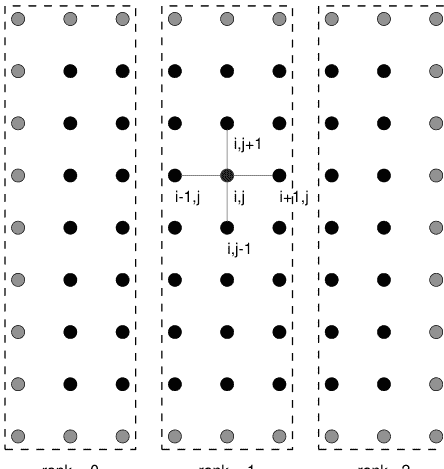

**图 9.8** 用于近似泊松问题解的区域和 `$9 \times 9$` 计算网格。

对于边界上的 `$u$` 值（例如，在 `$x=0$` 或 `$y=1$` 处），使用边界条件 `$g$`。如果 `$h = 1/(n+1)$`（这意味着网格内部有 `$n \times n$` 个点），这为我们提供了 `$n^2$` 个待求解的线性方程。许多方法可以求解这些方程。事实上，对于这个特定问题，你应该使用表 10 中描述的数值库。在本节中，我们描述了一个非常简单（且低效）的算法，从并行计算的角度来看，它说明了更高效、通用的方法。我们使用的求解线性方程组的方法是雅可比法。雅可比法通过重写方程 9.3.3 计算解的连续近似值：

```
$u_{i,j} = \frac{1}{4}(u_{i+1,j} + u_{i-1,j} + u_{i,j+1} + u_{i,j-1} - h^2 f(x_i,y_j))$
```

迭代迭代的每一步都根据周围的 `$u_{i,j}^N$` 计算 `$u_{i,j}^{N+1}$` 的新近似值：

```
$u_{i,j}^{N+1} = \frac{1}{4}(u_{i+1,j}^N + u_{i-1,j}^N + u_{i,j+1}^N + u_{i,j-1}^N - h^2 f(x_i,y_j))$
```

这是我们计算泊松问题解近似值的算法。我们强调雅可比法是一种糟糕的数值方法，但相同的通信模式适用于许多有限差分、体积或单元离散化方法。在该算法的单机版本中，解 `$u$` 由二维数组 `u[max_n][max_n]` 表示，迭代写如下：

```c
double u[NX+2][NY+2], u_new[NX+2][NY+2], f[NX+2][NY+2];
int i, j;
for (i=1;i<=NX; i++)
  for (j=1;j<=NY; j++)
    u_new[i][j] = 0.25 * (u[i+1][j] + u[i-1][j] + u[i][j+1] + u[i][j-1] - h*f[i][j]);
```

在这里，我们让 `u[0][j]`、`u[n+1][j]`、`u[i][0]` 和 `u[i][n]` 保存对应于方程 9.3.1 中 `$(0,y)$` `$(n,y)$` `$(x,0)$`和`$(x,1)$` 的边界条件值。为了将此方法并行化，我们必须首先决定如何跨进程分解数据结构 `$u$` 和 `$u_new$`。简单的方法之一是将区域划分为带（如图9.8所示）。数组 `ulocal` 的局部表示包含该进程持有的 `$u$` 部分。没有进程拥有所有的 `$u$`；表示 `$u$` 的数据结构被分解在进程之间。在每个进程上实现雅可比方法的代码是：

```c
```


for (i=i_start;i<=i_end; i++)

  for (j=1;j<=NY; j++)

    ulocal_new[i-i_start][j] = 0.25 * (ulocal[i_start][j] + ulocal[i_start-1][j] + ulocal[i_start][j+1] + ulocal[i_start][j-1] - h*ulocal[i_start][j]);

```

其中 `i_start` 和 `i_end` 描述该进程上的带（在实践中，循环将从0到 `i_end-i_start`）；我们使用这种公式来保持与单机代码的对应关系。我们定义了 `ulocal`，使得 `ulocal[0][j]` 对应于该代码单机版本中的 `u[i_start][j]`。使用能明显哪些变量属于分布式数据结构的名称 `ulocal` 是好主意。

从这段代码中，我们可以看到需要通信的内容。对于 `i=i_start`，我们需要值 `u[i_start-1][j]`，对于 `i=i_end`，我们需要 `u[i_end+1][j]`。这些值属于相邻进程，必须进行通信。此外，我们需要一个存储这些值的位置。可以使用单独的数组，但对于规则网格，常用的方法是使用影子单元（ghost cells）或光环单元（halo cells），在本地数组中留出额外空间存放相邻进程的值。在这种情况下，我们只需要一列邻居数据，因此我们让 `ulocal[1][j]` 对应于 `u[i_start][j]`。这改变了循环迭代的代码：

```c
exchange_nbrs(u, i_start, i_end, left, right);

for(i_local=1; i_local<i_end-i_start+1; i_local++)

  for (j=1;j<=NY; j++)

    local_new[i_local][j] = 0.25 * (u[i_local-1][j] + u[i_local][j] + u[i_local+1] - u[i_local-1]) - h*f[i_local][j]);
```

其中我们已经将索引转换为相对于 `$u$` 本地数组的描述。ISO/ANSI C（与Fortran不同）不允许多维数组的运行时规定。一个非常简单的程序在图9.9中。为了保持这些C示例简单，我们使用了数组的编译。C语言的另一种方法是传递一维数组。值 `left` 和 `right` 分别用于左侧和右侧邻居，这些可以通过以下方式简单地计算：

```c
int rank, size, left, right;

...

MPI_Comm_rank(MPI_COMM_WORLD, &rank);

MPI_Comm_size(MPI_COMM_WORLD, &size);

left = rank - 1;

right = rank + 1;

if (left < 0) left = MPI_PROC_NULL;

if (right >= size) right = MPI_PROC_NULL;
```

特殊秩 `MPI_PROC_NULL` 表示网格的边缘。如果在MPI通信中将 `MPI_PROC_NULL` 作为源或目的秩，则调用

```c
void exchange_nbrs(double ulocal[][NY+2], int i_start, int i_end, int left, int right)

{

  MPI_Status status;

  int c;

  /* 向左侧邻居发送并接收 */

  MPI_Send(&ulocal[1][1], NY, MPI_DOUBLE, left, 0,

           MPI_COMM_WORLD);

  MPI_Recv(&ulocal[0][1], NY, MPI_DOUBLE, left, 0,

           MPI_COMM_WORLD, &status);

  /* 向右侧邻居发送并接收 */

  c = i_end - i_start + 1;

  MPI_Send(&ulocal[c], NY, MPI_DOUBLE, right, 0,

           MPI_COMM_WORLD);

  MPI_Recv(&ulocal[c+1][1], NY, MPI_DOUBLE, right, 0,

           MPI_COMM_WORLD, &status);

}
```

图 9.9 邻居交换代码的简单版本。请见正文关于该程序的局限性的讨论。

操作被忽略。

集体操作是由属于某个通信器的所有进程调用的MPI函数。（如果通信器是`MPI_COMM_WORLD`，这意味着所有

## 使用 MPI 进行并行编程

```c
/* 更好的交换代码。 */
void exchange_nbrs( double ulocal[][NY+2], int i_start, int i_end,
    int left, int right )
{
    MPI_Status status;
    int c;
    /* 从左邻居发送并接收 */
    MPI_Sendrecv(&ulocal[1], NY, MPI_DOUBLE, left, 0,
        ulocal[c+1], NY, MPI_DOUBLE, right, 0,
        MPI_COMM_WORLD, &status);
    /* 从右邻居发送并接收 */
    c = i_end - i_start + 1;
    MPI_Sendrecv(&ulocal[c], NY, MPI_DOUBLE, right, 0,
        ulocal[c+1], NY, MPI_DOUBLE, left, 0,
        MPI_COMM_WORLD, &status);
}
```

**图 9.10**
交换代码更好的版本。

但是，MPI 还允许对其他进程集合进行集合操作。集合操作涉及通信，有时也涉及计算，但由于它们描述了特定的通信和计算模式，MPI 的实现可能对它们进行优化，这种优化是仅通过 `MPI_Send` 和 `MPI_Recv` 等 MPI 点对点操作来表达所无法达到的。这些模式使用集合操作也更容易表达。

在这里我们介绍两种最常用的集合操作，并展示如何将并行程序中的通信完全用集合操作表示，而完全不需要任何单独的 `MPI_Send` 或 `MPI_Recv`。图 9.11 显示的程序通过数值积分计算 $\pi$ 的值。由于

$$\int_0^1 \frac{1}{1+x^2} dx = arctan(x)|_0^1 = arctan(1) - arctan(0) = \frac{\pi}{4}$$

我们可以通过从 0 到 1 积分函数 $f(x) = 4/(1+x^2)$ 来计算出 $\pi$。我们通过将区间 $[0,1]$ 分为若干子区间，然后让每个进程计算某些子集的面积，并计算这些面积的总和来得到近似值。我们可以使用管理器/工作者（manager/worker）算法来实现这一点，但在这里我们预先分配工作。事实上，每个工作者都可以计算自己的任务集，因此“管理器”也可以是一个工作者，而不仅仅是管理工作池。矩形越多，要做的工作就越多的，得到的 $\pi$ 近似值也就越精确。为了实验，让我们将子区间数量设置为命令行参数。（尽管 MPI 标准并不保证任何进程都能接收到命令行参数，但在许多实现中，特别是对于 Beowulf 集群，可以假设至少秩为 0 的进程可以使用 `argc` 和 `argv`，尽管它们在调用 `MPI_Init` 之前可能没有意义。）在我们的示例 $n$ 中，进程 0 将子区间的数量 $n$ 设置为 `argv[1]`。一旦进程 $j$ 开始，它就可以通过领取每隔 $n$ 个矩形（从其秩对应的矩形开始）来占据大约 $1/n$ 的工作。因此，进程 $j$ 计算矩形 $j, j+n, j+2n$ 等等的面积。

然而，并不是所有的 MPI 实现都让所有进程都能使用命令行参数，我们首先让进程 0 一时向其他每个进程发送数据，但这种方式效率很低。如果我们知道相同的消息被递送到所有其他进程，我们可以请求 MPI 实现通过一系列的 `MPI_Send` 和 `MPI_Recv` 以更高效的方式来实现。

广播（`MPI_Broadcast`）是 MPI **集合**操作的一个示例。集合操作必须由通信器（communicator）中的所有进程调用。这允许实现以一种特殊的方式安排集合操作所指定的通信和计算。在 `MPI_Broadcast` 的情况下，实现可能会使用通信树（有时称为生成树），其中进程 0 将其消息发送给第二个进程，然后这两个进程都再向另外两个进程发送，以此此类推。通过这种方式，通信是并行进行的，所有消息都在 $\log_2 n$ 步内送达。

`MPI_Broadcast` 的精确语义有时会令人困惑。前三个参数像往常一样指定一个消息（带有地址、计数、数据类型）。第四个参数（广播的**根**）指定了哪一个进程拥有发送给其他进程的数据。在我们的案例中，进程 0 在根进程上表现像一个 `MPI_Send`，在所有其他进程上表现像一个 `MPI_Recv`，调用本身在每个进程上看起来是相同的。最后一个参数是集合操作所**跨**的通信器。通信器中的所有进程必须执行相同的调用。在调用之前，$n$ 仅在根进程有效；在 `MPI_Broadcast` 返回后，所有进程都拥有 $n$ 值的副本。

接下来，每个进程（包括进程 0）将其矩形的面积加到局部变量 `mypi` 中。然而，我们没有将这些值发送给一个进程并让它们相加，而是使用了另一个集合操作 MPIReduce。

```c
#include "mpi.h"
#include <stdio.h>
#include <math.h>
double f(double a) { return (4.0 / (1.0 + a*a)); }
int main(int argc,char *argv[]) {
    int n, myid, numprocs, i;
    double PI25DT = 3.1415926;
    // ... (省略部分代码以保持逻辑一致)
``` (注：此处为原文代码块不完整，根据要求不翻译代码内容，仅保留格式)

## 9.6 在 Linux 下安装 MPICH

### 9.6.1 获取和安装 MPICH

MPI 的 MPI 实现 [12] 是最流行的 MPI 版本之一。在本节中，我们将描述如何在 Beowulf 集群上获取、构建和安装 MPICH。然后，我们将描述如何设置 MPICH 环境，在其中可以编译、执行和调试 MPI 程序。

```c
#include "mpi.h"
#include <stdio.h>
#define SIMPLE_PRNG    /*简单接口 */
#define USE_MPI         /* 使用 MPI */
#include "sprng.h"      /* SPRNG 头文件 */
#define BATCHSIZE 1000000
```

```c
int main(int argc, char *argv[]) {
    int i, j, numin = 0, total, numbatches, rank, numprocs;
    double x, y, approx, pi = 3.1415926553859793238462643;
    MPI_Init(&argc, &argv);
    MPI_Comm_size(MPI_COMM_WORLD, &numprocs);
    MPI_Comm_rank(MPI_COMM_WORLD, &rank);
    if (rank == 0) {
        numbatches = atoi(argv[1]);
        MPI_Bcast(&numbatches, 1, MPI_INT, 0, MPI_COMM_WORLD);
        for (i = 0; i < numbatches; i++) {
            for (j = 0; j < BATCHSIZE; j++) {
                x = sprng(); y = sprng();
                if (x * x + y * y < 1.0) {
                    numin++;
                }
            }
        }
    }
    MPI_Reduce(&numin, &total, 1, MPI_INT, MPI_SUM, 0, MPI_COMM_WORLD);
    if (rank == 0) {
        total = BATCHSIZE * (i + 1) * numprocs;
        approx = 4.0 * (double)numin / total;
        printf("pi = %.16f, error = %.16f, points = %d\n", approx, pi - approx, total);
    }
    MPI_Finalize();
}
```

**图 9.12**
使用蒙特卡洛方法计算 $\pi$。

# 使用 MPI 进行并行编程

- 用于在各种环境中构建 MPICH 的配置脚本，包括 Linux 集群，
- 像本章中的示例简单的示例程序，
- MPI 合规性测试程序，
- 性能基准程序，
- 若干 MPI 性能分析库，
- 用于事件日志和 X 图形的 MPI 扩展 MPE 库，
- 一些使用 MPE 库进行图形输出的更复杂的示例，
- Jumpshot 性能可视化系统，
- MPD 并行进程管理系统。

MPICH 的架构设计允许使用多种通信基础设施。这些被称为“设备”（devices）。与 Beowulf 环境最相关的设备是 ch-p4 和 ch-p4mpd 设备。ch-p4 具有更多功能，包括利用共享内存通信的能力以及让不同进程执行二进制文件的能力。相反，ch-p4mpd 设备通过 MPD 进程管理器（见第 9.6.3 节）提供了更快的启动，并支持通过 gdb 进行调试（见第 9.6.5 节）。运行你的第一个 MPI 程序，请执行以下步骤：

1. 从 www.mcs.anl.gov/mpi/mpich 下载 mpich.tar.gz，或从 ftp://ftp.mcs.anl.gov/pub/mpi/mpich.tar.gz 下载
2. tar xvf mpich.tar.gz; cd mpich
3. configure <options> > configure.log。大多数用户在配置时会为安装路径指定前缀：

```bash
configure --prefix=/usr/local/mpich-1.2.2 >configure.log
```

默认情况下，这将创建 ch_p4 设备。

4. make >& make.log
5. make install >& install.log
6. 将 '<prefix>/bin’ 目录添加到你的路径中；例如，对于 tcsh，执行：

```bash
setenv PATH <prefix>/bin:$PATH
rehash
```

## 9.6.2 使用 ch.p4 设备运行 MPICH 任务

7. cd examples/basic
8. make cpi
9. 如果你配置了 ch.p4mpd 设备，启动 mpds（见第 9.6.3 节）。
10. mpirun -np 4 cpi

默认情况下，在 Beowulf 系统上，MPICH 被构建为使用 ch.p4 设备进行进程启动和通信。`mpirun` 命令在本地机器（执行 mpirun 的机器）上启动进程 0。第一个进程读取一个文件（称为 procgroup 文件）并使用 rsh（或 ssh）启动其他进程。procgroup 文件包含指定要启动进程的行。例如，

```bash
mpirin -np 4 cpi.pg c cpi 1000
```

在机器 `donner` 上执行，其中 `cpi.pg` 包含：

```
local 0
meant 1 /home/lus/progs/cpi
flute 1 /home/lus/progs/cpi rusty
```

将运行一个包含三个进程的 MPI_COMM 的 cpi。第一个运行在 donner 上，第二个运行在 meantat 上，第三个运行在 flute 上。请注意，这种机制允许在不同的机器上运行不同的可执行文件，事实上 MPICH 中的 ch.p4 设备是“异构的”；也就是说，机器的硬件架构甚至不需要是相同的。文件第三行的“rusty”指定了该机器上的一个备用用户 ID。如果所有可执行文件和用户 ID 都相同，可以使用简写形式：

```bash
mpirin -np 3 cpi 1000
```

这将使用安装时指定的机器文件来选择运行的主机。最后，通过使用 p4 安全服务器可以改进进程启动时间。假设此程序已在每个目标机器上运行。请参阅 MPICH 文档了解如何使用 p4 安全服务器。ch.p4 设备在可能时通过共享内存进行通信。为了允许这种情况，在配置 MPICH 时使用选项 `--with-device=ch_4 comm=shared`。然后，指定为共享内存的进程将使用它进行 MPI 通信，这比使用 TCP 更高效。共享内存的进程数在 `machines` 文件中指定。对于哪些进程应该使用共享内存的更详细的控制，你应该使用启动进程的 `procgroup` 方法。因此

```bash
mpirin -np 4 cpi.pg cpi 1000
```

当文件 `cpi.pg` 包含

```
local 1 /home/lus/mpich/examples/basic/cpi
```


时会启动进程，两个进程共享内存。

## 9.6.3 使用 MPD 启动和管理进程

在 MPD 设备下，MPICH 被构建为使用 `ch.p4` 设备进行进程启动和通信。`mpirun` 命令在本地机器（执行 `mpirun` 的机器）上启动进程 0。第一个进程读取一个文件（称为 `procgroup` 文件）并使用 `rsh`（或 `ssh`）启动其他进程。`procgroup` 文件包含指定要启动进程的行。例如，

```bash
mpirin -np 4 cpi.pg c cpi 1000
```

在机器 `donner` 上执行，其中 `cpi.pg` 包含

```
local 0
meant 1 /home/lus/progs/cpi
flute 1 /home/lus/progs/cpi rusty
```

将运行一个包含三个进程的 `MPI_COMM` 的 `cpi`。第一个运行在 `donner` 上，第二个运行在 `meantat` 上，第三个运行在 `flute` 上。请注意，这种机制允许在不同的机器上运行不同的可执行文件，事实上 MPICH 中的 `ch.p4` 设备是“异构的”；也就是说，机器的硬件架构甚至不需要是相同的。文件第三行的“`rusty`”指定了该机器上的一个备用用户 ID。如果所有可执行文件和用户 ID 都相同，可以使用简写形式：

```bash
mpirin -np 3 cpi 1000
```

这将使用安装时指定的机器文件来选择运行的主机。最后，通过使用 `p4` 安全服务器可以改进进程启动时间。假设此程序已在每个目标机器上提前运行。请参阅 MPICH 文档了解如何使用 `p4` 安全服务器。`ch.p4` 设备在可能时通过共享内存进行通信。为了允许这种情况，在配置 MPICH 时使用选项 `--with-device=ch_4 comm=shared`。然后，指定为共享内存的进程将使用它进行 MPI 通信，这比使用 TCP 更高效。共享内存的进程数在 `machines` 文件中指定。对于哪些进程应该使用共享内存的更详细的控制，你应该使用启动进程的 `procgroup` 方法。因此

```bash
mpirin -np 4 cpi.pg cpi 1000
```

当文件 `cpi.pg` 包含

```
local 1 /home/lus/mpich/examples/basic/cpi
```

时启动进程，两个进程共享内存。

## 9.6.4 在 MPD 下运行 MPICH 任务

由于 MPD 设备在作业启动之前已经相互通信，启动速度比 `ch_p4` 快得多。`ch_4mpd` 设备的 `mpirun` 命令有一些特殊的命令行参数。如果你不带参数输入 `mpirun`，将显示它们：

```
% mpirun
用法: mpirun <args> executable <args_to-executable>
参数:
  -np num_processes_to-run (作为第一个参数)
  [-s] (关闭 stdin，可以在无终端的情况下运行)
  [-g group_size] (每个 mpd 启动 group_size 个进程)
  [-m machine_file] (允许机器的文件)
  [-l] (标签；每个进程的唯一 ID)
  [-i] (不要在本地启动第一个进程)
  [-y] (作为 Myrinet 作业运行)
```

`-n` 允许你在集群的“登录”或“开发”节点上运行 `mpirun`，以启动所有的进程事件。

`mpirun` 程序运行在一个单独（非 MPI）进程中，该进程启动指定的可执行文件。它作为并行 MPI 进程的单进程代表。发送给它的信号，如 `^Z` 和 `^C`，由 MPD 系统传递给所有进程。输出路由回 MPI 进程的 `stdout` 和 `stderr`。在大多数 MPI 实现中，`mpirun` 的 `stdin` 路由到 MPI 进程 0 的 `stdin`。

### 9.6.5 调试 MPI 程序

调试并行程序是众闻难题的。并行程序不仅要面临常见的 bug，还要面临与计时和同步错误有关的新种类。通常，程序会“挂起”，例如当进程正在等待一个永远不会发送或带有错误标签的消息时。并行 bug 往往在你尝试添加代码来识别 bug 时就会消失，这尤其令人令人沮丧。在本节中，我们讨论了三种并行调试方法。

`printf` 方法。就像在顺序调试中一样，你经常希望通过打印跟踪消息来追踪程序中的有趣事件。通常你希望通过发送消息的进程秩（`rank`）来识别消息。这可以通过在跟踪跟踪消息中显式地放入秩来实现。如上文所述，在 MPICH 的 `ch_pmpd` 设备中，在 `mpurin` 中使用“行标签”（`-1`）会自动添加秩。

使用商业级调试器。来自 Etnus, Ltd. 的 `TotalView©` 调试器运行在多种平台上，并与许多厂商提供的 MPI 实现交互，包括 Linux 集群上的 MPICH。对于 `ch_p4` 设备，你通过通过以下方式调用 `TotalView`：

```
mpurin -tv <other arguments>
```

以及通过使用：

```
totalview mpurin <other arguments>
```

也就是说，`mpurin` 再次代表整个并行作业。`TotalView` 有特殊命令来显示 MPI 进程的进程队列。可以将 `TotalView` 附加到一组已经在并行运行的进程上；也可以仅附加这些进程中的一个。

使用 `mpigdb`。MPICH 的 `ch_pmpd` 设备具有“并行调试”功能，它由多个 `gdb` 调试器副本以及一个重定向标准输入的机制组成。`mpigdb` 命令是 `mpurin` 的一个版本，它在 `gdb` 的控制下运行每个用户进程，并对 `gdb` 接管标准输入。‘`z`’ 命令允许你将终端输入重定向到任何指定的进程或将其广播到所有进程。我们通过运行 π 示例来演示：

```
donner%mpigdb -np 5 cpi               # 默认是 bcast
(mpigdb) b 29                               # 为所有进程设置断点
0-4: Breakpoint 1 at 0x8049e93: file cpi.c, line 29.
(mpigdb) r                                     # 全部运行
0-4: Starting program: /home/linux/mpich/examples/basic/cpi
0: Breakpoint 1, main (argc=1,argv=0xbffffa84) at cpi.c:29
1-4: Breakpoint 1, main (argc=1,argv=0xbffffa74) at cpi.c:26
0-29      n = 0;                               # 全部到达断点
(mpigdb) n                                     # 单步
0: 38                                          if (n==0) n=100; else n=0;
1-4: 42                        MPI_Bcast(&n, 1, MPI_INT, 0, MPI_COMM_WORLD);
(mpigdb) z 0                                  # 将 stdin限制为秩 0
```

## 使用 MPI 进行并行编程

```
(mpigdb) n                              # 单步执行进程 0
0: 40                               startctime = MPI_Wtime();
(mpigdb) n                              # 直到追上
0: 42                               MPI_Bcast(&n, 1, MPI_INT, 0, MPI_COMM_WORLD);
(mpigdb) z                              # 回到 bcast stdin
(mpigdb) n                              # 单步
...
(mpigdb) n                              # 有意思的地方
0-4: 52                                x = h * ((double)i - 0.5);
(mpigdb) p x                             # 广播命令
0: $1 = 0.005000000000000000 # 0 的 x 的值
1: $1 = 0.014999999999999999 # 1 的 x 的值
2: $1 = 0.025000000000000000 # 2 的 x 的值
3: $1 = 0.035000000000000000 # 3 的 x 的值
4: $1 = 0.044999999999999998 # 4 的 x 的值
(mpigdb) c                              # 继续全部
0: pi is approximately 3.141600986923, Error is 0.000008333333
0-4: Program exited normally.
(mpigdb) q                              # 退出
donner#?
```

如果调试过程因为当前进程正在等待另一个进程的操作而挂起（没有 `mpigdb` 提示符），`Ctrl+C` 将弹出一个菜单允许你切换进程。`mpigdb` 远没有 `TotalView` 先进，但它很有用，并且由 MPICH 免费发布。

## 9.6.6 其他编译器

MPI 实现通常使用一组特定的编译器进行配置和构建。例如，MPICH 实现中的 `configure` 脚本决定了编译器及其相关运行时库的许多特性。因此，在特定的 MPI 实现上使用不同的 C 或 Fortran 编译器可能会很困难。这对于 Beowulf 集群来说可能是一个问题，因为使用不同的编译器是常见的情况。

编译脚本被用于选择不同的编译器。例如，如果 MPICH 使用 `gcc` 配置的，但你想使用 `pgcc` 来编译和构建 MPI 程序，你可以使用：

```
mpicc -cc=pgcc -o hollow hollow.c
mmpif77 -fc=pg77 -o hollow hollow.f
```

只要两个编译器具有相似的能力和属性，这种方法就是有效的。例如，它们必须对基本数据类型使用相同的长度，并且它们的运行时库必须满足 MPI 的要求。如果编译器性质相似但需要不同的库（例如 Fortran），你必须使用 `-config` 选项。关于配置文件的格式可以在 MPICH 安装手册中找到：

```
mpicc -config=pgcc -o hollow.c
```

对于 Fortran 同样如此，详情请参见 MPICH 安装手册。

## 9.7 工具

有许多工具用于开发、测试和调优 MPI 程序。尽管它们是 MPICH 的一部分，但也可以用于其他 MPI 实现。

### 9.7.1 性能分析库

MPI 论坛没有标准化任何特定的工具，而是提供了一种拦截 MPI 调通用机制。性能分析库是 MPICH 的一部分，可以单独分发。

### 9.7.2 可视化程序行为

并行程序的详细行为难以预测。通常可以使用一个图形化显示来查看程序经过的状态序列以及在什么时间交换了消息。水平轴代表时间，每个进程有一行。进程在特定间隔内的状态用彩色矩形表示。消息用箭头表示。可以放大到微秒级分辨率。

## 9.8 MPI 实现

许多 MPI 实现适用于集群；表 9.3 列出了一些可用实现。这些从商业支持的软件到免费软件不等。

| 名称 | URL |
|---|---|
| BeoMPI | scyld.com |
| LAM | lam-mpi.org |
| MPICH | mcs.anl.gov/mpi/mpich |
| MPICH-GM | myricom.com |
| MPICH-G2 | niu.edu/mpi |
| MPICH-Madeleine | ens-lyon.fr/~mercierg/mpi.html |
| MPI/GAMMA | disi.unige.it/project/gamma/mpigamma/ |
| MPI/Pro | mpi-softtech.com |
| MPI-BIP | lhpca.uni-lyoni.fr/mpibip.html |
| MP-MPICH | lfbs.rwth-aachen/users/joachim/MP-MPICH/ |
| MVIC | nersc.org/research/ftg/mvich/ |
| Scampi | scali.com |

表 9.3 Linux 的某些 MPI 实现。

## 9.9 MPI 例程总结

本节提供了用于 C、Fortran 和 C++ 的 MPI 例程快速总结。尽管这些只是 MPI 可用例程的一小部分，但它们对于许多应用程序来说已经了。

# C 例程。

```
int MPI_Init(int argc, char ***argv)
```

```
int MPI_Comm_size(MPI_Comm comm, int *size)
```

```
int MPI_Comm_rank(MPI_Comm comm, int *rank)
```

```
int MPI_Bcast(void *buf, int count, MPI_Datatype datatype, int root,
MPI_Comm comm)
```

```
int MPI_Reduce(void *sendbuf, void *recvbuf, int count, MPI_Datatype datatype, MPI_Op op, int root, MPI_Comm comm)
```

```
int MPI_Finalize()
```

```
double MPI_Wtime()
```

```
int MPI_Send(void *buf, int count, MPI_Datatype datatype, int dest, int tag, MPI_Comm comm)
```

```
int MPI_Recv(void *buf, int count, MPI_Datatype datatype, int source, int tag, MPI_Comm comm, MPI_Status *status)
```

```
int MPI_Probe(int source, int tag, MPI_Status *status)
```

```
int MPI_Sendrecv(void *sendbuf, int sendcount, MPI_Datatype sendtype, int dest, int sendtag, void *recvbuf, MPI_Datatype recvtype, int source, MPI_Comm comm, MPI_Status *status)
```

```
int MPI_Allreduce(void *sendbuf, void *recvbuf, int count, MPI_Datatype datatype, MPI_Op op, MPI_Comm comm)
```

# Fortran 程序例。

```
MPI_INIT(ierror)
integer error
```

```
MPI_COMM_SIZE(comm, size, ierror)
integer comm, size, error
```

```
MPI_COMM_RANK(comm, rank, ierror)
integer comm, rank, error
```

```
MPI_BCAST(buffer, count, datatype, root, comm, ierror)
<type> buffer(*)
integer count, datatype, op, root, comm, error
```

```
MPI_REDUCE(sendbuf, recvbuf, count, datatype, op, root, comm, ierror)
<type> sendbuf(*), recvbuf(*)
integer count, datatype, op, root, comm, error
```

```
MPI_FINALIZE(ierror)
integer error
```

196

第 9 章

```
double precision MPI_WTIME()
```

```
MPI_SEND(buf, count, datatype, dest, tag, comm, ierror)
<type> buf(*)
integer count, datatype, dest, tag, comm, ierror
```

```
MPI_RECV(buf, count, datatype, source, tag, comm, status, ierror)
<type> buf(*)
integer count, datatype, source, tag, comm,(MPI_STATUS_SIZE), error
```

```
MPI_PROBE(source, tag, comm, status, error)
logical flag
integer source, tag, comm, status(MPI_STATUS_SIZE), error
```

```
MPI_SENDRECV(sendbuf, sendcount, sendtype, dest, recvbuf, recvcount,
recvtype, source, recvtag, comm, ierror)
<type> sendbuf(*), recvbuf(*)
integer sendcount, sendtype, dest, sendtag, recvcount, recvtype,
source, recvtag, comm, status(MPI_STATUS_SIZE), error
```


`MPI_ALLREDUCE(sendbuf, recvbuf, count, datatype, op, comm, ierror)`

<type> `sendbuf(*)`, `recvbuf(*)`

integer `count`, `datatype`, `op`, `comm`, `error`

```cpp
C++ 程序例。
```

```cpp
void MPI::Init(int& argc, char**& argv)

void MPI::Init())

int MPI::Comm::Get_rank() const

int MPI::Comm::Get_size() const

void MPI::Intracomm::Bcast(void* buffer, int count, const Datatype& datatype, int root) const

void MPI::Intracomm::Reduce(const void* sendbuf, void* recvbuf, int count, const Datatype& datatype, const Op& op, int root) const

void MPI::Finalize()

double MPI::Wtime()
```

```cpp
int MPI::Status::Get_source() const
```

```cpp
int MPI::Status::Get_tag() const
```

```cpp
void MPI::Comm::Recv(void* buf, int count, const Datatype& datatype, int source, int tag, Status& status) const
```

```cpp
void MPI::Comm::Recv(void* buf, int count, const Datatype& datatype, int source, int tag) const
```

```cpp
void MPI::Comm::Probe(int source, int tag, Status& status) const
```

```cpp
void MPI::Comm::Send(const void* buf, int count, const Datatype& datatype, int dest, int tag) const
```

```cpp
void MPI::Comm::Sendrecv(const void* sendbuf, int sendcount, const Datatype& sendtype, int dest, sendtag, void* recvbuf, int recvcount, const Datatype& recvtype, int source, int recvtag, Status& status) const
```

```cpp
void MPI::Intracomm::Allreduce(const void* sendbuf, void* recvbuf, int count, const Datatype& datatype, const Op& op) const
```

# 10 MPI 编程中的进阶主题

William Gropp 和 Ewing Lusk

在本章中，我们将继续探索使用 MPI 进行并行编程。我们将描述一些更特定于 MPI 的能力，而不是通用消息传递编程模型的一部分。我们将了 MPI 中有时称为 MPI-2 的更高级的特性，例如动态进程管理、并行 I/O 和远程内存访问。

## 10.1 MPI 中的动态进程管理

MPI-2 的一个新方面是 MPI 程序能够创建新的 MPI 进程并与它们进行通信。（在原始的 MPI 规范中，进程数量在启动时是固定的。）MPI 将这种独立的能力（连同连接两个独立启动的 MPI 作业等相关功能）称为**动态进程管理**。这组功能引入了三个主要问题：

- 保持简单性与灵活性；
- 与操作系统交互；
- 避免破坏正确性的竞态条件。

这些功能的集合避免了竞态条件，关键在于创建新进程的集合操作。

### 10.1.1 通信器

回顾一下，通信器由进程组组成。到目前为止处理的通信器都是*进程内通信器*（intracommunicators）。另一种类型的通信器，称为*进程间通信器*（intercommunicators）。进程间通信器绑定了*本地组*（local group）和*远程组*（remote group）。进程间通信器中的进程通过*远程组*中的标识来标识。集合操作也适用于进程间通信器，见第 14 页。

### 10.1.2 启动新进程

我们现在可以详细解释创建新进程的调用。让我们考虑创建新进程的管理器。

```
mpiexec -n 1 manager <number-workers>
```

它具有参数：第一个要运行新进程的可执行文件；第二个是传递给新进程的空终止参数向量。

### 10.1.3 回顾矩阵-乘法

这里展示了使用 `MPI_Spawn` 重新实现第 9.2 节矩阵-乘法。与其使用固定数量的进程开始，不如让管理器动态创建工作进程。

`MPI_Spawn` 返回一个具有本地组和远程组的进程间通信器。新进程必须调用 `MPI_Init`，并且 `MPI_Spawn` 在工作进程创建完成后才会返回给父进程。`MPI_intercomm_merge` 函数可以被父进程和子进程调用，创建一个包含所有进程（旧的和新的）的普通通信器。

管理器的程序见图 10.1，而工作进程的代码见图 10.2。

```cpp
#include "mpi.h"
#include <stdio.h>
#define SIZE 10000
```

```cpp
int main(int argc, char *argv[])
{
    double a[SIZE][SIZE], b[SIZE], c[SIZE];
    int i, j, row, numworkers;
    MPI_Status status;
    MPI_Comm workercomm;
    MPI_Init(&argc, &argv);
    if (argc != 2 || !numeric(argv[1]))
        printf("usage: %s <number of workers>\n", argv[0]);
    else
        numworkers = atoi(argv[1]);
    MPI_Spawn("worker", MPI_ARGV_NULL, numworkers, 0, MPI_COMM_SELF, workercomm, MPI_ERRCODES_IGNORE);
    ...
    /* 初始化 a 和 b */
    /* 发送到每个工作进程 */
    MPI_Bcast(b, SIZE, MPI_DOUBLE, MPI_ROOT, workercomm);
    /* 然后像之前一样进行管理器代码 */
    ...
    MPI_Finalize();
    return 0;
}
```

**图 10.1**
动态进程矩阵-乘法程序，管理器部分。

`MPI_INFO_NULL`。下一个参数是此 `MPI-Comm_spawn` 调用的“根”`root`进程；它指定了在后续参数给出的通信器中哪个进程为此调用提供了有效参数。该通信器可以只包含一个管理器进程，因此我们传递了 `MPI_COMM_SELF`。
接下来是待填充的新跨进程间通信器（intercommunicator）的地址，最后是一个错误代码数组，用于检查启动新进程时可能出现的问题。这里我们使用 `MPI_ERRCODES_IGNORE` 表示我们将不检查这些错误代码。

被派生的工作进程的代码如图 10.2 所示。它本质上与上一章中的工作子程序相同，但它本身是一个 MPI 程序。注意这里使用了进程间通信器广播来从父进程处接收向量 `b`。我们在退出之前使用 `MPI_Comm_free` 释放了父进程进程间通信器。

## 10.1.4 关于动态进程管理的更多

关于 `MPI_Comm_spawn` 使用的复杂示例，包括如何启动具有不同可执行文件或参数列表的进程，请参阅 [14, 第 7 章]。
`MPI_Comm_spawn` 只是 MPI 中处理动态 MPI 环境的最基本的函数。通过查询属性 `MPI_UNIVERSE_SIZE`，你可以发现可以完全创建多少进程。单独启动的 MPI 计算可以通过 `MPI_Comm_connect` 和 `MPI_Comm_accept` 找到彼此连接。进程可以利用非 MPI 连接来“引导”`bootstrap` MPI 通信。这些特性在 [14] 中进行了详细解释。

## 10.2 容错

通信器是 MPI 中的一个基本概念。它们的大小在创建时是固定的，集合操作的效率和正确性取决于此。用户有时从通信器的固定大小得出结论，认为 MPI 没有编写容错进程的机制。然而，既然我们已经引入了跨进程间通信器，我们就可以讨论如何解决这个问题，以及你如何使用 MPI 编写一个容错的管理器-工作进程。在这种背景下，我们的意思是如果一个工作进程异常终止，而不是终止整个作业，你能够使用较少的工作进程继续计算，或者动态替换丢失的工作进程。

核心思想是为每个工作进程创建一个独立的（跨）通信器，并用它与其进行通信，而不是使用一个包含所有工作进程的通信器。

# MPI 编程高级主题

```c
#include "mpi.h"
int main(int argc, char *argv[])
{
    int numprocs, myrank;
    double b[SIZE], c[SIZE];
    int i, row, myrank;
    double dotp;
    MPI_Status status;
    MPI_Comm parentcomm;
    MPI_Init(&argc, &argv);
    MPI_Comm_size(MPI_COMM_WORLD, &numprocs);
    MPI_Comm_rank(MPI_COMM_WORLD, &myrank);
    MPI_Comm_get_Parent(&parentcomm);
    MPI_Bcast(b, SIZE, MPI_DOUBLE, 0, parentcomm);
    /* 等同于矩阵-向量乘法的原始工作代码 */
    ...
    MPI_Comm_free(parentcomm);
    MPI_Finalize();
    return 0;
}
```

**图 10.2**
动态进程矩阵-向量乘法程序，工作部分。

如果实现从 `MPI_Send` 或 `MPI_Recv` 调用返回“无效通信器”`invalid communicator`，则管理器仅丢失了与一个进程的联系，仍然可以通过其他仍然完好的通信器与其他工作进程通信。由于管理器将使用独立的通信器，而不是较大通信器中的独立秩 `rank` 来向工作进程发送和接收消息，因此维护一个通信器数组和一个并行数组来记录哪一行最后发送给了哪个工作进程可能是方便的，这样如果该工作进程消失，可以将同一行分配给另一个工作进程。

图 10.3 显示了这些数组以及它们可能的用法。我们正在做的是

```c
/* 非常不完整 */
MPI_Comm worker_comms[MAX_WORKERS];
int last_row_sent[MAX_WORKERS];
rc = MPI_Send(a[numsum], SIZE, MPI_DOUBLE, 0, numsum+1, worker_comms[sender]);
if ( rc != MPI_SUCCESS) {
/* 检查错误类是否为我们可以恢复的类 */
  ...
  MPI_Comm_spawn("worker", ..., ... );
```

图 10.3
容错管理器。

这种方法认识到，两方通信是可以实现容错的，因为一方可以识别出另一方的失败并采取适当措施。普通的 MPI 通信器不是两方系统，在不改变 MPI 通信语义的情况下无法实现容错。然而，如果 MPI 程序中的通信可以用跨进程间通信器（它们在本质上是两方的，即本地组和远程组）表示，那么就可以实现容错。

注意，虽然 MPI 标准通过使用跨进程间通信器，使得编写一个鼓励容错编程的 MPI 实现成为可能，但 MPI 标准本身并不要求 MPI 实现在错误后继续运行。这是一个“实现质量”问题，允许 MPI 实现者在性能与故障后继续运行的能力之间权衡。然而，这一点明确表明，MPI 标准中没有任何东西阻碍容错，且 MPI 实现支持某种风格的容错。

## 10.3 重温网格交换

关于网格交换的讨论，特别是边界单元。在本节中，我们回到其他重要问题：阻塞与非阻塞通信。

### 10.3.1 阻塞与非阻塞通信

如何编写不依赖缓冲区可用性的发送代码？一种方法是仔细安排发送和接收操作，使每次发送都有对应的接收。例如：

```c
if (rank == 0) {
    MPI_Send(sbuf, n, MPI_INT, 1, 0, MPI_COMM_WORLD);
    MPI_Recv(rbuf, n, MPI_INT, 1, 0, MPI_COMM_WORLD);
} else if (rank == 1) {
    MPI_Recv(rbuf, n, MPI_INT, 0, 0, MPI_COMM_WORLD);
    MPI_Send(sbuf, n, MPI_INT, 0, 0, MPI_COMM_WORLD);
}
```

然而，这实现起来很麻烦，特别是对于更复杂的模式；此外，它没有解决 `MPI_Send` 可能执行的额外拷贝问题。

MPI 采用早期的消息传递系统以及非阻塞套接字的方法是将发送和接收操作分为两个步骤：启动操作和完成操作。因为启动这些操作并不等待它们完成，所以它们被称为非阻塞操作。函数名称中的“I”表示立即返回而不完成操作。

`MPI_Irecv` 的参数与 `MPI_Recv` 相同，除了最后一个（状态）参数。它被一个 `MPI_Request` 值取代；这是一个用于标识已启动操作的句柄。要完成非阻塞操作，将请求交给 `MPI_Wait` 并带上一个状态参数；该状态参数的作用与 `MPI_Recv` 的状态相同。同样，`MPI_Send` 的非阻塞对应物是 `MPI_Isend`；它的参数与 `MPI_Send` 相同，只是在最后增加了一个 `MPI_Request`（在 C 语言中）。使用这些例，我们的示例变为：

```c
if (rank == 2) {
    MPI_Request req1, req2;
    MPI_Isend(sbuf, n, MPI_INT, 1, 0, MPI_COMM_WORLD, &req1);
    MPI_Irecv(rbuf, n, MPI_INT, 1, 0, MPI_COMM_WORLD, &req2);
    MPI_Wait(&req1, &status);
    MPI_Wait(&req2, &status);
}
```

传递给 `MPI_Isend` 的 `sbuf` 在通过 `MPI_Wait` 完成操作之前不得修改。同样，传递给 `MPI_Irecv` 的 `rbuf` 在 `MPI_Irecv` 完成之前不得被修改或读取。

非阻塞通信例程允许 MPI 实现等待消息直接从一个用户发送到另一个用户（例如从 `sbuf` 到 `rbuf`），而不需要任何复制或使用任何缓冲区。由于启动非阻塞操作是常见的，MPI 提供了例程来测试或等待一个、全部或部分请求的完成。例如，`MPI_Waitall` 等待请求数组中的所有请求完成。图 10.4 展示了在 Jacobi 示例中使用非阻塞通信例程的情况。

MPI 非阻塞操作并不等同于异步操作。MPI 标准并不要求数据与计算重叠。MPI 仅规定了操作的语义，未规定实现选择的细节。提供 MPI 非阻塞例程主要是为了正确性（避免系统缓冲区）和性能。

## 10.3.2 在 MPI 中通信非连续数据

Jacobi 示例（第 9.3 节）中使用的一维分解虽然简单，但扩展性较差，并且可能导致性能问题。我们可以按照第 9.2 节的讨论分析 Jacobi 的性能。假设通信 `n` 字节的时间为 `T_comm = s + nr`，其中 `s` 是延迟，`r` 是通信一个字节的（额外）时间。使用第 9.3 节中的一维分解，计算 Jacobi 方法每一步所需的时间为：

在许多系统上，同时调用 `MPI_Isend` 和 `MPI_Irecv` 将提高性能。

```c
void exchange_nbr(double ulocal[][NY+2], int i_start, int i_end, int left, int right) {
    MPI_Status statuses[4];
    MPI_Request requests[4];
    int c;
    /* 从左邻居发送并接收 */
    MPI_Isend(ulocal[1][1], NY, MPI_DOUBLE, left, 0, MPI_COMM_WORLD, &requests[0]);
```


```c
MPI_Irecv(ulocal[0][1], NY, MPI_DOUBLE, left, 0, MPI_COMM_WORLD, &requests[1]);
```

/* 从右邻居发送并接收 */

c = i_end - i_start + 1;

```c
MPI_Isend(ulocal[c][1], NY, MPI_DOUBLE, right, 0, MPI_COMM_WORLD, &requests[2]);
MPI_Irecv(ulocal[c+1], NY, MPI_DOUBLE, right, 0, MPI_COMM_WORLD, &requests[3]);
```

/* 等待所有通信完成 */

```c
MPI_Waitall(4, requests, statuses);
}
```

### 10.4 用于 Jacobi 示例的非阻塞交换代码。

$\frac{n}{p}f + 2(s + nr)$，其中 $f$ 是执行浮点操作的时间，$p$ 是进程数。注意，通信开销与进程数无关；最终，这种开销将主导计算。因此，更好的方法是使用二维分解，如图 10.5 所示。

使用二维分解的 Jacobi 方法每一步的时间仅为 $\frac{n}{p}f + 4(s + \frac{r}{\sqrt{p}})$，只要 $p > 16$，它就比一维分解要快。

**图 10.5** 使用二维分解近似求解松问题解的定义域和 $9 \times 9$ 计算网格。

为了实现这种分解，我们需要与四个邻居通信数据，如图 10.6 所示。左边缘和右边缘可以使用与一维情况相同的代码进行发送和接收。顶边缘和底边缘具有非连续数据。例如，顶边缘需要发送第十、第十六和第二二十二元素。移动这些数据有四种方法：

- 每个值可以单独发送。由于消息传递的高延迟，这种方法效率低下，通常不应使用。
- 可以使用简单的循环将数据拷贝到临时缓冲区，例如：

```c
for(i=0; i<3; i++) {
  tmp[i] = ulocal[i][6];
}
MPI_Send(tmp, 3, MPI_DOUBLE, ...);
```

**图 10.6** 二维分解中 `ulocal` 内网格点的位置。这是一种常用方法，对于某些系统的 MPI 实现，可能是最高效的。

- `MPI` 提供了两个用于打包和解包缓冲区的例程。这两个例程 `MPI_Pack` 和 `MPI_Unpack`。用这些例程创建的缓冲区应使用数据类型 `MPI_PACKED` 进行发送和接收。我们注意到，这些例程对于程序中频繁变化的复杂数据布局最为有用。
- `MPI` 提供了一种方法来构造表示任何数据布局的新数据类型。原则上，这些例程可以被 MPI 实现优化，从而提供比用户使用简单循环所实现的更好的性能 [37]。此外，使用这些数据类型对于实现并行 I/O 的高性能至关重要。

`MPI` 提供了若干例程来创建表示常见内存模式的数据类型。这些新数据类型被称为派生数据类型（derived datatypes）。对于这种情况，需要 `MPI_Type_vector` 来创建一个表示由常量步长分隔的数据值的新 MPI 数据类型。在这种情况下，步长为 $NY+2$，元素数量为 $i\_end-i\_start+1$。

```c
MPI_Type_vector(i_end - i_start + 1, 1, NY+2, MPI_DOUBLE, &vectype);
MPI_Type_commit(&vectype);
```

第二个参数是块计数和基础数据类型项的数量（在本例中为 `MPI_DOUBLE`）；这在多分量 PDE 问题中特别有用。必须调用 `MPI_Type_commit` 例程来提交 MPI 数据类型；这允许 MPI 实现优化该数据类型（该优化未包含在创建 MPI 数据类型的例程中，因为某些复杂数据类型是从其他派生数据类型递归创建的）。

使用表示跨度数据模式的 MPI 派生类型，我们可以为网格的二维分解编写一个 `exchange_nbr` 版本；代码如图 10.7 所示。注意，我们在 MPI 调用中通过指定数据在 `ulocal` 数组中移动的第一个元素，使用相同的派生类型 `vectype` 用于发送以及顶部和底部的操作。

当派生数据类型不再需要时，应使用 `MPI_Type_free` 释放它。还有许多其他创建数据类型的例程；例如，`MPI_Type_indexed` 适用于散布-收集模式，而 `MPI_Type_create_struct` 可用于任意内存位置集合。

```c
void exchange_nbrsd( double ulocal[][NY+2],
    int i_start, int i_end, int j_start, int j_end,
    int left, right, top, int bottom,
    MPI_Datatype vectype )
{
    MPI_Status statuses[8];
    MPI_Request requests[8];
    int c;
    /* Begin and receive from the left neighbor */
    MPI_Isend(&ulocal[1], 1, NY, MPI_DOUBLE, left, 0,
               MPI_COMM_WORLD, &requests[0]);
    MPI_Irecv(&ulocal[0], 1, NY, MPI_DOUBLE, left, 0,
               MPI_COMM_WORLD, &requests[1]);
    /* Begin and receive from the right neighbor */
    c = i_end - i_start + 1;
    MPI_Isend(&ulocal[c][1], NY, MPI_DOUBLE, right, 0,
               MPI_COMM_WORLD, &requests[2]);
    MPI_Irecv(&ulocal[c+1], NY, MPI_DOUBLE, right, 0,
               MPI_COMM_WORLD, &requests[3]);
    /* Begin and receive from the top neighbor */
    MPI_Isend(&ulocal[1][NY], 1, vectype, top, 0,
               MPI_COMM_WORLD, &requests[4]);
    MPI_Irecv(&ulocal[1][NY+1], 1, vectype, top, 0,
               MPI_COMM_WORLD, &requests[5]);
    /* Begin and receive from the bottom neighbor */
    MPI_Isend(&ulocal[1][1], 1, vectype, bottom, 0,
               MPI_COMM_WORLD, &requests[6]);
    MPI_Irecv(&ulocal[0], 1, vectype, bottom, 0,
               MPI_COMM_WORLD, &requests[7]);
    /* Wait for all communications to complete */
    MPI_Waitall( 8, requests, statuses );
}
```

图 10.7 用于网格二维分解的 Jacobi 问题的非阻塞交换代码。

# MPI 编程中的高级话题

（最右侧）。这两个例式在 `MPI_Recv` 调用中都使用了 `MPI_ANY_SOURCE` 而不是特定的源。如图 10.8 所示，消息可能会混淆，导致程序接收到错误的数据。然而，我们可以防止这种情况发生吗？有几种方法行不通。一种方法是避免使用 `MPI_ANY_SOURCE`。这解决了问题，但只有当 `SendRight` 和 `SendEnd` 都遵循这一规则时才有效。对于单人或团队编写的代码，这种方法可能是足够的（尽管很脆弱），但它对于库文件来说是不够的。例如，如果 `SendEnd` 是由商业供应商编写的且没有使用 `MPI_ANY_SOURCE`，但 `SendRight` 是另一个供应商或缺乏经验的程序员编写的，程序仍然会失败，而且看起来像是 `SendEnd` 的错（因为先收到了来自 `SendEnd` 的消息）。

另一种行不通的方法是使用消息标签（tags）来区分消息。同样，如果某人整合了所有代码并非常小心地为不同的软件模块分配标签，那么是可以做到的。然而，在 MPI 接收中使用 `MPI_ANY_TAG` 可能会绕过这种方法。此外，如 [13] 中的图 6.5 所示，即使不使用 `MPI_ANY_SOURCE` 和 `MPI_ANY_TAG`，不同的代码模块仍然可能接收错误的消息。

`MPI` 通信器（communicator）中的通信上下文（context）为这些问题提供了解决方案。运行时 `MPI_Comm_dup` 从输入通信器创建一个新的通信器，它包含相同的进程（相同的秩顺序），但具有新的通信上下文。在一个通信上下文中发送的 MPI 消息只能在该上下文中接收。因此，任何想要确保其所有消息仅在该库内部可见的软件模块或库都需要在开始时调用 `MPI_Comm_dup` 来获取一个新的通信器。所有使用 MPI 编写良好的库都会创建一个仅在该类库内部使用的私有通信器。

支持库的开发是 MPI 设计目标之一。在这一方面，MPI 非常成功。许多库和应用程序现在都使用 MPI，由于 MPI 的可移植性，这些程序大部分都运行在 Beowulf 集群上。表 10.1 提供了 MPI 用于提供并行性的库的部分列表。更完整的描述和列表可以在 www.mcs.anl.gov/mpi/libraries 以及 sal.kinatech.com/C/3 获取。

# 10.5 更多关于集体操作

`MPI` 的优势之一是它拥有一可扩展的集体通信和计算程序。图 10.9 显示了一些最重要的集体通信程序的功能。作为其用性的示例，我们考虑一个简单的例子。

| 进程 0 | 进程 1 | 进程 2 |
| :--- | :--- | :--- |
| **SendRight** | `MPI_Send` | `MPI_Send` | `MPI_Recv` |
| **SendEnd** | `MPI_Send` | `MPI_Recv` | |

(a) 预期的消息路径

| 进程 0 | 进程 1 | 进程 2 |
| :--- | :--- | :--- |
| **SendRight** | `MPI_Send` | `MPI_Send` | `MPI_Recv` |
| **SendEnd** | `MPI_Send` | `MPI_Recv` | |

(b) 可能但非预期的路径

假设我们想要收集程序运行的所有节点名称，并且我们希望所有的 MPI 进程拥有这个名称列表。使用 `MPI_Allgather` 是一项简单的任务：

```c
MPI_Allgather(sendbuf, sendcount, sendtype, recvbuf, recvcount, recvtype, comm)
```

假设我们想要收集程序运行的所有节点名称，并且我们希望所有的 MPI 进程拥有这个名称列表。使用 `MPI_Allgather` 是一项简单的任务：

```c
MPI_Allgather(myhostname, mylen, MPI_CHAR, all_names, max, MPI_CHAR, MPI_COMM_WORLD);
```

这包含空终止符。一种更好的代码是：

```c
MPI_Allreduce(&mylen, &max_len, 1, MPI_INT, MPI_MAX, MPI_COMM_WORLD);
```

这两种方法都移动了多余的数据。使用 `MPI_Allgather` 的 "v" 版本（即 `MPI_Allgatherv`）可以处理每个进程数据长度不同的情况：

```c
MPI_Allgatherv(sendbuf, sendcount, sendtype, recvbuf, recvcounts, displs, recvtype, comm)
```


图 10.7
用于网格二维分解的 Jacobi 问题的非阻塞交换代码。

# MPI 编程中的高级话题

（最右侧）。这两个例式在 `MPI_Recv` 调用中都使用了 `MPI_ANY_SOURCE` 而不是特定的源。如图 10.8 所示，消息可能会混淆，导致程序接收到错误的数据。然而，我们可以防止这种情况发生吗？有几种方法行不通。一种方法是避免使用 `MPI_ANY_SOURCE`。这解决了问题，但只有当 `SendRight` 和 `SendEnd` 都遵循这一规则时才有效。对于单人或团队编写的代码，这种方法可能是足够的（尽管很脆弱），但对于库文件来说是不够的。例如，如果 `SendEnd` 是由商业供应商编写的且没有使用 `MPI_ANY_SOURCE`，但 `SendRight` 是另一个供应商或缺乏经验的程序员编写的，程序仍然会失败，而且看起来像是 `SendEnd` 的错（因为先收到了来自 `SendEnd` 的消息）。

另一种行不通的方法是使用消息标签（tags）来区分消息。同样，如果某人整合了所有代码并非常小心地为不同的软件模块分配标签，那么是可以做到的。然而，在 MPI 接收中使用 `MPI_ANY_TAG` 可能会绕过这种方法。此外，如 [13] 中的图 6.5 所示，即使不使用 `MPI_ANY_SOURCE` 和 `MPI_ANY_TAG`，不同的代码模块仍然可能接收错误的消息。

`MPI` 通信器（communicator）中的通信上下文（context）为这些问题提供了解决方案。运行时 `MPI_Comm_dup` 从输入通信器创建一个新的通信器，它包含相同的进程（相同的秩顺序），但具有新的通信上下文。在一个通信上下文中发送的 MPI 消息只能在该上下文中接收。因此，任何想要确保其所有消息仅在该库内部可见的软件模块或库都需要在开始时调用 `MPI_Comm_dup` 来获取一个新的通信器。所有使用 MPI 编写良好的库都会创建一个仅在该类库内部使用的私有通信器。

支持库的开发是 MPI 设计目标之一。在这一方面，MPI 非常成功。许多库和应用程序现在都使用 MPI，由于 MPI 的可移植性，这些程序大部分都运行在 Beowulf 集群上。表 10.1 提供了 MPI 用于提供并行性的库的部分列表。更完整的描述和列表可以在 `www.mcs.anl.gov/mpi/libraries` 以及 `sal.kinatech.com/C/3` 获取。

# 10.5 更多关于集体操作

MPI 的优势之一是它拥有一可扩展的集体通信和计算程序。图 10.9 显示了一些最重要的集体通信程序的功能。作为其用性的示例，我们考虑一个简单的例子。

| 进程 0 | 进程 1 | 进程 2 |
| :--- | :--- | :--- |
| **SendRight** | `MPI_Send` | `MPI_Send` | `MPI_Recv` |
| **SendEnd** | `MPI_Send` | `MPI_Recv` | |

(a) 预期的消息路径

| 进程 0 | 进程 1 | 进程 2 |
| :--- | :--- | :--- |
| **SendRight** | `MPI_Send` | `MPI_Send` | `MPI_Recv` |
| **SendEnd** | `MPI_Send` | `MPI_Recv` | |

(b) 可能但非预期的路径

假设我们想要收集程序运行的所有节点名称，并且我们希望所有的 MPI 进程拥有这个名称列表。使用 `MPI_Allgather` 是一项简单的任务：

```c
MPI_Allgather(myhostname, mylen, MPI_CHAR, all_names, max, MPI_CHAR, MPI_COMM_WORLD);
```

218

第10章

```c
MPI_File outfile;
size = NX * (NY + 2);
MPI_File_open( MPI_COMM_WORLD, "solutionfile",MPI_MODE_CREATE | MPI_MODE_WRONLY,
MPI_INFO_NULL, &outfile );
MPI_File_set_view( outfile,
rank * (NY+2) * (i_end - i_start) * sizeof(double),
MPI_DOUBLE, MPI_DOUBLE, "native", MPI_INFO_NULL );
MPI_File_write( outfile, ulocal[1][0], size, MPI_DOUBLE,
MPI_File_close(&outfile );
```

图 10.11
Jacobi 的并行 I/O。注意，这种文件视图（file view）的选择仅适用于单个输出步骤；如果需要 Jacobi 方法的多个步骤，则必须修改 `MPI_File.set_view` 的参数。

`MPI` 对象信息是一个键值对（key=value pairs），可用于封装各种特殊用途信息，这些信息可能不适用于所有的 MPI 实现。当需要时，每当需要此类类型的参数且我们没有特殊信息要传递时，我们将使用 `MPI_INFO_NULL`。关于文件 `MPI_Info` 的详细信息，请参阅 [14, 第 2 章]。

每个进程看到的文件部分称为文件视图（file view），它通过调用 `MPI_File_set_view` 为每个进程设置。在我们的示例中，该调用为：

```c
MPI_File_set_view( outfile, rank * (NY+2) * ( ... ),
MPI_DOUBLE, MPI_DOUBLE, "native", MPI_INFO_NULL
```

第一个参数标识文件，第二个参数是文件中的偏移量（以字节为单位），进程的文件视图从此处开始。在这里，我们简单地将要写入的数据的大小乘以进程的秩（rank），以便每个进程的视图从文件中合适的位置开始。该参数的类型是 `MPI_Offset`，在支持大文件的系统上，预计它是一个 64 位整数。

下一个参数称为视图的元素类型（etype）；它指定了文件中数据的单位。这里只是 `MPI_DOUBLE`，因为我们将写入若干个双浮点数（doubles）。下一个参数称为文件类型（filetype）；它是描述文件中非连续单元的一种灵活方式。在我们的案例中，由于没有写入的非连续单元，我们可以直接使用 etype `MPI_DOUBLE`。通常情况下，任何 MPI 预定义或派生数据类型都可以用于 etype 和 filetype，更多细节请见下例所示。

# MPI 编程中的高级主题

下一个参数是定义要使用的数据表示方法的字符串。原生表示（native representation）表示按照数据在内存中的原始格式表示数据，这提供了最快的 I/O 性能，但可能以可移植性为代价。我们通过为最后一个参数提供 `MPI_INFO_NULL` 来指定我们没有额外信息。

随后 `MPI_File_write` 的调用变得非常直观。要写入的数据是一个连续的双浮点数数组，尽管它由（分布式的）矩阵的几行组成。在每个进程上，它从 `@ ulocal[0]` 开始，因此数据以（地址，计数，数据类型）的形式描述，就像对于 MPI 消息处理一样。我们通过传递 `MPI_STATUS_IGNORE` 来忽略状态。最后，我们（集体地）使用 `MPI_File_close` 关闭文件。

## 10.6.2 一个更复杂的示例

并行 I/O 不仅仅需要调用 `MPI_File_write` 代替 `write`。关键思想是识别对象（跨进程的），而不是每个进程的贡献。我们通过一个规则分布数组的示例来说明这一点。

10.12 中的代码写入了一个分布在进程中的、采用二维分解的数组。为了说明接口的表达力，我们展示了一个复杂情况：在 Jacobi 示例中，由于被多个影单元（ghost cells）包围，数组在内存中是非连续的（这在 [14] 中有更深入的介绍）。3. 以写入模式打开文件（`MPI_MODE_WRONLY`），并使用我们刚刚构造的数据类型设置文件视图。

4. 创建一个描述要写入数据的数据类型。我们在这里使用 `MPI_Type_subarray` 来定义不包含影单元的局部部分。如果没有影单元，我们可以在 `MPI_File_write` 调用中直接使用 `MPI_DOUBLE` 作为数据类型。

5. 使用 `MPI_File_close` 集体写入文件，并关闭文件。

这种视图看起来很复杂，但对于没有影单元的局部数组来说是简单的。

图 10.12

C 程序，写入一个由于影单元的存在而在内存中是非连续的数组（源自 [14] 中的示例）。

通过使用 MPI 数据类型描述数据及其在文件中的位置，并结合集体文件操作，MPI 实现可以充分利用 I/O 系统。结果是，使用 MPI I/O 执行的 I/O 操作比使用单个 Unix I/O 操作性能提升了百倍 [35]。

第一步是描述 `MPI_Put` 操作可能将数据放置的内存区域（该区域也可被 `MPI_Get` 访问或被 `MPI_Accumulate` 更新）。这是通过 `MPI_Win_create` 例程完成的：

```cpp
MPI_Win win;
double ulocal[MAX_NX] [NY2];
MPI_Win_create(ulocal, (NY+2)*(end_i-start+3)*sizeof(double), sizeof(double), MPI_INFO_NULL, MPI_COMM_WORLD, &win);
```

输入参数依次为：数组、数组的大小、数组基本单元的大小（在本例中为 `sizeof(double)`）、一个“提示”对象，以及指定哪些进程可以使用 RMA 访问数组的通信器。`MPI_Win_create` 是一个在该通信器上的集体调用。输出是一个 MPI 窗口对象。当窗口不再需要时，应该使用 `MPI_Win_free` 释放它。

RMA 操作在两个哨兵之间进行。一个哨兵开始一个允许访问窗口对象的周期，另一个则结束该周期。这些周期被称为 epoch（纪）。最简单的开始和结束 epoch 的例程是 `MPI_Win_fence`。该例程是在创建窗口对象的进程上集体调用的，它既结束了上一个 epoch 又启动了一个新的 epoch。该例程被称为“fence”（栅），是因为另一个进程启动的所有 RMA 操作（在 fence 返回之前的 epoch 中启动）以及在 fence 之后启动（通过该进程上匹配的 fence）的任何 RMA 操作，在 fence 返回之前都不会开始。这看起来可能很复杂，但实际上很好用。在实践中，`MPI_Win_fence` 仅用于将 RMA 操作分组成。这紧密遵循了 BSP 和 Cray SHMEM 模型，尽管增加了处理任何进程子集的能力。

有三个例程可启动 RMA 中的数据传输。这些 `MPI_Put`、`MPI_Get` 和 `MPI_Accumulate` 都是非阻塞的，就像 MPI 点对点通信是非阻塞的一样，它们在开始的那个 epoch 结束时完成（例如，在关闭的 `MPI_Win_fence` 处）。由于这些例程同时指定了数据的源和目的，因此它们的参数比点对点通信例程多。通过一次看几个参数，可以很容易地理解它们。

> ²MPI 为 RMA 有两种 epoch：访问 epoch（access epoch）和暴露 epoch（exposure epoch）。对于此处使用的示例，这些 epoch 是同时发生的，我们将它们都统称为 epoch。

# MPI 编程中的高级主题

- 1. 前三个参数描述源数据；即调用进程上的数据。这些是是通常的“缓冲区、计数、数据类型”参数。
- 2. 下一个参数是目标进程的秩（rank）。它充当 `MPI_Send` 目的地的功能。该秩相对于创建 MPI 窗口对象时使用的通信器。
- 3. 接下来的三个参数描述目标缓冲区。计数和数据类型参数与 `MPI_Recv` 的含义相同，但缓冲区的位置被指定为相对于目标进程上 `MPI_Win_create` 指定内存起始位置的偏移。该偏移量是以 `MPI_Win_create` 的位移参数为单位的，通常是基本数据类型的大小。
- 4. 最后一个参数是 MPI 窗口对象。

注意，没有 MPI 请求（request）；`MPI_Win_fence` 会完成所有之前的 RMA 操作。`MPI_Win_fence` 为 RMA 操作提供了一个所有进程参与的集体同步模型。这被称为活动目标同步（active target synchronization）。

通过这些例程，我们可以创建一个使用 RMA 代替点对点通信的网格交换版本。图 10.13 显示了一种可能的

另一种形式的访问不需要目标进程进行任何 MPI 调用（即使是 fence）。这被称为被动目标同步（passive target synchronization）。源进程使用 `MPI_Win_lock` 开始一个访问 epoch 并使用 `MPI_Win_unlock` 解锁该 epoch。由于这种 RMA 的被动性，本地内存（作为 `MPI_Win_create` 的第一个参数传递）应该用 `MPI_Alloc_mem` 分配并用 `MPI_Free_mem` 释放。有关被动目标 RMA 操作的更多信息，请参见 [14, 第 6 章]。还要注意，对于 2001 年，MPI 实现支持被动目标 RMA 操作。预计更多实现将在 2002 年支持这些操作。

关于远程内存访问更完整的讨论可以在 [14, 第 5 和 6 章] 中找到。本节描述了 RMA 例程。大多数目前的 RMA 实现强调功能而非性能。随着实现的成熟，RMA 操作的性能也将提高。

> ³`MPI_Win_lock` 和 `MPI_Win_unlock` 的名称实际上是误导；请将它们视为 beginRMA 和 end-RMA。

```cpp
void exchang_nbrs( double u_local[][][NY+2], int i_start, int i_end,
int left, right, MPI_Win win )
{
  MPI_Aint left_ghost_disp, right_ghost_disp;
  int c;
  MPI_Win_fence(0, win);
/* 将左边缘放入左邻居的最右侧
  影子单元中。参见关于 right_ghost_disp 的文本 */
  right_ghost_disp = 1 + (NY+2) * (i_end-i_start+2);
  MPI_Put(&u_local[1] [1], NY, MPI_DOUBLE,
         right_ghost_disp, NY, MPI_DOUBLE, win);
/* 将右边缘放入右邻居的最左侧
  单元 */
  left_ghost_disp = 1;
  c = i_end - i_start + 1;
  MPI_Put(&u_local[1] [1], NY, MPI_DOUBLE,
         left_ghost_disp, NY, MPI_DOUBLE, win);
  MPI_Win_fence(0, win);
}
```

# 10.13 使用 RMA 进行邻居交换的内存访问

# 10.8 C++ 和 Fortran 90

MPI 对 C 和 Fortran 77 的绑定。这些绑定非常相似；主要的区别在于错误代码的处理（C 中返回，Fortran 中通过最后一个参数设置）。在 MPI-2 中为 C++ 增加了绑定，并为 Fortran 定义了 MPI 模块。C++ 绑定提供了一个比 C 绑定更灵活的模型，但 MPI 对象定义在 MPI 命名空间。大多数 MPI 对象都有对应的类，例如数据类型的 `Datatype`。通信器和请求略有不同。有一个抽象基类 `Comm`，具有四个派生类：`Intracomm`、`Intercomm`、`Graphcomm` 和 `Cartcomm`。大多数通信器是内部的；请求有两个派生类：持久性请求和通用请求（MPI-2 新增）。

# MPI 编程中的高级主题

大多数 MPI 操作是相应对象的方法；例如，大多数点对点和集体通信都是通信器的方法。少数例程（如 `Init` 和 `Finalize`）是独立的。一个简单的 C++ MPI 程序如图 10.14 所示。

```cpp
#include "mpi.h"
#include <iostream.h>
int main(int argc, char *argv[])
{
    int data;
    MPI::Init();
    if (MPI::COMM_WORLD.Get_rank() == 0) {
        // 从进程 0 广播数据到所有其他进程
        cout << "Enter an int" << endl;
        cin >> data;
    }
    MPI::COMM_WORLD.Bcast(data, 1, MPI::INT, 0);
    MPI::Finalize();
    return 0;
}
```


# 图 10.14

简单的 C++ MPI 程序

MPI 的 C++ 绑定有一些特殊之处。由于多个完成操作（如 `MPI::Waitall`）是请求的方法，尽管没有唯一的请求可用于这些方法。另一个是 `MPI-Comm_dup` 的 C++ 类比物。在 C++ 绑定中，`MPI::Comm` 是一个抽象基类（ABC）。由于无法创建抽象基类的实例，因此无法有一个返回新 `MPI::Comm` 的通用“dup”函数。然而，由于 C++ 中可以创建 ABC 的引用，MPI 定义了（仅在 C++ 绑定中可用）例程 `MPI::Clone`，它返回新通信器的引用。

MPI 提供了多个级别的 Fortran 90 支持。基础支持提供了 `mpif.h` 头文件。扩展支持提供了 `MPI` 模块。该模块可以很方便地检测 Fortran MPI 程序中两种常见的错误：忘记提供返回值的变量，以及忘记将状态 声明为 `MPI_STATUS_SIZE` 大数组。这有一些缺点。

Fortran 派生类型无法直接支持（Fortran 90 语言没有提供处理任意类型）。通常，你可以使用 Fortran 90 派生类型的第一个元素。在接收操作中不应使用数组段，特别是非阻塞通信（更多信息请参阅 MPI-2 标准中的第 10.2.2 节）。另一个问题是，虽然 Fortran 90 允许用户在 `MPI` 模块中定义 `MPI` 接口，但每个 Fortran 派生类型与数组维度的组合必须使用不同的 Fortran 90 接口文件（标量与一维数组是不同的等）。这导致 Fortran 90 MPI 模块比整个 MPI 库还要大。然而，特别是（取决于 Fortran 90 编译器）在特别是在程序开发期间，`MPI` 模块是非常帮助的。

## 10.9 MPI、OpenMP 与线程

MPI 标准经过精心编写，是一项线程安全的规范。这意味着 MPI 的设计不包含诸如“最后一条消息”或“当前封包缓冲区”之类的概念，这些概念在多个线程存在时并没有明确定义。MPI 实现可以可以选择是否提供线程安全的实现。允许这一点尤为重要，因为线程安全通常是以性能为代价的，因为确保内部数据结构不被两个线程以不一致的方式修改需要额外的开销。早期的 MPI 实现不是线程安全的。

MPI-2 了 MPI 实现可以提供的四种线程安全级别。最低级别 `MPI_THREAD_SINGLE` 仅允许线程化程序。下一级别 `MPI_THREAD_FUNNELED` 允许多线程，前提是所有 MPI 调用都在单个线程中进行；大多数 MPI 实现都提供了 `MPI_THREAD_FUNNELED`。下一级别 `MPI_THREAD_SERIALIZED` 允许许多用户线程调用 MPI，但一次只有一个线程。最高级别的的支持 `MPI_THREAD_MULTIPLE` 允许任何线程调用任何 MPI 运行时。

在将 MPI 与基于线程的并行方法进行比较时，理解线程支持水平同样的。OpenMP [26] 是一种用于指定基于线程并行的流行且强大的语言。虽然 OpenMP 为通用线程并行提供了一些工具，但最常用的之一是循环并行化。如果循环中不包含 MPI 调用，则可以将 OpenMP 与 MPI 结合。例如，在 Jacobi 示例中，可以使用 OpenMP 来并行化循环计算：

```
exchange_nbrs( u_local, i_start, i_end, left, right );
```

## MPI 编程中的高级主题

```
#pragma omp for

for (i_local=1; i_local<=i_end-i_start+1; i++)

  for (j=1; j<NY; j++)

    local_new[i_local][j] =

      0.25 * (local[i_local+1][j] + local[i_local-1][j] +

      local[i_local][j+1] + local[i_local][j-1]);
```

这利用了 MPI 设计为可以与其他工具良好协作的特性，利用了编译器和线程并行的改进。

## 10.10 性能测量

已经开发了许多测量性能的工具。最好的始终是你自己的应用程序，但还有更多的测试可以提供 MPI 在集群上性能的更通用的概览。测量性能实际上非常棘；关于在进行可重复性能测量时遇到的一些问题的讨论，请参阅 [15]。该论文描述了 `mptest` 程序中用于测量性能的方法。

### 10.10.1 mptest

`mpt` 程序允许你测量任何 MPI 实现性能的许多方面。最常见的 MPI 测试是 Ping-Pong 测试（参见第 8.2 节）。`mptest` 程序为不同的 MPI 通信模式提供了 Ping-Pong 测试，并为点对通信更真实的变体提供了各种测试，例如 halo 通（如第 9.3 节）以及不重用相同内存位置的通信（从而受益于使用已在缓存数据）。`mptest` 程序还可以测试 MPI-2 函数的性能，包括 `MPI_Put` 和 `MPI_Get`。

使用 `mptest`。`mptest` 程序与 MPI 一起分发在 `examples/perftest` 目录下。你也可以从 `www.mcs.anl.org/mpi/perftest` 独立下载它。编译和使用 `mptest` 非常简单：

```
tar zxf perftest.tar.gz

cd perftest

./configure --with-mpich

make

mpirun -np 2 ./perftest -logscale

mpirun -np 16 ./perftest -bisect

mpirun -np 2 ./perftest -auto
```

要与 MPI/MPI 运行，只需使用选项 `--with-mpi` 进行配置。`README` 文件包含使用其他 MPI 实现进行构建的说明。

### 10.10.2 SKMPI

`SKMPI` 测试 [27] 是 MPI 性能的全面测试，涵盖了几乎所有的 MPI-1 通信函数。`SKMPI` 基准测试的一个特点是提供在线表格，显示了 MPI 实现在各种并行计算机上的性能，从 Beowulf 集群到并行矢量超级计算机。

### 10.10.3 高性能 LINPACK

也许技术计算中最为人知的基准测试是 LINPACK Benchmark。适用于集群的该基准测试版本是高性能 LINPACK (`HPL`)。获取和运行此基准测试相对容易，尽管获得良好的性能可能需要大量的精力。正如第 8.3 节所示，虽然 LINPACK 基准测试广为人知，但它倾向于显著高估许多应用程序的可实现性能。

`HPL` 基准测试依赖于另一个库基础线性代数例程（BLAS）来进行大部分计算。因此，要在 `HPL` 基准测试上获得良好的性能，你必须有一个高质量的 BLAS 实现。坦率地说，这些例程有多个来源。你通常可以直接从 CPU 供应商获取 BLAS 实现，有时是免费的。另一种可能性是使用 ATLAS 版本的 BLAS。

`ATLAS` 可以从 `www.netlib.org/atlas` 获取。如果原语适合你的系统，你就应该使用它们。注意， `ATLAS` 是针对特定的系统特性（包括时钟速度和缓存大小）调过的；如果你怀疑你的配置是否与某个版本匹配，你应该自己构建 `ATLAS`。

要构建 `ATLAS`，首先从网站下载 `ATLAS` 然后解压。这将创建一个 `ATLAS` 目录，库将在此构建，即你希望库所在的那里。

```
tar zxf atlas3.2.1.tgz

cd ATLAS
```

检查 `www.netlib.org/atlas/errata.html`  `errata.html` 文件以更新。你可能需要编辑各种文件（`ATLAS` 不提供补丁）。接下来，让 `ATLAS` 自身配置。选择一个编译器；注意你在这里不应该使用 Portland Group 编译器。

```
make config CC=gcc
```

对大多数问题回答 yes，包括线程和快速设置，并接受建议的架构名称。

```
make install arch=<typename> >make.log
```

注意，这并不是通常意义上的“安装”；`ATLAS` 库并没有通过 install 拷贝到 `/usr/local/lib/` 等。此步骤可能需要几个小时，除非 `ATLAS` 找到适合你机器的预计算参数集。在该步骤结束时，BLAS 位于 `ATLAS/lib/<arch>`。你准备好进行下一步。

`HPL`。从 `www.netlib.org/benchmark/hpl` 下载 `HPL` 包：

```
zxf hpl.tgz

cd hpl
```

在 `hpl` 目录创建一个 `Make.<archname>`。考虑像 `Linux_P4_CBLAS_p4` 这样的架构名称，用于 Pentium 4 的 Linux 系统，使用 `ATLAS` 构建的 C 版本 BLAS，并使用 MPI 实现中的 `ch_p4` 设备。要创建此文件，查看 `hpl/makes` 目录中的示例，例如：

```
cp makes/Linux_PII_CBLAS_gm Make.Linux_P4_CBLAS_p4
```

编辑此文件，将 `ARCH` 修改为你选择的名称（例如 `Linux_P4_CBLAS_p4`），并将 `Ldir` 设置为 `ATLAS` 库的位置。然后执行：

```
make arch=<typename>

cd bin/<typename>

mpirun -np 4 ./xhpl
```

检查输出以确保你得到了正确的答案。`HPL.dat` 文件控制实际的测试参数。`hpl` 包自带的 `HPL.dat` 版本适用于测试 `hpl`。为了性能运行 `hpl` 需要修改 `HPL.dat`。`hpl/TUNING` 文件包含了关于为了性能设置该文件中值的一些提示。这里这里是最重要的几个：


1. 将问题大小更改为较大的值。但不要设置得太大，因为总计算量随问题大小的立方倍增长（问题大小翻倍会导致工作量增加八倍）。5,000–10,000 之间的问题大小是合理的。

2. 将块大小更改为适中大小。从 64 左右的块大小开始是一个不错。

3. 更改处理器分解和节点数量以匹配你的配置。在大多数情况下，你应该尝试保持分解接近正方形（例如 P 和 Q 的值应该相等），且 P $\ge$ Q。

4. 尝试不同的 RFACT 和 PPACT 值。在某些系统上，这些参数对性能可能产生显著影响。对于某个大型集群，将两者都设置为正确的值更为理想。

## 10.11 MPI-2 状态

`MPI-2` 是 `MPI-1` 标准的一个重要扩展。与 `MPI-1` 标准不同（后者在标准发布时已经提供了整个标准的完整实现），而 `MPI-2` 的完整实现一直进展缓慢。截至 2001 年 6 月，`MPI-2` 的完整实现很少，且 Beowulf 集群还没有。大多数 MPI 实现都包含了 `MPI-IO` 例程，这是因为这些例程是使用 `ROMIO` 实现的。然而，`MPI-2` 的大部分部分已经可用，包括书中描述的例程。`MPI-2` 实现在完整性和性能方面都在持续进步，我们预计完整的 `MPI-2` 实现将在 2002 年出现。

## 10.12 MPI 例程总结

本节对本章中使用的 C、Fortran、C++ 以及其他 MPI 例程进行了简要总结。尽管这些仅是 MPI 可用例程的一小部分，但对于许多应用来说已经足够了。

### 例程。

```c
int MPI_Irecv(void* buf, int count, MPI_Datatype datatype, int source, int tag, MPI_Comm comm, MPI_Request *request)

int MPI_Wait(MPI_Request *request, MPI_Status *status)

int MPI_Test(MPI_Request *request, int *flag, MPI_Status *status)

int MPI_Waitall(int count, MPI_Request *array_of_requests, MPI_Status *array_of_statuses)

int MPI_Win_create(void *base, MPI_Aint size, int disp_unit, MPI_Info info, MPI_Comm comm, MPI_Win *win)

int MPI_Win_free(MPI_Win *win)

int MPI_Put(void *origin_addr, int origin_count, MPI_Datatype origin_datatype, int target_rank, MPI_Aint target_disp, int target_count, MPI_Datatype target_datatype, MPI_Win *win)

int MPI_Get(void *origin_addr, int origin_count, MPI_Datatype origin_datatype, int target_rank, MPI_Aint target_disp, int target_count, MPI_Datatype target_datatype, MPI_Win *win)

int MPI_Win_fence(int assert, MPI_Win *win)

int MPI_File_open(MPI_Comm comm, char *filename, int amode, MPI_Info info, MPI_File *fh)

int MPI_File_set_view(MPI_File fh, MPI_Offset disp, MPI_Datatype etype, MPI_Datatype datatype, char *data, MPI_Info info)

int MPI_File_read(MPI_File fh, void *buf, int count, MPI_Datatype datatype, MPI_Status *status)

int MPI_File_write(MPI_File fh, void *buf, int count, MPI_Datatype datatype, MPI_Status *status)

int MPI_File_read_all(MPI_File fh, void *buf, int count, MPI_Datatype datatype, MPI_Status *status)

int MPI_File_write_all(MPI_File fh, void *buf, int count, MPI_Datatype datatype, MPI_Status *status)

int MPI_File_close(MPI_File *fh)

int MPI_Comm_spawn(char *command, char *argv[], int maxprocs, MPI_Info info, int root, MPI_Comm comm, MPI_Comm *intercomm, int array_of_errcodes[])

int MPI_Comm_get_parent(MPI_Comm *parent)
```

### Fortran 例程。

```fortran
MPI_ISEND(buf, count, datatype, tag, comm, request, error)

<type> buf(*)

integer count, datatype, dest, tag, comm, request, ierror

MPI_IRECV(buf, count, datatype, source, tag, request, ierror)

<type> buf(*)

integer count, datatype, source, tag, comm, request, ierror

MPI_WAIT(request, status, ierror)

integer request, status(MPI_STATUS_SIZE), ierror

MPI_TEST(request, flag, status, ierror)

logical flag

integer request, status(MPI_STATUS_SIZE), ierror

MPI_WAITALL(count, array_of_requests, array_of_statuses)

integer count, array_of_requests(*), array_of_statuses(MPI_STATUS_SIZE,*), ierror

MPI_WIN_CREATE(base, size, disp_unit, info, comm, win, ierror)

<type> base(*)

integer(kind=MPI_ADDRESS_KIND) size

integer disp_unit, info, comm, win, ierror

MPI_WIN_FREE(win, ierror)

integer win, ierror

MPI_PUT(origin_addr, origin_count, origin_datatype, target_rank, target_disp, target_count, target_datatype, win)
```


1. 将问题大小更改为较大的值。但不要设置得太大，因为总计算量随问题大小的立方倍增长（问题大小翻倍会导致工作量增加八倍）。`5,000–10,000`之间的问题大小是合理的。

2. 将块大小更改为适中大小。从`64`左右的块大小开始是一个不错。

3. 更改处理器分解和节点数量以匹配你的配置。在大多数情况下，你应该尝试保持分解接近正方形（例如`P`和`Q`的值应该相等），且`P` $\ge$ `Q`。

4. 尝试不同的`RFACT`和`PPACT`值。在某些系统上，这些参数对性能可能产生显著影响。对于某个大型集群，将两者都设置为正确的值更为理想。

## 10.11 MPI-2 状态

MPI-2 是 MPI-1 标准的一个重要扩展。与 MPI-1 标准不同（后者在标准发布时已经提供了整个标准的完整实现），而 MPI-2 的完整实现一直进展缓慢。截至 2001 年 6 月，MPI-2 的完整实现很少，且 Beowulf 集群还没有。大多数 MPI 实现都包含了 MPI-IO 例程，这是因为这些例程是使用 ROMIO 实现的。然而，MPI-2 的大部分部分已经可用，包括书中描述的例程。MPI-2 实现在完整性和性能方面都在持续进步，我们预计完整的 MPI-2 实现将在 2002 年出现。

## 10.12 MPI 例程总结

本节对本章中使用的 C、Fortran、C++ 以及其他 MPI 例程进行了简要总结。尽管这些仅是 MPI 可用例程的一小部分，但对于许多应用来说已经足够了。

### 例程。

```c
int MPI_Irecv(void* buf, int count, MPI_Datatype datatype, int source, int tag, MPI_Comm comm, MPI_Request *request)

int MPI_Wait(MPI_Request *request, MPI_Status *status)

int MPI_Test(MPI_Request *request, int *flag, MPI_Status *status)

int MPI_Waitall(int count, MPI_Request *array_of_requests, MPI_Status *array_of_statuses)

int MPI_Win_create(void *base, MPI_Aint size, int disp_unit, MPI_Info info, MPI_Comm comm, MPI_Win *win)

int MPI_Win_free(MPI_Win *win)

int MPI_Put(void *origin_addr, int origin_count, MPI_Datatype origin_datatype, int target_rank, MPI_Aint target_disp, int target_count, MPI_Datatype target_datatype, MPI_Win *win)

int MPI_Get(void *origin_addr, int origin_count, MPI_Datatype origin_datatype, int target_rank, MPI_Aint target_disp, int target_count, MPI_Datatype target_datatype, MPI_Win *win)

int MPI_Win_fence(int assert, MPI_Win *win)

int MPI_File_open(MPI_Comm comm, char *filename, int amode, MPI_Info info, MPI_File *fh)

int MPI_File_set_view(MPI_File fh, MPI_Offset disp, MPI_Datatype etype, MPI_Datatype datatype, char *data, MPI_Info info)

int MPI_File_read(MPI_File fh, void *buf, int count, MPI_Datatype datatype, MPI_Status *status)

int MPI_File_write(MPI_File fh, void *buf, int count, MPI_Datatype datatype, MPI_Status *status)

int MPI_File_read_all(MPI_File fh, void *buf, int count, MPI_Datatype datatype, MPI_Status *status)

int MPI_File_write_all(MPI_File fh, void *buf, int count, MPI_Datatype datatype, MPI_Status *status)

int MPI_File_close(MPI_File *fh)

int MPI_Comm_spawn(char *command, char *argv[], int maxprocs, MPI_Info info, int root, MPI_Comm comm, MPI_Comm *intercomm, int array_of_errcodes[])

int MPI_Comm_get_parent(MPI_Comm *parent)
```

### Fortran 例程。

```fortran
MPI_ISEND(buf, count, datatype, tag, comm, request, error)

<type> buf(*)

integer count, datatype, dest, tag, comm, request, ierror
```


`MPI_IRECV(buf, count, datatype, source, tag, request, ierror)`

`<type> buf(*)`

`integer count, datatype, source, tag, comm, request, ierror`

`MPI_WAIT(request, status, ierror)`

`integer request, status(MPI_STATUS_SIZE), ierror`

`MPI_TEST(request, flag, status, ierror)`

`logical flag`

`integer request, status(MPI_STATUS_SIZE), ierror`

`MPI_WAITALL(count, array_of_requests, array_of_statuses)`

`integer count, array_of_requests(*), array_of_statuses(MPI_STATUS_SIZE,*), ierror`

`MPI_WIN_CREATE(base, size, disp_unit, info, comm, win, ierror)`

`<type> base(*)`

`integer(kind=MPI_ADDRESS_KIND) size`

`integer disp_unit, info, comm, win, ierror`

`MPI_WIN_FREE(win, ierror)`

`integer win, ierror`


1. 将问题大小更改为较大的值。但不要设置得太大，因为总计算量随问题大小的立方倍增长（问题大小翻倍会导致工作量增加八倍）。`5,000–10,000`之间的问题大小是合理的。

2. 将块大小更改为适中大小。从`64`左右的块大小开始是一个不错。

3. 更改处理器分解和节点数量以匹配你的配置。在大多数情况下，你应该尝试保持分解接近正方形（例如`P`和`Q`的值应该相等），且`P` $\ge$ `Q`。

4. 尝试不同的`RFACT`和`PPACT`值。在某些系统上，这些参数对性能可能产生显著影响。对于某个大型集群，将两者都设置为正确的值更为理想。

## 10.11 MPI-2 状态

`MPI-2`是`MPI-1`标准的一个重要扩展。与`MPI-1`标准不同（后者在标准发布时已经提供了整个标准的完整实现），而`MPI-2`的完整实现一直进展缓慢。截至`2001`年`6`月，`MPI-2`的完整实现很少，且`Beowulf`集群还没有。大多数`MPI`实现都包含了`MPI-IO`例程，这是因为这些例程是使用`ROMIO`实现的。然而，`MPI-2`的大部分部分已经可用，包括书中描述的例程。`MPI-2`实现在完整性和性能方面都在持续进步，我们预计完整的`MPI-2`实现将在`2002`年出现。

## 10.12 MPI 例程总结

本节对本章中使用的`C`、`Fortran`、`C++`以及其他`MPI`例程进行了简要总结。尽管这些仅是`MPI`可用例程的一小部分，但对于许多应用来说已经足够了。

### 例程

```c
int MPI_Irecv(void* buf, int count, MPI_Datatype datatype, int source, int tag, MPI_Comm comm, MPI_Request *request)

int MPI_Wait(MPI_Request *request, MPI_Status *status)

int MPI_Test(MPI_Request *request, int *flag, MPI_Status *status)

int MPI_Waitall(int count, MPI_Request *array_of_requests, MPI_Status *array_of_statuses)

int MPI_Win_create(void *base, MPI_Aint size, int disp_unit, MPI_Info info, MPI_Comm comm, MPI_Win *win)

int MPI_Win_free(MPI_Win *win)

int MPI_Put(void *origin_addr, int origin_count, MPI_Datatype origin_datatype, int target_rank, MPI_Aint target_disp, int target_count, MPI_Datatype target_datatype, MPI_Win *win)

int MPI_Get(void *origin_addr, int origin_count, MPI_Datatype origin_datatype, int target_rank, MPI_Aint target_disp, int target_count, MPI_Datatype target_datatype, MPI_Win *win)

int MPI_Win_fence(int assert, MPI_Win *win)

int MPI_File_open(MPI_Comm comm, char *filename, int amode, MPI_Info info, MPI_File *fh)

int MPI_File_set_view(MPI_File fh, MPI_Offset disp, MPI_Datatype etype, MPI_Datatype datatype, char *data, MPI_Info info)

int MPI_File_read(MPI_File fh, void *buf, int count, MPI_Datatype datatype, MPI_Status *status)

int MPI_File_write(MPI_File fh, void *buf, int count, MPI_Datatype datatype, MPI_Status *status)

int MPI_File_read_all(MPI_File fh, void *buf, int count, MPI_Datatype datatype, MPI_Status *status)

int MPI_File_write_all(MPI_File fh, void *buf, int count, MPI_Datatype datatype, MPI_Status *status)

int MPI_File_close(MPI_File *fh)

int MPI_Comm_spawn(char *command, char *argv[], int maxprocs, MPI_Info info, int root, MPI_Comm comm, MPI_Comm *intercomm, int array_of_errcodes[])

int MPI_Comm_get_parent(MPI_Comm *parent)
```

### Fortran 例程

```fortran
MPI_ISEND(buf, count, datatype, tag, comm, request, error)

<type> buf(*)

integer count, datatype, dest, tag, comm, request, ierror

MPI_IRECV(buf, count, datatype, source, tag, request, ierror)

<type> buf(*)

integer count, datatype, source, tag, comm, request, ierror

MPI_WAIT(request, status, ierror)

integer request, status(MPI_STATUS_SIZE), ierror

MPI_TEST(request, flag, status, ierror)

logical flag

integer request, status(MPI_STATUS_SIZE), ierror

MPI_WAITALL(count, array_of_requests, array_of_statuses)

integer count, array_of_requests(*), array_of_statuses(MPI_STATUS_SIZE,*), ierror

MPI_WIN_CREATE(base, size, disp_unit, info, comm, win, ierror)

<type> base(*)

integer(kind=MPI_ADDRESS_KIND) size

integer disp_unit, info, comm, win, ierror

MPI_WIN_FREE(win, ierror)

integer win, ierror
```


### C 例程

```c
int MPI_Put(void *origin_addr, int origin_count, MPI_Datatype origin_datatype, int target_rank, MPI_Aint target_disp, int target_count, MPI_Datatype target_datatype, MPI_Win *win)

int MPI_Get(void *origin_addr, int origin_count, MPI_Datatype origin_datatype, int target_rank, MPI_Aint target_disp, int target_count, MPI_Datatype target_datatype, MPI_Win *win)

int MPI_Win_fence(int assert, MPI_Win *win)

int MPI_File_open(MPI_Comm comm, char *filename, int amode, MPI_Info info, MPI_File *fh)

int MPI_File_set_view(MPI_File fh, MPI_Offset disp, MPI_Datatype etype, MPI_Datatype datatype, char *data, MPI_Info info)

int MPI_File_read(MPI_File fh, void *buf, int count, MPI_Datatype datatype, MPI_Status *status)

int MPI_File_write(MPI_File fh, void *buf, int count, MPI_Datatype datatype, MPI_Status *status)

int MPI_File_read_all(MPI_File fh, void *buf, int count, MPI_Datatype datatype, MPI_Status *status)

int MPI_File_write_all(MPI_File fh, void *buf, int count, MPI_Datatype datatype, MPI_Status *status)

int MPI_File_close(MPI_File *fh)

int MPI_Comm_spawn(char *command, char *argv[], int maxprocs, MPI_Info info, int root, MPI_Comm comm, MPI_Comm *intercomm, int array_of_errcodes[])

int MPI_Comm_get_parent(MPI_Comm *parent)
```

### Fortran 例程

```fortran
MPI_ISEND(buf, count, datatype, tag, comm, request, error)

<type> buf(*)

integer count, datatype, dest, tag, comm, request, ierror

MPI_IRECV(buf, count, datatype, source, tag, request, ierror)

<type> buf(*)

integer count, datatype, source, tag, comm, request, ierror

MPI_WAIT(request, status, ierror)

integer request, status(MPI_STATUS_SIZE), ierror

MPI_TEST(request, flag, status, ierror)

logical flag

integer request, status(MPI_STATUS_SIZE), ierror

MPI_WAITALL(count, array_of_requests, array_of_statuses)

integer count, array_of_requests(*), array_of_statuses(MPI_STATUS_SIZE,*), ierror

MPI_WIN_CREATE(base, size, disp_unit, info, comm, win, ierror)

<type> base(*)

integer(kind=MPI_ADDRESS_KIND) size

integer disp_unit, info, comm, win, ierror

MPI_WIN_FREE(win, ierror)

integer win, ierror
```


`MPI_ISEND(buf, count, datatype, tag, comm, request, error)`

`<type> buf(*)`

`integer count, datatype, dest, tag, comm, request, ierror`

`MPI_IRECV(buf, count, datatype, source, tag, request, ierror)`

`<type> buf(*)`

`integer count, datatype, source, tag, comm, request, ierror`

`MPI_WAIT(request, status, ierror)`

`integer request, status(MPI_STATUS_SIZE), ierror`

`MPI_TEST(request, flag, status, ierror)`

`logical flag`

`integer request, status(MPI_STATUS_SIZE), ierror`

`MPI_WAITALL(count, array_of_requests, array_of_statuses)`

`integer count, array_of_requests(*), array_of_statuses(MPI_STATUS_SIZE,*), ierror`

`MPI_WIN_CREATE(base, size, disp_unit, info, comm, win, ierror)`

`<type> base(*)`

`integer(kind=MPI_ADDRESS_KIND) size`

`integer disp_unit, info, comm, win, ierror`

`MPI_WIN_FREE(win, ierror)`

`integer win, ierror`


1. 将问题大小更改为较大的值。但不要设置得太大，因为总计算量随问题大小的立方倍增长（问题大小翻倍会导致工作量增加八倍）。`5,000–10,000` 之间的问题大小是合理的。

2. 将块大小更改为适中大小。从 `64` 左右的块大小开始是一个不错。

3. 更改处理器分解和节点数量以匹配你的配置。在大多数情况下，你应该尝试保持分解接近正方形（例如 `P` 和 `Q` 的值应该相等），且 `P` $\ge$ `Q`。

4. 尝试不同的 `RFACT` 和 `PPACT` 值。在某些系统上，这些参数对性能可能产生显著影响。对于某个大型集群，将两者都设置为正确的值更为理想。

## 10.11 MPI-2 状态

MPI-2 是 MPI-1 标准的一个重要扩展。与 MPI-1 标准不同（后者在标准发布时已经提供了整个标准的完整实现），而 MPI-2 的完整实现一直进展缓慢。截至 2001 年 6 月，MPI-2 的完整实现很少，且 Beowulf 集群还没有。大多数 MPI 实现都包含了 MPI-IO 例程，这是因为这些例程是使用 ROMIO 实现的。然而，MPI-2 的大部分部分已经可用，包括书中描述的例程。MPI-2 在完整性和性能方面都在持续进步，我们预计完整的 MPI-2 实现将在 2002 年出现。

## 10.12 MPI 例程总结

本节对本章中使用的 C、Fortran、C++ 以及其他 MPI 例程进行了简要总结。尽管这些仅是 MPI 可用例程的一小部分，但对于许多应用来说已经足够了。

### 例程。

```c
int MPI_Irecv(void* buf, int count, MPI_Datatype datatype, int source, int tag, MPI_Comm comm, MPI_Request *request)

int MPI_Wait(MPI_Request *request, MPI_Status *status)

int MPI_Test(MPI_Request *request, int *flag, MPI_Status *status)

int MPI_Waitall(int count, MPI_Request *array_of_requests, MPI_Status *array_of_statuses)

int MPI_Win_create(void *base, MPI_Aint size, int disp_unit, MPI_Info info, MPI_Comm comm, MPI_Win *win)

int MPI_Win_free(MPI_Win *win)

int MPI_Put(void *origin_addr, int origin_count, MPI_Datatype origin_datatype, int target_rank, MPI_Aint target_disp, int target_count, MPI_Datatype target_datatype, MPI_Win *win)

int MPI_Get(void *origin_addr, int origin_count, MPI_Datatype origin_datatype, int target_rank, MPI_Aint target_disp, int target_count, MPI_Datatype target_datatype, MPI_Win *win)

int MPI_Win_fence(int assert, MPI_Win *win)

int MPI_File_open(MPI_Comm comm, char *filename, int amode, MPI_Info info, MPI_File *fh)

int MPI_File_set_view(MPI_File fh, MPI_Offset disp, MPI_Datatype etype, MPI_Datatype datatype, char *data, MPI_Info info)

int MPI_File_read(MPI_File fh, void *buf, int count, MPI_Datatype datatype, MPI_Status *status)

int MPI_File_write(MPI_File fh, void *buf, int count, MPI_Datatype datatype, MPI_Status *status)

int MPI_File_read_all(MPI_File fh, void *buf, int count, MPI_Datatype datatype, MPI_Status *status)

int MPI_File_write_all(MPI_File fh, void *buf, int count, MPI_Datatype datatype, MPI_Status *status)

int MPI_File_close(MPI_File *fh)

int MPI_Comm_spawn(char *command, char *argv[], int maxprocs, MPI_Info info, int root, MPI_Comm comm, MPI_Comm *intercomm, int array_of_errcodes[])

int MPI_Comm_get_parent(MPI_Comm *parent)
```

### Fortran 例程。

```fortran
MPI_ISEND(buf, count, datatype, tag, comm, request, error)

<type> buf(*)

integer count, datatype, dest, tag, comm, request, ierror

MPI_IRECV(buf, count, datatype, source, tag, request, ierror)

<type> buf(*)

integer count, datatype, source, tag, comm, request, ierror

MPI_WAIT(request, status, ierror)

integer request, status(MPI_STATUS_SIZE), ierror

MPI_TEST(request, flag, status, ierror)

logical flag

integer request, status(MPI_STATUS_SIZE), ierror

MPI_WAITALL(count, array_of_requests, array_of_statuses)

integer count, array_of_requests(*), array_of_statuses(MPI_STATUS_SIZE,*), ierror

MPI_WIN_CREATE(base, size, disp_unit, info, comm, win, ierror)

<type> base(*)

integer(kind=MPI_ADDRESS_KIND) size

integer disp_unit, info, comm, win, ierror

MPI_WIN_FREE(win, ierror)

integer win, ierror
```


### C 例程

`int MPI_Get(void *origin_addr, int origin_count, MPI_Datatype origin_datatype, int target_rank, MPI_Aint target_disp, int target_count, MPI_Datatype target_datatype, MPI_Win *win)`

`int MPI_Win_fence(int assert, MPI_Win *win)`

`int MPI_File_open(MPI_Comm comm, char *filename, int amode, MPI_Info info, MPI_File *fh)`

`int MPI_File_set_view(MPI_File fh, MPI_Offset disp, MPI_Datatype etype, MPI_Datatype datatype, char *data, MPI_Info info)`

`int MPI_File_read(MPI_File fh, void *buf, int count, MPI_Datatype datatype, MPI_Status *status)`

`int MPI_File_write(MPI_File fh, void *buf, int count, MPI_Datatype datatype, MPI_Status *status)`

`int MPI_File_read_all(MPI_File fh, void *buf, int count, MPI_Datatype datatype, MPI_Status *status)`

`int MPI_File_write_all(MPI_File fh, void *buf, int count, MPI_Datatype datatype, MPI_Status *status)`

`int MPI_File_close(MPI_File *fh)`

`int MPI_Comm_spawn(char *command, char *argv[], int maxprocs, MPI_Info info, int root, MPI_Comm comm, MPI_Comm *intercomm, int array_of_errcodes[])`

`int MPI_Comm_get_parent(MPI_Comm *parent)`

### Fortran 例程

```fortran
MPI_ISEND(buf, count, datatype, tag, comm, request, error)

<type> buf(*)

integer count, datatype, dest, tag, comm, request, ierror

MPI_IRECV(buf, count, datatype, source, tag, request, ierror)

<type> buf(*)

integer count, datatype, source, tag, comm, request, ierror

MPI_WAIT(request, status, ierror)

integer request, status(MPI_STATUS_SIZE), ierror

MPI_TEST(request, flag, status, ierror)

logical flag

integer request, status(MPI_STATUS_SIZE), ierror

MPI_WAITALL(count, array_of_requests, array_of_statuses)

integer count, array_of_requests(*), array_of_statuses(MPI_STATUS_SIZE,*), ierror

MPI_WIN_CREATE(base, size, disp_unit, info, comm, win, ierror)

<type> base(*)

integer(kind=MPI_ADDRESS_KIND) size

integer disp_unit, info, comm, win, ierror

MPI_WIN_FREE(win, ierror)

integer win, ierror
```


1. 将问题大小更改为较大的值。但不要设置得太大，因为总计算量随问题大小的立方倍增长（问题大小翻倍会导致工作量增加八倍）。`5,000–10,000` 之间的问题大小是合理的。

2. 将块大小更改为适中大小。从 `64` 左右的块大小开始是一个不错。

3. 更改处理器分解和节点数量以匹配你的配置。在大多数情况下，你应该尝试保持分解接近正方形（例如 `P` 和 `Q` 的值应该相等），且 `P` $\ge$ `Q`。

4. 尝试不同的 `RFACT` 和 `PPACT` 值。在某些系统上，这些参数对性能可能产生显著影响。对于某个大型集群，将两者都设置为正确的值更为理想。

## 10.11 MPI-2 状态

`MPI-2` 是 `MPI-1` 标准的一个重要扩展。与 `MPI-1` 标准不同（后期在标准发布时已经提供了整个标准的完整实现），而 `MPI-2` 的完整实现一直进展缓慢。截至 2001 年 6 月，`MPI-2` 的完整实现很少，且 `Beowulf` 集群还没有。大多数 `MPI` 实现都包含了 `MPI-IO` 例程，这是因为这些例程是使用 `ROMIO` 实现的。然而，`MPI-2` 的大部分部分已经可用，包括书中描述的例程。`MPI-2` 实在完整性和性能方面都在持续进步，我们预计完整的 `MPI-2` 实现将在 2002 年出现。

## 10.12 MPI 例程总结

本节对本章中使用的 C、Fortran、C++ 以及其他 `MPI` 例程进行了简要总结。尽管这些仅是 `MPI` 可用例程的一小部分，但对于许多应用来说已经足够了。

### 例程

```c
int MPI_Irecv(void* buf, int count, MPI_Datatype datatype, int source, int tag, MPI_Comm comm, MPI_Request *request)
int MPI_Wait(MPI_Request *request, MPI_Status *status)
int MPI_Test(MPI_Request *request, int *flag, MPI_Status *status)
int MPI_Waitall(int count, MPI_Request *array_of_requests, MPI_Status *array_of_statuses)
int MPI_Win_create(void *base, MPI_Aint size, int disp_unit, MPI_Info info, MPI_Comm comm, MPI_Win *win)
int MPI_Win_free(MPI_Win *win)
int MPI_Put(void *origin_addr, int origin_count, MPI_Datatype origin_datatype, int target_rank, MPI_Aint target_disp, int target_count, MPI_Datatype target_datatype, MPI_Win *win)
int MPI_Get(void *origin_addr, int origin_count, MPI_Datatype origin_datatype, int target_rank, MPI_Aint target_disp, int target_count, MPI_Datatype target_datatype, MPI_Win *win)
int MPI_Win_fence(int assert, MPI_Win *win)
int MPI_File_open(MPI_Comm comm, char *filename, int amode, MPI_Info info, MPI_File *fh)
int MPI_File_set_view(MPI_File fh, MPI_Offset disp, MPI_Datatype etype, MPI_Datatype datatype, char *data, MPI_Info info)
int MPI_File_read(MPI_File fh, void *buf, int count, MPI_Datatype datatype, MPI_Status *status)
int MPI_File_write(MPI_File fh, void *buf, int count, MPI_Datatype datatype, MPI_Status *status)
int MPI_File_read_all(MPI_File fh, void *buf, int count, MPI_Datatype datatype, MPI_Status *status)
int MPI_File_write_all(MPI_File fh, void *buf, int count, MPI_Datatype datatype, MPI_Status *status)
int MPI_File_close(MPI_File *fh)
int MPI_Comm_spawn(char *command, char *argv[], int maxprocs, MPI_Info info, int root, MPI_Comm comm, MPI_Comm *intercomm, int array_of_errcodes[])
int MPI_Comm_get_parent(MPI_Comm *parent)
```

### Fortran 例程

```fortran
MPI_ISEND(buf, count, datatype, tag, comm, request, error)
<type> buf(*)
integer count, datatype, dest, tag, comm, request, ierror

MPI_IRECV(buf, count, datatype, source, tag, request, ierror)
<type> buf(*)
integer count, datatype, source, tag, comm, request, ierror

MPI_WAIT(request, status, ierror)
integer request, status(MPI_STATUS_SIZE), ierror

MPI_TEST(request, flag, status, ierror)
logical flag
integer request, status(MPI_STATUS_SIZE), ierror

MPI_WAITALL(count, array_of_requests, array_of_statuses)
integer count, array_of_requests(*), array_of_statuses(MPI_STATUS_SIZE,*), ierror

MPI_WIN_CREATE(base, size, disp_unit, info, comm, win, ierror)
<type> base(*)
integer(kind=MPI_ADDRESS_KIND) size
integer disp_unit, info, comm, win, ierror

MPI_WIN_FREE(win, ierror)
integer win, ierror
```


# 11 基于 PVM 的并行编程

Al Geist 和 Stephen Scott

PVM（并行虚拟机）是一项持续计算研究项目的产物，该项目涉及橡树里奇国家实验室、田纳西州大学和埃默里大学。该项目的总体目标是研究异构并发计算的问题并为其开发解决方案。PVM 是一套集成的软件工具和库，它可以在不同架构的互连计算机上仿真出一个通用的、灵活的、异构并行计算框架。PVM 系统的总体目标是允许此类计算机集合能够协作进行并发或并行计算。本章将对使用 PVM 编程涉及的概念、逻辑和方法进行详细的描述和讨论。

## 11.1 概述

PVM 基于以下原理：

- **用户配置的主机池：** 应用程序的计算任务执行在用户为 PVM 程序某次运行选择的一组机器上。单 CPU 机器和硬件多处理器（包括共享内存和分布式内存计算机）都可以作为宿机池的一部分。宿机池可以在运行过程中通过添加和删除机器来更改（这是容错的一项重要特性）。在 Beowulf 集群上使用 PVM 时，节点构成了宿机池。
- **透明的硬件访问：** 应用程序可以将硬件环境视为一组无属性的虚拟处理元素，也可以通过将某些特定的计算任务放置在最合适的计算机上，利用宿机池中特定机器的能力。
- **基于进程的计算：** PVM 中的并行单元是任务（task），它是一个独立的、顺序控制线程，具有通信和计算能力。PVM 并不隐含或强制执行进程到处理器的映射；特别地，多个任务可以在单个处理器上执行。
- **显式消息传递模型：** 任务集合（每个任务执行应用程序负载的一部分）通过通过显式地相互发送和接收消息来协作。PVM 动态地为消息缓冲区分配空间，因此消息的大小仅限于可用内存。
- **异构性支持：** PVM 系统在机器、网络和应用程序方面支持异构性。在消息传递方面，PVM 允许在具有不同数据表示的机器之间交换包含多个数据类型的消息。
- **多处理器支持：** PVM 使用多处理器上的原生消息传递设施来利用底层硬件。例如，在 IBM SP 上，PVM 透明地使用 IBM 的 MPI 移动数据；在 SGI Origin 上，PVM 使用共享内存移动数据。

PVM 系统由两部分组成。第一部分是一个守护进程，称为 `pvmd`（有时缩写为 `pvmd`），它驻留在组成虚拟机的所有计算机上。（守护程序的示例是可以在后台运行并处理计算机上所有入站和的邮件程序。）守护进程 `pvmd` 的设计使得任何具有有效登录的用户可以在机器上安装此守护进程。要运行 PVM 应用程序，你首先通过启动 PVM 创建虚拟机（第 11.7.2 节详细说明了如何操作）。然后你可以在任何一个主机上启动 PVM 应用程序。多个用户可以配置重叠相同集群节点的虚拟机，每个用户可以同时执行多个 PVM 应用程序。

第二部分是 PVM 接口例程库。它包含功能完整的应用程序任务之间协作所需的原始语集合。该库包含了用于消息传递、派生进程、协调任务和修改虚拟机的用户可调用的例程。

PVM 计算模型基于这样一个观点：一个应用程序由多个任务组成，每个任务负责应用程序计算负载的一部分。某些应用程序沿着其功能进行并行化。也就是说，每个任务执行不同的功能，例如输入、问题设置、求解、输出或显示。这通常被称为功能并行。另一种常见的应用程序并行化方法称为数据并行。在这种方法中，所有任务都是相同的，但每个任务只知道并解决数据的一小部分。这也被称为 SPMD（单程序，多数据）计算模型。PVM 支持这些方法中的一种或混合方法。根据其功能，任务可以并行执行，并可能需要同步或交换数据。

PVM 系统目前支持 C、C++ 和 Fortran 语言。包含这些语言接口是基于一种观察：绝大多数目标应用程序是用 C 和 Fortran 编写的，而对基于对象的语言和方法的实验正成为一种新兴趋势。第三方团体为 PVM 创建了免费获取的 Java、Perl、Python 和 IDL 接口。

用于 PVM 用户接口库的 C 和 C++ 语言绑定被实现为函数，遵循了大多数 C 系统所使用的通用惯例。详细而言，函数参数是值参数和指针的适当组合，而函数返回值表示调用的结果。此外，使用宏定义表示系统常量，而全局变量（如 `errno` 和 `pvm_errno`）是区分多种可能结果的机制。用 C 和 C++ 编写的应用程序通过链接到标准发行set的归档库 (`libpvm3.a`) 来访问 PVM 库。

Fortran 语言绑定被实现为子程序而非函数。采取这种方法是因为支持的架构上的某些编译器无法可靠地将 Fortran 函数与 C 接口。这的直接影响是，每个 PVM 库都引入了一个额外的参数，用于向调用程序返回状态。另一个区别是，用于在消息缓冲区中放置和检索类型数据的库例程是统一的，并带有一个额外的参数来指示数据类型。除了这些差异（以及 C 的标准命名前缀 `pvm_` 和 Fortran 的 `pvmf_`）外，两种语言绑定之间存在一一对应关系。Fortran 的 PVM 接口实现为存根（stubs），调用相应的 C 实现，以及 `libpvm3.a`。

所有 PVM 任务由一个整数 `tid` 标识。这些 ID 在虚拟机范围内是唯一的，由 PVM 提供。尽管 PVM 将信息编码到每个任务中，用户预期将任务视为不透明的标识。PVM 包含了用户命名组的概念。在某些应用程序中，自然地会认为一组任务。当任务加入一个组时，会在该组内分配一个“实例”编号。实例编号从 0 开始到 `p-1`，其中 `p` 是任务的数量。根据 PVM 的哲学，组函数设计得非常通用且对用户透明。例如，任何 PVM 任务都可以随时加入或离开组，而无需通知受影响的任何任务；组可以重叠，任务可以向其不是成员的组广播消息。要使用任何组函数，程序必须与 `libvm.a` 链接。

使用 PVM 编程的通用范式如下：你编写一个或多个嵌入了 PVM 库调用的顺序化程序（语言可以是 C、C++ 或 Fortran）。每个程序对应一个任务。这些程序将针对宿机池中的每种架构进行编译，并将生成的对象文件放置在主机池机器可以访问的位置。要执行应用程序，你通常从主机池内的某台机器启动一个任务副本（通常是“启动任务”）。该过程随后会启动其他 PVM 任务，最终形成一组活动任务，它们在本地进行计算并相互交换消息以解决问题。请注意这是一种典型场景，任务根据需要可以手动启动。如前所述，任务通过显式消息传递进行交互，并使用系统分配的不透明 `tid` 标识彼此。

```c
#include "pvm3.h"

main() {
    int cc, tid, msgtag;
    char buf[100];
    printf("i' %d\n", pvm_mytid());
    cc = pvm_spawn("hello_other", (char**)0, 0, "", 1, &tid);
    if (cc == 1) {
        msgtag = 1;
        pvm_recv(tid, msgtag);
        pvm_upkstr(buf);
        printf("from t%d: %s\n", tid, buf);
    } else {
        printf("can't start hello_other\n");
    }
    pvm_exit();
}
```

图 11.1 'hello.c'.
PVM 程序 'hello.c'.

图 11.1 显示了 PVM 程序“hello.c”的主体，这是一个说明 PVM 编程基本概念的简单示例。该程序旨在被手动调用；在打印其任务 ID `pvm_mytid()` 后，它使用 `pvm_spawn()` 函数启动另一个名为“hello_other.c”的程序的副本。成功启动会导致程序执行使用 `pvm_recv` 的消息接收块。在接收消息后，程序会打印对端发送的消息以及其任务 ID；使用 `pvm_upstr` 从消息中提取缓冲区。最后的 `pvm_exit` 调用将程序与 PVM 系统解解联。

```c
#include "pvm3.h"

main() {
    int ptid, mstag;
    char buf[100];
    ptid = pvm_parent();
    strcpy(buf, "hello, world from ");
    gethostname(buf + strlen(buf), 64);
    msag = 1;
    pvm_initsend(PvmDataDefault());
    pvm_pkstr(buf);
    pvm_send(ptid, mstag);
    pvm_exit();
}
```

**图 11.2**
PVM 程序‘hello_other.c’

图 11.2 是“从节点”或被启动程序的列表；它的第一个 PVM 动作是使用 `pvm_parent` 调用获取“主节点”的任务 ID。该程序随后获取主机名并使用三个调用序列传输给主节点：`pvm_inits` 初始化（透明的）发送缓冲区；`pvm_pkstr` 以强类型且与体系无关的方式将字符串放入发送缓冲区；`pvm_send` 将其传输到由 `ptid` 指定的目标进程，并给消息打上数字 1 的“标签”。

## 11.2 示例程序

在本节中，我们将详细讨论几个 PVM 程序。第一个示例 `forkjoin.c` 显示了如何启动进程并与它们进行同步。然后，我们将讨论一个 Fortran 点积程序 `PSDOT.F` 和一个矩阵乘法示例。最后，我们展示了如何使用 PVM 计算通过导线的热扩散。

## 11.3 Fork/Join

fork/join 示例演示了如何启动 PVM 任务并与它们进行同步。该程序启动多个任务，默认为三个。子任务通过向其父任务发送消息来完成同步。父任务接收来自每个启动任务的消息，并打印有关子任务消息的信息。

该程序包含了父任务和子任务的代码。让我们更详细地检查它。程序的第一件事是执行 `pvm_mytid()`。在 fork/join 中，我们检查 `mytid` 的值；如果它是负数（表示发生错误），我们调用 `pvm_error()` 并退出程序。`pvm_error()` 调用将打印消息指示上一次 PVM 调用出了什么问题。在这种情况下，最后一次调用是 `pvm_mytid()`，因此 `pvm_error()` 可能会打印指示在该机器未启动 PVM 的消息。`pvm_error()` 的参数是一个字符串，它将加在 `pvm_error()` 打印的任何错误消息之前。在这种情况下为 `argv[0]`，即在命令行中输入输入的程序名称。`pvm_error()` 函数是模仿 Unix 的 `error()` 函数设计的。

假设我们为 `mytid` 返回了一个有效值，我们调用 `pvm_parent()`。该函数返回调用任务的 tid。由于我们从命令行提示符运行初始 forkjoin 程序，此任务将没有父任务；它不是由其他 PVM 任务启动的，而是由用户启动的。`pvm_parent()` 的初始 fork/join 任务结果不会某个特定任务，而是错误 `PvmNoParent`。因此，我们可以通过检查 `pvm_parent()` 调用结果是否等于 `PvmNoParent` 来区分 fork/join 任务和子任务。如果此任务是父任务，那么它必须启动子任务。如果它不是父任务，则必须向父任务发送消息。

让我们检查父任务执行的代码。任务数量从命令行 `argv[1]` 获取。如果任务数量不合法，我们退出程序，调用 `pvm_exit()` 然后返回。调用 `pvm_exit()` 是重要的，因为它告诉 PVM 将不再继续使用任何 PVMset。（在这种情况下，它告诉任务已退出，PVM 将推断死掉的任务不再需要其服务。无论如何，整洁地退出是一种良好的习惯。）假设任务数量是启动的，fork/join 将尝试启动子任务。

`pvm_spawn()` 调用 PVM 启动 `ntask` 个任务 `argv[0]`。第二个参数是传递给启动任务的参数。在这种情况下，我们没有给子任务任何特定的启动参数，因此此值为空。`spawn` 的第三个参数 `PvmTaskDefault` 是一个标志，告诉 PVM 在默认位置启动任务。如果我们对将子任务放在特定机器或具有特定架构的机器感兴趣，我们会在该标志使用 `PvmTaskHost` 或 `PvmTaskArch`，并指定主机或架构作为第四个参数。由于我们不在乎任务在哪里执行，我们使用 `PvmTaskDefault` 作为标志，并在第四个参数使用空。最后，`ntask` 告诉启动函数启动多少任务，整数数组将持有任务 ID。`pvm_spawn()` 的返回值表示启动了多少任务。如果 `info` 不等于 `ntask`，则在启动过程中发生了某些错误。

对于每个子任务，父任务接收消息并打印有关消息的信息。`pvm_recv()` 的返回值是消息的长度、标签。父任务遍历此数组并打印子任务的任务 ID。`pvm_upint()` 将消息解包到我的变量 `my` 中。确保相应的解包调用与打包调用匹配很重要。打包整数并解包为浮点数将无法正常工作。打包调用和解包调用之间应该有一一对应的对应关系。最后，使用消息标签 `JOINTAG` 将消息发送给父任务。

## 使用 PVM 进行并行编程

```c
pvm_perror(argv[0]);
/* 退出程序 */
return -1;
}
/* 查找父进程的任务 ID 号 */
myparent = pvm_parent();
/* 如果发生除 PvmNoParent 以外的错误则退出 */
if ((myparent < 0) && (myparent != PvmNoParent)
&& (myparent != PvmParentNotSet)) {
    pvm_perror(argv[0]);
    pvm_exit();
    return -1;
}
/* 如果没有父进程，则我是父进程 */
if (myparent == PvmNoParent || myparent == PvmParentNotSet) {
    /* 查找要创建的进程数量 */
    if (argc == 2) ntask = atoi(argv[1]);
}
/* 确保 ntask 合法 */
if ((ntask < 1) || (ntask > MAXCHILDs)) { 
    pvm_exit(); 
    return 0; 
}
/* 产生子任务 */
info = pvm_spawn(argv[0], (char**)0, PvmTaskDefault, (char**)0,
task, child);
/* 打印任务 ID */
for (i = 0; i < ntask; i++) {
    if (child[i] < 0) /* 以十进制打印错误代码 */
        printf("%d,\t", child[i]);
    else /* 以十六进制打印任务 ID */
        printf("%x\t", child[i]);
}
putchar('\n');
/* 确保创建成功 */
if (info == 0) { 
    pvm_exit(); 
    return -1; 
}
/* 仅期望正确创建的任务的响应 */
task = info;
for (i = 0; i < ntask; i++) {
    /* 从任何子进程接收消息 */
    buf = pvm_recv(-1, JOINTAG);
    if (buf < 0) pvm_perror("recv");
}
```

```c
info = pvm_bufinfo(buf, &len, &tag, &tid);
if (info < 0) pvm_perror("calling pvm_bufinfo");
info = pvm_upkick(&mydata, 1, 1);
if (info < 0) pvm_perror("calling pvm_upkick");
if (mydata < 0) printf("这不应该发生!\n");
printf("Length %d, Tag %d, Tid %x\n", len, tag, tid);
}
pvm_exit();
return 0;
}
```

```c
/* 我是一个子任务 */
info = pvm_initend(PvmDataDefault);
if (info < 0) {
  pvm_perror("calling pvm_initend"); 
  pvm_exit(); 
  return -1;
}
info = pvm_upkick(&mytid, 1, 1);
if (info < 0) {
  pvm_perror("calling pvm_upkick"); 
  pvm_exit(); 
  return -1;
}
info = pvm_send(myparent, JOINTAG);
if (info < 0) {
  pvm_perror("calling pvm_send"); 
  pvm_exit(); 
  return -1;
}
pvm_exit();
return 0;
```


图 11.3 显示了运行 `fork/join` 的输出。请注意接收消息的顺序是非确定的。由于父进程的主循环按照“先来服务”的原则处理消息，打印顺序完全取决于消息从子任务传输到父进程所需的时间。

## 11.4 点积

这里我们展示了一个用于计算点点的简单 Fortran 程序 `PSDOT`。该程序计算两个数组 `X` 和 `Y` 的点积。首先，`PSDOT` 调用 `PVMMFTYID()` 和 `PVMFPAPRENT()`。如果 `PVMFAPRENT` 调用返回 `PVMNOPARENT`，说明该任务不是由另一个 PVM 任务创建的。在这种情况下，`PSDOT` 是主进程（master），必须创建 `PSDOT` 的其他工作进程副本。`PSDOT` 随后询问用户要使用的进程数量以及计算向量的长度。每个创建的进程将接收 `$n/nproc$` 个 `X` 和 `Y` 元素，其中 `$n$` 是向量长度，`$nproc$` 是计算中使用的进程数。如果 `$nproc$` 不能被整除 `$n$`，则主进程将对剩余元素计算点积。子程序 `SGENMAT` 随机为 `X` 和 `Y` 生成值。`PSDOT` 产生了 `$nproc - 1$` 个自身的副本，并发送 `X` 和 `Y` 数组的每个部分。消息包含子数组的长度。在主进程创建了工作进程并发送子向量后，主进程计算这些子向量的点积。

### 使用 PVM 进行并行编程

251

*   计算局部积并将其发送到主节点

```
LDOT = SDOT( LN, X, 1, Y, 1 )

nCALL PVMFINITSEND( PVMDEFAULT, IBUF )

nCALL PVMFPACK( REAL4, LDOT, 1, IERR )

nCALL PVMFSEND( TIDS(0), 1, IERR )
```
END IF

CALL `PVMEXIT`( 0 )

1000 FORMAT(I10,' Successfully spawned process #',I2,' TID =',I10)
2000 FORMAT('Enter the length of vectors to multiply (1 -,I7,):')

STOP

End program `PSDOT`

END

## 11.5 矩阵乘法

在本示例中，我们编写了一个由 Fox 等人在 [9] 中描述的矩阵乘法算法。`mmult` 程序可以在本节末尾找到。`mmult` 程序将计算 `$C = AB$`，其中 `C`、`A` 和 `B` 都是方矩阵。为了简单起见，我们假设使用 `$m \times m$` 个任务来计算解。每个任务计算结果矩阵 `C` 的一个子块。块的大小和 `$m$` 的值作为命令行参数传递给程序。矩阵 `A` 和 `B` 也存储为分布在 `$m^2$` 个任务上的块。在进入程序细节之前，让我们先从高层次描述该算法。

在我们的 `$m \times m$` 任务网格中，每个任务（`$t_{ij}$`，`$0 \le i < m$`）初始时包含块 `$C_{ij}$`、`$A_{ij}$` 和 `$B_{ij}$`。在算法的第一步中，对角线上的任务（`$t_{ij}, i = j$`）将它们的块 `$A_{ii}$` 发送到行内的所有其他任务。在传输 `$A_{ii}$` 后，所有任务计算 `$A_{ij} \times B_{ij}$` 并结果加到 `$C_{ij}$` 中。在下一步中，`B` 的列进行旋转。即 `$t_{ij}$` 将其 `B` 块发送给 `$t_{(i-1)j}$`，`$t_{(i-1)j}$` 将其 `B` 块发送给 `$t_{(m-ij)}$`。任务现在返回到第一个任务，`$A_{i(i+1)}$` 广播到行内的所有其他任务，算法继续进行。经过 `$m$` 次迭代后，`C` 矩阵包含 `$A \times B$`，且 `B` 矩阵已旋转回原位。

现在让我们查看在 PVM 中编写的矩阵乘法。对于哪些任务可以与哪些其他任务通信没有限制。

## 第 11 章

然而，对于这个程序，我们希望将任务视为一个二维概念环面（torus）。为了枚举任务，每个任务都加入了 `mmult` 组。组 ID（Group ids）用于将任务映射到我们的环面上。第一个加入组的任务被赋予组 ID 为 0。在 `mmult` 程序中，组 ID 为 0 的任务生成其他任务，并将矩阵乘法的参数发送给这些任务。参数别是 `$m$` 和 `blocksize`，它们分别是块数量的平方根和块的大小。在所有任务都生成并传输后，调用 `pvm_barrier()` 以确保所有任务都已加入组。如果不执行屏障（barrier），后续对 `pvm_gettid()` 的调用可能会失败，因为任务可能尚未加入组。

屏障之后，其他任务的任务 ID（task ids）存储在行 `myrow` 中。程序计算行内所有任务的组 ID，我们向 PVM 请求对应组 ID 的任务 ID。接下来，程序使用 `malloc()` 为矩阵分配块。（在实际应用中，我们预计矩阵已经分配好了。）然后，程序计算它将计算的 `C` 块的行和列；这是基于组 ID 的值。组 ID 的范围从 0 到 `$m-1$`（包含边界）。因此，如果我们假设组 ID 到任务有行映射，那么 ID 的除 `($mygid/m$)` 将给出任务的行，而 `($mygid mod$)` 将给出列。使用类似的映射，我们计算环面上直接正上方和正下方任务的组 ID，并将它们的任务 ID 分别存储在 `up` 和 `down` 中。

接下来，通过调用 `InitBlock()` 初始化块。该函数将 `A` 初始化为随机值，`B` 初始化为单位矩阵，`C` 初始化为零。这将我们在程序结束时通过检查 `$A=C$` 来验证计算结果。

最后，我们进入主循环来计算矩阵乘法。首先，对角线上的任务向行内的其他任务进行广播。注意数组 `myrow` 实际上包含执行广播任务的任务 ID。记住 `pvm_mcast()` 将向除调用任务以外的所有任务发送消息。这在 `mmult` 的额外特殊情况下运行良好，因为我们不需要通过额外的 `pvm_recv()` 让多余的消息进入广播任务。广播任务和接收块的任务都计算了对角线块和位于任务中的 `B` 块的 `$AB$` 乘积。

在将子块相乘并加到 `C` 块之后，我们现在垂直平移 `B` 块。这是通过将 `B` 块打包成消息并将其发送给 `up` 任务 ID，并从 `down` 任务 ID 接收新块来完成的。

注意，我们在发送 `A` 块和 `B` 块以及循环的不同迭代中使用了不同的消息标签（message tags）。在执行 `pvm_recv()` 时，我们完整指定了任务 ID。很想在 `pvm_recv()` 的字段中使用通配符；然而，这种用法可能是危险的。例如，如果我们错误地计算了用于 `up` 的值，并在 `pvm_recv()` 中使用通配符代替 `down`，我们可能会接收到错误的消息。广播任务和接收块的任务都计算了对角线块和位于任务中的 `B` 块的 `$AB$` 乘积。

### 程序逻辑（从 OCR 重建）

```c
int main(int argc, char* argv[]) {
    /* 查找任务 ID */
    mytid = pvm_mytid();
    /* 检查错误 */
    if (mytid < 0) {
        /* 输出错误 */
        pvm_perror(argv[0]);
        /* 退出程序 */
        return -1;
    }
    psetopt(PvmRoute, PvmDirect);
    /* 加入 mmult 组 */
    mytid = pvm_joroup("mmult");
    if (mytid < 0) {
        pvm_perror(argv[0]);
        return -1;
    }
    /* 如果我的组 ID 为 0 则我必须生成其他任务 */
    if (mytid == 0) {
        /* 找出生成多少个任务 */
        if (argc == 3) {
            m = atoi(argv[1]);
            blksize = atoi(argv[2]);
        }
        if (argc < 3) {
            fprintf(stderr, "usage: mmult m blk\n");
            pvm_exitgroup("mmult");
            return -1;
        }
        /* 确保 ntask 有效 */
        ntask = m;
        if ((ntask < 1) || (ntask >= MAXNTIDS)) {
            fprintf(stderr, "ntask = %d not valid.\n", ntask);
            pvm_exitgroup("mmult");
            return -1;
        }
        /* 如果只有一个任务则不需要生成 */
        if (ntask == 1) goto barrier;
        /* 生成子任务 */
        info = pvm_spawn("mmult", (char**)0, pvmTaskDefault, (char*)0, ntask-1, child);
        /* 确保生成成功 */
        if (info != ntask-1) {
            pvm_exitgroup("mmult");
            return -1;
        }
    }
barrier:
    /* ... 矩阵乘法循环逻辑 ... */
    pvm_barrier();
    /* ... 计算 ... */
}
```

```c
/*发送矩阵维度 */
pvm_initsend(pvmDataDefault);
pvm_pkint(&m, 1, 1);
pvm_pkint(&blksize, 1, 1);
pvm_mcast(child, ntask-1, DIMTAG);
}
else {
    /* 接收矩阵维度 */
    pvm_recv(pvm_gettid("mmut", 0, DIMTAG);
    pvm_upint(&m, 1, 1);
    pvm_upint(&blksize, 1, 1);
    task = m*m;
}
```

```c
/* 确保所有任务已加入组 */
info = pvm_barrier("mmut", ntask);
if (info < 0) pvm_perror(argv[0]);
```

```c
/* 查找所在行的 tds */
for (i = 0; i < m; i++)
    myrow[i] = pvm_gettid("mmut", (mygid/m)*m + i);
```

```c
/* 为本地块分配内存 */
a = (float*)malloc(sizeof(float)*blksize*blksize);
b = (float*)malloc(sizeof(float)*blksize*blksize);
c = (float*)malloc(sizeof(float)*blksize*blksize);
tmp = (float*)malloc(sizeof(float)*blksize*blksize);
/* 检查有效指针 */
if (!(a && b && c && atmp)) {
    printf(stderr, "%s: out of memory!\n", argv[0]);
    free(a); free(b); free(atmp);
    pvm_cleanup("mmut"); return -1;
}
```

```c
/* 查找所在的行和列 */
row = mygid/m; col = mygid%m;
/* 计算上方和下方邻居 */
up = pvm_gettid("mmut", (row)?(row-1):(m-1))*m+col);
down = pvm_gettid("mmut", (row == (m-1))?col:(row+1)*m+col);
```

```c
/* 初始化块 */
InitBlock(a, b, c, blsize, row, col);
```

```c
/* 执行矩阵乘法 */
for (i = 0; i < m; i++) {
  /* mcast 矩阵 A 的块 */
  if (col == insends(row + i)%m) {
    vm_insend(PvmDataDefault);
    vm_pkfloat(atmp, blksize*blksize, 1);
    vm_mcast(myrow, m, (i+1)*ATAG);
    BlockMult(c,a,b,blksize);
  }
  else {
    vm_recv(pvm_gettid("mnull", row*m + (row + i)%m, (i+1)*ATAG);
    vm_pkfloat(atmp, blksize*blksize, 1);
    BlockMult(c,atmp,b,blksize);
  }
  /* 旋转 B 的列 */
  vm_insend(PvmDataDefault);
    vm_pkfloat(b, blksize*blksize, 1);
  vm_send(up, (i+1)*BTAG);
  vm_recv(down, (i+1)*BTAG);
  vm_pkfloat(b, blksize*blksize, 1);
}
/* 检查结果 */
for (i = 0; i < blksize*blksize; i++) {
  if (a[i] != c[i])
    printf("Error [%d] (%g) != c[%d] (%g) \n", i, a[i],c[i]);
}
printf("Done.\n");
free(a); free(b); free(c); free(atmp);
vm_lvgroup("mmull");
vm_exit();
return 0;
```

## 11.6 一维热方程

我们展示了一个 PVM 程序，用于计算通过基质（在本例中为导线）的热扩散。考虑导线上的一维热方程：

$$\frac{\partial A}{\partial t} = \frac{\partial^2 A}{\partial x^2} \quad (11.6.1)$$

以及如下形式的离散化：

$$A_{i+1,j} - A_{i,j} = \frac{A_{i,j+1} - 2A_{i,j} + A_{i,j-1}}{\Delta x^2} = 0 \quad (11.6.2)$$

得到显式公式：

$$A_{i+1,j} = A_{i,j} + \frac{\Delta t}{\Delta x^2}(A_{i,j+1} - 2A_{i,j} + A_{i,j-1}) \quad (11.6.3)$$

初始边界条件为：

对于所有的 $t$，$A(t,0) = 0, A(t,1) = 0$
对于 $0 \leq x \leq 1$，$A(0,x) = \sin(\pi x)$。

该计算的伪代码如下：

```
for i = 1:steps-1;
  t = t+dt;
  a(i+1,1)=0;
  a(i+1,n)=0;
  for j = 2:n-1;
    a(i+1,j)=a(i,j)+dt*(a(i,j+1)-2*a(i,j)+a(i,j-1));
end
```

在本例中，我们使用主从（master/worker）模型。主程序 `heat.c` 启动了五个 `heats` 副本。工作进程并行计算导线部分的的热扩散。在每个时刻，工作进程交换边界信息。

让我们仔细查看代码。在 `heat` 中，数组将存储每个步骤热方程的解。首先启动 `heats` 任务。接下来计算初始数据集。程序使用不同的 $\Delta t$ 值执行四次。使用计时器计算每个阶段已的时间。将初始数据集发送给 `heats` 任务。将左右邻居 ID 与初始数据集一起发送给任务。或者可以使用 PVM 调用来显式地向从进程通信任务。

使用 PVM 进行并行编程

发送初始数据后，主进程等待结果。当结果到达时，将其整合到解中，计算已时间并写入输出文件。一旦所有阶段的数据都计算完毕并存储，主程序将输出已时间并杀死从进程。

使用 PVM 通过主程序和 5 个从进程求解简单的热方程。主程序设置数据，将其通信给从进程并等待从从进程发送结果。生成结果文件。

```c
#include "pvm.h"
#include <stdio.h>
#include <math.h>
#include <time.h>
#define SLAVENAME "heats"
#define NPROC 5
#define TIMESTEP 100
#define PLOTINC 10
#define SIZE 1000
```

```c
int num_data = SIZE/NPROC;
main() {
  int myid, task_ids[NPROC], i, j;
  int left, right, k, l;
  int info;
  double init[SIZE], solution[TIMESTEP][SIZE];
  double result[TIMESTEP*SIZE/NPROC], delta2;
  FILE *filename;
  char *filename[4];
  double deltat[4];
  time_t t0;
  int etime[4];
```

```c
filename[0][0] = "graph1";
filename[1][0] = "graph2";
filename[2][0] = "graph3";
```


`filename[3][0]` = "graph4";

```c

deltalt[0] = 5.0e-1;

deltalt[1] = 5.0e-3;

deltalt[2] = 5.0e-6;

deltalt[3] = 5.0e-9;

```

```c

/* 加入 pvm */

mytid = pvm_mytid();

```

```c

/* 启动从任务 */

info = pvm_spawn(SLAVENAME, char **)PvmTaskDefault, NPROC, task_id);

/* 创建初始数据集 */

for (i = 0; i < SIZE; i++)

  init[i] = sin(M_PI * (double)i / (double)(SIZE-1));

init[0] = 0.0;

init[SIZE-1] = 0.0;

```

```c

/* 为不同的 delta t 值运行问题 4 次 */

for (l = 0; l < 4; l++) {

    delta2 = (delta[l]/pow(1.0/(double)SIZE,2.0));

    /* 为本次运行开始计时 */

    time(&t0);

    time = t0;

    /* 将初始数据发送给从进程 */

    /* 包含交换边界数据的邻居信息 */

    for (i = 0; i < NPROC; i++) {

        pvm_insend(PvmDataDefault);

        left = (i == 0) ? 0 : task_ids[i-1];

        pvm_pkint(&left, 1, 1);

        right = (i == (NPROC-1)) ? 0 : task_ids[i+1];

        pvm_pkint(&right, 1, 1);

        pvm_pkint(&step, 1, 1);

        pvm_pkdouble(&delta2, 1, 1);

        pvm_pkint(&num_data, 1, 1);

        pvm_pkdouble(&init[num_data*i], num_data, 1);

        pvm_send(task_ids[i], 4);

    }

    /* 等待结果 */

}

```

```c

for (i = 0; i < NPROC; i++) {

    pvm_recv(task_ids[i]);

}

```

`heats` 程序执行导线热扩散的实际计算。工作程序由一个无限循环组成，从主机接收初始数据集，根据该数据集迭代计算解（在每次迭代中与邻居交换边界信息），并将生成的部分解发送回主程序。

```c

int wh(x, y) {

    int x, y;

    return(x*num_data+y);

}

```

# 使用 PVM 进行并行编程

```c

master = pvm_parent();

```

```c

/* 从主程序接收我的数据 */

while(1) {

    pvm_recv(master, 4);

    pvm_upint(&left, 1, 1);

    pvm_upint(&right, 1, 1);

    pvm_upint(&timestep, 1, 1);

    pvm_upkdouble(&delta, 1, 1);

    pvm_upkdouble(&num_data, 1, 1);

    init = (double *) malloc(num_data*sizeof(double));

    pvm_upkdouble(init, num_data, 1);

```

```c

/* 将初始数据拷贝到我的工作数组中 */

A = (double *) malloc(num_data * timestep * sizeof(double));

for (i = 0; i < num_data; i++) A[i] = init[i];

```

```c

/* 执行计算 */

for (i = 0; i < timestep-1; i++) {

    /* 与邻居交换边界信息 */

    /* 发送、接收右 */

    if (left != 0) {

        pvm_initend(PvmDataDefault);

        pvm_pkdouble(&A[wh(i,0)],1,1);

        pvm_send(left, 5);

    }

    if (right != 0) {

        pvm_recv(right, 5);

        pvm_upkdouble(&rightdata, 1, 1);

        /* 发送、接收左 */

        pvm_initend(PvmDataDefault);

        pvm_pkdouble(&A[wh(i,num_data-1)],1,1);

        pvm_send(right, 6);

    }

    if (left != 0) {

        pvm_recv(left, 6);

        pvm_upkdouble(&leftdata,1,1);

    }

```

```c

/* 执行本次迭代的计算 */

for (j = 0; j < num_data; j++) {

```

```c

leftside = (j == 0) ? leftdata : A[wh(i,j-1)];

rightside = (j == (num_data-1)) ? rightdata : A[wh(i,j+1)];

if ((j==0)&&(left==0))

    A[wh(i,j)] = 0.0;

else if ((j==num_data-1)&&right==0))

    A[wh(i+1,j)] = 0.0;

else

    A[wh(i+1,j)]=

        A[wh(i,j)]+delta*(rightside-2*A[wh(i,j)]+leftside);

```

```c

/* 仅为了万一 */

pvm_exit();

```

```c

int wh(x, y)

{

    return(x*num_data+y);

}

```

在本节中，我们提供了多种用 Fortran 和 C 编写的示例程序。这些示例演示了编写 PVM 程序的不同方法。一些示例将应用程序分为两个独立的程序，而另一些则使用单个程序并通过条件判断来处理扩展和计算阶段。这些示例展示了工作任务之间以及主任务之间不同的通信风格。在某些情况下，消息被用于同步，而在另一些情况下，主进程在不再需要时直接杀死工作进程。我们希望这些示例能帮助你理解如何编写更好的 PVM 程序，并评估涉及的设计权衡。

## 11.7 使用 PVM

本节描述了如何设置 PVM 软件软件包、如何配置简单的虚拟机，以及如何编译和运行 PVM 提供的示例程序。第一部分描述了 PVM 的直接用法以及在设置和运行 PVM 时最常见的问题。后半部分描述了一些用于自定义 PVM 环境的更高级选项。

### 11.7.1 设置 PVM

PVM 受欢迎的原因之一是它设置和使用非常简单。安装 PVM 不需要特殊权限。任何在主机上拥有有效登录权限的人都可以进行安装。此外，一个机构内只需要一个人获取并安装 PVM，该机构的所有员都可以使用它。

PVM 在启动和运行期间使用环境变量。每个 PVM 用户都需要为 PVM 设置这两个变量。第一个变量是 `PVM_ROOT`。第二个变量是 `PVM_ARCH`，它告诉 PVM 当前主机的架构，从而从 `PVM_ROOT` 目录中选择哪些可执行文件。

简单的方法是在你的 .cshrc 文件中设置这两个变量（假设你正在使用 csh）。以下是设置 PVM_ROOT 的示例：

```csh

setenv PVM_ROOT /home/username/pvm3

```

设置 `PVM_ARCH` 的推荐方法是将 `PVM_ROOT/lib/cshrc` 文件追加到你的 .cshrc 中。该存根（stub）应该放置在 PATH 和 `PVM_ROOT` 定义之后。该存根会自动确定此主机主机的 `PVM_ARCH`，并且当用户在不同架构之间共享公共文件系统（如 NFS）时特别有用。

如果 PVM 已经安装在你的站点上，你可以直接跳到“启动 PVM”。PVM 源码带有目录和 Makefile。

### 安装总结
- 在 .cshrc 中设置 `PVM_ROOT` 和 `PVM_ARCH`。
- 使用 `PVM_ROOT/lib/cshrc` 存根自动确定 `PVM_ARCH`。
- 使用主机文件（hostfile）一次配置多个主机。

### 11.7.2 启动 PVM

在我们介绍如何编译和运行程序之前，你应该先确保 PVM 已经启动。在安装了 PVM 的任何主机上，你可以输入：

```bash

% pvm

```

然后你会收到“PVM running”的消息。向虚拟机添加主机，输入：

```bash

pvm add

```

删除已在虚拟机中的主机，输入：

```bash

pvm delete

```

查看正在运行的任务，输入：

```bash

pvm ps

```

查看虚拟机的配置，输入：

```bash

pvm conf

```

如果你不想每次都输入大量的主机名，可以使用主机文件选项。你可以每行列出一个主机名并输入：

```bash

% pvm hostfile

```

PVM 会在控制台出现之前添加列出的主机。可以在主机文件中按主机指定某些选项。

停止 PVM 并关闭虚拟机，输入：

```bash

pvm halt

```

# 使用 PVM 进行并行编程

该命令杀死 PVM 任务，关闭虚拟机并退出控制台。

XPVM 中名为“hosts”的菜单会弹出一个主机列表。通过点击主机名，它就会被添加并在虚拟机的动画中显示图标。如果你点击已在虚拟机中的主机，它会被删除。XPVM 在启动时会读取 `$HOME/xpvm.hosts` 文件，该文件是显示在此菜单中的主机列表。如果不加载 "&”，它们将在启动时一次性添加。

退出和停止按钮的作用与 PVM 控制台类似。如果你退出 XPVM 并重启它，XPVM 将自动显示运行中的虚拟机。练习使用 XPVM 启动和添加主机。

### 11.7.3 运行 PVM 程序

在本节中，你将学习如何编译和运行 PVM 软件提供的示例程序。这些示例程序为你编写 PVM 程序提供了非常有用的模板。

第一步是将示例程序拷贝到你的区域：

```bash

% cp -r $PVM_ROOT/examples $HOME/pvm3/examples

% cd $HOME/pvm3/examples

```

`examples` 目录包含一个 `Makefile.aimk` 和 `Readme` 文件，描述了如何构建这些示例。PVM 提供了一个与架构无关的 make 工具——`aimk`，它可以确定 `PVM_ARCH` 并将任何特定系统的库链接到你的应用程序。当你将 `cshrc.stub` 放入 `.cshrc` 时，`aimk` 会自动添加到你的 `$PATH` 中。使用 `aimk` 允许你可以在跨架构编译时保持源代码和 makefile 不变。

主/工作节点（master/worker）编程模型是集群计算中最常用的模型。要编译主/从 C 语言示例，输入：

% aimk slave

如果你更倾向于使用 Fortran，可以使用以下命令编译 Fortran 版本：

% aimk fmaster slave

取决于 `PVM_ROOT` 的位置，Fortran 示例顶部的 `INCLUDE` 语句可能需要修改。如果 `PVM_ROOT` 不是 `$HOME/pvm3`，则需要将包含路径指向 `$PVM_ROOT/include/fpvm3.h`。注意，PVM_ROOT 在 Fortran 内部不会被展开，因此你必须插入实际路径。

`myfile` 将可执行文件生成到 `$HOME/pvm3/bin/PVM_ARCH`，这是 PVM 在所有主机上查找的默认位置。如果文件系统在所有 PVM 主机之间不是共享的，你需要在所有 PVM 主机上构建或拷贝（取决于架构）这些可执行文件。

在一个窗口中启动 PVM 并配置一些主机。这些示例设计为运行在任意数量的主机上（包括一台）。在另一个窗口中，进入 PVM 可执行文件所在的目录并输入：

% master

程序会询问任务数量。这个数字不需要与示例中的主机数量匹配。尝试几种组合。

第一个示例说明了从虚拟机中任何主机的提示符运行 PVM 程序的能力。这就是你如何在工作站上运行串行输出程序的方法。下一个示例（一个名为 `hitc` 的主/从模型）展示了如何从 PVM 控制台以及 XPVM 产生 PVM 任务。

`hitc` 演示了使用任务池范式的动态负载均衡。在这一范式中，主程序管理任务队列，始终向空闲的从节点程序发送更多工作，直到队列为空。当主机计算能力差异很大时，这种范式非常有效，因为负载最轻或更强大的主机会承担更多工作，所有主机在问题结束前保持忙碌。编译 `hitc`，输入：

## 使用 PVM 进行并行编程

% aimk hitc hitc_slave

由于 `hitc` 不需要任何用户输入，它可以可以直接从 PVM 控制台产生。启动 PVM 控制台并添加几个主机。在 PVM 控制台提示符下，输入：

```
pvm> spawn -> hitc
```

"-> spawn" 选项会导致 `hitc` 和从节点中的所有打印语句出现在控制台窗口中。这在你调试第一个 PVM 程序时可能是一个非常有用的功能。你可能希望通过在 `hitc.f` 和 `hitc_slave.f` 中放置打印语句并重新编译来尝试此选项。

为了了解 XPVM 的实时动画能力，你可以再次使用 `hitc`。启动 XPVM 并构建一个具有四台主机的虚拟机。点击“tasks”，从菜单中选择“spawn”。在 XPVM 询问命令的地方输入 "hitc"，并点击“start”。你会看到 `hitc` 在被产生时亮起，并且所有在时空显示器中任务之间传输的消息都会显示。从“-> XPVM views”菜单中还可以选择其他几种视图。“task output”视图等同于 PVM 控制台中的 "->" 选项。它使所有任务的标准输出出现在弹出的窗口中。

从 XPVM（以及 PVM 控制台）产生的程序受限于一性限制：它们不能包含任何交互式输入，例如询问要启动多少个从节点或要解决多大的问题。这类信息可以从文件或命令行参数读取，但目前没有机制可以从键盘向潜在的远程任务获取用户输入。

## 11.8 PVM 控制台详情

PVM 控制台（称为 `pvm`）是一个独立的 PVM 任务，允许你交互式地查询和修改虚拟机。可以在虚拟机中的任何主机上多次启动和停止控制台，而不会影响 PVM 或任何可能正在运行的应用程序。

当控制台启动时，`pvm` 会确定 PVM 是否已经在运行，如果没有，则自动在主机上执行 `pvmd`，并向 `pvm` 传递命令行选项和主机文件。因此，PVM 不需要运行即可启动控制台。

```
pvm [-n<hostname>] [hostfile]
```

`-n` 选项用于为主节点 `pvmd` 指定另一个名称（以防主机名与所需的 IP 地址不匹配）。此功能在 Beowulf 集群中变得非常有用，因为集群节点有时位于自己的网络上。在这种情况下，前端节点将有两个主机名：一个用于集群，一个用于外部网络。`-n` 选项允许你在 PVM 启动期间直接指定集群名称。

一旦启动，控制台会打印提示符：

```
pvm>
```

并从标准输入中接受命令。可用命令如下：

-   **add** 后跟跟一个或多个主机名，将这些主机添加到虚拟机。
-   **alias** 定义或列出命令别名。
-   **conf** 列出虚拟机的配置，包括主机名、pvm 任务 ID、架构类型和相对速度评分。
-   **delete** 从虚拟机中删除主机名。
-   **echo** 回显消息。
-   **halt** 关闭控制台。
-   **help** 显示可用命令的信息。
-   **id** 打印控制台的 ID。
-   **jobs** 列出正在运行的任务。
-   **kill** 终止进程。
-   **mstat** 显示主机的状态。
-   **ps -a** 列出所有进程。
-   **quit** 退出控制台。
-   **setenv** 设置环境变量。
-   **sig** 发送信号。
-   **version** 打印 PVM 的版本。

## 使用 PVM 进行并行编程

主机文件（hostfile）允许用户指定参与虚拟机的主机。主机文件可以是主机名的简单列表，也可以包含每个主机的更多选项。

主机文件中可用选项：

-   **lo**: 为主机指定另一个登录名。
-   **so**: 导致 PVM 在此主机上提示密码。
-   **dx**: 指定 pvm 默认位置以外的路径。
-   **ep**: 指定搜索用户可执行文件的路径。
-   **sp**: 指定主机的相对计算速度。

```
alias help
alias j
setenv PVM_EXPORT
id
```

PVM 支持使用多个控制台。可以在同一台机器上运行多个控制台。

**bx= 调试器位置** 指定了在 spawn 过程中如果请求调试时，在此主机上调用哪个调试器脚本。请注意，也可以设置环境变量 `PVM_DEBUGGER`。默认调试器为 `pvm3/lib/debugger`。

**wd= 工作目录** 指定了在该主机上执行的所有派生任务将运行的工作目录。默认值为 `$HOME`。

**so=ms** 指定在该主机上手动启动一个从机 pmd。如果 `rsh` 和 `rexec` 网络服务被禁用但存在 IP 连通性，则这样做非常有用。使用此项时，你将在 pvm3 的 `tty` 中看到以下内容：


# [t800400000] ready Pri Aug 27 18:47:47 1993

## Manual startup

Login to "honk" and type:

`pvm3/lib/pmvd -S -d -honk 1 80a9ca95:0cb6 4096 2 80a95c43:0000`

在 `honk` 上，输入上述行后，你应该看到：

```
ddproc<2312> arch<ALPHA> ip<80a95c43:0a8e> mtu<4096>
```


进入`/path/to/xxx`目录，找到`xxx.json`。

在表达式`cvar = avar + bvar`中，加法运算符（`+`）将`avar`与`bvar`相加，得到它们的和`cvar`

在`List.of(arg0, arg1, arg2)`中，`List`接口的工厂方法`of()`接受一系列的元素，返回包含它们的只读列表。

之后我们这样调用`cmd`命令：`cmd arg0 arg1 arg2`。

```
if (condVar > someVal) {console.log("xxx")}
```

你应该将该内容回传给主节点`pvmd`。此时，你会看到：

感谢

如果你希望将上述任何选项作为一系列主机的默认值，可以将这些选项放在同一行，并在主机名字段使用`*`。默认值将适用于所有后续主机，直到它们被另一行`set-defaults`语句覆盖。

你不想在初始配置中包含但以后可能添加的主机，可以通过在`hostfile`中以`&`开头这些行来指定。下面是一个显示了大部分这些选项的示例`hostfile`。

`#`注释行以`#`开始（忽略空行）
`gstws`
`ipsc dx=/usr/geist/pvm3/lib/I860/pvm3`
`ibm1.scri.fsu.edu lo=gst so=pw`

`#`使用`*`为后续主机设置默认选项
`* ep=$sun/problem1~/nla/mathlib`
`sparky`
`#azure.epm.ornl.gov`
`midnight.epm.ornl.gov`

`#`用新值替换默认选项
`* lo=gageist so=vp ep=problem1`
`thud.cs.utk.edu`
`speedy.cs.utk.edu`

`#`使用`*`指定稍后添加的机器
`*`只有在需要选项时才需要列出
`&sun4`
`&caster dx=~/usr/local/bin/pvmd3`
`&dasher.cs.utk.edu lo=gageist`
`&elvis dx=~/pvmd3/lib/SUN4/pvmd3`

## 11.10 XPVM

能够查看虚拟机的当前配置和主机的状态通常有用且总是令人放心的。如果你还能看到程序正在做什么——哪些任务正在运行、正在发送哪些消息等，将更加有用。名为`XPVM`的`PVM` GUI是为了显示这些以及更多信息而开发的。

`XPVM`将`PVM`控制台、性能监控器和调用级调试器的功能集成到单一、易用的图形界面中。`XPVM`可以从`Netlib` (`www.netlib.org`)的`pvm3/xpvm`目录获取。它以`SUN4`、`RS6K`、`ALPHA`、`SUN-OL2`和`SGI5`的预编译就绪执行文件形式发布。`XPVM`的源码也可用于其他系统进行编译。

`XPVM`完全使用`C`语言和`TCL/TK`工具包编写，并作为另一个`PVM`任务运行。如果你想从源码构建`XPVM`，必须先在系统上获取并安装`TCL/TK`软件。`TCL`和`TK`由`John Ousterhout`开发，可以从`www.scripts.com`获取。`TCL`和`XPVM`的发行包各包含一个`README`文件，分别描述了每个包的最新安装程序。

## 使用 PVM 进行并行编程

图 11.4 显示了`XPVM`使用时的快照。

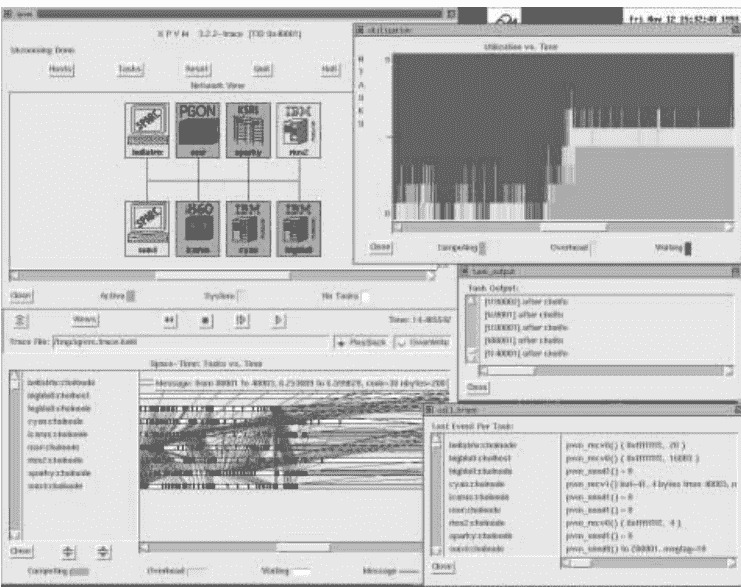

**图 11.4**
使用期间的`XPVM`界面快照

与`PVM`类似，如果`PVM`未运行，`XPVM`将启动它；如果已运行，则连接到本地`pvm`。它可以接受一个可选参数，而`XPVM`始终读取`HOME/.xpvm.hosts`作为其主机文件。如果该文件不存在，`XPVM`在本地主机上启动`PVM`（或连接到现有的`PVM`）。在典型用法中，主机文件`.xpvm.hosts`包含以`&`开头的主机列表。这些主机名会被添加到*Hosts*列表中，以便从虚拟机中添加或删除。

顶行按钮执行类似控制台的功能。*Hosts*按钮显示主机菜单。点击主机可以切换其在虚拟机中的添加或删除。菜单底部有一个添加未列出主机的选项。*Tasks*按钮弹出一个菜单，最常用的选项是`spawn`。选择`spawn`会弹出一个窗口，在其中设置可执行文件、`spawn`标志、起始位置和其他参数。`Reset`按钮清除配置。`Quit`按钮退出`XPVM`。`Halt`按钮停止所有任务。`Pause`按钮暂停任务。`Resume`按钮恢复任务。`Help`按钮显示文档。`Search`按钮允许搜索任务。`Log`按钮允许保存日志。`File`按钮允许配置。`Edit`按钮允许编辑配置。`View`按钮允许视图。`Sort`按钮允许排序任务。`Filter`按钮允许过滤任务。`Group`按钮允许分组任务。`Split`按钮允许拆分。`Rename`按钮允许重命名任务。`Delete`按钮允许删除任务。`Undo`按钮允许撤销操作。`Redo`按钮允许重做。`Copy`按钮允许复制。`Paste`按钮允许粘贴任务。`Cut`按钮允许剪切任务。`Select`按钮允许选择任务。`Select All`按钮允许选择所有。`Deselect`按钮允许取消选择。`Clear`按钮允许清除。`Refresh`按钮允许刷新。`Import`按钮允许导入任务。`Export`按钮允许导出任务。`Save`按钮允许保存任务。`Load`按钮允许加载任务。`Print`按钮允许打印任务。`Share`按钮允许共享任务。`Save`按钮允许保存任务。`Open`按钮允许打开任务。`New`按钮允许创建新任务。`Close`按钮允许关闭任务。`Exit`按钮退出`XPVM`。`Help`按钮获取帮助。`About`按钮查看关于`XPVM`的信息。`Update`按钮允许更新`XPVM`。`Install`按钮允许安装`XPVM`。`Uninstall`按钮允许卸载`XPVM`。`Configure`按钮允许配置`XPVM`。`Settings`按钮允许设置。`Preferences`按钮允许偏好。`Options`按钮允许选项。`Tools`按钮允许工具。`Window`按钮允许窗口。`Menu`按钮允许菜单。`Toolbar`按钮允许工具栏。`Status`按钮允许状态栏。`Help`按钮允许帮助栏。`Search`按钮允许搜索栏。`Command`按钮允许命令栏。`Notification`按钮允许通知栏。`Message`按钮允许消息栏。`Error`按钮允许错误栏。`User`按钮允许用户栏。`System`按钮允许系统栏。`Network`按钮允许网络栏。`Data`按钮允许数据栏。`Disk`按钮允许磁盘栏。`Memory`按钮允许内存栏。`CPU`按钮允许`CPU`栏。`GPU`按钮允许`GPU`栏。`Power`按钮允许电源栏。`Security`按钮允许安全栏。`Performance`按钮允许性能栏。`Privacy`按钮允许隐私栏。`Stability`按钮允许稳定性栏。`Accessibility`按钮允许无障碍栏。`Localization`按钮允许本地化栏。`Community`按钮允许社区栏。`Feedback`按钮允许反馈栏。`Support`按钮允许支持栏。`Documentation`按钮允许文档栏。`Tutorial`按钮允许教程栏。`FAQ`按钮允许`FAQ`栏。`Release`按钮允许发布栏。`News`按钮允许新闻栏。`Blog`按钮允许博客栏。`Forum`按钮允许论坛栏。`Chat`按钮允许聊天栏。`Gallery`按钮允许画廊栏。`Video`按钮允许视频栏。`Audio`按钮允许音频栏。`Image`按钮允许图像栏。`Document`按钮允许文档栏。`App`按钮允许应用栏。`Store`按钮允许商店栏。`Marketplace`按钮允许市场栏。`Subscription`按钮允许订阅栏。`Account`按钮允许账户栏。`Payment`按钮允许支付栏。`Billing`按钮允许账单栏。`Order`按钮允许订单栏。`Shipping`按钮允许物流栏。`Customer`按钮允许客户栏。`Profile`按钮允许个人资料栏。`Preference`按钮允许偏好栏。`Notification`按钮允许通知栏。`Alert`按钮允许警报栏。`Security`按钮允许安全栏。`Privacy`按钮允许隐私栏。`Performance`按钮允许性能栏。`Stability`按钮允许稳定性栏。`Accessibility`按钮允许无障碍栏。`Localization`按钮允许本地化栏。`Community`按钮允许社区栏。`Feedback`按钮允许反馈栏。`Support`按钮允许支持栏。`Documentation`按钮允许文档栏。`Tutorial`按钮允许教程栏。`FAQ`按钮允许`FAQ`栏。`Release`按钮允许发布栏。`News`按钮允许新闻栏。`Blog`按钮允许博客栏。`Forum`按钮允许论坛栏。`Chat`按钮允许聊天栏。`Gallery`按钮允许画廊栏。`Video`按钮允许视频栏。`Audio`按钮允许音频栏。`Image`按钮允许图像栏。`Document`按钮允许文档栏。`App`按钮允许应用栏。`Store`按钮允许商店栏。`Marketplace`按钮允许市场栏。`Subscription`按钮允许订阅栏。`Account`按钮允许账户栏。`Payment`按钮允许支付栏。`Billing`按钮允许账单栏。`Order`按钮允许订单栏。`Shipping`按钮允许物流栏。`Customer`按钮允许客户栏。`Profile`按钮允许个人资料栏。`Preference`按钮允许偏好栏。

第三种视图仅在您用鼠标点击时空视图（Space-time view）中感兴趣的功能时才会出现。会出现一个较小的“弹出”窗口，提供有关特定任务状态或消息的详细信息。如果点击某个任务，将显示开始、起始和结束时间，以及最后的`PVM`系统调用信息。如果点击某个消息，窗口将显示发送和接收时间、消息中的字节数以及消息标签。

当鼠标在时空视图内部移动时，一条蓝色垂直线会跟踪光标，该垂直线对应的时间将作为查询时间（Query time）显示在显示器的底部。这条垂直线也会出现在其他的“某物随时间”视图中，因此你可以一个视图中的特征与另一个视图中提供的信息关联起来。

你可以通过鼠标中键拖动垂直线来对时空视图的任何区域进行缩放。点击右键时，视图将解锁一级。通常，只有当使用缩放功能放大视图时，才能看到某些通信或等待状态。与查询时间一样，其他视图也会随时空视图一起缩放。

### 11.10.3 其他视图

`XPVM`设计为可扩展。可以创建新视图并将其添加到视图菜单中。目前，还有三个其他视图：利用率（Utilization）、调用跟踪（Call Trace）和任务输出（Task Output）。与网络和时空视图不同，这些视图默认是关闭的。由于`XPVM`尝试实时绘制视图，视图越少，`XPVM`绘制得越快。

利用率视图显示每个实例正在计算、开销或等待的任务数。它是每个实例时空视图的摘要。由于`PVM`中任务的数量可以动态变化，利用率视图上的比例将会在任务添加时动态变化，但在任务退出时不会变化。当发生这种情况时，利用率视图的显示部分将根据新比例完全重绘。

调用跟踪视图提供了每个任务中最后一次`PVM`调用的文本记录。任务列表与时空视图相同。随着应用程序的运行，文本会变化以反映每个任务中最近的活动。该视图作为调用级调试器非常有用，可以识别`PVM`程序的执行在何处挂起。

当打开任务输出视图时，`XPVM`会自动告诉所有任务将标准输出重定向回`XPVM`。此视图让你提供了将输出重定向到文件的选项。如果你在“任务输出”框中输入文件名，输出将打印在窗口中并保存到文件中。

与跟踪事件一样，在`XPVM`之外启动的任务可以通过`pvm_setopt()`中的选项编程将标准输出发送到`XPVM`进行显示。`XPVM`期望`OutputCode`设置`667`。

## 12 使用 PVM 的容错和自适应程序

`Al Geist`和`Jim Kohl`

在过去的几年中，`Beowulf`集群的使用迅速扩大。这些集群最初由研究人员创建用于科学计算，而今天这些集群被用于业务和商业环境，那里的要求和预期完全不同。例如，在一家大型`Web`托管公司，应用程序的可靠性和健壮性通常比原始性能更重要。

在为`Beowulf`集群开发应用程序时，必须考虑许多因素。在前面的章节中，说明了消息传递的基本方法，以便你创建自己的并行程序。本章描述了使并行程序具有容错和自适应能力的问题和常用方法。

容错是指应用程序即使在硬件或软件问题导致集群中的节点故障也能运行或取得进展的能力。它也是容忍应用程序内部故障的能力。例如，并行应用程序内部的一个任务可能会遇到错误并终止。`Beowulf`集群是由为桌面而非重型计算设计的通用组件构建的，集群内部组件的故障率高于具有集成`RAS`（可靠性、可用性、可维护性）系统的昂贵多处理器系统。

虽然容错程序可以被认为是自适应的，但“自适应程序”一词在这里更泛泛，指的是并行（或串行）程序，它们动态地改变自己的特征以更好地匹配应用程序的需求和可用资源。示例包括根据其当前的计算需求添加或释放集群节点来适应的应用程序，以及根据计算需要创建和杀死任务的应用程序。

在后面的章节中，你将学习`Condor`和其他资源管理工具，这些工具会自动为提交给它们的作业提供某种程度的容错和自适应性。本章将教你如何自己编写此类工具的基础知识。

`PVM`基于动态计算模型，其中集群节点可以动态从计算中添加或删除，并行任务可以在计算期间被创建或杀死。`PVM`的消息传递功能远没有`MPI`丰富；但作为一个虚拟机，`PVM`具有许多特性，使其在创建动态并行程序时具有吸引力。出于这个原因，本章将使用`PVM`来说明容错和自适应的概念。

## 12.1 容错考虑因素

橡树岭国家实验室的一位计算生物学家想编写一个在他的`Beowulf`集群上`24/7`运行的并行应用程序。该应用程序涉及人类基因组的计算，并由来自世界各地研究人员不断的新数据流驱动。数据不是独立的，因为新数据有助于精炼和扩展之前计算的序列。他该如何编写这样的程序？

一家公司想编写一个应用程序来处理来自`Web`的持续销售订单流。该程序需要是健壮的，因为停机不仅意味着收入流的损失，还意味着闲置工人的工资。该公司最近购买了一个`Beowulf`集群以提供可靠且具成本效益的解决方案。但他们如何编写运行在集群上的容错并行程序呢？

当你开发必须可靠的算法时，首要考虑的因素是硬件。坏消息是，你的`Beowulf`集群将会发生故障；它需要维护。这不是集群中的节点是否会故障，而是何时发生的问题。经验表明，集群中的节点越多，在给定时间内发生故障的可能性就越大。硬件故障的频率在集群之间差异很大。有些集群每周发生一次；有些则可以运行几个月。

多个节点在同一时间发生类似的硬件问题并不罕见。在模拟负载下对你的特定集群进行几周的评估，以获取有关预期平均故障间隔时间（`MTBF`）的数据。如果`MTBF`远大于你的平均运行时间，那么重构应用程序以容错可能没有意义。在大多数情况下，如果并行应用程序的运行时间短，重新运行它更有效。

第二个考虑因素是底层软件环境的容错性。如果操作系统不稳定，硬件就是最不用担心的问题了。`PVM`系统位于操作系统和应用程序之间，其他功能包括监控虚拟机的状态。`PVM`系统的设计是容错的，并在检测到故障时自动重新配置。在`PVM`项目早期，人们发现如果底层故障检测系统在故障期间崩溃，对你的容错应用程序将毫无帮助。`PVM`故障检测系统负责检测问题并通知运行中的应用程序。它不会尝试自动恢复并行应用程序。

第三个考虑因素是应用程序。并不是每个并行应用程序都能从故障中恢复；恢复取决于应用程序的设计和

# 使用 PVM 构建容错与自适应程序

取决于故障的性质。例如，在前面章节的`manager/worker`程序中，如果失败的节点正在运行`worker`（工人），则是可以恢复的；如果该节点运行的是`manager`（管理器），可能会丢失无法恢复的关键数据。

至少，如果检测到故障，任何并行程序都可以通过从头重新启动来实现容错。

并行程序的恢复是复杂的，因为在恢复开始时，消息中的数据可能正处于传输过程中。这里中存在一个竞态条件。如果数据未到达，则需要作为恢复的一部分重新发送。但如果数据在恢复开始之前恰好被接收，则没有悬悬的接收调用，且不应重新发送数据。

文件`I/O`是另一个使恢复复杂的问题。文件指针可能会重置到上一个检查点，以避免在文件中获得重复的输出数据。

尽管存在所有这些问题，但可以使用几种常用方法来提高许多并行应用程序的容错性。

## 12.2 构建容错的并行应用程序

从应用程序的角度来看，为了实现容错，必须执行三个步骤：通知、恢复和继续。

`PVM`系统内置了监控和通知功能。可以请求应用程序中的任何或所有任务对特定事件进行通知。这些包括一个任务或一组任务的退出，或者在应用程序内任何任务失败时请求通知。在最后一种情况下，通知消息包含失败任务的`ID`。为了检测故障，被通知的任务与失败的任务之间不需要曾经进行过通信。

集群中节点的故障或删除是另一个可以指定的事件。请求的应用程序任务可以指定特定的节点、一组节点或所有节点。与之前一样，通知消息会返回失败节点的`ID`。

向应用程序的计算环境添加一个或多个集群节点也是`PVM`可以通知应用程序的事件。在这种情况下，无法指定`ID`，通知消息将返回新节点的`ID`。

```c
```


`int info = pvm_notify( int EventType, int msgtag, int cnt, int *ids )`

`EventType`选项有`PvmTaskExit`、`PvmHostDelete`和`PvmHostAdd`。对于应用程序希望通知的每种事件类型，必须单独调用一次通知函数。`msag`参数指定了监听事件时将使用的消息标签。`cnt`参数是`ids`数组中请求通知的任务或节点 ID 的数量。

鉴于`pvm_notify`命令的灵活性，应用程序设计为接收 PVM 系统通知的方法有几种。第一种方案是设计一个独立的观察任务（watcher task）。在集群中会生成一个或多个此类观察任务，它们通常还承担管理应用程序恢复阶段的额外责任。这种方法的优点是应用程序代码可以保持更简洁。注意，在 manager/worker 方案中，manager 经常担任观察者的角色。

第二种方案让应用程序任务相互观察。一种常用方法是让每个任务在本地环中观察其邻居。因此，每个任务只需观察一两个其他任务。另一种常见但不特别高效的方法是让每个任务观察所有其他任务。记住，是 PVM 系统在进行监控，而不是应用程序任务。监控开销在所有选项中是共享的。区别在于发生故障时发送的通知消息数量。

恢复很大程度上取决于应用程序中使用的并行算法类型。常用的选项包括从头重新启动、回滚到上一个检查点，或重新分配失败任务的工作。

第一种选项实现最简单，但计算开销最大。许多批系统使用这种选项，因为它不需要了解应用程序的内容。它保证了即使发生故障，应用程序也能完成，尽管不能保证这需要多久。平均而言，时间少于正常运行时间。对于短运行的应用程序，这是最佳选项。

对于运行时间较长的应用程序，检查点（checkpoint）是一种常用选项。使用这种选项，你必须理解应用程序并对其进行修改，以便应用程序从输入数据文件重启。然后你必须修改应用程序定期写入此类数据文件。在发生故障时，只会丢失从上一个检查点开始的计算。应用程序从最后成功写入的数据文件重启。多久写入一次检查点取决于重启文件的大小以及应用程序将运行多久。对于运行数的大型科学应用，通常每几小时执行一次检查点。

## 使用 PVM 构建容错自适应程序

请注意，如果故障是由集群节点丢失引起的，那么在节点被修复或被集群中的另一个节点替换之前，应用程序无法重启。重启文件几乎总是假设重启时可用节点数量相同的情况下写入的。

在基于 manager/worker 方案的特殊情况下，通常可以将发送给失败 worker 的作业分配给另一个 worker，或者生成一个替换的 worker 来占据其位置。manager/worker 是 Beulf 集群中一种非常流行的并行编程方案，这种特殊情况经常发生。下面是一个 manager/worker 程序示例。

- 容错管理器 / 工人示例
- 使用通知和任务生成。
- example1。

```c
#include <stdio.h>
#include <math.h>
#include <pvm3.h>
#define NWORK 4
#define NPROB 10000
#define MSGTAG 121
int main()
{
    double sum = 0.0, result, input;
    int tids[NWORK], probs[NPROB], sent=0, recvd=0, cc=0, i, j, marker, src, numt;
    /* 管理管理器 */
    if ((cc = pvm_parent()) == PvmParent || cc == PvmSet) {
        /* 生成工人任务 */
        numt = pvm_spawn("example1", (char **) NULL, PvmTaskDefault, (char *) NULL, numt, tids);
        /* 为生成的任务设置通知 */
        pvm_notify(PvmTaskExit, MSGTAG, numt, tids);
        /* 向生成的工人发送问题 */
        for(i=0; i < NPROB; i++) probs[i] = -1;
        for(i=0; i < numt; i++) {
            pvm_pkint(&i, 1, 1); /* 有效问题标记 */
            input = (double) (i + 1);
            pvm_pkdouble(&input, 1, 1);
            pvm_send( tids[i], MSGTAG );
            probs[i] = i; sent++; /* 问题 */
        }
        /* 收集结果 / 处理故障 */
        do {
            /* 接收结果 */
            bufid = pvm_recv(-1, MSGTAG);
            pvm_upint(&marker, 1, 1);
            /* 处理通知 */
            if ( marker > 0 ) {
                /* 查找失败任务索引 */
                for ( i=0, next = -1; i < numt; i++ )
                    if ( tids[i] == marker ) {
                        /* 查找发送给任务的问题 */
                        for ( j=(sent-1); j > 0; j--)
                            if ( probs[j] == i ) {
                                /* 生成替换任务 */
                                if ( pvm_spawn("example1", (char **) NULL,
PvmTaskDefault, (char *) NULL, 1,
                                &tids[i]) == 1 ) {
                                    pvm_notify( PvmTaskExit, MSGTAG, 1,
                                    &tids[i] );
                                    next = i; sent--;
                             }
                            }
                        }
                        probs[j] = -1; /* 插入问题 */
                        break;
                    }
            } else {
                /* 获取源任务并累加解 */
                pvm_updouble(&result, 1, 1);
                sum += result;
                recvd++;
            }
            /* 获取任务索引 */
            pvm_bufinfo(bufid, (int *) NULL, &src);
            for ( i = 0; i < numt; i++ )
                if ( tids[i] == src ) next = i;
        } while (recvd < numt);
    }
    return 0;
}
```

# 基于 PVM 的容错自适应程序

```c
if ( next >= 0 ) {
    for ( i=0, input = -1.0 ; i < NPROB ; i++) {
        if ( probs[i] < 0 ) {
            input = (double) (i + 1);
            probs[i] = next; sent++; /* 下一个问题 */
            break;
        }
        pvm_itsend(PvmDataDefault );
        pvm_pkint(&ok, 1, 1); /* 有效问题标记 */
        pvm_pkdouble(&input, 1, 1);
        pvm_send(tids[next], MSGTAG );
        if ( input < 0.0 ) tids[next] = -1;
    }
}
while ( recvd < sent ) {
    printf("Sum = %lf\n", sum );
}
/* 如果我是一个工作任务 */
else if ( cc > 0 ) {
    /* 通知管理器失效 */
    pvm_notify(PvmTaskExit, MSGTAG, 1, &cc);
    /* Solving问题直到完成 */
    do {
        /* 从主节点获取问题 */
        pvm_recv(-1, MSGTAG );
        pvm_upint(&ok, 1, 1);
        if ( ok > 0 ) /* 主节点死亡 */
            break;
            pvm_updouble(&input, 1, 1);
            if ( input > 0.0 ) {
                /* 计算结果 */
                result = sqrt( 2.0 * input ) - 1.0;
                /* 将结果发送给主节点 */
                pvm_itsend(PvmDataDefault );
                pvm_pkint(&ok, 1, 1); /* 请求更多问题... */
                pvm_pkdouble(&result, 1, 1);
                pvm_send(cc, MSGTAG );
            }
    } else
        done = 1;
} while ( ! done );
}
}
```

```c
pvm_exit();
```

```c
return( 0 );
}
```

这个示例展示了另一个非常有用的函数：`pvm_spawn()`。启动替换机器的能力是容错中的一项强大功能。正如我们在下一节中看到的，它也是自适应程序中的关键函数。

```c
int numt = pvm_spawn( char *task, char **argv, int flag, char *node, int ntasks, int *tids )
```

`pvm_spawn()`例程在虚拟机上启动`ntasks`份可执行任务的副本。假设 PVM 虚拟机运行在 Beowulf 集群上。这里`argv`是指向任务参数数组的指针，数组末尾由`NULL`指定。`flag`参数用于指定选项，它是以下选项的和：

- `PvmTaskDefault`: 让 PVM 选择启动进程的位置
- `PvmTaskHost`: 使用`where`参数指定在特定的宿主机或集群节点上启动
- `PvmTaskArch`: 使用`where`参数指定在何种架构类上启动
- `PvmTaskDebug`: 在调试器下启动这些进程
- `PvmTaskTrace`: 使用 PVM 调用生成跟踪数据
- `PvmMppFront`: 在 MPP 前端/服务节点上启动
- `PvmHostComp`: 在互补宿主机上处理

例如，`flag = PvmTaskHost + PvmHostComp`会在指定节点（例如可能是管理器）的每个节点上启动任务。

返回时，`numt`是成功启动的任务数，如果无法启动任务则返回错误码。如果已启动，`pvm_spawn()`返回一个已启动任务的`tids`向量。如果某些任务无法启动，相应的错误码将放在向量的最后$(ntask - numt)$位置。

在上面的示例中，`pvm_spawn()`用于启动所有工作节点，并替换计算过程中失败的工作节点。这种容错方法对于持续运行且有稳定新工作流进入的应用非常有用，正如我们的两个初始示例那样。两者都使用了上述 PVM 示例代码的变体来实现解决方案。

## 基于 PVM 的容错与自适应程序

### 12.3 自适应程序

在本节中，我们将使用更多的 PVM 虚拟机函数来说明集群程序如何扩展，使其不仅能适应故障，还能适应许多指标和情况。第一个示例演示了一个并行应用程序，它根据应用程序的计算需求，通过添加和释放节点来动态调整虚拟机的大小。在橡树岭国家实验室的一个 128 处理器 Beowulf 集群上，每天都会使用一项由三个研究小组共享的功能。

```c
int numh = pvm_addhosts(char **hosts, int nhost, int *infos)
int numh = pvm_delhosts(char **hosts, int nhost, int *infos)
```

PVM 的`addhosts`和`delhosts`用于添加或删除虚拟机中的一组宿主机。在 Beowulf 集群中，这对应于从计算中添加或删除节点；返回的`numh`是成功添加或删除的数量。参数`infos`是一个长度为`nhost`的数组，包含每个被添加或删除节点的状态码。这允许你检查一组宿主机中的某一个是否导致了问题，而不是尝试重新添加或删除整个主机集。

- “自适应主机分配示例”根据不同的计算阶段动态从计算中添加和移除集群节点

```c
#include <stdio.h>
```

```c
mycxt = pvm_setcontext( oldcxt );
pvm_freecontext( mycxt );
```

```c
return;
```

PVM 内部一直有消息处理程序，它们用于控制虚拟机。在 PVM 3.4 中，定义和删除消息处理程序的能力被提升到了用户级，因此可以编写并行程序，这些程序可以在程序运行时添加新功能。
两个新的消息处理程序函数是：

```c
mhid = pvm_addhmf( src, tag, context, *function );
pvm_delhmf( mhid );
```

一旦任务添加了消息处理程序，每当带有指定的源、消息标签和通信上下文的消息到达该任务时，就会执行指定的函数。该函数将接收到该消息，以便在需要时可以对消息进行解包。PVM 对函数的复杂度没有设置任何限制，函数可以自由地进行系统调用或其他 PVM 调用。添加例程会返回一个消息处理程序 ID，该 ID 将用于删除消息处理程序的例程。

你可以设置的处理器数量没有限制，且每个应用程序任务可以独立地动态地添加和删除处理器。

通过设置消息处理程序，你现在可以编写能够动态更改底层虚拟机特征的程序。例如，可以添加消息处理程序来实现主动消息（active messages）；应用程序随后就可以使用这种通信形式，而不是典型的发送/接收（send/receive）。虚拟机的几乎每个功能都存在类似的机会。

应用程序适应虚拟机特征以满足其当前需求的能力是一项强大的能力，这种能力在 Beowulf 集群中尚未被充分利用。

```c
/* 使用用户定义的消息处理程序
* 适配可用的虚拟机功能。 */
```

```c
#include <stdio.h>
#include <pvm3.h>
```

```c
#define NWORK 4
#define MAIN_MSGTAG 123
#define CNTR_MSGTAG 124
```

int counter = 0;

```c
int handler( int mid ) {
    int ack, incr, src;
    /* 增加计数器 */
    pvm_upint(&incr, 1, 1);
    counter += incr;
    printf("%d\n", counter);
    /* 确认计数器任务 */
    pvm_bufinfo(mid, (*) NULL, (*) NULL, &src);
    pvm_itsend(PvmDataDefault);
    ack = ( counter > 1000 ) ? -1 : 1;
    pvm_pkint(&ack, 1, 1);
    pvm_send(src, CNTR_MSGTAG);
    return( 0 );
}
```

```c
int main( int argc, char **argv) {
    int ack, cc, ctx, bufid, incr=1, iter=1, max, numt, old, value=1, src;
    char *args[2];
```

```c
/* 如果我是管理任务 */
if ( cc = pvm_parent() == PvmNoParent || cc == PvmParentNotSet ) {
/* 为计数器任务消息生成新的消息上下文 */
    ctx = pvm_newcontext();
/* 为独立计数器注册消息处理函数 */


`pvm_addhandler(-1, CNTR_MSGTAG, handler);`

/* 派生计数器任务 */

`args[0] = "counter"; args[1] = (char *) NULL;`

`old = pvm_setcontext( ctx );` /* 设置计数器任务的消息上下文 */

```c
if ( pvm_spawn("example3", args, PvmDataDefault,
    char (* -1), 1, (int*) NULL ) == 1 )
    counter = 1001; /* 计数器派生失败，触发退出 */
```

`pvm_setcontext(old );` /* 重置为基础消息上下文 */

/* 派生 NWORK 工作任务 */

```c
args[0] = "worker"
numt = pvm_spawn("example3", args, PvmTaskDefault,
(char *) NULL, NWORK, (int *) NULL );
```

## 使用 PVM 的容错与自适应程序

```c
/* 增加并返回工作任务值 */

do {

    /* 获取值 */

    bufid = pvm_recv(-1, MAIN_MSGTAG);

    pvm_upint(&value, 1, 1);

    max = ( value > max ) ? value : max;

    printf("recvd value = %d\n", value);

    /* 发送回复 */

    pvm_bufinfo(bufid, (int *) (int *) NULL, &src);

    if ( counter < 1000 ) value++;

    else { value = -1; num--; } // 告诉工作任务退出

    pvm_itsend(PvmDataDefault);

    pvm_pkint(&value, 1, 1);

    pvm_send(src, MAIN_MSGTAG);

} while ( num > 0 );
```

```c
printf("Max Value = %d\n", max);

/* 如果我是工作任务 */
else if ( cc > 0 && !strcmp(argv[1], "worker") ) {

    /* 持续增加值直到完成 */
    do {

        /* 向主任务发送值 */
        value = 2;

        pvm_itsend(PvmDataDefault);

        pvm_pkint(&value, 1, 1);

        pvm_send(cc, MAIN_MSGTAG);

        /* 从主任务获取增加后的值 */
        pvm_recv(cc, MAIN_MSGTAG);

        pvm_upint(&value, 1, 1);

    } while ( value > 0 );

/* 如果我是计数器任务 */
else if ( cc > 0 && !strcmp(argv[1], "counter") ) {

    /* 增加值直到完成 */
    do {

        /* 向主任务发送值 */
        value = 2;

        pvm_itsend(PvmDataDefault);

        pvm_pkint(&value, 1, 1);

        pvm_send(cc, MAIN_MSGTAG);

        /* 从主任务获取增加后的值 */
        pvm_recv(cc, MAIN_MSGTAG);

        pvm_upint(&value, 1, 1);

    } while ( ack > 0 );

pvm_exit();

return(  );
```

在典型的消息传递系统中，消息是瞬时的（transient），重点是尽可能减少延迟。但如果可以使用持久性消息（persistent messages），并行计算中的许多情况将变得简单得多。

消息框（Message Box）功能由四个函数组成：

```c
putinfo(name, msgbuf)
recvinfo(name, index)
delinfo(name)
getmbox(pattern, info)
```

任务可以使用 `putinfo()` 在消息框中放置消息。知道名称的任何 PVM 任务可以通过 `getmbox()` 获取它。如果名称是动态变化的，可以使用 `getmbox()`。

消息框已用于许多其他用途。例如，PVM 组功能已经在新的消息框函数中实现；计算引导（computational steering）使用消息框查询远程仿真；性能监控将它们的发现留在消息框中供其他工具使用。

## 使用 PVM 的容错与自适应程序

在并行计算中拥有持久性消息的能力为高性能计算开启了新的应用可能性，在协作技术中也是如此。

```c
/* 使用持久性消息来适应变化
* 任务根据需要创建和杀死
* 信息通过持久性消息在任务之间交换 */
```

```c
#include <stdio.h>
#include <sys/time.h>
#include <pvm3.h>
```

```c
#define MSGBOX "load_stats"

int main() {
    int cc, elapsed, i, load, num;
    struct time start, end;
    double value;

    /* 如果我是管理任务 */
    if ( (cc = pvm_parent()) == PvmNoParent || cc == PvmParentNotSet ) {

        /* 定期派生负载监控，检查系统负载 */
        do {
            /* 派生负载监控任务 */
            if ( pvm_spawn("example4", (char **) NULL, PvmTaskDefault,
                (char **) NULL, 1, (int **) NULL) != 1 ) {
                perror("spawning load monitor"); break;
            }
            sleep(1);

            /* 检查系统负载（每 Mflop 的微秒） */
            for (i=0, load=0.0, num=0; i < 11; i++) {
                if ( pvm_recvinfo(MSGBOX, i, PvmboxDefault) >= 0 ) {
                    pvm_upint(&elapsed, 1, 1);
                    load += num;
                }
            }
            if (num) {
                printf("Load Avg = %lf usec/Mflop\n",
                    (double) load / (double) num);
            }
            sleep(5);
        } while ( 1 );
    }
}
```

```c
/* 如果我是一个负载监控任务 */
else if ( cc > 0 ) {
  /* 简单的计时计算 */
  gettimeofday(&start, struct timezone *) NULL);
  for (i=0, value=1.0; i < 1000000 ; i ++ )
    value *= 1.2345678;
  gettimeofday(&end, struct timezone *) NULL);
  elapsed = (end.tv_use - start.tv_use
    + 1000000 * (end.tv_sec - start.tv_sec);

  /* 导出到下一个可用消息框 */
  pvm_initsend(pvmDataDefault());
  pvm_pkint(&elapsed, 1, 1);
  index = pvm_MboxDefault | pvm_putinfo( MSBOX, pvm_getsbuf(),
    PvmMboxDefault | PvmMboxPersistent
    | PvmMboxMultiInstance | PvmMboxOverWritable );

  /* 为下一个实例释放下一个消息框（仅保存 10 个） */
  pvm_delinfo( MSBOX, (index + 1) % 11, PvmMboxDefault );
}

pvm_exit();

return( 0 );
```

# III 集群管理

## 13 集群负载管理

James Patton Jones, David Lifka, Bill Nitzberg 和 Todd Tanenbaum

Beowulf 集群是一个强大（且具有吸引力）的工具。但管理工作负载可能会带来重大挑战。运行数百或数千个作业，或者在许多用户之间共享集群，这并不罕见。由于集群中并非所有节点都处于活跃，某些作业可能只运行在特定节点上。某些节点可能临时无法正常运行。某些用户可能需要对集群的部分或全部具有优先访问权限。某些作业可能需要在一天的特定时间运行，或在其他作业完成后运行。在最简单的环境中，在管理不断变化的活动和资源规格的同时，跟踪所有这些活动也非易事。

Beowulf 集群是一个强大（且具有吸引力）的工具。但管理工作负载可能会带来重大挑战。运行数百或数千个作业，或者在许多用户之间共享集群，这并不罕见。由于集群中并非所有节点都处于活跃，某些作业可能只运行在特定节点上。某些节点可能临时无法正常运行。某些用户可能需要对集群的部分或全部具有优先访问权限。某些作业可能需要在一天的特定时间运行，或在其他作业完成后运行。在最简单的环境中，在管理不断变化的活动和资源规格的同时，跟踪所有这些活动也非易事。

## 13 集群负载管理

James Patton Jones, David Lifka, Bill Nitzberg 和 Todd Tanenbaum

Beowulf 集群是一个强大（且具有吸引力）的工具。但管理工作负载可能会带来重大挑战。运行数百或数千个作业，或者在许多用户之间共享集群，这并不罕见。由于集群中并非所有节点都处于活跃，某些作业可能只运行在特定节点上。某些节点可能临时无法正常运行。某些用户可能需要对集群的部分或全部具有优先访问权限。某些作业可能需要在一天的特定时间运行，或在其他作业完成后运行。在最简单的环境中，在管理不断变化的活动和资源规格的同时，跟踪所有这些活动也非易事。

3. 当任务完成时。在这里，使用资源监控来确保已完成的任务没有剩余进程，并确保在节点上启动另一个任务之前，该节点仍正常工作。

负载管理系统会在这些时间查询计算资源，并利用这些信息对运行任务做出明智决策。大部分信息会被缓存，以便在响应请求时快速报告。某些信息被保存起来用于历史分析。另一些信息则用于执行本地策略。不同负载管理系统之间的收集方法可能有所不同，但通用目标是相同的。

### 13.2.4 资源管理

第四个领域资源管理本质上负责在集群节点上运行的任务的启动、停止和清理。在批系统中，资源管理涉及为用户运行任务、以用户的身份、在分配给该用户的资源上运行任务，且用户无需在此时到场。

许多集群负载管理系统提供了相应的机制以确保任务的成功启动和清理，并在内部维护节点状态数据，以便任务仅在可用且运行运行的节点上启动。

此外，可能需要对任务设置限制并由负载管理系统强制执行。除了对队列的限制以及由调度组件实施的限制之外。

资源管理的另一个方面是提供向可用系统池中删除或添加计算资源的能力。集群很少是静态的；系统会宕机，或者添加新节点。新节点的“注册”和将节点标记为不可用都是资源管理的方面。

### 13.2.5 计费

负载管理的第五个方面是计费和报告。负载计费是收集在集群上运行的批任务资源使用数据的过程。此类数据包括任务所有者、任务请求的资源以及任务消耗的资源总量。取决于所使用的特定负载管理系统，可能还有有关任务的其他数据。

集群负载计费数据可用于多种用途，例如：

- 1. 制作每周系统使用报告，
- 2. 准备每月每用户使用报告，
- 3. 强制按项目分配，
- 4. 调整调度策略，
- 5. 计算未来的资源分配，
- 6. 预测未来的计算机组件需求，以及
- 7. 确定计算机系统内部改进领域。

这些用途的数据可能作为资源监控任务的一部分进行收集，也单独收集。无论何种情况，数据都会从可用源中提取以满足负载计费的目标。关于使用特定负载管理系统负载计费功能的细节将在本书的后续章节中讨论。

## 14 Condor：分布式作业调度器

Todd Tannenbaum, Derek Wright, Karen Miller 和 Miron Livny

**Condor** 是一种复杂且独特的分布式调度器，由威斯康星大学麦迪逊分校计算机科学系的 Condor 研究项目开发。

Condor 软件的公共有领域版本和完整文档可以从 Condor 项目网站 **www.cs.wisc.edu/condor** 免费获取。机构可以购买带有附属支持合同的 Condor 商业版本；更多信息请参阅 **www.condorcomputing.com**。

本章介绍了 Condor 的各个方面，从提交者和资源所有者的需求与愿望，到集群上对 Condor 的管理。在概述了 Condor 和 Condor 的 ClassAd 机制之后，将从用户的角度对 Condor 进行描述。本章展示了软件的架构，并提供了安装和管理的概述。本章以集群的配置场景结束。

### 14.1 Condor 简介

Condor 是一种用于计算密集型作业的专用负载管理系统。与其他功能完备的批处理系统一样，Condor 提供了作业队列机制、调度策略、优先级方案、资源监控和资源管理。用户将作业提交给 Condor，Condor 将其放入队列，根据策略选择何时以及如何运行它们，监控它们的进度，并最终在完成后通知用户。

虽然在功能上与更传统的批处理队列系统相似，但 Condor 新颖的架构使其能够在传统调度系统失败的领域取得成功。Condor 可用于管理由专用 Beowulf 节点组成的集群。此外，几种独特的机制使得 Condor 能够有效利用原本空闲的桌面工作站的 CPU 算力。Condor 可以将您组织所有的计算能力无缝整合到一个资源中。


Condor 是威斯康星大学麦迪逊分校（UW-Madison）Condor 研究项目的产物，并于近十年前首次作为生产系统安装在该校计算机系。自此以后，该 Condor 安装版一直是麦迪逊分校教职员工和学生提供计算周期的主要来源。今天，光是在我们一个部门，Condor 就管理着超过一千个工作站，包括该部门 500 CPU 的 Linux Beowulf 集群。在典型的一天中，Condor 为麦迪逊分校的研究人员提供了超过 650 CPU-days。多年来，在我们校园及全球范围内建立了更多的 Condor 安装。工业、政府和学术界的数百家机构已使用 Condor 建立了规模从少数几个到几百个工作站不等的计算环境。

### 14.1.1 Condor 的特性

Condor 的功能非常广泛。Condor 为提交作业的用户和提供 CPU 时间运行作业的机器所有者提供了极大的灵活性。以下列表总结了 Condor 的某些能力。

**分布式提交：** Condor 允许从许多机器提交作业，每台机器都包含自己的自己的作业队列。用户可以从自己的桌面机器提交任务到集群。

**作业优先级：** 用户可以为其提交的作业分配优先级，以控制执行。

**用户优先级：** 管理员可以使用灵活机制为用户分配优先级，以确保公平份额、严格排序或策略组合。

**作业依赖：** 某些作业因为作业之间的依赖关系而需要排序。“在作业 Y 和 Z 成功完成后启动作业 X”就是依赖的示例。

**支持多种模型：** Condor 处理串行作业以及包含 PVM 和 MPI 的并行作业。

**ClassAd：** `ClassAd` 机制提供了一个极其灵活且表达丰富的框架，用于匹配资源请求（作业）与资源供给（机器）。作业可以轻松说明需求和偏好。同样，机器也可以对它们愿意运行的作业指定需求和偏好。

**作业检查点与迁移：** 对于某些类型的作业，Condor 可以透明地拍摄检查点并恢复应用程序。检查点是作业完整状态的快照。给定检查点，作业稍后可以继续执行。检查点还允许作业从一台机器迁移到另一台机器。

**定期检查点：** 可以配置 Condor 定期作业作业检查点。这提供了一种形式的容错机制，并在机器关机或硬件故障时保护已积累的计算时间。

**作业暂停与恢复：** 根据策略规则，Condor 可以请求操作系统暂停和恢复作业。

**远程系统调用：** 尽管在远程机器上运行作业，Condor 经常可以通过远程系统调用保留本地执行环境。用户在 Condor 执行其程序之前，无需提供数据文件，甚至无需在远程工作站获取登录账户。程序在 Condor 下的行为就像是在最初提交作业的工作站上运行一样，无论它实际在何处执行。

**协同工作的池：** Flocking 允许跨多个 Condor 池进行作业调度。它可以跨越属于不同组织并实施所有者策略的池。

**验证与授权：** 管理员对访问权限拥有细粒度的控制，Condor 可以使用多种机制（包括 Kerberos 和 X.509 公钥证书）执行强大的网络身份验证。

**异构平台：** 除了 Linux 之外，Condor 已移植到大多数其他 Unix 版本以及 Windows NT。单个池可以包含多个平台。在一个平台执行的作业可以从另一个平台提交。例如，在 Windows 2000 下运行的可执行文件可以从运行 Linux 的机器提交。

**网格计算：** Condor 整合许多新兴的网格计算方法和协议。它可以与由 Globus 管理的资源进行交互。

`ClassAds`（分类广告）被用户用于指定哪些机器应该处理他们的作业。管理员使用它们来定制调度策略。

## 概念化 Condor ClassAds：就像报纸一样。

Condor 的 ClassAds 比比纸上的分类广告板块。卖家发布他们要出售物品的具体信息，以吸引买家。买家也可以发布他们想要购买的物品的具体信息。买卖双方都会列出必须满足的约束。例如，买家有最大支出限制，而卖家有最低购买价格要求。此外，双方都希望向自己有利的角度提出请求。卖家会认为一个 50 美元的报价比另一个 25 美元的报价更高。在 Condor 中，提交作业可以被看作计算资源的属性，而机器所有者则是卖家。

Condor 池中的所有机器都会发布它们的属性，例如可用的 RAM 内存、CPU 类型和虚拟内存大小、当前平均负载、当前时间和日期以及其他静态和动态属性。该机器 ClassAd 还会发布在什么条件下愿意运行 Condor 作业以及它倾向于哪种类型的作业。这些策略属性反映了不同所有者允许其机器参与 Condor 池的个人条款和偏好。

作业提交到 Condor 后，会创建一个 ClassAd。此 ClassAd 包含作业的属性，例如它使用的内存量、运行的程序名称以及提交时间。作业还可以对运行该作业的机器指定要求和偏好（或排名）。例如，你可能正在寻找可用的最快浮点性能。你可能希望 Condor 运行至少有 256 字节 RAM 的可用机器。或者，你可能只关心机器是否有磁盘！这些作业属性和要求被封装在一个作业 ClassAd 中。

Condor 扮演着媒合人的角色，通过持续读取所有的 ClassAds 和机器 ClassAds，将作业广告与机器广告进行匹配和排序。Condor 确保两个 ClassAd 中的要求都得到。

## ClassAd 的结构。

ClassAd 是一组唯一命名的表达式。每个命名的表达式被称为属性（attribute）。每个属性都有一个属性名称和一个属性值。属性值可以是简单的整数、字符串或浮点值，例如：

```
Memory = 512
OpSys = "LINUX"
NetworkLatency = 7.5
```

属性值也可以由逻辑表达式组成，该表达式的结果为 TRUE、FALSE 或 UNDEFINED（未定义）。这些表达式中允许的语法和操作符与 C 或 Java 中的相似，例如：== 用于相等，!= 用于不等，&& 用于逻辑与，|| 用于逻辑或等。此外，ClassAds 结合了属性名称来引用其他属性值。例如，考虑以下这个微型样本 ClassAds：

```
MemoryInMs = 512
MemoryInBytes = MemoryInMs * 1024 * 1024
BigMachine = (MemoryInMs > 256) && (Cpus >= 4)
VeryBigMachine = (MemoryInMs > 512) && (Cpus >= 8)
FastMachine = BigMachine && SpeedRating
```

在这个示例中，`BigMachine` 结果为 TRUE，`VeryBigMachine` 结果为 FALSE。因为属性 `SpeedRating` 未被指定，`FastMachine` 的结果为 UNDEFINED。

Condor 提供了元运算符，允许你通过测试操作数的类型和值来显式地与 UNDEFINED 值进行比较。如果类型和值匹配，则两个操作数被认为是相同的；=? 用于元相等（或完全相同），!= 用于元不等（或不相同）。这些运算符返回 TRUE 或 FALSE，从而允许 Condor 管理员在信息完整的情况下指定策略。

ClassAds 语义和语法的完整描述在 Condor 手册中。

## ClassAds 的匹配。

ClassAds 可以彼此相互匹配。这是 Condor 匹配作业与机器的根本机制。图 14.1 显示了一个代表机器的 Condor ClassAd 和另一个代表队列作业的 ClassAd。每个 ClassAd 都包含一个 `MyType` 属性，描述广告代表的资源类型，以及一个 `Target` attribute。`Target` 指定了匹配时所需的资源类型。作业希望与机器匹配，反之亦然。

每个参与匹配的 ClassAd 都指定了 `Requirements`（要求）和 `Rank`（排名）属性。为了让两个 ClassAd 匹配，两个广告中的 `Requirements` 表达式都必须评估为 TRUE。匹配的一个重要部分是 `Requirements` 和 `Rank` 表达式不仅可以引用自身的属性，还可以引用候选匹配广告中的属性。例如：

### 图 14.1 Condor 中 ClassAds 的示例。

| Job ClassAd | Machine ClassAd |
| :--- | :--- |
| MyType = "Job" | MyType = "Machine" |
| Requirements = ((Arch="INTEL") && OpSys="LINUX") && Disk > DiskUsage) | Requirements = ((Arch="INTEL") && OpSys="LINUX") && Disk > DiskUsage) |
| Rank = (Memory * 10000) + KFlops | Rank = (Memory * 10000) + KFlops |
| Args = "/ini" | Args = "/ini/tes.ini" |
| ClusteringId = 680 | Cmd = "home/cluster/bin/sim.exe" |
| Department = "CompSci" | Department = "CompSci" |
| DiskUsage = 456 | DiskUsage = 456 |
| StdErr = "sim,err" | StdErr = "sim,err" |
| ExitStatus = 0 | ExitStatus = 0 |
| FileReadBytes = 0 | FileReadBytes = 0 |
| FileWriteBytes = 0 | FileWriteBytes = 0 |
| ImageSize = 465 | ImageSize = 465 |
| Stdin = "/dev/null" | Stdin = "/dev/null" |
| Stdout = "/home/cluster/sim-m/run.out" | Stdout = "/home/cluster/sim-run.out" |
| JobPrio = 0 | JobPrio = 0 |
| JobStartDate = 97140 | JobStartDate = 97140 |
| StdOut = "out" | StdOut = "out" |
| Owner = "home/cluster" | Owner = "home/cluster" |
| ProcId = 64 | ProcId = 64 |
| RemoteSys = 0 | RemoteSys = 0 |
| RemoteCpu = 0 | RemoteCpu = 0 |
| RemoteWaitTime = 240000 | RemoteWaitTime = 240000 |
| TransferredFiles = "NEVER" | TransferredFiles = "NEVER" |
| WantCheckpoint = FALSE | WantCheckpoint = FALSE |
| WantRemoteSys = FALSE | WantRemoteSys = FALSE |
| Activity = "Idle" | Activity = "Idle" |
| Arch = "INTEL" | Arch = "INTEL" |
| KFlops = 45 | KFlops = 45 |
| CondorLoadAvg = 0.0000 | CondorLoadAvg = 0.0000 |
| Cpu = 0.0000 | Cpu = 0.0000 |
| FileSystem = "ca.wisc.edu" | FileSystem = "ca.wisc.edu" |
| ISFunction = False | ISFunction = False |
| LoadAvg = 0.22000 | LoadAvg = 0.22000 |
| Machine = "cluster.cs.wisc.edu" | Machine = "cluster.cs.wisc.edu" |
| Memory = 511 | Memory = 511 |
| OpSys = "LINUX" | OpSys = "LINUX" |
| Start = (LoadAvg <= 0.30000) && (DiskIdle > 60) | Start = (LoadAvg <= 0.30000) && (DiskIdle > 60) |
| State = "Unclaimed" | State = "Unclaimed" |
| Subnet = 132105.6 | Subnet = 132105.6 |
| VirtualMemory = 78714 | VirtualMemory = 78714 |

图 14.1 中指定的作业广告 `Requirements` 表达式引用 `Arch`、`OpSys` 和 `Disk`，这些都是机器中找到的属性。

如果 Condor 发现多个满足 `Requirements` 约束的 ClassAd 会怎样？这就是 `Rank` 发挥作用的地方。`Rank` 表达式指定了机器的理想程度（数字越大越好）。作业广告如下：

```
Requirements = ((Arch="INTEL") && OpSys="LINUX") && Disk > DiskUsage)
Rank = (Memory * 10000) + KFlops
```

在这种情况下，作业需要一台运行操作系统且本地磁盘空间大于其使用的计算机。在所有此类计算机中，用户倾向于大物理内存和快速浮点 CPU（`KFlops` 是性能指标）。由于 `Rank` 是用户指定的指标，可以使用任何表达式来指定机器的感知理想程度。

## 14.2 使用 Condor

有效使用 Condor 的路很短。基础很快就能上手。

### 14.2.1 使用 Condor 的路线图

使用 Condor 运行作业涉及以下步骤：

- **准备无人运行作业**。在 Condor 下运行的应用程序必须能够以批作业的形式执行。Condor 在无人且在后台运行程序。在后台运行的程序无法进行交互式输入输出。Condor 可以控制台输出（`stdout` 和 `stderr`）和键盘输入（`stdin`）重定向到文件。你应该创建任何包含程序输入正确按键的文件。你还应该确保程序与文件正确运行。

- **选择 Condor Universe**。Condor 有五个运行时环境供选择。每个运行时环境被称为 `Universe`。通常你选择的 `Universe` 取决于你要求 Condor 运行的应用程序类型。共有六种 `Universe`：用于两个顺序作业（Standard 和 Vanilla）、用于并行 PVM 作业（PVM）、用于并行 MPI 作业（MPI）、用于 Grid 应用（Globus）以及用于元调度器（Scheduler）。第 14.2.4 节提供了关于这些每个内容的更多信息。

- **创建提交描述文件**。作业提交的细节在 *submit* 描述文件中定义。该文件包含有关作业的信息，如要运行的可执行文件、使用哪个 `Universe`、`stdin`、`stdout` 和 `stderr` 的文件、对运行程序的机器的要求和偏好，以及作业完成时发送邮件的地址。你还可以告诉 Condor 运行程序的次数；使用不同的数据集多次运行同一个程序非常简单。

- **提交作业**。使用 `condor_submit` 命令将程序提交到 Condor。

一旦提交了作业，Condor 将处理运行作业的所有方面。随后你可以使用 `condor_q` 监控作业的进度。

Condor 的匹配算法在满足其他标准的同时，交付最佳（由 `Rank` 表达式定义）资源。

`condor_status` 命令。你可以使用 `condor.prio` 来修改 Condor 运行作业的顺序。如果需要，Condor 还可以通过在提交期间指定的日志文件，记录作业在其生命周期中每个阶段正在执行的操作。

当程序完成时，Condor 会（通过电子邮件、用户指定的日志或两者兼有）通知所有者退出状态，以及包括使用时间和执行的 I/O 操作在内的各种统计数据。你可以随时使用 `condor_remove` 从队列中移除作业。

### 14.2.2 提交作业

要向 Condor 提交作业进行执行，你需要使用 `condor_submit` 命令。该命令接受提交描述文件的名称，该文件包含用于指导作业排队的命令和关键字。在提交描述文件中，你定义了 Condor 执行该作业所需的所有内容。诸如要运行的可执行文件名称、初始工作目录以及程序的命令行参数等项目都将写在提交描述文件中。`condor_submit` 命令根据这些信息创建一个作业类广告（job ClassAd），并由 Condor 对作业进行调度。

在使用 Condor 时，提交描述文件的内容可以节省大量时间。向 Condor 提交程序的多次运行非常简单。为了在 500 个不同的输入数据集上运行程序 500 次，可以安排文件使得每次运行都读取其输入，并且每次运行都写入自己的输出。每次单独运行都可以有自己的初始工作目录、`stdin`、`stderr` 和环境。

以下示例说明了使用 Condor 的灵活性。我们假设提交的作业是针对具有跨节点共享文件系统的集群的串行作业。因此，所有作业都使用 `Vanilla Universe`，这是运行作业最简单的一种 `Universe`。其他的 Condor `Universe` 将在稍后介绍。

示例 1。示例 1 是最简单的提交描述文件。它为 Condor 队列了一个程序 'foo' 的副本。Condor 会生成一个名为 'foo.log' 的日志文件。该日志文件包含作业在 Condor 内部运行期间的事件。作业完成后，其退出条件将记录在日志文件中。我们建议你始终保留一个日志文件，以便知道作业发生了什么。提交描述文件中的 `queue` 语句告诉 Condor 使用目前指定的所有信息来创建一个作业类广告并将作业放入队列。以井号（#）开头的行会被 `condor_submit` 忽略。

```
# Example 1 : Simple submit file
universe = vanilla
executable = foo
log = foo.log
queue
```


## 示例 2

示例 2 队列了两个程序 `mathematica` 的副本。第一个副本在目录 `run_1` 中运行，第二个在 `run_2` 中运行。对于这两个队列副本，`stdin` 将是 `test.data`，`stdout` 将是 `loop_out`，而 `stderr` 将是 `loop.error` 将写入两组文件，因为每个文件都写入各自的目录。这是为大量 Condor 作业组织数据的方便方法。

```
# Example 2: demonstrate use of multiple
# directories for data organization.
universe = vanilla
executable = mathematica
# Give some command line args, remap stdio
arguments = -solver matrix
input = test.data
output = loop.out
error = loop.error
log = loop.log
```

```
initialdir = run_1
queue
initialdir = run_2
queue
```

## 示例 3

示例 3 的提交文件队列了 150 次程序 `foo` 的运行。这要求 Condor 在物理内存大于 128 兆的机器上运行该程序，并且要求作业不要被调度到特定节点上运行。在符合要求的机器中，作业倾向于运行在接受该作业的最快的浮点节点上。它还建议 Condor 作业在运行时将使用多达 180 兆的内存。程序的 150 次运行中的每次运行都分配了它自己的进程号，从进程号 0 开始。提交描述文件中可以使用几个内置宏；其中之一是 `$(Process)` 宏，Condor 将其扩展为作业集群中的进程号。这导致程序第一次运行时的 `stdin`、`stdout` 和 `stderr` 分别为 `in.0`、`out.0` 和 `err.0`，第二次运行则为 `in.1`、`out.1` 和 `err.1`，以此此类推。单个日志文件将列出该作业集群中所有 150 个作业的条目。

```
# Example 3: Submit lots of runs and use the
# pre-defined $(Process) macro.
universe = vanilla
executable = foo
requirements = Memory > 128 &&& Machine != "server-node.cluster.edu"
rank = KFlops
image_size = 180
```

```
Error = err.\$(Process)
Input = in.$(Process)
Output = out.$(Process)
Log = foo.log
```

queue 150

注意，提交描述文件中的 `requirements` 和 `rank` 项将成为随后创建的该作业类广告的 `requirements` 和 `rank` 属性。这些是任意表达式，可以引用机器或作业的任何属性；有关 ClassAds 中 `requirements` 和 `rank` 表达式更多信息，请参见第 14.1.2 节。

### 14.2.3 用户命令概述

一旦提交到 Condor，你就可以管理并监控它们的进度。表 14.1 显示了 Condor 用户提供的几种命令，用于查看队列、查看节点状态以及执行其他活动。这些命令有许多命令行选项；请参考 Condor 手册中的命令章节。从用户的角度来看，通过 `condor_status` 可以获得提交作业的列表。

5 个作业；0 空闲，5 运行，0 

此输出包含了许多关于队列作业的列信息。ST 列（状态）显示了队列中当前作业的状态。状态列中的 R 表示作业当前正在运行。I 表示空闲（idle）。状态 H 是持有（hold）状态。在持有状态下，在被释放（通过 `condor_release` 命令）之前，作业将不会被调度运行。RUN_TIME 格式为 天+小时+分钟+秒。

跟踪作业进度的另一种有效方法是通过用户级日志（user log）。如果你在提交文件中指定了日志命令，可以通过查看日志文件来跟踪作业的进度。执行、检查点（checkpoint）、驱逐（eviction）和终止（termination）等各种事件都会记录在文件中，以及事件发生的时间。以下是用户日志文件的一个片段

```
000 (835.000.000) 05/25 19:10:03 Job submitted from host: <128.105.146.14:1816>
```

```
001 (835.000.000) 05/25 19:12:17 Job executing on: <128.105.165.131:1026>
```

```
005 (835.000.000) 05/25 19:13:06 Job terminated.
(1) Normal termination (return value 0)
    Us 0 00:00:37, Sys 0 00:00:00 - Run Remote Usage
    Us 0 00:00:37, Sys 0 00:00:05 - Run Local Usage
    Us 0 00:00:37, Sys 0 00:00:00 - Total Remote Usage
    Us 0 00:00:37, Sys 0 00:00:05 - Total Local Usage
    9624 - Run Bytes Sent By Job
    714659 - Run Bytes Received By Job
    9624 - Total Bytes Sent By Job
    714659 - Total Bytes Received By Job
```

`condor_jobmonitor` 工具解析用户日志文件中的条目，并可以使用这些信息图形化显示你的作业进度。图 14.2 包含了 `condor_jobmonitor` 运行的截图。

你可以使用 `condor_status` 命令找到运行你作业的所有机器。例如，查找运行由 breach@cs.wisc.edu 提交的作业的所有机器

| Name | OpSys | State | Activity | LoadAv | Mem | ActvtyTime |

| :--- | :--- | :--- | :--- | :--- | :--- | :--- |

| alfred.cs. | INTEL LINUX | Claimed | Busy | 0.980 | 64 | 0+07:10:02 |


# 图 14.2

Condor jobmonitor 工具。

| Name | OpSys | State | Activity | LoadAv | Mem | ActvtyTime |

| :--- | :--- | :--- | :--- | :--- | :--- | :--- |

| biron.cs.w | INTEL | LINUX | Claimed | Busy | 1.000 | 128 | 0+01:10:00 |

| cambridge.cs. | INTEL | LINUX | Claimed | Busy | 0.988 | 64 | 0+00:15:00 |

| falcons.cs | INTEL | LINUX | Claimed | Busy | 0.996 | 32 | 0+02:05:03 |

| happy.cs.w | INTEL | LINUX | Claimed | Busy | 0.988 | 128 | 0+03:05:00 |

| istat03.st | INTEL | LINUX | Claimed | Busy | 0.883 | 64 | 0+06:45:01 |

| istat04.st | INTEL | LINUX | Claimed | Busy | 0.988 | 64 | 0+00:10:00 |

| istat09.st | INTEL | LINUX | Claimed | Busy | 0.301 | 64 | 0+03:45:00 |

要找到所有运行运行作业的机器，输入

```
% condor_status -run
```

| Name | Arch | OpSys | LoadAv | RemoteUser | ClientMachine |

| :--- | :--- | :--- | :--- | :--- | :--- |

| adriana.cs | INTEL | LINUX | | 0.980 | hepcon@cs.wisc.edu | chevre.cs.wisc. |

| alfred.cs. | INTEL | LINUX | 0.980 | breach@cs.wisc.edu | neufchatel.w |

| amul.cs.wi | INTEL | LINUX | 1.000 | nice-user.condor@cs | chevre.cs.w. |

| anfrom.cs. | INTEL | LINUX | 1.023 | ashoks@jules.ncsa.ui | ncaa.uk |

| anthrax.cs. | LINUX | | 0.285 | hecpon@cs.wisc.edu | chevre.cs.w |

| astro.cs.w | INTEL | LINUX | 1.000 | nice-user.condor@cs | chevre.cs.wisc. |

| aura.cs.wi | INTEL | LINUX | 0.996 | nice-user.condor@cs | chevre.cs.wisc. |

| balder.cs. | INTEL | LINUX | 1.000 | nice-user.condor@cs | chevre.cs.wisc. |

| bamba.cs.w | INTEL | LINUX | 1.574 | dmarino@cs.wisc.edu | riola.cs.wisc. |

| bardolph.c | INTEL | LINUX | | 1.000 | nice-user.condor@cs | chevre.cs.wisc. |

## 从队列中移除作业

你可以随时使用 `condor_rm` 命令从队列中移除作业。如果被移除的作业正在运行，它将在不进行检查点的情况下被杀死并移除队列条目。以下示例显示了移除作业前的队列。

```
$ condor_q
- Submitter: froth.cs.wisc.edu : <128.105.74.3347> : froth.cs.wisc.edu |
| OWNER | SUBMITTED | RUN_TIME | ST | SIZE | CMD |
| :--- | :--- | :--- | :--- | :--- | :--- |
| 125.0 | 4/10 | 15:35 | 0+00:00:00 | I | -10 1.2 hello.remote |
| 132.0 | 4/11 | 15:67 | 0+00:00:00 | R | 0 1.4 hello |

2 个作业；1 空闲，1 运行，0 持有

```

$ condor_rm 132.0

```

作业 132 已移除。

```

$ condor_q

- Submitter: froth.cs.wisc.edu : <128.105.74.3347> : froth.cs.wisc.edu |

| OWNER | SUBMITTED | RUN_TIME | ST | SIZE | CMD |

| :--- | :--- | :--- | :--- | :--- | :--- |

| 125.0 | 4/10 | 15:35 | 0+00:00:00 | I | -10 1.2 hello.remote |

1 个作业；1 空闲，0 运行，0 持有

## 修改作业优先级

除了分配给用户的优先级外，Condor 还允许用户为任何提交的作业分配优先级。这些作业优先级对于每个队列，范围从 -20 到 +20，数值越高优先级越高。

作业的默认优先级为 0。可以使用 `condor_prio` 命令修改作业优先级。例如，要将作业的优先级更改为 -15，输入

```
$ condor_q raman
- Submitter: froth.cs.wisc.edu : <128.105.73.44:3387> : froth.cs.wisc.edu |
| OWNER | SUBMITTED | RUN_TIME | ST | SIZE | CMD |
| :--- | :--- | :--- | :--- | :--- | :--- |
| 126.0 | 4/11 | 15:06 | 0+00:00:00 | I | 0 0.3 |

1 个作业；1 空闲，0，0 持有

```

% condor_prio -p -15 126.0

% condor_q raman

- Submitter: froth.cs.wisc.edu : <128.105.73.44:3387> : froth.cs.wisc.edu |

| OWNER | SUBMITTED | RUN_TIME | ST | SIZE | CMD |

| :--- | :--- | :--- | :--- | :--- | :--- |

| 126.0 | 4/11 | 15:06 | 0+00:00:00 | I | -15 0.3 hello |

1 个作业；1 空闲，0，0 持有

```

我们强调，这些作业优先级与 Condor 分配的用户优先级完全不同。Condor 优先级只控制你的哪个作业下一个运行；对于你的作业是否会在另一个用户的作业之前运行，完全没有任何影响。

## 确定作业不运行的原因

特定作业可能由于多个原因而不运行。这些原因包括作业或机器约束失败、由于偏好、优先级不足以及 `condor_negotiator` 实现以防止抖动（thrashing）的抢占限制。许多此类原因可以使用 `condor_q` 的 `-analyze` 选项进行诊断。例如，由用户 jbasney 提交的以下作业已经没有运行几天了。

```

% condor_q 125.0 -analyze

- Submitter: froth.cs.wisc.edu : <128.105.74.3347> : froth.cs.wisc.edu

```

125.000: 运行分析摘要。在 323 个资源提供中，

### 14.2.4 提交不同类型的作业：不同的 Universe

Condor 中的 Universe（宇宙）定义了一个执行环境。Condor 在 Linux 上支持以下 Universe：

- Vanilla（原生）
- MPI
- PVM
- Globus
- Scheduler（调度器）
- Standard（标准）

Universe 属性在提交描述文件中进行指定。如果未指定 Universe，它将默认为 Standard。

**Vanilla Universe。** Vanilla Universe 用于运行串行（非并行）作业。前一节中提供的示例使用了 Vanilla Universe。Condor 用户更倾向于使用 Standard Universe 提交串行作业，因为 Standard Universe 具有许多非常有用的功能。然而，Standard Universe 对支持的串行作业类型有若干项限制。相比之下，Vanilla Universe 则没有此类限制。任何在 Condor 中运行的程序都可以在 Vanilla Universe 中运行。Vanilla Universe 欢迎二进制执行文件以及脚本。

典型的 Universe 作业依赖于提交机与所有节点之间的共享文件系统，以便作业能够访问其数据。然而，如果没有可用的共享文件系统，Condor 可以将所需的文件在执行机之间进行传输。更多信息请参见第 14.2.5 节。

**MPI Universe。** MPI 允许 Condor 管理使用 MPI 的并行程序。要向 Condor 提交 MPI 程序，请在下文示例所示，在提交描述文件中使用 `machine_count` 属性指定并行作业中要使用的节点数量：

```
# 提交一个需要 8 个大内存节点的 MPI 作业的文件

universe = mpi

executable = my-parallel-job

requirements = Memory >= 512

machine_count = 8

queue
```


# Condor: 分布式作业调度器

提交描述文件中的其他选项允许使用各种参数，以适应作业需求或跨不同节点使用的可执行文件。

到 2001 年底，Condor 期望您的 MPI 作业与配置了 `ch_p4` 设备的 MPICH MPI 实现进行链接（参见第 9.6.1 节）。然而，预计未来将支持不同的设备和 MPI 实现，因此请检查您特定版本 Condor 自带的文档，获取有关您的作业如何与 Condor MPI 链接的附加信息。

如果您的 Condor 池同时包含专用计算机（即 Beow 集群节点）和乐观机（即工作站），默认情况下，Condor 将调度 MPI 作业运行在专用资源上。

## PVM Universe

存在多种不同的并行编程范式。最常见的之一是“主/工作（master/worker）”或“任务池”结构。在主/工作程序模型中，一个节点作为并行应用程序的控制主节点，并向工作节点发送任务片段。工作节点执行某些计算并将结果传回主节点。主节点有一组需要完成的任务，并将下一项任务分配给下一个可用的工作节点。

PVM Universe 允许配合 Condor 使用为并行虚拟机（PVM）接口（见第 11 章）编写的主/工作型并行程序。Condor 在提交作业的机器上运行主程序，且不会抢占主程序。工作节点在可用时会被填充到 Condor 池中。

具体而言，在 PVM Universe 中，Condor 充当 PVM 守护进程资源管理器。每当 PVM 程序通过 `vm_addhosts()` 调用请求节点时，Condor 在 Condor 池中找到一台机器并将其添加到虚拟机中。如果机器需要离开池，PVM 程序将通过正常的 PVM 机制（例如 `vm_notify()` 调用）接收通知。

PVM Universe 的一个独特之处是，提交到 Condor 的 PVM 作业可以通过在机器可用时动态向虚拟机添加和移除机器，从而通过池同时利用专用和非专用（乐观）工作站。

编写处理 Condor 乐观环境的 PVM 程序可能是一项艰巨的任务。因此，人们创建了 MW 框架。MW 是一个在 Condor PVM Universe 中创建主/工作型应用程序的工具。更多信息请访问在线 MW 主页：`www.cs.wisc.edu/condor/mw`。

提交到 PVM Universe 与提交到 MPI Universe 类似，不同在于 `machine_count` 的语法不同，以反映 PVM Universe 的动态性质。这里是一个简单的提交描述文件示例：

```
# Condor: 分布式作业调度器

# 要求 Condor 在启动作业前为我们提供一个节点，

# 如果可用，我们将使用最多 75 个节点。

universe = pvm

executable = master.exe

machine_count = 1..75

queue
```

通过使用 `machine_count <min>..<max>`，提交描述文件告诉 Condor，其意图是在 PVM 主节点启动之前，为作业分配至少 `<min>` 数量的机器。它还会请求最多 `<max>` 台机器。

关于 PVM Universe 的更详细信息可以查阅 Condor 手册以及 Condor-PVM 主页（URL：`www.wisc.edu/condor/pvm`）。

## Globus Universe

Globus Universe 用于为希望提交作业到由 Globus（`www.globus.org`）管理的的用户提供标准的 Condor 接口。

## Scheduler Universe

Scheduler Universe 用于提交立即在提交机上运行的作业，而不是在远程执行机运行。其目的是为作业元调度器提供一种设施，以管理作业向 Condor 队列的提交和移除。

## Standard Universe

Standard Universe 要求用户付出极少的额外努力。Condor 包含一个元调度器 DAGMan，用于指定作业之间复杂的依赖关系（详见第 14.2.6 节）。该 Universe 为串行作业提供了以下非常有价值的服务：

- 透明检查点和重启
- 透明进程迁移
- 远程系统调用

### Standard Universe 中的进程检查点

运行程序的检查点是程序当前状态的快照。它为程序从该状态继续运行提供了方法。使用检查点让 Condor 通过抢占式调度重新考虑调度决策。如果调度器决定撤回机器（例如，当机器所有者返回并回收或高优先级用户需要该机器时），Condor 可以获取检查点而不丢失已完成的工作。当找到合适的替代执行机（架构和操作系统相同），进程在新机器上从检查点恢复。

默认情况下，检查点写入提交机的本地磁盘。Condor 检查点服务器也可以作为检查点的存储库。

此外，定期检查点提供了容错能力。通常在执行长时间计算时，如果机器崩溃或为了管理任务而重启，所有已完成都会丢失。作业必须从头开始，这可能意味着浪费几天、几月的计算时间。通过检查点，Condor 确保作业取得进展，仅丢失上次检查点之后的计算。Condor 可以定期获取检查点，在服务中断后，程序可以从最近的快照继续。

要启用检查点，不需要更改程序的源代码。相反，程序必须链接 Condor 系统库（见下文）。获取检查点在 Condor 系统库中实现为信号处理程序。当 Condor 向链接了库的进程发送检查点时，提供的信号处理程序会将程序的状态写入文件或网络套字。该状态包括程序状态和数据段的内容、所有 状态（包括寄存器值）、所有打开文件的状态、任何信号处理程序和等待信号。当使用检查点继续作业时，Condor 从文件或网络套字读取此状态，恢复状态和数据段、文件状态、信号处理程序和等待信号。检查点信号处理程序随后恢复 状态并返回用户代码，代码从检查点信号到达的地方继续。

### Standard Universe 中的远程系统调用

将作业放置在远程执行工作站时需要克服的一个障碍是数据访问。为了利用远程资源，作业必须能够读写提交机上的文件。要求远程执行机能够通过 NFS、AFS 或任何其他网络文件系统访问这些文件可能会显著限制可用工作站的数量会阻碍环境实现高吞吐量的能力。因此，为了最大化吞吐量，Condor 尽求在任何给定平台的远程工作站上运行任何应用程序，而无需依赖共同的管理设置。实现这一点的技术是 Condor 的远程系统调用（Remote System calls）。该机制带来的处处是，Condor 不需要用户在执行工作流上拥有登录账户。

当 Unix 进程需要访问文件时，它会调用 I/O 系统函数，如 `open()`、`read()` 或 `write()`。这些通常由标准 C 库处理，该库主要由对应本地内核系统调用的存根（stubs）组成。Condor 用户通过 `condor_compile` 命令将其应用程序与增强 C 库链接。此库没有复制标准 C 库中的任何代码；而是将每个系统调用（例如处理 I/O 的调用）增强为远程系统调用存根。远程系统调用存根将系统号和参数封装在消息中，并通过网络发送到运行在提交机上的 `condor_shadow` 进程。当 Condor 启动标准宇宙（Standard Universe）时，它也会在用户提交作业的起始主机上启动一个影子进程（见图 14.3）。该影子进程作为远程执行程序执行系统调用的代理。影子进程执行调用并将系统调用的结果封装在消息中，发送回远程机器上 Condor 库中的远程系统调用存根。远程系统调用存根将其结果返回给调用过程，而该过程并感知到调用是在远程而非本地完成的。通过这种方式，用户程序中所有 `open()`、`read()`、`write()`、`close()` 以及所有其他 I/O 调用都会透明地在提交作业的机器上执行，而不是在远程执行机器上执行。

#### 标准宇宙的重新链接与提交

要将程序转换为标准宇宙作业，请使用 `condor_compile` 命令与 Condor 库链接。将 `condor_compile` 放在你常用的链接命令中。你不需要修改程序的源代码，但你需要访问其未链接的对象文件。被封装成单个可执行文件的商业程序无法转换为标准宇宙作业。

例如，如果你通常通过执行 `% cc main.o tools.o -o program` 来链接你的作业：


图 14.3 标准宇宙中的远程系统调用。

可以使用以下命令为 Condor 重新链接作业：

```
% condor_compile cc main.o tools.o -o program
```

重新链接作业后，你可以提交它。标准宇宙的提交描述文件与原生宇宙（Vanilla Universe）的文件相似。然而，可以使用几个额外的提交指令来执行诸如数据文件的实时压缩等活动。示例：

```
# 在标准宇宙中运行 100 次 my-program
universe = standard

executable = my-program.exe

# 每次运行应在单独子目录中：run0, run1, ...
initialdir = run$(Process)

# 请求 Condor 远程调用层自动压缩
# my-program.exe 对文件 data.output 的任何写入
compress_files = data.output

queue 100
```

#### 标准宇宙的局限性

Condor 严格在用户模式下执行其检查点（checkpoint）和迁移例程；Condor 没有内核驱动程序。由于 Condor 不是在内核级别运行的，因此对其能够检查点的进程状态存在限制。结果是对标准宇宙作业施加了以下限制：

- 1. 不允许多进程作业。这包括 `fork()`、`exec()` 和 `system()` 等系统调用。
- 2. 不允许进程间通信。这包括管道（pipes）、信号量（semaphores）和共享内存。
- 3. 网络通信必须是的。作业可以使用系统调用 `socket()` 创建网络连接，但长时间开启的网络连接将延迟检查点的迁移。
- 4. 不允许多个内核级线程。然而，允许多个用户级线程（绿色线程）。
- 5. 所有文件都应以只读或只写的方式访问。如果作业必须回滚到旧的检查点镜像，那么既被读又写的文件将引起麻烦。
- 6. 在 Linux 上，你的作业必须是静态链接。在 Condor 支持的其他某些平台上，标准宇宙允许动态链接，也许 Linux 上的这一限制将在未来的 Condor 版本中移除。

## 14.2.5 让你的作业访问其数据文件

一旦作业在你的池中的某台机器上启动，它如何访问其数据文件？Condor 提供了多种选择。

如果作业是标准宇宙作业，那么 Condor 将使用上述远程系统机制自动解决数据访问问题。每当作业尝试打开、读取或写入文件时，I/O 实际上将在提交机上发生，无论是否存在共享文件系统。

如果可用并永久挂载在池中的机器上，Condor 可以使用共享文件系统。在 Beowulf 集群中通常如此。但如果你的 Condor 池还包含专用（桌面）机器呢？你可以在提交描述文件中指定 `Requirements` 表达式，要求作业仅运行在实际上访问公共共享文件系统的机器上。或者，你可以在提交描述文件中请求 Condor 使用 Condor 文件传输机制传输作业的数据文件。

当 Condor 找到执行作业的可用机器时，它会在执行机器上为作业创建一个临时目录。然后 Condor 文件传输机制将通过 TCP 将执行文件和输入文件发送到该临时目录。输入文件传输后，执行机器将以临时目录作为工作目录启动作业。当作业完成或被踢出时，Condor 文件传输将把作业创建或修改的任何输出文件传回提交机。

在图中，边（弧）标识了依赖关系。DAG（有向无环图）中的每个程序都成为提交给 Condor 的作业。DAGMan 调度器执行 DAG 的依赖关系。

DAGMan 的输入文件标识了图中的节点，以及如何将每个作业（节点）提交到 Condor。它还指定了图的依赖关系，并描述了与图节点相关的任何额外处理，这些处理必须在作业运行之前或之后进行。

图 14.4 给了一个四个节点的简单菱形 DAG。

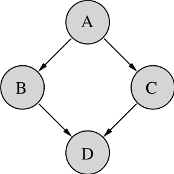

图 14.4 四个节点的有向无环图。

该菱形 DAG 的简单 DAGMan 输入文件可能是：

```
# file name: diamond.dag
Job A A.condor
Job B B.condor
Job C C.condor
Job D D.condor
PARENT A CHILD B C
PARENT B C CHILD D
```

这四个节点被命名为 A、B、C 和 D。以 `Job` 开头的行通过赋予名称来标识每个节点，并指定一个文件作为 Condor 作业提交的描述文件。带有 `PARENT` 关键字的行标识图的依赖关系。与普通的 Condor 提交描述文件一样，以井字符（`#`）开头的行是注释。

332

第 14 章

DAGMan 调度器使用图来安排提交到 Condor 的作业。在父节点成功完成之前，不会提交子节点。图中没有对兄弟节点施加任何排序，因此 DAGMan 在将作业提交到 Condor 时也不会强制执行排序。

对于菱形示例，节点 B 和 C 将并行提交到 Condor。

示例图中的每个作业都使用不同的提交描述文件。作业 A 的提交描述文件示例可能是：

```
# file name: A.condor
executable = nodeA.exe
output = A.out
error = A.err
log = diamond.log
universe = vanilla
```

DAG 提交描述文件的一个重要限制是图中的每个节点必须使用同一个日志文件。DAGMan 使用该日志文件来强制图的依赖关系。

在 Condor 下执行的图是通过 Condor 工具 `condor_submit_dag` 提交的。对于菱形示例，提交将使用命令：

```
condor_submit_dag diamond.dag
```


# 14.3 Condor 架构

一个 Condor 池由一台作为中央管理器的机器和任意数量加入该池的机器组成。从概念上说，池是资源（机器）和资源请求（作业）的集合。Condor 的作用是将等待的请求与可用资源进行匹配。Condor 的每个部分都会向中央管理器发送定期更新，那里是池状态信息的集中存储。中央管理器定期评估池的当前状态，并尝试将待处理请求与相应的资源进行匹配。

## 14.3.1 Condor 守护进程 (Daemons)

在本节中，我们将描述 Condor 中所有的守护进程（后台服务器进程）以及它们在系统中扮演的角色。

- `condor_master`: 该守护进程的作用是简化系统管理。它负责保持池中每台机器上的其余 Condor 守护进程运行。`master`产生其他守护进程，并定期检查它所管理的守护进程二进制文件的时间戳。如果发现新的二进制文件，`master` 将重启受影响的守护进程。此外，如果机器上的任何其他 Condor 守护进程异常退出，`condor_master` 向系统管理员发送有关问题的电子邮件，然后自动重启受影响的守护进程。`condor_master` 还支持各种管理命令，用于远程启动、停止或重新配置守护进程。`condor_master` 运行在 Condor 池的每台机器上。

- `condor_startd`: 该守护进程代表 Condor 池中的一台机器。它发布一个包含机器能力和策略属性的 ClassAd。运行 `startd` 使机器能够执行作业。`condor_startd` 负责执行远程作业启动、挂起、恢复、空出或杀死的策略。当 `startd` 准备好执行 Condor 作业时，它会产生下文描述的 `condor_starter`。

- `condor_starter`: 该程序是在给定机器上启动远程 Condor 作业的实体。它设置执行环境并在作业启动后对其进行监控。`starter` 检测作业完成，向提交作业的机器返回状态信息并退出。

- `condor_schedd`: 该守护进程代表 Condor 池中的作业。任何允许用户提交作业的机器都需要运行一个 `condor_schedd`。用户将作业提交给 `condor_schedd`，作业存储在作业队列中。查看和操作作业队列的各种工具（如 `condor_submit`、`condor_q` 或 `condor_rm`）连接到 `condor_schedd` 以执行工作。

- `condor_shadow`: 当作业执行时，该程序运行在提交作业的机器上。`shadow` 处理文件传输请求，记录作业进度并在作业完成时报告统计数据。链接到标准宇宙（Standard Universe）并执行远程系统调用的作业是通过 `condor_shadow` 执行这些操作。在远程执行机器上执行的任何系统调用都会通过网络发送到 `condor_shadow`。`shadow` 在提交机器上执行系统调用（如文件 I/O），结果通过网络传回远程作业。

- `condor_collector`: 该守护进程负责收集有关 Condor 池状态的所有信息。所有其他守护进程定期向 `collector` 发 ClassAd 更新。这些 ClassAds 包含了有关所有守护进程状态、它们所代表的资源或池中资源请求的所有信息（例如提交给特定 `condor_sched` 的作业）。`condor_collector` 可以用作 ClassAds 的动态数据库。可以使用 `condor_status` 命令查询 `collector` 获取有关 Condor 部分的具体信息。Condor 守护进程也会查询 `collector` 获取重要信息，例如用于向远程机器发送命令的地址。`condor_collector` 运行在指定为中央管理器的机器上。

- `condor_negotiator`: 该守护进程负责 Condor 系统内所有的匹配工作。`negotiator` 还负责执行系统中的用户优先级。

## 14.3.2 运行中的 Condor 守护进程

在给定的 Condor 安装中，一台机器将作为池的中央管理器。除了运行在 Condor 池每台机器上的 `condor_master` 守护进程外，中央管理器还运行 `condor_collector` 和 `condor_negotiator` 守护进程。安装中任何能够运行作业的机器都应该运行 `condor_startd`，任何应该维护作业队列并允许该机器的用户提交作业的机器都应该运行 `condor_schedd`。

Condor 允许任何机器通过同时运行 `condor_startd` 和 `condor_schedd` 来执行作业并作为提交点。图 14.5 显示了一个池中每台机器都可以提交和运行作业的 Condor 池，包括中央管理器。

向 Condor 系统添加作业的接口是 `condor_submit`，它读取作业描述文件，创建作业 ClassAd 并将其交给管理本地作业队列的 `condor_schedd`。这将触发一个谈判周期。在谈判周期期间，`condor_negotiator` 查询 `condor_collector` 以发现所有愿意工作的机器和所有空空作业的用户。`condor_negotiator` 会按照用户优先级顺序与每个用户进行通信。

当作业完成或中止时，`condor_starter` 会移除由用户作业产生的所有进程，并释放作业使用的任何临时磁盘空间。这确保了执行机器保持清洁状态，并且不会发生资源（如进程或磁盘空间）泄漏。


**图 14.6**
当从机器 2 提交的任务运行时，守护进程布局。

# 14.4 在 Linux 上安装 Condor

安装 Condor 的第一步是从 Condor 网站 `www.cs.wisc.edu/condor/downloads` 下载软件。下载或使用 Condor 无需费用。

在网站上，你可以找到针对支持的不同版本和平台的完整文档和发布说明。你应该根据自己的平台（操作系统和处理器架构）下载适用于该平台的相应 Condor 版本。

在开始安装之前，有几个你需要考虑的问题和需要执行的操作。

**创建 Condor 用户。** 出于安全和性能考虑，Condor 守护进程应该以 root 权限执行。然而，为了避免在绝对必要的情况下以 root 身份运行，Condor 守护进程将以你系统中用户 `condor` 的权限权限运行。此外，`condor` 用户简化了安装过程，因为将创建由 `condor` 用户所有的文件，并且可以使用 `condor` 用户的家目录来指定文件位置。对于 Linux 集群，我们强烈建议在开始安装之前在所有机器上创建 `condor` 用户。

**位置。** 如果将发布目录（包含 Condor 使用的所有二进制文件、库文件和配置文件）放在共享文件服务器上，你的资源池管理将变得更容易。请注意，池中的每个平台都需要一组二进制文件。

**管理员。** Condor 需要一个管理员的电子邮件地址。如果 Condor 需要帮助，电子邮件将发送到该地址。

**中央管理器。** Condor 池的中央管理器负责执行任务匹配（matchmaking）并收集池信息。请选择一个网络连接良好且可能一直在线（或至少在故障时能快速重启）的中央管理器。

一旦决定了这些问题的答案（并设置好 `condor`），就可以开始安装了。执行名为 `condor_install` 的工具来开始安装。配置工具将向你提出一系列简短的问题，大部分与上述问题有关。针对你的站点给出适当的回答，Condor 将完成。

在大型 Linux 集群上，你可以通过在节点上运行一次 `condor_install` 并同时配置整个池来加速安装过程。如果你使用此配置选项，则仅需要在每个计算节点上运行 `condor_init` 脚本（该脚本不需要输入）。

默认 Condor 安装会将你的资源池配置为假设是非专用资源（nonded resources）。第 14.5 节讨论了如何为专用集群配置和自定义你的资源池。

安装 Condor 后，你可能希望立即自定义一些安全配置。Condor 在主机（或机器）级别实现安全。安装程序会按主机为 Condor 池设置一组配置默认值。鉴于实现 Condor 的守护进程具有分布式特性，访问这些守护进程自然是基于主机的。每个守护进程都可以在其配置中获得允许或拒绝服务（按主机）的能力。在访问访问级别，`Read`、`Write`、`Administrator` 和 `Config` 对于每个机器池来说都需要正确设置。

- **Read（读取）：** 允许机器从 Condor 获取信息。可能读取的信息示例包括池的状态和作业队列的内容。

- **Write（写入）：** 允许机器向 Condor 提供信息，例如提交作业或加入资源池。

- **Administrator（管理员）：** 允许机器上的用户影响特权操作，例如更改用户的优先级级别或启动和停止 Condor 系统运行。

- **Config（配置）：** 允许机器上的用户使用 `condor_config val` 工具的 `-set` 和 `-rset` 选项远程更改 Condor 的配置设置。这具有非常严重的安全影响，因此我们建议不要对任何主机启用 `Config` 访问。

安装期间的默认值赋予所有机器读取和写入权限。中央管理器也被赋予了管理员权限。你可能希望为你的站点更改这些默认值。请阅读《管理员手册》以获取有关 Condor 网络授权的详细信息以及如何根据你的意愿进行自定义。

# 14.5 配置 Condor

本节描述了如何为你的站点配置和自定义 Condor。它讨论了 Condor 使用的配置文件，描述了如何配置在池中启动和停止作业的策略，并推荐了在集群上使用 Condor 的设置。

许多配置文件有助于对每个池中 Condor 的配置方式进行不同级别的控制。顶层或全局配置文件由池中的所有机器共享。为了方便管理，此文件应位于共享文件系统中。此外，每台机器可能都有多个本地配置文件，允许本地设置覆盖全局设置。每台机器可能运行不同的守护进程，具有不同的启动和停止 Condor 作业的策略，等等。

所有 Condor 配置文件都应仅由 root 拥有并可写。对这些文件保持严格的控制是非常重要的，因为它们包含了安全敏感的设置。

## 14.5.1 Condor 文件的文件的位置

Condor 有一组默认位置，它通过这些位置查找顶层文件。按以下顺序检查位置：

1. `CONDOR_CONFIG` 环境变量指定的文件。
2. `'/etc/condor/condor_config'`。
3. 用户的家目录（如果存在）。

如果 Condor 找不到其全局配置，它将打印错误并退出。如果你想指定本地配置文件，可以使用 `LOCAL_CONFIG_FILE` 宏。该宏可以包含文件列表。Condor 将评估以下宏：

- `HOSTNAME`: 机器的主机名。
- `FULL_HOSTNAME`: 机器的全限定主机名。
- `TILDE`: 用户的家目录。
- `OPSYS`: 机器的操作系统。
- `RELEASE_DIR`: Condor 安装的目录。

默认情况下，本地配置文件定义为：

```
LOCAL_CONFIG_FILE = $(TILDE)/condor_config
```

## 14.5.2 集群的推荐配置布局

管理的便利是一个重要的考虑因素，特别是当你有大量节点时。为了方便配置 Condor，我们强烈建议将所有的配置文件（包括每个节点的本地文件）都放在共享文件系统中。你应该为集群中的每个节点创建一个单独的文件，使用主机名作为文件名的一部分，并将 'local' 作为结尾。例如，如果你的集群节点命名为 'n01'、'n02' 等，文件应命名为 'n01.local'、'n02.local' 等。这些文件都应放在你的 etc 目录下。

在全局文件中，你应该使用以下设置来描述本地文件的位置：

```
LOCAL_CONFIG_FILE = $(RELEASE_DIR)/etc/$(HOSTNAME).local
```


你资源池的中央管理器需要在其本地文件中特殊设置。这些属性由 `Condor` 安装程序自动设置。本地配置的其他部分可以为空。

### 14.5.3 自定义 Condor 的策略表达式

某些配置表达式用于控制 `Condor` 执行、挂起和驱逐作业的策略。它们之间的相互作用可能相当复杂。定义不当的策略会影响集群的吞吐量和用户的满意度。如果你对为资源池创建特殊策略感兴趣，我们建议阅读《管理员手册》。这里只有基础介绍。

所有的策略表达式都是 `ClassAd` 表达式，并定义在 `Condor` 的配置文件中。策略被广泛使用并定义在全局配置文件。然而，如果池中的单独节点需要自己的策略，可以将适当的表达式放在本地配置文件。

策略表达式被 `condor_startd` 视为其机器 `ClassAd` 的一部分（连同你通过 `condor_status -long` 查看的所有属性）。

# Condor: 分布式作业调度器

这些表达式始终针对作业 `ClassAd` 进行评估，要么是在 `condor_negotiator` 尝试匹配时进行，要么是在 `condor_startd` 决定如何处理当前正在运行的作业时进行。因此，所有的策略表达式都可以引用作业的属性（例如内存使用量或所有者），也可以引用机器的属性（如键盘空闲时间或 CPU 负载）。

大多数策略表达式都是 `ClassAd` 布尔表达式，评估结果为 `TRUE`（真）、`FALSE`（假）或 `UNDEFINED`（未定义）。当表达式引用的 `ClassAd` 属性在机器的 `ClassAd` 或被考虑的作业的 `ClassAd` 中均未被找到时，就会出现 `UNDEFINED`。这被视为致命错误，因此在引用可能在所有 `ClassAds` 中都存在的属性时，你应该确保使用第 14.1.2 节描述的 `ClassAd` 元运算符。

对策略表达式的解释需要理解作业从启动到完成或被从机器上驱出所经过的不同阶段。每个策略表达式都是根据其所控制的进度步骤进行描述的。

## 在 Condor 中执行的作业的生命周期。

当作业提交到 `Condor` 时，`condor_negotiator` 会执行匹配以找到用于计算的合适资源。这一过程涉及满足作业和机器对彼此的需求。机器可以定义其愿意考虑运行作业的精确条件。作业也可以精确定义它愿意使用什么种的机器。

一旦作业与给定的机器匹配，作业可能处于四种状态之一：运行（`running`）、挂起（`suspended`）、优雅退出（`graceful shutdown`）和快速退出（`quick shutdown`）。一旦完成匹配，作业就会设置其环境并开始运行。

在执行期间，作业可以被挂起（例如，因为其运行的机器上有其他活动）。一旦被挂起，作业可以恢复执行或进入抢占（`preemption`）或驱出（`eviction`）。

所有 `Condor` 作业都有两种抢占方法：优雅抢占和快速抢占。标准宇宙（`Standard Universe`）作业有机会通过优雅抢占产生检查点（`checkpoint`）。对于其他宇宙，优雅抢占意味着程序被告知离开系统，但它会被留出时间进行清理工作。在所有 Unix 变体中，默认在优雅退出期间会发送 `SIGTERM` 信号，但用户可以在提交作业时覆盖此默认设置。快速退出涉及迅速杀死与作业相关的所有进程，而不给它们时间执行清理程序。`Condor` 系统会执行检查，以确保作业从特定节点被驱出后不会遗留进程。

## Condor 策略表达式。各种表达式用于控制启动、挂起、恢复和抢占作业的策略。

- `START`：当 `condor_startd` 愿意执行某个作业时。
- `RANK`：`condor_startd` 在多大程度上倾向于在其上运行的类型的作业。`RANK` 表达式是一个浮点值而不是布尔值。如果系统中有另一个作业对该表达式产生更高的值，`condor_startd` 将抢占其当前运行的作业。
- `WANT_SUSPEND`：`condor_startd` 何时应该考虑是否挂起此作业。实际上，它决定了在作业运行时应该评估哪一个表达式：`SUSPEND` 还是 `PREEMPT`。`WANT_SUSPEND` 不控制作业何时被实际挂起；对于这一目的，你应该使用 `SUSPEND` 表达式。
- `SUSPEND`：`condor_startd` 何时应该挂起当前运行的作业。当 `WANT_SUSPEND` 评估为 `TRUE` 时，每当作业在机器上执行时，都会定期评估 `SUSPEND`。如果 `SUSPEND` 变为 `TRUE`，作业将被挂起。
- `CONTINUE`：`condor_startd` 何时应该恢复一个被挂起的作业。`CONTINUE` 表达式仅在作业挂起期间进行评估。如果它评估为 `TRUE`，作业将恢复，`condor_startd` 将返回分类/忙碌（`Classified/Busy`）状态。
- `PREEMPT`：`condor_startd` 何时应该抢占当前运行的作业。每当作业挂起时，都会评估此表达式。如果 `WANT_SUSPEND` 评估为 `FALSE`，则在作业执行时检查 `PREEMPT`。
- `WANT_VACATE`：当 `Condor` 正在抢占作业时（因为 `PREEMPT` 表达式评估为 `TRUE`），作业何时应该优雅或快速地驱逐。如果 `WANT_VACATE` 为 `FALSE`，每当 `condor_startd` 必须驱逐应用程序时，将立即杀死作业及其所有子进程。如果 `WANT_VACATE` 为 `TRUE`，`condor_startd` 将执行优雅退出。
- `KILL`：`condor_startd` 何时应该放弃优雅抢占并直接进入快速退出。
- `PREEMPT_REQUIREMENTS`：由 `condor_negotiator` 在匹配时执行，而不是由 `condor_startd` 执行。在尝试调度作业池中的作业时，`condor_negotiator` 会考虑系统中各种用户的优先级（详情见第 14.6.3 节）。如果优先级更高的用户有作业在队列中等待且当前没有空闲资源，匹配器将考虑抢占另一个用户的作业，并将这些资源分给优先级更高的用户。这一过程被称为抢占。为了发生此类抢占，`PREEMPTION_REQUIREMENTS` 表达式必须评估为 `TRUE`。
- `PREEMPTION_RANK`：由 `condor_negotiator` 评估的浮点值。如果匹配器决定由于用户优先级必须抢占某个作业，则宏 `PREEMPTION_RANK` 决定抢占哪种资源。在使 `PREEMPTION_REQUIREMENTS` 表达式评估为 `TRUE` 的所有资源集中，选择该表达式取值最高的一个。

## 14.5 定制 Condor 的其他设置

除了策略表达式外，你还需要修改其他设置来自定义 `Condor`。`DAEMON_LIST` 是由 `condor_master` 生成的守护进程的逗号分隔列表。此设置必须具有以下形式

```
DedicatedScheduler = "host.name"
```

## 14.6.1 远程配置与控制

`Condor` 池中的所有机器都可以从中心位置进行远程管理。可以使用 `condor` 命令启用、禁用或重启 `Condor`：

| 命令 | 说明 |
| :--- | :--- |
| `condor_checkpoint` | 指定主机上运行的作业 |
| `condor_config.val` | 查询或设置 `Condor` 配置变量 |
| `condor_master_off` | 关闭 `Condor` 和 `condor_master` |
| `condor_off` | 关闭守护进程 |
| `condor_on` | 启动守护进程 |
| `condor_reconfig` | 重新配置守护进程 |
| `condor_restart` | 重启 `condor_master` |
| `condor_stats` | 显示池的历史信息 |
| `condor_userpriority` | 显示并管理用户优先级 |
| `condor_vacate` | 驱逐指定主机上运行的作业 |

**表 14.2** 管理员命令：分别是 `condor_off` 和 `condor_restart` 命令。此外，节点上 `Condor` 配置的任何方面都可以通过 `condor_config.val` 命令远程查询。当然，并不是所有人都允许远程更改 `Condor` 配置。这需要通过安装时设置权限（见第 14.4 节）。`Condor` 配置的许多方面（包括调度策略）可以在不关闭和重启池的情况下动态更改。这是通过使用 `condor_reconfig` 命令实现的，该命令要求主机上的 `Condor` 守护进程重新读取 `Condor` 配置并采取相应的行动。

## 14.6.2 统计与日志

`Condor` 记录了关于池中发生的许多统计。每个守护进程都可以被要求记录其活动的详细日志；当这些文件达到管理员指定的最大大同时，`Condor` 会自动对其进行轮转。

除了 `condor_history` 命令（允许用户查看以前完成作业的作业 `ClassAd`）外，还可以使用 `condor_stats` 工具从池统计数据库查询历史使用统计。该数据库包含在定期间隔内为每个用户服务的作业数量，以及有多少台机器处于忙状态。例如，可以要求 `condor_stats` 显示 1 月 15 日至 1 月 30 日期间指定用户每隔五分钟运行的作业总数。

`condor_view` 工具将通过 `condor_stats` 获取的原始信息转换为 HTML，并带有交互式图表。图 14.7 显示了

在 Web 浏览器中显示的 `condor_view` 输出示例。网站管理员使用 `condor_view` 可以快速将关于 `Condor` 池的详细实时使用统计数据发布到网站上。


图 14.7
`CondorView` 显示机器使用情况。

## 14.6.3 Condor 中的用户优先级

`Condor` 中的作业队列并不是严格的先进先出。相反，`Condor` 实现了优先级队列。不同的用户将根据其当前的用户优先级获得不同规模的机器分配，无论队列中来自竞争性的用户有多少个作业排在他们“前面”。如果需要，`Condor` 还可以配置为执行优先级抢占。例如，假设用户 A 正在使用集群所有的节点，此时突然一个优先级更高的用户提交了作业。如果启用了优先级抢占，`Condor` 将抢占低优先级用户的作业，以便立即启动高优先级用户提交的作业。

公平份额（`fair-share`）算法防止了低优先级用户的饥饿，该算法尝试在指定的间隔内为所有用户提供相同数量的分配时间。此外，`Condor` 中的优先级计算是基于比例而非绝对值。例如，如果 Bill 的优先级是 Fred 的两倍，`Condor` 不会通过将所有机器分配给 Bill 来让 Fred 饥饿。相反， Bill 平均获得的机器将是 Fred 的两倍，因为 Bill 的优先级是两倍。

管理员可以使用 `condoruserpri` 命令查看或编辑用户的优先级。它还可以用于覆盖 `Condor` 的默认公平份额策略，并显式地分配用户相对于其他用户更好或更差的优先级。

## 14.7 集群设置场景

本节探讨了配置集群的各种场景。文中介绍了五种场景，并说明了每种场景你需要修改的配置设置或需要采取的步骤的基本思路：

- 1. 统一拥有的专用计算集群，具有一个用于提交的单前端节点，并支持 MPI 应用。
- 2. 多处理器节点集群。
- 3. 分布式拥有的节点集群。每个节点倾向于运行其所有者提交的作业。
- 4. 从桌面向集群提交作业。
- 5. 将集群扩展到非专用（桌面）计算资源。

这些场景大多数可以结合使用。每个场景都在前一个场景的基础上为基础集群配置添加更多功能。

### 14.7.1 基础配置：统一拥有的集群

最基础的场景涉及一个集群，其中所有资源由单一实体拥有，且所有计算节点对于启动和停止作业执行执行相同的策略。所有计算节点都是专用的，这意味着它们将始终启动空闲作业，并且在完成之前永远不会抢占或挂起。有一个用于提交作业的前端节点，并从该主机启用专用的 MPI 作业。

# Condor: 分布式作业调度器

为了启用这一基础策略，你的全局配置文件必须包含这些设置：

- `START = True`
- `SUSPEND = False`
- `CONTINUE = False`
- `PREEMPT = False`
- `KILL = False`
- `WANT_SUSPEND = True`
- `WANT_VACATE = True`
- `RANK = Scheduler =?= (DedicatedScheduler)`
- `DAEMON_LIST = MASTER, STARTD`

这里列出的最后一个项目指定了你池中节点的默认角色为仅执行。你前端节点上的 `DAEMON_LIST` 也必须启用 `condor_schedd`。本地配置文件将是

```
DAEMON_LIST = MASTER, STARTD, SCHED
```

## 14.2 使用多处理器计算节点

如果你的 `Condor` 池中的任何节点是对称对称多处理器（SMP）机器，`Condor` 将该节点表示为多个虚拟机（VM），每个 CPU 对应一个。默认情况下，每个 VM 将具有单个 CPU 和所有共享资源（如 RAM 和交换空间）的平均份额。如果这种行为满足你的需求，你不需要对 SMP 节点进行任何配置更改即可使其与 `Condor` 正常工作。

某些站点可能希望 SMP 节点有不同的行为。例如，假设你的集群由具有 1 GB 内存的双处理器机器组成，而其中一个用户正在提交内存占用为 700 兆字节的作业。在默认设置下，你池中所有的 VM 都将拥有 500 MB 的内存，你的用户作业永远无法运行。在这种情况下，你可能希望在两个 CPU 之间不均匀地划分内存，给一半的 VM 分配 750 MB 的内存。另一半 VM 将剩下 250 MB 的内存。

在 `Condor` 中划分 SMP 机器上的共享资源有多种方法，所有方法在《Condor 管理员手册》中都有详细讨论。最基础的方法如下：为了不均匀地划分 SMP 机器上的共享资源，你必须定义不同的虚拟机类型，并告诉 `condor_startd` 每种类型发布多少个虚拟机。定义虚拟机类型最简单的方法是指定每个类型应该接收所有共享资源的几分。

例如，如果你想划分一台双节点机器，其中一个 CPU 接收共享资源的四分之一，另一个 CPU 接收剩余的三分之三，你将使用以下设置：

```
VIRTUAL_MACHINE_TYPE_1 = 1/4

VIRTUAL_MACHINE_TYPE_2 = 3/4

NUM_VIRTUAL_MACHINES_TYPE_1 = 1

NUM_VIRTUAL_MACHINES_TYPE_2 = 1
```

## 14.7.3 分布式拥有的集群调度

许多集群由多个实体拥有。通常最好将集群划分为组。每个节点都会定义自己的 `RANK`。假设大学有一个集群，由天文学、数学和物理三个部门共享。每个部门贡献了 20 个节点。例如，天文学节点将是

```
Rank = Department == "Astronomy"
```

每个部门的用户还会为所有 `ClassAds` 添加 `Department` 属性。管理员可以配置 `Condor` 为所有作业添加此属性。如果你想公平划分资源，这在《Condor 管理员手册》中有详细描述。

如果整个集群是空闲的，物理用户提交了 40 个作业，她将看到她的 40 个作业启动。然而，如果数学用户提交了 60 个作业，天文学的 20 个作业将被抢占，每个组将获得 20 台机器。

当天文学部门的所有作业完成后，天文学节点将回到为数学和物理服务。

## 14.7.4 从桌面向集群提交

大多数安装集群的组织都有其他工作站。通常最好允许这些机器作为集群的前端节点，以便用户可以从自己的机器提交作业并在集群上运行应用程序。即使集群与其他计算机之间没有共享文件系统，`Condor` 的远程系统调用和文件传输功能也可以作业在两者之间迁移并访问访问数据（详情见第 14.2.5 节）。

要让机器向你的集群提交作业，运行 `Condor` 安装脚本并指定你想设置一个仅提交节点。这将把新节点上的 `DAEMON_LIST` 设置为

```
DAEMON_LIST = MASTER, SCHEDD
```


安装程序还会创建 Condor 所需的所有目录和文件。

注意，你只能配置一个节点作为池的专用调度器。不要尝试为 MPI 作业添加第二个提交节点。

## 14.7.5 将集群扩展到非专用（桌面）计算资源

Condor 最强大的功能之一是在单个系统中结合专用调度和乐观调度。乐观调度涉及在非专用资源上放置作业，并假设这些资源在作业的持续时间内可能不可用。除了专用的 MPI 应用外，Condor 中的所有作业都使用乐观调度。

如果你的站点拥有资源，你应该强烈考虑将所有的计算资源（甚至是桌面工作站）加入你的 Condor 池。通过检查点和进程迁移、挂起和恢复能力、乐观调度和匹配，Condor 可以利用任何机器的空闲 CPU 周期并将其善用。

要向您的池添加其他计算资源，请运行 Condor 安装程序并指定您想要配置一个既能提交作业又能执行作业的节点。默认安装会设置一个节点，其策略根据机器的活动（例如键盘空闲时间和 CPU 负载）来启动、挂起和抢占作业。这些节点将不会运行专用 MPI 任务，但它们将运行来自任何其他宇宙（universe）的作业，包括 PVM。

## 14.8 结论

Condor 是一个强大的跨平台作业调度工具，既可以用于您的 Beowulf 集群内部，也可以用于边界之外。通过其专用调度和机会性调的独特结合，Condor 为高吞吐量计算提供了一个统一的框架。

## 15 Maui 调度器：多功能集群调度器

David B. Jackson

在本章中，我们将描述 Maui 调度器，这是一个与多个不同资源管理器交互的作业调度组件。

与几乎每一个主要的开发项目一样，Maui 的产生源于迫切的需求。在 Maui 的情况下，包括 Maui 高性能计算中心、太平洋西北国家实验室、圣地亚哥超级计算机中心和阿贡国家实验室在内的各种计算中心，都在投入巨资购买新的顶尖硬件，却因无法以高效或控制的方式使用这些新资源而感到沮丧。虽然现有的管理系统允许提交和运行作业的基本能力，但它们并未让站点具备最大化利用集群的能力。站点无法将本地任务策略转换为调度行为，而且所做的调度决策往往不是最优的。更糟糕的是，生成的系统如此复杂，导致管理人员、管理员和用户无法判断系统运行状况如何，或者可以做什么来改进它。

Maui 的设计是为了解决这些问题，并在多年以后由许多领先计算中心进行了开发和测试。它的构建是为了让站点能够有效地控制、理解和使用它们的集群。Maui 接手了许多调度系统之后的工作，在预留、回填（backfill）、公平份额（fairshare）、作业优先级、服务质量、元调度（metascheduling）等领域提供了一系列高级功能。

## 15.1 概述

Maui 是一个外部调度器，这意味着它不包含资源管理器，而是扩展现有资源的功能。Maui 使用 OpenPBS、PBSPro 和 LoadLeaver 的原生调度 API 获取系统信息并指导集群调度决策。虽然底层的资源管理器继续承担管理节点和跟踪作业的责任，但 Maui 控制了作业在何时、何地以及如何运行的决策。

系统管理员通过主配置文件 `maui.cfg` 和或基于 Web 的管理员命令来控制 Maui。另一方面，终端用户不需要学习任何新命令或作业提交语言，无需知道 Maui 已经安装。虽然 Maui 提供了许多命令为用户提供额外的作业信息和控制，但这些命令是可选的，可以根据需要向用户引入。

## 15.2 安装与初始配置

Maui 调度器可在许多最流行的集群构建工具中使用，包括 Rocks 和 OSCAR。对于最新版本的 Maui，您可以从 Maui 主页 `supercluster.org/maui` 下载代码。该网站还包含在线文档、常见问题解答（FAQs）、Maui 用户邮件列表的链接以及其他标准开源工具。下载代码后，若要构建代码，您只需执行标准的 `configure`、`make` 和 `install` 命令即可。

### 15.2.1 基础配置

`configure` 脚本将提示您提供有关安装目录和所需资源管理器类型的某些基本信息。它会创建 Maui 主目录，在 `bin` 子目录中构建可执行文件，并将它们复制到安装目录。最后，脚本将使用位于 `samples` 子目录下的模板和用户提供的信息创建一个初始 `mau.cfg` 文件。这是一个扁平文本配置文件，用于几乎所有的调度器配置，并包含许多需要验证的参数，特别是 `SERVERHOST`、`SERVERMODE`。初始情况下，这些应分别设置为 Maui 运行的主机名称、`NORMAL` 以及 Maui 管理员的用户名。在 Maui 运行的任何时候，可以使用 `sched` 命令配合 `-l` 标志来列出任何参数的值（无论是否设置），而 `-m` 标志可用于动态修改参数值。在线参数文档提供了有关这些以及所有所有其他 Maui 参数的更多详细信息。

### 15.2.2 仿真与测试

完成初始配置后，下一步是测试调度器以熟悉其能力并验证基本功能。可以通过将 `SERVERMODE` 设置为 `TEST` 来在完全安全的模式下运行 Maui。在测试模式下，Maui 会联系资源管理器以获取最新的配置、节点和作业信息；在此模式下，启动或修改这些作业的接口被禁用。要启动 Maui，您必须更改参数并执行 `maui` 命令。您还可以使用 `show`、`diagnose` 和 `checknode` 等命令来验证调度器与资源管理器之间的正常通信以及调度器功能。关于 Maui 命令套的完整细节可以在线或随发行版提供的文档中找到。

### 15.2.3 生产调度

一旦您对调度器进行了试运行并验证了其正常行为，就可以通过禁用默认调度器并将 `SERVERMODE` 参数更改为 `NORMAL` 来运行 Maui。有关禁用默认资源管理器调度器的信息请参见资源管理器的文档以及位于 `supercluster.org/documentation/maui` 的在线 Maui 迁移指南。这些更改将允许 Maui 根据指定的调度策略启动、修改和取消作业。

开箱即用的 Maui 本质上是复制了原生集群调度器的行为，提供了启用了回填的先来优先调度。参数文档详细说明了启用高级调度功能所需的每个参数。在大多数情况下，每个站点只需要可用参数的一个小子子集即可满足本地需求。

### 15.3 高级配置

在完成初始配置和测试后，您现在可以配置 Maui 以实现您的目标。Maui 提供了一套高级功能来实现这些目标，这些功能可以单独使用或结合使用以达到预期效果。这些包括：
- 预留
- 节点集
- 公平份额
- 作业优先级
- 服务质量
- 元调度
- 回填
- 节点策略
- 抢占策略

下面将描述这些每项功能。

#### 15.3.1 分配权重：作业优先级与节点分配

对于广泛的功能和相关参数，大多数功能默认是禁用的；因此，站点只需要感兴趣的功能。通常，优先级是确定哪些选项最符合目标的过程。在调度情况下，站点通常会有多个独立目标，可能最大化系统利用率、优先考虑特定项目或确保作业不会在队列中停留过久。表示多目标的一种方法是为目标分配权重，以便每个调度决策关联一个总体值或优先级。通过优先级排序，调度器可以大致填充站点目标。

Maui 的设计是将组件和权重与作业的各个方面联系起来。为了实现这种细粒度的控制，Maui 使用简单的优先级权重层次，其中优先级因素的贡献计算方式为 `PRIORITY-FACTOR-VALUE * SUBFACTOR * FACTORWEIGHT`。组件和权重见表15.1。可以在 `maui.cfg` 文件中通过指定的组件参数设置所有权重的值，格式为权重名称后跟字符串 `WEIGHT`（例如 `SERVICEWEIGHT` 或 `PROWEIGHT`）。

默认情况下，Maui 按实际提交顺序运行作业，使用 `QUEUETIME`。然而，通过使用优先级组件，您可以引入额外信息，如当前服务级别、服务目标、请求资源和历史使用情况。您还可以限制任何组件的贡献，通过指定优先级组件上限 `RESOURCECAP`。作业的优先级等于所有优先级因素之和。

每个组件可用于不同的用途。`WALLTIME` 可根据作业持续时间考虑（或不利）作业；`ACCOUNT` 可考虑与特定项目相关的作业；`QUEUETIME` 可考虑等待时间最长的作业。通过混合匹配优先级权重，站点通常获得所需的作业启动行为。任何何时您都可以执行 `diagnose -p` 命令来确定当前优先级权重设置对空闲作业的影响。

虽然子组件是基于指标的（例如队列秒数或请求节点数），但凭据子组件基于管理员指定的优先级。Maui 允许您使用 CFG 参数来链接

# Maui 调度器：多功能集群调度器

| 组件 | 子组件 |
|---|---|
| SERVICE（服务等级） | QUEUETIME（当前队列时间，单位：分钟）<br>XFACTOR（当前扩展因子)<br>BYPASS（作业被回填跳过的次数） |
| TARGET（与服务的接近程度） | TARGETQUEUEIME（与队列目标时间的差值，单位：分钟） |
| Target - 指数级 | TARGETXFACTOR（与 Xfactor 目标的差值） |
| RESOURCE（资源） | PROC（处理器)<br>MEM（请求的内存，单位：MB）<br>SWAP（请求的虚拟内存，单位：MB）<br>DISK（请求的本地磁盘，单位：MB）<br>NODE（请求的节点数）<br>WALLTIME（请求的运行时间，单位：秒）<br>PS（请求的处理器秒）<br>PE（请求的处理器等效） |
| FS（公平份额） | FSUSER（用户公平份额占比）<br>FSGROUP（组公平份额占比）<br>FSACCOUNT（账户公平份额占比）<br>FSCLASS（类公平份额占比）<br>FSQS（QoS公平份额占比） |
| CRED（凭证） | USER（用户优先级）<br>GROUP（组优先级）<br>ACCOUNT（账户优先级）<br>CLASS（类优先级）<br>QOS（QoS优先级） |

**表 15.1**
Maui 优先级组件。

根据单个作业凭证划分作业。例如，为了优先考虑用户 bob 和 john 以及 staff 组成员提交的作业，站点可以指定以下内容：

```
USERCFG[bob]      PRIORITY=100

USERCFG[john]      PRIORITY=500

GROUPWEIGHT[staff] PRIORITY=1000

USERWEIGHT         1

GROUPWEIGHT        1

CREDWEIGHT         1
```

注意，必须同时指定组件和子组件权重以使这些凭证优先级生效。关于这些组件属性使用的更多细节以及经验性使用信息，可以参阅《Maui 管理员手册》。

与作业优先级问题相相补充的是节点分配问题。当调度器选择一个作业运行时，它还必须决定为该作业分配哪些资源。根据集群的使用情况，你可以通过 `NODEALLOCATIONPOLICY` 指定不同的策略。有效的参数值包括：

- `MINRESOURCE`：该算法选择配置资源最少且满足作业要求的节点。该算法为可能专门请求这些资源的作业留了更丰富的资源。
- `LASTAVAILABLE`：该算法在为回填预留时特别有用。它确定作业可以运行的最早时间，然后选择该时间的可用资源，尽可能让当前空闲资源保持空闲状态以供回填使用。
- `NODEPRIORITY`：此策略允许站点创建自己的节点优先级方案，考虑已安装软件或其他节点配置等问题。
- `CPULOAD`：此策略尝试优先分配负载最低的资源。

## 15.2 公平性：节流策略与公平份额

站点面临的下一个问题是公平性。公平性似乎是一个简单的概念，但在映射到集群时可能非常困难。所有用户是否应该运行相同数量的作业或使用相同数量的节点？这些使用限制仅适用于当前时间还是特定的时间段？如果使用历史信息，消耗指标是什么？时间跨度是多少？公平消费是否意味着相等消费？如果 X 购买了三分之二的节点，而 Y 购买了剩下的三分之一，资源应该如何分配？公平性是基于静态指标，还是取决于当前的资源需求？

虽然 Maui 无法解决所有这些问题，但它提供了灵活的工具，帮助解决 90% 的问题。具体来说，这些工具是用于控制即时和历史使用的节流策略（Throttling Policies）和公平份额（Fairshare）。

节流策略。“节流策略”一词统用于一组限制瞬时资源消耗的策略。Maui 支持限制任何给定时间允许的处理器、节点、处理器秒、作业和等效数量。可以通过 `CFG` 参数集在用户、组、账户、QoS 或队列的基础上应用限制。例如，

# Maui 调度器：多功能集群调度器

指定 `USERCFG[bob] MAXJOB=3 MAXPROC=32` 将限制用户 bob 在任何时刻运行不超过超过 3 个作业和总计 32 个处理器。指定 `GROUPCFG[DEFAULT] MAXNODE=64` 将限制每个组同时使用不超过 64 个节点，除非指定了覆盖特定组的限制。`ACCOUNTCFG`、`QOSCFG` 和 `CLASSCFG` 完善了 `CFG` 参数族，提供了限制账户、QoS 和类瞬时使用的手段，。

对于每个参数，可以使用硬限制和软限制来应用某种形式的需求敏感型限制。虽然硬限制在任何情况下都不能被违反，但在没有其他作业运行时，软限制可能会被违反。例如，指定 `USERCFG[DEFAULT] MAXNODE=16,24` 将允许每个用户累积使用最多 16 个节点，同时其他用户可以使用可用资源。如果没有其他作业使用这些资源，用户可以同时运行最多 24 个节点。

节流策略对于防止单个用户或组的“独占”非常有效。它们还提供了一种简单的公平性和周期分配机制。例如，如果这些策略阻止了所有队列作业运行，资源可能会被闲置。在可能的情况下，应该将节流策略设置为最高级别，并通过 `sharefair`、分配管理系统和基于 QoS 的优先级等工具管理周期分配。

公平份额。典型的公平份额尝试在一个时间段内提供公平的分布。然而，如前，这种通用的陈述留下了很大的解释空间。特别是，如何衡量分布？使用什么时间跨度？Maui 提供了 `Fspolicy` 参数允许每个用户决定如何加权使用信息，`FSINTERVAL`、`FSCAY` 决定历史使用。

为了控制资源分布，Maui 使用应用于用户、组、账户、队列和 QoS 的份额目标。每个目标可以是四类型：目标（target）、地板（floor）、上限（ceiling）或封顶（cap）。在许多情况下，Maui 调整优先级以满足份额。对于标准目标，Maui 始终尝试满足目标。对于地板情况，Maui 将增加优先级。

下面的示例显示了可能的公平份额配置。

```
# maui.cfg

Fspolicy DEDICATEDPS

FSDEPTH 7

FSINTERVAL 24:00:0

FSCAY 0.8
```

```
USERCFG[DEFAULT] FTARGET=10.0

USERCFG[john] FTARGET=25.0

GROUPCFG[staff] FTARGET=20.0
```

在这种情况下，公平份额使用将跟踪七天的系统处理器秒，衰减因子为 0.8。所有用户将拥有这些处理器秒10% 的公平份额目标——john 除外，他将拥有 25% 的地板。此外，staff 组将拥有 20% 的公平份额上限。任何时候，你可以使用 `diagnose -f` 命令检查系统的公平份额状态。

## 15.3.3 管理访问：预留、分配管理器和服务质量

在管理任何集群系统时，一半的管理工作涉及配置以处理稳态情况。另一半发生在非常重要的用户有特殊一次性请求时。Maui 提供了两个功能，提前预留和 QoS，来处理许多此类特殊请求。

**提前预留**。预留允许站点为各种目的保留资源块，例如集群维护、特殊用户项目或基准测试节点。为了创建预留，必须确定开始和结束时间，以及要保留的资源和访问这些资源的列表。预留可以由调度器使用 `sets` 命令动态创建，也可以通过 Maui 配置文件参数直接管理。

例如，为了在下午 2:30 为 nodeA 和 nodeB 预留四小时，你可以执行以下命令：

```
> setres -s 14:30 -d 4:00:00 'node[AB]'
```

# Maui 调度器：多功能集群调度器

保留请求可以指定特定资源的分配或给定数量的资源。以下预留将从 4 月 14 日下午 5:00 为用户 john 和 sam 分配 20 个处理器。

| SRPERIOD[development] | 天数 |
| :--- | :--- |
| SRDAYS[development] | 一二二三四五 |
| SRSTART[development] | 8:00:00 |
| SRENDTIME[development] | 17:00:00 |
| SRMAXTIME[development] | 00:30:00 |
| SRTCOUNT[development] | 16 |

在某些情况下，站点可能希望在没有其他可用资源时才访问一组资源。Maui 通过预留亲和性（reservation affinity）实现了这种条件性用法。在指定任何预留访问列表时，每个访问值都可以使用 '+'、'-' 或 '=' 字符与正、负或中性亲和性关联。如果没有指定，则假设为正向性。例如，考虑以下预留行：

```
SRUSERLIST[special] bob john steve= bill-
```


通过此指定，`bob` 和 `john` 的作业接收默认的正向亲和性，并本质上被吸引到该预留。对于这些作业，Maui 将尝试在考虑任何其他资源之前首先使用特殊预留中的资源。另一方面，属于 `steve` 的作业可以使用这些资源，但不会被它们吸引。`bill` 的作业只有在没有其他可用资源时才会使用特殊预留中的资源。你可以通过 `showers` 和 `diagnose -r` 命令获取有关预留的详细信息。

# 分配管理器

分配管理系统允许站点实时控制总资源访问。虽然存在支持其他系统的接口，但与 Maui 调度器常用的 `QBank`（http://www.emsl.mscf.gov/80/docs/qbank-2.9）由太平洋西北国家实验室提供。此类系统允许站点提供独特的资源分配，类似于创建银行账户。在运行时，使用的资源会被转换为费用并从相应的账户中扣除。在 `QBank` 的情况下，分配可能与过期日期关联、维护私有和共享账户、创建每机器机器分配等。

在 Maui 内部，分配管理器接口通过一组 `BANK*` 参数进行控制，如下例所示：

| | `QBANK` |
| :--- | :--- |
| `BANKHOST` | `bank.univ.edu` |
| `BANKCHARGEPOLICY` | `DEBITSUCCESSFULWC` |
| `BANKDEFERJOBFAILURE` | `TRUE` |
| `BANKFALLBACKACCOUNT` | `freecycle` |

此配置允许使用 `QBank` 接口连接到位于 `bank.univ.edu` 上的分配管理器。计费单位被配置为专用处理器-秒，且只有在作业成功完成时才会对用户进行计费。如果作业在指定账户中没有足够的分配，Maui 将尝试将作业重定向到 `freecycle` 账户的分配中。在许多情况下，回退账户（`fallback account`）被配置为与较低的优先级和/或额外的限制关联。如果作业未获得分配管理器的批准，Maui 将延迟作业一段时间并在稍后重试。

# 服务质量（QoS）

Maui 的 QoS 功能允许站点访问特殊功能、资源和服务级别。每个 QoS 都由一个访问控制列表组成，控制哪些用户、组、账户和作业队列可以访问 QoS 权限。与每个 QoS 关联的是特殊的服务相关优先级权重和服务目标。此外，每个 QoS 都可以配置为跨越资源分区、抢占其他作业等。

Maui 还允许站点为某些 QoS 服务的使用缓存高级费率。例如，以下配置将导致用户 `john` 的作业默认使用 `hiprio` QoS，并允许 `bio` 组的成员通过请求访问它：

```
USERCFG[john] QLISTrio=normal QDEF=hiprio

GROUPCFG[bio] QLISTrio=medrio:development QDEF=medrio

QOSCF[hiprio] PRIORITY=50 TARGET=30 FLAGS=PREEMPTOR:IGNMAXJOB \
MAXPROC=150
```


使用 `hiprio` QoS 的作业获得以下权限和限制：

- 优先级为 50 * `QWEIGHT` * `DIRECTWEIGHT`*
- 30 分钟的队列目标
- 抢占较低优先级 `PREEMPT` 作业的能力
- 忽略其他地方定义的 `MAXJOB` 策略限制的能力
- 分配给 QoS `hiprio` 作业的累计 150 个处理器

站点可能描述几十个 QoS 对象，并允许用户访问其中任意数量的对象。根据所需的的服务类型，用户随后可以选择最符合其需求的 QoS。

# 15.3.4 优化使用：回填、节点集和抢占

Maui 调度器提供了若干功能来优化系统利用率、作业吞吐量和平均周转时间方面的性能。

**回填（Backfill）。** 回填是一种通过无序运行作业来提高系统利用率和平均周转时间的常用方法。回填只需允许调度器运行任何作业，只要它不会延迟高优先级作业的启动。通常，算法通过某种形式的递归防止高优先级作业的延迟。回填可以被认为填充高优先级作业留下的资源空隙的过程。由于空隙被填充，最经常被回填的作业是那些所需时间/或资源最少的作业，这是合合理的。启用回填后，站点通常报告系统利用率提升了 10% 到 25%，平均作业队列时间略短。

默认情况下，Maui 在 `BACKFILLPOLICY` 参数的控制下启用回填调度。虽然默认配置通常足够，但站点可能希望调整作业选择策略、预留策略、预留深度以及回填的其他方面。您应该咨询在线文档获取有关相关参数的细节。

**基于节点集的分配（Allocation Based on Node Set）。** 虽然回填可以提高性能，但这只是战斗的一半。集群的效率（从完成的工作衡量）是调度性能和单个作业效率的函数。在许多集群中，作业效率会随节点而异。由于大多数使用 MPI 或 PVM 等流行语言编写的并行作业内部负载均衡，它们在同质集上运行最有效。虽然许多集群最初是同质的，但随着新一代计算节点的集成，它们会演变。研究表明，这种集成在提高调度性能的同时，可能会降低作业效率。

节点集允许作业请求一组通用资源。节点集策略可以全局或根据处理器速度、内存、网络接口或定义的属性来设置。除了强制作业进入同质节点外，这些策略还可以用于引导作业进入特定作业性能最佳的节点类型，类似于其他系统中提供的作业偏好。例如，I/O 密集型作业可以在某些处理器速度范围内运行，在较慢的节点上运行而在较快的节点上浪费。作业可以指定 `ANYOF:PROCSPE:450:500:660` 来请求 450 到 650 MHz 范围内的节点。或者，如果只需要简单的速度同质节点集，可以指定 `ONEOF:PROCSPE`。另一方面，通信敏感型作业可以请求基于网络的节点集，使用 `ONEOF:NETWORK:via:mynet:ethernet`，在这种情况下，Maui 将首先尝试定位所有节点都包含接口的足够节点。如果找不到，Maui 将查找包含其他指定接口的节点。在高度异质集群中，使用节点集被发现可以将吞吐量提高 10% 到 15%。

**抢占（Preemption）。** 许多站点处理不同重要性的负载。虽然某些作业立即获得资源可能是关重要的，但其他作业对周转时间不敏感，但对计算周期有无限的需求，会消耗多年或更多的周期。这些后期作业的周转时间通常在周或几个月。周期窃取的概念（由 Condor 等系统普及）处理这种情况，并允许系统运行

# Maui 调度器：多功能集群调度器

当有紧要任务未运行时，启动低优先级的抢占作业。这些其他系统通常用于桌面计算场，在这些场中，一旦检测到交互式系统使用，作业必须让位。

Maui 基于 QoS 的抢占系统允许专用的非交互式集群以相同的方式运行。某些 QoS 对象可以标记为 `PREEMPTOR`（抢占者）标记，另一些标记为 `PREEMPTEE`（被抢占者）标记。通过这种配置，只要有空闲资源，就可以启动低优先级的“抢占”作业。这些作业将允许运行，直到“抢占者”作业到达，此时，被抢占者作业如果可能的话将进行检查点保存（checkpoint）并让位。这种策略为抢占者作业提供了近乎时的资源访问。通过这种方法，集群可以在保持近 100% 系统利用率的同时，仍能为价值最高的作业提供出色的周转时间。

抢占系统的使用不仅限于控制低优先级作业。其他用途还包括乐观调度和开发作业支持。

## 15.3.5 评估系统性能：诊断、分析、测试与模拟

高性能计算集群是复杂的。首先，此类集群具有大量影响系统整体性能的属性，包括处理器速度、内存、网络、I/O 系统、企业级服务和应用程序软件。这些属性都会随着时间的推移而演变，正如系统用户的使用模式一样。站点面临着同样大量的按钮、旋钮和杠杆，它们可以对这些进行推、拉、踢或其他操作。如何评估当前配置的成功与否？当系统在多个维度上不断变化时，如何在一个提供的众多按钮中的一个与系统性能的提升之间建立因果关系呢？

为了缓解这个问题，Maui 提供了若干实用的功能。

Maui 拥有许多内部诊断功能，可以定位问题并展示状态信息。例如，优先级诊断汇总了相关信息，展示配置设置及其对当前空闲负载的影响；管理员可以查看作业的每个优先级因素以及全系统平均基准的贡献。节点诊断展示了与节点相关的重要信息，以及关于任何意外情况的消息。针对作业、预留、QoS、公平份额（fairshare）、优先级、公平策略、用户、组和账户，还有其他诊断工具。

### 分析当前和历史使用情况。

Maui 维护内部统计数据，并在每个作业完成时记录其详细信息。`showstats` 命令为用户、组、账户、节点和整个系统提供详细的使用信息。`showgrid` 命令在作业大小/持续时间矩阵中展示调度器性能统计数据，以帮助分析当前策略的有效性。

完成的作业统计数据维护在 `stats` 目录下的一个平面文件中。这些统计数据主要有两个用途：驱动模拟（后文将描述）和分析实际系统使用情况。`profiler` 命令允许处理这些历史调度器统计数据，并为特定时间段或选定的用户、组、账户或作业类型生成使用报告。

测试。要测试新策略，你可以与生产调度器同时并发运行一个 `TEST` 模式的 Maui 实例。这允许在分析新策略对测试实例调度行为的影响，同时在经过验证且行之有效的生产环境下安全地运行生产环境负载。在测试模式下运行 Maui 实例时，最好创建一个具有关联日志和统计数据子目录的第二个 Maui 目录。要运行多个并发的 Maui 实例，请考虑以下几点：

- 配置文件：测试版本的 Maui 应该有自己的 `maui.cfg` 文件，以便根据测试需要指定 `SERVERMODE` 参数和策略差异。
- 用户接口端口：为了避免不同调度器实例和客户端命令之间的冲突，测试版本的 `maui.cfg` 文件应为 `SERVERPORT` 指定一个唯一的参数值。
- 日志和统计文件：生产运行和测试运行都会创建并更新日志和统计文件。为了避免文件冲突，调度器的每个实例应通过 `LOGDIR` 和 `STATDIR` 参数指向不同的文件。
- 主目录：当最初安装 Maui 时，可以找到默认的 `maui.cfg` 文件。要运行多个 Maui 实例，你应该使用 `-c` 命令标志或通过指定环境变量 `MAUHOMEDIR` 来覆盖此默认设置。后一种方法常用，在启动调度器测试版本或运行测试版本命令之前，将该变量设置为新的主目录。

一旦启动了测试版本，所有的调度器行为将与生产系统相同，仅是 Maui 启动、取消或其他修改作业的能力被禁用了。然而，你可以观察 Maui 在新策略集下的行为，并通过客户端命令直接验证或通过分析 Maui 日志文件间接验证调度器。

**模拟。** 模拟允许站点指定一个负载和资源配置追踪文件。这些追踪通过 `SIMWORKLOADTRACEFILE` 和 `SIMRESOURCETRACEFILE` 指定，可以准确且预测地复制站点记录的负载和资源。要运行模拟，会创建一个带有感兴趣策略的调整后的 `maui.cfg` 文件，并将参数设置为 `SIMULATION`。一旦启动，Maui 可以通过 `schedctl` 命令步进模拟时间。所有的 `mau` 命令继续像以前一样运行，允许对状态进行交互式查询、调整参数，甚至提交或取消作业。

此功能允许站点分析不同调度策略对其自身负载和系统配置的影响。新预留或作业优先级的影响可以在零暴露环境中进行评估，允许站点在不对生产系统上进行实验的情况下确定理想策略。站点还可以评估额外或修改的负载以及可用资源变化的影响。为了维护而移除某块资源对平均队列时间将产生多大影响？一个专门用于开发作业的新预留对开发周转时间将产生多少益处？它会对非开发作业产生多大影响？使用模拟更容易获得此类问题的答案。模拟的能力和使用在本章中无法充分涵盖。更多信息请参阅 Maui 手册中的模拟部分。

## 15.4 引导负载和提高信息质量

一个良好的调度器可以显著提高集群的使用，但其有效性受到其工作环境以及接收到的信息质量的限制。通常，由于用户高估作业需求，集群利用率不足。Maui 提供的工具允许微调作业信息并引导负载。

一个工具是反馈接口，允许站点向用户报告详细的使用统计数据。此接口提供了请求资源和实际使用资源的信息。使用 `FEEDPROGRAM` 参数，执行本地脚本，利用这些信息帮助用户改进估计。例如，具有各种内存配置的站点可能会创建如下脚本在作业完成后自动通知：

作业 1371 完成成功。注意它请求了 52 GB RAM 但仅使用了 12 MB。如果作业提供了更准确的估计，它平均将提前 02:27:16 启动。

此类通知可用于改进内存、磁盘和时长估计。另一种常用方法是设置分配管理器策略，使用户根据请求的资源而非使用的资源付费。`showbf` 命令旨在帮助定制立即运行的作业。用户反馈的最后一个领域是作业扩展性。通常，用户会提交扩展性不佳并行作业，希望通过请求更多处理器让作业运行得更快并更早产生结果。作业的完成时间仅仅是其队列时间加上执行时间。用户往往没有意识到较大的作业可能更难扩展，导致队列时间变长且运行效率降低（亚线性加速）。队列时间的延迟，加上执行时间改进的局限性，通常导致大作业的平均周转时间比执行相同工作的小作业长。`showgrid` 等 Maui 命令可以提供实时的作业效率和平均队列时间统计。`profiler` 命令的输出也可以用于提供按作业大小划分的效率和平均队列时间，并向管理员和用户提示此问题。

# Maui Scheduler：多功能集群调度器

## 15.5 故障排除

在排查故障时，您应该从 Maui 的诊断和信息命令开始。`diagnose` 命令结合 `checknode` 和 `checkjob` 可以提供关于调度器的详细状态信息，包括各种设施、节点和作业。此外，这些命令中的每一个都会在相关领域启动广泛的内部完整性检查。检查结果将以 `WARNING` 消息的形式附加在普通命令输出之后报告。使用这些命令通常可以识别 95% 的所有调度问题。

如果您需要更多信息，Maui 会 `${HOME}/log/mau.log` 指向的目录写入详细的日志信息。通过 `LOGLEVEL` 和 `LOGFACILITY` 参数，您可以控制这些日志的详尽程度和重点。（但注意，这些日志可能会变得非常冗，建议将 `LOGLEVEL` 保持在 4 以下，除非正在跟踪问题。）这些日志包含许多条目，包括：

- INFO：提供关于正常调度器操作的状态信息。
- WARNING：表示检测并处理了意外情况。
- ALERT：表示发生了无法完全处理的意外情况。
- ERROR：表示检测到阻止 Maui 充分运行的问题。这可能是 Maui 控制之外的集群问题，也可能损坏内部状态信息。
- 函数头：指示函数被调用的时间以及传递的参数。

对日志文件进行简单的 `grep` 搜索即可指示是否检测到任何严重问题，在获取支持或本地诊断问题时具有重要价值。如果这两个命令的日志都没有指向问题根源，您可以咨询 Maui 用户列表（mauius@supercluster.org）或直接通过 support@supercluster.org 联系 Supercluster 支持部门。

## 15.6 结论

本章介绍了目前可用的一些 Maui 关键功能。随着现在有数百个站点在使用并为这一开源项目做出贡献，Maui 的演进和改进比以往任何时候快。要了解最新进展并获取有关上述功能的更多详细信息，请访问 Maui 的主页：www.supercluster.org/maui。

# 16 PBS：可移植作业系统

James Patton Jones

可移植作业系统 (PBS) 是一种灵活的工作负载管理和作业调度系统，最初开发用于管理 NASA 的航天计算资源。从那时，PBS 已成为超级计算机工作负载管理的领导者，以及 Linux 事实上的作业调度器标准。

今天，不断发展的企业通常支持数百名用户在不同地理位置的不同类型机器上运行数千个作业。在这样的分布式异构环境中，管理员极难收集准确的统计数据或设置全局资源优先级。结果是，许多计算资源未被充分利用，而另一些则被过度使用。同时，用户面临着不断扩张的操作系统和平台。每年，科学家、工程师、设计师和分析师都会花费无数小时来学习不同计算环境的细微差别，而不是专注于他们的核心优先任务。PBS 解决了科学、工程、金融和娱乐等计算密集型行业的问题。

PBS 允许您释放已拥有宝贵资产的潜力，同时减少对系统管理员的需求，释放他们去关注其他活动。PBS 还可以通过跟踪跨系统的使用情况并增强未来购买设备的有效利用，来有效管理增长。

## 16.1 PBS 历史

过去，计算机是以完全交互的方式运行的。后台作业只是输入与终端断开的进程。然而，随着计算机处理器数量的不断增加，根据可用资源的重要性来调度任务的需求变得日益重要。网络计算服务器、小型系统和工作站的出现导致了对网络批调度能力的需求。第一个基于 Unix 的系统是 1986 年来自 NASA Ames 研究中心的网络队列系统 (NQS)。NQS 迅速成为批处理队列的事实标准。

随着时间的推移，分布式并行系统开始出现，NQS 已无法处理此类系统提出的复杂调度需求。此外，计算机系统管理员希望对其计算资源有更大的控制权，而用户希望有一个单一系统接口。20 世纪 90 年代初，NASA 需要解决此问题的解决方案，但在市场上没有找到能充分满足其需求的方案后，发起了一项国际努力，收集新一代资源管理系统的需求。这些需求和功能规范后来被采纳为 IEEE POSIX 标准 (1003.2d)。接着，NASA 资助开发了符合标准的新资源管理系统。因此，可移植作业系统 (PBS) 应运生。

PBS 迅速被分布式并行系统采用，并在传统的超级计算机上取代了 NQS，最终整个行业向并行系统演进，形成了特殊用途集群和通用集群的形式。此类系统的管理员发现 PBS 的功能可以映射到集群系统上。

PBS 故事的最新章节始于 Veridian（为 NASA 开发 PBS 的研发承包商）发布了可移植作业系统专业版 (PBS Pro)，这是一个完整的工作负载管理解决方案。集群管理员现在可以在两个版本的 PBS 之间选择：OpenPBS，一个较旧 PBS 开源版本；以及 PBS Pro，一个经过强化和增强的商业版本。

本章提供了 PBS 的技术概述，以及关于安装、使用和管理两个版本 PBS 的信息。然而，在一个章节中不可能涵盖像 PBS 这样规模和复杂性的软件系统的所有细节。因此，我们将此限制在 Linux 集群的推荐配置，并提供各种 PBS 文档的引用，在这些文档中可以更多详细信息。

### 16.1.1 获取 PBS

虽然 OpenPBS 和 PBS Pro 包含在各种集群套件中，但获取两者最新版本的最佳来源是 Veridian PBS 官方网站：OpenPBS.org 和 PBSPro.com。这两个网站都提供软件和文档下载，以及常见问题解答 (FAQs)、讨论列表和新闻。纸质文档、支持服务和 PBS 许可证可以通过 PBS Store 获取。

### 16.1.2 PBS 功能

PBS Pro 为集群管理员提供了许多功能和优势。一些重要功能如下：

- 企业级资源共享：允许授权用户在任何 PBS 系统上进行透明作业调度。作业可以从任何客户端系统（本地或远程）提交，并在需要时跨域执行。
- 多用户界面：提供用于提交批和交互作业的图形界面；查询作业、队列和系统状态；监控作业进度。还提供了传统的命令行界面，允许管理员根据用户名、组、主机和/网络域允许或拒绝访问 PBS 系统。
- 安全性和访问控制列表：提供基于用户、组、项目和计算主机的详细活动日志，用于计费或用量分析。
- 自动文件分级：允许用户指定在作业运行前需要复制到执行主机的任何文件，以及作业完成后需要复制的任何文件。只有在所需文件成功传输后，作业才会调度运行。
- 并行作业支持：支持 MPI、PVM 和 HPF 等并行编程库。应用程序可以调度在单台多处理器计算机或跨多个系统中运行。
- 系统监控：包含系统监控的图形界面。PBS 显示独立系统和集群的节点状态、作业放置和资源利用信息。
- 作业依赖：允许用户定义作业之间广泛的依赖关系。此类依赖包括执行顺序、同步以及根据另一个特定作业（或作业集）的成功或失败而条件的执行。
- 计算网支持：为元计算和计算网提供可用技术，包括对 Globus Toolkit 的支持。
- 全备 API：提供了完整的应用程序接口，适用于希望将 PBS 与其他应用程序集成或支持独特作业调度需求的站点。
- 自动负载均衡：提供了多种方式，根据硬件配置、资源可用性、键盘活动和本地调度策略将工作负载分布到集群中。
- 分布式集群：允许客户使用物理分布的系统和集群，即使跨越广域网。
- 通用用户环境：为用户提供跨所有系统的作业提交、作业查询、系统状态和作业跟踪的通用视图。

跨系统调度确保了作业无需针对特定的计算机系统。用户可以提交作业，并使其在第一个符合其资源要求的可用系统上运行。

作业优先级允许用户指定其作业的优先级；在队列级和系统层级都提供了默认值。

用户映射（User mapping）支持将一个系统上的用户账户名称映射到远程系统的相应名称。这使得 PBS 能够在用户在所访问资源之间用户名不一致的环境中运行。

完全的可配置性使得 PBS 能够定制以满足不同站点的需求。这种灵活性很大程度上源于调度器模块的独特设计，它允许完全的自定义。

通过支持 Windows 2000 以及每一个版本的 Unix 和 Linux（从工作站到超级计算机），PBS 实现了广泛的适用性。每个新版本的发布都会支持新的平台。

系统集成允许 PBS 充分利用不同系统上的特定特定增强功能（例如在 SGI 系统上使用 cpusets，以及在 Cray T3E 上与全局资源管理器建立接口）。

如需比较 OpenPBS 和 PBS Pro 最新版本的特性，请访问 PBS 产品比较页面：www.OpenPBS.org/product_comparison.html。

## 16.1.3 PBS 架构

PBS 由两个主要的组件类型组成：用户级命令和系统守护进程。这里提供了每种组件的简要描述，以帮助您在安装过程中做出决策。

PBS 提供了符合 POSIX 2003 标准的命令行程序，也提供了图形界面。这些程序用于提交、监控、修改和删除作业。这些客户端命令可以安装在 PBS 支持的任何类型上，并且不需要本地存在 PBS 的任何其他组件。命令分为三类：任何授权用户都可以使用的用户命令、操作员命令以及经理（或管理员）命令。操作员和经理命令需要特定的访问权限。（另请参见《PBS 管理员指南》中的安全章节。）

服务器守护进程（Server daemon）是 PBS 的核心。在本文，它通常被称为 Server 或其执行名称 `pbs_server`。所有命令和其他守护进程通过网协议 (IP) 网络与 Server 通信。Server的主要功能是提供基本的批处理服务，如接收或创建批作业、修改作业、保护作业免受系统崩溃以及运行作业。通常，一个 Server 管理一组资源。

作业执行器（Job executor）是实际上将作业放入执行的守护进程。该守护进程 `pbs_mom` 非正式地称为 MOM，因为它是所有作业的母亲（MOM 是一个反向工程的缩写，代表面向机器的微服务器）。当 MOM 从 Server 接收到作业副本时，会将作业投入执行。MOM 会创建一个与用户登录会话相同的相同的会。例如，如果用户的 shell 是 `csh`，MOM 会创建一个运行 `login` 以及 `cshrc` 的会话。当收到 Server 指令时，MOM 还负责将作业输出返回给用户。每个执行 PBS 作业的计算机上都会运行一个 MOM 守护进程。

作业调度器 `pbs_sched` 实现了控制每个作业何时运行以及在哪些资源上运行的策略。调度器与各种 MOM 通信以查询系统资源的状态，并与 Server 通信以了解作业的可用性。与 Server 的接口通过客户端命令使用的相同 API（下文讨论）。注意，调度器与 Server 接口权限与 PBS 经理相同。

## 16.2 使用 PBS

从用户的角度来看，工作负载管理系统允许您通过指定在集群上需要的任务，从而更高效地利用时间。系统负责运行这些任务并将结果返回给您。如果集群已满，它将保留您的作业，并在资源可用时运行它们。

通过 PBS，您可以创建一个并提交给 PBS 的批作业。批作业是一个 shell 脚本，其中包含了您想要在集群上运行的一系列命令。它包含了指定您的作业所需的资源需求（如内存或 CPU 时间）的指令。一旦您创建了 PBS 作业，您就可以根据需要重复使用它，或者为了后续运行对其进行修改。下方显示了示例作业。

PBS 还提供了一种特殊的批作业，称为交互式批作业（interactive batch）。这种作业处理方式与普通批作业一样（它被排队，并且必须等待资源可用后才能运行）。但一旦启动，用户的终端输入和输出将连接到作业中，看起来像是一个 `rlogin` 会话。用户似乎已登录到集群的一个节点，并且作业请求的资源已为该作业预留。许多用户发现此功能对于调试他们的应用程序或计算引导非常有用。

PBS 提供了两个用户界面：命令行界面 (CLI) 和图形化用户界面 (GUI)。您可以使用每种界面与 PBS 交互：两个界面都具有相同的功能。

### 16.2.1 创建 PBS 作业

之前我们提到过，PBS 作业简单来说就是一个包含作业资源需求和要执行命令的 shell 脚本。示例 PBS 作业可能如下所示：


#!/bin/sh

#PBS -l walltime=1:00:00

#PBS -l mem=400mb

#PBS -l ncpus=4

#PBS -j oe

```
```

cd `${HOME}/PBS/test`

mpirun -np 4 myprogram

```
然后，此脚本将使用 `qsub` 命令提交给 PBS。
让我们查看一下该脚本。第一行告知使用哪种 shell 来解释脚本。第 2-4 行是资源指令，指定了“资源列表” (`-l`) 的参数。

此脚本将使用 `qsub` 命令提交给 PBS。这些行指定了 `qsub` 选项的参数。注意所有 PBS 指令都以 `#PBS` 开头。这些行告诉 PBS 对您的作业做什么。

回到上面的例子，我们请求了 1 小时的墙钟时间、400 MB 内存和 4 个 CPU。第五行是请求 PBS 将 stdout 和 stderr 流合并到单个文件中。最后两行是用户想要的命令：进入特定目录，然后执行名为 `myprogram` 的程序。
作业可以通过两种方式创建：使用文本编辑器或使用 PBS 图形界面（见下文）。

### 16.2.2 提交 PBS 作业

提交作业到 PBS 的命令是 `qsub`。例如，假设您创建一个名为 `myscriptfile` 的文件。以下示例显示了如何提交作业：

```
% qsub myscriptfile

12322.sol
```

示例中的第二行是 Server 返回的作业标识符。可以使用此唯一标识符对该作业进行操作（在运行完成之前）。本章下一节将讨论如何使用此“作业 ID”。

`qsub` 命令有很多可以在命令行或脚本指定的选项。注意，命令行选项将覆盖脚本中的相同选项。表 16.1 列出了常用的 `qsub` 选项。请参考《PBS 用户指南》获取完整列表和完整描述。

| 选项 | 目的 |
| :--- | :--- |
| -l | 作业所需的资源 |
| -q | 提交到的队列 |
| -N | 作业名称 |
| -S | 执行作业脚本的 shell |
| -p | 作业优先级值 |
| -a | 在指定日期后延迟作业 |
| -j | 合并输出和错误文件 |
| -h | 对作业挂起 |

表 16.1 PBS 命令。

`-resource_list` 选项用于指定作业所需的资源。表 16.2 列出了在集群上运行的作业可用的所有资源。

### 16.2.3 获取 PBS 作业状态

一旦作业提交给 PBS，您可以使用 `qstat` 或 `xpb` 命令检查作业状态。如果您知道作业的标识符，可以显式地请求状态。注意，除非你有多个集群，否则只需指定作业标识符的序列部分：

```
% qstat 12322

Job id User Time Use S Queue

----------- ---------- --- ---- -

12322.sol myscriptfile jjones 00:06:39 R submit
```

## 第16章

| 资源 | 含义 |
|---|---|
| arch | 作业所需的系统架构 |
| cput | 作业中所有进程所需的 CPU 时间 |
| file | 单个文件最大磁盘空间需求 |
| mem | 需要的总 RAM 内存 |
| ncpus | 需要的 CPU（处理器）数量 |
| nice | 请求的 "nice" (Unix) 值 |
| nodes | 需要的节点数量和/类型 |
| pput | 每个进程所需的最大 CPU 时间 |
| pmem | 每个进程所需的最大内存 |
| wall time | 所需的总墙钟时间 |
| workset | 总磁盘空间需求 |

**表 16.2** PBS 资源。

如果你在不指定作业标识符的情况下运行 `qstat` 命令，你将获得所有正在队列中和运行中的作业状态。
用户经常会疑惑为什么他们的作业没有运行。你可以使用 `qstat` 的 `-s` 状态选项从 PBS 中查询此类信息，例如：

```
% qstat 12323

Job id Name User Time Us S Queue

12323.sol myscriptfile jjones 00:00:00 Q submit

Requested number of CPUs not currently available.
```

`qstat` 的一些选项可以改变显示的信息。《PBS 用户指南》提供了完整的列表。

## 16.2.4 PBS 命令摘要

到为止，我们已经看到了几个 PBS 用户命令。表 16.3 提供了所有 PBS 用户命令的快速参考。每个命令的详细信息可以在 PBS 手册页和《PBS 用户指南》中找到。

## 16.2.5 使用 PBS 图形用户界面

PBS 提供两个 GUI 接口：一个基于 TCL/TK 的 GUI（称为 xpbs）以及一个可选的基于 Web 的 GUI。
XPbs 提供了一个用户友好的点击式界面来执行 PBS 命令。要作为普通非特权用户运行 xpbs，请输入

PBS（可移植批处理系统）

| 命令 | 用途 |
| --- | --- |
| qalter | 修改作业 |
| qdel | 删除作业 |
| qhold | 锁定作业 |
| qmsg | 向作业发送消息 |
| qmove | 将作业移动到另一个队列 |
| qrls | 释放锁定的作业 |
| qrerun | 重新运行作业 |
| qselect | 选择特定的作业子集 |
| qsig | 向作业发送信号 |
| qstat | 显示作业状态 |
| qsub | 提交作业 |
| xpbs | PBS 命令的图形界面 (GUI) |

表 16.3
PBS 命令。

setenv DISPLAY your_workstation_name:0
xpbs

要运行 xpbs 并具有终止 PBS 服务器、停止和启动队列、或运行或重新运行作业的额外目的，请输入

xpbs -admin
```

请注意，你必须被识别为 PBS 操作员或管理员，额外的“-admin”功能才能生效。

可选的基于 Web 的用户界面可以通过几乎任何 Web 浏览器访问 xpbs 的所有功能。要访问它，只需在浏览器中输入你的 PBS 服务器主机的 URL 即可。其布局和用法与 xpbs 类似。详情请参阅《PBS 用户指南》。

## 16.2.6 PBS 应用程序接口

PBS 软件包的一部分是 PBS 接口库，或 IFL。该库提供了构建新 PBS 客户端的方法。任何服务请求都可以通过调用接口库来触发。用户可能希望构建一个能够检查自身状态的 PBS 作业或提交新作业，或者他们可能希望自定义作业状态而不是使用 `qstat` 命令。管理员可以使用接口库来构建新的控制命令。

IFL 提供了一个与每个 PBS 客户端命令对应的用户可调用函数。命令与 PBS 服务请求之间存在（大约）一对一对应关系。还提供了用于网络连接管理的额外例程。用户可调用例程声明在头文件 `PBS_ifl.h` 中。用户通过调用适当的库例程并传递所需的参数来请求批服务器的服务。这些参数与命令上的选项和操作数对应。用户必须确保参数符合正确的语法。每个函数在成功时返回零，失败时返回非零错误代码。这些错误代码可以在头文件 `PBS_error.h` 中找到。库例程将接受参数并构建相应的批请求。该请求将传递给服务器通信例程。（PBS API 在《PBS 外部参考规范》中有完整的文档说明。）

## 16.3 安装 PBS

PBS 支持广泛的配置。它可以被安装并用于控制单个系统上的作业，或在多个系统上进行作业负载均衡。它可以用于将集群或并行系统的节点分配给串行和并行作业。它还可以处理这些情况的混合。然而，本书的主题重点关注集群的推荐配置。《PBS 管理员指南》解释了其他配置。

当 PBS 安装在集群上时，每个执行主机上必须有一个 MOM 守护进程，服务器（Server）和调度器（Scheduler）应该安装在一个系统或前端系统中。

对于 Linux 集群，PBS 以流行的 RPM 格式（Red Hat 软件包管理器）打包。（其他系统的安装说明请参见《PBS 管理员指南》。）PBS RPM 包以单个 tar文件提供，包含：

- Postscript 和 PDF 格式的《PBS 管理员指南》

- Postscript 和 PDF 格式的《PBS 用户指南》

- 不同组件的 PBS RPM 包

- 安装文档

当安装 PBS 时，会创建一个子树。该子树的名称将反映版本和补丁级别。守护进程使用的名称是主机名。根据 IETF RFC 标准，该名称对于任何 IP 地址必须是完全限定且一致的。

## 16.4 配置 PBS

### 16.4.1 网络地址与 PBS

PBS 使用限定名称来识别作业及其位置。PBS 安装通过运行服务器的主机名识别。PBS（可移植批处理系统）

### 16.4.2 Qmgr 命令

PBS 管理命令 `qmgr` 提供了一个命令行界面。该命令从标准输入读取指令。每个指令的语法都会经过检查，并向服务器发送相应的请求。`qmgr` 指令采取以下形式之一：

```
command server [names] [attr value[...]]
command queue [names] [attr value[...]]
command node [names] [attr value[...]]
```

其中 command 是在对象上执行的命令。`qmgr` 命令列在表 16.4 中。

| 命令 | 解释 |

| --- | --- |

| active | 设置活动对象 |

| create | 创建新对象，适用于队列和节点 |

| delete | 删除现有对象（队列或节点） |

| set | 定义或更改对象的属性值 |

| unset | 清空对象的属性值 |

| list | 列出对象的当前属性和值 |

| print | 打印所有队列和服务器属性 |

表 16.4 qmgr 命令。

`qmgr` 的 `list` 或 `print` 子命令可以由普通用户执行。创建或删除队列需要 PBS 管理员权限。设置或取消服务器或队列属性需要 PBS 操作员或管理员权限。

以下是几个说明 `qmgr` 命令的示例。下面将详细解释其他 `qmgr` 命令及其完成的具体任务。

```
% qmgr
Qmgr: create node mars np=2,type=cluster
Qmgr: create node properties="inner,moonless"
Qmgr: set node mars properties = inner
Qmgr: set node properties += haslife
Qmgr: delete node mars
Qmgr: d n venus
```

可以缩写为最小无歧的形式（如示例中最后一行所示）。命令以换行符或分号结束。单行可以输入多个命令。命令可以通过在换行符前标记反斜杠来跨行扩展。

PBS: 移植式批处理系统

381

反斜杠。注释以井号符号开头并一直持续到行尾。qmgr 会忽略注释和空行。详细的用法和语法说明请参阅 qmgr 手页。

### 16.4.3 节点

作业在何何位置由调度器（Scheduler）与服务器（Server）之间的交互决定。这种交互受 PBS ‘nodes’文件内容以及你部署 PBS 的系统配置的影响。如果没有此节点列表，服务器将无法与 MOM（或多个 MOM）建立通信，且 MOM 将无法报告正在运行作业的信息，也无法在作业完成时通知服务器。在集群配置中，将作业分发到各个主机取决于调度器决定将所选作业放置在哪个主机上。

无论执行节点的类型如何，每个节点都必须在 PBS nodes 文件中向服务器定义（其默认位置为 `/usr/spool/PBS/server-priv/nodes`）。这是一个简单的文本文件，文件中每行指定一个节点的规范。

```
node_name[:ts] [attributes]
```

名称是节点的网络名称（主机名），不需要是完全限定的（事实上，它保持尽可能短）。名称后附加的可选 ':ts’ 表示这是一个分时共享节点（timeshares node）。

节点具有与其关联的属性。属性有三种：属性（property）、name=value 对以及 name.resource=value 对。

可以指定零或多个属性。属性无非一个字母数字字符串（第一个字符必须是字母），对 PBS 没有任何意义。属性用于将一类节点分组，以便分配给一系列作业。

在节点文件格式中，可以以 qsub 指令的形式指定任何合法的 node=value 对：`attribute.resource=value`。考虑以下示例：

```
NodeA resource_available.ncpus=3 max_running=1
```

表达式 `np=N` 可以 `resources_available.ncpus=N` 的简写，可以添加它来声明节点上的虚拟处理器（VP）数量。此语法指定一个数字字符串，例如 `np=4`。此表达式将允许该节点分配给一个作业 N 次或多次。如果为集群节点未指定 `np=N`，则假设它有一个 VP。

你可以通过两种方式之一编辑节点列表。如果服务器没有运行，你可以使用文本编辑器直接编辑节点文件。如果服务器正在运行，你应该使用 qmgr 来编辑节点列表。

行中的每项之间必须用空格分隔。项可以按顺序列出，但主机名必须始终在第一。如果第一个非空格字符是井号，则可以包含注释行。

以下是一个名为“planets”的集群可能的节点文件示例：

```
# 第一组节点是集群节点。
# 注意，提供属性是为了
# 在逻辑上将某些节点分组在一起。
# 最后一个节点是分时共享节点。

| mercury | inner moonless |
| venus | inner moonless np=1 |
| earth | inner np=1 |
| mars | inner np=2 |
| jupiter | outer np=18 |
| saturn | outer np=16 |
| uranus | outer np=14 |
| neptune | outer np=12 |
| pluto:ts | |
```

### 16.4.4 创建或添加节点

启动 pbs_server 之后，可以通过 qmgr 命令输入或更改节点列表：

```
create node node_name [attribute=value]
```

其中属性及其相关的可能值如表 16.5 所示。以下是通过 qmgr 设置节点属性的几个示例：

```
% qmgr
Qmgr: create node mars np=2,ntype=cluster
Qmgr: create node venus properties="inner,moon"
```

一旦创建了节点，可以使用以下 qmgr 语法修改其属性和/或特性：

```
set node node_name [attribute[+-]=value]
```

## PBS: 移植式批处理系统

| 属性 | 取值 |

| --- | --- |

| state properties | free, down, offline |

| resources_available.ncpus (np) | 任意字母数字字符串 |

| ntype | cluster, time-shared |

| resources_available | 虚拟处理器数量 > 0 |

| resources_assigned | 节点上可用资源列表 |

| max_running | 节点正在使用的资源列表 |

| max_user_run | 每个用户最大运行作业数 |

| max_group_run | 每个组最大运行作业数 |

| queue | 与节点关联的队列名称（如果有） |

| reservations | 节点上等待处理的保留列表 |

| comment | 通用注释 |

表 16.5

PBS 节点语法。

其中属性与 create 命令的相同，例如，

```
% qmgr
Qmgr: set node mars properties=inner
Qmgr: set node mars properties+=haslife
```

也可以通过 qmgr 删除节点，删除节点的语法如下例所示：

```
% qmgr
Qmgr: delete node mars
Qmgr: delete node pluto
```

注意，忙碌状态（busy state）是由执行守护进程 pbs_mom 在节点达到负载平均阈值时设置的。请参阅 MOM 配置中的 `max_load`。作业独占（job-exclusive）和作业共享（job-sharing）状态在作业完成时设置。

### 16.4.5 默认配置

MOM 的行为由配置文件控制。此节描述了 MOM 的配置。执行守护进程 MOM 的配置比服务器要少得多。

一个最小的配置文件应包含：

```
$logevent 0
$clienthost
```

## 16.4.6 配置 MOM

MOM 的行为由配置文件控制。此节描述了 MOM 的配置。执行守护进程 MOM 的配置比服务器要少得多。

一个最小的配置文件应包含：

```
$logevent 0
$clienthost
```

### 16.4.7 调度器配置

现在服务器和 MOM 都配置完毕，我们将注意力转向调度器。如之前所述，调度器负责实施关于运行哪些作业以及在哪些资源上运行的站点策略。此节讨论了典型集群的推荐配置。可调调度器参数的完整列表和详细说明见 PBS 管理手册。

PBS 调度器提供了多种调度策略。除了 FIFO 顺序外，它还可以以多种不同的方式对作业进行排序。它还可以根据用户和组优先级进行排序。队列按优先级排序，以确定考虑它们的顺序。在运行时，调度器配置为表 16.6 所示的默认值。

| 选项 | 默认值 |

| --- | --- |

| round_robin | False |

| by_queue | True |

| strict_fifo | False |

| load_balancing | False |

| load_balancing_rr | False |

| fair_share | False |


| help_starving_jobs | True |
| backfill | True |
| backfill_prime | False |
| sort_queues | True |
| sort_by | shortest_job_first |
| smp_cluster_dist | pack |
| preemptive_sched | True |

表 16.6

默认调度策略参数。

一旦服务器和调度器配置并运行，可以通过将服务器属性 `scheduling` 设置为 `true` 来启动作业调度：

```
# qmgr -c "set server scheduling=true"
```

调度值在服务器终止或启动时会保留。服务器配置完成后，它就可以被投入使用。

## 16.5 管理 PBS

本节内容面向 PBS 管理员：它讨论了日常管理 PBS 的几个重要方面。

在安装 PBS Pro 期间，会创建 `/etc/pbs.conf` 文件。该配置文件控制哪些守护进程在本地系统上运行。集群中的每个节点都应该有自己的 `/etc/pbs.conf` 文件。

### 16.5.1 启动 PBS 守护进程

守护进程（`pbs_server`、`pbs_sched` 和 `pbs_mom`）必须以 root 的真实和有效用户 ID（uid）运行。通常情况下，系统会在重启时自动启动这些守护进程。PBS 的启动时启动/停止脚本为 `/etc/init.d/pbs`。该脚本读取 `/etc/pbs.conf` 文件以确定应该启动哪些守护进程。

启动脚本还可以运行以获取 PBS 进程的状态，并启动/停止指定主机上的所有 PBS 守护进程。启动脚本的命令行语法为：

```
/etc/init.d/pbs [ status | stop | start ]
```

或者，你也可以手动启动 PBS 守护进程，如后续章节所述。此外，你可能希望更改为各种守护进程指定的指定的选项，见下文。

### 16.5.2 监控 PBS

PBS 的节点 GUI 是 `xpsmon`。它用于显示 PBS 环境中执行主机的图形化信息。你对 PBS 环境的视图由站点（sites）列表组成，每个站点运行一个或多个服务器，每个服务器运行一个或多个执行主机（节点）。

系统管理员需要在全局资源文件 `PBS_LIB/xpsmon/xpsmonmonrc` 中定义站点信息，如果缺少个性的 `.xpsmonmonrc` 文件，GUI 将读取该文件。安装期间会创建一个默认的 `.xpsmonmonrc` 文件，在其中（在 *sitesInfo* 资源下）定义了默认站点名称、运行在该站点上的服务器列表、在特定服务器上运行作业的节点集（或执行主机集），以及发送到每个节点 `pbs_mom` 处进行通信的查询列表。

如果指定了节点查询，则运行 'xpbbsmon' 的主机必须获得 MOM 守护进程的显式许可，才能向其发布查询；这是通过在 MOM 的配置文件中包含 `$restricted` 条目来实现的。

### 16.5.3 跟踪 PBS 作业

你（或用户）会定期跟踪作业状态。或者你可能想查看作业的所有日志文件条目。如表 16.7 所示，多个工具允许你跟踪作业的进度。

| 命令 | 说明 |
|---|---|
| qstat job | 显示作业、队列和服务器的状态。当作业开始产生输出时可以提醒用户 |
| tracejob |汇总并排序指定作业的 PBS 日志条目 |

表 16.7

作业跟踪命令。

### 16.5.4 PBS 计费日志

PBS Server 守护进程维护一个计时日志。日志名称默认为 '/usr/spool/PBS/server_priv/accounting/yyyymmdd'，其中 yyyymmdd 是日期。通过在 `pbs_server` 命令上指定 `-A` 选项，可以将计时日志文件放在任何地方。该选项参数是所使用的文件的完整（绝对）路径名。如果给定空字符串，例如：

```
# pbs_server -A ""
```

将不会打开计时日志，也不会记录任何计费记录。

计时文件的更改规则与日志文件相同。默认使用以日期命名的文件，会在每天的第一个事件发生时关闭文件并打开一个新文件。如果使用了通过 `-A` 选项命名的文件，将在接收到 `SIGHUP` 信号后关闭计时日志并重新打开。这种策略允许你重命名旧日志并在空文件上开始。例如，如果当前日期是 12 月 1 日，服务器将向文件 '20011201' 写入。以下操作会导致计时文件被重命名为 'dec1'，服务器关闭文件并开始写入新的 '20011201'。

```
# mv 20011201 dec1
# kill -HUP (pbs_server's PID)
```

## 16.6 故障排除

以下常见问题列表和建议的解决方案。在 PBS 网站上始终可以获得更多信息。

### 16.6.1 客户端无法连接服务器

如果客户端命令（如 `qstat` 或 `qmgr`）无法连接到服务器，有几种可能的错误需要检查。如果错误返回 15034，即“No server to connect to”，请检查 (1) 是否确实有服务器在运行 (2) 默认服务器信息是否设置正确。客户端命令将尝试连接命令行指定的服务器；如果没有指定，则连接默认服务器文件 `/usr/spool/PBS/default_server` 中指定的服务器。

如果错误返回 15007，即“No permission”，请检查上述的 (2) 搜索路径。还要检查可执行文件 `pbs_iff` 是否位于客户端的搜索路径中，以及它是否设置了 setuid。此外，尝试通过输入运行 `pbs_iff`：

```
pbs_iff server_host 1
```

如果 `pbs_iff` 返回 15001，服务器不可用。检查服务器主机上是否运行了 MOM。如果 `pbs_iff` 返回 15002，服务器未响应。如果 `pbs_iff` 返回 15003，服务器过负载。如果 `pbs_iff` 返回 15004，说明服务器配置错误。

### 16.6.2 节点宕机

PBS 服务器通过与 MOM 通信来确定节点状态（可用或宕机）。如果一个节点列为未知状态（state-unknown）超过十分钟，服务器可能会将其标记为宕机。服务器每个周期向每个空闲节点发送 ping 消息。如果节点未响应 ping，服务器将将其标记为宕机。

### 16.6.3 输出交付

如果作业输出无法交付给用户，它将保存在特殊目录 `/usr/spool/PBS/undelivered/` 中，并向用户发送邮件。无法交付的情况如下：

- 目标主机不受信任，且用户没有 .hosts 文件。
- 指定路径不正确。
- 目标地的某个目录不可写。
- 用户在目标主机上的 .cshrc 执行时产生了输出。

执行主机上的 `/usr/spool/PBS/spool/` 目录权限不对。该目录必须具有 1777 。

### 16.6.4 作业无法执行

如果用户收到一封包含作业标识和“Job cannot be executed”一行的邮件，说明 MOM 在尝试将其投入执行时中止了作业。完整原因可以在两个地方之一找到：MOM 的日志文件或用户作业的标准错误文件。

如果邮件第二行是“See Administrator for help”，则 MOM 在设置作业文件之前中止了作业。原因将记录在 MOM 的日志中。如果邮件第二行是“See job standard error file”，则 MOM 已经创建了作业文件，并且额外信息已写入标准错误文件。

# 17 PVFS: 并行虚拟文件系统

Walt Ligon 和 Rob Ross

越来越多的基于集群的系统被用于不仅涉及大量计算组件，还涉及大量 I/O 的应用程序。这些应用程序消耗或产生极大的数据集，生成巨大的检查点转储（checkpoint dumps），或使用巨大的数据库。在这些情况下，Beowulf 计算机特别具有吸引力，因为集群的每个节点都包含一个功能完整的 I/O 子系统。通过使用所有可用 I/O 硬件作为并行 I/O 系统，你可以以低成本实现显著的性能提升。正如 Beowulf 系统中的典型情况一样，供高性能应用程序使用的资源是需要进行编排的。在本章中，我们将讨论并行文件系统——一种允许集群中的所有磁盘都被用作单个高性能存储资源的软件。特别是，我们将介绍并行虚拟文件系统（PVFS）的细节，这是一种为在 Beowulf 集群上而设计的并行文件系统的开源实现。

## 17.1 引言

在本节中，我们将从通俗的角度讨论什么是并行文件系统、它可以做什么，以及何时可能使用它。我们还涵盖了在并行应用程序中使用并行文件系统的方法以及可能影响性能的问题。后续章节将介绍安装和使用 PVFS 的细节。

### 17.1.1 并行文件系统

并行文件系统（PFS）是用于并行计算机的系统软件，提供数据分布和并行访问。数据分布允许文件数据分布在连接到计算机不同节点的磁盘上。并行访问便于并行应用程序的多个任务对该数据进行协调访问。并行文件系统的主要目标是为并行应用程序为大型数据集提供极高性能的 I/O 访问。这一点在它“没有做什么”方面与在它“做了什么”方面同样重要。特别地，并行文件系统可能无法为单任务应用程序提供特别出色的性能。并行文件系统对于小随机访问可能无法提供特别低的延迟。并行文件系统可能不提供冗余或其他安全或可靠性手段。尽管如此，任何文件系统的设计者都力争在可能纳入这些特性，但在并行文件系统的情况下，这些考虑通常次次于对大型数据集进行高性能访问的目标。

就本文讨论而言，并行计算机是一系列通过相互互连网络连接的处理器节点组成的集合。其中一些节点连接了 I/O 设备。并行应用程序由若干任务组成，这些任务分布在某些节点上进行处理。我们将连接了 I/O 设备的节点称为 I/O 节点，将运行程序的节点称为计算节点。这些节点集可以是不同的，也可能是重叠的，其程度取决于所有节点既是 I/O 节点又是计算节点。

并行文件系统通常由两个软件组成：运行在计算节点上的客户端代码；以及运行在 I/O 节点上的服务器代码。应用程序任务（或客户端）向任务运行计算节点上的客户端代码提交 I/O 请求。客户端代码分解请求并将其发送到受影响数据所在的每个 I/O 节点。服务器代码在网络和存储设备之间传输数据。在典型的 I/O 请求中，计算节点与 I/O 节点之间的通信是“全对全”（all-to-all）模式。对于读操作，来自每个 I/O 节点的数据必须分散到计算节点，来自各个 I/O 节点的数据必须聚集到读取缓冲区中。写请求也类似，但数据流是反的。

并行文件系统的另一个关键组件是元数据（metadata）。所有文件系统必须维护文件元数据，它指示了文件的重要属性，如名称、所有者、访问权限和类型。在并行文件系统中，还必须维护与数据物理分布相关的额外信息。这包括哪些 I/O 节点持有数据以及数据如何在 I/O 节点之间拆分。目录和符号链接等特殊文件更类似于元数据而非真实文件，其存储方式也是如此。并行计算机上至少有一个节点必须作为管理节点，存储文件元数据。元数据可以存储在一个位置，也可以像文件数据一样分布。通常情况下，单个文件的所有元数据都存储在一个位置，而不作为文件数据分布。

PFS 与 NFS 或 Samba 有何不同？在许多方面，并行文件系统类似于 NFS [30] 或 Samba [2] 等网络文件系统。这些系统允许运行在一个系统（客户端系统）上的应用程序访问存储在另一个系统（服务器）上的文件数据。虽然 NFS 或 Samba 可以使用多个服务器，但一次只有一个服务器为客户端管理特定的文件系统（或子目录）。单个文件及其元数据完全存储在某一个服务器上。关于此类文件系统的更多信息，请参见第 6 章。

## PVFS: 并行虚拟文件系统

另一方面，在并行文件系统中，代表单个文件数据分布在多个服务器之间。此外，文件元数据可能存储在另一个服务器上。这一特性允许并行文件系统利用多个 I/O 子系统来实现性能提升。并行文件系统可以提供各种接口，允许程序员以不同的方式访问数据。此外，并行文件系统可以提供访问语义的选择，这会影响多个任务协调访问数据的方式。这一方面意义重大，因为它决定了多个任务读取或写入的数据在文件中何时以及存储在何处，以及对文件的并发更新是如何被协调或同步的。相比之下，NFS 和 Samba 等网络文件系统实现的语义和接口通常不允许在存在并发访问时进行高效且确定性的访问。

通用网络文件系统与并行文件系统之间的另一个重要区别是相对于不同工作负载的性能特征。典型的网络文件系统是为交互式工作负载设计的。对于最小传输单元和本地缓存等功能的策略相对保守，倾向于具有局部性的小访问。而并行文件系统通常设计为为较大的访问提供高吞吐量，并针对并行应用程序的访问模式优化传输。因此，虽然并行文件系统在功能上可以作为通用网络文件系统使用，但其性能可能较。

什么是 PVFS？并行虚拟文件系统是一种专门为 Beowulf 集群和 Linux 操作系统 [3] 开发的开源实现。PVFS 作为一组用户级守护进程和库运行，并包含一个可选的 Linux 内内核模块，允许标准工具访问 PVFS 文件。PVFS 提供了一种简单的条带分布，允许用户指定条带大小以及数据按文件进行条带化的 I/O 节点数量。PVFS 还提供了一个类 POSIX 接口，允许透明访问 PVFS 文件，以及许多其他接口，提供了更强大且灵活的访问 PVFS 请求机制。这些接口通过用户级库访问，以提供最佳的访问性能。此外，针对 PVFS 至少有一种 MPI-IO 接口实现。

PVFS 软件由三个守护进程组成。第一个是 `mgr` 守护进程，维护文件系统的元数据。每个特定的文件系统运行一个此类进程。第二个是 `iod` 守护进程，处理读写文件数据的请求。这些守护进程之一运行在每个作为 I/O 的节点上。

节点。第三个守护进程 `pvfsd` 与可选的内核模块配合，为内核执行 PVFS 请求，当且仅当该节点将使用可选内核模块接口时。

PVFS 客户端接口包含共享版本（`libpvfs.so`）和静态版本（`libpvfs.a`）的库。该库还包含了其他接口，例如多维块接口 (MDI) 和分区文件接口（在第 17.2 节中讨论）。这些接口在节点上编译 PVFS 应用时是需要的，对于共享库，在每个客户端节点上都是需要的。可选的 PVFS 内核模块允许 PVFS 文件系统被挂载并供应用程序透明使用。所有文件系统请求都通过客户端节点上的 `pvfsd` 进行转发。对于每个将拥有非 PVFS 程序的 PVFS 系统的客户端节点，必须将此模块加载到内核中。此类工具的良好示例是 `ls`、`cat`、`cp` 和 `mv`。

PVFS 使用 Berkeley sockets 通过 TCP/IP 在客户端和服务器之间通信（有关 sockets 和 TCP/IP 的更多信息，请参见第 6 章）。通常情况下，PVFS 应用会为每个打开的文件与每个 id 建立 TCP 连接。ios 将文件数据存储在 I/O 节点下的一个子目录下，无论使用何种文件系统来存储实际数据。文件元数据存储在运行 `mgr` 守护进程的节点上的标准单元（Standard Units）文件中，PVFS 文件系统中的每个文件对应一个文件。该元数据目录中的每个文件都有一个唯一编号，用于标识每个 I/O 节点上文件数据的段。

客户端访问 PVFS 管理器以获取 PVFS 文件的元数据。使用这些元数据，它们可以直接访问存储在 I/O 服务器上的数据。应用程序使用的接口定义了这种访问的语义，并限制了数据的描述方式；我们将在稍后的后续章节中介绍接口选项。

### 17.1.2 设置并行文件系统

配置并行文件系统（PFS）的第一步是决定系统中的每个节点将扮演什么角色，即哪些节点将作为 I/O 节点提供元数据服务，哪些节点将作为计算节点。虽然分配这些角色似乎相当简单，但实际上有几种不同的方法。正如通常情况，不同的方法可能更适用于不同的应用程序。本节概述了与设置并行文件系统相关的概念。管理 PVFS 的具体细节将在第 17.3 节中介绍。

## PVFS：并行虚拟文件系统

我如何决定配置方案？通常，配置并行文件系统的首要考虑是决定使用多少个 I/O 节点。这可以合理地从选择单个 I/O 节点到使用系统中的所有节点作为 I/O 节点不等。作为 I/O 节点的主要考虑因素是每个 I/O 节点必须至少有一个磁盘驱动器。从技术上讲，I/O 节点可以从挂挂磁盘提供数据，但这种方法会产生不需要的网络流量。对于许多集群，每个节点都安装了磁盘，在这种情况下，将其分布到网络中的每个 I/O 节点是合理的。注意，文件并不是为了让每个节点都成为 I/O 而分布的，而是允许每个节点都可用于 I/O。或者，某些集群设计可能在部分节点上包含更大的磁盘或额外的磁盘，或者仅在少数节点上包含磁盘。在这些情况下，将 I/O 节点集限制在那些因可用资源自然适合该角色的节点上更为合理。

另一个相关问题是应用程序是否打算将部分或全部节点同时作为 I/O 节点和计算节点使用。这里，一种极端是使用系统中的每个节点同时承担这两种角色，另一种是拥有两个不同的节点组：用于计算和用于 I/O。这种选择可能反映了用于构建专用节点的预算情况，以及对应用程序需求的敏锐感知。理想情况下，这些考虑可以在构建集群时解决，以便硬件能够恰当匹配为每个节点规划的角色。

I/O 节点的关键组件有哪些？如果节点硬件已针对该节点的角色进行了调优，那么可能影响节点角色的硬件包括磁盘、设备总线、网络接口、处理器和内存。这里给出的指南应结合第 3 章的内容进行考虑，该章节对 Beow 机器的硬件问题进行了详细讨论。I/O 节点需要提供一定量的 I/O 吞吐量，这取决于 I/O 节点与计算节点的比例，以及应用程序所需的 I/O 吞吐量。在选择 I/O 节点时，选择 SCSI 还是 IDE 磁盘、磁盘数量、磁盘控制器的数量以及外设总线（如 PCI）的配置都是重要的。I/O 节点还需要足够的网络吞吐量，以便将可用磁盘吞吐量传递给所有计算节点。事实上，通常希望 I/O 节点通过网络提供的吞吐量大于磁盘子系统提供的吞吐量，因为缓存通常允许超过磁盘子系统吞吐量限制的流量。这意味着不仅网络接口能够提供所需的吞吐量，而且外设总线能够支持网络和磁盘 I/O 负载。这对网络本身也有影响。

对于专用 I/O 节点，比计算节点使用的弱 CPU 可能更具成本效益。另一方面，兼任计算和 I/O 节点的节点往往需要更高的 CPU 性能，因为 I/O 服务器除了计算负载还需要一定的负载。实验结果表明，配备双 CPU 对于专用 I/O 节点和执行多种角色的节点都是有利的。

## 17.1.3 使用并行文件系统进行编程


一旦并行文件系统运行，就可以使用程序和工具来存储和访问数据。为了真正利用并行文件系统，你必须理解高效并行文件访问的关键概念，并在实现应用程序时使用这些概念。`POSIX I/O` 接口 [18] 是 Linux 系统上文件和目录访问的标准。通过此接口，你可以定位文件内的特定字节位置并访问这些位置的连续数据区域。`POSIX I/O` 接口的语义定义了应用程序访问重叠区域时发生的情况，以及对结果文件的保证。该接口的创建是为了为 Unix 机器上访问本地文件系统的多进程应用程序提供标准。

对于并行文件系统，访问成本通常与本地访问不同。特别是，执行单次写或读操作通常涉及启动该操作的显著开销。因此，当并行 I/O 环境中执行大量小访问时，性能往往会受到。并行应用程序通常在进程之间划分数据。这种划分通常会导致不同的进程想要从文件中读取不在连续块 [24] 中的若干条记录。由于每次访问都涉及开销，使用单次操作 [33] 访问这些区域会更高效，对程序也更方便。为了解决这种情况，并行文件系统通常提供一种接口，允许通过单个 I/O 请求访问大量非连续区域。

# PVFS: 并行文件系统

协作 I/O（Collective I/O）是许多并行文件系统提供的一种机制，通过对文件系统的单个全局请求，允许每个任务访问同一文件中的不同数据。协作 I/O 已在许多特殊接口中提供，例如 `PASSION` [33] 和 `Panda` [28]，并由 `MPI-IO` [11] 提供。目前，对 PVFS 文件系统的协作 I/O 通过使用 `ROMIO MPI-IO` 接口 [34] 支持（本章稍后部分也将进行讨论）。

`POSIX` 语义对并行环境中 I/O 服务器上完成操作的顺序有非常严格的要求。这种语义在很多情况下严重限制了并行执行 I/O 的能力。具有更宽松语义的接口通过消除与访问原子性相关的开销，提供了更多的并行化机会；而应用程序程序员则负责确保一致性。

所有这些这些概念——请求聚合、协作 I/O 和访问语义——归根结底都是为了充分利用可用接口。我们接下来将介绍这些。

# 我还有哪些接口可以处理？

为了解决非连续访问、协作 I/O 和并行访问语义这三个问题，已经提出并实现了许多接口和优化。这些接口可以分为 POSIX 类接口、通用并行 I/O 接口以及专用（或特定应用程序的）接口。

POSIX 类接口以 POSIX 为基础，并提供了各种扩展来描述并行访问。其中一种扩展是文件分区（file partitioning）。文件分区允许接口创建一个文件的“视图”，该视图包含文件中某些数据的子集。这些部分通常基于对文件的系统性子划分，例如，“从文件的第二个字节开始，每隔四个字节取一个”。更有用的视图可能是将文件视为一个由 $n$ 个字节组成的记录序列，并根据记录 $k$ 提取每 $p$ 条记录。如果有 $p$ 个并行任务，且每个任务都创建一个 $n$ 值相同但 $k$ 值不同（范围从 0 到 $p-1$）的分区，那么这些分区的集合将覆盖整个文件，且没有任何分区会重叠。这是在 $p$ 个任务之间均匀分布文件数据的一种方法。

使用支持分区的接口时，一旦定义了分区，程序访问分区内数据的方式，就就像该数据是文件中的唯一内容一样。换句话之，分区中的任何数据数据不再出现在文件中，而分区内的数据在分区后的文件中看起来是连续的。这是一种方便的抽象，因为关于任务间数据分布的所有信息仅位于程序中创建分区的部分。这在将顺序程序转换为并行程序时特别有用，因为有时只需要设置分区，然后让程序按原始编写的方式运行即可。分区也是程序员通过单个请求指定大量非连续访问的另一种方法，这可能为文件系统提供优化的机会。如果相反使用 `seek()` 来逐个访问每个连续区域，那么这种优化将是不可能的。

文件分区已包含在 `Vesta` 接口 [5] 和 `MPI-IO` [11]（作为文件视图）等中，并受到 PVFS 支持。某些分区接口要求所有任务指定一个通用的分区方案，该方案不重叠且覆盖整个文件。其他接口（如为 PVFS 实现的接口）可能允许单个任务指定不同的分区，包括重叠或未覆盖文件中所有数据的分区。PVFS 分区接口的细节见第 17.2 节。

某些应用程序要求来自不同任务的数据交错存储，但无法预测每个任务为每个输出产生多少数据。在这种情况下，共享文件指针（shared file pointer）可以作为协调文件 I/O 的有效机制。使用共享文件指针，顺序访问将从执行 I/O 的任务上次访问的位置，移动到任何任务上次访问的位置。在一种变体中，共享文件指针可以与协作操作配合，每个任务的数据按任务顺序存储在文件中。

共享文件指针对于低量 I/O（如日志消息和频繁的数据追踪）非常有用。协作共享文件指针接口对于同步良好但产生不同大小数据的应用程序也有用。然而，在使用共享文件指针接口时必须小心，因为某些实现会产生巨大的开销或导致串行访问。Intel PFS、`Vesta` [5] 和 `MPI-IO` [11] 都提供了共享文件指针。PVFS 目前不支持共享文件指针。

POSIX 接口的扩展或修改（如分区和共享文件指针）有助于为某些应用程序提供更易用、更高性能的接口。然而，更灵活的接口为更广泛的应用程序提供了更方便的访问和更高的性能。其中一种接口就是 `MPI-IO`。

`MPI-IO` 是作为 `MPI-2` 规范的一部分 [11] 定义的并行 I/O 接口。它受许多并行文件系统，并提供了上述所有功能：分区、协作操作、创建非连续 I/O 请求的机制以及宽松的访问语义。`MPI-IO` 是一个非常强大的与应用程序无关接口，可能是 MPI 程序的首选接口。PVFS 通过使用 `ROMIO`（构建在 MPI 之上的 MPI-IO 实现）支持 `MPI-IO` [34]。`MPI-IO` 的细节见第 10 章和 [14] 第 3 章。

# PVFS: 并行虚拟文件系统

许多 I/O 接口也为了特殊目的而设计。包括 `Panda` [28]、`HDF5` 和 PVFS 的多维块接口（MDB）[4]。`MDBI` 提供了特殊方法，允许你定义存储在文件中的规则 n 维数据集。这种描述类似于某种基础类型的 n 维数组。一旦有了这个定义，你就可以通过相应的坐标访问数据集的任何元素。附加方法允许你控制数据集元素的缓冲。`MDBI` 的细节见下文第 17.2.1 节。

## 如何针对高性能调整我的应用程序？

并行应用程序通常通过将文件中的数据分布到任务之间来使用文件系统。具体实现方法因应用程序而异，但在许多情况下是数据的自然划分。例如，一个文件可能包含一个包含多个值的记录数组，这些记录代表线性序列或代表两个或多个维的矩阵。在前一种情况下，记录边界是自然划分。因此大多数任务必须从文件中读取记录大小（字节）的倍数。在后一种情况下，行和列是更自然的划分。因此此类任务一次读取一个或多个整体。

对于此类应用程序，考虑数据的分布方式非常重要。这意味着在选择条带大小进行文件数据分布时考虑这些自然边界。条带大小与数据集中的自然边界相匹配，使得应用程序在 I/O 节点上的分布更均匀。一个陷阱是许多文件包含一个与记录大小不同的头部。在这种情况下，头部会导致数据在 I/O 节点上无法正确对齐，从而导致性能下降。最常见的解决方案是用空白空间填充头部到下一个物理边界（取决于分布），以便记录能够对齐。另一种解决方案是将头部信息存储在单独的文件或文件的末尾，而不是开头。

当多个客户端访问同一个文件时，PVFS 性能更好，而不是每个客户端访问自己的文件。这是因为底层存储系统对单文件流量响应更好。因此，对于 PVFS 而言，最好是将输出数据聚合到单个文件中；幸运的是，这是最方便的选择。

下一个考虑因素是每个任务访问的数据如何分布在 I/O 节点上。在使用 PVFS 时，最好是存储和访问分布在

400

第 17 章

通过单个请求跨越多个 I/O 服务器。这种方法通过在多个 TCP 流中移动数据，从而最大限度地利用了底层网络。这种方法同样适用于同时访问的情况；正如 PVFS 客户端在与多个服务器交换数据时效率更高，PVFS 服务器在同时服务客户端时也能达到最佳性能。这意味着通常需要进行一些实验来确定自然边界与条带（stripe）之间的最佳匹配；有时，例如将多行放在单个条带中会更有效率。尽管如此，当存在重叠的计算/服务器环境时，本地化也有其优势，特别是当集群中的互连速度较慢时。

我们在本节的开头讨论了访问协调和集体 I/O 的优势。然而，需要注意的是，在某些情况下集体 I/O 并不划算。特别是如果一个应用程序的大部分时间花在计算上，那么错开任务对 I/O 系统的访问可能更优。这种方法减轻了 I/O 服务器的负载，同时为整个 I/O 的执行留出了更多时间。在任何情况下，保持所有 I/O 服务器忙碌都是至关重要的。

我们强调，并不是所有的并行文件系统都具有这些特征。许多此类系统在大量客户端同时访问单个服务器或同时访问同一个文件时表现并不良好 [19]。将应用程序从一个平台迁移到另一个平台时，你应该考虑这些问题。

## 什么是外存（out-of-core）计算？

另一个问题是系统如何在计算中使用。某些应用程序需要读取输入数据文件并生成输出数据文件。其他应用程序可能完全不进行 I/O，但它们的数据结构需要大量的存储空间，无法将所有内容保存在内存中。在这种情况下，并行文件系统可以被名为外存（OOC）计算的技术作为大型共享内存区域。OOC 技术类似于虚拟内存的使用，即在磁盘和计算所需的内存之间移动数据。然而，与虚拟内存不同，OOC 要求程序员显式地读写数据，而不是通过按需内存管理系统透明地进行。虽然使用虚拟内存比 OOC 容易得多，但设计良好的 OOC 程序将通过更好地利用内存以及以大块在内存中移动数据（而不是像按需分页那样一次移动一个页），性能将优于虚拟内存程序。

支持 OOC 的设施允许程序员描述存储在并行文件中的数据结构，然后以与数据逻辑视图一致的方式访问它们。例如，PVFS 提供的 `MDBI`（在第 17.2.1 节讨论）允许程序将文件描述为多维数组，并使用数组下标读取和写入数组块。

你能给我一个调优示例吗？许多应用程序涉及规律结构的数据，这些数据均匀地分布到任务中。记录可以分组分配给任务。这些组可能由连续的记录或不连续的等间距记录组成。例如，考虑一个图像处理应用程序。图像的每次扫描有 512 行扫描线，你正在使用 16 个处理器。一种分配方式是将前 32 行扫描线分配给第一个处理器， 32 行分配给第二个处理器，依此类推。另一种分配方式是将前 16 次扫描中的某一次按顺序分配给每个处理器，然后重新开始并从 16 次扫描中分配第二行扫描线。第三种方案可能是每个处理器分配 8 次扫描，直到分配完前 128 次扫描，然后重新开始并每次 8 次地分配接下来的 128 次。在每种情况下，处理器都获得 32 行扫描线。每种方式的优缺点取决于所实现的算法，并且超出了本书的范围。只需说明，每种都是潜在有用的分布方式。

这个示例说明了被称为“步长访问”（strided access）的概念。在步长访问中，任务访问一个连续区域（在本例中为一次或多次扫描），跳过一个区域，访问另一个与第一个相同大小的区域，跳过一个与第一个相同大小的区域，依此类推。步长访问可用于矩阵中的行、矩阵中的行组、矩阵中的列、矩阵中的列组和其他模式。这是因为对于这种常见的分布，包括 PVFS 库和 `MPI-IO` 在内的许多接口都提供了发布步长访问请求的机制。

如前所述，分布的选择会影响算法性能，但也会影响 I/O 性能，因为它会影响 I/O 请求在 I/O 节点之间的分布方式。继续上面的示例，假设图像的每行有 512 个像素，大小为 4 字节。图像总计为 1 MB。假设文件系统使用条带分布，你选择了 32 KByte 的条带大小，这将产生 512 KBytes 的条带。

图像将均匀地分布到所有 16 个磁盘上，每个节点两个 32 KBytes。现在考虑上述用于计算任务的三种分布。在第一种情况下，每个任务将访问 32 行 2 Kbytes 的扫描线，这将均匀地分布在 2 个磁盘上；2 个任务共享 2 个磁盘（考虑磁盘 0 和 1，它们持有扫描线 0 到 15、16 到 31 行，后者持有扫描线 32 到 47、48 到 63 行）。在第二种分布中，每个任务将访问 32 行 2 Kbytes 的扫描线，这将均匀地分布在 2 个磁盘上；2 个任务共享 2 个磁盘（考虑磁盘 0 和 1，它们持有扫描线 0 到 15、16 到 31 行，后者持有扫描线 32 到 47、48 到 63 行）。在第三种分布中，每个任务将访问 32 行 2 Kbytes 的扫描线，这将均匀地分布在 2 个磁盘上；2 个任务共享 2 个磁盘（考虑磁盘 0 和 1，它们持有扫描线 0 到 15、16 到 31 行，后者持有扫描线 32 到 47、48 到 63 行）。

## 17.2 使用 PVFS

在本节中，我们讨论访问 PVFS 的选项。我们假设文件系统已经配置好。为了讨论，我们将假设 PVFS 正在运行。在图 17.1 所示的示例系统中，有一个“头”节点和另外八个节点。我们在整个范围内回到这个示例。

### 17.2.1 编写 PVFS 程序

使用普通 I/O 编写的程序无需更改即可良好地运行。这种方式创建的文件将根据编译时的系统默认进行条带化，通常跨所有 I/O 节点设置为 256 KByte。注意，使用系统调用 `read()` 和 `write()`会导致每次调用时都与 I/O 节点交换数据。大量的小访问将表现不好。相比之下，标准 I/O 的缓冲程序会在本地缓冲小访问，并以块的形式与 I/O 节点交换。`tar` 等工具也有选项（例如 `--block-size`）用于设置 I/O 访问大小。通常 PVFS 在较大尺寸下性能更好。

对于使用 stdio 访问 PVFS 的应用程序，你可能希望通过 `read()` 和 `write()` 增加缓冲区。可以使用 `setbuf()` 调用在打开后指定流（`FILE *`）的缓冲。必须在执行其他操作之前调用，例如：

```c
FILE *fp = fopen("foo", "r+");
setbuf(fp, NULL, _IOBF, 256*1024);
/* 现在我们有了 256K 的缓冲区并完全缓冲 I/O */
```

更多信息请参见 `setbuf()` 的手册页。

这种透明访问由于通过内核和用户端守护进程（`pvfs`），涉及到巨大的开销。为了解决这个问题，可以使用 PVFS 库，无论是（通过原生 PVFS 调用）还是间接地（通过 `ROMIO MPI-IO` 接口、`MDBI` 接口或某些高级接口如 `HDF5`）。

在本节中，我们涵盖了如何带有物理分布编写并编译程序以及如何设置本地分区。之后我们涵盖 `MDBI` 接口。最后，我们提到与 `ROMIO` 的使用。除了这些接口，了解如何控制文件的物理分布也是重要的。在接下来的三个章节中，我们将讨论如何指定文件的物理分区（条带化）、如何在文件数据上设置逻辑分区，以及如何使用 PVFS 多维块接口。

# 第 17 章

404

ss

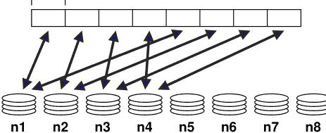

**图 17.2** 基为 0 且 pcount 为 4 的条带示例

**预备知识。** 在编译使用 PVFS 的程序时，您应该通过 `#include <pvfs.h>` 在源码中包含 PVFS 文件，该文件通常安装在 `/usr/local/include/`。

要链接到 PVFS 库（通常安装在 `/usr/local/lib/`），您应该在链接行中添加 `-lpvfs`，可能还需要添加 `-L/usr/local/lib` 以确保该目录包含在库搜索路径中。

PVFS 接口调用可以在标准的非 PVFS 文件上正常运行，包括 MDB 接口。当您调试代码时，此功能可以帮助将问题与 PVFS 系统中的 bug 隔离开。

**条带参数。** PVFS 当前使用的物理分布机制是一种简单的条带方案。数据的分布由三个参数描述：

- **base** — 起始 I/O 节点的索引，0 为文件系统中的第一个

- **pcount** — 存储数据的服务器数量（分区，此处术语使用不当）

- **size** — 条带大小，存储在 I/O 服务器上的连续数据块的大小

在图 17.2 中，我们展示了一个示例，对于存储在我们的示例 PVFS 文件系统上的文件，base 节点为 0 且 pcount 为 4。如您所见，由于条带参数设置，只有四个 I/O 服务器持有该文件的数据。

物理分布在文件首次创建时确决定。通过使用 `pvfs_open()`，您可以指定以下参数：

```c
pvfs_open(char *pathname, int flag, mode_t mode);
pvfs_open(char *pathname, int flag, mode_t mode,
struct pvfs_filestat *dist);
```

使用第一组参数时将强制执行默认分布。相反，如果传递了一个定义分布结构并将 `O_META` 标志通过位或操作添加到 `flag` 参数，您就可以通过作为最后一个参数传递的 `pvfs_filestat` 结构定义物理分布。该结构在 PVFS 头文件中定义如下：

```c
struct pvfs_filestat {
    int base; /* 要使用的第一个 iod节点 */
    int pcount; /* 文件的 iod 节点数 */
    int size; /* 条带大小 */
    int off; /* 未使用 */
    int bsize; /* 未使用 */
}
```

`soff` 和 `size` 字段是以前研究的产物，目前尚未使用。将 `pcount` 值设置为 -1 将为该文件使用所有的 I/O 守护进程（有关默认值的更多信息请参见第 17.3.4 节）。

要获取有关文件物理分布的信息，您应该使用 `pvfs_ioctl(int fd, META, struct pvfs_filestat *dist);`。

它会将文件的物理分布信息填充到 `pvfs_filestat` 结构中。在命令行上可以使用 `pvstat` 工具获取此类信息（见第 17.2 节）。

## 设置逻辑分区

PVFS 逻辑分区系统允许您描述文件中感兴趣的区域，并随后高效地访问这些区域。访问之所以高效，是因为 PVFS 系统允许通过逻辑分区描述的互斥区域作为单个单元进行访问。另一种方法是执行多次寻道（seek）操作，由于独立操作次数过多且每次操作的数据移动减少，这种方法是劣的。PVFS 逻辑分区是文件分区的一种实现；它命名为“逻辑”是因为它独立于文件的任何物理特性（如条带大小）。


如果适用，逻辑分区还可以通过简化应用程序任务对共享数据集的数据访问来简化并行编程。每个任务可以设置自己的逻辑分区，一旦设置完成，所有的 I/O 操作将只“看到”属于该任务的数据。

# 第 17 章

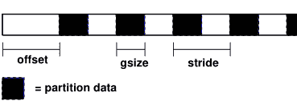

**图 17.3** 分区参数。

使用当前的 PVFS 分区机制，分区由三个参数定义：*offset*（偏移量）、组大小（*gsize*）和 *stride*（跨度）。偏移量是从文件开始到分区内第一个字节的字节距离。组大小是分区中包含的连续字节数。跨度是从一组字节的开始到下一组字节的距离。图 17.3 显示了这些参数。

要设置文件分区，程序使用 `pvfs_ioctl()` 调用。参数如下：

```c
pvfs_ioctl(fd, SETPART, &part);
```

其中 *part* 是定义如下的结构：

```c
struct fpart {
int offset;
int gsize;
int stride;
int gstride; /* 未使用 */
int nggroups; /* 未使用 */
};
```

最后两个参数 `gstride` 和 `ngroups` 是以前研究的遗留部分，不再使用，且应设置为零。`pvfs_ioctl()` 还可以通过指定 `GETPART` 标志来获取当前分区。注意，每当设置分区时，都应匹配文件的条带。

## PVFS：并行文件系统

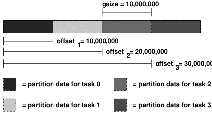

**图 17.4** 分区示例 1，循环分布。

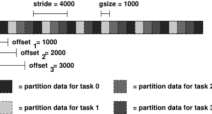

**图 17.5** 分区示例 2，块分布。

简单分区适用于一维数据和二维数据。更复杂的分布和多维数据通常使用多维接口进行分区。

### 多维阻塞

多维接口提供了比原生接口更高层次的数据视图。在 MDBI 中，文件数据被视为一个多维数组。通过指定维度和块的大小，该数组被分为“块”。描述数组的参数有：

- D — 维度数

- rs — 记录大小

- bn — 每个维度的块数

- ne — 每个块中的元素数

- bfn — 阻塞因子（每个维度）

一旦定义了数据集，就可以单次调用读取数据块，这极大简化了访问此类类型数据的操作。这是通过指定每个维度一个索引值来实现的。使用 MDBI 访问有五个基本类：

```c
int open_blk(char*path, int flags, int mode);
```

```c
int set_blk(int fd, int D, int rs, int ne1, int nb1, ..., int nen, int nbn);
```

```c
int read_blk(int fd, char *buf, int index1, ..., indexn);
```

```c
int write_blk(int fd, char *buf, int index1, ..., indexn);
```

```c
int close_blk(int fd);
```

`open_blk()` 和 `close_blk()` 的操作类似于标准的 `open()` 和 `close()`。`set_blk()` 用于在读写之前设置数组的阻塞参数；该过程稍后描述。这两个调用可以根据需要频繁使用，且不涉及通信。一旦设置阻塞，`read_blk()` 和 `write_blk()` 用于读写记录块。

图 17.6 给出了阻塞的示例。在这里，文件被描述为一个二维块数组，其中块由二乘三的数组组成。

在这个示例中，该数组将通过对 `set_blk()` 的调用来描述：

## PVFS: 并行虚拟文件系统

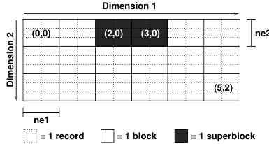

(D = 2, rs = 500, ne1 = 2, nb1 = 6, ne2 = 3, nb2 = 3, bf1 = 2, bf2 = 1)

图 17.6

MDBI 示例 1。

`set_blk(fd, 2, 500, 2, 6, 3, 3);`

如果你想从数组中读取块 (2, 0)，可以：

`read_blk(fd, &buf, 2, 0);`

同样，要读取块 (5, 2)，你可以使用

`write_blk(fd, &blk, 5, 2);`

MDBI 的最后一个功能是块缓冲（block buffering）。有时多维分用于设置程序想要从磁盘读取和写入的数据的大小。其他情况下，块大小在程序中具有某些物理意义，并出于其他原因进行设置。在这种情况下，单个块可能会较小，导致 I/O 性能低下和内存利用率不足。MDBI 提供了一种缓冲机制，导致多个块从磁盘读取和写入，并存储在程序内存地址空间的缓冲区中。后续使用 `read_blk()` 和 `write_blk()` 的传输将导致内存到内存的传输，除非访问了当前缓冲区之外的块。

由于很难预测何时访问哪些块，PVFS 依赖用户的提示来决定缓冲什么内容。这是通过定义“分块因子”（blocking factors）将块分组来实现的。分块因子表示在给定维度上应该缓冲多少个块。使用单个函数来定义分块因子：`int buf_blk(int fd, int bf1, ..., int bfn);`

再次查看图 17.6，我们可以看到如何定义分块因子。在示例中，调用

`buf_blk(fd, 2, 1);`

被用于指定分块因子。我们将生成的较大缓冲块称为超块（superblocks，回想起来这个术语选择得欠佳），示例中其中一个被阴影显示。

每当访问一个块时，如果其超块不在缓冲区中，则当前的超块会被写回磁盘（如果是脏数据），并用新的超块替换之；然后将所需的块复制到给定的缓冲区。所有维度的默认分块因子为 1，每当缓冲因子改变时，如果缓冲区是脏的，就会将其写回磁盘。

我们强调，没有进行缓存一致性（cache coherency）；如果应用任务共享超块，执行写入操作将导致产生意之外的结果。用户必须确保这种情况不会发生。一种良好的缓冲策略是先开发一个关闭缓冲的程序，然后开启它以提高性能。

# 使用 ROMIO MPI-IO 实现。MPI 规范为并行程序中的消息传递提供了一个事实上的标准（facto standard）。MPI-2 规范在成功的 MPI-1 规范的基础上，包含了一个关于 I/O 的章节，通常称为 MPI-IO [14, 11]。正如 MPI 成为并行应用中消息传递的接口，MPI-IO 接口已成为并行应用中 I/O 访问的重要低级接口。

ROMIO 是 MPI-IO 接口的一种实现 [34]。ROMIO 的独特之处在于它实现了一个抽象 I/O 设备（ADIO）层，这有助于将 ROMIO 移植到新的底层 I/O 系统。这种设计的成功在 ROMIO 提供 MPI-IO 支持的系统数量上显而易见，包括 IBM、NEC、SCI 和 Linux。

除了将 MPI-IO 操作映射到正确的底层操作外，ROMIO 还实现了两种在许多场景下大有益益的优化。第一个是数据挖掘（data sieving）[33]，它允许 ROMIO 通过单次调用访问包含数据的较大连续区域，从而利用 MPI 非连续请求。将许多小访问合并为单次大访问是 I/O 系统中非常有效的优化。第二种优化是被称为“两阶段 I/O”（two-phase I/O）的集合优化，以进一步优化磁盘访问。在集合操作中，多个进程将从单个服务器读取相邻的小区域。。两阶段 I/O 将这些相邻访问合并为单个进程的单次访问。访问的数据随后被分散（读取情况）或首先聚集（写入情况），以获得所需的分布。

# PVFS: 并行虚拟文件系统

在 Linux 集群中，ROMIO 可以配置为运行在 PVFS 之上，为使用 MPI-IO 接口的应用程序提供对 PVFS 文件系统的直接访问。这种策略允许应用程序使用这种高性能 I/O 选项，而无需限制程序员使用 PVFS 接口。第 10 章包含了在应用程序中使用 MPI-IO 的细节。

MPI 提示（hints）机制可以通过 MPI-IO 接口将条带信息（stripping information）传递给 PVFS。提示通过“info”对象传递，它是 `MPI_File.open()` 的参数。以下关键字对于 PVFS 是有效的：

- striping_unit — ssize 值

- striping_factor — pcount 值

- start_iodevice — base 值

在使用 PVFS 的 ROMIO 时，你必须意识到三种重要情况。首先，如果编译 ROMIO 时没有 PVFS 支持，它将通过内核支持的接口（即挂载的 PVFS 文件系统）访问文件。如果编译 ROMIO 时包含了 PVFS 支持且你尝试访问已挂载的卷，库将检测到文件是正确的。如果编译 ROMIO 时包含了 PVFS 支持而你尝试访问一个没有挂载的卷，库将无法找到它。

### 17.2.2 PVFS 工具

提供了一些处理 PVFS 的工具。

将文件复制到 PVFS。虽然可以使用 `cp` 工具复制文件，但 `u2p` 命令用于指定物理分布。`u2p` 的语法为：`u2p -s <stripe size> -b <base> -n <nodes> <srcfile> <destfile>`

查看 PVFS 分布。`pvstat` 工具将打印文件的物理分布参数。在示例 PVFS 系统上创建文件后，我们看到：

```
[root@head /root]# /usr/local/bin/pvstat /pvfs/foo
/pvfs/foo: base = 0, pcount = 8, ssize = 65536
```

`pvstat` 工具依赖于 `/etc/pvstab` 的存在。

检查服务器状态。`iod-ping` 工具可判断 I/O 服务器是否运行：

```
[root@head /root]# /usr/local/bin/iod-ping -h n1 -p 7000
n1:7000 is responding.
[root@head /root]# /usr/local/bin/iod-ping -h head -p 7000
head:7000 is down.
```

在这种情况下，我们在 n1 上启动了 I/O 服务器，因此它是运行的。我们没有在 head 上运行 I/O 服务器，因此报告为关闭。同样，`mgr-ping` 工具可以检查元数据服务器的状态：

```
[root@head /root]# /usr/local/bin/mgr-ping -h head -p 3000
head:3000 is responding.
[root@head /root]# /usr/local/bin/mgr-ping -h n1 -p 3000
n1:3000 is down.
```

mgr 在 head 上运行，但我们没有在上面运行。

这两个工具还会相应设置退出值以便脚本使用；换句话说，它们在成功（响应）时将退出值设置为 0，在失败（关闭）时设置为 1。如果没有指定额外的参数，程序将自动检查 localhost 上服务器类型的默认端口（I/O 服务器为 7000，元数据服务器为 3000）。如果没有指定“-p”选项，则使用默认值。

## 17.3 管理 PVFS

在本节中，我们将介绍管理 PVFS 的细节，首先构建 PVFS 组件，然后安装和配置服务器，接着安装和配置客户端服务器，最后启动并验证它们是

# PVFS: 并行虚拟文件系统

系统正在运行。我们继续依靠第 17.2 节描述并在图 17.1 所示的系统作为示例。

### 17.3.1 构建 PVFS 组件

PVFS 包在过去的几个版本中，编译易用性方面取得了巨大进展。现在的过程变得非常简单。

编译 PVFS 需要两个文件：

- pvfs（例如，`pvfs-1.5.0.tgz`）

- pvfs-kernel（例如，`pvfs-kernel-0.9.0.tgz`）

其中第一个文件包含 PVFS 服务器和 PVFS 库的代码。第二个文件包含特定于 Linux VFS 支持的代码，这使得 PVFS 文件系统可以挂载到 Linux 电脑上。这些代码对于使用 PVFS 并不是必需的，但它能让访问 PVFS 文件更加方便。

**获取源码。** PVFS 是开源软件，可以在 Web 上免费获取。目前有可以通过通过 FTP 协议获取 PVFS 的两个一致源：

- `ftp://ftp.clemson.edu/pub/pvfs/`

- `ftp://mirror.chpc.utah.edu/pub/pvfs` (镜像站点)

在这些目录之一中存有 `pvfs-v1.tgz` 和 `pvfs-kernel-v2.tgz` 文件，其中 v1 和 v2 是版本号。这些文件是 PVFS 源码的 tar 归档，随后使用 gzip 工具进行了压缩。您应该下载每个包的最新版本；这两个包的版本号彼此匹配。（在编写本文时，pvfs 归档的最新版本为 1.5.1，pvfs-kernel 归档的最新版本为 0.9.1）。

**解包。** 如果两个归档都解压到同一个目录下，执行编译将变得比较容易，因为 pvfs-kernel 源码依赖于 pvfs 源码树中的文件。在我们的情况下，我们将它们解压到头节点的 `/usr/src/`：

```
root@root]# cp pvfs-1.5.0.tgz pvfs-kernel-0.9.0.tgz /usr/src
root@head /usr/src]# cd /usr/src
root@head /usr/src]# tar zxf pvfs-1.5.0.tgz
root@head /usr/src]# tar zxf pvfs-kernel-0.9.0.tgz
root@head /usr/src]# ln -s pvfs-1.5.0 pvfs
root@head /usr/src]# ls -lf
total 476
lrwxrwxwx 1 root root 15 Dec 14 17:42 -> pvfs-1.5/

```

drwxr-xr-x 12 root root 512 Dec 14 10:11 pvfs-1.5.0/

-rw-r--r-- 1 root root 371535 Dec 14 17:41 pvfs-1.5.0.tgz

drwxr-xr-x 6 root root 1024 Dec 14 10:20 pvfs-kernel-0.9.0/

-rw-r--r-- 1 root root 105511 Dec 14 17:41 pvfs-kernel-0.9.0.tgz

```

符号链接允许 pvfs-kernel 包轻松地找到它需要的头文件。一旦完成，源码就可以准备好编译了。

**编译包。**

接下来我们将编译这两个包。我们还讨论了如何在本地系统上安装这些包；然而，大多数用户希望在编译完成后将文件分发到正确的机器。在第 17.3.2 节中，我们将讨论哪些组件需要放在什么位置。

首先，我们将编译 pvfs 包（忽略输出）：

```
root@head /usr/src]# cd pvfs
root@head /usr/src/pvfs-1.5.0]# ./configure
root@head /usr/src/pvfs-1.5.0]# make
```

然后就可以安装组件了：

```
root@head /usr/src/pvfs-1.5.0]# make install
```

以下是默认安装的内容：

- `/usr/local/sbin/` 中的 mgr id
- `/usr/local/lib/` 中的 `libpvfs.a`
- `/usr/local/include/` 中的头文件
- `/usr/local/bin/` 中的测试程序和工具
- `/usr/local/man/` 中的 man 页面

这些安装目录可以通过 configure 的选项进行更改。参见包目录中的 configure--help。

PVFS-kernel 包将根据头文件和正在运行的内核进行功能测试，因此确保在编译发生的机器上运行着所需的内核并有可匹配的头文件至关重要。有了匹配的头文件，编译就很简单。再次我们省略输出：

```
root@head /usr/src/pvfs-1.5.0]# cd ../pvfs-kernel
root@head /usr/src/pvfs-kernel-0.9.0]# ln -s ../pvfs include
root@head /usr/src/pvfs-kernel-0.9.0]# ./configure --with-libpvfs=../pvfs
root@head /usr/src/pvfs-kernel-0.9.0]# make
```

符号链接允许 pvfs-kernel 包轻松地找到它需要的头文件。一旦完成，源码就可以准备好编译了。有了匹配的头文件，编译是很容易的。

```
root@head /usr/src/pvfs-1.5.0]# ./configure 
root@head /usr/src/pvfs-1.5.0]# make
```

然后就可以安装组件了：

```
root@head /usr/src/pvfs-1.5.0]# make install
```

以下是默认安装的内容：

- `/usr/local/sbin/` 中的 mgr id
- `/usr/local/lib/` 中的 `libpvfs.a`
- `/usr/local/include/` 中的头文件
- `/usr/local/bin/` 中的测试程序和工具
- `/usr/local/man/` 中的 man 页面

这些安装目录可以通过 configure 的选项进行更改。参见包目录中的 configure--help。

PVFS-kernel 包将根据头文件和正在运行的内核进行功能测试，因此确保在编译发生的机器上运行着所需的内核并有可匹配的头文件至关重要。有了匹配的头文件，编译是很容易的。

```
root@head /usr/src/pvfs-kernel-0.9.0]# ./configure
root@head /usr/src/pvfs-kernel-0.9.0]# make
```


418 第 17 章

`iod` 可执行文件是 PVFS 系统中提供 I/O 服务的守护进程。它通常以 root 身份启动，之后将其组和用户更改为某些非超级用户 ID。这些 `iod` 必须运行才能进行文件 I/O 操作。`iod.conf` 文件描述了 `iod` 的环境。特别是它描述了机器上 PVFS 数据目录的位置，以及运行 `iod` 时应该的用户和组。`mgr` 也应该有一个类似的文件，但目前还没有。

# 示例集群的 iod.conf 文件

```
datadir /pvfs-data

user nobody

group nobody
```

```
[root@ni]## cd /
[root@ni]## mkdir /pvfs-data
[root@ni]## chmod 700 /pvfs-data
[root@ni]## chown nobody.nobody /pvfs-data
[root@ni]## ls -ald /pvfs-data

drwx------ 2 nobody nobody 35 Dec 1 09:41 /pvfs-data/
```

- `pvfs` 可执行文件
- `pvfs.o` 内核模块（已编译以匹配内核）
- `/dev/pvfs` 设备文件
- `mount.pvfs` 可执行文件
- `pvfstab` 文件

# PVFS: 并行虚拟文件系统

## 挂载点

如第 17.2.1 节所述，客户端访问有两种方法：直接库访问和内核支持。上述列表中的前四项专门用于内核级访问，如果不需要这种访问方法，可以忽略它们。

`pvfsd` 可执行文件是一个代表客户端程序执行网络传输的守护进程。它通常以 root 身份启动。在 PVFS 文件系统挂载到客户端之前，它必须处于运行状态。

`pvfs` 内核模块在 Linux 内核中注册 PVFS 文件类型，允许通过系统调用访问 PVFS 文件。这使得一旦挂载了 PVFS 文件系统，现有的程序就可以访问 PVFS 文件。

`/dev/pvfs` 设备文件用作 `pvfs` 内核模块与 `pvfs` 守护进程之间的通信点。它在启动 `pvfsd` 之前必须已经存在。它在每个客户端机器上只需创建一次。

`mount.pvfs` 可执行文件供 `mount` 命令执行 PVFS 特有的进程。或者，它可以以独立方式使用直接挂载 PVFS 文件系统。这将在 17.3.3 节中介绍。

`pvfstab` 提供了一个 fstab 条目，说明使用 PVFS 库的应用程序如何访问 pvfs 文件。内核客户端代码不需要它。只有当代码直接或间接链接到 `libpvfs` 时才需要它。这包括使用 ROMIO MPI-IO 接口。

如前所述，挂载点是一个空目录。在我们的示例中，我们将挂载点放在根目录下，这样就可以将 PVFS 系统挂载到 `/pvfs`。我们创建 PVFS 设备文件。`mknod` 程序用于创建设备文件，设备文件是作为系统资源接口的特殊文件。`mknod` 程序接受四个参数：设备名称、主设备号和从设备号。类型（在本例中“c”表示特殊文件），我们目前任意选择了主设备数为 60。

我们将在机器上执行这些操作：

```
[root@head] # mkdir /pvfs
[root@head] # ls -lad /dev/pvfs
drwxr-xr-x 2 root root 35 Dec 1 09:37 /pvfs/
[root@head] # mknod /dev/pvfs 60 0
[root@head] # ls -l /dev/pvfs
crw-r--r-- 1 root root 60, 0 Dec 1 09:45 /dev/pvfs
```

如果使用 devfs 系统，则没有创建 `/dev/pvfs` 文件。但在我们的示例系统中，我们在节点上使用 PVFS 库，因此我们将使用 `vi` 或 `emacs` 创建 `pvfstab` 文件。用户能够读取这个文件是非常重要的。它的样子如下：

```
[root@head ]# chmod 644 /etc/pvfstab
[root@head ]# ls -al /etc/pvfstab
-rw-r--r-- 1 root root 46 Dec 17 15:19 /etc/pvfstab
[root@head ]# cat /etc/pvfstab
head:/pvfs pvfs port=3000 0 0
```

此过程必须在每个节点上重复。在我们的示例中，我们需要将这些文件拷贝到每个节点并创建挂载点。

# 安装 PVFS 组件

为了 PVFS 应该安装几个组件：

- `libpvfs.library`
- `include` files
- `man` pages
- `pvfstab` file

`libpvfs.library` 和 `include` 文件用于编译直接访问 PVFS 系统的程序（我们称之为原生访问）。`man` pages 很有用。`pvfstab` 文件在前面的节中描述过；它对于不通过内核访问 PVFS 的应用程序是必要的。在我们的示例中，我们期望在 "head" 节点上进行安装，一切都是自动完成的。

# 配置 ROMIO 使用 PVFS

为了让 ROMIO 访问 PVFS 文件，由于 ROMIO 通常作为 MPICH 包的一部分安装，其配置、编译和安装过程不在本节范围内。你应该参考第 9.6 节。当 ROMIO 作为独立包或 MPICH 的一部分编译时，必须提供额外的标志：

- `system=pvfs`
- `lib=/usr/local/lib/pvfs.a`

# PVFS: 并行虚拟文件系统

### 17.3.3 启动与关闭

此时，所有二进制文件和配置文件都已就绪。现在我们将启动 PVFS 文件系统并验证其运行正常。然后我们将初始化客户端并挂载文件系统。接下来我们将创建一些文件来显示运行正常。之后我们将讨论卸载文件系统。最后我们将讨论关闭组件。

只要在之前之前启动顺序并不重要。回到我们的示例，我们首先启动元数据守护进程。它将日志存储在 `/tmp/`。文件名末尾的字符确保了唯一性。每次启动服务器时都会创建一个新文件。接下来我们在每个节点上启动 I/O 服务器守护进程。此过程必须在每个节点上重复。服务器启动后，我们可以启动客户端侧组件。首先加载模块，然后启动 `pvfsd`，最后挂载文件系统：

```
[root@head]# insmod pvfs.o
[root@head]# lsmod
Module         Size Used by
pvfs 32816 0 (unused)
pvfsd 17104 1 (autoclean)
```

```
[root@head] /root] /usr/local/sbin/pvfs
[root@head] /root]# ls -l /tmp
total 7
-rwxr-xr-x 1 root root 0 Dec 18 18:22 mgr.log
-rwxr-xr-x 1 root root 102 Dec 18 18:22 pvfslog.0
```

```
[root@head] /root]# /sbin/mount.pvfs head:/pvfs-meta /pvfs
[root@head] /root]# ls -al /pvfs
total 1
drwxr-xr-wx 1 root root 82 Dec 18 18:33 ./
drwxr-xr-wx 1 root root 378 Dec 18 15:01 ../
```

```
[root@head] /root]# df -h /pvfs
| Filesystem Size Available Avail Mounted |
| pvfs-meta 808M 44M 764M 5% /pvfs |
```

现在我们应该可以访问文件系统了。顺带提一下，注意到 `df` 的 `-h` 选项只是以更易读的形式打印内容。

# 检查结果

让我们创建几个文件：

```
[root@head] /root]# cp /etc/pvfstab /pvfs/
[root@head] /root]# df -i /dev/zero of=/pvfs/zeros bs=1M count=10
[root@head] /root]# ls -l /pvfs
total 10240
-rw-r--r-- 1 root root 46 Dec 18 18:41 pvfstab
-rw-r--r-- 1 root root 10485760 Dec 18 18:41 zeros
```

```
[root@head] /root]# cat /pvfstab
pvfs-meta /pvfs pvfs port=3000 0 0
```

一切看起来都良好。我们必须在其他节点上重复此操作，以便它们良好地访问文件系统。

卸载文件系统和关闭组件。与其他任何文件系统类型一样，如果客户端没有访问 PVFS 文件系统上的文件，你可以简单地卸载它：

```
[root@head] /root]# umount /pvfs
[root@head] /root]# ls -al /pvfs
total 1
drwxr-xr-wx 1 root root 82 Dec 18 18:33 ./
```

drwx-xr-x  20 root  root  378 Dec 17 15:01 ../

你可以重新挂载到相同的挂载点或其他挂载点。更改挂载不需要重启 `pvfs` 守护进程或重新加载 `pvfs.o` 模块。

为了正常关闭，所有客户端都应该在服务器关闭之前卸载 PVFS 文件系统。建议的关机顺序如下：

- 在客户端上卸载 PVFS 文件系统
- 使用 `kill` 或 `killall` 停止 `pvfs` 守护进程
- 使用 `rmmod` 卸载 `pvfs.o` 模块
- 使用 `kill` 或 `killall` 停止 `mgr` 守护进程
- 使用 `kill` 或 `killall` 停止 `iod` 守护进程

### 17.3.4 配置详情

前面的讨论表明，当前的 PVFS 配置系统有点复杂。在这里，我们尝试更详细地介绍文件格式、文件系统默认值和其他选项。这些信息都是补充性的，但在发生错误时可能会有用。

**.pvfsdir 和 .iotab 文件。** 在第 17.3.2 节中，我们讨论了 `.pvfsdir` 和 `.iotab` 文件的创建。在本节中，我们涵盖了文件格式的细节。`.pvfsdir` 文件包含文件系统元数据服务器的信息。`.iotab` 文件包含组成文件系统的 I/O 守护进程位置和端口号列表。这两个文件都可以使用 `mgrconf` 创建，其用法在第 17.3.2 节中也有描述。

`.pvfsdir` 文件按顺序包含以下信息，每行一个条目：

- `.pvfsdir` 所在目录的 inode 编号
- 目录的用户 ID (`userid`)
- 目录的组 ID (`groupid`)
- 目录的权限
- 元数据服务器的端口号
- 元数据服务器的主机名 (`hostname`)
- 元目录名称
- 此子目录名称（对于元数据目录中的 `.pvfsdir` 文件将为 "/"）

这是一个可能为我们的示例文件系统生成的 `.pvfsdir` 文件示例：

```
116314
0
0
0040775
3000
head
/pvfs-meta
/
```

该文件将位于元数据目录，在我们的示例用例中为 `/pvfs-meta`。每个子目录中也会有一个 `.pvfsdir` 文件。当创建子目录时，元数据服务器会自动创建这些新文件。

`.iodtab` 文件由系统管理员创建。它仅由有序的主机列表（或 IP 地址）和可选的端口号组成。以 `#` 开头的行是注释，会被系统忽略。它存储在 PVFS 文件系统的元目录中。

`.iodtab` 示例如下：

```
# 使用 IP 地址和显式端口的示例 .iodtab 文件
192.168.0.1:7000
192.168.0.2:7000
192.168.0.3:7000
192.168.0.4:7000
192.168.0.5:7000
192.168.0.6:7000
192.168.0.7:7000
192.168.0.8:7000
```

另一个示例，假设使用默认端口 (7000) 并使用主机名（如我们的示例系统所示），如下：

```
# 使用主机名和默认端口 (7000) 的示例 .iodtab 文件
n1
n2
n3
n4
```

n5
n6
n7
n8

建议手动创建 `.iodtab` 文件，特别是对于大型系统。然而，一旦文件存储在 PVFS 文件系统中，修改此文件就不安全了。

**`iod.conf` 文件。** `iod` 会在 `/etc` 目录下查找名为 `iod.conf` 的可选配置文件，该文件可以为 I/O 守护进程指定多个配置参数，包括更改数据目录、运行 I/O 守护进程的用户和组以及 I/O 守护进程运行的端口。

每行包含两个字段：键字段和一个值字段。这两个字段由一个或多个空格或制表符分隔。键字段指定要更改的配置参数。键后面跟着这个新值。以井号开的空行会被忽略。键不区分大小。如果再次使用相同的键将覆盖第一个实例。有效的键如下：

- `port`：指定 `iod` 接受请求的端口。默认值为 1000。
- `user`：指定 `iod` 运行的用户。默认值为 `nobody`。
- `group`：指定 `iod` 运行的组。默认值为 `nobody`。
- `rootdir`：给出 `iod` 应该作为根目录的目录。`iod` 使用 `chroot(2)` 在访问文件之前切换到该目录。默认值为 `/`。
- `logdir`：给出 `iod` 应该写入日志文件的目录。默认值为 `/tmp`。
- `datadir`：给出 `iod` 应该作为数据目录的目录。`iod` 在更改根目录后使用 `chdir(2)` 切换到该目录。默认值为 `/pvfs`。
- `debug`：设置调试级别；零表示关闭，非零有助于查找 bug。

`rootdir` 给出 `iod` 应该作为根目录的目录。`iod` 使用 `chroot(2)` 在访问文件之前切换到该目录。默认值为 `/`。

`logdir` 给出 `iod` 应该写入日志文件的目录。默认值为 `/tmp`。

`datadir` 给出 `iod` 应该作为数据目录的目录。`iod` 在更改根目录后使用 `chdir(2)` 切换到该目录。默认值为 `/pvfs`。
- `debug` 设置调试级别；零表示关闭，非零有助于查找 bug。

# PVFS: 并行虚拟文件系统

n5
n6
n7
n8

建议手动创建 `.iodtab` 文件，特别是对于大型系统。然而，一旦文件存储在 PVFS 文件系统中，修改此文件就不安全了。

`iod.conf` 文件。`iod` 会在 `/etc` 目录下查找名为 `iod.conf` 的可选配置文件，该文件可以为 I/O 守护进程指定多个配置参数，包括更改数据目录、运行 I/O 守护进程的用户和组以及 I/O 守护进程运行的端口。

每行包含两个字段：键字段和一个值字段。这两个字段由一个或多个空格或制表符分隔。键字段指定要更改的配置参数。键后面跟着这个新值。以井号头的空行会被忽略。键不区分大小。如果再次使用相同的键将覆盖第一个实例。有效的键如下：

- `port`：指定 `iod` 接受请求的端口。默认值为 1000。
- `user`：指定 `iod` 运行的用户。默认值为 `nobody`。
- `group`：指定 `iod` 运行的组。默认值为 `nobody`。
- `rootdir`：给出 `iod` 应该作为根目录的目录。`iod` 使用 `chroot(2)` 在访问文件之前切换到该目录。默认值为 `/`。
- `logdir`：给出 `iod` 应该写入日志文件的目录。默认值为 `/tmp`。
- `datadir`：给出 `iod` 应该作为数据目录的目录。`iod` 在更改根目录后使用 `chdir(2)` 切换到该目录。默认值为 `/pvfs`。
- `debug`：设置调试级别；零表示关闭，非零有助于查找 bug。

### 17.3.5 杂项

本节包含了一些关于 `mgr` 选项以及在 PVFS 上使用 `mount` 的说明。

目前 `mgr` 唯一重要的选项是“`-r`”，它允许为新的 PVFS 文件随机选择基础节点。默认情况下，`mgr` 在每次文件被打开时都会记录一条消息。以下是一个示例：

```
i 2580, b 0, p 4, s 65536, n 1, /pvfs-meta/foo
```

打印的字段如下：

- inode 号/句柄 (`handle`)
- 基础节点编号
- `pcount`
- 条带大小 (`strip size`)
- 打开此文件的进程数

最后列出了元数据文件的名称。这些信息对于调试使用并行 I/O 的应用程序特别有帮助。

我们之前提到过，`mount.pvfs` 程序用于挂载 PVFS 文件系统。这与大多数文件系统略有不同，因为通常 `mount` 程序可以用于挂载任何类型的文件系统。作为 `util-linux` 软件包一部分的某些 Linux `mount` 版本，会在 `/sbin` 中查找外部特定文件挂载程序以用于特定的文件系统类型。在编写时，2.10f 之后的所有版本似乎都启用了此功能。如果启用了该功能，当挂载 PVFS 文件系统时，`mount` 将自动调用 `/sbin/mount.pvfs`。使用我们的示例：

```
[root@root]# /sbin/mount pvfs head:-t /pvfs-meta /pvfs
```


如果操作成功，管理员还可以向 `/etc/fstab` 为 PVFS 文件系统添加条目。然而，重要重要的是，在挂载 PVFS 文件系统之前，必须加载模块、运行 `pvfs` 守护进程，并且远程系统上的服务器进程必须运行。

## 17.4 结语

PVFS 是一个不断发展的系统。随着系统的演进，文档的更新可能会滞后于软件开发。

PVFS 开发团队对项目的建议和贡献持开放态度。我们对人们开发的为了方便管理 PVFS 的脚本和工具特别感兴趣。鼓励开发了帮助管理系统实用程序的用户与我们联系。我们将尝试将此类程序包含在下一个 PVFS 版本中。

PVFS 正在进行大量的开发，特别是为了帮助处理如冗余、更有趣的数据分布以及零拷贝网络协议（在第 6 章描述）等问题。有关 PVFS 的最新信息，请查看网站：www.parl.clemson.edu/pvfs。

## 18 千叶市：阿贡纳可扩展集群

Remy Evard

拥有 256 个双 CPU 计算节点，千叶市（Chiba City）是阿贡纳可扩展集群项目中最大的集群。

千叶市的设计有一个独特的目的：支持可扩展的计算机科学以及可扩展系统软件的发展。我们相信，高性能计算系统软件水平的进步对于提高高端机器性能和可靠性至关重要。然而，带来这些进步的开发者和研究人员发现很难访问最大的系统，因为那些计算机专门用于运行大型代码。随着商品化集群的出现，解决问题的办法变得清晰：现在可以构建一个系统，用于支持需要大规模开发和测试的活动，而无需支付高昂的价格。这就是千叶市想法的基础。

此外，千叶市的建立是为了支持广泛的并行科学应用。在阿贡纳国家实验室的数学与计算机科学（MCS）部门，我们与全球范围的数百名研究人员合作，他们通过与我们部门的科学家合作来使用我们的计算设施。千叶市旨在供这些科学家使用，以便他们在解决实际科学问题的同时，与计算机科学家合作，以扩大他们能够解决的问题范围。

本质上，千叶市旨在支持两个偶尔发生冲突的独特目标：可扩展的计算机科学研究（这需要一个动态且交互的测试平台），以及计算科学（它在历史上一直使用稳定的、批处理导向的系统）。我们相信千叶市在这两者之间取得了舒适的平衡，并促进了这两个领域的良好科学发展。

实验与经典生产计算之间的需求差异使我们——千叶市的设计者和管理员——同时生活在两个世界中，试图保持集群既稳定又有趣。我们希望这个案例研究也能实现这两个目标。

## 18.1 千叶市配置

在本节中，我们从多个角度描述了集群的配置。我们不仅涵盖了配置中包含了哪些内容，还涵盖了为什么要以及如何使用它们。

### 1 个可视化镇
- 32 台带有 Matrox G400 卡的 Pentium III 系统

### 8 个计算镇
- 256 台双 Pentium III 系统

### 1 个存储镇
- 8 台 Xeon 系统，每个配 300G 磁盘

| 组件 | 详情 |
| :--- | :--- |
| 集群管理 | 12 台 PIII Mayor 系统，4 台 PIII 前端系统 |
| 文件服务器 | 2 台 Xeon 文件服务器，34 TB 磁盘 |
| 高性能网络 | 64 位 Myrinet |
| 管理网络 | 千兆以太和快速以太网 |
| 外部链路 | 千兆 |

图 18.1 千叶市示意图。

### 18.1.1 节点配置

千叶市包含以下计算组件（见图 18.1）：

- 256 个计算节点
- 32 个可视化节点
- 8 个存储节点
- 18 个管理节点

**计算节点。** 256 个计算节点是集群的主力军。每个节点有两个 550 MHz 的 Pentium III 处理器。

**可视化节点。** 32 个可视化节点用于图形化应用。

**存储节点。** 8 个存储节点提供了集群的数据容量。

**管理节点。** 18 个管理节点处理集群范围内的管理任务。

讽刺的是，1U Pentium 系统在我们安装“千叶市”（Chiba City）后几个月才上市。我们知道它们可能在那个时候会有货，但重新谈判集群采购以获取 1U 规格并不是一个选项。

### 计算节点磁盘
某些集群构建者在所有节点中都包含磁盘。另一些则完全是无盘的。无盘节点在集群中有很多优势。首先，当节点无磁盘时，配置节点上的操作系统会稍微简单一些，因为这些配置存储在管理节点上。（如果使用了足够的配置工具来管理无盘节点，这一优势可能会被抵消）。此外，硬盘往往会损坏。如果节点没有硬盘，每个节点上可能需要维护的部件就减少了一项。对于大型集群，消除任何涉及触碰节点的情况是一个好主意。

在“千叶市”中，我们每个节点都有一个 9 GB 的驱动器。我们决定在每个节点中安装磁盘以获得最大的灵活性。科学家运行的一些应用程序广泛使用了本地磁盘。我们还预见到到软件引擎或替代操作系统可能需要使用本地磁盘。事实证明，对我们来说，这是一个正确的选择。许多系统依赖或利用了本地磁盘。虽然我们偶尔会遇到驱动器故障，但这比许多其他硬件组件（特别是风扇）要少得多。

### 其他计算节点硬件
除了 CPU、RAM 和硬盘外，每个计算节点还有：

- 一个用于连接 Myrinet 卡的 32 位 PCI 插槽，
- 主板上的一个 100/100 以太网端口，
- 一个软盘驱动器（因为包含了它），以及
- 串口、并行口、键盘以及其他常见的 PC 端口。

### 计算节点连接
观察节点的背部很有启发性。每个连接都插在集群的另一个组件上，所有这些将在随后的章节中详细描述。

- Myrinet 卡是 Myrinet 网络的一部分。每个节点都有一根相当大的 Myrinet 线缆，穿过地板连接到 Clos 交换机。
- 以太网端口用于连接到以太网网络。每个节点连接到其所在机架或相邻机架中的以太网交换机。
- 用于控制台的串口插在机架内的串口集中器上，从而实现对所有控制台的远程访问。
- 每个节点上的“管理”串口端口插在一个独立的集线器上，用于低级管理。这是一个特定的主板接口，我们从未需要用它来远程监控和控制电源。
- 剩下的是键盘和视频端口。在少数情况下（例如硬件诊断或升级），我们可能需要向它们插上显示器。

### 可视化节点
可视化节点被科学家用于基于集群的图像合成和计算机图形处理。可视化节点的主要特征是它们包含了可以用于图像合成的高端显卡。理想情况下，这些显卡可以有两种使用方式：

- 仅作为视频卡。在我们的环境中，我们在一个位置设置了图形系统的远程控制台，用于显示系统。这意味着可视化节点可以放置在机房内，并仍然作为高端显示设备的驱动器使用。
- 因为普通 PC 图形仍然更多侧重于第一种应用而非计算。这些显卡通常需要 AGP 插槽。例如，带有 AGP 插槽的计算机通常是桌面级系统而非服务器。我们的可视化节点是工作站风格的系统，不适合放入机架，实际上是保存在架子上。在我们购买“千叶市”时，提供的系统是 550 MHz Pentium III 系统，配置了 1 GB 磁盘和 384 MBytes 内存。我们管理它们的方式与计算节点相同，包括远程串口和电源控制。显卡最初是 Matrox Millennium G400。自从安装了“千叶市”后，我们将显卡升级到了 NVIDIA GEFORCE 3 卡。

### 存储节点
八个存储节点并不由“千叶市”的大用户直接访问。相反，它们如第 18.3.1 节所示为计算节点提供文件系统服务。每个存储节点都有一个 500 MHz Xeon 处理器、512 MBytes 内存，以及最重要的，300 GB 的 SCSI 挂接磁盘。因此，总计，存储节点为 Myrinet 网络提供了 2.4 TB 的原始磁盘。

存储节点是 Myrinet 网络的一部分。在某些情况下，集群构建者会选择将他们的存储节点专门放在以太网网络上。这种选择主要是性能与成本之间的权衡。当计算节点数量为偶数（例如 64、128、256 等）时，通常会发现，对于相同的计算节点加上几个存储节点，互连网络所需的硬件会少得多。这种差异可能微不足道，也可能非常巨大。在我们情况下，将存储节点接入 Myrinet 意味着我们需要额外购买几个 Myrinet 交换机。因为 I/O 性能和实验对我们的用户社区非常重要，我们认为这种成本是值得的。

存储节点与集群部分的交互方式与集群上的其他节点相同。除了可以通过 Myrinet 之外，它们也在以太网上。它们还移除了电源和控制台。

在正常情况下，用户无法直接访问存储节点。然而，专门与 I/O 研究相关的项目上工作的科学家可能会访问 I/O 服务器。在这种情况下，他们的程序可能会同时运行在计算节点和存储节点上。

### 管理节点和服务器
用于集群管理的节点有几种不同的类型：

- 12 台作为集群“市长”（mayors）或监控系统的系统
- 4 个前端
- 2 台文件服务器

市长提供了一种可扩展的管理机制，在 18.1.2 节中进行了详细描述。

市长系统：集群中的每 32 台计算机都关联一个被称为“市长”的计算机，用于监控和管理它们。市长从不作为集群上运行的任何计算或实验的一部分，而是用于配置集群并从其可能引起的问题中恢复。每个市长都是带有单路 500 MHz Pentium III、512 MBytes 内存、10/100 以太网、千兆以太网以及 200 GB SCSI 磁盘的系统。

前端：“千叶市”最初配置了四个前端：用户登录这些系统以编译程序并将其启动到计算节点。由于这些系统与计算节点相同，用户的构建环境将与执行环境相同。在实践中，我们发现两个前端就足够了，并将其他节点用作测试系统。

文件服务器：两台文件服务器通过 NFS 向登录节点和市长提供文件系统。它们容纳了所有的用户主文件系统所有的配置文件（内核、RPM、配置文件等）。它们不直接向节点导出文件系统——那是存储节点的工作。文件服务器的硬件配置与存储节点完全相同。每个有 500 GB 磁盘。

| 市长 |
| :--- |
| node | node | node | node |
| node | node | node | node |
| node | node | node | node |
| node | node | node | node |
| node | node | node | node |
| node | node | node | node |

**图 18.2**
千叶市。

### 18.1.2 逻辑配置

千叶市在概念上被划分为集群构建单元，我们称之为为“镇（towns）”。在我们的定义中，一个镇由一组计算机和一个管理这些计算机的单一“市長（mayor）”节点组成。例如，千叶市八个计算节点镇中的每一个都包含一个市長节点和32个计算节点。

千叶市共有11个镇：

- 8 个计算镇，每个镇有 32 个计算节点
- 1 个可视化镇，有 32 个可视化节点
- 1 个存储镇，有 8 个存储节点
- 1 个服务器/市镇，包含 10 个市長节点、登录节点和文件服务器

“镇”是一种允许可扩展管理的机制（见图 18.2）。从系统管理的角度来看，我们希望能够通过与其市長节点交互来完全管理镇中的每一个节点。因此，为了管理千叶市的 256 个计算节点，只需要管理这些计算节点的 8 个市長节点即可。为了实现这一点，市長为其镇内的其他每个节点提供启动服务、操作系统配置、控制台管理和文件服务。它监控这些节点以确保它们运行正常。市長只执行管理功能，绝不参与节点的计算活动，集群用户永远不会与市長直接交互。

在千叶市的大多数情况下，每个市長节点监控 32 个节点。在少数情况下（例如存储镇），镇内的节点较少。我们选择 32 个客户端是出于几个原因：

- 我们的测试表明，NFS 在 32 个客户端下表现良好。因此，如果我们选择，NFS 可以成为镇内的一个选项。
- 在一个 1024 节点的集群中，将会有 32 个拥有 32 个节点的镇。
- 32 节点镇的硬件几乎完美地放入两个机架中。

“镇”之间的关系是分级的。一组市長可以由更高级别的市長管理，就像一组节点由一个市長管理一样。在千叶市，我们有一个被称为“市长（City Mayor）”的节点，它负责管理每一个市長。这为我们提供了一个单一控制点，可以从这里管理整个集群。

这种由每个带有独立服务器的小型复制系统来构建大型系统的概念并不是新事。除了它是一项经典的计算机科学技术外，它在某种程度上也被 IBM SP 使用过，多年来一直是系统管理社区的一种标准方法，并且桑迪亚国家实验室的 CPlant 项目在集群上演示了这一点。

在运行集群期间，我们对“市長”概念有了一些观察：

- 市长概念被反复证明了其价值。如果没有某种分级方法，我们就无法管理该集群。
- 某些网络服务已经内置了可扩展机制，或者可以扩展到整个集群的大小。动态主机配置协议（DHCP）就是其中之一。将其拆分到在每个市長节点上运行并仅支持本地镇是不值得花费时间的。换句话说，集群的一些服务可以且应该是全局的。
- 客户端与市長的比例高度取决于这些客户端在做什么。在 32 个节点的情况下，我们支持网络启动和远程操作系统的安装。如果我们还支持高容量文件系统或其他服务，我们可能需要缩小规模。另一方面，如果每个节点除了监控和时间服务外在很大程度上是相互独立的（例如），我们可能可以切换到每个市長对应 64 个节点。

我们经常被问及为什么我们将这些构建块称为“镇”。在千叶市的早期设计阶段，我们与许多公司的许多从未听过集群的人进行过交流。我们很难向他们解释我们想要由这些带有监控代理的子集群来构建集群，因此作为“城市”这一比喻的一部分，我们开始称它们为“镇”。这种解释非常有帮助，尽管当然，真实的城市并不是由看起来相同的镇组成的——它们是由通常不同的社区（neighborhoods）组成的。但这个比喻有助于解释这一概念，而且这个名字也流传了下来。

### 18.1.3 网络配置

千叶市有两种类型的网络——Myrinet 和以太网。在本节中，我们将描述它们的配置和用途。

**Myrinet。**Myrinet 网络用于支持用户程序中节点之间的高速通信，通常与计算或 I/O 有关。在千叶市，高性能网络是至关重要的。在集群上运行的许多作业都受限于网络性能：网络越快，代码性能越好。此外，千叶市的很多计算机科学研究与通信有关。

我们选择使用 Myricom 的产品 Myrinet，是因为在我们选择该集群时，它是市场上性价比最高的高性能网络解决方案。Myrinet 在集群的所有节点之间具有全全双工带宽。我们安装的网卡支持理论上 1.28 Gbps 的传输速率，从进程到进程的延迟在 10-15 微秒范围内。

千叶市的高性能网络包括连接到节点的 Myrineth 交换机。

**以太网。**以太网用于除 Myrinet 之外的所有事务。在大多数情况下，以太网用于管理、访问和控制。在某些情况下，它也被用于数据传输，但这不是它的主要目的。

## 千叶市：Argonne 可扩展集群

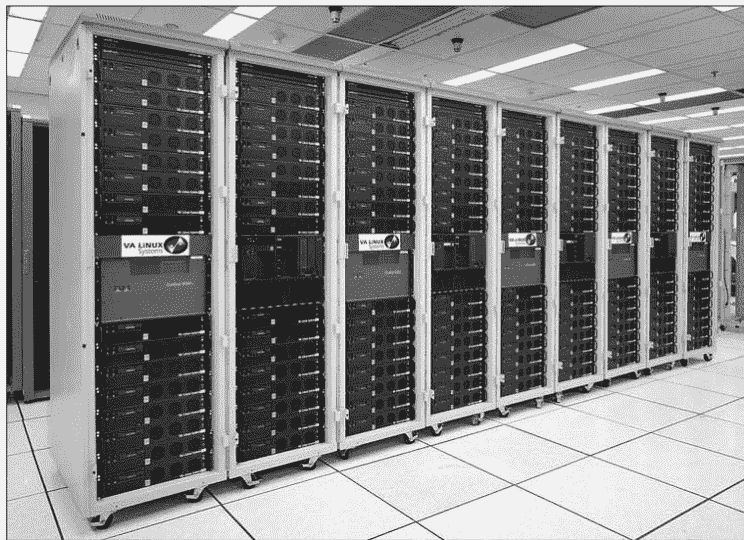

**图 18.4**
千叶市的两行之一。

多年来，我们一直在构建和运行小型集群，包括基于 Windows NT、Linux 和 FreeBSD 的集群。我们曾利用这些集群来支持通信、可视化等几个实验领域的研究。但是，到 1998 年秋季，我们还没有确信 MCS 的大型系统将会是一个集群。

然而，一旦我们考虑了可扩展性问题、对计算机科学测试平台的需求以及商用集群的性能比，情况就变得清晰了：一个大规模集群可能能够满足所有需求，并成为仿真和计算科学的下一个主要 MCS 平台。

我们最初考虑过安装一个 1024 节点的系统。但是，我们决定从 256 节点系统开始，以测试许多概念。因此，千叶市作为迈向千节点（或更大）集群的第一步启动了，其首要目标是支持可扩展的计算机科学，次要目标是支持科学应用。

## 18.2.2 第二阶段：设计与购买

在说服了自己大型集群是 MCS 的正确方向后，我们于 1998 年 12 月开始设计该系统并安排购买。
接下来的几个月里，我们不断重复这个循环：

- 1. 思考我们需要什么以及如何使用它。
- 2. 与供应商、集成商和集群社区交流，以了解我们的时间范围内可以提供什么。
- 3. 考虑各种资金方案，并将其与设计和可用性相匹配。

我们发现，其他除此之外，传统的高性能计算供应商都在试图决定对集群该怎么办（以及对 Linux 怎么办）。当时，虽然可以从 Compaq 以及一些小型集成商那里购买真正的集群，但还没有一家大型供应商创建集群产品线。没有人在卖我们千叶市所需的任何东西。

最终，我们整合了一份演示文稿，向供应商解释我们想买什么。演示文稿解释了什么是集群、集群的用途、我们希望如何运行它，以及我们认为必要的部件可能是什么。随着我们更新系统软件的内部设计，我们也更新了购买演示文稿。我们与许多不同的供应商交流，然后通过正式购买流程。最终，我们同意通过 IBM 购买系统。IBM 安排提供其他供应商的系统部分，包括来自 Cisco 的以太网硬件、来自 Myric 的 Myrinet 以及 VA Linux 的 2U 计算节点。

如今，购买阶段容易多了。几乎每个供应商都可以不加思考地卖给你中小型集群，即使是大型集群也变得相对简单。然而，具有特定要求的极大集群仍然需要与供应商进行大量的交互。

在此期间，我们继续设计千叶市的管理基础设施和系统软件的设计，并在小型集群上进行开发和测试。（我们将小型集群中的节点称为“the freakies”。）没人知道为什么。那个小型集群早已消失了，但这个名字在代码引用和机器配置中一直延续。请注意。）

## 18.2.3 第三阶段：安装

1999 年 10 月，我们安装了系统，意识到几周前我们就拥有了集群。

在之前的一个月里，一辆又一辆卡车停在我们的装卸平台并卸下箱子。我们到处堆满了计算机、机架、电缆、网络箱、磁盘和各种杂项硬件。坦率地说，我们以前经历过大型计算机安装，所以我们非常仔细地记录哪个箱子在某一天通过哪一辆卡车从哪个供应商那里运来。尽管如此，仍然有几个丢失的箱子花了几周才找到。

在系统的购买阶段，我们意识到集群的安装将很有趣。虽然供应商愿意提供安装技术人员作为包的一部分，但我们才是那些了解集群应该如何连接的人。我们需要积极参与安装工作。

一旦意识到这一点，我们决定这是一个机会而不是问题。Argon 的许多科学家对计算机的细节感兴趣，我们觉得他们可能很喜欢帮助建立系统。我们决定以老式“筑盖房活动”（barnraising）的风格组装集群，邀请大家共同加入。每个人对这件事都非常热情。有四十多人报名帮助。

在安装之前，MCS 系统组构建了一个“计算小镇”（computing town）。我们根据花费的时间和到机房的距离记录了我们的操作，估计我们可以在两天内构建出整个集群。在盖房活动开始的前一天，我们与 VA 的技术人员一起组装机架，并将以太网线和串行电缆铺在地板下。

盖房活动本身非常有趣。我们将小镇分成四人小组。每个小组由系统组的成员或 VA 技术人员带领。我们一次运行四个小组。每个小组花费半天组装一个机架，而每个机架是半个小镇。所以，到第一天结束时，四个计算小镇——千叶市的一半——已经组装完成。

在小组工作期间，很多事情都在发生。IBM 工程师组装了存储节点。千叶开发团队为一些初始测试微调了软件。最重要的是，系统组的 Janet Savre 坐在所有活动中心弹奏班卓，营造了恰恰好处的氛围。

在第二天结束时，我们连接了所有小镇并启动了每个节点。由于一些微小的硬件问题，我们没能启动所有系统，但已经在节点上运行了 MPI 任务。

千叶从那时起一直处于全面运行状态。未来，千叶无疑将经历下一个阶段：升级或淘汰。我们将看到。

千叶市：Argonne 可扩展集群

## 18.3 千叶市软件环境

在本节中，我们检查千叶市软件环境的两个方面：计算和管理。

### 18.3.1 计算环境

千叶市的计算环境类似于集群的其他部分，针对计算机科学进行了优化，同时也面向其他用户。在本节中，我们描述了集群的标准计算环境，以及为支持可扩展性研究所做的特殊修改。

**默认节点环境。**“节点计算环境”是指用户节点上提供的程序和服务，即计算节点、可视化节点和登录节点。

集群中的所有机器运行 Linux。我们最初用于构建系统的发行版是 Red Hat 6.2。随着时间的推移，我们添加和删除了 RPM，更改了许多默认行为，并到处添加软件。这些节点仍然能辨认出是 Red Hat，但它们完全可以是其他发行版。

在这些节点上的特定内核随时间变化——变化比我们预期的要大。在理想的世界里，我们有一个满足所有用户需求的稳定内核，但我们必须找到它。

前端提供的编译器包括 C、C++ 和 Fortran 90。一些用户还使用 Java、Perl、Python 和 PHP 编程。

**默认集群环境。** 我们用于将节点堆转换为功能集群的软件胶水包含多个软件包。

通信库：千叶市的大多数作业使用 MPI 进行通信。我们首选的 MPI 版本是 MPICH。我们安装了多个版本的 MPICH，以便允许用户选择他们喜爱的编译器和网络类型。要在 Myrinet 上使用通用消息，我们必须链接来自 Myric 的 MPICH-GM。

千叶市的 MPICH 安装非常多，以至于我们建立了一个小工具来列出所有 MPICH 安装，并让你选择默认使用的一个。MPICH 安装的数量启发了 MPICH 组提供了一种处理多种编译器的替代方案；参见第 9.6.6 节。

# 调度：我们使用可移植作业调度器 (PBS) 进行队列管理（有关 PBS 的详细讨论请参见第 16 章）。自 Chiba 建成以来，PBS 已被 Veridian Systems 接管，PBS 的开源版本被称为 OpenPBS。换句话说，我们在 Chiba City 上运行的是 OpenPBS。

OpenPBS 设计之初并不是为了像 Chiba City 这样规模巨大或分布式的环境，因此存在一些可扩展性问题。集群的大多数用户都与 OpenPBS 有关。我们认为其中许多问题已经由社区解决了（我们自己也处理了其中一些），并且未来将提供一组补丁来解决这些许多问题。

PBS 可以与外部调度器接口，由该调度器决定队列中的哪些作业在何时运行。我们使用 Maui 调度器是出于这一目的的（有关 Maui 调度器的详细讨论请参见第 15 章）。我们对 Maui 感到非常满意。

全局文件系统：全局文件系统是在集群每个节点上都可用的文件系统，并在文件系统中对数据呈现相同的视图。它并不一定能够支持高性能使用，但至少提供了一个公共的命名空间。这通常用于主目录、通用应用程序等。

Chiba City 的早期设计决策之一是，我们不会在集群上使用 NFS 作为全局文件系统。NFS 性能糟糕且扩展性不佳。我们觉得，如果确实必要，可以使 NFS 在 Chiba City 的 256 多个节点上运行，通过使用优化的 NFS 服务器（如 Appliance box）。然而，Chiba City 的部分目的是作为一个更大规模集群的雏形，我们预计 NFS 在那里是无用之地的。因此，我们决定在没有全局 NFS 文件系统的情况下运行集群，看看运行效果如何。

这是一次结果参半的实验。

避免 NFS 的一种方法是使用其他网络文件系统作为全局文件系统。我们尝试过几种，但没有发现任何让我们产生信赖的东西。几个网络文件系统刚刚开源或将在近期发布，因此我们希望这种情况会有所改善。

避免 NFS 的另一种方法是干脆不使用全局文件系统。这正是我们所做的。出于管理目的，在没有全局文件系统的情况下生存是相当简单的——只需使用 rdist 或其他文件同步机制。但在用户端，我们遇到了两个主要问题：

## Chiba City：阿根纳可扩展集群

- *作业暂存（Job staging）。* 用户的程序、支持文件和数据必须在作业开始时拷贝到该用户的节点上。作业完成后，必须将创建的输出文件从节点上暂存出来，节点才能被下一个用户使用。我们从多个角度解决了这个问题，并有了一套可行的解决方案，但速度没有我们预想的快。我们相信多播文件拷贝是解决此问题的正确方案，并将在近期对其进行研究。
- *困惑。* 用户倾向于认为集群将有一个全局文件系统。当他们登录到节点并环顾四周时，在节点节点的主文件系统中看不到他们预期的文件。即使解释了整个环境，很难使用数据传输工具拷贝入正确的文件并拷贝出正确的文件。

很显然，一个良好的可扩展的全局文件系统将是最佳解决方案。

**并行文件系统：** 与全局文件系统不同，并行文件系统专门用于为大型并行作业提供应用程序数据的高性能访问。例如，人们可以在并行文件系统上存储一个巨大的数据集，随后启动一个由数百个任务组成的应用程序，所有任务都同时访问该数据集的部分。并行文件系统既为应用程序进程查找数据提供了单一逻辑空间，又为这些并行应用程序及时访问数据提供了必要的性能。

Linux 集群上唯一的并行文件系统是并行虚拟文件系统 (PVFS)，它在第 17 章中描述。PVFS 与 Chiba 之间有着良好的关系，多年来，Chiba 已成为 PVFS 的主要开发平台。在这种环境中，PVFS 已证明可以扩展到数百个 I/O 服务器和计算进程，并显示出每秒超过 3 GB 的峰聚合吞吐量。在这种规模下运行也暴露了 PVFS 的一些可靠性问题，这些问题在较小配置的运行时并不明显。随着这些问题得到解决且 PVFS 开始稳定，我们开始将 PVFS 文件系统作为常驻资源供 Chiba City 用户使用。这为用户带来了两个好处：它为应用程序提供了一个高性能数据存储空间，并为用户提供了一个可以从任何节点访问的数据集单一存储位置。

**作业调用：** 使用 MPICH 及其默认的 `ch_p4` 设备启动数百个进程的作业非常缓慢。特别是对于交互式作业，需要更具可扩展性的东西。Chiba 为第 9.6.2 节描述的 `ch_p4mpd` 设备提供了一些动力。Chiba City 为 MPD 系统以及依赖它启动作业的 MPICH 版本的发展提供了宝贵的测试平台。MPD 守护进程可以以 root 身份运行，我们一直在实验让它们运行混合的用户作业。我们的长期计划是最终过渡到使用 MPD 作为我们的主要进程管理器。

**并行 Unix 命令：** Chiba City 还作为可扩展 Unix 命令 [10] 的测试平台，这些命令提供了 `ps` 和 `cp` 等常用 Unix 命令的并行版本。这些命令的新版本 [25] 现在已可用。

**支持de-** Chiba City 还作为可扩展 Unix 命令 [10] 的测试平台，这些命令提供了 `ps` 和 `cp` 等常用 Unix 命令的并行版本。这些命令的新版本 [25] 现在已可用。

**交互性：** Chiba City 还作为可扩展 Unix 命令 [10] 的测试平台，这些命令提供了 `ps` 和 `cp` 等常用 Unix 命令的并行版本。这些命令的新版本 [25] 现在已可用。

**崩溃的许可：** Chiba City 还作为可扩展 Unix 命令 [10] 的测试平台，这些命令提供了 `ps` 和 `cp` 等常用 Unix 命令的并行版本。这些命令的新版本 [25] 现在已可用。

**可修改的节点环境：** Chiba City 还作为可扩展 Unix 命令 [10] 的测试平台，这些命令提供了 `ps` 和 `cp` 等常用 Unix 命令的并行版本。这些命令的新版本 [25] 现在已可用。

452

第 18 章

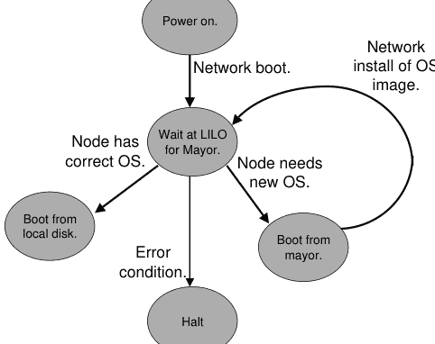

**图 18.5** 节点镜像管理。

### 18.3.2 管理环境

从集群的设计之初，我们就非常重视千叶市（Chiba City）的可扩展性管理。例如，我们的目标之一是，除非节点出现硬件问题，否则永远不需要物理触碰节点。

我们强调可扩展性管理是因为这是所必须的。千叶市是一个大型系统的原型，该系统的所有管理功能出于显而易见的原因必须具备可扩展性。此外，千叶市本身也需要可扩展的管理。千叶市的管理团队由三个人组成，负责集群管理的所有方面、所有用户支持、管理工具和系统软件的开发、参与实验以及 MCS 计算环境的其他方面。

千叶市的管理方法结合了多种设计理念：

- 支持多样化用户社区的所有需求，从稳定的批处理型计算到允许单个用户在其节点上拥有 root 权限。
- 不要过度更改模型，因为我们的科学家需要在通用模型中工作，以便让他们的工具适用于其他人。例如，我们无法将集群切换到共享内存模型。

### 千叶市：阿格纳可扩展集群

- 从中心点进行管理。市长/镇架构——由市长领导各市长，每个市长管理一组节点——被设计为强支持中心化管理。
- 尽可能使用源码和现有工具。尽管我们喜欢发明更酷的轮子，但我们没有时间。

本节剩余部分描述了管理环境的各个组件。

**城市数据库（City Database）。** 市长维护一个相对静态的集群信息数据库。我们将此称为城市数据库或“citydb”。该数据库描述了节点/市长的关系，跟踪哪些节点拥有类型的硬件，并知道在何时哪些节点应该运行哪个操作系统镜像。

城市数据库与调度器维护的数据库不同，后者具有更大的动态性。动态数据库包含作业信息、哪些用户拥有节点以及哪些节点当前处于开启状态。理想情况下，两个数据库的关联会更紧密，但在实践中，保持功能分离对我们来说更容易。

城市数据库具有权威性。如果数据库与现实不符，那么现实是错误的。利用这种哲学，我们可以在数据库中描述期望的集群配置，然后告诉市长确保集群符合该配置。下文描述的配置管理工具负责处理这一点。

citydb 使用标准 SQL 基于 MySQL 构建。

**配置管理（Configuration Management）。** 在最高层，配置模型的工作原理如下：

- 每个节点的配置都描述在市长处。由于许多节点是理想的，这并不像看起来那么糟糕。
- 市长是所有配置文件、镜像和 RPM 的源。所有市长都保留这些文件的镜像副本。
- 当需要更改配置时，管理员在市长处进行更改，然后启动一个过程将该更改推出去。
- 节点本身会在启动时和用户作业运行后进行检查，以确保它们拥有正确的配置。

我们在千叶市使用的主要配置管理工具是一个名为 `sanity` 的程序。*sanity* 的背后的理念是它可以安装 RPM、修改配置文件并执行脚本。它决定对通用（或特定于某个节点）配置文件执行什么操作。一旦确定节点匹配该文件中的配置，该节点即被宣告为“健康的（sane）”。

图 18.6 OS 管理。

市长有能力在他们的每个节点上调用 *sanity*。节点在首次启动和用户作业完成后也会运行 *sanity*。*sanity* 的配置是该节点镜像的一个方面，每个节点的镜像记录在 citydb 中。

为了对系统上的所有节点进行更改，会修改市长处的默认 *sanity* 配置，然后从市长处触发全局推送。

**串口基础设施（Serial Infrastructure）。** 管理工具中的另一个工具是远程控制台。千叶市的每个控制台都通过网络可用。系统的工作方式如下：

- 每个节点的控制端口连接到一个串口集线器。

| 带有硬件信息的城市数据库 | 串口集中器 | 市长 1 | 串口集中器 | 市长 2 |
| :--- | :--- | :--- | :--- | :--- |
| 调度器 | | n1 | n2 | n3 | n33 | n34 | n35 | n36 |
| 市长管理控制台进程 | | n5 | n6 | n7 | n8 | n37 | n38 | n39 | n40 |
| PCI 串口扩展 | | n9 | n10 | n11 | n12 | n41 | n42 | n43 |
| | | n13 | n14 | n15 | n16 | n45 | n46 | n47 | n48 |
| | | n17 | n18 | n19 | n20 | n49 | n50 | n51 | n52 |
| | | n21 | n22 | n23 | n24 | n55 | n56 | n57 |
| | | n25 | n26 | n27 | n28 | n60 | n61 | n62 |
| | | n29 | n30 | n31 | n32 | n63 | n64 | n65 |


# 千叶市（Chiba City）：Argonne 可扩展集群

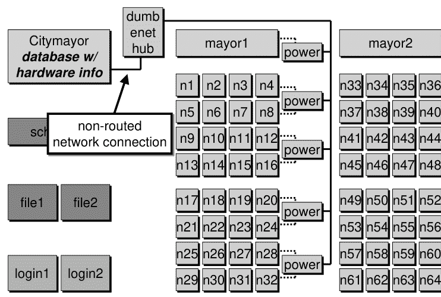

图 18.8
电力基础设施。

1. 我们在千叶数据库中设置一个标记，指示这是一个新节点。
2. 将节点安装在机架的正确位置，并进行适当的线缆连接。
3. 我们在节点中安装正确的 BIOS。遗憾的是，这仍然是手动完成的，尽管我们正在研究一种可以实现自动运行的软盘方案。除其他外，BIOS 被设置为 PXE 启动，这是一种网络启动类型。这意味着在随后的所有电源循环中，节点都将从网络启动。
4. 开启节点，它从网络启动。网络上的某个服务器（通常是节点的“市长”）会对启动镜像做出响应。
5. 启动代码是一个 Linux 启动镜像，其中包含 LILO 和内核。LILO 被配置为在启动提示符处无限等待，并偶尔重新发布提示。
6. LILO 启动提示符通过串口线发出。

7. 节点的“市长”看到了启动提示符。它知道这是哪个节点，因为它知道自己正在监控哪条串口线。因此，此时“市长”知道该节点（例如 node15）正在等待启动。
8. “市长”检查城市数据库（City Database），查看该节点上应该运行什么镜像。它发现这是一个新节点。
9. 根据这些信息，它通过串口向节点发送启动命令，传递一组启动参数。该命令告诉节点通过“市长”提供的构建镜像（Build Image）启动。
10. 节点接收命令并启动在第 4 步中传输回的构建镜像内核。
11. 作为启动构建镜像的一部分，设置脚本会对节点磁盘进行分区并安装正确的镜像文件。
12. 在构建镜像结束时，节点向其控制台显示某些相关信息，包括其以太网 MAC 地址。
13. 监控控制台的“市长”现在知道这个新节点已成功构建。此外，它获得了该节点的 MAC 地址。
14. “市长”用新的 MAC 地址更新市长上的 DHCP 表，并队列一个 DHCP 重启请求。
15. “市长”更新城市数据库（Citydb），设置一个标记表示该节点已安装正确的镜像。
16. 节点等待分钟后重启。再次通过 PXE 启动并从“市长”处加载启动镜像。它向串口控制台发出 LILO 启动提示符并等待。
17. “市长”检查城市数据库，注意到该节点已在其本地磁盘上构建了正确的镜像。它通过串口线向 LILO 启动提示符发送了“从本地磁盘启动”的命令。
18. 节点从本地磁盘启动。除其他外，它将发送 DHCP 请求以获取 IP 地址，并将接收到集群中该节点的正确 IP 地址。
19. 重启后，节点运行健康检查（sanity）。它会安装针对该操作系统镜像所需的任何修改。
20. 最后，节点准备好运行了。调度器记录该节点已上线，并将其添加到可分配资源池中。

整个过程描述起来很长，但运行速度很快。唯一缓慢的部分是第 11 步中的操作系统构建，此时位数据正在安装到本地磁盘上。这可能需要 10-15 分钟，准确时间取决于镜像的大小和网络活动。一旦节点安装完成并更新了 BIOS，该过程就不需要管理员干预。

## 18.4 千叶市的使用

千叶市的平均用户交互方式与任何其他分布式超级计算机集群无异。考虑以下场景。

用户使用 SSH 登录到前端节点。她在该系统上编译代码，或者可能从预编译的代码中选择。如果她想在提交作业之前在几个节点上测试代码，她可以选择集群中的 32 个节点，我们将其称为交互式节点。这组节点的配置方式与标准计算节点相同，但从不被调度。它们始终专门用于测试目的而可用。两个用户的代码可能会发生冲突，因此它们对于性能测试或长时间运行的代码没有用处。一旦她确认代码可以成功运行，她就会准备好代码和作业数据，将其复制到最终分配给她的节点上。她通过将所有内容放在一个目录中来实现。最后，她使用 `qsub` 命令将作业提交到 PBS 队列。她可以通过 `qstat` 检查作业状态。最终，她将在她的时段内被分配一组节点，或者她的作业将在节点上被调用。在此期间，如果她正在运行交互式作业，她可以登录到她想要的节点。如果她的作业有任何错误，她将收到电子邮件通知。一旦她完成作业且时间到（以先到者准），她创建的数据文件将复制回她在前端节点上的主目录。

千叶市的非标准使用可能涉及此场景的无尽变体。用户可能会安排长时间对集群的专用访问——这需要管理员的、在某些情况下是管理层的批准。或者用户可能有一个自定义镜像需要测试，并安排安装在该用户的节点上。有些人将存储节点作为 I/O 实验的一部分。另一些人使用可视化节点，有时与计算节点上的作业结合使用。

目前千叶市有约百名活跃用户。我们预计未来几个月将增加数百名。自安装以来，千叶市已用于许多类型的活动。其中著名的包括以下：

- 物理学中的蒙特卡洛模拟
- 计算优化
- 并行库开发
- 分布式计算开发
- 文件系统开发
- 天体物理模拟
- 可扩展系统软件开发
- 可视化
- 基因组
- 自动推理
- 地球和火星的气候建模
- 分子动力学模拟
- 可扩展性测试

这些项目的详细描述超出了本章的范围；此列表仅旨在让对集群支持的使用类型有一个大致的了解。

## 18.5 总结

在案例研究中，我们详细描述了在设计、构建和运行集群时遇到的各种问题。这里讨论的话题对于处于类似情况的人将很有用。

### 18.5.1 教训

本案例研究关于我们在运行千叶市时学到的教训。我们仍然有几值得提到的：

- 运行集群异常困难。
- 在运行像千叶市这样的集群时，至少有一个精通 Linux 世界的人是关重要的。两三个人甚至更好。这些人应该关注重要的邮件列表、跟踪 Bug 并关注网站上的讨论。集群的成功往往取决于确定哪个版本的内核与哪些应用程序兼容，或者知道某项功能将在几周后可用（或被移除）。

### 18.5.2 未来方向

千叶市在很大程度上是成功的。我们希望系统的某些部分，特别是调度器和 I/O 系统能够更加可靠和功能化，尽管存在这些缺陷，在该计算机上已经取得了良好的科学成就。我们用于管理和操作集群的模型是有效的，并显示出扩展到更大集群的迹象。我们有很多修改计划来改进系统并支持新功能。

未来，从千叶市开始的可扩展性必须继续扩展到更大的测试平台。许多开放的科学问题需要能够提供稳定 pflops 算力的系统。目前还不清楚构建 pflops 系统的路径，但很可能这样的计算机将由成千上万个单个计算组件组成。作为一个社区，为了建立这样的系统，我们必须拥有能够操作该规模机器的系统软件，并且拥有能够合理利用它的算法和应用程序。因此，当计算行业继续制造更好更快的处理器时，我们必须有一种将它们连接起来并使其良好运行的策略。像千叶市这样的可扩展测试平台是该计划的重要部分，我们希望这一领域的研究和活动将继续扩大。

有关更多关于千叶市以及驱动它的软件的信息，请参阅 www.mcs.anl.gov/chiba。

## 19 结论

Thomas Sterling

这本书代表了 Beowulf 计算在硬件和软件方面的实用领先水平。但它也证明了通用集群成熟的极快速度，并在此过程中日益广泛的应用领域中获得了价值。仅两年前，我们关于该领域的首部著作《如何构建 Beowulf》(How to Build a Beowulf) 才由 MIT Press 出版。但在随后的短时间内，集群计算的艺术和实践已经发生了巨大的演变。那时，这类系统的使用方式相当受限，在基础节点操作系统之后提供的软件支持有限。系统规模超过了一百个处理器。今天，超过一千个处理器的系统已用于技术和商业计算。但更重要的是，已经有一系列可用或正在研发的软件工具，用于管理大小小型 Beowulf 集群上负载的实施、维护、管理和资源分配。因此，在本本书出版与我们最初的简易工作之间的这段短时间内，Beowulf 通用集群已经趋于成熟。那时，Beowulf 系统仅仅是并行计算领域的一个狭小元素。今天，它们通常是首选，并正在迅速主导计算的高端。令人感慨的是，在最近的超级计算会议上，业界展出的通用集群比所有其他形式的并行计算系统的和还要多。

尽管取得了这些巨大的进展，Beowulf 集群计算仍然处于一个转型期。目前还没有一个被普遍接受的分布式环境，或者说，还没有集群社区所依赖的硬件基础。当然，这蕴含的灵活性是其优势的一部分，并使其免受供应商变更的影响。事实上，硬件和软件都处于变动状态，预计未来一到三年内还将持续变化。值得考虑的是这些变化将发生在哪里。

### 19.1 硬件组件的未来方向

处理器技术正在见证三个领域的变化。第一个是处理器能力的持续增长，特别是时钟频率。与预测相反，时钟频率仍在增长。在写本文时，时钟频率为 1.7 GHz 的 Pentium 4 已在消费级封装中提供。内存的增强和缓存容量也在扩大，以试图匹配处理器的峰值性能。第二个变化是新一代 64 位架构，随着 Intel IA-64 64 位系列处理器的商业发布。第三个变化领域是 SMP 配置中单个芯片上可能集成多个处理器。如果这一趋势成为现实，那么通用集群的节点可能是包含两个或更多处理器的 SMP 结构。所有这些进展都是由集成特征尺寸的持续缩小驱动的，逻辑已移动至 0.18 微米以下。

随着每节点千赫兹通道持续下降，网络技术预计将取得重大进展。Myrinet 和以太网主导了 Beowulf 集群配置，但其他网络技术也产生了显著影响。Quadrics QSW 网络为基于 Compaq Alpha 的高端系统提供了高带宽框架，并提议了更大的配置，可以产生峰值性能超过 100 teraflops 的集群。VIA 架构在集群市场中继续发力，提供每秒千兆比特的吞吐量和低于 10 微秒的延迟。其中还有 Emulex cLAN 网络。但也许最有趣的进展是新行业标准 Infiniband (IBA) 的出现（远超 1,500 页）。Infiniband 为所有 I/O 节点（包括集群互连网络）提供了一种全新的紧密策略和技术。Infiniband 将不再连接到 PCI 等中间 I/O 接口，而是更直接地与处理器通信，增加 I/O 带宽并将延迟降低到微秒级。已经规范了几个带宽级别，包括适用于 10 Gbps 范围的光纤介质。Infiniband 有一个大型工业财团的支持，可能成为主导的 I/O 接口。然而，尽管广泛乐观，但客户成本尚待确定。有趣的是，外部网络带宽正在接近处理节点的主内存带宽。随着未来几年内再次获得一个数量级的提升，网络带宽可能将不再是性能的瓶颈。

尽管讨论较少，但预计大规模存储将取得重大进展。这些进展正受到快速增长的 PDA、蜂窝手机和手机市场的推动，这些市场对小型、轻量级和低功耗组件的高容量存储内存。“匹配盒”驱动器将在不久的将来提供数兆字节的容量。对于更大的单元，先进的 EIDE 驱动器每单元将提供数百 GB 的容量，且每 GB 成本低于 10 美元。对于许多技术和商业问题，大规模存储在容量和带宽上都是瓶颈。通用集群提供了一个丰富的权衡空间，可以在其中配置和运行大型磁盘阵列。但分布式文件系统的可靠性和软件支持继续面临巨大的挑战，这些挑战尚未得到完全解决。

系统的封装将继续演进，并在两个重要方面影响 Beowulf 集群。从历史上看，Beowulf 占据大量空间。虽然第一个 Beowulf 是在半高机架中定制封装的 16 个主板，但大多数系统利用了带有电源供应的低成本、高可靠性 PC 塔式封装。但这类封装的密度很低。对于除了最小以外的所有系统，空间成为问题。由于 Beowulf 集群市场已变得巨大，供应商正在提供新的封装选项，提供高密度安装单元，使得单个立式机架现在安装 40 或更多处理器。随着更高程度的 SMP 构建到此类单元中，每个机架的处理器数量将继续扩大，允许在适宜的房间内构建系统。这也导致了第二个未来影响，即最大集群的规模。在不久的将来，世界上最大的系统将是由 10,000 个或更多处理器组成的通用集群。在本本书的寿命范围内，可能会实现高达 100 teraflops 的集群。

### 19.2 软件组件的未来方向

虽然过去几年在集群中间件领域取得了巨大的进展，但普遍共识是需要持续改进，以使该系统达到与其它服务器技术相当的可用性和健壮性。寻求的关键属性是完整性、通用性、可用性、通用性和可靠性。

完整性涉及需要一个跨分布式集群系统所有方面的综合软件环境，并支持与社区集群（无论大小）操作相关的各种活动。这些活动包括安装、配置和初始化、状态监控和维护和资源调度。通用性是指这种环境在社区大多数 Beowulf 集群中广泛存在的特性。Linux、Windows 和 MPI 都表现出这一特性，这是 Beowulf 系统广泛传播的重要推动因素。就此而言，如果你曾用过一个 Beowulf，你很可能很轻松地使用其他一个。但在中间件层面，还没有这种统一性。这在某种程度上是刻意的

# 466

# 第 19 章

且部分由于历史原因。随着供应商成功地进入这一领域，中间件一直是他们可以提供产品差异化的领域之一，以增强其各自产品的显性价值。从历史上看，低级工具——特别是用于监控系统状态、运行和健康的工具——是在企业内部开发的，且共享有限。然而，正如我们所看到的，调度器等其他工具得到了更广泛的使用。

易用性与通用性的结合，通过中间件环境提供的抽象与系统运行机制相关联。一个备受推崇的属性、被认为对易用性有强大贡献的属性是“单系统映像”。最初，Beowulf 集群被视为一组分离的、松耦合的处理器系统，每个系统都被单独管理。在早期，甚至会有某种交换箱将操作员的键盘和显示器连接到任何指定的处理器节点。虽然这对于小型、去中心化的系统是行的，但对于较大的多用户集群来说是不可行的，而且在任何情况下都是不理想的。系统包含多个用户必须处理的命名空间。其中一些包括用户的全局变量、文件空间、进程 ID 和作业集以及 I/O。在最坏的情况下，所有必须以节点为基础进行处理。当系统增长到数千或更多进程的规模时，这可能会变得难以证明。对于规模得小的系统，每个节点的控制都容易导致操作员错误。单系统映像是这样一种属性：整个集群对整个系统中的每一类对象仅呈现一个名称，而独立于处理器的数量。用户看到的是一个进程 ID、一个分布式文件空间，其他情况也是如此。通用性将易用性属性扩展到涵盖广泛的运行模式，从专用用户到多用户、多程序运行的各种操作模式。

系统可靠性对于 Beowulf 集群在信息处理市场中的长期接受至关重要。关于 Beowulf 系统的实际可靠性，人们的意见分很大。对于中等规模的系统，持续数周的“婴儿死亡率”可能很高，电源、磁盘和内存会在短时间间隔内损坏。在此时期之后，系统通常会经历长时间的稳定运行，在需要维护之前可能持续几个月。两到三年后，年龄开始产生影响，故障开始升级。对于规模达数千个处理器的非常大的系统，单点故障可能更加普遍。对于每一类系统，快速的检测、诊断、修复、重启和恢复对于高可用性至关重要。辅助所有可靠性方面的软件工具也是必不可少的，但该领域的工作很少，目前没有被接受的通用工具集在使用，尽管已经探索了一些实验性系统。一个重要的能力检查点

# 结论

和重启，虽然存在一些工具，但它们涉及 Windows 程序员的直接干预。用于记录和报告软错误的工具可以识别可能的未来故障，引导对系统组件进行预防性的受控更换，而不中断应用程序的执行。该领域还需要更多工作。

一项有价值的努力是收集并集成现有工具的关键子集，以构建一个至少满足上述要求的实用用环境。OSCAR 出自橡树国家实验室（Oak Ridge National Lab）、Rocks 在圣地亚哥超级计算中心（San Diego Supercomputing Center）完成、康奈尔理论中心（CTC）的集成工具以及 Scyld 提供的集成软件系统都是此类努力的例子。OSCAR 是包括行业伙伴在内的多个组织的协作，随着它的演变非常有价值。来自 CTC 的工具是基于 Windows 最全面的工具之一。Scyld 环境提供了一个用户级系统映像的良好示例。大多数 Beowulf 集群软件支持每个节点上的操作系统并以半独立的方式运行，而 Scyld 模型则不同。通过采用一个主处理器和多个从处理器的逻辑结构，所有命名空间都通过主处理器进行管理，向用户呈现单系统映像。进程由主处理器创建并委托给从处理器执行。从节点节点的内核是轻量级且受限的，由主处理器下载。这可以非常高效地执行，比传统集群快得多，并解决了版本性控制的问题。尽管如此，Scyld 环境表现出许多理想的属性，但在扩展性方面存在一个问题。单个主处理器可能会产生瓶颈，多个节点的协调也非易事。

随着 SMP（对称多处理）节点在集群系统中的日益普及，利用这类紧密耦合单元的方法被称为……。OpenMP 随着时间的推移而开发，以便在共享内存范式内应用这些资源。但节点之间仍然是大多数集群典型的碎片化命名空间。讽刺的是，即使在具有分布式共享内存硬件支持的系统上，大多数并行程序员也使用带有其消息传递模型的 MPI。底层机制支持了这一点，使其至少某些操作符比集群节点之间更高效，而且这种实现对用户是透明的。在节点内使用共享内存、节点间使用分布式内存的清晰方法在通用实践中尚未找到满意的解决方案。一类被称为“put-get”模型的编程模型可能提供至少部分的解决方案。受 Cray T3E 编程模型的启发，这种方法给人分布式共享内存的印象，但假设

468

第 19 章

没有缓存一致性。在 SMP 节点内，使用了传统的加载/存储操作，但对于远程访问，在同一个编程模型中使用对应的 get 和 put 操作符。示例包括 IDA 开发的 UPC 和特拉华大学开发的实验性 Earth-C。

# 19.3 最后思考

很难预测并行计算这样瞬息的技术将带我们走向何方，因为许多因素和趋势影响着最终结果。十年前，集群还处于婴儿阶段，Beowulf 仍然是未来。尽管如此，至少可以考虑一些可能性。通过推推 Top500 列表和半导体行业路线图，意味着世界上最大的计算机（在所有商品化集群中）将在 2010 年达到 1 petaflops 的峰值性能。由数个处理器组成的十亿级集成电路可能能够实现 100 Gflops 或更高的性能。DRAM 密度在这一时期将增长一百倍，如果充分利用光通信，每通道带宽可能达到 1 Tbps 或更高。在这样的情况下，到 2010 年，几乎每个小型 Beowulf 都将成为 teraflops 机器。

只要对各种类型的服务器有需求，就有通过商品化集群获得性能提升的机会。但市场上的许多趋势与集群的未来并不一致。便携式计算设备，包括数字助理、笔记本电脑以及即将发布的（可能）电子书，都具有内置的接口、屏幕和键盘，这使得它们不适合集群。技术进步有助于降低成本、功耗和尺寸，这会对集群节点产生积极影响。诚然，商品化产品本身可能用于通用集群。但这些并不具有成本效益。存放在机箱中的台式（或桌面）计算机可能正在灭绝。越来越多的用户简单地将整个用户环境迁移到笔记本电脑上。笔记本电脑就是一切，他们的整个世界。随着办公室和家里无线互联网、路上蜂窝网络连接以及即将超过 100 Gbytes 的磁盘容量，台式电脑正迅速变成恐龙。但最早的 Beowulf 正来自这些设备。Beowulf 类系统利用了现有的商品化设备，现在它们可能会消失。

但这已不再是一个问题了，因为集群对市场的价值已经得到了证明。供应商现在正专门为了构建高密度集群而制造处理器节点。因此，这些组件不再是来自其他市场的“旧二手品”，而是针对这一目的进行了优化的。在某种意义上，Beowulf 经典的衰落已经开始——虽然尚未完全，但终将会到来。商品化集群曾作为 MPP（大规模并行处理机）的廉价替代方案，旨在帮助这些昂贵的机器分担至少部分的工作负载。但随着下一代高带宽网络及其与处理器/内存核心的紧密集成，MPP 与集群之间的许多区别将会消失。并且随着 `put` 和 `get` 等操作的高效实现，共享内存空间模型（不带缓存一致性）可能会变得可用，从而进一步削弱集群与 MPP 之间的区别。如果这种情况发生，我们将真正见证并行架构的融合。

然而，这并不是故事的结束。到目前为止描述的编程模型仍然是原始，且要求物理系统与程序员之间存在紧密且显式的关系。在极限情况下，程序员应该负责手动操作应用程序并行资源的管理，而不是直接处理它们与应用程序任务及数据对象的关联。随着处理器达到数万个无处不在，且关键资源被认为是内存带宽时，这些并行系统将促使新型编程模型的发展。在这些模型中，再次像计算的最早期一样，程序员将计算机视为一个单一系统，而不是许多机器的分布式集合。我们对这类模型可能包含的内容仅有令人向往的瞥，但研究人员已经在考虑此类这样的新范式了。Beowulf 计算正引领并行处理迈向未来。每一步都是一项成就，也是通向下一个阶段进步的基础。

# 术语表

AFS: 安德鲁文件系统 (Andrew File System)

AMD: 超级微科技 (Advanced Micro Devices)

ASIC: 专用集成电路 (Application Specific Integrated Circuits)

ASRAM: 异步静态随机存储器 (Asynchronous Static Random Access Memory)

ATM: 异步传输模式；用于广域网 (WAN) 的网络和协议；虽作为某些商品化集群的互连介质，但尚未用于集群，因为它没有针对使用进行优化且相当昂贵

BDA: BIOS 数据区域 (BIOS Data Area)

Beowulf 级系统：使用个人电脑或低成本 SMP 服务器的商品化集群，最初由 NASA 戈达德飞行中心的 Beowulf 项目开发，以实现卓越的性能

BIOS: 基本输入输出系统 (Basic Input Output System)

bit (比特)：表示二状态值的基本信息单元；能够存储二状态值的数字电路

BLAS: 基础线性代数子程序 (basic linear algebra subroutines)

BOOTTP: 引导协议 (Bootstrap Protocol)

bps: 每秒比特 (bits per second)，数据传输率的单位

byte (字节)：一种常用的寻址数字信息存储单位，包含八位，反映 256 个不同值之一

CD-ROM: 光盘只读存储 (Compact Disc Read Only Memory)

CERT: 计算机应急响应小组 (Computer Emergency Response Team)

cluster (集群)：广义上，任何能够独立运行但被用于提供共同负载的互连计算机集合

CMOS: 互补金属氧化物半导体 (Complementary Metal Oxide Semiconductor)

commodity cluster (商品化集群)：集成商业系统区域网络的商用计算节点集群

Condor: 威斯康星大学开发的软件包，用于管理跨分布式计算系统（包括集群）的作业负载调度

constellation (星座)：一组大型 DSM、SMP 或 MPP 计算节点，每个节点包含的微处理器数量多于系统的节点数

CORBA: 通用对象请求代理架构 (Common Object Request Broker Architecture)

COW: 威斯康星大学的一个早期项目

CPU: 中央处理器 (Central Processing Unit)

CRC: 循环冗余校验 (Cyclic Redundancy Check)

DCE: 分布式计算环境 (Distributed Computing Environment)

DCOM: 分布式组件模型 (Distributed Component Object Model)

DDR: 双数据速率 (Double Data Rate)

DFS: 分布式文件系统 (Distributed File System)

DHCP: 动态主机配置协议 (Dynamic Host Configuration Protocol)

DRAM: 动态随机存储器 (Dynamic Random Access Memory)

DSM: 分布式共享内存多处理器，具有非统一内存访问的紧耦合缓存多处理器

DVD: 多功能数字盘 (Digital Versatile Disc)

EDO: 扩展数据速率 (Extended Data Rate)

EEPROM: 电学擦除可编程只读存储器 (Electrically Erasable Programmable Read Only Memory)

EIDE: 增强型硬盘接口 (Enhanced Integrated Drive Electronics)

Emulex: 商品化集群 cLAN 网络的供应商、分销商和开发者

EPIC: 显式并行指令计算 (Explicitly Parallel Instruction Computing)

Ethernet (以太网)：第一种广泛使用且真正无处不在的 10 Mbps 局域网

Fast Ethernet (快速以太网)：基于原始以太网协议的高效益局域网，在低端 Beowulf 级系统中非常流行；提供 100 Mbps

FFD: 软磁盘驱动器 (Floppy Disk Drive)

FHS: 文件系统层级标准 (File system Hierarchy Standard)

FSSTND: 文件系统标准 (File System Standard)

FTP: 文件传输协议 (File Transfer Protocol)

Gigabit Ethernet (千兆以太网)：快速以太网的继任者，提供 1 Gbps 峰值带宽的 LAN。虽用于某些集群，但其相对高成本限制了使用

GNU: 一个项目，产生了一系列开源和自由软件工具，包括 GNU C 编译器和 Emacs

GPL: GNU 公用许可 (GNU Public License)；保护开源软件的法律框架

HDD: 硬盘 (Hard Disk Drive)

HDF: 分层数据格式，既是一种文件格式，也是顺序和并行应用中 I/O 访问的高接口

HPL: 高性能 Linpack (High Performance Linpack)

I/O: 输入/输出 (Input/Output)

IBM: 国际商业机器 (International Business Machines)

IDE: 硬盘接口 (Integrated Drive Electronics)

IDL: 接口定义语言 (Interface Definition Language)

IP: 互联网协议 (Internet Protocol)

IPv4: 互联网协议第4版

IPv6: 互联网协议第6版

IRQ: 中断请求 (Interrupt Request)

JIT: 即时 (Just In Time)

JVM: Java 虚拟机 (Java Virtual Machine)

LAN (局域网 Local Area Network)：用于单一管理域内（如实验室或办公楼群）的网络，将 PC 和工作站连接到文件服务器、打印机和其他外设，以及互联网。采用廉价的 LAN 技术为 Beowulf 级系统提供了廉价的中等带宽互连。

LED: 发光二极管 (Light Emitting Diode)

Linux: 由开源框架开发为主的 Unix 类跨平台操作系统

LOBOS: 搁子上的很多盒子 (Lots of Boxes on Shelves)

LPT: 并行打印机 (Line Printer)

MAC: 介质访问控制器 (Media Access Controller)

MAU: 介质接入单元 (Media Attachment Unit)

Mbps: 每秒百万比特速率

message passing (消息传递)：一种基于运行在独立计算机计算机并发进程间通信的并行方法

MPP: 或大规模并行处理器 (Massively Parallel Processors)

MTBF: 平均故障时间 (Mean Time Between Failure)

Myricom: 集群 Myrinet 网络的供应商、分销商和开发者

NAT: 网络地址转换

network (网络)：集群节点之间传输数字消息的通道、交换机和接口控制器的组合

NFS: 分布式文件系统 (Network File System)

NIC: 网络接口卡；通常是匹配网络传输层与集群节点的硬件和软件

NIH: 美国卫生研究院 (National Institutes of Health)

NIS: 网络信息系统 (Network Information System)

NOW: 网络或工作站，加州伯克利的一个早期影响力的集群项目

OMG: 对象管理组 (Object Management Group)

ONC: 开放网络计算 (Open Network Computing)

ORB: 对象请求代理 (Object Request Broker)

PC: 见 个人电脑

PCI: PC 和工作站的主流外部接口标准，用于包括 NIC 在内的 I/O 控制器

Personal Computer or PC (个人电脑)：基于处理器的大众市场计算机，商业和消费者用于从游戏到电子表格和浏览器浏览器；强调性能/成本以获得最大市场份额；这些节点是低端 Beowulf 级集群的基础

PLS: 物理线路信号 (Physical Line Signaling)

PnP: 即插即用 (Plug n Play)

POST: 开机自检 (Power On Self Test)

PROM: 可编程只读存储器 (Programmable Read Only Memory)

PVFS: 并行虚拟文件系统 (Parallel virtual file system)

PVM: 并行虚拟机 (Parallel Virtual Machine)，一个支持高级消息传递语义的函数库

QSW: 用于极大型集群的高带宽网络，特别是 Compaq 开发的 SC 系列

Quadrics: 网络硬件和软件的商业供应商。见 QSW

RAM: 随机访问存储器

RFC: 意见请求（请求评论）

RISC: 精简指令集计算机

RMI: 远程方法调用

ROM: 只读存储器

ROMIO: MPI-IO 接口的可移植实现（非缩写词）

RPC: 远程过程调用

RSH: 远程 Shell

RTC: 实时时钟

RWCP: 日本开发健壮且复杂的集群软件环境的一项重大计划

SAN: 存储区域网络；一种针对在通用集群内作为专用通信介质而优化的网络

SBSRAM: 同步突发静态随机访问存储器

Scheduler（调度器）：作为节点操作系统或系统中间件一部分的软件工具，用于管理任务向集群节点的分配，并决定它们的执行时机

SCI: 可扩展一致性互连

SCSI: 小型计算机系统接口

SDRAM: 同步动态随机访问存储器

SMP: 对称多处理器，具有统一内存访问特性的紧耦合缓存一致性多处理器

SQL: 结构化查询语言

SRAM: 静态随机访问存储器

SSH: 安全 Shell

TCP: 传输控制协议

TFTP: 简单文件传输协议

TLA: 三字母缩写词

UDP: 不可靠的数据报协议

VGA: 视频图形阵列

VIA: 虚拟接口架构

WAN: 用于连接远程地点的广域网，甚至是跨越大陆的

XDR: 外部数据表示

XTI: X/Open 传输接口

# 注释阅读列表

本附录包含了对 Beowulf 集群构建者和用户感兴趣的书籍和论文的注释阅读列表。

- Ian Foster. *并行程序的设计与构建*（译名）*. Addison-Wesley, 1995. 访问：http://www.mcs.ans.gov/dbpp/。关于创建并行应用程序过程的通用介绍。包含了关于 MPI 和 HPF 的短章节。

- William Gropp, Steven Huss-Lederman, Andrew Lundmark, Ewing Lush, Bill Nitzberg, William Saphir 和 Marc Snier. *完全参考：第 2 ，MPI-2 扩展*。麻省理工学院 MIT Press, Cambridge, MA, 1998。MPI 标准的注释版本；包含了关于 MPI-2 的额外示例和讨论。

- William Gropp, Ewing Lush 和 Anthony Skjellum. *使用 MPI：基于消息传递接口的可移植并行编程*，第 2 版。麻省理工学院 MIT Press, 1999。MPI 标准的教程级介绍，包含 C 和 Fortran 示例。

- William Gropp, Ewing Lush 和 Rajeev Thakur. *使用 MPI-2：消息传递接口的高级特性*。麻省理工学院 MIT Press, CA, 1999。MPI-2 标准的教程级介绍，包含 C 和 Fortran 示例。这是查找应用程序中使用 MPI I/O 信息的最佳地点。

- Brian W. Kernighan 和 Dennis M. Ritchie. *C 语言程序*（译名）*. Prentice Hall, 第 2 版, 1998。原书描述了 C 编程语言。

- John M. May. *高性能计算的并行 I/O*。Morgan Kaufmann, 2001。对并行 I/O 的详尽介绍，包括 MPI I/O 和如 HDF 等高级库。

- Evi Nemeth, Gray Snyder, Scott Sebeast 和 Trent R. Hein. *Unix 系统管理手册*。Prentice Hall PTR, 第 3 版, 2001。一本关于 Unix 系统管理的全面且实用的书籍，涵盖了所有主要的 Unix 类型，而不只是 Linux。

- Peter S. Pacheco. *使用 MPI 进行并行编程*。Morgan Kaufman, 1997。关于使用 MPI 进行并行编程的良好入门教材。

- Gregory F. Pfister. *寻找集群：低端并行计算的持续战斗*，第 2 版。Prentice Hall, Englewood Cliffs, NJ, 1995 年版, 1998 年。一本令人享受的书，主张使用集群解决许多问题，包括商业计算。它包含了并行编程的精彩章节，并作为其集群论点的一部分，对共享内存系统以及经常被忽视的正确性和性能问题进行了良好的讨论。参见 Pfister 的注释书目获取更多关于集群的书籍和文章。

- Marc Snier, Steve Otto, Steven Huss-Lederman, David W. Walker 和 Jack Dongarra. *MPI——完全参考：第 1，MPI 核心*，第 2 版。麻省理工学院 MIT Press, Cambridge, MA, 1998。MPI-1 标准的注释版本，包含比官方副本更多的示例，是 MPI 的良好参考。

- Thomas L. Sterling, John Salmon, Donald J. Becker 和 Daniel F. Savarese. *如何构建 Beowulf*。麻省理工学院 MIT Press, 1999。原始且最畅销的 Beowulf 书籍。

- W. Richard Stevens. *UNIX 环境下的高级编程*。Addison-Wesley, Reading, MA, USA, 1992。关于 Unix 环境下编程的详尽且高可读性的参考。

- W. Richard Stevens. *UNIX 网络编程：进程间通信*，第 2 卷。Prentice-Hall, Upper Saddle River, NJ 07458, USA, 第 2 版, 1998。作为 Stevens 关于 sockets 和 XTI 优秀著作的伴侣，此书涵盖了 POSIX 和 System V 进程间通信机制，包括共享内存、远程过程调用和信号量。

- W. Richard Stevens. *UNIX 网络编程：网络 API：Sockets 和 XTI*，第 1 卷。Prentice-Hall PTR, Upper Saddle River, NJ 07458, USA, 第 2 版, 1998。Unix 下网络编程的优秀参考；它提供了对 Unix socket 编程各个方面的高可读且详细的描述。

- David Wright, 编辑. *Beowulf*。企鹅经典系列（Penguin Classics）。

## C1 通用 Beowulf 信息

以下是对于构建或使用集群的人的 URL 示例。

- www.mpi-forum.org: 官方网站，包含 MPI-1 和 MPI-2 标准的 Post 和 HTML 版本。

- www.mcs.anl.gov/mpi: 关于 MPI 的起点，包含了使用 MPI 的库和工具。

- www.mcs.anl.gov/mpich: MPICH 实现。在此处下载源码、文档并查看错误列表以获取补丁和发布。

- www.mcs.anl.gov/mpi/mptest: MPI 性能测试，包括如何衡量性能的指南。

- www.netlib.org: 数学软件及相关信息的价值集合。

- www.csm.ornl.gov/pvm: PVM 主页。

- www.mcs.anl.gov/romio: MPI-2 标准中 I/O 章节的 ROMIO 实现。ROMIO 包含在 MPICH 和 LAM 中，也可以单独下载。在这里可以找到调优 ROMIO 性能的信息。

- hdf.mcs.uiuc.edu: HDF。这里包含了 I/O 库、用于分析、可视化和转换科学数据的工具；以及软件下载、文档和支持信息。

- www.parl.clemson.edu/pvfs: 为 Beowulf 设计的并行文件系统 PVFS。该网站包含在线文档、常见、源码下载、邮件列表、开发者区域以及关于 PVFS 的研究论文。

- www.pbspro.com:** 专注于 PBS 专业版，PBS Pro 网站包含软件下载、文档、评估版本、新软件的 Beta 版本、新闻以及面向 PBS 管理员的信息。

- www.supercluster.org:** Supercluster 网站包含 Maui 调度器和 Silver 元调度器的文档。它还包括仿真、元调度、数据分阶段、分配管理和资源优化等领域的集群相关研究。

# 参考文献

[1] Sridhar Anandakrishnan. Penguins everywhere: GNU/Linux in Antarctica. IEEE Software, 16(6):90–96, Nov/Dec 1999.

[2] John D. Blair. Samba: Integrating UNIX and Windows. Specialized Systems Consultants, Inc., 1998.

[3] Philip H. Carns, Walter B. Ligon III, Robert B. Ross, and Rajeev Thakur. PVFS: A parallel file system for Linux clusters. In Proceedings of the 4th Annual Linux Showcase and Conference, pages 317–327, Atlanta, October 2000. USENIX Association.

[4] Matthew Questai, Walter Ligon, and Robert Ross. Support for parallel out of core applications on beowulf workstations. In Proceedings of the 1998 IEEE Aerospace Conference, March 1998.

[5] Peter F. Corbett and Dur Ross. The Vesta parallel file system. ACM Transactions on Computer Systems, 14(3):225–264, August 1996.

[6] Cray Research. Application Programmer's Library Reference Manual, 2nd edition, November 1995. Publication SR-2165.

[7] Chris DiBona, and Mark Stone. Open Sources: Voices from the Open Source Revolution. O'Reilly & Associates, Inc., 1999.

[8] Jack Dongarra. Performance of various computers using standard linear equations software. Technical Report CS-89-95, University of Tennessee, Knoxville TN 37996, 2001. http://www.netlib.org/benchmark/performance.ps

[9] G. C. Fox, S. W. Otto, and A. J. Hey. Matrix algorithms on a hypercube: I multiplication. Parallel Computing, 4:17–31, 1987.

[10] W. Group. Scalable tools for parallel processors. In Proceedings of the Scalable High-Performance Computing, May 23–25, Knoxville, Tennessee, pages 55–62, 1194 Street, Suite 300, Silver Spring, MD. Computer Society.

[11] William Group, Steve Husselman, Andrew Ewing, Bill Bitner, and Marc Schur. MPI—The Complete Reference: Volume 2, The MPI-2 Extensions.

[12] William Group, Ewing Luk, Nathan Doss, and Anthony Skykum. A high-performance, portable implementation of MPI. Parallel Computing, 22(6):789–828, 1996.

[13] William Group, Ewing Luk, and Anthony Skykum. Using MPI: Parallel Programming with the Passing Interface, 2nd edition. MIT Press, Cambridge, MA, 1999.

[14] William Group, Ewing Luk, and Rajeev Thakur. Using MPI-2: Advanced Features of the Message Passing Interface. MIT Press, Cambridge, MA.

[15] William Group, Ewing Luk. Reproducible measurements of MPI performance. In Jack Dongarra, Emilio Luque, and Tomás Margalef, editors, Recent Advances in Parallel Virtual Machine and Passing Interface, volume 167 of Letters in Computer Science, pages 11–18. 6th European VM/MPI Users Meeting, Barcelona, Spain, September 1999.

[16] Don Heller. Rabbit: A performance counters library for Intel/AMD processors and Linux. www.ameslab.gov/Projects/Rabbit/

[17] J. M. Hill, B. McCall, C. D. Stefanescu, W. Goudreau, K. Lang, S. Rao, and T. Bisseling. BSP programming library. Parallel Computing, 24(14):1947–1980, 1998.

[18] IEEE/ANSI Std. 100.3. Portable operating system interface (POSIX)-part 1: System application interface (API) [C language], 1996.

[19] John Krystynak and Bill Nenberg. Performance characteristics of IPS-860 and CM-2 I/O systems. In Proceedings of the Seventh International Parallel Processing Symposium, pages 837–841, IEEE Computer Press.

[20] Josip Lancic. Linux 2.2.12 TCP performance for short messages. www.icase.edu/coral/LinuxTCP.html.

[21] Passing Interface Forum. MPI: A Message-Passing interface. International Journal of Supercomputing, 8(4):165–414, 1994.

[22] Passing Interface Forum. MPI2: A message passing interface standard. International Journal of High Performance Computing, 12(1-2):1–299, 1998.

[23] P. Mucci, S. Brown, C. Deune, and G. Ho. Papi: A portable interface to hardware performance counters. iclsut.edu/projects/papi/

[24] Niels Weijboom, David Kotz, Artur Paruktha, Charlotte Ellis, and Michael Best. Access characteristics of scientific workloads. IEEE Transactions on Parallel and Distributed Systems, 7(10):1075–1089, 1996.

[25] Emil Ong, Ewing Lusk, and William Group. Scalable units for parallel processors: a high-performance implementation. In Jack Dongarra and Yiannis Cotronis, Proceedings of EuroVM/MPI; Springer Verlag, 2001. To appear.

[26] OpenMP. www.openmp.org.

[27] R. Reissner, P. Sanders, L. Prechelt, and M. Müller. SKAMI: A detailed, accurate benchmark. In Parallel Virtual Machine and Passing Interface, volume 147 of Letters in Computer Science, pages 52–59. Springer, 1998. 5th European VM/MPI Users Meeting.

[28] Kent E. Seamos and Marianne Winlett. Multidimensional array I/O in Data of Supercomputing, 10(2):191–211, 1996.

[29] Mar, Steve W. Otto, Steven-Lederman, David W. Walker, and Jack Dongarra. MPI—The Complete Reference: Volume 1, The MPI, 2nd edition. MIT Press, Cambridge, MA, 1998.

[30] Hal Stern. Managing NIS and NFS. O'Reilly & Associates, Inc., 1991.

[31] W. Richard Stevens. UNIX network programming: Sockets and XTI, volume 1. Prentice-Hall, Upper Saddle River, NJ 0745, 1998.

[32] Rajeev Thakur and Al Chaudhary. Extended Two-Phase Method for Accessing Out-of-Core Arrays. Scientific Programming, 5(4):301–317, 1996.

[33] Rajeev Thakur, Alok Chaudhary, Rajesh Bordakar, Sachin More, and Sivaram Kutipudi. Optimized I/O for parallel applications. IEEE Computer, 29(6):70–78, 1996.

[34] Rajeev Thakur, William Gropp, and Ewing Lusk. Implementing MPI portably with high performance. In Proceedings of 6th Workshop on I/O in Parallel and Distributed Systems, pages 23–32, ACM Press, May 1999.

[35] Rajeev Thakur, William Gropp, and Ewing Lusk. Case MPI's derived datatypes. In Proceedings of SC98: High Performance Networking and Computing, 2000. www.etmus.com/TotalView.

[36] J. L. Traeff, R. Hempel, R. Ritzdorf, and F. Zimmermann. Flattening on the fly: Efficient handling of MPI derived datatypes. Number 1697 in Letters in Computer Science, pages 109–116, 1999, Springer.

[37] Mitch Wagner. Google keeps pace with demand, May 2001.

[38] Omer Zaki, Ewing Lusk, William Gropp, and Deborah Swider. Toward scalable visualization with jumps. High Performance Computing Applications, 13(2):277–288, Fall 1999.

# 索引

- iodtab, 424
- pvfsdir, 416
- rhosts, 129
- /dev/pvfsd, 419
- IU, 22

## A
- access control list, 359
- accounting, 305
- batch jobs, 387
- PBS, 387
- active target
- RMA synchronization, 223
- adaptability, 281, 289
- adding cluster nodes, 289
- address, 114
- host, 114
- netmask, 114
- network, 115
- subnet, 115
- AFS, 127
- AMD, 39
- ASCII, 255
- ASIC, 97
- ASRAM, 44
- ATM, 471
- autofs, 128

## B
- backfill, 353, 361
- bandwidth, 153
- barnraising, 445
- batch job, 302
- batch scheduling, 369
- BDA, 47
- benchmark
- High Performance LINPACK, 155
- LINPACK, 154
- mppest, 227
- NPB, 156
- Ping-Pong, 154
- SKMPI, 228
- BeowMPI MPI site, 194
- Beowulf node, 35, 50, 52
- internal, 133
- worldly, 133
- Beowulf project, 97
- Beowulf-class system, 371
- Berkeley Unix, 61
- big endian, 119
- BIOS, 46
- bit, 471
- BLAS, 228
- blue screen of death, 64
- Boot
- network, 76
- BOOTP, 134, 138
- bps, 471
- broadcast, 180
- BSP, 221, 222
- byte, 471
- byte order, 119
- Caldera, 65
- CAVE, 438
- CD-ROM, 47
- central manager, 332
- CERT, 144
- checkpoint
- periodic, 309
- restart, 284
- children, 200
- chicbufg, 54
- CLAN, 98
- ClassAd, 308, 310
- attributes, 310
- job, 310
- machine, 310
- ClassAd attribute
- requirements, 222
- cluster, 471
- CMOS, 56
- collective, 180
- commodity sequential processes, 28
- communication context, 292
- communicator, 292
- MPI, 167
- compiling of MPI programs, 191
- Condor, 307, 471
- availability, 308
- checkpoint, 308
- ClassAd, 310
- ClassAd example, 311
- Dagman, 330
- host-based security, 337
- installation of, 336
- job ClassAd, 310
- job submitting, 314

## C

# 索引

- 特性列表, 308
- machineClassAd, 310
- 任务匹配, 341
- 概述, 307
- 周期性检查, 309
- 策略自定义, 340
- 池, 332
- 样本提交描述文件, 314
- 提交描述文件, 314
- Universe (宇宙), 313
- Condor 命令
    - condor_prio, 329
    - condor_ai, 317, 321
    - condor_rm, 314, 320
    - condor_status, 314, 316
    - condor_submit, 313, 314
- Condor Universe
    - Globus, 325
    - MPI, 323
    - PVM, 324
    - Standard (标准), 325
    - Vanilla (原生), 323
- condor_collector, 334
- condor_master, 333
- condor_negotiator, 334
- condor_shedd, 333
- condor_shadow, 333
- condor_startd, 333
- condor_starter, 333
- 配置和 MPI 编译脚本, 192
- 配置文件
    - bootldap, 138
    - group (组), 142
    - hosts.allow, 145
    - hosts.deny, 145
    - inetd.conf, 138
    - password (密码), 142
    - sysconfig/network, 147
    - sysconfig/network-scripts/ifcfg-*, 137
- 配置宏
    - CONTINUE, 342
    - DAEMON.LIST, 343, 347, 349
    - DedicatedScheduler (专用调度器), 343
    - Department (部门), 348
    - FULL.HOSTNAME,全主机名, 339
    - HOSTNAME (主机名), 339
    - KILL (杀死), 342
    - LOCAL_CONFIG.FILE, 339
    - OPSYS (操作系统), 339
    - PREEMPTION.RANK (抢占优先级), 343
    - PREEMPTION_REQUIREMENTS (抢占需求), 342, 343
    - PREEMPT (抢占), 342
    - RANK (排名), 342, 348
    - RELEASE_DIR (释放目录), 339
    - Rank (排名), 348
    - SHADOW_LOG (影子日志), 322
    - START (启动), 342
    - SUSPEND (挂起), 342
    - TILER (瓦器), 339
    - WANT_SUSPEND (想要挂起), 342
    - WANT_VACATE (想要空闲), 342
- Maui 调度器配置, 352
- constellation (星座), 3, 471
- CONTINUE, 342
- CORBA, 124
- COW (写时复制), 471
- CPlant 项目, 439
- CPU, 38
- cracker (破解器), 144
- CRC (循环冗余校验), 102
- crossmounting (交叉挂载), 142
- Cumulvs, 296

## D

- daemon (守护进程)
    - condor_collector, 334
    - condor_master, 333
    - condor_negotiator, 334
    - condor_shedd, 333
    - condor_shadow, 333
    - condor_startd, 333
    - condor_starter, 333
- PBS, 386
    - pbs.mon, 373, 384
    - pbs.sched, 373, 385
    - pbs.server, 372
- DAEMON.LIST 宏, 343, 347, 349
- DAGMAN, 325
- data representation (数据表示), 219
- datagram (数据报), 113
- DCE, 128
- DCOM, 124
- DDR, 45
- DedicatedScheduler 宏, 343
- Department 宏, 348
- MPI 中的派生数据类型, 210
- DFS, 128
- DHCP, 109, 134
- directed acyclic graph (有向无环图), 330
- distributed job scheduler (分布式作业调度器)
    - Condor, 307
- distributed objects (分布式对象)
    - CORBA, 124
    - DCOM, 124
- RMI, 125
- dist programming (分布式编程), 121
- double buffering (双缓冲), 173
- DRAM, 44
- DSM, 471
- DVD, 477
- dynamic process management (动态进程管理), 199
- dynamic parallel programs (动态并行程序), 281
- XFS, 80
- file view (文件视图), 218, 219
- filetype (文件类型), 218
- firewall (防火墙), 132, 133, 148
    - IP masquerading (IP 伪装), 133, 147
- FSSTND, 141
- FTP, 146
- FULL_HOST 宏, 339

## E

- EDO, 43
- EEPROM, 356
- EIDE, 48
- Emulex, 24, 471
- EPIC, 40
- epoch (时代)
    - MPI RMA, 222
    - Ethernet (以太网), 440, 471
    - 10 Gb, 97
    - Fast (快速), 96
    - Gigabit, 96, 441
    - MAC, 103
    - NIC, 102
    - switches (交换机), 105
- etype (类型), 218
- execut machine (执行机器), 384
- EXT2, 79
- EXT3, 80

## G

- halo cells (晕单元), 177
- HDRF, 471
- hello world (你好世界)
    - with MPI, 162
    - heterogeneous (异构的), 186
- HOSTNAME 宏 (主机名), 339
- 'hosts.equity', 129
- HPF, 371
- HPL, 155, 228

## F

- failure monitoring (故障监控), 283, 284
- failure recovery (故障恢复), 283
- fairness (公平性)
    - in job scheduling (作业调度), 356
    - in message passing (消息传递), 173
- fairshare in job scheduling (公平共享作业调度), 357
- fault tolerance (容错性), 202, 281
- FFD, 69
- FHS, 141
- file system (文件系统)
    - for Condor's description (Condor 描述), 314
    - file partitioning (文件分区), 397, 405
    - AFS, 127
    - autofs, 128
- EXT2, 79
- NFS, 80
- PVFS, 393
- ReiserFS, 80

## I

- I/O (输入输出), 34
- I/O node (I/O 节点), 392
- IBM, 439
- IDE, 48
- IDL, 124
- immediate operations (立即操作), 206
- inetd, 82
- Infiniband, 100
- interconnector (连接器), 199
- intracomunicator (内部通信器), 199
- iod, 418, 421
- iod-ping, 412
- iod.conf, 418, 425
- iotab, 416, 424
- IP, 113
- IP address (IP 地址), 119
- IPv4, 113
- IPv6, 113
- IRQ, 59

## J

- Jacobi method (雅可比法), 175
- JIT, 125
- job accounting (作业计费), 387
- analysis (分析), 321
- completion (完成), 322
- not running (未运行), 321, 376
- priority (优先级), 320
- job scheduler for Condor (Condor 作业调度器), 307
- job scheduler (作业调度器), 369
- Jump, 193
- JVM, 125

## M

- Mega, 471
- memory (内存), 43, 54
- cache (缓存), 33, 35, 44
- DRAM, 44
- SRAM, 44
- regular (常规), 174
- message box (消息框), 296
- message latency (消息延迟), 207
- message passing (消息传递), 161, 237, 296
- message Passing Interface (消息传递接口), 161
- message tags (消息标签), 257
- message-passing model (消息传递模型), 161
- metadata (元数据), 471
- mgr (管理器), 416, 421, 428
- mgr-ping, 412
- mkx-conf, 416
- kernel (内核), 71
- KILL 宏 (杀死宏), 342
- LAM Web site, 194
- LAN, 471
- languages (语言)
    - Java, 124
- latency (延迟), 153
- LED, 41
- hybpr, 420
- LINPACK, 154
- Linux, 471
- Linux distributions (Linux 发行版), 67
- little endian (小字节序), 119
- Loadlever, 351
- LOBIOS, 51
- local group (本地组), 199
- LOCAL_CONFIG.FILE 宏 (配置宏), 339
- LPT, 532
- kernel loadable (可加载内核), 73
- MPI for Fortran 90, 225
- monitoring (监控), 304
- motherboard (主板), 41, 140
- mount (挂载), 428
- mount.pvfs, 419, 421
- MP-MPICH Web site, 194
- MPD, 150
- MPE, 193
- MPI, 161, 224, 271
- implementations (实现), 294
- mixed-mode programming (混合模式编程), 433
- MPI Forum, 161
- MPI jobs under Condor (Condor 下的 MPI 作业), 323
- MPI-1, 161
- MPI-2, 161
- MPI-BIP Web site, 194
- MPI/GAMMA Web site, 194
- MPI/Pro Web site, 194
- MPI::Comm::Clone, 235
- MPI::Comm::Get_parent, 235
- MPI::Comm::Get_rank, 196
- MPI::Comm::Get_size, 196
- MPI::Comm::Recv, 234
- MPI::Comm::Send, 234
- MPI::Comm::Probe, 197
- MPI::Comm::Sendrecv, 197
- MPI::File::Close, 235
- MPI::File::Gets, 235
- MPI::File::Open, 235
- MPI::File::Read, 235
- MPI::File::Read_all, 235
- MPI::File::Set_view, 235
- MPI::File::Write, 235
- MPI::File::Write_all, 221, 231, 233
- MPI::Finalize, 162, 195, 196
- MPI::Get, 222, 231, 232
- MPI::Get_count, 168, 195, 196
- MPI::Get_processor_name, 165
- MPI_INFO_NULL, 202
- MPI::Init, 162, 194, 195
- MPI::Wtime, 197
