# Windows 贝奥武夫集群计算


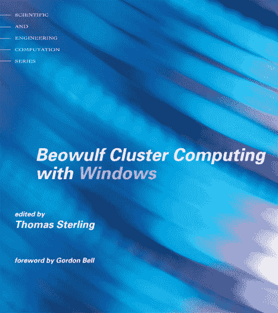


## 免责声明

*本书原版中的部分图像无法包含在电子书中。*

谨向以下人士致以敬意和感激：
西摩·R·克雷
1925–1996

本页故意留空

## 丛书前言

现代计算世界潜在地为科学家和工程师提供了许多有益的方法和技术，但计算机硬件、软件和数据算法的快速变化通常使得最新计算技术的实际应用变得困难。科学和工程计算丛书关注计算技术的快速进步，旨在促进这些技术在科学和工程领域中的应用。它将包括关于并行处理、大规模模拟、关键时间计算、计算机辅助设计和工程、制造中的计算机使用、科学数据可视化以及人机接口技术等领域的理论、方法和原始应用的书籍。

该丛书旨在帮助科学家和工程师理解当前的高级计算世界，并预见将影响其计算环境并开启新计算能力和新计算模式的未来发展。

本丛书中的这一卷描述了日益成功的名为 Beowulf 的分布式/并行系统。Beowulf 是通过网络技术互连的 PC 集群，并采用消息传递模型进行并行计算。这种方法的关键优势是高性能低成本、系统可扩展性以及快速适应新的技术进步。

本书介绍了如何构建、编程和运行基于 Windows 2000 操作系统的 Beowulf 系统。该丛书中的配套卷提供了基于 Linux 操作系统的 Beowulf 集群的相同信息。

Beowulf 硬件、操作系统软件、编程方法和库以及机器管理软件在此均有涵盖。这本书既可以作为学术教科书，也可以作为为那些需要强大系统但不愿意购买昂贵的多处理器或向量计算机的科学和工业界人员设计、实施和运行 Beowulf 的实用指南。

Janusz S. Kowalik


# 前言

关于并行编程的进展，我们已知两点：

- 与几乎所有技术一样，只有当从业者朝着共同的、聚焦的方向努力，并且彼此竞争并分享成果时，进步才会到来。
- 并行编程仍然非常困难，如果可能的话应当避免使用。这支持采用单一环境，以及通过内置并行功能（例如数据库、激烈的应用共享和应用市场）让其他人来完成编程。

在高性能计算机架构经历了 20 年的虚假起步和死胡同之后，“道路”现在清晰了：Beowulf 集群正成为许多科学、工程和商业应用的平台。来自日本的 Cray 风格超级计算机仍用于遗留或不可分区的应用代码；但由于此类架构不具备可扩展性或可负担性，这在超级计算中的占比正在缩小。但如果代码无法移植或分区，则仍需依靠更大规模中心中的向量超级计算机。同样，十年前在政府资助下寻找可扩展计算机的努力所带来的专有 MPP¹（大规模并行处理器）、SMP（共享内存，多向量处理器）和 DSM（分布式共享内存）在 Top500 中的份额正在下降。不幸的是，这场竞赛造成的架构多样性确保了标准平台和编程模型无法形成。每个平台产量低，软件开发成本巨大，且存在对特定供应商的锁定效应。

仅仅在根据摩尔定律的两代之前（1995²），市场上充斥着大量向量超级计算机、不可扩展的多处理器以及由专有节点和网络构建的 MPP 集群。这让我意识到之前关于这些异质共享内存机器是超级计算不可避免未来的预测是错误的。当时，一些使用标准微处理器和网络的有前途的商业现货（COTS）技术集群开始被构建。威斯康星州的 Condor（用于收集工作站周期）和伯克利的 NOW（工作站网络）是我的最爱。与专有系统相比，包括它们较高的运营开销在内，它们在性能/价格上提供了一到两个数量级的改进。

在过去五年中，“Beowulf 方式”出现了。它开发并整合了一个运行在基于通用部件构建的可扩展集群上的编程环境——通常基于 Intel，但有时基于 Alpha 或 PowerPC。它还利用了供应商中立的操作系统（Linux），并帮助成熟了 GNU、MPI、PVM、Condor 以及各种 shell 工具。Windows Beowulf 的引入利用了庞大的软件基础，例如应用程序、办公和可视化工具以及集群化的 SQL 数据库。

Beowulf 较低的_price_ 和标准化吸引了大量用户社区到一个共同的软件基础之上。Beowulf 遵循个人计算机的创新周期：平台可用性吸引应用；应用吸引用户；用户需求吸引平台竞争和更多应用；随着数量和竞争，价格降低。与此同时，专有平台因为缺乏软件而吸引力降低，因此生活在利基市场中。

Beowulf 是硬件供应商最可怕的噩梦：在由通用节点和交换机组成的 Beowulf 集群中利润微薄。通过使用 COTS PC、上网本、*免费 Linux/GNU_ 基础的操作系统和工具，或者 Windows，Beowulf 使任何团体都能购买并构建自己的超级计算机。一旦该运动达到临界规模，世界就*转向_ 了这个新的计算范式。无论政府如何努力扶持病弱的国内产业，或行业如何游说，都无法逆转这一趋势。今天，传统的向量超级计算机公司已经退出美国市场，在日本则成了一个虚荣业务，Top500 中只有不到 10% 是向量处理器。集群击败了向量超级计算机，尽管仍需 8 个标量微处理器才能匹敌一个向量处理器的功率。

Beowulf 运动统一了集群社区，并通过使其“商品化”改变了技术计算的课程。Beowulf 使用户能够拥有一个独立于专有处理器、互连网络、存储或软件基础之外的通用平台和编程模型。一个基于许多低成本“杀手级微处理器”的应用基础以及行业终于正在形成。

你是这场革命的原因，但仍有很多事情要做！然而，有令人担忧的原因。Beowulf 之所以成功，是因为它拥有临界规模的共同基础。

将会产生相当大的压力去创建 Linux/Beowulf 方言（例如 64 位版本和各种供应商二进制方言），这将使社区分裂；正如专有平台 Unix 方言从硬件供应商那里诞生以差异化和锁定用户一样，用户的注意力跨度、培训和应用也会受到影响。社区必须平衡这种伪创新和增量创新与标准化，因为标准化正是赋予 Beowulf 巨大优势的东西。在描述了 Linux/Beowulf 方言的必然出现及其相关陷阱后，我强烈倡导 Windows Beowulf。与分裂社区不同，Windows Beowulf 将显著增加 Beowulf 社区。Windows 版本将支持那些希望使用 Windows 工具、分层软件和发展风格的大规模社区。实际上，大多数大型系统用户操作的是既运行 Windows（提供大型可扩展数据库）又运行桌面 Visual X 编程工具的异构系统。此外，竞争将改善两者。最后，巨大的收益将来自 .NET 功能的交叉融合，这些功能正引领真正分布式计算的前进方向，而这一承诺已持续了二十年。

---

¹ MPP 是集群或多计算机的专有变体。多计算机（Multicomputers）一词是 Allen Newell 和我在 1971 年的著作 *Computer Structures* 中创造的，用于描述由通过消息传递（而非共享内存）相互通信的计算机组成的单个计算机系统。在 2001 年的世界 Top500 计算机列表中，除少数共享内存向量和分布式共享内存计算机外，其余均为多计算机。“Massive”（大规模）已被提议作为超过 1,000 台计算机的集群的名称。

² G. Bell, “1995 Observations on Supercomputing Alternatives: Did the MPP Bandwagon Lead to a Cul-de-Sac?”, *Communications of the ACM* 39, no. 3 (March 1996) 11–15.

# Beowulf 成为竞争者

在 20 世纪 80 年代中期，为了应对 Digital 的 VAX 小型机，国家科学基金会（NSF）启动了一个超级计算中心计划。³ 虽然 VAX 和 Cray 之间的性能差距可能高达 100 倍，⁴ 但每美元的性能通常相反：VAX 提供了更高的性价比。VAXen 很快成为研究人员的主导计算机。科学家们能够拥有并运营自己的计算机，并通过自己的 VAXen 获得更多计算资源，包括那些作为首批集群运营的系统。超级计算中心主要用于运行那些对于个人或部门系统来说太大的作业。

1983 年，美国高级研究计划局（ARPA）启动了可扩展计算计划，资助了二十多个研究项目来设计、构建和购买可扩展的并行计算机。许多项目都以新兴的“杀手级微处理器”理念为中心。四十多家初创企业获得了风险资本和我们纳税人的资金，以构建不同的并行计算机。*这些努力全都失败了*。（我估计这些努力耗资 10 亿至 30 亿美元，此外至少还有两倍金额用于用户编程，最好将其视为培训费用。）对各种不同物种的巨大资金资助，它们仅在表面上有所不同，保证了几乎没有进步，也没有应用市场。然而，用户社区确实设法*防御性地_ 创建了最低限度共同的……

---

³ VAX 780 于 1978 年推出。

⁴ VAXen 缺乏获得大型共享 Cray 在单问题上提供的 5–20 倍性能的能力。


## “自制超级计算机”面临的挑战

分母标准，以便程序能够在各种架构之间运行。

1987年，美国国家科学基金会（NSF）新成立的计算司确立了到2000年实现100倍并行度的目标。这一目标引发了两种极端的反应：唐·克努特（Don Knuth）和肯·汤普森（Ken Thompson）表示并行编程太难，我们不应专注于此；而另一些人则认为目标应为1,000,000倍！其他人要么无视这一号召，要么为了资助而默默顺从。这一号召伴随着我（我可能是唯一这样做的人）提出的一项年度奖项，以奖励那些在并行度、性能及性价比方面取得非凡成就的人。1988年，桑迪亚国家实验室的三名研究人员在一台1000节点的系统上获得了600倍的并行度，同时指出如果增加内存，1000倍是可能的。他们对这一成就的公告激励了其他人，戈登·贝尔奖（Gordon Bell prizes）也随之延续，几乎每年都有100%的增长。

有趣的是，对于大多数可扩展应用来说，1000倍的扩展系数似乎仍是极限，但20–100倍更为常见。事实上，Top500榜单中至少有一半的系统处理器数量少于100个！当然，并行度在很大程度上是由研究人员预算有限且只能拥有单价为$1,000–$3,000的小型机器或并行度< 100的系统决定的。如果节点位于中心，则每个节点的成本至少乘以10，这将每个系统的节点上限设为1,000–10,000个。如果节点是向量处理器，处理器数量将除以8–10，而每个节点的价格将提高100倍。

1993年，汤姆·斯特林（Tom Sterling）和唐·贝克（Don Becker）领导了一个小型项目，在NASA内部构建了一台成本低于$50,000的千兆次（gigaflops）工作站。所谓的“Beowulf项目”位于主流并行处理研究界之外：它反而基于商品（commodity）和技术（COTS）技术以及公开可用的软件。Beowulf项目取得了成功：1994年运行了一台由Intel 486计算机构建的16节点、成本$40,000的集群。1997年，汤姆·斯特林的542集群因性价比赢得了戈登·贝尔奖。自建Beowulf的配方由斯特林等人于1999年出版的一本书中介绍5。到2000年，已有数千节点的计算机在运行。2001年6月，Top500超级计算机列表中有33台Beowulf（www.top500.org）。如今，在2001年，技术高中就可以从街角电脑店购买零部件并组装一台超级计算机。

Beowulf形成了一个使用商品微处理器、局域网以太网交换机、Linux（以及现在的Windows 2000）以及从用户社区演变而来的工具的DIY集群计算社区。这种厂商中立的

> 5 T. Sterling, J. Salmon, D. J. Becker, and D. V. Savarese, *How to Build a Beowulf: A Guide to the Implementation and Application of PC Clusters*, MIT Press, Cambridge, MA, 1999.

平台使用了基于MPI消息的编程模型，随着处理器、磁盘和网络的增长而扩展。

Beowulf的成功超出了为科学软件社区创建“开源”模型的范围。它利用了并行处理社区二十年来尝试将这些变异多机系统应用于各种应用的努力。与Beowulf一样，这些努力中的几乎所有都是由传统资金流之外的研究人员创造的（即“拉”研究而非“推”研究）。其中包括以下内容：

-   Linux操作系统原语和GNU工具，支持平台和网络硬件以提供基本功能
-   消息传递接口（MPI）编程模型
-   各种并行编程范式，包括Linda、并行虚拟机（PVM）和Fortran方言
-   并行文件系统，等待透明数据库技术
-   监控、调试和控制工具
-   调度和资源管理（例如威斯康星大学的Condor，Maui调度器）
-   更高层库（例如LINPACK，BLAS）

鉴于个人Beowulf的出现，超级计算机中心的作用会改变吗？由于普遍性、可扩展性和极高的性价比，Beowulf比VAX更具吸引力。超级计算机中心用户通常在一个问题中只能获得不超过64–128个节点${}^{6}$——这与研究人员在实验室中拥有或可构建的规模相当。至少，中心将被迫重新思考和重新定义其角色。

当千兆和万兆以太网成为事实上的局域网（de facto LAN）时，会出现一个有趣的场景。随着网络速度和延迟比处理速度增长得更快，消息传递看起来像内存访问，使得本地区域内的所有节点都能平等地访问数据。这些速度匹配下一代互联网的速度。这意味着任何基于局域网的PC集合都将成为事实上的Beowulf！Beowulf和网格计算技术将比以前更紧密地

${}^{6}$ 在一个拥有超过600个处理器的大型中心，观察到以下情况：65%的用户被分配了 < 16 个处理器；24% < 32；4% < 64；4% < 128；并且，1% < 256。

相互关联。我终于看到了我1987年挑战NSF计算机科学研究领域去构建的那个环境！

到2010年，我们可以预期Beowulf通过并行性拥有更多算力的几条有趣路径：

-   原地由Condor调度的工作站提供事实上的集群，在许多环境中扩展100–10,000倍
-   大型片上缓存，配合多个处理器以为单节点提供更高的性能
-   在网络附加存储架构中嵌入处理器的磁盘，而不是将磁盘连接到节点并要求单独的存储区域网络互连节点的存储区域网络

早在2001年，相当数量的应用可以通过“避免”并行编程来利用Beowulf技术，包括以下内容：

-   运行极度并行（embarrassingly parallel）以服务于大量客户群的Web和Internet服务器
-   商业事务处理，包括固有的并行化数据库
-   极度并行的蒙特卡洛模拟和图像渲染

在将过去挑战我们的应用（例如N体问题）并行化方面已取得重大进展。剩下的最重要挑战是继续走将那些过去被认为是共享内存多处理器专属领域的应用并行化的道路。这些问题包括需要随机变量访问和自适应网格细化的问题。例如，汽车和空气动力学工程、气候和海洋建模以及涉及异构空间的应用仍然是向量多处理器的专属领域。我们需要一个明确的问题清单来记录进展；但不幸的是，向量超级计算机社区尚未提供此清单。

另一个挑战是使多机用于并行操作的便利性等同于标量编程。尽管计算科学家与计算机科学家合作取得了巨大进展，但在此种并行性上采纳、理解并培训计算机科学家的努力微乎其微。很少有计算机科学系准备好承担这一角色。

基于二十年来整体架构的“无意外”，除了摩尔定律之外，是否会有任何未预见的进展来帮助实现千万亿次（petaflops）？考虑到处理、存储、网络和用户连接，高性能系统在另外两或四代摩尔定律后将是什么样？Beowulf是否会演变成由更低成本节点构建的巨大（100,000节点）集群？或者集群只是国际计算“网格”的一部分？

戈登·贝尔
微软研究院

# 前言

在过去三年中，计算机集群的部署和应用迅速增加，将可用系统功能的范围扩展到常规桌面和服务器平台之上。通过利用这些广泛销售且大量使用的主流计算机系统的硬件和软件开发，集群提供了数量级或更大的计算性能和存储容量扩展，而无需产生重大的额外研发成本。Beowulf类系统利用大众市场的PC硬件和软件，结合具有成本效益的商业网络技术，为用户提供并行计算在前所未有的性价比和配置灵活性方面的双重优势。终端用户本身就可以利用现有组件实现Beowulf类系统。但随着其受欢迎程度的增长，业界对商业Beowulf系统的支持也随之发展。如今，根据来源和服务不同，Beowulf系统的安装成本在每峰值兆次一美元到三美元之间，规模从几吉到半太（half a teraflops）不等。同样重要的是应用多样性的快速增长。最初面向科学和技术界，Beowulf类系统的范围已扩展到广泛的商业领域，用于事务处理和Web服务，以及用于计算机生成特效的娱乐行业。目前，正在开发中的最大计算机是一台商品集群，完成后将达到30 teraflops的峰值性能规模。很有可能，到本十年中期，商品集群（特别是Beowulf类系统）可能会主导广泛的技术和商业工作负载中的中端和高端计算。显然，对于许多学生来说，他们对并行计算的第一次接触是通过亲手操作Beowulf集群获得的。

MIT Press出版《How to Build a Beowulf》标志着商品计算的一个重要里程碑。首次，有一本入门级的综合书籍展示了如何实现和应用PC集群。该书的初始目标（于近两年前发布）是捕捉作者在多个会议上及其同事展示的高度成功的教程系列的风格和内容。这本书的时效性以及全球对Beowulf集群近乎爆炸性的兴趣，使其成为去年MIT Press科学与工程计算系列中最成功的书籍。虽然此后出现了其他关于组装集群的书籍，但它仍然是教导硬件、软件和编程方法的最全面的作品。尽管如此，尽管取得成功，《How to Build a Beowulf》只满足了快速增长的商品


## 1 引言

*托马斯·斯特林*

集群化是一种强大且有效的概念与技术，能够从现有的组件类别中衍生出扩展功能。在自然界中，集群化是创建复杂性和多样性的基本机制，通过简单基本元素的聚集与综合来实现。其结果绝非夸大，它包括宇宙的演化与结构、决定所有物质形态和属性的复杂分子，以及所有多细胞生命（包括我们自己）的形态与行为。为了实现这种综合，需要一种介质的组合与交换来建立各组成元素之间的相互关系，并促进它们的协作互动，从而衍生出复合实体的涌现行为。对于自然界中的复合组织而言，其结合机制可能是引力、库仑力或突触连接。在计算机系统领域，集群化技术正被应用于利用现有的计算元素构建新的系统结构，以提供能力——这些能力若采用其他方法，成本可能轻松高出十倍。近年来，集群硬件和软件不断演进，如今潜在的用户机构在形态、规模、环境、成本和实施方式方面拥有大量选择，以满足其可扩展计算需求。世界上一些最大的计算机就是集群系统。但集群在中规模的技术和商业计算中也发挥着重要作用，它们利用了低成本、大众市场的基于 PC 的计算机技术。这些 Beowulf 级系统变得极其流行，提供卓越的价格/性能比、配置和升级的灵活性以及可扩展性，作为一种强大的新工具，为计算应用开辟了全新的机遇。

### 1.1 定义与分类

在最广义的层面上，集群是由某种介质整合而成、具有协调和协作行为的独立运行元素集合。这在生物系统、人类组织和计算机结构中均成立。与这种广义解释一致，计算机集群是由互连网络整合的独立运行计算机集合，并配备了用户可访问的软件，用于组织和控制并发计算任务，这些任务可能合作处理共同的应用程序或工作负载。计算机集群种类繁多，范围从世界上最大的计算机到一次性 PC 的集合不等。集群化是首批实现整体性能、用户访问带宽和可靠性显著提升的计算机体系结构技术之一。许多研究集群已在工业界和学术界得到实现，通常使用专有网络和/或定制处理节点。

商品集群（Commodity clusters）是本地计算节点的集合，这些节点是面向主流数据处理市场的商用系统。用于整合商品集群计算节点的互连网络是集群系统专用的，且也可从制造商处商业购买。网络是专用的，意味着它仅用于集群内部，支持组成集群的计算节点之间、集群的主节点或宿主节点（其本身是“通用”的）之间，以及可能负责管理集群部分的大容量存储资源卫星节点之间所必需的通信。商品集群的网络不得是单一供应商集群产品的专有部件，而必须可供一般采购，用于组装任何集群。因此，商品集群的所有组件都可以由第三方系统集成商或最终用户安装站点自行购买。商品集群使用的软件也向公众开放。软件可以是免费的、以 modest 成本重新包装和分发的，或由第三方独立软件供应商（ISVs）开发并商业销售的。只要存在可替代其使用的替代外部软件，供应商就可以使用并分发其自身的专有软件作为商品集群产品的一部分。推动并限制商品计算机类别的双重动机因素是：（1）使用非专用部件，利用市场降低成本并确保稳定可靠性；以及（2）避免将关键的唯一解决方案限制在特定的集群产品中，若未来不可用，将会干扰最终用户的生产力并危及用户在代码库上的投资。

Beowulf 级系统是商品集群，它们利用了通过消费级数字电子元件的大众市场制造和分发所获得的属性。Beowulf 由 PC 组成，有时数量众多；廉价的 IDE（增强型集成驱动电子）（通常）硬盘；以及用于主内存的低成本 DIMM（双列直插式内存模块）。许多不同的微处理器系列已成功应用于 Beowulf 系统，包括长久使用的 Intel X86 系列（80386 及以上）、其 AMD 二进制兼容对应系列、Compaq Alpha 64 位架构以及 IBM PowerPC 系列。对于许多应用，Beowulf 系统提供卓越的价格/性能比。它们使用低成本/零成本软件来管理单个节点以及整个集合。使用 Beowulf 的大型科学和技术群体采用了 Linux 开源操作系统，而许多使用 Beowulf 的商务和商业用户则支持广泛分发的商业微软 Windows 操作系统。这两种类型的 Beowulf 系统都使用中间件，这是免费开源软件和商业 ISV 产品的结合。这些工具中的许多已经移植到这两种环境中，尽管一些仍然限制于其中一种环境。Beowulf 的节点要么是单处理器，要么是少数量处理器的对称多处理器（SMPs）。最佳价格/性能点似乎是双节点 SMP 系统，尽管每个微处理器的性能通常低于单处理器节点。Beowulf 级系统是目前最受欢迎的商品集群形式。

在集群光谱的另一端是星座（constellations）。星座是由大型 SMP 节点组成的集群，其规模扩展使得每个节点中的处理器数量大于组成整个系统的此类节点数量。这不仅仅是一个任意的区分。对于许多应用，集群的性能通过程序和系统并行性获得。对于大多数商品集群和 Beowulf 系统，利用的主要并行性是节点间并行性。但对于集群（此处指星座类），主要的并行性是节点内并行性，意味着使用的大部分并行性都在节点内部。通常，SMP 节点内的处理器通过共享内存更紧密地耦合，能够利用比 Beowulf 集群更细粒度的并行性。但是共享内存系统需要使用与分布式内存系统不同的编程模型，因此，为了获得最佳性能，为星座编程可能与为 Beowulf 集群编程大不相同。星座通常仅限于最大的系统。

### 1.2 机遇与优势

商品集群和 Beowulf 级系统为可扩展并行计算带来许多优势，为用户和应用领域开辟了新机遇。许多优势是由于与具有可比峰值能力的许多其他类型系统相比，拥有卓越的价格/性能比的结果。但集群表现出的其他重要属性是由于其结构和实施方式。在这里，我们将突出并扩展这些优势，既为了激励部署，也为了指导 Beowulf 级系统在无数用途中的应用。

- **能力扩展。** 甚至比成本效益更重要，Beowulf 系统的主要属性是其可扩展性。通过聚合商用现货（off-the-shelf）组件，特定资源的集合被视为对特定


其操作模式可以集成起来，提供通过其他手段难以获得的某种能力。在高端计算领域，最为人熟知的指标是以每秒浮点运算次数（flops）衡量的峰值性能。即使 modest（中档）的 Beowulf 系统也能达到 10 到 100 GFLOPS 之间的峰值性能。目前正在开发的最大规模商用集群将达到 30 TFLOPS 的峰值性能。但另一项重要能力是大容量存储，通常通过硬盘驱动器的集合来实现。大型商用磁盘可以容纳 100 GB 以上的数据，但商业数据库和科学密集型数据应用都需要 100 TB 以上的在线存储空间。此外，某些内存密集型应用（如处理大型多元数据矩阵的应用）只有在投入足够的硬件主内存时才能得到有效处理。商用集群提供了一种方法，可在单一复合系统中为这些大型数据集积累足够的 DRAM（动态随机存取存储器）。我们注意到，虽然集群能够聚合资源，但其组成元素之间的逻辑和物理耦合有限。这种集成系统内部的碎片化可能会对性能和使用便利性产生负面影响。

### 汇聚架构

未被其创造者预见的是，商用集群和 Beowulf 级系统已经演变为并行计算机结构的事实标准，并汇聚成一种社区范围的系统架构。自 20 世纪 70 年代中期以来，高性能计算行业一直拖着其规模较小的用户和客户基础，经历了一系列往往互不相同的并行架构类型，这要求在相继的代际之间进行大量的软件重写。这些变化往往是单个厂商决策的结果，导致客户信心低下，并且强烈地犹豫是否投资于将代码移植到可能在该任务完成之前就已过时、且与任何未来代际系统不兼容的系统上。采用社区范围消息传递库的商用集群提供了一种跨越厂商边界和系统代际的通用结构，确保了软件投资的长久性并提供了客户信心。通过集群的演变，我们见证了并行系统架构的真正汇聚，提供了一个共享框架，使硬件和软件供应商能够放心地开发产品，确信会被客户接受；应用程序开发人员则可以自信地设计先进的用户程序，确信会得到厂商的持续支持。

### 价格/性能

毫无疑问，Beowulf 级集群系统最广泛认可的属性是与其他并行计算机相比，其具有卓越的成本优势。对于许多（但并非所有）用户应用和工作负载，与同等规模的众并行处理器（MPP）和分布式共享内存系统相比，Beowulf 集群展现出高达一个数量级或更多的性能/成本优势。如今，使用消费级计算节点，Beowulf 硬件的成本正接近每峰值兆浮点运算 1 美元。这一含义远超仅仅是省点钱的办法。它引发了高性能计算在一系列原本无法在超算环境中工作的用户和领域中应用的革命。这意味着，计算机首次在工业、商业和研究中发挥作用，而无需依赖此类技术（这里的“unaided by such technology”原文逻辑较怪，通常是指以前高成本让人无法使用，现在低成本使得更多人能使用，或者指不再需要专门的大型机辅助。结合上下文“low cost... revolution... unable to work within regime”，更合理的解释是：低成本使得更多人能进入超算领域。译文调整为：这意味着计算机首次在工业、商业和研究领域发挥作用，且不再受限于以往高昂的成本门槛。或者忠实于原文直译：这意味着计算机首次在工业、商业和研究中发挥作用，而无需此类技术（的门槛）的辅助。考虑到上下文是在讲低成本带来的革命，译为“无需此类技术（高昂成本）的阻碍”更通顺，但为了保持客观，保留原意：这意味着，计算机首次在工业、商业和研究中发挥作用，而不再受限于此类技术（过去的高昂成本）。*注：原文 "unaided by such technology" 在此处语境略显模糊，通常意指以前因为太贵没人用，现在因为便宜大家都能用了。* 更准确的解读可能是：以前只有少数人能用，现在成本低了，更多人能用，不再需要那么庞大的专门技术投入？ 不，应该是：以前没人能承担得起，现在大家都能承担。译文：这意味着，计算机首次在工业、商业和研究领域发挥作用，且不再受限于此类技术（的高昂门槛）。低成本使得 Beowulf 成为教育平台的理想选择，能够比以往培训更多学生掌握并行计算的原则和实践。现在，在学习并行编程的学生中，使用 Beowulf 级系统的学生数量超过了所有其他类型并行计算机的总和。

#### 配置与升级的灵活性

根据预期的用户和应用基础，集群可以以多种配置形式组装而成，商业厂商施加的限制很少。对于由预期管理员和用户在现场配置的这些系统，可供选择的组件和结构非常广泛，从而实现了广泛的系统范围。当集群专门用于特定的工作负载或应用时，系统结构可以根据最适合所计算问题性质的所需能力和容量进行优化。随着新技术的出现或额外财务资源的可用，集群的灵活性对于使用新组件技术升级现有系统非常有用，作为一种“中期催化剂”来通过保持系统时效性来延长系统的寿命和效用。

#### 技术跟踪

新技术最快地进入那些可能提供最快速回报的产品中：主流高端个人计算机和 SMP 服务器。只有经过相当长的滞后时间，此类组件才可能被整合到 MPP 中。然而，集群提供了一种直接整合最新技术的途径，甚至包括那些可能永远不会被其他形式的高性能计算机系统采用的技术。

#### 高可用性

集群提供多个冗余的相同资源，如果管理得当，即使在单个组件故障的情况下，也能通过优雅降级提供持续的系统运行。

#### 个人赋权

由于高端集群系统由易于获得的硬件和软件组件组成，安装站点、其系统管理员和用户对这一系统类别的结构、元素、操作和演进拥有比任何其他系统更多的控制权。这种控制感和灵活性对许多人产生了强大的吸引力，尤其是研究界人士，并成为许多安装的重要动力。

#### 开发成本与时间

新兴的集群行业正得益于极低的开发成本和较短的产品交付时间而蓬勃发展。基于现有的计算和网络产品，供应商提供的商用集群可以通过基本的系统集成和工程进行开发，无需组件设计。由于组成组件是为比集群市场本身更广泛的用途制造的，因此对于供应商而言，成本远低于定制元件。因此，商用集群使供应商能够以极低的初次交付成本快速响应多样化的客户需求。

### 1.3 简短历史

集群计算起源于现代电子存储程序数字计算机诞生的几年内。SAGE 是 IBM 在 20 世纪 50 年代根据 MIT 旋风计算机架构，在空军合同下为 NORAD 建造的集群系统。使用真空管和磁芯存储器技术，SAGE 由多个独立的单机系统组成，它们协同工作以管理对北美大陆敌对空中入侵的早期预警检测。集群的早期商业应用采用了配对的松耦合计算机，一台计算机执行用户作业，另一台管理各种输入/输出设备。

使能技术的突破发生在 20 世纪 70 年代后期，无论是在硬件还是软件方面，这些突破对未来的集群计算产生了重要的长期影响。第一代微处理器是基于 VLSI（大规模集成）技术的初始开发展设计的，到该十年结束时，首批工作站和个人计算机开始上市。以太网的出现提供了第一种广泛使用的局域网技术，创建了一种价格适中的多路复用互连介质和数据传输层的行业标准。同时，多任务 Unix 操作系统在 AT&T 贝尔实验室创建，并在加利福尼亚大学伯克利分校扩展了虚拟内存和网络接口。Unix 被科学和技术界以各种商业和公共领域形式采纳


计算社区作为从科学工作站到超级计算机等广泛计算系统类别的主要环境。

在 20 世纪 80 年代，随着对集群计算潜力兴趣的增加，研究和工业界进行了一些重要实验。国家安全局（NSA）使用一个由 160 台互连的 Apollo 工作站组成的集群来执行某些计算任务。数字设备公司（Digital Equipment Corporation）开发了一个由互连 VAX 11/750 计算机组成的系统，并在此过程中创造了“cluster”（集群）一词。在软件领域，用于利用工作站群组的任务管理工具得以开发，其中最为著名的是威斯康星大学开发的 Condor 软件包。在此期间，计算机科学界探索了不同的并行处理策略。从这些早期工作中诞生了通信顺序进程模型，更常见的称呼是消息传递模型，如今它已成为集群计算中占据主导地位的模式。

消息传递模型实际应用中的一个重要里程碑是并行虚拟机（PVM，Parallel Virtual Machine）的开发，这是一个可链接函数库，允许运行在相互独立但通过网络连接的计算机上的例程进行数据交换并协调其操作。PVM（由橡树岭国家实验室、埃默里大学和密西西比大学开发）是首个在不同平台间广泛部署的分布式软件系统。到 20 世纪 90 年代初，许多站点正在试验工作站集群。在 1992 年，美国国家航空航天局（NASA）刘易斯研究中心使用一个小型 IBM 工作站集群来模拟喷气式飞机发动机的稳态行为。加州大学伯克利分校的 NOW（工作站网络，Network of Workstations）项目于 1993 年启动了该地多个集群中的第一个，这使得该集群成为首个登上全球最强计算机 Top500 榜单的集群。同样在 1993 年，Myrinet，一种早期商用系统局域网，被引入用于通用集群，其在带宽和延迟方面的性能比当时最广泛用于此目的的快以太网局域网（Fast Ethernet LAN）提高了一个数量级。

第一个 Beowulf 级 PC 集群于 1994 年在美国国家航空航天局戈达德太空飞行中心开发，使用了 Linux 操作系统的早期版本以及运行在 16 台基于 Intel 100 MHz 80486 个人计算机上的 PVM，这些计算机通过双 10 Mbps 以太网局域网连接。Beowulf 项目为 Linux 开发了必要的以太网驱动程序和额外的底层集群管理工具，并展示了 Beowulf 系统在真实世界科学应用中的性能及成本效益。同年，基于对其他许多消息传递软件系统的经验，并行计算社区采纳了首个消息传递接口（MPI，Message-Passing Interface）标准，以提供一组统一的消息传递语义和语法。MPI 已成为主流的并行计算编程标准，几乎得到所有大规模并行处理（MPP）和集群系统供应商的支持。运行 Sun Microsystems Solaris 操作系统的工作站集群和运行 Microsoft NT 操作系统的 NCSA PC 集群正被用于实际应用。

1996 年，美国能源部（DOE）洛斯阿拉莫斯国家实验室和加州理工学院（与 NASA 喷气推进实验室）独立展示了 Beowulf 系统持续性能超过 1 GFlops 的表现，其成本低于 5 万美元，并因此获得了戈登·贝尔奖（Gordon Bell Prize）的价格/性能奖项。到 1997 年，具有超过一百个节点的 Beowulf 级系统已展示出超过 10 GFlops 的持续性能，其中洛杉矶系统登上了 Top500 榜单。到 90 年代末，Top500 榜单上有 28 个集群，最佳性能超过 200 GFlops。2000 年，DOE 和 NSF（美国国家科学基金会）均宣布向 Compaq 授予合同，以实施其最大的计算设施，这两个集群分别为 30 TFlops 和 6 TFlops。

### 1.4 集群的组成要素

Beowulf 集群由许多硬件和软件组件组成。与纯粹的封闭式交钥匙主机、服务器和工作站不同，用户或托管组织在集群的系统架构方面有很大的选择权，无论是现场组装零件还是由系统集成商或供应商提供。Beowulf 集群系统可以被视为由四个主要组件组成，包括两个硬件组件和两个软件组件。两个硬件组件是执行工作的计算节点以及将节点互连以形成单一系统的网络。两个软件组件是用于开发用户并行应用程序的工具集，以及管理 Beowulf 集群并行资源的软件环境。Beowulf 集群的规格反映了用户在这些每个领域中的选择，并决定了系统的成本、容量、性能和易用性的平衡。

硬件节点是物理集群系统的基本构建模块。毕竟，被集群化的就是硬件节点。节点整合了提供系统能力和容量的资源。每个节点有一个或多个微处理器，提供节点的计算能力，并与节点主板上的 DRAM 主内存和 I/O 接口结合。此外，节点通常包括一个或多个用于持久存储和本地数据缓冲的硬盘驱动器，尽管一些集群采用无磁盘节点以降低成本和功耗并提高可靠性。

网络提供了集群节点之间交换数据和通过全局同步机制协调其操作的媒介。网络的子组件是网络接口控制器（NIC）、网络通道或链路，以及网络交换机。每个节点包含至少一个 NIC，执行一系列复杂操作以在外部网络链路和用户内存之间移动数据，在此过程中对数据进行一种或多种转换。通道链路通常是被动的，由单根导线、多根并行电缆或光纤组成。交换机互连多个通道并路由它们之间的消息。网络可以根据其拓扑结构、二分带宽、每通道带宽以及消息传输延迟进行特征描述。

开发应用程序的软件工具取决于要使用的底层编程模型。幸运的是，在 Beowulf 集群社区中，已经形成了一个单一的主导模型：通信顺序进程，更常见的称呼是消息传递。消息传递模型在每个节点上实现并发任务或进程来执行应用程序的工作。这些逻辑任务之间传递消息以共享数据并同步它们的操作。任务本身用 Fortran 或 C++ 等通用语言编写。这些任务调用通信服务库以完成与其他节点上执行的任务之间的数据传输。在过去二十年中，虽然开发了许多不同的消息传递语言和实现库，但有两个已成为主导：PVM 和 MPI（MPI 有多个库实现可用）。

资源管理的软件环境为系统管理员提供了监督机器整体使用情况的必要工具，并赋予用户调度和共享资源以完成工作的能力。本书中讨论了几种可用的调度器。对于粗粒度作业流调度，可以选用流行的 Condor 调度器。PBS、Maui 调度器和 CTC 集群控制器处理交互式并发元素的调度。PBS 还提供了处理用户帐户所需的许多机制。


## Beowulf 集群计算

《Beowulf 集群计算》全面介绍了构建和运维通用集群的基础与实践，重点讨论那些基于大众市场硬件组件和易获取软件构建的集群。全书分为三大主题领域。第一部分描述了构成 Beowulf 系统的硬件组件，并展示如何组装此类系统，以及如何使用一些现成的并行基准测试程序对其进行初步运行测试。第二部分讨论了编写并行应用程序的概念与技术，这些程序运行在 Beowulf 上，并采用两种主流的行业标准：PVM 和 MPI。第三部分解释了如何管理 Beowulf 系统的资源，包括系统管理和任务调度。每一部分都是独立的；你只需使用其中任何一部分或两部分，而无需阅读其余部分。这样，你就可以直接跳到中间部分以快速获取所需信息。为此，第 2 章（下一章）提供了全书所有内容的概述和总结。快速浏览该章节，应能为你提供足够的背景知识，使你能独立理解后续任何一章，而无需阅读全书其余部分。

《Beowulf》一书呈现了三种类型的信息，以最大程度地满足广泛且多样的集群计算社区的需求。它包含面向初学者和新进入该领域人员的基础材料。在每个主题领域中，它还提供了参考材料，例如 MPI 和 PVM 的主要库调用以及 PBS 的基本控制指令。此外，它还提供了明确的分步指导，说明如何完成具体任务，例如从基本组件组装处理器节点或安装 Maui 调度器。

本书可以用多种方式使用。我们建议你先花大约一小时坐下来浏览全书，以便对哪些信息对你最有用获得整体感觉。先通读第 2 章以获得扎实的总体概览。然后，如果你正试图完成某项工作，请前往那些与你即时需求相关的内容部分。或者，如果你是初次使用 Beowulf 的用户，正在学习集群计算，请将本书作为你探索该领域的指南。每一节的设计都既有趣味性，又能教会你如何执行某些新的、有用的操作。

一项主要挑战在于，当集群社区内部因所用操作系统不同而存在明显分裂时，如何满足大多数通用集群用户的需求。事实上，至少有十几种不同的操作系统被用于集群系统。但大多数社区用户使用的是 Linux 或 Windows。选择使用其中哪一种取决于许多因素，其中一些纯属主观判断。因此，我们采取了前所未有的行动，提供了选择：我们制作了两本内容大体相同但针对两种不同操作系统的书。因此，你手中拿着的要么是《*Beowulf 集群计算（Windows 版）*》，要么是《*Beowulf 集群计算（Linux 版）*》。无论哪种更适合你，我们都希望你会发现它是你书架上关于构建集群以及让集群为你服务的最有价值的书。

## 第一部分
### 使能技术

## 第 2 章
### 集群计算概述
作者：Thomas Sterling

通用集群系统为中端和高端计算能力提供了可替代传统技术与商业计算市场中的可扩展计算系统的方案。对于许多应用而言，它们取代了上一代的巨型向量超级计算机和 MPP（大规模并行处理机）。通过仅采用已为更广泛市场开发的组件，它们利用了高端计算市场单独无法实现的规模经济，并规避了早期高端系统类别典型的高昂开发成本和漫长的研发周期，从而在价格/性能比上取得了优势，对于许多用户工作负载而言，这一优势可能高达一个数量级。此外，用户在配置、升级和供应商选择方面拥有更大的灵活性，确保了这类分布式系统的持久生命力以及用户对其软件投资的信心。Beowulf 级系统利用诸如 PC 这样的大众市场组件，在系统构建的最广泛选择空间内提供卓越的成本优势。Beowulfs 集成了广泛可用且易于获取的低成本或零成本系统软件，以提供系统环境所需的多种功能。得益于这些特性及其隐含的机会，Beowulf 级集群已渗透计算的几乎每个方面，并正在迅速主导中高端市场。

使用 Beowulf 集群进行计算涉及四个不同但相互关联的考量领域：

- 硬件系统结构，
- 资源管理与管理环境，
- 分布式编程库和工具，以及
- 并行算法。

硬件系统结构涵盖了硬件节点组件及其能力的所有方面，专用网络控制器和交换机，以及决定系统全局组织的互连拓扑。资源管理环境是一套系统软件和工具，用于控制系统操作的各个阶段，从安装、配置和初始化，到管理和任务管理，再到系统状态监控、故障诊断和维护。分布式编程库和工具决定了终端用户协调分布式计算资源以同时且协同地执行构成并行应用程序的众多并发逻辑组件的范式。最后，并行算法领域提供了组织和利用用户应用程序固有并行性的模型和方法，同时保持在有效性能的实际约束范围内运行。

本章将对构成 Beowulf 集群计算的这四个主要领域进行简要且高层级的概述。其目的是提供足够的背景，以便你理解剩余书籍中的任何单个部分及其贡献如何融入通用集群的更广泛形式和功能中。

### 2.1 并行计算分类法

通过利用并行性来实现性能提升的目标，与电子数字计算本身同样古老，后者起源于第二次世界大战时期。多年来，人们设计了多种不同的方法以及由此产生的范式和结构，并实现了许多商业或实验版本。然而，能够经受数据处理市场严酷考验而生存下来的却寥寥无几。在这里，我们简要回顾这些策略，以更好地欣赏通用集群计算机和 Beowulf 系统的定位，以及它们所代表的权衡与妥协。

并行计算架构空间的第一层级分解可以用耦合度来表述：执行和利用并行操作涉及的典型延迟。这可以从最紧耦合的细粒度系统——即脉动（systolic）类系统，其并行算法实际上被硬连线到专用超细粒度硬件计算机逻辑结构中，延迟以纳秒计——一直延伸到另一个极端，通常被称为分布式计算，它涉及广泛分离的计算资源，可能跨越一个大洲甚至全球，延迟约为一百毫秒。因此，以耦合度及隐含的并行粒度衡量，并行计算结构领域涵盖了 $10^{8}$ 的范围。在下述列表中，按照耦合紧密度顺序简要描述了主要类别。我们注意到，任何这样的分类法都是主观的，很少是正交的，并存在争议。它仅作为说明选择丰富性以及集群计算所属的一般空间的示例。

- *脉动* 计算机通常是细粒度并行算法的专用硬连线实现，利用一维、二维或三维流水线。脉动计算常用于实时传感器、数字信号处理、图像处理和图形生成，并正通过自适应计算经历复兴，利用多功能 FPGA（现场可编程


门阵列）技术，该技术允许将不同的脉动算法在不同时间编程到相同的 FPGA 介质中。

**向量**计算机通过大量流水线化内存 bank 访问和算术逻辑单元（ALU）结构、硬件支持 gather-scatter 操作，以及在向量操作中的许多基本操作上分摊指令取指/执行周期开销，从而利用细粒度向量操作。向量处理是原始超级计算机（例如 Cray）的基础，目前在日本的高端系统中仍是一种强大的策略。

**SIMD**（单指令多数据）架构通过让许多（可能成千上万个）简单处理器以同步锁步方式但在不同数据上执行相同操作，利用细粒度数据并行性。单个控制处理器通过广播机制同时向所有从属计算处理器发出全局命令。此类系统（例如 MasPar-2, CM-2）集成了大型通信网络，以便在几个周期内促进系统内的大量数据移动。尽管不再是一个活跃的商业领域，SIMD 结构仍然继续在服务器后处理中找到专用应用。

**数据流**模型采用细粒度异步流控制，仅依赖于数据先决约束，从而利用更大程度的并行性，并根据资源负载提供动态自适应调度机制。然而，由于遭受严重的开销退化，数据流计算机从未具有竞争力，未能找到市场地位。尽管如此，数据流范式所反映的许多概念对现代编译器分析和优化、乱序指令完成 ALU 设计中的保留站以及多线程架构产生了深远影响。

**PIM**（内存内处理器）架构才刚刚作为高端系统结构的一种可能力量出现，将内存（DRAM 或 SRAM）与处理逻辑合并到同一集成电路芯片上，为许多数据导向操作暴露高片上内存带宽和对内存的低延迟。各种结构正在被探索，包括片上系统（SoC），它将 DRAM bank 和传统处理器核心放在同一芯片上；片上对称多处理（SMP），它将多个传统处理器核心和三级一致性缓存层次结构放在单个芯片上；以及智能内存（Smart Memory），它将逻辑放置在 DRAM 内存的灵敏放大器处，以实现就地数据操作。PIM 可以用作独立系统、相同器件的阵列，或更大传统多处理器的智能层。

MPPs（大规模并行处理器）构成了一类广泛的多处理器架构，它们利用现成的微处理器和内存芯片在节点板、内存层次结构和全局系统区域网络的定制设计中。讽刺的是，“MPP”一词最初是在 SIMD 而非 MIMD（多指令多数据）机器的情境下使用的。MPPs 的范围包括分布内存机器（如 Intel Paragon）、无一致性缓存的共享内存机器（如 BBN Butterfly 和 CRI T3E），以及真正的一级缓存非统一内存访问（CC-NUMA）系统（如 HP Exmplexer 和 SGI Origin2000）。

**集群**是由互连网络集成的现成计算机集合体，并在单个管理域内（通常在单个机房内）运行。商品集群采用商用网络（例如以太网、Myrinet），而非定制网络（例如 IBM SP-2）。Beowulf 级集群在其计算节点中采用大众市场 PC 技术，以实现最佳的价格/性能比。

**分布式**计算，曾经被称为“元计算”，通过互联网结合众多广泛分布的计算机系统的处理能力。无论是由参与者之间的特殊安排、被称为网格计算（Grid computing）的学科手段，还是由众多工作站和 PC 所有者与某些商业（例如 DSI, Entropia）或慈善（例如 SETI@home）协调主机组织之间的协议所伴随，这类并行计算利用现有计算机和 PC 上的可用周期，从而几乎免费获得某些东西。

在本书中，我们关注商品集群，特别是那些采用 PC 以获得最佳价格/性能比的集群，具体来说是 Beowulf 级集群系统。商品集群可以细分为四类，这里简要讨论如下。

- **工作站集群** — 由系统区域网络集成的工作站（例如 Sun, SGI）集合。它们在硬件和软件上往往具有供应商特异性。虽然对于许多问题展现出优于 MPP 的价格/性能，但与可比的基于 PC 的集群相比，成本可能高出 2.5 到 4 倍。
- **Beowulf 级系统** — 由商用 COTS 局域网（例如快速以太网）或系统区域网络（例如 Myrinet）集成的 PC（例如 Intel Pentium 4）集合，并运行广泛可用的低成本或免费软件来管理系统资源和协调并行执行。此类系统在许多应用中展现出卓越的价格/性能比。
- **集群农场** — 现有的 PC 和工作站局域网，它们既作为专用用户工作站，也作为服务器；当空闲时，可用于执行外部用户的待处理工作。软件系统（例如 Condor）已开发出来利用作业流并行性，在分配队列工作时，在需要时阻止对用户资源的侵入。由于共享网络集成资源（而非工作站集群和 Beowulf 所采用的专用网络），这些系统的性能和有效性较低。
- **超级集群** — 集群的集群，仍然位于局部区域，例如共享机房或同一工业或学术校园内的不同建筑中，通常由机构的骨干广域网集成。虽然通常位于同一互联网域内，但集群可能由不同的所有者和行政责任方管理。尽管如此，各机构正在努力寻找方法，以利用多个本地集群合作伙伴关系的潜在机会，至少部分时间实现大规模计算。

### 2.2 硬件系统结构

集群计算系统最可见和讨论最多的方面是其物理组件和组织结构。这些提供了系统的原始能力，占据了机房地板上相当大的空间，并产生了极佳的价格/性能比。Beowulf 集群的两个主要子系统是其组成的计算节点以及将节点集成为单一系统的互连网络。下面简要讨论这些内容。

#### 2.2.1 Beowulf 计算节点

计算或处理节点包含负责程序执行的所有硬件设备和机制，包括执行基本操作、保存工作数据、提供持久存储以及启用中间结果和用户命令界面的外部通信。Beowulf 集群的计算节点由五个关键组件组成：微处理器、主内存、主板、二级存储和封装。

*微处理器* 提供了节点的计算能力，其峰值性能以 Mips（每秒百万条指令）和 Mflops（每秒百万次浮点操作）衡量。虽然 Beowulf 几乎可以用所有可想象的微处理器系列实现，但目前最流行的是 32 位 Intel Pentium 3 和 Pentium 4 微处理器以及 64 位 Compaq Alpha 21264 系列。我们注意到，与 Intel Pentium 指令集二进制兼容的 AMD 设备（包括 Athlon）在集群中也得到了广泛应用。除了基本的浮点和整数算术逻辑单元、寄存器堆、执行流水线和控制逻辑外，由大约 2000 万到 5000 万个晶体管组成的现代微处理器还包括大量片上高速内存，称为缓存，用于快速访问数据。缓存通常组织为层次结构，有两到三层，距离处理器最近的是最快但最小的，最远的是相对较慢但容量更大的。这些缓存缓冲来自主内存的数据和指令，当数据重用或访问空间局部性较高时，可以提供峰值性能的相当大比例。微处理器通常通过两个外部总线与节点其余部分接口：一个专门优化为到主内存的高带宽接口，另一个支持数据 I/O。

*主内存* 存储微处理器在作业执行期间使用的工作数据集和程序。基于 DRAM 技术，其中单个位以小电容上的电荷形式存储，并通过专用开关晶体管访问，数据读和写操作可能比缓存显著慢于主内存。然而，最近主内存设计的进展提高了内存访问速度并大幅增加了内存带宽。这些改进得益于内存总线设计的进步，例如 RAMBus。

*主板* 是集成介质，将节点的所有组件组合成单一运行系统。主板远非仅仅是一个大型印刷电路板，它集成了几乎与微处理器本身一样复杂的复杂芯片组。该芯片组管理组件之间的所有接口并控制总线协议。一个重要的总线是 PCI，它是微处理器与大多数高速外部设备之间的主要接口。最初是工作在 33 MHz 的 32 位总线，最新变体在 66 MHz 下以 64 位数据工作，从而将其潜在吞吐量提高了四倍。大多数系统区域网络接口控制器通过 PCI 总线连接到节点。主板还包括大量只读存储器（可更新），其中包含系统的 BIOS（基本输入/输出系统），这是一组低级服务，主要与 I/O 功能和基本引导任务相关，定义了更高级别操作系统


系统软件以及节点硬件。主板还支持其他多种输入/输出端口，例如用户的键盘、鼠标、视频显示器，以及如今无处不在的通用串行总线（USB）端口，该端口正在取代此前多种不同的接口类型。尽管如此，那个残留的并行打印机端口依然可见，其规格可追溯至上个世纪最早期个人计算机的年代，距今已二十多年。

*辅助存储* 提供大容量持久化存储。当系统断电时主内存会丢失所有内容，而辅助存储则在断电状态下完全保留其数据。虽然许多独立个人计算机包含多类辅助存储，但某些 Beowulf 集群系统的节点可能仅保留启动初始系统所需的引导映像，其他所有数据则从外部主机或主控节点下载。辅助存储在提高可靠性和降低单节点成本方面发挥着巨大作用。然而，它也错失低成本、高带宽海量存储的机会。根据系统最终的使用方式，这两种选择中任意一种都可能是最优解。辅助存储的主要介质是硬盘，基于一种与音频磁带差别不大的磁性介质。这项技术与数字计算本身几乎同样古老，其容量正以指数级速率扩展，尽管访问速度和带宽的改进相对缓慢。两种主要竞争者——SCSI（小型计算机系统接口）和 EIDE（增强型集成双电子）——的区别在于前者的速度和容量稍高，而后者的成本更低。如今，每 GB EIDE 磁盘存储器的用户成本仅为几美元，而 SCSI 在 RAID（独立磁盘冗余阵列）配置下的标价可能高达每 GB 100 美元（额外成本确实带来了更高的速度、密度和可靠性）。大多数工作站使用 SCSI，而大多数个人计算机则采用 EIDE 驱动器，单驱动器容量可达 100 GB。另外两种形式的辅助存储是久经考验的软盘和光盘。现代的 3.5 英寸软盘（由于它们现在采用硬壳而非软壳包装，实际上已不再“软”了）同样也有二十多年的历史，仅能存储 1.4 MB 数据，本应早就被淘汰。然而，由于其普及性，它仍在使用中，是 Beowulf 节点的理想引导介质。正在大幅替代软盘的是光盘 CD（紧致光盘）、CD-RW（紧致光盘-读写）和 DVD（数字多功能光盘）。前两者大约可存储 600 MB 数据，访问时间为几毫秒。（基础 CD 为只读，但 CD-RW 光盘可写，尽管写入速度要慢得多。）如今，大多数商业软件和数据均通过 CD 分发，因为其制造成本极低（实际上比一份光泽双面单页商业传单还便宜）。DVD 技术也运行在当前世代的个人计算机上，提供了对电影的直接访问。

个人计算机的包装设计最初采用的是“披萨盒”形式：低矮扁平的单元，通常放置在桌面上，上面搁置着一台笨重的显示器。一些早期的小型 Beowull 集群采用此类包装，通常是八个这样的盒子堆叠在一起。但到 1994 年首批 Beowulls 实施时，塔式机箱——即立式落地（有时也放置在视频显示器旁边的桌面上）的组件——由于其在配置上的更大灵活性和可扩展性（提供多种高度）而正在取代披萨盒。至今仍有几代 Beowull 集群采用这种低成本、坚固的包装方案，从而衍生出诸如“PC 堆”和“架子上的众多盒子”（LOBOS）等说法。但这一策略的唯一限制是其密度低（落地至天花板的架子最多只能容纳约二十个盒子），以及中大型 Beowulls 由此产生的巨大占地面积。一旦业界认识到 Beowull 集群的市场潜力，新一代机架安装包装被发明并标准化（例如 1U、2U、3U 和 4U，其中 1U 盒子高度为 1.75 英寸），这使得在单个立式机架中可安装多达 42 个处理器，使此类系统的处理密度接近翻倍。提供完整交钥匙系统的供应商以及硬件系统集成商（“自带软件”）几乎普遍采用这种方式。但对于成本至关重要且追求简单的小型系统，塔式机箱将在很长一段时间内遍布小型实验室、办公室，甚至家庭。（为什么不呢？在寒冷的冬日里，它们是很好的空间加热器。）

自 1994 年 Beowulls 首次引入以来的七年间，Beowull 集群节点（即个人计算机）经历了巨大甚至爆炸式的增长。我们注意到，Beowull 进入市场的时机并非偶然：基于大众市场的硬件和软件技术水平刚刚（在前六个月内）达到可以使其群体在某些利基应用中与当时已稳固的 MPP（大规模并行处理系统）竞争的地步，并提供几乎 50:1 的价格/性能优势（在最佳情况下）。新的 Intel 100 MHz 80486 使得对于某些计算密集型问题，每节点可达到高达 5 Mflops 的性能；而 10 Mbps 以太网网络控制器和网络集线器的成本已足够低，使其可以被用作专用系统区域网络。同样重要的是内部 Linux 操作系统的可用性，它具备免费和开放源码这一至关重要的属性，以及 PVM 消息传递库的良好实现。当然，Beowull 项目必须填补许多空白，包括编写随 Linux 发布的大多数以太网驱动程序以及其他简单工具，如便于管理这些早期小规模系统的通道绑定。自此以后，每个处理器提供的浮点性能增长了两个多数量级，而内存容量增长了十倍以上。磁盘容量扩张多达 1000 倍。因此，Beowulf 计算节点见证了能力的非凡演变。到本十年末，节点浮点性能、主内存大小和磁盘容量预计将各自再增长两个数量级。

尚未讨论的一个节点结构方面是对称多处理。现代微处理器设计包含允许结合一个以上处理器并共享同一主内存的机制，同时在各个处理器缓存间保持完全一致性，从而使所有处理器对共享数据拥有一致视图，尽管它们在专用缓存中有本地副本。虽然大型工业级服务器在单个 SMP 单元中可能集成多达 512 个处理器，但基于个人计算机的 SMP 典型配置是每个单元两个或四个处理器。以统一访问时间共享内存的能力应能在降低成本的同时成为性能提升的来源。但设计和定价都极其复杂，选择并不总是显而易见。有时，SMP 设计增加的复杂性会抵消共享节点多项资源的表面优势。此外，处理器紧耦合带来的性能好处可能因主内存争用和可能的缓存颠簸而被抵消。额外的困难在于尝试在两个层面进行编程：节点间的消息传递和同一节点内处理器间的共享内存。大多数用户懒得这么做，选择即使在同一个 SMP 节点内的处理器之间也保持统一的消息传递模型。

#### 2.2.2 互连网络

如果没有中等成本的短程网络技术，Beowulf 集群计算就不可能发生。有趣的是，集群专用网络的两大领军技术源自截然不同的先例技术。以太网是作为局域网开发的，用于连接分布式单用户和社区计算资源，包括共享外设和文件服务器。Myrinet 则源自于 Intel Paragon 等 MPP 中紧密耦合处理器的大量经验基础。Fast 和 Gigabit 以太网与 Myrinet 共同为大多数 Beowulf 级集群奠定了基础。

网络是物理传输与控制机制的集合，与分层消息封装层次结构相关联。其核心概念是“消息”。消息是信息的集合，组织成一种格式（顺序和类型），发送进程和接收进程均能理解并可以


正确解读。人们可以将消息视为一种可移动的记录。它的长度可以从几字节（不包括头部信息）到数千字节不等。通常，发送方用户应用程序进程会调用一个例程，该例程管理应用程序与网络之间的接口。执行高级发送操作时，用户消息会与额外的头部信息一起打包，并呈现给网络内核驱动软件。在实际发送消息之前，还会执行额外的路由信息处理和一致性检查。底层硬件随后驱动通信信道的线路发送信号，网络交换机则根据消息包头中编码的路由信息位适当地路由该消息。在接收节点接收到消息后，过程被逆转，消息最终被加载到用户应用程序命名空间中，由应用程序代码进行解读。

网络主要以其带宽和时延来表征。带宽是消息位元的传输速率，通常以峰值吞吐量（比特/秒）来表示。时延是发送消息所需的时间长度。也许更公平的度量是从应用程序进程发送到接收所经历的时间，考虑到所涉及的所有翻译、转换和复制层次。但供应商通常引用的是其网络接口控制器之间较短的时间。复杂的是，带宽和时延都对消息长度和消息流量敏感。较长的消息能更好地利用网络资源，从而提高网络吞吐量。较短的消息减少了传输、接收和复制时间，从而提供了较低的整体传输时延，但导致有效带宽降低。较高的总网络流量（即单位时间内的消息数量）增加了整体网络吞吐量，但由此产生的竞争及其引发的延迟会导致更长的有效消息传输时延。

最近，一个工业联盟开发了一种称为 VIA 的新网络模型。该网络类别的目标是支持零拷贝协议，避免在操作系统空间中对消息进行中间复制，允许直接的应用程序到应用程序的消息传输。结果是消息传输的时延显著降低。Emulx 开发了 cLAN 网络产品，该产品提供超过 1 Gbps 的峰值带宽，并且对于短消息表现出约 7 微秒的传输时延。

### 2.3 节点软件

集群中的节点通常（但并非总是）是一个自主的计算实体，拥有自己的操作系统。Beowulf 集群利用现代操作系统的复杂性来管理节点资源，并通过其互连网络与其他节点进行通信。

世界上使用最广泛的 PC 操作系统是微软的 NT 系列（松散地称为 NT 家族）。在过去十年中，这一系列产品最终演变为 Windows 2000。这个功能齐全的操作系统既成本低廉又高度健壮。它包括虚拟内存、多用户能力、多处理器支持、安全保护、强大的图形用户界面以及网络控制。Windows 是商业界占主导地位的 PC 操作系统，并正在快速渗透技术计算领域。包括康奈尔理论中心（Cornell Theory Center）和 NCSA 在内的几个主要超级计算中心都采用了基于 Windows 的大型 Beowulf 集群。

### 2.4 资源管理

除了最受限的情况外，要将多样化工作负载的需求与 Beowulf 集群系统分布式资源的能力相匹配，就需要一个可能相当复杂的资源管理软件系统的支持和服务。早期的 Beowulf 是专用系统，由（最多）少数人使用并显式控制，每次只运行一个应用程序。但如今更复杂的 Beowulf 集群可能由数百甚至数千个处理器组成，并由本地和远程站点的大量用户社区共享，需要平衡竞争性的需求和可用的处理能力，以实现用户程序的快速响应和集群资源的高吞吐量。幸运的是，目前有几种这样的软件系统可供使用，为系统管理员和用户提供广泛的政策和机制选择，以管理系统的运行及其对用户任务的分配。

管理构成 Beowulf 集群的大量计算节点这一挑战，涉及几项任务，以将用户指定的工作负载与现有资源相匹配。

-   **队列管理（Queuing）**，用户作业由不同的人从不同的地点提交到 Beowulf 集群，他们可能对其他用户施加在同一系统上的要求并不知情。队列系统缓冲随机提交的作业，这些作业在不同地点和时间输入且具有不同的要求，直到系统资源可用以处理其中的每一个。根据优先级和具体要求，可以维护不同的分布式队列以促成最优调度。
-   **调度（Scheduling）**。作为资源管理器中最复杂的组件，调度器必须平衡每个作业的优先级与其他作业的需求、现有的系统计算和存储资源以及系统管理员制定的使用策略。调度器需要应对诸如需要所有节点的大型作业、只需要一个或少数几个节点的小型作业、在结果实时可视化或程序开发期间的性能调试等情况下需要用户在场并处于循环中的交互式作业，或必须快速完成的高优先级作业（如医学成像）等各种需求。调度器基于这些独立的优先级评估以及经典装箱问题（bin-packing problem）的解来确定执行顺序：哪些作业可以在同一时间在这台机器上运行？
-   **资源控制（Resource Control）**。作为一个中间件组件，资源控制将程序放置在指定节点上，将必要的文件移动到相应节点，启动、暂停和终止作业，并卸载结果文件。当资源可用时，它通知调度器，并处理分配给特定用户作业的那组节点上的任何异常状况。
-   **监控（Monitoring）**。Beowulf 集群的运行状态必须被连续跟踪并报告给中央控制站点，例如系统的主节点或宿主节点。资源可用性、每个节点上的任务状态以及节点的操作健康状况必须被持续监控，以辅助成功管理整个系统以满足其突发用户需求。其中一些信息必须持续更新系统操作员的状态呈现，而其他统计数据和状态参数则必须被自动资源管理系统直接利用。
-   **记账（Accounting）**。为了评估计费或至少确定剩余用户计算时间分配（通常以节点小时衡量），以及评估整体系统利用率、可用性和需求响应效率，必须自动记录用户账户和系统工作的记录。这是系统管理员和管理层评估调度策略、维护实践和用户分配有效性的主要工具。

虽然没有单一的资源共享系统能在所有操作和需求情况下最优地解决所有这些问题，但几种工具已被证明在实际操作环境中是有用的，并且可供 Beowulf 类集群系统的用户和管理员使用。本书第三部分专门为每一个此类系统专门一章；这里仅简要讨论它们。

-   **Condor** 支持分布式作业流资源管理，强调容量或吞吐量计算。Condor 在集群节点上调度独立作业以处理大型用户工作负载，并在调度策略中提供许多选项。这个历史悠久且健壮的软件包特别适用于管理远程站点的工作负载和资源。
-   **PBS** 是一个广泛使用的系统，用于在并行 Beowulf 集群资源中分发并行用户作业，并提供专业的系统监督所需的行政工具。该系统既有免费版本也有商业支持版本，并得到专业维护，为用户和管理员提供信心。
-   **Maui** 是一个高级调度器，融合了处理大量用户需求和资源状态的复杂策略和机制。该软件包实际上位于其他低级资源管理器之上，提供附加功能。
-   **Cluster Controller** 是一个完全运营的系统，用于管理康奈尔理论中心的 Beowulf 集群资源，康奈尔理论中心是将 Windows Beowulf 集群应用于广泛技术计算应用的最前沿站点之一。该系统提供了管理大型基于 Beowulf 的计算机中心资源所需的所有基本工具，利用了 Windows 环境的优势。

### 2.5 分布式编程

利用 Beowulf 集群的潜力在很大程度上依赖于开发广泛的新型并行应用程序，这些应用程序有效利用并行系统资源，允许在更短的时间内探索更大和更复杂的问题。集群编程与单处理器工作站甚至 SMP 编程有本质区别。这种区别部分源于在 Beowulf 集群节点之间共享信息可能比在紧耦合系统的节点之间花费更多的时间，因为


分布式内存 Beowulf 集群所反映的碎片化内存空间所产生的开销，远大于共享内存系统所需的开销，因为一个 Beowulf 集群可能拥有比典型的 32 处理器 SMP（对称多处理器）多得多的节点。因此，针对 Beowulf 开发并行应用程序代码的开发者必须考虑这些因素以及其他导致性能下降的因素，以便为计算问题实现高效的、可扩展的性能。

在并行编程和运行中已采用了一些不同的模型，每个模型都强调特定的需求平衡和理想特性。这些模型的区别部分在于它们向底层并行系统的用户所呈现的抽象性质和程度。它们在通用性和控制的特异性上有所不同。但一种模型已脱颖而出，成为主导策略。这就是“通信顺序进程”模型，更常被称为消息传递模型。

通过这种方法，程序员将问题的全局数据分配给节点集合，并指定要在每个节点上执行的过程，每个过程主要在其各自的本地数据分区上工作。当需要来自其他节点的信息时，用户会在不同节点上的协作进程之间建立逻辑通信路径。每个进程的应用程序显式地发送和接收与其自身及一个或多个其他远程进程之间传递的消息。消息是包含一个或多个值的信息包，其顺序和格式是交换过程中涉及的双方进程都能理解的。消息还用于同步并发进程，以协调不同节点上并行任务的执行。

程序员可以使用网络的低级操作系统内核接口，如 Winsoc 或远程过程调用。然而，幸运的是，存在一种更简单的方法。已开发了两套主要的消息传递编程系统，以简化并行编程和应用程序开发。这些系统的形式是可链接库，可以与传统语言如 Fortran 或 C 结合使用。受益于早期类似工具的经验，PVM 拥有大量追随者，并已被用于探索广泛的语义结构和分布式机制。PVM 是第一个在 Beowulf 集群上使用的编程系统，其可用性对该早期工作至关重要。MPI 是第二个、也是较新的分布式编程系统，是作为社区联盟的产品开发而来的。在 Beowulf 集群以及其他形式的并行计算机（甚至共享内存机器）上，MPI 是大多数并行编程社区的首选模型。有许多开放和商业化的 MPI 来源，新的开发成果，特别是在并行 I/O 领域，正被纳入 MPI-2 的实现中。总之，MPI 和 PVM 代表了全球开发的并行程序的大部分，并且这两种语言在本书中都有涉及。

当然，开发并行算法和编写并行程序仅仅记住几个新增结构是远远不够的。已有整本书专门致力于这一主题（包括本系列中的三本），并且这是活跃研究的焦点。并行算法设计的详细和全面论述超出了本书的范围。相反，我们提供具体而详细的示例，这些示例提供了能满足许多编程需求的模板。尽管这些示例并不详尽，但它们涵盖了多种类型的问题。

### 2.6 结论

Beowulf 集群计算是并行处理的一个引人入胜的微观缩影，提供了对该领域所有方面的实际操作和经验，从底层硬件到高层并行算法设计，以及其间的一切。虽然许多解决方案触手可及，能够为 Beowulf 集群在许多角色和市场中的有效使用提供大部分必要服务，但为了实现商品集群潜力的最大化，许多挑战依然摆在面前。研究和高级开发仍然是集群工作的重要组成部分，即使它们已被有效地应用于许多实际工作负载。本书的其余部分有两个目的：它代表了最终希望扩展 Beowulf 集群能力的前沿状态，同时也指导那些希望立即将这些现有能力应用于实际问题的人们。

# 3 节点硬件

*托马斯·斯特林*

Beowulf 是一个节点网络，每个节点都是一台低成本的个人电脑。其强大功能和简洁性源于利用了提供处理和通信的大众市场系统的能力。本章探索了所有与计算和存储相关的硬件元素。通信硬件选项将在第 5 章中详细讨论。

在人类文明中，很少有技术经历像数字计算机及其巅峰产物个人电脑（PC）那样的高速增长。其低成本、普及性以及有时微不足道的应用往往掩盖了其作为科学与工程领域衍生出的最复杂产品之一的复杂性和精确性。在计算机发展史的五年历史中，在一个人的生命周期内，性能和内存容量增长了近百万倍。曾经计算机仅限于精心构建的机房等特殊环境，如今它们几乎存在于每一个办公室和家庭。今天的一台个人电脑性能超过二十年前世界上最强大的超级计算机，而成本却不到其万分之一。Beowulf 正是利用这一非凡的遗产，开启了计算的新视野。

硬件技术变化得几乎令人难以置信地快。我们今天定义的具体处理器、芯片组和三字母缩写词（TLAs）将在几年内过时。所引用的价格将在本书上架书店之前变得过时。另一方面，PC 的组织设计及其主要组件的功能将持续更长时间。组件的相对优势和劣势（例如，磁盘存储比主内存更慢、更大、更便宜且持久性更强）在近期内应仍然有效。幸运的是，现在很容易在网络上找到最新的价格；请参阅附录 C 寻找一些起点。

本章专注于与 Beowulf 节点组件选择和组装相关的实际问题。你可以自己组装 Beowulf 的节点，让他人（系统集成商）按照你的规格进行组装，或者购买即开即用的系统。无论哪种情况，你都必须对组件做出一些决定。许多系统集成商服务于“无所适从”的市场，提供几种基本类型的系统，例如，硬件和软件组件搭配略有不同的“办公”型和“家庭”型型号。虽然这些机器可以在 Beowulf 中工作，但只需稍作额外研究，你就能以更低的价格购买到更合适的系统。Beowulf 系统（至少据我们所知）对音频系统、扬声器、摇杆、打印机、图像采集卡等几乎没有需求，这些许多东西都包含在标准的“家庭”或“办公”型号中。除非视频输出是系统的主要功能，否则高性能视频是多余的。仅购买所需数量且你需要的组件可以带来巨大的优势。幸运的是，以这种方式定制你的系统并不意味着你必须自己组装系统。许多大型和小型系统集成商都会以很少甚至没有额外费用的价格组装定制系统。实际上，他们组装的每一套系统都是由组件构成的，因此定制系统在难度上并不比标准系统更高。

在组件的类型和数量上存在巨大的选择多样性。有多种微处理器系列可用，且每个系列内有多个版本。主内存的数量和类型都具有灵活性。磁盘驱动器也提供了一系列接口、速度、容量和数量选择。必须考虑关于辅助元素（如软盘驱动器和 CD-ROM 驱动器）的选择。此外，主板及其芯片组的选择为 PC 节点的实现提供了另一个维度。本章将单独检查这些问题，并考虑它们之间的相互关系。提供了处理器节点组装的分步程序，以指导初学者并保护那些过于自信的人。

我们重申，我们并不试图提供完整或详尽的调查。可提供的产品远多于任何单本书所能明确呈现的，而且新产品随时都在推出。然而，尽管无法做到全面覆盖，这里提供的信息应包含实现 Beowulf 节点所需的大部分内容。最终细节可从部件供应商提供的文档中获取。

## 3.1 Beowulf 节点概述

Beowulf 节点负责执行应用程序和支持复杂软件环境相关的所有活动和能力。这些活动分为四个一般类别：

- 1. 指令执行，
- 2. 高速临时信息存储，
- 3. 高容量持久信息存储，以及
- 4. 与外部环境（包括其他节点）的通信。

节点负责执行由应用程序代码或系统软件指定的一组指定指令。指令的最底层二进制编码及其执行的操作由微处理器决定


### 3.1.1 主要规格说明

在为新的 Beowulf 集群选择合适的节点配置时，可选方案可能显得令人眼花缭乱。幸运的是，只有少数几个关键参数能够大致表征特定的 Beowulf 节点。这些参数通常与某些峰值处理能力或容量相关，并且只能粗略预测任何特定应用程序或工作负载的性能。尽管如此，这些参数被广泛使用，并提供了对价格/性能权衡空间的一种合理校准。

**处理器时钟频率** —— 处理器内部主要信号的频率（MHz 或 GHz），该频率决定了指令发射的速率

**峰值浮点性能** —— 时钟频率与每条指令可以发射和/或完成的浮点运算数量（Mflops）的组合

**缓存大小** —— 位于主内存与处理器之间的高速缓冲存储器的存储容量（千字节）

**主内存容量** —— 主系统节点内存的存储容量（兆字节），其中驻留着应用程序的全局数据集以及大量其他支持程序、缓冲区和参数数据

**磁盘容量** —— 处理节点内部永久性二级存储的存储容量（吉字节）

**SAN 网络端口峰值带宽** —— 网络控制卡和系统区域网络（SAN）通信信道介质的带宽（Mbps）

有时也会关注其他一些参数，例如对称多处理配置中包含的处理器数量、内存延迟和带宽、各种基准测试的实测性能，以及磁盘的寻道和访问时间。

### 3.1.2 基本要素

一般的 Beowulf 节点是一个复杂的子系统组织，支持上述计算、通信和存储需求。图 3.1 展示了一个节点架构的框图，该架构代表了当今 PC 中为适应 Beowulf 级计算目的而修改的通用结构。

**微处理器** —— 执行指令执行、内存管理和地址转换、整数和浮点运算以及缓存管理所需的所有逻辑。处理器时钟速度可以低到前一代 Intel Pentium 处理器上的 100 MHz，也可以高到 Intel Pentium 4 上的 1.7 GHz，而 800 MHz 的 Pentium 3 代表了价格/性能方面的最佳平衡点附近。

**缓存** —— 用于保存最近使用数据的小型但快速的缓冲区。缓存提供了一种比实际可用内存速度高得多的错觉。可能会采用多层缓存；16 KB 的一级（L1）缓存和 256 KB 的二级（L2）缓存很常见。缓存的效果可能非常显著，但并非所有程序都能从中受益。内存系统如此复杂，通常确定缓存对特定应用程序效果的唯一可靠方法是测试该应用程序在不同缓存量的机器上的表现。


### 图 3.1

典型 Beowulf 节点的框图。对于负责 I/O 服务的节点，还需要一些其他组件，例如键盘、鼠标、额外的网络接口、图形适配器、CD-ROM 驱动器。

**主内存** —— 具有快速读写访问的高密度存储。典型的 DIMM 内存模块可以拥有 70 纳秒的访问时间，内存容量在 64 MB 到 512 MB 之间。这种内存通常针对吞吐量进行优化，每 10 纳秒传递一个连续的数据项，或者

指令集架构（ISA）。指令及其作用的数据都存储在节点的随机访问内存（RAM）中，并从中加载。处理器的速度通常以兆赫兹衡量，表示其时钟每秒跳变数百万次。不幸的是，数据无法以接近向现代微处理器（现在 1 GHz 及更高的频率很常见）提供数据所必需的速率加载或存储到内存中。因此，处理器通常等待内存，程序运行的总体速率通常既由内存系统决定，也由处理器的时钟速度决定。

微处理器设计师采用了许多巧妙技术来应对内存慢而处理器快的问题。通常，会整合一个内存层次结构，其中包括一层或多层非常快速但非常小且非常昂贵的缓存内存，它们保存着较慢但大得多的主内存内容的副本。指令执行顺序和内存访问模式可能会对小的高速缓存的性能影响产生深远影响。除了存储应用程序数据集外，内存还必须支持操作系统，并提供足够的空间，以便最频繁使用的函数和系统管理表及缓冲区共存，以获得最佳性能。

除非是经过非常仔细设计的应用程序，否则程序的完整数据集必须驻留在 RAM 中。替代方案是显式（核心外计算）或隐式（虚拟内存交换）使用磁盘存储，但这通常会导致严重的性能惩罚。因此，节点内存的大小是系统设计中的一个重要参数。它决定了实际上可以在节点上运行的问题规模。工程和科学应用通常遵循一个经验法则，即每秒钟每进行一次浮点运算，就需要一个字节的 RAM。这充其量只是一个粗略的近似值，实际需求可能会相差几个数量级，但它提供了一些指导；例如，一个能够持续提供 200 Mflops 性能的 1 GHz 处理器，应配备大约 200 MB 的 RAM。

存储在 RAM 中的信息不是永久的。当程序执行完毕时，分配给该程序的 RAM 会被操作系统回收并重新分配给其他程序。数据不会被保留。因此，如果希望永久存储计算结果，甚至存储程序本身，就需要一种持久存储设备。将数据存储在旋转磁介质上的硬盘设备是 Beowulf 节点中最常见的存储设备。存储在硬盘上的数据即使在断电情况下也是持久的，这一特性使硬盘成为操作系统和其他需要从头重新启动机器的实用程序的首选位置。一个广泛接受的准则是，本地磁盘容量至少应为主内存容量的十倍，以提供足够的虚拟内存交换空间；软件和用户生成的数据需要更多的空间。由于硬盘成本低廉，单个叶节点只需花费系统总成本的一小部分即可提供这种容量。另一种选择是在节点外提供永久存储能力，通过系统区域网络访问远程存储资源（例如，某个节点上的 NFS 服务器）。对于小型 Beowulf 系统，这可能是一个实用的解决方案，但随着系统的扩展，单个服务器很容易被淹没。

在 Beowulf 节点上执行的计算活动的结果，必须在计算期间和计算完成后展示给节点的外部环境。这需要与视频监视器、打印机和外部网络等外围设备进行通信。此外，用户需要访问系统以启动任务，并监控和控制正在进行的任务。系统管理员可能需要控制台访问权限、在 CD-ROM 或其他介质上安装软件分发的能力，或者将数据备份到磁带或其他归档存储中。这些需求由节点的 I/O 子系统满足。在今天的 PC 上，这些设备通常共享 PCI 总线，一些低性能设备使用较旧的 ISA 总线。事实上，一些系统甚至不再拥有 ISA 总线。

在典型的 Beowulf 系统中，通常只有一两个节点拥有除了通过系统区域网络通信之外的广泛 I/O 能力。所有外部交互都通过这些*面向世界*的节点进行。具体的 I/O 需求因安装环境而异，因此不可能对连接到面向世界节点的周边设备进行精确规格说明。然而，我们可以对内部或*计算*节点的 I/O 需求做出明确推荐。Beowulf 系统中大多数节点不具备面向世界节点的特性。它们有一个主要的 I/O 需求，即相互通信。涉及处理器间通信的硬件和软件分别在第 5 章和第 6 章中讨论。目前，我们只需观察到处理器通过连接在高速总线上的网络接口控制器与网络通信。


初始设置步骤完成后的工作量较少。

**EIDE/SCSI 磁盘控制器** — 一种复杂的单元，负责管理硬盘和 CD-ROM 驱动器的操作，缓冲数据块，并控制数据直接到或从主存中传输。

**硬盘** — 持久存储介质，即使在处理器断电后数据仍保留，并作为主存的后备存储，以处理需要超过主存容量的数据集。磁盘容量范围从 1 GByte 到超过 100 GByte，但当今最常用且性价比最高的尺寸在 20 到 80 GByte 之间。硬盘遵循 EIDE 或 SCSI 接口标准。对于这些机电旋转磁性存储设备，几毫秒的访问时间通常是标准的。

**软盘控制器** — 一种非常低成本、低容量的存储介质，标称容量为 1.4 MBytes（也有双倍容量的版本）。软盘主要在启动时用于安装一个最小系统，该系统能够引导自身进入完整配置。访问时间较长，且小容量使其不适合其他数据存储角色。尽管如此，它们作为启动介质的历史角色使其成为每个 Beowulf 节点的宝贵组成部分。

**主板芯片组** — 一种复杂的专用控制器，通过 PCI、USB 和其他接口管理和协调 PC 各组件之间的交互。它在内存管理中起着重要作用，特别是在通过侦听缓存协议保持缓存一致性的对称多处理器中。

**BIOS ROM 内存** — 执行主板及其接口基本功能所需的最小功能二进制例程集，包括引导和诊断功能。现代系统包含可写 BIOS EEPROM（可电擦除可编程只读存储器），可以直接用新版本 BIOS 程序升级其内容，替换实际芯片上的内容。

**PCI 总线** — 高速控制器的通用行业标准。常见的 PCI 总线以 33 MHz 运行 32 位数据通路；也有以 66 MHz 运行 64 位数据通路的 PCI 总线。

**视频控制器** — 一种将处理器产生的数字信号转换为适合驱动视频显示器的模拟信号的卡。现代高端视频卡包含强大的板载处理器，通常拥有数兆字节内存和复杂的可编程接口。这样的卡可能适用于旨在驱动高分辨率显示器进行数据可视化和交互显示的 I/O 或交互式节点。然而，其他 Beowulf 节点对视频输出的需求很小。事实上，如果不是因为大多数 BIOS 软件在没有视频卡的情况下无法启动，那么大多数 Beowulf 节点都不需要这些卡。视频卡可用 PCI 或 AGP 连接。

**网络接口控制器** — 提供节点外部环境通信访问的接口。一个或多个此类接口将节点连接到 Beowulf 的系统区域网络。一个拥有第二个网络接口卡（图中未显示）的对外连接节点可以提供整个 Beowulf 机器与局域网之间的链路，该局域网将机器连接到用户环境中的其他资源，如文件服务器、打印机、终端和互联网。

**电源** — 不是逻辑系统的一部分，但整体运行的重要组件。它提供 5 伏、-5 伏、12 伏和 -12 伏的调节输出电压，以支持系统运行。电源以瓦特为单位评级，每个节点的功率范围通常在 200 到 400 瓦特之间。

**冷却系统** — 通常是安装在 CPU 载体上的风扇，用于散发处理器产生的热量。其他风扇冷却节点的其他部分。由于风扇是机械装置，它们是 Beowulf 集群中最容易发生故障的组件之一。

## 3.2 处理器

微处理器是基于 PC 的节点和 Beowulf 类系统的关键计算组件。自 1994 年初第一台 Beowulf 完成以来的七年时间里，中央处理单元（CPU）时钟速度提高了 16 倍。更令人印象深刻的是，在同一时期，在科学和工程问题上保持的单节点浮点性能提高了两个数量级。如今的一台 PC 性能超过了 1994 年的整个 16 处理器第一代 Beowulf 系统。

随着 Linux 移植到各种处理器的普及，类似 Beowulf 的集群正以几乎可以想象到的每种处理器类型组装而成。主要关注的是 Intel 处理器及其二进制兼容的 AMD 同类产品。Compaq Alpha 系列处理器也已在此领域中有效应用。Compaq 最近宣布，Alpha 系列的发展将仅持续到 2003 年，Compaq 将 Alpha 技术贡献给未来 Intel IA64 处理器的开发。

本节简要介绍了未来 Beowulf 类系统微处理器的最可能候选者。选择受三个因素制约：性能、成本和软件兼容性。原始性能对于构建有效的中端和高端并行系统非常重要。要构建有效的并行计算机，你应该从最好的单处理器开始。当然，这种倾向必须以成本为调节。你首选应用程序的总体价格/性能比可能是最重要的考虑因素。在任何时间点，最高性能的处理器很少有最好的价格/性能比。通常，比最新技术落后一代或半代的处理器具有最有吸引力的价格与性能比。然而最近，Compaq Alpha 在许多应用程序中提供了最佳性能和最佳价格/性能。第三个因素软件兼容性是一个重要的实际考虑。如果某个处理器家族没有稳定的软件环境可用，即使它是技术领跑者，它也可能不适合 Beowulf。表 3.1 总结了当前处理器的主要特性。

### 3.2.1 Intel Pentium 系列

Pentium 4 实现了 IA32 指令集，但使用了一种与旧 P6 架构实质性偏离的内部架构。该内部架构专为高时钟速度设计；它每个时钟周期产生的计算能力较少，但能够达到极高的频率。

Pentium III 基于较旧的 Pentium Pro 架构。它是 Pentium II 的小幅升级；它包括另一个用于三维指令的优化指令集，称为 SSE，并将 L2 缓存移至芯片上，使其与处理器时钟同步。Pentium III 可用于带有两个处理器的 SMP 节点；一个更昂贵的变种，Pentium III Xeon，可用于四处理器 SMP 节点。

### 3.2.2 AMD Athlon

AMD Athlon 平台在处理器架构上类似于 Pentium III，但在总线架构上类似于 Compaq Alpha。它有两个大的 64 KByte L1 缓存和一个以处理器时钟速度运行的 256 KByte L2 缓存。总体性能略高于 Pentium III，但具体哪个更快（在相同时钟频率下）取决于应用程序。Athlon 支持双处理器 SMP 节点。

### 3.2.3 Compaq Alpha 21264

Compaq Alpha 处理器是一种真正的 64 位架构。多年来，Alpha 在许多基准测试中保持领先地位，包括 SPEC 基准测试，并用于许多最快的超级计算机中，包括 Cray T3D 和 T3E，以及 Compaq SC 系列。

Alpha 使用精简指令集计算机（RISC）架构，使其区别于 Intel 的 Pentium 处理器。主导过去十年工作站市场的 RISC 设计摒弃了复杂指令和寻址模式，导致更简单的处理器以更高的时钟速率运行，但执行略多指令以完成相同的任务。

### 3.2.4 IA64

IA64 是 Intel 的第一个 64 位架构。这是一个全新设计，具有新的指令集、新的缓存设计和新的浮点处理器设计。随着时钟速率接近 1 GHz 和多路浮点指令发射，Itanium 应该是第一个提供 1 到 2 GFlops 峰值性能的实现。第一款配备 Itanium 处理器的系统在 2001 年中旬发布，并取得了令人印象深刻的结果。例如，HP Server rx4610 使用单个 800 MHz Itanium，提供了 701 的 SPECfp2000 分数，与最近的基于 Alpha 的系统相当。然而，IA64 架构确实需要编译器的显著帮助才能充分利用 Intel 所说的 EPIC（显式并行指令计算）。

| 芯片 | 厂商 | 速度 (MHz) | L1 缓存大小 | L2 缓存大小 |
| --- | --- | --- | --- | --- |
| Pentium III | Intel | 1000 | 16K / 16K | 256K |
| Pentium 4 | Intel | 1700 | 12K / 8K | 256K |
| Itanium | Intel | 800 | 16K / 16K | 96K |
| Athlon | AMD | 1330 | 64K / 64K | 256K |
| Alpha 21264B | Compaq | 833 | 64K | 64K |

表 3.1 选定处理器的主要特性，2001 年中。


## 3.3 主板

主板是一块印刷电路板，包含 PC 节点的大部分有源电子元件及其互连结构。主板为集成 Beowulf PC 节点的各个子系统提供了逻辑和物理基础设施，并决定了可以使用的组件集合。主板定义了节点的功能、可利用的性能范围、存储的最大容量以及可以互连的子系统的数量。除了微处理器本身之外，主板的选择是确定作为 Beowulf 类系统构建块的 PC 节点品质时最重要的决策。除了其外壳或包装外，主板无疑是 Beowulf 节点中最显而易见的单一部件。

虽然主板可能不是计算机最有趣的方面，但它实际上是一个关键组件。组装 Beowulf 节点主要涉及将模块插入其各自的接口插槽，将电源和信号电缆插入端口，并在指定的插针上跨接配置跳线。对非功能系统的故障排查从验证与主板相关的这些相同元素开始。

主板的目的是在一个坚固且可配置的封装中集成节点的所有电子部件。主板上的插槽和连接器包括以下：

- 微处理器
- 内存
- PCI 总线上的外设控制器
- AGP 端口
- 软盘电缆
- 用于硬盘和 CD-ROM 的 EIDE 电缆
- 电源
- 前面板 LED、扬声器、开关等
- 用于鼠标、键盘、摇杆、串行线、USB 等的外部 I/O

主板上的其他芯片提供

- 将处理器连接到内存的系统总线，
- 外设总线与系统总线之间的接口，以及
- 包含 BIOS 软件的可编程只读存储器 (PROM)。

主板既限制又启用了功能。在选择主板作为 Beowulf 节点的基础时，应考虑其使用的若干要求，包括

- 处理器家族，
- 处理器时钟速度，
- 处理器数量，
- 内存容量，
- 内存类型，
- 磁盘接口，
- 所需的接口插槽，以及
- 接口总线数量（32 位和 64 位 PCI）。

目前，处理器的选择可能是 Intel Pentium III、AMD Athlon 或 Compaq Alpha 21264B。更多的处理器，包括原生 64 位处理器，将继续发布。在大多数情况下，每种选择都需要不同的主板。感兴趣的处理器时钟速度范围从 733 MHz 到接近 2 GHz，并且所选主板必须支持所需的速度。包含对称多处理配置的多个处理器的可用主板增加了选择的多样性。用于计算密集型问题的节点通常需要具有高带宽的大容量内存。主板具有有限数量的内存插槽，并且内存模块有最大尺寸。共同地，这些将决定系统的内存容量。内存带宽是系统内存总线宽度和速度的乘积。

可用多种类型的内存，包括常规 DRAM、EDO RAM（扩展数据输出 RAM）、SDRAM（同步 DRAM）和 RDRAM（Rambus DRAM）。内存类型的选择取决于您的应用需求。虽然 RDRAM 目前提供最高的带宽，但其他类型的内存，如 SDRAM 和 DDR SDRAM（双倍数据率 SDRAM）可以以显著降低的成本提供足够的带宽。两种常用的磁盘接口是 EIDE 和 SCSI。两者都很好，前者稍微便宜，后者在某些条件下稍微快一些。大多数主板都内置 EIDE 接口，有些还包括 SCSI 接口，如果您选择使用 SCSI，这可能既方便又具有成本效益。另一方面，独立的 SCSI 控制器可能提供更多灵活性和选项。主板具有固定数量的 PCI 插槽，选择具有足够插槽以满足需求的主板很重要。这在 Beowulf 计算节点中很少是一个考虑因素，但在提供 I/O 服务的系统中可能成为一个问题。

## 3.4 内存系统

个人计算机的内存系统存储处理器操作的数据。我们希望内存系统快速、便宜且大容量，但可用组件只能同时提供其中两个（任意两个）。现代内存系统使用由不同技术实现的组件层次结构，在有利条件下共同实现这三个目标。在购买计算机系统时，您必须选择要使用的内存大小和类型。本节提供一些背景知识，以帮助进行该选择。

### 3.4.1 内存容量

随着处理器速度，内存容量也以惊人的速度增长，大约每三年容量翻两番。RAM 的价格持续下降，现在约为每兆字节十美分（对于更高速度/容量的 SDRAM 稍多一点）。一般原则是更快的处理器需要更多的内存。随着日益复杂和要求高的操作系统、用户界面以及多媒体等高级应用，对不断增加的内存容量存在需求。由于需求和可用性的原因，Beowulf 类系统中内存的大小逐步扩大。如今，典型的 Beowulf 至少需要 256MB 的主内存，并且预计在未来两到三年内增长到 2 GB。

### 3.4.2 内存速度

除了内存容量外，内存速度可以显著影响 Beowulf 节点的整体行为和性能。速度可以通过内存访问时间的延迟和每单位时间提供的数据传输量来衡量。虽然容量稳步增加，但访问时间进展缓慢。然而，将内存技术连接到处理器管理总线的新型接口显著提高了内存系统的整体吞吐量。这种增加是由于内存芯片内部带宽远大于通过其引脚传输到系统总线的带宽。将内部获取的位快速传输到系统总线的重大进展体现在诸如 EDO-DRAM、SDRAM 和 Rambus DRAM 等内存类型中。通过混合小容量的高速技术内存和高容量的慢速技术内存，进一步改善了整个内存系统从处理器角度看的表现性能。

### 3.4.3 内存类型

半导体内存有两种基本类型。静态随机存取存储器 (SRAM) 高速但密度适中，而动态随机存取存储器 (DRAM) 提供高密度存储但运行较慢。每种都在 Beowulf 节点的内存系统中扮演重要角色。

SRAM 由制造为多晶体管触发器电路的位单元实现。这些有源电路可以快速切换状态并被访问。它们的密度不如 DRAM，并消耗更多的电源。它们保留给系统主要需要高速的部分，并经常用于 L1 和 L2 缓存。当前一代处理器通常直接在处理器芯片上包含 SRAM。L2 缓存可能安装在系统的主板上，或作为处理器模块的一部分包含。

早期的 SRAM 是异步的 (ASRAM)，提供 12 到 20 纳秒之间的访问时间。运行频率高达 66 MHz 或更好的主板使用同步突发 SRAM (BSRAM)，提供约十纳秒的访问时间。

DRAM 由制造为电容器和一个旁路晶体管的位单元实现。电容器被动地存储电荷。相关的切换晶体管在寻址单元时，将电容器的电荷状态沉积在芯片的内部内存总线上。与 SRAM 不同，读取 DRAM 单元具有破坏性，因此访问位后，必须通过重新充电电容器将其恢复到先前状态以恢复其充电状态。因此，DRAM 可以具有比循环时间（相同单元可再次访问所需的时间）更短的访问时间（读取单元所需的时间）。此外，单元存储电容器的隔离是不完美的，电荷会泄漏，需要每几毫秒刷新（重写）。最后，因为电容器是被动的、非放大器件，访问 DRAM 比访问 SRAM 单元花费更长时间。然而，好处是实质性的。DRAM 密度可以是 SRAM 的十倍以上，其功耗低得多。此外，将数据从 DRAM 内部内存行缓冲区传输到系统总线的新技术缩小了 DRAM 和 SRAM 之间在内存带宽方面的差距。因此，所有 Beowulf 节点的主内存由 DRAM 提供，具有其多种形式中的一种。

在 DRAM 的多种形式中，最可能在 Beowulf 节点中遇到的是 EDO DRAM 和 SDRAM。两者都旨在增加内存吞吐量。EDO DRAM 提供修改后的内部缓冲方案，在输出引脚上保持数据的时间比常规 DRAM 长，从而改善内存


数据传输速率。虽然许多当前的主板支持 EDO DRAM，但即将用于 Beowulf 节点的高速度系统很可能会改用 SDRAM。SDRAM 是内存接口设计上的重大进步。它支持流水线突发模式，允许在之前的访问周期完成之前就开始第二个访问周期。当一个周期正在向总线输出数据时，下一个访问周期的地址会同时应用到存储器。使用 100MHz 系统总线的系统可以实现 10 纳秒的有效访问速度；这种内存被标记为 PC100 SDRAM。还有更快速的版本可用，包括 PC133 SDRAM。

其他更高性能形式的 DRAM 内存正在出现。其中最重要的两种是 Rambus DRAM 和 DDR SDRAM。这些可以被称为“PC1600”或“PC2100”内存。这些并不是 PC100 速度的 16 倍或 21 倍；在这些情况下，数字指的是峰值传输率（单位：Mbps），而不是系统总线时钟速度。匹配内存类型（例如 SDRAM 或 RDRAM）和系统总线速度（例如 PC133）与主板至关重要。

### 3.4.4 内存层次结构与缓存

现代内存系统是一种内存类型的层次结构。图 3.2 展示了一个典型的内存层次结构。在内存系统的顶部，靠近处理器的是高速一级（L1）缓存。通常使用独立的缓存分别用于数据指令，以便在高带宽下在同一周期内将数据和指令加载到处理器中。主要需求是在每个处理器周期提供处理所需的数据和指令字。这些存储器运行速度快且发热量大，相对昂贵，并且现在通常直接集成在处理器芯片上。出于这些原因，它们通常非常小，典型大小为 16 KBytes。由于 L1 缓存如此之小，而主内存需要较长的访问时间，现代架构通常包含二级（L2）缓存，用于存储数据和指令。获取 L2 数据块可能需要几个处理器周期。典型的 L2 缓存大小为 256 KBytes。一些系统增加了大型外部缓存（L2 或 L3），大小最高可达 8 MBytes。

缓存内存通常采用 SRAM 技术实现，其速度快（几纳秒），但密度相对较低。只有当处理器所需的数据不在缓存中时，处理器才会直接访问主内存。主内存采用其中一种 DRAM 技术实现。Beowulf 节点通常包含 256 MBytes 到 512 MBytes 的 SDRAM 内存。


**图 3.2**
具有 2001 年 Beowulf 节点典型尺寸的节点内存层次结构。

### 3.4.5 封装形式

内存的封装随着安装它们的个人计算机的演变而发展，并趋同于少数全行业标准。双列直插内存模块（DIMMs）是 DRAM 的主要封装方式，大多数现代主板使用其中一种或多种形式。最常见的板型是 168 针和 184 针 DIMMs。

## 3.5 BIOS

即使有有效的全行业标准化，硬件组件在细节上仍会有所不同。为了避免为每个新硬件系统定制不同操作系统的必要性，提供了一组低级服务例程，并将其集成到主板的只读存储器中。这个基本输入/输出系统（BIOS）软件是硬件的逻辑接口，提供了一层抽象，从而促进并加强了更高级别支持软件的健壮性。除了硬连到主板上的系统 BIOS 外，特定的硬件外设也可能配备额外的 BIOS ROM。这些包括视频 BIOS、磁盘控制器 BIOS、网络接口控制器 BIOS 和 SCSI 磁盘控制器 BIOS。BIOS 包含大量组织成三组的小型例程：启动或 POST（加电自检）、设置和系统服务。

POST 启动 BIOS 例程管理初始化活动，包括运行诊断、设置主板芯片组、组织 BIOS 数据区（BDA）的暂存内存、识别可选设备及其各自的 BIOS ROM，然后引导操作系统。CMOS（互补金属氧化物半导体）设置例程提供对系统配置信息的访问权限，这些信息存储在一个小型 CMOS RAM 中。系统服务例程通过中断直接从主板上的硬件、处理器本身或软件调用。它们允许访问由系统提供的低级服务，包括 CPU、内存、主板芯片组、集成驱动器电子器件、PCI、USB、启动驱动器、即插即用功能以及电源控制接口。

## 3.6 二级存储

除了 BIOS ROM 外，内存中的所有信息在电源循环期间都会丢失，除非由一组属于二级存储类别的外部（相对于主板）设备提供。其中，磁盘驱动器、软盘驱动器和 CD-ROM 驱动器最常出现在 Beowulf 节点上。磁盘和软盘驱动器是旋转的磁性介质，而 CD-ROM 驱动器（也是旋转介质）使用光学存储来保存大约 650 MB 的数据。较新的 DVD 技术正在以更大的存储容量取代 CD-ROM。除了存储持久性外，二级存储的特点是高容量和每比特低成本。虽然 DRAM 的购买价格约为每兆字节十美分，但磁盘存储的成本低于每兆字节半美分，并且价格持续下降。对于 Beowulf 的特定情况，这三种二级存储模式起着非常不同的作用。

CD-ROM 提供了安装大型软件系统的便捷手段，但几乎没有其他用途。即使是为了这个目的，系统中可能也只有一个或两个节点包含 CD-ROM 驱动器，因为大多数节点上的软件安装是通过系统局域网进行的。

软盘脆弱且速度慢，存储的数据量很少（大约 1.44 MBytes）。它们本应毫无用处，但它们是早期 PC 上主要的持久存储方式，且 PC 设计者保持了向后兼容性，允许系统从位于软盘上的程序启动。偶尔，节点会出现严重问题（由人为或系统错误导致），需要从头恢复系统。软盘驱动器和合适的“启动软盘”可以使这一过程变得快速、无痛苦且无故障。虽然可能有其他恢复手段，但每个节点约 15 美元的软盘驱动器的小小投资是值得的。

硬盘驱动器服务于三个主要目的。它维护整个系统程序和数据的副本，因此无需通过网络反复获取这些内容。它提供一个大缓冲区来保存非常大的应用程序数据集。并且，它作为虚拟内存管理系统的一部分，提供用于按需分页的存储空间。当用户或系统内存需求超过可用主内存时，页面块可以自动迁移到硬盘驱动器，从而为存储其他信息腾出内存空间。

在硬盘驱动器和主板之间，有两种占主导地位的接口类型：EIDE 和 SCSI。早期的 IDE 接口源于 PC 行业，而 SCSI 是工作站和服务器行业的产物。如今，两者皆可使用。在过去，SCSI 的性能和成本都显著高于 IDE。EIDE 标准几年前关闭了性能差距，但价格差异仍然存在。或许同等重要的是，许多主板现在将 EIDE 接口作为集成组件包含在内，因此无需购买单独的 control 卡或占用 PCI 插槽。SCSI 驱动器的容量可以略高于 IDE 驱动器，这对某些安装可能很重要。存在几种不同的 SCSI 标准，包括 Wide、Ultra/Wide、SCSI-2 和 SCSI-3。系统通常向下兼容，但最安全的做法是将驱动器的性能与你的 SCSI 控制器的性能相匹配。Beowulf 级系统已经用这两种类型实现过，你的需求或偏好应决定你的选择。（我们一直依赖 EIDE 驱动器，因为其成本较低。）

硬盘驱动器的主要性能特征是其容量。80 GByte 容量的 EIDE 硬盘驱动器不到 300 美元即可买到，而 40 GByte 驱动器的价格约为 100 美元。同样值得关注的是旋转速度，以每分钟转数（rpm）衡量，它决定了数据可以被访问的速度。最快的旋转速度见于 SCSI 驱动器，目前约为 15000 rpm，并提供超过 50 MBytes 每秒的传输速率。


### 3.7 PCI 总线

尽管 PC 主板决定了 PC 节点的许多属性，但它也通过外围部件互连（PCI）提供了一种用户自定义配置的途径。该接口被整合到几乎所有现代主板中，为设计独立的功能单元提供了一个广泛认可的标准。PCI 正在取代 ISA 和 EISA 总线，成为向个人计算机添加外围设备的主要方式。

PCI 标准允许使用 33 MHz 时钟和 32 位数据通道实现每秒 132 MB 的峰值数据传输。定义了一个 64 位扩展，在使用时可实现每秒 264 MB 的峰值吞吐量。具有 66 MHz 总线时钟速率的扩展可提供每秒 528 MB 的峰值传输带宽。预计 2001 年底将推出一个新版本，即 PCI-X。

PCI 总线允许任何一对 PCI 设备之间、PCI 设备与系统内存之间，或者系统处理器与 PCI 设备之间进行直接互连。PCI 支持多个总线主设备，允许任何 PCI 设备接管总线的所有权，并允许（包括其他功能在内）无需处理器干预的直接内存访问传输。针对下一个传输操作的待处理 PCI 主设备之间的仲裁可以与当前的 PCI 总线操作重叠，从而隐藏仲裁延迟并确保高水平的持续总线吞吐量。

高吞吐量由一种称为线性突发传输的过程实现。在 PCI 总线上从一个设备发送到另一个设备的数据块，在移动时不需要发送每个数据字的地址。相反，它指定了块的长度以及该块要移动到的位置的初始地址。每接收到一个字，接收单元都会递增一个本地地址寄存器，为接收块中的下一个字做准备。PCI 总线传输可以与处理器及其系统总线的操作并发进行，以避免由 PCI 操作引起的处理器延迟。

尽管总线负载限制了 PCI 插槽的数量为三个或四个，但每个连接的板卡可以在逻辑上代表多达八个独立的 PCI 功能，总计 32 个。虽然一个系统中可以集成多达 256 个 PCI 总线，但很少超过两个。

PCI 标准包括完整的配置寄存器位级规范。这使得连接的 peripheral 设备的自动配置成为可能，以实现即插即用的可重构性。

### 3.8 Beowulf 节点示例

大多数 Beowulf 系统（过去七年中的五代系统）都使用了来自 Intel 或 AMD 的微处理器。这是因为它们是成本最低的系统之一，系统架构是开放的，提供了丰富的组件选择，而且 Linux 操作系统最初是在这些平台上可用的。虽然它们不是峰值性能最快的处理器，但它们的整体性能很好，且价格/性能比极佳。该系列最新的微处理器及其主板支持超过 1 GHz 的时钟速度。

下表展示了基于 AMD Athlon 节点的当前成本快照，并说明了通用组件的惊人价值。这些价格取自各种来源，包括在线零售商和关于最近 Beowulf 集群的网页。我们注意到，如前所述，列表中未包含 CD-ROM，因为假设系统安装将通过网络进行。包含了一个软驱以方便初始安装和崩溃恢复。此外，由于 BIOS 需要视频卡才能启动，每个系统都包含了一张非常便宜的显卡。

当然，还有其他许多选择，在许多情况下，其他厂商的产品与这里列出的产品同样值得考虑。

| 组件 | 规格 | 价格 |
| :--- | :--- | :--- |
| 处理器 | AMD Athlon 1GHz | $102 |
| 处理器风扇 | | $8.50 |
| 主板 | 通用型 | $117.50 |
| 内存 | 512 MB PC100 SDRAM | $74 |
| 硬盘 | 40GB | $141 |
| 软盘 | Sony 1.44MB | $13.50 |
| 网络接口卡 | 100Mb/s 以太网 | $16.50 |
| 显卡 | 通用 VGA | $25 |
| 机箱 | 带电源和线缆的通用塔式机箱 | $58 |
| 总计 | | $556 |

### 3.9 盒子、架子、堆叠和机架

如果不提及用于物理支撑（即使其离开地面）Beowulf 系统的技术，对 Beowulf 硬件的回顾将是不完整的。包装是一个重要的工程领域，它会显著影响 Beowulf 实施和操作的成本及实际操作方面。Beowulf 的包装采取了两种路径：极简主义的“架子上放很多盒子”策略，这一策略被 NIH LOBOS 系统的缩略词很好地概括了；以及“外观很重要”策略，包括 NASA 戈达德太空飞行中心的 Hive 系统和日本真实世界计算倡议在内的几个项目采用了这种策略。极简主义方法不仅仅是由懒惰驱动的。它当然是最经济的方法，而且可靠性也非常高。这是由于规模经济，正是这种规模经济使 Beowulf 中其他低成本、高可靠性的子系统成为可能。在极简主义方法中，单个节点被包装在与家庭和办公室桌面常见的完全相同的“塔式机箱”中。这些塔式机箱集成了电源、风扇冷却和布线，成本不到一百美元。塔式机箱提供统一的配置、标准化的接口布线、有效的冷却以及结构坚固的组件安装框架，但足够灵活以支持各种内部节点配置。工业级货架通常由钢框架和中密度板组成，坚固、易于获取、易于组装且价格便宜。它们还具有灵活性、可扩展性，并且易于重新配置。你可以在最近的家居和园艺中心找到它们。

在组装这样的系统时，应注意设计整洁的电源分配和网络布线。延长线和排插效果不错，但应使用螺丝或扎带将其物理固定在架子上，以免系统变得杂乱无章、无法维护。类似的考虑也适用于以太网电缆。对电缆进行标签标识，以便在无需费力追踪整个布线路径的情况下识别线缆末端，可以节省数小时的麻烦。

视频和键盘电缆可以采取不同的方法。在我们的系统中，大多数节点没有专用的键盘和视频电缆。相反，我们在极少需要维护且无法远程操作的情况下，手动将电缆连接到节点上。

机架安装的成本要高得多，但提供了更高的物理密度可能性。新的具有机架安装外形规格的主板集成了快速以太网控制器、SCSI 控制器和视频控制器，使得构建 Beowulf 节点成为可能，这些节点可以非常紧密地包装，因为它们不需要额外的子卡。随着更大的 Beowulf 系统的部署以及机房空间成为主要考虑因素，这些系统未来可能很重要。

### 3.10 节点组装

我们以一份构建 Beowulf 节点的清单结束本章。从组件部分构建 Beowulf 节点可能并不适合每个人。有些人会觉得从系统集成商那里购买系统更放心，或者他们 simply 没有人员或空间进行内部组装。然而，不应忽视成本；一个节点可能价值数百美元。你应该仔细权衡让别人操作螺丝刀的便利性 vs. 拥有多 25% 的计算机性能。请记住，电缆在运输过程中经常松脱，而且没有保证预组装系统在现场故障排除方面不会需要与自制系统同等或更多的努力。

尽管这份清单主要针对从部件构建 Beowulf 节点的读者，但它对于购买预组装系统的人也有用。在 Beowulf 系统的生命周期内，技术进步可能会促使升级诸如内存容量、磁盘存储或改进网络等方面的设备。此外，偶尔的维护也是不可避免的问题。是的，偶尔会有东西坏掉。通常是风扇、内存模块、电源或磁盘驱动器，按可能性顺序排列。往往在运行的头几周，这类故障就会发生。在一个大型 Beowulf 中，拥有数百个运行节点，将需要更换一些部件。如果你决定更换故障节点的部分，下面的清单可以帮助你开始。

对许多人来说，下面的列表看起来很显而易见，但事实上，经验表明，一份全面的步骤列表不仅方便，而且很可能简化任务并有助于首次就让系统正常工作。许多站点都制定了此类程序，我们提供加州理工学院使用的一个作为有益的示例。

在你开始实际组装之前，进行一些组织工作会有帮助。五分钟的准备工作可以在过程中节省半小时。如果你正在组装 Beowulf，你很可能会一次构建多个单元，准备阶段的成本会分摊到构建的单元数量上。

- 收集并整理你将要使用的少量工具：
    - 2 号十字头螺丝刀
    - 防静电手环
    - 放置组件的防静电垫
    - 尖嘴钳
    - 1/8 英寸扁平刀片螺丝刀
    - 小型高亮手电筒


- 整理所有待装配的部件。如果要组装多台单元，请将同类部件按*金融风格*（fin-style）集中收集。
- 提供足够的平整空间用于组装，包括为初始检查所用的键盘、鼠标和显示器预留空间。
- 在光线充足的环境中操作。
- 在所有单元的组装过程中遵循相同的任务顺序；熟能生巧，可靠性更高。
- 手边备有一份清单，比如这份，即使只作为参考使用也好。
- 首次打开机箱时，将螺丝和其他小物件分别收集到不同的容器中。
- 将食物和饮料放在另一张桌子上，以避免不可避免的意外发生。

在完成一两个系统后，过程会变得快得多。我们发现，一旦熟悉了特定配置的特性，组装节点所需时间可轻松缩短至一小时以内。

下面的许多说明可能并不适用于所有情况。其中包括对显示器、键盘和声卡等子组件的指导，这些组件在大多数 Beowulf 节点中很少出现。然而，通常至少有一个节点配备得更齐全，以支持用户界面、运维支持以及系统其余部分的外部连接。

在多种情况下，具体操作高度依赖于所包含的子系统。只有该单元的相关文档才能准确描述需要执行的操作。例如，每块主板都有不同的跳线设置和位置，尽管许多现代主板正在减少或几乎消除这些跳线。在这些情况下，我们只能说：“做对的事”，但我们仍会以一般性的术语说明将要发生的操作类别。

#### 3.10.1 主板预组装

- 正确设置主板上的每个跳线。
- 查阅主板手册并验证每个设置，因为默认设置可能不适用于你的 CPU、内存或缓存配置。
- 定位每个跳线和连接器：软驱、硬盘、PS/2、COM 端口、LPT 端口、声音连接器、扬声器连接器、硬盘指示灯、电源指示灯、复位开关、键盘锁定开关等。

- 安装 CPU。
  - 处理器的设计决定了它们只能以正确的方式插入。不要强行安装。
  - 无论芯片型号如何，将 CPU 的缺口角与插槽的缺口角对齐。
  - 使用 ZIF 插槽时，将手柄抬起 90 度，插入 CPU，然后将手柄转回锁定位置。

- 安装内存。
  - 主内存 DIMM。注意 DIMM 上的第 1 引脚，并找到主板上的第 1 引脚标记。164 引脚的 DIMM 很难装错，但并非不可能。首先，将 DIMM 以 45 度角插入 0 号槽位的插座。此时 DIMM 会斜向其他 DIMM 插座（远离已安装的 DIMM）。将 DIMM 牢固地插入插座；然后旋转 DIMM，直到它与主板垂直，且两端的两个卡扣扣紧小电路板。可能会也可能不会听到“咔哒”声，但你应该确认两个卡扣已固定好 DIMM，且它在插座中不晃动。重复此步骤，直到填满一个、两个或更多槽位。
  - 缓存内存（如果配备）。某些较旧的单元可能在主板上配有 L2 缓存，而较新的处理器则将其集成在处理器模块内。缓存内存可能是 DIMM 或 SIMM；无论如何，请现在安装它。

#### 3.10.2 机箱

- 打开机箱，移除所有内部驱动器托架，并定位所有连接器：扬声器、硬盘指示灯、电源指示灯、复位开关、键盘锁定开关、主板电源、外设电源等。
- 将主板安装到机箱中。
  - ATX 式机箱仅使用螺丝来安装主板，操作非常直接。
  - AT 式电源连接器分为两部分，必须正确连接。黑色导线在插入主板时*必须并排放置*。
  - 确保 CPU 冷却风扇已连接到电源。这通常是一个 4 针公头连接器，连接到电源连接器之一。
- 插入键盘，检查是否合适。
- 插入一块适配卡，检查是否合适。
- 开始将机箱线缆连接到主板。
  - 拉出软驱线缆、硬盘线缆、PS/2 鼠标线缆和指示灯。将每个线缆的第 1 引脚对齐到红色一侧。
- 安装扬声器。通常是一个 4 针连接器，带有两根线（一根红色，一根黑色，在母板上可以任意方向安装）。
- 如果机箱上有 COM 端口和 LPT 端口的孔，请冲掉这些孔，并通过拧下填充条金属上的连接器、移除连接器并将其直接安装到机箱上来节省一个卡槽。
- 将电源线连接到主板。
  - ATX 式机箱只有一个电源连接器，该连接器带有防呆设计，只能以一个方向插入。

#### 3.10.3 最小周边设备

- **软盘驱动器**
  - **机械部分**
    - 可能需要重新安装软驱托架（如果之前已取出）。
    - 软驱必须从机箱正面突出。从机箱正面拆下一个 3.5 英寸塑料填充面板。然后从正面滑入软驱，直到软驱正面与机箱正面齐平。使用随机箱提供的两个小螺丝，固定软驱的左侧。如果软驱托架是可拆卸的，请在软驱左侧已安装的情况下移除托架，并在托架移出机箱后，安装右侧的螺丝。
    - 如果驱动器托架除了软驱外还将容纳硬盘，请先将驱动器托架取出，在安装完硬盘后再将驱动器托架装回机箱。
  - **电气部分**
    - 软盘驱动器需要两个连接：一个到电源，另一个到主板或软驱控制器。电源连接器的形状设计可防止反接。
    - 某些软驱电源连接器比标准连接器小，大多数电源都配有其中一个插头。这些连接器只能以一个方向安装。
    - 数据传输需要一条扁平排线。它是灰色的，有 34 根导线，并有一条红色条纹指示第 1 引脚。线缆的一端通常有一个弯折。弯折部分连接到第二个软驱（驱动器 B）。离弯折最远的一端连接到主板或软驱控制器。
- **VGA 显卡安装**
  - 如果主板集成视频适配器，请跳过上一步。
  - 根据所购显卡的类型，将 VGA 卡插入相应的插槽（PCI 卡插入 PCI 插槽，ISA 卡插入 ISA 插槽）。
  - 使用随机箱提供的螺丝之一，将连接在适配器上的金属支架顶部拧入机箱。
- **显示器**
  - 将显示器插入墙壁电源插座。
  - 将视频输入插头（这是一个 15 针连接器）插入视频卡背面。

#### 3.10.4 启动系统

设置涉及配置主板的组件、周边设备和控制器。设置程序通常存储在 ROM 中，可在 POST 期间按下特定键运行。在首次启动前，使用设置程序检查 CMOS 设置。如果你进行更改，需要退出设置并将更改保存到 CMOS 才能生效。你可以更改实时时钟所保持的日期和时间。内存配置，如影子 RAM 和读写等待状态，可以更改其默认值。可以检测并配置 IDE 硬盘。可以配置并交换启动顺序和软驱。可以配置 PCI 卡甚至 ISA 卡，并禁用即插即用功能（如果运行非 Windows 操作系统，应这样做）。可以更改 ISA 总线速度，并启用或禁用端口。

IDE 磁盘几乎总是配置为自动检测或用户定义类型。除非出现问题，否则请使用影子视频。为网络接口卡（NIC）或 SCSI 卡的 ROM 使用影子模式以获得更快的速度。为了更快的速度，如果你有 EDO 内存，通常可以使用最激进的内存设置——在最终确定之前先试试看，以避免损坏数据文件。

启动系统的最低要求如下：

- 一张可启动软盘
- 装有 CPU 和内存的主板
- 主板上的视频卡
- 连接了一根线缆和电源的软驱
- 连接了墙壁电源和视频卡的显示器
- 连接的键盘

要启动系统，请按以下步骤操作：

- 确保电源开关处于关闭状态，将电源线从机箱连接到墙壁。
- 打开显示器。
- 打开 PC 电源，并准备好一旦看到、听到或闻到任何问题就立即关闭电源。
- 观察所有正常工作的迹象：


- 扬声器可能会发出咔哒声或蜂鸣声。
- 显示器应启动并显示某些内容。
- 确保所有内存都被计数。
- 软盘驱动器指示灯在加电自检（POST）期间应亮一次。

要设置系统，请执行以下步骤：

- 按相应的键（delete、F1、F10、Esc 或主板手册指定的其他键）进入设置模式，并检查 CMOS 设置。
- 更改 CMOS 设置，查看计算机是否记住这些更改。
- 更新日期和时间。
- 查看每个设置屏幕，并检查每项设置。
- 确保第一个启动设备设置为软盘驱动器。
- 如果您有 EDO RAM，请优化内存设置（如果希望）或进行您认为合适的其他更改。
- 保存更改并重启；重新运行设置程序，并确保更新已生效。
- 重新运行后保存任何更改。确保可启动软盘已插入驱动器，并让其尝试从软盘启动。如果无法启动，或者屏幕上出现任何错误信息——或没有任何显示——请前往故障排除部分（第 3.10.6 节）。

#### 3.10.5 安装其他组件

如果您的 PC 能够启动并运行设置程序，那么您就几乎完成了。现在您可以安装所有其他组件了。首先，拔掉您的 PC 电源线并等待几分钟。如果您尚未安装驱动器，现在应该开始安装它们。

##### IDE 硬盘安装

- 机械部分。这类似于上述软盘安装，不同之处在于驱动器从机箱外部不可见。
- 电气部分
  - 如今大多数主板 BIOS 系统都能读取 IDE 驱动器的规格并自动配置它们。如果未能自动配置，您将获得驱动器的参数（通常写在驱动器上），包括磁道数、磁头数以及每磁道扇区数，并在 CMOS 设置中的驱动器参数表中输入这些参数。
  - 一条排线和电源连接器连接在每个硬盘上。电源线内有四根导线，并且经过设计处理，无法错误安装。
  - 随硬盘附带的文档说明了跳线如何设置。如果您只安装一个磁盘且没有安装其他 IDE 设备，通常可以移除跳线。如果您安装多个磁盘，请决定哪个磁盘将被启动。启动磁盘应安装在主硬盘控制器上。移动硬盘上的跳线，使其成为主（MASTER）或首要（PRIMARY）设备。许多较新的硬盘会使用标记为 MA、SL 和 CS 的引脚；您需要连接 MA 引脚。第二个硬盘或 CD-ROM 驱动器将被配置为从（SLAVE）或次要（SECONDARY）驱动器。您在此设备上连接 SL 引脚。请查阅您的驱动器手册或拨打制造商的免费客服电话以获取正确的跳线设置。如果 CD-ROM 驱动器在其控制器上单独使用，请遵循制造商的说明（通常将其设置为从设备即可）。跳线设置好后，可以使用 18 英寸 40 针排线连接驱动器并通电。1 号引脚通常位于电源连接器旁边。

##### SCSI 硬盘安装

- 机械部分。遵循上述软盘安装步骤，不同之处在于驱动器从机箱外部不可见。
- 电气部分
  - 除非主板内置 SCSI 控制器，否则 BIOS 无法读取 SCSI 驱动器，驱动器表应设置为“未安装”。
  - 一条排线和电源连接器连接在每个硬盘上。电源线内有四根导线，并且经过设计处理，无法错误安装。排线的另一端插入 SCSI 控制器本身。
  - 随硬盘附带的文档说明了跳线如何设置。如果您只安装一个磁盘且没有安装其他 SCSI 设备，通常可以移除跳线，使磁盘设置为 ID 0。链（排线）上的每个 SCSI 设备都必须有其唯一的 ID 号，通常为 0 到 7，其中 7 保留给控制器本身。
  - 缆线上的最后一个物理设备必须端接，根据设备不同，要么通过跳线，要么通过插入某种电阻网络来实现。这一点非常重要。

##### 网卡（NIC）安装

- 这类似于前面描述的 VGA 卡安装。如果需要设置跳线，现在请执行此操作，并记下设置。阅读随卡附带的安装手册。

##### 声卡安装

- 参见上文网卡安装。如果您正在设置跳线，请确保不要将两张卡设置为相同的资源（中断请求、直接内存访问或端口地址）。保持所有设置不同。

至此，您已准备好开始安装操作系统。别忘了连接鼠标和外部扬声器，如果安装了这些选项，还要进行网络连接。

#### 3.10.6 故障排除

每次启动时，您至少应将以下四个组件连接到您的 PC：

- 扬声器
- 键盘
- 软盘驱动器
- 显示器

正常的启动应该是什么样子和声音？

- 首先，各处的 LED 指示灯将亮起——主板、硬盘、软盘驱动器、机箱、网卡、打印机、CD-ROM、扬声器、显示器和键盘。
- 硬盘通常会启动旋转，尽管某些磁盘（尤其是 SCSI）可能会等待控制器的信号，或者只是等待固定的时间才开始旋转，以防止启动时产生大的功率浪涌。
- 辅助（P/S）和 CPU 风扇开始旋转。
- 显示器上显示的第一件事通常是内存计数或视频卡 BIOS 显示。
- 在内存计数期间，PC 扬声器可能会发出咔哒声。
- 内存计数完成后，软盘通常会在其 LED 指示灯亮起时发出尖锐的摩擦声（称为软盘寻道）。
- 显示器可能显示来自 BIOS 的信息，包括 BIOS 版本、CPU 数量、密码提示以及非致命错误消息。
- 加电自检（POST）的最后部分通常是一个图表，列出了在 POST 期间发现的组件，例如 CPU 及其速度、VGA 卡、串行端口、LPT 端口、IDE 硬盘和软盘。如果未找到系统文件（无论是在可启动软盘还是硬盘上），您可能会收到 BIOS 的消息：“插入启动盘并按任意键”或类似内容。这是一种非致命错误，您可以将可启动软盘插入驱动器并按下一个键。

如果上述情况发生，您就知道您的主板至少能够运行 ROM 的 POST。POST 存在许多潜在问题，其中大多数是非致命错误。然而，任何一致的错误都是令人担忧的原因。致命的 POST 错误通常不会产生视频信号，因此您需要监听扬声器并数蜂鸣声的次数。蜂鸣声的次数和长度指示用于维修 PC 的技

术人员使用的代码。

至此，POST 已完成，启动开始。如果在启动过程中没有视频或视频显示不良，我应该怎么办？

- 检查显示器的电源和视频连接。
- 尝试重新插入视频卡或将其放入新的插槽（首先关闭系统！）。
- 确保扬声器已连接，以防您收到与视频无关的致命 POST 消息。
- 更换视频卡和/或显示器。

两个最显著且常见的 POST 消息如下：

- 硬盘（或软盘）控制器错误。通常这是布线问题，例如连接器插反了。
- 磁盘驱动器 0 故障。您忘记了给硬盘供电，或者在 CMOS 中设置了错误的驱动器（重新运行设置程序）。还要确保磁盘正确连接到控制器。

软盘问题怎么办？

- 如果启动后指示灯持续亮起，您可能将连接器插反了。

如果您仍遇到问题，请尝试以下操作：

- 检查电缆或尝试使用他人的电缆。
- 重新检查主板上的所有跳线设置。
- 移除二级缓存，或在设置中禁用它。这可以解决许多问题。
- 降低 CPU 速度；它可能以错误的速度卖给了您。
- 用已知可用的 SIMM 替换现有的 SIMM。
- 更换视频卡。
- 移除不必要的组件，如多余的 RAM、声卡、鼠标、调制解调器、SCSI 卡、额外的硬盘、磁带驱动器、网卡或其他控制器卡。
- 移除所有硬盘，尝试从软盘启动。
- 将主板从机箱中取出，放在一块纸板上运行。这将解决因主板对机箱接地而导致的问题。


# 4 Windows 2000

David Solomon

本章介绍了 Windows 2000 操作系统的架构。在深入探讨系统内部机制之前，让我们回顾一下该系统的起源及其各种版本。

## 4.1 Windows 2000 简介

Windows 2000 实际上是基于 Windows NT 的操作系统家族中的第五个版本。最初版本 Windows NT 3.1 于 1993 年发布。自 Windows NT 首次宣布以来，微软一直明确表示，该操作系统将是其面向未来的唯一战略性操作系统平台。下一个版本 Windows XP 是第一个基于 NT 且不仅面向企业桌面和服务器市场，还面向消费者或家庭市场的发布版本。它取代了 Windows 95、Windows 98、Windows Millennium Edition 和 Windows 2000。

NT 代表“new technology”（新技术）。虽然 NT 代表一个现代的 32 位操作系统平台（随着 Windows XP，也可用 64 位版本），但与大多数现代 Unix 系统相比，它并不“新”。核心系统调用和网络能力非常相似。

Windows 2000 有四个版本：Windows 2000 Professional、Windows 2000 Server、Windows 2000 Advanced Server 和 Windows 2000 Datacenter Server。这些版本的区别在于：

- 支持的处理器数量，
- 支持的物理内存量，
- 支持的并发网络连接数，以及
- Server 版本附带而 Professional 版本未附带的分层服务。

这些差异总结如下表 4.1 所示。

## 4.2 操作系统模型

为了提供一个理解 Windows 2000 的框架，让我们首先回顾塑造了该系统原始设计和规范的需求和目标。这些需求包括以下几点：

- 提供一个真正的 32 位、抢占式、可重入、虚拟内存操作系统。
- 在多种硬件架构和平台上运行。
- 在对称多处理器系统上运行并良好扩展。
- 作为一个优秀的分布式计算平台，既是网络客户端也是服务器。
- 运行大多数现有的 16 位 MS-DOS 和 Microsoft Windows 3.1 应用程序。
- 满足政府对 POSIX 1003.1 合规性的要求。
- 满足政府和行业对操作系统安全性的要求。
- 通过支持 Unicode 轻松适应全球市场。

以下各节将详细阐述系统的设计和实现如何满足这些目标。

### 4.2.1 内存保护模型

Windows 2000 与大多数 Unix 系统类似，因为它是一个单内核操作系统，这意味着操作系统和设备驱动程序代码的大部分共享同一个受保护的内存空间。Windows 2000 并不是经典定义中的微内核操作系统（尽管有些人这样声称），在经典定义中，主要操作系统组件（如内存管理器、进程管理器和 I/O 管理器）作为独立的进程在它们自己的私有地址空间中运行，建立在微内核提供的一组基础服务之上。

当然，所有这些操作系统组件都完全受到免受错误应用程序的影响保护，因为应用程序无法直接访问操作系统特权部分的代码和数据（尽管它们可以快速调用其他内核服务）。

在大多数多处理器操作系统中，应用程序与操作系统本身是分开的——操作系统代码在特权处理器模式下运行（本书中称为*内核模式*），可访问系统数据和硬件；应用程序代码在非特权处理器模式下运行（称为*用户模式*），只有一组有限的接口可用，对系统数据的访问有限，并且无法直接访问硬件。当用户模式程序调用系统服务时，处理器会捕获该调用，然后将调用线程切换到内核模式。当系统服务完成时，操作系统将线程上下文切换回用户模式，并允许调用者继续执行。

这种保护是 Windows 2000 在作为应用服务器和工作站平台时以稳健和稳定著称，而在核心操作系统服务（如虚拟内存管理、文件 I/O 和网络）方面以快速和敏捷著称的原因之一。

Windows 2000 的内核模式组件也体现了基本的面向对象设计原则。例如，它们不会深入彼此的数据结构来访问由单个组件维护的信息。相反，它们使用正式接口传递参数并访问和/或修改数据结构。尽管 Windows 2000 广泛使用对象来表示共享的系统资源，但严格来说，它并不是一个面向对象系统。操作系统的大多数代码是用 C 语言编写的，因为 C 语言支持可移植性，并且 C 开发工具广泛可用。C 语言不直接支持面向对象的结构，如数据类型的动态绑定、多态函数或类继承。因此，Windows 2000 中基于 C 的对象实现借鉴了特定面向对象语言的特性，但不依赖于它们。

### 4.2.2 可移植性

Windows 2000 旨在运行在各种硬件架构上，包括基于 Intel 的 CISC 系统以及 RISC 系统。Windows NT 的初始发布支持 x86 和 MIPS 架构。随后不久添加了对 Digital Equipment Corporation (DEC) Alpha AXP 的支持。Windows NT 3.5.1 中添加了对第四种处理器架构 Motorola PowerPC 的支持。然而，由于市场需求的变化，在开始开发 Windows 2000 之前，MIPS 和 PowerPC 架构的支持已被移除。后来 Compaq 撤回了 Alpha AXP 架构的支持，导致 Windows 2000 仅支持 x86 架构。Windows XP 的 64 位版本支持新的 Intel Itanium 处理器系列，这是英特尔和惠普联合开发的第一个 64 位架构系列的实现，称为 IA-64（即 Intel Architecture 64）。Windows XP 的 64 位版本将为用户进程和系统提供更大的地址空间。

Windows 2000 通过两种主要方式实现跨硬件架构和平台的可移植性：

- Windows 2000 具有分层设计，系统低层次部分中特定于处理器架构或特定于平台的部分被隔离到单独的模块中，从而保护系统的上层免受架构之间和硬件平台之间差异的影响。提供操作系统可移植性的两个关键组件是内核（包含在 Ntoskrnl.exe 中）和硬件抽象层（包含在 Hal.dll 中）。（这两个组件将在本章后面更详细地描述。）特定于架构的功能（如线程上下文切换和陷阱分发）在内核中实现。在同一架构内可能因系统而异的功能

| 版本 | 支持的处理器数量 | 支持的物理内存 | 并发客户端网络连接数 | 附加的分层服务 |
| :--- | :---: | :---: | :---: | :--- |
| Windows 2000 Professional | 2 | 4 GBytes | 10¹ | |
| Windows 2000 Server | 4 | 4 GBytes | 无限 | 能够成为域控制器、Active Directory 服务、基于软件的 RAID、动态主机配置协议 (DHCP) 服务器、域名系统 (DNS) 服务器、分布式文件系统 (DFS) 服务器、证书服务、远程安装和终端服务 |
| Windows 2000 Advanced Server | 8 | 8 GBytes | 无限 | 双节点集群 |
| Windows 2000 Datacenter Server | 32 | 64 GBytes² | 无限 | 四节点集群、进程控制管理器工具 |

**表 4.1** Windows 2000 Professional 和 Server 版本之间的差异。

¹Windows 2000 Professional 的终端用户许可协议（包含在 \Winnt\System32\Eula.txt 中）规定：“您可以允许最多十 (10) 台计算机或其他电子设备（每个称为“设备”）连接到工作站计算机，仅利用该产品的文件服务、打印服务、互联网信息服务和远程访问（包括连接共享和电话服务）。”此限制适用于文件和打印共享以及远程访问，但不适用于互联网信息服务。

²理论限制——由于商用硬件的可用性，支持的限制可能低于此值。


（例如，不同的主板）是在硬件抽象层（HAL）中实现的。

*   Windows 2000 的绝大部分是用 C 语言编写的，部分代码使用 C++。只有那些需要直接与系统硬件通信（如中断陷阱处理器）或性能极其敏感的操作系统部分（如上下文切换）才会使用汇编语言。汇编语言代码不仅存在于内核和 HAL 中，还存在于核心操作系统的其他一些位置（例如实现互锁指令的例程以及本地过程调用机制中的某个模块）、Win32 子系统的内核模式部分，甚至是一些用户模式库中，例如 **Ntdll.dll**（将在本章后续进行介绍的系统库）中的进程启动代码。

### 4.2.3 对称多处理

Windows 2000 是一个*对称多处理*（SMP）操作系统。在多处理器配置中，没有主处理器——操作系统以及用户线程可以被调度在任何处理器上运行。此外，所有处理器共享同一个内存空间。这与*非对称多处理*（ASMP）模型形成对比，在后者的模型中，操作系统通常选择一个处理器来执行操作系统代码，而其他处理器仅运行用户代码。这两种多处理模型的差异如图 4.1 所示。

尽管 Windows NT 最初设计支持多达 32 个处理器，但多处理设计中并没有固有的限制将处理器数量限定为 32——这个数字只是一个明显且方便的界限，因为 32 个处理器可以很容易地使用原生 32 位数据类型表示为位掩码。

实际支持的处理器数量取决于安装的 Windows 2000 版本。例如，Windows 2000 Professional 最多支持两个处理器，而 Windows 2000 Datacenter Server 最多支持 32 个处理器。这个数字存储在注册表值

```
HKLM\SYSTEM\CurrentControlSet\Control\Session\Manager\LicensedProcessors.
```

中。

篡改该数据违反软件许可协议，并可能导致重新引导时系统崩溃，因为修改注册表以允许使用更多处理器不仅仅是改变这个值。

多处理器系统的一个关键问题是*可扩展性*。为了在 SMP 系统上正确运行，操作系统代码必须遵循严格的准则和规则。与单处理器系统相比，多处理器系统中的资源竞争和其他性能问题更加复杂，必须在系统设计中予以考虑。Windows 2000 包含若干对其作为多处理器操作系统取得成功至关重要的功能：

*   能够在任何可用处理器以及多个处理器上同时运行操作系统代码的能力
*   单个进程内的多个执行线程，每个线程都可以同时在不同的处理器上执行
*   内核以及设备驱动程序和服务器进程内的细粒度同步，允许更多组件在多个处理器上并发运行

此外，Windows 2000 提供了促进多线程服务器进程高效实现的机制（如 I/O 完成端口），使其能够在多处理器系统上良好扩展。

### 4.2.4 虚拟内存

Windows 2000 实现了一个基于平坦（线性）32 位地址空间的虚拟内存系统。32 位地址空间意味着 4 GBytes 的虚拟内存。在大多数系统上，Windows 2000 将一半的地址空间（4 GByte 虚拟地址空间的低半部分，从 x00000000 到 x7FFFFFF）分配给进程作为其独特的私有存储，并使用另一半（上半部分，地址从 x80000000 到 xFFFFFFFF）用于其受保护的操作系统内存使用。下半部分的映射会变化以反映当前正在执行的进程的虚拟地址空间，但上半部分的映射始终包含操作系统的虚拟内存。Windows 2000 Advanced Server 和 Datacenter Server 支持一个启动时选项（Boot.ini 中的 /3GB 限定符），它将为运行特别标记的程序（可执行映像头部必须设置大地址空间感知标志）的进程提供 3 GByte 的私有地址空间（为操作系统留下 1 GByte）。此选项允许数据库服务器等应用程序在进程地址空间中保留更大比例的数据库，从而减少对映射数据库子集视图的需求。图 4.2 展示了 Windows 2000 支持的两种虚拟地址空间布局。

尽管 3 GBytes 比 2 GBytes 更好，但它仍然不足以映射非常大的（多千兆字节）数据库。为了满足这一需求，Windows 2000 具有一个称为地址窗口扩展（AWE）的新机制，它允许 32 位应用程序分配多达 64 GBytes 的物理内存，然后将其 2 GByte 虚拟地址空间映射到视图或窗口。虽然使用 AWE 将管理虚拟到物理内存映射的负担交给了程序员，但它确实解决了能够直接访问在 32 位进程地址空间中任何时刻都无法映射的更多物理内存这一迫切需求。长期解决此地址空间限制的方法是 64 位 Windows。

回想一下，进程的虚拟地址空间是可用于该进程线程的一组地址。虚拟内存提供了内存的逻辑视图，这可能与其物理布局不对应。在运行时，内存管理器在硬件的帮助下将虚拟地址转换或映射为物理地址，数据实际上就存储在那里。通过控制保护和映射，操作系统可以确保各个进程不会相互干扰或覆盖操作系统数据。图 4.3 说明了映射到物理内存中三个不连续页的三个虚拟连续页。

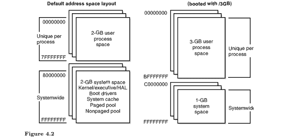

**图 4.2**
Windows 2000 支持的地址空间布局。

由于大多数系统的物理内存远少于正在运行的进程使用的总虚拟内存（每个进程 2 GBytes 或 3 GBytes），内存管理器将部分内存内容*传输*或*分页*到磁盘。将数据分页到磁盘可释放物理内存，以便供其他进程或操作系统本身使用。当线程访问已分页到磁盘的虚拟地址时，虚拟内存管理器会从磁盘将信息加载回内存。应用程序无需进行任何更改即可利用分页功能，因为硬件支持使内存管理器能够在进程或线程不知晓或协助的情况下进行分页。

### 4.2.5 进程、线程和任务

一个 Windows 2000 进程由以下部分组成：

*   一个私有的*虚拟地址空间*，这是一组进程可以使用的虚拟内存地址
*   一个可执行程序，它定义了初始代码和数据，并映射到进程的虚拟地址空间中
*   一个打开句柄列表，指向各种系统资源，如信号量、通信端口和文件，这些资源对进程中的所有线程都是可访问的
*   一个称为*访问令牌*的安全上下文，用于标识与该进程相关的用户、安全组和权限
*   一个唯一的标识符，称为*进程 ID*（内部称为*客户端 ID*）
*   至少一个执行线程

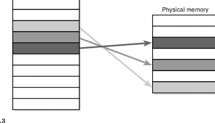

**图 4.3**
将虚拟内存映射到物理内存。

*线程*是 Windows 2000 调度执行的过程内的实体。没有它，进程的程序就无法运行。线程包含以下必要组件：

*   一组 CPU 寄存器的内容，代表处理器的状态
*   两个栈，一个供线程在内核模式执行时使用，另一个供在用户模式执行时使用
*   一个称为线程本地存储的私有存储区域，供子系统、运行时库和动态链接库（DLL）使用
*   一个唯一的标识符，称为*线程 ID*（内部也称为*客户端 ID*——进程 ID 和线程 ID 是从同一命名空间生成的，因此它们从不重叠）

线程有时拥有自己的安全上下文，这通常由模仿其服务的客户端安全上下文的多线程服务器应用程序使用。

易失性寄存器、栈和私有存储区域被称为线程的*上下文*。由于此信息在 Windows 2000 运行的每种机器架构中都不同，因此此结构必然具有架构特定性。事实上，Win32 GetThreadContext 函数返回的 CONTEXT 结构是 Win32 API 中唯一的依赖于机器的公共数据结构。


尽管每个线程都有独立的执行上下文，但进程内的所有线程都共享该进程的虚拟地址空间（除了进程中其他资源外）；因此，进程中的所有线程都可以读写彼此的内存。不过，线程无法引用另一个进程的地址空间，除非该进程将其私有地址空间的一部分作为*共享内存段*（在 Win32 API 中称为*文件映射对象*）提供给其他进程，或者除非一个进程打开另一个进程并使用 ReadProcessMemory 和 WriteProcessMemory 函数。

每个进程都有一个安全上下文，它存储在一个称为*访问令牌*的对象中。进程访问令牌包含该进程的安全标识和凭据。默认情况下，线程没有自己的访问令牌，但它们可以获取一个，从而允许单个线程模拟另一个进程的安全上下文——包括运行在远程 Windows 2000 系统上的进程——而不会影响进程中的其他线程。

虚拟地址描述符（VAD）是内存管理器用来跟踪进程正在使用的虚拟地址的数据结构。

Windows 2000 引入了对进程模型的扩展，称为*作业*。作业对象的主要功能是允许将一组进程作为一个单元进行管理和操作。作业对象允许控制某些属性并为与该作业关联的进程提供限制。它还记录与该作业关联的所有进程以及曾经关联但随后已终止的所有进程的基本核算信息。在某些方面，作业对象弥补了 Windows 2000 中缺乏结构化进程树的不足，但在许多其他方面，它比 Unix 风格的进程树更强大。

### 4.2.6 安全性

Windows 2000 支持由美国国防部可信计算机系统评估标准（DoD 5200.28-STD，1985 年 12 月）定义的 C2 级安全性。该标准包括对所有可共享系统对象（如文件、目录、进程和线程）的自主（需知）保护、安全审计（用于对主体或用户及其发起的行为负责）、登录时的密码认证，以及防止一个用户访问另一个用户已释放的未初始化资源（如空闲内存或磁盘空间）。

Windows NT 4 已在 C2 级别通过正式评估，并列入美国政府评估产品清单。（Windows 2000 仍在评估过程中。）此外，Windows NT 4 已满足欧洲组织 ITSEC（IT 安全评估标准）的 FC2/E3 级别（功能级别 C2 和保证级别 E3，通常仅与 B 级系统相关联）安全级别。获得政府批准的安全评级使操作系统能够在该领域竞争。当然，这些所需的许多功能对于任何多用户系统都是有益的。

Windows 2000 对对象有两种形式的访问控制。第一种形式——自主访问控制——是大多数人想到 Windows 2000 下的保护机制时想到的保护机制。它是对象（如文件或打印机）的拥有者授予或拒绝其他人访问权限的方法。当用户登录时，他们会获得一组安全凭据，即安全上下文。当他们尝试访问对象时，他们试图访问的对象的访问控制列表与其安全上下文进行比较，以确定他们是否有权执行请求的操作。

在自主访问控制不足的时候，需要特权访问控制。这是一种确保在拥有者不可用时，某人可以访问受保护对象的方法。例如，如果一名员工离开公司，管理员需要一种方式来获取可能仅该员工可以访问的文件。在这种情况下，在 Windows 2000 下，管理员可以接管该文件的所有权并根据需要管理其权限。

安全性贯穿于 Win32 API 的接口。Win32 子系统以与操作系统相同的方式实现基于对象的安全性；Win32 子系统通过在共享 Windows 对象上放置 Windows 2000 安全描述符来保护这些对象免受未经授权的访问。当应用程序第一次尝试访问共享对象时，Win32 子系统会验证应用程序是否有此权利。如果安全检查成功，Win32 子系统允许应用程序继续执行。

Win32 子系统在许多共享对象上实现对象安全性，其中一些是基于原生 Windows 2000 对象构建的。Win32 对象包括桌面对象、窗口对象、菜单对象、文件、进程、线程以及几个同步对象。

### 4.2.7 Unicode

Windows 2000 与大多数其他操作系统不同，因为大多数内部文本字符串以 16 位宽的 Unicode 字符存储和处理。Unicode 是一个国际字符集标准，为世界大多数已知字符集定义了唯一的 16 位值。（有关 Unicode 的更多信息，请参阅 **www.unicode.org** 以及 MSDN Library 中的编程文档。）

由于许多应用程序处理 8 位（单字节）ANSI 字符串，接受字符串参数的 Win32 函数有两个入口点：Unicode（宽，16 位）版本和 ANSI（窄，8 位）版本。Windows 95、Windows 98 和 Windows Millennium Edition 的 Win32 实现并未为所有 Win32 函数实现所有 Unicode 接口，因此设计为既能在这些操作系统之一上运行也能在 Windows 2000 上运行的应用程序通常使用窄版本。如果你调用 Win32 函数的窄版本，输入字符串参数在处理之前会被转换为 Unicode，输出参数在返回给应用程序之前会从 Unicode 转换为 ANSI。因此，如果你有一个旧的服务或代码片段需要在 Windows 2000 上运行，但该代码是使用 ANSI 字符字符串编写的，Windows 2000 会将 ANSI 字符转换为 Unicode 供其自身使用。然而，Windows 2000 从不转换文件内部的数据；是应用程序决定将数据存储为 Unicode 还是 ANSI。

在以前的 Windows NT 版本中，亚洲和中东版本是核心美国和欧洲版本的超集，并包含额外的 Win32 函数来处理更复杂的文本输入和布局需求（如从右到左的文本输入）。在 Windows 2000 中，所有语言版本都包含相同的 Win32 函数。Windows 2000 没有单独的语言版本，而是有一个全球单一的二进制文件，以便单个安装可以支持多种语言（通过添加各种语言包）。应用程序还可以利用 Win32 函数，允许单一的全球应用程序二进制文件支持多种语言。

## 4.3 系统体系结构

既然我们已经探讨了塑造 Windows 2000 设计的目标，让我们来看看内部系统体系结构。图 4.4 展示了主要操作系统组件之间的关系。

图中有一条线将 Windows 2000 操作系统分为用户模式和内核模式两部分。线上方的框代表用户模式进程，线下方的组件是内核模式操作系统服务。如前所述，用户模式线程在受保护的进程地址空间中执行（尽管当它们在内核模式下执行时，它们可以访问系统空间）。因此，系统支持进程、服务进程、用户应用程序和环境子系统各自拥有自己私有的进程地址空间。

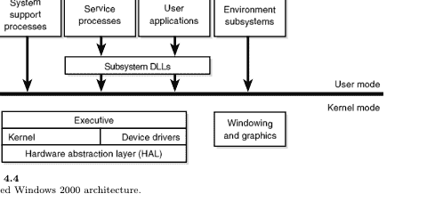

### **图 4.4**
简化的 Windows 2000 体系结构。

用户模式进程的四种基本类型描述如下：

- *固定*（或*硬连线*）*系统支持进程*，如登录进程和会话管理器，它们不是 Windows 2000 服务（即不是由服务控制管理器启动的）。
- *服务进程*，宿主 Win32 服务，如任务计划程序和 Spooler 服务。许多 Windows 2000 服务器应用程序，如 Microsoft SQL Server 和 Microsoft Exchange Server，也包含作为服务运行的组件。
- *用户应用程序*，可以是五种类型之一：Win32、Windows 3.1、MS-DOS、POSIX 或 OS/2 1.2。
- *环境子系统*，通过一组可调用函数将原生操作系统服务暴露给用户应用程序，从而提供操作系统*环境*或个性。Windows 2000 附带三个环境子系统：Win32、POSIX 和 OS/2。

在图 4.4 中，请注意“Service processes”和“User applications”框下方的“Subsystem DLLs”框。在 Windows 2000 下，用户应用程序不直接调用原生 Windows 2000 操作系统服务；相反，它们通过一个或多个*子系统动态链接库*。子系统 DLL 的作用是将已记录的函数转换为适当的内部（且未记录的）Windows 2000 系统服务调用。这种转换可能涉及也可能不涉及向服务该用户应用程序的环境子系统进程发送消息。

Windows 2000 的内核模式组件包括以下内容：


### Windows 2000 系统架构组件

- **Windows 2000 执行体** 包含基础操作系统服务，例如内存管理、进程和线程管理、安全性、I/O 以及进程间通信。

- **Windows 2000 内核** 由低层操作系统功能组成，例如线程调度、中断和异常分派以及多处理器同步。它还提供一组例程和基本对象，供执行体的其余部分使用以实现更高级别的构造。

- **设备驱动程序** 包括硬件设备驱动程序，它们将用户 I/O 函数调用转换为特定硬件设备的 I/O 请求，以及文件系统和网络驱动程序。

- **硬件抽象层** 是一层代码，它将内核、设备驱动程序以及 Windows 2000 执行体的其余部分与特定平台的硬件差异（例如主板之间的差异）隔离开来。

- **窗口和图形系统** 实现了图形用户界面 (GUI) 功能（更为人知的是 Win32 USER 和图形设备接口，或称为 GDI 功能），例如处理窗口、用户界面控件以及绘图。

图 4.5 是 Windows 2000 系统架构和组件的更详细、更完整的图表，该架构之前曾在图 4.4 中展示。接下来的章节将详细阐述此图表中的每个主要元素。

### 4.3.1 环境子系统和子系统 DLL

如图 4.4 所示，Windows 2000 拥有三个环境子系统：OS/2、POSIX 和 Win32。正如我们稍后将解释的那样，在这三个子系统中，Win32 子系统是特殊的，因为如果没有它，Windows 2000 就无法运行。（它拥有键盘、鼠标和显示器，并且即使在没有交互式用户登录的服务器系统上也是必须存在的。）事实上，其他两个子系统配置为按需启动，而 Win32 子系统必须始终处于运行状态。

环境子系统的角色是向应用程序暴露 Windows 2000 执行体基础系统服务的某个子集。每个子系统可以访问 Windows 2000 中不同的原生服务子集。这意味着，基于一个子系统构建的应用程序可以做某些事情，而基于另一个子系统构建的应用程序却不能做。例如，Win32 应用程序不能使用 POSIX fork 函数。

每个可执行映像（.exe）都绑定到且仅绑定到一个子系统。当映像运行时，进程创建代码会检查映像头中的子系统类型代码，以便通知正确的子系统新进程。此类型代码在 Microsoft Visual C++ 中通过链接命令的 /SUBSYSTEM 限定符指定，并且可以使用 Windows 2000 资源工具包中的 Extetype 工具进行查看。

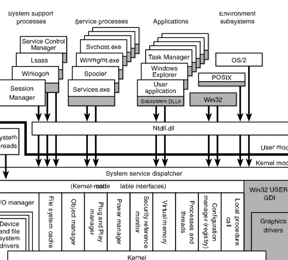

**图 4.5** Windows 2000 架构。

无法在子系统之间混合函数调用。换句话说，POSIX 应用程序只能调用由 POSIX 子系统导出的服务，而 Win32 应用程序只能调用由 Win32 子系统导出的服务。正如您将稍后看到的，这种限制是 POSIX 子系统（它实现非常有限的一组函数，仅 POSIX 1003.1）不是移植 Unix 应用程序的有用环境的原因。

如前所述，用户应用程序不会直接调用 Windows 2000 系统服务。相反，它们通过一个或多个子系统 DLL 进行调用。这些库导出了链接到该子系统的程序可以调用的文档化接口。例如，Win32 子系统 DLL（例如 Kernel32.dll、Advapi32.dll、User32.dll 和 Gdi32.dll）实现了 Win32 API 函数。POSIX 子系统 DLL 实现了 POSIX 1003.1 API。

当应用程序调用子系统 DLL 中的函数时，会发生以下三种情况之一：

- 该函数完全在用户模式下由子系统 DLL 内部实现。换句话说，不向环境子系统进程发送消息，也不调用 Windows 2000 执行体系统服务。该函数在用户模式下执行，并将结果返回给调用者。此类函数的示例包括 GetCurrentProcess（始终返回 −1，该值被定义为在所有与进程相关的函数中指代当前进程）和 GetCurrentProcessId（对于正在运行的进程，其进程 ID 不会更改，因此从缓存位置获取此 ID，从而避免需要调用内核）。

- 该函数需要一个或多个对 Windows 2000 执行体的调用。例如，Win32 的 ReadFile 和 WriteFile 函数涉及分别调用底层的内部（且未记录的）Windows 2000 I/O 系统服务 NtReadFile 和 NtWriteFile。

- 该函数需要环境子系统进程中完成某些工作。（在用户模式下运行的环境子系统进程负责维护在其控制下运行的客户端应用程序的状态。）在这种情况下，通过向子系统发送消息来要求执行某些操作，从而向环境子系统发起客户端/服务器请求。然后，子系统 DLL 在返回给调用者之前等待回复。

某些功能可以是上述第二项和第三项的组合，例如 Win32 的 CreateProcess 和 CreateThread 函数。

虽然 Windows 2000 被设计为支持多个独立的环境子系统，但从实际角度来看，如果让每个子系统都实现处理窗口化和显示 I/O 的所有代码，将导致系统功能的巨大重复，最终会对系统大小和性能产生负面影响。由于 Win32 是主要子系统，Windows 2000 的设计者决定将这些基本功能定位在那里，并让其他子系统调用 Win32 子系统来执行显示 I/O。因此，POSIX 和 OS/2 子系统调用 Win32 子系统中的服务来执行显示 I/O。（事实上，如果你检查这些映像的子系统类型，你会发现它们是 Win32 可执行文件。）

让我们更仔细地查看每个环境子系统。

#### Win32 子系统

Win32 子系统由以下主要组件组成：

- 环境子系统进程 (csrss.exe) 包含对以下内容的支持：
    - 控制台（文本）窗口，
    - 创建和删除进程和线程，
    - 对 16 位虚拟 DOS 机器 (VDM) 进程支持的一部分，以及
    - 其他杂项功能，例如 GetTempFile、DefineDosDevice、ExitWindowsEx 和几个自然语言支持功能。

- 内核模式设备驱动程序 (win32k.sys) 包含两个组件：
    - 窗口管理器，它控制窗口显示；管理屏幕输出；从键盘、鼠标和其他设备收集输入；并将用户消息传递给应用程序。
    - 图形设备接口 (GDI)，它是用于图形输出设备的函数库。它包括用于线条、文本和图形绘制以及图形操作的函数。

- 子系统 DLL（例如 Kernel32.dll、Advapi32.dll、User32.dll 和 Gdi32.dll）将文档化的 Win32 API 函数转换为 Ntoskrnl.exe 和 Win32k.sys 相应的未记录的内核模式系统服务调用。

- 图形设备驱动程序是依赖于硬件的图形显示驱动程序、打印机驱动程序和视频迷你打印驱动程序。

应用程序调用标准 USER 函数在显示器上创建用户界面控件，例如窗口和按钮。窗口管理器将这些请求通信给 GDI，GDI 将它们传递给图形设备驱动程序，在那里它们被格式化为显示设备格式。显示驱动程序与视频迷你打印驱动程序配对以完成视频显示支持。

GDI 提供了一组标准的二维函数，使应用程序能够在不了解设备情况的情况下与图形设备通信。GDI 功能在应用程序和图形设备（如显示驱动程序和打印机驱动程序）之间进行调解。GDI 解释应用程序对图形输出的请求，并将请求发送到图形显示驱动程序。它还提供了一个标准接口，使应用程序可以使用各种图形输出设备。此接口使应用程序代码独立于硬件设备，并且


它们的驱动程序。GDI 会针对设备的功能定制其消息，通常将请求划分为易于管理的部分。例如，一些设备可以理解绘制椭圆的指令；而其他设备则需要 GDI 将命令解释为放置在特定坐标处的一系列像素。有关图形和视频驱动程序架构的更多信息，请参阅 Windows 设备驱动程序开发工具包（DDK）中《图形驱动程序》一书的“设计指南”章节，可访问 www.microsoft.com/ddk 获取。

**POSIX 子系统。** POSIX 是一个缩写，大致定义为“基于 Unix 的可移植操作系统接口”，指的是一系列用于 Unix 风格操作系统接口的国际标准。POSIX 标准鼓励实现 Unix 风格接口的供应商使其保持兼容，以便程序员可以轻松地将应用程序从一个系统迁移到另一个系统。

Windows 2000 仅实现了众多 POSIX 标准中的一个，即 POSIX.1，正式名称为 ISO/IEC 9945-1:1990 或 IEEE POSIX 标准 1003.1-1990。包含此标准主要是为了满足 20 世纪 80 年代中后期制定的美国政府采购要求，这些要求在联邦信息处理标准（FIPS）151-2 中规定必须遵循 POSIX.1 兼容性规范，该标准由美国国家标准与技术研究院（NIST）制定。Windows NT 3.5、3.51 和 4 均经过正式测试并获得了 FIPS 151-2 认证。

由于 POSIX.1 兼容性是 Windows 2000 的强制性目标，操作系统在设计时确保具备必需的基础系统支持，以便实现 POSIX.1 子系统（例如，在 Windows 2000 执行体中实现的 *fork* 函数，以及 Windows 2000 文件系统中对硬文件链接的支持）。然而，由于 POSIX.1 仅定义了有限的一组服务（如进程控制、进程间通信和简单字符单元格 I/O），因此随 Windows 2000 提供的 POSIX 子系统并非一个完整的编程环境。并且，由于在 Windows 2000 上应用程序无法混合调用不同子系统的函数，因此默认情况下，POSIX 应用程序仅限于使用 POSIX.1 定义的严格服务集。这种限制意味着 Windows 2000 上的 POSIX 可执行文件无法创建线程、窗口或使用远程过程调用（RPC）或套接字。

为了解决此限制，微软提供了一个名为 Interix 的产品，它包含一个增强的 POSIX 子系统环境，提供近 2000 个 Unix 函数以及 300 个类 Unix 工具和实用程序。（有关 Microsoft Interix 的更多信息，请访问 www.microsoft.com/windows2000/interix/default.asp。）有了此增强功能，将 Unix 应用程序移植到 POSIX 子系统的可行性更高。然而，由于这些程序仍作为 POSIX 可执行文件链接，因此它们无法调用 Win32 函数。

要将 Unix 应用程序移植到 Windows 2000 并允许使用 Win32 函数，您可以购买 Unix 到 Win32 的移植库，例如 MKS *NUTCRACKER* Professional 产品中包含的库，该产品由 Mortice Kern Systems Inc. 提供（*www.mks.com*）。通过这种方式，Unix 应用程序可以重新编译并重新链接为 Win32 可执行文件，并可以逐步开始整合对原生 Win32 函数的调用。另一个此类库可在 *www.cygnus.com* 上找到。该网站还提供适用于 Windows 的流行 GNU 开发工具和实用程序的移植版本。

要在 Windows 2000 中编译和链接 POSIX 应用程序，需要平台 SDK 中的 POSIX 头文件和库。POSIX 可执行文件与 POSIX 子系统库 *Pxsdll.dll* 进行链接。由于默认情况下 Windows 2000 配置为按需启动 POSIX 子系统，因此第一次运行 POSIX 应用程序时，必须启动 POSIX 子系统进程（*Pxss.exe*）。该进程将保持运行状态，直到系统重启。

有关 POSIX 子系统以及将 Unix 应用程序移植到 Windows 2000 的更多信息，请在 MSDN 库（*msdn.microsoft.com*）中搜索 POSIX 和 Unix。

#### OS/2 子系统

与内置的 POSIX 子系统类似，OS/2 环境子系统的实用性相当有限，因为它仅支持 OS/2 1.2 的 16 位基于字符或视频 I/O（VIO）应用程序。尽管微软曾销售用于 Windows NT 4 的替代 OS/2 1.2 呈现管理器（Presentation Manager）子系统，但它不支持 OS/2 2.x（或更高版本）的应用程序（并且此替代版本在 Windows 2000 中不可用）。

#### Ntdll.dll

*Ntdll.dll* 是一个特殊的系统支持库，主要供子系统 DLL 使用。它包含两种类型的函数：

- 用于 Windows 2000 执行体系统服务的系统服务分派存根
- 子系统、子系统 DLL 和其他原生映像使用的内部支持函数

第一组函数提供了从用户模式调用的 Windows 2000 执行体系统服务的接口。此类函数有二百多个，例如 *NtCreateFile* 和 *NtSetEvent*。如前所述，这些函数的多数功能可以通过 Win32 API 访问。（然而，某些函数不行，仅供微软内部使用。）

对于这些函数中的每一个，NtDll 都包含一个具有相同名称的入口点。函数内部的代码包含特定的体系结构指令，该指令会触发到内核模式的转换以调用系统服务分派器；分派器在验证某些参数后，调用包含在 Ntoskrnl.exe 中的实际内核模式系统服务，其中包含真正的代码。

NtDll 还包含许多支持函数，例如映像加载器（以 Ldr 开头的函数）、堆管理器、Win32 子系统进程通信函数（以 Csr 开头的函数），以及通用运行时库例程（以 Rt 开头的函数）。它还包含用户模式异常分派器。

#### 执行体

Windows 2000 执行体是 Ntoskrnl.exe 的上层。（内核是下层。）执行体包含以下类型的函数：

- 可导出且可从用户模式调用的函数。这些函数称为系统服务，并通过 NtDll 导出。大多数服务可以通过 Win32 API 或另一个环境子系统的 API 访问。然而，少数服务无法通过任何文档化的子系统函数访问。（示例包括 LPC 以及诸如 NtQueryInformationxxx 等查询函数和诸如 NtCreatePagingFile 等专用函数。）

- 仅能从内核模式调用、且在 Windows 2000 DDK 或 Windows 2000 可安装文件系统（IFS）工具包中导出并记录在案的函数。（有关 Windows 2000 IFS 工具包的信息，请访问 www.microsoft.com/dsk/ifs kit。）

- 可从内核模式调用并导出，但未在 Windows 2000 DDK 或 IFS 工具包中记录在案的函数（例如由启动视频驱动程序调用的、以 Inbv 开头的函数）。

- 定义为全局符号但未导出的函数。这包括在 Ntoskrnl 内部调用的内部支持函数，例如以 Iop（内部 I/O 管理器支持函数）或 Mi（内部内存管理支持函数）开头的函数。

- 模块内部定义且未定义为全局符号的函数。

执行体包含以下主要组件：

- 配置管理器负责实现和管理系统注册表。

- *进程和线程管理器*创建和终止进程和线程。进程和线程的基础支持在 Windows 2000 内核中实现；执行体为这些底层对象添加了额外的语义和功能。

- *安全引用监视器*在本地计算机上执行安全策略。它保护操作系统资源，执行运行时对象保护和审计。

- *I/O 管理器*实现设备无关的 I/O，并负责将请求分派到适当的设备驱动程序以进行进一步处理。

- *即插即用（PnP）管理器*确定支持特定设备所需的驱动程序并加载这些驱动程序。它在枚举过程中检索每个设备的硬件资源要求。根据每个设备的资源要求，PnP 管理器分配适当的硬件资源，如 I/O 端口、IRQ、DMA 通道和内存位置。它还负责发送设备更改（添加或移除设备）的正确事件通知。

- *电源管理器*协调电源事件并向设备驱动程序生成电源管理 I/O 通知。当系统空闲时，电源管理器可配置为通过将 CPU 置于睡眠状态来减少功耗。单个设备的功耗变化由设备驱动程序处理，但由电源管理器协调。

- *WDM/Windows 管理仪器（WMI）例程*使设备驱动程序能够发布性能和配置信息，并接收来自用户模式 WMI 服务的命令。WMI 信息的消费者可以是本地机器上的，也可以是通过网络远程连接的。

- *缓存管理器*通过使最近引用的磁盘数据驻留在主内存中以实现快速访问（并通过在发送到磁盘前短暂将更新保留在内存中来推迟磁盘写入），从而提高基于文件的 I/O 性能。如稍后所述，它通过使用内存管理器对映射文件的支持来实现这一点。

- *虚拟内存管理器*实现*虚拟内存*，这是一种内存管理方案，为每个进程提供一个大容量的私有地址空间，其大小可以超过可用的物理内存。内存管理器还为缓存管理器提供底层支持。

此外，执行体包含四个主要的支持函数组，供上述执行体组件使用。


- **对象管理器**，用于创建、管理和删除 Windows 2000 执行体对象及抽象数据类型，这些类型用于表示进程、线程以及各种同步对象等操作系统资源。
- **LPC（本地过程调用）设施**在位于同一计算机上的客户端进程和服务器进程之间传递消息。LPC 是一种灵活且经过优化的远程过程调用版本，远程过程调用是跨网络通信客户端和服务器进程的行业标准通信设施。
- 一组**广泛的通用** **运行时库**函数，如字符串处理、算术运算、数据类型转换和安全结构处理。
- **执行体支持例程**，例如系统内存分配（分页和非分页池）、互锁内存访问，以及两种特殊类型的同步对象：资源和快速互斥锁。

这些支持函数中有约三分之一在 DDK 中有文档说明，因为设备驱动程序也使用它们。

### 4.3.4 内核

内核由 Ntoskrnl.exe 中的一组函数组成，这些函数提供了执行体组件使用的基本机制（如线程调度和同步服务），以及底层硬件架构相关的支持（如中断和异常调度），这些支持在不同的处理器架构上有所不同。内核代码主要用 C 编写，汇编代码仅保留给那些需要访问 C 语言不易直接访问的专用处理器指令和寄存器的任务。

与前面一节中提到的各种执行体支持函数类似，内核中的许多函数在 DDK 中有文档说明（搜索以 Ke 开头的函数），因为它们是实现设备驱动程序所必需的。

**内核对象。** 内核提供了一组底层基础，包含定义良好且可预测的操作系统原语和机制，允许执行体的更高级组件完成其所需的工作。内核通过实现操作系统机制并避免制定策略来将自己与执行体的其他部分分开。它将几乎所有策略决策留给执行体，除了线程调度和派发，这些是由内核实现的。

在内核之外，执行体将线程和其他可共享资源表示为对象。这些对象需要一些策略开销，例如用于操作它们的对象句柄、用于保护它们的安全检查，以及创建时扣除的资源配额。在内核中消除了这种开销，内核实现了一组更简单的对象，称为*内核对象*，帮助内核控制中央处理并支持创建执行体对象。大多数执行体级对象封装了一个或多个内核对象，并合并其内核定义的属性。

一组称为控制对象的内核对象建立了对各种操作系统函数的控制语义。这组对象包括 APC 对象、*延迟过程调用*（DPC）对象以及 I/O 管理器使用的若干对象，如中断对象。

另一组内核对象，称为*调度器对象*，包含会影响或改变线程调度的同步功能。调度器对象包括内核线程、互斥锁（内部称为*mutant*）、事件、内核事件对、信号量、定时器和可等待定时器。执行体使用内核函数来创建内核对象实例、操作这些对象以及构建它提供给用户模式的更复杂的对象。

**硬件支持。** 内核的另一个主要任务是抽象或隔离执行体和设备驱动程序，使其免受 Windows 2000 支持的硬件架构差异的影响。这项任务包括处理中断处理、异常调度和多处理器同步等功能的差异。

即使对于这些硬件相关功能，内核的设计也试图最大化通用代码的数量。内核支持一组可移植且在语义上跨架构一致的接口。实现此可移植接口的代码大多数在架构间也是相同的。

然而，其中一些接口在不同架构上的实现不同，或者一些接口部分由架构特定代码实现。这些架构无关的接口可以在任何机器上调用，无论代码是否因架构而异，接口的语义都相同。

内核还包含少量具有 x86 特定接口的代码，用于支持旧的 MS-DOS 程序。这些 x86 接口在可移植性方面并非如此，因为它们不能在其他架构的机器上调用；它们将不存在。例如，这段 x86 特定代码支持对全局描述符表（GDT）和 LDT 的操作调用，这些是 x86 的硬件特性。

内核中架构特定代码的另一个例子是提供翻译缓冲区和 CPU 缓存支持的接口。由于缓存的实现方式不同，这种支持需要针对不同架构的不同代码。另一个例子是上下文切换。尽管在高层次上使用相同的算法进行线程选择和上下文切换（保存前一个线程的上下文，加载新线程的上下文，并启动新线程），但在不同处理器上的实现存在架构差异。因为上下文由处理器状态（寄存器等）描述，所以保存和加载的内容因架构而异。

#### 表 4.2：HAL 列表

| HAL 文件名 | 支持的系统 |
|---|---|
| `Hal.dll` | 标准 PC |
| `Halacpi.dll` | 高级配置和电源接口（ACPI）PC |
| `Halapic.dll` | 高级可编程中断控制器（APIC）PC |
| `Halaacpi.dll` | APIC ACPI PC |
| `Halmps.dll` | 多处理器 PC |
| `Halmacpi.dll` | 多处理器 ACPI PC |
| `Halborg.dll` | Silicon Graphics 工作站（已不再销售） |
| `Halsp.dll` | Compaq SystemPro |

### 4.3.5 硬件抽象层

正如本章开头所述，Windows 2000 设计的一个关键要素是其在各种硬件平台上的可移植性。硬件抽象层是实现这种可移植性的关键部分。HAL 是一个可加载的内核模式模块（`Hal.dll`），它提供了在 Windows 2000 上运行的硬件平台的底层接口。它隐藏了硬件相关的细节，如 I/O 接口、中断控制器和多处理器通信机制——任何既是架构特定又是机器依赖的功能。

因此，Windows 2000 的内部组件以及用户编写的设备驱动程序不是直接访问硬件，而是通过在需要平台依赖信息时调用 HAL 例程来保持可移植性。因此，HAL 例程在 Windows 2000 DDK 中有文档说明。要了解有关 HAL 及其在设备驱动程序中的使用的更多信息，请参阅 DDK。

虽然 Windows 2000 光盘包含多个 HAL（见 表 4.2），但在安装时只选择一个，并以文件名 `Hal.dll` 复制到系统磁盘。因此，不能假设来自一个 x86 安装的系统磁盘如果在支持其他处理器的 HAL 不同的情况下，会在不同的处理器上启动。

### 4.3.6 设备驱动程序

本节简要概述了驱动程序的类型，并解释了如何列出系统中安装和加载的驱动程序。

设备驱动程序是可加载的内核模式模块（通常以 .sys 结尾），在 I/O 管理器和相关硬件之间进行接口。它们在以下三种上下文之一中在内核模式下运行：

- 在发起 I/O 功能的用户线程上下文中
- 在内核模式系统线程上下文中
- 作为中断的结果（因此不在任何特定进程或线程的上下文中——无论是中断发生时的当前进程还是线程）

如前所述，Windows 2000 中的设备驱动程序不直接操作硬件；相反，它们调用 *HAL* 中的函数与硬件进行接口。驱动程序通常用 C（有时是 C++）编写，因此，通过正确使用 HAL 例程，它们可以在 Windows 2000 支持的 CPU 架构之间实现源代码可移植性，并在架构家族内部实现二进制可移植性。

存在几种类型的设备驱动程序：

- *硬件设备驱动程序*使用 *HAL* 操作硬件，将输出写入或从物理设备或网络检索输入。硬件设备驱动程序有许多类型，如总线驱动程序、人机接口驱动程序和大规模存储驱动程序。
- *文件系统驱动程序*是接受面向文件的 I/O 请求并将其转换为发往特定设备的 I/O 请求的 Windows 2000 驱动程序。
- *文件系统筛选器驱动程序*，如执行磁盘镜像和加密的驱动程序，拦截 I/O 并在将 I/O 传递到下一层之前执行一些增值处理。
- *网络重定向器和服务器*是文件系统驱动程序，分别将文件系统 I/O 请求传输到网络上的机器并接收此类请求。
- *协议驱动程序*实现网络协议，如 TCP/IP、NetBEUI 或 IPX/SPX。
- *内核流筛选器驱动程序*串联在一起，对数据流执行信号处理，如记录或显示音频和视频。

Windows 2000 增加了对 PnP、电源选项以及 Windows NT 驱动模型的扩展——Windows 驱动模型（WDM）的支持。Windows

2000 可以运行传统的 Windows NT 4 驱动程序，但由于这些驱动程序不支持即插即用（PnP）和电源选项，运行这些驱动程序的系统在这两个方面的功能将受到限制。

从 WDM 的角度来看，有三种类型的驱动程序：

-   *总线驱动程序* 服务于总线控制器、适配器、桥接器或任何拥有子设备的设备。总线驱动程序是必需的，通常由 Microsoft 提供；系统中的每种总线（如 PCI、PCMCIA 和 USB）都有一个总线驱动程序。第三方可以编写总线驱动程序以支持新的总线，例如 VMEbus、Multibus 和 Futurebus。

-   *功能驱动程序* 是主要的设备驱动程序，为其设备提供操作接口。除非设备被直接访问（即由总线驱动程序和任何总线过滤器驱动程序（如 SCSI Pass/Thru）执行 I/O 的实现方式），否则它是必需的。从定义上讲，功能驱动程序是对特定设备了解最深入的驱动程序，通常也是唯一访问设备特定寄存器的驱动程序。

-   *过滤器驱动程序* 用于为设备（或现有驱动程序）添加功能，或修改来自其他驱动程序的 I/O 请求或响应（通常用于修复提供不正确硬件资源需求信息的硬件）。过滤器驱动程序是可选的，可以有任意数量，放置在功能驱动程序之上或之下，并位于总线驱动程序之上。通常，系统原始设备制造商（OEM）或独立硬件供应商提供过滤器驱动程序。

在 WDM 驱动程序环境中，没有单一的驱动程序控制设备的所有方面：总线驱动程序负责向 PnP 管理器报告其总线上的设备，而功能驱动程序则操纵设备。

在大多数情况下，低级过滤器驱动程序修改设备硬件的行为。例如，如果一个设备报告给其总线驱动程序它需要 4 个 I/O 端口，但实际上需要 16 个 I/O 端口，那么一个低级的设备特定功能过滤器驱动程序可以拦截总线驱动程序报告给 PnP 管理器的硬件资源列表，并更新 I/O 端口的计数。

高级过滤器驱动程序通常为设备提供增值功能。例如，键盘的高级设备过滤器驱动程序可以强制执行额外的安全检查。

### 4.3.7 系统进程

以下系统进程出现在每个 Windows 2000 系统中。（其中两个——Idle 和 System——不是完整的进程，因为它们不运行用户模式可执行文件。）

-   Idle 进程（包含每个 CPU 的一个线程，用于统计空闲 CPU 时间）
-   System 进程（包含大多数内核模式系统线程）
-   会话管理器 (smss.exe)
-   Win32 子系统 (csrss.exe)
-   登录进程 (winlogon.exe)
-   服务控制管理器 (services.exe) 及其创建的子服务进程
-   本地安全认证服务器 (lsass.exe)

为了帮助你理解这些进程之间的关系，请在 Windows 2000 支持工具中使用 `tlist /t` 命令来显示进程“树”，即进程之间的父子关系。以下是 `tlist /t` 的部分注释输出：

```
System process (0)                 Idle process
System (8)                         System process (default home for system threads)
smss.exe (144)                     Session Manager
csrss.exe (172)                    Win32 subsystem process
winlogon.exe (192)                 Logon process (also contains NetDDE service)
services.exe (220)                 Service control manager
svchost.exe (384)                  Generic service host image
spoolsv.exe (480)                  Spooler service
regsvc.exe (636)                   Remote registry service
snss.exe (664)                     Task Scheduler service
lsass.exe (232)                    Local security authentication server
```

接下来的章节将解释此输出中显示的关键系统进程。

#### 空闲进程

尽管显示的名称如此，但上述 `tlist /t` 输出中列出的第一个进程（进程 ID 0）实际上是系统空闲（System Idle）进程。进程由其映像名称识别。然而，此进程（以及名为 System 的进程 ID 8）并未运行真正的用户模式映像。因此，各种系统显示实用程序显示的名称因实用程序而异。虽然大多数实用程序将进程 ID 8 称为“System”，但并非所有都如此。

现在让我们看看系统线程以及运行实际映像的各个系统进程的用途。

#### 系统进程和系统线程

系统进程（始终为进程 ID 8）是一类特殊线程的归宿，这些线程仅在内核模式下运行：内核模式系统线程。系统线程具有常规用户模式线程的所有属性和上下文（如硬件上下文和优先级），但它们的不同之处在于它们仅在内核模式下运行加载到系统空间中的代码，无论是在 Ntoskrnl.exe 中还是在其他已加载的设备驱动程序中。此外，系统线程没有用户进程地址空间，因此必须从操作系统内存堆（如分页池或非分页池）中分配任何动态存储。

系统线程由 `PsCreateSystemThread` 函数（在 DDK 中有文档记载）创建，该函数只能从内核模式调用。Windows 2000 以及各种设备驱动程序在系统初始化期间创建系统线程，以执行需要线程上下文的操作，例如发出和等待 I/O 或其他对象，或轮询设备。例如，内存管理器使用系统线程来实现将脏页写入页面文件或映射文件、将进程换入换出内存等功能。内核创建一个名为 `balance set manager` 的系统线程，它每秒唤醒一次，以可能触发各种与调度和内存管理相关的事件。缓存管理器也使用系统线程来实现预读（read-ahead）和预写（write-behind）I/O。文件服务器设备驱动程序（`Srv.sys`）使用系统线程来响应网络中共享的磁盘分区上文件数据的网络 I/O 请求。即使是软盘驱动程序也有一个系统线程来轮询软盘设备（在这种情况下，轮询更高效，因为中断驱动的软盘驱动程序会消耗大量的系统资源）。

默认情况下，系统线程属于系统进程，但设备驱动程序可以在任何进程中创建系统线程。例如，Win32 子系统设备驱动程序（`Win32k.sys`）在 Win32 子系统进程（`Csrss.exe`）中创建系统线程，以便它们可以轻松访问该进程用户模式地址空间中的数据。

#### 会话管理器 (Smss)

会话管理器（`\\Winnt\\System32\\Smss.exe`）是系统中创建的第一个用户模式进程。执行管理程序和内核初始化最后阶段的内核模式系统线程创建了实际的 `Smss` 进程。

会话管理器负责启动 Windows 2000 的多个重要步骤，例如打开额外的页面文件、执行延迟的文件重命名和删除操作，以及创建系统环境变量。它还启动子系统进程（通常仅为 `Csrs.exe`）和 Winlogon 进程，后者进而创建其余的系统进程。

注册表中驱动 `Smss` 初始化步骤的许多配置信息可以在以下位置找到：

```
HKLM\\SYSTEM\\CurrentControlSet\\Control\\Session Manager
```

你会发现检查那里存储的数据类型很有趣。（有关键和值的描述，请参阅 Windows 2000 资源工具包中的 **Registry Entries** 帮助文件，**Regentry.chm**。）

在执行这些初始化步骤后，**Smss** 的主线程永久等待 **Csrss** 和 **Winlogon** 的进程句柄。如果其中任何一个进程意外终止，**Smss** 会导致系统崩溃，因为 Windows 2000 依赖于它们的存在。同时，**Smss** 等待加载子系统的请求、新子系统启动以及调试事件。它还充当应用程序和调试器之间的交换机和监视器。

#### 登录 (Winlogon)

Windows 2000 登录进程（\ Winnt\ System32\ **Winlogon.exe**）处理交互式用户登录和注销。当输入 *安全注意序列* (SAS) 按键组合时，Winlogon 会收到用户登录请求的通知。Windows 2000 上的默认 SAS 是组合键 **Ctrl+Alt+Delete**。SAS 保护用户免受模拟登录进程的密码捕获程序的侵害。一旦捕获用户名和密码，它们会被发送到本地安全认证服务器进程（在下一节中描述）进行验证。如果匹配，Winlogon 提取注册表键 HKLM\ SOFTWARE\ Microsoft\ Windows NT\ CurrentVersion\ **Winlogon** 下 Userinit 注册表项的值，并为该值中列出的每个可执行映像创建一个进程。默认情况下，是运行名为 **Userinit.exe** 的进程。

该进程执行一些用户环境的初始化（例如恢复映射驱动器号、运行登录脚本和应用组策略），在注册表中查看 Shell 值（位于之前提到的同一个 Winlogon 键下），并创建一个进程来运行系统定义的 shell（默认情况下为 **Explorer.exe**）。然后 Userinit 退出。这就是为什么 **Explorer.exe** 显示没有父进程的原因——其父进程已退出，并且（如前所述），*那* 会左对齐父进程未运行的进程。（另一种看法是，Explorer 是 Winlogon 的孙进程。）

登录过程的识别和认证方面是在一个名为 **GINA** (*Graphical Identification and Authentication*) 的可替换 DLL 中实现的。标准的 Windows 2000 GINA，**Msigina.dll**，实现了默认的 Windows 2000 登录界面。然而，开发人员可以提供自己的 GINA DLL 来实现其他识别和认证机制，以替代标准的 Windows 2000 用户名/密码方法（例如基于声纹的方法）。此外，Winlogon 可以加载其他需要执行二次认证的网络提供程序 DLL。此功能允许多个网络


提供者，以便在正常登录时一次性收集身份识别和认证信息。

Winlogon 不仅在用户登录和注销时处于活动状态，在键盘拦截 SAS 时也会处于活动状态。例如，当您在已登录状态下按下 Ctrl+Alt+Delete 时，会弹出 Windows 安全对话框，提供注销、启动任务管理器、锁定工作站、关闭系统等选项。Winlogon 是处理此交互的过程。

#### 本地安全认证服务器 (LSASS)

本地安全认证服务器进程（`\Winnt\System32\Lsass.exe`）接收来自 Winlogon 的认证请求，并调用相应的认证包（以 DLL 形式实现）来执行实际的验证，例如检查密码是否匹配存储在 Active Directory 或 SAM（注册表中包含用户和组定义的部分）中的内容。

认证成功时，LSASS 会生成一个包含用户安全轮廓的访问令牌对象。随后 Winlogon 使用此访问令牌创建初始 shell 进程。从 shell 启动的进程默认会继承此访问令牌。

#### 服务控制管理器 (SCM)

服务控制管理器是一个特殊的系统进程，运行映像 `.\Winnt\System32\Services.exe`，负责启动、停止以及与服务进程进行交互。服务进程类似于 Unix 守护进程，因为可以配置它们在系统启动时自动启动，而无需交互式登录。服务进程运行普通的 Win32 映像，这些映像调用特殊的 Win32 函数与服务控制管理器交互，以执行诸如注册服务成功启动、响应状态请求或暂停/关闭服务等操作。服务在注册表的 `HKLM\SYSTEM\CurrentControlSet\Services` 下定义。

要将服务进程映射到该进程中包含的服务，请使用 `list /s` 命令。请注意，服务进程和运行中的服务之间并不总是存在一对一的映射关系，因为某些服务与其他服务共享同一进程。在注册表中，`type` 代码指示服务是运行在自己的进程中，还是与其他共享该映像的服务共享进程。

Windows 2000 的许多组件都作为服务实现，例如假脱机管理器、事件日志、任务计划程序以及各种其他网络组件。要列出已安装的服务，请从控制面板中选择管理工具，然后选择服务。

## 4.4 Win32 API

Win32 应用程序编程接口是 Microsoft Windows 操作系统系列（包括 Windows 2000、Windows 95、Windows 98、Windows Millennium Edition 和 Windows CE）的主要编程接口。每个操作系统实现 Win32 的不同子集。在很大程度上，Windows 2000 是所有 Win32 实现的超集。

尽管 Windows 2000 被设计为支持多种编程接口，但 Win32 是操作系统的主要或首选接口。Win32 之所以处于这一地位，是因为在三个环境子系统（Win32、POSIX 和 OS/2）中，它提供了对底层 Windows 2000 系统服务最大的访问权限。

可以在 `msdn.microsoft.com` 在线查看 Win32 API 文档。也可以通过下载 Platform SDK（可在 `msdn.microsoft.com` 免费获取）来安装。Platform SDK 包含编译和链接 Win32 应用程序所需的 C 头文件和库。（虽然 Microsoft Visual C++ 附带这些头文件的副本，但 Platform SDK 中包含的版本始终与 Windows 操作系统的最新版本匹配，而随 Visual C++ 提供的版本可能是 Visual C++ 发布时最新的旧版本。）

以下是 Win32 系统调用主要组别的概述：

- **基本服务**：进程和线程、内存管理、同步、设备和文件 I/O、错误处理、调试、事件日志记录、进程间通信、电源管理和系统配置
- **图形**：处理图形输出的函数，如位图、画笔、画刷、字体、文本和颜色
- **窗口管理**：窗口、桌面、鼠标和键盘输入、按钮、光标、对话框、图标、菜单、滚动条和其他控件

请注意，这些仅代表核心系统调用——Platform SDK 描述了 100 多个用于构建应用程序的函数组，例如 COM+（用于构建 n 层分布式应用程序的框架）、数据服务、多媒体和 Web 服务。

## 4.5 探索 Windows 2000 的工具

可以使用各种可用工具来展示和演示 Windows 2000 内部机制的许多细节，例如随 Windows 2000 提供的工具、Windows 2000 支持工具、Windows 2000 资源包和 Windows 调试工具。下面简要介绍这些工具包。

### 4.5.1 Windows 2000 支持工具

Windows 2000 支持工具由大约四十种用于管理和排除 Windows 2000 系统故障的工具组成。其中许多工具以前是 Windows NT 4 资源包的一部分。您可以通过在任何 Windows 2000 产品分发 CD 的 `\Support\Tools` 文件夹中运行 **Setup.exe** 来安装支持工具。（即，支持工具在 Windows 2000 专业版、服务器版和高级服务器版中是相同的。）

### 4.5.2 Windows 2000 资源包

Windows 2000 资源包是对支持工具的补充，增加了大约两百种额外工具。除了包含许多用于显示内部系统状态的有用工具外，它们还包含有用的内部机制文档，如注册表参考和性能计数器帮助文件。资源包有两个版本：Windows 2000 专业版资源包和 Windows 2000 服务器版资源包。有关工具更新以及新工具的信息，请参见网站 `www.reskit.com`。

### 4.5.3 调试工具

Windows 调试工具包可从 `www.microsoft.com/ddk/debugging` 下载，其中包含用于高级调试和故障排除的工具和文档。例如，该包包括 Microsoft 内核调试器，虽然主要用于分析崩溃转储或调试设备驱动程序，但由于它们可以显示任何标准实用程序都无法看到的内部系统信息，因此也可用于调查 Windows 2000 的内部机制。例如，它们可以转储内部数据结构，如线程块、进程块、页表、I/O 和池结构。有关更多信息，请参阅随此包提供的调试工具帮助文件。它解释了如何设置和使用内核调试器（以及包中其他调试和支持工具）。

### 4.5.4 设备驱动开发工具包

Windows 2000 DDK 是 MSDN Professional（和 Universal）订阅的一部分，但也可以免费从 `www.microsoft.com/ddk` 下载。虽然 DDK 面向设备驱动程序开发人员，但它是 Windows 2000 内部机制信息的丰富来源。例如，DDK 文档以教程和参考形式包含了对 Windows 2000 I/O 系统的全面描述，包括设备驱动程序使用的内部系统例程和数据结构。除了文档外，DDK 还包含定义关键内部数据结构和常量的头文件，以及许多内部系统例程的接口（特别是 Wdm.h）。

### 4.5.5 Sysinternals 工具

另一个有用的故障排除和分析工具来源是 www.sysinternals.com。

# 5 网络硬件

Thomas Sterling

网络将一架子 PC 转化成一个单一的系统。网络还允许系统被远程访问，并为远程客户端提供服务。互联网和企业专用内网的可观增长，使得高性能、低成本的用于由 Beowulf 系统从一组节点创建单一系统的网络硬件变得可用。本章回顾网络硬件，特别强调快速以太网，因为其卓越的价格/性能比。

对于 Beowulf 系统，最具挑战性的通信需求不是来自外部环境，而是来自系统区域网络上的其他节点。在 Beowulf 系统中，每个 Beowulf 节点可能需要与其他节点独立或一起交互，以在处理器之间移动各种类型的数据。这些数据可以是代表非常庞大全局数据集子分区的连续大信息块、包含单个值的小数据包，或是支持集体操作的同步信号。在前一种情况下，可能需要高带宽通信路径。在后一种情况下，需要低延迟通信以加快执行。两种情况下的需求都对正在执行的并行程序的特性高度敏感。无论何种情况，通信能力都将决定 Beowulf 类系统的通用性以及构建高效程序的难度。网络硬件和软件的选择决定了这种能力的性质。

第 5.1 节介绍了 Beowulf 集群中最流行的一些网络技术。在第 5.2 节中，我们将详细探讨最流行的网络选择，快速以太网（以及千兆以太网）。我们在第 5.3 节中结束本章，对互连技术选择和一些其他实际问题进行评论。

## 5.1 互连技术

尽管基于以太网的网络在现有 Beowulf 系统中得到广泛应用，但它并不是实现节点间通信的唯一技术选择。根据应用的不同，存在其他可以提供同等或更好性能的解决方案。快速以太网是一个流行的选择，因为其普及性及随之而来的低价。快速以太网卡的成本仅相当于当今 1,000 美元 Beowulf 节点价格的 2% 左右。只有网络交换机对系统总体价格有显著影响。对于其他网络技术，每张网络接口卡的成本可能相当于一个 16 端口快速以太网交换机的成本。因此，在承诺使用替代网络之前，您必须仔细考虑。如果您打算使用的


如果应用运行需要特定的属性，例如低延迟，而快速以太网无法提供这些属性，那么额外增加成本可能是值得的。例如，实时图像处理、并行视频流传输和实时交易处理都需要低延迟，并且无法很好地兼容快速以太网。我们将简要讨论贝奥武夫系统中最常用的几种网络技术。由于目前收集到的数据有限，我们尚无法对这些技术所构建系统中的应用性能以及何种情况下应使用每种技术做出评论。

### 5.1.1 以太网

对于贝奥武夫系统，以太网（尤其是快速以太网）是流行且廉价的网络选择。以太网最早于 20 世纪 70 年代初在施乐 PARC 研究中心开发，并于 80 年代初由 IEEE 标准化，它是局域网中使用最广泛的技术。以太网仍是一项不断发展的技术：10 吉比特以太网（10 Gbps）已进入厂商现场测试阶段，预计将于 2002 年初大量上市。鉴于快速以太网的极低成本以及吉比特和 10 吉比特以太网的迅速兴起，以太网在可预见的未来将继续在贝奥武夫级计算中发挥关键作用。

**快速以太网。** 低成本、中等带宽网络技术的面世使得贝奥武夫系统成为可能。以太网最初在早期的贝奥武夫系统中以 10 兆比特每秒（Mbps）运行，随后很快达到 100 Mbps 的峰值带宽，提供了一种经济有效的手段将个人电脑连接起来以组成集成集群。以太网主要用作商用局域网技术，即使采用低成本的个人电脑，它也提供了一套以总成本约 20% 的成本实现系统局域网的手段。基于 TCP/IP 的快速以太网可为应用程序提供 90–95 Mbps 的带宽，延迟在几百微秒之间。快速以太网和 TCP/IP 的驱动程序早已整合到主线的 Linux 内核源码中，经过充分测试，拥有庞大的用户基础。快速以太网接口的成本已经降至许多主板制造商开始将其产品集成单端口或双端口接口的水平。尽管其他网络依然可用（并在一些贝奥武夫系统中使用），但凭借其极低的成本，快速以太网仍将是许多贝奥武夫实现方案的主力。

**吉比特以太网。** 100 基 T 快速以太网以及高分辨率图像数据、实时数据浏览和贝奥武夫级分布式应用对网络日益增长的需求，促使行业制定了一组 capable of 1 Gbps 的以太网新技术标准。这项被称为“吉比特以太网”的技术设计了一种向后兼容的网络基础设施，各厂商已有产品问世。为了实现吉比特以太网，需要快速以太网在物理层和大部分数据交换协议方面进行若干变更。然而，为了保持与快速以太网或 100-baseT 系统的兼容性，提供了混合模式操作机制。目前，吉比特以太网在贝奥武夫级计算中尚未具备足够的成本效益。吉比特以太网的早期产品，正如 10 吉比特以太网的早期产品一样，主要用于骨干服务及流量汇聚，而非直接连接主机；因此，假设对网卡（NIC）的需求较低，尚未出现巨大的市场来分摊研发成本。交换机和网卡的价格都远高于其快速以太网对应产品。

多个因素将推动下一代吉比特以太网向贝奥武夫级系统局域网角色的转变。虽然快速以太网很好地服务于基于 200 MHz 英特尔奔腾 Pro 处理器的贝奥武夫节点，但目前的奔腾 4 处理器速度可达 1.7 GHz。PCI 总线现在支持两倍宽的数据通路和两倍的时钟频率，允许向包括吉比特网卡在内的外设进行高带宽数据传输。更广泛的贝奥武夫应用可以通过更高的带宽得到支持。遗憾的是，基于 TCP/IP 的吉比特以太网在延迟方面并未比快速以太网有显著改善。一些贝奥武夫安装已对吉比特以太网进行了实验，贝奥武夫项目也已将若干吉比特以太网卡片的驱动程序交付给 Linux 操作系统。一些厂商甚至开始为他们的网卡提供高性能、开源的吉比特驱动程序。快速以太网的经验表明，一旦技术被大众市场采用，价格有望迅速大幅下降。随着廉价以太网/快速以太网/吉比特以太网组合 ASIC 的引入，主板集成和低成本吉比特适配器开始出现。吉比特交换机的价格也开始下降。1 Gbps 技术已就位，制造商的经验正带来快速的改进和成本削减。随着这些进展，我们预计吉比特以太网将在未来一到两年内成为互连价格/性能比的领导者。

### 5.1.2 Myrinet

Myrinet 是由 Myricom 公司设计的系统局域网（SAN）。1998 年 11 月 2 日，它被批准为美国国家标准 ANSI/VITA 26-1998。它以简单的低延迟锁存交换机为设计核心。穿过这些交换机的路径采用“包头剥离”源路由实现，其中发送节点在消息前添加通过网络的路径，每个交换机移除消息的第一个字节并将其用作输出端口。数据报可以是任意长度。

适配器和交换机的带宽对应用程序是隐藏的，并随着时间的推移从最初的 640Mbps 定期增加到目前的 2.4Gbps。Myrinet 的延迟在 10 到 7 微秒之间，具体取决于适配器和交换机的代际。Myrinet 的一个局限性在于其交换机是增量阻塞的。在组播网络中，如果目标端口繁忙，数据包将停滞，而停滞的数据包可能会阻塞网络中其他数据包，即使它们通往不相关的源和目的节点。然而，网络的快速度以及构建具有丰富互连拓扑结构的能力缓解了这一问题。通过更高密度的交换机减少固定规模网络中典型消息穿越的级数，可以最小化阻塞。

虽然 Myrinet 是提供高带宽 SAN 的最强厂商之一，但其局限性在于由单一供应商提供。网络适配器的价格及交换机的每端口成本一直较高，通常超过整个计算节点的价格。Myrinet 的主要优势在于其定制化协议。这些协议旨在通过尽可能多的工作卸载到 NIC 本身并在可能的情况下绕过操作系统，从而产生高性能和低延迟。Myrinet 网卡有效地提供了第二颗处理器，它可以完成大部分协议工作，并在通信期间避免中断主 CPU。通过添加第二颗主处理器也能以更低成本获得此优势。这种优势在主动消息中最显著，此时板载处理器可以处理消息并生成回复，而无需中断主 CPU。为了以这种方式利用硬件，Myricom 提供了大量的开源软件，包括驱动程序和经过调优的 MPICH 版本。使用定制化协议也鼓励了用户级硬件访问。在商品硬件中也已追求这一策略（关于商品硬件实现、虚拟接口架构 VIA 的简要讨论见第 5.3.3 节中的 MVIA）。不幸的是，用户级访问协议存在一个缺点，即阻止集群从小型机器上的标准 TCP 和以太网透明地扩展到大型集群上的 Myrinet 等替代硬件。

### 5.1.3 cLAN

cLAN 高性能集群交换机提供了 VIA（参见 **www.viarch.org**）的本地实现。提供八端口和三十端口交换机，每端口提供 1.25Gbps（双向 2.5Gbps）。由于这些实现了


通过硬件直接支持VIA，延迟很低（大约0.5微秒），带宽很高（与其他高端网络解决方案相当）。cLAN的开发者是Giganet，该公司于2001年3月被Emulex收购。

尽管VIA由一个联盟定义，并非单一厂商的设计，但VIA标准仅规定了一组概念和操作。它没有规定信号（可以是电信号、光信号或其他任何信号）或到单个计算机的接口。此外，也没有标准的程序员接口，尽管大多数VIA实现（包括cLAN）都使用了VIA规范中提供的示例应用程序编程接口。然而，由于VIA标准没有规定VIA所使用的硬件，因此不可能存在可互操作的VIA解决方案。下文讨论的Infiniband解决了这一问题。

### 5.1.4 可扩展一致性接口

可扩展一致性接口（Scalable Coherent Interface，SCI）是一个IEEE标准，最初设计用于为缓存一致的共享内存系统提供互连。SCI最早的大规模部署之一是1994年在Convex Exemplar SPP-1000上。尽管SCI能够作为通用互连使用，但它未能获得传统网络市场的认可。Beowulf设计者选择使用SCI的主要原因是其远低于10 μs的低延迟。目前的PC主板芯片组不支持构建基于SCI的共享内存Beowulf系统所需的一致性机制。但如果该功能最终被添加到普通主板上，随着研究人员实验共享内存Beowulf系统，我们可能会看到SCI流行度的增加。七年前，SCI提供了许多明显的优势，但如今通用网络技术已经赶上，尽管SCI仍提供显著更低的延迟。Dolphin Interconnect为Beowulf系统提供基于SCI的互连，以及闭源二进制驱动器和针对SCI网络调优的MPI实现。

### 5.1.5 QsNet

另一种名为QsNet的高性能网络由Quadrics生产。该网络提供340 Mbps的带宽和约5 μs的MPI延迟。虽然这是最昂贵的网络之一，但它被一些最大的集群选中，包括用于ASCI Q系统的Compaq SC系统和匹兹堡超级计算中心的NSF太瓦级系统。为了提供高性能，Quadrics使用了许多与上文提到的Myrinet类似的技术。

**图 5.1** 以太网数据包格式。

### 5.1.6 Infiniband

Infiniband (www.infinibandta.org) 结合了许多VIA的概念，并带有详细的电气和接口规范，使厂商能够生产可互操作的组件。这解决了VIA规范的主要局限。Infiniband贸易组织（拥有200多名成员）的目标之一是提高网络性能提升的速度。

截至2001年初，尚没有Infiniband产品可用。然而，许多产品正在开发中，到2002年Infiniband可能成为本文描述的其他网络的重要替代方案。Intel已承诺在接下来的一到两年内在其主板上提供集成Infiniband接口。这应该能以相对较低的价格点提供另一种高带宽、低延迟的互连。

## 5.2 详细审视以太网

以太网最初是作为一种基于数据包、无集中控制的串行多址网络开发的。所有网络访问和仲裁控制均由分布式机制执行。可变长度的消息数据包由包含头部、数据和错误检测节点的位序列组成。固定拓扑（无交换线路由）网络通过中间元素（称为集线器或交换机）将数据包从源传输到目的。通过网络中的下一跳由数据包头部中的寻址信息确定。

拓扑可以是连接许多以太网控制器的共享多址无源电缆、集线器或交换机的树形结构，或用于在高负载下实现高带宽和低延迟的更复杂的交换技术。

### 5.2.1 数据包格式

以太网消息数据包由七个多位字段序列组成，其中一个长度可变。这些字段包括网络控制信息和数据负载的组合。以太网数据包的结构如图5.1所示，并在下文描述。数据包的可变长度允许在广泛的负载需求下提高整体网络性能。因此，节点之间仅传输几个字的数据不会带来最长数据包的全部开销。然而，即使具有此功能，持续数据传输吞吐量对数据包长度敏感，并根据负载大小变化超过一个数量级，即使没有网络争用也是如此。

**前导码（Preamble）。** 消息数据包到达接收节点（无论该消息是否指向该节点）是异步的。在数据吸收之前，节点和到达的数据包必须首先同步。前导码字段是一个由交替的1和0组成的62位序列，允许节点接收器的锁相环电路锁定到传入信号并与位流同步。

**同步（Synch）。** 同步字段是一个由1（11）组成的2位序列，它打断了前导码提供的交替1和0序列，并指示数据包中剩余信息的开始位置。如果前导码提供载波级别同步，则同步字段提供位字段注册。

**目的地址（Destination Address）。** 目的地址字段长度为6字节（或48位），指定旨在接收该数据包的网络节点的网络标识。消息数据包可能旨在发送给单个节点或一组节点。如果目的地址字段的最高位是0，则消息旨在发送给单个接收节点。如果最高位是1，则消息是多播，旨在发送给网络中的部分或所有节点。在多播通信的情况下，使用组地址，在部分接收节点子集之间提供逻辑关联。任何属于由消息目的地址字段（最高位为1）指定的组的节点都必须接受该消息。在多播传输数据包的情况下，全1的目的地址字段表示该数据包是旨在发送给网络中所有节点的广播消息。以太网节点接收器必须能够接收、检测并接受广播消息。

除了区分单点传输和多播传输之外，目的地址还确定指定地址是全球管理地址还是本地管理地址。全球管理地址是唯一的，由行业范围内的分配过程提供。该地址由制造商内置于网络适配器（接口卡）中。本地管理地址由本地系统管理员提供，并由管理网络的机构更改。目的地址字段的第二位如果是全球管理的则为0，如果地址指定是本地管理的则为1。目的地址字段的位序列以最低有效位首先发送。

**源地址（Source Address）。** 源地址是一个48位字段，指示传输节点的地址。源地址的格式与目的地址相同。源地址始终是发送数据包的节点的个体地址，绝不可能是组地址。因此，最低有效位始终为0。同样，广播地址不在此字段中使用。

**类型（Type）。** 类型字段长度为16位，指定消息协议类型。此信息用于更高层的消息处理软件，并不影响网络上的实际数据位交换。两个字节的最高有效字节首先发送，每个类型字节的最低有效位首先发送。

**数据（Data）。** 数据包的消息负载包含在数据字段中。数据字段长度可变。最少可以是46字节，最多可以是1,500字节。因此，数据包可以小至72字节，或长至1,526字节。数据字段的内容传递给更高层软件，并不影响网络传输控制。数据以最低有效位首先传输。

**帧校验序列（Frame Check Sequence）。** 通过在目的地址、源地址、类型和数据字段上计算循环冗余校验（CRC）来提供传输中消息损坏的错误检测。四字节CRC值作为消息数据包的最后一个字段提供。它由传输节点和接收节点计算，并由接收节点比较，以确定数据包在传输中是否保持完整性。

### 5.2.2 NIC架构

网络接口控制器（Network Interface Controller）从主机节点处理器接受消息数据，并向物理网络介质呈现封装和编码版本的数据以便传输。虽然以太网NIC硬件有许多不同的实现，带有一些增强，但其基本架构是相同的。图5.2展示了典型以太网NIC架构的框图。架构中的数据链路层负责构建消息数据包并控制逻辑网络接口功能。物理层负责以可以实际应用于传输介质的形式编码消息数据包。


**图 5.2**
以太网网络接口卡（NIC）架构。

### 数据链路层

数据链路层为主机处理器与以太网物理层之间提供逻辑接口。当需要发送消息时，数据链路层接收、暂时存储并封装该消息，同时控制物理层的传输过程。当接收消息时，它从物理层接收数据包，确定该节点是否为正确的目的地，验证比特完整性，将数据解包为字节序列，暂时缓冲数据，并将其传递给处理器。数据链路层由逻辑链路控制子层和介质访问控制子层组成。

对于大多数当代的 Beowulf 节点，逻辑链路控制子层集成了与 PCI 总线的接口。以太网控制器中的这一组件提供了接受来自主机处理器命令以及为节点主存储器提供直接内存访问以实现在内存与网络之间快速数据传输所需的所有逻辑控制。通常，数据链路层内包含某种形式的 FIFO 缓冲，用于在节点中保留一条或多条传入或传出的消息。逻辑链路控制子层向介质访问控制子层提供变长字节序列，并从中接受数据字节序列。逻辑链路控制子层的具体形式和运作方式并未标准化，制造商之间的差异是设备驱动程序编写者的一个头痛问题。

介质访问控制器（MAC）主要负责执行发送和接收消息的以太网协议。它的两个主要任务是消息封装和分组冲突处理。要发送消息，MAC 从逻辑链路控制器接受待发送数据的字节序列以及目标地址。它格式化消息数据包，包括前导码、同步位、目标地址、源地址字段中的自身地址，以及逻辑链路控制器提供的协议类型和数据字段。然后它计算 CRC 值并将其附加到消息数据包中。当从物理层接收以太网数据包时，MAC 去除前导码和同步位，并判断目标地址是否为其宿主节点的地址。如果不是，则丢弃消息的其余部分并终止接收过程。如果目标地址字段与本地地址匹配，MAC 接受数据，并将其重新格式化为正确排序的字节序列以供逻辑链路控制器使用。MAC 计算循环冗余校验（CRC），并将其与消息中包含的值进行比较，以验证传输完整性。

MAC 还负责处理 CSMA/CD（载波侦听多路访问/冲突检测）仲裁协议。物理层向 MAC 提供信号，指示数据链路上是否有分组传输以及链路上两个或多个分组之间是否存在冲突。当信号可用时，MAC 按照上述方式运作，以确定消息是否属于宿主节点，如果是，则获取数据。在发生冲突的情况下，MAC 简单地丢弃任何部分传入的消息，并等待新的分组数据。在发送时，MAC 负责处理冲突避免和解决。如上所述，MAC 等待访问数据链路，并向物理层提供分组以开始传输。如果在分组传输过程中，MAC 从物理层接收到冲突信号，在短暂继续传输（以克服网络传播延迟）之后，它会终止消息并开始其随机回退序列，以确定再次尝试发送消息的新时间。

### 物理层

物理层对数据链路层提供的消息数据包进行编码，并将其转换为适合物理传输介质的电信号。在接收其他节点发送的消息时，物理层从传输介质获取电信号，将其转换为数字信号，并将其解码为消息的二进制比特序列。物理层包括两个主要阶段：收发器和物理线路信号（PLS）子层。收发器，也称为介质接入单元（MAU），执行从传输介质信号到逻辑信号电平的电气转换。

物理层 PLS 子层与数据链路层 MAC 子层之间的接口交换的数据是以离散电压电平表示的比特。这种信息表示形式对于以太网来说是不充分的，原因有二。首先，在局部网络所呈现的高度嘈杂（电气意义上）的环境中，信号电平可能会受到显著衰减和失真。其次，在以太网互连所使用的单比特串行通信协议中，数据和时间信息都需要包含在信号中。因此，曼彻斯特编码被用来传递信息，比特的值由信号转换的方向（趋势）指定，而不是特定的数值范围。随着数据在信号转换点固定，时间信息同时提供。

实际的以太网信号是差分的；也就是说，当一条线为高电平时，另一条线为低电平，反之亦然。PLS 子层首先将 MAC 提供的消息数据包转换为曼彻斯特编码表示形式，然后转换为差分形式。

PLS 层执行来自收发器的传入信号的解码任务，将曼彻斯特序列转换为常规比特串。PLS 层还向 MAC 提供冲突检测信号。

### 5.2.3 集线器与交换机

网络接口控制器（NIC）提供处理节点与系统区域网络（SAN）之间的连接。SAN 的有效性及其可扩展性取决于节点互连的方式。这些方式包括无源多点同轴电缆、有源中继器、智能路由交换机，以及更复杂的穿过节点的存储转发技术。

**中继器与集线器。** 以太网的早期优势之一是通信介质是无源多点同轴电缆。在有限的距离和节点数量范围内，此类电缆将所有昂贵的逻辑和电子元件都放置在 NIC 中。随着技术成本的下降和对网络性能需求的增加，其他方法开始具有竞争力。讽刺的是，曾经有助于降低成本的同轴电缆成为了主要的成本驱动因素。使用廉价中继器或集线器的双绞线连接现已取代了除最老的安装外所有场景中的同轴电缆。从逻辑上讲，集线器提供相同的 NIC 接口。所有节点对于其他所有节点都是可见的，并且仍然采用 CSMA/CD 仲裁协议。中继器是一种有源单元，它从分布在独立双绞线上的节点接收信号，主动清理信号，将其放大到所需电平，然后将其重新分配给所有连接的节点。

**交换机。** 对更高持续带宽的需求以及在单个网络上容纳更多节点的需要，促使了更复杂的节点间消息交换手段的发展。与集线器或中继器类似，交换机从节点的双绞线接收分组。然而，与中继器不同的是，这些信号不会广播到所有连接的节点。相反，消息数据包的目标地址字段被解析，且分组仅发送到目标节点。这种功能比简单的中继器复杂得多，需要集线器所不需要的缓冲空间和逻辑。在最早期的 Beowulf 系统时代，交换机的成本令人望而却步。然而，到基于 Intel Pentium Pro 处理器的第三代 Beowulf 系统时，交换机的成本已经足够低，使其成为标准的 Beowulf 组件。

如今，16 口交换机的价格又下降了四倍或更多，它们成为了许多中等规模系统的骨干。具有多达 48 个连接的中端价位交换机广泛可用。对于更大的连接性，可以互连多个交换机。但有一个限制：网络必须是一棵树；它不能包含任何环路。

树形拓扑会导致一个问题。根交换机或顶层交换机的二分带宽成为了通信瓶颈。所有流量可能都必须通过此通道。低成本 16 口快速以太网交换机的典型带宽接近或达到 1.6 Gbps。就目前的阶段而言，使用快速以太网交换机的背板饱和并不是严重问题。当前一代的千兆交换机提供了更高的背板二分带宽，因此存在更多网络端口且无竞争的可能性。借助合适尺寸的核心千兆交换机，网络核心可以轻松（在资金允许的情况下）扩展至 192 Gbps 或更高。利用这些，具有双千兆或四千兆上行链路（dual or quad gigabit uplinks）的快速以太网交换机可以正确扩展，在网络上没有严重竞争的情况下，轻松扩展到 1,000 个节点以上。

## 5.3 网络实践性：互连选择

为系统区域网络选择网络可能是一个困难的过程。在本节中，我们考虑了各种因素，并给出了两个示例，说明不同的选择如何影响性能。

### 5.3.1 互连的重要性

NIC 和交换机组合的成本可能等于或超过大型集群中节点硬件的成本：这是一个不应被轻视的因素。

然而，在不考虑财务因素的情况下，选择互连技术时最重要的因素是通信模式的


### 5.3.2 互连选项之间的差异

如前文所述，互连技术在带宽、延迟、可扩展性和成本方面差异巨大。可用的互连带宽范围从整个集群共享的 10 Mbps 网络段到所有节点同时可用的 340 Mbps 以上。交付给应用的延迟可以从几百微秒低至 0.5 微秒。这几乎接近使用 PCI 总线的延迟成本。各种互连技术的可扩展级别各不相同。例如，基于交换式以太网的互连技术基本上适用于网络段上的任意数量的节点，因为 TCP/IP 层提供了可靠的数据包传输。因此，以太网交换机集群能够很好地处理拥塞。然而，互连网络并不普遍具备这些特性；各种互连类型存在拓扑扩展性问题，而另一些则基本上要求构建全二分带宽的交换机集群，以最小化交换机拥塞。这些技术的成本从几乎免费到每个节点数千美元的初始成本不等。这尚未计入集成、软件和硬件调试所需的巨大且重复性工作。提供的驱动程序类型的差异也可能影响集成的难度。一些供应商仅针对特定版本的 Linux 内核提供二进制驱动程序。这导致使用这些互连技术的集群变成内核“版本锁定”。在许多情况下，集群管理员可能会遇到的内核 bug 会在后续的内核版本中修复。因此，版本锁定的机器更难维护。

#### 5.3.3 提升以太网性能的策略

实际上，在设计集群时，财务考量相当重要。这显然体现在使用以太网作为互连技术的集群的高频率上。由于这是上述列表中最慢的互连技术，性能优化至关重要。最简单的方法是调整系统的以太网和 TCP/IP 协议栈；这些更改相当无侵入性且易于实施，在 www.psc.edu/networking/perf_tune.html 有一份相当好的文档详细说明了这一调优过程。其他方法可能更具侵入性。这些方法分为三类：硬件选择、软件特性和其他网络拓扑。

以太网网卡性能将受到所选网卡（NIC）特性的严重影响。更高质量的以太网网卡能以更低的主机 CPU 利用率提供更好的吞吐量和延迟。这种更好的性能通过多种技术实现。使用巨型帧（jumbo frames）是降低主机 CPU 利用率的一种方式。通过使用 9,000 字节的大型 MTU 设置，而非通常的 1,500 字节，网卡需要封装的以太网帧数量显著减少。巨型帧仅在千兆网络中受支持，但其使用可以显著增加网络吞吐量。一些网卡支持在网卡本身的硬件中进行 TCP 校验和计算。这将主机 CPU 中最昂贵的任务之一移除。一些网卡还支持中断合并（interrupt coalescing）。这意味着网卡拥有一些本地内存，可以临时存储接收到的数据包，以减少使用网卡时的中断负载。如果没有中断合并，高强度的网络使用可能会导致足够多的用于中断服务的中断切换，从而使主机 CPU 的计算吞吐量大幅下降。此特性也主要仅在千兆网络中使用。千兆网络适配器在功能集方面存在显著差异。

另一方面，快速以太网网卡具有基本相当的功能集，并依赖驱动程序来提供卓越的性能。千兆驱动程序的质量也存在很大差异。要使上述所有硬件功能得以使用，既需要在软件中支持，也需要在硬件中支持。或者，也可以完全不使用 TCP/IP。网络协议提供的所有特性，例如可靠传输和乱序数据包重组，都会带来延迟和带宽开销。其中一些特性很重要，而另一些则不那么重要。VIA 规范（www.viarch.org）描述了一种仅实现集群通信所需特性的架构。这提供了比以太网的 CSMA/CD 和 TCP/IP 开销小得多的协议。通过使用 VIA 规范的 MVIA 实现（www.nersc.gov/research/FTG/via/）及其用于快速以太网或千兆以太网网卡的驱动程序，可以使用通用硬件以更少的延迟向应用提供更大的带宽。（这是第 5.1.3 节中提到的同一协议。）

最大化以太网性能的最终方法是使用不同的网络拓扑。其中一种拓扑是使用 EtherChannel，即以太网绑定（bonding）。该软件使多个物理以太网接口与交换机协商一个虚拟聚合连接（在共享网络段中这样做没有好处），直到客户端。这可以根据可用物理接口的数量，成倍增加应用可用的带宽。不幸的是，这对延迟没有正面影响，因为消息从端到端逻辑路径还需要经过绑定例程。另一种旨在改善二分带宽和延迟的拓扑是 FNN（www.aggregate.org/FNN），即扁平网络邻域（Flat Network Neighborhoods）。在这种拓扑中，主机拥有多个网络接口，每个接口都驻留在不同的交换机上。在正确配置的网络中，每个主机在网络上任何其他主机的每个接口所在的同一交换机上都有一个网卡。此技术试图以经济有效的方式利用背板和上行链路之间巨大的性能差异。

### 5.3.4 集群网络陷阱

Linux 千兆支持无法良好地与交换机自动协商及时间敏感协议（如 DHCP）交互。我们在千兆交换机端口初始化时间方面遇到了几个问题。这些较长的初始化时间导致 DHCP 请求超时。我们将此问题追溯到交换机上的多个因素，所有因素都与自动协商有关。千兆交换机在链路建立时试图自动协商多项设置。默认自动协商的设置列表包括流量控制、端口协商、etherchannel（绑定）和 802.1q 中继。然后，运行生成树检查以确定网络中是否存在交换环路。总之，这个过程可能需要一分钟才能完成。这肯定比默认的 DHCP 请求超时时间长得多。在快速以太网网络中，同样的一些设置也会自动协商。虽然此列表较短，且端口设置时间比千兆以太网短得多，但如果许多主机并行启动，仍可能出现问题。

为此，尽可能禁用自动协商功能将极大地简化网络本身并减少遇到的问题。

由于快速以太网是最常见的互连方式，而以太网是最常见的 Linux 主机网络类型，节点间通信和集群管理过程可能会相互竞争资源。如果可能，应避免这种情况。在使用 NFS 等透明网络服务较多的情况下，即使是相当无害的操作也可能无意间消耗大量网络带宽。在用户作业运行时，应避免运行额外的进程，即使是管理任务。

集群管理操作（无论是像 pdsh 这样的同步操作，还是像 cron 作业这样的异步操作）的本质特征是它们以松散的并行方式运行。虽然这些任务内部并未同步，但其调用方式导致它们在非常短的时间窗口内启动。当这些管理操作并行执行时，服务器上的负载模式比普通 Unix 服务器更具突发特性。在这些情况下，峰值容量往往比持续吞吐量更重要。

### 5.3.5 以太网互连 Beowulf 集群示例

克莱姆森大学迷你网格 Beowulf 集群使用了四个交换机。处理器池使用 Foundry Networks FastIron III，其背板吞吐量为 480 Gbps，支持多达 336 个快速以太网端口或多达 120 个千兆以太网端口。克莱姆森机器使用的配置包括 16 个千兆以太网端口和 264 个快速以太网端口。迷你网格处理器池包含 130 个节点，每个节点配备两个快速以太网网卡并连接到该交换机。此外，处理器池的交换机连接到三个主要集群，其中一个集群使用 Foundry Networks FastIron II Plus，背板吞吐量为 256 Gbps，连接到 66 个双网卡节点；另外两个集群使用 Foundry Networks FastIron II，背板吞吐量为 128 Gbps，各连接到 34 个双网卡节点。迷你网格中的交换机通过多条捆绑千兆以太网链路互连。池与较大集群之间有四条捆绑链路，池与两个较小集群之间各有一条捆绑链路。池和集群中的双网卡节点使用 Linux 信道绑定（channel bonding）技术将普通快速以太网网卡的吞吐量翻倍。Foundry Networks 交换机使用类似技术，在任意两个交换机之间最多可捆绑八条千兆以太网链路。采用这种方法，可以构建一个最多拥有 1080 个端口的快速以太网交换系统，且不存在瓶颈。实际上，可以构建大得多的网络，尽管可能无法实现完整的二分带宽。对于许多应用来说，稍低一些的带宽可能已足够。其他提供大型快速以太网交换机的厂商包括 Hewlett Packard、Cisco 和 Extreme。

### 5.3.6 Myrinet 互连集群示例

阿贡国家实验室的千叶市集群有两个独立网络：(1) 一个 Myrinet 网络，由 5 个 Clos 交换机、4 个 Spine 交换机和 320 个主机端口组成；(2) 一个快速/千兆以太网网络，由 10 台 Cisco Catalyst 4000 和一台拥有 480 个快速以太网端口及 102 个千兆以太网端口的 Catalyst C6509 组成。Myrinet 网络主要用作系统互连；然而，如有必要，也可以使用以太网。Myrinet 拓扑是对称的，以太网拓扑也是对称的。每个 Spine 交换机有 128 个网络端口，与网络中的所有 Clos 交换机连接，但与其他 Spine 交换机无直接连接。每个 Myrinet Clos 交换机有 64 个主机端口和 64 个网络（交换机互连）端口。每个 Clos 的网络端口分布在所有四个 Spine 交换机上。这产生了从网络中任意给定节点到任何其他节点的 4096 条潜在路由。这是为了保证对所有可能工作负载实现完整二分带宽所必需的。

以太网网络也具有相当高的对称性。每 32 个节点及其管理节点连接到一台 Catalyst 4000。每个 32 节点组中，节点通过快速以太网连接，而管理节点通过千兆以太网连接。这些交换机每台都有双千兆上行链路连接到核心 Catalyst C6509。由于每台 Catalyst 4000 与核心 C6509 之间的上行链路存在超额认购（oversubscription），该网络不具备完整二分带宽。如果这主要是一个互连网络，且完整二分带宽至关重要，可以通过将所有交换机的上行链路从双千兆连接升级为四千兆连接来解决此问题。

# 6 Windows 2000 网络

Mark Russinovich

Microsoft Windows 2000 在设计时考虑了网络功能，并包含与 I/O 系统和 Win32 API 集成的广泛网络支持。网络软件的四种基本类型是服务、API、协议和网络适配器设备驱动程序，它们层层叠加形成网络协议栈。Windows 2000 为每一层定义了明确的接口，因此除了使用 Windows 2000 随附的各种 API、协议和适配器设备驱动程序外，第三方还可以通过开发自己的扩展来增强操作系统的网络功能。

在本章中，我们将引导你从 Windows 2000 网络协议栈的顶部到底部。首先，我们介绍 Windows 2000 网络软件组件并定义其在支持网络操作中的角色。然后，我们简要描述 Windows 2000 上可用的网络 API 并解释其实现方式。你将对网络资源名称解析机制以及协议驱动程序的实现方式有所了解。本章最后描述了 Windows 2000 网络适配器驱动程序模型。

## 6.1 Windows 2000 网络组件

图 6.1 提供了 Windows 2000 网络组件的概览，展示了每个组件如何融入 OSI 参考模型以及层与层之间使用的协议。OSI 层与网络组件之间的映射并不精确，这就是为什么有些组件跨越多个层。各种组件包括以下部分：

- **网络 API** 为应用程序提供了一种协议无关的跨网络通信方式。网络 API 可以实现于用户模式，或同时在用户模式和内核模式中实现，在某些情况下，它们是围绕另一个实现特定编程模型或提供额外服务的网络 API 的封装。（请注意，术语*网络 API*也描述由网络相关软件提供的任何编程接口。）

- **传输驱动程序接口（TDI）客户端**是内核模式设备驱动程序，通常实现网络 API 实现的内核模式部分。TDI 客户端因其发送给协议驱动程序的 I/O 请求包（IRP）遵循 Windows 2000 传输驱动程序接口标准（在 DDK 中记载）而得名。该标准为内核模式设备驱动程序指定了一个通用编程接口。

- **TDI 传输**（也称为**传输**、网络驱动程序接口规范（NDIS）**协议驱动程序**和**协议驱动程序**）是内核模式协议驱动程序。它们接受来自 TDI 客户端的 IRP 并处理这些 IRP 代表的请求。此处理可能需要与对等点进行网络通信，促使 TDI 传输在 IRP 传递的数据中添加协议特定头部（如 TCP、UDP、IPX），并使用 NDIS 函数（也在 DDK 中记载）与适配器驱动程序通信。TDI 传输通常通过透明执行分段与重组、排序、确认和重传等消息操作来促进应用程序网络通信。

- **NDIS 库**（**Ndis.sys**）为适配器驱动程序提供封装，向它们隐藏 Windows 2000 内核模式环境的具体细节。NDIS 库导出供 TDI 传输使用的函数，以及适配器的支持函数。

- **NDIS miniport 驱动程序**是内核模式驱动程序，负责将 TDI 传输接口到特定的网络适配器。NDIS miniport 驱动程序被编写为被 Windows 2000 NDIS 库封装。这种封装提供了与 Microsoft Consumer Windows 的跨平台兼容性。NDIS miniport 驱动程序不处理 IRP；相反，它们向 NDIS 库注册一个回调接口，该接口包含指向对应于 NDIS 库导出给 TDI 传输的函数的指针。NDIS miniport 驱动程序通过使用 NDIS 库函数与网络适配器通信，这些函数解析为硬件抽象层（HAL）函数。

如图所示，OSI 层并不对应实际的软件。例如，TDI 传输经常跨越多个边界。实际上，底部的四个软件层通常统称为“传输”。位于上层三个层的软件组件被称为“传输的用户”。

在本章的剩余部分，我们将检查图 6.1 中显示的网络组件（以及图中未显示的其他组件），考察它们如何组合在一起以及它们与 Windows 2000 整体的关系。

## 6.2 网络 API

Windows 2000 实现了多种网络 API，以支持遗留应用程序并符合行业标准。在本节中，我们简要查看网络 API 并描述应用程序如何使用它们。重要的是要记住，应用程序使用哪个 API 的决定取决于

API 的特性，例如 API 可以叠加在哪些协议之上，API 是否支持可靠或双向通信，以及 API 在应用程序可能运行的其他 Windows 平台上的可移植性如何。我们将讨论以下网络 API：

- 命名管道和邮槽
- Windows Sockets (Winsock)
- 远程过程调用 (RPC)

此外，我们简要介绍了几个基于此处列出的 API 构建，并在典型的 Windows 2000 系统中广泛使用的 API。

### 6.2.1 命名管道和邮槽

命名管道和邮槽是 Microsoft 最初为 OS/2 LAN Manager 开发并随后移植到 Windows NT 的编程 API。命名管道提供可靠的双向通信，而邮槽提供不可靠的单向数据传输。邮槽的一个优点是它们支持广播功能。在 Windows 2000 中，这两种 API 都利用了 Windows 2000 的安全性，允许服务器精确控制哪些客户端可以连接。

服务器为命名管道和客户端分配的名称符合 Windows 2000 通用命名约定 (UNC)，这是一种与协议无关的标识 Windows 网络上资源的方式。UNC 名称的实现将在本章稍后描述。

**命名管道操作。** 命名管道通信由命名管道服务器和命名管道客户端组成。命名管道服务器是创建命名管道以供客户端连接的应用程序。命名管道的名称格式为 \\Server\Pipe\PipeName。名称中的 *Server* 组件指定命名管道服务器正在运行的计算机（命名管道服务器不能在远程系统上创建命名管道），名称可以是 DNS 名称（例如，*messrs*.microsoft.com）、NetBIOS 名称（*messrs*）或 IP 地址（255.0.0.0）。名称中的 *Pipe* 组件必须是字符串 “Pipe”，而 *PipeName* 是分配给命名管道的唯一名称。命名管道名称的唯一部分可以包含子目录；一个带有子目录的命名管道名称示例是 \\MyComputer\Pipe\MyServerApp\ConnectionPipe。

命名管道服务器使用 *CreateNamedPipe* Win32 函数创建命名管道。该函数的一个输入参数是指向命名管道名称的指针，形式为 \\*\Pipe\PipeName。“\\” 是 Win32 定义的 “本机” 的别名。该函数接受的其他参数包括用于保护对命名管道访问权限的可选安全描述符、指定管道应该是双向还是单向的标志、指示管道支持的最大并发连接数的值，以及指定管道应以字节模式还是消息模式运行的标志。

大多数网络 API 仅在 *字节模式* 下操作，这意味着通过一个发送函数发送的消息可能需要接收方执行多次接收，从碎片中构建完整消息。以 *消息模式* 操作的命名管道简化了接收方的实现，因为发送和接收之间存在一一对应关系。因此，接收方每次完成接收时都会获得完整消息，无需跟踪消息碎片。

针对特定名称首次调用 *CreateNamedPipe* 会创建该名称的第一个实例，并确立所有具有该名称的命名管道实例的行为。服务器通过额外的 *CreateNamedPipe* 调用创建额外实例，最多可达首次调用中指定的最大值。在创建至少一个命名管道实例后，服务器执行 *ConnectNamedPipe* Win32 函数，使服务器创建的命名管道能够与客户端建立连接。*ConnectNamedPipe* 可以同步或异步执行，直到客户端与该实例建立连接（或发生错误）之前不会完成。

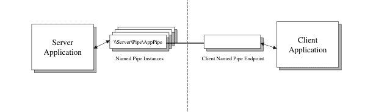

**图 6.2**  
命名管道通信。

命名管道客户端使用 Win32 *CreateFile* 或 *CallNamedPipe* 函数，指定服务器创建的管道名称，来连接到服务器。如果服务器已执行 *ConnectNamedPipe* 调用，则客户端的安全配置文件及其对管道的访问请求（读、写）将根据命名管道安全描述符进行验证。如果客户端获得命名管道的访问权限，它将接收一个表示命名管道连接客户端侧的句柄，并且服务器的 *ConnectNamedPipe* 调用完成。

建立命名管道连接后，客户端和服务器可以使用 *ReadFile* 和 *WriteFile* Win32 函数从管道读取和向管道写入。命名管道支持消息传输的同步和异步操作。图 6.2 显示了通过命名管道实例通信的服务器和客户端。

命名管道网络 API 的一个独特特性是它允许服务器使用 *ImpersonateNamedPipeClient* 函数模拟客户端。

**邮槽操作。** 邮槽提供不可靠的单向广播机制。一个可以使用这种通信类型的应用程序示例是时间同步服务，它可能每隔几秒在整个域内广播源时间。接收源时间消息对于网络上的每台计算机来说并不是至关重要的，因此是邮槽使用场景的良好候选者。

与命名管道类似，邮槽集成在 Win32 API 中。邮槽服务器通过使用 `CreateMailslot` 函数创建邮槽。`CreateMailslot` 接受形式为 “\\Mailslot\MailslotName” 的名称作为输入参数。同样，邮槽服务器只能在其运行的机器上创建邮槽，并且分配给邮槽的名称可以包含子目录。`CreateMailslot` 还添加了一个控制客户端访问邮槽的安全描述符。`CreateMailslot` 返回的句柄是 *重叠的*，这意味着在句柄上执行的操作（如发送和接收消息）是异步的。

由于邮槽是单向且不可靠的，`CreateMailslot` 不像 `CreateNamedPipe` 那样接受许多参数。创建邮槽后，服务器只需对表示邮槽的句柄执行 `ReadFile` 函数来监听传入的客户端消息即可。

邮槽客户端使用与命名管道客户端类似的命名格式，但带有变体，使其能够将消息广播到客户端域内或指定域内所有给定名称的邮槽。若要向邮槽的特定实例发送消息，客户端调用 `CreateFile` 并指定计算机特定的名称。此类名称的一个示例是 \\Server\Mailslot\MailslotName。（客户端可以指定 \\ 来表示本机。）如果客户端想要获取表示其所属域内所有给定名称邮槽的句柄，则指定格式为 \\*\Mailslot\MailslotName 的名称；如果客户端想要将消息广播到其他域内所有给定名称的邮槽，则使用的格式为 \\DomainName\Mailslot\MailslotName。

获取表示邮槽客户端侧的句柄后，客户端通过调用 `WriteFile` 发送消息。由于邮槽的实现方式，只有小于 425 字节的消息可以被广播。如果消息大于 425 字节，邮槽实现使用可靠的通信机制，这需要一对一的客户端/服务器连接，从而排除了广播功能。此外，邮槽实现的一个怪癖会导致 425 或 426 字节的消息被截断为 424 字节。这些限制使得邮槽通常不适用于大于 424 字节的消息。图 6.3 显示了客户端在域内向多个邮槽服务器广播的示例。


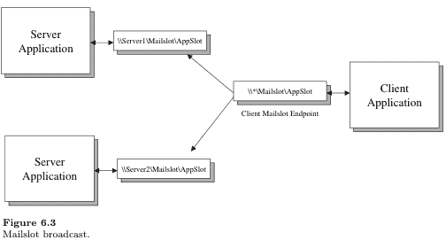

#### 图 6.3 邮件槽广播。

#### 命名管道和邮件槽的实现

作为与 Win32 紧密集成的证据，命名管道和邮件槽功能全部在 Win32 客户端 DLL kernel32.dll 中实现。`ReadFile` 和 `WriteFile` 是应用程序用于通过命名管道和邮件槽发送和接收消息的函数，它们是主要的 Win32 I/O 例程。客户端用于打开命名管道或邮件槽的 `CreateFile` 函数也是标准的 Win32 I/O 例程。然而，由命名管道和邮件槽应用程序指定的名称指定了由命名管道文件系统驱动程序（`\\Winn\System32\Drivers\Npfs.sys`）和邮件槽文件系统驱动程序（`\\Winn\System32\Drivers\Msfs.sys`）管理的文件系统命名空间，如图 6.4 所示。命名管道文件系统驱动程序创建一个名为 `\Device\NamedPipe` 的设备对象，并创建一个指向该对象的名为 `\\?\Pipe` 的符号链接；邮件槽文件系统驱动程序创建一个名为 `\Device\Mailslot` 的设备对象，并创建一个指向该对象的名为 `\\?\Mailslot` 的符号链接。传递给 `CreateFile` 的形如 `\\...\\Pipe\...` 和 `\\...\\Mailslot\...` 的名称，其 `\\...` 前缀会被转换为 `\\?\`，以便名称通过符号链接解析到设备对象。特殊函数 `CreateNamedPipe` 和 `CreateMailslot` 使用相应的本机函数 `NtCreateNamedPipeFile` 和 `NtCreateMailslotFile`。

在章节的后半部分，我们将讨论当指定远程命名管道或邮件槽的名称解析到远程系统时，重定向器文件系统驱动程序是如何参与的。然而，当命名管道或邮件槽由服务器创建或由客户端打开时，位于命名管道或邮件槽所在机器上的相应文件系统驱动程序（FSD）最终会被调用。内核模式下的 FSD 实现命名管道和邮件槽有几个原因，主要原因是它们与对象管理器命名空间集成，并且可以使用文件对象来表示已打开的命名管道和邮件槽。这种集成带来了几个好处：

-   FSD 使用内核模式安全函数为命名管道和邮件槽实现标准的 Windows 2000 安全功能。
-   应用程序可以使用 `CreateFile` 打开命名管道或邮件槽，因为 FSD 与对象管理器命名空间集成。
-   应用程序可以使用 `ReadFile` 和 `WriteFile` 等 Win32 函数与命名管道和邮件槽进行交互。
-   FSD 依靠对象管理器来跟踪表示命名管道和邮件槽的文件对象的处理程序和引用计数。
-   FSD 可以实现自己的命名管道和邮件槽命名空间，包括完整的子目录。

### 6.2.2 Windows Sockets

Windows Sockets（Winsock）是微软对 BSD（Berkeley Software Distribution）Sockets 的实现，这是一个编程 API，自 1980 年代起成为 Unix 系统通过互联网通信的标准。Windows 2000 对套接字的支持使得将 Unix 网络应用程序移植到 Windows 2000 的任务相对简单。Winsock 包含了 BSD Sockets 的大多数功能，但也包含了微软特定的增强功能，这些功能仍在不断演进。Winsock 支持可靠的面向连接的通信以及不可靠的无连接通信。Windows 2000 提供 Winsock 2.2，它包含在所有版本的 Consumer Windows 中，或可作为附加组件获得。

Winsock 包括以下特性：

-   支持分散/聚集（scatter-gather）和异步应用程序 I/O。
-   服务质量（QoS）约定，以便应用程序在底层网络支持 QoS 时，可以协商延迟和带宽要求。
-   可扩展性，以便 Winsock 可以用于 Windows 2000 要求它支持之外的其他协议。
-   支持除应用程序与 Winsock 使用的协议定义之外的集成命名空间。例如，服务器可以在 Active Directory 中发布其名称，并且利用命名空间扩展，客户端可以在 Active Directory 中查找服务器的地址。
-   支持多播消息，其中消息同时传输到多个接收者。
-   支持服务器区域网络（SAN）。SAN（不要与存储区域网络混淆）通过高度可靠、低延迟、高速互连连接计算机。Winsock 的 Windows Sockets Direct（WSD）架构允许基于 TCP 的套接字应用程序直接访问 SAN 硬件，而无需通过 TCP/IP 堆栈。

接下来我们将检查典型的 Winsock 操作，然后描述扩展 Winsock 的方式。本节最后将介绍 WSDP 在 SAN 中的使用。

**Winsock 操作。** 通过调用初始化函数初始化 Winsock API 后，Winsock 应用程序采取的第一个步骤是创建一个*套接字*，它将表示通信端点。由于套接字必须*绑定*到本地计算机上的地址，绑定是应用程序执行的第二个步骤。Winsock 是一个协议无关的 API，因此可以为系统上安装的任何协议指定地址，Winsock 在其上运行（NetBEUI、TCP/IP、IPX）。绑定完成后，服务器和客户端采取的步骤会有所不同，面向连接和无连接套接字操作的步骤也会有所不同。

面向连接的 Winsock 服务器在套接字上执行侦听（listen）操作，指示其可以支持的连接数。然后，它执行接受（accept）操作，以允许客户端连接到套接字。如果有挂起的连接请求，`accept` 调用立即完成；否则，当连接请求到达时完成。当建立连接时，`accept` 函数返回一个新的套接字，表示服务器端的连接端。服务器可以使用 `recv` 和 `send` 等函数执行接收和发送操作。

面向连接的客户端使用指定远程地址的 Winsock `connect` 函数连接到服务器。当建立连接时，客户端可以通过其套接字发送和接收消息。图 6.5 显示了 Winsock 客户端和服务器之间的面向连接的通信。

在绑定地址后，无连接服务器与无连接客户端没有区别：它只需在每条消息中指定远程地址，就可以通过套接字发送和接收消息。当使用无连接消息（也称为数据报）时，当发送方在下一次执行接收操作时获得错误代码时，发送方才知道消息未被接收。

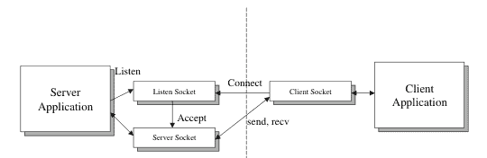

**图 6.5 面向连接的 Winsock 操作。**

**Winsock 扩展。** 从 Windows 编程的角度来看，一个强大的特性是 Winsock API 与 Windows 消息集成。Winsock 应用程序可以利用此特性执行异步套接字操作，并通过标准 Windows 消息或回调函数的执行接收操作完成的通知。此能力简化了 Windows 应用程序的设计，因为应用程序无需多线程化或管理同步对象，既可以执行网络 I/O，又可以响应用户输入或来自窗口管理器的更新应用程序窗口的请求。基于消息的 BSD 风格 Winsock 函数的名称通常以 `WSA` 开头，例如，`WSAAccept`。

除了支持直接对应于在 BSD Sockets 中实现的函数外，微软还添加了一些不属于 Winsock 标准的函数。其中两个函数，`AcceptEx` 和 `TransmitFile`，值得描述，因为 Windows 2000 上的许多 Web 服务器使用它们来实现高性能。`AcceptEx` 是 `accept` 函数的一个版本，在与客户端建立连接的过程中，它返回客户端的地址和客户端的第一条消息。借助此函数，Web 服务器避免了执行多个否则所需的 Winsock 函数。

在与客户端建立连接后，Web 服务器通常向客户端发送文件，例如网页。`TransmitFile` 函数的实现与 Windows 2000 缓存管理器集成，以便客户端可以直接从文件系统缓存发送文件。以这种方式发送数据被称为零拷贝，因为服务器不必接触文件数据即可发送；它只需指定文件的句柄和要发送的文件范围。此外，`TransmitFile` 允许服务器在文件数据之前添加或之后追加数据，以便服务器可以发送标头信息，这可能包括 Web 服务器的名称以及指示服务器正在发送的消息大小的字段。Windows 2000 捆绑的 Internet Information Services (IIS) 5.0 同时使用 `AcceptEx` 和 `TransmitFile`。

#### 扩展 Winsock

Winsock 在 Windows 2000 上是一个可扩展的 API，因为第三方可以添加传输服务提供程序，将 Winsock 与其他协议接口，以及命名空间服务提供程序，以增强 Winsock 的名称解析功能。服务提供程序使用 Winsock 服务提供程序接口插入 Winsock。当传输服务提供程序在 Winsock 中注册时，Winsock 使用传输服务提供程序为提供程序指示其实现的地址类型实现套接字函数，例如 `connect` 和 `accept`。对于传输服务提供程序如何实现函数没有限制，但实现通常涉及与内核模式下的传输驱动程序通信。

任何 Winsock 客户端/服务器应用程序的要求都是服务器使


使其地址对客户端可用，以便客户端能够连接到服务器。在 TCP/IP 协议上运行的标准服务使用“**知名地址**”来公布其地址。只要浏览器知道运行 Web 服务器的计算机的名称，它就可以通过指定知名 Web 服务器地址（服务器 IP 地址与 HTTP 使用的端口号 80 连接：`:80`）来连接到 Web 服务器。命名空间服务提供商使服务器能够通过其他方式注册其存在成为可能。例如，一个命名空间服务提供商可能在服务器端将服务器地址注册到 Active Directory，并在客户端端从 Active Directory 中查找服务器地址。命名空间服务提供商通过实现标准的 Winsock 名称解析函数（如 `gethostbyaddr`、`getservbyname` 和 `getservbyport`）向 Winsock 提供此功能。

#### Winsock 的实现。

Winsock 的实现如图 6.6 所示。其应用程序接口由一个 API 动态链接库组成，即 **ws2_32.dll**（`\Winnt\System32\Ws2.32.dll`），它为应用程序提供访问 Winsock 函数的通道。**ws2_32.dll** 调用命名空间和传输服务提供商的服务来执行名称和消息操作。**Msafd.dll** 库作为 Microsoft 在 Winsock 中支持的各种协议的传输服务提供商，而 **Msafd.dll** 使用协议特定的 `Winsock 辅助`库与内核模式协议驱动程序进行通信。例如，**wshtcpip.dll** 是 TCP/IP 辅助库，而 **wshnetbs.dll** 是 NetBEUI 辅助库。**Mssock.dll**（`\Winnt\System32\Mssock.dll`）实现了 Microsoft Winsock 扩展函数，如 `TransmitFile`、`AcceptEx` 和 `WSARecvEx`。Windows 2000 附带用于 TCP/IP、NetBEUI、AppleTalk、IPX/SPX、ATM 和 IrDA（红外数据协会）的辅助 DLL，以及用于 DNS（TCP/IP）、Active Directory 和 IPX/SPX 的命名空间服务提供商。

与命名管道和邮件槽 API 类似，Winsock 与 Win32 I/O 模型集成，并使用文件句柄来表示套接字。这种支持需要内核模式文件系统驱动程序的协助，因此 **Msafd.dll** 使用辅助功能驱动程序（AFD - `\Winnt\System32\Drivers\Afdl.sys`）的服务来实现基于套接字的功能。AFD 是一个 TDI 客户端，通过向协议驱动程序发送 TDI IRP 来执行网络套接字操作，例如发送和接收消息。AFD 并非编码为使用特定的协议驱动程序；相反，**Msafd.dll** 通知 AFD 每个套接字使用的协议名称，以便 AFD 可以打开代表该协议的设备对象。

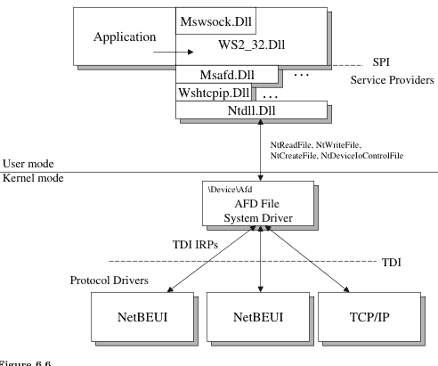

图 6.6
Winsock 实现

### 6.2.3 Windows Sockets Direct

Windows Sockets Direct（WSD）是一个接口，允许 Winsock 应用程序无需修改即可利用服务器区域网络（SAN）。SAN 的高性能特性使其成为从分布式计算到三层电子商务架构（如图 6.7 所示）等各种应用程序的理想选择。在所示系统中，SAN 连接前端 Web 服务器与业务逻辑服务器，并将业务逻辑服务器与后端数据库服务器连接起来，以在数据处理层之间提供高速数据传输。WSD 可用于 Windows XP 和 Windows 2002、Windows 2000 Data Center Server、安装了 Service Pack (SP) 2 或更高版本的 Windows 2000 Advanced Server，以及安装了 SP2 或更高版本的 Windows Server Appliance Kit。

SAN 互连。服务器区域网络通常通过依赖专用的网络互连和交换硬件来实现其高性能特性。常见的 SAN 互连类型包括 InfiniBand、千兆以太网、FiberChannel 以及专有解决方案。两台计算机之间的共享物理内存也可以作为 SAN 互连使用。目前销售 Windows 支持的 SAN 硬件的供应商包括 Emulex（http://www.emulex.com），其 cLAN 主机适配器和交换机可提供 1.25 Gbs/（2.5 Gbs/ 双向）的吞吐量。

SAN 交换硬件实现一种不可路由的协议，提供类似于 TCP 的保证，如可靠、有序的消息传递。它们还支持一种称为远程直接内存访问（RDMA）的 SAN 功能，允许消息直接从源计算机的物理内存传输到目标计算机的物理内存，而无需通常在消息传输接收端发生的中间内存复制操作。因此，RDMA 释放了复制操作所消耗的 CPU 和内存总线带宽。

SAN 实现还允许应用程序完全绕过内核模式组件，直接针对用户应用程序发送和接收数据。此策略最大限度地减少了应用程序发起的系统调用次数，并进一步减少了在操作系统网络代码中花费的时间。

**WSD 架构。** 大多数 SAN 实现要求修改应用程序，以便应用程序能够与 SAN 网络协议进行交互并利用 SAN 硬件实现的网络协议以及 RDMA 等 SAN 功能，但 Windows Sockets Direct 允许任何使用 TCP 协议基于 Winsock 的应用程序无需修改即可利用 SAN。WSD 的名称来源于它允许应用程序直接访问 SAN 硬件，从而绕过 TCP/IP 堆栈。这种通往网络硬件的捷径使应用程序的性能提升了 2 到 2.5 倍。

WSD 通过在 Winsock DLL 和 WSP 下方使用软件交换机来实现通往 SAN 硬件的捷径，如图 6.8 所示。该交换机将 SAN 网络活动路由到供应商提供的 SAN WSP。WSP 充当用户模式下的 NDIS 驱动程序的等效物，具有将 SAN 硬件寄存器映射到用户模式内存并操纵硬件的能力，而无需通过内核模式组件。某些网络活动确实需要内核模式组件的协助（例如，将硬件映射到用户模式内存），这也由 SAN 供应商提供。最后，SAN 供应商提供一个 NDIS 小程序驱动程序，以便将使用 Winsock 网络功能但未被 SAN 原生支持的应用程序连接到 TCP/IP 堆栈。

### 6.2.4 远程过程调用

远程过程调用（RPC）是一个网络编程标准，最初在 20 世纪 80 年代初期开发。开放软件基金会（现为 The Open Group）将 RPC 作为分布式计算环境（DCE）分布式计算标准的一部分。尽管存在第二个 RPC 标准 SunRPC，但 Microsoft 的 RPC 实现与 OSF/DCE 标准兼容。RPC 构建在其他网络 API（如命名管道或 Winsock）之上，以提供另一种编程模型，在某种程度上向应用程序开发者隐藏了网络编程的细节。

**RPC 操作。** 远程过程调用允许程序员创建一个由任意数量的过程组成的应用程序，其中一些在本地执行，另一些通过网络在远程计算机上执行。它提供了网络操作的过程化视图，而不是以传输为中心的视图，从而简化了分布式应用程序的开发。

网络软件传统上是围绕 I/O 处理模型构建的。例如，在 Windows 2000 中，当应用程序发出远程 I/O 请求时，网络操作即被启动。


**图 6.8**
传统 Winsock 模型与 WSD 模型。

操作系统相应地处理该请求，将其转发给一个`重定向器`，该重定向器充当远程文件系统，使客户端与远程文件系统的交互对客户端不可见。重定向器将操作传递给远程文件系统，当远程系统填充请求并返回结果后，本地网络卡触发中断。内核处理该中断，原始 I/O 操作完成，并向调用者返回结果。

远程过程调用采取了完全不同的方法。RPC 应用程序与其他结构化应用程序类似，有一个主程序调用 RPC 过程或过程库来执行特定任务。然而，RPC 应用程序与普通应用程序的区别在于，RPC 应用程序中的一些过程库在远程计算机上执行，如图 6.9 所示，而另一些则在本地执行。

对于 RPC 应用程序而言，所有过程似乎都在本地执行。换句话说，程序员不需要主动编写代码来传输计算结...


**图 6.9**
RPC 操作。

涉及或 I/O 相关的跨网络请求，处理网络协议，应对网络错误，等待结果等。RPC 软件会自动处理这些任务。并且，Windows 2000 的 RPC 设施可以运行在系统加载的任何可用传输机制之上。

编写 RPC 应用程序时，你需要决定哪些过程将在本地执行，哪些将在远程执行。例如，假设一台普通工作站通过网络连接到了 Cray 超级计算机或一台专为高速向量运算设计的机器。如果你正在编写一个操作大型矩阵的应用程序，从性能角度来看，将其编写为 RPC 应用程序并将数学计算卸载到远程计算机是合理的。

RPC 应用程序的工作方式如下。随着应用程序运行，它调用本地过程以及本地机器上不存在的远程过程。为了处理后一种情况，应用程序链接到一个包含*存根过程*（stub procedures）的本地静态链接库或动态链接库，每个远程过程对应一个存根。对于简单的应用程序，存根过程与应用程序静态链接；但对于较大的组件，存根包含在单独的 DLL 中。在稍后本章讨论的分布式组件对象模型（DCOM）中，通常采用后一种方法。存根过程具有与远程过程相同的名称并使用相同的接口，但它们并不执行所需的操作，而是接收传递给它们的参数，并将它们*编组*（marshals）以便通过网络传输。参数编组意味着以特定方式对参数进行排序和打包，以适应网络链路，例如解析引用并获取指针所引用的数据结构的副本。

随后，存根调用 RPC 运行时过程，以定位远程过程所在的计算机，确定该计算机使用的传输机制，并使用本地传输软件将请求发送到该计算机。当远程服务器接收到 RPC 请求时，它会*解编组*参数（即编组的逆过程），重建原始过程调用，并调用该过程。当服务器完成处理后，它执行反向序列以将结果返回给调用者。

除了这里描述的基于同步函数调用的接口外，Windows 2000 RPC 还支持*异步 RPC*。异步 RPC 允许 RPC 应用程序执行一个函数，但不必等待该函数完成才能继续处理。相反，应用程序可以执行其他代码；稍后，当从服务器接收到响应时，RPC 运行时会向客户端与异步调用关联的事件对象发出信号。客户端可以使用标准的 Win32 函数，例如 *WaitForSingleObject*，来获知函数已完成。

除了 RPC 运行时，微软的 RPC 设施还包括一个称为*微软接口定义语言*（IDL）的编译器。IDL 编译器简化了 RPC 应用程序的创建过程。程序员编写一系列普通的函数原型（假设是 C 或 C++ 应用程序）来描述远程例程，然后将这些例程放入一个文件中。随后，程序员向这些原型添加一些额外信息，例如例程包的网络唯一标识符和版本号，以及指定参数是输入、输出还是两者的属性。经过装饰的原型构成了开发者的*接口定义语言*文件。

一旦 IDL 文件创建完毕，程序员使用 IDL 编译器对其进行编译，该编译器生成前面提到的客户端和服务器端存根例程，以及需要包含在应用程序中的头文件。当客户端应用程序链接到存根例程文件时，所有远程过程引用都将被解析。远程过程随后通过类似的过程安装在服务器机器上。想要调用现有 RPC 应用程序的程序员只需编写软件客户端部分，并将应用程序链接到本地 RPC 运行时设施即可。

RPC 运行时使用通用的*RPC 传输提供程序接口*与传输协议通信。提供程序接口作为 RPC 设施和传输机制之间的一层薄层，将 RPC 操作映射到传输机制提供的功能上。Windows 2000 设施实现了针对命名管道、NetBIOS 和 TCP/IP 的传输提供程序 DLL。你可以编写新的提供程序 DLL 以支持额外的传输机制。类似地，RPC 设施被设计为可与不同的网络安全设施协同工作。

大多数 Windows 2000 网络服务都是 RPC 应用程序，这意味着本地进程和远程计算机上的进程都可以调用它们。因此，远程客户端计算机可以调用服务器服务来列出共享资源、打开文件、写入打印队列或激活服务器上的用户，或者它可以调用 messengger 服务向你发送消息（当然，所有这些都要受安全约束的限制）。

*服务器名称发布*，即服务器在客户端可访问的位置注册其名称的能力，位于 RPC 中，并与 Active Directory 集成。如果未安装 Active Directory，RPC 名称定位服务将回退到使用 NetBIOS 广播。这种行为确保与 Windows NT 4 系统的互操作性，并允许 RPC 在独立服务器和工作站上运行。

**RPC 实现。** RPC 实现如图 6.10 所示，该图表明基于 RPC 的应用程序与 RPC 运行时 DLL（`\\Winnt\\System32\\Rprt4.dll`）进行链接。RPC 运行时 DLL 为应用程序的 RPC 函数存根提供编组和解编组功能，以及发送和接收编组数据的函数。RPC 运行时 DLL 包含支持例程，用于处理网络上的 RPC 以及一种称为*本地 RPC* 的 RPC 形式。本地 RPC 可用于位于同一系统上的两个进程之间的通信，且 RPC 运行时 DLL 使用内核模式下的本地过程调用（LPC）设施作为本地网络 API。当 RPC 基于非本地通信机制时，RPC 运行时 DLL 使用 Winsock、命名管道或消息队列 API。

对于名称注册和查找，RPC 应用程序与 RPC 名称服务 DLL（`\\Winnt\\System32\\Rpcns4.dll`）进行链接。该 DLL 与 RPC 子系统（RPCSS - `\\Winnt\\System32\\Rpcss.dll`）通信，而 RPCSS 被实现为一个 Win32 服务。RPCSS 本身是一个 RPC 应用程序，它与其他系统上的自身实例通信以执行名称查找和注册。（为清晰起见，图 6.10 未显示 RPCSS 与 RPC 运行时 DLL 的链接。）

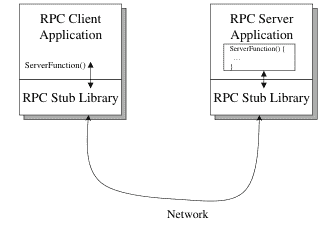

### 6.2.5 其他网络 API

Windows 2000 包含其他使用频率较低或建立在已描述 API 之上的网络 API（这些 API 超出了本书的范围）。这些包括电话 API（TAPI）、分布式组件对象模型（DCOM）和消息队列，它们对于 Windows 2000 系统和许多应用程序的运行都至关重要。

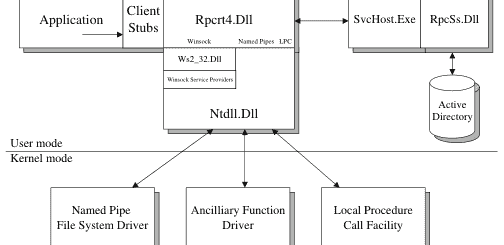

**图 6.10**
RPC 实现。

## 6.3 网络资源名称解析

应用程序可以通过两种方式检查或访问远程系统上的资源。一种方式是使用 Win32 函数和 UNC 标准直接寻址远程资源；另一种方式是使用 Windows 网络（WNet）API 枚举计算机及其导出的共享资源。这两种方法都利用重定向器的功能来定位网络。如前所述，为了从客户端访问 CIFS 服务器，微软提供了一个 CIFS 重定向器，它有一个称为重定向器 FSD 的内核模式组件和一个称为工作站服务（Workstation service）的用户模式组件。微软还提供了一个可以访问 Novell NetWare 服务器共享资源的 重定向器，第三方也可以向 Windows 2000 添加自己的重定向器。在本节中，我们将检查当发出远程 I/O 请求时决定调用哪个重定向器的软件。负责组件如下：

- 多协议路由器（MPR）是一个 DLL，当应用程序使用 Win32 WNet API 浏览远程文件时，它确定要访问哪个网络


系统。

-   **多重 UNC 提供程序**（MUP）是一个驱动程序，它确定当应用程序使用 Win32 I/O API 打开远程文件时，应访问哪个网络。

本节的结论将描述域名系统（Domain Name System），这是 Windows 2000 中计算机名称解析的核心。

### 6.3.1 多重提供程序路由器

Win32 WNet 函数允许应用程序（包括 Windows 资源管理器中的“我的网络位置”）连接到网络资源（如文件服务器和打印机），并浏览任何类型的远程文件系统的目录。由于 WNet API 可以被调用来跨使用不同传输协议的不同网络工作，因此必须存在软件来正确地将请求发送到网络上，并理解远程服务器返回的结果。图 6.11 展示了负责这些任务的重新定向器软件。

*提供程序*（provider）是使 Windows 2000 成为远程网络服务器客户端的软件。WNet 提供程序执行的操作包括建立和断开网络连接、远程打印以及传输数据。内置的 WNet 提供程序包含一个 DLL、工作站服务和重新定向器。其他网络供应商只需提供一个 DLL 和一个重新定向器。

当应用程序调用 WNet 例程时，该调用直接传递到 MPR DLL。MPR 接收该调用并确定哪个 WNet 提供程序识别正在访问的资源。MPR 下方的每个提供程序 DLL 都提供了一组集体称为*提供程序接口*的标准函数。此接口使 MPR 能够确定*应用程序*试图访问哪个网络，并将请求引导至相应的 WNet 提供程序软件。重新定向器的提供程序是 `\Winnt\System32\Nlanman.dll`，由注册表项 `HKLM\SYSTEM\CurrentControlSet\Services\lanmanworkstation\NetworkProvider` 下的 ProviderPath 值指定。

当由 *WNetAddConnection* API 函数调用来连接到远程网络资源时，MPR 会检查 `HKLM\SYSTEM\CurrentControlSet\Control\NetworkProvider\Order\ProviderOrder` 注册表值，以确定加载了哪些网络提供程序。它会按照注册表中列出的顺序逐一轮询它们，直到重新定向器识别出该资源或已轮询完所有可用的提供程序。您可以使用图 6.12 中所示的“高级设置”对话框来更改 ProviderOrder。（截图中来源的系统仅安装了一个提供程序。）此对话框可从“网络和拨号连接”应用程序的高级菜单中访问。

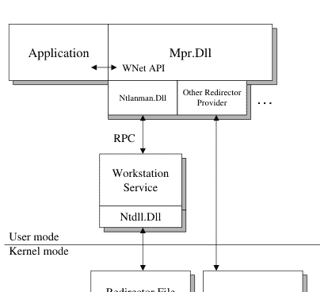

**图 6.11**
MPR 组件。

可以通过右键单击桌面上的“我的网络位置”图标并从弹出菜单中选择“属性”，或者从“开始”菜单中“设置”选项中选择该应用程序，来访问“网络和拨号连接”应用程序。

*WNetAddConnection* 函数还可以将驱动器字母或设备名称分配给远程资源。当被调用来执行此操作时，*WNetAddConnection* 将调用路由到适当的网络提供程序。提供程序随后在对象管理器命名空间中创建一个符号链接对象，将正在定义的驱动器字母映射到该网络的重新定向器（即远程 FSD）。

图 6.13 展示了 `\\?` 目录，在那里你可以看到代表远程文件共享连接的多个驱动器字母。该图显示重新定向器创建了一个名为 `\\Device\\LanmanRedirector` 的设备对象，并且包含在符号链接值中的额外

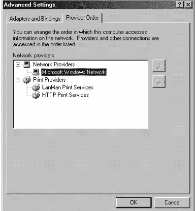

**图 6.12**
提供程序顺序编辑器。

文本指示重新定向器该驱动器字母对应于哪个远程资源。当你打开 `X:\Book\Chap13.doc` 时，重新定向器被传递了通过符号链接解析的路径的未解析部分，即 `\X:\dual\e\Book\Chap13.doc`。重新定向器记录到正在访问的资源位于服务器 dual 的 E 共享上。

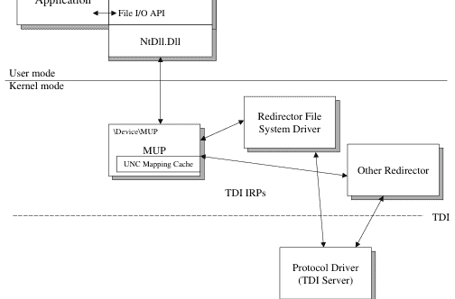

**图 6.13**
解析网络资源名称。

与内置的重新定向器一样，其他重新定向器在加载到系统并初始化时，也会在对象管理器命名空间中创建设备对象。然后，当 WNet 或其他 API 调用对象管理器以打开不同网络上的资源时，对象管理器使用该设备对象作为进入远程文件系统的起点。它调用与设备对象关联的 I/O 管理器解析方法，以定位能够处理该请求的重新定向器 FSD。

### 6.3.2 多重 UNC 提供程序

多重 UNC 提供程序（MUP）是一个类似于 MPR 的网络组件。它处理旨在发给具有 UNC 名称（以 `\\` 字符开头，指示资源存在于网络上）的文件或设备的 I/O 请求。

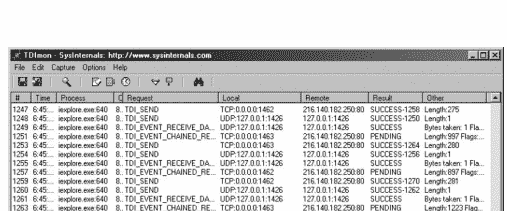

**图 6.14**
多重 UNC 提供程序（MUP）。

MUP 接收此类请求，并像 MPR 一样确定哪个本地重新定向器识别远程资源。然而，与 MPR 不同的是，MUP 是一个设备驱动程序（在系统启动时加载），它向底层驱动程序（在此情况下是重新定向器）发出 I/O 请求，如图 6.14 所示。

当应用程序首次尝试通过指定 UNC 名称（而不是前面描述的重新映射的驱动器字母）来打开远程文件或设备时，MUP 驱动程序被激活。当 Win32 客户端 DLL Kernel32.dll（它是导出文件/I-O 相关 API 的 DLL）收到此类请求时，子系统将 UNC 名称附加到字符串 `\\UNC` 中，然后调用 `NtCreateFile` 系统服务来打开文件。此对象名称是一个符号链接的名称，该符号链接解析为 `\\Device\\Mup`，这是一个代表 MUP 驱动程序的 设备对象。

MUP 驱动程序接收请求，并向每个注册的重新定向器异步发送 IRP，等待其中一个识别出资源名称并回复。当重新定向器识别出名称时，它会指示名称中有多少部分是

其特有的。例如，如果名称是 `\\WIN2KSERVER\\PUBLIC\incisedw2k\chap13.doc`，重新定向器识别出它并认领字符串 `\\WIN2KSERVER\\PUBLIC` 为其独有。MUP 驱动程序缓存此信息，此后直接将以该字符串开头的请求发送给重新定向器，跳过轮询操作。MUP 驱动程序缓存具有超时功能，因此在一时期不活动后，字符串与特定重新定向器的关联将过期。如果多个重新定向器认领某个特定资源，MUP 驱动程序使用注册表中 ProviderOrder 值的已加载重新定向器列表来确定哪个重新定向器具有优先级。

### 6.3.3 域名系统

域名系统（DNS）是将 Internet 名称（如 www.microsoft.com）翻译为其对应 IP 地址的标准。想要将 DNS 名称解析为 IP 地址的网络应用程序使用 TCP/IP 协议向 DNS 服务器发送 DNS 查找请求。DNS 服务器实现了一个分布式数据库，其中包含用于执行翻译的名称/IP 地址对，并且每个服务器维护特定区域的翻译。描述 DNS 的细节超出了本书的范围，但 DNS 是 Windows 2000 命名的基础，因此是 Windows 2000 的主要名称解析协议。

Windows 2000 DNS 服务器实现为一个 Win32 服务（`\Winnt\System32\Dns.exe`），它包含在 Windows 2000 的服务器版本中。标准 DNS 服务器实现依赖文本文件作为翻译数据库，但 Windows 2000 DNS 服务器可以配置为在 Active Directory 中存储区域信息。

## 6.4 协议驱动程序

网络 API 驱动程序必须接收 API 请求，并将其转换为低层网络协议请求，以便通过网络传输。API 驱动程序依赖于内核模式下的传输协议驱动程序来执行实际的转换。将 API 与底层协议分离，赋予网络架构灵活性，使每个 API 可以使用多种不同的协议。Windows 2000 包含的协议驱动程序包括数据链路控制（DLC）、NetBEUI、TCP/IP 和 NWLink，尽管可能存在其他协议作为选项，例如在 Windows 2000 服务器上随 Services For Macintosh 一起安装的 AppleTalk 协议。


## 6.5 NDIS 驱动程序

为了让网络 API 驱动程序无需为每种可能使用的传输协议采用不同的接口，微软制定了传输驱动程序接口（Transport Driver Interface, TDI）标准。正如本章前面所述，TDI 接口本质上是一种约定，规定了网络请求如何格式化为 IRP，以及网络地址和通信如何分配。遵循 TDI 标准的传输协议会向客户端导出 TDI 接口，这些客户端包括 AFD 和重定向程序等网络 API 驱动程序。实现为 Windows 2000 设备驱动程序的传输协议被称为 TDI 传输。由于 TDI 传输是设备驱动程序，它们将从客户端收到的请求格式化为 IRP。

Windows 2000 中的 TDI 传输通常实现与其主协议相关的所有协议。例如，TCP/IP 驱动程序（`\Winnt\System32\Drivers\Tcpip.sys`）实现了 TCP、UDP、IP、ARP、ICMP 和 IGMP。TDI 传输通常创建代表特定协议的设备对象，以便客户端可以获取代表该协议的文件对象，并通过使用 IRP 向该协议发起网络 I/O。TCP/IP 驱动程序创建三个代表各种 TDI 客户端可访问协议的设备对象：`\Device\Tcp`、`\Device\Udp` 和 `\Device\Ip`。

TDI 接口由 `\Winnt\System32\Drivers\Tdi.sys` 库中的支持函数以及开发人员在其驱动程序中包含的定义组成。TDI 编程模型与 Winsock 类似。TDI 客户端执行以下步骤以与远程服务器建立连接：

- 1. 客户端分配并格式化一个 **地址打开（address open）** TDI IRP，以分配地址。TDI 传输返回一个被称为 **地址对象（address object）** 的文件对象，该对象代表此地址。这一步相当于使用 *bind* Winsock 函数。
- 2. 然后，客户端分配并格式化一个 **连接打开（connection open）** TDI IRP，TDI 传输返回一个被称为 **连接对象（connection object）** 的文件对象，该对象代表此连接。这一步相当于使用 Winsock *socket* 函数。
- 3. 客户端使用 **关联地址（associate address）** TDI IRP 将连接对象关联到地址对象。（在 Winsock 中没有与此步骤等效的操作。）
- 4. 接受远程连接的 TDI 客户端发出一个 **监听（listen）** TDI IRP，指定连接对象支持的连接数，然后发出一个 **接受（accept）** TDI IRP，该 IRP 在远程系统建立连接（或发生错误）时完成。这些操作相当于使用 Winsock 的 `listen` 和 `accept` 函数。
- 5. 希望与远程服务器建立连接的 TDI 客户端发出一个 `connect` TDI IRP，指定连接对象，当连接建立（或发生错误）时，TDI 传输完成该操作。发出 `connect` TDI IRP 相当于使用 `connect` Winsock 函数。

TDI 还支持无连接协议（如 UDP）的无连接通信。此外，TDI 提供了一种机制，允许 TDI 客户端向 TDI 传输注册 `event callbacks`（即直接被调用的函数）。当从网络上收到数据时，TDI 传输可以调用已注册的客户端接收回调函数，例如。TDI 的这种基于事件的回调功能允许 TDI 传输通知其客户端有关网络事件的信息。依赖事件回调的客户端在接收网络数据时无需预先分配缓冲区等资源，因为它们可以查看由 TDI 协议驱动程序提供的缓冲区的内容。

**监视 TDI 活动。** TDImon 是一个可以从 Sysinternals 网站（`www.sysinternals.com`）获取的免费实用工具，它是一种附着在 TCP/IP 驱动程序创建的 `\Device\Tcp` 和 `\Device\Udp` 设备对象上的过滤驱动程序。附着后，TDImon 可以看到 TDI 客户端向这些协议发出的每个 IRP。通过拦截 TDI 客户端事件回调注册，它还监视事件回调。TDImon 驱动程序将关于 TDI 活动的信息发送给其 GUI 进行显示，在那里你可以看到操作的时间、发生的 TDI 活动类型、TCP 连接的本地和远程地址或 UDP 端点的本地地址、IRP 或事件回调的结果状态代码，以及额外信息，如发送或接收的字节数。以下是 TDImon 监视由 Microsoft Internet Explorer 浏览网页时生成的 TDI 活动的屏幕截图。

作为 TDI 操作本质上是异步的证据，Result 列中的 `PENDING` 代码表明操作已发起，但定义该操作的 IRP 尚未完成。为了准确显示完成顺序相对于其他操作开始的情况，每个 IRP 或事件回调的发出都标记了一个序列号。如果其他 IRP 在某个 IRP 完成之前发出或完成，那么该 IRP 的完成也会标记一个在 Result 列中显示的序列号。例如，屏幕截图中标记为序列号 1278 的 IRP 在标记为 1279 的 IRP 发出之后才完成，因此你在 IRP 1278 的 Result 列中看到 1280。

当协议驱动程序想要从其协议格式读取或写入消息到网络时，驱动程序必须使用网络适配器来执行此操作。由于期望协议驱动程序理解市面上每个网络适配器的细微差别（专有网络适配器有数千种）是不切实际的，网络适配器供应商提供设备驱动程序，这些驱动程序可以接收网络消息并通过供应商的专有硬件传输它们。1989 年，微软和 3Com 联合开发了网络驱动程序接口规范（Network Driver Interface Specification, NDIS），它允许协议驱动程序以设备无关的方式与网络适配器驱动程序通信。符合 NDIS 标准的网络适配器驱动程序被称为 NDIS 驱动程序或 NDIS miniport 驱动程序。随 Windows 2000 发行的 NDIS 版本是 NDIS 5。

在 Windows 2000 上，NDIS 库（`\Winnt\System32\Drivers\Ndis.sys`）实现了 TDI 传输（通常）和 NDIS 驱动程序之间存在的 NDIS 边界。与 Tdi.sys 一样，NDIS 库是一个辅助库，NDIS 驱动程序客户端使用它来格式化发送给 NDIS 驱动程序的命令。NDIS 驱动程序通过该库接收请求并返回响应。图 6.15 显示了各种 NDIS 相关组件之间的关系。

微软为其网络架构设定的目标之一是让网络适配器供应商能够轻松开发 NDIS 驱动程序，并将驱动代码在 Consumer Windows 和 Windows 2000 之间移动。因此，NDIS 库不仅仅提供 NDIS 边界辅助例程，而是为 NDIS 驱动程序提供一个完整的执行环境。NDIS 驱动程序不是真正的 Windows 2000 驱动程序，因为如果没有 NDIS 库提供的封装，它们无法工作。这个隔离层如此彻底地包裹 NDIS 驱动程序，以至于 NDIS 驱动程序不接受和处理 IRP。相反，NDIS 库从 TDI 服务器接收 NDIS 数据包（IRP 的 NDIS 等效物），并将这些数据包转换为对 NDIS 驱动程序的调用。NDIS 驱动程序也不必担心重入性问题，即 NDIS 库在驱动程序完成处理前一个请求之前，用新请求调用 NDIS 驱动程序。豁免重入性意味着 NDIS 驱动程序编写者无需担心复杂的同步，而由于多处理器上可能的并行执行，同步变得更加棘手。

虽然 NDIS 库对 NDIS 驱动程序的序列化简化了开发，但序列化可能会阻碍多处理器可扩展性。标准 NDIS 4 驱动程序（Windows NT 4 版本的 NDIS 库）在多处理器上对某些操作的可扩展性较差。微软在 NDIS 5 中为开发人员提供了序列化操作选项。NDIS 5 驱动程序可以向 NDIS 库指示它们不希望被序列化；然后，NDIS 库将尽快将请求转发到驱动程序，即收到描述请求的 IRP 时就立即转发。排队和管理多个同时请求的责任落在 NDIS 驱动程序上，但解除序列化带来了更高的多处理器性能优势。

NDIS 5 还包括以下特性：


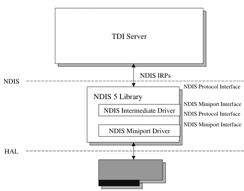

**图 6.15**

NDIS 组件。

-   NDIS 驱动程序可以报告其网络介质是否处于活动状态，这使得 Windows 2000 能够在任务栏上显示网络已连接/未连接的图标。此功能还允许协议和其他应用程序感知此状态并做出相应反应。例如，TCP/IP 传输层将使用此信息来确定何时重新评估其从 DHCP 接收的寻址信息。
-   TCP/IP 任务卸载允许 miniport 使用网络适配器的高级功能来执行诸如数据包校验和和 IP 安全（IPSec）等操作。这种任务卸载可以通过减轻 CPU 在这些操作上的负担来提高系统性能。
-   快速数据包转发允许网络适配器硬件将不指向计算机而指向远程系统的数据包进行路由，而无需将其传输到 CPU。
-   网络唤醒（Wake-on-LAN）允许支持网络唤醒的网络适配器将 Windows 2000 从挂起电源状态唤醒。可以触发网络适配器向系统发出信号的事件包括介质连接（例如将网络电缆插入适配器）、接收由协议注册的特定于协议的图案（TCP/IP 传输层请求在收到 ARP 请求时唤醒）以及对于以太网适配器，接收*魔术*包（包含适配器以太网地址的 16 个连续副本的网络数据包）。
-   面向连接的 NDIS 允许 NDIS 驱动程序管理面向连接的介质，例如异步传输模式（ATM）设备。（稍后将更详细地描述面向连接的 NDIS。）

NDIS 库提供的供 NDIS 驱动程序与网络适配器硬件交互的接口，可通过直接转换为 HAL 中对应函数的函数来访问。

### 6.5.1 NDIS Miniport 的变化

NDIS 模型还支持混合 TDI 传输-NDIS 驱动程序，称为*NDIS 中间驱动程序*。这些驱动程序位于 TDI 传输层和 NDIS 驱动程序之间。对于 NDIS 驱动程序而言，NDIS 中间驱动程序看起来像 TDI 传输层；对于 TDI 传输层而言，NDIS 中间驱动程序看起来像 NDIS 驱动程序。由于这些驱动程序位于协议驱动程序和网络驱动程序之间，NDIS 中间驱动程序可以看到系统中发生的所有网络流量。为网络适配器提供容错和负载平衡选项的软件（例如 Microsoft 的网络负载平衡提供程序）都是基于 NDIS 中间驱动程序的。作为 Microsoft QoS 实现一部分的数据包调度器是 NDIS 中间驱动程序的另一个例子。

### 6.5.2 面向连接的 NDIS

NDIS 5 引入了一种新的 NDIS 驱动程序类型：面向连接的 NDIS miniport 驱动程序。因此，对面向连接的网络硬件（例如 ATM）的支持在 Windows 2000 中是原生的，这使得连接管理和建立成为 Windows 2000 网络架构的标准。面向连接的 NDIS 驱动程序使用与标准 NDIS 驱动程序相同的许多 API；然而，面向连接的 NDIS 驱动程序通过已建立的网络连接发送数据包，而不是将它们放置在网络介质上。

除了支持面向连接介质的 miniport 之外，NDIS 5 还包含用于支持面向连接 miniport 驱动程序的驱动程序定义：

-   呼叫管理器（Call managers）是提供面向连接的呼叫建立和拆除服务的 NDIS 驱动程序（稍后详述）。呼叫管理器使用面向连接的 miniport 与其他网络实体（如网络交换机或其他呼叫管理器）交换信令消息。呼叫管理器支持一个或多个信令协议，例如 ATM 用户-网络接口（UNI）3.1。
-   集成 miniport（MCM）是一种也面向连接客户端提供呼叫管理器服务的面向连接 miniport 驱动程序。MCM 本质上是一个内置呼叫管理器的 NDIS miniport 驱动程序。
-   面向连接的客户端使用呼叫管理器或 MCM 的呼叫建立和拆除服务，以及面向连接 NDIS miniport 驱动程序的发送和接收服务。面向连接的客户端可以为网络堆栈中的更高层提供自己的协议服务，或者它可以实现一个仿真层，该层将面向连接的旧协议和面向连接的介质进行接口。面向连接的客户端实现的一个仿真层例子是局域网仿真（LANE），它隐藏了 ATM 的面向连接特性，并向其上的协议呈现一个无连接介质（如以太网）。

图 6.16 显示了这些组件之间的关系。

### 使用网络监视器捕获网络数据包

Windows 2000 Server 附带了一个名为网络监视器（Network Monitor）的工具，该工具允许通过安装 NDIS 中间驱动程序来捕获流经系统中一个或多个 NDIS miniport 驱动程序的数据包。在使用网络监视器之前，您需要在系统上安装 Windows 2000 网络监视器工具。要安装这些工具，请打开控制面板中的添加/删除程序，并选择添加/删除 Windows 组件。选择管理工具和监视工具，单击详细信息，选中网络监视器工具，然后单击确定。

安装网络监视器工具后，请按照以下步骤安装网络监视器：

1.  通过右键单击桌面上的“我的网络位置”图标并选择“属性”，或通过从“开始”菜单中选择“设置”选项中的“网络和拨号连接”来启动“网络和拨号连接”应用程序。
2.  右键单击本地适配器，选择“属性”，并在“本地连接属性”对话框中单击“安装”按钮。

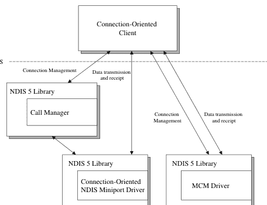

**图 6.16** 面向连接的 NDIS 驱动程序。

3.  选择“协议”，然后单击“添加”按钮。
4.  选择“网络监视器驱动程序”，然后单击“确定”。

安装网络监视器驱动程序后，您可以通过从“开始”菜单中的“程序”->“管理工具”文件夹中选择它来启动网络监视器。

网络监视器可能会询问您要监视哪个网络连接。选择一个之后，通过点击工具栏中的“开始捕获”按钮开始监视。在被监视的连接上执行生成网络活动的操作，当您看到网络监视器已捕获数据包后，通过单击“停止并查看捕获”按钮（带有眼镜图标的那个停止按钮）停止监视。网络监视器将呈现捕获数据的视图，如下面的屏幕截图所示。

### Windows 2000 网络

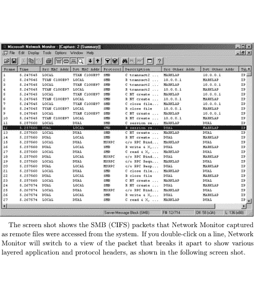

该屏幕截图显示了网络监视器在从系统访问远程文件时捕获的 SMB (CIFS) 数据包。如果您双击某一行，网络监视器将切换到该数据包的视图，并将其分解以显示各种分层应用程序和协议头，如下面的屏幕截图所示。

Microsoft Windows 2000

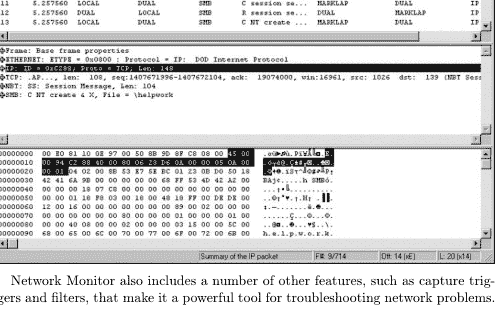

网络监视器还包括许多其他功能，如捕获触发器和过滤器，使其成为排查网络问题的强大工具。

## 6.6 结论

Windows 2000 网络架构为网络 API、网络协议驱动程序和网络适配器驱动程序提供了灵活的基础架构。Windows 2000 网络架构利用 I/O 分层，使网络支持具备可扩展性，从而随着计算机网络的发展而演进。当出现新协议时，开发人员可以编写 TDI 传输层以在 Windows 2000 上实现该协议。同样，新的 API 也可以与现有的 Windows 2000 协议驱动程序进行接口。最后，Windows 2000 上实现的广泛网络 API 为网络应用程序开发人员提供了多种可能的实现方式，每种实现方式都具有不同的编程模型和协议支持。


# 7 集群设置：安装与配置

*David Lifka*

Windows 2000 集群安装真正的魅力在于，其核心仅仅是标准 Windows 2000 域安装的一种定制化。如果你已经建立了一个由工作站或服务器组成的 Windows 域，那么你就已经掌握了设置 Windows 集群所需的至少 80% 的知识。高性能计算如今已成为大众非常现实的选择。事实上，安装和运行 Windows 2000 集群的简便性最终将成为 Windows 革命性改变高性能计算行业的原因——正如 Windows 操作系统对工作站市场所做出的改变一样。

在本章中，我们将讨论规划 Windows 集群安装时需要考虑的重要问题，并提供与这些问题相关的详细安装说明。本章中介绍的许多概念在本书其他章节中都有更详细的讨论；我们在此的目标是为您提供规划 Windows 集群安装的完整视图。

## 7.1 资源考量

在规划 Windows 2000 集群安装时，您必须考虑几个关键组件。这些包括 Windows 域配置、文件服务器设置、登录节点的使用、计算节点配置以及互连网络。

### 7.1.1 域控制器

任何 Windows 集群安装的第一步都是考虑集群所在的域结构。例如，您是希望为集群建立一个独立的域、一个独立的子域或一个受信任的域，还是希望集群与您当前的域完全集成（其中可能包含工作站、笔记本电脑和服务器的混合）？当然，最流行的选择是将集群资源集成到现有域中，从而为域用户提供便捷的访问权限。通常，集成方法效果良好，但它确实引发了一些管理方面的考量。例如，您必须考虑谁将访问该域以及他们将从何处访问。如果您允许没有域账户的外部用户通过网络访问集群，您可能希望将集群域与生产桌面环境分开，以使其免受潜在安全问题的影响。

### 7.1.2 文件服务器

Windows 下的文件服务器工作方式与 Unix 环境不同。特别是，远程文件访问已内置于操作系统中，不需要像 NFS 那样挂载文件系统。Windows 文件可以通过通用命名约定（UNC）远程访问，或者通过 Windows 资源管理器将共享映射到本地驱动器进行访问。例如，如果您有一台名为“fileserver1”的文件服务器，并且有一个名为“tools”的共享文件夹，您可以通过以下 UNC 方式在命令行远程访问此文件夹：

```
c:\ dir \\fileserver1\tools
```

或者您可以按以下方式在命令行将其映射到驱动器号：

```
c:\ net use Z: \\fileserver\tools
```

发出此命令后，本地 Z: 将表现得像是一个本地文件系统。可以通过 Microsoft 的分布式文件系统（DFS）将多个文件服务器上的存储逻辑聚合成单个逻辑卷。DFS 允许通过单个共享卷访问多个物理磁盘卷。所有集群节点都可以将此共享映射为相同的驱动器号，以在所有集群资源中提供一致的接口。当然，此配置确实引发了一些潜在问题：通常，当您注销机器控制台时，所有映射的驱动器都会断开连接。为解决此问题，您有两种选择。第一种是锁定屏幕，让控制台保持登录状态并保持驱动器映射。如果您有安全的机器房，这就足够了，但这不是最优雅的方案。第二种选择是使用 Windows 服务来映射驱动器，即使您在控制台未登录，该服务也会继续运行。以下一个简单的 Perl 脚本使用了一个名为 Win32::Daemon（来自 Roth Consulting）的特殊模块，该模块允许脚本作为 Windows 服务运行。您可以从 www.roth.net/perl/ 下载此模块。

```perl
#!perl
use Win32::Daemon;

%ModelHash =
    ( 
     name    => 'Model',
     display => 'Model Perl Service',
     path    => 'c:\perl\bin\perl.exe',
     user    => '',
     pad     => '',
     parameters => 'C:\temp\model.pl',
);

if ($ARGV[0] eq "-h")        { &Help;   exit; }
if ($ARGV[0] eq "-help")     { &Help;   exit; }
if ($ARGV[0] eq "help")      { &Help;   exit; }
if ($ARGV[0] eq "install") { &Install; exit; }
if ($ARGV[0] eq "remove")  { &Remove;  exit; }

#==============================================================
$sleep_interval = 5;
$hostname = Win32::NodeName();
$LogDir = $ENV{"TEMP"};    # log folder

Win32::Daemon::StartService();
while ( SERVICE_STOPPED != ( $state = Win32::Daemon::State() ) )
{
  if ( SERVICE_START_PENDING == $state || ( SERVICE_STARTING == $state ) )
  {
    Win32::Daemon::State( SERVICE_RUNNING );
    &Log("Service STARTING -> RUNNING");
  }
  elsif ( SERVICE_PAUSE_PENDING == $state )
  {
    Win32::Daemon::State( SERVICE_PAUSED );
    &Log("Service PAUSE_PENDING -> PAUSE");
  }
  elsif ( SERVICE_CONTINUE_PENDING == $state )
  {
    Win32::Daemon::State( SERVICE_RUNNING );
    &Log("Service CONTINUE_PENDING -> RUNNING");
  }
  elsif ( SERVICE_STOP_PENDING == $state )
  {
    Win32::Daemon::State( SERVICE_STOPPED );
    &Log("Service STARTING -> STOPPED");
  }
  else{ ( SERVICE_CONTROL_SHUTDOWN == $state )
  {
    # Request 45 seconds to shut down...
    Win32::Daemon::State( SERVICE_STOP_PENDING, 45);
    # Add code here to shut down
    Win32::Daemon::State( SERVICE_STOPPED );
    &Log("Service CONTROL_SHUTDOWN -> STOP_PENDING");
  }
  elsif ( SERVICE_RUNNING == $state )
  {
    # Add code for the running state
    &Log("Service RUNNING");
  }
  else
  {
    # Un-handled control messages
    &Log("Service UNHANDLED");
  }
  sleep($sleep_interval);
}
Win32::Daemon::StopService();

#====================================================

sub Help
{
    print "Usage: Model.pl <option>\n";
    print "Options: install\n";
    print "            remove\n";
    print "            help\n";
}

sub Install
{
    if( Win32::Daemon::CreateService(\%ModelHash))
    {
        print "Successfully added.\n";
    }
    else
    {
        print "Failed to add service: " . GetError() . "\n";
    }
    print "finished.\n";
} # sub Install

sub Remove
{
    print "WARNING: Be sure to stop the service\n";
    if( Win32::Daemon::DeleteService($ModelHash{name}))
    {
        print "Successfully removed.\n";
    }
    else
    {
        print "Failed to remove service: " . GetError() . "\n";
    }
    print "finished.\n";
} # sub Remove

sub GetError
{
    return( Win32::FormatMessage( Win32::Daemon::GetLastError() ));
}

sub Log
{
    ($sec,$min,$hour,$mday,$mon,$year,$yday,$syday,$isdst) = localtime(time);
    $time = sprintf("%02d%02d%02d%02d%02d",$mon+1,$mday,$year+1900,$hour,$min);
    open(LOG,"+>>$LogDir\\Model_log" );
    print LOG "$time&$_[0]\n";
    close(LOG);
}
```

### 7.1.3 登录节点

登录节点是一种机制，用于为远程用户提供对集群的一致接口和工具。通常，登录节点上装有编译器、调试器、Interix 或 Cygwin 等编程环境以及调度器接口工具。登录节点通常可以通过 telnet 或 Windows 终端服务器访问（无论是否使用 Citrix Metaframe，这取决于客户端是否从非 Windows 平台访问集群）。在许多环境中，登录节点并不是必需的，只需在用户位于同一 Windows 域中的工作站上安装调度器接口命令即可。

### 7.1.4 计算节点

本书第 3 章对计算节点的硬件选项及其对性能的影响提供了完整描述。通常，计算节点上安装的软件相对较少。常用的软件包括运行时库、消息传递软件，以及根据需要安装的 Matlab、Mathematica、SAS 和脚本语言等应用程序。


## 7.2 Windows 2000 集群基本安装流程

假设您已经安装了包含 Active Directory 的 Windows 2000 域。现在您已准备好安装集群。

1.  设置您的 Windows 2000 域。这一步涉及添加软件并进行必要的配置更改，以便 Windows 域中的资源能够像集群中的计算节点那样工作。请注意，如果集群已经是您的 Windows 2000 域的一部分，则无需为 Windows 2000 集群建立单独的专用域。
2.  设置您的文件服务器。这一步是必要的，这样当您准备好安装登录节点和计算节点时，您将能够引用此资源。请回想一下，文件服务器可以通过 UNC 远程访问，或者通过将驱动器映射到共享（手动或使用了本章前面提供的 Perl 脚本）来访问。
3.  安装您的计算节点。您可以手动逐个安装每个节点，但这个过程既耗时又容易出错。或者，您可以使用商业软件包（如 Symantec Ghost、Imagecast 或 PCDRist），这些软件包提供了一种创建“节点镜像”的机制，您可以使用它来并行且一致地安装所有集群计算节点。创建和“推送”节点镜像的细节取决于您选择的软件包。因此，在此我们仅描述安装集群节点时应遵循的逻辑步骤。
    - 完全安装一个节点，包括驱动程序、软件以及自定义配置；但是，暂时不要安装调度系统。如果您拥有异构集群，应该安装每种硬件配置的一个节点。
    - 使用名为 sysprep 的工具删除特定于该节点的所有操作系统和软件信息，例如 Microsoft 安全标识和主机名。（sysprep 工具随每张 Microsoft Windows Server CD 分发。）配置您的计算节点通过 DHCP 获取 IP 地址意味着节点镜像中的所有网络信息在各节点之间都是相同的。以下网站提供了一个关于如何使用 sysprep 的 Web 讲座：support.microsoft.com/servicedesks/Webcasts/50_Projects/so4/50BLUR4.ASP。
    - 使用可用的多种软件包之一创建节点镜像。然后，将此镜像“推送”到所有具有相同硬件配置的节点。Ghost 等工具通过网络广播来实现这一点，因此，所有处于适当状态以接受镜像（再次取决于具体工具）的机器都可以同时读取并安装此镜像。
    - 启动每个节点，并在其启动时进行本地自定义设置，例如主机名。然后将该机器添加到您的 Windows 2000 域。此时，您应该已设置好所有计算节点并使其作为 Windows 2000 域的成员运行。（我们注意到，这种技术可用于任何 Windows 2000 域成员，而不仅仅是集群节点。这是一种快速部署新台式机的便捷方式，例如。）
4.  **安装调度系统。** 有许多可用的调度系统；例如，第 15 章提供了对 Maui 调度器的良好概述。调度器的安装还可以包括修改 Windows 2000 域中的访问权限和许可。您可以通过 Active Directory 中正常的用户和组交互来进行这些修改。
5.  **安装登录节点或界面命令。** 成功完成此步骤将使您的用户能够开始使用集群。如 7.1.3 节所述，可能不需要登录节点。相反，您可能只需要安装允许用户检查集群资源和作业队列以及从队列中提交或移除作业的命令或图形界面。

## 7.3 启动与运行

本章提供的信息足以让您设置并开始使用一个规模相当可观的 Windows 2000 高性能集群。尽管有其他策略可用，但此处描述的一般流程和步骤对于大多数类型的安装都是足够的。

# 8 我的 Beowulf 有多快？

*David Bailey*

新 Beowulf 类型系统的用户提出的第一个问题之一就是“我的系统运行有多快？”对于集群系统而言，性能不仅仅出于好奇。可以说，性能最初是构建集群系统的核心动力——单个节点对于手头任务而言是不够的。因此，性能测量以及不同可用系统设计和构建之间的性能比较具有首要重要性。

## 8.1 指标

存在许多不同的系统性能指标，其有意义性和测量难易程度差异巨大。我们在下面讨论一些更广泛使用的指标。

1.  **理论峰值性能。** 此统计值仅仅是系统的最大聚合性能。对于科学用户而言，理论峰值性能意味着每秒最大聚合浮点运算次数，通常计算为：

   $$P = N * C * F * R,$$

   其中 *P* 是性能，*N* 是节点数，*C* 是每个节点的 CPU 数量，*F* 是每个时钟周期的浮点运算次数，*R* 是时钟频率，以每秒周期数衡量。*P* 通常以 Mflops 或 Gflops 表示。对于非科学应用，计算的是整数运算次数而非每秒浮点运算次数，速率通常以 Mops 和 Gops 衡量，或变体地表示为 Mips 和 Gips。对于非齐次系统，*P* 计算为每个齐次子系统的理论峰值性能数值的总和。

   此指标的优点是计算非常简单。更重要的是，结果很少有争议：相关数据在许多情况下是公开可用的。此指标的缺点是，根据定义，普通应用程序无法达到这一性能。事实上，科学用户——特别是并行和分布式系统的用户——日益担心峰值性能与持续性能之间的典型差距似乎正在扩大，而非缩小。

2.  **应用程序性能。** 此统计值是在执行应用程序时执行的运算次数除以总运行时间。与理论峰值性能一样，它通常以 Mflops、Gflops、Mops 或 Gops 表示。如果此指标是针对与用户最终打算在系统上运行的程序较为相似的应用程序程序计算得出的，那么显然这是一个比理论峰值性能更有意义的指标。然而，该指标相应地更难使用，因为您必须先将基准程序移植到集群系统上，这通常是一项费力且耗时的工作。此外，您必须相当准确地确定代码实际执行的浮点（或整数）运算次数。沿着这一思路，您应该确认代码中使用的算法确实是此任务中最有效的可用算法，或者使用与有效算法实现对应的浮点运算计数；否则，结果可能受到质疑。使用此指标的一个关键难点在于源代码在给定系统上为最佳性能进行的“调优”程度：如果一个系统的结果基于高度调优的实现，而另一个系统的结果基于未高度调优的应用程序，则进行比较可能会产生误导。尽管如此，如果正确使用，此指标可能非常有用。

3.  **应用程序运行时间。** 此统计值仅指执行给定应用程序的总实际时钟运行时间。此统计值的一个优点是，它免除了您需要统计已执行运算次数的麻烦。此外，它还避免了使用操作计数可能大于必要程度的代码来评估性能的潜在扭曲。在很多方面，这是终极指标，因为它是运行在系统上的应用程序的最终衡量标准。此指标的缺点是，除非您正在比较两个都运行了完全相同应用程序的系统，否则仅基于运行时性能的比较很难有意义地比较系统。此外，调优问题在这里也存在：在比较系统之间的性能时，您必须确保两种实现都经过了同等程度的调优。

4.  **可扩展性。** 用户在描述系统性能时经常引用可扩展性统计值。可扩展性通常计算为：

   $$ S=\frac{T(1)}{T(N)}, $$

   其中 $T(1)$ 是特定程序在单处理器上的实际时钟运行时间，$T(N)$ 是在 $N$ 个处理器上的运行时间。接近 $N$ 的可扩展性数值意味着该程序具有良好的可扩展性。也就是说，并行实现非常高效，并行开销非常低，从而实现了近线性的加速比。可扩展性统计值通常可以提供有用信息。例如，它们可以帮助您确定给定应用程序的最佳处理器数量。但如果引用的情况下缺乏上下文，它们也可能具有误导性


应用于应用性能统计。例如，令人印象深刻的加速比统计可能源于分母中 T(N) 的极低值，但也可能源于 T(1) 的高值——换句话说，即非高效的单处理器实现。事实上，从事并行系统研究的科研人员通常会注意到，当他们通过巧妙的调优来加速并行程序时，其加速比统计反而会变差。此外，通常计算该统计量是根本不可能的，因为尽管基准测试程序可能在系统的所有或大部分处理器上运行，但它可能需要太多的内存才能在单个节点上运行。

5.  **并行效率。** 可扩展性指标的一个变体是并行效率，通常定义为 P(N)/N。接近 1 的并行效率统计量是理想的。该指标存在与可扩展性指标相同的潜在困难。

6.  **峰值百分比。** 有时应用性能统计量会以理论峰值性能的百分比来表示。这类统计量有助于突出应用程序使用系统全部计算能力的程度。例如，较低的峰值百分比可能表明架构与应用不匹配，值得进一步研究以确定困难所在。然而，单看峰值百分比本身信息量不大。一个易于并行化的应用程序可以达到很高的峰值百分比，但这确实是一项值得注意的成就。通常，峰值百分比的问题引发了这样的疑问：“对于特定类型的应用程序，现实的峰值百分比目标是多少？”

7.  **延迟和带宽。** 许多用户关注处理器间通信网络的延迟（时间延迟）和带宽（传输速率），因为网络是系统设计的关键要素之一。这些指标的优点是相对容易确定。缺点是，网络在高负载情况下的表现往往与其延迟和带宽数值所揭示的不同。而且，不用说，这些指标仅表征网络本身，并不提供有关单个处理器计算速度的信息。

8.  **系统利用率。** 上述指标的一个共同弱点是它们倾向于忽略系统级效应。这些效应包括系统中运行的两个不同任务之间的竞争、I/O 密集型任务与非 I/O 密集型任务之间的竞争、作业调度器的低效性以及作业启动延迟。为了解决这个问题，一些 Beowulf 系统用户以长期吞吐量为基础测量系统性能，作为与传统基准性能测试的对比。

显然，没有任何一种单一的性能测量方式——更不用说单一的评估指标——既容易确定又完全具有信息量。从某种意义上说，如上所述，只有一个评估指标重要：您在特定系统上运行特定应用的挂钟运行时间。但在做出购买或升级决定之前，这并不容易确定。即使你能进行这样的测量，也不清楚如何将你的结果与全球成千上万的 Beowulf 系统用户，以及不与其他类型的系统和集群进行比较。

这些考虑促使许多并行和集群系统的用户基于少数标准基准程序来比较性能。这样，你可以确定你特定的系统设计是否与其他设计一样有效（通过少量基准来衡量）。此类比较可能并不完全适用于你特定的应用，但凭借一些经验，你可以找到一个或几个众所周知的基准，其性能数值与你的特定需求有很好的相关性。

## 8.2 乒乓测试

在集群系统上进行的最广泛使用的测量之一是乒乓（Ping-Pong）测试，它是测量处理器间通信网络延迟和带宽的多个测试程序之一。有许多用于测试 TCP 性能的工具，包括 **netperf** 和 **netpipe**（参见 **www.netperf.org** 和 **www.ameslab.gov/netpipe**）。适合应用开发人员的乒乓测试测量用户 API 的性能，通常用 C 语言编写，并假设系统中已安装 MPI 通信库。有关下载和运行这些工具的更多细节将在第 10.10 节中给出。

## 8.3 LINPACK 基准测试

LINPACK 基准测试可以追溯到 20 世纪 80 年代初，当时 Jack Dongarra（当时在阿贡国家实验室）开始根据系统使用 LINPACK 库的 Fortran 例程求解 100 × 100 线性方程组的速度来收集系统性能结果。虽然这种规模的问题不再是超级计算机级别的练习，但对于评估单处理器系统的计算性能仍然很有用。特别是，它是测量 Beowulf 类型系统单节点性能的合理方法。可以从 www.netlib.org/benchmark 获取 LINPACK 源代码以及运行 LINPACK 基准测试的说明。

最近，Dongarra 发布了“高度并行计算”基准测试。该基准测试是为中大型并行和分布式系统开发的，并在数百个计算机系统上进行了测试 [2, Table 3]。与基本 LINPACK 基准测试不同，可扩展版本没有指定矩阵大小。相反，用户被要求在受内存限制的情况下，解决在可用系统上可以合理运行的最大问题。此外，用户不像单处理器版本那样受限于运行固定的源代码。相反，几乎可以运行任何合理的编程语言和并行计算库，包括汇编编写的库例程（如果希望的话）。

一种高度并行 LINPACK 基准测试的可移植实现，称为高性能 LINPACK（HPL）基准测试，可供使用。有关下载和运行 HPL 基准测试的更多细节将在第 10.10.3 节中给出。

在过去十年中，Dongarra 和 Strohmaier 根据可扩展 LINPACK 基准测试编制了一份被称为 Top500 计算机的全球排名列表。当前的列表可从 www.top500.org 获取。排名靠前的系统之一是位于新墨西哥州阿尔伯克基的沙迪亚国家实验室的 ASCI Red 系统。ASCI Red 系统是一个基于 Pentium 的集群系统，尽管由于它拥有定制设计的处理器间网络，因此并不是真正意义上的“Beowulf”系统。其 Rmaxx 评分为 2.379 Tflops，目前（基于 2001 年 6 月的列表）在 Top500 列表中排名第三。

LINPACK 基准测试（包括单处理器和并行版本）很容易下载和运行。一旦获得计时数值，性能的计算非常简单。最重要的是，有大量的结果可供比较：很容易确定你的系统与其他类似系统的表现如何。

LINPACK 基准测试（单处理器和并行版本）的主要缺点是，它们往往会高估实际科学应用系统在给定系统上预期能达到的性能。这是因为 LINPACK 代码是“稠密矩阵”计算，具有非常有利的数据局部性特征。例如，可扩展 LINPACK 基准测试达到系统理论峰值性能潜力的 30% 或更多并不罕见。相比之下，真正的科学应用代码在诸如 Beowulf 系统这样的现代分布式内存并行系统上很少能达到峰值数值的 10% 以上。

## 8.4 NAS 并行基准测试套件

NAS 并行基准测试（NPB）套件于 1990 年在 NASA 艾姆斯研究中心设计，旨在典型化高端航空航天计算。该套件由八个单独的基准组成，包括五个通用计算核心和三个模拟计算流体力学应用：

-   **EP：** “易于并行化”计算，几乎不需要处理器间通信。
-   **MG：** 多重网格计算，测试短距离和长距离通信。
-   **CG：** 共轭梯度计算，测试不规则通信。
-   **FT：** 三维快速傅里叶变换计算，测试大规模全对全通信。
-   **IS：** 整数排序，涉及整数数据和不规则通信。
-   **LU：** 模拟流体力学应用，使用 LU 方法。
-   **SP：** 模拟流体力学应用，使用 SP 方法。
-   **BT：** 模拟流体力学应用，使用 BT 方法。

最初的 NPB 套件是一个“纸笔”规范——每个基准测试执行的具体计算都在技术文档中指定，甚至包括如何生成初始数据的细节。原始版本中提供了一些简单的单处理器示例程序代码，但预计实现该套件的人将使用当时（1990 年）可用的几种特定于供应商的并行编程模型之一。最初的 NPB 问题集被认为是 A 类大小。随后定义了一些更大的问题集：B 类，大约是 A 类问题的四倍；C 类，大约是 B 类问题的四倍。小型单处理器示例代码有时被称为 W 类大小。

自 NPB 原始版本发布以来，NASA 团队提供了使用 MPI 和 OpenMP 的 NPB 实现。这些可在 www.nasa.gov/Software/NPB/ 获取。与 LINPACK 基准测试一样，NPB 套件可用于测量 Beowulf 系统的单个节点或整个系统的性能。在


具体来说，W 类问题可以很容易地在单处理器系统上运行。对于一个拥有例如 32 个处理器的 Beowulf 系统，A 类问题是合适的测试对象。B 类问题适用于拥有大约 32–128 个处理器的系统。C 类问题可用于拥有多达 256 个 CPU 的系统。

不幸的是，设计并推动 NPB 基准测试套件的那支 NASA 研究团队中，几乎所有人现在都已离开 NASA。因此，NASA 不再积极支持和推广这些基准测试。从而，很可能不会再开发任何更大规模的问题集。此外，NASA 也不再主动收集结果。

然而，NPB 套件继续吸引着并行计算研究社区的广泛关注。这是因为与其他大多数可用的基准测试相比，该套件在更大程度上反映了现实世界中的并行科学计算。

我们建议 Beowulf 类型系统的用户使用 NPB 套件的 MPI 版本。关于下载、安装和运行该套件的说明可在 NPB 网站上找到。

# II 并行编程

## 9 使用 MPI 进行并行编程

William Gropp 和 Ewing Lusk

在 Beowulf 集群上实现并行计算，是将计算任务划分为若干部分，并利用多个进程（每个进程在不同的处理器上执行）来执行这些部分。有时，普通的程序可以被所有进程使用，但使用不同的输入文件或参数。在这种情况下，各个独立任务之间不发生通信。然而，当需要利用并行计算机的性能来处理结构更复杂的庞大问题时，这样的通信是必要的。

最直接的通信方法之一是让进程通过发送和接收消息来协调它们的活动，就像一群人可能会合作完成一项复杂任务一样。这种实现并行的方法被称为*消息传递*。

在本章和下一章中，我们将展示如何使用 MPI（消息传递接口）来编写并行程序。MPI 是一个消息传递库规范。这个描述的所有三个部分都很重要。

- MPI 处理的是并行计算的消息传递模型，在该模型中，具有独立地址空间的进程相互同步，并通过发送和接收消息将数据从一个进程的地址空间移动到另一个进程的地址空间。[^1]
- MPI 规定了一个库接口，即一组子程序及其参数。它不是一种语言；相反，MPI 例程是从用常规语言（如 Fortran、C 和 C++）编写的程序中调用的。
- MPI 是一个规范，而不是特定的实现。该规范由 MPI 论坛创建，这是一个由并行计算机供应商、计算机科学家和用户组成的群体，他们聚在一起合作制定社区标准。会议的第一阶段导致在 1994 年发布了标准，有时被称为 MPI-1。一旦标准被实现并广泛使用，第二系列会议产生了一组扩展，被称为 MPI-2。MPI 指的是 MPI-1 和 MPI-2 两者。

作为一个规范，MPI 由标准文件定义，就像 C、Fortran 或 POSIX 的定义方式一样。MPI 标准文件可在 `www.mpi-forum.org` 上获取，并可免费下载。MPI-1 和 MPI-2 标准也可作为期刊文章 [10, 11] 获取，并作为本系列中的注释书籍 [14, 4] 以书面形式发布。几乎所有并行计算机（从集群到世界上最大、最强大的并行计算机）都有 MPI 的实现。在第 9.8 节中，我们提供了最受欢迎的集群实现的摘要。

MPI 论坛的目标是创建一个强大、灵活的库，该库可以在最大的计算机上高效实现，并提供一种工具来应对并行计算中最困难的问题。它并不总是以最简单的方式做最简单的事情，但随着需要更复杂的功能，它会发挥出其真正的价值。在本章和下一章中，我们将通过一组示例进行操作，从最简单的开始。

### 9.1 MPI 中的 Hello World

为了看看 MPI 程序是什么样子的，我们从经典的“你好世界”程序开始。MPI 仅指定在 C、Fortran 或 C++ 程序中使用的库调用；因此，该语言的所有功能都可用。最简单的“Hello World”程序如图 9.1 所示。

```
#include "mpi.h"
#include <stdio.h>

int main( int argc, char *argv[] )
{
    MPI_Init( &argc, &argv );
    printf( "Hello World\n" );
    MPI_Finalize();
    return 0;
}
```

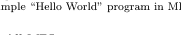

所有 MPI 程序都必须包含一次 **MPI_Init** 调用和一次 **MPI_Finalize** 调用。其他所有[^2] MPI 例程都必须在 **MPI_Init** 之后和 **MPI_Finalize** 之前调用。所有 C 和 C++ 程序还必须包含文件 `mpi.h`；Fortran 程序必须使用 **MPI** 模块或包含 **mpif.h**。

图 9.1 中的简单程序并不有趣。特别地，所有进程都打印相同的文本。一个更有趣的版本是让每个进程识别自己。如图 9.2 所示的这个版本说明了几个重要的点。特别值得注意的是变量 rank（排名）和 size（大小）。由于 MPI 程序由通信进程组成，每个进程都有自己的变量集合。在这种情况下，每个进程都有自己的地址空间，其中包含其自身的变量 rank 和 size（以及 argc, argv 等）。例程 MPI_Comm_size 在第二个参数中返回 MPI 作业中进程的数量。每个 MPI 进程都由一个称为 rank 的编号标识，范围从 0 到 size 值减 1。例程 MPI_Comm_rank 在第二个参数中返回该进程的 rank。该程序的输出可能看起来像以下内容：

- 来自 4 个进程中的进程 0 的 Hello World
- 来自 4 个进程中的进程 2 的 Hello World
- 来自 4 个进程中的进程 3 的 Hello World
- 来自 4 个进程中的进程 1 的 Hello World

请注意，输出并没有按进程 0 到 3 的顺序排列。MPI 不规定其他运行时或诸如 printf 等语言语句的行为；特别是，它不规定打印语句的输出顺序。

#### 9.1.1 编译和运行 MPI 程序

MPI 标准没有规定如何编译和链接程序（C 或 Fortran 也是如此）。然而，大多数 MPI 实现都提供了用于编译和链接程序的工具。

MPI 的 MPICH 实现提供了用于设置 make 文件或项目文件以与 Microsoft Visual Studio 一起使用的说明。在版本 1.2.1 中，这些说明是：

- **包含路径：** '<MPICH 主目录>\include'
- **开关：** 调试版本使用 /MTd，发布版本使用 /MT
- **库：** 'mpich.lib'（包含 MPI-1，所有 PMPI 例程和 MPI-IO）；'mpe.lib' 包含 MPI-1 的性能分析接口
- **库路径：** '<MPICH 主目录>\lib'

运行 MPI 程序（在大多数实现中）还需要一个特殊程序，特别是当并行程序由第 13 章中描述的批处理系统启动时。许多实现都提供了一个名为 **mpirun** 的程序，可用于启动 MPI 程序。例如，命令

```
mpirun -np 4 helloworld
```

使用四个进程运行程序 **helloworld**。大多数 MPI 实现都会尝试将每个进程运行在不同的处理器上；大多数 MPI 实现都提供了一种方式为每个 MPI 进程选择特定的处理器。在 MPICH 中，**mpirun** 应该在控制台进程中运行。

启动 MPI 程序的程序名称和命令行参数未由原始 MPI 标准规定，正如 C 标准未规定如何启动 C 程序一样。然而，MPI 论坛在 MPI-2 标准中建议，使用 **mpiexec** 命令和标准的命令行参数来启动 MPI 程序。到 2002 年，大多数 MPI 实现都应提供 **mpiexec**。选择此名称是因为没有 MPI 实现正在使用它（许多正在使用 **mpirun**，但参数不兼容）。语法与 MPICH 版本的 **mpirun** 几乎相同；使用 **-n** 开关而不是 **-np** 来指定进程数：

```
mpiexec -n 4 helloworld
```

MPI 标准为 **mpiexec** 定义了额外的开关；有关更多细节，请参阅 MPI-2 标准中的第 4.1 节“可移植的 MPI 进程启动”。

[^1]: 进程可以是单线程的，具有一个程序计数器，或者是多线程的，具有多个程序计数器。MPI 用于进程之间的通信，而不是线程。信号处理程序可以被认为是执行在单独的线程中。
[^2]: 有几个例外，包括 **MPI_Initialized**。


#### 9.1.2 在 Hello World 中添加通信

图 9.2 中的代码并不能保证输出以特定的顺序打印。为了强制输出的特定顺序，并演示进程之间如何进行数据通信，我们在“Hello World”程序中添加了通信。修订后的程序实现了以下算法：

```
Find the name of the processor that is running the process
If the process has rank > 0, then
    send the name of the processor to the process with rank 0
Else
    print the name of this processor
    for each rank, 
        receive the name of the processor and print it
Endif
```

该程序如图 9.3 所示。新的 MPI 调用涉及 MPI_Send、MPI_Recv 以及 MPI_Get_processor_name。后者是一种获取进程所运行的处理器名称的便捷方式。我们可以通过后退一步，考虑在两个进程之间通信数据必须满足的两个要求，来理解 MPI_Send 和 MPI_Recv：

- 1. 描述要发送的数据或接收数据的位置
- 2. 描述数据的目的地（对于发送）或源（对于接收）。

此外，MPI 提供了一种标记消息以及发现消息大小和源信息的方法。我们将依次讨论这些内容。

##### 描述数据缓冲区

数据缓冲区通常由地址和长度描述，例如“a,100”，其中 a 是指向 100 字节数据的指针。例如，Unix write 调用通过地址和长度（以及文件描述符）来描述要写入的数据。MPI 对此进行了泛化，提供了两种额外的功能：描述非连续的数据区域，以及描述数据以便能在具有不同数据表示的处理器之间进行通信。为此，MPI 使用三个值来描述数据缓冲区：地址、（MPI）数据类型以及该类型项目的数量或计数。例如，包含四个 C int 的缓冲区由三元组“a, 4, MPI_INT”描述。对于 C、Fortran 和 C++ 中定义的所有基本数据类型，都有预定义的 MPI 数据类型。最常用的数据类型显示在表 9.1 中。

```c
#include "mpi.h"
#include <stdio.h>

int main( int argc, char *argv[] )
{
    int numprocs, myrank, namelen, i;
    char processor_name[MPI_MAX_PROCESSOR_NAME];
    char greeting[MPI_MAX_PROCESSOR_NAME + 80];
    MPI_Status status;

    MPI_Init( &argc, &argv );
    MPI_Comm_size( MPI_COMM_WORLD, &numprocs );
    MPI_Comm_rank( MPI_COMM_WORLD, &myrank );
    MPI_Get_processor_name( processor_name, &namelen );

    sprintf( greeting, "Hello, world, from process %d of %d on %s",
        myrank, numprocs, processor_name );

    if ( myrank == 0 ) {
        printf( "%s\n", greeting );
        for ( i = 1; i < numprocs; i++ ) {
            MPI_Recv( greeting, sizeof( greeting ), MPI_CHAR,
                i, 1, MPI_COMM_WORLD, &status );
            printf( "%s\n", greeting );
        }
    }
    else {
        MPI_Send( greeting, strlen( greeting ) + 1, MPI_CHAR,
            0, 1, MPI_COMM_WORLD );
    }

    MPI_Finalize();
    return( 0 );
}
```

**图 9.3**  
一个更复杂的 MPI “Hello World” 程序。只有进程 0 写入 stdout；每个进程向进程 0 发送一条消息。

| C MPI 类型 | Fortran MPI 类型 |
| :--- | :--- |
| int | MPI_INT | INTEGER | MPI_INTEGER |
| double | MPI_DOUBLE | DOUBLE PRECISION | MPI_DOUBLE_PRECISION |
| float | MPI_FLOAT | REAL | MPI_REAL |
| long | MPI_LONG | | |
| char | MPI_CHAR | CHARACTER | MPI_CHARACTER |
| | | LOGICAL | MPI_LOGICAL |
| — | MPI_BYTE | — | MPI_BYTE |

表 9.1 最常见的 MPI 数据类型。同一行中的 C 和 Fortran 类型通常但并非总是相同的类型。类型 MPI_BYTE 用于原始数据字节，不对应于任何特定的数据类型。C++ MPI 数据类型与 C 数据类型同名，但没有 MPI_ 前缀，例如 MPI::INT。

##### 描述目的地或源

目的地或源是通过使用进程的秩（rank）来指定的。MPI 通过将秩相对于一组进程来泛化目的地和源秩的概念。该组可以是原始进程组的一个子集。允许进程子集并使用相对秩使得使用 MPI 编写面向组件的软件更容易（更多相关内容将在第 10.4 节讨论）。定义一组进程（以及将在第 10.4 节讨论的特殊通信上下文）的 MPI 对象称为通信器（communicator）。因此，源和目的地由两个参数给出：秩和通信器。通信器 MPI_COMM_WORLD 是预定义的，包含由 mpirun 或 mpiexec 启动的所有进程。作为源，特殊值 MPI_ANY_SOURCE 可用于表示消息可以接收自该 MPI 程序中任意秩的 MPI 进程。

##### 在消息中选择

MPI_Send 的“额外”参数是一个非负整数标签值。此标签允许程序随数据发送一个额外的数字。MPI_Recv 可以使用此值来选择要接收的消息（通过指定特定的标签值），或者使用标签来传递额外数据（通过指定通配符值 MPI_ANY_TAG）。在后一种情况下，所接收消息的标签值存储在 status 参数中（这是 C 绑定中 MPI_Recv 的最后一个参数）。在 C 中这是一个结构体，在 Fortran 中是一个整数数组，在 C++ 中是一个类。发送进程的标签和秩可以通过引用 status 的相应元素来访问，如表 9.2 所示。

| C | Fortran | C++ |
| :--- | :--- | :--- |
| status.MPI_SOURCE | status(MPI_SOURCE) | status.Get_source() |
| status.MPI_TAG | status(MPI_TAG) | status.Get_tag() |

**表 9.2**  
在 MPI_Recv 之后访问源和标签。

**确定接收的数据量。** 可以使用例程 `MPI_Get_count` 来查找接收的数据量。例如，

```c
MPI_Get_count(&status, MPI_CHAR, &num_chars);
```

在 `num_chars` 中返回发送的字符数。第二个参数应该是用于接收消息的相同 `MPI` 数据类型。（由于许多应用程序不需要此信息，例程的使用允许实现方避免计算 `num_chars`，除非用户需要该值。）

我们的示例在接收时提供了一个最大大小的缓冲区。也可以使用 `MPI_Probe` 来查找接收消息所需的内存量，如图 9.4 所示。

```c
char *greeting;
int num_chars, src;
MPI_Status status;
...
MPI_Probe(MPI_ANY_SOURCE, 1, MPI_COMM_WORLD, &status);
MPI_Get_count(&status, MPI_CHAR, &num_chars);
greeting = (char *)malloc(num_chars);
src       = status.MPI_SOURCE;
MPI_Recv(greeting, num_chars, MPI_CHAR,
         src, 1, MPI_COMM_WORLD, &status);
```

**图 9.4**  
使用 `MPI_Probe` 在接收消息之前查找其大小。

`MPI` 保证消息是按顺序的，并且只要使用相同的消息选择标准（源秩、通信器和消息标签），在 `MPI_Probe` 之后执行的 `MPI_Recv` 将接收探测返回了信息的消息。注意，在这个示例中，`MPI_Recv` 的源被指定为 `status.MPI_SOURCE`，而不是 `MPI_ANY_SOURCE`，以确保接收到的消息与 `MPI_Probe` 返回信息的那条消息相同。

### 9.2 管理器/工作者示例

我们现在开始一系列示例，展示实现有用工作的并行计算方法。虽然每个并行应用程序都是独特的，但一些范式已出现并广泛适用，许多并行算法都是这些模式的变体。

最通用的之一是“管理器/工作者”或“任务并行”方法。其思想是需要完成的工作可以由“管理器”分成独立的部分，并将这些部分分配给单个“工作者”进程。因此，管理器执行与工作者不同的算法，但所有工作者执行相同的算法。大多数 MPI 实现（包括 MPICH）允许 MPI 进程运行不同的程序（可执行文件），但通常将管理器和工作者代码合并到一个程序中（在某些情况下是必需的）更为方便，其结构如图 9.5 所示。

```c
#include "mpi.h"

int main( int argc, char *argv[] )
{
    int numprocs, myrank;

    MPI_Init( &argc, &argv );
    MPI_Comm_size( MPI_COMM_WORLD, &numprocs );
    MPI_Comm_rank( MPI_COMM_WORLD, &myrank );

    if ( myrank == 0 )            /* manager process */
        manager_code ( numprocs );
    else                          /* worker process */
        worker_code ( );
    MPI_Finalize( );
    return 0;
}
```


有时工作可以均匀地分成与工作者数量完全相同的块，但更灵活的方法是让管理器保持一个比工作者数量大的工作单元池，并动态地分配新工作


工人完成任务并向管理器发送其结果。这种方法称为自调度（self-scheduling），在任务大小各异和/或工人速度不同的情况下运行良好。

我们通过一个将矩阵与向量相乘的并行程序来说明这种技术。（该程序的一个 Fortran 版本可以在 [6] 中找到。）该程序并不是执行此操作的最佳方式，但它说明了该方法，且足够简单，可以完整展示。该程序将方阵 a 乘以向量 b，并将结果存储在 c 中。工作单元是 a 的每一行与向量 b 的点积。因此，管理器的代码如图 9.6 所示，管理器首先对 a 进行初始化。然后，管理器发出初始工作单元，给每个工人分配一行。我们使用此类每条消息上的 MPI 标签来编码我们发送的行号。由于行号从 0 开始，但我们希望将 0 保留为具有“没有更多工作要做”特殊含义的标签，我们将标签设置为行号加一。当工人返回一个点积时，我们将其存储在 c 的适当位置，并向该工人发送另一行以继续处理。一旦所有行都被分配，完成任务的工人将收到一条“没有更多工作”消息，该消息由标签为 0 的消息指示。

程序中工人部分的代码如图 9.7 所示。工人初始化 b，在消息中接收 a 的一行，计算该行与向量 b 的点积，然后再次使用标签来标识该行，将答案返回给管理器。工人重复此过程，直到收到标识其标签为 0 的“没有更多工作”消息。

该程序运行至少需要两个进程：一个管理器和一个工人。不幸的是，增加更多工人不太可能让任务变得更快。我们可以从数学上分析计算和通信的成本，看看当我们增加工人数量时会发生什么。增加工人的数量将减少每个工人完成的计算量，由于它们并行工作，这应该会减少总耗时。另一方面，更多的工人意味着更多的通信，通信一个数字的成本通常远大于对该数字执行算术操作的成本。研究并行算法的总时间如何受进程数量、问题规模以及处理器和通信网络速度变化的影响，被称为可扩展性分析（scalability analysis）。我们将矩阵-向量程序作为一个简单的示例进行分析。

首先，让我们计算浮点操作数。对于一个大小为 n 的矩阵，我们需要计算 n 个点积，每个点积需要 n 次乘法和 n - 1 次加法。因此，浮点操作数是 $n^2 \times (n + 1) = n \times (2n - 1) = 2n^2 - n$。如果 $T_{calc}$ 是处理器执行一次浮点操作所需的时间，那么总计算时间为 $(2n^2 - n) \times T_{calc}$。接下来，我们计算通信次数，定义为发送一个浮点数。（在这个简单的分析中，我们忽略消息长度的影响。）除了通信 $\mathbf{b}$ 的成本（也许它在先前步骤中是本地计算的）之外，我们必须发送 $\mathbf{a}$ 的每一行并接收回一个点积答案。因此，通信的浮点数为 $(n \times n) + n = n^2 + n$。如果 $T_{comm}$ 是通信一个数字的时间，我们得到总通信时间为 $(n^2 + n) \times T_{comm}$。因此，通信时间与计算时间的比率为
$$\left(\frac{n^2 + n}{2n^2 - n}\right) \times \left(\frac{T_{comm}}{T_{calc}}\right).$$

在许多计算中，通过增大问题规模，通信与计算的比率几乎可以减小到 0。我们的分析表明，这里的情况并非如此。随着 $n$ 变得更大，左边的项趋近于 $\frac{1}{2}$。因此，我们可以预期通信成本将阻止该算法显示出良好的加速比，即使在大型问题规模上也是如此。

在矩阵-矩阵乘法的情况下，情况会更好，这可以通过类似的算法来实现。我们将用矩阵替换向量 **b** 和 **c**，在计算开始时将整个矩阵 **b** 发送给工人，然后像以前一样将 **a** 的行作为工作单元分发。工人将计算乘积的一整行，由 **a** 的一行与 **b** 的所有列的点积组成，然后将 **c** 的一行返回给管理器。让我们现在对矩阵-矩阵乘法进行可扩展性分析。同样，我们忽略 **b** 的初始通信。每个点积的操作数是 $n + (n+1)$，与之前相同，计算的总点积数为 $n^2$。因此，总操作数为 $n^2 \times (2n-1) = 2n^3 - n^2$。通信的数字数量增加到 $(n \times n) + (n \times n) = 2n^2$。因此，通信时间与计算时间的比率变为

$\left( \frac{2n^2}{2n^3-n^2} \right) \times \left( \frac{T_{comm}}{T_{calc}} \right)$，

随着 $n$ 变得更大，它确实趋向于 0。因此，对于大型矩阵，通信成本起的作用较小。

当我们增加问题规模和工人数量时，该算法可能会出现另外两个困难。第一个是随着消息变长，工人浪费更多时间等待下一行到达。解决此问题的方法是对工作进行“双缓冲”分配，即管理器最初向每个工人发送两行，使得工人在等待下一行到达时始终有一些工作要做。

对于更多进程数量的另一个困难可能是管理器过载，以至于它无法及时分配工作。这个问题最容易通过增加工作单元的大小来解决，但在某些情况下，有必要对管理器任务本身进行并行化，使用多个管理器处理工作单元的子池。

一个更微妙的问题涉及 *公平性*：确保所有工人进程都能公平地得到管理器的服务。MPI 提供了几种确保公平性的方法；请参阅 [6, 第 7.1.4 节]。

#### 图 9.6
矩阵-向量乘法程序，管理器代码。

```c
#define SIZE 1000
#define MIN(x, y) ((x)<(y)? x:y)

void manager_code(int numprocs)
{
    double a[SIZE][SIZE], c[SIZE];
    int i,j, sender, row, nmsent = 0;
    double dotp;
    MPI_Status status;

    /* (arbitrary) initialization of a */
    for (i = 0; i< SIZE; i++)
        for (j = 0; j< SIZE; j++)
            a[i][j] = (double) j;

    for (i = 1; i< MIN(numprocs,SIZE); i++) {
        MPI_Send(a[i-1], SIZE, MPI_DOUBLE, i, i, MPI_COMM_WORLD);
        nmsent++;
    }

    /* receive dot products back from workers */
    for (i = 0; i< SIZE; i++) {
        MPI_Recv(&dotp, 1, MPI_DOUBLE, MPI_ANY_SOURCE, MPI_ANY_TAG,
            MPI_COMM_WORLD, &status);
        sender = status.MPI_SOURCE;
        row    = status.MPI_TAG - 1;
        c[row] = dotp;

        /* send another row back to this worker if there is one */
        if (nmsent < SIZE) {
            MPI_Send(a[nmsent], SIZE, MPI_DOUBLE, sender,
                nmsent + 1, MPI_COMM_WORLD);
            nmsent++;
        }
        else                              /* no more work */
            MPI_Send(MPI_BOTTOM, 0, MPI_DOUBLE, sender, 0,
                MPI_COMM_WORLD);
    }
}
```

#### 图 9.7
矩阵-向量乘法程序，工人代码。

```c
void worker_code( void )
{
    double b[SIZE], c[SIZE];
    int i, row, myrank;
    double dotp;
    MPI_Status status;

    for ( i = 0; i < SIZE; i++ ) /* (arbitrary) b initialization */
        b[i] = 1.0;

    MPI_Comm_rank( MPI_COMM_WORLD, &myrank );
    if ( myrank <= SIZE ) {
        MPI_Recv( c, SIZE, MPI_DOUBLE, 0, MPI_ANY_TAG,
                  MPI_COMM_WORLD, &status );
        while ( status.MPI_TAG > 0 ) {
            row = status.MPI_TAG - 1;
            dotp = 0.0;
            for ( i = 0; i < SIZE; i++ )
                dotp += c[i] * b[i];
            MPI_Send( &dotp, 1, MPI_DOUBLE, 0, row + 1,
                      MPI_COMM_WORLD );
            MPI_Recv( c, SIZE, MPI_DOUBLE, 0, MPI_ANY_TAG,
                      MPI_COMM_WORLD, &status );
        }
    }
}
```


### 9.3 二维雅可比方法示例，采用一维分解

并行计算机在科学计算中的一种常见用途是近似求解偏微分方程（PDE）。最常在教科书出现的偏微分方程之一是泊松方程（此处展示二维形式）：

$$
\begin{aligned}
&\frac{\partial^2 u}{\partial x^2} + \frac{\partial^2 u}{\partial y^2} = f(x, y) \quad \text{在 } \Gamma \text{ 内} & (9.3.1) \\
&u = g(x, y) \quad \text{在 } \partial\Gamma \text{ 上} & (9.3.2)
\end{aligned}
$$

该方程用于描述许多物理现象，包括流体流动和静电学。该方程由两部分组成：应用于区域内 $\Gamma$ 内任意点的微分方程（9.3.1）以及未知量 $u$ 在 $\Gamma$ 边界上的取值规范（记号 $\partial\Gamma$ 表示“$\Gamma$ 的边界”）。例如，若使用此方程模拟区域内的温度平衡分布，则边界条件 $g(x,y)$ 指定了边界上施加的温度，$f(x,y)$ 为零，而 $u(x,y)$ 是区域内的温度。为了简化本示例的后续部分，我们将仅考虑一个由正方形组成的简单区域 $\Gamma$（参见图 9.8）。

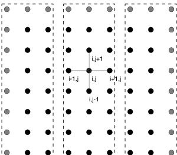

为了计算 $u(x,y)$ 的近似值，我们必须首先将问题缩减为有限规模。我们无法确定 $u$ 在所有点的值；相反，我们将在区域内的有限个点 $(x_i, y_i)$ 处近似 $u$，其中 $x_i = i \times h$ 且 $y_j = j \times h$。（当然，我们可以通过插值在区域内的其他点定义 $u$ 的值，但近似值由 $u$ 在点 $(x_i, y_j)$ 处的值定义。）这些点在图 9.8 中显示为黑色圆盘。由于这种规则间距，这些点构成了*规则网格*。在每个这样的点上，我们用有限差分来近似偏导数。例如，

$$
\frac{\partial^2 u}{\partial x^2}(x_i, y_j) \approx \frac{u(x_{i+1}, y_j) - 2u(x_i, y_j) + u(x_{i-1}, y_j)}{h^2}
$$

如果我们用 $u_{i,j}$ 表示方程 9.3.1 在点 $(x_i, y_j)$ 处解的近似值，我们就得到了关于 $u$ 值的以下联立线性方程组：

$$
\frac{u_{i+1,j} - 2u_{i,j} + u_{i-1,j}}{h^2} + \frac{u_{i,j+1} - 2u_{i,j} + u_{i,j-1}}{h^2} = f(x_i, y_j). \quad (9.3.3)
$$

对于沿边界的 $u$ 值（例如在 $x = 0$ 或 $y = 1$ 处），使用边界条件 $g$ 的值。如果 $h = 1/(n + 1)$（即网格内部有 $n \times n$ 个点），这将给我们 $n^{2}$ 个需要求解的联立线性方程。

可以使用许多方法来解决这些方程。事实上，如果你手头有这个问题，你应该使用表 10.1 中描述的某个数值库。在本节中，我们描述了一个非常简单（且低效）的算法，因为从并行计算的角度来看，它说明了如何编程更有效的通用方法。我们使用的方法称为*雅可比*方法，用于求解线性方程组。雅可比方法通过改写方程来计算方程 9.3.3 解的连续近似值，如下所示：

$$
\begin{aligned}
&u_{i+1,j} - 2u_{i,j} + u_{i-1,j} + u_{i,j+1} - 2u_{i,j} + u_{i,j-1} = h^2 f(x_{i},y_{j}) \\
&u_{i,j} = \frac{1}{4}\left(u_{i+1,j} + u_{i-1,j} + u_{i,j+1} + u_{i,j-1} - h^2 f_{i,j}\right). \quad (9.3.4)
\end{aligned}
$$

雅可比迭代的每一步都根据周围 $u^{N}$ 的值计算 $u_{i,j}^{N+1}$ 的新近似值：

$$
u_{i,j}^{N+1} = \frac{1}{4}\left(u_{i+1,j}^{N} + u_{i-1,j}^{N} + u_{i,j+1}^{N} + u_{i,j-1}^{N} - h^2 f_{i,j}\right). \quad (9.3.5)
$$

这是我们计算泊松问题解近似的算法。我们强调，雅可比方法是一种糟糕的数值方法，但相同的通信模式适用于许多通过迭代技术求解的有限差分、体积或单元离散化方法。

在该算法的单处理器版本中，解 \(u\) 由二维数组 `u[max_n][max_n]` 表示，迭代过程编写如下：

```c
double u[NX+2][NY+2], u_new[NX+2][NY+2], f[NX+2][NY+2];
int    i, j;
...
for (i=1; i<=NX; i++)
    for (j=1; j<=NY; j++)
        u_new[i][j] = 0.25 * (u[i+1][j] + u[i-1][j] +
                               u[i][j+1] + u[i][j-1] - h*h*f[i][j]);
```

在这里，我们让 `u[0][j]`、`u[n+1][j]`、`u[i][0]` 和 `u[i][n+1]` 保存边界条件 \(g\) 的值（这些对应于方程 9.3.1 中的 \(u(0,y)\)、\(u(1,y)\)、\(u(x,0)\) 和 \(u(x,1)\)）。为了并行化此方法，我们首先必须决定如何在进程中分解数据结构 \(u\) 和 `u_new`。存在许多可能的分解方式。最简单的方法之一是将区域划分为如图 9.8 所示的条带。

让数组 \(u\) 的局部表示为 `u_local`；也就是说，每个进程声明一个包含该进程持有的 \(u\) 部分的数组 `u_local`。没有进程拥有全部 \(u\)；代表 \(u\) 的数据结构在*所有*进程之间*分解*。在每个进程中用于实现雅可比方法的代码是

```c
for (i=i_start; i<=i_end; i++)
    for (j=1; j<=NY; j++)
        u_local_new[i-i_start][j] =
            0.25 * (u_local[i-i_start+1][j] + u_local[i-i_start-1][j] +
                    u_local[i-i_start][j+1] + u_local[i-i_start][j-1] -
                    h*h*f_local[i-i_start][j]);
```

其中 `i_start` 和 `i_end` 描述了此进程上的条带（实际上，循环应从零到 `i_end-i_start`；我们使用这种形式以保持与单处理器代码的对应关系）。我们定义了 `u_local`，使得 `u_local[0][j]` 对应于该代码单处理器版本中的 `u[i_start][j]`。使用如 `u_local` 这样能明显表明哪些变量是分布式数据结构一部分的变量名通常是一个好主意。

从这段代码中，我们可以看到需要通信哪些数据。对于 $i=i_{\text{start}}$，我们需要 $u[i_{\text{start}}-1][j]$ 的值；对于 $i=i_{\text{end}}$，我们需要 $u[i_{\text{end}}+1][j]$ 的值。这些值属于相邻进程，必须通过通信传递。此外，我们需要一个位置来存储这些值。我们可以使用单独的数组，但对于规则网格，最常见的方法是使用幽灵或光晕单元，即在 $u_{\text{local}}$ 数组中预留额外空间以保存来自相邻进程的值。在这种情况下，我们只需要相邻数据的一列，因此我们将让 $u_{\text{local}}[i][j]$ 对应于 $u[i_{\text{start}}][j]$。这将改变循环单次迭代的代码为

```c
exchange_nbrs( u_local, i_start, i_end, left, right );

for (i_local=1; i_local<=i_end-i_start+1; i_local++)
    for (j=1; j<=NY; j++)
        u_local_new[i_local][j] =
            0.25 * ( u_local[i_local+1][j] + u_local[i_local-1][j] +
                     u_local[i_local][j+1] + u_local[i_local][j-1] -
                     h*h*u_local[i_local][j] );
```

在这里，我们将 i 索引转换为相对于 $u_{\text{local}}$ 的起始位置而不是 $u$ 的相对位置。剩下的就是描述在相邻进程之间交换数据的例程 `exchange_nbrs`。一个非常简单的例程如图 9.9 所示。

我们注意到 ISO/ANSI C（与 Fortran 不同）不允许多维数组的运行时维数指定。为了简化这些 C 语言示例，我们使用数组的编译时维数指定。C 语言中的一种替代方法是作为一维数组传递数组并计算适当的偏移量。

值 `left` 和 `right` 分别用于左侧和右侧邻居的秩。可以通过使用以下内容简单地计算这些值：

```c
int rank, size, left, right;

MPI_Comm_rank( MPI_COMM_WORLD, &rank );
MPI_Comm_size( MPI_COMM_WORLD, &size );

left = rank - 1;
right = rank + 1;

if (left < 0) left = MPI_PROC_NULL;
if (right >= size) right = MPI_PROC_NULL;
```

特殊的秩 `MPI_PROC_NULL` 指示网格的边缘。如果在 MPI 通信调用中使用 `MPI_PROC_NULL` 作为源或目标秩，则


### 9.4 集体通信操作

*集体*操作是由通信子中的所有进程共同调用的 MPI 函数。（如果通信子是 `MPI_COMM_WORLD`，这意味着所有进程，但 MPI 也允许在其他进程集合上执行集体操作。）

集体操作涉及通信，有时也涉及计算，但由于它们描述了特定的通信和计算模式，MPI 实现方可能能够对其进行优化，使其超越通过 `MPI_Send` 和 `MPI_Recv` 等 MPI 点对点操作来表达所能达到的效果。此外，使用集体操作来表达这些模式也更为简便。

在这里，我们将介绍两种最常用的集体操作，并展示并行程序中的通信如何完全通过集体操作来表达，而无需使用任何单个的 `MPI_Sends` 或 `MPI_Revc`s。图 9.11 中所示的程序通过数值积分来计算 $\pi$ 的值。由于
$$ \int_0^1 \frac{1}{1+x^2} dx = \arctan(x)|_0^1 = \arctan(1) - \arctan(0) = \arctan(1) = \frac{\pi}{4}, $$
我们可以通过对函数 $f(x) = 4/(1+x^2)$ 在 0 到 1 的区间进行积分来计算 $\pi$。我们通过将区间 [0,1] 划分为一定数量的子区间，然后让每个进程计算部分子集的面积，从而计算这些矩形区域的总面积，来得到一个近似值。我们本来可以使用管理者/工作者算法来完成此任务，但在这里我们重新分配了工作。事实上，每个工作者都可以计算其任务集合，因此“管理者”本身也可以成为一个工作者，而不仅仅是管理工作池。矩形数量越多，需要做的工作就越多，对 $\pi$ 的近似计算结果也就越精确。

为了进行实验，让我们将子区间的数量作为一个命令行参数。（虽然 MPI 标准并不保证任何进程都能接收命令行参数，但在大多数实现中，特别是对于 Beowulf 集群，我们可以假设至少 rank 为 0 的进程可以使用 argc 和 argv，尽管这些参数在 `MPI_Init` 调用之前可能没有意义。）在我们的例子中，进程 0 将子区间的数量 n 设置为 argv[1]。一旦进程知道了 n，它就可以通过认领每第 n 个矩形（从编号为其自身 rank 的矩形开始）来认领大约 1/n 的工作量。因此，进程 j 计算矩形 j, j + n, j + 2n 等的面积。

然而，并非所有的 MPI 实现都向所有进程提供命令行参数，所以我们首先由进程 0 将 n 发送给其他每个进程。我们可以使用一个简单的循环，一次向其他每个进程发送 n，但这样效率低下。如果我们知道相同的消息需要发送给所有其他进程，我们可以要求 MPI 实现方以比一系列 `MPI_Send` 和 `MPI_Recv` 更高效的方式来完成此操作。

广播（`MPI_Bcast`）是 MPI 集体操作的一个例子。集体操作必须由通信子中的所有进程调用。这允许实现方以特殊的方式安排集体操作所指定的通信和计算。在 `MPI_Bcast` 的情况下，实现方很可能使用一种通信树（有时称为生成树），其中进程 0 将其消息发送给第二个进程，然后这两个进程再发送给另外两个进程，依此类推。通过这种方式，大部分通信并行发生，并且所有消息在 $\log_2 n$ 步内发送完毕。

`MPI_Bcast` 的精确语义有时令人困惑。前三个参数指定消息，通常使用（地址，计数，数据类型）。第四个参数（称为广播的根）指定哪个进程拥有发送给其他进程的数据。在我们的情况下，它是进程 0。`MPI_Bcast` 在根进程上表现得像 `MPI_Send`，在其他所有进程上表现得像 `MPI_Recv`，但该调用在每个进程上看起来都是相同的。最后一个参数是执行该集体调用的通信子。通信子中的所有进程都必须进行相同的调用。在调用之前，n 仅在根进程中有效；在 `MPI_Bcast` 返回后，所有进程都有 n 值的一份副本。

接下来，包括进程 0 在内的每个进程将其矩形的面积累加到局部变量 mypi 中。然而，我们没有将这些值发送给一个进程并由该进程进行求和，而是使用了另一个集体操作 `MPI_Reduce`。`MPI_Reduce` 不仅执行集体通信，还执行集体计算。在以下调用中
```c
MPI_Reduce( &mypi, &pi, 1, MPI_DOUBLE, MPI_SUM, 0,
            MPI_COMM_WORLD);
```
第六个参数再次是根进程。所有进程都调用 `MPI_Reduce`，根进程在第二个参数中获取结果。该结果来自对所有进程上由第一、第三和第四个参数指定的数据项执行算术运算，在本例中为求和（由第五个参数指定）。

进程 0 通过打印出答案、该近似值与先前计算出的精确 $\pi$ 值之间的差值以及计算所需的时间来结束。这说明了 `MPI_Wtime` 的用法。

`MPI_Wtime` 返回一个双精度浮点数的秒数。该值本身没有意义，但两个此类值之间的*差值*即为两次调用之间的墙上时钟时间（实际经过时间）。请注意，除非 MPI 实现方承诺不同进程上的时钟是*同步*的，否则两个不同进程上的调用之间并不保证有任何关系（请参见 MPI 书籍中的 `MPI_WTIME_IS_GLOBAL`）。

函数 `MPI_Allreduce` 计算与 `MPI_Reduce` 相同的结果，但将结果返回给所有进程，而不仅仅是根进程。例如，在雅可比迭代中，通常使用两次连续迭代之间差值的二范数作为衡量解收敛性的指标。

```c
...
norm2local = 0.0;
for (ii=1; ii<i_end-i_start+1; ii++)
  for (jj=1; jj<NY; jj++)
    norm2local += ulocal[ii][jj] * ulocal[ii][jj];
MPI_Allreduce( &norm2local, &norm2, 1, MPI_DOUBLE, MPI_SUM,
               MPI_COMM_WORLD );
norm2 = sqrt( norm2 );
```
请注意，`MPI_Allreduce` 并不是计算向量范数的函数。它只是合并通信子中每个进程提供的值。

#### 图 9.11

使用集体操作计算 $\pi$。

```c
#include "mpi.h"
#include <stdio.h>
#include <math.h>

double f(double a) { return (4.0 / (1.0 + a*a)); }

int main(int argc, char *argv[])
{
    int n, myid, numprocs, i;
    double PI25DT = 3.141592653589793238462643;
    double mypi, pi, h, sum, x;
    double starttime = 0.0, endtime;

    MPI_Init(&argc, &argv);
    MPI_Comm_size(MPI_COMM_WORLD, &numprocs);
    MPI_Comm_rank(MPI_COMM_WORLD, &myid);

    if (myid == 0) {
        starttime = MPI_Wtime();
        n = atoi(argv[1]);
    }
    MPI_Bcast(&n, 1, MPI_INT, 0, MPI_COMM_WORLD);
    h = 1.0 / (double) n;
    sum = 0.0;

    for (i = myid + 1; i <= n; i += numprocs) {
        x = h * (double)i - 0.5;
        sum += f(x);
    }
    mypi = h * sum;
    MPI_Reduce(&mypi, &pi, 1, MPI_DOUBLE, MPI_SUM, 0, MPI_COMM_WORLD);

    if (myid == 0) {
        endtime = MPI_Wtime();
        printf("pi is approximately %.16f, Error is %.16f\n",
               pi, fabs(pi - PI25DT));
        printf("wall clock time = %f\n", endtime - starttime);
    }
    MPI_Finalize();
    return 0;
}
```

#### 图 9.10

邻居交换代码的改进版本。

```c
/* Better exchange code. */
void exchange_nbrs( double ulocal[][NY+2], int i_start, int i_end,
                    int left, int right )
{
   MPI_Status status;
   int c;

   /* Send and receive from the left neighbor */
   MPI_Sendrecv( &ulocal[1][1], NY, MPI_DOUBLE, left, 0,
                 &ulocal[0][1], NY, MPI_DOUBLE, left, 0,
                 MPI_COMM_WORLD, &status );

   /* Send and receive from the right neighbor */
   c = i_end - i_start + 1;
   MPI_Sendrecv( &ulocal[c][1], NY, MPI_DOUBLE, right, 0,
                 &ulocal[c+1][1], NY, MPI_DOUBLE, right, 0,
                 MPI_COMM_WORLD, &status );
}
```

#### 图 9.9

邻居交换代码的简单版本。有关此函数局限性的讨论，请参见正文。

```c
void exchange_nbrs( double ulocal[][NY+2], int i_start, int i_end, int left, int right )
{
  MPI_Status status;
  int c;

  /* Send and receive from the left neighbor */
  MPI_Send( &ulocal[1][i_start], NY, MPI_DOUBLE, left, 0,
            MPI_COMM_WORLD );
  MPI_Recv( &ulocal[0][i_start], NY, MPI_DOUBLE, left, 0,
            MPI_COMM_WORLD, &status );

  /* Send and receive from the right neighbor */
  c = i_end - i_start + 1;
  MPI_Send( &ulocal[c+1][i_start], NY, MPI_DOUBLE, right, 0,
            MPI_COMM_WORLD );
  MPI_Recv( &ulocal[c+1][i_start], NY, MPI_DOUBLE, right, 0,
            MPI_COMM_WORLD, &status );
}
```

该操作将被忽略。MPI 还提供了例程，用于计算任意维度规则网格中的邻居，并帮助应用程序选择对并行计算机高效的分解方式。

`exchange_nbrs` 中的代码在 n 值较小时适用于大多数 MPI 实现，但如第 10.3 节所述，这不是良好的实践（当 NY 的值超过实现定义的阈值时将失败）。在 MPI 中更好的方法是使用 `MPI_Sendrecv` 例程在两个进程之间交换数据，如图 9.10 所示。

在第 10.3 节和第 10.7 节中，我们讨论了交换例程的其他实现，它们可以提供更高的性能。第 10.3.2 节描述了 MPI 对更具可扩展性的数据分解的支持。


### 9.5 并行蒙特卡洛计算

最容易并行化的计算类型之一是 *蒙特卡洛* 算法族。在这类计算中，使用随机数生成器来创建大量独立的试验。通过对试验结果进行的统计分析为问题提供了解决方案。

我们通过另一种计算 $\pi$ 值的方法来说明这种技术。如果我们在单位正方形 $[0, 1] \times [0, 1]$ 中随机选择点，并计算落在半径为 1 的四分之一圆内的点的百分比，那么我们就能近似得到 $\frac{\pi}{4}$。（关于更详细的讨论以及一种不使用并行随机数生成器的方法，请参见 [6]）。我们使用 SPRNG 并行随机数生成器（``sprng.cs.fsu.edu''）。代码如图 9.12 所示。

SPRNG 的默认设置使其使用极其简单。调用 `sprng` 函数返回 0.0 到 1.0 之间的随机数，并且不同进程上的随机数流是独立的。我们通过常量 `BATCHSIZE` 来控制并行度的 *粒度*，它决定了在进程通信之前进行多少计算。在此，我们生成、测试并计数一百万个点，然后收集结果并打印它们。我们使用 `MPI_Bcast` 来分发指定批数的命令行参数，并使用 `MPI_Reduce` 在每批结束时收集落在四分之一圆内的点数，以便我们可以打印出对 $\pi$ 越来越精确的近似值。

```c
#include "mpi.h"
#include <stdio.h>
#define SIMPLE_SPRNG           /* simple interface  */
#define USE_MPI                /* use MPI        */
#include "sprng.h"              /* SPRNG header file */
#define BATCHSIZE 1000000

int main( int argc, char *argv[] )
{
  int i, j, numin = 0, totalin, total, numbatches, rank, nprocs;
  double x, y, approx, pi = 3.141592653589793238462643;

  MPI_Init( &argc, &argv );
  MPI_Comm_size( MPI_COMM_WORLD, &nprocs );
  MPI_Comm_rank( MPI_COMM_WORLD, &rank );
  if ( rank == 0 ) {
      numbatches = atoi( argv[1] );
  }
  MPI_Bcast( &numbatches, 1, MPI_INT, 0, MPI_COMM_WORLD );
  for ( i = 0; i < numbatches; i++ ) {
     for ( j = 0; j < BATCHSIZE; j++ ) {
         x = sprng(); y = sprng();
         if ( x * x + y * y < 1.0 )
            numin++;
     }
     MPI_Reduce( &numin, &totalin, 1, MPI_INT, MPI_SUM, 0,
                  MPI_COMM_WORLD );
     if ( rank == 0 ) {
        total = BATCHSIZE * ( i + 1 ) * nprocs;
        approx = 4.0 * (double) totalin / total;
        printf("pi = %.16f; error = %.16f, points = %d\n",
               approx, pi - approx, total );
     }
  }
  MPI_Finalize( );
}
```
**图 9.12**
使用蒙特卡洛方法计算 $\pi$。

### 9.6 在 Windows 2000 下安装 MPICH

MPICH 是 MPI 的一种实现 [5]，它是 MPI 最流行的版本之一。得益于微软的支持，Windows NT 和 Windows 2000 上有一个开源版本可用。该实现支持 TCP/IP、VIA 和共享内存通信。该版本可在 ``www.mcs.anl.gov/mpich/mpich-nt'' 获取，该网站还包含当前版本的完整安装说明。

该实现包括：

- MPICH 的所有源代码，
- 类似本章中的简单示例程序，
- 性能基准测试程序，
- MPE 性能分析库，以及
- Jumpshot 性能可视化系统。

该软件分发有几种形式。适用于大多数用户的是 `mpich.nt.1.2.1.zip`，其中包含了编译和运行 MPI 程序所需的一切。

各种分发形式如下：

- **完整源代码树：** `mpich.nt.1.2.1.src.exe` 是一个自解压的 WinZip 归档文件。
- **二进制分发：** `mpich.nt.1.2.1.zip` 包含运行时 DLL、用于启动 MPI 程序的服务、Visual C++ 软件开发工具包（SDK）以及 gcc SDK。编译应用程序需要 SDK，但运行不需要。你应该使用 `setup.exe` 在所有将用于运行 MPI 进程的机器上安装 DLL 和至少一个作业启动器。
- **软件开发工具包：** `mpich.nt.1.2.1.zip` 包含 SDK，其中包括用于使用 Microsoft Visual C++ 和/或 Visual Fortran 6 编译 MPI 应用程序的库和 `include` 文件。
- **gcc 软件开发工具包：** `mpich.nt.1.2.1.zip` 包含 gcc SDK，其中包括用于使用 gcc 和 Cygwin 工具编译 MPI 应用程序的库和 `include` 文件。

**使用 MPiRun。** 运行 MPI 程序最简单的方法是：

```
MPiRun -np 2 myapp.exe
```

`MPiRun` 程序接受其他一些参数；请参阅文档以获取完整列表。最常用的是以下参数：

- `-env name=value` 用于将环境变量传递给程序。这种用法的典型例子是传递 MPICH 本身使用的环境变量。例如，
```
MPiRun -np 2 -env "MPICH_USE_POLLING=1|MPICH_SINGLETHREAD=1" mpptest.exe
```
适用于获取消息传递中的最低延迟。有关影响 MPICH 的环境变量的更多详细信息，请参阅文档中的“细微配置选项”。
- `-localonly n` 用于在本地机器上运行 $n$ 个进程，使用共享内存进行进程间通信。这在调试 MPI 程序时通常很有用。

运行程序最灵活的方式是使用配置文件。命令行 `mpirun file.cfg` 使用指定的配置文件（‘file.cfg’）来运行并行程序。这种格式支持 MPMD（多程序多数据）程序。

两个工具有助于运行 MPICH 程序：

- **MPConfig** 尝试查找集群中的机器并将其名称保存在注册表中。该工具提供了一个图形用户界面，用于查找和修改可用于 MPI 程序的机器。使用 **MPConfig** 使 **MPiRun** 能够接受 **-np** 参数来选择进程数。
- **MPiRegister** 允许你在运行 MPI 程序时只需提供一次你的帐户名和密码。如果没有这个，**MPiRun** 会提示输入用户名和密码。

以下是一个启动一个管理进程（`manager.exe`）和五个工作进程的配置文件：

```
exe d:\Projects\Me\worker.exe
hosts
roadrunner 1 d:\projects\Me\manager.exe
roadrunner 5
```

### 9.7 工具

有许多工具可用于开发、测试和调整 MPI 程序。尽管它们随 MPICH 分发，但也可以与其他 MPI 实现一起使用。

#### 9.7.1 性能分析库

MPI 论坛决定不标准化任何特定工具，而是提供一种拦截 MPI 函数调用的一般机制，这是工具所需的功能类型。MPI 标准规定任何 MPI 实现必须为每个 MPI 函数提供两个入口点：其正常的 `MPI_` 名称和相应的 `PMPI_` 版本。这种策略允许用户编写 `MPI_Send` 的自定义版本，例如，执行任何额外所需的功能，调用 `PMPI_Send` 来执行 `MPI_Send` 的通常操作。当用户的自定义 MPI 函数版本被放在一个库中，并且该库在链接路径中先于常规 MPI 库时，用户的自定义代码将在所有被替换的 MPI 函数周围被调用。

MPICH 提供了三个这样的“性能分析库”以及一些创建更多库的工具。这些库通过向 MPICH 的 `mpicc` 编译和链接命令传递额外参数来轻松使用。

- `mpilog` 导致写入包含带时间戳事件的日志文件。日志文件可以用诸如 Jumpshot（见下文）等工具检查。
- `mpitrace` 导致将带有 `MPI_COMM_WORLD` 中进程排名标记的 MPI 调用跟踪写入标准输出。
- `mpianim` 在程序运行时显示简单的消息流量动画。

性能分析库是 MPICH 的 MPE 子系统的一部分，该子系统可单独分发，并适用于任何 MPI 实现。

#### 9.7.2 可视化并行程序行为

并行程序的详细行为很难预测。通常，查看图形显示很有用，该显示展示了每个进程经历的确切状态序列以及消息在什么时间、以什么顺序交换。此类工具的数据可以通过性能分析库收集。用于查看此类日志文件的一个工具是 Jumpshot [17]。图 9.13 显示了 Jumpshot 运行时的截图。

水平轴代表时间，每个进程有一条水平线。进程在特定时间区间内所处的状态由彩色矩形表示。消息由箭头表示。可以放大到微秒级时间分辨率。

### 9.8 用于集群的 MPI 实现

集群有许多可用的 MPI 实现；表 9.3 列出了一些可用的实现。这些范围从商业支持软件到受支持的免费软件，再到分布式研究项目软件。

### 9.9 MPI 例程摘要

本节提供了本章中用于 C、Fortran 和 C++ 的 MPI 例程的快速摘要。虽然这些只是 MPI 中可用例程的一小部分，但它们足以满足许多应用的需求。


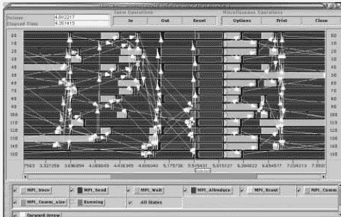

**图 9.13** 显示消息流量的 Jumpsplot

| 名称 | URL |
| :--- | :--- |
| MPICH | www.mcs.anl.gov/mpich |
| MPI-FM | www-csag.ucsd.edu/projects/comm/mpi-fm.html |
| MPI/Pro | www.mpi-softtech.com |
| MP-MPICH | www.lfbs.rwth-aachen.de/users/joachim/MP-MPICH/ |
| WMPI | www.criticalsoftware.com |

**表 9.3** 一些适用于 Windows 的 MPI 实现。

#### C 例程

```c
int MPI_Init(int *argc, char ***argv);
int MPI_Comm_size(MPI_Comm comm, int *size);
int MPI_Comm_rank(MPI_Comm comm, int *rank);
int MPI_Bcast(void *buf, int count, MPI_Datatype datatype, int root, MPI_Comm comm);
int MPI_Reduce(void *sendbuf, void *recvbuf, int count, MPI_Datatype datatype, MPI_Op op, int root, MPI_Comm comm);
int MPI_Finalize();
double MPI_Wtime();
int MPI_Send(void *buf, int count, MPI_Datatype datatype, int dest, int tag, MPI_Comm comm);
int MPI_Recv(void *buf, int count, MPI_Datatype datatype, int source, int tag, MPI_Comm comm, MPI_Status *status);
int MPI_Probe(int source, int tag, MPI_Comm comm, MPI_Status *status);
int MPI_Sendrecv(void *sendbuf, int sendcount, MPI_Datatype sendtype, int dest, int sendtag, void *recvbuf, int recvcount, MPI_Datatype recvtype, int source, int recvtag, MPI_Comm comm, MPI_Status *status);
int MPI_Allreduce(void *sendbuf, void *recvbuf, int count, MPI_Datatype datatype, MPI_Op op, MPI_Comm comm);
```

#### Fortran 例程

```fortran
subroutine MPI_INIT(ierror)
integer ierror
end
subroutine MPI_COMM_SIZE(comm, size, ierror)
integer comm, size, ierror
end
subroutine MPI_COMM_RANK(comm, rank, ierror)
integer comm, rank, ierror
end
subroutine MPI_BCAST(buffer, count, datatype, root, comm, ierror)
<type> buffer(*)
integer count, datatype, root, comm, ierror
end
subroutine MPI_REDUCE(sendbuf, recvbuf, count, datatype, op, root, comm, ierror)
<type> sendbuf(*), recvbuf(*)
integer count, datatype, op, root, comm, ierror
end
subroutine MPI_FINALIZE(ierror)
integer ierror
end
double precision MPI_WTIME()
subroutine MPI_SEND(buf, count, datatype, dest, tag, comm, ierror)
<type> buf(*)
integer count, datatype, dest, tag, comm, ierror
end
subroutine MPI_RECV(buf, count, datatype, source, tag, comm, status, ierror)
<type> buf(*)
integer count, datatype, source, tag, comm, status(MPI_STATUS_SIZE), ierror
end
subroutine MPI_PROBE(source, tag, comm, flag, status, ierror)
logical flag
integer source, tag, comm, status(MPI_STATUS_SIZE), ierror
end
subroutine MPI_SENDRECV(sendbuf, sendcount, sendtype, dest, sendtag, recvbuf, recvcount, recvtype, source, recvtag, comm, status, ierror)
<type> sendbuf(*), recvbuf(*)
integer sendcount, sendtype, dest, sendtag, recvcount, recvtype, source, recvtag, comm, status(MPI_STATUS_SIZE), ierror
end
subroutine MPI_ALLREDUCE(sendbuf, recvbuf, count, datatype, op, comm, ierror)
<type> sendbuf(*), recvbuf(*)
integer count, datatype, op, comm, ierror
end
```

#### C++ 例程

```cpp
void MPI::Init(int& argc, char**& argv);
void MPI::Init();
int MPI::Comm::Get_rank() const;
int MPI::Comm::Get_size() const;
void MPI::IntraComm::Bcast(void* buffer, int count, const Datatype& datatype, int root) const;
void MPI::IntraComm::Reduce(const void* sendbuf, void* recvbuf, int count, const Datatype& datatype, const Op& op, int root) const;
void MPI::Finalize();
double MPI::Wtime();
int MPI::Status::Get_source() const;
int MPI::Status::Get_tag() const;
void MPI::Comm::Recv(void* buf, int count, const Datatype& datatype, int source, int tag, Status& status) const;
void MPI::Comm::Recv(void* buf, int count, const Datatype& datatype, int source, int tag) const;
void MPI::Comm::Send(const void* buf, int count, const Datatype& datatype, int dest, int tag) const;
void MPI::Comm::Probe(int source, int tag, Status& status) const;
void MPI::Comm::Sendrecv(const void *sendbuf, int sendcount, const Datatype& sendtype, int dest, int sendtag, void *recvbuf, int recvcount, const Datatype& recvtype, int source, int recvtag, Status& status) const;
void MPI::IntraComm::Allreduce(const void* sendbuf, void* recvbuf, int count, const Datatype& datatype, const Op& op) const;
```

# 10 MPI 编程的高级主题

William Gropp 和 Ewing Lusk

在本章中，我们继续探索使用 MPI 进行并行编程。我们描述的那些更具 MPI 特性的功能，而不是消息传递编程模型中通用部分的内容。我们将涵盖 MPI 中更高级的功能，有时被称为 MPI-2，例如动态进程管理、并行 I/O 和远程内存访问。

## 10.1 MPI 中的动态进程管理

MPI-2 标准的一个新特性是允许 MPI 程序创建新的 MPI 进程并与它们进行通信。（在最初的 MPI 规范中，进程数量在启动时是固定的。）MPI 将这种能力（以及诸如连接两个独立启动的 MPI 作业等相关能力）称为*动态进程管理*。这一组特性引入了三个主要问题：

- 保持简单性和灵活性；
- 与操作系统、并行进程管理器以及可能是作业调度器交互；以及
- 避免可能损害正确性的竞争条件。

避免竞争条件的关键在于将新进程的创建作为一个集合操作，既在创建新进程的进程中，也在被创建的新进程中执行。

### 10.1.1 互通信器

回忆一下，一个 MPI 通信器由一组进程和一个通信上下文组成。严格来说，我们迄今为止处理的是*内部*通信器。另一种通信器被称为*外部*通信器。外部通信器将一个通信上下文和两组进程绑定在一起，称为（从特定进程的角度来看）*本地*组和*远程*组。进程通过组内的秩来标识，但外部通信器中的秩始终指代远程组中的进程。也就是说，使用外部通信器的 **MPI_Send** 会将消息发送到外部通信器*远程*组中具有指定目标秩的进程。集合操作也对外部通信器进行了定义；详见 [7, 第 7 章]。

### 10.1.2 生成新的 MPI 进程

我们现在能够解释由正在运行的 MPI 程序如何精确地创建新的 MPI 进程。执行此功能的 MPI 函数是 **MPI_Comm_spawn**。其主要特性如下。

- 它对发起操作的进程通信器（称为*父进程*）是集合性的，并且与所创建的进程中调用 **MPI_Init** 也是集合性的（称为*子进程*）。也就是说，只有在所有父进程中都调用了 **MPI_Comm_spawn** 并且所有子进程中都调用了 **MPI_Init** 后，父进程中的 **MPI_Comm_spawn** 才会返回。
- 它返回一个外部通信器，其中本地组包含父进程，远程组包含子进程。
- 新进程必须调用 **MPI_Init**，它们拥有自己的 **MPI_COMM_WORLD**，由这次 **MPI_Comm_spawn** 集合调用所创建的所有进程组成。
- 由子进程调用的函数 **MPI_Comm_get_parent** 返回一个外部通信器，子进程位于本地组，父进程位于远程组。
- 父进程和子进程都可以调用集合函数 **MPI_Intercomm_merge** 来创建一个包含所有进程（既有旧进程也有新进程）的普通（内部）通信器，但对于许多通信模式来说，这并不是必需的。

### 10.1.3 重新审视矩阵-向量乘法

在这里，我们通过重做第 9.2 节的矩阵-向量乘法程序来说明 **MPI_Comm_spawn** 的用法。我们不再从固定数量的进程开始，而是分别为管理器和工作者程序编译单独的可执行文件，使用以下命令启动管理器：

```bash
mpixec -n 1 manager <number-of-workers>
```

然后让管理器动态地创建工作者进程。管理器程序如**图 10.1**所示，工作者的代码如**图 10.2**所示。在这里，我们假设只有管理器拥有矩阵 **a** 和向量 **b**，并在工作者创建后将它们广播给工作者。

让我们详细考虑管理器中创建工作者进程的调用。

```c
MPI_Spawn( "worker", MPI_ARGV_NULL, numworkers, MPI_INFO_NULL,
    0, MPI_COMM_SELF, &workercomm, MPI_ERRCODES_IGNORE );
```

它有八个参数。第一个是运行到新进程的可执行文件的名称。第二个是传递给新进程的以空值终止的参数向量


#### 图 10.1

动态进程矩阵-向量乘法程序，管理器部分。

所有的新进程；在这里我们完全没有传递参数，因此我们指定特殊值 `MPI_ARGV_NULL`。接下来是要创建的新进程数量。第四个参数是一个 MPI “Info” 对象，可用于指定特殊的、依赖于环境和/或实现参数的，例如要在其上启动新进程的节点名称。在我们的情况下，我们将此决定交给 MPI 实现或本地进程管理器，并传递特殊值 `MPI_INFO_NULL`。下一个参数是针对此 `MPI_Comm_spawn` 调用的“根”进程；它指定了紧随其后的参数中给定的通信子中的哪个进程正在为该调用提供有效参数。我们这里使用的通信子仅包含一个管理器进程，因此我们传递 `MPI_COMM_SELF`。接下来是要填入的新交互通信子的地址，最后是用于检查启动新进程过程中可能出现的错误代码的数组。这里我们使用 `MPI_ERRCODES_IGNORE` 来表示我们不打算查看这些错误代码。

被派生的工作进程的代码如图 10.2 所示。它本质上与前一章中的工作子程序相同，但本身是一个 MPI 程序。注意使用交互通信子广播以从父进程接收向量 b。我们在退出前使用 `MPI_Comm_free` 释放父交互通信子。

### 10.1.4 关于动态进程管理的更多内容

关于 `MPI_Comm_spawn` 使用更复杂的示例，包括如何启动具有不同可执行文件或不同参数列表的进程，参见 [7, 第 7 章]。`MPI_Comm_spawn` 仅仅是 MPI 提供的用于处理动态 MPI 环境的最基本功能。通过查询属性 `MPI_UNIVERSE_SIZE`，你可以了解可以有用地创建多少个进程。单独启动的 MPI 计算可以通过 `MPI_Comm_connect` 和 `MPI_Comm_accept` 相互找到并连接。进程可以利用非 MPI 连接来“引导” MPI 通信。这些功能在 [7] 中有详细解释。

## 10.2 容错

通信子是 MPI 中的一个基本概念。它们在创建时大小是固定的，集体操作的效率和正确性都依赖于这一事实。用户有时会根据通信子大小固定这一事实，得出 MPI 不提供编写容错程序的机制的结论。然而，既然我们已经介绍了交互通信子，我们现在处于可以讨论如何解决这一问题，以及如何编写具有容错能力的 MPI 管理器-工作器程序的位置。在这个上下文中，我们的意思是，如果一个工作进程异常终止，你不会终止任务，而是能够用更少的工作进程继续计算，或者动态替换丢失的工作进程。

关键思想是为每个工作进程创建一个单独的（交互）通信子，并使用该通信子与该工作进程进行通信，而不是使用包含所有工作进程的通信子。如果实现从 `MPI_Send` 或 `MPI_Recv` 调用返回“无效通信子”，那么管理器只是失去了与一个工作进程的联系，仍然可以通过其他完整的通信子与其他工作进程通信。由于管理器将使用单独的通信子而不是较大通信子中的单独秩来向工作进程发送和接收消息，因此维护一个通信子数组和一个并行数组来记住最近发送给某个工作进程的行可能是方便的，这样如果该工作进程消失，可以将同一行分配给不同的工作进程。

### 图 10.2

动态进程矩阵-向量乘法程序，工作部分。

```c
#include "mpi.h"

int main( int argc, char *argv[] )
{
    int numpus, myrank;
    double b[SIZE], c[SIZE];
    int i, row, myrank;
    double dotp;
    MPI_Status status;
    MPI_Comm parentcomm;

    MPI_Init(&argc, &argv);
    MPI_Comm_size( MPI_COMM_WORLD, &numpus );
    MPI_Comm_rank( MPI_COMM_WORLD, &myrank );

    MPI_Comm_get_parent(&parentcomm);

    MPI_Bcast( b, SIZE, MPI_DOUBLE, 0, parentcomm );
    ...
    /* same as worker code from original matrix-vector multiply */
    ...

    MPI_Comm_free(parentcomm);
    MPI_Finalize( );
    return 0;
}
```

图 10.3 展示了这些数组以及它们可能的使用方式。通过这种方法，我们认识到双方通信可以变得容错，因为一方可以察觉到另一方的故障并采取适当的行动。普通的 MPI 通信子不是双方系统，如果不改变 MPI 通信的语义，就无法使其具备容错能力。然而，如果 MPI 程序中的通信可以用交互通信子来表示，而交互通信子本质上是双方（本地组和远程组），那么就可以实现容错。

### 图 10.3

容错管理器。

```c
/* highly incomplete */

MPI_Comm worker_comms[MAX_WORKERS];
int last_row_sent[MAX_WORKERS];

rc = MPI_Send( a[numsent], SIZE, MPI_DOUBLE, 0, numsent*1,
           worker_comms[sender] );
if( rc != MPI_SUCCESS ) {
    /* Check that error class is one we can recover from */
    ...
    MPI_Comm_spawn( "worker", ... );
}
```

需要注意的是，虽然 MPI 标准通过使用交互通信子，使得编写鼓励容错编程的 MPI 实现成为可能，但 MPI 标准本身并不要求 MPI 实现在错误发生后继续运行。这是一个“实现质量”的问题，允许 MPI 实现者在性能与故障后继续运行的能力之间进行权衡。然而，正如本节所明确指出的，MPI 标准中没有任何内容阻碍容错，Beowulf 集群的两个主要 MPI 实现 MPICH 和 LAM/MPI 都努力支持某种风格的容错机制以供应用程序使用。

## 10.3 重新审视网格交换

9.3 节中关于雅可比问题的网格交换讨论集中在算法和数据结构上，特别是幽灵单元交换。在本节中，我们回顾那个示例并涵盖另外两个重要问题：使用阻塞和非阻塞通信以及通信非连续数据。

### 10.3.1 阻塞与非阻塞通信

考虑以下简单代码（注意这与 9.3 节中 *exchange_nbrs* 的简单版本类似）：

```c
if (rank == 0) {
    MPI_Send( sbuf, n, MPI_INT, 1, 0, MPI_COMM_WORLD );
    MPI_Recv( rbuf, n, MPI_INT, 1, 0, MPI_COMM_WORLD, &status );
}
else if (rank == 1) {
    MPI_Send( sbuf, n, MPI_INT, 0, 0, MPI_COMM_WORLD );
    MPI_Recv( rbuf, n, MPI_INT, 0, 0, MPI_COMM_WORLD, &status );
}
```

这段代码发生了什么？看起来像是进程 0 正在向进程 1 发送消息，而进程 1 正在向进程 0 发送消息。但这里发生的情况更多。考虑 MPI 实现必须采取的使此代码正常运行的步骤：

1. 将 `MPI_Send` 中的数据复制到临时、系统管理的缓冲区。
2. 一旦 `MPI_Send` 完成（在每个进程上），启动 `MPI_Recv`。之前由 `MPI_Send` 操作复制到系统缓冲区的数据现在可以传递到用户缓冲区（在本例中为 **rbuf**）。

这种方法存在两个问题，都与必须将数据复制到系统缓冲区以使 `MPI_Send` 完成这一事实有关。第一个问题很明显：任何数据移动都需要时间，并且会降低代码的性能。第二个问题更微妙且重要：可用的系统缓冲区空间总是有限的。对于上述示例中超出可用缓冲区空间的 **n** 值，上述代码将 *挂起*：两个 `MPI_Send` 都不会完成，代码将永远等待另一个进程启动 `MPI_Recv`。这对于 *任何* 消息传递系统都是如此，而不仅仅是 MPI。用于缓冲消息的可用缓冲区空间量因 MPI 实现而异，从几兆字节到少至 128 字节不等。

如何编写在多个进程之间发送数据且不依赖系统缓冲区可用性的代码？一种方法是仔细排列发送和接收操作，以确保每个发送都有匹配的


然而，这种实现方式可能会很棘手，尤其是在处理更复杂的通信模式时；此外，它没有解决 `MPI_Send` 可能执行的额外拷贝问题。

MPI 采用的方法（沿袭了早期的消息传递系统以及非阻塞套接字的做法，参见 [6, Chapter 9]）是将发送和接收操作拆分为两个步骤：一个是启动操作，另一个是完成操作。在这两个步骤之间，可以发出其他操作，包括其他通信操作。例如，MPI 接收操作可以通过调用 `MPI_Irecv` 来启动，并通过调用 `MPI_Wait` 来完成。由于启动这些操作的例程不会等待它们完成，因此被称为非阻塞操作。例程名称中的“I”代表“立即”（immediate）；这表明例程可能在不完成操作的情况下立即返回。`MPI_Irecv` 的参数与 `MPI_Recv` 相同，除了最后一个（状态）参数外。该参数被一个 `MPI_Request` 值所取代；它是一个句柄，用于标识一个已启动的操作。要完成一个非阻塞操作，需要将请求交给 `MPI_Wait`，并附带一个状态参数；状态参数的作用与 `MPI_Recv` 中的状态参数相同。类似地，`MPI_Send` 的非阻塞对应物是 `MPI_Isend`；它拥有与 `MPI_Send` 相同的参数，并在最后（在 C 语言中）增加了一个 `MPI_Request` 参数。使用这些例程，我们的示例变成了以下形式：

```c
if ( rank == 0 ) {
    MPI_Request req1, req2;
    MPI_Isend( sbuf, n, MPI_INT, 1, 0, MPI_COMM_WORLD, &req1 );
    MPI_Irecv( rbuf, n, MPI_INT, 1, 0, MPI_COMM_WORLD, &req2 );
    MPI_Wait( &req1, &status );
    MPI_Wait( &req2, &status );
}
else if ( rank == 1 ) {
    MPI_Request req1, req2;
    MPI_Irecv( rbuf, n, MPI_INT, 0, 0, MPI_COMM_WORLD, &req1 );
    MPI_Isend( sbuf, n, MPI_INT, 0, 0, MPI_COMM_WORLD, &req2 );
    MPI_Wait( &req1, &status );
    MPI_Wait( &req2, &status );
}
```

提供给 `MPI_Isend` 的缓冲区 *sbuf* 在操作通过 `MPI_Wait` 完成之前不得被修改。类似地，提供给 `MPI_Irecv` 的缓冲区 *rbuf* 在 `MPI_Irecv` 完成之前不得被修改或读取。

非阻塞通信例程允许 MPI 实现等待，直到消息可以从一个用户缓冲区直接发送到另一个缓冲区（例如，从 *sbuf* 到 *rbuf*），而无需任何拷贝或使用任何系统缓冲区空间。

由于启动多个非阻塞操作是常见做法，MPI 提供了例程来测试或等待这些请求中任意一个、全部或部分请求的完成。例如，`MPI_Waitall` 等待请求数组中所有请求的完成。图 10.4 展示了非阻塞通信例程在雅可比（Jacobi）示例中的使用。¹

MPI 非阻塞操作与异步操作不同。MPI 标准并不要求数据传输与通信计算重叠。MPI 仅规定操作的语义，而不规定实现选择的细节。MPI 非阻塞例程主要为了正确性（避免系统缓冲区的局限性）和性能（避免拷贝）而提供。

### 10.3.2 在 MPI 中通信非连续数据

雅可比示例（第 9.3 节）中使用的单维分解方法虽然简单，但扩展性较差，并可能导致性能问题。我们可以根据第 9.2 节的讨论来分析雅可比方法的性能。设通信 $n$ 字节所需的时间为

$$T_{comm} = s + rn,\tag{10.3}$$

其中 $s$ 是*延迟*，$r$ 是通信一个字节所需的（额外）时间。使用第 9.3 节中的单维分解方法，计算雅可比方法一步所需的时间为

$$\frac{5n}{p} f + 2(s + rn),$$

其中 $f$ 是执行一次浮点运算的时间，$p$ 是进程数。请注意，通信成本与进程数无关；最终，这一成本将主导整个计算。因此，更好的方法是使用二维分解，如图 10.5 所示。

使用二维分解时，雅可比方法一步所需的时间仅为

$$\frac{5n}{p} f + 4 \left(s + r \frac{n}{\sqrt{p}} \right) .$$

只要满足

$$n > \frac{2}{1 - 4/\sqrt{p}} s .$$

（假设 $p \ge 16$），这种方法就比单维分解更快。为了实现这种分解，我们需要与四个邻居通信数据，如图 10.6 所示。

左侧和右侧边缘可以使用与单维情况相同的代码进行发送和接收。顶部和底部边缘的数据是非连续的。例如，顶部边缘需要发送第 10、第 16 和第 22 个元素。移动这些数据有四种方法：

1. 每个值可以单独发送。由于消息传递的高延迟，这种方法效率低下，通常不应使用。
2. 可以使用简单的循环将数据复制到临时缓冲区，例如，

```c
for (i=0; i<3; i++) {
    tmp[i] = u_local[i][6];
}
MPI_Send( tmp, 3, MPI_DOUBLE, . . . );
```

这是一种常见方法，对于某些系统和 MPI 实现而言，这可能是最有效的。

3. MPI 提供了两个例程来打包和解包缓冲区。这些例程是 `MPI_Pack` 和 `MPI_Unpack`。使用这些例程创建的缓冲区应该使用 MPI 数据类型 `MPI_PACKED` 进行发送和接收。然而，我们注意到，这些例程最适用于程序中经常变化的复杂数据布局。

4. MPI 提供了一种构造表示任意数据布局的新数据类型的方法。这些例程可以由 MPI 实现进行优化，原则上可以提供比用户通过简单循环所能达到的更好的性能 [16]。此外，使用这些数据类型对于实现并行 I/O 的高性能至关重要。

MPI 提供了几个例程来创建表示常见内存模式的数据类型。这些新数据类型称为派生数据类型。在这种情况下，`MPI_Type_vector` 是创建表示以恒定间隔分隔的数据值的新 MPI 数据类型所需的例程。在这种情况下，间隔是 $NY*2$，元素数量是 $i\_end - i\_start + 1$。

```c
MPI_Type_vector( i_end - i_start + 1, 1, NY*2,
                MPI_DOUBLE, &vctype );
MPI_Type_commit( &vctype );
```

第二个参数是一个*块计数*，它是基本数据类型项（在此情况下为 `MPI_DOUBLE`）的数量；这在多组分 PDE 问题中特别有用。必须调用例程 `MPI_Type_commit` 来*提交* MPI 数据类型；

---
¹在许多系统上，在调用 `MPI_Irecv` 之前调用 `MPI_Isend` 可以提高性能。


**图 10.5**
使用二维分解近似泊松问题解的领域和 $9 \times 9$ 计算网格。

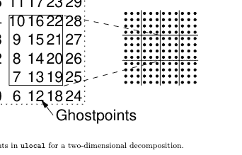

**图 10.6**
二维分解中 ulocal 中网格点的位置。

**图 10.4**
雅可比示例中的非阻塞交换代码。

```c
void exchange_nbrs( double ulocal[][NY+2], int i_start, int i_end,
                    int left, int right )
{
    MPI_Status  statuses[4];
    MPI_Request requests[4];
    int c;
    /* Begin send and receive from the left neighbor */
    MPI_Isend( &ulocal[i_start][1], NY, MPI_DOUBLE, left, 0,
               MPI_COMM_WORLD, &requests[0] );
    MPI_Irecv( &ulocal[0][i_start], NY, MPI_DOUBLE, left, 0,
               MPI_COMM_WORLD, &requests[1] );
    /* Begin send and receive from the right neighbor */
    c = i_end - i_start + 1;
    MPI_Isend( &ulocal[c][i_start], NY, MPI_DOUBLE, right, 0,
               MPI_COMM_WORLD, &requests[2] );
    MPI_Irecv( &ulocal[c+1][i_start], NY, MPI_DOUBLE, right, 0,
               MPI_COMM_WORLD, &requests[3] );
    /* Wait for all communications to complete */
    MPI_Waitall( 4, requests, statuses );
}
```


此调用允许 MPI 实现优化数据类型（这种优化未包含在创建 MPI 数据类型的例程中，因为某些复杂数据类型是从其他派生数据类型递归创建的）。

通过使用表示跨步数据模式的 MPI 派生数据类型，我们可以为网格的二维分解编写 `exchange_nbr` 的版本；代码如图 10.7 所示。请注意，我们通过指定 MPI 调用中数组 `u_local` 中数据移动的目标首元素，在顶部和底部的发送和接收中使用相同的派生数据类型 `vectype`。

当派生数据类型不再需要时，应使用 `MPI_Type_free` 释放它。还有许多其他例程可用于创建数据类型；例如，`MPI_Type_indexed` 适用于散射-聚集（scatter-gather）模式，而 `MPI_Type_create_struct` 可用于任意内存位置的集合。

## 10.4 通信器（Communicators）的动机

MPI 中的通信器有两个用途。最显而易见的用途是描述一个进程集合。这一特性允许使用任何进程集合来使用集合例程，如 `MPI_Bcast` 或 `MPI_Allreduce`。这种能力对于分层算法尤为重要，也有助于将计算划分为子任务，每个子任务都有自己的进程集合。例如，在 9.2 节的管理者-工作者示例中，将每个任务分配给一小部分进程可能是合适的，特别是如果这导致问题描述仅驻留在快速内存缓存中时。MPI 通信器非常适合于此；在创建新通信器时，MPI 例程 `MPI_Comm_split` 是唯一需要的例程。使用相对于通信器的秩来指定消息的来源和目的地也有助于将并行任务分解为更小但仍具有并行性的子任务，每个子任务都有自己的通信器。

MPI 通信器的一个更微妙但同样重要的用途涉及每个通信器包含的*通信上下文*。这种上下文对于编写能够安全、稳健地与其他代码（包括其他库和用户特定的应用程序代码）结合以构建完整应用程序的软件库至关重要。如果正确使用，通信上下文可保证消息被适当的例程接收，*即使其他例程不够谨慎*。考虑图 10.8（摘自 [6, Section 6.1.2]）中的示例。在这个例子中，有两个例程，由单独的库或软件模块提供。其中一个，`SendRight`，向右侧邻居发送消息并从左侧接收。另一个，`SendEnd`，从进程 0（最左侧）向最后一个进程（最右侧）发送消息。这两个例程在 `MPI_Recv` 调用中均使用 `MPI_ANY_SOURCE` 而不是特定的源。如图 10.8 所示，消息可能会混淆，导致程序接收到错误的数据。我们如何防止这种情况？几种方法行不通。一种是避免使用 `MPI_ANY_SOURCE`。这解决了这个例子，但前提是 `SendRight` 和 `SendEnd` 都遵循此规则。这种方法对于由个人或团队编写的代码可能足够（尽管脆弱），但对于库则不够。例如，如果 `SendEnd` 由商业供应商编写且未使用 `MPI_ANY_SOURCE`，而 `SendRight` 由不同的供应商或经验不足的程序员编写并使用了 `MPI_ANY_SOURCE`，那么程序仍然会失败，并且看起来像是 `SendEnd` 出了故障（因为来自 `SendEnd` 的消息最先被接收）。

另一种行不通的方法是使用消息标签（message tags）来区分消息。同样，如果一个组编写了所有代码，并非常小心地为不同的软件模块分配消息标签，这是可行的。然而，在 MPI 接收调用中使用 `MPI_ANY_TAG` 仍然可以绕过这种方法。此外，如 [6] 中的图 6.5 所示，即使不使用 `MPI_ANY_SOURCE` 和 `MPI_ANY_TAG`，不同的代码模块仍然可能接收到错误的消息。

MPI 通信器中的通信上下文为这些问题提供了解决方案。例程 `MPI_Comm_dup` 从输入通信器创建一个新的通信器，该通信器包含相同的进程（以相同的秩顺序），但具有新的通信上下文。在一个通信上下文中发送的 MPI 消息只能在该上下文中接收。因此，任何希望确保其所有消息仅在该库内被看到的软件模块或库，只需在开始时调用 `MPI_Comm_dup` 即可获得一个新的通信器。所有编写良好的使用 MPI 的库都会创建一个仅在该库内使用的私有通信器。

支持库的开发是 MPI 的设计目标之一。在这方面，MPI 非常成功。许多库和应用程序现在使用 MPI，并且由于 MPI 的可移植性，这些应用程序中的大多数都在 Beowulf 集群上运行。表 10.1 提供了使用 MPI 提供并行性的部分库列表。更完整的描述和列表可在 `www.mcs.anl.gov/mpi/libraries` 和 `sal.kachinotech.com/G/3` 上找到。

## 10.5 更多关于集合操作的内容

MPI 的优势之一是其可扩展的集合通信和计算例程的集合。图 10.9 展示了最重要的一些集合通信例程的功能。作为其实用性的例子，我们考虑一个简单示例。假设我们要收集程序运行在其上的所有节点的名称，并且我们希望所有 MPI 进程都具有这个名称列表。使用 `MPI_Allgather` 这是一个简单的任务：

```
char my_hostname[MAX_LEN], all_names[MAX_PROCS][MAX_LEN];
MPI_Allgather( my_hostname, MAX_LEN, MPI_CHAR,
               all_names, MAX_LEN, MPI_CHAR, MPI_COMM_WORLD );
```

此代码假设主机名不超过 `MAX_LEN` 个字符（包括末尾的空字符）。更好的代码会检查这一点：

```
char my_hostname[MAX_LEN], all_names[MAX_PROCS][MAX_LEN];
MPI_Allreduce( &my_name_len, &max_name_len, 1, MPI_INT, MPI_MAX,
               MPI_COMM_WORLD );
if ( max_name_len > MAX_LEN) {
    printf( "Error: names too long (%d)", max_name_len );
}
MPI_Allgather( my_hostname, MAX_LEN, MPI_CHAR,
all_names, MAX_LEN, MPI_CHAR, MPI_COMM_WORLD );
```

然而，这两种方法都移动了比必要更多的数据。一种更好的方法是首先收集每个处理器名称的大小，然后从每个处理器收集所需的确切字符数。这使用了全收集例程的“v”（代表向量）版本，**MPI_Allgatherv**，如图 10.10 所示。

这个例子提供了一种实现 9.3 节示例中操作的不同方式。许多并行代码可以使用 MPI 集合例程而不是 MPI 点对点通信来编写；此类代码通常具有更简单的逻辑结构，并且可以受益于集合通信例程的可扩展实现。

## 10.6 并行 I/O

MPI-2 提供了多种并行 I/O 操作，超出了我们在此能涵盖的范围。有关 MPI 中 I/O 的更详细讨论，请参阅 [7, Chapter 3]。

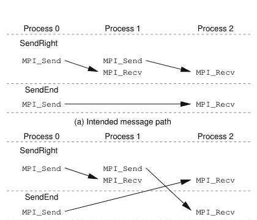

当在 `MPI_Recv` 调用中使用 `MPI_ANY_SOURCE` 时，两种可能的消息匹配模式（摘自 [6]）。

图 10.7 用于网格二维分解的雅可比问题非阻塞交换代码。

```
void exchange_nbrs2d( double ulocal[][NY+2],
int i_start, int i_end, int j_start, int j_end,
int left, int right, int top, int bottom,
MPI_Datatype vectype )
{
MPI_Status statuses[8];
MPI_Request requests[8];
int c;

/* Begin send and receive from the left neighbor */
MPI_Isend( &ulocal[1][1], NY, MPI_DOUBLE, left, 0,
MPI_COMM_WORLD, &requests[0] );
MPI_Irecv( &ulocal[0][1], NY, MPI_DOUBLE, left, 0,
MPI_COMM_WORLD, &requests[1] );

/* Begin send and receive from the right neighbor */
c = i_end - i_start + 1;
MPI_Isend( &ulocal[c][1], NY, MPI_DOUBLE, right, 0,
MPI_COMM_WORLD, &requests[2] );
MPI_Irecv( &ulocal[c+1][1], NY, MPI_DOUBLE, right, 0,
MPI_COMM_WORLD, &requests[3] );

/* Begin send and receive from the top neighbor */
MPI_Isend( &ulocal[1][NY], 1, vectype, top, 0,
MPI_COMM_WORLD, &requests[4] );
MPI_Irecv( &ulocal[1][NY+1], 1, vectype, top, 0,
MPI_COMM_WORLD, &requests[5] );

/* Begin send and receive from the bottom neighbor */
MPI_Isend( &ulocal[1][1], 1, vectype, bottom, 0,
MPI_COMM_WORLD, &requests[6] );
MPI_Irecv( &ulocal[1][0], 1, vectype, bottom, 0,
MPI_COMM_WORLD, &requests[7] );

/* Wait for all communications to complete */
MPI_Waitall( 8, requests, statuses );
}
```

| 库 | 描述 | URL |
|---|---|---|
| PETSc | 偏微分方程（PDEs）的线性与非线性求解器 | www.mcs.anl.gov/petsc |
| Aztec | 稀疏线性方程组的并行迭代求解 | www.cs.sandia.gov/CRF/aztecl.html |
| Cactus | 偏微分方程（PDE）求解框架 | www.cactuscode.org |
| FFTW | 并行快速傅里叶变换（FFT） | www.fftw.org |
| PFPFPrint | 并行打印 | www.lnl1.gov/sccd/lc/ptcprint |
| HDF | 层次数据格式（HDF）文件的并行 I/O | hdf.ncsa.uiuc.edu/Parallel_HDF |
| NAG | 数值计算库 | www.nag.co.uk/numeric/fd/FDdescription.asp |
| ScaLAPACK | 并行线性代数 | www.netlib.org/scalapack |
| SPRNG | 可扩展的伪随机数生成器 | sprng.cs.fsu.edu |

表 10.1
使用 MPI 的库示例。


图 10.9 MPI中集体数据移动的示意图。

MPI并行I/O方法的基本思想是，文件被一组进程集体打开，所有这些进程都被授予访问同一文件的权限。因此，MPI将通信子与文件相关联，允许对文件执行灵活的单个和集体操作。

```c
mylen = strlen(my_hostname) + 1; /* Include the trailing null */
MPI_Allgather(&mylen, 1, MPI_INT, all_lens, 1, MPI_INT, MPI_COMM_WORLD);
totlen = all_lens[size-1];
for (i=0; i<size-1; i++) {
    displs[i+1] = displs[i] + all_lens[i];
    totlen += all_lens[i];
}
all_names = (char *)malloc(totlen);
if (!all_names) MPI_Abort(MPI_COMM_WORLD, 1);
MPI_Allgatherv(my_hostname, mylen, MPI_CHAR, all_names, all_lens, displs, MPI_CHAR, MPI_COMM_WORLD);
/* Hostname for the jth process is &all_names[displs[j]] */
```

图 10.10 使用 MPI.Allgather 和 MPI.Allgatherv。

### 10.6.1 一个简单的例子

我们首先提供一个简单的例子，说明进程如何并行地将连续的数据块写入同一个文件。然后我们给出一个更复杂的例子，其中每个进程中的数据不是连续的，但可以通过 MPI 数据类型来描述。

对于我们的第一个例子，假设我们在完成第 9.3 节中求解泊松方程后，希望将解写入文件。我们不需要鬼元（ghost cells）的值，并且在一维分解中，每个进程中的行集在内存中构成一个连续区域，这大大简化了程序。程序的 I/O 部分如图 10.11 所示。

请记住，要从每个进程写入的数据（不包括鬼元，但包括边界数据）位于数组 `local[i][j]` 中，其中 `i` 从 `i_start` 到 `i_end`，`j` 从 `0` 到 `NY-1`。

注意，MPI 文件对象的类型是 `MPI_File`。此类文件对象的打开和关闭方式与常规文件类似。最显著的差异在于，打开文件是对由 `MPI_File_open` 第一个参数中的通信子指定的进程组执行的集体操作。单个进程可以通过指定单进程通信子 `MPI_COMM_SELF` 来打开文件。在这里，我们希望所有进程共享该文件，因此我们使用 `MPI_COMM_WORLD`。

在讨论动态进程管理时，我们提到了 MPI info 对象。MPI info 对象是 **key=value** 对的集合，可用于封装各种可能不适用于所有 MPI 实现的特殊用途信息。在本节中，当需要这种类型的参数时，我们将始终使用 **MPI_INFO_NULL**，因为我们没有特殊信息需要传递。有关 **MPI_Info** 的详细信息，请参见 [7, Chapter 2]。

```c
MPI_File outfile;
size = NX * (NY + 2);
MPI_File_open(MPI_COMM_WORLD, "solutionfile", MPI_MODE_CREATE | MPI_MODE_WRONLY, MPI_INFO_NULL, &outfile);

MPI_File_set_view(outfile, rank * (NY+2) * (i_end - i_start) * sizeof(double), MPI_DOUBLE, MPI_DOUBLE, "native", MPI_INFO_NULL);
MPI_File_write(outfile, &local[1][0], size, MPI_DOUBLE, MPI_STATUS_IGNORE);
MPI_File_close(&outfile);
```

图 10.11 雅可比解的并行 I/O。注意，这种文件视图的选择仅适用于单个输出步骤；如果需要雅可比方法的多个步骤的输出，则必须修改 `MPI_File_set_view` 的参数。

每个进程将看到的文件部分称为 *file view*（文件视图），并通过调用 **`MPI_File_set_view`** 为每个进程设置。在我们的示例中，调用为

```c
MPI_File_set_view(outfile, rank * (NY+2) * (. . . ), MPI_DOUBLE, MPI_DOUBLE, "native", MPI_INFO_NULL)
```

第一个参数标识文件；第二个参数是位移（以字节为单位），指定该进程对文件的视图开始于文件中的位置。在这里，我们只是将要写入的数据大小乘以进程的排名，以便每个进程的视图从文件中的适当位置开始。此参数的类型是 **`MPI_Offset`**，在支持大文件的系统上，它通常是一个 64 位整数。

下一个参数称为视图的 *etype*（元素类型）；它指定文件中的数据单位。在这里，由于我们将写入一定数量的双精度浮点数，所以它只是 **`MPI_DOUBLE`**。下一个参数称为 *filetype*（文件类型）；它是描述文件中连续视图的灵活方式。在我们的情况下，由于没有要写入的非连续单元，我们可以直接使用 etype，**`MPI_DOUBLE`**。通常，任何 MPI 预定义或衍生数据类型都可以用于 etypes 和 filetypes。我们将在下一个例子中更详细地探讨这种用法。

下一个参数是一个字符串，定义要使用的 *data representation*（数据表示）。原生表示法意味着磁盘上的数据表示方式与内存中的完全一致，这提供了最快的 I/O 性能，但可能以可移植性为代价。我们通过为最后一个参数提供 `MPI_INFO_NULL` 来指定我们没有额外信息。

调用 `MPI_File_write` 也很简单。要写入的数据是一个连续的双精度浮点数组，尽管它由（分布式）矩阵的几行组成。在每个进程上，它从 `&local[0][1]` 开始，因此数据以（地址，计数，数据类型）形式描述，就像 MPI 消息一样。我们通过传递 `MPI_STATUS_IGNORE` 来忽略状态。最后，我们（集体地）使用 `MPI_File_close` 关闭文件。

### 10.6.2 一个更复杂的例子

并行 I/O 不仅仅需要调用 `MPI_File_write` 而不是 *write*。关键思想是识别*对象*（跨进程），而不是每个进程的贡献。我们通过一个常规分布式数组的例子来说明这一点。

图 10.12 中的代码写出了一个在进程中通过二维分解分布的数组。为了说明 MPI 接口的表达能力，我们展示了一个复杂的情况，其中，如在雅可比示例中一样，分布式数组被 *ghost cells*（鬼元）包围。这个例子在 *Using MPI 2* [7] 的第 3 章中更详细地讨论，包括没有鬼元的分布式数组的较简单情况。

这个例子可能看起来很复杂，但每一步都相对简单。

- 1. 建立一个通信子，代表一个虚拟进程数组，该数组与分布式数组的分布方式相匹配。这种方法使用 `MPI_Cart_create` 例程，并使用 `MPI_Cart_coords` 来查找调用进程在此进程数组中的坐标。这种特定的进程排序选择很重要，因为它与 `MPI_Type_create_subarray` 所需的排序相匹配。

- 2. *创建一个文件视图*，描述该进程将写入的文件部分。MPI 例程 `MPI_Type_create_subarray` 使构建描述文件此区域的 MPI 数据类型变得容易。此例程的参数指定数组的维度（在我们的情况下是二维）、数组的全局大小、局部大小（即调用进程上数组部分的大小）、局部部分的位置（`start_indices`）、索引的排序（列主序是 `MPI_ORDER_FORTRAN`，行主序是 `MPI_ORDER_C`），以及基本数据类型。

```c
/* no. of processes in vertical and horizontal dimensions of process grid */
dims[0] = 2;  dims[1] = 3;
periods[0] = periods[1] = 1;
MPI_Cart_create(MPI_COMM_WORLD, 2, dims, periods, 0, &comm);
MPI_Comm_rank(comm, &rank);
MPI_Cart_coords(comm, rank, 2, coords);
/* global indices of the first element of the local array */

/* no. of rows and columns in global array*/
gsizes[0] = m;    gsizes[1] = n;

isizes[0] = m/dims[0];  /* no. of rows in local array */
lsizes[1] = n/dims[1];   /* no. of columns in local array */

start_indices[0] = coords[0] * lsizes[0];
start_indices[1] = coords[1] * lsizes[1];
MPI_Type_create_subarray(2, gsizes, lsizes, start_indices, MPI_ORDER_C, MPI_FLOAT, &filetype);
MPI_Type_commit(&filetype);

MPI_File_open(comm, "/pfs/datafile", MPI_MODE_CREATE | MPI_MODE_WRONLY, MPI_INFO_NULL, &fh);
MPI_File_set_view(fh, 0, MPI_FLOAT, filetype, "native", MPI_INFO_NULL);

/* create a derived datatype that describes the layout of the local
array in the memory buffer that includes the ghost area. This is
another subarray datatype! */
memsizes[0] = lsizes[0] + 8; /* no. of rows in allocated array */
memsizes[1] = lsizes[1] + 8; /* no. of cols in allocated array */
start_indices[0] = start_indices[1] = 4;
/* indices of the first element of the local array in the
allocated array */
MPI_Type_create_subarray(2, memsizes, lsizes, start_indices, MPI_ORDER_C, MPI_FLOAT, &mempype);
MPI_Type_commit(&mempype);
MPI_File_write_all(fh, local_array, 1, memtype, &status);
MPI_File_close(&fh);
```

图 10.12 用于写入分布式数组的 C 程序，由于存在鬼区，该数组在内存中也是非连续的（源自 [7] 中的一个示例）。


## 10.7 远程内存访问

3. 以写模式（MPI_MODE_WRONLY）打开文件，并使用我们刚刚构造的数据类型设置文件视图。

4. 创建一个描述待写入数据的数据类型。我们同样可以使用 `MPI_Type_create_subarray` 来定义本地数组中不包含鬼点（ghost points）的部分。如果没有鬼点，我们也可以在调用 `MPI_File_write_all` 时，使用 `MPI_FLOAT` 作为数据类型，其计数值为 `lsize[0] ∗ lsize[1]`。

5. 使用 `MPI_File_write_all` 对文件执行集体写操作，并关闭文件。

通过使用 MPI 数据类型来描述待写入的数据以及数据在文件中的目标位置，并执行集体文件写操作，MPI 实现可以充分利用 I/O 系统。结果是，使用 MPI I/O 执行的文件 I/O 操作与使用单独的 Unix I/O 操作相比，性能可提高百倍 [15]。

消息传递编程模型要求发送者和接收者（或集体操作中的通信子中的所有成员）都参与在两个进程之间移动数据。一种替代模型，其中一个进程控制通信，称为单边通信（one-sided communication），可以提供更好的性能，在某些情况下还提供更简单的编程模型。MPI-2 提供了对这种单边方法的支持。MPI-2 模型受到大规模同步编程（BSP）模型 [9] 以及用于大规模并行 Cray T3D 和 T3E 计算机的 Cray SHMEM 库 [1] 相关工作的启发。

在单边通信中，一个进程可以将数据直接放入另一个进程的内存中，而不需要该进程使用显式的接收调用。因此，这也称为远程内存访问（RMA）。

使用 RMA 涉及四个步骤：

- 1. 描述可以放入数据的内存。
- 2. 允许访问该内存。
- 3. 开始 put 操作（例如，使用 `MPI_Put`）。
- 4. 完成所有挂起的 RMA 操作。

第一步是描述可以被 `MPI_Put` 操作（也可通过 `MPI_Get` 访问或由 `MPI_Accumulate` 更新）放置数据的内存区域。这是通过例程 `MPI_Win_create` 完成的：

```cpp
MPI_Win win;  double local[ MAX_NX ][ NY+2 ];

MPI_Win_create( local, (NY+2)*(i_end-i_start+3)*sizeof(double),
                sizeof(double), MPI_INFO_NULL, MPI_COMM_WORLD, &win );
```

输入参数依次为：数组 `local`，数组的字节大小，数组基本单元的大小（在此例中为 `sizeof(double)`），一个“提示”对象，以及指定哪些进程可以使用 RMA 访问该数组的通信子。`MPI_Win_create` 是在通信子上的集体调用。输出是一个 `MPI_Win` 对象 `win`。当不再需要窗口对象时，应使用 `MPI_Win_free` 将其释放。

RMA 操作发生在两个哨点（sentinels）之间。一个开始允许访问窗口对象的时期，另一个结束该时期。这些时期被称为 `epochs`（纪元）。² 用来开始和结束 epoch 的最简单的例程是 `MPI_Win_fence`。此例程在创建窗口对象的进程上是集体的，它既结束了前一个 epoch，又开始了新的一个。该例程被称为“栅栏”（fence），因为在栅栏之前的所有 RMA 操作在栅栏返回前都会完成，而由另一个进程（在该进程上匹配的栅栏开始的 epoch 中）发起的任何 RMA 操作在栅栏返回前都不会开始。这看起来可能很复杂，但使用起来很简单。实际上，`MPI_Win_fence` 只需要将 RMA 操作分组。此模型紧密遵循 BSP 和 Cray SHMEM 模型，但增加了可以与任何进程子集一起工作的能力。

有三种例程可用于启动 RMA 中的数据传递。它们是 `MPI_Put`、`MPI_Get` 和 `MPI_Accumulate`。它们在 MPI 点对点通信非阻塞的相同意义上都是非阻塞的（第 10.3.1 节）。它们在开始所在的 epoch 结束时完成，例如，在结束的 `MPI_Win_fence` 处。由于这些例程指定了数据的源和目标，因此它们比点对点通信例程具有更多的参数。通过每次取几个参数来看，这些参数很容易理解。

> ²MPI 有两种类型的 RMA epoch：*access epoch*（访问纪元）和 *exposure epoch*（暴露纪元）。对于此处使用的示例，这两个 epoch 是同时发生的，我们将它们都简称为 epoch。

- 1. 前三个参数描述*源*数据；即，调用进程上的数据。这些是通常的“缓冲区、计数、数据类型”参数。
- 2. 下一个参数是*目标*进程的秩（rank）。这起到与 `MPI_Send` 中目标相同的作用。该秩是相对于创建 MPI 窗口对象时使用的通信子而言的。
- 3. 接下来的三个参数描述目标缓冲区。**count** 和 **datatype** 参数的含义与 `MPI_Recv` 中的相同，但缓冲区位置指定为相对于目标进程中指定给 `MPI_Win_create` 的内存开头的偏移量。此偏移量以 `MPI_Win_create` 的位移参数为单位，通常是基本数据类型的大小。
- 4. 最后一个参数是 MPI 窗口对象。

注意，没有 MPI 请求；`MPI_Win_fence` 完成了所有先前的 RMA 操作。`MPI_Win_fence` 提供了一种用于 RMA 操作的集体同步模型，其中所有进程都参与。这被称为*主动目标*（active target）同步。

使用这些例程，我们可以创建一个使用 RMA 而不是点对点通信的网格交换版本。图 10.13 展示了一种可能的实现。

另一种形式的访问在目标进程不需要任何 MPI 调用（甚至不需要栅栏）。这被称为*被动目标*（passive target）同步。源进程使用 `MPI_Win_lock` 开始访问 epoch，使用 `MPI_Win_unlock` 结束访问 epoch。³
由于这种 RMA 类型的被动性质，传入给 `MPI_Win_create` 的第一个参数的本地内存应使用 `MPI_Allloc_mem` 分配，并使用 `MPI_Free_mem` 释放。有关被动目标 RMA 操作的更多信息，参见 [7, 第 6 章]。还要注意，截至 2001 年，很少有 MPI 实现支持被动目标 RMA 操作。预计更多的实现将在 2002 年支持这些操作。

关于远程内存访问更完整的讨论可以在 [7, 第 5 章和第 6 章] 中找到。请注意，MPI 实现刚开始提供本节中描述的 RMA 例程。大多数当前的 RMA 实现强调功能而非性能。然而，随着实现的成熟，RMA 操作的性能也会提高。

³名称 `MPI_Win_lock` 和 `MPI_Win_unlock` 实际上是误导性的；请把它们想象为开始-RMA 和结束-RMA。

```cpp
void exchang_nbrs( double u_local[][NY+2], int i_start, int i_end, int left, int right, MPI_Win win )
{
MPI_Aint left_ghost_disp, right_ghost_disp;
int c;
MPI_Win_fence( 0, win );
/* Put the left edge into the left neighbors rightmost ghost cells. See text about right_ghost_disp */
right_ghost_disp = 1 + (NY+2) * ( i_end-i_start+2);
MPI_Put( &u_local[i][i], NY, MPI_DOUBLE, left, right_ghost_disp, NY, MPI_DOUBLE, win );
/* Put the right edge into the right neighbors leftmost ghost cells */
left_ghost_disp = 1;
c = i_end - i_start + 1;
MPI_Put( &u_local[c][i], NY, MPI_DOUBLE, right, left_ghost_disp, NY, MPI_DOUBLE, win );
MPI_Win_fence( 0, win );
}
```

**图 10.13**
使用 MPI 远程内存访问进行邻居交换。

## 10.8 使用 C++ 和 Fortran 90

MPI-1 定义了对 C 和 Fortran 77 的绑定。这些绑定非常相似；主要的区别仅在于错误代码的处理（在 C 中返回，在 Fortran 77 中通过最后一个参数设置）。在 MPI-2 中，添加了 C++ 绑定，并为 Fortran 90 定义了 MPI 模块。

C++ 绑定提供了一个轻量级模型，它不仅仅是 C 绑定的 C++ 版本，但也不是一个无限制的面向对象模型。MPI 对象在 MPI 命名空间中定义。大多数 MPI 对象都有相应的类，例如 `Datatype` 对应 `MPI_Datatype`。通信子（Communicators）和请求（Requests）略有不同。有一个抽象基类 `Comm` 用于通用通信子，具有四个派生类：`Intracomm`、`Intercomm`、`Graphcomm` 和 `Cartcomm`。大多数通信子都是 `Intracomm`；`GraphComm` 和 `CartComm` 是从 `IntraComm` 派生的。请求有两个派生类：用于持久请求的 `Prequest` 和用于广义请求的 `Grequest`（MPI-2 中新增）。大多数 MPI 操作都是


## 10.8 MPI C++ 和 Fortran 90 绑定

针对相应对象使用的方法；例如，大多数点对点通信和集体通信都是通信器（communicator）上的方法。少数例程，如 **Init** 和 **Finalize**，是独立存在的。图 10.14 展示了一个简单的 C++ MPI 程序。

```cpp
#include "mpi.h"
#include <iostream.h>

int main( int argc, char *argv[] )
{
    int data;
    MPI::Init();

    if (MPI::COMM_WORLD.Get_rank() == 0) {
        // 从进程 0 向所有其他进程广播数据
        cout << "Enter an int" << endl;
        cin >> data;
    }
    MPI::COMM_WORLD.Bcast( data, 1, MPI::INT, 0 );

    MPI::Finalize();
    return 0;
}
```

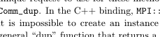

MPI 的 C++ 绑定有一些怪癖。其中之一是，诸如 **MPI::Waitall** 这样的多重完成操作是请求（requests）上的方法，尽管没有唯一的请求可用于这些方法。另一个是 **MPI_Comm_dup** 的 C++ 对应物。在 C++ 绑定中，**MPI::Comm** 是一个抽象基类（ABC）。由于不可能创建抽象基类的实例，因此不可能有一个通用的“dup”函数返回一个新的 **MPI::Comm**。然而，由于在 C++ 中创建指向 ABC 的引用是可能的，MPI 定义了一个仅适用于 C++ 绑定的例程 **MPI::Clone**，它返回指向新通信器的引用。

MPI 提供了两个级别的 Fortran 90 支持。基本支持提供 **mpi.f** 包含文件。扩展支持提供 **MPI** 模块。该模块使得检测 Fortran MPI 程序中两种最常见的错误变得容易：忘记提供用于错误返回值的变量，以及忘记将 **status** 声明为大小为 **MPI_STATUS_SIZE** 的数组。这有一些缺点。

Fortran 派生数据类型不能直接支持（Fortran 90 语言没有处理任意类型的方法）。通常，你可以使用 Fortran 90 派生类型的第一个元素。不应在接收操作中使用数组段，特别是非阻塞通信（有关更多信息，请参见 MPI-2 标准的 10.2.2 节）。另一个问题是，虽然 Fortran 90 允许用户在 MPI 模块中定义 MPI 接口，但对于每种 Fortran 数据类型和数组维度的组合，都必须使用不同的 Fortran 90 接口文件（标量与一维数组等不同）。这导致 Fortran 90 MPI 模块库往往（取决于 Fortran 90 编译器）比整个 MPI 库大得多。然而，特别是在程序开发期间，MPI 模块非常有帮助。

## 10.9 MPI、OpenMP 和线程

MPI 标准被精心编写为一个线程安全的规范。这意味着 MPI 的设计不包括当存在多个线程时定义不明确的概念，如“最后一条消息”或“当前打包缓冲区”。MPI 实现可以选择是否提供线程安全的 *实现*。允许这种选择尤为重要，因为线程安全通常由于确保内部数据结构不被两个不同线程不一致地修改所需的额外开销而带来性能代价。大多数早期的 MPI 实现都不是线程安全的。

MPI-2 引入了 MPI 实现可以提供的四个线程安全级别。最低级别，`MPI_THREAD_SINGLE`，仅允许单线程程序。下一级，`MPI_THREAD_FUNNELED`，允许多个线程，但前提是所有的 MPI 调用都在单个线程中发出；大多数 MPI 实现提供 `MPI_THREAD_FUNNELED`。下一级，`MPI_THREAD_SERIALIZED`，允许许多用户线程发出 MPI 调用，但一次只有一个线程。最高支持级别，`MPI_THREAD_MULTIPLE`，允许任何线程调用任何 MPI 例程。

在结合 MPI 和基于线程的并行方法时，理解线程支持级别很重要。OpenMP [12] 是一种流行且强大的用于指定基于线程并行的语言。虽然 OpenMP 提供了一些通用线程并行工具，但最常见的用途之一是并行化循环。如果循环不包含 MPI 调用，则可以将 OpenMP 与 MPI 结合使用。例如，在雅可比（Jacobi）例子中，OpenMP 可用于并行化循环计算：

```cpp
exchange_nbrs( u_local, i_start, i_end, left, right );

#pragma omp for
for (i_local=i; i<=i_end-i_start+1; i++)
    for (j=1; j<=NY; j++)
        ulocal_new[i_local][j] =
            0.25 * (ulocal[i_local+1][j] + ulocal[i_local-1][j] +
                    ulocal[i_local][j+1] + ulocal[i_local][j-1] -
                    h*h*ulocal[i_local][j]);
```

这利用了 MPI 被设计为与其他工具良好协作的事实，从而利用了编译器和线程并行的改进。

## 10.10 测量 MPI 性能

已开发了许多用于测量性能的工具。最好的始终是你自己的应用程序，但有一些可用的测试可以提供关于集群上 MPI 性能的更一般性概览。测量通信性能实际上相当棘手；有关如何进行可重现的性能测量中的一些问题的讨论，请参见 [8]。该论文描述了 mpptest 程序用于测量 MPI 性能的方法。

### 10.10.1 mpptest

mpptest 程序允许你测量任何 MPI 实现的性能的许多方面。最常见的 MPI 性能测试是 Ping-Pong 测试（参见 8.2 节）。mpptest 程序为不同的 MPI 通信模式提供了 Ping-Pong 测试，并为集体操作和点对点通信的更现实变体提供了各种测试，如光环通信（halo communication，类似于 9.3 节中的那些）以及不重用相同内存位置的通信（因此受益于使用已经在内存缓存中的数据）。mpptest 程序还可以测试某些 MPI-2 函数的性能，包括 MPI_Put 和 MPI_Get。

使用 mpptest。mpptest 程序随 MPICH 一起分发，位于目录 'examples/perftest' 中。你也可以从 www.mcs.anl.gov/mpi/perftest 单独下载它。

### 10.10.2 SKaMPI

SKaMPI 基准测试的一个有趣特性是在线表格，显示 MPI 实现在各种并行计算机上的性能，范围从 Beowulf 集群到并行向量超级计算机。

### 10.10.3 高性能 LINPACK

也许在技术计算中最著名的基准测试是 LINPACK 基准测试，在 8.3 节中讨论。适用于集群的该基准测试版本是高性能 LINPACK（HPL）。获取和运行此基准测试相对容易，尽管获得良好的性能可能需要大量的努力。此外，正如 8.3 节中指出的，虽然 LINPACK 基准测试广为人知，但它往往严重高估了许多应用程序的可实现性能。

HPL 基准测试在很大程度上依赖于另一个库，即基本线性代数子程序（BLAS）。因此，要在 HPL 基准测试中获得良好的性能，你必须拥有高质量的 BLAS 实现。幸运的是，这些子程序有几个来源。你可以直接从 CPU 供应商获取 BLAS 的实现，有时是免费的。

**HPL。** 从 **www.netlib.org/benchmark/hpl** 下载 HPL 软件包：

```bash
% tar zxf hpl.tgz
% cd hpl
```

在 `hpl` 目录中创建一个 `Make.archname`。考虑像 `Win2k_P4_CBLAS_p4` 这样的架构名称，用于在 Pentium 4 处理器上的 Windows 2000 系统，使用由 ATLAS 构建的 BLAS 的 C 版本，并使用 MPICH 的 MPI 实现中的 `ch_p4` 设备。要创建此文件，请查看 `hpl/makes` 目录中的示例，例如，

```bash
% copy makes\Make.Linux_PII_CBLAS_gm Make.Win2k_P4_CBLAS_p4
```

编辑此文件，将 ARCH 更改为你选择的名称（例如，`Win2k_P4_CBLAS_p4`），并将 `Ladir` 设置为 ATLAS 库的位置。然后执行以下操作：

```bash
% make arch=<themame>
% cd bin\<themame>
% mpirun -np 4 xhpl.exe
```

检查输出以确保你得到了正确的答案。文件 `HPL.dat` 控制实际的测试参数。`hpl` 软件包附带的 `HPL.dat` 版本适用于测试 `hpl`。要运行 `hpl` 进行性能测试需要


修改 `HPL.dat`。文件 `hpl/TUNING` 中提供了一些关于如何设置该文件中的值以获得最佳性能的建议。以下是几个最重要的：

-   1. 将问题规模更改为较大的值。但是不要设置得过大，因为总计算工作量随问题规模的立方增长（将问题规模加倍会使工作量增加八倍）。大约 5,000–10,000 的问题规模是合理的。
-   2. 将块大小更改为适中的值。大约 64 的块大小是一个很好的起点。
-   3. 更改处理器分解和节点数量以匹配你的配置。在大多数情况下，你应尝试让分解保持接近正方形（例如，*P* 和 *Q* 的值应大致相同），且 *P* $\ge$ *Q*。
-   4. 试验 **RFAC** 和 **PFAC** 的不同值。在某些系统上，这些参数可能对性能产生重大影响。对于某个大型集群，将两者都设置为 **right** 更为可取。

## 10.11 MPI-2 状态

MPI-2 是 MPI-1 标准的重大扩展。与 MPI-1 标准不同（该标准在发布时已有完整实现），MPI-2 的完整实现推出得较为缓慢。截至 2001 年 6 月，仅有少数 MPI-2 的完整实现，且没有针对 Beowff 集群的实现。大多数 MPI 实现都包含 MPI-IO 例程，这在很大程度上归功于 ROMIO 对这些例程的实现。然而，MPI-2 的重要部分已经可用，包括本书中描述的例程。MPI-2 实现在完整性和性能方面都在不断进步，我们预计完整的 MPI-2 实现将在 2002 年出现。

## 10.12 MPI 例程摘要

本节提供了本章中使用的 C、Fortran、C++ 及其他 MPI 例程的快速摘要。虽然这些例程只是 MPI 中可用例程的一小部分，但对于许多应用来说已经足够。

### C 例程。

```c
int MPI_Irecv(void* buf, int count, MPI_Datatype datatype, int source, int tag,
MPI_Comm comm, MPI_Request *request)
```

```c
int MPI_Wait(MPI_Request *request, MPI_Status *status)
```

```c
int MPI_Test(MPI_Request *request, int *flag, MPI_Status *status)
```

```c
int MPI_Waitall(int count, MPI_Request *array_of_requests,
MPI_Status *array_of_statuses)
```

```c
int MPI_Win_create(void *base, MPI_Aint size, int disp_unit, MPI_Info info,
MPI_Comm comm, MPI_Win *win)
```

```c
int MPI_Win_free(MPI_Win *win)
```

```c
int MPI_Put(void *origin_addr, int origin_count, MPI_Datatype origin_datatype,
int target_rank, MPI_Aint target_disp, int target_count,
MPI_Datatype target_datatype, MPI_Win win)
```

```c
int MPI_Get(void *origin_addr, int origin_count, MPI_Datatype origin_datatype,
int target_rank, MPI_Aint target_disp, int target_count,
MPI_Datatype target_datatype, MPI_Win win)
```

```c
int MPI_Win_fence(int assert, MPI_Win win)
```

```c
int MPI_File_open(MPI_Comm comm, char *filename, int amode, MPI_Info info,
MPI_File *fh)
```

```c
int MPI_File_set_view(MPI_File fh, MPI_Offset disp, MPI_Datatype etype,
MPI_Datatype ftype, char *datarep, MPI_Info info)
```

```c
int MPI_File_close(MPI_File *fh)
```

```c
int MPI_Comm_spawn(char *command, char *argv[], int maxprocs, MPI_Info info,
                    int root, MPI_Comm comm, MPI_Comm *intercomm,
                    int array_of_errcodes[])
```

```c
int MPI_Comm_get_parent(MPI_Comm *parent)
```

### Fortran 例程。

```fortran
MPI_ISEND(buf, count, datatype, dest, tag, comm, request, ierror)
<type> buf(*)
integer count, datatype, dest, tag, comm, request, ierror
```

```fortran
MPI_IRECV(buf, count, datatype, source, tag, comm, request, ierror)
<type> buf(*)
integer count, datatype, source, tag, comm, request, ierror
```

```fortran
MPI_WAIT(request, status, ierror)
integer request, status(MPI_STATUS_SIZE), ierror
```

```fortran
MPI_TEST(request, flag, status, ierror)
logical flag
integer request, status(MPI_STATUS_SIZE), ierror
```

```fortran
MPI_WAITALL(count, array_of_requests, array_of_statuses, ierror)
integer count, array_of_requests(*),
array_of_statuses(MPI_STATUS_SIZE,*), ierror
```

```fortran
MPI_WIN_CREATE(base, size, disp_unit, info, comm, win, ierror)
<type> base(*)
integer(kind=MPI_ADDRESS_KIND) size
integer disp_unit, info, comm, win, ierror
```

```fortran
MPI_WIN_FREE(win, ierror)
integer win, ierror
```

```fortran
MPI_PUT(origin_addr, origin_count, origin_datatype, target_rank, target_disp,
target_count, target_datatype, win, ierror)
<type> origin_addr(*)
integer(kind=MPI_ADDRESS_KIND) target_disp
integer origin_count, origin_datatype, target_rank, target_count,
target_datatype, win, ierror
```

```fortran
MPI_GET(origin_addr, origin_count, origin_datatype, target_rank, target_disp,
target_count, target_datatype, win, ierror)
<type> origin_addr(*)
integer(kind=MPI_ADDRESS_KIND) target_disp
integer origin_count, origin_datatype, target_rank, target_count,
target_datatype, win, ierror
```

```fortran
MPI_WIN_FENCE(assert, win, ierror)
integer assert, win, ierror
```

```fortran
MPI_FILE_OPEN(comm, filename, amode, info, fh, ierror)
character*(*) filename
integer comm, amode, info, fh, ierror
```

```fortran
MPI_FILE_SET_VIEW(fh, disp, etype, ftype, datarep, info, ierror)
integer fh, etype, ftype, info, ierror
character*(*) datarep
integer(kind=MPI_OFFSET_KIND) disp
```

```fortran
MPI_FILE_READ(fh, buf, count, datatype, status, ierror)
<type> buf(*)
integer fh, count, datatype, status(MPI_STATUS_SIZE), ierror
```

```fortran
MPI_FILE_WRITE(fh, buf, count, datatype, status, ierror)
<type> buf(*)
integer fh, count, datatype, status(MPI_STATUS_SIZE), ierror
```

```fortran
MPI_FILE_READ_ALL(fh, buf, count, datatype, status, ierror)
<type> buf(*)
integer fh, count, datatype, status(MPI_STATUS_SIZE), ierror
```

```fortran
MPI_FILE_WRITE_ALL(fh, buf, count, datatype, status, ierror)
<type> buf(*)
integer fh, count, datatype, status(MPI_STATUS_SIZE), ierror
```

```fortran
MPI_FILE_CLOSE(fh, ierror)
integer fh, ierror
```

```fortran
MPI_COMM_SPAWN(command, argv, maxprocs, info, root, comm, intercomm, array_of_errcodes, ierror)
character*(*) command, argv(*)
integer info, maxprocs, root, comm, intercomm, array_of_errcodes(*),
ierror
```

```fortran
MPI_COMM_GET_PARENT(parent, ierror)
integer parent, ierror
```

### C++ 运行时。

```cpp
Request MPI::Comm::Isend(const void* buf, int count,
const DataType& datatype, int dest, int tag) const
```

```cpp
Request MPI::Comm::Irecv(void* buf, int count, const DataType& datatype,
int source, int tag) const
```

```cpp
void MPI::Request::Wait(Status& status)
```

```cpp
void MPI::Request::Wait()
```

```cpp
bool MPI::Request::Test(Status& status)
```

```cpp
bool MPI::Request::Test()
```

```cpp
void MPI::Request::Waitall(int count, Request array_of_requests[],
Status array_of_statuses[])
```

```cpp
void MPI::Request::Waitall(int count, Request array_of_requests[])
```

```cpp
MPI::Win MPI::Win::Create(const void* base, Aint size, int disp_unit,
const Info& info, const Intracomm& comm)
```

```cpp
void MPI::Win::Free()
```

```cpp
void MPI::Win::Put(const void* origin_addr, int
origin_count, const DataType& origin_datatype, int target_rank, Aint
target_disp, int target_count, const DataType& target_datatype) const
```

```cpp
void MPI::Win::Get(void *origin_addr, int
origin_count, const MPI::Datatype& origin_datatype, int target_rank,
MPI::Aint target_disp, int target_count,
const MPI::Datatype& target_datatype) const
```

```cpp
void MPI::Win::Fence(int assert) const
```

```cpp
MPI::File MPI::File::Open(const MPI::Intracomm& comm, const char* filename,
                          int amode, const MPI::Info& info)
```

```cpp
MPI::Offset MPI::File::Get_size() const
```

```cpp
void MPI::File::Set_view(MPI::Offset disp, const MPI::Datatype& etype,
                         const MPI::Datatype& filetype, const char* datarep,
                         const MPI::Info& info)
```

```cpp
void MPI::File::Read(void* buf, int count, const MPI::Datatype& datatype,
                     MPI::Status& status)
```

```cpp
void MPI::File::Read(void* buf, int count, const MPI::Datatype& datatype)
```

```cpp
void MPI::File::Write(void* buf, int count, const MPI::Datatype& datatype,
                     MPI::Status& status)
```

```cpp
void MPI::File::Write(void* buf, int count, const MPI::Datatype& datatype)
```

```cpp
void MPI::File::Read_all(void* buf, int count, const MPI::Datatype& datatype,
                        MPI::Status& status)
```

```cpp
void MPI::File::Read_all(void* buf, int count, const MPI::Datatype& datatype)
```

```cpp
void MPI::File::Write_all(const void* buf, int count,
                        const MPI::Datatype& datatype, MPI::Status& status)
```

```cpp
void MPI::File::Write_all(const void* buf, int count, const MPI::Datatype& datatype)
```

```cpp
void MPI::File::Close()
```

```cpp
MPI::Intercomm MPI::Intracomm::Spawn(const char* command,
                                    const char* argv[], int maxprocs, const MPI::Info& info, int root,
                                    int array_of_errcodes[]) const
```

```cpp
MPI::Intercomm MPI::Intracomm::Spawn(const char* command,
                                    const char* argv[], int maxprocs, const MPI::Info& info, int root) const
```

```cpp
MPI::Intercomm MPI::Comm::Get_parent()
```


## 11 使用 PVM 进行并行编程

*Al Geist 和 Stephen Scott*

PVM（并行虚拟机）是一个正在进行的计算研究项目的产物，该项目涉及橡树岭国家实验室、田纳西大学和埃默里大学。该项目的总体目标是研究异构并发计算中的问题，并开发相应的解决方案。PVM 是一组集成的软件工具和库，旨在互联的不同架构计算机上模拟一个通用、灵活的异构并行计算框架。PVM 系统的总体目标是使这些计算机集合能够协作进行并发或并行计算。本章详细描述了使用 PVM 编程所涉及的概念、后勤和方法。

### 11.1 概述

PVM 基于以下原则：

- **用户配置的主机池**：应用程序的计算任务执行在用户为特定 PVM 程序运行选定的机器集合上。单 CPU 机器和硬件多处理器（包括共享内存和分布式内存计算机）都可能是主机池的一部分。在运行过程中可以通过添加和删除机器来改变主机池（这对于容错是一个重要特性）。当在 Beowulf 集群上使用 PVM 时，节点构成主机池。

- **对硬件的半透明访问**：应用程序可以将硬件环境视为无属性的虚拟处理单元集合，也可以通过将某些计算任务放置在最合适的计算机上，利用主机池中特定机器的功能。

- **基于进程的计算**：PVM 中并发的单位是任务，一个独立的顺序控制线程，具有通信和计算能力。PVM 不隐含也不强制进行进程到处理器的映射；特别是，多个任务可以在单个处理器上执行。

- **显式消息传递模型**：计算任务集合中的每个任务执行应用程序工作负载的一部分，它们通过相互显式地发送和接收消息进行协作。PVM 动态分配消息缓冲区空间，因此消息大小仅受可用内存量的限制。

- **异构性支持**：PVM 系统在机器、网络和应用方面支持异构性。就消息传递而言，PVM 允许在具有不同数据表示的机器之间交换包含多种数据类型消息。

- **多处理器支持**：PVM 使用多处理器上的本地消息传递设施以利用底层硬件。例如，在 IBM SP 上，PVM 透明地使用 IBM 的 MPI 来移动数据。在 SGI Origin 上，PVM 使用共享内存来移动数据。

PVM 系统由两部分组成。第一部分是驻留在构成虚拟机的所有计算机上的守护进程，称为 **pvmd3**，有时简写为 **pvmd**。（守护进程程序的一个例子是在后台运行并处理计算机所有进出电子邮件的邮件程序。）守护进程 **pvmd3** 的设计允许任何具有有效登录权限的用户在机器上安装此守护进程。要运行 PVM 应用程序，您首先通过启动 PVM 来创建虚拟机（11.7.2 节详细介绍了如何做到这一点）。然后，您可以在任何主机上启动 PVM 应用程序。多个用户可以配置重叠相同集群节点的虚拟机，并且每个用户可以同时执行几个 PVM 应用程序。

系统的第二部分是 PVM 接口例程库。它包含了应用程序任务协作所需的功能完整的原语库。该库包含用户可调用的例程，用于消息传递、生成进程、协调任务和修改虚拟机。

PVM 计算模型基于这样的概念：应用程序由多个任务组成，每个任务负责应用程序计算工作负载的一部分。有时应用程序沿其功能进行并行化。也就是说，每个任务执行不同的功能，例如输入、问题设置、求解、输出或显示。这通常称为功能并行。并行化应用程序的一种更常见的方法称为数据并行。在这种方法中，所有任务都是相同的，但每个任务只知道并解决数据的一小部分。这也称为 SPMD（单程序多数据）计算模型。PVM 支持其中一种或两者的混合。根据它们的功能，任务可能并行执行，并可能需要同步或交换数据。

PVM 系统目前支持 C、C++ 和 Fortran 语言。这些语言接口的包含是基于这样一个观察：大多数目标应用程序是用 C 和 Fortran 编写的，并且出现了使用基于对象的语言和方法进行实验的趋势。第三方组织创建了自由提供的 Java、Perl、Python 和 IDL 接口供 PVM 使用。

PVM 用户接口库的 C 和 C++ 语言绑定作为函数实现，遵循大多数 C 系统使用的通用约定。具体来说，函数参数是值参数和指针的适当组合，函数结果值指示调用的结果。此外，宏定义用于系统常量，全局变量如 **errno** 和 **pvm_errno** 是区分多种可能结果的机制。用 C 和 C++ 编写的应用程序通过链接标准发行版的一部分归档库（libpvm3.a）来访问 PVM 库函数。

Fortran 语言绑定作为子程序而不是函数实现。采取这种方法是因为支持的架构上的一些编译器不能可靠地将 Fortran 函数与 C 函数接口化。其直接推论之一是，每个 PVM 库调用都引入了一个额外的参数，用于将状态结果返回给调用程序。另一个不同之处在于，消息缓冲区中类型化数据的放置和检索库例程被统一，并增加了一个指示数据类型的额外参数。除了这些差异（以及 C 的标准命名前缀 pvme 和 Fortran 的 pvmf）之外，两种语言绑定之间存在一一对应关系。PVM 的 Fortran 接口作为库存根实现，后者在适当转换和/或取消引用参数后调用相应的 C 例程。因此，Fortran 应用程序需要链接存根库（libfpvm3.a）以及 C 库。

所有 PVM 任务由整数任务标识符 tid 标识。消息发送到 tid，并从 tid 接收。由于 tid 必须在整个虚拟机中唯一，它们由本地 pvmd 提供，而不是用户选择。尽管 PVM 将信息编码到每个 tid 中，但用户应被视为将 tid 视为不透明的整数标识符。PVM 包含多个返回 tid 值的例程，以便用户应用程序可以识别系统中的其他任务。

在某些应用程序中，自然地认为有一个*任务组*。并且，您可能会希望用 0 到 *p* − 1 的数字来标识您的任务，其中 *p* 是任务数。PVM 包括用户命名组的概念。当一个任务加入一个组时，它在该组中被分配一个唯一的“实例”编号。实例编号从 0 开始并递增。遵循 PVM 的理念，组功能的设计非常通用且对用户透明。例如，任何 PVM 任务可以在任何时间加入或离开任何组，而无需通知受影响组中的任何其他任务，组可以重叠，并且任务可以


向他们未加入的组广播消息。要使用任何组函数，程序必须与 `libbgpvm3.a` 链接。

使用 PVM 进行应用程序编程的一般范式如下。你用 C、C++ 或 Fortran 77 编写一个或多个顺序程序，其中包含嵌入的对 PVM 库的调用。每个程序对应于组成应用程序的一个任务。这些程序针对主机池中的每种体系结构进行编译，生成的目标文件被放置在主机池中机器可访问的位置。要执行应用程序，通常你需要手动从主机池中的某台机器启动一个任务的一个副本（通常是“管理器”或“发起”任务）。该进程随后启动其他 PVM 任务，最终形成一个活跃任务的集合，这些任务随后在本地进行计算并彼此交换消息以解决问题。

请注意，虽然这种场景很典型，但可以根据需要手动启动任意数量的任务。如前所述，任务通过显式消息传递进行交互，并使用系统分配的、不透明的 `tid` 来识别彼此。

```c
#include "pvm3.h"

main()
{
    int cc, tid, msgtag;
    char buf[100];

    printf("i'm t%x\n", pvm_mytid());

    cc = pvm_spawn("hello_other", (char**)0, 0, "", 1, &tid);

    if (cc == 1) {
        msgtag = 1;
        pvm_recv(tid, msgtag);
        pvm_upkstr(buf);
        printf("from t%x: %s\n", tid, buf);
    } else
        printf("can't start hello_other\n");

    pvm_exit();
}
```

图 11.1 PVM 程序 `hello.c`。

图 11.1 展示了 PVM 程序 `hello.c` 的主体部分，这是一个简单的示例，说明了 PVM 编程的基本概念。该程序旨在手动调用；在打印其任务 ID（通过 `pvm_mytid()` 获取）后，它使用 `pvm_spawn()` 启动另一个名为 `hello_other.c` 的程序副本。成功的启动会导致程序执行使用 `pvm_recv` 的阻塞接收。收到消息后，程序打印由其对应程序发送的消息及其任务 ID；缓冲区使用 `pvm_upkstr` 从消息中提取。最后的 `pvm_exit` 调用将程序从 PVM 系统中分离出来。

```c
#include "pvm3.h"

main()
{
    int ptid, msgtag;
    char buf[100];

    ptid = pvm_parent();

    strcpy(buf, "hello, world from ");
    gethostname(buf + strlen(buf), 64);
    msgtag = 1;
    pvm_initsend(PvmDataDefault);
    pvm_pkstr(buf);
    pvm_send(ptid, msgtag);

    pvm_exit();
}
```


图 11.2 是“从属”或启动程序的列表；其第一个 PVM 操作是使用 `pvm_parent` 调用获取“主”任务的 ID。然后该程序获取其主机名，并使用三调用序列将其传输给主程序：`pvm_initsend` 用于初始化（透明的）发送缓冲区；`pvm_pkstr` 用于以强类型且与体系结构无关的方式将字符串放入发送缓冲区；`pvm_send` 用于将其传输到由 *ptid* 指定的目标进程，并用数字 1 对该消息进行“标记”。

### 11.2 程序示例

在本节中，我们将详细讨论几个完整的 PVM 程序。第一个示例 `forkjoin.c` 展示了如何启动进程并与它们同步。然后，我们讨论了 Fortran 点积程序 `PSDOT.F` 和一个矩阵乘法示例。最后，我们展示了如何使用 PVM 计算通过导线的热扩散。

### 11.3 分叉/汇合

分叉/汇合示例演示了如何启动 PVM 任务并与它们同步。该程序启动几个任务，默认为三个。子任务通过向父任务发送消息来同步。父任务从每个启动的任务接收消息，并打印出关于子任务消息的信息。

该程序包含父任务和子任务的代码。让我们更详细地查看它。程序做的第一件事是调用 `pvm_mytid()`。在 fork/join 中，我们检查 `mytid` 的值；如果是负值，表示发生错误，我们调用 `pvm_error()` 并退出程序。`pvm_error()` 调用将打印一条消息，指示最近的 PVM 调用出了什么问题。在这种情况下，最近的调用是 `pvm_mytid()`，因此 `pvm_error()` 可能会打印一条消息，指示 PVM 尚未在此机器上启动。`pvm_error()` 的参数是一个字符串，将前缀于 `pvm_error()` 打印的任何错误消息之前。在这种情况下，我们传递 `argv[0]`，这是程序在命令行上输入的名称。

假设我们从 `pvm_mytid` 调用中获得了有效结果，现在调用 `pvm_parent()`。`pvm_parent()` 函数将返回启动调用任务的任务的 `tid`。由于我们从命令提示符运行初始的 `forkjoin` 程序，该初始任务没有父任务；它不是由其他 PVM 任务启动的，而是由用户手动启动的。对于初始的 fork/join 任务，`pvm_parent()` 的结果将不是某个特定的任务 ID，而是一个错误代码，`PvmNoParent`。因此，我们可以通过检查 `pvm_parent()` 调用的结果是否等于 `PvmNoParent` 来区分父 fork/join 任务和子任务。如果该任务是父任务，那么它必须启动子任务。如果它不是父任务，那么它必须向父任务发送消息。

让我们检查由父任务执行的代码。任务数量作为 `argv[1]` 从命令行获取。如果任务数量不合法，则我们退出程序，调用 `pvm_exit()` 然后返回。对 `pvm_exit()` 的调用很重要，因为它告诉 PVM 该程序将不再使用任何 PVM 设施。（在这种情况下，任务退出，PVM 将推断该死亡任务不再需要其服务。无论如何，干净利落地退出都是良好的风格。）假设任务数量有效，fork/join 将尝试启动子任务。

`pvm_spawn()` 调用告诉 PVM 启动名为 `argv[0]` 的 `ntask` 个任务。第二个参数是传递给启动任务的参数列表。在这种情况下，我们不希望给子任务任何特定的命令行参数，因此该值为空。spawn 的第三个参数 `PvmTaskDefault` 是一个标志，告诉 PVM 在默认位置启动任务。如果我们希望将子任务放置在特定机器或特定体系结构的机器上，我们会使用 `PvmTaskHost` 或 `PvmTaskArch` 作为此标志，并将主机或体系结构作为第四个参数指定。由于我们不在乎任务在哪里执行，我们使用 `PvmTaskDefault` 作为标志，第四个参数为空。最后，`ntask` 告诉 spawn 要启动多少个任务，整数数组 `child` 将保存新启动的子任务的任务 ID。`pvm_spawn()` 的返回值指示有多少任务成功启动。如果 `info` 不等于 `ntask`，则在启动过程中发生了某些错误。在出错的情况下，错误代码被放置在任务 ID 数组 `child` 中，而不是实际的任务 ID；fork/join 遍历此数组并打印任务 ID 或任何错误代码。如果没有任务成功启动，则程序退出。

对于每个子任务，父任务接收一条消息并打印关于该消息的信息。`pvm_recv()` 调用接收来自任何任务的消息，只要该消息的标签是 `JOINTAG`。`pvm_recv()` 的返回值是一个指示消息缓冲区的整数。该整数可用于查找有关消息缓冲区的信息。随后的 `pvm_bufinfo()` 调用正是这样做；它获取由 `buf` 指示的消息的发送进程的长度、标签和任务 ID。在 fork/join 中，子任务发送的消息包含一个整数值，即子任务的任务 ID。`pvm_upkint()` 调用从消息中解包整数到 `mdata` 变量。作为健全性检查，fork/join 测试 `mdata` 的值和 `pvm_bufinfo()` 返回的任务 ID。如果值不同，程序存在 bug，并打印错误消息。最后，打印关于消息的信息，父程序退出。

fork/join 中的最后一段代码将由子任务执行。在数据放入消息缓冲区之前，必须通过调用 `pvm_initsend()` 初始化缓冲区。参数 `PvmDataDefault` 表示 PVM 应执行任何必要的数据转换，以确保数据以正确的格式到达目标处理器。在某些情况下，这可能会导致不必要的数据移动或转换。


的转换。如果你确定由于目标机器使用相同的数据格式而不需要进行任何数据转换，那么你可以在 `pvm_initSEND()` 中使用 `PvmDataRaw` 作为参数。`pvm_pkint()` 调用会将单个整数 `mytid` 放入消息缓冲区。确保相应的解包调用与打包调用完全匹配非常重要。将整数打包并作为浮点数解包将不能正常工作。打包和解包调用之间应存在一一对应关系。最后，使用消息标签 `JOINTAG` 将消息发送给父任务。

```c
/*
    Fork Join 示例
    演示如何生成进程并交换消息
*/

/* PVM 库的定义和原型 */
#include <pvm3.h>

/* 此程序将生成的子进程最大数量 */
#define MAXNCHILD   20
/* 用于 join 消息的标签 */
#define JOINTAG     11

int
main(int argc, char* argv[])
{

    /* 要生成的任务数，默认使用 3 */
    int ntask = 3;
    /* pvm 调用的返回码 */
    int info;
    /* 我的任务 ID */
    int mytid;
    /* 我父进程的任务 ID */
    int myparent;
    /* 子任务 ID 数组 */
    int child[MAXNCHILD];
    int i, mydata, buf, len, tag, tid;

    /* 获取我的任务 ID 编号 */
    mytid = pvm_mytid();

    /* 检查错误 */
    if (mytid < 0) {
        /* 打印错误 */
        pvm_perror (argv [0]);
        /* 退出程序 */
        return -1;
    }
    /* 获取我父进程的任务 ID 编号 */
    myparent = pvm_parent ();

    /* 如果存在除 PvmNoParent 以外的某些错误，则退出 */
    if ((myparent < 0) && (myparent != PvmNoParent)
    && (myparent != PvmParentNotSet)) {
        pvm_perror (argv [0]);
        pvm_exit ();
        return -1;
    }

    /* 如果我沒有父进程，那么我是父进程 */
    if (myparent == PvmNoParent || myparent == PvmParentNotSet) {
        /* 确定要生成多少任务 */
        if (argc == 2) ntask = atoi (argv [1]);

        /* 确保 ntask 是合法的 */
        if ((ntask < 1) || (ntask > MAXNCHILD)) {
            pvm_exit ();
            return 0;
        }

        /* 生成子任务 */
        info = pvm_spawn (argv [0], (char ** ) 0, PvmTaskDefault, (char *) 0,
            ntask, child);
        /* 打印任务 ID */
        for (i = 0; i < ntask; i++)
            if (child[i] < 0)
                /* 以十进制打印错误码 */
                printf("%d", child[i]);
            else
                /* 以十六进制打印任务 ID */
                printf("%lx", child[i]);
        putchar('\n');

        /* 确保生成成功 */
        if (info == 0) {
            pvm_exit ();
            return -1;
        }

        /* 只预期从那些正确生成的进程接收响应 */
        ntask = info;

        for (i = 0; i < ntask; i++) {
            /* 从任意子进程接收消息 */
            buf = pvm_recv (-1, JOINTAG);
            if (buf < 0)
                pvm_perror ("calling recv");
            info = pvm_bufinfo(buf, &len, &tag, &tid);
            if (info < 0)
                pvm_perror("calling pvm_bufinfo");
            info = pvm_upkint(&mydata, 1, 1);
            if (info < 0)
                pvm_perror("calling pvm_upkint");
            if (mydata != tid)
                printf("This should not happen!\n");
            printf("Length %d, Tag %d, Tid 0x%x\n", len, tag, tid);
        }

        pvm_exit();
        return 0;
    }

    /* 我是一个子进程 */
    info = pvm_initsend(PvmDataDefault);
    if (info < 0) {
        pvm_perror("calling pvm_initsend");
        pvm_exit();
        return -1;
    }
    info = pvm_pkint(&mytid, 1, 1);
    if (info < 0) {
        pvm_perror("calling pvm_pkint");
        pvm_exit();
        return -1;
    }
    info = pvm_send(myparent, JOIN_TAG);
    if (info < 0) {
        pvm_perror("calling pvm_send");
        pvm_exit();
        return -1;
    }
    pvm_exit();
    return 0;
}
```

图 11.3 展示了运行 fork/join 的输出。请注意，消息接收的顺序是非确定性的。由于父进程的主循环基于先到先得的原则处理消息，打印顺序仅仅取决于消息从子任务传输到父进程所花费的时间。

### 11.4 点积

在这里，我们展示一个简单的 Fortran 程序 PSDOT，用于计算点积。该程序计算两个数组 X 和 Y 的点积。首先，PSDOT 调用 PVMTIMYID() 和 PVMFSPARENT()。如果任务不是由另一个 PVM 任务生成的，PVMFSPARENT 调用将返回 PVMNOPARENT。在这种情况下，PSDOT 任务是主任务，必须生成其他 PSDOT 工作副本。PSDOT 然后询问用户要使用的进程数和要计算的向量长度。

```
% forkjoin
t10001c t40149 tc0037
Length 4, Tag 11, Tid t40149
Length 4, Tag 11, Tid tc0037
Length 4, Tag 11, Tid t10001c
% forkjoin 4
t10001e t10001d t4014b tc0038
Length 4, Tag 11, Tid t4014b
Length 4, Tag 11, Tid tc0038
Length 4, Tag 11, Tid t10001d
Length 4, Tag 11, Tid t10001e
```

图 11.3
fork/join 程序的输出。

每个生成的进程将接收 $X$ 和 $Y$ 中 $n/nproc$ 个元素，其中 $n$ 是向量的长度，$nproc$ 是计算中使用的进程数。如果 $nproc$ 不能整除 $n$，则主进程将计算剩余元素的点积。子例程 SGENMAT 随机生成 $X$ 和 $Y$ 的值。PSDOT 然后生成 $nproc - 1$ 个自身的副本，并向每个新任务发送 $X$ 和 $Y$ 数组的一部分。消息包含消息中子数组的长度以及子数组本身。在主进程生成工作进程并发送出子向量后，主进程随后计算其 $X$ 和 $Y$ 部分的点积。主进程然后从工作进程接收其他的局部点积。注意，PVMFREECV 调用对任务 ID 参数使用了通配符 $(-1)$。这表明来自任何任务的消息都能满足接收请求。以这种方式使用通配符会导致竞态条件。在这种情况下，由于加法具有交换律，因此竞态条件不会造成问题。换句话说，累加来自工作进程的部分和的顺序无关紧要。除非确定竞态不会负面影响程序，否则应避免竞态条件。

一旦主进程接收到所有局部点积并将它们求和为全局点积，它会在本地计算整个点积。然后这两个结果相减，并打印两个值之间的差异。由于浮点舍入误差的变化，可以预期会有较小的差异。

如果 PSDOT 程序是一个工作进程，则它从主进程接收包含 $X$ 和 $Y$ 子数组的消息。它计算这些子数组的点积并将结果发送回主进程。为了简洁起见，我们不包含 SGENMAT 和 SDOT 子例程。

```fortran
      PROGRAM PSDOT

* PSDOT 执行并行内积（或点积），其中向量
* X 和 Y 起始于主节点，该节点随后设置虚拟
* 机器，分发数据和任务，并将局部部分求和
* 以得到全局内积。
*
*   .. External Subroutines ..
*   EXTERNAL PVMFYTID, PVMFSPARENT, PVMFSPAWN, PVMFEXIT, PVMFINIT,SEND
*   EXTERNAL PVMFPACK, PVMFSEND, PVMFRECV, PVMFUNPACK, SGENMAT
*
*   .. External Functions ..
*   INTEGER ISAMAX
*   REAL SDOT
*   EXTERNAL ISAMAX, SDOT
*
*   .. Intrinsic Functions ..
*   INTRINSIC MOD
*
*   .. Parameters ..
*   INTEGER MAXN
*   PARAMETER ( MAXN = 8000 )
*   INCLUDE 'fpvm3.h'
*
*   .. Scalars ..
*   INTEGER N, LN, MYTID, NPROCS, IBUF, IERR
*   INTEGER I, J, K
*   REAL LDOT, GDOT
*
*   .. Arrays ..
*   INTEGER TIDS(0:63)
*   REAL X(MAXN), Y(MAXN)
*
*   注册到 PVM 并获取我的和主进程的任务 ID 编号
*
*   CALL PVMFYTID( MYTID )
*   CALL PVMFSPARENT( TIDS(0) )
*
*   如果我需要生成其他进程（我是主进程）
*
*   IF ( TIDS(0) .EQ. PVMOPARENT ) THEN
*
*       获取起始信息

      WRITE( *,* ) 'How many processes should participate (1-64)?'
      READ(*,*) NPROCS
      WRITE(*,2000) MAXN
      READ(*,*) N
      TIDS(0) = MYTID
      IF ( N .GT. MAXN ) THEN
        WRITE(*,*) 'N too large. Increase parameter MAXN to run'///
      'this case.'
        STOP
      END IF
*
*   LN 是要在本地执行的点积元素数量。每个人拥有相同数量的元素，主进程获得任何剩余的元素。J 存储其余进程执行的元素数量。

      J = N / NPROCS
      LN = J + MOD(N, NPROCS)
      I = LN + 1
*
*   随机生成 X 和 Y
*   注意：这里未提供 SGENMAT() 例程

      CALL SGEMAT( N, 1, X, N, MYTID, NPROCS, MAXN, J )
      CALL SGEMAT( N, 1, Y, N, I, N, LN, NPROCS )
*
*   遍历所有工作进程

      DO 10 K = 1, NPROCS-1
*
*   生成进程并检查错误

        CALL PVMFSPAWN( 'psdot', 0, 'anywhere', 1, TIDS(K), IERR )
        IF ( IERR .NE. 1 ) THEN
          WRITE(*,*) 'ERROR, could not spawn process #',K,
     :' Dying . . .'
          CALL PVMFEXIT( IERR )
          STOP
        END IF
*
*   发送启动信息

        CALL PVMFINITSEND( PVMDEFAULT, IBUF )
        CALL PVMFPACK( INTEGER4, J, J, 1, 1, IERR )
```


## 第 11 章

### 11.5 矩阵乘法

在本例中，我们将 Fox 等人 [3] 中描述的矩阵乘法算法进行编程。`mmult` 程序可以在本节末尾找到。`mmult` 程序将计算 $C = AB$，其中 $C$、$A$ 和 $B$ 都是方阵。为简单起见，我们假设使用 $m \times m$ 个任务来计算解。每个任务计算结果矩阵 $C$ 的一个子块。块大小和 $m$ 的值作为命令行参数提供给程序。矩阵 $A$ 和 $B$ 也作为分布在 $m^2$ 个任务上的块存储。在深入研究程序细节之前，让我们先描述一下该算法的高层逻辑。

在我们 $m \times m$ 的任务网格中，每个任务 $(t_{ij}, \text{其中 } 0 \leq i,j < m)$ 最初包含块 $C_{ij}$、$A_{ij}$ 和 $B_{ij}$。在算法的第一步中，对角线上的任务 $(t_{ij} \text{ 其中 } i = j)$ 将它们的块 $A_{ii}$ 发送给第 $i$ 行中的所有其他任务。在传输 $A_{ii}$ 之后，所有任务计算 $A_{ii} \times B_{ij}$ 并将结果累加到 $C_{ij}$ 中。在下一步中，$B$ 的列块进行旋转。也就是说，$t_{ij}$ 将它的 $B$ 块发送给 $t_{(i-1)j}$。（任务 $t_{0j}$ 将其 $B$ 块发送给 $t_{(m-1)j}$）。任务现在回到第一步，$A_{i(i-1)}$ 被多播到第 $i$ 行中的所有其他任务，算法继续。经过 $m$ 次迭代后，$C$ 矩阵包含 $A \times B$，并且 $B$ 矩阵旋转回原位置。

让我们现在看看在 PVM 中编程实现的矩阵乘法。在 PVM 中，对哪些任务可以与哪些其他任务通信没有限制。然而，对于此程序，我们希望将任务视为一个二维的概念环面（torus）。为了枚举任务，每个任务加入组 **mmult**。组 id 用于将任务映射到我们的环面上。第一个加入组的任务被赋予组 id 为零。在 **mmult** 程序中，组 id 为零的任务生成其他任务，并向这些任务发送矩阵乘法的参数。参数是 *m* 和 *blksize*，分别是块数的平方根和块的大小。在所有任务生成并传输参数后，调用 **pvm_barrier()** 以确保所有任务都已加入组。如果未执行屏障操作，后续对 **pvm_gettid()** 的调用可能会失败，因为某个任务可能尚未加入组。

在屏障之后，其他任务的 task id 存储在 *row* 数组 **myrow** 中。具体来说，程序计算该行中所有任务的组 id，然后我们请求 **PVM** 获取对应组 id 的 task id。接下来，程序使用 **malloc()** 为矩阵分配块。（在实际的应用程序中，我们期望矩阵已经被分配。）然后程序计算它将要计算的 $C$ 块的行和列；这基于组 id 的值。组 id 的范围从 0 到 $m-1$（包括 $m-1$）。因此，如果我们假设组 id 到任务的映射采用行优先方式，整数除法 $\langle mygid / m \rangle$ 将给出任务的行，$\langle mygid \pmod m \rangle$ 将给出列。使用类似的映射，我们计算在环面中直接位于 *上方* 和 *下方* 的任务的组 id，并将它们的 task id 分别存储在 **up** 和 **down** 中。

接下来，通过调用 **InitBlock()** 初始化块。此函数简单地将 $A$ 初始化为随机值，$B$ 初始化为单位矩阵，$C$ 初始化为零。这将允许我们在程序结束时通过检查 $A = C$ 来验证计算。

最后，我们进入主循环来计算 **矩阵乘法**。首先，对角线上的任务将它们的 $A$ 块多播到其行中的其他任务。请注意，数组 **myrow** 实际上包含执行多播的任务的 task id。回想一下，**PVM_cast()** 会向任务数组中的所有任务发送数据，除了调用该函数的任务本身。在 **mmult** 的情况下，这工作得很好，因为我们不希望不必要地处理进入多播任务的额外消息（通过额外的 **pvm_recv()**）。多播任务和接收块的任务都会计算对角块和驻留在该任务中的 $B$ 块的 $AB$。

在子块相乘并累加到 $C$ 块后，我们现在垂直移动 $B$ 块。这是通过将 $B$ 块打包到消息中并发送到 **up** task id，然后从 **down** task id 接收一个新的 $B$ 块来实现的。

请注意，我们在发送 $A$ 块和 $B$ 块时使用了不同的消息标签，并且在循环的不同迭代中也使用了不同的标签。在执行 `pvm_recv()` 时，我们也完全指定了 task id。使用通配符来填充 `pvm_recv()` 的字段是有诱惑力的；然而，这样使用可能很危险。例如，如果我们错误地计算了 $up$ 的值，并在 `pvm_recv()` 中使用了通配符而不是 $down$，我们可能会在不知情的情况下向错误的任务发送消息。在本例中，我们完全指定消息，从而降低了从错误的任务或算法错误阶段接收消息的可能性。

一旦计算完成，我们检查 $A \cdot C = C$ 以验证矩阵乘法是否正确计算了 $C$ 的值。例如，在矩阵乘法库例程中不会执行这一步骤。

你不必调用 `pvm_lvgroup()`，因为 PVM 会意识到该任务已退出并将其从组中移除。然而，在调用 `pvm_exit()` 之前离开组是一种良好的编程习惯。PVM 控制台的 reset 命令将重置所有 PVM 组。`pvm_gstat` 命令将打印当前存在的所有组的状态。

```c
/*  Matrix Multiply  */


/* defines and prototypes for the PVM library */
#include <pvm3.h>
#include <stdio.h>

/* Maximum number of children this program will spawn */
#define MAXNTIDS    100
#define MAXROW      10

/* Message tags */
#define ATAG        2
#define BTAG        3
#define DIMTAG      5

void
InitBlock(float *a, float *b, float *c, int blk, int row, int col)
{
    int len, ind;
    int i,j;

    srand(pvm_mytid());
    len = blk*blk;
    for (ind = 0; ind < len; ind++)
    { a[ind] = ((float)(rand() % 1000)/100.0); c[ind] = 0.0; }
    for (i = 0; i < blk; i++) {
        for (j = 0; j < blk; j++) {
            if (row == col)
                b[j * blk + i] = (i == j)? 1.0 : 0.0;
            else
                b[j * blk + i] = 0.0;
        }
    }
}

void
BlockMult(float* c, float* a, float* b, int blk)
{
    int i, j, k;

    for (i = 0; i < blk; i++)
        for (j = 0; j < blk; j ++)
            for (k = 0; k < blk; k++)
                c[i*blk+j] += (a[i*blk+k] * b[k*blk+j]);
}

int
main(int argc, char* argv[])
{

    /* number of tasks to spawn, use 3 as the default */
    int ntask = 2;
    /* return code from pvm calls */
    int info;
    /* my task and group id */
    int mytid, mygid;
    /* children task id array */
    int child[MAXNTIDS - 1];
    int i, n, blksize;
    /* array of the tids in my row */
    int myrow[MAXROW];
    float *a, *b, *c, *atmp;
    int row, col, up, down;

    /* find out my task id number */
    mytid = pvm_mytid();

    pvm_setopt(PvmRoute, PvmRouteDirect);
}
```

注意：以下文本似乎是来自前一节（第 277-278 页）的代码片段，在原始 OCR 扫描中似乎顺序混乱或分离。根据“第 11 章”和“11.5 矩阵乘法”的流程，第 277/278 页上的 Fortran 代码很可能属于前面的一个示例（PSDOT - 并行点积）。由于提示要求处理文档，且矩阵乘法部分是提供的具有完整上下文的主要文本块，我将在此处包含 Fortran 代码以求完整，承认它是 11.5 之前章节内容的一部分，或者如果被视为同一页流的一部分则将其附加。然而，观察页码（277 -> 278 -> 279 -> 280 -> 281），Fortran 代码位于第 277-278 页，而矩阵乘法文本从第 278 页开始。矩阵乘法节的标题是 11.5。Fortran 代码在 OCR 中缺乏明确的节标题，但很可能是“11.4”或类似内容。我将按其在源文件中出现的样子包含 Fortran 代码，将其视为章节内容的一部分。

```fortran
CALL PVWFACK( REAL4, X(I), J, 1, IERR )
CALL PVWFACK( REAL4, Y(I), J, 1, IERR )
CALL PVWFSEND( TIDS(K), 0, IERR )
I = I + J

10 CONTINUE

* Figure master's part of dot product

* SDOT() is part of the BLAS Library (compile with -lblas)

* GDOT = SDOT( LN, X, 1, Y, 1 )

* Receive the local dot products, and
* add to get the global dot product

* DO 20 K = 1, NPROCS-1
* CALL PVWRECV(-1, 1, IBUF )
* CALL PVWFUNPACK( REAL4, LDOT, 1, 1, IERR )
* GDOT = GDOT + LDOT

20 CONTINUE

* Print out result

* WRITE(*,*) ' '
* WRITE(*,*) '<x,y> = ',GDOT

* Do sequential dot product and subtract from
* distributed dot product to get desired error estimate

* LDOT = SDOT( N, X, 1, Y, 1 )
* WRITE(*,*) '<x,y> : sequential dot product. <x,y> = '///
* 'distributed dot product.'
$ WRITE(*,*) '<x,y> - <x,y>~' = ',ABS(GDOT - LDOT)
* WRITE(*,*)'Run completed.'

* If I am a worker process (i.e. spawned by master process)
*
* ELSE
*
* Receive startup info

* CALL PVWRECV( TIDS(0), 0, IBUF )
* CALL PVWFUNPACK( INTEGER4, LN, 1, 1, IERR )
* CALL PVWFUNPACK( REAL4, X, LN, 1, IERR )
* CALL PVWFUNPACK( REAL4, Y, LN, 1, IERR )

* Figure local dot product and send it in to master
LDOT = SDOT( LN, X, 1, Y, 1 )
CALL PWMFINITSEND( PWMEFAULT, IBUF )
CALL PWMFFPACK( REAL4, LDOT, 1, 1, IERR )
CALL PWFMSEND( TIDS(0), 1, IERR )
END IF
CALL PWFMEXIT( 0 )
1000 FORMAT(1I10,' Successfully spawned process #',I2,', TID =',I10)
2000 FORMAT('Enter the length of vectors to multiply (1 - ',I7,'): ')
STOP
End program PSDOT
END
```


```c
/* 检查错误 */
if (mytid < 0) {
  /* 打印错误信息 */
  pvm_perror(argv[0]);
  /* 退出程序 */
  return -1;
}

/* 加入 mmult 组 */
mygid = pvm_joining(mmy);
if (mygid < 0) {
  pvm_perror(argv[0]); pvm_exit(); return -1;
}

/* 如果我的组 ID 为 0，则我必须生成其他任务 */
if (mygid == 0) {
  /* 查找需要生成的任务数量 */
  if (argc == 3) {
    m = atoi(argv[1]);
    blksz = atoi(argv[2]);
  }
  if (argc < 3) {
    fprintf(stderr, "Usage: mmult m blk\n");
    pvm_lvgroup("mmult"); pvm_exit(); return -1;
  }
  
  /* 确保 ntask 合法 */
  ntask = m*m;
  if ((ntask < 1) || (ntask >= MAXNTIDS)) {
    fprintf(stderr, "ntask = %d not valid.\n", ntask);
    pvm_lvgroup("mmult"); pvm_exit(); return -1;
  }
  /* 如果只有一个任务，则无需生成 */
  if (ntask == 1) goto barrier;

  /* 生成子任务 */
  info = pvm_spawn("mmult", (char**)0, PvmTaskDefault, (char**)0,
    ntask-1, child);

  /* 确保生成成功 */
  if (info != ntask-1) {
    pvm_lvgroup("mmult"); pvm_exit(); return -1;
  }

/* 发送矩阵维度 */
pvm_initsend(PvmDataDefault);
pvm_pkint(&m, 1, 1);
pvm_pkint(&blksize, 1, 1);
pvm_mcast(child, ntask-1, DMTAG);
} else {
/* 接收矩阵维度 */
pvm_recv(pvm_gettid("mmult", 0), DMTAG);
pvm_upkint(&m, 1, 1);
pvm_upkint(&blksize, 1, 1);
task = m*n;
}

/* 确保所有任务都已加入组 */
barrier:
info = pvm_barrier("mmult", ntask);
if (info < 0) pvm_perror(argv[0]);

/* 查找我所在行中的 tid */
for (i = 0; i < m; i++)
myrow[i] = pvm_gettid("mmult", (mygid/m)*m + i);

/* 为本地块分配内存 */
a = (float*)malloc(sizeof(float)*blksize*blksize);
b = (float*)malloc(sizeof(float)*blksize*blksize);
c = (float*)malloc(sizeof(float)*blksize*blksize);
atmp = (float*)malloc(sizeof(float)*blksize*blksize);
/* 检查指针是否有效 */
if (!(a && b && c && atmp)) {
fprintf(stderr, "%s: out of memory!\n", argv[0]);
free(a); free(b); free(c); free(atmp);
pvm_lvgroup("mmult"); pvm_exit(); return -1;
}

/* 查找我的块的行和列 */
row = mygid/m; col = mygid % m;
/* 计算我上方和下方的邻居 */
up = pvm_gettid("mmult", ((row + m - 1) % (m - 1)) * m + col);
down = pvm_gettid("mmult", ((row == (m-1)) ? 0 : (row+1)*m + col));

/* 初始化块 */
InitBlock(a, b, c, blksize, row, col);

/* 执行矩阵乘法 */
for ( i = 0; i < m; i++) {
/* 组播矩阵 A 的块 */
if (col == (row + i)%m) {
pvm_initsend(PvmDataDefault);
pvm_pkfloat(a, blksize*blksize, 1);
pvm_mcast(myrow, m, (i+1)*ATAG);
BlockMult(c,a,b,blksize);
}
else {
pvm_recv(pvm_gettid("mmult", row*m + (row +i)%m), (i+1)*ATAG);
pvm_upkfloat(atmp, blksize*blksize, 1);
BlockMult(c,atmp,b,blksize);
}
/* 轮换矩阵 B 的列 */
pvm_initsend(PvmDataDefault);
pvm_pkfloat(b, blksize*blksize, 1);
pvm_send(up, (i+1)*FTAG);
pvm_recv(down, (i+1)*FTAG);
pvm_upkfloat(b, blksize*blksize, 1);
}
/* 检查结果 */
for ( i = 0 ; i < blksize*blksize; i++)
if (a[i] != c[i])
printf("Error a[%d] (%g) != c[%d] (%g) \n", i, a[i],i,c[i]);
printf("Done.\n");
free(a); free(b); free(c); free(atmp);
pvm_lvgroup("mmult");
pvm_exit();
return 0;
}
```

### 11.6 一维热方程

在这里，我们展示一个 PVM 程序，用于计算通过基底（在本例中为一根导线）的热扩散。考虑一根细导线上的*一维热方程*：

$$\frac{\partial A}{\partial t} = \frac{\partial^{2} A}{\partial x^{2}} \quad (11.6.1)$$

以及如下形式的离散化：

$$\frac{A_{i+1,j}-A_{i,j}}{\triangle t}=\frac{A_{i,j+1}-2A_{i,j}+A_{i,j-1}}{\triangle x^{2}},$$

由此得出显式公式：

$$A_{i+1,j}=A_{i,j}+\frac{\triangle t}{\triangle x^{2}}(A_{i,j+1}-2A_{i,j}+A_{i,j-1}).$$

初始条件和边界条件为：

$$A(t,0)=0, A(t,1)=0 \text{ 对于所有 } t$$
$$A(0,x)=\sin(\pi x) \text{ 对于 } 0 \leq x \leq 1.$$

该计算的伪代码如下：

```text
for i = 1: tsteps-1;

t = t+dt;

a(i+1,1)=0;

a(i+1,n+2)=0;

for j = 2:n+1;

a(i+1,j)=a(i,j) + mu*(a(i,j+1)-2*a(i,j)+a(i,j-1));

end

end
```

在这个例子中，我们使用**主从编程模型**（master/worker programming model）。主程序 `heat.c` 会生成 `heatslv` 程序的五个副本。工作节点（workers）并行计算导线子段的热扩散。在每个时间步，工作节点交换边界信息，在本例中，即导线在处理器之间边界处的温度。

让我们更仔细地看看代码。在 `heat.c` 中，数组 `solution` 将保存每个时间步的热扩散方程解。首先，`heatslv` 任务被生成。接下来，计算初始数据集。请注意，导线的两端被赋予零初始温度值。

然后，程序的主要部分被执行四次，每次使用不同的 $\Delta t$ 值。使用计时器来计算每个计算阶段所经过的时间。初始数据集被发送到 `heatslv` 任务。左侧和右侧邻居任务 ID 连同初始数据集一起被设置。`heatslv` 任务使用这些 ID 来通信边界信息。或者，我们也可以使用 PVM 组调用将任务映射到导线的线段上。通过使用这种方法，我们可以避免显式地向从进程通信任务 ID。

在发送初始数据后，主进程等待结果。当结果到达时，它们被整合到解矩阵中，计算经过的时间，并将解写入输出文件。

一旦所有四个阶段的数据都被计算并存储，主程序打印出经过的时间，并终止从进程。

```c
/*
heat.c

使用 PVM 求解一个简单的热扩散微分方程，
使用 1 个主程序和 5 个从程序。

主程序设置数据，将其通信给从程序，
并等待结果从从程序发送。
生成 xgraph 兼容的结果文件。
*/
#include "pvm3.h"
#include <stdio.h>
#include <math.h>
#include <time.h>
#define SLAVENAME "heatslv"
#define NPROC 5
#define TIMESTEP 100
#define PLOTINC 10
#define SIZE 1000

int num_data = SIZE/NPROC;

main()
{
int mytid, task_ids[NPROC], i, j;
int left, right, k, l;
int step = TIMESTEP;
int info;

double init[SIZE], solution[TIMESTEP] [SIZE];
double result[TIMESTEP*SIZE/NPROC], deltaz2;
FILE *filenum;
char *filenames[4] [7];
double deltaz[4];
time_t t0;
int etime[4];

filename[0][0] = "graph1";
filename[1][0] = "graph2";
filename[2][0] = "graph3";
filename[3][0] = "graph4";

deltat[0] = 5.0e-1;
deltat[1] = 5.0e-3;
deltat[2] = 5.0e-6;
deltat[3] = 5.0e-9;

/* 加入 pvm */
mytid = pvm_mytid();

/* 生成从任务 */
info = pvm_spawn(SLAVENAME, (char *)0, PvmTaskDefault, "",
    NPROC, task_ids);

/* 创建初始数据集 */
for (i = 0; i < SIZE; i++)
    init[i] = sin(M_PI * (double)i / (double)(SIZE-1) ));
init[0] = 0.0;
init[SIZE-1] = 0.0;

/* 对不同的 delta t 值运行问题 4 次 */
for (l = 0; l < 4; l++) {
    deltax2 = (deltat[l]/pow(1.0/(double)SIZE,2.0));
    /* 开始此次运行的计时 */
    time(&t0);
    etime[l] = t0;

    /* 将初始数据发送给从程序。 */
    /* 包括用于交换边界数据的邻居信息 */
    for (i = 0; i < NPROC; i++) {
        pvm_initsend(PvmDataDefault);
        left = (i == 0) ? 0 : task_ids[i-1];
        pvm_pkint(&left, 1, 1);
        right = (i == (NPROC-1)) ? 0 : task_ids[i+1];
        pvm_pkint(&right, 1, 1);
        pvm_pkdouble(&deltax2, 1, 1);
        pvm_pkint(&num_data, 1, 1);
        pvm_pkdouble(&init[num_data*i], num_data, 1);
        pvm_send(task_ids[i], 4);
    }

    /* 等待结果 */
    for (i = 0; i < NPROC; i++) {
        pvm_recv(task_ids[i], 7);
        pvm_upkdouble(&result[0], num_data*TIMESTEP, 1);
    }
    /* 更新解 */
    for (j = 0; j < TIMESTEP; j++)
        for (k = 0; k < num_data; k++)
            solution[j][num_data*k+i] = result[i*(j,k)];
    }
    /* 停止计时 */
    time(&t0);
    etime[l] = t0 - etime[l];
    /* 生成输出 */
    filenum = fopen(filename[l][0], "w");
    fprintf(filenum,"TitleText: Wire Heat over Delta Time: %f\n", deltat[l]);
    fprintf(filenum,"XUnitText: Distance\nYUnitText: Heat\n");
    for (i = 0; i < TIMESTEP; i = i + PLOTINC) {
        fprintf(filenum,"\"Time index: %d\n",i);
        for (j = 0; j < SIZE; j++)
            fprintf(filenum,"%d %f\n",j, solution[i][j]);
        fprintf(filenum,"\n");
    }
    fclose (filenum);
}
/* 打印计时信息 */
printf("Problem size: %d\n",SIZE);
for (i = 0; i < 4; i++)
    printf("Time for run %d: %d sec\n",i,etime[i]);
/* 终止从进程 */
for (i = 0; i < NPROC; i++)
    pvm_kill(task_ids[i]);
pvm_exit();
}
```

`heatslv` 程序执行通过导线的热扩散的实际计算。工作程序由一个无限循环组成，该循环接收初始

### 11.7 使用 PVM

本节描述了如何设置 PVM 软件包，如何配置一个简单的虚拟机，以及如何编译和运行随 PVM 提供的示例程序。第一部分描述了 PVM 的简单用法以及在设置和运行 PVM 过程中最常见的问题。后一部分描述了可用于自定义 PVM 环境的一些更高级选项。

#### 11.7.1 设置 PVM

PVM 受欢迎的原因之一是其设置和使用简单。

PVM 必须由具有管理员访问权限的用户安装。随后，只要管理员未限制对任何 PVM 安装文件的访问权限，它就可以供机器上的所有用户使用。

PVM 的 Windows 版本以 WinZip 文件形式分发，其中包含一个 **InstallShield** 自解压可执行文件。由于 PVM 安装过程将确认编译器的位置和配置，因此用于配合 PVM 的编译器应已安装。基于此基本信息，用户只需在安装过程中始终点击 *Next*（下一步）即可成功安装 PVM。Windows 安装过程中的一个选项会询问这是服务器安装还是客户端安装。对于基于 Windows 的集群，必须至少进行一次 PVM 服务器安装。这是因为服务器安装包含所有 PVM 源代码和库，而客户端安装则指向一个服务器安装，从中可以访问相应的 PVM 程序。当然，也可以为集群的所有节点执行服务器安装，从而避免在运行时客户端通过网络访问程序的需求及相关成本。

默认情况下，安装会将 PVM 系统放在目录 `C:\Program Files\PVM3.4` 中。（不过，如果您希望指定其他位置，可以使用 *Browse*（浏览）按钮。）选择 *Next* 继续，以选择 PVM 用于临时运行时文件的位置。最常见的位置是 `C:\TEMP`。输入此位置，按 *Next* 继续进入设置类型屏幕。选择 *Typical*（典型）安装可确保执行完整安装。按 *Next* 继续进入 C 编译器指定屏幕。从屏幕中选择 C 编译器选项，按 *Next* 继续。如果选择 *None*（无），下一个将是 Fortran 编译器指定屏幕。如果选择了已安装的编译器，接下来出现的目标屏幕将包含编译器 `include` 和 `lib` 目录的正确位置。按 *Next* 继续进入 Fortran 编译器指定屏幕。如果选择了未安装的编译器，您将收到警告消息，并被要求输入编译器 `include` 和 `lib` 目录所在的位置。输入此信息，按 Next 继续进入 Fortran 编译器指定屏幕。

Fortran 编译器指定与上述 C 选择类似。安装过程会在适当的程序文件夹中添加程序图标。只需接受默认值 PVM 3.4，按 Next 继续。屏幕显示刚刚选择的当前设置。当您按下 Next 时，InstallShield 过程开始复制文件，并在状态栏上显示进度。根据系统性能，这可能需要一两分钟。文件复制完成后，您将收到通知，告知 PVM 注册表值将被添加到系统中。按 OK 继续。如果没有足够空间来构建 PVM，系统将询问是否增加 `CONFIG.SYS` 中的环境空间。按 Yes 继续。下一个屏幕说明设置已完成，并提供查看 ReadMe 和帮助文件的选项以及在此机器上启动 PVM 守护进程选项。这些现在可以跳过，因为稍后都可以执行。按 Finish 进入最终设置屏幕。机器必须重新启动后 PVM 才能就绪使用。

##### Windows 网络文件

**LMHOSTS** 和 **HOSTS** 都是微软 TCP/IP for Windows 使用的文件。这两个文件包含集群节点名称和 IP 信息，以便 Windows 网络能够本地解析机器和主机名。这两个文件都位于 `C:\WINNT\system32\drivers\etc` 目录中。构建 Windows 系统时会在该位置放置示例文件。示例文件包含有关指令选项的额外信息。这里只讨论 PVM 安装所必需的那些内容。

**LMHOSTS** 包含 IP 地址到计算机名称的映射。每个条目占一行，IP 地址后跟相应的计算机名称，然后是 `#PRE`，这会使该条目预加载到名称缓存中。每行上的每个条目之间必须至少有一个空格。

```
##### Filename: LMHOSTS
134.123.10.30    node1    #PRE
134.123.10.31    node2    #PRE
134.123.10.32    node3    #PRE
134.123.10.33    node4    #PRE
```

**HOSTS** 包含 IP 地址到主机名的映射。每个条目占一行，第一列是 IP 地址，后跟相应的主机名。每行上的每个条目之间必须至少有一个空格。

```
##### Filename: HOSTS
```

在本节中，我们提供了用 Fortran 和 C 编写的各种示例程序。这些示例展示了编写 PVM 程序的各种方式。有些将应用程序划分为两个独立的程序，而有些则使用单个程序并通过条件语句来处理生成和计算阶段。这些示例展示了不同的通信风格，既包括工作进程之间的通信，也包括工作进程和主进程之间的通信。在某些情况下，消息用于同步，而在其他情况下，主进程在不再需要工作进程时简单地将其终止。我们希望这些示例能帮助您更好地理解如何编写更好的 PVM 程序并评估其中涉及的设计权衡。

工作进程基于数据集迭代计算解（每次迭代都与邻居交换边界信息），并将产生的部分解发回给主进程。作为在工作进程中使用无限循环的替代方案，我们可以向从节点发送一条特殊消息，指示其退出。相反，我们简单地在工作进程中使用无限循环，并从主程序终止它们。第三种选择是让工作进程只执行一次，在处理完来自主程序的单个数据集后退出。这需要将主程序的生成调用放入 **heat.c** 的主 **for** 循环内。虽然此选项可行，但它会给整体计算带来不必要的开销。

在每个时间步和每个计算阶段之前，温度矩阵的边界值会被交换。左手边界元素先发送给左邻居任务并从右邻居任务接收。对称地，右手边界元素发送给右邻居然后从左邻居接收。检查邻居的任务 ID，以确保不会尝试向不存在的任务发送或接收消息。

```c
/*
    heatslv.c

    The slaves receive the initial data from the host,
    exchange boundary information with neighbors,
    and calculate the heat change in the wire.
    This is done for a number of iterations, sent by the master.

*/
#include "pvm3.h"
#include <stdio.h>

int num_data;

main()
{
    int mytid, left, right, i, j, master;
    int timestep;

    double *init, *A;
    double leftdata, rightdata, delta, leftside, rightside;
    /* enroll in pvm */
    mytid = pvm_mytid();
    master = pvm_parent();

    /* receive my data from the master program */
    while(1) {
        pvm_recv(master, 4);
        pvm_upkin(&left, 1, 1);
        pvm_upkin(&right, 1, 1);
        pvm_upkin(&timestep, 1, 1);
        pvm_upkdouble(&delta, 1, 1);
        pvm_upkin(&num_data, 1, 1);
        init = (double *) malloc(num_data*sizeof(double));
        pvm_upkdouble(init, num_data, 1);

        /* copy the initial data into my working array */

        A = (double *) malloc(num_data * timestep * sizeof(double));
        for (i = 0; i < num_data; i++) A[i] = init[i];

        /* perform the calculation */

        for (i = 0; i < timestep-1; i++) {
            /* trade boundary info with my neighbors */
            /* send left, receive right */
            if (left != 0) {
                pvm_initsend(PvmDataDefault);
                pvm_pkdouble(&A[wh(i,0)],1,1);
                pvm_send(left, 5);
            }
            if (right != 0) {
                pvm_recv(right, 5);
                pvm_upkdouble(&rightdata, 1, 1);
                /* send right, receive left */
                pvm_initsend(PvmDataDefault);
                pvm_pkdouble(&A[wh(i,num_data-1)],1,1);
                pvm_send(right, 6);
            }
            if (left != 0) {
                pvm_recv(left, 6);
                pvm_upkdouble(&leftdata,1,1);
            }

            /* do the calculations for this iteration */

            for (j = 0; j < num_data; j++) {
                leftside = (j == 0) ? leftdata : A[wh(i,j-1)];
                rightside = (j == (num_data-1)) ? rightdata : A[wh(i,j+1)];
                if ((j==0)&&(left==0))
                    A[wh(i+1,j)] = 0.0;
                else if ((j==(num_data-1))&&(right==0))
                    A[wh(i+1,j)] = 0.0;
                else
                    A[wh(i+1,j)] =
                        A[wh(i,j)]+delta*(rightside-2*A[wh(i,j)]+leftside);
            }
        }

        /* send the results back to the master program */

        pvm_initsend(PvmDataDefault);
        pvm_pkdouble(&A[0],num_data*timestep,1);
        pvm_send(master,7);
    }
    /* just for good measure */
    pvm_exit();
}

int wh(x, y)
int x, y;
{
    return(x*num_data+y);
}
```


134.123.10.30 node1.epm.ornl.org
134.123.10.31 node2.epm.ornl.org
134.123.10.32 node3.epm.ornl.org
134.123.10.33 node4.epm.ornl.org

**其他必需软件。** 虽然可以在单台机器上运行 PVM 程序而无需安装任何额外软件，但大多数人使用 PVM 是为了在多台 Windows 机器上运行并行应用程序。为此需要一个 RSH 或 SSH 包来启用远程机器访问功能。已经测试过两种可与 PVM 一起使用的商用 RSH 包：来自 **www.ataman.com** 的 Ataman 包和来自 **www.winrshd.com** 的 Winrshd。

#### 11.7.2 启动 PVM

在讲解编译和运行并行 PVM 程序的步骤之前，您应当确保能够启动 PVM 并配置一个虚拟机。在安装了 PVM 的任何主机上，您可以输入

```
> pvm
```

您应该会得到一个 PVM 控制台提示符，表明 PVM 正在此主机上运行。您可以通过在控制台提示符下输入以下命令将主机添加到您的虚拟机中

```
pvm> add hostname
```

您还可以通过输入以下命令从您的虚拟机中删除主机（除了您当前所在的主机外）

```
pvm> delete hostname
```

如果您收到“Can't Start pvmd”（无法启动 pvmd）的消息，PVM 将运行自动诊断并报告发现的原因。

要查看当前虚拟机的状态，您输入

```
pvm> conf
```

要查看虚拟机上运行的 PVM 任务，您输入

```
pvm> ps -a
```

当然，您目前还没有运行任何任务。如果在控制台提示符下输入“quit”（退出），控制台将退出，但您的虚拟机和任务将继续运行。在虚拟机中任何主机的任何命令提示符下，您都可以输入

```
> pvm
```

您将收到“pvm already running”（pvm 已在运行）的消息以及控制台提示符。当您完成虚拟机的工作后，应该输入

```
pvm> halt
```

此命令会终止任何 PVM 任务，关闭虚拟机，并退出控制台。这是停止 PVM 的推荐方法，因为它能确保虚拟机正常关闭。

您应该练习启动和停止 PVM 以及向 PVM 添加主机，直到您对 PVM 控制台感到熟悉为止。PVM 控制台及其众多命令选项的完整描述在第 11.8 节和第 11.9 节中给出。

如果您不希望每次都输入一堆主机名，可以使用 hostfile 选项。您可以将主机名列在一个文件中，每行一个，然后输入

```
> pvm hostfile
```

PVM 会在控制台提示符出现之前同时添加所有列出的主机。可以在 hostfile 中按主机指定几个选项；如果您希望为特定应用程序或环境自定义虚拟机，请参阅第 11.9 节。

PVM 还可以通过其他方式启动。控制台的功能和性能监视器已被整合到一个名为 XPVM 的图形用户界面中，该界面可从 PVM 网站获取。如果您的站点安装了 XPVM，则可以使用它来启动 PVM。要通过此界面启动 PVM，请输入：

```
> xpvm
```

标记为“hosts”（主机）的菜单按钮会拉出一个您可以添加的主机列表。通过点击主机名即可添加该主机，并且该机器的图标会出现在虚拟机的动画中。如果您点击虚拟机中已存在的主机名，该主机将被删除。启动时，XPVM 会读取文件 `$HOME/.xpv_hosts`，该文件列出了在此菜单中显示的主机。没有前缀“&”的主机会在启动时一次性全部添加。

quit（退出）和 halt（停止）按钮的作用与 PVM 控制台相同。如果您退出 XPVM 然后重新启动它，XPVM 将自动显示正在运行的虚拟机的样子。请使用 XPVM 练习启动、停止和添加主机。如果有错误，它们应该会出现在您启动 XPVM 的窗口中。

#### 11.7.3 运行 PVM 程序

在本节中，您将学习如何编译和运行随 PVM 软件提供的示例程序。这些示例程序是建立您自己的 PVM 程序时有用的模板。PVM 本身以及所有示例程序都是使用 C/C++ Microsoft Visual Studio 6 构建的。使用的 Fortran 编译器是 Compaq Fortran 版本 6。由于 PVM 起源于 UNIX 世界，PVM 附带一个 make 文件，该文件实现了构建 PVM 本身以及所有提供的示例代码所需的所有 make 脚本。只需点击桌面上的 PVM Compile Shell 图标，它将启动一个 DOS shell 窗口，并分配正确的路径和资源用于此目的。它启动于 $HOME\PVM3.4 目录。从这里只需输入 make，它将显示一系列命令行选项，可用于执行从移除当前 PVM 安装并重建到仅对提供的示例执行相同操作等各种任务。作为用户，您可以决定是使用 make 技术还是直接在 Microsoft Visual Studio 风格下构建应用程序。请注意，UNIX make 文件不能直接移植到 Windows 环境中。

在一个窗口中启动 PVM 并配置一些主机。这些示例程序设计为可以在任意数量的主机上运行，包括单个主机。在另一个窗口中，cd 到 PVM 可执行文件的位置并输入

```
> master
```

程序将会询问任务数量。在这些示例中，这个数量不必与主机数量匹配。请尝试几种组合。

第一个示例说明了如何在虚拟机中任意主机的提示符上运行 PVM 程序的能力。这是您在工作站上运行串行 a.out 程序的方式。下一个示例，也是一个称为 hite 的主从模型，展示了如何从 PVM 控制台以及从 XPVM 生成 PVM 任务。

hite 模型说明了使用任务池范式进行动态负载平衡。在这种范式中，主程序管理一个大的任务队列，总是向空闲的从属程序发送更多的工作，直到队列为空。当主机具有非常不同的计算能力时，这种范式是有效的，因为负载最少或更强大的主机会做更多的工作，并且所有主机在问题结束前都保持忙碌。

由于 hite 不需要任何用户输入，因此可以直接从 PVM 控制台生成。启动 PVM 控制台，并添加一些主机。在 PVM 控制台提示符下，输入

```
pvm> spawn -> hite
```

“->” 生成选项会使 `hite` 和从属程序中的所有打印语句出现在控制台窗口中。在调试您最初编写的几个 PVM 程序时，这可能是一个有用的功能。您可能希望通过在 `hite.f` 和 `hite.slave.f` 中放置打印语句并重新编译来实验此选项。

为了了解 XPVM 的实时动画功能，您再次可以使用 `hite`。启动 XPVM，并构建一个包含四个主机的虚拟机。点击“tasks”（任务）按钮，并从菜单中选择“spawn”（生成）。在 XPVM 询问命令的地方输入“hite”，然后点击“start”（启动）。您将看到当机器变得忙碌时，主机图标会亮起。您将看到 `hite.slave` 任务被生成，并在 `Space Time`（时空）显示中看到任务之间传递的所有消息。可以从 XPVM 的“views”（视图）菜单中选择其他几种视图。“task output”（任务输出）视图等同于 PVM 控制台中的“->”选项。它会使所有任务的标准输出出现在弹出的窗口中。

从 XPVM（以及 PVM 控制台）生成的程序受到一个限制：它们不能包含任何交互式输入，例如询问要启动多少个从属程序或要解决多大的问题。这类信息可以从文件中读取或作为参数放在命令行上，但没有机制从键盘获取用户输入传递给潜在远程任务。

### 11.8 PVM 控制台细节

PVM 控制台，称为 `pvm`，是一个独立的 PVM 任务，允许交互式地启动、查询和修改虚拟机。可以在虚拟机的任何主机上多次启动和停止控制台，而不会影响 PVM 或可能正在运行的任何应用程序。

当控制台启动时，`pvm` 确定 PVM 是否已在运行；如果未在运行，则自动在此主机上执行 `pvmd`，并将命令行选项和 hostfile 传递给 `pvmd`。因此，启动控制台时 PVM 无需正在运行。

```
pvm [-n hostname] [hostfile]
```

`-n` 选项对于为主 `pvmd` 指定另一个名称非常有用（以防主机名与您想要的 IP 地址不匹配）。对于 Beowulf 集群，此功能非常有用，因为集群的节点有时位于自己的网络上。在这种情况下，前端节点将有两个主机名：一个用于集群，另一个用于外部网络。`-n` 选项允许您在 PVM 启动时直接指定集群名称。

启动后，控制台打印提示符


`pvm` 并接受来自标准输入的指令。可用的指令如下：

- 后跟一个或多个主机名的 `add`，将这些主机添加到虚拟机中。
- `alias` 定义或列出命令别名。
- `conf` 列出虚拟机的配置，包括主机名、pvmd 任务 ID、体系结构类型以及相对速度评级。
- 后跟一个或多个主机名的 `delete`，从虚拟机中删除这些主机。在这些主机上仍在运行的 PVM 进程将会丢失。
- `echo` 回显参数。
- `halt` 终止所有 PVM 进程（包括控制台），然后关闭 PVM。所有守护进程都会退出。
- `help` 可用于获取有关任何交互命令的信息。help 命令后可以跟一个命令名称，该名称将列出此命令可用的选项和标志。
- `id` 打印控制台任务 ID。
- `jobs` 列出正在运行的任务。
- `spawn` 启动 PVM 应用程序。选项包括以下内容：
    - `-count` 显示任务数量；默认为 1
    - `-(host)` 在主机上生成；默认为任意
    - `-(PVM_ARCH)` 在类型为 PVM_ARCH 的主机上生成
    - `-?` 启用调试
    - `->` 将任务输出重定向到控制台
    - `->file` 将任务输出重定向到文件
    - `->>file` 将任务输出追加到文件
    - `-` 跟踪任务；在控制台上显示输出
    - `-file` 跟踪任务；输出到文件
- `unalias` 取消定义命令别名。
- `version` 打印正在使用的 PVM 版本。

PVM 支持使用多个控制台。可以在现有虚拟机中的任何主机上运行控制台，甚至可以在同一台机器上运行多个控制台。可以在 PVM 应用程序运行过程中启动一个控制台并检查其进度。

### 11.9 主机文件选项

正如前文所述，站点上只需要一个人安装 PVM，但每个 PVM 用户都可以拥有自己的主机文件（hostfile），用于描述其个人虚拟机。

主机文件定义了 PVM 组合成虚拟机的初始主机配置。它还包含有关您可能希望稍后添加到配置中的主机的信息。

主机文件最简形式仅仅是每行一个主机名的列表。空行会被忽略，以 `#` 开头的行是注释行。这种方法允许您为主机文件编写文档，并且提供了一种方便的方式来通过注释掉各个主机名来修改初始配置。

```text
# Configuration used for my PVM run
node4
node6
node9
node10
node11
```

每行可以在主机名后指定若干选项。选项之间以空格分隔。

- `lo= username` 允许您为该主机指定另一个登录名；否则，将使用启动机器上的登录名。
- `so= pw` 促使 PVM 提示您输入该主机的密码。当您在远程系统上有不同的 user_id 和密码时，这很有用。PVM 默认使用 `rsh` 来启动远程 `pvmds`，但当指定了 `pw` 时，PVM 将改用 `rexec()`。
- `dx= location of pvmd` 允许您为该主机指定默认位置以外的位置。如果您希望使用自己副本的 pvmd，这很有用。
- `ep= paths to user executables` 允许您指定一系列路径，以便向下查找以生成在该主机上请求的文件。多个路径之间用冒号分隔。
- `sp= value` 指定该主机与其他主机相比的相对计算速度。可能值的范围是 1 到 1,000,000，默认为 1,000。
- `bx= location of debugger` 指定如果生成例程中请求调试，将在该主机上调用哪个调试器脚本。请注意，还可以设置环境变量 PVM_DEBUGGER。
- `wd= working_directory` 指定一个工作目录，在该主机上生成的所有任务都将在此目录下执行。默认为 `$HOME`。
- `so= ms` 指定在该主机上手动启动一个从属 `pvm`。如果 `rsh` 和 `rexec` 网络服务被禁用但存在 IP 连接性，这很有用。使用此选项时，您将在 pvmd 的 tty 中看到以下内容：

```text
[t80040000] ready     Fri Aug 27 18:47:47 1993
*** Manual startup ***
Login to "honk" and type:

pvm3/lib/pvmd -S -d0 -rhonk 1 80a95c43:0c6 4096 2 80a95c43:0000
Type response:
```

在 `honk` 上，输入给定的行后，您应该看到

```text
d6pro<2312> arch<ALPHA>  ip<80a95c43:0a8e> mtu<4096>
```

并将此信息传回给主 pvmd。此时，您将看到

```text
Thanks
```

并且两个 *pvmds* 应该能够相互通信。

如果您希望将上述任何选项作为一系列主机的默认值，您可以将这些选项放在单独的一行中，并将主机名字段设为 `*`。这些默认值将对后续所有主机生效，直到被另一行默认设置覆盖。

那些您不希望包含在初始配置中但稍后可能添加的主机，可以通过在主机文件中以 `&` 开头来指定这些行。下面显示了一个包含这些大多数选项的示例主机文件。

```text
# Comment lines start with a # (blank lines ignored)
gstws
ipsc dx=/usr/geist/pvm3/lib/I860/pvmd3
ibm1.scri.fsu.edu lo=gst so=pw

# set default options for following hosts with *
* ep=$sun/problem1:~/nla/mathlib
sparkly
#azure.epm.ornl.gov
midnight.epm.ornl.gov

# replace default options with new values
* lo=geist so=pw ep=problem1
thud.cs.utk.edu
speedy.cs.utk.edu

# machines for adding later are specified with &
# these only need listing if options are required
&sun4 ep=problem1
&castor dx=/usr/local/bin/pvmd3
&dasher.cs.utk.edu lo=geist
&elvis dx=~/pvm3/lib/SUN4/pvmd3
```

能够查看虚拟机的当前配置和主机的状态通常很有用，并且总是令人放心。如果您还能看到您的程序正在做什么——哪些任务正在运行、消息正在发送到哪里等等——那就更有用了。PVM 图形用户界面 XPVM 就是为显示这些信息以及其他更多信息而开发的。

XPVM 将 PVM 控制台、性能监控器和调用级调试器的功能结合在一个易于使用的图形用户界面中。XPVM 可从 Netlib（www.netlib.org）的 pvm3/xpvm 目录中获得。XPVM 的源代码也可供在其他机器上编译使用。

XPVM 完全使用 C 语言编写，使用 TCL/TK 工具包，并作为另一个 PVM 任务运行。如果您想从源代码构建 XPVM，必须首先获取并在您的系统上安装 TCL/TK 软件。TCL 和 TK 由 John Ousterhout 开发，可从 www.scriptics.com 获取。TCL 和 XPVM 的源发行版各包含一个 README 文件，分别描述每个软件包最新的安装步骤。

图 11.4 显示了 XPVM 使用时的快照。

与 PVM 控制台一样，如果 PVM 未运行，XPVM 会启动 PVM；如果 PVM 已运行，则仅连接到本地 pvmd。控制台可以接受可选的主机文件参数，而 XPVM 始终读取 `$HOME/.xpvm_hosts` 作为其主机文件。如果此文件不存在，XPVM 仅在本地主机上启动 PVM（或连接到现有的 PVM）。在典型使用中，主机文件 `.xpvm_hosts` 包含以 `&` 开头的hosts列表。这些主机名随后会被添加到“Hosts”菜单中，通过点击即可将其添加或从虚拟机中删除。

顶部的按钮行执行类似控制台的功能。“Hosts”按钮显示一个主机菜单。点击某个主机会切换它是被添加到还是从虚拟机中删除。菜单底部有一个用于添加未列出主机的选项。“Tasks”按钮调出一个菜单，其中最常用的选择是 spawn。选择 spawn 会弹出一个窗口，可以在其中设置可执行文件名称、生成标志、启动位置、启动副本数等。默认情况下，XPVM 会开启在 XPVM 内启动的所有任务（及其子任务）的跟踪功能。点击生成窗口中的 Start 即可启动任务，该任务随后会出现在“时域”视图中。Reset 按钮有一个用于重置 PVM（即终止所有 PVM 任务）或重置 XPVM 不同部分的菜单。Quit 按钮退出 XPVM，但让 PVM 继续运行。如果 XPVM 正在收集跟踪信息，停止 XPVM 将不会收集信息。当您用完 PVM 时应使用 Halt 按钮。点击此按钮会终止

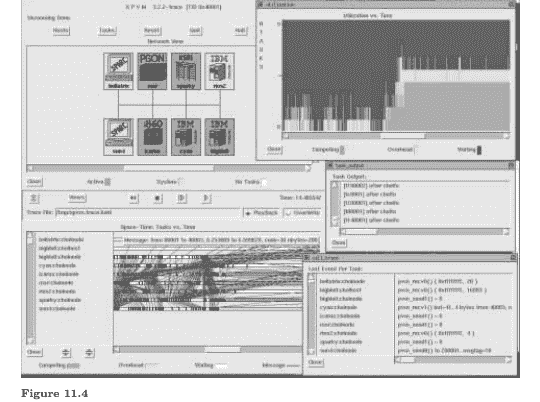

# **图 11.4**

XPVM 界面使用时的快照

显示所有正在运行的 PVM 任务，干净地关闭 PVM，并退出 XPVM 界面。**帮助**按钮会弹出一个包含可用信息主题的菜单。当应用程序运行时，XPVM 会实时收集并显示信息。尽管 XPVM 尽可能快地更新视图，但在某些情况下，XPVM 无法跟上事件发生的速度，从而落后于实际运行时间。

在 XPVM 界面的中间部分是跟踪文件（tracefile）控制区。在这里您可以指定一个跟踪文件；初始时显示的是 `\pvm\t` 目录下的默认跟踪文件。有按钮用于指定是将指定的跟踪文件进行回放，还是被新的运行覆盖。XPVM 使用 Dan Reed 的 Pablo 跟踪显示包中描述的“自定义数据格式”（SDDF）将跟踪事件保存到文件中（也可以使用 Pablo 等其他包来分析 PVM 跟踪数据）。

XPVM 可以回放其自身的 SDDF 文件。类似磁带播放机的按钮允许您回退跟踪文件、在任意点停止显示，并逐步执行。时间显示指定从跟踪显示开始经过的秒数。

**视图**按钮允许您打开或关闭当前随 XPVM 提供的多个视图之一。这些视图在下方有描述。

在启动期间，XPVM 会加入一个名为 `xpvm` 的组。这样做是为了让在 XPVM 界面之外启动的任务能够通过执行 `tid = pvm.gettid( xpvm, 0 )` 获取 XPVM 的 tid。如果您想在这样一个任务中手动打开跟踪并将事件传回 XPVM 进行显示，就需要这个 tid。这些事件的预期 TraceCode 为 **666**。

#### 11.10.1 网络视图

**网络**视图显示当前的虚拟机配置以及宿主机的活动状态。每个主机由一个图标表示，图标内包含 `PVM_ARCH` 和主机名。在当前版本的 XPVM 中，图标随意排列在总线网络的两旁。在将来的版本中，该视图将被扩展以可视化网络活动。届时，您将能够指定要显示的网络拓扑。

这些图标以不同的颜色点亮，以指示它们在执行 PVM 任务时的状态。绿色表示该主机上至少有一个任务正在忙于执行有用工作。黄色表示没有任务正在执行用户计算，但至少有一个任务正忙于执行 PVM 系统例程。当给定主机上没有任务时，其图标保持未着色或白色。每种情况下使用的具体颜色可由用户自定义。

您可以一眼看出您的 PVM 应用程序对虚拟机的利用程度如何。如果所有主机大部分时间都是绿色的，那么机器利用率良好。网络视图不显示其他用户的 PVM 作业或主机上可能正在运行的其他进程的活动。

在将来的版本中，该视图将允许您点击多处理器图标，获取关于该主机上正在运行的处理器数量、PVM 任务数量等信息。

#### 11.10.2 时空视图

**时空**视图显示在虚拟机上运行的各个 PVM 任务的活动。在视图的左侧列出了任务的执行名称，前面跟着它们所运行的主机名。任务列表按主机排序，以便于查看任务是否集中在某一个主机上。该列表还显示了任务到主机的映射（这在网络视图中不可见）。

时空视图结合了三种不同的显示。第一种类似于甘特图。在列出的每个任务旁边都有一个沿“时间”方向延伸的水平条形图。该条形图在任何时间点的颜色指示任务的状态。绿色表示正在执行用户计算。黄色标记任务正在执行 PVM 例程的时间。白色表示任务正在等待消息。条形图开始于任务开始执行的时间，结束于任务正常退出的时间。每种情况下使用的具体颜色可由用户自定义。

第二种显示将任务间的通信活动叠加在第一种显示之上。当两个任务之间发送消息时，会绘制一条红线，起始于发送任务在消息发送时刻的条形图位置，终止于接收任务在消息接收时刻的条形图位置。请注意，这不是消息到达的时间，而是任务调用 `pvm_recv()` 的时间。视觉上，红线与白色“等待”区域结合形成的图案和斜率，揭示了有关应用程序通信效率的大量信息。

第三种显示仅当您用鼠标左键点击时空视图中感兴趣的特征时才会出现。会出现一个小的“弹出”窗口，提供关于特定任务状态或消息的详细信息。如果点击任务条形图，将显示状态的开始和结束时间以及最后一次 PVM 系统调用信息。如果点击消息线，窗口将显示发送和接收时间以及消息中的字节数和消息标签。

当鼠标在时空视图内移动时，一条蓝色垂直线跟踪光标，并且与该垂直线对应的时间作为查询时间显示在显示的底部。这条垂直线也出现在其他“某物 vs. 时间”视图中，以便您可以将一个视图中的特征与另一个视图中给出的信息进行关联。

您可以使用鼠标中键拖动垂直线来放大时空视图的任何区域。当点击鼠标右键时，视图会取消放大一级。通常，非常细微的通信或等待状态只有在放大视图时才可看清。与查询时间一样，其他视图也会随着时空视图的放大而同步放大。

#### 11.10.3 其他视图

XPVM 被设计为可扩展的。可以创建新视图并将其添加到视图菜单中。目前，还有三个其他视图：利用率、调用跟踪和任务输出。与网络和时空视图不同，这些视图默认是关闭的。由于 XPVM 试图实时绘制视图，打开的视图越少，XPVM 绘制得越快。

利用率视图显示每个时刻正在计算、处于开销中或等待的任务数量。它是时空视图在每个时刻的摘要。由于 PVM 应用程序中的任务数量可以动态变化，当添加任务时，利用率视图的刻度会动态变化，但当任务退出时不会。当这种情况发生时，利用率视图的显示部分会完全按照新刻度重绘。

调用跟踪视图提供每个任务最近一次 PVM 调用的文本记录。任务列表与时空视图中的相同。随着应用程序运行，文本会变化以反映每个任务最近的活动。该视图可用作调用级调试器，用于识别 PVM 程序执行挂起的位置。

当打开任务输出视图时，XPVM 会自动通知其派生的所有任务将标准输出重定向回 XPVM。此视图为您提供将输出重定向到文件的选项。如果在“任务输出”框中输入文件名，输出将打印在窗口中并写入文件。

与跟踪事件一样，在 XPVM 外部启动的任务可以通过使用 pvm_setopt() 中的选项进行编程，将标准输出发送到 XPVM 进行显示。XPVM 期望 OutputCode 设置为 667。

# **12 使用 PVM 的容错和自适应程序**

*Al Geist 和 Jim Kohl*

过去几年里，Beowulf 集群的使用迅速扩展。最初由研究人员创建用于科学计算，如今这些集群正被用于业务和商业环境，那里的需求和期望截然不同。例如，在一家大型 Web 托管公司中，应用程序的可靠性和健壮性往往比其原始性能更重要。

在为 Beowulf 集群开发应用程序时，必须考虑若干因素。在前几章中，演示了消息传递的基本方法，以便您能够创建自己的并行程序。本章描述使并行程序具备容错性和自适应性的问题及常用方法。

*容错性*是指应用程序在硬件或软件问题导致集群中的某个节点发生故障时，仍能继续运行或取得进展的能力。它也是容忍应用程序内部故障的能力。例如，并行应用程序内的某个任务可能会遇到错误并终止。由于 Beowulf 集群是由为桌面而非重型计算设计的商用组件构建的，集群内部组件的故障率高于拥有集成 RAS（可靠性、可用性、可维护性）系统的更昂贵的多处理器系统。

虽然容错程序可以被视为自适应的，但这里的“自适应程序”一词更广泛地指动态改变其特性以更好地匹配应用程序需求和可用资源的并行（或串行）程序。例如，根据当前计算需求添加或释放集群节点的应用程序，以及根据计算需求创建和终止任务的应用程序。

在后面的章节中，您将了解到 Condor 以及其他资源管理工具，这些工具自动为提交给它们的作业提供一定程度的容错性和自适应性。本章将教授如何自己编写此类工具的基础知识。

PVM 基于一种动态计算模型，在这种模型中，可以在计算过程中动态添加和删除集群节点，并在计算过程中派生或终止并行任务。PVM 没有像 MPI 那样丰富的消息传递特性集；但作为虚拟机模型，PVM 具有一些使其适合创建动态并行程序的特性。因此，在本章中，PVM 将用于说明容错性和自适应性的概念。


美国橡树岭国家实验室的一位计算生物学家希望编写一个并行应用程序，该程序可以在他的 Beowulf 集群上全天候（24/7）运行。该应用程序涉及人类基因组的计算，并受全球研究人员源源不断到达的新数据流的驱动。这些数据并非相互独立，因为新数据有助于精化和扩展先前计算出的序列。他该如何编写这样的程序？

一家公司希望编写一个应用程序，用于处理从 Web 端源源不断到达的销售订单流。该程序需要具有强健性，因为停机不仅会造成收入流的损失，还会导致闲置工人的工资支出。该公司最近购买了一个 Beowulf 集群以提供具有成本效益的解决方案。但他们该如何编写能在集群上运行的容错并行程序？

当开发必须可靠的算法时，首要考虑因素是硬件。坏消息是，你的 Beowulf 集群将会发生故障；它需要维护。集群中的某个节点何时故障并不是一个问题，故障是迟早的事。经验表明，集群拥有的节点越多，在给定时间内发生故障的可能性就越大。硬件故障发生的频率在不同集群之间差异很大。有些集群每周都会发生故障；另一些集群则可以运行数月才出现一次故障。几个节点因相似的硬件问题而几乎同时发生故障的情况并不罕见。请在模拟负载下对你的特定集群进行几周评估，以获取平均故障间隔时间（MTBF）的预期数据。如果 MTBF 远长于你的应用程序平均运行时间，那么重新构建应用程序以实现容错可能就没有意义。在大多数情况下，如果应用程序运行时间较短，简单地重新运行故障应用程序更为高效。

第二个考虑因素是底层软件环境的容错能力。如果操作系统不稳定，那么硬件问题就是你最小的心事了。SVM 系统位于操作系统和应用程序之间，除其他功能外，它还监控虚拟机的状态。SVM 系统设计为具备容错能力，并在检测到故障时自动重新配置。在 SVM 项目早期，人们发现如果底层故障检测系统在故障期间崩溃，对容错应用程序并没有帮助。SVM 故障检测系统负责检测问题并通知正在运行的应用程序关于该问题。它并不试图自动恢复并行应用程序。

第三个考虑因素是应用程序。并非所有并行应用程序都能从故障中恢复；恢复取决于应用程序的设计和故障的性质。例如，在前面章节所述的经理/工人（manager/worker）程序中，如果故障的节点正在运行一个工人任务，那么恢复是可能的；但如果该节点正在运行经理任务，则关键数据可能丢失且无法恢复。

至少，任何并行程序都可以通过在检测到故障时自动从头开始重新运行来实现容错。

并行程序的恢复很复杂，因为在恢复开始时，消息中的数据可能仍在传输中。存在竞态条件。如果数据尚未到达，则需要在恢复过程中重新发送。但如果数据恰好在恢复之前收到了，则没有未完成的接收调用，因此不应重新发送该数据。

文件 I/O 是另一个使恢复复杂化的问题。可能需要将文件指针重置到最后检查点，以避免文件中出现重复的输出数据。

尽管存在所有这些issues，但仍有一些常见方法可用于提高许多并行应用程序的容错能力。

### 12.2 构建容错并行应用程序

从应用程序的角度来看，容错需要执行三个步骤：通知、恢复和继续。

PVM 系统内置了监控和通知功能。可以要求应用程序中的任何任务或所有任务通知特定事件。这些事件包括应用程序内任务的退出。请求任务可以指定特定任务或任务集，或者请求在应用程序中任何任务失败时收到通知。在最后一种情况下，通知消息包含失败任务的 ID。检测故障并不要求被通知任务和失败任务之间曾经有过通信。

集群中节点的故障或删除是可以指定的另一个通知事件。同样，请求应用程序任务可以指定特定节点、节点集或所有节点。并且，与之前一样，通知消息返回故障节点的 ID。

向应用程序计算环境中添加一个或多个集群节点也是 PVM 可以通知应用程序的一个事件。在这种情况下，无法指定 ID，通知消息返回新节点的 ID。

```
int info = pvm_notify ( int EventType, int msgtag, int cnt, int *ids )
```

`EventType` 选项包括 `PvmTaskExit`、`PvmHostDelete` 或 `PvmHostAdd`。对于应用程序希望收到通知的每种事件类型，必须单独调用 notify。`msgtag` 参数指定任务将使用什么消息标签来监听事件。`cnt` 参数是 ids 列表中需要通知的任务或节点 ID 的数量。

鉴于 `pvm_notify` 命令的灵活性，应用程序设计接收来自 PVM 系统通知的方式有几种选择。第一种选项是指定一个独立的监视任务。一个或多个这些监视任务在集群上生成，并且通常额外承担管理应用程序恢复阶段的责任。这种方法的优点是应用程序代码可以保持更简洁。请注意，在经理/工人方案中，经理通常额外承担监视者的职责。

第二个选项是应用程序任务相互监视。一种常见方法是让每个任务监视逻辑环中的邻居。因此，每个任务只需监视其他一个或两个任务。另一种常见但效率不高的方法是让每个任务监视所有其他任务。请记住，执行监控的是 PVM 系统，而不是应用程序任务。因此，所有这些选项的监控开销都是相同的。区别在于发生故障时发送的通知消息数量。

恢复严重取决于应用程序中使用的并行算法类型。最常用的选项包括从头开始重启、回滚到最后检查点或重新分配故障任务的工作。

第一个选项实现最简单，但需要重新计算的计算量成本最高。许多批处理系统使用此选项，因为它不需要了解应用程序细节。它保证即使发生故障，应用程序也会完成，尽管它不保证完成所需的时间有多长。平均而言，所需时间少于正常运行时间的两倍。对于短时间运行的应用程序，这是最佳选项。

对于长时间运行的应用程序，检查点（checkpointing）是一个常用选项。采用此选项时，你必须理解并行应用程序并修改它，以便应用程序可以从输入数据文件重新开始。然后你必须修改应用程序以定期写出这样的数据文件。发生故障时，只丢失自最后一个检查点以来的计算。应用程序从最后成功写出的数据文件重新开始。检查点写入频率取决于重启文件大小和应用程序的运行时长。对于运行数天的大型科学应用程序，检查点通常每隔几小时进行一次。


请注意，如果故障是由集群节点丢失引起的，那么在该节点被修复或被集群中的另一个节点替换之前，应用程序无法重新启动。重启文件通常假设在重启时可用节点数量相同。

在应用程序基于管理器/工作器（manager/worker）机制的特殊情况下，通常可以将发送给故障工作器的任务重新分配给另一个工作器，或者生成一个新的替换工作器来取代它。管理器/工作器是 Beowulf 集群并行编程中非常流行的一种机制，因此这种特殊情况经常出现。下面是一个容错管理器/工作器程序的示例。

```cpp
/* Fault Tolerant Manager / Worker Example
 * using notification and task spawning.
 * example1.c
 */

#include <stdio.h>
#include <math.h>
#include <pvm3.h>

#define NWORK    4
#define NPROB    10000
#define MSGTAG    123

int main()
{
    double sum = 0.0, result, input = 1.0;
    int tids[NWORK], numt, probs[NPROB], sent=0, recvd=0;
    int aok=0, cc, bufid, done=0, i, j, marker, next, src;

    /* If I am a Manager Task */
    if ( (cc = pvm_parent()) == PvmNoParent || cc == PvmParentNotSet ) {

        /* Spawn NWORK Worker Tasks */
        numt = pvm_spawn( "example1", (char **) NULL, PvmTaskDefault,
                    (char *) NULL, NWORK, tids );

        /* Set Up Notify for Spawned Tasks */
        pvm_notify( PvmTaskExit, MSGTAG, numt, tids );

        /* Send Problem to Spawned Workers */
        for ( i=0; i < NPROB ; i++ ) probs[i] = -1;
        for ( i=0 ; i < numt ; i++ ) {
            pvm_initsend( PvmDataDefault );
            pvm_pkint( &aok, 1, 1 ); /* Valid Problem Marker */
            input = (double)( i + 1 );
            pvm_pkdouble( &input, 1, 1 );
            pvm_send( tids[i], MSGTAG );
            probs[i] = i; sent++; /* Next Problem */
        }

        /* Collect Results / Handle Failures */
        do {
          /* Receive Result */
          bufid = pvm_recv( -1, MSGTAG );
          pvm_upkint( &marker, 1, 1 );

          /* Handle Notify */
          if ( marker > 0 ) {
            /* Find Failed Task Index */
            for ( i=0, next = -1; i < numt ; i++ )
                if ( tids[i] == marker )
                  /* Find Last Problem Sent to Task */
                  for ( j=(sent-1); j >= 0; j-- )
                      if ( probs[j] == i ) {
                          /* Spawn Replacement Task */
                          if ( pvm_spawn( "example1", (char **)NULL,
                                    PvmTaskDefault, (char *)NULL, 1,
                                    &(tids[i])) == 1 ) {
                              pvm_notify( PvmTaskExit, MSGTAG, 1,
                                          &(tids[i]));
                              next = i; sent--;
                          }
                          probs[j] = -1; /* Reinsert Prob */
                          break;
                      }
          } else {
            /* Get Source Task & Accumulate Solution */
            pvm_upkdouble( &result, 1, 1 );
            sum += result;
            recvd++;

            /* Get Task Index */
            pvm_bufinfo( bufid, (int *)NULL, (int *)NULL, &src );
            for ( i=0; i < numt; i++ )
                if ( tids[i] == src ) next = i;
          }

          /* Send Another Problem */
          if ( next >= 0 ) {
              for ( i=0, input = -1.0 ; i < NPROB ; i++ )
                  if ( probs[i] < 0 ) {
                      input = (double) (i + 1);
                      probs[i] = next; sent++;  /* Next Problem */
                      break;
                  }

              pvm_initsend( PvmDataDefault );
              pvm_pkint( &aok, 1, 1 );  /* Valid Problem Marker */
              pvm_pkdouble( &input, 1, 1 );
              pvm_send( tids[next], MSGTAG );
              if ( input < 0.0 ) tids[next] = -1;
          }

        } while ( recvd < sent );

        printf( "Sum = %lf\n", sum );
    }

    /* If I am a Worker Task */
    else if ( cc > 0 ) {
        /* Notify Me If Manager Fails */
        pvm_notify( PvmTaskExit, MSGTAG, 1, &cc );

        /* Solve Problems Until Done */
        do {
            /* Get Problem from Master */
            pvm_recv( -1, MSGTAG );
            pvm_upkint( &aok, 1, 1 );
            if ( aok <= 0 )  /* Master Died */
                break;

            pvm_upkdouble( &input, 1, 1 );
            if ( input > 0.0 ) {
                /* Compute Result */
                result = sqrt(( 2.0 * input ) - 1.0 );

                /* Send Result to Master */
                pvm_initsend( PvmDataDefault );
                pvm_pkint( &aok, 1, 1 );  /* Ask for more... */
                pvm_pkdouble( &result, 1, 1 );
                pvm_send( cc, MSGTAG );
            } else
                done = 1;
        } while ( !done );
    }
    pvm_exit();
    return( 0 );
}
```

这个例子说明了另一个有用的函数：`pvm_spawn()`。生成替换任务的能力是容错方面的一项强大功能。正如我们将在下一节中看到的那样，它也是自适应程序中的关键函数。

```c
int numt = pvm_spawn( char *task, char **argv, int flag, 
                       char *node, int ntasks, int *tids )
```

例程 `pvm_spawn()` 在虚拟机上启动可执行文件 `task` 的 `ntasks` 个副本。假设 PVM 虚拟机运行在 Beowulf 集群上。这里 `argv` 是指向传递给 `task` 的参数数组的指针，数组的末尾由 NULL 指定。如果 `task` 不接受参数，则 `argv` 为 NULL。`flag` 参数用于指定选项，它是以下选项的总和：

- `PvmTaskDefault`：让 PVM 选择在哪里生成进程
- `PvmTaskHost`：使用 `where` 参数指定要生成进程的具体主机或集群节点
- `PvmTaskArch`：使用 `where` 参数指定要生成进程的架构类别
- `PvmTaskDebug`：在调试器下启动这些进程
- `PvmTaskTrace`：使用 PVM 调用生成跟踪数据
- `PvmMppFront`：在 MPP 前端/服务节点上启动进程
- `PvmHostComp`：在互补主机集合上启动进程

例如，`flag = PvmTaskHost + PvmHostComp` 会在除指定节点（例如可能是管理器节点）之外的所有节点上生成任务。

返回时，`numt` 被设置为成功生成的任务数量，或者如果无法启动任何任务则设置为错误代码。如果任务已启动，则 `pvm_spawn()` 返回已生成任务的 `tids` 向量。如果某些任务无法启动，相应的错误代码将放在向量的最后（`ntask - numt`）个位置。

在上面的例子中，管理器使用 `pvm_spawn()` 来启动所有工作器任务，也用于替换在计算过程中发生故障的工作器。这种容错方法对于连续运行且不断有新任务流入的应用程序非常有用，正如我们在前两个示例中看到的那样。这两个示例都使用了上述 PVM 示例代码的变体作为解决方案。

### 12.3 自适应程序

在本节中，我们将使用更多的 PVM 虚拟机函数来说明集群程序如何扩展以不仅适应故障，还适应许多其他指标和情况。第一个示例展示了一个并行应用程序，它根据应用程序的计算需求，通过添加和释放节点来动态调整虚拟机的规模。在橡树岭国家实验室的一个由三个研究组共享的 128 处理器 Beowulf 集群上，每天都在使用此类功能。

```c
int numh = pvm_addhosts( char **hosts, int nhost, int *infos)
int numh = pvm_delhosts( char **hosts, int nhost, int *infos)
```

PVM 的 addhosts 和 delhosts 例程在虚拟机中添加或删除一组主机。在 Beowulf 集群中，这对应于从计算中添加或删除节点；**numh** 返回成功添加或删除的节点数量。参数 **infos** 是一个长度为 **nhost** 的数组，包含正在添加或删除的每个单独节点的状态码。这允许你检查是否只有主机集合中的一个主机导致了问题，而不是试图再次添加或删除整个主机集合。

```c
/*
 * Adaptive Host Allocation Example adds and removes cluster nodes
 * from computation on the fly for different computational phases
 */

#include <stdio.h>
#include <pvm3.h>

static char *host_set_A[] = { "msr", "nova", "sun4" };
static int nhosts_A = sizeof( host_set_A ) / sizeof( char * );
static char *host_set_B[] = { "davinci", "nimbus" };
static int nhosts_B = sizeof( host_set_B ) / sizeof( char * );

#define MAX_HOSTS   255
#define MSGTAG      123

double phase1( int prob ) {
    return( (prob == 1) ? 1 : ((double) prob * phase1( prob - 1 )) ); }

double phase2( int prob ) {
```


```c
return( (prob == 1) ? 1 : ((double) prob + phase2( prob - 1 )) ); }
int main( int argc, char **argv )
{

    double sum1 = 0.0, sum2 = 0.0, result;
    int status[MAX_HOSTS], prob, cc, i;
    char *args[3], input[16];


    /* If I am the Manager Task */
    if ( (cc = pvm_parent()) == PvmNoParent || cc == PvmParentNotSet ) {

        /* Phase #1 of computation - Use Host Set A */
        pvm_addhosts( host_set_A, nhosts_A, status );

        /* Spawn Worker Tasks - One Per Host */
        args[0] = "phase1";  args[1] = input;  args[2] = (char *) NULL;
        for ( i=0, prob=0; i < nhosts_A ; i++)
            if ( status[i] > 0 ) {  /* Successful Host Add */
                sprintf( input, "%d", prob++ );
                pvm_spawn( "example2", args, PvmTaskDefault | PvmTaskHost,
                            host_set_A[i], 1, (int *) NULL );
            }

        /* Collect Results */
        for ( i=0; i < prob ; i++) {
            pvm_recv( -1, MSGTAG );
            pvm_unpackle( &result, 1, 1 );
            sum1 += result;
        }


        /* Remove Host Set A after Phase #1 */
        for ( i=0; i < nhosts_A ; i++)
            if ( status[i] > 0 ) {  /* Only Delete Successful Hosts */
                pvm_delhosts( &host_set_A[i], 1, (int *) NULL );
            }


        /* Phase #2 of Computation - Use Host Set B */
        pvm_addhosts( host_set_B, nhosts_B, status );


        /* Spawn Worker Tasks - One Per Host (None Locally) */
        args[0] = "phase2";
        for ( i=0, prob=0 ; i < nhosts_B ; i++)
            if ( status[i] > 0 ) {  /* Successful Host Add */
                sprintf( input, "%d", prob++ );
                pvm_spawn( "example2", args, PvmTaskDefault | PvmTaskHost,
                            host_set_B[i], 1, (int *) NULL );
            }
        /* Collect Results */
        for ( i=0 ; i < prob ; i++ ) {
            pvm_recv( -1, MSGTAG );
            pvm_unpackle( &result, 1, 1 );
            sum2 += result;
        }

        /* Remove Host Set B from Phase #2*/
        for ( i=0 ; i < nhosts_B ; i++)
            if ( status[i] > 0 ) /* Only Delete Successful Hosts */
                pvm_delhosts( &host_set_B[i], 1, (int *) NULL );

        /* Done */
        printf( "sum1 (%lf) / sum2 (%lf) = %lf\n", sum1, sum2, sum1/sum2);

    }

    /* If I am a Worker Task */
    else if ( cc > 0 ) {
        /* Compute Result */
        prob = atoi( argv[2] );
        if( !strcmp( argv[1], "phase1" ) )
            result = phase1( prob + 1 );
        else if ( !strcmp( argv[1], "phase2" ) )
            result = phase2( 100 * ( prob + 1 ) );
        /* Send Result to Master */
        pvm_initsend( PvmDataDefault );
        pvm_pkdouble( &result, 1, 1 );
        pvm_send( cc, MSGTAG );
    }

    pvm_exit();

    return( 0 );
}
```

编写面向消息传递应用的库时面临的主要难点之一在于，应用程序内部发送的消息可能会受到库内部消息传递调用的拦截。当两个应用程序试图协同工作时也会出现同样的问题，例如性能监控工具与科学计算应用配合，或者机翼应力分析与空气动力学流动模拟应用耦合的场景。只要有两个或更多程序员在编写同一消息传递应用的不同部分，就可能发生消息被应用的其他错误部分意外接收的情况。解决这一问题的方法是使用通信上下文。正如前文 MPI 章节所述，MPI 通过 MPI 通信器清晰地处理通信上下文。

在 PVM 3.4 中，`pvm_recv()` 请求来自特定源且带有用户选择的消息标签的消息（这两个字段可以任一或同时设置为接受任意值）。

此外，通信上下文是接收方在接受消息前必须匹配的第三个字段；该字段不能使用通配符指定。默认情况下存在一个基础上下文，它是预定义的，类似于 MPI 中的默认 `MPI_COMM_WORLD` 通信器。

PVM 提供了四个用于管理通信上下文的例程。

```
new_context    = pvm_newcontext() 
old_context    = pvm_setcontext( new_context ) 
info           = pvm_freecontext( context ) 
context        = pvm_getcontext()
```

`Pvm_newcontext()` 返回由本地守护进程生成的全局唯一上下文标签（其生成方式类似于本地守护进程生成全局唯一任务 ID 的方式）。由于这是一个本地操作，`pvm_newcontext` 速度非常快。返回的上下文随后可以广播给协作执行该应用部分的各个任务。每个任务都调用 `pvm_setcontext()`，该函数会切换当前活动上下文并返回旧上下文标签，以便在模块结束时通过再次调用 `pvm_setcontext` 将其恢复。`Pvm_freecontext` 和 `pvm_getcontext` 分别用于释放与上下文标签相关的内存，以及获取当前活动上下文标签的值。

生成的任务会继承其父任务的上下文。因此，如果希望为现有的 PVM 并行例程添加上下文功能，只需在源代码中添加四行代码即可：

```
int myctxt, oldctxt;
/* near the beginning of the routine set a new context */
myctxt = pvm_newcontext();
oldctxt = pvm_setcontext( myctxt );

/* spawn slave tasks to help */
/* slave tasks require no source code change */
/* leave all the PVM calls in master unchanged */

/* just before exiting the routine restore previous context */
myctxt = pvm_setcontext( oldctxt );
pvm_freecontext( myctxt );

return;
```

PVM 内部一直拥有消息处理器，用于控制虚拟机。在 PVM 3.4 中，定义和删除消息处理器的功能被提升至用户级别，从而可以编写在运行过程中能够添加新功能的并行程序。

两个新的消息处理器函数为

```
mhid = pvm_addmh( src, tag, context, *function );
pvm_delmh( mhid );
```

一旦某个任务添加了消息处理器，每当一条具有指定源、消息标签和通信上下文的消息到达该任务时，指定的函数就会执行。该函数接收消息作为参数，以便根据需要解包消息。PVM 对函数的复杂度没有限制，该函数可以自由地发起系统调用或其他 PVM 调用。添加例程会返回一个消息处理器 ID，该 ID 用于删除消息处理器例程。

可以设置的消息处理器数量没有限制，并且每个应用任务可以独立地动态添加和删除处理器。

通过设置消息处理器，现在可以编写能够动态更改底层虚拟机功能的程序。例如，可以添加实现主动消息的消息处理器；应用程序随后可以使用这种通信方式，而不是典型的发送/接收模式。对于虚拟机的几乎每一个功能都存在类似的机遇。

应用程序适应虚拟机功能以满足当前需求的能力是一种强大的特性，但在 Beowulf 集群中尚未得到充分利用。

```c
/* Adapting available Virtual Machine features with
 * user redefined message handlers.
 */
#include <stdio.h>
#include <pvm3.h>

#define NWORK      4
#define MAIN_MSGTAG 123
#define CNTR_MSGTAG 124

int counter = 0;

int handler( int mid ) {
	int ack, incr, src;

	/* Increment Counter */
	pvm_upkint( &incr, 1, 1 );
	counter += incr;
	printf( "counter = %d\n", counter );

	/* Acknowledge Counter Task */
	pvm_bufinfo( mid, (int *) NULL, (int *) NULL, &src );
	pvm_initsend( PvmDataDefault );
	ack = ( counter > 1000 ) ? -1 : 1;
	pvm_pkint( &ack, 1, 1 );
	pvm_send( src, CNTR_MSGTAG, ctx );
	return( 0 );
}

int main( int argc, char **argv )
{
	int ck, cc, ctx, bufid, incr=1, iter=1, max, numt, old, value=1, src;
	char *args[2];

	/* If I am a Manager Task */
	if ( (cc = pvm_parent()) == PvmNoParent || cc == PvmParentNotSet ) {

		/* Generate New Message Context for Counter Task messages */
		ctx = pvm_newcontext();

		/* Register Message Handler Function for Independent Counter */
		pvm_addmh( -1, CNTR_MSGTAG, ctx, handler );

		/* Spawn 1 Counter Task */
		args[0] = "counter";  args[1] = (char *) NULL;
		old = pvm_setcontext( ctx );  /* Set Message Context for Task */
		if ( pvm_spawn( "example3", args, PvmTaskDefault,
		(char *) NULL, 1, (int *) NULL ) != 1 )
		{
			counter = 1001;  /* Counter Failed to Spawn, Trigger Exit */
			pvm_setcontext( old );  /* Reset to Base Message Context */

			/* Spawn NWORK Worker Tasks */
```


args[0] = "worker";
nums = pvm_spawn( "example3", args, PvmTaskDefault,
          (char *) NULL, NWORK, (int *) NULL );

/* Increment & Return Worker Values */
do {
    /* Get Value */
    bufid = pvm_recv( -1, MAIN_MSGTAG );
    pvm_upkint( &value, 1, 1 );
    max = ( value > max ) ? value : max;
    printf( "recv'd value = %d\n", value );

    /* Send Reply */
    pvm_bufinfo( bufid, (int *) NULL, (int *) NULL, &src );
    if ( counter < 1000 ) value += iter++;
    else { value = -1; nums--; }   /* Tell Workers to Exit */
    pvm_initsend( PvmDataDefault );
    pvm_pkint( &value, 1, 1 );
    pvm_send( src, MAIN_MSGTAG );
} while ( nums > 0 );

printf( "Max Value = %d\n", max );

/* If I am a Worker Task */
else if ( cc > 0 && !strncmp( argv[1], "worker" ) ) {
/* Grow Values Until Done */
    do {
        /* Send Value to Master */
        value *= 2;
        pvm_initsend( PvmDataDefault );
        pvm_pkint( &value, 1, 1 );
        pvm_send( cc, MAIN_MSGTAG );
        /* Get Incremented Value from Master */
        pvm_recv( cc, MAIN_MSGTAG );
        pvm_upkint( &value, 1, 1 );
    } while ( value > 0 );
}

/* If I am a Counter Task */
else if ( cc > 0 && !strncmp( argv[1], "counter" ) ) {
/* Grow Values Until Done */
    do {
        /* Send Counter Increment to Master */
        pvm_initsend( PvmDataDefault );
        pvm_pkinf( &kin, 1, 1 );
        pvm_send( cc, CNTR_MSGTAG );
        incr += 2;
        /* Check Ack from Master */
        pvm_recv( cc, CNTR_MSGTAG );
        pvm_upkinf( &ack, 1, 1 );
    } while ( ack > 0 );
}

pvm_exit();
return( 0 );
}

在典型的消息传递系统中，消息是瞬态的，重点在于通过降低延迟和增加带宽来尽可能缩短其存在时间。但在当今并行的应用程序中，越来越多的情况下，如果能有一种方式来实现持久化消息，编程将会变得更加容易。这正是 PVM 中*消息盒（Message Box）*功能的目的。消息盒是虚拟机内部的一个元组空间。

消息盒由四个函数组成：

```c
index = pvm_putinfo( name, msgbuf, flag )
pvm_recvinfo( name, index, flag )
pvm_delinfo( name, index, flag )
pvm_getboxinfo( pattern, matching_names, info )
```

任务可以使用常规的 PVM 打包例程创建任意消息，然后使用 `pvm_putinfo()` 将此消息放入消息盒并附加一个关联的名称。任何知道该名称的 PVM 任务都可以检索此消息的副本。如果名称未知或正在动态变化，则可以使用 `pvm_getboxinfo()` 查找消息盒中活动的名称列表。该标志定义了存储消息的属性，例如谁允许删除此消息，此名称是否允许多个消息实例，以及对同一名称的写入是否覆盖消息。

消息盒已被用于许多其他目的。例如，PVM 的组服务器功能完全在新的消息盒函数中实现；Cumnivs 计算控制工具使用消息盒查询如何连接到远程分布式仿真的说明；性能监视器将其发现结果保存在消息盒中供其他工具使用。

在并行计算中实现持久化消息的能力，不仅在高性能计算中，也在协作技术中开启了众多新的应用可能性。

```c
/* Example using persistent messages to adapt to change
 * Monitor tasks are created and killed as needed
 * Information is exchanged between these tasks using persistent messages
 */
#include <stdio.h>
#include <sys/time.h>
#include <pvm3.h>
#define MSGBOX "load_stats"
int main()
{
    int cc, elapsed, i, index, load, num;
    struct timeval start, end;
    double value;

    /* If I am a Manager Task */
    if ((cc == pvm_parent()) == PvmNoParent || cc == PvmParentNotSet) {

        /* Periodically Spawn Load Monitor, Check Current System Load */
        do {
            /* Spawn Load Monitor Task */
            if ((pvm_spawn("example4", (char **) NULL, PvmTaskDefault,
                           (char *) NULL, 1, (int *) NULL) != 1) {
                perror("spawning load monitor");
                break;
            }
            sleep(1);

            /* Check System Load (Microseconds Per Megaflop) */
            for (i = 0, load = 0.0, num = 0; i < 11; ++i)
                if ((pvm_recvinfo(MSGBOX, i, PvmBoxDefault) >= 0)) {
                    pvm_uplink(&elapsed, 1, 1);
                    load += elapsed; num++;
                }
            if (num)
                printf("Load Avg = %lf usec/Mflop\n",
                       (double) load / (double) num);

            sleep(5);

        } while (1);
    }

    /* If I am a Load Monitor Task */
    else if ( cc > 0 ) {
       /* Time Simple Computation */
       gettimeofday( &start, (struct timezone *) NULL );
       for ( i=0, value=1.0 ; i < 1000000 ; i++)
          value *= 1.2345678;

       gettimeofday( &end, (struct timezone *) NULL );
       elapsed = (end.tv_usec - start.tv_usec)
             + 1000000 * (end.tv_sec - start.tv_sec);

       /* Dump Into Next Available Message Mbox */
       pvm_initsnd( PvmDataDefault );
       pvm_pkint( &elapsed, 1, 1 );
       index = pvm_putinfo( MSGBOX, pvm_getsbuf(),
                PvmBoxDefault | PvmBoxPersistent
                | PvmBoxMultiInstance | PvmBoxOverWritable );

       /* Free Next Mbox Index for Next Instance (Only Save 10) */
       pvm_delinfo( MSGBOX, (index + 1) % 11, PvmBoxDefault );
    }

    pvm_exit();

    return( 0 );
}
```

# III 集群管理

# 13 集群工作负载管理

James Patton Jones, David Lifka, Bill Nitzberg 和 Todd Tannenbaum

Beowulf 集群是一个强大（且吸引人）的工具。但管理工作负载可能会带来重大挑战。运行数百甚至数千个作业或在众多用户间共享集群并不罕见。某些作业可能只能在特定节点上运行，因为集群中的节点并不完全相同；例如，某些节点的内存比其他节点多。某些节点可能暂时未正常运行。某些用户可能需要对集群的一部分或全部具有优先访问权。某些作业可能必须在一天中的特定时间运行，或者只能在其他作业完成后运行。即使是最简单的环境，在管理不断增长的优先级网络同时跟踪所有这些活动和资源细节也是一个复杂的问题。工作负载管理软件通过提供一种方法来监控和管理通过系统的工作流，从而解决这一问题，允许根据提供的策略实现集群资源的*最佳利用*。

基本上，工作负载管理软件在满足竞争的用户需求和本地策略限制的前提下，最大化地将资源交付给作业。用户将工作打包成一组作业，而管理员（或系统所有者）描述本地使用策略（例如，Tom 的作业总是优先处理）。软件监控集群状态，调度工作，执行策略，并跟踪使用情况。

关于术语的快速说明：有许多术语用于描述这个管理软件的领域。以下所有主题都与工作负载管理相关：分布式资源管理、批处理队列、作业调度，以及资源和任务调度。

## 13.1 工作负载管理软件的目标

工作负载管理软件的目标是确保提交的作业最终能够根据提供的策略利用集群资源并运行至完成。但为了实现这一目标，工作负载管理系统通常必须执行以下部分或全部活动：

- 队列管理
- 调度
- 监控
- 资源管理
- 记账

用户、资源以及这些工作负载管理活动之间的典型关系如图 13.1 所示。如图所示，工作负载管理软件位于集群用户和集群资源之间。首先，


用户通过向队列提交作业来指定要执行的工作。（一旦提交了作业，用户随时可以请求获取该作业的状态信息。）随后，作业将在队列中等待，直到被调度在集群上启动。调度过程的具体细节由策略规则定义。此时，资源管理机制负责处理正确启动作业的详细信息，并可能在作业完成或中止后清理遗留的问题。在整个过程中，工作负载管理系统正在监控系统资源的状况，并统计各用户正在使用哪些资源。


**图 13.1**  
工作负载管理系统执行的活动。

## 13.2 工作负载管理活动

现在，让我们详细查看集群工作负载管理系统执行的每项主要活动。

### 13.2.1 排队

工作负载管理的五个方面中第一个是*排队*，即将要在一组资源上执行的“工作”收集起来的过程。这也是对用户最可见的部分。

用户希望计算机执行的任务，即工作，是以称为“批处理作业”的容器形式提交给工作负载管理系统的。批处理作业由两个主要部分组成：一组资源指令（例如所需的内存量或 CPU 数量）以及对要执行任务的描述。该描述包含了工作负载管理系统在适当时候启动用户作业所需的所有信息。例如，作业描述可能包含诸如要执行的文件名、作业所需的数据文件列表，以及传递给可执行文件的環境变量或命令行参数等信息。

一旦提交给工作负载管理系统，批处理作业就会在“队列”中等待，直到匹配的资源（例如，具有正确内存量或 CPU 数量的正确类型的计算机）变得可用。现实生活中队列的例子是银行或杂货店的排队。有时你很幸运，无需等待，但通常你得排队站几分钟。而在资源（柜员）需求旺盛的日子（比如发薪日），等待时间会大大延长。

计算机和批处理作业也是如此。有时等待时间很短，作业会立即运行。但更常见的情况是（因此也需要工作负载管理系统），资源是超售的，所以作业必须等待。

队列的一个重要方面是可以设置限制，以限制对队列的访问。这使集群管理器能够对集群的使用策略进行更大的控制。例如，可能希望有一个仅适用于短作业的队列。这相当于杂货店的“10 件商品或更少的快速通道”，为“快速任务”提供更短的等待时间。

本卷后面讨论的各种不同的工作负载管理系统都提供了丰富的队列限制和属性。

### 13.2.2 调度

工作负载管理的第二个领域是调度，其本质就是从最佳作业中进行选择的过程。与我们在银行和杂货店的现实生活中的例子不同（它们采用简单的先到先得模式来决定下一个服务谁），工作负载管理系统提供了多种确定最佳作业的方法。

然而，正如我们之前讨论的那样，“最佳”可能是一个棘手的目标，它取决于当地管理层设定的使用策略、可用的工作负载、集群资源的类型和可用性，以及集群上运行的应用程序类型。不过，一般来说，调度可以分为两个主要活动：策略执行和资源优化。

策略封装了集群资源应如何使用的方式，解决了诸如优先级、流量控制以及能力与高吞吐量等议题。调度则是在选择作业时执行策略的行为，确保满足优先级并实现策略目标。

在实施和执行策略时，调度器还有一组第二目标。这些是资源优化目标，例如“高效地打包作业”或“利用未充分利用的资源”。

因此，调度的难点在于平衡策略执行与资源优化，以便选择*最佳*的运行作业。

从逻辑上讲，可以将调度器视为执行以下循环：

- 1. 根据策略和可用资源选择最佳运行作业。
- 2. 启动该作业。
- 3. 停止作业，并在作业完成后进行清理。
- 4. 重复。

调度的具体细节当然在于选择和调整策略以满足你的需求。虽然不同的工作负载管理系统各有其特殊性，但它们通常都提供了自定义其调度策略的方法。本书后续章节将讨论几种流行工作负载管理系统中可用的各种调度策略机制。

### 13.2.3 监控

资源监控是任何集群工作负载管理系统的第三部分。它为管理员、用户和调度系统本身提供有关作业和资源状态的必要信息。基本上，资源监控在三个关键时刻发挥作用：

- 1. 当节点空闲时，在将其上启动另一个作业之前，验证其是否处于正常工作状态。
- 2. 当节点正忙于运行作业时。用户和管理员可能希望检查内存、CPU、网络、I/O 以及其他系统资源的利用率。此类检查在并行编程中通常很有用，当用户希望验证他们是否正确地平衡了工作负载，并有效地使用了所有已分配给他们的节点时。
- 3. 当作业完成时。此时，使用资源监控来确保已完成作业没有遗留进程，并在将其上启动另一个作业之前，验证节点是否仍处在工作状态。

Microsoft Windows 2000 操作系统提供了几种用于监控的内置工具。最常见的是计算机管理控制台。它提供系统详细信息，并允许管理员监控服务、文件 I/O、用户管理信息以及许多其他事项。图 13.2 显示了计算机管理控制台。


**图 13.2** Windows 2000 计算机管理控制台。

另一个内置工具是性能监视器。它允许你同时监控多个节点上的资源利用率。图 13.3 显示了性能监视器控制台。

这两个工具都依赖于 Windows 管理和仪表化（WMI），这是一种内置服务，它是任何 Windows 2000 安装的一部分，也可用于 Windows NT。它作为一个 COM+ 对象，允许管理员和用户使用任何语言（包括脚本语言）在其上开发监控工具。


**图 13.3** Windows 2000 性能监视器控制台。

### 13.2.4 资源管理

第四部分，资源管理，本质上负责在集群节点上运行的作业的启动、停止以及后续清理。在批处理系统中，资源管理涉及在分配给用户的资源上，以用户的身份为用户运行作业，这样用户在那时就不必在场。

启动作业通常涉及某种形式的安全模拟。Microsoft Windows 2000 与其他操作系统一样，提供了安全执行此操作机制。通常，这是通过使用服务或 COM+ 对象来处理，这些对象可以为给定用户创建用户进程令牌，并使用该令牌以该用户身份运行作业。如果没有这样的机制，用户通常必须在运行时提供其用户名和密码以向系统进行身份验证并以他们身份启动进程。显然，这在批处理情况下行不通。

一旦进程启动，资源管理系统必须能够枚举与特定作业相关的进程。Windows 2000 为此提供了*作业对象*。作业对象内创建的所有进程都可以被监控，并


通过停止其关联的 job 对象来停止。Job 对象还提供了一种在每个节点上运行多个 job 的方法，因为给定 job 的所有进程都在一个独特的 job 对象内进行管理。

许多集群负载管理系统提供了确保 job 成功启动和清理的机制，并在内部维护节点状态数据，以便 job 仅启动在可用且功能正常的节点上。

此外，可能需要对 job 施加限制并由负载管理系统强制执行。这些限制是策略执行的另一个方面，除了队列上的限制以及由调度组件执行的那些限制外。

资源管理的另一个方面是提供从可用系统池中移除或添加计算资源的能力。集群很少是静态的；系统会宕机，或者会添加新节点。新节点的“注册”和将节点标记为不可用都是资源管理的其他方面。

### 13.2.5 计费

负载管理的第五个方面是计费和报告。负载计费的收集过程收集在集群上运行的批处理 job 的资源使用数据。此类数据包括 job 所有者、job 请求的资源以及 job 消耗的总资源量。根据使用的具体负载管理系统，还可能提供关于 job 的其他数据。

集群负载计费数据可用于多种目的，例如

- 生成每周系统使用报告，
- 编制每月按用户划分的使用报告，
- 强制执行按项目的分配，
- 调整调度策略，
- 计算未来的资源分配，
- 预测未来计算机组件需求，以及
- 确定计算机系统中的改进领域。

用于这些目的的数据可能作为资源监控任务的一部分收集，也可能单独收集。在这种情况下，数据从可用来源提取，以满足负载计费的目标。本书后续章节讨论了特定负载管理系统计费功能的使用详情。

## 14 Condor：一种分布式 job 调度器

Todd Tannenbaum, Derek Wright, Karen Miller, and Miron Livny

**Condor** 是一个由威斯康星大学麦迪逊分校计算机科学系的 Condor 研究项目开发的复杂且独特的分布式 job 调度器。

Condor 软件的公共领域版本和完整文档可从 Condor 项目的网站 www.cs.wisc.edu/condor 免费获取。组织可以购买带有随附支持合同的 Condor 商业版本；更多信息请见 www.condorcomputing.com。

本章介绍 Condor 的所有方面，从它满足提交者和资源所有者需求和期望的能力，到在集群上管理 Condor。在对 Condor 和 Condor 的 ClassAd 机制进行概述之后，描述了从用户角度看的 Condor。展示了软件架构以及安装和管理的概述。本章以特定于集群的配置场景结束。

### 14.1 Condor 简介

Condor 是专门用于计算密集型 job 的负载管理系统。与其他功能齐全的批处理系统一样，Condor 提供 job 队列机制、调度策略、优先级方案、资源监控和资源管理。用户将他们的 job 提交给 Condor，Condor 将它们放入队列中，根据策略选择何时何地运行它们，监控它们的进度，并最终在完成后通知用户。

虽然提供了与更传统的批处理队列系统类似的功能，但 Condor 的新颖架构使其在传统调度系统失败的地方取得成功。Condor 可用于管理专用 Beowulf 节点的集群。此外，几个独特的机制使 Condor 能够有效利用否则空闲的桌面工作站中浪费的 CPU 算力。Condor 可以无缝地将组织的所有计算能力组合成一个资源。

Condor 是威斯康星大学麦迪逊分校（UW-Madison）Condor 研究项目的产品，并在近十年前首次作为生产系统安装在 UW-Madison 计算机科学系。此 Condor 安装自那以后一直是 UW-Madison 教师和学生计算周期的主要来源。如今，仅在我们的系里，Condor 就管理着一千多台工作站，包括系里的 500 CPU Beowulf 集群。在典型的一天里，Condor 向 UW 研究人员提供超过 650 个 CPU 天。多年来，已在我们的校园和世界各地建立了更多的 Condor 安装。工业、政府和学术界的数百个组织使用 Condor 建立了计算环境，规模从几台到几百台工作站不等。

#### 14.1.1 Condor 的特性

Condor 的特性非常广泛。Condor 为提交 job 的用户和提供 CPU 时间以运行 job 的机器所有者提供了极大的灵活性。以下列表总结了 Condor 的一些功能。

- **分布式提交：** 没有单一的集中式提交机器。相反，Condor 允许从许多机器提交 job，并且每台机器都有自己的 job 队列。用户可以从自己的桌面机器向集群提交。
- **Job 优先级：** 用户可以为他们提交的 job 分配优先级，以控制 job 的执行顺序。“友好用户”机制要求仅使用否则会空闲的机器。
- **用户优先级：** 管理员可以使用灵活的机制为用户分配优先级，该机制支持公平分享、严格排序、分数排序或策略组合。
- **Job 依赖关系：** 由于 job 之间的依赖关系，某些 job 集合需要排序。“仅在 job Y 和 Z 成功完成后才启动 job X”是依赖关系的一个示例。执行依赖关系很容易处理。
- **支持多种 job 模型：** Condor 处理串行 job 和并行 job，包括 PVM、动态 PVM 和 MPI。
- **ClassAds：** Condor 中的 ClassAd 机制提供了一个极其灵活和表达力强的框架，用于匹配资源请求（job）和资源提供（机器）。Job 可以轻松声明 job 要求和 job 偏好。同样，机器可以指定它们愿意运行的 job 的要求和偏好。这些要求和偏好可以用强大的表达式描述，导致 Condor 适应几乎所有期望的策略。
- **Job 挂起和恢复：** 根据策略规则，Condor 可以要求操作系统挂起并稍后恢复一个 job。
- **协同工作的机器池：** *群集（Flocking）* 允许 job 在多个 Condor 池中调度。它可以跨越由不同组织拥有且实施各自策略的机器池。
- **身份验证和授权：** 管理员对访问权限具有细粒度的控制，Condor 可以使用多种机制执行强网络身份验证，包括常规用于 Windows NT 和 Windows 2000 的 Microsoft Windows NT LAN Manager (NTLM) 协议，以及 Kerberos 和 X.509 公钥证书。
- **异构平台：** 除了 Windows 2000 之外，Condor 已移植到大多数主要的 Unix 变体以及 Windows NT。单个池可以包含多个平台。在一个平台下执行的 job 可以从不同的平台提交。例如，在 Windows 2000 下运行的可执行文件可以从运行 Linux 的机器提交。
- **网格计算：** Condor 融合了许多新兴的基于网格的计算方法和协议。它可以与 Globus 管理的资源进行交互。

#### 14.1.2 理解 Condor ClassAds

ClassAd 是 Condor 系统中机器和 job 特性及约束的灵活表示。*匹配（Matchmaking）* 是 Condor 将空闲 job 与可用机器匹配机制。理解这个独特的框架是利用 Condor 系统完整灵活性的关键。用户使用 ClassAds 指定哪台机器应为其 job 提供服务。管理员使用它们自定义调度策略。

**形象化 Condor ClassAds：就像报纸一样。** Condor 的 ClassAds 类似于报纸的分类广告部分。卖家宣传他们要出售的具体内容，希望吸引买家。买家可能宣传他们希望购买的具体内容。买家和卖家都列出必须满足的约束。例如，买家有最大支出限额，而卖家需要最低购买价格。此外，双方都希望以对自己有利的方式对请求进行排名。当然，卖家会将 50 美元的要价排在 25 美元的要价之上。在 Condor 中，提交 job 的用户可以被视为计算资源的买家，而机器所有者则是卖家。

Condor 池中的所有机器都宣传它们的属性，如可用 RAM 内存、CPU 类型和速度、虚拟内存大小、当前负载平均值、当前日期和时间以及其他静态和动态属性。此机器 ClassAd 还宣传它愿意在什么条件下运行 Condor job 以及它偏好什么类型的 job。这些策略属性可以反映个人的条款和


不同所有者偏好其机器参与 Condor 资源池的设置。

当任务提交到 Condor 后，会创建一个任务 ClassAd。该 ClassAd 包含关于任务的各种属性，例如任务使用的内存量、要运行的程序名称、提交任务的用户以及提交时间。任务还可以指定对所运行机器的要求和偏好（或*排序*）。例如，你可能在寻找可用的最快浮点性能。你希望 Condor 根据浮点性能对可用机器进行排序。也许你只关心机器至少拥有 256 MB 的 RAM。或者，也许你会接受任何你能得到的机器！这些任务属性和要求被打包成一个任务 ClassAd。

Condor 充当“媒人”的角色，通过持续读取所有任务 ClassAd 和所有机器 ClassAd，对任务广告和机器广告进行匹配和排序。Condor 确保两个 ClassAd 中的要求都得到满足。

##### ClassAd 的结构

ClassAd 是一组具有唯一名称的表达式的集合。每个命名表达式被称为*属性*。每个属性都有一个*属性名*和一个*属性值*。属性值可以是一个简单的整数、*字符串*或浮点值，例如：

```text
Memory = 512
OpSys = "LINUX"
NetworkLatency = 7.5
```

属性值也可以由一个逻辑表达式组成，该表达式的评估结果为 TRUE、FALSE 或 UNDEFINED。这些表达式中允许的语法和运算符类似于 C 或 Java，即使用 `==` 表示相等，`!=` 表示不相等，`&&` 表示逻辑与，`||` 表示逻辑或，等等。此外，ClassAd 表达式可以包含属性名称以引用其他属性的值。例如，考虑以下小型示例 ClassAd：

```text
MemoryInMegas = 512
MemoryInBytes = MemoryInMegas * 1024 * 1024
Cpus = 4

BigMachine = (MemoryInMegas > 256) && (Cpus >= 4)
VeryBigMachine = (MemoryInMegas > 512) && (Cpus >= 8)
FastMachine = BigMachine && SpeedRating
```

在此示例中，*BigMachine* 的评估结果为 TRUE，而 *VeryBigMachine* 的评估结果为 FALSE。但是，由于未指定属性 *SpeedRating*，*FastMachine* 的评估结果将为 UNDEFINED。

Condor 提供了*元运算符*，允许你通过测试操作数的类型和值来显式地与 UNDEFINED 值进行比较。如果两个操作数的类型和值都匹配，则这两个操作数被认为是*相同的*；`=?=` 用于元等于（即，是同）和 `!=!` 用于元不等于（即，不同同）。这些运算符总是返回 TRUE 或 FALSE，因此使 Condor 管理员能够在信息不完整的情况下指定明确策略。

ClassAd 语义和语法的完整描述记录在 Condor 手册中。

**匹配 ClassAds。** ClassAds 可以彼此匹配。这是 Condor 将任务与机器匹配的基本机制。图 14.1 显示了 Condor 中代表机器的 ClassAd 和另一个代表排队任务的 ClassAd。每个 ClassAd 都包含一个 `MyType` 属性，描述该广告代表的资源类型，以及一个 `TargetType` 属性。`TargetType` 指定匹配所需的资源类型。任务广告希望与机器广告匹配，反之亦然。

每个参与匹配的 ClassAd 都指定了**Requirements**（要求）和**Rank**（排序）属性。为了使两个 ClassAd 匹配，两个广告中的**Requirements**表达式必须都评估为 TRUE。匹配机制的一个重要组成部分在于，**Requirements**和**Rank**表达式不仅可以参考自身广告中的属性，还可以参考候选匹配广告中的属性。例如，图 14.1 中指定的任务广告的**Requirements**表达式引用了 `Arch`、`OpSys` 和 `Disk`，它们都是机器广告中找到的属性。

如果 Condor 找到多个满足**Requirements**指定约束的机器 ClassAd 会发生什么？这就是**Rank**表达式发挥作用的地方。**Rank**表达式指定了匹配的期望程度（数字越大表示匹配越好）。例如，图 14.1 中的任务广告指定了：

```text
Requirements = ((Arch=="INTEL" && OpSys=="WINNTS") && Disk > DiskUsage
Rank   = (Memory > 10000) * KFlp5
```

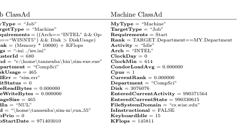

**图 14.1**
Condor 中 ClassAds 的示例。

### 14.2 使用 Condor

有效使用 Condor 的道路很短。其基本原理可以快速且轻松地掌握。

#### 14.2.1 使用 Condor 的路线图

使用 Condor 运行任务涉及以下步骤：

- **准备任务以无人值守方式运行。** 在 Condor 下运行的应用程序必须能够作为批处理任务执行。Condor 在后台无人值守地运行程序。在后台运行的程序将无法执行交互式输入和输出。Condor 可以将控制台输出（stdout 和 stderr）和键盘输入（stdin）重定向到文件及从文件读取。你应该创建包含程序输入所需正确按键的文件。你还应确保程序能正确使用这些文件。通常，提交到 Condor 的程序将是控制台模式程序，因为 `stdin` 和 `stdout`/`err` 可以被重定向。然而，基于 GUI 的程序也可以提交到 Condor，前提是它们不会阻塞等待鼠标/键盘输入。

- **选择 Condor 宇宙（Universe）。** Condor 提供五种运行时环境供选择。每种运行时环境被称为一个*Universe*。通常，你选择的 Universe 取决于你要求 Condor 运行的应用程序类型。总共有三个 MPI Universe：一个用于串行任务（Vanilla），一个用于并行 MPI 任务（MPI），还有一个用于元调度器（Scheduler）。第 14.2.4 节提供了有关这些 Universe 的更多信息。

- **创建提交描述文件。** 任务提交的详细信息在*提交描述*文件中定义。该文件包含关于任务的信息，例如要运行的可执行文件、使用的 Universe、用于 `stdin`、`stdout` 和 `stderr` 的文件、关于应运行该程序的机器的要求和偏好，以及任务完成时发送电子邮件的位置。你还可以告诉 Condor 运行程序多少次；使用不同的数据集多次运行同一程序很简单。

- **提交任务。** 使用 `condor_submit` 命令将程序提交到 Condor。

任务提交后，Condor 处理运行任务的各个方面。随后，你可以使用 `condor_q` 和 `condor_status` 命令监控任务的进度。你可以使用 `condor_prior` 修改 Condor 运行任务的顺序。如果需要，通过在使用提交时指定的日志文件，Condor 还可以记录任务生命周期中每个阶段所执行的操作。

当程序完成时，Condor 会通知所有者（通过电子邮件、用户指定的日志文件或两者兼有）退出状态，以及各种统计数据，包括使用的时间和执行的 I/O。你可以随时使用 `condor_rm` 从队列中移除任务。

#### 14.2.2 提交任务

要将任务提交给 Condor 执行，你使用 `condor_submit` 命令。该命令接受提交描述文件的名称作为参数，该文件包含用于指导任务排队的命令和关键字。在提交描述文件中，你定义 Condor 执行任务所需的一切。可执行文件的名称、初始工作目录以及程序的命令行参数等项目都包含在提交描述文件中。`condor_submit` 命令根据这些信息创建一个任务 ClassAd，然后 Condor 对任务进行调度。

提交描述文件的内容在你使用 Condor 时可以节省大量时间。向 Condor 提交多次程序运行很容易。要在 500 个不同的输入数据集上运行同一程序 500 次，数据文件的排列方式使得每次运行读取其自己的输入，每次运行写入其自己的输出。每个单独的运行可以拥有自己的初始工作目录、`stdin`、`stdout`、`stderr`、命令行参数和 shell 环境。

以下示例说明了使用 Condor 的灵活性。我们假设提交的任务是串行任务，旨在用于拥有跨所有节点共享文件系统的集群。因此，所有任务都使用 Vanilla Universe，这是运行串行任务最简单的一种。其他 Condor Universe 将在后面探讨。

##### 示例 1

示例 1 是最简单的提交描述文件。它排队一个程序 `foo` 的副本供 Condor 执行。Condor 生成名为 `foo.log` 的日志文件。日志文件包含任务在 Condor 内运行期间相关的事件。当任务结束时，其退出条件记录在日志文件中。我们建议你始终拥有日志文件，以便了解你的任务发生了什么情况。提交描述文件中的 `queue` 语句告诉 Condor 使用迄今为止指定的所有信息创建任务 ClassAd 并将任务放入队列。以井号字符（#）开头的行是注释，会被 `condor_submit` 忽略。

```text
##### Example 1 ; Simple submit file
universe = vanilla
executable = foo
log = foo.log
queue
```

##### 示例 2

示例 2 排队两个程序 `mathematica` 的副本。第一个副本在目录 `run.1` 中运行，第二个在目录 `run.2` 中运行。对于排队的两个副本，`stdin` 将是 `test.data`，`stdout` 将是 `loop.out`，`stderr` 将是 `loop.error`。将写入两组文件，因为文件分别写入其各自的目录。这是一种方便的方式来为大型 Condor 任务组组织数据。

```text
##### Example 2: demonstrate use of multiple
##### directories for data organization.
universe = vanilla
executable = mathematica
...
```


```
universe = vanilla
executable = mathematica
##### Give some command line args, remap stdio
arguments = -solver matrix
input = test.data
output = loop.out
error = loop.error
log = loop.log

initialdir = run_1
queue
initialdir = run_2
queue
```

##### 示例 3。

示例 3 的提交描述文件为程序 'foo' 的 150 次运行排入队列。此任务要求 Condor 在物理内存大于 128 MB 的机器上运行该程序，并且进一步要求该任务不被调度到特定节点上执行。在满足要求的机器中，任务优先选择当前可用于接受该任务的最快浮点运算节点运行。它还向 Condor 提示该任务运行时将使用多达 180 MB 的内存。程序每次运行都分配一个独立的进程号，从进程号 0 开始。提交描述文件中可以使用多个内置宏；其中一个就是 $(Process) 宏，Condor 会将其展开为该任务集群中的进程号。这使得程序的第一次运行的文件 'stdin'、'stdout' 和 'stderr' 分别对应 'in.0'、'out.0' 和 'err.0'，第二次运行对应 'in.1'、'out.1' 和 'err.1'，依此类推。单个日志文件将列出此任务集群中所有 150 个任务的运行事件。

```
##### Example 3: Submit lots of runs and use the
##### pre-defined $(Process) macro.
universe = vanilla
executable = foo
requirements = Memory > 128 && Machine != "server-node.cluster.edu"
rank = Kflops
image_size = 180

Error  = err.$(Process)
Input  = in.$(Process)
Output = out.$(Process)
Log = foo.log

queue 150
```

请注意，提交描述文件中的 **requirements**（要求）和 **rank**（排名）条目将转化为随后为该任务创建的 ClassAd 的要求和排名属性。这些是任意表达式，可以引用机器或 *任务* 的任何属性；有关 ClassAd 中要求和排名表达式的更多信息，请参见 14.1.2 节。

#### 14.2.3 用户命令概述

一旦你向 Condor 提交了任务，就可以管理并监控它们的进度。表 14.1 列出了供 Condor 用户使用的几种命令，用于查看任务队列、检查池中节点的状态以及执行其他几项活动。这些命令大多数都有许多命令行选项；有关完整文档，请参阅 Condor 手册中的命令参考章节。为了从用户角度提供入门介绍，我们在此提供一个快速游览，展示其中几个命令的实际运行效果。

| 命令 | 描述 |
|---|---|
| condor_history | 查看截至当前已完成的 Condor 任务日志 |
| condor_hold | 将队列中的任务置于挂起状态 |
| condor_prio | 更改队列中任务的优先级 |
| condor_qedit | 修改先前提交任务的属性 |
| condor_q | 显示队列中任务的信息 |
| condor_release | 释放队列中处于挂起状态的任务 |
| condor_reschedule | 向中央管理器更新调度信息 |
| condor_rm | 从队列中移除任务 |
| condor_run | 将 shell 命令行作为 Condor 任务提交 |
| condor_status | 显示 Condor 池的状态 |
| condor_submit_dag | 在指定的 DAG 中管理和排入任务以实现任务间依赖关系 |
| condor_submit | 将任务排入队列以执行 |
| condor_userlog | 显示并汇总来自任务日志文件的任务统计信息 |

表 14.1
用户命令列表。

当任务被提交时，Condor 将尝试寻找资源来处理这些任务。可以通过使用 -submitters 选项的 **condor_status** 命令获取已提交任务的所有用户列表。此操作的一个示例输出类似于以下内容：

```
C:\>condor_status -submitters
```

| 名称 | 机器 | 正在运行 | 空闲任务 | 挂起任务 |
|---|---|---|---|---|
| ballard@cs.wisc.edu | bluebird.c | 0 | 11 | 0 |
| nice-user.condor@cs. | cardinal.c | 6 | 504 | 0 |
| wright@cs.wisc.edu | finch.cs.w | 1 | 1 | 0 |
| jbasney@cs.wisc.edu | perdita.c | 0 | 0 | 5 |

| | | 正在运行的任务 | 空闲任务 | 挂起任务 |
|---|---|---|---|---|
| ballard@cs.wisc.edu | | 0 | 11 | 0 |
| jbasney@cs.wisc.edu | | 0 | 0 | 5 |
| nice-user.condor@cs. | | 6 | 504 | 0 |
| wright@cs.wisc.edu | | 1 | 1 | 0 |
| 总计 | | 7 | 516 | 5 |

##### 检查任务进度。

`condor_q` 命令显示队列中所有任务的状态。`condor_q` 输出的一个示例如下：

```
C:\>condor_q
-- Schedd: ug.cs.wisc.edu : <128.115.121.12:31302>
     ID     OWNER           SUBMITTED     RUN_TIME ST PRI SIZE CMD
55574.0     jane          6/23 11:33   4+03:35:28 R 0 25.7 seycplex m Seymour.d
55575.0     jane          6/23 11:44   0+03:24:50 R 0  25.8 seycplex peduo sey
83193.0     jane          3/28 15:11   48+15:50:55 R 0  17.5 cplexmp test1.mp
83196.0     jane          3/29 08:32  48+03:16:44 R 0  83.1 cplexmp test3.mps
83212.0     jane          4/13 16:31   41+18:44:40 R 0  39.7 cplexmp test2.mps
5 jobs; 0 idle, 5 running, 0 held
```

此输出包含关于排队任务的许多列信息。`ST` 列（代表状态）显示队列中当前任务的状态。状态列中的 `R` 表示任务正在运行。`I` 表示空闲。状态 `H` 是挂起状态。在挂起状态下，除非通过 `condor_release` 命令释放，否则任务不会被调度运行。报告的任务 `RUN_TIME` 是任务被分配到机器的时间，格式为天+小时+分钟+秒。

跟踪任务进度的另一种有用方法是通过用户日志。如果在你的提交文件中指定了 `log` 命令，可以通过查看日志文件来跟踪任务进度。各种事件（如执行开始、检查点、驱逐和终止）及其发生时间都会记录在文件中。以下是来自用户日志文件的一个示例片段：

```
000 (8135.000.000) 05/25 19:10:03 Job submitted from host: <128.105.146.14:1816> ...
001 (8135.000.000) 05/25 19:12:17 Job executing on host: <128.105.165.131:1026> ...
005 (8135.000.000) 05/25 19:13:06 Job terminated
(1) Normal termination (return value 0)
User 0 00:00:37, Sys 0 00:00:00 - Run Remote Usage
User 0 00:00:00, Sys 0 00:00:05 - Run Local Usage
User 0 00:00:37, Sys 0 00:00:05 - Total Remote Usage
User 0 00:00:00, Sys 0 00:00:05 - Total Local Usage
9624 - Run Bytes Sent By Job
7146159 - Run Bytes Received By Job
9624 - Total Bytes Sent By Job
7146159 - Total Bytes Received By Job
...
```

`condor_jobmonitor` 工具可以解析用户日志文件中的事件，并使用这些信息以图形方式显示任务的进度。图 14.2 包含 `condor_jobmonitor` 运行时的屏幕截图。

你可以使用 `condor_status` 命令找到所有正在运行你任务的机器。例如，要找到所有正在运行由 `breach@cs.wisc.edu` 提交的任务的机器，请输入：

```
C:\>condor_status -constraint 'RemoteUser == "breach@cs.wisc.edu"'
```

| 名称 | 架构 | 操作系统 | 状态 | 活动 | 负载平均值 | 内存 | 活动时间 |
| --- | --- | --- | --- | --- | --- | --- | --- |
| alfred.cs | INTEL | LINUX | 已认领 | 忙碌 | 0.980 | 64 | 0+07:10:02 |
| biron.cs.w | INTEL | LINUX | 已认领 | 忙碌 | 1.000 | 128 | 0+01:10:00 |
| cambridge.cs | INTEL | LINUX | 已认领 | 忙碌 | 0.988 | 64 | 0+00:15:00 |
| falcons.cs | INTEL | LINUX | 已认领 | 忙碌 | 0.996 | 32 | 0+02:05:03 |
| happy.cs.w | INTEL | LINUX | 已认领 | 忙碌 | 0.988 | 128 | 0+02:05:00 |
| istat03.st | INTEL | LINUX | 已认领 | 忙碌 | 0.883 | 64 | 0+06:45:01 |
| istat04.st | INTEL | LINUX | 已认领 | 忙碌 | 0.988 | 64 | 0+00:10:00 |
| istat09.st | INTEL | LINUX | 已认领 | 忙碌 | 0.301 | 64 | 0+03:45:00 |
| ... | | | | | | | |

要找到所有正在运行任何任务的机器，请输入：

```
C:\>condor_status -run
```

| 名称 | 架构 | 操作系统 | 负载平均值 | 远程用户 | 客户端机器 |
| --- | --- | --- | --- | --- | --- |
| adriana.cs | INTEL | LINUX | 0.980 | breach@cs.wisc.edu | chevre.cs.wisc. |
| alfred.cs | INTEL | LINUX | 0.980 | breach@cs.wisc.edu | neufchatel.cs.w |
| amul.cs.wi | INTEL | LINUX | 1.000 | nice-user.condor.cs | chevre.cs.wisc. |
| anfrom.cs | INTEL | LINUX | 1.023 | ashoek@jules.ncsa.ui | jules.ncsa.uiuc |
| anthrax.cs | INTEL | LINUX | 0.285 | hepcron@cs.wisc.edu | chevre.cs.wisc. |


## **图 14.2**
Condor 任务监控工具。

```
astro.cs.w   INTEL    LINUX    1.000    nice-user.condor@cs.chevre.cs.wisc.
aura.cs.wi   INTEL    LINUX    0.996    nice-user.condor@cs.chevre.cs.wisc.
balder.cs.   INTEL    LINUX    1.000    nice-user.condor@cs.chevre.cs.wisc.
bamba.cs.w   INTEL    LINUX    1.574    dmarino@cs.wisc.edu   riola.cs.wisc.e
bardolph.c   INTEL    LINUX    1.000    nice-user.condor@cs.chevre.cs.wisc.
...
```

## **从队列中移除任务**

您可以随时使用 `condor_rm` 命令从队列中移除任务。如果正在移除的任务当前正在运行，该任务将被终止且不会创建检查点，并且其队列条目将被删除。以下示例显示了移除任务前后任务队列的状态。

`% condor_q`

```
-- Submitter: froth.cs.wisc.edu : <128.105.73.44:33847> : froth.cs.wisc.edu
ID  OWNER    SUBMITTED   RUN_TIME ST PRI SIZE CMD
125.0 jbsnsey   4/10 15:35  0+00:00:00 I  -10 1.2 hello.remote
132.0 raman     4/11 16:57  0+00:00:00 R  0   1.4 hello

2 jobs; 1 idle, 1 running, 0 held

% condor_rm 132.0
Job 132.0 removed.

% condor_q

-- Submitter: froth.cs.wisc.edu : <128.105.73.44:33847> : froth.cs.wisc.edu
ID  OWNER    SUBMITTED   RUN_TIME ST PRI SIZE CMD
125.0 jbsnsey   4/10 15:35  0+00:00:00 I  -10 1.2 hello.remote

1 jobs; 1 idle, 0 running, 0 held
```

# **更改任务优先级**

除了分配给每个用户的优先级外，Condor 还允许用户为任何已提交的任务分配优先级。这些任务优先级是本地于每个队列的，范围从 −20 到 +20，数值越高表示优先级越高。

任务的默认优先级为 0。可以使用 `condor_prio` 命令修改任务优先级。例如，要将任务的优先级更改为 −15，请输入

```
% condor_q raman

-- Submitter: froth.cs.wisc.edu : <128.105.73.44:33847> : froth.cs.wisc.edu
ID  OWNER    SUBMITTED   RUN_TIME ST PRI SIZE CMD
126.0 raman     4/11 15:06  0+00:00:00 I  0   0.3 hello

1 jobs; 1 idle, 0 running, 0 held

% condor_prio -p -15 126.0

% condor_q raman

-- Submitter: froth.cs.wisc.edu : <128.105.73.44:33847> : froth.cs.wisc.edu
126.0 raman     4/11 15:06  0+00:00:00 I  -15 0.3 hello

1 jobs; 1 idle, 0 running, 0 held
```

我们强调，这些任务优先级与 Condor 分配的*用户*优先级完全不同。任务优先级仅控制*您的*哪一个任务应该接下来运行；它对您的任务是否会先于其他用户的任务运行没有任何影响。

# **确定任务未运行的原因**

特定任务未运行可能有多种原因。这些原因包括任务或机器约束失败、偏好导致的偏差、优先级不足，以及为了防止系统抖动而由 `condor_negotiator` 实现的抢占节流。使用 `condor_q` 的 _-analyze_ 选项可以诊断这些原因中的许多。例如，用户 jbasney 提交的以下任务已经有几天没有运行了。

```
% condor_q

-- Submitter: froth.cs.wisc.edu : <128.105.73.44:33847> : froth.cs.wisc.edu
ID   OWNER     SUBMITTED RUN_TIME ST PRI SIZE CMD
125.0 jbasney   4/10 15:35 0+00:00:00 I -10 1.2 hello.remote

1 jobs; 1 idle, 0 running, 0 held
```

运行 `condor_q` 的分析器提供了以下信息：

```
% condor_q 125.0 -analyze

-- Submitter: froth.cs.wisc.edu : <128.105.73.44:33847> : froth.cs.wisc.edu
---
125.000: Run analysis summary. Of 323 resource offers,
323 do not satisfy the request's constraints
0 resource offer constraints are not satisfied by this request
0 are serving equal or higher priority customers
0 are serving more preferred customers
cannot preempt because preemption has been held
0 are available to service your request

WARNING: Be advised:
No resources matched request's constraints
Check the requirements expression below:

Requirements = Arch == "INTEL" && OpSys == "IRIX6" &&
Disk >= ExecutableSize && VirtualMemory >= ImageSize
```

该任务的 Requirements 表达式指定了一个不存在的平台。因此，该表达式始终评估为 FALSE。

虽然分析器可以诊断大多数常见问题，但由于其用于检测问题的信息的即时性和局部性，有些情况它无法可靠地检测。分析器可能会报告有可用资源来服务该请求，但任务仍未运行。在这些情况的大多数中，延迟是暂时的，任务将在下一个协商周期中运行。

如果问题持续存在且分析器无法检测到该情况，任务可能会开始运行但立即终止并返回空闲状态。查看任务的错误和日志文件（在 submit 命令文件中指定）以及 Condor 的 `SHADOW_LOG` 文件可能有助于查明问题。如果原因仍然不明确，您应该联系您的系统管理员。

**任务完成。** 当 Condor 任务完成时（无论是通过正常方式还是异常方式），Condor 会将其从任务队列中移除（因此，它将不再出现在 `condor_q` 的输出中）并将其插入任务历史文件。您可以使用 `condor_history` 命令查看任务历史文件。如果在 submit 描述文件中指定了日志文件，那么任务退出状态也会记录在那里。

默认情况下，当您的任务完成时，Condor 会向您发送电子邮件消息。您可以使用 `condor_submit` 的“notification”命令来修改此行为。该消息将包含您任务的退出状态或通知您的任务异常终止。

#### 14.2.4 提交不同类型的任务：替代宇宙

Condor 中的宇宙（Universe）定义了执行环境。Condor 在 Windows 2000 上支持以下宇宙：

- Vanilla
- MPI
- Scheduler

`Universe` 属性在 submit 描述文件中指定。在本书出版时，Condor 的 Unix 版本比 Windows 2000 上的 Condor 提供了更多的宇宙可用。例如，Unix 上的 Condor 除了 MPI 外还有一个 PVM 宇宙。Condor 团队最终打算在 Windows 2000 上也支持所有宇宙；事实上，当您阅读本书时，Windows 2000 上的 Condor 可能已经存在 PVM 宇宙了。

**Vanilla 宇宙。** Vanilla 宇宙用于运行串行（非并行）任务。前一小节中提供的示例使用了 Vanilla 宇宙。任何在 Condor 外部运行的程序都将在 Vanilla 宇宙中运行。二进制可执行文件以及批处理文件都适合在 Vanilla 宇宙中运行。

典型的 Vanilla 宇宙任务依赖于提交机器和所有节点之间的共享文件系统，以便允许任务访问其数据。但是，如果没有可用的共享文件系统，Condor 可以将任务所需的文件传输到执行机器并从执行机器传输回来。有关此功能的更多详细信息，请参阅第 14.2.5 节。

##### MPI 宇宙

MPI 宇宙允许使用 MPI 编写的并行程序由 Condor 管理。要将 MPI 程序提交到 Condor，请指定并行任务中要使用的节点数量。在 submit 描述文件中，使用 *machine_count* 属性，如下例所示：

```
##### Submit file for an MPI job which needs 8 large memory nodes
universe = mpi
executable = my-parallel-job
requirements = Memory >= 512
machine_count = 8
queue
```

submit 描述文件中的其他选项允许各种参数，例如跨不同节点的任务要求或要使用的可执行文件。

到 2001 年底，Condor 预期您的 MPI 任务应与配置了 `ch.p4` 设备的 MPICH 版 MPI 实现链接（参见第 9.6 节）。然而，预期将支持不同的设备和 MPI 实现，因此请查看随您的特定版本 Condor 提供的文档，以获取更多关于如何将您的任务与 Condor 的 MPI 链接的信息。

如果您的 Condor 池既包含专用计算机器（即 Beowulf 集群节点）又包含机会性机器（即桌面工作站），默认情况下 Condor 将仅调度 MPI 任务在专用资源上运行。

##### Scheduler 宇宙

Scheduler 宇宙用于提交一个将在*提交*机器上立即运行的任务，而不是远程执行机器。其目的是为希望管理任务到 Condor 队列中的提交和移除的任务*元调度器*提供设施。Condor 包含一个使用 Scheduler 宇宙的此类元调度器：DAGMan 调度器，它可以用于指定任务之间的复杂相互依赖关系。有关 DAGMan 的更多信息，请参阅第 14.2.6 节。

#### 14.2.5 让您的任务访问其数据文件

一旦您的任务在池中的某台机器上启动，它如何访问其数据文件？Condor 提供了几种选择。

如果有可用且永久挂载在池中机器之间的共享文件系统，Condor 可以使用该共享文件系统。这通常在 Beowulf 集群中是这种情况。但是


如果你的 Condor 池还包含非专用（桌面）机器，该怎么办？你可以在提交描述文件中指定一个*需求*表达式，以要求作业仅在真正拥有对公共共享文件系统访问权限的机器上运行。或者，你也可以在提交描述文件中要求 Condor 使用 Condor 文件传输机制来传输作业的数据文件。

当 Condor 找到一台愿意执行你作业的机器时，它可以在执行机器上为你的作业创建一个临时子目录。随后，Condor 文件传输机制将通过 TCP 将作业可执行文件和输入文件从提交机器发送到执行机器上的这个临时目录中。输入文件传输完成后，执行机器将启动临时目录作为作业当前工作目录开始运行作业。当作业完成或被踢除时，Condor 文件传输机制将自动将作业创建或修改的任何输出文件发送回提交机器。在文件成功发送回之后，执行机器上的临时工作目录将被删除。

Condor 的文件传输机制具有多项功能，以确保在非专用环境下的数据完整性。例如，多个文件的传输是原子性地执行的。

Condor 文件传输的行为在作业提交时使用提交描述文件和 *condor_submit* 指定。除了所有其他作业提交描述参数外，你可以在提交描述文件中使用以下文件传输命令：

- **transfer_input_files** = < *file1*, *file2*, *file*... >：使用此参数列出在作业启动前应传输到作业工作目录的所有文件。

- **transfer_output_files** = < *file1*, *file2*, *file*... >：使用此参数显式列出要从执行机器上的临时工作目录传输回提交机器的输出文件。然而，大多数情况下，没有使用此参数的必要。如果未指定 *transfer_output_files*，Condor 将自动传输作业在临时工作目录中所有被修改或创建的文件。

- **transfer_files** = < *ONEXIT* | *ALWAYS* | *NEVER* >：如果将 *transfer_files* 设置为 *ONEXIT*，则仅在作业完成（退出）时，Condor 才将作业的输出文件传输回提交机器。指定 *ALWAYS* 告诉 Condor，无论是在作业完成时*还是* Condor 在作业完成之前将作业从机器上踢除（抢占）时，都要传输回输出文件。*ALWAYS* 选项专门用于容错作业，这些作业会定期将状态写入磁盘，并可以从中断处重启。当 Condor 抢占作业时将输出文件传输回提交机器时，这些文件在作业重启时会自动作为输入文件再次发送出去。

#### 14.2.6 DAGMan 调度器

Condor 中的 DAGMan 调度器允许指定一组程序之间的依赖关系。有向无环图（DAG）可用于表示一组程序，其中一个或多个程序的输入、输出或执行依赖于一个或多个其他程序。图中的程序是节点（顶点），边（弧）标识依赖关系。DAG 中的每个程序都成为提交给 Condor 的一个作业。DAGMan 调度器强制执行 DAG 的依赖关系。

输入 DAGMan 的文件标识了图的节点，以及如何将每个作业（节点）提交给 Condor。它还指定了图的依赖关系，并描述了与图的节点相关的任何额外处理，这些处理必须在作业运行前或运行后不久进行。

图 14.3 展示了一个具有四个节点的简单菱形 DAG。

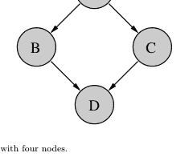

> **图 14.3** 一个具有四个节点的有向无环图。

为此菱形 DAG 编写的 DAGMan 简单输入文件可能是：

```
##### file name: diamond.dag
Job A A.condor
Job B B.condor
Job  C   C.condor
Job  D   D.condor
PARENT A  CHILD B C
PARENT B C  CHILD D
```

四个节点分别命名为 A、B、C 和 D。以关键字 **Job** 开头的行通过给出名称来标识每个节点，并且还指定了要用作 Condor 作业提交描述文件的文件。以关键字 **PARENT** 开头的行标识图的依赖关系。就像普通的 Condor 提交描述文件一样，以井号字符（#）开头的行是注释。

DAGMan 调度器使用该图来排序提交给 Condor 的作业。子节点的提交将在父节点成功完成后进行。图不强制对兄弟节点进行排序，因此 DAGMan 在将作业提交给 Condor 时也不会强制排序。对于这个菱形示例，节点 B 和 C 将并行提交给 Condor。

示例图中的每个作业使用不同的提交描述文件。作业 A 的示例提交描述文件可能是：

```
##### file name: A.condor
executable       = nodeA.exe
output           = A.out
error            = A.err
log              = diamond.log
universe         = vanilla
queue
```

对于 DAG 的提交描述文件有一个重要限制，即图的每个节点必须使用相同的日志文件。DAGMan 使用日志文件来强制执行图的依赖关系。

在 Condor 下执行的图通过使用 Condor 工具 **condor_submit_dag** 提交。对于这个菱形示例，提交将使用以下命令：

```
condor_submit_dag diamond.dag
```

### 14.3 Condor 架构

一个 Condor 池由一台作为*中央管理器*的机器和任意数量的加入该池的其他机器组成。从概念上讲，池是资源（机器）和资源请求（作业）的集合。Condor 的作用是将等待的请求与可用的资源匹配。Condor 的每个部分都会定期向中央管理器发送更新，中央管理器是关于池状态信息的集中式存储库。中央管理器定期评估池的当前状态，并尝试将挂起的请求与适当的资源匹配。

#### 14.3.1 Condor 守护进程

在本小节中，我们描述了 Condor 中所有的守护进程（后台服务器进程）及其在系统中扮演的角色。

- **condor_master**：此守护进程的作用是简化系统管理。安装程序将 condor_master 注册为 Windows 2000 服务控制管理器中的系统服务。Windows 将在启动时自动启动 master。它负责保持池中每台机器上其他 Condor 守护进程的正常运行。master 生成其他守护进程，并定期检查其所管理的守护进程二进制文件的时间戳。如果它发现新的二进制文件，master 将重新启动受影响的守护进程。这使得 Condor 可以轻松升级。此外，如果机器上的任何其他 Condor 守护进程异常退出，condor_master 将向系统管理员发送有关问题信息的电子邮件，然后自动重新启动受影响的守护进程。condor_master 还支持各种管理命令，用于远程启动、停止或重新配置守护进程。condor_master 运行在你的 Condor 池中的每一台机器上。

- **condor_startd**：此守护进程代表机器进入 Condor 池。它通告包含关于机器能力和策略属性的机器 ClassAd。运行 startd 使机器能够执行作业。condor_startd 负责执行启动、挂起、恢复、腾空或终止远程作业的策略。当 startd 准备好执行 Condor 作业时，它会生成下文描述的 condor_starter。

- **condor_starter**：此程序是在给定机器上生成远程 Condor 作业的实体。它设置执行环境，并在作业运行后进行监控。starter 检测作业完成，向提交机器发送状态信息，然后退出。

- **condor_schedd**：此守护进程代表作业进入 Condor 池。任何允许用户提交作业的机器都需要运行 condor_schedd。


将作业提交给 condor_sched，它们会被存储在作业队列中。用于查看和操作作业队列的各种工具（例如 condor_submit、condor_q 或 condor_rm）通过连接 condor_sched 来执行其工作。

condor_shadow：每当有作业在执行时，该程序会在提交作业所在的机器上运行。影子进程负责响应文件传输请求，记录作业的进度，并在作业完成时报告统计数据。

condor_collector：此守护进程负责收集有关 Condor 池状态的所有信息。所有其他守护进程定期向 collector 发送 ClassAd 更新。这些 ClassAd 包含有关守护进程状态、它们所代表的资源或池中资源请求（例如已提交到特定 condor_sched 的作业）的所有信息。可以将 condor_collector 视为一个动态的 ClassAd 数据库。condor_status 命令可用于查询 collector 以获取有关 Condor 各个部分的具体信息。Condor 守护进程也会向 collector 查询重要信息，例如用于向远程机器发送命令的地址。condor_collector 运行在指定为主机中央管理器的机器上。

condor_negotiator：此守护进程负责 Condor 系统内所有的匹配过程。协调员还负责在系统中实施用户优先级。

#### 14.3.2 Condor 守护进程的运行机制

在特定的 Condor 安装中，一台机器将作为池的中央管理器。除了在每个 Condor 池机器上运行的 condor_master 守护进程外，中央管理器还运行 condor_collector 和 condor_negotiator 守护进程。安装中任何能够运行作业的机器都应运行 condor_startd，任何需要维护作业队列并因此允许该机器上的用户提交作业的机器都应运行一个 condor_sched。

Condor 允许任何机器同时执行作业并作为提交点，方法是同时运行 condor_startd 和 condor_sched。图 14.4 展示了一个 Condor 池，其中池中的每台机器（包括中央管理器）都可以提交和运行作业。

向 Condor 系统添加作业的接口是 condor_submit，它读取作业描述文件，创建一个 ClassAd，并将该 ClassAd 交给管理本地作业队列的 condor_sched。这会触发一个协商周期。


图 14.4 空闲 Condor 池的守护进程布局。

在协商周期期间，**condor_negotiator** 查询 **condor_collector** 以发现所有愿意执行工作的机器和所有拥有空闲作业的用户。**condor_negotiator** 按照*用户优先级*顺序与每个队列中拥有空闲作业的 **condor_schedd** 进行通信，并执行匹配，将作业与机器配对，使得作业和机器的 ClassAd 要求都得到满足，并遵守偏好（rank）。

一旦 **condor_negotiator** 做出匹配，**condor_schedd** 就会声明相应的机器，并允许其做出后续关于作业运行顺序的调度决策。这种分层、分布式的调度架构增强了 Condor 的可扩展性和灵活性。

当 **condor_schedd** 启动一个作业时，它会在提交机器上生成一个 **condor_shadow** 进程，而 **condor_startd** 会在相应的执行机器上生成一个 **condor_starter** 进程（见图 14.5）。影子进程将作业 ClassAd 和任何所需的数据文件传输给 starter，starter 随后生成用户的应用程序。

当作业完成或被中止时，**condor_starter** 会终止由用户作业生成的每个进程，并释放作业使用的任何临时磁盘空间。这确保了执行机器处于干净的状态，且资源（如进程或磁盘空间）没有被泄漏。


**图 14.5** 当从机器 2 提交的作业正在运行时，守护进程的布局。

### 14.4 在 Windows 2000 下安装 Condor

安装 Condor 的第一步是从 `www.cs.wisc.edu/condor/downloads` 的 Condor 网站下载软件。下载或使用 Condor 是免费的。

在该网站上，您可以找到针对不同受支持版本和平台的完整文档和发行说明。

在开始安装之前，有若干问题需要考虑以及需要执行的操作。

- **位置。** 在 Windows 2000 上，Condor 作为系统服务安装。因此，最好在本地磁盘上安装 Condor（在 `C:\condor` 中）。
- **管理员。** Condor 需要一个管理员的电子邮件地址。如果需要协助，邮件将发送到此地址。
- **中央管理器。** Condor 池的中央管理器负责匹配和收集池的信息。选择一个网络连接良好且可能始终在线的中央管理器（或者在发生故障时能快速重启）。

一旦你决定了这些问题的答案，就可以开始安装了。执行通过下载获得的文件以启动安装。配置工具会问你一系列简短的问题，主要涉及上述问题。根据你的站点情况适当回答这些问题，Condor 就会安装完成。

第 14.5 节讨论了如何配置和定制你的池以用于专用集群。

Condor 安装完成后，你可能希望立即定制一些安全配置。Condor 在主机（或机器）级别实施安全性。安装时设置的一组配置默认值处理对 Condor 池的主机访问。鉴于实现 Condor 的守护进程的分布式性质，对这些守护进程的访问自然是基于主机的。可以在每个守护进程的给定配置中授予其允许或拒绝服务（按主机）的能力。在可用的访问级别中，Read、Write、Administrator 和 Config 对于每个机器池都至关重要，需要正确设置。

**Read：** 允许机器从 Condor 获取信息。可读取的信息示例包括池的状态和作业队列的内容。

**Write：** 允许机器向 Condor 提供信息，例如提交作业或加入池。

**Administrator：** 允许机器上的用户影响特权操作，例如更改用户优先级级别或启动/停止正在运行的 Condor 系统。

**Config：** 允许机器上的用户使用 condor_config_val 工具的 -set 和 -reset 选项远程更改 Condor 的配置设置。这具有重要的安全影响，因此我们建议你不要对任何主机启用 Config 访问权限。

安装期间的默认设置赋予所有机器读取和写入访问权限。中央管理器还被授予管理员访问权限。你可能希望根据你的站点更改这些默认设置。有关 Condor 中网络授权的详细信息以及如何按你的意愿进行定制，请参阅 Condor 管理员手册。

### 14.5 配置 Condor

本节描述了如何为你的站点配置和定制 Condor。它讨论了 Condor 使用的配置文件，描述了如何配置池内作业的启动和停止策略，并推荐了 Condor 在集群上的设置。

许多配置文件促进了对池中每台机器上 Condor 配置的不同级别的控制。顶级或全局配置文件由池中的所有机器共享。为了方便管理，此文件应位于共享文件系统上。此外，每台机器可以有多个本地配置文件，允许本地设置覆盖全局设置。因此，每台机器可以运行不同的守护进程，拥有不同的启动和停止 Condor 作业的策略，等等。

Condor 的所有配置文件都应仅由管理员拥有且可写。严格控制这些文件非常重要，因为它们包含对安全敏感的设置。

#### 14.5.1 Condor 配置文件的位置

Condor 拥有一组默认位置，用于尝试找到其顶级配置文件。这些位置按以下顺序检查：

1. CONDOR_CONFIG 环境变量中指定的文件。
2. HKEY_LOCAL_MACHINE\Software\Condor 注册表项中指定的文件。在 Windows 上运行 Condor 安装程序时会设置此项。

如果 Condor 守护进程或工具在启动时找不到其全局配置文件，它将打印错误消息并立即退出。然而，一旦 Condor 读取了全局配置文件，就可以使用 LOCAL_CONFIG_FILE 宏指定任何其他本地配置文件。

如果只想要两个配置级别（全局和本地），该宏可以包含单个条目。如果需要更复杂的配置值划分（例如，如果在同一个池中有不同平台的机器并希望为平台特定设置使用单独的文件），LOCAL_CONFIG_FILE 可以包含一个文件列表。

Condor 提供了其他宏，帮助你轻松定义池中每台机器本地配置文件的位置。其中大多数是特殊宏，根据哪个主机正在读取全局配置文件而评估为不同的值：


- **HOSTNAME**：本地主机的名称。
- **FULL_HOSTNAME**：本地主机的完全限定主机名。
- **OPSYS**：本地主机的操作系统，例如“LINUX”、“WINNT4”（用于 Windows NT）或“WINNT5”（用于 Windows 2000）。这在包含多种平台的异构集群中特别有用。
- **RELEASE_DIR**：在每个主机上安装 Condor 的目录。此宏在全局配置文件中定义，并由 Condor 的安装程序设置。

默认情况下，本地配置文件的定义如下：

```
LOCAL_CONFIG_FILE = $(RELEASE_DIR)\condor_config.local
```

#### 14.5.2 集群推荐配置文件布局

在集群中，管理的便捷性是一个重要考量，特别是当节点数量庞大时。为了让 Condor 易于配置，我们强烈建议将所有 Condor 配置文件（包括每个节点的本地配置文件）安装在共享文件系统中。这样，你就可以轻松地在某个位置进行更改。在 Windows 2000 上，你为此必须使用在启动时映射的共享驱动器，而不是在登录时映射的驱动器。

你应使用发布目录中的一个子目录来存放所有本地配置文件。在 Windows 2000 上，你需要自己创建此目录。为了下文示例的目的，我们假设你将此子目录命名为 `config`。

你应为集群中的每个节点创建单独的文件，使用主机名作为文件名的前半部分，并以“.local”作为结尾。例如，如果你的集群节点命名为“n01”、“n02”等，则文件应命名为‘n01.local’、‘n02.local’等。所有这些文件都应放置在你的 `config` 目录中。

在你的全局配置文件中，应使用以下设置来描述本地配置文件的位置：

```
LOCAL_CONFIG_FILE = $(RELEASE_DIR)/config/$(HOSTNAME).local
```

你所在池的中央管理器需要在其本地配置文件中设置特殊选项。这些属性由 Condor 安装程序自动设置。其余的本地配置文件最初可以留空。以这种方式布局你的配置文件将有助于你更轻松地为集群定制 Condor 的行为。我们将在本章末尾讨论其他可能的配置场景。

**注意：** 我们建议将所有的 Condor 配置文件存储在一个版本控制系统下，例如 CVS。虽然这不是强制要求的，但它可以帮助你跟踪对配置所做的更改、更改者、发生时间以及原因。一般来说，将配置文件存储在一个版本控制系统下是个好主意，因为上述关注点并非 Condor 特有。

#### 14.5.3 定制 Condor 的策略表达式

某些配置表达式用于控制 Condor 执行、挂起和驱逐任务的策略。它们的交互可能较为复杂。定义不恰当的策略会影响集群的吞吐量及其用户的满意度。如果你有兴趣为你的池创建专门策略，我们建议你阅读 Condor 管理员手册。以下仅提供基础介绍。

所有策略表达式都是 ClassAd 表达式，并在 Condor 的配置文件中定义。策略通常是全池范围的，因此在全局配置文件中定义。然而，如果你的池中的个别节点需要自己的策略，相应的表达式可以放置在本地配置文件中。

`condor_startd` 将策略表达式视为其机器 ClassAd 的一部分（包括你可以通过 `condor_status -long` 查看所有属性）。它们总是针对任务 ClassAd 进行评估，或者由 `condor_negotiator` 在尝试寻找匹配时评估，或者由 `condor_startd` 在决定如何处理当前正在运行的任务时评估。因此，除了机器的属性（如键盘空闲时间或 CPU 负载）外，所有策略表达式都可以引用任务的属性，如内存使用情况或所有者。

大多数策略表达式是 ClassAd 布尔表达式，因此它们评估为 TRUE（真）、FALSE（假）或 UNDEFINED（未定义）。当表达式引用的 ClassAd 属性既未在机器的 ClassAd 中，也未在正在考虑的任务的 ClassAd 中找到时，就会发生 UNDEFINED。对于某些表达式，这被视为致命错误，因此在引用可能并非存在于所有 ClassAd 中的属性时，你应确保使用第 14.1.2 节中描述的 ClassAd 元运算符。

解释策略表达式需要了解任务从最初执行到任务完成或从机器上被驱逐所经历的不同阶段。然后，每个策略表达式都按其控制的进程中的步骤来描述。

**在 Condor 中执行任务的生命周期。** 当任务提交到 Condor 时，`condor_negotiator` 执行匹配以找到合适的资源用于计算。此过程涉及满足任务和机器对彼此的相互要求。机器可以定义其愿意被视为可用于运行任务的确切条件。任务可以定义它愿意使用哪种类型的机器。

一旦任务与特定机器匹配，任务可能处于四种状态之一：运行、挂起、优雅关闭和快速关闭。一旦完成匹配，任务就会设置其执行环境并开始运行。

在执行过程中，任务可以被挂起（例如，因为运行它的机器上有其他活动）。一旦被挂起，任务可以恢复执行，或者可以进入抢占或驱逐状态。

所有 Condor 任务都有两种抢占方法：优雅和快速。优雅意味着程序被告知离开系统，但给予时间进行自我清理。快速关闭涉及快速终止与任务相关的所有进程，而不给予它们任何时间执行自己的清理程序。Condor 系统执行检查，以确保在任务从特定节点被驱逐后没有遗留进程。

**Condor 策略表达式。** 使用各种表达式来控制启动、挂起、恢复和抢占任务的策略。

- **START**：`condor_startd` 愿意开始执行任务的条件。
- **RANK**：`condor_startd` 对在它上面运行的每种任务类型的偏好程度。`RANK` 表达式是一个浮点值，而不是布尔值。如果系统中存在使该表达式产生更高值的其他任务，`condor_startd` 将抢占当前正在运行的任务。
- **WANT_SUSPEND**：控制 `condor_startd` 是否应考虑挂起该任务。实际上，它决定了当任务运行时，应评估哪个表达式，`SUSPEND` 还是 `PREEMPT`。`WANT_SUSPEND` 不控制任务实际被挂起的时机；为了这个目的，你应该使用 `SUSPEND` 表达式。
- **SUSPEND**：`condor_startd` 应挂起当前运行任务的条件。如果 `WANT_SUSPEND` 评估为 `TRUE`，每当机器上有任务正在执行时，`SUSPEND` 都会定期评估。如果 `SUSPEND` 变为 `TRUE`，任务将被挂起。
- **CONTINUE**：`condor_startd` 应恢复已挂起任务的条件和时机。`CONTINUE` 表达式仅在任务挂起时评估。如果它评估为 TRUE，任务将恢复，并且 `condor_startd` 将回到 Claimed/Busy 状态。
- **PREEMPT**：`condor_startd` 应抢占当前运行任务的条件。每当有任务被挂起时，都会评估此表达式。如果 `WANT_SUSPEND` 评估为 FALSE，则在任务执行时检查 `PREEMPT`。
- **WANT_VACATE**：当 Condor 抢占任务时（因为 `PREEMPT` 表达式评估为 TRUE），任务应优雅驱逐还是快速驱逐。如果 `WANT_VACATE` 为 FALSE，每当必须驱逐应用程序时，`condor_startd` 将立即终止任务及其所有子进程。如果 `WANT_VACATE` 为 TRUE，则 `condor_startd` 改为执行优雅关闭。
- **KILL**：`condor_startd` 应放弃优雅抢占并直接进行快速关闭的条件。
- **PREEMPTION_REQUIREMENTS**：由 `condor_negotiator` 在执行匹配时使用，而非由 `condor_startd` 使用。在尝试在池中的资源上调度任务时，`condor_negotiator` 考虑系统中不同用户的优先级（有关更多详细信息，请参见第 14.6.3 节）。如果优先级更高的用户有任务在队列中等待，且目前没有空闲资源，匹配过程将考虑抢占其他用户的任务，并将这些资源分配给优先级更高的用户。这个过程被称为*优先级抢占*。此类抢占发生的条件是 `PREEMPTION_REQUIREMENTS` 表达式必须评估为 TRUE。
- **PREEMPTION_RANK**：由 `condor_negotiator` 评估的浮点值。如果匹配过程决定必须因用户优先级而抢占一个任务，则宏 `PREEMPTION_RANK` 决定要抢占哪个资源。在所有使 `PREEMPTION_REQUIREMENTS` 表达式评估为 TRUE 的资源集合中，`PREEMPTION_RANK` 值最高的那个将被驱逐。

#### 14.5.4 定制 Condor 的其他配置设置

除了策略表达式，你还需要修改其他设置来为你定制的集群调整 Condor。

- **DAEMON_LIST**：`condor_master` 应启动的守护程序的逗号分隔列表。如第 14.3.1 节讨论 Condor 架构时所述，你所在池中的每个主机根据在其上启动了哪些守护程序可以扮演不同的角色。你在适当的配置文件中定义 `DAEMON_LIST` 以启用或禁用每个主机上的各种 Condor 守护程序，从而定义这些角色。


**DedicatedScheduler**：集群专用调度器的名称。此设置必须采用以下格式

```
DedicatedScheduler = "DedicatedScheduler@full.host.name.here"
```

### 14.6 管理工具

Condor 为管理员提供了一组丰富的工具。表 14.2 概述了通常仅由系统管理员使用的 Condor 命令。当然，表 14.2 中总结的许多“用户级” Condor 工具对于集群管理也非常有帮助。例如，`condor_status` 工具可以轻松显示集群中所有节点的状态，包括当前平均负载和可用虚拟内存等动态信息。

| 命令 | 描述 |
| :--- | :--- |
| `condor_config_val` | 查询或设置给定的 Condor 配置变量 |
| `condor_master_off` | 关闭 Condor 和 `condor_master` |
| `condor_off` | 关闭 Condor 守护进程 |
| `condor_on` | 启动 Condor 守护进程 |
| `condor_reconfig` | 重新配置 Condor 守护进程 |
| `condor_restart` | 重启 `condor_master` |
| `condor_stats` | 显示有关 Condor 池的历史信息 |
| `condor_userprio` | 显示和管理用户优先级 |
| `condor_vacate` | 迁移在指定主机上运行的任务 |

**表 14.2**

保留给管理员的命令。

#### 14.6.1 远程配置与控制

Condor 池中的所有机器都可以从一个中心位置进行远程管理。可以使用 `condor_on`、`condor_off` 和 `condor_restart` 命令分别远程启用、禁用或重启 Condor。此外，可以通过 `condor_config_val` 命令远程查询或更改节点上 Condor 配置文件的任何方面。当然，并非所有人都被允许远程更改您的 Condor 配置。这样做需要适当的授权，该授权在安装时设置（参见第 14.4 节）。

Condor 配置的许多方面，包括其调度策略，可以在无需关闭并重启池的情况下即时更改。这是通过 `condor_reconfig` 命令实现的，该命令要求指定主机上的 Condor 守护进程重新读取 Condor 配置文件并采取适当措施——如果可能的话，即时进行。

#### 14.6.2 计费与日志

Condor 会记录池中发生情况的许多统计数据。可以要求每个守护进程保留其活动的详细日志；当这些日志文件达到管理员指定的最大大小时，Condor 会自动轮换这些日志文件。

除了允许用户查看已完成任务的 ClassAds 的 **condor history** 命令外，还可以使用 **condor\_stats** 工具查询来自全池会计数据库的历史使用统计。此数据库包含有关每隔一定时间为用户处理了多少个任务以及多少台机器处于忙碌状态的信息。例如，可以要求 **condor\_stats** 显示指定用户在 1 月 15 日至 1 月 30 日期间以五分钟为间隔运行的总任务数。

**condor\_view** 工具获取通过 **condor\_stats** 获得的原始信息并将其转换为 HTML，并附带交互式图表。图 14.6 显示了在 Web 浏览器中 **condor\_view** 输出的示例显示。站点管理员使用 **condor\_view** 可以快速将关于 Condor 池的详细实时使用统计信息发布到 Web 站点上。


**图 14.6**
显示机器使用情况的 CondorView。

#### 14.6.3 Condor 中的用户优先级

Condor 中的任务队列并不是严格的先进先出。相反，Condor 实现了*优先级排队*。根据用户当前的用户优先级，不同用户将获得不同大小的机器分配，而与计算用户在队列中“领先”他们的任务数量无关。如果愿意，还可以配置 Condor 执行*优先级抢占*。例如，假设用户*A*正在使用集群中的所有节点，突然一位拥有更高优先级的用户提交了任务。在启用优先级抢占的情况下，Condor 将抢占低优先级用户的任务，以便立即启动高优先级用户提交的任务。

通过公平份额算法防止低优先级用户被饿死，该算法试图在指定间隔内为所有用户提供相同数量的机器分配时间。此外，Condor 中的优先级计算基于*比率*而非绝对值。例如，如果 Bill 的优先级是 Fred 的两倍，Condor 不会通过将所有机器分配给 Bill 来饿死 Fred。相反，由于 Bill 的优先级高两倍，Bill 平均将获得两倍于 Fred 的机器数量。

管理员可以使用 **condor_userprio** 命令查看或编辑用户的优先级。它还可以用于覆盖 Condor 的默认公平份额策略，并明确地相对于其他用户为用户分配更好或更差的优先级。

### 14.7 集群设置场景

本节探讨了配置集群的不同场景。介绍了五个场景，以及每个场景所需修改的基本配置设置或所需采取步骤的基本想法：

- 1. 统一拥有的专用计算集群，具有单个前端节点用于提交任务，并支持 MPI 应用程序。
- 2. 多处理器节点集群。
- 3. 分布所有权的节点集群。每个节点更倾向于运行其所有者提交的任务。
- 4. 桌面提交到集群。
- 5. 将集群扩展到非专用（桌面）计算资源。

这些场景中的大多数可以组合使用。每个场景都建立在之前的场景之上，为基本集群配置添加更多功能。

#### 14.7.1 基本配置：统一拥有的集群

最基本的场景涉及一个所有资源由单一实体拥有的集群，并且所有计算节点对启动和停止任务执行相同的策略。所有计算节点都是专用的，意味着它们始终启动空闲任务，并且在中止前永远不会抢占或挂起。有一个用于提交任务的前端节点，并且可以从该主机启用专用的 MPI 任务。

为了启用此基本策略，您的全局配置文件必须包含以下设置：

```
START = True
SUSPEND = False
CONTINUE = False
PREEMPT = False
KILL = False
WANT_SUSPEND = True
WANT_VACATE = True
RANK = Scheduler  $=(DedicatedScheduler)
DAEMON_LIST = MASTER, STARTD
```

此处列出的最后一个条目指定池中节点的默认角色仅为执行。您前端节点上的 DAEMON_LIST 还必须启用 condor_schedd。此前端节点的本地配置文件将是

```
DAEMON_LIST = MASTER, STARTD, SCHEDD
```

#### 14.7.2 使用多处理器计算节点

如果您的 Condor 池中有任何节点是对称多处理器机器，Condor 会将该节点表示为多个虚拟机（VM），每个 CPU 一个。默认情况下，每个 VM 将拥有一个 CPU 和所有共享系统资源（如 RAM 和交换空间）的平均份额。如果这种行为满足您的需求，则无需进行任何配置更改即可让 SMP 节点与 Condor 正常工作。

某些站点可能希望其 SMP 节点具有不同的行为。例如，假设您的集群由双处理器机器组成，拥有 1 GB RAM，而您的一位用户提交的任务内存占用为 700 MB。在默认设置下，您池中的所有 VM 只有 500 MB RAM，并且您的用户的任务将永远不会运行。在这种情况下，您需要在两个 CPU 之间不均匀地分配 RAM，使您的一半 VM 拥有 750 MB RAM。另一半 VM 将只剩下 250 MB RAM。

使用 Condor 在 SMP 机器上分配共享资源的方法不止一种，这些方法都在《Condor 管理员手册》中详细讨论。最基本的方法如下。要在 SMP 上不均匀地分配共享资源，必须定义不同的*虚拟机类型*并告知 *condor_startd* 要宣传每种类型的多少虚拟机。定义虚拟机类型的最简单方法是指定每种类型应接收的所有共享资源的分数。

例如，如果您想要分配两台节点机器，其中一个 CPU 接收四分之一共享资源，另一个 CPU 接收其余的四分之三，您将使用以下设置：

```
VIRTUAL_MACHINE_TYPE_1 = 1/4
VIRTUAL_MACHINE_TYPE_2 = 3/4
NUM_VIRTUAL_MACHINES_TYPE_1 = 1
NUM_VIRTUAL_MACHINES_TYPE_2 = 1
```

如果您想不均匀地分配某些资源，但均匀地拆分其余资源，可以为每个共享资源指定单独的分数。这在《Condor 管理员手册》中有详细描述。

#### 14.7.3 调度分布所有权的集群

许多集群由多个实体拥有。两个或更多较小的团体可能会汇集其资源以购买单个更大的集群。在这种情况下，为部分节点付费的团体应获得在这些节点上运行的优先权。

Condor 池中的每个资源都可以定义自己的 *RANK* 表达式，指定其希望执行的任务类型。如果集群由多个实体拥有，


你可以将集群中的节点划分为不同的组，依据是所有权归属。每个节点都会设置 **Rank**（排名），使得来自其所属组的作业具有最高优先级。

假设某大学有一个由 60 个节点组成的计算集群，由三个系共享：天文学系、数学系和物理系。每个系为其中的 20 个节点提供了资金。每组 20 个节点都会定义自己的 **Rank** 表达式。例如，天文学系的设置如下：

```
Rank = Department == "Astronomy"
```

来自各系的用户还需要在所有作业的 ClassAd（类广告）中添加一个 **Department**（部门）属性。管理员可以配置 Condor，使其自动为来自每个站点的所有作业广告添加此属性（详见《Condor 管理员手册》）。

如果整个集群处于空闲状态，且一位物理系用户提交了 40 个作业，她将看到这 40 个作业全部开始运行。然而，如果一位数学系用户提交了 60 个作业，同时一位天文学系用户提交了 20 个作业，那么物理系用户会有 20 个作业被抢占（preempted），每个组将获得集群中 20 台机器的资源。

如果天文学系的所有作业都完成了，天文学系的节点将重新用于服务数学系和物理系的作业。天文学系的节点将继续运行数学系或物理系的作业，直到有新的天文学系作业被提交，或者系统中的所有作业都已完成。

#### 14.7.4 从桌面工作站向集群提交作业

大多数安装计算集群的组织在其站点内还有其他工作站。通常希望允许这些机器充当集群的前端节点，这样用户就可以从自己的机器上提交作业，并让应用程序在集群上执行。即使集群与其他计算机之间没有共享文件系统，Condor 的文件传输功能也能使作业在两者之间迁移并访问其数据（有关访问数据文件的详细信息，请参见第 14.2.5 节）。

要启用某台机器向您的集群提交作业，请运行 Condor 安装程序，并指定您希望设置一个*仅提交*（submit-only）节点。这将把新节点上的 DAEMON\_LIST 设置为

请注意，您只能将一台节点配置为专用池的专用调度器。请勿尝试为 MPI 作业添加第二个提交节点。

#### 14.7.5 将集群扩展至非专用（桌面）计算资源

Condor 中最强大的功能之一是能够在单一系统中结合专用调度和机会性调度。*机会性调度*是指将作业放置到非专用资源上，其假设条件是这些资源可能无法在整个作业运行期间保持可用。除了专用 MPI 应用程序外，Condor 对所有作业都使用机会性调度。

如果您的站点混合使用各类作业，并使用除 MPI 以外的应用程序，您应强烈考虑将所有计算资源（甚至包括桌面工作站）都添加到您的 Condor 池中。凭借挂起和恢复功能、机会性调度以及匹配机制，Condor 可以利用任何机器的空闲 CPU 周期并将其投入良好使用。

要将其他计算资源添加到您的池中，请运行 Condor 安装程序，并指定您希望配置一个既能提交又能执行作业的节点。默认安装会设置一个节点，其策略基于机器的活动状态（例如键盘空闲时间和 CPU 负载）来决定启动、挂起或抢占作业。这些节点不会运行专用 MPI 作业，但会运行来自其他任何 universe（宇宙/环境）的作业，包括 PVM。

### 14.8 结论

Condor 是一个强大的工具，用于跨平台调度作业，无论是在 Beowulf 集群内部还是超越其边界。通过其独特的专用调度和机会性调度的结合，Condor 为高吞吐量计算提供了一个统一的框架。

# 15 Maui 调度器：多功能集群调度器

*David B. Jackson*

在本章中，我们描述了 Maui 调度器，这是一个可以与多种不同资源管理器交互的作业调度组件。

与几乎每个主要开发项目一样，Maui 起源于一种紧迫的需求。就 Maui 而言，包括 Maui 高性能计算中心、太平洋西北国家实验室、圣地亚哥超级计算中心和阿贡国家实验室在内的多个计算中心都在大量投资新的、顶级的硬件，却因无法高效或受控地利用这些新资源而感到沮丧。虽然现有的资源管理系统允许基本的作业提交和运行功能，但它们未能赋予站点最大化集群使用的能力。站点无法将本地任务策略*转化*为调度行为，且所做出的调度决策往往次优。更糟糕的是，最终的系统往往过于复杂，以至于管理人员、管理员和用户都无法判断系统运行状况如何，或可以做什么来改进它。

Maui 旨在解决这些问题，并在过去多年间在多个领先的计算中心经过开发和测试。它的构建旨在使站点能够有效控制、理解和使用其集群。Maui 弥补了许多调度系统所留下的空白，提供了一套在预留、回填（backfill）、公平共享、作业优先级、服务质量、元调度等方面的先进功能。

## 15.1 概述

Maui 是一个*外部*调度器，这意味着它本身不包含资源管理器，而是扩展现有资源管理器的功能。Maui 使用 OpenPBS、PBSPro 和 LoadLeveler 的原生调度 API 来获取系统信息并指挥集群调度活动。虽然底层资源管理器继续负责管理节点和跟踪作业，但 Maui 控制着作业何时、何地以及如何运行的决策。

系统管理员通过主配置文件 `maui.cfg` 以及基于文本或 Web 的管理员命令来控制 Maui。另一方面，最终用户不需要学习任何新的命令或作业提交语言，甚至无需知道已安装了 Maui。虽然 Maui 提供了许多命令以向用户提供额外的作业信息与控制，但这些命令是可选的，可以根据需要向用户引入。

## 15.2 安装与初始配置

Maui 调度器包含在许多最流行的集群构建工具包中，包括 *Rocks* 和 *OSCAR*。如需获取 Maui 的最新版本，您可以从 **supercluster.org/maui** 上的 Maui 主页下载代码。该网站还包含在线文档、常见问题解答、Maui 用户邮件列表的链接以及其他标准的开源工具。下载代码后，要构建它，您只需依次运行标准的 `configure`、`make` 和 `make install` 命令即可。

### 15.2.1 基本配置

`configure` 脚本会提示您输入有关 `install` 目录和所需资源管理器类型的一些基本信息。然后，它创建 Maui 主目录，在 `bin` 子目录中构建可执行文件，并将这些文件复制到 `install` 目录。最后，该脚本使用位于 `samples` 子目录中的模板和用户提供的信息创建一个初始的 `maui.cfg` 文件。此文件是一个*纯文本*配置文件，用于几乎所有的调度器配置，并包含许多需要核实的参数，特别是 `SERVERHOST`、`SERVERMODE` 和 `ADMIN1`。最初，这些参数应分别设置为运行 Maui 的主机名、`NORMAL` 以及 Maui 管理员的用户名。只要 Maui 正在运行，就可以使用带有 ‘-l’ 标志的 `schedctl` 命令来*列出*任何参数的值（无论是否显式设置），而带有 ‘-m’ 标志的命令则可用于动态*修改*参数值。在线参数文档提供了有关这些及其他所有 Maui 参数的更多详细信息。

### 15.2.2 模拟与测试

完成初始配置后，下一步是测试调度器，以熟悉其功能并验证基本功能。通过将 `SERVERMODE` 设置为 `TEST`，可以以完全*安全*的方式运行 Maui。在*测试*模式下，Maui 会联系资源管理器以获取最新的配置、节点和作业信息；然而，在此模式下，启动或修改这些作业的接口被禁用。要启动 Maui，您必须修改参数并输入命令 `maui`。您还可以使用诸如 `showq`、`diagnose` 和 `checknode` 等命令来验证调度器与资源管理器之间的正常通信以及调度器功能。有关 Maui 命令套件的完整详细信息，可在线查找或参阅随您的发行版提供的文档。


### 15.2.3 生产调度

在对调度器进行试运行并验证其运行正常后，您可以通过禁用默认调度器并将 `SERVERMODE` 参数更改为 `NORMAL` 来使 Maui *正式运行*。关于禁用默认资源管理器调度器的信息，请参见资源管理器的文档以及位于 `supercluster.org/documentation/maui` 的在线 Maui 迁移指南。这些更改将允许 Maui 根据指定的调度策略启动、修改和取消作业。

默认情况下，Maui 基本上复制了原生集群调度器的行为，提供启用了回填（backfill）的先进先出（first-in, first-out）调度。参数文档详细解释了启用高级调度功能所需的每个参数。在大多数情况下，每个站点只需要使用可用参数的一小部分即可满足本地需求。

## 15.3 高级配置

完成初始配置和测试后，现在您可以配置 Maui，从而结束管理之旅，抵达长期追求的集群圣地——在正确的时间、以正确的方式、在正确的地点运行正确的作业。为此，可以将 Maui 视为一个集成的调度工具包，它提供了多种功能，可以单独或一起使用，以获得所需的系统行为。这些功能包括：

- 作业优先级，
- 节点分配策略，
- 节流策略，
- 公平份额（fairshare），
- 预留，
- 分配管理，
- 服务质量（quality of service），
- 回填（backfill），
- 节点集，以及
- 抢占策略。

下文将逐一描述这些功能。虽然这里的介绍足以引导您初步配置这些功能，但您应查阅在线 Maui 管理员手册以获取完整细节。我们再次强调，尽管 Maui 拥有广泛的功能和相关参数，但大多数功能默认是禁用的；因此，站点只需配置感兴趣的功能即可。

### 15.3.1 赋予权重：作业优先级和节点分配

通常，优先级化（prioritization）是指确定在许多选项中哪一项最能满足整体目标的过程。在调度的情况下，站点通常会有多个独立的目標，这可能包括最大化系统利用率、优先处理特定项目的用户，或确保没有作业在队列中停留超过给定的时间段。表示多方面站点目标的一种方法是为各个目标分配权重，从而可以关联到每个潜在调度决策的整体价值或优先级。在作业按优先级排序后，调度器可以通过按优先级顺序启动作业来大致满足站点目标。

Maui 的设计允许将组件和子组件权重关联到作业的许多方面。为了实现这种细粒度控制，Maui 使用简单的优先级加权层次结构，其中优先级因子的贡献计算为 PRIORITY-FACTOR-VALUE * SUBFACTORWEIGHT * FACTORWEIGHT。组件和子组件权重列在表 15.1 中。所有权重值都可以在 maui.cfg 文件中通过设置相关的组件权重参数来设定，该参数指定为权重名称后跟字符串 WEIGHT（例如，SERVICEWEIGHT 或 PROCWEIGHT）。

默认情况下，Maui 按实际提交顺序运行作业，使用 QUEUE TIME（队列时间）。然而，通过使用优先级组件，您可以纳入其他信息，例如当前服务级别、服务目标、请求的资源和使用历史。您还可以通过指定优先级组件上限（例如 RESOURCECAP）来限制任何组件的贡献。作业的优先级等于所有已启用优先级因子的总和。

每个组件或子组件可用于不同的目的。WALLTIME（挂钟时间）可用于根据作业的持续时间偏向（或排斥）某些作业；ACCOUNT（账户）可用于偏向与特定项目相关的作业；QUEUETIME（队列时间）可用于偏向等待时间最长的作业。通过混合搭配优先级权重，站点通常能获得所需的作业启动行为。随时可以发出 `diagnose -p` 命令，以确定当前优先级权重设置对空闲作业的影响。

尽管大多数子组件是基于指标（即，排队秒数或请求的节点数），但凭证（credential）子组件是基于管理员指定的优先级。Maui 允许您使用 *CFG 参数按单独的作业凭证对作业进行排序。例如，为了偏向由用户 **bob** 和 **john** 以及 **staff** 组成员提交的作业，站点可能指定以下内容：

```
USERCFG[ bob]     PRIORITY=100
USERCFG[ john]    PRIORITY=500
GROUPWEIGHT[staff] PRIORITY=1000
USERWEIGHT       1
GROUPWEIGHT      1
CREDWEIGHT       1
```

请注意，组件和子组件权重均被指定以使这些凭证优先级生效。关于这些组件因子的使用以及其他经验性使用信息的更多细节，可在 Maui 管理员手册中找到。

与作业优先级相辅相成的是节点分配问题。当调度器选择要运行的作业时，还必须确定将该作业分配哪些资源。根据集群的使用情况，您可以使用 NODEALLOCATIONPOLICY 指定不同的策略。合法的参数值包括以下内容：

- **MINRESOURCE：** 此算法选择资源配置最少但仍满足作业要求的节点。该算法为可能专门请求这些额外资源的其他作业保留更多资源丰富的节点。
- **LASTAVAILABLE：** 此算法在创建回填预留时特别有用。它确定作业可以运行的最早时间，然后选择在该时间可用的资源，以便尽可能让当前空闲的资源保持未预留状态，从而可用于回填。
- **NODEPRIORITY：** 此策略允许站点创建自己的节点分配优先级方案，同时考虑已安装软件或其他本地节点配置等问题。
- **CPULOAD：** 此策略试图优先分配负载最轻的节点。

### 15.3.2 公平性：节流策略和公平份额

站点最常面临的下一个问题是*公平性*。公平性似乎是一个简单的概念，但可能非常难以映射到集群上。所有用户是否应该获得运行相同数量的作业或使用相同数量节点的权限？这些使用限制仅涵盖当前时间还是指定的时间段？如果使用历史信息，消费的度量指标是什么？时间框架是什么？公平消费是否意味着等量消费？如果用户 X 购买了三分之二的节点，用户 Y 购买了另外三分之一，资源应如何分配？公平性是基于静态指标，还是取决于当前的资源需求？

虽然 Maui 无法解决所有这些问题，但它确实提供一些灵活的工具有助于解决 90% 的问题。具体而言，这些工具是*节流策略*和*公平份额*，分别用于控制即时使用和历史使用。

**节流策略。**“节流策略”一词集体应用于一组限制瞬时资源消耗的策略。Maui 支持对处理器、节点、proc-seconds（进程秒）、作业以及任何给定时间允许的处理器或等效资源的数量设置限制。可以通过 *CFG 参数集按每用户、组、账户、QoS 或队列基础应用限制。例如，


指定 `USERCFG{bob} MAXJOB=3 MAXPROC=32` 将限制用户 **bob** 在任何给定时间运行不超过 3 个作业和 32 个总处理器。指定 `GROUPCFG{DEFAULT} MAXNODE=64` 将限制每个组同时使用不超过 64 个节点，除非为特定组指定了覆盖限制。`ACCOUNTCFG`、`QOSCFG` 和 `CLASSCFG` 完善了 `*CFG` 参数系列，分别提供了对账户、QoS 和类的即时使用进行节流的机制。

对于每个参数，可以使用硬限制和软限制来施加一种需求敏感的限制形式。无论在任何条件下，硬限制都不可被违反，但如果没有其他作业可以运行，软限制可能会被违反。例如，指定 `USERCFG[DEFAULT] MAXNODE=16,24` 将允许每个用户累计分配多达 16 个节点，同时其他用户的作业可以使用可用资源。如果没有其他作业可以使用这些资源，用户可同时使用多达 24 个节点。

节流策略在防止单个用户或组“垄断”集群方面是有效的。它们还提供了一个简单的公平性和资源周期分配机制。然而，此类策略可能会导致整体系统利用率降低。例如，如果这些策略阻止所有排队中的作业运行，资源可能会闲置。在可能的情况下，节流策略应设置为最高可行级别，并且应通过诸如 `fairshare`、分配管理系统和基于 QoS 的优先级排序等工具来管理资源周期分配。

#### 公平共享 (Fairshare)

典型的公平共享算法试图在给定时间段内提供公平的资源分配。然而，如前所述，这一一般性陈述留给解释的空间很大。特别是，如何衡量分配，以及应使用什么时间段？

Maui 提供参数 `FSPOLICY` 以允许每个站点确定如何衡量资源分配，并提供参数 `FSINTERVAL`、`FSDEPTH` 和 `FSDECAY` 以确定如何对历史使用信息进行加权。

为了控制资源分配，Maui 使用公平共享目标，这些目标可以应用于用户、组、账户、队列和 QoS 机制，并且提供默认目标和特定目标。每个目标可以是四种不同类型之一：目标 (target)、下限 (floor)、上限 (ceiling) 或上限 (cap)。在大多数情况下，Maui 调整作业优先级以满足公平共享目标。对于标准目标，Maui 会始终尝试调整优先级以试图达到目标。对于下限，Maui 仅在维持至少目标使用量时才会增加作业优先级。对于上限，则发生相反的情况。最后，对于公平共享上限，调整的是作业资格而不是作业优先级，以防止在指定的公平共享间隔内超过上限时作业运行。

以下示例展示了一个可能的公平共享配置。

```ini
#### maui.cfg
FSPOLICY    DEDICATEDPS
FSDEPTH     7
FSINTERVAL  24:00:00
FSDECAY     0.80

USERCFG[DEFAULT]  FSTARGET=10.0
USERCFG[john]     FSTARGET=25.0+
GROUPCFG[staff]   FSTARGET=20.0-
```

在这种情况下，公平共享使用量将跟踪七天内交付的系统 *处理器秒数*，并应用 0.8 的衰减因子。所有用户都将拥有这些处理器秒数的 10% 作为公平共享 *目标*——**john** 除外，他将拥有 25% 的 *下限*。此外，组 **staff** 将拥有 20% 的公平共享 *上限*。在任何时候，你都可以使用 `diagnose -f` 命令查看系统的公平共享状态。

### 15.3.3 资源访问管理：预留、分配管理器和质量服务 (QoS)

在管理任何集群系统时，一半的管理工作在于配置系统以处理 *稳态* 情况。另一半工作发生在某个重要用户提出特殊的一次性请求时。Maui 提供两个功能，即提前预留和 QoS，以处理许多此类特殊请求。

**提前预留 (Advance Reservations)。** 预留允许站点为各种目的保留一块资源，例如集群维护、特殊用户项目或基准测试节点。为了创建预留，必须确定开始和结束时间，以及要预留的资源以及可以访问这些资源的人员列表。调度管理员可以使用 `stres` 命令动态创建预留，或者通过配置文件参数由 Maui 直接管理。

例如，要在下午 2:30 为四小时的维护预留 **nodeA** 和 **nodeB**，你可以发出以下命令：

```bash
> sttres -s 14:30 -d 4:00:00 'node[AB]'
```

预留请求可以指定特定资源的分配或给定数量的资源。以下预留将从 4 月 14 日 17:00 开始为用户 **john** 和 **sam** 分配 20 个处理器。

```
> setres -u john:sam -s 17:00_04/14 TASKS==20
```

如果未指定持续时间或结束时间，此预留将默认为无限长度，并保留在原地，直到由调度管理员使用 `releasers` 命令移除。

对预留的访问由访问控制列表 (ACL) 控制。预留访问基于作业凭据，如用户或组，以及作业属性，如请求的运行时间。预留 ACL 可以包含多种访问类型和个人。例如，预留可以为用户 A 和 B、C 类作业以及请求运行时间少于 30 分钟的作业预留资源。如果需要，预留也可以相互重叠，在这种情况下，只有当作业满足所有活动预留的访问策略时，才会授予访问权限。

在许多站点，预留是在永久或定期基础上使用的。在这种情况下，最好使用 *常设* 预留。常设预留允许站点将预留作为集群策略的持续部分应用。参数 **SRPERIOD** 可以设置为 DAY、WEEK 或 INFINITE，以指示预留的周期性，并可以使用额外参数来确定预留应在一天或一周中的什么时间启用。例如，以下配置将创建一个名为 **development** 的预留，在高峰时段，将为需要少于 30 分钟的作业独占预留 16 个节点。

```
SRPERIOD [development] DAY
SRDAYS [development] Mon Tue Wed Thu Fri
SRSTARTTIME [development] 8:00:00
SRENDTIME [development] 17:00:00
SRMAXTIME [development] 00:30:00
SRTASKCOUNT [development] 16
```

有时，站点可能希望仅在其他资源不可用时才允许访问一组资源。Maui 通过 *预留亲和性* 启用这种条件使用。在指定任何预留访问列表时，可以使用 ‘+’、‘-’ 或 ‘=’ 字符将每个访问值关联为正、负或中性亲和性。如果未指定，则假设正亲和性。例如，考虑以下预留行：

```
SRUSERLIST[special] bob john steve= bill-
```

通过此规范，bob 和 john 的作业接收默认的正亲和性，并基本上被吸引到预留中。对于这些作业，Maui 将首先尝试使用 special 预留中的资源，然后再考虑其他资源。另一方面，属于 steve 的作业可以使用这些资源，但不被吸引到它们中。最后，bill 的作业仅在其他资源不可用时才使用 special 预留中的资源。你可以使用 `showres` 和 `diagnose -r` 命令获取有关预留的详细信息。

**分配管理器 (Allocation Managers)。** 分配管理系统允许站点实时控制总资源访问。虽然存在支持其他系统的接口，但与 Maui 调度器最常一起使用的分配管理系统是由太平洋西北国家实验室提供的 QBank (http://www.emsl.pnl.gov:80/mscf/docs/qbank-2.9)。该系统以及类似系统允许站点提供明确的资源分配，类似于创建银行账户。当作业运行时，使用的资源将被转换为费用并从相应账户中扣除。对于 QBank，分配可以关联过期日期，维护私有和共享账户，创建按机器分配等。

在 Maui 中，分配管理器接口通过一组 `BANK*` 参数进行控制，如下例所示：

| 参数 | 值 |
| :--- | :--- |
| BANKTYPE | QBANK |
| BANKHOST | bank.univ.edu |
| BANKCHARGECPOLICY | DEBITSUCCESSFULWC |
| BANKDEFERJOBONFAILURE | TRUE |
| BANKFALLBACKACCOUNT | freecycle |

此配置启用使用 QBank 接口连接到位于 bank.univ.edu 的分配管理器。计费单位配置为扣除处理器秒数，并且仅当作业成功完成时才向用户收费。如果作业在指定账户中没有足够的分配，Maui 将尝试将作业重定向以使用 freecycle 账户中的分配。在许多情况下，备用账户被配置为与较低的优先级和/或额外的限制相关联。如果作业未获得分配管理器的批准，Maui 将在一段时间内推迟该作业，然后稍后再试。

**服务质量 (Quality of Service)。** Maui 的 QoS 功能允许站点控制对特殊功能、资源和服务级别的访问。每个 QoS 由一个访问控制列表组成，控制哪些用户、组、账户和作业队列可以访问该 QoS


特权。与每个 QoS 相关联的是特殊的服务相关优先级权重和服务目标。此外，每个 QoS 都可以配置为跨越资源分区、抢占其他作业等。

Mau 还允许站点针对某些 QoS 服务的使用收取溢价费用。例如，以下配置将导致用户 **john** 的作业默认使用 QoS **hiprio**，并允许 **bio** 组的成员通过请求访问它：

```
USERCFG[john] QLIST=hiprio:normal DEFAULT=hiprio
GROUPCFG[bio] QLIST=hiprio:medprio development QDEF=medprio
QOSCFG[hiprio] PRIORITY=50 TARGET=30 FLAGS=PREEMPTOR:IGNMAXJOB \
MAXPROC=150
```

使用 QoS **hiprio** 的作业将获得以下特权和约束：

- 优先级提升量为 50 * QOSWEIGHT * DIRECTWEIGHT
- 30 分钟的排队时间目标
- 抢占较低优先级 PREEMPTIE 作业的能力
- 忽略在别处定义的 MAXJOB 策略限制的能力
- 分配给 QoS hiprio 作业的累计处理器数量限制为 150

一个站点可能描述了几十个 QoS 对象，并允许用户访问其中任意数量的对象。根据所需服务的类型，用户随后可以选择最满足其需求的 QoS。

### 15.3.4 优化使用：回填、节点集和抢占

Mau 调度器提供了若干功能，以在系统利用率、作业吞吐量和平均作业周转时间方面优化性能。

**回填。** 回填是一种新的一般方法，通过乱序运行作业来提高系统利用率和平均作业周转时间。简单来说，回填使调度器能够运行任何作业，只要它不会延迟较高优先级作业的开始。通常，该算法通过某种形式的保留来防止高优先级作业的延迟。回填可以被理解为填补高优先级作业留下的资源*空缺*的过程。既然是在填空缺，那么最常被回填的作业自然是那些需要最少时间*和/或*资源的作业。启用回填后，站点通常报告系统利用率提高了 10% 到 25%，且平均作业排队时间略有降低。

默认情况下，Mau 中的回填调度是启用的，由参数 BACKFILLPOLICY 控制。虽然默认配置通常足够，但站点可能需要调整作业选择策略、保留策略、保留深度或回填调度的其他方面。有关相关参数的详细信息，请查阅在线文档。

**基于节点集的分配。** 虽然回填提高了调度器的性能，但这只是成功的一半。就实际完成的工作而言，集群的效率是调度性能和单个作业效率两者共同作用的结果。在许多集群中，作业效率因节点而异，也取决于所分配的*节点组合*。大多数用 MPI 或 JVM 等流行语言编写的并行作业内部并不对其工作负载进行负载均衡；它们的运行速度仅受限于最慢的分配节点。因此，这些作业在由同构节点组成的集合上运行最有效。然而，尽管许多集群起初是同构的，但随着新一代计算节点集成到系统中，它们迅速演化。研究表明，这种集成虽然由于增加了调度器的选择范围而提高了调度性能，但实际上可能会降低平均作业效率。

称为*节点集*的功能允许作业请求一组通用资源，而无需确切指定所需资源。节点集策略可以在全局或逐作业基础上指定，并可以基于节点处理器速度、内存、网络接口或本地定义的节点属性。除了强制作业运行在同构节点上之外，这些策略还可用于将作业引导至一到多种特定作业运行效果最好的节点类型，类似于其他系统中可用的作业偏好设置。例如，I/O 密集型作业可能在某个处理器速度范围内运行最好，在较慢的节点上运行较慢，而在较快的节点上则浪费周期。作业可以指定 `ANYOF: PROCSPEED: 450:500:650` 来请求 450 到 650 MHz 范围内的节点。或者，如果需要简单的处理器同构节点集，可以指定 `ONEOF: PROCSPEED`。另一方面，通信敏感型作业可以通过配置 `ONEOF: NETWORK: v1a: mynet: ethernet` 请求基于网络的节点集，在这种情况下，Maui 将首先尝试定位所有节点都包含 VIA 网络接口的合适节点。如果找不到这样的节点集，Maui 将寻找包含其他指定网络接口的节点集。在高异构性集群中，使用节点集被发现可以将作业吞吐量提高 10% 到 15%。

**抢占。** 许多站点拥有重要性不同的工作负载。虽然某些作业立即获取资源可能至关重要，但其他作业对周转时间的敏感度较低，却对计算周期有极大的需求，长年累月地消耗每一个可用的周期。这些后者的周转时间通常以周或月计。*周期窃取*这一概念，由 Condor 等系统普及，很好地处理了这种情况，并允许系统在有更紧急任务运行时运行低优先级的可抢占作业。这些其他系统通常用于桌面计算集群，其中作业必须在检测到交互式系统使用时腾出资源。

Maui 的基于 QoS 的抢占系统允许专用非交互集群以类似的方式使用。某些 QoS 对象可以标记 PREEMPTOR 标志，而其他对象可以标记 PREEMPTEE 标志。在此配置下，低优先级“被抢占者”作业可以在有空闲资源时启动。这些作业将被允许运行，直到一个“抢占者”作业到达，此时被抢占者作业将被检查点保存（如果可能）并腾出资源。这种策略允许抢占者作业几乎立即访问资源。采用这种方法，集群可以在保持近 100% 系统利用率的同时，仍为最有价值的作业提供优秀的周转时间。

抢占系统的使用不仅限于控制低优先级作业。其他用途包括乐观调度和开发作业支持。

### 15.3.5 评估系统性能：诊断、分析、测试和模拟

高性能计算集群很复杂。首先，此类集群拥有影响整体系统性能的大量属性数组，包括处理器速度、内存、网络、I/O 系统、企业服务以及应用程序和系统软件。其次，这些属性中的每一个都随时间演变，系统用户的使用模式也是如此。第三，站点面临同样众多的按钮、旋钮和杠杆，它们可以推动、拉动、踢动或以其他方式操纵这些控制。如何评估当前配置的成功？当系统在多个同时维度上不断变化时，如何建立推动众多提供的按钮之一与系统性能改善之间的因果关系？

为了帮助缓解这个问题，Maui 提供了几个有用的功能。

诊断。Maui 拥有许多内部诊断功能，既可以定位问题，也可以呈现系统状态信息。例如，优先级诊断聚合了与优先级相关的信息，呈现配置设置及其对当前空闲工作负载的影响；管理员可以查看与每个优先级因素相关的贡献，按单个作业和系统平均值计算。节点诊断呈现重要的节点相关信息，以及关于任何意外状况的消息。还有其他诊断功能可用于作业、保留、QoS、公平共享、优先级、公平策略、用户、组和账户。


#### 剖析当前和历史使用情况

Maui 维护内部统计信息，并在每个作业完成时记录详细信息。**showstats** 命令为系统整体的用户、组、账户、节点提供详细的使用信息。**showgrid** 命令以作业大小/持续时间的矩阵形式展示调度器性能统计信息，有助于分析当前策略的有效性。

已完成的作业统计信息保存在位于 **stats** 目录下的一个平面文件中。这些统计信息主要用于两个目的：驱动模拟（稍后描述）和分析实际系统使用情况。**profiler** 命令允许处理这些历史调度统计信息，并为特定的时间段或选定的用户、组、账户或作业类型生成使用报告。

#### 测试

为了测试新策略，您可以并行运行一个 Maui 的 **TEST** 模式实例与生产调度器。这允许站点分析新策略对测试实例调度行为的影响，同时安全地在经过验证的策略下运行生产工作负载。在运行测试模式的 Maui 实例时，最好创建第二个 Maui 目录，并创建相关的 **log** 和 **state** 子目录。要运行多个并行的 Maui 实例，应考虑以下事项：

-   **配置文件：** Maui 的测试版本应拥有自己的 `maui.cfg` 文件，以便指定 **SERVERMODE** 参数，并根据测试需要允许策略差异。
-   **用户接口端口：** 为了避免不同调度器实例和客户端命令之间的冲突，`maui.cfg` 文件的测试版本应为 **SERVERPORT** 指定一个唯一的参数值。
-   **日志和统计文件：** 生产和测试运行都会创建和更新日志和统计文件。为避免文件冲突，每个调度器实例应使用 **LOGDIR** 和 **STATDIR** 参数指向不同的文件。
-   **主目录：** 在安装 Maui 时，**configure** 脚本会提示输入一个主目录，其中可以找到默认的 `maui.cfg` 文件。要运行多个 Maui 实例，您应该使用 -c 命令行标志或指定环境变量 `MAUIHOMEDIR` 来覆盖此默认值。后者更为常用，即在启动调度器的测试版本或运行测试版本客户端命令之前，将该变量设置为新的主目录。

一旦启动测试版本，所有调度器行为将与生产系统相同，唯一的区别是 Maui 启动、取消或以其他方式修改作业的能力被禁用。不过，您可以观察 Maui 在新策略集下的行为，并通过客户端命令直接验证调度器，或通过分析 Maui 日志文件间接验证。

**模拟。** 模拟允许站点指定工作负载和资源配置跟踪文件。这些通过 `SIMWORKLOADTRACEFILE` 和 `SIMRESOURCETRACEFILE` 指定的跟踪文件可以准确且可重复地复制站点记录的工作负载和资源。要运行模拟，需创建一个经过调整的 `maui.cfg` 文件，其中包含感兴趣的策略，并将参数 `SERVERMODE` 设置为 `SIMULATION`。启动后，可以使用 `schedctl` 命令对 Maui 进行模拟时间步进。所有 Maui 命令仍按以前一样运行，允许交互式查询状态、调整参数，甚至提交或取消作业。

此功能使站点能够分析不同调度策略对其自身工作负载和系统配置的影响。新预留或作业优先级排序的影响可以在*零风险*环境中评估，使站点能够在生产系统上进行实验前确定理想策略。站点还可以评估额外或修改后的工作负载或可用资源变化的影响。为进行维护而移除一块资源会对平均排队时间产生什么影响？专门用于开发作业的新预留对开发作业周转时间有多大好处？会对非开发作业造成多大影响？使用模拟更容易找到此类问题的答案。

同样的模拟功能可用于将新算法与来自各个超级计算中心的工作负载和资源跟踪进行测试。此外，使用模拟器，您可以创建并插入模块，以模拟各种作业类型在不同硬件平台、跨瓶颈网络或在各种数据迁移条件下的行为。

一章的内容不足以充分涵盖模拟的功能和使用。更多信息请参阅《Maui 管理员手册》中的模拟部分。

## 15.4 引导工作负载和改善信息质量

一个好的调度器可以显著提高集群的使用率，但其有效性受限于它必须工作的调度环境以及它接收到的信息质量。通常，由于用户高估了作业的资源需求，导致集群利用率不足。有时，当用户请求的持续时间或所需处理器数的作业约束不易在集群上紧密排列时，也会产生低效现象。Maui 提供了工具，允许对作业资源需求信息进行微调并引导集群工作负载，从而允许系统最大化利用率。

其中一个工具是反馈接口，它允许站点向用户报告详细的作业使用统计信息。该接口提供关于请求资源与实际使用资源的信息。使用 **FEEDBACKPROGRAM** 参数，可以执行本地脚本，利用这些信息帮助用户改进资源需求估算。例如，一个拥有不同内存配置节点的站点可以选择创建如下脚本，以自动化在作业完成时发送通知：

> 作业 1371 成功完成。请注意，它请求了具有 512 MBytes RAM 的节点，但仅使用了 112 MBytes。如果该作业提供了更准确的估算，平均而言，它会早 02:27:16 开始。

此类通知可用于改进内存、磁盘、处理器和墙钟时间的估算。另一种常用的方法是设置分配管理器的计费策略，以便按请求的资源而非使用的资源向用户收费。

**showbf** 命令旨在帮助定制可以立即运行的作业。此命令允许您指定关于期望作业的详细信息（如用户、组、队列和内存需求），并返回关于可用节点数量及其可用持续时间的信息。

用户反馈的最后一个领域是作业扩展。通常，用户会提交只能适度扩展的并行作业，希望通过请求更多处理器使作业运行更快并更快提供结果。作业的完成时间仅仅是其排队时间加上执行时间。用户常常没有意识到，较大的作业可能更难调度，导致更长的排队时间，并且可能运行效率较低，呈现亚线性加速。增加的排队时间延迟，加上执行时间改进的限制，通常导致执行相同工作的较大作业比较小作业具有更长的平均周转时间。Maui 命令，如 **showgrid**，可以提供与作业大小相关的实时作业效率和平均排队时间状态。**profiler** 命令的输出也可以用于提供按用户划分的与作业大小相关的作业效率和平均排队时间，并提醒管理员和用户注意此问题。

## 15.5 故障排除

在排查调度问题时，应从 Maui 的诊断和信息命令开始。**diagnose** 命令结合 **checknode** 和 **checkjob** 提供了关于调度器的详细状态信息，包括其各种设施、节点和作业。此外，这些命令中的每一个都在相关领域发起广泛的内部一致性检查。该检查的结果以附加在正常命令输出中的 **WARNING** 消息形式报告。使用这些命令通常能识别或解决 95% 的所有调度问题。

如果需要更多信息，Maui 会在 `LOGFILE` 参数指向的目录中写出详细的日志信息（通常在 `${MAUIHOME}/log/maui.log`）。使用 `LOGLEVEL` 和 `LOGFACILITY` 参数，您可以控制这些日志的详细程度和焦点。（然而请注意，这些日志可能非常冗长，建议除非正在跟踪问题，否则将 `LOGLEVEL` 保持在 4 以下。）这些日志包含许多条目，包括以下内容：

-   **INFO**：提供关于正常调度器操作的状态信息。
-   **WARNING**：指示检测并处理了意外状况。
-   **ALERT**：指示发生了无法完全处理的意外状况。
-   **ERROR**：指示检测到阻止 Maui 完全运行的问题。这可能是集群中超出 Maui 控制范围的问题，或者表示内部状态信息损坏。
-   **函数头**：指示函数被调用时及传递的参数。

对日志文件进行简单的 `grep` 通常能指示是否检测到严重问题，并在获取支持或本地诊断问题时具有显著价值。如果命令和日志都未指出问题根源，您可以查阅 Maui 用户列表（`maui-users@supercluster.org`）或直接联系 Supercluster 支持（`support@supercluster.org`）。

## 15.6 结论

本章介绍了当前可用的一些主要 Maui 功能。随着数百个站点现在正在使用并为此开源项目做出贡献，Maui 是


evolving and improving faster than ever. To learn about the latest developments and to obtain more detailed information about the capabilities described above, see the Maui home page at `www.supercluster.org/maui`.

## 16 PBS: Portable Batch System

*James Patton Jones*

Portable Batch System (PBS) 是一个灵活的工作负载管理和作业调度系统，最初是为管理 NASA 的航空航天计算资源而开发的。自那时以来，PBS 已成为超级计算机工作负载管理的领导者，并成为 Windows 2000 集群上作业调度日益流行的选择。

如今，不断壮大的企业往往支持数百名用户在不同地理位置的不同类型机器上运行成千上万个作业。在这种分布式异构环境中，管理员收集详细、准确的使用数据或设置系统范围资源优先级变得极其困难。结果是，许多计算资源被闲置，而另一些则被过度使用。与此同时，用户面临着不断扩大的操作系统和平台数组。每年，科学家、工程师、设计师和分析师浪费无数个小时去学习不同计算环境的细微差别，而不是专注于他们的核心优先事项。PBS 解决了这些对于计算密集型行业（如科学、工程、金融和娱乐）的问题。

PBS 允许你释放已有宝贵资产的潜力，同时减少对系统管理员的需求，使他们能够专注于其他活动。PBS 还可以帮助你通过跟踪系统中的使用级别和增强未来购买的利用率来有效管理增长。

### 16.1 PBS 的历史

过去，计算机完全以交互方式使用。后台作业只是与终端断开连接的进程。然而，随着计算机中处理器数量的不断增加，基于可用资源调度任务的需求变得日益重要。网络计算服务器、较小的通用系统和工作站的出现导致了网络批量调度能力的需求。第一个这样的基于 Unix 的系统是 1986 年来自 NASA 艾姆斯研究中心的 Network Queueing System (NQ)。NQ 迅速成为批量队列的事实标准。

随着时间的推移，分布式并行系统开始出现，NQ 不足以处理此类系统提出的复杂调度需求。此外，计算机系统管理者希望对计算资源拥有更大的控制权，而用户则希望有一个单一接口来访问系统。20 世纪 90 年代初，NASA 需要解决这一问题的方案，但在市场上找不到充分满足其需求的现有产品后，领导了一项国际行动，收集下一代资源管理系统的需求。这些需求和功能规范后来被采用为 IEEE POSIX 标准（1003.2d）。接着，NASA 资助开发了一个符合该标准的新资源管理系统。就这样，Portable Batch System 诞生了。

PBS 很快被分布式并行系统采用，并在传统超级计算机和服务器系统上取代了 NQS。最终，整个行业演变为集中式并行系统，采用专用集群和商品集群两种形式。此类系统的管理者发现，PBS 的功能非常适合集群系统。

PBS 故事的最新篇章始于 Veridian（为 NASA 开发 PBS 的研究和开发承包商）发布 Portable Batch System 专业版（PBS Pro），这是一个完整的工作负载管理解决方案。集群管理员现在可以使用这项太空时代技术的商业版本来管理 Windows 2000 集群上的工作负载。

本章提供了 PBS Pro 的技术概述以及安装、使用和管理 PBS 的信息。然而，在一个章节中覆盖 PBS 这样一个规模和复杂度的软件系统的所有细节是不可能的。因此，我们将此讨论限制于集群的推荐配置，并参考各种 PBS 文档，其中可获得额外的详细信息。

#### 16.1.1 获取 PBS

虽然 PBS Pro 包含在各种集群套件中，但获取最新版本的最好来源是官方 Veridian PBS Pro 网站：**www.PBSPro.com**。该网站提供软件和文档的下载，以及常见问题解答（FAQs）、讨论列表和最新的 PBS 新闻。硬拷贝文档、支持服务、培训和 PBS Pro 软件许可证可从通过 PBS 网站访问的 PBS Pro 在线商店获得。

#### 16.1.2 PBS 功能

PBS Pro 为集群管理员提供了许多功能和优势。其中一些较重要的功能如下：

-   *企业范围资源共享* 允许任何授权用户在任何 PBS 系统进行透明作业调度。作业可以从任何客户端系统（本地和远程）提交，并在需要时跨越域。
-   多个用户界面提供了图形用户界面，用于提交批量和交互式作业；查询作业、队列和系统状态；以及监控作业进度。此外，还提供了传统的命令行界面。
-   安全和访问控制列表允许管理员基于用户名、组、主机和/或网络域允许或拒绝访问 PBS 系统。
-   作业会计提供详细的系统活动日志，用于按用户、按组、按项目和按计算主机的计费或使用分析。
-   自动文件预取使用户能够指定在作业运行前需要复制到执行主机的任何文件，以及在作业完成后需要复制出的任何文件。只有在所需文件成功传输后，才会调度作业运行。
-   并行作业支持与 MPI、PVM 和 HPF 等并行编程库配合使用。应用程序可以调度在单个多处理器计算机内运行，或在多个系统上运行。
-   系统监控包括用于系统监控的图形用户界面。PBS 显示独立系统和集群的节点状态、作业放置和资源利用率信息。
-   作业相互依赖性允许用户定义作业之间广泛的相互依赖关系。此类依赖关系包括执行顺序、同步，以及基于另一个特定作业（或一组作业）的成功或失败的条件执行。
-   计算网格支持为元计算和计算网格提供赋能技术，包括对 Globus Toolkit 的支持。
-   全面的 API 包括完整的应用程序编程接口，供希望将 PBS 与其他应用程序集成或支持独特作业调度需求的站点使用。
-   自动负载均衡提供多种方法，基于硬件配置、资源可用性、键盘活动和本地调度策略，在机器集群中分发工作负载。
-   分布式集群允许客户使用物理上分布的系统和集群，甚至跨越广域网。
-   通用用户环境为用户提供跨所有系统的作业提交、作业查询、系统状态和作业跟踪的通用视图。
-   跨系统调度确保作业不必针对特定的计算机系统。用户提交其作业，并使其在满足其资源要求的第一个可用系统上运行。
-   作业优先级允许用户指定其作业的优先级；可以在队列和系统级别提供默认值。
-   *用户名映射* 提供了将一个系统上的用户账户名称映射到远程服务器系统上适当名称的支持。这使 PBS 能够完全在用户无法在所有可访问资源中保持一致用户名的环境中运行。
-   *完全可配置性* 使 PBS 能够轻松调整以满足不同站点的需求。这种灵活性很大程度上归因于调度程序模块的独特设计，该设计允许完全自定义。
-   *广泛的平台可用性* 通过支持 Windows 2000 以及 Unix 和 Linux 的每个主要版本来实现，范围从工作站和服务器到超级计算机。每个新版本都支持新平台。
-   *系统集成* 允许 PBS 利用不同系统上供应商特定的增强功能（例如支持 SGI 系统上的 cpusets 以及与 Cray T3E 上的全局资源管理器接口）。

#### 16.1.3 PBS 架构

PBS 由两种主要组件类型组成：用户级命令和系统守护进程。此处简要描述每种组件，以帮助你在安装过程中做出决策。

PBS 提供了符合 POSIX 1003.2d 标准的命令行程序以及图形界面。这些用于提交、监控、修改和删除作业。这些客户端命令可以安装在 PBS 支持的任何系统类型上，并且不需要本地存在 PBS 的其他组件。命令分为三类：任何授权用户都可以使用的用户命令、操作员命令和管理员（或管理员）命令。操作员和管理员命令需要特定的访问权限。（参见 PBS 管理员指南的安全部分。）

作业服务器守护进程是 PBS 的中心焦点。在本文档中，它通常被称为 Server 或通过执行名称 pbs_server。所有命令和其他守护进程通过 Internet 协议（IP）网络与 Server 通信。Server 的主要功能是提供基本批量服务，如接收或创建批量作业、修改作业、保护作业免受系统崩溃影响以及运行作业。通常，一个 Server 管理给定的资源集合。

作业执行器是实际将作业投入执行的守护进程。这个守护进程 pbs_mom 非正式地称为 MOM，因为它是所有执行中作业的“母亲”。（MOM 是一个逆向工程缩略语，代表 Machine Oriented Mini-server。）MOM 在收到来自 Server 的作业副本时，将作业投入执行。MOM 创建一个新的会话，该会话与用户登录会话尽可能相同，作为


……是可能的。例如，如果用户的登录 shell 是 `csh`，那么 MOM 将创建一个会话，在其中不仅会运行 `.login`，还会运行 `.cshrc`。MOM 还负责在 Server 指示时，将作业的输出返回给用户。每个执行 PBS 作业的计算机上都运行着一个 MOM 守护进程。

作业调度守护进程 `pbs_sched` 实现了控制每个作业何时运行以及在哪些资源上运行的站点策略。调度器与各个 MOM 通信以查询系统资源的状态，并与 Server 通信以了解待执行作业的可用性。与 Server 的接口通过与客户命令相同的 API（下文讨论）进行。请注意，调度器以与 PBS 管理员相同的权限与 Server 进行交互。

### 16.2 使用 PBS

从用户的角度来看，工作负载管理系统允许您指定需要在集群上运行的任务，从而让您更有效地利用时间。系统负责运行这些任务并将结果返回给您。如果集群已满，则系统会保留您的任务，并在资源可用时运行它们。

在 PBS 中，您创建一个批处理作业，然后将其提交给 PBS。批处理作业是一个 shell 脚本，包含您希望在集群上运行的一组命令。它还包含指定作业所需资源要求（如内存或 CPU 时间）的指令。一旦创建了 PBS 作业，您可以根据需要重复使用它，或者修改它以便后续运行。下面展示了示例作业脚本。

PBS 还提供一种称为交互批处理（interactive batch）的特殊类型批处理作业。该作业的处理方式与普通批处理作业完全相同（它会被排队，并且必须等待资源可用后才能运行）。但一旦启动，用户的终端输入和输出就会连接到该作业，表现为一个 `rlogin` 会话。看起来用户已登录到集群的某个节点，而作业请求的资源会为该作业保留。许多用户发现此功能对于调试其应用程序或进行计算 steering（计算操纵）非常有用。

PBS 提供两种用户界面：命令行界面（CLI）和图形用户界面（GUI）。您可以使用其中任何一种与 PBS 进行交互：两种界面具有相同的功能。

#### 16.2.1 创建 PBS 作业

前面提到过，PBS 作业只是一个 shell 脚本，包含作业的资源需求和要执行的命令。下面是一个示例 PBS 作业可能呈现的样子：

```
#!/bin/sh
#PBS -l walltime=1:00:00
#PBS -l mem=400mb
#PBS -l ncpus=4
#PBS -j oe

cd ${HOME}/PBS/test
mpirun -np 4 myprogram
```

然后，可以使用 `qsub` 命令将此脚本提交给 PBS。

让我们暂时看看这个脚本。第一行说明使用什么 shell 来解释该脚本。第 2–4 行是资源指令，指定了 `qsub` 的“资源列表”（`-l`）选项的参数。请注意，所有 PBS 指令都以 `#PBS` 开头。这些行告诉 PBS 如何处理您的作业。任何 `qsub` 选项都可以通过使用 `#PBS` 指令放置在脚本内部。但是，PBS 会在遇到第一个空行时停止解析指令。

回到上面的例子，我们看到请求了 1 小时的实际运行时间（wall-clock time）、400 MBytes 的内存和 4 个 CPU。第五行是请求 PBS 将作业的标准输出和标准错误文件流合并到一个文件中。最后两行是用户希望执行的命令：更改目录到特定位置，然后执行一个名为 `myprogram` 的 MPI 程序。

此作业脚本可以通过两种方式之一创建：使用文本编辑器，或使用 `xpbs` 图形界面（见下文）。

#### 16.2.2 提交 PBS 作业

用于将作业提交给 PBS 的命令是 `qsub`。例如，假设您创建了一个名为 `myscriptfile` 的文件，其中包含您的 PBS 作业。以下示例展示了如何将作业提交给 PBS：

```
% qsub myscriptfile
12322.sol.pbspro.com
```

示例中的第二行是 PBS 服务器返回的作业标识符。此唯一标识符可用于在未来（在作业运行完成之前）对该作业进行操作。本章的下一节讨论了以各种方式使用此“作业 id”。

**qsub** 命令有许多选项，可以在命令行或作业脚本本身中指定。请注意，任何命令行选项都会覆盖脚本文件中的相同选项。

表 16.1 列出了 **qsub** 最常用到的选项。有关选项的完整列表和完整描述，请参阅 PBS 用户指南。

**表 16.1**
PBS 命令。

| 选项 | 目的 |
|:-------|:--------|
| -l list | 作业所需的资源列表 |
| -q queue | 提交作业的目标队列 |
| -N name | 作业名称 |
| -S shell | 执行作业脚本的 shell |
| -p priority | 作业的优先级值 |
| -a datetime | 在指定日期时间后延迟作业 |
| -j oe | 合并输出和错误文件 |
| -h | 对作业设置挂起 |

**“-l resource_list**”选项用于指定作业所需的资源。表 16.2 列出了在集群上运行的作业可用的所有资源。

**表 16.2**
PBS 资源。

| 资源 | 含义 |
|:---------|:--------|
| arch | 作业所需的系统架构 |
| cput | 作业中所有进程所需的总 CPU 时间 |
| file | 最大单个文件磁盘空间需求 |
| mem | 所需的总 RAM 内存量 |
| ncpus | 所需的 CPU（处理器）数量 |
| nice | 请求的“nice”（Unix 优先级）值 |
| nodes | 所需节点的数量和/或类型 |
| pcpu | 所需的最大单进程 CPU 时间 |
| pmem | 所需的最大单进程内存 |
| walltime | 所需的总实际运行时间 |
| workingset | 总磁盘空间需求 |

#### 16.2.3 获取 PBS 作业状态

一旦作业提交给 PBS，您可以使用 `qstat` 或 `xpbs` 命令检查作业状态。如果您知道您的作业标识符，可以明确请求状态。请注意，除非您有多个集群，否则只需指定作业标识符的序列号部分即可：

```
% qstat 12322
Job id       Name           User    Time Use S Queue
-----------  ------------  ------  -------- - -----  
12322.sol    myscriptfile    jjones  00:06:39 R submit
```

如果在运行 `qstat` 命令时未指定作业标识符，您将收到当前排队和运行中的所有作业的状态。

用户常常想知道为什么他们的作业没有运行。您可以使用 `qstat` 的“-s”（状态）选项从 PBS 查询此信息，例如，

```
% qstat 12323
Job id       Name           User    Time Use S Queue
-----------  ------------  ------  -------- - -----  
12323.sol    myscriptfile    jjones  00:00:00 Q submit
             Requested number of CPUs not currently available.
```

`qstat` 的许多选项会改变显示的信息。完整的列表在 PBS 用户指南中给出。

#### 16.2.4 PBS 命令摘要

到目前为止，我们已经看到了几个 PBS 用户命令。表 16.3 提供了所有 PBS 用户命令的快速参考。有关每个命令的详细信息，可在 PBS 手册页和 PBS 用户指南中找到。

#### 16.2.5 使用 PBS 图形用户界面

PBS 提供两种 GUI 界面：基于 TCL/TK 的 GUI `xpbs` 和可选的基于 Web 的 GUI。

GUI `xpbs` 为 PBS 命令提供了一个用户友好的点击式界面。要以普通非特权用户身份运行 `xpbs`，请输入

```
setenv DISPLAY your_workstation_name:0
xpbs
```


#### 16.2.6 PBS 应用程序接口

PBS 软件包的一部分是 PBS 接口库，或称为 IFL。该库提供了一种构建新 PBS 客户端的方式。任何 PBS 服务请求都可以通过调用接口库来触发。用户可能希望构建一个能够自行检查其状态或提交新作业的 PBS 作业，或者他们可能希望自定义作业状态显示，而不是使用 **qstat** 命令。管理员可以使用接口库来构建新的控制命令。

IFL 提供了与每个 PBS 客户端命令相对应的可由用户调用的函数。命令与 PBS 服务请求之间存在（大约）一一对应的关系。还提供了用于网络连接管理的例程。可由用户调用的例程在头文件 `PBS_if1.h` 中声明。

用户通过调用相应的库例程并传递所需参数来请求批处理服务器提供服务。这些参数对应于命令中的选项和操作数。用户必须确保参数的语法正确。每个函数成功时返回零，失败时返回非零错误代码。这些错误代码可在头文件 `PBS_error.h` 中获取。库例程将接受这些参数并构建相应的批处理请求。然后，该请求会被传递给服务器通信例程。（PBS API 在 PBS 外部参考规范中已有完整文档记录。）

### 16.3 安装 PBS

PBS 能够支持广泛的配置。它可以安装在单台系统上用于控制作业，也可以用于在多台系统之间进行作业负载均衡。它还可以将集群或并行系统的节点分配给串行和并行作业使用。它还能处理这些情况的混合。然而，鉴于本书的主题，我们专注于集群的推荐配置。《PBS 管理员指南》中解释了其他配置。

当 PBS 安装在集群上时，每个执行主机上必须有一个 MOM 守护进程，并且 Server（服务器）和 Scheduler（调度器）应安装在某一台系统或前端系统上。

对于 Windows 2000 集群，PBS 以单个软件包形式提供，其中包含：
-  PDF 格式的*PBS 管理员指南*
-  PDF 格式的*PBS 用户指南*
-  PBS Pro 软件，以及
-  支持性文本文件：软件许可证、README、发布说明等。

PBS Pro 安装程序将引导您完成安装过程。如果您是从 PBS Pro CD-ROM 安装，请将 CD-ROM 插入计算机的光驱，浏览到光驱，然后双击安装程序图标。

或者，您可以从 PBS Pro 网站下载最新的 PBS Pro 软件包，并将其保存到硬盘中。然后，您可以通过输入以下命令手动运行安装程序：

```bash
install.exe
```

安装程序会提示您输入 PBS 不同部分目录的名称以及安装类型（完整安装、仅服务器、仅执行主机）。接下来，系统将提示您输入软件许可证密钥。（如果您尚未拥有软件许可证密钥，请参阅第 16.1.1 节。）

### 16.4 配置 PBS

既然 PBS 已经安装完成，现在可以配置 Server（服务器）和 MOMs（管理对象管理器），并选择调度策略。请注意，可能无需进一步配置，因为 PBS Pro 已预配置，且默认配置可能完全满足您的需求。但是，建议您阅读本节以确定默认设置是否确实完整，或者任何可选设置是否适用。

#### 16.4.1 网络地址和 PBS

PBS 使用完全限定主机名来标识作业及其位置。PBS 安装以其 Server（服务器）所运行的主机名来识别。守护进程使用或用于消息认证的名称是规范主机名。该名称取自库调用 gethostbyaddr() 返回的结构中的主要名称字段 h_name。根据 IETF RFC 标准，对于分配给该主机的任何 IP 地址，该名称必须是完全限定的且保持一致。

#### 16.4.2 qmgr 命令

PBS 管理命令 qmgr 提供了一个命令行管理员接口。该命令从标准输入读取指令。每个指令的语法都会被检查，并将相应的请求发送到 Server(s)（服务器）。qmgr 指令采取以下形式之一：

```text
command server [names] [attr OP value[, ...]]
command queue [names] [attr OP value[, ...]]
command node [names] [attr OP value[, ...]]
```

其中 command 是在对象上执行的命令。qmgr 命令列于表 16.4 中。

qmgr 的 list（列出）或 print（打印）子命令可以由一般用户执行。创建或删除队列需要 PBS Manager（管理员）权限。设置或取消设置 server（服务器）或 queue（队列）属性需要 PBS Operator（操作员）或 Manager（管理员）权限。

以下是几个说明 qmgr 命令用法的示例。这些及其他 qmgr 命令将在下文详细解释，包括它们所完成的具体任务。

| 命令 | 说明 |
| :--- | :--- |
| active | 设置活动对象。 |
| create | 创建新对象，适用于队列和节点。 |
| delete | 销毁现有对象（队列或节点）。 |
| set | 定义或更改对象的属性值。 |
| unset | 清除对象属性的值。 |
| list | 列出对象的当前属性和值。 |
| print | 打印所有队列和服务器属性。 |

**表 16.4** qmgr 命令。

```text
% qmgr
Qmgr: create node mars np=2,ntype=cluster
Qmgr: create node venus properties="inner,moonless"
Qmgr: set node mars properties = inner
Qmgr: set node mars properties += haslife
Qmgr: delete node mars
Qmgr: dn venus
```

命令可以缩写为其最小无歧义形式（如上述示例最后一行所示）。命令以换行符或分号终止。单行可以输入多个命令。通过使用反斜杠标记换行符，命令可以跨行延续。注释以井号开始，并持续到行尾。`qmgr` 会忽略注释和空行。有关详细用法和语法描述，请参见 `qmgr` 手册页。

#### 16.4.3 节点

作业的运行时位置由 Scheduler（调度器）和 Server（服务器）之间的交互决定。这种交互受 PBS `nodes` 文件内容以及您部署 PBS 的系统配置的影响。如果没有此节点列表，Server（服务器）将无法与 MOM（管理对象管理器）建立通信流，MOM 将无法报告正在运行的作业信息或通知 Server（服务器）作业已完成。在集群配置中，将作业分布在各个主机上取决于 Scheduler（调度器）确定将选定的作业放置在哪个主机上。

无论执行节点的类型如何，每个节点都必须在 PBS nodes 文件中定义为 Server（服务器）已知（nodes 文件的默认位置为 `/usr/spool/PBS/server_nodes`。）


`priv/nodes’）。这是一个简单的文本文件，文件中每一行指定单个节点。文件中每行的格式为

```
node_name[:ts] [attributes]
```

节点名称是节点的网路名称（主机名）；它不必是完全限定的（实际上，最好保持尽可能短）。附加在名称后的可选“:ts”表示该节点是一个分时节点。

节点可以关联一些属性。属性分为三种类型：特性（properties）、name=value 键值对，以及 name.resource=value 键值对。

可以指定零个或多个特性。特性只不过是 PBS 赋予无含义的字母数字字符串（首字符必须是字母）。特性用于将节点分组，以便分配给一系列作业。

在节点文件中，可以以与 qsub 指令相同的格式指定任何合法的节点 name=value 键值对：attribute.resource=value。考虑以下示例：

```
Node4 resource_available.ncpus=3 max_running=1
```

表达式 np=N 可用作 resources_available.ncpus=N 的简写形式，可以添加它来声明节点上的虚拟处理器（VP）数量。

此语法应用一个数字字符串，例如 np=4。此表达式允许该节点被分配给一个作业最多 N 次，或被分配给多个作业。如果未为集群节点指定 np=N，则假设它有一个 VP。

您可以通过两种方式编辑节点列表。如果服务器未运行，您可以使用文本编辑器直接编辑节点文件。如果服务器正在运行，则应使用 qmgr 编辑节点列表。

每行中的各项必须用空白字符分隔。各项可以按任意顺序列出，但主机名必须始终放在第一位。如果第一个非空白字符为磅符号（#），则可以包含注释行。

以下是一个名为“planets”的集群可能的节点文件示例：

```
##### 前六个节点是集群节点。
##### 注意，特性用于
##### 将某些节点在逻辑上分组。
##### 最后一个节点是分时节点。
#
mercury   inner moonless
venus     inner moonless np=1
earth      inner np=1
mars       inner np=2
jupiter    outer np=18
saturn     outer np=16
uranus     outer np=14
neptune    outer np=12
pluto:ts
```

#### 16.4.4 创建或添加节点

在启动 `pbs_server` 之后，可以通过 `qmgr` 命令输入或修改节点列表：

```
create node node_name [attribute=value]
```

其中，属性及其关联的可能值如表 16.5 所示。

| 属性 | 值 |
| :--- | :--- |
| state | free, down, offline |
| properties | 任何字母数字字符串 |
| ntype | cluster, time-shared |
| resources_available.ncpus (np) | 虚拟处理器数量 > 0 |
| resources_available | 节点上可用资源列表 |
| resources_assigned | 节点上使用中的资源列表 |
| max_running | 最大运行作业数 |
| max_user_run | 每个用户最大运行作业数 |
| max_group_run | 每个组最大运行作业数 |
| queue | 与节点关联的队列名称（如果有） |
| reservations | 节点上等待预留列表 |
| comment | 一般注释 |

**表 16.5.**
PBS 节点语法。

以下是通过 `qmgr` 设置节点属性的几个示例：

```
% qmgr
Qmgr: create node mars np=2,ntype=cluster
Qmgr: create node venus properties="inner,moonless"
```

一旦节点创建完成，可以使用以下 `qmgr` 语法修改其属性和/或特性：

```
set node node_name [attribute[+-]=value]
```

其中，属性与 `create` 中的属性相同，例如，

```
% qmgr
Qmgr: set node mars properties=inner
Qmgr: set node mars properties+=haslife
```

也可以通过 `qmgr` 使用 `delete` 节点语法删除节点，如下例所示：

```
% qmgr
Qmgr: delete node mars
Qmgr: delete node pluto
```

请注意，当节点上的负载平均值达到阈值时，执行守护进程 `pbs_mom` 会将状态设置为 `busy`。请参阅 MOM 配置文件中的 `max_load`。当节点上有作业正在运行时，会设置 `job-exclusive` 和 `job-sharing` 状态。

#### 16.4.5 默认配置

服务器管理包括配置服务器以及建立队列及其属性。默认配置（如下所示）设置了典型 PBS 集群的最小服务器设置和一些推荐设置。

```
% qmgr
Qmgr: print server
##### 创建队列并设置其属性
#
##### 创建并定义队列 workq
#
create queue workq
set queue workq queue_type = Execution
set queue workq enabled = True
set queue workq started = True
#
##### 设置服务器属性
#
set server scheduling = True
set server default_queue = workq
set server log_events = 511
set server mail_from = adm
set server query_other_jobs = True
set server scheduler_iteration = 600
```

#### 16.4.6 配置 MOM

执行服务器守护进程 MOM 所需的配置远少于 Server。安装过程会创建一个基本的 MOM 配置文件，其中包含运行 PBS 作业所需的最小条目。本节介绍 MOM 配置文件，并解释可用于将 PBS 安装自定义到您站点的所有选项。

MOM 的行为通过配置文件进行控制，该文件在守护进程初始化（启动）时以及重新初始化（当 pbs_mom 接收到 SIGHUP 信号时）被读取。配置文件向 MOM 提供几种类型的运行时信息：访问控制、静态资源名称和值、通过 shell 转义请求运行程序提供的外部资源，以及在初始化时传递给内部函数的值（以及重新初始化时）。每个配置项位于单独一行，各组成部分用空白字符分隔。如果行以磅符号开头，则该行被视为注释并被忽略。

最小的 MOM 配置文件应包含以下内容：

```
$logevent 0xiff
$clienthost server-hostname
```

第一个条目，$logevent，指定该守护进程应执行的消息日志记录级别。第二个条目，$clienthost，标识允许连接到此 MOM 的主机。您应将 server-hostname 变量设置为即将运行 PBS Server (pbs_server) 的主机名称。高级 MOM 配置选项在《PBS 管理员指南》中进行了描述。

#### 16.4.7 调度器配置

既然 Server 和 MOMs 已经配置好，我们转向 PBS Scheduler。如前所述，Scheduler 负责实施关于运行哪些作业以及在哪些资源上运行的本地站点策略。本节讨论典型集群的推荐配置。完整的可调整 Scheduler 参数列表以及对每个参数的详细说明在《PBS 管理员指南》中提供。

PBS Pro Scheduler 提供了广泛的调度策略。除了 FIFO 顺序外，它提供了以几种不同方式对作业进行排序的能力。它还可以根据用户和组优先级进行排序。队列按队列优先级排序，以确定考虑它们的顺序。在分发时，Scheduler 配置了表 16.6 中显示的默认值。

| 选项 | 默认值 |
| :--- | :--- |
| round_robin | False |
| by_queue | True |
| strict_fifo | False |
| load_balancing | False |
| load_balancing_rr | False |
| fair_share | False |
| help_starving_jobs | True |
| backfill | True |
| backfill_prime | False |
| sort_queues | True |
| sort_by | shortest_job_first |
| smp_cluster_dist | pack |
| preemptive_sched | True |

表 16.6
默认调度策略参数。

一旦 Server 和 Scheduler 配置完成并运行，可以通过将服务器属性 scheduling 设置为 true 来开始作业调度：

```
##### qmgr -c "set server scheduling=true"
```

scheduling 的值在服务器终止或启动时保留。配置 Server 后，可以将其投入服务。

### 16.5 管理 PBS

本节面向 PBS 管理员：它讨论了日常管理中 PBS 的几个重要方面。

在 PBS Pro 安装过程中，创建了文件 ‘/etc/pbs.conf’。此配置文件控制本地系统上运行的守护进程。集群中的每个节点都应有自己的 ‘/etc/pbs.conf’ 文件。

#### 16.5.1 启动 PBS 守护进程


启动脚本也可以手动运行，以获取 PBS 守护进程的状态，并在指定主机上启动/停止所有 PBS 守护进程。启动脚本的命令行语法如下：

```
/etc/init.d/pbs [ status | stop | start ]
```

或者，你可以手动启动各个 PBS 守护进程，如以下各节所述。此外，你可能需要更改指定给各个守护进程的选项，如下所述。

#### 16.5.2 监控 PBS

PBS 的节点监控图形用户界面（GUI）是 `xpbsmon`。它用于图形化显示 PBS 环境中执行主机的信息。它对 PBS 环境的视图包含站点列表，每个站点运行一个或多个服务器，每个服务器在一个或多个执行主机（节点）上运行作业。

系统管理员需要在一个全局 X 资源文件 `PBS_LIB/xpbsmon/xpbsmonrc` 中定义站点信息。如果缺少个人 `.xpbsmonrc` 文件，GUI 会读取此文件。安装期间会创建一个默认的“`xpbsmonrc`”文件，在（`*sitesInfo` 资源下）定义默认站点名称、在该站点上运行的服务器列表、特定服务器上作业运行的节点（或执行主机）集以及发送到每个节点 `pbs_mom` 的查询列表。如果指定了节点查询，则运行 `xpbsmon` 的主机必须已通过 `pbs_mom` 守护进程获得显式权限，以便向其发送查询；这是通过在 MOM 的配置文件中包含一个 `$restricted` 条目来实现的。

#### 16.5.3 跟踪 PBS 作业

你（或用户）可能会定期想要跟踪作业的状态。或者，你可能想查看给定作业的所有日志文件条目。若干工具允许你跟踪作业的进度，如表 16.7 所示。

| 命令 | 说明 |
|---|---|
| qstat | 显示作业、队列和服务器状态 |
| xpbs | 当作业开始产生输出时通知用户 |
| tracejob | 整理并排序指定作业的 PBS 日志条目 |

**表 16.7** 作业跟踪命令。

#### 16.5.4 PBS 会计日志

PBS 服务器守护进程维护一个会计日志。日志名称默认为 `/usr/spool/PBS/server_mq/accounting/yyyyymmdd`，其中 yyyyymmdd 是日期。通过在 `pbs_server` 命令行上指定 `-A` 选项，可以将会计日志文件放置在其他位置。该选项的参数是文件的完整（绝对）路径名。如果给出空字符串，例如

```
##### pbs_server -A ""
```

则会计日志将不会打开，且不会记录任何会计记录。

会计文件根据与日志文件相同的规则进行更改。如果使用默认文件（按日期命名），则在午夜后的第一个事件（写入文件）时，该文件将被关闭并打开一个新文件。无论是使用默认文件还是通过 `-A` 选项命名的文件，服务器在收到 SIGHUP 信号时都会关闭会计日志并重新打开它。这种策略允许你重命名旧日志并在空文件上重新开始记录。例如，如果当前日期是 12 月 1 日，服务器将写入文件 '20011201'。以下操作将导致当前会计文件被重命名为 'dec1'，服务器关闭该文件并开始写入新的 '20011201'。

```
##### mv 20011201 dec1
##### kill -HUP (pbs_server’s PID)
```

### 16.6 故障排除

以下是常见问题列表及建议的解决方案。PBS 网站上始终可以获取更多详细信息。

#### 16.6.1 客户端无法联系服务器

如果客户端命令（如 `qstat` 或 `qmgr`）无法连接到服务器，有几个可能的错误需要检查。如果错误返回值为 15034（无服务器可连接），请检查：(1) 确实有一个服务器在运行；(2) 默认服务器信息设置正确。如果命令行中指定了服务器，客户端命令将尝试连接到该服务器；如果未指定，则连接到默认服务器文件 `/usr/spool/PBS/default_server` 中指定的服务器。

如果错误返回值为 15007（无权限），请检查上述 (2)。另外，检查可执行文件 `pbs_iff` 是否位于客户端的搜索路径中，并且是否具有 `setuid` root 权限。此外，通过输入以下内容尝试运行 `pbs_iff`：

`pbs_iff server_host 15001`，其中 *server_host* 是运行服务器的主机名称，15001 是服务器监听的端口（如果以不同的端口号启动，则使用那个号码代替 15001）。可执行文件 *pbs_iff* 应打印出一串乱码字符并以状态 0 退出。该乱码是将用于命令向服务器验证客户端身份的加密凭证。如果 `pbs_iff` 未能打印出乱码和/或以非零状态退出，则要么服务器未在运行，要么其安装的加密系统与 *pbs_iff* 使用的不同。

#### 16.6.2 节点宕机

PBS 服务器通过与节点上的 MOM 通信来确定节点的状态（在线或离线）。节点的状态可以通过两个命令列出：`qmgr` 和 `pbsnodes`。

```
% qmgr
   Qmgr: list node @active
```

```
% pbsnodes -a
   Node jupiter
          state = down, state-unknown
          properties = sparc, mine
          ntype = cluster
```

PBS 中的节点可能被标记为两种子状态之一。例如，上述节点 "jupiter" 的状态表明自服务器启动以来，服务器未与该节点上的 MOM 进行联系。检查该节点上是否有 MOM 在运行。如果有 MOM 且 MOM 刚启动，服务器可能在她启动前尝试轮询她。服务器应在下一个十分钟的轮询周期内看到她。如果十分钟后节点仍被标记为 **down**（宕机）、**state-unknown**（状态未知），则服务器节点文件中指定的节点名称未映射到真实的网络主机名，或者服务器主机与节点之间存在网络问题。

如果节点列为

```
% pbsnodes -a
   Node jupiter
          state = down
          properties = sparc, mine
          ntype = cluster
```

则表明过去服务器能够与节点上的 MOM 通信，但她最近没有响应。服务器将在每个 ping 周期（10 分钟）内向每个空闲节点发送 ping PBS 消息。如果节点在下一个周期前未确认 ping，服务器将标记该节点为宕机。

#### 16.6.3 输出无法交付

如果作业的输出无法交付给用户，它们将保存在特殊目录 `/usr/spool/PBS/undelivered` 中，并向用户发送邮件。无法交付的典型原因如下：

- 目标主机不受信任，且用户没有 .rhost 文件。
- 指定的路径不当。
- 指定目标路径中的某个目录不可写。
- 目标主机上用户的 .cshrc 在执行时产生输出。
- 执行主机上的 `/usr/spool/PBS/spool` 目录权限不正确。该目录必须具有模式 1777（drwxrwxrwx）。

#### 16.6.4 作业无法执行

如果用户收到包含作业标识符和“Job cannot be executed”（作业无法执行）行的邮件消息，则意味着 MOM 在尝试将其放入执行时中止了该作业。完整原因可以在两个地方找到：MOM 的日志文件或用户作业的标准错误文件。

如果消息的第二行是“See Administrator for help”（请联系管理员寻求帮助），则 MOM 在设置作业文件之前中止了该作业。原因将记录在 MOM 的日志中。典型原因是无效的用户/组帐户或系统错误。

如果消息的第二行是“See job standard error file”（查看作业标准错误文件），则 MOM 已经创建了作业文件，并且附加消息被写入标准错误。

## 17 MPI 软件技术公司（MSTI），集群控制器（Cluster CoNTroller）

大卫·拉夫卡（David Lafka）

1997 年，康奈尔大学（Cornell University）获得英特尔“技术面向 2000 年教育”项目的资助，以探索英特尔计算机在广泛的研究和计算项目中的应用（参见 www.cs.cornell.edu/tech2000）。康奈尔理论中心（CTC）在该提案中的角色是开发基于 Windows 的并行集群和作业调度系统，并评估其作为高性能计算平台的可行性。在戴维·拉夫卡的领导下，CTC 开发了一个名为 Cluster CoNTroller 的 Windows 作业调度系统。

Cluster CoNTroller 的原始设计目标是为提供一种易于使用的异构资源作业调度器，使其（从用户角度来看）像其他并行调度系统一样运作，并尽可能利用 Windows 2000 技术。在使用该系统数月后，我们开始调查如何添加用户所需的其他并行编程工具，可以说其中最重要的工具是 MPI。由于我们的目标是在可能的情况下使用受商业支持的工具，我们开始寻找商业 Windows 版 MPI 实现。最终，我们决定与 MPI 软件技术公司（MSTI）合作，并将 Cluster CoNTroller 授权给他们；他们同意将 Cluster CoNTroller 作为一个产品进行加固，并将其与其商业 MPI 实现 MPI/Pro 一起提供给对生产级集群计算感兴趣的其他人。

在本章中，我们将描述 MPI 软件技术公司的 Cluster CoNTroller。我们将讨论其组件、配置及其优势。我们还将通过一个示例来说明如何向调度器提交并行作业。

### 17.1 Cluster CoNTroller 概述

Cluster CoNTroller 为专用的 Windows 2000 工作站或服务器计算集群提供并行批处理和交互式作业调度。Cluster CoNTroller 高效地管理所有类型的作业，从串行到大规模并行，并确保它们及时、确定性地运行，从而提高计算吞吐量。Cluster CoNTroller 非常适合经常需要并行运行计算科学或金融应用程序的用户，它非常适合调度使用 MPI/Pro 编写的程序，但也支持任何其他类型的 Windows 应用程序。


#### 17.1.1 优势

Cluster Controller 的核心是一种确定性的异构调度算法，允许用户为并行和串行作业指定硬件和软件资源需求，并可以以批处理或交互模式使用这些资源。在批处理模式下，调度系统在其分配的资源上以该用户身份运行其作业。在交互模式下，用户通过 Telnet 登录到分配的节点，并手动运行作业，直到时间配额用完为止。在这两种情况下，Cluster Controller 分配资源（启动批处理作业）后便“退出现场”。在用户的时间分配期间，不会发生轮询或资源监控。因此，整个计算机和网络资源都可以供用户使用。Cluster Controller 命令本身并不占用大量资源，并且对集群资源产生的开销非常低。

Cluster Controller 在设计时即考虑了灵活性。Cluster Controller 命令可以通过脚本语言封装器轻松适配，以适用于不同环境的特定行为。此外，Cluster Controller 还可以附带基于 Perl 的调度核心进行购买，该核心可以轻松定制以适应任何环境。进一步地，MPI Software Technology 顾问可以提供定制化的调度算法，以满足客户的特定需求。

#### 17.1.2 可用性

Cluster Controller 采用仅支持定价模式销售。您可以从 MSTI 网站 www.mpi-softtech.com 免费下载 Cluster Controller，最多支持 16 台计算机且不提供支持。额外计算机的支持和许可证具有竞争力的价格。Microsoft 已从 MSTI 获得 Cluster Controller 和 MPI/Pro 针对最多 16 台计算机的授权，并将其包含在其高性能资源套件 CD 中提供（参见 `https://microsoft.order-1.com/ctcp`）。

### 17.2 安装配置

Cluster Controller 系统由四种基本资源类型组成：登录节点、文件服务器、调度器节点/域控制器和计算节点。在许多大型安装中，这些资源由专用计算机支持，但在较小的配置中，这并非必需。

#### 17.2.1 登录节点

登录节点提供对集群资源和 Cluster Controller 命令的远程访问。通常，它们提供 Telnet 和终端服务器（必要时包括对非 Windows 客户端的 Citrix 支持）访问。所有调度器命令、编译器和用户级集群监控工具通常都可在登录节点上获得。这些节点通常用于编译和链接要在集群上运行的代码，开发批处理脚本，以及提供调度器访问以提交、监控和取消集群上的作业。

在生产环境中，登录节点很有用，因为无论用户从何处访问集群，都能确保他们有权访问使用集群所需的软件和技术工具。然而，在许多较小的专用集群环境中，可能不需要登录节点。相反，同一个 Windows 域中的单个桌面可以配置为与调度系统交互。

#### 17.2.2 文件服务器

Windows 下的文件服务器的工作方式与 Unix 系统中的文件服务器不同。在 Windows 中，远程文件访问是操作系统内置的功能，无需 NFS 等挂载的文件系统。Windows 提供了两种简单易用的机制来远程访问文件。如 7.1.2 节所述，Windows“共享”（或共享文件或文件夹）可以通过 UNC 路径访问，或者通过 Windows 资源管理器将它们映射到本地驱动器字母来访问。

康奈尔理论中心（Cornell Theory Center）拥有多台文件服务器，每台都连接了 1 太字节的 SCSI（小型计算机系统接口）附加存储，并通过 Microsoft 的分布式文件系统（DFS）作为单个逻辑卷提供。所有集群节点通过 Windows 服务将此共享映射为 H:，从而保持持久性，即使没有人在控制台上登录（通常所有映射驱动器在用户注销时会断开连接）。这种方法允许用户从任何集群节点（包括登录节点）访问其主目录，例如，

```
c:\ dir h:\users\\lifka
```

7.1.2 节展示了一个简单的 Perl 脚本，作为 Windows 服务运行，以便在控制台注销后仍能映射网络驱动器。您可以从 www.roth.net/perl/ 下载该模块。

#### 17.2.3 计算节点

计算节点是实际运行作业的组件。这些节点通常配置了最少的软件（例如 Telnet、Cygwin、Perl、Python 和 MPI）。Cluster Controller 管理并分配这些计算节点，用于提交到集群的各种作业。

#### 17.2.4 调度器节点

Cluster Controller 调度服务必须从 Windows 域控制器运行。调度器节点维护作业队列和节点状态信息。它还通过全局域组和标准的 Microsoft 内置机制，在域内的集群节点上分配和释放资源以启动和停止作业。

#### 17.2.5 安全管理

与许多并行作业调度系统不同，Cluster Controller 从概念设计之初就旨在利用 Windows 操作系统的安全和管理功能。因此，它能良好地扩展，并且在 Windows 环境中没有任何遗留系统负担使其变得笨拙。

为了安全文件访问，Cluster Controller 使用 NTFS 和 UNC。Cluster Controller 还使用专门的 Windows 服务进行安全的用户模拟。这种所谓的模拟服务安装在每个计算节点上。调度器节点可以远程启动此服务，作为它想要模拟的用户。这意味着所有安全的身份验证信息都保存在安全域控制器上，即调度器所在的地方。

对于节点访问控制，Cluster Controller 使用全局域组。这种策略意味着所有管理仅在调度节点上处理。要授予用户节点访问权限，只需将该用户添加到每个节点的适当组中（反之，移除则相反）。这不需要通过网络访问每个节点。

### 17.3 管理功能

Cluster Controller 具有几个实用的管理功能。例如，Install Shield 安装程序使集群设置变得简单，即使是新手也能轻松上手。关键仅在于理解各种节点类型以及哪些资源将用于这些节点。Cluster Controller 还提供了工具，允许系统管理员列出并管理任何集群节点上的所有进程，通过 Web 标记节点上下线，并从单一控制台重启它们。

Cluster Controller 最强大的功能之一是管理员可以轻松定制其行为以适应不同的环境。其核心是一个确定性的异构调度算法，平衡利用率与合理的等待时间。MPI Software Technology 还支持用户构建自己的调度器组件，使用任何编程或脚本语言，并开发专门算法以满足特定需求。

许多 Cluster Controller 命令是命令 shell 可执行文件，提供了使用封装脚本来定制环境或定义使用策略的方法。例如，可以通过拒绝请求时间超过特定站点允许时间的作业，在提交时强制实施时间限制。

Cluster Controller 的另一个实用功能是可以随时重新定义节点特性，允许管理员将集群的一部分分配给特定用户或组。

### 17.4 用户命令

Cluster Controller 提供了易于使用的基于文本的用户命令来与其交互。使用这些工具，用户可以远程查看计算机资源、其可用性以及在它们上运行的作业。用户还可以提交作业并从系统中移除它们。这些工具可以轻松添加到脚本和批处理文件中，以开发定制的工具和界面。基本命令如下：

- ccq: ccq 命令允许用户查看整个作业队列。它按完成顺序列出正在运行的作业，并按提交顺序列出等待中的作业。图 17.1 显示了来自 ccq 的输出。

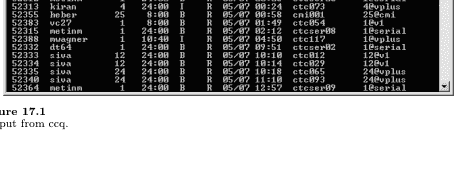


#### cctypes

`cctypes` 命令展示了集群控制器（Cluster CoNTroller）所知晓的各种资源池以及它可以为特定资源请求考虑的功能。图 17.2 展示了 `cctypes` 命令的输出。请注意，存在几种不同的资源类型。

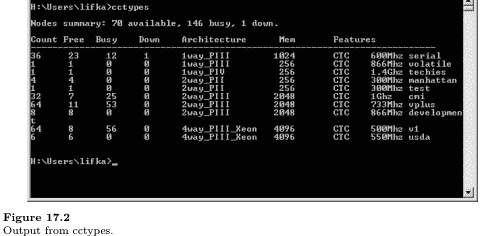

**图 17.2**

cctypes 的输出。

- **ccusage**：`ccusage` 命令列出系统中的每个节点、其状态，以及（如果节点繁忙）正在使用它的用户 ID、关联的作业及其完成时间。图 17.3 展示了 `ccusage` 的输出。
- **ccs-submit 和 ccrm**：`ccs-submit` 命令允许用户向系统提交作业。带有有效 jobId 的 `ccrm` 命令允许用户移除他们提交的作业。图 17.4 展示了 `ccs-submit` 和 `ccrm` 的输出。

##### 17.4.1 批处理文件语法

集群控制器（Cluster CoNTroller）的批处理文件语法实际上非常简单。用户必须指定四个字段：

- **rem ccs account**：当前，account 关键字必须设置为提交作业用户的 userid。否则，作业将被拒绝。此字段也是未来版本中计费功能的一个占位符，届时用户可能希望指定其所属组，以便为作业使用的时长进行计费。一个示例是 `rem ccs account = lifka`。
- **rem ccs nodes**：这是用户希望用于特定作业的节点或独立计算机的数量。请注意，这不一定等同于处理器数量。无论节点有多少个处理器，集群控制器（Cluster CoNTroller）都会分配节点。例如，如果您的集群拥有包含四个处理器的节点，您可以请求的最少节点数是一个，而最少处理器数是四个。一个示例是 `rem ccs nodes = 4`。
- **rem ccs minutes**：这是特定作业所需的分钟数。集群控制器（Cluster CoNTroller）按挂钟时间（wall-clock time）而非 CPU 时间进行调度。这是因为它支持交互式作业（下文将描述），用户在交互模式下运行作业时无法轻易衡量 CPU 时间，但可以通过观察墙上的时钟来了解其时间配额何时结束。
- **rem ccs type**：集群控制器（Cluster CoNTroller）支持批处理和交互式作业。如果您请求批处理作业（例如，`rem ccs type = batch`），调度器将在主节点上为您运行批处理文件，即您被分配的第一台节点。您提交的批处理文件中的任何内容都将在主节点上运行。这允许您将工作提交给系统稍后执行，例如在周末。如果您更喜欢登录到您被分配的节点并手动运行您的作业（例如进行调试工作），您可以请求交互式时间（例如，`rem ccs type = interactive`）。对于交互式作业，集群控制器（Cluster CoNTroller）为您提供对节点的访问权限，然后退出干预。当您请求的时间用完时，集群控制器（Cluster CoNTroller）将终止您的进程（包括到节点的 Telnet 会话）并释放资源供下一个作业使用。

除了这四个必选要求外，还有一个可选字段：

- **rem ccs requirements**：集群控制器（Cluster CoNTroller）支持异构资源调度。因此，如果您拥有多种类型的节点资源，您可以专门请求它们。`cctypes` 命令将显示您的集群可用的各种节点资源类型。请注意，如果您的所有节点都相同，则不需要此关键字。一个示例是 `rem ccs requirements = @development`。这被解释为 8 个具有名为“development”功能的节点。

所有集群控制器（Cluster CoNTroller）命令在 Windows 批处理文件（.bat 扩展名）中都以前缀 `rem ccs` 开头。当用户提交作业时，这些行会被解析和检查。

**JobSetup。** 批处理文件中的最后一项，位于集群控制器（Cluster CoNTroller）指令之后，是您希望在批处理中完成的具体工作。交互式作业读取集群控制器（Cluster CoNTroller）指令以分配必要的资源。批处理文件不会在节点上启动。批处理作业实际上在主节点上运行此批处理文件。图 17.5 中的示例展示了一个批处理文件，它通过两个不同的网络接口依次运行“Hello World”程序。

让我们逐行分析这个示例。命令：

```bash
set MPI_COMM=TCP
```

和

```bash
set MPI_COMM=VIA
```

告知 MPI/Pro 分别使用以太网或 Emulex CLAN 进行通信；两者都安装在康奈尔理论中心（Cornell Theory Center）的集群上。请注意，这是 MPI/Pro 特定的命令。

命令：

```bash
h:
```

从本地 c: 驱动器切换到共享驱动器。

命令：

```bash
cd h:\users\lifka
```

将用户（lifka）移动到其主目录。

命令：

```bash
call machinemaker
```

运行 CTC 开发的脚本，该脚本根据运行脚本的节点为 MPI 创建主机文件。

命令：

```bash
echo "TCP Run" > howdy.log
```

和

```bash
echo "VIA Run" >> howdy.log
```

向日志文件添加文本，说明即将开始特定的运行。最后一个命令：

```bash
mpirun -np 32 h:\users\lifka\howdy.exe >> howdy.log
```

运行 **howdy.exe** 程序并包含 32 个进程。这些行按照它们在图 17.5 中出现的顺序执行。

**运行并行作业。** 集群控制器（Cluster CoNTroller）与 MPI/Pro 紧密集成。MPI/Pro 能够使用集群控制器（Cluster CoNTroller）用于批处理作业启动的相同模拟（impersonation）机制。这意味着可以在批处理中运行 MPI/Pro 作业。康奈尔理论中心（Cornell Theory Center）正在与微软合作，提供标准的微软模拟机制，以便所有并行库和调度系统都能兼容。当然，在集群控制器（Cluster CoNTroller）下，所有并行库都可以交互式使用。

##### 17.4.2 作业的生命周期

现在让我们通过一个典型用户体验的示例，演示向集群控制器（Cluster CoNTroller）提交作业的过程。在这个示例中，我们展示了在康奈尔理论中心（Cornell Theory Center）实际与集群控制器（Cluster CoNTroller）的交互。

假设您希望运行一个四节点的并行“Hello World”作业。

1.  确定您需要什么资源以及您希望请求什么。为此，您可以使用 **ccq**、**ccusage** 和 **cctypes** 来提供有关哪些节点可用以及当前正在运行和等待的信息。
2.  验证您所需的资源存在后，您可以设置批处理文件以请求这些资源。以下批处理文件请求 4 个“development”资源类型的节点，时长为 5 分钟。

```batch
C:\> Command Prompt\ C:\> l\>howdy.bat
rem ccs.mnodes = 4
rem ccs.account = lifka
rem ccs.minutes = 5
rem ccs.type = batch
rem ccs.requirements = @development
set MPI_COMM=TCP
h:
cd H:\Users\Lifka
call notify lifka@tc.cornell.edu "Job started"
call mpirunscheduler
echo "TCP Run" > howdy.log
mpirun -np 8 h:\users\lifka\howdy.exe >> howdy.log
echo "VIA Run" >> howdy.log
mpirun -np 8 h:\users\lifka\howdy.exe >> howdy.log
ccrelease
"howdy.bat": 16 lines, 426 characters.
```

3.  要将您的作业放入队列，您必须使用 ccssubmit，它与调度节点上的 JobManager 服务交互，为您排队作业。一旦作业成功排队，JobManager 会返回一个唯一的 job id。

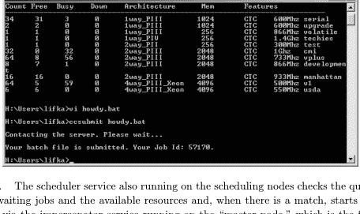

4.  也在调度节点上运行的调度器服务检查等待作业队列和可用资源，当有匹配时，通过运行在“主节点”上的 impersonator 服务启动作业，“主节点”是分配给作业的节点集中的第一个节点。impersonator 服务以您的身份为您运行通过 ccssubmit 提交的批处理脚本。
5.  当作业完成时，作为批处理文件的最后一行会发出 cc release。这告诉调度器服务启动清理。您随时可以使用 ccrm 命令取消正在运行的作业或移除已排队的作业。如果作业超过其时间限制，调度器将自动清除作业占用的资源。
6.  调度器服务通过从每个节点的全局域组中移除用户来移除用户对节点的访问，然后通过在每个节点上启动 nodemanager 服务来清除任何剩余的用户进程。在此期间，作业处于“清理状态”，如这里所示：


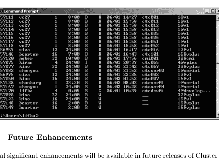

### 17.5 未来增强

在 Cluster CoNTroller 的后续版本中，将提供多项重要的增强功能。这些功能包括：
- 完整的 COM+ 支持，
- 使用 COM+ 的高级用户界面工具，
- 支持每个节点多个作业，
- 用于更好地进行资源核算的高级工具，以及
- 用于改进集群管理的高级工具。

## 18 康奈尔理论中心

David Lifka

康奈尔理论中心（CTC）位于康奈尔大学，是一个高性能计算和跨学科研究的卓越中心。CTC 目前运营着世界上一些最大的 Microsoft Windows 2000 集群。这些集群被康奈尔大学超过一百位首席研究员和超过六百位相关用户所使用。与康奈尔研究伙伴的外部合作者也可以访问 CTC 的集群资源。

### 18.1 CTC 用户

CTC 拥有一个多样化的用户社区，他们以各种模式使用该中心的计算资源：
- **串行模式：** 某些用户作业需要大量的内存、磁盘或更快的处理器。针对这些用户，我们提供串行作业农场。
- **主从并行性：** 某些用户拥有高效的串行代码，需要同时探索许多数据集，或者需要用相同的代码运行不同的场景。对于这些用户，主从范式（有时也称为“任务并行”或“任务农场”）是最佳选择。
- **紧耦合并行性：** 某些用户的作业需要由高性能网络互连连接的两台或更多台计算服务器。问题通过将代码分布在可用计算机上，并让进程通过网络通信必要的数据和信息来并行解决。此类应用程序要表现良好，通常需要高带宽、低延迟的网络。在 CTC，我们的并行计算集群使用 Emulex 公司的 CLAN。

CTC 资源的用户在各种广泛的领域开展研究，包括以下领域：
- 农业经济学
- 天文学
- 化学工程
- 临床科学
- 设计与环境分析
- 电气工程
- 市场营销
- 机械/航空航天工程
- 核科学与工程
- 植物育种与生物测量学
- 动物科学
- 生物化学、生物学
- 土木/环境工程
- 计算机科学
- 生态学与系统学
- 地质科学
- 数学
- 神经生物学与行为
- 物理学
- 理论与应用力学

由于其行业标准集群具有良好的价格/性能比，CTC 能够满足其不断增长的用户社区日益增加的需求。该中心鼓励能够受益于其计算资源的新应用程序。

### 18.2 系统概览

目前，CTC 拥有多个大型并行集群，以及相关的资源，如文件服务器和登录节点。在本节中，我们将简要介绍 CTC 当前的集群资源及其用途。

#### 18.2.1 文件服务器

在用户登录的任何资源上都有一个可用的主文件系统是至关重要的。在 CTC，我们目前有三台专用的文件服务器，每台连接了 1 太字节的 SCSI 存储。我们使用 Microsoft 的分布式文件系统将物理磁盘卷映射到一个逻辑卷，用户可以将该逻辑卷映射到他们的本地机器，并且它会自动映射到每个集群节点作为“H:”驱动器。这 3 太字节可用空间存储了用户与集群资源交互所需的数据和工具。
- H:\Home，存储所有主目录
- H:\Users 用户主目录
- H:\CTC Tools 调度器命令、帮助、各种软件的安装文件以及 Login.bat

每当用户登录 CTC 资源时，login.bat 会自动执行。这会检查用户主目录中是否存在 .bashrc 或 .cshrc 文件，从而使我们能够控制路径设置，并允许用户在登录时设置自己的 shell 环境。

#### 18.2.2 登录节点

CTC 的登录节点是两台专用的双处理器服务器，运行 Citix MetaFrame、终端服务器和 Seattle Labs SPlanet Telnet Service。这些机器允许远程用户从任何平台访问 CTC 集群资源。用户可以使用这些机器编译代码、开发批处理脚本，并与 Cluster CoNTroller 作业调度系统交互以提交和监控作业。

#### 18.2.3 开发集群

开发集群是一个小型的专用集群，用于快速的轮转测试和调试运行。由于其他集群资源已饱和且开发时间稀缺，因此安装了该集群。它由 Cluster CoNTroller 管理，允许用户在队列中运行最长三分钟的作业。开发集群的硬件和软件配置与大型集群类似，因此一旦用户调整好了代码和批处理脚本，他们就可以轻松地转移到其他集群进行长时间的生产运行。开发集群节点具有以下配置：
- 8 台 Dell PowerEdge 1550 服务器
- 双处理器 Pentium III 866 MHz/256 KByte 缓存
- 2 GByte RAM/节点
- 27 GByte 磁盘（RAID 0）/节点
- Giganet CLAN 互连

#### 18.2.4 串行节点

串行节点有两个目的。首先，它们允许拥有高效非并行代码的用户在管理良好的资源上运行长时间任务，这些资源具有比用户通常在工作站或笔记本电脑上负担得起的更多的内存和/或磁盘容量。其次，串行节点作为 Web 计算应用程序（在本章后面描述）的资源池。拥有串行节点以成本效益的方式使这些用户能够完成工作，并保持并行集群资源供需要它们的用户使用。串行节点配置了一个处理器和 1 吉字节 RAM，因此它们按比例来说与基于 SMP 的并行节点一样强大。串行节点是分批购买的。它们的配置如下：
- 26 台 Dell PowerEdge 2450 服务器
- Pentium III 600 MHz/256 KBytes 缓存
- 1 GByte RAM/节点
- 27 GBytes 磁盘（RAID 0）/节点
- 10 台 Dell PowerEdge 1550 服务器
- Pentium III 866 MHz/256 KBytes 缓存
- 1 GByte RAM/节点
- 27 GBytes 磁盘（RAID 0）/节点

#### 18.2.5 通用计算集群，Velocity I

Velocity I 是 CTC 安装的第一个集群。我们将 Velocity I 节点配置为拥有尽可能多的内存、磁盘和 L2 缓存，以便为用户提供最大的灵活性。例如，我们希望用户能够使用每节点四个或更少的处理器，从而为进程留下更多可用的共享内存。如今，Velocity I 是我们主要的通用并行集群。新用户首先在该系统上分配时间，并且大量用户使用它进行生产计算。Velocity I 配置如下：
- 64 台 Dell PowerEdge 6350 服务器
- 四核 Pentium III Xeon 500 MHz 处理器（SMP）
- 4 GBytes RAM/节点
- 54 GBytes 磁盘/节点
- Giganet CLAN 互连
- 100 Mbit 交换式以太网

#### 18.2.6 战略应用计算集群，Velocity I Plus

Velocity I Plus 是 CTC 的第二个并行集群。它在 Velocity I 安装六个月后部署，旨在为战略性并行应用程序提供额外的计算周期。如今，Velocity I Plus 支持的主要应用程序包括基因组学、蛋白质折叠和断裂力学。Velocity I Plus 在配置时考虑了并行程序性能：它拥有双处理器和更快的前端总线，以提高相对于 Velocity I Quads 的内存带宽。Velocity I Plus 具有以下配置：
- 64 台 Dell PowerEdge 2450 服务器
- 双处理器 Pentium III 733 MHz/256 KBytes 缓存
- 2 GBytes RAM/节点
- 27 GBytes 磁盘（RAID 0）/节点
- Giganet CLAN 互连

### 18.3 专用集群

Velocity 集群的成功以及其卓越的价格/性能，促使康奈尔的其他组要求 CTC 安装专门为他们用户和应用程序服务的专用集群。

#### 18.3.1 计算材料研究所集群

如前所述，康奈尔计算材料研究所（CMI）的断裂力学组大量使用 Velocity I Plus 进行多尺度裂纹扩展模拟。作为 Velocity I Plus 集群的补充，CMI 增加了自己的集群，其配置如下：


#### 18.3.2 社会科学和经济学研究集群

康奈尔大学的社会科学家安装了一个高性能计算平台，以支持他们对人口普查数据的 SAS 分析。SAS 是多线程的，并且在 Quad SMP（四路对称多处理）上表现良好。最近发布了一个并行版本的 SAS，康奈尔大学的研究人员已经开始成功使用它。由于其数据的保密性质，社会科学研究集群拥有自己的磁盘存储和备份系统。该集群的配置如下：

- 8 台 Dell PowerEdge 6350 服务器
- 四处理器 SMP 550 MHz Pentium III Xeon
- 每节点 1 GByte 内存
- 每节点 54 GBytes 磁盘
- 千兆交换以太网
- 3 TBytes Dell Power Vault SCSI 附加存储
- 2 TBytes Dell Power Vault 130T 磁带库

#### 18.3.3 农业生物信息学集群

康奈尔大学拥有一个大型基因组学和生物信息学计划。我们与美国农业部密切合作，为他们运营一个专门处理植物基因组数据并为研究人员运行 BLAST 代码提供计算周期的特殊集群。基于 Web 的植物基因组数据库由以下服务器提供服务：

- 4 台 Dell PowerEdge 6300 服务器
- 四处理器 SMP 400 MHz Pentium II Xeon
- 1 GByte 内存
- 56 GBytes 磁盘

计算节点配置如下：

- 8 台 Dell PowerEdge 6350 服务器
- 四处理器 SMP 550 MHz Pentium III Xeon
- 1 GByte 内存
- 54 GBytes 磁盘
- 100 Mbit 交换以太网
- 千兆交换以太网

#### 18.3.4 企业集群

自迁移至基于 Windows 的集群以来，企业和界对 CTC（康奈尔理论中心）及我们的计算环境的兴趣显著增长。我们安装了一个专用集群，为企业客户和合作伙伴提供一个进行性能测试和代码开发的地方。该企业集群目前的配置如下：

- 16 台 Dell PowerEdge 2450 服务器
- 双处理器 Pentium III 933 MHz/256 KBytes 缓存
- 每节点 2 GBytes 内存
- 每节点 27 GBytes 磁盘 (RAID 0)

#### 18.3.5 计算金融集群

CTC 主任 Thomas Coleman 拥有一个专注于计算金融的研究小组，分别位于伊萨卡和纽约市 CTC-Manhattan 办公室。他们使用集群进行投资组合风险分析等活动。他们发现其中一个有用的工具是康奈尔多任务工具箱，它使他们能够在集群上使用 Matlab 进行并行计算。计算金融集群的配置如下：

- 16 台 Dell PowerEdge 2450 服务器
- 双处理器 Pentium III 933 MHz/256 KBytes 缓存
- 每节点 2 GBytes 内存
- 每节点 27 GBytes 磁盘 (RAID 0)
- Giganet CLAN 互连网络

### 18.4 其他集群资源

除了 CTC 基于 Windows 的集群和专用集群外，我们还在探索基于 Web 的集群和基于 Windows 的 CAVE 环境。我们相信，这些资源以及我们正在开发的使用这些资源的应用程序将在使高性能计算大众化方面发挥重要作用。

#### 18.4.1 Web 集群

如前所述，我们正在将 CTC 的串行节点用作新的基于 Web 的计算接口的资源池。截至目前，我们有两个基于 Web 的集群应用程序。

第一个应用程序 **ser-loopp** 涉及蛋白质序列预测。用户输入一个蛋白质序列和电子邮件地址。然后，该序列通过 IIS Web 服务器安全地提交到 Cluster CoNTroller。在 **ser-loopp** 代码对序列运行之后，结果会通过电子邮件发送给提交序列的用户。目前，每周在这个应用程序上花费超过 200 个节点小时；请参见 `ser-loopg.tc.cornell.edu/loopg.html`。

第二个应用程序是一个断裂力学问题，更加复杂。用户通过 IIS 身份验证到 Web 服务器。然后，他们上传一种材料的模型，以对其执行裂纹扩展模拟。作业自动提交到串行节点，这些节点为模型生成网格，并插入初始裂纹。一旦该作业完成，它会将一个并行作业提交到 Velocity I 集群，以运行裂纹扩展模拟代码。代码运行后，用户将收到通知，告知其结果已在 H: 驱动器的用户目录中可用。

这种新计算模型的一个优点是，用户不需要知道正在使用哪种操作系统或哪种计算机架构。他们可以专注于他们的研究。另一方面，用户和集群之间仍然有一个批处理队列（即使最终用户看不到它）。为了解决这个问题，我们开始调查 Microsoft .Net 技术。我们的目标是提供实时反馈和模拟响应。

#### 18.4.2 基于 Windows 2000 的 CAVe 环境

CTC 正在与 Microsoft 和 VRCO 合作，开发第一个基于 Windows 2000 的 CAVe 环境。VRCO 提供基于 Windows 的开发工具，使用户能够在其桌面上生成 CAVe 模型。我们正在开发工具和编程接口，使任何 CTC 集群用户都能在没有可视化专家帮助的情况下轻松使用 CAVe。我们相信，这将引导应用程序指导以及这种传统上属于专业资源的更主流的使用。CAVe 环境的计算机资源如下：

- 3 台双处理器 Dell Precision 620 工作站
- 每工作站 60 GBytes 内存
- Giganet CLAN 互连网络

### 18.5 提供一致的用户界面

康奈尔理论中心认为，使向 Windows 计算环境的过渡对用户来说尽可能容易至关重要。特别是，为了帮助用户将他们来自其他编程环境的代码运行起来，我们必须提供用户熟悉的必要工具和系统接口。在 Velocity I 集群投入生产后的前六个月，CTC 顾问与各个康奈尔用户组会面，讨论他们的需求。这些需求分为三个基本领域：远程访问接口、编程环境和应用软件。

#### 18.5.1 远程访问机制

提供对集群资源的远程访问至关重要。CTC 拥有一套完整的远程访问工具，以满足来自各种平台（例如 Unix、Windows、Macintosh）用户的需求。最流行的远程访问机制是 Telnet；下面显示的是一个典型的 Telnet 会话。Microsoft 服务器允许每台机器同时进行两个 Telnet 会话。对于我们的许多应用来说，这已经足够了。然而，对于登录节点，显然需要更多会话。Windows 2000 有几种可用的 Telnet 服务器；我们成功使用了 Seattle Lab 的“SLnet”产品（参见 **www.seattlelab.com**）。

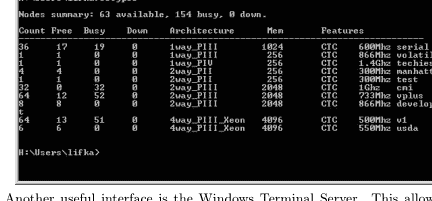

另一个有用的接口是 Windows 终端服务器。这允许用户从终端服务器客户端打开一个具有其原生图形用户界面的 Windows 会话。终端服务器是 Windows 2000 服务器的一个功能，但它本身仅对 Microsoft Windows 客户端有效；然而，一个名为 Citrix MetaFrame 的第三方产品允许非 Windows 客户端连接。它还允许从 Web 浏览器进行访问（参见 **www.citrix.com**）。

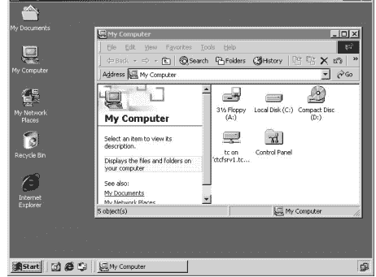

Windows 2000 也支持 X-Windows。如果您有需要 X-Windows 的应用程序，即使像 xterm 这样简单的应用，您也可以使用可用的 X 库（如 GNU）或商业系统（如 Hummingbird 的 Exceed）在 Windows 下编译和运行它们。使用 X 要求您拥有一个能够显示 X-Windows 的 X-Windows 客户端应用程序。

#### 18.5.2 编程环境

用户在迁移到 Windows 环境时的主要顾虑是他们是否有必要的工具来构建其应用程序。

编译器不是问题：Windows 有各种各样优秀的编译器可用。在 CTC，我们支持 Microsoft Visual Studio 套件、Compaq Fortran、Intel Vue 套件、Portland Group 和 GNU 编译器。我们发现，根据应用程序的不同，一种编译器可能比其他编译器工作得更好；例如，有时一种编译器可能不完全符合语言标准，但可能提供 superior 优化。CTC 顾问经常与用户合作，为其应用程序寻找最佳的编译器解决方案。

为了使从 Unix 环境来的用户更容易、更舒适地迁移到 Windows 环境，我们发现诸如 Cygwin 和 Interix 等工具


非常有用。它们提供了类似 Unix  shell 的功能以及 make 等实用工具。CFC 的用户通过使用 Cygwin，成功将数百万行遗留的 Fortran、C 和 C++ 代码移植到了 Windows 平台。Cygwin 的另一个优势在于，如果您需要让应用程序在多个平台或操作系统上运行，您无需对代码或 makefiles 进行重大修改。通常情况下，甚至完全不需要进行任何修改。

#### 18.5.3 应用软件

除了编译器和开发环境外，我们还为用户提供了广泛的软件库。这些软件主要分为四大类：工具、数学库、脚本语言和消息传递。

**工具。** 以下是我们为用户提供的用于各种应用程序的工具列表。我们的用户所要求的每个工具在 Windows 环境中均可用。

- Abaqus：有限元建模
- Ansys：有限元建模
- Cornell Multitask Toolbox：用于 MATLAB 并行 Matlab
- Fidap：计算流体力学
- Fluent：计算流体力学
- G98W：计算化学
- Mathematica：数学应用
- Matlab：数学应用
- SAS：统计学
- Visualization Toolkit (VTK)：可视化软件包

**数学库。** 随着我们的用户在不同平台间迁移，他们请求了各种数学库。我们提供的主要库包括 IMSL、LAPACK、Intel 数学内核库以及 NAG 库。

**脚本语言。** 脚本语言允许用户进行快速原型开发并管理程序执行。在 Windows 2000 下，COM+ 和 WMI 使得脚本编程更具吸引力，且用于脚本语言的模块资源也日益丰富。CTC 目前支持三种脚本语言：ActiveState Perl、Python 和 Microsoft Visual Basic。

**消息传递。** MPI 是我们用户主要需要的消息传递库。我们使用来自 MPI Software Technology, Inc. 的 MPI/Pro。它已被证明极其稳定且支持完善。我们也有少量用户使用 PVM；不过，我们目前并不支持它。

#### 18.6 帮助用户入门

CTC 拥有一支拥有十余年并行编程和优化经验的顾问团队。这些顾问与我们的用户合作，确保他们能以最高效的方式完成工作。顾问团队还根据康奈尔用户社区的需求以及外部客户的合同要求，提供移植和开发工作。为了方便那些不熟悉 Windows 环境的新用户在没有 Windows 机器的情况下入门，CTC 设立了一个“协作实验室（Collaboratory）”——这是一个大型房间，配备了十台高端工作站，这些工作站已完全配置了集群资源上安装的所有软件工具。用户可以来到协作实验室，与合作者及 CTC 顾问一起工作，使代码能在集群上运行。

#### 18.7 批处理和交互式作业调度

作为英特尔“技术教育”拨款（see www.cs.cornell.edu/tech2000/）研究与开发工作的一部分，CTC 开发了 Cluster CoNTroller 作业调度系统。我们将此系统授权给 MPI Software Technology, Inc.，该公司继续对其进行开发、销售和支持（see www.mpi-softtech.com/products/cluster_controller）。第 17 章提供了关于 Cluster CoNTroller 的更多细节。

#### 18.8 CTC 成功案例

向基于 Windows 的集群转型对 CTC 及其用户而言是成功的。最重要的是，Windows 2000 比我们要过去使用的 Unix 系统更加可靠，而戴尔服务器也相当稳定。事实上，过去一年多来，我们一直与英特尔合作进行可靠性研究，涵盖从硬件到软件的所有问题。在运行 Windows 2000 的前三个月，我们的正常运行时间达到了 99.986%；而在过去两个月里，本章描述的所有集群资源的正常运行时间达到了 99.99999%。

有关 CTC 及其集群资源的更多信息可参见以下网址：

- www.tc.cornell.edu
- www.ctc-manhattan.com
- www.tc.cornell.edu/AC3

## 19 结论

*Thomas Sterling*

本书代表了 Beowulf 集群计算在硬件和软件方面的实用技术水平。同时，它也体现了商品集群成熟的速度之快，并在此过程中，其应用领域正变得越来越广泛。就在两年前，我们在这个领域的开创性工作——*《如何构建 Beowulf 集群》*由 MIT 出版社出版。但自那以来的短短时间里，集群计算的技术和实践已经发生了巨大的演变。当时，这类系统的使用方式相当受限，除了基本节点操作系统和消息传递库外，软件支持有限。系统规模很少超过一百个处理器。如今，拥有超过一千个处理器的系统已被用于技术和商业计算。但更显著的是，目前已有以及正在开发一系列软件工具，用于管理 Beowulf 集群（无论大小）上工作负载的实现、维护、管理和资源分配。因此，在这一出版作品与我们最初 modest 的工作之间的短暂时期内，Beowulf 商品集群计算已经成熟。曾经，Beowulf 系统只是并行计算领域的一个狭窄分支。如今，它们往往是首选系统，并正在迅速主导甚至最高端计算。在最近一次超级计算会议上，工业展出的商品集群数量超过了所有其他形式并行计算系统的总和，这一点颇具说明力。

尽管取得了如此巨大的进步，Beowulf 集群计算仍然是一个处于过渡阶段的领域。没有一个普遍接受的分布式环境，或者可以说，集群社区所依赖的硬件基础也是如此。当然，这种灵活性所蕴含的多样性是其优势的一部分，但也使其容易受到供应商变化的影响。事实上，硬件和软件都处于变化之中，预计未来一到三年内还会持续发生变化。值得考虑这些可能的变化将发生在何处。

### 19.1 硬件组件的未来方向

处理器技术正在见证三个领域的变化。首先是处理器性能的持续增长，尤其是时钟速度。尽管预测相反，时钟频率仍在持续增长。在撰写本文时，时钟频率为 1.7 GHz 的 Pentium 4 已可用于消费级封装。内存增强和缓存大小也在扩展，试图与处理器的峰值性能相匹配。第二个变化是新一代 64 位架构的出现，伴随着 Intel IA-64 64 位处理器系列的商业发布。第三个变化领域是每芯片集成多个处理器的 SMP 配置的预期。如果这一趋势成为现实，那么商品集群的所有节点都可以是两个或更多处理器的 SMP 结构。所有这些进步都由集成特征尺寸的持续缩减驱动，逻辑工艺正在向 0.18 微米以下发展。

网络技术预计将取得重大进展，随着每节点千兆位通道的普及和成本的持续下降。Myrinet 和 Ethernet 主导着 Beowulf 集群配置，但其他网络技术也产生了重大影响。Quadrics QSW 网络为基于 Compaq Alpha 处理器系统的最高端提供了高带宽框架，并已提出更大的配置，可能产生峰值性能超过 100 teraflops 的集群。VIA 架构继续在集群市场取得进展，提供千兆位每秒的吞吐量，延迟远低于 10 微秒。其中最重要的是 Enulex cLAN 网络。但也许最有意思的进展是新行业 Infini-band 架构（IBA）标准（篇幅超过 1,500 页）的出现。Infiniband 为所有 I/O 需求（包括集群互连网络）提供了一种新的紧密集成的策略和技术。与连接到 PCI 等中间 I/O 接口不同，Infiniband 将更直接地与处理器通信绑定，从而提高 I/O 带宽并将延迟降低至微秒级别。已规定的带宽水平包括使用光学介质，将在 10 Gbps 范围工作。Infiniband 受到大型工业联盟的支持，可能成为新的主导 I/O 接口。基于 IBA 的产品应在未来十八个月内可用。然而，尽管普遍乐观，客户成本尚未确定。值得注意的是，外部网络带宽正在接近处理节点的主存带宽。预计在未来几年内带宽还将提高一个数量级，网络带宽可能不再是实际可实现性能的主要瓶颈。

尽管讨论得较少，但大容量存储预计将取得重大进展。这些进展由快速成长的 PDA、数码相机和蜂窝电话市场推动，这些市场需要小型、轻便、低功耗组件中的高容量存储。“火柴盒”硬盘驱动器将在近期提供多吉字节容量。对于较大的单元，高级 EIDE 驱动器将以每吉字节低于 10 美元的成本提供每单元数百吉字节的容量。对于许多技术和商业问题，大容量存储在容量和带宽方面都是瓶颈。商品集群提供了一个丰富的权衡空间，用于配置和运行大型磁盘农场。但关于可靠性和软件支持


分布式文件空间仍然带来许多尚未完全解决的挑战。

系统封装的演进将持续影响 Beowulf 集群，并在以下两个重要方面产生影响。从历史上看，Beowulf 集群占据了大量空间。虽然最早期的 Beowulf 集群采用定制封装，在机架高度一半的机架中安装了 16 块主板，但大多数系统利用的是低功耗、高可靠性的 PC 塔式机箱及其电源。然而，这类封装的密度较低。除了最小的系统外，地板空间已成为一个问题。不过，由于 Beowulf 级集群市场变得非常重要，供应商开始提供新的封装选项，例如高密度机架安装单元，现在可以在单个落地机架中安装 40 个或更多的处理器。随着更高级的多处理机（SMP）集成到这些单元中，每个机架的处理器数量将继续增加，使得更大的系统可以安装在适度的机房中。但这同时也导致了未来机器受影响的第二个方面，即最大 Beowulf 集群的规模。在未来几年内，世界上最大的系统将由包含 10,000 个或更多处理器的通用集群组成。在本版书籍的生命周期内，在这个规模上可能会实现提供高达 100 teraflops 性能的集群。

### 19.2 软件组件的未来方向

尽管在过去几年中，集群中间件领域取得了巨大进步，但普遍共识认为，需要继续推进以将此类系统的可用性和稳健性提升到与其他服务器技术相当的水平。寻求的关键属性包括完整性、共性、易用性、通用性和可靠性。

完整性与需要一个全面的软件环境有关，该环境覆盖分布式集群系统的各个方面，并支持运行通用集群（无论大小）相关的主要活动。这些活动包括安装、配置和初始化、状态监控和维护、管理以及资源调度。

共性是指这种环境能够被社区中大多数 Beowulf 集群广泛使用的特性。Linux、Windows 和 MPI 都具有这种特性，这是 Beowulf 系统广泛传播的重要推动力。在这个意义上，如果你使用过一种 Beowulf 系统，你很可能能够毫不费力地使用其他任何系统。但在中间件层面，环境并不具有这种一致性。这既有一部分是故意的，也有一部分是由历史原因造成的。随着供应商成功进入这一领域，中间件成为他们提供产品差异化、增强各自产品价值的一个领域。历史上，低级工具——特别是用于监控系统状态、运行和健康状况的工具——是在内部开发的，共享有限。然而，正如我们所见，其他工具如调度器则得到了更广泛的使用。

易用性与通用性相结合，涉及通过中间件环境提供的抽象来进行系统操作的便捷程度。一个被认为强烈有助于易用性的高价值属性是“单一系统映像”。最初，Beowulf 集群被看作是一组独立的松散耦合处理系统，每个系统都是单独管理的。在最初，甚至会有一个开关盒将操作员的键盘和显示器连接到任何指定的处理器节点。虽然这在小型专用系统中可以工作，但对于较大的多用户集群来说是不可行的，而且在任何情况下都是不理想的。系统包含许多用户必须应对的名称空间。其中一些包括用户应用程序的全局变量、文件空间、进程 ID 和作业的集合，以及 I/O。在最坏的情况下，所有这些都需要按节点逐个处理。当系统扩展到一千个或更多处理器的规模时，这也变得不可行。即使是对于小得多的系统，这种显式的按节点控制也容易导致操作员错误。单一系统映像是指整个集群为系统中每一类命名对象只呈现单一名称空间的特性，独立于所使用的处理器数量。用户看到一个进程 ID 空间，一个分布式文件空间，以及其他类似的情况。通用性将易用性的特性扩展以包括从专用单用户到多用户、多程序运行的广泛操作模式。

系统可靠性对于 Beowulf 集群在信息处理市场中的长期接受至关重要。关于 Beowulf 系统实际可靠性的观点分歧很大。对于中等规模的系统，初期死亡率（持续数周）可能很高，风扇、电源、磁盘驱动器甚至内存会在短时间内出现故障。然而，在此之后，系统通常会在需要维护之间经历长期稳定运行，可能长达数月。在两三年后，老化开始产生影响，故障率开始上升。但对于具有数千个处理器的大型系统，单点故障可能会更为普遍。对于这两类系统，快速检测、诊断、修复、重启和恢复对于高可用性至关重要。软件工具对于辅助可靠性方面的各个方面也是必不可少的，但在这个领域所做的工作很少，没有公认的一般工具集在使用中，尽管已探索了一些实验系统。一项重要能力是检查点与重启，一些工具存在，但涉及直接由应用程序程序员介入。用于记录和报告软错误的工具可用于识别可能发生的未来故障，指导在不中断应用程序执行的情况下进行预防性的受控系统组件更换。在这个领域需要更多的工作。

一项有价值的努力是收集和整合现有工具的关键子集，以构建一个满足上述至少部分要求的有效环境。OSCARR 源自橡树岭国家实验室，Rocks 在圣地亚哥超级计算中心进行，康奈尔理论中心（CTC）的集成工具集，以及 Scyld 提供的集成软件系统都是此类努力的例子。OSCRR 是包括行业合作伙伴在内的多个组织的合作，随着其演进值得密切关注。CTC 的工具集是基于 Windows 的最全面的工具集之一。Scyld 软件环境提供了用户级单一系统映像的良好示例。虽然大多数 Beowulf 集群软件支持在每个节点上运行完整的操作系统，每个节点半独立地运行，但 Scyld 模型不同。通过采用一个主处理器和多个从处理器的逻辑结构，所有名称空间都通过主处理器管理，向用户呈现单一系统映像。进程由主处理器控制但委托给从处理器执行。从节点内核非常有限且轻量级，并由主处理器下载。这可以非常高效地完成，比在常规集群上快得多，并解决了版本一致性控制的问题。尽管如此，虽然 Scyld 软件环境表现了许多理想属性，但其可扩展性问题仍存疑问。单个主处理器可能成为瓶颈，协调多个主处理器并非易事。

随着集群系统中 SMP 节点普及率的提高，需要利用这类紧耦合单元的手段。OpenMP 已作为在共享内存范式内应用这些资源的一种方式而发展。但节点之间仍然是大多数集群典型的碎片化名称空间。具有讽刺意味的是，即使在具有分布式共享内存硬件支持的系统中，当今大多数并行程序员仍然使用具有消息传递模型的 MPI。支持 MPI 实现的基础机制利用共享内存硬件支持，从而使至少其部分操作在集群节点之间比节点内更高效，并且这是以对用户透明的方式完成的。但在节点内使用共享内存和节点间使用分布式内存的清洁方法尚未在实践中找到令人满意的解决方案。一类有时被称为“put-get”模型的编程模型可能提供至少部分解决方案。这一方法部分受到 Cray T3E 编程模型的启发，这种方法是假设


没有缓存一致性。在 SMP 节点内部，使用常规的 load/store（加载/存储）操作，但对于远程访问，则在相同的编程模型中使用相应的 get 和 put 操作符。这方面的例子包括在 IDA CCS 开发的 UPC 以及在特拉华大学开发的实验性 Earth-C。

### 19.3 最终思考

预测像并行计算这样易变的技术将把我们带向何方是困难的，因为众多因素和趋势都会影响最终结果。十年前，集群尚处于婴儿期，Beowulf 仍处于未来。十年后同样会出现许多变化。尽管如此，至少可以探讨其中的一些可能性。对 Top500 列表和半导体行业协会路线图的外推表明，世界上最大的计算机，很可能是通用集群，将在 2010 年达到 1 Petaflops 的峰值性能。包含数十亿器件的集成电路，很可能由多个处理器组成，将能够达到 100 Gflops 或更高的性能。在同一时期，DRAM 密度将增长一百倍。如果充分利用光通信，每通道带宽可以达到 1 Tbps 或更高。在这种情景下，到 2010 年，几乎每个小型 Beowulf 都将成为 Teraflops 级别的机器。

只要存在对某种服务器需求的机会，通用集群就始终有机会通过此实现性能提升。但市场中的一些趋势并不与集群的未来保持一致。便携式计算设备，包括个人数字助理、笔记本电脑以及即将（很可能）发布的电子图书，都具有内置的人机界面，包括屏幕和键盘，这使得它们不适合用于集群。诚然，它们的技术推动有助于降低成本、功耗和尺寸，这对集群节点可能有积极影响。但这些大众市场产品本身通常不太可能被用于集群。承认已经出现了对笔记本电脑进行集群化的案例，但这些在成本效益上并不划算。外形笨重的塔式机箱中的桌面（或台式机侧）计算机可能已经走向灭绝。越来越多的用户已经将其完整的用户环境迁移到了笔记本电脑上。笔记本电脑就是他们的一切，他们的整个世界。随着办公室和家庭的无线互连、路上的蜂窝互联网连接以及即将超过 100 Gbytes 的磁盘容量，台式机正迅速变成恐龙。但最初的 Beowulf 就是从这些设备中构思出来的。Beowulf 类系统利用了现有的大众市场设备，而现在这些设备可能会消失。

但这不再是一个问题，因为集群对市场的价值已被证明。供应商现在正在专门制造处理器节点，以用于构建高密度集群。因此，组件不再是其他市场的二手货，而是为此目的进行了优化。从某种意义上说，经典 Beowulf 的时代正在过去——还不是现在，但最终会如此。通用集群作为 MPP 的廉价替代方案被提出，以帮助这些更昂贵的机器减轻至少部分工作负载。但随着下一代高带宽网络及其与处理器/内存核心的紧密集成，MPP 和集群之间的许多区别开始消失。并且随着 put 和 get 等操作的 efficient 实现，一种（没有缓存一致性的）共享内存空间模型可能会可用，这将进一步侵蚀集群和 MPP 之间的区别。如果这种情况发生，我们将真正见证并行架构的融合。

然而，这并不是故事的结局。迄今为止描述的编程模型仍然很原始，并且需要物理系统和程序员之间紧密且显式的关系。极限情况下，程序员应该负责描述应用的并行算法，但不负责手动管理物理资源及其与应用任务和对象的直接关联。随着处理器在数以万计的范围内普及，且关键资源被确认为内存带宽，这些并行系统将推动新一族编程模型的开发，在其中，正如在计算的最早期一样，程序员将把计算机视为单一系统，而不是许多机器的分布式集合。我们仅瞥见了此类模型可能包含的诱人片段，但研究人员已经在考虑这样新的范式。Beowulf 集群计算正在引领并行处理走向未来。每一步都是其自身的成就，也是迈向下一阶段的基石。

## **A** 术语表

- **AMD**：Advanced Micro Devices（先进微设备公司）
- **ASIC**：Application Specific Integrated Circuits（专用集成电路）
- **ASMP**：非对称多处理。在多处理器系统上进行处理的系统，通常选择一个处理器执行操作系统代码，而其他处理器仅运行用户代码。
- **ASRAM**：Asynchronous Static Random Access Memory（异步静态随机存取存储器）
- **ATM**：Asynchronous Transfer Mode（异步传输模式）；一种用于广域网（WAN）的网络和协议；尽管被用作某些通用集群的互连介质，但由于未针对此用途进行优化且成本较高，因此在集群中未得到广泛使用
- **AWE**：Address Windowing Extensions（地址窗口扩展）。Windows 2000 中的一种机制，允许 32 位应用程序分配多达 64 GB 的物理内存，然后将视图或窗口映射到其 2GB 虚拟地址空间中。使用 AWE 将管理虚拟到物理内存映射的负担推给了程序员，但解决了在 32 位进程地址空间中一次无法映射更多物理内存的即时需求。
- **BDA**：BIOS Data Area（BIOS 数据区）
- **Beowulf-class system**：Beowulf 类系统：采用个人电脑或低成本 SMP 服务器以实现极佳性价比的通用集群，最初由 NASA 戈达德太空飞行中心的 Beowulf 项目开发
- **BIOS**：Basic Input Output System（基本输入输出系统）
- **bit**：位：表示双状态值的信息基本单位；能够存储双状态值的数字电路
- **BLAS**：basic linear algebra subroutines（基本线性代数子程序）
- **bps**：bits per second（比特每秒），数据传输速率的度量单位
- **byte**：字节：一种常见的数字信息存储寻址量，为 8 位，反映 256 个不同值之一
- **CD-ROM**：Compact Disc Read Only Memory（光盘只读存储器）
- **checked build**：经过检查的构建：Windows 2000 Professional 的一个特殊调试版本，仅作为 MSDN Professional（或 Universal）订阅的一部分提供。（Windows 2000 Server 没有经过检查的构建版本。）经过检查的构建是通过将 Windows 2000 源代码与编译时标志 DEBUG 设置为 TRUE 来编译创建的。
- **cluster**：集群：广义上，指任何能够独立运行但用于服务共同工作负载的互连计算机集合
- **CMOS**：Complementary Metal Oxide Semiconductor（互补金属氧化物半导体）
- **commodity cluster**：通用集群：由商用计算节点与商用系统区域网络集成而成的集群
- **Condor**：在威斯康星大学开发的软件包，用于管理跨分布式计算系统（包括集群）的作业负载调度
- **constellation**：星座：由大型 DSM、SMP 或 MPP 计算节点组成的集群，其中每个节点包含的微处理器数量多于系统中的节点数量
- **context switch**：上下文切换：保存与运行中的线程相关的易失性机器状态、加载另一个线程的易失性状态并启动新线程执行的程序。
- **COW**：cluster of workstations（工作站集群）；威斯康星大学早期的一个项目
- **CPU**：Central Processing Unit（中央处理单元）
- **CRC**：Cyclic Redundancy Check（循环冗余校验）
- **DDR**：Double Data Rate（双倍数据率）
- **deferred procedure call (DPC) object**：延迟过程调用（DPC）对象：描述将中断处理推迟到 DPC/分发级别的请求的内核控制对象。（参见中断请求级别（IRQs）。）此对象对用户模式程序不可见，但对设备驱动程序和其他系统代码可见。DPC 对象包含的最重要信息是内核处理 DPC 中断时将调用的系统函数地址。
- **device drivers**：设备驱动程序：可加载的内核模式模块（通常以 .sys 结尾），在 I/O 系统和相关硬件之间进行接口。Windows 2000 上的设备驱动程序不直接操纵硬件设备，而是调用硬件应用层（HAL）的部分以与硬件进行接口。


## dispatcher
内核中的一组例程，用于实现 Windows 2000 的调度。Windows 2000 并没有一个单一的“调度器”模块或例程——代码分布在内核中发生调度相关事件的各个位置。

## dispatcher objects
一组包含同步功能并改变或影响线程调度的内核对象。这些分发器对象包括内核线程、互斥体（内部称为 mutant）、事件、内核事件对、信号量、定时器和可等待定时器。

## DRAM
动态随机存取存储器

## driver support routines
设备驱动程序调用以实现其 I/O 请求的例程。

## DSM
分布式共享内存多处理器，一种紧密耦合、缓存一致且具有非统一内存访问（NUMA）特征的多处理器

## DVD
数字多用光盘

## Dynamic linked library (DLL)
包含可执行代码的可独立加载模块，可在进程之间共享。类似于 Unix 上的共享库。

## EDO
扩展数据输出（Extended Data Out）

## EEPROM
电可擦除可编程只读存储器

## EIDE
增强型集成驱动电子

## Emulex
商品集群 cLAN 网络的供应商、分销商和开发者

## environment subsystems
将原生操作系统服务暴露给用户进程，从而向用户应用程序提供操作系统环境（或个性）的用户进程。Windows 2000 附带三个环境子系统：Win32、POSIX 和 OS/2 1.2。

## EPIC
显式并行指令计算

## Ethernet
第一种广泛使用且真正无处不在的局域网，运行速率为 10 Mbps

## event
一种具有持久状态（已发出信号或未发出信号）的对象，可用于同步；同时也指触发操作的系统事件。

## exception
由特定指令执行结果产生的同步条件。在相同条件下使用相同数据运行单个程序可以复现异常。

## executive
Ntoskrnl.exe 的上层。（内核是下层。）执行体包含基础操作系统服务，如进程和线程管理器、虚拟内存管理器、内存管理器、安全引用监视器、I/O 系统和缓存管理器。另见内核。

## executive objects
由执行体各个组件（如进程管理器、内存管理器、I/O 子系统等）实现的对象。执行体对象和对象服务是原语，环境子系统使用它们来构建自己版本的对象和其他资源。由于执行体对象通常由环境子系统代表用户应用程序创建，或由操作系统的各个组件在正常运行过程中创建，其中许多都包含（封装）一个或多个内核对象。另见内核对象。

## Fast Ethernet
一种基于原始以太网协议的局域网，成本低且非常受欢迎，特别是在低端的 Beowulf 类系统中；提供 100 Mbps 的带宽

## FDD
软盘驱动器

## free build
可以零售购买的 Windows 2000 系统版本。它启用了完整的编译器优化进行构建，并从映像中剥离了内部符号表信息。另见 checked build。

## function driver
为主设备提供操作接口的主要设备驱动程序。除非设备以原始方式使用（即 I/O 由总线驱动程序和任何总线筛选驱动程序，如 SCSI Pass/Thru，完成的实现方式），否则这是必需的驱动程序。功能驱动程序是对特定设备了解最多的驱动程序，通常也是唯一访问设备专用寄存器的驱动程序。

## Gigabit Ethernet
快速以太网的后继局域网，提供 1 Gbps 的峰值带宽。虽然被用于某些集群，但其使用受到相对较高成本的限制

## GNU
产生了一系列开源和自由软件工具的项目，包括 GNU C 编译器和 Emacs

## GPL
GNU 通用许可证；保护开源软件的法律框架

## handle
对象标识符。当进程按名称创建或打开对象时，它会接收该对象的句柄。通过句柄引用对象比使用其名称更快，因为对象管理器可以跳过名称查找并直接找到对象。

## handle table
包含进程已打开句柄的所有对象指针的表格。句柄表实现为三级结构，类似于 x86 内存管理单元实现虚拟到物理地址转换的方式。

## hardware abstraction layer (HAL)
可加载的内核模式模块（Hal.dll），为 Windows 2000 正在运行的硬件平台提供低级接口。HAL 隐藏了硬件相关的细节，如 I/O 接口、中断控制器和多处理器通信机制——任何特定架构和依赖机器的功能。

## HDD
硬盘驱动器

## HDF
分层数据格式，既是一种文件格式，也是用于顺序和并行应用中 I/O 访问的高级接口

## HPL
高性能 Linpack

## I/O
输入/输出

## I/O request packet (IRP)
控制 I/O 操作在每个阶段如何被处理的数据结构。大多数 I/O 请求由 IRP 表示，它在 I/O 系统组件之间传递。

## I/O system
Windows 2000 执行体组件，接受 I/O 请求（来自用户模式和内核模式调用者）并以不同形式将其传递给 I/O 设备。

## IDE
集成驱动电子

## interrupt
与处理器正在执行的内容无关的异步事件（可随时发生）。中断主要由 I/O 设备、处理器时钟或定时器产生，并且可以启用或禁用。

## interrupt object
允许设备驱动程序为其设备注册中断服务例程（ISR）的内核控制对象。中断对象包含内核将设备 ISR 与特定级别的中断关联所需的所有信息，包括 ISR 的地址、设备中断的中断请求级别（IRQ）以及 ISR 应与之关联的内核中断调度表条目。

## IRQ
中断请求

## job object
Windows 2000 中可命名、安全且可共享的对象，用于控制与作业关联的进程的各项属性。作业对象的基本功能是允许将进程组作为一个单元进行管理和操作。作业对象还记录与作业相关的所有进程以及曾经与作业相关但已终止的进程的基本核算信息。

## kernel
Ntoskrnl.exe 中的最低层。内核是执行体的一个组件，它决定操作系统如何使用处理器，并确保它们被审慎使用。内核提供线程调度和分发、陷阱处理和异常分发、中断处理和分发以及多处理器同步。另见执行体。

## kernel mode
处理器中的特权代码执行模式，在此模式下所有内存完全可访问，且可以发出所有 CPU 指令。操作系统代码（如系统服务和设备驱动程序）在内核模式下运行。另见用户模式。

## kernel objects
由 Windows 2000 内核实现的原始对象集合。这些对象对用户模式代码不可见，仅在执行体内部创建和使用。内核对象提供基本功能（如同步），执行体对象即建立在这些功能之上。另见执行体对象。

## kernel-mode device driver
唯一可以直接控制和访问硬件设备的驱动程序类型。

## kernel-mode graphics driver
将设备无关图形（GDI）请求转换为设备特定请求的 Win32 子系统显示或打印设备驱动程序。

## LAN
局域网；在单一管理域（如实验室或办公园区）内部使用的网络，连接个人计算机和工作站

与文件服务器、打印机和其他外围设备以及互联网一起使用。低成本局域网技术已被采用，为Beowulf级系统提供廉价的中等带宽互连

**LED：** 发光二极管

**Linux：** 一种由广泛的国际社区通过开源代码框架开发的主导的类Unix跨平台操作系统

**LOBOS：** Lots of Boxes on Shelves（货架上许多箱子）

**本地过程调用 (LPC)：** 一种用于高速消息传递的进程间通信机制（不能通过Win32 API获得，而是通过仅对Windows 2000操作系统组件可用的内部机制获得）。LPC通常用于服务器进程与其一个或多个客户端进程之间。可以在两个用户模式进程之间，或者在核心模式组件与用户模式进程之间建立LPC连接。

**本地安全授权 (LSA) 服务器：** 一个运行映像 `\Winnt\System32\Lsass.exe` 的用户模式进程，负责本地系统安全策略（如哪些用户被允许登录机器、密码策略、授予用户和组的权限以及系统安全审计设置）、用户认证，以及向事件日志发送安全审计消息。LSA服务（LsaSr - `\Winnt\System32\Lsasvr.dll`），是Lsass加载的一个库，实现了这些功能的大部分。

**登录过程：** 一个运行Winlogon.exe的用户模式进程，负责捕获用户名和密码，将它们发送到本地安全授权服务器进行验证，并创建用户会话中的初始进程。

**LPT：** 行式打印机

**MAC：** 媒体访问控制器

**映射文件I/O：** 将驻留在磁盘上的文件视为进程虚拟内存的一部分的能力。程序可以将文件作为大数组进行访问，而无需缓冲数据或执行磁盘I/O。程序访问内存，内存管理器使用其分页机制从磁盘文件中加载正确的页面。如果应用程序写入其虚拟地址空间，内存管理器作为正常分页的一部分将更改写回文件。

**MAU：** 介质连接单元

**Mbps：** 每秒100万位的数据传输速率或带宽

**Mega：** 前缀，意为100万，或者在存储的情况下为 $2^{20}$

**内存管理器：** Windows 2000执行体组件，实现按需分页的虚拟内存，给每个进程一种错觉，即它拥有4-GB的32位地址空间（同时将该地址空间的一个子集映射到物理内存）。

**消息传递：** 一种基于在（通常）运行在单独计算机上的进程之间通信数据并行的方法。

**元数据：** 在文件系统的背景下，这是描述文件的信息，包括所有者、权限和数据位置。

**MPI：** 消息传递接口，一个社区衍生的逻辑标准，用于在单独的并发进程之间传输程序消息

**MPP：** 或大规模并行处理器

**MSDN 微软开发者网络：** 微软为开发者提供支持的项目。MSDN提供三种CD-ROM订阅计划：MSDN Library（库）、Professional（专业版）和Universal（通用版）。欲了解更多信息，请访问 msdn.microsoft.com。

**MTBF：** 平均故障间隔时间

**互斥锁 (mutex)：** 一种用于将资源访问序列化的同步机制。

**Myricom：** Myrinet网络的供应商、分销商和开发者，用于通用集群

**网络：** 通信通道、交换机和接口控制器的组合，用于在Beowulf集群节点之间传输数字消息

**NIC：** 网络接口控制器；通常是硬件和软件的组合，使集群计算机节点的计算机网络传输层相匹配

**NIH：** 国立卫生研究院

**NOW：** 网络工作站，以及UC Berkeley早期有影响力的通用集群项目

**Ntkrnlmp.exe：** 多处理器系统的执行体和内核。

**Ntkrnlup.exe：** 单处理器系统的执行体和内核。

**对象：** 在Windows 2000执行体中，静态定义的对象类型的单个运行时实例。

**对象管理器：** Windows 2000执行体组件，负责创建、删除、保护和跟踪对象。对象管理器集中管理那些本应分散在操作系统各处的资源控制操作。

**分页：** 将内存内容移动到磁盘的过程，释放物理内存，以便其他进程或操作系统本身可以使用。因为大多数系统的物理内存远小于正在运行的进程所使用的总虚拟内存（每个进程2 GB或3 GB），内存管理器将部分内存内容传输或分页到磁盘。

**PC：** 见个人计算机

**PCI：** 个人计算机和工作站主导的外部接口标准，用于支持I/O控制器，包括网卡。

**个人计算机 或 PC：** 基于微处理器的大众市场计算机，商业和消费者用户都使用它，用途从游戏到电子表格和互联网浏览器无所不包；强调性能/成本以获得最大市场份额，这些节点是低成本Beowulf级集群的基础

**PLS：** 物理线路信令

**即插即用 (PnP) 管理器：** 执行体的主要组件，确定支持特定设备所需的驱动程序并加载这些驱动程序。PnP管理器在枚举期间获取每个设备的硬件资源要求。根据每个设备的资源要求，PnP管理器分配适当的硬件资源，如I/O端口、IRQ、DMA通道和内存位置。它还负责发送设备变更（添加或移除设备）的系统适当事件通知。

**PnP：** 即插即用

**POST：** 开机自检

**电源管理器：** 执行体的主要组件，协调电源事件并向设备驱动程序生成电源管理I/O通知。当系统空闲时，可以将电源管理器配置为让CPU进入睡眠状态以减少功耗。单个设备的功耗变化由设备驱动程序处理，但由电源管理器协调。

**进程：** 执行一组线程对象所需的虚拟地址空间和控制信息。

**PROM：** 可编程只读存储器

**PVFS：** 并行虚拟文件系统

**PVM：** 并行虚拟机，一个支持高级消息传递语义的函数库

**QSW：** 在非常大的集群中采用的高带宽网络，特别是Compaq开发的 $SC$ 系列

**Quadrics：** 网络硬件和软件的商业供应商。参见QSW

**RAM：** 随机访问存储器

**RISC：** 精简指令集计算机

**ROM：** 只读存储器

**ROMIO：** MPI-IO接口的可移植实现（非缩写词）

**RTC：** 实时时钟

**RWCP：** 主要日本倡议，旨在开发健壮和复杂的集群软件环境

**SCSI：** 小型计算机系统接口

**SDRAM：** 同步动态随机访问存储器

**安全账户管理器 (SAM) 服务：** 负责管理包含本地机器或域（如果系统是域控制器）上定义的用户名和组的数据库的一组子例程。SAM在Lsass进程的上下文中运行。

**服务器进程：** 作为Windows 2000服务运行的用户进程，例如事件日志和计划任务服务。许多附加服务器应用程序，如Microsoft SQL Server和Microsoft Exchange Server，也包含作为Windows 2000服务运行的组件。

**SMP：** 对称多处理器，紧密耦合的缓存一致多处理器，具有统一内存访问

**SRAM：** 静态随机访问存储器

**对称多处理：** 一种多处理操作系统，其中没有主处理器——操作系统以及用户线程都可以被调度到任何处理器上运行。所有处理器共享一个内存空间。

**线程上下文：** 线程的易失性寄存器、堆栈和私有存储区域。由于Windows 2000运行的每种机器架构的信息不同，此结构是特定于架构的。实际上，Win32 GetThreadContext函数返回的CONTEXT结构是Win32 API中唯一的机器依赖公开数据结构。

**TLA：** 三字母缩写词

**用户模式：** 应用程序运行的非特权处理器模式。在此模式下可用的接口集有限，且对系统数据的访问受到限制。另见核心模式。

**VGA：** 视频图形阵列

**虚拟地址空间：** 进程可以使用的一组虚拟内存地址。

**虚拟内存管理器：** 实现虚拟内存，一种为每个进程提供大型私有地址空间的内存管理方案，该地址空间可以超过可用的物理内存。


**WAN**：广域网，用于连接遥远的站点，甚至是在大陆规模上

**WDM 驱动程序**：遵循 Windows 驱动程序模型（WDM）的设备驱动程序。WDM 支持 Windows 2000 的电源管理、即插即用以及 Windows 管理仪表化（WMI）。WDM 在 Windows 2000、Windows 98 和 Windows 千禧版中实现，因此 WDM 驱动程序在这些操作系统之间具有源代码兼容性，在许多情况下也具有二进制兼容性。WDM 驱动程序有三种类型：总线驱动程序、功能驱动程序和过滤驱动程序。

**Win32 服务**：一种在系统启动时启动进程以提供与交互式用户无关的服务的机制。服务类似于 UNIX 守护进程，通常实现客户端/服务器应用程序的服务器端。

**WMI（Windows 管理仪表化）**：执行部件的一个组件，使设备驱动程序能够发布性能和配置信息，并从用户模式的 WMI 服务接收命令。WMI 信息的消费者可以位于本地机器上，也可以通过网络远程访问。

# B 附注读物列表

本附录包含一份附注读物列表，列出了对 Beowulf 集群的构建者和使用者感兴趣的书籍和论文。

# C 附注 URL 列表

以下是有助于构建或使用 Beowulf 系统的 URL 示例。这不是一个详尽的列表，我们鼓励读者浏览网络以寻找其他网站。一个好的起点是通用的 Beowulf 网站。

## C.1 通用 Beowulf 信息

- **www.beowulf.org：** 最初的 Beowulf 网站。
- **beowulf-underground.org：** Beowulf Underground 提供“关于构建和使用 Beowulf 系统的非正式且不受限制的信息”。这是一个允许 Beowulf 社区发布关于 Beowulf 计算相关的软件、文档和公告的简短文章的网站。每篇文章都包含指向各种项目网站和下载链接。一个独立的商业和供应商区域将免费软件划分得很清楚。版主努力保持内容简洁、切题并防止滥用。这是所有 Beowulf 相关事务的一站式服务站点。

## C.2 节点和网络硬件

- **www.cs.virginia.edu/stream：** STREAM 基准测试提供节点内存系统性能的一个简单度量。该网站还包含各种平台的结果，从适合 Beowulf 的 PC 节点，到工作站，再到超级计算机。
- **www.tomshardware.com：** 面向自行组装电脑的爱好者，这是一个关于节点硬件一般背景知识的好网站，并包含自行构建节点的最新说明。

## C.3 性能工具

- **www.netlib.org/benchmark/hpl：** 高性能 Linpack 基准测试的所在地

## C.4 并行编程与软件

- **www.mpi-forum.org：** 官方 MPI 论坛网站，包含 MPI-1 和 MPI-2 标准的 Postscript 和 HTML 版本。
- **www.mcs.anl.gov/mpi：** 关于 MPI 信息的起点，包括使用 MPI 的库和工具以及关于 MPI 实现或使用的论文。
- **www.mcs.anl.gov/mpich：** MPI 的 MPICH 实现的所在地。从这里下载 MPI 的源代码、文档以及 Unix 和 Windows 版本。还请查看 bug 列表页面以获取补丁和新版本发布的公告。
- **www.mcs.anl.gov/mpi/mptest：** MPI 的性能测试，包括如何不正确测量通信性能的指南。
- **www.netlib.org：** 一个有价值的数学软件及相关信息集合。
- **www.csm.ornl.gov/pvm：** PVM 主页。
- **www.mcs.anl.gov/romio：** MPI-2 中 I/O 章节的 ROMIO 实现的所在地。ROMIO 包含在 MPICH 和 LAM 中，但也可以单独下载。有关调整 ROMIO 以优化性能的信息可在此找到。
- **hdf.ncsa.uiuc.edu：** HDF 的所在地。这里包括 I/O 库；用于分析、可视化和转换科学数据的工具；以及软件下载、文档和支持信息。
- **www.cs.dartmouth.edu/pario：** 并行 I/O 档案的所在地。这包括并行 I/O 项目列表、从事并行 I/O 的人员以及关于并行 I/O 的会议。其最著名的成就是并行 I/O 资源的大量附注书目。

## C.5 调度与管理

- **www.openpbs.org：** OpenPBS 网站是 PBS 开源版本的官方网站。由 Veridian 维护，它提供软件、补丁和文档的下载，并托管常见问题解答、讨论列表、可搜索的存档以及一般的 PBS 社区公告。
- **www.pbspro.com：** 专注于 PBS 专业版，PBS Pro 网站包括软件下载、文档、评估版本、新软件的 beta 版本、新闻以及面向 PBS 管理员的信息。
- **www.supercluster.org：** Supercluster 网站包含 Maui 调度器和 Sliver 元调度器的文档。它还包括集群相关领域的研究，如模拟、元调度、数据暂存、分配管理和资源优化。

## C.6 其他

- **www.vrco.com：** VRCO 提供基于虚拟现实软件，包括 Windows 2000 的沉浸式环境。
- **www.seattlelab.com：** Seattle Labs 提供 Windows 2000 的远程访问工具，包括 TelnetD 和远程控制工具。
- **www.citrix.com：** Citrix 提供 Windows 2000 终端服务器的扩展，允许非 Windows 平台的用户通过原生 Windows 界面远程访问基于 Windows 的系统。
- **www.cs.cornell.edu/tech2000：** 此网站描述了英特尔资助的康奈尔大学教育技术 2000 项目。
- **www.tc.cornell.edu：** 这是康奈尔理论中心（CTC）的主页，一个位于康奈尔大学的高性能集群计算和跨学科计算研究中心——拥有世界上最大规模的 Windows/Intel/Dell 集群复合体。
- **www.tc.cornell.edu/AC3：** CTC 的高级集群计算联盟（AC3）——一个包括计算机制造商、软件供应商、学术机构、政府机构和企业客户的联盟，他们专注于行业标准 IT 解决方案，以最大化运行 Windows 2000 的基于英特尔的服务器的性能、可靠性和可用性。
- **www.ctc-manhattan.com：** 这是 CTC 的集群计算展示中心和计算金融解决方案中心，位于曼哈顿百老汇大街 55 号。

# 参考文献

Cray Research. *Application Programmer's Library Reference Manual*, 2nd edition, November 1995. Publication SR-2165.

Jack Dongarra. Performance of various computers using standard linear equations software. Technical Report Number CS-89-85, University of Tennessee, Knoxville TN, 37996, 2001. http://www.netlib.org/benchmark/performance.ps.

G. C. Fox, S. W. Otto, and A. J. G. Hey. Matrix algorithms on a hypercube I: Matrix multiplication. *Parallel Computing*, 4:17–31, 1987.

William Gropp, Steven Huss-Lederman, Andrew Lumsdaine, Ewing Lusk, Bill Nitzberg, William Schirp, and Marc Snir. *MPI – The Complete Reference: Volume 2, The MPI-2 Extensions*. MIT Press, Cambridge, MA, 1998.

William Gropp, Ewing Lusk, Nathanboss, and Anthony Skjellum. A high-performance, portable implementation of the MPI Message-Passing Interface standard. *Parallel Computing*, 22(6):789–828, 1996.

William Gropp, Ewing Lusk, and Anthony Skjellum. *Using MPI: Portable Parallel Programming with the Message Passing Interface*, 2nd edition. MIT Press, Cambridge, MA, 1999.

William Gropp, Ewing Lusk, and Rajeev Thakur. *Using MPI-2: Advanced Features of the Message-Passing Interface*. MIT Press, Cambridge, MA, 1999.

William D. Gropp and Ewing Lusk. Reproducible measurements of MPI performance characteristics. In Jack Dongarra, Emilio Luque, and Tomás Margalef, editors, *Recent Advances in Parallel Virtual Machine and Message Passing Interface*, volume 1697 of *Lecture Notes in Computer Science*, pages 11–18. Springer Verlag, 1999. 6th European PVM/MPI Users' Group Meeting, Barcelona, Spain, September 1999.

J. M. D. Hill, B. McCall, D. C. Stefanescu, M. W. Goudreau, K. Lang, S. B. Rao, T. Suel, T. Tsantilis, and R. H. Bisseling. BSPlib: The BSP programing library. *Parallel Computing*, 24(14):1947–1980, December 1998.

Message Passing Interface Forum. MPI: A Message-Passing Interface standard. *International Journal of Supercomputer Applications*, 8(3/4):165–414, 1994.

Message Passing Interface Forum. MPI2: A message passing interface standard. *International Journal of High Performance Computing Applications*, 12(1–2):1–299, 1998.

OpenMP Web page. www.openmp.org.

R. Reussner, P. Sanders, L. Prechelt, and M. Müller. SkaMPI: A detailed, accurate MPI benchmark. In Vasile Alexandrov and Jack Dongarra, editors, *Recent advances in Parallel Virtual Machine and Message Passing Interface*, volume 1497 of *Lecture Notes in Computer Science*, pages 52–59. Springer, 1998. 5th European PVM/MPI Users' Group Meeting.

Marc Snir, Steve W. Otto, Steven Huss-Lederman, David W. Walker, and Jack Dongarra. *MPI – The Complete Reference: Volume 1, The MPI Core*, 2nd edition. MIT Press, Cambridge, MA, 1998.

Rajeev Thakur, Ewing Lusk, and William Gropp. A case for using MPI’s derived datatypes to improve I/O performance. In *Proceedings of SC98: High Performance Networking and Computing*, November 1998.


J. L. Traef, R. Hempel, H. Ritzdoff, 和 F. Zimmermann。即时扁平化：高效处理 MPI 派生数据类型。《计算机 Lecture Notes in Computer Science》第 1697 期，第 109–116 页。德国柏林 / 德国海德堡 / 英国伦敦 / 等等，1999 年。Springer-Verlag 出版社。

Omer Zaki, Ewing Lusk, William Gropp, 和 Deborah Swider。迈向可扩展的性能可视化：Jumpshot。《高性能计算应用》, 13(2):277–288, 1999 年秋季。

# 索引

## 符号
- IU, 22

## A
- 访问控制列表，353
- 记账，305
- 批处理作业，381
  - PBS，381
- 活动目标
  - RMA 同步，223
- 适应性，279, 287
- 添加集群节点，287
- AMD，39
- ASCI Red，161
- ASIC，97
- ASME，419
- ASRAM，44
- ATM，419
- AWE，419

## B
- 回填，347, 355
- 带宽，159
- 批处理作业，300
- 批处理调度，363
- BDA，47
- 基准测试
  - 高性能 LINPACK，161
  - LINPACK，160
  - mpptest，227
  - NPB，162
  - Ping-Pong，160
  - SKaMPI，227
- Beowulf 节点，35, 50, 52
- Beowulf 项目，37
- Beowulf 级系统，419
- BIOS，46
- 位，419
- BLAS，228
- bps，419
- 广播，186
- BSP，221, 222
- 字节，419

## C
- CD-ROM，47
- 中央管理器，326
- 检查构建，419
- 检查点
  - 重启，282
- 子项，200
- cLAN，98
- ClassAd，308, 309
  - 属性，309
  - 作业，310
  - 机器，309
- ClassAd 属性
  - 需求，321
- 集群，419
- CMOS，56
- 集合，186
- 商品集群，419
- 通信顺序进程，28
- 通信上下文，290
- 交换子，280
- MPI，173
- Condor，307, 419
  - 可用性，307
- ClassAd，309
- ClassAd 示例，311
- DAGMan，325
- 基于主机的安全性，331
- 安装，330
- 作业 ClassAd，310
- 作业提交，313
- 功能列表，308
- 机器 ClassAd，309
- 匹配，335
- 概览，307
- 策略自定义，334
- 池，326
- 提交描述文件示例，314
- 提交描述文件，313
- Universe，313, 322
- Condor 命令
  - condor_pro，320
  - condor_q，313, 317, 321
  - condor_rm，313, 319
  - condor_status，313, 316, 318
  - condor_submit，313
- Condor Universe
  - MPI，323
  - Vanilla，322
- condor_collector，328
- condor_master，327
- condor_negotiator，328
- condor_schedd，327
- condor_shadow，328
- condor_startd，327
- condor_starter，327
- 配置宏
  - CONTINUE，335
  - DAEMON_LIST，336, 340, 342
  - DedicatedScheduler，337
  - Department，342
  - FULL_HOSTNAME，333
  - HOSTNAME，333
  - KILL，336
  - LOCAL_CONFIG_FILE，332
  - OPSYS，333
  - PREEMPTION_RANK，336
  - PREEMPTION_REQUIREMENTS，336
  - PREEMPT，335, 336
  - RANK，335, 341
  - RELEASE_DIR，333
  - Rank，342
  - SHADOW_LOG，322
  - START，335
  - SUSPEND，335
  - WANT_SUSPEND，335, 336
  - WANT_VACATE，336
- Maui 调度器配置，346
- 星座，3, 419
- 上下文切换，419
- CONTINUE 宏，335
- COW，419
- CPU，38
- CRC，102
- Cumulus，294

## D
- 守护进程
  - condor_collector，328
  - condor_master，327
  - condor_negotiator，328
  - condor_schedd，327
  - condor_shadow，328
  - condor_startd，327
  - condor_starter，327
  - FBS，379
  - pbs_mom，366, 378
  - pbs_sched，367, 378
  - pbs_server，366
- DAEMON_LIST 宏，336, 340, 342
- DAGman，323
- 数据表示，219
- DDR，45
- DeDicatedScheduler 宏，337
- 分离过程调用 (DPC) 对象，419
- Department 宏，342
- MPI 中的派生数据类型，210
- 设备驱动程序，419
- DHCP，109
- 有向无环图，325
- 调度器，419
- 调度器对象，419
- 分布式作业调度器
  - Condor，307
- 双缓冲，179
- DRAM，44
- 驱动程序支持例程，419
- DSM，419
- DVD，47
- 动态进程管理，199
- 动态链接库 (DLL)，419
- 动态并行程序，279

## E
- EDO，43
- EEPROM，37
- EIDE，48
- Emulex，24, 126, 419
- 环境子系统，419
- EPIC，40
- 纪元
  - MPF_RMA，222
- 以太网，419
  - 10 Gb，97
  - 快速，96
  - 千兆，96
  - MAC，103
  - NIC，102
  - 交换机，105
- etype，218
- 事件，419
- 异常，419
- 执行机器，378
- 执行者，419
- 执行者对象，419

## F
- 故障监控，281, 282
- 故障恢复，281
- 公平性
  - 在作业调度中，350
  - 在消息传递中，179
- 作业调度中的公平份额，351
- 快速以太网，419
- 容错，202, 279
- FDD，60
- Condor 提交描述文件，313
- 文件视图，218, 219
- 文件类型，218
- 自由构建，419
- FULL_HOSTNAME 宏，333
- 函数驱动程序，419

## G
- 幽灵单元，183
- 千兆以太网，419
- Globus 工具包，365
- GNU，419
- GPL，419
- 粒度大小，189

## H
- 光环单元，183
- 句柄，419
- 句柄表，419
- 硬件抽象层 (HAL)，419
- HDB，60
- HDF，419
- 你好世界
  - 使用 MPI，168
  - 使用 PVM，238
- HOSTNAME 宏，333
- hosts 文件，264
- HPF，365
- HPL，161, 228

## I
- I/O，34
- I/O 请求包 (IRP)，419
- I/O 系统，419
- IDE，48
- 立即操作，206
- Infiniband，100
- 互通信器，199
- 中断，419
- 中断对象，419
- 内通信器，199
- IRQ，59

## J
- Jacobi 方法，181
- 作业
  - 记账，381
  - 分析，321
  - 完成，322
  - 未运行，321, 370
  - 优先级，320
- 作业对象，419
- Condor 的作业调度器，307
- 作业调度，363
- Jumpshot，193

## K
- 内核，419
- 内核模式，419
- 内核对象，419
- 内核模式设备驱动程序，419
- 内核模式图形驱动程序，419
- KILL 宏，336

## L
- LAN，419
- 延迟，159
- LED，41
- LINPACK，160
- Linux，419
- 加载器，345
- LOBOS，51
- 本地组，199
- 本地过程调用 (LPC)，419
- 本地安全权威 (LSA) 服务器，419
- LOCAL_CONFIG_FILE 宏，332
- 登录过程，419
- LPT，53

## M
- MAC，103
- 机器
  - 中央管理器，366
  - 执行器，378
  - PBS 服务器，378
  - 调度器，378
  - 管理器/工作器，256, 283
  - 管理器/工作器方法，175
- 映射文件 I/O，419
- MAU，104
- Maui 调度器，345
- Mbps，419
- Mega，419
- 内存，43, 54
  - 缓存，33, 35, 44
  - DRAM，44
  - SRAM，44
- 内存管理器，419
- 网格
  - 规则，180
- 消息框，294
- 消息延迟，207
- 消息传递，167, 235, 294
- 消息传递接口，167
- 消息标签，251
- 消息传递模型，167
- 元数据，419
- 模块
  - Fortran 90 的 MPI，225
- 监控，302
  - PBS，380
- 主板，41
- MPE，193
- MPI，167, 224, 419
  - 实现，193
  - 在 Windows 下运行程序，191
- MPI 论坛，167
- Condor 下的 MPI 作业，323
- MPI-1，167
- MPI-2，167
- MPI::Comm::Clone，225
- MPI::Comm::Get_parent，234
- MPI::Comm::Get_rank，196
- MPI::Comm::Get_size，196
- MPI::Comm::Irecv，233
- MPI::Comm::Isend，233
- MPI::Comm::Probe，197
- MPI::Comm::Recv，197
- MPI::Comm::Send，197
- MPI::Comm::Sendrecv，197
- MPI::File::Close，234
- MPI::File::Get_size，234
- MPI::File::Open，234
- MPI::File::Read，234
- MPI::File::Read_all，234
- MPI::File::Set_view，234
- MPI::File::Write，234
- MPI::File::Write_all，234
- MPI::Finalize，196
- MPI::Init，196
- MPI::Intracom::Allreduce，197
- MPI::Intracom::Bcast，196
- MPI::Intracom::Reduce，196
- MPI::Intracom::Spawn，234
- MPI::Request::Test，233
- MPI::Request::Wait，233
- MPI::Request::Waitall，233
- MPI::Status::Get_source，197
- MPI::Status::Get_tag，197
- MPI::Win::Create，233
- MPI::Win::Fence，234
- MPI::Win::Free，233
- MPI::Win::Get，233
- MPI::Win::Put，233
- MPI_Wtime，197
- MPI Accumulate，222
- MPI_Allgather，214
- MPI_Allgatherv，215
- MPI_Allreduce，195, 196
- MP_ANY_SOURCE，173
- MPL ANY TAG，173
- MPL_ARGV_NULL，201
- MPL Bcast，186, 189, 195
- MPL Cart_coords，219
- MPL Cart_create，219
- MPL Comm_accept，202
- MPL Comm_connect，202
- MPL Comm_dup，213
- MPL Comm_free，202
- MPL Comm_get_parent，200, 231, 233
- MPL Comm_rank，169, 194, 195
- MPL Comm_SELF，202, 217
- MPL Comm_size，169, 194, 195
- MPL Comm_spawn，200, 231, 233
- MPL Comm_split，211
- MPL COMM_WORLD，173
- MPL ERRORS_IGNORE，202
- MPL File_close，219, 231, 232
- MPL File_open，217, 230, 232
- MPL File_read，230, 232
- MPL File_read_all，230, 232
- MPL File_set_view，218, 230, 232
- MPL File_write，219, 230, 232
- MPL File_write_all，221, 230, 232
- MPL Finalize，168, 195, 196
- MPL Get，222, 230, 232
- MPL Get_count，174
- MPL Get_process_name，171
- MPL INFO_NULL，202
- MPL Init，168, 194, 195
- MPL Intracommerce，200
- MPL Inter，206, 230, 231
- MPL Isend，231
- MPL MODE_WRONLY，221
- MPL ORDER_C，219
- MPL ORDER_FORTRAN，219
- MPL Pack，210
- MPL PACKED，210
- MPL Probe，174, 195, 196
- MPL PROC_NULL，183
- MPL Put，222, 230, 232
- MPL Recv，171, 195, 196
- MPL Reduce，188, 195, 198
- MPL Request，206
- MPL Send，171, 195, 196
- MPL Sendrecv，184, 195, 196
- MPL STATUS_IGNORE，219
- MPL STATUS_SIZE，225
- MPL Test，230, 231
- MPL THREAD_FUNNELED，226
- MPL THREAD_MULTIPLE，226
- MPL THREAD_SERIALIZED，226
- MPL THREAD_SINGLE，226
- MPL Type_commit，210
- MPL Type_create_struct，211
- MPL Type_create_subarray，219
- MPL Type_free，211
- MPL Type_indexed，210
- MPL Type_vector，210
- MPL Unpack，210
- MPL Wait，206, 230, 231
- MPL Waitall，207, 230, 231
- MPL Waitany，222, 230, 231
- MPL Win_fence，222, 230, 232


# 索引

- MPI_Win_free, **222**, 230, 231
- MPI_Win_lock, 223
- MPI_Win_unlock, 223
- MPI_Wtime, **188**, 195, 196
- MPI_WTIME_IS_GLOBAL, 188
- MPI_Config, 192
- mpirun, **170**
- MPirRegister, 192
- mpirun, **170**
- MPMD, 192
- MPP, 419
- mpptest, **227**
- MSDN Microsoft Developer Network（微软开发人员网络）, 419
- MTBE, 280
- multithreaded（多线程的）, 167
- mutex（互斥量）, 419
- Myricom, 97, 419

## N

- MPI 中的 namespace（命名空间）, 224
- Nethb, 273
- netperf, 160
- netpipe, 160
- network（网络）, 419
- Network Queueing System（网络排队系统）, 363
- network types（网络类型）
  - cLAN, 98
  - Fast Ethernet（快速以太网）, 96
  - Gigabit Ethernet（千兆以太网）, 96
  - Infoband, 100
  - Myrinet, 97
  - SCI, 99
- NIC（网络接口卡）, 419
- NIH（美国国立卫生研究院）, 51
- nodes（节点）, 374
- nonblocking communication（非阻塞通信）, 206
- notification（通知）, 281
- NOW, 419
- NPB, 162
- NQS, 363
- Ntkramp.exe, 419
- Ntorknl.exe, 419

## O

- object（对象）, 419
- object manager（对象管理器）, 419
- offset（偏移量）, 218
- one-sided communication（单边通信）, 221
- OpenMP, 226
- OpenPBS, 345
- **OPSys** macro, 333
- origin of MPI RMA（MPI RMA 的起源）, **223**

## P

- paging（分页）, 419
- Parallel I/O（并行 I/O）
  - with MPI（使用 MPI）, 215
- parallel efficiency（并行效率）, 159
- parents（父进程）, 200
- passive target and RMA synchronization（被动目标与 RMA 同步）, **223**
- PBS, **363**
  - accounting（记账）, 381
  - API（应用程序接口）, 371
  - architecture（架构）, 366
  - benefits（优势）, 364
  - commands（命令）, 370
  - configuration（配置）, 373
  - creating a job（创建作业）, 368
  - GUI（图形用户界面）, 370
  - history（历史）, 363
  - installing（安装）, 372
  - managing（管理）, 379
  - MOM daemon（MOM 守护进程）, 366
  - overview（概述）, 364
  - querying status（查询状态）, 370
  - scheduler daemon（调度器守护进程）, 367
  - server daemon（服务器守护进程）, 366
  - starting（启动）, 379
  - stopping（停止）, 379
  - submitting a job（提交作业）, 368
  - tracking jobs（追踪作业）, 380
  - trackjob（追踪作业）, 380
  - troubleshooting（故障排除）, 381
  - using（使用）, 367
- PBS Pro, **364**
- PBSPro, **345**
- PC（个人计算机）, 419
- PC100, 45
- PC133, 45
- PC1600, 45
- PC2100, 45
- PCI（外围组件互连）, 419
- PCI bus（PCI 总线）, 49
- PDE solving（偏微分方程求解）, 180
- peak performance（峰值性能）, 157
- percentage of peak（峰值百分比）, 159
- performance tests（性能测试）
  - HPL, 228
  - mpptest, 227
  - SkaMPI, 227
- Persistent messages（持久消息）, 294
- Personal Computer or PC（个人计算机或 PC）, 419
- Ping-Pong（乒乓球式通信）, 160
- PLS, 104
- Plug and Play (PnP) manager（即插即用管理器）, 419
- PnP, 56

- Poisson equation（泊松方程）, 180
- policy enforcement（策略执行）, **301**
- pool of machines（机器池）, 326
- POSIX 1003.2d, 364, 366
- POST, 47
- power manager（电源管理器）, 419
- PREEMPT macro, 335, 336
- preemption in job scheduling（作业调度中的抢占）, 356
- PREEMPTION.RANK macro, 336
- PREEMPTION.REQUIREMENTS macro, 336
- priority of a job（作业的优先级）, 320
- process（进程）, 68, 419
- processors（处理器）, 38
  - 21264B, 40
  - Alpha, 40
  - Athlon, 39
  - Itanium, 40
  - Pentium 4, 39
  - Pentium II, 39
  - Pentium III, 39
  - Pentium Pro, 39
  - Xeon, 39
- profiling library（分析库）, 193
- programming model（编程模型）
  - one-sided（单边）, 221
- PHOM, 37
- PVFS, 419
- PVM, 235, 279, 419
  - computing model（计算模型）, 236
  - console（控制台）, 268
  - group functions（组函数）, 250, 251
  - grouping tasks（任务分组）, 237
  - hostfile（主机文件）, 266
  - language support（语言支持）, 236
  - message handler functions（消息处理函数）, 291
  - message handlers（消息处理器）, 291
  - multicast（多播）, 250
  - setup（设置）, 263
  - shutdown（关闭）, 266
  - starting programs（启动程序）, 267
  - startup（启动）, 265
  - PVM hostfile（PVM 主机文件）, 270
  - pvm_barrier, 250
  - pvm_intentd, 241
  - pvm_parent, 240
  - pvm_spawn, 286

## Q

- QSW, 419
- Quadrice, 419
- queue（队列）, **300**
- queuing（排队）, **300**

## R

- RAM（随机存取存储器）, 43
- Rambus, 42
- random number generator（随机数生成器）, 189
- rank in MPI（MPI 中的排名）, 169
- RAKK macro, 335, 341
- Rank macro, 342
- RDRAM, 42
- RELEASE_DIR macro, 333
- reliability（可靠性）, 279, 280
- remote group（远程组）, 199
- remote memory access（远程内存访问）, 221
- reporting（报告）, **305**
- reservations（资源预留）
  - in Maui scheduler（在 Maui 调度器中）, 352
- resource management（资源管理）, **304**, 363
- resource monitoring（资源监控）, **302**
- RISC（精简指令集计算机）, 40
- RMA（远程内存访问）, 221
  - window object（窗口对象）, 222
- ROM（只读存储器）, 37
- ROMIO, 229, 419
- RSH and SSH（远程 shell 和安全 shell）, 265
- R7C, 56
- running multiple programs（运行多个程序）
  - under Condor（在 Condor 下）, 315
- RWCP, 419

## S

- SAN（存储区域网络）, 419
- SBSRAM, 44
- scalability analysis（可扩展性分析）, 176
- scalability analysis（可扩展性分析）, 207
- Scheduler（调度器）, 419
- scheduler in Condor（Condor 中的调度器）, 307
- scheduling（调度）, **301**, 363
- SCI, 99
- SCSI（小型计算机系统接口）, 48, 58
- Scyld, 415
- SDRAM（同步动态随机存取存储器）, 43
- Security Accounts Manager (SAM) service（安全账户管理器服务）, 419
- self-scheduling（自调度）, 176
- server processes（服务器进程）, 419
- SHADOW_LOG macro, 322
- SHMEM, 221, 222
- single threaded（单线程）, 167
- SkaMPI, 227
- SMP（对称多处理）, 419
- spanning tree（生成树）, 186
- spawning tasks（派生任务）, 240, 286
- speedup analysis（加速比分析）, 176
- SPRNG, 189
- SRAM（静态随机存取存储器）, 44
- SSE, 39
- standard height in U（标准 U 高度）, 22
- START macro, 335
- status of queued jobs（排队作业的状态）, 317
- stride（步长）
  - in memory（在内存中）, 210
- SUSPEND, 335
- SUSPEND macro, 335
- symmetric multiprocessing（对称多处理）, 419
- synchronization（同步）
  - active target（主动目标）, 223
  - passive target（被动目标）, 223
  - RMA, 223
- system monitoring（系统监控）, 302
- system service dispatch table（系统服务分发表）, 419
- system utilization（系统利用率）, 159

## T

- tag in MPI（MPI 中的标签）, 173
- target（目标）
  - MPI RMA, 223
- task parallelism（任务并行性）, 175
- thread（线程）, 60, 167
- thread context（线程上下文）, 419
- thread-safety（线程安全）
  - MPI, 226
- throttling in job scheduling（作业调度中的节流）, 350
- TLA, 31
- tracking PBS jobs（追踪 PBS 作业）, 380
- troubleshooting in PBS（PBS 故障排除）, 381

## U

- usage policy（使用策略）, 301
- user mode（用户模式）, 419

## V

- VGA, 55
- VIA, 98
- virtual address space（虚拟地址空间）, 419
- virtual memory manager（虚拟内存管理器）, 419
- visualization（可视化）
  - performance（性能）, 193

## W

- wall-clock time（挂钟时间）, 188
- WAN（广域网）, 419
- WAIT_SUSPEND macro, 335, 336
- WAIT_VACATE macro, 336
- WDM drivers（WDM 驱动程序）, 419
- wild card（通配符）
  - MPI, 173
  - PVM, 245
- Win32 application programming interface (API)（Win32 应用程序编程接口）, 419
- Win32 services（Win32 服务）, 419
- window object（窗口对象）
  - MPI, 222
- WMI (Windows Management Instrumentation)（Windows 管理仪器）, 419
- workload management（工作负载管理）, 363, 364
- worldly node, 34

## X

- xpbs, 370
- xpbsmon, 380
- XPVM, 266, 273
- XPVM views（XPVM 视图）, 273, 275

