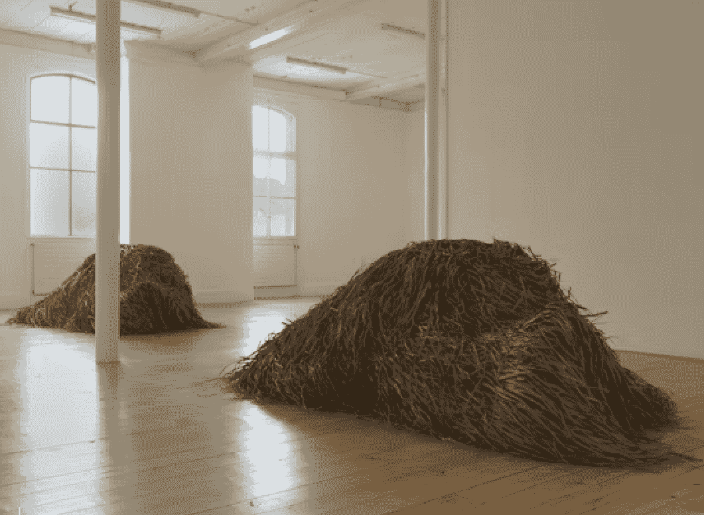
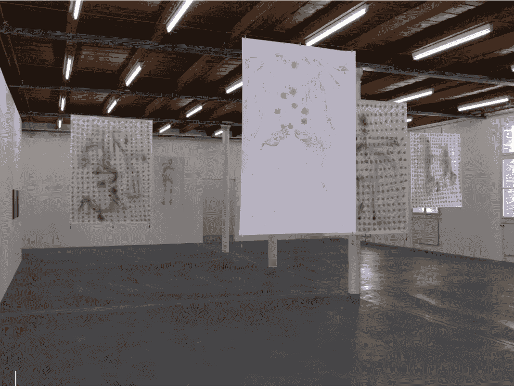
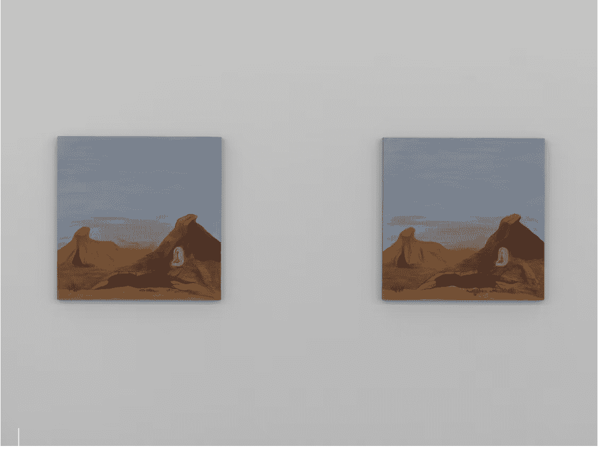

# 呼吸与断裂：Georgia Sagri 的 IASI ｜ Afterall

作者：Marina Vishmidt

评论家兼理论家 Marina Vishmidt 讨论了 Georgia Sagri 在 IASI 实践中的自我关怀与恢复，特别关注这种特定疗愈实践在概念和物质上的轨迹，以及此类治疗方法向手势语言的转化。

在他人遇到墙壁或大山的地方，在那里也看到了一条路。……没有任何时刻能预知下一刻会带来什么。他将其化为废墟——不是为了废墟，而是为了那条穿行其中的路。01

她正在破门。她没有谈论此。02

Georgia Sagri 作品的跨度及其涉及的内容是巨大的，而且根据分析其时采用的标准来说，初看之下是无法穷尽的。因此，本文将主要关注今年夏天在 Kunstthalle Friart 举办的展览《Case_L》。03 该展览不同于近期其他项目（如 2020 年底在 Mimosa house 举办的“IASI”，或她参加秋季在 Gropius Bau 举办的“YOY!! 关怀、修复、治愈”），它并非采取一种一对一的引导式躯体疗法形式，而是她一直在开发的 IASI（恢复）实践的一种多模式、综合性的选集，包含了绘画、素描、雕塑、现场表演以及一个平行计划。这引入了一种观点：通过“恢复”来尝试治愈，这不仅是一个目标（被 Sagri 叙述为她调和表演作品与政治参与对其整体生活的艰辛影响的经验），更是一个概念框架、一种世界观和一种审美，被艺术家构想为“感官的教育”，以及身体向心理生理恢复和政治反抗的激活。

Friart 的作品的一个引人注目的特征是，观众将其同时视为一个物体和一条通道，这引发了 Sagri 在其近期作品集中所认同的“精神无政府主义”，并与引言中引用的沃尔特·本明那篇短小格言式的文章产生共鸣。这在 Friart 汇集的作品中是如何具体展开的？04 在此之外，或者确切地说，还有另一个问题：在艺术语境内执行的 IASI 作品之间有怎样的关系？这种实践及其多次迭代，与其他在治疗空间内运作的类似方法（或类似技术）治疗方法有何区别？也许在尝试回答之前，需要转过身来看——如果这种实践是使其成为可能的先决条件，而其出现和执行的所有审美及概念理性都应从这种前提性中寻求呢？换句话之，这里的重点可能不在于辨析为什么疗愈实践在艺术机构语境内及其他地方展开，而在于表演性实践以及政治参与如何折叠进其（人的、躯体的）可能性的前提中，并成为艺术领域中的手势；条件如何被遮蔽“物体”并取代它——即便这种实践在同时也在其他地方持续发展。这个问题，无论从哪个重要方向来看都是至关重要的，但它并非《Case_L》的焦点；该展览似乎更感兴趣特定疗愈实践的概念和物质轨迹，或其向手势语言的转化，而非此类实践被置于艺术语境中的具身位移。

这种位移通过每件作品以其自己的方式实现。《避难所》（Shelter Refuge, 2022）既指的是持续全天的表演，也指的是由水葫芦和其他草编织而成的巨大、凸形避难所（Shelter_Refuge I; Shelter_Refuge II, 2022），它们位于楼上空间，为 Sagri 在空间中的移动、偶尔出现的合作者的移动，以及在房间边缘跟随行动的观众提供了焦点。05 它们提供了物体与通道之间双重曝光最清晰的象征——一种叠加，而非摇摆——在作为雕塑存在的同时，进行表演，并作为 Sagri 活动穿过的隧道或环绕其流动的障碍。在这些活动包含发声期间，它们变成了歌唱之洞，因为她在空间的每个位置都并非可见的。Sagri 脱掉衣服，水平地进入和离开舱体不可避免地引发了出生与死亡，这两种创伤性通道的类隐喻维度在表演实践和治疗形式中均反复出现——涌现与消灭权力的演练通过形式化或包容得到了保障。这种作为通道的“生成物体化”从另一侧得到了 Sagri 对表演作为媒介的理解的补充，这种理解既是在物质的意义上，也是在引导的意义上，它从根本上改变了身体的功能，开启了与表征的新关系。06 尽管这种对媒介的使用可以很容易联系到治疗（或其一种神秘化的版本——例如对力量的引导），但在 Sagri 的概念中，关键元素是身体作为社会、结构和非人格力量的冷凝器和放大器。这种贯穿表演与治疗的概念是：身体作为这些力量可以被揭示、外化的基础材料。这重新定义集体生成的政治，这种重新定义能够运作。通过其艰辛的、循环的时间性，这项作品强调了奇观。由于没有人能完整观看表演，它在自我身上做了一个切口，产生了一种待消费的体验。像劳动的身体一样，它是由时间来衡量的，即流逝的时间；而在“壳-茧-冰室”中的类比与其并存且独立的物体，本身就是劳动的产物。

疗愈过程作为其能产生的、不可控的情感和能量浓缩的形式化，在底层发生了另一个转折：在那里，一个占据房间的绘画装置（全部产于 2020 年）由几幅 IASASI 绘画组成，以横幅的形式悬挂在天花板上。这些是近期及未来实例中以一对一相遇形式——实际上在一个名为“恢复阶段”（Stage of Recovery）的抬台上——采取的实践的公开记录。在这里，大型多媒体绘画最初看起来像身体印记，填充的线条和点可以被视为编码的轨迹，或特定运动的结果。这些视觉-物质元素是 Sagri 在进行 IASI 时开发的方法的典型特征，该方法基于：找到身体上感到伤害或疼痛的位置，然后在呼吸或运动中找到一种方法来解决它。这是形式化的一个层面，可以被认为是表演性的，而绘画是另一个层面，并反作用于治疗过程——表征性的。课程日期、时间和症状在绘画标题中注明。所有这些都源于《Case_L》，这也是其命名的由来；一次与经历急性恐恐发作的人的遭遇。这些作品，与其表演、雕塑以及我将要介绍的房间绘画，在其作为医疗笔记、表演分谱和“自主”绘画的各种本体论中，在其作为记录（在另一个时间和地点发生的事件）的混合存在中，似乎记录了 Sagri 从这种不断演变的疗愈实践中产生的张力，这种张力源于激进的反资本主义和反父制世界观的躯体化和外化，以及多年关怀话语逐渐占据当代艺术体系的许多角落。我们见证了机构关怀、自我关怀、关怀政治，以及它们在主题上（在计划上较少）多或少具体的采纳。对于 Sagri 和 IASI 而言，对恢复的强调在于将其整合到一种拒绝终身和解的实践中。这需要一种对体验整体的视角，在这种视角中，复制社会和生物生命的需要无法与对毒性影响的饱和分离来。这是一种治疗方法，既关注系统生态学，也关注生存政治。

那个世界。这种系统性的、或社会性的生态学，可以说也描述了近期艺术领域对“关怀”辩论的参与。无疑，从今年的到此前提到的“YOYI!”艺术节——其策展概念为“否定”以及“延续”治愈观念留出了空间——此类项目都要求对其物质条件以及通过艺术手段对其构建或翻译的意义进行审慎且结合语境的关注。然而，这种理解已经体现在萨格里（Sagri）的愿景中，即将身体视为“在变化的动量中、在不同行为和动作的加速与加速之间发展的复杂关系序列”，这引用了吉尔·德勒兹对斯宾诺莎的分析。⁸ 因此，文中强调了呼吸、声音和运动，以突破图像身体和表演身体的窒息感，这些身体构成了我们所有人工作的资本主义世界中“生存”那不可逃避的现实主义。在这里，用“破门”而不是谈论它似乎更为恰当。敲门是对权力的精疲力竭的诉求；破门意味着进入另一个由（个人的、集体的）运动塑造的景观，这种运动从寻找你的身体运动和生活的新方式开始。

那么，以景观作为结束。放置在素描周围墙壁上的六幅神秘的、较小的蛋彩画——《清晨、凉爽通道、洞穴、管风（左侧）；清晨、凉爽通道、洞穴、管风（右侧）；午后、通道、洞穴、温暖管风（左侧）；午后、通道、洞穴、温暖管风（右侧）；潮湿之夜、通道、冷洞穴、管风（左侧）；潮湿之夜、通道、冷洞穴、管风（右侧）均为2022年——根据太阳在一天内穿越空间的移动排列，描绘了身体的想象，并形成了一种至少对于这种西方作品而言让人想起东正教圣像的形式。由于尺寸和材料，但也由于类型小说的语言风格，一整天洞穴那种诡异且无处依附的情绪（有时有人影，有时没有），让我开始想象一种治疗过程，在这个过程中，我的目光并没有游离到医生办公室墙上通用的印刷品上，而是治疗的一部分是在一个既是我的内部也是我的环境的地物理场域中进行理解。09 本杰雅明的另一段文字，摘自梦梦记：“我发现自己站在一张地图前，同时也站在它所描绘的景观中。景观是可怕地阴郁和荒凉的；我无法说那种荒凉是岩石荒野，还是在一个充斥着大写字母的空旷灰色地上。这些字母在地形上书写并弯曲，仿佛在追随山脉；……我知道或得知我正处在我听耳道的迷宫中。但这张地图同时也是地狱的地图”：10

