# Linux 和 Apache Web 服务器构建指南


# 关于作者

Stuart Langridge 自 1997 年起就是 `Linux` 用户，很可能是世界上唯一同时拥有计算机科学和哲学学士学位的人。他还是 `LugRadio` 团队的成员，这是全球领先的自由和开源软件广播节目。他是自由软件的坚定倡导者，将其伦理视为自己的行为准则，并认为你也应该这样做。当他不摆弄电脑时，他是一名信息架构师、`SitePoint`《使用 JavaScript & DOM 的现代 Web 设计》一书的作者，以及精酿啤酒的设计师。

Tyler-Dennison 是 `Rockwell Collins, Inc.` 的系统工程师，负责为航空公司设计航空电子和客舱数据服务器。他还是 `Road-house Podcast` 的成员，该节目被称为“你从未听过的最棒蓝调”。

# 关于专家评审员

Stephen Pierchala 目前是 `Gomez, Inc.` 的高级性能分析师，同时担任 `WebPerformance` 的首席性能推广官以及 `GrabPERF` 性能监控系统的主要开发者。自 1994 年以来，他一直积极从事、支持并分析互联网技术的数据。他出生于加拿大（倾向于此），自 1999 年起住在美国。Stephen 住在马萨诸塞州的马尔伯勒，与他的妻子 Samantha 以及两个儿子 Cameron 和 Kinnear 生活在一起。

# 关于技术总监

作为 `SitePoint` 的技术总监，Kevin Yank 监督他所有的技术出版物——书籍、文章、通讯快和博客。他为 `SitePoint` 写了超过 50 篇文章，但因其著作《使用 PHP & MySQL 构建你自己的数据库驱动网站》而闻名。Kevin 住在澳大利亚墨尔本，喜欢表演即兴喜剧剧和驾驶轻型飞机。

# 关于 SitePoint

`SitePoint` 专门为 Web 专业人士出版有趣、实用且易于理解的内容。访问 `http://www.sitepoint.com/` 访问我们的书籍、通讯快、文章和社区论坛。

> 献给 Niamh，总有一天你会知道这本书是关于什么的

Stuart

> 献给我的女儿们，当我闭关写作时我很少见到她们，当我脾气不好且赶赶截止日期时，她们付出了最大的耐心。

Tony

## 使用 Linux Apache 构建你自己的 Web 服务器

## 4. 系统管理 ................................................................... 103

## 5. 构建服务器 ................................................................................................................ 157

## 6. 服务器管理 ................................................................................................... 197

## 7. 远程管理 .......................................................................................... 229

# 使用 Linux 和 Apache 构建你自己的 Web 服务器

8. 定期管理 ........................................................................ 253

9. 服务器安全 ................................................................................... 267

# A.命令行参考 ................................................................... 299

B. 故障排除 ................................................................................... 311

# 引言

每天都有越来越多的组织将 `Linux` 安装到他们的机房中。原因各异，但那些切换到 `Linux` 的人通常声称，其可靠性、成本、选择、可扩展性以及从供应商锁定的自由，是他们决定切换的原因之一。但是，无论你选择 `Linux` 的原因是什么，作为系统管理员，你都需要知道如何处理这些新服务器。

本书将为你提供构建、配置和维护运行 `LAMP`（`Linux`、`Apache`、`MySQL` 和 `PHP`）开源 Web 应用程序平台所需的知识。

在这些页面中，我们将向你展示如何构建服务器，并帮助你决定哪种发行版的 `Linux` 适合你的情况。你将学习如何设置 `Apache` 提供网站服务，如何使用 `MySQL` 存储数据，以及使用 `PHP` 构建 Web 应用程序。你还将发现如何保护你的新 `LAMP` 服务器，以及如何在现场和远程访问并控制它的最佳方法。

构建和维护 `Linux` 服务器以及向其部署 Web 应用程序所需的所有内容都包含在本章节中。祝阅读愉快！

## 谁应该读这本书？

如果你知道当系统管理员是什么感觉，但并不熟悉 `Linux`，那么这本书就是适合你的。

如果你目前正在考虑在公司试运行用引入 `Linux`——也许是为了运行一些网站，或者因为你的开发团队一直催促你让他们使用 `Apache`——本书将为你成功构建 `Linux` 服务器并保持其运行所需的基础知识。

你和你的组织可以享受符合开放标准的免费操作系统和工具的稳定性和易用性。本书将向你如何做到。

## 本书中包含什么？

# 第 1 章：构建 Linux 环境

我们从讨论 `Linux` 是什么开始，并看看设置我们选择的 `Linux` 服务器是多么简单。在决定安装哪种发行版的 `Linux` 之前，我将带你回顾所需的硬件。在做此决定时，我们将探索各种替代方案，我将提供一些关于如何确保做出正确决策的提示。在本章结束时，你将已经在服务器上成功安装了 `Linux`。

# 第 2 章：日常使用

本章解释了如何日常运行和管理你的 `Linux` 服务器。特别是，我们将讨论 `Linux` 和 `Windows` 系统之间的关键区别。你将对基础知识建立坚固的理解，包括文件系统和布局。

# 第 3 章：命令行

命令行是 `Linux` 最强大的方面之一。虽然使用 `Linux` 的图形化工具非常简单——这些工具允许我们实现大部分目标——但命令行为我们对系统提供了更额外的控制水平。在本章中，我们将识别这些额外能力，并讨论命令行相对于图形用户界面（`GUI`）的优势。

# 第 4 章：系统管理

`Linux` 系统管理员必须熟练创建新用户、调度无人运行的任务，并熟悉服务和运行级别（`runlevels`）等概念。在本章中，我们将通过 `Linux` 系统管理员之旅来讨论这些内容。

# 第 5 章：构建服务器

现在是时候将我们的 `Linux` 转换为 `LAMP` 服务器了，我们将安装 `Apache`、`MySQL` 和 `PHP`。我们将探索 `Apache` 本身的基础知识、它的工作原理以及它如何融入环境，包括为网站提供的 `SSL` 安全。

# 第 6 章：服务器管理

本章重点介绍一组帮助你配置服务器的实用工具。特别是，我们将讨论 `Webmin`（它通过 Web 配置服务）和 `yum`（它帮助进行安装）。

### 第 7 章：远程管理

远程管理让系统管理员的工作变得更加简单。在本章中，我们将熟悉 `SSH`（安全外壳，它允许跨网络对服务器进行命令行访问）以及 `VNC`（它允许你访问服务器的 `GUI`）。我们将讨论在特定情况下最适合哪些工具，并查看 `SSH` 提供的额外功能。

### 第 8 章：定期管理

这涵盖了你可能需要设置并偶尔调整的系统元素。在介绍备份工具之后，我们将设置流量报告，这将帮助我们理解访问服务器的流量。我们还将查看系统创建的日志文件，并讨论如何使用这些日志跟踪管理服务器使用、识别错误等。

# 第 9 章：服务器安全

安全是运行任何服务器的关键方面，但对于那些提供互联网服务的特别为重要。在本章中，我们将在 `LAMP` 服务器上设置防火墙，并将入侵检测服务作为识别远程破解尝试的手段。我们还会遇到 `Tripwire`，防止恶意用户在设法获得访问后破坏服务器的安全系统。

## A. 命令行参考

在我们逐步设置服务器的过程中，你将接触许多强大的命令行工具。本附录列出了这些用工具，以及用于自定义行为的某些选项。

## B. 故障排除

我们的之旅以故障排除和常见问题解答（`FAQ`）部分结束，该部分提供了关于 `Linux`、`Apache` 以及你可能安装的其他工具的常见问题的答案。

## Linux 与发行版

从非常技术的角度来看，`Linux` 只是操作系统内核：你软件中最底层、直接与硬件通信的部分。所有其他程序——图形用户界面、`Apache` Web 服务器、`MySQL`—

# 引言

屏幕顶部的菜单——它们都是独立的开源程序，由不同的开发者团队编写，并在不同的时间发布。虽然可以利用这些零散的组件构建出你自己的 `Linux` 系统，但这是一项漫长且复杂的工作。相反，各种团体和公司已经承担了提供 `Linux` 发行版（有时缩写为 `distro`）的角色：他们收集你所需的所有软件部分，确保它们能够正确匹配，并一次性全部提供给你。`Linux` 发行版非常非常多。有些发行版具有特殊用途：例如，发行者确保该发行版包含了适用于音乐家、医护人员或安全分析师的软件；或者该发行版被设计为直接从 `CD` 或 `USB` 驱动器运行，或者在没有图形界面的情况下运行。不过，大多数版本都是通用的：它们的设计旨在涵盖所有领域。

# 通用发行版

一些受欢迎的发行版包括 `Debian`、`Canonical` 的 `Ubuntu Linux`、`Novell` 的 `SuSE Linux Desktop`、`Knappix`、`Linsetpos` 以及 `Red Hat` 的 `Enterprise Linux` 和 `Fedora Core` 发行版。某些发行版包含专有软件并需要支付许可费；另一些则不需要。每种都有其优点和支持者。

`Debian` 拥有非常强大的自由软件理念，以及一个优秀的软件包管理系统（`apt`），大多数其他发行版都模拟了该系统。`Ubuntu Linux` 派自 `Debian`，但更关注于成为良好的桌面发行版。`Novell` 的 `SuSE Linux` 具有商业优势，混合了开源和专有工具；`Novell` 是 `Linux` 领域一个相对较新的参与者，而 `SuSE Linux` 已经存在一段时间了。`Red Hat Enterprise Linux` 也具有商业优势，且颜色倾向于桌面和服务器。`Red Hat Enterprise Linux` 的开发部分由充满社区精神的 `Fedora Core` 驱动。`Linsetpos` 侧重于家庭用户；像 `SuSE` 一样，它将开源工具与专有软件相结合，并面向桌面操作系统。`Knapp` 的不同之处在于，它并不是为了被安装和运行而设计的；相反，它通过所谓的“现场系统光盘”（`Live CD`）加载并完全从中运行。你只需放入 `CD` 并启动，即可获得运行中的 `Linux` 计算机的所有优势，而不会丢失或覆盖现有的系统或文件。它非常适合测试硬件，或者在不采取从头开始安装系统的最终尝试的情况下熟悉 `Linux` 环境。

# Fedora Core

在本书中，我们将关注来自 `Red Hat` 的 `Fedora Core 4`。`Fedora` 发行版非常新，因此你将拥有所有最新的工具，并拥有广泛的兼容软件组合。`Red Hat` 雇佣了许多著名的开源开发者来开发发行版，`Fedora` 享受了这些工作的益处，同时仍然保持开源并由社区维护。使用 `Fedora`，你可以享受这些益处：你可以在手尖拥有最强大、最现代的工具，同时使用可用的最流行的 `Linux` 发行版。

# 本书的网站

支持本书的网站位于 `http://www.sitepoint.com/books/linux1/`，它将为你提供以下功能。

# 代码存档

`Linux` 的较强大方面之一是可脚本的命令行。本书包含了一些脚本，帮助你开始学习 shell 脚本，可以从书籍的网站下载。

# 更新与错误列表

书籍网站上的错误列表（`Errata`）页面提供了有关已知排版错误和代码错误的最新信息，以及由于技术变化而所需的更新。

# SitePoint 论坛

我已尽力预测你可能提出的任何问题并在书中给出回答，但没有任何一本书能涵盖关于建立、运行和维护 `Linux` 服务器的所有知识。如果你对书中的任何内容有任何疑问，获取快速答案的最佳地点是 `http://www.sitepoint.com/forums/`——`SitePoint` 充满活力且知识渊的社区。

# 引言

## SitePoint 通讯报

除了这类书籍外，`SitePoint` 还提供免费的电子邮件通讯报。

`SitePoint Tech Times` 涵盖了 Web 开发所有技术方面的最新新闻、产品发布、趋势、技巧和技术。历史悠久的 `Site-Point Tribune` 是关于 Web 业务和赚钱方面的每双周摘要。无论你是一个寻找技巧以获得理想成本的自由职业开发人员，还是一个努力跟上市场搜索引擎变化的营销专业学生，这封通讯报都适合你。`SitePoint Design View` 是 Web 设计精选之事的每月汇编。从新的 `CSS` 布局方法到微妙的 `Photoshop` 技术，`SitePoint` 的首席设计师分享了他在这方面的多年经验。

你可以在 `http://www.sitepoint.com/newsletter/` 浏览存档或订阅 `SitePoint` 的任何免费通讯报。

## 你的反馈

如果你无法通过论坛找到你的答案，或者由于其他任何原因想与我联系，最佳书写地址是 `books@sitepoint.com`。我们建立了人员完备的邮件支持系统来跟踪你的查询，如果我们的支持人员无法回答你的问题，他们会直接发送给我。我们特别欢迎改进建议以及你可能发现的任何错误通知。

# 致谢

如果没有 `SitePoint` 团队，特别是 Stephen、Craig 和 Simon，这本书就不会是现在的样子。也要给 Ade 鼓掌，感谢他以典型的冷静且光头的风格应对了问题的轰炸。非常感谢，光头老兄。

灵感来自他们；错误完全由我承担。

# 1 构建 Linux 环境

安装 `Linux` 发行版可能既令人兴奋又令人沮丧。我两次安装 `Linux` 的尝试——第一次是 1996 年，第二次是 1997 年——都是失败的。一年后，`Windows` 仍然保留的唯一原因是我妻子对 `Linux` 不熟悉。由于她的计算需求是上网和读邮件，她最终也顺利地过渡到了 `Linux`。我将机器设置为双启动配置（包括 `Linux` 和 `Windows` 分区），尽可能少用 `Windows`。我们将在本章中详细讨论双启动选项。但在之前，重要的是进行一些初步研究，以帮助你解决任何问题，无论你是使用纯 `Linux` 系统还是双启动配置。

## 必要研究

缺乏硬件支持是非常令人沮丧的事情，尤其是当你使用 `Windows` 提供的安装程序时。事实上，`Windows` 自带了一套基础驱动程序，旨在适应连接的硬件。硬件制造商还会为显卡、网卡和扫描器等设备发布 `Windows` 驱动盘。开发这些驱动需要制造商花费大量资金，因此长期以来为 `Linux` 提供驱动并没有经济意义。

随着 `Linux` 在服务器市场获得份额，`Linux` 开发有了显著提高。存储设备、`RAID` 阵列、以太网卡——近年来都获得了越来越多的 `Linux` 开发。为了避免缺少驱动带来的头疼，在安装 `Linux` 发行版之前进行研究是重要的。虽然主流发行版不太可能出现问题，但你应该进行研究以避免任何硬件问题。

大多数发行版都会发布硬件兼容性列表。这些列表列出了与发行版内置驱动兼容的硬件。`Red Hat/Fedora`、`Mandriva` 和 `SuSE` 也为其发行版提供了硬件邮件列表。这些列表倾向于依靠用户在事后帮助解决硬件问题，而不是在安装前提供信息。

此外，还有一个 `Linux` 通用的优秀兼容性列表。它没有提供像厂商列表那样详细的粒度，因此它应该作为备选，而不是主要信息来源。

## Red Hat 兼容列表

`Red Hat` 的主要产品线是 `Red Hat Enterprise (RHEL)`，它主要基于 `Red Hat` 的免费软件发行版 `Fedora`。`Fedora` 并不由 `Red Hat` 维护；它由 `Fedora` 开发者社区维护。然而，`Red Hat` 在 `Fedora` 上做了大量工作，因为工作会流向 `RHEL`。

## 硬件兼容列表

`Red Hat` 的硬件目录（`Hardware Catalog`）并未从 `RHEL` 扩展到 `Fedora` 版本，您在访问 `Red Hat` 网站查找 `Fedora` 支持时，需要记住这一点。该列表提供了有关 `CPU`、显卡、`SCSI` 控制器、`IDE` 控制器、网卡、调制解调器声卡的信息。

## SuSE

`SuSE` 提供了两个列表：快速搜索（`Express Search`）和扩展搜索（`Extended Search`）。两者的区别在于扩展搜索提供了供应商（`Vendor`）、设备（`Device`）和类别（`Category`）之外的字段。在实践中，您只需要快速搜索。

## Mandriva Linux

`Mandriva Linux` 硬件兼容数据库是一份由 `Mandriva Linux` 社区测试过的非常全面的硬件列表。

## 通用 Linux

`Linux` 硬件兼容性 `HOWTO` 可能是所有高级 `Linux` 列表中最全面的一个。它始于 1997 年，每年更新大约两次。它提供了所有设备类型和所有主要制造商的信息。

除了提供有趣且实用的用户论坛外，`LinuxQuestions.org` 还提供了一个出色的 `Linux` 兼容硬件列表。这是所有高级 `Linux` 列表中最新的，在可行的情况下每天更新。虽然它没有 `HOWTO` 那样全面，但由于其及时性，`LinuxQuestions` 列表同样重要。

`Linux Compatible` 同时提供了更新的列表，以及用户可以在其中帮助他人解决现有有硬件问题的论坛。

> `http://bugzilla.redhat.com/hwcert/`


> 2 `http://hardwiredb.suse.de/searchForm.php?searchtype=simple&LANG=en_UK`
>
> 3 `http://hardwiredb.suse.de/searchForm.php?searchtype=extended&LANG=en_UK`
>
> 4 `http://www.mandrivinux.com/en/hardware.php3`
>
> 5 `http://www.biblio.org/pub/Linux/docs/HOWTO/other-formats/html_single/Hardware-HOWTO.html`
>
> 6 `http://www.linuxquestions.org/hcl/`
>
> 7 `http://www.linuxcompatible.org/`

# 第 1 章：构建 Linux 环境

## 安装发行版

一旦您完成了初步的硬件研究，就是时候熟悉安装过程了。我们将查看图形界面和文本界面安装程序，后者当您在资源有限的机器上安装 `Linux` 时非常有用。不要忘记，如果您的情况需要，您可以在服务器上安装不带桌面的 `Fedora Core`。无论何种情况，在将安装光盘放入计算机之前，仔细阅读以下章节都是一个好主意。

## 双启动选项

我们已经提到了服务器的双启动选项：在系统上同时运行 `Windows` 和 `Linux`。正如我提到的，当您适应 `Linux` 服务器的新功能和新选项时，这提供了一组极佳的“技术训练辅助轮”。接下来的安装说明对于双启动配置也同样适用。然而，在选择此选项时，有几个重要点需要记住。

- 如果您在新的机器上构建双启动服务器，请务必先安装并配置 `Windows`。默认情况下，`Windows` 不识别任何原生的 `Linux` 文件系统。如果安装了 `Linux`，第一个 `Windows` 引导程序将接管并加载 `Windows`；`Linux` 会在那里，但您将无法进入它。`Linux` 的安装将与 `Windows` 协作，允许您进入这两个系统。

- `Linux` 提供了一种读取 `FAT32`（通常用于 `Windows 98` 和 `ME`）或 `NTFS`（通常用于 `Windows NT`、`2000` 和 `XP`）文件系统的方法。对于 `FAT32`，您可以向 `Windows` 分区写入数据。如果您使用的是基于 `NTFS` 的 `Windows` 安装，`Windows` 分区上的文件将是只读的。

- 如果您在已包含 `Windows` 操作系统的系统上安装 `Linux`，购买一个无破坏性的分区管理工具（如 `Partition Magic`）可能会很有用。这将允许您移动 `Windows` 系统上的分区，为 `Linux` 安装腾出磁盘空间，并保留磁盘上已存在的数据。

> 8 尽管如此，有第三方工具允许 `Windows` 读取同一机器上 `Linux` 安装的驱动器，请查看 `http://pro.mount-everything.com/` 获取一个商业示例。
>
> 9 `http://www.symantec.com/partitionmagic/`

除了这些重要点外，安装双启动系统的过程与安装单操作系统是相同的。

## 图形化安装

有些人认为，`Linux` 的真正兴起始于图形化安装程序的出现。在此之前，安装是一项“无鼠标”事务，使用键盘方向键和空格键完成。`Red Hat`——基于 `Fedora` 构建的发行版——是图形化安装程序程的先驱。从那时起，创建者们继续完善和改进这一过程，结果是获得了一个非常简洁且易于遵循的安装程序。正如您将在本章后续内容中看到的截图所示，在新服务器上安装 `Fedora` 几乎是无痛的！

我为该过程的几乎每一个步骤都提供了截图。虽然步骤简单，但有几个步骤对于成功安装至关重要。希望后续讨论中丰富的截图能帮助您更好地理解安装过程。

## 获取安装光盘

获取 `Fedora Core` 安装光盘有两种主要方式：您可以从 `fedora.redhat.com/download/` 下载光盘并自己刻录，或者您可以购买它们。

安装光盘以一系列 `ISO` 镜像的形式下载，命名类似于 `FC4-i386-disc1.iso`（`FC4` 表示 `Core 4`，`i386` 表示适用于 `x86` 处理器，`disc1` 表示第一张光盘）。`ISO` 镜像是文件的副本，存储在单个文件中。一旦下载了镜像，您需要将它们刻录到光盘上。大多数刻录软件都提供刻录 `ISO` 镜像的选项⁰；如果有疑问，网上有各种刻录工具的使用说明¹¹，可以获取。²

> ⁰ 或者，如果您有 `DVD` 刻录机，且您计划安装 `Linux` 的机器具有 `DVD` 驱动器，您可以像刻录光盘一样将其刻录到 `DVD`（而不是光盘）。
>
> ¹ `http://snoekonline.com/iso.htm`
>
> ² 如果您的刻录软件无法刻录 `ISO` 镜像，`CDBurnerXP` [`http://www.cdburnerxp.se/`] 使用简单，且适用于所有版本的 `Windows`。

# 第 1 章：构建 Linux 环境

使用光盘运行 `Fedora` 会花费一点费用，但如果您没有宽带连接，这比下载镜像更快更方便（四张光盘总共 `2.5GB`）。您可以从多个供应商购买 `Fedora` 安装光盘，寻找这些供应商简单的方法是在网上搜索“廉价 `Linux` 光盘”，或询问当地的 `Linux` 用户组。如果是第一次运行 `Linux`，这可能是获取光盘的最佳方式。

## 安装

要开始安装，将第一张安装光盘放入 `CD-ROM` 驱动器并重启机器。如果您的机器配置为从 `CD-ROM` 启动，您将看到图 1.1 所示的界面。

初始安装提供了几个选项。可以通过按回键以图形模式安装，或在启动提示符输入 `linux` 以文本模式安装。无论何种方式，安装程序的第一工作都是提议检查安装介质。这是判断您的安装光盘是否被动过或损坏的好方法。这个过程将需要一段时间时间，但我建议您运行此测试。

# 图 1.1. Fedora 初始安装界面。

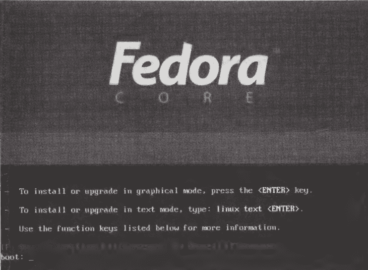

- 若要在图形模式下安装或升级，请按 `<ENTER>` 键。

- 若要在文本模式下安装或升级，请输入：`linux text <ENTER>`。

- 使用下方列出的功能键以获取更多信息。

# 第 1 章：构建 Linux 环境

## 选择您的语言

图 1.2. 选择安装语言。

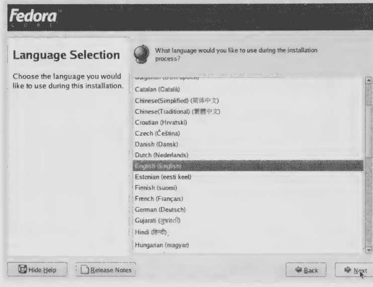

`Fedora` 真正是一个国际化的操作系统：安装界面提供超过 `30` 种语言。在图 1.2 所示的语言选择界面中选择您的母语，并点击“下一步”。

# 图 1.3. 选择键盘布局。

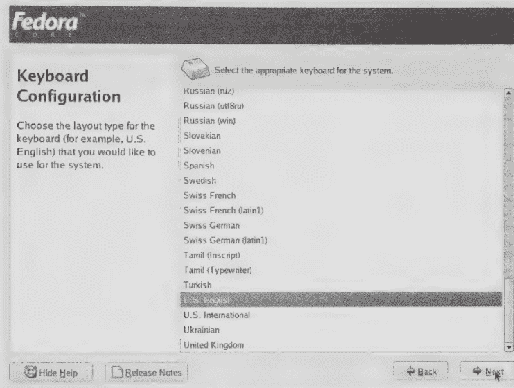

`Fedora` 可用的键盘语言数量与通过安装界面提供的语言数量相似。在图 1.3 所示的界面中选择您的键盘语言。

`Fedora` 安装程序提供两种分区方法——自动和手动——如图 1.5 所示。

# 图 1.5. 选择分区方法。

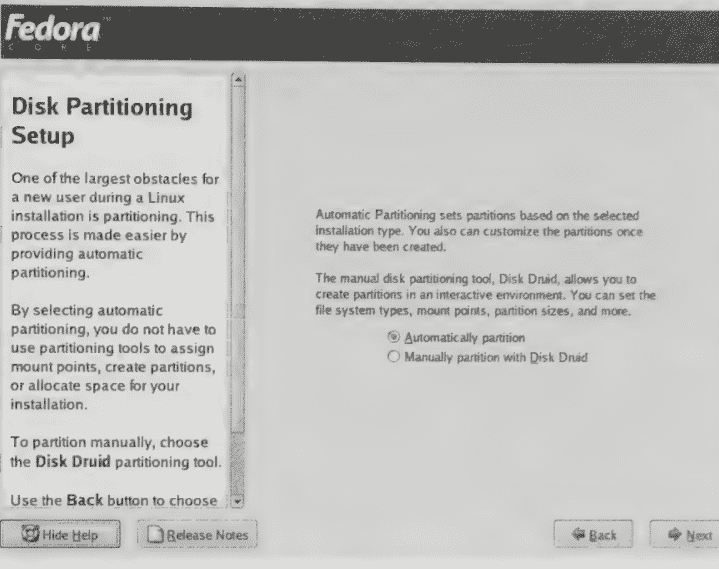

自动分区会创建三个分区：

- `/boot` 分区是内核的家园：`Linux` 核心位置的程序。`Fedora` 建议 `/boot` 分区不于 `100MB`，尽管你很少需要这么多空间。

- `swap` 分区（交换分区）在所有系统内存都被用尽时作为内存的备用。

- `/` 分区包含所有不在其独立分区中的内容。

## 什么，没有盘器号？

`Linux` 分区的显示方式与 `Windows` 不同。`Linux` 分区不使用像 `C:` 这样的盘器号标识，你可能已经习惯了这种。`Linux` 上的主分区标记为 `/`（稍后我们将看到它是如何融入整体分区布局的）。系统中其他常见的分区包括 `/boot`（包含内核和引导加载程序）、`/home`（包含用户特定文件）和 `/var`（包含程序配置和变量数据）。这些标签被称为挂载点，我们将在第 4 章中进一步讨论它们。

可以组织您的系统使其分布在多个分区上；例如，将 `/var`（数据存储在此处，包括 `MySQL` 数据库和网站等内容）放在单独的分区上是非常常见的。然而，自动分区让事情变得更简单，将数据分布在不同分区上并没产生多大效果。某些管理员强烈建议这样做，但 `Fedora` 救援光盘（也可以从 `Fedora` 网站下载 `ISO` 镜像）将帮助你避免大多数过去可能由于将数据划分到不同分区而产生或缓解的问题。因此，默认的分区设置通常足够了。

## 使用 Disk Druid

`Fedora` 还提供了 `Disk Druid`，这是一种图形化分区工具。如果你倾向于使用默认以外的方案，则需要在安装过程中使用 `Disk Druid`。`Disk Druid` 以你机器上分区表的图形化和文本化形式进行展示。要选择分区，请点击图形驱动器表示（如图 1.6 所示）或文本化表示。无论哪种情况，你都可以通过点击相应的工具栏按钮来添加、编辑或删除分区。

如果你要安装 `Linux` 的系统之前安装过 `Windows`（或其他操作系统），你可能想要手动删除包含 `Windows` 的分区。此外，如果你没有看到任何标记为“剩余”的空间，你可能需要删除包含 `Windows` 的分区。为了实现这一点，请在屏幕顶部的图中选择选择要删除的分区，并点击“删除”按钮。

## 删除分区


一旦删除了分区，就无法找回数据，请小心操作！

> ¹³ 这样的话没有简单的方法可以找回。
>
> ¹³ 这样的话，高级恢复工具是可用的。

# 图 1.6. Disk Druid 工具。

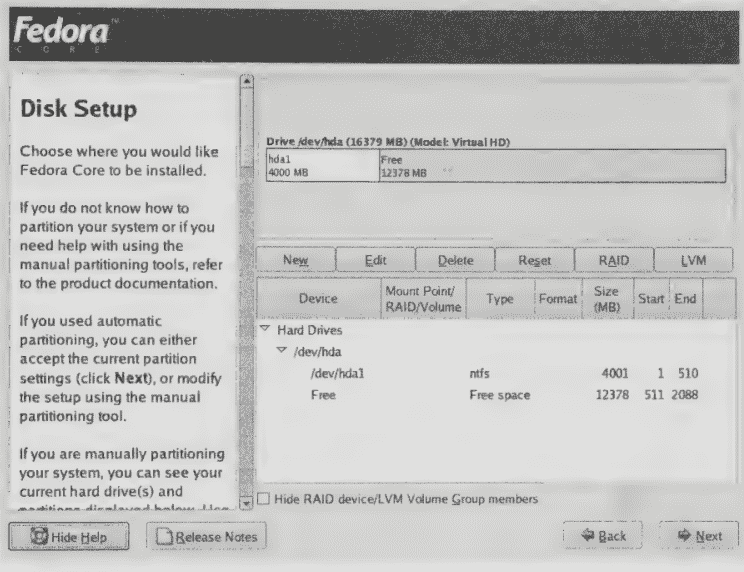

## 纠正删除

如果你意外删除了分区或犯了某些错误，可以通过点击“重置”按钮将其恢复到初始状态。对分区的更改在稍后才会生效。

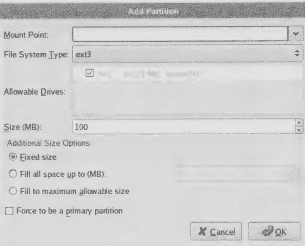

点击“新建”按钮打开分区对话框。在这里你可以指定挂载点、文件类型以及大小（`MB`）。

# 图 1.7. 添加分区。

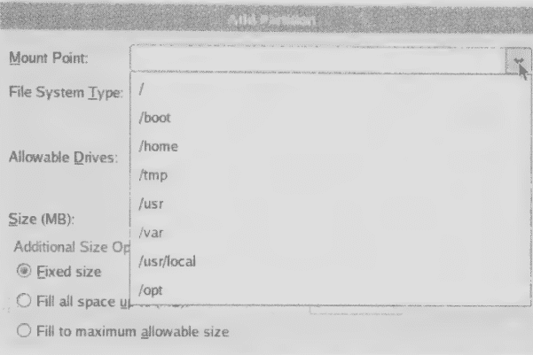

如果你在不创建交换分区的情况下继续通过设置界面，将收到图 1.8 所示的警告。`Linux` 中的交换分区的作用与 `Windows` 中的虚拟内存非常相似：当系统内存满时，部分数据会被写入交换分区。当需要这些数据时，它们会被读回内存。要创建交换分区，请点击“添加”并选择“文件类型”。

# 图 1.8. 选择挂载点。

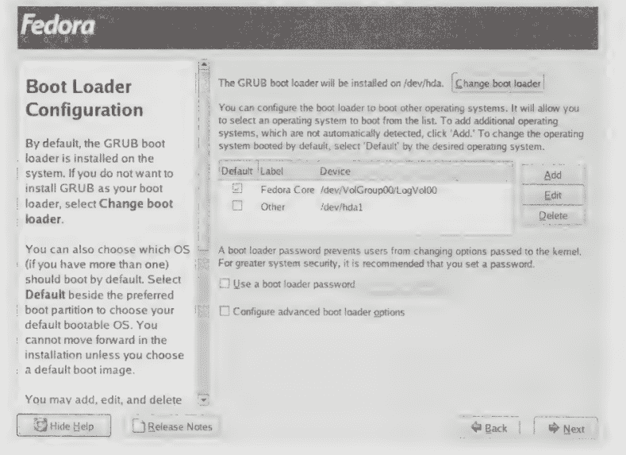

挂载点下拉菜单将显示所有可用的挂载点，如图 1.9 所示。对于管理员来说，可以手动配置这些挂载点。

# 图 1.9. 交换警告。

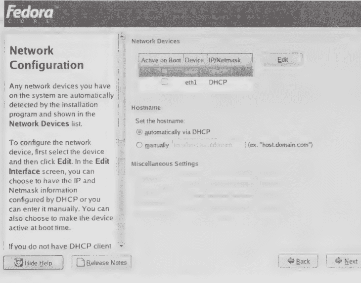

# 第 1 章：构建 Linux 环境

> **提示** 在 `Linux` 上创建交换空间时，一个通用的规则是创建物理内存大小的一半。例如，如果你有 `1GB` 的物理内存，请创建一个 `1.5GB` 的交换分区。

## GRUB 引导加载程序

如果你决定采用双系统安装，你需要设置 `GRUB` 引导加载程序。`GRUB` 是一个可以让你从已安装操作系统列表中选择的程序。如图 1.10 所示，它的设置非常简单。注意，你应该设置引导加载程序密码，以防止未经授权的用户访问内核启动参数。

# 图 1.10. 配置 GRUB。

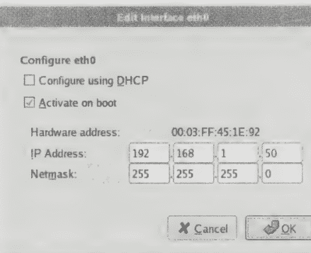

## 网络

在你设置好所有分区后，将提供图 1.11 所示的网络选项。机器上的以太网卡将以 `ethn` 标识；如果机器只有一张网卡，它将被称为 `eth0`。默认配置将如图 1.11 所示。第一个网络连接（通常是 `eth0`）将处于激活状态，并由 `DHCP` 自动配置。¹⁴ 如果机器位于内部网络，你可能可以保持默认设置。对于直接连接到互联网的 `Web` 服务器，你需要手动配置静态 `IP` 地址以及手动配置网关、`DNS` 和主机名。

# 图 1.11. 配置 Fedora 的网络选项。

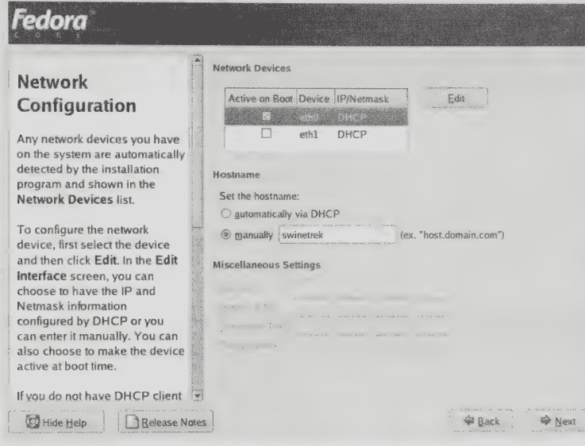

¹⁴ 动态主机配置协议（`DHCP`）将被用于自动检测你的网络设置，以便你连接到互联网或私有网络。

## 第一章：构建 Linux 环境

### 图 1.12.手动配置以太网接口。


在网络配置屏幕上点击“编辑”按钮，将显示如图 1.12 所示的“编辑界面”窗口。在这里，你可以进行自定义配置调整，例如为服务器分配静态 `IP` 地址。

当从上一个界面完成网络设备设置后，你就可以自由配置主机名、网关和 `DNS` 设置。图 1.13 显示了一个主要用于内部使用的网络设备配置。

### 图 1.13. 手动配置的网络接口。


## 网络安全

### 图 1.14.设置服务器安全选项。

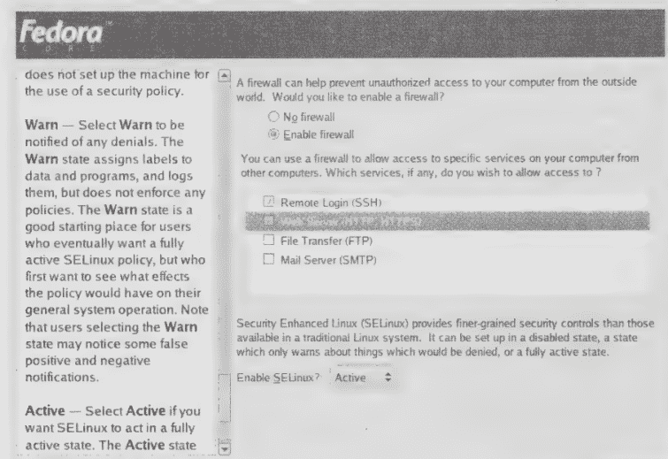

`Fedora` 发行版以及许多其他 `Linux` 发行版都努力让网络安全配置尽可能简单。默认情况下，`Fedora` 运行的防火墙会阻止所有来自网络的入站流量。要自定义防火墙，只需选择你想在此机器上运行的服务；或者，你也可以禁用防火墙，这将机器处于开放状态并容易受到黑客攻击。你还可以选择启用安全增强型 `Linux` (`SELinux`)，它可以在黑客获取系统部分控制权时帮助减少任何损害。请注意，`SELinux` 不应被视为防火墙的替代品——无论是防火墙还是 `SELinux` 都无法让你的系统完全安全，因此最好同时启用两者。根据你的需求，你应该只通过防火墙允许远程登录和 `Web` 服务器流量，并将“启用 `SELinux`”设置为“激活”，如图 1.14 所示。第 9 章将详细介绍安全内容。

## Telnet 和 FTP 安全

尽管它们在 `Fedora` 安全配置屏幕中显示为选项，但 `telnet` 和 `FTP` 都被广泛认为是不安全的协议。对于访问远程机器，`SSH` 是比 `telnet` 安全得多的选项；对于传输文件，`SFTP` 是比 `FTP` 更安全的选项。如果需要 `SFTP` 功能，建议将其设置在部与网络其他部分尽可能隔离的独立服务器上。

## 设置时区

`Fedora` 为你的服务器提供了两种设置时区的选项。你可以将鼠标移动到距离你最近的城市区域，也可以选择详尽的城市列表。无论哪种情况，所选城市都将在地图上高亮，如图 1.15 所示。

### 图 1.15. 设置时区。

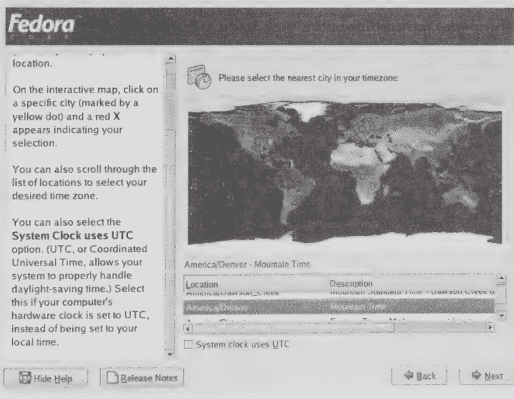

## 设置 Root 用户

所有 `Linux` 系统都有一个管理员账户，`root`。该账户拥有访问计算机上所有内容的权限；它类似于 `Windows` 系统中的管理员账户。由于 `Linux root` 的权限非常广泛，因此让访问 `root` 账户变得尽可能困难至关重要。为 `root` 账户选择一个安全的密码——一个包含大小写字母、数字和特殊字符的密码——并如图 1.16 所示输入到字段中。我建议你将 `root` 密码记录在某处并妥善保存：如果忘记了密码，一旦出现问题，访问你的机器将非常困难。

### 图 1.16. 设置 root 密码。

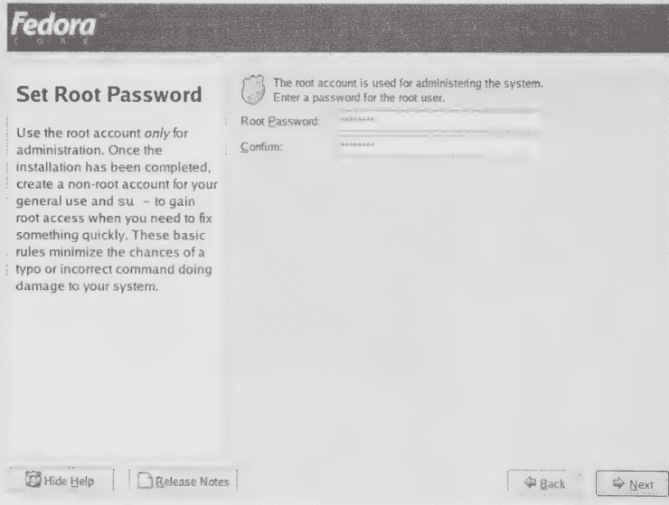

## 安装软件包

在此之前，当你被要求选择安装类型时（你从个人桌面、工作站、服务器或自定义中进行了选择），你的选择决定了哪些软件包组在当前屏幕中可用。对于你的服务器安装，你将看到作为 `Fedora` 发行版提供的完整服务器软件范围，并带了一些额外的奖励。通过点击相应的复选框来选择你想要安装的每个软件包组，如图 1.17 所示。

### 图 1.17. 选择软件包组。

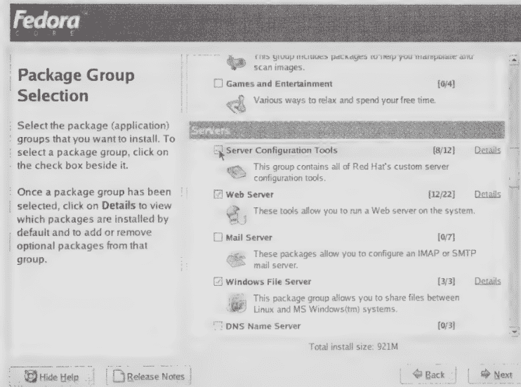

选择你想安装的软件包（应用程序）组。要选择某个软件包组，点击其旁边的复选框。

一旦选择了某个软件包组，点击“详细信息”可以查看默认安装了哪些软件包，并从该组中添加或删除可选软件包。

### 图 1.18. 细化软件包选择。


选择要安装的可选软件包：

每个软件包组包含软件包；你可以看到这些软件包的列表（类似于图 1.18 所示）。

# 第1章：构建Linux环境

开发工具（`Development Tools`）包组提供了从源代码构建包所需的各种工具。安装这些工具是一个好主意，尽管你可能无法立即看出它们将如何被使用。

管理工具（`Administration Tools`）包组提供了由 `Red Hat` 开发的用于服务器管理和配置的全套工具。你应该安装所有这些工具，因为它们将帮助你按照所选择的方式配置系统。这里有一些为经验丰富的管理员设计的替代命令行工具，而图形化工具对于那些没有 `Linux` 系统管理经验的人来说更易使用。

系统工具（`System Tools`）包组包含了各种实用工具，允许你监控服务器的流量、连接到 `VNC` 和 `Windows Terminal` 服务器等。

如你所见，`Fedora Core` 提供了大量的软件包。该安装程序提供了一系列软件工具，用于构建、配置和管理你的 `Web` 服务器。由于预算限制导致你的 `Web` 服务器需要承担比单一用途的任务的情况并不罕见；如果你受到此类限制，你会发现 `Fedora` 工具变得更加有用。

## 更多信息，请查看

正如你可能在上面的系列屏幕中注意到的，通过左窗格下方的“发行说明”（`Release Notes`）按钮可以获取更多信息。该窗格还作为一个帮助屏幕，为每个选定的安装包提供特定细节。与“软件包详情”屏幕中的简短软件包描述类似，此窗格在你安装 `Linux` 系统时提供了学习该系统的极佳资源。帮助屏幕提供的详细信息比摘要要多得多。


## “正在安装，请稍候...”

软件包选择完成后，你已经完成了 Fedora Linux 安装中最繁重的工作。剩余部分将由安装程序本身完成：使用你创建的分区格式化硬盘、安装你所选择的每个包，并对每个包进行依赖关系检查。

安装服务器的过程将让你领略到 RPM 软件包管理器¹⁶（RPM）系统的强大；`RPM` 是一种用于分发软件的格式，被用于 `Fedora Core` 以及 `SuSE` 和 `Mandriva Linux` 等其他 Linux 发行版。你服务器的安装将以一系列 `RPM` 事务的形式进行，这些事务会检查依赖关系并安装每个选定的软件。

## 揭秘依赖关系

几乎所有的计算机软件都依赖于其他软件。一个简单而显而易见的例子是，运行在你新服务器上的任何软件都将依赖 `Linux`。这种关系被称为依赖关系。依赖关系的产生源模块化软件设计哲学，或从其他较小的程序构建大型程序。`RPM` 会调查并处理这些依赖关系，检查依赖代码是否存在，并记录那些可能缺失的部分。

现在是时候泡杯好咖啡了：安装你的 `Fedora Linux` 系统可能需要 45 分钟，具体取决于你机器的速度。在安装过程中，你会被多次要求插入额外的 `CD-ROM`，安装完成后，系统将提示重启机器。你的新服务器将启动并显示一个包含 Linux 发行版信息和内核版本的屏幕。

请注意，如果你设置了双启动系统，在引导加载程序自动启动默认操作系统之前会有一个倒计时。倒计时时间可以通过引导加载程序配置进行调整。这对于生产 Web 服务器可能非常重要：如果系统宕机，你可能希望机器尽可能地返回网络。

¹⁶ `RPM` 原是 `Red Hat Package Manager`（红帽软件包管理器）的缩写，但在被 `Red Hat` 之外广泛使用时，被正式改为递归缩写。其他递归缩写的例子还有 `PHP`（`PHP 超级文本预处理器`）和 `GNU`（`GNU 不是 Unix`）。

## 最后步骤

**图 1.19. 设置代理（Setup Agent）的欢迎屏幕。**


主安装完成后，只剩下几项清理工作。你的 `Fedora` 服务器将引导加载驱动程序，然后向你展示**设置代理（Setup Agent）**：一套在系统安装后用于配置系统的工具。使用此类工具已成为 Linux 发行版中的常用方法，`SuSE` 提供 `YaST2` 工具，而 `Mandriva` 则利用 `SetupDrak`。你将看到设置代理的欢迎屏幕（如图 1.19 所示），随后是许可协议。一旦你表示同意许可，将进入配置屏幕。

日期和时间配置屏幕提供两个标签页：“日期与时间”（`Date & Time`）和“网络时间协议”（`Network Time Protocol`）。第一个标签页允许你确认系统时钟是否准确。第二个标签页提供了配置网络时间协议（`NTP`）软件的能力，可以用于将你的系统时钟与权威源同步。在屏幕中选择“启用网络时间协议”（如图 1.20 所示），将启用 `NTP` 守护进程——这是一个在后台运行的程序，定期将你的系统时间与 `NTP` 服务器返回的时间进行对比。这些服务器中的几个列在“服务器”下拉列表中.¹⁷ 如果启用了 `NTP` 并选择了服务器，守护进程将启动，在进入下一个设置代理屏幕之前会检查选定的服务器。

### 图 1.20. 网络时间协议标签页。

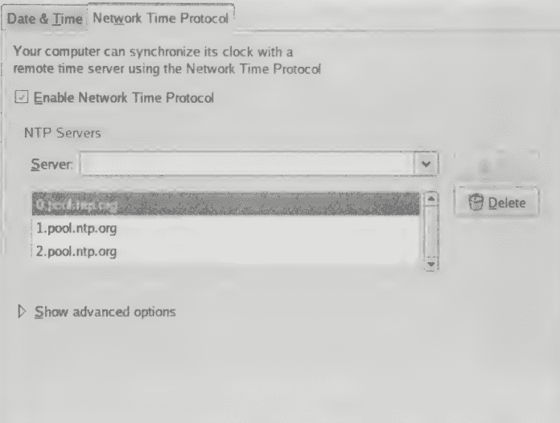

在“显示”（`Display`）屏幕上，你可以选择正在使用的显示器类型、工作的分辨率以及色彩深度。如果你在列表中没有找到你的显示器，可以选择 `CRT` 显示器或 `LCD` 显示器。

设置代理还提供了一个允许我们配置用户的屏幕。用户详情包括用户名（`Username`）、全名（`Full Name`）和密码（`Password`），如 ¹⁷ 一个良好的 `NTP` 服务器是 `pool.ntp.org`。这实际上是许多服务器共享的名称，确保了其始终可用。

## 第1章：构建Linux环境

图 1.21. 如果你决定允许网络登录，你也可以从此屏幕选择该选项。

### 图 1.21. 设置系统用户。

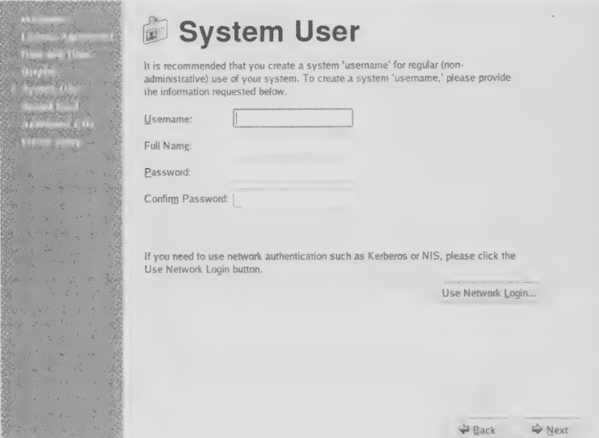

## 创建用户账户

**重要**

与 `Windows` 一样，强烈建议你在 `root` 账户之外创建用户账户。`root` 账户是全能的，它拥有创建、修改和删除系统上任何文件的权限。在没有仔细思考的情况下以 `root` 身份执行操作可能会对系统造成灾难性的后果。几乎每个 Linux 用户都能讲述他们第一次（可能也是最后一次）导致系统无法的经历。

`Fedora` 安装程序将发现系统上的声卡，你将被要求确认详细信息。你还会看到一个用于测试它的按钮，尽管对于生产 Web 服务器来说这可能没有必要。还有一个“额外软件”（`Additional Software`）屏幕，你可以用它安装所需的任何额外软件。你现在可以跳过此屏幕。

恭喜，你现在设置好了 Linux 服务器！图形化安装为新用户提供了一套易于管理的工具来使系统运行。然而，在某些情况下，文本安装是实现相同目标的一种更快、更有效的方法。让我们现在来看看文本安装程序。

## 文本模式安装

使用文本安装程序并不是一个令人生畏的过程：它提供了图形化安装中可用的所有工具，并遵循相同的流程和逻辑，只是缺乏一个漂亮的界面。除非你选择的 `LAMP` 服务器内存小于 `128MB`，否则你不需要使用文本安装程序，而且对于本书的目的来说，不建议使用此类服务器，因为图形化环境运行速度会非常缓慢。导航主要通过三个键完成：`Enter`、`Tab` 和空格键。`Enter` 将确认你的选择，`Tab` 将允许你在选择之间移动，而空格键将允许你在这些选择中选择选项。

### 图 1.22. 在文本模式下开始安装。


- 若要在图形模式下安装或升级，请按 `<ENTER>` 键。

- 若要在文本模式下安装或升级，请输入：`linux text <ENTER>`。

- 使用下方列出的功能键获取更多信息。

```
boot:linux text-
```

文本模式安装的启动方式与图形安装类似。然而，我们不是简单地按 `Enter` 键开始安装，而是在提示符处输入 `linux text`，如图 1.22 所示。安装程序将加载与显示器和键盘交互所需的初始驱动程序，并提议运行安装介质测试。建议您运行此测试以检查您的安装 `CD` 是否被篡改过。

“欢迎使用 `Fedora Core`”屏幕是熟悉基于键盘导航的好地方。按 `Tab` 键在不同选项之间移动，高亮当前选项。按 `Enter` 键选择当前选项。选择 `OK` 并按 `Enter`。

### 图 1.23. 文本模式下的语言选择。

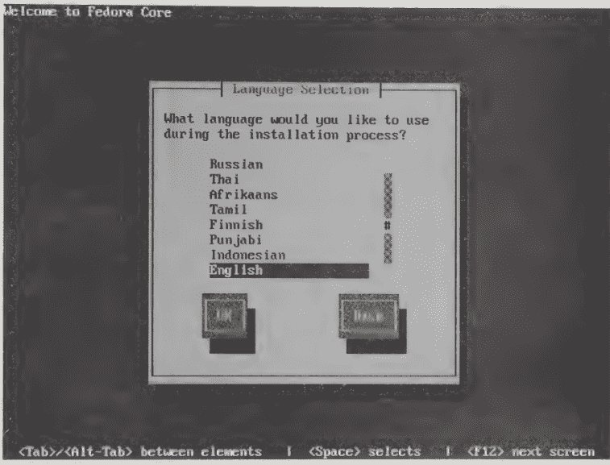

在图 1.23 所示的语言选择屏幕中，使用向上和向下箭头键选择语言。您还可以使用 `Page Up` 和 `Page Down` 逐页滚动选项，或者输入您要查找的语言的首字母直接跳转到语言列表相应的区域。使用 `Tab` 键移动到 `OK` 按钮，然后按 `Enter`。

## 第 1 章：构建 Linux 环境

图 1.24. 文本模式下的键盘语言选择。

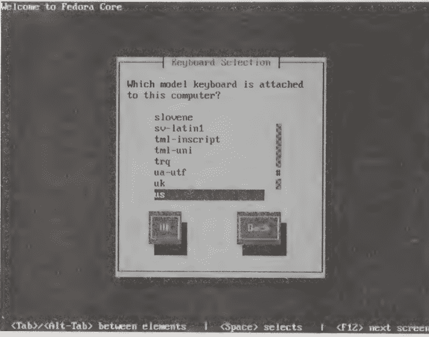

与图形安装一样，`Fedora` 的文本安装为安装和键盘都提供了数十种语言，如图 1.24 所示。

34

### 图 1.25. 文本模式下的安装类型选择。

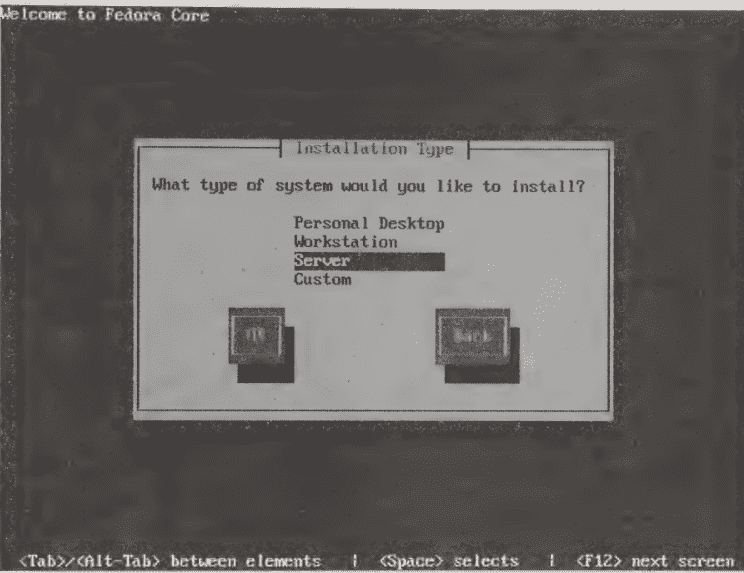

与图形安装程序一样，`Fedora` 为安装类型提供了多个“预设”选项，如图 1.25 所示：个人桌面、工作站、服务器或自定义。在典型的粒度下，这些选项中的每项都是可以自定义的：您可以从某项安装类型中添加或删除项目，正正如我们在图形安装过程中看到的那样。

### 图 1.26. 文本模式下的分区设置。

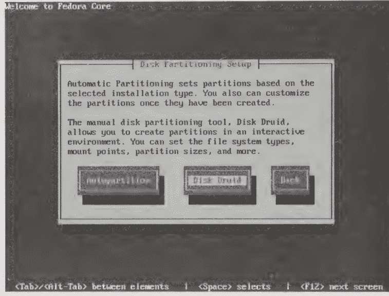

与图形安装类似，文本安装提供了自动分区（`/boot`、`/` 和 `swap`）以及基于 `Disk Druid` 的手动分区选项，如图 1.26 所示。如果您选择 `Disk Druid`，将需要使用键盘在各个选项之间进行导航。显然，文本模式的 `Disk Druid` 不提供当前磁盘分区布局的图形化表示。

### 图 1.27. 文本模式下的手动分区。

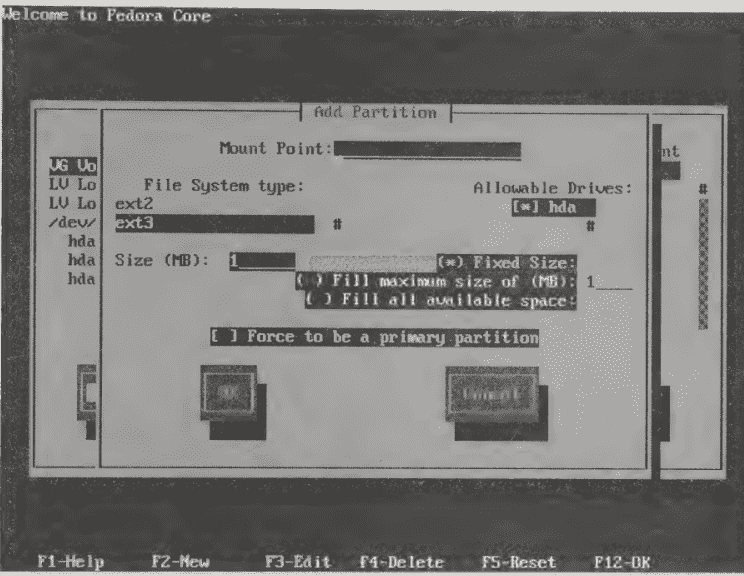

文本模式的 `Disk Druid` 不如其图形版本那样方便，因为图形版本提供了预填充了最常用挂载点的下拉列表，而您需要手动将每个挂载点输入到挂载点（`Mount Point`）字段中才能完成文本模式安装。

“添加分区”（`Add Partition`）屏幕引入了几个文本界面元素。括号表示一组单选按钮，或者一组只能从中选择一个的选项：`(*)` 表示被选中的选项，而 `( )` 表示未选中的选项。方括号 `[]` 类似，但行为更像复选框（即可以选中多个）：`[*]` 是已选中选项，`[ ]` 是未勾选选项。

### 图 1.28. 文本模式下的分区表。

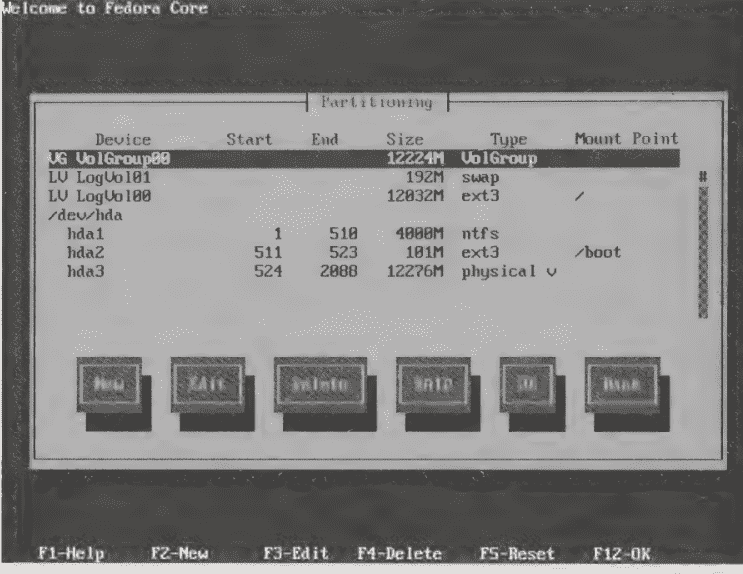

正如图形安装中所提到的，您 Linux 系统上的所有内容都位于顶层目录 `/` 下。在这种情况下，我们为内核和启动代码选择了 `boot` 分区、一个交换分区（`swap`）以及 `/` 分区。如图 1.28 所示。

### 图 1.29. 文本模式下的引导程序配置。

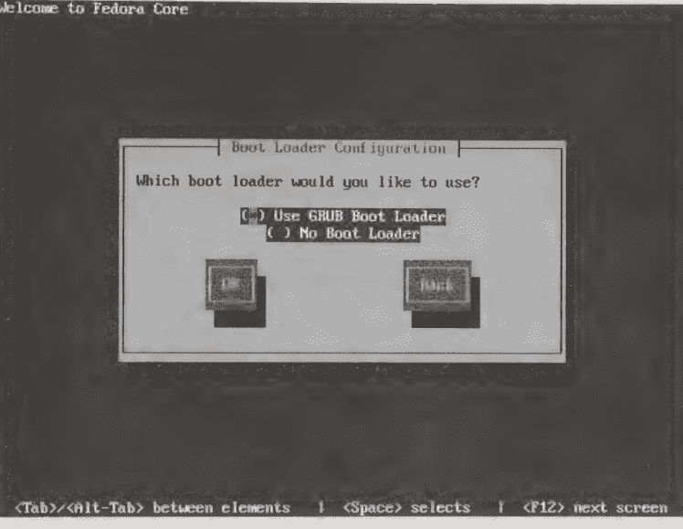

图 1.29 显示，我们在图形安装中看到的引导程序选项也适用于文本安装。如果您选择安装双引导系统，必须先安装 `Windows` 操作系统——或系统中已存在 `Windows`——以便您的双引导系统正常工作。对于双引导系统，通过 `Tab` 键高亮选项来选择 `GRUB` 引导程序，然后按空格键。

### 图 1.30. 文本模式下的引导程序配置屏幕。

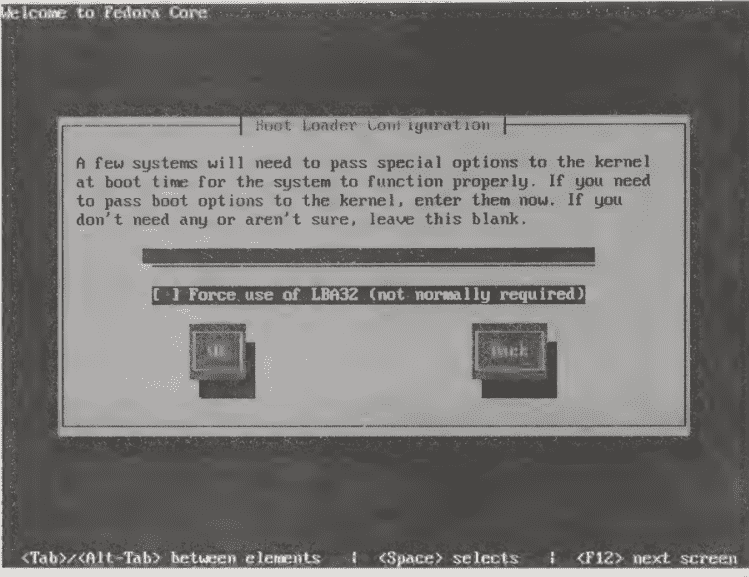

在图形安装中，某些特殊选项显示在一个屏幕上。为了简单起见，文本安装将这些选项分成了多个屏幕，如图 1.30 所示。我们在查看如何将其添加到运行系统的说明时，将在第 3 章中讨论这些选项。目前将其留空。

### 图 1.31. 文本模式下的引导程序密码选项。

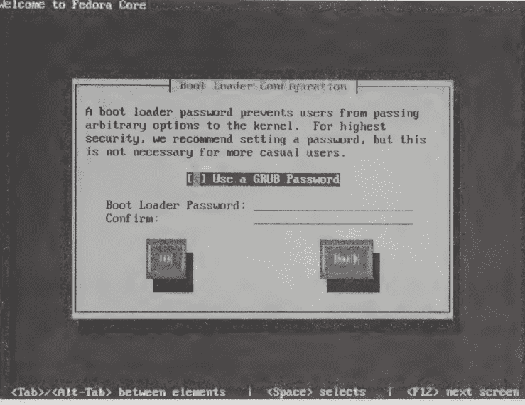

在图形安装中，某些特殊选项显示在一个屏幕上。为了简单起见，文本安装将这些选项分成了多个屏幕，如图 1.30 所示。我们在查看如何将其添加到运行系统的说明时，将在第 3 章中讨论这些选项。目前将其留空。

## 第 1 章：构建 Linux 环境

图 1.24. 文本模式下的键盘语言选择。


在图 1.23 所示的语言选择屏幕中，使用向上和向下箭头键选择语言。您可以使用 `Page Up` 和 `Page Down` 逐页滚动选项，或者输入您要查找的语言的首字母跳转到语言列表相应的区域。使用 `Tab` 键移动到 `OK` 按钮，然后按 `Enter`。

## 第 1 章：构建 Linux 环境

图 1.32. 文本模式下的操作系统选择。

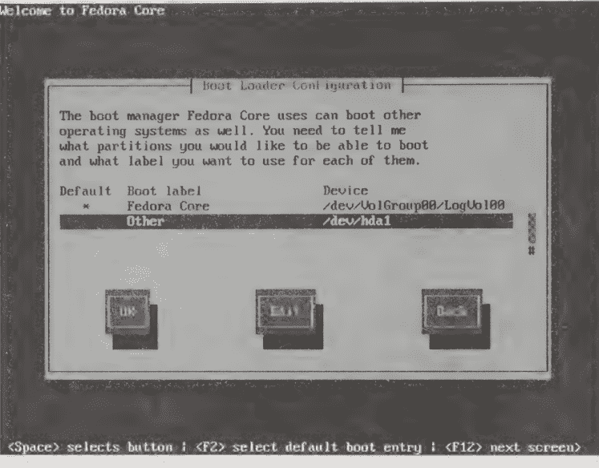

在图形安装中，某些特殊选项显示在一个屏幕上。为了简单起见，文本安装将这些选项分成了多个屏幕，如图 1.30 所示。我们在查看如何将其添加到运行系统的说明时，将在第 3 章中讨论这些选项。目前将其留空。

### 图 1.31. 文本模式下的引导程序密码选项。


在图形安装中，某些特殊选项显示在一个屏幕上。为了简单起见，文本安装将这些选项分成了多个屏幕，如图 1.30 所示。我们在查看如何将其添加到运行系统的说明时，将在第 3 章中讨论这些选项。目前将其留空。

## 第 1 章：构建 Linux 环境

图 1.32. 文本模式下的操作系统选择。


在图形安装中，某些特殊选项显示在一个屏幕上。为了简单起见，文本安装将这些选项分成了多个屏幕，如图 1.30 所示。我们在查看如何将其添加到运行系统的说明时，将在第 3 章中讨论这些选项。目前将其留空。

### 图 1.33. 文本模式下的引导程序位置选择。

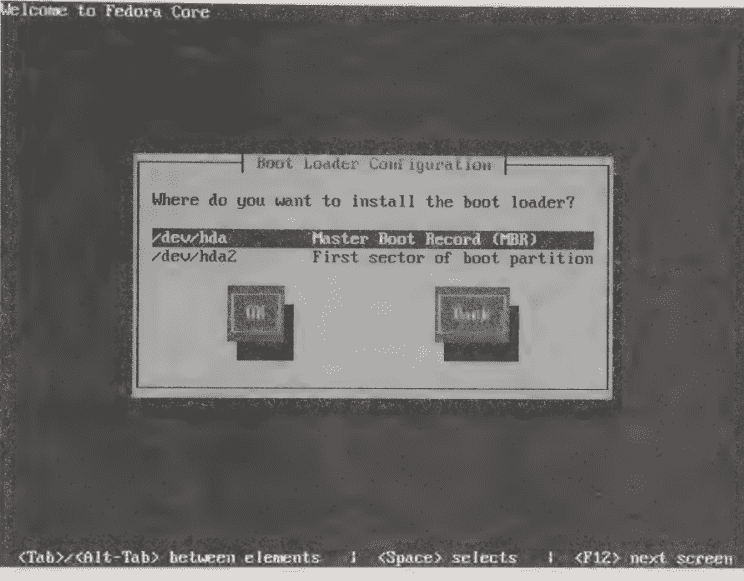

与图形安装一样，`Fedora` 的文本安装为安装和键盘都提供了数十种语言，如图 1.24 所示。

## 第 1 章：构建 Linux 环境

图 1.34. 文本模式下的网络配置屏幕。

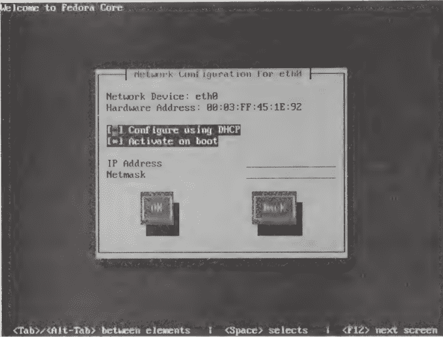

在图 1.34 所示的网络配置屏幕中，您可以确定系统将通过 `DHCP` 获取 `IP` 地址还是使用静态 `IP` 地址。您还将确定以太网接口是否在启动时启动。`Anaconda` 在后台执行了工作，提供了系统中所有以太网接口的列表。

### 图 1.35. 文本模式下的防火墙选项选择。

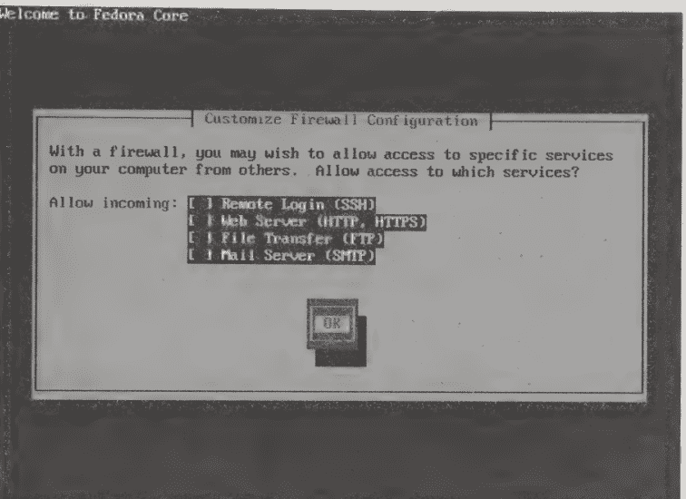

`<Tab>` / `<Alt-Tab>` 在元素间切换 | `<Space>` 选择 | `<F12>` 下一页

与图形安装一样，文本安装让您有机会为系统启用防火墙，使其免受外部入侵者的侵害。如果您选择启用防火墙，可以通过点击自定义按钮指定允许哪些流量，这将提供图 1.35 所示的选项。我们将在书后详细介绍该防火墙系统（`iptables`）。

正如在图形安装程序（“网络安全”部分）中所讨论的，您应该只允许 `SSH` 和 `WWW` 流量从外部进入系统。这确保了开放端口最少，同时允许了 Web 服务器的正常运行和远程管理。

## 第 1 章：构建 Linux 环境

### 图 1.36。文本模式下的安全增强 Linux (SELinux) 。

文本界面安装序列中的下一个屏幕将询问你是否想要启用安全增强 Linux (`SELinux`)。在图形界面安装程序中，这些选项是防火墙选项屏幕的一部分。应将其设置为 `Active`（激活）以启用内核的安全增强功能。

### 图 1.37。文本模式下的时区选择屏幕。

与提供地图的图形化安装不同，文本界面安装以列表形式提供时区选项。如果你希望系统使用协调世界时 (`UTC`)，请高亮并选择“`System clock uses UTC`”选项。要选择服务器所在的特定时区，请使用方向键高亮某个时区，然后按 `Tab` 键跳到 `OK` 按钮，按 `Enter` 键完成选择。

### 图 1.38。在文本模式下输入 root 账户密码。

在图 1.38 所示的屏幕中输入 `root` 账户密码，请记住图形界面安装部分提供的警告：创建一个安全的密码以确保你的 Web 连接系统的完整性。

### 图 1.39。文本模式下的软件包组选择屏幕。

在对安装介质进行快速扫描后，文本界面安装程序将为你提供你所选的所有现有软件包组。在图 1.39 中，我们选择了所有管理和维护 Web 服务器的必备工具，包括 `Apache`、`DNS` 和 `SQL` 数据库服务器。你可以像在图形界面安装程序一样，在软件包组被高亮时按 `F2` 键选择每个软件包组内的单个软件包。

### 图 1.40。文本模式下的所需安装介质屏幕。

接下来，在 `Anaconda` 接管并开始安装 `Linux` 之前，你将获得最后一次退出 `Linux` 安装的机会。如果你选择继续，`Anaconda` 将格式化你的硬盘和/或设置相应的分区，然后按照你指定的规格安装 `Linux`。

### 图 1.41。Linux 安装进度条。

你对特定安装选项的选择将为安装过程创建一个安装镜像。该镜像包含了在你的配置下配置的机器上安装 `Linux` 操作系统所需的所有 `RPM` 和依赖项列表。换句话说，如图 1.41 所示，所有请求和需要的软件都从 `CD` 复制到硬盘上为安装做准备。

### 图 1.42。软件包安装进度显示。

当实际安装开始时，安装程序会提供几条可能有用的信息，如图 1.42 所示。首先，它提供了正在安装的软件包的简要摘要。其次，它以百分比形式的进度条显示该软件包的安装进度。第二个进度条提供了整个安装过程的高级视图。关于软件包数量、字节数和预计剩余时间的安装进度，也会以文本形式显示在两个进度条之间。

如果你选择在不安装 `X Windows` 系统和桌面管理器的情况下安装系统——换句话说，如果你正在安装一个纯文本的系统——系统将不会提供 `Setup Agent`（设置代理）功能。相反，你的首次登录将以终端屏幕的形式出现。你将使用早在安装过程中创建的“`root`”用户名和密码登录。

请记住，`System Agent` 会提示你创建并配置非 `root` 用户。没有了 `System Agent`，你需要手动执行此操作。

在纯文本的系统中，创建非 `root` 用户与在图形系统中一样同样重要。要从命令行创建新用户，你首先需要以 `root` 身份登录；然后运行 `useradd username`，将 `username` 替换为新用户的用户名；系统会要求你输入该用户的密码和一些详细信息。然后，该用户就会被创建。

## 总结

安装 `Linux` 系统比安装 `Windows` 需要多一些前期研究。因为许多 `Linux` 设备驱动程序是通过社区性的逆向工程创建的，而不是由官方创建的。

## 顶部面板菜单

图 2.5。通过“应用程序”菜单找到 `Firefox`。


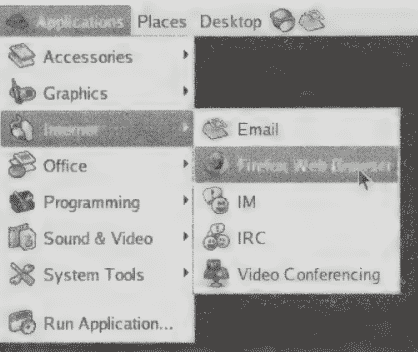

顶部面板菜单允许我们访问计算机上的所有内容。图 2.5 显示的“应用程序”菜单将所有安装的程序分类为游戏、图形、互联网、办公等。例如，如果你安装了`Firefox`，你可以在“互联网”菜单中找到它。

**图 2.6。“位置”菜单。**

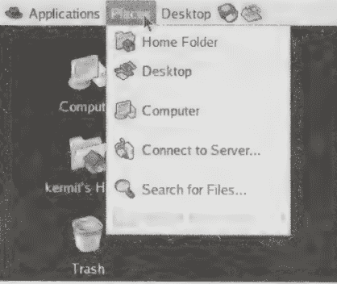

图 2.6 所示的“位置”菜单列出了可能有用的文件位置：

- 你的家目录
- 你的桌面
- 计算机上的驱动器
- 网络位置

“桌面”菜单提供了配置（用户偏好设置和系统设置）以及在线帮助、锁定屏幕、注销和关机选项。这些内容在图 2.7 中。

**图 2.7。“桌面”菜单。**

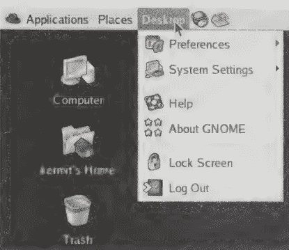

## 顶部面板快捷图标

快捷图标位于菜单旁边的启动器面板，可以快速访问常用应用程序。

**图 2.8。在启动器面板中显示快捷图标。**


默认情况下，这些图标提供了网络浏览器（`Firefox`）和电子邮件客户端（`Evolution`）的快捷方式，如果你安装了这些程序，还提供了`OpenOffice.org`的三个主要应用程序（文字处理、电子表格和演示文稿工具包）。

## 使用 Windows

构成`GNOME` GUI 的窗口显示与`Windows`平台上的用户界面相似。图 2.9 显示了一个`GNOME`窗口的显示。

**图 2.9。一个 GNOME 窗口。**

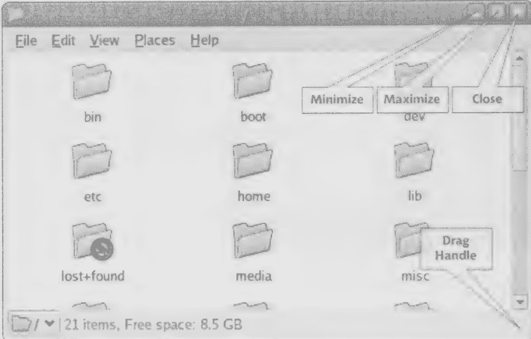

如果你用过其他操作系统，那么在使用`GNOME`窗口将不会遇到任何困难。

## 启动和关机

由于`Linux`是一个真正的多用户系统，在使用系统之前，你需要登录你的系统账户。在`GNOME`中，处理此任务的默认应用程序是`GNOME`显示管理器（`GDM`）。在你的所有系统设备和驱动器都正确挂载后，将打开`GDM`登录屏幕。你将使用安装后创建的帐户名和密码登录系统。

## 避开 root 用户

绝不建议以`root`身份登录系统。记住，`root`是`Linux`中无所不能的账户，能够对系统执行任何操作。这些操作包括删除系统关键文件，这会导致系统完全瘫痪，使其变得非常难以恢复。登录系统时，首先登录用户账户；如果必要，可以通过切换到`root`来执行管理任务。记住，优雅地关机你的`Linux`电脑是非常重要的，就像你对待`Windows`机器一样。你可以通过选择“桌面 > 注销”或通过命令行来关闭数据。让我们先看看关闭机器的图形工具。从“桌面”菜单中选择“注销”（如图 2.10 所示），将为你提供选项：注销系统（返回登录界面）、重启机器或完全关机机器。

**图 2.10。Linux 的注销选项。**


## Linux 文件系统

### 驱动器和分区

如果你习惯了`Windows`以驱动器为导向的布局，`Linux`文件系统结构可能会让你有点困惑。这里没有 C 盘；事实上，没有这种意义上的驱动器，只有分区。为了让情况更复杂，分区在硬盘上的实际位置并没有被清晰地标识。`Linux`文件系统比这要抽象得多。我给你举个例子：我家里的主力工作机器包含两个物理硬盘。其中是一个旧的 40GB 硬盘，包含操作系统和我使用的所有程序。另一个是我稍后添加的新的 160GB 硬盘，它被分成了两个部分。第一部分包含我的个人文件：我用数码相机拍摄的照片、我的 MP3 收藏以及杂物。我把第二部分留空给程序创建的临时文件。

在`Windows`系统上，这些驱动器很可能被系统和用户视为`C:`、`D:`和`E:`。`Windows`将安装在`C:\`，`Firefox`将位于`C:\Program Files\Mozilla\`，我的数字照片将位于名为`D:\Photos\`的目录中，以此此类推。在`Windows`中，目录名称与存储它的分区（因此是硬盘）直接相关。这个概念在图 2.11 中所示。

**图 2.11。C:、D: 和 E: 如何与我的硬盘相关。**

| C: | D: | E: |
| :--- | :--- | :--- |
| 分区 #1 | 分区 #2 | 分区 #3 |
| 40 GB 硬盘 | | 160 GB 硬盘 |

### ext3 文件系统

`Linux`文件系统为你隐藏了这些不必要的细节（当然，除非你想看它们）。操作系统内核存储在名为`/boot/`的目录下；`Firefox`位于`/usr/lib/firefox-1.0.4/`；我的照片和 MP3 放在名为`/home/username/photos/`和`/home/username/music/`的目录中，而临时文件进入名为`/tmp/`的目录。没有明显的迹象表明这些目录位于不同的分区或不同的硬盘上。

`Linux`文件系统为每个分区分配一个不同的挂载点：一个通过它访问分区的目录。在`Windows`中，`D:`相当于我们`Linux`系统中的`/home/tony/`，`E:`类似于`/tmp/`，而`C:`相当于`/`，即文件系统层次结构的顶端。这种结构在图 2.12 中所示。

**图 2.12。在 Linux 中查看相同的分区。**

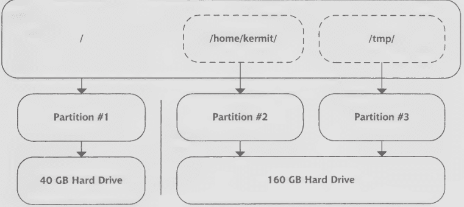

毫无疑问，当你第一次从`Windows`以物理磁盘为导向的视图转向`Linux`的层次级文件系统时，会很困惑。但随着时间的推移，你会克服这种冲击，并开始理解从整体角度看待系统，而不是将其视为独立的隔间。

### ext3 文件系统

`Linux`能够处理许多不同文件系统的能力实之名归。现代`Linux`发行版可以读取、写入并跟踪几乎所有的微软文件系统——从原始的`FAT`到`NTFS`——以及`Mac OS X`、`OS/2`以及各种冷门操作系统所使用的文件系统。对于`Linux`来说，这只需要加载相应的内核模块并挂载分区。这使得处理在其他系统编写的文件变得简单。在本节中，我们将查看`Fedora Core`服务器的原生文件系统：`ext3`。

# 文件系统快速概览

在一分钟内了解这些目录之间的区别——以及如何避免混淆。

## /boot

此目录包含启动操作系统所需的所有文件，包括`Linux`内内核。

## /bin 和 /sbin

这两个文件夹的内容相似——它们都包含可执行的二进制文件——但用途不同。`/bin`包含了你可能在命令行使用的可执行文件：例如`ls`、`mv`和`cp`，我们将在第 3 章介绍这些内容。`/sbin`包含了操作系统本身使用的命令和进程，因此如果你是初学者，可能最好远离这个文件夹。

## /dev

这些是设备文件——系统中实际存在的所有设备，以及所有可能添加到系统中的设备的抽象。这些文件为操作系统提供了关于每个设备的描述以及如何处理这些设备的指令。

## /etc

此目录包含特定于系统的配置文件。

作为管理员，你可能会在`/etc`目录中花费大量时间，因为它包含了系统上大多数应用程序的配置指令。例如，`Apache`的配置文件位于`/etc/httpd/conf/httpd.conf`。

## /home

此目录包含系统每个用户的家目录。例如，我们的示例用户家目录为`/home/kermit`，同一系统上的其他用户家目录为`/home/gonzo`和`/home/fozzie`。默认情况下，`Gonzo`或`Fozzie`无法读取或写入`Kermit`的文件，而`Kermit`也无法读取或写入他们的（只有`root`用户拥有这种能力）。

## /root（根目录）

这是`root`用户的家目录，不要与另一个“根目录”`/`混淆。

## 第 2 章：日常使用

### /lib

`lib`目录包含系统中各种应用程序访问的所有共享库。它还包含了内核在各种系统操作中使用的库。

### /media

### /mnt

这些目录作为临时挂载文件系统的挂载点。例如，可以通过`/media/cdrom`访问`CD-ROM`驱动器。

### /opt

此目录为添加到系统的软件包提供存储空间。

### /tmp

此目录提供系统范围的临时文件存储空间。

### /usr

包含用户命令和二进制文件、图形界面文件、用于系统应用程序的包含文件以及可选源代码。

### /var

`/var`目录包含变量数据文件：在与其相关的应用程序运行期间可能会更改的文件，包括日志文件和邮件文件。

### 挂载点


> 挂载点的概念可能有点困惑，尽管它们在包括`Windows`在内的每个操作系统都存在。为了避免混淆，请将挂载点视为容器，设备或文件系统的内容将倾倒其中。例如，`/media/cdrom`是`CD-ROM`设备内容的挂载点。将设备内容清空到挂载点可以使系统及其用户访问这些文件。通常情况下，设备和文件系统必须在挂载（连接到挂载点）之前才能使用。在随后的章节中，我们将讨论在`Linux`中自动挂载这些设备和文件系统的方法。

**图 2.13. 文件浏览器应用程序中显示的 Linux 文件系统。**

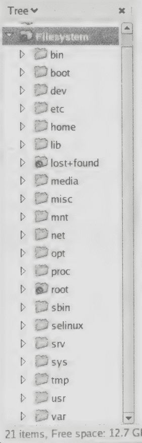

### 导航文件系统

文件文件从桌面上的`Nautilus`开始，它是`GNOME`对文件系统的图形表示。桌面上有两个图标作为`Nautilus`的起点：“计算机”（`Computer`）和用户名的“主目录”（`Home`），如图 2.14 所示。

**图 2.14. 桌面文件系统图标。**


“计算机”图标从系统顶层开始，类似于`Windows`中的“我的电脑”；而用户“主目录”图标从当前用户的家目录开始。

双击“计算机”图标将向我们展示一个类似于图 2.15 的视图。我们看到连接到计算机的可移动介质，以及代表本地文件系统根目录和任何通过网络访问的其他文件系统的图标。

双击“文件系统”图标将打开一个新窗口显示文件系统的根目录，如图 2.16 所示。双击这些任何图标都会打开另一个窗口，提供所选目录内容的视图，就像`Windows`资源管理器或`Mac`的`Finder`一样。

**图 2.15. 计算机图标的顶层视图。**


**图 2.16. 查看计算机图标文件系统。**


**图 2.17. 主目录图标视图。**


双击“主目录”图标将直接跳转到当前用户的家目录。

### 处理文件

`Linux`中字面上的一切都是文件，包括目录等等。

### 文件权限

`Linux`利用了任何操作系统中最细粒度权限的系统之一。在最基础的，`Linux`权限被分为三组。这些是：

#### 所有者（或用户）

授予拥有该文件的用户的权限。

默认情况下，具有足够权限的用户（例如`root`）可以更改文件的所有权详情。

#### 组

授予指定用户组的权限。用户可以被添加到任意数量的组，每个组都可以对文件拥有权限。

#### 其他

授予任何不是所有者、具有访问文件权限组组成员的权限。

这些组中的每一组都可以授予以下自言自懂的权限的任意组合：

- 读取 (`read`)
- 写入 (`write`)
- 执行 (`execute`)

`Linux`权限结构中特别有趣的是这三组权限是如何相互作用的。特定用户可能属于一个只能读取特定文件的组，但如果该用户恰好也是该文件的所有者，文件的所有者权限可能也会授予该用户写入文件的权限。

## 第 2 章：日常使用

**图 2.18. 文本文件的默认权限。**

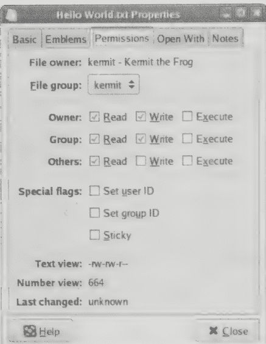

作为一个例子，让我们来看简单文本文件的默认权限结构。通过选择应用程序 > 附件 > 文本编辑器来打开`gedit`应用程序。在`gedit`中输入一些文本，将文件保存在你的家目录下。在`Nautilus`中找到该文件，右键点击文件并选择“属性”。点击“权限”选项卡，查看如图 2.18 所示授予该文件的权限。

让我们深入查看此对话框。

### 文件所有者

这标识了拥有文件的用户。默认情况下，所有者是创建该文件的用户；然而，具有足够权限的用户（例如`root`）可以更改文件的所有权详情。

## 处理 Linux 文件

### 文件组

拥有访问此文件的用户组：在本例中，这是一个名为`kermit`的组。当你创建一个用户时，`Linux`会自动创建一个与该用户同名的组。这允许我们赋予某个用户访问另一个用户文件的文件的权限。例如，如果我们把用户`gonzo`添加到`kermit`组，那么`Gonzo`就可以访问`Kermit`的文件。

### 所有者、组和其他人

这些复选框允许实际设置权限。你可以为所有者、你选择的组或所有人授予读、写或执行权限的任意组合。这三个部分（每部分三种权限类型）的组合导致了该文件权限共有 512 种可能的组合。这是一个非常灵活的结构！稍后我们将更详细地查看文件权限。

### 特殊标记

权限系统的特殊扩展允许我们对文件进行标记，以便文件系统进行特殊处理。在本书书中不需要使用这些标记。

### 文本视图和数字视图

这些查看文件权限的替代视图，对于任何通过命令行处理文件权限的人来说都是熟悉的。

文本视图由十个字符组成。第一个字符表示文件类型：如果文件是目录，该字符将是`d`；如果文件是普通文件，它将是`-`。剩余的九个字符表示所有者、组和其他人的读、写和执行权限。例如，`-rw-rw-r-`代表所有者具有读写权限，而其他人只有读权限的普通文件。你可以通过更改上方的复选框来看到此视图的变化。

数字视图是文本视图的更紧凑的视图。数字从左到右代表授予给所有者、组和其他人的权限。此视图也会随着你在复选框中的选择而改变。

### 最后修改

此字段标识文件最后一次修改的日期和时间。由于此文件尚未重新打开并修改，`Linux`认为它尚未被更改。打开文件并修改它即可看到此日期的变化。

## 第 2 章：日常使用

### 符号链接，或链接文件：进一步抽象

大多数使用过`Windows`的人都理解快捷方式的概念。快捷方式实际上是指指向系统另一个区域中某个文件的指针。事实上，有些用户非常理解并痴迷于`Windows`中的快捷方式，以至于他们的桌面最终被快捷方式覆盖！从真实位置以外的地方启动文件的能力对于计算机用户来说显然具有价值。`Linux`也提供了此类功能。作为管理员，你会发现`Linux`的快捷方式和`Windows`的一样一样令人兴奋。

`Windows`中的快捷方式和`Linux`中的符号链接实际上是一同的；它们是原始文件的抽象——更多的表示形式。在`Windows`中创建快捷方式并不会将可执行文件移动到桌面。同样，在`Linux`中，我们可以为文件编写一个看起来像文件本身的抽象。该文件在新位置并不真实存在，但运行就像在那里一样。

`Windows`和`Linux`创建快捷方式之间的一个重要区别是，`Linux`符号链接（通常称为`symlink`）在大多数情况下可以被完全视为文件本身处理。例如，如果你在编辑器中打开一个符号链接并对文件进行更改，编辑器将编辑符号链接指向的实际文件。如果你在`Windows`下尝试这样做，你可能会感到意外，因为编辑器打开的是用于编辑的快捷文件，而不是快捷方式链接的文件！符号链接在`Linux`下被频繁使用，因为它们强大的抽象，可以让一个文件看起来同时存在于多个地方。

你可以在`Nautilus`中右键点击文件或文件夹并选择“创建链接”（`Make Link`）来创建符号链接，如图 2.19 所示。这将创建一个开头带有“链接到”字样的符号链接，如图 2.20 所示。你可以将此文件拖放到任何地方，并根据意愿重命名。

**图 2.19. 在 Nautilus 中创建符号链接。**

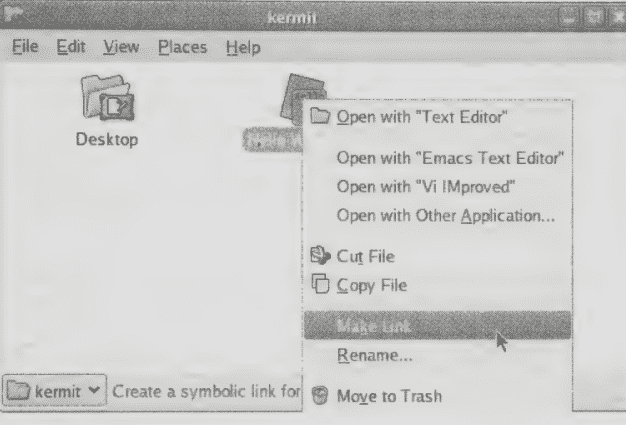

**图 2.20. 新创建的符号链接。**

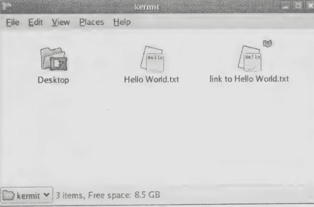

### 编辑文本文件

熟练使用`Linux`兼容文本编辑器命令对于你日常管理的成功至关重要。由于`Linux`系统中的大部分配置都是通过文本文件完成的，明智的做法是找到一个适合你的编辑器。事实上，`Linux`充斥着文本编辑器：没有 GUI 的编辑器、带 GUI 的编辑器、主要面向程序员的编辑器、针对`HTML`开发人员的编辑器——不缺让你的管理任务变得工具。在本节中，我们将查看一些可用的基于 GUI 的文本编辑器。稍后我们将查看一些基于命令行的编辑器。

`Fedora Core`在默认安装中提供了两个强大的 GUI 文本编辑器：`gedit`和`Kate`。`gedit`是`GNOME`桌面环境的默认文本编辑器，`Kate`是`KDE`的默认编辑器，但两者在任何一个环境中都可以工作。

如果你是`Windows`长期记事本或`Wordpad`用户，你会发现`gedit`是`GNOME`桌面环境的默认文本编辑器。它提供了一系列功能，包括：

- `gedit`允许编辑各种文本文件，即使它们很大。
- `gedit`强大的语法高亮引擎可以通过`XML`文件进行扩展。
- 编辑器提供分窗口视图，允许你同时查看文档的不同部分。
- `gedit`允许用户在保存/打开对话框中选择每个文件使用的编码。

`Kate`是`KDE`的默认编辑器，但两者在任何一个环境中都可以工作。如果你是`Windows`长期记事本或`Wordpad`用户，你会发现`Kate`是`KDE`桌面环境的默认文本编辑器。它提供了一系列功能，包括：

- `Kate`编辑各种文本文件，即使它们很大。
- `Kate`强大的语法高亮引擎可以通过`XML`文件进行扩展。
- 编辑器提供分窗口视图，允许你同时查看文档的不同部分。
- `Kate`允许用户在保存/打开对话框中选择每个文件使用的编码。

`Kate`的侧边栏显示了打开文档列表、文件系统浏览器等更多内容。


Kate 提供了一个实用的插件接口，允许使用第三方插件。

编辑器提供了项目处理功能（这些功能可以通过项目处理插件覆盖）。

## 图 2.22. Kate 主界面，正在编辑 Apache 配置文件。

```
httpd.conf - Kate
File Edit Project Document View Bookmarks Tools Settings Window Help
--------------------------------------------------------------------------------------
# 基于最初由 Rob McCool 编写的 NCSA 服务器配置文件。
# 这是主 Apache 服务器配置文件。它包含了
# 为服务器提供指令的配置指令。
# 请访问 URL:http://http.apache.org/docs-2.0/ 获取有关
# 指令的详细信息。

# 不要在理解这些指令作用的情况下直接阅读这里的说明。
 它们在这里仅作为提示或提醒。如果你不确定，
# 请查阅在线文档。你已收到警告。

# 配置指令分为三个基本部分：
# 1. 控制 Apache 服务器进程运行的指令，
# 2. 定义“主”或“默认”服务器参数的指令，
# 该服务器响应未由虚拟主机处理的请求。
# 这些指令还为所有虚拟主机设置
# 提供了默认值。
# 3. 虚拟主机设置，允许 Web 请求发送到
# 不同的 IP 地址或主机，并由同一个
# Apache 服务器进程处理。

# 配置和日志名称：如果你指定的服务器控制文件
# 文件名以 "/" 或 Win32 的 "drive:/" 开头，
# 服务器将使用此显式路径。如果文件名“没有”
# 以 '/' 开头，则重现 ServerRoot 的值——因此
# 当 ServerRoot 设置为 "/etc/httpd" 时，“logs/foo.log"
# 将被服务器解释为 "/etc/httpd/foo.log"。

# 第 1 节：全局环境
# 此节中的指令影响 Apache 的整体运行，
# 例如它可以处理的并发请求数，或它
# 能够包含配置文件的位置
Line: 1 Col 1 INS NORM httpd.conf
```

# 第 2 章：日常使用

最终，Kate 比其他编辑器更友好，并且在编辑配置文件和编写 Shell 脚本方面提供了更大的灵活性。它的语法高亮功能是无与伦比的，因为 Kate 提供了全系列的编程语言和样式。此外，Kate 还提供了诸如打开文档列表（如图 2.23 所示）和集成文件系统浏览器（图 2.24）。

## 图 2.23.Kate 的文档标签。

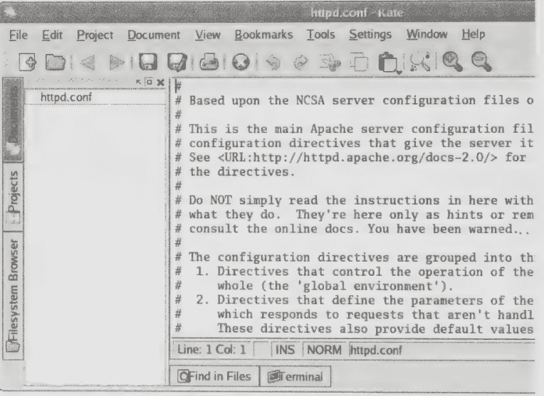

虽然 Linux 提供了其他的 GUI 文本编辑选项，但 gedit 和 Kate 是最强大且易于使用的两个工具。它们都非常适合你的 Linux 文本编辑需求。

## 图 2.24.Kate 的文件系统浏览器标签。

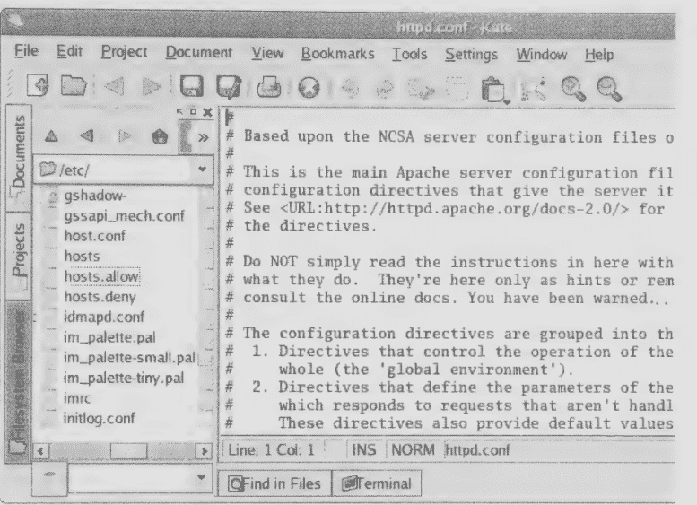

## 总结

理解 Linux 需要时间，而过程的第一阶段是熟悉起初略微陌生的桌面环境。在本章中，我们从用户的角度讨论了 Linux、Fedora 和 GNOME 桌面的一些基础知识。接下来，是时候看看你作为 Linux 服务器管理员需要需要的知识了。

# 3

## 命令行

到目前，我们与 Linux 的交互都是通过漂亮的桌面环境进行的，对于经验丰富的 Windows 用户来说，理解该系统相当容易。然而，情况并非一直如此：Linux 用户界面的根源深植于它的命令行之中。

## 什么是命令行？

与 Windows 不同，Linux 中的 GUI 是完全可选的。如果你觉得自己特别有能力，或者你有某些需求（或使用非常老的硬件），你可以在完全没有图形的情况下运行 Linux 机器。随着 Linux 的演进，许多 GUI 构建在其之上，但命令行仍然是管理员的好朋友：一种快速、简单且强大的方式，可以执行那些在桌面上并不总是容易的操作。

# 第 3 章：命令行

## 图 3.1. 访问 GNOME 终端。

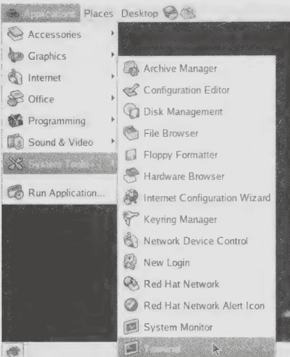

在本书中，我们将使用 GNOME Terminal 应用程序来访问命令行。你可以通过“应用程序 > 系统工具 > 终端”访问此程序，如图 3.1 所示。终端本身如图 3.2 所示。

## 调整终端

> 提示：GNOME 桌面环境是完全自定义的——并且包含了终端的外观。你可以决定使用的字体，更改窗口的前景和背景颜色——你甚至可以设置窗口本身的透明度，这样就可以看到窗口后的桌面图像！在终端内部，你可以在“编辑 > 当前配置”中找到这些设置。

84

## 图 3.2. GNOME 应用程序。

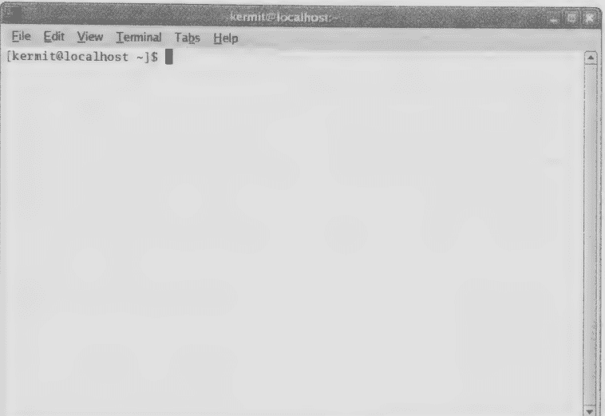

## 使用命令行

当你使用 Linux 命令行时，你正在打开一个可以被看作操作系统的替代窗口——通过这个替代窗口，你可以访问到更强大、更底层的操作系统功能。图形化工具无法提供这种能力。图形化环境仅仅是操作系统环境的高级抽象，而我们所习惯的图标和菜单仅提供了对该环境的有限访问。这些图标和菜单代表了操作系统功能，但它们本身并不是实际的功能。换句话说，图形用户界面在操作员和操作系统之间提供了一个有限的额外层，在该层中，受限制的功能范围由漂亮的图片表示。为了以最高效率管理你的 Web 服务器，能够与系统处于同一水平工作是非常用的。

## 高高在上，或粗浅浅用


当我们谈论“高级级”和“低级”函数时，我们指的是一种功能上的层级关系。最低级的函数直接与内核通信，因此具有巨大的威力和灵活性：高级工具本身会执行更多工作，提供更多功能并增加安全性。例如，比较低级的 `rm` 命令与 Nautilus 中更高级的回收箱（Trash）功能。`rm` 只是删除文件：它快速简单，而且没有简单或保证的方法可以恢复该文件。Nautilus 则坚持让你将文件移动到垃圾箱，实际上是将该文件标记为可能删除。在你自己回到桌面并清空垃圾箱之前，删除操作本身不会发生。

## 以 root 身份登录

我们已经讨论过以 root 身份登录 Linux。要从 GNOME 终端执行操作，你需要输入 `su`（切换用户）命令。

```
[kermit@swinetrek ~]$ su
Password:
```

系统会提示输入 root 密码。一旦输入，你将获得系统的完全访问权限：全能！请明智使用。虽然某些事情只有以 root 身份才能完成（包括许多系统管理任务），但遵循良好的 Linux 习惯非常重要：不要以 root 身份登录超过你需要的时间。每个 Linux 管理员都有一个恐怖故事，即在以 root 身份登录时，他们输错了命令并删除了机器上的所有内容（或类似的灾难）。你希望避免这种灾难。要小心，如果不需要，就不要保持 root 身份登录。要切换回标准用户账户，使用 `exit` 命令。

# 第 3 章：命令行

## 一些实用示例

让我们来看几个命令行的实际示例。

### 使用 `pwd` 命令确定当前位置

```
[kermit@swinetrek ~]$ pwd
/home/kermit
```

### 家，温馨的家

你的目录 `/home/username` 通常被称为 `~`。你注意到命令行提示符中的 `-` 吗？它表示你当前正位于自己的目录中。当我们开始浏览文件系统时，我们将看到这个命令行提示符发生，反映出我们正在工作的目录名称。这样，我们就不需要不断输入 `pwd` 来查找自己在哪里了。

## 使用 `ls` 命令列出文件

`ls`（list 的缩写）单独使用时会列出工作目录的内容。

```
[kermit@swinetrek ~]$ ls
Desktop Hello World.txt
```

你可以通过在命令行中添加目录名称来获取另一个目录的文件列表。例如，`ls /` 将返回根目录下所有内容的列表。

```
[kermit@swinetrek ~]$ ls /
bin dev home lost-found misc net proc sbin srv tmp var
boot etc lib media mnt opt root selinux sys usr
```

## 一些实用示例

单独使用 `ls` 会显示文件夹中包含的文件名，仅此而已。要查看所有文件的详情，我们可以在命令中添加 `-l` 选项，它会返回更详细的列表。

```
[kermit@swinetrek ~]$ ls -l
total 16
drwx-xr-x 2 kermit 4096 Sep 5 14:21 Desktop
-rw-rw-r-- 1 kermit kermit 13 Sep 8 07:30 Hello World.txt
```

这里有大量信息。

- 第一列以第 2 章讨论的格式给出了每个文件的权限。第一个字符告诉我们是否是一个目录；接下来的九个字符显示了是否授予了所有者、组和其他人读、写和执行权限。

- 下一列仅对目录有用；它反映了目录内部的文件数量。对于文件，这个数字将是 1。

- 接下来的两列识别分配给文件的所有者和组。在这种情况下，它们都是 `kermit`。

- 接下来，我们看到了文件最后修改的日期时间。在上面的示例中，`Desktop` 目录最后于 9 月 5 日下午 2:21 修改过。

- 最后，我们得到了文件的名称。

`ls -l` 非常有用，以至于 Fedora Core 包含了指向它的内置快捷键：1。

你的主目录将包含许多隐藏文件。在 Linux 中，我们可以通过以点 `.` 开头文件名来隐藏文件：如果我们将 `Hello World.txt` 重命名为 `.Hello World.txt`，它就会变为隐藏。这些隐藏文件中存储了特定的信息。要查看隐藏文件，使用 `-a` 选项，并结合 `-l` 使用。

```
[kermit@swinetrek ~]$ ls -l
total 16
drwx-xr-x 2 kermit 4096 Sep 5 14:21 Desktop
-rw-rw-r-- 1 kermit kermit 13 Sep 8 07:30 Hello World.txt
```

## 使用 `cd` 命令在文件系统中移动

`cd` 命令代表 change directory（切换目录）。它将工作目录更改到指定的目录。

```
[kermit@swinetrek ~]$ cd /etc/
[kermit@swinetrek home]$ cd
```

单独使用时，`cd` 命令返回你的主目录。

```
[kermit@swinetrek ~]$ cd
```

## 使用 `echo` 和 `cat` 命令打印

`echo` 命令直接将输出发送到屏幕。

```
[kermit@swinetrek ~]$ echo "Hello, World!"
Hello, World!
```

`cat` 命令打开文件并将其写入屏幕。

```
[kermit@swinetrek ~]$ cat Hello\ World.txt
Hello, World!
```

## 使用 `cp` 和 `mv` 命令复制和移动文件

`cp` 命令创建文件的副本。

```
[kermit@swinetrek ~]$ cp Hello\ World.txt Copy.txt
[kermit@swinetrek ~]$ ls
Desktop Hello.txt Copy.txt
```

在这里，我们创建了一个名为 `Copy.txt` 的 `Hello World.txt` 的精确副本。我们像这样在不同的目录中创建副本：

```
[kermit@swinetrek ~]$ cp Hello\ World.txt \
> /var/backup/Hello\ World.txt
[kermit@swinetrek ~]$
```

# 第 3 章：命令行

### 拆分长命令

> > 注意：由于某些命令太长，超出了本书的宽度，我将它们拆成了多行。如果你以后想这样做，可以在空格后面加上一个反斜杠 (\)。当你在这样结尾的行上按回车键时，你会看到一个 > 提示输入命令的剩余。由于你不是在写书，可以直接将这些长命令写成的一行（终端会在你输入时自动将命令换行到下一行）。

你可以使用 `cp` 来复制整个目录树。以下命令将创建一个 `/var/backup/kermit` 目录，其中包含所有 `kermit` 文件的副本。

```
kermit@swinetrek-$ cp -r /home/kermit/ /var/backup/ kermit@swinetrek-$
```

`mv`（代表 move）将文件从文件系统的一个位置移动到另一个位置。

```
kermit@swinetrek-$ mv Hello\ World.txt Moved.txt kermit@swinetrek-$
```

在上面的示例中，文件 `World.txt` 被移动到同一目录下名为 `Moved.txt` 的新文件中；实际上，我们只是在重命名文件。与 `cp` 命令不同，使用 `mv` 命令时，原始文件不会保留在原位置。要将文件移动到另一个目录，可以这样执行命令：

```
kermit@swinetrek-$ mv Hello\ World.txt /var/backup/ kermit@swinetrek-$
```

### 使用 su 和 exit 命令切换用户

我们已经看到，单独使用 `su` 会登录到 root 账户，并提示你输入 root 用户密码：

```
kermit@swinetrek-$ su
Password:
[root@swinetrek kermit]#
```

> > 注意：当你切换到 root 时，提示符发生了变化：提示符末尾的字符从 `$` 变为 `#`，表示你正以 root 身份登录。如果你在主目录下，提示符中的当前目录将从 `~` 变为你的旧用户名。这表示你不再是主目录下的普通用户：你现在另一个用户主目录下的 root 用户。root 的主目录是 `/root`。

要切换回原始用户，请使用 `exit` 命令：

```
[root@swinetrek kermit]# exit
exit
[kermit@swinetrek -]$
```

只要知道该用户的密码，你就可以用此切换到任何其他用户。

```
[kermit@swinetrek -]$ su gonzo
Password:
[gonzo@swinetrek kermit]$
```

### 使用 chmod 命令更改文件权限

我们在第 2 章中查看了权限，并看到了如何通过 GUI 更改它们。你也可以从命令行使用 `chmod`（更改模式）工具来更改这些权限。

```
[kermit@swinetrek -]$ chmod o+w Hello\ World.txt
[kermit@swinetrek -]$ 11
total 16
drwxr-xr-x 2 kermit kermit 4096 5 14:21 Desktop
-rw-rw--r-- 1 kermit kermit 13 Sep 8 07:30 Hello World.txt
```

在这里，我们赋予了所有其他用户对 `Hello World.txt` 的访问权限。我们通过添加 `o+w` 告诉 `chmod` 这样做。让我们来看看这意味着什么：

- 字符 `o` 告诉 `chmod` 处理其他用户的权限集。它可以替换为 `u` 代表用户集，`g` 代表组集，或 `a` 代表所有三组。

- 字符 `+` 告诉 `chmod` 授予权限。它可以改为 `-`，这将告诉 `chmod` 撤销权限。

- 字符 `w` 告诉 `chmod` 处理写权限。它可以改为 `r` 读权限，或 `x` 执行权限。

你还可以组合这些字母。例如，你可以使用 `ug-w` 撤销用户和组的写权限。

```
[kermit@swinetrek-$] chmod ug-w Hello\ World.txt
[kermit@swinetrek-]$ -]$
```

### 使用 rm 命令删除文件

我们已经见过，`rm` 命令删除文件。在下面的示例中，`rm` 将删除文件 `MyCopy.txt`。

```
kermit@swinetrek-$] rm MyCopy.txt
[kermit@swinetrek-]$ -
```

为了删除目录及其内部的所有内容，我们必须向命令中添加“递归”（`-r`）选项，如下：

```
kermit@swinetrek-$] rm -r untitled\ folder
[kermit@swinetrek-]$ -
```

通常情况下，你必须拥有文件的权限才能删除它；但是，如果你拥有该文件所在目录的权限，在确认操作后你可以删除文件。如果你尝试删除一个你只有读取权限的文件，系统会询问你是否真的要删除：

```
kermit@swinetrek-$] rm Read\ Only.txt
rm: Remove write-protected regular file 'Read Only.txt?' y
[kermit@swinetrek-$]$
```

要在无需进一步确认的情况下强制删除，请向命令中添加 `-f` 选项。它可以与 `-r` 选项结合使用删除受写保护的目录。

```
kermit@swinetrek-$] rm -f Read\ Only
[kermit@swinetrek-] rm -rf Read\ Only
```

> 注意：请小心使用！以 root 身份登录时，不经确认删除目录或文件可能会导致损害。

所有命令行工具中最实用的可能是 `man`，它是在线手册。如果你想知道某个命令的作用或可用选项，只需在提示符输入 `man commandname`。

在阅读手册时，上下键可以翻页，空格键滚动一页，`Q` 退出手册并返回提示符。

## 介绍 Shell

`bash` shell 会记录有限的命令历史——默认为 1000 条。你可以使用向上箭头回溯命令。

## Tab 补全


现代 Shell 最实用的功能之一是 Tab 补全。当在命令行输入部分命令或文件名时，按下 Tab 键将完成它。例如，输入 `/etc/ht` 然后按 Tab 不会立即返回结果，因为有两个目录以 `/etc/ht` 开头。再次按 Tab 将列出可能的选项：

```
[kermit@swinetrek -]$ cd /etc/ht
httpd/ htdig/
[kermit@swinetrek -]$
```

## 命令历史

要查看完整历史，只需输入 `history` 命令。所有的命令将按时间顺序显示，最旧的在前。

```
$ kermit@swinetrek ~\ history

1 pwd
2 ls
3 ls /
4 ls -1
5 11 -a
6 cd /etc/httpd/
7 cd
8 cd ..
9 echo "Hello, World!"
10 cat Hello.txt
11 cp Hello.txt Copy.txt
12 cp World.txt /var/backup/Hello\ World.txt
13 cp -r /home/kermit/ /var/backup/
14 mv World.txt Moved.txt
15 mv Moved.txt /var/backup/
16 su
17 su
18 chmod o+w Hello World.txt
19 11
20 chmod ug-w Hello World.txt
21 rm Copy.txt
22 rm -r untitled\ folder
23 rm Read\ Only.txt
24 rm -rf Read\ Only Folder
```

此历史也是可以搜索的。`Ctrl-R` 会将提示符变为 `(reverse-i-search) --`；尝试输入历史中的一个命令。Shell 将找到包含输入字符串的最近命令并显示它。只需按 Enter 执行，或按 Esc 返回到普通提示符。在下面的示例中，我输入了 Hello 并找到了上一个涉及 Hello 的命令。

某些内置的历史快捷键可以进一步提高你使用 Shell 的效率。`!!` 可以执行历史文件中的最后一个命令。例如，如果最后输入的命令是 `11`，`!!` 就会重新运行该命令。

```bash
[kermit@swinetrek -]$ !!
11
total 16
drwxr-xr-x 2 kermit kermit 4096 Sep 5 14:21 Desktop
-rw-rw-r-- 1 kermit kermit 13 Sep 8 07:30 Hello World.txt
```

`!partial-command` 执行以 `partial-command` 开头的最后一条命令。例如，`!echo` 会重新运行上一次 echo 命令。

```
[kermit@swinetrek -]$ !echo
echo "Hello, World!"
Hello, World!
```

## 编写 Shell 脚本

Shell 本身可以是一门强大的微型编程语言。它支持循环、分支、变量——即构成一个有价值环境的所有要素。这些 shell 程序被称为脚本（scripts），只是赋予了执行权限的文本文件。这些文本文件包含了与你在命令行中输入完全相同的命令：

文件：`hello_world.sh`

```bash
#!/bin/sh
echo "Hello, World!"
```

该脚本的输出完全如你预期的那样：

```
Hello, World!
```

让我们来看一下 shell 中更像编程语言的变量特性。首先，我们将在 shell 中创建一个新变量并打印它的值。

```bash
[kermit@swinetrek -]$ COUNTER=0
[kermit@swinetrek -]$ echo $COUNTER
0
```

一旦创建了变量 `COUNTER`，它就会一直存在，直到你关闭终端窗口。变量的值可能会改变（正如你所看到的），但变量会一直保留到会话结束。对于任何声明的 shell 变量都是如此。

如果我们使用自增运算符 `(++)` 来增加 `COUNTER` 的值，然后再次 echo 打印，你会发现 shell 确实在跟踪变量的值：

```bash
[kermit@swinetrek ~]$ let COUNTER++
[kermit@swinetrek ~]$ echo $COUNTER
1
```

让我们编写一个名为 `counter_test.sh` 的简单脚本，它将持续计数，直到我们通过按下 `Ctrl-C` 告诉它停止。

## 抱歉中断...

你可以通过按下 `Ctrl-C` 终止命令行上的任何进程。这被称为向程序发送一个中断信号（interrupt signal）。

如果你对输入的内容不满意，同一个键盘快捷键会丢弃当前命令并为你开启一个新的空白提示符。

任何 shell 脚本的第一行通常被称为 shebang，它由一个井号 (`#`)、后面跟着一个感叹号 (`!`)，然后是 shell 的路径。

```bash
#!/bin/sh
```

每个 shell 脚本必须以这一行开头。我们脚本的下一行为 `COUNTER` 变量设置值：

```bash
COUNTER=0
```

换句话说，我们从零开始计数。接下来，我们将在程序中添加一个循环。我们将它变为无限循环，因此用户必须发送中断信号来退出程序。

```bash
while true;
do
  # 循环内容放在这里
done
```

现在，我们只需要定义只要条件为真时 shell 要执行的操作：打印 `COUNTER` 的值、递增 `COUNTER`，并等待一秒：

```bash
while true;
do
  echo $COUNTER
```

> `/bin/sh` 是 Linux 系统上 shell 程序的标准快捷方式。通常，这个文件只是指向实际 shell 程序 (`/bin/bash`) 的链接，但使用标准名称可以确保你的脚本在运行不同 shell 的系统上仍然有效。

```bash
let COUNTER++
sleep 1;
done
```

如果你紧跟操作，你已经知道会在屏幕上看到什么了：从 0 开始计数。这里是脚本的完整内容：

```bash
#!/bin/sh
COUNTER=0
while true;
do
echo $COUNTER
let COUNTER++
sleep 1;
done
```

我们创建了一个良好的 shell 脚本，但在运行它之前，还有一个遗留问题需要解决。为了让脚本执行，我们需要设置相应的权限。

```bash
[kermit@swinetrek ~$] chmod u+x counter_test.sh
[kermit@swinetrek ~]$
```

现在我们可以运行该脚本了：

```bash
[kermit@swinetrek ~$] ./counter_test.sh
0
1
2
3
4
```

这告诉 shell 在当前工作目录下执行名为 `counter_test.sh` 的文件。你应该看到屏幕开始从零计数，并且在每次递增之间暂停一秒。按下 `Ctrl-C` 将停止计数。

这就是编写 shell 脚本过程的一个小尝试。请记住，脚本可以访问你日常使用 Linux 时用到的大多数单个命令。一个将这些任务优雅组合成单个可执行文件的脚本可以是一件作品，也是非常节省时间的工具。

如果你有之前的编程经验，你可能会发现 shell 对于编程目的来说有点轻量。显然，shell 并不是一个强大的开发环境。如果它不能满足你的需求，你应该开始深入挖掘。

GUI 无法轻松完成而它可以完成的任务。精通命令行是通往 Linux 专家之路的一大步。

# 第 4 章：系统管理

到为止，我们已经学习了安装 Linux，并且对图形界面和命令行界面都变得比较熟悉了。现在，是时候深入研究管理我们的 Linux Web 服务器了。

## 创建新用户和组

用户和组的概念在 Linux 中非常重要。作为管理员，随着你对系统的越来越熟悉，或者开始分担某些服务器的管理职责，你肯定会发现添加新用户的需求。与其他任务一样，你可以通过图形界面或文本界面来添加新用户。

### 用户管理器工具

图 4.1。打开用户管理器。

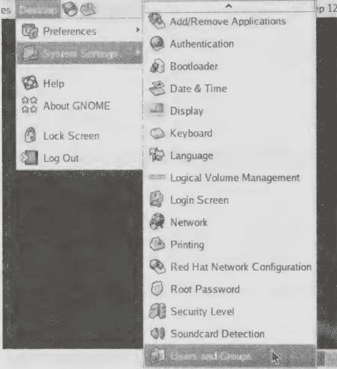

在 Fedora Core 中，用户和组管理任务由“用户管理器”工具处理，你可以通过“桌面 > 系统设置 > 用户和组”来启动它，如图 4.1 所示。

## 获取授权

> 注意：系统管理工具通常需要 root 权限。当需要时，GNOME 会通过图 4.2 所示的对话框提示输入 root 密码。

### 图 4.2。GNOME 显示 root 密码提示。

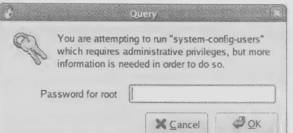

只要输入密码正确，你就获得以 root 身份执行系统配置操作的授权，无需重新输入 root 密码。该授权由右上面板中的徽章图标标识，如图 4.3 所示。一旦完成配置更改，你可以点击徽章图标，然后在弹出的对话框中点击“忘记授权”按钮来结束授权。此时，徽章图标应该消失。

### 图 4.3。显示授权徽章。


## 管理用户

图 4.4。用户列表。

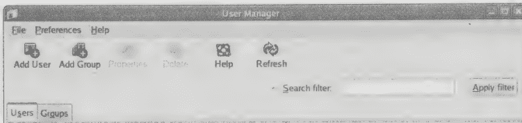

图 4.4 所示的用户管理器显示了系统上存在的所有用户账户。它还显示了每个用户的用户 ID（UID）编号、用户所属的组、用户全名（可选）、用户的默认 shell 以及主目录。要添加用户，点击“添加用户”。将显示图 4.5 所示的对话框。

正如图 4.5 所示，Fedora 管理员在添加新用户时有许多选项可以考虑。这些选项包括定义主目录、为该用户创建私有组、手动分配用户 ID 以及选择用户的 shell。虽然在大多数情况下默认设置是完全可以的，但该过程非常灵活，能够很好地适应特殊情况。

## 管理组

Linux 系统中的用户可以合并为组，这可以方便用户组的文件权限管理。例如，你可以创建一个“developers（开发者）”组，并在其中添加所有为你的服务器编写代码的 Web 开发人员。你可以赋予该组对 Web 应用程序文件的相应权限，使每位开发者都拥有编辑文件的能力，而不允许普通用户访问。

### 图 4.5。创建新用户对话框。

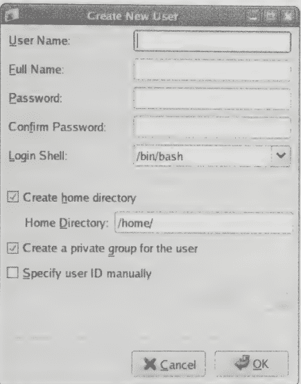

### 图 4.6。创建新组对话框。

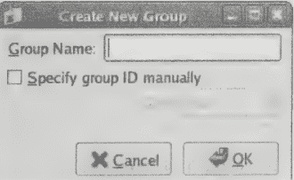

要添加新组，请从用户管理器窗口选择“添加组”。将显示图 4.6 所示的对话框。

首先，你需要为组命名。在我们的示例中，你可以将组命名为“Developers”。你也可以接受预分配的组 ID（GID，在此情况下为 500），或者勾选“手动指定组 ID”复选框来手动分配组 ID。¹

要查看当前组并将用户添加到现有组，请选择用户管理器窗口中的“组”选项卡，如图 4.7 所示。

### 图 4.7。用户管理器的“组”选项卡。

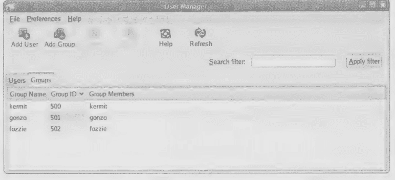

有两种方法可以将用户添加到组。第一种方法是在用户管理器中选择一个组并点击“属性”按钮。在出现的对话框中，选择“组用户”选项卡以查看可以添加到此组的用户列表，如图 4.8 所示。

确保你已勾选所有想要作为该组成员的用户，并点击“确定”。

另一种将用户添加到组的方法是通过用户管理器的“用户”视图。在用户管理器中，点击“用户”选项卡，选择你想添加的用户，并点击“属性”。点击“组”选项卡将显示该用户所属的所有组列表，如图 4.9 所示。

在用户管理器中删除用户或组与创建它们一样简单。只需突出显示用户或组，然后点击管理器工具栏上的“删除”按钮即可。

> ¹你总是希望接受预分配的 ID，因为在少数情况下组 ID 是什么并不重要。如果你遇到了这些少数情况，就会知道为什么需要特定的 ID；否则，接受建议。

### 图 4.8。将用户添加到组。

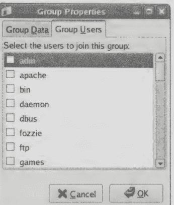

### 图 4.9。将用户添加到组。


## 从命令行管理用户

### 使用 useradd 和 groupadd 创建用户和组

要从命令行添加用户和组，我们使用 `groupadd` 和 `useradd` 命令。遗憾的是，在 Fedora 的默认安装中，你无法像使用 `ls` 那样轻松使用 `groupadd` 或 `useradd`。`groupadd` 和 `useradd` 工具位于 `/usr/sbin` 目录，不在默认 `PATH` 中。要将此目录添加到 `PATH`，请在提示符输入 `export PATH=$PATH:/usr/sbin`。这对当前会话有效；一旦关闭终端窗口，该值就会消失。

### 图 4.10。在编辑器中打开 .bashrc。


如果你希望每次启动 shell 时都运行此命令，可以将该命令添加到 `.bashrc`，这是一个每次启动 shell 时都会执行的隐藏文件。要在编辑器中打开此文件，选择“文件 > 打开...”，在文件列表区域右键点击并选择“显示隐藏文件”，如图 10 所示。

找到 `.bashrc` 并打开它。在文件末尾添加如下 `export` 命令：

```bash
# .bashrc
# 用户特定别名和函数
# 全局定义
if [ -f /etc/bashrc ]; then
    /etc/bashrc
fi
export PATH=$PATH:/usr/sbin
```

下次打开终端时，此命令会自动执行。注意，这不会影响你当前打开的 shell——你需要关闭并重新打开它们才能生效。让我们来看这些命令的示例，我们将以 root 身份运行：

```bash
[kermit@swinetrek ~]$ su
Password:
[root@swinetrek kermit]# groupadd puppets
[root@swinetrek kermit]# useradd -G puppets -c "Miss Piggy" mispiggy
[root@swinetrek kermit]# passwd mispiggy
Changing password for user mispiggy.
New UNIX password:
Retype new UNIX password:
passwd: all authentication tokens updated successfully.
[root@swinetrek kermit]# exit
exit
[kermit@swinetrek ~]$
```

在这个示例中，我们可以看到使用 `groupadd` 命令创建一个名为“puppets”的组。记得 `groupadd` 位于 `/usr/sbin`，所以可能需要输入 `/usr/sbin/groupadd`。

接下来，我们使用 `useradd` 命令创建一个名为“mispiggy”的用户，并将其加入“puppets”组（通过 `-G` 参数指定），全名为“Miss Piggy”（通过 `-c` 参数指定）。当使用 `useradd` 创建用户时，该用户的密码是被锁定的；我们需要更改密码来解锁。为此，我们使用 `passwd` 命令。

## 使用 userdel 和 groupdel 删除用户和组

你可以使用 `userdel` 和 `groupdel` 命令删除用户和组。注意，`userdel` 会保留用户的主目录；你可能想在以 root 登录时删除此目录：

```bash
[kermit@swinetrek ~$] su
Password:
[root@swinetrek kermit]# groupdel puppets
[root@swinetrek kermit]# userdel mispiggy
[root@swinetrek kermit]# rm -rf /home/mispiggy/
[root@swinetrek kermit]# exit
exit
[kermit@swinetrek ~]
```

## 挂载与文件系统

我们在第 2 章中简要介绍了挂载（mount）、挂载点和文件系统的概念。在 Linux 中，当我们插入任何类型的可移动介质时，我们需要挂载存储在该媒体设备上的文件系统。这个概念对于 Windows 用户来说相当陌生，但一旦掌握，它就会变成本能。事实上，Windows 执行相同的操作；区别在于 Windows 操作系统自动化了挂载过程，因此用户通常不知道它的发生。Nautilus 很大程度上也自动化了这个过程，但对于管理员来说，知道设备是如何挂载的以及如何通过命令行完成挂载是非常重要的。

# 使用 mount 命令挂载文件系统

让我们看看从命令行挂载软盘的过程：

```bash
[kermit@swinetrek ~]# su
Password:
[root@swinetrek kermit]# mount -t vfat /dev/fd0 /media/floppy
[root@swinetrek kermit]# exit
```

```
exit
[kermit@swinetrek ~]$
```


`mount` 命令将文件系统加载到我们服务器的文件系统中。在这种情况下，设备是软磁盘驱动器（`/dev/fd0`），该设备的文件系统被加载到 `/media/floppy`——这就是挂载点。我们还需要告诉 Linux 期望在设备上找到什么类型的文件系统。在这种情况下，我们正在使用格式化为 `FAT32` 的磁盘，并通过 `-t vfat` 指定了这一点。

让我们仔细观察一下这里发生着什么。我们正在使用一张来自旧 `Windows` 机器的软磁盘；该磁盘上存储了几个目录，如图 4.11 所示。

### 图 4.11。在 Windows 中查看软磁盘的文件系统。


正如我们在第 2 章中看到的，`Linux` 中没有 `A` 盘器；可移动介质设备显示为 `/media` 目录内文件系统的一部分。因此，当我们挂载软磁盘时，它会出现在 `/media/floppy` 目录下，如图 4.12 所示。

### 图 4.12。软磁盘的文件系统作为 Linux 文件系统的一部分显示。


## 使用 umount 命令卸载文件系统

在拔出软磁盘之前，我们应该先卸载它，从而将其从文件系统中移除。我们可以使用 `umount` 命令来实现这一点——注意这里少了一个字母“n”——如下所示。

```
[kermit@swinetrek ~]$ ummount /media/floppy
[kermit@swinetrek ~]$
```

对于某些设备来说，卸载过程非常重要。软磁盘就是一个很好的例子。向软磁盘保存文件可能需要很长时间；卸载过程可以确保所有向磁盘写入数据的程序在设备被移除之前完成它们的写入操作。

## 文件系统表 (fstab)

你服务器文件系统的许多配置选项都包含在一个单一文本文件 `/etc/fstab` 中。由于该文件对系统的运行至关重要，因此该文件的所有者是 `root`，只有 `root` 才能写入该文件。这种所有权权限结构防止了非 `root` 用户对文件进行任何潜在的灾难性修改或删除。强烈建议不要调整这些权限，并在登录 `root` 身份时对该文件给予应有的尊重。

## 编辑只读文件


以 `root` 身份编辑文本文件有很多方法。可能简单的方法是在切换到 `root` 用户后，从命令行启动你喜好的文本编辑器。文本编辑器将像你以 `root` 身份登录一样运行，因为 `GNOME` 将坚持向终端返回一个看起来难看的消息：

```
[kermit@swinetrek ~]$ su
Password:
[root@swinetrek ~]# edit /etc/fstab
```

```
(gedit:2066): GNOME-WARNING **: While connecting to session manager:
Authentication Rejected, reason : None of the authentication protocols specified are supported and host-based authentication failed.
```

## 文件系统表 (fstab)

使用这种方法编辑文件完全没有问题。`Kate` 或你选择的任何文本编辑器都可以正常运行。然而，如果你想消除这个警告，`Bruce Wilk` 在 `linux.redhat` 新闻组中建议了以下脚本作为解决方案。

```bash
#!/bin/sh

if [ $ -lt 1 ];
  then echo "usage: basename $0 command" >&2
  exit 2
fi

exec -c "exec env DISPLAY='$DISPLAY' \
  XAUTHORITY=${XAUTHORITY_HOME}/.xauthority \
  "$SHELL" -c '$*'
```

将此文件保存为 `xtroot.sh`，并放在你家目录下名为 `bin` 的目录中。你可能需要创建这个目录，还需要赋予自己该文件的执行权限。你可以通过运行 `chmod +x /bin/xtroot.sh`，或者在 `Nautilus` 中更改文件的权限来实现。

由于 `/home/username/bin` 自动包含在环境变量 `PATH` 中，你理应能够简单地通过输入 `xtroot.sh` 直接从命令行运行它。

```
[kermit@swinetrek -]$ xtroot.sh gedit
Password:
```

`fstab` 是 "filesystem table"（文件系统表）的缩写，它为操作系统提供了关于设备应该挂载在哪里的说明。

`/etc/fstab` 文件类似于：

```text
# This file is edited by fstab-sync see 'man fstab-sync' for
# details
/dev/VolGroup00/LogVol00 /ext3 defaults 1 1
LABEL=/boot /ext3 defaults 1 2
/dev/devpts /dev/pts devpts gid=5,mode=620 0 0
/dev/shm /dev/shm tmpfs defaults 0 0
/dev/proc /proc defaults 0 0
/dev/sys /sys defaults 0 0
/dev/VolGroup00/LogVol01 /media/floppy auto 0 0
```

## 系统管理

### 文件系统表 (fstab)

`rw` 文件系统提供读写访问。

`ro` 文件系统提供只读访问。

对于挂载设备和文件系统的许多其他选项，正如你在默认 `fstab` 文件中看到的，但这些是我们感兴趣的。在我们的示例中，许多选项被设置为 `defaults`。在 `Fedora Core` 系统中，这等同于 `auto, rw`。

5. 第五列用于 `dump` 工具判断是否将文件系统包含在备份中——0 值告诉 `dump` 忽略该文件系统。

6. 最后的一列指示是否由 `fsck`（文件系统检查）工具检查。`ext3` 文件系统很少受益于此类检查。如果你想进行此类检查，你应该按照你希望检查的顺序对文件系统进行编号——第一个 1，第二个 2，依此类推。

有了格式正确的 `fstab` 文件，使用 `mount` 命令将变得简单得多：

```
[kermit@swinetrek -]$ su
Password:
[root@swinetrek kermit]# mount /media/floppy
[root@swinetrek kermit]# exit
exit
[kermit@swinetrek -]$
```

在这里，我们只指定了挂载点。`mount` 查找 `fstab` 来识别与该挂载点相关的设备。

能否以普通用户身份挂载设备，取决于 `fstab` 中注的选项以及设备文件的权限。如果挂载点由 `root` 所有，而你尝试作为普通用户挂载它，你将看到“Permission denied”（权限被拒绝）错误。

## 创建挂载点

直到为止，我们只讨论了 `Fedora Core` 关于挂载点的惯例。其他 `Linux` 系统使用不同的惯例，以便挂载点名称更易识别。例如，`SuSE` 在安装系统时会创建一个 `/floppy` 挂载点，而不是 `Fedora` 的 `/media/floppy`。

# 第 4 章：系统管理

其他发行版可以使用不同的约定，这一事实应该告诉你挂载点的命名并不是标准的，也不应该是标准的。请记住，挂载点仅仅是系统上的另一个目录。如果你对正在使用的发行版所采用的约定感到困惑，请使用你偏好的约定。

例如，你可以在你的 `Fedora` 系统上使用上述 `SuSE` 约定：

```
kermit@swinetrek ~]$ su
Password:
root@swinetrek kermit]# mkdir /floppy
root@swinetrek kermit]# exit
kermit@swinetrek ~]$ mount -t vfat /dev/fd0 /floppy
kermit@swinetrek ~]$
```

在这里，我们将软盘的文件系统挂载到了一个新的挂载点：`/floppy`。我们可以通过编辑 `fstab` 来使此更改永久生效。

**文件：`/etc/fstab`**

```text
# 此文件由 fstab-sync 编辑 - 详情请参 man fstab-sync
#
/dev/VolGroup00/LogVol00 | | ext3 defaults | 1 1 |
LABEL=/boot | | /boot ext3 defaults | 1 2 |
/dev/devpts | /dev/devpts devpts gid=5,mode=620 0 0 |
/dev/shm | /dev/shm tmpfs defaults | 0 0 |
/dev/proc | /proc proc defaults | 0 0 |
/dev/sys | /sys sysfs defaults | 0 0 |
/dev/VolGroup00/LogVol01 | swap swap defaults | 0 0 |
/dev/fd0 | /floppy auto pamconsole,exec. noauto,managed 0 0 |
/dev/hdc | /media/cdrom auto pamconsole,exec. noauto,managed 0 0 |
```

现在我们只需输入 `mount /floppy` 即可挂载软盘。

## 自动挂载文件系统

我们可以使用 `fstab` 中的 `auto` 选项来使某些设备的挂载过程自动化。要为了在插入 `CD-ROM` 后自动挂载，请将 `/dev/hdc` 列出的选项从 `noauto` 改为 `auto`。

```text
# 此文件由 fstab-sync 编辑 - 详情请参阅 'man fstab-sync'
#
/dev/VolGroup00/LogVol00 / ext3 defaults 1 1
LABEL=/boot /boot ext3 defaults 1 2
/dev/devpts /dev/pts devpts gid=5,mode=620 0 0
/dev/shm /dev/shm tmpfs defaults 0 0
/dev/proc /proc defaults 0 0
/dev/sys /sys sysfs defaults 0 0
/dev/VolGroup00/LogVol01 swap auto 0 0
/dev/fd0 /media/floppy auto pamconsole,exec,
                                     noauto,managed 0 0
/dev/hdc /media/cdrom auto pamconsole,exec,
                                     auto,managed
```

现在，每当你插入 `CD-ROM` 时，它都会自动挂载。

## 服务

与每个现代操作系统一样，`Linux` 在后台有很多在运行。如果你是一个普通的电脑用户——在 `Linux`、`Mac` 或 `Windows` 系统上——你很少会有充分的理由与这些后台任务交互。大多数时候，你甚至不会察觉它们的存在。这些任务独立运行，只要你不干扰它们，它们就不会干扰你。即使作为管理员，你可能也不需要比启动、停止或重启这些服务之外做更多事情。但不要让缺乏直接接触误导了你：这些服务对于你系统的运行至关重要。

`Linux` 的系统服务通常被称为守护进程（`daemons`）。它们是在后台运行的应用程序，提供如文件和打印机共享、电源管理、自动任务调度和系统日志等关键功能。例如，你的 `Web` 服务器将运行 `httpd`，它是 `Apache` 核心的 `HTTP` 守护进程。如果你使用 `MySQL`，你还需要运行 `MySQL` 守护进程 `mysqld`。

## 服务配置工具

**图 4.13。服务配置工具。**


你可以通过选择 桌面 > 系统设置 > 服务器设置 > 服务 来启动服务配置工具，它可以用于停止和启动服务。该工具如图 4.13 所示。

要停止或启动服务，请从左面板列表中选择它。右侧将显示简要描述以及该服务的当前状态。要启动已停止的服务，点击窗口顶部的“Start”（启动）按钮；要停止运行的服务，点击“Stop”（停止）按钮。还有一个“Restart”（重启）按钮，可用于重启服务——此操作对于某些配置更改生效可能是必要的。

你还可以使用此工具配置服务在开机时自动启动。要这样做，请勾选服务名称旁的复选框，并点击“Save”（保存）。

## 服务与运行级别

运行级别（`Runlevels`）基本上是描述系统当前可用设施的一种方便方式。在运行级别 5 中，所有系统功能均可用：多个用户可以登录，网络功能可用，且 `GUI` 正在运行。随着系统的启动和系统功能的可用，会触发其他运行级别：

- 运行级别 1：一次只能有一个用户登录。没有网络资源可用。
- 运行级别 2：多个用户可以同时登录，但没有网络支持。
- 运行级别 3：与运行级别 2 相同，网络资源可用。
- 运行级别 5：除了运行级别 3 之外，`GUI` 也可用。

## 运行级别 4 发生了什么？

没有运行级别 4——这个是留给系统专家的。


# 第 4 章：系统管理

**图 4.14。编辑所有运行级别。**


服务配置工具允许你设置服务在运行级别 3、4 或 5 时启动。要更改给定的运行级别，从“Runlevel”菜单中选择选项。你可以一次编辑一个运行级别，也可以通过选择“All”（所有）来编辑全部，如图 4.14 所示。

勾选框框以指定你想自动启动的守护进程，当你想要停止守护进程时，点击窗口顶部的“Save”。注意，如果你想要守护进程在运行级别 3、4 和 5 ，你需要勾选所有。当系统达到运行级别 5 时，将会停止。

## 使用 service 启动和停止服务

要从命令行停止、启动或获取服务的状态，可以使用 `Fedora` 的 `service` 工具，它位于 `/sbin` 目录中。记住，如果你将 `/sbin` 添加到了环境变量，就不需要在命令前加 `/sbin/` 了。

```
kermit@swinetrek ~]$ su
Password:
root@swinetrek kermit]# /sbin/service status
httpd is stopped
root@swinetrek kermit]# /sbin/service start
Starting httpd: [ OK ]
root@swinetrek kermit]# /sbin/service status
httpd (pid 2928) is running...
root@swinetrek kermit]# /sbin/service stop
```

## 使用 nsysv 自动启动服务

```
Stopping httpd:
root@swinetrek kermit]# [ OK ]
exit
root@swinetrek kermit]# exit
kermit@swinetrek ~]$
```

该工具两个参数：守护进程名称（在本例中为 `httpd`）和要执行的操作。所有服务都支持 `start`、`stop`、`restart` 和 `status`。

## 使用 nsysv 自动启动服务

`ntsysv` 是一种特殊的命令行工具，因为它提供了类似于第 1 章中基于文本的安装界面，如图 4.15 所示。

**图 4.15。在终端运行 nsysv。**


默认情况下，`nsysv` 只编辑运行级别 5。你可以通过在启动 `nsysv` 时使用 `--level` 选项来更改。例如，`nsysv --level 3` 将编辑运行级别 3。

## 使用 chkconfig 自动启动服务

`chkconfig` 是 `nsysv` 更传统的命令行对应。

```
kermit@swinetrek ~]$ su
Password:
root@swinetrek kermit]# /sbin/chkconfig --level 345 httpd
root@swinetrek kermit]#
exit
kermit@swinetrek ~]$
```

此命令让 `httpd` 在级别 3、4 和 5 启动。运行 `chkconfig --list` 可以获取每个级别启动的服务列表。

## 自动化常规任务

计算机旨在为我们执行任务。我们计算生命的大部分时间都在重复地执行相同的任务，其中许多任务最终是相当无脑的。系统管理有时会变成一项充满单调和常规的事务：相同的按键、相同的检查、相同的结果。如果我们能把计算机投入预期用途，让它为我们做这些事情不是理想的吗？

`Linux` 提供了许多自动化任务的方法。脚本虽然有帮助，但真正的力量在于两个特定的设施：`cron` 和程度较小的 `at`。这些是你执行此类常规任务所需的工具，如存档日志、使用新安装应用程序更新系统数据库、写入服务器统计等。

## cron

`cron` 是一个执行调度脚本的 `Linux` 系统守护进程。`cron` 守护进程（或 `cron`）作为系统启动时启动的服务运行。它每分钟检查一次自己的调度数据库需要执行的任务。

`cron` 的核心是 `/etc/crontab` 文件，下方显示了未修改的 `Fedora Core` 安装内容：

```text
SHELL=/bin/bash
PATH=/sbin:/bin:/usr/sbin:/usr/bin
MAILTO=root
```


## `run-parts` 命令调度表

```
01 * * * root run-parts /etc/cron.hourly
02 4 * * root run-parts /etc/cron.daily
22 4 * * root run-parts /etc/cron.weekly
42 4 1 * root run-parts /etc/cron.monthly
```

`crontab` 文件首先定义了一些环境变量：运行任务的 shell、`PATH` 环境变量、用于发送邮件通知的系统账户，以及要使用的主目录。在 `run-parts` 命令之后，列出了命令调度表。

# `crontab` 命令调度表语法

无论你信不信，此文件中的单行内容就提供了系统执行全套任务所需的所有信息。为了理解它，我们需要将这一行拆解为各个字段。

## 24 小时制

> cron 始终使用 24 小时制定义：7:24 意味着上午 7:24，19:24 意味着晚上 7:24。

- 1. 第一个字段定义了在执行任务之前每小时必须经过多少分钟。在上面的默认 `crontab` 文件中，第一个任务被安排在整点后一分钟开始；最后一个任务被安排在整点后 42 分开始。

- 2. 第二个字段定义了任务完成的小时。通过此，我们可以知道第二个任务被安排在 4:02 运行。

星号 `*` 表示该任务应每小时执行一次。因此，我们可以知道第一个任务被安排在 0:01、1:01、2:01 等等时间点运行，一直持续到 23:01，然后重新开始。

- 3. 第三个字段定义了任务运行的日期——数字从 1 到 31 排序。最后一个命令被安排在每月 1 号的 4:42 运行。同样，星号 `*` 表示该任务应在每月的每一天运行。

- 4. 第四个字段决定了任务应该运行的月份；如你所预期的，月份从 1 到 12 排序。如果你有一个每年仅执行一次的任务（例如 7 月），该字段将包含 7。如果你有一个在 12 月每天都要执行的任务，该字段将包含 12。由于在我们的示例中，该字段始终包含星号 `*`，我们知道所有的任务都将在每月执行一次。

- 5. 第五个字段定义了任务运行的星期。0 代表星期日，1 代表星期一，6 代表星期六。我们的第三任务在该字段中为 0：它将在周日的 4:22 执行。另外，该字段中的星号 `*` 表示该任务将在每周的每一天执行。

- 6. 下一个字段标识完成任务的用户。在此处的所有情况下，都是 `root`。

- 7. 最后一个字段定义了要运行的实际任务。在这里，我们使用 `run-parts` 来执行 `/etc/cron.` 目录下的每一个脚本。`/etc/cron.hourly` 目录下的脚本每小时运行一次，`/etc/cron.daily` 目录下的脚本每天运行，依此类推。

## 添加到 `crontab`

让我们结合第 3 章提到的场景将其用于更具实际的应用。你可能记得我们通过命令 `find /var/backups/* -ctime +5 -exec rm {} \;` 引入了命令行的力量，我用它来每周执行三次，删除超过五天的备份。这个自动化过程由 `cron` 驱动，所以让我们看看在我的系统上是如何配置的：

```
SHELL=/bin/bash
PATH=/sbin:/bin:/usr/sbin:/usr/bin
MAILTO=root
HOME=

## run-parts

01 * * * root run-parts /etc/cron.hourly
02 * * * root run-parts /etc/cron.daily
22 4 * * root run-parts /etc/cron.weekly
42 4 1 * * run-parts /etc/cron.monthly
12 5 * * 2,4,6 root find /var/backups/* -ctime +5 -exec rm {} \
```

前两个字段告诉我们该任务将在 5:12 运行——为了纯粹起见，我将任务安排在我没有使用系统时运行，尽管在性能方面可能不会太大影响。接两个字段填充了星号，意味着它们无论日期如何都会运行。不过，这里可能有趣的值是第五个“星期”字段，它的值为 `2,4,6`——这意味着任务被安排在周二、周四和周六运行。`crontab` 也允许范围。第五个字段中的 `1-5` 将把任务安排在周一到周五。

`cron` 同样很容易地执行脚本。让我们创建一个名为 `backup.sh` 的脚本来实际创建这些备份。将此文件保存在 `/home/username/bin-directory`——如果你还没有创建此目录，你可能需要创建它。

```bash
#!/bin/sh

# 为此备份创建一个目录。
# 它的名称取决于日期时间和，因此备份不会相互覆盖，
# 除非它们在同一分钟内执行。

DATE=$(date +%Y%m%d%H%M)

mkdir /var/backup
```

# 第 4 章：系统管理

与其他 Linux 应用一样，Anachron 通过一个文本配置文件来获取运行方向。在 Fedora 中，该文件是 `/etc/acronontab`。乍看之下，acronontab 并不比 `crontab` 那么令畏，尽管我们知道 `crontab` 文件实际上非常简单。

文件：`/etc/acronontab`

```
# /etc/acronontab: anachron 的配置文件
# 详情请参见 anacron(8) 和 acronontab(5)。

SHELL=/bin/sh
PATH=/usr/local/sbin:/usr/local/bin:/sbin:/bin:/usr/sbin:/usr/bin
```

| 1 65 cron.daily run-parts /etc/cron.daily |
| 7 70 cron.weekly run-parts /etc/cron.weekly |
| 30 75 cron.monthly run-parts /etc/cron.monthly |

与 `crontab` 类似，该文件的前几行定义了一些环境变量：在这种情况下，是 `SHELL` 和 `PATH`。剩余的行通过多个字段描述了 Anachron 必须执行的任务。从左到右，这些字段如下：

### 周期 (period)

周期字段标识了构成任务运行一次的“周期”所包含的天数。在这个示例中，第一个任务将每天运行一次，第二个任务每七天运行一次，最后一个任务每三十天运行一次。

### 延迟 (delay)

当任务到执行执行时间时，Anachron 会在等待指定的分钟数后再执行该任务。这在机器处于关闭状态一段时间后重新开启时可能非常有用。例如，假设我们的机器已经关闭了超过三十天。当我们重新打开它时，Anachron 会意识到是时候执行它所有预计划的任务了。它会在 65 分钟后执行每日任务，70 分钟后执行每周任务，75 分钟后执行每月任务。这种交错执行的执行机制可以防止机器被三个竞争任务所拖累。

### 任务标识符 (job identifier)

任务标识符字段顾如其名：系统识别每个 Anachron 任务的方法。该字段可以包含任何字符，空格、制表符和 shell 除外。

### 命令 (command)

最后，与 `crontab` 类似，`anacrontab` 指定了将执行的命令。同样，Anacron 将执行 `run-parts` 来处理 `/etc/cron.daily` 中的脚本。

Anacron 的操作非常直观。运行时，它从 `/etc/acronontab` 读取任务列表，并检查每个任务是否在过去指定的天数内运行过。如果没有运行，Anacron 将等待延迟期后运行该任务。如果任务已经在指定的时间段内运行过，它就不会再理会。这非常简单。

我们可以使用在本节早些介绍过的服务工具之一来启动 Anacron 守护进程。默认情况下，它应该被设置为随你的机器启动，但如果你愿意，你也可以更改此设置。

# 共同运行 cron 和 Anacron

> 当 cron 和 Anacron 都被配置为运行 `/etc/cron.schedule` 目录下的所有脚本时。然而，cron 或 Anacron 只有一个会实际运行这些脚本。

这些目录中的每一个目录都包含一个保持 Anachron 更新状态的脚本。例如，每当 cron 运行 `/etc/cron.daily` 中的脚本时，其中一个脚本就会更新 Anachron 用来记录任务上次运行时间的文件。稍后，当 Anachron 去运行这些脚本时，它会看到 cron 已经运行过它们，所以它不会再次运行。

# at

现在，我们已经有了 cron 来在你的系统上执行定期计划的任务。我们有了 Anacron 在机器不是 24/7 全天运行的情况下弥补 cron 的遗漏。这看起来已经是一套很完整的任务调度方法，不是吗？尽管事实如此，我们在自动化任务的拼图中仍然缺少了一块：

at 是一个经典的 Linux 技巧，旨在接替其他应用程序停止的地方继续。无论在 cron 还是 anacron 的情况下，要在调度计划中添加一个简单的、一次性的任务并不是件易事。例如，假设你需要下载一个非常大的文件，并且你想在网络上没有人的时候下载，这样就有充足的带宽。你可以在 `/etc/cron` 中添加一个条目，但你必须记住之后删除它，以避免将来再次下载同一个文件。at 完美地服务这一小众需求。此外，使用 at 的语法再简单不过了：

```
[kermit@swinetrek ~]$ at 3:00
at> wget http://sitepoint.com/verylargefile.zip
at> <EOT>
job 1 at at 2005-12-31 03:00
[kermit@swinetrek ~]$
```

> > 注意 `<EOT>` 代表传输结束，通过按下 `Ctrl-D` 触发。
> 使用此符号来表示你已经完成了要在指定时间执行的命令的输入。

at 将任务调度在在你指定的时刻下一次出现时。例如，at 将在凌晨 3:00 执行给定的命令。

## 24 小时制

> > 注意 记住 at 像 cron 和 Anacron 一样，使用的是 24 小时制。

# 发送邮件

默认情况下，发送到 `root` 的邮件由 `sendmail` 处理。要配置这一点，你只需编辑 `/etc/aliases` 文件。这是一个两个步骤的过程。首先，在 `/etc/aliases` 中记录 `root` 的邮件应发送到管理员邮箱。其次，运行命令告诉 `sendmail` `aliases` 文件已更改：

```
[kermit@swinetrek ~]$ su
Password:
[root@swinetrek kermit]# newaliases
/etc/aliases: 77 aliases, longest 16 bytes, 785 bytes total
[root@swinetrek kermit]# exit
exit
[kermit@swinetrek ~]$
```

这就是全部的操作。从现在开始，服务器上任何 cron 任务（或类似任务）发送到 `root` 的任何邮件都会进入你的邮箱。如果你在服务器上创建了额外的账户（例如个人管理员），你可能希望将这些账户添加到 `/etc/aliases` 中，将其转发到 `root` 或其他邮箱地址。更改后记得运行 `newaliases`。

文件：`etc/aliases`（部分）

| 接收 root 邮件的人 | |
|---|---|
| `root:` | `kermit@myisp.net` |
| `kermit:` | `root` |
| `gonzo:` | `gonzo@myisp.net` |
| `fozzie:` | `fozzie@myisp.net` |

# 其他服务

正如你所预期的，你的 Fedora Core 系统安装了一套完整的图形化工具，方便管理系统的各种服务。工具多到无法深入介绍；相反，我们将查看你经常用于配置和维护系统及其提供的服务的工具。

# Samba

Samba 允许你与其他机器共享目录和打印机。通常，这些机器是 Windows 机器，但并不一定。

要开始使用图 4.16所示的 Samba 服务器配置工具，选择桌面（Desktop） > 系统设置（System Settings） > 服务器设置（Server Settings） > Samba。

# 图 4.16。Samba 服务器配置工具。


要他人共享 Linux 服务器上的目录，请点击添加共享（Add Share）按钮。将显示图 4.17 所示的对话框。

# 图 4.17。创建 Samba 共享对话框。


Samba 主窗口显示你定义的所有共享列表。通过高亮共享，你可以获取有关它的更多信息；通过点击属性（Properties）按钮调整其设置。

## NFS

NFS或网络文件系统（Network File System）是 Linux 原生对应的 Samba。它允许客户端机器将你的机器文件系统的部分挂载为像其他设备一样的设备。

NFS 配置界面（通过桌面 > 系统设置 > 服务器设置 > NFS 访问）与 Samba 配置提供的界面非常相似。目录、允许的主机和权限都显示在主窗口中。你可以添加或删除共享，像 Samba 配置一样，检查并更改现有共享的属性。

## 挂载 NFS 共享

你可以使用 `mount` 命令快速方便地挂载 NFS 共享。不需要指定设备文件（如 `/dev/fd0`），只需指定服务器名称和共享目录名称，两者之间用冒号隔开。

```
[root@swinetrek kermit]## mkdir /mnt/kermit-oldserver
[root@swinetrek kermit]## mount oldserver:/home/kermit \
> /mnt/kermit-oldserver
[root@swinetrek kermit]#
```


# Apache Web 服务器

图 4.18。图形化 HTTP 配置工具。


服务器设置菜单包含 `HTTP` 选项，它会启动图 4.18 所示的图形化工具，允许你配置你的 `Apache` 服务器。

我们在这里不会深入探讨该配置工具：我们将在第 5 章进行详细介绍。然而，你可以看到 `Apache` 服务器的几乎每个配置选项都可以在窗口中可用。

# 第 4 章：系统管理

## 包管理

图 4.19。包管理工具。


图 4.19 所示的包管理工具可以通过选择 `桌面 > 系统设置 > 添加/删除应用程序` (`Add/Remove Applications`) 来使用。

该工具提供了一种从你的系统中添加和删除应用程序的方法。你可以调整组内的单个软件包，也可以删除整个组。

## 启动配置

图 4.20。引导加载程序配置工具。


图 4.20 所示的启动配置工具可以通过 `桌面 > 系统设置 > 引导加载程序` (`Bootloader`) 访问。它是一个用于配置我们在第 1 章讨论过的 `GRUB` 引导加载程序的非常简单的工具，允许你选择系统启动时使用的内核。

当允许对 `Linux` 内核进行自动更新时，系统中可能会出现多个内核。默认情况下，系统在启动时会选择最新的内核版本，但此工具允许你从系统中安装的任何内核中进行选择。它还提供了一种设置启动超时的方法：系统在自动启动默认内核版本之前等待你选择内核的时间。

## 日期和时间

图 4.21。日期/时间属性窗口。


图 4.21 所示的日期/时间属性工具（`桌面 > 系统设置 > 日期与时间`）有多个用途。首先，它提供立即调整系统日期和时间的方法。这对于服务器的时间标记和日志记录至关重要。

在网络时间协议（`NTP`）选项卡中，你可以配置服务器设置以使用网络时间协议（`NTP`），以便你的系统连接到全球的 `NTP` 服务器以自动调整自己的内部时钟。这将有助于确保服务器具有近原子钟的时间精度。要使用 `NTP`，请在网络时间协议选项卡中勾选“启用网络时间协议”复选框。该复选框下方是要使用的 `NTP` 服务器列表；你可以通过添加和删除按钮管理此列表。

最后，在时区（`Time Zone`）选项卡中，日期/时间属性工具允许你选择服务器所在的时区。如果你希望服务器根据协调世界时（`UTC`）保持时间，请勾选“系统时使用 `UTC`”复选框。

## 显示设置


`Fedora Core` 中的显示设置工具（`桌面 > 系统设置 > 显示`）允许你配置分辨率、色彩深度以及双显示器。

# 第 4 章：系统管理

## 网络设置

网络设置可以通过图 4.23 所示的配置工具（`桌面 > 系统设置 > 网络`）进行配置。

该工具提供了一种配置你的网络设置的方法。你可以通过图形界面启用或禁用网络设备。此外，你还可以通过此工具执行高级操作，如配置 `IP` 地址、`DNS` 和 `DHCP`。

图 4.23。网络配置工具。


# 第 4 章：系统管理

## 打印机

`Fedora` 提供图 4.24 所示的工具（`桌面 > 系统设置 > 打印`）来配置你系统上的打印机。

图 4.24。打印机配置工具。

（此处由于原文未提供图片路径，按要求保留占位符逻辑）

“新建”按钮将启动一个向导，允许你使用直接连接到服务器的打印机或网络上的打印机。

## 安全级别配置

防火墙和安全增强 `Linux`（`SELinux`）使用图 4.25 所示的安全级别工具进行配置。

图 4.25。安全级别工具。


该工具是 `iptables` 命令的图形化前端。

`iptables` 提供了限制进入和离开系统的网络流量通过特定类型、特定端口或设备的能力。这些可以在安全级别窗口的防火墙选项卡中配置。显然，如果你正在配置和管理 Web 服务器，允许机器上的 `WWW`（`HTTP`）流量是重要的。你也可以选择性允许安全 `WWW`（`HTTPS`）流量。对于远程管理，允许 `SSH`（`Secure Shell`）流量是有用的：这将允许你从远程位置登录机器并执行管理任务，就像坐在服务器一样。很少允许 `Telnet`：该协议存在许多的安全问题。

如果你不是允许流量类型，而是希望允许特定接口的所有流量（例如第一个以太设备 `eth0`），请从信任设备列表中选择该选项。注意，这比限制特定协议要不安全，因为跨选接口的所有流量将被允许。

你可能还想通过特定端口允许流量。你可以在安全级别窗口的其他端口字段中定义这些端口，并用逗号隔开。在防火墙选项卡的所有选项中，这是最安全的，因为它将流量限制在特定的入口点。我们将在第 9 章中详细介绍此。

`SELinux` 是 `Fedora Core` 的一项新功能，自 `Fedora Core 3` 起作为标准选项可用。它是 `Linux` 内核的一系列安全相关增强，主要由美国国家安全局（`NSA`）编写。`SELinux` 是一个功能丰富的工具，详细的配置信息超出了本书的范围。你可以在线访问 `http://www.nsa.gov/selinux/` 获取更多关于 `SELinux` 的信息，包括详尽的常见问题列表。

## 归档管理器

图 4.26。归档管理器应用程序。


图 4.26 所示的归档管理器用于创建系统上的文件归档。它可以处理多种归档格式，从 `Windows` 用户熟悉的 `.zip` 格式到 `Java` 的 `.jar` 格式，再到 `Unix` 的 `.tar` 格式。

可以通过 `Applications > System Tools > Archive Manager` 访问。

归档管理器可用于创建新归档或向现有归档添加文件。它还用于查看现有归档的内容。要创建新归档，点击“`New`”图标，然后选择新归档的名称和位置。

接下来，您需要点击归档管理器主工具栏中的“`Add`”按钮。在弹出的窗口中，点击您想要存储新归档的位置并为其命名。

您可以通过点击“`Add`”按钮逐个添加文件，也可以像图 4.27 所示，从 `Nautilus` 中拖放文件或文件夹来添加。

图 4.27。添加目录。


# 第 4 章：系统管理

图 4.28。归档管理器的提取对话框。


归档管理器还可以用于查看或提取归档的内容。点击“`Open`”并选择归档，然后点击工具栏上的“`Extract`”。归档管理器将显示提取对话框，如图 4.28 所示，该对话框包含许多提取归档文件的选项。

## 磁盘格式化器

图 4.29。软磁盘格式化器。


要格式化软磁盘，在 `Floppy device` 框中输入软磁盘设备的路径；如果机器只有一个软磁盘，`/dev/fd0` 将在此文本字段中显示为灰色。选择设备、文件系统类型，并在需要时添加卷名。您还可以选择格式化模式，包括快速（`quick`）、标准（`standard`）或彻底（`thorough`）。完成所有参数设置后，点击 `Format` 按钮完成格式。图 4.29 所示的软磁盘格式化器可以通过 `Applications > System Tools > Floppy Formatter` 访问。

## 硬件浏览器

图 4.30。硬件浏览器。


`Fedora Core` 的硬件浏览器提供了系统上安装的所有硬件的视图。通过高亮显示设备可以获得详细视图，如图 4.30 中的 `Hard Drive` 视图所示。

指针设备、网络设备、打印机以及所有其他硬件设备都可从此窗口查看。您可以通过选择 `Applications > System Tools > Hardware Browser` 来启动硬件浏览器。

## 网络设备与互联网连接

在所有 `Linux` 发行版中，`Fedora` 配置互联网访问特别简单。图 4.31 所示的互联网配置向导（`Applications > System Tools > Internet Configuration Wizard`）为配置以太网卡、拨号和 `DSL` 调制器、无线网卡和其他连接类型提供了完整的分步操作指南。

图 4.31。互联网配置向导。


`Fedora` 的父级发行版 `Red Hat` 开创了探测和检测硬件设备的过程。网络设备也不例外，如图 4.32 所示。大多数市售网络设备都可以在此窗口内被检测并显示。

图 4.32。探测网络设备。


# 第 4 章：系统管理

互联网配置向导中的配置网络设置对话框（如图 4.33 所示）允许您选择连接类型——`DHCP` 或静态（`static`），并为网络上的识别提供主机名。

图 4.33。配置网络设置对话框。


## Kickstart

`Fedora` 提供了一个主要为大型环境中的管理员设计的工具：图 4.34 所示的 `Kickstart` 配置器。

> **提示** 需要 `Kickstart` 吗？
> `Kickstart` 不包含在 `Fedora Core 4` 的标准服务器安装中。如果您需要安装它，

图 4.34。`Kickstart` 配置器。


# 第 5 章：构建服务器

来自世界的志愿者董事负责沟通、计划和协调服务器软件的。

随着万维网在 20 世纪 90 年代初的流行，最广泛使用的服务器软件是由 `Rob McCool` 编写的 `NCSA HTTP` 守护。`McCool` 是参与开源开发的众多学生中的又一员。他在国家超级计算机应用中心（`NCSA`）工作期间创建了 `HTTP` 应用程序。`McCool` 还深度参与了 `Netscape` 的多个项目，`Netscape` 是当时最流行浏览器的制造者。

`McCool` 在 1994 年年中离开了 `NCSA`，该项目的开发随之陷入了停滞。随着全球对可靠 Web 服务器的需求日益增长，各地的网站管理员和运维继续为该服务器开发补丁和扩展。这些操作都发生在项目的官方范围之外，尽管这些扩展和修复程序在互联网上传传，并被部署在世界各地的服务器上。

意识到整合所有修复程序的需要，`Apache` 小组于 1995 年初成立。该小组以 `NCSA HTTP 1.3` 版本为基础，将所有被认为实用的修复和补丁整合到新的 `Apache` 服务器中。事实上，之所以选择 `Apache` 这个名字，是因为最初的软件确实是一个“满补丁的服务器”（a patchy server）。开发工作持续了整个 1995 年，并在 1995 年 12 月发布 `Apache 1.0` 达到顶点。从那时起，`Apache` 一直是互联网上顶级服务器软件。

为了本书的目的，我们将使用 `Apache 2` 的最新版本。

## 安装 Apache

`Apache` 几乎在每个 `Linux` 发行版中可用。在 `Fedora` 的情况下，你可能在安装操作系统时就已经安装了软件的 `RPM` 版本。

## 要求

`Apache` 对你的 `Linux` 有以下要求：

- 50MB 空闲临时磁盘空间。这仅在安装 `Apache` 时需要。安装完成后，`Apache` 只将使用约 10MB 的磁盘空间。
- 服务器上有一个准确的时钟。`HTTP` 协议的部分是以时间表示的。为了确保服务器的正常运行和记录，建议利用网络时间协议（`NTP`）守护进程来维护系统时间。你可以通过 `桌面 > 系统设置 > 日期与时间` 中的日期/时间属性工具进行配置。

总而言之，构建 `Apache` 服务器的要求非常低，大多数 `Linux` 系统都能满足。

在 `Fedora Core` 上安装 `Apache` 时，你有几种选择：可以通过 `Fedora Core` 发行版自带的 `RPM` 包完成安装，也可以从 `Apache` 网站下载源代码，编译并构建服务器以满足你的特定需求。然而，自己编译和安装服务器可能不是对时间的有效利用；`Apache` 的软件包版本可能已经满足了你所有的需求，除非你正在运行一个极高流量或复杂的网站。我们不会在书中讨论 `Apache` 的自编译。

## 通过 RPM 包安装 Apache

`Apache 2` 包含在 `Fedora Core` 发行版中，这使得安装非常简单。然而，你并不限于安装光盘中包含的版本。`Apache` 的开源性质允许改进和修复的不断出现，软件通过增量发布不断向前。当你准备好安装 `Fedora` 发行版时，`Apache` 服务器可能已经达到了另一个增量版本。而且，和服务器的源码发行一样，增量 `RPM` 版本也可以供下载。

获取和安装最新版本 `Apache` 的一种方法是使用更新工具 `yum`，它直接从 `Red Hat` 下载更新。首先，我们将检查是否有可用的 `Apache` 更新。

```
[kismet@swinetrek ~]$ su

Password:

[root@swinetrek kismet]# yum check-update httpd

Setting up repositories

updates-released 100% ======================== 951 B 00:00

extras           100% ======================== 1.1 kB 00:00

base             100% ======================== 1.1 kB 00:00

Reading repository metadata in from local files

primary.xml.gz      100%|=======================================| 307 kB  00:04

updates-re: ########################################### 949/949

Added 949 new packages, deleted 0 old in 18.67 seconds

primary.xml.gz      100%|=======================================| 751 kB  00:10

extras:       : ######################################## 2119/2119

Added 219 new packages, deleted 0 old in 51.33 seconds

primary.xml.gz      100%|=======================================| 824 kB  00:12

base             : ####################################### 2772/2772

Added 2772 new packages, deleted 0 old in 37.78 seconds

httpd.i386           2.0.54-10.2               updates-released

[root@swinetrek kermit]#
```

¹ `http://httpd.apache.org/`

当你第一次运行 `yum` 时，它需要从 `Red Hat` 下载有关可用包的信息。一旦分析了可用包列表，它将列出有可用更新的包说明。在上面，我们看到 `httpd.i386` 已更新到。

# 第 5 章：构建服务器

```
Running Transaction Test

Finished Transaction Test

Transaction Test Succeeded

Running Transaction Test ########################### [1/6]

Updating : httpd ############################## [2/6]

Updating : httpd-manual ####################### [3/6]

Updating : mod_ssl ########################### [4/6]

Cleanup : httpd ############################# [5/6]

Cleanup : httpd-manual ####################### [6/6]

Cleanup : mod_ssl

Updated: httpd.i386 0:2.0.54-10.2
Dependency Updated: httpd-manual.i386 0:2.0.54-10.2
mod_ssl.i386 1:2.0.54-10.2
Complete!

[root@swinetrek kermit]#
```

完成后，请再次以 `root` 运行以下命令重启你的新的 `Apache` 服务器：

```
[root@swinetrek kermit]# /bin/service httpd restart

Stopping httpd: [ OK ]

Starting httpd: [ OK ]

[root@swinetrek kermit]#
```


## 启动和停止 Apache

我们已经在第 4 章查看了服务如何停止和启动，但我们还有另一种方法可以控制 apache：`apachectl`。让我们现在来看看它。

```
[kmit@swinetrek kermit -] su

Password:

[root@swinetrek kermit]# /usr/sbin/apachectl start

[root@swinetrek kermit]# /usr/sbin/apachectl restart

[root@swinetrek kermit]# /usr/sbin/apachectl stop
```

如你所示，它的语法与 `service` 工具非常相似，但 `apachectl stop` 可以跨平台工作。也就是说，它在 Windows 命令行中的工作方式与 Linux 中一样；而对于 `service httpd stop` 就不能说了。

`apachectl` 还有其他用途。当你对 `httpd.conf` 进行更改时，可以使用 `apachectl` 命令检查你修改后的配置的语法。

```
[root@swinetrek kermit]# /usr/sbin/apachectl configtest

Syntax OK

[root@swinetrek kermit]#
```


## 使用 MySQL 和 PHP 配置服务器

今天，动态网站已是常而非例外。大多数网站都需要某种类型的数据库后端，并使用一种或另一种脚本语言。裸的 `Apache` 配置非常适合提供静态 `Web` 页面而无需任何额外配置，但如果你想构建一个更动态的网站，就需要多做一些工作。

## 安装 MySQL 和 PHP

首先，你需要确保已安装适用于 `MySQL` 和 `PHP` 的所有适当软件包。这里采用的是 `MySQL` 和 `PHP` 的非常基础的安装；关于更多细节的深入讨论，请参阅 Kevin Yank 出出的著作 *Build Your Own Database Driven Website Using PHP & MySQL²*（SitePoint, ISBN 0–9579218–1–0）。

> ² http://www.sitepoint.com/books/phpmysql1/

# 第 5 章：构建服务器

### 图 5.1。显示 Web 服务器组中的软件包。


你可以使用我们在第 4 章中看到的包管理工具（桌面 > 系统设置 > 添加/删除软件包）安装必要的 `PHP` 和 `MySQL` 软件包。启动该工具，滚动到 `Web Server`，点击“Details”按钮以显示 `Web Server` 组中的软件包，如图 5.1 所示；其中大部分软件包可能已经安装了。

确保 `php` 和 `php-mysql` 软件包已勾选（如果没有勾选，请勾选）并点击“Close”按钮。

接下来，确保 `MySQL Database` 软件包组已选中。由于我们正在构建一个专门使用 `MySQL` 的服务器，我们也可以取消选中 `PostgreSQL Database` 软件包组。点击 `MySQL Database` 的“Details”按钮，并确保 `php-mysql` 和 `mysql-server` 已被勾选。

完成后，点击主窗口中的“Update”以安装或移除任何软件包。

## 有人用 PostgreSQL 吗？

如果你倾向于使用 `PostgreSQL` 而不是 `MySQL`，那没问题。在 `Web Server` 软件包组中，勾选 `php-pgsql` 以赋予 `PHP` 与 `PostgreSQL` 数据库的能力。你可以取消勾选 `php-mysql` 以保持服务器精简高效，或者保留它以增加灵活性。

要完成安装，请使用你喜欢的方法重启 `Apache` 服务。

## 测试你的 PHP 安装

为了测试 `PHP` 安装情况，让我们在 `/var/www/html` 目录下创建一个名为 `phpinfo.php` 的文件；你需要切换到 `root` 执行此操作。该文件应包含以下三行代码：

此页面将调用内置 `PHP` 函数 `phpinfo()` 来显示有关你 `PHP` 安装的所有可用信息。在 Web 浏览器（应用程序 > 互联网 > `Firefox` 浏览器）中打开 `http://localhost/phpinfo.php` 来运行此页面。

# 第 5 章：构建服务器

### 图 5.2。在 Firefox 中显示 phpinfo.php。


`Firefox` 应该显示关于你服务器的信息，如图 5.2 所示。如果没有，请检查服务是否运行（`/etc/httpd/logs/error_log`）。

此页面将调用内置 `PHP` 函数 `phpinfo()` 来显示有关你 `PHP` 安装的所有可用信息。在 Web 浏览器（应用程序 > 互联网 > `Firefox`）中打开 `http://localhost/phpinfo.php` 来运行此页面。

## 配置证据

## 配置 Apache

乍一看，配置 `Apache` 似乎是一个令人生畏的过程。配置文件（`httpd.conf`）包含了近 100 行。配置 `Apache` 的指令深藏注释之中。可用指令的灵活性可以根据你的变得复杂或简单。

## 使用 HTTP 工具配置服务器

无论你是通过 `RPM` 系统安装服务器，还是决定从源码构建服务器，`Fedora` 都提供了一套图形化工具。在 `Fedora` 的情况下，该工具就是 `HTTP` 工具。

要启动 `HTTP` 工具，选择桌面 > 系统设置 > `HTTP`。

## 注意无意中覆盖你的编辑！

`HTTP` 工具直接对 `httpd.conf` 进行编辑。因此，你应该尽早决定是使用该工具还是手动编辑配置文件。如果你选择先手动编辑，稍后使用 `HTTP` 工具进行调优，你的手动编辑将被覆盖。事实上，对文件进行的任何手动编辑都会被随后使用 `HTTP` 工具的操作覆盖。

## 图 5.3。HTTP 配置工具。


`HTTP` 工具的 `Main` 选项卡（如图 5.3 所示）提供了设置服务器若干关键参数的手段。

此屏幕上的第一个字段是 `Server Name`。如果你的服务器将在互联网上线，`Server Name` 文本框应包含服务器的完全限定域名，例如 `www.mycompany.com`。另一方面，如果服务器仅在内部用于测试和开发，你可以在此文本字段中分配任何你选择的名称。你还可以为服务器的管理员分配一个电子邮件地址。你应该输入一个有效的电子邮件账户地址。

这两个字段下方是 `Available Addresses` 部分，你可以在那里定义 `Apache` 监听哪些请求的地址和端口。监听所有可用地址的 80 是 `Apache` 服务器的默认行为。如果你更喜欢为服务器配置指定特定的地址和/端口，可以使用 `Add...`、`Edit...` 和 `Delete` 按钮来管理此列表。

## 默认端口

> 注意端口 80 是 `HTTP` 流量的默认端口；443 是 `HTTPS` 流量的默认端口。要向另一个端口发送 `HTTP` 请求，您必须在 URL 中的服务器名称后添加 `:port-number`。在 Web 浏览器中输入 `http://www.my-company.com:1024/` 将向 `mycompany.com` 的服务器端口 1024 发送请求。

在同一台服务器上运行多个网站时，配置 `Apache` 仅监听某些 IP 地址和端口组合特别有用。您可能会输入一个网站的 IP 地址并仅允许 80 端口的流量，但对于另一个网站，您可能有两个条目：一个针对 80 端口，另一个针对 443 端口。

## 图 5.4. 定义虚拟主机。


图 5.4 显示的 `HTTP` 配置工具中的“虚拟主机”（`Virtual Hosts`）选项卡允许管理员创建一个虚拟主机，虚拟主机基本上是由您的服务器托管的网站。虚拟托管使得从一台服务器为许多网站提供服务成为可能。使用添加（`Add...`）、编辑（`Edit...`）和删除（`Delete...`）按钮来管理虚拟主机列表。

# 第 5 章：构建服务器

## 图 5.5. 设置虚拟主机选项。


如图 5.5 所示，在添加或编辑虚拟主机时会提供几个选项。在“常规选项”（`General Options`）选项卡中，管理员可以通过“主机信息”（`Host Information`）下拉列表指定这是基于 IP 的虚拟主机、基于名称的虚拟主机还是默认虚拟主机。让我们来看一下这些选项：

- 基于 IP 的虚拟主机，可能并不意外，它是一个具有唯一 IP 地址的虚拟主机。如果您从下拉列表中选择“基于 IP 的虚拟主机”，系统将要求您输入虚拟主机的 IP 地址以及其服务器名称（即我们之前输入的完全限定域名）。

- 使用 `HTTP` 配置配置 `Apache` 服务器

- 基于名称的虚拟主机没有唯一的 IP 地址。相反，`Apache` 使用服务器名称来区分共享任何给定 IP 地址的不同虚拟主机。遗憾的是，这意味着此类主机无法使用 `HTTPS`，因为服务器名称是加密标头的一部分。当您选择“基于名称的虚拟主机”时，系统会提示您输入主机名称和 IP 地址；您还可以输入任意数量的别名或其他主机已知名称。

- 默认虚拟主机将处理所有未被其他主机处理的请求。您可以选择性将默认虚拟主机限制在特定端口。

在“基础设置”（`Basic Setup`）部分，您可以为您的虚拟主机命名（可以是任何名称），并告诉它去哪里查找文件。您还可以输入 Web 管理员电子邮件地址；同样，这应该是一个有效的电子邮箱地址。

# 第 5 章：构建服务器

## 图 5.6. 虚拟主机站点配置选项。


如图 5.6 所示，“页面选项”（`Page Options`）选项卡提供了定义目录默认文档以及网站错误处理页的方法。

在“目录页面搜索列表”（`Directory Page Search List`）中，您可以定义目录默认页的名称和优先级。通常情况下，当您请求 `http://www.mycompany.com/example/` 某个页面时，运行 `www.mycompany.com` 的服务器将扫描 `example` 目录并查找列表中的第一个文件。如果没有找到列表中的第一个文件，将对列表中的第二个文档进行搜索。

虚拟服务器的错误页面处理在对话框的下半部分配置。如果您花时间创建了自定义错误页面，可以引导服务器针对特定错误类型使用这些页面：只需点击右侧面板中的“编辑”（`Edit...`）按钮即可。如果您选择使用默认错误页面，可以指定这些页面页脚的显示方式：显示 Web 管理员的电子邮件地址、不显示电子邮件地址，或者完全不显示。

## 图 5.7. 虚拟主机 SSL 选项。


`HTTP` 配置工具提供了设置带 `SSL` 的 `HTTPS` 通信的方法，如图 5.7 所示。我们将在本章稍后介绍 `SSL`。

# 第 5 章：构建服务器

## 图 5.8. 虚拟主机日志选项。


图 5.8 所示的“日志”（`Logging`）选项卡提供了配置传输（或访问）日志和错误日志处理方式的选项：您可以指定写入的目录，选择自定义日志工具，或将其写入系统日志。

重要的是，日志配置允许您自定义日志级别。这些级别从“调试”（`Debug`）到“紧急”（`Emergency`）列出。您可以指定记录这些级别中的哪一个。例如，如果您将级别设置为“错误”（`Error`），则只记录 `Error` 及更高级别的消息。如果您将级别设置为“调试”（`Debug`），则将记录所有消息。

# 第 5 章：构建服务器

## 图 5.9. 虚拟主机环境选项。


如图 5.9 所示，可以为您的虚拟主机定义环境变量。如果您想利用 `CGI` 程序，这可能是必要的。

## 图 5.10. 虚拟主机目录选项。


图 5.10 显示了虚拟主机配置选项卡中的最后一个——“性能”（`Performance`）。它允许您为整个网站开启或关闭目录选项；只需点击对话框顶部的“编辑”（`Edit...`）按钮即可此功能。您还可以为特定目录设置这些选项。选项有：

- `ExecCGI`：开启时，此选项允许执行 `CGI` 程序。

- `FollowSymLinks`：此选项决定文件系统的符号链接是否被视为文件的一部分。当此选项开启时，符号链接被视为文件的一部分；当关闭时，它们会被忽略。

- `SymLinksIfOwnerMatch`：当启用 `FollowSymLinks` 选项时，此选项确保符号链接文件的所有者与链接目标的所有者相同。如果所有者不匹配，则不会将其包含在文件系统中。

- `Includes`：如果您想使用服务器端包含，则应开启此选项。

- `IncludesNOEXEC`：`IncludesNOEXEC` 选项与 `Includes` 选项几乎相同，唯一区别是不允许使用潜在危险的指令。

- `Indexes`：此选项决定当未找到默认文档时发生什么。如果选项开启，将显示目录中所有文件的列表。如果关闭，则将返回错误。您可能希望关闭此选项。

- `MultiViews`：开启此功能可以启用内容协商多视图，这是一种允许您以用户偏好的格式提供内容的技术。例如，假设我们有法语和英语的内容，分别保存为 `content.html` 和 `content.html.en`，且开启了 `MultiViews`。请求 `content.html` 的设置为法语的浏览器将接收法语内容，而浏览器将接收英语内容。注意，如果我们还有一个名为 `content.html` 的文件，则无论浏览器的偏好语言如何，该文件都始终会被提供。

要更改特定目录的选项，点击“添加”（`Add...`）按钮打开目录选项屏幕。

# 图 5.11. 修改目录选项。


在对话框底部的文本字段输入目录名称，然后从结果窗口右侧面板列出的选项中选择你需要的选项。

你还可以通过拒绝（`Deny`）和允许（`Allow`）列表限制对此目录的访问。在左侧的 `Order`（排序）选项中，在 `Allow list` 之前选择 `Process Deny list`（进程拒绝列表）；此时 `Deny List` 和 `Allow List` 字段都将变为启用状态。使用 `Deny hosts` 和 `Allow hosts` 字段来配置你的虚拟服务器将接受或拒绝请求的 IP 地址。

最后，我们可以选择是否允许在 `.htaccess` 文件中覆盖这些选项，我们很快就会详细讨论这一内容。

# 第 5 章：构建服务器

# 图 5.12. 修改服务器配置选项。


图 5.12 显示的 `HTTP` 配置工具中的 `Server` 标签为你的服务器提供了几个低级配置选项。第一个是 `Lock File`（锁文件），它在服务启动时创建。该文件的存在防止其他服务器实例启动。`PID File`（`PID` 文件）为系统提供进程 ID 信息。`Core Dump Directory`（核心转储目录）是服务器发生崩溃时写入核心文件的位置。核心文件随后包含了丰富的调试信息，可能引导你找到崩溃的原因。

`Server` 标签还提供了定义服务器用户（`user`）和组（`group`）的功能。虽然这些可以设置为系统上任何存在的用户和组，但通常情况下，保留默认配置是个好主意。定义的用户和组是在你安装服务器时创建的，无论是通过 `RPM` 包还是从源码安装。如果你选择了一个默认以外的用户，则需要确保系统上存在该用户和组，或者在更改 `Server` 标签中的默认值之前创建它们。

# 图 5.13. 修改性能调优选项。


`HTTP` 配置工具中的最后一个标签（如图 5.13 所示）提供了几个性能调优选项。这些包括并发服务器连接数、以秒为连接超时、每个连接的最大并发请求数以及是否允许持久连接。默认情况下，`Apache` 将允许同时进行 150 个连接，一次性生成高达 15,000 个请求。虽然这个数字看起来很大，但事实是，大多数服务器——即使是使用三四年前的处理器和最小内存的服务器——也能处理这个默认值。你可以通过更改最大连接数或每个连接的最大请求数来为你的系统增加此数字。在大多数情况下，减少或增加每个连接的可接受请求数是首选的调整方法。

## 调优

`Apache` 的性能调优本身可以是一门艺术。然而，根据机器的年代、内存容量以及服务器所连接的连接速度，为你的服务器提供一些粗略的指南是非常容易。让我们以三个场景为例：

- 1. 一台拥有 128MB 内存的旧 PC，通过慢速 `ADSL` 连接。
- 2. 一台拥有 256MB 内存的较新 PC，同样通过 `ADSL` 连接。
- 3. 一台拥有 512MB 内存的新 PC，通过 `T1` 连接到网络。

在第一场景中，`Apache` 中适当的连接设置可能是：

- `Max Number of Connections`（最大连接数）: 50
- `Connection Timeout`（连接超时）: 100
- `Max requests per connection`（每个连接的最大请求数）: 50
- `Allow persistent connections`（允许持久连接）：off

另一方面，第二场景可能最支持这些条件：

- `Max Number of Connections`（最大连接数）: 150
- `Connection Timeout`（连接超时）: 300
- `Max requests per connection`（每个连接的最大请求数）: 100
- `Allow persistent connections`（允许持久连接）：on

第二台机器内存更大，因此能够处理更多连接。结果是连接超时也可以稍微长一点。然而，由于连接速度的原因，它可能无法很好处理持久连接或每个连接的高数量请求。

第三台机器可以轻松处理默认设置：

- `Max Number of Connections`（最大连接数）: 100
- `Connection Timeout`（连接超时）: 200
- `Max requests per connection`（每个连接的最大请求数）: 50
- `Allow persistent connections`（允许持久连接）：off

此外，由于连接速度更快，在这台机器上允许持久连接可能是可以接受的。正如你所看到的，正确调整 `Apache` 的性能设置涉及大量的尝试和错误。

## 使用 .htaccess 和 httpd.conf 进行配置

当服务器按照你的需求配置好后，点击 `HTTP` 配置工具中的 OK，并使用你选择的方法重启服务器。

如果你对服务器有某些特殊要求——这些仅适用于特定目录的考量——或者你需要快速锁定目录访问，除极少数用户外，会怎样？在这种情况下，你可以向 `.htaccess` 文件写入指令，按目录逐一创建配置。`.htaccess` 文件是 `httpd.conf` 的目标版本。它可以包含全局 `httpd.conf` 中允许的任何指令。

`.htaccess` 文件适用于它所在的目录及其所有子目录。例如：

```apache
```


## 为你的服务器配置安全连接

随着互联网商业化的出现，有必要创建一种协议，以便 Web 服务器和浏览器之间安全地发送数据。这种协议就是`HTTPS`，它是`HTTP`的安全版本。`HTTPS`使用约定的加密协议（最常用的是安全套层`SSL`）对要发送的数据进行加密，然后将加密数据发送到目的地，并在那里进行解密和处理。

`Apache`可以使用`OpenSSL`通过`HTTP`提供 Web 服务。但在我们进行设置之前，理解从我们的服务器提供安全请求涉及的过程是非常关重要的。

## 公钥加密学简介绍

加密服务器和浏览器之间的连接需要两个元素：密钥和证书。这些元素将允许服务器向浏览器提供其身份证明，并建立一个利用公钥加密的连接。

密钥用于加密连接。加密有两种基本类型：公钥加密和对称密钥加密（也称为私钥加密）。在后者中，服务器和浏览器都使用加密密钥，这对于加密和解密数据是必要的。虽然非常安全，但向所有客户端分发加密密钥对于公共服务器使用对称密钥加密几乎是不可能的：你如何确保加密密钥在传输过程中不被窃取？对称密钥加密在内网环境或内部服务器中使用更为常见。

使用公钥加密时，存在两个密钥：公钥和私钥。正如其名称所示，私钥安全地存储在服务器上，而公钥则公开供公众访问。通过复杂的数学过程，用公钥加密的数据只能用私钥解密，反之亦然。

然而，加密并不是创建安全、可信连接的唯一必要元素。客户端需要确保该机器确实是它所声称的那个。这可以通过从已知且受信任的证书颁发机构（`CA`）获取公共证书来实现。在向 `CA` 请求证书时，大多数情况下，你需要发送你或你公司的身份证明，并支付服务费用。`CA` 将返回一个用于你的安全服务器的公钥证书。

使用`OpenSSL`创建自己的公钥证书也是可能的，但此类证书仅适用于开发和测试目的：当浏览器遇到由它们不认为“受信任”的`CA`颁发的证书时，通常会报错，显示类似于图 5.14 所示的错误。在本章中，我们将……

# 第 5 章：构建服务器

图 5.18 输入你的证书详细信息。


下一步是输入你的证书详细信息，如图 5.18 所示。
表单中预填充了占符详情；请用适用于你服务器的信息覆盖这些内容。

## 图 5.19. 选择是否加密私钥。


接下来，系统会询问你是否要加密创建的私钥。如果恶意第三方获取了你的私钥且该密钥未加密，他们将能够解密浏览器与 Web 服务器之间的通信。如果你正在运行一个安全站点并试图建立可靠的信誉，这将产生显而易见的灾难性后果。加密密钥可以确保，即使恶意者破解了你的系统并获取了密钥，如果没有密钥的密码，他们无法使用它来解密通信。然而，如果你加密了私钥，每当 `Apache` 重启时你都需要输入密钥密码；因此，`Apache` 在服务器重启后无法自动启动。你需要决定对于你的服务器来说，哪一个更重要：安全性还是管理的便利性。

在几乎任何需要 `HTTPS` 的情况下，服务器安全都应该是首要任务，因此我们将加密私钥。按下空格键，使“`Encrypt the private key`”（加密私钥）旁边出现星号，然后选择“`Next`”（下一步）。

## 图 5.20. 输入私钥的密码。


在下一个屏幕上，输入两次私钥密码，然后选择“`Next`”（下一步）以完成密钥生成过程。

选择“`Next`”，过程就完成了！你已经在命令行提示符处显得有些粗鲁地退出了。如果你生成了 `CSR`，从现在起，你需要遵循 `CA`（证书颁发机构）的说明来获取你的证书。如果你生成了自签名证书（正如我们所做的那样），你就可以继续了。

**重要**：如果你加密了私钥，每当 `Apache` 重启时你都需要输入密钥密码；因此，`Apache` 在服务器重启后无法自动启动。你需要决定对于你的服务器来说，哪一个更重要：安全性还是管理的便利性。

在几乎任何需要 `HTTPS` 的情况下，服务器安全都应该是首要任务，因此我们将加密私钥。按下空格键，使“`Encrypt the private key`”（加密私钥）旁边出现星号，然后选择“`Next`”（下一步）。

选择“`Next`”，过程就完成了！你已经在命令行提示符处显得有些粗鲁地退出了。如果你生成了 `CSR`，从现在起，你需要遵循 `CA` 的说明来获取你的证书。如果你生成了自签名证书（正如我们所做的那样），你就可以继续了。

## 配置 Apache

现在我们需要做的是使用占位符来配置 `Apache`，请用适用于你服务器的信息覆盖这些内容。

## 控制 Apache

```bash
[root@swinetrek kermit]#/usr/sbin/apachectl restart
httpd
```

`.htaccess` 文件也可用于限制某些目录的访问。例如，如果我们想限制对`/var/www/html/testing`的访问，我们可以使用以下`.htaccess`文件：

```apache
AuthType Basic
AuthName "Password Required"
AuthUserFile /etc/httpd/passwd
```

通过这种方式，`.htaccess` 文件将告诉 `Apache` 用户必须输入组成员的用户名和密码。正如本例中的`UserFile`和`AuthGroup`指令所示，用户名和密码将在`/etc/httpd/passwd`中进行验证，然后在`/etc/httpd/groups`中检查用户的成员身份。

`/etc/httpd/passwd`文件使用`htpasswd`工具维护。

```bash
[root@swinetrek kermit]# htpasswd -c /etc/httpd/passwd kermit
New password:
Re-type password:
Adding password for user kermit
[root@swinetrek kermit]# htpasswd /etc/httpd/passwd mispiggy
New password:
Re-type password:
Adding password for user mispiggy
[root@swinetrek kermit]#
```

添加第一个用户时必须使用`-c`选项。这告诉`htpasswd`创建密码文件。`htpasswd`生成的文件示例所示。

文件：`/etc/httpd/passwd`
```
kermit:phQeDvrsdvni6
mispiggy:Xzbbbk8ImcCclI
```

`/etc/httpd/groups`文件必须使用文本编辑器手动维护。它是一个非常简单的文件：组列在每行的开头，每个组的成员随其后。

文件：`/etc/httpd/groups`
```
mer gonzo fozzie mispiggy
admins: kermit mispiggy
```

如果你在 Fedora Core 的默认 `Apache` 安装中尝试设置这些，什么都不会发生。默认情况下，`Apache` 未配置为允许`.htaccess`文件，但在`httpd.conf`中设置它非常简单。

要在目录中允许`.htaccess`配置，请打开 HTTP 配置工具并转到 Virtual Hosts（虚拟主机）标签。选择你想使用`.htaccess`文件的虚拟主机，并点击 Edit...（编辑...）打开虚拟主机属性窗口。

对话框。切换到“性能”（Performance）选项卡，点击“添加...”（Add...）并输入你想要保护的目录。你需要输入服务器文件系统中显示的目录名称，该名称通常以`/var/www/html/`为前缀。勾选“.htaccess 文件覆盖目录选项”复选框，点击“确定”保存更改。

或者，你也可以直接对`http.conf`进行修改。打开`httpd.conf`并在并在文件末尾添加以下指令。

文件：`httpd.conf`（节录）

```apache
<Directory /var/www/html/testing/admin>
AllowOverride AuthConfig
</Directory>
```

`AllowOverride` 指令指示 `Apache` 处理指定目录内的 `.htaccess` 文件，但 `AuthConfig` 参数限制了 `.htaccess` 文件中允许与授权相关的指令。其他可用的参数包括：

- **FileInfo**: 与文件类型处理相关的指令。
- **Indexes**: 控制当目录中未找到默认文档时发生情况的指令。
- **Limit**: 控制拒绝和允许列表的指令。
- **Options**: 可以控制虚拟主机对话框“性能”选项卡中设置的选项的指令。
- **All**: 允许所有指令。
- **None**: 不允许任何指令；`.htaccess` 文件将被忽略。

然而，`.htaccess` 文件并不是万能药。使用它也有一些注意事项，包括使用 `.htaccess` 文件带来的性能影响。当 `AllowOverride` 指令允许使用 `.htaccess` 文件时，服务器将在服务器文件系统中的每个目录中搜索 `.htaccess` 文件。虽然在处理请求量适中的服务器上这可能不会产生真正的性能问题，但在高流量生产服务器上会导致严重的性能下降。

此外，服务器将需要找到上级目录中的所有 `.htaccess` 文件。这意味着如果你在 `/var/www/html/testing/admin` 服务器目录在使用 `.htaccess` 文件，`Apache` 将查找 `/var/www/html/.htaccess`、`/var/www/html/testing/.htaccess` 和 `/var/www/html/testing/admin/.htaccess`。实质上，使用 `.htaccess` 文件意味着对单个页面请求要进行三次检查。同样，对高流量生产服务器的性能影响可能是巨大的。

既然如此，为什么还要使用分布式配置文件呢？嗯，它们确实有一些合法的用途。例如，如果你通过虚拟主机为单台机器上的多个用户提供托管服务，`.htaccess` 文件可以允许用户在你在 `httpd.conf` 文件中创建的限制内自定义其各自的服务器环境。

通过仔细的规划以及对 `httpd.conf` 指令的理解，你的 `Apache` 服务器将提供一个安全、灵活且易于维护的环境。这种规划还将尽量减少服务器为了满足用户需求而需要的工作。

## 为你的服务器配置安全连接

随着互联网商业化的出现，有必要创建一种协议，以便 Web 服务器和浏览器之间安全地发送数据。这种协议就是`HTTPS`，它是`HTTP`的安全版本。`HTTPS`使用约定的加密协议（最常用的是安全套层`SSL`）对要发送的数据进行加密，然后将加密数据发送到目的地，并在那里进行解密和处理。

`Apache`可以使用`OpenSSL`通过`HTTP`提供 Web 服务。但在我们进行设置之前，理解从我们的服务器提供安全请求涉及的过程是非常关重要的。

## 公钥加密学简介绍

加密服务器和浏览器之间的连接需要两个元素：密钥和证书。这些元素将允许服务器向浏览器提供其身份证明，并建立一个利用公钥加密的连接。

密钥用于加密连接。加密有两种基本类型：公钥加密和对称密钥加密（也称为私钥加密）。在后者中，服务器和浏览器都使用加密密钥，这对于加密和解密数据是必要的。虽然非常安全，但向所有客户端分发加密密钥对于公共服务器使用对称密钥加密几乎是不可能的：你如何确保加密密钥在传输过程中不被窃取？对称密钥加密在内网环境或内部服务器中使用更为常见。

使用公钥加密时，存在两个密钥：公钥和私钥。正如其名称所示，私钥安全地存储在服务器上，而公钥则公开供公众访问。通过复杂的数学过程，用公钥加密的数据只能用私钥解密，反之亦然。

然而，加密并不是创建安全、可信连接的唯一必要元素。客户端需要确保该机器确实是它所声称的那个。这可以通过从已知且受信任的证书颁发机构（`CA`）获取公共证书来实现。在向 `CA` 请求证书时，大多数情况下，你需要发送你或你公司的身份证明，并支付服务费用。`CA` 将返回一个用于你的安全服务器的公钥证书。

使用`OpenSSL`创建自己的公钥证书也是可能的，但此类证书仅适用于开发和测试目的：当浏览器遇到由它们不认为“受信任”的`CA`颁发的证书时，通常会报错，显示类似于图 5.14 所示的错误。在本章中，我们将……


**重要**：如果你加密了私钥，每当`Apache`重启时你都需要输入密钥密码；因此，`Apache`在服务器重启后无法自动启动。你需要决定对于你的服务器来说，哪一个更重要：安全性还是管理的便利性。

# 第 5 章：构建服务器

通过，打开服务配置工具（`Desktop` > `System Settings` > `Services`），在列表中找到`httpd`，并确保它的复选框没有被勾选。如果你做了任何更改，请点击“Save”（保存）。

## 总结

`Webmin`是一个基于浏览器的系统管理工具。它允许你通过Web界面管理服务器，而不是使用命令行。它是一个可以简化许多任务的强大工具。

# 第 6 章：服务器管理

在本节中，我们将介绍`Webmin`提供的一些功能。如果想更深入地了解，我强烈推荐《The Book of Webmin》（或《How I Learned to Stop Worrying and Love Unix》）。

## 安装 Webmin

`Webmin`可以从`http://www.webmin.com`下载`RPM`包。你可以选择下载源代码并自行编译`Webmin`，但对于像`Fedora Core`这样的红帽系统，推荐的方法是使用`RPM`安装。这将在`RPM`数据库中写入条目，以便在需要时进行升级或删除软件包。

## 获取正确的文件

`Webmin`网站将提供两个`RPM`包：`webmin-src.rpm`（源码包）和`webmin-version.noarch.rpm`（可安装版本）。请确保获取可安装版本。

要安装软件包，只需双击`RPM`文件。你将引导通过一系列简单的对话框，`Webmin`将被安装。

## Webmin 基础

`Webmin`在`10000`端口上机器安装了一个小型、特定的Web服务器。你可以通过`http://servername:10000`访问它。

## 无法连接？

为了从外部访问，你需要通过防火墙允许`10000`端口访问。为此，请打开安全级别配置工具（`Desktop` > `System Settings` > `Security Level`），在“Other”（其他）字段中输入`10000:tcp`。

¹`http://www.swelltech.com/support/webmingu/`

## 图 6.1. Webmin 登录页面。


## 图 6.2. Webmin 首页。


## Webmin 用户管理

如果有其他用户需要管理系统，那么为这些用户每人创建一个独立的登录账户是一个好主意。要添加新的`Webmin`用户，点击主页上的“Webmin 用户”（Webmin Users）链接，然后在生成的页面点击“创建新 Webmin 用户”（Create a New Webmin User）。你将看到图 6.3 所示的屏幕。

### 图 6.3. 创建新的 Webmin 用户。


如你所见，在创建新用户时有很多选项可用。在这里，我们将涵盖两个基本选项：创建一个仅限`Webmin`的用户，以及创建一个与`Linux`用户同步的`Webmin`用户。

创建一个仅限`Webmin`的用户非常简单。填写“用户名”（Username）字段，从“密码”（Password）下拉菜单中选择“设置为...”（Set To...），输入用户的密码，并在其他字段中保留默认设置。在页面底部的“模块”（Modules）部分，你将看到一组复选框，允许你指定该用户将访问的功能。勾选相应的复选框（或点击“全选”Select all 链接以选择所有框），然后点击页面底部的“保存”（Save）按钮。

创建一个与`Linux`用户配置同步的`Webmin`用户配置文件同样简单。在“用户名”字段中输入`Linux`用户名，并在“密码”下拉菜单中选择“Unix 身份验证”（Unix authentication）。不要输入密码：密码将从`Linux`用户配置中获取。选择相应的模块复选框，并点击“保存”创建用户。

与`Linux`模型一致，`Webmin`用户可以分组，并可以为这些组分配访问权限。要创建一个新的`Webmin`组，点击`Webmin`用户页面上的“创建新的 Webmin 组”（Create a new Webmin group）链接，并选择该组将访问的模块。现有用户可以从用户页面添加到新组——只需点击用户名，右上角就会出现“所属组”（Member of group）下拉菜单。

## 提升安全性


如果你打算在服务器上使用`Webmin`，还应该采取其他许多步骤来有效保护`Webmin`的安装。这些步骤中的大部分已在《Webmin 之书》（The Book of Webmin / Or: How I Learned to Stop Worrying and Love UNIX）²中概述。

> ^2 `http://www.swelltech.com/support/webmingguide/`

## Webmin 功能

任何基于Web的工具真正的魅力之处通常在于其界面，`Webmin`也是如此。由于浏览器是如今计算中最为人知的界面之一，在`Webmin`界面内移动的学习曲线微乎其微。`Webmin`的Web特性还允许管理员从网络上的任何地方执行必要的任务，或者——只要包已正确安装并安全——就可以从世界任何地方执行。

# 第 6 章：服务器管理

### 图 6.4. Webmin 区域。


`Webmin`模块分为若干组，可以通过`Webmin`界面顶部的图标访问，如图 6.4 所示。让我们看看服务器管理中最重要的四个组：`System`、`Servers`、`Networking`和`Hardware`背后的模块。我们将在本章的后续部分中使用这些模块，因此请将接几页视为`Webmin`所提供功能的概述。

### 图 6.5. 系统组（System）中可用的 Webmin 模块。


## 系统组模块

系统组提供了访问重要的系统级配置工具的权限，如图 6.5 所示。

### 启动与关机

此工具显示所有服务的列表，描述每个服务，并识别该服务是否已配置为开机启动。此页面允许你启动和停止这些服务，并配置它们在系统启动时启动（或不启动）。页面底部是所有运行级别（runlevels）的下拉列表，你可以使用它来查看和配置在每个运行级别发生的情况。最后，你可以使用此屏幕关机或重启系统。

### 修改密码

此工具显示所有用户列表，并允许管理员更改每个人的密码。

### 磁盘和网络文件系统

此工具提供了服务器上各种文件系统的描述并识别其当前状态。它还提供了挂载、卸载文件系统以及挂载新文件系统的功能。

### 文件系统备份

此工具显示所有当前配置的备份列表，并提供创建备份的方法。

### 运行进程

此工具列出系统上运行的所有进程，列出所有进程的`PID`、所有者、内存使用情况和`CPU`时间。默认按用户列出。

### 计划命令

此工具显示所有已定义的作业，并提供创建方法。

### 计划任务

此工具显示服务器上所有的`Cron`任务。

# 第 6 章：服务器管理

### 软件包

此工具提供了搜索系统中安装的软件包的界面。

### 用户和组

此工具提供了管理用户组的完整工具，包括一次性管理多个。

## 服务器组模块

### 图 6.6. 服务器组（Servers）中可用的 Webmin 模块。


如图 6.6 所示，`Webmin`服务器模块允许你配置和维护作为应用程序服务器的不同软件包。我们将在本章稍后使用`Webmin`配置这些软件包，并建立强大的系统安全性。现在，让我们浏览`Webmin`服务器部分的某些功能。

### Apache Web 服务器

`Apache`模块像服务器组中的许多模块一样，包含的选项多到几乎本身就是一个组。它允许通过“配置页面”（Config Pages）编辑`httpd.conf`文件。你可以在 6.7 中看到`Apache`模块的其他选项。

#### 图 6.7. Apache Webmin 模块。


### CVS 服务器

`CVS`（并发版本控制系统）是开发者广泛用于跟踪代码变化的工具。`CVS`服务器页面提供了创建`CVS`用户、用户访问控制和服务器配置的选项。它还允许登录用户浏览`CVS`中的仓库或库。

### Majdomo 列表管理器

`Majdomo`是一种列表管理器，长期以来被认为是`Linux`的标准。`Webmin`中的`Majdomo`列表管理器允许你创建新列表并定义现有邮件列表的参数。

### MySQL 数据库服务器

#### 图 6.8. Webmin MySQL 模块。


如图 6.8 所示页面顶部，`MySQL`模块显示服务器上托管的每个数据库的图标。点击数据库图标将显示该数据库中每个表的图标；点击这些图标可以显示该表的结构。从这里，你可以编辑表的结构，或编辑表中的数据。在每个点

### Webmin 功能

在此过程中，管理员可以访问全套工具来操作`MySQL`及其数据库和表；您可以删除数据库或表、创建数据库备份、创建新的数据库或表、执行`SQL`语句等。

### Postfix 配置
QMail 配置
Sendmail 配置

`Webmin`提供了配置多个邮件服务器的手段。`Sendmail`是`Linux`最悠久的标准，而`Postfix`和`Qmail`则是较新且更易配置的替代方案。这些服务器的`Webmin`接口提供了配置和保护您的邮件服务器所需的所有工具。

### ProFTPD 服务器
WU-FTP 服务器

`ProFTPD`和`WU-FTP`是可以通过默认`Webmin`安装进行配置的两个`FTP`服务。管理员可以使用这些工具添加或删除`FTP`用户并建立用户主目录。

### SSH 服务器

`SSH`是安全外壳（secure shell）。它允许远程用户通过安全连接在服务器的`shell`环境中工作。`Webmin`的`SSH`服务器模块允许您配置身份验证、访问控制等等许多功能。我们将在第 7 章中详细介绍`SSH`。

### Samba Windows 文件共享

我们在第 4 章中简要讨论过`Samba`。`Samba`是一种用于与网络上的`Windows`机器共享文件和打印机的程序。`Webmin`中的Windows文件共享页面显示当前的共享情况，并允许您创建新共享，并对所有新旧共享的工作参数进行配置或重新配置。

### SpamAssassin 邮件过滤器

`SpamAssassin`是一个用于对抗垃圾邮件的强大工具。`Webmin`中的`SpamAssassin`邮件过滤器模块允许您配置`SpamAssassin`的许多方面，包括对被识别为垃圾邮件的消息进行处理。

### Webalizer 日志分析

`Webalizer`是一种Web服务器日志分析工具。它可以为您提供关于服务器使用情况有趣且有价值的见解，并包含在`Fedora Core 4`的默认安装中。`Webmin`中的`Webalizer`日志分析页面允许您确定将分析哪些日志文件、添加新文件进行分析、安排定期分析，并手动生成新的日志分析报告。

## 网络组模块

鉴于您已经创建了Web服务器，您机器的网络特性变得尤为重要。`Webmin`的网络（Networking）模块组（如图 6.9 所示）包含了用于管理防火墙和其他安全功能的模块、带宽监控模块，以及允许访问服务器机器的几种特殊协议。

### 图 6.9。网络组中可用的 Webmin 模块。


### 带宽监控

此页面提供了有关服务器接收流量的信息，使用了`iptables`规则和`Fedora Core`默认安装内置的名为`mrtg`的包。`mrt`提供了管理员可选时间段内服务器流量的图形化表示，这对于分析服务器的峰值和低谷流量非常有用。它还将这些流量划分为“下载”和“上传”部分。

### Linux 防火墙

### Shorewall 防火墙

`Linux`防火墙模块创建并管理`iptables`规则——即安全级别配置工具使用的规则。稍后我们将更仔细地查看`iptables`。`Shorewall`是一个提供类似于`iptables`服务的第三方包。

### NFS 导出

`NFS`是网络文件系统，是一项允许您的`Linux`服务器与网络上的其他服务器共享文件的工具。我们在第 4 章中简要看过了`NFS`。

### 网络配置

`Webmin`中的网络配置页面允许您配置网络接口或设备、将您的服务器设置为路由器或网关、配置服务器如何使用`DNS`、更改服务器的主机以及添加主机地址。

## 硬件组模块

### 图 6.10。硬件组中可用的 Webmin 模块。


尽管网络对服务器的运行至关重要，但如果您的硬件配置错误或以某种方式损坏，那么一切都毫无意义。`Webmin`的硬件配置和监控工具（如图 6.10 所示）提供了服务器上关键硬件设备当前运行状态的良好概述。`Webmin`还提供了几个配置硬件的绝佳工具，包括启动配置、驱动器状态、`RAID`、分区管理和逻辑管理。

### GRUB 引导加载器

`Webmin`中的`GRUB`配置屏幕以图标形式显示机器安装的当前内核版本。选择图标即可访问所有`GRUB`参数的完整配置选项。

### 系统时间

这个相对简单的模块允许您更改系统时间、设置系统时区，并设置与`NTP`服务器的时间同步。

### 其他模块

### 图 6.11。其他（Others）组中可用的 localhost.Webmin 模块。


`Webmin`还提供了并不真正属于任何其他类别的工具，因此它们被放置在图 6.11 所示的“其他”模块组中。它们包括：

### 命令行 shell

#### 图 6.12。使用 Webmin 的命令行工具。


这是Web命令行提示符的一种低技术实现。在页面底部的文本框中输入命令（如图 6.12 所示），提交表单以查看输出。不要输入需要交互的命令，因为此`shell`是完全非交互的。

### SSH/Telnet 登录

此工具由`Java`程序组成，通过浏览器提供`SSH`或`Telnet`访问。

### 文件管理器

此程序以类似于`Windows`资源管理器或`GNOME`文件的样式提供对服务器文件系统的图形化访问。

### 系统和服务器状态

此模块显示机器上各种服务的状态，允许您配置警报并添加监控。例如，您可以配置此模块在`Apache`或监控服务宕机时向留言机发送消息。

### Perl 模块

此工具列出了安装在服务器上的所有`Perl`模块，并提供指向`CPAN`（综合存档网络）的浏览器界面。`CPAN`是各种应用程序使用的`Perl`模块集合。

### Webmin 配置

最后，可以通过屏幕左角的`Webmin`部分根据您的喜好和需求完全自定义安装。

### 更改语言和主题

`Webmin`完全国际化，支持 30 多种语言。`Webmin`的外观也可以通过三个内置主题之一或在线提供的任何数量主题进行自定义。

### Webmin 配置

`Webmin`配置部分是配置`Webmin`应用每个元素的丰富界面，包括网络访问、模块、身份验证、证书和代理。

### 保持软件更新

到为止，您几乎肯定已经`Fedora`桌面右上角闪烁的小叹号图标。点击此图标将启动图 6.14 所示的红帽网络警告通知工具。该工具旨在让已安装的`RPM`包保持最新。

遗憾的是，这个程序及其配套应用程序`update2`包含一个严重的错误，因此它们的大部分功能无法工作。希望红帽的人或`Fedora`社区的成员会修复它；您可以在红帽的`Bugzilla`错误跟踪系统检查该错误的状态。

如果您通过接受服务条款并配置任何可能使用的`HTTP`代理来继续对话框，您将看到红帽警告

#### 图 6.13。在 localhost:localdomain (Redhat Linux 4): Mozilla Firefox 上配置 Webmin。


通知图标变为绿色，表示正在检查更新，然后变为蓝色，表示没有可用更新，如图 6.15 所示。遗憾的是，这种颜色变化可能是之前提到的bug 的症状。为了确保没有可用更新，您可以使用`Fedora`的命令行更新工具`yum`。请关注`Fedora Core`在未来的发行版本中是否会修复此bug。

### 图 6.14. 首次启动时显示的红帽网络警报通知工具。


### 图 6.15. 红帽网络警报器。

# 第 6 章：服务器管理

## yum

`yum`（Yellow Dog Updater, Modified）是许多`Linux`发行版管理工具包中较新添加的内容。它源于一个为基于`PowerPC`的`Yellow Dog Linux`发行版构建的工具，`yum`提供了一种利用托管`RPM`包的服务器网络来保持系统软件包更新的方法。我们在第 5 章中使用了该工具来获取最新版本的`Apache`。`yum`与其他工具相比具有一些明显的优势。这些优势使其成为管理员的良好选择——特别是那些并不总是坐在服务器前的管理员。

- 守护进程（`yumd`）可以在后台运行，定期检查存储库是否有新的软件更新。
- `yum`还可以以非交互模式运行：一个简单的命令行开关将假设您对`yum`提示的回答是“yes”。
- `yum`仅使用`RPM`包头部来检查系统软件与存储库对比。这使其与其他更新系统区别开来，其他系统会在存储在`RPM`数据库的头部之外额外创建一个索引。仅使用头部可以节省服务器上相当的磁盘空间，特别是当安装的工具集不断增长时。
- `yum`命令集非常小，但功能强大。

> `yum`：注意事项
> `yum`是一个方便的工具，但偶尔可能会导致问题。例如，某些`MySQL`更新可能会覆盖您的配置并删除您的数据。如果您的安装依赖于特定的库才能运行，在安装新包之前手动检查列表通常是一个好主意。

### 使用 yum 更新服务器

要检查服务器是否有可用更新，请在终端窗口输入`yum check-update`。

```
yum check-update
```


### 系统更新与依赖解析

[kermit@swinetrek ~]$ `su`

Password:

[root@swinetrek kermit]# `yum check-update`

Setting up repositories

updates-released 100% |================================================| 951 B 00:00
extras 100% |=======================| 1.1 kB 00:00
base 100% |=======================| 1.1 kB 00:00

Reading repository metadata in from local files

primary.xml.gz 100% |======================| 342 kB 00:09
updates-re: ####################################### 954/954
Added 954 new packages, deleted 0 old in 19.43 seconds

primary.xml.gz 100% |=======================| 829 kB 00:24
extras : ####################################### 2324/2324
Added 2324 new packages, deleted 0 old in 41.74 seconds

primary.xml.gz 100% |=======================| 824 kB 00:16
base : ####################################### 2772/2772
Added 2772 new packages, deleted 0 old in 37.56 seconds

MyDBC.1386 2.50-25.FC4.1 updates-released
NetworkManager.1386 0.4-20.FC4.1 updates-released
NetworkManager-gnome.1386 0.4-20.FC4.1 updates-released
...
yum.noarch 2.4.0-0 updates-released
zlib.1386 1.2.2-5.fc4 updates-released
zlib-devel.1386 1.2.2-5.fc4 updates-released

[root@swinetrek kermit]#

所有这些都表明系统正按预期工作。`yum` 将本地安装的 `RPM` 软件版本与可下载的版本进行比较，列出所有已更新的包。如果系统是新安装的，您可能会看到有很多可用更新的包。使用这些新包更新系统只需在命令行提示符处以 `root` 身份输入 `yum update` 即可：

```
[root@swinetrek kermit]# yum update
```

#### 设置更新过程

updates-released 100% |=======================| 951 B 00:00
extras 100% |=======================| 1.1 kB 00:00
base 100% |=======================| 1.1 kB 00:00

Reading repository metadata in from local files

primary.xml.gz 100% |======================| 347 kB 00:04
updates-re: ####################################### 966/966
Added 966 new packages, deleted 0 old in 35.21 seconds

primary.xml.gz 100% |=======================| 855 kB 00:51
extras : ####################################### 2361/2364
Added 2361 new packages, deleted 0 old in 52.41 seconds

primary.xml.gz 100% |=======================| 824 kB 00:11
base : ####################################### 2772/2772
Added 2772 new packages, deleted 0 old in 47.62 seconds

#### 解析依赖关系

```
-- Populating transaction set with selected packages.
Please wait.
--> Downloading header for glib2 into transaction set.
glib2-2.6.6-1.i386 100% |=======================| 21 kB 00:00
--> glib2.i386 0:2.6.6-1 to be updated
--> Downloading header for spammassin into transaction set.
spammassin-3.0.4 100% |=======================| 31 kB 00:00
--> spammassin.i386 0:3.0.4-1.fc4 to be updated
--> Downloading header for pam into transaction set.
pam-0.7-9.5.i386 100% |=======================| 62 kB 00:00
--> pam.i386 0:0.7-9.5 to be updated
--> Downloading header for libraw394 into transaction set.
libraw394-1.2.0-1 100% |=======================| 4.9 kB 00:00
--> libraw394.i386 0:1.2.0-1.fc4 to be updated
--> Running transaction
--> Processing Dependency: python-numeric for package: pygtk2
--> Restarting Dependency with new changes.
-- Populating transaction set with selected packages.
Please wait.
--> Downloading header for python-numeric into transaction set.
python-numeric-23.7.i386 100% |=======================| 9.0 kB 00:00
--> python-numeric.i386 0:23.7-2 to be updated
--> Running transaction
```

| Package | Arch | Version | Repository | Size |
| :--- | :--- | :--- | :--- | :--- |
| `kernel` | `i386` | `2.63.13-1526.FC4` | `updates-released` | `16 M` |
| `kernel-devel` | `i386` | `2.63.13-1526.FC4` | `updates-released` | `4.2 M` |
| `MyBC` | `i386` | `2.50.39-25.FC4.1` | `updates-released` | `59 K` |
| `NetworkManager` | `i386` | `0.4.20.FC4.1` | `updates-released` | `181 K` |
| `zlib` | `i386` | `1.2.2.5-fc4` | `updates-released` | `48 K` |
| `zlib-devel` | `i386` | `1.2.2.5-fc4` | `updates-released` | `98 K` |

##### 事务摘要

```
Install           3 Package(s)
Update           190 Package(s)
Remove           0 Package(s)
Total download size: 371 M
Is this ok [y/N]: y
Is this ok [y/N]:
```

在此输出的末尾，`yum` 列出了可下载的包，包括每个包的版本、存储库和大小。这里可以看到总下载大小为 `371MB`，因此我们可能不想在网络带宽充足之前运行此更新。在提示处输入 `y` 以继续：

```
Is this ok [y/N]: y
Downloading Packages:
(1/193): glib2-2.6 100% ======================== 568 KB 00:09
(2/193): spammassin 100% ======================= 685 KB 00:09
(3/193): system-co 8% ======================== 71 KB 00:02 ETA
```

`yum` 将下载所有列出的包。

```
(1/193): glib2-2.6 100% ======================== 568 KB 00:09
(2/193): spammassin 100% ======================= 685 KB 00:09
(3/193): system-co 100% ======================== 37 KB 00:03
..
(192/193): pam-0.7 100% ================= 1.9 MB 00:27
(193/193): libraw1 100% ======================= 37 KB 00:00
warning: rpntsHdrFromFdno: Header V3 DSA signature: NOKEY, key ID 4f2af6fd2
public key not available for glib2-2.6.1-1386.rpm
Retrieving GPG key from file:///etc/pki/rpm-gpg/rpm-gpg-GPG-KEY-fedora
Importing GPG key 0XFEA6FD2 "Fedora Project <fedora@redhat.com>"
Is this ok [y/N]:
```

正如第 5 章所述，`yum` 下载的 `RPM` 包使用私钥加密，因此我们需要导入公钥来解密包。一旦下载了公钥，它就可以解密并安装包。

```
Is this ok [y/N]: y
Key imported successfully
Running Transaction Test
Finished Transaction Test
Transaction Test Succeeded
Running Transaction
```

# 第 6 章：服务器管理

```
Updating : libgcc             ####################### [ 1/383]
Updating : tztda               ####################### [ 2/383]
Updating : glibc-common        ####################### [ 3/383]
Updating : glibc                ####################### [ 4/383]
Stopping sshd: [ OK ]
Starting sshd: [ OK ]
Updating : zlib              ####################### [ 5/383]
Updating : glib2               ####################### [ 6/383]
...
Updating : mod_ssl            ####################### [ 192/383]
Updating : dhcpv6_client      ####################### [ 193/383]
Cleanup : glib2               ####################### [ 194/383]
Cleanup : spamassassin        ####################### [ 195/383]
...
Cleanup : pam                 ####################### [ 382/383]
Cleanup : libraw1394          ####################### [ 383/383 ]
```

已安装：`kernel.i686 0.2.13-11.1526_FC4`
* `kernel-devel.i386 0.2.13-11.1526_FC4`
已安装依赖：`python-numeric.i386 0.2.37-2`
已更新：`MyODBC.i386 0.2.50-29.FC4.1`
`NetworkManager.i386 0.0-40.FC4.1`
`zlib.i386 0.1.2.2-5.fc4` `zlib-devel.i386 0.1.2.2-2-5.fc4`
完成！

```
[root@swinetrek kermit]#
```

您的系统现在已更新 `Red Hat` 发布的所有补丁。

## 更新单个软件包

`yum` 还允许您通过在命令行中包含软件包名称来更新单个软件包，就像我们在第 5 章更新 `Apache` 时所做的那样：

```
[root@swinetrek kermit]# yum update bind
Setting up Update Process
Setting up repositories
updates-released 100% ======================== 951 B 00:00
extras             100% ======================== 1.1 kB 00:00
base               100% ======================== 1.1 kB 00:00
Reading repository metadata in local files
Could not find update match for bind
No Packages marked for Update/Option
[root@swinetrek kermit]#
```

在这种情况下，`yum` 发现系统上的 `bind` 软件包已经是最新版本，但情况并不总是如此。如果 `bind` 软件包存在新版本，且我们决定更新服务器上的版本，将会发生以下情况：

```
[root@swinetrek kermit] yum update bind
Setting up Update Process:
Setting up repositories
updates-released 100% | [================] 951 B 00:00
extras             100% | [================] 1.1 kB 00:00
base                   100% | [================] 1.1 kB 00:00
Reading repository metadata in local files
primary.xml.zga 100% | [================] 342 B 00:00
updates-re: ########################### 954/954
Added 1 new packages, deleted 12 old in 5.9 seconds
  base: ############################ 2772/2772
Added 2772 packages, deleted 0 old in 36.9 seconds
Resolving Dependencies
  --> Parsing transaction set with selected packages.
  Please wait.
  --> Downloading header for bind to pack into transaction set.
bind-9.3.1-10_FC4 100% | [================] 38 kB 00:01
  --> Package bind.i386 24:9.3.1-10_FC4 set to be updated
  --> Running transaction check
  --> Processing Dependency: bind-libs = 24:9.3.1-10_FC4 for
    package: bind
  --> Processing Dependency: bind-utils = 24:9.3.1-10_FC4 for
    package: bind
  --> Restarting Dependency Resolution with new changes.
```


## yum 包管理

以下展示了使用 `yum` 安装和更新软件包时的输出示例。

```text
--> Populating transaction set with selected packages.

Please wait.

--> Downloading header for bind-utils to pack into transaction set.

bind-utils-9.3.1-10 100% | [================] 28 kB 00:00

--> Package bind-utils.i386 24:9.3.1-10_FC4 set to be updated

--> Downloading header for bind-libs to pack into transaction set.

bind-libs-9.3.1-10 100% | [================] 30 kB 00:00

--> Package bind-libs.i386 24:9.3.1-10_FC4 set to be updated

--> Running transaction check
```

### 依赖解析

| 软件包 | 架构 | 存储库 | 大小 |
| :--- | :--- | :--- | :--- |
| `bind` | i386 | `updates-released` | 510 k |
| `bind-libs` | i386 | `updates-released` | 779 k |
| `bind-utils` | i386 | `updates-released` | 146 k |

### 事务摘要

*   安装 0 个软件包
*   更新 3 个软件包
*   删除 0 个软件包
*   总下载大小：1.4 M
*   是否确定 `[y/N]`: `y`

**下载包：**
(1/3): `bind` 100% | 510 kB 00:08
(2/3): `bind-utils` 100% | 146 kb 00:02
(3/3): `bind-libs` 100% | 779 kB 00:09

另一个示例，安装 `gtkmathview`：

```text
--> Downloading header for gtkmathview to pack into transaction set.

gtkmathview-0.7.5-1 |========================| 8.4 kB 00:00

--> Package gtkmathview.i386 0:0.7.5-3.fc4 set to be updated

--> Running transaction check
```

### 依赖关系解析

```text
Package        Arch    Version            Repository      Size

===============================================================

Installing:

gtkmathview      i386    0.7.5-3.fc4         extras          958 kB
```

### 事务摘要

```text
Install         1 Package(s)

Update          0 Package(s)

Remove          0 Package(s)

Total download size: 958 kB

Is this ok [y/N]: y

Downloading Packages:

(1/1): gtkmathview 100% |=======================| 958 kB 00:12

warning: rpms_HdrFromFdno: Header V3 DSA signature: NOKEY, KEY ID 1ac70ce6

public key not available for gtkmathview-0.7.5-3.fc4.i386.rpm

Retrieving GPG key from file:

:///etc/pki/rpm-gpg/RPM-GPG-KEY-fedora-extras

Importing GPG key 0x1AC70CE6

"Fedora Pre Extras Release <pre-extras@fedoraproject.org>

Is this ok [y/N]: y

Key imported successfully

Running Transaction Test

Finished Transaction Test

Transaction Test Succeeded

Running Transaction

Installing: gtkmathview                  ########################### [1/1]
```

已安装 `gtkmathview.i386` 0:0.7.5-3.fc4
完成！
```bash
[root@swinetrek kermit]#
```

## 移除软件包

你可以使用 `yum` 从你的系统中干净地移除软件包。

```bash
[root@swinetrek kerm]# yum remove bind
Setting up Remove Process
Resolving Dependencies
--> Populating transaction set with selected packages. Please wait.
--> Package bind.i386 24:9.3.1-10_FC4 to be erased
--> Running transaction check
Setting up repositories
updates-released 100% ======================== 951 B 00:00
extras             100% ======================== 1.1 KB 00:00
base               100% ======================== 1.1 KB 00:00
Reading repository metadata in local files
primary.xml.gz      100% ======================== 800 KB 00:10
extextras             : ########################### 2247/2247
Added 2 new packages, deleted 79 old in 11.69 seconds
--> Processing Dependency: bind >= 9.1.3-0.rc2.3 for package:
ncaching-nameserver
--> Processing Dependency: bind for package: caching-nameserver
--> Processing Dependency: bind for package: NetworkManager
--> Restarting Resolution with new changes.
--> Populating transaction set with selected packages.
nPlease wait.
--> Package caching-nameserver.arch 0.7.3-3 to be erased
--> NetworkManager.i1386 0.4-15.cvs20050404
set to be erased
--> Running transaction check
--> Processing Dependency: NetworkManager = 0.4-15.cvs20050404
for package: NetworkManager-gnome
--> Restarting Resolution with new changes.
--> Populating transaction set with selected packages.
nPlease wait.
--> Package NetworkManager-gnome.i1386 0.4-15.cvs20050404
set to be erased
--> Running transaction check
```

### 依赖关系解析

| Package | Arch | Version | Repository | Size |
|---------|------|---------|------------|------|
| Removing: `bind` | i386 | 24:9.3.1-10_FC4 | installed | 1.4 M |
| Removing for dependencies: | | | | |
| `NetworkManager` | i386 | 0.4-15.cvs20050404 | installed | 482 K |
| `NetworkManager-gnome` | i386 | 0.4-15.cvs20050404 | installed | 180 K |
| `caching-nameserver` | noarch | 7.3-3 | installed | 43 K |

### 事务摘要

```text
=============================================================
Install 0 Package(s)
Update 0 Package(s)
Remove 4 Package(s)
Total download: 0
Is this ok [y/N]: y
Downloading Packages:
Running Transaction Test
Finished Transaction Test
Transaction Test Succeeded
Running Transaction
Removing : caching-nameserver ################# [1/4]
warning : /etc/rndc.key saved as /etc/rndc.key.rpmsave
Removing : bind ################# [2/4]
Removing : NetworkManager-gnome ################# [3/4]
Removing : NetworkManager ################# [4/4]
```

```text
bind.i1386 24:9.3-10_FC4
Dependency Removed: NetworkManager.i1386 0:0.7.5-3.fc4
NetworkManager-gnome.i1386 0.4-15.cvs20050404
caching-nameserver.noarch 7.3-3
完成！
[root@swinetrek kermit]#
```

## 其他 yum 功能

`yum` 可以通过 `clean all` 命令清理其 RPM 缓存，如下：

```bash
[root@swinetrek kermit]# yum clean all
Cleaning Everything
3 headers removed
0 packages removed
6 metadata files removed
0 cache
[root@swinetrek kermit]#
```

最后，`yum` 还包含允许你获取特定软件包的功能：

```bash
[root@swinetrek kermit]# yum info gain
Setting up repositories
updates-released 100% ======================== 951 B 00:00
extras             100% ======================== 1.1 KB 00:00
```

```text
primary.xml.gz      100% ======================== 800 KB 00:10
extextras             : ########################### 2247/2247
Added 2 new packages, deleted 79 old in 11.69 seconds
```

# 第 6 章：服务器管理

### 第 7 章：远程管理

正如我们所见，管理服务器是其健康的重要部分。然而，当你不需要走到服务器房即可进行管理时，通过网络管理服务器要方便得多。`SSH` 和 `VNC` 让跨网络运行你的 `Linux` 服务器成为可能。

### SSH

`SSH`（安全外壳）是一种在远程计算机上运行命令的方法。在最基本的模式下使用 `SSH` 连接到网络远程机器，本质等同于在该机器上打开 `GNOME` 终端窗口。`SSH` 的设计初是为了防止恶意第三方拦截或更改你的计算机与远程服务器之间的通信，这使其成为旧不安全协议（如 `telnet` 或 `RSH`）更好的选择。

### SSH vs ssh

`SSH` 既是协议的名称，也是使用该协议的命令行程序的名称。当我们指的是 Secure Shell 协议时使用 `SSH`（全大写）；命令行程序称为 `ssh`（全小写）。

### 使用 PuTTY SSH 客户端

`PuTTY` 是一个你可以使用 `SSH` 连接到 `Linux` 节点的 `Windows` 程序。你可以从 `PuTTY` 网站¹下载安装程序——下载页面上列出的“windows-installer”就是你想要的文件。安装并启动程序后，你将看到如图 7.1 所示的 `PuTTY` 配置对话框。不要被可用的选项吓到；现在你感兴趣的是 `Host Name (or IP address)` 字段。将你的 `Linux` 服务器名称或 IP 地址输入此字段中，并点击 `Open`。

> ¹http://www.chiark.greenend.org.uk/~sgthatham/putty/

### 跳过用户名

为了避免输入用户名，请在“主机名”（`Host Name`，或 IP 地址）字段中输入 `username@servername`。

当你第一次连接到服务器时，你会看到如图 7.2 所示的 `PuTTY` 安全警报对话框。这是 `PuTTY` 一种有些复杂的方式，要求你确认这就是你预期的服务器密钥。

## 图 7.2. PuTTY 安全警报。


### 主密钥

每个 `SSH` 服务器都有一个唯一的**主机密钥**（`host key`）。当你尝试连接到一台机器时，`PuTTY`（或你使用的任何 `SSH` 客户端）会检查该机器的主密钥与你上次连接时是否相同。这可以极地防止恶意第三方伪装成你的服务器，但也带来了一个问题：`SSH` 客户端在第一次连接时是否知道服务器的主密钥是什么？答案是不知道。当你第一次连接到一台机器时，`SSH` 客户端会注意到它没有该机器的主密钥；它会询问你（通常带有一丝批判性）是否可以连接。

此信息的一部分将包含**密钥指纹**（`key fingerprint`），它是主机密钥的缩短版本。要查找服务器的密钥指纹，请在该服务器上运行命令 `ssh-keygen -l -f /etc/ssh/ssh_host_rsa_key`。

```bash
kermit@swinetrek -]$ ssh-keygen -l -f /etc/ssh/ssh_host_rsa_key 
1024 43:75:4b:9b:63:15:47:c7:94:95:e5:42:0f:4e:cc /etc/ssh/ssh_host_rsa_key.pub
```

加粗部分是密钥指纹。你必须确认此密钥指纹与你尝试第一次连接服务器时显示的密钥指纹完全一致。如果密钥指纹不同，则说明出了问题：你尝试连接的机器并不是你实际连接的机器。如果密钥指纹一致，你可以安全地点击此对话框中的 `Yes`。`PuTTY` 将记住这个经过验证的主密钥以供以后使用，且不再询问。

### 避免更改主机密钥

> **警告** 你应该避免更改 `SSH` 服务器的主密钥，这在重新安装 `SSH` 服务器软件或删除 `/etc/ssh` 中的某些文件时可能会发生。如果发生这种情况，`SSH` 客户端记住的密钥将与服务器的新密钥不同，`SSH` 客户端将显示警告消息。`PuTTY` 的消息如图 7.3 所示。

### 使用密码登录

一旦验证了主机密钥，系统将要求你登录：只需在提示处输入你的用户名和密码。之后，你将看到熟悉的命令提示符：

```bash
login as: kermit
kermit@swinetrek's password:
Last login: Mon Oct 10 05:45:39 2005 from 192.168.69.33
[kermit@swinetrek -]$
```

### SSH 连接到服务器

> 连接到 `SSH` 服务器通常被描述为“`SSH` 进入服务器”。

### 使用私钥登录

可以使用 `PuTTY`（或其他任何 `SSH` 客户端）连接到机器，而完全不需要输入用户名或密码。在这种情况下，我们使用公钥和私钥对进行连接。首先，我们需要使用图 7.4 所示的 `PuTTYgen` 工具生成密钥，你可以通过点击“开始 > 所有程序 > `PuTTY` > `PuTTYgen`”来启动它。

## 图 7.3. 主密钥更改后显示的 PuTTY 安全警报。


## 图 7.4. PuTTYgen 工具。


### 第 7 章：远程管理


点击 `Generate` 让 `PuTTYgen` 生成密钥对；你需要稍微移动鼠标，因为 `PuTTYgen` 的算法使用你的鼠标移动来生成密钥。密钥生成后，你必须将公钥保存到服务器上。

# 五分钟 Samba


从 Windows 移动文件到 Linux 有许多方法，但最简单的方法可能是使用 `Samba` 将文件系统的部分作为 Windows 文件共享进行访问。要快速让 `Samba` 共享用户的家目录，请按照以下步骤操作：

1. 在你的 Linux 服务器上，启动 `Samba` 配置工具（桌面 > 系统设置 > 服务器设置 > `Samba`）。
2. 一旦 `Samba` 配置工具加载，选择 `Preferences > Samba Users...`，然后点击 `Add User`。在 `Unix Username` 下拉列表中选择你感兴趣的用户，并输入你从 Windows 访问时将使用的用户名和密码。
3. 回到 `Samba` 配置工具，点击 `Add Share`、`Browse...` 按钮并选择用户的家目录。在 `Access` 标签页勾选 `Writable` 和 `Visible`，选中你刚刚创建的用户。
4. 你可能发现通过 `Preferences > Server Settings` 查看 `Samba` 设置很有用。这些设置很大程度上取决于你的网络设置。
5. 接下来，我们需要通过防火墙允许访问 `Samba`。启动 `Security Level`（桌面 > 系统设置 > `Security Level`），在 `Other Ports` 列表中添加 `137:udp`、`138:udp`、`139:tcp`、`445:tcp`。注意，完成 `Samba` 后应移除这些端口；让它们对互联网开放可能会带来安全问题。
6. 在 `Security Level` 配置中，点击 `SELinux` 标签，如图 7.5 所示。在 `Modify SELinux Policy` 下找到 `Allow Samba to share directories`。
7. 最后一步是启动 `Samba` 服务。从 `Desktop > System Settings > Services` 找到 `samba` 并启动它。

## 图 7.5. 修改 SELinux 策略。


现在从 Windows 应该可以访问 `Samba` 共享，如图 7.6 所示。注意，你应该在资源管理器的文件夹选项（`Tools > Folder...`）中启用显示文件和文件夹。

## 图 7.6. 通过 Windows 访问 Samba。


# 第 7 章：远程管理

在 Linux 服务器上，如果不存在 `.ssh` 目录，请创建一个。我们无法从 Windows 创建此目录，因为 Windows 文件命名规则禁止以点开头。此目录还需要特定的权限：禁用文件所有者之外的所有人的读取、写入和执行权限。

```bash
[kermit@swinetrek -] mkdir .ssh
[kermit@swinetrek -] chmod 700 .ssh
```

接下来，复制 `Public key` 字段中的文本，打开记事本并粘贴到新文件中。将此文件保存为 `\servername\sharename\ssh\authorized_keys`，如图 7.7 所示。确保文件名带有引号，否则记事本会添加 `.txt` 扩展名。

## 图 7.7. \servername\sharename\ssh\authorized_keys


现在我们需要保存私钥。此时建议输入密码以确保私钥安全。点击 `Save private key` 按钮将其保存到本地磁盘。

要使用这对公私钥，启动 `PuTTY` 并在左侧的 `Category` 列表中选择 `Auth`。在 `Private key for authentication` 字段中，选择你从 `PuTTYgen` 保存的私钥文件，如图 7.8 所示。

## 图 7.8. 选择私钥。


点击 `Open`，如果你为私钥设置了密码，系统会提示你输入。输入密码即可登录。

```text
Using username "kermit".
Authenticating with public key "rsa-key-20051013"
Passphrase for key "rsa-key-20051013":
Last login: Wed Oct 12 23:34:51 2005 from 192.168.69.36
[kermit@swinetrek ~]$
```

### 使用 ssh 客户端

`ssh` 命令行客户端几乎是每个 Linux 发行版的标准配置，在包括 `Mac OS X` 在内其他类 Unix 系统中同样流行。要使用它，在命令提示符输入 `ssh username@servername`。

```bash
mymac:- kfrog$ ssh hermit@swinetrek

The authenticity of host 'swinetrek (192.168.69.33)' can't be
established.
RSA key fingerprint is
43:75:4b:9b:63:15:47:c7:94:95:e5:42:0f:42:cc.
Are you sure you want to continue connecting (yes/no)?
```

与 `PuTTY` 一样，`ssh` 要求你验证这是你预期的密钥指纹。将列出的指纹与 `ssh-keygen -l -f /etc/ssh/host_rsa_key` 的输出进行比较：如果匹配，输入 `yes`：

```text
Are you sure you want to continue connecting (yes/no)? yes
Warning: Permanently added 'swinetrek' (RSA) to the list of hosts
kermit@swinetrek's password:
```

一旦输入密码，你就连接到了服务器。

```text
[kermit@swinetrek -]
```

要退出 `ssh` 服务器，输入 `logout`。

```text
[kermit@swinetrek -]$ logout
Connection to swinetrek closed.
mymac:- kfrog$
```

### 远程命令执行

`ssh` 客户端的一个方便且强大的功能是允许我们指定一个让 `ssh` 执行的命令，而不会立即断开。

```bash
mymac:- kfrog$ ssh root@swinetrek passwd kfrog

root@swinetrek's password:
New UNIX password: password
Retype new UNIX password: password
Changing password for user kermit.
passwd:- 所有身份令牌已更新成功。
mymac:- kfrogs$
```

请注意，这次 `ssh` 不会显示你上次连接到服务器时显示的“登录横幅”（`login banner`）。

#### 使用私钥登录

与 `PuTTY` 类似，我们可以使用 `ssh` 通过私钥和公钥对进行登录。要生成密钥，我们使用 `ssh-keygen` 工具：

```bash
mymac:- kfrogs$ ssh-keygen -t rsa

Generating public/private rsa key pair.
Enter file where to save the key (/Users/kfrogs/.ssh/id_rsa):
Created directory '/Users/kfrogs/.ssh/'.
Enter passphrase (empty for passphrase):
Enter the same passphrase again:
Your identification has been saved in /Users/kfrogs/.ssh/id_rsa.
Your public key has been saved in /Users/kfrogs/.ssh/id_rsa.pub.
The fingerprint is:
f52:4e:a6:d9:9f:42:fa24:25e:d7:30:68:04:3f:67:60 kfrogs@mymac
mac:- kfrogs$
```

执行命令后，系统会提示你想要保存私钥的位置；按回车接受默认值。系统会提示你为密钥设置密码短（`passphrase`）；你需要输入两次密码短。随后将生成密钥。

现在，我们需要将公钥添加到服务器上的 `~/.ssh/authorized_keys` 文件中。使用 `~/.ssh/id_rsa.pub` 通过 `ssh` 登录 SSH 服务器，并使用 `cat` 将密钥添加到服务器的 `~/.ssh/authorized_keys` 中。

```bash
mymac:- kfrogs$ cat ~/.ssh/id_rsa.pub | ssh kermit@swinetrek \
? 'sh -c "cat >> ~/.ssh/authorized_keys"'
kermit@swinetrek's password:
mac:- kfrogs$
```

现在我们可以使用私钥和公钥对进行身份验证并登录到服务器：

```bash
mymac:- kfrogs$ ssh kermit@swinetrek
Enter passphrase for key '/Users/kfrogs/.ssh/id_rsa':
Last login: Wed Oct 12 23:56:16 2005 from 192.168.69.36
[kermit@swinetrek -]$
```

### VNC

如果说 SSH 之于命令行，那么 `VNC` 之于桌面就是：`VNC` 允许你远程查看并控制另一台机器的图形桌面。这对于控制远程服务器非常有用，特别是你可以按照你想要的方式控制该机器，而不是受限于命令行。

#### 设置 VNC 服务器

`Fedora Core` 内置了少量的 `VNC` 支持，但这种简单的支持仅应用于你网络内部的服务器。`VNC` 本身是非常不安全的，但我们可以利用 `SSH` 的安全特性来使其变得安全。我们将在本章的稍后部分介绍如何实现。

要启动简单的 `VNC` 服务器，通过选择 `Desktop > Preferences > Remote Desktop` 启动图 7.9 显示的远程桌面首好工具。

勾选允许其他用户查看你的桌面（`Allow other users to view your desktop`）和允许其他用户控制你的桌面（`Allow other users to control your desktop`），并取消勾选“询问确认”（`Ask you for confirmation`）。你可以选择性提供一个用户在连接到 `VNC` 服务器之前必须输入的密码——勾选输入此密码的用户选项并输入密码——但请记住，这只提供了非常浅层的安全级别。需要注意的是，此 `VNC` 服务器仅在用户登录服务器时运行；如果服务器正处于登录界面等待状态，则无法使用此工具通过方法建立 `VNC` 连接。

客户端将通过端口 `5900–5906` 连接到你的 `VNC` 服务器，因此你需要在防火墙中开放这些端口：将 `5900:tcp`、`5901:tcp`、...、`5906:tcp` 添加到安全级别配置（`Security Level Configuration`）工具的其他端口（`Other Ports`）列表中。完成后，即可通过 `VNC` 访问服务器。

#### 图 7.9 远程桌面首选项工具。


#### VNC 查看器

如果你没有一个可以访问它的客户端，那么设置 `VNC` 服务器将毫无用处。在这里，我们将简要查看三个 `VNC` 查看器：用于 Windows 的 `TightVNC`、用于 `Mac OS X` 的 `Chicken of the VNC` 以及 `Fedora Core` 的 `Terminal Server Client`。

##### TightVNC

**图 7.10. TightVNC 选择组件屏幕。**


`TightVNC` 是一个用于 Linux 和 Windows 的流行的开源 `VNC` 服务器和查看器包，可以从 http://www.tightvnc.com/ 下载。双击安装程序并按照标准的 Windows 安装向导进行。当你到达图 7.10 所示的“选择组件”屏幕时，选择 `TightVNC Viewer`。继续完成向导剩余部分即可安装 `TightVNC Viewer`。

当你启动 `TightVNC` 查看器时，会在“所有程序”菜单中看到三个项目，如图 7.11 所示：`Best`、`Fast Compression` 和 `Listen Mode`。`Best` 和 `Fast Compression` 都是同一个程序，但具有不同的参数。

**图 7.11. 所有程序中的 TightVNC。**


启动 `TightVNC` 查看器后，连接到 `VNC` 服务器是一项简单的任务：输入服务器名称并点击。如图 7.12 所示，远程桌面将出现在窗口中。完成后，点击标题栏上的交叉图标关闭 `VNC` 连接。

**图 7.12. 使用 TightVNC。**


##### Chicken of the VNC

`Chicken of the VNC` 是另一个查看器，但是为 `Mac OS` 开发的。你可以从 http://chickenvnc.net/ 下载它。它以磁盘镜像的形式发行，因此安装只需打开磁盘镜像。启动应用程序，输入 `VNC` 服务器名称并点击连接。远程桌面将出现在你的桌面上。

**图 7.13. 使用 Chicken of the VNC。**


##### Fedora Core 的 Terminal Server

**图 7.14. 连接 VNC 服务器。**


`Fedora Core` 以 `Terminal Server` 的形式提供了 `VNC` 客户端。要安装它，启动“添加/删除应用程序”工具，并在系统工具组中安装 `terminal` 和 `vnc` 包。现在，选择 `Applications > Internet > Terminal Server` 启动程序。

只需输入想要连接的 `VNC` 服务器名称，如图 7.14 所示选择 `VNC` 作为协议，然后点击连接。远程桌面将出现在你桌面的窗口中，如图 7.15 所示。你可以像坐在那里一样控制远程服务器，完成后点击窗口上的交叉图标关闭 `VNC` 连接。

**图 7.15. Terminal Server 客户端。**


#### 使用 SSH 隧道保护 VNC

`VNC` 协议本身是不安全的，将运行 `VNC` 的机器连接到互联网不是好主意。幸运的是，`SSH` 提供了一个非常实用的功能——`SSH` 隧道（或端口转发）来绕过这个问题。本质上，不是直接连接到 `VNC` 服务器（如图 7.16 所示），`SSH` 隧道允许你通过已建立的 `SSH` 连接建立 `VNC` 连接（如图 7.17 所示）。

**图 7.16. 未安全的 VNC 连接。**


**图 7.17. 安全的 VNC 连接。**


#### 第 7 章：远程管理

- 4. 使用 `VNC`。
- 5. 从 `VNC` 服务器断开连接。
- 6. 停止 `VNC` 服务器。
- 7. 关闭 `SSH` 连接。

### 设置 VNC 服务器守护进程

在开始之前，我们需要安装 `VNC` 服务器守护进程；我们可以通过运行 `yum install vnc-server` 命令来实现，或者在软件包管理工具的“Network Servers”软件包组中选择 `vnc-server` 软件包。

### 设置 SSH 隧道

`SSH` 隧道是一种技术，我们通过 `SSH` 将发往和来自特定端口（在本例中为 `5901` 端口）的通信重定向到本地机器上的端口，从而加密跨该端口的通信。`PuTTY` 和 `ssh` 都支持 `SSH` 隧道。

#### 使用 PuTTY 建立隧道

要为 `PuTTY` 设置 `SSH` 隧道，请在 `PuTTY` 配置对话框中选择 `Tunnels` 类别，如图 7.18 所示。在 `Source Port`（源端口）中，输入要转发的本地端口号（在此处为 `5901`），在 `Destination`（目标）中，以 `servername:portnumber` 的格式输入服务器名称和远程端口号。点击 `Add` 将此转发的端口添加到列表中。一旦设置完成，点击 `Open`，你的 `SSH` 会话将正常启动。

#### 使用 ssh 客户端建立隧道

使用命令行 `ssh` 客户端，通过 `-L` 选项设置隧道，如下所示：

```bash
mymac:-kfrogs ssh -L 5901:swinetrek:5901 kermit@swinetrek

kermit@swinetrek's password:

Last login: Sun Oct 16 20:46:10 2005 from 192.168.69.36

[kermit@swinetrek ~]$
```


在 `-L` 选项之后，我们列出了想要转发的本地端口、远程服务器名称以及我们想要转发到远程服务器上的端口。

### 图 7.18. 为 PuTTY 设置 SSH 隧道。


## 启动 VNC 服务器守护进程

现在我们已经打开了 SSH 会话，通过在命令行提示符输入 `vncserver` 来启动 VNC 服务器守护进程：

```
[kermit@swinetrek ~]$ vncserver
```

你需要一个密码来访问桌面。

```
Password:
Verify:

New 'swinetrek:1 (kermit)' desktop is swinetrek:1

Creating default startup script /home/kermit/.vnc/xstartup

Starting applications specified in /home/kermit/.vnc/xstartup

Log file is /home/kermit/.vnc/swinetrek:1.log
```

```
$[kermit@swinetrek ~] $
```

如果你是第一次运行 `vncserver`，它会要求你输入用于此次及未来 VNC 连接的密码。稍后可以使用 `vncpasswd` 命令更改此密码。

`vncserver` 会在 `~/.vnc` 目录中为当前登录的用户创建配置文件。在我们第一次使用 VNC 之前，我们需要修改这些文件之一，以确保在登录时启动 GNOME 桌面环境。在文本编辑器中打开 `~/.vnc/xstartup` 文件，找到显示“Uncomment the following two lines for normal desktop”的行，并取消其后两行的注释。完成后，文件应该看起来像这样：

File: `~/.vnc/xstartup`

```
#!/bin/sh

# Uncomment the following two lines for normal desktop:

unset SESSION_MANAGER

exec /etc/X11/xinit/xinitrc

[ -x /etc/vnc/xstartup ] && exec /etc/vnc/xstartup

[ -r $HOME/.Xresources ] && xrdb $HOME/.Xresources

xsetroot -solid grey

vncconfig -iconic &

xterm -geometry 80x24+10+10 -ls -title "VNCDESKTOP Desktop" & 

twm &
```

## 连接到 VNC 服务器

下一步——连接到 VNC 服务器——也很简单。使用你的 VNC 客户端，将 `localhost:1` 输入为服务器名称。这可能看起来有点反直觉，但它是正确的：通过连接到 `localhost:1`，你实际上连接到了远程机器上的 5901 端口，该连接通过 SSH 隧道传输到远程机器的 5901 端口，那里 VNC 服务器正在等待连接。你现在拥有了一个安全的 VNC 连接，因为它是通过你设置的 SSH 隧道传输的。

在 VNC 运行时不要关闭 SSH 会话，否则你的 VNC 会话将被突然中断！完成工作后，通过关闭窗口断开 VNC 连接。你必须停止服务器上的 VNC 守护进程：在与服务器的 SSH 连接中，输入 `vncserver -kill :1` 来停止 VNC 服务器守护进程。然后你可以退出 SSH 会话，这将关闭 SSH 隧道。

## 总结

能够远程操作服务器是一件非常有用的事情。无论你是否直接坐在服务器面前，都可以对你的 LAMP 服务器进行操作。

## 偶尔管理

与日常工作相比，这些任务是“偶尔”的。创建备份越容易，你执行备份的可能性就越高。

### 备份

执行备份最简单的方法是将文件写入 CD。你的备份策略可以根据你的意愿变得复杂——但一个简单的备份策略比一个无法实施的复杂策略要好。

第一次运行脚本时，你将选择要备份的文件；此后，运行脚本（每天）只需将这些文件备份到 CD 即可。该脚本也是书中代码的一部分。

```
"$HOME/.simple-cd-backup/FilesToBackup"

zenity --title "Simple CD Backup" --question-question-text \

"Burn files in the directory?"

if [ $? == 1 ]; then exit; fi

mkisofs -f -l -o $ISO -A "$BACKUPDIR" \

zenity --progress-text="Creating backup" \

--title "Simple CD Backup" --progress --pulsate -auto-close

cdrecord -v speed=4 --dev/$CDDEVICE $ISO \

zenity --progress-text="Burning CD" \

--title "Simple CD Backup" --progress --pulsate -auto-close

rm $ISO

zenity --info-infotext burned to CD.
```

将此脚本保存为 `~/Desktop/simple-cd-backup.sh`，然后设置为可执行文件：可以右键点击文件设置相应的权限，或者在命令行输入 `chmod +x ~/Desktop/simple-cd-backup.sh`。

你可以双击此文件来查看图 8.1 所示的 Run or Display? 对话框。点击 Run 运行脚本；点击 Display 在文本编辑器中打开文件。

图 8.1. Run or Display? 对话框。


如果你运行脚本，它将创建 `~/.simple-cd-backup/FilesToBackup` 目录，在 Nautilus 中打开该目录，最后弹出如图 8.2 所示的确认窗口。

## 第 8 章：偶发管理

图 8.2. `simple-cd-backup` 脚本显示的窗口。


将确认对话框移到侧边（但不要点击“取消”），并向此目录创建你想要备份的文件的符号链接（symlinks）。将文件链接到目录中是至关重要的：不要直接复制它们。有时，你可以右键点击文件来创建链接，但如果你没有权限向该文件目录写入，则该选项将不可用。在这些情况下，请使用 `ln -s` 命令。例如，如果你想备份包含所有系统配置的 `/etc` 目录，可以输入以下内容：

```
[kermit@swinetrek ~]$ ln -s /etc \
> ~/.simple-cd-backup/FilesToBackUp/etc

[kermit@swinetrek ~]$
```

或者，如果你有一个三键鼠标，可以按照以下步骤操作：

- 双击桌面上的“计算机”图标，或者选择“位置” > “计算机”。
- 双击“文件系统”，显示根目录。
- 使用中间键将 `cd` 文件夹切换到 `FilesToBackup` 文件夹中。
- 点击菜单上的“在此处创建链接”。

一旦你已经在 `FilesTo-Backup` 文件夹中为你想要备份的每个文件建立了链接，请关闭 `FilesToBackup` 窗口。插入一张空白 CD，当你在对话框中看到“刻录目录中链接的文件吗？”时，点击“确定”。文件将被链接到一张 CD 镜像，该镜像将被刻录到 CD 中。将弹出对话框，报告这两个步骤的进度，因此你需要在进程完成后点击“确定”。

下次你运行备份时（例如在第二天），你创建的链接仍然会在那里。这意味着，要运行每日备份，你只需点击 `simple-cd-backup`，然后在“刻录目录中链接的文件吗？”提示处点击“确定”：它会将你的文件刻录到备份 CD 中。

### 释说明

让我详细解释一下该脚本的工作原理。使用该脚本不需要了解这些信息，但它是展示 Shell 脚本如何像强大的应用程序一样运行的良好示例，且只需要少量的编码工作。如果脚本在你的系统上没有完全按预期运行，此说明也可能帮助你调试脚本。

脚本中实际执行工作的是最后几行，它们使用了 `mkisoofs`（“make ISO filesystem”的缩写）和 `drecord`。脚本的其他部分侧重于以用户友的方式设置备份。

首先，`simple-cd-backup` 使用一小段 Python 解析 `/proc/sys/dev/cdrom/info` 文件检查系统是否具有 CD 刻录机。该文件列出了系统中所有的 CD-ROM 驱动器，并提供了每个驱动器能力的指示。在我的机器上，显示如下：

| 驱动器名称: hdc |
| :--- | :--- |
| 驱动器速度 | 24 |
| 驱动器槽数 | 1 |
| 可以关闭托盘 | 1 |
| 可以打开托盘 | 1 |
| 可以锁定托盘 | 1 |
| 可以更改速度 | 1 |
| 可以选择磁盘 | 0 |
| 可以读取多段模式 | 1 |
| 可以读取 MCN | 1 |
| 报告介质更改 | 1 |
| 可以播放音频 | 1 |
| 可以写入 CD-R | 1 |
| 可以写入 CD-RW | 1 |
| 可以读取 DVD | 1 |
| 可以写入 DVD-R | 1 |
| 可以写入 DVD-RAM | 0 |
| 可以读取 MRW | 1 |
| 可以写入 MRW | 1 |
| 可以写入 RAM | 1 |

上面的文件列出了一个名为 "hdc" 的 CD 驱动器，可以通过 `/dev/hdc` 访问。如果有更多 CD 驱动器，会在文件中增加列。我们的脚本使用单行 Python 代码在该文件中查找“Can CD-R”且后跟一个 `1` 的行。如果找不到这样的列，它将显示错误（使用下文介绍的 `zenity`）并退出。

`FilesToBackup` 是一个 Nautilus 窗口，显示目录 `~/.simple-cd-backup/FilesToBackup`，该目录由脚本创建（如果它还尚不存在）。若要查看它，请使用此命令运行 Nautilus：

```
[kernit@swinetrek ~]$nautilus --no-desktop --browser \
> "$HOME/.simple-cd-backup/FilesToBackup"
```

脚本大量使用了 `zenity`，这是一个用于从 shell 脚本中弹出各种类型 GNOME 警告框和对话框的命令。例如，脚本使用以下代码显示一个包含“确定”和“取消”按钮的对话框：

```
[kernit@swinetrek ~]$ zenity --title "Simple CD Backup" \
> --question --question-text "刻录目录中链接的文件吗?"
```

这会显示如图 8.3 所示的对话框。

一旦你确认想要刻录 CD，真正的工作就开始了。脚本使用 `mkisoofs` 创建一个包含目录中链接的所有文件的 ISO 镜像。它使用以下命令执行：

```
File: simple-cd-backup.sh (excerpt)

mkisoofs -f -l -o $ISO "$DISNAME" "$BACKUPDIR"
```

`$ISO` 定义为镜像，`$DISNAME` 是磁盘名称，`$BACKUPDIR` 是 `~/.simple-cd-backup/FilesToBackup`。脚本使用 `-f` 和 `l` 选项。一旦 ISO 镜像准备就绪，将使用 `drecord` 命令：

```
File: simple-cd-backup.sh (excerpt)

drecord -v /dev/hdc $ISO
```

该命令将 ISO 镜像刻录到 `/dev/hdc`。在刻录完成后，脚本会删除 `$ISO` 文件。

这将将 `/dev/hdc` 刻录到 `$ISO` 镜像。

最后，脚本会通过 `zenity` 告知用户操作已完成。

## 第 8 章：临时管理

所有这些日志都以纯文本文件的形式呈现。你不需要 GUI 视图工具，可以使用以下简单的命令在终端中查看日志。

```bash
@swinetrek kermit# cat /var/log/messages

Oct 11 06:14:59 swinetrek syslogd 1.4.1: restart.

Oct 11 06:14:59 swinetrek kernel: klogd 1.4.1,
log source /=proc/kmsg

Oct 11 06:14:59 swinetrek kernel: Linux version 2.6.11-1.1369_FC4
(bhcompileodebuild.redhat.com)
(gcc version 4.0.0 2005052) Red Hat 4.0.0-9)

#1 Thu Jun 22 22:55:56 EDT 2005

Oct 11 06:14:59 swinetrek kernel: BIOS-provided physical RAM map:

Oct 11 06:14:59 swinetrek kernel:
BIOS-e820:0000000000000000-0000000009fc00

Oct 11 06:14:59 swinetrek kernel:
BIOS-e820:0000000000000000-0000000000a0000 (reserved)
```

```bash
Oct 17 21:01:20 swinetrek sshd(pam_unix)[2989]: session closed for user kermit

Oct 17 21:16:25 swinetrek su(pam_unix)[2605]: session closed for user root

Oct 17 21:16:21 swinetrek su(pam_unix)[3060]: session opened for user root by (uid=0)#
```

当你使用 SSH 连接到其他机器时，日志的文本特性非常有用；你可以直接从命令行查看日志文件，而无需使用 VNC 或类似的图形化工具。

在命令行调查日志文件时，一个非常有用的命令是 `tail`。它可以列出任何文件的最后行。

```bash
@swinetrek kermit# tail /var/log/httpd/error_log

[client 192.168.69.36] PHP Warning: Division by zero in /var/www/html/div-zero-test.php on line 2

Mon Oct 17 23:07:59 2005 [error] client 192.168.69.36] File does not exist: /var/www/html/favicon.ico

Mon Oct 17 23:08:05 2005 [error] client 192.168.69.36] File does not exist: /var/www/html/favicon.ico

Tue Oct 17 01:27:22 2005 [error] client 69.20.162.232] File does not exist: /var/www/html/favicon.ico

Tue Oct 17 03:50:12 2005 [error] client 192.168.69.36] File does not exist: /var/www/html/favicon.ico

[client 192.168.69.36] PHP Fatal error: Call to undefined function blowup() in /var/www/html/blowup-test.php on line 2
```

### 日志轮转

```bash
[Tue Oct 17 03:52:47 2005] [error] [client 192.168.69.36] File does not exist: /var/www/html/favicon.ico

[Tue Oct 17 03:53:01 2005] [error] [client 192.168.69.36] File does not exist: /var/www/html/favicon.ico

[client 192.168.69.36] PHP Warning: Division by zero in /var/www/html/div-zero-test.php on line 20

[Tue Oct 17 03:57:26 2005] [error] [client 192.168.69.36] File does not exist: /var/www/html/favicon.ico

*root@swinetrek hermit]*
```

如果你正在调查一个发生的错误，`tail` 会非常方便；它能让你避免翻遍整个文件。如果你想查看文件的更多（或更少）内容，可以使用 `tail -n filename` 来显示 `filename` 的最后 `n` 行。`-f` 选项会指示 `tail` 在新行被添加到文件时实时显示它们。这对于“监控”日志文件非常有帮助。作为一个实验，运行 `tail -f /var/log/httpd/error_log`，然后尝试访问一个你服务器上不存在的文件 URL（例如 `http://localhost/foo.txt`）。你会看到 `tail` 立即输出了错误。按 Ctrl-C 退出 `tail`。

### 日志轮转

你可能会发现，随着时间的推移，日志文件的副本开始出现。例如：

```bash
[root@swinetrek hermit]# /var/log/httpd/
```


```
[root@swinetrek httpd]# ls -l error_log*

error_log error_log.1 error_log.2 error_log.3
```

我们不仅有 `error_log` 文件，还有 `error_log.1`、`error_log.2`，一直持续到 `error_log.4`。这些副本是由日志轮转工具（log rotator）生成的，用于控制日志文件的大小。

`error_log`（在本例中）是当前日志，`error_log.1` 是旧日志，`error_log.2` 更旧，以此类推。当日志轮转定时任务触发时，`error_log` 会重命名为 `error_log.1`，`error_log.1` 会重命名为 `error_log.2`，以此类推。

## 使用 Webalizer 进行流量报告

如果你正在运营网站，可能会对 Webalizer 感兴趣。网站流量报告有两个阶段：首先，你设置流量报告，使其显示你（或你的 Web 开发团队）需要看到的内容；其次，原始数据会被转换为图表。

## 总结

临时系统管理程序涉及那些你不需要经常设置或微调，但可能经常执行的任务。备份就是一个很好的例子；你只需要确定一次要备份的内容，但你会定期运行备份。流量分析是另一个例子：花一点时间设置好流量报告以显示你需要的内容，然后让它们运行即可。这样你每天都能收到新报告，无需额外工作。

# 9 服务器安全

当你运行一个公开的 Web 服务器时，没有什么比安全更重要了。Web 服务器被攻破屡见不鲜，结果可能导致从网站被篡改到黑客获取服务器的所有权等。

## 漫长的道路

必须强调的是，安全是一个持续的过程；你不能仅仅将服务器配置为“安全”后就再也不考虑安全。你必须保持你使用的软件为最新版本，并定期检查并应用安全更新。尽管如此，你可以采取措施降低服务器被攻破的几率，并在最坏的情况下，限制成功突破服务器安全性的黑客所能造成的破坏。

## 概述：使你的系统变得安全

服务器安全应该在多个层次建立。采取分层防御的安全方法会使黑客更难对你的机器造成实质性破坏，因为即使他们成功攻破了某一层，也不一定能访问整台机器。请确保你实现了以下层层安全，以帮助确保成功突破第一层防御的黑客无法进一步渗透：

服务器安全中一个优于你用于保护网络程序的程序选择的重要方面，是保持这些程序为最新版本具有绝对的必要性。虽然安全软件（例如防火墙）可以帮助你避免网络软件（如 Apache）中发现意之外的安全漏洞的情况，但安全软件内部存在的安全漏洞将使你的网络面临严重的入侵风险。

保持最新的软件补丁更新非常重要；Linux 发行版维护了一个包含安全补丁的软件存档，并在每个新补丁发布时，将带有安全补丁的软件更新版本滚动到存档中。在 Fedora Core 中，你可以通过运行 `yum update` 来检查已停止更新的包更新。这将显示一份可用更新的报告，并询问你是否想要下载并安装这些更新。

持续检查并应用补丁是上述分层防御安全方法的一部分：它允许你实现“深度防御”。例如，如果你仅仅依赖防火墙来防止对访问的越权访问，并决定不理会防火墙后的安全问题，那么该防火墙将成为一个单点故障；防火墙被攻破自动意味着你整个网络被攻破。如果你采取分层安全方法，攻破防火墙只是给了黑客进一步尝试攻破机器或网络的机会；然而，他们不应该能达到目的，因为你设置了更多安全层来阻止他们。在最坏的情况下（即确实被攻破），如 `Snort` 等审计工具至少应该向你发出入侵警报，让你能够阻止它。

## Tripwire

Tripwire 是一个帮助检测入侵行为的工具。它存储系统状态以及存储在系统上的所有程序的状态，然后定期将当前状态与存储的状态进行比对。如果它检测到任何更改，Tripwire 可以指示服务器已被攻破，并且黑客安装了其他程序（例如，一个伪装成“登录”程序但实际上存储了输入的用户名/密码以备日后窃取的特木马）。

你应该在构建好机器后尽快安装并配置 Tripwire；你需要确保机器还没有被攻破！要安装它，请使用 `yum install tripwire` 命令，这需要访问互联网以下载 Tripwire 包。

## 初始设置

一旦安装了 Tripwire，你就需要对其进行设置。Tripwire 通过构建一个系统上安装的文件的数据库来工作。随后，你可以定期根据 Tripwire 数据库对系统进行检查，如果发生任何变化，就会收到警报。

# 第 9 章：服务器安全

## 警惕早期的入侵者！

在设置 Tripwire 之前，知道你的系统尚未被攻破是非常重要的！Tripwire 只能检测相对于你的“初始设置”的更改，所以如果你的初始设置已经被攻破了，Tripwire 就帮不上你了。这就是为什么在构建好机器后尽快安装和配置 Tripwire 至关重要。如果你在一台已经连接了一段时间的机器上工作，你可能想要备份其上的数据，擦除硬盘上的数据，重新安装操作系统，然后恢复数据，最后在重新连接“网络”之前配置 Tripwire。是的，这个过程听起来确实那么繁琐，而且安全是关于防止潜在问题和识别问题的；如果黑客已经攻破了你的机器，而你在此安装 Tripwire 之前没有采取必要步骤恢复他们的访问权限，那么该软件将无法正常工作。

设置 Tripwire 涉及的第一步是生成软件用于加密其报告和策略（或配置）文件的公钥和私钥。为了实现这一点，我们使用 `tripwire-setup-keysfiles` 工具：

```
root@swinetrek kermit]# /usr/sbin/tripwire-setup-keysfiles
```

Tripwire 站点和本地口令用于对各种文件进行签名，例如配置、策略和数据库文件。

口令长度应至少为 8 个字符，并同时包含字母和数字。

更多信息请参考 Tripwire 手册。

正在创建密钥文件...

（在选择口令时，请记住良好的口令通常包含大小写字母、数字和标点符号，且长度至少为 8 个字符。）

输入站点密钥文件口令：

在这里，你被要求输入一个站点密钥文件口令，它将用于加密 Tripwire 的策略文件。这个口令实际上应该是一个句子——也许两个——而且由于它无法恢复，请务必小心忘记！这个特定的步骤可能很麻烦，但对你的系统安全至关重要。

## 不要使用主密码

如果你决定忽略此建议并只选择一个单词，请不要选择你的主密码。这样做会让攻破机器的人也能破解 Tripwire 数据库，从而使运行 Tripwire 的意义失效。在提示处输入口令，并在要求验证口令时再次输入。

输入站点密钥文件口令：
验证站点密钥文件口令：
生成密钥（这可能需要几分钟）...完成。

（在选择口令时，请记住良好的口令通常包含大小写字母、数字和标点符号，且长度至少为 8 个字符。）

输入本地密钥文件口令：

在确认站点密钥文件口令后，你会被提示输入一个本地密钥文件口令，它将用于加密 Tripwire 生成的报告。Tripwire 使用两个不同的口令，这允许你赋予用户本地口令以便他们读取和处理报告，而无需赋予他们更改配置来改变 Tripwire 工作方式的能力。请确保为本地密钥文件选择另一个口令；不要输入你之前为站点密钥文件使用的那个。

输入本地密钥文件口令：

验证本地密钥文件口令：
生成密钥（这可能需要几分钟）...完成。

正在签名文件...
请输入你的站点口令：

请输入你的站点口令：
已写入配置文件:/etc/tripwire/tw.cfg

Tripwire 配置文件的明文版本：
/etc/tripwire/twcfg.txt
已保留供你检查。建议将此文件移动到安全位置并/或对其进行原地加密

在你检查过它之后（例如使用 GPG 等工具）。

请输入你的站点口令：已写入策略文件：/etc/tripwire/tw.pol

已保留了 Tripwire 策略文件的明文版本：/etc/tripwire/twpol.txt 以供你检查。这实现了一个最小策略，仅用于测试 Tripwire 的基本功能。你应该编辑该策略文件来描述你的系统，然后使用 `twadmin` 生成一个新的经过签名的 Tripwire 策略副本。

一旦你有了一个满意的 Tripwire 策略文件，就应该将明文版本移动到安全位置和/或对其进行地加密（例如使用 GPG 等工具）。

现在运行 `"tripwire --init"` 进入数据库初始化模式。这会读取策略文件，根据其内容生成数据库，然后对生成的数据库进行加密签名。可以在命令行上输入选项以指定创建数据库时使用的策略、配置和密钥文件。也可以指定数据库的文件名。如果没有指定选项，则将使用当前配置文件的默认值。

```
[root@swinetrek kermit]#
```

如你所见，Tripwire 已生成并加密了配置文件 `/etc/tripwire/tw.cfg` 和策略文件 `/etc/tripwire/tw.pol`，并保存了这些文件的明文版本。按照要求，将这些文件从 `/etc/tripwire` 移动到更安全的位置，例如软盘。即使黑客攻破了你的系统，他们很难访问放在你写桌抽屉里的软盘上的文件。

```
[root@swinetrek kermit]# mount /media/floppy

[root@swinetrek kermit]# mv /etc/tripwire/twcfg.txt \

> /media/floppy

[root@swinetrek kermit]# mv /etc/tripwire/twpol.txt \

> /media/floppy

[root@swinetrek kermit]# umount /media/floppy

[root@swinetrek kermit]#
```

现在，按照 `tripwire-setup-keyfiles` 的建议的，运行 `tripwire --init` 来构建数据库。这可能需要一些时间。

```
[root@swinetrek kermit]# /usr/sbin/tripwire --init

Please enter your local passphrase:

Parsing policy file: /etc/tripwire/tw.pol

Generating the database...

*** Processing Unix File System ***

### Warning: File system error.

### Filename: /usr/sbin/fixrmtab

### No such file or directory

### Continuing...

### Warning: File system error.

### Filename: /proc/scsi

### No such file or directory

### Continuing...

Wrote database file: /var/lib/tripwire/swinetrek.twd

The database was successfully generated.

[root@swinetrek kermit]#
```

Tripwire 可能会因为一系列“No such file or directory”（没有此类文件或目录）错误而抱怨。这不是问题；Tripwire 的默认配置包含了一些普通 Fedora 系统中未安装的文件。这些错误可以忽略。

现在 Tripwire 已经创建了数据库，你应该执行第一次 Tripwire 系统检查。

# 使用 Tripwire

通过定期使用 Tripwire 检查你的系统（每月一次应该足够了，除非你怀疑系统被入侵，那样你需要更频繁地检查），并确保设置的任何部分在你不知情的情况下发生变化。你可以使用 `tripwire --check` 命令检查你的系统。

```
[root@swinetrek kermit]# /usr/sbin/tripwire --check

Parsing policy file: /etc/tripwire/tw.pol

*** Processing Unix File System ***

Performing integrity check...

### Warning: File system error.

### Filename: /usr/sbin/fixrmtab
```


### No such file or directory
### Continuing...

Tripwire 将运行一段时间（并可能显示文件错误，就像它构建数据库时那样），但最终它会显示一份很长的报告，如下所示：

### Warning: File system error.
### Filename: /proc/scsi
### No such file or directory
### Continuing...

Wrote report file:
`/var/lib/tripwire/report/swinetrek-20051019-023039.twr`

Tripwire(R) 2.3.0 完整性检查报告

```text
Report generated by:      root
Report created on:          Wed 19 Oct 2005 02:30:39 AM EDT
Database last updated on:  Never
================================================================================
Report Summary:
================================================================================
Host name:                 swinetrek
Host IP address:           127.0.0.1
Host ID:                   None
Policy file used:          /etc/tripwire/tw.pol
Configuration file used:  /etc/tripwire/tw.cfg
Database file used:       /var/lib/tripwire/swinetrek.twd
Command line used:        /usr/sbin/tripwire --check
```

此报告的重要部分是规则摘要（Rule Summary）部分，它显示了是否存在任何明显的违规情况：

```text
================================================================================
Rule Summary:
================================================================================
Section: Unix File System
```

| Rule Name | Severity Level | Added | Removed | Modified |
| :--- | :--- | :--- | :--- | :--- |
| User binaries | 66 | 0 | 0 | 0 |
| Tripwire Binaries | 100 | 0 | 0 | 0 |
| Critical configuration files | 100 | 0 | 0 | 0 |
| Libraries | 66 | 0 | 0 | 0 |
| Operating System Utilities | 100 | 0 | 0 | 0 |
| Critical boot files | 100 | 0 | 0 | 0 |
| File System and Administration Programs | 100 | 0 | 0 | 0 |
| Kernel Administration Programs | 100 | 0 | 0 | 0 |
| Networking Programs | 100 | 0 | 0 | 0 |
| System Administration Programs | 100 | 0 | 0 | 0 |
| Hardware and Device Programs | 100 | 0 | 0 | 0 |
| System Information Programs | 100 | 0 | 0 | 0 |
| Application Information Programs | 100 | 0 | 0 | 0 |
| Shell Related Programs | 100 | 0 | 0 | 0 |
| Critical Utility-Links | 100 | 0 | 0 | 0 |
| Shell Binaries | 100 | 0 | 0 | 0 |
| Tripwire Data Files | 100 | 1 | 0 | 0 |
| System boot changes | 100 | 0 | 0 | 0 |
| OS executables and libraries | 100 | 0 | 0 | 0 |
| Security Control | 100 | 0 | 0 | 0 |
| Login Scripts | 100 | 0 | 0 | 0 |
| Root config files | 100 | 0 | 0 | 0 |
| Invariant Directories | 66 | 0 | 0 | 0 |
| Temporary directories | 33 | 0 | 0 | 0 |
| Critical devices | 100 | 0 | 0 | 0 |

Total objects scanned: 2175  
Total violations found: 1

该部分的最后一行显示发现了一个违规：Tripwire Data 部分添加了一个文件。如果 Tripwire 显示违规，你需要确定该违规产生，以及它是否指示了入侵。任何违规的详情列在对象摘要（Object Summary）部分：

# Object Summary:

Section: Unix File System

```text
Rule Name: Tripwire Data Files (/var/lib/tripwire)
Severity Level: 100
Added: "/var/lib/tripwire/swinetrek.twd"
```

第一次运行 `tripwire --check` 时，你应该发现 Tripwire Data 部分添加了一个文件：`/var/lib/tripwire/swinetrek.twd` 是 Tripwire 在初始化部分创建的数据库文件。你可以确认它是安全的添加。

# Severity Levels

上述输出中的更改标记为“Severity Level: 100”。数字越大表示错误越严重；100 是最高值。该错误被标记为非常严重，因为它识别出 Tripwire 自身的文件的更改，这被认为是可能篡改的证据。你应该评估所有潜在违规并对其原因满意：不要忽略低严重级别的！严重级别主要为运行大型网络的系统管理员设计，让他们生成不同严重程度的潜在入侵报告。

在对象摘要部分之后，Tripwire 列出了它遇到的所有错误。第一次，此报告应只包含 Tripwire 运行时显示的 Unix 文件系统错误，以及它的版权声明：

# Error Report:

# Section: Unix File System

```text
+ 1. File system error.
Filename: /usr/sbin/fixrmtab
No such file or directory

+ 72. File system error.
Filename: /proc/scsi
No such file or directory
```

*** End of report ***

Tripwire 2.3 Portion copyright 2000 Tripwire, Inc. Tripwire is Tripwire, Inc. 的注册商标。此软件不提供任何保证；详情请使用 `--version`。这是一种自由软件，仅在某些条件下可以重新分发或修改；详情见 `COPYING`。保留所有权利。完整性检查完成。

```bash
[root@swinetrek kermit]#
```

如果文件发生了更改，且该更改没有出现在最后一次 Tripwire 检查中，你需要弄清楚更改发生的原因，以及该更改是否可能是入侵的证据。

一旦文件发生更改，Tripwire 将在后的每个报告中向你警告该更改。要更新 Tripwire 数据库并停止报告这些违规，请使用 `tripwire --update --accept-all --twrfile reportfile`。

```bash
[root@swinetrek kermit]# /usr/sbin/tripwire --update \
> --accept-all --twrfile \
> /var/lib/tripwire/report/swinetrek-20051019-221705.twr

Please enter your local passphrase:
Wrote database file: /var/lib/tripwire/swinetrek.twd
[root@swinetrek kermit]#
```

# 数据库更新吸收了违规


当你更新数据库时，报告中列出的任何违规将不再被视为违规。在更新数据库以包含它们之前，确保你对这些违规产生的原因满意。

# 第 9 章：服务器安全

## 数据库备份

更新数据库将生成旧数据库的备份，路径为 `/var/lib/tripwire/report/servername.twd.bak`。该文件的添加会导致另一次违规，就像添加数据库文件本身一样。

通常情况下，你对机器的日常使用不会导致违规。然而，如果你安装了新版本的软件包，这些程序包内的文件显然会发生变化。Tripwire 无法判断这些文件是由你修改的还是黑客修改的，因此它会向你发出违规警告。在运行 `yum upgrade` 或 `yum install` 之前，以及安装任何 RPM 软件包之前，运行 Tripwire 检查是一个好策略。在升级之前，请根据你的要求解决所有指示出的违规。这样你就可以有信心地认为，任何变化都是由升级引起的，而且你对机器的状态感到满意，可以继续重新计算 Tripwire 数据库。

## iptables

`iptables` 是标准 Linux 防火墙名称。防火墙通过阻止或限制指向某些网络端口的流量来限制进入你机器的网络连接；这使得黑客无法连接到系统管理员未开放的端口。防火墙配置可能非常复杂，但幸运的是有一些图形化工具可以显著简化这一过程。

你已经熟悉了安全级别配置（Security Level Configuration）工具，它包含一个用于编辑 `iptables` 配置的简单 GUI，但它并不适用于设置复杂的防火墙规则。在这里，我们将查看 Firestarter，这是一种更高级的 `iptables` 配置工具。

## Firestarter

在 Fedora Core 4 中，可以通过 `yum` 下载 Firestarter；只需在命令行中输入 `yum install firestarter` 即可。

## 设置 Firestarter

一旦安装了 Firestarter，你就可以通过访问 **应用程序 > 系统工具 > Firestarter** 来运行该程序。当你启动 Firestarter 时，系统会询问你是想以管理员权限运行程序（即以 `root` 身份运行），还是不带权限运行，如图 9.1 所示的对话框。如果没有 `root` 权限，Firestarter 将无法正常运行，因此你需要以管理员权限运行它。

### 图 9.1. Firestarter 查询对话框。


Firestarter 的初始配置是使用图 9.2 的向导完成的。

### 图 9.2. Firestarter 防火墙向导的第一个屏幕。


该向导的设计非常贴心，它详细解释了你在每一步中正在配置的内容。选项和复选框都配有解释性的工具提示，当光标悬停在它们上方时，提示就会出现。

在向导的下一个配置屏幕中（如图 9.3 所示），网卡已被正确检测。现在需要告诉 Firestarter 它是否应该从 DHCP 获取网卡的 IP 地址。

### 图 9.3. Firestarter 防火墙向导的第二个屏幕。


向导的下一个屏幕（如图 9.4 所示）允许你共享你的互联网连接。由于这台机器是 LAMP 服务器，它并没有作为网关运行（你可能有一个网关机器，但这台 LAMP 服务器不应该是它），因此不要勾选“启用互联网连接共享”并继续。

随后配置向导完成，并为你提供现在启动防火墙的选项，如图 9.5 所示；勾选框框并点击保存。

### 图 9.4. Firestarter 防火墙向导的第三个屏幕。


### 图 9.5. Firestarter 防火墙向导的最后一个屏幕。


## 使用 Firestarter

Firestarter 的主窗口有三个标签页：状态（Status）、事件（Events）和策略（Policy）。状态和事件用于监控防火墙；它们显示防火墙当前是否已启用、拦截了哪些网络流量等。策略显示现有的防火墙规则，并允许你配置新规则。通过查看图 9.6 所示的策略屏幕，我们可以看到目前没有定义规则——所有流量都被拦截了。

### 图 9.6. Firestarter 策略屏幕。


如果你尝试通过 SSH 登录计算机或加载托管在此计算机上的网站，被拦截的请求将列出在事件屏幕中，如图 9.7 所示。

### 图 9.7. Firestarter swinetrek 屏幕。


## 拦截请求而非连接

Firestarter 会拦截请求而非连接。这意味着现有的会话不会终止，但在你显式允许它们之前，新的会话将无法建立。

允许连接的最简单方法是使用防火墙。例如，如果你允许 SSH，可以创建一个允许从任何地址访问 SSH。

有两种类型的规则适用于传入：
- 仅允许来自特定机器的连接——例如，显示在窗口的上部分。
- 仅允许到特定端口的连接——例如端口 80——显示在窗口的下部分。

> **警告**：远程配置防火墙时要小心；错误会导致被锁在外面！

### 图 9.8. 入站规则对话框。


现在，假设你想设置第二个规则，因为你想从家里电脑连接到这台机器。你的家里电脑地址为 `mac.yourisp.net`。点击窗口上半部分再次点击规则，这将弹出规则对话框。

要允许特定的 IP，在端口框中输入端口号。Firestarter 将尝试猜测你指的是哪个服务；在这种情况下，它会在名称框中正确写入 HTTP。你可以更改此端口的名称，但不建议这样做。你想允许来自任何地方连接，因此勾选“任何人”。点击确定。

### 图 9.9. 规则已添加。


一旦你成功添加了所有规则（如图 9.10 所示），你必须点击“应用策略”以使规则生效。

### 图 9.10. 在入站规则对话框中添加新规则。


## 关闭非必要服务

使用防火墙限制服务访问的进一步步骤是在当服务不需要运行时关闭服务本身；如果一个服务没有开启，它就不可能被攻击！在本节中，你将看到 Fedora Core 默认安装运行了哪些网络服务，以及在不需要它们时如何关闭它们。

要配置在启动启动时自动启动的服务，请使用服务配置工具（**应用程序 > 系统设置 > 服务器设置 > 服务**），并通过选择“编辑运行级别 > 所有运行级别”确保工具显示运行级别 3、4 和 5 的配置。机器上运行的所有服务都会列出来；注意，并非所有这些都是网络服务。点击某个服务可以查看其简要描述。

出于安全考虑，Fedora Core 默认禁用了许多服务，这让你的工作变得更容易。

例如，如果你没有使用 NFS 在网络上提供文件（如果你不确定这意味着，那么你可能并没有在使用 NFS！），你可以安全地禁用 NFS 服务 `porta`、`rpccssd`、`rpcmapd` 和 `rpsvcgssd`。

NFS 用于在 Linux 和其他类 Unix 机器之间共享文件。同样，如果你没有使用 Samba 共享文件（通常是与 Windows 机器共享），你应该禁用 Samba 的 `sm` 服务。

如果你愿意，也可以使用 `chkconfig` 命令从命令行禁用和启用服务。例如，要禁用 `sm` 服务，请输入：

```bash
[root@swinetrek kermit]# /sbin/chkconfig sm off

[root@swinetrek kermit]#
```

要启用该服务，请使用：

```bash
[root@swinetrek kermit]# /sbin/chkconfig sm on

[root@swinetrek kermit]#
```


`chkconfig --list` 命令会显示机器上所有服务的列表，显示每个服务是已启用还是禁用。

## Snort

Snort 是一种入侵检测系统，或称为 IDS。IDS 监控入的网络流量并寻找看起来可疑的内容。例如，Snort 会监控传入的 Web 请求，并将这些请求与其已知漏洞数据库进行匹配；如果某个请求看起来很可疑，它将在其日志文件中记录特定细节。这可以帮助你在入侵发生后迅速检测到，并采取立即措施解决问题。

## 安装 Snort

Snort 并不是 Fedora 存档的一部分，但可以从 Snort 项目的网站获取。跟随 Download 链接，寻找预编译的二进制包。在编写本文时，Snort 仅以适用于 Fedora Core 3 的 RPM 包形式提供，但此包可以在 Fedora Core 4 上顺利安装。

在访问 Snort 网站时，你还应该下载一组 Snort 规则；在下载页右侧有一个很大的橙色链接。Snort 规则是配置文件，用于告诉 Snort 在搜索入侵证据时要寻找什么。维护 Snort 的公司 Sourcefire 提供了三套官方规则集：订阅发布版（subscription release），包含最新的规则，但需要付费订阅；注册用户版（registered user release），包含最新的规则（在订阅版中出现后五个工作日后更新），且仅需免费注册；以及未注册用户版（unregistered user release），每 Snort 发布一个大版本就会更新一次。还有“社区规则”（community rules）版，包含了由 Snort 用户社区贡献的规则，这些规则仅经过 Sourcefire 的简短测试。下载一套你最熟悉的规则集。我建议使用注册用户版。

> ¹http://www.snort.org/

## 更新 Snort

Sourcefire 正在不断更新 Snort 规则；你应该至少每周检查一次新规则。

## 设置 Snort

Snort RPM 安装了带有良好初始配置的 Snort：你可能不需要做太多就能让程序运行有效。可以通过许多不同且复杂的方式配置 Snort；Snort 项目网站上的 Snort 手册和 FAQ 将提供帮助。目前，我们将使用默认配置，但有几个例外。首先，Snort 需要知道你的本地网络是什么，这样它就不会对来自本地网络的“可疑”流量报警，而且我们应该设置 Snort 使用完整的日志模式为你提供最有用的信息。

用文本编辑器打开 `/etc/snort/snort.conf` 文件并找到以下部分：

```
# 第一步设置网络变量：

# 你必须更改以下变量以反映你的本地

# 网络。该变量目前设置为 RFC 1918 地址

# 空间。

# 你可以显式指定：

# var HOME_NET 10.1.1.0/24

# 或使用全局变量 $<interfacename>ADDRESS，它将

# 始终初始化为网络的 IP 地址和子掩码
```

> 文件：`/etc/snort/snort.conf`（节选）

```
# 你运行 snort 的接口。在 Windows 下，这必须

# 被指定为 $(<interfacename>ADDRESS)，例如：

# $(Device>Packet_{12345678-90AB-CDEF-1234567890AB})

# var HOME_NET eth0_ADDRESS

# 你可以通过逗号分隔 IP 地址来为 HOME_NET

# 指定 IP 地址列表，像这样：

# var HOME_NET [10.1.1.0/24,192.168.1.0/24]

# 确保不要在你的列表中放置任何空格！

# 或者你可以将变量指定为任何 IP 地址，如下所示：

var HOME_NET any
```

`snort.conf` 的此部分定义了你服务器的主网络。注释掉 `var HOME_NET any` 这一行，取消 `var HOME_NET 10.1.1.0/24` 行的注释，并输入你的本地网络子网，或者如果不确定，输入机器的 IP 地址。（如果你不确定，网络管理员应该可以帮助）。例如，如果你的子网是 `192.168.1.0/24`，则 `snort.conf` 应如下所示编辑。

文件：`/etc/snort/snort.conf`（节选）

```
####################################################

# 第一步设置网络变量：

# 你必须更改以下变量以反映你的本地

# 网络。该变量目前设置为 RFC 1918 地址

# 空间。

# 你可以显式指定：

var HOME_NET 192.168.1.0/24

# 使用全局变量 $<interfacename>ADDRESS，它将

# 始终初始化为网络的 IP 地址和子掩码

# 你运行 snort 的接口。在 Windows 下，这必须

# 被指定为 $(<interfacename>ADDRESS)，例如：

# $(Device>Packet_{12345678-90AB-CDEF-1234567890AB})

var HOME_NET eth0_ADDRESS

# 你可以通过逗号分隔 IP 地址来为 HOME_NET

# 指定 IP 地址列表，像这样：

# var HOME_NET [10.1.1.0/24,192.168.1.0/24]

# 确保不要在你的列表中放置任何空格！

# 或者你可以将变量指定为任何 IP 地址，如下所示：

var HOME_NET any
```

`snort.conf` 的此部分定义了你服务器的主网络。注释掉 `var HOME_NET any` 这一行，取消 `var HOME_NET 10.1.1.0/24` 行的注释，并输入你的本地网络子网，或者如果不确定，输入机器的 IP 地址。（如果你不确定，网络管理员应该可以帮助）。例如，如果你的子网是 `192.168.1.0/24`，则 `snort.conf` 应如下所示编辑。

接下来，打开 `/etc/snort/snort.conf` 文件并找到以下部分：

```
File：/etc/snort/snort.conf（节选）

####################################################

# 第一步设置网络变量：

# 你必须更改以下变量以反映你的本地

# 网络。该变量目前设置为 RFC 1918 地址

# 空间。

# 你可以显式指定：

var HOME_NET 192.168.1.0/24

# 使用全局变量 $<interfacename>ADDRESS，它将

# 始终初始化为网络的 IP 地址和子掩码

# 你运行 snort 的接口。在 Windows 下，这必须

# 被指定为 $(<interfacename>ADDRESS)，例如：

# $(Device>Packet_{12345678-90AB-CDEF-1234567890AB})

var HOME_NET eth0_ADDRESS

# 你可以通过逗号分隔 IP 地址来为 HOME_NET

# 指定 IP 地址列表，像这样：

# var HOME_NET [10.1.1.0/24,192.168.1.0/24]

# 确保不要在你的列表中放置任何空格！

# 或者你可以将变量指定为任何 IP 地址，如下所示：

var HOME_NET any
```

接下来，打开 `/etc/snort/snort` 文件并加载以下部分：

```
File：/etc/snort/snort.conf（节选）

####################################################

# 第一步设置网络变量：

# 你必须更改以下变量以反映你的本地

# 网络。该变量目前设置为 RFC 1918 地址

# 空间。

# 你可以显式指定：

var HOME_NET 192.168.1.0/24

# 使用全局变量 $<interfacename>ADDRESS，它将

# 始终初始化为网络的 IP 地址和子掩码

# 你运行 snort 的接口。在 Windows 下，这必须

# 被指定为 $(<interfacename>ADDRESS)，例如：

# $(Device>Packet_{12345678-90AB-CDEF-1234567890AB})

var HOME_NET eth0_ADDRESS

# 你可以通过逗号分隔 IP 地址来为 HOME_NET

# 指定 IP 地址列表，像这样：

# var HOME_NET [10.1.1.0/24,192.168.1.0/24]

# 确保不要在你的列表中放置任何空格！

# 或者你可以将变量指定为任何 IP 地址，如下所示：

var HOME_NET any
```

接下来，将 `ALERTMODE=fast` 改为 `ALERTMODE=full`。

当 Snort 在 `/etc/config/snort` 产生警告后，这会影响性能。如下如下：

```
10/26-02:47:33.815036 192.168.69:33535 -> 192.168.69.28:80

TCP TTL:128 TOS:0x0 ID:2463 IpLen:20 Dlen:54 DF
```

最后，使用 `tar` 命令解压你下载的 Snort 规则：

```
[root@swinetrek kermit]# tar -z -f /home/kermit/snort-snapshot.gz -C /etc/snort
```

一旦你配置了 Snort，就可以启动 `snortd` 守护进程。

## 使用 Snort

Snort 将其日志存储在 `/var/log/snort` 中。当 Snort 检测到可疑流量时，它会在警告文件中写入该流量的描述。要对此进行简单测试，请从网络外部访问 `http://servername/passwd.txt`。这应该返回标准的 404 页面（假设你没有安装 webboard），但会导致 Snort 记录警告。现在，回到你的服务器并查看 `/var/log/snort`。你会看到类似下面的文本：

```
File：var/log/snort/alert（节选）

[** [1:807:11] WEB-CGI /webboard/passwd.txt access [*]

Classification: Attempted Information Leak] [Priority: 2]

10/26-02:47:33.815036 192.168.69:33535 -> 192.168.69.28:80

TCP TTL:128 TOS:0x0 ID:22463 IpLen:20 Dlen:54 DF [**] Seq:0x7DC8CE4 Ack:0xAC48B56C Win:0xFFFFFF TcpLen: 20

[Xref => http://cgi.nuss.org/plugins/dump.php3?id=10321]

[Xref => http://cve.mitre.org/cgi-bin/cname.cgi?name=1999-0954]

[Xref => http://cve.mitre.org/cgi-bin/cname.cgi?name=1999-0953]

[Xref => http://www.securityfocus.com/bid/649]

[Xref => http://www.whitehat.com/info/IDS4633]
```

这一切看起来杂杂，让我们逐行查看。

第一行是关键：它告诉你是可疑活动的内容。Snort 有一条规则监控对 `/webboard/passwd.txt` 的 HTTP 请求，因为安装了 WWWBoard 的软件包包含一个使该文件可以公开访问的安全漏洞。你可以从上面看到尝试访问该文件，Snort 记录了由 WEB-CGI 规则集触发的警告，这意味着这可能是对 Web 服务器或 Web 服务器上安装的应用程序的潜在攻击。在这种情况下，攻击是针对 WWWBoard 的。如果你没有安装 WWWBoard，你可以放心：有人正试图利用 WWWBoard 的漏洞，但你并不受到攻击。

## 第9 章：服务器安全

```
File: /var/log/snort/alert (excerpt)

10/26-02:47:33.815036 192.168.69.36:5335 -> 192.168.69.28:80
```

第三行告诉你是攻击发生的时间和来源。在此例中，攻击发生在 10 月 26 日（`10/26`）凌晨 2:47（`02:47:33.815036`），源自 IP 地址 `192.168.0.100`（列出的第一个），这应该是你用于测试的机器的 IP 地址。这可以允许你判断是否正受到来自同一个 IP 地址的反复攻击；如果是这样，可能值得使用你的防火墙（见上文），通过添加一条拒绝来自该 IP 地址访问服务的服务的规则来阻止来自该 IP 地址的所有连接。由于此示例是针对你的 Web 服务器的攻击，你可以使用 Firestarter 阻止警报中标记的 IP 地址（`192.168.0.100`）对 80 端口的访问。

```
File: /var/log/snort/alert (excerpt)

TCP TTL:128 TOS:0X0 ID:2463 IPLen:20 DmgLen:54 DF

******* Seq:0x7DC8CE4 Ack:0xAC48B65C Win:0xFFC6 TcpLen: 20
```

第四行和第五行包含了详细的网络信息，这对网络管理员可能有用。如果你已经知道其中的信息对于诊断攻击是否有用；如果你你不理解这些信息，在发生攻击时你可能需要请网络技术人员。这些细节通常并不是大用处，因此不需要过度担心。

```
[Xref => http://cgi.nessus.org/plugins/dump.php?3id=10321]

[Xref => http://cve.mitre.org/cgi-bin/cname?name=1999-0954]

[Xref => http://cve.mitre.org/cgi-bin/cname?name=1999-0953]

[Xref => http://www.securityfocus.com/bid/649]

[Xref => http://www.whitehats.com/info/IDS463]
```

第五行提供了指向参考文献的链接，帮助你找到攻击的细节。每个 URL 都解释了 WWWBoard password.txt 漏洞，如图 9.11 所示。

### 图 9.11. WWWBoard passwd.txt 漏洞说明。

wwwboard passwd.txt
此脚本版权所有 (C) 1999 Jonathan Provencher 在此处查看此插件的源代码

| 家族 | CGI 滥用 |
| --- | --- |
| Nessus 插件 ID | 10321 |
| Bugtraq ID | 64912453 |
| CVE ID | CVE-1999-0953 |

**描述：**
远程主机正在运行 wwwboard，这是一个由 Matt Wright 编写的公告板系统。

该公告板系统在 'wwwboard.html' 文件旁边安装了一个密码文件 (passwd.txt)。

攻击者可能会获取此文件的内容并解码密码以修改远程 www 公告板。

**解决方案：** 配置 `wwwadmin.pl` 脚本更改 `passwd.txt` 的位置。风险因素：高。

这些描述应该让你理解漏洞的本质，并识别你是否容易受到损害。它们还会解释防止你持续存在漏洞的变通方法或解决方案。例如，对 WWWBoard 漏洞的描述解释了如何修复它：编辑 `wwwadmin.pl` 脚本以更改 `passwd.txt` 文件的位置。

现在你已经了解 Snort 在其警报文件中存储了什么，你需要记得检查该警报文件。世界上最好的入侵检测系统也是完全没用的，尽管它能检测到入侵，但没有人注意到它正在这样做。检查的主要方法就是像我们上面做的那样：定期手动查看文件，检查每条警报看它是否代表了潜在的漏洞。然而，必须经常记得查看文件是很无聊的，而无聊的任务会被遗忘。设置一个专门的系统来通知 Snort 警报要好得多，而不是自己去记忆。

## 设置每日邮件

确保你收到提醒的一种方法是让系统每天晚上向你发送一封邮件，其中包含一天记录的所有警报细节。虽然能在潜在入侵发生的瞬间立即收到警报很不错，但在实践中，大多数系统管理员都太忙，无法立即响应警报。每日邮件让你有机会以合理的速度审阅警报，并采取行动关闭任何安全漏洞，而不需要你 24 小时全天待命。

Snort 网站链接了各种数据分析工具。这些工具获取你的原始 Snort 日志并使用它们创建报告。对于简单的每日邮件，一个很好的工具是 `snortlog`。下载 snort 并将其解压到 `/usr/local`：

```
[root@swinetrek kermit]# tar -x -p -f /home/kermit/Desktop/snortlog_v2.3.tgz -C /usr/local
```

运行 `snortlog` 并不困难，但它需要你进入 `/usr/local`。

```
[root@swinetrek kermit]# 
```

（此处此处切换目录）

```
[root@swinetrek kermit]# ./snortlog.pl /var/log/alert | sendmail root@localhost

subject: IDS generated on Wed 26

Date: Oct 26/2004 09:58

Total of Lines: 233

Total of Dropped: 0

Total of events: 372

Source IP: 5

Destination IP: 2

Host: 5

Classification: 2

Severity: 5

Postscan: 0

Version: 2.3
```

如果你想使用 `CPAN.pm`，你必须正确地配置它。

```
[root@swinetrek kermit]# 
```

```bash
```


`/usr/bin/make` `install` `-j` `OK`

`[root@swinetrek ~kermit]#`

如果你需要配置 `CPAN` 使用 `HTTP` 或 `FTP` 代理，可以输入 `yes` 并按照配置步骤逐步一完成。

生成报告与运行 `snortalog` 非常相似。`Perl` 脚本会返回一些警告，但这些可以安全地忽略：

```bash
[root@swinetrek kermit~]# cd /usr/local/Snortarf-050314.1

[root@swinetrek Snortarf-050314.1#] ./snortarf.pl \
  > /var/log/snort/alert
```

使用数组作为引用已废弃，位于 `include/Snortarf/HTMLMemStorage.pm` 行 290。
使用数组作为引用已废弃，位于 `include/Snortarf/HTMLAnomMemStorage.pm` 行 266。
`[root@swinetrek Snortarf-050314.1]#`

在你的 Web 浏览器中加载 `/usr/local/Snortarf-050314.1/snfout.alert/index.html` 查看完整报告，如图 9.12 所示。

### 图 9.12. Snortsnarf 报告。


## 总结

安全至关重要。在本章中，你学习了建立“深度防御”的概念，通过设置安全层来防止黑客将微小的安全漏洞变成机器完全沦陷。这些安全层是使用如 `Firestarter` 等防火墙、`Snort` 等入侵检测系统以及 `Tripwire` 等完整性检查器等工具构建的。然而，关于安全最重要的教训是，你需要真正去实施并管理它。不要读完之后认同……然后等有时间再决定实施“所有那些安全工作”。有太多的人是先成为受害者，然后在事后才变得聪明并意识到安全的价值。请确保你不是那样！

## 附录 A：命令行参考

本附录包含了书中提到的大多数命令行工具的简要摘要，以及其他可能有帮助的工具，按字母顺序列出。此参考并非详无完备，但可以作为各种命令和命令行选项作用的有用提醒。有关任何命令的更多信息，通过 `man commandline` 访问 Linux 在线帮助手册是一个很好的起点。


### 大写敏感

请记住，Linux 命令行区分大小写；选项 `-a` 和 `-A` 并不是同一个东西。

*   **apachectl 命令**
    控制 Apache Web 服务器的 `HTTPd` 守护进程。注意，在 `Fedora Core 4` 中，此工具位于 `/usr/sbin`，它不在默认的 `PATH` 中。

    *   **start**
        启动守护进程。
    *   **stop**
        停止守护进程。
    *   **restart**
        停止并启动守护进程，杀死所有当前会话。此命令对于使 `httpd.conf` 的更改生效有用。
    *   **fullstatus**
        显示 Apache 的当前状态。`fullstatus` 包含正在服务的请求列表；而 `status` 不包含。
    *   **graceful**
        等待所有当前请求处理完毕，然后重启守护进程。
    *   **configtest**
        测试 Apache 配置文件以确保它们的语法是正确的。

*   **at time**
    在指定时间调度一次性作业。按 `Ctrl-D` 退出。

*   **atq**
    显示通过 `at` 调度的任务队列。以 `root` 身份运行查看所有用户的调度任务。

*   **atrm job**
    删除通过 `at` 调度的任务。`job` 是任务 ID，由 `atq` 显示。

*   **cat options file**
    将文件打印到屏幕上。
    *   `-n`
        打印行号。

*   **cd directory**
    将工作目录更改为 `directory`；如果省略 `directory`，则假设为用户家目录。

*   **cdrecord options dev=device file**
    将文件数据刻录到由 `device` 指定 CD 刻录机或 DVD 刻录机。如果 `file` 是 ISO 镜像，则镜像文件系统中的文件将被刻录到磁盘。
    *   `-sao`
        以一次刻录（session-at-once，或磁盘刻录）模式写入磁盘。
    *   `-tao`
        以一次轨道刻录（track-at-once）模式写入磁盘。
    *   `-multi`
        刻录多会话磁盘；这允许你在稍后向文件系统添加内容。
    *   `-eject`
        刻录完成后自动退出磁盘。
    *   `speed=n`
        以 `n` 速度刻录磁盘。

*   **cp options source destination**
    复制文件或目录。
    *   `-f`
        如果复制尝试覆盖文件，则强制覆盖，抑制任何确认提示。此相反的操作是 `-i`，它将确认每次覆盖。
    *   `-p`
        保留所有信息，包括文件所有权。
    *   `-r`
        递归复制文件和目录。
    *   `-u`
        更新：如果现有文件具有相同或更晚的版本，则不覆盖。

*   **chgrp group file**
    更改组所有权。
    *   `-R`
        递归更改所有权。
    *   `-v`
        详细输出。

*   **chown user file**
    更改文件所有权。`user` 可以用户名或组名。
    *   `-R`
        递归更改所有权。
    *   `-v`
        打印每个文件的信息。

*   **cp options source destination**
    将源复制到目标。
    *   `-r`
        复制目录及其包含的内容。
    *   `-b`
        当存在同名文件时，`-b` 会创建旧文件的备份。
    *   `-i`
        在覆盖任何文件之前提示用户。
    *   `-u`
        仅当源文件的修改日期较新时替换目标文件。

*   **df options**
    生成文件系统使用情况报告。
    *   `-h`
        以更易读的格式显示数字。例如，如果启用了 `-h` 选项，`1024` 字节将显示为 `1k`。
    *   `-T`
        在报告中包含文件系统类型。

*   **echo text**
    将文本打印到屏幕。

*   **exit**
    退出当前 shell 会话。在 `su` 后运行返回原始用户，或关闭终端应用程序。

*   **find options expression**
    查找文件。
    *   `-L`
        跟踪符号链接。
    *   `-atime tn`
        查找 `n` 天内访问的文件。`atime +5` 查找 5 天前访问的文件；`-atime -5` 查找 5 天内访问的文件。
    *   `-ctime tn`
        查找 `n` 天内创建的文件。
    *   `-mtime tn`
        查找 `n` 天内修改的文件。
    *   `-name pattern`
        查找名称匹配 `pattern` 文件。

*   **grep options pattern file(s)**
    在文件中搜索正则表达式 `pattern`。
    *   `-r`
        递归读取此目录下的所有文件。
    *   `-W`
        仅匹配完整单词。

*   **groupadd groupname**
    创建一个名为 `groupname` 的组。

*   **groupdel groupname**
    删除指定的组。

*   **passwd options filename username password**
    将用户添加到 Apache 用户文件。你可以在命令行指定密码，或省略密码以提示输入。
    *   `-c`
        创建一个新的密码文件。
    *   `-D`
        删除指定的用户。

*   **ls options directory**
    与 `ls -1` 同义。更多信息请参考 `ls`。

*   **ln options linktarget link**
    在 `link` 创建指向 `linktarget` 的链接。
    *   `-s`
        创建符号链接。

*   **ls options directory**
    显示指定目录的文件列表，如果未指定目录，则显示工作目录。
    *   `-a`
        显示所有文件，包括隐藏文件。
    *   `-1`
        以长格式显示列表。在 Fedora Core 中，`11` 是 `ls -1` 的同义词。

### man 命令

读取 `command` 的在线手册。使用上下箭头在手册中移动，按 `Q` 退出。

### mkdir 选项 directory

创建一个目录。

*   `-p`
    创建任何所需的父级目录。例如，`mkdir -p ~/foo/bar` 会创建 `foo` 和 `bar` 目录。如果没有 `-p` 选项，该操作将失败。
*   `-m mode`
    为新目录设置权限。`mode` 的定义与 `chmod` 相同。

### mkisofs 选项 directory

创建一个包含 `directory` 中文件的 ISO 磁盘镜像。

*   `-f`
    在创建镜像时跟随符号链接。
*   `-1`
    使用全长度的 31 字符文件名。
*   `-o filename`
    指定磁盘镜像写入的位置。
*   `-A name`
    为文件系统命名。如果你将此 ISO 镜像刻录到 CD，这将是磁盘的卷标。

### mount 选项 device mountpoint

将指定的设备挂载到指定的挂载点。如果省略了 `device`，则会在 `/etc/fstab` 中查找具有指定挂载点的设备。

*   `-t type`
    指定文件系统类型（`ntfs`, `hfs`, `ext3` 等）。
*   `-r`
    以只读模式挂载文件系统。

### mv 选项 source destination

将文件从源移动或重命名到目标。`mv foo /var/backup` 将文件移动到 `var/backup` 目录；`mv foo` 将文件 `foo` 重命名为 `bar`。

*   `-b`
    当将文件移动到已存在同名文件的位置时，`-b` 会为旧文件创建备份。
*   `-i`
    在覆盖任何文件之前提示用户。
*   `-u`
    只有当被移动的文件的修改日期比目标目录中的文件新时，才替换该文件。这将确保你在目标目录中获得最新的文件。

### newaliases
通知 `Sendmail` 守护进程别名文件已更改。

### passwd 选项 username
为用户 `username` 设置密码。如果省略 `username`，则假设为当前用户。

*   `-u`
    解锁用户账户。
*   `-n days`
    设置密码的最小寿命为天。
*   `-x days`
    设置密码的最大寿命为天。
*   `-w days`
    指定密码过期前多少天，用户开始收到密码即将过期的警告。

### pwd
打印当前工作目录。

### rm 选项 filename
删除文件或目录。

*   `-f`
    强制删除文件，抑制任何确认提示。此相反的操作是 `-i`，它将确认每个文件的删除。
*   `-r`
    递归删除目录。

### service name action

控制安装在系统上的服务或守护进程。`name` 是守护进程的名字，`action` 是启动、停止、重启或状态 之一。

注意：在 `Fedora Core 4` 中，此工具位于 `/sbin`，它不在默认的 `PATH` 中。

### sleep seconds
暂停几秒。

### shutdown 选项 time

安全地关闭计算机。时间参数可以用 `hh:mm` 格式指定，也可以用 `+` 字符后跟分钟数，或使用单词 `now`。

注意：在 `Fedora Core 4` 中，此工具位于 `/sbin`，它不在默认的 `PATH` 中。

*   `-r`
    关机后重启计算机。
*   `-c`
    取消关机。使用时，`shutdown` 不需要时间。

### ssh 选项 username@servername command

通过 `SSH` 连接到 `username`。如果指定了 `command`，将执行该命令并结束你的 `SSH` 会话。如果省略了 `command`，将为服务器打开一个 shell 会话。

*   `-L localport:servername:serverport`
    在 `localport` 和 `servername`上的 `serverport` 之间通过 `SSH` 连接建立端口转发。

### su user
在命令行切换到用户。如果省略 `user`，则假设为 `root`。

### tail 选项 filename

显示 `filename` 的最后几行。

*   `-n`
    显示最后 `n` 行。例如，`tail -7 filename` 将显示 `filename` 的最后七行。
*   `-f`
    在行添加到文件时显示这些行。按 `Ctrl-C` 退出。

### umount mountpoint
卸载挂载在 `mountpoint` 的文件系统。

### useradd 选项 username
创建一个名为 `username` 的用户。

*   `-G groupname`
    将新用户添加到组 `groupname`。
*   `-c fullname`
    创建全名为 `fullname` 的用户。如果此名称包含空格，应用引号括起来；例如，`useradd -c "Robert Jones"` 会创建一个全名为 "Robert Jones." 的用户 "rj"。

### userdel 选项 username
删除指定的用户。

*   `-r`
    删除该用户的家目录和该用户的任何本地电子邮件。

### vncpasswd
设置连接到 VNC 服务器所需的密码。

### vncserver
启动 VNC 服务器守护进程。

### wget 选项 url
通过 HTTP、HTTPS 或 FTP 从 URL 下载文件。

*   `-c`
    继续下载部分下载的文件。

```
--http-user=user

--http-password=password
```

此命令允许你为基本 HTTP 认证指定用户名和密码。

### yum 选项
管理已安装 RPM 包。

*   `-y`
    自动对所有问题回答“yes”。

### install package
安装 `package` 的最新版本。

### update package
安装 `package` 的任何可用更新。如果没有指定 `package`，yum 将更新所有由 yum 管理的已安装包。

### check-update package
检查 `package` 更新。如果没有指定 `package`，yum 将检查所有由 yum 管理的包。

### remove package
删除 `package` 及其依赖它的包。

### info package
显示 `package` 的描述。

### clean
清理 yum 缓存。

### search text
在 yum 管理的包中搜索 `text`。

## 附录 B：故障排除

本附录列出了在 Linux 中遇到的一些常见问题的解决方案。

### 我如何列出所有运行的程序并杀死一个？

Windows 用户可以按 `Ctrl-Alt-Del` 打开任务管理器，Fedora 用户可以访问 应用程序 > 系统监视，这允许你简单地杀死。如果你倾向于使用命令行，可以使用 `ps` 命令列出所有进程：

```
user@host:~ ps axu

USER %CPU %MEM VSZ TTY STAT COMMAND

root 0.0 0.4 1732 544 ? Nov01 0:04 init

root 0.0 0.0 15842 916 ? Nov01 0:00 systemd

root 0.0 0.0 12400 800 ? Nov01 0:00 kswapd

root 0.0 0.0 18500 2200 ? S Nov01 0:00 udev

root 0.0 0.0 21000 1500 ? S Nov01 0:00 dbus-daemon

root 0.0 0.0 14000 1100 ? S Nov01 0:00 crond

root 0.0 0.0 13000 1200 ? S Nov01 0:00 gettyd

root 0.0 0.0 19000 1100 ? S Nov01 0:00 kworker

root 0.0 0.0 22000 1800 ? S Nov01 0:00 usirqd/systemd

root 0.0 0.0 11000 900 ? S Nov01 0:00 networkd

root 0.0 0.0 25000 1300 ? S Nov01 0:00 journald

root 0.0 0.0 26000 1400 ? S Nov01 0:00 auditd

root 0.0 0.0 27000 1500 ? S Nov01 0:00 gettyd

root 0.0 0.0 28000 1600 ? S Nov01 0:00 pold

root 0.0 0.0 29000 1700 ? S Nov01 0:00 dbus

root 0.0 0.0 30000 1800 ? S Nov01 0:00 messagebus

root 0.0 0.0 31000 1900 ? S Nov01 0:00 gettyd

root 0.0 0.0 32000 2000 ? S Nov01 0:00 kworker

root 0.0 0.0 33000 2100 ? S Nov01 0:00 kworker

root 0.0 0.0 34000 2200 ? S Nov01 0:00 dbus

root 0.0 0.0 35000 2300 ? S Nov01 0:00 crond

root 0.0 0.0 36000 2400 ? S Nov01 0:00 gettyd

root 0.0 0.0 37000 2500 ? S Nov01 0:00 pold

root 0.0 0.0 38000 2600 ? S Nov01 0:00 dbus

root 0.0 0.0 39000 2700 ? S Nov01 0:00 networkd

root 0.0 0.0 40000 2800 ? S Nov01 0:00 journald

root 0.0 0.0 41000 2900 ? S Nov01 0:00 auditd

root 0.0 0.0 42000 3000 ? S Nov01 0:00 gettyd

root 0.0 0.0 43000 3100 ? S Nov01 0:00 pold

root 0.0 0.0 44000 3200 ? S Nov01 0:00 dbus

root 0.0 0.0 7224 2600 ? S Nov01 0:00 sshd

root 0.0 0.0 7230 2332 ? S Nov01 0:00 sshd
```


```
user 0.0 0.0 4084 1008 pts/1 Ss Nov01 0:00 -bash
```

我忘记了 root 密码。我该如何重置它？

现在，你根分区中的文件将位于 `/tmp/hd` 目录中，你可以对它们进行必要的修改。

## 我忘记了 root 密码。我该如何重置它？

从 Fedora CD 启动，并在启动提示符处输入 `linux rescue`。这将让你进入 Linux 安装的“单用户模式”，并以 root 身份登录。输入 `passwd`，你就可以更改 root 密码了。完成后，从机器上移除 CD 并重启（输入 `reboot`）。你的 root 密码将会被更改。

## 程序运行异常。发生是怎么了？

程序运行可能由于多种可能的原因而出现异常故障，但最常见的解释是你的磁盘空间已满。在终端中使用 `df` 命令检查磁盘使用情况：

```
kermit@swinetrek ~]$ df -h

Filesystem Size Used Avail% Mounted on

/dev/mapper/VolGroup00-LogVol010 12G 1.8G 8.8G 17% /

/dev/hda2 99M 9.8M 84M 11% /boot

/dev/shm 62M 0 62M 0% /dev/shm
```

`Used` 和 `Avail` 列显示了你机器上每个分区已用和可用的空间。如果某个分区几乎或完全满了，它可能是你问题的根源；尝试从该分区删除一些文件，看看是否有帮助。不错的选择是日志文件，它们存储在 `/var/log` 目录中。

附录 B：故障排除

## 服务没有运行。问题所在？

你可以使用“服务配置”工具（桌面 > 系统设置 > 服务器设置 > 服务）来停止和启动服务，但如果某个服务不断停止，你可能想尝试从命令行重启它：如果在从命令行运行服务时发生错误，可能会显示该错误。使用 `/sbin/service daemonname start` 重启服务，并观察是否显示了任何错误。

如果重启服务没有显示错误，那么值得调查该服务创建的日志文件。你已经知道 Apache 服务器在 `/var/log/apache` 中的日志文件了；查看 `/var/log` 看看是否存在你该故障服务的日志文件，并检查系统日志。

## 我看不到网络。我该怎么办？

你已经知道如果 LAMP 服务器可以访问网络需要采取大部分步骤：检查电缆是否插好、相邻机器是否可以访问网络，以及网卡上的灯是否在闪烁。所有常用的命令行网络工具（如 `ping` 和 `traceroute`）在 Linux 上都有。检查 `ifconfig` 的输出可能也是值得的：

```
[kermit@swinetrek ~$ /sbin/ifconfig -a

[kermit@swinetrek ~$ /sbin/ifconfig -a

eth0 Link encap:Ethernet HWaddr 00:03:FF:42:E1:92

inet addr:192.168.69.3 Bcast:192.168.255.255 Mask:255.255.0.0

inet6 addr:fe80::ffff:fe42:e19264/64 Scope:Link

UP BROADCAST RUNNING MULTICAST MTU:1500 Metric:1

RX packets:22548 errors:0 overruns:0 frame:0

TX packets:24780 errors:0 overruns:0 carrier:0

collisions:0 txqueuel:1000

RX bytes:2294916 (2.1 MiB) TX bytes:18896789 (18.0 MiB)

Interrupt:11 Base address:0x0000

lo Link encap:Local Loopback

inet addr:127.0.0.1 Mask:255.0.0.0

inet6 addr::1/128 Scope:Host

UP LOOPBACK RUNNING MTU:16436 Metric:1

314

RX packets:31198 errors:0 dropped:0 overruns:0 frame:0

TX packets:31198 errors:0 dropped:0 overruns:0 carrier:0

collisions:0 txqueuelen:0

RX bytes:24317998 (23.1 MiB) TX bytes:24317998 (23.1 MiB)

sit00 Link encap:IPv6-in-IPv4

NOARP MTU:1480 Metric:1

RX packets:0 errors:0 dropped:0 overruns:0 frame:0

TX packets:0 errors:0 dropped:0 overruns:0 carrier:0

collisions:0 txqueuelen:0

RX bytes:0 (0.0 b) TX bytes:0 (0.0)

[kermit@swinetrek ~]$
```

上面的行被**加粗**显示了：它列出了 `eth0` 接口的 IP 地址。如果没有出现该行，说明该接口没有 IP 地址。一个快速解决方案是使用 `service network restart` 重启网络，看看这是否让网络接口恢复正常。

## 注意！

> 如果你正在远程操作一台拥有两块网卡的机器，请注意此操作将短暂断开与该机器的所有网络连接。如果你通过 SSH 连接，那么该 SSH 连接也会被断开。如果可以，请从机器本身重启网络，而不是通过网络连接。

# 索引

# 符号

`!` command, 94

#

`+` 引入注释, 116

`root` 用户提示符, 92

`root` 目录符号, 64

`\` 分割日志命令, 92

`~` 主目录提示符, 88

# A

`+` 使用符号链接的抽象, 74

访问日志, Apache, 261, 264

意外删除, 94

缩写, 27

新增入站规则, Firestarter, 284

添加/删除工具, 245

额外的软件, Fedora, 30

管理员软件包, 26

管理员账户（见 `root` 账户）, 92

警报, 294

添加, Webmin, 213

别名文件, 132

允许连接, Firestarter, 283

允许列表, 179

`AllowOverride` 指令, `httpd.conf`, 185

`Anaconda` 安装程序, 50

`acron` 工具, 129

Apache 配置文件（见 `httpd.conf`）, 187

Apache 组, 157

`+` 访问日志, 261, 264

配置, 167–186

Apache Web Server, 157–196

配置安全连接, 186–196

使用 `MySQL` 和 `PHP` 配置, 163–166

错误日志, 166, 261

安装, 158–162

性能调整, 181

启动和停止, 162, 194

自动启动, 193

Apache Web Server 工具, Webmin, 205

应用程序 菜单, `GNOME`, 58

存档管理器, 146

`at` 命令, 131, 203, 300

审计, 268

授权图标, 105

使用 `.bashrc` 执行, 111

自动监控, 116, 118

自动分区, 11, 36

自动, 193

服务, 123, 286

自动化任务, 124–132

# B

`+` 后台应用程序（见 守护进程）, 92

反斜杠, 91

引号, 127

`backup.sh` 脚本, 127

备份, 253–260

`dump` 工具, 117

移除旧的, 85, 126

# 索引

简单备份, 254–260

Webmin 文件系统工具, 203

带宽调整, 265

带宽监控模块, 208

`bash` shell, 95–101

`.bashrc`, 111

二进制文件, 65

启动配置工具, 139

启动 目录, 65

启动失败, 312

启动加载器（见 `GRUB`）, 65

启动和停止工具, Webmin, 203

`Red Hat`, 214

中断, 98

管理用户和组, 110–112

挂载软盘, 112

# C

大小写敏感, 299

`cat` 命令, 91, 300

`cd` 命令, 90, 302

`cd` 命令, 157, 300

`CD-ROM`, 35

`CPAN`, 213

`CVS`, 205

并发版本系统（`CVS`）, 205

协调世界时（`UTC`）, 141

连接速度, 177

内容, 183

配置为, 186

配置设置, 183

# 索引

- 加密, 161（另参见密码学）

- 为 `HTTPS` 配置 Apache, 186

- `RPM` 软件包下载, 219

- 企业级备份工具, 260

- 环境变量, 100

- `anacron` 工具和, 130

- `crontab` 文件和, 125

- 虚拟主机选项, 176

- 错误日志

  - Apache, 266, 261

  - `HTTP` 配置工具, 174

  - 错误页面，定义, 172

- `escap` 转义特殊字符, 91

- `/etc` 目录, 65

- 以太网卡, 17, 151

- `Events` 屏幕, `Firestarter`, 282

- `Evolution` 邮件客户端, 59

- 可执行脚本, 65, 255

- `exit` 命令, 93, 303

- `export` 命令, 101

- `ext2` 文件系统, 64

- `ext3` 文件系统, 63, 117

- 提取对话框, 归档管理器, 148

- 文件所有者/组列表, 权限

  - 对话框, 72

- 文件权限, 70–73

  - 修改, 93, 99, 302

  - `ls` 命令列出, 89

  - 使脚本变为可执行, 255

  - 设置, 73

- 文件优先级设置, Web 服务器, 172

- 文件

  - 归档, 146

  - 复制、移动和重命名, 91

  - 删除, 87, 94

  - 下载, 131, 161, 308

  - 列表出, 88

  - 列出最后几行, 262

  - 文件系统浏览器标签页, `Kate`, 81

- 文件系统, 62

  - 自动挂载, 118

  - `ext2` 文件系统, 64

  - `ext3` 文件系统, 63

  - `fstab` 文件, 114

  - 图标, 068

  - `Linux` 文件权限, 70–73

  - `Windows` 不识别 `Linux`, 4

  - 挂载可移动介质, 112–119

  - 从命令行导航, 90–95

  - 使用 `Nautilus` 导航, 68

  - 其他操作系统和, 63

  - 使用 `NFS` 共享, 136

  - `instab` 类型列出, 116

  - 卸载介质, 114

- `Webmin` 文件管理器访问, 212

- `Webmin` 系统组工具, 203

- `Windows` 文件访问, 4, 234

- `find` 命令, 85, 126, 303

- `Firefox` 浏览器, 58–196

- `Firestarter` 工具, 278–288

- 防火墙, `Firestarter`, 279

# F

- `Fedora` `Core` 发行版, xi

  - `bash` 壳, 95–101

  - 桌面环境, 36

  - `ext3` 文件系统, 64

  - `Firestarter` 工具, 278

  - 硬件浏览器, 150

  - 硬件兼容列表, 2

  - 初始安装屏幕, 7, 32

  - 安装光, 5

  - 提供的软件, 25

  - 特殊安装类型, 10, 35

  - `SuSE` 挂载点规范和, 118

- 文件浏览器应用程序, 67

# 防火墙

- 组，软件（另参见软件包组）

- 组：（参见用户组）

- `GRUB` 启动引导程序, 16, 39

- （另参见安全级别配置）

  - 启用 `Webmin` 访问, 198

  - `Fedora` `Core` 默认, 20

  - 分层安全和, 268

  - 远程配置, 284

  - 文本界面安装, 45

- 启动配置工具和, 139

  - 启动位置, 43

  - `Webmin` 和, 210

  - `GUI` 编辑器, 76

    - `Webmin` 网络模块和, 209

- 软磁盘，挂载, 112

- 软磁盘格式化工具, 149

- 强制删除, 94, 307

- 强制覆盖, 301

- `fsck` 实用, 117

- `fstab` 文件, 114

# H

- 硬件浏览器 (`Hardware Browser`), `Fedora` 150

- 硬件兼容列表, 2–3

- 硬件组模块, `Webmin`,

- `hello_world.sh` 示例, 97

- 帮助，在线, 26, 249

- 隐藏文件, 89, 111

- `history` 命令, 95

- `/home` 目录,

  - 回到主目录, 90

- 主页图标，文件系统视图, 70

- 主密钥，`SSH`, 231

- `.htaccess` 文件, 183–184

- `FTP` (`文件传输协议`), 21, 207

# G

- 网关机, 280

- `GDM` (`GNOME` 显示管理器), 60

- `edit` 编辑器工具, 72, 76

- `GNOME` 桌面, 55–60

  - （参见 `Nautilus`）

  - 底部面板, 56

  - 定制 `GNOME` 终端, 84

  - `edit` 编辑器工具, 72, 76

  - `GUI` 命名规范, 78

  - 安装, 24

  - `root` 密码提示, 104

  - 顶部面板, 57

  - `VNC` 启动和, 250

  - 窗口显示, 60

- `GNOME` 显示管理器 (`GDM`), 60

- `GNOME` `Terminal` 应用程序, 84

- `GNU` 隐私守护 (`GPG`), 161

- 图形化安装, 5–31

- `grep` 命令, 304, 311

- 组权限, 71

- `groupadd` 命令, 110, 304

- `groupdel` 命令, 112, 304

- Apache 服务器端口, 169

- 图形化配置工具, 137

- `HTTP` 配置工具, `Fedora`, 167–183

- `HTTP` 守护进程, 119, 158

- `httpd.conf` 文件, 167

- `apachectl` 工具和, 163

- 配置 Apache 使用证书, 195

- 使用 `Webmin` 编辑, 205

- `.htaccess` 和, 183

- `HTTP` 配置工具, 167

- 使用 `Kate` 的示例, 79

- 停止 Apache 守护进程, 184

- `httpd.package`, 160

# HTTP

- Apache 服务器默认端口, 169

- 为 Apache 配置, 186–196

- 虚拟主机选项, 173

- `Snort` `IDS` 和, 292

- 基于 `IP` 的虚拟主机, 170

- `iptables` 工具, 278–286

# I

- 授权令牌, 105

- `ISO` 镜像, 5, 257–258

- `GNOME` 桌面快捷方式, 59

- 主页图标, 70

- `Webmin` 界面, 202

- `IDS` (`入侵检测系统`), 268, 287–297

- 包含虚拟主机, 178

- `ifconfig` 命令, 314

- 自增运算符

- 依赖检查, 44

- 图形化安装, 5–31

- 组权限, 71

- `groupadd` 命令, 110, 304

- `groupdel` 命令, 112, 304

- Apache 服务器端口, 169

- 图形化配置工具, 137

- `HTTP` 配置工具, `Fedora`, 167–183

- `HTTP` 守护进程, 119, 158

- `httpd.conf` 文件, 167

- `apachectl` 工具和, 163

- 配置 Apache 使用证书, 195

- 使用 `Webmin` 编辑, 205

- `.htaccess` 和, 183

- `HTTP` 配置工具, 167

- 使用 `Kate` 的示例, 79

- 停止 Apache 守护进程, 184

- `httpd.package`, 160

... (此处由于重复内容已按逻辑处理) ...

- 环境变量, 100

- `anacron` 工具和, 130

- `crontab` 文件和, 125

- 虚拟主机选项, 176

- 错误日志

  - Apache, 266, 261

  - `HTTP` 配置工具, 174

  - 错误页面，定义, 172

- `escap` 转义特殊字符, 91

- `/etc` 目录, 65

- 以太网卡, 17, 151

- `Events` 屏幕, `Firestarter`, 282

- `Evolution` 邮件客户端, 59

- 可执行脚本, 65, 255

- `exit` 命令, 93, 303

- `export` 命令, 101

- `ext2` 文件系统, 64

- `ext3` 文件系统, 63, 117

- 提取对话框, 归档管理器, 148

- 文件所有者/组列表, 权限

  - 对话框, 72

- 文件权限, 70–73

  - 修改, 93, 99, 302

  - `ls` 命令列出, 89

  - 使脚本变为可执行, 255

  - 设置, 73

- 文件优先级设置, Web 服务器, 172

- 文件：

  - 归档, 146

  - 复制、移动和重命名, 91

  - 删除, 87, 94

  - 下载, 131, 161, 308

  - 列表出, 88

  - 列出最后几行, 262

  - 文件系统浏览器标签页, `Kate`, 81

- 文件系统, 62

  - 自动挂载, 118

  - `ext2` 文件系统, 64

  - `ext3` 文件系统, 63

  - `fstab` 文件, 114


- `Linux` 文件权限, 70–73
- `Windows` 不识别 `Linux`, 4
- 挂载可移动介质, 112–119
- 从命令行导航, 90–95
- 使用 `Nautilus` 导航, 68
- 其他操作系统和, 63
- 使用 `NFS` 共享, 136
- `instab` 类型列出, 116
- 卸载介质, 114
- `Webmin` 文件管理器访问, 212
- `Webmin` 系统组工具, 203
- `Windows` 文件访问, 4, 234
- `find` 命令, 85, 126, 303
- `Firefox` 浏览器, 58–196
- `Firestarter` 工具, 278–288
- 防火向向, `Firestarter`, 279

## F

- `Fedora Core` 发行版, xi
  - `bash` 壳, 95–101
  - 桌面环境, 36
  - `ext3` 文件系统, 64
  - `Firestarter` 工具, 278
  - 硬件浏览器, 150
  - 硬件兼容列表, 2
  - 初始安装屏幕, 7, 32
  - 安装光, 5
  - 提供的软件, 25
  - 特殊安装类型, 10, 35
  - `SuSE` 挂载点规范和, 118
- 文件浏览器应用程序, 67

## 防火墙

- 组，软件（另参见软件包组）
- 组：（参见用户组）
- `GRUB` 启动引导程序, 16, 39
- （另参见安全级别配置）
  - 启用 `Webmin` 访问, 198
  - `Fedora Core` 默认, 20
  - 分层安全和, 268
  - 远程配置, 284
  - 文本界面安装, 45
- 启动配置工具和, 139
  - 启动位置, 43
  - `Webmin` 和, 210
  - `GUI` 编辑器, 76
    - `Webmin` 网络模块和, 209
- 软磁盘，挂载, 112
- 软磁盘格式化工具, 149
- 强制删除, 94, 307
- 强制覆盖, 301
- `fsck` 实用, 117
- `fstab` 文件, 114

## H

- 硬件浏览器 (`Hardware Browser`), `Fedora` 150
- 硬件兼容列表, 2–3
- 硬件组模块, `Webmin`,
- `hello_world.sh` 示例, 97
- 帮助，在线, 26, 249
- 隐藏文件, 89, 111
- `history` 命令, 95
- `/home` 目录,
  - 回到主目录, 90
- 主页图标，文件系统视图, 70
- 主密钥，`SSH`, 231
- `.htaccess` 文件, 183–184
- `FTP` (`文件传输协议`), 21, 207

## G

- 网关机, 280
- `GDM` (`GNOME` 显示管理器), 60
- `edit` 编辑器工具, 72, 76
- `GNOME` 桌面, 55–60
  - （参见 `Nautilus`）
  - 底部面板, 56
  - 定制 `GNOME` 终端, 84
  - `edit` 编辑器工具, 72, 76
  - `GUI` 命名规范, 78
  - 安装, 24
  - `root` 密码提示, 104
  - 顶部面板, 57
  - `VNC` 启动和, 250
  - 窗口显示, 60
- `GNOME` 显示管理器 (`GDM`), 60
- `GNOME Terminal` 应用程序, 84
- `GNU` 隐私守护 (`GPG`), 161
- 图形化安装, 5–31
- `grep` 命令, 304, 311
- 组权限, 71
- `groupadd` 命令, 110, 304
- `groupdel` 命令, 112, 304
- `Apache` 服务器端口, 169
- 图形化配置工具, 137
- `HTTP` 配置工具, `Fedora`, 167–183
- `HTTP` 守护进程, 119, 158
- `httpd.conf` 文件, 167
- `apachectl` 工具和, 163
- 配置 `Apache` 使用证书, 195
- 使用 `Webmin` 编辑, 205
- `.htaccess` 和, 183
- `HTTP` 配置工具, 167
- 使用 `Kate` 的示例, 79
- 停止 `Apache` 守护进程, 184
- `httpd.package`, 160

## HTTP

- `Apache` 服务器默认端口, 169
- 为 `Apache` 配置, 186–196
- 虚拟主机选项, 173
- `Snort IDS` 和, 292
- 基于 `IP` 的虚拟主机, 170
- `iptables` 工具, 278–286

## I

- 授权令牌, 105
- `ISO` 镜像, 5, 257–258
- `GNOME` 桌面快捷方式, 59
- 主页图标, 70
- `Webmin` 界面, 202
- `IDS` (`入侵检测系统`), 268, 287–297
- 包含虚拟主机, 178
- `ifconfig` 命令, 314
- 自增运算符
- 依赖检查, 44
- 图形化安装, 5–31
- 组权限, 71
- `groupadd` 命令, 110, 304
- `groupdel` 命令, 112, 304
- `Apache` 服务器端口, 169
- 图形化配置工具, 137
- `HTTP` 配置工具, `Fedora`, 167–183
- `HTTP` 守护进程, 119, 158
- `httpd.conf` 文件, 167
- `apachectl` 工具和, 163
- 配置 `Apache` 使用证书, 195
- 使用 `Webmin` 编辑, 205
- `.htaccess` 和, 183
- `HTTP` 配置工具, 167
- 使用 `Kate` 的示例, 79
- 停止 `Apache` 守护进程, 184
- `httpd.package`, 160

（注：原文中存在大量重复项，译文已按要求进行去重处理）

（参见权限）

个人桌面安装, 10, 35
`PGP` (`Pretty Good Privacy`), 161
`PHP` 语言安装, 163, 165
`phpinfo()` 函数, 166
`phpinfo.php` 文件, 166
`PID` 文件选项, `HTTP` 配置工具, 180
选择密钥长度, 190
`Tripwire` 设置, 270
`PuTTY` `SSH` 客户端, 230, 248
`PuTTYgen` 工具, 232
`pwd` 命令, 88, 306
`Python` 语言, 275–258

## Q

`QMail` 邮箱, 207

## R

`ping` 命令, 314
`Places` 菜单, `GNOME`, 59
策略屏幕, `Firestarter`, 282
端口转发, 246, 248, 307
端口
随机数据, 191
只读文件, 114
`reboot` 命令, 313
使用 `ext3` 重启, 64
恢复操作, 64
递归缩写词, 27
去递归删除, 94
使用 `HTTP` 配置工具定义, 168
限制网络流量, 145, 278, 284
`VNC` 服务器访问, 240
`Webmin` 访问, 198
`Postfix` 邮件服务器, 207
`PostgreSQL`, 25, 164
偏好和设置, 134
打印机配置工具, 143
打印机共享, `Samba`, 134
进程
红帽企业级 `Linux` (`RHEL`), 2
（参见 `Anaconda` 安装器；`Fedora`）
`Red kudu` 系统, 116
红帽网络警通知工具, 214
`ReiserFS` 文件系统, 64
发行说明按钮, 26
远程远程管理, 229–251
远程防火墙配置, 284
`SSH` 协议, 220–240
`VNC` 协议, 240–251
远程命令执行, `ssh` 客户端, 238
列出并杀死运行中的程序, 311
使用系统监视器查看, 154
`Webmin` 进程工具, 203
`ProFTPD`, 207
程序失败, 313
协议
（参见 `DHCP`; `FTP`; `NTP`; `SSH` 协议；`vnc` 协议）
限制网络流量, 144
`ps` 命令, 311
公钥加密, 186–187
创建你自己的密钥对, 188–194
加密私钥, 193, 196
远程桌面偏好工具, 240
资源标签页, 系统监视器, 155
`rm` 命令, 87, 94, 306
`/root` 目录, 65
`root` 分区, 312
`root` 用户账户, 22
命令行提示符, 92
日常使用的危险, 30, 61, 87
`GNOME` 密码提示符, 105
密码, 22, 48, 313

# 索引

`RPM` 包管理器, 27
`PuTTY` 配置, 231
`Snort IDS`, 287–297
`Tripwire` 完整性检查器, 269–278
`VNC` 协议, 240, 246
`Webmin` 和, 201
安全审计, 268
增强型 `Linux` (`SELinux`), 20, 46, 144–145

### `RPM` 包

从 `Apache` 安装, 158–159
安装前进行安全检查, 278
更新, 214–228
`Webmin` 软件包工具, 204
修改，以允许 `Samba` 访问, 234
作为 `Webmin` 工具, 198
安全级别配置工具, 144, 240
`RSH` (`远程 Shell`) 协议, 229
与 `Firestarter` 以及, 278
与 `Samba` 访问, 234
`Tripwire` 报告中的 `Rule Summary` 部分, 274

### 安全级别配置工具

`runvels`, 121
`Webmin` 访问, 198

`SELinux`（参见 增强型 `Linux`）

配置自动启动, 286
`sendmail` 程序, 132, 207
`run-parts` 命令, 126, 129, 131
服务器管理, 197–228

## S

`Samba` 服务器配置工具, 134, 234
日志分析, 260–263
偶尔管理, 253–266
访问日志, 261
设置备份
`Samba` `Windows` 文件共享页面, 服务器配置工具, 24
`Webmin`, 207
（参见 `Samba`）
服务器类型, 10, 35
（参见常规任务；`Webmin` 模块组, 204–208；`cron`）
每日 `Snort` 报告, 295
屏幕分辨率, 29
`Samba` 用户，（参见 `Apache` 服务器）
脚本语言, 100
脚本包含, 178
`service` 命令, 122, 307, 314（参见 `shell`）
使用 `cron` 调度, 124
打开 `Samba` 服务, 234
`Service` 配置工具, 120–122
`Secure Shell` (`SSH`) 协议, 125–240
安全套接层 (`SSL`), 186
访问服务, 286
故障排除, 314
`iptables` 防火墙工具, 278–286
分层方法, 267
旧协议, 229
偏好, 134
`Tripwire` 报告中的严重级别, 276

`shell`, 95
示例, 97–98, 115, 127, 254
`zenity` 命令, 258
关闭, 61, 203, 307
`simple-cd-backup.sh` 示例, 254, 257
单用户模式, 121
`Snort IDS`, 287–294
软件包（参见组；`RPM` 包）
软件更新, 214–228
使用 `yum` 调查, 227
定位, 222
红帽软件更新, 214
使用 `yum` 删除, 225
安全软件, 220
软件安装, 30
空格, 91
`SpamAssassin` 过滤器, 207
特殊字符, 91
特殊标志, 权限对话, 73
方括号, 文本界面, 37
`ssh` 命令, 238, 307
与 `SSH` 协议的区别, 229
`SSH` 隧道和, 248
`.ssh` 目录, 236
`Webmin` 登录工具, 212
`SSH` 协议, 145, 229–240
`SSH` 服务器模块, `Webmin`, 207
`SSH` 隧道, 246, 307
`ssh-keygen`, 239
`SSL` (`安全套接层`), 186
状态显示, `Webmin`, 213
`SuSE` 发行版, 64
硬件兼容列表, 3
挂载点命名, 117
`YaST2` 工具, 28, 167
交换分区, 15
符号链接, 74–75
`Symlinks` 选项, 178
链接备份的文件, 256
`密钥`（参见公钥）

系统管理, 103–155, 197–228
常规任务, 124–132
管理用户账户, 103–112
挂载和文件系统, 112–119
其他图形工具, 134–155
发送邮件, 132–234
系统服务, 119–124
`System` 和服务器状态模块, `Webmin`, 213
`System Group`, `Webmin`, 203–204
系统日志文件, 260
系统监视器, 154, 311
系统服务（参见服务）
系统时间, 211
`System Tools` 包组, 26
`System User` 屏幕, 30
`SystemD` 工具, 28
更新软件, 214–228, 268
更新工具（参见 `yum`）

## T

用户账户
标签补全, 95
`tail` 命令, 262, 307
任务栏, `GNOME` 底部面板, 56
`Webmin` `Telnet` 登录工具, 212
`telnet` 协议安全问题, 21, 229
终端命令（参见命令行操作）
`Fedora Terminal Server Client`, 245
文本编辑器（参见 `edit editor`）
`gedit` 和 `Kate` 配对, 80
`GUI` 编辑器, 76
`Kate` 编辑器, 78
只读文件, 114
文本默认权限, 72
文本模式安装, 31–53
文本视图, 文件权限, 73
`Webmin` 自定义主题, 213
`TightVNC` 查看器, 242
时间测量
`at` 和 `Anacron` 工具, 132
`cron` 工具, 125
时区, 21, 47, 211
`traceroute` 命令, 314
流量监控, 264–266
`Tripwire` 完整性检查器, 269–278
报告, 274–276
故障排除, 311–315

## U

`umount` 命令, 114
`unmount` 命令, 308
更新应用程序, 214
跳过用户名, 231
`UTC` (`协调世界时`), 21, 47, 211

## V

变量, 脚本, 97
虚拟主机
使用 `HTTP` 配置工具定义, 169
使用 `SSL`, 173
`VNC` 协议, 240–251
使用 `SSH` 隧道加密, 246
服务器设置, 240
查看器, 241–246
`VNC` 服务器守护, 247, 249

## X

`X Windows` 系统, 52
`xroot.sh` 示例脚本, 211

## Y

`YaST2` 工具, 28, 167
`Yellow Dog Linux`, 216
`yum` 更新工具, 216–228, 309
缓存清理, 227
安装 `Apache`, 159
安装软件包, 224
安装 `VNC` 服务器守护, 248
日志文件, 261
获取包描述, 227
删除包, 225
安装前检查搜索, 278
安全更新检查, 269
`Tripwire` 安装, 269
更新单个包, 214

## W

`Web` 服务器包, `Fedora`, 25, 49
`Web` 服务器, `Apache`（参见 `Apache` `Web` 服务器）
`Web` 流量分析工具, 264
`Webalizer` 日志分析工具, 207, 264–266
`Webmin` 工具, 197–213
配置和自定义, 213
创建用户账户, 200
硬件模块组, 210–211
安装, 198
接口, 201
网络模块组, 208–209
服务器模块组, 204–208
`Windows`
（参见 `Samba`）
`apachechtl` 工具以及, 162
双系统安装以及, 4
文件系统比较, 62
`PuTTY` `SSH` 客户端, 230
`TightVNC` 查看器, 242

## Z

`zenity` 命令, 258

## `SitePoint` 为 `Web` 开发者提供的书籍

访问 `http://www.sitepoint.com/books/` 查看示例章节或订购！

## 第 3 版

涵盖 `PHP5`, `MySQL4` 和 `Mac OS X`

## `sitepoint`

## 构建你自己的

### 数据库驱动型网站

#### 使用 `PHP` & `MySQL`

作者：`Kevin Yank`

实战分步指南

# `PHP` 5 准备绪

# `sitepoint`

# `PHP` 选集

## 对象化 `PHP` 解决方案

第一卷

作者：`Harry Fuecks`

针对常见问题的实用解决方案

# `PHP` 5 准备绪

# `sitepoint`

# `PHP` 选集

## 对象化 `PHP` 解决方案

第二卷

作者：`Harry Fuecks`

针对常见问题的实用解决方案

## 别废话 `PHP` `XML` `Web` 开发

作者：`THOMAS MYER`

精通 `PHP` 强大的新 `XML` 功能

涵盖 `MSDE/SQL` 和 `ACCESS`！

# `sitepoint`

# 构建你自己的

## `ASP.NET` 网站

使用 `C#` & `VB.NET`

作者：`Zak Ruwalcaba`

实战分步指南

## `HTML` 乌托邦：不使用表格的设计

使用 `CSS`

实战分步指南

## `CSS` 选集

101 个核心技巧、技巧与黑科技

作者：`RACHEL ANDREW`

最全面的 `CSS` 问答读书

## `DHTML` 乌托邦：使用 `JavaScript` & `DOM` 的现代 `Web` 设计

作者：`STUART LANGRIDGE`

实用的非侵入性 `JavaScript` 技术

## `Flash MX` 2004

# `sitepoint`

# `Flash` 选集

## 酷效果与实用 `ActionScript`

作者：`Steven Grosvenor`

针对常见问题的实用解决方案


## SitePoint 为 Web 专业人士提供的工具包

仅在 `http://www.sitepoint.com/` 独家

## 梦想经营自己的 Web 设计或开发业务吗？

这套工具包包含了你需要的所有知识！

### Web 设计业务包

无论你是正考虑建立自己的 Web 设计或开发业务，还是已经在运营业务，这套工具包都将教你成功所需的所有知识……

两个活环文件夹和一个 CD-ROM，里面装满了专家建议和即取即用的商业文档，将帮助你建立立足、赢得客户并壮大一份盈利的自由职业业务！

- 文件夹 1：涵盖了运营业务各个方面的建议：
- 如何推销自己
- 如何获得更大的订单
- 如何定价
- 如何留住终身客户
- 如何管理预算
- 如何雇佣和解雇员工
- 以及更多
- 文件夹 2：包含 64 核心、即取即用的商业文档：
- 商业计划
- 示例建议书与合同
- 客户需求分析表
- 营销调查
- 雇用文件
- 以及更多
- CD-ROM：包含文件夹 2 中所有商业文档的电子版，你可以立即将其应用于你的业务中！
- 准备就用
- 易于自定义
- `MS Word & Excel` 格式

`Web 设计业务包` 专门通过 `sitepoint.com` 独家销售。欲订购、获取更多信息或下载免费章节，请访问：

`www.sitepoint.com/books/freelance/`

## 客户对 Web 设计业务包的评价：

> `Web 设计业务包（文档与手册）` 是我发现过的最好的营销工具！它改变了我的业务策略和收入。
> Barb Brown, `www.barbbrown.com`

> 按照工具包中建议的步骤，我们已经达成了两笔交易！我觉得我不应该把这套工具包推荐给别人，否则会面临巨大的竞争。
> Jene McDonald, `www.artpoststudios.com`

> 在我在网上买过的所有东西中，无论与业务相关与否，这件是性价比最高的。谢谢。
> Thom Parkin, `www.twice.com`

## 快速上手搜索引擎营销策略！

### 搜索引擎营销工具包

`搜索引擎营销工具包` 包含了你利用搜索引擎优化（SEO）和按点击付费（PPC）技术最大化网站流量所需的所有内容。该工具包由一个活环文件夹和一个 CD-ROM 组成，充满了作者 `Dan` 的专家建议，你将在其中发现其他地方找不到的策略，发现优化页面和建立链接的最佳方法，如何创建、管理高级按点击付费广告活动以及更多。

- 文件夹：包含 30 页信纸大小的内容，涵盖了搜索引擎优化（SEO）和按点击付费（PPC）广告的各个方面。
- 学习高级关键词研究与选择策略。
- 探索爬虫是如何工作的以及它们具体做什么。
- 掌握搜索引擎如何排序的机制。
- 发现最佳提交和收录策略。
- 避免被视为搜索引擎垃圾信息而封禁。
- 逐步完成按点击付费广告过程。
- 学习定位和目标选择策略。
- 关于准备出售你服务的详细建议。
- 探索动态网站如何影响 SEO。
- CD-ROM：包含让搜索引擎营销过程变得更轻松的工具和文档。
- 示例 SEM 建议书
- 客户评估表
- 关键词分析工作表
- 目录规划表
- 示例 SEO 演示稿
- 流程图
- 示例 SEM 协议
- 站点评审检查清单

欲订购、获取更多信息或下载免费章节，请访问：`www.sitepoint.com/sem/`

## 专家说……

“那些购买了 `Dan` 的工具包并善加利用的人，将为运营他们的 `SEM` 业务做好充分准备。`Dan` 是一位营销专家，他不害怕卷起袖子钻研搜索的细节。”
`Jill Whalen`, `www.highrankings.com`, 2005年3月

“`Dan` 将成功营销公司所使用的策略拆解为易于理解的内容，让你能够提高自己的服务质量。”
`Andy Beal`, 搜索营销副总裁，`www.KeywordRanking.com`, 2005年2月27日

`Ed Kohler`, `www.Haystackneed.com`, 2005年3月

圣马特奥公共图书馆财产

## 所有软件均免费下载

## 安装、管理并保护你自己的强大的开源 Web 服务器

《使用 `Linux & Apache` 运行自己的 Web 服务器》是一本实用的分步指南，将教你如何在基于红帽流行的 `Fedora` 发行版的 `Linux` 系统上运行 `Apache` Web 服务器。你将学习所需的所有知识，让你的服务器稳定、安全且极速。

- 涵盖 `Apache 2.0` 和 `Fedora Core 4`
- 安装 `PHP 5` 和 `MySQL 4`
- 通过命令行熟悉 `MySQL`
- 使用 `SSH` 和 `VNC` 远程管理服务器
- 使用 `Firestarter`、`Tripwire` 和 `Snort` 安全服务器

## 关于 Stuart LANGRIDGE

`Stuart Langridge` 自 1997 年起就是 `Linux` 用户，可能是世界上唯一拥有计算机科学和哲学学士学位的人。他还是全球领先的开源广播节目 `LugRadio` 的成员之一。

## 关于 TONY STEIDLER-DENNISON

`Tony Steidler-Dennison` 是 `Rockwell Collins` 公司的系统工程师，为商业航空公司设计航空电子设备和数据服务器。他还是 `Roadhouse` 播客的负责人，被称为“你从未听过的最美蓝调”。

| SITEPOINT 书籍 | LINUX | ISBN 0-9752402-2-6 |
| --- | --- | --- |

- 倡导最佳实践技术
- 通过实践示例引导你
- 为你的网站提供可运行的代码
- 让学习变得简单有趣

`USD $39.95` `CAD $59.95`

访问我们的网站 `sitepoint.com`，或通过电子邮件联系销售与支持：`books@sitepoint.com`
