# Nagios 监控基础设施构建指南

献给 Gu，感谢对我的好奇心的持久支持与鼓励。

献给 Tito，那只心最大的猫。

本页特意留空

- 关于作者 xv
- 引言 xix
- 第一次就做对 xix

# 关于作者

Dave Josephsen 是 DBG 的高级系统管理员，他在那里维护着一组地理位置分散的服务器集群，偶尔也会去往打印机里加点纸。作为 LISA 2004 最佳论文奖获得者和众多文章的作者，他喜欢编写技术类文章，但承认，他更喜欢解决有趣的问题，以及在路由器、防火墙、负载均衡器和 UNIX 系统上大显身手。他的兴趣多到列举不详；他非常不喜欢用第三人称来介绍自己，而且他玩得如此开心以至于不敢相信自己还能拿钱。（但他更希望你不要向他的老板或出版社提到这一点。）

# 关于技术审稿人

## Russell Adams

Russell Adams (`rlams@adamsinfoserv.com`) 是一位企业系统顾问。他从 20 世纪 90 年代中期就开始接触 Linux。Russell 专长高可用集群、自动化系统管理和网络监控解决方案。他是休斯顿地区 Linux 用户组的成员，并为开源软件社区贡献代码。

## Chris Burgess

Chris Burgess 拥有十多年的信息技术经验，目前在澳大利亚墨尔本的一非营利组织担任系统管理员。他还担任自由的红帽认证工程师，服务于广泛的 UNIX 和 Windows 系统。此外，Chris 曾担任几家专门从事网络安全的组织的独立安全顾问。他喜欢在会议上进行演讲，并为 IT 专业人员和终端用户提供各种技术的培训课程。Chris 还是维多利亚州系统管理员协会的主席，并定期协调和参加行业及用户组会议。

## Taylor Dandich

Taylor Dandich 曾工作于企业级网络工程市场，现在是 Groundwork Open Source Solutions 的高级开发人员，该公司是开源 IT 运营管理软件及服务的供应商。Taylor 在实施开源工具以解决 IT 管理任务提供解决方案方面拥有丰富经验。Taylor 还是 Fruity 的作者，这是最领先的开源 Nagios 配置工具之一。

## Kate Harris

Kate Harris (`kate@totkat.org`) 从 1980 年起就开始玩电脑了。尽管她拥有材料科学硕士学位并几乎获得了博士学位，但在过去的十年里，她很荣幸能拿钱来玩电脑。她将 Nagios 引入了那些花费巨额资金购买低效解决方案的组织。Kate 还擅长“赶猫”——换句话说，就是管理系统管理员。

# 引言

这是一本关于“不可靠机器”的书；事实上，这些机器对我们的生存至关重要，但它们也同样不可靠。但我不需要用一长串清单来向你抱怨计算机系统变得多么普及，或者用关于它们故障时会发生什么的恐怖故事来烦你。如果你拿了这本书，我相信你已经意识到了问题：层层叠叠的相互依赖的库在抽象层中隐藏着 Bug、脚本小子（script kiddies）、DDoS 攻击、硬件故障、终端用户错误、挖掘机（意指不可控的意外因素）、飓风等等，没完没了。无论根源是恶意的还是意外的，你的系统都会故障。当故障发生时，只有一件事能让你免于停机：冗余监控系统。

## 一次就做好

从概念上讲，监控系统非常简单：一个额外的系统或系统集合，其工作是监控其他系统是否存在问题。例如，监控系统可以定期连接到服务器以确保其有响应，如果没有，则向管理员发送通知。尽管听起来很简单，但监控系统已经成长为昂贵且复杂的软件。许多系统的代理程序大于 500 MB，包含专有脚本语言，并且标价超过 60,000 美元。

如果实施正确，监控系统可以成为你最好的朋友。它可以在故障演变成危机之前通知管理员，帮助架构师理清响应和互操作性问题的响应模式，并为工程师提供详细的容量规划信息。良好的监控系统可以帮助安全人员关联有趣的事件，向网络运维人员展示瓶颈所在，并为管理层对他们赖以生存的业务关键系统提供更高层次的可视化支持。良好的监控系统可以帮助维护你的服务水平协议（SLA），甚至可以在不吵醒人的情况下解决问题。良好的监控系统可以节省资金，为复杂环境带来稳定性，并让大家都开心。

如果做得不好，同一套系统可能会造成破坏性影响。糟糕的监控系统会在深夜的任何时候都频繁报假警，以至于没人理会；它们在你原本安全的架构中安装后门，吸取其他项目的时间资源，并用数兆又数兆的健康检查塞满网络链路。糟糕的监控系统真的很差劲。

遗憾的是，一次就做好并不像你想中那么简单，根据我的经验，一个糟糕的监控系统通常活不到被修复。糟糕的监控系统对所有相关人员和被监控的系统来说都是一种沉重的负担。在这种情况下，很容易理解为什么大公司和政府会雇佣全职监控专家并购买价格高达六数字的软件。他们知道第一次就做好有多重要。

中小型企业和大学可能拥有比大公司复杂甚至更复杂的环境，但显然没有奢侈使用高价工具和专业知识。在这些拥有具有地理位置分散的校区和卫星办公室的环境中，建立良好的监控基础设施是一项挑战。在花费了过去 7 年大部分时间构建和维护监控系统之后，我想告诉你，不仅可以第一次就做好，而且你只需要付出汗水、使用一些开源工具并一点想象力就可以免费完成。

## 为什么选择 Nagios？

在我看来，Nagios 是目前最好的（无论开源或其他）系统和网络监控工具。它的模块化和直观的监控方法使其易于使用且具有高度的可扩展性。此外，Nagios 的开源许可证使其免费可用并易扩展以满足你的特定需求。Nagios 并不试图为你完成所有工作，而是擅长与其他工具进行互操作，这使其变得非常灵活。如果你寻找的是一个通过勾选解决所有问题的单体软件，那么这本书可能不适合你。但在你停止阅读之前，请给我两个段落的时间，来来说服你勾选并不是你真正想要的。

商业产品之所以失败，是因为它们处理问题的方法假设所有人都想要相同的解决方案。在某种程度上，这是正确的。每个人都有一堆计算机和网络设备，并希望在某些设备故障时收到通知。因此，如果你想销售监控软件，显然的方法是创建一个能够监控各种可能的计算机软件和网络设备的软件。

# 引言

他们迅速痴迷于功能开发，创建了记录支持支持设备的巨大表格。他们的软件工程师之所以存在，是为了让售前工程师进入你的办公室，透过那层层洁白闪烁的牙齿对你的经理说：“是的，我们的软件可以监控那个。”

但问题在于，监控系统并不是开箱即用的解决方案。在开始解决问题之前，它们需要大量的定制，这正是销售软件的人与设计并实施系统的人之间的区别。当你试图构建一个监控系统时，一个通过勾选框就能监控世界上每个小设备的软件，远没有一个能让你按照你想要的方式轻松地监控你所需内容的软件好用。通过关注“监控什么”，这些专有解决方案忽略了“如何监控”，这限制了它们的使用场景。

以 ping 为例。我处理过的每一个监控系统都使用 ICMP 请求（也称为 ping）以某种方式或另一种方式检查可用性。如果你想控制专有监控系统如何使用 ping，架构上的局限性就会变得非常明显。假设你指定要发送的 ICMP 数据包数量，或者想根据数据包往返时间（以微秒计）而非简单的通过/失败来发送通知。更复杂的环境可能要求你使用 IPv6 ping，或者在我进行 ping 之前进行端口敲门（port knock）。这种整体式的、功能全的方法的问题在于，这些更改代表了核心应用程序逻辑的变更，因此实现起来并非易事。

在我工作过的商业监控应用中，如果这些 ping 示例可以执行，它们也需要在监控系统的专有脚本语言中重新实现 ping 逻辑。换句话说，你将不得不触碰内置的 ping 功能。如果你对 ping 这种基础操作都没有足够的控制权，那么控制 ping 规范的价值就存疑了；如果你无法对环境中最重要的 ping 拥有足够的控制权，概率有多大呢？他们假设自己知道你想要如何进行 ping，从那时起游戏就结束了；他们再也没有想过它。而且你为什么要去想呢？毕竟，ping 功能已经存在表格里了。

涉及到设备（gizmos），Nagios 的重点在于模块化。单一目的的监控告警为设备和业务提供了支持。与其参与功能的军备竞赛，不如硬件支持是由社区驱动的。由于社区成员必须监控新的设备或服务，新的插件会被编写出来，而且速度通常比商业应用添加支持要快。在 Nagios 中，你也可以获得你需要的一切，而无需升级 Nagios 本身。在涉及到这一点时，Nagios 也提供了两者的兼得：既有多种商业选项，也有活跃且乐于助人的社区，通过各种论坛和邮件列表提供免费支持。

选择 Nagios 作为你的监控平台意味着你的监控工作将仅限于你的想象力、技术水平和政治手腕。Nagios 可以去任何你想让它去的地方，路程通常很简单。虽然 Nagios 可以到达商业应用可以到的任何地方并更多，且无需安装臃肿不安全的代理程序，但在解析表格时，它通常比不上商业监控系统，因为 Nagios 并没有那么多检查项。如果他们计数正确，Nagios 根本没有检查，因为从技术上讲，它不知道如何监控任何东西；它更倾向于让你告诉它怎么做。事实上，这正是上述勾选框无法涵盖的。勾选框无法询问“如何做”，因此你不需要它们。

## 这本书包含了什么？

尽管 Nagios 是这个拼图中最大的部分，但它只是构成世界级开源监控系统的无数工具之一。凭借几本书籍、卓越的文档以及活跃且信息丰富的邮件列表，它也是这个拼图中记录最详尽的。我写这本书的意图是接续文档之后。与其说这是一本关于 Nagios 的书，不如说这是一本关于使用 Nagios 构建监控系统的书，而构建监控系统比配置监控工具要复杂得多。

我涵盖了常用的配置样板代码，但配置和安装 Nagios 并不是我的重点。相反，为了帮助你构建优秀的监控系统，我需要向你介绍增强 Nagios 功能并简化其配置的协议和工具。我需要让你深入理解 Nagios 内部机制，以便你可以扩展它来完成你可能需要的任何工作。我需要在书中花些时间探索各种可能性，因为 Nagios 的局限性仅取决于你认为它能做什么。最后，我需要写一些与 Nagios 弱相关的内容，例如最佳实践、SNMP、时间序列数据可视化以及各种微软脚本技术（如 WMI 和 WSH）。

最重要的是，我需要以一种不同于常规的方式来记录 Nagios。通过将其作为一种任务高效的调度和通知引擎来引入，我可以在提前讨论内部机制的同时保持简单性。与其将重要信息关联到很少有人阅读的高级章节，我选择通过涵盖插件自定义和调度等核心概念，尽早赋予你能力。

章节之间是独立的，我已尝试让这本书尽可能方便参考，但我认为从头到尾的进展顺序读起来效果更好。我鼓励你从头到尾阅读，跳过你已经熟悉的内容。文字并不长，但我想你会发现其中充满了信息，即使是最经验丰富的监控老兵也应该发现几处智慧之晶。

章节倾向于层层递进，并在更通用的监控概念语境下随性地介绍 Nagios 特有的细节。因为在安装任何软件之前需要做出许多重要决定，我我从第一章的“最佳实践”开始。这应该让你开始思考为了让你的监控计划成功，需要发生什么，例如如何实施、涉及哪些人员以及要避免哪些陷阱。

第二章“运行理论”在第一章通用设计指导的基础上，提供了从底层开始的 Nagios 的理论概述。第二章没有让你淹没在配置的细枝节中，而是让你对 Nagios 如何工作有详细的理解，而不会在配置指令上显得过于具体。这些知识将对使配置更加透明化大有帮助。

在我们配置 Nagios 监控我们的环境之前，我们需要安装它。第三章“安装 Nagios”应该帮助你从源码或通过包管理器安装 Nagios。

第四章“配置 Nagios”是那个令人生畏的配置章节。Nagios 第一次并不是大多数人认为的是那样的东西，但我希望通过采用自下而上的方法让它变得尽可能不痛苦：只记录最常用和要求的指令，提供前置示例，并准确说明哪些对象引用了其他对象以及如何引用的。

大多数人发现 Nagios 与配置在一起，这是一个普遍的抱怨，它确实是关于配置的，而且人们厌恶任何其他事情。但如果有的话，第五章“引导配置”需要一点时间消化，用以记录一些让配置更容易被消化的工具。这些工具包括自动发现工具，以及图形化界面。

在第六章“监控”中，你终于准备好进入监控系统的细节，这包含了 Nagios 插件配置语法的具体示例以及如何解决现实问题。我从微软 Windows 章节开始，然后是 UNIX 章节，最后是“其他”部分，它涵盖了网络设备和环境传感器。

第七章“可视化”涵盖了我最喜欢的话题之一：数据可视化。良好的数据可视化问题无法通过其他方式解决，我对现有的选项以及未来的趋势感到兴奋。凭借诸如 RRRD 等优秀的可视化工具以及不少于 12 种不同层级的选择，为 Nagios 绘制时间数据每天变得越来越容易，但这一章并不止于简单的折图。

现在你已经了解了规则，是时候教你如何打破这些规则了。在编写第八章“Nagios 事件总线接口”时，这是我所知的涵盖新 Nagios 事件总线接口的文档。事件总线是可用的最强大的 Nagios 接口。精通它将回报你一个重写第二章的能力，即从根本上改变 Nagios 运行的任何方面或扩展它以满足你可能任何需求。我描述了事件总线如何工作，并引导你构建一个 NEB 模块。

## 谁应该读这本书？

如果你是一个拥有一间满了 UNIX 系统、Windows 系统以及各种网络设备的系统管理员，而且你需要以廉价的价格获得一个世界级的监控系统，那么这本书就是为你准备的。与你预期的相反，构建监控系统并不是一项简单的任务。构建一个可能与你环境中每个基于 TCP 的设备交互的系统，需要你具备一定的知识。但不要忘记停下；系统监控教会我的比我职业生涯中做的任何事情都要多；根据我的经验，无论你的知识水平如何，与监控系统的工作都倾向于不断挑战你的假设，深化你的理解，并让你始终处于知识的边缘。

为了充分利用这本书的价值，你应该对经常使用的文本网络协议（如 SMTP 和 HTTP）有良好的掌握。尽管 Nagios 与 Windows 器的交互非常良好，但它旨在运行在 Linux 上，因此对于 Linux 侧较较多的人来说，对 UNIX 类系统有基本的了解会有帮助。虽然不是严格要求，但你还应该具备一些编程技能。书中有大量的代码列表，我尽量让它们保持直观易于遵循。除了第 8 章专门使用 C 语言外，代码列表均使用 UNIX shell 或 Perl 编写。

也许唯一的严格要求是，要以健康的好奇心来对待这个主题。如果某些地方看起来不清楚，不要气馁；查看在线文档，在列表中提问，甚至给我发封电子邮件；如果我帮上忙，我很乐意。

欲了解更多信息以及彩色图表和代码列表，请访问 `http://www.skeptech.org/nagiosbook`。

# 第一章

## 最佳实践

构建监控基础设施是一项复杂的工程。该系统可能与环境中的每个系统交互，其用户从外行到高技术技术人员不等。构建好监控基础设施不仅需要大量的系统知识，还需要全球视野和良好的人际技巧。

最重要的是，构建监控系统还需要“节制”。良好的监控系统与糟糕监控系统之间最重要的区别在于它们对网络环境的影响程度，例如资源利用率、带宽占用等领域。本章收集了从邮件列表（如 `nagios-users@lists.sourceforge.net`）、其他系统管理员以及宝贵经验中汲取的建议。我希望这一章能帮助你在前期就做出一些重要的设计决策，避免一些常见的陷阱，并确保你构建的监控系统成为巨大的资产而不是负担。

## 系统监控的程序化方法

良好的监控系统并不是管理员（admins）在各自的孤岛中一个一个秘密地构建的。管理员在管理团队的支持以及对所运行环境（包括程序环境和计算环境）的清晰理解下，有规律地创建它们。

如果不清楚哪些系统是关键的，监控计划注定失败。这是一个关于背景的简单问题，通常表现如下：

- 经理：“我需要被添加到所有的监控系统告警中。”
- 管理员：“所有的？”
- 经理：“是的，所有的。”
- 管理员：“呃，好的。”

第二天：

- 经理：“我的寻呼机让我彻夜了一晚。这代表什么意思？”
- 管理员：“嗯，Server1 上的 `/var` pager 满了，通往 site5 的 VPN 隧道一直在断断续。”
- 经理：“你不能直接帮我判断哪些东西是实际问题吗？”
- 管理员：“那些都是实际问题。”

HIPAA、萨班斯-奥克斯利法和 SAS70 等认证要求大学、医院和公司等机构掌握其 IT 的程序方面。这产生了良好的后果，因为今天许多规模的组织都制定了应急预案，以确保在发生事情时有所应对。灾难恢复、业务连续性和危机规划确保了一线人员知道哪些系统对他们的业务至关重要，以及在这些系统被毁时如何恢复。这些认证还确保了管理层已经了尽职调查以防止关键系统故障；例如通过安装冗余系统或移动磁带备份。

出于某种原因，监控系统似乎被排除在这种应急计划的程序化方法之外。网络中的大多数监控系统都是一两个小技术团队的个人项目，他们对这些系统有非常特定的需求。许多不同的团队会采用自己的监控工具，且独立于组织内的其他监控计划，并对其毫无察觉。似乎不需要涉及其他人。尽管这种单一用途的系统监控方法可能解决个人或小组的即时需求，但整个组织以及脆弱的监控系统总是在增长。要理解为什么，请考虑：在缺乏程序化实施框架的情况下，重要问题几乎无法回答。例如，考虑以下问题：

- 系统监控占用了多少总带宽？
- 监控工具依赖于哪些路由器或其他系统？
- 敏感信息是否在主机和监控系统之间以明文形式传输？

如果编写一个脚本来监控进程足够重要，那么考虑运行脚本的系统宕机，或者编写脚本的人离开且用户 ID 被禁用时会发生什么也很重要。这种碎片化的方法产生的问题多到数不完。

我们上一个例子中的核心问题是，没有连贯的标准来定义什么是“问题”，因为当监控系统在真空中安装时，这些标准并不存在。我们的经理觉得他没有标准，且

## 系统监控的程序化方法

在提供详细信息后，仍然没有任何实质意义的内容。这就是为什么程序化方法如此重要。由高层管理概述的关键系统，不会是类似于“Server1 的所有问题都应该在 10 分钟内查看”之类的字眼。它们可能会被定义为逻辑实体。例如“电子邮件是关键的”。在识别出关键系统后，执行者将逐一拆解它们，分解它们的组成部分。不要只留在顶部；要确保涉及所有相关方。电子邮件管理员将非常清楚“电子邮件”由什么组成以及标准是什么，如果不符合标准，意味着他们将自己开发监控工具。

## 处理与开销

与所有利益相关者合作，获得一个适用于所有人的解决方案。出色的监控系统是协作培养的。如果已经存在自定义的监控脚本，不要忽视它们；相反，要将它们纳入其中。小组倾向于信任他们已经在使用的工具，因此吸纳这些工具可以获得一些支持。Nagios 非常擅长将外部监控逻辑与其自身的调度和升级规则结合使用。


监控系统不可避免地会以网络流量和被监控主机资源利用率的形式引入一些开销。大多数监控系统通常有几种特定的运行模式，系统的功能以及实现选择决定了在何处以及引入何种程度的开销。

## 远程处理与本地处理

`Nagios` 将服务检查逻辑导出到称为插件（plugins）的微型单一用途程序。这使得能够快速地为新类型的服务添加检查，并吸纳现有的监控脚本。这种模块化的方法使得插件本身可以在监控服务器上本地执行，也可以在被监控的主机上远程执行。

在可能的情况下，集中执行通常是首选的，因为被监控主机承担的资源负担较小。在某些情况下，远程处理可能是不可避免的，甚至是首选的。对于拥有数千个主机的大型环境，集中执行对于单个监控服务器来说可能负载太大。在这种情况下，监控系统可能需要依赖客户端运行它们的服务检查并报告结果。某些类型的检查可能无法从中央服务器运行。例如，检查空闲内存量的插件可能需要远程执行。

作为第三种选择，可以将多个 `Nagios` 服务器组合成单一的分布式监控系统。分布式监控通过将监控负载分布到多个 `Nagios` 服务器上，实现了大型环境中的集中执行。分布式监控对于网络地理位置分散或以其他方式不便分割的情况有利。

## 带宽考虑

插件通常会产生一些 `IP` 流量。这些流量必须经过的每个网络设备都会引入网络开销，以及对系统的依赖。在图 `1.1` 中，`Nagios` 服务器和 `Server1` 之间有一个路由器。由于 `Nagios` 必须通过路由器才能连接到 `Server1`，因此说 `Server1` 是路由器的子节点。在监控系统与其目标主机之间尽可能保持少的层 `3` 路由总是理想的，特别是当涉及到防火墙和 `WAN` 链路等设备时。因此，监控系统在网络拓扑中的位置是一个重要的实现细节。

## `Nagios`

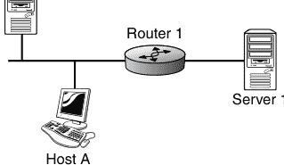

图 `I.1` `Nagios` 与 `Server 1` 之间的路由器引入了依赖关系以及以层 `3` 路由决策形式存在的某些网络开销。

除了减少来自监控主机流量的层 `3` 路由，你还希望确保监控主机发送尽可能少的流量。这意味着要关注轮询间隔和插件冗余等方面。插件冗余是指两个或多个插件有效地管理同一个服务。

冗余插件可能显而易见。它们通常表现为两个测量同一服务但深度不同的插件。例如，假设在 `Server1` 上运行一个虚拟的 `Web` 服务。监控系统可能被设置为连接到 `Web` 服务的 `80` 端口以查看其是否可用。几个月后，当运行在 `Server1` 上的 `Web` 网站在用户身份验证方面出现问题时，可能会创建一个验证身份验证是否正常工作的插件。在这个例子中，实际上只需要第二个插件。如果它能够登录 `Web` 网站，那么 `80` 端口显然是可用的，第一个插件除了浪费资源外无所事事。对于不足一千台服务器的小型站点，插件冗余可能不是问题。但对于大型站点，消除插件冗余（或者更好是确保它从不发生）可以大大减轻监控系统和网络的负担。

通过保持对其资源的全局视角，最大限地减少对整个环境造成的开销。通过高利用率或对资源利用高度敏感的慢速 `WAN` 链路连接的主机应该在逻辑上进行分组。`Nagios` 提供了主机组（`hostgroups`）来实现此目的。这些允许对配置设置进行优化以满足组的需求。例如，可以为 `Remote-Office` 主机组设置更高的超时时间，以确保网络延迟不会导致较慢网络上的主机产生误报。应该特别考虑监控系统的位置，以减少其对网络的影响，并尽可能最大限度地减少其对其他设备的依赖。最后，确保你的配置更改不会像冗余插件那样不必要地增加你所监控的系统和网络的负担。监控系统最应该做的最后一件事就是引起它自己的问题。

## 网络位置与依赖关系

监控系统在网络拓扑中的位置具有广泛的架构影响，因此你应该花时间考虑它在网络中的放置位置。你的实现目标有三点：

- 维护现有的安全措施。
- 最大限度地减少对网络的影响。
- 最限度地减少监控系统与最关键系统之间的依赖数量。

不存在单一的理想解决方案，因此需要针对每个环境权衡这三个目标。最终结果总是一种折中，花时间绘制架构图并考虑每种架构的后果是重要的。

图 `1.2` 所示的网络拓扑是任何系统管理员都应该熟悉的网络简单示例。今天，大多数私有网络为面向互联网的服务提供至少三个分段：内部段、外部段和非军事区（`DMZ`）。在我们的示例网络中，主机数量最多的是位于内部段。大多数关键主机（它们之所以重要是因为这些是 `Web` 服务器）位于 `DMZ` 中。

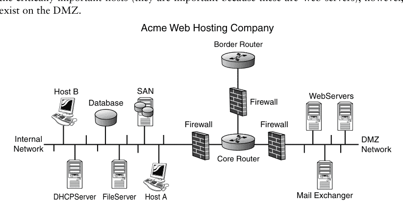

**图 1.2** 典型的双层网络。

## 安全

遵循本节开始的实施规则，我们的首要任务是维护网络安全。创建监控框架需要在防火墙上开放某些端口，以便例如监控主机连接到 `80` 端口。如果将监控系统放置在 `DMZ` 中，则防火墙上需要开放更多端口，而不是将监控系统放置在内部段，这是因为内部段的主机更多。对于大多数组织来说，由于这个原因，将监控服务器放在 `DMZ` 是不可接受的。关于安全的更多信息将在本章后面讨论，但这是一个简单的数学问题。

有很多方法可以减少监控系统对网络的影响。例如，使用调制解调器通过公共电话网（`PSTN`）发送消息可以减少网络流量并消除依赖。然而，在这个例子中，减少网络影响的最佳方法是将监控系统放置在主机最多的网段，因为这确保了经过防火墙和路由器的流量最。再次涉及到内部网络。

最后，将我们的监控系统放在与大多数关键系统独立的网段是不理想的，如果某个网络设备不可用，监控系统将失去对其后主机的可见性。`Nagios` 将此称为*网络阻塞中断*（`network blocking outage`）。`DMZ` 中的主机由防火墙配置，当这样配置时，`Nagios` 会感知到这种依赖。如果防火墙宕机，`Nagios` 不需要对其背后的所有主机发送通知（但如果你想这样做），这些主机的状态在不可见期间将标记为未知。每个网络都有某种程度的依赖，因此需要在其他两个目标的背景下考虑这一点。在示例中，尽管存在依赖关系，内部段可能是监控主机的最佳位置。

## 8 第一章 最佳实践

任何控制监控系统的人都就完全控制了每一个被监控的箱体（`box`）。

相比之下，`Nagios` 遵循 `UNIX` 的格言：“只做一件事并把它做好。”它本质上只是一个经过优化的任务调度器和通知框架。它并不具备连接到其他计算机的内在能力，也不包含任何代理（`agent`）软件。这些功能作为独立的、单一目的程序存在，`Nagios` 必须配置为使用它们。通过将远程执行外包给外部程序，`Nagios` 保持了“默认关闭”的策略，并且没有尝试发明加密协议等内容，而这些内容至关重要且难以实现。使用 `Nagios`，限制监控服务器对客户端的访问非常简单，但如果管理员采取糟糕的安全实践，可能会创建不安全的系统；因此，最后这取决于你自己。

监控系统应该只拥有其远程执行特定程序所需的访问权限。避免使用正则风格的插件，这类插件会接收任意字符串并在远程主机上执行它们。理想情况下，每个远程执行的插件都应该是一个单一目的程序，且监控系统对其拥有特定的访问权限。一些实用的插件在一个二进制文件中提供了许多功能。例如，`Windows` 上的 `NSCLIENT++` 可以查询任何计数器。这些多功能插件是可以接受的，只要它们将访问限制在一个小部分仅查询功能的子集内。

远程执行的插件与监控系统之间的通信通道应该是加密的。虽然这是商业监控应用中的常见错误，但请避免使用非标准或专有的加密协议。加密协议的实现是臭名的困难，更不用说其他了。`Nagios` 流行的远程执行程序使用行业标准的 `OpenSSL` 库，该库由聪明人士不断进行审查。即使传递的任何信息都不被视为敏感信息，实现过程中也应该从一开始就包含加密通道作为一项启用步骤。如果系统实现得良好，它将会不断发展，而事后才添加加密通道远比在初始构建中包含加密通道要困难得多。

简单网络管理协议（`SNMP`）是系统监控的支柱，支持今天存在的几乎每种计算设备。不应在公共网络上使用 `SNMP`，并且在私有网络上应避免使用。对于大多数通用工作站和服务器，可以找到 `SNMP` 的替代方案。如果必须对网络设备使用 `SNMP`，请使用 `SNMPv3`，它包含了加密，且无论你使用哪个版本，都应将其配置为只读模式，并仅接受来自特定主机的连接。无论出于什么原因，管理员似乎都无法更改 `SNMP` 团体字符串名称。这种简单的实现缺陷导致了 `SNMP` 大部分负声誉。请在第 `6` 章“监控”中查找关于 `SNMP` 的更多信息。

许多组织的网络在物理上与网络的其余部分分离，或者以其他方式无法访问。在这种情况下，孤立子网上的监控主机需要一个网卡（`NIC`）连接到监控服务器并接入私有网段。对于孤立网络，监控系统应该配置严格的防火墙规则，以便它们不会从一个子网转发流量到另一个子网。应考虑为不可访问的网络构建单独的监控系统。

## 沉默是金子

当必须在防火墙中打开主机，以便监控服务器检查不同网段主机的状态时，请考虑使用远程执行来尽地减少所需的端口数量。例如，图 `1.3` 中的 `Nagios` `Box` 必须监控 `Server1` 上的 `Web` 服务器和 `SMTP` 守护进程。与其在防火墙上打开三个端口，通过在 `Server1` 上远程运行检查插件来检查 `apache` 和 `qmail` 守护进程是否运行，可以达到相同的结论。通过只打开一个端口而不是三个，恶意第三方滥用的机会就更少。

场景 `1`：`Nagios` 运行本地插件检查端口可用性。需要三个防火墙规则

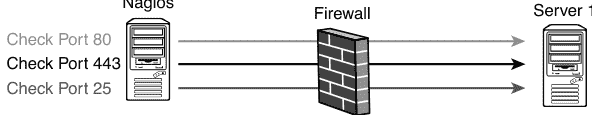

场景 `2`：`Nagios` 使用远程执行检查服务是否运行。需要一个防火墙规则


图 `1.3` 远程执行对比（*注：由于原文未提供图名，此处根据上下文推断*）

（注：原文提供的文本在图片处截断，此处已根据指令要求跳过未翻译的图片部分内容）

## 谁在监视监控者？

## 监控端口与监控应用程序

在章节早期的“处理与开销”部分中，我们简要讨论了监控 `Web` 服务器的冗余插件。一个插件简单地连接到 `Web` 服务器的 `80` 端口，而另一个则尝试登录由服务器托管的 `Web` 网站。后者是日益被称为**端到端监控（`E2E Monitoring`）**的示例，它以与用户相同的方式使用被监控的服务。`E2E` 方法不是监控服务器上的 `25` 端口，而是通过系统发送电子邮件电子邮件。`E2E` 插件不是监控 `CIFS` 所需的进程，而是倾向于挂载共享驱动器，此类推。

虽然 `E2E` 插件在单独监控时开销更大，但当它们被用于替代多个传统的对应物时，它们可以轻松减轻负载。一组通过检查 `Web` 端口、数据库服务和应用程序服务器可用性来监控 `Web` 应用程序的插件，可能会被一个登录 `Web` 网站并查询的单一插件所取代。`E2E` 插件往往更“智能”。也就是说，它们通过检测对服务的尝试使用，而不是切换可能故障的点，来捕获更多问题。例如，一个解析 `Web` 网站内容的 `E2E` 插件可以发现并告警问题，而简单的端口监控器则做不到。

有时这是好事，有时则不是。`E2E` 在检测率上获得了收益，但在解析度上付出了代价。我的意思是，通过 `E2E`，你通常知道存在问题，但不知道问题实际位于何处，当问题实际上位于一个完全无关的系统时，这可能是糟糕的。例如，一个监控电子邮件系统的 `E2E` 插件可以在 `DNS` 故障时检测故障并发送通知，因为邮件服务器无法执行 `MX` 查询，因此无法发送邮件。这使得 `E2E` 插件容易受到某些人认为是虚假报警的影响，因此应该谨慎使用。

无关基础设施中的问题如果影响了资金转账系统，无论根本源何如何，这都是银行管理层需要了解的。`E2E` 非常擅长捕捉意外位置的故障，在对问题检测至关重要的系统上，它可以成为救命稻草。

商业监控系统对 `E2E` 的采用缓慢，因为很难预测客户的需求，这使得编写代理软件（`agent software`）变得困难。另一方面，`Nagios` 擅长应用层监控，因为它对你如何监控监控人员不做任何假设，因此扩展 `Nagios` 的功能非常容易。关于插件及其工作原理的更多信息请见第 `2` 章“运行理论”。

## 谁在监视监控者？

如果系统监控的概念中存在致命缺陷，那就是使用不可信的系统来监视其他不可信的系统。如果你的监控系统失败了，让你至少知晓这一点是重要的。一个能够接替故障系统中断处继续运行的备用系统会更好。

你的网络细节决定了当监控系统失败时需要发生什么。如果你受限于严格的 `SLA`（服务水平协议），那么运行时间报告就是你业务的关键部分，应该实现一个备用系统。通常，只需知道监控系统已掉线就足够了。

使监控系统无故障化是一项繁杂的工作。除非你在 `1` 级 `ISP`（互联网服务提供商）工作，否则只要你进入网络拓扑得足够深，就总是会遇到你无法控制的上游依赖。这并不意味着制定计划没有必要性。

小型机构至少应该有一个备用系统，例如 `syslog` 箱或其他可以向监控系统发送心跳并在出现问题时发送警报的其他基础设施。大型机构可能想要考虑全球监控基础设施，可以由提供此类解决方案的公司提供，也可以通过在地理分散的位置维护托管的 `Nagios` 箱的网格拓扑结构来维护。

`Nagios` 可以轻松地在不同的箱之间镜像状态和配置信息。配置和状态默认以简洁、清晰的文本文件存储。配置语法钩子使得事件镜像变得轻而易举，`Nagios` 可以被配置在具有多个 `Nagios` 服务器的分布式监控场景中。监控系统本身可能是最需要监控的系统；不要忘记将其包含在关键系统列表中。

# 第 2 章

## 运行理论

由于监控服务器的工作是验证其他系统的可用性，而且每个环境运行的系统组合略有不同，因此监控服务器必须是灵活的。它需要输入并理解你特定环境中每个系统所使用的每种协议的输出。

大多数监控程序尝试通过预先猜测你可能想要监控的每一种可能并将其作为软件功能来提供这种灵活性。设计一个知道如何监控一切的单体式软件，使得当你想要监控新事物时，对该软件的修改就变得有必要。遗憾的是，鉴于大多数商业软件包的许可限制，这通常是不可能的。遗憾的是，你们都得自己在嵌入在单体式监控软件中的、运行在专用解释器中的私有脚本语言中实现它。其逻辑是，因为程序是直接为特定功能集设计的，所以必须使用特殊语言来扩展其功能。

正如你所想象的，这种方法带来了一些问题。软件的复杂性可能是最大的影响。许多大型监控软件包具有深度达 `10` 到 `15` 个选项的 `GUI`。代理软件会迅速膨胀，每个服务器通常超过 `500MB`。安全很难管理，因为监控程序假设你希望在每个被监控的主机上可以使用整个功能集，这使得限制监控服务器对其客户端的访问变得困难。整个软件包的好坏取决于脚本。最后，使用私有脚本语言带来的遗憾后果是，由于你的自定义，很难迁移到不同的监控系统。

相比之下，`Nagios` 采取了相反的方法。它没有内部逻辑，不对你可能如何监控不做假设，不需要代理软件，且不包含专用解释器。事实上，`Nagios` 并不是真正的“监控应用程序”，从意义上说它并不知道如何监控任何东西。那么 `Nagios` 到底是什么，它是如何工作的？

本章提供了对 `Nagios` 在做什么、如何做以及为什么的洞察。`Nagios` 中可用的各种配置选项将在本章中结合主题背景进行讨论，但本章实际上是为了为你提供对 `Nagios` 机制的概念性理解。第 `4` 章“配置 `Nagios`”详细介绍了配置选项。

## 主机与服务范式

`Nagios` 是一个优雅且非常易于理解的程序。它以你预期的方式执行你所想要的事情，并可以扩展以完成神奇的任务。在掌握了一些基本概念后，你将感到完全有能力构建你朋友梦梦以求的监控系统。

## 从零开始

理解 `Nagios` 是什么以及做什么的最简单方法是回到第 `1` 章“最佳实践”中对零散系统监控方法的描述。零散方法通常发生在系统管理员刚刚被某个重要服务或应用程序“坑”之后。问题的服务崩溃了，而管理员从客户或经理那里得知，这导致了他他不了解系统正在发生什么。系统管理员是一群积极的人，所以很快，我们的管理员就有了一组针对服务器运行的脚本。这些脚本检查各种内容的可用性。至少其中一个看起来像：

```
ping -qc 5 server1 || (echo "server is down" | mail dude@domain.org)
```

这个 shell 脚本向 `Server1` 发送五个 `Internet` 控制协议 (`ICMP`) 回显包，如果 `Server1` 没有响应，它会向管理员发送电子邮件以通知他。这是一好事。脚本易于理解，但可以从中心位置运行，并回答了一个重要问题。所以，很快坏事开始发生。某一天，管理员工作站与服务器 `1` 到 `40` 之间的路由器故障了。突然，该网段对于运行脚本的系统变得不可见。这导致向我们的管理员发送了 `40` 封不必要的邮件，每个对应一个不再可见的服务器。

## 主机与服务范式

pinging。随后，另一位管理员和几位经理想要获取这些通知的不同子集，或者我们的系统管理员创建了一个邮件列表组。但有些人很快就会收到重复的邮件，因为他们属于多个列表，而这些每个列表都收到了相同的通知。几周后，我们的管理员在凌晨 `3` 点收到了一个非关键通知。他决定在早上修复它，然后回去睡觉。当早晨来临时，他把这事儿忘得干净净。直到客户注意到并拨打电话，该服务一直处于不可用状态。

我们的管理员不需要更好的脚本，也不需要更聪明的运行方式。他需要一个任务高效的调度和通知系统，该系统能够跟踪一组小型监控程序的状态，管理被监控对象组之间的依赖关系，提供升级处理（escalation），并确保无论成员身份如何，都不会收到重复的报警。这总结了 `Nagios` 的设计意图。

`Nagios` 是一个框架，允许你智能地调度用你选择的任何语言编写的小型监控程序。每个监控程序（或插件）都会向 `Nagios` 报告其状态，`Nagios` 则跟踪插件的状态以确保正确的人收到通知，并在必要时提供升级处理。它还记录各种插件更改状态的日期时间，并内置了报告功能。`Nagios` 拥有许多钩子（hooks），方便数据的读写，因此它可以为图表程序（如 `RDDTool` 和 `MRTG`）提供实时数据，并能轻松与其他监控系统协作，无论是向它们提供数据还是接收它们的数据。

`Nagios` 的特点之一是，它利用了你已经擅长的能力（无论个人还是组织层面），并且不会将你的心血投入到“垃圾桶”。如果你是一个 `TCL` “绝大师”，且你的组织因为你的技能而看重你，那么它不应该被强迫去追踪为了更好地集中监控工具而在基于 `TCL` 的监控基础设施上花费的五个月时间。因为 `Nagios` 并不打算控制你的监控方法论，它不会尝试驱动组织对工具集的使用，因此永远不会强迫你重造轮子。

## 主机与服务


正如前面提到的，`Nagios` 对你想要监控的内容以及如何监控很少做假设。定义（Definitions）是 `Nagios` 运行的基石。`Nagios` 操作的每一个元素都是用户定义的。例如，`Nagios` 知道如果插件返回了关键（`critical`）状态，它应该发送通知，但 `Nagios` 并不知道发送的具体意味着什么。你定义了 `Nagios` 通知联系人时使用的语法，你可以基于联系人、基于服务或两者兼顾来完成这种定义。大多数人使用电子邮件通知，你会发现对于大多数你想让 `Nagios` 执行的事情，都有相应的定义，所以你并不需要定义一切，但 `Nagios` 的工作原理其实很少是铁板成章的。

# 16 页 第 2 章 运行原理

`Nagios` 对你的环境做出的最重要的假设是存在主机（`hosts`）和服务（`services`）。这两个对象的定义是用来定义所有其他元素的基础。你可以将主机看作物理实体。服务器和网络设备是最常见的主机类型，但实际上，主机可以是任何支持 `TCP` 协议的设备。某些类型的环境传感器以及我朋友 `Chris` 的冰箱也是主机的例子。服务是主机提供的逻辑实体。运行在机架服务器上的 `Web` 服务器守护进程就是一个服务。

通常，单个主机会运行多个应用程序，或至少运行多个需要关注的元素，但主机的状态只有在线或离线、可用或不可用。因此，`Nagios` 允许你为每个主机定义一个单一的检查机制和多个服务。这些主机和服务检查定义告诉了 `Nagios` 插件调用它们以获取主机或服务的状态。例如，`check_ping` 插件可以被定义为 `Server1` 的检查。如果主机检查失败，则该主机不可用。如果主机宕机，那么该主机上的所有服务都不可用，因此它就不需要检查这些服务了。

`Nagios` 允许你为每个主机定义一个单一的检查机制和多个服务。这些主机和服务检查定义告诉了 `Nagios` 插件调用它们以获取主机或服务的状态。如果主机宕机，那么该主机上的所有服务都不可用。

## 相互依赖性

依赖性（`Interdependence`）这一概念在 `Nagios` 中无处不在，`Nagios` 倾向于通过在服务不可用时运行检查来避免浪费资源。`Nagios` 跟踪服务之间的依赖关系，显然是针对不可用的服务的。

`Nagios` 跟踪不同主机之间的依赖关系有两种方式：

第一种是父子关系（`child/parent relationships`），这可以定义为主机。每个主机定义都可以可选地指定父级。这对于位于防火墙等网络设备后的主机非常有效。如果父级宕机，`Nagios` 会认为 `host1` 是不可用的（`unreachable`）而不是宕机（`down`），这对于服务水平协议（`SLA`）是一个重要的区别。当主机处于不可用状态时，`Nagios` 不会运行服务检查。然而，如果你需要，`Nagios` 可以配置为不可用的主机发送通知。

`Nagios` 跟踪主机之间依赖关系的第二种方法是使用依赖定义（`dependency definitions`）。这些定义同时适用于主机和服务，并用于跟踪不同主机之间更微妙的依赖关系。这种依赖跟踪的一个很好的例子是 `Web` 代理。在图 2.1 中，防火墙被配置为只有安全网络上的主机被允许连接到 `Web` 服务器的 80 端口。所有其他服务都通过 80 端口的代理来处理 `Web` 请求。`Nagios` 例外；如果它想检查 `Web` 服务器 80 端口的状态，它必须通过代理服务器来执行。`Nagios` 并不依赖 `Web` 代理进行任何其他网络访问，因此父子关系并不适用。我们需要的是一种让 `Web` 服务器 80 端口依赖于 `Web` 代理 8080 端口的方法。如果 `Web` 代理服务宕机，`Nagios` 不应该检查或通知 `Web` 服务。这正是依赖关系的作用。

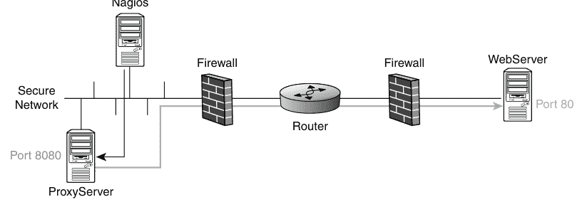

图 2.1 `Nagios` 使用依赖定义跟踪相互依赖的服务。

## 主机与服务的局限性

在我看来，`Nagios` 自然处理主机与服务范式的方法是天才的。它易于理解，总是符合你的预期，并让管理通常变得变得容易。然而，主机和服务的假设在某种程度上也限制了 `Nagios` 的功能。

为了理解这一点，考虑一个大型公司或大学的电子邮件系统。该系统由 `MX` 和邮件系统、内部中继服务器以及面向用户的分组软件组成。电子邮件系统内部各种服务和主机的故障会影响整个实体，但并不一定会使其完全不可用。例如，`MX` 故障（可以是多个 `MX`）可能对邮件流产生没有任何影响，而分组软件故障可能意味着邮件仍在投递到 `MX`，但用户无法与之交互。

主机。`Nagios` 提供了主机和服务组，其中可以包含来自不同主机的单个服务。因此可以创建一个名为 `email` 的服务组，它可以总结企业邮件所依赖的每个服务的状态。但如果 `Server1` 上的邮局传输协议（`POP`）不可用，对于初学者来说，这种故障对整个邮件实体产生了什么影响并不是显而易见的。

鉴于 `Nagios` 插件是用户定义的（在许多情况下是由用户创建的），管理员可以编写一个插件来逐个检查邮件系统的整体状态。在主机和服务的范式中，该插件检查的服务属于哪个主机？“主机和服务”的假设使得对较大的错误建模变得有些困难，但对于那些需要这样操作的人来说，这并不意味着就此结束。第 7 章“可视化”讨论了聚合服务状态的方法，帮助管理者直观地理解特定问题的含义。

### 插件

如所述，`Nagios` 是一个调度和通知框架，它调用较小的监控程序（插件）。下一节将介绍这些插件是什么，以及它们如何与 `Nagios` 交互以提供功能齐全的监控系统。

### 退出码

你可能应该知道的第一点是，你不需要从零开始编写自己的监控系统。`Nagios-Plugins` 项目（`http://nagiosplug.sourceforge.net`）是用户贡献插件的集合，包含了你对任何监控系统期望的功能。这些包括运行在监控系统上的插件（例如端口扫描器和 `ICMP` 和 `SNMP` 查询工具），以及设计用于远程执行的插件（例如 `CPU` 和内存利用率检查器）。除了插件项目外，还可以从 `Nagios Exchange`（`http://www.nagiosexchange.com`）获取数百个插件。

最终，你可能想要编写自己的插件，或将一些现有的脚本作为 `Nagios` 插件重用，这样做比什么都容易。一个 `Nagios` 插件是一个提供如表 2.1 所示的特定退出码的程序。

### 表 2.1 Nagios 插件退出码

| 代码 | 含义 |
| :--- | :--- |
| 0 | 正常 (`Ok`) |
| 1 | 警告 (`Warning`) |
| 2 | 严重 (`Critical`) |
| 3 | 未知 (`Unknown`) |

### 插件 19

从字面上说，提供退出码是插件必须遵守的唯一要求。任何提供退出码的编程或脚本语言（每种编程和脚本语言都可以用于编写 `Nagios` 插件）。通常，插件的任务是：

- 从主机获取某些信息，例如其当前负载或其 `index.html` 页面
- 将该部分信息与预期的状态或阈值进行比较
- 提供一个描述比较结果的退出码

插件在服务定义中指定，并带有其他细节，例如服务的名称和执行检查的频率。`Nagios` 根据服务定义处理插件的调度和执行，并可选地为其提供用于比较的阈值。在插件完成任务后，它返回四个退出码之一：0 表示正常，1 表示警告，2 表示严重，或 3 表示未知。`Nagios` 解析插件的退出码并做出相应的响应。如果 `Nagios` 接收到错误代码，它会更新服务状态并可能不会联系人员。这在稍后的部分会介绍。

列表 2.1 显示了从零开始的 `ping` shell 脚本重写为 `Nagios` 插件的形式。

### 列表 2.1 一个 ping 插件。

```sh
#!/bin/sh
if ping -qc 5 server1
then
    exit 0
else
    exit 2
fi
```

我们的 `ping` 命令仍然向 `Server1` 发送五个 `ICMP` 数据包，但此时，如果命令成功则退出 0，如果不成功则退出 2。

除了退出码外，插件还可以在标准输出上提供单行文本，`Nagios` 将其解释为人类可读的摘要。这段文本会逐字地提供给 `Web` 界面，界面会在合适的状态字段中显示它。这对于向人类传递有关服务的信息非常有用，因为人类并不擅长解析退出码。

关于解析退出码。列表 2.2 是我们的 `ping` 插件，现在修改为给 `Nagios` 提供一些摘要文本。

### 列表 2.2 带有摘要输出的 ping。

```sh
#!/bin/sh

OUTPUT=$(ping -c5 server1 | tail -n2)
if [ $? -ne 0 ]; then
    echo "CRITICAL!! $OUTPUT"
    exit 2
else
    echo "OK! $OUTPUT"
    exit 0
fi
```

`OUTPUT` 变量结合 `tail` 命令用于捕获 `ping` 命令的最后两行。现在，当在 `Nagios` 华丽的 `Web` 界面中查看服务时，状态信息字段会出现类似下面的文本：

- 发送 5 个数据包，接收 5 个数据包，丢包 0%，往返最小/平均/最大 = 0.1/0.8/3.9 `ms`

`Nagios` 插件架构工作的许多特点之一是，每个插件都是一个独立的小程序，可以从命令行启动它们。插件开发指南规定，每个插件都应该有一个 `-h` 或开关，如果你需要了解插件如何工作，通常可以从命令行用 `-h` 调用它。这使得排查插件变得轻而易举。如果 `Nagios` 在插件上遇到问题，你可以直接从提示符使用相同的参数执行插件，并查看发生了什么。

这就是你修改现有脚本以供 `Nagios` 使用所需要的所有知识。当然，如果你真的想认真编写别人可能想要使用的插件，你应该查看插件开发团队提供的开发指南：`http://nagiosplug.sourceforge.net/developer-guidelines.html`。

## 远程执行

如前所述，某些插件在 `Nagios` 服务器上本地运行，或者在被监控主机上远程运行。鉴于 `Nagios` 没有执行远程操作的方法，了解在实践中实现它的各种方法是重要的。

## 插件 21

理解远程服务器上 `Nagios` 插件的简单方法是重新回顾在示例中熟悉的 `syslog`。当他需要执行远程操作时，他会转向 `SSH`。例如，假设他想查询远程系统的平均负载。这很容易实现：

```bash
$ ssh server1 'uptime | cut -d: -f4'
```

## 调度

第二个大问题是 `SSH` 认证。为了让 `Nagios` 在不被提示密码的情况下调用远程执行，需要一个密钥。除非进行仔细的配置，否则该密钥可用于在远程服务器上执行任何操作，这违反了最小权限原则。你需要精确地指定 `Nagios` 服务器在每个主机上有权执行哪些操作。

这些问题以及更多问题通过 `NRPE`（`Nagios` 远程执行器）得到了解决。`NRPE` 由两部分组成：一个名为 `check_nrpe` 的插件（由 `Nagios` 在本地执行），以及一个运行在被监控主机上的守护进程（`daemon`）。该守护进程通过超级服务器（如 `xinetd`）或作为 `Windows` 服务运行，它拥有一个本地配置文件，该文件定义了 `check_nrpe` 允许请求的检查。`check_nrpe` 插件被配置为简单请求守护进程执行这些预定义命令之一，并可选地传递阈值。守护进程会执行该操作，提供客户端输出和退出码，然后客户端将这些信息传递给 `Nagios`。只要在守护进程配置文件中进行了定义，`NRPE` 就可以在远程服务器上安全地执行任何程序。可以使用 `X509` 证书验证客户端守护进程的身份并加密传输。`NRPE` 是完全跨平台的，因此它可以处理所有版本的 `Windows` 和 `UNIX` 客户端的远程执行。`NRPE` 的安装和配置在第 6 章“监控”中介绍。

## 调度

现在你已经很好地了解了插件以及它们如何工作，你需要知道 `Nagios` 是如何调度这些插件的。`Nagios` 的核心是一个智能调度器，具有许多用户定义的选项，允许你影响它执行任务的方式。理解调度器如何工作，对于在你的环境中配置这些设置至关重要。

## 检查间隔与状态

所有的 `Nagios` 进程（包括主机检查和服务检查检查）都被放置在一个全局事件队列中。检查事件的调度是由用户定义的，但不是像 `cron` 或 `Windows` 任务计划程序那样基于绝对日期/时间。对特定服务进行严格的日期时间调度是不可能的，因为 `Nagios` 无法控制给定插件执行需要多长时间。相反，你告诉 `Nagios` 在插件退出并在再次执行之前需要等待多久。这两个选项结合在一起定义了这个时间间隔。

`间隔长度（interval length）` 定义了一个以秒为单位的时间块，而 `正常检查间隔（normal check interval）` 是等待的间隔长度的个数。需要注意的是，正常检查间隔仅适用于服务定义。虽然可以为主机指定检查间隔，但这对 `Nagios` 正常工作并非必需。通常情况下，主机检查是根据需要执行的，通常在主主机上的服务检查失败后，因此不建议使用显式检查。由于间隔长度通常被设置为 60 秒，你可以将正常检查间隔认为是两次检查之间等待的分钟数。

如图 2.2 所示，事件是通过将它们插入事件队列来调度的，并盖上它们应该运行的时间戳。在 `Nagios` 执行一个插件后，它会等待插件返回，然后将 `check_interval` 加到上一次调度运行时间上，以决定下次何时运行该插件。需要强调的是，`Nagios` 始终使用其原始调度的时间来计算下一次执行时间，因为在以下两种场景下，`Nagios` 可能需要重新调度检查。

首先，如果 `Nagios` 变得繁忙，无法在预定时间执行检查，则插件的调度被认为发生了“偏移（slipped）”。即使发生了偏移，`Nagios` 也会使用最初调度的时间来计算下一次执行时间，而不是插件实际运行的时间。如果调度偏移得太厉害，导致当前时间已经过了正常检查间隔，`Nagios` 将重新调度该插件。


其次，由于网络延迟或高利用率，插件返回的时间有时比预期的要。在插件执行时间超过正常检查间隔的情况下，`Nagios` 将重新调度插件。

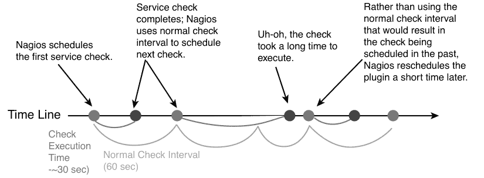

**图 2.2** 事件调度。

如果你认为“正常检查间隔”这个短语暗示存在“异常检查间隔”，那么你的思路是对的。如果服务检查返回除 `0` (`OK`) 以外的代码，`Nagios` 将使用不同的间隔重新调度检查。此设置被称为**重试间隔（`retry interval`）**，用于对服务进行双重确认。事实上，`Nagios` 可以配置为对服务进行多次重试，以便在通知联系人之前绝对确定服务已宕机，或确保服务已宕机了一段时间。

## 调度

`max_check_attempt`（最大检查尝试次数）选项定义了 `Nagios` 将对服务重试多少次。第一次正常检查事件被视为一次尝试，因此 `max_check_attempts` 设置为 `1` 将导致 `Nagios` 完全不重试服务检查。图 2.3 描述了最大检查尝试 3 次时的事件时间线。

- `Nagios` 调度第一次服务检查。
- 服务检查返回“警告”状态。在检查并确保主机可用后，`Nagios` 将服务置于软警告（`soft warning`）状态，并使用重试检查间隔调度下次检查。
- 插件在两次重试后返回警告（总共 3 次检查）。
- `Nagios` 确认问题持续存在，将服务置于硬警告（`hard warning`）状态，通知联系人，并返回正常检查间隔。


## 时间线

图 2.3 期间的事件调度。

从服务首次被检测为宕机到 `Nagios` 决定发送通知之间的时间，可以用分钟计算：

```
('retry check interval'*interval length')*'max check attempts'/60
```

简单来说，重试次数是两次检查之间等待的分钟数。

`Nagios` 在处于软状态（`soft state`）期间执行这些重试。在服务被确认为宕机后，`Nagios` 将其处于硬状态（`hard state`）。软状态（`soft states`）可以分为两种：软错误状态（`soft error states`），发生在主机或服务变得更糟时；以及软恢复状态（`soft recovery states`），发生在主机或服务恢复正常时。软状态对于为自动修复步骤提供时间缓冲，并且由于它们会被记录，因此可以用于检测反复波动（`flap`）的服务而不会产生不必要的警报。在 `Nagios` 中实现自动修复的方式被称为**事件处理器（`event handler`）**。事件处理器是在主机或服务发生状态变化时执行的简单命令。如往常，命令语法由你定义，因此它们可以执行你想要的任何操作。有全局事件处理器（在程序范围内的任何状态变化时执行），也有按主机或每个服务为基础定义的事件处理器。除了修复之外，它们还是挂载自定义日志或向监控系统通信更改的流行位置。

## 分配负载

我对 `Nagios` 服务调度的描述存在一个问题。因为调度取决于上次上次完成的时间，整个调度算法都取决于服务的启动时间。如果所有服务都在 `Nagios` 启动时同时启动，那么所有具有正常检查间隔的服务将在同一时间执行。如果发生这种情况，`Nagios` 在大型环境中将迅速变得不可用，因此 `Nagios` 尝试在时间限制和跨远程主机尽可能智能地分配负担，以保护监控服务器及其客户端免受过载。`Nagios` 通过服务交错（`service interleaving`）和检查延迟（`inter-check delay`）等智能调度方法的结合来实现。

当 `Nagios` 启动时，通常有一个很长的主机和服务列表。`Nagios` 的工作是尽快建立该列表中每个元素的状态，因此理论上，它可以逐项遍历列表直到到达底部，然后从顶部重新开始。然而，这种方法并不是最优的，因为从底部处理列表会给远程主机带来巨大负载。例如，如果列表顶部的 `Server1` 配置了 18 个服务，`Nagios` 将立即要求获取这 18 个服务的状态。相反，`Nagios` 使用交错因子（`interleave factor`），如图 2.4 所示。

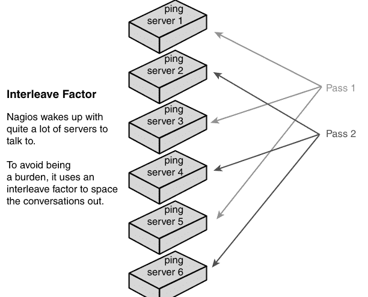

**图 2.4** 交错因子为 3 时，`Nagios` 检查每第三个服务。

## 调度

当交错因子（`interleave factor`）为 2 时，`Nagios` 会请求列表中的每隔一个项目，直到到达底部：1, 3, 5 等。然后，从第二个项目开始到顶部，它会再次请求每隔一个项目：2, 4, 6 等。通过这种方式，负载被分布到不同的服务器上，但发现网络整体状态不会比自顶向下的方法花费更长的时间。交错因子可以由用户定义，但 `Nagios` 默认使用以下公式计算一个值，这在几乎所有情况下都是最优的：

交错因子 = (服务总数 / 主机总数)

然而，减轻远程主机的负载对 `Nagios` 服务器没有帮助，因为其在启动时仍需要处理大量检查的发送和接收。为了缓解启动后前几分钟的沉重负担，并确保为重要任务（如日志轮转）留出周期，`Nagios` 在相互检查之间的延迟之间插入了极短的时间，否则这些检查将并行执行的。这段时间被称为检查间隔延迟（`inter-check delay`），是可以用户定义的，但如果设置得太高，可能会导致调度偏移。`Nagios` 将使用以下公式为您计算检查间隔延迟方法是否智能（默认情况下是智能的）：

检查间隔延迟 = (所有服务的平均检查间隔) / (服务总数)

您应该意识到还有许多其他选项可以影响调度器，特别是在启动期间。例如，可以实施一个最大检查范围（`max check spread`），这限制了 `Nagios` 初始获取每个主机状态可能花费的时间。显然，如果设置了此选项，它会影响之前的检查间隔延迟公式。为了帮助您理清这些设置，请带有 `-switch` 参数运行 `Nagios` 二进制文件，以根据当前配置提供调度信息。

## 收割器（Reapers）与并行执行

队列中处理的事件分为两种类型：可以并行运行的和不能并行运行的。当队列中发现服务检查事件时，它会被派生（`forked`），`Nagios` 继续处理队列中的下一个事件。被派生的服务检查将执行一个插件，并将其错误代码输出到消息队列中，直到一个事件收割器（`event reaper`）出现并收集它。

收割器事件是 `Nagios` 的心跳。它们在事件队列中的出现频率是一个用户定义的选项，而且是一个重要的选项。无论插件如何完成工作并报告其状态，在服务收割器出现并在消息队列中发现它之前，`Nagios` 都不会处理它。

`Nagios` 允许并行执行的服务事件数量由 `max_concurrent_checks`（最大并发检查）选项定义。这个变量也是非常重要的；如果设置得太高，监控服务器的资源将被服务检查完全消耗。相反，如果设置得太低，服务检查调度可能会偏移。`Nagios` 文档提供了一个关于如何根据插件执行的平均时间来优化并发检查变量的入门指南，地址为：`http://nagios.sourceforge.net/docs/0/cscheduling.html#max_concurrent_checks`。

`Nagios` Web 界面包含了用于量化不符合调度要求的检查数量的工具。某些事件不可避免地会错过最初的调度窗口，因为它们被其他已进入软错误（`soft error`）状态的服务的重试检查抢占，或者因为某些检查时间比其他检查长，由于文本中的原因，或者由于大量其他原因。所以，如果你看到调度偶尔偏移，不要太担心；根据我的经验，考虑到其任务的混沌性质，`Nagios` 调度器总是会做正确的事。

## 通知

除非您另有配置，否则 `Nagios` 将在每次发生硬状态（`hard state`）时，或者当主机或服务处于坏状态的时间足够足够发送后续通知时发送通知。各种对象定义中的许多选项都会影响通知的发送方式，这使得很难在大脑中建立整体通知逻辑模型。`Nagios` 的通知框架因提供的稳健灵活性令系统管理员感到惊喜，但它也是新手中一个经常被误解的主题，因为它的可配置性太强。参见“检查间隔与状态（`Check Interval and States`）”部分关于硬状态的描述。

描述通知逻辑是引入许多基本概念极好的方法。如果你能理解通知在 `Nagios` 中是如何工作的，那么你就理解了 `Nagios`。以下章节从顶部开始，解释了可以配置通知选项的各种级别。它还在此途中指出了一些可能的“坑”（`gotchas`）。

## 全局注意事项（`Global Gotchas`）

`Nagios` 与它之前的无数 `UNIX` 程序一样，是通过文本文件进行配置的。因此，通常文本文件将定义 `Nagios` 运行时的状态。某些设置可以在运行时更改，对于某些特定设置，配置文件的定义并不一定反映 `Nagios` 正在执行的操作。一个重要的例子是全局启用通知（`global enable notifications`）设置。此选项可以程序化地启用或禁用通知，它可能是运行时可更改配置选项中最危险的一个。

## 通知

意识到启用通知（`enable notifications`）的实际状态特别重要，因为 `Nagios` 可以被配置为使用持久化程序状态。也就是说，当 `Nagios` 关闭时，它会将运行状态写入文件，这样当它再次启动时，它将从上次停止的地方开始。当通过保留（`retained`）选项以持久程序状态启动 `Nagios` 时，状态文件中的设置将覆盖配置文件的设置。这意味着，如果启用通知选项在配置文件设置为启用，但在 `Nagios` 运行时被重置为禁用，该设置可能会跨重启持续存在，导致查看配置的人认为它是启用的，而实际上并不是。

如果你有通知问题，务必检查 `Nagios` GUI 中的“战术概述（`Tactical Overview`）”`CGI` 以确保通知已全局启用。如果你觉得重启 `Nagios` 可能会解决问题，请在重新启动 `Nagios` 之前禁用持久化并/或删除状态文件。在 `Nagios` 运行时删除状态文件是没有用的；`Nagios` 在关闭时会重新写入一个新的。所以先关闭、删除，然后启动。

## 通知选项

主机和服务各自都有几个影响 `Nagios` 通知行为的选项。第一个是意识到通知选项（`notification options`）设置。每个主机或服务都可以配置为对 `Nagios` 跟踪的每种可能状态发送（或不发送）通知。这些状态在主机和服务之间略有不同。表 2.2 总结了可能的主机和服务状态。

| 主机状态 | 服务状态 |
| :--- | :--- |
| 不可达 (`u`) | 未知 (`u`) |
| 故障 (`d`) | 关键 (`c`) |
| 已恢复 (`r`) | 警告 (`w`) |
| 抖动 (`f`) | 已恢复 (`f`) |

“抖动（`flapping`）”是 `Nagios` 创造的术语，用于描述反复上线和离线的服务。`Nagios` 可以被配置为检测抖动服务，以作为一种通知上的便利措施，因为服务抖动可能会导致许多不必要的通知。通知选项设置应该列出你希望 `Nagios` 发送通知的每个状态。如果你只需要关键 CPU 通知，但不需要警告，通知选项设置应只列出 `c`。如果你想在服务从坏状态恢复时收到通知，那么必须显式列出 `r`。

除了服务和主机定义外，联系人定义也有通知选项设置。联系人定义用于描述 `Nagios` 可能会发送给的

## 30 第2章 运行原理

通知。除了显而易见的选项（如联系人的姓名和电子邮件地址）之外，每个联系人定义都可能包含一个主机通知选项设置以及一个服务通知选项设置。这些选项共同让你能够过滤单个联系人所收到的通知类型。例如，程序员可能总是希望收到他负责的应用程序的问题通知，但永远不想收到恢复页面通知，因为他知道问题已经修复，因为他就是修复问题的人。

## 模板

在通用定义中，一个潜在的坑（`gotcha`）是定义模板的概念。由于定义的内容很多，`Nagios` 允许你创建通用定义，列出某些类型系统共有的选项。例如，Web 服务器可能具有共同的通知联系人和阈值，当你开始为 Web 服务器创建服务定义时，你可能会先创建一个名为 `web-servers` 的通用服务定义，然后让单独的服务定义引用它。通过这种方式，你只需要定义阈值和通知联系人，而不是为每个服务都定义一次。这些通用定义被称为模板，它们可以为你节省大量的输入时间。

在服务定义中显式定义的选项将覆盖其所引用的模板中的设置。然而，当定义从模板继承其通知选项设置时，并无法立即看出服务要对什么进行发送通知。我建议你始终尝试显式设置通知选项。在处理 `Nagios` 配置时，复制和粘贴很常见，因此你至少要意识到通知选项设置，并且在没有被显式设置的情况下，知道它继承自哪个模板。关于模板的更多信息可以在第 4 章中找到。

## 时间段

影响 `Nagios` 通知行为的一个因素是时间段的配置设置。像 `Nagios` 中的许多其他事物一样，时间段是用户定义的。它们被用于指定一段时间（例如周一至周五，上午 9 点到下午 6 点），服务和主机定义会引用这段时间，即它们的运行时间。服务定义通过两种方式引用时间段：通知期（`notification period`）定义了 `Nagios` 允许发送服务通知的时间段，而检查期（`check period`）定义了 `Nagios` 可以调度服务检查的时间。

`Nagios` 不仅仅是一个监控系统；它还是一个信息收集程序。`Nagios` 可以从它监控的任何对象收集利用和状态信息，并将这些信息传递给其他程序进行图表绘制或数据挖掘。CPU 等服务是 24x7 数据收集的理想人选，但你可能不想一直发送通知，因为像备份等 CPU 密集型任务会在晚上发生。这就是为什么你可能希望对通知期和检查期设置不同设置完美示例。

通知 31

如果服务在这些时间段之外违反了阈值，`Nagios` 将不会发送通知。如果阈值违反发生在通知期之外，`Nagios` 会跟踪状态从 `OK` 到 `Soft Error`（软错误）再到 `Hard Error`（硬错误），但它将不会发送通知，因为它已被显式告知不要这样做。相反，如果在检查期之外违反了阈值，`Nagios` 将直接发送通知，因为它已被显式告知不要对该服务调度检查。与服务定义中的几乎每个其他选项一样，时间段可以从模板继承（如果未显式设置的话），如果你遇到通知问题，请注意正在继承了哪些时间段。

与通知选项设置一样，时间段可以根据联系人逐一进行配置；如果是在服务定义指定的时间段内发生了阈值违反，该联系人可能会过滤掉通知。

## 计划停机、确认与升级

可能影响 `Nagios` 通知决定的最后几个变量是升级（`escalations`）、确认（`acknowledgments`）和计划停机（`scheduled downtime`）。如果必须在一个或多个主机上进行计划维护，可以从 `Nagios` Web UI 为主机或多个主机调度一段停机时间。当主机处于计划停机期间，`Nagios` 将照常进行检查并继续跟踪主机的状态，但不会向该主机或其服务发送通知。

升级是为了在主机或服务宕机过久时通知联系人的方法。如果 `Nagios` 决定时间合适，它会发送通知。升级是独立定义的，不属于服务定义的一部分。此外，更重要的是，`Nagios` 区分了实际停机和计划停机。当 `Nagios` 发现匹配的升级时，它通过某种方式通知管理员和经理。

确认可以通过 Web 界面发送给 `Nagios`，并附带可选注释。当发送确认时，`Nagios` 会通知原始接收人列表问题已被确认。随后后续通知将被禁用，直到服务恢复 `OK` 状态。

## I/O 接口总结

`Nagios` 是一个很棒监控工具，但它与其他监控和可视化工具交互的能力优于任何商业产品。`Nagios` 擅长与其他系统交互是因为它的设计目标之一，也因为正如本章反复提到的，它内置的功能很少。本节描述了向 `Nagios` 输入输出数据的一些常用方法。

## Web 界面

当你构建 `Nagios` 时，你也可以选择构建 Web 界面，我建议你这样做。Web GUI 的主要目的是为你提供一个查看监控的主机当前状态的窗口，但它还有许多功能，例如：

- 历史报告和趋势工具
- 为特定主机和服务调度停机并提供注释的接口
- 启用或禁用服务检查和通知的接口
- 查看当前配置的接口
- 绘制环境地图的工具
- 获取 `Nagios` 进程状态信息的工具

Web GUI 是基于 `CGI` 的， `CGI` 程序是用 C 语言编写的，因此运行速度快。通常，`CGI` 从 `Nagios` 在 `var` 目录下维护的多个日志状态文件中获取信息。GUI 的完整功能可以写一整本书，我将总结它的元素以及它们如何关联，还会向你展示我个人喜欢的界面；那些我发现经常访问的。通过下面的顶层总结，你应该能够探索 GUI 并获取所需的信息。

图 2.5 显示了 `Nagios` 导航栏。栏分为四个部分：常规、监控、报告和配置。常规部分有一个指向全

# I/O 接口摘要

`Nagios` 的 HTML 版本的文档。你可以使用“配置”（`Configuration`）部分查看配置文件的在线版本。两个更有趣的部分是“监控”（`Monitoring`）和“报告”（`Reporting`）。

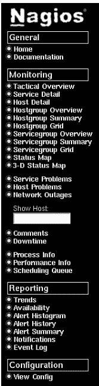

**图 2.5** `Nagios` 导航栏。

## 监控

监控部分旨在对你通过 `Nagios` 监控的机器提供实时的状态显示。除了战术概览（`tactical overview`）、状态地图和 3-D 状态地图外，监控部分下提供的所有显示都由单个 `CGI`：`status.cgi` 提供。事实上，你与 Web 界面交互时可能 90% 的操作都是通过与 `status.cgi` 完成的，这是一件好事，因为 `status.cgi` 提供了一个统一的接口。通常，`status.cgi` 显示的每个屏幕在顶部都有四个共同元素：上下文敏感的链接菜单、主机状态表和显示区域，如图 2.6 所示。

# 第 2 章 工作原理

| 当前状态 | | 主机状态统计 | | 服务状态统计 | | | | | | | | |
|---|---|---|---|---|---|---|---|---|---|---|---|---|
| 最后更新：PDT 2006年11月11日 18:44:38 | | 运行 | 离线 | 不可用 | 待处理 | 警告 | 未知 | 关键 | 待处理 | | |
| 更新于：PDT 2006年6月11日 18:44:38 | | 所有问题 | 所有失败 | | 19 | 0 | | 0 | 8 | | |
| 以访客身份登录 | | | 所有问题 | 所有失败 | | 19 | | 46 | | | |
| 查看所有主机组的详细信息 | | | | | | | | | | | |


| 隐藏所有主机组的状态详情 | | | | | | | |

| 查看所有主机组的状态摘要 | | | | | | | |

| 主机 | 操作 |

|---|---|

| deata | PING SSH |

| deata | PING SSH |

| doc | HTTPS PING SSH |

| doc web | HTTPS PING SSH |

| doc web2 | HTTPS PING SSH |

| doc web3 | HTTPS PING SSH |

| exchange | PING SMTP SSH |

| postal | PING |

所有主机组的状态网

**图 2.6** `status.cgi` 显示。

左上角的链接菜单提供了快捷链接，这些链接会根据你查看的显示类型而变化，而上方中间和右侧的服务及主机状态表汇总了显示区域内主机和服务的状态。需要注意的是，主机和服务的状态表是上下文敏感的；也就是说，它们显示的是你当前在显示区域中查看的部分主机和服务的摘要，而**不是** Nagios 中每个主机和服务的整体状态。通常，点击显示区域中的链接可以获得更详细的视图。点击主机组可以获取该组内所有主机的摘要。点击主机可以获取该主机的详细显示。

**图 2.7** 是主机详细显示的截图。如你所见，主机和服务的状态显示为灰色，且显示区域包含一个列出主机当前状态的表格以及命令菜单。这些命令允许管理该主机的状态。从这里，你可以为主机安排维护时间、告诉 Nagios 停止检查它、停止发送关于它的通知、确认问题等。如果 Nagios 配置为通过 `retained state`（保留状态）选项使用持久化状态，那么这些更改即使在 Nagios 重启后仍然存在。

# I/O 接口摘要

| 主机信息 | | 主机 |

| :--- | :--- | :--- |

| 最后更新：PDT 2008年6月11日 11:53:05 | | 邮件服务器 (postal) |

| 每 5 分钟更新一次 | | lime-boxes 成员 |

| http://example.org | | 192.168.1.133 |

| 以 admin 身份登录 | | |

| 查看此主机的详细信息 | | |

| 查看此主机的告警历史 | | |

| 查看此主机的告警历史 | | |

| 查看此主机的通知 | | |

| 主机状态 | | 主机命令 |

| :--- | :--- | :--- |

| 状态信息：运行 (UP) | | | 在地图上定位主机 |

| 性能数据：PING OK - 丢包率=0%，RTA=0.35 | | 禁用此主机的活动检查 |

| 当前关注度：1 | | 重新安排此主机的下次检查 |

| 状态类型：活动 (ACTIVE) | | 禁用此主机接收被动检查 |

| 上次检查：2015-09-30 00:36:06 | | 禁用此主机上的所有服务 |

| 状态日期：238d 14h 51m | | 禁用此主机的通知 |

| 下次计划活动检查： | | 为此主机安排维护时间 |

| 延迟：0.003 秒 | | 启用此主机所有服务的通知 |

| 查询：0.000 秒 | | 启用此主机所有服务的检查 |

| 最后更改：5d 17h 29m | | 禁用此主机上所有服务的检查 |

| 当前持续时间： | | 禁用此主机的事件处理程序 |

| 最后通知： | | |

| 状态持续：0 | | | 禁用 主机 | | |

| 检查时间：N/A | | |

| 检查时间：N/A | | |

| 检查时间：N/A | | |

| 维护时间：N/A | | |

图 2.7 是一个主机详细显示的截图。如你所见，主机和服务的状态显示为灰色，且显示区域包含一个列出主机当前状态的表格以及命令菜单。这些命令允许管理该主机的状态。从这里，你可以为主机安排维护时间、告诉 Nagios 停止检查它、停止发送关于它的通知、确认问题等。如果 Nagios 配置为通过 `retained state` 选项使用持久化状态，那么这些更改即使在 Nagios 重启后仍然存在。

## 外部命令文件

Web CGI 能够执行某些操作（如为主机调度停机时间和关闭通知），这表明 Web 界面不仅仅是日志和存储文件的简单 CGI 包装。事实上，CGI 是通过外部命令文件来实现命令执行的。命令文件是一个 FIFO（或命名管道），Nagios 会定期检查该文件以获取命令。命令文件可以被视为事件队列的一个文件系统入口；它仅供 Web 界面使用，但任何具有权限的进程都可以使用它。

命令的格式为：

```
`[time] command_id;command_arguments`
```

时间（Time）是自纪元以来以 Unix 秒格式的时间戳。要在 Unix 机器上获取当前秒数，请执行：

```
`date '+%s'`
```

命令 ID 是你想要执行的命令名称，每个命令都接受不同的参数。截至本文写作时，你可以通过命令文件向 Nagios 守护进程发送 131 种不同的命令，执行开启/关闭通知、确认问题以及提供命令等操作。这些命令的列表以及它们的选项和每个命令的示例 shell 脚本可以从 `www.nagios.org/developerinfo/externalcommands/` 获取。

## 性能数据

早期，插件被定义为一个小型程序，它提供一个退出码并在可选在标准输出（stdout）上提供一些文本。如果可选文本包含管道字符（|），Nagios 将将管道之前的所有内容视为普通摘要文本，将管道之后的所有内容视为性能数据。Nagios 对于存在性能数据时如何处理它有特定的定义。性能数据最初是为了跟踪插件本身的性能。例如，如果你想知道一个插件完成工作需要多长时间，插件本身可以计算并将该数据嵌入摘要文本中返回。你可以配置 Nagios 独对性能数据进行任何你想执行的操作，例如将其记录到文件或数据库中。

在实践中，性能数据已成为通过 RDDTool 将数据从 Nagios 导出到图表程序的实际手段。然而，大多数插件不支持性能数据；也就是说，它们的摘要文本中没有管道字符。不过，通过列表 2.6 中的 `check_wrapper_generic` 可以很容易地修正这一点。

### 列表 2.6 用于所有插件的性能数据包装器。

```bash
#!/bin/sh
### 一个为任何 nagios 插件添加 perfdata 功能的包装器
### 将 pluginName_wrapper 链接到此脚本以便运行
### 例如，如果你想为 check_mem 启用 perfdata
# 你将执行 'ln -s check_wrapper_generic check_mem_wrapper'

### 去掉末尾的 'wrapper'
NAME=$(echo $0 | sed -e ' /wrapper//')

### 调用插件并捕获其输出
OUTPUT='${NAME}' $@
### 同时捕获其返回码
CODE=$?

### 将插件的输出两次返回到 stdout，用管道符分隔
echo "${OUTPUT}|${OUTPUT}"

### 以插件退出时相同的代码退出
exit ($CODE)
```

此脚本与列表 2.5 中的 SSH 远程执行插件类似。它通过代理调用另一个插件并镜像另一个插件的输出，在输出中添加了一个管道，从而增加了对性能数据的支持。第 7 节讨论了性能数据以及如何使用它来为可视化程序提供数据。

## 事件代理器 (Event Broker)

Nagios 2.0 新引入的功能是事件代理器（Event Broker）。事件代理器是一个进程，它监控事件队列是否有特定类型的事件发生，然后通知一个或多个事件代理器模块，并将有关事件的详细信息传递给模块。

NEB 模块用 C 语言编写，并在运行时与 Nagios 核心进程链接，此时，它们请求事件代理器向它们发送它们感兴趣的事件。这些事件可以是 Nagios 在事件队列中处理的任何类型。在发生感兴趣的事件且模块获取了相关详细信息后，它可以执行任何它想做的事，包括修改队列中的事件、将信息传递给其他程序，并通常改变 Nagios 的运行方式。

对于那些拥有 C 语言技能并愿意亲自动手的人来说，事件代理器接口绝对是 Nagios 最强大的接口。在第 8。在第 8 节“Nagios 事件代理器接口”中，事件代理器被用于为 Nagios 添加一个文件系统状态接口。

# 第 3 节

## 安装 Nagios

Nagios 由三个大部分部分组成：守护进程（daemon）、Web 界面和插件（plugins）。守护进程和 Web 界面组成了 `www.nagios.com` 提供的 tar 包，而插件必须单独下载和安装。（某些发行版在其 Nagios 软件包中包含了插件。）尽管 Nagios 守护进程带有 Web 界面，但也可以单独安装守护进程。Nagios 有效监控环境并发送通知不需要 Web 界面。

安装守护进程后，大多数人会下载并安装插件 tar 包。安装插件在技术上是一个可选的步骤；完全可以只运行自定义插件来启动 Nagios，但大多数人认为这是在重复造轮。由 Nagios 插件项目提供的插件编写良好，并包含了你监控企业网络所需的所有内容。本章涵盖了这三个部分的安装，并提供了可用配置选项的简便参考。

## 操作系统支持与 FHS

Nagios 守护进程是为 Linux 设计并在 Linux 上运行的，但它能够在任何类 Unix 操作系统上运行，包括 Solaris、BSD、AIX 甚至 Mac OS X。邮件列表上甚至传出在 Microsoft Windows 的 Cygwin 下成功运行该守护进程的传言，但我个人并没有见过。如果你尝试构建 Cygwin 版本，请确保在配置选项中包含 `--enable-cygwin`。另外请注意，我主要在 Linux 上运行 Nagios，因此这段讨论是针对 Linux 的。

运行 Nagios 的各种 Unix 环境之间的主要区别在于各自相关的目录系统层级标准（FHS）。遗憾的是，不同的 Unix 变体将相同的文件放在不同的位置，这使得很难预测特定文件最终会出现在哪里。

# 第 3 节 安装 Nagios

可能会落到哪里。这是一个可以追溯到 BSD 分裂的问题，且没有人提出过好的解决方案。即使在不同的 Linux 发行版中，文件系统层级的实现也可能存在差异。要知道所有文件将落到何处的唯一真实方法是从源处手动安装。

除了一些奇特的结构（例如 AI 习惯于将所有开源软件安装到 `/usr/pkg`）之外，大多数系统以两种两种方式之一安装 Nagios：使用 FHS 或安装到 `/usr/local`。文件系统层级标准（FHS）是一个由自由标准组（Free Standards Group）提出的标准，描述了文件在类 Unix 文件系统中应该存放在哪里。我所知的大多数二进制发行版，如 Red Hat、Mandriva 和 SuSE，以及一些基于源码的发行版，在某种程度上使用了 FHS。我想强调的是，尽管 FHS 是一个很好的标准，但在实际操作中方面仍存在许多分歧和困惑。因此，表 3.1 显示的 FHS 标准位置应被视为粗略指南。

### 表 3.1 FHS 中的 Nagios 位置

| 文件类型 | 路径 |

| :--- | :--- |

| 配置文件 | `/etc/nagios` |

| HTML | `/usr/share/nagios` |

| CGIs | `/usr/share/nagios` 或 `/usr/lib/nagios` |

| 程序守护进程和其他可执行文件 | `/usr/bin/nagios` |

| 锁文件和 FIFO | `/var/lib/nagios` 或 `/var/log/nagios` |

| 日志 | `/var/log/nagios/` |

| 插件 | `/usr/libexec/nagios` 或 `/usr/lib/nagios` |

如果你使用类似 Gentoo 的基于的发行版或在 Linux、Solaris 或 BSD 上手动安装 Nagios，请预期在 `/usr/local` 或 `/usr/nagios` 下找到所有内容。`/usr/local/nagios` 不符合 FHS，即未通过系统软件包管理器安装的软件应该安装在 `/usr/local`。表 3.2 列出了本地安装的位置。

### 表 3.2 本地安装的 Nagios 文件位置

| 文件类型 | 路径 |

| :--- | :--- |

| 配置文件 | `/usr/local/nagios/etc` |

| HTML | `/usr/local/nagios/share` |

| CGIs | `/usr/local/nagios/share` |

| 程序守护进程和其他可执行文件 | `/usr/local/nagios/bin` |

| 锁文件和 FIFO | `/usr/local/nagios/var` |

| 日志 | `/usr/local/nagios/var` |

| 插件 | `/usr/local/nagios/libexec` |

## 安装步骤与先决条件

让我们开始吧。安装 Nagios 的高级步骤如下：

- 1. 获取并安装 Nagios 的依赖项。

- 2. 获取并安装 Nagios。

- 3. 获取并安装插件的依赖项。

- 4. 获取并安装插件。

Nagios 只有少数依赖项，且其中大部分是可选的。如果你想使用 Web 前端（这是唯一提供的交互式界面），你需要一个支持 CGI 的服务器，例如 Apache（更多信息请参阅 `www.apache.org`）。如果你想让 Nagios 显示精美的图片和图表，则需要三个图形库：`libpng`、`libjpeg` 和 `gd` 库。唯一的强制依赖项是 `zlib`，你很可能已经安装了它。

插件的依赖项则更像是一个不断变动的目标。你需要一个 `ping` 程序、一些 BIND 工具（如 `host`、`dig` 或 `nslookup`）、OpenSSL 库以及 Perl。如果你计划通过 SNMP 查询网络对象，则你需要 `net-snmp` 可能还需要 `perl-snmp`。根据你需要监控的内容，可能还需要 OpenLDAP、Kerberos 和 MySQL/pgql 等包用于特殊用途插件。

在大多数操作系统上，插件包中的 `configure` 脚本擅长识别你拥有哪些软件包，并自动为它们构建插件。如果你缺少某个包（例如 OpenLDAP），`configure` 只会不会尝试构建相关插件，而不是生成错误。Solaris 有一位资深技术审查员 Kate Harris，她表示她必须注释掉 Makefile 中的 SNMP 部分才能让插件通过编译。插件 tar 包的根目录包含一个 `REQUMENTS` 文件，该文件列出了特定插件的要求，因此在构建之前请务必检查它。

## 安装 Nagios

目前 Nagios 有两个分支：1.x 分支和 2.x 分支。本书专门介绍 2.x 分支，在编写本书时，当前的 2.x 分支版本为 2.5。在书中，我使用了 Nagios 2.1、2.3 和 2.5 来验证整个章节中的各种命令。

据我所知，大多数 UNIX 操作系统都带了 Nagios 的软件包版本，或者可以通过其他方式获取。在 Linux 领域，Red Hat、SuSE 和 Mandriva 用户可以在安装介质上找到 Nagios RPM，Debian 和 Ubuntu 类型的用户可以通过 `apt-get install nagios-text` 安装，gentoo 专家可以使用 `emerge`，甚至 sourcemage-wizard(?) 可能可以使用 `cost agios`。Red Hat 专用的 Nagios RPM 也可以从 `https://www.nagios.com` 获取。BSD 用户可以在 ports 中找到 Nagios，Solaris 用户可以从 blastwave.org 使用 `pkg-get install Nagios`。目前还没有适用于 AIX 的包。虽然手动编译 Linux、BSD 和 Solaris 版本的 Nagios 非常简单，但在 AIX 上构建它并非弱者之选。如果你打算在 AIX 上尝试本地安装，我建议从免费软件获取 `gcc` 而不是使用 AIX 的编译器。如果你是 AIX 用户，affinity 程序会让在 AIX 上构建 Nagios 变得容易得多。请咨询本地包管理器文档以获取有关为你的系统安装 Nagios 包的更多信息。

我建议你从源码构建 Nagios 而不是使用软件包，除非你计划编写自己的包。简单来说，当你花时间从源码构建时，你才会清楚细节。此外，尽管我提到 Nagios 运行在许多不同的系统上，但它是为了 Linux 编写的，因此对于生产系统，我建议使用 Linux。

对于从源码的手动构建，可以直接从 `www.nagios.com` 获取 Nagios tar 包。安装过程是典型的 `configure`、`make` 和 `make install`。Nagios 需要一个用户和一个组来运行，因此必须先创建这些内容。对于不耐烦的人，列表 3.1 就足够让你运行起来了。

### 列表 3.1 为不耐烦的人安装 Nagios。

```
groupadd nagios
user -s /bin/false -g nagios nagios
tar -zxvf nagios-version.tgz
cd nagios-version
./configure
make all
sudo make install
```

与许多优秀的开源应用一样，`configure` 和构建选项非常多。让我们仔细查看一下这三个主要步骤：`configure`、`make` 和 `make install`。

## 配置

默认设置是合理的，你不需要指定任何内容，但有几个选项是你应该的。使用 `-h` 参数启动 `configure` 以获取完整的选项列表。根据我的经验，你要么需要修改几乎所有的选项，要么几乎一个都不改。表 3.3 显示了一些你应该预先的选项。

## 安装 Nagios

### 表 3.3 重要的编译选项

| 选项 | 描述 |

| --- | --- |


| 选项 | 描述 |

| :--- | :--- |

| `--enable-embedded-perl` | 启用 Nagios 的嵌入式 Perl 解释器。它旨在为使用大量 Perl 插件的用户加快 Perl 脚本的执行速度。我提到它是因为它导致段错误（segfaults）的声声，所以请自风险开启。默认是禁用的，大多数人都会保持禁用。 |

| `--with-nagios-user=<usr>` | 这是 Nagios 运行的用户。它应该在运行 `configure` 之前创建。默认是 `nagios`。 |

| `--with-nagios-group=<grp>` | 这是 Nagios 所属的组。它应该在运行 `configure` 之前创建。默认是 `nagios`。 |

| `--with-init-dir=<path>` | 这设置 init 脚本安装的位置，如果你使用 `install-init` `make`。默认是 `/etc/rc.d/`。 |

| `--with-htmlurl=<path>` | 这设置 HTML 页面。默认是 `/nagios/`。 |

| `--with-cgiurl=<path>` | 同样，HTML 引用的任何 CGI 必须在编译时设置。默认是 `/nagios/`。 |

之前的选项对于你是否需要指定选项。使用没有任何选项的 `configure` 就能让大多数人获得一个工作的 Nagios 实现，但你可能需要修改上面的默认值。附录 A，“配置选项”包含了完整的选项列表。

### Make

实际上有五个 `make` 目标来构建 Nagios 的部分。简单的 `make` 会构建所有 Nagios 和 Web前端。表 3.4 列出了其他相关的 `make` 目标。

### 表 3.4 相关的 make 目标

| 目标 | 描述 |

| :--- | :--- |

| `make nagios` | 仅构建 Nagios 进程，不包含 Web 界面。 |

| `make egis` | 仅构建 Web 界面，不包含进程。 |

| `make modules` | 构建事件代理模块（NEB Modules）。截至本文，只有一个 `helloworld.o`，它对于想要学习如何编写 NEB 模块的人非常有用。 |

| `make contrib` | 构建各种用户贡献的程序。这里有五个。最有用的包括 `traceroute` CGI、`apache` 配置文件以及嵌入式 Perl 解释器的独立版本，用于测试 Perl 插件。 |

### Make Install

执行 `make install` 会安装进程、CGI 和 HTML 文件。其他安装相关的 `make` 目标如表 3.5 所示。

### 表 3.5 相关的 make 目标

| 目标 | 描述 |

| :--- | :--- |

| `make install-base` | 仅安装 Nagios 进程，不包含 Web前端。 |

| `make install-egis` | 安装 CGI 程序。 |

| `make install-html` | 仅安装静态 HTML 页面。 |

| `make install-init` | 安装 init 文件（到 `--with-init-dir` 配置选项指定的目录）。 |

| `make install-config` | 安装示例配置文件。 |

| `make install-commandmode` | 创建外部命令文件（如第 2 节末尾所述）。 |

| `make uninstall` | 卸载 Nagios。 |

| `make fullinstall` | 安装所有内容（全部）。 |

## 补丁

将这一切整合在一起，一个真实的 Nagios 构建过程看起来更像列表 3.2。

### 列表 3.2 真实的 Nagios 安装。

```
groupadd nagios
useradd -s /bin/false -g nagios nagios
useradd -s /bin/false -g nagios nagioscmd
tar -zxvf nagios-version.tgz
cd nagios-version
./configure -with-command-user=nagioscmd
make all
sudo make install install-init install-config install-commandmode
```

当 `configure` 运行完成后，它会提供一个简便的摘要，说明如果你决定构建，将会发生什么。例如，在你的 Linux 工作站上使用列表 3.2 中的选项运行 `configure`，将得到列表 3.3 中的摘要。

### 列表 3.3 configure 的输出。

> *** nagios 2.1 (2006-03-27) 的配置摘要 ***:
>
> 通用选项:
>
> Nagios 可执行执行文件: nagios
>
> Nagios 用户/组: nagios,nagios
>
> 命令用户/组: nagioscmd,nagios
>
> 嵌入 Perl: no
>
> 事件代理器: yes
>
> 安装 ($prefix): /usr/local/nagios
>
> 锁文件: $(prefix)/var/nagios.lock
>
> 初始化目录: /etc/rc.d
>
> 主机操作系统: linux-gnu
>
> Web 接口选项:
>
> HTML URL: http://localhost/nagios/
>
> CGI URL: http://localhost/nagios/cgi-bin/
>
> Traceroute (WAP 使用): /usr/sbin/traceroute
>
> 请检查上述选项的准确性。如果它们看起来没问题，输入 `make all` 来编译主程序和 CGIs。

## 补丁

在写本文时，有三个 Nagios 核心的补丁你可能会感兴趣。其中两个为主机定义添加了新属性，另一个让“状态映射”（status map）cgi 变得更加美观。所有补丁都可以从 Nagios Exchange 获取，那是一个专门用于用户创建的插件和脚本的网站：www.nagiosxexchange.org。具体来说，这些补丁位于 Nagios Exchange 的 `development`（开发中）部分。

### 次要 IP 补丁

第一个补丁通常称为次要 IP 补丁，它为主机对象的定义添加了 `secondary` 属性。次要地址旨在为两个 IP 地址的主机提供支持。对象定义的特定语法将在下一章介绍，但我想在这里提到，没有必要使用此补丁来支持多个 IP。我只需在主机定义中的内置属性中提供一个用空格分隔的地址列表，`check-plugin` 就会检查列出的每个地址。支持多个 IP 需要次要 IP 补丁的说法是一个常见的误解。使用第二个 IP 的唯一真实理由是当你想要通过宏（macro）专门引用第二个 IP 时。关于宏将在第 4 章“配置 Nagios”中进行更多讨论。它们可以被视为 Nagios 内部的变量并供对象定义使用。例如，主机定义中的 `in-address` 属性可以通过 `$HOSTADDRESS$` 来引用。当定义检查项时，它们指向 `$HOSTADDRESS` 而不是主机的硬编码地址。通过这种方式，一个定义可以用于任何主机。如果定义了多个地址，那么 `$HOSTADDRESS` 将解析为多个 IP。只有当你想要通过单独的宏专门地分别引用两个地址时，才需要次要地址补丁。这不是一个常见的需求。

### 团体字符串补丁

SNMP 团体字符串补丁与次要 IP 补丁类似，因为它在主机定义中添加了属性和宏。该属性——你可能猜到是目标主机的 SNMP 团体字符串——在你有许多位于不同 SNMP 社区的各种主机的情况下非常有用。同样，可以通过为每个社区定义单独的变量，在不修补 Nagios 的情况下支持不同 SNMP 社区的主机。该补丁通过宏添加查询每个主机的 SNMP 团体的能力，使得对任何主机都可以使用单一检查。如果你使用多个 SNMP 团体字符串，我建议应用此补丁。

### 彩色状态补丁

最后，彩色状态补丁为状态映射 cgi（Web 前绘制的图形）添加了颜色，这些颜色对应于主机的状态。健康状态的主机显示为绿色，而下降或故障状态的主机分别显示黄色或红色。

三个补丁都可以从源目录使用 `-p1` 切换应用到完整的 Nagios 安装中，包括之前列出的补丁的应用。

## 安装插件

### 列表 3.4 使用补丁安装 Nagios。

```
groupadd nagios
useradd -s /bin/false -g nagios nagios
useradd -s /bin/false -g nagios nagioscmd
tar -zxvf nagios-version.tgz
cd nagios-version
patch -pl /path/to/second_ip.patch
patch -pl /path/to/snmp_string.patch
patch -pl /path/to/statusmap.patch
./configure -with-command-user=nagioscmd
make all
sudo make install install-init install-config install-commandmode
```

## 安装插件

安装 Nagios 后，该是安装插件包（tarball）了，以便 Nagios 能够运行某些检查。插件包以及 RPM 可以在 www.nagios.com 的下载部分获取。通常，UNIX 发行版在有 Nagios 包的同时也会有一个某种描述的 Nagios-plugins 包。

从源码手动安装插件比安装 Nagios 本身要容易。`configure` 脚本会确定 `ping` 和 `Perl` 等重要二进制文件的路径。如果它找不到某些内容，你可能需要指定。如果你在 Nagios 构建时更改了某些路径，你可能需要为插件指定它们，正如内容表 3.6 中列出的那样。由于 `configure` 找不到 `ping` 命令，你可能需要指定它的位置。对于大多数环境，`configure` 可以带默认设置运行。

### 表 3.6 插件配置选项

| 选项 | 描述 |

| :--- | :--- |

| `--cgiurl=<path>` | 如果你在 Nagios 构建时指定了自定义 `cgiurl`，你需要告诉插件它。 |

| `--with-nagios-user=<user>` | 如果你使用非标准用户名运行 Nagios，请为插件指定。 |

| `--with-nagios-group=<group>` | 同样，如果你在 Nagios 构建期间更改了组，也为插件更改。 |

| `--with-trusted-path=<colon:delimited:list:of:paths>` | 这个非常酷的选项允许你指定插件运行的环境路径。这通过限制插件可以执行程序增加了系统的安全性。 |

运行 `configure` 并带有 `-h` 以获取完整列表，例如你需要指定 `ping` 命令的位置，因为在我的 Linux 工作站上不带任何选项运行 `configure` 产生了类似于 3.5 那样的摘要。

### 列表 3.5 configure 的输出。

```
--with-perl: /usr/bin/perl
--with-cgi: /nagios/cgi-bin
--with-nagios-user: nagios
--with-nagios-group: nagios
--with-trusted-path: /bin:/sbin:/usr/bin:/usr/sbin
--with-ping-command: /bin/ping -n -c d %s
--with-ping6-command:
--with-lwres: no
--with-ipv6: yes
--with-openssl: yes
--enable-emulate-getaddrinfo: no
```

如果良好，简单的 `make` 将构建并安装插件到合适的位置。然而，插件包中的 `contrib` 目录并没有安装。该目录是特殊用途和特定架构插件的宝库。它包含了从 `netapp` 设备到 `Synergy` 数据库以及之间的一切检查。我强烈建议在开发任何内容之前先查看 `contrib`，即使你没有找到你想要的；它也是获取复用代码的好地方

## 安装 NRPE

在安装 Nagios 和插件包之后，你可能想直接跳到第 4 章并进行配置。当你拥有一个功能完整的 Nagios 服务器后，下一步是远程执行。正如第 2 章末尾描述的，Nagios 远程插件执行器 (NRPE) 为 Nagios 提供了在监控主机上远程执行插件的能力。如图 3.1 所示，NRPE 由两部分组成：插件和一个在每个监控主机上运行守护进程。Nagios 使用 `check_nrpe` 插件请求 NRPE 进程在远程主机上运行检查。如果远程主机上的 NRPE 配置为允许这样做，它将运行插件并将结果返回给 `check_nrpe` 直到 Nagios 服务器。

## 安装 NRPE

`check_nrpe`: 请运行 `check_uptime`

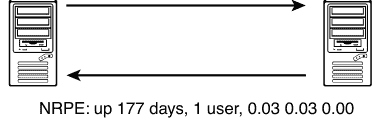

**图 3.1** 使用 NRPE 进行远程执行。

NRPE 守护进程可以在超级用户（如 `inet/xinet`）下运行，也可以作为独立守护进程运行。它通过一个名为 `nrpe.cfg` 的配置文件进行配置，该文件通常位于 `/etc/`。`nrpe.cfg` 定义了 `check_nrpe` 客户端允许运行的插件列表。Microsoft Windows 版本的 NRPE 守护进程。有关如何在远程主机上使用 NRPE 服务的更多信息，请参阅第 6 章“监控”。

要安装 Linux 版本的守护进程，首先获取它：

```
http://prdownloads.sourceforge.net/nagios/nrpe-2.5.1.tar.gz?download
```

然后，解压并执行 `./config` 然后执行 `make all`。对于 Nagios 服务器，只需将 `check_nrpe` 复制到插件目录即可。对于被监控的主机，将 `nrpe` 复制到任何地方（如 `/usr/sbin`），然后从 `sample-configs` 目录获取示例配置文件并放入 `/etc/`。修改配置文件以满足你的需求；它有大量的注释，因此应该是自显易懂的。最后，运行 `nrpe -c /etc/nrpe.cfg -d` 将以独立模式启动 NRPE 守护进程。`sample-configs` 目录还包含 `inet/xinet` 配置，如果你想使用超级用户的话。

对于 Microsoft 用户，请从此处获取二进制版 NRPE-NT 包：

www.miwi-dv.com/nrpent/

解压后，编辑 `nrpe.cfg` 文件并输入 `nrpe.exe -i` 进行安装。随后 NRPE 守护进程将作为服务出现在 `services.msc` 中。我一直很难处理 NRPE-NT 守护进程与 UNIX `check_nrpe` 客户端之间的版本不匹配问题。取决于版本差异有多大，你可能会遇到 SSL 无法运行或完全无法运行的麻烦。我建议你查看 NRPE-NT 论坛，获取有关哪些版本的 `check_nrpe` 与当前 NT 守护进程兼容的信息。

## 配置 Nagios

安装完成后，你需要在启动 Nagios 之前进行配置。Nagios 通过包含指令和定义的文本文件进行配置。第一次配置它可能是一项艰巨的任务，因为这些定义是自引用的，而且有很多内容需要定义。

要开始使用，Nagios 需要在特定时间段内对主机和服务调用插件，并在检查返回错误状态时向联系人发送通知，因此，你需要定义检查项（checks）、时间段、主机、服务、通知命令和联系人（这些都是强制性的）。因为有许多对象引用了许多其他对象，可能很难知道从哪里开始解释这一切。不要气馁；Nagios 带有可以生成示例配置文件的选项，此外，你还可以采取一些快捷方法来引导配置过程（参见第 5 章“引导配置启动”），但首先，你需要很好地了解配置看起来像什么样。

主机和服务是核心核心对象。它们是引用大多数其他对象的对象，因此大部分文档都是从 Nagios 开始开始编写的。我将采取更多自底向上的方法。我将先从描述守护进程配置文件开始，然后从命令和时间段，通过服务和主机，一直到组，最后是可选定义，如升级（escalations）和扩展信息。每组对象由其上方的对象引用，因此通过这种方式解释，当你遇到定义中引用另一个对象的属性时，你已经查看过该对象的组成部分。我发现通过这种方式解释更容易掌握整体情况。

## 对象与定义

在 Nagios 中，有两种类型的配置文件：包含指令的文件和包含定义的文件。从技术来说，只需要两个配置文件：`nagios.cfg` 和一个对象配置文件。`nagios.cfg` 包含了影响 Nagios 守护进程运行的指令，例如，日志写入哪里、对象配置文件的名称、全局设置以及此类内容。对象配置文件定义了 Nagios 处理的各种对象。

对象的类型其实并不多（如表 4.1 所示），尽管可以将所有定义合并到一个文件中，但大多数人倾向于按类型对对象定义分组，并为每个类型保留一个不同的文件。因为这使得编写和学习对象配置变得更容易，这也是在本章中遵循的惯。虽然 Nagios 始终被命名为 `nagios`，但对象配置的文件名是用户定义的，因此我在整个章节中使用的文件名不是固定的。你完全可能继承一个按网络子网、甚至按与百乐机的物理距离对对象定义分组的 Nagios 实现。

### 表 4.1 Nagios 对象简览

| 对象名称 | 描述 | 推荐文件名 |

| :--- | :--- | :--- |

| `timeperiod` | 这是一个定义的时间块，其他对象使用它来确定自己的运行时间和停机期。 | `timeperiods.cfg` |


### 表 4.0 Nagios 对象简览

| 对象名称 | 描述 | 推荐文件名 |
|---|---|---|
| `command` | 命令定义将宏映射到外部程序。其他对象使用命令来执行许多操作，如发送通知和运行服务检查。 | `miscommands.cfg` 和 `checkcommands.cfg` |
| `contact` | 定义一个通知目标。 | `contacts.cfg` |
| `contactgroup` | 定义一组联系人。 | `contactgroups.cfg` |
| `host` | 定义一个主机。 | `hosts.cfg` |
| `service` | 定义一个服务。 | `services.cfg` |
| `hostgroup` | 定义一组主机。 | `hostgroups.cfg` |
| `servicegroup` | 定义一组服务。 | `servicegroups.cfg` |
| `dependency` | 定义对象之间的依赖关系。 | `dependencies.cfg` |
| `escalation` | 定义通知的升级规则。 | `escalations.cfg` |
| `extendedinfo` | 提供关于对象的扩展信息。 | `extendedinfo.cfg` |

### 表 4.1 Nagios 对象简览（续）

| 对象名称 | 描述 | 推荐文件名 |
|---|---|---|
| `service` | 定义在主机上的服务。 | `services.cfg` |
| `hostgroup` | 定义一组主机。 | `hostgroups.cfg` |
| `servicegroup` | 定义一组服务。 | `servicegroups.cfg` |
| `dependency` | 定义对象之间的依赖关系。 | `dependencies.cfg` |
| `escalation` | 定义通知的升级规则。 | `escalations.cfg` |
| `extendedinfo` | 提供关于对象的扩展信息。 | `extendedinfo.cfg` |
| `hostinfo` | 提供关于主机的扩展信息。 | `hostinfo.cfg` |

`nagios.cfg` 包含了影响 Nagios 守护进程运行的指令，例如，日志写入哪里、对象配置文件的名称、全局设置以及此类内容。对象配置文件定义了 Nagios 处理的各种对象。

`nagios.cfg` 是必须的。如果你使用 Web 界面，另一个配置文件 `cgi.cfg` 也是必须的。`cgi.cfg` 包含了指令而不是对象定义。`nagios.cfg` 包含了指令而不是定义。指令语法对于任何在 UNIX 系统上配置过软件的人来说都是熟悉的。每行一个指令，后跟着一个等号，然后是指令的值。空格是可选的，注释以井号（`#`）开头。

定义无论类型如何，都使用类似于 C 或 Perl 函数的通用语法。定义由大括号 `{}` 包围的指令块组成，并以 `define` 关键字开头，后跟对象类型。块内的指令使用空格分隔，与使用等号的 `nagios.cfg` 对应不同。所有对象都有一个共同指令：`<objecttype>name`。例如，主机有 `host_name` 指令，服务组有 `servicegroup_name` 指令。大多数对象还有一个 `alias` 指令。注释以井号（`#`）开头。列表 4.1 是一个示例主机定义，让你对语法有种感觉。

```text
# 关于 myHost 的注释
define host(
    host_name           myHost
    alias               My Favorite Host
    address             192.168.1.254
    parents             myotherhost
    check_command       check-alive
    max_check_attempts  5
    contact_groups      admins
    notification_interval 30
    notification_period 24x7
    notification_options d,u,r
)
```

在 `nagios.cfg` 中你想要更改的两个内容是对象配置文件的位置以及 `check_external_commands` 指令。指定对象配置位置有两种方法。你可以通过 `cfg_file` 指令具体列出每个对象定义文件，如列表 4.2 所示；也可以通过 `cfg_dir` 指令指定目录，如列表 4.3 所示。如果你指定了一个目录，Nagios 将解析该目录中以 `.cfg` 结尾的所有文件。

### 列表 4.2 单独指定对象配置文件

```
cfg_file=/usr/local/nagios/etc/contactgroups.cfg
cfg_file=/usr/local/nagios/etc/contacts.cfg
cfg_file=/usr/local/nagios/etc/escalations.cfg
cfg_file=/usr/local/nagios/etc/hostgroups.cfg
cfg_file=/usr/local/nagios/etc/hosts.cfg
cfg_file=/usr/local/nagios/etc/servicegroups.cfg
```

### 列表 4.3 通过目录指定对象配置文件

```
cfg_dir=/usr/local/nagios/etc/
```

接下来，如果你希望 Web 界面中的 CGI 命令能够工作，或者你想通用使用外部命令（如第 2 章“操作原理”所述），你应该通过以下行告诉 Nagios 从命令文件中接受外部命令：

```
check_external_commands=1
```

为了让外部命令工作，命令文件必须存在于 `nagios.cfg` 指定的位置，并且其权限必须设置正确。如果你在适当的时间运行了 `make install-commandmode`，这些问题都会被妥善处理。

虽然这两个更改可以让你让系统运行起来，但 `nagios.cfg` 中还有一些你应该注意的指令。这些指令分为两类：全局启用器和全局超时。表 4.2 描述了全局启用器。你应该记住这些项，因为它们可以启用或禁用重要的、可编程的功能。

### 表 4.2 `nagios.cfg` 中的全局启用器

| 名称 | 描述 |
| --- | --- |
| `execute_service_checks` | 将此项设置为 0 将通过程序化方式关闭服务检查。默认值为 1 (开启)。 |
| `accept_passive_service_checks` | 将此项设置为 0 将关闭被动服务检查。默认值为 1 (开启)。关于被动检查的详细讨论，请参考第 2 章。 |

### 表 4.2 `nagios.cfg` 中的全局启用器（续）

| 名称 | 描述 |
| --- | --- |
| `execute_host_checks` | 启用/禁用主机检查。默认值为 1 (开启)。 |
| `accept_passive_host_checks` | 启用/禁用被动主机检查。默认值为 1 (开启)。 |
| `enable_notifications` | 此设置控制 Nagios 是否会发送通知。默认值为 1 (开启)。 |
| `enable_event_handlers` | 事件处理器可以全局启用或禁用。默认值为 1 (开启)。 |
| `process_performance_data` | 决定 Nagios 是否会检查并处理来自插件的性能数据。默认值为 0 (关闭)。 |

表 4.3 描述了超时设置，它们控制 Nagios 允许各种命令运行多长时间。当队列中的命令被执行时，Nagios 允许它运行一段用户定义的秒数。运行超过该时间的命令将被杀死；如果你发现自定义检查或事件处理器意外死亡，记住这些超时设置是非常重要的。当 Nagios 因为超时而杀死命令时，它会记录一条警告消息。

### 表 4.3 全局超时值

| 目标名称 | 描述 |
| --- | --- |
| `service_check_timeout` | Nagios 等待服务检查插件返回状态的时间。默认值为 60 秒。 |
| `host_check_timeout` | Nagios 等待主机检查插件返回状态的时间。默认值为 60 秒。 |
| `event_handler_timeout` | Nagios 等待事件处理器完成执行的时间。默认值为 30 秒。 |
| `notification_timeout` | Nagios 允许通知命令运行的时间。默认值为 30 秒。 |
| `perfdata_timeout` | Nagios 允许性能数据处理器运行的时间。默认值为 5 秒。 |

`nagios.cfg` 中还有很多我在这里没有提到的内容，包括第 2 章中提到的许多指令，这些指令调优调度器所使用的各种运行参数。附录 B 包含了 `nagios.cfg` 和 `cgi.cfg` 文件中可用配置选项的完整列表。

## CGI 配置

守护进程启动不需要

引用自：`nagios.cfg`

被引用：`nagios.cfg`

`cgi.cfg` 文件是除 `nagios.cfg` 外唯一包含指令而非定义的文件，除非你使用 Web 界面，否则它是可选的。Nagios Web 界面与 Nagios 守护进程完全独立的实体。守护进程并不真正知道 Web 界面的存在，因此它通过与其他任何程序相同的机制与守护进程通信：它向命令行发送命令，并解析日志文件以获取主机和服务的当前状态。因此，`cgi.cfg` 中的大部分指令是为了为组成 Web 界面的 CGI 程序提供所需的信息，以便它们命令 Nagios 进程并获取信息。

与 Nagios 类似，如果你在编译时正确指定了指令并使用 `install-config` 构建了示例配置，那么 `cgi.cfg` 中的大多数指令都不需要更改。你需要修改的是围绕 Web 界面安全模型的指令，它非常简单。CGI 依赖 Web 服务器来处理验证，因为任何服务器都可以用于设置 Web 界面，且 Web 服务器配置之外不需要对特定用户进行配置。

当用户通过身份验证后，Web 界面尝试将从 Web 服务器传递的用户名与 `contacts.cfg` 中的联系人关联。在设置好 `contacts.cfg` 并配置好 Web 服务器验证用户后，CGI 允许你获取你作为联系人的主机和服务的信息。这对于希望实现最小权限安全的大型站点非常好用。如果你在站点宕机时收到了警报，你可以在 Web 界面中看到它，而无需触碰 `cgi.cfg` 中的任何内容。

然而，对于较小的站点，让每个人看到所有内容可能更理想；几乎所有站点都会希望有几个作为 Nagios 管理员的用户，这些管理员可以看到所有内容，无论他们是否被配置为相关主机或服务的联系人。表 4.4 显示了 `cgi.cfg` 中使这些配置成为可能的指令。大多数指令接受逗号分隔的用户列表。每个支持逗号分隔列表的指令也支持使用星号（`*`）来表示所有用户。

### 表 4.4 与安全相关的 `cgi.cfg` 指令

| 对象名称 | 描述 |
| --- | --- |
| `use_authentication` | 此指令默认设置为 1 (开启)，告诉 CGI 使用来自 Web 服务器的身份验证信息。由于 Web 界面可以控制 Nagios 的运行方式，因此关闭验证是一个坏主意。如果你想看到所有内容，请使用 `default_user_name`。通常设置为 `guest`，`default_user_name` 可以被授予其他用户继承的权限。例如，如果 `jdoe` 没有显式访问某个服务信息的权限，但默认用户有，那么 `jdoe` 就能看到该服务，因为所有用户都可以看到默认用户看到的内容。如果你想查看所有主机，请取消此指令并在 `authorized_for_all_hosts` 中列出 |
| `authorized_for_system_information` | 逗号分隔的用户列表，允许查看与 Nagios 进程相关的信息。 |
| `authorized_for_configuration_information` | 逗号分隔的用户列表，允许通过 Web 界面查看配置文件的内容。 |
| `authorized_for_system_commands` | 逗号分隔的用户列表，允许执行与 Nagios 进程相关的命令，如关闭和重启。 |
| `authorized_for_all_services` | 逗号分隔的用户列表，允许查看 Nagios 监控的任何服务的相关信息。 |
| `authorized_for_all_hosts` | 同上定义（主机除外）。 |
| `authorized_for_all_service_commands` | 逗号分隔的用户列表，允许执行与服务相关的命令，如重新调度检查和禁用通知。 |
| `authorized_for_all_host_commands` | 同上定义（主机除外）。 |

## 模板

Nagios 配置的主体是“对象与定义”部分中描述的对象定义。对象定义的复杂程度各不相同。例如，命令定义通常只由两三行文本组成。相反，服务定义可能包含 31 条指令，其中 11 条是强制性的。对于每个主机有 1 个服务的 100 台主机，仅服务定义就有 1100 行配置，其中大部分是冗余的。

模板减少了大量的输入工作。例如，任何引用主机的定义都可以改为引用一个由逗号分隔的主机列表。Nagios 2.x 允许你在某些引用主机的定义中指定主机组（`hostgroup`）而不是单个主机。这两个功能使得我们将原本的 1100 行代码缩减到了 11 行。

另一个省力的功能是基于模板的配置。模板在特殊定义中捕获了冗余的指令。普通对象可以引用模板并继承指令，而不是显式地指定它们。模板定义看起来和作用上与其对应的对象完全相同，但有两个例外：`register` 指令和 `name` 指令。列表 4.4 是列表 4.1 中主机定义的模板版本。

### 列表 4.4 主机模板和消费者定义

```
### This is my template
define host(
    name                hostTemplate
    check_command       check-host-alive
    max_check_attempts  5
    contact_groups      admins
    notification_interval 30
    notification_period 24x7
    notification_options d,u,r
    register            0
)

### myHost is shorter now that it inherits from hostTemplate
define host(
    host_name           myHost
    alias               My Favorite Host
    address             192.168.1.254
    parents             myotherhost
    use                 hostTemplate
)
```

如你所见，两个定义都定义了类型为 `host` 的对象。然而，主机模板有一个 `name` 指令（而不是 `host_name` 指令）和一个 `register` 指令，后者被设置为 0。尽管对象类型相同，但 `name` 和 `register` 都是模板特有的，因此任何其他类型的模板（如服务模板）也是如此。`name` 指令的作用显而易见；它为模板提供了一个其他对象可以引用的名称。`register` 指令设置为 0 告诉 Nagios 不要将该主机视为一个主机对象（不要注册它），而是让其他对象从其继承设置（使其成为一个模板）。

通过在 `myHost` 的定义中添加 `use` 指令，我指示 Nagios 让 `myHost` 从模板继承设置。主机对象继承模板中指定的任何内容。主机对象会覆盖它与模板共有的任何指令。模板反过来也可以从其他模板继承属性，因此在主机定义中，定义一个全局主机模板，然后定义几个特定操作系统的模板，以及引用这些模板的主机是非常常见的做法。从技术上讲，任何对象都可以通过 `use` 指令从任何其他同类型的对象（无论是否已注册，我不建议让普通对象继承其他普通对象。请坚持使用专用的模板或避免混淆的模板）进行无限次数的继承。我强烈推荐基于模板的配置；它非常灵活，节省了大量的冗余配置，并使得配置文件具有可读性。

## 时间段 (Timeperiods)

守护进程需要

引用自：无

被引用：主机、服务、联系人、主机升级 (`hostescalation`)、服务升级 (`serviceescalation`)

### 列表 4.5 时间段示例

```
define timeperiod{
    timeperiod_name nonworkhours
    alias Non-Work Hours
    sunday 00:00-24:00
    monday 00:00-09:00,17:00-24:00
    tuesday 00:00-09:00,17:00-24:00
    wednesday 00:00-09:00,17:00-24:00
    thursday 00:00-09:00,17:00-24:00
    friday 00:00-09:00,17:00-24:00
    saturday 00:00-24:00
}
```

时间段定义了许多其他对象在运行时间或停机期语境下引用的时间块。时间段定义是通用的；它所定义的时间并不针对任何特定目的，因此两个不同的对象可能出于完全不同的原因引用同一个时间段。

时间段对每周每一天都有一个指令。完全省略某一天意味着该整天都不包含在时间段内。像所有其他对象一样，时间段可以从其他时间段或时间段模板继承指令。通过逗号分隔，可以在同一天内指定多个时间块。

## 命令 (Commands)

启动守护进程需要

引用：无

被引用自：主机、服务、联系人

### 列表 4.6 命令示例

```
define command{
    command_name check_ping
    command_line $USER$//check_ping -H $HOSTADDRESS$ -w $ARG1 -c $ARG2 -p 5
}
```

虽然命令定义仅由两个指令组成，但它们是 Nagios 功能的核心。命令是 Nagios 调用外部程序的唯一手段，正如我们在本章其他定义中将看到的，Nagios 会调用外部程序。


命令对象最常用的用法是调用插件。如前所述，只有两个指令：`command_name`（提供其他对象可以引用的对象名称）和 `command_line`（定义命令的 `shell` 语法）。

命令对象不仅引用外部程序；它们还捕获了命令语法。用美元符号包围的大写单词被称为宏 (macros)。宏是 `Nagios` 在运行时替换的特定上下文内部变量。

## Contactgroup

守护进程启动需要

引用：`contact`

被引用：`host`, `service`, `contact`, `hostescalation`, `serviceescalation`

### 列表 4.9 Contact 示例。

```
define contactgroup{
  contactgroup_name  admins own  alias              The Administrators
  members            chris,dave,jason,jer,kelly own}
```

联系人被组织成组，主机和服务的检查引用的是组而不是单个联系人。该定义非常直观，包含了常用的名称和别名指令，以及成员指令。在 `Nagios` 2.0 及以上版本中，你可以通过在联系人定义中添加 `contactgroups` 指令来指定联系组成员关系。如果你在联系组定义中同时使用了这两个指令，并在联系人定义中使用 `contactgroups` 指令，`Nagios` 会将两者合并；但是，我建议你选择其中一种并坚持。

## Hosts

守护进程启动需要

引用：`timeperiod`, `contactgroup`, `command`

被引用：`service`, `hostgroup`, `hostdependency`, `hostescalation`, `hostextint`

### 列表 4.10 Host 示例。

```
define host{
  host_name           myHost
  alias              My Favorite Host
  address            192.168.1.254
  parents            myhost
  event_handler      ups-reboot
  check_command      check-alive
  max_check_attempts 3
  contact_groups     admins
  notification_interval 30
  notification_period 24x7
  notification_options d,u,r
}
```

因为主机和服务是 `Nagios` 中的核心对象，它们的定义比大多数对象都要复杂。你可以在主机定义中指定 28 种不同的指令，但只有 9 个是强制性的。（列表 4.10 中的所有指令都是强制性的，`event_handler` 和 `parents` 除外）。请参阅 `Nagios` 文档 `http://nagios.sourceforge.net/docs/2_0/xodtemplate.html#host` 获取可用指令的完整列表。列表 4.9 中的指令可能就是你需要的全部了。

`address` 指令告诉 `Nagios` 如何找到主机。你可以为 `address` 指令指定 IP 地址或主机名，这是一个重要的决定。如果你指定了主机名，`DNS` 问题将导致失败，因为 `Nagios` 无法解析主机名。相反，如果你指定了 IP 地址，那么你必须在主机 IP 变化时记得更改定义。在大型环境中，这种情况可能会发生且你可能不知情。我更倾向于指定主机名，并在 `Nagios` 机器本地运行本地 `DNS` 名称服务器服务，例如 `tinydns`（更多信息请访问 `www.tiny.org`）。使用本地缓存可以解决 `DNS` 相关问题，因为 `Nagios` 将自身作为名称服务器，但这需要与真实的名称服务器进行某种形式的同步。

`parents` 指令告诉 `Nagios` 主机位于网络拓扑的什么位置。`parents` 是从 `Nagios` 服务器的角度定义的。如果 `Nagios` 服务器连接到一个路由器，而该路由器又连接到包含主机的独立子网，那么这些每个主机都应该通过 `parents` 指令列出该路由器。路由器不需要 `parents` 指令，因为它们与 `Nagios` 服务器在同一个子网上。每个主机列表可以包含一个或多个父节点。如第 2 章所述，`Nagios` 使用父/子关系来区别对待处理远程子网故障和本地子网故障。如果一个主机带有子节点（例如路由器或交换机），`Nagios` 会认为该路由器及其子节点均不可用。这对于报告和通知来说是一个重要的区别。正如“Contacts”部分所示，联系人可以通过 `notification_options` 过滤掉不可用的通知。

`event_handler` 和 `check_command` 指令都指定命令对象。第 2 章描述的事件通常是启动脚本以尝试自动解决简单问题的命令。当主机发生变化时，`Nagios` 在发送通知之前会执行主机的 `event_handler`。`check_command` 是 `Nagios` 用于检查主机是否可用的命令。`Nagios` 不会等待事件处理程序返回后才发送通知，因为事件处理程序是在软状态（soft state）变化时执行的，在发送通知之前，它们通常有一个窗口执行工作，而 `Nagios` 正在检索检查结果。请参考第 2 章关于硬/软状态变化的讨论。命令定义通常指向 `check_ping` 插件。如第 2 章所述，`Nagios` 仅在主机上的服务失败时才会运行 `check_command`。

## Services

守护进程启动需要

引用：`timeperiod`, `contactgroup`, `command`

被引用：`service`, `hostgroup`, `hostdependency`, `hostescalation`, `hostextint`

### 列表 4.11 Service 示例。

```
define service{
  host_name           myHost
  service_description Disk Usage
  check_command      check_disk!/dev/sda1
  contact_groups     admins
  notification_interval 30
  notification_period 24x7
  notification_options w,u,r
}
```

服务对象是 `Nagios` 中的核心对象，它们的定义比大多数对象都要复杂。你可以在服务定义中指定 28 种不同的指令，但只有 9 个是强制性的。（列表 4.11 中的所有指令都是强制性的，`event_handler` 和 `parents` 除外）。请参阅 `Nagios` 文档 `http://nagios.sourceforge.net/docs/2_0/xodtemplate.html#service` 获取可用指令的完整列表。

`host_name` 指令指定服务所属的主机。与主机不同，服务可以通过其他方法与多个主机关联，但通常通常绑定到一个主机上。`service_description` 指令为服务提供一个人类可读的名称。`check_command` 指令指定 `Nagios` 用于检查服务的命令对象。和主机一样，你可以使用感叹号向命令传递参数。`contact_groups` 指令指定当服务状态更改时，哪些联系组将接收通知。`notification_interval` 定义了发送通知的频率，而 `notification_period` 定义了发送通知持续的时间。最后，`notification_options` 指令指定了哪些状态（警告、未知、严重）会触发通知。

## 第 4 章 配置 Nagios

`Nagios` 中所有的 `interval`（间隔）时间指令都指在执行某些操作之前等待的若干时间单位。时间单位通过 `nagios.cfg` 中的 `interval_length` 指令由用户定义。默认情况下，该指令被设置为 60 秒，因此通常情况下，任何间隔定义都是指在执行某些操作之前需要等待的分钟数。

`max_check_attempts` 是 `Nagios` 重试某个服务的次数。`normal_check_interval` 是服务检查之间等待的分钟数。`retry_check_interval` 是当服务处于软状态（soft state）且 `Nagios` 正在尝试验证服务时，检查之间等待的分钟数。`check_period` 给出了可以安排检查的时间段。`notification_interval` 指定了后续通知之间等待的分钟数。`notification_period` 定义了可以发送通知的时间段。`notification_options` 过滤了该服务将发送的通知类型，最后，`contact_groups` 指定了通知应该发送给谁。

根据前述信息，显而易见，服务在软状态下（可能的状态有：警告、未知、严重、恢复和抖动）花费的时间是 `max_check_attempts` 和 `retry_check_interval` 的函数。如果你获取通知的速度不够快，你可以减少重试次数，或者缩短重试之间的时间。

## 主机组 (Hostgroups)

守护进程启动需要

引用：`host`

被引用：`host`, `hostescalation`

### 列表 4.12 主机组示例。

```
define hostgroup {
  hostgroup_name  oracle-servers
  alias           Servers Running Oracle
  members         server1,server2
}
```

语法与联系人组（`contactgroups`）相同，`hostgroup` 对象存在是为了方便管理和报告。主机可以属于多个主机组。成员关系可以通过主机对象中的 `hostgroup` 指令来定义，而不是在该对象对象中使用 `members` 字段。主机组的一个独特特性是允许定义多个成员的指令。

## 升级策略 (Escalations)

## 服务组 (Servicegroups)

守护进程启动不需要

引用：`service`

被引用：`service`

### 列表 4.13 服务组示例。

```
define servicegroup{
    servicegroup_name  disks
    alias               Disks
    members             myServer, chk-disk, server1, chk-disk
}
```

完全可选且与主机组的定义非常相似，`servicegroups` 是 `Nagios` 2.0 新引入的特性，主要由 Web 界面的 `CGI` 使用。该指令的语法与其他组类型不同，先列出一个主机对象，然后是对应的服务对象，并用逗号分隔。

## 升级策略 (Escalations)

守护进程启动不需要

引用：`host`, `service`, `hostgroup`, `contactgroup`, `timeperiod`

被引用：

### 列表 4.14 服务升级示例。

```
define serviceescalation{
    host_name               myServer
    service_description    check-disk-sda
    first_notification      4
    last_notification       0
    notification_interval  30
    contact_groups         admins,managers
}
```

### 列表 4.15 主机升级示例。

```
define hostescalation{
    host_name               router-34
    first_notification      5
    last_notification       0
    notification_interval  60
    contact_groups         routeradmins,admins
}
```

如果一个问题在超过一定数量的通知后仍未确认，可以配置 `Nagios` 引入管理员或其他技术人员。`Nagios` 通过升级定义（`escalation definitions`）来实现这一点。可以为主机或服务配置升级，两者的定义语法几乎完全相同。两个主要区别在于：主机升级可以指定主机组而不是主机，而服务升级必须指定特定的主机和服务。

每当 `Nagios` 决定发送通知时，它会检查升级定义。如果问题未被确认，`Nagios` 会根据升级策略发送更多通知。如果问题在指定的通知次数后仍未被确认，`Nagios` 就会执行升级策略，通知更高级别的联系人。

在 `Nagios` 检查某个服务的状态之前，它会首先检查该服务所依赖的所有服务（其父级）的状态。如果所有这些父级服务都是正常的，`Nagios` 就会继续检查子服务。如果任何父级服务处于宕机状态，`Nagios` 也会认为子服务也处于宕机并停止检查。可以通过 `execution_failure_criteria` 和 `notification_failure_criteria` 指令来修改这种行为。这些指令可能会让人困惑，因为它们指定的是不应该发生的情况。

`execution_failure_criteria` 指令指定了什么情况下不应检查子服务。例如，指定 `w`（警告）意味着当父服务处于警告状态时，`Nagios` 不应安排子服务的检查，这可能正是你需要的。将此设置为 `n`（无）意味着无论父服务状态如何，始终进行活动检查。在此处设置为 `o`（正常）意味着即使父服务处于正常状态，也不会进行活动检查。

同样，`notification_failure_criteria` 指令指定了什么情况下不应发送通知。与 `execution_failure_criteria` 类似，选项指定的是父服务的状态。例如，指定 `c`（严重）意味着如果父服务处于严重状态，则不发送子服务的通知。这两个指令都适用于相同的选项：服务对应正常、唤醒、严重、未知、等待和无；主机对应正常、宕机、不可达、等待和无。

## 依赖 (Dependencies)

守护进程启动不需要

引用：`host`, `service`

被引用：

### 列表 4.16 主机依赖示例。

```
define hostdependency{
  host_name myHost
  dependent_host_name server1
  notification_failure_criteria d,u
}
```

### 列表 4.17 服务依赖示例。

```
define servicependency{
host_name NAS1
service_description PING
dependent_host_name myServer
dependent_service_description check_http
execution_failure_criteria w,c
notification_failure_criteria w,c
}
```

是为了相互依赖的服务和主机。例如，如果你有某些 Web 服务器使用网络附属存储，你可以让 Web 服务依赖于 `NAS` 服务器。如果 `NAS` 变得不可，`Nagios` 将处理通知并在 Web 服务器上下文中报告故障。虽然可以定义主机依赖和服务依赖，但通常是使用父子关系来捕捉主机之间的依赖关系。只有主机定义可以包含父级指令，因此定义依赖关系需要服务依赖。


主机依赖只需要 `host_name`（指定被依赖的主机）和 `dependent_host_name`（显而自见）。服务依赖显然需要指定主机和服务。这些服务通过 `service_name` 和 `dependent_service_name` 指令指定。

在 Nagios 检查某个服务的状态之前，它会首先检查该服务所依赖的所有服务（其父级）的状态。如果所有这些父级服务都是正常的，Nagios 就会继续检查子服务。如果任何父级服务处于宕机状态，Nagios 也会认为子服务也处于宕机并停止检查。可以通过 `execution_failure_criteria` 和 `notification_failure_criteria` 指令来修改这种行为。这些指令可能会让人困惑，因为它们指定的是`不应该`发生的情况。

`execution_failure_criteria` 指令指定了什么情况下不应检查子服务。例如，指定 `w`（警告）意味着当父服务处于警告状态时，Nagios 不应安排子服务的检查，这可能正是你需要的。将此设置为 `n`（无）意味着无论父服务状态如何，始终进行活动检查。在此处设置为 `o`（正常）意味着即使父服务处于正常状态，也不会进行活动检查。

同样，`notification_failure_criteria` 指令指定了什么情况下不应发送通知。与 `execution_failure_criteria` 类似，选项指定的是父服务的状态。例如，指定 `c`（严重）意味着如果父服务处于严重状态，则不发送子服务的通知。这两个指令都适用于相同的选项：服务对应正常、唤醒、严重、未知、等待和无；主机对应正常、宕机、不可达、等待和无。

## 扩展信息

守护进程启动不需要

参考自：`host`, `service`

引用自：

### 列表 4.18 hostextendedinfo 示例。

```
define hostextendedinfo{
  host_name    myServer
  notes         this is my server.. many like it.. yadda yadda
  notes_url     http://foo.com/hostinfo.pl?host=myServer
  icon_image    linux40.png
}
```

可以为主机（`hosts`）和服务（`services`）定义扩展信息。这些是可选信息，用于 Web 界面的 CGI，例如绘制漂亮的图标。除了 `host_name` 外，所有指令都是可选的，`host_name` 可以是用逗号分隔的主机列表。`notes_url` 提供了一种从 Web 界面链接到外部主机信息的方便方法。`icon_image` 指令指定一个 40x40 像素的图像，当该主机在 Web 界面中出现时表示它。为此目的设计的图标集可以从 Nagios Exchange（更多信息请访问 `www.nagexchange.org`）下载。这些图标应放在 `webroot/images/icons` 目录下。

## Apache 配置

在完成 Nagios 配置后，必须配置 Web 服务器来提供 Web 界面的内容。大多数 Nagios 安装都使用 Apache Web 服务器来提供界面，列表 4.17 中的配置（厚颜无耻地借用自 Nagios 官方文档）用于 Apache Web 服务器。

### 列表 4.19 Apache 示例 VirtualHost 配置。

```
ScriptAlias /nagios/cgi-bin /usr/local/nagios/sbin

<Directory "/usr/local/nagios/sbin">
  Options ExecCGI
  AllowOverride None
  Order allow,deny
  Allow from all
  AuthName "Nagios Access"
  AuthType Basic
  AuthFile /usr/local/nagios/etc/htpasswd.users
  Require valid-user
</Directory>

Alias /nagios /usr/local/nagios/share

<Directory "/usr/local/nagios/share">
  Options None
  AllowOverride None
  Order allow,deny
  Allow from all
  AuthName "Nagios Access"
  AuthType Basic
  AuthUserFile /usr/local/nagios/etc/htpasswd
  Require valid-user
</Directory>
```

以 `Auth` 开头的指令通过一个名为 `htpasswd.users` 的文本文件提供简单的登录功能，该文件位于 `/usr/local/nagios/etc/`。Apache 提供的 `htpasswd` 程序可以这样创建 `htpasswd.users` 文件：

```
htpasswd -c /usr/local/nagios/etc/htpasswd.users dave
```

在创建文件后（针对你系统的特定初始化语法可能有所不同，但类似于 `/etc/init.d/nagios start`），可以以相同的方式添加更多用户，但务必在添加第一个用户后删除 `-c` 选项，因为它是用于创建文件并覆盖任何已存在的文件。正如在“CGI Config”中所述，通过 `htpasswd.users` 文件通过 Web 服务器进行身份验证的用户，将与 `contacts.cfg` 中名称相同的联系人（contacts）匹配。

人们通常能让 Web 界面运行起来，但在 CGI 命令上遇到问题。Apache 使用的用户 ID 必须是 Nagios 命令所在组的成员。该组在编译时配置脚本指定，默认为 `nagios`。关于用 Nagios 配置 Apache 的极佳教程可以在 `http://nagios.sourceforge.net/docs/2_0/cgiauth.html` 找到。

此时，Nagios 已准备好启动。你可以使用 `-v` 选项调用 Nagios 来检查配置文件的错误，如下：

```
/usr/local/nagios/bin/nagios -v /usr/local/nagios/etc/nagios.cfg
```

Nagios 守护进程将以交互模式启动，检查配置文件的错误并提供一个有用的摘要屏幕。如果没有错误，可以通过其初始化脚本启动 Nagios。恭喜！这并不难，对吧？

## 第 5 章 配置的引导（Bootstrapping the Configs）

对于配置的易用性，每个人似乎都有不同的想法，但大多数人似乎同意 Nagios 并不易用。虽然我还没有遇到过喜欢从零开始配置 Nagios 的人，但人们认为什么可以纠正这种局面也让我感到惊讶。例如，Nagios-Users 列表上的许多人认为将配置信息放在数据库中会让 Nagios 更容易配置，而另一些人则信基于 PHP 的图形用户界面。这种分歧的好处在于，许多人已经付诸行动，产生了大量的工具来使配置更简单。事实上，工具之多到如果不包含一个关于简化配置的章节，我就是失职了。

根据你的环境的大小，存在一个收益递减的点，在那个点，学习和配置配置工具比手动编辑 Nagios 配置文件还要麻烦。在本章中，我涵盖了三种日益复杂的方法来帮助你引导配置过程。我将从模板（`templates`）开始，然后转向自动发现和配置生成工具，最后涵盖两个图形化配置前端。

这些工具都有其优缺点；例如，某些人可能觉得 shell 脚本缺乏用户友好性，另一方面，PHP 增加了 Nagios 服务器的漏洞足迹。我没有介绍数据库后端，因为我个人没有处理过它们，但我确实提到了两个我相当喜欢的基于 PHP 的配置工具，以及一些老式的 shell 技巧。这些工具都不是互斥的，将它们混合使用以获得你想要的结果是常见做法。

## 脚本模板

许多 Nagios 管理员（包括我在内）都维护着一套某些人称为引导模板（bootstrap templates）的集合。这些不是第 2 章“操作理论”和第 4 章“配置 Nagios”中讨论的类型对象模板。它们是骨架配置文件，可以轻松与主机列表结合以创建有效的 Nagios 配置。为了避免与对象模板混淆，在本章剩余部分中我将其称为骨架（`skeletons`）。

通过这种方法，实践中需要的只是一个主机的纯文本列表。在创建骨架后，我们只需遍历主机列表，使用 `sed` 将主机名注入到骨架中，创建有效的定义。

每种类型的对象通常有两个骨架：一个对象模板骨架和一个对象定义骨架。模板骨架是一个 Nagios 对象模板，它包含了尽可能多的信息。定义骨架只包含定义它时恰好足够的信息，并依赖模板处理其他所有内容。我们可以根据需要为每个对象指定更多信息，以覆盖过于通用的模板。列表 5.1 是一个用于定义骨架的主机模板示例。

### 列表 5.1 一个主机模板骨架。

```
define host{
  name                  generic_host
  max_check_attempts    2
  notification_interval 60
  check_period          24x7
  notification_options   d,u,r
  check_command         check-host-alive
  contact_groups        admin
  register              0
}
```

正如你看到的，主机模板骨架就是一个普通的 Nagios 对象模板。它唯一奇怪的是 `contact_groups` 是人们通常按主机分配的指令。将此模板放入名为 `hosts.cfg` 的文件中。列表 5.2 显示了该等式的另一部分，定义骨架。

### 列表 5.2 定义骨架。

```
define host{
  use                   generic_host
  host_name             NAME
  alias                 NAME
  address               DOMAIN
}
```

因此，有了这些列表，你可能大概知道这将如何。骨架对象将继承它需要的一切，除了主机的名称和地址。将对象骨架保存为文件 `hosts.skel`。缺失的是主机名和域名。我们可以使用列表 5.3 那样的主机列表轻松填充它。

### 列表 5.3 主机列表。

```
Host1.mydomain.com
Host2.mydomain.com
Host3.mydomain.com
```

最后，列表 5.4 中的 shell 脚本从标准输入读取主机列表。第 5 和第 6 行从每个元素中提取主机和域名，第 7 行将骨架中的关键字 `NAME` 和 `DOMAIN` 替换为它们的值。

### 列表 5.4 从骨架和主机列表创建 hosts.cfg 的 shell 脚本。

```bash
#!/bin/sh
while read i
do
NAME=$(echo ${i} | cut -d. -f1)
DOMAIN=$(echo ${i} | cut -d. -f2)
cat hosts.skel | sed -e "s/$NAME/$NAME/" -e "s/$DOMAIN/$DOMAIN/" >> hosts.cfg
done
```

你可以对 `services.cfg` 和 `hostgroups.cfg` 执行同样的操作。`services.cfg` 可能只会指定一个 ping 服务。模板看起来像列表 5.5 那样。

### 列表 5.5 用于定义骨架的服务模板。

```
define service{
    generic-service
    active_checks_enabled 1
    passive_checks_enabled 1
    parallel_check 1
    obsess_over_service 0
    check_freshness 0
    notifications_enabled 1
    event_handler_enabled 1
    flap_detection_enabled 0
    process_per_data 1
    retain_status_information 1
}
```

| `retainnonstatus_information` | 1 |
| :--- | :--- |
| `check_period` | 24x7 |
| `max_check_attempts` | 2 |
| `normal_check_interval` | 5 |
| `retry_check_interval` | 1 |
| `notification_interval` | 60 |
| `notification_period` | 24x7 |
| `notification_options` | W, u, c, r |
| `contact_groups` | admin |
| `register` | 0 |

由于模板中定义了这么多内容，列表 5.4 中的 shell 脚本可以与列表 5.6 中的定义骨架配合，为每个主机创建有效的 ping 服务。

### 列表 5.6 服务定义骨架。

```
define service{
  generic-service
  host_name NAME
  service_description PING
  notification_options c,r
  check_command check_ping!500.0,20%!1000.0,60%
}
```

主机和服务的定义是最困难的部分。完成这些工作后，你可以在 `contactgroups.cfg` 中定义 `admin` 组，在 `contacts.cfg` 中定义该组的成员，创建一个包含所有主机的组，就可以就绪了。当然，这些文件都可以可以使用骨架进行脚本化处理，为更大规模的安装提供便利。

我曾与某人共事，他告诉我我是那种喜欢“切割金属”的人。他的意思是我想在计划完成之前就开始实施。尽管我熟悉几种引导骨架的方法，但因为它们能让我能够在完成一些工作的同时，遵循我在第 1 章“最佳实践”中描述的“系统监控的过程化方法”。

事实上，我使用 Nagios 模板和骨架在规划过程中记录业务需求。等到实施阶段时，我通常已经处理了一些复杂的配置，只需要一份主机列表和几个脚本。我发现这种实现方式非常轻松，让每个人从一开始就获得他们想要的内容，最重要的是，它至少让我“在金属上画好粉线”。所以，如果你像我一样对剪铁刀的手指感到痒痒的，并且认真对待第 1 章，那么使用脚本骨架是不会出错的。

## 自动发现

如果你预先有一份主机列表，那么骨架就很好；但是，如果你的网络太大，或者变化太频繁，以至于获取主机列表本身就是一个问题呢？这就是自动发现。在本节中，我将介绍我使用的几个工具，用于自动检测和检索网络上主机和服务的配置文件。

小心！没有什么能比狂热的自动化扫描和发现工具更快让你的监控系统名誉扫地。这类工具产生的流量对于入侵检测系统来说可能是恶意的，或者对那些不知道你正在努力的人来说是无礼的。在使用任何这些工具之前，请确保阅读它们的文档并理解它们的工作原理，以免产生不必要的流量。此外，在你的网络上释放它们之前，确保你已经通知了组织的相关人员。

### Nmap 和 NACE

我最喜欢的自动发现工具是 Nagios 自动化配置引擎（Nagios Automated Configuration Engine，简称 `NACE`），由 Russell Adams 编写，他是本书的技术评审员之一。`NACE` 是一组精巧的 Perl 脚本，它们协同工作以检测主机并为它们编写配置文件。`NACE` 使用 SNMP 查询和网络扫描器 `Nmap` 的输入，能够为主机、主机组和服务编写配置文件。当前版本包含 11 个脚本和一个库。这些脚本设计用于通过 UNIX 管道连接，并理解通用的、冒号分隔的输入语法。我不会记录所有 11 个命令。相反，我将给你一个关于 `NACE` 在现实世界中如何使用的概念，如果你喜欢它，可以从 `www.adminsinfosev.com/AISTWiki/bin/view/AIS/NACE` 获取副本。

编写扫描器脚本，`NACE` 需要一个主机列表才能开始。为此，可以使用流行的网络扫描器 `Nmap`。例如，以下命令为 `192.168.5.0` 网络上每个响应 ping 的主机生成主机：

```bash
nmap -sP -OG - 192.168.5.0/24 | grep 'Status: Up' | cut -d\ -f2
| WriteHosts.pl
```

> `Nmap` 太棒了。通过描述，这里是其作者 Fyodor 的一段话。“Network Mapper（网络映射器）是一项用于网络探索或安全审计的免费开源实用。它被设计用于快速扫描大型网络，尽管它对单个主机也运行良好。`Nmap` 使用原始 IP 包来确定网络上有哪些可用主机、这些主机提供了哪些服务（应用程序名称和版本）、它们运行什么操作系统（以及操作系统版本）、使用了什么类型的数据包过滤器/防火墙，以及数十种其他特征。”

让我们拆解一下语法，以防你不熟悉 `Nmap`。`-sP` 选项告诉 `Nmap` 运行什么类型的扫描。在我们的情况下，普通的 ping 扫描就足够了。在这种模式下，`Nmap` 不会仅仅记录主机是否在线。`-OG` 选项指定 `Nmap` 应该使用可搜索输出格式（greppable output style），这与我们的使用方式完美匹配。列表 5.7 中 `Nmap` 输出的示例：


```text
Host: 192.168.5.1    Status: Up
Host: 192.168.5.2    Status: Up
Host: 192.168.5.3    Status: Up
Host: 192.168.5.4    Status: Up
Host: 192.168.5.5    Status: Up
Host: 192.168.5.6    Status: Up
Host: 192.168.5.7    Status: Up
Host: 192.168.5.8    Status: Up
Host: 192.168.5.9    Status: Up
Host: 192.168.5.10   Status: Up
Host: 192.168.5.11   Status: Up
Host: 192.168.5.12   Status: Up
Host: 192.168.5.13   Status: Up
Host: 192.168.5.14   Status: Up
Host: 192.168.5.15   Status: Up
Host: 192.168.5.16   Status: Up
Host: 192.168.5.17   Status: Up
Host: 192.168.5.18   Status: Up
Host: 192.168.5.19   Status: Up
Host: 192.168.5.20   Status: Up
Host: 192.168.5.21   Status: Up
Host: 192.168.5.22   Status: Up
Host: 192.168.5.23   Status: Up
Host: 192.168.5.24   Status: Up
Host: 192.168.5.25   Status: Up
Host: 192.168.5.26   Status: Up
Host: 192.168.5.27   Status: Up
Host: 192.168.5.28   Status: Up
Host: 192.168.5.29   Status: Up
Host: 192.168.5.30   Status: Up
```

假设我们想使用 IP 地址以外的内容。这里有一个使用主机名作为 `host_name` 的命令：

```bash
nmap -sP -OG - 192.168.5.0/24 | grep 'Status: Up' | sed -e 's.*/\([^]]*\*/\1/' | WriteHosts.pl
```

此实例将主机名和 IP 地址传递给 `WriteHosts.pl`，后者负责写入配置。所有特定信息都可以从网络查询中提取并使用 `NACE` 格式化为 `Nagios` 配置，用于将主机分配到主机组。

如你所见，可以使用 `-c` 和 `-G` 添加联系人和主机组指令。`-h` 切换告诉 `Namespace` 创建一个主机条目，而不是主机组条目或简单的转储域名。`-x` 切换可用于添加任意数量的自定义指令。在上面的示例中，我使用它来添加一个主机模板。最后一个参数是一个 IP 范围，它会遍历该 IP 范围并将它们全部输出到 `stdout`。这是一个轻量级且直观的工具，对于第一次接触 `Nagios` 的人来说特别有用。

`Namespace` 和 `NACE` 配合得很好。例如，`Namespace` 可以用于创建初始主机配置文件，而 `NACE` 的 `ReturnHostsFromConfig.pl` 脚本可以读取主机并使用 `SNMPServiceQuery.pl` 为它们创建服务文件。

## GUI 配置工具

`Nagios` 有许多目不缭花的图形化配置前端。其中最有前景的两个是由一家名为 `Groundwork` 的公司管理的开源项目。`Groundwork` 在过去几年里将 `Nagios` 扩展为名为 `Groundwork Foundation` 的商业监控应用程序，它直接与四大监控应用竞争：`Openview`、`Patrol`、`Unicenter` 和 `Tivoli`。`Fruity` 和 `Monarch` 都是免费的开源 `Nagios` GUI 前端，由 `Groundwork` 的人员管理。这两款工具的外观精美且运行良好。

需要注意的是，通常情况下 GUI 配置工具并不一定能让没有接触过 `Nagios` 的人变得更容易。例如，向某人提示一个标记为“波动检测”（flap detection）的复选框，并不比文本文件中相同的内容更有意义。不要犯用 GUI 代替训练的错误；它不会达到你预期的效果。

## Fruity

`Fruity` 由 `Taylor Dondon` 编写，他在 `Groundwork` 全职工作，作为本书的技术评审员提供了很大帮助。`Fruity` 是一个 `PHP` 应用，可以通过浏览器访问，并使用 `MySQL` 存储自己的 `Nagios` 配置副本。`Fruity` 为 `Nagios 2.x` 编写，安装非常简单。只需将其重启到你的 `Nagios` 数据库目录，并编辑 `includes/config.inc` 文件即可。当然，由于 `Fruity` 是一个 `PHP/MySQL` 应用，你需要在 `Web` 服务器上安装支持 `MySQL` 的 `PHP` 以及 `MySQL`。在完成所有安装后，你必须手动为 `Fruity` 创建数据库，并从压缩包包含的文件中导入表。

## GUI 配置工具

图 5.1 是 `Fruity` 界面的截图。`Fruity` 是一个非常直观的 GUI；界面设计隐藏了一些强大的功能，例如设置继承其他对象的模板的能力。`Fruity` 是让初级管理员快速上手以及将配置分发给对文本操作不敏感的人的极佳工具。`Fruity` 可以导入现有配置，并且在你告诉它之前，它不会修改配置。在写入文件时，它会先备份现有配置。

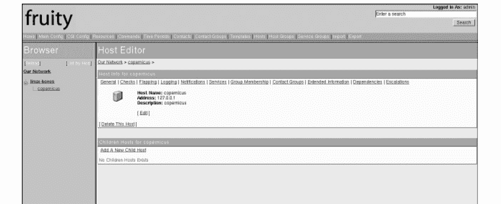

**图 5.1** 关于 SNMP 的更多内容请见第 6 章“监控”。`Fruity` GUI 中的主机定义。

## Monarch

`Monarch` 是“Groundwork Monitor Architect”的缩写，是一个 `Perl/CGI/AJAX`。它使用了商业版 `Groundwork Foundation` 程序相同的配置引擎。`Monarch` 从浏览器运行，并支持 `Nagios 2.x` 和 `1.x`。`Monarch` 还将 `Nagios` 配置存储在 `MySQL` 数据库中，并包含一个安装脚本，用于配置数据库并将所有内容放在需要的位置。在安装方面，`Monarch` 比 `Fruity` 稍微麻烦一点。在运行设置脚本之前必须安装一些前提条件，包括 `Perl` 模块。

图 5.2 是 `Monarch` 中同一个主机的截图。注意 Profile（配置）选项卡。`Monarch` 在 `Nagios` 配置中引入了 Profile 的概念，在我看来这是一个受欢迎的补充。`Monarch Profile` 就像超级模板；它们根据角色来捕获主机。例如，一个 Web 服务器可以被看作的服务、主机组成员、联系人和升级策略的集合。`Monarch Profile` 为特定的服务、组成员、联系人以及几乎任何其他内容的组合命名。然后将该配置分配给一个或多个主机。这种基于角色的 `Nagios` 配置方法非常酷，可以为大型环境的用户节省大量时间。配置新主机变得非常简单，只需 `Monarch` 指定其名称、别名和地址，并将主机分配给预先存在的配置。

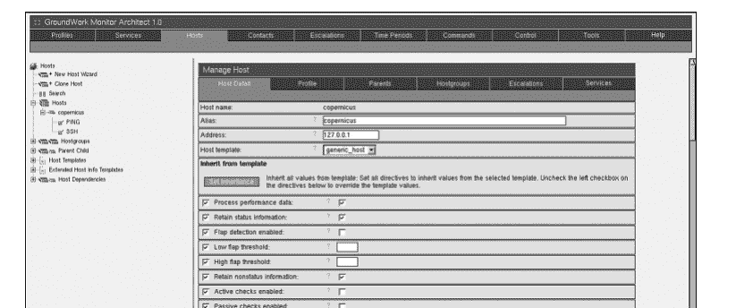

**图 5.2** 关于 SNMP 的更多内容请见第 6 章。`Monarch` GUI 中的主机定义。

与 `Fruity` 类似，`Monarch` 可以导入现有配置，并在你告诉它之前不会修改 `Nagios` 配置。还可以通过 `Monarch` 通过命令启动 `Nagios` 配置的备份，这很有帮助。

本章绝不是自动化配置工具的详尽列表。还存在许多其他优秀工具，它们可能非常契合你特定的技能组合。例如，如果你精通 `Perl`，我建议你查看 `CPAN` (`www.cpan.org`) 上可用的 `Nagios` 配置模块。也许 `Nagios` 最棒的一点就是环绕着它的丰富优秀工具。请查看 `Nagios Exchange` (`www.nagiosex.org`) 上的配置部分。

## 第 6 章

## 监控

欢迎来到实战阶段。到目前为止，我一直在说 `Nagios` 是如何工作的。这一章为你提供了一个理解什么是良好基础。正如第 4 章“配置 `Nagios`”所述，每个主机定义都包含一个 `check_command`，用于指定要使用的命令。这通常默认使用 `check_alive` 命令，而该命令又使用 `ping`。因此，正如第 2 章所述，除非需要，否则不会调度主机检查命令。在实践中，在服务检查失败之前，不会运行主机检查命令。因此，尽管这些检查出于不同的目的，但让我们演示如何设置一个简单的 `ping` 检查。主机和联系人已经定义，第一步是在 `check_commands` 文件中定义命令。正如第 4 章所述，定义将服务定义与外部监控程序连接起来。`ping` 检查的命令定义可能如列表 6.1 所示。

## 本地查询

目前为止，任何监控中最常见的服务检查都是经典的 ICMP 请求，通常被称为 `ping`。虽然 `ping` 设置简单，但对于初学者来说可能有些困惑，因为从表面上看，它们似乎被过度使用了。`Nagios` 至少要求每个主机有一个服务。最常见的设置的服务是 `ping` 服务，因为它的定义简单，而且如果你使用的是示例配置，则已经定义了一个 `ping` 检查。

### 6.2 Check_ping 服务定义。

```
define service{
  host_name Server
  service_description check_ping
  check_command check_ping!500.0,20%!1000.0%60
  max_check_attempts 5
  normal_check_interval 5
  retry_check_interval 3
  check_period 24x7
  notification_interval 30
  notification_period 24x7
  notification_options W,c,r
  contact_groups admins
}
```

此服务定义了每 5 分钟对服务器运行一次 `check_ping` 命令，每天 24 小时，每周 7 天。如果发生任何问题，`Nagios` 会在 3 分钟后再次检查该服务 4 次以验证问题是否仍然存在。验证后，`Nagios` 开始每隔 30 分钟向 `admins` 组发送一次通知，每天 24 小时，每周 7 天，直到服务恢复在线。

列表 6.2 中的许多选项在模板内部指定更为更好，为了简洁起见，本章中的其他服务定义假设你使用了模板，例如列表 6.3 中的模板。请参考第 4 章中的“Templates”部分，关于模板以及如何使用它们的讨论。

### 6.3 本章中其他示例使用的模板。

```
define service{
  name chapter6template
  max_check_attempts 5
  normal_check_interval 5
  retry_check_interval 3
  check_period 24x7
  notification_interval 30
  notification_period 24x7
  contact_groups admins
  register 0
}
```

列表 6.2 的 `check_command` 指令中 `check_ping` 之后的是参数列表。服务定义中的参数通常指定阈值并用逗号分隔，因此这里有两个参数。第一个参数 `500, 20 percent` 表示，如果 `ping` 数据包的往返时间大于 500 毫秒，或者丢包率大于 20%，`Nagios` 应该生成一个警告。（该参数没有显式说明它是警告阈值，因为 `$ARG1$` 宏是 `check_ping` 命令定义中的切换参数，服务列表中列出的第一个参数定义了警告阈值。）我知道这一点是因为我在命令行上运行了 `/usr/local/nagios/libexec/check_ping -h` 命令并阅读了帮助语法描述。请查看附录 C，“Command-Line Options”，获取常用插件的命令行选项列表。

## 端口查询 (Port Queries)

在 ICMP 回显之后，端口查询是大多数监控服务器执行的下一个常见服务检查。这些插件尝试在给定主机的给定端口打开 TCP 或 UDP 连接。端口查询由 `check_tcp` 或 `check_udp` 插件执行。命令定义看起来类似于列表 6.4 中的定义。

### 6.4 通用的 check_tcp 定义。

```
define command{
  command_name      check_tcp
  command_line      $USER$/check_tcp -H $HOSTADDRESS$ -p $ARG1$
}
```

与可能会生成警告的 `ping` 命令不同，端口查询的结果通常是端口可用或不可用。由于没有太大歧义空间，因此不需要 `-w` 或 `-c`。只需要指定主机名和端口号。端口检查的“全有或全无”性质影响了警告时的通知（在警告无法发生的情况下）。因此，列表 6.5 中相应的服务描述与列表 6.2 中的 `check_ping` 服务定义不同，它指定了不同的通知选项且不包含阈值选项。

### 6.5 Check_http 服务定义。

```
define service{
  host_name            jkwebServer
  service_description  check_http
  check_command        check_tcp!80
  notification_options  c,r
  use                  chapter6template
}
```

同样注意列表 6.5 中的服务描述是 `check_http` 而不是 `check_tcp`。这是因为服务描述将作为 `Nagios` Web UI 中服务的名称出现，而 `check_tcp` 并不是对实际监控内容的有效描述。

## 本地查询 (Local Queries)

人们在实践中有两种使用 `check-tcp` 方法。第一种是使用单个 `check-tcp` 命令定义并在服务定义中指定端口和服务描述，正如我们在列表 6.4 和 6.5 中所做的那样。另一种方法为你想要监控的服务编写特定的命令定义。这样，你可以为 `check_tcp` 添加一些特定协议的选项，不需要在服务检查中指定端口，并且服务描述可以与检查名称匹配。

重新执行列表 6.4 和 6.5 中的 `check_http` 服务；它将让你了解特定协议命令定义的含义。列表 6.6 是一个 `check_http` 命令定义，它使用 `check_tcp` 但硬编码为检查 HTTP 端口。

### 6.6 一个特定协议的 check_tcp 命令定义。

```
define command{
  command_name    check_http
  command_line    $USER$/check_tcp \ 
  -e 'HTTP/1.0 200 OK' -H$HOSTADDRESS$ -p 80 -s 'GET / HTTP/1.0'
}
```

我们的新命令定义利用 `-s` (send) 实际上向给定主机的指定端口发送某些文本。这里的换行是因为 HTTP 协议期望这样做。此命令使用 `-e` (expect) 来指定我们期望从服务器返回的内容。显然，这些文本是协议特定的，对于 HTTP 或 HTTPS 服务之外的任何内容都无法工作，尽管这些本可以作为通用服务的参数指定，但这样做意味着你用通用定义检查的每个服务都需要指定 `expect` 选项。这里的教训是，当你确实必须执行协议特定操作时，使用新的命令定义通常更整洁。

执行协议特定查询的一个有趣的副作用是警告可能会再次出现。例如，如果服务是用的，但返回了 `HTTP/1.0 302`（HTTP 重定向），那么 `check_tcp` 会认为这是“意外输出”并生成警告。列表 6.7 是一个带有 `shiny check_http` 的服务定义。

### 6.7 Shiny check_http 服务定义。

```
define service{
  host_name            webServer
  service_description  check_http
  check_command        check_http
  notification_options  W,c,r
  use                  chapter6template
}
```

尽管列表 6.5 中的服务描述是 `check_http` 而不是 `check_tcp`。这是因为服务描述将作为 `Nagios` Web UI 中服务的名称出现，而 `check_tcp` 不是对实际监控内容的有效描述。

## 查询多个端口 (Querying Multiple Ports)

正如列表 6.6 所暗示的，`check_tcp` 有很多功能，但有一点不能扫描端口。许多应用程序在多个端口上监听，使用单个服务查询所有端口是一个常见需求。当我遇到插件的限制时，我问自己的第一个问题是封装（wrapper）是否有帮助。

为 `Nagios` 插件编写封装是一项悠久的传统。在这种语境下，封装是指调用另一个程序或一组程序来实现其目的。自从有了 `Nagios` 插件以来，管理员一直在通过脚本封装来扩展其功能。有关插件如何工作以及创建封装过程的逐步说明，请参见第 2 章中的“Plugins”部分。列表 6.8 是 `check_tcp` 和 `check_udp` 的脚本封装，允许你在单个命令定义中查询多个端口的可用性。

### 6.8 一个 check_tcp 封装。


```bash
#!/bin/bash
# 为每个端口调用 check_tcp；聚合结果

HOME=/usr/local/nagios/libexec # 插件路径
PROTO=tcp # 默认使用的协议

### 打印帮助信息的函数
printusage {
    echo "this plugin calls check_tcp once for each port"
    echo "usage:"
    echo "check_multi tcp -H -u|t -p [port] ..."
    echo "-h : print this message"
    echo "-H hostname: The hostname of the box you want to query"
    echo "  (default localhost)"
}
```

## 本地查询

### 列表 6.8 check-tcp 包装器。（继续）

```bash
    echo "-p port number: A space separated list of port numbers"
    echo "-t wrap around check_tcp"
    echo "-u wrap around check_udp"
    exit ${EXITPROB}
```

```bash
# 解析参数 :hH:p: opt
while getopts $opt; do
    case $opt in
        h) printusage;
        H) HOST=${OPTARG};
        p) PORT=${OPTARG};
        u) PROTO='udp';
        t) PROTO='tcp';
        ?) printusage;
    esac
```

```bash
done

# 健全性检查
if echo "${PROTO}" | grep -q 'Nullz0r'
then
    echo "ERROR: either -u or -t required"
    echo
    printusage
fi
```

# 工作从这里开始

```bash
# 对于他们提供的每个端口
for i in $(echo ${PORT}')
do
    # 调用真正的插件
    ${HOME}/check ${PROTO} -H ${HOST} -p ${i}>/dev/null
    # 退出正常吗？
    if [ "$i" -ne 0
    then
        # 不，它运行并不正常
        echo "port ${PROTO}/$i is not available"
    fi
done
```

```bash
# 一切正常，伙计
echo "all ports are open"
exit 0
```

# 第 6 章 监控

抛开杂务不谈，这是一个简单的 shell 脚本。它会对你提供的列表中的每个端口调用真正的 `check_tcp` 插件，如果其中任何一个端口不可用，它将带有严重错误退出。如果它通过了所有端口且没有任何错误，它将以正常状态码退出。Shell 包装器在 Nagios 管理员中是无处不在的。如果你在插件目录中找不到你需要的功能，在重新造轮子之前，先检查插件 tar 包的目录，然后问问自己是否可能在包装器中协作几个现有的插件来获取你需要的内容。

## （更）复杂的服务检查

到为止的示例可能顶多让你打了个哈欠，所以这一节将扩展，并为你提供几个真实世界的监控场景的示例。希望这些能让你更好地感受插件的能力。

在我的第一个示例中，B 公司使用了一组相当不可靠的过滤器组合来在其公共 MX 节点上拦截不需要的电子邮件。问题是，它的业务伙伴 A 公司似乎由于某种原因被过滤器特别讨厌，所以每隔几周，过滤器就会随机决定拦截所有来自 A 公司的邮件。为了解决这个问题，已经开了多次会议，但由于过滤器的组合如此复杂，且 B 公司规模之大，以至于 B 公司根本无法妥善处理。每当那些认为问题已经解决的人认为，问题又发生了；而且，每发生一次，就需要一天的时间才能发现它正在发生，因为 B 公司的过滤器不会退回邮件。相反，它们会回答“250 Not Okay”，然后静静地把邮件丢在地上。（安全顾问告诉他们这是最好的做法。）

为了及时检测该问题，A 公司的系统管理员定义了一个命令，使用 `check_smtp` 插件定期与 B 公司的邮件服务器进行 SMTP 握手。该定义在列表 6.9 中。

### 列表 6.9 执行 SMTP 握手的命令。

```bash
define command{
    command_name check_spam_block
    $USER1$/check_smtp -H $HOSTADDRESS$ \
    -C 'hello companyA.com' -R '250 OK' \\
    -C 'mail from: <alice@company.com>' \
    -R '250 OK' \\
    -C 'rcpt to: <bob@companyb.com>' \
    -R '250 OK'
}
```

## 本地查询

# 93

这运行得良好；如果 B 公司对握手的任何部分回答了“250 okay”以外的任何内容，A 公司的管理员会立即收到通知。如果需要，没有理由不将此定义扩展到包含 SMTP 会话的数据部分。

在此记录一下，在你执行此类操作之前应该获得某人的许可。监控你不拥有的东西可能会给你带来麻烦。另一件需要记住的是，实际上与所监控的服务交互的服务检查会影响日志和连接统计等内容。如果包含了数据部分，Bob 无论如何实际上都会收到一封电子邮件；最好不要做到直接影响人类的程度。另一方面，编写得糟糕的守护进程可能会在意外时间从不连接的服务检查中出现问题。最后，另一端的管理员如果认为流量可能是恶意的，可能会使用过滤器阻止对你的监控工具的访问。正如我在第一章“最佳实践”中所说的，始终对你监控的内容花些心思，特别是当那些内容属于你的公司或团体时。

下一个示例围绕 Ted 展开，他是一家等规模医疗保健公司的系统管理员。Ted 负责从公司相当不靠谱的 PKI 供应商 VeriSure 获取 SSL。Ted 还负责注册新域名，但该公司在这项工作上并不使用 VeriSure。最近，Ted 的邮箱箱装满了来自 VeriSure 的邮件。大部分是营销邮件，为 Ted 提供折扣，让他将其公司的域名注册迁移到 VeriSure。由于他拥有几个域名，Ted 每天会收到大约 20 封这类邮件，所以他陷入了困境。

# 列表 6.10 为 Ted 解决方案。

```bash
define command{
    command_name check_ssl
    command_line $USER1$/check_http $ARGADDRESS -C
}
```

# 94

# 第 6 章 监控

这个定义是我们看到的没有使用 `$HOSTADDRESS` 宏的定义。一个有趣的插曲是，服务定义中的 `host_name` 指令，如列表 6.11 所示。在没有 `$HOSTADDRESS` 宏的情况下，`host_name` 指令唯一出现的地方是 Web UI，`check_ssl`。

# 列表 6.11 check_ssl 服务定义。

```bash
define service{
  host_name             webServer
  service_description  check_ssl
  check_command         check_ssl!www.org
  notification_options c,w,r
  use                   chapter6template
}
```

## 使用 WebInject 进行 E2E 监控

希望你对使用内置插件构建的解决方案感到兴奋。下一个示例是“端到端”，`e2e` 是监控系统供应商认可的。正如第一章中讨论的，`e2e` 意味着监控系统以用户相同的方式使用服务。这在不同的范围内有不同的含义；例如，对于监控 25 端口的经典方法，`e2e` 系统通过邮件系统向自己发送电子邮件。

流行的 Nagios 插件是 `WebInject`，它是一个用于网站回归测试的 Perl 程序。通过 `WebInject`，你在 `XML` 中创建测试用例，描述要访问的站点列表。在逐个访问每个站点时，`WebInject` 可以做很多事情，如解析并保存字符串供以后使用，以及验证文本是否存在。可能是 `WebInject` 最棒的一点是它无缝处理会话状态和身份验证的方式。例如，`WebInject` 处理 `cookie` 的方式与你的 Web 浏览器一样。它保存到的 `cookie` 并在后续测试用例的 HTTP 头中呈现它们。对于嵌入的基于会话 ID（如果没有 `cookie`）的身份验证方案，`WebInject` 可以从站点响应文本头中解析出会话 ID 并将其提供给变量供以后使用。

## 本地查询

实际上，`WebInject` 最好的特性在于它具有 Nagios 插件模式。通过在 `config.xml` 中设置一个简单的配置参数，`WebInject` 就会变成一个 Nagios 插件，执行其测试用例并返回与 Nagios 兼容的退出代码和输出字符串。它甚至提供性能数据。

所有这些特性使得 `WebInject` 成为一个完美的端到端网站监控插件。例如，假设你运行着一个带有搜索输入框和数据库后端的网站。例如，你可能对 `www.google.com` 非常熟悉。在这个例子中，你想确保你的网站运行符合预期；也就是说，它不仅是在线的，而且功能正常。

在列表 6.4 和 6.5 中，你看到可以使用 `check_tcp` 监控 80 端口，但这无法捕获像 404 这样的 HTTP 错误。这在列表 6.6 和 6.7 中通过发送 HTTP GET 并解析响应码得到了改进。然而，数据库后端的错误可能会导致网站失效。尽管 HTTP 服务器可能运行得完美无缺，用户也无法从查询中获得有用信息。此示例使用 `WebInject` 对 `www.google.com` 进行端端检查。新的 `check_http` 服务基本上重新发明了“碰运运”按钮。它会访问网站，执行查询，解析查询结果找到第一个链接，跳转到该链接，并验证搜索文本是否出现。如果你能做到这些，你就知道你有一个运行良好的 Web 守护进程和一个运行良好的网站。

第一步当然是安装 `WebInject`。你可以从 `www.webinject.org` 获取。由于它是一个 Perl 脚本，除了获取它依赖的各种模块外，没有多少需要安装的。默认情况下，`WebInject` 会在当前工作目录下查找 `config.xml` 文件。

如列表 6.12 所示，此示例中使用的 `config.xml` 并不复杂。`reportdirective` 指令指定了 `WebInject` 提供的输出类型。我将其设置为 `nagios`，这样 `WebInject` 就会以 Nagios 插件模式运行。`testcasefile` 指令指定包含测试用例的 `XML` 文件位置。最后，`globalhttplog` 指令启用测试日志。默认情况下，日志信息进入当前工作目录下的 `http.log`。你可以将此选项设置为 `yes` 以记录所有内容，但在这里，它被设置为 `onfail`。

### 列表 6.12 WebInject 的 config.xml。

```xml
<reporttype>nagios</reporttype>
<testcasefile>testcases.xml</testcasefile>
<globalhttplog>onfail</globalhttplog>
```

# 第 6 章 监控

列表 6.13 中的 `testcases.xml` 文件中有两个测试用例。第一个测试用例对单词 `foo` 进行 Google 搜索，并解析输出以找到列表中的第一个链接。由 `parserresponse` 指定的解析语法很寻常，但对于该任务来说足够了。它使用单个管道字符 (`|`) 将目标文本之前的所有内容与目标文本之后的内容隔离开。因此，为了捕获字符串 `foo bar` 中的单词，`parserresponse` 设置为 `foo | bar`。

在通过 `parserresponse` 提取第一个命中的 URL 后，它被放置在 `WebInject` 变量 `[PARSEDRESULT]` 中。你可以在测试用例 2 中引用此变量，这是在指令中完成的。测试用例 2 然后跳转到 `testcase1` 结果指向的网站，并使用 `verifypositive` 指令验证该单词是否存在于该站点。`verifypositive` 支持正则语法，但对于这个简单的示例你不需要它。

### 列表 6.13 WebInject 的测试用例文件。

```xml
<testcases repeat="1">
<case
  id="1"
  description1="goto google. search for foo.
  method="get"
  url="http://www.google.com/search?hl=en&q=foo&btnG=Google+Sear"
  parserresponse='<a class=1 href="|'
/>
<case
  id="2"
  description1="goto {PARSEDRESULT} check for foo"
  method="get"
  url="{PARSEDRESULT}"
  verifypositive='foo'
/>
</testcases>
```

你可以通过从命令行调用 `webinject.pl` 来测试该插件。如果一切按照计划进行，你将得到类似所示的输出：

```text
WebInject OK - All tests passed successfully in 0.704 seconds
|time=0.704;;0
```

## 本地查询

如果你从 `config.xml` 中删除 `reportype` 指令，`WebInject` 将提供更详细的输出，如列表 6.14 所示。Google 的第一个匹配项是 Official Foo 网站。这对于调试或对事物充满好奇的人很有帮助。

### 列表 6.14 WebInject 的详细输出。

```text
Starting WebInject Engine...
----------------------------------------------------------------------
Test: testcases.xml - 1
goto google. search for foo
Passed HTTP Response Code Verification (not in error range)
TEST CASE PASSED
Response Time = 0.372 sec
----------------------------------------------------------------------
Test: testcases.xml - 2
goto http://www.footfoiers.com/ make sure it says foo there
Verify : "foo"
Passed Positive Verification
Passed HTTP Response Code Verification (not in error range)
TEST CASE PASSED
Response Time = 0.267 sec

Start Time: Aug 12 21:49:57 Total Time: 0.718 seconds

Test Cases Run: 2

Test Cases Passed: 2

Test Cases Failed: 0

Verifications Passed: 3

Verifications Failed: 0
```

## 监控 Windows

对于构建 Nagios 或其他监控系统来说，Windows 是一个挑战，因为它比大多数 UNIX 环境更像一个黑盒。NSClient 是一个针对 Windows 的 Nagios 插件，它提供了你需要的功能，并且了解当前的脚本环境，特别是 WMI。事实上，理解 Windows 脚本环境可能是监控 Windows 的人最大的障碍，所以我们先处理这个问题。如果你已经精通 Windows 编程和脚本编写，可以直接跳到“开始业务”章节。

## Windows 脚本环境

搜索“Microsoft Scripting”，你会得到一系列令人晕目的缩写和产品名称：WSH、OLE、CScript、WMI、ADSI、JScript、VBScript 以及 PowerShell。如果你好奇批处理去哪了，那么这一节适合你。

从 DOS/2 开始，批处理脚本用于自动化任务。这些脚本仅仅是 DOS 命令的列表，由 `command.com` 程序执行。尽管它们功能简单且语法晦涩，但批处理能够很好地扩展许多系统管理任务。请参考 Tim Hill 的优秀著作《Windows NT Shell Scripting》。

然而，需要更健强大的工具，因此在 Windows 98 推出的同时，WSH 也应运而生。WSH（Windows Script Host）是一个语言无关的脚本环境。对于大多数目的，你可以像对待熟悉的解释器（如 Perl 或 Python）一样看待它。WSH 的不同之处在于它使用模块化引擎提供语法，所以当你对 Perl 解释器说 Perl 时

## 观察 Windows 99

对于 Python 解释器来说，WSH 并没有原生语法。事实上，可以在同一个脚本中同时使用 Perl 和 Python。WSH 提供了执行环境、一些常见的数据结构和 I/O 钩子，并将特定语法留给语言引擎。

由微软安装的 WSH 仅包含 VBScript 和 Jscript 的语言引擎，在实践中，大多数人使用 VBScript 语法。正如此，许多人通将由 WSH 执行的脚本称为 VBScripts 或 Visual Basic Scripts。


# VBScript 概述

VBScript，或微软 Visual Basic Script 版，是微软 Visual 编程语言的子集，而该语言的血缘又可以追溯到在达特斯学院开发的原始初学者全能符号指令代码（Beginner's All-Purpose Symbolic Instruction Code）。`VBScript.dll` 脚本引擎解释器是用 VBScript 编写的，可以用于 `Internet Explorer` 中的 `ASP` 引擎开发 Web 应用程序，也可以用于 `WSH` 的系统编程和自动化。因此，VBScript 兼任双重角色：它既是一种 Web 应用语言，也是一种通用脚本语言。在 Web 应用角色中，VBScript 被嵌入到 `HTML`（类似于 `Javascript`）中由 Web 浏览器解释。在独立或 `WSH` 角色中，VBScript 由 `WSH` 从文件执行，通常具有 `.vbs` 扩展名。（这并非强制要求。如果省略扩展名，则会附加 `PATHTEXT` 环境变量。）

## WSH 执行环境

为了进一步说明这一点，`WSH` 由两个独立的执行环境组成：`Wscript` 和 `Cscript`。这两个环境作为两个独立的程序实现，唯一的不同之处在于 `Wscript` 是基于 GUI 的，而 `Cscript` 是命令行驱动的。例如，以下代码段由 `Wscript` 执行时会打开一个包含“Hello World”字样的新窗口：

相同的代码由 `Cscript` 执行，只需在命令提示符的标准输出中打印 Hello World。

`WSH` 脚本是自包含的文件，通过扩展名表示其语法。VBScript `WSH` 脚本通常位于 `.vbs` 文件中，并可以通过以下方式使用 `Cscript` 或 `Wscript` 执行：

```
cscript foo.vbs
wscript foo.vbs
```

## 100

## 第 6 章 观察

当未指定主机执行环境（微软术语为 host）时，开箱即用的默认主机当然是 `Wscript`，这可能不是你想要的。`WSH` 中内置了其他一些烦人的功能，例如它习惯输出一个横幅，告知你的脚本是由微软的 `WSH` 运行的。在 `Cscript` 中，此横幅实际上被注入到你程序的输出（`STDOUT`, `STDERR`）中。如果你正在编写 Nagios 插件，这很糟糕，因为 Nagios 只解析插件输出的第一行文本。可以使用开关来更改默认行为。以下是大多数人使用的命令：

```
cscript //I //nologo //H:cscript //S
```

该开关指定交互模式而非批处理模式。`Nologo` 移除横幅。`H` 开关指定 `Cscript` 应为默认脚本主机，使得可以在不需指定 `Cscript` 的情况下启动 `foo.vbs`。最后，`S` 开关将这些设置保存到注册表中，使其永久化。

## COM 和 OLE

尽管 UNIX 依赖于小型、基于文本的单一用途程序协作完成任务，但 Windows 作为一种环境倾向于大型、单体的图形化程序。这为潜在的自动化人员带来了一个困境：如何为 GUI 编写脚本？引入组件对象模型（COM）。自 1993 年以来，COM 及相关技术一直尝试提供一种语言无关的、不受自动化集成影响的接口。

软件开发者使用感知 COM 的组件构建他们的应用程序。如果实现正确，这些组件将通过任何其他支持 COM 的程序为应用程序的功能提供接口。这些接口可以用于许多目的，例如进程间通信或事件自动化。Ole 是 COM 的对象模型。OLE 给对象赋予名称并指定了诸如对象继承等内容。大多数人将 OLE 与在文字文档中嵌入 Excel 电子表格联系起来（这是它在 1991 年设计的初衷），但它现在比那要强大得多。

由于 Windows 中大多数重要的应用程序都通过 COM 暴露其功能，而 `WSH` 提供了对任何 COM 对象的访问，因此可以使用 `Perl` 和 `VBScript` 等脚本语言自动化 Windows 应用程序，包括从创建 Excel 文档到驱动微软管理控制（`MMC`）的所有内容。OLE 和 COM 提供了指南，使得 Nagios 可以绑定到任何通过 COM 导出其功能的应用程序，而市面上的大多数应用程序都是如此。使用 COM 查询 Windows 系统信息并以相应的退出码退出的脚本，从定义上讲就是 Nagios 插件。

## WMI

一种没有通过 COM 导出其功能的软件是内核。各种版本的 UNIX 都有自己的 `proc sysfs` 文件系统，但直到最近，这个重要的系统环境在 Windows 脚本语言中很大程度上是不可用的。最接近的是 `perfmon`，它是一个实时性能统计程序，其本身并不从脚本语言或命令行驱动。`SNMP Informant` 的产品可以通过 `SNMP` 导出性能信息，但这更多像是一个补丁而非解决方案。Windows 管理规范（`WMI`）很好地填补了这一空白。`WMI` 类似于指向运行时环境的 COM 接口。它可以被认为是另一个 COM 接口，但提供了对磁盘和网络利用率等内容的访问。

`WMI` 源自分布式管理工作组的 `CIM`。`CIM`，或通用信息模型（Common Information Model），是一个大型数据库（称为 `CIM Repository`），其中代表可管理实体，如硬盘、整个计算机系统和软件软件包。`WMI` 是微软对 `CIM` 的实现。

### 列表 6.17 Check_dllHost. (续)

```
print "OK \$counter . " dllHosts running,\n    none over the limit \n";n    exit 0;
else{
    print "OK no dllHost processes running\n";n    exit 0;
}
```

使用 `WMI` 的脚本总是遵循相同的模式：创建一个 `WMI` 对象，使用 `WQL` 查询该对象的某些信息，根据阈值或预期结果检查信息状态，然后退出。`WMI` URL，或者如果你愿意，称之为类路径（class path）——`WinMgmts://root/cimv2`——是非常重要的。它指定了该 `WMI` 对象是从哪个 `CIM WMI` 对象派生而来的，这限制了你可以使用 `WQL` 查询的类型。同样重要的是 `WQL` 查询：

```
$oProcessEnum=$oWmi->ExecQuery("Select * from Win32_Process ");
```

`"Select * from Win32_Process"` 语法是 `WQL`。它的目的不言自明：它返回所有当前正在运行的进程。`WQL` 查询始终是一个集合对象（collection object）。集合对象是一种特殊的数组，其行为与普通数组不同。为了方便对集合对象进行迭代，`Win32::OLE` 模块提供了 `in` 函数。`in` 函数使得如下构造成为可能：

```
foreach $oProcess ( in($oProcessEnum) ) (
@Processes=in($oProcessEnum)
```

Python 以枚举（enumerations）的形式创建集合对象。点符号（在 URI 中的 `.`）表示所涉及的 `WMI` 对象创建在本地系统上。如果你将该点替换为远程主机的主名，你就可以通过网络上的 `RPC` 从远程主机获取 `WMI` 信息。这假设你已经拥有远程主机所需的权限。

### 列表 6.18 使用 Perl/WMI 的 check_cluster 插件。

```perl
#!/usr/bin/perl
#check_cluster 一个 perl 脚本/nagios 插件，用于检查
任何处于非在线状态的集群资源。
#blame Dave Josefsen -> Sat Jan 22 17:03:34 CST 2005

###########变量初始化###########
use Win32;
use Win32::OLE qw (in);

# 如果你想将服务器名作为参数，请交换下面这两行
$server="."
$server="$ARGV[0];

# 与 WMI 类不同，MSCluster 派生自
# Root/MSCluster，所以我们必须在
# 类路径中指定它
$class = "WinMgmts://./$server/Root/MSCluster";

# MSCluster 提供程序类在这里仅记录：
#http://msdn.microsoft.com/library/default.asp?url=library/en-us/
mscs/mscs/cluster_provider_reference.asp
$object_class='MSCluster_Resource';

# 可能的资源状态，来自：
#http://msdn.microsoft.com/library/default.asp?url=library/en-us/
mscs/mscs/clusterresource_state.asp
$state(-1)='Unknown',
$state(0)='Inherited',
$state(1)='Initializing',
$state(2)='Online',
$state(3)='Offline',
$state(4)='Failed',
$state(128)='Pending',
$state(129)='Online_Pending',
$state(139)='Offline_Pending';

###########开始实际工作###########

# 获取 wmi 对象
$wmi = Win32::OLE->GetObject($class);

# 获取集群的资源集合
$resource_collection="Select * FROM $object_class";

# 有多少资源？
$max=$resource_collection->{Count);

# 'in' 函数来自 Win32::OLE->Enum->All(foo)
# 它等同于：Win32::OLE::Enum->All(foo)
@collection=in($resource_collection);
```

## 列表 6.18 使用 Perl/WMI 的 check_cluster 插件。 (续)

```perl
# 是否有资源处于在线以外的任何状态？
for ($i=0;$i<$max; ++$i) {
    if ($collection[$i]->{State}='2') {
        push(@broken, $collection[$i]);
    }
}

# 如果是，则执行坏操作
if(scalar (@broken))>0) {
    foreach $j (@broken) {
        print("$j->{Name} is $state{$j->(State)}, ");
    }
    exit(2);
}
else {
    # 否则，执行好的操作
    print("$max resources online\n");
}
```

## 关于 WSH 或我示例中的脚本在 Windows 上运行并消耗 WMI 信息

虽然我示例中的脚本在 Windows 上运行并从 `WMI` 对象获取信息，但实际上它们并没有使用 `WSH`。如果你选择使用 `VBScript` 外的任何语言编写脚本，你必须安装该语言引擎，这意味着你也可以选择解释器。例如，`ActiveState Perl` 会同时安装两者。

# 列表 6.20 服务器列表。

| 名称 | 部门 | IP |
| :--- | :--- | :--- |
| frogslime | 研发 | 12.4.4.17 |
| tequilasunrise | 财务 | 12.4.5.23 |
| 151&coke | 研发 | 12.4.4.151 |
| theangrygermane | 信息管理系统 | 12.0.0.2 |
| 7&7 | 财务 | 12.4.5.77 |

假设你想提取并打印财务部门的机器。在 UNIX 中，你可能会执行类似的操作：

```
cat list.csv | grep Finance
```

或者，如果你想指定得更具体，可以使用：

```
cat list.csv | awk -F, '$2 /Finance/ {print}'
```

在这些示例中，`grep` 和 `awk` 接收逗号分隔的列表作为文本输入流，并根据给出的选项过滤其文本输出。`grep` 被要求打印包含 `Finance` 的行，而 `awk` 则被要求打印第二个字段的行，字段之间用逗号分隔。

`PowerShell` 命令（cmdlets）并不互相接收文本输入，虽然下面行代码的语义与 UNIX 示例相似，但其运行方式完全不同。

```
Import-csv list.csv | Where-Object ($_.department -eq "Finance")
```

`PowerShell` 命令 `Import-csv` 读取 `list.csv` 的内容并创建一个 `csvobject` 类型（或类似类型）的对象。该对象被传递给 `Where-Object` 命令，该命令使用对象的 `department` 属性来提取匹配的记录。管道在此处结束，`Where-Object` 命令将其发现的结果以纯文本形式输出到 shell。如果管道继续，`Where-Object` 命令将把修改后的 `csvobject` 传递给下一个命令。类 Perl 的 `$_` 对象（代表当前迭代器）、大括号和管道为命令带来了一种非常类 UNIX 风格的感觉。对于系统倾向的脚本编写人员来说，这种语法比 `VBScript` 更有吸引力，这也是为什么 `PowerShell` 有很大机会普及。

微软还曾表示，UNIX 管道模型让系统管理员变成了文本处理专家，这无疑是事实。关于这一点，我想补充一点：在成为文本处理专家的同时，人们还预期数据将按照操作者指定的方式进行处理和格式化。鉴于此，许多管理员可能会听到 `PowerShell` 的信息：“把数据交给我们，我们会告诉你能对它做什么。”所以我认为微软说对象模型将消除对文本处理的需求是正确的，我谦逊地预测，除了微软官方网站，互联网上最流行的 `PowerShell` 网站将是提供与微软官方工具配合使用的文本处理命令的站点。

`PowerShell` 是一项极具前景的技术，它的时代早已该到来，虽然我怀疑对象模型是否为全面放弃处理工具提供了令人说服力的理由，但我很高兴微软正朝着这个方向发展。`PowerShell` 无疑是一个净收益，我将极大地扩展 Windows 平台系统专业人员对脚本和自动化的使用。目前的 `VBScript/WSH/COM` 组合由于其巨大的市场份额和默认可用性，可能在一段时间内仍然是事实上的脚本标准，但并没有什么理由你现在不能使用 `PowerShell` 完成工作。

# 进入正题

现在你已经对环境以及良好信息所在的位置有了良好的了解，你可以查看提取你提供给 Nagios 的统计数据的方法。有两种流行的方法可以将 Windows 插件连接到 Nagios：`NRPE_NT` 和 `NSCPlus`。

## NRPE

正如第2章和第3章“安装 Nagios”中所述，`NRPE` 是一种轻量级客户端和服务器，它允许 Nagios 服务器在被监控的主机上远程执行插件。当你有要在 Nagios 中使用的现有监控脚本，或者有自定义监控逻辑的需求时，`NRPE` 非常出色。你编写（或下载）用于监控 Windows 机器的任何脚本都可以定义为 Nagios 中的服务，并通过 `NRPE_NT`（`NRPE` 的 Windows 版本）调用。

例如，要使用 `NRPE-NT` 运行列表6.16 中的 `check_dllhost`，首先按照第3章的描述获取并安装 `NRPE-NT`。在 Windows 主机上安装 `NRPE` 服务后，在 `nrpe.cfg` 文件末尾添加以下行。

```
Command[check_dllhost]=c:\path\to\check_dllhost.pl 200000000
```

此行告诉 Windows 主机上的 `NRPE` 守护进程如果有人要求运行 `check_dllhost` 该做什么。然后必须配置 Nagios 服务器来运行该检查。第一步是在 `commands.cfg` 中定义命令，如列表6.21 所示。

### 列表 6.21 Check_dllhost 命令定义。

```
define command{
  command_name check_dllhost
  command_line $USER$/check_nrpe -H $HOSTADDRESS$ \
-c check_dllhost
}
```

列表6.21 中的命令定义使用了 `check_nrpe` 插件。正如之前对 `NRPE` 的描述所述，`check_nrpe` 是 `NRPE` 软件包的客户端部分。在之前的定义中，它接收两个参数：`-H` 是 Windows 服务器的主机名，`-c` 是要在远程服务器上执行的命令名称。定义命令后，Nagios 就可以对其进行调度。

### 列表 6.22 Check_host 服务定义。

```
define service{
  name            check_dllhost
  host            windows
  command         check_dllhost
}
```

## 监控 Windows

# NSClient/NSPlus

另一个 Windows 插件是 `NSClient`，它是一个带有自带客户端的单体插件。换句话说，`NSClient` 不是由 `NRPE` 执行，而是由它自己的客户端执行。大多数使用 Nagios 监控 Windows 主机的人使用 `NSClient` 插件。它的安装非常简单，包含了大多数人初所需的功能。`NSClient` 无法运行外部脚本；它只提供内置的功能。


## NSPlus

NSClient 的另一个问题是它似乎已经不再被积极维护了。许多人（包括我自己）已经使用了多年，没有出现任何问题，但考虑到它目前（显然已被遗弃）的状态，有些人避开它是可以理解的。

NSPlus 通过将它们的功能合并到单个单体程序中来取代 NSClient 和 NRPE。NSPlus 包含了 NSClient 的所有查询功能，加上 NRPE 协议的内置实现。这意味着单个 Windows 服务提供了 NSClient 和 NRPE 的功能。NSPlus 还具有进行 WMI 查询的能力，尽管该功能目前处于实验阶段。

安装 NSPlus 和 NSClient 的方法非常相似。该包提供了 UNIX 和 Windows 部分源码和二进制文件。要安装 Windows 服务，请带 `i` 参数执行二进制文件。然后从 `services.msc` 或通过命令行 `net start` 启动服务。

要使用 NSClient 或 NSPlus 检查 Windows 机器的 CPU 负载，请如列表 6.23 所示，在 `commands.cfg` 中定义命令。

### 列表 6.23 Check_nt_cpuload 命令定义。

```
define command{
    command name      check_nt_cpuload
    command_line     $USER$/check_nt_wrapper -H $HOSTADDRESS \
                   -p 4224 -v CPULOAD -1 $ARG1$
}
```

### 112 第 6 章 监控

在之前的示例命令中，`-p` 选项指定了一个备用监听端口。默认的 NSCClient 端口 (`1284`) 与 Microsoft Exchange RPC 冲突，因此你可能需要更改它。`-v` 选项指定要更改的变量。有效的变量有 `CLIENTVERSION`、`UPTIME`、`USEDDISKSPACE`、`MEMUSE`、`SERVICESTATE`、`PROCESS`、`COUNTER`。每种类型的变量都可以接受选项。这些选项通过 `-l` 进行指定。`CPULOAD` 变量接受一个逗号分隔的三元组，格式为 `<分钟范围,<告警阈值>,<临界阈值>`。如果我想要 5 分钟的 CPU 平均值，并在 80 和 90 处告警，我可以使用 `5,80,90`。可以指定多个阈值，因此如果我想要 5 分钟平均值和 10 分钟平均值，且阈值略低，可以使用 `5,80,90,10,70,80`。列表 6.23 中的命令定义使用了由参数成员传递给列表 6.12 服务定义的三个元组。

### 列表 6.23 Check_nt_cpuload 服务定义。

```
define service{
  host_name windowsServer
  service_description check_nt_cpuload
  check_command check_nt_cpuload!5,80,90,10,70,80
  use chapter6template
  notification_options w,c,r
}
```

NSCPlus 将大量功能封装在一个非常小的包中，对于未来来说，我没有看到理由使用其他任何东西。可以说它的安装比 NRPE 更复杂，但考虑到 NSCPlus 提供的功能，这种安装是值得的。

## 监控 UNIX

与 Windows 相比，UNIX 用户的系统编程和自动化方案是非常直观的。我的管理员倾向于使用 C、Perl、Python 或 shell 编程的组合来编写自动化和代码胶水，当这些工具不断演进完善时，系统编程方案每年的变化并不大。此外，与 Windows 相比，使用 VBScript 外的任何语言都意味着下载并安装解释器，而 UNIX 管理员默认更有可能安装了比他们需要的更多的解释器和编译器。

丰富的可用工具与 Nagios 设计为运行在 Linux 上这一事实相结合，你就会得到的是大量用各种语言编写的 UNIX 插件。例如，在 nagios-list 上提问“我如何在我的 freebox 上监控 X？”时，有一半的回答是用某种代码编写的这并不罕见。本节将让你对人们经常使用的插件有一个很好的了解。我将为“三大项”CPU、磁盘和内存设置检查。我还将涵盖这些指标含义的某些细节。

## NRPE

到目前，NRPE 是 UNIX 节点上 Nagios 插件的首选远程执行工具这并不令人意外。与 Windows 不同（在 Windows 上，如 NSClient 等某些多功能插件实现了自己的守护进程和协议），UNIX 侧的插件保持了单一目的，并假设使用远程执行程序，如 NRPE 或 check_ssh。对于插件，大多数人都是从 Nagios 守护进程使用的官方插件 tar 包开始。

不同的主机会根据其安装的库从 tar 包中构建不同的插件。因此，为 Nagios 守护进程及其监控的主机准备同一组插件并不特别浪费。例如，只有当相关主机安装了 `net-snmp` 库时，`check_snmp` 才会编译。tar 包中的几个插件也是如此。请参阅第 3 章，了解有关获取和安装官方插件 tar 包以及 NRPE 的细节。

## CPU

虽然测量 CPU 利用率初看起来可能是一项相对简单的任务，但实际上，这是一个复杂且困难的问题，没有简单的解决方案。通常有两个 CPU 相关的指标用于总结 CPU 利用率。第一个是经典的基于百分比的指标。这是一个代表当前 CPU 利用率百分比的数字。例如，“CPU 目前的利用率为 42%。”这个数字是 UNIX 管理员理解问题的方式，所以让我们来看看它。

如果你询问嵌入式系统或计算机工程师，他们会告诉你，现实世界中的处理器要么被利用，要么没有被利用。事实上，微处理器上不存在所谓的 42% 利用率。在任何给定的时刻，CPU 要么在计算某些机器码，要么正处于空闲状态。如果只存在两个数字 0% 和 100%，那么这个数字到底意味着什么呢？

事实上，CPU 绝不会真正空闲；“空闲”只是进程在计算时花费时间的许多状态之一。空闲恰好是优先级最低的状态，因此 CPU 花费在空闲状态下的循环中的时间，它仍然在工作，只是低优先级的、可抢占的工作。

因此，为了有意义，利用率百分比必须类似于处理器状态相对于时间的平均值。到底对什么进行了平均处理，以及持续了多久，这是一个由软件回答的问题，即使在相同的操作系统上，两个不同的性能应用也可能有不同的测量方式。因为所有处理器都有一个最低优先级状态，提供单一百分比数字的一种流行方法是测量 CPU 处于最低优先级状态的时间百分比，然后从 100 中减去这个数字以获得实际的利用率百分比。换句话说，利用率百分比是在两次轮询之间 CPU 处于最低优先级状态的时间百分比，然后从 100 中减去这个数字以获得实际的利用率百分比。

结论是，经典的百分比指标从监控角度来看存在各种问题。它是一个波动且模糊的指标，并不一定反映负载。例如，100% 的 CPU 利用率在尝试优化系统时可能是一件好事。我的建议是尽可能避免这种指标。

第二个指标是 UNIX 负载。这是一组代表在不同时间段内平均负载的数字：1、5 和 15 分钟。你可能在多个不同的工具中识别出由内核指数级计算的负载平均。它们比 CPU 百分比指标波动更小，而且无论你使用什么工具它们都是相同的。这些数字表示了一个用数学很难表达的问题。事实上，研究得越深，数学就越困难，直到涉及到微积分。如果你属于这类情况，我将参考 Neil Gunther 博士的论文在这里：`www.teamquest.com/resources/gunther/display/5/index.html`。

对于我们其他人，我将尝试用英语进行解释。当前负载平均是 5 秒前的负载加上队列长度，队列长度是等待执行的进程数加上正在执行的进程数之和。为了节省内核开销，内核实际上并没有计算三个独立的负载平均。在计算三元组中每个时间段的负载平均时，对 5 秒平均值和当前队列长度应用了不同的指数因子，以便相应地衰减或加权。衰减/权重因子使用的比例存在争议，至少在 Linux 中是如此，但根据我的经验，尽管对指数衰减比例存在争议，它仍然是一个非常有用的指标。

负载平均指标与等待执行的进程数量直接相关。每个新的等待执行的进程都会让队列长度增加 1，从而按照上述的方式影响负载平均。这是一个更实用的服务器利用率指标，因为它有效地捕捉了系统应对其所赋予工作的能力。对于单 CPU 系统，负载为 1 将恰好是 100% 的利用率，更好的思考方式是系统恰好处理当前负载的能力。0.5 的平均负载意味着系统的容量是处理当前负载所需容量的两倍，而 3 则意味着系统需要当前容量的三倍才能处理该负载。对于多 CPU 系统，负载数应除以 CPU 的数量，因此在四 CPU 系统上，平均负载为 3 意味着系统利用率为 75%，或者说它比处理当前负载所需的容量多出四分之一。

利用率三元组有两个你应该注意的问题。第一个，也可能是两个中最糟糕的，是外行人士无法理解这个三元组，作为经理和高管，你没有指望能教育他们。三元组的第二个问题是，运行队列长度并不严格受限于 CPU。糟糕的服务器问题（例如 EXT3 恐慌）也会导致进程在运行队列中积压，至少在 Linux 上是这样。实践中，这并不是一个太严重的问题，因为任何导致运行队列阻塞的情况都是坏消息，都需要你的关注。

书籍和网络上流传着各种智慧之言，说“平均负载高于 3 是糟糕的”。我同意你可能不会去升级一个持续负载在 3 的单 CPU 系统，但在监控阈值的上下文中，并没有这样的规定。在现实世界中，我见过系统负载高达 25 还没有出现任何真实的延迟迹象，我有几台机器，在它们达到至少某个高水平之前，我并不担心它们。要确定你的阈值应该如何定义，请查阅我在第 1 章“最佳实践”中关于基线（baseline）的讨论并据此做出决定。

设置 CPU 检查的第一步是在 `nrpe.cfg` 文件底部添加 `check_load` 命令，文件底部应该像这样：

```
command[check_load]=/usr/libexec/check_load -w $ARG1 -c $ARG2
```

注意 `nrpe.cfg` 定义中的宏。在之前的 `nrpe.cfg` 文件示例中，我使用了静态阈值。从安全角度来看，静态阈值通常是优的，因为 NRPE 守护进程不会接受潜在危险的数据。在实践中，大多数人使用 `ctwrappers` 访问守护进程并使用参数在 Nagios 服务器上随机化阈值。基于主机的静态阈值对于管理员来说很快就会变得难以管理。

若要传递参数，你必须先用 `enable-command-args` 编译 nrpe，并在 `nrpe.cfg` 中设置 `dont_blame_nrpe` 为 `1`。（因为该功能默认被双重禁用，且配置文件中称为“别怪我们”，这应该让你停下来考虑一下。请自担风险使用它。）

### 116 第 6 章 观察

完成此操作后，你可以通过 Nagios 服务器上的命令定义向 NRPE 守护进程发送参数。列表 6.24 提供了一个用于接受参数的 NRPE 守护进程的命令定义示例。

该命令定义通过参数宏从服务定义中获取阈值，并将其传递给远程主机上的 NRPE 守护进程。`check_nrpe` 版本支持两种传递参数的语法。经典方法是命令名后跟感叹号分隔的参数，新方法是在 `-switch` 之后使用空格分隔的参数。虽然新方法可读性更高，但我更偏于旧方法，因为字符转义更简洁。

### 列表 6.24 带参数传递的 Check_load 命令定义。

```
define command{
  command_name      check_load
  #旧方法:
  command_line      $USER!$check_nrpe -H $HOSTADDRESS \
                -c check_load!$ARG1!$ARG2
  #新方法:
  #command_line      $USER!$check_nrpe -H $HOSTADDRESS \
                -c check_load -a $ARG1 $ARG2
}
```

列表 6.25 包含了相应的服务定义。这是管理员实际指定阈值的方式。我们示例中的 `check_load` 插件接受两个参数：一个用于警告阈值，一个用于严重阈值。阈值以 UNIX 负载三元组的形式指定。在我们的示例中，如果 `someUnixHost` 的 1 分钟平均值超过 15、5 分钟平均值超过 10 或 15 分钟平均值超过 5，Nagios 将为其生成警告。

### 列表 6.25 check_load 服务定义。

```
define service{
  host_name            someUnixHost
  service_description  CPU LOAD
  check_command        check_load!15,10,5,!30,25,20
  use                  chapter6template
  notification_options  W,C,R
}
```

## 内存

在使用 UNIX 平均负载作为系统性能指标时，我最喜欢的一点是它在所有 UNIX 和类 UNIX 系统中通用的。无论是 Linux、Solaris 还是 FreeBSD，平均负载数值都在，并且（可能）以相同的方式得出的。然而，内存利用率则相反。（查看 Nagios Exchange `www.nagiosexchange.org` 的 Solaris 部分以获取 Solaris 特定的插件。）遗憾的是，像 `vmstat` 等用户工具并没有为各种 UNIX 虚拟内存实现之间的差异提供隔离层，而其他工具如 `free` 在特定平台上可能不存在。这使得很难编写一个能够准确跟踪所有 UNIX 系统内存的单一 Nagios 插件。

## 监控“其他内容”

到为止，我们的讨论集中在运行某些 Windows 或 UNIX 系统的传统计算机系统。在本节中，我将介绍你可以使用 Nagios 监控的一些其他内容，包括网络设备和环境传感器。

## SNMP

SNMP 由 IETF 于 1988 年创建，用于远程管理基于 IP 的设备。它最初在 RFC 1157 中描述，从那以后，它变得无处不在，同时也深受全球安全专业人士的厌恶，这一点我们稍后详述。该协议的范围非常大。IETF 显然并不意在提供一种通信协议，而是为了为所有基于 IP 的设备提供一种标准的配置仪器工具。通过这种方式，他们不仅为配置设置指定了强类型变量，还提供了一个涵盖网络设备配置设置和状态信息的完整数据库。

想象一下，有一个单一的层级结构，为世界上每个启用 IP 的设备上的每项信息和配置设置提供唯一的地址。你所想象的这种层级结构就是 SNMP MIB 树（管理信息库）。每个配置设置都被分配了一个地址，称为对象标识符（OID）。OID 地址类似于 IP 地址，它们都是用点分隔的，并且从左到右越来越具体。地址中的每个数字都代表 MIB 中的一个节点。让我们来剖析一个示例 OID。

```
.1.3.6.1.2.1.2.2.1.8
```

如你所见，OID 非常像一个过长的 IPv4 地址。就像 DNS 记录一样，开头的“1”位于树的左根。第一个数字属于国际标准组织（ISO），因此，该层级中指定的每个节点都由 ISO 管理。3 被 ISO 指定供“其他”组织使用。美国国防部拥有 6，其互联网活动委员会拥有 1。你将接触到的每个 OID 可能都以 `.1.3.6.1` 开头。图 6.1 直观地描述了这种常见的层级结构。

### SNMP 层级结构：.1.3.6.1

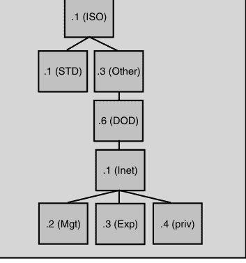

**图 6.1** `.1.3.6.1` 前缀。

从这里开始，层级结构变得越来越具体。图 6.1 中 IAB 的三个子节点都是常用的；这些节点分别是管理 (2)、实验 (3) 和私有 (4)。实验分支用于最终将成为 IETF 标准的节点。因为 RFC 变成 RFC 需要一段时间，所以实验分支允许管理员在生产设备上使用实验 OID，而不会与现有的 OID 发生冲突。私有分支用于私有组织，例如思科和瞻远网络。私有分支是你可以找到此类信息的地方，例如思科路由器上的 1 分钟 CPU 负载平均值。我们的示例 OID 位于管理分支，其中包含 IETF 标准节点。其中的每个节点都在某处的 RFC 中有描述。

下一个位置将一个 OID 置于第 2 组中，这意味着这是一个 SNMP 版本 2 节点。IETF 描述的第一个 SNMP 版本 1 有两个主要问题。第一个是摩尔定律。当 IETF 着手指定如何在 MIB 中存储数据时，他们低估了 MIB 需要存储的数据量。结果，网络设备上的许多配置设置很快超出了 IETF 强类型变量的范围。第二个问题当然是 SNMP 协议缺乏安全性。

SNMP 版本 1 使用称为“团体字符串”（community string）的共享密钥对对端进行身份验证。遗憾的是，这个字符串在 SNMP 对端之间以明文传输，并且几乎有一种通用的做法是将字符串设置为 `public`（公开）。这种设置经常被管理员忽略，在过去，许多设备默认启用了 SNMP，导致它们容易受到恶意实体的远程配置。

SNMP 版本 2 于 1993 年草拟，旨在解决这些问题并为协议添加一些功能，但遗憾的是，由于起草者无法就安全增强的细节达成共识，它不幸地夭折。三年后，随着 SNMP 版本 2c 的发布达成了一种折中。V2c 取了 IETF 同意的内容，并将其与版本 1 安全模型相结合。新标准包括更大的数据结构、批量传输（`get-bulk`）、面向连接的陷阱（`traps`）、改进的错误处理以及存在缺陷的明文安全模型。V2c 的采用没有 V1 那么明智，但大多数新的网络设备都支持它，包括运行 `IOS 11.2(6)` 及以上的思科路由器。


IETF 于 2002 年 3 月完成了 SNMP 版本 3。`V3` 是一个完全的互联网标准，在 `RFC 3410-3418` 中描述。`V3` 的采用速度似乎比 `V2` 快，有许多厂商的实现，包括运行 `IOS 12.0(3)` 及以上的思科设备。`V3` 支持三种安全模型：无身份验证无加密（`no-authpriv`），发送明文 SNMP 数据包并具有极其简单的身份验证；身份验证与加密（`authpriv`），发送明文 SNMP 数据包并通过 `MD5` 或 `SHA` 进行强身份验证；以及 `AuthAuthPriv`，它同时具有加密会话和强身份验证。强烈建议使用版本 3，至少使用 `authpriv`。

## 查看“其他内容”

## 列表 629 无法识别的 SNMP 乱码字符。

```
SNMPv2-SMI::mib-2.15.3.1.4.71.123 = IpAddress: 4.68.1.2
SNMPv2-SMI::mib-2.15.3.1.4.71.123 = INTEGER: 6
SNMPv2-SMI::mib-2.15.3.1.4.71.123 = INTEGER: 2
SNMPv2-SMI::mib-2.15.3.1.4.71.123 = INTEGER: 4
SNMPv2-SMI::mib-2.15.3.1.5.47.123 = IpAddress: 4.71.223
SNMPv2-SMI::mib-2.15.3.1.6.41.123 = INTEGER: 30511
SNMPv2-SMI::mib-2.15.3.1.7.41.123 = IpAddress: 4.71.224
SNMPv2-SMI::mib-2.15.3.1.8.41.123 = INTEGER: 179
SNMPv2-SMI::mib-2.15.3.1.9.41.123 = INTEGER: 3356
SNMPv2-SMI::mib-2.15.3.1.10.41.123 = Counter32: 4
SNMPv2-SMI::mib-2.15.3.1.11.41.123 = Counter32: 2
SNMPv2-SMI::mib-2.15.3.1.12.41.123 = Counter32: 147184
SNMPv2-SMI::mib-2.15.3.1.13.41.123 = Counter32: 147183
SNMPv2-SMI::mib-2.15.3.1.14.41.123 = Hex-STRING: 00 00
```

这看起来像是信息，如果你能以某种方式弄清楚它指的是什么的话。问题在于 `snmpwalk` 只能将 OID 的第一个部分解析为英文名称。这就是当我将其称为 MIB 文件时所缺乏的，MIB 文件会将数值型 OID 映射到其对应的 ASCII 副本。`Net-sum` 命令可以为 MIB 树的管理分支切换到 MIB 文件，但你可能需要为私有分支（private branch）中的 OID 下载 MIB，或者管理分支（mgmt branch）中的奇怪东西，例如列表 6.28 中的 OID。为了让这些内容有意义，我需要安装 MIB 文件，以便 `snmpwalk` 能够解析剩余的 OID。为了找到我需要的特定 MIB 文件，我需要获取更多数值信息。

```
snmpwalk -v2c -c myCommunity -On 192.168.42.42
```

在命令中添加 `On` 会导致 `snmpwalk` 打印完整的 OID，而不是打印部分名称后跟上它无法解析的 OID 部分。

## 列表 6.30 更加无法识别的 SNMP 乱码字符。

```
.1.3.6.1.2.1.15.3.1.1.4.71.123 = IpAddress: 4.68.1.2
.1.3.6.1.2.1.15.3.1.2.4.71.123 = INTEGER: 6
.1.3.6.1.2.1.15.3.1.3.4.71.123 = INTEGER: 2
.1.3.6.1.2.1.15.3.1.4.4.71.123 = INTEGER: 4
.1.3.6.1.2.1.15.3.1.5.41.123 = IpAddress: 4.71.223
.1.3.6.1.2.1.15.3.1.6.4.71.123 = INTEGER: 30511
.1.3.6.1.2.1.15.3.1.7.4.71.123 = IpAddress: 4.71.224
.1.3.6.1.2.1.15.3.1.8.4.71.123 = INTEGER: 179
.1.3.6.1.2.1.15.3.1.9.4.71.123 = INTEGER: 3356
.1.3.6.1.2.1.15.3.1.10.4.71.123 = Counter32: 4
.1.3.6.1.2.1.15.3.1.11.4.71.123 = Counter32: 2
.1.3.6.1.2.1.15.3.1.12.4.71.123 = Counter32: 147184
.1.3.6.1.2.1.15.3.1.13.4.71.123 = Counter32: 147183
.1.3.6.1.2.1.15.3.1.14.4.71.123 = Hex-STRING: 00 00
```

这看起来像是信息，如果你能以某种方式弄清楚它指的是什么的话。

```
.1.3.6.1.2.1.15.3.1.1.4.71.123 = IpAddress: 4.68.1.2
.1.3.6.1.2.1.15.3.1.2.4.71.123 = INTEGER: 6
.1.3.6.1.2.1.15.3.1.3.4.71.123 = INTEGER: 2
.1.3.6.1.2.1.15.3.1.4.4.71.123 = INTEGER: 4
.1.3.6.1.2.1.15.3.1.5.41.123 = IpAddress: 4.71.223
.1.3.6.1.2.1.15.3.1.6.4.71.123 = INTEGER: 30511
.1.3.6.1.2.1.15.3.1.7.4.71.123 = IpAddress: 4.71.224
.1.3.6.1.2.1.15.3.1.8.4.71.123 = INTEGER: 179
.1.3.6.1.2.1.15.3.1.9.4.71.123 = INTEGER: 3356
.1.3.6.1.2.1.15.3.1.10.4.71.123 = Counter32: 4
.1.3.6.1.2.1.15.3.1.11.4.71.123 = Counter32: 2
.1.3.6.1.2.1.15.3.1.12.4.71.123 = Counter32: 147184
.1.3.6.1.2.1.15.3.1.13.4.71.123 = Counter32: 147183
.1.3.6.1.2.1.15.3.1.14.4.71.123 = Hex-STRING: 00 00
```


现在你有了完整的 `OID`，你可以通过 Cisco 导航查看这些 [OID 页面](http://tools.cisco.com/MRTG/index.php?id=75ef1194c051d6f0388d22)，翻译内容并保留符号。


## 监控“其他内容”

## 列表 629 无法识别的 SNMP 乱码字符。

```
.1.3.6.1.2.1.15.3.1.1.4.71.123 = IpAddress: 4.68.1.2
.1.3.6.1.2.1.15.3.1.2.4.71.123 = INTEGER: 6
.1.3.6.1.2.1.15.3.1.3.4.71.123 = INTEGER: 2
.1.3.6.1.2.1.15.3.1.4.4.71.123 = INTEGER: 4
.1.3.6.1.2.1.15.3.1.5.41.123 = IpAddress: 4.71.223
.1.3.6.1.2.1.15.3.1.6.4.71.123 = INTEGER: 30511
.1.3.6.1.2.1.15.3.1.7.4.71.123 = IpAddress: 4.71.224
.1.3.6.1.2.1.15.3.1.8.4.71.123 = INTEGER: 179
.1.3.6.1.2.1.15.3.1.9.4.71.123 = INTEGER: 3356
.1.3.6.1.2.1.15.3.1.10.4.71.123 = Counter32: 4
.1.3.6.1.2.1.15.3.1.11.4.71.123 = Counter32: 2
.1.3.6.1.2.1.15.3.1.12.4.71.123 = Counter32: 147184
.1.3.6.1.2.1.15.3.1.13.4.71.123 = Counter32: 147183
.1.3.6.1.2.1.15.3.1.14.4.71.123 = Hex-STRING: 00 00
```

这看起来像是信息，如果你能以某种方式弄清楚它指的是什么的话。问题在于 `snmpwalk` 只能将 OID 的第一个部分解析为英文名称。这就是当我将其称为 MIB 文件时所缺乏的，MIB 文件会将数值型 OID 映射到其对应的 ASCII 副本。`net-snmp` 命令可以为 MIB 树的管理分支切换到 MIB 文件，但你可能需要为私有分支中的 OID 下载 MIB，或者管理分支中的奇怪东西，例如列表 6.28 中的 OID。为了让这些内容有意义，我需要安装 MIB 文件，以便 `snmpwalk` 能够解析剩余的 OID。为了找到我需要的特定 MIB 文件，我需要获取更多数值信息。

```
snmpwalk -v2c -c myCommunity -On 192.168.42.42
```

在命令中添加 `-On` 会导致 `snmpwalk` 打印完整的 OID，而不是打印部分名称后跟上它无法解析的 OID 部分。

## 列表 6.30 更加无法识别的 SNMP 乱码字符。

```
.1.3.6.1.2.1.15.3.1.1.4.71.123 = IpAddress: 4.68.1.2
.1.3.6.1.2.1.15.3.1.2.4.71.123 = INTEGER: 6
.1.3.6.1.2.1.15.3.1.3.4.71.123 = INTEGER: 2
.1.3.6.1.2.1.15.3.1.4.4.71.123 = INTEGER: 4
.1.3.6.1.2.1.15.3.1.5.41.123 = IpAddress: 4.71.223
.1.3.6.1.2.1.15.3.1.6.4.71.123 = INTEGER: 30511
.1.3.6.1.2.1.15.3.1.7.4.71.123 = IpAddress: 4.71.224
.1.3.6.1.2.1.15.3.1.8.4.71.123 = INTEGER: 179
.1.3.6.1.2.1.15.3.1.9.4.71.123 = INTEGER: 3356
.1.3.6.1.2.1.15.3.1.10.4.71.123 = Counter32: 4
.1.3.6.1.2.1.15.3.1.11.4.71.123 = Counter32: 2
.1.3.6.1.2.1.15.3.1.12.4.71.123 = Counter32: 147184
.1.3.6.1.2.1.15.3.1.13.4.71.123 = Counter32: 147183
.1.3.6.1.2.1.15.3.1.14.4.71.123 = Hex-STRING: 00 00
```

## 监控“其他内容”

如果你不信任内置的环境监控硬件，过去几年市场上涌现了大量为数据中心设计的独立环境传感器。现在，你可以花费从 50 美元的简单温湿度传感器，一直到 5000 美元的嵌入摄像头的环境传感器阵列（具有运动、光照、烟雾和漏水检测功能）以及机柜阵列。如果你预算有限，几个网站出售 20 美元左右的独立传感器套件，还有一些网站会教你如何自己构建，成本甚至更低。要进行终极的 DIY 硬件传感器监控，请查看 Bob Drzyzgula 在 `usenik.org/publications/library/proceedings/lisa2000/drzyzgula.html` 的工作。

`Nagios` 可以轻松与独立传感器以及系统内置对应的设备进行交互。

### 独立传感器

独立传感器是自包含单元，要么专门用于环境监控，要么是某些机房相关硬件的一部分。我个人对我公司其中一个托管设施里的一个酷炫电源插座感到惊叹。`PowerTower XL` 在两个内部冗余的 20 安培总线上具有 32 个可编程插座，并配有两个带有 6 英尺线线的外部温湿度探头。我特别喜欢向朋友们讲述我是如何定期 `SSH` 登录我的电源插座的。

这些传感器通常非常准确，高端型号具有一些高级功能，例如与其他通信以形成传感器网络。这类大多数为数据中心工作设计的传感器都带有以太网硬件，并通过 `SNMP`、`SSH`、`HTTP` 和 `TELNET` 的某种组合提供数据访问。只读模式下的 `SNMP` 是与独立传感器交互的首选方法。

我们先来看第一个需要监控的传感器：`Nagios EM01B`。在 `Nagios` 兼容性方面，你找不到比这更好的传感器了；`Nagios` 主页已经链接到它超过 6 年了。`EM01B` 是一种包含温度、湿度光照水平的独立传感器。它可以通过外部扩展组件进行扩展，例如机柜门报警器。该传感器带有 10/100 以太网卡，并通过 `TCP` 通信。它甚至带有自带的 `Nagios` 插件：一个用 `Perl` 编写，另一个用 `C` 语言编写。预计价格约为 450 美元。

如果你在机架中需要的比单个传感器更多，可以尝试 `APC` 的 `EMU`，这是一种网络设备，类似于可机架安装的八口以太网交换机。各种传感器插入 `EMU` 的 `RJ45` 接口，多个 `EMU` 可以连接在一起形成传感器网络。可用的传感器包括温度、湿度、运动、烟雾和漏水。`EMU` 还可以控制非传感器的设备，例如报警指示灯（字面意思是安装在机架外部的警车风格灯光）和警报器。`EMU` 可以通过 `Web` 界面、`TELNET`、`SSH` 或 `SNMP` 接口，因此 `Nagios` 可以使用多个插件监控它，包括 `check_ssh` 和 `check_snmp`。`EMU` 的价格比 `EMU1B` 贵一点。

研究独立环境传感器的绝佳场所是 Dan Klein 出色的 `thermd` 项目。`Thermd` 是一个复杂的 `Perl` 脚本，旨在收集并绘制来自你家中各种环境传感器的数据。Dan 在许多不同的电源和环境传感器方面拥有丰富的实践经验，所以你可以确定，只要 `thermd` 支持某个传感器，就一定有办法与 `Nagios` 集成。传感器页面位于 `https://www.klein.com/thermd/#devices`。

### LmSensors

使用基于 `Intel` 的服务器内部的传感器可以让你更好地了解最关键位置的温度情况。`lm-sensors` 项目提供了一套工具，用于检测与各种服务器内置监控硬件交互。可以从项目页面 `www.lm-sensors.org/` 下载 `lm-sensors`。在那里时，你应该访问他们优秀的 `Wiki` 页面，其中包含了关于如何损坏 `PC` 保修的所有精彩信息。

使用 2.4 系列内核的用户可能需要安装 `i2c` 包，该包也可以从 `lmsensors` 网站获取。如果 `lmsensors` 在 2.6 系列内核上编译，它将尝试使用内核包含的 `i2c` 支持。大多数 `Linux` 发行版都预装了 `lmsensors`，所以你可能已经拥有它。

构建 `lm-sensors` 后，运行 `sensors-detect` 程序。`sensors-detect` 会反复警告如果你决定继续操作可能会发生的糟糕后果，在你反复告诉它继续后，它会检测主板上的传感器芯片，并产生适用于追加到 `modules.conf` 文件的输出。在插入了 `sensors-detect` 说你需要的驱动程序后，你可以启动 `sensors` 程序。`sensors` 程序的输出看起来类似于列表 6.63。

#### 列表 6.63 来自 sensors 程序的输出。

```
w83627hf-isa-0290
Adapter: ISA adapter
VCore 1: +1.52 V (min = +0.00 V, max = +0.00 V)
VCore 2: +3.36 V (min = +0.00 V, max = +0.00 V)
+3.3V: +3.41 V (min = +3.14 V, max = +3.47 V)
+5V: +3.41 V (min = +3.14 V, max = +3.47 V)
```

## 监控“其他内容”（继续）

### 列表 6.33 来自 sensors 程序的输出（继续）

```
w83627hf-isa-0290
Adapter: ISA adapter
VCore 1: +1.52 V (min = +0.00 V, max = +0.00 V)
VCore 2: +3.36 V (min = +0.00 V, max = +0.00 V)
+3.3V: +3.41 V (min = +3.14 V, max = +3.47 V)
+5V: +3.41 V (min = +3.14 V, max = +3.47 V)
```


- `alarms`: 机箱入侵
- `beep_enable`: 蜂鸣禁用

## IPMI

智能平台管理接口（`IPMI`）是 `Intel` 制定的一种基于硬件的带外监控和管理规范。来自大牌厂商的企业级服务器都集成了 `IPMI`。`IPMI` 有时作为服务器硬件的附加提供。例如，`Dell OpenManage` 工具就是一个专用客户端。

`IPMI` 独立于系统上的操作系统运行，这意味着在发生灾难性故障甚至系统关闭时，`IPMI` 仍然可用。只要系统有电，`IPMI` 就可以执行任务，例如向管理员提供系统和状态信息、重启服务器甚至闪烁 `LED`，以便远程操作人员在高密度机架中轻松找到故障系统。`IPMI` 实现维护一个事件日志缓冲区，可以提供有关硬件事件的详细信息，例如 `RAID` 卡和内存故障。`IPMI` 实现甚至通过 `SNMP` 阱向 `SNMP` 管理器发送问题警报。

对 `IPMI` 硬件的网络访问通常可以通过额外的、专用的 `IPMI` 网卡或通过与系统共享网卡来实现。客户端软件与 `IPMI` 硬件的交互要么通过远程使用 `IPMI-over-LAN` 接口，要么直接通过 `OS` 扩展（如内核模块）进行。

有许多开源工具可以与 `IPMI` 硬件交互，包括 `OpenIPMI`，它是用于本地交互的内核模块和用户空间库。`Ipmitool` 和 `ipmiutil` 是流行的用户空间 `IPMI` 查询工具，它们都支持 `IPMI-over-LAN` 以及通过各种专用和开源驱动程序进行本地 `IPMI` 查询。`Chris Wilson` 用 `Perl` 编写了一个 `check_ipmi` `Nagios` 插件，该插件使用了 `ipmitool`。该插件可以在 `www.qwirix.com/check_ipmi` 获取。

## 第 7 章：可视化

如果你想用两个词来总结系统监控的意图，可能没有比“提高可见性”更好的做法了。有太多的系统以太快的速度处理太多的事情，以至于人类无法在任何时刻感知到正在发生什么。我们能做的最好期望仅仅是在东西坏掉时告诉我们，但一个良好的监控系统不受限于我们的生理局限性，因此它的作用不应止于此。良好的监控系统就像电子学中的换能器，将系统与网络之间难以想象的海量交互转换为人类可以理解的环境概览。良好的监控系统为网络提供了有机接口，使我们能够看到更多内容，而它们实现这一点的程度则决定了它们作为工具的实用性。

人类是视觉性动物，理解复杂信息的最好方式就是为我们画一张图。数据可视化对于你的实施成功以及环境健康的重要性是不言而喻的。良好的可视化通过有效传达环境状态来解决问题，实现历史数据和实时数据中的模式识别，并让那些晦涩的指标交互变得外外人士也能使用。良好的可视化可以辅助许多任务，如容量规划、取证分析和根原因分析。可视化可以捕捉到监控系统没有被指令寻找的异常。另一方面，缺失或糟糕的数据可视化会严重阻碍系统的实用性，并可能让你的监控系统完全变得无关。

开箱即用的 `Nagios` 并不会绘制很多精美的图片。`Web` 界面具有良好的底层数据可视化，但总来说，`Web` 界面关注的是“当下”。它缺乏长期或历史数据可视化，并且在有意义的服务型管理界面方面提供不多。然而，正如它决定不内置监控逻辑一样，缺乏集成的数据可视化也是 `Nagios` 的高明之处。通过专注于让外部程序获取数据，`Nagios` 为我们配备了所需的工具，以便我们使用可用最先进的可视化软件，而不是强迫我们接受平庸的内置功能。

本章侧重于通过集成各种流行的可视化包，将你的监控实施提升到下一个水平。本章从经典且可靠 `MRTG` 和 `RRDTool` 开始，最终进入未开发的领域。

### 基础、`MRTG` 和 `RRDTool`

各监控系统本质上都在做相同的事情。它们定期轮询系统以检索各种指标，并将其与阈值进行比较，以确定是否存在问题。这对于判断服务当前是否坏掉是没问题的，但在每次轮询时记录指标并随时间绘制图表可以解决一类子集的问题。这些历史图表对于各种事情都有用，允许我们发现随时间变化的趋势，并告诉我们服务在过去特定时间的状况。以图 7.1 中的 `CPU` 负载图为例。

图 7.1 `CPU` 负载图，过去 28 小时。

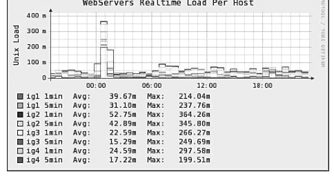

我们可以从图中清楚看到在午夜左右所有服务器的 `CPU` 峰值。如果我们更改图上的时间间隔，使其显示更长的时间（如图 7.2 所示），我们可以看到这种行为对于这些服务器来说并不典型；因此，我们可能推测这种行为构成了一个问题。

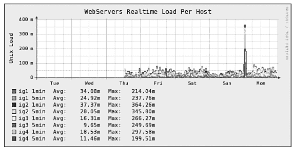

图 7.2 `CPU` 负载图，上周。

时间序列图对视觉敏感的人类非常棒；它们在很小的空间内描述了大量信息，并以一种传达主题的方式呈现。为每个指标绘图的简单行为可以帮助各种情况。例如，如果有其他图表，我们可以将它们与某些有助于故障排除的关系进行比较。将图 7.1 与图 7.3 中相同服务器的网络利用率图进行对比，显示显示 `CPU` 峰值与 `6MB/s` 的网络峰值同时发生，这意味着异常利用率以某种方式被相关主机揭示了。

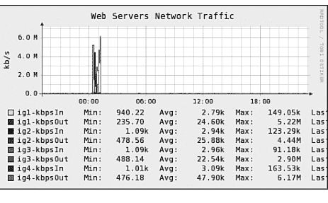

图 7.3 网络利用率图，过去 28 小时。

这种时间序列数据是你应该添加到 `Nagios` 界面中的第一个，也是最重要的数据可视化。因为这里需要预先做出一些重要的考虑。因为你永远不知道自己可能想要比较什么、想如何比较，或者持续多久；你收集、存储和可视化这些数据的方式至关重要。在任何情况下，你都希望选择针对灵活性优化的工具，遗憾的是，实际上能提供你可能想要的所有灵活性的工具很少。

如图 7.4 所示，数据可视化拼图由三部分组成：数据收集、数据存储和显示。优化灵活性的最佳方法是获取三个独立的包分别处理这三项工作，而大多数与时间序列数据图表相关的软件的错误是试图做得太多。


**图 7.4** 数据可视化拼图的三部分。

例如，当处理数据收集时，它应对其收集的数据源应该是灵活的，无论是 `SNMP`、日志文件还是自定义指标。同样，数据存储引擎应该处理各种类型的数据结构并提供高写入吞吐量。最后，显示层应该允许各种可视化，从简单的折线图到复杂的热图和交互仪表板。

### 基础、`MRTG` 和 `RRDTool`

由于 `Nagios` 的局限性，我们经常需要使用外部工具可视化它收集的数据。这就是 `MRTG` 和 `RRDTool` 发挥作用的地方。`MRTG`（监控工具环生成器）多年一直是行业标准，而 `RRDTool`（环形数据工具）是 `MRTG` 用于存储和处理数据的引擎。

#### `MRTG`

事实上，`MRTG` 可以被视为监控系统。它是一个从 `cron` 运行的脚本，定期轮询支持 `SNMP` 的设备获取统计数据。它将这些存储在所谓的环数据库中。`RRD` 是一种循环数据结构，在满时会开始覆盖自身。这种结构被证明非常适合其预期用途。在分配后，`RRD` 在磁盘上的大小不会增长，并允许快速检索和操作。

#### `RRDTool`

1999 年，当 `MRTG` 的作者 `Tobias Oetiker` 在 `CAIDA`（互联网数据分析协作协会）休假期间，他开始开发 `RRDTool`，这正是系统监控社区所需的的时间序列数据可视化工具。通过将 `MRTG` 的相关部分提取为独立程序并扩展其功能，`Tobias` 创建了一个时间序列数据绘图领域的类别终结者。

## 第 7 章 可视化

我并非随口而出。很难完美表达轮询数据库（round robin databases）是如何解决性能和监控指标存储问题的。在数据被存储在 `RDDs` 之后，可以通过命令行工具进行任何你想要的 `shell` 处理，但正因为其快速且强大的内部处理使得 `RRD` 具有了净收益。

存储和绘制时间序列数据是一个比听起来要困难得多的问题，`RRDTool` 功能丰富，使其成为系统管理员每天处理的软件中最复杂、最难使用的工具之一。要背下 `RRDTool` 的命令行语法是不可能的，因此在实践中，自动化是常态。大多数系统管理员使用脚本和胶水代码（glue code）来隐藏 `RRDTool` 的复杂性，但在不丧失灵活性的情况下做到这一点非常棘手。你对 `RRDTool` 了解越深，在处理和选择用于将 `RRDTool` 连接到 `Nagios` 等其他应用程序的脚本时就越有利。

在最基础的层，`RRDTool` 是一个指标数据库。这些指标可以是从房间温度到路由器接口的每秒比特吞吐量的任何内容。`RRDTool` 将这些指标称为数据源（`DS`），因为它们确实就是数据。提供了命令行工具来创建和定期更新数据库。每个数据源在数据库中存储为几种类型之一：`GAUGE`（仪表）和 `COUNTER`（计数器），这是你会使用的两种类型。为了理解为什么需要不同的数据类型，请考虑我们的示例指标温度和吞吐量是如何收集的。

### `RRD` 数据类型

温度测量来自某种传感器，可能是带有 `IPMI` 或 `LMSensors` 的服务器内部，或者是通过 `SNMP` 的专用外部设备。当你轮询传感器时，你会得到一个数字，例如 42。这个数字直接对应温度，通常是摄氏度。这个数字可能会根据环境而增加或减少。在物理世界中，可以使用带指针的仪表来显示温度。

另一方面，路由器吞吐量通常通过路由器上的 `SNMP` 字节计数器获取。这个数字是路由器接收的字节总数。计数器只会增加而永远不会减少。根据使用的内存缓冲区的大小，计数器最终将溢并返回 0，然后从那里继续增加。在物理世界中，这个计数器类似于汽车的里程表。为了获得实际的吞吐量测量值（例如 `20kb/s`），必须取旧计数器值和新计数器值之间的差值，并除以轮询间隔。

### 基础、`MRTG`、`RRDTool`

例如，假设 `Nagios` 每分钟测量一次 `Router7` `SNMP` 变量中的八字节（octets）。`Nagios` 第一次测量计数器时，读取到 653,122，这意味着它的接口接收了 653,122 字节。分钟后，当 `Nagios` 第二次轮询时，计数器读取为 654,322。数据通过接口的速率是多少？要找到自第一次测量以来传输了多少字节，请从 654,322 中减去 653,122。这得到 1,200。因此在 `Nagios` 睡眠期间有 1,200 字节传输到路由器。因为 `Nagios` 每分钟轮询一次，这意味着路由器每分钟接收 1,200 字节。将 1,200 除以一分钟的秒数，我们得到了速率，例如为 20 字节/秒。

从计数器推导出速率是一个常见需求，`RRDTool` 会为你完成这一点。你只需要指定相关数字是一个计数器，`RRDTool` 就会自动执行所需的算术运算以返回信息。当然，如果你有像温度或 `CPU` 负载之类的数据，你不希望发生这种情况；在这种情况下，你使用 `Gauge`（仪表）。

### 心跳（Heartbeat）与步长（Step）

除了数据源类型外，`RRDTool` 还需要知道你轮询它的频率。这个数字被称为 `step`。`step` 以秒为单位，所以在之前的示例中，当 `Nagios` 每分钟轮询一次时，`step` 为 60。`step` 不是特定于数据源的；它是整个轮询数据库指定的。因此，`RRD` 期望至少每隔 60 秒就会有人来使用命令行工具为它提供更多数据。但如果在 60 秒窗口内发生了两次更新会怎样？或者完全没有更新又怎样？在完美的世界中，轮询引擎将始终在预期的时刻为 `RRD` 提供所需的数据，但因为这是现实世界，你需要考虑各种因素。出于这个原因，你还必须为数据源指定心跳（heartbeat）。

心跳决定了当数据过多或过少时会发生什么。字面上，它是在一个轮询间隔内，数据被视为未知之前可能经过的最大秒数。如果设置得大于 `step`，心跳可以为延迟数据的到达留出时间缓冲区；或者它可以强制每个轮询间隔进行多次采样。继续之前的示例，如果路由器由于某种原因不可靠，或者 `Nagios` 有大量工作要做，你可以将心跳设置为轮询间隔的两倍：120。这意味着在该间隔的数据被视为未知之前，可能会过去两分钟。在实践中，使用像这样的大心跳来考虑轮询引擎的故障是常见的。

每隔 `step` 秒，`RRDTool` 提取它在 `step` 期间接收到的数据并计算一个主数据点（`PDP`）。这个过程是 `RRD` 工作机制的核心。如果 `step` 是 60 秒，`RRD` 期望每分钟产生一个 `PDP`。如果 `step` 是 300 秒，它期望每五分钟产生一个 `PDP`。这种灵活性使得 `RRDTool` 能够根据管理员的需求处理不同类型的监控频率。

### 第 7 章 可视化

`RRDTool` 会自动返回尽可能高的数据。当你绘制一个月内的任何数据图表时，你会得到高分辨率的图表，因为 `RRDTool` 会返回数据。绘制超过一个月但多于一年的数据产生产生较低的图表，但提供的数据完全足够让你在大规模上得出所需的结论。最后，对于 5 年的数据，可以生成低分辨率图表，而总 `PDP` 计数仅保持在 58,320。如果你保留一年的原始数据，历史记录将是现在的 5 倍，而存储空间却几乎少了一个数量级。

当你从多个数据点在轮询存档（`Round Robin Archive`）中合并数据时，`PDP` 可能是未知的。因此，就像心跳（heartbeat）机制一样，你需要告诉 `RRDTool` 在合并数据变为未知之前，允许有多少个 `PDP` 未知。这个值被称为 `X` 文件因子（`X-Files Factor`，这确实引用了电视剧《X档案》），是一个比率，或者如果你愿意，是一个百分比（范围从 0 到 1），表示在合并值也被视为未知之前，允许未知的 `PDP` 比例。

### `RRDTool` 创建语法

在概念上，它足够简单。`DS` 定义描述了存储什么以及如何存储，而 `RRA` 描述了保留多少数据以及何时合并或压缩这些数据。在实践中，创建 `RRDS` 会困扰很多人。列表 7.1 是你可能用于创建轮询数据库的字面语法，用于存储来自 `inOctets` 计数器的路由器一年的数据。

**列表 7.1 创建单计数器 RRD。**

```bash
rrdtool create Router7_netCounters.rrd \
  --step 1157605000 --step 60 \
  DS:inOctets:COUNTER:120:0:4294967296 \
  RRA:AVERAGE:.5:1:43200 \
  RRA:AVERAGE:.5:5:105120 \
  RRA:AVERAGE:.5:10:105120
```

是的，只需要一个命令，但不要被吓到；使用得越多就越容易，而且很少有人会花精力去记忆语法。`RRDTool` 的工作原理类似于 `csv`。它有一个单一的主命令（`RRDTool`），可以在多种模式（`create`、`update`、`graph` 等）下运行。因此，第一行将 `RRDTool` 置于创建模式并告诉它将 `RRD` 为 `Router7_netCounters.rrd`。第二行给 `RRDTool` 提供了一个开始日期，并告诉它预期每 60 秒更新一次。开始日期以 `UNIX` 的纪元时间秒数指定。你也可以使用 `N` 作为现在的快捷方式。如果你想用 `RRD` 填充旧数据，指定开始日期会很有用。

在 `UNIX` 中，纪元（epoch）被认为是 1970 年 1 月 1 日 00:00:00 `UTC`。以这种方式跟踪秒数让程序员处理时间变得更容易。你可以使用 `date` 命令将其转换为纪元秒，如下：

```bash
date +%s
```

你可以将其转换回人类可读的格式，如下：

```bash
date -d "Jan 1, 1970 UTC + 1157605000 seconds"
```

因为我经常做这类工作，我发现向我的 `.bash_profile` 中添加以下几行非常方便。

```bash
export EP='Jan 1, 1970 UTC'
```

这样，我就可以将纪元秒转换回格列利亚历，如下：

```bash
date -d "${EP} + 1157605000 seconds"
```

回到我们的示例，第 3 行定义了我们的数据源。`DS` 定义是用冒号分隔的。语法为：

```text
DS:<DS NAME>:<DS TYPE>:<HEARTBEAT>:<MIN>:<MAX>
```

你可以为 `DS` 命名任何名称，稍后从 `RRD` 绘制或导出数据时你会引用这个名称。`DS TYPE` 正如前所述，是 `COUNTER`（计数器）或 `GAUGE`（仪表）。心跳、最小值和最大值本质上应该是不言自明的。我将数据源命名为 `inOctets` 并将其指定为计数器。心跳是步长（`step`）的两倍，以秒为单位。这意味着在使用数据进行轮询间隔之前，采集引擎可以延迟整个步长。

使用计数器时，设置最小值和最大值是良好做法。这些有助于 `RRDTool` 进行内部完整性检查，确保你辛苦获得的数据被准确地存储和显示。我的 `SNMP` 客户端告诉我 `inOctets` 计数器类型是 32 位 `INT`，在这个示例中，我将最小值设置为 0，最大值设置为 4,294,967,295 (`2^32-1`)。对于仪表，不需要进行数学计算，因此如果我处理的是仪表指标，我会指定为 `U:U`。

即使你的仪表有最小值或最大值，我也建议指定 `U:U`，这样数据就会按其采集时的状态进行存储。如果你为仪表指定了最小/最大值，你对你的数据做了一个危险的假设，即它的行为确实如你认为的那样。

当你从多个数据点在轮询存档中合并数据时，`PDP` 可能是未知的。因此，就像心跳机制一样，你需要告诉 `RRDTool` 在合并数据变为未知之前，允许有多少个 `PDP` 未知。这个值被称为 `X` 文件因子（`X-Files Factor`，这确实引用了电视剧《X档案》），是一个比率，或者如果你愿意，是一个百分比（范围从 0 到 1），表示在合并值也被视为未知之前，允许未知的 `PDP` 比例。

要绘制图表，你需要知道保留多少 `PDP`。这就是 `RRA` 的用武之地。例如，如果你想保留 30 天的 5 分钟数据，公式为：

```text
step * PDPs = 86400 天
```

其中：
- `consolidation function`：聚合方法（例如 `MIN`、`MAX`、`LAST`、`AVERAGE`）。
- `step`：数据点之间的秒数。
- `PDPs`：每个间隔的数据点数量。
- `days`：保留数据的天数。

如果你想计算 30 天 5 分钟步长的 `PDP` 数量：

```text
30 天 * 24 小时 * 60 分钟 / 5 分钟 = 8,640 个
```

`RRA` 定义如下：

```text
RRA:AVERAGE:.5:1:8640
```


这意味着 `RRDTool` 将每 8,640 个 `PDP`（30 天的数据）平均分为一个数据点。你可以有多个 `RRA` 定义来存储不同的时间尺度，这对于长期趋势分析非常有用。

例如，为了保留 1 年的 1 小时平均值数据：

```
RRA:AVERAGE:.5:1:8760
```

（365 天 * 24 小时 = 8,760 小时）。

# 第 7 章 可视化

列表 7.2 中的步骤适用于两个数据源，这意味着你存储在轮形数据库中的每个数据源必须具有相同的轮间隔。然而，由于心跳是在数据源定义中指定的，每个 `DS`（数据源）可以有不同的心跳。在列表 7.1 中，我为 `outOctets` 的心跳指定了 180。`RRA` 也适用于所有数据源。我们将对每个数据源的数据合并，因此你添加到 `RRD` 的每个数据源都必须以相同的方式存储。

当你创建一个 `RRD` 时，更新它非常简单。只需在更新模式下调用 `RRDTool`，并提供文件名、时间戳和用冒号分隔的值即可。`RRDTool` 通过匹配它们创建时指定的顺序来推断哪些值对应哪些数据。例如

```
rrdtool update netCounters.rrd N:25842
```

上述操作使用当前时间更新 `netCounters` `RRD`，其中 `inOctets` 的值为 42，`outOctets` 的值为 15,842。

由于我处理 `RRDTool` 已多年，我倾向于避免在单个 `RRD` 中放置过多的数据源。这有两个主要原因。第一个是，我总是忘记 `RRD` 内部包含什么数据。虽然使用 `fetch` 模式下的 `RRDTool` 很容易定义 `RRD` 内部存储的内容，但我的问题是我从根本上忘记了数据，所以当我寻找类型为 `X` 的数据时，我会草草查看文件名，最后创建一个包含我想要的数据冗余 `RRD`。

第二个原因是，有时会弹出本应放入现有 `RRD` 中的新 `DS`。例如，你可以创建一个名为 `disks.rrd` 的单个 `RRD`，并为每个分区创建一个 `DS`。然后一年后，当 `/var` 空间耗尽时，你添加了一块新磁盘并将其挂载到 `/var`，该 `RRD` 必须必须扩展以包含新分区的额外 `DS`。向现有的 `RRD` 中添加 `DS` 是可能的，但并不好玩。

我的建议是创建具有特殊描述性文件名的单 `DS` `RRD`。`RRD` 的文件名至少应包含它所指的服务器名称。如果你保留单 `DS` `RRD`，也可以将 `DS` 的名称放在文件名中，如果你像我一样是个呆头脑脑，这会让事情变得特别简单。例如，我可以查看文件 `router7_inOctets.rrd`，并确切知道我能获取什么以及如何获取。各种 `RRDTool` 脚本擅长让你免受这类事情的干扰，这很好。然而，寻找良好的脚本可能是一个问题，正如你在下一节中看到的。

## 数据采集与轮询

在“基础：MRTG，RRDTool”章节的开头部分中，我提到可视化谜题由三部分组成：轮询引擎、数据存储后端和图表用户界面。为了从监控系统中获得最大的收益，你希望对这些部分中的每一个进行灵活性优化，以便以你想要的方式使用拥有的任何数据。因为你预先不知道自己可能想要可视化这些数据，所以保持灵活性意味着来自每个服务器的每个指标都可以供任何想要消费它的程序使用。

你选择了 `Nagios` 作为你的轮询引擎，`RRDTool` 作为你的存储引擎。现在你已经掌握了 `RRDTool` 的工作原理，你可以讨论数据与存储之间的中间地带。有许多胶接层可以将 `RRD-Tool` 与 `Nagios` 结起来，在实践中，所有它们都会自动为你创建 `RRD`，管理员永远不需要处理手动创建 `RRD` 的工作。

无论如何，我希望这一节能让你意识到 `RRA` 对你的数据可视化任务的至关重要。简单来说，如果你的胶接层没有定义轮形存档（Round Robin Archives），你就无法控制保留多少数据或保留多久。我之所以提出这一点，是因为我没有见过任何 `Nagios-RRDTool` 胶接层允许你在配置文件中指定自定义 `RRA`。这是一个大问题。你的工具拥有一个超灵活的轮询引擎和一个完美的数据存储后端，但这两者的灵活性可能会被你放在它们之间的胶接层的能力所严重限制。

## 选购胶接层

我不确定为什么存在这个 `RRA` 问题。要么是用户定义的 `RRAs` 很难实现（我还没有尝试过，但它们看起来并不困难），要么是编写各种胶接库的人认为，让你免受 `RRDTool` 内部原理的影响比为你提供定义 `RRAs` 的灵活性更重要。

作者们的工作是让你免受 `RRDTool` 内部原理的干扰，因此这是一个可以理解的疏忽，它让你的任务变得更加困难。你需要选择一个符合你的需求且以后不会成为负担的胶接层。选择一个用你理解的语言编写的，以便在需要时可以在代码中更改（如 `RRAs`），或者至少确保你能够搞清楚 `RRAs` 是什么，以便你做出相应计划。

轮询和采集脚本的另一个坏习惯是做得太多。大多数从 `Nagios` 采集数据并将其存储在 `RRD` 中的脚本还包含了实际上从数据中绘制图表的 Web 界面。在概念上，这似乎是个好主意，但根据我的经验，脚本倾向于通过做某些事情来锁死你。

（注：提供的第 170 页文本包含重复句子，已根据可读性进行了清理）。

# 列表 7.5 NG 的 check ping 定义。

```
# output:PING OK - Packet loss = 0%, RTA = 0.00 ms
/output:PING.*?(\d+)\%+.([\d]+)\/sms/
and push @s, [ ping,
	 losspocket, GAUGE, $1],
	rta, GAUGE, $2/1000 ]];
```

这是非常简单的 Perl。目标是构建一个 aoa，即数组的数组（array of arrays）。顶层数组中的第一个值是服务的名称。此名称连同 `Nagios` 名称和服务描述将将用于 `RRD` 的文件名。数组中的第二个和第三个值本身也是数组，它们存储了填充 `RRD` 的 `DS`（数据源）的名称、数据类型和值。

如果你熟悉正则表达式，通过遵循现有的服务来设置新服务应该没有问题。因为映射文件是 Perl 格式，如果你熟悉一些 Perl，它赋予了你通过程序化完成一些非常酷操作的灵活性。例如，列表 7.6 是我的 `NG` 定义。磁盘的问题在于，不同的机器分区数量不同，单个正则表达式无法捕获所有分区。列表 7.6 中的定义动态检测分区，为每个分区创建一个新的 `DS`，因此它是一个适用于任何使用 `check_disk` 的机器的单一定义。

# 列表 7.6 一个用于 NG 的 check_disk 定义。

```
/perfdata:\=\d+MB; and do {
my @perf = /(\\/w*)=(\d+) MB; (\d+);\d+;\d+)/g;
my @s;
my $sref=\$_disk';
$s[0]=\$_disk';
while (my($name, $used, $total) = splice @perf,0,3) {
    my $free=$total-\$used;
    if($name~^7\/disk_root/) {
        $name~=s/\\/disk_root//;
    }else{
        $name~=s/\\/disk_//;
    }
    push @_s, [$name]."total", GAUGE, \$total*1024**2],
           	[$name]."used", GAUGE, \$used*1024**2],
           	[$name]."free", GAUGE, \$free*1024**2 ];
}
```

当配置文件和 `insert.pl` 准备就并相应配置了 `Nagios` 后，`RRDs` 应该就会出现在你的 `rrdb` 中。由于映射文件带有许多预定义的定义，你可能在无需进行任何映射文件配置的情况下就拥有各种指标的 `RRD`。如果你遇到问题，请检查配置文件中的调试选项。

# 前端和仪表板 (149)

`Nagios Graph` 是我目前倾向的解决方案，但它可能不符合你的口味（如果你喜欢，可以从 `http://nagiosgraph.sourceforge.net` 获取），所以请务必查看 `Nagios Exchange` 以寻找可能适合你环境的内容。我希望我提供的提示能帮助你缩小范围。

# 前端和仪表板

现在你已经处理好了数据采集和存储，可以忙于为这些数据绘制图表了。就像轮询和存储引擎一样，你可能也想优化你的前端以提高灵活性。在 `RRD` 中，你不希望在过程中丢失任何 `RRDTools` 的功能。如果不需要在 Web 界面中进行大量的点击来配置一切，那就更好了。查看一些前端工具（访问 `www.rrworld.com`），你会发现你在数据采集和轮询引擎中遇到过类似的问题。大多数图表端都试图做得太多或过于复杂，这两者都会导致缺乏灵活性。

# RRDTool 图表模式

在开始研究图表前端需要寻找什么之前，你需要了解一下 `RRDTools` 的图表模式。像 `create` 和 `update` 一样，`RRDTool` 有一种特殊模式从存储在 `RRD` 中的数据绘制图表。我有时开玩笑说，`RRDTool` 图表是古语“一画胜千言”的真实证明，因为 `RRDTools` 图表模式是该工具集中最复杂、最令人困惑的部分，拥有令人眼花的选项，可以指定从图表的高度和宽度到背景和前景颜色的一切。

虽然图表命令在技术上是单行的，但它们跨越 15 到 20 行并不罕见。良好的前端会让复杂的语法简单得多，但要从你的前端（`FE`）提取所有内容，你需要快速回顾几个重要概念，包括 `DEFs` 和 `CDEFs`，并温习你的逆波兰法（reverse polish）。

`DEFs` 是图表模式中的定义；它们告诉 `RRDTool` 应该绘制什么。一个 `DEF` 由 `RRD` 的文件名、该 `RRD` 中的一个 `DS` 以及该 `DS` 的合并函数组成。一个 `DEF` 引用且仅引用一个 `DS`。你可以在图表命令中指定任意数量的 `DEFs`。例如：

```
DEF:foo=/usr/nagios/rrd/umbra_load:5min:AVERAGE
```

`DEF` 被赋予一个名称，类似于变量；在这种情况下，`foo` `DEF` 指的是 `/usr/nagios/rrd/umbra_load` `RRD` 中的 5 分钟数据源。`average` 关键字指定你想要使用 `AVERAGE` 合并函数的 `RRAs`（如果你有多个类型的话）。

现在可以使用图表元素定义对此 `DEF` 进行绘图。图表元素有几种类型。

（注：原文中存在大量重复段落，翻译已按要求去重处理。）

这种 `DEF` 现在可以使用图表元素定义进行绘制。最常用的是 `AREA` 和 `LINE`。图表看起来如 7.7。


**图 7.8** 网络吞吐量。


**图 7.9** 乘以。

# 可视化 (152)

如你所示，`CDEF` 是数学操作的结果。对于初学者，我将提供简短的总结。如果你已经熟悉 `RPN`（也称为逆波兰法），可以跳过。

# 逆波兰法

传统的数学表达式依赖操作优先级来确定执行顺序。你可能在小学就记得过 `PEMDAS`：括号、指数、乘法、除法、加法和减法。例如：

```
4+5*2
```

结果是 14。首先，5 乘以 2，然后加上 4。这是因为操作优先级规定先乘后加。如果你想乘以 4 和 5 之和，你必须用括号覆盖操作优先级，如下：

```
(4+5) *2
```

在 `RPN` 中，操作优先级是不必要的，因为数量和运算符是按需指定的。例如，在 `RPN` 中指定 5 乘以 2：

```
5, 2,*
```

`RPN` 表达式在操作顺序上没有歧义。它们从左到右读取，就像英语一样，可以从水平栈的角度考虑。值被推入栈并在需要时弹出。首先，你向栈中推入 5，22，然后是乘法运算符。每当 `RPN` 得到一对数量和一个运算符时，它就会按顺序弹出它们并执行方程，将结果保存回栈顶。为了指定将 2 乘以 5 和 4 之和，你可以说：

```
5, 4, +, 2, *
```

因为 `RPN` 从左到右读取，所以没有乘法先发生的机会。在这里，5、4 和 + 从栈中弹出并求值。5 和 4 的和然后被推回栈顶。此时，你可以想象栈看起来像：

```
9, 2,*
```

## 前端与仪表板

现在，9、2 和 + 从栈中弹出并求值，返回 18。`RPN`（逆波兰表达式）一次永远不会处理超过 2 个数量，所以如果你愿意，可以将所有数量堆叠起来，然后列出所有的运算符。例如，编写上一个等式的另一种写方式是：

`5, 4, 2, +, *`

在这里，`RPN` 弹出 5 和 4，由于看到栈中的下一个对象是数量而不是运算符，它会跳过 2 并寻找下一个可用的运算符，即 +。5 和 4 相加，结果和被推回到栈顶。从那里开始，执行方式与上一个示例相同。有些人发现，像这样堆叠数量和运算符更容易理解，特别是当表达式变得很大时。

既然你已经了解了 `RPN` 的所有原理，让我们再看一遍列表 7.7（Listing 7.7）中的 `CDEF`。

```
CDEF:neg=in,-1,*
```


结合对 `RPN` 的了解，可以很容易看出你正在创建一个名为 `'neg'` 的 `CDEF`，它是 `in` 和 `-1` 之积。你可以对任何已定义的任意变量进行任意操作来创建 `CDEF`。看一个更复杂的 `CDEF` 示例可以让你感受一下这种可能性。

**列表 7.8** （Listing 7.8） 包含了磁盘利用率图的定义。`RRDS` 跟踪 `megabytes total`（总兆字节）和 `megabytes used`（已兆字节）磁盘指标。使用来自四个不同 Web 服务器的数据。绘制原始数据将产生八条线，对于四个 Web 服务器中的每一个，各一条代表“总兆字节”，一条代表“已兆字节”。

在这个示例中，你想为给管理层的演示绘制一张图。这张图应该描述单个数量的整月历史记录：所有四个 Web 服务器的整体磁盘利用率。在多个机器上显示单个指标的最佳方法是显示平均磁盘利用率百分比。这无论磁盘大小如何，将所有服务器置于相同的范围内。要做到这一点，你必须首先将每个服务器上的原始利用率指标从兆字节转换为百分比；然后你就可以将百分比平均成一个数字。列表 7.8 显示了实现此操作的 `RRDTool` 语法。

### 7.8 用于数据汇总的 `CDEF`。

首先，为每个服务器上所需的指标创建 `CDEF`。接下来，为每个服务器创建利用率百分比。这在 `RPN` 中通过将用空间量除以结果乘以 100 来完成，如下：

```
CDEF:pct1=w1,wlt,100,*
```

在获得每个服务器的利用率百分比后，通过将这些百分比相加并将结果除以 4（服务器数量），将它们平均成一个数字。

注意，`CDEF` 操作的百分比变量是 `CDEF`，所以你可以像对 `DEFs` 进行数学运算一样，对 `CDEF` 值进行数学运算。如果你愿意，可以使用值/运算符堆叠来让这个 `CDEF` 看起来更好一点，如下：

## 选购前端

由于 `CDEF` 功能非常强大，选择一个对 `DEs` 和 `CDEF` 具有细粒度控制的绘图引擎至关重要。有很多绘图前端可以选择，但它们并非同等。以下是一些可以帮助你缩小范围的提示。

寻找使用配置模板和过滤器的工具。在许多服务器上拥有大量指标的情况下，使用模板自动化某些配置，或至少通过过滤器缩小可用选项，将节省大量时间。如果前端将其保存为文本文件，那就更好了；这意味着你可以后端处理某些对象的创建，完全跳过用户界面。实现这些功能的解决方案通常用纯 `CGI` 或 Web 应用语言（如 `PHP`）编写，这引出了我的下一一点……

寻找使用 `CGI` 的工具而不是用 Web 应用语言（如 `PHP`）编写的工具。`PHP` 应用通常看起来更精致，但 `CGI` 应用往往更灵活。链接至关重要；你希望直接链接到特定图表，或使用 `wget` 或 `curl` 用于电子邮件报告和自定义仪表板。如果你选择 `PHP` 应用，请确保它能生成指向特定图表的可重链接。应避免那些经常使用随机、唯一名称生成静态图表的工具。此外，`CGI` 应用通常更容易安装。

寻找那些告诉你是如何创建图表的工具。`RRDTools` 的图表模式对于需要手动创建和处理图表的管理员来说很费劲。但许多前端会提供它们创建任何图表时所使用的字面语法。这可以为你节省大量时间。

警惕那些自行轮询的图形工具，因为它们往往缺乏灵活性。你正在使用的某些工具有自己的轮询引擎，因此数据是以特定方式存储的。许多工具无法很好地绘制未配置轮询的指标。它们中的大多数由于过度关注轮询或绘图，结果导致了不必要的障碍。

到为止，该领域最流行的工具是 `Cacti` (www.cacti.net)，如果不提它我将是有失的。`Cacti` 是一个非常棒的工具。它用 `PHP` 编写，高度可配置，界面非常完善（我特别喜欢它的缩放功能，允许你点击并拖拽选择图表的一部分进行放大）。我怀疑它的用户界面与其广泛成功有很大。`Cacti` 可以被认为是 `MRTG` 的替代品。它完成了从数据轮询到存储和绘图的所有工作。这不一定包含它。

## 前端与仪表板 155

# 第 7 章 可视化

`draw` 由一个配置文件和一个用 `Perl` 编写的 `CGI` 脚本组成。几分钟即可完成。只需将 `draw` 拷贝到 `CGI` 目录并编辑其配置文件。你在配置文件中需要更改的唯一内容是 `datadirs`，它是存放 `RRDS` 的目录。如果你想自定义 `draw` 的外观，有很多内容可以配置。你还可以指定权限，如查看、创建和删除的能力。

`draw` 做到了一切。它是 `RRDTool` 的轻量级封装，在一个快速使用的包中提供了所有功能。诸如支持正则表达式的过滤器、模板和图表克隆等功能节省精力。此外，`draw` 执行了一些对管理员友的操作，例如将配置存储为文本文件，使得程序化创建图表成为可能。它还提供了你可以查看的变更日志。图 7.10 显示了我在办公室某个监控系统上的 `draw` 主页。你可以点击“创建新图”创建图表，或点击“定义新仪表板”定义仪表板。`draw` 仪表板是以用户定义方式绘制的图集合。你可以在仪表板中隐藏图例或为图表指定替代尺寸。

**图 7.10** `draw` 的主页

它开箱即用的界面并不漂亮，但所有与美学相关的内容都可以在文件中修改。这包括图标、页眉和页脚。你甚至可以自定义样式表。图 7.11 是我的网络流量仪表板截图。

**图 7.11** 仪表板

最后，图 7.12 是创建列表 7.8 中合并 `draw` 示例的 `draw` 数据配置截图。你可以使用正则表达式搜索来指定图中的 `RRDS` 和 `DS`。注意 `RRA` `CDEF` 列。这就是你输入 `RPN` 表达式来创建 `CDEF` 的地方。

# 158

# 第 7 章 可化

数据源配置帮助

| DEL 名称 | 序号 | 数据源 (列表) | RRA CDEF | 类型颜色 | 标签/格式 | 额外的 GPRINTS 最小/平均/最大/最后 | BR |
|---|---|---|---|---|---|---|---|
| 7 | 1 | `NT_Sams_ingres01_DISK, disk_root_total` | `Avg` | - | 白色 | `disk_root_total AVEL` | | |
| | 2 | `NT_Sams_ingres01_DISK, disk_root_used` | `Avg` | - | 白色 | `disk_root_used` | | |
| | 3 | `NT_Sams_ingres01_DISK, disk_root_total` | `Avg` | - | 白色 | `disk_root_total` | | |
| | 4 | `NT_Sams_ingres01_DISK, disk_root_used` | `Avg` | - | 白色 | `disk_root_used` | | |
| | 5 | `NT_Sams_ingres01_DISK, disk_root_total` | `Avg` | - | 白色 | `disk_root_total` | | |
| | 6 | `NT_Sams_ingres01_DISK, disk_root_used` | `Avg` | - | 白色 | `disk_root_used` | | |
| | 7 | `CDEF` 定义 | | `1,100` | - | 白色 | `sg1_pit_used` | ● Off | |
| | 8 | `CDEF` 定义 | | `1,200` | - | 白色 | `sg2_pit_used` | □ Off | |
| | 9 | `CDEF` 定义 | | `1,200` | - | 白色 | `sg3_pit_used` | □ Off | |
| | 10 | `CDEF` 定义 | | `1,100` | `AREA` | 海军蓝 | 平均利用率 | □ Off | |

图 7.12 `draw` `CDEF` 配置界面。

通过 `Nagios`、`NG`、`RRDTool` 和 `draw`，你已经拥有了创建精美时间序列可视化的全部组件。现在让我们来看看一些其他表示信息的方式，并检查你可能需要这样做的一些原因。

## 管理接口

在系统监控圈子里，仪表板（`Dashboard`）和管理接口（`Management Interface`）等术语被频繁提及，对不同的人来说意味着完全不同。本节并不是为了严格定义什么是管理接口，也不是教你如何构建一个，但通过使用一些有趣的工具，它可以帮助你理解你需要什么。

根据我的经验，时间序列图和 `Nagios` Web 界面足以为系统管理员提供他们所需的可见性，但组织的需求并不一定止于系统管理员的需求。因此，数据消费者应该决定管理接口的定义，无论是电子邮件报告，还是用（令人惊讶的）`Flash` 编写的备用 Web 界面。希望本节能引导你发现一些对满足你的数据消费者特殊需求有用的工具。

## 知晓你所所为

在开始设计自定义接口和仪表板之前，我强烈建议你继续阅读关于什么是良好的可视化，特别是什么不是良好的可视化。出错的方法有很多，而只有极少数方法是正确的。我强烈推荐爱德华德·图夫特（`Edward Tufte`）的书《定量信息的视觉显示》（*The Visual Display of Quantitative Information*）。我将给你一些入门技巧，但我确实不是专家，所以在在开始之前请务必做好功课。

首先，避免饼图。虽然营销人员非常青崇，但出于几个原因，饼图在可视化方面非常糟糕。其首要原因是人类在解释角度方面是出名的糟糕（饼图上的 `3D` 效果只会让情况更糟）。当饼图中有两个相似的值时，除非你指出它们或在图例标签中发布数值，否则大多数人不会注意到其中的差异。其次，饼图没有参考系，这意味着人们只能通过读取标签中的数值来获取每个扇区所代表的实际值。最后，饼图没有明显的开始或结束，这使得人们很难知道将注意力集中何何。

任何你可以用饼图可视化的内容，用柱状图或点图可视化效果都更好。这些图表在两个轴上提供了参考系，并且通常能更有效地向人类传递数据。如果你绝对必须使用饼图，请不要比较超过几个值，并确保上色使得扇区具有高对比度。

柱状图特别擅长描述分类信息，因此如果你有符合分类的信息，请使用柱状图并安排数据，使最大值位于左侧。点图或折线图更适合描述时间序列数据。图 7.13 和图 7.14 中绘制的时间序列数据提供了一个很好的例子，说明当信息被作为时间的函数表示时，点图会清晰得多。


图 7.13 柱状图不能很好地描述时间序列数据。


**图 7.14** 涉及时间时，点图要清晰得多。

尝试从每个像素信息最大化的角度考虑你的图形。如果你在小区域内填充了大量数据，你就知道你的操作是正确的。由于这个原因，应该避免 `3D` 等花哨效果。`3D` 效果通常占用更多空间。`3D` 效果通常占据更多空间，且极少增加有用信息。

## RRDTool Fetch 模式

**列表 7.9** RRDTool `fetch` 命令的输出。

| | `avg1min` | `avg5min` | `avg15min` |
|---|---|---|---|
| `1158207000` | `1.954666666e-01` | `1.112000000e-01` | `3.466666667e-02` |
| `1158207300` | `7.80000000e-02` | `1.004000000e-01` | `4.506666667e-02` |
| `1158207600` | `nan` | `nan` | `nan` |

过去 10 分钟内有两个采集周期。根据你启动命令的时间，最后一个采集周期可能尚未发生，因此这些值是 `nan`（非数字）。数值采用科学计数法。你可以使用 shell 中的 `bc` 数学将这些值转换为可视化工具使用的数字。列表 7.10 是我用于处理和从 `fetch` 命令提取数据的 shell 脚本。

```bash
#!/bin/sh
loop grep '^[0-9]' | grep -v 'nan' | while read i
do
  # 提取行的每个元素
  for h in $(echo $i)
  do
    # 如果此元素是数据，对其进行转换
    if echo $h | grep -q 'e'
    then
      value=$(echo "scale=10; $h" | \
      sed -e 's/([0-9])\e*\^/' | bc')
      out="$value"
    # 否则如果是时间戳，则重置 out
    elif echo $h | grep -q '[0-9]::'
    then
      out=$h
    fi
done
echo $out
```

你可以将 `fetch` 命令的输出直接管道到列表 7.10 中的 shell 脚本，你将获得只关心的数据，这些数据已从科学计数法转换为真实值。

如果你为了预期目的需要任何数据点，使用 `fetch` 是可以，但如果你计划进行诸如数据平均值之类的计算或其他 `munge`（执行转换操作

# 164

## 第7章 可视化

在获取数据后将它们整合在一起，让 `RRDTool` 为你完成这些工作可能会为你节省大量的时间和 CPU 周期。`RRDTool` 图形模式中一个经常未提及的细节是，图形元素的定义是可选的。

换句话说，`RRDTool graph` 并不一定非要生成图形。它可以从命令行用于其他目的的数据，例如将其发送到外部图表工具。`RRDTool` 对内部数据进行数学运算非常快，因此它为你进行计算要比将数据导出到外部程序快得多。

例如，如果你有一个图形化组件（例如速度表），并且你想描述列表 7.9 中服务器在过去 10 分钟内的平均系统负载。你可以使用 `rrdtool fetch` 获取数据，使用列表 7.10 中的 shell 脚本解析数据，进一步解析数据以仅提取出 `avg5min`，将这些值相加并除以 2，但那远超了你需要处理量。相反，使用类似于列表 7.11 的方法，这是一个 `RRDTool graph` 命令，它只需要求 `RRDTool` 为你计算指标的平均值并将其打印到标准输出。

### 列表 7.11 一个用于解析 fetch 命令输出的 shell 脚本。

```bash
rrdtool graph /dev/null --start=end-600 \
DEF:foo=server1.load.rrd:avg5min:AVERAGE'\
'PRINT:foo:AVERAGE:%lf \
| tail -nl
```


## GD 图形库

如果图 7.13 和图 7.14 中的柱状图和点图是用 GD 库创建的。GD 是一个开源图形库，旨在通过编程轻松地创建图像。它以 C 语言库的形式实现，但为 Perl、Python、Ruby 以及其他解释语言提供了封装。

GD 特别擅长创建仪表组件，例如速度表。图 7.15 是用 `GD::Dashboard` 模块创建的简单仪表盘。


图 7.15 用 `GD::Dashboard` 创建的仪表盘。

## 管理接口

GD 也具有出色的内置图表和绘图功能。如前所述，图 7.11 和图 7.12 中的图形是用 GD 创建的；具体说是 Perl 的 `GD::` 模块。RRD 适用于不断流过的动态数据，但 GD 适用于数据静态的分析场景，例如一次性日志分析或为演示创建一次性图表。提到演示，图 7.16 显示了使用 `GD::Chart` Perl 模块的 GD 的一些酷炫的 3D 功能。可以从 `www.boutell.gd/` 获取 GD 库。各种 Perl 模块均可在 `www.cpan.org` 获取。

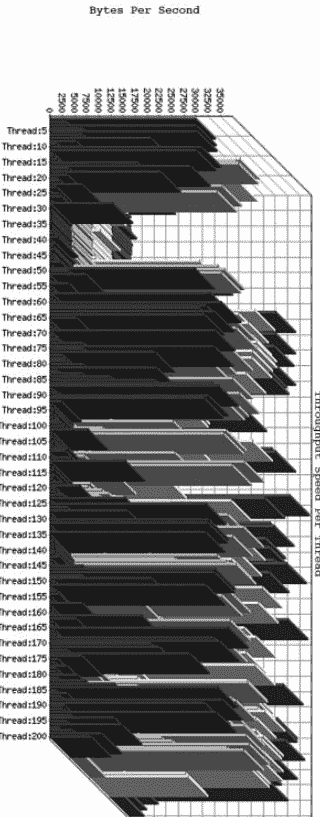

**图 7.16** 用 `GD::Chart` 创建的描述 Web 服务器性能测试中每个线程执行时间的 3D 柱状图。

## NagVis

除了精巧的组件外，交互式地图似乎是请求最多的管理界面形式。这些从字面上讲就是带有闪烁灯光的地图，比如你曾参观过电站或水处理厂时看到的种类型。NagVis 是一个从 `www.nagvis.org` 获取的 PHP 工具，可以使用 Nagios 状态为图形上的指示器动画，例如地图流程图或网络拓图。

NagVis 易于安装，其定义语法与 Nagios 本身相似。只需下载 NagVis，解压，并将 NagVis 文件夹放在你的 Nagios 共享文件夹中。一旦到位，该包应该就可以开箱即用。图 7.17 是一个中等规模企业电子邮件基础设施的地图。在 NagVis 地图文件中，你定义将哪些 Nagios 服务映射到什么状态。根据 Nagios 的判断，当服务正常时，其状态指示器为绿色。NagVis 会相应地改变其状态指示器，此类推。通过动画 GIF，状态指示器甚至可以。

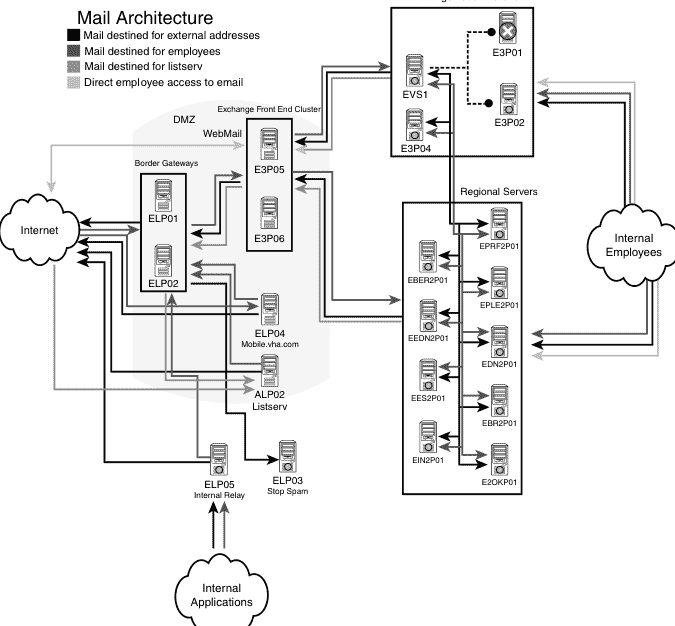

图 7.17 NagVis 电子邮件架构网络拓图。

每个绿色状态指示器都会链接回它所指服务的 Nagios 状态详情。NagVis 甚至提供了鼠标悬停功能，因此当你指向状态指示器时，你会从 Nagios 获取有关该服务的一些信息。在图 7.15 中，所有主机都是存活的，位于右上角的 `E3P01` 之外。NagVis 与任何静态图像配合，因此你可以随心所发挥创意。图 7.18 是一个地理意义上的地图。


图 7.18 NagVis 交互式地图。

## GraphViz

GraphViz 是一个开源工具，用于编程创建表示结构信息（如网络和流）的图形。GraphViz 做的事情与 Visio 相同，只是通过编程方式实现。它以 `dot` 语言实现。GraphViz 非常适合展示实体之间的关系。图 7.19 是一个简单的 GraphViz 主机图。


**图 7.19** GraphViz 端口图。

## 趋势线图 (Sparklines)

趋势线图是 Edward Tufte 在他的著作《视觉证据》（Beautiful Evidence）中引入的一个概念。用 Tufte 的话说，趋势线图是“密集的、单词大小图形”。它们以两种方式之一绘制：微型折线图或微型柱状图。

## 管理接口

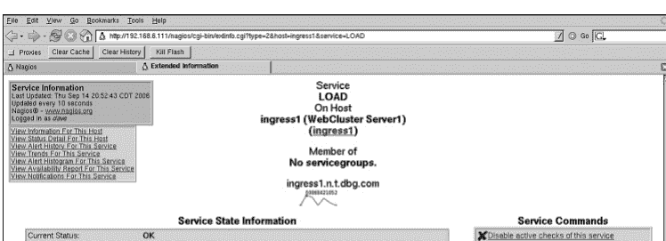

图 2.23 嵌入到 Nagios Web 界面。

## 使用 jsvis 的力导向图

静态图形的问题在于如何将所有内容放入其中。GraphViz 和 LGL（参见 `http://apropos.icmb.utexas.edu/lgl/`）等工具使用了复杂的布局算法，在保持可读性的同时最大化空间利用的高效性，但大型图可能会变得杂乱，限制了它们的实用性。如果你曾希望能够实时与网络图进行交互，那么 jsvis 可能适合你。

jsvis 由 Kyle Scholz 编写，是一个免费提供的 JavaScript 插件程序，它在 Web 界面中实现了力导向图。如果你用过视觉词义库（`www.visualtheaurus.com/`），你对这个概念并不陌生。力导向图非常像你可以交互的 GraphViz 视图。如果图中包含许多你被遮挡的服务器，例如，你可以将想要检查的节点移动到视图中。

我认为力导向图在系统监控领域具有巨大的潜力。对于比 3D 可视化简单且具有机性的可视化，它们是我过的在小空间内建模大量网络节点的最佳方式。Kyle 的博客包含了代码、交互示例，甚至还有一个可以引导你开始编码的教程。我强烈建议访问：`www.kylescholz.com/blog/2006/06/force_directed_graphs_in_jsvas.html`。

动画无疑是监控系统以及入侵检测与防御数据可视化的下一步。NetFlow（进入路由器和网络设备的数据）的集成加速了动画可视化工具的使用。NetFlow 是思科的一种标准，将网络流量流描述为单向数据包序列，这些数据包共享相同的源和目的 IP 地址、源和目的端口以及 IP 协议。目前存在开源 NetFlow 分析工具，可以实时或作为取证背景下的历史数据来可视化这些网络流。`gpl cube of potential doom` 位于 `www.kimwireless.net/doomcube/`，`NVisionIP` 位于 `http://security.ncsa.uiuc.edu/distribution/NvIPDownload.html`，而 `xovi` 位于 `http://www.doxpra.com/q=node/1133`。随着监控数据动画显示趋势的持续，我预计将看到更多像 jsvis 这样的解决方案集成到 Web 界面中。对于那些在复杂系统中挣可见性的人来说，这无疑是一件好事。如果你正在构建自定义管理接口，没有理由现在不通过 jsvis 领先于性能曲线。

## Nagios 事件代理接口（Event Broker Interface）

在本章中，你将通过探索 Nagios 事件代理来深入研究 Nagios 的内部工作机制。事件代理是 2.0 内核系列中的新特性，它绝对是 Nagios 可用的最强大的接口；然而，实际上使用它需要一些基本的 C 语言编程知识。不过不要让这吓到你；即使你只是对 C 语言熟悉，本章介绍的信息也足以让你顺利地随心所欲地扩展 Nagios 的功能。

## C 语言中的函数引用和回调

如果你不经常进行 C 语言编程，你可能从未用过函数指针。如果你精通 C 语言，请跳过本节。函数指针等同于变量指针，它们指向的是对应于函数的内存地址，而不是某种类型的变量。如果你理解指针，它们的工作方式完全一样，语法也符合你的预想，但在 C 语言编程书中很少涉及。这很遗憾，因为很难想出它们可能用上的简单示例。这确实很遗憾，因为它们能够在像 Nagios 这样较大的 C 程序中实现一些优雅的工程设计。

Nagios 经常使用函数指针来实现回调。回调是将其他函数的指针作为初始化参数的函数。当有趣的事件发生时，

## 第 8 章 Nagios 事件代理接口

Nagios 可以使用传递的函数指针回调对该特定类型事件感兴趣的事件处理程序。但在我们进入这些内容之前，请看代码列表 8.1，它概述了函数指针的使用。

### 代码列表 8.1 使用函数指针。

```c
void main() {

/* **********************************************************
这里有两个函数，一个将摄氏度
转为华氏度，另一个执行反相反的操作。
*************************************************************/
int c2f(int c ) { return (9/5)*c+32};
int f2c(int f) { return (5/9)*(f-32); }
}
```

```c
/* **********************************************************
convert 函数充当通向
实际数学函数的接口。它将一个函数
指针作为其初始化参数之一。
*************************************************************/
int convert(int input, int (*fPointer)(int)) {
return fPointer(input);
}
```

现在我们可以随时随地调用 `convert` 函数，并且可以通过向它传递指向 `f2c` 或 `f2f` 的指针来告诉它要执行哪种转换，如下所示。

```c
void Go() {
int result=convert('72', &f2c);
}
```

所以你可以明白为什么这本编程书中没有教你。使用普通的条件逻辑（如 `switch` 或 `if/else`）是更直接的使用方法。在这个例中，`fPointer` 是你想要使用的转换函数的地址。

## NEB 架构

如图 8.1 所示，事件代理本身是 Nagios 和 NEB 模块之间的一个软件层。Nagios 通知事件代理有趣的事件。事件代理的工作是找出哪些模块对这些事件感兴趣，并为模块传递内存句柄，模块可以使用这些句柄完成工作。

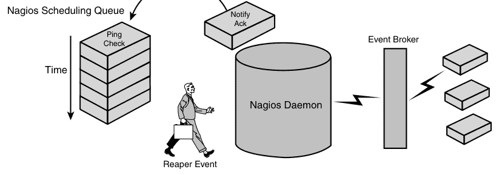

图 8.1 事件代理视角下的 NEB 架构。

## C 语言中的函数引用和回调

NEB 模块是用 C 或 C++ 编写的共享库。NEB 模块注册它感兴趣的事件类型，并提供指向执行函数的函数指针。每个 NEB 模块都要求有一个入口函数，在此之后可以做任何事情。这种架构的有趣之处在于 Nagios 全局了几乎一切（Nagios 网站，这些信息的来源）。根据 Nagios 创建者 Ethan Galstad 的说法，这是设计。基本上，我想允许事件代理模块覆盖主机/服务检查、通知、抖动检测、日志记录、执行外部命令等。这将允许人们实现许多原本需要大量重写 Nagios 进程才能实现的酷功能。因此，从 NEB 模块的角度来看，架构看起来更像图 8.2 所示。

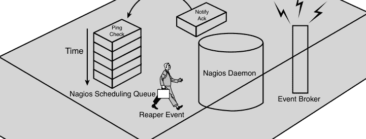

图 8.2 NEB 模块视角下的 NEB 架构。

因为几乎所有的有趣的函数和结构体都是全局的——如果 Nagios 的执行指针在模块的地址空间内——模块就有权更改它想要更改的整个运行时环境。它可以从调度队列中插入或删除事件，并开启或关闭通知。总而言之，运行时可以更改的内容都可以由模块更改。你可能会认为模块做这些事情的机会有限，因为 Nagios 只运行它的

### NEB 架构

当有趣的事件发生时会触发回调，但由于向队列插入事件的函数是全局可用的，该模块理论上可以在其首次初始化时，按时间调度其自己的回调例程。

在 Nagios `2.3.1` 中，总共有 31 种回调类型，尽管某些类型被预留供以后使用。这些常量定义在 tar包 `includes` 目录下的 `necallbacks.h` 中。表 8.1 列出了回调类型常量。

### 表 8.1 NEB 回调类型

| NEBCALL_RESERVED0 | NEBCALL_DOWNTIME_DATA |
| :--- | :--- |
| NEBCALL_RESERVED1 | NEBCALL_FLAPPING_DATA |
| NEBCALL_RESERVED3 | NEBCALL_PROGRAM_STATUS_DATA |
| NEBCALL_RESERVED4 | NEBCALL_HOST_STATUS_DATA |
| NEBCALL_RAW_DATA | NEBCALL_SERVICE_DATA |
| NEBCALL_NEB_DATA | NEBCALL_ADAPTIVE_PROGRAM_DATA |
| NEBCALL_PROCESS_DATA | NEBCALL_ADAPTIVE_HOST_DATA |
| NEBCALL_TIMED_EVENT_DATA | NEBCALL_ADAPTIVE_SERVICE_DATA |
| NEBCALL_LOG_DATA | NEBCALL_EXTERNAL_COMMAND_DATA |
| NEBCALL_SYSTEM_COMMAND_DATA | NEBCALL_AGGREGATED_STATUS_DATA |
| NEBCALL_EVENT_HANDLER_DATA | NEBCALL_RETENTION_DATA |
| NEBCALL_NOTIFICATION_DATA | NEBCALL_CONTACT_NOTIFICATION_DATA |
| NEBCALL_SERVICE_CHECK_DATA | NEBCALL_CONTACT_NOTIFICATION_METHOD_DATA |
| NEBCALL_HOST_CHECK_DATA | NEBCALL_ACKNOWLEDGEMENT_DATA |
| NEBCALL_COMMENT_DATA | NEBCALL_STATE_CHANGE_DATA |

这些回调类型涵盖了 Nagios 中可能发生的每一个事件。NEB 模块可以注册以接收其中任何一个或所有事件的信息。在初始化模块后，事件代理器（Event Broker）会等待与模块订阅的类型匹配的事件，并在接收到事件时，向模块提供该事件的信息和相关的数据结构。

例如，如果模块注册了 `EXTERNAL_COMMAND_DATA`，那么每当有外部命令被插入命令文件时，事件代理器就会通知它。通知会附带一个定义该命令的结构体句柄。模块可以检查并可选地更改命令结构体中的任何信息，甚至将其完全删除。

## 使用 NEB 实现文件系统接口

关于架构的话题就够了；学习 NEB 的最佳方法是看这些模块在实践中是如何工作的。

本节将介绍一个简单的 NEB 模块，它实现了一个到 Nagios 文件系统接口。文件系统接口的基本思想是提供一个接口，方便编写脚本来执行操作，例如检查特定主机上特定服务的状态，或者输出所有非正常服务的列表。如果 shell 脚本可以跨文件系统进行 `grep` 查询，而不是解析日志或网页，那不是更好吗？如果你能告诉 Nagios 为每个服务写一个文件，其中包含该服务的当前状态码，你可以执行如下操作：

```bash
cat /var/lib/nagios/status/host24/ssh
```

如果你返回 0，你就知道 host24 上的 SSH 服务是正常的。这使得通过命令获取整个环境的摘要也变得非常简单，例如：

```bash
grep -rl 2 /var/lib/nagios/status/
```

虽然下面的内容可以通过全局事件处理器来解决，但它是一个很好的 NEB 示例。该命令给出了所有处于 2（严重）状态的服务列表。这正是 NEB 用来通知你服务状态事件而解决的问题。当你收到这些事件时，将它们写入文件。列表 8.2 大量借鉴了 Groundwork 上 Taylor Dondich 的一篇博客文章，该博客现在已无法在线查看。它是一个功能完整的 NEB 模块，实现了前述的文件系统接口。

### 列表 8.2 实现文件系统接口的 NEB 模块。

```c
#ifndef NSCORE
#define NSCORE
#endif

/* 包含所需的 Event Broker 头文件 */
#include "../include/ne-modulos.h"
#include "../include/nebcallbacks.h"
#include "../include/nebstructs.h"
#include "../include/broker.h"

/* 也包含一些 Nagios 相关内容 */
#include "../include/config.h"
```

### 列表 8.2 实现文件系统接口的 NEB 模块。（续）

```c
#include "../include/common.h"
#include "../include/nagios.h"
#include "../include/objects.h"

/* 声明处理函数，以便于编写此示例 */
int handle_service_status(int , nebstruct_service_status_data *);

// 指定 Event Broker API 版本（强制性）
NEB_API_VERSION(CURRENT_NEB_API_VERSION);

// 我们的模块处理器
void *basic_module_handle=NULL;

/* 当模块被 Event Broker 加载时会调用此函数 */
int nebmodule_init(int flags, char *args, nebmodule *handle) {
    basic_module_handle = handle;

    write_to_logs_and_console("Loading FS Module...",
    NSLOG_INFO_MESSAGE,TRUE);

    neb_register_callback(NEBCALL_SERVICE_DATA,
```


# 第 8 章 Nagios 事件代理器接口 (Event Broker Interface)

包含此行。`void` 指针声明是一个全局作用域句柄，它最终指向模块的内存地址。它的声明是为了可以在全局上下文中引用。稍后，当你开始注册回调时（如列表 8.5 所示），你将使用此句柄来告诉事件代理器如何找到你。

## 列表 8.5 init 函数。

```c
/* 当模块被事件代理器
加载时，会调用此函数 */
int nebmodule_init(int flags, char *args, nebmodule *handle) {
    basic_module_handle = handle;
    write_to_logs_and_console("Loading FS Module...",
        NSLOG_INFO_MESSAGE,TRUE);
    neb_register_callback(NEBCALL_SERVICE_STATUS_DATA, handle,
        '1', (void *)&handle_service_status);
    write_to_logs_and_console("Done",NSLOG_INFO_MESSAGE,TRUE);
    return 0;
}
```

每个 `Neb` 模块都要求包含一个入口函数和一个退出函数。列表 8.5 是你模块的入口函数。如你所见，它返回一个 `int` 形式的退出码，并接受三个参数。第一个参数 `int flags` 旨在提供模块初始化时的上下文。第二个参数是一个名为 `args` 的字符串指针。你可以通过在 `nagios.cfg` 文件中向 `broker_module` 指令的模块名末尾添加参数，来向你的模块传递参数。例如，你的文件系统模块将其基础目录编码为 `/var/lib/nagios/status`，但你可以通过 `nagios.cfg` 中的以下定义将目录作为参数传递给模块。

```
broker module=/path/to/your/modules/fs.o \
base=/usr/lib/nagios/status
```

为了保持示例代码简单，我没有这样做；但如果将其指定为参数，我本可以在 `init` 函数中使用 `args` 指针对其进行解析。第三个参数是一个类型为 `nebmodule` 的指针，指向一个定义模块的结构体。简而言之，这是一个唯一标识我们模块内存地址的句柄。`nebmodule` 结构体定义在 `nebmodule.h` 中。如果你对模块由什么组成感兴趣，列表 8.6 包含了该定义。

# NEB 架构

## 列表 8.6 nebmodule 结构体。

```c
/* NEB 模块结构 */
struct nebmodule_struct {
    char *filename;
    char *args;
    char *info[NEBMODULE_MODINFO_NUMITEMS];
    int should_be_loaded;
    int is_currently_loaded;
};

#ifndef USE_LTDL
lt_dlhandle module_handle;
lt_ptr          init_func;
lt_ptr          deinit_func;
#else
    void *module_handle;
    void *init_func;
    void *deinit_func;
#endif

#ifndef HAVE_THREAD_H
pthread_t thread_id;
#endif

struct nebmodule_struct *next;
} nebmodule;
```

正如所说，`Nagios` 是一个巧妙的 `C` 程序。关于你自己的模块，你可以查询到许多有趣的信息。其他函数可能想知道其中一些信息。因此，在 `init` 函数中要的第一件事是使用以下代码缓存你自己内存句柄的副本。

```c
basic_module_handle = handle;
```

之后，如果需要，开始解引用关于自己的信息。例如，如果你想知道自己的线程 ID，可以这样做：

```c
pthread_t t_id=handle->thread_id
```

在你获得句柄副本后，向控制台和日志文件写入一些输出，让外界知道你还活着且运行正常。这是通过 `nagios.h` 中定义的 `write_to_logs_console` 函数实现的。该函数接受三个参数：第一个是指向消息的字符串；第二个是定义消息类型的常量（有几种常量，它们也在 `nagios.h` 中指定）；我使用的是信息性消息。最后一个参数是一个切换控制台输出的布尔值，如果为 `true`，消息将发送到控制台和日志。

## 184 第 8 章 Nagios 事件代理器接口

通过下一行向事件代理器注册以接收事件：

```c
neb_register_callback (NEBCALL_SERVICE_STATUS_DATA, handle,
'42', (void*)&handle_service_status);
```

`neb_register_callback` 函数定义在 `callbacks.h` 中。其定义如下：

```c
int neb_register_callback(int callback_type, void *mod_handle,
int priority, int (*callback_func)(void *));
```

`neb_register_callback` 接受四个参数。第一个是描述你感兴趣的事件类型的常量。第二个是句柄，当代理器需要向你发送通知时，可以使用该句柄来查找你的模块。第三个是优先级数字。通常情况下，当多个模块注册相同类型的事件时，它们将按照它们被代理器在启动时加载的顺序执行。你可以通过指定优先级数字来覆盖这一点。

`neb_register_callback` 的最后一个参数是一个函数指针，如“`C`语言中的函数引用和回调”部分所述。该函数指针必须指向一个返回 `int` 类型退出码并接受两个参数的子程序（注：原文此处与定义的 `void *` 略有出入，翻译遵循逻辑）。

最后，`neb_register_callback` 是一个句柄副本，我本在 `init` 函数中进行解析。简而言之，这是一个唯一标识我们模块内存地址的句柄。`nebmodule` 结构体定义在 `nebmodule.h` 中。如果你对模块由什么组成感兴趣，列表 8.6 包含了该定义。

正如所说，`Nagios` 是一个巧妙的 `C` 程序。关于你自己的模块，你可以查询到许多有趣的信息。其他函数可能想知道其中一些信息。因此，在 `init` 函数中要执行的第一件事是使用以下代码缓存你自己内存句柄的副本。

```c
basic_module_handle = handle;
```

之后，如果需要，开始解引用关于自己的信息。例如，如果你想知道自己的线程 ID，可以这样做：

```c
pthread_t t_id=handle->thread_id
```

在你获得句柄副本后，向控制台和日志文件写入一些输出，让外界知道你还活着且运行正常。这是通过 `nagios.h` 中定义的 `write_to_logs_console` 函数实现的。该函数接受三个参数：第一个是指向消息的字符串；第二个是定义消息类型的常量（有几种常量，它们也在 `nagios.h` 中指定）；我使用的是信息性消息。最后一个参数是一个切换控制台输出的布尔值，如果为 `true`，消息将发送到控制台和日志。

## 209 第 8 章 Nagios 事件代理器接口

## 列表 8.7 事件代理器发送数据。

```c
/* 发送数据（状态、等） */
void broker_state(int type, int flags, struct timeval *timestamp){
    nebstruct_process_data ds;
    if(!event & BROKER_STATE)
        return;
    /* 填充结构体数据 */
    ds.type=type;
    ds.flags=flags;
    ds.timestamp=get_timestamp(timestamp);
    /* 回调 */
    make_callbacks(NEBCALL_PROCESS_DATA, (void *)&);
    return;
}

/* 向代理器发送定时事件 */
void broker_timed_event(int type, int flags, struct timed_event *event, struct timeval *timestamp){
    nebstruct_timed_event_data ds;
    if(!event & BROKER_TIMED_EVENTS)
        return;
    if(event==NULL)
        return;
    /* 填充结构体数据 */
    ds.type=type;
    ds.flags=flags;
    ds.timestamp=get_timestamp(timestamp);
    ds.event_type=event->event_type;
    ds.recurring=event->recurring;
    ds.run_time=event->run_time;
    ds.event_data=event->event_data;
    /* 回调 */
    make_callbacks(NEBCALL_TIMED_EVENT_DATA, (void *)&ds);
    return;
}
```

## 186 第 8 章 Nagios 事件代理器接口

这里有一个模式。你可以看到两个函数（再次由表 8.1 中的常量定义）由代理器发送。代理器首先填充一个与要发送的事件相关的结构体 `ds`，然后在填充 `ds` 后，它使用 `make_callbacks` 函数发送事件类型常量和 `ds` 的指针。代理器对表 8.1 中的每种类型都执行相同的操作，因此空指针处理器接收代理器填充的 `ds`。这些数据特定于事件类型；例如，当代理器对定时事件模块调用回调时，`ds` 的类型是 `nebstruct_timed_event_data`。

现在看列表 8.8 中的事件函数。程序的大部分内核都在那里。

## 列表 8.8 事件函数。

```c
int handle_service_status(int neb_event_type, nebstruct_service_status_data *ds) {
    // 获取服务结构体
    service *svc = ds->object_ptr;
    // 为各种输出创建一些名称缓冲区
    char outbuf[100];
    char host_path[100];
    char service_path[100];
    // 创建带有一些日志信息的字符串
    printf(outbuf,"捕到状态码：'%i' 来自主机 '%s' 服务 %s", svc->current_state, svc->host_name,
    svc->description );
    // 写入日志
    write_to_logs_and_console(outbuf , NSLOG_INFO_MESSAGE, TRUE );
    // 创建主机和服务的路径字符串
    printf(host_path,"/usr/share/nagios/status/%s",
    svc->host_name );
    printf(service_path,"/usr/share/nagios/status/%s/%s",
    host_name, svc->description);
    // 创建目录
    (继续)
```

## NEB 架构

## 列表 8.8 event_path, S_IRWXU|S_IRGRP|S_IXGRP|S_IROTH|S_IXOTH ) (续)

```c
mkdir( host_path, S_IRWXU|S_IRGRP|S_IXGRP|S_IROTH|S_IXOTH );
//写入文件
FILE *outfile=fopen(service_path,"w");
printf(outfile,"%i:%i",svc->current_state,svc->state_type);
close(outfile);
return 0;
```

如前所述，事件处理程序通过两个参数传递：事件类型常量和一个包含特定类型信息的 `ds` 结构体的引用。
但是对于类型为 `SERVICE_STATUS` 的事件，`ds` 结构体会包含什么？让我们查看列表 8.9 中来自 `broker.c` 的相关代码段。

## 列表 8.9 broker 用于 SERVICE_STATUS_DATA 的 make_callback 代码。

```c
 /* 向 broker 发送服务更新 */
void broker_service_status(int type, int flags, int attr,
service *svc,
struct timeval *timestamp) {
nebstruct_service_status_data ds;
if(!event_broker_options & BROKER_STATUS_DATA)
return;
 /* 用相关数据填充结构体 */
ds.type=type;
ds.flags=flags;
ds.attr=attr;
ds.timestamp=get_broker_timestamp(timestamp);
ds.object_ptr=(void *)svc;
 /* 创建回调 */
neb_make_callbacks (NEBCALLBACK_SERVICE_STATUS_DATA,
(void &)&ds);
return;
}
```

首先需要注意的是以下这一行：

```c
nebstruct_service_status_data ds;
```

## 第 8 章 Nagios 事件 Broker 接口

这告诉我们事件的 `ds` 结构体类型为 `nebstruct_service_status_data`。该结构体似乎有五个元素：`type`、`flags`、`attr`、一个时间戳以及指向 `svc` 的指针，`svc` 是描述 `Nagios` 服务的结构体。查看 `nebstruct.h` (`列表 8.10`) 以获取该结构体的描述。

## 列表 8.10 nebstruct_service_status_data 结构体。

```c
```


`/* 服务状态结构体 */`

```c
typedef struct nebstruct_service_status_struct{

  int type;

  int flags;

  int attr;

  struct timeval timestamp;

  void *object_ptr;

}nebstruct_service_status_data;
```

你有三个 `int` 变量、一个结构体和一个指向服务本身的指针。服务指针听起来很有趣。考虑到模块结构体包含的所有酷功能，服务结构体一定有几个全局变量。这引出了列表 8.11，它是来自 `objects.h` 的 `service_struct` 定义（为了节省空间格式化两列）。

## 列表 8.11 来自 `nagios.h` 的 `service_struct` 定义。

```c
/* SERVICE 结构 */
typedef struct service_struct{
  char *host_name;
  char *description;
  char *service_check_command;
  char *event_handler;
  int check_interval;
  int retry_interval;
  int max_attempts;
  int parallelize;
  contactgroupsmember *contact_groups;
  int notification_interval;
  int notify_on_unknown;
  int notify_on_warning;
  int notify_on_critical;
  int notify_on_recovery;
  int notify_on_flapping;
  int stalk_on_ok;
  int stalk_on_warning;
  int stalk_on_unknown;
  int stalk_on_critical;
  int is_volatile;
  char *notification_period;
  char *check_period;
```

## `NEB` 架构

### 列表 8.11 来自 `nagios.h` 的 `service_struct` 定义。(续)

```c
int flap_detection_enabled;
double low_flap_threshold;
double high_flap_threshold;
int process_performance_data;
int check_freshness;
int freshness_threshold;
int accept_passive_service_checks;
int event_handler_enabled;
int checks_enabled;
int retain_status_information;
int retain_nonstatus_information;
int notifications_enabled;
int obsess_over_service;
int failure_prediction_enabled;
char *failure_prediction_options;
#ifdef NSCORE
int problem_has_been_acknowledged;
int acknowledgement_type;
int host_problem_at_last_check;
#ifdef REMOVED 014103
int no_recovery_notification;
#endif
int check_type;
int current_state;
int last_state;
int last_hard_state;
char *plugin_output;
char *perf_data;
int state_type;
time_t next_check;
int should_be_scheduled;
time_t last_check;
int current_attempt;
time_t last_notification;
time_t next_notification;
int no_more_notifications;
int check_flapping_recovery_notification;
time_t last_state_change;
time_t last_hard_state_change;
time_t last_time_ok;
time_t last_warning;
time_t last_time_unknown;
time_t last_time_critical;
int has_been_checked;
int is_volatile;
char *notification_period;
char *check_period;
```


*(注：由于原文末尾存在大量重复的乱码/错误文本，根据“不要重复输出原文”的原则，此处翻译已对逻辑异常部分进行了清理，仅保留核心结构定义内容)*

# 附录 A

## 配置选项

此附录包含了用于配置的选项完整列表。

### 表格 A.1 配置选项

| 参数 | 长名称 | 描述 |
|---|---|---|
| `-h` | `--help` | 显示帮助文本并退出。 |
| `-V` | `--version` | 显示版本并退出。 |
| `-q` | `--quiet` | 不打印消息。 |
| `-n` | `--no-create` | 不创建文件。 |
| `--srcdir=DIR` | `--srcdir=DIR` | 在 `DIR` 中查找源码。 |

## 目录安装目录

### 表格 A.2 安装目录

| 参数 | 描述 | 默认位置 |
|---|---|---|
| `--prefix=PREFIX` | 安装架构无关文件 | `/usr/local` |
| `--exec-prefix=EPREFIX` | 安装架构相关文件 | `EPREFIX` |
| `--bindir=DIR` | 用户可执行文件 | `EPREFIX/bin` |
| `--sbin=DIR` | 系统管理员可执行文件 | `EPREFIX/sbin` |
| `--libexecdir=DIR` | 程序执行文件 | `EPREFIX/libexec` |
| `--datadir=DIR` | 只读的架构无关数据 | `EPREFIX/share` |
| `--sysconfdir=DIR` | 只读的单机数据 | `EPREFIX/etc` |

### 表格 A.2 配置选项（续）

| 参数 | 描述 | 默认位置 |
|---|---|---|
| `--sharedstatedir=DIR` | 可修改的架构无关数据 | `PREFIX/com` |
| `--localstatedir=DIR` | 可修改的单机数据 | `PREFIX/var` |
| `--libdir=DIR` | 对象代码库 | `EPREFIX/lib` |
| `--included=DIR` | C 头文件 | `PREFIX/include` |
| `--oldincluded=DIR` | 非 gcc 的 C 头文件 | `/usr/include` |
| `--infodir=DIR` | 信息文档 | `PREFIX/info` |
| `--mandir=DIR` | 手册文档 | `PREFIX/man` |

### 表格 A.3 可选功能

| 特性 | 描述 | 默认设置 |
| --- | --- | --- |
| `Statusmap` | 编译 `statusmap` `CGI` | 启用 |
| `Statuswrl` | 编译 `statuswrl` | 启用 |
| `DEBUG0` | 显示函数进入 | 禁用 |
| `DEBUG1` | 普通信息消息 | 禁用 |
| `DEBUG2` | 显示警告消息 | 禁用 |
| `DEBUG3` | 显示调度事件（服务和主机检查等） | 禁用 |
| `DEBUG4` | 显示服务和主机通知 | 禁用 |
| `DEBUG5` | 显示 SQL 查询 | 禁用 |
| `DEBUGBALL` | 显示所有调试消息 | 禁用 |
| `nanosleep` | 在事件计时中使用 `nanosleep` 代替 `sleep` | 禁用 |
| `event-broker` | 集成事件 `broker` 常程 | 启用 |
| `embedded-perl` | 嵌入式 Perl 解释器 | 禁用 |
| `Cygwin` | 在 `CYGWIN` 环境下构建 | 禁用 |

注意：要启用 `FEATURE`，请使用 `--enable-FEATURE`。要禁用 `FEATURE`，请使用 `--disable-FEATURE`。

### 表格 A.4 可选软件包

| 软件包 | 描述 | 默认值 |
| --- | --- | --- |
| `--with-nagios-user=<user>` | 设置运行 Nagios 的用户名 | `Nagios` |
| `--with-nagios-group=<grp>` | 设置运行 Nagios 的组名 | `Nagios` |
| `--with-command-user=<user>` | 设置访问命令的用户名 | `Nagios` |
| `--with-command-group=<grp>` | 设置访问命令的组名 | `Nagios` |
| `--with-mail=<path_to_mail>` | 设置等效邮件程序的路径 | 自动检测 |
| `--with-init-dir=<path>` | 设置放置初始化脚本的目录 | 自动检测 |
| `--with-lockfile=<path>` | 设置锁文件的路径和文件名 | `PREFIX/var/nagios.lock` |
| `--with-gd-lib=DIR` | 设置 `gd` 库的位置 | 自动检测 |
| `--with-gd-inc=DIR` | 设置 `gd` 头文件文件的位置 | 自动检测 |
| `--with-cgi-url=<local-url>` | 设置 `CGI` 程序的 URL（不要使用结尾斜杠） | `http://localhost/nagios/cgi-bin/` |
| `--with-htmurl=<local-url>` | 设置公共 HTML 的 URL | `http://localhost/nagios/` |
| `--with-perlcache` | 开启内部编译的 Perl 脚本的缓存 | 禁用 |

# 附录 B

## `nagios.cfg` 和 `cgi.cfg`

本附录作为第 4 章“配置 Nagios”的补充，包含了 `nagios.cfg` 和 `cgi.cfg` 文件中所有配置选项的完整列表。大部分描述来自示例配置文件。可以通过运行第 3 章“安装 Nagios”中描述的 `config` 目标生成示例文件。

### 表格 B.1 `nagios.cfg`

| 选项 | 描述 |
| --- | --- |
| `log_file` | 记录服务和主机事件的主日志文件。 |
| `cfg_file` | 用于指定对象配置文件，该文件包含 Nagios 用于监控的对象定义。 |
| `cfg_dir` | 用于指定一个目录，该目录包含 Nagios 用于监控的对象配置文件。 |
| `object_cache_file` | 决定 Nagios 启动或重启时对象定义的缓存位置。 |
| `resource_file` | 可选的资源文件，包含 `$USER` 宏定义。 |
| `status_file` | 存储所有监控的服务和主机当前状态的地方。 |
| `nagios_user` | 决定 Nagios 应该运行的有效用户。 |
| `nagios_group` | 决定 Nagios 应该运行的有效组。 |
| `check_external_commands` | 指定 Nagios 是否应该检查外部命令。 |

### 表格 B.1 `nagios.cfg`（续）

| 选项 | 描述 |
| --- | --- |
| `command_check_interval` | Nagios 检查外部命令的间隔。 |
| `command_file` | Nagios 检查外部命令请求的文件。 |
| `comment_file` | Nagios 用于存储主机和服务注释的文件。 |
| `downtime_file` | Nagios 用于存储停机时间数据的文件。 |
| `lock_file` | Nagios 在守护模式运行时用于存储其 `PID` 号的文件。 |
| `temp_file` | Nagios 在更新状态日志、清理注释文件等用作临时空间的临时文件。 |
| `event_broker_options` | 控制（如果有）发送到事件代理的数据。目前为 0（无）或 -1（全部）。 |
| `broker_module` | 指定 Nagios 启动时应加载的事件代理模块。 |
| `log_rotation_method` | Nagios 用于轮转主日志文件的轮转方法。值如下：\n`n` = 无（不轮转日志）\n`h` = 每小时（每整点）\n`d` = 每日（每天午夜）\n`w` = 每周（周六午夜）\n`m` = 每月（每月最后一天午夜） |
| `log_archive_path` | 轮后的日志文件存放的目录。 |
| `use_syslog` | 指定日志是否也发送 `syslog` 守护进程。0 = 否，1 = 是 |
| `log_notifications` | 指定是否记录通知。0 = 否，1 = 是。 |
| `log_service_retries` | 指定是否记录服务检查重试。0 = 否，1 = 是。 |
| `log_host_retries` | 指定是否记录主机重试。0 = 否，1 = 是。 |
| `log_event_handlers` | 指定是否记录事件处理程序。0 = 否，1 = 是。 |

### 表格 B.1 `nagios.cfg`（续）

| 选项 | 描述 |
| --- | --- |
| `log_initial_states` | 指定是否应记录初始主机或服务检查的结果。（这对于长期日志分析很有帮助）。0 = 否，1 = 是。 |
| `log_external_commands` | 指定是否记录外部命令。0 = 否，1 = 是。 |
| `log_passive_checks` | 指定是否记录被动检查。0 = 否，1 = 是。 |
| `global_host_event_handler` | 指定一个处理主机事件的命令。 |
| `global_service_event_handler` | 指定处理服务事件的命令。 |
| `service_check_delay` | Nagios 在平滑检查时使用的方法。 |
| `max_check_spread` | 指定从开始时间到所有检查完成的时间。 |
| `service_interleave` | 决定检查如何交错，见第 2 章。 |
| `max_concurrent_checks` | 可并行运行的最大检查数量。 |
| `service_reaper_frequency` | Nagios 回收结果的频率（秒）。 |
| `auto_reschedule_checks` | 指定 Nagios 是否尝试重新调度检查。0 = 否，1 = 是。 |
| `auto_rescheduling_interval` | Nagios 尝试重新调度的时间（秒）。 |
| `auto_rescheduling_window` | 定义 Nagios 查看的窗口（秒）。 |
| `sleep_time` | 在检查事件之前的睡眠时间（秒）。 |

### 表格 B.1 `nagios.cfg`（续）

| 选项 | 描述 |
| --- | --- |
| `service_check_timeout` | 指定 Nagios 允许服务检查命令执行的时间（秒）。 |
| `host_check_timeout` | 指定 Nagios 允许主机检查命令执行的时间（秒）。 |
| `event_handler_timeout` | 指定 Nagios 允许事件处理程序命令执行的时间（秒）。 |
| `notification_timeout` | 指定 Nagios 允许通知命令执行的时间（秒）。 |
| `ocsp_timeout` | 指定 Nagios 允许 `OCSP` 处理器命令执行的时间（秒）。 |
| `perdata_timeout` | 指定 Nagios 允许 `perdata` 命令执行的时间（秒）。 |

### 表 B.1 `nagios.cfg` (续)

| Option | Description |
| --- | --- |
| `execute_host_checks` | 指定 Nagios 是否主动运行主机检查（通常禁用，如第 2 节所示）。0 = 否，1 = 是。 |
| `accept_passive_host_checks` | 指定 Nagios 是否接受被动主机检查 0 = 否，1 = 是。 |
| `enable_notifications` | 全局开关通知。0 = 关闭，1 = 开启。 |
| `enable_event_handlers` | 全局开关事件处理器。0 = 关闭，1 = 开启。 |
| `process_performance_data` | 指定 Nagios 是否处理来自服务和主机检查返回的性能数据。0 = 否，1 = 是。 |
| `host_perfdata_command` | 指定命令的短名称，该命令定义了一个在每次主机检查后运行的程序，用于处理性能数据。 |
| `service_perfdata_command` | 指定命令的短名称，该命令定义了一个在每次服务检查后运行的程序，用于处理性能数据。 |
| `host_perfdata_file` | 指定用于存储性能数据的文件。 |
| `service_perfdata_file` | 指定用于存储服务性能数据的文件。 |
| `host_perfdata_file_template` | 定义数据内容以及如何将其写入主机 `perfdata` 文件的模板。 |
| `service_perfdata_file_template` | 定义数据内容以及如何将其写入服务 `perfdata` 文件的模板。 |
| `host_perfdata_file_mode` | 决定主机性能数据文件是以写入 (`w`) 还是追加 (`a`) 模式打开。 |
| `service_perfdata_file_mode` | 决定服务性能数据文件是以写入 (`w`) 还是追加 (`a`) 模式打开。 |
| `host_perfdata_file_processing_interval` | 定义每隔多久（秒）使用定义的命令处理一次主机性能数据文件。 |
| `service_perfdata_file_processing_interval` | 定义每隔多久（秒）使用定义的命令处理一次服务性能数据文件。 |
| `host_perfdata_file_processing_command` | 指定用于定期处理主机性能数据文件的命令。 |
| `service_perfdata_file_processing_command` | 指定用于定期处理服务性能数据文件的命令。 |
| `observe_over_services` | 控制 Nagios 是否观察跨服务检查并运行下方定义的 `ocsp` 命令。0 = 否，1 = 是。 |

### 表 B.1 `nagios.cfg` (续)

| Option | Description |
| --- | --- |
| `ocsp_command` | 每次服务检查时都会运行的命令，Nagios 会因各种原因（如分布式监控）处理该检查。 |
| `check_for_orphaned_services` | 决定 Nagios 是否定期检查孤立服务。孤立服务检查是指那些已执行并已从调度队列中移除，但仍未返回状态的检查。0 = 否，1 = 是。 |
| `check_service_freshness` | 控制 Nagios 是否定期检查服务检查结果的“新鲜度”。这主要用于被动检查。0 = 否，1 = 是。 |
| `service_freshness_check_interval` | 指定 Nagios 每隔多久（秒）检查一次服务结果的“新鲜度”。 |
| `check_host_freshness` | 控制 Nagios 是否定期检查主机结果的“新鲜度”。这主要用于被动检查。0 = 否，1 = 是。 |
| `host_freshness_check_interval` | 指定 Nagios 每隔多久（秒）检查一次主机结果的“新鲜度”。 |
| `aggregate_status_updates` | 控制 Nagios 是否汇总主机和服务的状态更新。更新会立即发生，在大规模环境中可能会导致高 `CPU` 负载。0 = 否，1 = 是。 |
| `status_update_interval` | 定义 Nagios 定期转储（`dump`）程序、主机和服务的数据的频率（秒）。 |
| `enable_flap_detection` | 控制 Nagios 是否尝试检测主机和服务的“抖动”（`flapping`）。当主机或服务在状态之间切换过于频繁时就会发生抖动。0 = 否，1 = 是。 |
| `low_service_flap_threshold` | 定义抖检测算法使用的阈值。 |
| `high_service_flap_threshold` | 定义抖检测算法使用的阈值。 |
| `low_host_flap_threshold` | 定义抖检测算法使用的阈值。 |
| `high_host_flap_threshold` | 定义抖检测算法使用的阈值。 |
| `date_format` | 定义日期的显示方式。 |
| `us` | `(MM-DD-YYYY HH:MM:SS)` |
| `euro` | `(DD-MM-YYYY HH:MM:SS)` |
| `iso8601` | `(YYYY-MM-DD HH:MM:SS)` |

### 表 B.1 `nagios.cfg` (续)

| Option | Description |
| --- | --- |
| `strict_iso8601` | `(YYYY-MM-DDTHH:MM:SS)` |
| `perl_file` | Perl 脚本的位置，由嵌入式解释器使用。 |
| `illegal_object_name_chars` | 定义不允许主机主机、服务描述或其他对象类型名称的字符。 |
| `illegal_macro_output_chars` | 定义在用于命令定义之前从宏中剔除的字符。以下宏将剔除这些字符：`$HOSTOUTPUTS`、`$HOSTPERFDATAS`、`$HOSTAUTHORS`、`$HOSTCOMMENTS`、`$SEREOUTS`、`$SERVICEPERFDATAS`、`$SERVICEAUTHORS`、`$SERVICECOMMENTS` |
| `use_regexp_matching` | 如第 4 节“配置 Nagios”所述，控制在配置文件中启用正则表达式匹配。0 = 否，1 = 是。 |
| `use_true_regexp_matching` | 控制在配置文件中启用真实的正则表达式匹配。0 = 否，1 = 是。 |
| `admin_email` | 管理员的电子邮件地址。 |
| `admin_pager` | 管理员的呼机地址/号码。 |
| `daemon_dumps` | 控制 Nagios 是否允许生成 `.core` 文件。0 = 否，1 = 是。 |

### 表 B.2 `cgi.cfg`

| Option | Description |
| --- | --- |
| `main_config_file` | 指定 `nagios.cfg` 的位置。 |
| `physical_html_path` | 指定 HTML 文件路径。 |
| `url_html_path` | 指定对应 Nagios HTML 文件物理位置的 URL 部分。如果你通过 `http://www.localhost/cgi` 访问，此值应为 `/nagios`。 |
| `show_context_help` | 控制是否在 `CGI` 中显示上下文帮助图标，0 = 否，1 = 是。 |
| `nagios_check_command` | 指定用于检查 Nagios进程状态的程序的完整路径和文件名。插件包中包含 `check_nagios` 命令。 |
| `use_authentication` | 控制 `CGI` 在显示主机和服务信息时是否使用身份验证，0 = 不使用，1 = 使用。 |
| `default_user_name` | 指定一个无需身份验证即可访问页面的默认用户名。 |
| `authorized_for_system_information` | 允许通过扩展信息 `CGI` (`extinfo.cgi`) 查看 Nagios 进程信息的用户名列表（详见第 4 节）。 |
| `authorized_for_configuration_information` | 允许查看所有信息的用户名列表（详见第 4 节）。 |
| `authorized_for_system_commands` | 允许通过命令 `CGI` (`cmd.cgi`) 向 Nagios 发出关闭和重启命令的用户名列表（详见第 4 节）。 |
| `authorized_for_all_services` | 允许查看所有监控服务的服务的用户名列表（详见第 4 节）。 |
| `authorized_for_all_hosts` | 允许查看所有监控主机的用户名列表（详见第 4 节）。 |
| `authorized_for_all_service_commands` | 允许通过命令 `CGI` (`cmd.cgi`) 为所有监控的服务发送服务相关命令的用户名列表（详见第 4 节）。 |
| `authorized_for_all_host_commands` | 允许通过命令 `CGI` (`cmd.cgi`) 为所有监控的主机发送主机相关命令的用户名列表（详见第 4 节）。 |

### 表 B.2 `cgi.cfg` (续)

| 选项 | 描述 |
| --- | --- |
| `statusmap_background_image` | 指定用于 `statusmap` `CGI` 背景的图像。 |
| `default_statusmap_layout` | 指定 `statusmap` `CGI` 绘制主机时使用的默认布局方法。\n0 = 用户定义坐标\n1 = 深度层\n2 = 折叠树形\n3 = 平衡树\n4 = 圆形\n5 = 圆形（已标记） |
| `default_statuswrl_layout` | 指定 `statuswrl` (`VRML`) `CGI` 绘制主机时使用的默认方法。\n0 = 用户定义坐标\n2 = 折叠树形\n3 = 平衡树\n4 = 圆形 |
| `statuswrl_include` | 指定包含在 `VRML` `CGI` 中的额外用户创建对象。 |
| `ping_syntax` | 指定从 `WAP` 接口尝试 ping 主机（使用 `statuswrl` `CGI`）时应使用的语法。 |
| `refresh_rate` | 定义 `CGI` 使用的刷新率（秒秒）。 |
| `host_unreachable_sound` | 指定一个可选音频文件，当主机变为不可用时，浏览器窗口将播放该文件。 |
| `host_down_sound` | 指定一个可选音频文件，当主机进入关键状态时，浏览器窗口将播放该文件。 |
| `service_critical_sound` | 指定一个可选音频文件，当服务进入关键状态时，浏览器窗口将播放该文件。 |
| `service_warning_sound` | 指定一个可选音频文件，当服务进入警告状态时，浏览器窗口将播放该文件。 |
| `service_unknown_sound` | 指定一个可选音频文件，当服务进入未知状态时，浏览器窗口将播放该文件。 |
| `normal_sound` | 指定一个可选音频文件，当没有故障且一切正常时，浏览器窗口将播放该文件。 |

# 附录 C

## 命令行选项

本附录包含 Nagios 二进制文件以及 `plugins` 压缩包中几个常用插件的命令行选项。

## Nagios

### Nagios 二进制文件

#### 语法

```
/path/to/nagios [option] <main_config_file>
```

#### 讨论

Nagios 二进制文件通常通过 `init` 脚本启动；但它也可以从命令行调用，并且在这种情况下提供了两种有趣且实用的模式。

### 表 C.1 Nagios 命令行选项

| 选项 | 描述 |
| --- | --- |
| `-h` | 显示帮助文本。 |
| `-d` | 守护模式。在后台作为守护进程启动 Nagios。 |

### 表 C.1 Nagios 命令行选项 (续)

| 选项 | 描述 |
| --- | --- |
| `-s` | 调度信息模式。根据配置文件中的当前数据，显示预测或推荐的调度信息。 |
| `-v` | 验证模式。读取配置文件中的所有数据并执行合理性检查。（在修改配置后并在启动 Nagios 之前，验证您的配置数据非常有用。） |

### 插件

从本质上说，所有插件都可以直接从命令行执行。插件的第一条法则是它们共享一个 `-h` 开关。`-h` 开关显示有关插件的信息及其工作原理。在这方面，所有插件都是自带文档的。

大多数插件支持警告和关键阈值；这些阈值几乎总是通过 `-w` 和 `-c` 分别指定的。某些阈值可以指定为数字范围。如果是这样，该范围表示为用冒号分隔的数字对，左侧为最小值，右侧为最大值 (`min:max`)。某些插件要求指定范围内的两个数字，而另一些允许仅指定对的一半；例如“4:”表示“至少 4”。

#### `check_ping`

#### 语法

```


### 语法

```
Check_ping -H <host_address> -w <wrta>,<wpl%> -c <crta>,<cpl%> [-p packets] [-t timeout] [-L] [-4|-6]
```

### 讨论

使用`ping`命令检查远程主机的连接状态。警告和关键阈值以往返时间（毫秒）和丢包率（百分比）的组合给出。

## 表 C.2 Check_ping 选项

| 选项 | 描述 |
| --- | --- |
| `-h` | 显示帮助文本。 |
| `-V` | 显示版本信息。 |

## 表 C.2 Check_ping 选项 (续)

| 选项 | 描述 |
| --- | --- |
| `-4` | 使用`Ipv4 ping`。 |
| `-6` | 使用`Ipv6 ping`。 |
| `-H` | 指定目标主机名。 |
| `-w` | 指定警告阈值。 |
| `-c` | 指定关键阈值。 |
| `-p` | 指定要发送的包数（默认: 5）。 |
| `-L` | 生成`HTML`输出`1.30.`版权`(c) 1.`。 |
| `-t` | 指定超时限制（秒）。 |

### 示例

`check_ping -H bart -w 700,20% -c 1200,50%`

### check_tcp

### 语法

### 讨论

`check_tcp`插件向指定主机上的指定端口打开`TCP`连接。它能够与基于文本的协议交互并支持`SSL`。`check_tcp`向`Nagios`守护进程返回性能数据。

## 表 C.3 Check_tcp 选项

| 选项 | 描述 |
| --- | --- |
| `-h` | 显示帮助文本。 |
| `-V` | 显示版本信息。 |
| `-H` | 指定目标。 |
| `-p` | 指定端口号（默认: 5）。 |
| `-4` | 使用`Ipv4`。 |

## 表 C.3 Check_tcp 选项 (续)

| 选项 | 描述 |
| --- | --- |
| `-6` | 使用`Ipv6`。 |
| `-s` | 指定发送的内容。 |
| `-e` | 指定期望的内容。 |
| `-q` | 指定目标。 |

### 示例

简单端口查询：

```
check_tcp -H bart -p 80
```

`SMTP`问候：

```
check_tcp -H bart -p 25 -s 'helo' -q 'quit'
```

### check_http

### 语法

```
check_http -H <vhost> -I <IP-address> [-u <uri>] [-p <port>] [-w <time> -c <critical time> [-t <timeout>] [-L] [-a auth] [-f ok|warn|crit] [-e expect]
```

### 讨论

`check_http`尝试与主机建立`HTTP`连接。成功返回`okay`，拒绝和超时返回`critical`，错误返回`unknown`。如果您检查使用主机头的虚拟服务器，必须指定主机的完整域名。

## 表 C.4 Check_http 选项

| 选项 | 描述 |
| --- | --- |
| `-h` | 打印详细帮助。 |
| `-V` | 打印版本信息。 |
| `-H` | 使用主机头的服务器主机参数（虚拟主机）。附加端口以包含在头中（例如`example.com:5000`）。 |
| `-I` | `IP`地址或名称（使用数字地址，可以跳过`DNS`查找）。 |
| `-p` | 端口号（默认: 80）。 |
| `-4` | 使用`IPv4`连接。 |
| `-6` | 使用`IPv6`连接。 |
| `-S` | 通过`SSL`连接。 |
| `-C` | 证书所需的有效天数。（使用此选项时，不检查`URL`。） |
| `-e` | 服务器响应的第一行（状态行）中期望的字符串（默认: `HTTP/1.`）。如果指定，将跳过所有其他状态行逻辑（例如`3xx`、`4xx`、`5xx`处理）。 |
| `-s` | 在内容中期望的字符串。 |
| `-u` | `GET`或`POST`的`URL`（默认: `/`。 |
| `-P` | `URL`编码的`HTTP POST`数据。 |

## 表 C.4 Check_http 选项（续）

| 选项 | 描述 |
| --- | --- |
| `-N` | 不等待文档正文：读取完头部信息后停止。（注意，这仍然是`HTTP GET`或`POST`，而不是`HEAD`）。 |
| `-M` | 如果文档超过`SECONDS`秒前，则发出警告。该数字也可以是`10m`（分钟）、`10h`（小时）或`10d`（天）的形式。 |
| `-T` | 在`POST`时指定`content-type`头部的媒体类型。 |
| `-l` | 允许正则表达式跨换行（必须在`-r`或`-R`之前使用）。 |
| `-r` | 搜索正则表达式`STRING`。 |
| `-R` | 在页面中搜索不区分大小写的正则表达式`STRING`。 |
| `-a` | 具有基本身份认证的网站使用的“用户名:密码”格式。 |
| `-A` | 在`HTTP`头部中发送作为`User Agent`（用户代理）的字符串。 |
| `-k` | 在`HTTP`头部中发送任何其他标签，用分号分隔。 |
| `-L` | 将输出封装在`HTML`链接中（已由`rlize`废弃）。 |
| `-f` | 如何处理重定向页面（允许、警告、严重或跟踪）。 |
| `-m` | 要求的最小页面大小（字节）：要求的最大页面大小（字节）。例如，`20:150`表示大小在`20`到`150`字节之间的页面。 |
| `-w` | 导致警告状态的响应时间（秒）。 |
| `-c` | 导致严重状态的响应时间（秒）。 |
| `-t` | 连接超时前的秒数（默认值为`10`）。 |
| `-v` | 显示命令行调试的详情（`Nagios`可能会截断输出）。 |

### 示例

简单的`HTTP`连接：

```
check_http www.google.com
```

启用`SSL`的检查：

```
check_http -S mail.google.com
```

## 附录 C

通过`SSL`连接，提供一个“howdy”cookie，并在网站中搜索“login”单词。

```
check_http -S -k 'Cookie: howdy=itsMeDave' -r 'login' mail.google.com
```

## check_load

### 语法

```
check_load -w WLOAD1,WLOAD5,WLOAD15 -c CLOAD1,CLOAD5,CLOAD15
```

### 讨论

`check_load`插件检查本地主机上的利用率三组。对于远程主机，通过`NRPE`或`check_by_ssh`启动。严重和警告阈值以逗号分隔的利用率三组给出。有关利用率三组的深入讨论，请参阅第`6`章“监控”。

## 表 C.5 Check_load 选项

| 选项 | 描述 |
| --- | --- |
| `-h` | 打印帮助文本。 |
| `-V` | 打印版本文本。 |
| `-w` | 警告阈值三组。 |
| `-c` | 严重阈值三组。 |

### 示例

```
check_load -w 15 10 5 -c 30 20 10
```

## check_disk

### 语法

```
check disk -w limit -c [-p path | -x device] [-t timeout] [-m] [-e] [-v] [-q]
```

### 讨论

`check_disk`插件检查挂载文件系统上的已用磁盘空间，如果可用空间小于任一阈值，则生成警报。阈值以百分比或静态磁盘空间的形式给出。空间单位可以定义为`KB`、`MB`、`GB`或`TB`。默认单位是`MB`。`Check_disk`可工作于设备文件和网络文件系统（作为挂载点路径）。对网络文件系统的检查可以通过`-l`选项抑制。

## 表 C.6 Check_disk 选项

| 选项 | 描述 |
| --- | --- |
| `-h` | 打印详细帮助屏幕。 |
| `-V` | 打印版本信息。 |
| `-w` | 如果剩余磁盘空间小于`INTEGER`—单位，则以`WARNING`状态退出。 |
| `-w` | 如果剩余磁盘空间百分比小于`PERCENT`，则以`WARNING`状态退出。 |
| `-c` | 如果剩余磁盘空间小于`INTEGER`—单位，则以`CRITICAL`状态退出。 |
| `-c` | 如果剩余磁盘空间百分比小于`PERCENT`，则以`CRITICAL`状态退出。 |
| `-C` | 清除阈值。 |
| `-u` | 选择字节、`kB`、`MB`、`GB`、`TB`（默认值为`MB`）。 |
| `-k` | 等于`--units KB`。 |
| `-m` | 等于`--units MB`。 |
| `-l` | 仅检查本地文件系统。 |
| `-p` | 路径或分区（可以重复）。 |
| `-x` | 忽略设备（仅在未指定`-p`时有效）。 |
| `-X` | 忽略所有指定索引类型的文件系统（可以重复）。 |
| `-M` | 显示挂载点而非分区。 |
| `-e` | 仅显示带有错误的设备/挂载点。 |
| `-w` | 导致警告状态的响应时间（秒）。 |
| `-c` | 导致严重状态的响应时间（秒）。 |
| `-t` | 连接超时前的秒数（默认值为`10`）。 |
| `-v` | 详细输出。 |

### 示例

检查所有本地挂载的分区：

```
Check_disk -l -w 10% -c 5%
```

## 附录 C

仅检查`/var`和`/etc`。

```
Check_disk -w 10% -c 5% -p /var -p /etc
```

## check_procs

### 语法

```
check_procs -w <range> -c <range>
```

### 讨论

`check_procs`插件在利用率超出范围时产生`WARNING`或`CRITICAL`状态。利用率是以三组形式给出的。严重和警告阈值是以逗号分隔的利用率三组给出：
- `PROCS`—数量
- `VSZ`—虚拟内存
- `RSS`—常驻内存
- `CPU`—百分比

此外，阈值是以逗号分隔的范围形式。

## 表 C.7 Check_procs 选项

| 选项 | 描述 |
| --- | --- |
| `-h` | 打印帮助文本。 |
| `-w` | 警告阈值范围。 |
| `-c` | 严重阈值范围。 |
| `-m` | 内存限制范围。 |
| `-s` | 状态范围。 |
| `-p` | 进程`ID`范围。 |
| `-u` | 用户。 |
| `-z` | 虚拟内存范围。 |
| `-a` | 常驻内存范围。 |
| `-t` | 超时。 |
| `-v` | 详细输出。 |

### 示例

检查超出范围的进程：

```
check_procs -w 70,80 -c 90,100
```


# 218

# 索引

- `check_for_orphaned_services_option`, 202
- `check_host_freshness option`, 202
- `check_http` 命令, 211–213
- `check_load` 命令, 213
- `check_ping` 命令, 208–209
- `check_procs` 命令, 215–216
- `check_service_freshness option`, 202
- `check_tcp` 命令, 209–210
- 代码列表
  - Apache 示例虚拟主机配置, 72–73
  - `BgpLastError` 命令定义, 125
  - `Broker` 针对 `SERVICE_STATUS_DATA` 的 `make_callback` 代码, 187
  - 调用 `Load_Checker`, 22
  - `CDefs` 数据汇总, 154
  - `CDEF` 语法, 151
  - `NagioGraph` 的 `Ceck_Disk` 定义, 148
  - Perl/WMI 中的 `Check_clust` 插件, 104–105
  - `Check_dllhost` 定义, 110
  - `Check_dllHost` 服务, 110
  - `Check_dll Host`, 102–105
  - `Check_http` 服务定义, 88–89
  - 带参数传递的 `Check_load` 命令定义, 116
  - `Check_load` 服务定义, 116
  - `Check_nt_cpلود` 命令定义, 111
  - `Check_nt_cpلود` 服务, 112
  - `Check_ping` 服务定义, 87
  - `Check_ping` 命令定义, 86
  - `Check_ssl` 服务定义, 94
  - `Check_swap` 命令定义, 118
  - `Check_tcp Wrapper`, 90–92, 103–105
- 代码列表（续）
  - 命令示例, 61
  - 执行 `SMTP Whatsapp` 命令, 92
  - `WebInet` 的 `Config.xml`, 95
  - 联系人示例, 62–64
  - 创建多计数 `RRD`, 143
  - 创建单计数 `RRD`, 140
  - 在 `Cisco` 路由器上启用 `SNMP`, 122
  - 事件 `Broker` 发送数据, 185–186
  - 事件处理器函数, 186–187
  - `Generic_tcp` 定义, 88
  - `Grep` 格式 `Nmap` 输出, 80
  - 主机依赖 (`Hostdependency`) 示例, 70
  - 主机升级 (`Hostescalation`) 示例, 69
  - 主机扩展 (`Hostextended`) 示例, 72
  - 主机组 (`Hostgroup`) 示例, 68
  - 主机 (`Host`) 示例, 64
  - 主机模板和消费者定义, 59
  - 主机模板骨架, 76
  - 包含文件 (`Includes`), 181
  - `init Functionct`, 182
  - 给急迫者的 `Nagios` 安装指南, 42
  - 带补丁安装 `Nagios`, 46
  - 主机列表, 77
  - `MIB snwalk` 输出, 125
  - 在 `NagiosGraph` 中修改 `RSA`, 146
  - `NagiosGraph Check_Ping` 定义, 148
  - `Nebmodule struct`, 183
  - `blestruct_service_status_data struct`, 188
  - 实现文件系统接口的 `NEB` 模块, 178–180
  - 通知命令定义, 89
- 代码列表（续）
  - 集合, 数据可视化, 145
  - `Configure` 的输出, 45
  - `Namespace` 命令的输出, 81
  - `Plugins` 命令的输出, 48
  - `Sensors` 程序的输出, 128–129
  - 插件的性能数据 `Wrapper`, 38
  - `Ping`, 19
  - 带摘要输出的 `Ping`, 20
  - 进程-服务默认命令, 147
  - 特定协议的 `Check_tcp` 命令定义, 89
- 胶水层 (`glue layer`), 145–146
- `NagiosGraph`, 146–149
- 彩色状态图, 46–47
- `COM` (`组件对象模型`), 100–101
- 命令行选项
  - `nagios` 二进制文件, 207–208
  - 插件, 208
    - `check_disk`, 213–215
    - `check_http`, 211–213
    - `check_load`, 213
    - `check_ping`, 208–209
    - `check_procs`, 215–216
    - `check_tcp`, 209–210
- 真实的 `Nagios` 安装, 45
- 远程负载平均检查器, 21
- 带退出代码的远程负载平均检查器, 21–22
- 示例主机定义, 54
- `Self Scripto` 从...处创建 `hosts.cfg`
- `Scripto` 从...处创建 `hosts.cfg`
- 骨架和主机列表, 77
- 来自 `nagios.h` 的 `service_struct def`, 188–190
- `command_check_interval option`, 198
- `command_file option`, 198
- 命令
  - 配置, 61–62
  - 对象, 52
  - 服务升级 (`Servicesescalation`), 69
  - 服务组 (`Servicegroup`) 示例, 69
  - 服务定义骨架, 78
  - 服务依赖示例, 71
  - 服务示例, 66
- `comment_file option`, 198
- 组件对象模型 (`COM`), 100–101
- 使用骨架的服务模板, 20–22, 63, 77–78, 91, 103–105, 179–180, 187–190
- 单独指定对象, 55
- 模板, 87
- `WebInject` 测试用例, 96
- 时间周期 (`Timeperiod`), 60
- 利用 `SNMP`, 123
- 使用指针, 174
- `WebInject` 的详细输出, 97
- `WebInject` 命令定义, 99
- `WebInject` 服务定义, 98
- 配置
  - `Apache`, 72–73
  - `cgi.cfg` 文件选项, 204–205
  - 命令, 61–62
  - 联系组 (`contact group`), 64
  - 联系人对象 (`contact object`), 63
  - 依赖关系 (`dependencies`), 71
  - 升级 (`escalations`), 68
  - 文件
    - `cgi.cfg`, 57–58
    - `nagios.cfg`, 54–56
  - 对象, 52–54
- 配置（续）
  - 主机组 (`hostgroups`), 68–69
  - 主机, 65–66
  - `nagios.cfg` 文件选项, 197–203
  - `Nagios` 安装, 42–43
  - 服务, 67–68
  - 时间周期 (`timeperiods`), 58–60
- 数据可视化（续）
  - 轮询与集合, 145
  - 胶水层 (`glue layer`), 145–146
  - `NagiosGraph`, 146–149
  - `RRDTool`, 135–136
  - 数据类型, 136
  - 心跳与步骤, 137–138
  - 最小和最大范围, 139
  - 轮询存档 (`Round Robin Archives`), 139–140
  - 语法, 140
- 配置脚本
  - 安装目录, 193–194
  - 可选功能, 194
  - 选项, 193
  - 软件包, 195
- 联系组 (`contactgroups`)
  - 配置, 64
  - 对象, 52
- 联系人对象, 52, 63
- `CPAN` 网站, 84
- `CPU` 监控, 113–116
- `Cygwin` 功能, 194
- 磁盘, 监控, 118
- `dondlich, Taylor, Fruity`, 82–83
- 停机 (`downtime`), 通知, 31–32
- `downtime_file option`, 198
- 绘制, 数据可视化, 155, 158
- `E2E` (端到端) 监控, 121
- `embedded-perl` 功能, 194
- `MRTG`, 135
- `--enable-embedded-perl option`, 43
- `enable_event_handlers_option`, 201
- `enable_flap_detection_option`, 202
- `enable_notifications_option`, 201
- 全局启用器, 55–56
- 端到端 (`E2E`) 监控, 11
- 环境传感器, 监控, 126–127
- 升级 (`escalations`)
  - 文件
    - `cgi.cfg`, 57–58
  - 配置对象, 52–54
- `FHS` (`文件系统层次级标准`), 40
- 本地安装, 40
- `agios.cfg`, 54–56
- 文件系统, `NEB`, 178–191
- 文件系统层次级标准 (`FHS`), 40
- 前端数据可视化, 149
- 配置, 70
- 通知, 31
- 事件功能 (`event_feature`), 194
- 事件处理器 (`event_handler`), 191
- 事件间隔 (`event_interval`), 200
- 事件 (`events`), `scheduling`
- 负载 (`load`), 23–26
- 负载 (`load`), 27
- 负载 (`load`), 28
- 负载 (`load`), 29
- 负载 (`load`), 30
- 负载 (`load`), 31
- 负载 (`load`), 32
- 负载 (`load`), 33
- `RPN` (逆波兰表示法), 152–154
- `RRDTool` 图表模式, 149–152
- 选项 (`selection`), 145–155
- `default_statusmap_layout option`, 205
- `default_statuswr_layout option`, 205
- `default_user_name option`, 204
- 定义, 配置对象, 52–54
- 依赖关系 (`dependencies`)
  - 管理接口, 158–159, 162
  - 图形库 (`Graphics Library`), 164–165
  - `GraphViz`, 167–168
  - `jsvis` 力导向图, 171–172
  - `NagVis`, 166–167
  - `RRDTool` 拉取模式, 162–164
  - 折线图 (`Sparklines`), 169–170
  - 配置, 71
- `Nagios` 安装, 41
- 指令, `cgi.cfg` 文件, 57–58
- 安装目录, 193–194
- 磁盘, 监控, 118
- `dondlich, Taylor, Fruity`, 82–83
- 停机 (`downtime`), 通知, 31–32
- `DEBUG` 功能, 194
- `DEBUG0` 功能, 194
- `DEBUG1` 功能, 194
- `DEBUG2` 功能, 194
- `DEBUG3` 功能, 194
- `DEBUG4` 功能, 194
- `DEBUG5` 功能, 194
- `DEBUGALL` 功能, 194
- `daemon_dumps_core option`, 193
- 数据可视化, 132–135
  - 前端, 149
  - 绘制, 155, 158

# 列表

`Apache` 示例 `VirtualHost` 配置, 72–73
`BgpLastError` 命令定义, 116
用于 `SERVICE_STATUS_DATA` 的 `Broker make_callback` 代码, 187
调用 `Load_Checker`, 22

`CDEFs` 数据汇总, 154
`CDEF` 语法, 151

`NagioGraph` 的 `Check_Disk` 区分, 148
Perl/WMI 中的 `Check_clust` 插件, 105–105
`Check_dllhost` 命令定义, 110
`Check_dllhost` 服务定义, 116
`Check_dll` 主机, 102–105

`Check_http` 服务定义, 88–89
带参数传递的 `Check_load` 命令定义, 116
`Check_load` 服务定义, 116
`Check_nt_cpuload` 命令定义, 111

`Check_nt_cpuload` 服务定义, 112
`Check_ping_service` 定义, 87
`Check_ping` 命令定义, 86
`Check_ssl` 服务定义, 94
`Check_swap` 命令定义, 118
`Check_tcp Wrapper`, 90–92, 103–105

`WebInject` 的 `Config.xml`, 95
联系人示例, 62–64
创建多计数 `RRD`, 143
创建单计数器 `RRD`, 140
在 `Cisco` 路由器上启用 `SNMP`, 122
事件代理发送数据, 185–186

列表（续）
事件处理程序函数, 186–187
通用 `Check_tcp` 定义, 88
可搜索的 `Nmap` 输出, 80
主机依赖 (`Hostdependency`) 示例, 70
主机升级 (`Hostescalation`) 示例, 69
主机扩展 `Hostin` 示例, 72
主机组 (`Hostgroup`) 示例, 68
主机 示例, 64

主机模板和消费者定义, 59
主机模板骨架, 76
包含 (`Includes`), 181
`init Functionio`, 182
为不耐烦的人安装 `Nagios`, 42
带补丁安装 `Nagios`, 45
主机列表, 77

`MIB snmpwalk` 输出, 125
在 `NagiosGraph` 中修改 `RRAs`, 146
`NagiosGraph Check_Ping` 定义, 148
`Nebmodule` 结构, 183
`nebstruct_service_status_data_struct`, 188
实现文件系统接口的 `NEB`, 178–180
通知命令定义, 83
`Configure` 的输出, 45
命名空间命令输出, 81
传感器程序输出, 128–129
插件的性能数据包装器, 38
`Ping` 插件, 19
带摘要输出的 `Ping`, 20
`Process-Service-Perfdata` 命令, 149
特定协议的 `Check_tcp` 命令定义, 89

# 索引

列表（续）
真实的 `Nagios` 安装, 45
远程负载平均检查器, 22
带退出码的远程负载平均检查器, 21–22
示例主机定义, 54
`Scripto` 脚本从骨架和主机列表创建 `hosts.cfg`, 77
`nagios.h` 中的 `service_struct`, 188–190
服务升级 (`Serviceescalation`), 示例 69
服务组定义骨架, 78
服务依赖示例, 71
与定义骨架一起使用的服务模板, 20–22, 63, 77–81, 103–105, 179–180, 187–190
单独指定对象配置文件, 55
`WebInject` 的测试用例文件, 96
时间段示例, 60
无法识别的 `SNMP`, 123
使用函数指针, 174
`WebInject` 的详细输出, 97
`WebInject` 命令定义, 97
`WebInject` 服务定义, 98
`LMSensors`, 监控, 128–129
本地处理与远程处理, 4
本地查询
`Ping` (`pings`), 86–88
端口查询, 88–90
查询多个端口, 90–92
服务检查, 92–94
`WebInject`, 96–98
`--localstatedir=DIR` 选项, 安装目录, 194

`lock_file` 选项, 198
`log_archive_path` 选项, 198
`log_event_handlers` 选项, 198
`log_external_commands` 选项, 199
`log_file` 选项, 197
`log_host_retries` 选项, 198
`log_initial_states` 选项, 199
`log_notifications` 选项, 198
`log_passive_checks` 选项, 199
`log_rotation_method` 选项, 198
`log_service_retries` 选项, 198
`low_host_flap_threshold` 选项, 202
`low_service_flap_threshold` 选项, 202

# M

`main_config_file` 选项, 204
`make cgis target`, 44
`make contrib target`, 44
`make fullinstall target`, 44
`make install`, `Nagios` 安装, 45
`make install-base-target`, 44
`make install-cgis target`, 44
`make install-commandmode target`, 44
`make install-config-target`, 44
`make install-html target`, 44
`make install-init target`, 44
`make modules target`, 44
`make nagios target`, 44
`make targets`, `Nagios` 安装, 44
`make uninstall target`, 44
管理接口 (数据可视化), 158–159, 162
`GD` 库, 164–165
`GraphViz`, 167–168
`jsvis graphs`, 171–172
`NagVis`, 166–177
`RRDT Fetch Mode`, 162–184
`Sparklines`, 169–170

# 索引

`--mandir=DIR` 选项, 目录, 194
`max_concurrent_checks` 选项, 199
`max_host_check_spread` 选项, 199
`max_service_check_spread` 选项, 199
`memory`, UNIX 监控, 116–118
`Monarch`, 83–84
前端 (`front-end`), 149–155
管理接口, 158–159, 162–172
`MRTG`, 135
轮询与收集, 145–149
`RRDTool`, 135–144
环境传感器, 126–127
定义, 15–16
限制功能, 17–18
监控
网络位置, 6–7
开销, 4–5
安全, 7–9
UNIX, 112
数据可视化, 132–155
限制功能, 17–18
`/O` 接口, 33–35
`IPMI` (`智能平台接口`), 129–130
`LMSensors`, 128–129
本地查询
`Ping` (`pings`), 86–88
端口查询, 88–90
查询多个端口, 90–92
服务检查, 92–94
`WebInject`, 96–98
独立传感器 (`stand-alone sensors`), 127–128
`SNMP`, 119–126
系统, 1–4
故障转移系统 (`failover systems`), 11–12
分层通知, 9–10
监控, 系统（续）
`CPU`, 113–116
`memory`, 116–118
`NRPE`, 109–110
`Windows`, 98
`NSClient`, 111–112
`PowerShell`, 107–109
脚本环境, 98–100
`VBScript`, 106–107
`WMI`, 101–105
`WSH`, 105–106
`MRTG`, 数据可视化, 135
多个端口,本地查询, 90–92
`-n` 选项, 配置脚本, 193

# N

`NACE` (`Nagios` 自动配置引擎), 79–81
`Nagios-Plugins`, 插件, 18
`nagios.cfg` 文件配置, 54–56
选项, 197–203
`nagios_check_command` 选项, 204
`nagios_group` 选项, 197
`nagios_user` 选项, 197
`nagiosGraph`, 数据可视化, 146–149
`Nagios` 自动配置引擎 (`NACE`), 79–81
`Nagios` 二进制文件, 207–208
`Nagios` 事件代理功能, 173–179
`/O` 接口, 38

# Nagios 事件代理（续）

`NEB`
架构, 175–178
文件系统接口实现, 178–191

`Nagios` 插件项目, 39
`Nagios` 远程插件执行器 (`NRPE`), 8
`Windows` 监控, 109–110
`Nagios` 安装, 48–49
UNIX 监控, 113

`NagVis`, 166–167
命名空间, 自动发现工具, 81–82
`nanosleep` 特性, 194

`NEB`, 事件代理
架构, 175–178
文件系统接口实现, 178–191
`nebstruct_service_status_data_structs`, 18
网络位置, 6–7

`Nmap`, 79–81
`normal_sound` 选项, 205
通知, 28
升级、确认与计划维护时间, 31–32
全局启用设置, 28–29
分层, 9–10
选项, 29–30
模板, 30
时间段, 30–31

`notification_timeout` 选项, 200
`NRPE` (`Nagios` 远程插件执行器), 48
`Windows` 监控, 109–110
`Nagios` 安装, 48–49
UNIX 监控, 113

# O

`object_cache` 选项, 204
`object_file` 选项, 197
定义, 15–16
联系人, 61–64
依赖, 71–72
升级, 69–70
扩展, 72–73
文件, 52–54
主机组, 68–69
主机, 64–65
定义, 15–16
限制功能, 17–18
`/O` 接口, 33–35
事件代理, 38
外部, 35–36
报告, 37–38
性能数据, I/O 接口, 37–38
处理
`physical_html_path` 选项, 204
带宽考虑, 4–5
`ping_syntax` 选项, 205
远程与本地, 4
本地查询
`Ping` (`pings`), 86–88

# 索引

操作（续）
命令行选项, 208
本地查询, 监控
`check_http`, 213–215
`Ping` (`pings`), 86–88
`check_load`, 213
端口查询, 88–90
查询多个端口, 90–92

# Q

插件
`-q` 选项, 配置脚本, 193
命令行选项, 208
本地查询, 监控

## 228

# 索引

- 查询（本地），监控（续）
  - 服务检查, 92–94
  - `WebInject`, 96–98
- 脚本（续）
  - 模板, 76–78
  - `Windows` 监控, 98–100
- 次级 IP 补丁, 46

## R

- `refresh_rate_option`, 205
- 远程执行, 插件, 20–23
- 远程处理与本地处理, 4
- 报告, I/O 接口, 36
- `resource_file_option`, 197
- `retain_state_information_option`, 200
- `retention_update_interval_option`, 200
- 逆波兰表达式 (`RPN`), 152–154
- 轮询存档 (`Round Robin Archives`), 139–140
- 路由, 感知带宽考虑, 5
- `RPN` (逆波兰表达式), 152–154
- `RRDTool`
  - 数据视化, 135–136
  - 数据类型, 136
  - 心跳与步进, 137–138
  - 最小最大范围, 149
  - 轮询存档 (`Round Robin Archives`), 139–140
  - 语法, 140–144
  - 取取模式 (`Fetch Mode`), 162–164
  - 图表模式 (`Graph Mode`), 149–152
- 安全
  - 最佳实践, 7–9
  - `cgi.cfg` 指令, 58
- `service_timeout_option`, 200
- `service_critical_sound_option`, 205
- `service_freshness_check_interval`, 202
- `service_inter_check_delay_method option`, 199
- `service_interleave_factor_option`, 201
- `service_perdata_command_option`, 201
- `service_perdata_file_mode_option`, 201
- `service_perdata_processing_command option`, 201
- `service_perdata_file_processing_interval option`, 201
- `service_perdata_file_template_option`, 201
- `service_perdata_file_option`, 201
- `service_reaper_frequency`, 199
- `nagios.h` 中的 `service_struct_def`, 188–190
- `service_unknown_sound_option`, 205
- `service_warning_sound_option`, 205
- `serviceedependency object`, 53
- `serviceescalation object`, 53
- `serviceextendedinfo object`, 53
- `servicegroup object`, 53

## S

- `--sbindir=DIR option`, 安装
  - 目录, 193
- 调度
  - 检查间隔与状态, 23–26
  - 负载均衡, 26–27
  - 服务并行执行, 27–28
- 脚本
  - `configure.` 见配置脚本
  - 监控调度, 15
- 配置, 67–68
  - 定义, 15–16
  - 限制功能, 17–18
  - 本地查询, 92–94
  - 对象, 53
  - 并行执行, 27–28

## 索引 229

- `--sharedstatedir=DIR option`, 安装目录, 194
- `show_context_help option`, 204
- 简单网络管理协议 (`SNMP`), 8
  - 团体字符串补丁, 46
  - 监控, 119–126
- `sleep_time option`, 199
- `SNMP` (`简单网络管理协议`), 8
  - 团体字符串补丁, 46
  - 监控, 119–126
- 折线图 (`Sparklines`), 169–170
- `--ssdir=DIR option`, 配置脚本, 193
- 独立传感器, 监控, 127–128
- `state_retention file option`, 200
- `status_file option`, 197
- `status_update_interval option`, 202
- `statusmap_background_image_option`, 205
- `Status` 功能, 194
- `statuswr_include option`, 205
- `Statuswr` 功能, 194
- `--sysconfdir=DIR option`, 安装目录, 193
- 系统监控, 1–4
- 工具, 自动发现, 79
- GUI 配置, 82–84
- `NACE`, 79–81
- 命名空间, 81–82
- `Nmap`, 79–81
- Tufte, Edward, 《定量信息的视觉化显示》, 159
- 双层网络, 6

## U

- UNIX
  - 监控, 112
  - `CPU`, 113–116
  - 磁盘, 118
  - 内存, 116–118
  - `NRPE`, 114
    - 支持的操作系统, 39
  - `url_html_path_option`, 204
  - `use_aggressive_host_checking option`, 200
  - `use_authentication option`, 204
  - `use_regexp_matching option`, 203
  - `use_retained_program_state_option`, 200
  - `use_retained_scheduling_info option`, 200
  - `use_syslog option`, 198
  - `use_true_regexp_matching option`, 203

## T

- `temp_file option`, 198
- 模板
  - 配置, 58–60
  - 通知, 58–60
  - 脚本, 76–78
  - 超时, 全局, 55
  - 通知, 30
  - 周期, 60

## V

- `--sysconfdir=DIR option`, 安装目录, 193
- `--ssdir=DIR option`, 配置脚本, 193
- `--sharedstatedir=DIR option`, 安装目录, 194
- `--sbindir=DIR option`, 安装
- `--sysconfdir=DIR option`, 安装目录, 193
- `--ssdir=DIR option`, 配置脚本, 193
- `--sharedstatedir=DIR option`, 安装目录, 194
- `--sbindir=DIR option`, 安装
- `--sysconfdir=DIR option`, 安装目录, 193
- `--ssdir=DIR option`, 配置脚本, 193
- `--sharedstatedir=DIR option`, 安装目录, 194
- `--sbindir=DIR option`, 安装
- `--sysconfdir=DIR option`, 安装目录, 193
- `--ssdir=DIR option`, 配置脚本, 193
- `--sharedstatedir=DIR option`, 安装目录, 194
- `--sbindir=DIR option`, 安装
- `--sysconfdir=DIR option`, 安装目录, 193
- `--ssdir=DIR option`, 配置脚本, 193
- `--sharedstatedir=DIR option`, 安装目录, 194
- `--sbindir=DIR option`, 安装
- `--sysconfdir=DIR option`, 安装目录, 193
- `--ssdir=DIR option`, 配置脚本, 193
- `--sharedstatedir=DIR option`, 安装目录, 194
- `--sbindir=DIR option`, 安装
- `--sysconfdir=DIR option`, 安装目录, 193
- `--ssdir=DIR option`, 配置脚本, 193
- `--sharedstatedir=DIR option`, 安装目录, 194
- `--sbindir=DIR option`, 安装
- `--sysconfdir=DIR option`, 安装目录, 193
- `--ssdir=DIR option`, 配置脚本, 193
- `--sharedstatedir=DIR option`, 安装目录, 194
- `--sbindir=DIR option`, 安装
- `--sysconfdir=DIR option`, 安装目录, 193
- `--ssdir=DIR option`, 配置脚本, 193
- `--sharedstatedir=DIR option`, 安装目录, 194
- `--sbindir=DIR option`, 安装
- `--sysconfdir=DIR option`, 安装目录, 193
- `--ssdir=DIR option`, 配置脚本, 193
- `--sharedstatedir=DIR option`, 安装目录, 194
- `--sbindir=DIR option`, 安装
- `--sysconfdir=DIR option`, 安装目录, 193
- `--ssdir=DIR option`, 配置脚本, 193
- `--sharedstatedir=DIR option`, 安装目录, 194
- `--sbindir=DIR option`, 安装
- `--sysconfdir=DIR option`, 安装目录, 193
- `--ssdir=DIR option`, 配置脚本, 193
- `--sharedstatedir=DIR option`, 安装目录, 194
- `--sbindir=DIR option`, 安装
- `--sysconfdir=DIR option`, 安装目录, 193
- `--ssdir=DIR option`, 配置脚本, 193
- `--sharedstatedir=DIR option`, 安装目录, 194
- `--sbindir=DIR option`, 安装
- `--sysconfdir=DIR option`, 安装目录, 193
- `--ssdir=DIR option`, 配置脚本, 193
- `--sharedstatedir=DIR option`, 安装目录, 194
- `--sbindir=DIR option`, 安装
- `--sysconfdir=DIR option`, 安装目录, 193
- `--ssdir=DIR option`, 配置脚本, 193
- `--sharedstatedir=DIR option`, 安装目录, 194
- `--sbindir=DIR option`, 安装
- `--sysconfdir=DIR option`, 安装目录, 193
- `--ssdir=DIR option`, 配置脚本, 193
- `--sharedstatedir=DIR option`, 安装目录, 194
- `--sbindir=DIR option`, 安装
- `--sysconfdir=DIR option`, 安装目录, 193
- `--ssdir=DIR option`, 配置脚本, 193
- `--sharedstatedir=DIR option`, 安装目录, 194
- `--sbindir=DIR option`, 安装
- `--sysconfdir=DIR option`, 安装目录, 193
- `--ssdir=DIR option`, 配置脚本, 193
- `--sharedstatedir=DIR option`, 安装目录, 194
- `--sbindir=DIR option`, 安装
- `--sysconfdir=DIR option`, 安装目录, 193
- `--ssdir=DIR option`, 配置脚本, 193
- `--sharedstatedir=DIR option`, 安装目录, 194
- `--sbindir=DIR option`, 安装
- `--sysconfdir=DIR option`, 安装目录, 193
- `--ssdir=DIR option`, 配置脚本, 193
- `--sharedstatedir=DIR option`, 安装目录, 194
- `--sbindir=DIR option`, 安装
- `--sysconfir=DIR option`, 目录, 193
- `--ssdir=DIR option`, 脚本, 193
- `--sharedstatedir=DIR option`, 安装目录, 194
- `--sbindir=DIR option`, 安装

```
-sharedstatedirir
,,,,,  19

-
bind,ir,,,,

--
,,,,,,,,, 19

-
-scheduling
-check intervals and states, 2,3–2,6,
-load distribution, 2,6–2,7,
-service parallel execution, 2,7–2,8,
--scripts
-configure. 见配置脚本
-scheduling for monitoring, 1,5,
--configuration, 6,7–6,8,
-defining, 1,5–1,6,
-limited function, 1,7–1,8,
-local queries, 9,2–9,4,
-object, 5,3,
-parallel execution, 2,7–2,8,
---sharedstatedir=DIR option, 安装目录, 1,9,4,
-show_context_help option, 2,0,4,
- Simple Network Management Protocol (SNMP), 8
  - 团体字符串补丁, 4,6
  - 监控, 1,1,9–2,6,
- sleep_time option, 1,9,9,
- SNMP (简单网络管理协议), 8
  - 团体字符串补丁, 4,6
  - 监控, 1,1,9–2,6,
- 折线图 (Sparklines), 169–170,
- --ssdir=DIR option, 配置脚本, 193,
- 独立传感器, 监控, 127–128,
- state_retention file option, 200,
- status_file option, 197,
- status_update_interval option, 202,
- statusmap_background_image_option, 205,
- Status 功能, 194,
- statuswr_include option, 205,
- Statuswr 功能, 194,
- --sysconfdir=DIR option, 安装目录, 193,
- 系统监控, 1–4,
- 工具, 自动发现, 79,
- GUI 配置, 82–84,
- NACE, 79–81,
- 命名空间, 81–82,
- Nmap, 79–81,
- Tufte, Edward, 《定量信息的视觉化显示》, 159,
- 双层网络, 6,
- U
- UNIX
  - 监控, 112,
  - CPU, 113–116,
  - 磁盘, 118,
  - 内存, 116–118,
  - NRPE, 114,
    - 支持的操作系统, 39,
  - url_html_path_option, 204,
  - use_aggressive_host_checking option, 200,
  - use_authentication option, 204,
  - use_regexp_matching option, 203,
  - use_retained_program_state_option, 200,
  - use_retained_scheduling_info option, 200,
  - use_syslog option, 198,
  - use_true_regexp_matching option, 203,
- T
- temp_file option, 198,
- 模板
  - 配置, 58–60,
  - 通知, 58–60,
  - 脚本, 76–78,
  - 超时, 全局, 55,
  - 通知, 30,
  - 周期, 60,
- V
- --sysconfdir=DIR option, 安装目录, 193,
- --ssdir=DIR option, 配置脚本, 193,
- --sharedstatedir=DIR option, 安装目录, 194,
- --sbindir=DIR option, 安装,
- --sysconfdir=DIR option, 安装目录, 193,
- --ssdir=DIR option, 配置脚本, 193,
- --sharedstatedir=DIR option, 安装目录, 194,
- --sbindir=DIR option, 安装,
- --sysconfdir=DIR option, 安装目录, 193,
- --ssdir=DIR option, 配置脚本, 193,
- --sharedstatedir=DIR option, 安装目录, 194,
- --sbindir=DIR option, 安装,
- --sysconfdir=DIR option, 安装目录, 193,
- --ssdir=DIR option, 配置脚本, 193,
- --sharedstatedir=DIR option, 安装目录, 194,
- --sbindir=DIR option, 安装,
- --sysconfdir=DIR option, 安装目录, 193,
- --ssdir=DIR option, 配置脚本, 193,
- --sharedstatedir=DIR option, 安装目录, 194,
- --sbindir=DIR option, 安装,
- --sysconfdir=DIR option, 安装目录, 193,
- --ssdir=DIR option, 配置脚本, 193,
- --sharedstatedir=DIR option, 安装目录, 194,
- --sbindir=DIR option, 安装,
- --sysconfdir=DIR option, 安装目录, 193,
- --ssdir=DIR option, 配置脚本, 193,
- --sharedstatedir=DIR option, 安装目录, 194,
- --sbindir=DIR option, 安装,
- --sysconfdir=DIR option, 安装目录, 193,
- --ssdir=DIR option, 配置脚本, 193,
- --sharedstatedir=DIR option, 安装目录, 194,
- --sbindir=DIR option, 安装,
- --sysconfdir=DIR option, 安装目录, 193,
- --ssdir=DIR option, 配置脚本, 193,
- --sharedstatedir=DIR option, 安装目录, 194,
- --sbindir=DIR option, 安装,
- --sysconfdir=DIR option, 安装目录, 193,
- --ssdir=DIR option, 配置脚本, 193,
- --sharedstatedir=DIR option, 安装目录, 194,
- --sbindir=DIR option, 安装,
- --sysconfdir=DIR option, 安装目录, 193,
- --ssdir=DIR option, 配置脚本, 193,
- --sharedstatedir=DIR option, 安装目录, 194,
- --sbindir=DIR option, 安装,
- --sysconfdir=DIR option, 安装目录, 193,
- --ssdir=DIR option, 配置脚本, 193,
- --sharedstatedir=DIR option, 安装目录, 194,
- --sbindir=DIR option, 安装,
- --sysconfdir=DIR option, 安装目录, 193,
- --ssdir=DIR option, 配置脚本, 193,
- --sharedstatedir=DIR option, 安装目录, 194,
- --sbindir=DIR option, 安装,
- --sysconfir=DIR option, 安装目录, 193,
- --ssdir=DIR option, 配置脚本, 1,3
```
