# Linux 标准基座应用程序构建指南：LSB 2.0 官方指南


包含两个条形码

克拉伦斯·迪隆公共图书馆

林顿路 2336 号

新泽西州贝德明斯特，邮编 07921

## 对 Linux 标准基座的好评

“社区构建的软件和社区构建的标准是同一枚硬币的两面。标准有助于确保创新的自由——这是开源和 Linux 的本质——不会牺牲编写能够协同有效工作的软件的能力。LSB 是 Linux 社区的一套重要标准。”

——*布莱恩·贝伦多夫（Brian Behlendorf），Apache 软件基金会，CollabNet*

“随着 LSB 近期的成功以及 LSB 标准被大规模采用，在 Linux 作为平台进行开发时，构建符合标准的应用程序变得更加容易，也更加必要。”

——*杰弗瑞·“Hemos”·贝茨（Jeffrey “Hemos” Bates），Slashdot.org 编辑*

“在 LSB 出现之前，我们希望对 Linux 产品做的任何更改和改进，总有人会说：‘但等等！我依赖那个！’ LSB 明确了哪些接口是被定义的以及它们应如何使用。自 LSB 被采用以来，我们一直可以毫无顾虑地进行创新，而不必担心打破别人的假设。LSB 的成功使其成为美国国防部通用运行环境（COE）Linux 规范的起点被推荐为。如果没有 LSB，今天就不可能有通过 COE 认证的 Red Hat 产品。”

——*迈克尔·蒂曼（Michael Tiemann），红帽公司（Red Hat, Inc.）首席技术官*

“作为活跃的 LSB 成员，SUSE LINUX 致力于既向客户提供标准化的 Linux 技术，又简化独立软件供应商（ISV）和独立硬件供应商（IHV）的 Linux 认证工作。通用标准的可用性在 Linux 操作系统和应用程序在全球服务器和客户端系统上的普及中起着决定性作用，我们感谢 LSB 项目在开发和推广这些标准方面所做的工作。”

——*马克·雷克斯（Markus Rex），Novell 旗下 SUSE LINUX 总经理*

“我们很高兴看到 LSB 在标准定义及其广泛支持方面取得的进展。LSB 是我们战略的重要组成部分，MandrakeSoft 将继续支持 LSB 的努力，以定义标准化的 ABI，并鼓励 ISV 按照此标准构建和认证。”

——*弗朗索瓦·邦西隆（Francois Bancilhon），MandrakeSoft 首席执行官*

“LSB 的启动对 Linux 社区而言是一项重大进展。历史上首次，一个通用的二进制计算环境将能够在来自不同供应商的不同系统之间共享。LSB 将在确保 Linux 市场正确发展中发挥关键作用。Sun Wah Linux 对这一现象感到兴奋，并致力于支持 LSB 未来的努力。”

——*亚历克斯·班（Alex Banh），Sun Wah Linux 首席执行官，中华人民共和国*

克拉伦斯·迪隆公共图书馆

林顿路 2336 号.

新泽西州贝德明斯特，邮编 07921

# 前言

多年来，人们一直试图将标准应用于 UNIX 系统及其具有相似特性的系统。其中一些标准试图标准化源代码级的编程接口，例如可移植操作系统接口（POSIX）和单一 UNIX 规范（SUS）。其他标准则试图开发标准的参考实现，以统一多家公司使用的操作系统——例如开放软件基金会（OSF）的 OSF/1 操作系统就是一个例子。

不幸的是，过去的尝试在避免 UNIX 系统市场碎片化以及提供一个健康的、软件供应商可以依赖的单一生态系统方面，并未取得特别成功的成果。那么，为什么我们要相信 Linux 标准基（LSB）能在过去努力未能成功的地方（至少在满足独立软件供应商（ISV）需求方面）取得成功呢？

为了回答这个问题，有必要回顾 UNIX 系统过去标准化努力的历史。虽然这些努力并不全都是失败，但它们并未实现 ISV 长期追求的极乐世界。

那些专注于源代码级兼容性的标准，如 POSIX，对于繁荣的开源社区的发展至关重要，无论是在“开源”这个术语被发明之前还是之后。毫无疑问，Linux 的成功很大程度上归功于 POSIX 标准的存在。不幸的是，源代码级标准无法提供二进制级别的兼容性，支持多个二进制映像的要求会显著增加软件供应商的支持成本。Java 之所以被这么多人热情采用，其中一个原因就是它承诺允许程序员*一次编写（编译），到处运行*。

一个看似允许 ISV 发布单一二进制映像并在任何地方运行的明显解决方案，是指定或标准化相同的操作系统或运行时环境。OSF/1 操作系统就是这种尝试之一，但它是一个商业上的失败。只有两家公司采用了它，而这两家公司如今都已不复存在：Kendall Square Research 和数字设备公司（Digital Equipment Corporation）。

乍一看，安排多家相互竞争的操作系统厂商使用完全相同的软件集合来组成它们的运行时环境，似乎就能解决 ISV 社区一直面临的兼容性问题。从技术角度来说，这是事实。然而，必须解决商业、社会和政治方面的问题。

例如，在选择哪些功能或补丁包含在某个版本中时必须做出的许多决策，并不是简单的技术问题，而是涉及支持成本、在原本稳定的平台上引入潜在 bug 的风险与在特定市场中潜在销售增长之间的复杂权衡。硬件供应商或 Linux 发行版公司如何做出这些决策，可能会根据他们的支持结构、承担风险的意愿和市场侧重点而有很大不同。因此，如果一家公司拥有 70% 的市场份额，它是否应该拥有 70% 的决策权？如果不是，为什么它愿意将命运的控制权交给总共仅共享 30% 市场份额的十几家竞争对手？

强制规定特定实现的另一个问题是，升级 OS 软件到新版本而又不风险破坏应用程序可移植性是非常困难的。即使是安全修复也可能引入互操作性问题。

介于源代码级接口标准（如 POSIX）和强制特定运行时实现（如 OSF/1）之间的一种立场，是指定应用程序二进制接口（ABI）。Linux 标准基（LSB）属于这一阵营。这种方法的优势在于，它指定了确保真正应用程序可移植性所必需的最低要求——即二进制接口。LSB 运行时环境的提供者可自由选择任何实现，只要它提供必要的二进制接口即可。

换句话说，LSB 遵循古老的格言：“做最简单的事，但不比这更简单。” LSB 标准化了二进制应用程序兼容性所需的内容，但不过度约束运行时环境。事实上，非 Linux 系统（如 Solaris 或 Net/Free/Open BSD）也可能提供经过认证的 LSB 运行时环境。

Linux 标准基会成功吗？时间会证明一切，但我相信目前的工作和势头是乐观的。最近，Linux 标准基的 2.0 版本已发布。该版本包括完整的 POSIX 线程和 C++ 支持。这些是剩下的最后部分，将使软件供应商能够以成本效益的方式开发可以在任何经认证的 LSB 运行时环境中使用的应用程序。

当我最初开始参与 Linux 标准基工作时，我的梦想是有朝一日 ISV 能在 Linux 上提供个人记账软件或报税软件等软件。我相信我们几乎已经到达那个阶段。毕竟，Linux 桌面市场份额一直在快速增长，以至于（取决于你相信哪项研究）Linux 正在超越或即将超越另一个平台，ISV 认为在该平台上创建此类产品是有利可图的。随着 Linux 标准基定义了一个 ISV 可以目标的单一平台，我相信我们最终将开始看到此类产品——而 LSB 将为这一成功做出重大贡献。

*西奥多·泽瑟（Theodore Ts’o）*

*2004 年 9 月*

# 前言

## 谁应该读这本书

本书面向任何想要开发经 LSB 认证的 Linux 应用程序或参与 LSB 工作组的人。

注：由于读者可能会通过不同的路径阅读本书，因此在少数情况下，我们重复了关键信息。

## 本书的内容

本书概述了 LSB 认证计划，该计划利用了 GNU/Linux 固有的二进制兼容性。

第一部分，引言，解释了标准的重要性以及源代码标准和二进制标准之间的区别。它还解释了认证对应用程序开发者、Linux 发行版和终端用户的好处。

第二部分，开发 LSB 应用程序，涵盖了将软件移植到 Linux 的重要方面。这些信息包括 Linux 和 UNIX 之间的编程差异、针对任何经认证的 LSB 运行时环境包装软件产品，以及将 Solaris 应用程序迁移到 Linux。

第三部分，“LSB 认证”，概述了 Linux 发行版及其软件产品的 LSB 认证流程。此信息将帮助希望申请自由标准组织 LSB 认证的读者。

第四部分，“为 LSB 项目做贡献”，解释了如何将新的接口和架构添加到 LSB 书面规范中。理解 LSB 标准化过程有助于欣赏 LSB 的准确性，并了解扩展标准范围的程序。

第五部分，“使用 LSB 资源”，概述了如何使用 LSB 提供的资源。此信息包括对 LSB 书面规范、测试套件、示例实现、开发环境和应用程序测试套件的描述。本部分还解释了如何使用和获取这些资源的最新发行版。

## 格式高亮说明

本书使用以下高亮约定：

- **粗体** 命令。
- `等宽字体` 文件、路径、函数、选项、标志和变量的名称。
- `等宽斜体` 文件或路径名称中可替换的元素，如架构类型或提供商名称。
- `$ command_line` 可作为任何用户执行的命令（在示例中）。
- `# command_line` 应作为 `root` 用户执行的命令（在示例中）。
- `vxs$ command_line` 必须作为用户 `vxs0` 执行的命令。
- `\\` 在程序列表示例中，反斜杠用于长行末尾，以延续到下一行。


注释用于标识特殊说明。

## 关于作者

**Stuart Anderson**

开源顾问，netSweng

Stuart Anderson 在“开源”这一术语诞生之前就参与到了开源事业中。Stuart 是一名软件工程师，自 1989 年以来，他曾在 NCR、AT&T 和 Metro Link, Inc. 工作，为从小型嵌入式设备到大型多处理器服务器在内的各种操作系统开发软件。Stuart 自 1992 年起参与 XFree86 项目，现在是 XFree86 核心团队的成员。Stuart 在 90 年代中期曾参与 X Consortium 和 System V ABI 的标准化工作，自 LSB 创立之初便参与其中。

**Mark Brown**

IBM 公司高级技术员工

Mark Brown 拥有 16 年的 UNIX 和 Linux 经验，并曾担任多个 AIX 版本发布的架构师。他专门从事操作系统标准规范和实现，以及二进制兼容性问题。他拥有德克萨斯州立大学的学士学位。

**Kevin Caunt**

IBM 系统与科技集团，Linux 技术中心顾问软件工程师

Kevin Caunt 拥有超过二十五年的计算机行业经验，并于 2000 年加入 Linux 标准基（LSB）项目。加入后，他一直在 LSB 的各个方面工作，包括测试套件开发和试点项目。Kevin 还是 LANANA 指导委员会的成员。Kevin 自 1982 年起在 IBM 工作，担任过各种软件和硬件工程职位，目前在大德克萨斯奥斯汀的 Linux 技术中心工作。

**Marvin Heffler**

IBM 系统与科技集团，Linux 技术中心顾问软件工程师

Marvin Heffler 是自由标准组织 Linux 标准基工作组的核心成员。该工作组正致力于标准化 Linux 操作系统中与应用程序运行至关重要的部分，从而扩大应用程序可移植性的范围。虽然 Marvin 参与了 LSB 的多个领域，但他的主要工作是领导开发用于验证 Linux 发行版正确运行的 LSB 应用程序测试套件。Marvin 在 IT 行业从事软件工程及软件开发管理工作近二十年。Marvin 于 1984 年从 Texas A&M University 获得计算机科学学士学位。毕业后，Marvin 开始为 Texas Instruments 工作。在接下来的九年里，Marvin 参与了各种 TI 计算机系统中固件、SCO Xenix/Unix 和 System V.3 的开发。1993 年，Marvin 加入 IBM，大部分职业生涯都作为 AIX 操作系统的开发人员和经理。2001 年夏天，Marvin 加入 IBM Linux 技术中心，开始从事 Linux 工作。除了参与 LSB 核心团队的工作外，Marvin 还与 IBM 内部的应用程序开发团队合作，以促进 LSB 的采用。

**Andrew Josey**

The Open Group 认证总监

目前，Andrew Josey 担任 Austin Group 主席，该工作组负责 POSIX 和 Single UNIX Specification 联合修订版的开发。这项工作最近已获得 ISO/IEC 9945:2003 国际标准化地位。他是 IEEE 计算机协会 Golden Core 的成员，也是 IEEE P1003.1 主席和 IEEE PASC 解释功能主席。

Andrew 是 The Open Group 中 Linux 和开源领域的倡导者。他是 Linux 标准基测试项目的技术负责人，曾担任自由标准组织董事会成员，并代表自由标准组织成功管理并部署了 LSB 认证项目。

Andrew 自 1987 年起在行业内工作，在 1996 年加入 The Open Group 之前，曾在 AT&T UNIX Europe、UNIX System Laboratories 和 Novell 工作。

**George Kraft IV**

IBM 系统与科技集团，Linux 技术中心高级软件工程师

George Kraft 于 1999 年 10 月作为记录员开始参与 LSB 工作（LSB v0.1），2000 年 6 月成为项目经理（LSB v0.2），2001 年 3 月当选为主席（LSB v0.7）。George 担任主席和项目经理近三年。在他的任期内，LSB 工作组发布了 LSB v1.0 (6/01)、LSB v1.1 (1/02)、LSB v1.2 (6/02)、LSB v1.3 (12/02) 和 LSB v1.9 (8/03)，后者是 LSB v2.0 (9/04) 的预览版。

作为主席，George 协调了 LSB 书面规范的开发工作，与其他 LSB 团队负责人、架构师和团队成员密切合作。George 在 IT 行业拥有大约十七年的 UNIX/Linux 软件工程师经验。自 1982 年起，他在印第安纳州西拉法叶的普渡大学开始本科学习，当时他便开始使用 UNIX 进行开发，并于 1987 年获得计算机科学和数学学士学位。自 1993 年起，他开始使用 Linux 进行开发。George 主要在命令和库领域工作，为普渡大学的 SunOS、BSD 和 Dynix，Texas Instruments 的 System V.3，以及 IBM 的 AIX 3.x-4.x 和 NetBSD 1.4 做出了贡献。此外，他还在 Linux 瘦客户端领域为 IBM 的 Network Station（现归入 Netvista 品牌）工作。他曾是 CAD（计算机辅助设计）框架倡议的 UNIX 团队负责人，该倡议是德克萨斯州奥斯汀的一个电子设计自动化标准机构。George 在 IBM Linux 技术中心的角色是作为 IBM 内部顾问，专注于如何最好地将 LSB 的标准和规范整合到 IBM 的软件组合中。

**Scott McNeil**

自由标准组织执行总监

Scott McNeil 是自由标准组织的联合创始人和执行总监。通过 Scott、他的团队以及众多贡献者的努力，自由标准组织已成为 Linux 和开源软件领域领先的标准化组织，受到国际开发社区、主要 IT 供应商、政府机构和非营利组织的有力支持。自 2000 年成立以来，自由标准组织发布了多个版本的 Linux 标准基（LSB）书面规范和测试套件，并启动了 LSB 认证项目，全球主要 Linux 发行版厂商均参与其中。

2003 年，ISO（国际标准化组织）和 IEC（国际电工委员会）联合技术委员会正式承认自由标准组织为 Linux 公开可用规范（PAS）的提交者——这是 Linux 操作系统获得 ISO 认证的关键前提。

在 Scott 的指导下，自由标准组织还管理了 OpenI18N 工作组开发和部署国际化规范和测试套件的努力。Scott 负责将自由标准组织的工作组数量扩展到包括 DWARF、LANANA、OpenPrinting、Open Cluster 以及新的 Accessibility 工作组。

Scott 活跃于 Linux 和开源社区超过八年，此前曾在 VA Linux 和 SuSE 等公司担任管理职务，目前在 IBM 工作。

**Kristin Thomas**

IBM 系统与科技集团信息开发者

Kristin Thomas 是一名支持 AIX 操作系统的信息开发者。在从事 AIX 工作之前，Kristin 曾在 IBM 的 Linux 技术中心编写 Linux 文档。在 Linux 技术中心，她为开源项目编写文档，例如 Linux 标准基、`openCryptoki` 和 IBM 运营商级开放框架参考实现。克里斯汀自 2000 年起加入 IBM，为 IBM 的软件集团和系统与科技集团编写文档。她毕业于德州理工大学（Texas Tech University）技术传播艺术硕士项目，获 2000 年学位。

**拉达克里尚·塞图拉曼**

软件工程师，Linux 集成中心，

IBM 软件集团

拉达克里尚·塞图拉曼是一位解决方案工程师，作为 Linux 集成中心（LIC）解决方案部门的一员开展工作。作为解决方案工程师，他曾参与 LIC 的多个电信项目。他目前参与零售项目（ROLO）。在这些角色中，他一直在使用 IBM 中间件，如 `WebSphere`、`DB2`、`MQ` 和 `Tivoli`，主要运行在 Linux 上。他于 2002 年毕业于德州理工大学，获计算机科学硕士学位。自 2002 年起，他一直供职于 IBM。

**马特·塔格特**

自由软件工程师，Linux 与开源实验室，

惠普公司


马特·塔格特是惠普 Linux 与开源实验室的创始成员之一，致力于 Linux 操作系统开发。马特于 1996 年加入惠普，并曾在惠普 `HP-UX` 工作站部门工作。自 1994 年以来，他一直在使用 Linux，并于 2001 年通过协调 LSB 未来小组委员会和协助项目基础设施工作，参与了 Linux 标准基（LSB）项目。除了他在惠普的工作外，马特还是 Debian 项目的开发者，并负责协调该项目的 LSB 合规性。他于 1996 年从科罗拉多州立大学获得化学与环境工程学士学位，目前居住在华盛顿州西雅图。

## 西奥多·茨沃

TSLM，Linux 技术中心，IBM 系统与科技集团

西奥多·茨沃自自由标准组织（FSG）成立之日起便担任其董事，将其在 Internet 工程任务组（IETF）的标准开发经验带到了 FSG。在 IETF 中，他担任安全区域理事会成员，并担任 `IPSEC` 工作组主席。在 FSG 内部，西奥多为 Linux 标准基（LSB）做出了贡献，并曾担任董事会成员。西奥多还组织每年一次的 Linux 内核开发者研讨会（他本人也是一位内核开发者）。他还曾参与多个 `Usenix` 大会的规划委员会工作，包括在 2000 年主持亚特兰大 Linux 展示会的规划委员会。

## 马茨·维奇曼

Linux 标准架构师，软件解决方案集团，英特尔公司

自 2001 年起，马茨·维奇曼一直作为开发者参与 LSB 项目，并于 2004 年 1 月当选为 LSB 主席。在 LSB 内部，他参与 LSB 指导委员会和规范授权机构的工作，并与所有 LSB 小组合作。他同时也是 LSB 参考实现的主开发者。自 1980 年以来，马茨一直从事 UNIX 以及后来的 Linux 开发工作，还曾担任顾问、培训师和课件开发者。他在 `MIPS` `ABI` 小组拥有过去的标准和 ABI 经验，曾在那里担任技术总监。他是 Austin 小组和 `IEEE` 标准协会的成员。

## 克里斯托弗·叶

软件工程师，Linux 技术中心，IBM 系统与科技集团

自 1994 年起，克里斯托弗·叶一直在使用 Linux，并于 2000 年参与 Linux 标准基（LSB）项目。加入以来，他一直在从事 LSB 的各个方面工作，包括测试套件开发和 LSB 开发环境。克里斯托弗目前担任 LSB 开发环境的技术负责人。他是 IBM Linux 技术中心的员工，在澳大利亚堪培拉的 `OzLabs` 工作。此前，他曾参与设计开发具有实时能力的多维图形可视化和 `GIS` 产品。

# 第一部分

## 引言

Linux 标准基（LSB）是一个既用来描述组织也用来描述标准的术语。自 1998 年创立以来，LSB 项目得到了无数有兴趣制定标准以统一和增强 Linux 可操作性的参与者的支持。他们的共同努力导致了多款产品的发布，这些产品旨在确立 Linux 作为一个可行且负担得起的平台，具有广泛的市场潜力。

在 Linux 社区中，LSB 项目的可信度取决于 LSB 标准的合法性。本部分提供了关于 LSB 组织的背景信息。

第 1 章讨论了 LSB 的背景和基本原理。它还解释了组织的结构以及标准的价值。第 2 章介绍了二进制兼容性概念。它解释了二进制兼容性的重要性以及如何在您的应用程序中实现它。

# 第一章

## 理解 LSB

本章描述了 Linux 标准基（LSB），概述了从概念到 Linux 标准基 2.0 版的演变过程。它描述了该规范带来的好处，简要介绍了导致其创建的工作历史，并将该规范置于与其他行业标准倡议的背景下进行对比。

Linux 标准基（LSB）书面规范是适用于 shrink-wrapped（预装/零售）应用程序的应用二进制接口标准。LSB 在许多行为接口定义上借鉴了 `IEEE` `POSIX` 标准以及 The Open Group 的 `Single UNIX Specification` 的源标准。LSB 不包含某些接口，因为它们超出了二进制运行时环境的范围；通常这些是开发接口或用户级工具。LSB 还在其他领域（如图形）扩展了源标准，并包含了支持大量二进制应用平台所需的细节，例如二进制可执行文件格式。

### 1.1 背景

如今，开发应用软件的成本远高于应用所运行的硬件成本。在保留对组织关键应用的投资的同时，允许组织随着硬件成本下降而自由混合和搭配平台，这一需求催生了开放系统的概念。开放系统的基石之一是可移植性——即将应用的源代码迁移到另一个平台并重新构建该应用的能力，而无需更改源代码。

软件可移植性问题不仅通过组织自己的应用直接影响该组织。硬件供应商常常发现其市场受到在其平台上运行的应用的限制。独立软件供应商（ISVs）往往因维护多个平台的应用移植的高昂成本，而限制其在多个平台上销售产品的数量。消费者则处于两难境地，通常基于他们需要购买的应用来选择硬件平台，但无法得知这些平台上未来会有哪些新应用可用。

虽然开放系统实现了源代码可移植性，但源代码可移植性并非创建大型消费者市场的解决方案；为此，二进制可移植性至关重要。LSB 书面规范提供了一份开放共识规范，以支持为 Linux 平台开发可移植的二进制 shrink-wrapped 应用。LSB 的既定目标是“制定和推广一组标准以增加兼容性”，其关键区别在于 LSB 的方法是处于二进制接口层面。

### 1.2 标准的价值

Linux 操作系统日益普及，催生了大量分布版，它们提供的功能存在差异。如果不加引导，这可能导致 Linux 不必要的碎片化。对大量应用使用的 Linux 二进制平台进行标准化既是可取的也是可行的，如果“通用性标准”（即该标准）被提高到足够水平，就可以获得巨大价值。通常，让关键功能共享通用接口和/或行为完全一致，比让它们存在差异能带来更大的收益。在此背景下，LSB 在许多现有标准和规范的基础上进行构建，从而提高了通用性水平。这就是标准的价值。

## 1.3 开放标准联盟

开放标准联盟（FSG）$^{1}$ 是业界第一个致力于通过标准的开发、应用和推广，以加速开源技术的采用和接受的独立非营利组织。FSG 提供标准、工具和合规性测试的访问权限，这使得开源开发人员能够专注于为 Linux 增加价值，而无需花费时间处理验证和移植问题。归属于 FSG 旗下的主要项目包括 Linux 标准基础（LSB）和 `Openi18n`（开放国际化）。$^{2}$

## 1.4 LSB 的组织结构

LSB 工作组由选出的主席领导，并由指导委员会管理。图 1.1 展示了整个组织的结构。

以下列表描述了其工作组成员的角色。

### 1.4.1 主席

LSB 主席是总项目主管。主席协调所有项目，并代表 LSB 向开放标准联盟（FSG）和公众进行代表。主席由 LSB 工作组中的 LSB 贡献者选举产生，任期为两年。主席可被指导委员会或开放标准联盟董事会通过多数不信任投票罢免。主席具有以下职责和义务：

- 监督路线图、预算、媒体和协作的制定与分发
- 至少每月召开一次工作组电话会议
- 至少每年召开一次但最多两次面对面的工作组会议
- 每年向工作组和 FSG 董事会提交一次路线图和预算
- 担任 LSB 工作组的主要发言人
- 提名项目经理、发布经理和子项目负责人

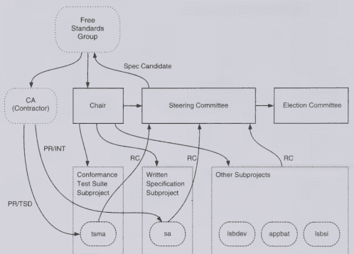

图 1.1：LSB 组织结构

### 1.4.2 选举委员会

选举委员会是由指导委员会任命的 LSB 贡献者组成的临时委员会，当主席职位空缺或任期届满时，负责选举新的主席。该委员会应有两至六名成员，并负责在选举日至少 30 天前确定一名或多名主席候选人。

### 1.4.3 指导委员会

LSB 指导委员会包括主席和子项目负责人，以及主席认为强烈需要进入委员会的其他任何 LSB 贡献者。LSB 指导委员会的任何成员都可以作为发言人代表 LSB。只要指导委员会成员积极从事符合 LSB 最大利益的事务，他们就可以无限期任职。指导委员会成员可被指导委员会通过多数不信任投票罢免。个人可以担任多个子项目的负责人，但这在任何情况下都不应赋予其在指导委员会上拥有多于一票的权利。指导委员会至少应有三名成员；如果团队负责人人数不足，主席应征求 LSB 工作组普通成员以填补指导委员会。启动或结束工作（如规范草案）或通过决议需要 LSB 指导委员会的多数票。有效投票需要指导委员会在座成员的 50% 法定人数。任何利益集团（例如公司或组织）不得投出多数票。

### 1.4.4 项目经理/发布经理

LSB 主席可以任命项目经理和/或发布经理，以管理 LSB 书面规范和认证材料的发布。项目经理或发布经理职位不赋予指导委员会席位。

## 1.5 LSB 规范概览

LSB 由两个基本部分组成：一个通用规范（“通用 LSB”或“`gLSB`”），它描述了在所有 LSB 实现中保持不变的接口部分；以及一个特定于架构的规范（“`archLSB`”），它描述了随处理器架构而变化的接口部分。通用 LSB 和单个硬件架构的特定架构补充部分共同提供了在共享相同硬件架构的系统中编译应用程序的完整接口规范。

必须将特定于架构的补充部分与通用 LSB 结合使用。它提供了补充通用 LSB 的特定于架构的信息，以及通用 LSB 中未找到的额外信息。

如需深入描述，请参阅第 10 章。

## 1.6 应用程序开发者的益处

Linux 的标准应用程序二进制接口可为您的应用程序提供更高的置信度，降低费用，并增强市场机会。

### 1.6.1 提高对应用程序的置信度

软件应用的广泛成功在很大程度上取决于客户对应用程序的信心。建立信心取决于多个因素，包括兼容性、可移植性和可靠性。对于那些需要应用程序能与多种其他应用程序一起运行的客户来说，兼容性正迅速成为一项要求。客户还要求应用程序尽可能具有可移植性。客户在许多不同的环境中运行应用程序，这些环境可能包括不同的操作系统和不同的架构，他们不希望为每个环境购买不同版本的应用程序。可靠性也是当今客户的重要要求。软件应用程序的运行范围从银行交易到医院信息系统，因此客户无法承受使用不可靠应用程序的风险。

LSB 认证提供了独立的保证，确保应用程序能够满足客户的兼容性、可移植性和可靠性期望。由于 LSB 允许您标准化软件，LSB 认证确保了其在 Linux 发行版之间的兼容性。符合 LSB 还确保您的软件应用程序可以在任何合规系统上运行，从而提高了您和客户在不同架构上以及其他应用程序上使用 Linux 的信心。大量的 LSB 测试套件也为您提供证明应用程序可靠性的工具。

### 1.6.2 降低费用

降低费用在任何业务中始终是一个重要目标，并且可以在开发过程中引入许多降低费用的措施。依赖 `应用程序编程接口`（APIs）的通用基础可以大大减少在开发应用程序时开发新代码的需求。使用通用 API 还可以降低为增加对其他操作系统的支持所涉及的费用。通过仅在一种操作环境中测试应用程序，您也可以降低费用。如果应用程序在所有兼容的操作环境中都以相同方式运行，那么您的测试工作量可以小得多。通过依赖于一组现有的通用测试用例，您还可以降低费用。使用通用测试用例减少了测试所涉及的时间和资源。由于迁移和测试应用程序所需的时间和资源减少，您可以专注于产品创新，而不是底层的财务状况。

您无需在每个支持的操作系统上重复进行产品测试，只需对应用程序进行完全测试一次即可。能够在任何 Linux 系统上无更改运行的软件消除了对各个 Linux 发行版特有依赖关系的依赖。在 Linux 上使用 LSB 的价值主张是实现二进制兼容，这使得在日益增长的 Linux 领域中能够降低测试费用。通过 LSB，独立软件供应商（ISVs）能够将其资源投入产品创新，而不是花费过多的时间进行维护。

### 1.6.3 增强市场机会

提高对应用程序的信心以及降低开发费用可以极大地增强您的市场机会。通常，有限的资源会将产品限制在某个利基市场。然而，提高的信心和降低的费用可以开辟以前无法获得的市场机会。例如，当消除支持所有可能的操作系统和计算机硬件组合的需求时，应用程序的机会将以最小的努力得到扩展。您无需为不同的操作环境创建应用程序的定制版本，而是可以生成一个具备在多个环境中使用能力的 shrink-wrapped（缩包）版本。缩包应用程序可以帮助您快速满足新兴和变化的市场机会的需求。

Linux 标准基（Linux Standard Base，LSB）是您今天就可以用来扩大产品市场覆盖范围的工具。为应用程序选择合适的目标 Linux 系统可以满足客户多样化的需求。可互换的 Linux 系统增强了您的软件应用程序在 Linux 平台上的市场机会。

## 1.7 用户福利

Linux 标准基确保了一套可供多个供应商提供的标准化二进制应用程序平台，这赋予用户自由选择权，使其不会被锁定在单一供应商的产品中。它还提供了前景，即用户可以跨多个供应商提供的各类系统运行应用程序。

## 1.8 发行版福利

将操作系统核心能力与通用的 Linux 应用程序运行时环境相区分是矛盾的。独立软件供应商渴望 Linux 的稳定性和兼容性。LSB 提供了精确的定义和简便的验证过程。发行版可以简明地提供兼容的核心库和命令，从而使发行版有更多时间专注于为客户服务的其他领域。

## 1.9 LSB 项目简史

Linux 标准基（LSB）项目最早于 1998 年 5 月宣布，并附有项目提案和参与邀请。[³] 该公告包括 Linus Torvalds、Bruce Perens、Eric Raymond、多家 Linux 发行商、ISV、Linux International 成员以及 FreeBSD 项目的 Jordan Hubbard 的支持。当时，该项目明确的目标是为构建 Linux 发行版提供一个“由源代码支持的供应商中立的”，包括一个参考平台。该项目的既定结果是，任何在参考平台上成功运行的程序，预期都可以在所有符合该标准的 Linux 系统上运行。

> ³. `http://old.lwn.net/1998/0528/a/lsb.html`

自最初提出以来，项目交付物已发生变化，现在的结构是除了参考实现（现称为示例实现）外，还提供一套规范集和测试工具。此外，还有一个应用程序电池，这是一组用于测试规范和运行时的实际世界 LSB 兼容应用程序。

自 2000 年 5 月起，LSB 项目运行的法律框架是自由标准工作组（Free Standards Group）的一个工作组。自由标准集团是一家独立的非营利组织，致力于通过标准开发、应用和推广，加速开源技术的使用和接受。

LSB 书面规范（Written Specification）的第一个官方版本于 2001 年 6 月发布。自那时起，该规范每隔大约六个月定期发布更新。第一个版本的规范仅支持 `Intel` `IA32`（386 及以上）架构，后续更新中增加了其他架构。目前，该规范支持以下架构：

- `IA32`
- 32位 `PowerPC`
- `Itanium`
- 64位 `PowerPC`
- 31位 `S390`
- 64位 `z/Architecture`

与 LSB 书面规范并行，开发了一套测试工具，用于测试运行时环境和应用程序对 LSB 的合规性。测试工具的第一个通用版本于 2001 年 12 月发布。随着 2002 年 8 月 LSB 1.2 书面规范及其相关测试工具的发布，自由标准集团推出了 LSB 认证项目。只有认证产品的供应商才能在产品中使用 LSB 商标。许多最知名的 Linux 发行版已获认证。2004 年发布的 LSB 2.0 包括 `C++`、`C99`、`SUSv3`、`NPTL` 和 `IPv6`。

# 第二章

## 确保二进制兼容性

二进制兼容性是 LSB 认证运行时环境向应用程序提供的功能保证。您可以在编写应用程序代码时利用 LSB 作为指南，从而利用这一保证。这是 Linux 标准基的一部分承诺和价值。本章解释了二进制兼容性的概念及其在开发 LSB 认证应用程序中的重要性。它还描述了确保二进制兼容性过程中的每一步，并讨论了 LSB 书面规范所遵循的不同源代码标准。最后，讨论了二进制兼容性与源代码兼容性的区别。

### 2.1 二进制兼容性说明

Linux 天生具有二进制兼容性。无需从一个 Linux 版本或发行版重建或移植源代码到另一个，Linux 已为给定的硬件平台实现了二进制兼容性。您只需要为每个 Linux 架构（如 `IA32`、`PowerPC` 或 `Itanium`）构建一次，然后部署即可。LSB 制定了一些规则和指南，使这一功能对应用程序更具实用性。打包 LSB Linux 应用程序的路径包括以下步骤：

- 针对可移植性层编码
- 使用正确的 `ABI`
- 使用 LSB 应用程序检查器进行测试
- 遵循 LSB 打包指南
- 寻求 LSB 认证

以下章节详细描述了这些步骤中的每一步。

#### 2.1.1 针对可移植性层编码

为防止应用程序直接访问操作系统资源，UNIX 和 Linux 等开放系统拥有一个可移植性层供应用程序编码使用。对于 UNIX，这个编码层是 `POSIX` 应用程序编程接口（API）集合。然而，鉴于我们知道“GNU 不是 UNIX”，LSB 以 LSB 书面规范标准的形式引用了 Linux 的 `POSIX`（图 2.1）。

应用程序不得使用操作系统的私有接口，或绕过可移植性层直接访问操作系统资源。某些应用程序直接访问系统资源以便进行`平台调优`。对应用程序进行平台调优可能会提高性能，但会大大降低软件在系统或版本之间二进制兼容的可能性。这类软件有时以特定操作系统版本的平台品牌形式发布，如果这是目的所在，那是没问题的。然而，这种编程风格超出了 LSB 的范围。

按照 LSB 书面规范编码的应用程序已经迈出了在 LSB 品牌系统集中实现二进制兼容性的第一步。通过根据规范编码，应用程序被限制为仅使用以下系统库：`libc`、`libdl`、`libm`、`libutil`、`libcrypt`、`libz`、`libpthread`、`libncurses`、`libX11`、`libXext`、`libXt`、`libICE`、`libSM` 和 `libGL`。

如果应用程序无法限制自己仅使用前面列出的库接口，则为了最小化运行时错误，应用程序必须将非指定库作为应用程序的一部分捆绑起来，或者将该库静态链接到应用程序中。但是，这些库本身必须通过使用前面段落中列出的库接口来符合 LSB 标准。

#### 2.1.2 使用正确的 ABI


仅将开发限制在源 API 规范上是不足以实现二进制兼容性的，因为不同的版本和不同的系统拥有不同版本的库。要实现二进制兼容性，您必须按照 ABI 进行开发。Linux 具有对单个 ABI 进行版本管理的能力。因此，如果一个假设函数 `myFunction(x, y)` 目前返回一个 `double`，而较新版本的 ABI 返回一个 `integer`，那么您必须使用指定返回原始数据类型的版本。为了帮助您做到这一点，LSB 创建了存根库（stub libraries）。您可以链接到 LSB 存根库和 LSB 运行时链接器。然后，仅可以使用 LSB 指定的 ABI。要么应用程序构建会因使用了未由 LSB 指定的内容而得到未解析符号错误，要么 LSB 存根库将根据二进制规范确保正确的 ABI。

为了简化使用正确 ABI 的应用程序编译，LSB 提供了一个 `lsbcpp` 包装脚本。该脚本使用具有正确 ABI 的 LSB 存根库、LSB 运行时链接器（`ld-lsb.so.2`）以及与 LSB 书面规范对应的头文件。您可以下载 `lsb-build-base` 和 `lsb-build-cc` 包，然后将它们集成到您的正常构建过程中。

## 2.1.3 使用 LSB 应用程序检查器进行测试

LSB 应用程序检查器 `lsbappchk` 是一种测试工具，用于检查应用程序是否遵守 LSB ABI。`lsbappchk` 工具将应用程序使用的 ABI 符号与 LSB 书面规范中定义的 ABI 符号进行比较。示例 2.1 展示了一个使用 `getpid()` API 的“Hello World”应用程序。

```
示例 2.1: ‘Hello World’
```

```c
#include <stdio.h>
#include <unistd.h>

main()
{
	printf("hello world: %d\n", getpid());
}
```

编译完成后，你可以检查 `helloworld.c`，以确定它是否符合 LSB 规范（示例 2.2）。

```
示例 2.2: 检查 LSB 合规性
```

```sh
$ lsbcc -o hw_good helloworld.c

$ lsbappchk hw_good

lsbappchk for LSB Specification 2.0

Checking binary hw_good
```

从 `lsbappchk` 的输出中，我们可以看到它没有发现任何合规性异常。然而，如果我们稍作修改，让之前的示例使用私有函数 `_getpid()`，我们会看到不同的结果（示例 2.3）。

```
示例 2.3: 使用 `_getpid()` 函数
```

```sh
$ lsbcc -o hw_bad helloworld.c
/tmp/cc5CIT2io.o: In function `main':
/tmp/cc5CIT2io.o(.text_0xd): undefined reference to `_getpid'
collect2: ld returned 1 exit status
```

从 `lsbcc` 的标准错误（stderr）输出中，我们可以看到 `lsbcc` 不会编译使用非合规 ABI 的应用程序。使用 LSB `lsbcc` 工具有助于避免创建非合规的应用程序。但如果我们使用原生编译器会怎样？

```
示例 2.4: 原生编译器
```

```sh
$ cc -o hw_bad helloworld.c
```

原生编译器（示例 2.4）允许应用程序链接系统私有接口 `__getpid()`，但根据 LSB 书面规范，我们知道这是错误的。此外，我们知道永远不应使用以下划线开头的任何接口。

从示例 2.5 中 `lsbappchk` 的 stderr 输出中，我们可以看到该应用程序使用了错误的运行时加载器和非合规的 `__getpid()` ABI。因此，即使你不使用 `lsbcc` 来捕获不合规问题，你仍可以稍后使用 `lsbappchk` 来验证应用程序。这种方法并非无懈可击，但它是一个良好的指标。

```
示例 2.5: lsbappchk Stderr 输出
```

```sh
$ lsbappchk hw_bad
lsbappchk for LSB Specification 2.0
Checking binary hw_bad
Incorrect program interpreter: /lib/ld-linux.so.2
Symbol __getpid used, but not part of LSB
```

## 2.1.4 遵循 LSB 打包指南

一旦你的应用程序使用 LSB 头文件构建，并与 LSB 桩库和运行时加载器链接，你就可以开始以 LSB 方式打包你的应用程序了。LSB 建议按照 LSB 书面规范将应用程序打包为 RPM 格式。此外，你可能无法使用触发器，也不能依赖于 `preinstall` 或 `preuninstall` 脚本的执行顺序。在这些脚本和你的应用程序中，你也仅限于使用 LSB 指定的命令，因为其他命令不保证存在或不保证表现出预期的行为。LSB 未指定用于安装这些 RPM 打包应用程序的工具。你可以使用基于 RPM 的系统上的 `rpm` 工具，或在 Debian 上使用 `alien`。有关打包的更多信息，请参阅第 4 章。

除了避免文件系统层次结构中的命名空间冲突外，符合 LSB 的包以 `lsb-` 为前缀。如果包名仅包含一个连字符，则该名称必须在 LANANA 注册。如果包名包含多个连字符，则第一对连字符之间的区域必须是已注册在 LANANA 的 LSB 提供商名称，或者是小写的完全限定域名。例如，`lsb-java` 可能是 Sun Microsystems 在 LANANA 注册的名称，但可能有另一个 Java 包名，如 `lsb-unregistered.org-java`，它不需要注册。有关 LANANA 的更多信息，请参阅第 4.3 节。

## 2.1.5 寻求 LSB 认证

开发 LSB 应用程序的最后一步是获得认证。任何经过 LSB 认证的应用程序都可以在任何经过 LSB 认证的分发版上运行。如今，有几十个经过认证的分发版，并且 LSB 已构建示例合规的开源应用程序。

要获得 LSB 认证，你需要完成以下步骤：

- 在 LSB 认证网站上注册。
- 使用 LSB 提供的测试对应用程序进行自检，然后上传结果。
- 保证应用程序通过你自己的 FVT（功能验证测试）。
- 完成符合性声明问卷。
- 签署 LSB 商标许可协议。
- 接收来自认证机构的确认。
- 支付认证费用并签署 LSB 认证协议。

LSB 商标只能由经过 LSB 认证的应用程序使用；不能做出其他关于合规性的陈述。更多信息请参阅第 7.2 节。

## 2.2 源代码标准

为了系统之间的重新编译兼容性而标准化一组应用程序编程接口（API）是源代码标准。

### 2.2.1 POSIX

电气和电子工程师协会（IEEE）是制定并持续开发 POSIX 标准系列的组织。从 20 世纪 80 年代中期开始，该组织接手了 UNIX 用户组织 UniForum（1984 年 `/usr/Group` 标准）已经做的工作，并开始通过项目 1003（POSIX）制定操作系统标准。

最著名的 POSIX 文档是 IEEE Std 1003.1（也称为 POSIX 1003.1），但“POSIX”一词实际上涵盖了一组相关的操作系统规范。在 1003 下设立的各个子项目由代表不同技能领域的个人志愿者组成，例如硬件制造、操作系统开发、软件和工具开发、学术界、政府等。

POSIX 这个名字是由参与者之一理查德·斯特曼（Richard Stallman）建议的。它的发音是 pahz-icks，类似于 positive（积极的）。

正如这些标准的封面材料中所述，有几个原则指导了它们的开发，关键原则包括应用程序源代码可移植性、指定接口而不要求特定实现，以及依赖历史惯例。

另一个目标是 `共识`。一些历史上（和现代）基于 UNIX 的操作系统特性未出现在 POSIX 中，因为当时无法达成共识。这就是例如在 1003.2 规范中既没有提到 `tar` 也没有提到 `cpio` 的原因。在没有共识的地方，该特性被省略，以产生具有足够高批准水平的规范，从而通过 IEEE 投票规则：至少 75% 的选票返回率；不超过 30% 的合格投票人弃权；至少 75% 的“赞成”票。

有关便携式应用标准委员会（PASC），即 IEEE POSIX 的指导机构，的更多信息可在线获取。[^2]

[^2]: http://www.pasc.org/

#### 2.2.1.1 POSIX 1003.1 系统应用接口（C API）

与 1003.2（在第 2.2.1.2 节中讨论）一起，1003.1 是 POSIX 标准系列的基础。这是该对偶中“API 和头文件”部分，另一部分是“shell 和实用程序”。与其最初关注 UNIX 系统的定位一致，它旨在交互式分时计算环境。

POSIX 1003.1 最初于 1988 年出版。修订版于 1990 年出版。1990 年版本成为国际标准，ISO/IEC 9945–1:1990。

1996 年，创建了一个新版本，该版本将实时和线程特性作为可选扩展集添加到 1990 年基础标准中。这也成为国际标准，ISO/IEC 9945–1:1996。此后，创建了其他可选特性集，但直到 1999 年，它们仍保持为独立文档（称为对 1990 年基础标准的 `修正案`）。

核心标准的一次重大修订于 1998 年获批，将各种修正案、选项和解释整合在一起。提案还将 1003.1 与 1003.2 合并，创建一个涵盖 OS 空间的文档。结果是 IEEE POSIX 1003.1–2001，由四卷组成，共 3,760 页。

#### 2.2.1.2 POSIX 1003.2 Shell 和实用程序

该规范定义了一个可移植的 shell 脚本环境（所谓的 `POSIX shell`）和一组基础可移植实用程序。在某些地方，当对当前工具没有共识（且显示出明确的需求）时，发明了一个新工具。`pax` 归档工具就是一个例子。

重点再次落在定义使应用程序可移植所需的元素上。文档中有一节关于新实用程序参数和选项的推荐语法。在某些情况下，还考虑了用户可移植性，例如将 `vi` 编辑器包含在内。

### 2.2.2 单一 UNIX 规范

单一 UNIX 规范（SUS）是一套符合 UNIX 商标要求所需的一组规范。它由开放团体（The Open Group）制定和管理，该组织是一个行业联盟和市场营销团体。开放团体定义了 UNIX 系统的定义，并代表行业托管其相关商标。SUS 规定了操作系统在系统可以使用 UNIX 商标之前必须提供的编程和用户环境。

单一 UNIX 规范的版本 3 是 UNIX 规范系列的最新版本，该系列始于 X/Open 公司可移植性指南（XPGs）。XPGs 是在最初的 POSIX 工作之前及同期创建的操作系统规范。1998 年末，开放团体、IEEE 和 ISO/IEC SC22/WG15 同意合作，形成一个单一的通用规范集，该开发组被称为奥斯汀组（Austin Group，在本节后面有描述）。

单一 UNIX 规范始终与正式的 API 标准（如 POSIX 和 ISO C）保持一致，它是一个向上兼容的超集。它包含比 POSIX 更多的 API 和功能，并将 POSIX 保持为可选的某些功能设为强制要求。例如，POSIX 线程是 UNIX 商标合规所必需的。SUS 还涵盖了 `X11`、`Curses` 以及比 POSIX 更多的强制实用程序。

该规范的 HTML 版本可免费从开放团体的单一 UNIX 规范网站获取。[^3]

关于 SUS[^4] 和开放团体[^5] 的更多信息可以在它们各自的网站上在线找到。

#### 2.2.2.1 奥斯汀组

“奥斯汀组”是 IEEE、ISO 和开放团体于 1998 年 9 月创建的联合工作组所获得的名称。这些规范机构一致认为，对操作系统实现者和应用程序开发人员来说，最好是一套包含 POSIX、ISO 和 SUS 规范文本的文档。通过这种方式，可以减少标准之间的冲突和混淆，以及维护各种文档所需的工作。

该机构由个人志愿者组成，包括自由软件和开源社区成员。该组由 ISO 项目编辑担任主席，创始机构（IEEE、ISO 和开放团体）各拥有一位组织代表。组织代表（ORs）拥有控制性投票权，这些投票权仅在问题缺乏明确共识需要投票时才会使用。IEEE 和开放团体共同拥有由此产生的工作的版权。

奥斯汀组是实际产生标准的 `技术机构`，该标准被称作 IEEE POSIX 1003.1–2001、单一 UNIX 规范版本 3 和 ISO/IEC 9945:2002。

关于奥斯汀组的信息可从其网站获取。[^6]

## 2.3 二进制标准

过去曾有许多二进制标准，例如针对 `MIPS RISC` 处理器的 `System V` 应用程序二进制接口、针对 `Motorola 88000 RISC` 处理器的 `88open`，以及针对 `PowerPC` 处理器的 `PowerOpen` 环境；然而，没有哪一个比 Linux 标准基（Linux Standard Base, LSB）更成功。LSB 确保针对特定处理器家族编译的 LSB 认证应用程序可以在任何对应的 LSB 认证运行时环境中运行。

[^3]: http://www.opengroup.org/sus/  
[^4]: http://www.unix-systems.org/  
[^5]: http://www.opengroup.org/  
[^6]: http://www.opengroup.org/austin/

## 2.4 LSB 二进制兼容性

`二进制兼容性` 的预期是，一个编码正确的应用程序，如果在一个操作系统实例上成功且正确地执行，那么在相同硬件平台的另一个操作系统上也能继续如此。LSB 致力于这样一种理念，即基于 Linux 的应用程序可以在 Linux 操作系统发行版之间移植。既然现在存在一个操作系统提供者和应用程序开发人员都能同意的规范，用户已经开始受益于其应用程序和工具兼容性的提高。

### 2.4.1 二进制与源码兼容性

二进制兼容性与源码兼容性不同。描述在两个操作系统实例上执行相同操作的源代码片段可能变成只能在其中之一上运行的二进制文件，即使是在相同的硬件平台上。二进制兼容性是操作系统和应用程序之间的“合同”；操作系统将以规定的方式提供一组已知功能，而应用程序将使用这些功能并避免使用那些没有规范的其他功能。

LSB 提供了这种合同。对于操作系统，它描述了已知功能的集合以及使这些功能可用的已知方式。它通过每个硬件平台的编程接口（API）和二进制接口（ABI）文档来实现这一点。对于应用程序，LSB 提供测试和认证，以确保只使用了由 LSB 提供的功能。

### 2.4.2 编码兼容的应用程序

仅使用 LSB 文档化接口的应用程序将在给定硬件架构家族的所有 LSB 认证操作系统上未经修改即可运行，如该 LSB ABI 规范架构所描述。符合此规范并成功通过使用 LSB 应用程序认证流程测试的应用程序软件可以被视为在该架构的所有成员上具有可移植性。

这意味着该应用程序不使用未文档化的接口，也不依赖于特定类型的硬件（例如，特定的大容量存储设备或特定的 I/O 或网络适配器）。这也意味着，只能依赖该架构的 LSB 认证操作系统作为应用程序的基础。

### 2.4.3 展望未来

LSB 认证的应用程序在一个 LSB 发布集合内部是二进制兼容的。LSB 不支持主要版本之间的应用程序兼容性。然而，Linux 发行版可能同时符合 LSB 的多个版本。

### 2.4.4 价值主张

过去，源码在 UNIX 变体和硬件平台之间可移植性的好处已经得到充分证实。如今，没有比 LSB 指定的 Linux 二进制兼容性更大的成功范例。软件开发从源码可移植性发展到二进制兼容性，在此多供应商 Linux 市场中极大地提高了产品的可靠性。它使用于移植和测试的时间可以重新分配到产品创新上。

### 2.4.5 盒装应用程序

LSB 认证为二进制兼容的 Linux 软件可以盒装并在零售商店销售，具有更长的货架寿命和更广泛的客户群。对特定 Linux 系统特定版本的依赖已经过时。

# 第二部分

# 开发 LSB 应用程序

Linux 发行版对标准 ABI 和 ELF 的符合性，全在于为应用程序提供运行时环境的稳定性和一致性；然而，操作系统的健壮性只是真正兼容性方程式的一半。除了拥有 LSB 认证运行时环境外，还需要有能力的 Linux 应用程序。行为良好的、通用的 Linux 兼容应用程序需要严格使用规定的公共 API 和命令，进行通用打包，并遵循 FHS 文件系统布局。

# 第三章

# 使用 LSB 编码实践

本章描述了您在开发 LSB 认证应用程序时应使用的编码实践。它概述了 LSB 编码实践的许多注意事项和示例。每一节都包括概念解释和该概念的代码示例。

## 3.1 C 和 C++

本章假设读者是具备知识的 C、UNIX 或 Linux 程序员。建议的前置阅读材料可能包括：`《实用 C 编程》`、`《理解 UNIX/Linux 编程》`、`《使用 GNU 软件进行编程》` 或 `《学习 bash Shell》`。

LSB 分别引用了“ISO/IEC 9899: 1999, 编程语言—C”和“ISO/IEC 14882: 1998(E) 编程语言—C++”作为 C 和 C++ 编程的标准。GNU 编译器集合（GCC）项目已经实现了这些 ISO/IEC 标准，并正在监控合规状态。开发人员应该对开源开发中的这一关键要素充满信心。

## 3.2 国际化

编写可复用且可移植的代码是值得追求的；然而，有时软件的实用性会受到无意的限制，因为未主动考虑最终用户的语言和文化需求。幸运的是，这些问题已得到充分理解，并且 GNU 翻译项目已经提供了解决方案。Linux 提供了从应用程序中提取与文化相关数据（国际化）并将其应用于各种文化（本地化）的功能。

以一个简单的 "Hello World" 程序为例，该程序在屏幕上打印一条简短文本消息。这条消息会以英语、西班牙语、日语还是牙买加英语显示？这取决于原文是否已被翻译并正确存储在消息目录中以供应用程序使用，以及最终用户是否设置了其语言环境以查找这些消息。示例 3.1 中的 `setlocale()` 函数可以根据三个环境变量 `LC_ALL`、`LC_MESSAGES` 或 `LANG` 中第一个非空值来初始化语言环境。


如果最终用户将 `LANG` 设置为 `en_US`，则程序将在 `bindtextdomain()` 设置的 `/usr/share/locale/` 目录下的 `gtw` 消息目录中查找美国英语翻译文本。

与其直接使用 `printf()` 打印文本消息，不如调用 `gettext()` 函数在当前默认的 `LC_MESSAGES` 语言环境的当前默认消息目录中查找 `MSGID`（默认文本）。如果未找到，该函数将返回 `MSGID` 本身（默认文本）。

请注意，尽管 POSIX 定义了用于 UNIX 的 `catgets()`，但 Linux 还是添加了 `gettext()`。这两种方法的区别在于 `catgets()` 使用数字消息标识符，而 `gettext()` 使用默认文本作为消息标识符。`catgets()` 的缺点在于数字消息标识符容易在应用程序和消息目录之间失去同步。`gettext()` 的文本消息标识符至少如果它们被打乱顺序但未更改，在消息目录中被找到的机会更大。出于显而易见的原因，切勿试图在同一应用程序或同一应用程序系列中同时使用这两种方法。

### 示例 3.1：使用 `gettext()`

```c
#include <stdio.h>
#include <locale.h>
#include <libintl.h>

int
main(int argc, char *argv[])
{
printf("LANG=%s\n", getenv("LANG"));

/* initialize LC_MESSAGES according to
 * LC_ALL, LC_MESSAGES, or LANG
 */

setlocale(LC_ALL, "");

printf ("dirname=%s\n",
bindtextdomain("ghw", "/usr/share/locale/"));

printf("domainname=%s\n", textdomain("ghw"));

/* Look up MSGID in the current default message catalog for the
 * current LC_MESSAGES locale. If not found, gettext() returns
 * MSGID itself (the default text).
 */

printf(gettext("Hello World\n"));

printf(gettext("The value of Open Standards \
is only evident to Open Minds\n"));

printf(gettext("Good Bye\n"));

exit(0);
}
```

## 3.3 PAM

应用程序认证用户的方式有很多种。使用硬编码调用 `getpwnam(3)` 或 `shadow(3)` 的应用程序受到限制，因为它们只能在相应配置的系统上工作。可插拔认证模块（PAM）将认证机制从应用程序中抽象出来，并使本地系统管理员能够选择各个应用程序如何认证用户。示例 3.2 展示了一个使用 `pam_authenticate(3)` 的应用程序。

### 示例 3.2：使用 `pam_authenticate(3)`

```c
#include <security/pam_appl.h>
#include <security/pam_misc.h>
#include <stdio.h>

static struct pam_conv conv = {
    misc_conv,
    NULL
};

int main(int argc, char *argv[]) {
    pam_handle_t *pamh;
    int pam_status;
    char *user;

    pam_status = pam_start("lsb_login", NULL, &conv, &pamh);

    if (pam_status == PAM_SUCCESS)
        pam_status = pam_authenticate(pamh, 0);

    if (pam_status == PAM_SUCCESS) {
        pam_get_item(pamh, PAM_USER, (const void **) &user);
        fprintf(stdout, "Greetings %s\n", user);
    } else {
        printf("%s\n", pam_strerror(pamh, pam_status));
    }

    pam_end(pamh, pam_status);
}
```

`pam_start(3)` 调用将应用程序与指定的服务注册。在用户通过 `pam_authenticate(3)` 验证后，应用程序可以安全地信任用户的身份和权限。

## 3.4 JAVA

希望开发兼容不同 `JVM` 的 Java 应用程序的人应遵循 Java API 规范。¹ Java 不是 Linux 或 UNIX 的原生语言，因此不在 `LSB` 的范围内。

使用 Java 本地接口（`JNI`）² 的应用程序确实拥有本地 Linux 对象代码，这些代码可以并且应该符合 `LSB`。`JNI` 对象代码可以获得 `LSB` 认证。

## 3.5 `kill(3)`

向 `kill(3)` 传递进程 ID `-1` 不会影响调用进程。这是在 `2.5.1` 内核中不受欢迎地将调用进程包含在内的实验之后做出的刻意决定。³

## 3.6 `ioctl(3)`

`LSB` 拥有自己对 `ioctl(3)` 的定义，并且不引用 `ISO/IEC 9945`。

## 3.7 IP 信息

随着 `IPv6` 的出现，`gethostbyname(3)` 已被诸如 `getaddrinfo(3)` 和 `getnameinfo(3)` 之类的例程所取代。为了获得更好的兼容性，应使用这些更新的 `IPv6` 函数（示例 3.3）。

### 示例 3.3：使用 `IPv6` 函数

```c
#include <netdb.h>
#include <stdio.h>
int main(int argc, char **argv) {
struct addrinfo *res, *r;
struct addrinfo hints;
struct sockaddr *sa;
int rc;
char * proto;
char hostbuf[NI_MAXHOST];
char servbuf[NI_MAXSERV];
bzero(&hints,sizeof(hints));
hints.ai_family = PF_UNSPEC;
hints.ai_socktype = SOCK_STREAM;
hints.ai_flags = AI_CANONNAME;
if ((rc = getaddrinfo("linuxbase.org", NULL, &hints, &res))) {
fprintf(stderr, "%s\n", gai_strerror(rc));
exit(2);
}
for (r = res; r; r = r->ai_next) {
if (r->ai_family == AF_INET6) {
inet_ntop(AF_INET6, &(((struct sockaddr_in6 *)r->ai_addr)->sin6_addr),
hostbuf, sizeof(hostbuf));
proto = "IPv6";
} else if (r->ai_family == AF_INET) {
inet_ntop(AF_INET, &((struct sockaddr_in *)r->ai_addr)->sin_addr), hostbuf, sizeof(hostbuf));
proto = "IPv4*";
}

printf("getaddrinfo(3): %s address = %s\n", proto, hostbuf);

bzero(hostbuf, sizeof(hostbuf)); /* clear */

if (getnameinfo(r->ai_addr, r->ai_addrlen, hostbuf, sizeof(hostbuf), servbuf, sizeof(servbuf), NI_NAMERESOLVED|NI_NUMERICSERV)){
printf("getnameinfo(3): could not find IP.");
} else {
printf("getnameinfo(3): host = %s\n", hostbuf);
}

freeaddrinfo(res);
}
```

## 3.8 `O_LARGEFILE`

在可用的情况下，`LSB` 允许 Linux 实现通过 `fcntl(3)` 设置 `O_LARGEFILE`。应用程序在需要时应显式设置此标志，并且不应期望运行时默认设置它（示例 3.4）。

### 示例 3.4：使用 `fcntl(3)` 函数的 `O_LARGEFILE`

```c
#ifdef __USE_LARGEFILE64
int oflag = fcntl(fd, F_GETFL, 0);
if (oflag & O_LARGEFILE) {
debug("O_LARGEFILE was implicitly set"); // BAD
}
oflag |= O_LARGEFILE; // GOOD
fcntl(fd, F_SETFL, oflag);
#endif
```

## 3.9 `EISDIR(3)`

如果 `unlink(3)` 的路径参数指定了一个目录，实现可能会返回 `EISDIR` 而不是单一 UNIX 规范中规定的 `EPERM`（示例 3.5）。

### 示例 3.5：`EISDIR`

```c
#include <sys/stat.h>
#include <sys/types.h>
#include <fcntl.h>
#include <errno.h>
#include <stdio.h>

main() {

    char *newdir = "/tmp/example_dir";

    if (0 != mkdir(newdir, O_CREAT)) {
        printf("mkdir %s: %s\n", newdir, strerror(errno));
    }

    if (0 != unlink(newdir)) {

        switch (errno) {
        case EISDIR:
            printf("EISDIR: %s is a directory\n", newdir);
            break;
        case EPERM:
            printf("EPERM: operation not permitted for %s\n", newdir);
            break;
        default:
            perror("unlink");
            break;
        }
    }
}
```

## 参考文献

- 1. `http://java.sun.com/reference/api/index.html`

- 2. `http://java.sun.com/docs/books/tutorial/native/1.1/concepts/index.html`

- 3. *向每个人发送信号意味着什么？*，Linux Weekly News，2001 年 12 月 20 日 (`http://lwn.net/2001/1220/kernel.php3`)。

## 3.10 `waitpid(3)`

`LSB` 已弃用 `waitid(3)` 的使用。应用程序应按照《单一 UNIX 规范》中指定的 `waitpid(3)` 接口进行调用，但实现无需支持 `X/Open` 系统接口扩展（`XSI`）的 `WCONTINUED` 或 `WIFCONTINUED` 功能（示例 3.6）。

### 3.11 解析命令选项

当函数第三个参数的选项字符串中第一个字符为加号 `“+”` 时，GNU `getopt(3)` 函数会按照《单一 UNIX 规范》第 3 版的规定解析命令行参数。

在尝试保持 `SUSv3` 合规性时，不应使用 GNU 选项字符串标志 `“W;”`（用于启用长选项）、`“-”`（用于对无效选项返回 `‘\1’`）和 `“::”`（用于启用可选标志参数）（示例 3.7）。

### 3.12 `LSB` 禁止事项

本章涉及移植性礼仪。作为一名开放系统开发人员，有些事情是你不应该做的。你应该意识到，确保可移植性的妥协要比针对特定版本进行调优带来的短期好处更大。

#### 3.12.1 `/proc`

`LSB` 仅指定了 `/proc/cpuinfo` 文件及其键值。应用程序不应尝试从 `/proc` 文件系统收集其他数据，因为它是未指定的且不可靠的。

### 示例 3.6：使用 `waitpid(3)`

```c
#include <assert.h>
#include <errno.h>
#include <stdio.h>
#include <stdlib.h>

int main (void)
{
  int rc, status;
  pid_t pid;

  pid = fork();

  if (pid < 0) {
    perror ("fork");
    exit (1);
  }

  if (0 == pid) {
    printf ("\tChild process (pid=%d) running\n", getpid());
    sleep (10);
    printf ("\tChild process (pid=%d) terminating\n", getpid());
    exit (0);
  }

  printf ("Parent process (pid=%d) waiting for child (pid=%d)\n",
         getpid(), pid);

  rc = waitpid (pid, &status, 0);

  printf ("Parent process (pid=%d) continuing ", getpid());
  printf ("after the termination of child (pid=%d).\n", pid);
  printf ("Status = 00%x  Return Code=%d\n", status, rc);

  if (rc < 0) {
    perror ("waitpid");
    exit (2);
  }

  exit (0);
}
```

### 示例 3.7：命令选项

```c
#include <unistd.h>
#include <stdio.h>

int
main (int argc, char **argv)
{
    int aflag = 0;
    int bflag = 0;
    char *cvalue = NULL;
    int errflg = 0;
    int index, c;

    /* the plus sign is required to permanently set
     * POSIXLY_CORRECT
     */

    while ((c = getopt (argc, argv, "+abc:")) != -1)
    switch (c) {
        case 'a':
            aflag = 1;
            break;
        case 'b':
            bflag = 1;
            break;
        case 'c':
            cvalue = optarg;
            break;
        case ':':
            fprintf (stderr,
                "Option -%c requires an operand\n",
                optopt);
            errflg++;
            return 1;
        case '?':
            fprintf (stderr, "Unknown option -%c\n", optopt);
            errflg++;
            return 1;
        default:
            fprintf (stderr, "Hopelessly lost\n");
            errflg++;
            break;
    }

    if (errflg) {
        fprintf (stderr, "USAGE: %s -a -b -c file", argv[0]);
        exit(1);
    }
    printf ("aflag = %d, bflag = %d, cvalue = %s\n",
            aflag, bflag, cvalue);
    for (index = optind; index < argc; index++)
        printf ("Operand argument %s\n", argv[index]);
    exit(0);
}
```

#### 3.12.2 Berkeley 数据库

Berkeley 数据库（`DB`）^4 是一种由许多 Linux 应用程序使用的主流数据管理引擎；然而，在本书出版之时，`DB` 并未满足 `LSB` 未来的选择标准.^5

^4 Sleepycat Software，Berkeley DB 的制造商（`http://www.sleepycat.com/`）。

^5 `http://www.linuxbase.org/futures/criteria/`

#### 3.12.3 内核


系统库提供的应用程序接口（API）对内核的操作系统资源管理进行了抽象。可移植应用程序使用系统的私有接口是不恰当的，因此您应小心，只使用 `LSB` 书面规范中定义的接口进行编码。

#### 3.12.4 驱动程序

在 `UNIX` 和 `GNU/Linux` 系统中，“文件就是文件”，设备只是另一个可以打开、读取、写入和关闭的文件。应用程序不应尝试模仿驱动程序的功能；它只需按照驱动程序的协议与设备交互即可。

#### 3.12.5 桌面

在开发使用图形用户界面（`GUI`）的应用程序时，最好专注于完善其可用性和可移植性，而不是桌面集成。没有人能保证最终用户使用的特定窗口管理器或桌面，因此最好不要通过添加桌面特定功能来限制应用程序。

#### 3.12.6 线程

在本书撰写之时，当前的 `Linux` 发行版处于支持 `Linux` 线程、下一代 `POSIX` 线程（`NGPT`）和原生 `POSIX` 线程库（`NPTL`）的不同阶段。下一代 `Linux` 发行版将支持 `NPTL`。`LSB v2.0` 指定由 `NPTL` 和 `2.6` `Linux` 内核实现的 `pthreads`。应用程序和中间件应迁移到 `NPTL`。

#### 3.12.7 gets(3)

尽管 `gets(3)` 由 `POSIX` 指定，但 `LSB` 已将其弃用。`LSB` 和 `POSIX` 都建议使用 `fgets(3)` 代替 `gets(3)`。

#### 3.12.8 system(3)

`LSB` 有自己的 `system(3)` 定义，其中未引用 `ISO/IEC 9945`。尽管它已被指定，但为了可移植性，建议使用 `popen(3)`、`execl(3)`、`execle(3)` 或 `execv(3)` 代替。

#### 3.12.9 ncurses

`LSB` 和 `SUS` 都指定使用 `curses.h`。为了源代码可移植性，请勿使用 `ncurses.h`。

#### 3.12.10 malloc(3)

使用 `malloc(3)` 时，请包含 `stdlib.h` 而不是 `malloc.h`，因为连同编译器选项 `-lmalloc` 一起，这些将随后用于调试（示例 3.8）。

### 示例 3.8：`malloc(3)`

```c
#ifndef DEBUG
#include <malloc.h>
#endif
#include <stdlib.h>
```

## 第四章 打包您的 `LSB` 应用程序

`LSB` 规定了应用程序打包，以确保应用程序与 `Linux` 发行版之间的兼容性。打包可能是发行版特定的，因此如果您不遵循 `LSB` 打包规范，您的应用程序可能无法跨发行版运行。在本章中，您将了解 `RPM` 文件格式以及安装应用程序的正确位置。

### 4.1 使用 `RPM` 进行打包

有超过一百种 `Linux` 发行版供最终用户运行其应用程序。^1 为确保应用程序能够成功安装，`LSB` 指定 `RPM` 文件格式作为最佳解决方案。`LSB` 认证运行时环境（即操作系统或 `Linux` 发行版）有责任能够安装 `RPM` 打包的应用程序。`Edward Bailey` 的《Maximum RPM》一书以及 `RPM` 网站^2 是学习创建 `RPM` 包的绝佳资源。对于本章中的示例，不必担心细节，但请注意有关安装位置的所有指南。

^1 `DistroWatch`（http://www.distrowatch.org/）。

^2 http://www.rpm.org/

为了可靠性，应用程序不能依赖于自身进行安装，因为临时安装程序无法保证有效。之所以指定 `RPM` 文件格式，是因为许多 `Linux` 发行版都接受它；但是，如果您的应用程序依赖的安装程序是经过 `LSB` 认证的并且已知之前已安装，您可以使用另一种打包格式。^3

^3 本章部分内容经 `George Kraft IV` 的《Linux Journal》（2000 年 11 月刊）中“在 `Linux` 上安装我的产品的位置”一文授权改编。

#### 4.1.1 RPM 检查

`LSB` 包检查命令 `lsbpackchk` 是一个程序，用于验证包及其内容是否符合 `LSB` 书面规范。它显示的版本号指的是它所针对的规范版本，而不是命令本身的版本。

### 4.2 在正确的位置安装您的应用程序

软件开发人员和独立软件供应商（`ISV`）对安装应用程序和软件包的最佳位置有不同的看法。有些安装在 `usr/bin/` 或 `usr/local/bin/`，另一些则更喜欢 `/opt/` 目录。您的偏好可能取决于您来自 `UNIX System V`、`Berkeley` 软件分发版（`BSD`）还是 `GNU/Linux` 背景。这些不可预测的变化会导致文件和目录命名冲突，有时会影响软件的安装、移除和升级。

文件系统层级标准（`FHS`）^4 被 `LSB` 引用，提供指南并定义文件和目录放置的要求。`FHS` 促进应用程序、系统管理工具、开发工具和脚本之间的互操作性。`FHS` 详细说明了每个主要目录的内容和目的。图 4.1 显示了 `FHS` 规定的目录结构。

^4 http://www.pathname.com/fhs/

除了 `FHS` 之外，`System V` 应用程序二进制接口^5、`Intel` 二进制兼容标准 `V.2`（`iBCS2`）、通用操作系统环境（`COSE`）、`Linux` 标准基础（`LSB`）以及 `UNIX`

^5 `System V` 应用程序二进制接口，2003 年 12 月 17 日，`The SCO Group`（http://www.caldera.com/developers/gabi/2003-12-17/contents.html）。

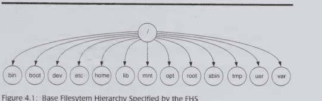

图 4.1：`FHS` 指定的基础文件系统层次结构

通常，社区已经为附加软件确立了 `/opt/` 目录。以下列表汇总了安装应用程序的最佳实践。

> 在以下列表中，`package` 是应用程序的产品名称，`provider` 是 `LANANA` 注册的供应商名称。

- 基础操作系统或“`Linux` 发行版”的应用程序是唯一允许安装在 `/sbin/`、`/bin/` 和 `/usr/` 目录中的应用程序。

- 从源代码构建软件包（无论是源代码包（`srpm`）还是磁带归档文件（`tar`））的系统管理员应将其安装在 `/usr/local/bin/` 目录中，并且必须避免将软件安装到 `system` 目录中的诱惑。

- 附加的仅二进制分发包应用程序必须安装在 `/opt/package/` 或 `/opt/provider/` 目录中。例如，二进制可执行文件应位于各自的 `/opt/provider/bin/` 目录中。

- 应用程序的手册页必须位于各自的 `/opt/package/share/man/` 或 `/opt/provider/share/man/` 目录中。除手册页以外的文档应位于相应的 `/opt/package/share/doc/` 或 `/opt/provider/share/doc/` 目录中。

- 针对 `/opt/` 下二进制可执行文件的主机特定配置文件应放在 `/etc/opt/package/` 或 `/etc/opt/provider/` 目录中（所有主机特定的系统配置文件都位于这些目录中）。

软件包中的可变文件，或者在系统正常运行过程中会发生的变更文件，应放在 `/var/opt/package/` 和 `/var/opt/provider/` 目录中。

如果软件包需要在其他位置安装或创建文件，可以对本规则做出例外处理。例如，如果软件包创建了一个新设备，则将其安装在 `/dev/` 目录中。

系统管理员应为 `/opt/` 文件系统创建一个独立的磁盘分区，终端用户应将 `/opt/package/bin/` 和 `/opt/bin/` 添加到其 `PATH` 环境变量中。通常，终端用户的 `shell` 会在各自的 `/opt/package/bin/` 目录中找到应用程序；然而，系统管理员可能已经为每个软件包在 `/opt/` 中创建了指向它们的符号链接或使用 `setup-opt.sh` 创建的包装脚本。

```bash
# setup-opt.sh /opt/whizbang/bin/widgets
# setup-opt.sh /opt/whizbang/man/man1/widgets.1
```

## 4.3 软件包命名

为了避免原生发行版软件包与 `LSB` 兼容软件包之间的冲突，制定了一种命名方案。所有 `LSB` 合规软件包的名称均以 `lsb-` 开头。如果软件包名称仅包含一个连字符，则名称必须由 `Linux` 已分配名称和编号机构分配。[^6] 如果软件包名称包含多个连字符，则软件包名称中第一个和第二个连字符之间的部分必须是 `LANANA` 分配的 `LSB` 供应商名称，或者是所有者的小写全限定域名。

### 4.3.1 初始化脚本命名

`LANANA` 初始化脚本名称用于在 `LSB` 合规应用程序和发行版为放置在 `/etc/init.d` 目录中的初始化脚本命名时。或者，也可以使用以您的全限定互联网域名或您的 `LSB` 供应商名称开头的脚本名称。

> 6. http://www.lanana.org/

由于所有初始化脚本都位于同一目录中，因此制定了一种类似的方案以避免软件包之间的初始化脚本发生冲突。`LSB` 书面规范规定，初始化脚本可以位于以下三种命名空间之一：

1. **已分配命名空间**：此命名空间由仅使用字符集 `[a-z0-9]` 的名称组成。这些名称必须通过 `LANANA` 预留。

2. **分层命名空间**：此命名空间由看起来像 `[hier1]-[hier2]-...-[name]` 的脚本名称组成，其中 `name` 使用字符集 `[a-z0-9]`，且可能有一个或多个 `[hier*n*]` 组件。`[hier*1*]` 可以是 `LANANA` 分配的 `LSB` 供应商名称，也可以是所有者的 `DNS` 名称的小写形式，且至少包含一个句点字符（`"."`）。

3. **保留命名空间**：此命名空间由以下划线字符（`"_"`）开头的脚本名称组成，仅保留供发行版使用。此命名空间应仅用于核心软件包，通常强烈不鼓励使用此命名空间。

### 4.3.2 Cron 脚本命名

`LANANA` `Cron` 脚本注册表定义了 `/etc/cron.d` 目录在 `LSB` 运行环境中使用的脚本名称保留列表。或者，也可以使用以您的全限定互联网域名或您的 `LSB` 供应商名称开头的脚本名称。

## 4.4 示例：打包和安装应用程序

示例 4.1 展示了如何根据 `LSB` 打包规范对名为 `Widgets` 的虚构软件套件进行打包和安装。`widgets-1.2.3.spec` `RPM` 配置文件用于将软件打包到 `/opt/` 目录。`@files` 指令（第 17 行）后跟应打包的文件名路径列表。`@prefix` 标签（第 8 行）是使软件包可重定位的方式。该标签的值定义了路径中在安装时可变的部分。

### 示例 4.1：`Widgets` 的 `RPM Spec` 文件

```text
#
# RPM Package Manager (RPM) spec file for Widgets :-)
#
Summary: Some generic program
Name: widgets
Version: 1.2
Release: 3
Prefix: /opt
Copyright: Commercial
Group: Application/Productivity
URL: http://www.whizbangwidgets.com/
Vendor: WhizBang Widgets
Packager: John Doe <jd@whizbangwidgets.com>
%description
This is a demonstration of a relocatable RPM package for a fictional productivity application.
%files
/opt/whizbang/bin/widgets
/opt/whizbang/man/widgets.1
/etc/opt/whizbang/widgets.conf
# Post-install stuff would go here.
%E0F
```

1. 如示例 4.2 所示，使用 `widgets-1.2-3.spec` 作为输入文件构建 `Widgets` 的 `RPM` 软件包（`widgets-1.2-3.i486`）。您可以使用 `rpm` 从此输入中构建并生成一个源代码包文件（`widgets-1.2-3.src.rpm`）和一个二进制包文件（`widgets-1.2-3.i486.rpm`）。

### 示例 4.2：构建 `Widgets` 的 `RPM` 软件包

```bash
# rpm -ba /usr/src/redhat/SPECS/widgets-1.2-3.spec
Processing files: widgets
Finding provides...
Finding requires...
Prereqs: /bin/sh
Wrote: /usr/src/redhat/SRPMS/widgets-1.2-3.src.rpm
Wrote: /usr/src/redhat/RPMS/i486/widgets-1.2-3.i486.rpm
```

2. 如示例 4.3 所示，从二进制包（`widgets-1.2-3.i486.rpm`）在系统上安装 `Widgets`。

### 示例 4.3：安装 `Widgets` 的 `RPM` 软件包

```bash
# rpm -i /usr/src/redhat/RPMS/i486/widgets-1.2-3.i486.rpm
```

`Widgets` 现已安装在 `/opt/whizbang/bin/` 中。

3. 如示例 4.4 所示，从命令行运行 `Widgets`。

### 示例 4.4：运行 `Widgets`

```bash
$ /opt/whizbang/bin/widgets
```

4. 作为系统管理员，从 `/opt/bin/widgets` 创建指向 `/opt/whizbang/bin/widgets` 的符号链接，并从 `/opt/lib/libwidget.so` 创建指向 `/opt/whizbang/lib/libwidget.so` 的符号链接（示例 4.5）。根据 `FHS`，这不能在安装后阶段自动完成，因为该软件包不拥有 `/opt/bin/` 目录域。只有系统管理员有权制定可能影响其他应用程序的全局配置。

### 示例 4.5：为 `Widgets` 手动创建符号链接

```bash
# ln -s /opt/whizbang/bin/widgets /opt/bin/widgets
# ln -s /opt/whizbang/lib/libwidget.so /opt/lib/libwidget.so
```

如图 4.2 所示，该符号链接将使终端用户更容易运行 `Widgets`。

5. 卸载 `widgets-1.2-3` `RPM` 软件包，并在 `/usr/local` 目录中的替代位置重新安装，如示例 4.6 所示。

系统管理员不应忘记修复可能在 `/opt/bin/` 中建立的手动符号链接。

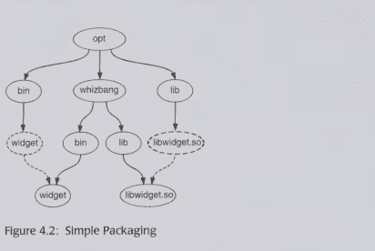

图 4.2：简单的打包

### 示例 4.6：迁移 `Widgets`

```bash
# rpm -e widgets-1.2-3
# cd /usr/src/redhat/RPMS/i486/
# rpm -i --prefix /usr/local widgets-1.2-3.i486.rpm
```

## 4.5 高级打包

前文已证明，附加的仅二进制应用程序应安装在 `/opt/package/bin/` 和 `/opt/provider/bin/` 目录中。通过覆盖默认的 `/opt/` 目标并选择替代位置，已经展示了创建灵活的可重定位 `RPM` 软件包的基础。现在，让我们看看涉及打包多个产品、为多种架构打包、为产品的多个版本打包或其任何组合的更高级场景。

### 4.5.1 打包多个产品

回顾本章中的 `WhizBang Widgets` 示例。如果您想发布另一个名为 `Gadgets` 的产品怎么办？为了支持一家供应商的多个产品，它们都应基于 `/opt/provider/package/` 目录，如图 4.3 所示。由于 `LANANA` 注册的 `WhizBang` 拥有

在 `/opt/whizbang/` 目录中，该目录最常用的两种使用方式要么是将 `bin` 和 `lib` 子目录共享，要么是将它们分别存放在各自的 `/opt/whizbang/widgets/` 和 `/opt/whizbang/gadgets/` 子目录中。如果将它们分开存放，则可以通过在 `/opt/whizbang/bin/` 中创建符号链接或包装脚本，将其重定向到 `/opt/whizbang/widgets/bin/` 和 `/opt/whizbang/gadgets/bin/`。无论哪种情况，都应最终将 `/opt/whizbang/bin/` 添加到最终用户的 `PATH` 环境变量中。

### 4.5.2 为多种架构进行打包

为了在 `PPC64` 系统上同时支持 `Widgets` 的 `32` 位和 `64` 位 `PowerPC` 版本，需要将它们分离到各自独立的架构子目录中，例如图 4.4 中所示的 `/opt/whizbang/widgets/ppc32/` 和 `/opt/whizbang/widgets/ppc64/`。系统管理员可以通过创建从 `/opt/whizbang/widgets/ppc32/bin/` 指回 `/opt/whizbang/widgets/bin/` 的符号链接，或者创建从 `/opt/whizbang/widgets/ppc32/lib/` 指回 `/opt/whizbang/widgets/lib/` 的符号链接，来设置默认的 `PPC32` 或 `PPC64` 行为。无论哪种情况，都应最终将 `/opt/whizbang/widgets/bin/` 添加到最终用户的 `PATH` 环境变量中。

### 4.5.3 为多个产品版本进行打包


为了同时支持同一产品的多个版本，需要将它们分离到各自独立的版本子目录中，例如图 4.5 中所示的 `/opt/whizbang/widgets/v1/` 和 `/opt/whizbang/widgets/v2/`。系统管理员可以通过创建从 `/opt/whizbang/widgets/v1/bin/` 指回 `/opt/whizbang/widgets/bin/` 的符号链接，或者创建从 `/opt/whizbang/widgets/v2/lib/` 指回 `/opt/whizbang/widgets/lib/` 的符号链接（示例 4.7），来设置默认的 `v1` 或 `v2` 行为。无论哪种情况，都应最终将 `/opt/whizbang/widgets/bin/` 添加到最终用户的 `PATH` 环境变量中。

## 4.5 高级打包

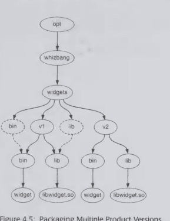

### 示例 4.7：在安装后为 `widgets` 创建符号链接

```
%post
P=$RPM_INSTALL_PREFIX/whizbang/widgets
mkdir $P/bin > /dev/null 2>&1
ln -fs $P/ppc32/bin/widgets $P/bin/widgets
# EOF
```

### 4.5.4 为多种架构上的多个产品的多个版本进行打包

为了在多种架构上同时支持多个产品的多个版本，需要将它们分离到各自独立的子目录中，例如图 4.6 中所示的 `/opt/whizbang/widgets/v1/ppc32/` 或 `/opt/whizbang/gadgets/v2/ppc64/`。系统管理员可以通过创建从 `/opt/whizbang/widgets/v1/ppc32/bin/` 指向 `/opt/whizbang/widgets/bin/` 的符号链接，来设置默认的 `v1` 或 `v2` 以及/或者 `PPC32` 或 `PPC64` 行为。无论哪种情况，都应最终将 `/opt/whizbang/widgets/bin/` 添加到最终用户的 `PATH` 环境变量中。

# 第五章 将 Solaris 应用程序迁移到 Linux

Linux 日益普及的一个后果是，各公司迫切希望将现有的应用程序和开发环境迁移到 Linux 上。遵循标准的应用程序比不遵循标准的应用程序更容易移植。由于 Linux 和 Solaris 共享 UNIX 的通用 API 集合，因此从 Solaris 迁移到 Linux 比从具有不同 API 的操作系统（例如 Microsoft Windows）迁移更容易。

本章概述了这种迁移的优势以及可以采用的路径。除了提供迁移过程中可以使用的工具包外，还讨论了一些与标准相关的移植问题。

## 5.1 移植路线图

开发可移植的应用程序并非易事。尽管 Solaris 和 Linux 都是 UNIX 的变体，但它们在 API、系统调用和其他组件方面存在许多差异。任何 Linux 发行版都附带了关于如何利用这些接口开发应用程序的充分文档。然而，文档并不总是清晰的，而且标准非常多样化。其中一个相关标准是 `POSIX`（可移植操作系统接口）规范（参见第 2.2.1 节）。如果您的应用程序符合该规范，移植起来会容易得多。

为平台开发应用程序还需要一套丰富的工具。作为平台，Linux 附带了许多此类开源工具。这些工具包括代码编辑器、代码格式化工具、编译器、链接器和调试器。此外，各供应商也提供这些工具的商业等效产品。

这里概述的步骤只是执行无缝迁移的一种方法；还有许多其他方法。迁移路径的选择取决于可以投入此项工作的资源数量和时间。一旦选定路径，就必须通过适当的规划和小的步骤执行来实施。

此路线图的目的是调整待迁移的 Solaris 应用程序，使其能够在 `SPARC` 版本的 Linux 上运行。一旦完成此操作，就可以以相对较小的工作量将应用程序迁移到目标 Linux 平台。

### 5.1.1 第 1 步：获取必要的 Linux 发行版

为了实施此迁移方案，有必要使用两个不同的 Linux 发行版：一个用于 `SPARC` 的 Linux 发行版，以及另一个针对目标平台专用的 Linux 发行版。

`Linux/SPARC` 自 1994 年可用以来，其古老和成熟程度与普通 Linux 相当。主要的 Linux 供应商（如 `Red Hat` 和 `SuSE`）也发布了它们的 `Linux/SPARC` 版本。`Linux/SPARC` 适用于几乎整个 `SPARC` 硬件系列，包括针对 32 位和 64 位处理器的版本。

Linux 也适用于不同的硬件平台，如 `Intel` 兼容 `PC`、`PPC`（`PowerPC`）、`Alpha` 处理器、`Itanium` 和大型机。各种平台的可用供应商列表可在网络上找到。¹ 此列表包括 Linux 的商业版和免费版。您可以使用此列表根据目标平台、其捆绑的功能以及必要的资金来确定 Linux 版本。

### 5.1.2 第 2 步：下载必要的 `GNU` 工具

`GNU` 拥有开发工作所需的工具，称为 `GCC`（`GNU` 编译器集合）。`GCC` 支持多种语言，如 `C`、`C++`、`Fortran`，甚至 `Java`。`GNU` 工具的完整列表可在线获取。² `GNU` 工具侧重于在减少迁移过程中花费的时间的同时开发可移植的源代码。即使是很少了解 Linux 的 Solaris 开发人员也可以使用这些工具开始为目标 Linux 平台生成代码。

Solaris 环境所需的 `GNU` 工具可从 `http://www.sunfreeware.com/` 下载。大多数 Solaris 版本的 `GNU` 工具都可从此站点免费获取。针对 `SPARC` 以及目标平台的 Linux 的 `GNU` 工具也随各自的发行版一起提供。

### 5.1.3 第 3 步：在 Solaris 上构建 C/C++ 应用程序

一旦所有构建工具都准备好，就在 Solaris 上开始构建过程。使用 `GNU` `gmake` 实用工具而不是 `make` 来构建源代码。尽管这两个实用工具目的相同，但它们之间存在相当大的差异。为 Solaris `make` 实用工具创建的 `Makefile` 在与 `gmake` 实用工具一起使用时，可能会根据其使用的构造生成错误。相应的 `gmake`³ 和 `make`⁴ 工具文档是解决这些错误的最佳来源。

尽管这些工具之间存在差异，但它们也共享一些共同的规则和后缀。表 5.1 中显示的目标、宏和变量可以互换使用，因为它们在两个实用工具中具有相同的含义。

在修改 `Makefile` 以符合 `gmake` 规则之后，下一步是尝试使用 `GNU` 编译器而不是其 Solaris 对应物。应使用 `gcc` 编译器而不是 `cc`，并使用 `g++` 而不是 `C++`。一旦使用 `GNU` 编译器，将会出现大量错误，这些错误可以分为由于命令行选项差异导致的错误和由于编码差异导致的错误。然而，这两种类型的错误大多可以通过参考编译器文档来解决：

- 使用和移植 GNU 编译器集合 (`GCC`)⁵
- `http://www.gnu.org/directory/GNU/`
- `GNU` `make` (`http://www.gnu.org/software/make/manual/make.html`).
- `Managing Projects with make` (`http://www.o-reilly.com/catalog/make2/`).
- `http://gcc.gnu.org/onlinedocs/gcc-2.95.2/gcc_toc.html`

| 目标 | `.DEFAULT`, `.IGNORE`, `.PRECIOUS`, `.SILENT`, `.SUFFIX` |
|---|---|
| 内部宏 | `$*`, `$§`, `$?`, `$<`, `$@`, `$$`, `$()`, `$(D)` |
| 预定义宏 | `ar`, `as`, `cc`, `ld`, `lex`, `lint`, `m2c`, `pc`, `rm -f`, `yacc` |
| 环境变量 | `MAKEFLAGS` |
| 变量 | `CC`, `CFLAGS`, `CPPFLAGS`, `FC`, `FFLAGS`, `LEX`, `LFLAGS`, `YACC`, `YFLAGS`, `LD`, `LDLFLAGS` |

- C 用户指南⁶
- C++ 用户指南⁷

当应用程序编译为适用于 Solaris 环境后，必须在运行于 `SPARC` 硬件上的 Linux 版本上重复该过程。由于该应用程序已经符合 `GNU` 工具链的要求，因此可能出现的唯一问题将源于运行时应用程序编程接口（`API`）。为了实现完全兼容的应用程序，需要修正这些 `API` 之间的差异。以下是 Linux 和 Solaris 之间的一些主要差异。

#### 系统调用

在提供逻辑卷支持、文件访问控制列表以及系统审计日志支持的 `API` 方面，Solaris 和 Linux 之间存在命名差异。`STREAMS` 支持（对于编写基于流的网络驱动程序非常有用）在 Linux 上不可用，但在 Solaris 上可用。因此，解决此类问题的方法是获取第三方独立开发的解决方案，或者重写应用程序以使用相关技术。在这种情况下，可以使用 `POSIX` 套接字代替 `STREAMS` 进行网络通信。

#### 库差异

Linux 上可用的标准 `C++` 库包括对大多数功能的支持。Solaris 具有一些额外的库，例如 `compat=4`、经典 `iostreams` 以及支持 `ASCII` 编码十进制转换的 `math` 库。如果待移植的应用程序使用了其中任何这些额外库，则必须将其修改为使用标准 `C++` 库。

**线程差异** Solaris 进程基于称为 `轻量级进程`（`LWP`）的线程。在当前 Linux 实现中，线程基于 `进程`。Solaris 中有两种类型的线程可用：`POSIX` 线程和原生线程模型。Linux 支持 `POSIX` 线程，因此所有使用原生线程的应用程序都应修改为使用 `POSIX` 线程。

### 5.1.4 步骤 4：在目标平台上构建 Linux 上的应用程序

在目标平台上安装 Linux，并重新构建前一步骤中修改后的应用程序。

## 5.2 移植中的问题

将应用程序从 Solaris 平台移植到 Linux 平台可能被视为一项简单的任务，这是因为 Linux 平台的 `GNU` `C` 库提供了应用程序级别的便携性。在大多数情况下，只需重新编译程序即可移植应用程序。但如果代码包含任何依赖于系统或硬件的结构，则需要一些修改以完成完整的移植。此类移植工作的复杂度与系统和硬件依赖代码的数量成正比。如果应用程序仅使用标准语言结构且不考虑平台因素，则此类应用程序的移植相对简单。如果应用程序使用非 `POSIX` 结构或平台特定的优化，则移植难度较大。通常，`Java` 应用程序属于第一类，而非 `POSIX` `C` 程序属于第二类。与移植相关的部分问题在下述章节中进行了说明。

### 5.2.1 字节序

字节序，或 `端序`（`endianness`），是数据元素的一种属性，指的是其字节在内存中存储或寻址的方式。该属性由平台的 `CPU` 架构决定。端序有两种可能的值：`大端`（`big endian`）和 `小端`（`little endian`）。

#### 5.2.1.1 大端

在这种字节序类型中，最高有效字节存储在最低存储地址——例如，最高有效字节存储在最左侧位置。`Sun SPARC`、`HP Precision` 和 `IBM PPC` 使用这种排序方式（例 5.1）。

> 例 5.1：大端排序
>
> 数据：`0x33445566`
>
> 存储：
>
> | 字节 0 | 字节 1 | 字节 2 | 字节 3 |
> | --- | --- | --- | --- |
> | `33` (最高有效) | `44` | `55` | `66` |

#### 5.2.1.2 小端

在这种字节序类型中，最低有效字节存储在最低存储地址——例如，最低有效字节存储在最左侧位置。`Intel` 和 `DEC` 架构使用此排序方式（例 5.2）。

> 例 5.2：小端排序
>
> 数据：`0x33445566`
>
> 存储：
>
> | 字节 0 | 字节 1 | 字节 2 | 字节 3 |
> | --- | --- | --- | --- |
> | `66` (最低有效) | `55` | `44` | `33` |

#### 5.2.1.3 字节序与 `union` 数据结构

如果代码使用 `union`（联合体）数据结构，前几节讨论的字节序将成为移植中的一个问题。`Union` 是一种用于在同一存储区域中操作不同类型数据的数据结构。管理该存储区域中存储数据的大小和对齐完全是编译器的职责。例如，考虑例 5.3 中所示的联合体。

```
Example 5.3: Union Data Structure

union char_int {
    char a[4];
    int i;
};
char_int;
```

考虑例 5.4 中使用上述联合体的代码。

```
Example 5.4: Wrong Use of a Union

// define an instance variable of the union
union char_int cint;
// define a variable to hold the computation result
int result;
// assign a value to the union using the integer variable
cint.i = 0x10394500;
// divide the constant 100 with the union’s MSB,
// that is, its first byte
result = 100/a[0];
```

此示例利用字节序知识检索整数数据的最高有效字节。虽然此代码在大端架构上能正常工作，但当它移植到小端机器时，由于除以零错误，代码将失败。为了使其具有可移植性，代码内部不应使用字节序信息，或者必须通过编译参数有条件地定义字节信息（例 5.5）。

字节序也可能导致网络数据传输问题。大多数现代网络协议都考虑了端序。这些协议使用外部数据表示（`XDR`）排序来传输数据。来自不同源环境的数据在开始传输之前会转换为此表示。传输结束时，数据将转换回目标环境的本地表示。进行原始数据传输的分布式应用程序也应考虑端序。

```
Example 5.5: Correct Use of a Union

// Portability code added
#ifdef BIGENDIAN
const int MSBBYTE=0;
#else
const int MSBBYTE=3;
#endif

// define an instance variable of the union
union char_int cint;
// define a variable to hold the computation result
int result;
// assign a value to the union using the integer variable
cint.i = 0x10394500;
// divide the constant 100 with the union’s MSB.
// that is, its first byte
result = 100/a[MSBBYTE];
```

标准 C 库提供了许多例程来执行此转换。诸如以下这样的 `API` 提供了一种在执行网络传输时确保平台独立性的方法。

- `ntohl()` 将无符号 `int` 从 `XDR` 转换为本地格式。
- `ntohs()` 将无符号 `short` 从 `XDR` 转换为本地格式。
- `htonl()` 将无符号 `int` 从本地格式转换为 `XDR`。
- `htons()` 将无符号 `short` 从本地格式转换为 `XDR`。

## 5.3 信号处理

信号是通知进程或线程事件发生的手段。在此领域中，Linux 支持大多数 UNIX 系统（如 `SVR4` 和 `BSD` 实现）支持的信号。然而，有一些例外需要考虑。

- `SIGEMT`，表示硬件故障，不受支持。
- `SIGINFO`，表示键盘信息请求，受支持。
- `SIGSYS`，表示无效的系统调用，不受支持。
- `SIGABRT` 和 `SIGIOT` 是相同的。
- `SIGIO`、`SIGPOLL` 和 `SIGURG` 是相同的。
- `SIGBUS` 定义为 `SIGUNUSED`，因为 Linux 中没有“总线错误”。

表 5.2 列出了各种信号及其在 Solaris 和 Linux 环境中的含义。此表可用于验证代码中使用的信号在 Linux 中是否具有不同的语义。

**表 5.2：Solaris 和 Linux 中信号的语义**

| 信号 | Solaris | Linux |
| :--- | :--- | :--- |
| `SIGHUP` | 终止 | 忽略 |
| `SIGINT` | 终止 | 忽略 |
| `SIGQUIT` | 终止，核心 | 终止，核心 |
| `SIGILL` | 终止，核心 | 终止，核心 |
| `SIGTRAP` | 终止，核心 | 忽略 |
| `SIGABRT` | 终止，核心 | 终止，核心 |
| `SIGEMT` | 终止，核心 | 在 Linux 上不受支持 |
| `SIGFPE` | 终止，核心 | 终止，核心 |
| `SIGKILL` | 终止 | 终止 |
| `SIGBUS` | 终止，核心 | 终止，核心 |
| `SIGSEGV` | 终止，核心 | 终止，核心 |
| `SIGSYS` | 终止，核心 | 在 Linux 上不受支持 |
| `SIGPIPE` | 终止 | 忽略 |

## 5.4 运行时库

链接器负责将可执行文件与所需的共享库链接在一起。尽管两种环境遵循相同的链接方法，但存在一些细微的差异（表 5.3）。Linux 维护两套不同的库：系统库和用户库。Solaris 只有一套库。

**表 5.3：Solaris 和 Linux 之间的运行时库差异**

| 功能 | Solaris | Linux |
| :--- | :--- | :--- |
| 运行时链接器 | `/usr/lib/lib/ld.so.1` | `/lib/ld-linux.so.1` |
| 运行时链接器配置工具 | `crle` | `ldconfig` |

8. `http://www.ibm.com/developerworks/eserver/articles/porting_linux/`

## 5.5 文件系统


将数据从一个文件系统迁移到另一个文件系统，可以通过数据迁移工具或通过网络传输数据来实现。数据传输是这两者中最耗时的操作。Linux 支持三十多种不同的文件系统，这些文件系统列在 `mount (8)` 手册页中。在 Solaris 中，主要的文件系统是 UFS，而在 Linux 中则是 `ext2`。表 5.4 列出了 Linux 和 Solaris 之间的一些文件系统差异。

**表 5.4：Solaris 和 Linux 之间的文件系统差异**

| 文件系统 | Solaris | Linux |
| :--- | :--- | :--- |
| 通用文件系统 | UFS | `ext2`/`ext3` |
| 日志文件系统 | Veritas | `ext3`, `reiserfs` |
| 用于读取 CD 的文件系统 | HSFS | `iso9660` |
| 系统信息 | PROCFS | `proc` |
| MS-DOS 文件系统 | PCFS | `msdos` 或 `vfat` |

## 5.6 线程

Solaris 提供一种基于线程的线程模型，所有进程都基于称为轻量级进程（LWP）的线程。在 Solaris 中，一个进程将与一个或多个 LWP 相关联。在 Linux 的情况下，所有线程都基于进程，每个线程都将映射到一个进程。

Solaris 不仅支持其原生线程模型，还支持 POSIX 线程模型；Linux 也支持 POSIX 线程。如果应用程序使用 Solaris 原生线程模型，则在移植之前，该应用程序需要大量的重构工作。如果应用程序仅使用标准专有函数，则可以使用 Linux 上可用的 Solaris 兼容线程库（STL）<sup>9</sup> 来简化该应用程序的移植。该库提供了基于 POSIX 线程库的 Solaris 线程接口。

## 5.7 绝对地址

使用硬编码地址的应用程序可能难以移植。一些应用程序使用 `mmap()` 调用进行页面固定。由于每个平台处理程序堆栈、堆、系统库等的方式都不同，因此带有硬编码地址的 `mmap()` 调用可能会导致段错误。

例如，某些寻址方案会忽略高位。因此，硬编码地址 `0x80000000` 可能会被转换为 `0x00000000`，从而导致非预期的结果。最好在代码中消除对硬编码地址的使用。如果应用程序强制要求使用硬编码地址，则必须将其更改为仅使用允许的内存范围，你可以从 `/proc/<application_pid>/map` 获取该范围。

## 5.8 填充

当在代码中使用结构体或聚合数据类型时，每个平台都有自己布置组成元素的方式。这种布置取决于结构体、架构限制、效率以及编译器。大多数架构无法从奇数地址读取数据。像 PowerPC 这样的架构如果数据起始于不能被 4 整除的地址，读取数据时效率很低。因此，为了提高效率，编译器会添加所谓的`填充字节`。这些字节的作用是保持字节对齐，以便代码能够高效运行。

在 4 字节对齐平台上，编译器将按照表 5.5 所示布局 例 5.6 中的结构体，其中 `P` 代表填充，`d1_0`, `d1_1` 是 `d1` 的字节，`d2_0`–`d2_3` 是 `d2` 的字节。

在表 5.5 中，由于填充，该数据结构占用 8 个字节。在不需要任何对齐的平台上，编译器将以不同的方式布局相同的结构体（表 5.6）。

**例 5.6：填充字节**

```c
struct struct1 {
   DATA2 d1;   // 大小为 2 字节的数据
   DATA4 d2;   // 大小为 4 字节的数据
} struct1;
```

**表 5.5：4 字节对齐**

| 字节 0 | 字节 1 | 字节 2 | 字节 3 |
| :--- | :--- | :--- | :--- |
| `d1_0` | `d1_1` | `P` | `P` |
| `d2_0` | `d2_1` | `d2_2` | `d2_3` |

**表 5.6：无对齐**

| 字节 0 | 字节 1 | 字节 2 | 字节 3 |
| :--- | :--- | :--- | :--- |
| `d1_0` | `d1_1` | `d2_0` | `d2_1` |
| `d2_2` | `d2_3` | ... | ... |

在表 5.6 中，该数据结构仅占用 6 个字节。如果你使用诸如 `sizeof()` 之类的函数来测量结构体的大小，在移植过程中必须考虑到这种行为。大多数编译器都提供用于禁用或启用字节对齐（包括填充）的选项，如有必要可以使用这些选项，但禁用对齐通常会导致性能下降。

## 5.9 工具集

### 5.9.1 C/C++ 资源

在 Linux 平台上，开发工具主要是 GNU 编译器集合（GCC）的工具。GCC 包含用于 C 和 C++ 的工具。Solaris 也提供 GNU 工具。<sup>10</sup> 所有 Solaris 应用程序都可以首先使用 GNU 版本而不是专有的 Solaris 版本进行编译。然而，必须解决 Solaris `make` 实用工具与 GNU `make` 实用工具（`gmake`）之间的差异。可以使用各自的文档来实现此目的。一旦 `makefile` 能够在 `gmake` 下正常工作，请重新构建应用程序。使用此 `makefile` 进行试运行（dry run）时抛出的错误可以分为命令行选项错误和代码错误。使用表 5.7 可以轻松地解决命令行选项错误，该表包含 Solaris 和 GNU GCC 上 C 编译器的常用选项（摘自 *Technical Guide for Porting Applications from Solaris to Linux, Version 1.0*）。对于其他选项，应使用各自的编译器手册。

**表 5.7：Sun Workshop 和 GCC 之间选项的差异**

| Sun Workshop | GCC | 描述 |
| :--- | :--- | :--- |
| `#` | `-v` | 打开详细模式，显示每个被调用的组件。 |
| `-xa` | `-ansi` | 指定符合 `ANSI/ISO` 标准。GCC 支持所有 ISO C89 程序。你可以使用 `-std` 来指定特定的 ISO C 版本。 |
| `-xinline` | `-finline-functions` | 仅内联指定的函数。 |
| `-xa` | `-ax` | 生成额外的代码以写入基本块的配置文件信息，这将记录每个基本块执行的次数。 |
| `-xspace` | `-O0` | 不进行优化。 |


**表 5.2（续）**

| 信号 | Solaris | Linux |
| :--- | :--- | :--- |
| `SIGHUP` | 未设置 | 未设置 |
| `SIGINT` | 中断 | 中断 |
| `SIGQUIT` | 终止 | 忽略 |
| `SIGILL` | 终止 | 终止 |
| `SIGTRAP` | 终止 | 终止 |
| `SIGABRT` | 终止 | 终止 |
| `SIGBUS` | 终止 | 终止 |
| `SIGSEGV` | 终止 | 终止 |
| `SIGPIPE` | 终止 | 终止 |
| `SIGALRM` | 终止 | 忽略 |
| `SIGTERM` | 终止 | 终止 |
| `SIGUSR1` | 终止 | 忽略 |
| `SIGUSR2` | 终止 | 忽略 |
| `SIGCHLD` | 忽略 | 忽略 |
| `SIGCLD` | 忽略 | 忽略 |
| `SIGPWR` | 忽略 | 忽略 |
| `SIGWINCH` | 忽略 | 进程停止 |
| `SIGURG` | 忽略 | 忽略 |
| `SIGPOLL` | 终止 | Linux 不支持 |
| `SIGSTOP` | 进程停止 | 进程停止 |
| `SIGTSTP` | 进程停止 | 进程停止 |
| `SIGCONT` | 忽略 | 忽略 |
| `SIGTTIN` | 进程停止 | 进程停止 |
| `SIGTTOU` | 进程停止 | 进程停止 |
| `SIGVTALRM` | 终止 | 终止，核心转储 |
| `SIGPROF` | 终止 | 忽略 |
| `SIGXCPU` | 终止，核心转储 | 终止，核心转储 |
| `SIGXFSZ` | 终止，核心转储 | 终止，核心转储 |
| `SIGWAITING` | 忽略 | Linux 不支持 |
| `SIGLWP` | 忽略 | Linux 不支持 |
| `SIGFREEZE` | 忽略 | Linux 不支持 |
| `SIGHAWK` | 忽略 | Linux 不支持 |
| `SIGCANCEL` | 忽略 | Linux 不支持 |
| `SIGRTMIN` | 终止 | Linux 不支持 |
| `SIGRTMAX` | 终止 | Linux 不支持 |

**表 5.7（续）**

| Sun Workshop | GCC | 描述 |
| :--- | :--- | :--- |
| `-xunroll=` | `-funroll-loops` | 仅对迭代次数可在编译时或运行时确定的循环执行循环展开优化。 |
| `-xtarget=<name>` | `-b=<machine>` | `machine` 参数指定编译的目标机器。此外，这些目标机器类型中的每一种都可以拥有以 `m` 开头的专用选项，以选择不同的硬件型号或配置。 |
| `-xo`, `-O` | `-O0`, `-O1`, `-O2`, `-O3`, `-Os` | 控制各种类型的优化。 |
| `-xmaxopt` | | 确保 GCC 不使用 `#pragma`。 |
| `-xnolib` | `-nostdlib` | 默认不链接任何库。 |
| `-fsingle` | `-fsingle-precision-constant` | 将浮点常量视为单精度常量，而不是隐式转换为双精度。 |
| `-C` | `-C` | 告诉预处理器不要丢弃注释。与 `-E` 选项一起使用。 |
| `-xtrigraphs` | `-trigraphs` | 支持 ISO C 可移植字符（trigraphs）。 |
| `-E` | `-E` | 对所有指定的 C 源文件进行预处理，并将结果输出到标准输出或指定的输出文件。 |
| `-xM` | `-M` | 仅对指定的 C 程序运行预处理器，要求其生成 `makefile` 依赖项并将结果发送到标准输出。 |
| `-xpg` | `-pg` | 生成额外的代码以写入适合 `gprof` 分析程序的配置文件信息。 |
| `-c` | `-c` | 指示编译器抑制与 `ld` 的链接，并为每个源文件生成 `.o` 文件。 |
| `-o` | `-o` | 指定输出文件的名称。 |
| `-S` | `-S` | 指示 `cc` 生成汇编源文件，但不要汇编程序。 |
| `-xtemp` | `TMPDIR` | 如果设置了 `TMPDIR` 环境变量，则指定用于临时文件的目录。 |
| `-xhelp=f` | `-help` | 显示在线帮助信息。 |
| `-xtime` | `-time` | 报告编译序列中每个子进程占用的 CPU 时间。 |
| `-w` | `-q` | 抑制编译器警告。 |
| `-erroff=%none` | `-W` | 显示警告消息。 |
| `-errwarn` | `-Werror` | 将所有警告视为错误。 |

链接器也可能抛出错误（如果代码编译成功的话）。`SPARCworks` 链接器和 GNU 链接器最常用的命令行选项如表 5.8 所示（引自《Solaris 到 Linux 应用程序移植技术指南，版本 1.0》）。

与代码相关的错误消息和警告主要是由于编译器之间可接受的构造和 API 语义的差异造成的。应参考编译器手册来解决这些错误。

**表 5.8**

| SPARCworks | GNU gld | 描述 |
| :--- | :--- | :--- |
| `-a` | `-static` | 启用静态模式的默认行为并防止与共享库链接。链接器将创建一个可执行文件，未定义的符号会导致错误消息。 |
| `-b` | | 通过不使用选项 `-fPIC` 或 `-fpic` 编译源代码，从而实现与 GNU 链接器等效的功能。 |
| `-g` | `-g` | 以操作系统原生格式生成调试信息。 |
| `-m` | `(-M)` | 打印链接器映射。`-M` 选项打印的内容相似，但格式略有不同，内容也略有差异。 |
| `-s` | `-S`/`-s` | 通过在与 GNU 链接器配合使用 `-S` 选项来实现与 `-s` 选项等效的功能，该操作仅移除调试信息。 |
| `-h name` | `-soname name` | 将 `name` 设置为共享对象名称。 |
| `-o filename` | `-o filename` | 将输出放置到文件中。无论生成的输出类型如何，此操作均适用。默认情况下，可执行文件会放在 `a.out` 中。 |
| `-L dir` | `-Ldir` | 将目录 `dir` 添加到目录列表中。 |
| `-R path` | `-rpath path` | 指定运行时链接器的搜索路径。 |

# 第三部分

# 面向 LSB 的认证

LSB 认证计划对于基于 Linux 的运行时环境（发行版）以及基于 Linux 的应用程序开发者和供应商至关重要。它向用户和客户保证，经过认证的软件产品具有对 LSB 规范的最高程度的运行时兼容性。它提供了一个基础，确保经过认证的应用程序能与任何经过 LSB 认证或符合 LSB 规范的运行时环境配合工作。

认证使 LSB 运行时环境和应用程序对消费者更具价值。

LSB 认证计划的日常运营由独立的认证机构（CA）管理。认证机构管理获得认证的过程，并对提交认证的材料进行审计。LSB 认证计划并非自由标准组织（Free Standards Group）的利润中心。价格被控制在最低限度，以鼓励开发者、独立软件供应商（ISV）和 Linux 发行版获得 LSB 认证。

以下两章分别介绍了运行时环境和应用程序的 LSB 认证。为了熟悉 LSB 认证计划，您应该阅读以下可从 LSB 认证网站（`http://www.opengroup.org/lsb/cert/`）获取的计划文档：涵盖计划总体政策的 LSB 认证政策，以及包含不同类型可认证产品的详细一致性要求的 LSB 产品标准。

# 第六章

# Linux 发行版的 LSB 认证

本章概述了运行时环境的 LSB 认证，并基于 Open Group 制定的 LSB 认证指南（[http://www.opengroup.org/lsb/cert/docs/LSB_Certification_Guide.html](http://www.opengroup.org/lsb/cert/docs/LSB_Certification_Guide.html)）。应用程序的 LSB 认证概述将在下一章中提供。

## 6.1 简介

符合 LSB 一致性要求的产品或产品系列可以申请 LSB 认证。认证过程要求向 LSB 认证机构（一个中立的第三方）展示对 LSB 的一致性。详细的一致性要求在 LSB 产品标准中定义，包括通过测试集和完成一致性声明。只有认证产品的供应商才允许在其产品上使用 LSB 商标。<sup>1</sup>

若干文档包含 LSB 认证计划的要求。LSB 认证政策管理自由标准组织的 LSB 认证计划。LSB 商标的使用受 LSB 商标许可协议管理。LSB 认证协议涵盖认证服务的条款和条件。如果您打算提交产品进行认证，则在认证之前必须同意这三个文件中概述的所有条款和条件。

<sup>1</sup> 本章的部分内容经许可摘自 LSB 认证，Open Group（[http://www.opengroup.org/lsb/cert/](http://www.opengroup.org/lsb/cert/)）。

### 6.1.1 亮点

LSB 认证过程的重要亮点如下：

- LSB 认证计划由其指定的认证机构 Open Group 代表自由标准组织进行管理。
- 一旦产品通过了适用的认证测试套件，且申请人正式同意了所有必要的条款，申请人将获准在与其产品关联时使用 LSB 商标。
- 为了让产品获得认证，LSB 商标许可协议必须完全签署（需要申请人和自由标准组织双方的签名）。
- 根据 LSB 认证政策的规定，经过认证的产品需要定期接受重新认证。
- 根据 LSB 认证协议的要求，提供给认证机构的所有产品信息都将被视为机密信息。
- 根据 LSB 认证政策的要求，LSB 认证机构可能会不时要求提供证明，以确保已认证产品仍符合 LSB 一致性要求中概述的要求。

## 6.2 获得 LSB 认证

本节详细说明了获得认证所需的步骤，并提供了执行这些步骤每一步的信息。该过程涉及：

- 理解认证计划和过程
- 非正式地测试产品
- 申请认证
- 正式测试及结果提交

为了熟悉该计划，应阅读以下计划文档：

- LSB 认证政策
- LSB 产品标准

### 6.2.1 了解认证计划

#### 6.2.1.1 LSB 认证政策

最好从 LSB 认证政策开始阅读，它是该计划的基础。该政策提供了关于计划中可以认证的产品类型、获得认证的含义、产品获得认证所需的条件，以及如何确保产品保持认证状态的信息。LSB 认证政策定义了以下类型的产品：

- LSB 应用程序
- LSB 运行时环境
- LSB 国际化运行时环境
- LSB 开发环境

这些产品的定义包含在 LSB 认证政策的第 1 节“概述”中。

> 在当前版本的计划中，仅接受前三种产品类型注册。

#### 6.2.1.2 LSB 产品标准

随后应阅读 LSB 产品标准，以了解产品可获认证所依据的详细一致性要求。产品标准提供了认证、LSB 规范和用于证明一致性所需的测试套件之间的映射关系。对于每种可认证的产品类型，都有一个 LSB 产品标准。应查阅 LSB 认证网站以获取当前正在处理认证的产品标准集。

为了确定哪些产品标准适合用于产品认证，申请人应查阅 LSB 认证政策和 LSB 产品标准中的第 3 节“一致性”。

## 6.2.2 保密性

申请人的公司和产品详情在申请人和 LSB 认证机构之间是保密的。这在申请人接受 LSB 认证协议（这是注册产品的前置条件）时即生效。认证机构未经申请人的书面许可，不向任何第三方（包括 Free Standards Group 的员工、顾问或成员）提供认证信息。


在成功完成认证流程后，已认证的产品将被列入公开的认证登记册。然而，为了方便申请人发布已认证的产品，他们可以请求其认证信息自认证机构书面通知产品已通过认证之日起保密长达六个月。关于保持认证信息保密的请求可在产品注册的最终步骤中提出（参见第 6.3.7 节）。更多信息请参阅 `LSB` 认证政策的第 11.3 节。

## 6.2.3 非正式测试

通常，使用 `LSB` 认证测试套件对产品进行测试是首要活动。申请人应阅读拟认证产品的适用产品标准，参考“一致性指标”部分以识别所需的认证测试套件。这些测试套件由 `Free Standards Group` 免费提供，应与任何其他认为合适的方法一起使用，以确保产品满足适用的一致性要求，并为进入认证计划做好准备。

### 6.2.3.1 授权的测试套件

需要注意的是，在正式测试中，只能使用当前授权的 `LSB` 认证测试套件版本。因此，对于非正式测试，使用授权版本至关重要。认证机构维护着当前已认证测试套件的列表。[^3] 由于测试套件来自多个来源，此在线文档包含了获取测试套件的信息。

[^3]: <http://www.opengroup.org/lsb/cert/docs/testsuites.html>

### 6.2.3.2 问题及问题报告

如果在运行认证测试套件时遇到问题，首先应阅读随测试套件提供的文档。如果仍未得到解答，请查看常见问题解答（`FAQ`）。[^4] 如果仍找不到答案，应报告给在常见问题解答文件中注明的相应测试套件维护机构。

如果使用的是其中一个授权测试套件并出现失败，但认为产品符合规范，请检查问题报告[^5]信息数据库。在线的问题报告数据库包含有关现有缺陷和规范的已知信息。该问题可能已通过 `LSB` 规范解释或一致的测试套件缺陷得到解决。如果没有，请提交新的问题报告。

[^4]: <http://www.opengroup.org/lsb/cert/docs/faq.html>
[^5]: <http://www.opengroup.org/lsb/cert/PR/>

## 6.2.4 认证

认证是一个正式流程。已认证产品的供应商保证并声明其产品满足与其认证所依据的产品标准相关的所有适用一致性要求，并实现了合规性声明中所声称的所有功能。

认证的义务、条款和条件完整列在以下文档中：

-   `LSB` 认证政策
-   `LSB` 商标许可协议
-   `LSB` 认证协议

这些文档可在 `LSB` 认证网站上获取。[^6] 在开始认证流程之前应阅读这些文档，以便充分理解政策和要求。

[^6]: <http://www.opengroup.org/lsb/cert/>

## 6.2.5 商标许可协议

`LSB` 商标许可协议（`TMLA`）是供应商与 `Free Standards Group` 之间签订的协议，需要签署。建议供应商尽快开始完成商标许可协议流程，以避免在认证流程后期造成延误。在产品完成认证流程并列入认证登记册之前，必须获得商标许可。

商标许可协议每个组织只需签订一次。一旦协议生效，即可对多个产品进行认证。

## 6.2.6 认证协议

对于每个产品注册，您都必须同意 `LSB` 认证协议。`LSB` 认证协议是供应商与认证机构之间签订的协议。它定义了认证服务以及对服务条件的法律承诺。

> `LSB` 认证协议是一种基于 Web 的协议。当供应商点击“我接受”按钮时，即表示其接受协议的条款和条件。

## 6.3 产品注册

虽然无需在开始产品注册之前完成，但我们建议供应商尽早将填写完整的 `LSB` 商标许可协议提交给 `Free Standards Group`。

### 6.3.2 合规性声明

下一步是完成合规性声明，以描述您的产品及其如何满足一致性要求。产品获得认证后，合规性声明将链接到该产品的认证登记册条目。每个产品标准都提供了合规性声明问卷[^7]模板。

[^7]: 原文未指定，可能是原始文档中的脚注引用。

应查阅 `LSB` 认证网站以获取当前可用的合规性声明问卷列表。

供应商必须填写相关问卷以创建产品的合规性声明。有关合规性声明目的的更多信息，请参阅 `LSB` 认证政策的第 1.2、2 和 3.3 节。

合规性声明问卷以 `HTML` 模板形式提供。供应商应下载模板并编辑 `HTML`，同时保留现有布局。完成后，合规性声明必须以 `HTML` 格式通过 Web 认证系统提交给认证机构。

合规性声明问卷包含通用的前置元数据，要求提供以下关于被认证公司和产品的信息：

-   **提交者信息**
    -   组织名称及合规性声明作者姓名。

## 6.3.3 提交初始认证信息

产品名称及其唯一的版本或发行版标识符。

已证明产品合规性的 `LSB` 处理器特定架构。

用于证明产品合规性的测试套件名称及版本。

此问题允许供应商陈述其关于第三方重新品牌和重新认证产品的政策。在开放重新品牌政策下，您可以在此处免除 `LSB` 认证政策中关于在此种情况下需提供书面许可的要求。否则，您可能只需表明政策如 `LSB` 认证政策中所述。

合规性声明问卷还包含特定于产品标准的问题。

`LSB` 认证机构提供 [Web 认证系统](https://www.opengroup.org/lsb/cert/)，通过该系统可提交产品进行认证。申请认证要求供应商通过 Web 提交一些初始信息。初始提交包括填写注册表（包括公司详细信息和联系人详细信息），并接受 `LSB` 认证计划的条款和条件。这只在初始产品注册时需要完成一次。

有关使用 Web 认证系统注册流程的更多信息，请参阅认证机构的 Web 网站。

## 6.3.4 在 Web 认证系统中注册您的产品

当产品注册时，必须提供一系列产品详细信息，包括产品名称以及已证明合规性的版本或发行版。

供应商必须选择申请认证的 `LSB` 产品标准，可选择输入与产品相关的 Web 地址，然后必须接受 `LSB` 认证协议才能继续此产品注册。

随后显示产品注册表，其中包含额外的字段，供您提供本章后续部分所述的特定于产品标准的信息。

### 6.3.4.1 LSB 运行时特定详细信息

如果产品是 `LSB` 运行时环境，供应商需要回答以下关于该产品的问题。

-   选择产品支持的语言。
-   选择产品面向的地区。
-   选择产品所需的硬件配置文件（最小内存、处理器类型、最小磁盘空间、最小处理器速度）。
-   选择最匹配产品的使用配置文件（桌面/服务器/集群）。

在多种情况下允许多重选择（例如，语言和地区）。这些问题的回答将发布在认证登记册中。

### 6.3.4.2 LSB 国际化运行时环境特定详细信息

如果产品是 `LSB` 国际化运行时环境，由于所有其他详细信息都在合规性声明中声明，您只需输入产品名称。

## 6.3.5 上传您的合规性声明

认证系统引导供应商完成注册待认证产品所需的步骤。必须上传到认证系统的第一份文档是该产品的合规性声明。

接下来的步骤是执行正式测试，然后将测试结果作为文件序列上传到 Web 认证系统。

## 6.3.6 认证的正式测试

正式测试是一种自检活动，其结果通过 Web 认证系统提交给认证机构进行审计。在此阶段，您需要确保理解所需的测试活动（图 6.1），即必须知道哪些测试套件需要用于认证测试（详见下文段落）。您还需要确保已获得当前授权的认证测试套件版本，因为其他版本对正式测试无效。

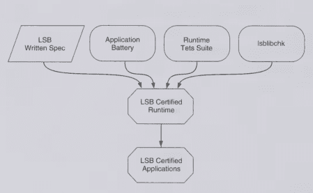

图 6.1：`LSB` 测试活动

当测试活动要求保证产品在特定情况下正常工作，或保证所选应用程序在正确在产品上执行时，Web 表单将在最终注册阶段提示确认。对于遇到的任何问题，允许引用问题报告 ID。

您可以按照第 6.2.3 节中所述获取帮助和信息。

### 6.3.6.1 测试日志

提交的测试结果应始终包括适用测试套件不间断运行的完整日志输出。如果不可能，必须提交问题报告说明问题的性质，并应等待认证机构的回复后再继续。

在 Web 认证系统中，您需要为每个适用测试套件上传测试日志。该系统还允许您获取测试日志的结果状态摘要报告。如果您确定该测试日志是您产品的正式认证测试运行，则必须在 Web 认证系统中选择验证工具。该工具将自动分析测试结果，如果没有失败的测试结果或需要人工处理的测试，则日志将在系统中标记为 `OK`。如果验证工具检测到失败的测试结果，则会向您显示一个屏幕，其中列出需要解决的一组测试用例。如果有需要人工处理的测试，也会显示一个屏幕，其中列出您需要解决的测试用例。

测试日志中需要解决的失败测试结果是那些状态为 `FAIL`（失败）、`UNINITIATED`（未启动）、`UNRESOLVED`（未解决）或 `UNREPORTED`（未报告）的结果。解决过程要求您为每个失败的测试用例输入对问题报告数据库中已批准问题报告的有效引用。已批准的问题报告是指导致对规范的商定解释、测试套件缺陷或认证系统缺陷的报告。这些适用于规范的特定发行版、测试套件或认证系统。

日志中需要人工处理的测试结果标记为 `FIP`（提供更多信息）。解决过程要求您断言该测试用例在您系统中解决为 `PASS`（通过）结果，并可选择提供简短评论。对于 `FIP` 结果，不需要引用已批准的问题报告。

### 6.3.6.2 测试活动定义

对于初始认证，产品标准中定义了一套标准的测试活动。这些总结在以下列表中：

#### LSB 运行时环境

-   必须完成 `LSB` 运行时环境合规性声明。
-   必须提供来自 `LSB` 运行时测试套件不间断运行的测试日志输出（需要 `TET` 日志格式）。
-   必须提供来自 `LSB` 库检查器工具（`lsbblichk`）不间断运行的测试日志输出。
-   对于测试日志输出，任何 `FAIL`、`UNRESOLVED`、`UNREPORTED` 或 `UNINITIATED` 结果都需要通过引用问题报告数据库中相关的已授予解释、测试套件缺陷或认证系统缺陷来解决。
-   对于测试日志输出，任何 `FIP` 结果需要人工解决为 `PASS` 结果。
-   必须提供来自 `LSB` 应用程序电池的二进制应用程序列表，申请人保证这些应用程序能正常工作（请注意，此声明在合规性声明中提供）。

#### LSB 国际化运行时环境

-   产品必须已经或同时注册为 `LSB` 运行时环境。
-   必须完成 `LSB` 国际化运行时环境合规性声明。
-   必须提供 `LSB` 国际化运行时环境自动化测试套件连续运行生成的测试日志输出（需符合 `TET` 日志格式）。
-   对于测试日志输出，任何 `FAIL`、`UNRESOLVED`、`UNREPORTED` 或 `UNINITIATED` 结果都需要通过参考问题报告数据库中已批准的解读、测试套件缺陷或认证系统缺陷来解决。
-   对于测试日志输出，任何 `FIP` 结果都需要手动解决为 `PASS` 结果。
-   对于 `LSB` 国际化运行时环境，交互式验证程序要求在 Web 认证系统中完成自我评估问卷。这需要您对交互式验证程序中的每组测试断言手动声明您通过该断言，或者引用一个已批准的问题报告。

对于初始认证，需要对列出的产品标准执行所列测试工具的完整运行。对于续期和认证更新，请参阅认证机构网站以获取更多信息。

### 6.3.7 确认您的提交

一旦所有必需信息的输入完成，网络认证系统将显示一个表单，用于输入最终细节以提交产品进行认证。这分为两个阶段完成。

-   该表单允许供应商检查与公司、产品和注册相关的所有信息。它分为若干部分；每个部分都需要确认其内容正确。该表单还包含一个选项，用于指示在产品发布前注册必须保密。如果此时任何信息需要更正，都可以更新。
-   第二部分也是最后一步，是确认遵守 `LSB` 商标许可协议和 `LSB` 认证协议中所述的计划条款和条件。在此阶段需要支付认证费用。请注意，如果选择不使用信用卡的支付方式，在认证机构收到付款之前，无法处理该提交申请。

### 6.3.8 完成认证

如果提交完整且已签署 `LSB` 商标许可协议，供应商将在 15 个日历日内收到认证成功的通知。如果因任何原因提交不完整，供应商将收到通知以便进行更正并重新提交。除非认证机构批准延期，否则此类重新提交需在 60 个日历日内完成。初始费用包含一套更正措施。

认证产品的详细信息随后将被放入认证登记册，这是一份公开文件，除非已申请保持认证保密。为保持认证保密，必须在提交产品时通过网络认证系统选择此选项。

当产品认证公开时，供应商将通过电子邮件收到证书。

认证的有效性如 `LSB` 认证政策第 8.1 节“认证有效期”中所定义的那样有一定期限。在该期限结束时，如果供应商希望产品保持认证状态，则需要续期该产品的认证（参见第 6.4.1 节）。

对于基于其他产品标准构建的产品标准（例如 `LSB` 国际化运行时环境），适用以下规则。如果注册与其他产品标准同时进行，则认证有效期为两者定义期限中较短的那个。否则，如果注册引用了该产品已有的产品标准认证，则额外产品标准的有效期将在现有认证关联的结束日期终止。

### 6.3.9 申诉流程

供应商可以依据 `LSB` 认证政策第 10 节“申诉流程”中的规定，对自由标准组或认证机构做出的决定提出申诉。任何申诉请求都应通过电子邮件发送至 `lsb-cert@pengroup.org`。认证机构将在收到此类请求后的六个工作日内予以确认，并启动申诉流程。

## 6.4 续期与认证产品更新

### 6.4.1 续期流程

已认证的产品具有定义的初始认证期限，之后必须进行续期，否则该产品将不再保持认证状态。在续期到期前两个月左右，认证机构将通过电子邮件通知供应商（保持联系信息最新非常重要）。随时，供应商都可以使用网络认证系统获取已认证产品的续期日期。

续期意味着产品继续符合标准，且供应商将在续期期间内继续支持该产品。有关续期政策及续期操作方式的更多信息，请参阅认证机构网站。

### 6.4.2 认证产品更新

如果对已认证产品进行了任何更改，供应商可能需要根据 `LSB` 认证政策第 6 节“认证范围及产品重测与重新认证要求”进行重测或重新认证。供应商应仔细阅读该章节，因为它描述了与产品变更相关的多种场景，其中一些场景需要采取认证相关的活动。在某些情况下，由于更新相当于新产品，因此需要完整的全面认证。

#### 6.4.2.1 维护版本

如果产品变更符合维护版本的定义（如 `LSB` 认证政策第 6.1 节“维护版本”中所定义），则无需供应商联系认证机构。

供应商可以请求更新产品的认证信息以包含维护版本。根据维护版本的描述方式，这样做可能是明智的，以避免市场混淆关于哪些产品版本是经过认证的。更新产品认证信息可以通过联系认证机构完成。

#### 6.4.2.2 重命名产品

如果供应商决定重命名已认证产品（如 `LSB` 认证政策第 6.3 节“重命名产品”中所定义），他们应联系认证机构，提供所需变更的详细信息，并向认证机构提交书面声明，表明已认证产品没有重大变更。认证机构将在一致性声明和认证登记册上更改产品名称，并发放新证书。

如果产品是正在进行的提交申请，且尚未提交给认证机构进行审核，则可以使用网络认证系统重命名产品。

#### 6.4.2.3 重新品牌化已认证产品

如果供应商想要重新品牌化产品（如 `LSB` 认证政策第 6.4 节“重新品牌化产品”中所定义），他们应查找并阅读该产品的《一致性声明》，以获取有关产品供应商重新品牌化政策的信息。首先，供应商应查明他们是否拥有重新品牌化所需的权限。然后，他们像认证新产品一样进入网络认证系统，但当要求输入产品信息时，他们应选择这是一个重新品牌化的产品。

重新品牌化产品注册与新注册产品之间的主要区别在于，不需要提交测试结果。

提交后，认证机构将核实供应商是否拥有相应权限。

#### 6.4.2.4 其他场景

其他场景被视为新产品，并须接受完整认证。

## 6.5 当前支持的系统

`LSB`（可移植二进制接口）是信息技术发展史上最为成功的 `ABI`（应用二进制接口）标准之一。所有主要的 `GNU/Linux` 发行版均通过了 `LSB` 认证，`LSB` 一致性测试已成为所有相关方进行质量保障的重要手段。当前通过 `LSB` 认证的发行版和应用程序列表可在 `LSB` 网站上找到。

### 6.5.1 网络参考资料摘要

外部网络参考资料的摘要如下：

-   自由标准组织（`Free Standards Group`）认证的起点
-   `LSB` 认证政策
-   `LSB` 应用程序测试套件
-   `OpenI18N` 规范
-   `LSB` 书面规范
-   `LSB` Web 认证系统的起点
-   `LSB` 认证指南
-   `LSB` 认证登记处
-   当前的 `LSB` 产品标准集
-   当前授权的 `LSB` 测试套件列表
-   问题报告数据库
-   常见问题解答文件
-   一致性声明问卷

17. <http://www.opengroup.org/lsb/cert/>
18. <http://www.opengroup.org/lsb/cert/docs/LSB_Certification_Guide.html>
19. <http://www.opengroup.org/lsb/cert/register.html>
20. <http://www.opengroup.org/lsb/cert/docs/prodstandards.html>
21. <http://www.opengroup.org/lsb/cert/docs/testsuites.html>
22. <http://www.opengroup.org/lsb/cert/docs/PR/>
23. <http://www.opengroup.org/lsb/cert/docs/faq.html>
24. <http://www.opengroup.org/lsb/cert/docs/conformance.html>

# 第七章

# 软件产品的 LSB 认证

本章概述了应用程序的 `LSB` 认证，并基于 The Open Group 发布的《`LSB` 认证指南》（<http://www.opengroup.org/lsb/cert/>）编写。

## 7.1 引言

符合 `LSB` 一致性要求的产品或产品系列可以申请 `LSB` 认证。认证流程要求向 `LSB` 认证机构（即中立的第三方供应商）证明符合一致性要求。详细的一致性要求列于 `LSB` 产品标准中，包括通过指定的测试套件以及完成一致性声明。只有认证产品的供应商才被允许在产品宣传中使用 `LSB` 商标。

> 1. 本章部分内容经许可引用自 The Open Group 的《`LSB` 认证》（<http://www.opengroup.org/lsb/cert/>）。

### 7.1.1 要点


LSB 认证流程的主要要点概述如下：

- LSB 认证项目由自由标准组织（Free Standards Group）指定的认证机构 The Open Group 代为管理。
- 一旦产品通过了相应的认证测试套件，且申请人正式同意所有必要条款，申请人将获得使用 LSB 商标与该产品的关联许可。
- LSB 商标许可协议必须完全签署（申请人和自由标准组织双方均需签字）才能获得产品认证。
- 根据 LSB 认证政策，已认证产品须定期接受再认证。
- 根据 LSB 认证协议要求，提供给认证机构的所有产品信息均视为机密。
- 根据 LSB 认证政策要求，LSB 认证机构可能会不时要求提供证明，以确认已认证产品仍符合 LSB 一致性要求中列出的各项规定。

## 7.2 获取 LSB 应用程序认证

本节列出了获取 LSB 应用程序认证所需的步骤，并提供了如何执行这些步骤的信息。该流程涉及：

- 理解认证项目和流程
- 对产品进行非正式测试
- 申请认证
- 正式测试及结果提交

### 7.2.1 理解认证项目

为了熟悉该项目，应阅读以下项目文件：

- LSB 认证政策
- LSB 产品标准

#### 7.2.1.1 LSB 认证政策

LSB 认证政策文档涵盖的范围不仅限于 LSB 应用程序认证。然而，它提供了关于“获得认证意味着什么”、“如何使产品获得认证”以及“如何确保产品保持认证状态”的信息。其中指出：

> “LSB 应用程序认证是针对符合 LSB 规范的应用程序。LSB 应用程序是使用由 LSB 运行时环境提供的服务的消费者。”

#### 7.2.1.2 LSB 产品标准

应阅读 LSB 产品标准以理解产品认证所依据的详细一致性要求。应查阅认证机构网站，以获取 LSB 应用程序产品可据此进行认证的当前产品标准集。

### 7.2.2 非正式测试

通常，使用 LSB 认证测试套件对产品进行测试是第一项活动。每个产品标准的“合规性指标”部分列出了所需的认证测试套件。这些测试套件由自由标准组织免费提供，应与任何被认为合适的方法一起使用，以确保产品满足适用的一致性要求并准备好进入 LSB 认证项目。

#### 7.2.2.1 LSB 认证应用程序准则

以下准则列表有助于判断应用程序是否可以获得认证，如图 7.1 所示。合规的应用程序至少具备以下特性：

- 仅依赖于其在其上运行的运行时环境所规定的 LSB 接口（参见第 13.3.3 节）
- 链接到 LSB 运行时链接器和 LSB 桩库，或默认提供 LSB 接口版本用于链接的库版本（参见第 13.3.1 节）
- 静态链接非 LSB 库，或将共享库与应用程序一起捆绑
- 通过 `lsbappchk` 测试（参见第 13.5.2 节）
- 符合 FHS（文件系统层次结构标准）（见下文）
- 在 LSB 示例实现及另外两个符合 LSB 标准的系统上通过功能验证测试（参见第 12.3 节）
- 打包为 RPMv3 格式（具有规范中概述的限制），或本身符合 LSB 标准的安装程序（参见第 4.1 节）

### FHS 合规性

对于 LSB 认证，应用程序必须符合文件系统层次结构标准（FHS）。在认证过程中，需要回答以下 FHS 问卷：

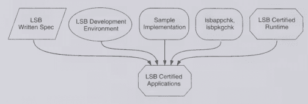

图 7.1：LSB 应用程序认证

- 应用程序是否安装到 `/opt/package/` 或 `/opt/provider/`？
- 应用程序是否通过安装到 `/opt/package/bin/` 或 `/opt/provider/bin/` 的库由最终用户调用？
- 应用程序的手册页是否安装在 `/opt/package/man/` 或 `/opt/provider/man/`？
- 应用程序的变量文件是否创建在 `/var/opt/package/` 或 `/var/opt/provider/`？
- 应用程序的主机特定配置文件是否保存在 `/etc/opt/`？
- 是否有其他包文件位于 `/opt/`、`/var/opt/` 和 `/etc/opt/` 之外（例如 `/var/lock/` 或 `/var/run/`）？

### 7.2.2.2 授权的测试套件

需要指出的是，对于 LSB 应用程序认证的正式测试，只能使用当前授权的 LSB 认证测试套件版本。因此，在进行非正式测试时，使用授权版本至关重要，以避免后续出现问题。认证机构维护当前认证测试套件授权列表。由于测试套件来自多个来源，此在线文档包括如何获取测试套件的信息。

### 7.2.3 在 Web 认证系统中注册 LSB 应用程序产品

LSB 应用程序认证使用与 LSB 运行时环境认证相同的 Web 认证系统。为了简洁起见，本章包含了一个概述，详细介绍了 LSB 应用程序认证的不同之处。有关一致性声明、产品修订以及同样适用于 LSB 应用程序认证续期的更多详情，请参见第 6 章。

注册产品时，必须提供若干产品详细信息，包括产品名称，以及已证明符合性的版本或发行版。

供应商必须选择其所寻求认证的 LSB 产品标准，然后可选地输入与产品相关的 Web 地址。必须接受 LSB 认证协议才能继续进行此产品注册。

随后，产品注册表单将显示出来，其中包含附加字段，供供应商提供上述描述的产品特定标准信息。

**LSB 应用程序特定详情。** 对于 LSB 应用程序，供应商需要保证并证明该产品在若干环境中能正确执行。其中第一个环境是 LSB 示例实现。其次，该产品需要在两个不同的 LSB 运行时环境中正确运行，其中一个可由供应商选择，另一个由认证机构选定。

供应商需自行安排获取用于测试的 LSB 运行时环境。除认证注册表上的联系信息外，认证机构无法提供其他帮助。Free Standards Group 可能能够协助获取运行时环境。

在 Web 认证系统中注册产品的最后阶段，表单要求供应商声明其保证并已经证明该应用程序能在所需环境中正确执行。

## 7.2.4 上传符合性声明

Web 认证系统将引导供应商完成注册待认证产品的步骤。必须上传到认证系统的第一份文档是该产品的符合性声明。

接下来的步骤是执行正式测试，然后将测试结果作为一系列文件上传到 Web 认证系统。

### 7.2.5 LSB 应用程序认证的正式测试

正式测试是一种自检活动，其结果通过 Web 认证系统提交给认证机构进行审计。只有授权的测试工具才可用于认证。

当测试活动需要保证产品在特定情况下正常工作，或保证选定的应用程序在产品上正确执行时，Web 表单将在最终注册阶段提示确认此事项，并允许引用任何遇到的问题报告 ID。

#### 7.2.5.1 测试日志

提交的测试结果始终应包括适用测试套件的未中断运行的完整日志输出。如果无法做到这一点，必须提出一份问题报告，说明问题的性质，并在继续之前收到认证机构的回复。

在 Web 认证系统中，供应商被要求为每个适用的测试套件上传测试日志。该系统还允许供应商获取测试日志结果状态的摘要报告。如果此测试日志是产品的正式认证测试运行，供应商必须在 Web 认证系统中选择验证工具。这将自动分析测试结果，如果没有失败的测试结果或需要手动解决的测试，则该日志将在系统中标记为正常（`OK`）。如果验证工具检测到失败的测试结果，则会出现一个屏幕，列出需要解决的测试用例。

在测试日志中，需要解决的失败测试结果是指状态为 `FAIL`（失败）、`UNINITIATED`（未启动）、`UNRESOLVED`（未解决）或 `UNREPORTED`（未报告）的结果。解决过程要求供应商为每个失败的测试用例输入对问题报告数据库中已批准问题报告的有效引用。已批准的问题报告是指那些导致了规范解释的达成一致、测试套件缺陷或认证系统缺陷的报告。其中每一项都适用于特定版本的规范、测试套件或认证系统。

#### 7.2.5.2 测试活动定义

对于初始认证，产品标准中定义了以下标准测试活动集：

**LSB 应用程序**

- 必须提供应用程序在两个选定的 LSB 运行时环境和 LSB 示例实现上能正确执行的保证。
- 必须完成 LSB 应用程序符合性声明。
- 必须提供 LSB 应用程序检查工具（`lsbappchk`）未中断运行的测试日志输出（需要 `TET` 日志格式）。（这可以是 `lsbappchk` 在 LSB 示例实现或两个选定的 LSB 运行时环境中任意一个上针对产品的执行结果）。
- 对于测试日志，任何 `FAIL`、`UNRESOLVED`、`UNREPORTED` 或 `UNINITIATED` 结果都需通过引用问题报告数据库中相关的已授权规范解释、测试套件缺陷或认证系统缺陷来解决。

对于初始认证，需要对列出的产品标准执行所列测试工具的完整运行。对于续期和认证更新，请参阅《LSB 认证指南》第 4 章“续期和产品更新”中关于适用测试活动的信息。

## 7.2.6 认证完成

如果提交材料完整且已签署 LSB 商标许可协议，供应商将在 15 个日历日内收到认证成功的通知。如果提交材料因任何原因不完整，供应商将收到通知，以便进行更正并重新提交。此类重新提交需在 60 个日历日内完成，除非认证机构已批准延期。初始费用涵盖一套更正措施。

经认证产品的详细信息随后将列入认证注册表，这是一份公开文件，除非已申请保持机密。为保持认证机密性，必须在产品提交时于 Web 认证系统中选择此选项。

当产品认证信息公开后，将通过电子邮件向供应商发送证书。

认证的有效期如《LSB 认证政策》第 8.1 节“认证期限”中所述。在该期限结束时，如果供应商希望产品保持认证状态，则需要续期产品认证。

## 7.3 当前支持的系统

LSB 是信息技术行业历史上最成功的 ABI 标准之一。每个主要的 `GNU/Linux` 发行版都已获得 LSB 认证，LSB 符合性测试已成为所有相关方质量保障的核心内容。当前 LSB 认证的发行版和应用程序列表可在 LSB 网站上找到。

### 7.3.1 Web 参考摘要

外部 Web 参考的摘要如下：

- Free Standards Group 认证的起点
- LSB 认证政策
- LSB 应用程序测试组
- OpenI18N 规范
- LSB 书面规范[^8]
- LSB Web 认证系统的起点[^9]
- LSB 认证指南[^10]
- LSB 认证注册表[^11]
- 当前 LSB 产品标准集[^12]
- 当前授权的 LSB 测试套件列表[^13]
- 问题报告数据库[^14]
- 常见问题文件[^15]
- 符合性声明问卷[^16]

[^8]: http://www.linuxbase.org/spec/
[^9]: http://www.opengroup.org/lsb/cert/
[^10]: http://www.opengroup.org/lsb/cert/docs/LSB_Certification_Guide.html
[^11]: http://www.opengroup.org/lsb/cert/register.html
[^12]: http://www.opengroup.org/lsb/cert/docs/prodstandards.html
[^13]: http://www.opengroup.org/lsb/cert/docs/testsuites.html
[^14]: http://www.opengroup.org/lsb/cert/PR/
[^15]: http://www.opengroup.org/lsb/cert/docs/faq.html
[^16]: http://www.opengroup.org/lsb/cert/docs/conformance.html

## 第四部分

# 参与 LSB 项目

LSB 书面规范绝非一成不变。规范的范围将根据可接受的需求进行扩展。未来的增强功能将提高 LSB 的复杂性以及对应用的信心，从而带来更好的市场机遇。

LSB 在向规范中添加新架构和 ABI 方面的进展，取决于工作人员、志愿者和赞助情况。以下章节描述了规范得以扩展的接受标准和流程。我们欢迎您的需求、意见和贡献。

## 第八章

# 向 LSB 书面规范中添加新接口

本章描述了 LSB 工作组和开源社区如何通过向 LSB 书面规范中添加新接口来扩展标准的流程。

### 8.1 向前迈进

如前几章所述，LSB 努力的最初几年及其在此期间产生的规范早期版本，核心是一群拥有紧密共享愿景的 `Linux` 开发者的成果。随着这一愿景的成熟以及规范受众群体的扩大，显而易见的是，需要一种更正式的流程。不再能期望所有使用和开发 LSB 的人都已经内化了这一愿景，因此需要创建一个官方流程。早期使用的流程很好地实现了其快速识别那些需要立即纳入核心规范的“低垂果实”的目的，对轻微错误的容忍度对于加快进度而言是一个值得的权衡。然而，一旦 2001 年 6 月发布书面规范的第一个正式版本后，标准的受众群体变得更大，他们既要求高质量、稳定的标准，也要求增加新的接口。一群对这些目标感兴趣的人开始定期会面讨论此事。这组人成为了 LSB 工作组的 LSB 未来子委员会 `<lsb-futures@freestandards.org>`。

除了跟踪新接口外，该小组还制定了添加新接口的官方标准和流程。

LSB 努力是独一无二的，因为它正在标准化那些由自由/开源软件（FLOSS）社区开发（或在实现中认可）的接口。大多数先前的标准化工作结果是由行业联盟完成的，这些联盟通常可以不顾反对意见而指定标准的方向。这并不是说先前的标准化工作没有尝试在参与者中建立共识，只是 LSB 的努力代表了前所未有规模的共识。在先前的工作中，可以主要基于技术因素做出标准化选择，发布标准的新版本，并期望实施者做出更改以符合新规范，而 LSB 工作组必须遵循不同的模式。首先，必须就接口在社区中建立共识，然后该接口必须被主要运行时提供商实现，最后，只有在这些步骤完成后，才能将其添加到 LSB 书面规范中。作为一种客观衡量这些步骤的方法，创建了一份选择标准列表。

### 8.2 LSB 选择标准

通过 LSB 未来流程纳入 LSB 的候选者，通过完成分为三个广泛类别的一系列步骤而推进：`识别`、`调查` 和 `实现`。前两个是信息性的，通过提供跟踪所需的信息来推进。如果这些阶段没有阻碍，就可以开始实施阶段。

#### 8.2.1 阶段 1：识别

- **需求**：需要对该组件有足够的需求才能进行标准化。可以通过许多方式衡量需求，例如该组件在社区中的大量使用或开发者的多次请求。请记住，虽然许多事物可能存在需求，但并非所有都会满足附加标准。
- **许可证**：该组件至少应有一种在开源许可下可用的合规实现，该许可还应为开发者营造“无附加条件”的环境。这意味着开发者将能够使用至少一种标准实现，以他们选择的方式开发和部署其软件。这被解释为至少有一种实现在符合开源定义的许可证下可用，但也不限制专有使用于运行时或开发中。此标准的理由与 `LGPL` 等许可证类似：通过以允许所有程序使用的条款进行许可，接口可以获得更广泛的应用。
- **最佳实践**：候选者必须代表其在开发社区中解决该问题的“最佳实践”。它需要已成为明确的实际标准，并在大多数（或所有）主要发行版中可用。
- **稳定的 ABI/API**：`API/ABI` 必须足够稳定，可以作为标准化的目标。维护者需要遵循 `ABI/API` 稳定性的“最佳实践”；他们应该有如此做的证明记录，并妥善解决出现的任何问题。
- **依赖项存在**：候选者的运行时依赖项要么已经存在于 LSB 中，要么计划被添加，要么被抽象化，使得指定其接口不是必需的。依赖项提供了对可能需要添加的内容和/或可能遇到的潜在问题的洞察。在继续之前，应列出并讨论递归依赖项。

#### 8.2.2 阶段 2：调查

- **上游合作**：上游维护者必须致力于向后兼容（对于某个定义版本）和稳定性。他们应该愿意与开发者和发行商合作，提供所有人都能同意并采用的标准。
- **发行版维护者合作**：发行版的组件维护者应该愿意合作。他们应该愿意与上游维护者和开发者合作，提供所有人都能同意并采用的标准。
- **组件版本**：上游维护者、发行版和开发者应在兼容版本上同步。如果没有，他们应愿意同意并采用兼容版本。
- **发行版补丁**：如果发行版对该组件维护任何补丁，这些补丁可以合并到上游或被丢弃。由于 LSB 是行为标准，这不是必需的，但可以使事情更容易。
- **国际化**：如果组件与用户交互，应尽可能具有国际化（`i18n`）支持，并适当地支持本地化（`l10n`）。缺乏特定区域设置的数据应及时补救，尽管诚然支持每个区域设置都很困难。
- **资源**：应安排用于处理阶段 3 所需交付成果的资源。一个组件可能是标准化的绝佳候选者，但在有人进行工作之前无法推进。根据候选者的不同，可能会有从标准化中受益的各方，可以合理地要求他们为这一努力做出贡献。
- **理由**：需要记录并发布为什么需要添加该组件的理由。邮件列表和会议纪要是不够的；这些数据需要在规范或单独的文件中记录。缺乏理由文档已经成为旧版规范的问题，因此这非常重要。

#### 8.2.3 阶段 3：实现

- **导入 LSB 数据库**：将组件导入 LSB 数据库是处理 LSB 书面规范、运行时测试套件、开发环境和示例实现的第一步。
- **书面规范**：针对该组件开发或改编书面规范，必须采用适当的格式以便集成到 LSB 书面规范中。

### 8.2.4 最后步骤

一旦候选人完成所有三个阶段，LSB 未来事务小组委员会（LSB Futures subcommittee）将向 LSB 工作组推荐将其纳入下一个版本的 LSB。第三阶段完成的项目将移交至书面规范、测试、开发环境、示例实现和应用电池（Application Battery）等子委员会。

## 初始测试套件

该组件的测试套件的编写或适配工作，必须按照适当的格式完成，以便集成到 LSB 测试套件中。

## 开发组件

如果有必要，该组件的桩库和头文件的源代码必须按照适当的格式创建，以便集成到 LSB 开发环境中。对于简单的组件，这些内容可能仅作为交叉检查使用，以对照 LSB 开发环境中由数据库生成的头文件。

## 示例实现

随后，该组件的示例二进制文件将按照适当的格式构建，以便集成到 LSB 示例实现中。

## 应用电池

如果合适，此步骤应推荐一个合理的应用程序，该应用程序使用此组件，以便纳入应用电池中。

### 8.3 候选人识别

正如名字所暗示的那样，LSB 未来事务小组委员会的一项工作就是识别 LSB 未来的发展方向。这意味着识别新的候选 ABL（应用二进制接口层），以考虑将其纳入标准。在此过程中，已识别并使用了多种方法。


## 8.3.1 来自规范受众的输入

迄今为止，新候选人最大且最重要的来源是 `LSB` 标准受众的建议。鉴于庞大的 `Linux` 开发者群体，开发者们有很多关于他们希望看到的接口界面的想法。`LSB` 未来事务小组委员会征集这些建议，并对它们进行收集和整理。这种整理有助于澄清建议（通常多个人以不同的方式提出相同的想法），并衡量对某接口的需求程度。

## 8.3.2 现有代码分析

除了直接来自 `Linux` 开发者的输入外，还识别了多种通过编程方式确定开发者最需要的接口的方法。

- `Linux` 发行版依赖项：通过分析主要发行版的软件包依赖关系，我们可以推测哪些接口被依赖的频率最高。这些软件包可能是标准化的良好候选人。
- `Linux` 发行版基础组件：主要发行版在其“基础安装”中包含的软件包非常重要，代表了该发行版用户和维护者的集体智慧。这些软件包可能是标准化的良好候选人。基础系统中的很大一部分软件包是使发行版具有独特之处的内容，但不属于此类的内容往往在各发行版之间具有共性，因此也是良好的候选人。
- 现有商业应用依赖项：通过检查现有商业应用程序的二进制文件，可以确定它们依赖于哪些接口，以及它们期望具备哪些其他系统功能。

## 8.3.3 标准创意

前述方法对于识别库接口非常有用，但对于识别系统中其他受益于标准化的内容却很少有帮助。`LSB` 未来事务小组委员会也花费时间头脑风暴，构思标准创意以解决这类问题。

一些例子包括对文件系统层次结构标准（`Filesystem Hierarchy Standard`）的补充、供应用程序使用的系统服务、重构标准，以及协助确定何时需要成立小组委员会来研究新的领域。

### 8.4 候选人跟踪

在之前的章节中，描述了 `LSB` 的标准和识别潜在候选人的方法。利用这些方法，`LSB` 未来事务小组委员会在一个可公开浏览的网页上跟踪建议候选人的状态。[1]

对于每个候选人，都会列出其满足 `LSB` 各项选择标准的状态，以及一些额外的跟踪数据和总体摘要。这使得查看特定候选人需要完成哪些工作变得容易。如标准章节所述，一旦候选人满足所有标准，即可将其添加到下一个版本的 `LSB` 书面规范中。

这个跟踪系统的一个优点是，它允许添加*任何*潜在候选人；如果该候选人能够满足标准，那么它就属于 `LSB`。有时，候选人会被添加，但随后被标记为无法满足标准的某些部分而处于受阻状态。它将继续被跟踪，如果将来能够满足标准，则会被解除阻塞并继续推进。这使得流程更加客观，并防止在尚未准备好的情况下将内容添加到标准中。

### 8.5 问题案例

在跟踪候选人的过程中，`LSB` 未来事务小组委员会遇到了几类虽然需求旺盛但添加起来存在问题的候选人。以下部分描述了一些例子。

## 8.5.1 Linux 特有的请求

最受请求的接口类别之一是那些与 `Linux` 内核相关的接口。特别是，开发者非常希望拥有内核模块 `API`。这主要存在两个问题。第一，它不符合要求获得上游开发者支持的标准。`Linux` 内核社区已明确表示，他们不会承诺维护一个持续的标准接口，因为他们希望能够在有必要时更改该接口。第二，`LSB` 尚未定义任何与内核相关的内容，并希望保持这种状态，以免妨碍在非 `Linux` 系统上运行实现。

## 8.5.2 解释型语言

另一个常见请求是关于 `Perl`、`Python` 和 `Tcl/Tk` 等解释型语言。目前这些语言被阻止的主要原因缺乏 `LSB` 可以引用的正式标准。大多数此类语言具有稳定的接口，所需要的是上游维护者支持的正式规范。

## 8.5.3 许可证问题

一些候选人因唯一的现有实现采用如 `GPL` 等许可证而无法满足 `LSB` 的许可证标准，该许可证要求使用该接口的任何人都必须释放其软件的源代码。`LSB` 旨在最大化使用自由标准和自由及开源软件（`FLOSS`）的人数。选择许可证标准是为了提供“无附带条件”的环境。如果一个接口的唯一可行实现受 `GPL` 或类似许可证保护，那么 `LSB` 对不愿意使用限制性许可证的人来说吸引力将降低。这基本上就是像 `LGPL` 这类许可证存在的理由，其条款允许所有程序使用，从而使接口能够被更广泛地应用。

例如，`LSB` 未来事务小组委员会正在跟踪两个窗口工具包：`GTK+` 和 `Qt`。`GTK+` 目前正在进行中，因为它受 `LGPL` 许可保护，需要按照常规流程将其添加到书面规范中。另一方面，`Qt` 目前处于受阻状态，因为其唯一实现受双重许可保护，即 `QPL`（`GPL` 条款，要求释放源代码）或商业许可。这在邮件列表中引发了相当多的讨论。`Qt` 继续被跟踪，如果出现了符合许可证标准的实现，它将被解除阻塞并可以继续推进。

### 8.6 如何让你喜爱的接口被添加到 LSB

`LSB` 的流程设计旨在不妨碍希望做出贡献的人。如果你有希望看到添加到标准中的候选人，你可以请求将其作为候选人进行跟踪。如果完成使该候选人满足标准所需的工作，则它可以被添加。限制何时可以将内容添加到 `LSB` 的唯一因素是标准满足的速度。`LSB` 工作组非常希望看到更多接口被添加，并鼓励大家参与。

[1] `http://www.linuxbase.org/futures/candidates/`

# 第九章

## 将新架构添加到 LSB 产品组合

本章描述了 `LSB` 工作组将新架构添加到 `LSB` 书面规范产品组合的过程。

### 9.1 架构特定附录

`LSB` 由两个基本部分组成：一个通用规范（“通用 `LSB`”或“`gLSB`”），描述 `LSB` 所有实现中保持不变的接口部分；以及一个架构特定规范（“`archLSB`”），描述因处理器架构而异的接口部分。通用 `LSB` 和单一硬件架构的架构特定附录共同构成了在共享相同硬件架构的系统上，针对编译应用程序的完整接口规范。

架构特定附录必须与通用 `LSB` 配合使用。它提供了补充通用 `LSB` 的架构特定信息，以及通用 `LSB` 中未包含的额外信息。以下是 `LSB` 中几个架构特定的组成部分：

-   可执行和链接格式 (`ELF`)
-   库符号版本
-   头文件数据结构
-   `RPM` 打包的架构特定属性
-   示例实现

本章将简要描述 `LSB` 如何导入和交叉检查新的架构特定 `ABI`。

### 9.2 架构特定 ELF

`ELF` 定义了编译应用程序的链接接口。`LSB` 拥有一个包含 `Linux` 大部分 `ELF` 细节的数据库。`LSB` 数据库（图 9.1）用于构建书面规范和 `LSB` 工具。

### 9.3 架构特定符号版本

在 `Linux` 上，通过符号版本控制机制维持应用程序的库稳定性。如果 `ABI` 发生变化，则会创建该 `ABI` 的副本并赋予新的符号版本。先前构建的应用程序继续使用其最初链接的接口，而新链接的应用程序将使用最新的 `ABI`。

为了符合 `LSB`，使用 `LSB` 库检查工具 `lsblibchk`（示例 9.1）检查系统库中是否存在通用符号版本。在运行 `lsblibchk` 时会发现新的或更改的符号版本。架构上不同的 `ABI` 符号版本被分组在 `LSB` `ABI` 中。`LSB` `ABI` 中的通用架构符号集合是应用程序需要实现二进制兼容性所必需的部分。

**示例 9.1：使用 `lsblibchk`**

```bash
# rpm -i lsblibchk-2.0.0-1.i386.rpm
# /opt/lsblibchk/bin/lsblibchk
```

### 9.4 架构特定头文件

在 `LSB` 开发环境中，`LSB` 根据 `LSB` 书面规范提供 `Linux` 头文件（示例 9.2）。这些头文件*仅*针对架构差异进行了调整。使用 `LSB` 头文件进行编译可以显著改善应用程序的二进制兼容性。

**示例 9.2：安装 LSB 头文件**

```bash
# rpm -i lsb-build-base-2.0.0-1.i486.rpm
# /bin/ls /opt/lsbdev-base/include
```

可以使用 `lsbdevchk` 检查 `Linux` 头文件的运行时情况。

### 9.5 架构特定打包

应用程序 `RPM` 按架构进行打包。例如，包 `lsb-pkgechk-2.0.0-1.i486.rpm` 已针对 `Intel` 486 或更高系统进行了编译和打包。可以使用 `LSB` 包验证工具检查包的架构和通用正确性（示例 9.3）。

**示例 9.3：包验证**

```bash
# rpm -i lsb-pkgchk-2.0.0-1.i486.rpm
# /opt/lsb/bin/lsbpkgchk lsb-xpdf-1.01-3.i486.rpm
```

### 9.6 架构特定示例实现

`LSB` 示例实现是一个用于测试目的的最小 `LSB` 合规运行时环境。在构建工具链和 `LSB` 功能区域的过程中会发现架构异常。有关详细信息，请参阅第 12.4 节。

### 9.7 架构检查清单

在新的 `LSB` 架构规范发布之前，必须满足一系列先决条件。在 `LSB` 架构规范候选项提交给自由标准组（`Free Standards Group`, `FSG`）批准之前，必须完成并经过 `Beta` 测试以下项目：

-   架构规范
-   运行时一致性测试
-   运行时库检查器 (`lsblibchk`)
-   应用程序测试电池 (`Application Battery`)
-   开发环境
-   示例实现
-   应用程序检查器 (`lsbappchk`)
-   两个或更多现成的 `Linux` 实现

作为应用该检查清单的一个例子，`LSB` 1.3 的 `PPC64` 架构规范由 `LSB` 提交给 `FSG` 批准，随后发布。当时已存在一个实现。看起来所有必要的工作都已完成。然而，后来发现该实现选择以与某些上游维护者所做工作不完全一致的方式应用架构支持，而其他实现则打算遵循上游。其中一个例子是 `glibc` 符号版本，它们与上游 `glibc` 中的版本不同。2003 年 8 月，`LSB` 被迫撤回 `PPC64` 规范（它在 `LSB` 2.0 中重新提交），理由是架构支持尚未足够成熟。将来，“两个或更多实现”的规则将用于避免此类问题。幸运的是，该平台没有 `LSB` 认证的 `Linux` 发行版或 `LSB` 认证的应用程序。

# 第五部分

# 使用 LSB 资源

`LSB` 不是普通的规范。`LSB` 还提供了一套测试套件来验证对规范的一致性，以及一个示例实现来演示规范并验证测试。经过充分测试和说明的书面规范会增加人们对其有效性的信心，并减少异常和遗漏。

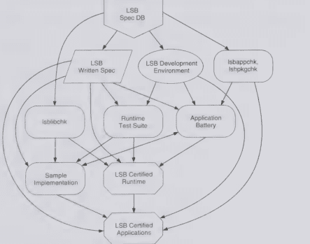

# 第十章

# 使用 LSB 书面规范

本章描述了 `LSB` 书面规范的用途以及它不适用的用途。

### 10.1 理解 LSB 书面规范

`LSB` 书面规范由一组文档组成，这些文档规定了二进制兼容性环境。这些文档按硬件架构结构化，所有架构共同支持的材料放在一份称为通用规范的文档中（称为 `gLSB` 或 `LSB-Core`），然后为每个受支持的架构提供一份额外的补充文档。对于 `LSB` 2.0，通用规范被模块化为一系列选项，以支持更小足迹的设备，并允许设备在特定市场中不需要时不支持所有选项。

`LSB` 不会重复描述由其他团体（如 `IEEE` `POSIX` 标准和非集团 (`The Open Group`) `Single UNIX Specification`）标准化的接口，而是参考了许多已发布的标准和规范。被引用文档的其他例子包括用于 `OpenGL` 的 `Linux` `OpenGL` 应用程序二进制接口 (`ABI`) 文档、相应的 `ELF` 规范以及 `System V` 接口定义 (`SVID`)。

对于这些库中的每个接口，都有接口行为、它呈现的 `ABI` 以及（如适用）符号版本的规范。为了减少重复和编辑错误的机会，会引用某个基础标准的描述，或者有时是引用加上微小的差异（例如，“对于 `LSB`，也允许使用 `-g` 选项”）。只有在找不到参考规范时，`LSB` 才会提供完整的描述。

`LSB` 还定义了一种标准打包格式，以允许应用程序的可移植安装。指定的打包格式是 `RPMv3` 的一个子集。虽然这种格式的包必须在合规的运行时（发行版）上能够安装，但这并不强制使用 `rpm` 程序或数据库。例如，使用 `.deb` 格式的基于 `Debian` 的发行版可以使用 `alien` 等程序来转换和安装 `LSB` 合规的软件。某些功能，如触发脚本，未被包含；目前这些功能无法支持，也不容易转换为其他打包格式。

规范中包含了许多实用工具。对于其中许多工具，其行为已由 `POSIX` 规范定义。`gl_LSB` 文档记录了命令在 `Linux` 上的行为与此规范偏离或它是 `Linux` 特定命令的情况。选择包含在规范中的命令的标准是它们对于用于应用程序安装、配置和基本维护的脚本的有用性。

`LSB` 还通过引用文件系统层次结构标准来规定文件树的布局。在系统初始化领域，`LSB` 为 `init` 脚本引入了一些新概念。历史上，自动确定启动序列中应在哪个阶段启动服务是很困难的。`LSB` 合规的 `init` 脚本指定它们提供的服务及其依赖的服务。因此，运行时的系统初始化服务能够确定在何时启动或停止服务。

重要的是要注意，`LSB` 书面规范并不要求只能在基于 `Linux` 的系统中实现。其目的是允许其他操作系统也能向应用程序提供 `LSB` 合规的运行时环境。

## 10.2 产品标准描述

*产品标准* 是一种简洁的声明，用于携带 `LSB` 品牌的产品中必须实现的那些 `LSB` 书面规范部分。

**LSB 运行时环境** *IA32 的 LSB 运行时环境*（或其他架构）产品标准适用于提供符合 `LSB` 规范服务的平台，具体而言，是 `LSB` 2.0 通用规范（被称为 `gLSB` 或 `LSB-Core`），结合 `IA32`（或其他架构）架构 2.0 处理器特定补充规范（被称为 `archLSB` 或 `LSB-Core-IA32`）。更多详情，请参见第 6.3.4.1 节。

**LSB 应用程序** *IA32 的 LSB 应用程序*（或其他架构）产品标准适用于符合 `LSB` 规范的应用程序，具体而言，是 `LSB` 2.0 通用规范（被称为 `gLSB` 或 `LSB-Core`），结合 `IA32`（或其他架构）架构 2.0 处理器特定规范（被称为 `archLSB` 或 `LSB-Core-IA32`）。`LSB` 应用程序是 `LSB` 运行时环境所提供服务的消费者。更多详情，请参见第 7.2 节。

## 10.3 规范模块描述

*规范模块* 是一个独特的集合，包含对一个或多个对特定运行时实现组有价值的函数。借用一个商业术语，规范模块专用于“垂直市场”。规范模块的范围可以从非正式概念到认证标准不等。产品标准包含以下一个或多个规范模块。

**LSB-Core** 是为面向任何通用 `Linux` 运行时的开发人员提供的一组接口。这仅包括运行时环境的基本内容。

**LSB-Graphics** 提供图形接口，例如 `X Window System` 库和 `OpenGL` 库。它应与 `LSB-Core` 模块配合使用。

**LSB-Embedded** 是面向嵌入式系统的开发人员期望能够找到的最小组接口集合。该规范模块当前未包含在任何产品标准中，但如果有需求，可以将其添加到其中。此外，该模块当前包含一些可能在用于产品标准的版本中不存在的元素。

**LSB-Open118N** 提供超出 `LSB-Core` 所包含范围的额外国际化和接口。它应与 `LSB-Core` 模块配合使用。

## 10.4 功能区域描述

*功能区域* 对应于具有合理独立存在理由的最小标准单元。将其划分为更小的单元没有意义，因为该接口的实现者无论如何都会实现所有较小的单元。通常，功能区域存在的理由可能是以*à la carte*方式针对可用标准的部分内容对实现者有用。

**可执行文件和链接格式 (ELF)** 是 `C` 编译系统产生的可执行文件的定义。

**执行环境** 由文件系统层次结构、授予的最少目录和文件权限、关于所有权和权限的应用程序建议、正则表达式本地化、文件名通配符本地化以及杂项 `API` 行为组成。

**基础库** 由 `libc`、`libm`、`libpthread`、`libgcc_s`、`libdl`、`libcrypt`、`libpm` 和 `libstdcxx` 组成。

**实用库** 由 `libz`、`libncurses` 和 `libutil` 组成。

**系统初始化** 由 `cron` 作业、`init` 脚本动作、`init.d` 文件的安装和移除组成。

**打包** 由 `RPM` 文件格式、脚本限制、包命名、包依赖关系以及包架构考虑组成。

**图形** 由 `libX11`、`libXext`、`libSM`、`libICE`、`libXt` 和 `libGL` 组成。

## 10.5 规范合并

图 10.1 是 `LSB` 新结构的视觉表示。每个方框代表一个功能区域。功能区域根据维护它们的工作组进行分组：`ELF`、`FHS`、`LSB` 或 `Desktop`。功能区域根据其依赖关系堆叠。维度箭头表示堆栈中包含哪些功能区域在一个规范模块中。

产品标准，如 `LSB` 运行时环境，包含一个或多个规范模块，如 `LSB-Core`。

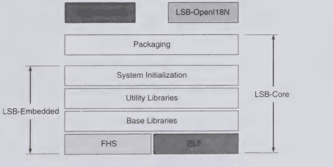

## 10.6 扩展 LSB 书面规范

以下是从第 8.2 节中选取的一些用于发布或修订 `LSB` 书面规范的验收标准。

- 候选项必须代表开发社区中解决该问题的“最佳实践”。它需要成为明确的事实标准，并在大多数（或所有）主要发行版上可用。
- 上游维护者必须致力于向后兼容性（对于某个定义的版本）和稳定性。他们应该愿意与开发人员和分发商合作，提供并采用一个所有人都能同意和采用的标准。
- 上游维护者、发行版和开发人员应该在兼容版本上保持同步。如果不同步，他们应该愿意同意并采用兼容版本。
- 如果发行版维护了针对该组件的任何补丁，这些补丁可以合并到上游或被放弃。由于 `LSB` 是一个行为标准，这不是必须的，但可以使事情更容易。

明确检查上游支持；支持新架构的检查表项目应该是明确检查上游组件，以确保指定了正确的符号版本。

在规范由 `LSB` 工作组批准之前，必须完成一个验证步骤。这个验证步骤包括完成 `LSB` 书面规范、测试套件、开发环境、示例实现和应用程序电池的所有组件。当所有这些组件都到位时，我们的过程是一个闭环。

应该存在多个实现并已在验证步骤中使用。如果只有一个实现，那么 `LSB` 实际上不是必需的，因为不可能存在兼容性问题。`LSB` 品牌旨在供多个供应商和发行版使用，而不是作为单个供应商或发行版的营销工具。

## 10.7 下载 LSB 书面规范


要获取 LSB 书面规范，请访问 LSB 下载网页。¹ 您可以以 Adobe 可移植文档格式 (`.pdf`)、RichText 格式 (`.rtf`)、文本 (`.txt`) 或带行号文本 (`lines.txt`) 获取规范。表 10.1 表示可以通过万维网访问的信息。

表 10.1：LSB 书面规范模块

| 文档 | 版本 |
|---|---|
| `LSB-Core` | 2.0 |
| `LSB-Core-AMD64` | 2.0 |
| `LSB-Core-IA32` | 2.0 |
| `LSB-Core-IA64` | 2.0 |
| `LSB-Core-PPC32` | 2.0 |
| `LSB-Core-PPC64` | 2.0 |
| `LSB-Core-S390` | 2.0 |
| `LSB-Core-S390X` | 2.0 |
| `LSB-Embedded` | 2.0 |
| `LSB-Graphics` | 2.0 |

# 第十一章

# 使用 LSB 测试套件

本章介绍 LSB 测试套件，如何获取它们，如何使用它们，以及如何添加更多一致性测试。

## 11.1 理解 LSB 测试套件

LSB 测试套件是一组用于测试 LSB 各个方面的测试套件。它们包括以 `RPM` 格式提供的测试，用于测试 LSB 运行时环境是否符合 LSB 书面规范。这些测试在 LSB 开发环境中构建，以确保它们符合 LSB 标准。

测试套件包括基于 `TET` 和非基于 `TET` 的测试。测试环境工具包 (`TET`) 是一个用于测试生成的框架和应用程序编程接口。以下部分描述每个测试。

### 11.1.1 基于 TET 的测试

#### 11.1.1.1 lsb-runtime-test

此测试程序由多个独立的测试模块组成，合并为单个二进制 `RPM`。

`POSIX.1-1990` 测试套件 针对 `POSIX.1-1990` 标准的合规性运行时测试。

##### LSB-OS 测试套件

针对 `Linux` 特定接口的合规性运行时测试，这些接口在 LSB 书面规范中定义，以及 LSB 书面规范要求但 `POSIX` 和单一 `UNIX` 规范中由 `POSIX.1-1990` 测试套件未涵盖的其他接口。

##### FHS 测试套件

针对 `FHS` 规范的合规性测试。

##### LSB 用户/组测试套件

针对 LSB 书面规范中用户和组件的合规性测试（命令以及强制性用户和组）。

##### VSTH-lite 测试套件

针对 `pthreads`（`POSIX 1003.1-1996` 线程）子集的测试套件。

工具测试是一个独立的单独测试套件：

##### VSC-lite 测试套件

测试来自 `POSIX 10003.2-1992` 的命令和实用工具。

### 11.1.1.2 lsb-version-pam

这是 LSB 可插拔身份验证模块（`PAM`）测试套件的二进制版本。`PAM` 将身份验证的机制从应用程序中抽象出来，并使本地系统管理员能够选择单个应用程序如何对用户进行身份验证。测试套件中的头文件测试已被移除。

### 11.1.1.3 lsb-test-vsw4

`X` 窗口测试是一个独立的单独测试套件：

##### VSW4 测试套件

基于 `MIT X` 测试套件 1.2 的 `X` 窗口系统测试套件。

## 11.1.2 非 TET 基础测试

### lslibchk

一个查找 LSB 库并检查这些库是否包含规范所需符号的程序。如果要求符号必须具有版本号，则它检查具有正确版本的符号是否存在于库中。此程序也可用于检查 LSB 运行时环境或 LSB 开发环境。

本章的其余部分将讨论如何构建和执行测试，以及如何解释 `TET` 基础和非 `TET` 基础测试的结果。

## 11.2 使用 TET 基础测试

本节将讨论如何安装、构建和运行 `lsb-runtime-test` 中的 `TET` 基础测试。它还将帮助您了解如何解释这些测试的结果。图 11.1 显示了 `lsb-runtime-test` 的输入和输出。

### 11.2.1 目录层次结构说明

描述的所有目录路径都是相对于 `$TET_ROOT`，通常是 `/home/tet`。以下列表概述了测试用例是如何组合在一起的。

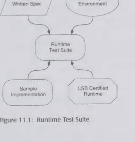

- `/src`：包含 `TET` 框架源代码。
- `/include`：包含 `TET` 包含文件。
- `/bin`：包含 `TET` 框架二进制文件。
- `/test_sets/tset`：包含各个测试用例的源代码。该点之下的目录层次结构反映在 `scen.bld` 和 `scen.exec` 文件中，这些文件告诉 `TET`/`VSXgen` 要构建和运行哪些测试用例。
- `/test_sets/TESTROOT/tset`：包含 `/test_sets/tset` 下层次结构的副本。此目录在构建测试套件时自动构建并填充。
- `/test_sets/MAN/tset`：包含与 `/test_sets/tset` 相同的结构以及各个测试用例的手册页。这些手册页对应于测试断言。此信息对于调试测试用例失败很有用。
- `/test_sets/scripts`：包含在测试套件 `tarball` 中提供并在测试套件安装和配置期间使用的脚本。这里的脚本也随二进制包提供，以便在执行测试用例之前设置正确的环境。
- `/test_sets/results`：包含记录测试用例构建和执行结果的日志文件。以“`b`”结尾的目录包含构建结果，以“`e`”结尾的目录包含执行结果。
- `/test_sets/SRC/common`：包含库代码。一些库代码由 `VSXgen` 提供，一些特定于某个测试套件。
- `MAN/tset`：包含文档。
- `SRC/subset`：包含测试集代码。
- `tsetscripts/test_suite_name`：包含在测试套件设置和安装过程中合适时间运行的脚本。

### 11.2.2 安装 lsb-runtime-test

本节介绍如何安装 `lsb-runtime-test` 的二进制版本和源代码版本。安装 `lsb-runtime-test` 时，您始终应检查包的 `beta` 版本，以查看是否已修复您遇到的任何 `bug`。

> 除了 LSB 书面规范指定的要求外，为了正确运行测试，还必须安装以下应用程序：
>
> - `pax`
>
> - `Perl 5.x`（仅可选的 `lreport` 脚本需要）

#### 11.2.2.1 安装二进制 lsb-runtime-test

请完成以下步骤以安装 `lsb-runtime-test` 的二进制版本。

所有测试套件文件均可在 LSB 下载网站上获取。[^1]

1. 下载二进制 `RPM`。
2. 安装 `RPM`：

```bash
# rpm -i lsb-runtime-test-version.architecture.rpm
```

### 11.2.3 运行 lsb-runtime-test

请完成以下步骤以运行 `lsb-runtime-test`。

1. 注销并作为用户 `v5x0` 登录。您可能需要首先为此账户设置密码，因为在安装软件包期间未设置任何密码。


如果改为使用 `su` 切换到用户 `vxs0` 而不是登录，则某些测试将失败（例如验证 `tty` 由登录用户拥有的测试）。

2. 执行 `run_tests`：

   ```bash
   vxs0$ ./run_tests
   ```

3. 查看 `/home/tet/test_sets/results/0001e/journal` 目录中的日志文件。

示例 11.1 显示了如何运行 `lsb-runtime-test`。

```text
示例 11.1：运行 lsb-runtime-test

vxs0@rochkopper-$ run_tests
运行测试的人员姓名 (Automated)? IMA Testing
组织 [NONE]? LSB TSN&A
测试系统 (Automated)? Your Runtime
实现是否提供 bash 作为 /bin/sh..? [y]
实现是否提供 C shell...? [y]
输入内核的名称（通常是 vmlinux）..? [vmlinux]
实现是否允许用户使用 MAKEDEV 创建设备...? [n] y
实现是否支持进程核算...? [n]
实现是否支持 NIS..? [n]
/dev/loop0
正在设置回环设备
输入 root 密码：
密码： *****
------------------------------------------------------------
正在执行测试套件

这些测试套件运行几个小时并不罕见。
tcc: 日志文件为 /home/tet/test_sets/results/0001e/journal
11:46:13 执行 /tset/ANSI.os/charhandle/Misalnum/T.isalnum
11:46:14 执行 /tset/ANSI.os/charhandle/Misalpha/T.isalpha
11:46:15 执行 /tset/ANSI.os/charhandle/Miscntrl/T.iscntrl
11:46:17 执行 /tset/ANSI.os/charhandle/Misdigit/T.isdigit
11:46:18 执行 /tset/ANSI.os/charhandle/Misgraph/T.isgraph
...
```

### 11.2.4 解释 TET 基础测试结果

本节将帮助您了解 `TET` 基础测试结果如何映射到通过或失败。

#### 11.2.4.1 理解 TET 结果代码

执行测试用例将导致创建日志文件。测试用例的结果代码位于 `/home/tet/test_sets/results/xxxx/journal` 中的日志文件中，其中 `xxxx` 是从 `0001` 开始的四位数字，随着每次测试套件运行而增加。测试用例编译的结果放在类似命名目录的日志文件中，但以“`b`”结尾而不是“`e`”。结果代码在以下日志文件中找到：

- `vrpt`：`vrpt` 将生成一份报告，详述所有执行的测试用例及其结果。有几种结果类型，可以分为两个主要组，`PASS` 或 `FAIL`；有关结果分类，请参阅下文。对于未通过的测试用例，还将输出测试断言和测试策略。
- `tjreport`：二进制测试套件还随附 `tjreport` 工具。这将生成所有运行测试用例及其结果的摘要，或者可选择仅显示失败的测试用例。它还可用于智能比较两个日志文件并显示两次测试运行之间结果不同的测试用例。
- `原始日志文件`：如果您想手动解释原始日志文件，请参阅 `TETware` 用户指南的附录 `C`。[^2] 该指南描述了文件格式。

以下列表解释了 `TET` 的通过和失败结果代码。

**通过的结果代码**

- `PASS`：测试已正确执行并完成，没有任何问题。
- `WARNING`：功能可接受，但请注意相关标准或规范的后续修订可能会更改此区域的要求。
- `FIX`：提供了附加信息，需要手动检查。当默认情况下测试套件时，会出现 `FIX` 结果无法确定结果是 `PASS`（通过）还是 `FAIL`（失败）。对于 LSB 认证，当您将测试结果提交到 `Web` 认证系统时，必须将这些结果签署为已解决并归为 `PASS`。
- `UNSUPPORTED`（不支持）：可选功能在正在测试的实现中不可用或不支持。
- `NOTINUSE`（未使用）：某些测试在特定的测试模式下可能不需要。此外，当接口可以通过宏或函数实现，且存在两个版本的测试时，通常只使用其中一个。
- `UNTESTED`（未测试）：未编写测试来检查某个特定功能，或者执行测试所需的可选设施在系统上不可用。

**测试失败代码**

出于合规性测试目的，以下结果代码被视为失败（除非该失败已在问题报告数据库中被商定的问题报告豁免）。

- `FAIL`（失败）：接口的行为与预期不符。
- `UNINITIATED`（未启动）：相关的特定测试未开始执行。
- `UNRESOLVED`（未解决）：测试已启动，但未达到测试能够报告成功或失败的状态。
- `UNREPORTED`（未报告）：在测试集执行期间发生了重大错误。


> 对于这些结果代码，`F` 代表函数（`function`），`M` 代表宏（`macro`）。操作系统测试集驱动程序除了底层函数外，还自动为每个接口的宏版本生成测试。一般来说，很少有函数接口被实现为宏，因此该列中的 `NOTINUSE` 计数较高。

### 11.2.5 调试基于 TET 的测试套件

本节说明了如何分析基于 `TET` 的测试套件中的测试失败。此外，还有额外的 `TET` 文档可供参考。³

以下列表解释了一些通用的调试提示：

- `in_rpt()` 调用的工作方式类似于 `printf()`，其输出会被写入日志文件。
- 编辑测试用例的 `makefile`（位于测试用例代码所在的同一目录中），并在编译行中添加调试标志。
- 许多测试会创建子进程并在子进程中执行测试代码，或与父进程进行某种形式的通信。在适当的位置添加 `sleep()` 调用可能有助于使用调试器进行附加（特别是在 `gdb` 难以跟随 `fork` 操作时）。
- 通常，编写一个小的独立程序，以测试用例代码为指导，尝试执行与测试相同的内容，会很有用。这有助于将实现问题与测试用例及测试框架问题隔离开来，并且通常更容易调试。此外，上游维护者在修复错误时，会赞赏（甚至可能要求）提供一个易于编译和执行的测试程序。

#### 11.2.5.1 设置调试环境

为了设置调试基于 `TET` 的测试套件的环境，您必须以用户 `vx0` 身份登录，并在 `vx0` 主目录中点入 `profile` 文件，如下所示：

```
vx0 . profile
```


> 仅凭测试套件的二进制版本所能进行的分析是有限的，因为它们是在没有调试符号的情况下编译的。

3. `http://tewrorks.opengroup.org/documents/docs33.html`

您还可以通过编辑文件 `/home/tet/test_sets/TESTROOT/tetexec.cfg` 来启用在执行测试期间输出某些调试信息。此脚本自动化了 `TET` 和 `VSXgen` 的标准构建和设置过程。请编辑 `VSX_DEBUG_FLAGS` 设置如下：

```
VSX_DEBUG_FLAGS=t:d,trace:1,2
```

同一文件中的设置 `VSX_DEBUG_FILE` 指定了调试信息的存放位置。参考测试套件的源代码，通常可以确定执行的代码路径。源码包可在 LSB 下载网站上获取。$^{4}$

### 11.2.5.2 调试单个测试用例

本节说明了如何使用和不使用 `tcc`（测试用例控制器）命令来调试单个测试用例。

使用 `tcc` 调试单个测试用例。如果您只想调试单个测试用例，可以通过不使用构建和设置脚本来节省时间。您可以使用以下任一 `tcc` 命令执行用于调试的单个测试用例：

- `vx0 tcc -e` `tcc -e` 命令的工作方式与 `tcc -b` 命令类似，但在执行测试用例时有所不同。此命令将执行所有测试用例。
- `vx0 tcc -e T.fgetpos` 此命令仅执行 `T.fgetpos` 测试。

`tcc -b`（构建模式）和 `tcc -e`（执行模式）是调用 `tcc` 的 `shell` 函数。您可以在 `TETware` 用户指南的第 6 章中查阅 `tcc` 用法的更多详细信息。$^{5}$

有关不使用 `tcc` 调试单个测试用例的信息，请参见第 11.2.5.4 节。

### 11.2.5.3 重新构建和执行测试用例

一旦 `TET`/`VSXgen` 框架配置并构建完成，您就可以（重新）构建和（重新）执行部分或所有测试用例。文件 `/home/tet/test_sets/scen.bld` 指定了将被构建的测试用例，`/home/tet/test_sets/scen.exec` 指定了将被执行的测试用例。

示例 11.2 展示了如何通过编辑 `scen.bld` 和 `scen.exec` 文件来执行特定的测试用例。在编辑文件之前，您应该备份这两个文件。

#### 示例 11.2：编辑 scen.bld 和 scen.exec 以执行特定测试用例

编辑前，这两个文件的外观如下：


```
/tset/ANSI.C/charhandle/isanum/T.isalnum
/tset/ANSI.C/genuits/strtod_X/T.strtod_X
/tset/ANSI.C/genuits/strtou_X/T.strtou_X
/tset/ANSI.C/genuits/system_X/T.system_X
/tset/ANSI.C/jump/longjmp/T.longjmp
/tset/ANSI.C/jump/setjmp/T.setjmp
/tset/ANSI.C/locale/setlocale/T.setlocale
/tset/ANSI.C/maths/acos/T.acos
/tset/ANSI.C/streamio/setbuf/T.setbuf
/tset/ANSI.C/streamio/tmpfile/T.tmpfile
/tset/ANSI.C/streamio/tmpnam/T.tmpnam
/tset/LSB.LL/utilis/od/od.sh
/tset/LSB.LL/utilis/wc/wc.sh
/tset/LSB.LL/utilis/cpio-fh/cpio-fh.sh
/tset/LSB.LL/utilis/find/fh/find.sh
/tset/LSB.fhs/root/bin/boot-tc.sh
/tset/LSB.fhs/root/bin/boot-tc.sh
/tset/LSB.fhs/root/Get/dev-tc.sh
/tset/LSB.fhs/root/sbin/sbin-tc.sh
/tset/LSB.fhs/root/srv/srv-tc.sh
/tset/LSB.fhs/root/tmp/tmptc.sh
/tset/LSB.fhs/usr/xl16/xll6-tc.sh
/tset/LSB.fhs/usr/x386/x386-tc.sh
/tset/LSB.fhs/usr/bin/bin-tc.sh
/tset/LSB.fhs/usr/include/include-tc.sh
/tset/LSB.fhs/var/lib/lib-tc.sh
/tset/LSB.fhs/var/lib-misc/lib-misc-tc.sh
/tset/LSB.fhs/var/lock/lock-tc.sh
/tset/LSB.fhs/var/log/log-tc.sh
/tset/LSB.fhs/var/mail/mail-tc.sh
/tset/LSB.fhs/var/opt/opt-tc.sh
/tset/LSB.fhs/linux/var-spool-cron/var-spool-cron-tc.sh
/tset/LSB.os/aio/aio_cancel/T.aio_cancel
```

```
/tsset/LSB.os/aio/llo_listio/T.llo_listio

/tsset/LSB.os/aio/llo_listio_X/T.llo_listio_X

/tsset/LSB.os/devclass/grantpL/T.grantpL

/tsset/LSB.os/devclass/getpname_L/T.getpname_L

/tsset/LSB.os/files/dev_null/T.dev_null

/tsset/LSB.os/files/dev_tty/T.dev_tty

/tsset/LSB.os/files/sekdir/T.sekdir

/tsset/LSB.os/files/telldir/T.telldir

/tsset/LSB.os/files/tellidr_L/T.tellidr_L

/tsset/LSB.os/genus/closetpg_L/T.closetpg_L

/tsset/LSB.os/genius/fmatch/T.fmatch

/tsset/LSB.os/genius/ftw/T.ftw

/tsset/LSB.os/genius/wordexp/T.wordexp

/tsset/LSB.os/streamio/fgetpos/T.fgetpos

/tsset/LSB.os/streamio/fsetpos/T.fsetpos

/tsset/LSB.os/string/mblen/T.mblen

/tsset/LSB.os/string/mblen_L/T.mblen_L

/tsset/LSB.os/string/mbtowcs/T.mbtowcs

/tsset/LSB.os/string/memmove/T.memmove
```

编辑后，这两个文件的外观如下：

```
/tsset/LSB.fhs/root/bin/bin-tc.sh

/tsset/LSB.fhs/root/boot/boot-tc.sh

/tsset/LSB.fhs/root/dev/dev-tc.sh

/tsset/LSB.fhs/root/sbin/sbin-tc.sh

/tsset/LSB.fhs/root/srv/srv-tc.sh

/tsset/LSB.fhs/root/tmp/tmp-tc.sh

/tsset/LSB.fhs/usr/x11r6/x11r6-tc.sh

/tsset/LSB.fhs/usr/x36/x36-tc.sh

/tsset/LSB.fhs/usr/bin/bin-tc.sh

/tsset/LSB.fhs/usr/include/include-tc.sh

/tsset/LSB.fhs/var/lib/lib-tc.sh

/tsset/LSB.fhs/var/lib-misc/lib-misc-tc.sh

/tsset/LSB.fhs/var/lock/lock-tc.sh

/tsset/LSB.fhs/var/log/log-tc.sh

/tsset/LSB.fhs/var/mail/mail-tc.sh

/tsset/LSB.fhs/var/opt/opt-tc.sh

/tsset/LSB.fhs/linux/var-spool-cron/var-spool-cron-tc.sh
```

### 11.2.5.4 直接执行测试二进制文件

有时直接执行测试二进制文件会很有用（例如，如果您希望使用更简单的方法来附加调试器）。虽然测试用例的源码位于 `/home/tset/test_sets/tsset`，但当它们被构建时，二进制文件会被放置在 `/home/tset/test_sets/TESTROOT/tsset` 下的相同目录层次结构中。

若要直接运行测试二进制文件，请完成以下步骤：

1. 以 `vsx0` 用户身份登录。
2. 设置以下环境变量：
   ```
   vsx0$ export TET_CONFIG=${TET_EXECUTE}/tetexec.cfg
   vsx0$ export TET_CODE=$HOME/tet_code
   ```
3. 切换到包含测试用例的目录并运行可执行文件。
4. 当前目录下不会创建日志文件，但原本应包含在该测试日志文件中的内容将保留在 `tet_xres` 中。

### 11.2.5.5 执行单个测试用例

`lsb-runtime` 测试的最小粒度级别允许你执行单个测试。大多数测试都可以以这种方式执行，但有些测试依赖于测试集中较早测试的执行，在这种情况下，只能将一组依赖测试作为单个单元执行。

`tcc` 可以从单个测试集中执行选定的测试用例的一次性运行。例如，要运行 `POSIX.os` 类别中 `T.write` 测试用例的第 3、7 和 8 个测试用例，请使用以下命令：

```
vsx0$ tcc -e -l /tset/POSIX.os/ioprim/write/T.write{3,7,8}
```

### 11.2.5.6 仅运行失败的测试

要执行之前运行中失败的测试集，请使用以下命令：

```
vsx0$ tcc -e -r code-list other-options old-journal-file
```

`code-list` 是要重新执行的结果代码的逗号分隔列表。`other-options` 是其他 `tcc` 选项（例如，`-y` 或 `-n`）。`old-journal-file` 是提取代码的日志文件。例如，要从日志文件 `results/0002e/journal` 中重新执行所有代码为 `FAIL`、`UNRESOLVED` 和 `UNINITIATED` 的失败测试，请使用以下命令：

```
vxs0$ cd results

vxs0$ tcc -e -r FAIL,UNRESOLVED,UNINITIATED \
-s .. /scen.exec 0002e/journal
```

### 11.2.6 安装 `lsb-runtime-test` 的源代码

请完成以下步骤以安装 `lsb-runtime-test` 的源代码版本。

所有测试套件文件均可在 LSB 下载网站上获取。[^1]

1. 下载源代码 RPM 包。
2. 安装该 RPM 包：
   ```
   # rpm -i lsb-runtime-test-version.src.rpm
   ```
3. 将文件 `lsb-runtime-tests-version.tar.gz` 复制到 `/home/tet` 目录（或你希望安装测试套件的目录）：
   ```
   # cp lsb-runtime-tests-version.tar.gz /home/tet
   ```
4. 解压该文件：
   ```
   tar xvfz lsb-runtime-tests-version.tar.gz
   ```
5. 从解压文件的目录运行 `install.sh`：
   ```
   # ./install.sh
   ```
   将显示你安装的所有软件包的信息，随后显示如何继续操作的说明。
6. 注销并以用户 `vsx0` 身份登录。你可能需要首先为该账户设置密码，因为在安装软件包期间未设置任何密码。
7. 通过运行 `/home/tet/setup.sh` 来构建测试框架：
   ```
   vsx0$ ./setup.sh
   ```

[^1]: http://www.linuxbase.org/download/


如果你想安装额外的测试套件，请以用户 `vsx0` 身份将该测试套件的 tarball 解压到 `/home/tet/tet_test_sets` 中，并再次运行 `setup` 脚本。

### 11.2.7 配置 `lsb-runtime-test`

要配置 `lsb-runtime-test`，请按照屏幕上的说明操作并回答问题，以适配你的测试场景。示例 11.3 显示了默认测试场景的问题和答案。

### 示例 11.3：默认测试场景

```
Setup loopback disk? [y]
Enter loopback device to use [/dev/loop0]
Run config.sh ...? [y]
Which test mode do you require
(from: POSIX96 UNIX98) [UNIX98]?
What is your name [Unknown]?
What is the agent for whom you are running VSX [Unknown]?
What is the system on which you are running VSX [Unknown]?
Where is the root directory of the tree from which the
testsets will be executed !/home/tet/test_sets/TESTROOT]?
How fast is your machine (1=very fast, 10=slow) [5]?
The system include directories (in order of searching) are:
/usr/include
Is this correct (y/n) [y]?
What is your C compiler called (must be c89 for
UNIX98 registration runs) [/usr/bin/cc]?
What command line options does your C compiler need [-ansi]?
What link editor options does your C compiler need [none]?
Searching for archive maintenance tools ...
There are no additional libraries needed to compile VSX
Is this correct (y/n) [y]?
Using C compiler to establish understanding of type "long double"
*** Compiler supports type "long double"
What command line options does C compiler need, instead of the normal
options, when compiling thread-safe programs [none]?
Which library is your maths library [-lm]?
(should be of form: -l<name> or full pathname)
What is the mountable device to be used for ENOSPC testing [/dev/loop0]?
Producing a new parameter file in /home/tet/test_sets/SRC/vsxparams
```


配置问题的默认值是用于构建测试套件二进制版本时所使用的值。如果你认为某个设置对于你正在测试的平台是错误的，请发送邮件至 `lsib-test@freestandards.org`。

有关运行 `lsb-runtime-test` 的更多信息，请参见第 11.2.3 节。

### 11.2.8 构建 `lsb-runtime-test`

你可以使用 `tcc` 命令来构建 `lsb-runtime-test`。

要构建所有测试用例，请使用以下命令：

```
vx$ tcc -b
```

构建时显示测试用例的名称，但不会显示构建失败。你应该检查日志文件以查看任何失败情况，特别是如果你修改了测试用例代码。

你也可以使用 `tcc` 命令来构建可用测试用例的子集。以下示例展示了使用 `tcc -b` 命令进行此操作的两个不同方法。

```
vx$ tcc -b T.fgetpos
```

从 `lsb-os` 测试套件中构建 `/tset/LSB.os/streamio/fgetpos/T.fgetpos`。

```
vx$ tcc -b string
```

从 `lsb-os` 测试套件中构建以下测试用例：

- `/tset/LSB.os/string/mblen/T.mblen`
- `/tset/LSB.os/string/mblen_L/T.mblen_L`
- `/tset/LSB.os/string/memmove/T.memmove`
- `/tset/LSB.os/string/wcstombs/T.wcstombs`
- `/tset/LSB.os/string/wctomb/T.wctomb`

### 11.3 使用非 TET 基础测试

### 11.3.1 使用 `lslibchk`

`lslibchk` 用于验证当前系统的运行时系统库是否似乎符合 LSB。 `lslibchk` 检查对象格式、是否存在所有必需的库、库是否包含 LSB 要求的所有接口，以及接口是否具有 LSB 要求的符号版本。然后，`lslibchk` 会打印出任何问题。

你还可以使用 `lslibchk` 配合 `-M` 标志仅检查特定模块中的库。

#### 11.3.1.1 安装 `lslibchk`

要安装 `lslibchk` 的二进制 RPM 包，请完成以下步骤。

1. 从 `http://www.linuxbase.org/download/` 下载该软件包。
2. 安装二进制 RPM 包：
   ```
   # rpm -i lslibchk-version.architecture.rpm
   ```

#### 11.3.1.2 运行 `lslibchk`

你可以通过执行以下命令来运行 `lslibchk`：

```
# /opt/lsb/bin/lslibchk [-M modulename]
```

**示例 11.4** 显示了 `lslibchk` 的输出。

如果库存在任何问题，将在相应的库符号检查消息下方显示错误信息。如果你的运行时环境包含规范所需库的多个版本，你还应该验证测试程序是否定位到了正确的库。

将生成一个名为 `journal.1.lsbeck` 的文件（示例 11.5），其中包含关于已执行测试及其结果的详细信息。

### 示例 11.4：运行 `lsbchk`


```
Checking symbols in /lib/ld-lsb.so.1
Checking symbols in /usr/lib/libGL.so.1
Checking symbols in /usr/X11R6/lib/libICU.so.6
Checking symbols in /usr/X11R6/lib/libSM.so.6
Checking symbols in /usr/X11R6/lib/libX11.so.6
Checking symbols in /usr/X11R6/lib/libXext.so.6
Checking symbols in /usr/X11R6/lib/libXt.so.6
Checking symbols in /lib/libcrypt.so.1
Checking symbols in /lib/libdl.so.2
Checking symbols in /lib/libm.so.6
Checking symbols in /lib/libncurses.so.5
Checking symbols in /lib/libpthread.so.0
Checking symbols in /lib/librt.so.1
Checking symbols in /lib/libutil.so.1
Checking symbols in /usr/lib/libz.so.1
```

### 示例 11.5：一个 `journal_.lsbchk` 文件

```
0|lsb-0.1 14:50:07 20040113
|User: nicole (0) TCC Start, Command line: lsbchk
5|Linux suefan.chelsea.com 2.4.20-8 
#1 Sat Aug 26 13:24:28 EST 1984 i686 
|System Information
30|VSX_NAME=lsb1bchk version
10|/lib/ld-lsb.so.1 14:50:07
400|1 1 14:50:07|IC Start
200|1 1 0 14:50:07|Looking for library /lib/ld-lsb.so.1
220|1 1 0 14:50:07|PASS
520|1 1 0 0 0|FILE_SIZE 10450
520|1 1 0 0 0|BINARY_MD5SUM=727978f21c43e021a77c8b396ae82db
410|1 1 14:50:07|IC End
400|1 2 14:50:07|IC Start
200|1 2 0 14:50:07|Check header id EI_MAG0 is ELFPMAG0
220|1 2 0 14:50:07|PASS
410|1 2 14:50:07|IC End
400|1 3 14:50:07|IC Start
200|1 3 0 14:50:07|Check header id EI_MAG1 is ELFPMAG1
220|1 3 0 14:50:07|PASS
410|1 3 14:50:07|IC End
400|1 4 14:50:07|IC Start
200|1 4 0 14:50:07|Check header id EI_MAG2 is ELFPMAG2
220|1 4 0 14:50:07|PASS
410|1 4 14:50:07|IC End
400|1 5 14:50:07|IC Start
```

## 11.3 使用基于非 TET 的测试

```
200|1 5 14:50:07|Check header id EL_MAG3 is ELFNG3
220|1 5 0 14:50:07|PASS
410|1 5 14:50:07|IC End
400|1 6 14:50:07|IC Start
200|1 6 14:50:07|Check header id EL_CLASS is ELFCLASS32
220|1 6 0 14:50:07|PASS
410|1 6 14:50:07|IC End
400|1 7 14:50:07|IC Start
200|1 7 14:50:07|Check header id EL_DATA is ELFDTATA2LSB
220|1 7 0 14:50:07|PASS
410|1 7 14:50:07|IC End
400|1 8 14:50:07|IC Start
200|1 8 14:50:07|Check header id EL_VERSION is EV_CURRENT
220|1 8 0 14:50:07|PASS
410|1 8 14:50:07|IC End
400|1 9 14:50:07|IC Start
200|1 9 14:50:07|Check header id EL_OSABI is ELFOSABI_SVSV
220|1 9 0 14:50:07|PASS
410|1 9 14:50:07|IC End
400|1 10 14:50:07|IC Start
200|1 10 14:50:07|Check header id EL_ABIVERSION is 0
220|1 10 0 14:50:07|PASS
410|1 10 14:50:07|IC End
400|1 11 14:50:07|IC Start
200|1 11 14:50:07|Check header field e_type is ET_DYN
220|1 11 0 14:50:07|PASS
410|1 11 14:50:07|IC End
400|1 12 14:50:07|IC Start
200|1 12 14:50:07|Check header field e_machine is EM_386
220|1 12 0 14:50:07|PASS
410|1 12 14:50:07|IC End
400|1 13 14:50:07|IC Start
200|1 13 14:50:07|Check header field e_version is EV_CURRENT
220|1 13 0 14:50:07|PASS
410|1 13 14:50:07|IC End
400|1 14 14:50:07|IC Start
200|1 14 14:50:07|Check header field e_flags is 0
220|1 14 0 14:50:07|PASS
410|1 14 14:50:07|IC End
10|2 libc.so.6 14:50:07|
200|2 1 14:50:07|Looking for library libc.so.6
520|2 1 0 0.0|Found match for libc.so.6 as /lib/tls/libc.so.6
```

### 11.3.2 使用 `lsb-test-pam`

`lsb-test-pam` 测试验证应用程序的认证机制，并允许本地系统管理员选择单个应用程序如何验证用户。

#### 11.3.2.1 安装 `lsb-test-pam`

按照以下步骤安装 `lsb-test-pam`：

1. 从 LSB 下载网站下载该软件包。<sup>7</sup>
2. 使用以下命令安装二进制 RPM 软件包：

```
# rpm -ihv lsb-test-pam-version.architecture.rpm
```

#### 11.3.2.2 运行 `lsb-test-pam`

1. 注销并以用户 `vsx0` 的身份登录。您可能需要先为此账户设置密码，因为在安装该软件包时未为其设置任何密码。
2. 使用以下命令执行 `run_tests`：

```
vsx0$ ./run_tests
```

示例 11.6 展示了如何运行 `lsb-test-pam`。

**示例 11.6：运行 `lsb-test-pam`**

```
Name of person running tests (Automated)? Sparky
Organization (NONE)? TSMA
Test System (UNKNOWN)? lsbtest1
Block special filename (!)?
Enter name of the user for PAM tests [vsx0] :
Enter password of the user for PAM tests : ******
Enter password of the test user vsx1 : ******
Enter password of the test user vsx2 : ******
Install /etc/pam.d/lsbpam_conf . ? [y]
Enter root password: ******
Password:
Updating the account properties of users vsx1 and vsx2
sets the vsx1 account to have a password that needs to be updated
sets the vsx2 account to be expired

Enter root password: ******
Password:
```

示例 11.7 展示了 `lsb-test-pam` 的日志文件。

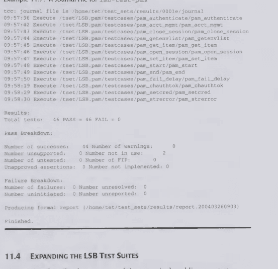

### 11.4 扩展 LSB 测试套件

本节描述了如何通过添加新测试来扩展测试套件。

#### 11.4.1 新测试套件的准则

为了对认证测试有用，测试用例应满足以下若干准则：


这些准则取自 Open Group 的测试套件验收标准。<sup>8</sup>

#### 11.4.2 编写基于 TET 的测试套件

本节将帮助您从高层面理解测试开发过程。该过程包括以下高层步骤。

##### 11.4.2.1 制定规范

该规范应包含关于测试套件的以下信息：

- 测试方法
- 功能覆盖范围
- 测试架构
- 假设条件
- 开发计划

##### 11.4.2.2 制定正式断言集合

此步骤的目的是从规范中创建可测试语句列表。这是规范语言与实际测试代码之间的中间步骤。

正式的测试断言应弥合规范语言与测试套件代码之间的差距。同样，测试代码的目标是产生规范需求的可执行表示。使用基于断言的技术开发的测试套件应满足以下要求：

- 必须遵循 IEEE 标准测试方法 (`1003.3`)。
- 必须为受测规范中的每个确定性语句开发一个断言。
- 每个断言的设计都必须用于测试受测实现中该语句是真是假。

##### 11.4.2.3 断言审查

断言审查有助于识别断言编写者做出的不良假设，以及被测规范中的歧义或错误。

##### 11.4.2.4 测试用例开发

这包括将断言映射到试图验证它们的实际代码。测试用例编写者应尝试遵循第 11.4.1 节中列出的准则，特别是每次只测试一件事，并避免测试用例之间产生副作用。在尝试调试测试失败时，这两个特性尤其有价值。

##### 11.4.2.5 测试用例审查

让其他人在各种实现上运行测试用例有助于发现测试用例代码和底层规范中的问题。测试用例审查用于验证测试套件。审查应遵循以下准则：

- 使用审查准则和预设响应格式。
- 评论应具体。
- 评论应包括具体操作。

### 11.4.3 将现有测试套件转换为使用 TET/VSXgen 框架

有两种方法可以将现有测试用例转换为在 LSB 使用的 TET/VSXgen 框架中可用。本节描述了每种方法。

#### 11.4.3.1 在原始测试用例源代码中添加特定于 TET 的调用

此方法最适合包含一系列宏的测试用例。例如：

```
ASSERT(foo==5, "Foo was not 5");
```

#### 11.4.3.2 用支持 TET 的 Shell 代码封装二进制文件

此方法最适合那些返回信息性退出代码或可解析错误消息的测试用例，以便可以使用 shell 脚本封装器将这些转换为 TET 返回代码。虽然此方法允许重用现有的测试用例代码，但它可能使测试套件更难调试，结果更难理解。

### 11.5 下载 LSB 测试套件

要获取 LSB 测试套件，请访问 LSB 下载网页。<sup>9</sup> 表 11.1 表示可以通过万维网访问的信息。

| 规范版本 | 软件包 | 版本 | 架构 |
| :--- | :--- | :--- | :--- |
| 2.0 | `lsb-runtime-test` | 2.0.0-1 | IA86, IA64, PPC, PPC64, S390, S390X, x86_64, SRC |
| 2.0 | `lsb-test-pam` | 2.0.0-1 | IA86, IA64, PPC, PPC64, S390, S390X, x86_64, SRC |
| 2.0 | `lsb-test-vsw4` | 2.0.0-1 | IA86, IA64, PPC, PPC64, S390, S390X, x86_64, SRC |
| 2.0 | `lsb-test-c++` | 2.0.0-1 | IA86, IA64, PPC, PPC64, S390, S390X, x86_64, SRC |
| 2.0 | `lsblibcck` | 2.0.0-1 | IA86, IA64, PPC, PPC64, S390, S390X, x86_64, SRC |

## 第十二章 使用示例实现

LSB 示例实现（LSB-si）是一个用于测试目的的最小 LSB 兼容运行时环境。你可以将其视为一个你可以完全控制的小型 Linux 发行版。它可以作为独立系统启动，托管在虚拟机内部，或者以 `chroot` 模式运行。使用托管模式特别方便，因为它允许 LSB 测试环境存在于系统上而不干扰基础系统，从而减少了对多台专用 LSB 测试机器的需求。

LSB 合规应用程序应在 LSB-si 中进行测试，以确保它们没有引入任何发行版特定的怪癖。如第七章所述，LSB 认证计划要求应用程序必须在 LSB-si 下经过测试。

LSB-si 还可用于各种验证场景，在这些场景中，希望将安装环境限制为 LSB 所需的最小集合。

### 12.1 理解示例实现

LSB-si 是一个运行时环境实现的示例。它是 LSB 书面规范中明确要求和隐含要求元素的累积，再加上使运行时环境正常工作所需的任何依赖项。

LSB-si 有三个主要目的。首先，它是一个示例实现，用于演示 LSB 书面规范的功能和正确性。其次，它展示了如何从当前的开源软件包构建 LSB 兼容系统，而无需进行大量的特殊补丁。第三，LSB-si 是一个测试沙箱，有助于评估应用程序的 LSB 合规性。如果应用程序因为需要 LSB-si 中未找到的某些东西而失败，那么这是一个机会，可以修剪或重新制作应用程序的依赖项，以使其更好地符合 LSB。

LSB-si 是一个`示例实现`，而不是`参考实现`。区别在于，示例实现展示了符合规范的一种方式，而参考实现则作为合规验证的基线。在参考实现场景中，其他实现者必须与参考实现兼容，包括其中无意存在的所有功能和缺陷。此外，参考实现会限制其他实现的演变，因为即使是合法的增强或修复也会偏离参考实现，从而破坏一致性。

LSB 是一种 ABI 规范，旨在捕获符合系统功能要求，而不锁定任何特定的实现、软件包版本等作为标准。通过指定必需元素的行为并避免参考实现，LSB 允许符合的运行时环境和应用程序在书面规范的 ABI 约束内演变。

### 12.2 设置示例实现

LSB-si 可以在三种不同的模式之一运行：`chroot` LSB-si、UML LSB-si 和可启动的 Knoppix LSB-si。每种模式的软件都可以从 LSB 下载网站下载。[1]

1. http://www.linuxbase.org/download/

#### 12.2.1 使用 chroot 的示例实现 (1)

`chroot` LSB-si 以压缩的 tarball 形式分发，超级用户只需将其解压缩即可（示例 12.1）。稍后，可以在其上方叠加其他部分，并可以在其中安装用于额外功能的软件包。为了说明目的，以下示例将使用 IA32 (x86) 架构。根据你的情况，你可能需要替换适当的 LSB 架构和版本。

**示例 12.1：在 IA32 (x86) 架构上安装 LSB-si**

```
# mkdir /opt/lsbsi-ia32
# cd /opt
# tar jxvf /tmp/lsbsi-ia32-2.0.1.tar.bz2
```

通过运行 `/sbin/chroot` 命令可以启动 LSB-si（示例 12.2；某些发行版将此命令放在 `/usr/sbin` 中）。

**示例 12.2：通过 `/sbin/chroot` 命令启动 LSB-si**

```
# /sbin/chroot /opt/lsbsi-ia32
```

要模拟登录会话，请使用示例 12.3 中所示的此命令。

**示例 12.3：登录会话**

```
# /sbin/chroot /opt/lsbsi-ia32 /bin/bash -l
```

在 `chroot` 中工作时，只有 `chroot` 树内的文件可访问。由于这限制了环境的实用性，应提前采取一些步骤使必要的文件可用。一种方法是简单地将文件从 `chroot` 复制到合适的位置。如果主机系统上还有其他窗口或终端会话，也可以随时以相同方式将文件复制到 `chroot` 树中（示例 12.4）。

**示例 12.4：将文件复制到 `chroot`**

```
# cp mypackage.rpm /opt/lsbsi-ia32/tmp
```

另一种方法是在启动 *chroot* 之前建立绑定挂载。这些绑定挂载使主机的文件系统的一部分看起来像是在 *chroot* 内部。将用户的主目录绑定挂载到 *chroot* 中的相同位置，将使用户的文件在 *chroot* 内部看起来与在主机系统上位于相同路径。示例 12.5 显示设置对 *username* 主目录中文件的访问。

**示例 12.5：绑定挂载**


```
# mkdir /opt/lsbsi-ia32/home/username
# mount -o bind /home/username /opt/lsbsi-ia32/home/username
```

> 这不会使用户账户本身存在于 `chroot` 中。应使用 `useradd` 命令添加该账户。该账户应被分配与主机系统上相同的 `userid`。

`LSB-si` 将自己限制在 LSB 书面规范所要求的命令和功能中，这是一组用于最小化安装、配置和管理已安装软件的集合。这有一些测试优势，但这也意味着可能有少数组件缺失。绕过这些并不困难，但 `LSB-si` 的理念是将它们排除在外；通过必须明确安装它们，你会意识到这些实际上在系统中并非标准化的领域。

`rpm` 工具需要访问 `/proc` 来计算磁盘空间（挂载的文件系统表是通过 `/proc` 找到的）。然而，`/proc` 不是 LSB 书面规范的一部分。最简单的变通方法是在 `LSB-si` 的 `/etc/fstab` 中添加一行描述它，这样你可以简单地执行 `mount /proc`。示例 12.6 显示了这样一行，但最好只是从主机系统的 `/etc/fstab` 复制该行。

**示例 12.6：将 /proc 添加到 fstab**

```
none /proc proc defaults 0 0
```

根据你的需求，你可能还需要对其他伪文件系统（如 `/dev/shm` 和 `/dev/pts`）执行类似的步骤。

你可能习惯的一些命令可能缺失，包括编辑器和开发工具。许多开发人员发现，在一个窗口环境中工作很有用，其中一个窗口运行 `LSB-si chroot`，其他窗口设置为能够根据需要编辑和修改文件。

示例 12.7 说明了将可安装软件包复制到 `chroot` 树中，启动 `chroot`，安装软件包并运行它。由于此示例将使用主机系统上的 X 服务器，因此在启动 `chroot` 之前包含一个额外的设置步骤以启用对该服务器的访问。

**示例 12.7：在 chroot 上安装软件包**

```
# cp lsb-xpaint-2.6.2-3.1486.rpm /opt/lsbsi-ia32/tmp
# xhost +localhost
# /sbin/chroot /opt/lsbsi-ia32
# cd /tmp
# rpm -i lsb-xpaint-2.6.2-3.1486.rpm
# rpm -qa
# export DISPLAY=localhost:0
# /opt/lsb-xpaint/bin/xpaint
```

对于网络应用程序，可能需要额外的支持。例如，`/etc/services` 文件未由 LSB 描述，因此不存在于 `chroot` 中。如果需要，只需从主机系统复制过来即可。

此外，如果要测试服务器（守护进程），首先需要设置它以监听适当的端口；其次，主机上任何冲突的系统必须被禁用，以便连接实际到达 `LSB-si chroot` 中的守护进程。

基础 `LSB-si` 没有 `inetd` 或 `xinetd` 服务器，因此默认情况下无法使用它们来监听服务请求。可以安装 `lsb-si-archtest` 包以提供 `inetd`。示例 12.8 展示了 `lsb-runtime-test` 的正常运行过程，用于验证 `LSB-si`。`lsb-test` 包之前已安装。测试的一部分需要 `syslog` 守护进程，因此首先关闭宿主系统的 `syslogd`。测试设置需要一个真实的登录，因此启动 `inetd` 以监控 `telnet` 守护进程。

### 示例 12.8：使用 lsb-test 包运行 inetd

```
# sh /etc/init.d/syslog stop
# /usr/sbin/chroot /opt/lsbsi-ia32
# mount /proc
# /sbin/syslogd -m 0
# /usr/sbin/inetd
```

现在使用 `telnet` 连接到 `LSB-si chroot`，并以 `LSB-si` 内部定义的用户身份登录（示例 12.9）。

### 示例 12.9：连接到 chroot

```
$ telnet localhost
```

## 12.2.2 使用 UML 的示例实现

`UML LSB-si` 运行在一个封装在文件中的 `root_filesystem` 上。除非运行 `hostfs`，否则 `LSB-si` 无法“看到”此文件系统之外；在这种情况下，可以挂载并访问宿主机的文件系统树。这是将文件（如软件包）安装到 `UML LSB-si` 中的最简单方法。

也可以将文件复制到 `UML LSB-si` 的 `root_fs`（根文件系统文件）中。这有点棘手，因此请小心操作（示例 12.10）。

### 示例 12.10：将文件复制到 root_fs

```
# mkdir /mnt/lbsi
# losetup /dev/loop0 /opt/lsb-umlsi/lib/root_fs
# mount /dev/loop0 /mnt/lbsi
# cp lsb-lynx-2.8.4-1.1486.rpm /mnt/lbsi/tmp
# umount /mnt/lbsi
# losetup -d /dev/loop0
```

`UML LSB-si` 通过运行 User-Mode Linux 内核启动；可由可安装（RPM 或 Debian）包提供的脚本以适当的参数执行此操作。如果之前未运行过，`Configure` 脚本将在此处运行，以设置托管 UML 示例实现的重要组成部分（示例 12.11）。

### 示例 12.11：运行 Configure 脚本

```
# /opt/lsb-umlsi/bin/umlsi
```

使用 UML 的一个优势是，它允许在用户空间运行整个系统（包括内核）。这使得无需在宿主系统上实际安装新内核即可测试和调试支持 LSB 的内核。此外，UML 更严格地将 `LSB-si` 与宿主系统隔离。

## 12.2.3 使用可引导的示例实现

基础 tarball 加上 `lsbsi-arch-boot` tarball 几乎足以构成一个完整的独立可引导系统。缺少的两个组成部分是 Linux 内核和引导加载程序设置，此外还有一些最终配置需要手动完成。示例 12.12 到 12.15 展示了在已可引导的系统上构建可引导 `LSB-si` 分区的步骤。你需要进一步补充这些内容，才能将它们放置在一个没有现有 Linux 安装的“全新”系统上。

找到一个未使用的分区，例如 `/dev/sda9`，并在其上创建适当的文件系统（使用 `mk2fs` 的 `-j` 选项创建日志文件系统，即 `ext3`）。此分区现在将包含大部分可运行系统的内容。还需要对其执行一些其他操作，例如构建正确的文件系统挂载表，并设置适用于此系统的内核。

### 示例 12.12：创建日志文件系统

```
# mke2fs -j /dev/sda9
# mkdir /mnt/lbs1
# mount empty-partition /mnt/lbs1
# cd /mnt
# tar -xvjf /tmp/lbs1-ia32-2.0.0.tar.bz2
# cd lbs1
# tar -xvjf /tmp/lbs1-test-ia32-2.0.0.tar.bz2
```

1. 手工编写一个适当的 `/etc/fstab`，描述根文件系统、交换分区（如果有）以及任何额外的挂载，包括 `/proc`、`/dev/pts` 等特殊文件系统。

### 示例 12.13：复制 modules 目录

```
# cp -r /lib/modules/2.4.18-24.8.0 /mnt/lbs1/lib/modules
# cp /boot/vmlinuz-2.4.18-24.8.0 /mnt/lbs1/boot
```

2. 复制与在此系统上已正常工作的可引导内核匹配的 `modules` 目录（示例 12.13）。

### 示例 12.14：复制 /etc/modules.conf

```
# cp /etc/modules.conf /mnt/lbs1/etc
```

3. 复制适用于你将要运行的系统的正常工作的 `/etc/modules.conf` 或类似文件（示例 12.14）。

4. 添加使用适当分区引导所选内核的指令。例如，如果使用 `lilo` 进行引导，你可能需要将示例 12.15 的内容添加到 `/etc/lilo.conf` 中。

### 示例 12.15：引导到 lilo 的 /etc/lilo.conf 指令

```
image=/boot/vmlinuz-2.4.18-24.8.0
    label=lsbs1-boot
    root=/dev/sda9
    initrd=/boot/initrd-2.4.18-24.8.0.img
    read-only
```

如果你使用的是需要运行命令安装新配置的引导加载程序（如 `lilo`），别忘了这样做！

## 12.2.4 使用 Knoppix 的示例实现

`Knoppix` 是一张可引导 CD，它在内存中运行 `GNU/Linux`，而不会干扰硬盘上安装的操作系统。LSB 拥有一个配置了 `LSB-si` 的 `Knoppix` 版本。此光盘适用于演示 `LSB-si` 或用于教学实验室。当用于演示或教学实验室时，不应担心安装了哪些内核、编译器或 `glibc` 库。几乎每个人都可以简单地插入光盘并重启以运行 `Knoppix LSB-si`。

### 12.3 使用示例实现的应用程序测试

`LSB-si` 配备了 `rpm` 的副本，以满足规范要求平台能够安装指定格式的 RPM 软件包。注意，LSB 书面规范本身并不要求 `rpm`。`LSB-si` 中的 RPM 数据库填充了最小的一组 `provides`。按照规范要求，它提供匹配 LSB 书面规范版本的版本化 `lsb` 软件包依赖关系，即 LSB 版本 1.3 对应 `lsb=1.3`，LSB 版本 2.0 对应 `lsb=2.0`。LSB 书面规范允许但不要求较新版本的实现也支持较早版本，但 `LSB-si` 并未尝试多版本兼容性。

LSB 项目开发了一个软件包验证工具 `lsbpkgchk`，应运行该工具并仔细检查其输出。截至本文写作时，仍存在一些假阴性——不会阻止软件包正确安装的警告或错误（似乎没有 `rpm` 版本能 100% 遵循 LSB 书面规范中的规则）。更多信息请参阅 `lsbpkgchk` 的发布说明。

软件包需要以正常的依赖关系检查进行安装。不要诉诸于使用 `rpm --nodeps` 安装，因为在 `LSB-si` 中测试的目的之一是证明给定软件包可以由严格符合规范的安装程序正确安装，而通过绕过 `rpm` 的依赖关系检查来违反规则会削弱此测试。

请将任何问题反馈给 LSB 团队，最好是在 LSB Buggzilla 错误跟踪器中提交 bug。

### 示例 12.16：依赖关系检查

```
# rpm -i /tmp/lsb-lynx-2.8.4-1.1486.rpm
```

### 12.4 构建示例实现

测试时不需要编译 `LSB-si`；应使用 LSB 项目发布的官方软件包用于此目的。然而，了解 `LSB-si` 是如何构建的，以获取 LSB 书面规范的干净实现，可能具有启发性。本节其余部分描述了该过程。

`LSB-si` 从干净的上游软件包源构建。构建指令记录在一组 XML 文件中，这些文件作为名为 `ALFS` 的工具的输入；该概念源自 `Linux From Scratch` 项目。

构建是一个多阶段过程（图 12.1），因此最终结果是由 `LSB-si` 自身构建的，并且消除了对主机构建环境的大部分依赖。理想情况下，所有依赖都被消除，但在实践中可能会有少量细微的依赖泄漏。特别是，`LSB-si` 构建的初始阶段现在不再执行 `GCC` 的 `fixincludes` 步骤，因为该步骤引入了主机系统中的一些细节，这些细节存在于“已修复”的头文件中，并在整个构建过程中被使用。

`LSB-si` 构建的 `第一阶段`，或引导阶段，是生成如图 12.1 所示的静态二进制文件的最小工具链。`gcc`、`binutils`、`kernel-headers` 和 `coreutils` 等软件包会被构建。

构建的 `第二阶段` 是将引导阶段作为一个 `chroot` 环境，用于构建如图 12.1 所示的更完整的工具链。随着二进制文件的重新构建，新的版本会安装在引导阶段构建的旧静态副本之上，因此到第二阶段结束时，我们就拥有了一组完全使用动态库的完整开发环境。该环境的特点是它完全与构建主机环境的细节隔离，因为构建主机的任何工具都没有被用于编译最终的二进制文件和库。

为了减少重新构建的时间，引导阶段会在开始之前复制到另一个位置，该副本用作第二阶段。在 `LSB-si` 开发期间，引导阶段的变化通常较少，但后续阶段的变化较多。对于已发布的 `LSB-si` 源代码树，这几乎不重要，除了它略微增加了构建区域的空间需求外。因此，第二阶段的引导副本对于构建策略并非必不可少，而是 `LSB-si` 开发人员的便利性工具。

构建的这个中间第二阶段可以作为 LSB 开发环境使用；实际上，在构建最终阶段时就是这样做的。最终阶段没有编译环境，因为这不是 LSB 书面规范的一部分。中间第二阶段被设计为用作 `chroot` 环境；直接使用编译器（不在 `chroot` 中）将无法正常工作，因为路径会相对指向错误的位置。虽然中间第二阶段与主机机器架构相同，但它更像是一个交叉编译环境。请注意，产生更易于使用的构建环境是一个未来的方向；当前的中间阶段并未正式如此支持，且该捆绑包不是发布材料的一部分。

`第三阶段` 是实际 `LSB-si` 的构建，即如图 12.1 所示交付的形式。在此阶段中，完成的第二阶段作为开发环境在 `chroot` 中使用，然后每个软件包被编译并安装到 `LSB-si` 树中的目标位置。在第三阶段期间，要注意不要安装不必要的二进制文件或库，因为上游源代码软件包通常捆绑和安装了超出 LSB 所需的内容，这些内容需要从最终树中修剪。

由于 LSB 团队已经预见了对 `LSB-si` 的几种需要核心集之外功能的使用，因此存在一个 `第四阶段`，该阶段构建附加捆绑包，如图 12.1 所示，这些捆绑包可以安装在基础 `LSB-si` 捆绑包之上以提供额外功能。目前第四阶段有三个子阶段：第一个是构建在 `LSB-si` 上运行 `lsb-runtime-test` 套件所需的附加工具；第二个是构建使系统可启动所需的附加二进制文件；第三个是构建使 User-Mode Linux 系统所需的附加二进制文件。第四阶段由第二阶段构建环境构建，就像第三阶段一样，并且完全独立于第三阶段。也就是说，如果有了完成的第二阶段，可以开始第四阶段构建而无需构建第三阶段。并且它能正常工作。未来很可能会有额外的第四阶段子阶段包含在构建环境中。

## 12.4.1 示例实现构建过程

`LSB-si` 开发环境的源代码可以从 LSB `CVS` 树获取。代码可以通过几种方式签出：作为按发布标签或按日期获取的快照，或者作为工作 `cvs` 目录（即使你不是 LSB 开发人员，拥有一个工作目录也可以通过执行“`cvs update`”更快地检查开发进展）。有关使用发布标签快照的示例，请参见第 12.4.2 节的构建说明。

你可以浏览 `CVS` 树的 Web 界面来确定可用的发布标签。

你还需要签出（或导出）`tools/nALFS` 目录以获取构建工具。同样，请参见第 12.4.2 节查看示例。

基本 tarball 补丁的源代码位于 `CVS` 树中的 `si/build/patches`。这些补丁应复制到软件包源代码目录。基本 tarball 必须单独获取。一旦构建区域配置完成，可以使用提供的工具来填充软件包源代码目录。

同一个工具（`extras/entitycheck.py`）可用于在开始构建前检查所有必要文件是否存在。使用 `-c` 选项时，它将执行更严格的测试，检查 `mod5ums`，而不仅仅是存在性。我们已尽一切努力描述文件的可靠位置，但有时项目会在发布新版本后将旧版本移开（如果它们有这样做历史记录，旧版本放置的位置可能已经被记录）。软件包也在 Free Standards Group 网站上镜像。尽管如此，获取有时仍会失败；`entitycheck.py` 会通知缺失的文件，预期位置列在 `extras/package_locations` 中，因此可能手动尝试获取缺失的软件包。

### 12.4.2 示例实现构建步骤

1. 从 `CVS` 获取 `LSB-si` 源代码：

```
$ export CVSROOT
$ CVSROOT=":pserver:anonymous@cvs.gforge.freestandards.org:"
  "/cvsroot/lsb"
$ cvs -d $CVSROOT export -r lsb1-2-0_1 si/build
```

使用 `-D now` 而不是发布标签来获取当前开发版本。

2. 配置构建环境。有一个简单的配置脚本可以本地化 `makefile`、某些实体以及其他部分。主要问题是你将在哪里构建 `LSB-si`。默认位置是 `/usr/src/si`。确保构建目录存在且位于空间充足的位置（参见本节末尾的说明）。

```
$ cd src/si
$ ./Configure
```

回答相关问题。

3. 从此刻起，你需要以超级用户身份操作，因为构建过程涉及挂载和 `chroot` 命令，这些操作在大多数环境中限制为 `root`。

4. 将补丁复制到其最终目的地（如果未使用默认值，请替换为你的构建目录）：

```
# cp patches/* /usr/src/si/packages
```

5. 检查软件包和补丁区域是否最新：

```
# python extras/entitycheck.py -f
```

6. 现在你准备好构建 `LSB-si` 了：

```
# make
```

7. 如果有问题，`make` 应该会从失败的地方重启构建。如果中断发生在中间 `LSB-si` 阶段，整个阶段很可能会重新启动；这是正常的。


8. 构建附加软件包`lsbsi-test`、`lsbsi-boot`和`lsbsi-uml`需要额外步骤。此步骤不依赖于 LSB-si（第三阶段）步骤完成，但依赖于中间 LSB-si（第二阶段）步骤完成：

```
# make addons
```

9. 现在你可以构建 UML 可安装软件包（仅限 IA-32 构建主机或目标）。此步骤依赖于所有其他阶段（包括附加组件）完成：

```
# cd rpm
# make
```

> 构建占用大量空间（约 1.4GB），且可能花费大量时间。在快速的 Dual-CPU Pentium 4 上完全构建大约需要 2.5 小时；根据架构、内存和处理速度，可能需要长达 20 小时。

如果构建停止，无论是自愿还是由于某些问题，应该有相当程度的支持重启，但这并不完美。特别是，要小心清理任何构建区域，因为软件包目录可能仍处于绑定挂载状态。团队成员都曾多次意外删除软件包目录，导致在重新获取期间产生巨大延迟（最好在别处制作该目录的副本）。小心！`makefile`有一个`clear_mounts`目标，可能很有用。

### 12.5 测试示例实现

LSB-si（图 12.2）接受与第 6 章描述的相同测试规程：

- `lsb-runtime-test`，目标为零失败
- `lsbiiibchk`，用于检查所有必需库是否存在
- 应用程序 LSTT，运行所有示例应用程序的 FVT

将 LSB 运行时测试安装到 LSB-si 的`chroot`环境（示例 12.17）中。

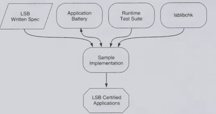

图 12.2：示例实现

## 示例 12.17：运行时测试安装

```
# cp lsb-runtime-test-2.0-1.ia32.rpm  /opt/lsbsi-ia32/tmp
# /sbin/chroot /opt/lsbsi-ia32
# cd /tmp
# rpm -i lsb-runtime-test-2.0-1.ia32.rpm
# password -d vsx0
```

如第 12.2.1 节所示，以用户`vsx0`登录，然后运行 LSB 运行时测试套件（示例 12.18）。

## 示例 12.18：运行运行时测试套件

```
vsx0$ telnet localhost
vsx0$ run_tests
```

### 12.6 打包示例实现

LSB-si 针对以下每种架构以多种配置发布：

1. **基础系统**：一个仅包含 LSB 书面规范所要求内容的压缩包。可以通过`chroot`进入。若要完全符合规范，需要底层 Linux 内核符合 LSB 规范。
2. **可测试系统**：包含基础系统以及启用 LSB-si 作为测试环境所需的其他文件和程序。此捆绑包可以运行 LSB 运行时测试套件和符合 LSB 规范的应用程序。可以通过`chroot`进入。运行后，可以通过`telnet`连接到该环境。若要完全符合规范，底层 Linux 内核必须符合 LSB 规范。
3. **可启动系统**：基础系统的文件加上内核和其他支持，使其能够独立启动。需要一些额外的配置——例如，针对目标硬件的适当启动配置以及必要内核模块的配置。
4. **托管系统**：基础系统的文件加上运行 User-Mode Linux（一种在宿主系统上作为用户级应用程序运行的内核虚拟机）的支持。User-Mode Linux 可能并非在所有 LSB 支持的架构上都可用。托管捆绑包也可用作可安装、即开即用的软件包。


> 当软件包扩展超出基础系统时，存在权衡：系统变得更易使用，但包含了各种非 LSB 命令和文件，因此在测试意义上略显不够“纯粹”。

### 12.7 下载示例实现

要下载 LSB 示例实现，请访问 LSB 下载网站。⁶ 表 12.1 展示了可通过万维网访问的信息。

**`lssbi-boot`** LSB 示例实现可启动系统，包含内核及其他支持，使 LSB-si 能够以独立模式启动。需要安装`lssbi-core`并进行安装后的配置。

**`lssbi-core`** LSB 示例实现基础系统，仅包含 LSB 书面规范所要求的内容。可以通过`chroot`进入。

**`lssbi-graphics`** LSB 示例实现图形系统，包含在 LSB-si 内支持图形应用程序所需的文件。需要安装`lssbi-core`。

**表 12.1：示例实现下载页面**

| 规范版本 | 软件包 | 版本 | 架构 |
| :--- | :--- | :--- | :--- |
| 2.0.0 | `lssbi-boot` | 2.0.2 | IA32, IA64, PPC32, PPC64, S390, S390X, x86_64 |
| 2.0.0 | `lssbi-core` | 2.0.2 | IA32, IA64, PPC32, PPC64, S390, S390X, x86_64 |
| 2.0.0 | `lsb-graphics` | 2.0.2 | IA32, IA64, PPC32, PPC64, S390, S390X, x86_64 |
| 2.0.0 | `lsb-test` | 2.0.2 | IA32, IA64, PPC32, PPC64, S390, S390X, x86_64 |
| 2.0.0 | `lsb-uml` | 2.0.2 | IA32, IA64, PPC32, PPC64, S390, S390X, x86_64 |

`lsbsi-test` LSB 示例实现可测试系统，包含将 LSB-si 用作测试环境所需的其他文件和程序。需要安装`lsbsi-core`。

`lsbsi-uml` LSB 示例实现托管系统，包含运行 User-Mode Linux（一种在宿主系统上作为用户级应用程序运行的内核虚拟机）的支持。UML 可能并非在所有 LSB 支持的架构上都可用。需要安装`lsbsi-core`。

`lsb` 此软件包提供基础 LSB 软件包。请注意，此软件包仅应安装在 LSB 示例实现上。在其他任何发行版上安装此软件包可能会损坏系统。

`lsb-uml-si` LSB 示例实现 User-Mode Linux 环境。

# 第十三章

## 使用 LSB 开发环境

LSB 开发环境旨在帮助开发人员构建符合 LSB 书面规范的应用程序。它们主要通过提供以下便捷方式来实现这一目标：

- 针对包含 LSB 书面规范所必需定义的头文件进行编译
- 针对仅包含 LSB 书面规范所必需接口的共享库进行动态链接

### 13.1 理解 LSB 开发环境

LSB 开发环境本身并非集成开发环境（IDE），而是对现有 IDE 的增强，使其能够构建符合 LSB 标准的二进制文件。请注意，虽然 LSB 开发环境有助于程序员构建符合 LSB 标准的应用程序，但它并非唯一的方法。

1. http://www.linuxbase.org/build/
2. http://www.linuxbase.org/download/

该功能允许旧应用程序继续使用旧版本，而新应用程序可以使用新版本。

当创建二进制文件时，它会检查所链接的共享库，并记录其所需的这些接口的版本。在运行时，二进制文件将查找具有记录版本号接口的接口，如果不存在则失败。因此，必须针对包含在符合 LSB 标准的运行时上保证存在的接口版本的共享库进行链接。

对于 LSB 支持的使用符号版本控制的库，规范列出了接口的特定版本。LSB 桩库仅包含 LSB 书面规范允许的接口版本，因此如果使用它们，在构建二进制文件时就不可能使用错误的版本。

共享库中通常包含一些必须符合 LSB 标准的二进制文件不得使用的接口。这些接口通常是私有函数或 LSB 不支持的接口。由于桩库仅包含规范要求的接口，如果应用程序使用了不受支持的接口，将在链接阶段发生错误。

### 13.3.2 LSB 头文件

与库关联的头文件中包含的定义可能会随着该库 ABI 的演变而随时间改变。例如，库的某个版本中的函数可能接受一个参数，而在下一个版本中可能接受两个参数。

LSB 书面规范为每个受支持的库定义了 ABI，用于编译该库的头文件必须完全匹配。为了避免找到包含正确定义的软件准确版本的问题，LSB 开发环境提供了与规范匹配的头文件。

### 13.3.3 使用开发工具

目前有两种开发工具`lsb-build-chroot`和`lsb-build-cc`，它们针对符合标准的头文件和库进行编译和链接。

使用这些工具是构建符合 LSB 标准应用程序的简便方法。这两个工具都使用`lsb-build-base`软件包。该软件包包含 LSB 头文件和桩库。

#### 13.3.3.1 lsb-build-chroot

`lsb-build-chroot`使用`chroot`命令在你的机器上创建一个虚拟 LSB 平台开发环境。默认情况下，它提供一个最小环境，尽可能不包含那些如果对其进行编译会导致生成的二进制文件不符合 LSB 标准的头文件或库。在此环境中，`/usr/include`包含 LSB 头文件，`/usr/lib`包含 LSB 桩库。

为了生成虚拟环境，`lsb-build-chroot`使用绑定挂载而不是复制整个目录结构，因此磁盘空间需求最小。这也意味着在环境中进行更改（如编译二进制文件）会立即反映到环境外部，反之亦然。

你不需要 root 权限就可以使用`lsb-build-chroot`，因为它是在高端口上运行的`ssh`守护进程实现的。`ssh`守护进程将你的主目录绑定挂载到`chroot`环境中，因此你可以登录到受限环境进行编译。你还可以在`chroot`外部运行完整的编辑和调试环境，操作你在受限环境中编译的相同文件。

在应用程序需要针对不符合 LSB 标准的库进行编译或链接的情况下，你可以明确地将这些库和头文件导入`chroot`环境中。根据应用程序构建过程的复杂程度，你可能还需要将其他工具导入环境中，以便它们能够正确运行。


如果在`lsb-build-chroot`运行期间更新系统软件包，绑定挂载可能会引起问题。

简单示例。在示例 13.1 中，我们有一个源文件`hello_world.c`。

### 示例 13.1：`hello_world.c` 源文件

```c
#include <stdio.h>
#include <stdlib.h>

int main(int argc, char *argv[])
{
    printf("Hello World\n");
    exit(0);
}
```

首先，我们登录到受限环境（示例 13.2）。默认情况下，该环境的`sshd`守护进程监听 5436 端口。

### 示例 13.2：登录受限环境

```bash
$ slogin -p 5436 localhost
lsbdevchroot$ 
```

然后，我们可以像往常一样构建二进制文件（示例 13.3）。

### 示例 13.3：构建和运行二进制文件

```bash
lsbdevchroot$ gcc -Wall -o hello_world hello_world.c
lsbdevchroot$ ./hello_world
Hello World
lsbdevchroot$ 
```

在受限环境之外，如果需要，我们可以附加调试器。

### 13.3.3.2 lsb-build-cc

`lsb-build-cc`是`gcc`的封装程序，用于替代编译器调用。该封装程序会修改传递给实际编译器的参数，以确保您的应用程序使用 LSB 指定的头文件和库版本，而不是系统上安装的版本。但是，原生系统的完整功能可用于构建、开发和调试应用程序。要使用`lsb-build-cc`，可以使用示例 13.4 中显示的任意一个命令。

**示例 13.4：lsb-build-cc**

```bash
# CC=lsbcc ./configure
# CC=lsbccc ./configure (用于 C++)
```

或者

```bash
# CC=lsbcc make
# CC=lsbccc make (用于 C++)
```

有关使用`lsbcc`的更多信息，可以在`lsb-build-cc`软件包中提供的 man 页面中找到。

**简单示例。** 在示例 13.5 中，我们有一个源文件`hello_world.c`。

**示例 13.5：hello_world.c 源文件**

```c
#include <stdio.h>
#include <stdlib.h>

int main(int argc, char *argv[]) {
    printf("Hello World\n");
    exit(0);
}
```

不直接调用`gcc`，而是使用`lsbcc`（示例 13.6）。

**示例 13.6：使用 lsbcc**

```bash
$ lsbcc -Wall -o hello_world hello_world.c
$ ./hello_world
Hello World
$
```

**提示。** 假设`myfunction()`是由`libc`提供的 ABI，并且它有不同的版本。如果`myapplication`使用了`myfunction()` ABI，我们可以比较应用程序和库映像，以查看实际使用的是哪个 ABI，如示例 13.7 所示。

**示例 13.7：测试 myapplication 与 glibc 的兼容性**

```bash
$ /usr/bin/objdump -T myapplication | grep myfunction
08048330 DF *UND* 00000032 GLIBC_2.0 myfunction

$ /usr/bin/objdump -T /lib/i686/libc.so.6 | egrep myfunction
000bb160 g DF .text 00000032 GLIBC_2.0 myfunction
000bb160 w DF .text 00000032 GLIBC_2.1 myfunction
```

`myapplication`使用的`myfunction()`的正确 ABI 应该是`GLIBC_2.0`，这样它将返回 double。库和操作系统允许演进，但 LSB 刷新频率较低，以提供稳定的运行时环境。

### 13.3.3.3 选择

表 13.1 解释何时使用`lsb-build-cc`以及何时使用`lsb-build-chroot`。

**表 13.1：使用 lsb-build-cc 和 lsb-build-chroot**

| 如果使用`lsb-build-cc`，当： | 如果使用`lsb-build-chroot`，当： |
| :--- | :--- |
| - 您的应用程序使用在`lsb-build-chroot`中不可用的工具或共享库。 | - 您的应用程序有硬编码的头文件和共享库路径。 |
| - 您的应用程序有与大多数 Linux 环境不同的测试脚本。 | - 您的应用程序在其`Makefile`中硬编码使用特定编译器。 |
| | - 需要使用 GCC 以外的编译器。 |

### 13.4 共享库

当应用程序使用不属于 LSB 编写规范的库时，可以通过两种方式之一进行构建。要么二进制文件静态链接到该库，或者如果该库符合 LSB 规范，则可以与二进制文件动态链接。如果是动态链接，则共享库必须与应用程序的其余部分一起提供。

要使共享库被视为符合 LSB 规范，其要求基本上与直接可执行程序的要求相同。也就是说，它必须仅使用规范支持的动态接口，或者由另一个随应用程序其余部分一起打包的符合 LSB 规范的共享库提供。

与普通的二进制文件类似，作为符合 LSB 规范的应用程序提供的共享库应该针对 LSB 头文件和桩库进行构建。

不要使用`ld`构建共享库（示例 13.8）。这可能会导致使用不属于 LSB 编写规范的符号版本。

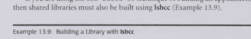

如果您使用`lsb-build-cc`技术来构建应用程序，那么共享库也必须使用`lsbcc`进行构建（示例 13.9）。

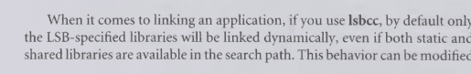

如果您使用`lsb-build-chroot`技术来构建应用程序，则不需要对构建方法进行修改。

在链接应用程序时，如果您使用`lsbcc`，默认情况下只会动态链接 LSB 指定的库，即使搜索路径中同时存在静态库和共享库。可以通过设置环境变量`LSBCC_SHARED_LIBS`来修改此行为。其值是库名称的冒号分隔列表，指定哪些额外的库应该被动态链接。

如果您使用`lsb-build-chroot`，那么编译器将动态链接受限环境中可用的所有共享库，如果库仅存在静态版本，则回退到静态链接。

### 13.5 案例研究：RSYNC

`rsync`应用程序是 LSB 应用程序测试套件中的程序之一。我们将此程序作为开发人员可能遇到的问题类型以及如何尝试构建符合 LSB 规范的二进制文件时绕过这些问题的示例。

我们使用`rsync`版本 2.5.5 的`lsbCC`构建工具。`rsync`的源代码可以从`rsync`网站下载。³

### 13.5.1 使用`lsbCC`构建`rsync`二进制文件

首先，我们解压缩源代码并运行`configure`脚本（示例 13.10）。我们通过设置`CC`环境变量（而不是`cc`，因为`configure`默认可能会使用`cc`）来确保`configure`使用`lsbCC`作为编译器。


从示例 13.10 中显示的经过编辑的 `configure` 输出中，我们可以看到 `configure` 脚本已正确检测到 `mallinfo()` 不属于 LSB，因此未使用它。尽管 `libresolv` 和 `libpopt` 也不在 LSB 编写规范中，但 `lsbCC` 已检测到存在库的静态版本，因此可以使用。

接下来，我们尝试编译 `rsync` 二进制文件（示例 13.11）。由于我们告诉 `configure` 脚本使用 `lsbCC` 作为编译器，因此在调用 `make` 时不需要设置 `CC` 环境变量。

### 示例 13.10：运行 configure 脚本

```bash
$ tar xrfz rsync-2.5.5.tar.gz
$ cd rsync-2.5.5/
$ CC=lsbcc ./configure
configure: Configuring rsync 2.5.5
checking build system type... i686-pc-linux-gnu
checking host system type... i686-pc-linux-gnu
checking target system type... i686-pc-linux-gnu
checking for gcc... lsbcc
checking for C compiler default output... a.out
checking whether the C compiler works... yes
...
checking for connect... yes
checking for inet_ntop in -lresolv... yes
checking for inet_ntop... yes
...
checking for mtrace... no
checking for mallinfo... no
checking for setgroups... yes
...
config.status: creating popt/dummy
config.status: creating shconfig
config.status: creating config.h

rsync 2.5.5 configuration successful
```

### 示例 13.11：编译 rsync 二进制文件

```bash
$ make
...
lsbcc -I. -I. -g -O2 -DHAIVE_CONFIG_H -Wall -W -c clientname.c \
-0 clientname.o
clientname.c: In function 'client_sockaddr':
clientname.c:120: warning: implicit declaration of function \
'IN6_IS_ADDR_V4MAPPED'
clientname.c:120: dereferencing pointer to incomplete type
clientname.c:127: storage size of 'sin6' isn't known
clientname.c:127: warning: unused variable 'sin6'
clientname.c: In function 'compare_addrinfo_sockaddr':
clientname.c:213: dereferencing pointer to incomplete type
```

在编译 `clientname.c` 时发生了一个错误。示例 13.12 展示了 `clientname.c` 第 120 行附近的代码。


```
...
#define INET6
if (get_sockaddr_family(ss) == AF_INET6 &&
    IN6_IS_ADDR_V4MAPPED(&((struct sockaddr_in6 *)ss)->sin6_addr)) {
/* OK, so ss is in the IPv6 family, but it is really
 * an IPv4 address; something like
...
```

这里我们看到代码试图使用 IPv6 例程。LSB 1.3 不支持 IPv6，因此头文件中不包含此代码片段所需的宏定义。不幸的是，`configure` 脚本没有检测到这个问题，因为它假设如果安装了特定版本（或更高版本）的 `glibc`，则开发系统支持 IPv6。更好的做法是直接测试某些 IPv6 宏和接口是否存在。

幸运的是，可以通过向 `configure` 脚本传递参数手动禁用 IPv6 支持。因此，我们重新配置并再次调用 `make`（示例 13.13）。


现在发生了一个链接错误——链接器无法找到 `getpass()` 函数。`getpass()` 不在 LSB 编写规范中（Linux 上的 man 页将其标记为废弃），因此 LSB C 桩库中不包含它的桩代码。`glibc` 的信息页建议了一种替代方法，因此我们用建议的代码片段修补了 `rsync` 源代码。之后，`make` 成功并生成了一个 `rsync` 二进制文件。

### 示例 13.13：在不支持 IPv6 的情况下运行 configure

```
$ ./configure --disable-ipv6
configure: Configuring rsync 2.5.5
...
$ make
....
lsbccc -g -02 -DHAVE_CONFIG_H -Wall -W -0 rsync rsvnc.o \
generator.o receiver.o cleanup.o sender.o exclude.o util.o \
main.o checksum.o match.o syscall.o log.o backup.o options.o \
flist.o iio.o compat.o hlink.o token.o udidlist.o socket.o \
fileio.o batch.o clientname.o params.o loadparm.o \
clientserver.o access.o connection.o authenticate.o \
lib/fmtmatch.o lib/compat.o lib/snprintf.o lib/mdfour.o \
lib/pfstring.o zlib/deflate.o zlib/inblock.o zlib/infcodes.o \
zlib/infast.o zlib/inflate.o zlib/inftrees.o zlib/inftil.o \
zlib/trees.o zlib/zutil.o zlib/adler32.o -ipopt -iresolv
authenticate.c:278: undefined reference to `auth_client':
authenticate.c:278: undefined reference to `getpass'
collect2: ld returned 1 exit status
make: *** [rsync] Error 1
```

## 13.5.2 检查二进制文件

`lsbppchk` 可用于静态检查二进制文件的 LSB 合规性（示例 13.14）。静态应用程序检查器检查应用程序，确保它仅使用 LSB 指定的库、接口和运行时加载器，并验证其程序映像是否具有 ELF 格式要求的某些特征。

### 示例 13.14：运行应用程序检查器

```
$ lsbppchk rsync
lsbppchk for LSB Specification 2.0.0
Checking binary rsync
$ 
```

如果发现任何问题，它们将输出到标准错误流并记录在名为 `journal.binary_name` 的日志文件中。

### 13.5 案例研究：RSYNC

`lsbdynchk` 可用于在运行时检查二进制文件的合规性。动态应用程序检查器根据规范在运行时检查应用程序参数。

在此阶段应进行进一步的测试，例如在 LSB 示例实现中运行二进制文件，以及运行应用程序的功能验证测试。

### 13.5.3 FHS 问题

`lsbappchk` 工具无法验证应用程序是否完全符合 LSB 标准。某些方面，例如文件层级标准（FHS）合规性，目前需要手动检查。例如，默认情况下 `rsync` 使用位于 `/etc` 中的配置文件 `rsyncd.conf`。但 FHS 规定配置文件应位于 `/etc/opt/package`。这可以通过应用示例 13.15 中的补丁来实现。

> **示例 13.15：符合 FHS 要求的 `rsync` 补丁**

```
--- rsync-2.5.5/rsync.h 2002-03-25 00:29:43.000000000 -0700
+++ rsync-2.5.5.lsb/rsync.h 2003-05-13 18:25:25.000000000 -0600
@@ -26,7 +26,7 @@
 #define RSYNC_RSH_ENV "RSYNC_RSH"
 
 #define RSYNC_NAME "rsync"
-#define RSYNC_D_CONF "/etc/rsyncd.conf"
+#define RSYNC_D_CONF "/etc/opt/lsb-rsync/rsyncd.conf"
 
 #define DEFAULT_LOCK_FILE "/var/run/rsyncd.lock"
 #define URL_PREFIX "rsync://"
```

同样，可以通过向 `configure` 脚本传递 `--prefix=/opt/lsb-rsync` 参数，配置 `rsync` 安装到 `/opt/lsb-rsync` 而不是 `/usr/local`。

### 13.5.4 更多示例

构建符合 LSB 标准的应用程序版本的更多示例可以在第 14 章中描述的 LSB 应用程序测试套件中找到。

### 13.6 构建 LSB 开发环境

`lsb-build-base` 包的大部分源代码是根据图 13.1 所示从 LSB 编写规范数据库自动生成的。这样做的好处是头文件和桩库与规范保持同步。通常，人们不需要从数据库构建源代码，尽管所有脚本和数据库内容都在 LSB CVS 仓库中公开可用。

`lsb-build-base`、`lsb-build-cc` 和 `lsb-build-chroot` 的源码 tarball 和源码 RPM 包可从 LSB FTP 存档获取。tarball 包含一个说明如何构建该包的 `readme` 文件，而源码 RPM 包可以像往常一样使用 `rpm` 工具构建（示例 13.16）。

> 示例 13.16：构建 RPM 包

```
# rpm --rebuild lsb-build-base-1.3.4-1.src.rpm
```

### 13.7 扩展 LSB 开发环境

#### 13.7.1 使用 GCC 以外的编译器

LSB 开发环境的几乎所有测试和使用都是基于 GCC 作为编译器的。使用其他编译器构建符合 LSB 标准的应用程序是可能的。

使用开发环境的头文件和桩库并不是严格必要的，尽管这样做几乎肯定会更简单。使用另一种编译器所需的构建流程变更可总结如下：

- 使用符合 LSB 标准的头文件（`lsb-build-base` 包）。

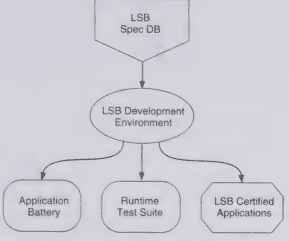

图 13.1：LSB 开发环境

- 使用符合 LSB 标准的库。使用开发环境桩库的好处是，如果尝试使用非 LSB 接口，将会发生链接错误。

- 确保二进制文件使用该架构的 LSB 动态链接器，而不是标准的 Linux 链接器。例如，在 x86 机器上，应使用 `/lib/ld-lsb.so.1` 而不是 `/lib/ld-linux.so.2`。

如果你使用 `lsb-build-chroot`，前两项更改会自动完成。实现第三项更改的方式将取决于编译器；例如，对于 `gcc`，这是通过编辑 `specs` 配置文件完成的。

#### 13.7.2 与 IDE 集成

`lsb-build-cc` 与 IDE 的集成应该相当简单，因为唯一需要的变更是调用 `lsbcc` 而不是普通编译器。对于 `lsb-build-chroot`，需要在 `chroot` 内部运行编译过程。这可以使用辅助程序实现，或者通过通信正在 `chroot` 内运行的编译守护进程来实现。

#### 13.7.3 使用非 LSB 接口

有时，开发者无法构建完全符合 LSB 标准的应用程序，因为其程序的核心功能依赖于未包含在 LSB 编写规范中的特性。然而，出于兼容性原因，他们仍然希望尽可能符合 LSB 标准。

这方面的一个例子是依赖于不在 LSB 编写规范中的 C 库接口或系统调用。在这种情况下，不可能简单地提供共享库与应用程序，或者静态链接需求使二进制文件符合 LSB 标准。通过修改 LSB 开发环境，仍然可以使用它来构建二进制文件并获得相关好处。在上述情况下，最简单的方法是获取桩库的源代码，手动添加所需的接口，并构建新版本桩库。同样，可以将原型添加到 LSB 头文件中。

### 13.8 下载 LSB 开发环境

要获取 LSB 开发环境，请访问 LSB 下载网页。表 13.2 表示了可以通过万维网访问的信息。

- `lsb-build-base`：LSB 开发环境基础包提供桩库和头文件。这些可用于构建符合 LSB 标准的应用程序。请注意，包的版本号指的是生成桩库和头文件所针对的规范版本。

- `lsb-build-c++`：此包为 `lsb-build` 包提供临时 C++ 构建支持。它向 `lsb-build-base` 安装的文件中添加 C++ 头文件和符合 LSB 标准的静态 C++ 库构建。

## 表 13.2：开发环境下载页面

| 规范版本 | 软件包 | 版本 | 架构 |
|---|---|---|---|
| 2.0 | lsb-build-base | 2.0.0-1 | i486, IA64, PPC, PPC64, S390, S390x, x86_64, SRC |
| 2.0 | lsb-build-c++ | 2.0.0-1 | i486, IA64, PPC, PPC64, S390, S390x, x86_64, SRC |
| 2.0 | lsb-build-cc | 2.0.0-1 | i486, IA64, PPC, PPC64, S390, S390x, x86_64, SRC |
| 2.0 | lsb-build-chroot | 2.0.0-1 | i486, IA64, PPC, PPC64, S390, S390x, x86_64, SRC |

- `lsb-build-cc`：此软件包提供 `lsbcc`，它是可用于构建符合 LSB 的应用程序的多种方法之一。

- `lsb-build-chroot`：LSB 开发环境是一种工具，旨在简化生成符合 LSB 标准的二进制文件的过程。

# 第十四章

# 使用应用电池

**LSB 应用电池**是一组为符合 LSB 书面规范而构建的开源应用程序的集合。LSB 项目提供这些应用程序，作为进一步证明 Linux 发行版能够支持安装和运行符合 LSB 标准的应用程序的证据。

对 Linux 发行版进行认证需要多种方法来确保其符合 LSB 书面规范。LSB 运行时测试套件用于测试许多系统 API 的正确行为。LSB 库检查器用于验证所有由 LSB 指定的共享库及其各自的 API 是否存在于系统中。Linux 发行版合规性的第三项主要测试是 **LSB 应用电池**。

电池中应用程序的选择旨在更接近真实场景地调用所有由 LSB 指定的共享库。以这种方式使用应用电池可以补充 LSB 运行时测试套件，从而为 Linux 发行版提供更彻底的验证。

**应用电池** 还有一个有用的领域，即其如何使用 **LSB 开发环境**。通过使用开发环境来构建使用所有 LSB 共享库的应用程序，有助于识别 LSB 开发环境头文件和桩库中的任何缺陷。由于 `lsbdev` 是直接根据书面规范中使用的数据创建的，因此它也能发现规范本身存在的问题。

最后，除了用于测试 Linux 发行版和验证 `lsbdev` 之外，应用电池还可以向应用程序开发人员展示构建典型的符合 LSB 标准的应用程序需要哪些步骤。

在进一步讨论应用电池（`appbat`）是什么以及如何使用它之前，有必要说明 `appbat` 不是什么。`appbat` 中的应用不应被考虑用于生产环境。尽管构建这些应用程序以符合 LSB 标准只需从上游源代码进行最少修改，但 LSB 项目仅进行了最小限度的测试。`appbat` 的目的并不是创建可以替代 Linux 发行版中自带应用程序的现成生产级替代品。相反，电池中的应用仅应用于测试 Linux 发行版对 LSB 书面规范的遵从性。

## 14.1 理解应用电池

### 14.1.1 常见的开源应用程序

LSB 应用电池是由 LSB 开发环境构建的一组常见开源应用程序，以确保它们符合 LSB 书面规范。在某些情况下，应用程序只是重新编译，以确保使用 LSB 动态链接器而不是系统链接器。少数应用程序应用了小的补丁，以修复应用使用了非 LSB 参数类型，或者在使用 `lsbdev` 时 `configure` 脚本产生错误结果等简单问题。对于其他少数应用程序，则有一些更重大的补丁。一个例子是 `rsync` 应用程序，它使用了已弃用的 `getpass()` API。`rsync` 的补丁将 `getpass()` 的使用替换为对 `getpassword()` 的调用，这是一个专门为 LSB 版本的 `rsync` 编写的子程序，提供与从 `getpass()` 预期相同的返回值。


构成 `appbat` 的应用程序的选择受到几个因素的影响。首先，这些应用程序需要尽可能多地调用由 LSB 定义的共享库。这是为了通过 LSB 运行时测试套件对库进行的测试基础上进行补充。另一个因素是需要包含那些开源且使用允许 LSB 团队与其他测试工具一起重新分发许可证的应用程序。若要被考虑纳入 `appbat`，应用程序还必须相当接近完全符合 LSB 书面规范。这意味着它不能使用来自 LSB 共享库的任何非 LSB API，并且只能使用极少量的非 LSB 共享库。

在最初的 LSB v1.2 认证计划中，`appbat` 仅包含四个应用程序，其中只有两个需要测试。当 LSB v1.3 认证计划开始时，应用程序数量增加到 Intel 32 位架构的 11 个、Itanium 架构的 8 个以及 PowerPC 32 位架构的 10 个。LSB v1.3 的另一项要求是，在对 LSB 运行时环境进行认证时，必须使用 `appbat` 中所有处于 LSB 认证就绪状态的应用程序。当应用程序满足 LSB 应用认证的所有要求时，包括通过 LSB 应用程序检查器、在 LSB 样本实现中正确执行以及在两个不同的 LSB 认证运行时环境中正确执行，该应用程序即被视为处于 LSB 认证就绪状态。以下是 LSB v2.0 认证计划中针对所有支持处理器架构的 `appbat` 中 11 个应用程序的列表：

- `Apache`——Web 服务器
- `Celestia`——可视化太空模拟
- `expect`——与其他程序进行“对话”的应用程序
- `groff`——文档格式化系统
- `Lynx`——基于文本的 Web 浏览器
- `Python`——解释型、交互式、面向对象编程语言
- `rsync`——用于通过网络同步文件的程序
- `Samba`——面向 SMB/CIFS 客户端的文件和打印服务器
- `Tcl`——嵌入式脚本语言
- `XPaint`——X 窗口系统的绘画程序
- `xpdf`——X 窗口系统的 PDF 文件查看器

### 14.1.2 在 LSB 运行时环境认证中使用应用电池

测试 Linux 运行时环境是否符合 LSB 书面规范的一个步骤是成功执行 LSB 应用电池中的应用。通过这样做，您可以展示运行时环境安装一组符合 LSB 标准的应用程序的能力，并证明这些应用程序能正确执行。对应用电池的测试增加了进一步的证据，表明运行时环境中共享库的 LSB 定义 API 得到了正确的支持。LSB 运行时测试套件以孤立的方式测试 LSB API。应用电池通过将 API 作为实际应用程序的一部分来使用，从而以更实际的方式测试 API。

### 14.1.3 应用电池的注意事项

如前所述，应用电池中的应用是许多 Linux 发行版上都可以找到的开源应用程序。然而，这些应用程序不应被视为适合用于真正的生产环境。主要原因是对这些特殊构建版本进行的测试有限。大多数应用程序的行为将与大多数 Linux 系统上已有的应用程序相同，但其中一些应用程序禁用了某些功能以使其符合 LSB 标准。这些功能的丢失通常只影响应用程序的内部操作。在少数情况下，由于无法利用某些非标准代码优化，应用程序可能会运行得较慢。

LSB 工作组已与许多 `appbat` 应用程序的上游维护者保持联系。通过展示使这些应用程序符合 LSB 标准所需的工作，LSB 工作组正在帮助开发团队了解遵守 LSB 书面规范是多么容易。一些开源项目已同意努力使自身符合 LSB 标准。在某些情况下，它们正在接受将 LSB 特定的补丁合并到其上游源代码中。某些开发团队在其项目网站上提供了下载处于 LSB 认证就绪状态的应用程序版本的位置。

## 14.2 使用应用电池进行认证

### 14.2.1 访问应用电池

LSB 应用电池的应用程序可从自由标准组织（Free Standards Group）的 FTP 站点下载。¹ 该目录包含若干子目录，其中存放着针对 LSB 书面规范不同版本的应用程序，以及一个包含应用程序预发布版本的子目录。应用程序的正式版本位于格式为 `released-LSB_version` 的目录中，其中 `LSB_version` 是对应的 LSB 书面规范版本。例如，LSB v1.3 的 `appbat` 应用程序位于 `released-1.3.0` 目录中。应用程序的预发布版本位于 `beta` 目录中。

在每个发布目录和 `beta` 目录中，都有针对该特定规范版本所支持的每种处理器架构的子目录。由于 LSB v1.2 书面规范仅适用于 Intel 32 位处理器架构，因此 `released-1.2.0` 目录中没有子目录。按处理器类型分离应用程序，使得可以一次性下载运行时环境认证所需的所有应用程序，从而更加便捷。

示例 14.1 是 FTP 站点上目录结构的简要快照，展示了其组织方式。

### 14.2.2 安装应用电池

安装 `appbat` 应用程序是使用 `appbat` 对 Linux 运行时环境进行 LSB 认证的第一步。分发版必须证明它能够安装以 LSB 书面规范中描述的 RPM 包格式打包的应用程序。安装可以使用 `rpm` 命令本身完成，也可以使用任何能够读取 RPM 包的其他命令完成。例如，在 Debian 分发版上，可以使用 `alien` 命令将 RPM 打包的应用程序转换为 `.deb` 包。转换完成后，即可使用 `dpkg` 命令安装该应用程序。

**示例 14.1：应用电池目录结构**

```
pub ->
lsb ->
app-battery ->
beta ->
ia32 ->
ia64 ->
ppc32 ->
ppc64 ->
s390 ->
s390x ->
x86_64 ->
released-1.2.0 ->
released-1.3.0 ->
ia32 ->
ia64 ->
ppc32 ->
s390 ->
s390x ->
released-2.0.0 ->
ia32 ->
ia64 ->
ppc32 ->
ppc64 ->
s390 ->
s390x ->
x86_64 ->
```

`appbat` 中的所有应用程序都已打包，要求系统中已安装提供 `lsb-core-arch` 的包，其中 `arch` 是处理器架构。如果尝试在未安装所需包的情况下安装 `appbat` 应用程序，您将看到类似于示例 14.2 中所示的错误消息。

**示例 14.2：安装错误消息**

```
$ rpm -ivh lsb-xpaint-2.7.0-1.lsb20.l486.rpm
error: Failed dependencies:
lsb-core-ia32 >= 2.0 is needed by lsb-xpaint-2.7.0-1.lsb20
```

每个 LSB 认证运行时环境都必须安装一个包，以提供 LSB 合规应用程序所需的依赖项。此外，LSB 合规应用程序不得依赖 LSB 书面规范中列出的命令或应用程序之外的任何命令或应用程序。这既适用于应用程序的安装，也适用于其正常运行。

当在既是完整 Linux 分发版又是 LSB 认证运行时环境上安装并测试 LSB 合规应用程序时，即使应用程序使用了非 LSB 命令，它也可能正常运行。为了帮助识别潜在问题，应用程序还必须在 LSB 示例实现中进行测试。由于示例实现仅包含 LSB 指定的命令，当应用程序试图使用非 LSB 命令时，它会导致应用程序失败。由于 `appbat` 应用程序符合 LSB 规范，它们已证明仅依赖 LSB 指定的命令。

### 14.2.3 配置应用电池

某些 `appbat` 应用程序在使用之前，在用于 Linux 运行时环境的 LSB 认证测试期间，需要少量的配置。有关安装、配置和测试应用程序的说明可在 LSB 网站 `http://www.linuxbase.org/appbat/evt-2.0.0/` 上找到。说明分为两部分。第一部分涵盖特定应用程序的安装和设置。第二部分详细介绍为了验证应用程序的正确执行而必须执行的功能测试。`appbat` 应用程序的安装已在本章前面的部分中介绍。所有 `appbat` 应用程序的安装方式类似，因此无需进一步讨论。相反，本节将描述对应用程序执行的一些配置步骤。

应用程序电池功能测试页面中描述的一些配置步骤在大多数 Linux 分发版上实际上并非必要。尽管这些系统上尚未由 LSB 指定，但需要添加或修改的项目已经存在于这些系统中。尽管如此，仍需验证这些步骤，以确保应用程序即使在最小合规系统（如 LSB 示例实现）上也能运行。此类配置步骤的两个例子是在 `/etc/services` 文件中为 `rsync` 和 `Apache` 添加条目。

这两个应用程序都有作为系统服务运行的服务器组件，因此需要在 `/etc/services` 中有对应的 `tcp` 和 `udp` 条目。在 Debian、Red Hat 或 SuSE 分发版上无需进行额外的配置，因为这些条目已经存在。相反，在 LSB 示例实现中，必须添加这些条目才能使应用程序服务正常运行。

另一个相关的例子是应用程序必须确保系统中存在 `nobody` 用户、`nobody` 组或两者都存在的条目。与系统服务类似，`Apache` 和 `rsync` 应用程序服务器以 `nobody` 用户身份处理远程请求。`Tcl` 应用程序在执行其测试套件时也需要 `nobody` 用户。同样，由于 LSB 仅将 `nobody` 用户和组指定为可选，LSB 示例实现需要额外的配置。

为了使部分 `appbat` 应用程序能够运行，需要创建或修改配置文件。在某些情况下，这是应用程序的最小配置；而在其他情况下，这种配置对于以产生某些已知行为的方式测试应用程序是必要的。配置 `Samba` 涉及编辑或创建 `/etc/pam.d/samba` 配置文件，以确保 `Samba` 使用 PAM 进行用户身份验证。为了避免与主机系统上已运行的服务发生冲突，必须为 `Samba` 和 `rsync` 创建新的配置文件。`Samba` 配置文件 `/etc/opt/lsb/appbat/smb.conf` 仅包含足以将 `Samba` 服务器放入名为 `WORKGROUP` 的工作组、在系统上共享用户主目录以及允许对共享主目录进行写访问的信息。同样，`rsync` 的配置文件 `/etc/opt/lsb/appbat/rsyncd.conf` 设置 `rsync` 服务器允许访问 `/tmp/rsync` 目录并启用对该目录的写访问。

应用电池中的某些应用程序有服务器守护进程，可能会与主机系统上运行的守护进程发生冲突。如果两个不同的守护进程都试图在同一端口上处理请求，这可能会引起问题。为避免这种情况，`Apache`、`rsync` 和 `Samba` 的配置说明要求测试人员在开始功能测试之前停止主机上相应的守护进程。对于 `Apache` Web 服务器，必须停止任何监听标准 Web 服务器端口（80）的 `httpd` 或其他守护进程。对于 `rsync`，测试人员必须停止主机系统上当前运行的任何 `rsync` 守护进程。最后，在尝试任何功能测试之前，必须停止 `Samba` 的 `smbd` 和 `nmbd` 服务器守护进程。

`Samba` 应用程序在用于与任何 SMB 客户端通信之前需要额外的设置。通常，当从 SMB 客户端连接到 SMB 服务器时，服务器上的身份验证是使用在系统上定义的标准用户 ID 处理的。为了避免在即将执行的功能测试中出现任何混淆，功能测试配置说明要求测试人员创建一个名为 `smbuser` 的用户 ID，并将其初始密码设置为 `smb41sb`。稍后，在测试运行 `Samba` 服务器的主机系统上的 SMB 客户端时，将使用这个新的用户 ID 进行身份验证。

对于多个 `appbat` 应用程序，必须将某些目录和文件复制到预期位置，以便对某些已知结果进行测试。`rsync` 应用程序需要创建两个目录，分别用作 `rsync` 服务器共享文件的根目录和存储从 `rsync` 服务器复制的文件的地方。为避免与系统上的现有目录发生冲突，这些新目录放置在 `/tmp/rsync` 和 `/tmp/rsync.test` 中。对于 `rsync` 和 `Samba`，某些文件将被复制到各自的服务器目录中，以确保测试期间请求的文件存在。对于 `expect`、`Tcl` 和 `xpdf` 应用程序，需要从自由标准组织 FTP 站点下载一些文件。`expect` 和 `Tcl` 应用程序有一些自动化测试，它们是用于构建它们的源代码的一部分。配置说明描述了创建包含这些测试的目录以及填充这些目录的过程。`xpdf` 应用程序说明了下载将在功能测试期间使用的两个 PDF 文档。

对于几个 `appbat` 应用程序，还有一些额外的配置步骤，但它们涉及的内容少得多。然而，这些步骤有助于使应用程序测试尽可能顺利。例如，使用 X 图形界面的应用程序（`Celestia`、`XPaint` 和 `xpdf`）必须确保 `DISPLAY` 环境变量已正确设置。如果未正确设置，可能会影响其执行和验证功能测试的能力。另一个小型配置步骤是针对 `Python` 应用程序。`Python` 功能测试的一部分涉及运行一些自动化的 `Python` 测试脚本。在进行测试之前，测试人员会被指示暂时搁置在构建 `Python` 应用程序时创建的那些预编译脚本。这样做会导致测试在执行前重新编译这些脚本。

### 14.2.4 应用程序电池的功能测试

如前所述，应用程序电池（Application Battery）是 Linux 发行版认证的一个组成部分。该发行版必须证明其能够安装并执行那些已证明符合 LSB 书面规范的应用程序。应用程序电池的功能测试并不详尽无遗，但足以运行足够的应用程序以确认它们在该 Linux 发行版上正常运行。部分功能测试利用了随应用程序源代码提供的自动化回归测试。其余的应用程序则需要进行一系列交互式步骤来执行特定操作，以产生预期的结果。在大多数情况下，完成应用程序电池中所有功能测试不应花费数小时以上。

在理想情况下，应用程序电池中的所有应用程序都会有自动化测试来验证其正确运行。虽然现实世界远非理想，但至少部分 `appbat` 应用程序提供了回归测试。对于 `expect` 和 `Tcl` 应用程序，测试脚本必须从 Free Standards Group 的 FTP 站点下载。`Python` 的回归测试脚本包含在安装该应用程序所使用的软件包中。在每种情况下，该应用程序的功能测试都描述了如何执行回归测试脚本以及测试结果应该是什么样子。`expect` 的功能测试包含 25 个测试，所有这些测试都必须通过。`Tcl` 的功能测试包含 6,851 个测试，所有这些测试都必须通过或被跳过。对于 `Python`，有超过 150 个潜在测试需要执行。通过的测试数量可能因系统而异，取决于可用的功能，但其中任何一个都不应该失败。

`Celestia` 的功能测试将一些交互式步骤与更复杂的自动化测试结合在一起。与其他自动化测试不同，`Celestia` 的测试不产生任何日志文件，也不报告通过和失败的测试数量。相反，自动化测试的完成本身足以证明该应用程序成功运行。`Celestia` 应用程序是一个图形密集型的太空模拟器；其视觉特性确保了它对 LSB 书面规范中定义的许多图形接口施加压力。`Celestia` 功能测试中的前几个交互式步骤涉及输入正确的按键，使应用程序“旅行”到地球和火星。之后，输入字母“d”以运行一个演示场景，展示 `Celestia` 的功能。场景执行将在五到十分钟之间完成。

应用程序电池其余的功能测试非常依赖交互。在没有正式的回归测试可用的情况下，这些测试试图执行应用程序中一些使用频率较高的功能。`groff` 应用程序是文本处理程序套件的一部分，但它不提供回归测试，主要通过命令行使用。`groff` 的 LSB 功能测试只是使用该应用程序对随应用本身提供的几个手册页进行格式化，并将其显示在屏幕上。`Lynx` 应用程序稍微具有视觉性，因为它是一个基于文本的网络浏览器。由于 `Lynx` 的功能测试不能假设被测系统处于通信网络中，因此它仅限制于显示随 `Lynx` 附带的一些简单网页。通过浏览这些页面中的几个，可以表明 `Lynx` 正在正确运行。

应用程序电池中的另外两个应用程序在本质上是非常视觉化的，因此针对它们的功能测试更具交互性，并且涉及确保应用程序显示的图像是正确的。`XPaint` 应用程序的功能测试试图验证该应用程序两个主要功能的正确运行。首先，使用该应用程序在屏幕上用几种颜色选择绘制一些简单的形状。接下来，使用 `XPaint` 截取屏幕快照并在一个新窗口中打开它。`XPaint` 的测试人员只需确保应用程序显示合理的输出即可。`xpdf` 的功能测试除了视觉方面外，还具有文件处理的方面。为了便于测试 `xpdf`，从 Free Standards Group 的 FTP 站点下载了两个 PDF 文档。第一个测试文档由 `xpdf` 显示，测试人员输入几个交互式命令。第二个文档用于验证 `xpdf` 的文本处理功能。它使用 `pdfto` 命令显示 PDF 文件中包含的信息，使用 `pdftotext` 将 PDF 文件转换为文本文件，并使用 `pdftops` 将 PDF 文件转换为 PostScript 文件。

应用程序电池中最后一组应用程序是具有服务器功能的应用程序。对于这些应用程序，有交互式步骤来启动服务器守护进程，然后执行测试以验证服务器的正确运行。`Apache` 的功能测试使用 Web 控制脚本（`apachectl`）来启动 Web 服务器。为了确保 Web 服务器正在工作，使用浏览器打开被测系统上的主网页。如果系统未连接到网络，浏览器可以在同一系统上运行，也可以在一个远程系统上运行。然后使用浏览器显示服务器上的几个网页。

`Samba` 和 `rsync` 的测试更为复杂，因为它们除了服务器端之外，还有客户端部分。在 `Samba` 功能测试中，`smbd` 和 `nmbd` 服务器从命令行启动。服务器启动后，使用 `smbclient` 命令以几种不同的方式访问 `Samba` 服务器。`rsync` 的测试处理方式有些相似。首先，使用 `rsync` 命令将文件从系统上的一个目录复制到另一个目录。接下来，在系统上以守护进程模式启动 `rsync`。守护进程启动后，使用 `rsync` 命令列出由 `rsync` 守护进程共享的文件。然后将几个文件传输到 `rsync` 服务器并从其传出，以确保此功能正常工作。

## 14.3 创建应用程序电池

### 14.3.1 使用 LSB 开发环境


### 14.3.1 应用程序合规性

应用程序电池中的应用（图 14.1），就像任何寻求 LSB 认证的应用程序一样，必须遵守 LSB 书面规范。需要解决的首要问题是要求仅使用 LSB 指定的共享库，并且仅使用这些库中由 LSB 指定的接口。满足此要求的过程可以通过多种方式处理。

应用程序电池使用 LSB 开发环境（`lsbdev`）在编译时强制实施 LSB 的限制。使用 `lsbdev` 中的头文件和子库有助于识别应用程序正在使用的任何不合规接口。`lsbdev` 中的 `lsbcc` 和 `lsbcc++` 命令确保应用程序在搜索系统上的头文件和库之前先搜索 `lsbdev` 提供的头文件和库。这强制应用程序链接到正确的 API 版本，即使系统上的共享库可能包含相同接口的较新版本。此外，`lsbdev` 使应用程序使用 LSB 动态链接器，而不是系统上的默认动态链接器。`lsbcc` 和 `lsbcc++` 前端命令设计用于与任何 C 或 C++ 编译器一起使用，但应用程序电池使用 GCC 来构建所有应用程序。

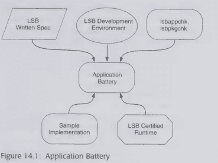

LSB 关于应用程序的书面规范规定，只能将 LSB 指定的共享库动态链接到应用程序中。应用程序使用的任何其他库接口可以通过两种方式来访问。首先，应用程序可以提供所需共享库的自己的副本，并在安装应用程序本身时包含它们。使用非 LSB 接口的另一种方法是将其静态链接到应用程序中。选择哪种方式取决于应用程序的开发者。在 LSB 应用程序电池中，每种方法都有使用示例。

#### 私有共享库示例

`appbat` 中的 Apache 应用程序包含三个随应用一起构建的共享库。其中两个库包含 Apache 内几个不同命令使用的实用例程。第三个共享库 `libexpat` 随 Apache 一起构建，因为它不是由 LSB 定义的共享库。包含 `libexpat` 的私有版本确保了 Apache 的一个版本具有一个已知版本的 `libexpat` 可以供其使用，而不是依赖于在其执行所在的系统上已安装该库。依赖系统上非 LSB 共享库的某些预期行为是危险的，因为该库的接口没有保证是一致且稳定的。为了确保与 Apache 一起打包的三个共享库不会干扰系统上安装的库，它们被安装在与 Apache 应用程序相同的整体目录结构中。

#### 静态链接示例

`appbat` 中的一些应用程序静态链接了一些非 LSB 库，以满足 LSB 的要求。例如，XPaint 应用程序利用了 `libpng`、`libjpeg` 和 `libtiff` 库中的接口。应用程序电池（Application Battery）选择静态链接这些库，而不是构建和打包这些库的共享版本以随 XPaint 一起分发。为了避免依赖于构建 XPaint 时所在系统上安装的静态库的版本，`appbat` 创建了一组从每个库的已知版本构建的静态库。这组库被称为 LSB 库电池，即 `libbat`。在 `libbat` 构建完成后，这些静态库被打包到一个 RPM 软件包中，该软件包安装在 LSB 开发环境之上。静态库被放置在 LSB 子库所在的同一目录中。将它们放置在那里确保了 `appbat` 应用程序在查找系统上是否安装了共享版本或静态版本之前，会优先与这些库的静态版本进行链接。

### 14.3.2 编码问题的解决

使用 LSB 开发环境构建应用程序有助于在编译时识别任何合规性问题。这对于应用程序电池中的许多应用程序都是成立的，并导致需要解决源代码中的问题。有些更改相当简单，例如需要使用标准参数类型而不是 LSB 未定义的类型。在另一种情况下，应用程序使用的接口未被 LSB 覆盖，但可以用 LSB 中的类似函数替换。很少情况下，应用程序使用的接口在 LSB 中没有等效函数。对于这种情况，解决方案可能包括将该功能合并到应用程序源代码中，禁用使用该接口的应用程序部分，或者重写应用程序以不同方式处理这些情况。应用程序电池中的几个示例展示了这些编码问题及其克服方法。

*   **Samba**: Samba 应用程序在上游源代码中存在一些较小的问题，导致其无法使用 LSB 开发环境进行构建。其中一个问题比较简单，即变量被声明为 `uint` 类型。`uint` 类型通常定义在大多数 Linux 发行版的头文件中，但它不是 LSB 定义的标准类型。大多数程序员使用 `uint` 作为 `unsigned short` 的简写。解决此问题的方法是向 Samba 的 `configure` 脚本添加功能，以检测开发环境中是否存在 `uint` 类型。在执行非 LSB 构建时，`uint` 会在常规系统头文件中找到，Samba 源代码中不会看到任何更改。当同一个 `configure` 脚本在 LSB 开发环境中运行时，它确定 `uint` 未定义，因此会在包含在所有 Samba 源代码中的 `config.h` 文件中添加 `#define uint unsigned short`。使用非 LSB 类型定义的问题也可以通过将所有该类型的实例替换为 LSB 中的类型之一来解决。

*   **rsync**: `rsync` 的情况比 Samba 稍微复杂一些。`rsync` 应用程序使用 `getpass()` 函数调用来提示并读取运行命令的用户输入的密码。不幸的是，`getpass()` 接口未被 LSB 定义，也没有方便的等效物。针对这种情况，在 `rsync` 源代码中添加了一个名为 `getpassword()` 的函数。`getpassword()` 的算法取自 `glibc` 文档，并稍作修改以满足 `rsync` 的需求。接下来，源代码中调用 `getpass()` 的地方被改为调用 `getpassword()`。之后，`rsync` 能够避免使用非 LSB 接口，但仍能取得预期的结果。

*   **64 位兼容性**: `rsync` 以及某些其他应用程序遇到的另一个问题涉及某些变量在代码迁移到 64 位 Linux 发行版时未得到正确处理。在许多地方，这些应用程序声明了变量来保存指针、内存地址偏移量或其他在 32 位和 64 位操作系统上大小不同的项。用于保存指针值的变量被定义为 `int` 类型，因为在 32 位系统上，整数的大小与指针的大小相同，均为 32 位。然而，这种巧合在 64 位系统上并不成立，因为在 64 位系统上，整数的大小和指针的大小不同。解决此问题的方法是将这些变量类型的定义从 `int` 更改为 `size_t`。`size_t` 变量的实际长度取决于系统是 32 位还是 64 位。以这种方式更改代码使 `rsync` 能够在两种不同环境之间拥有通用代码，并正确处理不同大小的指针。

*   **Celestia 架构问题**: Celestia 应用程序遇到了一个特定于某个处理器架构的问题。作为为符合 LSB 要求构建 Celestia 的一部分，它被配置为使用 GL 进行图形操作，而不是使用像 Gnome 和 KDE 提供的那些非 LSB 库。在运行 GL 模式的 Celestia 启动代码的早期阶段，程序解析命令行以获取任何提供的参数。它循环调用 `getopt()` 函数来获取参数，只要 `getopt()` 的返回值大于负一。不幸的是，用于保存返回值的参数被定义为 `char`，而 `getopt()` 函数实际上返回的是 `int`。在 LSB 支持的大多数架构上，使用错误的变量类型不会造成问题，因为 `char` 类型默认是有符号的。然而，在 PowerPC 架构上，`char` 类型是无符号的。这意味着 `getopt()` 的返回值永远不会小于负一，因此程序会永远循环尝试读取命令行参数。为解决应用程序电池中的此问题，Celestia 的源代码被打补丁将参数类型更改为 `int`，从而使程序得以继续执行。

*   **XPaint 和 libjpeg**: 另一个需要更改应用程序的领域涉及一些非常陈旧的上游源代码。XPaint 应用程序可以读取和写入多种不同格式的图像文件，其中之一是 JPEG。应用程序通过使用 `libjpeg` 共享库中的函数调用来实现此功能。如前所述，任何非 LSB 共享库必须随应用程序提供，或者应用程序必须静态链接该库。应用程序电池通过静态链接 LSB 库电池（`libbat`）中提供的 `libjpeg` 实现了后一种选择。事实证明，`libjpeg` 的上游源代码相当陈旧，因此它用于确定其运行硬件类型的 `configure` 脚本不知道一些较新的硬件架构，如 PPC64 和 x86_64。`libjpeg` 库像许多其他尝试进行自动配置的应用程序一样，使用名为 `config.guess` 的脚本来确定构建系统的处理器架构。用于绕过此限制的方法是将 `libjpeg` 源代码中存在的 `config.guess` 版本替换为较新的版本。此更新是通过补丁完成的。打补丁后，`libjpeg` 的 `configure` 脚本正确工作，并允许 XPaint 在所有七个 LSB 处理器架构上成功构建。

前几段给出了构建 LSB 兼容应用程序时必须克服的一些编码问题的具体示例。一些问题无论使用哪种处理器都是相同的，而其他问题则仅在部分架构上显现。每个应用程序必须单独检查以了解存在哪些困难，但上述示例应该有助于克服遇到的任何问题。

### 14.3.3 禁用非 LSB 功能

在解决了应用程序中的任何编码问题（如前一节所述）之后，仍有一些问题需要克服。有时，即使最终选择将函数的静态版本链接到应用程序，也可能因各种原因无法正常工作。应用程序可能使用无法因其软件许可证而静态链接到应用程序的共享库。在其他情况下，构建应用程序所需的某些函数的静态版本可能困难甚至不可能。对于这些情况，剩下的唯一选项是禁用使用该共享库的应用程序部分，或者决定该应用程序不适合满足 LSB 书面规范。LSB 应用程序电池遇到了几种这样的情况，不得不禁用所涉应用程序的非关键功能。这是理解 LSB 应用程序电池中的应用程序不能被视为生产就绪的重要原因之一。一些示例说明了这对某些应用程序的影响，有助于解释问题以及解决方案。

*   **Apache**: Apache Web 服务器使用数据库来管理用户认证。由于 Apache 被设计为在许多不同的操作系统上运行，它有一个 `configure` 脚本，可以确定要使用的最佳可用数据库引擎。它可以使用几个版本的 Berkeley DB（`libdb`）、GNU DB（`libgdbm`）或几种其他选择。这种灵活性非常有价值，但它给以 LSB 兼容方式构建 Apache 带来了问题。LSB 书面规范并不包含各种数据库共享库，因此必须寻找其他解决方案。幸运的是，Apache 的源代码甚至考虑到了这种情况，通过提供一个有限的数据库引擎来解决，该引擎可以与 Apache 一起构建和发布。在应用程序电池中构建 Apache 的技巧是说服 `configure` 脚本使用内部数据库，而不是依赖构建系统上找到的数据库。实现这一点的方法是在运行 `configure` 时提供 `--without-gdbm` 和 `--without-berkeley-db` 标志。这防止 `configure` 在构建系统上搜索这些非 LSB 共享库。`configure` 脚本确定应使用内部共享库。为了满足非 LSB 共享库的要求，Apache 在安装期间随 Apache 应用程序提供数据库库和另外两个实用程序库。

*   **Celestia**: Celestia 的情况与 Apache 类似，因为它试图使用可用的最佳共享库来处理图形信息的显示。通常，当在 Gnome 桌面环境中运行时，应用程序将运行 GTK；当在 KDE 桌面环境中运行时，将运行 Qt。这些图形界面库均未被 LSB 指定，因此必须找到另一种替代方案。将这些接口静态链接到 Celestia 被证明非常困难，因此应用程序电池采取了不同的方向。Celestia 的源代码也包含对使用 libGL 进行图形处理的支持，这是好事，因为 libGL 是一个有效的 LSB 共享库。由于应用程序电池是在大多数可能安装了 GTK、Qt 或两者的系统上构建的，因此 Celestia 的 `configure` 脚本被调用时使用 `--without-gtk` 和 `--without-kde` 标志。这防止 `configure` 尝试使用 GTK 或 Qt。相反，Celestia 将被构建为仅支持 libGL，从而允许其符合 LSB 书面规范。

*   **Samba**: Samba 应用程序是另一种旨在在各种环境中工作并利用受支持功能的应用程序。其中一个特性是使用通用 UNIX 打印系统（CUPS）来提供打印支持。CUPS 接口为应用程序提供了一个可移植性层，将与受支持的任何 UNIX 打印系统（如 `lp` 或 `lpr`）一起工作。该接口提供了超出仅仅提交打印作业之外的额外功能，因此 Samba 利用了这些能力。再次，这是创建 LSB 版本 Samba 的问题，因为 CUPS 未在规范中定义。应用程序电池在使用 `configure` 调用时使用 `--disable-cups` 标志，以告知 Samba 不要尝试使用 CUPS 接口。然后，Samba 将回退到功能较少的 `lp` 或 `lpr` 命令，但仍然提供打印支持。

### 14.3.4 更改应用程序安装位置

一旦应用程序电池中的应用程序成功编译，是时候考虑 LSB 合规性的另一个要求了。所有应用程序在应用程序安装到系统上的位置方面必须遵循文件系统层级标准（FHS）。就应用程序电池而言，所有包含的应用程序都被视为第三方应用程序，因为它们并非随 Linux 发行版一起分发。FHS 规定第三方应用程序必须将其组件部分安装在特定目录中。应用程序的任何静态部分，例如主应用程序二进制文件，必须安装在 `/opt` 目录下。与该应用程序关联的任何配置文件必须安装在 `/etc/opt` 目录下。在应用程序运行时可以修改的任何文件都应安装在 `/var/opt` 目录下。LSB 应用程序电池将其所有应用程序安装在 `/opt/lsb/appbat`、`/etc/opt/lsb/appbat` 和 `/var/opt/lsb/appbat` 目录下。

修改应用程序电池应用程序安装位置的方法因应用程序的编写方式而略有不同。一些行为良好的应用程序在安装时使用其 `makefile` 中的 `DESTDIR` 变量。这使得将 `DESTDIR` 设置为 `/opt/lsb/appbat` 并使用应用程序的常规 `makefile` 进行安装变得容易。不幸的是，并非所有应用程序在替代安装位置方面都如此体贴。对于这些情况，应用程序电池使用了其他方法，例如修补 `makefile` 以允许其他安装位置。解决这类问题的一般方案将涉及一个决策树。最好的情况是支持 `DESTDIR`。如果不支持，则需要检查应用程序安装代码，以确定如何最好地修改它。

## 14.4 下载应用程序电池

要获取 LSB 应用程序电池，请访问 LSB 下载网页。²

表 14.1 展示了可通过万维网访问的信息。

*   `lsb-apache-2.0.49`: Apache 的 LSB 合规版本，一个功能强大、功能齐全、高效且免费可用的 Web 服务器。它是互联网上最流行的 Web 服务器。Apache 主要被添加到 LSB 应用程序电池中，以演示网络、线程和应用程序提供的共享库。
*   `lsb-celestia-1.3.1`: Celestia 的 LSB 合规版本，一个免费的实时太空模拟程序，让您在三维空间中体验我们的宇宙。Celestia 主要被添加到 LSB 应用程序电池中，以演示使用 OpenGL 库的 C++ 程序。
*   `lsb-expect-5.41.0`: `expect` 的 LSB 合规版本，expect 是用于自动化和测试交互式应用程序（如 `telnet`、`ftp`、`passwd`、`fsck`、`login`、`tip` 等）的 Tcl 扩展。该程序主要被添加到 LSB 应用程序电池中，以演示软件包依赖性，因为它依赖于 LSB 合规的 Tcl。它也用于构建 LSB 运行时测试套件。
*   `lsb-groff-1.19`: `groff` 的 LSB 合规版本，一个文档格式化系统。它主要被添加到 LSB 应用程序电池中，以演示 C++ 程序的使用。
*   `lsb-lynx-2.8.5`: Lynx 的 LSB 合规版本，一个基于文本的 Web 浏览器。Lynx 主要被添加到 LSB 应用程序电池中，以演示 `ncurses` 库的使用。
*   `lsb-python-2.3.4`: Python 的 LSB 合规版本，一种解释型、交互式、面向对象的编程语言。它包含模块、类、异常、非常高级的动态数据结构和动态类型。Python 被添加到 LSB 应用程序电池中，因为包含的测试套件练习了许多 LSB 功能，包括套接字、网络、curses 和其他功能。
*   `lsb-rsync-2.6.2`: `rsync` 的 LSB 合规版本，一个用于非常快速使远程和主机文件同步的程序。它很快，因为它只通过网络发送文件的差异，而不是发送完整的文件。通常，`rsync` 被用作非常强大的镜像过程，或者作为比 `rcp` 命令更强大替代方案。该程序主要被添加到 LSB 应用程序电池中，以演示网络的使用。
*   `lsb-samba-3.0.4`: Samba 的 LSB 合规版本，一个可用于为 SMB（有时称为 `LAN Manager`）客户端提供网络服务的 SMB 服务器。Samba 使用基于 TCP/IP 的 NetBIOS（NetBT）协议，并且不需要 NetBEUI（Microsoft 原始 NetBIOS 帧）协议。Samba 主要被添加到 LSB 应用程序电池中，以演示网络和基于 PAM 的身份验证的使用。
*   `lsb-tcl-8.4.6`: Tcl 的 LSB 合规版本，一种设计为嵌入在其他应用程序中的简单脚本语言。此软件包还包括 `tclsh`，一个简单的 Tcl 应用程序示例。Tcl 主要被添加到 LSB 应用程序电池中，因为包含的测试套件练习了许多 LSB 功能；它还提供了 LSB 合规版本 expect 的依赖项。
*   `lsb-xpaint-2.7.0`: XPaint 的 LSB 合规版本，一个 X Window 系统颜色图像编辑和绘画程序。它主要被添加到 LSB 应用程序电池中，以演示 X11 库的使用。
*   `lsb-xpdf-1.01`: `xpdf` 的 LSB 合规版本，一个用于便携式文档格式（PDF）文件的 X Window 系统查看器。这是一个小而高效的程序，使用标准的 X 字体。它主要被添加到 LSB 应用程序电池中，以演示练习 X11 库的 C++ 程序的使用。

表 14.1：应用程序电池下载页面

| 规范版本 | 软件包 | 版本 | 架构 |
|---|---|---|---|


| 版本 | 软件包 | LSB 发布版本 | 架构/类型 |
| :--- | :--- | :--- | :--- |
| 2.0 | `lsb-apache-2.0.49` | `1.2.Lsb20` | `IA32`, `IA64`, `PPC`, `PPC64`, `S390`, `S390X`, `x86_64`, `SRC` |
| 2.0 | `lsb-celestia-1.3.1` | `1.2.Lsb20` | `IA32`, `IA64`, `PPC`, `PPC64`, `S390`, `S390X`, `x86_64`, `SRC` |
| 2.0 | `lsb-expect-5.41.0` | `1.2.Lsb20` | `IA32`, `IA64`, `PPC`, `PPC64`, `S390`, `S390X`, `x86_64`, `SRC` |
| 2.0 | `lsb-groff-1.19` | `1.2.Lsb20` | `IA32`, `IA64`, `PPC`, `PPC64`, `S390`, `S390X`, `x86_64`, `SRC` |
| 2.0 | `lsb-lynx-2.8.5` | `1.2.Lsb20` | `IA32`, `IA64`, `PPC`, `PPC64`, `S390`, `S390X`, `x86_64`, `SRC` |
| 2.0 | `lsb-python-2.3.4` | `1.2.Lsb20` | `IA32`, `IA64`, `PPC`, `PPC64`, `S390`, `S390X`, `x86_64`, `SRC` |
| 2.0 | `lsb-rsync-2.6.2` | `1.2.Lsb20` | `IA32`, `IA64`, `PPC`, `PPC64`, `S390`, `S390X`, `x86_64`, `SRC` |
| 2.0 | `lsb-samba-3.0.4` | `1.2.Lsb20` | `IA32`, `IA64`, `PPC`, `PPC64`, `S390`, `S390X`, `x86_64`, `SRC` |
| 2.0 | `lsb-tcl-8.4.6` | `1.2.Lsb20` | `IA32`, `IA64`, `PPC`, `PPC64`, `S390`, `S390X`, `x86_64`, `SRC` |
| 2.0 | `lsb-xpaint-2.7.0` | `1.2.Lsb20` | `IA32`, `IA64`, `PPC`, `PPC64`, `S390`, `S390X`, `x86_64`, `SRC` |
| 2.0 | `lsb-xpdf-1.01` | `1.2.Lsb20` | `IA32`, `IA64`, `PPC`, `PPC64`, `S390`, `S390X`, `x86_64`, `SRC` |

1. `http://www.linuxbase.org/download/`

# 附录 A

## GNU 自由文档许可协议

版本 1.1，2000 年 3 月

© 版权所有 2000 自由软件基金会，Inc.
美国马萨诸塞州波士顿神庙广场 59 号 330 室，邮编 02111–1307

任何人都有权复制和分发本许可文档的逐字副本，但不得对其进行修改。

### 0 前言

本许可协议的目的使手册、教科书或其他书面文档在自由意义的层面上成为“自由”的：确保每个人都拥有有效复制和重新分发该文档的自由，无论是否进行修改，也无论是商业用途还是非商业用途。其次，本许可协议为作者和出版商保留了对其作品获得认可的方式，同时不让他们为他人所做的修改承担责任。

本许可协议是一种“复制粘贴”（`copyleft`），这意味着文档的衍生作品本身必须以同样的方式保持自由。它与 GNU 通用公共许可协议相辅相成，后者是一种专为自由软件设计的复制粘贴许可协议。

我们设计本许可协议是为了将其用于自由软件的手册，因为自由软件需要自由的文档：自由程序应附带提供与软件同等自由程度的手册。但本许可协议并不限于软件手册；它可以用于任何文本作品，无论主题如何，也不论其是否作为印刷书籍出版。我们主要建议将此许可协议用于其目的为教学或参考的作品。

### 1 适用性与定义

本许可协议适用于任何包含版权持有者声明的手册或其他作品，该声明指出其可以根据本许可协议的条款进行分发。下文中的“文档”指任何此类手册或作品。任何公众成员都是被许可人，被称为“你”。

“修改版”文档是指包含文档或其一部分的作品，无论是逐字复制，还是经过修改和/或翻译成另一种语言。

“次要章节”是指文档中具有名称的附录或前置事项章节，专门处理文档出版商或作者与文档整体主题（或相关事项）之间的关系，并且不包含任何直接落入该整体主题范围内的内容。（例如，如果文档部分是一部数学习题集，次要章节不得解释任何数学内容。）这种关系可能是与主题或相关事项的历史联系，或者是关于它们在法律、商业、哲学、伦理或政治立场上的关系。

“不变章节”是指某些次要章节，其标题在声明文档按本许可协议发布的声明中被指定为这些不变章节。

“封面文字”是指某些简短的文本段落，在声明文档按本许可协议发布的声明中，被列为前封面文字或后封面文字。

“透明”副本是指文档的机器可读副本，其格式规范可向公众提供，其内容可以使用通用文本编辑器直接且简明地进行查看和编辑，或者（对于由像素组成的图像）使用通用绘图程序，或者（对于绘图）使用某些广泛可用的绘图编辑器，并且适合输入到文本排版软件中或自动翻译为适合输入到文本排版软件的多种格式。如果以其他透明文件格式制作的副本，其标记旨在阻碍或抑制读者随后的修改，则不是透明的。不属于“透明”的副本被称为“不透明”。

透明副本的合适格式示例包括无标记的纯 `ASCII`、`TeXinfo` 输入格式、`LaTeX` 输入格式、使用公开可用的 `DTD` 的 `SGML` 或 `XML`，以及为人类修改设计的标准符合简单 `HTML`。不透明格式包括 `PostScript`、`PDF`、仅能通过专有文字处理器读取和编辑的专有格式、`DTD` 和/或处理工具不普遍可用的 `SGML` 或 `XML`，以及某些文字处理器仅用于输出目的而生成的机器生成的 `HTML`。

“扉页”是指对于印刷书籍，即扉页本身，加上为容纳本许可协议要求在扉页上出现的内容所需且清晰可辨的后续页面。对于没有此类扉页的格式的作品，“扉页”是指靠近作品最突出标题处的前文，位于正文开始之前。

### 2 逐字复制

你可以在任何介质上复制和分发文档，无论是商业目的还是非商业目的，只要在本许可协议、版权声明以及声明本许可协议适用于该文档的许可声明中，在所有副本中再现这些内容，并且你不添加任何其他条件。你不得使用技术措施阻碍或控制你所制作或分发的副本的阅读或进一步复制。然而，你可以接受报酬作为交换副本的补偿。如果你分发大量副本，你还必须遵守第 3 节中的条件。

你还可以在上述相同条件下出借副本，并可以公开展示副本。

### 3 大量复制

如果你发行印有 100 份以上的文档纸质副本，并且文档的许可声明要求使用封面文字，你必须将这些副本包裹在封面中，这些封面应清晰且可辨认地载明所有这些封面文字：前封面文字放在前封面上，后封面文字放在后封面上。两个封面还必须清晰且可辨认地标明你是这些副本的出版商。前封面必须呈现完整标题，且标题中的所有单词应同样突出和可见。你可以在封面上添加其他材料。如果修改仅限于封面，且保留文档标题并满足这些条件，则可以被视为在其他方面是逐字复制。

如果任一封面所需的文字过于冗长而无法清晰放入，你应该将列出的第一部分（尽可能多合理地容纳）放在实际封面上，并将其余部分继续放在相邻页面上。

如果你发行或分发 100 份以上的文档不透明副本，你必须随每个不透明副本包含一份机器可读的透明副本，或者在每个不透明副本中或与其一起声明一个公开可访问的计算机网络位置，该位置包含文档的完整透明副本，没有添加材料，并且一般网络公众可以免费匿名使用公开标准网络协议进行下载。如果你使用后一种选项，当你开始大量分发不透明副本时，你必须采取合理谨慎的步骤，以确保该透明副本将在声明的位置保持可访问状态，直到你最后一次向公众分发该版本的不透明副本（直接或通过你的代理人或零售商）之后至少一年。

要求（但不强制）你在重新分发大量副本之前尽早联系文档的作者，以便他们有机会向你提供文档的更新版本。

### 4 修改

你可以按照上述第 2 节和第 3 节的条件复制和分发文档的修改版，前提是你以本许可协议准确发布修改版，修改版扮演文档的角色，从而允许任何持有修改版副本的人分发和修改该修改版。此外，你必须在修改版中执行以下事项：

- `A.` 在扉页（如有封面，则在封面上）使用与文档及先前版本（如果存在，应在文档的历史章节中列出）不同的标题。如果原始出版商给予许可，你可以使用与先前版本相同的标题。
- `B.` 在扉页上列出修改版的修改内容的一个或多个负责创作的人员或实体，以及至少五名文档的主要作者（如果主要作者少于五名，则列出所有主要作者）。
- `C.` 在扉页上声明修改版出版商的名称，作为出版商。
- `D.` 保留文档的所有版权声明。
- `E.` 在其他版权声明旁边添加一个关于你修改内容的适当版权声明。
- `F.` 在版权声明之后，包含一个许可声明，允许公众根据本许可协议的条款使用修改版，形式如下文附录所示。
- `G.` 在所有许可声明中保留文档许可声明中给定的不变章节和必需封面文字的完整列表。
- `H.` 包含本许可协议未修改的副本。
- `I.` 保留标题为“历史”的章节及其标题，并添加一项，至少陈述修改版的标题、年份、新作者和出版商，如扉页所示。如果文档中没有标题为“历史”的章节，则创建一个章节，陈述文档的标题、年份、作者和出版商，如扉页所示，然后添加一项描述修改版，如前一句所述。
- `J.` 保留文档中给定的（如果有）公众访问文档透明副本的网络位置，以及文档中给定的其基于的先前版本的网络位置。

这些内容可以放置在“历史”部分。如果某项作品在文档发布前至少四年已出版，或者其原出版方（针对其引用的版本）授予了许可，则可以省略该网络位置。

`K.` 对于任何标题为“致谢”或“题词”的章节，请保留该章节的标题，并保留该章节中所有贡献者致谢和/或题词的实质内容和语气。

`L.` 保留文档中所有不变章节，其文本和标题均不得更改。章节编号或等效内容不被视为章节标题的一部分。

`M.` 删除任何标题为“推荐”的章节。修改版本中不得包含此类章节。

`N.` 不得将任何现有章节重新命名为“推荐”，或与任何不变章节标题冲突。

如果修改版本包含新的前置部分章节或附录，且这些部分符合次级章节的定义，并未包含从原文档复制的材料，你可以自行选择将这些部分中的部分或全部指定为不变章节。为此，需将这些标题添加到修改版本许可声明中的不变章节列表中。这些标题必须与其他章节标题不同。

你可以添加一个标题为“推荐”的章节，前提是该章节仅包含各方对你修改版本的推荐——例如，同行评审声明，或该文本已被某个组织批准为标准的权威定义等陈述。

你可以在修改版本的封面文本列表末尾添加一条不超过五个词的前封面文本，以及一条不超过二十五个词的后封面文本。任何一个实体（或通过其进行的安排）只能添加一条前封面文本和一条后封面文本。如果文档已经包含同一封面的封面文本，且该文本之前是由你或你代表同一实体通过安排添加的，则不得添加另一条；但在获得之前添加旧文本的出版方明确许可的情况下，你可以替换旧文本。

## 5 文档的组合

你可以将该文档与其他根据本许可证发布的文档进行组合，并遵循上述第 4 节中关于修改版本的定义条款，前提是在组合中必须包含所有原始文档的所有不变章节，且未经修改，并在组合作品的许可声明中将其全部列为不变章节。

组合作品只需包含本许可证的一份副本，且多个相同的不变章节可以替换为一份副本。如果存在多个具有相同名称但内容不同的不变章节，请在每个此类章节标题的末尾加上括号，注明该章节的原作者或原出版方名称（如已知），或者一个唯一的编号。请对组合作品许可声明中的不变章节列表中的章节标题做同样的调整。

在组合中，你必须将各个原始文档中所有标题为“历史”的章节合并为一个标题为“历史”的章节；同样，将所有标题为“致谢”的章节合并，以及所有标题为“题词”的章节合并。你必须删除所有标题为“推荐”的章节。

## 6 文档集合

你可以创建一个包含该文档及其他根据本许可证发布的文档的集合，并将各个文档中本许可证的单独副本替换为包含在集合中的单一副本，前提是你按照本许可证关于逐字复制每个文档的所有其他规则执行。

你可以从这样的集合中单独提取一个文档，并单独根据本许可证分发它，前提是你将该许可证的副本插入到提取的文档中，并遵循本许可证关于该文档逐字复制的所有其他规则。

## 7 与独立作品的汇编

将该文档或其衍生作品与其他独立且不同的文档或作品汇编在存储或分发介质的卷中，只要未对汇编主张汇编版权，该汇编整体就不算作文档的修改版本。这种汇编被称为“汇编体”，如果其他自包含作品本身不是该文档的衍生作品，那么本许可证并不适用于它们，仅仅因为它们与该文档进行了汇编。

如果第 3 节的封面文本要求适用于这些文档副本，那么如果文档少于整个汇编体的四分之一，文档的封面文本可以放置在仅围绕汇编体中该文档的封面上。否则，它们必须出现在围绕整个汇编体的封面上。

## 8 翻译

翻译被视为一种修改，因此你可以按照第 4 节的条款分发该文档的翻译版本。用翻译替换不变章节需要其版权持有人的特别许可，但你可以在这些不变章节原始版本的基础上，额外包含部分或全部不变章节的翻译。你可以包含本许可证的翻译版本，前提是你同时也包含本许可证的原始英文版本。如果翻译版本与本许可证的原始英文版本之间存在分歧，原始英文版本将具有优先效力。

## 9 终止

除本许可证明确规定外，你不得复制、修改、再许可或分发该文档。任何未经授权的复制、修改、再许可或分发该文档的行为均无效，并自动终止你在本许可证下的权利。然而，在此许可下从你处获得副本或权利的一方，只要这些方继续保持完全合规，其许可证将不会被终止。

## 10 本许可证的未来修订

自由软件基金会可能会不时发布 GNU 自由文档许可证的新修订版本。这些新版本在精神上将与当前版本相似，但可能在细节上有所不同，以应对新的问题或关切。参见 `http://www.gnu.org/copyleft/`。

本许可证的每个版本都标有独特的版本号。如果文档指定本许可证的特定编号版本“或任何后续版本”适用于该文档，你可以选择遵循该指定版本的条款和条件，或遵循自由软件基金会发布的任何后续版本（非草稿）的条款和条件。如果文档未指定本许可证的版本号，你可以选择自由软件基金会发布的任何版本（非草稿）。

## 11 如何在你的文档中使用本许可证

要在你编写的文档中使用本许可证，请在文档中包括一份许可证副本，并在标题页后放置以下版权和许可声明：

版权 `(c) [年份] [你的姓名]`。

在 GNU 自由文档许可证第 `1.1` 版或自由软件基金会发布的任何后续版本的条款下，允许复制、分发和/或修改本文档；不变章节为`[列出它们的标题]`，前封面文本为`[列出]`，后封面文本为`[列出]`。许可证副本包含在标题为“GNU 自由文档许可证”的章节中。

如果没有不变章节，请写“没有不变章节”而不是说明哪些是不变的。如果没有前封面文本，请写“没有前封面文本”而不是“前封面文本为`[列出]`”；后封面文本同理。

如果你的文档包含非平凡的程序代码示例，我们建议将这些示例以你选择的自由软件许可证（例如 GNU 通用公共许可证）并行发布，以允许在自由软件中使用它们。

## 附录 B

## 资源

### B.1 术语表

- **`Applicant` (申请人)**：正在进行产品认证过程的供应商。
- **`Certification` (认证)**：关于符合某种商定标准的证明。有时并不提供完全的证明，而是提供一种保证。此外，可能存在可与已认证产品一起使用的徽标或标记。
- **`Certification Agreement` (认证协议)**：申请人与认证机构之间的协议，该协议定义了认证服务，并包含申请人对认证服务条款的法律承诺。
- **`Certification Authority` (认证机构)**：由自由标准组织（`Free Standards Group`）正式授权，负责管理 `LSB` 认证计划日常运营的机构。
- **`Certification Register` (认证登记册)**：记录所有已认证产品的登记册，由认证机构维护，并通过互联网公开提供。
- **`Certification System Deficiency` (认证系统缺陷)**：认证系统中已确认的错误，该错误正在阻碍认证过程。认证系统包括认证流程以及为实施认证而提供的信息系统。认证系统缺陷是问题报告的一种可能结果。
- **`Certified Product` (已认证产品)**：已成功完成认证流程的产品或产品系列，认证机构已书面通知此类产品或产品系列的供应商认证已达成。
- **`Compliance` (合规性)**：关于符合性的声明。
- **`Conformance` (符合性)**：需求在规范中规定。它们是一套商定的规则，定义了满足规范的含义。
- **`Conformance Requirements` (符合性需求)**：定义产品必须满足的强制性需求以及必须实现的任何选项，以被视为符合规范。
- **`Conformance Statement` (符合性声明)**：描述产品满足符合性需求的具体方式（包括支持哪些可选功能）的书面声明集。它提供了已认证产品的精确标识，该产品的符合性得到保证。它还包括用于验证符合性的特定配置细节，足以重现任何适用测试的结果。
- **`Free Standards Group, The` (自由标准组织)**：一家非营利公司，旨在通过开发、应用和推广标准来加速开源技术的使用和接受。
- **`Interpretation` (解释)**：由规范权威机构做出的决定，阐述或细化自由标准组织规范或自由标准组织规范所引用的标准或规范的语义。解释是问题报告的一种可能结果。
- **`LSB`**：`Linux Standard Base`（Linux 标准基础）。这是一个历史名称，并未将 `LSB` 书面规范限制于任何特定的操作系统。
- **`LSB Application` (LSB 应用程序)**：`LSB` 应用程序认证针对符合 `LSB` 书面规范的应用程序。`LSB` 应用程序是使用 `LSB` 运行时环境提供的服务的消费者。
- **`LSB Development Environment` (LSB 开发环境)**：`LSB` 开发环境认证针对可以从源代码构建符合 `LSB` 应用程序的平台。提供 `LSB` 开发环境的平台无需提供 `LSB` 运行时环境。
- **`LSB Internationalized Runtime Environment` (LSB 国际化运行时环境)**：`LSB` 国际化运行时环境认证针对提供符合 `LSB` 和 `OpenII8N` 规范的服务的平台。该平台必须在 `LSB` 国际化运行时环境产品标准注册之前或同时注册为符合 `LSB` 运行时环境产品标准。
- **`LSB Runtime Environment` (LSB 运行时环境)**：`LSB` 运行时环境认证针对提供符合 `LSB` 书面规范的服务的平台。
- **`OpenII8N`**：自由标准组织的开放国际化计划。这以前被称为 `LI18N/X` 规范。


### B.1 术语定义

*   **平台 (Platform)**：一种操作系统环境。它可以是由内核、库和实用程序组成的完整操作系统；它也可以是一个托管环境或提供等效功能的仿真。

*   **问题报告 (Problem Report)**：关于规范、测试套件或认证系统的澄清、意图或正确性的问题，如果获得规范权威机构的接受，将分别被解决为解释、测试套件缺陷或认证系统缺陷。

*   **产品标准 (Product Standard)**：规定特定类型产品符合性需求的文档，产品可在该计划中相对于此标准进行认证。每种要认证的产品类型将有一个产品标准，即分别用于 `LSB` 运行时环境、`LSB` 应用程序、`LSB` 开发环境和 `LSB` 国际化运行时环境。除了 `LSB` 国际化运行时环境产品标准外，对于由 `LSB` 书面规范规定的每种体系结构，将有一组这样的产品标准。

*   **注册表 (Registration Form)**：申请人填写以申请特定产品认证的表格。表格包含有关申请人和待认证产品的信息。

*   **规范权威机构 (Specification Authority)**：自由标准组织的一个工作组，负责开发、维护和解释适用的自由标准组织规范。

*   **供应商 (Supplier)**：对自由标准组织认证计划中的产品感兴趣、正在申请认证或已认证产品的产品经销商。在供应商通过认证流程以获取产品认证的期间，该供应商被称为申请人。

*   **测试套件缺陷 (Test Suite Deficiency)**：测试套件中已确认的错误，该错误导致其产生影响认证的错误结果代码。测试套件缺陷是问题报告的一种可能结果。

*   **测试套件维护权威机构 (Test Suite Maintenance Authority)**：由自由标准组织授权维护测试套件的机构。

*   **商标许可协议 (Trademark License Agreement)**：供应商与自由标准组织之间的协议，包含供应商对使用自由标准组织商标和自由标准组织认证计划的条件所做的法律承诺。

### B.2 推荐阅读

#### B.2.1 书籍

*   Kernighan, Brian and Ritchie, Dennis. *C 程序设计语言*。第 2 版，Prentice Hall，1988。
*   Molay, Bruce. *理解 UNIX/LINUX 编程：理论与实践指南*。Prentice Hall，2002。
*   Newham, Cameron and Rosenblatt, Bill. *学习 Bash Shell*。第 2 版，O’Reilly，1998。
*   Oram, Andy and Loukides, Mike. *使用 GNU 软件编程*。第 1 版，O’Reilly，1995。
*   Owalline, Steve. *实用 C 编程*。第 3 版，O’Reilly，1997。
*   Robbins, Kay and Robbins, Steven. *实用 UNIX 编程*。第 3 版，O’Reilly，1995。

#### B.2.2 文章

*   Andersson, Stuart. “如何构建 `LSB` 应用程序。” *Linux Journal* 121，2004 年 5 月。
*   “`GNU` `gettext` 工具。” `GNU` 翻译项目，自由软件基金会，2002。
*   McNeil, Scott. “Linux 发行版就标准达成一致。” *Linux Journal* 108，2003 年 4 月。

#### B.2.3 规范

*   Sys V 应用程序二进制接口，`MIPS` `RISC` 补充说明。第 3 版，The Santa Cruz Operation，IEEE 计算机协会，1990–1996。
*   IEEE Std 1003.1–2001 (`POSIX`)。Austin 组，IEEE 计算机协会，The OpenGroup，2001。
*   64 位 `PowerPC` `ELF` 应用程序二进制接口补充说明 1.7。Ian Taylor，IBM，自由标准组织，1999，2003。

### B.3 参考文献

#### B.3.1 书籍

*   Bailey, Edward. *Maximum RPM*。SAMS 出版，1997。
*   Corbet, Jonathan. *向每个人发送信号意味着什么？* Linux 周刊，2001。

#### B.3.2 文章

*   Kraft, George, IV. “我在 Linux 上应该在哪里安装我的产品？” *Linux Journal*，2000。

#### B.3.3 规范

*   *Linux 标准基础规范 2.0*，`LSB` 工作组，自由标准组织，2003。
*   *LSB 2.0 for the EAS/390 体系结构*，`LSB` 工作组，自由标准组织，2003。
*   *LSB 2.0 for the IA32 体系结构*，`LSB` 工作组，自由标准组织，2003。
*   *LSB 2.0 for the Itanium 体系结构*，`LSB` 工作组，自由标准组织，2003。
*   *LSB 2.0 for the Othoron 体系结构*，`LSB` 工作组，自由标准组织，2003。
*   *LSB 2.0 for the PowerPC 体系结构*，`LSB` 工作组，自由标准组织，2003。
*   *LSB 2.0 for the PPC64 体系结构*，`LSB` 工作组，自由标准组织，2003。
*   *LSB 2.0 for the z/Architecture*，`LSB` 工作组，自由标准组织，2003。

#### B.3.4 网页

*   关于 Red Hat ([http://www.redhat.com/about/](http://www.redhat.com/about/))
*   应用程序电池 ([http://www.linuxbase.org/appbat/](http://www.linuxbase.org/appbat/))
*   Austin 组 ([http://www.opengroup.org/austin/](http://www.opengroup.org/austin/))
*   C 用户指南 ([http://docs.sun.com/db/doc/817-5064/](http://docs.sun.com/db/doc/817-5064/))
*   C++ 用户指南 ([http://docs.sun.com/db/doc/817-5070/](http://docs.sun.com/db/doc/817-5070/))
*   符合性声明问卷 ([http://www.opengroup.org/lsb/cert/docs/conformance.html](http://www.opengroup.org/lsb/cert/docs/conformance.html))
*   开发 `LSB` 认证应用程序 ([http://www.ibm.com/developerworks/linux/lib1ibrary/l-lsb.html](http://www.ibm.com/developerworks/linux/lib1ibrary/l-lsb.html))
*   DistroWatch.com ([http://www.distrowatch.org/](http://www.distrowatch.org/))
*   文件系统层次结构标准 ([http://www.pathname.com/Fhs/](http://www.pathname.com/Fhs/))
*   自由软件目录 ([http://www.gnu.org/directory/GNU/](http://www.gnu.org/directory/GNU/))
*   自由标准组 ([http://www.freestandsards.org/](http://www.freestandsards.org/))
*   Solaris 免费软件 ([http://www.sunfreeware.com/](http://www.sunfreeware.com/))
*   FSG 认证 ([http://www.freestandsards.org/certification](http://www.freestandsards.org/certification))
*   FSG GForge ([http://gforge.freestandsards.org/](http://gforge.freestandsards.org/))
*   `GNU` `make` ([http://www.gnu.org/software/make/manual/make.html](http://www.gnu.org/software/make/manual/make.html))
*   `LSB` 认证指南 ([http://www.opengroup.org/lsb/cert/docs/LSB_Certification_Guide.html](http://www.opengroup.org/lsb/cert/docs/LSB_Certification_Guide.html))
*   IBM 版权和商标信息 ([http://www.ibm.com/legal/copytrade.shtml](http://www.ibm.com/legal/copytrade.shtml))
*   Java API ([http://java.sun.com/reference/api/index.html](http://java.sun.com/reference/api/index.html))
*   JNI 概述 ([http://java.sun.com/docs/books/tutorial/native1.1/concepts/index.html](http://java.sun.com/docs/books/tutorial/native1.1/concepts/index.html))
*   Knopper.Net ([http://www.knopper.net/](http://www.knopper.net/))
*   Linux 分配名称和编号管理机构 ([http://www.lanana.org/](http://www.lanana.org/))
*   Linux 在主要操作系统排名中击败微软 Windows ([http://www.reallylinux.com/docs/l1winw.html](http://www.reallylinux.com/docs/l1winw.html))
*   Linux From Scratch ([http://www.linuxfromscratch.org/](http://www.linuxfromscratch.org/))
*   Linux 内核 ([http://lwn.net/2001/1220/kernel.php3](http://lwn.net/2001/1220/kernel.php3))
*   Linux Online：发行版和 FTP 站点 ([http://www.linux.org/dist/](http://www.linux.org/dist/))
*   `LSB` Bugzilla ([http://bugs.linuxbase.org/](http://bugs.linuxbase.org/))
*   `LSB` 认证 ([http://www.opengroup.org/lsb/cert/](http://www.opengroup.org/lsb/cert/))
*   `LSB` 认证：费用表 ([http://www.opengroup.org/lsb/cert/docs/LSB_Fee_Schedule.html](http://www.opengroup.org/lsb/cert/docs/LSB_Fee_Schedule.html))
*   `LSB` 认证：常见问题 ([http://www.opengroup.org/lsb/cert/docs/faq.html](http://www.opengroup.org/lsb/cert/docs/faq.html))
*   `LSB` 认证：问题报告和解释系统 ([http://www.opengroup.org/lsb/cert/PR/](http://www.opengroup.org/lsb/cert/PR/))
*   `LSB` 认证政策 ([http://www.opengroup.org/lsb/cert/docs/LSB_Certification_Policy.html](http://www.opengroup.org/lsb/cert/docs/LSB_Certification_Policy.html))
*   `LSB` 认证登记 ([http://www.opengroup.org/lsb/cert/register.html](http://www.opengroup.org/lsb/cert/register.html))
*   `LSB` 开发环境 ([http://www.linuxbase.org/build/](http://www.linuxbase.org/build/))
*   `LSB` 未来候选项 ([http://www.linuxbase.org/futures/candidates/](http://www.linuxbase.org/futures/candidates/))
*   `LSB` 未来选择标准 ([http://www.linuxbase.org/futures/criteria/](http://www.linuxbase.org/futures/criteria/))
*   `LSB` 产品标准 ([http://www.opengroup.org/lsb/cert/docs/prodstandards.html](http://www.opengroup.org/lsb/cert/docs/prodstandards.html))
*   `LSB` 项目下载 ([http://www.linuxbase.org/download/](http://www.linuxbase.org/download/))
*   `LSB` 项目提案和参与邀请 ([http://old.lwn.net/1998/0528/a/lsb.html](http://old.lwn.net/1998/0528/a/lsb.html))
*   `LSB` 测试套件 ([http://www.opengroup.org/lsb/cert/docs/testsuites.html](http://www.opengroup.org/lsb/cert/docs/testsuites.html))
*   `LSB` 书面规范 ([http://www.linuxbase.org/spec/](http://www.linuxbase.org/spec/))
*   使用 `make` 管理项目 ([http://www.oreilly.com/catalog/make2/](http://www.oreilly.com/catalog/make2/))
*   开放组 ([http://www.opengroup.org/](http://www.opengroup.org/))
*   开放品牌——测试套件验收标准 ([http://www.opengroup.org/openbrand/testing/testprocs/accprocs.html](http://www.opengroup.org/openbrand/testing/testprocs/accprocs.html))
*   开放国际化 ([http://www.openi18n.org/](http://www.openi18n.org/))
*   PASC ([http://www.pasc.org/](http://www.pasc.org/))
*   RPM 包管理器 ([http://www.rpm.org/](http://www.rpm.org/))
*   Rsync ([http://rsync.samba.org/](http://rsync.samba.org/))
*   示例实现下载 ([http://ftp.freestandards.org/pub/lsb/impl/](http://ftp.freestandards.org/pub/lsb/impl/))
*   单一 UNIX 规范 ([http://www.unix.org/version3/](http://www.unix.org/version3/))
*   Sleepycat 软件：Berkeley 数据库 ([http://www.sleepycat.com/](http://www.sleepycat.com/))
*   Solaris 兼容线程库 ([http://sourceforge.net/projects/scl1/](http://sourceforge.net/projects/scl1/))
*   研究显示 Linux 的广泛使用 ([http://www.eewek.com/print_article/0,3668,a=43824,00.asp](http://www.eewek.com/print_article/0,3668,a=43824,00.asp))
*   System V 应用程序二进制接口组 ([http://www.caldera.com/developers/gabi/2003-12-17/contents.html](http://www.caldera.com/developers/gabi/2003-12-17/contents.html))
*   从 Solaris 到 Linux 移植应用程序的技术指南 ([http://www.ibm.com/developerworks/eserver/articles/porting_linux/](http://www.ibm.com/developerworks/eserver/articles/porting_linux/))
*   TET 3.3 文档 ([http://tetworks.opengroup.org/documents/docs33.html](http://tetworks.opengroup.org/documents/docs33.html))
*   TETware 用户指南 ([http://tetworks.opengroup.org/documents/3.3/uguide.pdf](http://tetworks.opengroup.org/documents/3.3/uguide.pdf))
*   UNIX 系统 ([http://www.unix-systems.org/](http://www.unix-systems.org/))
*   使用和移植 `GNU` 编译器集合 (`GCC`) ([http://gcc.gnu.org/onlinedocs/gcc-2.95.2/gcc_toc.html](http://gcc.gnu.org/onlinedocs/gcc-2.95.2/gcc_toc.html))
*   什么是版权共享？ ([http://www.gnu.org/copyright/](http://www.gnu.org/copyright/))

## 附录 C

### 书籍出版信息

#### C.1 在线阅读

本书的当前版本可以在线以 HTML ([http://lsbbook.gforge.freestandards.org/](http://lsbbook.gforge.freestandards.org/)) 和 PDF ([http://lsbbook.gforge.freestandards.org/lsb-book.pdf](http://lsbbook.gforge.freestandards.org/lsb-book.pdf)) 格式获取。

#### C.2 报告错误

`LSB` 通过 `Bugzilla` ([http://bugs.linuxbase.org/](http://bugs.linuxbase.org/)) 接受问题报告和建议。

#### C.3 获取源代码

本书依据 `GNU` 自由文档许可证发布，其源代码可通过 `CVS` 在线获取：

```
CVSROOT=:pserver:anonymous@cvs.gforge.freestandards.org: \
/cvsroot/lsbbook
cvs -dCVSROOT login
cvs -dCVSROOT -z3 co lsbbook
```

## 索引

### 数字

*   `88open`，22

### A

*   二进制接口 (ABIs)，xvi，15
    *   候选项，107
    *   变更，114
*   绝对地址，65
*   `alien`，18，122，197
*   `Alpha` 架构，54
*   Anderson，Stuart，xxi
*   `Apache`，195
    *   配置，199–201，209
    *   `LSB` 兼容版本，209，212
    *   其中的共享库，205
    *   测试，204
*   `apachectl`，204
*   应用程序接口 (APIs)，9，38
    *   `LSB` 兼容的，23，204–206
    *   非 `LSB` 的，195
    *   标准化，19–22
*   `appbat`，参见 应用程序电池
*   上诉，87
*   申请人，225
*   应用程序电池 (`appbat`)，xxii，11，84，107，116，169，**193–214**，230
    *   配置，199–202
    *   下载，89，99，197，212
    *   安装，197–199，211
    *   测试，202–204
    *   结合 `LSB` 开发环境使用，204–206
*   二进制接口，参见 ABIs
*   应用程序检查器，参见 `lsbappchk`
*   应用程序编程接口，参见 APIs
*   应用程序
    *   附加组件，43
    *   认证，92–99
    *   兼容的，23
    *   桌面环境，39
    *   相关文档，43
    *   安装，41–44，95
    *   `LSB` 认证就绪，93–95，195–196
    *   `LSB` 兼容的，199，206
    *   市场机会，9
    *   打包，参见 包
    *   平台优化的，14
    *   预发布版本，197
    *   零售包装的，3，9，13，24
    *   测试，9，155，163–164
*   `archLSB`，参见 `LSB` 书面规范，架构特定附录
*   参数类型，206
*   奥斯汀组，xxi，xxvi，**22**，230
*   认证，**30–31**，130，147，200，214
    *   用于认证的数据库引擎，209

### B

*   Berkeley 数据库，38，209，233
*   大端序，58
*   绑定挂载，158，178
*   `bindext2xdomain()`，28
*   Brown，Mark，xxi
*   BSD UNIX，60
*   Bugzilla，164，231，235
*   字节序，57–60

### C

*   C 语言，27，54，57，60，230
*   `c++`，55
*   C++ 语言，xvii，11，27，54，56，230
*   C99 标准，11
*   候选项
    *   识别，107–109
    *   选择标准，38，**104–110**，209，232
    *   测试，116
    *   跟踪，109，111
*   `catgets()`，28
*   Caunt，Kevin，xxi
*   `cc`，55
*   `cc` 环境变量，183
*   `Celestia`，195
    *   配置，201，210
    *   `LSB` 兼容版本，208，210，212，212
    *   测试，202
*   认证协议，18，73，76，**78**，81，86，96，225
*   认证机构，18，73–74，76，78–80，82–83，87–89，91–92，95–98，225–226
*   认证登记，76，78–79，81，86，88，90，96，98，100，225，232
*   认证系统缺陷，83–85，97–98，205，225，227
*   `char` 类型，208
*   `chroot` 环境，156–160，165–166，168–171，189
*   命令行参数，35，208
*   通用操作系统环境，参见 COSE


# C
- 通用 UNIX 打印系统，参见 `CUPS`
- 兼容性，8，10
    - 二进制兼容性，9，13–24
    - 多版本兼容性，24，163
    - 源代码兼容性，xv，23
- 合规性，74，92，156，226
- 并发版本系统，参见 `CVS`
- 配置文件，43，95
- 一致性要求，73–75，77，79，91–93，226
- 一致性声明问卷，18，73，77，79–80，84，88，90–91，95，98，100，226，230
    - 上传，81–82，96
- 版权，233
- `COSE` (通用操作系统环境)，42
- `cio`，19
- `crlf`，63
- `cron`，124
- `CUPS` (通用 UNIX 打印系统)，211
- `curses`，`h`，39
- `CVS` (并发版本系统)，167

# D
- 守护进程，159，200
- Debian 发行版，xxv，122，161，197，200
- `DESTDIR` 环境变量，211
- 设备驱动程序，38
- 数字设备公司，xvi
- 目录层次结构，42，131–132
- `DISPLAY` 环境变量，201
- 发行版，4，9，23，41，43，53–54，108，231
    - 32 位与 64 位，207
    - 认证，73–90，193，202
    - 配置，199
    - 测试，194

# D
- `DistroWatch`，41, 231
- `dpkg`，197

# E
- `EISDIR` 环境变量，34
- `ELF` (可执行与可链接格式)，114, 121, 124, 186
- 字节序，57–60
- `entitycheck.py`，167
- `EPERM` 环境变量，34
- `exec()`，39
- `execle()`，39
- `execv()`，39
- `expect`，195
    - 配置，201
    - 符合 `LSB` 的版本，212
    - 费用，202
    - 测试，3, 9
- `ext2` 文件系统，64
- `ext3` 文件系统，161
- 可执行与可链接格式，参见 `ELF`
- 外部数据表示排序，参见 `XDR`

# F
- `FAIL` 结果代码，83–85, 97–98, 135–136, 141
- `fcntl()`，33
- `fgetx()`，39
- `FHS` (文件系统层次结构标准)，42, 94–95, 109, 122, 187, 211, 231
    - 测试套件，130
- 文件系统
    - 日志记录，161
    - 数据迁移，64
    - 伪文件系统，159, 162
    - 根文件系统，160, 162
- `FTP` 结果代码，83–85, 136
- `FLOSS` (自由/开源软件)，xx, xxi, xxiv, 22, 104, 110, 226
- `Fortran`，54
- 自由软件目录，231
- `FreeBSD` 操作系统，xvii, 10
- `fsck`，212
- `FSG` (自由标准组织)，xxii–xv, 5, 11, 74, 78, 92, 96, 226, 228
- `FTP` 站点，197, 201–203
- `GForge`，231
    - 网站，89, 99, 167, 231
- `ftp`，212
- 功能区域，124–125

# G
- `g++`，55
- `gcc`，55, 179–180, 189
- `GCC` (`GNU` 编译器集合)，27, 54, 66–70, 188–189, 205, 233
- `gdb`，137
- 通用公共许可证，参见 `GPL`
- `getaddrinfo()`，32
- `gethostbyname()`，32
- `gethostname()`，32
- `getopt()`，35, 208
- `getoptsp()`，185, 194, 207
- `getpwnam()`，194, 207
- `getpid()`，16
- `getpwnam()`，30
- `glibc`，39
- `gettext()`，28–29
- `gld`，69–70
- `glib`，117, 185, 207
- `gLIBS`，参见 `LSB` 书面规范，通用
- `gnome` (`GNU` `make`)，55–57, 67, 231
- `Gnome` 桌面环境，208, 210
- `Gnu` 编译器集合，参见 `GCC`
- `Gnu` `DB`，参见 `libgdbm`
- `Gnu` 自由文档许可证，215–224, 235
- `Gnu` 工具，54–55, 67
- `Gnu` 翻译项目，28
- `GPL` (通用公共许可证)，110
- `groff`，69
- 图形用户界面，参见 `GUI`
- `grofi`，195
    - 符合 `LSB` 的版本，212
    - 测试，203
- `GTK` 工具包，110, 210
- `GUI` (图形用户界面)，39
- `LSB` 认证指南，73, 90–91, 100, 231

# H
- 硬编码地址，65
- 头文件，107, 115, 177, 188, 190, 204, 207
    - 添加原型，190
    - 测试，130
- `Heffler`, `Marvin`，xxii
- 高位字节，65
- `hostfs` 文件，160
- `htonl()`，60
- `htons()`，60
- `httpd`，200
- `Hubbard`, `Jordan`，10

# I
- `i18n`，参见国际化
- `IA32` 架构，11, 195
- `IBCS2` (`Intel` 二进制兼容性标准 `V.2`)，42
- `IBM`，xxii–xxvi, 231
- `IDE` (集成开发环境)，175
- `IEEE` (电气电子工程师学会)，19–22
- `in_xpt()`，137
- 独立软件供应商，参见 `ISVs`
- `inetd`，160
- `init` 脚本，44–45, 122, 124
- `Intel` 架构，54
- `Intel` 二进制兼容性标准 `V.2`，参见 `IBCS2`
- 国际化 (`i18n`)，28–30, 106, 124
- 解释，77, 83–85, 97–98, 226–227
- `iotlO()`，31
- `IPv6` 协议，11, 32, 185
- `ISO` (国际标准化组织)，21–22
- `ISVs` (独立软件供应商)，xv–xxii, 4, 10, 42
- `Itanium` 架构，11, 54, 195

# J
- `Java`，xvi, 31, 55, 57, 231
- `JNI` (`Java` 本地接口)，31, 231
- `Josey`, `Andrew`，xxii
- 日志文件，83–85, 97, 132, 135–137
    - 重新执行失败测试，141

# K
- `KDE` 桌面环境，208, 210
- `Kendall` `Square` `Research`，xvi
- 内核，38, 109, 161, 231
- `K11(1)`，31
- `Knopix`，163, 231
- `Kraft`, `George` `IV`，xxiii, 14, 42

# L
- `l10n`，参见本地化
- `LANANA` (`Linux` 命名和编号分配机构)，xxii, xxiv, 18, 43, 44–45, 231
    - `Cron` 脚本注册表，45
- `LANG` 环境变量，28
- `LC_ALL` 环境变量，28
- `LC_MESSAGES` 环境变量，28
- `ld`，69, 182
- `ldconfig`，63
- `LGPL` (较小/`GNU` 通用公共许可证)，110
- `L18Nux`，参见 `OpenL18N`
- `libat`，参见 `Library` `Battery`
- `libc`，15, 124, 181
- `libcpry`，15, 124
- `libdb`，209
- `libdl`，15, 124
- `libexpat`，205
- `libgcc_s`，124
- `libgdbm`，209
- `libGL`，15, 125, 210
- `libICE`，15, 125
- `libjpeg`，206, 208
- `libm`，15, 124
- `libncurses`，15, 124
- `libpng`，124
- `libppp`，206
- `libpthread`，183
- `libpthread`，15, 124
- `Library` `Battery` (`libat`)，206, 208
- `library` `checker`，参见 `Islibchk`
- `libresolv`，183
- `libSM`，15, 125
- `libstdc++`，124
- `libtiff`，206
- `libutil`，15, 124
- `libX11`，15, 125
- `libXext`，15, 125
- `libXt`，15, 125
- `libz`，15, 124
- 轻量级进程，参见 `LWP`
- `lilo`，162
- 链接器，63
- `Linux`，xxii–xxvi, 231, 233
    - 与 `Solaris` 的区别，56–57
    - 文件系统，64
    - 库，65
    - 可移植性，14
    - 发布版本，24
    - 信号，61–63
    - 线程，39, 64
- `Linux` 命名和编号分配机构，参见 `LANANA`
- `Linux` `From` `Scratch` 项目，164, 231
- `Linux` 标准基础，参见 `LSB`
- 小端序，58
- 本地化 (`l10n`)，28, 106
- 登录会话模拟，157
- `lp`，211
- `lpr`，211
- `lsb`，163
- `LSB` (`Linux` 标准基础)，xv, xxii–xxvi, 5, 10, 22–24, 42, 226
    - 数据库，106, 114
    - 下载，188, 232
    - 规范，参见 `LSB` 书面规范
    - 商标，1, 19, 73–74, 91–92
    - 工作组，xxii–xxiii, 5–7, 103, 107, 126, 196
- `LSB` 应用程序，24, 123, 226–227
    - 认证，92–99
    - 在 `Web` 认证系统中注册，95–96
- `LSB` 认证，xxii, xxiv, 8, 11, 18–19, 73–74, 77–78, 91–92, 195, 225, 231
    - 实现，74–78, 92–99
    - 完成，76, 86
    - 保密性，74, 76, 86, 92, 98
    - 有效期，74, 86–87, 92, 99
    - 费用，18, 86, 98, 232
    - 常见问题解答文件，77, 90, 100, 232
    - 网站，74–88, 90, 93, 95–98, 100
- `LSB` 认证政策，73, 75, 76, 78, 80, 86–88, 93
    - 下载，89, 99, 232
- `LSB` 开发环境 (`lsdev`)，xxvi, 116, 129, 166, 179–191, 227, 232
    - 构建，188
    - 下载，176, 190
    - 扩展，188–190
    - 头文件，107, 115
    - 库，176–177, 206
    - 测试，130, 154
    - 与应用程序电池配合使用，193–194, 204–206
- `LSB` 动态链接器，189, 194, 205
- `LSB` 未来委员会，xxv, 103, 110, 232
- `LSB` 国际化运行时环境，81, 84, 86, 227
- `lsb` 包，173
- `LSB` 产品标准，73, 75–76, 81, 91, 93, 96, 123, 227
    - 下载，90, 100, 232
- `LSB` 运行时环境，13, 41, 45, 96, 123, 195, 226–227
    - 认证，73–90, 196
    - 安装，199
    - 测试，129–130, 154
- `LSB` 运行时链接器，15, 17, 94
- `LSB` 运行时测试套件，参见 `lsb-runtime-test`
- `LSB` 存根库，15, 17, 94, 107, 176–177, 188, 190, 204, 206
- `LSB` 测试套件，xxv, 8, 11, 76–77, 93–95, 107, 129–154
    - 标准，149–150
    - 下载，90, 100, 133, 138, 142, 153, 232
    - 扩展，149–153
    - 非 `TET` 基础，130, 145-149
    - `TET` 基础，129-144
    - 调试，136-142
    - 开发，150-152
- `LSB` 用户/组测试套件，130
- `LSB` 书面规范，xvi, 3, 14, 106, 109, 115, 121-127, 129, 155, 158, 163-164, 171-172, 193-199, 226
    - 架构特定附录，7, 113-114, 121, 123
    - 下载，89, 100, 127, 232
    - 扩展，103-111, 113-117, 126
    - 通用，7, 113, 121-123
    - 支持的架构，11
    - 版本 `1.1`，197
    - 版本 `1.2`，13, 197
    - 版本 `2.0`，xvii, 11, 117, 185, 230
- `labapplyd`，15-17, 94, 98, 116, 185-187, 195
- `lab-build-base` 包，15, 176, 188, 190
- `lab-build-c++` 包，190
- `lab-build-cc` 包，15, 176, 179-181, 182, 188, 191
    - 与 `IDE` 集成，189
- `lab-build-chroot` 包，176, 178-179, 181-183, 188-189, 191
- `labc++`，204
- `labc`，15, 17, 180, 182-184, 189, 191, 204
- `LSBCC_SHAREDLSB` 环境变量，183
- `LSB-Core` 模块，参见 `LSB` 书面规范，通用
- `lsdevd`，参见 `LSB` 开发环境
- `lsdevchk`，115
- `lsdynchk`，187
- `LSB-Embedded` 模块，124
- `LSB-Graphics` 模块，123
- `lsblibchk`，84, 115-116, 130, 145-147, 169, 193
    - 下载，145, 154
    - 执行，145
    - 安装，145
- `LSB-OpenI18N` 模块，124
- `LSB-OS` 测试套件，130
- `lsbgkchld`，42, 116, 164
- `lsb-runtime-test` 测试套件，129-144, 160, 166, 169, 193-194, 196
    - 构建，144, 212
    - 配置，143-144
    - 下载，154
    - 执行，133-134
    - 安装，132-133, 142-143, 169
- `LSB-si`，参见示例实现
- `lsbi-boot` 包，169, 172
- `lsbi-core` 包，172-173
- `lsbi-graphics` 包，172
- `lsbi-test` 包，169, 173
- `lsbi-uni` 包，169, 173
- `lsb-test-c++` 测试套件，154
- `lsb-test-pan` 测试套件，130, 147-149
    - 下载，148, 154
    - 执行，148-149
    - 安装，148
- `lsb-test-vas4` 测试套件，130, 154
- `lsb-umi` 包，173
- `LWP` (轻量级进程)，57, 64
- `Lyx`，195
    - 符合 `LSB` 的版本，212
    - 测试，203

# M
- `make`，55-57, 67, 168, 183, 185, 232
- `makefiles`，55
- `malloc()`，183
- `malloc()`，39
- `man` 页面 (手册页)，43, 95
- `McNeil`, `Scott`，xvii
- `md5sums` 检查，167
- `Microsoft` `Windows`，53, 231
- `mk2fs`，161
- `mmap()`，65
- `mount()`，64

# N
- `nFILES`，164
- 本地编译器，17
- 本地 `POSIX` 线程库，参见 `NPTL`
- `ncurses`，39, 212
- `NetBEUI` (`NetBIOS` 扩展用户接口)，214
- `NetBSD` 操作系统，xvii
- `NetBT`（基于 `TCP/IP` 的 `NetBIOS`），214
- 网络，59
- `NGPT`（下一代 `POSIX` 线程），39
- `nmbd`，201, 204
- `NOTUSE` 结果代码，136
- `NPTL`（本地 `POSIX` 线程库），11, 39
- `nohup()`，60
- `nofs()`，60

# O
- `O_LARGEFILE` 环境变量，33
- `OR` 结果代码，83, 97
- `Open` `Group`，xxi, 21–22, 73, 150, 232
- `OpenBSD` 操作系统，xvii
- `OpenGL`，121, 123, 208
- `Open` `iSN`（开放国际化），xxiv, 5, 89, 99, 227, 232
- `Open/i` 操作系统，xv-xvi

# P
- 软件包，17–18, 41–52, 125
    - 检查，42, 116
    - 核心，45
    - 安装，159, 164
    - 多个，48–51
    - 命名，18, 44–45
- 填充字节，65–66
- `PAM`（可插拔认证模块），30–31, 130, 200
    - 测试套件，参见 `lsb-test-pam`
- `pam_authenticate()`，30–31
- `pam_start()`，31
- `PASC`（便携式应用标准委员会），20, 232
- `PASS` 结果代码，83–85, 135
- `passwd`，212
- 补丁，106, 126
- `PATH` 环境变量，44, 49–51
- `pax`，20, 133
- `pdinfo`，203


`pdfops`，203

`pdftext`，203

Pere ns, Bruce，10

`Perl`，110, 133

平台，227

可插拔认证模块，参见 PAM

`popen()`，39

可移植性，xvi, 3, 8, 14–15, 57

- 二进制，4
- 源代码，4, 24
- 用户，21

便携式应用标准委员会，参见 PASC

POSIX（便携式操作系统接口），xv-xvii, xxii, 3, 14, 19–22, 53, 121–122, 129–130

- 套接字，56
- 线程，xvii, 21, 39, 57, 64, 130

PowerPC 环境，22

PowerPC 架构，11, 22, 54, 58, 65

- `char` 类型，208

PPC2，11, 195

PPC64，11, 116, 208

精确定点架构，58

`print()`，28, 137

问题报告数据库，77, 83–85, 90, 97–98, 100, 136, 232

问题报告，77, 225–228

- 获取 ID，83, 97

`/proc` 文件系统，35, 158, 162

进程，31

产品

- 已认证的，76, 86, 98, 226
- 符合 LSB 的，73–74, 79, 91–93, 226
- 维护版本，88
- 多个，78
- 重新品牌，80, 88–89
- 在 Web 认证系统中注册，79–81
- 重命名，88
- 标准，参见 LSB 产品标准
- 测试，76–77, 82–85, 93–95
- 更新，87–89

`pthread`，参见 POSIX，线程

`Python`，110, 195

- 配置，201
- 符合 LSB 的版本，213
- 测试，202

## **Q**

Qt 工具包，110, 210

## **R**

Raymond, Eric，10

`rcp`，214

Red Hat Linux 发行版，54, 200, 230

参考实现，xv, 156

注册表格，228

回归测试，202

可靠性，8

结果代码，135–136, 153

- 失败，83, 97, 136
- 通过，83, 135–136

RISC 架构，22

`rlogin`，212

`rpm`，18, 46, 122, 158, 163–164, 188, 197

RPM 格式，17, 41–42, 94, 122, 125, 129, 161, 163, 197, 233

`rsrc`，183–187, 195, 233

- 配置，183–185, 187, 199–201
- 符合 LSB 的版本，194, 207, 214
- 测试，185–187, 204

## **S**

S390 架构，11

`Samba`，195

- 配置，200–201, 207, 210
- 符合 LSB 的版本，207, 210, 214
- 测试，204

示例实现，xxvi, 11, 94, 96, 107, 155–173, 195, 199

- 特定于架构的，116
- 可启动的，161–163
- 构建，164–169
- 配置，161, 200
- 下载，156, 172–173, 233
- 打包，171
- 支持图形应用程序，172
- 测试，169–170

`scen.bld`，139

`scen.exec`，139

选择标准，参见候选者，选择标准

Sethuraman, Radhakrishnan，xxv

`setlocale()`，28

`setup-opt.sh`，44

`shadow()`，30

共享库，182–183

- 构建，182
- 动态链接的，176–177, 182–183, 205
- 包含的，205
- LSB 指定的，182, 193, 204–205
- 非 LSB 的，94, 195, 205
- 静态链接的，94, 182, 190, 205–206, 208–209
- 系统的，63, 145

信号，60–63

单一 UNIX 规范，参见 SUS

`sizeof()`，66

`sleep()`，137

Sleepcat Software，38, 233

SMB/CIFS 客户端，195

`smclient`，204

`smbd`，201, 204

`Solaris`，xvii, 231

- 文件系统，64
- 库，63
- 迁移到 Linux，53–70, 233
- 信号，61–63
- 线程，64

Solaris 兼容线程库，参见 STL

SPARC 系统，54, 58

SPARCworks 链接器，69–70

规范机构，xxvi, 226–228

规范模块，123–124

`ssh`，178

`sshd`，179

Stallman, Richard，19

标准，4

- 二进制，22–23
- 源代码，19–22

STL（Solaris 兼容线程库），65, 233

超级用户，157, 168

供应商，77, 80, 91, 96, 98, 225, 228

SUS（单一 UNIX 规范），xv, xxiii, 3, 11, 21, 34–35, 121, 130, 233

SuSE 发行版，54, 200

SVID（System V 接口定义），121

## **T**

SVR4 UNIX，60

符号版本，16, 114–115, 176, 182

- 检查，130, 145, 154, 177

符号链接，47, 49

`syslog`，160

系统调用，56

System V 应用二进制接口，xxi, 22, 42, 121, 233

`system()`，39

Taggart, Matt，xxv

`tar`，19

`tc`，138, 141, 144

`tcl`，195

- 配置，201
- 符合 LSB 的版本，214
- 测试，202

Tc/Tk，110

`telsh`，214

`tcp`，200

`telnet`，160, 212

测试断言，150–151

测试用例

- 构建，139
- 转换为 TET/VSXgen，152–153
- 标准，149–150
- 调试，138
- 开发，152
- 执行，139–141
- 失败的，141–142
- 包裹在 TET 感知的 shell 代码中，153

测试环境工具包，参见 TET

测试日志，参见日志文件

测试套件缺陷，77, 83–85, 97–98, 227–228

测试套件维护机构，77, 228

测试套件

- 符合 LSB 的，参见 LSB 测试套件
- 使其具备 TET 感知能力，153

TET（测试环境工具包），84, 98, 129, 233

TET/VSXgen 框架，132, 139, 152–153

`TET_CODE` 环境变量，141

`TET_CONFIG` 环境变量，141

TETware 用户指南，135, 138, 233

线程，39, 57, 64

`tip`，212

`tireport`，133, 135

`TMPDIR` 环境变量，69

Torvals, Linus，10

商标许可协议，18, 73–74, 78–79, 85–86, 92, 98, 228

触发脚本，122

Tso’ Theodore，xvv

## **U**

`udp`，200

UFS 文件系统，64

`uint` 类型，207

UML（用户模式 Linux），160–161, 166, 171, 173

脚本名称中的下划线（`_`），45

`UNFILTERED` 结果代码，83–85, 97–98, 136, 141

联合体，58–60

`UNIX`，xv, xxii, xxvi, 19, 233

- 可移植性，14, 24
- 打印系统，参见 CUPS 规范，参见 SUS
- 商标，21

UniForum，19

`unlink()`，34

`UNREPORTED` 结果代码，83–85, 97–98, 136, 141

`UNRESOLVED` 结果代码，83–85, 97–98, 136

`unsigned short` 类型，207

`UNSUPPORTED` 结果代码，136

`UNTESTED` 结果代码，136

`useradd`，158

用户模式 Linux，参见 UML

## **V**

`vi` 编辑器，21

`vrpt`，135

VSC-lite 测试套件，130

VSTH-lite 测试套件，130

VSW4 XTest 测试套件，154

`VSW4_DEBUG_FLAGS` 环境变量，138

VSXgen，132

## **W**

`waitpid()`，35–36

`WARNING` 结果代码，135

`WCONTINUED` 环境变量，35

Web 认证系统，参见 LSB 认证，网站

Wichmann, Mats，xxvi

`WIFCONTINUED` 环境变量，35

包装脚本，49

## **X**

X 服务器，159

X 窗口系统，123, 195, 214

    - 测试套件，参见 `lsb-test-63w4`

X/Open 公司可移植性指南，参见 XPGs

X11 库，214

`x86_64` 架构，208

XDR（外部数据表示）顺序，59

XFree86 项目，xxi

`xinetd`，160

`XPaint`，195

    - 配置，201
    - 符合 LSB 的版本，208, 214
    - 共享库，206
    - 测试，203

`xpdf`，195

    - 配置，201
    - 符合 LSB 的版本，214
    - 测试，203

XPGs（X/Open 公司可移植性指南），21

## **Y**

Yeoh, Christopher，xxvi

## **Z**

`z/Architecture`，11


# **使用 Linux 标准基创建应用程序**

Linux 标准基团队的核心成员


ISBN: 0-13-145695-4


**系统要求：**

此 CD 包含一个 Web 页面。

它可以在任何符合标准的 Web 浏览器中运行


# 使用 Linux 标准基创建应用程序

由 Linux 标准基团队的核心成员撰写

Linux 标准基（LSB）是自由标准组织（Free Standards Group）的一项倡议，它是一组旨在增加 Linux 发行版之间兼容性的标准，使应用程序能够在任何符合 LSB 的系统上运行。LSB 2.0 的出现具有革命性意义，因为它允许独立软件供应商（ISV）为 Linux 平台创建“缩水包装软件”，就像他们为 Windows 平台所做的那样。

由创建 LSB 的团队撰写，`使用 Linux 标准基创建应用程序`展示了开发人员如何为符合 LSB 2.0 的软件创建、测试和认证。本书的实操方法让读者能够快速理解如何编写可跨多个发行版（包括来自 `SuSE`、`Mandrake` 和 `Solaris` 的发行版）移植的 Linux 应用程序。随书附带的 CD-ROM 包含完整的 LSB 2.0 规范以及书中使用的示例程序文件。

## 涵盖内容

- LSB 编码实践

- 软件打包和安装问题

- UNIX 到 Linux 的迁移技巧

- 测试 Linux 发行版和应用程序的 LSB 兼容性

- 使用 LSB 的应用程序示例

- Linux 的相关标准

## 本书作者：

Stuart Anderson

Mark Brown

Kevin Caunt

Marvin Heffler

Andrew Josey

George Kraft IV

Scott McNeil

Radhakrishnan Sethuraman

Matt Taggart

Kristin Thomas

Theodore Ts'o

Mats Wichmann

Chris Yeoh


www.freestandards.org

“社区构建的软件和标准是同一枚硬币的两面。标准有助于确保创新自由——这是开源和 Linux 的本质——不会损害编写有效协同工作软件的能力。LSB 是 Linux 社区的一套重要标准。”

—Brian Behlendorf, Apache 软件基金会，CollabNet

“在 LSB 出现之前，我们想要对 Linux 产品做的每一项改变、每一项改进都面临着某人说‘等等！我依赖那个！’的情况。LSB 明确了哪些接口被定义以及如何使用它们。自 LSB 被采纳以来，我们得以自由创新，而不必担心破坏他人的假设。LSB 的成功使其被推荐为美国国防部通用操作环境（COE）Linux 规范的起点。如果没有 LSB，今天就不会有经过 COE 认证的 `Red Hat` 产品。”

—Michael Tiemann, `Red Hat, Inc.` 首席技术官

iBM Press

Pearson plc

Upper Saddle River, New Jersey 07458

$44.99 US

$64.99 Canada

ISBN 0-13-145695-4

9 780131 456952
