# VXLAN BGP EVPN 数据中心构建指南：思科NX-OS视角（网络技术）


# 关于本电子书

EPUB 是一种开放的、行业标准的电子书格式。然而，对 EPUB 及其众多功能的支持因阅读设备和应用程序而异。请使用您的设备或应用程序设置来自定义呈现方式。您通常可以自定义的设置包括字体、字体大小、单栏或双栏、横向或纵向模式，以及可点击或轻触放大的图表。有关您的阅读设备或应用程序的设置和功能的更多信息，请访问设备制造商的网站。

许多书名包含编程代码或配置示例。为了优化这些元素的呈现效果，请以单栏、横向模式查看电子书，并将字体大小调整为最小设置。除了以可重排文本格式呈现代码和配置外，我们还包含了模仿印刷书中呈现方式的代码图像；因此，在可重排格式可能影响代码清单呈现的地方，您会看到“点击此处查看代码图像”链接。点击链接可查看打印保真度的代码图像。要返回到之前查看的页面，请点击您的设备或应用程序上的“返回”按钮。

# 警告和免责声明

本书旨在提供有关数据中心网络设计的信息。我们已尽最大努力确保本书尽可能完整和准确，但不作任何明示或暗示的保证或适用性声明。

信息按“原样”提供。对于因本书所含信息或可能附带的光盘或程序的使用而产生的任何损失或损害，作者、Cisco Press 和 Cisco Systems, Inc. 对任何人或实体均不承担任何责任。
本书中表达的观点属于作者，并不一定代表 Cisco Systems, Inc. 的观点。

# 商标声明

本书中提及的所有已知商标或服务标识均已适当大写。Cisco Press 或 Cisco Systems, Inc. 无法保证此信息的准确性。在本书中使用某个术语不应被视为影响任何商标或服务标识的有效性。

# 特别销售

有关批量购买本书的信息，或特别销售机会（可能包括电子版本、定制封面设计以及与您的业务、培训目标、营销重点或品牌利益相关的特定内容），请通过 corpsales@pearsoned.com 或 (800) 382-3419 联系我们的企业销售部门。
有关政府销售咨询，请联系 governmentsales@pearsoned.com。
有关美国以外的销售问题，请联系 intlcs@pearson.com。

# 反馈信息

在 Cisco Press，我们的目标是创建最高质量和价值的深入技术书籍。每本书都经过精心和精确的编写，经历了涉及专业技术界成员独特专长的严格开发过程。

读者的反馈是这一过程的自然延续。如果您对我们如何改进本书质量或以其他方式调整它以更好地满足您的需求有任何意见，您可以通过电子邮件联系我们，地址为 [feedback@ciscopress.com](mailto:feedback@ciscopress.com)。请务必在消息中包含书名和 ISBN。我们非常感谢您的协助。

**总编辑：** Mark Taub

**Cisco Press 联盟经理：** Ron Fligge

**产品线经理：** Brett Bartow

**执行编辑：** Mary Beth Ray

**执行编辑：** Sandra Schroeder

**开发编辑：** Christopher Cleveland

**项目编辑：** Mandie Frank

**文案编辑：** Kitty Wilson

**技术编辑：** Scott Morris, Jeff Tantsura

**编辑助理：** Vanessa Evans

**封面设计师：** Okomon Haus

**排版：** codeMantra

**索引编制：** Erika Millen

**校对：** Abigail Manheim

**美洲总部**
Cisco Systems. Inc.
San Jose, CA

**亚太总部**
Cisco Systems (USA) Pte. Ltd.
新加坡

**欧洲总部**
Cisco Systems International BV
荷兰阿姆斯特丹

思科在全球拥有超过 200 个办事处。地址、电话和传真号码可在思科网站 [www.cisco.com/go/offices](http://www.cisco.com/go/offices) 上找到。

CCDE、CCENT、Cisco Eos、Cisco HealthPresence、Cisco 徽标、Cisco Lumin、Cisco Nexus、Cisco StadiumVision、Cisco Telepresence、Cisco WebEx、DCE 和 Welcome to the Human Network 是商标；Changing the Way We Work, Live, Play, and Learn 和 Cisco Store 是服务标识；Access Registrar、Aironet、AsyncOS、Bringing the Meeting To You、Catalyst、CCDA、CCDP、CCIE、CCIP、CCNA、CCNP、CCSP、CCVP、Cisco、Cisco Certified Internetwork Expert 徽标、Cisco IOS、Cisco Press、Cisco Systems、Cisco Systems Capital、Cisco Systems 徽标、Cisco Unity、Collaboration Without Limitation、EtherFast、EtherSwitch、Event Center、Fast Step、Follow Me Browsing、FormShare、GigaDrive、HomeLink、Internet Quotient、IOS、iPhone、iQuick Study、IronPort、IronPort 徽标、LightStream、Linksys、MediaTone、MeetingPlace、MeetingPlace Chime Sound、MGX、Networkers、Networking Academy、Network Registrar、PCNow、PIX、PowerPanels、ProConnect、ScriptShare、SenderBase、SMARTnet、Spectrum Expert、StackWise、The Fastest Way to Increase Your Internet Quotient、TransPath、WebEx 和 WebEx 徽标是 Cisco Systems, Inc. 和/或其关联公司在美国和某些其他国家的注册商标。

本文档或网站中提及的所有其他商标均为其各自所有者的财产。使用“合作伙伴”一词并不意味着 Cisco 与任何其他公司之间存在合作伙伴关系。(0812R)

## 关于作者

**Lukas Krattiger**，*CCIE 编号 21921（路由/交换和数据中心）*，是技术营销首席工程师，拥有超过 15 年的数据中心、互联网和应用网络经验。在思科，他专注于数据中心交换、跨平台的叠加架构和解决方案。Lukas 是双 CCIE（R&S 和数据中心），拥有多项其他行业认证，并参与了各种技术领导和咨询小组。在加入思科之前，Lukas 曾在系统集成商和服务提供商担任高级网络工程师，负责数据中心和互联网网络。自加入思科以来，他涵盖了数据中心以及企业网络组合中的各种技术，并为思科的客户和合作伙伴构建了基础解决方案。他来自瑞士，目前与妻子和一个可爱的女儿住在加利福尼亚。您可以在 Twitter 上找到他，账号为 @ccie21921。

**Shyam Kapadia** 是思科系统数据中心小组的首席工程师。拥有超过十年的网络行业经验，Shyam 持有超过 30 项专利，并合著了《*Using TRILL, FabricPath, and VXLAN: Designing MSDC with Overlays*》一书。在思科的 10 年里，Shyam 参与了多个产品的工作，包括 Catalyst 和 Nexus 系列交换机，特别强调端到端数据中心解决方案，包括自动化和编排。他在南加州大学获得了计算机科学领域的博士学位和硕士学位。在过去的 15 年里，Shyam 一直是南加州 Linux 博览会 (SCALE) 的项目主席。他与妻子住在加利福尼亚，喜欢看国际电影，


## 关于作者

**David Jansen**，*CCIE 编号 5952（路由/交换）*，是思科的杰出系统工程师（DSE），专注于数据中心、园区网、分支/WAN 和云架构。他在该行业拥有 20 年的经验，并获得了 Novell、VMware、Microsoft、TOGAF 和 Cisco 的认证。他的工作重点是与全球企业客户合作，通过全面的端到端数据中心、企业、WAN/互联网和云架构来解决他们的挑战。David 在思科工作超过 19 年；在担任 DSE 的近 4 年时间里，他在构建下一代数据中心解决方案方面积累了丰富的独特经验。David 拥有密歇根大学计算机科学工程学士学位和中密歇根大学成人教育硕士学位。他热衷于运动，包括板球、篮球和橄榄球。

## 关于技术审阅者

Scott Morris，这位走遍世界的超级极客，拥有四项 CCIE 认证（路由与交换、ISP/拨号、安全和服务提供商），以及令人垂涎的 CCDE。他还拥有来自其他主要供应商的多项专家级认证，使他在网络世界中成为了"多语言"人才。

大规模网络设计、故障排除以及一些非常有趣的网络安全项目，让 Scott 一直忙碌不已。在繁忙的工作之余，Scott 会花时间陪伴家人或寻找新的学习内容。在行业几乎所有方面拥有超过 30 年的经验，使他能够以深入且有趣的方式来传播知识。无论是参与大规模设计、有趣的实施，还是专家级培训，你经常可以发现 Scott 愿意分享信息。

Jeff Tantsura 在网络领域已有 20 多年的经验，撰写/参与了多项 RFC 和专利。他是 IETF 路由工作组的主席，该工作组致力于研究新的网络架构和技术，包括协议无关的 YANG 模型，并以工作组主席和贡献者的身份参与 YANG 建模工作。

Jeff 是最近出版的《*Navigating Network Complexity*》一书的合著者，该书讨论了诸多现有主题，包括网络为何变得如此复杂以及对自动化和可编程、模型驱动网络的迫切需求。

## 献词

**Lukas Krattiger 谨献：**
我要将这本书献给我的家人，特别是我的妻子 Snjezi 和女儿 Nadalina。在本书项目完成期间，她们在无数个夜晚、周末、假期以及其他不便的时刻展现了极大的耐心。我爱你们！

**Shyam Kapadia 谨献：**
我将这本书献给我的家人，特别是我的妻子 Rakhee 和我的母亲，感谢她们一如既往的爱与支持。

**David Jansen 谨献：**
本书献给我挚爱的妻子 Jenise，以及我的三个孩子 Kaitlyn、Joshua 和 Jacob。你们是给予我完成这个项目的决心和动力的灵感来源。致我三个出色的孩子，你们正在学习技能，成为自己领域中最优秀的人，并在生活中实现一切目标；请继续努力。感谢你们所有的爱和支持。没有你们的帮助、支持和理解，我不可能完成又一本书。我还要将本书进一步献给我的父母 Michael 和 Dolores。是你们给予了我正确的工具、指导、态度、动力和教育，让我能够从事我所做的事情。同样感谢上帝，他赋予了我完成如此大型项目所需的耐力、鼓励和动力。在我上一本书的献词中，我曾提到不会再接下类似的项目。如你所见，当我的好朋友兼同事 Lukas Krattiger 说服我接手这个项目时，我实在难以拒绝。谢谢你，Lukas；与你合作总是很愉快，我的朋友。我真心享受与你共事的时光。

## 致谢

**Lukas Krattiger 谨致：**

首先，我要感谢我的合著者 Shyam Kapadia 和 David Jansen。Shyam，感谢你成为如此出色的同事和我们组织中真正的技术领导者。我想不出比你更合适的人选了。与你分享想法真的很棒，我期待在不久的将来与你一起应对更多的挑战和创新。David，感谢你加入并帮助完成这个项目。你是一位杰出的同事，与你合作多次，尤其是视频系列项目，真的非常愉快。我们每个人都拥有独特的见解和才能可以贡献，你和 Shyam 都展现了我们团队多元化所带来的益处。

同样，我要向与我合作的其他团队成员表达特别的感谢。特别是，我要感谢 Carl Solder 和 Yousuf Khan 提供的所有支持和及时指导。特别感谢 Victor Moreno 在所有讨论以及 overlay 方面的开创性工作。

我还要感谢一些与 VXLAN EVPN 紧密相关的人员。特别是 Ali Sajassi、Samir Thoria、Dhananjaya Rao、Senthil Kenchiah（及其团队）、Neeraj Malhota、Rajesh Sharma 和 Bala Ramaraj 值得特别表彰。同样，所有支持这项创新技术并为完成本书做出贡献的工程和市场同事们都值得特别表彰。

特别感谢我在瑞士、欧洲、澳大利亚、美国以及全球各地的所有朋友。在这里逐一提到你们，恐怕还得再写 11 章。

最后，写这本书为我提供了结识一些新朋友的机会。我要感谢 Doug Childress 对手稿的持续编辑和审阅，同时也要感谢我们的技术编辑 Scott Morris 和 Jeff Tantsura 提供的所有反馈。最后，我要特别感谢 Cisco Press 对这个项目的所有支持。

**Shyam Kapadia 谨致：**

我要特别感谢我的合著者 Lukas 和 David，感谢他们的合作与支持。Lukas 在编写本书中承担了大部分工作，他理应获得应有的赞誉。很难想象没有他的巨大贡献，这本书能够顺利完成。过去几年我们的合作非常富有成效，我期待未来有更多的联合创新和成果。此外，我要感谢 David，他是思科许多员工（包括我）的好榜样。

我要特别感谢思科数据中心部门的工程领导团队，感谢他们在追求这一目标过程中给予的持续支持和鼓励。这个团队包括 Nilesh Shah、Ravi Amanaganti、Venkat Krishnamurthy、Dinesh Khurana、Naoshad Mehta 和 Mahesh Chellappa。

与 Lukas 一样，我要感谢在思科将 VXLAN BGP EVPN 推向巅峰的各位。我还要感谢 DCNM 团队的贡献，他们为基于 VXLAN BGP EVPN 的可编程 Fabric 解决方案提供了管理和控制方面的支持。我还要感谢 Doug Childress 帮助审阅和编辑本书各章节，并特别感谢审阅者和编辑在本书编写过程中给予的巨大帮助和支持。这是我与 Cisco Press 的第二次合作，这次体验比第一次更好。

**David Jansen 谨致：**

这是我参与编写的第四本书，能与 Cisco Press 的优秀团队合作是一种莫大的荣幸。有太多的人需要感谢，我不知从何说起。首先，我要感谢我的朋友和合著者 Lukas Krattiger 和 Shyam Kapadia。你们两位既是好朋友，也是出色的同事。我想不出还有比你们更合适的人选来合作完成这样的项目。思科是我工作过的最令人惊叹的地方之一，正是像你们这样异常聪明且合作起来极其愉快的人，让它成为一个如此棒的地方。我期待未来与你们在其他项目上合作，并进一步加深我们的友谊。

我还要感谢 Chris Cleveland，与他合作总是很愉快。他作为开发编辑的专业知识、专业素养和跟进能力无与伦比。我要特别感谢他的辛勤工作和快速响应，以确保按时完成各项任务。

我要感谢我们的技术编辑 Jeff Tantsura 和 Scott Morris，感谢你们在这个项目中付出的时间、敏锐的眼光以及出色的评论/反馈。很高兴你们两位能加入团队。

我还要感谢外面的重金属音乐世界。它让我在深夜挑灯夜战时能够保持专注。没有响亮的摇滚乐、空气吉他和空气鼓，我无法完成这项工作！所以谢谢你们。

我要感谢我的家人，在我深夜工作时给予我的支持和理解。当休息不足可能让我变得不那么好相处时，他们对我始终耐心。我还要感谢上帝赐予我完成这个项目的力量和耐力。没有他的帮助，我无法完成这一切。

知道父亲在楼下写作时，没有意识到音乐的音量干扰了家人休息，这也很难安睡。
最重要的是，我要感谢上帝赐予我完成这项任务所需的奉献精神和决心，并提供了我在如此高要求的专业领域取得成功所需的技能、知识和健康。


## 简介

*使用 VXLAN BGP EVPN 构建数据中心*旨在帮助读者深入理解基于 VXLAN BGP EVPN 的数据中心网络织网的工作原理。本书既是技术参考手册，也是部署指南。

思科基于 NX-OS 的数据中心交换产品组合提供了一系列网络协议和功能，这些协议和功能是构建数据中心网络的基石，支撑着传统网络向基于织网的架构（如采用 BGP EVPN 控制平面的 VXLAN）演进。

本书的目标是讲解如何理解和部署这项技术，首先介绍当前数据中心面临的挑战，然后深入阐述技术构建模块及相关概念，并对数据中心织网的演进进行概述。本书还深入探讨了各种织网概念，包括底层网络、多租户、控制平面与数据平面的交互、单播和多播转发流程，以及外部连接、数据中心互联和服务设备部署。

## 目标与方法

本书的目标是为希望了解数据中心覆盖网络技术的读者提供参考资源，尤其是带有 BGP EVPN 等控制平面的 VXLAN 技术。本书描述了一套网络架构师和管理员可用于规划、设计和实施可扩展数据中心的方法论。即使您不是网络专业人士或数据中心管理员，也能从本书中获益。本书侧重于讲解 VXLAN 结合 BGP EVPN 在数据中心织网部署中的功能。我们希望所有读者——从大学生、教授到网络专家——都能从本书中获得帮助。

## 谁应该阅读本书？

本书面向广泛的读者群体，尤其针对网络架构师、工程师和运维人员。此外，帮助台分析师、网络管理员和认证考生也能从本书中受益。本书提供了关于当今数据中心 VXLAN 与 BGP EVPN 技术的相关信息。

对于在各个网络领域具有深入理解的网络专业人士，本书可作为权威指南，详细讲解控制平面和数据平面的概念，以 VXLAN 和 BGP EVPN 为主要关注点。书中展示了详细的数据包流程，涵盖众多功能、特性和部署场景。

无论您在 IT 行业的专业水平或职位如何，本书都能带来显著的收益。它以易于理解的方式呈现 VXLAN 和 BGP EVPN 的概念，同时描述了各种织网概念的设计考量，并指出了采用这项技术的关键优势。

## 本书的组织结构

虽然本书在概念上从第 1 章到第 11 章循序渐进，但读者也可以单独阅读感兴趣的章节。第 1 章简要介绍了数据中心网络的演进，重点阐述了网络覆盖技术的必要性。第 2 章和第 3 章构成了 VXLAN BGP EVPN 的基础。随后的章节描述了 VXLAN BGP EVPN 的底层和相邻构建模块，重点介绍了二层和三层服务以及相关的多租户技术。第 10 章描述了如何将四至七层服务集成到采用 BGP EVPN 的 VXLAN 网络中，第 11 章则以织网管理和运维概述作为全书的总结。

各章节内容如下：

- **第 1 章，"可编程织网简介。"** 本章简要介绍了思科 VXLAN BGP EVPN 织网。首先描述了当今数据中心的需求，概述了数据中心多年来如何演进到基于 VXLAN BGP EVPN 的 spine-leaf 织网架构。本章还介绍了常见的织网术语，阐述了使织网具备极高可扩展性、弹性和弹性的关键特性。
- **第 2 章，"VXLAN BGP EVPN 基础。"** 本章描述了覆盖网络为何成为下一代数据中心的首选设计方案，特别强调了已成为事实标准的 VXLAN 技术。本章阐述了在各种边缘设备之间分发主机可达性信息所需的控制平面解决方案，并全面介绍了 BGP EVPN。书中详细描述了 BGP EVPN 中用于支持网络虚拟化覆盖网络的重要消息格式，并展示了典型用例。后续章节将在此基础上进一步介绍底层网络、多租户，以及在基于 VXLAN BGP EVPN 的数据中心网络中单目的地和多目的地数据包流程的详细信息。
- **第 3 章，"VXLAN/EVPN 转发特性。"** 本章深入讨论了 VXLAN BGP EVPN 织网提供的核心转发能力。针对广播、未知单播和多播（BUM）流量的传输，本章分别描述了多播和入口复制两种方式。同时讨论了增强型转发特性，这些特性可减少因 ARP 和未知单播流量造成的织网内部泛洪。本章还描述了 BGP EVPN 织网的关键优势之一：在 ToR 或 leaf 层实现分布式任播网关。
- **第 4 章，"底层网络。"** 本章描述了 BGP EVPN VXLAN 织网的底层网络，该底层网络需要能够传输单目的地和多目的地覆盖网络流量。底层网络的首要目标是提供织网内各交换机之间的可达性。本章介绍了底层网络的 IP 地址分配方案，包括点对点 IP 编号方案和颇具吸引力的 IP 无编号方案。还讨论了常用 IGP 路由协议（如 OSPF、IS-IS 和 BGP）在单播路由中的选择。本章还描述了底层网络中多目的地流量复制的两种主要方式：单播模式和多播模式。
- **第 5 章，"多租户。"** 本章描述了多租户如何成为下一代数据中心的核心特性，以及如何在采用 VXLAN BGP EVPN 的数据中心网络中实现多租户。除了讨论在 VXLAN 中使用 VLAN 或网桥域（BD）时的多租户技术外，本章还涵盖了二层和三层多租户的运行模式。总体而言，本章对在采用 VXLAN BGP EVPN 的数据中心网络中使用多租户的主要方面进行了基本介绍。
- **第 6 章，"单播转发。"** 本章提供了一组示例数据包流程，展示在 VXLAN BGP EVPN 网络中桥接和路由操作是如何发生的。书中以实际流量为例，描述了与 IRB 功能、对称 IRB 和分布式任播网关相关的关键概念。本章特别关注静默主机以及双归属主机的场景。
- **第 7 章，"多播转发。"** 本章详细介绍了在 VXLAN BGP EVPN 网络中转发多播数据流量的方法。讨论了基于 VXLAN 的传统二层多播流量转发，以及随着 IGMP 监听增强而演进的相关主题。还介绍了在 vPC 域背后的双归属和孤立多播端点的特殊注意事项。
- **第 8 章，"外部连接。"** 本章介绍了 VXLAN BGP EVPN 织网的外部连接方案。在介绍 border leaf 和 border spine 变体后，详细说明了使用 VRF Lite、LISP 和 MPLS L3 VPN 实现外部三层连接的选项。同时还详细介绍了二层外部连接方案，重点阐述了 vPC 技术。
- **第 9 章，"多 Pod、多织网和数据中心互联（DCI）。"** 本章描述了 VXLAN BGP EVPN 部署中与多 Pod 和多织网方案相关的各种概念。简要介绍了 OTV 和 VXLAN 之间的主要区别。大多数实际部署都需要在不同 Pod 或织网之间进行某种形式的互联。本章讨论了在选择使用多 Pod 方案还是多织网方案时需要考虑的各种因素。
- **第 10 章，"四至七层服务集成。"** 本章详细介绍了如何将四至七层服务集成到 VXLAN BGP EVPN 网络中。涵盖了租户内和租户间防火墙的部署，这些防火墙可以透明模式和路由模式部署。此外，本章还介绍了负载均衡器的常见部署场景，重点阐述了将其集成到


# 第1章 可编程网络架构概述

本章将涵盖以下主题：

- 当今数据中心的需求
- 数据中心技术从生成树协议（STP）到VXLAN BGP EVPN的演进
- 可编程网络架构的概念

在过去几年中，数据中心经历了显著的发展。这种演进速度迅猛，在相对短暂的时间内催生了虚拟化、云（私有云、公有云和混合云）、软件定义网络（SDN）¹ 以及大数据等热门技术。在移动优先和云原生时代，规模化、敏捷性、安全性、整合性以及与计算/存储编排器的集成已成为数据中心的普遍要求。此外，可见性、自动化、易管理性、可操作性、故障排除能力和高级分析功能，也被视为当今数据中心解决方案不可或缺的组成部分。

从逐台设备管理向更以服务为中心的系统的转变已经发生。开放的应用程序编程接口（API）和基于标准的协议（可防止单一供应商锁定）是大多数客户招标书（RFP）中的首要标准。思科基于虚拟可扩展局域网（VXLAN）与BGP以太网VPN（EVPN）的架构提供了一个统一的数据中心解决方案，该方案由运行NX-OS的Nexus系列数据中心交换机² 结合控制器构成。

虽然本书聚焦于基于NX-OS的EVPN，但所提供的信息同样适用于运行IOS-XE³ 和IOS-XR⁴ 操作系统的平台。本章介绍了推动数据中心网络架构演进的部分挑战和需求，并对可编程架构或思科基于VXLAN BGP EVPN的架构及其相关常用术语进行了简要入门介绍。

## 当今数据中心的挑战与需求

过去，考虑到数据中心对应用的期望，即时弹性和敏捷性的需求或许不像今天这样普遍。部署应用需要数天或数周时间。但随着数据中心（尤其是云）的发展，如今的部署时间期望缩短到几分钟甚至几秒。

部署速度至关重要，同样重要的是，随着工作负载需求的增长能够进行弹性扩展。此外，仅为实际使用的资源付费已成为常态。对应用及其相关数据进行高可用访问的需求也日益严苛。尽管可用性需求是由企业跨洲际的广泛全球化所驱动，但应用本身也变得日益复杂。

在这个所有工作负载和应用都正迁移至数据中心的新格局下，传统的数据中心设计已不足以满足所有需求。无论数据中心是与私有云、公有云还是混合云结合存在，情况都是如此。鉴于当前环境，当今数据中心部署的一些关键需求如下：

- **敏捷性：**敏捷性定义了满足应用请求所需的时间。一个敏捷的数据中心能够将此时间缩减至最短。
- **可扩展性：**可扩展性至关重要，尤其是在基于云的数据中心中。数据中心应能容纳数千个租户和数万个租户网络。由12位VLAN字段所施加的4096（或4K）网络数量限制，已不足以支撑大型多租户数据中心。
- **弹性：**数据中心必须能够适应不断变化的需求和要求。这可能涉及增加计算工作负载、额外存储、额外网络带宽等。数据中心必须能够增加容量以满足增长的需求，而不影响现有的应用工作负载。
- **可用性：**数据中心必须能够持续运行（全天候，每年365天）。此外，应用需要能从各类设备（如平板电脑、智能手机和智能手表）访问，这使得自带设备（BYOD）模式提升到一个全新的水平。为了实现高可用性，灾难恢复（DR）要求通常规定，当主数据中心站点发生某种故障时，必须有可用的备份选项能够随时接管。
- **低成本：**数据中心的总体拥有成本（TCO）包括资本支出（CAPEX）和运营支出（OPEX）。虽然CAPEX部分会随时间摊销，但OPEX部分则是持续性支出。因此，OPEX受到大多数CIO/CFO的密切关注。降低数据中心的OPEX因此通常是一个优先事项。
- **开放性：**为了防止单一供应商锁定，从硬件和软件两方面都存在着推动数据中心采用基于标准选项的趋势。大多数大型数据中心已转向白盒或品牌化白盒（Brite-box）模式。企业和服务提供商也要求基于开放标准的数据中心部署。
- **安全性：**特别是在多租户数据中心部署中，首要需求是实施有效的安全策略，以确保一个租户的流量与另一个租户完全隔离。其他一些与安全相关的需求包括执行应用策略、防止未经授权的访问、检测威胁、隔离受感染的设备、向受影响的设备分发安全补丁，以及在私有云和公有云之间实施一致的策略。
- **解决方案导向：**数据中心内逐台设备部署的时代已经过去。当今的数据中心要求从网络角度提供包含各种组件的统一解决方案，并且还需要与计算和存储编排器以及服务设备（物理和虚拟）紧密集成。此外，在这个高度竞争的领域，还需要结合SDN控制器实现复杂的自动化。
- **易用性：**即使采用解决方案导向的方法，对数据中心的日常运营进行持续的管理、监控和可见性也是非常理想的。易用性直接影响着OPEX的降低。
- **对混合部署的支持：**企业和服务提供商都已在一定程度上采用了云模式。因此，数据中心的一个关键需求是支持混合云部署，即公有云的资源可以弹性地扩展到私有的企业数据中心。从应用的角度来看，此类操作必须是无缝的。换句话说，应用应完全感知不到自己是托管在本地还是异地。
- **能效：**数据中心的很大一部分运营成本归因于其电力需求。整个网络行业，特别是数据中心厂商，都意识到了这一需求，建立日益绿色环保的数据中心的激励机制确实存在。

## 数据中心架构的演进历程


**图1-1** 展示了过去几年数据中心网络的演进过程。基于生成树协议（STP）的网络满足了多年的网络需求。为解决STP网络的某些缺点并同时提供双归属能力，引入了虚拟端口通道（vPC）。随后，以FabricPath和TRILL为代表的覆盖技术崭露头角，引入了采用MAC-in-MAC覆盖封装的路由二层网络。随着VXLAN的发明，这演进为MAC-in-IP覆盖。

尽管二层网络已超越基于STP的无环拓扑，三层网络的第一跳网关功能也变得更加复杂。传统上托管在分布层或汇聚层的集中式网关已过渡到*分布式网关*实现。这使得横向扩展和消除瓶颈成为可能。本节概述了这种演进发生的原因和方式。

## 数据中心网络发展历程

构建无环二层网络，使同一广播域内的设备能够相互通信，是最初的开发成果，使得局域网（LAN）极为流行。在广播域内，转发基于MAC地址查找。被标准化为IEEE 802.1D的STP规定了一种创建树形拓扑的方法，该拓扑按定义是无环的。通过使其成为即插即用功能，支持IEEE 802.1Q的基于STP的网络迅速普及，并至今仍在使用。

正如许多技术一样，当一种技术或协议为特定环境设计却被应用于具有完全不同需求的其他环境时，其缺点往往显而易见。基于STP的网络就是这种情况。各种问题使得在大型数据中心网络中采用STP变得困难。一些主要问题包括：

- **收敛问题：** 在基于STP的网络中，当链路或交换机发生故障时，需要重新计算树。这会显著影响流量收敛时间，因为拓扑变更通知会导致交换机清空MAC表。因此，需要重新学习状态信息。当根节点失效并需要选举新根节点时，此问题会加剧。虽然可以调整定时器以减少故障影响，但固有问题依然存在。随着链路速度从10G提升至40G再到100G，即使是亚秒级的收敛时间也可能导致显著的流量丢包。因此，高收敛时间是基于STP网络的主要缺点之一。

- **未使用的链路：** 如前所述，STP构建树以确保最终网络拓扑没有环路。其一个潜在副作用是，作为拓扑一部分的各交换机之间的许多链路被置于阻塞状态并变得冗余。因此，网络资源未能得到最优利用。目前，能够利用所有链路及其相应带宽以实现现有资源的最优利用，是一个期望的目标。

- **次优转发：** 由于STP的树根植于特定交换机，从该交换机到拓扑中任何其他交换机的所有流量都将沿单条路径转发。因为流量始终沿此树转发，如果两个非根交换机之间存在更短路径，则不会被使用。因此，这些交换机之间的流量将被次优转发，这显然是一种不理想的状况。

- **缺乏等价多路径（ECMP）路由：** 在传统的基于STP的二层网络中，由于源交换机和目的交换机之间只有一条活动路径，因此ECMP选项缺失。另一方面，三层网络提供了利用一对路由器之间多条等价路径的能力。这极其可取，也是三层网络日益普及的主要原因之一。

- **流量风暴问题：** 在树形拓扑中，从交换机发出的流量不应返回该交换机；然而，在某些故障状态下，流量可能在网络内无休止地循环。这种情况可能导致整个网络瘫痪。这种场景被称为*广播风暴*。任何类型的网络风暴都可能消耗网络内不必要的带宽，应不惜一切代价避免。由于二层报头中没有生存时间（TTL）字段，一旦发生风暴，流量可能无限制地流动。由于存在TTL字段及其在每个路由跳数上的递减机制，三层网络具有安全阀机制。一旦TTL变为0，数据包即被丢弃。二层网络缺乏此类活性字段极大地限制了可扩展性，尤其是在网络规模增长时。

- **缺乏双归属支持：** STP本质上不允许设备或主机连接到多台交换机。当尝试这样做时，会形成环路，STP本质上会阻塞其中一条链路。因此，从冗余或容错的角度来看，如果那台交换机宕机，到下游设备或主机的流量将被黑洞，直到树被重新计算。

- **网络规模：** 在云计算时代，仅拥有4K网络命名空间会带来重大限制，尤其是在租户网络的寻址和编号方面。即使是中等规模的数据中心部署也可能托管多个租户，每个租户可能拥有一组网络，总和超过此限制。不幸的是，由于IEEE 802.1Q或dot1q报头中代表VLAN或广播域的12位标识符，4K的限制相当明显。几十年前引入dot1q时，发明者可能认为4K是一个足够大的命名空间；然而，网络技术的显著进步使得这个数字在相对较短的时间内被超越。

虚拟端口通道（vPC）、多机框以太网通道（MCEC）和虚拟交换系统（VSS）等技术允许下游设备（主机或交换机）连接到一对交换机。所有这些技术都属于多机框链路聚合（MC-LAG）的范畴。通过vPC，一对交换机（称为*vPC对等体*）被配置为网络的其余部分将这对视为单个逻辑交换机。

图1-2展示了如何使用vPC使典型的STP网络变得更高效。下游设备使用常规端口通道或以太网通道配置连接到两个vPC对等体。两条链路均处于活动状态，从而允许活动-活动转发。来自下游设备的流量可以哈希到任一对等体并被适当转发。同样，发往下游设备的流量可以通过任一对等体流动。发往下游设备的多目的地流量仅通过其中一个对等体发送，从而避免了重复。

每个vPC对等体都有一个主要角色和一个次要角色。vPC对等体之间的信息通过称为*vPC对等链路*的控制通道同步。这些信息包括MAC、ARP和邻居发现（ND）信息，以及各种配置和一致性检查参数。vPC不仅从二层角度提供双归属，其活动-活动转发语义还扩展到第一跳冗余协议（FHRP），如热备份路由器协议（HSRP）和虚拟路由器冗余协议（VRRP）。这比传统的活动-待机行为的FHRP部署有了显著改进，在传统部署中只有活动节点转发数据流量。有了vPC，两个vPC对等体同时转发数据流量，而活动FHRP vPC对等体仅从控制平面角度解析ARP/ND请求。（有关vPC的更多信息，请参阅Cisco vPC设计最佳实践指南。）

虽然vPC解决了STP的一些局限性，但它仍然局限于一对交换机。人们期望一种更通用的多路径解决方案，特别是随着构建极其大型可扩展二层域的需求发展。随着二层网络内端点数量的增加，让网络中所有交换机学习所有端点MAC地址变得不切实际。


此外，二层网络的即插即用行为仍然是理想的。因此，引入了诸如FabricPath和TRILL等覆盖技术。覆盖技术普遍提供了一层抽象。通过将主机地址空间与拓扑地址空间分离，覆盖技术允许两者独立扩展。

思科FabricPath是一种MAC-in-MAC封装技术，它消除了二层网络中对STP的使用。它使用带有适当扩展的二层中间系统到中间系统（IS-IS）协议，在网络中的交换机之间分发拓扑信息。通过这种方式，交换机的行为类似于路由器，构建交换机可达性表，并继承了三层策略（如ECMP）的所有优势。此外，在这种场景下不存在未使用的链路，同时促进了任意两台交换机之间的最优转发。FabricPath的显著特点之一是配置和启用的简便性。只需要启用全局功能，再加上几条与将VLAN和面向网络的端口置于特定模式相关的命令即可。交换机ID分配、IS-IS的启用以及交换机拓扑的发现都在后台自动完成。

与此同时，IS-IS协议被用来构建适当的多目的树，从而允许广播、未知单播、多播（BUM）流量的最优转发。vPC已扩展为vPC+^17^，以支持FabricPath网络中的双归属设备。

在FabricPath中，网络中的每台交换机都有一个唯一的交换机标识符，或称交换机ID。图1-3提供了FabricPath报文头的快照。

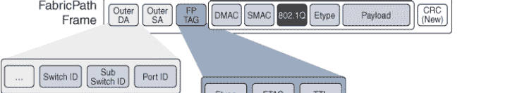

如图1-3所示，外层MAC报文头编码了目标和源交换机ID。此外，转发标签（FTAG字段）用于拓扑识别。

对于多目的流量，FTAG字段标识了BUM流量必须沿其转发的树。在FabricPath网络中，端点连接到边缘交换机。核心交换机将各种边缘交换机互连起来。边缘交换机以类似于传统二层网络学习的方式了解直接连接的端点。然而，当流量通过FabricPath网络发送时，边缘交换机会添加一个FabricPath报文头，其中包含其自身的源交换机ID和相应的目标交换机ID。从这个意义上说，MAC学习仍然通过泛洪与学习（F&L）语义来实现，但在此情况下，交换机将远程MAC地址与相应的远程交换机ID关联起来进行学习。

网络中的核心交换机只需要根据FabricPath报文头转发流量。它们完全不知道端点的存在。因此，核心交换机可以保持精简，这通常有助于网络扩展。

为了提高边缘交换机上的扩展性，FabricPath网络默认启用了二层会话式学习。通过二层会话式学习，交换机仅学习处于活跃会话中的远程端点。

虽然FabricPath使得二层ECMP成为可能，但对端点（即默认网关）的首跳路由的横向扩展（scale-out）也是期望的。通过Anycast HSRP，^18^引入了一种用于FabricPath的四路活动-活动首跳路由协议（FHRP），这提供了一种比vPC上经典的集中式两路活动-活动方法更具扩展性的方案。

尽管FabricPath非常流行并被数千家客户采用，但它也面临着质疑，因为它与单一供应商思科相关联，以及缺乏多厂商支持。此外，随着IP成为网络行业的实际标准，业界推动基于IP的覆盖封装。因此，引入了VXLAN。

VXLAN是一种MAC-in-IP/UDP封装，是目前最流行的覆盖封装。作为一个开放标准，它已获得网络厂商的广泛采用。与FabricPath一样，VXLAN解决了前面描述的所有STP限制。然而，除此之外，VXLAN使用一个24位数字来标识一个虚拟网络段，从而支持多达1600万个广播域，而传统的VLAN则受到4K限制。

因为VXLAN运行在IP网络之上，三层网络的ECMP特性天生可用。通常，运行在三层之上的覆盖技术，如VXLAN，可以使用IP和任何传输方式的层次化寻址。然而，像FabricPath这样使用MAC-in-MAC封装的覆盖技术需要一个透明的二层传输，这种传输无法以可扩展的方式进行寻址，因为MAC地址由一个扁平的地址空间表示。本质上，通过VXLAN，数据中心网络从依赖特定传输转变为使用IP的任何传输（即传输无关）。因此，底层先前基于扁平MAC地址的寻址方案转变为基于层次化IP地址的寻址方案。

VXLAN网络中的边缘交换机被称为*边缘设备*，它们托管VXLAN隧道端点（VTEP）。边缘交换机负责VXLAN报文头的封装和解封装。互连各个VTEP的核心交换机是普通的IP路由器。值得注意的是，这些交换机不需要任何专门的硬件或软件功能。同样，VXLAN网络内的交换机使用常规路由协议（如OSPF、三层IS-IS等）来相互学习。

VTEP使用常规的二层学习语义来了解其直接连接的端点。远程端点则通过一个称为VXLAN泛洪与学习（F&L）的过程来学习。朝向VXLAN核心，VTEP从端点获取原始二层帧，并添加一个VXLAN报文头。该报文头包含设置为其自身VTEP IP的外层源IP地址（SIP）和设置为连接目标端点的VTEP IP的外层目标IP地址（DIP）。

通过VXLAN，端点到VTEP的绑定使用F&L语义来学习。通常，每个网络由一个唯一的二层虚拟网络标识符（L2 VNI）标识，并与一个多播组关联。来自VTEP的多目的流量被转发到VXLAN核心，其目标IP设置为与相应二层网络关联的多播组。通过这种方式，属于同一二层网络的远程VTEP将接收到该流量，因为它们属于同一多播树。

解封装后，VTEP对远程MAC地址执行MAC学习，将其与关联的远程VTEP（具体来说是L2 VNI、源MAC到VTEP SIP）关联起来。与任何其他覆盖技术一样，核心交换机仅基于外层报文头（在此情况下是外层IP报文头）转发流量，而不知道端点地址。对于非多播选项的VXLAN F&L，IP核心网不需要支持IP多播。

使用非多播选项时，VTEP需要支持入口或头端复制。在这种情况下，对于每个多目的帧，都会生成多个副本并单播发送给每个成员远程VTEP。对于VXLAN F&L，对首跳网关执行类似于经典以太网的方法。与vPC结合使用的两路活动-活动首跳路由协议（FHRP）引入了集中式网关方案。

如今，VXLAN是少数可以同时用作网络覆盖和主机覆盖的覆盖协议之一。这意味着VXLAN报文头不仅可以由支持VXLAN的网络交换机封装/解封装和处理，也可以由服务器主机本身处理。这为极其灵活的实现选项提供了可能，并实现了从物理到虚拟的无缝集成。此外，已经有了下一步覆盖演进的提案，即通用协议封装（GPE）和网络服务头（NSH）。然而，这些选项的批准可能还需要一些时间。^19^目前，VXLAN仍然是数据中心部署中的事实标准覆盖协议。

## 思科开放可编程网络架构

随着VXLAN作为基于标准的数据中心覆盖解决方案的引入，VXLAN网络内的学习仍然基于F&L语义。多年的网络经验表明，基于泛洪的方法最终会带来扩展性挑战。

尽管如此，泛洪提供了一种学习端点的机制，特别是远程MAC到VTEP的绑定，以便后续流量可以单播。然而，如果这种相同的映射可以通过控制协议分发给各个边缘设备或VTEP，那么对泛洪的需求就可能被完全消除。

通过对BGP EVPN地址族的扩展，现在可以在VXLAN网络内分发端点（IP，MAC）到VTEP的绑定。通过这种方式，一旦端点在本地VTEP上被学习到，就可以使用BGP EVPN将此可达性信息分发给所有感兴趣的VTEP。然后，到此端点的任何流量都可以从任何其他VTEP最优地转发，而无需任何泛洪流量。

虽然消除二层流量的泛洪肯定在很大程度上帮助了支持BGP EVPN的VXLAN网络的扩展性，但这些网络中的三层流量也可以使用特定的方法论进行最优转发。然而，在讨论这些选项之前，本章先简要介绍数据中心网络中传统的三层流量转发。

经典的三层拓扑在网络行业中已经服务了相当长的时间（见图1-4）。通常，端点或服务器连接到接入层，接入层仅提供二层支持以及相应的VLAN和交换机端口配置。对于子网间通信，来自端点的流量通过汇聚或汇聚层交换机进行路由。

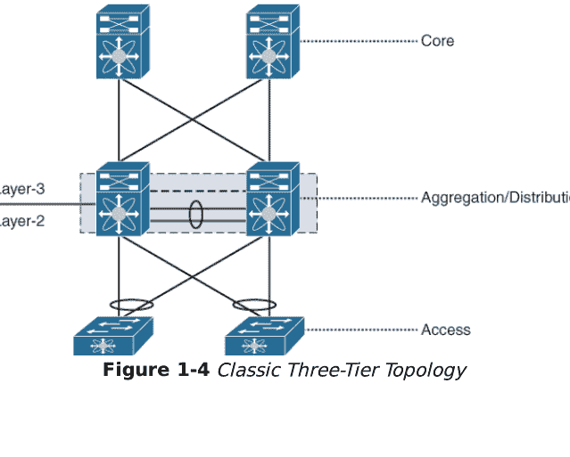


端点的默认网关以第3层SVI或IRB接口的形式托管在聚合层。为实现冗余，聚合层交换机配置了首跳冗余协议（FHRPs），如HSRP或VRRP。各聚合层交换机之间又通过核心层交换机互连。适当的第3层协议允许聚合层与核心层交换机之间交换前缀信息。

对于大规模数据中心部署，三层拓扑已成为扩展瓶颈。随着网络内端点数量增加，聚合层交换机中存储的IP-MAC绑定数量也随之增长，因此需要支持大型转发表（FIB）。此外，这些交换机需要处理的ARP和ND刷新等控制平面开销也显著增加。这个问题加上聚合层交换机可托管的第3层接口和相应租户VRF的数量限制，导致了严重挑战。

为满足敏捷性和弹性需求，将任何工作负载重新定位到资源可用的区域是可取的。在三层拓扑中，流量通过托管相应默认网关的聚合交换机进行不必要的"长臂"传输，已是最佳情况。在最坏情况下，工作负载可能仅部署在给定聚合POD内直连接入层交换机后面的服务器上。

对于4K VLAN，聚合层交换机可能面临巨大的扩展性挑战。因此，考虑到VXLAN及其对多达1600万个虚拟网络的支持，传统三层拓扑无法承受如此负担。业界普遍认识到这一局限性，并强烈推动将第3层移至接入层，摆脱集中式第3层网关方法。

将默认网关移至接入层可缩小故障域，因为接入交换机只需支持其下方工作负载的首跳协议。与单个或一对聚合交换机必须支持所有接入交换机下方所有端点的情况相比，这无疑代表了更具扩展性的模型。这催生了叶-脊或脊-叶拓扑（见图1-5）。

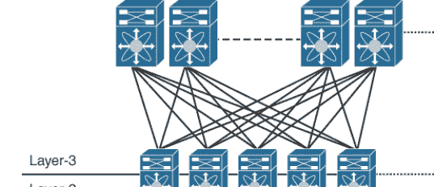

支持第3层的接入层通常称为*叶层*。提供各叶层之间互连的聚合层称为*脊层*。通过VXLAN并消除生成树协议（STP）及其相关不良影响，网络已朝着更高稳定性发展。聚合或脊交换机现在成为核心交换机，它们精简高效，仅需在叶层之间优化转发流量，完全无需感知端点地址。此外，通过BGP EVPN控制协议，泛洪未知单播流量的需求基本被消除。

通过BGP EVPN分发可达性信息，可实现分布式IP任播网关。可根据需要，在任意或所有叶交换机上同时配置相同的默认网关。这样，当工作负载在不同叶交换机之间移动时，仍能发现其默认网关直接连接。任何工作负载可放置在任意叶交换机下方。

通过分布式IP任播网关，任何路由流量都将从源叶最优转发至目的叶。脊层提供所需冗余，从而形成具有足够冗余的简单网络拓扑。

思科开放可编程网状架构采用基于脊-叶的多层Clos^20拓扑，使用开放的、基于标准的协议，特别是VXLAN作为数据平面，BGP EVPN作为控制平面。该架构不仅包含最优转发语义，还包括解决方案附带的自动化与可管理性框架。简言之，这涉及（1）第0天：通过将设备设置为相应指定角色并配置相应启动配置来启动架构；（2）第1天：架构运营，即基于活动工作负载在相应叶交换机上配置适当的叠加配置；（3）第2天：架构运营，包括架构的故障排除、可管理性和持续监控。这也包括将架构与各种计算编排器以及第4-7层服务设备集成。

## 架构相关术语

图1-6展示了本书中使用的一些术语。如前所述，架构由托管VTEP的叶交换机组成。叶交换机或叶层也称为*边缘或网络虚拟化边缘（NVE）*设备。物理和虚拟端点连接至叶层。

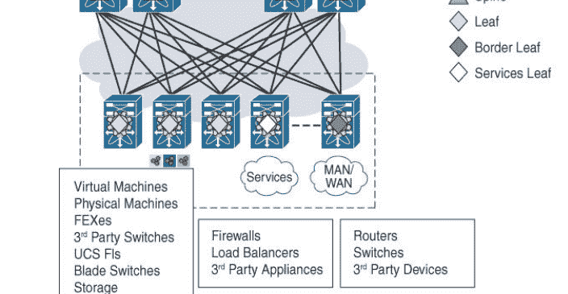

*图1-6 数据中心架构术语*

叶层朝向端点的下游接口通常是第2层端口，承载dot1q标记或未标记流量。一个或多个脊交换机提供叶层之间的连接。架构中的每台交换机都是IP网络的一部分，该网络称为*底层*（见图1-7）。

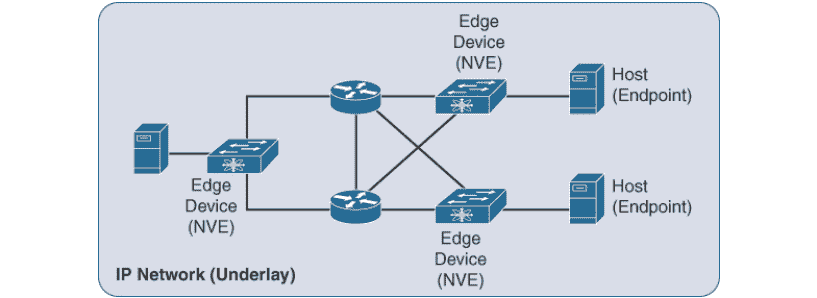

*图1-7 架构底层*

所有叶间流量采用VXLAN封装并通过叠加层发送（见图1-8）。从架构出发的外部可达性通过称为*边界*的特殊节点实现。边界功能可托管在叶层（此时称为*边界叶*）或脊层（此时称为*边界脊*）。

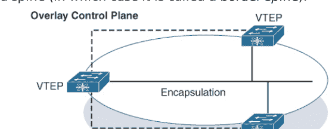

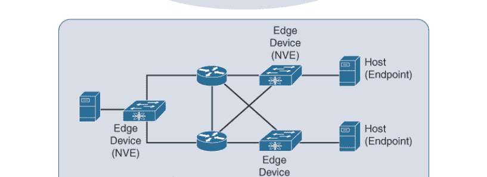

*图1-8 架构叠加层*

来自叶交换机的VXLAN封装流量通常在边界VTEP处解封装。此外，根据配置的第2层或第3层交接，流量被转发至外部设备。有时，连接服务设备的叶层称为*服务叶*。顺便提一下，不同的叶层角色是逻辑上的而非物理上的。同一台叶交换机可同时执行所有三种功能——普通叶、边界叶和服务叶。

为实现高效的BGP EVPN叠加连接，架构内还托管一个或多个路由反射器（RR）。通常，RR功能配置在脊层或*超级脊*上。如果采用IP多播转发多目的地流量，架构内还需托管汇聚点（RP）。通常，RP也托管在脊层或超级脊上。

## 数据中心网络架构特性

基于Clos的架构具有多项理想特性，对数据中心网络尤其具有吸引力。这种相对简单的拓扑提供了增强的扩展性、弹性和效率。通过无过载设计以及每个叶层的上行和下行带宽相等，架构提供高二分带宽，这对数据中心应用特别具有吸引力。

采用两层Clos架构时，每个叶层可通过单跳经选定脊层到达其他任何叶层。这为所有通过架构转发的流量提供了确定性延迟。增加额外脊层会使等价路径数增加一。ECMP同样适用于单播和多播流量，也适用于叶层采用分布式IP任播网关的第2层（桥接）和第3层（路由）流量。

架构对链路和节点故障具有极强的弹性，因此提供高水平的冗余。失去一个脊层会减少可用架构带宽，但流量仍以优化方式转发，尽管总速率降低。同样，在链路故障时，流量被重定向到可用路径，收敛时间取决于底层和叠加层协议的收敛速度。

在架构内，任何和所有子网可同时配置在任何和所有叶层上，从网络角度提供真正的"任何工作负载在任何地方"选项。

架构具有理想的横向扩展特性：如果需要添加更多服务器、机架或工作负载，可添加更多叶层；如果工作负载需要额外带宽，可添加更多脊层；如果需要更高外部带宽，可添加更多边界节点。这样，架构可根据需求扩展。

架构也可设计支持数十至数百甚至数千个面向服务器的10G端口。通过期望的过载配置，架构可灵活支持具有不同容量的各类工作负载环境。

## 服务器或端点连接选项

通常连接到叶层的端点可以是裸机、虚拟工作负载、存储设备或服务设备。端点可通过直接连接、通过结构扩展器（FEX）²¹或在某些情况下通过刀片交换机连接至叶层。随着Nexus 2K系列交换机的推出，FEX技术崭露头角，并在相对较短时间内获得广泛接受。

逻辑上，FEX模块可视为完全由所连接父交换机管理的外部线路卡。FEX模块的所有管理和配置均从父交换机完成。往返于FEX连接终端主机的流量在父交换机进行交换和路由。

采用FEX时，行尾（EoR）或行中（MoR）拓扑普遍，其中FEX通常作为每个机架的机架顶（ToR）交换机，每个FEX连接至MoR或EoR交换机。与EoR部署相比，MoR部署的优势在于连接所需电缆更短。

就架构而言，存在各种FEX连接组合，如图1-9所示。这些组合取决于服务器是直接双连接至叶层还是通过FEX连接。FEX本身甚至可双连接至配置为vPC对等体的一对叶交换机。


**图 1-9** *南向 FEX 连接选项*

最常用的选项可能是部署直连 FEX，即在每个 vPC 对等体上各部署一个 FEX，同时服务器通过 PortChannel 双归属连接到这些 FEX。这允许在链路故障、FEX 故障或 vPC 对等体故障时实现容错。如果需要更高的冗余性，可以使用增强型 vPC 或 EvPC 部署，其中服务器和 FEX 均采用双归属连接。

基于刀片机箱的服务器部署也非常流行，其优势在于可以在相同的机架空间内容纳更多计算能力，简化管理，并减少所需布线量。刀片交换机，如 Cisco UCS Fabric Interconnect [FI] 系列交换机²²，也可以从叶交换机向南连接。图 1-10 展示了与 UCS FI 常见的南向连接选项。

**图 1-10** *南向 UCS-FI 连接选项*

对于完整的数据中心解决方案，除了计算和网络功能外，还需要考虑存储。该网络架构足够灵活，能够支持传统的基于光纤通道 (FC)²³ 的存储以及 IP 存储选项。Cisco Nexus 设备支持统一端口选项，即一个端口可以被配置为承载以太网流量或 FC 流量。

以太网光纤通道 (FCoE)²⁴ 技术消除了对专用以太网链路和独立 FC 链路的需求。FCoE 允许向服务器提供融合的南向连接选项，其中同一条链路可以同时承载以太网和 FC 流量。从叶交换机向上，流量可以被分离：以太网流量通过 VXLAN 核心承载，存储流量则通过独立的存储网络承载。

随着 IP 存储的普及和超融合解决方案的迅速崛起，对独立存储网络的需求已完全消除。Cisco HyperFlex<sup>25</sup> 解决方案为 IP 存储提供了一种演进方法，它完全向后兼容当前部署，并易于与基于 VXLAN BGP EVPN 的网络架构集成。该架构与 FC 和 IP 存储设备均能良好集成。

本节对基于 VXLAN BGP EVPN 的网络架构的简要介绍，将有助于加速理解后续章节中讨论的概念，这些章节涉及各种控制和数据平面细节以及流量在网络架构内部和外部的转发方式。基于 VXLAN BGP EVPN 的网络架构是迈向实现极高可扩展性网络的重要一步，在可预见的未来，该网络将服务于基于云的数据中心环境。

## 总结

本章简要介绍了 Cisco VXLAN BGP EVPN 网络架构。章节首先描述了现代数据中心的需求。随后，概述了数据中心多年来的演进过程，最终形成了基于 VXLAN BGP EVPN 的脊叶架构。介绍了常见的网络架构术语，并描述了使该网络架构具备极高可扩展性、弹性和灵活性的因素。

## 参考文献

1.  Open Networking Foundation. *Software-defined networking definition.* www.opennetworking.org/sdn-resources/sdn-definition.
2.  Cisco. *Data center switches.* www.cisco.com/c/en/us/products/switches/data-center-switches/index.html.
3.  Cisco. *Cisco IOS XE.* www.cisco.com/c/en/us/products/ios-nx-os-software/ios-xe/index.html.
4.  Cisco. *Cisco IOS XR software.* www.cisco.com/c/en/us/products/ios-nx-os-software/ios-xr-software/index.html.
5.  Cisco. *Design and configuration guide: Best practices for virtual PortChannels (vPC) on Cisco Nexus 7000 series switches.* 2016. www.cisco.com/c/dam/en/us/td/docs/switches/datacenter/sw/design/vpc_design/vpc_best.pdf.
6.  Cisco. *Cisco's FabricPath.* www.cisco.com/c/en/us/solutions/data-center-virtualization/fabricpath/index.html.
7.  Internet Engineering Task Force (IETF). *Routing bridges (RBridges): Base protocol specification.* 2011. tools.ietf.org/html/rfc6325.
8.  Mahalingam, M., et al. *Virtual eXtensible local area network (VXLAN): A framework for overlaying virtualized Layer 2 networks over Layer 3 networks.* 2014. tools.ietf.org/html/rfc7348.
9.  IEEE Standards Association. *802.1D-2004—IEEE standard for local and metropolitan area networks: Media access control (MAC) bridges.* 2004. standards.ieee.org/findstds/standard/802.1D-2004.html.
10. IEEE Standards Association. *802.1Q-2003—IEEE standards for local and metropolitan area networks: Virtual bridged local area networks.* 2003. standards.ieee.org/findstds/standard/802.1Q-2003.html.
11. Cisco. *Multichassis LACP.* 2015. www.cisco.com/c/en/us/td/docs/ios-xml/ios/etherchannel/configuration/15-s/ce-15-s-book/ce-multichass-lacp.html.
12. Cisco. *Configuring virtual switching systems.* www.cisco.com/c/en/us/td/docs/switches/lan/catalyst6500/ios/12-2SX/configuration/guide/book/vss.pdf.
13. IEEE Standards Association. *802.1AX-2008—IEEE standard for local and metropolitan area networks: Link aggregation*. standards.ieee.org/findstds/standard/802.1AX-2008.html.
14. Internet Engineering Task Force (IETF). *Cisco hot standby router protocol (HSRP)*. 1998. www.ietf.org/rfc/rfc2281.txt.
15. Internet Engineering Task Force (IETF). *Virtual Router Redundancy Protocol (VRRP) version 3 for IPv4 and IPv6*. 2014. tools.ietf.org/html/rfc5798.
16. Cisco. *Design and configuration guide: Best practices for virtual PortChannels (vPC) on Cisco Nexus 7000 Series Switches*. 2016. www.cisco.com/c/dam/en/us/td/docs/switches/datacenter/sw/design/vpc_design/vpc_best.
17. Cisco. *Cisco FabricPath best practice*. 2016. www.cisco.com/c/dam/en/us/products/collateral/switches/nexus-7000-series-switches/white_paper_c07-728188.pdf.
18. Cisco. *Configuring an anycast bundle*. 2016. www.cisco.com/c/en/us/td/docs/switches/datacenter/sw/6_x/nx-os/fabricpath/configuration/guide/b-Cisco-Nexus-7000-Series-NX-OS-FP-Configuration-Guide-6x/b-Cisco-Nexus-7000-Series-NX-OS-FP-Configuration-Guide-6x_chapter_0100.html#task_BF30BB009250408E99FA8ED33D1FDB57.
19. Cisco. *Encapsulation techniques: Generic network virtualization encapsulation, VXLAN generic protocol extension, and network service header*. 2014. www.cisco.com/c/en/us/solutions/collateral/data-center-virtualization/application-centric-infrastructure/white-paper-c11-733127.html.
20. Clos, C. A study of non-blocking switching networks. *Bell System Technical Journal*, 32(2):406-424, 1953.
21. http://www.cisco.com/c/en/us/support/switches/nexus-2000-series-fabric-extenders/tsd-products-support-series-home.html
22. Cisco. *Servers: Unified computing*. www.cisco.com/c/en/us/products/servers-unified-computing/index.html.
23. Internet Engineering Task Force (IETF). *Fibre Channel (FC) frame encapsulation*. 2003. tools.ietf.org/html/rfc3643.
24. Cisco. *Fibre Channel over Ethernet (FCoE)*. www.cisco.com/c/en/us/solutions/data-center-virtualization/fibre-channel-over-ethernet-fcoe/index.html.
25. Cisco. *Hyperconverged infrastructure*. www.cisco.com/c/en/us/products/hyperconverged-infrastructure/index.html.


# 第2章 VXLAN BGP EVPN 基础

在本章中，您将了解以下内容：

- VXLAN 及其典型的泛洪学习（F&L）用例
- 面向基于 VXLAN 数据中心环境的 BGP EVPN 控制平面的演进
- 用于网络虚拟化叠加层的 BGP EVPN 基本路由类型消息

向云的范式转变包含了采用日益增长的虚拟化程度，其中大量的物理服务器和 I/O 设备可以托管多个虚拟服务器，这些服务器尽管位于不同的地理位置，但都可以共享同一个逻辑网络。与传统的客户端和服务器之间的南北向数据流量相反，虚拟化促进了数据中心内部更大的东西向数据流量。东西向流量描述的是数据中心内部服务器和/或各种应用程序之间的数据通信。因为企业网络或互联网终端用户所需的大部分数据涉及更复杂的处理，所以需要进行某些预处理活动。作为这种预处理需求的一个示例，东西向流量的一个例子是 Web 服务器（通过应用服务器）访问数据库。

网站和/或业务应用程序的动态渲染通常使用两层或三层服务器架构，其中一层必须与第二层通信，然后才能向终端用户传递请求的数据。当这些层级相互之间通信或需要访问相同数据中心内的数据存储或其他数据时，就使用 *东西向流量* 这个术语，因为它代表了更水平化的路径剖面（参见 [图 2-1](https://example.com/fig2-1)）。东西向流量的另一个例子是用户向社交网站（如 [www.facebook.com](https://www.facebook.com)）发出请求，这导致数据中心后端的服务器之间快速交换一系列信息，并返回一个包含大量关于用户信息、其好友动态、可能匹配用户偏好的相关广告等的网页。

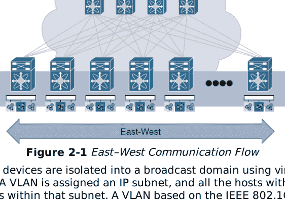

图 2-1 *东西向通信流程*

通常，使用虚拟局域网（VLAN）将一组设备隔离到一个广播域中。一个 VLAN 被分配一个 IP 子网，该 VLAN 中的所有主机在该子网内拥有唯一的 IP 地址。基于 IEEE 802.1Q 标准的 VLAN 由一个 12 位标签表示。这将 VLAN 的最大数量限制为 4096，从而限制了支持的唯一网络标识符或广播域的数量。在多租户云部署的时代，4K 个 VLAN 是不够的。因为单个租户可能需要多个网络 ID（VLAN）用于不同的应用层，所以这些虚拟化网络的饱和度成了一个显著的问题。

随着虚拟化，现在占据广播域中虚拟工作负载或虚拟机的终端主机数量急剧增长。随之而来的是可扩展性问题至关重要。一个典型的 48 端口接入层交换机传统上连接 48 台服务器。随着虚拟化，这个数量增加了 20 到 30 倍。在某些情况下，由于容器的普及，这种增长甚至更大。² 因此，交换机现在需要通过拥有更大的硬件转发表资源来满足这种增加的容量；从数据平面角度来看，这是一个 MAC 表爆炸问题。³ 此外，交换机还必须为这些工作负载服务首跳协议（例如，DHCP、ARP、ND、IGMP），这导致了控制平面开销的增加。

在二层广播域中建立无环环境的经典协议一直是 IEEE 802.1D 生成树协议（STP）及其相应的演进版本，快速生成树协议（RSTP；IEEE 802.1w）和多生成树协议（MST；IEEE 802.1s）。⁴ STP 为网络环境服务了超过 20 年。正如 [第1章 "可编程网络简介"](#) 中讨论的，STP 有几个缺点，例如在交换机/链路故障时收敛时间增加，由于数据包遍历树结构导致交换机之间的转发不是最优的，以及没有多路径或等价多路径（ECMP）选项（这是三层网络的一个有吸引力的特性）。广播域中主机规模的增加要求比 STP 更好的选项来支持大型数据中心环境。

由于虚拟化允许将终端主机从物理服务器上解耦，数据中心的迁移和移动需求，允许从一个物理服务器移动到另一个物理服务器，导致了此类网络更高的带宽需求。这一事实进一步得到网络通信变化的支持，这些变化采用了“任意到任意”模型，其中任何主机都可以与网络上的任何其他主机（逻辑的或物理的）进行通信。此外，随着利用率的扩大，敏捷性、功耗效率和易于管理性是数据中心的额外需求。鉴于这些要求，显然传统的网络范式是不够的。

水平数据中心流量的增加需要解决方案来应对 12 位 VLAN 表现出的广播域限制。用不同的多个 IP 子网重载 VLAN 并没有解决问题，因为它无法提供多租户环境中所需的隔离。此外，不同的租户可能拥有 IP 子网重叠的网络标识符。因此，任何解决方案都需要以某种方式维持二层桥接语义，同时实现更好的二层租户隔离和更高的网络 ID 容量。为了适应数据中心现在所需的灵活性、可扩展性、移动性和敏捷性，需要一种扩展的虚拟化网络解决方案。为了满足这一需求，网络虚拟化叠加层走到了前台。

## 叠加层

网络虚拟化叠加层已成为解决上述与数据中心扩展相关的问题的事实标准解决方案。叠加层提供了一层间接性，允许抽象现有网络技术并扩展经典网络能力。正如 David Wheeler 所说：“计算机科学中的所有问题都可以通过另一层间接性来解决，当然，间接性太多的问题除外。”⁵ 这个基本的计算机科学思想支持了网络虚拟化叠加层的概念。

叠加层的概念在联网领域已经存在相当长一段时间了。[第1章](#) 描述了导致叠加层演进的传统网络的缺点。顾名思义，*叠加层* 是在物理网络基础设施之上运行的静态或动态隧道。在 20 世纪 90 年代，基于 MPLS 和 GRE 的封装开始流行。⁶,⁷ 随后，其他隧道技术，如 IPsec、⁸ 6in4、⁹ 和 L2TPv3，¹⁰ 也走到了前台，但它们通常用于广域网边缘设备。这些隧道被用于安全目的、简化路由查找，或者例如在 6in4 的情况下，用于在无法支持负载类型的传输网络上承载负载。

使用叠加层时，原始数据包或帧在源边缘设备处被打包或封装上一个外部头部，并发送到相应的目的地边缘设备。中间网络设备都基于外部头部转发数据包，并且不知道原始负载。在目的地边缘设备处，叠加层头部被剥离，数据包基于内部负载进行转发。

叠加层自 2008 年起才在数据中心环境中使用。那个时期也见证了软件定义网络（SDN）的兴起和云的采用。数据中心环境中的叠加层被称为 *网络虚拟化叠加层*。这个名称源于数据中心的大多数趋势都是通过快速采用服务器虚拟化而发生变革的。在考虑网络虚拟化叠加层时，需要考虑一些明显的特征。所有这些网络虚拟化叠加层都表现出的一个主要特征与位置和身份的概念有关。*身份* 标识一个终端主机，可以是其 IP 地址、MAC 地址等。*位置* 标识负责为该终端主机封装和解封装隧道流量的隧道边缘设备。如前所述，终端主机本身可以是虚拟机、裸金属服务器、容器或任何其他工作负载。叠加层的外部头部引用源和目的地位置，而内部头部引用源和目的地终端主机身份。

另一个显著特征与叠加层提供的特定叠加层服务有关。这决定了叠加层的类型以及相关的头部格式。叠加层服务通常作为二层（桥接）或三层（路由）服务提供；然而，许多现代叠加层同时提供二层和三层服务。原始数据包（三层）或帧（二层）可以被封装到另一个数据包（三层）或帧（二层）中。这提供了可能的四种组合，具体取决于数据包/帧是否在另一个数据包/帧中承载。如果外部头部是二层帧，则叠加层方法称为 *帧封装*。采用帧封装的叠加层示例有 TRILL、¹¹ Cisco FabricPath、¹² 和 SPB（IEEE 802.1Qaq）。¹³ 另一方面，如果外部头部是三层数据包，则叠加层称为 *数据包封装*。采用数据包封装的叠加层示例有 LISP、VXLAN 和 NvGRE。¹⁴

定义了叠加层服务以及不同的数据平面封装后，需要一种传输方法来在物理网络上传输数据。这种传输方法通常是一个 *底层传输网络*（或简称 *底层*）。在定义底层时，我们需要知道隧道封装发生的 OSI 层。从某种意义上说，叠加层头部类型决定了传输网络的类型。例如，对于 VXLAN，底层传输网络（底层）将是一个三层网络，它将在源和目的地隧道边缘设备之间传输 VXLAN 封装的数据包。因此，底层提供了各种隧道/叠加层边缘设备之间的可达性。

通常，可达性通过适当的路由协议来分发。发现这些边缘设备是任何叠加层服务运行的前提。需要注意的是，叠加层会增加每数据包/帧 *n* 字节的开销，其中 *n* 是叠加层头部及相关外部头部的大小。封装到叠加层头部中的原始负载在底层上传输；因此，必须为底层网络配置适当的最大传输单元（MTU），以确保叠加层流量的传输。

接下来，网络虚拟化叠加需要一种机制来了解哪些终端主机位于哪个叠加边缘设备之后。这允许隧道边缘设备构建位置-身份映射数据库。映射信息可以通过中央SDN控制器（如Cisco APIC¹⁵或OpenDaylight控制器¹⁶）或通过叠加终端主机分发协议（如BGP EVPN¹⁷或OVSDB¹⁸）或基于数据平面的发现方案（如泛洪与学习[F&L]）来实现。利用此信息进行目的终端主机查找，源边缘设备可以推送带有适当字段的叠加头，以便数据包/帧能够被传递到目的边缘设备，然后传递到目的终端主机。由于终端主机通常属于某个租户，因此叠加头必须具有某种租户概念。通过在封装过程中在源设备的叠加头中推送适当的租户上下文信息，目的边缘设备可以在解封装后执行基于租户的目的查找，从而确保租户间流量的隔离。这是多租户数据中心环境中的一个主要要求。

叠加的数据平面除了提供单播封装的第2层或第3层流量传输外，还需要处理多目的流量的传输。多目的地流量通常被称为"BUM"，代表"广播、未知单播或多播"。处理这些类型的流量需要特殊的能力，即从叠加接收传入的多目的数据包，然后相应地在底层中复制和传输这些数据包。两种最常用的可在底层处理此复制和传输的方法是IP多播和入口复制（也称为头端复制或单播模式）。

网络虚拟化叠加可以从物理服务器或网络交换机（通常是连接到服务器的机柜顶[ToR]交换机）发起。物理服务器通常是虚拟化的，以便它们可以托管一个具有增强的叠加头封装和解封装能力的虚拟交换机/路由器。这种模型要求网络交换机仅提供虚拟化服务器之间的连接，这反过来又允许使用所谓的*主机叠加*在虚拟终端主机之间传输数据。

对于同时存在裸机和虚拟化工作负载的部署，ToR负责为其下所有类型的工作负载推送/弹出叠加头。这些被称为*网络叠加*。主机叠加和网络叠加都非常流行，代表了应对多租户数据中心环境中规模挑战的常见部署选项。各有利弊，但通过使用*混合叠加*环境（同时支持主机叠加和网络叠加，从而优化物理到虚拟[P2V]通信），可以兼得两者的优势（参见**图2-2**）。

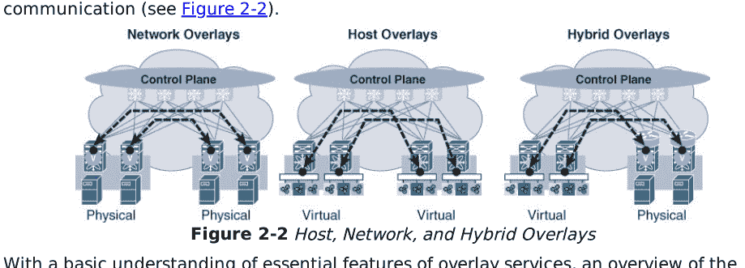

在对叠加服务的基本特性有了基本了解之后，接下来概述底层和叠加通用分类法。基础传输网络，即底层，通常由互连边缘设备的传输设备组成。边缘设备作为底层的边界设备，连接到终端主机以及不支持叠加的设备，例如物理和虚拟服务器。因此，边缘设备将局域网网段与底层连接起来。

在边缘设备内部，驻留着用于叠加数据流量封装和解封装以及构建整个叠加网络的功能。在VXLAN术语中，边缘设备上的此功能称为*VTEP*，代表*VXLAN隧道端点*。[图2-3](figure2-3)展示了VXLAN底层涉及的关键术语和功能。

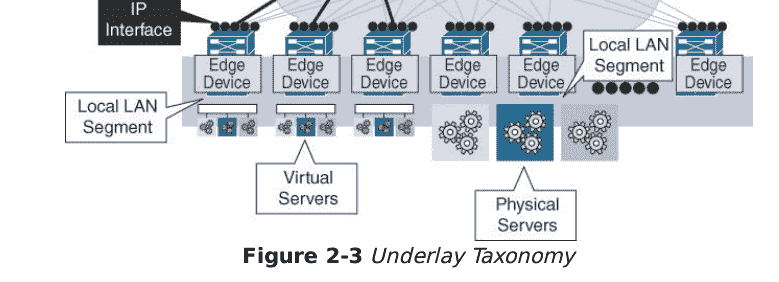

**图2-3** *底层分类法*

虽然一个边缘设备可以托管多个可能参与不同底层的VTEP，但通常一个边缘设备托管一个VTEP。因此，在本书中，我们经常互换使用*VTEP*和*边缘设备*这两个术语。在VTEP之间，使用隧道封装来提供叠加服务。对于VXLAN，这些服务通过虚拟网络标识符（VNI）来明确标识，这大大扩展了其在网络内容纳更大规模广播域的能力。这些方面使VXLAN非常有吸引力。[图2-4](figure2-4)展示了VXLAN叠加涉及的关键术语和功能。

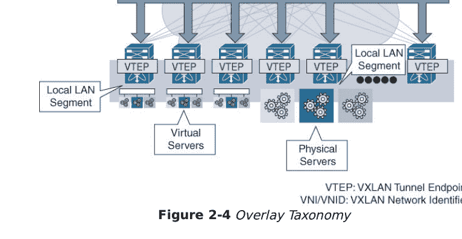

VTEP：VXLAN隧道端点
VNI/VNID：VXLAN网络标识符

**图2-4** *叠加分类法*

## VXLAN简介

随着虚拟化的扩展，VLAN的可扩展性限制催生了对替代解决方案的需求。然而，与此同时，为了在网络内连接特定的虚拟机和传统设备，需要保留OSI第2层的桥接语义。为了实现这一点，开发了VXLAN（虚拟可扩展局域网）。VXLAN将网络ID数量从4096扩展到1600万，并提供了一个基于MAC-over-IP/UDP的叠加，扩展了现有的VLAN命名空间，从而指数级地增加了广播域的数量。因此，VXLAN代表了一种第2层-in-第3层叠加。边缘设备通过托管的VTEP功能负责推送和弹出VXLAN头。

本质上，VXLAN通过第3层连接两个或多个网络，同时允许这些不同网络上的工作负载或服务器继续共享相同的第2层广播域。因此，VLAN始终仅在以太网数据链路层（第2层）运行，而VXLAN则跨越第3层运行。此外，如前所述，第2层以太网网络采用STP进行环路预防，这创建了一个无环拓扑，从而为VLAN流量提供了单一活动路径。然而，通过在VXLAN中使用第3层，可以通过ECMP利用VTEP之间的所有可能路径，这也大大提高了交换结构的利用率。即使在底层使用ECMP，叠加中VTEP之间的单一特定路径仍然被使用，同时利用所有可用的ECMP路径。并且通过使用IP核心作为其底层的一部分，VXLAN利用现有的网络专业知识，使数据中心的调试和维护变得更容易。

VXLAN头的内部部分指的是第2层组件，而外部头反映了第3层边缘设备。因此，VXLAN头包含工作负载的原始第2层以太网帧，其中包括内部MAC源地址以及内部MAC目的地地址、原始以太网有效负载和帧校验序列。此外，第2层以太网帧的原始内部802.1Q头被移除并映射到VNI，以完成VXLAN头，如图2-5所示。

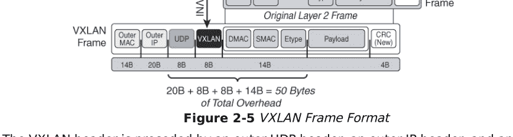

VXLAN头之前是一个外部UDP头、一个外部IP头和一个外部以太网头。外部UDP头的目标端口号设置为4789。¹⁹ UDP源端口号根据原始或内部头的字段生成。外部IP头中的源IP地址设置为源VTEP的地址，而目标IP地址设置为目标VTEP的地址。外部以太网头的派生基于对外部IP头的路由查找，使用常规的第3层查找语义。这样，VXLAN为现有以太网帧增加了50字节的开销，或者如果添加了可选的IEEE 802.1Q标签，则增加54字节的开销。图2-6说明了VXLAN帧格式。


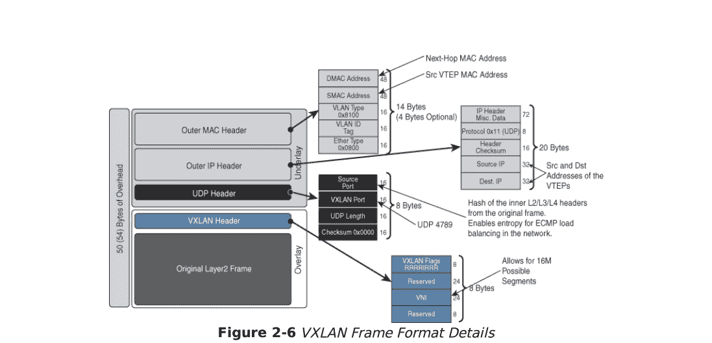

## 图 2-6 *VXLAN 帧格式细节*

通常，在具有等价多路径（ECMP）的三层网络中，负载均衡是通过基于流行的五元组输入选择多条等价路径之一来实现转发流量的。[20] 通常，五元组包括源 IP 地址、目标 IP 地址、四层（L4）协议、源 L4 端口和目标 L4 端口。对于 VXLAN，所有发往同一对源和目标 VTEP 之间工作负载的流量，其外部头部中除 UDP 源端口外的所有其他字段都是相同的。由于 UDP 源端口根据内部数据包/帧的内容而变化，它提供了必要的熵，以便在同一对源和目标 VTEP 之间为不同的终端主机流选择不同的路径。因此，无论是在软件还是硬件形态中实现，VTEP 都应支持的一项重要功能是适当生成 UDP 源端口值的能力。这是 VXLAN 与其他叠加技术相比的一个关键区别因素。

在 IP 底层网络中，可以使用任何合适的路由协议，如 OSPF、[21] IS-IS、[22] 等，来建立所有 VTEP 之间的连接。IP 底层需要提供一种传输叠加单目的地和多目的地流量的方法。一种传输多目的地流量的方法是在底层使用 IP 多播。在这种情况下，底层使用协议无关多播（PIM），这是一组用于 IP 网络的多播路由协议。IP 多播流行的 PIM 选项包括 PIM 任意源多播（ASM）、PIM 单源多播（SSM）和双向 PIM（BIDIR）。[23] 第 4 章“底层网络”将更详细地介绍 IP 底层的单播和多播路由选项。VXLAN VNI 被映射到一个适当的 IP 多播组。这是在配置时完成的，即在 VTEP 上配置 VNI 时。因此，VTEP 会加入通过 PIM 建立的相应多播树。这样，所有属于同一 VNI 的 VTEP 都成为同一多播组的成员。来自属于给定 VNI 的终端主机的多目的地流量，通过 VXLAN 传输到该 VNI 中的所有其他终端主机，其中外部目标 IP 地址被设置为与该 VNI 关联的多播组地址。

## VXLAN 泛洪与学习（F&L）

考虑图 2-7 所示的示例网络拓扑，它展示了 VXLAN 网络中典型的基于 F&L 的通信。

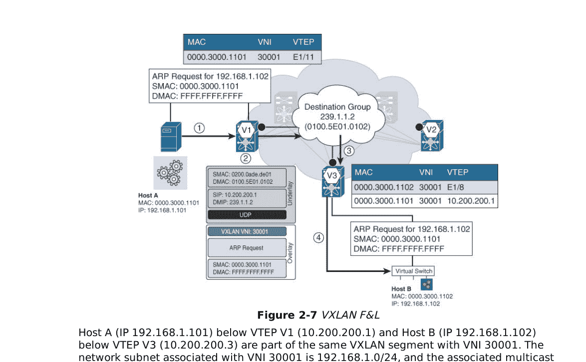

## 图 2-7 VXLAN F&L

主机 A（IP 192.168.1.101）位于 VTEP V1（10.200.200.1）之下，主机 B（IP 192.168.1.102）位于 VTEP V3（10.200.200.3）之下，它们属于同一个 VXLAN 网段，VNI 为 30001。与 VNI 30001 关联的网络子网是 192.168.1.0/24，关联的多播组是 239.1.1.2。当 VNI 30001 在 V1 和 V3 上配置时，它们都作为感兴趣的接收者加入多播组 239.1.1.2。假设主机 A 想与主机 B 通信。

通常，主机 A 首先会尝试使用地址解析协议（ARP）解析与主机 B 关联的 IP-MAC 绑定。主机 A 发出一个 ARP 请求，DMAC=FFFF.FFFF.FFFF，SMAC=0000.3000.1101。VTEP V1 接收到此 ARP 请求，并基于 [VNI=30001, DMAC=FFFF.FFFF.FFFF] 执行二层查找。VTEP V1 确定这是一个需要发送给 VNI 30001 所有成员的多目的地帧。因此，它用一个 VXLAN 头封装此数据包，VNI=30001，源 IP=10.200.200.1，目标 IP=239.1.1.2。

VXLAN 封装的数据包被发送到 IP 核心。该数据包通过多播树转发，然后到达所有感兴趣的接收者，包括 V3。VXLAN 封装的数据包在 V3 处被解封装，因为 V3 本地配置了 [VNI=30001, Group=239.1.1.2]。二层学习导致条目 [VNI=30001, MAC=0000.3000.1101->10.200.200.1] 在 V3 处被学习到。V3 基于 [VNI=30001, DMAC=FFFF.FFFF.FFFF] 执行二层查找。由于这是一个广播数据包，它被本地转发到 V3 下属于 VNI 30001 的所有主机，包括主机 B。主机 B 收到 ARP 请求后，发出一个 ARP 响应，DMAC=0000.3000.1101，SMAC=0000.3000.1102。V3 接收到此数据包，它进行本地学习和基于 [VNI=30001, DMAC=0000.3000.1101] 的目标查找。这导致二层表命中，该数据包被 VXLAN 封装并发送到 V1。

此数据包中值得注意的关键字段是 VNI=30001，源 IP=10.200.200.3，目标 IP=10.200.200.1。封装的数据包通过常规三层路由传递到 V1。V1 也进行二层学习，然后基于 [VNI, DMAC] 的目标查找使得来自主机 B 的 ARP 响应数据包被传递到主机 A。

这样，主机 MAC 信息在两个 VTEP 处都得到了适当的填充，并且主机 A 和 B 知道了彼此的 MAC-IP 绑定。主机 A 和 B 之间的后续流量将在 V1 和 V3 之间通过 VXLAN 进行单播。

通过这种机制，多目的地流量在 VTEP 之间通过 VXLAN *泛洪*，以*学习*位于 VTEP 后面的主机 MAC，从而后续流量可以进行单播。这被称为 *F&L* 机制。因此，VXLAN VNI 内的通信遵循常规的二层转发语义，就像在 VLAN 内一样（参见[图 2-8](https://example.com)）。主要区别在于 VXLAN VNI 域通过 IP 底层跨越三层网络。

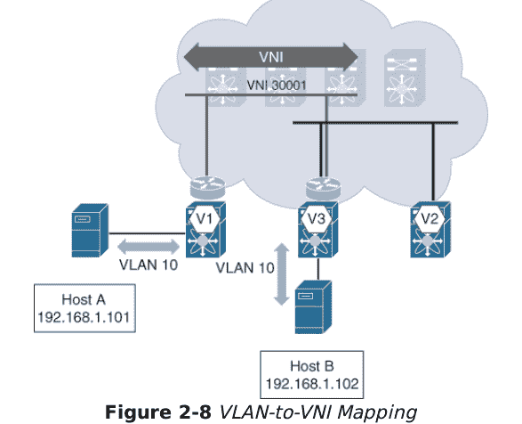

**图 2-8** *VLAN 到 VNI 映射*

多个 VNI 可能共享同一个多播组。这是因为拥有 1600 万个潜在的 VNI 选项，并为 VNI 和多播组之间建立唯一的 1:1 映射，需要极高的软件和硬件资源，这在实际部署中是不切实际的。事实上，在大多数实际部署中，最多支持 512 或 1024 个多播组。这意味着 VTEP 可能会收到为未在本地配置的 VNI 封装的 VXLAN 多目的地流量。网络层面的隔离仍然得以维持，因为每个 VXLAN 网段都有一个唯一的 VNI，并且查找键始终是 [VNI, DMAC]。在 VXLAN 环境中处理多目的地流量的 IP 多播的替代方案是使用入口复制（IR），或称为头端复制。使用 IR 时，每个 VTEP 必须知道哪些其他 VTEP 拥有给定 VNI 的成员资格。源 VTEP 为每个多目的地帧生成 *n* 个副本，每个副本都发送给其他拥有相应 VNI 成员资格的 VTEP。这给 VTEP 带来了额外的负担，但其好处在于简化了网络，因为无需在 IP 底层运行多播。

VXLAN 是少数既被用作主机叠加技术又被用作网络叠加技术的叠加方案之一。随着 SDN 的兴起，VXLAN 已被大量用作主机叠加技术，物理服务器托管软件 VTEP，为虚拟化工作负载之间的流量执行 VXLAN 封装和解封装。为了建立不支持 VXLAN 的传统工作负载之间的通信，二层 VXLAN 网关应运而生，在传统基于 VLAN 的域和虚拟化基于 VXLAN 的域之间提供转换。网络厂商开始在其硬件交换机中支持 VXLAN，从而为将 VXLAN 用作网络叠加技术提供了选项。这为在同一数据中心环境中同时支持软件和硬件 VTEP 的混合环境铺平了道路。

VXLAN 为扩展性差、需要增强网络移动性和保持网络可管理性等问题提供了一个显著的解决方案。然而，也发现了一些 VXLAN 的缺点。虽然 VXLAN 为虚拟网络定义了可扩展的数据平面，但在这方面并未指定控制平面。因此，VXLAN 采用的原生 F&L 方法远非理想，因为 VXLAN 的广播域现在跨越了三层边界。通常，任何基于泛洪的机制都会带来严重问题，尤其是在规模增大时。如第 1 章所述，VXLAN F&L 存在与以太网 F&L 网络相同的缺点。因此，尽管 VXLAN 在满足日益增长的数据中心需求的某些方面提供了显著优势，但它未能提供一个全面的解决方案。缺失的部分是一种无需泛洪流量即可学习 VTEP 后面终端主机的机制。这是通过基于 BGP 的控制协议扩展来实现的。

## 基于 VXLAN 的 BGP EVPN 简介

VXLAN 的利用通过增加网络标识符数量及其三层叠加平台，为多租户数据中心提供了许多优势。但是，虽然通过将 IP 核心纳入数据传输而避免了 STP，但在特定的主机到主机标识符被学习和定义之前，当试图找到目标工作负载时，仍然需要多播协议来模拟三层网络上的泛洪。因此，VXLAN 在通过网络传输数据时，传统上采用 F&L 方法。目标 VTEP 地址后面的所有逻辑和传统设备都会从源工作负载接收数据，试图定位目标工作负载，一旦被其预期的目标地址接收到，特定的 MAC 地址信息会反馈回源工作负载，从而完成主机学习。一旦学习完成，VXLAN 网段内就会建立直接的主机到主机连接。

考虑到这一点，使用边界网关协议（BGP）[24] 和以太网 VPN（EVPN）[25] 解决了与通过泛洪学习相关的一些问题，通过最小化需要发生泛洪的程度。BGP 是一个长期存在、标准化的网络层可达性信息（NLRI）交换协议，用于促进网络内的主机到主机可达性。BGP 已经有效地证明了它可以在互联网级别上扩展。作为一个硬状态协议，它只在其广播的网络可达性信息发生某种变化时才发起消息传递，BGP 消息传递已通过各种方式进行了扩展。在网络虚拟化叠加的背景下，BGP 提供了 VXLAN 网段内 VTEP 后面所有设备（逻辑的和其他的）MAC 和 IP 地址的数据目录。因此，BGP 允许对 VXLAN 目的地进行清晰的标准化编号和命名，从而消除了为学习地址信息而进行泛洪的需要。多协议 BGP（MP-BGP）同样在支持多租户的 IP 网络中运行良好，[26] 其与 EVPN 结合使用提供了所需的控制平面方面。

作为 BGP（或多协议 BGP [MP-BGP]）[27] 一部分的 EVPN 扩展在这些标准化标识符中添加了足够的信息，以便工作负载之间可以高效地进行数据交换。EVPN 使用 BGP/MP-BGP 格式在 VXLAN 内的源和目标 VTEP 之间传输信息，以识别 VTEP 后面特定 IP 和 MAC 地址目标的可达性。通过集成路由和交换，[28] EVPN 使用 VXLAN 网络中已知的工作负载地址，促进了二层和三层的传输。因此，可以显著减少不必要的泛洪以进行学习的需求，并且在某些情况下，可以完全消除这种需求。

简而言之，EVPN 地址族允许主机 MAC、IP、网络、VRF 和 VTEP 信息通过 MP-BGP 携带。这样，只要一个 VTEP 学习到了关于主机的信息

在其背后（通过 ARP/ND/DHCP 等），BGP EVPN 分发并向网络中所有其他支持 BGP EVPN 的 VTEP 提供此信息。只要源 VTEP 持续检测到其背后存在一个主机，就不会发送 EVPN 更新消息。因此，其他 VTEP 无需“老化”任何远程主机可达性信息。这避免了在典型的 F&L 场景中可能发生的任何老化相关的抖动，从而大大增强了网络的可扩展性。

进一步阐述这个概念，有时人们认为 BGP-EVPN 完全消除了对泛洪的需求，但这实际上并不准确。VXLAN 作为网络的数据平面运行并传输数据。因此，为了在 VXLAN 上处理 BUM 流量，源 VTEP 仍然需要使用 IP 组播或入口复制将多目的地流量发送到多个 VTEP。虽然由于未知单播流量引起的泛洪或许可以消除（如果没有“静默”主机，或者没有尚未被发现且仅在被呼叫时才响应的主机），但由于 ARP、DHCP 和其他地址协议引起的广播流量可能仍然会导致泛洪。这些情况的例子包括 Web 服务器、某些防火墙或某些精选的服务设备。在虚拟化时代，静默主机的数量已经减少；但是，这些主机并未被完全消除。因此，通过使用 EVPN 控制平面，对泛洪的需求减少了，但 EVPN 并未完全消除这种需求。

BGP EVPN 与 F&L 在几个方面有所不同。对等体发现和远端主机学习都以完全不同的方式处理，因为 BGP EVPN 分发端点标识符（MAC 以及可选的 IP 地址）以及 VTEP 背后的端点关联 IP 前缀信息。同样，对等 VTEP 认证也不同，控制平面包含所需信息，而不是等待单播学习响应。此外，BGP EVPN 通过使用此控制平面缩小了主机路由的分发范围。因此，ARP 请求在 VXLAN 网络内被抑制，这显著提高了数据传输的效率。考虑到这些特性，将 BGP EVPN 与 VXLAN 结合使用提供了一种改进的方式，可以方便地控制数据传输，从而使网络中可识别的特定主机数量呈指数级增长。

## MP-BGP 特性和通用实践

VXLAN BGP-EVPN 解决方案基于 MP-BGP，如 RFC 4760 中所述。²⁹ MP-BGP 的主要特征是允许将多个地址族和相关的 NLRI 复用到单个 BGP 对等会话中。因此，MP-BGP 也允许通过此单个 BGP 对等会话提供 VPN 服务，并提供内嵌逻辑来分离不同租户的可达性信息。在此处，术语 *租户*、*VPN* 和 *VRF* 可互换使用。

MP-BGP 地址族用于传输特定的可达性信息。流行的地址族包括 VPNv4 和 VPNv6，它们广泛用于不同数据中心站点之间的多协议标签交换（MPLS）中的第 3 层 VPN。其他 VPN 地址族（例如，组播 VPN [MVPN]）用于在多租户环境中的 MPLS 或其他封装内传输组播组信息的可达性。在 VXLAN 的情况下，重点是地址族 L2VPN EVPN，它描述了通过单个 MP-BGP 对等会话传输租户感知的第 2 层（MAC）和第 3 层（IP）信息的方法。

在 BGP 中，当使用单个自治系统（AS）时，BGP 发言者之间的对等称为内部 BGP（iBGP）。iBGP 主要用于在整个 AS 内以同步方式在所有发言者之间交换信息。iBGP 需要全网状对等，因为可达性信息必须从 iBGP 发言者学习，并且不得中继到任何其他 iBGP 发言者。为了改变此行为，iBGP 可以利用路由反射器（RR）的功能。允许 RR 接收 iBGP 信息，然后将信息“反射”给其任何 RR 客户端——即所有已知的 iBGP 邻居。通过 iBGP 和 RR 功能，可以优化 BGP 对等，从而可以放弃使用全网状 BGP 对等的要求（参见图 2-9）。同样，这也允许控制平面进行更高程度的扩展（即，*N* 个对等体需要 *N* 个会话，而全网状连接需要 *N*(*N*-1)/2 或 O(*N*²) 个会话）。

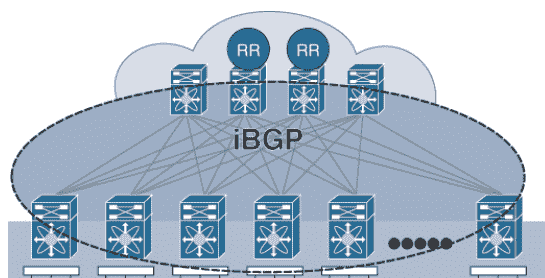

**图 2-9 *带有路由反射器的 iBGP***

通过外部 BGP（eBGP），BGP 发言者之间的对等是在不同的自治系统之间实现的。这意味着，例如，AS 65500 中的 BGP 发言者可以与其邻居 BGP 发言者（位于 AS 65501 中）对等（参见图 2-10）。在 eBGP 中，路由交换的规则略有不同。与 iBGP（在不使用 RR 的情况下要求全网状对等）不同，从 eBGP 发言者接收的 BGP 可达性信息总是发送给其所有邻居。此外，与 iBGP 相比，eBGP 具有隐式的 next-hop-self 语义，因此 eBGP 发言者发起的每条路由都以其自身作为下一跳进行通告。

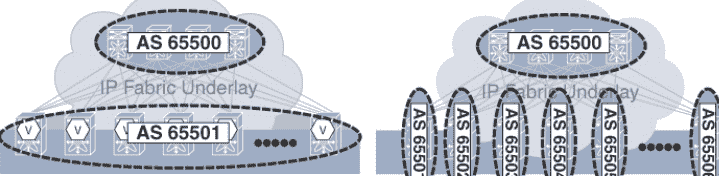

**图 2-10 *没有路由反射器的 eBGP***

MP-BGP 以其多租户和路由策略能力而闻名。为了区分存储在 BGP 表中的路由，MP-BGP 使用路由区分符（RD）。RD 是 8 字节（64 位），由三个字段组成。前 2 字节是类型字段，它决定了值字段将如何解释。剩余的 6 字节是值字段，可以根据三种众所周知的格式进行填充。

如图 2-11 所示，第一种格式是类型 0，其中 2 字节自治系统号加上 4 字节个体号完成了 RD 的值字段。对于类型 1 和类型 2，值字段的第一部分大小相似（各 4 字节），但此部分内容不同：在类型 1 中是 IP 地址，在类型 2 中是 AS 号。两种类型值字段的后半部分再次是 2 字节的个体号字段。作为分离和路径效率的通用最佳实践，一个经验法则是基于每个 VRF、每个路由器使用唯一的 RD，以便每个逻辑虚拟路由器实例都是可单独标识的。

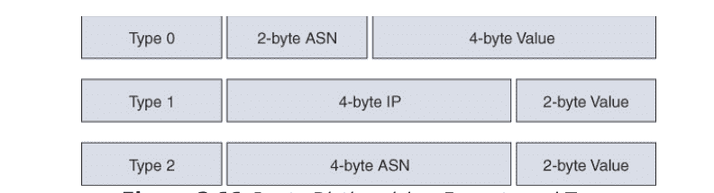

除了为多个租户提供唯一标识符外，MP-BGP 还使用路由策略在特定逻辑实例中对路由进行优先级排序。这是通过称为路由目标（RT）的属性实现的。RT 属性可以看作是标识一组站点，但更精确地说是标识一组 VRF。将特定的 RT 属性与一条路由关联，允许该路由被放入用于路由从相应站点接收的流量的 VRF 中。

RT 的表示法与 RD 相似，但其功能却大不相同。一个用于唯一标识 BGP 表中条目的前缀，另一个则控制这些前缀的导入或导出（参见图 2-12）。RT 本质上是放置在路由上的标签，用于标识可能具有优先重要性的路由。

通过使用 RT，可以将路由标识并放入不同的 VRF 表中。通过导出 RT 的控制，可以在入口交换机处将前缀引导到接收在 MP-BGP 中分配的特殊标签。同样，如果在导入侧使用相同的 RT，那么在导出时标记的所有路由也可以被优先导入。RT 也是 8 字节长，但除了 *前缀:后缀* 表示法外，格式可以相当自由地使用。为了简化，Cisco 提供了 RD 和 RT 的自动推导。

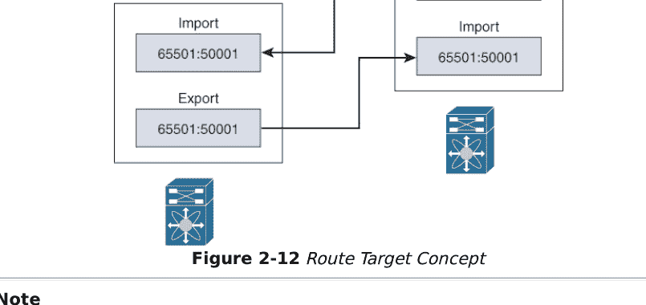

> **注意**

自动推导的 RD 使用类型 1 格式，即 RID Loopback IP: 内部 MAC/IP VRF ID (RD: 10.10.10.1:3)。对于 RT 的自动推导，格式为 ASN: VNI (RT: 65501:50001)。

多协议 BGP 包含更多的特性和功能。关于 VXLAN EVPN 解决方案的具体细节，描述了 RD 和 RT 字段以理解通用的前缀通告。此外，MP-BGP 携带扩展团体属性以补充

现有的前缀信息可用于进一步的转发。然而，这些信息超出了本MP-BGP及其相关通用实践简介的范围。

## IETF标准与RFC

VXLAN EVPN涉及多个互联网工程任务组（IETF）的请求评论（RFC）或草案。EVPN的通用控制平面在RFC 7432中描述。该RFC定义了MP-BGP EVPN地址族及其NLRI对于不同数据平面实现的通用交互规则。虽然存在特定草案来定义MPLS、提供商骨干网桥接（PBB）以及网络虚拟化覆盖（NVO）实现的细节，但我们的主要关注点在于NVO数据平面上使用VXLAN的BGP EVPN实现（参见图2-13）。

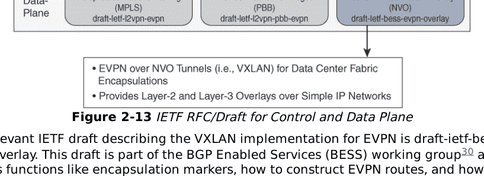

描述VXLAN用于EVPN实现的相应IETF草案是draft-ietf-bess-evpn-overlay。该草案是BGP使能服务（BESS）工作组^30^的一部分，定义了诸如封装标记、如何构建EVPN路由以及子网如何映射到EVPN虚拟实例（EVI）等功能。后续的实现草案是draft-ietf-bess-evpn-inter-subnet-forwarding和draft-ietf-bess-evpn-prefix-advertisement。这两份补充草案描述了EVPN中的集成路由和桥接（IRB）以及三层路由操作的处理方式。表2-1列出了当前在思科Nexus操作系统（NX-OS）上实现的与VXLAN BGP EVPN相关的RFC/草案。

| RFC/草案 | 标题 | 类别 |
|---|---|---|
| RFC 7348 | 虚拟可扩展局域网 | 数据平面 |
| RFC 7432 | 基于BGP MPLS的以太网VPN | 控制平面 |
| draft-ietf-bess-evpn-overlay | 使用EVPN的网络虚拟化覆盖解决方案 | 控制平面 |
| draft-ietf-bess-evpn-inter-subnet-forwarding | EVPN中的集成路由和桥接 | 控制平面 |
| draft-ietf-bess-evpn-prefix-advertisement | EVPN中的IP前缀通告 | 控制平面 |
| draft-tissa-nvo3-oam-fm | NVO3故障管理/OAM | 管理平面 |

**表2-1 RFC/草案概述**

思科NX-OS实现VXLAN EVPN的重要部分包括基于VLAN的捆绑服务、针对终端主机或子网的NVE对称IRB转发（即子间转发，章节5.1和5.2），以及IP-VRF到IP-VRF的实现（即前缀通告，章节5.4）。

需要注意的是，MP-BGP EVPN作为RFC 7432的一部分，具有不同的NLRI定义。同样，MP-BGP EVPN路由类型在RFC 7432中对于路由类型1至4以及在draft-ietf-bess-evpn-prefix-advertisement中对于路由类型5都有不同的定义章节（参见表2-2）。路由类型1（以太网自动发现[A-D]路由）和路由类型4（以太网段路由）目前在思科用于VXLAN的EVPN实现中尚未使用，但路由类型2、3和5则相当重要。

| RFC/草案 | 路由类型 | 描述 |
|---|---|---|
| RFC 7432 | 1 | 以太网自动发现（AD）路由 |
| | 2 | MAC/IP通告路由 |
| | 3 | 包含组播以太网标签路由 |
| | 4 | 以太网段路由 |
| draft-ietf-bess-evpn-prefix-advertisement | 5 | IP前缀路由 |

**表2-2 BGP EVPN路由类型**

路由类型2定义了MAC/IP通告路由，负责在BGP EVPN中分发MAC和IP地址可达性信息（参见图2-14）。路由类型2包含多个字段，为寻址信息提供上下文。路由类型2包含必选的MAC地址和MAC地址长度字段。同样，必须填写一个标签来定义VXLAN数据平面的二层VNI（MPLS标签1）。此NLRI还允许可选字段IP地址和IP地址长度。虽然通常IP地址长度字段是可变的，但对于包含单个终端或服务器IP寻址信息的路由类型2，其长度应为IPv4的32和IPv6的128。

### MP-BGP EVPN路由类型2 —— MAC/IP通告路由

- 路由类型2提供终端主机的可达性信息。
- 以下字段是此NLRI中EVPN前缀的一部分。
  - 以太网标签ID（置零）
  - MAC地址长度（/48），MAC地址
  - IP地址长度（/32，/128），IP地址 [可选]
  - 额外的路由属性
    - 以太网段标识符（ESI）（置零）
    - MPLS标签1（L2VNI）
    - MPLS标签2（L3VNI）

| 字段 |
|---|
| RD（8八位字节） |
| ESI（10八位字节） |
| 以太网标签ID（4八位字节） |
| MAC地址长度（1八位字节） |
| MAC地址（6八位字节） |
| IP地址长度（1八位字节） |
| IP地址（0、4或16八位字节） |
| MPLS标签1（3八位字节） |
| MPLS标签2（0或3八位字节） |

**图2-14 BGP EVPN路由类型2 NLRI**

当使用路由类型2传输桥接信息时，可能存在额外的团体属性，例如封装类型（Encap 8：VXLAN）、路由目标，或用于终端移动性或重复主机检测的MAC移动性序列号。对于路由场景，还存在额外的属性或团体，其中下一跳的路由器MAC将作为扩展团体以及第二个VNI（三层VNI）和路由目标被包含在内，用于三层操作。请注意，使用路由类型2时，二层和三层信息各自都有独立的RT和VNI。如果路由类型2消息中缺少IP信息，可选字段IP地址和IP地址长度将被“置零”，并且三层VNI（MPLS标签2）将被省略。

路由类型3称为“包含组播以太网标签路由”，通常用于创建入口复制的分发列表（参见图2-15）。这提供了一种以单播方式复制多目的地流量的方法。一旦在VTEP上配置了VNI并处于运行状态，路由类型3会立即生成并发送给所有参与入口复制的VTEP。这与路由类型2不同，路由类型2仅在终端主机被学习后才发送MAC/IP信息。通过这种方式，每个VTEP都知晓所有其他需要接收给定VNI中BUM数据包副本的远程VTEP。

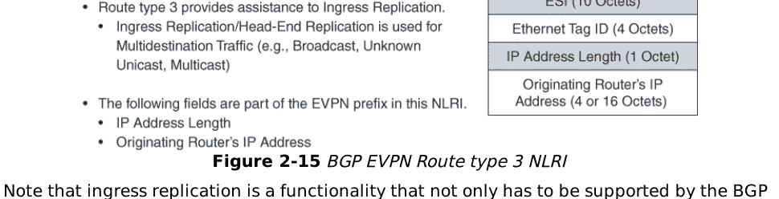

请注意，入口复制不仅是BGP EVPN控制平面必须支持的功能，数据平面也必须支持。此外，数据平面必须能够为每个多目的地数据包生成*n*份副本，其中*n*是关联VNI中的远程VTEP数量。由于此数据平面能力取决于托管VTEP的特定硬件ASIC，在缺乏入口复制支持的情况下，转发BUM流量的唯一选项是IP组播。因此，关于EVPN消除了底层对组播需求的迷思被推翻了。

要讨论的第三个也是最后一个路由类型是路由类型5，即IP前缀路由（参见图2-16）。

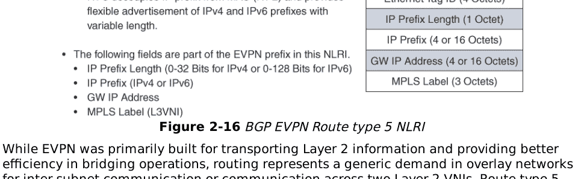

虽然EVPN主要是为传输二层信息和提高桥接操作效率而构建的，但路由代表了覆盖网络中用于子网间通信或跨两个二层VNI通信的通用需求。路由类型5通过允许传输具有可变IP前缀长度（IPv4为0到32，IPv6为0到128）的IPv4和IPv6前缀，提供了在EVPN内传输IP前缀信息的能力。路由类型5的IP前缀路由在NLRI中不包含二层MAC信息，因此路由类型5仅包含路由和集成多租户所需的三层VNI。此外，路由类型5的扩展团体承载了路由目标、封装类型以及覆盖中下一跳VTEP的路由器MAC。对于路由类型2，使用MAC地址在MAC VRF内进行路由标识，而对于路由类型5，则使用IP前缀在IP VRF内进行路由标识。

这使得 BGP EVPN 发言者能够实现清晰的分离，从而防止任何与 MAC 地址相关的处理用于 EVPN 广播的 IP 前缀路由（路由类型 5）。

## 主机和子网路由分发

通过 BGP EVPN，覆盖网络的终端主机和子网可达性信息以与底层网络解耦的方式进行分发。底层网络提供了从 VTEP 到 VTEP 具有可达性信息的拓扑，而覆盖网络控制协议分发终端主机信息，如 MAC 地址、IP 地址或带有覆盖网络中关联位置的子网前缀。VTEP 在所有 BGP EVPN 前缀通告中被通告为下一跳。BGP EVPN 与所有参与的 VTEP 交换这些信息，以实现第 2 层桥接或第 3 层路由层的端到端可达性。除了可达性信息本身，BGP EVPN 还提供相应地址所属的上下文以及由此产生的多租户能力。由于 BGP 提供了一种弹性方式来分发信息，各个边缘设备或 VTEP 需要将本地已知的 MAC、IP 和 IP 子网信息注入到 BGP 中以进一步分发。

当检测到终端主机连接到支持 VXLAN BGP EVPN 的边缘设备或 VTEP 时，MAC 信息以传统方式通过第 2 层 MAC 学习（例如 [VLAN, SMAC] 条目指向 Incoming_port）在本地交换机上学习。通过 MAC 学习过程，将了解与第 2 层 VLAN 的关系，并映射到第 2 层 VNI。新学习到的本地 MAC 地址信息通过填充路由类型 2 消息的必填部分，填充到 MP-BGP 控制协议中。在此阶段，创建一个包含 EVPN 路由类型 2 NLRI 的 BGP 更新，其中包含 MAC 地址长度（6 字节）、MAC 地址本身、第 2 层 VNI（标签 1）以及通过边缘设备本身的配置导出的相应路由区分符和路由目标（参见图 2-17）。

此外，由于使用了用于 VXLAN 的 BGP EVPNs，封装类型 8 被包含在内，以确保所有相邻设备理解所使用的数据平面封装是 VXLAN。31 因为图 2-17 所示的消息是由基于 BGP EVPN 的网络中 VTEP 上的新的 MAC 地址学习事件触发的，所以 MAC 移动性扩展团体为空。32

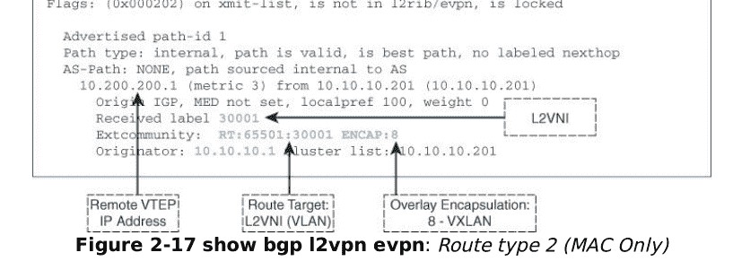

**图 2-17** show bgp l2vpn evpn: *路由类型 2（仅 MAC）*

**注意**
作为验证，EVPN NLRI 正在通过已填充字段的位计数进行检查。该位计数结果以 / 符号表示在相应的前缀旁边。仅包含 MAC 的路由类型 2 表示为 /216 前缀，而包含 MAC/IP 的路由类型 2 表示为 /272 前缀（即，IPv4 地址额外 32 位加上 L3VNI 的 24 位）。当路由类型 2 中携带 IPv6 地址时，它表示为 /368 前缀（即，IPv6 地址额外 128 位加上 L3VNI 的 24 位）。携带 IPv4 前缀的路由类型 5 EVPN 路由由 /224 前缀表示，而携带 IPv6 地址的路由则由 /416 前缀表示。

一旦边缘设备从直接连接的终端主机接收到 ARP 请求，该边缘设备就会学习到该终端主机的 IP-MAC 绑定。接收 ARP 请求的入口第 3 层接口为该终端主机提供关联的上下文信息。该上下文隐式映射到与第 3 层接口关联的租户 VRF，因此也映射到终端主机。回想一下，每个租户 VRF 都与一个唯一的第 3 层 VNI 关联，用于路由租户流量。

虽然到目前为止的描述是指 ARP，但使用邻居发现协议 (ND) 对 IPv6 终端主机执行类似的操作。使用配置 BGP EVPN 所需的参数，还会导出此 VRF 的路由区分符以及相应的路由目标。在此阶段，所有相关的第 3 层终端主机信息都可以填充到 BGP EVPN 消息中的路由类型 2 NLRI 中。这包括 IP 地址长度、IP 地址、第 3 层 VNI（标签 2）以及通过配置导出的路由区分符和路由目标。此外，与源 VTEP 或边缘设备关联的路由器 MAC (RMAC) 也作为扩展团体添加。这为相邻边缘设备提供了关于源 VTEP 的 IP 地址（第 3 层）和关联的 MAC 地址（第 2 层）的映射信息。

在 BGP EVPN 消息中包含 RMAC 的要求源于 VXLAN 是 MAC-in-IP/UDP 封装这一事实。通过提供内部 MAC 作为路由目的的 RMAC，封装过程中使用的信息不仅在第 3 层（下一跳 IP）级别，而且在第 2 层（目标 VTEP MAC）级别，都能正确标识相邻 VTEP。在 RMAC 旁边，封装类型 8 (VXLAN) 也被添加到扩展团体中，以确保所有相邻 VTEP 都能读取此前缀属于 VXLAN。必须考虑 BGP EVPN 路由类型 2 NLRI 中的其他字段。图 2-18 展示了一个同时填充了 MAC 和 IP 字段的典型路由类型 2 条目的 **show** 输出示例。因为使用了基于 VLAN 的捆绑服务，所以 MAC/IP 通告（路由类型 2）和包含组播通告（路由类型 3）中的以太网标签字段必须设置为零。<sup>33</sup>

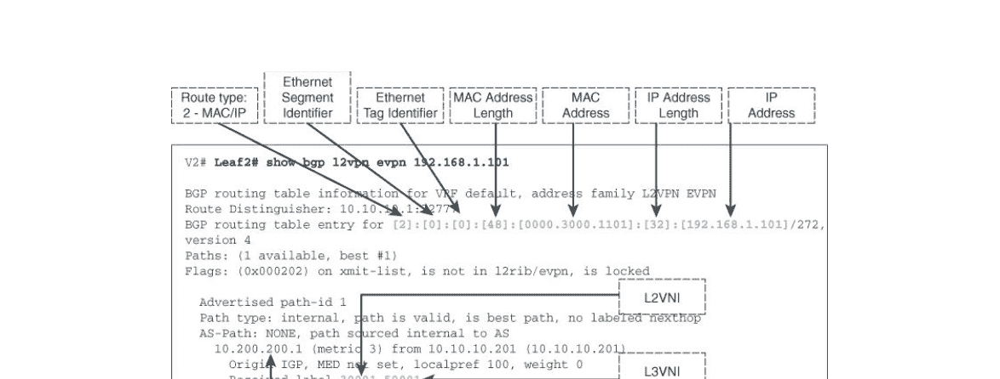

通过向路由类型 2 添加第 3 层信息（之前仅携带第 2 层信息），我们现在拥有一个完全填充的 NLRI，可以使用 BGP EVPN 在 VXLAN 网络内执行桥接和路由操作。已知的信息通过 BGP 更新发送到路由反射器 (iBGP)，后者再将此消息转发给其所有 BGP 对等体。收到此更新消息后，所有边缘设备将新学习的远程终端主机信息添加到各自的本地数据库——即终端主机 (MAC/IP) 桥接/路由表中。此时，匹配第 2 层 VNI 和相应导入路由目标的 MAC 地址被填充到硬件表中以进行 MAC 学习（例如，[VLAN, MAC] -> Remote_VTEP_IP）。请注意，这些 MAC 地址是通过 BGP 学习的，不受常规老化语义约束。只有在收到相应的 BGP 删除消息（表示端点被移除）时，它们才会被删除。

填充主机 IP 前缀到硬件路由表（通常称为转发信息库或 FIB）的过程也遵循类似的程序。具体来说，第 3 层 VNI 以及关联的导入路由目标标识了必须安装 /32 或 /128 主机 IP 前缀的租户 VRF 或 VPN。根据边缘设备的硬件能力，FIB 可能分为一个主机路由表 (HRT)，存储精确的 /32 (IPv4) 或 /128 (IPv6) 主机前缀，以及一个最长前缀匹配 (LPM) 表，通常存储可变长度 IP 前缀信息。FIB 条目，无论来自 HRT 还是 LPM，都指向一个邻接或下一跳条目。这通过 [BD, RMAC] 条目填充，其中 BD 是映射到第 3 层 VNI 的硬件桥接域，RMAC 对应于远程 VTEP。这两部分信息都在 BGP-EVPN 路由类型 2/5 通告中携带。应该注意的是，FIB HRT 通常在硬件中实现为哈希表，因为它只需要支持精确匹配语义，而 FIB LPM 则实现为真正的 TCAM 或算法 TCAM，因为它必须支持最长前缀匹配语义。由于 TCAM 因其更高的功耗而是一种昂贵的资源，因此在数据中心 ToR ASIC 中通常存在一个相对较小的基于 LPM 的 TCAM 表，以及更大的 HRT 表，可以在大规模数据中心环境中支持大量的端点或终端主机。

仅仅通过 BGP EVPN 提供本地学习的主机路由信息（基于 /32 或 /128 的 IP 前缀）是不够的。因此，除了主机桥接和路由能力外，BGP EVPN 还提供了基于 IP 前缀路由的经典语义。IP 前缀是


## BGP EVPN中的路由类型5与IP前缀信息

源边缘设备学习到这些信息并将其重分布到BGP EVPN控制协议中。为此，引入了特定的EVPN NLRI格式（路由类型5）。通过路由类型5消息，边缘设备会将IP前缀长度字段填充为被通告路由对应的IP前缀，并关联该路由所属VRF上下文的第3层VNI（参见图2-19）。基于VRF本身的配置，可以推导出与该路由关联的路由区分符和路由目标。与路由类型2消息类似，RMAC和封装类型（即VXLAN）也作为扩展团体属性包含在路由类型5消息中。

一旦边缘设备或VTEP收到路由类型5消息，只有当接收VTEP本地配置的第3层VNI和路由目标与消息中携带的信息匹配时，更新中携带的IP前缀路由才会被导入路由表。如果匹配成功，该IP路由将被安装到FIB表中，通常作为最长前缀匹配条目。对应的邻接或下一跳条目以与路由类型2消息类似的方式填充。

在基于VXLAN的BGP EVPN网络中，路由类型5主要用于两个场景来承载IP前缀路由信息。第一个场景涉及从每个执行第一跳路由服务的边缘设备通告IP子网前缀信息。在第一跳路由（也称为集成路由和桥接，IRB）的情况下，边缘设备通过分布式IP任播网关执行默认网关服务（参见图2-20）。只要配置了网关，IP子网前缀就会通过路由类型5进行通告。这有助于发现未被发现的“静默”终端主机，因为子网前缀会将路由流量吸引到该静默主机所在的边缘设备下方。该边缘设备会生成ARP请求以发现静默主机，后者则会发送ARP响应。发现后，该终端主机的IP-MAC绑定关系会在直连边缘设备上被学习到（通过ARP嗅探），并如前所述使用路由类型2通告到BGP EVPN中。如果该子网的所有承载分布式IP任播网关的边缘设备都未通告IP子网前缀路由，则发往该终端主机的流量会被静默丢弃，而不会触发上述主机发现过程。

| 路由类型 | MAC, IP | L3VNI ("VRF") | 下一跳 | 封装 |
| :---: | :--- | :---: | :---: | :---: |
| 5 | 192.168.1.0/24 | 50001 | 10.200.200.1 | 8:VXLAN |
| 5 | 192.168.1.0/24 | 50001 | 10.200.200.2 | 8:VXLAN |
| 5 | 192.168.1.0/24 | 50001 | 10.200.200.3 | 8:VXLAN |

**图2-20** *集成路由和桥接（IRB）*

将IP前缀路由注入BGP EVPN网状网络的第二个且可能更常见的用例涉及外部路由。路由是通过使用eBGP（或其他单播路由协议）建立的对等关系学习到的，并使用适当的路由映射策略重分布到BGP EVPN地址族中（参见图2-21）。作为此重分布过程的一部分，这些信息在与其学习时相同的路由上下文（VRF）中进行通告。这意味着，使用带子接口的域间AS选项A是即使超出BGP EVPN网络也能保持多租户信息的一种可行方式。另一种保持此上下文感知的解决方案可以通过定位器/ID分离协议（LISP）或MPLS第3层VPN来实现。除了接收BGP EVPN信息并将其通告到支持多租户的外部网络的集成方法外，LISP还提供了外部站点的FIB空间节约（主机路由的资源节省）能力以及具有主机粒度的入口路由优化。

| 路由类型 | MAC, IP | L3VNI ("VRF") | 下一跳 | 封装 |
| :---: | :--- | :---: | :---: | :---: |
| 5 | 192.168.1.0/24 | 50001 | 10.200.200.1 | 8:VXLAN |

**图2-21** *外部路由学习*

## 主机删除与移动事件

到目前为止，除了将终端主机的第2层和第3层可达性信息通告到BGP EVPN外，还介绍了终端主机检测。本节介绍终端主机删除和移动事件的处理。终端主机的删除过程与学习新终端主机的过程几乎相同，但顺序相反。一旦终端主机从基于VXLAN BGP EVPN的网络中断开连接，随着ARP条目的过期（Cisco NX-OS默认为1500秒），该终端主机的第3层信息将从BGP EVPN中移除。这意味着，在相关ARP条目超时后，提供该终端主机MAC和IP信息的路由类型2通告将被撤回。

具体来说，在ARP条目过期时，NX-OS边缘设备会执行刷新操作。它会向终端主机发送ARP请求以检测其是否存在。如果收到ARP响应，则认为该终端主机“存活”，并且该条目的ARP刷新计时器会重置为1500秒。然而，如果没有收到ARP响应，则ARP条目将被删除，并且该终端主机被认为“死亡”。然后，会发送路由类型2删除通告，以通知所有其他边缘设备该相应的终端主机不再可达。

即使ARP条目被删除，仅包含MAC的路由类型2仍会保留在BGP EVPN控制平面中，直到MAC老化计时器过期（NX-OS默认为1800秒），此时MAC信息将被移除。在此过期事件发生时，仅包含MAC的路由类型2通告将从BGP EVPN控制协议中撤回。随后，当该终端主机通过发送某些ARP或其他流量重新出现时，其信息会被重新学习并通告到BGP EVPN控制平面。这些EVPN前缀被认为是新的且前所未见的。请注意，ARP老化计时器略短于MAC老化计时器。作为最佳实践，两个计时器应这样配置，以避免网络中不必要的未知单播泛洪。如果MAC老化计时器被减少，那么同样重要的是也要减少ARP老化计时器。

在当今基于云的数据中心中，迁移工作负载相当常见，尤其是在虚拟化环境下。它涉及移动终端主机，使得相同的MAC和IP地址现在可以从不同的边缘设备到达。从网络的角度来看，控制协议可以将其视为从旧边缘设备删除该终端主机，以及从该终端主机移动到的新边缘设备进行新的学习事件。这个过程可能很耗时，特别是在“热”迁移事件中，即终端主机在移动时仍然处于“开启”状态，以便在迁移完成后尽快恢复其在新位置的操作。需要一个更快的选项，允许及时的终端主机移动信令，以便网络感知到终端主机的新位置，从而实现更快的收敛。

BGP EVPN包含了MAC移动性逻辑，以应对由于终端主机（即虚拟机）移动操作导致相同的终端主机对象（如相同的MAC和/或IP地址）出现在两个不同位置（VTEP）后面的情况。最初，当虚拟机出现时，检测到其存在的VTEP会通告相关的MAC和IP信息。当虚拟机从一台服务器移动到另一台服务器时，目标服务器上的虚拟机管理程序通常会检测到虚拟机移动事件。一旦检测完成，虚拟机管理程序会发送一个广播反向ARP（RARP）消息，其中包含已移动虚拟机的MAC地址。在某些情况下，虚拟机管理程序/虚拟交换机可能会发送一个免费ARP（GARP）消息，通告与已移动虚拟机关联的IP和MAC的移动。无论哪种情况，连接到目标服务器的VTEP会检测到原本是远端的MAC和/或IP地址现在变成了本地的，即可以通过其面向服务器的接口之一到达。

根据此信息，连接到目标服务器的VTEP会生成一个类似于新学习事件期间通告的路由类型2 BGP EVPN消息。但除了通告MAC地址、第2层VNI和作为下一跳的VTEP IP地址外，边缘设备还会以MAC移动性扩展团体属性的形式通告一个额外字段。MAC移动性字段中的序列号会递增1，以提供对哪个路由类型2通告是最新的进行判定的依据，从而

该消息被所有远程边缘设备或VTEP用于转发。当最初通告该VM可达性的旧VTEP收到此路由类型2消息时，会执行额外的验证步骤，以确保从新VTEP学习到的信息并非由重复的MAC/IP情况引起。重复地址情况发生在两个终端主机被无意中配置为相同地址时。

图2-22展示了在主机移动事件后，典型路由类型2条目的**show**输出示例，其中MAC Mobility Sequence Number字段已被填充。一旦验证步骤通过了重复检查，旧VTEP会撤销非最优的BGP EVPN路由类型2消息（即具有较低移动序列号的那条消息）。BGP EVPN MAC移动序列号的详细信息在RFC 7432第7.7节中定义，该部分描述了由于大量移动事件导致MAC移动序列号可能回绕时的处理方案。

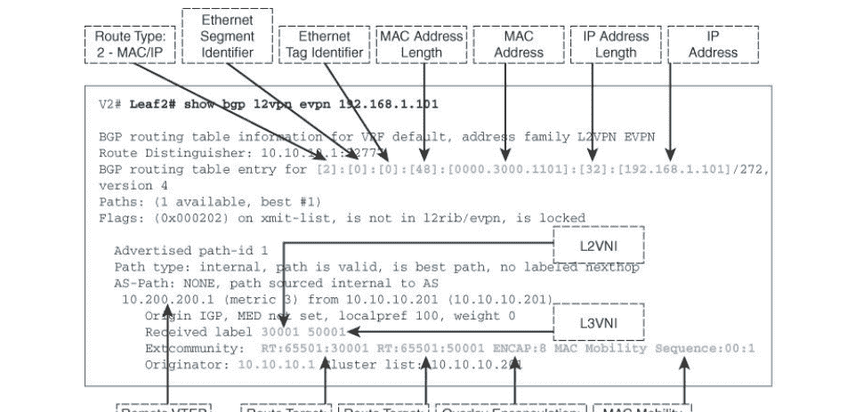

**图2-22** show bgp l2vpn evpn：路由类型2（MAC/IP与移动序列号）

## 小结

本章阐述了为何覆盖网络已成为下一代数据中心的首选设计架构。特别强调了已成为事实标准的VXLAN。本章介绍了在各种边缘设备之间分发主机可达性信息所需的基于控制平面的解决方案，并对BGP EVPN进行了全面介绍。它描述了BGP EVPN中支持网络虚拟化覆盖网络的重要消息格式及其典型用例。后续章节将在此基础上，进一步详细阐述底层网络、多租户以及基于VXLAN BGP EVPN数据中心拓扑中的单目的地和多目的地数据包流。

## 参考文献

1. Institute of Electrical and Electronics Engineers (IEEE). 802.1q—VLANs. 2016. www.ieee802.org/1/pages/802.1Q.html.
2. Red Hat. Linux containers with docker format. 2016. access.redhat.com/documentation/en-US/Red_Hat_Enterprise_Linux/7/html/7.0_Release_Notes/chap-Red_Hat_Enterprise_Linux-7.0_Release_Notes-Linux_Containers_with_Docker_Format.html.
3. Goransson, P., and C. Black. *Software defined networks: A comprehensive approach* (1st ed.). San Francisco, CA: Morgan Kaufmann Publishers Inc., 2014.
4. Institute of Electrical and Electronics Engineers (IEEE). *IEEE 802.1*. 2016. www.ieee802.org/1/.
5. Smith, K. Cython: The best of both worlds. *Computing in Science & Engineering*, 13(2):31–39, 2011.
6. Cisco. *Multiprotocol Label Switching (MPLS)*. www.cisco.com/c/en/us/products/ios-nx-os-software/multiprotocol-label-switching-mpls/index.html.
7. Cisco. *GRE tunnel interface states and what impacts them*. 2014. www.cisco.com/c/en/us/support/docs/ip/generic-routing-encapsulation-gre/118361-technote-gre-00.html.
8. Cisco. *Cisco IOS IPsec*. www.cisco.com/c/en/us/products/ios-nx-os-software/ios-ipsec/index.html.
9. Wilkins, S. *IPv6 tunneling technology configurations*. 2013. www.ciscopress.com/articles/article.asp?p=2104948.
10. Internet Engineering Task Force (IETF). *Layer Two Tunneling Protocol—Version 3 (L2TPv3)*. 2005. tools.ietf.org/html/rfc3931.
11. Internet Engineering Task Force (IETF). *Routing bridges (RBridges): Base protocol specification*. 2011. tools.ietf.org/html/rfc6325.
12. Cisco. *Cisco FabricPath*. http://www.cisco.com/c/en/us/solutions/data-center-virtualization/fabricpath/index.html.
13. Institute of Electrical and Electronics Engineers (IEEE). *802.1aq—Shortest path bridging*. 2012. www.ieee802.org/1/pages/802.1aq.html.
14. Internet Engineering Task Force (IETF). *NVGRE: Network virtualization using generic routing encapsulation*. 2015. tools.ietf.org/html/rfc7637.
15. Cisco. *Application policy infrastructure controller (APIC)*. www.cisco.com/c/en/us/products/cloud-systems-management/application-policy-infrastructure-controller-apic/index.html.
16. Open Daylight. www.opendaylight.org.
17. Internet Engineering Task Force (IETF). *BGP MPLS-based Ethernet VPN*. 2015. tools.ietf.org/html/rfc7432.
18. Pfaff, B. *The open vSwitch database management protocol*. 2013. tools.ietf.org/html/rfc7047.
19. Internet Engineering Task Force (IETF). *Virtual eXtensible local area network (VXLAN): A framework for overlaying virtualized Layer 2 networks over Layer 3 networks*. 2014. tools.ietf.org/html/rfc7348.
20. Hogue, T. *The dreaded 5-tuple*. 2015. blogs.cisco.com/security/the-dreaded-5-tuple.
21. Cisco. *OSPF design guide*. 2005. www.cisco.com/c/en/us/support/docs/ip/open-shortest-path-first-ospf/7039-1.html#topic2.
22. Cisco. *Intermediate System-to-Intermediate System Protocol*. www.cisco.com/en/US/products/ps6599/products_white_paper09186a00800a3e6f.shtml.
23. Cisco. *Configuring PIM*. www.cisco.com/c/en/us/td/docs/switches/datacenter/nexus3548/sw/multicast/602_A1_1/rn.
24. Cisco. *Border Gateway Protocol (BGP)*. www.cisco.com/c/en/us/products/ios-nx-os-software/border-gateway-protocol-bgp/index.html.
25. Cisco. *Ethernet VPN (EVPN) and provider backbone bridging-EVPN: Next generation solutions for MPLS-based Ethernet services.* www.cisco.com/c/en/us/products/collateral/routers/asr-9000-series-aggregation-services-routers/whitepaper_c11-731864.html.
26. Network Working Group. *BGP/MPLS IP virtual private networks (VPNs).* 2006. tools.ietf.org/html/rfc4364.
27. Cisco. *Multiprotocol BGP.* http://www.cisco.com/c/en/us/td/docs/ios-xml/ios/mp_l3_vpns/configuration/15-mt/mp-l3-vpns-15-mt-book/mp-bgp-mpls-vpn.html.
28. Internet Engineering Task Force (IETF). *Integrated routing and bridging in EVPN.* 2014. www.ietf.org/archive/id/draft-sajassi-l2vpn-evpn-inter-subnet-forwarding-05.txt.
29. IETF Network Working Group. *Multiprotocol extensions for BGP-4.* 2007. tools.ietf.org/html/rfc4760.
30. BESS Working Group. *Interconnect solution for EVPN overlay networks draft-ietf-bess-dci-evpn-overlay-01.* 2016. tools.ietf.org/html/draft-ietf-bess-evpn-overlay-01.
31. L2VPN Work Group. *A network virtualization overlay solution using EVPN draft-ietf-bess-evpn-overlay-02.* 2015. tools.ietf.org/html/draft-ietf-bess-evpn-overlay-02#section-13.
32. Internet Engineering Task Force (IETF). *BGP MPLS-based Ethernet VPN: MAC mobility.* 2015. tools.ietf.org/html/rfc7432#section-15.
33. L2VPN Work Group. *A network virtualization overlay solution using EVPN draft-ietf-bess-evpn-overlay-02: Encapsulation options for EVPN overlays.* 2015. tools.ietf.org/html/draft-ietf-bess-evpn-overlay-02#section-5.
34. Internet Engineering Task Force (IETF). *BGP/MPLS IP virtual private networks.* 2006. tools.ietf.org/html/rfc4364#section-10.
35. Internet Engineering Task Force (IETF). *The Locator/ID Separation Protocol (LISP).* 2013. tools.ietf.org/html/rfc6830.
36. Cisco. *Optimizing ingress routing with LISP across multiple VXLAN/EVPN sites: White paper.* www.cisco.com/c/en/us/products/collateral/switches/nexus-7000-series-switches/white-paper-c11-734843.html.

# 第3章 VXLAN/EVPN转发特性

本章将涵盖以下主题：

- 增强型BGP EVPN特性，如ARP抑制、未知单播抑制和优化的IGMP监听
- VXLAN EVPN架构中的分布式IP任播网关
- 双归属部署中的任播VTEP实现

VXLAN BGP EVPN已在各种标准化参考资料（包括IETF草案和RFC）中得到了广泛记录。虽然这些信息对于实现该协议及相关封装很有用，但关于转发的一些特性需要额外关注和讨论。不幸的是，一个常见的误解是，使用BGP EVPN的VXLAN对多目的流量无需任何特殊处理。本章将描述在使用VXLAN与BGP EVPN转发广播、未知单播和多播（BUM）流量时，多目的复制的工作原理。此外，还将涵盖减少BUM流量的方法。本章还包括对增强特性的讨论，例如VXLAN BGP EVPN网络中的早期地址解析协议（ARP）抑制、未知单播抑制和优化的互联网组管理协议（IGMP）监听。虽然Cisco VXLAN BGP EVPN实现的功能和特性支持减少BUM流量，但静默主机检测的用例仍然需要特殊处理，这也会在本章讨论。

除了讨论二层BUM流量外，本章还将讨论VXLAN BGP EVPN网络中的三层流量转发。VXLAN BGP EVPN既提供二层覆盖服务，也提供三层服务。对于三层转发或路由，必须存在第一跳默认网关。分布式IP任播网关通过将端点的默认网关分发到所有可用的边缘设备（或虚拟隧道端点[VTEP]）来增强第一跳网关功能。分布式IP任播网关使用集成路由和桥接（IRB）功能实现。这确保了源自或去往端点的桥接和路由流量，始终基于BGP EVPN通告的可达性信息，在网络内以可预测的延迟进行最优转发。由于这种二层/三层边界的分布式方法，虚拟机移动性从网络角度来看是无缝处理的，这得益于BGP EVPN中采用的特殊移动性相关功能。分布式任播网关确保默认网关的IP到MAC绑定不会改变，无论终端主机位于网络中的何处或移动到何处。此外，在移动事件之后，路由流量流到/自端点时不会出现发卡（hair-pinning）现象。BGP EVPN控制平面协议中的主机路由粒度有助于始终高效地路由到端点所在VTEP之后。

数据中心需要在所有层级和组件中都具有高可用性。同样，数据中心架构必须提供冗余以及动态路由分发。VXLAN BGP EVPN从多个角度提供冗余。VXLAN边缘设备或VTEP之间的三层路由底层网络提供弹性以及多路径。通过多机箱链路聚合或虚拟端口通道（vPC）连接经典以太网端点，提供双归属功能，即使在VTEP故障的情况下也能确保容错。此外，通常需要动态主机配置协议（DHCP）服务来为端点动态分配IP地址。在DHCP处理的背景下，集中式网关与分布式任播网关的语义略有不同。在VXLAN BGP EVPN架构中，需要在每个分布式任播网关点配置DHCP中继，并且DHCP服务器配置

必须支持DHCP Option 82。³ 这使得VXLAN BGP EVPN架构中的端点能够实现无缝的IP配置服务。

前述标准专门针对数据平面和控制平面的协同工作。本章将涵盖那些并非标准固有组成部分的组件和功能。本章讨论的范围特定于基于Cisco NX-OS平台的VXLAN BGP EVPN实现。后续章节将提供必要的细节，包括在VXLAN BGP EVPN网络中转发流量的详细数据包流程，以及相应的配置要求。

## 多目的地流量

使用BGP EVPN控制平面的VXLAN有两种处理BUM或称为多目的地流量的不同选项。第一种方法是利用底层网络中的组播复制。第二种方法是使用一种无组播的方式，称为*入口复制*，其中使用多个单播流将多目的地流量转发给相应的接收者。以下部分将讨论这两种方法。

## 利用底层网络中的组播复制

处理多目的地流量的第一种方法需要在底层配置IP组播，并利用基于网络的复制机制。通过组播，BUM流量的单个副本从入口/源VTEP发送到底层传输网络。网络本身沿着组播树（即共享树或源树）转发这个单一副本，使其到达参与给定组播组的所有出口/目的地VTEP。当这个单一副本沿着组播树传播时，仅当接收者已加入与该VNI关联的组播组时，副本才会在适当的分支点被复制。通过这种方法，网络中每条线路/链路只保留一个副本，从而提供了转发BUM流量最有效的方式。

二层VNI被映射到一个组播组。这种映射必须在所有存在该VNI的VTEP上一致地配置，通常表示该VTEP下存在一些感兴趣的端点。配置完成后，VTEP会发送一个相应的组播加入消息，表示对与相应组播组相关的树感兴趣。在将二层VNI映射到组播组时，为VNI和组播组的映射配置提供了多种选项。最简单的方法是使用单个组播组，并将所有二层VNI映射到该组。这种映射的一个明显好处是减少了底层网络中的组播状态；然而，它在复制BUM流量方面效率较低。当VTEP加入给定的组播组时，它会收到转发到该组的所有流量。VTEP不会处理任何不感兴趣的流量（例如，VTEP不负责的VNI）。换句话说，它会静默地丢弃该流量。VTEP作为该整体组的活跃接收者，继续接收这些不必要的流量。不幸的是，没有子选项可以根据组和VNI来修剪组播流量。因此，在所有VTEP参与同一组播组或多组的场景中，需要考虑组播出接口（OIF）数量的可扩展性。

在一个极端，每个二层VNI可以映射到一个唯一的组播组。在另一个极端，所有二层VNI都映射到同一个组播组。显然，最优行为介于两者之间。虽然理论上存在2²⁴ = 1600万种可能的VNI值，并且有足够多的组播地址（在组播地址块224.0.0.0–239.255.255.255中），但实际的硬件和软件因素将大多数实际部署中使用的组播组数量限制在几百个。在底层建立和维护组播树需要大量的状态维护和协议交换（PIM、IGMP等）。为了更好地解释这个概念，本章介绍了VXLAN网络中BUM流量的几个简单组播组使用场景。考虑[图3-1](https://example.com)中所示的BUM流。

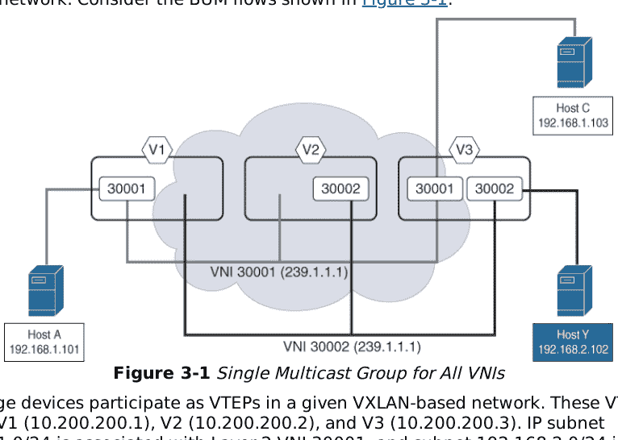

### 图3-1 *所有VNI使用单个组播组*

三台边缘设备作为VTEP参与一个给定的基于VXLAN的网络。这些VTEP被标记为V1 (10.200.200.1)、V2 (10.200.200.2)和V3 (10.200.200.3)。IP子网192.168.1.0/24与二层VNI 30001关联，子网192.168.2.0/24与二层VNI 30002关联。此外，VNI 30001和30002共享一个公共的组播组（239.1.1.1），但VNI并未分布在所有三个VTEP上。如[图3-1](https://example.com)所示，VNI 30001跨越VTEP V1和V3，而VNI 30002跨越VTEP V2和V3。然而，共享的组播组导致所有VTEP加入同一个共享的组播树。在图中，当主机A发送广播数据包时，VTEP V1接收该数据包并用VXLAN头部封装它。由于VTEP能够识别这是广播流量（DMAC为FFFF.FFFF.FFFF），它使用外层IP头部中的目标IP地址作为组播组地址。因此，广播流量被映射到各自VNI的组播组（239.1.1.1）。

然后，广播数据包被转发到所有已加入组播组239.1.1.1组播树的VTEP。VTEP V2接收该数据包，但它静默地丢弃了它，因为它对给定的VNI 30001不感兴趣。类似地，VTEP V3接收到通过组播底层复制的相同数据包。因为VNI 30001在VTEP V3上已配置，解封装后，广播数据包被发送到所有参与映射到VNI 30001的VLAN的本地以太网接口。通过这种方式，从主机A发起的广播数据包到达了主机C。

对于VNI 30002，操作是相同的，因为在所有VTEP上使用了相同的组播组（239.1.1.1）。BUM流量在所有VTEP上都可见，但如果该VTEP上未本地配置VNI 30002，则流量会被丢弃。否则，流量会沿着映射到VNI 30002的VLAN中的所有以太网接口被适当转发。

从这个例子中可以清楚地看到，通过为VNI 30001和30002采用不同的组播组可以避免不必要的BUM流量。VNI 30001中的流量可以限定在VTEP V1和V3范围内，VNI 30002中的流量可以限定在VTEP V2和V3范围内。[图3-2](https://example.com)提供了一个此类拓扑的示例，以说明范围受限的组播组的概念。

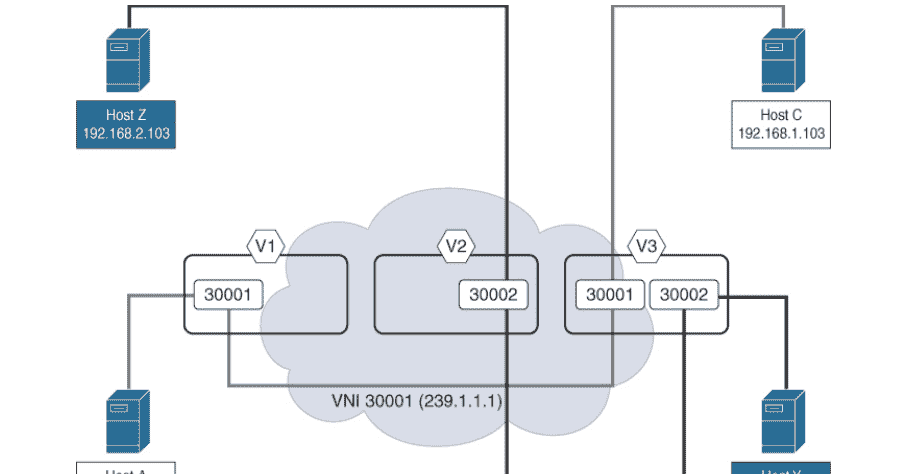

### 图3-2 *针对VNI的范围受限的组播组*

如前所述，参与给定基于VXLAN网络的三台边缘设备被标记为V1 (10.200.200.1)、V2 (102.200.200.2)和V3 (10.200.200.3)。二层VNI 30001使用组播组239.1.1.1，而VNI 30002使用不同的组播组239.1.1.2。VNI分布在各个VTEP上，VNI 30001在VTEP V1和V3上，VNI 30002在VTEP V2和V3上。VTEP只需要加入为其本地配置的VNI对应的组播组和相关的组播树。

当主机A发送广播时，VTEP V1接收此广播数据包并用适当的VXLAN头部封装它。由于VTEP知道这是一个广播数据包（DMAC为FFFF.FFFF.FFFF），它在外层头部使用与相应VNI（239.1.1.1）映射的组播组地址作为目标IP地址。该数据包仅被转发到之前已加入组播组239.1.1.1组播树的VTEP V3，其中配置了VNI 30001。VTEP V2不会接收到该数据包，因为它不属于该组播组，其上未配置VNI 30001。VTEP V3接收到此数据包，因为它属于映射到VNI 30001的组播组。它将其本地转发到所有属于映射到VNI 30001的VLAN的成员端口。通过这种方式，广播流量通过配置在底层的组播网络被最优地复制。

对于VNI 30002进行相同的操作。VNI 30002被映射到一个不同的组播组（239.1.1.2），该组用于VTEP V2和V3之间。BUM流量仅在参与VNI 30002——具体是组播组239.1.1.2——的VTEP上可见。当从主机Z发送广播流量时，广播仅被复制到VTEP V2和V3，导致广播流量被发送到主机Y。VTEP V1看不到此广播流量，因为它不属于该组播组。因此，底层网络中组播出接口（OIF）的数量减少了。

虽然在包含三个VTEP和两个VNI的简单示例中，为每个VNI使用一个组播组似乎工作良好，但在大多数实际部署中，需要一种合适的机制来简化将组播组分配给VNI的过程。有两种流行的方法可以实现这一点：
-   随机选择VNI并将其分配给组播组，从而导致一些隐式的共享。


- 组播组限定于一组 VTEP，从而确保它们共享相同的二层 VNI 集合。

第二种处理多目的地流量的方案可能听起来比第一种更高效，但在实践中可能缺乏所需的灵活性，因为它将工作负载分配限制在一组 VTEP 之下的一组服务器中，这显然是不可取的。

## 使用入口复制

虽然底层的组播配置很简单，但并非所有人都熟悉或愿意使用它。根据平台能力，处理多目的地流量还有第二种方法：利用入口或头端复制，这是一种单播方式。术语入口复制（IR）和头端复制（HER）可以互换使用。IR/HER 是一种基于单播的模式，不使用网络侧复制。入口（即源）VTEP 为每个 BUM 数据包制作 N-1 份副本，并将它们作为独立的单播分别发送到具有相关 VNI 成员关系的 N-1 个 VTEP。使用 IR/HER 时，复制列表可以是静态配置的，也可以是通过 BGP EVPN 控制平面动态确定的。RFC 7432（https://tools.ietf.org/html/rfc7432）的第 7.3 节定义了包容性组播以太网标签（IMET）路由，即路由类型 3（RT-3）。为了通过 IR/HER 实现最佳效率，最佳实践是使用 BGP EVPN 的动态分发方式。BGP EVPN 提供了路由类型 3（包容性组播）选项，允许构建动态复制列表，因为给定 VNI 中每个 VTEP 的 IP 地址都会通过 BGP EVPN 进行通告。动态复制列表包含参与同一二层 VNI 的出站/目的地 VTEP。

每个 VTEP 通告一条特定路由，该路由包含 VNI 以及与其自身地址对应的下一跳 IP 地址。由此构建出动态复制列表。当 VTEP 上的 VNI 配置发生变化时，该列表会随之更新。复制列表构建完成后，每当 BUM 流量到达入口/源 VTEP 时，数据包就会在该 VTEP 处被复制。这导致独立的副本被发送到网络中 VNI 内的每个 VTEP。由于未使用网络集成的组播复制，而是采用入口复制方式，因此会产生额外的网络流量。图 3-3 展示了与给定 VTEP 关联的路由类型 3 通告的示例 BGP EVPN 输出，相关字段已高亮显示。

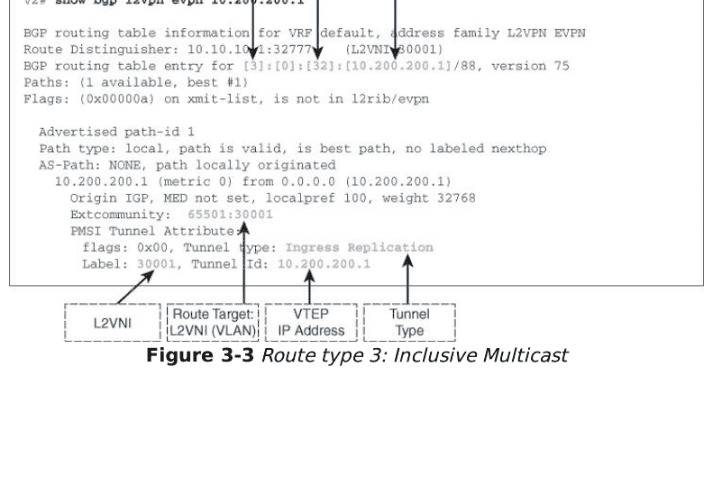

在比较用于 BUM 流量的组播和单播操作模式时，需要考虑所有多目的地流量复制的负载。例如，考虑一个二层 VNI，它存在于所有 256 台承载 VTEP 的边缘设备上。进一步假设，所有边缘设备的 48 个以太网接口上都存在一个 VLAN，且这些接口正在进行 BUM 流量复制。本地边缘设备的每个以太网接口接收的 BUM 流量为接口标称速率的 0.001%。对于 10G 接口，这在面向主机的以太网接口处产生 0.0048 Gbps（4.8 Mbps）的 BUM 流量。在组播模式下，BUM 流量的理论速率保持在此水平。在单播模式下，复制量取决于 VTEP 上出站/目的地的活动量。以 255 个邻居 VTEP 为例，这将导致网络上产生 255 × 0.0048 = ~1.2 Gbps 的 BUM 流量。尽管该示例是理论性的，但它清楚地展示了随着网络中多目的地流量的增加，单播模式所产生的巨大开销。在这些情况下，组播模式的高效性怎么强调都不为过。

需要注意的是，当将组播组限定于 VNI 时，对于给定的二层 VNI，必须在整个基于 VXLAN 的网络中配置相同的组播组。此外，所有 VTEP 必须对由二层 VNI 表示的给定二层域遵循相同的多目的地配置模式。换句话说，对于给定的二层 VNI，所有 VTEP 必须遵循相同的单播或组播配置模式。此外，对于组播模式，必须对相应的组播组遵循相同的组播协议（例如，PIM ASM、PIM BiDir）。未遵守这些要求将导致多目的地流量的转发中断。

## VXLAN BGP EVPN 增强功能

以下章节描述了基于 BGP EVPN 控制平面之上的一些功能增强，进一步提升了 VXLAN 网络中二层和三层流量的转发能力。

### ARP 抑制

地址解析协议（ARP）负责 IP 网络中 IPv4 地址到 MAC 地址的映射。ARP 利用在 ARP 广播请求中发送的 IP 地址信息来获取终端的 MAC 地址信息。广播请求被视为多目的地流量，通常被 VXLAN 封装后发送到作为相应二层 VNI 成员的每个 VTEP 或边缘设备。对 ARP 请求的响应通常以单播数据包的形式发送给请求方。ARP 流量的范围限于由二层 VNI 表示的广播域内。

相应地，IPv6 网络依赖邻居发现协议（ND）来实现 IPv6 地址到 MAC 地址的解析。在 IPv6 中，这种解析通过初始邻居请求（NS）触发，该请求通过二层广播域进行组播。目的地回复的邻居通告（NA）完成邻居解析。

当终端需要解析默认网关（即本地 IP 子网的出口）时，它会向配置的默认网关发送 ARP 请求。ARP 操作允许本地边缘设备或 VTEP 填充本地连接终端的 IP/MAC 映射。除了在边缘设备上填充 MAC-to-IP 表外，所有 MAC 信息还会被填充到 BGP EVPN 控制平面协议中。具体而言，对于二层，会填充二层 VNI、路由区分符（RD）、路由目标（RT）、承载 VTEP 和关联的 IP 信息；对于三层，会填充三层 VNI、RD、RT、承载 VTEP 和 RMAC 信息。这些信息具体填充在路由类型 2 通告中，并分发到所有远程 VTEP，从而使这些 VTEP 学习到该终端。

通常，从终端发出的所有 ARP 广播请求都会执行复制到路由器并转发的行为。只要终端发出某种类型的 ARP 请求——不一定是在本地边缘设备上托管的默认网关的 ARP 请求——本地边缘设备就会学习到该终端。

通常，当终端希望与同一子网中的另一个终端通信时，它会发送 ARP 请求以确定目的终端的 IP 到 MAC 绑定。ARP 请求被泛洪到属于该二层 VNI 的所有终端。ARP 嗅探结合 BGP EVPN 控制平面信息可以帮助避免对已知终端的泛洪。通过使用 ARP 嗅探，来自终端的所有 ARP 请求都会被重定向到本地连接的边缘设备。然后边缘设备提取 ARP 载荷中的目的 IP 地址，并确定它是否为已知终端。具体而言，会根据来自 BGP EVPN 控制平面的已知终端信息进行查询。

如果目的地已知，则返回 IP 到 MAC 的绑定信息。然后本地边缘设备代表目的终端执行 ARP 代理。换句话说，它向请求方发送一个单播 ARP 响应，其中包含已知目的终端的已解析 MAC 地址。这样，所有对已知终端的 ARP 请求都在尽可能早的点——即本地连接的边缘设备、VTEP 或叶节点——被终止。这就是*ARP 抑制*。ARP 之所以能够被抑制，是因为所有信息在所有 VXLAN VTEP 上都已知。²

需要注意的是，ARP 抑制与代理 ARP⁸ 不同，后者中边缘设备或路由器可能使用自己的路由器 MAC 代表目的终端充当代理。ARP 抑制通过利用 BGP EVPN 控制平面信息来减少 ARP 广播流量。ARP 抑制按二层 VNI 启用。通过这种方式，对于所有已知终端，ARP 请求仅在终端和本地边缘设备/VTEP 之间发送。图 3-4 展示了一个场景，其中 VTEP V1 上的 ARP 抑制导致主机 192.168.1.101 在二层 VNI 30001 中请求主机 192.168.1.102 的 ARP 请求被提前终止。需要注意的是，ARP 抑制功能基于在二层 VNI 下启用的功能开关工作，无论默认网关是否在叶节点上配置。

| MAC, IP | L2VNI | L3VNI | NH |
|---|---|---|---|
| 0000.3000.1101, 192.168.1.101 | 30001 | 50001 | Local |
| 0000.3000.1102, 192.168.1.102 | 30001 | 50001 | 10.200.200.2 |
| 0000.3000.1103, 192.168.1.103 | 30001 | 50001 | 10.200.200.3 |
| 0000.3000.2102, 192.168.2.102 | 30002 | 50001 | 10.200.200.3 |

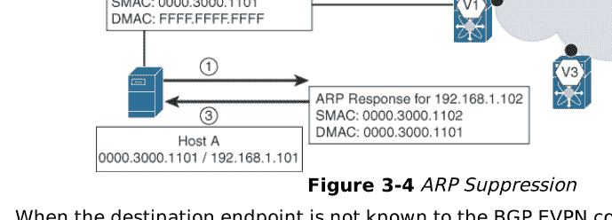

#### 图 3-4 *ARP 抑制*

当目的终端未被 BGP EVPN 控制平面获知（即静默或未发现的终端）时，ARP 广播需要通过 VXLAN 网络发送。回顾一下，ARP 嗅探会拦截发往本地连接边缘设备的 ARP 广播请求。由于对目的终端的查找结果为"未命中"，边缘设备会在进行适当的源过滤后，将 ARP 广播请求重新注入网络中。

为确保其不会从最初接收ARP请求的源端口返回。ARP广播利用了VXLAN结构的多目的地流量转发实现。

当被查询的端点响应ARP请求时，该端点会生成一个ARP响应。单播ARP响应也会经过ARP窥探处理，以便将其发送到目的端点直接连接的远程边缘设备。因此，远程VTEP会学习到目的端点的IP/MAC绑定信息，并将该信息填充到BGP EVPN控制平面中。远程边缘设备也会将ARP响应发送给原始的请求端点，从而完成端到端的ARP发现过程。ARP响应通过数据平面发送，以确保控制平面更新没有延迟。需要注意的是，在初始未命中之后，所有后续对该已发现端点的ARP请求都将按照前面描述的方式，通过本地ARP终结进行处理。

图3-5展示了在控制平面发生未命中时，涉及ARP终结或ARP抑制的场景。主机A和主机B属于同一个IP子网，对应于二层VNI 30001。主机A希望与主机B通信，但主机A的ARP缓存中不知道各自的MAC到IP映射。因此，主机A发送一个ARP请求来确定主机B的MAC到IP绑定。ARP请求被VTEP V1窥探。VTEP V1使用从ARP请求载荷中获取的目标IP地址信息，在BGP EVPN控制平面中查找关于主机B的信息。由于网络中尚未知晓主机B，广播ARP请求被封装到VXLAN中，其目的IP地址是一个组播组地址或一个单播目的IP地址。当下层启用组播时，会利用组播组。否则，如前所述，使用头端复制生成多个单播副本，发送到每个远程的、感兴趣的VTEP。

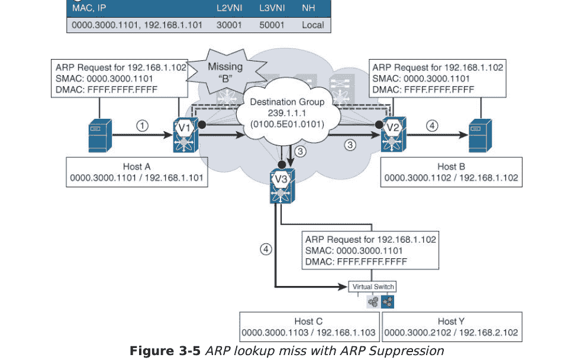

发送到VTEP V2和VTEP V3的ARP广播被适当地解封装，内部广播载荷被转发到属于VNI 30001的所有以太网端口。

这样，ARP请求到达主机B，主机B以单播ARP响应回复主机A。一旦单播ARP响应到达VTEP V2，该信息被窥探，然后控制平面会用主机B的IP/MAC地址信息进行更新。同时，ARP响应被封装并通过VXLAN网络转发到VTEP V1。收到ARP响应后，VTEP V1解封装VXLAN头，并基于二层查找，在VNI 30001中转发解封装后的ARP响应。因此，主机A接收到ARP响应并填充其本地ARP缓存。从此时起，主机A和主机B之间的双向通信得以启用，因为网络中已知两台主机的所有MAC和IP地址信息。

VXLAN BGP EVPN结构中端点之间的ARP请求和响应过程与经典以太网或任何其他泛洪学习网络中的过程类似。然而，控制平面和ARP抑制的优势是通过BGP EVPN信息实现的。对某个端点的单次ARP解析会触发控制平面在整个网络中、在所有VTEP上填充该端点信息。因此，任何后续对已知端点的ARP请求都会在本地得到响应，而不是在整个网络中泛洪。

由于ARP窥探主动学习端点信息以填充控制平面，这无疑有助于减少未知单播流量。ARP请求实际上只需要在初始阶段（即端点尚未被发现时）进行泛洪。然而，还有其他未知单播流量的来源（例如，普通的二层非IP流量，甚至常规的二层IP流量），它们可能会因目的MAC查找未命中而导致流量在整个VXLAN网络中泛洪。

为了完全禁用因未知单播流量而流向VXLAN网络的任何泛洪，引入了一个名为*未知单播抑制*的新功能。这个独立功能可在每个二层VNI上启用。启用此旋钮后，当任何二层流量发生目的MAC查找未命中时，流量会在本地泛洪，但不会通过VXLAN泛洪。因此，如果不存在静默主机或未知主机，BGP EVPN VXLAN网络中的泛洪可以潜在地最小化。

接下来，我们考虑BUM或多目的地流量的第三种类型，称为*组播流量*。VXLAN网络中的二层组播被视为广播或未知单播流量，因为组播流量会在下层泛洪。二层组播泛洪利用配置的多目的地流量处理方法，无论其处于单播模式还是组播模式。并非所有平台都能区分不同类型的二层泛洪，如组播或未知单播。如果平台支持，IGMP窥探功能为转发二层组播流量提供了一种优化的方式。思科NX-OS的默认配置导致的行为是，在本地和通过VTEP接口泛洪二层组播流量（见图3-6）。这意味着所有具有相同VNI映射的参与VTEP以及该二层VNI中的所有端点都会接收此二层组播流量。多目的地流量被转发到VNI中的每个端点，无论该端点是否为感兴趣的接收者。

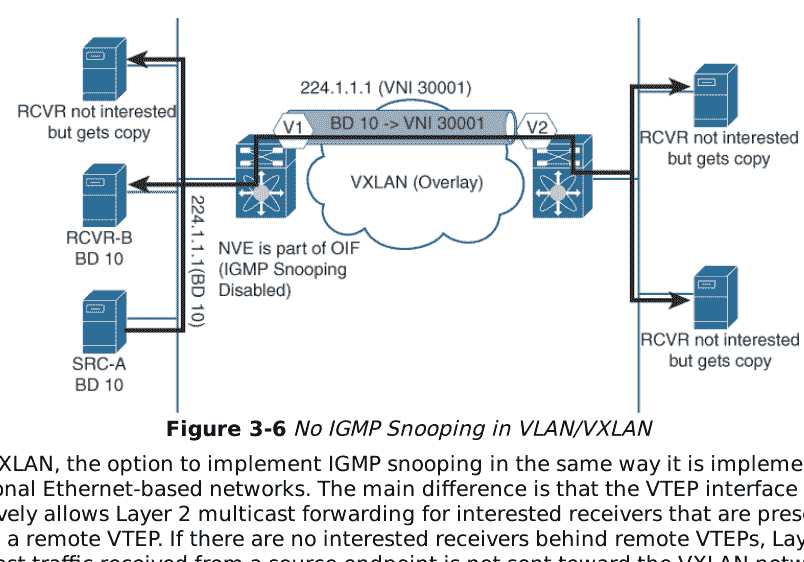

通过VXLAN，可以选择以与传统基于以太网网络相同的方式实现IGMP窥探。主要区别在于VTEP接口有选择地允许对存在于远程VTEP后面的感兴趣的接收者进行二层组播转发。如果远程VTEP后面没有感兴趣的接收者，则从源端点接收的二层组播流量不会发送到VXLAN网络。然而，只要某个远程VTEP后面至少有一个感兴趣的接收者，二层组播流量就会被转发到所有远程VTEP，因为它们都属于同一个二层VNI。VTEP接口是参与IGMP窥探的组播路由器端口，从而允许二层组播转发。这取决于是否从某个二层VNI中给定组播组的端点接收到IGMP“加入”消息。

接收到的IGMP加入报告被VXLAN封装，并传输到所有作为相应二层VNI成员的远程VTEP。请注意，用于端点间覆盖组播流量的组播组不应与可能与二层VNI关联的下层组播组混淆。回忆一下，后者用于在下层使用组播模式时，为多目的地流量的转发提供外部IP头中的目的IP地址。

通过为VXLAN VN启用IGMP窥探，可以实现组播的真正优势：流量仅转发给感兴趣的接收端点（见图3-7）。换句话说，如果在相同VNI的某个VTEP后面不存在对给定组播组感兴趣的接收者，则二层组播流量会被静默丢弃而不会被泛洪。在远程VTEP解封装后，二层组播流量基于本地IGMP窥探状态进行转发。IGMP加入消息用于有选择地启用某些二层组播流量的转发。

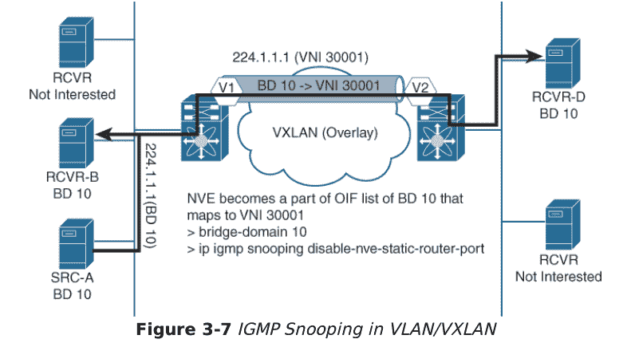

根据平台软件的支持情况，可能不支持为启用VXLAN的VLAN进行IGMP窥探。IGMP窥探是一个软件功能，不依赖于底层硬件。虽然本节提供了简要概述，但VXLAN BGP EVPN网络中的详细IP组播流将在[第7章“组播转发”](#)中介绍。

## 分布式IP任播网关

为了使不同IP子网中的两个端点能够相互通信，需要一个默认网关。传统上，默认网关在数据中心汇聚层以集中方式实现，并采用冗余配置。为了使端点能够到达集中式默认网关，它必须首先穿越一个二层网络。二层网络选项包括以太网、vPC、FabricPath，甚至是VXLAN F&L。同一IP子网内的通信通常是桥接进行的，无需与集中式默认网关通信。对于不同网络/子网之间的路由通信，集中式默认网关可通过相同的二层网络路径到达。

通常，网络被设计为冗余且高可用的。同样，集中式网关也是高可用的。第一跳冗余协议旨在支持具有冗余性的集中式默认网关。例如HSRP、<sup>9</sup> VRRP、<sup>10</sup> 和 GLBP<sup>11</sup> 等协议就是第一跳冗余协议的例子。HSRP和VRRP有一个主节点负责响应ARP请求以及将流量路由到不同的IP网络/子网。当主节点发生故障时，第一跳冗余协议会将备用节点的操作状态变更为活动状态。从一个节点故障切换到另一个节点需要一定的时间。

当与虚拟端口通道结合实施时，第一跳冗余协议变得更加通用，它允许两个节点都转发路由流量，并仅允许主节点响应ARP请求。结合vPC和第一跳冗余协议显著增强了故障情况下的弹性以及收敛时间。在vPC环境中为第一跳冗余协议启用ARP同步，可实现vPC主节点和vPC备节点之间的ARP同步。采用任播HSRP的FabricPath<sup>12</sup>将活动网关的数量从两个增加到四个节点。任播HSRP中仍然存在第一跳冗余协议协议交换和操作状态变更。通过第一跳冗余协议，在数据中心汇聚层实现的默认网关提供了集中式默认网关以及二层/三层网络边界。


第2层和第3层运营日益增长的重要性，尤其是在大型数据中心网络中，要求其具备比传统第一跳冗余协议所能提供的更高的韧性。将第2层-第3层网络边界移至网络结构叶/ToR交换机或接入层，可以减少故障域（见图3-8）。分布式IP任播网关的横向扩展方法极大地减少了网络和协议状态。在每个网络结构叶上实现的分布式IP任播网关，不再要求每个端点都穿越一个大型第2层域才能到达默认网关。

分布式IP任播网关应用了任播<sup>13</sup>网络概念“一对最近关联”。任播是一种网络寻址和路由方法，其中来自端点的数据流量在拓扑上被路由到一组共享相同目标IP地址的网关中最近的一个节点。通过分布式IP任播网关（见图3-9），默认网关被移近端点——具体移至每个端点物理连接的叶交换机。任播网关在网络结构的每个边缘设备/VTEP上都是活动的，消除了需要在整个网络结构中运行传统hello协议/数据包的要求。因此，一个子网的默认网关可以根据需要同时存在于多个叶交换机上，而无需任何类似FHRP的协议。

冗余ToR通过多机框链路聚合（MC-LAG）技术（如vPC）连接。端口通道哈希仅选择两个可用默认网关中的一个，“一对最近关联”规则在此适用。VXLAN BGP EVPN网络提供第2层和第3层服务，默认网关关联存在于本地边缘设备和端点之间。当端点尝试解析默认网关时，只有本地连接的边缘设备会截获并解析该ARP请求。通过这种方式，每个边缘设备负责为其直接连接的端点执行默认网关功能。边缘设备还通过执行定期的ARP刷新来跟踪其本地连接的已发现端点的活跃性。

分布式任播网关的横向扩展实现提供了最接近每个端点的默认网关。默认网关的IP地址在所有边缘设备之间共享，每个边缘设备负责其相应的IP子网。除了默认网关的IP地址很重要外，关联的MAC地址同样重要。MAC地址很重要，因为每个端点都有一个本地ARP缓存，其中包含默认网关的特定IP到MAC绑定。

对于主机移动性用例，如果当主机移动到不同机架中另一个ToR下的服务器时，即使默认网关保持不变，网关MAC地址也可能发生变化，从而导致不希望出现的流量“黑洞”。为了防止这种情况，VXLAN EVPN结构中所有边缘设备上的分布式任播网关为网关服务共享相同的MAC地址。这个共享的MAC地址被称为*任播网关MAC地址*（AGM），它被配置为在所有边缘设备上都相同。实际上，相同的AGM在所有不同的IP子网之间共享，每个子网都有其自己唯一的默认网关IP。任播网关不仅提供最高效的出口路由，还提供到给定端点所连接的VTEP的直接路由，从而消除了流量的发卡转发。

在端点静默或未被发现的情况下，BGP EVPN控制平面不知道该端点的主机路由信息。如果没有主机路由信息，则应使用路由表中的次优路由，以便发往该端点的数据包不会被丢弃。让每个分布式IP任播网关从每个本地实例化该子网的VTEP通告一条子网路由，可以在路由表中提供一条“次优”路由。一个未在本地实例化该子网的远程VTEP会发现，该子网前缀可以通过ECMP经多条路径到达。当该远程VTEP收到发往此子网中未知/静默端点的流量时，流量会基于计算出的ECMP哈希值被转发到服务于目标子网的所选VTEP之一。一旦流量到达该VTEP，就会命中子网前缀路由，该路由又指向一个glean邻接。这会触发VTEP基于目标子网信息，向本地连接的第2层网络发送ARP请求。ARP请求也会被封装在与目标子网关联的第2层VXLAN VNI中，发送到第3层核心。因此，ARP请求会到达特定子网中的静默端点。端点响应ARP请求，该响应随后被直接连接到该端点的VTEP所消耗。这是因为所有VTEP共享相同的任播网关MAC。因此，该端点被发现，其信息由该VTEP分发到BGP EVPN控制平面中。

通告子网路由的替代方案是允许默认路由（0.0.0.0/0）来实现类似的结果，但缺点是集中了发现过程。然而，基于子网前缀路由的分布式方法在发现静默端点方面具有更好的扩展性。图3-10说明了在VXLAN BGP EVPN结构中分布式IP任播网关的逻辑实现。

图3-10 *分布式任播网关的子网前缀通告*

通过分布式IP任播网关实现，任何VTEP都可以服务于整个VXLAN BGP EVPN结构中的任何子网。来自VXLAN BGP EVPN构建的集成路由和桥接（IRB）提供了高效路由和桥接流量的能力。无论流量模式如何（东西向或南北向），流量的发卡转发被完全消除。BGP EVPN控制平面知道端点的身份以及指示其位置的下一跳（VTEP）信息。这实现了网络中的最优转发，而无需大型第2层域。

总之，所有边缘设备和子网之间的AGM提供了无缝的主机移动性，因为端点ARP缓存无需更改。这允许在VXLAN结构中进行“热”工作负载移动。分布式任播网关将第3层网关移至叶交换机，从而提供简化的故障域、简化的配置、优化的路由以及透明的端点/工作负载移动性。

## 集成路由和桥接（IRB）

VXLAN BGP EVPN遵循两种不同的IRB语义，这些语义已在IETF的draft-ietf-bess-evpn-inter-subnet-forwarding（https://tools.ietf.org/html/draft-ietf-bess-evpn-inter-subnet-forwarding）中记录和发布。

非对称IRB是已记录的第一种第一跳路由操作。它在本地边缘设备或VTEP内遵循桥接-路由-桥接模式。顾名思义，当使用非对称IRB进行路由时，发往远程VTEP的出口流量使用与来自远程VTEP的返回流量不同的VNI。

如图3-11所示，连接到VTEP V1的主机A希望与连接到VTEP V2的主机X通信。因为主机A和主机X属于不同的子网，所以使用非对称IRB路由过程。在默认网关ARP解析后，主机A将数据流量发送到VLAN 10中的默认网关。从VLAN 10，执行指向VLAN 20的路由操作，VLAN 20映射到VXLAN VNI 30002。数据流量被封装在VNI为30002的VXLAN中。当封装的流量到达VTEP

在V2处，流量被解封装，然后桥接到VLAN 20，因为VLAN 20在VTEP V2上也映射到VNI 30002。

主机A到主机X的通信产生**桥接-路由-桥接**模式，封装的流量携带VNI 30002。对于返回流量，主机X将数据流量发送到对应于VLAN 20的本地子网的默认网关。在执行从VLAN 20到VLAN 10的路由操作后，流量被封装上VXLAN VNI 30001并桥接到VTEP V1。一旦流量到达VTEP V1，数据流量被解封装并桥接到VLAN 10，因为VLAN 10映射到VNI 30001。因此，对于从主机X到主机A的返回流量，执行了桥接-路由-桥接操作，封装的流量携带VNI 30001。从主机A到主机X的端到端流量使用VNI 30002，而从主机X到主机A的返回流量使用VNI 30001。

前面的示例展示了在非对称IRB中主机A和主机X之间通信使用不同VNI时的流量不对称性。非对称IRB要求所有VXLAN VTEP上的VNI配置保持一致，以防止流量被黑洞。配置一致性对于桥接-路由-桥接序列中的第二次桥接操作是必需的，因为如果缺少与目的网络对应的桥接域/VNI配置，该序列将失败。图3-12说明了这样一个事实：来自主机A和主机Y的流量可以正常流动，但由于连接到主机Y的VTEP缺少VNI 30001的配置，从主机Y到主机A的反向流量无法工作。主机A和主机X之间的流量将被正确转发，因为连接的VTEP上存在两个IRB接口（SVI 10和SVI 20）。

## 脊柱裂患儿神经状态的术中及术后监测

术中监测，包括持续脑电图（EEG）和持续体感诱发电位（SSEP），已被用于在手术处理脊柱裂相关异常期间监测患儿。该技术已应用于大量脊柱裂患儿以及少量脊柱异常患儿。术中监测已用于脊柱裂患儿的手术管理。

## 图3-13 对称IRB

对于从主机Y到主机A的返回流量，返回流是对称的，使用与VRF关联的相同VNI 50001。主机Y将其返回流量发送到其本地子网中VLAN 20关联的默认网关。VLAN 20向VRF和VNI 50001做出路由决策，导致VXLAN封装的流量被发送到VTEP V1。一旦封装的VXLAN流量到达VTEP V1，流量被解封装并路由到VRF和VLAN 10。从主机Y到主机A的返回流量流遵循相同的桥接-路由-路由-桥接序列，并使用相同的VNI 50001。从主机A到主机Y的流量以及从主机Y到主机A的流量利用相同的VRF VNI 50001，从而产生对称的流量流。事实上，同一VRF内不同网络之间主机的所有路由流量都使用相同的VRF VNI 50001。

对称IRB没有在所有边缘设备上为所有VXLAN网络保持一致配置的要求。换句话说，当不需要在所有边缘设备或VTEP上配置所有VNI时，可以实施范围化的配置（见图3-14）。但是，对于给定的VRF，需要在所有VTEP上配置相同的第3层VNI，因为VRF启用了桥接-路由-路由-桥接操作序列。对于属于不同VRF的主机之间的通信，需要路由泄漏。对于VRF路由泄漏，需要外部路由器或防火墙来执行VRF到VRF的通信。应该注意的是，VRF路由泄漏的支持需要软件支持来规范化控制协议信息与数据平面封装。除了本地VRF路由泄漏，下游VNI分配可以为外网用例提供此功能。这些选项将在第8章“外部连接性”中进一步讨论。

图3-14 *对称IRB和不一致配置*

对称和非对称模式均在IETF草案中有文档说明。Cisco使用NX-OS的实现遵循对称IRB模式。对称IRB的桥接-路由-路由-桥接序列为大规模多租户部署提供了灵活性。并且该序列遵循与经典路由穿越中转段相似的语义。使用VXLAN BGP EVPN的中转路由段通过与VRF关联的第3层VNI来体现。

## 端点移动性

BGP EVPN提供了一种在Fabric内提供端点移动性的机制。当端点移动时，关联的主机路由前缀通过更新的序列号在控制平面中通告。该序列号避免了在端点移动期间撤回和重新学习给定前缀的需要。相反，会在控制平面中执行新位置的更新。由于Fabric中的转发总是由BGP EVPN控制平面中的内容决定，流量被快速重定向到移动端点的新位置，从而提供平滑的流量收敛。当端点移动时，BGP EVPN控制平面中会出现同一端点的两个主机路由前缀。初始前缀由原始VTEP位置标识，移动后，前缀由新的VTEP位置标识。

当控制平面中存在同一端点的两个前缀时，决胜机制决定胜者。为此，一个称为MAC移动序列号的BGP扩展团体被添加到端点主机路由通告中（具体是路由类型2）。每次端点移动时，序列号都会更新。如果序列号达到其最大可能值，序列号将回绕并重新开始。MAC移动序列号在RFC 7432中有文档说明，该RFC专门针对BGP EVPN。

端点移动前的MAC地址作为路由类型2通告被学习，并且BGP扩展团体MAC移动序列设置为0。值0表示MAC地址尚未发生移动事件，并且端点仍在原始位置。如果检测到MAC移动事件，则由“新”VTEP（端点移动到其下的新位置）向BGP EVPN控制平面添加一个新的路由类型2（MAC/IP通告）。然后，控制平面在BGP扩展团体以及新位置中将MAC移动序列号设置为1。现在BGP EVPN控制平面中有两个相同的MAC/IP通告。但只有新的通告的MAC移动序列号设置为1。所有VTEP都遵循此通告，从而将流量发送到端点的新位置。[图3-15](https://example.com)展示了一个示例端点移动用例，其中端点主机A已从VTEP V1移动到VTEP V3，以及相关的BGP EVPN状态。

| 路由类型 | MAC, IP | L2VNI ("VLAN") | L3VNI ("VRF") | NH | 封装 | Seq |
|---|---|---|---|---|---|---|
| 2 | 0000.3000.1101, 192.168.1.101 | 30001 | 50001 | 10.200.200.1 | 8:VXLAN | 0 |
| 2 | 0000.3000.1101, 192.168.1.101 | 30001 | 50001 | 10.200.200.3 | 8:VXLAN | 1 |

端点在其生命周期内可能在Fabric中多次移动。每次端点移动，检测到其新位置的VTEP将序列号加1，然后将该端点的主机前缀通告到BGP EVPN控制平面中。因为BGP EVPN信息在所有VTEP之间同步，每个VTEP都知道端点是首次出现还是移动事件，这是基于先前的端点可达性信息。

端点可能由于各种原因被关闭或变得不可达。如果端点已从ARP、MAC和BGP表中老化，扩展团体MAC移动序列也是0。如果同一端点重新出现（从Fabric和BGP EVPN的角度看），这次重新出现被视为新的学习事件。换句话说，BGP EVPN控制平面知道当前活动的端点及其各自的位置，但控制平面不存储端点之前任何历史信息。

无论端点是实际移动（*热移动*）还是端点死亡而另一个端点假定其身份（*冷移动*），从BGP EVPN控制平面的角度来看，所采取的操作是相似的。这是因为端点在BGP EVPN控制平面中的身份源自其MAC和/或IP地址。

端点移动事件会导致反向ARP（RARP）或免费ARP（GARP），由端点或代表端点发出信号。在RARP的情况下，超级虚拟机监视器或虚拟交换机通常会发送一个RARP，其中SMAC地址设置为端点MAC地址，DMAC设置为广播MAC（FFFF.FFFF.FFFF）。在GARP的情况下，端点的IP和MAC地址都在新位置通知。这导致端点的IP/MAC可达性在BGP EVPN控制平面中更新。


平面。当旧位置（VTEP）接收到此信息时，会执行端点验证过程，以确定该端点是否确实已离开旧位置。一旦此验证成功完成，旧前缀及其旧序列号将从BGP EVPN控制平面中撤回。除了前缀从BGP EVPN中撤回外，旧位置的ARP和/或MAC地址表也会被清除。图3-16展示了一个BGP EVPN输出的示例，该示例关联到一个在Fabric内部移动过的终端主机的前缀。图中，包括MAC移动序列号字段在内的相关字段已被高亮显示。

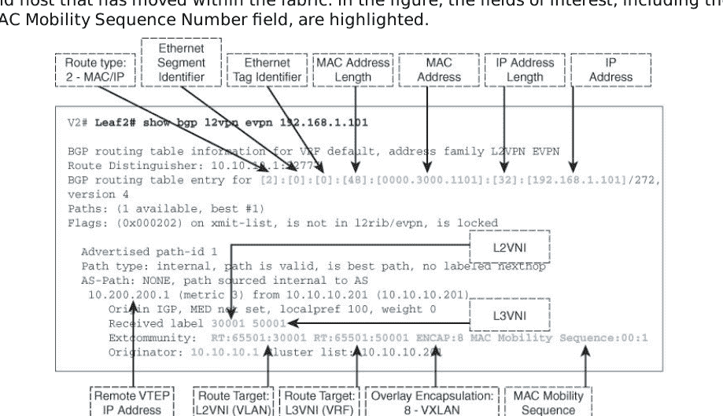

在验证过程中，如果端点在旧位置也进行了响应，则会检测到潜在的重复端点，因为该前缀在多个位置被发现。重复端点检测的默认检测值为“在180秒内移动5次”。这意味着在180秒的时间窗口内第五次移动后，VTEP会启动一个“30秒保持”计时器，然后重新开始验证和清理过程。在第五次之后（180秒内移动5次），VTEP会冻结重复条目。在Cisco NX-OS的BGP EVPN实现中，这些默认检测值可以通过用户配置进行修改。

通过使用路由类型2通告（MAC/IP通告）所携带的MAC移动序列号，BGP EVPN控制平面可以识别端点何时可能发生潜在的位置变更。当确定给定前缀仍然可达时，控制平面会主动验证给定端点是否确实已经移动。控制平面不仅在验证和清理移动事件方面提供了巨大价值，还在VXLAN BGP EVPN网络中检测重复项方面发挥了重要作用。

## VXLAN BGP EVPN中的虚拟端口通道 (vPC)

将多个物理接口捆绑成两个机箱之间的单个逻辑接口称为*端口通道*，也称为链路聚合组（LAG）。虚拟端口通道（vPC）是一种跨两个或多个物理机箱提供二层冗余的技术。具体而言，单个机箱连接到另外两个配置为vPC对的机箱。业界术语称为多机箱链路聚合组（MC-LAG）。请记住，虽然VXLAN的底层传输网络是使用支持ECMP的三层路由协议构建的，但端点仍通过经典以太网连接到叶交换机或边缘设备。需要注意的是，VXLAN BGP EVPN Fabric并不要求端点必须与Fabric建立冗余连接。然而，在大多数实际部署中，高可用性通常是必需的，为此，端点通过端口通道连接到边缘设备。

存在多种形成端口通道的协议，包括静态无条件配置、端口聚合协议（PAgP）等协议，以及链路聚合控制协议（LACP）等行业标准协议。

可以在单个端点和单个网络交换机之间配置端口通道。当需要机柜顶端（ToR）或交换机级别（以及链路级别）的冗余时，会采用MC-LAG来提供将端点连接到多个网络交换机的能力。

vPC允许端点的接口物理连接到两个不同的网络交换机。从端点的角度来看，它们看到的是一个通过单个端口通道（包含多条链路）连接的网络交换机。连接到vPC域的端点可以是交换机、服务器或任何其他支持IEEE 802.3标准和端口通道的网络设备。vPC允许创建跨两个交换机的二层端口通道。vPC由两个通过对等链路连接的vPC成员交换机组成，一个为主交换机，另一个为辅交换机。由这些网络交换机形成的系统称为*vPC域*（参见[图3-17](https://example.com/figure/3-17)）。

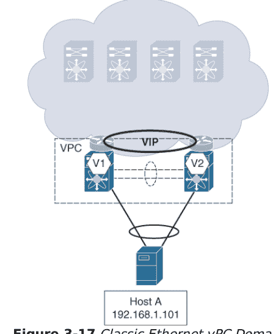

**图3-17** *经典以太网vPC域*

vPC主交换机和辅交换机最初被配置为独立的边缘设备或用于VXLAN集成的VTEP。对于北向流量，路由接口是底层网络的一部分，用于提供到每个独立VTEP的可达性。每个VTEP由一个独立的主IP地址（PIP）表示。

考虑到这一点，首先需要启用vPC功能，然后在两个vPC成员网络交换机之间配置vPC域。接下来，需要在两个节点之间连接vPC对等链路（PL）和vPC对等保活链路（PKL）。还需要在vPC对等链路上配置底层网络，以用于单播和多播（如果使用多播）底层路由目的。

在VXLAN BGP EVPN Fabric中，配置了一个单独的VTEP来表示vPC域。为了实现单个VTEP，配置了一个任播VTEP，其公共虚拟IP地址（VIP）在构成vPC域的两个交换机之间共享。该任播IP地址由vPC域后的所有端点使用，并由一个单独的任播VTEP代表该vPC域。

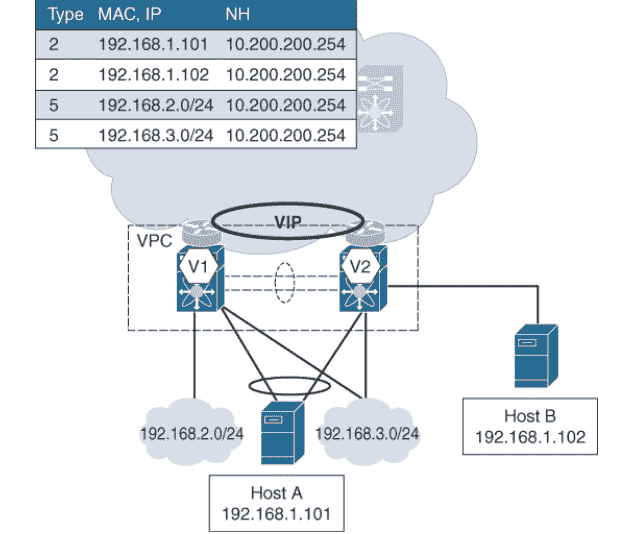

**图3-18 vPC与VXLAN BGP EVPN**

图3-18显示了一个vPC域示例。VTEP V1的IP地址为10.200.200.1/32，VTEP V2的IP地址为10.200.200.2/32。这些是NVE接口或VTEP上的独立物理IP地址（PIP）。在两个VTEP上添加了一个辅助IP地址，它代表VIP或任播IP地址（具体为10.200.200.254/32）。该辅助地址描述了连接到vPC对的任何端点的位置。此地址是在BGP EVPN控制平面通告中宣告的下一跳，代表给定vPC交换机对下所有本地端点的位置。

VIP从两个vPC成员交换机进行通告，以便两个vPC成员都可以直接从任何本地连接的端点接收流量。远程VTEP可以通过底层路由网络上的ECMP到达由两个vPC成员交换机通告的VIP。通过这种方式，只要存在到任一vPC成员交换机或VTEP的至少一条路径，就可以到达双连接端点。

在vPC域中，双连接端点和单连接端点（通常称为孤立端点）都被通告为可通过与任播VTEP关联的VIP到达。因此，对于vPC成员交换机下的孤立端点，如果由于上行链路故障导致到脊交换机的可达性丢失，则通过vPC对等链路建立备份路径。因此，建议在vPC对等链路上建立底层路由邻接关系以应对故障场景。

如果在底层启用了多播以承载多目的地流量，则还应在对等链路上启用多播路由（通常是PIM）。值得注意的是，默认情况下，将任播VTEP VIP IP地址作为下一跳与BGP EVPN一起通告，也适用于路由类型2的MAC/IP通告以及路由类型5的IP前缀路由。通过这种方式，所有远程VTEP始终可以看到vPC对后的所有BGP EVPN路由是通过由VIP表示的单个VTEP可达的。给定vPC域的vPC对等体上与VIP关联的VTEP有时被称为该域的任播VTEP。如果在VXLAN BGP EVPN Fabric中部署了*N*个叶交换机，并且所有叶交换机都配置为vPC对等体，则网络中存在*N*/2个对等体，由各自的任播VTEP表示，每个vPC域一个。

术语*任播VTEP*不应与*任播网关*混淆。请记住，任播网关指的是给定子网的分布式IP任播网关，该网关由任何和所有叶交换机（包括配置为vPC对等体的交换机）同时共享，并且通过BGP EVPN在叶交换机之间交换终端主机可达性信息。这被称为*网关*，因为子网内的终端主机配置了默认路由器，指向相应的任播网关IP。因此，从终端主机的角度来看，默认网关的IP到MAC绑定应保持不变，无论终端主机位于Fabric内的何处。使用Cisco NX-OS时，所有任播网关也共享相同的全局配置的任播网关MAC（AGM）。

对于给定的vPC域，由于所有ARP、MAC和ND条目在两个vPC成员交换机之间同步，因此两个交换机实际上都在BGP EVPN上通告相同前缀集的可达性。因此，给定的vPC成员交换机会忽略从相邻vPC成员交换机接收到的BGP EVPN通告，因为它们属于同一个vPC域，这些通告通过它们携带的适当的起始站点（site-of-origin）扩展团体属性来识别。通过这种方式，每个vPC域的所有端点只需要通过BGP EVPN通告一个VTEP或VIP。对于具有*N*个vPC对的VXLAN BGP EVPN网络，每个远程VTEP只需要知道*N*-1个VTEP IP或VIP。即使在给定vPC域内只有一个VIP充当任播VTEP，MP-BGP路由区分符（RD）也是在每个vPC成员基础上定义的独立标识符。

然而，在某些场景中，IP前缀可能仅由给定vPC域中的两个vPC成员交换机之一通告。例如，可以在每个vPC成员交换机上的VRF下配置单个环回地址。在这种情况下，因为所有可达性都被通告到BGP EVPN中，作为通过任播VTEP VIP可达，因此发往特定vPC成员交换机的流量可能会到达其相邻的对等体。解封装后，流量会被黑洞，因为它将在该VRF内遭受路由表查找缺失。

当IP地址信息仅由两个vPC成员交换机之一通告时，可能会出现此类问题。这是因为返回流量需要到达正确的vPC成员交换机。将vPC域的所有内容都通告为通过任播VTEP IP地址可达无法实现这一点。此用例适用于具有南向IP子网、孤立连接的IP子网、单个环回IP地址和/或DHCP中继的场景。对于所有这些用例，需要基于每个VRF的三层路由邻接关系，以确保vPC域成员之间的路由交换。这确保了即使数据包到达了错误的vPC对等体，解封装后VRF内的路由表查找也不会遭受查找缺失。

vPC成员交换机之间的这种基于每个VRF的路由邻接关系配置可能有些繁琐。然而，使用BGP EVPN，实现类似行为的一个优雅解决方案是使用名为*advertise-pip*的功能。此功能在全局范围内按交换机启用。请记住，每个vPC成员交换机都有一个唯一的PIP和一个共享的VIP地址。启用advertise-pip功能后，所有IP路由前缀可达性都由各个vPC成员交换机使用PIP作为路由类型5消息中的下一跳进行通告。通过路由类型2消息对应的IP/MAC地址的端点可达性继续使用任播VTEP或VIP作为下一跳（参见[图3-19](#Figure_3_19)）。这允许按交换机单独通告路由，使返回流量能够到达vPC域内的相应VTEP。通过这种方式，vPC成员

作为给定vPC域一部分的交换机，还会通过BGP EVPN Route type 5通告了解其相邻vPC对等体的单个IP前缀可达性。

| Type | MAC, IP | NH |
|---|---|---|
| 2 | 192.168.1.101 | 10.200.200.254 |
| 2 | 192.168.1.102 | 10.200.200.254 |
| 5 | 192.168.2.0/24 | 10.200.200.1 |
| 5 | 192.168.3.0/24 | 10.200.200.1, 10.200.200.2 |

另一个值得讨论的要点涉及BGP EVPN Route type 2和Route type 5消息的扩展社区属性中携带的Router MAC。启用advertise-pip后，每台vPC交换机会通告两个VTEP的IP地址（一个PIP和一个VIP）。PIP使用交换机的Router MAC，而VIP使用基于VIP本身本地派生的MAC地址。两台vPC成员交换机派生出相同的MAC地址，因为它们在anycast VTEP下配置了相同的共享VIP。由于Router MAC扩展社区属性是非传递的，并且VIP在给定的VXLAN BGP EVPN fabric中是唯一的，因此为VIP使用本地有意义的Router MAC不会带来问题。

总之，通过在VXLAN BGP EVPN中使用advertise-pip功能，VTEP的下一跳IP地址会根据通告的是Route type 2（MAC/IP通告）还是Route type 5（IP前缀路由）进行条件性处理。通告PIP可以高效处理vPC连接的端点以及针对第2层和第3层边界连接或DHCP中继用例的特定IP子网。最后，需要注意的是，vPC在不同Nexus平台上运行的方式可能存在一些差异。有关Nexus 9000平台上VXLAN BGP EVPN环境中vPC所需配置的完整列表，请参阅Cisco的*VXLAN BGP EVPN (EBGP)示例*。[^17] 有关Nexus 7000和Nexus 5600平台，请参阅Cisco的*可编程fabric中Cisco Nexus 5600和7000系列交换机的转发配置*。[^18]

## DHCP

动态主机配置协议（DHCP）[^19]是一种常用的协议，为端点提供IP地址和其他选项。DHCP服务器组件负责分配IP地址并管理端点MAC地址与分配的IP地址之间的绑定关系。除了分配IP地址（DHCP作用域）本身之外，还可以为作为DHCP客户端的端点分配其他选项，如默认网关、DNS服务器以及各种其他选项（DHCP选项）。在DHCP的情况下，请求方是DHCP客户端，它向DHCP服务器发送发现消息。DHCP服务器随后以提供消息响应该发现请求。一旦此初始交换完成，DHCP客户端向服务器发送DHCP请求，随后服务器返回DHCP确认，从而完成IP地址及后续DHCP作用域选项信息的分配。图3-20说明了此DHCP过程。

由于DHCP过程依赖广播在DHCP客户端和DHCP服务器之间交换信息，因此DHCP服务器需要与DHCP客户端处于同一第2层网络中。这是DHCP的一种部署方式。在大多数情况下，存在多个IP子网，路由器位于DHCP客户端和DHCP服务器之间的路径上。在这种情况下，需要DHCP中继代理。DHCP中继代理是一种DHCP协议助手，它侦听DHCP广播并将这些消息（具体来说是单播）转发到指定的DHCP服务器。

DHCP中继通常配置在面向DHCP客户端的默认网关上。DHCP中继代理可以支持许多不同的自动化IP寻址用例，具体取决于DHCP服务器是否与DHCP客户端处于同一网络、同一VRF或不同VRF中。在某些需要严格租户隔离的服务提供商数据中心中，为每个租户或每个VRF配置单独的DHCP服务器是很常见的。另一方面，在企业环境中，在共享服务VRF中配置集中式DHCP服务器也并不罕见。流量会跨越租户（VRF）边界，DHCP服务器和DHCP客户端处于不同的VRF中。通常，我们可以区分三种DHCP服务器部署模式：

-   DHCP客户端和DHCP服务器位于同一第2层网段（VLAN/L2 VNI）中
    - 无需DHCP中继代理
    - DHCP客户端的发现消息在本地第2层网段（VLAN/L2 VNI）中广播
    - 由于DHCP使用广播，因此需要多目的地复制
-   DHCP客户端和DHCP服务器位于不同IP子网但在同一租户（VRF）中
    - 需要DHCP中继代理
    - DHCP客户端的发现消息被中继代理侦听并定向到DHCP服务器
-   DHCP客户端和DHCP服务器位于不同IP子网和不同租户（VRF）中
    - 需要带VRF选择功能的DHCP中继代理
    - DHCP客户端的发现消息被中继代理侦听并定向到DHCP服务器所在的VRF中

三种DHCP服务器部署模式中有两种通过DHCP中继代理中继数据。[^20] DHCP服务器基础设施是多租户网络中的共享资源，需要为DHCP服务提供多租户支持。同一个DHCP中继代理负责处理从DHCP客户端到DHCP服务器的DHCP发现消息和DHCP请求消息，以及从DHCP服务器到请求DHCP客户端的DHCP提供消息和DHCP确认消息。

通常，DHCP中继代理配置在为给定子网配置默认网关IP地址的同一位置。对于所有中继到DHCP服务器的DHCP消息，DHCP中继代理在DHCP有效载荷的GiAddr字段中使用默认网关IP地址。中继DHCP消息中的GiAddr字段用于子网作用域选择，以便DHCP服务器从该子网中选取一个空闲IP地址，并将相应的DHCP选项分配给将从服务器返回给中继代理的提供消息。GiAddr字段指示DHCP服务器发送响应（即DHCP提供或确认）的地址。

在VXLAN BGP EVPN fabric中实现带分布式IP任播网关的DHCP中继代理时，需要考虑额外的因素。这是因为所有以默认网关形式为给定网络提供第3层服务的VTEP共享相同的IP地址。因此，由这些VTEP中继的DHCP请求中会盖上相同的GiAddr字段。结果是，DHCP服务器的响应可能无法到达中继初始请求的同一VTEP，因为存在任播IP。换句话说，响应可能会发送到服务于任播IP的任何一台VTEP，这显然是不可取的（参见图3-21）。如果每台VTEP都存在唯一的IP地址，则可以在GiAddr字段中使用该地址，从而确保服务器响应保证返回到正确的VTEP。这是通过在配置了任播网关IP的第3层接口下指定**ip dhcp relay source-interface xxx**命令来实现的。

### Figure 3-21 *分布式IP任播网关的GiAddr问题*

通过这种方式，GiAddr字段被修改为携带指定源接口的IP地址。网络交换机上的任何接口都可以使用，只要该IP地址在用于到达DHCP服务器的网络中是唯一的。此外，IP地址必须是可路由的，以便DHCP服务器能够响应由GiAddr字段标识的单个且唯一的DHCP中继IP地址。通过实现这一点，可以确保从客户端到服务器的DHCP消息通过同一台网络交换机或中继代理来回传输。

需要注意的是，通常GiAddr字段在从分配空闲IP地址并返回给DHCP客户端的IP子网作用域选择中也起着作用。由于GiAddr字段已根据源接口规范进行了更改，它不再代表DHCP作用域选择和相应的IP地址分配。因此，需要一种不同的方式来启用作用域选择。DHCP选项82（一种厂商特定选项）被设计用于放入电路特定信息，并已用于不同的部署中（参见图3-22）。DHCP选项82有两个子选项，用于派生IP地址分配所需的IP子网，为DHCP子网作用域选择提供了一种不同的方法。

通过使用带Circuit-ID子选项的DHCP选项82，与客户端所在网络关联的VLAN或VNI信息被添加到DHCP消息中，并将此信息提供给DHCP服务器。DHCP服务器需要支持基于Circuit-ID子选项选择正确DHCP作用域的功能。支持带Circuit-ID子选项的DHCP选项82的DHCP服务器包括Microsoft的Windows 2012 DHCP服务器、ISC DHCP服务器（dhcpd）和Cisco Prime Network Registrar（CPNR）。

对于第二种选项，也是推荐的选项，DHCP作用域选择使用DHCP选项82的Link Selection子选项执行。在Link Selection子选项中，携带了原始客户端子网，从而允许正确的DHCP作用域选择。支持Link Selection子选项的DHCP服务器包括dhcpd、Infoblox的DDI和CPNR。有关VXLAN BGP EVPN网络中所需的DHCP中继配置的完整列表，请参阅Cisco.com上的vPC VTEP DHCP中继配置示例。[^21]

通过在VXLAN BGP EVPN fabric中使用分布式任播网关及其多租户能力，集中式DHCP服务简化了为端点提供IP地址分配的能力。通过为中继DHCP消息使用唯一的源IP地址，以及使用DHCP选项82，IP地址分配基础设施可以集中提供，即使跨越VRF或租户边界也是如此。

## 总结

本章深入讨论了VXLAN BGP EVPN fabric的核心转发能力。对于承载广播、未知单播和多播（BUM）流量，本章考察了多播和入口复制两种方式，结合inclusive


# 第4章 Underlay（底层网络）

本章将涵盖以下主题：

-   与 BGP EVPN VXLAN 架构相关的 underlay
-   underlay 的 IP 地址分配选项及 MTU（最大传输单元）考量
-   underlay 的单播与多播路由选项

包括虚拟可扩展局域网（VXLAN）在内的网络虚拟化 overlay，需要一个能够承载 overlay 封装流量的传输网络。为此，必须考虑几个因素。由于 VXLAN 是一种基于 MAC-in-IP/UDP 的 overlay 技术，传输网络需要以最优方式承载来自 VXLAN 隧道端点（VTEPs）的 IP 流量。请记住，每个 overlay 都会在原始数据包/帧之上添加额外的报头。传输网络（称为 underlay）必须考虑到 overlay 报头所带来的额外字节。对于 VXLAN，通常需要将传输网络的最大传输单元（MTU）额外配置 50 字节。同样，传输网络也必须匹配 overlay 的弹性及收敛要求。在规划数据中心架构设计时，考虑可扩展性、弹性、收敛性和容量至关重要。对于基于 overlay 的数据中心架构，underlay 的重要性不可低估。通常，overlay 的性能仅取决于承载它的 underlay 传输网络。即使是 overlay 流量的故障排查、调试和收敛，underlay 也是关键所在。

在设计和构建架构的 underlay 时，IP 地址分配是这一过程中的重要方面。IP 地址分配是任何路由协议（用于提供架构中各种设备之间可达性）的前提条件。分配这些 IP 地址有多种选项，包括但不限于传统的点对点（P2P）方法，或使用无编号 IP 编址方案的地址节省选项。同样，了解 VTEP（也称为网络虚拟化边缘 [NVE] 接口）接口、运行多协议 BGP 会话的环回接口，以及最终在使用基于多播的 underlay 时多播汇聚点（RP）的寻址要求也很重要。

underlay 不仅需要承载单播流量，还可能需要提供多播路由，以处理 overlay 中的广播、未知单播和多播（BUM）流量。在为基于 BGP EVPN VXLAN 的数据中心架构设计和创建 underlay 时，所有这些需求都需要予以考虑。

## Underlay 考量因素

在构建数据中心架构时，一些关于 underlay 的前期考量具有优先权。首先是确定 underlay 将使用的预期拓扑结构。当今的数据中心需要处理大量的南北向和东西向流量模式，因此拓扑结构必须能够适应这些不同的流量类型和通信模式。

如[图 4-1](http://google.com)所示，南北向数据流量是将数据进出数据中心的传统通信模式。本质上，如果校园网或互联网上的用户希望访问数据中心内部的数据，就会使用此模式。南北向流量的常见示例包括与传统 Web 浏览相关的流量或与电子邮件活动相关的流量。在所有这些情况下，终端用户使用 PC 上的应用程序来访问托管在数据中心内的数据。这种南北向流量对于在数据中心之间以及向终端用户高效传输数据非常重要。


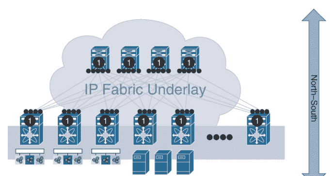

## 图 4-1 *南北向流量*

另一方面，东西向流量反映了略有不同的通信模式，因为该模式描述的是数据中心内部服务器和/或各种应用程序之间的数据通信（参见[图 4-2](https://example.com)）。通常，来自企业网络或互联网终端用户的请求需要对底层数据进行复杂的预处理。作为展示这种预处理需求的一个示例，东西向流量的一个典型场景是通过 Web 服务器（经由应用服务器）访问数据库。网站和/或业务应用的动态渲染通常采用两层或三层服务器架构，其中一层必须与另一层进行通信，然后才能将请求的数据传递给终端用户。当这些层级相互之间进行通信，或需要访问同一数据中心内的数据存储或其他数据时，这种更为横向的流量模式被称为*东西向流量*。

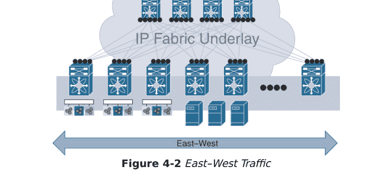

## 图 4-2 *东西向流量*

20世纪50年代初，电话交换机还由人工操作时，Charles Clos 需要找到一种更高效的方式来处理呼叫转接。当时的交换机使用两阶段网络，呼叫通过单个交叉开关进行转接。不幸的是，呼叫经常被阻塞，因为只存在一条路径，如果该路径正被其他转接占用，转接就会失败。面对这一难题，Clos 通过利用多级交换结构，建立了一种最优的数学方法来实现从入站呼叫到出站呼叫的两点互连。通过设置入站级、中间级和出站级，呼叫拥有多条路径可到达其转接目的地。这一额外的级创建了一个连接性的交叉开关矩阵，由于生成的网络看起来像编织的纤维，*交叉开关*这一术语由此而来。

Clos 的工作和设计彻底革新了电话交换机，同时也被应用于网络交换机和数据中心交换结构的设计。当今制造的大多数网络交换机都基于 Charles Clos 在20世纪50年代提出的数学方程。在给定的交换机中，前面板的以太网端口（第一阶段）通过网络交换结构（第二阶段）相互连接。由于这种拓扑结构，每个前面板以太网端口到其他任何前面板以太网端口的传输距离相同（等距），从而确保可预测且一致的延迟。<sup>1</sup> [图 4-3](Figure%204-3) 展示了一个典型的多级模块化网络交换机的内部架构。

这如何应用于数据中心网络或数据中心交换结构？将 Clos 交换结构的概念从网络交换机应用到数据中心交换结构拓扑时，前面板的以太网端口被机柜顶（ToR）交换机取代，也称为*叶交换机*。叶交换机负责提供与服务器之间的连接，并在数据中心交换结构内基于桥接或路由查找做出转发决策。可能存在数百台叶交换机，且它们之间需要相互连接。叶交换机连接到数据中心交换结构中的第二阶段，该阶段由一组脊交换机组成。根据交换结构对规模和带宽的需求，脊交换机的数量可以在2到32之间变化，这足以满足实际部署需求。

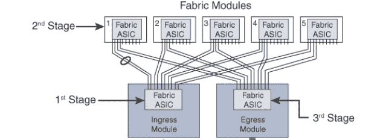

**图 4-3** *多级网络交换机*

在数据中心交换结构中，每台脊交换机连接到每一台叶交换机，从而为每台叶交换机到其他任何叶交换机提供*N*条路径，其中*N*为脊交换机的数量（参见[图 4-4](Figure%204-4)）。脊交换机又可以连接到另一层脊交换机，称为超级脊层，从而允许构建N级脊叶交换结构。由于脊交换机本身是基于覆盖网络的数据中心交换结构中的连接"骨干"，它无法感知用户流量本身，因为覆盖封装发生在叶交换机上。脊交换机仅负责确保 VTEP 之间通过底层 IP 网络由路由协议提供的等价多路径（ECMP）能力高效地完成通信。将其与 Clos 交换结构拓扑概念相比较，通过脊交换机可提供多条路径，每条路径在数据中心交换结构中任意两个端点之间提供相同的距离和延迟。

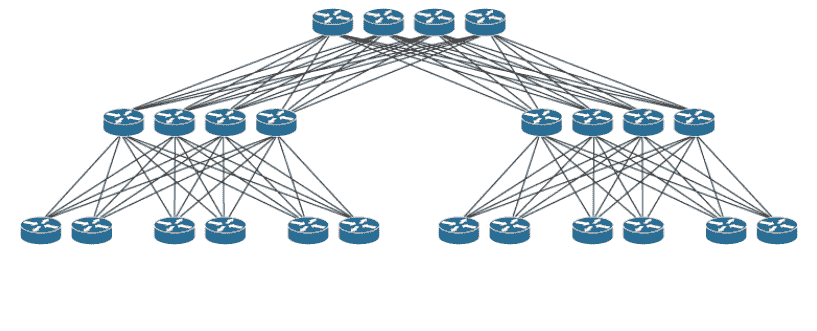

## 图 4-4 *多级 Clos 网络*

## MTU 注意事项

回顾一下，VXLAN 作为一种网络虚拟化覆盖技术，在原始数据帧上增加了一些额外的开销。这种开销以 VXLAN 本身运行所需的附加标识信息的形式体现。它有助于解决传统网络传输技术（如以太网）中存在的一些缺陷。然而，由于开销的存在，在底层网络设计时需要考虑一些额外因素。

一般来说，应避免分片（由于帧或数据包对于传输网络来说过大而被拆分）。分片和重组会给交换机资源以及服务器资源带来额外负担，从而导致传输效率降低。配备以太网网络接口卡（NIC）的计算机、服务器、PC 和其他网络硬件的标准最大传输单元（MTU）为1500字节。<sup>2</sup> 以太网帧的总大小为1518（或1522，加上可选的额外802.1Q标签），其中源地址和目的 MAC 地址各占6字节，Ethertype 占2字节，帧校验序列（FCS）占4字节。这意味着计算机可以发送1500字节或更小的有效载荷，其中包含来自第3层及以上的所有头部信息。同样，服务器通过其默认配置也可以发送最大1500字节的未分片数据。然而，如果在服务器所连接的网络交换机之间启用了 VXLAN，则通过默认配置 MTU 会降低到1450字节。这是因为 VXLAN 添加了50或54字节的开销（参见[图 4-5](#)）作为标识信息的一部分。

采用 VXLAN 会产生由14字节外部 MAC 头部、20字节外部 IP 头部、8字节 UDP 头部和8字节 VXLAN 头部组成的开销。VXLAN 引入的50或54字节开销必须添加到以太网本身的 MTU 考量中。可能使开销从50字节增加到54字节的额外4字节来自于保留原始以太网帧中的 IEEE 802.1Q 标签。在大多数情况下，802.1Q 标签会被映射到 VNI，并在将 VXLAN 封装添加到原始帧之前被剥离。然而，存在某些与 Q-in-Q<sup>3</sup> 或 Q-in-VNI<sup>4</sup> 相关的用例（例如嵌套虚拟化管理程序、第2层隧道等），需要保留原始的 IEEE 802.1Q 标签。无论哪种情况，VXLAN 开销的这些额外字节都需要作为底层设计的一部分加以考虑。

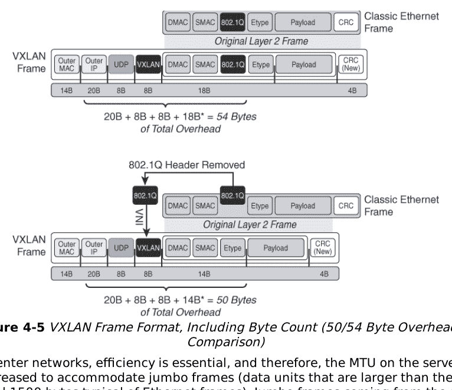

在数据中心网络中，效率至关重要，因此服务器端的 MTU 通常会增大以容纳巨型帧（大于以太网帧传统1500字节的数据单元）。来自服务器端的巨型帧通常最大可达9000字节，大多数 NIC 和/或虚拟交换机都支持这一值。当使用巨型帧时，服务器端需要支持9000字节的 MTU，加上 VXLAN 封装带来的额外字节，需要允许约9050或9054字节的值以避免分片。

幸运的是，Cisco 和其他厂商的大多数网络交换机提供最大9216字节的 MTU 值，尽管有些需要将此值减少20到30字节以容纳网络交换机内部服务头部。因此，来自服务器端的9000字节巨型帧 MTU 可以被网络交换机容纳，而不会引入分片。这并不罕见，因为使用较大的传输单元效率更高，而且在高速网络中使用它们可以减少所需的网络往返次数。由于 MTU 配置在多个位置执行，且这可能在后续重新配置时影响覆盖网络，因此对网络 MTU 大小的初始考量至关重要。巨型帧 MTU 需要在网络中的所有点（包括面向主机的服务器接口）进行一致配置。作为额外的保障措施，某些网络协议会在与邻居建立路由邻接关系之前，检查该邻居设备是否使用相同的 MTU 值。因此，尽管 VXLAN 的底层可以容纳巨型帧 MTU 大小，但具体的设计考量仍然很重要。

## IP 寻址

在为底层构建路由网络时，对各种网络设备和/或相关接口（物理接口和逻辑接口）进行 IP 地址的分配和指定非常重要。本节重点介绍基于 IPv4 的 VXLAN 网络底层。请注意，覆盖网络同时支持 IPv4 和 IPv6 地址。参与 VXLAN 网络底层的每台网络交换机都通过其路由协议以路由器 ID（RID）进行唯一标识，如[示例 4-1](Example%204-1) 所示。


### 示例 4-1 *OSPF 显示的 RID 输出*

[点击此处查看代码图像](http://example.com)

```
LEAF11# show ip ospf

Routing Process UNDERLAY with ID 10.10.10.1 VRF default
 Routing Process Instance Number 1
  Stateful High Availability enabled
  Graceful-restart is configured
    Grace period: 60 state: Inactive
    Last graceful restart exit status: None
  Supports only single TOS(TOS0) routes
  Supports opaque LSA
  Administrative distance 110
  Reference Bandwidth is 40000 Mbps
  SPF throttling delay time of 200.000 msecs,
    SPF throttling hold time of 1000.000 msecs,
    SPF throttling maximum wait time of 5000.000 msecs
  LSA throttling start time of 0.000 msecs,
    LSA throttling hold interval of 5000.000 msecs,
    LSA throttling maximum wait time of 5000.000 msecs
  Minimum LSA arrival 1000.000 msec
  LSA group pacing timer 10 secs
  Maximum paths to destination 8
  Number of external LSAs 0, checksum sum 0
  Number of opaque AS LSAs 0, checksum sum 0
  Number of areas is 1, 1 normal, 0 stub, 0 nssa
  Number of active areas is 1, 1 normal, 0 stub, 0 nssa
  Install discard route for summarized external routes.
  Install discard route for summarized internal routes.
  Area BACKBONE(0.0.0.0)
    Area has existed for 5w1d
    Interfaces in this area: 4 Active interfaces: 3
    Passive interfaces: 0 Loopback interfaces: 2
    No authentication available
    SPF calculation has run 86 times
      Last SPF ran for 0.000505s
    Area ranges are
    Number of LSAs: 7, checksum sum 0x25cd5
```

RID 用于路由协议中，以唯一标识给定邻居，或作为其数据库中接收或发送给该邻居的信息的索引。考虑到这一点，RID 应始终可用且可访问，因此，最佳实践是创建一个回环接口，并为其分配一个与配置的 RID 相匹配的 IP 地址。回环接口是网络交换机或路由器中的一个逻辑软件接口，它始终处于活动状态，因为有多条物理路径可以到达该接口。如果相邻设备接口关闭或消失（例如被拔掉），物理接口可能变得不可用。[示例 4-2](http://example.com) 展示了一个包含用于 RID 和 VTEP 的回环接口的 OSPF 配置。

### 示例 4-2 *回环接口和 OSPF 示例配置*

[点击此处查看代码图像](http://example.com)

```
LEAF11# show running-config ospf

feature ospf

router ospf UNDERLAY
  router-id 10.10.10.1

interface loopback0
  ip address 10.200.200.1/32
  ip router ospf UNDERLAY area 0.0.0.0

interface loopback1
  ip address 10.10.10.1/32
  ip router ospf UNDERLAY area 0.0.0.0
```

除了 RID，IP 地址也会分配给物理接口，以建立路由邻接关系。在物理接口上分配这些 IP 地址的最佳方式是将它们配置为点对点（P2P）路由接口。在图 4-6 所示的情况下，只有两个 P2P 接口分别参与 VTEP V1 的脊叶之间以及 VTEP V3 的脊叶之间的通信。

```
## 点对点 (P2P) 接口配置
interface Ethernet 4/1
  no switchport
  ip address 10.1.1.1/31
  mtu 9192

interface Ethernet 4/3
  no switchport
  ip address 10.1.1.5/31
  mtu 9192
```

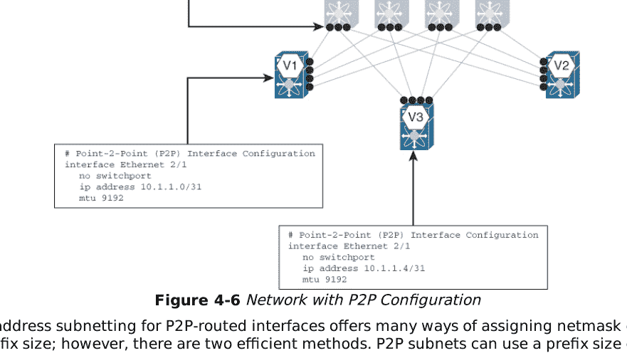

```
## 点对点 (P2P) 接口配置
interface Ethernet 2/1
  no switchport
  ip address 10.1.1.0/31
  mtu 9192
```

```
## 点对点 (P2P) 接口配置
interface Ethernet 2/1
  no switchport
  ip address 10.1.1.4/31
  mtu 9192
```

P2P 路由接口的 IP 地址子网划分提供了多种分配网络掩码或前缀长度的方法；然而，有两种高效的方法。P2P 子网可以使用 /31 或 /30 的前缀长度。/30 是 P2P IP 网络中最常见的前缀长度。典型的 /30 前缀提供一个网络 ID 地址、两个可用的 IP 地址和一个广播 ID 地址。虽然使用这种前缀长度是为 P2P 网络分配 IP 地址的有效方式，但请注意，50% 的地址（网络 ID 地址和广播 ID 地址）是不可用的。

考虑一个拥有 4 台脊交换机和 40 台叶交换机、使用 /30 前缀的底层网络的计算：

- 4 台脊交换机 × 40 台叶交换机 = 160 条 P2P 链路
- = 160 条链路 × 4 (/30)
- = 40 台叶交换机 + 4 台脊交换机
- = 640 个用于 P2P 链路的 IP 地址
- = 44 个用于回环接口的 IP 地址
- = 684 个 IP 地址 => /22 前缀（1024 个 IP 地址）

或者，从 IP 地址分配的角度来看，一个更高效的选项是使用 /31 的前缀长度。/31 前缀的 IP 子网仅由两个 IP 地址组成，这两个地址都可以在 P2P 网络中使用。使用 /30 前缀时，额外的两个不可用 IP 地址（网络 ID 和广播 ID）与两个可用 IP 地址一起被使用，造成了浪费。然而，/31 前缀仅提供两个可用的 IP 地址，没有网络 ID 和广播 ID 地址，因此不会发生浪费。通过在底层网络中使用 /31 前缀而不是 /30 前缀，P2P 网络区域内的所有 IP 地址都是可用的。

考虑一个拥有 4 台脊交换机和 40 台叶交换机、使用 /31 前缀的底层网络的计算：
- 4 台脊交换机 × 40 台叶交换机 = 160 条 P2P 链路
- = 160 条链路 × 2 (/31) + 40 台叶交换机 + 4 台脊交换机
- = 320 个用于 P2P 链路的 IP 地址 + 44 个用于回环接口的 IP 地址
- = 364 个所需的 IP 地址总和 => /23 前缀（512 个 IP 地址）

P2P 接口寻址的另一种方法是使用一种称为 IP 未编号（IP unnumbered）的技术，该技术在网络行业已有数十年的历史。本质上，这种方法允许在不为每个接口分配单独 IP 地址的情况下，在 P2P 接口上进行 IP 处理，从而节省网络中的 IP 地址空间。IP 未编号选项允许重用为 RID 创建的回环接口，并“借用”其 IP 地址用于所有物理接口。[示例 4-3](#) 说明了一个典型的 IP 未编号配置。

### 示例 4-3 *IP 未编号配置示例*

```
interface loopback1
    ip address 10.10.10.1/32
    ip router ospf UNDERLAY area 0.0.0.0
    ip pim sparse-mode

interface Ethernet2/1
    no switchport
    mtu 9216
    ip unnumbered loopback 1
    ip ospf network point-to-point
    ip router ospf UNDERLAY area 0.0.0.0
    ip pim sparse-mode
    no shutdown
```

通过为每台网络交换机使用这个单一的 IP 地址，与 /31 或 /30 前缀方法相比，IP 地址空间得到了显著节省，同时简化了整体的地址分配过程。

考虑一个配置了 IP 未编号、拥有 4 台脊交换机和 40 台叶交换机的底层网络的计算：
- 4 台脊交换机 + 40 台叶交换机 = 44 个独立设备
- = 44 个用于回环接口的 IP 地址（IP 未编号）
- => /26 前缀（64 个 IP 地址）

在大多数思科 Nexus 数据中心交换机上，可以使用 OSPF 或 IS-IS 路由协议为以太网接口配置 IP 未编号（参见[图 4-7](#)）。

```
## 回环接口配置 (IP 未编号)
interface loopback 1
 ip address 10.10.10.201/32
 mtu 9192

## 物理接口配置
interface Ethernet 4/1-3
 no switchport
 ip unnumbered loopback 1
 mtu 9192
```

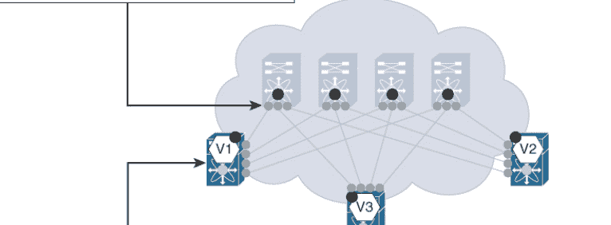

```
## 回环接口配置 (IP 未编号)
interface loopback 1
 ip address 10.10.10.1/32
 mtu 9192

## 物理接口配置
interface Ethernet 2/1
 no switchport
 ip unnumbered loopback 1
 mtu 9192
```

### 图 4-7 *配置了 IP 未编号的网络*

到目前为止，我们讨论了底层的接口寻址选项。然而，另一个与 overlay 网络相关的底层关键功能是 VTEP 或 NVE 接口。NVE 接口必须从一个逻辑回环接口派生其 IP 地址，该接口始终可用且可访问，就像 RID 一样。用于 RID 的同一个回环接口可以用于 NVE。这种方法避免了为每个 NVE 接口配置额外的 IP 地址。然而，从网络设计的角度来看，将纯粹的 overlay 功能与 underlay 功能分离是可取的。换句话说，常见的最佳实践是创建一个单独的回环接口供 NVE 接口使用，如[示例 4-4](https://example.com) 所示。

### **示例 4-4** *用于路由和 NVE 的单独回环接口配置*

[点击此处查看代码图像](https://example.com)

```
! 回环0接口配置 (VXLAN VTEP)
interface loopback0
 ip address 10.200.200.1/32
 ip router ospf UNDERLAY area 0.0.0.0
 ip pim sparse-mode

! 回环1接口配置 (用于底层和BGP EVPN的路由回环接口)
interface loopback1
 ip address 10.10.10.1/32
 ip router ospf UNDERLAY area 0.0.0.0
 ip pim sparse-mode
```

请注意，与两个接口（Loopback0 和 Loopback1）关联的地址需要由底层内部网关协议（IGP）通告，以实现网络可达性。将 NVE 回环接口与底层路由协议分离也具有运营优势。随着思科 NX-OS 提供优雅插入和删除功能，一个

网络交换机可以通过在维护或其他中断性操作期间关闭与NVE或VTEP关联的第一个环回接口，从底层路由视角进行隔离。这允许在无需同时关闭覆盖层和底层可达性的情况下，对底层进行故障排查。此外，这也可以避免不必要的流量中断。

除了连接脊叶网络所固有的接口IP分配外，脊交换机上还存在额外的IP地址分配需求。通常，纯脊交换机提供承载叶交换机的VTEP之间的连接性，其自身不承载NVE接口——因此无法提供VXLAN封装/解封装功能。在这种情况下，脊交换机上仅需一个环回接口，该接口既用于底层路由协议关联的RID，也用于BGP路由反射器的标识。然而，底层不仅需要支持单播可达性，还需要能够传输多目的地流量。

如前所述，通常使用IP组播来实现这一目的。底层对组播路由的支持，反过来需要分配和识别合适的组播汇聚点。在脊叶拓扑中，脊交换机是承载RP的理想选择。因此，脊交换机可能需要拥有额外的环回接口供RP使用。

解决RP冗余的方法有多种。本讨论的重点仅涉及PIM任播源组播的任播RP，以及双向PIM的幻象RP。为了通过这些操作解决RP冗余和负载均衡问题，需要一些IP地址来容纳这些服务。对于PIM ASM，一个用于任播RP寻址的额外环回接口就足够了，因此只需要一个IP地址。对于PIM BiDir和幻象RP，则需要更多的IP地址来提供冗余和负载均衡。因此，需要一个比例大小合适的专用子网。关于RP冗余的详细信息将在本章后续部分提供。

此时，理解底层IP地址分配需求的必要性应已显而易见。为了减小路由表的规模，可以考虑针对这些IP地址创建聚合前缀或汇总。作为最佳实践，根据底层P2P接口的数量和所采用的相应寻址模式，使用单个IP地址汇总或超网是理想的。使用这种方法，分配给各个P2P接口的所有/30或/31 IP子网前缀都可以汇总到第一个单个聚合中。同样，不同的聚合（第二个和第三个）可以分别用于NVE环回接口和RID，如果需要或希望，也可以将它们合并为单个聚合。在存在幻象RP的情况下，则需要一个额外的聚合。总之，底层的聚合选项如下（示例见图4-8）：

- 一个用于所有P2P接口子网的IP子网
- 一个用于所有RID和NVE接口的IP子网，使用单独的环回地址（如果需要或希望，可以拆分为单独的IP聚合）
- 一个用于幻象RP的IP子网

P2P聚合：10.1.1.0/24
RID聚合：10.10.10.0/24
VTEP聚合：10.200.200.0/24
RP聚合：10.254.254.0/24

**图4-8** *一个展示典型底层IP地址池分配的简单示例*

## IP单播路由

单播路由可以作为底层的一部分，通过各种路由协议实现。具体来说，有两种类型的IGP在多级脊叶拓扑中展示了高效的功能能力。它们属于链路状态和距离矢量协议类别。链路状态IGP基于最短路径优先算法，适用于脊叶网络。脊交换机在叶交换机之间提供多条等价路径，而基于SPF的协议会考虑所有这些链路以及各自的链路速度，以计算通过网络的单条最佳路径或多条等价最佳路径。如前所述，等价多路径是基于IP的底层网络相对于以太网网络中主导的生成树协议所提供的一大优势（见图4-9）。

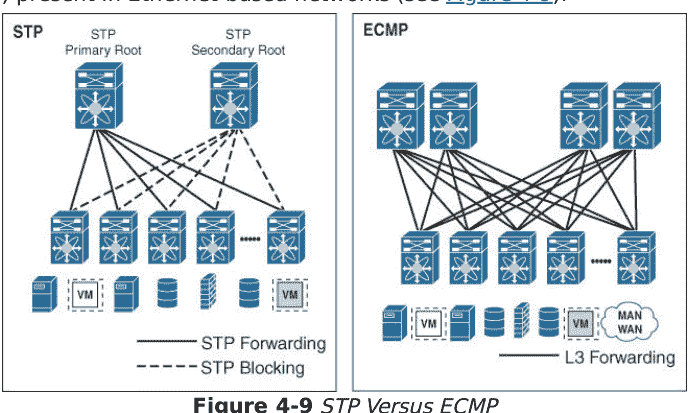

虽然BGP作为底层路由协议也具有重要价值，但它是一种路径矢量协议，仅考虑自治系统来计算路径。然而，经验丰富的网络工程师可以使用BGP实现与其他基于SPF的路由协议相当的效果。

## OSPF作为底层

开放最短路径优先协议是一种广泛采用的IGP，已应用于许多局域网、广域网和数据中心核心网络环境。它在业界的各种网络组件中广泛可用，提供了强大的互操作性。用于以太网接口的OSPF默认接口类型是“广播”，这本质上导致了指定路由器和/或备份指定路由器的选举，从而减少了包含路由更新的控制流量。虽然这对于多接入网络（如共享以太网段）是合适的，但在底层这样的点对点网络中则是不必要的。

将接口类型更改为点对点可以避免DR/BDR选举过程，从而减少叶交换机和脊交换机之间建立OSPF邻接关系所需的时间。此外，使用点对点接口模式，没有类型2链路状态通告。仅需要类型1 LSA，从而确保OSPF LSA数据库保持精简。它还减少了网络在拓扑变更后收敛所需的时间。示例4-5展示了底层采用的典型OSPF配置及相应的show输出。

### 示例4-5 OSPF接口配置和状态

```
interface Ethernet2/1
    no switchport
    mtu 9216
    ip address 10.1.1.0/31
    ip ospf network point-to-point
    ip router ospf UNDERLAY area 0.0.0.0
    ip pim sparse-mode
    no shutdown
```

```
LEAF11# show ip ospf interface Ethernet 2/1
Ethernet2/1 is up, line protocol is up
    IP address 10.1.1.0/31, Process ID UNDERLAY VRF default, area 0.0.0.0
    Enabled by interface configuration
    State P2P, Network type P2P, cost 1
    Index 3, Transmit delay 1 sec
    1 Neighbors, flooding to 1, adjacent with 1
    Timer intervals: Hello 10, Dead 40, Wait 40, Retransmit 5
        Hello timer due in 00:00:05
    No authentication
    Number of opaque link LSAs: 0, checksum sum 0
```

全面理解OSPF的运作方式以及与网络触发器相关的不同状态机和转换需要多章内容；本章的目标是强调使用OSPF作为IGP时涉及的一些底层细节。关于OSPF的一些其他考虑因素涉及其在进行SPF计算时的行为以及对IPv4和IPv6路由的支持。OSPF建立在IP前缀之上，区域中任何IP前缀的更改都会触发完整的SPF计算，因为相应的IP信息在路由和网络LSA中为IP前缀本身以及相关拓扑信息（在同一LSA中）进行通告。这意味着，如果接口上的IP地址发生变化，OSPF需要发送路由器或网络LSA，这反过来会触发给定OSPF区域中所有路由器的完整SPF计算。虽然这在当前网络交换机和路由器资源相对较高的情况下不一定构成严重问题，但理解这些事件期间发生的情况相当重要。

另一个考虑因素涉及OSPF对IPv4和IPv6的支持。虽然OSPFv2仅支持IPv4，但OSPFv3主要用于IPv6。换句话说，任何想要使用IPv6的底层都需要OSPFv3，这反过来需要双栈配置和添加第二个路由协议。

因此，关于使用OSPF作为底层IGP的关键点如下：

- 使用网络类型设置为**点对点**的OSPF。
- 重要的是理解OSPF使用的LSA类型以及LSA泛洪的注意事项。
- 重要的是理解对IPv4使用OSPFv2和对IPv6使用OSPFv3的要求。

## IS-IS作为底层

中间系统到中间系统是另一种链路状态路由协议，它也使用SPF算法来计算通过网络的最短且无环的路径。与OSPF不同，IS-IS是一种ISO标准化的路由协议，IETF将其重新发布为RFC 1195。IS-IS在服务提供商网络之外尚未广泛流行。一个潜在的原因可能是IS-IS不在IP层运行，而是位于第2层，使用无连接网络服务建立邻接关系。因此，IS-IS独立于用于形成相应路由对等体的IP寻址，并且可以在同一路由交换中传输任何类型的寻址。然而，同时，IS-IS需要一种不同的寻址协议来唯一标识中间系统（路由器）。


IS-IS 网络实体标题（IS-IS-NET）是 CLNS 的网络层地址（网络服务接入点 [NSAP] 地址），用于标识给定 IS-IS 路由网络中的路由器。给定路由器的 NET 中提供三种 NSAP 格式。示例 4-6 展示了 Cisco Nexus 交换机上的 IS-IS 配置示例。

**示例 4-6** *Cisco Nexus 交换机上的 IS-IS 配置*

```
feature isis

router isis UNDERLAY
 net 49.0001.0100.1001.0001.00

interface Ethernet2/1
 no switchport
 mtu 9216
 ip address 10.1.1.0/31
 ip router isis UNDERLAY
 medium p2p
 ip pim sparse-mode
 no shutdown
```

在 IS-IS 中，IP 信息承载在链路状态包（LSP）的类型-长度-值（TLV）中。由于 IP 前缀始终被视为外部信息，在此配置中最短路径树计算结束时，当 IP 网络发生变化时不需要运行完整的 SPF 计算。SPF 计算所需的 IS-IS 路由器（节点）信息在 IS 邻居或 IS 可达性 TLV 中单独通告。这种方法将拓扑与 IP 信息分离，允许进行部分路由计算。因此，IS-IS 在处理 IP 路由变化时的开销大大降低，因为拓扑不受影响。与 OSPF 的 DR/BDR 选举类似，IS-IS 使用指定中间系统（DIS）选举过程。IS-IS 和 OSPF 在多路访问介质选举过程的细节方面存在显著差异，但这些细节超出了本章的讨论范围。

IS-IS 的关键要点如下：

- IS-IS 基于 CLNS，使用 NSAP 寻址。
- IS-IS 使用与 IP 无关的路由协议。
- 拓扑独立于 IP 路由前缀。

## BGP 作为 Underlay

边界网关协议（BGP）是一种路径矢量路由协议，用于在各个自治系统（AS）之间交换路由和可达性信息。BGP 在基于路径、网络策略和/或网络工程师配置的规则集进行路由决策方面表现出色。因此，与基于 SPF 的路由协议相比，它在 spine-leaf underlay 中需要更多的设计和配置时间。虽然 BGP 在网络策略执行方面非常出色，但它并非专门为快速收敛或链路路径计算而开发的。尽管如此，在一些场景中——主要由于运营需求——将 BGP 用作 underlay 路由协议具有显著优势。需要注意的是，BGP 作为一种硬状态协议，仅在网络可达性发生变化时才发送更新。因此，它不会像 OSPF 等链路状态协议那样产生周期性更新的开销，例如周期性 Hello 报文、冗余路由拓扑更新等。

BGP 的最初版本用于在不同 AS 之间通信可达性信息，即现在所称的外部 BGP（eBGP）。该协议后来经过增强，支持同一 AS 内不同对等体之间的通信，从而产生了内部 BGP（iBGP）。iBGP 是承载 overlay EVPN 可达性信息的常用选择，这是在使用 OSPF 或 IS-IS 作为 underlay 时的情况。然而，如果 underlay 使用 eBGP，而 overlay 需要交换 EVPN 可达性信息，则需要考虑一些额外的因素。具体来说，当每个网络交换机只有一个 BGP 实例时，如果 underlay 使用 eBGP，overlay 也需要配置为 eBGP。

对于 eBGP，下一跳属性始终会被设置，这意味着路由的邻居即成为下一跳。在 spine-leaf 拓扑中，这是不合适的，因为 spine 通常不会承载 VTEP 接口，因此缺乏封装/解封装 VXLAN 流量的能力。Leaf 发送的关于其本地连接主机或前缀的 EVPN 通告，需要由 spine 转发给其他 leaf，且不改变下一跳属性，从而允许从 leaf 到 leaf 建立端到端的 VXLAN 隧道。这通过在 eBGP 中设置特定配置来实现，将下一跳属性设置为 **unchanged**（不变）。更改下一跳行为与配置的 overlay 部分（L2VPN EVPN）相关，如示例 4-7 所示。

#### 示例 4-7 eBGP：next-hop unchanged

```
route-map NH-UNCHANGED permit 10
    set ip next-hop unchanged

router bgp 65501
    address-family l2vpn evpn
        nexthop route-map NH-UNCHANGED
    neighbor 10.1.1.1 remote-as 65500
        address-family l2vpn evpn
            send-community both
            route-map NH-UNCHANGED out
```

由于 eBGP 同时用于 underlay 和 overlay，建议为 EVPN 地址族（即 overlay）建立单独的 BGP 对等关系。Underlay eBGP 对等关系是物理接口到物理接口，而 overlay BGP 对等关系是环回接口到环回接口（eBGP 多跳）。

除了 eBGP 在 underlay 路由和 overlay 可达性对等关系方面的这一区别外，所有 EVPN 信息必须反射到所有 leaf。在 iBGP 中，路由反射器（RR）提供此功能，但在 eBGP 中，路由反射器的角色并非必需。因为 eBGP 邻居仅反射同时具有本地实例的 EVPN 路由，所以必须启用 **retain Route-Target all** 功能，使 eBGP 邻居充当 EVPN 地址族的路由反射器。这不仅适用于 EVPN，也适用于 MPLS VPN 或类似的 MP-BGP VPN 方式。使 eBGP 邻居充当 VPN 地址族的路由反射器与配置的 overlay 部分（L2VPN EVPN）相关，如示例 4-8 所示。

#### 示例 4-8 eBGP：retain Route-Target all

```
router bgp 65500
    address-family l2vpn evpn
        retain route-target all
```

eBGP 存在两种模型：双 AS 模型（参见图 4-10）和多 AS 模型（参见图 4-11）。eBGP 双 AS 模型可以描述为所有 spine 属于一个 AS，所有 leaf 属于另一个不同的 AS。在 eBGP 多 AS 模型中，所有 spine 属于一个 AS，而每个 leaf（或虚拟 PortChannel [vPC] 中的 leaf 对）属于各自唯一的 AS。

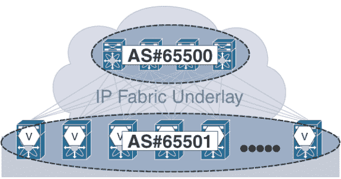

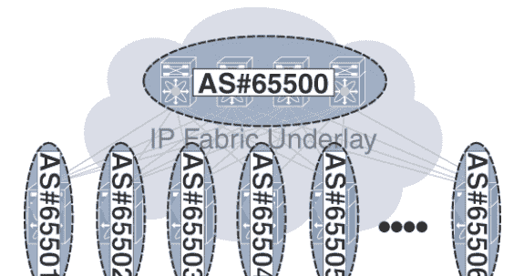

多 AS 场景类似于互联网的概念，即管理域中的每个节点都拥有唯一的 AS。在连接 leaf 和 spine 之间 P2P 链路的物理三层接口上配置的 IP 地址用于 BGP 对等关系。例如，在四 spine 拓扑的情况下，leaf 需要创建四个不同的 BGP 对等关系，分别源自四个物理接口 IP 地址，目标为各 spine 的物理接口 IP 地址。逻辑 IP 接口（环回接口）需要通过 BGP 进行通告或重分发，以实现 VTEP、RP 等的可达性。

在双 AS 模型中，如前所述，所有 leaf 共享一个 AS，而 spine 共享另一个 AS。与多 AS 方式类似，BGP 对等关系基于每个接口建立，使用在点对点链路上配置的 IP 地址。然而，在双 AS 模式下，由于当源 AS 与目标 AS 相同时会发生 AS 路径违规，因此需要进行一些调整。幸运的是，Cisco 的实现提供了所有必要的配置选项，通过适当的配置使双 AS 方式正常工作。如示例 4-9 所示，在 spine 上必须禁用对等体 AS 检查（使用配置 **disable-peer-as-check**），同时允许接收来自与 leaf 同一 AS 的远程路由器的 eBGP 更新（使用配置 **allowas-in**，如示例 4-10 所示）。

**示例 4-9** *仅限双 AS 模型：disable-peer-as-check（仅限 Spine）*

```
router bgp 65500
   router-id 10.10.10.201
   neighbor 10.1.1.0 remote-as 65501
      address-family ipv4 unicast
         send-community both
```


#### 示例 4-10 仅限双AS模式：allowas-in（仅限叶节点）

```
router bgp 65501
  router-id 10.10.10.1
  neighbor 10.1.1.1 remote-as 65500
    address-family ipv4 unicast
      allowas-in
    address-family l2vpn evpn
      send-community both
      allowas-in
```

总之，将eBGP用作底层方案的关键要点如下：

- BGP存在两种不同的模型：双AS和多AS。
- 需要进行一些BGP对等体配置工作。
- 它对覆盖层控制协议有影响。

## IP单播路由总结

正如我们所见，底层协议的选择可能对覆盖层控制协议的运行产生重大影响。如果在底层和覆盖层使用相同的协议，这两个域之间的清晰界限可能会变得模糊。因此，在设计覆盖层网络时，一个良好的实践是独立构建传输网络，正如MPLS网络几十年来所做的那样。将底层和覆盖层控制协议分开，为传输网络提供了一个非常精简的路由域，该域仅包含环回和点对点接口。同时，覆盖层的MAC和IP可达性存在于不同的协议——BGP中。这为网络提供了一个蓝图，由于拓扑地址空间与终端主机可达性地址空间的分离，该网络具有高度的可扩展性。同样值得注意的是，基于链路状态和SPF算法的IGP非常适合ECMP网络，即使数据中心网络架构涉及数百台路由器也是如此。同时将BGP用于底层和覆盖层的主要优势是只需一种路由协议。但是，它需要在叶交换机和脊交换机上进行额外的配置。

总之，对于BGP EVPN VXLAN网络架构，建议验证所需覆盖层服务的收敛要求。底层收敛应在与覆盖层收敛独立的情况下进行测试，以最终决定底层使用哪种IGP。采用分层方法来衡量预期并评估结果可能与预期不符的地方是值得的。理想情况下，底层构建应自下而上进行，各个步骤应相互衔接。构建网络覆盖层时，一个重要的指导原则是构建底层、彻底测试它，然后再继续构建覆盖层。

## 多目的地流量

多目的地流量包括广播、未知单播和组播（BUM）等流量类型。底层必须提供一种在边缘设备之间承载BUM流量的方式。VXLAN有两种不同的方式来处理BUM流量：

- 单播模式，也称为*入口复制*或*头端复制*，是创建独立于组播的底层的一种方式。
- 使用底层IP组播的组播模式是另一种选择。

在为基于BGP EVPN VXLAN的数据中心网络架构设计和创建底层时，需要考虑模式的选择及其相关的优缺点。

## 单播模式

在单播模式下，数据包由入口VTEP复制，并发送到属于相同VNI的相邻VTEP（参见图4-12）。由于入口VTEP必须寻址所有相邻的VTEP，它本质上知道这些VTEP，并承担着将BUM流量复制并发送到这些VTEP的负担。换言之，如果*N*个VTEP是某个VNI的成员，那么对于该VNI中的每个多目的地数据包，VTEP必须生成*N*–1个数据包副本。每个副本都经过VXLAN封装，外部目标IP设置为其必须送达的目标VTEP的地址。从底层以及目标VTEP的角度来看，该数据包仅被视为常规的VXLAN封装单播数据包。

在图中，连接到VTEP V1的主机A（192.168.1.101）发送一个ARP请求，以解析与连接到VTEP V2的主机B（192.168.1.102）相关的IP到MAC绑定。两台主机都属于与VNI 30001关联的相同IP子网192.168.1.0/24。为了处理这个BUM数据包，图示说明了VTEP V1如何发送两个包含此ARP请求负载的单播数据包，一个发往VTEP V2，另一个发往VTEP V3。数据包流中重要的关注字段在图中已突出显示。

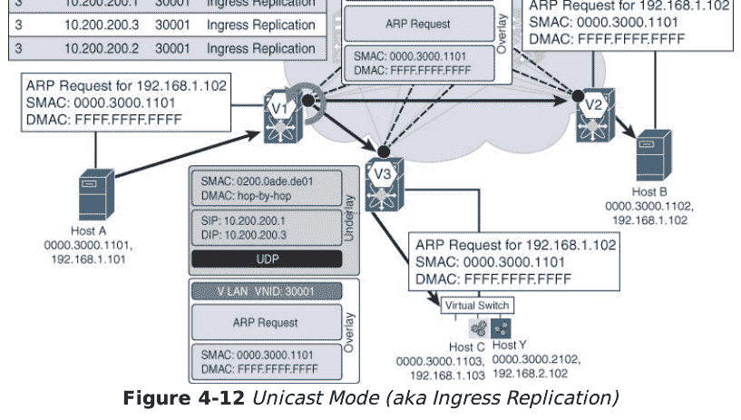

单播模式有两种配置选项。第一种是*静态*配置，即在每个VTEP上配置一个相关VTEP的列表。另一种选项是使用控制协议（在本例中为BGP EVPN）*动态*配置列表，以在内部分发兴趣信息。静态配置降低了可扩展性，因为向网络添加的任何新VTEP或VNI都需要在每个相邻VTEP上重新配置（参见示例4-11）。

### 示例 4-11 静态入口复制配置

```
interface NVE 1
 source-interface loopback1
 member vni 30001
  ingress-replication protocol static
  peer-ip n.n.n.n
```

BGP EVPN支持单播模式。例如，在示例4-12中，利用BGP EVPN控制协议和路由类型3（包含组播）消息来分发VTEP和VNI成员信息。这并不意味着BGP EVPN在执行入口复制的工作，而只是通过控制协议分发VTEP和VNI成员信息。数据流量的复制是VTEP执行的数据平面操作。因此，入口或头端复制操作必须由嵌入在VTEP中的转发功能来支持。

### 示例 4-12 使用EVPN的入口复制配置

```
interface NVE 1
 source-interface loopback1
 member vni 30001
  ingress-replication protocol bgp
```

无论在单播模式下采用静态还是动态选项，需要为每个多目的地数据包在VTEP上生成*N*个副本的数据平面操作保持不变。在BGP EVPN控制协议的支持下，VTEP邻居的发现显著地更加动态。对于给定的VNI，接收方VTEP或感兴趣方VTEP通过EVPN通告兴趣，从而动态地将自己添加到发送方VTEP的复制列表中。相比之下，在静态模式下，对于给定的VNI，只要在发送方VTEP上配置了对等VTEP列表，发送方VTEP就会继续向配置列表中的每个成员发送副本，而不管接收方VTEP是否已知表示兴趣。配置静态模式的一种方法是将所有VTEP配置为邻居，这样每次配置新的VNI时，就不必操作或更改VTEP列表。只有添加或移除VTEP才会导致VTEP列表的更改。

考虑到静态配置选项的缺点，很直观地可以看出，在VXLAN中使用BGP EVPN控制协议时，用于BUM流量复制的单播模式效率更高。然而，与此同时，它仍然不如组播模式高效，因为组播模式不需要从入口VTEP传输单个数据包的多个副本。相反，底层的高效IP组播负责将多目的地流量传输到感兴趣的VTEP，而不会给VTEP带来任何额外负担。无论如何，单播模式的优势在于不需要任何额外的协议（如PIM）或维护底层所需的组播专业知识。换言之，只要承载VTEP的网络交换机能够支持相应的单播模式，使用单播模式就不需要在底层进行任何额外的配置。

## 组播模式

当使用组播模式通过VXLAN传输多目的地流量时，在VTEP和脊-叶网络中配置的组播路由应与用于单播的路由一样具有弹性。


## 组播模式

在组播模式下，首先必须了解参与由spine和leaf组成的underlay（通常托管VTEP）的网络交换机的能力。这一点很重要，因为并非每种网络交换机都支持所有组播复制模式。对于Cisco交换机，会采用两种支持组播的underlay模式。一种涉及PIM任意源组播（PIM ASM；RFC 7761），有时也称为PIM稀疏模式（PIM SM）。另一种模式涉及双向PIM（PIM BiDir；RFC 5015）。¹⁶ 根据网络交换机硬件的能力，会选择其中一种模式。

由二层VNI或24位标识符标识的VXLAN网络是一个二层网段。源自该网络内的任何BUM流量都必须发送到该VNI的所有成员节点。通常，二层VNI与一个组播组关联，并且在属于同一VXLAN网络的所有交换机上采用相同的[VNI，组播组]配置。即使在这种对称配置下，也必须将所有交换机配置为支持相同的PIM组播模式。例如，在一个包含四个leaf和两个spine的VXLAN网络中，如果两个leaf仅支持PIM ASM，而另外两个leaf仅支持PIM BiDir，则无法保证VNI内的多目的地BUM流量被正确转发。这是因为PIM ASM和BiDir的运行方式大相径庭。更不用说，类似地，在VXLAN网络中，如果一些leaf支持单播模式，而其他leaf支持组播模式，则无法在它们之间延伸相同的二层VNI。

图4-13描绘了如何使用组播underlay，将连接到VTEP V1的主机A发出的原始ARP请求发送到所有本地配置了VNI 30001的VTEP。由于VNI 30001映射到组播组239.1.1.1，原始ARP请求载荷被封装在一个带有VNI 30001的VXLAN头部中，外部目的IP设置为239.1.1.1。underlay中的组播树将确保数据包被传送到VTEP V2和V3。同样，如前所述，图4-13所示的数据包流中的重要字段被高亮显示。

总之，共享相同二层VNI的VTEP之间需要通用的多目的地流量复制模式。具体来说，即使所有VTEP都支持组播模式，它们也需要支持相同的PIM模式（ASM或BiDir）。鉴于二层VNI在组播模式下具有一致的复制模式，要么多个二层VNI可以共享一个组播组（见图4-14），要么一个二层VNI可以占用一个组播组（见图4-15）。只要尊重跨所有VTEP一致分配的要求，并且它们在各自硬件平台的规模内运行，二层VNI就可以自由分配到组播组。

在组播模式下，由于underlay需要支持组播路由，因此存在对PIM的内在依赖性。在采用PIM ASM或PIM BiDir的组播网络中，需要一个汇聚点（RP）。如前所述，对于underlay考虑，spine是托管RP的首选位置，因为任何在leaf之间传输的流量都会经过spine。共享组播树根植于spine上的RP，源树则根据需要形成，然后根植于相应的leaf VTEP。

## PIM任意源组播（ASM）

在PIM ASM中，源树（S,G）在VTEP上创建。因为每个VTEP都能够发送和接收特定组播组的组播流量，所以每个VTEP既是源又是接收者。因此，可以创建多个源树，每个参与特定组播组的VTEP都有一个源树。这些不同源树的RP位于spine层。由于存在多个spine，可以利用相当程度的弹性和负载均衡。

在PIM ASM中，Anycast RP是一种将RP分布到所有可用spine的方式，同时仍然呈现为单个RP（参见[图4-16](https://example.com/figure-4-16)）。Anycast RP有两种不同的模式：一种使用组播源发现协议（MSDP）¹⁷，另一种将Anycast RP集成到PIM中（参见RFC 4610）。因为MSDP需要处理两种协议（MSDP和PIM），所以这里重点介绍PIM Anycast RP，但这当然并不意味着使用MSDP的Anycast RP方法无效。

### 示例4-13：PIM Anycast RP配置

```text
! Spine#1上的Anycast-RP配置
ip pim rp-address 10.254.254.254
ip pim anycast-rp 10.254.254.254 10.254.254.1 (Spine#1 IP)
ip pim anycast-rp 10.254.254.254 10.254.254.2 (Spine#2 IP)
ip pim anycast-rp 10.254.254.254 10.254.254.3 (Spine#3 IP)
ip pim anycast-rp 10.254.254.254 10.254.254.4 (Spine#4 IP)

! Spine#1上的环回接口配置（RP）
interface loopback 200
 ip address 10.254.254.1/32
 ip pim sparse-mode

! Spine#1上的环回接口配置（Anycast RP）
interface loopback 254
 ip address 10.254.254.254/32
 ip pim sparse-mode
```

在PIM Anycast RP中，选择一个公共的Anycast RP地址，该地址需要在所有spine上保持一致。在充当Anycast RP的spine中，配置PIM Anycast RP对等关系以允许交换状态信息。回到四spine网络，[示例4-13](https://example.com/example-4-13)提供了Spine#1的Anycast RP配置示例。

尽管在spine上配置了PIM Anycast RP，并具有协议对等关系以交换所有必要信息并充当Anycast RP，但对于组播RP的进一步动态分配并非必要。因为spine中的所有RP都作为单个RP运行，并且为了冗余和负载均衡而集群化，所以可以避免leaf上的动态RP分配。话虽如此，leaf上对于Anycast RP的配置相当简化，就像配置单个RP一样。一个重要步骤包括验证P2P链路上的组播对等关系已启用，并且RP是全局定义还是按每个组播组定义。一旦完成，就建立了用于在VXLAN中复制BUM流量的组播网络设置。因此，除了创建PIM Anycast RP所需的额外环回接口外，PIM ASM所需的配置量相当精简。

### 示例4-14：使用Anycast RP

```text
ip pim rp-address 10.254.254.254
```

## 双向PIM（PIM BiDir）

PIM BiDir提供了在组播模式下提供多目的地流量复制的不同方式。尽管P2P链路的接口配置完全相同，但PIM BiDir与PIM ASM大不相同。如[图4-17]所示，在PIM BiDir中，创建共享树，或者更具体地说，双向共享树（*,G）。这些共享树（*,G）根植于RP，RP充当路由向量。PIM BiDir针对多对多通信配置进行了优化。创建一个双向树，所有给定组播组的公共源和接收者都是该树的一部分。相应的组播流量以RP为中心，而RP再次被优化放置在spine上。同样，leaf上的VTEP充当BUM流量的源和接收者。

与PIM BiDir的主要区别在于，它仅在每个组播组的基础上创建共享树（*,G），而不是像PIM ASM那样在每个VTEP、每个组播组的基础上创建源树（S,G）。在PIM BiDir中，RP没有实际的协议功能。相反，它充当路由向量，所有多目的地流量都汇聚于此。相同的共享树用于将流量从源向上转发至RP，然后从RP向下转发至接收者。选举适当的节点，称为*指定转发器*；它们负责将流量沿共享树向上转发。此外，RP在跟踪各个组播组及其相应树的状态方面的工作量较少。

为了实现与PIM ASM中Anycast RP类似的冗余性，PIM BiDir使用*幻影RP*。[18] 在这种情况下，RP被配置为一个实际上并未分配给任何特定spine的IP地址（因此得名幻影RP）。为PIM BiDir RP提供冗余的首选方法是使用具有不同前缀长度的逻辑环回接口。该方法依赖于单播路由最长前缀匹配路由查找，以保证到RP的一致路径。RP地址仍然是一个幻影地址（一个不与任何物理实体关联的地址），但仍然需要确保存在到RP的路由。使用主用和备用路由器（此处为spine）中的环回接口，它们具有不同的网络掩码长度。通过为RP路由通告不同的网络掩码，可以区分主用和备用路由器。基于单播路由最长前缀匹配查找结果，主用路由器始终优先于备用路由器。

考虑[图4-18]所示的拓扑。在[示例4-15]中，基于此拓扑，主用路由器通告RP的/30路由，备用路由器通告网络掩码较短、对应于RP /29路由的路由。只要两者

当多条路由路径均存在且主备路由器均能正常工作时，单播路由会选择最长匹配项并收敛至主路由器。仅当主路由器离线或其所有接口均不可用时，才会选择备用路由器的通告路由。

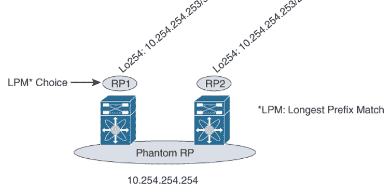

*LPM：最长前缀匹配*

图4-18 幻影RP概念

示例4-15展示了来自Spine#1的配置样例。

### 示例4-15 Spine#1的幻影RP配置（主RP）

点击此处查看代码图片

```
! 定义幻影汇聚点 Spine#1
ip pim rp address 10.254.254.254 bidir

! 环回接口配置（RP）（冗余）
interface loopback 254
  ip address 10.254.254.253/30
  ip pim sparse-mode
```

示例4-16展示了来自Spine#2的配置样例。

### 示例4-16 Spine#2的幻影RP配置（备用RP）

点击此处查看代码图片

```
! 定义幻影汇聚点 Spine#2
ip pim rp address 10.254.254.254 bidir

! 环回接口配置（RP）（冗余）
interface loopback 254
  ip address 10.254.254.253/29
  ip pim sparse-mode
```

如前所述，幻影RP仅使用一个属于特定子网的IP地址（10.254.254.254），但它不与任何Spine上的物理或逻辑接口关联。这确保了只要有一台Spine连接到该子网且该子网正常运行，RP地址就可达。因此，RP的可用性依赖于IP路由层的冗余性。

示例4-17展示了从任意可能的Leaf视角出发的配置样例。

### 示例4-17 使用幻影RP

点击此处查看代码图片

```
ip pim rp address 10.254.254.254 bidir
```

在仅将幻影RP用于冗余的场景中，Leaf上关于幻影RP的配置非常简单：与配置单个RP时相同。如同PIM ASM模式一样，需要在点对点链路上启用多播对等，并且RP需要在所有多播组范围内全局配置，或者按多播组分别配置。在RP地址配置末尾必须指定关键字**bidir**，以指示该RP及相关组将使用PIM双向模式（BiDir）。若幻影RP还用于负载均衡，则可以创建多个幻影RP，每个服务于一个多播组范围。

如前所述，最长前缀匹配定义了活跃的Spine，即为所有多播组服务的幻影RP。如果还需实现负载均衡，则可以将多播组范围划分为任意数量的切片（通常是2的幂次，例如两个或四个）。当多播组被划分为两个范围时，必须在不同的Spine上创建活跃的幻影RP。例如，如果预期有四个活跃的幻影RP，则需要将多播组划分为四个范围，每个RP成为各自多播组切片的活跃RP。为了创建两个或四个幻影RP，需要为给定的RP候选设备（例如一台Spine）分配相同数量的环回接口，并设置适当的前缀长度，以实现负载均衡目标（参见图4-19）。

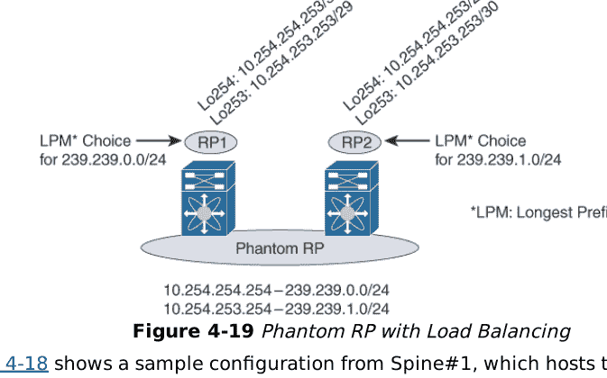

示例4-18展示了来自Spine#1的配置样例，该Spine为主动RP，服务于多播组范围239.239.0.0/24。根据单播路由查找提供的最长前缀匹配结果，Spine#1是10.254.254.254的活跃幻影RP。

### 示例4-18 Spine#1的负载均衡幻影RP配置

点击此处查看代码图片

```
! 定义幻影汇聚点 Spine#1
ip pim rp address 10.254.254.254 bidir group 239.239.0.0/24
ip pim rp address 10.254.253.254 bidir group 239.239.1.0/24

! 环回接口配置（RP）（冗余）
interface loopback 254
  ip address 10.254.254.253/30
  ip pim sparse-mode

! 环回接口配置（RP）（冗余）
interface loopback 253
  ip address 10.254.253.253/29
  ip pim sparse-mode
```

示例4-19展示了来自Spine#2的配置样例，该Spine为主动RP，服务于多播组范围239.239.1.0/24。与示例4-18类似，根据单播路由查找提供的最长前缀匹配结果，Spine#2是10.254.253.254的活跃幻影RP。

### 示例4-19 Spine#2的负载均衡幻影RP配置

点击此处查看代码图片

```
! 定义幻影汇聚点 Spine#2
ip pim rp address 10.254.254.254 bidir group 239.239.0.0/24
ip pim rp address 10.254.253.254 bidir group 239.239.1.0/24

! 环回接口配置（RP）（冗余）
interface loopback 254
  ip address 10.254.254.253/29
  ip pim sparse-mode

! 环回接口配置（RP）（冗余）
interface loopback 253
  ip address 10.254.253.253/30
  ip pim sparse-mode
```

Leaf本身具有拆分的多播组配置，其中为特定的多播组范围定义了一个幻影RP，而另一个多播组范围则分配给不同的幻影RP。虽然这听起来有点复杂，但本质上只使用了经典的路由语义，涉及最长前缀匹配和到给定节点的最佳路径。重申一下，幻影RP是一个未定义的IP地址，需要一条子网路由来确保遵循最长前缀匹配原则。

示例4-20展示了从任意可能的Leaf视角出发的配置样例。

### 示例4-20 使用幻影RP

点击此处查看代码图片

```
ip pim rp address 10.254.254.254 bidir group 239.239.0.0/24
ip pim rp address 10.254.253.254 bidir group 239.239.1.0/24
```

在前面的例子中，对于范围239.239.0.0/24内的所有多播组，最长前缀匹配指向Spine#1上的活跃幻影RP。同样，Spine#2被用作范围239.239.1.0/24内多播组的活跃幻影RP。在涉及两个RP的典型场景中，负载均衡将通过将多播组分配到第二层VNI来实现。如果Spine#1故障，驻留的最长前缀路由将继续指向Spine#2，从而实现弹性。因此，所有的故障切换和负载均衡都发生在单播路由层面（包括幻影RP本身的功能），只有一小部分归因于多播路由层面。

总之，根据底层网络所需的特性，有多种选择可以有效地传输多目的地流量或BUM流量。虽然多播是多目的地流量复制的最优方法，但采用其单播模式的入口复制也是一个可行的替代方案——尽管存在一系列注意事项。随着VXLAN网络的增长，特别是随着Leaf或VTEP规模的扩大，BUM复制也必须实现更大的规模。多播模式提供了实现这一点的最高效方式。如果与为多个VTEP创建单个数据包的多个副本相关的“性能影响”不是问题，那么在已确定的规模限制下，入口复制可以完成这项工作。然而，随着在VXLAN overlay上支持租户多播流量的需求变得越来越关键，多播中封装多播很可能会成为比单播模式更受青睐的选择。

## 总结

本章描述了BGP EVPN VXLAN底层网络，该网络需要能够传输单目的地和多目的地overlay流量。底层需要提供一组功能并表现出某些特性。底层的主要目标是在织网中的各个交换机之间提供可达性。本章介绍了底层的IP地址分配选项，包括点对点IP编号选项和颇具吸引力的IP无编号选项。本章还描述了用于单播路由目的的流行IGP路由协议的选择，例如OSPF、IS-IS和BGP，以及每种选择的重要考量因素。讨论了底层多目的地流量复制的两种主要选择，即单播和多播模式。虽然单播模式依赖于硬件VTEP执行多次复制的能力，但多播模式（使用PIM ASM或BiDir）是一个有吸引力的选项，随着对租户overlay多播的要求日益严格，它可能会变得更加流行。

## 参考文献

1.  Clos, C. *非阻塞交换网络研究*. 《贝尔系统技术杂志》，32(2):406-424, 1953年。
2.  Network Working Group. *RFC894：以太网上传输IP数据报的标准*. 1984年。[tools.ietf.org/html/rfc894](http://tools.ietf.org/html/rfc894)。
3.  Jeffree, T. *802.1ad—运营商网桥*. 2005年。[www.ieee802.org/1/pages/802.1ad.html](http://www.ieee802.org/1/pages/802.1ad.html)。
4.  Cisco. *配置VXLAN：配置Q-in-VNI*. 《Cisco Nexus 9000系列NX-OS VXLAN配置指南》，版本7.x。[www.cisco.com/c/en/us/td/docs/switches/datacenter/nexus9000/sw/7-x/vxlan/configuration/guide/b_Cisco_Nexus_9000_Series_NX-OS_VXLAN_Configuration_Guide_7x/b_Cisco_Nexus_9000_Series_NX-OS_VXLAN_Configuration_Guide_7x_chapter_011.html#task_ED949950FCF0481D9A5E38](http://www.cisco.com/c/en/us/td/docs/switches/datacenter/nexus9000/sw/7-x/vxlan/configuration/guide/b_Cisco_Nexus_9000_Series_NX-OS_VXLAN_Configuration_Guide_7x/b_Cisco_Nexus_9000_Series_NX-OS_VXLAN_Configuration_Guide_7x_chapter_011.html#task_ED949950FCF0481D9A5E38)。
5.  Network Working Group. *RFC4610：使用协议无关多播（PIM）的任播RP*. 2006年。[tools.ietf.org/html/rfc4610](http://tools.ietf.org/html/rfc4610)。
6.  Network Working Group. *RFC4601：协议无关多播—稀疏模式（PIM-SM）：协议规范*. 2006年。[tools.ietf.org/html/rfc4601](http://tools.ietf.org/html/rfc4601)。
7.  Cisco. *汇聚点工程*. 2009年。[www.cisco.com/c/en/us/products/collateral/ios-nx-os-software/ip-multicast/whitepaper_c11-508498.html](http://www.cisco.com/c/en/us/products/collateral/ios-nx-os-software/ip-multicast/whitepaper_c11-508498.html)。
8.  Network Working Group. *RFC5015：双向协议无关多播（BIDIR-PIM）*. 2007年。[tools.ietf.org/html/rfc5015](http://tools.ietf.org/html/rfc5015)。
9.  Dijkstra, E. W. *关于图论中两个问题的注记*. 1959年。[www-m3.ma.tum.de/foswiki/pub/MN0506/WebHome/dijkstra.pdf](http://www-m3.ma.tum.de/foswiki/pub/MN0506/WebHome/dijkstra.pdf)。
10. Rexford, J. *距离矢量与路径矢量路由*. 2008年。[www.cs.princeton.edu/courses/archive/sp08/cos461/slides/14DistVector.ppt](http://www.cs.princeton.edu/courses/archive/sp08/cos461/slides/14DistVector.ppt)。
11. Cisco. *高级OSPF部署*. 2004年。[www.cisco.com/c/dam/en/us/products/collateral/ios-nx-os-software/open-shortest-path-first-ospf/prod_presentation0900aecd80310f6d.pdf](http://www.cisco.com/c/dam/en/us/products/collateral/ios-nx-os-software/open-shortest-path-first-ospf/prod_presentation0900aecd80310f6d.pdf)。
12. Moy, J. *IETF RFC2328—OSPF版本2*. 1998年。[www.ietf.org/rfc/rfc2328.txt](http://www.ietf.org/rfc/rfc2328.txt)。
13. Internet Engineering Task Force. *RFC5838：在OSPFv3中支持地址族*. 2010年。[tools.ietf.org/html/rfc5838](http://tools.ietf.org/html/rfc5838)。


14. ISO/IEC. 信息技术—*系统间电信和信息交换—中间系统到中间系统*域内路由信息交换协议，用于提供无连接模式网络服务的协议(ISO 8473)。2002年。[www.iso.org/iso/iso_catalogue/catalogue_tc/catalogue_detail.htm?csnumber=30932](http://www.iso.org/iso/iso_catalogue/catalogue_tc/catalogue_detail.htm?csnumber=30932)。

15. Lapukhov, P., A. Premji, 和 J. Mitchell。 *RFC7938：BGP在大规模数据中心路由中的应用*。2016年。[tools.ietf.org/html/rfc7938](http://tools.ietf.org/html/rfc7938)。

16. 网络工作组。 *RFC5015：双向协议无关组播(BIDIR-PIM)*。2007年。[tools.ietf.org/html/rfc5015](http://tools.ietf.org/html/rfc5015)。

17. Fenner, B., 和 D. Meyer。 *IETF RFC3618—组播源发现协议* (MSDP)。2003年。[tools.ietf.org/html/rfc3618](http://tools.ietf.org/html/rfc3618)。

18. Cisco *汇聚点工程*。2009年。[www.cisco.com/c/en/us/products/collateral/ios-nx-os-software/ip-multicast/whitepaper_c11-508498.html](http://www.cisco.com/c/en/us/products/collateral/ios-nx-os-software/ip-multicast/whitepaper_c11-508498.html)。

# 第5章 多租户

本章将涵盖以下主题：

- 多租户概念
- 面向VLAN与面向网桥域(BD)的多租户操作模式
- VXLAN BGP EVPN网络中的二层和三层多租户

多租户是一种操作模式，其中多个独立的逻辑实例（租户）在共享环境中运行。每个逻辑实例在二层、三层或同时在二层和三层（最常见的部署场景）提供服务。使用多租户时，目标是允许控制平面和数据平面分离，以保持适当的隔离，并防止租户之间意外的跨通信。在传统网络中，二层隔离通常通过虚拟局域网(VLAN)实现，而三层隔离则通过虚拟路由转发(VRF)实现。在具有覆盖网络的现代云数据中心中，这些概念必须扩展以提供类似的隔离，同时确保服务级别协议(SLA)得到遵守。

多租户用例在企业和运营商环境中都存在。虽然运营商在客户站点之间或从客户站点到互联网传输流量，但大型企业通常也有类似的需求。例如，在大型企业中，由于其层级和组织结构，每个部门或业务单元都需要被视为一个独立的实体或“客户”。在运营商和企业环境中，属于不同实体的流量可能通过公共基础设施传输。在这些环境中，多租户允许传输具有重叠地址空间的流量，确保通过二层和/或多租户功能实现隔离。

在网络覆盖中，覆盖封装和解封装在网络边缘交换机处理，多租户提供的隔离由位于各个网络交换机硬件中的ASIC能力实现，并配合驱动该功能的软件。某些与服务质量(QoS)相关的特性通常由硬件提供，因为它们应用于以线路速率流动的流量。其他特性，如跨租户/VRF的路由泄漏，则由软件根据控制平面注入的路由前缀和适当的路由映射来控制。

请注意，网络交换机上的硬件和软件资源在各个逻辑实例之间共享，因此在网络设计期间需要仔细规划和考虑。虽然网络硬件和软件能力可能提供支持数千个二层和三层多租户服务的选项，但传输这种隔离流量的网络接口可能只提供有限的缓冲区和队列来提供SLA执行，例如QoS。

为了提供高效的多租户并避免所需基础设施服务的重复，共享服务是一个常见需求。共享服务的例子包括DHCP、DNS以及其他需要所有租户平等访问而不允许任何租户间信息泄露的服务。可以在这种集中式或共享服务的边缘使用额外的执行点（如防火墙）来接受和检查租户间的跨通信。从提供租户间简单路由“泄漏”到具有多层融合路由器和防火墙，有多种设计选项可用于提供此类集中式服务。¹

回想一下，VXLAN头包含一个24位标识符，称为虚拟网络标识符(VNI)。VXLAN封装使用这个单一字段来唯一标识二层或三层服务。带有BGP EVPN的VXLAN提供二层和三层多租户，根据所考虑的服务类型，为相应的VNI使用不同的术语。当使用二层服务时，这通常意味着在同一子网或同一广播域内通信，使用术语*二层VNI*(*L2VNI*)。当使用三层服务（如VRF）时，使用术语*三层VNI*(*L3VNI*)或*VRF VNI*。二层和三层VNI的分离完全取决于服务，而不是试图描述VXLAN封装本身中的不同字段。

多租户的用例非常广泛，相应的实现选择也是如此。为了描述各种可用的设计选择，本章提供多租户的基本介绍，主要关注VXLAN BGP EVPN提供的多租户服务的细节。同样，本章讨论基本的二层和三层多租户服务，以及它们如何在数据平面和控制平面中同时实现。涉及与防火墙等服务设备集成的高级用例在[第10章](第10章) "[四至七层服务集成](四至七层服务集成)"中描述。

## 网桥域

*网桥域*是一种在多个网络技术上运行于二层的多租户服务。换句话说，网桥域是一个表示二层网络范围的广播域。使用VLAN是为具有IEEE 802.1Q (dot1q)头的经典以太网部署提供二层多租户的最常见方式。VXLAN在头部使用VNI来实现相同的结果。因此，网桥域提供了一种在多个封装或跨二层网络技术之间扩展二层服务的方式。

IEEE 802.1Q头提供的VLAN命名空间为12位，在经典以太网域中产生4096个VLAN。VXLAN命名空间提供24位命名空间，产生1600万个VNI分段。在这方面，存在两种不同的命名空间和封装，因此需要一种机制允许从VLAN命名空间到VNI命名空间的映射，反之亦然。此映射在边缘设备或VTEP上配置，并使用网桥域进行“拼接”（参见[图5-1](图5-1)）。具体来说，当VTEP具有硬件形式（例如，在ToR交换机上）时，表示同一二层网络的VLAN和VNI被映射到同一个硬件网桥域。类似地，当VTEP具有软件形式（例如，在虚拟交换机上）时，同一二层网络的VLAN和VNI被映射到同一个软件网桥域。

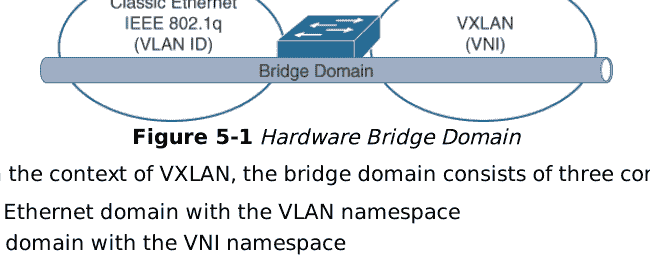

总之，在VXLAN的背景下，网桥域由三个组成部分构成：

- 具有VLAN命名空间的经典以太网域
- 具有VNI命名空间的VXLAN域
- 具有硬件/软件网桥域资源的网络交换机

VXLAN产生了更大的命名空间，适用于云规模环境，而802.1Q VLAN命名空间可能不足以满足企业或运营商环境中的典型部署用例。网桥域概念，在比较

不同的命名空间和封装方式并非VXLAN独有，同样适用于NVGRE等其他overlay封装技术。

## VXLAN中的VLAN

网络中的大多数服务器或端点都通过IEEE 802.1Q描述的典型以太网接口进行连接。IEEE 802.1Q允许在第2层进行分段，并在物理线路之上支持多个VLAN。IEEE 802.1Q（dot1q）标准采用12位的VID地址字段、3位的CoS字段和16位的标签协议标识符（TPID）。虽然VID或VLAN标识符广为人知，但TPID通常携带值0x8100，用作标识dot1q头部的以太网类型。

通过双标签（IEEE 802.1ad或q-in-q），可以背靠背配置多个dot1q标签。在实现双标签802.1Q头部时，外部VLAN可以在内部VLAN中传输。为实现此目的，所使用的第二个TPID必须标识第二个dot1q头部和附加的内部VLAN空间标识符。q-in-q的使用在城域以太网传输场景中很常见，其中内部VLAN空间分配给客户（C-TAG），而外部VLAN ID则用于服务提供商（S-TAG），其以太网类型为0x88A8。除了VLAN ID，802.1Q头部还在服务类别（CoS）字段中承载QoS信息，这在IEEE 802.1p标准中有进一步说明。

在传统以太网环境中，VLAN的命名空间是全局有意义的。对于给定的第2层网络，从第一个交换机到最后一个交换机，端到端使用单一VLAN，如图5-2所示。这使得VLAN ID成为基于以太网的网络中的全局标识符，从而提供了4K的VLAN边界。

## VLAN到VNI的映射

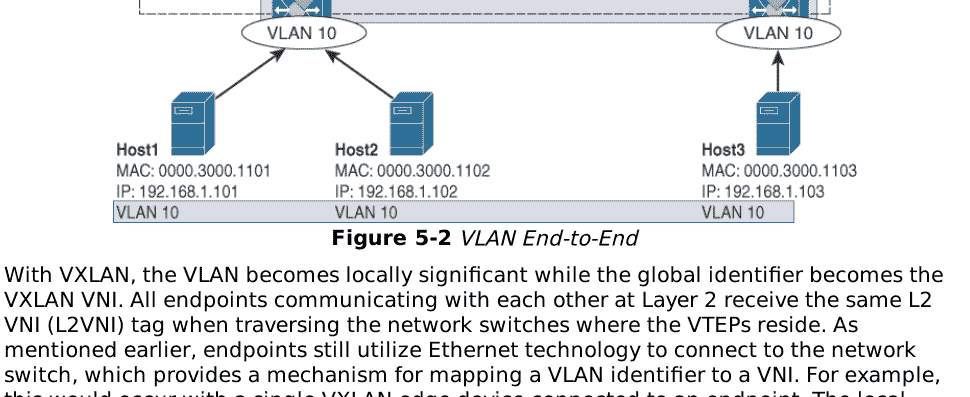

在VXLAN中，VLAN变得具有本地意义，而全局标识符则成为VXLAN VNI。所有在第2层相互通信的端点在穿越VTEP所在的网络交换机时，都会接收到相同的L2 VNI（L2VNI）标签。如前所述，端点仍然使用以太网技术连接到网络交换机，该交换机提供了一种将VLAN标识符映射到VNI的机制。例如，这会发生在连接到端点的单个VXLAN边缘设备上。服务器连接的本地段使用VLAN ID来标识端点所在的唯一第2层域。VLAN段从端点一直延伸到网络交换机或边缘设备，并且是本地标识符。在大多数情况下，VLAN成为每个交换机的标识符。进入网络交换机后，会执行从VLAN标识符到VXLAN VNI（L2VNI）的转换，如图5-3所示。由于VXLAN VNI比dot1q标签有更多可用位数，在选择整体编号方案时可以有有意义的重叠。


**图5-3** *边缘设备中的VLAN到VXLAN映射*

在给定的边缘设备上，此映射通过将VLAN配置为与相应的VXLAN VNI（**vn-segment**）以1:1的关系来实现，如下所示：

```
vlan 10
  vn-segment 30001
vlan 20
  vn-segment 30002
```

这展示了在入站边缘设备上，将VLAN从IEEE 802.1Q定义的命名空间映射到基于IETF RFC7348的VXLAN VNI命名空间。

这样，VLAN成为本地标识符，而VNI成为全局标识符。VLAN现在仅对该边缘设备有意义。这样，不同边缘设备上的不同VLAN可以映射到相同的VNI，如图5-4所示。只要VNI用作全局唯一标识符，就可以灵活地使用从VLAN到VNI再回到VLAN的映射。示例5-1提供了三个边缘设备上VNI 30001和30002的配置示例列表。为了保持映射一致性，相同的源和目标VLAN被映射到一个公共VNI（L2VNI）。但是，某些用例需要不同的源VLAN和目标VLAN。

## 每交换机的VLAN到VNI映射


**图5-4** *不同VLAN到相同VNI的映射*

### 示例5-1 不同边缘设备上的示例第2层VNI配置

```
Edge-Device #1
vlan 10
  vn-segment 30001
vlan 20
  vn-segment 30002

Edge-Device #2
vlan 100
  vn-segment 30001
vlan 200
  vn-segment 30002

Edge-Device #3
vlan 1000
  vn-segment 30001
vlan 2000
  vn-segment 30002
```

具有交换机本地或交换机范围VLAN的能力允许使用VXLAN在Fabric中扩展VLAN命名空间。需要注意的是，交换机上的VLAN命名空间仍然限制为4096个VLAN。将VLAN标识符从每个交换机的基准移动到每个交换机、每个端口的基准，提供了极大的灵活性提升。每端口VLAN使用到达线路的、存储在dot1q头部中的VLAN ID。边缘设备立即将此线路VLAN映射到与封装无关的标识符，而无需在交换机上创建此VLAN。从网络交换机分配的硬件资源提供了从线路VLAN到各自硬件桥接域的缝合能力，该桥接域具有与封装无关的标识符，将线路VLAN映射到VNI。因此，与每交换机用例相比，基于每端口的VLAN标识符映射允许更灵活的用例。

## 每端口VLAN到VNI映射


**图5-5** *每端口VLAN到相同VNI的映射*

每端口VLAN意义提供了在每端口基础上使用完整VLAN命名空间并将每个（端口，VLAN）组合映射到唯一VXLAN VNI的能力。这允许VLAN重叠的用例，只要相同的VLAN属于不同的物理交换机端口/接口，就可以映射到不同的VXLAN VNI。图5-5描述了在给定边缘设备上，两个不同端口（Ethernet 1/8和Ethernet 1/9）上的相同线路VLAN 10分别映射到VNI 30001和30002的场景。示例5-2展示了在边缘设备上实现此典型VLAN转换用例的配置。

### 示例5-2 具有每端口VLAN意义的示例第2层VNI配置

```
vlan 3501
  vn-segment 30001
vlan 3502
  vn-segment 30002

interface Ethernet 1/8
  switchport mode trunk
  switchport vlan mapping enable
  switchport vlan mapping 10 3501
interface Ethernet 1/9
  switchport mode trunk
  switchport vlan mapping enable
  switchport vlan mapping 10 3502
```

创建硬件桥接域的CLI实现因硬件和软件平台而异。通常，有两种可用的操作模式：VLAN映射方法和桥接域映射方法。通过使用VXLAN VNI作为全局标识符，VLAN命名空间的扩展成为可能，并且第2层多租户构造的灵活性得到增强。根据网络交换机平台和软件支持，VLAN可以基于每交换机或基于每端口映射到各自的VNI。在任何一种情况下，从硬件资源（无论是VLAN还是桥接域）的映射都保持1:1的关系。

为了在基于BGP的EVPN地址族中通告L2VNI，需要配置基于MAC的EVPN实例，如示例5-3所示。EVPN第2层实例包含多协议BGP相关要求，以确保唯一性和BGP路由策略支持。为了在MP-BGP中唯一标识EVPN实例（EVI），该实例包含一个VNI（L2VNI）和一个路由区分符。为了支持MP-BGP路由策略，定义了适当的路由目标，以确保实例的前缀被导入。为EVI选择的值对于给定的实例是唯一的，因为它们对于L2VNI是唯一的。路由区分符对于第2层EVI在每个边缘设备的基础上也是唯一的，而L2VNI和路由目标在所有共享相同第2层服务的边缘设备上具有公共值。

### 示例5-3 将第2层VNI路由通告到BGP EVPN的示例配置

```
evpn
  vni 30001 l2
    rd auto
    route-target import auto
    route-target export auto
  vni 30002 l2
    rd auto
    route-target import auto
    route-target export auto
```

在思科的BGP-EVPN实现中，路由区分符（RD）和路由目标（RT）值是自动生成的。RD是从路由器ID和内部第2层实例ID生成的，如示例5-4所示。RT是从BGP的自治系统号（ASN）和第2层VNI（L2VNI）派生的。请注意，如果使用eBGP作为底层，则需要手动配置RT，因为不同边缘设备的ASN可能不同。

### 示例5-4 使用自动派生的每第2层VNI路由区分符示例输出


## 二层多租户：运行模式

```
LEAF1# show bgp l2vpn evpn vni-id 30001 | include "Route Distinguisher"

Route Distinguisher: 10.10.10.1:32777 (L2VNI 30001)
```

> **注意**
> RD 的自动推导使用类型 1 格式，采用 RID Loopback IP: 内部 MAC/IP VRF ID（RD: 10.10.10.1:32777）。内部 MAC VRF ID 由 VLAN ID（映射到 L2VNI）加上 32767 得出。对于 RT 的自动推导，格式为 ASN:VNI（RT: 65501:30001）。

上一节讨论了 VLAN 在 VXLAN 环境中的重要性。同样，该节介绍了 VLAN 作为本地标识符、VNI 作为全局标识符的概念。为了进一步阐述这一点，VXLAN 中的二层多租户支持两种运行模式（参见图 5-6）：

- 基于 VLAN 的模式
- 基于网桥域（BD）的模式

虽然这两种模式在概念上相近，但其实现方式和相应的命令行配置界面差异很大。


## 基于 VLAN 的模式

基于 VLAN 的运行模式可以被描述为传统模式，因为 VLAN 是实现 VNI 映射的关键结构。边缘设备上的完整配置也遵循 VLAN 语义。这包括创建 VLAN 以及使用交换虚拟接口（SVI）来提供潜在的三层服务。在逐交换机 VLAN 模式下，VLAN 承载相应的 VNI。然后，交换机根据指定的配置执行从以太网到 VXLAN 的映射。这种场景代表了一个跨越本地以太网段的网桥域——使用 VLAN 寻址（以及边缘设备中以 VLAN 表示的硬件资源）——直到封装发生后映射到 VNI。图 5-7 展示了 VLAN、VNI 和交换机内部资源如何在逻辑上协同提供端到端二层服务的概念。基于 VLAN 的模式在本章前面已有描述，VLAN 到 VNI 的映射配置如下所示：

```
vlan 10
  vn-segment 30001
```


*图 5-7 逐交换机 VLAN 运行模式下的网桥域跨度*

在基于 VLAN 的模式中，顾名思义，存在一个限制——每个交换机最多只能有 4K 条 VLAN 到 VNI 的映射。通常，映射到 VNI 的 VLAN 也是从本地以太网端口接收到的 VLAN。但是，也可以使用转换选项，将线路 VLAN 映射到另一个转换后的 VLAN，然后再由该 VLAN 映射到 VNI，如上一节所述。

## 基于 BD 的模式

在基于 BD 的运行模式中，VLAN 位于本地以太网段上，寻址保持不变，封装则被专门确定。在经典以太网和 VLAN 中，使用 dot1q 封装来标识线路 VLAN。相比之下，在全局 VXLAN 段侧（VNI），封装通过 VNI 提供特定的命名。在这种特定结构中，封装配置文件允许将基于 dot1q 的 VLAN 映射到基于 VXLAN 的 VNI：

```
encapsulation profile vni from10to30001
  dot1q 10 vni 30001
```

通过使用封装映射配置文件的这种方式，边缘设备完全无感知线路上使用的标签、封装编号和封装命名。取而代之的是，封装配置文件定义了从 VLAN 到 VNI 的映射。重要的是要确保有正确的硬件资源来完成此操作，并且封装配置文件被分配到正确的物理接口。该接口即本地以太网段所连接的位置。在基于 BD 的模式中，硬件资源以网桥域的形式进行分配。这样就不再有每个交换机最多 4K 条 VNI 映射的限制。取而代之的是，理论上 VNI 的数量受限于交换机硬件网桥域表的大小，通常为 16K 到 32K。基于 BD 的模式没有基于 VLAN 的配置上下文，即使存在三层服务实例也不例外。在这种情况下，三层服务实例的配置从 SVI 移至网桥域接口（BDI）配置。

总结来说，基于 BD 的模式与基于 VLAN 的模式在实现上有两个差异：

- 使用网桥域替代 VLAN。
- 网桥域使用 BDI 替代 SVI。

现在是时候将 BD 概念与流量流关联起来了。线路上 VLAN 的流量到达边缘设备后，被映射到边缘设备上的硬件网桥域，并被分配一个封装到 VXLAN 核心的 VNI。为了对网桥域进行分类以用于 VXLAN 封装，配置必须将 VNI 的成员资格分配给相应的网桥域。与前面描述的所有模式一样，VNI 到网桥域的映射仍然保持 1:1 的关系，如下所示：

```
vni 30001
  bridge-domain 5673
  member vni 30001
```

一旦网桥域和 VNI 配对完成，最后的任务是将面向本地 LAN 段的接口配置为各自的封装配置文件。为此，为每个接口创建一个虚拟服务实例（VSI），并引用相应的封装配置文件：

```
interface Ethernet 1/8
  no switchport
  service instance 1 vni
  encapsulation profile from10to30001 default
```

封装配置文件提供了极大的灵活性，同时与线路封装保持独立性，并实现每端口的 VLAN 意义。在前面的配置示例中，VLAN 标识符、VNI 或硬件网桥域配置之间没有关联。只要封装特定的编号与预期的寻址相匹配，标识符可以任意映射。使用 VSI 或以太网流点（EFP）是常见的服务提供商平台方法，可支持多封装网关。

总之，每当使用各种运行模式实现二层多租户时，服务映射到的目标 VNI 始终是二层 VNI。

## VXLAN BGP EVPN 中的 VRF

虚拟路由和转发（VRF）是一种网络交换机构造，它在单个物理设备之上创建逻辑隔离的路由器实例。通过 VRF，可以在给定的物理网络中分离路由空间，同时提供路径隔离。此外，如果需要，VRF 可以控制这些不同实例之间的通信。VRF 在交换机/路由器上本地定义；然而，存在一些技术可以将本地 VRF 实例扩展到多个设备。第一种方法称为 *VRF Lite*，是一种常用的将 VRF 映射到 VLAN 标识符的方法。但是，在使用 VRF Lite 方法时，可扩展性和配置复杂性往往成为挑战。使用 VRF Lite（或 Inter-AS 选项 A）时，每个 VRF 都有自己的路由实例和专用路由接口。配置必须与对等/相邻设备保持一致。

示例 5-5 展示了一个典型的 VRF Lite 配置片段，用于两台路由器，其 VRF 实例通过三层子接口进行扩展。

### 示例 5-5 *VRF Lite 配置示例*

```
Router #1
vrf context VRF-B

interface eth1/10.1002
  encapsulation dot1q 1002
  vrf member VRF-B
  ip address 10.2.2.1/24
  ip router ospf 100 area 0

router ospf 100
  vrf VRF-B

Router #2
vrf context VRF-B

interface eth1/10.1002
  encapsulation dot1q 1002
  vrf member VRF-B
  ip address 10.2.2.2/24
  ip router ospf 100 area 0

router ospf 100
  vrf VRF-B
```

通常，这些子接口上还会启用适当的 IGP，以便在两个对等路由器之间交换路由前缀。在示例 5-5 中，值 **1002** 代表带标签的 VLAN，用于在两台路由器之间路由属于 VRF-B 的流量。

多年来，VRF Lite 被广泛使用和部署；然而，如前所述，每个 VRF 实例都需要一个专用接口，并且两个相关实体之间必须存在单独的对等会话。在此对等会话上配置适当的路由协议。这样，在每个 VRF 实例的基础上建立了一个三层对等会话，从而允许将 VRF 实例跨多个数据中心机柜或站点进行三层交接。相比之下，多协议标签交换（MPLS）三层 VPN 为三层多租户提供了可扩展的解决方案。尽管 MPLS 具有三层多租户、灵活性和可扩展性，但在数据中心中 MPLS 的使用仍然相当有限，因为数据中心交换机传统上不支持 MPLS。这涉及控制平面和数据平面两方面的支持。

基于 MPLS 的三层 VPN 通常部署在数据中心边缘，用于三层数据中心互联（DCI）用例。另一个有时被忽略的考虑因素是三层多租户的范围。VRF Lite 和 MPLS L3VPN 从 IP 子网的角度查看路由信息。这意味着给定的 IP 子网始终位于给定的提供商边缘（PE）本地。一对 PE 然后可以为连接的 IP 子网提供首跳冗余。虽然集中式路由模型适用于传统数据中心，但随着需求的变化和演进，首跳路由需要一种更高效的方法。这可以通过 VXLAN BGP EVPN 中的分布式子网和二层与三层的集成多租户来实现。

用于首跳路由决策的集中式网关可以移至具有嵌入式集成路由和桥接（IRB）功能的边缘设备（ToR 交换机）。同一网关可以同时存在于多个边缘设备上，从而在边缘设备上实现分布式任播网关功能。通过分布式网关，首跳路由范围从基于 IP 子网的路由扩展到基于 IP 主机的路由。此外，由于三层服务现在在边缘设备上提供，因此可以在该层面引入三层多租户。因此，可以为不同的租户在边缘设备上定义或创建 VRF。

与 MPLS L3VPN 提供的功能相比，基于 VXLAN 的 MP-BGP EVPN 同样能够为三层多租户提供增强的可扩展性功能。回顾一下，EVPN 使用的控制平面协议基于多协议 BGP。MP-BGP 能力为每个前缀分配一个唯一的路由区分符，并通过单个 BGP 对等会话传输此信息。此外，通过在 BGP 控制平面中对分配给给定前缀的适当路由目标进行导入和导出来执行适当的路由策略。一旦 BGP 对等体收到路由目标，它会验证该路由目标是否与其给定 VRF 的导入策略匹配。如果匹配，则安装该路由并用于转发。


在 MPLS 中，L3VPN 标签负责在数据平面分离属于不同 VRF 的租户流量。在这种情况下，与 VRF 关联的 VNI（三层 VNI [L3VNI]）并携带在 VXLAN 报头中，用于实现类似的结果。值得注意的是，VXLAN 报头仅携带一个 VNI 字段。这是通常用于实现二层多租户用例的 L2VNI 的同一字段。对于涉及路由操作的三层场景，由于源 IP 信息足以识别来源，因此在二层服务期间携带的信息变得过时。因此，对于三层路由流量，VXLAN 报头中的 VNI 被标记为 VRF VNI。

总之，VXLAN BGP EVPN 中的三层多租户利用了多协议 BGP 的能力来交换各自的信息。除了 BGP 控制平面外，它还与基于 IP/UDP 的封装、VXLAN 和 VNI 命名空间协同工作。此外，借助 IRB 提供的更精细粒度，可以实现高效的基于主机的路由，避免了在同一基于 VXLAN 的网织中节点间的流量发卡。

## 三层多租户：操作模式

上一节重点比较了 VXLAN 中的三层多租户与 BGP EVPN 和 MPLS L3VPNs。引入了三层 VNI（L3VNI）作为路由上下文中 VRF 的标识符。VXLAN 中的三层多租户具有单一的操作模式，并且在比较面向 VLAN 或 BD 的交换机 CLI 时存在一些细微差异。尽管如此，整体概念保持不变。

在基于 VXLAN 的三层多租户部署中，VRF 配置由 VRF 的名称和相应的 VNI（L3VNI）组成。在 BGP EVPN VXLAN 网络中，在 VRF 内路由的所有流量总是用 L3VNI 封装。这就是如何区分与同一子网或桥接流量（其中 L2VNI 携带在 VXLAN 报头中）不同的路由流量。虽然 L3VNI 在整个基于 VXLAN 的网络网织中唯一标识 VRF，但分配给 VRF 本身的名称仅在本地有效。然而，遵循一致的命名约定来命名 L3VNI 是常见做法，因为这样做有助于网络操作和故障排除。

如前所述，为确保来自给定边缘设备的前缀被唯一标识，每个 VRF 都有其唯一的路由区分符（RD）。除了路由区分符，VRF 还包含路由策略值，即路由目标（RT）。在外部网络示例中，路由目标被属于同一 VRF 的所有边缘设备导入和导出。示例 5-6 展示了 VXLAN BGP EVPN 网络中边缘设备上 VRF 的典型配置。

### 示例 5-6 VXLAN BGP EVPN 网络中的基本 VRF 配置

```
vrf context VRF-A
  vni 50001
  rd auto
  address-family ipv4 unicast
    route-target both auto
    route-target both auto evpn
  address-family ipv6 unicast
    route-target both auto
    route-target both auto evpn
```

与二层 EVPN 实例非常类似，VRF 构造包含一个路由区分符；此 RD 从 BGP 路由器 ID 和内部 VRF 标识符（十进制数字）自动导出，如示例 5-7 所示。路由目标也以与涉及二层 VNI 的情况相同的方式自动导出。使用 BGP ASN 连同 L3VNI 使得 RT 值对于给定的 VRF 是唯一的。然而，RT 值在相同 VRF 的所有边缘设备上保持不变。

### 示例 5-7 *每个三层 VNI 的路由区分符自动导出示例输出*

```
LEAF1# show vrf
VRF-Name              VRF-ID State     Reason
VRF-A                      3 Up          --
default                    1 Up          --
management                 2 Up          --

LEAF11# show bgp l2vpn evpn vni-id 50001 | include "Route Distinguisher"

Route Distinguisher: 10.10.10.1:3    (L3VNI 50001)
```

> **注意**
> RD 的自动导出使用类型 1 格式，即 RID 环回 IP:内部 MAC/IP VRF ID（RD: 10.10.10.1:3）。路由目标的自动导出格式为 ASN:VNI（RT: 65501:50001）。

必须记住，在配置二层或三层实例时，L2VNI 和 L3VNI 的值不能重叠。具体来说，用于二层实例的 VNI 配置绝不应与用于三层实例的配置相同。同样的限制也适用于 RT 配置。关于路由区分符，强烈建议作为最佳实践也保持层级配置隔离，但在这种情况下，这不是绝对强制的。

为求完整，应注意在某些情况下，当下层网络使用外部 BGP（eBGP）时，RT 无法自动生成。具体来说，使用 eBGP 下层网络时，不同边缘设备上的自治系统号可能不同。因此，eBGP 用例需要手动配置路由目标，并且它们必须在相应的边缘设备之间匹配。这是唯一需要手动配置路由目标的情况。

就实现 VXLAN BGP EVPN 网络中三层多租户的配置要求而言，需要先完成 VRF 上下文配置。随后，必须启用 VRF 的 BGP EVPN 配置。为使与 VRF 关联的 L3VNI 完全激活，必须满足以下条件：

- L3VNI 需要与 VTEP（NVE）接口关联。
- 一个面向核心的 VLAN 或桥接域必须与 L3VNI 关联。
- 必须创建相应的三层接口（SVI 或 BDI）。
- 此三层接口必须与 VRF 关联。

将 VRF L3VNI 上下文与 VTEP 关联允许其对 VXLAN 可用。示例 5-8 概述了为 VXLAN 配置三层多租户所需的关键步骤。

### 示例 5-8 *三层多租户的示例 BGP EVPN 相关 VRF 配置*

```
router bgp 65501
 vrf VRF-A
  address-family ipv4 unicast
   advertise l2vpn evpn

interface nve1
 member vni 50001 associate-vrf
```

VXLAN 作为封装要求在内部 MAC 报头中填充 MAC 地址。这允许映射与三层 VRF 关联的二层桥接域或 VLAN。此 VLAN 或桥接域模型为跨 VXLAN 封装创建三层服务提供必要的硬件资源。示例 5-9 展示了在二层封装之上的三层服务。

### 示例 5-9 *三层多租户的 VRF 相关 VLAN 和桥接域配置*

```
VLAN Oriented Command Line Interface
### VLAN for VRF
vlan 2501
    vn-segment 50001

### Layer-3 Interface for VRF
interface Vlan2501
    no shutdown
    mtu 9216
    vrf member VRF-A
    ip forward

Bridge-Domain Oriented Command Line Interface
### Bridge-Domain for VRF
vni 50001
bridge-domain 2501
    member vni 50001

### Layer-3 Interface for VRF
interface bdi2501
    no shutdown
    mtu 9216
    vrf member VRF-A
    ip forward
```

这种情况下，VLAN 或桥接域在边缘设备中创建硬件资源。三层接口提供路由跳的语义，VRF 成员资格将其唯一地分配给该 VRF。配置 MTU 确保所有路由流量被转发，包括巨型帧。请注意，可能存在一些特定于平台的命令和细微差别，必须参考相应的平台发行说明和配置指南。

## 总结

本章描述了多租户如何成为下一代数据中心的主要功能，以及如何在 VXLAN 中使用 BGP EVPN 实现它。除了讨论使用 VLAN 和 VXLAN 时的多租户外，本章还涵盖了二层和三层多租户的操作模式。同样，它描述了桥接域在 VXLAN BGP EVPN 网络多租户方面的重要性，以及与 VRF 相关的概念。因此，本章提供了使用 VXLAN BGP EVPN 的多租户主要方面的基本介绍。

## 参考文献

1. Cisco. *网络虚拟化：服务边缘设计指南*. 2008. [www.cisco.com/c/en/us/td/docs/solutions/Enterprise/Network_Virtualization/ServEdge.htm](https://www.cisco.com/c/en/us/td/docs/solutions/Enterprise/Network_Virtualization/ServEdge.htm)
2. 电气与电子工程师协会. *802.1Q 虚拟局域网*. 2014. [www.ieee802.org/1/pages/802.1Q.html](https://www.ieee802.org/1/pages/802.1Q.html).
3. 电气与电子工程师协会. *802.1ad 提供商网桥*. 2009. [www.ieee802.org/1/pages/802.1ad.html](https://www.ieee802.org/1/pages/802.1ad.html).


# 第6章 单播转发

本章将涵盖以下主题：

-   在带有和不带早期ARP终止功能的VXLAN BGP EVPN网络中，桥接的详细数据包流程
-   在采用分布式IP任播网关和对称集成路由与桥接（IRB）的VXLAN BGP EVPN网络中，路由的详细数据包流程
-   处理静默端点、双归属端点和IPv6端点

本章解释了在基于VXLAN BGP EVPN的网络中进行流量转发的细节。它简要介绍了单播转发在VXLAN BGP EVPN网络中的桥接和路由场景下概念上的工作原理。本章描述了VXLAN覆盖层中的二层服务如何由二层网关（L2GW）提供；BGP EVPN控制协议的用途；以及流量如何在整个桥接域内遵循VLAN和相应的二层虚拟网络标识符（L2VNI）。它还涵盖了三层服务由VXLAN三层网关（L3GW）提供的各种路由场景，包括分布式IP任播网关的使用。本章考察了涉及边缘设备本地路由的各种场景，以及如何使用对称集成路由与桥接（IRB）进行转发，以跨越VXLAN覆盖层到达远程端点。一些使用非一致性（作用域）配置的具体用例演示了如何使静默端点在网络中可达。在总结这些桥接和路由案例时，本章更深入地探讨了双归属端点以及在虚拟端口通道（vPC）场景下转发如何进行。最后，本章探讨了IPv6的具体细节。

## 子网内单播转发（桥接）

在覆盖层中，VXLAN数据平面封装的一个常见要求是提供基本的二层服务（二层网关或L2GW服务）。为了更高效地提供此服务，BGP EVPN控制平面辅助的端点学习可以减少由ARP处理和未知单播流量引起的不必要广播。

通常，桥接流量由VLAN限定。学习基于数据包中携带的源MAC（SMAC）地址，转发则基于目的MAC（DMAC）地址。对于VXLAN，同样的语义适用，但VLAN是本地有效的，并且仅限定于一个VTEP。因此，所有学习和转发都由二层VNI（L2VNI）限定，该L2VNI全局标识给定的二层网络及其代表的广播域。桥接流量通过VXLAN传输，使用L2VNI，该标识符在入口VTEP（L2GW）处从经典以太网VLAN映射而来。VLAN从IEEE 802.1Q头中携带的12位值中识别，而VNI则通过VXLAN头中的24位VXLAN网络标识符字段识别。在出口VTEP（L2GW）处，执行从L2VNI到经典以太网VLAN的反向映射，以便流量可以从相应的以太网端口转发出去。

通过VXLAN，与经典以太网中类似的功能被叠加到网络覆盖技术中。VXLAN作为一种MAC-in-IP/UDP数据平面封装，基于MAC地址进行转发决策。当处于L2GW模式时，VXLAN利用入口VTEP的MAC地址表来做出转发决策。通常，[VLAN, MAC]条目指向一个本地以太网接口，这在经典以太网网络交换机中很常见。随着覆盖层的引入，二层表中的[VLAN, MAC]条目现在也可以指向远程VTEP的IP地址。这意味着标识远程端点的MAC条目可以通过VXLAN访问。有关概念性流量转发讨论的后续说明，请参考图6-1。VTEP V1和V2分别关联NVE接口，其IP地址为10.200.200.1和10.200.200.2。


**图6-1** *子网内转发（桥接）*

对于连接到入口VTEP（V1）的端点和连接到出口VTEP（V2）的端点之间的桥接操作，需要交换二层MAC地址可达性信息。在经典以太网或VXLAN泛洪与学习（F&L）环境中，MAC地址可达性信息仅通过在通信启动期间发生的流量泛洪来获得。具体来说，泛洪确保二层网络中的所有端点都接收到通信，这导致在流量的转发路径上进行二层学习。同样，反向流量在返回路径上触发学习。使用BGP EVPN控制协议，可以从MAC地址角度在入口和出口VTEP上学习到本地连接的端点。此信息在BGP更新期间主动分发到所有相邻的VTEP。对于图6-1所示的场景，BGP EVPN控制协议将携带表6-1中概述的信息：

| MAC, IP | L2VNI | L3VNI | 下一跳 |
|---|---|---|---|
| 0000.3000.1101, 192.168.1.101 | VNI 30001 | — | 10.200.200.1 |
| 0000.3000.1102, 192.168.1.102 | VNI 30001 | — | 10.200.200.2 |
| 0000.3000.2101, 192.168.2.101 | VNI 30002 | — | 10.200.200.1 |
| 0000.3000.2102, 192.168.2.102 | VNI 30002 | — | 10.200.200.2 |

**表6-1** *BGP EVPN控制协议填充的信息（ARP发现之后）*

表6-1中的信息预计会存在于BGP EVPN控制平面中，然后被安装并用于VTEP的硬件表中。Cisco NX-OS提供了多种方式来验证这些信息是否存在。网络管理员通常检查BGP表来确定是否收到了给定前缀（参见示例6-1）；但是，此操作仅验证了从BGP数据库角度接收此信息。它并不能验证可达性信息是否作为有效的转发条目安装在硬件表中。

**示例6-1** *在VTEP V1处的 show bgp l2vpn evpn vni-id 30001 输出*

[点击此处查看代码图像](Click here to view code image)

```
V1# show bgp l2vpn evpn vni-id 30001
BGP routing table information for VRF default, address family L2VPN EVPN
BGP table version is 43, local router ID is 10.10.10.1
Status: s-suppressed, x-deleted, S-stale, d-dampened, h-history, *-valid, >-best
Path type: i-internal, e-external, c-confed, l-local, a-aggregate, r-redist, I-injected
Origin codes: i - IGP, e - EGP, ? - incomplete, | - multipath, & - backup

  Network                           Next Hop            Metric  LocPrf  Weight Path
Route Distinguisher: 10.10.10.1:32777     (L2VNI 30001)
*>i[2]:[0]:[0]:[48]:[0000.3000.1102]:[0]:[0.0.0.0]/216
                                10.200.200.2              100           0 i
*>l[2]:[0]:[0]:[48]:[0000.3000.1101]:[0]:[0.0.0.0]/216
                                10.200.200.1              100       32768 i
```

由于MP-BGP与EVPN一起使用，如果相应的路由目标（Route Target）信息与导入语句不匹配，则不会发生转发，因为该条目仅存在于BGP中。也就是说，对于二层操作，验证是否收到了MAC地址或MAC/IP前缀（路由类型2）是一个好习惯。但是，验证前缀的安装分为两部分。第一部分是新的，它依赖于二层信息正通过BGP用于转发决策这一事实。此信息被安装在一个EVPN实例中，该实例也称为*MAC VRF*。

一旦二层“路由”表通过适当的MAC前缀得到验证，如示例6-2所示，下一步是确保VTEP本身的MAC地址表中应存在类似的条目，如示例6-3所示。

### 示例6-2 show l2route evpn mac all *在VTEP V1处的输出*

```
[点击此处查看代码图像](#)
V1# show l2route evpn mac all
Topology     Mac Address       Prod   Next Hop (s)
----------- ----------------- ------ ------------------
10           0000.3000.1102    BGP    10.200.200.2
10           0000.3000.1101    Local  Eth1/5
```

### 示例6-3 show mac address-table vlan 10 *在VTEP V1处的输出*

```
[点击此处查看代码图像](#)
V1# show mac address-table vlan 10
Legend:
        * - primary entry, G - Gateway MAC, (R) - Routed MAC, O - Overlay MAC age - seconds since
last seen,+ - primary entry using vPC Peer-Link, (T) - True, (F) - False
  VLAN    MAC Address       Type    age    Secure NTFY Ports
---------+-----------------+-------+------+---------+----+------------------
*    10    0000.3000.1102    dynamic 0        F       F    nve1(10.200.200.2)
*    10    0000.3000.1101    dynamic 0        F       F    Eth1/5
```

我们此时关注的是二层桥接操作，但控制协议可以通过其他方式填充IP地址信息。如果在任何时刻，在边缘设备之间连接的端点之间发生了ARP交换，并且在L2VNI上明确启用了ARP抑制功能，那么在VTEP V1和V2上执行的ARP侦听将用此信息填充控制协议。潜在地，如果配置了VRF，并且存在第一跳网关（分布式任播网关），那么L3VNI的填充也会发生。

接下来，我们逐步介绍图6-2所示的一个示例用例，其中连接到VTEP V1的端点主机A（192.168.1.101）想要与连接到VTEP V2的端点主机B（192.168.1.102）通信。两个端点属于同一个VNI 30001，它们可以代表虚拟或物理主机。因为主机B属于

4.  Institute of Electrical and Electronics Engineers. *802.1D—1998—IEEE standard for local area network MAC (media access control) bridges.* [standards.ieee.org/findstds/standard/802.1D-1998.html](standards.ieee.org/findstds/standard/802.1D-1998.html).

5.  Cisco. *Cisco CPT configuration guide CTC and documentation release 9.3 and Cisco IOS release 15.1(01)SA.* 2014. [www.cisco.com/c/en/us/td/docs/optical/cpt/r9_3/configuration/guide/cpt93_configuration/g...](www.cisco.com/c/en/us/td/docs/optical/cpt/r9_3/configuration/guide/cpt93_configuration/g...)

6.  Network Working Group. *RFC4364: Multi-AS backbones.* 2006. [tools.ietf.org/html/rfc4364#section-10](tools.ietf.org/html/rfc4364#section-10).

7.  Cisco. *Cisco Nexus 7000 series NX-OS interfaces configuration guide, release 5.x: Subinterfaces.* 2015. [www.cisco.com/c/en/us/td/docs/switches/datacenter/sw/5_x/nx-os/interfaces/configuration/guide/if_cli/if_layer3int.html#48044](www.cisco.com/c/en/us/td/docs/switches/datacenter/sw/5_x/nx-os/interfaces/configuration/guide/if_cli/if_layer3int.html#48044).

8.  Network Working Group. *RFC4364.* 2006. [tools.ietf.org/html/rfc4364](tools.ietf.org/html/rfc4364).


当主机A位于同一IP子网时，主机A会首先查找其本地ARP缓存来解析主机B的IP到MAC映射。如果该过程未命中，主机A会发起一个ARP请求。该广播ARP请求在VLAN 10中被转发，并进入入口VTEP V1。主机A的MAC地址通过常规MAC学习在VTEP V1处被学习到，此信息通过BGP EVPN分别填充到VTEP V2和V3。

当VTEP V1上的VNI 30001的ARP抑制功能被禁用时，来自端点主机A的ARP请求被视为广播、未知单播和组播流量进行处理，它被封装在二层VNI 30001中，然后作为多目的地数据包进行转发。多目的地流量可以通过组播或入口复制方式复制到加入同一多目的地树的所有VTEP。这可以通过使用组播组或入口复制分发列表来实现。所有可行的出口VTEP接收到相应的广播包，进行解封装，并将ARP请求转发到其参与VNI 30001的本地以太网接口。具体来说，在VTEP V2处，VNI 30001被映射到一个本地VLAN（即VLAN 10），随后流量从相应的成员传统以太网端口发送出去，并封装有dot1q标签10。当主机B收到ARP请求时，它会响应一个ARP应答（单播），如图6-3所示。

**图6-3** *ARP应答，从主机B到主机A*

该响应导致主机B的MAC地址在VTEP V2处通过常规MAC学习被学习到，并且主机B的源信息通过BGP EVPN控制协议进行填充。利用先前通过BGP-EVPN在VTEP V2处填充的关于主机A的可达性信息，封装了VNI 30001的单播ARP应答被转发到VTEP V1。在VTEP V1处解封装后，ARP应答被转发给主机A。这样，主机A和主机B的ARP缓存都已适当填充，它们可以开始使用常规桥接语义相互发送数据流量。

或者，如果VNI 30001上启用了ARP抑制，那么在VTEP V1处接收到来自主机A对主机B的初始ARP请求时，会对其进行ARP窥探。因此，除了MAC地址外，主机A的IP地址也通过路由类型2消息（参见[示例6-4](#example_6_4)）在BGP EVPN控制平面中被填充。

---

**示例 6-4** show bgp l2vpn evpn vni-id 30001 *在VTEP V1的输出*

```
V1# show bgp l2vpn evpn vni-id 30001
BGP routing table information for VRF default, address family L2VPN EVPN
BGP table version is 43, local router ID is 10.10.10.1
Status: s-suppressed, x-deleted, S-stale, d-dampened, h-history, *-valid, >-best
Path type: i-internal, e-external, c-confed, l-local, a-aggregate, r-redist, I-injected
Origin codes: i - IGP, e - EGP, ? - incomplete, | - multipath, & - backup

   Network            Next Hop            Metric  LocPrf  Weight Path
Route Distinguisher: 10.10.10.1:32777    (L2VNI 30001)
*>i[2]:[0]:[0]:[48]:[0000.3000.1102]:[0]:[0.0.0.0]/216
                      10.200.200.2                            100       0 i

*>i[2]:[0]:[0]:[48]:[0000.3000.1102]:[32]:[192.168.1.102]/272
                      10.200.200.2                            100       0 i

*>l[2]:[0]:[0]:[48]:[0000.3000.1101]:[0]:[0.0.0.0]/216
                      10.200.200.1                            100       32768 i
```

此外，如果BGP EVPN控制平面通过MAC和IP知道了主机B，那么VTEP V1会本地生成一个单播ARP响应并返回给端点主机A。这导致了ARP的提前终止。该ARP响应的生成方式与主机B原始生成的方式相同，VTEP V1充当了主机B的ARP代理。由于广播ARP请求从未到达主机B，因此只有主机A的ARP缓存被填充了关于主机B的信息，反之则不然。当数据流量从主机A发送到主机B时，主机B会尝试通过发送ARP请求来解析主机A的IP到MAC绑定。随后，VTEP V2充当ARP代理，从而也适当地填充了主机B的ARP缓存。

图6-4描述了主机A和主机B的ARP缓存都已适当填充后，它们之间数据流量的包流。主机A生成数据流量，其源MAC为0000.3000.1101，源IP为192.168.1.101。目的地信息被设置为主机B的信息，其MAC和IP分别为0000.3000.1102和192.168.1.102。数据包在VTEP V1处接收后，会基于映射到VNI 30001的VLAN 10以及目标MAC 0000.3000.1102执行目的地查找。这得出目的VTEP（V2），主机B位于其后。随后，使用VNI 30001执行VXLAN封装，并将数据包传输到相应的出口VTEP V2。直观地看，这种通信与常规LAN环境中发生的常规桥接操作非常相似，其中MAC表查找驱动着结果。

**图6-4** *从主机A到主机B的转发（桥接）*

在涉及端点主机B的具体案例中，查找结果基于先前的端点发现和相关的控制平面填充而命中。表6-2显示了从VTEP V1发送到VTEP V2的主机A到主机B数据流量的相应外层IP、UDP和VXLAN头字段，以及内层MAC和IP头字段的详细信息。

| 外层DIP | 外层SIP | UDP目标端口 | VXLAN | 内层目标MAC | 内层源MAC | 内层目标IP | 内层源IP | 有效负载 |
|-----------|-----------|-----------|-------|------------|------------|-----------|-----------|----------|
| 10.200.200.2 | 10.200.200.1 | 4789 | VNI 30001 | 0000.3000.1102 | 0000.3000.1101 | 192.168.1.102 | 192.168.1.101 | — |

**表6-2** *封装后的数据包，包含所有头（根据表6-1）*

一旦数据包在出口VTEP V2处被接收，它就会被解封装，并根据转换表查找结果，执行从VNI 30001到VLAN 10的适当本地映射。随后的二层查找结果基于端点主机B的MAC地址（具体为[10, 0000.3000.1102]）命中。因此，帧被发送到主机B所连接的以太网接口。这样，VNI 30001中的端到端单播转发桥接流程就完成了。该流量从VTEP V1后VLAN 10中的主机A传输到VTEP V2后VLAN 10中的主机B。VTEP V1上的VLAN 10和VTEP V2上的VLAN 10通过VXLAN中的二层服务被拼接在一起，该服务由VNI 30001标识。

## 非IP转发（桥接）

前述的子网内单播转发案例假设每个端点都分配了IP地址。转发仍然基于MAC地址查找，将该案例归类为桥接场景。然而，存在端点之间进行非IP通信的用例（参见[图6-5](https://example.com/fig6-5)），这种通信可以由协议协调，也可以由使用适当协议的应用程序协调。示例包括集群复制和遗留应用程序。当使用此类非IP协议时，端点可能完全没有IP协议栈。使用非IP转发时，提供桥接功能时所使用的L2GW功能与存在IP地址时相同。

**图6-5** *子网内非IP转发（桥接）*

在非IP环境中，可能会采用不同的二层到三层地址解析协议，例如AppleTalk地址解析协议（AARP）。因为当没有IP寻址时，BGP EVPN仅支持IPv4和IPv6的三层协议，所以BGP EVPN在控制平面中仅依赖MAC信息做出转发决策。对于[图6-5](https://example.com/fig6-5)描绘的拓扑，MAC层信息通过BGP EVPN控制协议在给定的启用了VXLAN的网络内被填充和分发，如[表6-3](https://example.com/table6-3)所示。

| MAC，IP | L2VNI | L3VNI | 下一跳 |
|---|---|---|---|
| 0000.3000.1101, 0.0.0.0 | VNI 30001 | — | 10.200.200.1 |
| 0000.3000.1102, 0.0.0.0 | VNI 30001 | — | 10.200.200.2 |
| 0000.3000.2101, 0.0.0.0 | VNI 30002 | — | 10.200.200.1 |
| 0000.3000.2102, 0.0.0.0 | VNI 30002 | — | 10.200.200.2 |

**表6-3** *BGP EVPN控制协议填充的信息（非IP）*


与MAC层相关的所有信息均已包含在内。例如，VTEP标识的给定MAC地址的位置以及该MAC地址所在的关联第2层VNI。由于转发仅基于第2层信息，因此IP地址或第3层VNI（L3VNI）的出现完全缺席。如果其中一个端点开始使用基于IP的通信，那么一旦ARP交换发生，IP信息也开始出现在BGP EVPN控制平面中，正如本章前面部分“子网内单播转发（桥接）”中讨论的场景所描述的那样。

图6-6描述了主机A和主机B之间非IP通信的示例数据包流。端点主机A生成源MAC地址为0000.3000.1101的数据流量。主机A位于VLAN 10中。目的地信息设置为与端点主机B关联的信息，即0000.3000.1102。高层地址信息对VXLAN BGP EVPN网络来说是未知的。一旦数据包在VTEP V1处被接收，就会执行目的地查找 [30001, 0000.3000.1102]。根据通过BGP EVPN控制协议填充的信息，查找结果得出与目的地（主机B）关联的下一跳VTEP（V2）以及用于封装的VNI（30001）。然后执行VXLAN封装，数据包通过VXLAN VNI 30001发送到VTEP V2。


表6-4显示了外部IP、UDP和VXLAN首部字段以及内部MAC字段的详细信息。

**表6-4** *封装后的数据包，包含所有首部（非IP）*

| 外部目的IP | 外部源IP | UDP目的端口 | VXLAN | 内部目的MAC | 内部源MAC | 有效载荷 |
| :--- | :--- | :--- | :--- | :--- | :--- | :--- |
| 10.200.200.2 | 10.200.200.1 | 4789 | VNI 30001 | 0000.3000.1102 | 0000.3000.1101 | — |

从控制协议的角度来看，转发的数据包被视为非IP（内部或原始帧）。表6-4中内部MAC首部之外的所有内容都视为非地址信息，并用“有效载荷”缩写表示。

一旦数据包在出口VTEP V2处被接收，数据包被解封装，并执行转发表查找。VNI 30001被映射到本地VLAN 10，并且也基于键 [VLAN=10, 0000.3000.1102] 执行第2层查找。如果查找命中，则帧将被发送到主机B所连接的以太网接口。如果未命中，则帧将从属于VLAN 10的本地端口泛洪出去。因此，如果主机B位于VTEP V2之后，它将接收到该帧。从主机B到主机A的反向流量遵循类似的流程。

至此，从VTEP V1之后的VLAN 10中的端点主机A到VTEP V2之后的VLAN 10中的端点主机B的单播非IP转发已完成。再次说明，VTEP V1上的VLAN 10和VTEP V2上的VLAN 10通过基于VXLAN的第2层服务缝合在一起，该服务由VNI 30001标识。

## 跨子网单播转发（路由）

到目前为止，关于使用VXLAN作为封装、第2层网关（L2GW）作为VTEP功能的第2层覆盖服务，已经讨论了桥接数据包流。当考虑VXLAN提供的第3层覆盖服务以及VTEP各自的第3层网关（L3GW）功能时，深入理解第2层或桥接操作本身的工作原理至关重要。由于VXLAN是一种MAC-in-IP/UDP首部封装（无论第2层还是第3层服务），内部有效载荷必须包含MAC首部。在移动到更高的OSI层以涵盖第3层操作时，有必要再次强调这一重要细节。理解在使用VXLAN提供第3层服务时如何执行封装和转发至关重要。

对于BGP EVPN VXLAN网络，使用对称集成路由和桥接（IRB）功能来转发数据流量。采用这种方法，路由数据流量使用与进行路由操作的VRF关联的第3层VNI（L3VNI）。每个VRF都有一个唯一的L3VNI。在给定的BGP EVPN VXLAN架构中，相同的VRF到L3VNI映射必须存在于配置了该VRF的每个边缘设备或VTEP上。当多个VTEP在给定的基于VXLAN的网络中共享相同的L3VNI时，这被称为一个*路由域*。用于寻址VRF或单个路由域的24位VNI是VXLAN首部中用于承载L2VNI以转发桥接流量的同一字段。

支持为同一服务共存两个不同值（尽管只使用单个封装字段）的原因与路由操作发生后的情况有关。在桥接中，MAC地址必须端到端可见。但在路由中，路由操作完成后MAC信息会发生变化。因此，在路由之后，传入或入站MAC和VLAN信息变得无关紧要，因为第3层IP和VRF信息用于做出转发决策。这种情况一直持续到出口VTEP，在那里执行对应于 [VRF, 目的IP] 的查找，得到最终的DMAC和数据包必须发送的出口接口。本质上，通过VXLAN转发路由数据包的程序与非VXLAN环境中的路由操作非常相似。

在后续关于概念性数据流转发的说明中，请参考图6-7，该图显示了与L3VNI 50001关联的VRF A中的四个端点（主机A、主机B、主机X、主机Y）。与之前的示例一样，VNI 30001与IP子网192.168.1.0/24关联，端点主机A和主机B位于该子网；VNI 30002与IP子网192.168.2.0/24关联，端点主机X和主机Y位于该子网。


### 图6-7 跨子网转发（路由）

对于连接到入站VTEP V1的端点与连接到出口VTEP V2的端点之间的路由操作，必须首先交换第3层地址信息、IP地址和关联的IP子网。通过BGP EVPN控制协议，在入站VTEP学习到的关于本地端点的信息通过BGP更新分发到所有相邻的VTEP。具体来说，关于端点的IP/MAC信息使用BGP路由类型2消息分发。同样，子网前缀信息使用BGP路由类型5消息分发。对于图6-7所示的场景，BGP EVPN控制协议将显示表6-5中描绘的信息。

如果路由目标匹配，这些信息将被安装并在各自VTEP的硬件表中使用。当此信息通过BGP通告并从VTEP接收时，作为BGP输出一部分可见的信息部分与安装的信息不同。因此，与VRF的关系只能通过VNI迂回实现。

**表6-5** *BGP EVPN控制协议填充信息（ARP后）*

| MAC, IP | L2VNI | L3VNI | 下一跳 |
|---|---|---|---|
| 0000.3000.1101, 192.168.1.101 | VNI 30001 | VNI 50001 | 10.200.200.1 |
| 0000.3000.1102, 192.168.1.102 | VNI 30001 | VNI 50001 | 10.200.200.2 |
| 0000.3000.2101, 192.168.2.101 | VNI 30002 | VNI 50001 | 10.200.200.1 |
| 0000.3000.2102, 192.168.2.102 | VNI 30002 | VNI 50001 | 10.200.200.2 |
| IP: 192.168.1.0/24 | — | VNI 50001 | 10.200.200.1<br>10.200.200.2 |
| IP: 192.168.2.0/24 | — | VNI 50001 | 10.200.200.1<br>10.200.200.2 |

此解释不仅限于BGP EVPN。它也适用于其他基于MP-BGP VPN的方法，例如MVPN或VPNv4/v6（MPLS L3VPN）。由于大多数网络管理员首先检查BGP表以验证是否收到给定前缀，因此需要此解释。MAC路由、IP主机路由和前缀路由都包含在BGP EVPN消息中。鉴于MAC路由适用于由L2VNI标识的MAC VRF，而IP路由适用于由L3VNI标识的IP VRF，

## 示例 6-5 show bgp l2vpn evpn vni-id 50001 *在 VTEP V1 上的输出*

命令 **show bgp l2vpn evpn vni-id XXXXX** *已引入用于显示这些路由。命令 **show bgp ip unicast vrf VRF-NAME** 提供给定 IP VRF 的 IP 前缀信息。*

虽然验证给定 IP VRF 接收到了哪些 BGP 前缀是良好实践，但验证给定前缀已安装并可用于转发则更为重要。具体而言，接收时的验证链应包括：(a) 路由是否已接收并安装在 BGP 路由信息库中；(b) 路由是否已安装在单播 RIB 中；以及 (c) 路由是否已安装在硬件转发信息库中，并具有正确的邻接信息或下一跳信息。示例 6-5 展示了 BGP EVPN 第 2 层和第 3 层信息如何在 VTEP V1 上存储，其中 VNI 与 vrf VRF-A (50001) 相关联。

```
V1# show bgp l2vpn evpn vni-id 50001
BGP routing table information for VRF default, address family L2VPN EVPN
BGP table version is 43, local router ID is 10.10.10.1
Status: s-suppressed, x-deleted, S-stale, d-dampened, h-history, *-valid, >-best
Path type: i-internal, e-external, c-confed, l-local, a-aggregate, r-redist, I-injected
Origin codes: i - IGP, e - EGP, ? - incomplete, | - multipath, & - backup

    Network              Next Hop            Metric LocPrf    Weight Path
Route Distinguisher: 10.10.10.1:3    (L3VNI 50001)
*>i[2]:[0]:[0]:[48]:[0000.3000.1102]:[32]:[192.168.1.102]/272
                      10.200.200.2                           100       0 i
*>i[2]:[0]:[0]:[48]:[0000.3000.2102]:[32]:[192.168.2.102]/272
                      10.200.200.2                           100       0 i
  * i[5]:[0]:[0]:[24]:[192.168.1.0]:[0.0.0.0]/224
                      10.200.200.2  0                100       0 ?
*>l                   10.200.200.1  0                100  32768 ?
  * i[5]:[0]:[0]:[24]:[192.168.2.0]:[0.0.0.0]/224
                      10.200.200.2  0                100       0 ?
*>l                   10.200.200.1  0                100  32768 ?
```

> **注意**
> 作为验证的一部分，正在检查 EVPN NLRI 的已填充字段的位数。此位数作为前缀旁边的 / 符号出现。仅含 MAC 的路由类型 2 表示为 /216 前缀，而 MAC/IP 路由类型 2 表示为 /272 前缀（额外的比特数对应 32 位的 IPv4 地址加上 24 位的 L3VNI）。当路由类型 2 携带 IPv6 地址时，它表示为 /368 前缀（额外的比特数对应 128 位的 IPv6 地址加上 24 位的 L3VNI）。携带 IPv4 前缀的路由类型 5 EVPN 路由表示为 /224 前缀，而携带 IPv6 地址的则表示为 /416 前缀。

由于 EVPN 使用 MP-BGP，IP 前缀条目只有在相应的路由目标信息与 VRF 下的路由导入语句不匹配时，才会驻留在 BGP RIB 中。因此，它永远不会被用于转发。因此，验证已接收到用于第 3 层操作的 MAC/IP 前缀（路由类型 2）和 IP 子网前缀（路由类型 5）是一种良好实践。检索到的信息被分为主机路由（IPv4 为 /32，IPv6 为 /128）和 IP 前缀路由。所有这些信息都是通过 BGP EVPN 学习并安装在相应的 IP VRF 中，前提是已导入适当的路由目标。示例 6-6 显示了安装在 VTEP V1 单播 RIB 中的所有 vrf VRF-A 的 IP 路由。这包括本地学习和实例化的路由，以及通过 BGP EVPN 从远程 VTEP 接收的路由。

## 示例 6-6 show ip route vrf VRF-A *在 VTEP V1 上的输出*

```
V1 show ip route vrf VRF-A
IP Route Table for VRF "VRF-A"
'*' denotes best ucast next-hop
'**' denotes best mcast next-hop
'[x/y]' denotes [preference/metric]
'%<string>' in via output denotes VRF <string>

192.168.1.0/24, ubest/mbest: 1/0, attached
    *via 192.168.1.1, Vlan10, [0/0], 00:16:15, direct, tag 12345
192.168.1.1/32, ubest/mbest: 1/0, attached
    *via 192.168.1.1, Vlan10, [0/0], 00:16:15, local, tag 12345
192.168.1.101/32, ubest/mbest: 1/0, attached
    *via 192.168.1.101, Vlan10, [190/0], 00:12:24, hmm
192.168.1.102/32, ubest/mbest: 1/0
    *via 10.200.200.2%default, [200/0], 00:12:57, bgp-65501, internal, tag 65501     (evpn) segid:
50001 tunnelid: 0xa64640c encap: VXLAN

192.168.2.0/24, ubest/mbest: 1/0, attached
    *via 192.168.2.1, Vlan20, [0/0], 00:14:24, direct, tag 12345
192.168.2.1/32, ubest/mbest: 1/0, attached
    *via 192.168.2.1, Vlan20, [0/0], 00:14:24, local, tag 12345
192.168.2.101/32, ubest/mbest: 1/0, attached
    *via 192.168.2.101, Vlan20, [190/0], 00:12:24, hmm
192.168.2.102/32, ubest/mbest: 1/0
    *via 10.200.200.2%default, [200/0], 00:11:47, bgp-65501, internal, tag 65501     (evpn) segid:
50001 tunnelid: 0xa64640d encap: VXLAN
```

通常，VTEP 上本地连接端点的 IP/MAC 绑定是通过 ARP 学习的。因此，适当的 ARP 条目被添加到 ARP 表中，进而相应的主机路由 (/32) 被添加到单播 RIB 中。这些主机路由随后通过 BGP EVPN 使用路由类型 2 消息通告给远程 VTEP。从这个意义上说，验证给定 VRF 的 ARP 表是一个很好的起点。示例 6-7 显示了 VTEP V1 上 vrf VRF-A 的 ARP 表中的主机条目。

## 示例 6-7 show ip arp vrf VRF-A *在 VTEP V1 上的输出*

```
V1 show ip arp vrf VRF-A
Flags: * - Adjacencies learnt on non-active FHRP router
            + - Adjacencies synced via CFSoE
            # - Adjacencies Throttled for Glean
            D - Static Adjacencies attached to down interface

IP ARP Table for context VRF-A
Total number of entries: 2
Address         Age        MAC Address       Interface
192.168.1.101   00:11:36   0000.3000.1101   Vlan10
192.168.2.101   00:11:16   0000.3000.1102   Vlan20
```

通过 ARP 学习本地第 3 层信息，以及通过路由协议学习远程第 3 层信息，这种分离方式与传统路由网络中的运作方式类似。然而，在传统网络中，仅通过适当的路由协议通告子网路由以实现可达性。相比之下，这里的不同之处在于存在主机路由，这些路由通常是通过学习获得，但会自动重分发到相应 VRF 上下文的 BGP 表中。采用这种方法，即使 IP 子网分布在多个 VTEP 或叶交换机上，在 VXLAN BGP EVPN 网络中也可以高效地路由到同一 VRF 中的任何端点。高效路由之所以可能，是因为已知端点的位置信息以及端点所在的 VTEP。借助分布式 IP 任播网关，不仅可以路由到入口 VTEP，还可以高效地路由到正确的出口 VTEP。

前面关于 IP 和 ARP 相关示例中的输出假设端点已在直接连接的 VTEP 上被学习到。这种学习是通过拦截来自端点的 ARP 请求来实现的。对于子网间通信，端点需要解析其默认网关，因此需要发送 ARP 请求。虽然这对于发起子网间通信的端点来说是正确的，但在某些场景中，端点可能是“静默的”。换句话说，这些端点不是发起者，而是通信的响应者。静默主机可能存在的其他场景还包括 MAC/ARP 计时器的不匹配以及给定端点 IP 堆栈的未知行为。本节涵盖了涉及非静默和静默端点的场景。并且为了完整性，也讨论了非静默主机尝试解析其默认网关时发生的初始 ARP 解析过程。

图 6-8 显示了 VLAN 10 中端点 Host A 连接在 VTEP V1 下的场景。无论是在端点 Host A 初始化其 IP 堆栈时，还是当它尝试与不同 IP 子网中的另一个端点通信时，Host A 都会尝试从其本地 ARP 缓存中解析其默认网关的 IP 到 MAC 映射。如果此过程导致未命中，Host A 将发起 ARP 请求，查询其默认网关的 IP 地址，该网关也是配置在 VTEP V1 上的分布式 IP 任播网关。广播 ARP 请求在 VLAN 10 中转发并进入 VTEP V1。在 VTEP V1 上，然后通过 ARP 监听评估该 ARP 请求，并将检索到的源信息填充到 BGP EVPN 控制协议中。Host A 的 MAC 0000.3000.1101 和 IP 192.168.1.101 随后被已知位于 VTEP V1 之后。

| MAC, IP | L2VNI | L3VNI | NH |
| :--- | :--- | :--- | :--- |
| 0000.3000.1101, 192.168.1.101 | 30001 | 50001 | Local |
| 0000.3000.1102, 192.168.1.102 | 30001 | 50001 | 10.200.200.2 |
| 0000.3000.1103, 192.168.1.103 | 30001 | 50001 | 10.200.200.3 |
| 0000.3000.2102, 192.168.2.102 | 30002 | 50001 | 10.200.200.3 |
| 2020.0000.00AA | | | Static |


*图 6-8 ARP 请求，Host A 到分布式 IP 任播网关*

与此同时，负责查询 IP 地址的 VTEP V1 进行响应。从分布式 IP 任播网关发送的 ARP 回复源自 VTEP V1，并在回复端点 Host A 时使用任播网关 MAC 地址。一旦接收到此信息，Host A 就会使用任播网关 MAC 地址 (AGM) 更新其 ARP 缓存，并将其映射到默认网关 IP 条目（本例中为 192.168.1.1）。现在，端点 Host A 已准备好与不同子网中的其他端点通信。借助分布式任播网关，第 3 层边界位于 VTEP，它自然充当所有直连端点的第一跳网关。


VXLAN BGP EVPN中存在两种主要的转发语义，及其各自使用的IRB功能。第一种与本地路由操作相关，当源端点和目的端点位于同一边缘设备或VTEP下同一VRF的不同子网中时发生。第二种与将路由流量转发到远程VTEP后面的端点相关，此处发生类似处理，但现在需要在VTEP之间进行适当的VXLAN封装。

在图6-9所示的本地路由场景中，主机A（192.168.1.101）与主机X（192.168.2.101）通信，两台主机都连接到同一个VTEP（V1）。主机A生成的数据流量的SMAC地址为0000.3000.1101，源IP地址为192.168.1.101。由于默认网关已经解析，DMAC被设置为2020.0000.00AA。主机A位于子网192.168.1.0/24中，该子网是vrf VRF-A的一部分，且该子网在VLAN 10内。目的信息被设置为端点主机X的信息，其目的IP地址为同一VRF中的192.168.2.101。一旦数据包到达VTEP V1，便在vrf VRF-A中对IP 192.168.2.101执行目的查找，从而得到下一跳。

在本地路由的情况下，下一跳是不同VLAN（VLAN 20）中的一个三层接口。数据包被传输到VTEP V1上的相应出站VLAN。由于主机X已根据先前的ARP处理在VTEP V1上被学习到，因此命中了最长前缀匹配条目（主机路由192.168.2.101/32）。随后，对数据包执行适当的MAC头重写，并将数据包传送给主机X。因此，对于本地路由，不需要VXLAN封装。表6-6显示了参与本地路由操作的报头字段的详细信息。

## 表6-6 主机A发出的数据包，包含所有报头

| DMAC | SMAC | Dot1q | 内部DIP | 内部SIP | 有效载荷 |
|---|---|---|---|---|---|
| 2020.0000.00AA | 0000.3000.1101 | VLAN 10 | 192.168.2.101 | 192.168.1.101 | — |

一旦数据包到达位于不同VLAN和IP子网中的端点主机X，主机X可以以类似的方式响应主机A，从而通过VTEP V1上的本地路由完成双向单播通信。

当路由到远程VTEP后面的某个目的端点时，ARP解析和到达默认网关的初始步骤与本地路由描述的相同。但两个不同VTEP之间执行的路由需要进一步讨论。在此实例中，如图6-10所示，源主机A连接到入口VTEP V1，而目的主机Y连接到出口VTEP V2，位于不同的IP子网。

## 图6-10 主机A到主机Y的转发（路由）

主机A生成的数据流量的SMAC地址为0000.3000.1101，源IP地址为192.168.1.101，DMAC地址为2020.0000.00AA，目的IP地址为192.168.2.102。当数据包到达VTEP V1时，在vrf VRF-A中对IP 192.168.2.102执行目的查找，结果得到下一跳目的VTEP和用于封装的VNI。因为远程主机路由192.168.2.102/32已在VTEP V2上通过BGP EVPN学习到，并安装在硬件FIB表中，所以查找命中。查找结果得到VTEP V2，L3VNI=50001（对应于vrf VRF-A），以及适当的MAC头重写信息。

由于VXLAN需要内部MAC头，因此overlay中相关路由器的源和下一跳MAC地址必须存在。在入口VTEP侧，VTEP V1封装数据包，其源Router MAC（RMAC）是已知的，因为它由VTEP V1拥有。远程VTEP的RMAC信息被编码在BGP EVPN NLRI中作为一个扩展团体。因此，每当在入口VTEP对远程目的IP（主机或子网）执行路由查找时，目的RMAC是从BGP EVPN信息中推导出来的。注意，直观地说，这里适用常规的第二层/第三层查找语义。因为这是一个路由情况，执行第三层查找，查找结果驱动在数据包从相应出站接口转发出去之前必须应用的重写。

表6-7描述了从VTEP V1发送到VTEP V2的VXLAN封装数据包的详细信息，包括显著的内部和外部报头字段。表中，0200.0ade.de01和0200.0ade.de02分别对应于与VTEP V1和VTEP V2关联的RMAC。

## 表6-7 封装数据包，包含所有报头

| 外部DIP | 外部SIP | UDP DPort | VXLAN | 内部DMAC | 内部SMAC | 内部DIP | 内部SIP | 有效载荷 |
| :--- | :--- | :--- | :--- | :--- | :--- | :--- | :--- | :--- |
| 10.200.200.2 | 10.200.200.1 | 4789 | VNI 50001 | 0200.0ade.de02 | 0200.0ade.de01 | 192.168.2.102 | 192.168.1.101 | — |

VXLAN封装的数据包在沿路径穿越不同路由器时，使用常规第三层查找进行转发，直到到达出口VTEP。一旦数据包到达VTEP V2，数据包被解封装，并查询负责VNI 50001映射的vrf VRF-A的转发表。由于端点主机Y在VTEP V2上已知，路由查找命中192.168.2.102/32，帧被适当重写并发送到主机Y连接的以太网接口。这样，通过非对称IRB，执行了桥接-路由-路由-桥接序列。在这种情况下，来自主机A的数据包首先被桥接到VTEP V1，然后在VTEP V1上路由到VTEP V2。在VTEP V2，数据包再次被路由，随后桥接到主机Y。

至此，从VTEP V1后面VLAN 10内的主机A到VTEP V2后面VLAN 20内的主机Y的单播转发完成。子网（作为VLAN 10的一部分）和子网（作为VLAN 20的一部分）通过VXLAN中的第三层服务（由VNI 50001标识）连接在一起，代表VTEP V1和VTEP V2之间的中转段。

## 路由流量到静默端点

到目前为止，主机或端点已通过ARP向其直连的VTEP“宣告”了它们的存在，从而确保了到这些端点的有效路由。这包括本地和远程主机。这些端点不同于先前介绍的静默端点，其存在不为网络所知。在这种情况下，静默端点在入口VTEP或任何出口VTEP上都未知。

使用BGP EVPN的第三层转发方法也能高效处理静默端点。向静默端点发送流量会导致其被发现。随后该端点被网络知晓，并像任何其他已知端点一样处理。现在讨论在VXLAN BGP EVPN网络中处理静默主机或静默端点的两种场景。

对于图6-11所示的场景，BGP EVPN控制协议显示表6-8中的信息，其中端点主机Y是一个静默主机。具体来说，主机Y的IP地址未知，因为它尚未被发现。

## 跨子网转发（主机Y未知）

## 表6-8 BGP EVPN控制协议，VTEP V2静默主机

| MAC, IP | L2VNI | L3VNI | 下一跳 |
|---|---|---|---|
| 0000.3000.1101, 192.168.1.101 | VNI 30001 | VNI 50001 | 10.200.200.1 |
| 0000.3000.2101, 192.168.2.101 | VNI 30002 | VNI 50001 | 10.200.200.1 |
| 0000.3000.2102, 0.0.0.0 | VNI 30002 | | 10.200.200.2 |
| IP: 192.168.1.0/24 | — | VNI 50001 | 10.200.200.1<br>10.200.200.2 |
| IP: 192.168.2.0/24 | — | VNI 50001 | 10.200.200.1<br>10.200.200.2 |

假设主机A想与主机Y通信。与之前一样，主机A生成的数据流量的SMAC地址为0000.3000.1101，源IP地址为192.168.1.101，DMAC地址为2020.0000.00AA，目的IP地址为192.168.2.102。这是因为默认网关已经解析。一旦数据包到达VTEP V1，在vrf VRF-A中对IP 192.168.2.102执行目的查找。这得到目的VTEP和用于VXLAN封装的相关VNI（与vrf VRF-A关联的VNI 50001）。鉴于主机Y是一个静默端点，第三层查找命中了最长前缀匹配条目。在这种情况下，将命中与主机Y所在的子网192.168.2.0/24对应的前缀。

因为目的IP子网是本地已知的，所以选择直连或连接路由（最低管理距离）。该子网前缀条目指向一个glean邻接，这反过来触发在与VNI 30002关联的桥接域中生成ARP请求。底层适当的BUM转发确保此广播ARP请求到达参与VNI 30002的所有其他VTEP。假设VNI 30002与组播组239.1.1.1关联。表6-9显示了此操作中涉及的报头字段的详细信息。

## 表6-9 封装数据包，包含所有报头

| 外部DIP | 外部SIP | UDP DPort | VXLAN | 内部DMAC | 内部SMAC | 内部DIP | 内部SIP | 有效载荷 |
|---|---|---|---|---|---|---|---|---|
| 239.1.1.1 | 10.200.200.1 | 4789 | VNI 30002 | FFFF.FFFF.FFFF | 2020.0000.00AA | 192.168.2.102 | 192.168.2.1 | — |

因此，主机Y也收到了ARP请求。鉴于ARP请求来自托管分布式任播网关的VTEP V1，主机Y向默认网关回复一个定向ARP应答。分布式任播网关也托管在VTEP V2上，它捕获了ARP响应。基于ARP响应，VTEP V2学习到与主机Y关联的IP到MAC绑定。反过来，VTEP V2通过BGP EVPN控制协议通告此信息。结果，VTEP V1学习到与主机Y关联的192.168.2.102/32地址。随后，流量被路由到VTEP V2，并最终通过映射到VNI 30002的VLAN 20转发给主机Y。

与非对称IRB一样，从VTEP V1到VTEP V2的路由流量使用VXLAN VNI 50001（与vrf VRF-A关联的L3VNI）发出。从主机Y到主机A的反向流量也从VTEP V2路由到VTEP V1，使用相同的VXLAN VNI 50001，从而提供对称性。因此，使用非对称IRB时，任一方向的VXLAN路由流量都使用相同的VNI，即与VRF关联的VNI。

在此阶段，单播转发场景完成，包括从端点主机A（在VTEP V1后面VLAN 10内）到端点主机Y（连接到VTEP V2 VLAN 20内）的静默主机检测。一旦检测到静默主机主机Y，后续转发即发生

## 子网间转发（静默主机Y在发现后）


图6-12 存在L2VNI的静默主机Y（路由）

| MAC, IP | L2VNI | L3VNI | 下一跳 |
| :--- | :--- | :--- | :--- |
| 0000.3000.1101, 192.168.1.101 | VNI 30001 | VNI 50001 | 10.200.200.1 |
| 0000.3000.2101, 192.168.2.101 | VNI 30002 | VNI 50001 | 10.200.200.1 |
| 0000.3000.2102, 192.168.2.102 | VNI 30002 | VNI 50001 | 10.200.200.2 |
| IP: 192.168.1.0/24 | — | VNI 50001 | 10.200.200.1<br>10.200.200.2 |
| IP: 192.168.2.0/24 | — | VNI 50001 | 10.200.200.1<br>10.200.200.2 |

表6-10 BGP EVPN控制协议

前一场景讨论了目的端点的桥接域位于入口VTEP本地的静默主机检测。由于情况并非总是如此，静默主机检测也必须能在不存在二层扩展的情况下工作。在这种情况下，会选用目的IP子网前缀来将数据流量转发至目的端点。随后，托管目的子网的其中一个VTEP会被选为候选者，通过ARP来发现静默端点。

对于图6-13所示的场景，BGP EVPN控制协议拥有表6-11所示的信息。


| MAC, IP | L2VNI | L3VNI | 下一跳 |
| :--- | :--- | :--- | :--- |
| 0000.3000.1101, 192.168.1.101 | VNI 30001 | VNI 50001 | 10.200.200.1 |
| IP: 192.168.1.0/24 | — | VNI 50001 | 10.200.200.1 |
| IP: 192.168.2.0/24 | — | VNI 50001 | 10.200.200.2 |

表6-11 VTEP V1处的BGP EVPN控制协议信息

与前面的示例一样，此处IP为192.168.1.101的主机A希望与IP为192.168.2.102的主机Y通信。在完成默认网关的ARP解析后，主机A生成一个数据流量，其源MAC地址为0000.3000.1101，源IP地址为192.168.1.101，目的MAC地址为2020.0000.00AA，目的IP地址为192.168.2.102。一旦数据包在VTEP V1处被接收，便会在VRF VRF-A中对目的IP 192.168.2.102执行目的查找，这导致命中子网前缀192.168.2.0/24。由于该子网前缀是由VTEP V2通告的，流量会被VXLAN封装，使用VRF-A VNI 50001，并利用VTEP V1处的对称IRB功能发送至VTEP V2。同样，内部源MAC被重写为VTEP V1的信息，内部目的MAC被重写为与VTEP V2关联的RMAC，该RMAC是通过BGP EVPN使用Router-mac扩展团体通告的。表6-12显示了此次操作的外部IP、UDP和VXLAN报头字段，以及内部MAC和IP报头字段的详细信息。

| 外部目的IP | 外部源IP | UDP目的端口 | VXLAN | 内部目的MAC | 内部源MAC | 内部目的IP | 内部源IP | 有效载荷 |
| :--- | :--- | :--- | :--- | :--- | :--- | :--- | :--- | :--- |
| 10.200.200.2 | 10.200.200.1 | 4789 | VNI 50001 | 0200.0ade.de02 | 0200.0ade.de01 | 192.168.2.102 | 192.168.1.101 | — |

表6-12 包含所有报头的封装数据包

当流量到达VTEP V2时，它被解封装，随后在VRF VRF-A（从VNI 50001映射而来）中进行目的IP查找，导致命中192.168.2.0/24子网前缀条目。由于主机Y是静默的，其/32路由尚未在VTEP V2上被发现。命中与本地子网192.168.2.0/24关联的glean邻接，进而VTEP V2在VLAN 20（与该子网关联）中注入ARP请求。在从VLAN 20映射而来的VNI 30002中泛洪的广播ARP请求也到达了主机Y。然后，来自主机Y的ARP响应被定向至默认网关（具体是分布式任播网关），该网关托管在VTEP V2上。

与前面的示例一样，主机Y被发现，其地址信息被注入BGP EVPN控制平面，并分发到所有远程VTEP，包括VTEP V1。这样，后续的数据流量就可以通过从VTEP V1到VTEP V2的路由，利用对称IRB的桥接-路由-路由-桥接操作，从主机A转发至主机Y。对于图6-13所示的场景，BGP EVPN控制协议在静默主机发现后显示表6-13中的信息：

| MAC, IP | L2VNI | L3VNI | 下一跳 |
| :--- | :--- | :--- | :--- |
| 0000.3000.1101, 192.168.1.101 | VNI 30001 | VNI 50001 | 10.200.200.1 |
| 0000.3000.2102, 192.168.2.102 | VNI 30002 | VNI 50001 | 10.200.200.2 |
| IP: 192.168.1.0/24 | — | VNI 50001 | 10.200.200.1 |
| IP: 192.168.2.0/24 | — | VNI 50001 | 10.200.200.2 |

表6-13 *静默主机发现主机Y后的BGP EVPN控制协议信息*

请注意，给定L3GW实例（SVI或BDI）的IP子网路由通告必须通过适当的配置手动执行。第2章“VXLAN BGP EVPN基础”解释了这种方法及其重分发的优势。示例6-8展示了一个基于此考虑的简单配置。

### 示例6-8 *show run vrf VRF-A输出*（在VTEP V1处）

```
interface Vlan10
 vrf member VRF-A
 ip address 192.168.1.1/24 tag 12345
 fabric forwarding mode anycast-gateway

route-map FABRIC-RMAP-REDIST-SUBNET permit 10
 match tag 12345

router bgp 65501
 vrf X
 address-family ipv4 unicast
  advertise l2vpn evpn
  redistribute direct route-map FABRIC-RMAP-REDIST-SUBNET
```

## 双归属端点的转发

虚拟端口通道是一种用于将流量转发到连接到一对交换机的双归属端点的技术。从VXLAN的角度来看，vPC域代表VXLAN网络中的一个公共VTEP，被称为*任播VTEP*。本节解释了基于vPC的转发及其在具有分布式IP任播网关的VXLAN BGP EVPN中的使用。默认情况下，连接到vPC域的每个端点的位置都由相应的任播VTEP IP地址表示。

对于图6-14所示的场景，VTEP V1和VTEP V2组成一个vPC域，由IP地址为10.200.200.12的任播VTEP（VIP）表示。一旦主机A打算向主机B发送流量，端口通道哈希决定主机A应选择VTEP V1还是VTEP V2作为VXLAN封装和转发的入口VTEP。在端点和VTEP之间做出流量跨端口通道传输的哈希决策后，与之前章节中描述的子网内（桥接）或子网间（路由）转发相同的语义被使用。图6-14显示了从双连接端点（主机A）到单连接端点（主机B）的端到端桥接场景。无论流量进入VTEP V1还是VTEP V2，外部源IP地址始终设置为任播VTEP的地址，在本例中为10.200.200.12。这对于从vPC域发送到VXLAN网络的路由流量和桥接流量都成立。


在相反方向上，即流量被定向到连接到vPC域（在VXLAN中由任播VTEP表示）的端点时，需要考虑额外的细节。对于图6-15所示的场景，从主机B到主机A的流量被VXLAN封装并发送，外部目的IP地址设置为任播VTEP IP地址10.200.200.12。VTEP V1和VTEP V2都属于同一个vPC域，并配置了此任播VTEP。因此，它们都通过IP underlay通告10.200.200.12的可达性。


定向到10.200.200.12的流量由underlay基于等价多路径路由转发至VTEP V1或VTEP V2。根据底层传输网络中使用的哈希算法，会选择一个隐藏在任播VIP后面的出口VTEP。通过这种方式，流量到达VTEP V1或VTEP V2。同样，子网内（桥接）或子网间（路由）转发使用相同的语义，如前几节所述。图6-15显示了从非vPC连接端点（主机B）到vPC连接端点（主机A）的端到端桥接场景。两个VTEP V1或V2中的一个将接收流量，解封装它，并通过端口通道将其转发至主机A。

使用支持vPC的边缘设备时，孤立端点仍然存在。根据定义，孤立端点仅连接到组成vPC域的两个vPC成员交换机中的一个。对于孤立端点，发往该端点的流量可能需要经过vPC对等链路，因为端点信息总是通过BGP EVPN以任播VTEP作为下一跳进行通告。对于可能因链路/端口故障而变为单连接的双归属端点，情况也是如此。

图6-16显示了一个仅连接到VTEP V1的孤立端点主机A。与之前一样，VTEP V1和VTEP V2组成一个vPC域，具有相同的任播VTEP VIP从vPC域通告。当流量从远程VTEP进入并定向到主机A时，基于underlay中的ECMP哈希，定向到VIP的流量有可能被发送到VTEP V2。在VTEP V2处进行VXLAN解封装后，流量通过vPC对等链路桥接至VTEP V1。随后，VTEP V1将其转发到主机A所连接的孤立端口上。


对于在VTEP V2处接收到的、目的为主机A的路由流量，路由查找和重写发生在VTEP V2上。随后，重写后的数据包通过vPC对等链路桥接到VTEP V1。在相反方向上，对于从主机A发往任何远程端点的流量，VTEP V1被用于桥接和路由决策。这是因为主机A仅连接到这个特定的VTEP。

对于包含孤立端点的VXLAN BGP EVPN网络中vPC域内的本地桥接操作，其转发方式与传统vPC部署中发生的情况类似。图6-17显示了一个场景，两个孤立主机主机A和主机B分别连接到VTEP V1和VTEP V2。由于主机A和主机B属于同一个L2VNI 30001，来自主机A的流量在VTEP V1处被接收，并跨

## IPv6

基于VXLAN的覆盖网络在使用BGP EVPN控制协议时，能够支持基于IPv4以及IPv6的二层和三层服务。部署在VTEP上的分布式IP任播网关可以作为IPv4或IPv6的首跳网关，也可以在双栈模式下工作。与IPv4一样，对于给定的IPv6子网，所有VTEP可以共享同一个具有全局寻址能力的分布式任播网关IPv6地址。任播网关MAC地址在IPv4和IPv6之间是共享的。覆盖服务完全支持IPv4和IPv6寻址；然而，目前底层传输网络仅支持IPv4寻址。未来将支持基于IPv6寻址的底层传输。

图6-18展示了一个示例拓扑，其中两个IPv6端点连接到VXLAN BGP EVPN网络中的不同VTEP上。对于IPv6端点的检测、移动和删除事件，使用邻居发现协议（ND）代替ARP。VTEP本地学习到的IPv6表项随后通过相同的MP-BGP通道在BGP EVPN控制平面上进行通告。通过这种方式，BGP EVPN网络中的所有节点都能学习到所有已知IPv6端点的位置。

**图6-18 BGP EVPN VXLAN网络中的IPv6端点**

对于IPv6，BGP EVPN NLRI的填充方式与IPv4类似（见图6-19）。由于IPv6地址是128位，而IPv4是32位，其差异是显而易见的。**show**命令对IPv6地址使用十六进制表示法，但BGP EVPN NLRI的其余部分以及扩展团体字段同样适用于IPv6和IPv4。请记住，适当的路由协议负责在底层填充VTEP到VTEP的可达性信息。MP-BGP作为覆盖层可达性协议，将VTEP的IP地址作为下一跳信息与BGP EVPN路由通告相关联。虽然终端主机信息可以是MAC地址、IPv4地址和/或IPv6地址，并且仅与覆盖层相关，但下一跳始终遵循底层。因此，即使在覆盖网络中基于IPv6进行通信时，下一跳仍然是一个具有IPv4地址的VTEP，如图6-19所示。

## 小结

本章提供了一系列示例数据包流，展示了在VXLAN BGP EVPN网络中桥接和路由操作是如何发生的。早期章节介绍的IRB功能、对称IRB以及分布式IP任播网关等关键概念，在这里通过真实流量数据流得到了实际应用描述。本章特别关注了静默主机场景以及双归属端点场景。

# 第7章 组播转发

在本章中，将涵盖以下主题：

- VXLAN BGP EVPN网络中子网内组播流量的转发方式
- 通过增强IGMP侦听实现基于VXLAN的优化组播转发
- 面向双归属端点和孤立端点的子网内组播转发

本章讨论基于VXLAN BGP EVPN网络中的组播转发。前面的章节讨论了覆盖层和底层的多目的地流量。本章重点介绍覆盖层中组播流量的处理方式。它还解释了子网内组播转发，包括用于优化转发的针对IGMP侦听的特定增强功能。本章还涵盖了单归属的子网内组播转发，随后是虚拟端口通道（vPC）环境中的双归属部署。最后，本章简要讨论了VXLAN BGP EVPN覆盖层中的子网间组播转发或路由组播。请注意，在本章中，二层组播和子网内组播可以互换使用，三层组播和子网间组播或路由组播也可以互换使用。

## 二层组播转发

VXLAN作为一种MAC-in-IP/UDP数据平面封装技术，本身并不特别依赖组播；但是，为了转发覆盖层的多目的地流量（通常称为广播、未知单播和组播 [BUM]），底层传输需要某种机制。因此，底层传输网络采用入口/头端复制的单播模式或IP组播。虽然这两种方法都运行良好，但它们各有优缺点。请注意，二层组播在本章中指的是组播源和接收者位于同一广播域（或本例中的VXLAN VNI）内的组播流量。理想情况下，二层组播流量应仅从源发送到感兴趣的接收者。

单播模式在多目的地流量较少（例如，与ARP、ND、DHCP等相关的流量）且虚拟隧道端点（VTEP）数量较少的环境中运行良好。在大多数情况下，单播模式适用于小型部署，因为VTEP必须为多目的地流量创建多个副本，每个相邻VTEP一个。然而，当存在组播应用程序并且预期覆盖层对BUM流量有更高带宽需求时，底层的组播是更好的选择。显然，当覆盖层存在组播流量时，采用底层组播具有明显优势。随着规模增大，使用组播成为处理底层多目的地流量的首选方法（见图7-1）。

**图7-1 组播之上的组播**

当使用单播模式处理多目的地流量时，VTEP需要一种机制来了解哪些其他VTEP对接收多目的地流量感兴趣。如前面章节所讨论的，这通过BGP EVPN路由类型3消息来实现，该消息通告VTEP对二层VXLAN VNI（L2VNI）的成员兴趣。对于组播模式，底层的原生IP组播机制足以创建一个包含所有感兴趣VTEP的组播树，因为一个L2VNI被映射到一个特定的组播组。此配置在实例化该L2VNI的所有VTEP上对称地进行。因此，在支持组播的底层中，无需交换任何BGP EVPN消息来通告（L2VNI，VTEP）成员关系。从此往后，除非另有说明，否则假定底层采用了组播。

当来自连接到VTEP的端点的组播数据包需要通过VXLAN传输时，特定的外层头部字段需要反映从单播到组播转发的变化。这些字段的变化触发底层的正确转发行为。对于组播，外层目标MAC（DMAC）和外层目标IP都被设置为一个组播地址。对于二层组播流量，该组播地址被设置为与二层VXLAN VNI映射的IP组播组的地址。组播外层DMAC使用从外层IP目标组播地址导出的知名组播组MAC地址。原始数据包中的组播组信息

从端点接收到的有效载荷（payload）被放置在内层 MAC 和 IP 头部中，从而对底层网络不可见（参见图 7-2）。


**Figure 7-2** *VXLAN 中的组播*

为了提供覆盖层组播服务，适用与传统以太网相同的语义。换句话说，第二层组播转发依赖于桥接域转发组播流量的能力。在 VXLAN 网络中，组播流量从传统的以太网 VLAN 命名空间开始，并向 VXLAN VNI 命名空间移动。

随着 VXLAN 作为标准网络虚拟化覆盖层的出现，大多数初始实现支持 VXLAN 中的第二层组播，但不支持 IGMP 监听。换句话说，对于通过 VXLAN 扩展的 VLAN，IGMP 监听是禁用的；然而，这并非特定于 VXLAN VNI。IGMP 监听对于端点所连接的 VLAN 也是禁用的。因此，VXLAN 中的第二层组播流量被视为与广播和未知单播流量相同。换句话说，第二层组播流量被泛洪到整个网络，覆盖第二层 VNI 所延伸的所有地方。

本地桥接域由一个禁用了 IGMP 监听的 VLAN 表示。此外，启用第二层 VNI 的相应 VTEP 无条件地成为与该组播组关联的同一泛洪树的一部分。这个公共泛洪树导致流量被发送到同一 L2VNI 或组播组的所有其他 VTEP。

通过消耗传统以太网段以及 VXLAN 网络部分的额外资源，存在低效性，因为第二层组播流量随处可见；然而，尽管存在这种低效性，但在 VXLAN VNI 内转发第二层组播的要求得到了满足。采用这种转发方法，即使对特定组播流不感兴趣的端点也会收到流量。这种行为并非特定于 VXLAN 泛洪与学习（F&L）环境，在 VXLAN BGP EVPN 网络中也存在。

由于 BGP EVPN 的主要目标之一是提供高效的单播转发和泛洪减少，因此以高效的方式转发第二层组播流量变得必要。因此，需要对 VXLAN 的 IGMP 监听进行增强。在详细说明这些增强之前，我们先来看看在 VXLAN BGP EVPN 网络中，没有 IGMP 监听的组播是如何工作的。

## VXLAN BGP EVPN 网络中的 IGMP

图 7-3 展示了一个包含三个 VTEP 的示例网络，每个 VTEP 配置了 VNI 30001，该 VNI 映射到组播组 239.1.1.1。


因此，三个 VTEP V1、V2、V3 加入底层的相应组播树。图中标记为 1、2、3 的步骤突出了组播流量从连接到 VTEP V1 的源转发到分别连接到 VTEP V2 和 V3 的接收器时关键的报文字段。在此，我们特别关注在图 7-4 所示的示例拓扑中，组播流量如何在 VTEP V1 和 V2 之间转发。

组播源 A 提供一个目的地为组 224.1.1.1 的组播流。与源 A 在同一桥接域（10）中的端点无条件地接收该组播流，无论它们是否感兴趣。这是因为该桥接域中禁用了 IGMP 监听。由于桥接域 10 通过 VXLAN VNI 30001 扩展，发送到组播组 224.1.1.1 的数据包也会被封装穿过 VXLAN 结构。这是因为属于 L2VNI 30001 的所有 VTEP 都配置了相同的 L2VNI 到底层组播组 239.1.1.1 的映射。在本地 VLAN 段（BD 10）中观察到的针对组播组 224.1.1.1 流量的行为，在所有映射到 VXLAN VNI 30001 的远程桥接域中也会被看到。即使没有对该组播流量感兴趣的接收器存在，也是如此。


**Figure 7-4** *第二层组播（无 IGMP）*

在本地和远程 LAN 段（并与 VXLAN 共存）启用 IGMP 监听可以优化组播流量转发。因此，对组播流量不感兴趣的端点，或未能为特定组播流发送 IGMP 加入消息的端点不会收到流量。Cisco Nexus 平台上的 IGMP 监听增强允许按 VNI 区分逻辑 VTEP 接口。通过启用“标准” IGMP 监听，VTEP 接口被无条件地添加为组播流量的出接口（OIF）。换句话说，即使远程 LAN 段后面没有感兴趣的接收器，流量仍然会跨 VXLAN 网络转发，然后被丢弃。这对于所有拥有负责给定 L2VNI 的 VTEP 的边缘设备都是如此。

在本地和远程 LAN 段启用 IGMP 监听后，只有当连接端点的接口基于 IGMP 信令被添加时，才会看到来自组播源 A、组为 224.1.1.1 的数据（参见图 7-5）。与源 A 在同一桥接域（10）中的端点只有在感兴趣的接收器通过 IGMP 报告（IGMP 加入）发出兴趣信号时才会接收该组播流。如前所述，发送到组播组 224.1.1.1 的数据包也会通过 VXLAN 结构转发，因为桥接域 10 通过 VNI 30001 在 VXLAN 上扩展。


**Figure 7-5** *启用 IGMP 监听的第二层组播（仅传统以太网）*

重申一下，即使远程 VTEP（在此例中为 VTEP V2）后面没有感兴趣的接收器，VTEP V1 也会被无条件地添加到 VNI 30001 的组 224.1.1.1 的组播出接口列表中。在本地 LAN 段（BD 10）针对组播组 224.1.1.1 在 VTEP V1 处观察到的行为，在所有参与 VXLAN VNI 30001 的远程 VTEP 中也会被看到。这是因为只有接收到 IGMP 加入报告的端点连接接口才能接收到目的地为 224.1.1.1 的组播流。

即使在传统以太网段侧启用了 IGMP 监听增强，只要远程 VTEP 具有给定 VNI 的成员资格，流量仍然会无条件地泛洪到整个 VXLAN 网络。已添加额外的增强功能来控制按 VNI 添加 VTEP 接口。这些增强功能防止了组播数据流量在 VXLAN 结构中不必要的泛洪。值得注意的是，IGMP 成员报告仍然作为控制报文在 VXLAN 网络中泛洪。这种泛洪触发将 VTEP 接口添加到用于第二层组播流量转发的出接口列表中。

通过在启用 IGMP 监听的 LAN 段中，可以通过桥接域下的配置 **ip igmp snooping disable-nve-static-router-port** 来实现条件性地将 VTEP 接口添加到给定 VNI 和覆盖层组播组的组播出接口列表。如图 7-6 所示，来自源 A 到组 224.1.1.1 的组播数据流量不会通过 VXLAN 发送到 VTEP V2，因为 VTEP V2 后面没有感兴趣的接收器。与之前的示例一样，VNI 30001 扩展到 VTEP V1 和 V2。

组播流量仅基于 IGMP 加入报告（具体是接收器 B）转发到 VTEP V1 后面感兴趣的接收器。


**Figure 7-6** *VXLAN 中无远程感兴趣接收器时的 IGMP 监听增强第二层组播*

如果 VTEP V2 后面的接收器 D（属于 VNI 30001，参见图 7-7）发送 IGMP 加入消息到组播组 224.1.1.1，该 IGMP 加入消息将被 VTEP V2 接收并通过覆盖层转发到 VTEP V1。这触发将 VTEP V1 添加到 VNI 30001 和组播组 224.1.1.1 的组播出接口列表中。对组播组 224.1.1.1 流量的转发控制发生在入口 VTEP V1（最靠近源）处。这样，一旦任何远程 VTEP 上的接收器通过 VXLAN 结构发送 IGMP 加入消息，每个服务于 VNI 30001 的远程 VTEP 就会接收该组播流量。这种行为之所以发生，是因为第二层 VNI (L2VNI) 与底层组播组之间的映射。即使在底层使用入口复制来转发多目的地流量，也会发生相同的行为。


**图 7-7** *至少有一个远程感兴趣接收器的 VXLAN，采用 IGMP 侦听增强功能的二层组播*

与经典以太网 IGMP 侦听一样，即使 VTEP 接收到了组播数据流量，也只有感兴趣的接收器才能看到它。由于标准 IGMP 侦听行为，只有在存在感兴趣的接收器时，组播副本才会被转发到连接终端的接口。

> **注意：**
> 从 NX-OS 版本 7.2 开始，Cisco Nexus 7000/7700 交换机上的 F3 线卡模块支持 VXLAN 的 IGMP 侦听增强功能。¹ 从 NX-OS 版本 7.0(3)I5(1) 开始，Cisco Nexus 9000 交换机也支持这些增强功能。² 未来，其他 Cisco Nexus 平台也将继承类似的功能。请查阅 Cisco NX-OS 软件发行说明以了解当前状态。

## vPC 中的二层组播转发

随着 vPC 与 VXLAN 以及任播 VTEP 概念的引入，需要在 vPC 域中选举出封装和解封装的角色。如果选举维护不正确，组播流量会被复制，并对网络产生负面影响。

在 vPC 中，组成 vPC 域的两个对等体之一会被选为指定转发器（DF）或封装器/解封装器。DF 负责 VXLAN 封装，并通过底层网络转发封装后的流量。正如之前为多目的流量所描述的，外部目标 IP 地址被设置为与相应 L2VNI 关联的组播组地址。通常，DF 和封装节点也会兼为 vPC 域的解封装节点（参见图 7-8），尽管这不是强制性的。例如，在 Cisco Nexus 9000 交换机上，解封装节点会被选举为两个 vPC 对等体中到汇聚点（RP）成本较低的那一个。当每个 vPC 对等体的成本相同时，vPC 主节点会被选为解封装节点。


在 vPC 域的 DF 选举过程中，如图 7-9 所示，两个 vPC 成员都向 RP 发送 PIM 加入消息（空注册）。PIM 加入消息的源地址是两个 vPC 成员节点共享的任播 VTEP IP 地址（VTEP 上的辅助 IP 地址）。RP 用一个 PIM 加入消息作为响应，该消息被转发到任播 VTEP IP 地址。RP 只发送一个 PIM 加入消息，并且相应的 PIM 加入消息通过哈希选择转发到参与 vPC 域的两个 vPC 对等体之一。

拥有指向 RP 的（S,G）表项的 vPC 对等体成为 DF；其中源地址（S）是任播 VTEP IP 地址，组地址（G）是分配给 VNI 的组播组。在采用底层 PIM ASM 的 BGP VXLAN EVPN 网络的实际部署中，为实现冗余和负载均衡，通常会采用任播 RP。前面描述的 DF 选举过程保持不变，因为两个 vPC 对等体都向任播 RP 发送 PIM 加入消息。这反过来会发送到其中一个 RP。


**图 7-9** *vPC 指定转发器选举*

下一个示例涉及以下场景：一个二层组播流从远程源发送到 vPC 域后方的双归属接收器，目标组为 224.1.1.1（参见 [图 7-10](figure_7_10)）。具体来说，VTEP V3 看到了来自直连组播源（SRC）的二层组播流量。如果启用了 IGMP 侦听，并且 VTEP 没有通过 **ip igmp snooping disable-nve-static-router-port** 命令无条件地转发组播流量，那么只能在源（SRC）和边缘设备（V3）之间看到组播流量。

一旦任播 VTEP VX 后方的双归属接收器（RCVR）对组播组 224.1.1.1 感兴趣，就会发送一个 IGMP 加入消息。该 IGMP 加入消息在 VXLAN 网络中泛洪，并到达 VTEP V3。因此，VTEP V3（在 VNI 30001 中）被添加到与组 224.1.1.1 关联的二层组播条目的出接口列表中。

组播接收器（RCVR）位于 vPC 域内，由任播 VTEP IP 地址表示。目标为组 224.1.1.1 的组播数据流量到达 vPC 域中的 DF（假设它也是解封装节点）。解封装后，二层组播流量通过本地连接的经典以太网接口被转发到接收器（RCVR）。值得注意的是，从（*,G）树过渡到（S,G）树的常规 PIM 操作仍然会发生。关于此过渡的细节没有详细描述，并遵循众所周知的（*, G）到（S,G）的过渡。[图 7-10](figure_7_10) 显示了从连接到 VTEP V3 的组播源 SRC 通过 VNI 30001 中的 VXLAN 转发到连接到任播 VTEP VX 的双归属接收器 RCVR 的组播流量流中感兴趣的数据包字段。


**图 7-10** *采用 vPC 的二层组播*

并非 vPC 域中的所有终端都是双归属的，即连接到两个 vPC 对等体。一些终端可能只连接到两个 vPC 对等体中的一个，这些通常被称为孤点终端或孤点。即使组播接收器连接到孤点端口，或者变为单归属（当一个 vPC 分支中断时），组播流量也必须被适当地转发到这些接收器。由于 vPC 域中只有一个 vPC 对等体负责解封装，流量可能需要在解封装后通过 vPC 对等体链路才能到达连接到相邻对等体的孤点终端。

[图 7-11](http://google.com/) 说明了如何从 vPC 域后方的孤点终端发送和接收二层组播流量。与之前一样，VTEP V1 和 V2 组成一个 vPC 对，其中 VTEP V1 被选为 DF，负责该 vPC 域组播流量的封装和解封装。孤点终端在其本地局域网段内发送组播（或任何BUM）流量。边缘设备 vPC 成员节点 V2 接收流量并评估转发决策。由于 V2 不是该 vPC 域的 DF，组播流量通过 vPC 对等体链路转发到 VTEP V1。一旦组播流量在 VTEP V1（DF）处被接收，数据流量就被封装并转发到 VXLAN 网络。如果用于转发多目的流量的底层传输使用组播或入口复制，此过程保持不变。


**图 7-11** *包含孤点终端的 vPC 二层组播*

当远程 VTEP（未在图 7-11 中显示）想要向连接到 VTEP V2 的孤点终端发送组播流量时，会发生相同的行为。由于 VTEP V1 负责解封装该 vPC 域的 VXLAN 封装的多目的流量，解封装后的流量通过连接到 VTEP V2 的 vPC 对等体链路发送到孤点终端。由于 VTEP V2 不是 DF，流量不会发送到 VXLAN 核心，而是只转发到连接孤点终端的经典以太网接口。

到目前为止的所有解释都假设当使用组播转发多目的流量时，底层采用 PIM ASM。虽然在概念上，为了使用 vPC 避免重复，两个节点中应只有一个负责封装和解封装，但当底层采用 PIM BiDir 时，所采用的确切机制可能会略有不同。PIM BiDir 的主要区别在于底层转发多目的流量时存在（*,G）条目而不是（S,G）条目。

## 三层组播转发

在叠加层提供三层组播服务（也称为路由组播）时，仅通过 VXLAN 扩展桥接域是不够的。需要一个控制平面协议来通告存在于不同 IP 子网中的组播源和接收器的信息，从而促进路由 IP 组播流量的适当转发。在 F&L 部署中，VXLAN VNI 提供与经典以太网 VLAN 类似的二层语义。在 VXLAN F&L 环境中，为了转发路由的组播流量，每个租户

PIM 对等连接的建立方式与用于 VRF Lite 的单播路由类似。然而，这种按租户划分的组播对等连接在配置和需要维护的状态方面效率极低。

本节讨论 VXLAN BGP EVPN 中第 3 层叠加组播的集成方法。虽然第 3 层叠加组播转发功能（*租户路由组播*）预计于 2017 年中期在 Cisco Nexus 交换机上发布，但本文的目标是为当前解决方案提供指导，并展望其在未来版本中的集成方式。目前存在多项 IETF 草案提案，用于处理 VXLAN BGP EVPN 网络中的第 3 层组播流量，^3^ 其中一项提案最终将成为*事实*标准。

当需要租户路由组播支持时，VXLAN BGP EVPN 提供一种集中式设计，利用连接到 VXLAN 网络的外部 PIM 路由器（参见图 7-12）。在组播流量转发到外部 PIM 路由器之前，VXLAN 头部会被移除。这种方法允许给定桥接域中的第 2 层组播从本地传统以太网 VLAN 段，跨越 VXLAN VNI 段，延伸到外部连接的 PIM 路由器。外部 PIM 路由器需要参与组播桥接域。


为了在桥接域和相应 IP 子网之间提供组播路由，必须在所有需要组播路由的桥接域中启用 PIM 路由器。外部 PIM 路由器上启用 PIM 接口的 IP 地址不需要是关联 IP 子网的默认网关地址。这使得 VXLAN BGP EVPN 架构能够继续提供分布式 IP 任播网关的支持。

只有组播指定路由器端口通过外部路由器上的 IP PIM 接口呈现。外部 PIM 路由器可以与其他组播路由器对等连接，这与当前传统网络中启用组播路由的情况相同。值得注意的是，为了能够通过组播反向路径转发（RPF）检查，外部 PIM 路由器需要知道与组播源关联的源 IP 地址。从 VXLAN EVPN 架构到外部 PIM 路由器的适当路由对等连接可以通告所有源信息。在 PIM 路由器上，源地址将在 RIB 中找到，并确定出接口。如果在 RIB 中找到的出接口与接收组播数据包的接口相同，则该数据包通过 RPF 检查。未通过 RPF 检查的组播数据包将被丢弃，因为入接口不在返回源的最短路径上。PIM 路由器上的这种行为与当前传统网络中的行为相同。

采用这种集中式方法时，需要专用的外部 PIM 路由器来支持 VXLAN 叠加网络中的第 3 层 IP 组播服务。目前已经提出了增强方案，将外部路由器集成到一对边缘设备或 VXLAN 网络原生的 VTEP 中。

未来，随着标准和实现的演进，将提供一种更加分布式的组播转发方法。这些标准正在确定所需的功能属性，例如在分布式 IP 任播网关处实现完全分布式的组播路由器，以及与 BGP EVPN 控制协议所需的相应集成（参见[图 7-13](Figure 7-13)）。


**图 7-13** *分布式第 3 层组播（租户路由组播）*

此外，仅需在 VXLAN 核心中传输一份组播流量副本的多级复制增强方案也正在考虑中。最后，通过 PIM、LISP 和/或 MVPN 向外部网络的结构化交接方法也是此类设计正在考虑的额外选项。随着真正的第 3 层组播方法的可用——其中每个具有分布式任播网关的边缘设备将成为组播路由器——对第 2 层组播的需求可以减少或完全消除。

## 总结

本章详细介绍了在 VXLAN BGP EVPN 网络中转发组播数据流量。它讨论了基于 VXLAN 的传统第 2 层组播流量转发及其在 IGMP 侦听方面的增强演进。本章还针对 vPC 域背后的双归属和孤立组播端点提出了特殊注意事项。最后，本章讨论了 VXLAN BGP EVPN 网络中覆盖层第 3 层组播流量的当前和未来支持。

## 参考文献

1.  Nexus 7000 参考
    http://www.cisco.com/c/en/us/td/docs/switches/datacenter/sw/7_x/nx-os/release/notes/72_nx-os_release_note.html。
2.  Nexus 9000 参考
    http://www.cisco.com/c/en/us/td/docs/switches/datacenter/nexus9000/sw/7-x/release/notes/70351_nxos_rn.html。
3.  Internet Engineering Task Force (IETF). *IGMP and MLD proxy for EVPN*. 2015. tools.ietf.org/html/draft-sajassi-bess-evpn-igmp-mld-proxy。

## 第 8 章 外部连接

本章将涵盖以下主题：

-   VXLAN BGP EVPN 网络中的边界节点连接选项
-   使用 VRF Lite、LISP 和 MPLS L3VPN 的外部第 3 层连接选项
-   使用虚拟 PortChannel（vPC）的外部第 2 层连接选项
-   使用下游 VNI 分配的 VRF 路由泄漏

数据中心为用户托管数据和应用程序，而用户通常位于数据中心外部。本章重点讨论外部连接的设计选项。它描述了外部连接的不同部署选项以及各种互连选项。本章包括第 3 层连接选项的讨论，涵盖 VRF Lite、LISP 和 MPLS 集成，以及第 2 层连接选项。对于不支持 IP 而通过第 2 层通信的应用程序，本章介绍了几种设计建议，包括使用单归属以及双归属（vPC）传统以太网选项。

## 外部连接部署

在讨论脊叶拓扑中的外部连接时，外部互连点称为*边界节点*（参见[图 8-1](Figure 8-1)）。边界节点可以为基于 VXLAN BGP EVPN 的脊叶拓扑或网络架构提供第 2 层和第 3 层流量的外部连接。边界节点本身是 VXLAN 边缘设备，托管 VTEP 以封装和解封装来自或发往数据中心架构中边缘设备下端终端的外部 VXLAN 流量。

边界节点是网络架构中功能完备的边缘设备，其侧重点与其他边缘设备不同。具有叶角色的通用边缘设备提供到终端的连接和第一跳路由服务。而边界节点是一个传输节点。边界节点负责转发南北向流量——即从数据中心内部发往外部或反向的流量。请记住，这与东西向流量不同，东西向流量是数据中心内部的服务器到服务器流量，在叶交换机之间最优转发，不经过边界节点。VXLAN BGP EVPN 网络中的东西向流量流在[第 6 章"单播转发"](Chapter 6, "Unicast Forwarding")中有详细介绍；本章的重点是南北向流量流。

边界节点与通用叶节点的一个主要区别是，边界节点通常没有任何直接连接的终端。角色分离简化了运维，从而避免在一组专用边缘设备（即边界节点）上承担过多的功能。


**图 8-1** *边界节点*

为了确定合适的边界节点部署位置，了解脊叶拓扑中可用的部署选项非常重要。两个可用选项是*边界脊*和*边界叶*（参见[图 8-2](#)）。在基于 VXLAN BGP EVPN 的网络架构中为所需服务选择正确的边界节点位置，有几个关键考虑因素。


**图 8-2** *边界节点部署*

将边界节点部署在脊层可以在南北向流量流方面提供更高的效率（参见[图 8-3](#)）。当边界节点位于脊层时，连接到叶节点的所有终端发出的流量在前往架构外部网络时只需一跳。请注意，这与典型的东西向流量流不同，后者从叶节点（源）到脊节点再到叶节点（目的）。边界节点部署在脊层通常适用于数据中心架构中大部分流量为南北向的场景。


## 外部第3层连接


**图 8-3** *位于Spine或Border Spine的边界节点*

当Spine和边界节点的部署位置结合时，用于南北向和东西向流量的传输也相应合并。除了流量路径，Border Spine还成为VXLAN边缘设备，配置为VTEP，为南北向流封装和解封装VXLAN流量。回想一下，对于东西向流，Spine继续基于外部IP头在边缘设备之间路由流量，提供底层功能。

在Border Spine上配置VTEP本身没有问题。但需要特别指出VTEP，是因为必须考虑容量规划，以承载所有南北向和东西向的流量。Spine-leaf架构和功能分离的一大优势是支持横向扩展，即可以添加更多Spine以提供更大的带宽和弹性。

扩展Spine以承载边界节点时，也需要增加外部连接接口和邻居关系，以确保对所有可用网络路径具有一致的可达性信息。对于需要第2层外部连接的应用，需要额外考虑Border Spine的情况，特别是当需要超过两个Spine时，因为Spine需要成对部署以提供第2层冗余。

成对部署的建议是为了支持基于vPC的第2层多归属。与其在Spine层创建多个vPC对以实现第2层连接，不如配置一对Spine用于第2层外部连接，这样可以为第2层流量提供统一的可达性。或者，外部第2层连接也可以冗余地成对构建（使用vPC进行双归属）。

在Border Spine上还可以启用额外的服务。Spine通常托管BGP路由反射器（RR）以及组播汇聚点（RP）。这些额外功能需要在Border Spine中考虑。总之，Border Spine提供外部连接、VTEP支持、RR支持、RP支持，以及为Fabric传输东西向和南北向流量的基础功能。

如图8-4所示的下一种方案是，将边界节点功能置于称为*Border Leaf*的特殊Leaf上。Border Leaf将南北向和东西向流量解耦。在之前的Border Spine部署中，Border Spine作为Leaf到Leaf（东西向）和外部连接（南北向）的中转节点。当边界节点功能置于Border Leaf时，Spine的角色发生变化，因为它不再对VXLAN流量执行任何封装或解封装。实际上，在这种方案下，Spine不需要配置VTEP。Border Leaf托管一个VTEP，并负责提供外部连接的流量封装/解封装。换句话说，Border Leaf负责所有南北向流量。此选项从数据中心内部视角降低了Border Leaf的容量规划需求，因为只需要为南北向流量进行容量规划。使用Border Leaf部署可能会引入额外的南北向流量跳数，这可能被认为不太理想。然而，清晰的分离是这种部署的主要优势，同时从整个Fabric实现统一的可达性是另一个好处。


**图 8-4** *位于Leaf或Border Leaf的边界节点*

对于需要第2层连接和使用vPC进行双归属的应用，与Border Spine情况中讨论的考量同样重要。与Border Spine相比，Border Leaf上减少的功能简化了设计，并体现了关键差异。最坏的情况下，使用Border Leaf设计与扩展Border Spine设计的效果相同。然而，Border Leaf不太可能托管BGP RR或组播RP，因为在Spine-Leaf拓扑中这将是低效的，Spine显然是放置RR和RP的更好选择。

总之，Border Leaf拓扑为单一位置的Fabric提供特定功能，如外部连接，以及支持南北向流量的VTEP。

# 外部第3层连接

将外部连接置于Border Spine或Border Leaf后，即可考虑将VXLAN BGP EVPN Fabric连接到外部网络。外部网络可能涉及互联网、广域网、分支机构、其他数据中心或园区网络。所有这些外部网络都需要一套通用的协议进行通信。
以下章节将探讨从VXLAN BGP EVPN Fabric出发的常用第3层交接选项。请注意，*交接*会导致VXLAN封装在边界节点处终止，然后进行适当的转换，以将流量承载到外部，同时仍保留产生该流量的唯一VRF或租户的上下文。有多种交接选项可供选择，包括VRF Lite、LISP和MPLS L3VPN。在深入探讨交接选项之前，将简要介绍边界节点与外部网络之间不同的物理连接选择。

## U型和全网状模型

本节描述将边界节点物理连接到外部网络的主要选项。无论外部连接放置在Border Leaf还是Border Spine，对于冗余的边界节点，都有两种主要的布线或连接模型可用。最常见且推荐的模型是全网状连接模型。在此方法中，每个边界节点连接到每个边缘路由器（参见[图8-5](#Figure-8-5)）。例如，使用两个边界节点和两个边缘路由器，四条链路用于构建高弹性的外部连接部署。使用全网状连接模型时，不需要边界节点之间的链路。全网状连接模型提供任意到任意的连接，因此路由信息的交换是同步的。


图 8-5 *全网状边界节点*

从路由的角度来看，全网状连接看起来有点复杂，但这种模型是最简单、最具弹性的选项。值得注意的是，全网状模型不需要边界节点之间进行任何额外的同步。同样，全网状模型的一个大优势是，在单链路故障的情况下，流量黑洞是不可能发生的。只有当一个边界节点上的所有链路都丢失时，才可能导致50%的流量黑洞。

连接边界节点到边缘路由器的全网状模型的替代方案是U型模型（参见[图8-6](#Figure-8-6)）。这是直连模型更具弹性的演进。直连模型常见于单个边界节点连接到一个边缘路由器的情况，这是一种非冗余的将Fabric连接到外部网络的方式。因此，通常不推荐使用。


**图 8-6** *U型边界节点*

在U型模型中，两个边界节点和两个边缘设备使用直连连接模型进行连接。如果发生单条链路或节点故障，可能会导致50%的流量黑洞。为了防止这种流量黑洞，需要并推荐在边界节点之间添加一条交叉链路。边界节点之间通过此交叉链路建立路由对等会话，这在边界节点和边缘路由器之间的直连上行链路发生故障时提供了一条重定向路径。交叉链路提供了一个额外的网络流量路径，而无需全网状布线模型。交叉链路使得边界节点和边缘路由器之间的直连看起来像一个“U”——因此得名*U型模型*。U型模型不需要条件宣告。来自VXLAN BGP EVPN Fabric内部的流量仍然可以到达两个边界节点，然后可以直接或通过额外的交叉链路由外部连接转发到Fabric外部。

全网状和U型模型都为外部连接提供了必要的弹性。虽然全网状模型在大多数故障场景下提供广泛的冗余，但U型模型则提供足够的冗余以避免基本场景下的流量黑洞。这两种模型在现场都被广泛采用和部署。总之，在故障场景下，全网状连接模型是更优且最理想的流量转发模型。


## VRF Lite/Inter-AS Option A

BGP EVPN控制平面集成了多租户L3功能。MP-BGP具备在单个BGP会话上，通过VXLAN网络传输多个虚拟路由和转发（VRF）实例信息的能力。存在不同的选项用于将基于VPN的地址族（L2VPN EVPN）网络中的VRF或VPN信息传输到非EVPN网络。最简单的选项是使用VRF Lite或Inter-AS Option A。

使用VRF Lite时，边界节点拥有所有VRF实例，并将来自EVPN网络的关联L3前缀信息发送到各VRF特定的路由表中，指向边缘路由器。这些路由信息可以通过适当的路由协议（控制平面）与外部路由器交换。

除了支持基于每个VRF的静态路由外，动态路由协议也支持基于每个VRF的隔离。这导致了基于每个VRF的路由协议实例。该路由协议拥有自己的路由实例和地址族支持，可用于与外部路由器建立单独的路由对等会话。虽然这是Inter-AS选项中最简单的，但也是可扩展性最差的，因为它需要在每个VRF的基础上配置一个L3接口和一个对等会话。

可选择多种路由协议。由于网络结构已经实现了BGP，因此复用相同的路由协议（eBGP）能带来好处，例如无需进行显式协议重分发即可使用嵌入式通告。BGP提供了自治系统之间的清晰分隔，这使得VXLAN BGP EVPN网络与外部路由域（无论是WAN、园区还是其他外部网络）之间的结构化交接成为可能。BGP还提供了配置广泛路由策略集的选项，这些策略可以操纵接收到的或通告的网络可达性信息。因此，网络管理员可以选择创建适合特定域的自定义路由策略。由于每个邻居都与一个特定的自治系统号（ASN）相关联，因此可以在每个邻居的基础上配置路由策略的执行。

虽然BGP无疑是外部连接的一个良好选择，但其他动态路由协议，如OSPF、EIGRP、IS-IS以及简单的静态路由也能工作。由于这些协议都没有与内部结构覆盖控制协议（BGP）直接交互，因此必须配置重分发，以便正确地交换IP前缀信息。

每个动态路由协议对于如何将可达性信息从外部世界重分发到基于VXLAN BGP EVPN的网络中，以及反向重分发，都有其自身的需求和要求。例如，在IP前缀信息在IGP之间（即OSPF到EIGRP）重分发时，其过程与从iBGP重分发到其他IGP相比是非常不同的。因为所有iBGP路由默认被标记为内部路由，它们不会被通告到IGP中。

将所有iBGP IP前缀信息重分发到IS-IS、OSPF或EIGRP需要额外的配置。具体到NX-OS，需要一个路由映射来匹配iBGP内部路由。[示例 8-1](Example 8-1)展示了如何将iBGP路由重分发到OSPF等IGP中。请注意，这只重分发在BGP中始发的路由；从另一个路由协议重分发到BGP中的路由不会被反过来重分发。

### 示例 8-1 *将iBGP路由通告到OSPF*

```
route-map RM iBGP_ALLOW permit 10
    match route-type internal

router ospf EXTERNAL
  vrf VRF-A
    redistribute bgp 65001 route-map RM_iBGP_ALLOW
```

当iBGP IP前缀通过适当的路由协议通告到外部网络时，关于汇总整个内部IP前缀空间，需要考虑额外的因素。外部网络需要通过汇总路由和特定路由、仅汇总路由或一个总体的超网汇总路由来覆盖主机路由（/32或/128）。除了BGP，IGP路由协议也具有过滤能力。当需要外部连接时，应考虑适当的路由过滤选项。

除了拥有与外部网络交换VRF信息的路由协议，从而能够提供控制平面分离外，数据平面在流量离开边界节点时也需要保持不同VRF数据流量的分离和隔离。当使用边界节点与外部路由器之间的单一物理链路时，可以通过IEEE 802.1Q标签实现基于每个VRF的隔离，为每个VRF分配一个唯一的标签，如**图8-7**所示。回想一下，具有12位的VLAN字段，每个物理接口最多可以分配4K个标签。利用单个VRF的独立VLAN标签可确保分离不仅发生在控制平面级别，也发生在数据平面级别。这提供了传输特定于VRF的、与其他流量隔离的流量的能力。


### 图8-7 VRF Lite

有两种方法可用于在边界节点和外部路由器之间实现VRF Lite。第一种方法是配置L3 VLAN接口（交换虚拟接口[SVI]），第二种方法是在物理路由接口上配置子接口。

第一种方法要求将物理接口配置为IEEE 802.1Q（dot1q）中继端口。SVI在每个VRF的基础上发起路由协议对等，它也作为路由的下一跳。在边界节点和外部路由器之间配置dot1q中继允许使用L2传输进行L3路由和转发。这种方法不允许在边界节点和外部路由器的两个网络域之间发生任何L2控制平面信息交换。

第二种选项涉及在边界节点和外部路由器之间的物理接口（**no switchport**）上实现子接口。子接口只需要dot1q标记来标记属于特定VRF的流量。L2能力会在物理接口上自动禁用。子接口用于路由协议对等以及下一跳可达性。子接口具有直接的接口到IP关系，这导致在接口关闭时产生额外的信令，从而使路由协议对等会话关闭，流量收敛到备用路径。在基于SVI的方法中，物理接口关闭检测需要确保SVI也随之关闭，从而关闭相关的路由协议对等会话。

子接口信令检测是一种简单的实现双向转发检测（BFD）的方法。BFD还增强了在相应路由接口（此处为子接口）上启用的路由协议的故障切换检测。如果存在外部L2连接需求（例如，数据中心互连[DCI]）或L4到L7服务，可以通过使用专用的L2连接接口，将连接与VRF Lite/子接口方法结合使用。额外的接口将以仅L2模式运行，并配置为dot1q中继端口。对于L2冗余，建议使用vPC。[示例 8-2](Example 8-2)演示了使用子接口的BGP VRF Lite。

### 示例 8-2 在边界节点上使用子接口的BGP VRF Lite

```
### 子接口配置
interface Ethernet1/10
  no switchport
interface Ethernet1/10.1002
  mtu 9216
  encapsulation dot1q 1002
  vrf member VRF-B
  ip address 10.2.2.1/30
  no shutdown

### eBGP配置
router bgp 65501
  vrf VRF-B
    address-family ipv4 unicast
      advertise l2vpn evpn
      aggregate-address 192.168.0.0/16 summary-only
    neighbor 10.2.2.2 remote-as 65599
      update-source Ethernet1/10.1002
      address-family ipv4 unicast
```

客户经常询问关于基于VRF Lite的外部连接的最佳实践建议。建议使用子接口进行L3连接和路由对等，如[示例 8-2](Example 8-2)所示。

对于路由协议，建议使用边界节点和外部路由器之间的eBGP。如果存在L2外部连接需求，建议实现vPC以提供L2连接、多归属和高可用性。在操作和技术上，VRF-Lite选项的优缺点取决于环境以及全新设计与旧场集成之间的权衡。


### LISP

与 VRF Lite 类似，位置/ID分离协议（LISP）提供了外部连接性，将第3层多租户能力从 VXLAN 网状架构扩展到整个企业网络。虽然 VRF Lite 和 LISP 都提供多租户功能，但 LISP 以不同的方式交换可达性信息并传输多租户流量。LISP 数据平面封装与底层网络传输无关，因此相比传统的第2层需求（例如以太网、FabricPath）和标签交换技术（如 MPLS），提供了更简化的操作。

此外，LISP 架构实现了基于拉取（pull-based）的方法来交换可达性信息，而传统路由协议使用基于推送（push-based）的模型。在详细介绍 LISP 与 VXLAN BGP EVPN 网状架构的集成之前，本节将简要介绍 LISP，重点阐述使其具备内在可扩展性的不同特性。

LISP 是一种下一代路由架构。它基于与拓扑无关的地址机制和按需（基于拉取）的查找方法来做出转发决策。LISP 还提供了自己的可达性协议，该协议基于一个映射数据库。此外，LISP 拥有独立的数据平面封装。LISP 的数据平面封装与 VXLAN 的数据平面格式非常相似（参见图 8-8）。LISP 和 VXLAN 头的主要区别在于 VXLAN 是 MAC-in-IP/UDP 封装，而 LISP 是 IP-in-IP/UDP 封装。


**图 8-8** VXLAN/LISP 封装

要详细说明 LISP 如何实现位置（定位器）和端点（ID）的分离，与传统路由协议进行比较是一个良好的开端；参见图 8-9。


**图 8-9** 传统路由与 LISP 对比

使用传统路由协议时，其操作模型是端点绑定到特定位置。传统路由协议的方法利用层次化地址，其中端点（主机 IP 地址）绑定到 IP 子网。这自然将端点与配置或定义该 IP 子网的路由器位置关联起来。

传统上，路由协议只需要处理 IP 子网前缀，而主机 IP 地址会被汇总。因此，路由器的路由表和转发表中的资源消耗是可控的。此外，端点的移动性是在第2层部署的，这意味着托管 IP 子网的路由器位置不会改变。

即使从新的位置从 IP 子网中提取单个端点地址（IPv4 中的 /32 或 IPv6 中的 /128）的可能性，也对传统路由协议的路由条目扩展性提出了挑战。因为部署开始转向完整的第3层模型，基于主机的路由成为一项要求。通过传统路由协议通告所有主机 IP 地址将导致硬件路由表资源耗尽。

使用 LISP，端点的标识与其位置解耦，这两个属性的对应关系存储在映射系统中。这样，负责在位置（路由定位器 [RLOC]）之间提供可达性的基础设施得以保持精简和可扩展。由于端点信息被叠加到 LISP 覆盖网络上，只需要拓扑信息即可。

传统路由协议针对在 RLOC 空间或拓扑内提供端点位置进行了优化。随着端点地址信息转移到覆盖网络上，RLOC 空间不再需要知晓这些信息的需求被消除。从而实现了一定程度的抽象。通过这种抽象，入口 LISP 隧道路由器 (iTR) 查询 LISP 映射服务器，该服务器持有端点（标识）及其各自 RLOC（位置）的相应信息。根据查找结果，iTR 添加包含相应目标 ID 和 RLOC 的 LISP 头。

基础设施的其余部分在不知道端点信息的情况下，简单地将 LISP 封装的数据包转发给目标 RLOC。随后，数据包被解封装并发送给目标端点。对于返回流量，出口隧道路由器 (eTR) 执行相同的过程。

LISP 固有的基于拉取或按需模型相比传统路由协议使用的基于推送模型具有一些优势（参见图 8-10）。


**图 8-10** 路由推送和拉取模型

使用传统路由协议时，每当路由器在给定路由域中学习到信息时，相应的信息会立即发送给参与该路由域的所有其他路由器。即使当时对该路由没有需求，路由器仍然会接收这些信息，处理它，并在本地策略指定允许操作时将其安装到硬件表中。这消耗了用于路由路径计算的 CPU 和内存资源、路由信息库 (RIB) 中的存储空间，以及昂贵的三态内容寻址存储器 (TCAM) 和转发信息库 (FIB) 资源。

RIB 和 FIB 中的大型表状态直接影响可扩展性和收敛时间。LISP 引入了一种对计算和资源使用/消耗更友好的不同行为。当学习到新的 IP 子网或端点时，直接关联的 LISP 隧道路由器会将此信息填充到 LISP 映射系统中。只有负责信息源的路由器和 LISP 映射器参与其中。

如果两个端点之间启动通信，如前所述，只有通信源（iTR）会按需查询 LISP 映射器以下载所需的路由信息。查找提供出口隧道路由器 (eTR) 的位置，其中包含 RLOC 的 IP 地址。

只有 iTR 和 eTR 参与路由操作。路由需求（拉取）和路径计算操作仅发生在 iTR 和 eTR 之间。因此，CPU 和内存消耗仅发生在通信节点上。此外，TCAM 和 FIB 中的资源消耗也仅限于参与节点，从而在整体路由域视图中实现硬件资源的更高效利用。

总而言之，使用 LISP 时，路由表中的 IP 地址仅包含位置信息 (RLOC)，而标识 (EID) 存储在映射系统中。在端点移动的情况下，标识仅在 LISP 覆盖网络中映射到新位置。标识和位置仅在 LISP 映射系统以及参与会话（转发）的入口和出口 LISP 隧道路由器中已知。

LISP 为网络覆盖方法提供了许多能力、优势和选项，包括移动性、可扩展性、安全性和对 DCI 的支持选项。因此，与其他覆盖方法相比，LISP 提供了显著的优势。

具体看移动性用例，LISP 为 IPv4 和 IPv6 提供了 IP 前缀地址族的可携带性。其按需（或拉取方法）提供了可扩展性，使得 IP 前缀的可携带性可以针对每个端点。LISP 的移动性和可扩展性特性的结合提供了端点移动性，并且仅为所需的会话（按需）消耗硬件资源。

LISP 的安全部分包含在一个租户 ID（实例 ID）中，用于分段。这提供了端到端的第3层多租户。LISP 的三个要素（移动性、可扩展性和安全性）使得数据中心互联用例能够以安全的方式支持大规模 IP 移动性。当端点（ID）在数据中心之间移动时，租户隔离需要保持完整，并且流量应被优化转发到端点（ID）已移动到的适当目标（位置）。LISP 中位置和端点地址空间的解耦允许入口路由优化，这对于 DCI 用例来说是一个内在优势。

LISP 与 VXLAN EVPN 网状架构集成，从而能够将来自 BGP EVPN 控制协议的所有可达性信息交换到基于 LISP 的映射数据库中。通过 LISP 集成，边界节点提供多封装网关功能。一组边界节点被实现用于从 VXLAN BGP EVPN 基础架构路由到 LISP 传输网络。

在集成的外部连接方法中，边界节点也成为 LISP 隧道路由器 (xTR)，如图 8-11 所示。这允许将两种不同的封装和控制平面协议与“单盒”解决方案相结合，而不是像 VRF Lite 用例那样采用“两盒”解决方案方法。


除了单盒解决方案外，LISP 在外部连接方面还提供了若干优势。其中一个优势涉及 LISP 将可达性信息安装到网络节点中的方式（按需或拉取）。使用 LISP 后，不再需要或要求隐藏端点的 IP 信息（IPv4 中的 /32 或 IPv6 中的 /128）。LISP 还提供按需或拉取的语义，以适应端点可达性信息的规模。这导致所有参与的网络节点使用更少的资源。

LISP 的另一个优势是，所有端点可达性信息都在 LISP 数据库中注册。这允许进行最优的入站路径选择，而无需消耗昂贵的网络硬件资源。示例 8-3 提供了 VXLAN BGP EVPN 网状结构中边界节点上相关 LISP 配置的代码片段。

#### 示例 8-3 *来自 VXLAN BGP EVPN 的 LISP 扩展*

[点击此处查看代码图片](link-placeholder)

```
#### LISP 配置
feature lisp

ip lisp itr-etr
ip lisp itr map-resolver
ip lisp etr map-server 10.8.12.9 key MY_MS_KEY

#### VRF 配置
vrf context VRF-A
  list instance-id 10
  ip lisp locator-vrf default
  lisp dynamic-eid MY_LISP_SUBNETS
    database-mapping 192.168.0.0/16 10.8.2.46 priority 1 weight 50
    register-route-notification tag 65501

#### BGP 配置
router bgp 65501
  vrf VRF-A
    address-family ipv4 unicast
      advertise l2vpn evpn
```

## MPLS 第三层 VPN (L3VPN)

与 VRF Lite 和 LISP 类似，多协议标签交换第三层虚拟专用网络（MPLS L3VPN）通过保持 VXLAN EVPN 网络中的第三层多租户完整性来提供外部连接。可达性信息在 MPLS L3VPN 中的交换方式与 BGP EVPN 非常相似——基于多协议 BGP。

MPLS L3VPN 在数据平面中使用标签交换，通过 VPN 标签以及逐跳标签来分离线路上的租户。VXLAN 和 MPLS 实现之间的差异涉及使用特定于不同地址族的网络层可达性信息（NLRI）。VXLAN EVPN 使用 L2VPN EVPN 地址族，而 MPLS L3VPN 则利用 VPNv4 地址族用于 IPv4，VPNv6 地址族用于 IPv6。

VXLAN BGP EVPN 到 MPLS L3VPN 的互联实现了在 EVPN 地址族和 VPNv4/VPNv6 地址族之间交换第三层可达性信息的集成方法。此方法利用边界节点的位置来提供多封装网关功能。MPLS L3VPN 边界节点将流量从 VXLAN BGP EVPN 基础设施路由到基于 MPLS L3VPN 的传输网络。

通过这种集成的外部连接方法，VXLAN BGP EVPN 边界节点也成为 MPLS L3VPN 提供者边缘（PE），形成一个称为边界PE（BorderPE）的角色（见图 8-12）。此方法允许组合两种不同的封装和地址族，使用“单盒”解决方案，而不是传统服务提供商 CE-PE 路由部署中使用的“双盒”方法/解决方案。


位于 VXLAN 网络边缘的边界PE执行控制平面和数据平面之间的互联，以实现分离和租户隔离。边界PE模型将 iBGP 保留在 VXLAN 网状结构内部，而与 MPLS PE 的外部对等连接则通过 eBGP 进行。这导致在数据中心内实施不同的 BGP 自治系统，从而利用现有的广域网或 DCI MPLS 自治系统配置。这种 Inter-AS 方法允许任何其他 MPLS L3VPN PE 或 BGP 路由反射器通过边界PE使用 eBGP。

VXLAN BGP EVPN 网状结构从各自的 VTEP 公告用于 IP 子网前缀的路由类型 5 和用于主机 IP 地址（IPv4 中的 /32 或 IPv6 中的 /128）的路由类型 2。路由信息特定于每个叶交换机的每个 VRF 或第三层 VNI。边界节点通过 EVPN 接收此信息，并将其重新发起至 L3VPN 地址族（VPNv4/VPNv6）。从 EVPN 到 VPNv4/VPNv6 的这种重新发起（见图 8-13）是通过单个命令实现的，该命令将与 EVPN 相关的前缀导入 L3VPN 格式：`import l2vpn evpn reoriginate`。


## 图 8-13 边界PE重新发起

在反向方向上也存在类似的方法，即将 VPNv4 相关的前缀重新发起到 EVPN 地址族中（**import vpn unicast reoriginate**）。除了与重新发起相关的 BGP 地址族配置外，还需要向扩展的 VRF 添加额外的路由目标，以与 MPLS L3VPN 侧配置的路由目标相匹配。

对齐路由目标信息很简单，使用 MPLS L3VPN 自治系统中的适当导入和导出语句，并使用 EVPN 自治系统来驱动标签推送。这与传统实现相当，在传统实现中，MPLS 标签通过 MP-BGP 控制平面驱动。边界PE以完全相同的方式，通过控制平面学习和相应的数据平面操作执行集成。示例 8-4 提供了 VXLAN BGP EVPN 网络中典型边界PE节点相关部分的示例配置。

## 示例 8-4 来自 VXLAN BGP EVPN 的 MPLS 扩展

[点击此处查看代码图片]

```
#### VRF 配置
vrf context VRF-A
  vni 50001
  rd auto
  address-family ipv4 unicast
    route-target both 65599:50001
    route-target both auto
    route-target both auto evpn
#### BGP 配置
router bgp 65501
  neighbor 10.2.2.2 remote-as 65599
    update-source loopback254
    address-family vpnv4 unicast
      import l2vpn evpn reoriginate
  neighbor 10.10.10.201 remote-as 65501
    address-family l2vpn evpn
      import vpn unicast reoriginate
  vrf VRF-A
    address-family ipv4 unicast
      advertise l2vpn evpn

#### 接口配置
interface ethernet 1/10
  ip address 10.2.2.1/30
  mpls ip
```

通过从 EVPN 向 L3VPN 公告主机和子网前缀信息，汇总和/或过滤不必要的路由信息始终是一种最佳实践。在 EVPN 的情况下，这涉及公告 IP 子网路由并抑制主机路由（IPv4 中的 /32 或 IPv6 中的 /128）。

即使主机路由信息被抑制，EVPN 网络也支持静默主机检测。到达边界节点的外部流量会命中适当的 IP 子网路由条目，并通过 ECMP 转发到服务该 IP 子网的某个叶节点。在该叶节点上，子网前缀路由也会被命中，但结果是一个收集邻接关系。从该叶节点触发 ARP/ND 检测静默端点，以便在直接连接的叶节点后检测到该端点。一旦检测到此静默主机，主机路由就会通过 EVPN 公告到边界节点，边界节点可以直接将流量发送到相应的出口 VTEP。

通过控制协议信息的重新发起和相关的数据平面操作，边界PE为 VXLAN BGP EVPN 网络提供了集成的 MPLS L3VPN 方法。可以通过用于广域网连接或 DCI 的标签交换传输来实现简化的多租户传输。

## 外部第二层连接

外部连接通常在第三层实现，到目前为止这一直是本章的主要焦点。然而，如果需要某些桥接通信，第二层的结构化通信也变得必要。需要两个数据中心之间第二层连接的常见用例包括非 IP 通信和特殊的应用程序需求。

外部第二层连接最常见的需求之一与端点移动性用例相关。这些用例需要特定的信令来执行移动操作，通过传输反向 ARP（RARP）消息来实现。RARP 本身需要第二层连接；RARP 是一个 Ethertype 为 0x8035 的非 IP 数据包。

当需要将基于生成树的经典以太网网络集成到 VXLAN BGP EVPN 网络中时，会出现额外的用例。对于这些用例，需要讨论某些考虑因素以实现适当的互连、集成、多归属和环路避免。同样重要的是要注意，在 VXLAN BGP EVPN 网状结构中，第四到第七层服务（如防火墙、IDS/IPS 和负载均衡器）通常需要与经典以太网的某些第二层连接。这些场景在其他章节中有更详细的描述。

对于所有提到的情况，由于缺乏冗余和容错能力，单连接经典以太网连接是不可取的。因此，对于第二层连接，需要实现双归属或多归属技术。使用 VXLAN BGP EVPN，可以通过虚拟 PortChannel（vPC）以及扩展的 EVPN 控制协议来提供多归属支持。后一种选项不需要两个网络交换机的紧密配对，并且还能实现多于双归属的功能。虽然所有 Nexus 平台都支持 EVPN 的 vPC，但建议检查相应的平台发行说明，以评估哪些平台支持 EVPN 多归属。

边界节点（见图 8-14）的第二层连接类似于使用 VRF Lite 的“双盒”方法。边界节点为 VXLAN BGP EVPN 网络提供第二层双归属或多归属，同时也提供第二层经典以太网服务。经典以太网服务利用任何外部连接服务（如第二层 DCI、传统基于生成树的网络或第四到第七层服务）所使用的 IEEE 802.1Q 功能。


## 经典以太网与 vPC

经典以太网与虚拟端口通道 (vPC) 的配置方式与传统的终端面向接口相同。使用 vPC 时，参与的 vPC 对等设备共享一个共同的虚拟 VTEP IP 地址，称为任播 VTEP IP 地址。这使得两台设备都能处理二层流量的转发与接收。

当 vPC 对等设备通过经典以太网学习到终端的 MAC 地址可达性信息时，它们会将这些信息传播到 EVPN 控制协议中，并将该信息与一个 VIP 或任播 VTEP IP 地址作为各自的下一跳相关联。请注意，vPC 仅负责在其 vPC 域内同步二层信息。因此，当 vPC 与三层配合使用时，需要在路由表和 vPC 对等设备之间进行额外的同步。类似地，与 vPC 对下方终端 MAC 地址相关联的主机或终端 IP 地址（IPv4 或 IPv6），会通过路由类型 2 以任播 VTEP IP 地址作为各自的下一跳进行通告。

一种替代方法是使用单个边界节点的 IP 地址（**advertise pip** 选项）专门通告 IP 子网前缀信息（路由类型 5）。保持 vPC 对等设备之间的路由和桥接信息同步至关重要，尤其是在二层/三层边界节点架构中操作时。vPC 和路由在前面的章节中已讨论过，而基于 STP 的经典以太网网络及其与 VXLAN BGP EVPN 架构的集成是本节的重点。

VXLAN 本身并不与 STP 集成，这导致启用 VXLAN 的桥接域（VLAN/L2VNI）始终处于转发状态。由于 BPDUs 不通过点到多点 VXLAN 网络传输，因此要求南向的经典以太网连接必须无环路。

如果一台经典以太网交换机在下游连接到两个不同的 VTEP，则面向它们的 VLAN 会置于转发状态。由于 BPDU 交换不通过 VXLAN 封装发送，下游经典以太网网络不知道存在冗余链路，从而导致经典的二层环路（参见图 8-15）。

有多种方法可以从双连接的经典以太网网络向 VXLAN 阻塞端口。然而，将基于 STP 的经典以太网网络多归属到 VXLAN 的最佳实践是实施 vPC（参见图 8-16）。

通过 vPC 互联基于经典以太网的网络和基于 VXLAN 的网络，可以实现逻辑上无环的拓扑。这也可以通过 EVPN 多归属来实现。

除了 VXLAN 特定的连接要求外，保护网络边界也很重要，且是一项推荐的做法。传统的二层工具，如 BPDU 保护、根保护或风暴控制，可在任何经典以太网边缘端口提供保护。这些工具允许清晰且受保护的边界划分，防止不必要的故障传播。因此，确保了所需的网络稳定性。

## 外联网与共享服务

在许多情况下，需要部署由不同租户（即 VRF）共享的服务。例如 DHCP 和 DNS 等服务。共享服务可以在架构中某些叶交换机上以“共享” VRF 的形式进行部署或连接。因此，可能需要允许租户 VRF 与共享 VRF 之间的通信。这通过本节描述的路由泄漏来实现。相同的机制也用于部署外联网服务。

## 本地/分布式 VRF 路由泄漏

虚拟路由和转发 (VRF) 使得在单个网络路由器/交换机中可以存在多个虚拟路由和转发实例。通常，每个 VRF 与一个唯一的 VPN 标识符相关联。VRF 路由泄漏允许在同一网络路由器内的多个 VRF 实例之间泄漏前缀信息（参见图 8-17）。

采用这种方法，无需通过外部路由实例使用回环电缆互联泄漏的 VRF。VRF 路由泄漏的特定用例常见于互联网访问 VRF、共享服务 VRF 和集中式服务 VRF。

通常，VRF 路由泄漏是 MP-BGP 的一项原生功能，与 VRF 及其相关的路由目标协同工作，如示例 8-5 所示。

### 示例 8-5 VRF 路由泄漏概念

```
#### VRF Configuration at Ingress VTEP (V1)
vrf context VRF-A
  vni 50001
  rd auto
  address-family ipv4 unicast
    route-target both auto
    route-target both auto evpn
    route-target import 65501:50002
    route-target import 65501:50002 evpn
vrf context VRF-B
  vni 50002
  rd auto
  address-family ipv4 unicast
    route-target both auto
    route-target both auto evpn
    route-target import 65501:50001
    route-target import 65501:50001 evpn

#### VRF Configuration at Egress VTEP (V2)
vrf context VRF-A
  vni 50001
  rd auto
  address-family ipv4 unicast
    route-target both auto
    route-target both auto evpn
    route-target import 65501:50002
    route-target import 65501:50002 evpn

vrf context VRF-B
  vni 50002
  rd auto
  address-family ipv4 unicast
    route-target both auto
    route-target both auto evpn
    route-target import 65501:50001
    route-target import 65501:50001 evpn
```

数据平面中必须存在相应的功能，以允许流量在本地网络交换机之外正确转发。这需要交换控制协议信息，并在流量发往特定前缀时正确生成封装头。

使用 VXLAN BGP EVPN 时，前缀的属性也携带关联的 VNI 信息，但从封装角度看，会遵循配置的 VRF 值。换句话说，即使目标 VRF 关联了正确的 VNI，VXLAN 封装对于远程流量仍使用源 VRF 关联的 VNI。

前面的配置示例展示了如何在 VXLAN BGP EVPN 架构中实现 VRF 路由泄漏。这种方法具备 VRF 路由泄漏的功能，但它要求在所有需要泄漏的地方都配置源 VRF 和目标 VRF。这一要求纯粹是因为路由泄漏发生在入口 VTEP 的控制协议上，而数据平面操作发生在出口 VTEP 上。

为了更好地解释这一概念，图 8-18 的拓扑显示了两个 VTEP，V1 和 V2，两者都在本地配置了 VRF-A 和 VRF-B。此示例演示了不同 VRF 中两个终端之间的 VRF 路由泄漏。

连接到 VTEP V1 的 IP 地址为 192.168.1.101 (VRF-A) 的终端希望与连接到 VTEP V2 的 IP 地址为 192.168.2.102 (VRF-B) 的终端通信。在入口 VTEP V1 上，由于通过相应的路由目标导入配置在 VRF 之间泄漏了信息，因此 IP 地址 192.168.2.102 在 VRF-A 中可见。从转发角度看，发往 192.168.2.102 的远程流量在入口 VTEP V1 上使用 VNI 50001 封装，发往出口 VTEP V2。一旦流量到达 VTEP V2，VNI 50001 在 VRF-A 中被评估，并查找到 192.168.2.102，导致流量在本地泄漏到 VRF-B。接着，该流量被发送到目的终端。

重要的是要理解，封装使用的是源终端连接的 VRF 的 VNI。因此，目标系统中必须配置源 VRF 和 VNI。因此，这种机制被称为本地/分布式 VRF 路由泄漏。

因为路由泄漏是在所有参与的入口 VTEP 上本地配置的，所以数据平面泄漏总是在出口 VTEP 上本地发生。采用这种路由泄漏方法时，相关的转发结果根据转发方向存在一定的不对称性。

在相反方向（参见图 8-19），VRF-B 中 IP 地址为 192.168.2.102 的终端可以访问 VRF-A 中的终端 192.168.1.101。在入口 VTEP V2 上，由于通过适当的路由目标导入配置在 VRF 之间泄漏了信息，因此在 VRF-B 中可以看到 IP 地址 192.168.1.101。这一次，从 VTEP V2 到 VTEP V1 发往 192.168.1.101 的流量使用 VNI 50002 封装，这是与 VRF-B 关联的 VNI。与之前类似，流量在出口 VTEP V1 处泄漏到 VRF-A，并最终发送到目的地。


此路由泄露方式需要额外配置，并且会影响可扩展性，因为它要求所有存在任一泄露 VRF 的 VTEP 上都保持一致的配置。流量始终发送到带有与源 VRF 关联的 VRF VNI 的远程 VTEP，即使流量的目的地是目标 VRF 中的端点。这种非对称行为具有与 [第 3 章“VXLAN/EVPN 转发特性”](link) 中描述的非对称 IRB 类似的缺点。替代方法，例如下游 VNI，可用于实现更具扩展性的跨 VRF 通信，利用控制协议来驱动数据平面封装中使用的 VNI。

## 下游 VNI 分配

对于传统的 VRF 路由泄露，下游 VNI 分配方案采用了与 MPLS L3VPN 类似的方法。在这种情况下，上游设备（出口节点）向入口节点指定用于 VPN 的标签。在 VXLAN 中，采用了略有不同的方法，因为标签（即 VXLAN 中的 VNI）不是动态分配的，而是静态配置的。

通过针对给定 VRF 的下游 VNI 分配，除了本地分配的 VNI（配置的 L3VNI）之外，VTEP 可以使用不同的 VNI 分配，但仍然能够实现通信。这类似于通用路由泄露的情况。具体而言，在下游 VNI 方式下，出口 VTEP 在 MP-BGP EVPN 路由更新中通告其本地 VRF VNI。此 VNI 信息是 EVPN NLRI 的一部分，存在于路由类型 2 和路由类型 5 消息中。

当入口 VTEP 收到路由更新后，BGP 将带有出口 VTEP 通告的 VNI 的路由更新推送到硬件表中。因此，出口 VTEP 通过控制协议在下游 VNI 分配中决定了入口 VTEP 要使用的 VNI。显然，为了支持此功能，出口和入口 VTEP 都必须支持此功能，因为必须在转发表（FIB）中存储每个 VNI 与每个 VTEP 的关联信息。

需要实例化和存储这些信息，是因为在入口 VTEP 的封装过程中，必须选择正确的 VNI 来到达出口 VTEP 通告的前缀。下游 VNI 分配提供了各种优化，以减少 VNI 范围和相应的对等 VTEP 数量。通过这种方式，下游 VNI 的配置工作量更少。

对于 VRF-A 和 VRF-B 之间 VRF 路由泄露用例中使用的相同拓扑，现在可以考虑下游 VNI 分配方案的操作，如图 8-20 所示。如前所述，VRF-A 中 IP 地址为 192.168.1.101 的端点想要到达 VRF-B 中 IP 地址为 192.168.2.102 的端点。在入口 VTEP V1 上，IP 地址 192.168.2.102 带有 VRF-B 的 VNI（50002），该信息由 VTEP V2 通过 MP-BGP EVPN 通告。

从转发的角度来看，流量在入口 VTEP V1 上使用 VNI 50002 封装，发往出口 VTEP V2。在 VTEP V2 上接收后，VNI 50002 在 VRF-B 中进行评估，流量最终被转发到 VRF-B 中的端点 192.168.2.102。

必须理解的是，用于封装的 VNI 由目标 VTEP 确定，而目标 VTEP 又取决于目标端点。这意味着 VTEP V2 将 VNI 下游通告给 VTEP V1，以便进行后续的封装操作。这就是此方案——*下游 VNI 分配*——名称的由来。

虽然下游 VNI 分配可以在大规模 VXLAN BGP EVPN 网络中运行，但如果每个 VTEP 开始为每个 VRF 使用不同的 VNI，则所需的每个 VTEP、每个 VNI 的信息量可能会急剧增长。这可能导致运维人员面临额外的要求以及硬件表规模的问题，并可能成为一个重大问题。因此，建议在公共 Internet VRF 或集中式共享服务用例中合理使用此功能，从而最有效地利用其带来的简化效果。

## 总结

本章介绍了 VXLAN BGP EVPN 网络的外部连接选项。在介绍了边界叶节点和边界脊节点选项之后，本章详细介绍了使用 VRF Lite、LISP 和 MPLS L3VPN 进行外部第 3 层连接的选项。本章还涵盖了第 2 层外部连接选项，重点介绍了 vPC。最后，本章讨论了如何在网状网络中使用本地泄露来实现 VRF 路由泄露。在 VRF 路由泄露场景中使用下游 VNI 分配提供了一种更为优雅的解决方案。

## 参考文献

1. Internet Engineering Task Force (IETF). *BGP/MPLS IP virtual private networks (VPNs)—Multi-AS backbones*. 2006. [tools.ietf.org/html/rfc4364#page-32](http://tools.ietf.org/html/rfc4364#page-32).

# 第 9 章 多 Pod、多网络与数据中心互联（DCI）

本章将涵盖以下主题：

- OTV 和 VXLAN 技术
- VXLAN BGP EVPN 部署中的多 Pod 和多网络选项
- 可在多个 VXLAN BGP EVPN 网络之间部署的互联选项

数据中心需要全年 365 天、每天 24 小时运行。由于对可用性的极高要求，灾难恢复计划几乎是必不可少的。根据组织的规模，数据中心部署可能分布在多个地理站点。在某些情况下，同一站点会部署多个数据中心 Pod。数据中心网络通常构建在多个机房、大厅或站点中，互连是必不可少的。本章重点介绍将多个 Pod 或网络（站点）相互连接。它利用了前面章节中描述的许多概念。

本章描述了在多 Pod 和多站点环境中部署 VXLAN EVPN 的各种注意事项。叠加传输虚拟化（OTV）经常被讨论用于提供第 2 层 DCI 功能，并且通常与 VXLAN 在同一语境中被提及。因此，本章讨论了第 2 层 DCI 以及 OTV 和 VXLAN 之间的区别。同时还深入介绍了 DCI 的各种选项以及在多 Pod 或网络中拆分 VXLAN BGP EVPN 网络的方案。经验表明，单一的大型网络难以运营和维护。正如本章末尾所讨论的，通过分离管理和运维边界来扩展网络的方法与互联数据中心是一致的。

## OTV 与 VXLAN 的对比

能否使用 VXLAN 搭配 EVPN 而不是 OTV 来实现 DCI？回答这个问题需要深入探索数据中心互联（DCI）领域，以评估架构考虑因素和潜在解决方案。如果仅将 VXLAN 视为一种封装，EVPN 视为控制协议，并且将这一组合视为 DCI 解决方案，那么仅讨论 OTV 及其功能是不公平且有局限性的。为了限制对以太网或标签交换 DCI 解决方案（如波分复用（WDM）1,2 或虚拟专用局域网服务（VPLS）3,4）的讨论，本节重点比较两种传输无关的基于 IP 的解决方案，即 OTV 和 VXLAN。

OTV 采用控制协议进行对等体自动发现，以及交换单播和组播可达性信息。此外，OTV 提供了一个数据平面，用于将数据流量从一个站点传输到另一个站点或多个站点。5 OTV 使用 IS-IS6 作为控制协议；它利用 IS-IS 的通用扩展来传输第 2 层信息。7 此外，还为 OTV 添加了特定的 IS-IS 协议扩展。8

在数据平面方面，OTV 最初采用了 GRE9 和 EoMPLS10 的组合，以利用现有硬件提供所需功能。这与 IETF OTV 草案中记载的数据平面封装有所不同。OTV 的第二个版本更准确地遵循了 IETF 草案。在比较 OTV 数据平面封装和 VXLAN 帧格式时，两者存在显著的相似之处，但在特定字段及其相关命名方面存在明显差异（参见图 9-1）。这导致了人们对这两种不同数据平面封装之间相似性的一些推测。然而，两者之间存在显著差异，本节将解释 OTV 与 VXLAN 对比这一问题的由来。


最初，VXLAN主要被提议作为一种MAC-in-IP/UDP数据平面封装，并配套提供泛洪与学习（F&L）机制。这是VXLAN与OTV之间的第一个区别：OTV提供了一个集成的控制协议，用于交换对端和第二层地址信息，从而避免F&L。OTV在完成大约5到10条命令的配置后，所有必要的控制协议和数据平面功能即可启用。对于VXLAN的控制协议，即BGP EVPN，虽然可以实现类似的功能，但EVPN本身并非真正意义上的集成。VXLAN和BGP EVPN需要分别配置，并且必须指示VXLAN使用该控制协议。在介绍了OTV数据平面封装及其控制协议的具体细节之后，现在可以讨论OTV与VXLAN（或更准确地说，搭配BGP EVPN的VXLAN）所提供的解决方案之间的差异。

由于所提供的服务依赖于弹性，数据中心互连（DCI）的冗余性至关重要。在第三层中存在多种实现全活路径的方式——例如等价多路径（ECMP）。然而，当扩展到第二层时，实现这一目标的可用选项就会变得有限。OTV通过基于每VLAN的指定转发器（权威边缘设备[AED]）选举的多归属机制来提供冗余。启用OTV多归属功能无需任何特定配置，只需定义共享同一站点的设备即可。此外，OTV不像虚拟端口通道（vPC）那样需要任何特定的多归属方法。

相比之下，VXLAN不提供任何集成的多归属功能；然而，通过添加vPC，可以为边缘设备提供VXLAN和传统以太网流量的第二层冗余。无论使用VXLAN还是VXLAN EVPN，vPC都是一种可用的多归属解决方案，可以将VTEP配对以确保第二层冗余。端点可以双归属连接到属于vPC域的一对VTEP。

EVPN多归属功能即将可用，届时将允许使用原生多归属来实现第二层冗余。通过控制协议相关的方法，无需vPC或多机箱链路聚合组（MC-LAG）等额外技术，并且可以以集成的方式由两台以上设备提供第二层冗余。当VXLAN的EVPN多归属功能可用时，在这一特定领域中，OTV与VXLAN EVPN之间的差异将变得微乎其微。

在第二层扩展网络时，环路可能是对整个网络构成最严重威胁的因素。为了防止可能出现的后门链路引入环路的情况，OTV站点VLAN会持续探测传统以太网侧潜在的OTV边缘设备（ED）。如果检测到另一个OTV ED，则比较站点标识符。如果发现两者不同，则禁用覆盖扩展。所有这些措施都是为了确保不会通过OTV覆盖网络或后门链路发生第二层环路（参见图9-2）。

## 图9-2 后门路径

VXLAN（无论是否搭配BGP EVPN）不具备检测后门链路引入的南向环路的能力。这并不意味着VXLAN更容易受到第二层环路的影响；但是，必须采取额外措施来防止环路。一种良好的实践是在VXLAN中使用桥接协议数据单元（BPDU）保护<sup>11</sup>和风暴控制来保护传统以太网接口，以确保在发生意外后门链路时能够防止环路。此外，当需要将传统以太网环境连接到VXLAN边缘设备或VTEP时，可以考虑构建一个vPC域，并将传统以太网网络通过端口通道连接到这个仅限vPC的域。

只要没有传统以太网交换机连接到VXLAN边缘设备或VTEP，这些措施就是有效的。当需要向基于STP的网络交换机提供南向传统以太网连接时，必须移除BPDU保护，STP必须作为非VXLAN集成技术来执行环路保护。VTEP作为普通交换机参与根桥选举。由于VXLAN本身不转发BPDU，因此它无法理解转发端口和阻塞端口之间的区别，VXLAN"隧道"被视为"始终转发"链路。

另一方面，OTV确实具备与生成树的某些集成能力。OTV边缘设备充当传统以太网第二层网络交换机。这意味着如果站点已配置为使用STP，它将参与STP。但是，BPDU不会通过OTV覆盖接口转发，这与VXLAN的处理方式类似。OTV在STP处理方面的区别与拓扑变更通知（TCN）有关。<sup>12</sup>当收到TCN时，OTV会执行典型操作，如清除给定VLAN的MAC地址表。此外，当OTV拓扑发生变化时，OTV也会评估TCN。这确保了端点可达性的准确性。

使用OTV时，STP根继续驻留在OTV集成之前的位置。如果认为有益，可以将生成树根移动到OTV边缘设备；但是，重要的是要了解生成树域在OTV站点上是保持本地化的。使用VXLAN互连传统以太网站点时，同样的考量也适用。

OTV和搭配BGP EVPN的VXLAN都可以处理多目的地流量。在互连数据中心或网络结构时，大多数情况下故障隔离是强制性的。这可以通过减少或消除覆盖网络中不必要的网络流量来实现。实现这一点的一种最佳方式是使用ARP抑制，它可以减少网络中不必要的ARP广播流量。这些ARP广播一旦被识别为广播，就可以在本地进行响应。该功能在VXLAN BGP EVPN和OTV中均可使用。

未知单播是另一种遗留自传统以太网时代的网络流量。在第二层静默主机检测或某些端点故障切换场景中，可能需要未知单播泛洪。在现代网络中，应尽量避免此类流量，因为它可能引入网络风暴。OTV隐式地不转发任何未知单播流量。如果目标MAC地址未知，流量将直接被丢弃。如果特定MAC地址需要被允许生成未知单播泛洪，可以按VLAN为单位明确允许该MAC地址执行此功能。

搭配BGP EVPN的VXLAN可以防止未知单播流量。与主动控制协议学习一样，不应存在未知MAC地址。但是，VXLAN默认情况下并不停止未知单播转发。某些搭配EVPN的VXLAN实现提供了按第二层VNI为单位禁用未知单播转发的功能。但一旦禁用，就无法选择性地为单个MAC地址启用泛洪。不过，对未知单播转发的需求并不常见。

当在同一个第二层域中需要组播转发时，与IGMP消息和IGMP侦听的交互可以以最优方式转发组播。OTV边缘设备接收并评估这些IGMP报告，以便在覆盖网络上最优地转发组播流量。对于组播转发，OTV使用基于PIM源特定组播（SSM）<sup>13</sup>学习和转发语义的数据组。在PIM SSM中，组的源始终是已知的，覆盖组播流量可以以最高效的方式进行转发。

OTV还能够将用于组播流量的数据组与用于广播流量的数据组分离。这可以实现对流量的进一步精细调整，类似于仅为广播流量提供"速率限制器"。在VXLAN中，所有广播、未知单播和组播（BUM）流量都以相同方式处理，并通过分配给第二层VNI的组播组或入口复制方法进行转发。隐式地不具备区分不同BUM流量类型的能力。尽管如此，可以通过IGMP侦听功能实现同一VLAN/L2VNI内组播的优化。[第7章"组播转发"](https://example.com)详细阐述了IGMP与VXLAN配合使用时的工作机制。总而言之，OTV为组播流量提供了主动的控制协议和数据平面集成，而VXLAN仅部分提供这种细粒度能力。

[表9-1](https://example.com)概述了本节中讨论的OTV与VXLAN之间的差异。搭配BGP EVPN的VXLAN的适用性随着控制协议及相关优化的发展而不断演进。此外，VXLAN最初是作为局域网的扩展而构建的，主要关注点在于不将其作为广域网的扩展。此前，VXLAN只是另一种封装，在第三层网络之上强制实施F&L并需要组播。然而，现在搭配BGP EVPN的VXLAN已经适用于部署跨越多个数据中心站点的大规模网络。


## 9 VXLAN 与 OTV 功能

表 9-1 VXLAN 与 OTV 功能

| | 数据平面 | 控制平面 | 多宿主 | 环路预防 | 故障隔离 | 组播优化 |
|---|---|---|---|---|---|---|
| OTV | 1.0（EoMPLSoGRE） | IS-IS | 原生 | 阻塞 BPDU STP 集成（例如 TCN 处理） | 终止未知单播 选择性单播泛洪 ARP 抑制 | IGMP 监听 |
| | 2.5（UDP；VXLAN） | IS-IS | 原生 | 阻塞 BPDU STP 集成（例如 TCN 处理） | 终止未知单播 选择性单播泛洪 ARP 抑制 | IGMP 监听 |
| VXLAN | VXLAN | F&L | vPC | 阻塞 BPDU | — | IGMP 监听 |
| VXLAN | VXLAN | BGP EVPN | vPC | 阻塞 BPDU | 最小化未知单播 ARP 抑制 未知单播抑制 | IGMP 监听 |

就数据中心网络而言，通过 BGP EVPN 进行的主动对等体发现和第二层、第三层信息学习提供了远超 F&L 网络容量的扩展能力。在不久的将来，VXLAN 结合 BGP EVPN 将通过与多宿主、故障隔离和环路保护相关的增强功能，证明其作为全功能 DCI 解决方案的能力。同样，一旦 VXLAN 结合 BGP EVPN 得到充分发展，使用组播转发所带来的额外效率提升也将支持这一结论。

在将 OTV 与 VXLAN EVPN 进行比较之后，以下章节将讨论 Pod 间连接和 DCI 的设计考量。

# 多 Pod

覆盖网络启发了"扁平化"网络设计。这可能是扩展网络并消除不必要层次的一种好方法。然而，叶层提供端点连接，除虚拟交换机、FEX（Fabric Extender/Nexus 2000）、¹⁴ Cisco UCS FI（统一计算系统互连矩阵）¹⁵ 或刀片服务器机箱中的交换机之外，可能不存在额外的南向层级。这并不意味着连接网络服务功能（例如防火墙、负载均衡器、路由器、其他服务设备）不是可行的选项。但是，本讨论不考虑为端点连接和级联接入而连接额外的南向交换机层级。

通常，在叶层之下连接完整的第二层网络需要对 STP 进行特殊考量，例如根桥放置、TCN 处理和环路预防。这是一个非常常见的问题，特别是因为 VXLAN 等覆盖技术目前不传输 BPDU 或 TCN。

由于叶层负责承载 VTEP，传统的脊层只是简单的 IP/UDP 流量转发器（参见图 9-3）。从这个意义上说，脊层并不感知端点地址，其转发表只需按照叶层数量而非端点数量进行扩展。通过在同一级别扩展脊层，除了增加带宽和弹性之外，前面列出的与扩展性和运维简便性相关的优势仍然适用。

最优的脊层数量由叶层上可用的上行接口数量决定，至少在假设脊-叶拓扑对称连接的情况下是如此。例如，在一个叶层具有 6 × 40G 接口的拓扑中，最优的脊层数量应在 4 到 6 之间。这考虑了基于 vPC 的部署场景，其中一些 40G 链路可能用于 vPC 对等链路。

并非总能在建设初期就提供脊层所需的接口密度。最初可以使用标准的两层脊-叶拓扑，通常包含两个脊层和 *N* 个叶层。随着数据中心需求的增长，可能需要更多的叶层和脊层。在某个阶段，会添加一个新的 Pod，配备一组额外的脊层，与最初部署的脊层处于同一层级。新 Pod 还包括一组新的叶层。

由于一些叶层连接到一些脊层，而其他叶层连接到其他脊层，因此确保这些不同 Pod 之间的互连非常重要。通过引入超级脊层，多 Pod 设计得以简化（参见图 9-4）。第一层的所有脊层都连接到所有超级脊层。这样，架构从两层脊-叶拓扑演变为 *n* 级拓扑，其中 *n* 代表脊层的级数。*n* 的值可以根据网络设计需要任意增加。对于大多数实际部署而言，通常一个超级脊层就足够了。

**图 9-4** *多 Pod*

MP-BGP EVPN 控制协议需要成为 *n* 级架构设计考量的一部分。即使只有 VTEP 需要这些信息来进行转发决策，也需要在所有可用层级之间交换可达性信息。脊层或超级脊层被用作 BGP 路由反射器（RR），以高效方式分发这些可达性信息（参见图 9-5）。除了 BGP RR 的放置位置外，如果组播用于转发 BUM 流量，整体设计还需要考虑汇聚点（RP）的适当放置。

关于在 *n* 级或多级架构中使用组播和 RP，还存在另一个优势，涉及组播输出接口（OIF）的扩展。当给定 Pod 中叶层数量达到 OIF 上限时，上游超级脊层可以通过将组播树扩展到其他脊层来帮助增加该规模（参见图 9-6），从而提高整个架构的 OIF 限制规模。

采用如图 9-6 所示的简单多 Pod 拓扑，一个脊层最多可服务 256 个 OIF，可代表多达 256 个叶层，这将允许在 256 个叶层与充当 RP 的脊层之间建立单个组播树。要进一步增加规模，需要在脊层达到最大 OIF 规模之前拆分 Pod。假设在达到 255 个叶层时进行拆分，脊层允许有 255 个南向 OIF 指向叶层和 1 个北向 OIF 指向超级脊层。此时，如果超级脊层也允许扩展到 256 个 OIF，则单组超级脊层可以服务 256 个脊层。

采用这种 256 个脊层乘以 255 个叶层的多 Pod 设计，从 OIF 角度来看，理论上叶层数量可扩展到 65K。虽然这展示了如何通过 *n* 级脊-叶拓扑将 OIF 扩展到更高数量，但整体规模（包括 VTEP 数量和前缀（MAC 和 IP）数量）也需要考虑。

在多 Pod 设计中，当需要所有叶层之间跨所有 VNI 的全互通可达性时，最大规模由最小公分母决定。通过采用架构化方法，并利用将智能移至叶层的水平扩展特性，可能无需在所有位置配置所有 VNI。如果是这样，配置只需在叶层需要的位置构建，可实现的规模将远超当前第二层网络所能提供的能力。采用这种方法，理论上 65K 叶层的最大数量可能看起来很有吸引力。但是，这在实际中并不可行，尤其是考虑到部署、管理和维护如此大规模网络所带来的运维复杂性。

当拥有多层或多级脊层时，RP 的放置也很重要。为了实现不同 Pod 之间的某种独立性，每个 Pod 使用单个 PIM Anycast RP 是一种合理的方案。由于存在多个 Pod，且当第二层 VNI 扩展时 BUM 流量需要在这些 Pod 之间流动，因此需要对不同 Pod 之间的互连进行额外考量。

将 PIM Anycast RP 方案扩展到每个不同 Pod 的一种方式是使用相同的 RP 地址并建立全网状邻居关系。在脊层上配置 anycast IP 地址可确保组播流量始终使用最短路径到达 RP，并保持在 Pod 内部。在必须使用 Pod 本地 RP 的 Pod 中，可以使用不同的 PIM Anycast RP 组合以及组播源发现协议（MSDP）¹⁶ 来确保组播源和接收者组信息在 Pod 之间交换（参见图 9-7）。通过这种方式，从组播角度来看，Pod 的独立性得到了增强。


图9-7 *使用MSDP互联Pod间的PIM任播RP*

使用组播转发BUM流量是入站复制的一个潜在更优的替代方案。随着BUM流量的增长，这一点可能尤为明显。当采用组播转发BUM流量时，由于流量沿组播树转发，对于给定的BUM分组，每条链路仅需传输一个高效的数据包。而使用入站复制则显著不同，仅BUM流量在多Pod环境中就可能导致大量流量。

使用入站复制时，单个BUM分组会被复制到每个承载相同二层VNI的对端VTEP。因此，在一个拥有256个VTEP的VXLAN域中，一个VTEP必须将单个分组复制255次。对于64字节的分组，源自该VTEP的上行链路需要传输255 × 64 = 16,320字节，或约16KB。

如果考虑该VTEP向本地连接端点的多个下行接口发送的流量，而不仅仅是单个分组，就能更容易地体会到入站复制在最坏情况下的负面影响。假设一个VTEP有20个活跃端点，每个端点产生1Kb/s（千比特每秒）的BUM流量。这将导致20Kb/s的流量进入该VTEP。再次假设远程VTEP的数量为255个，这将产生5100Kb/s（255 × 20Kb/s）或637.5KB/s的流量。

由于仅有一个VTEP拥有发送BUM流量的活跃端点的情况不太可能发生，其他VTEP下的端点同样是BUM流量的生产者和消费者。因此，使用入站复制处理BUM分组时，网络中的流量可以从兆比特每秒增长到吉比特每秒。因此，在设计阶段，必须考虑将在多Pod拓扑上传输的应用流量类型和规模。这有助于就用于转发BUM流量的底层技术做出正确决策。

最后，在VXLAN BGP EVPN Fabric中，并非所有叶节点都期望为所有租户提供相同的二层和/或三层服务。换句话说，一组叶节点可以被划分为集群，也称为*移动域*。移动域内的叶节点配置相同的二层和三层VNI集（见图9-8）。因此，一个具有共同Spine节点的集群可以转换为位于单个物理数据中心位置的一个房间或大厅中的Pod。

也存在一些使用案例，其中Pod分布在几个近距离的数据中心之间，为高可用性集提供有限的隔离。这种用例适用于一些城域数据中心方案，其中故障传播不是主要关注点，因为始终有一个灾难恢复站点可用。


**图9-8** *叶节点集群（移动域）*

如前所述，与传统网络相比，VXLAN BGP EVPN网络相对于覆盖网络的主要优势之一是分布式IP任播网关。由于默认网关分布在所有可用的叶节点或VTEP上，任何关于对第一跳网关决策影响的担忧都仅限于连接到特定叶节点的端点。通过这种方式，运维任务变得更加简单，因为不再存在一对承载大部分网络功能的关键交换机，这与传统三层（接入/汇聚/核心）拓扑中的汇聚或核心层交换机的情况不同。

由于分布式任播网关在每个Pod的叶节点层都可用，因此不需要特殊的本地化配置。这与传统部署中的FHRP协议不同。此外，借助分布式任播网关，在多Pod Fabric部署中，任何Pod中任何VTEP上的端点之间都可以实现最优的一跳转发。

有了所有这些不同的设计选项，多个Pod的存在带来了多种运维优势。拥有多个Pod可以最小化一个Pod对其他Pod的影响。例如，如果需要在其中一个Pod上执行某些维护工作，而所有其他Pod继续承载生产流量，那么对该Pod的维护可能会影响朝向该Pod的覆盖网络连接性，但所有其他Pod将继续独立运行，不受任何影响。这与在大型扩展的两层Spine-叶拓扑（见图9-9）中发生的情况大不相同，在这种拓扑中，一个叶节点上的底层更改可能会影响整个底层路由域，进而可能影响覆盖网络。


## 图9-9 *多Pod与两层Spine-叶拓扑对比*

多Pod环境中的底层路由设计也需要特别考虑。底层路由必须能够交换用于构建和维护Pod的VTEP、BGP RR、组播RP和其他地址的可达性信息。由于需要VTEP地址（IPv4中的/32或IPv6中的/128）的完全可见性，并且不应使用摘要，路由域可以从分离中受益。在多Pod环境中使用内部网关协议（IGP）时，应考虑为不同Pod设置区域分离。虽然这提供了在Pod之间发送的链路状态通告（LSA）的某种分离（例如，使用OSPF），但如果链路状态数据库被错误信息（如重复的路由器ID）破坏，则整个底层路由可能会受到影响。

在多Pod部署中实现分离还有其他方法，例如使用存根区域（Stub Area）并在Pod之间仅注入默认路由。然而，这种方法对覆盖控制协议的收敛有重大影响，因为VTEP不再单独可见。如果远程区域中的一个VTEP发生故障，指向该区域出口的默认路由仍然存在。因此，流量可能会黑洞，直到死亡定时器将前缀从控制协议中移除。在这种情况下，必须权衡简单性与复杂性的利弊。

通过使用BGP从底层角度互联Pod，可以在Pod之间实现强分离。但这种方法涉及覆盖控制协议，因为底层和覆盖控制协议合并（使用BGP）。

如今，多Pod设计提供了在底层以及潜在的覆盖控制平面中实现层次化网络设计的选项。因此，单个数据平面域仍然存在。换句话说，无论流量是在同一Pod内的端点之间转发，还是跨Pod转发，VXLAN隧道始终在叶节点处开始和终止。这意味着所有Pod必须配置一致的二层和三层服务。这种方法也允许虚拟机在多Pod环境中跨多个Pod迁移。

通过在每个Pod中使用不同的BGP自治系统（AS）编号，可以实现不同Pod中的覆盖控制平面分离。然而，分离仅涉及由BGP EVPN功能集提供的控制协议内的处理功能。因此，每个MAC和IP的前缀规模成为整个多Pod环境中的全局考虑因素。如前所述，智能网络设计可以通过不要求在每个地方都配置所有的二层和三层VNI，从而在一定程度上摊薄各个叶节点的规模要求。

在考虑多Pod设计时，一个持续存在的问题是可用的物理连接性。由于许多现有的基础设施布线是为了适应经典的层次化三层拓扑而设计的，因此在使用Spine-叶和*n*层Spine-叶Fabric时必须考虑额外的因素。在有足够的布线支持对称连接的情况下，单层Spine-叶方法可能就足够了。一旦需要*n*层部署，Super-Spine有助于以最少的布线互联房间、大厅或站点。除了使用额外的Spine层来互联Pod之外，也可以选择在叶节点层进行互联。确定何时使用Spine方法与叶节点方法涉及多种考虑因素，将在下一节讨论。

## Spine层互联

当只存在两个Pod时，可能不需要添加Super-Spine层或第三层。在这种情况下，简单地互联Spine可能就足够了（见[图9-10](https://example.com/fig9-10)）。除了BGP RR和组播RP的放置外，Spine在底层仅作为单播和组播转发的IP/UDP转发器或路由器。如果未来需要引入第三个Pod，这种设计可能变得有点繁琐，因为Pod之间的全网状连接将需要额外的链路和配置。在这种场景中，拥有Super-Spine层具有显著的优势，如前所述。


**图9-10** *Spine层直接背靠背互联*

特别是在Spine直接背靠背互联的情况下，Spine配置可能会变得相当繁重，这与保持Spine精简的原则相违背。如果确实需要在Spine层进行两个Pod之间的互联，那么有必要对比复杂性与简单性，以确定需要多大程度的分离。由于覆盖网络是端到端的，并且覆盖控制协议在所有Pod中存储了所有信息，这种配置可能是令人满意的。一旦引入额外的Spine层（即Super-Spine），就可以执行底层路由协议的更改。这可以通过eBGP方法实现。Super-Spine可以保持精简，仅使用BGP作为唯一的路由协议。同样，Spine节点保持在其IGP域内，并将信息重分布到BGP中，用于Pod间交换。

## 叶节点层互联

与在Spine层使用背靠背互联类似，在叶节点层采用互联也是连接Pod的一种可行方式（见[图9-11](https://example.com/fig9-11)）。可以在叶节点南面添加另一层。但是，多个Pod在叶节点层互联在数据中心中可能看起来有点繁琐。当需要一定程度的地理分离，并且相同的节点用于多Pod和外部连接时，叶节点层的互联是有利的。


在脊层，可用于互连多个Pod的选项同样适用于叶层。这些互连方法的主要区别在于Pod之间的可用连接性。此外，还需考虑叶节点可能同时充当VTEP，从而承担繁重的功能负载。例如，如果互连的叶节点是给定网络的默认网关、vPC域的一部分，并且还提供第二层互连性，那么从运营角度来看，复杂度会相当高。由于这些叶节点需要具备高可用性以确保跨Pod连接，因此降低复杂度可能是首选，而在处理多Pod部署时，允许互连点尽可能精简的方法可能是理想的。

## 多Fabric

虽然多Pod部署在底层和覆盖层都遵循多个控制协议域的概念，但存在一个跨越所有Pod端到端的单一数据平面。因此，多Pod环境被视为单个Fabric。在多Fabric部署中，控制平面层面通常完全隔离，数据平面层面也是如此。换句话说，单个VXLAN BGP EVPN Fabric可以包含其自己的底层、其自己的覆盖控制协议以及相关的数据平面封装。

这种多Fabric设计的优势不仅涉及真正分离流量的选项，还从管理域的角度带来好处。在管理域方面，好处与BGP自治系统以及VNI、多播组和其他组件的编号有关，这些在不同Fabric之间完全独立。这意味着单个Fabric可以使用任何所需的编号模型，而不依赖于任何其他Fabric的编号模型。此外，关于BUM流量转发，一个Fabric可以使用多播，另一个Fabric可以使用入口复制。这种独立程度在多Pod环境中是不可能实现的。

因为事物在Fabric内部是真正本地化的，流出的流量需要在Fabric边界终止。具体来说，VXLAN封装需要终止，并且需要进行适当的第二层或第三层交接。这提供了互连多个Fabric的选项，其中VNI可以通过不同的技术（例如，使用OTV与VLAN）独立拼接在一起。这种分离或规范化允许在Fabric边界引入分界点和执行点。

总之，多Pod与多Fabric部署（参见[图9-12](https://example.com)）的主要区别仅在于层次结构化网络设计原则的结构和适用性。因此，本讨论的关键方面集中在构建多个数据中心网络并实现它们之间必要分离的概念上。

**图9-12** *多Pod和多Fabric*

过去，第二层DCI是一个热门讨论话题，因为虚拟机移动性需要在数据中心之间延伸第二层网络。由于这种网络跨越多个数据中心的延伸引发了对故障传播的担忧，OTV等解决方案应运而生。OTV等解决方案提供了满足要求的所需功能集。然而，随着数据中心中脊叶Fabric的演进，第二层DCI的需求仍然是一个主要要求。

一个常见的误解是，虚拟机移动性现在可以通过第三层网络实现。这将意味着可能不需要第二层DCI。但是，虽然虚拟机移动所经过的传输网络可以是路由的或第三层的，但端点或虚拟机所在的具体网段仍然需要第二层延伸。这是因为虚拟机在移动后通常保留其IP和MAC地址。因此，需要数据中心之间的第二层或桥接服务。

请注意，使用诸如LISP规定的方法（其中路由用于子网内通信），可能可以摆脱第二层DCI的要求；然而，这种部署并不常见。

通过第二层延伸，必须确保多个Fabric的清晰分离。通过中间技术将源Fabric和目标Fabric的数据平面分隔开来，可以在一个Fabric发生“风暴”时提供保护。这是一个关键要求。这种分离有助于避免在发生故障时任何不必要的流量传播到其他Fabric。这种故障隔离是DCI解决方案必须提供的众多特性之一。

互连数据中心需要第二层延伸，在许多部署中，还需要第三层延伸。这种第三层服务的延伸需要具备子网间路由的简单可用性，还需要进行优化，以确保流量始终被转发到正确的Fabric而不会出现发夹弯。使用诸如LISP之类功能的架构提供了与VXLAN BGP EVPN Fabric集成的选项，从而允许将入口流量高效地引导到正确的数据中心（参见[图9-13](https://example.com)）。通过向数据中心Fabric外部通告主机路由（IPv4中的/32或IPv6中的/128）也可以实现相同的目标。然而，与在控制协议层引入间接寻址的方法相比，这种方法的可扩展性要差得多。LISP在外部连接方面的优势将在其他章节中讨论。

**图9-13** *多Fabric和入口流量优化*

总之，构建多个Fabric并互连它们的方法有很多。理解多Pod设计与使用多个独立Fabric之间的区别非常重要。虽然多Pod设计为单个Pod提供了层次结构，但多Fabric方法在多Pod设计之上增加了额外的层次，以实现真正的数据中心分离。

### Pod间/Fabric间

通常认为，底层和覆盖控制协议在Pod之间的分离足以实现故障隔离的网络隔离。不幸的是，这是覆盖网络世界中最重大的误解之一。虽然结构化具有一些规模和运营优势，但如果第二层服务扩展到所有Pod，覆盖层中的广播风暴可能会传播到整个多Pod网络。解决这种故障传播的一种方法是在底层使用多播风暴控制。然而，这种方法也会影响合法BUM流量的传输。因为一旦这些“风暴”存在于覆盖层中就很难限制它们，所以在网络中拥有执行点至关重要。对于多Pod网络，VXLAN封装在不同Pod之间是端到端的。因此，Pod之间没有执行点。这正是多Fabric设计提供优势的地方，从而限制了故障传播。

目前，过滤流量的执行点只能通过在Fabric边界终止VXLAN封装来实现。解封装后，流量通过DCI域上的经典以太网传输，然后在远程Fabric的入口处重新封装。

当解封装和封装之间对经典以太网网段的需求过时时，可以构建更具可扩展性的多Pod，并具有更好的隔离特性以防止故障传播（也称为*多站点*）。目前，实现单个Fabric之间这种分离的唯一方法是通过DCI解决方案，如OTV（参见[图9-14](#)）。以下各节讨论可用于多Fabric或多Pod部署的不同互连选项。

**图9-14** *DCI分离*

## Fabric间选项1：多Pod

Fabric间选项1基本上遵循多Pod设计的模型（参见[图9-15](#)）。为完整起见，此处列出。


**图 9-15 互联方案 1（多 Pod）**

与多 Pod 设计类似，在每个 Fabric 内部存在独立的覆盖控制协议域，但端到端存在单一的数据平面。所有 MAC/IP 前缀都分发到所有参与的 VTEP，并且所有 Fabric 必须采用相同的 BUM 复制机制。互联方案 1 更像是一种多 Pod 设计，而非真正的 Fabric 互联选项本身。尽管如此，对于某些实现来说，这种端到端的方式可能已经足够。然而，重要的是要清楚地了解其缺点，例如故障传播和各个 Pod 的分离。在 DCI 上下文中，不应将互联方案 1 视为互联 Fabric 的主要解决方案。

## 互联方案 2：多 Fabric

互联方案 2 遵循经典 DCI 的模型，在 Fabric 边界采用经典以太网。Fabric 之间的 DCI 网络与 Fabric 本身清晰地分离。这基本上就是本章前面描述的多 Fabric 方法。

在这种互联模型中，不同的 Fabric 中存在独立的覆盖控制协议域和独立的覆盖数据平面（参见图 9-16）。通过将这两个覆盖控制协议域互联，所有可达性信息的交换是非统一的。这意味着并非所有前缀（MAC 和 IP）信息都传播到所有参与的 VTEP。因此，此方案比互联方案 1 具有更好的扩展性。

由于可达性信息和数据平面都没有端到端扩展，因此可以实现执行点，从而在不同 Fabric 之间实现清晰的分离。从覆盖层角度进行分离后，底层网络也可以完全分离。因此，不需要一个 Fabric 的 VTEP 连接到另一个 Fabric 的 VTEP。两个 Fabric 中端点之间的端到端可达性通过 Fabric 之间的 DCI 域实现。

这也意味着底层相关信息，例如 VTEP 信息和组播树，不需要端到端存在，可以限制在单个 Fabric 内。因此，一个 Fabric 可以使用组播来处理 BUM 流量，而另一个 Fabric 使用入口复制。此外，中间的 DCI 域可以根据其能力完全独立地复制 BUM 流量。

从 Fabric 到 DCI 域的交接是通过在该 Fabric 的边界终止 VXLAN 封装，并使用经典以太网将必要信息传输到 DCI 域来实现的。使用 VRF Lite[^17] 和 IEEE 802.1Q 中继能够标准化 VXLAN 相关信息，并在各自的分段上下文（第 2 层或第 3 层）中跨 DCI 域传输数据。通过 VRF Lite，从控制平面角度看，通常为每个 VRF 建立一个 eBGP 会话，以将 IP 前缀信息从 Fabric 携带到 DCI 域。类似地，对于需要在 Fabric 之间扩展的每个第 2 层 VNI 或第 2 层网络，在 Fabric 和 DCI 基于数据平面内容评估转发决策。随后，流量通过 VXLAN 封装到目标端点所连接的远端叶子交换机。

在 VXLAN 到经典以太网的交接点，可以应用 QoS、速率限制器和其他风暴控制功能等执行点。借助所有这些功能，可以将不必要的流量分离出来，并阻止故障传播到远端 Fabric。此外，在 DCI 域中使用 OTV，可以在 Fabric 之间高效地传输数据流量。这有助于利用 OTV 作为 DCI 解决方案提供的额外优势。

互联方案 2 比方案 1 提供了更好的 Fabric 间隔离，但它要求在 Fabric 边界终止 VXLAN 封装，然后使用经典以太网构造进行标准化。这种方法可能成为潜在的扩展瓶颈，因为在这种标准化过程中，使用 VLAN ID 在 VRF 或网络级别进行分段隔离。由于 VLAN ID 仅在朝向 DCI 域的以太网接口上使用，VLAN 数量可以通过每端口 VLAN 显著性特性进行潜在扩展。这需要额外的配置以及 Fabric 边界和 DCI 节点之间的对齐。这可能在运维上变得复杂。然而，为 IEEE 802.1Q 中继和 VRF Lite 的经典以太网标准化提供自动化可以显著减轻这种运维负担。

## 互联方案 3（用于第 3 层的多站点）

互联方案 3（参见 [图 9-17](https://example.com)）涉及用于第 3 层服务的集成 DCI 交接。这种用于处理 Fabric 间路由流量的可扩展互联方法涉及分段相关功能，且没有 VRF Lite 方法（互联方案 2）的缺点。方案 3 基本上采用与前面描述的多 Fabric 相同的概念，但允许重新发起第 3 层路由信息。对于互联方案 3，仅考虑集成的第 3 层互联；第 2 层组件将在互联方案 4 中讨论。


**图 9-17 互联方案 3（用于第 3 层的多站点）**

与方案 2 相关的所有覆盖层和底层考虑同样适用于方案 3。从一个 Fabric 到 DCI 域的交接是通过在 Fabric 边界终止 VXLAN 封装，并通过集成的第 3 层路由重新发起方法将必要信息跨 DCI 域传输来实现的。在这种情况下，采用使用 LISP[^18] 或 MPLS 第 3 层 VPN (L3VPN)[^19] 的集成交接方法。除了本章前面提到的方法外，还计划了 VXLAN BGP EVPN 集成多站点解决方案。[^20]

使用 MPLS L3VPN 时，VRF 由 VPN 标签标识。回想一下，第 3 层 VNI 在 VXLAN 头中标识 VRF。使用带有 L3VPN 地址族的 MP-BGP，EVPN 前缀路由被重新发起为 VPNv4/v6 路由，并由边界节点向 DCI 域通告。从数据平面角度看，移除 VXLAN 头，边界节点为 Fabric 间第 3 层流量打上 VPNv4 标签和 MPLS 标签。这允许数据包通过 MPLS 核心向远端 Fabric 转发。

使用 LISP 采用类似的方法，移除 VXLAN 头，并由边界节点打上标识 VRF 的适当 LISP 头。集成的交接方法提供了标准化 VXLAN 相关信息并跨 DCI 域在各自分段上下文（第 2 层或第 3 层）中传输数据的能力。当 MPLS 或 LISP 封装的流量到达远端 Fabric 时，在边界节点执行反向操作。换句话说，剥离 LISP/MPLS 头，流量再次基于第 3 层查找进行 VXLAN 封装，并分发到该 Fabric 中的目标 VTEP。当需要到远端 Fabric 的第 2 层连接时，也可以结合使用互联方案 2。

对于路由流量，不需要第 2 层执行点；但是，可能仍然需要防止路由环路的保护。在直接在边界节点或通过融合路由器[^21] 启用 VRF 间通信而使用路由泄露的情况下，可能就是这种情况。

互联方案 3 保留了方案 2 的所有优势，并且该选项还提供了一种简化且可扩展的多租户第 3 层 DCI 替代方案。使用独立的数据平面来封装第 3 层流量，并使用控制协议进行信息交换，可以实现真正的隔离，而无需标准化到经典以太网。

## 互联方案 4（用于第 2 层的多站点）

互联方案 4 遵循与方案 3 类似的模型，采用集成 DCI 交接。方案 3 涵盖第 3 层服务，而方案 4 为第 2 层服务提供类似的方法（参见 [图 9-18](https://www.google.com)）。这种用于第 2 层扩展的集成互联方法通过保持分段相关信息完整，为桥接服务提供了一种可扩展的方法。


## 图 9-18 Fabric 间选项 4（二层多站点）

选项 2 中描述的所有与覆盖网络和底层网络相关的注意事项同样适用于此。从一个 Fabric 到 DCI 域的切换是通过在某个 Fabric 的边界终止 VXLAN 封装来实现的。同样，用于在 DCI 域上传输必要信息的二层桥接集成重起源方法也是存在的。选项 2 采用 IEEE 802.1Q 中继实现此方法，而选项 4 则规定采用与 OTV（或未来的 EVPN）的集成切换方法。

二层网络由一个 Fabric 中特定的二层 VNI 表示。借助 VNI 到 VNI 的拼接功能，VXLAN 封装的桥接流量从一个 VNI 映射到另一个 VNI，并朝向 DCI 域发送。类似地，二层 VXLAN 流量可以在边界节点处终止，并直接封装 OTV 头部。集成切换方法能够规范化 VXLAN 相关信息，并在相应的分段上下文（二层或三层）中跨 DCI 域传输数据。当流量到达远端 Fabric 时，执行反向操作，即移除二层 DCI 头部，将桥接流量封装为 VXLAN 并朝向目标 VTEP 发送。边界节点上的二层 DCI 切换点允许执行诸如阻止未知单播、应用适当的 QoS、执行速率限制或其他风暴控制功能等强制操作，将故障隔离在给定的 Fabric 内，从而防止其传播到远端 Fabric。

Fabric 间选项 4 比选项 1 提供了更好的隔离性，并且与选项 2 相比，为多租户二层部署提供了更大的简化。使用独立的数据平面来封装二层流量，以及使用控制协议进行信息交换，允许在不规范化为传统以太网的情况下实现真正的隔离。结合 Fabric 间选项 3，与选项 1 和选项 2 相比，可以以集成、可扩展和安全的方式提供三层和二层扩展。Fabric 间选项 3 和选项 4 的组合将以 VXLAN 与 BGP EVPN 集成的多站点解决方案形式提供，该方案将于 2017 年推出。<sup>22</sup>

## 小结

本章介绍了与 VXLAN BGP EVPN 部署中多 Pod 和多 Fabric 选项相关的各种概念。简要概述了 OTV 和 VXLAN 之间的主要区别。大多数实际部署都需要某种形式的不同 Pod 或 Fabric 之间的互联。本章讨论了在决定何时使用多 Pod 选项、何时使用多 Fabric 选项时涉及的各种考虑因素，包括底层协议、覆盖协议、路由反射器的部署位置、汇聚点的部署位置、vPC 注意事项等。本章最后详尽列举了可在多个 VXLAN BGP EVPN Fabric 之间采用的各种互联选项。

## 参考文献

1.  国际电信联盟。*G.694.2：WDM 应用的光谱网格：CWDM 波长网格。* 2003。[www.itu.int/rec/T-REC-G.694.2-200312-I](www.itu.int/rec/T-REC-G.694.2-200312-I)。
2.  国际电信联盟。*G.694.1：WDM 应用的光谱网格：DWDM 频率网格。* 2012。[www.itu.int/rec/T-REC-G.694.1/en](www.itu.int/rec/T-REC-G.694.1/en)。
3.  IETF 网络工作组。*使用标签分发协议（LDP）信令的虚拟专用局域网服务（VPLS）。* 2007。[www.ietf.org/rfc/rfc4762.txt](www.ietf.org/rfc/rfc4762.txt)。
4.  IETF 网络工作组。*使用 BGP 进行自动发现和信令的虚拟专用局域网服务（VPLS）。* 2007。[www.ietf.org/rfc/rfc4761.txt](www.ietf.org/rfc/rfc4761.txt)。
5.  IETF 网络工作组。*覆盖传输虚拟化草案 draft-hasmit-otv-04。* 2013。[tools.ietf.org/html/draft-hasmit-otv-04](tools.ietf.org/html/draft-hasmit-otv-04)。
6.  IETF 网络工作组。*OSI IS-IS 域内路由协议。* 1990。[tools.ietf.org/html/rfc1142](tools.ietf.org/html/rfc1142)。
7.  IETF。*面向二层系统的 IS-IS 扩展。* 2011。[tools.ietf.org/html/rfc6165](tools.ietf.org/html/rfc6165)。
8.  IETF 网络工作组。*支持 OTV 的 IS-IS 扩展草案 draft-drao-isis-otv-00。* 2011。[tools.ietf.org/html/draft-drao-isis-otv-00](tools.ietf.org/html/draft-drao-isis-otv-00)。
9.  IETF 网络工作组。*通用路由封装（GRE）。* 2000。[tools.ietf.org/html/rfc2784](tools.ietf.org/html/rfc2784)。
10. IETF 网络工作组。*MPLS 网络上的以太网传输封装方法。* 2006。[tools.ietf.org/html/rfc4448](tools.ietf.org/html/rfc4448)。
11. Cisco。*配置生成树协议。* 2007。[www.cisco.com/c/en/us/td/docs/wireless/access_point/1300/12-2_15_JA/configuration/guide/o13span.html](www.cisco.com/c/en/us/td/docs/wireless/access_point/1300/12-2_15_JA/configuration/guide/o13span.html)。
12. Cisco。*理解生成树协议拓扑变更。* 2016。[www.cisco.com/c/en/us/support/docs/lan-switching/spanning-tree-protocol/12013-17.html](www.cisco.com/c/en/us/support/docs/lan-switching/spanning-tree-protocol/12013-17.html)。
13. IETF 网络工作组。*IP 的源特定组播*。2006。[tools.ietf.org/html/rfc4607](https://tools.ietf.org/html/rfc4607)。
14. Cisco。*Cisco Nexus 2000 系列 Fabric 扩展器*。[www.cisco.com/c/en/us/products/switches/nexus-2000-series-fabric-extenders/index.html](https://www.cisco.com/c/en/us/products/switches/nexus-2000-series-fabric-extenders/index.html)。
15. Cisco。*Cisco UCS 6300 系列 Fabric 互联*。[www.cisco.com/c/en/us/products/servers-unified-computing/ucs-6300-series-fabric-interconnects/index.html](https://www.cisco.com/c/en/us/products/servers-unified-computing/ucs-6300-series-fabric-interconnects/index.html)。
16. IETF 网络工作组。*组播源发现协议（MSDP）*。2003。[tools.ietf.org/html/rfc3618](https://tools.ietf.org/html/rfc3618)。
17. IETF 网络工作组。*PE 如何从 CE 学习路由*。2006。[tools.ietf.org/html/rfc4364#section-7](https://tools.ietf.org/html/rfc4364#section-7)。
18. Cisco。*使用 LISP 跨多个 VXLAN/EVPN 站点优化入站路由*。2015。[www.cisco.com/c/en/us/products/collateral/switches/nexus-7000-series-switches/white-paper-c11-734843.html](https://www.cisco.com/c/en/us/products/collateral/switches/nexus-7000-series-switches/white-paper-c11-734843.html)。
19. Cisco。*为 VXLAN EVPN Fabric 配置 Cisco Fabric 边界提供商边缘功能*。2016。[www.cisco.com/c/dam/en/us/products/collateral/switches/nexus-7000-series-switches/white-paper-c11-737109.pdf](https://www.cisco.com/c/dam/en/us/products/collateral/switches/nexus-7000-series-switches/white-paper-c11-737109.pdf)。
20. IETF 网络工作组。*使用边界网关的多站点基于 EVPN 的 VXLAN*。2016。[tools.ietf.org/html/draft-sharma-multi-site-evpn](https://tools.ietf.org/html/draft-sharma-multi-site-evpn)。
21. Cisco。网络虚拟化—*服务边缘设计指南*。2008。[www.cisco.com/c/en/us/td/docs/solutions/Enterprise/Network_Virtualization/ServEdge.htm](https://www.cisco.com/c/en/us/td/docs/solutions/Enterprise/Network_Virtualization/ServEdge.htm)
22. IETF 网络工作组。*使用边界网关的多站点基于 EVPN 的 VXLAN*。2016。[tools.ietf.org/html/draft-sharma-multi-site-evpn](https://tools.ietf.org/html/draft-sharma-multi-site-evpn)。

## 第 10 章 四至七层服务集成

本章将涵盖以下主题：

-   VXLAN BGP EVPN 网络中的四至七层服务部署
-   透明模式和路由模式下的租户内和租户间防火墙部署
-   单臂路由模式下的负载均衡器部署
-   防火墙和负载均衡器的服务链部署示例

本章讨论四至七层服务与基于 VXLAN BGP EVPN 网络的集成，并重点介绍该设置如何与分布式 IP 任播网关协同工作。本章涵盖保护租户边缘的过程，以及流量如何离开由 EVPN 服务的给定 VPN 或 IP VRF 并穿越租户边缘服务节点。租户边缘服务设计通常用于实现租户间通信，本章对此进行了回顾。本章还探讨了一些租户内流量场景，即给定 VRF 中不同 IP 子网中的端点需要彼此防护的情况。本章还考察了在此环境中如何将基于策略的路由（PBR）与四至七层服务结合使用。

本章还涵盖了其他流行的四至七层服务，例如应用交付控制器（ADC）和负载均衡器。这包括在服务链示例中将负载均衡器和防火墙部署结合在一起。除了防火墙和 ADC 之外，四至七层领域还有其他可用服务，本章为推导许多其他部署用例提供了必要的基础。总体而言，本章涵盖了如何在 VXLAN BGP EVPN 网络中成功集成不同的四至七层服务。

### VXLAN BGP EVPN 网络中的防火墙

当今网络中使用最广泛的服务设备是防火墙。当组织需要在不同网络之间实现某种安全隔离时，部署一个或多个防火墙总是能满足这一需求。如今大多数网络交换机或路由器可以通过常规安全访问控制列表（ACL）基于三至四层头部满足防火墙规则；然而，当需要深入查看应用负载，并且需要基于该负载设置安全规则时，通常需要专用设备（虚拟或物理设备）。

现代防火墙在策略执行和流量检查方面提供了相当大的灵活性。根据其提供的专用功能，可以部署多种不同类型的防火墙，但它们都具有一些基本功能，可以保护内部网络免受外部网络的攻击（参见图 10-1）。

防火墙通常至少有两个接口：一个"IN"接口朝向内部，指向其提供保护的网络；一个"OUT"接口朝向不受信任或未受保护的网络。这些接口可以是逻辑接口或物理接口。防火墙可以在网络中以三层或路由模式部署，也可以以二层或桥接模式（有时也称为透明模式）部署。以下各节将更详细地讨论这些部署模式，重点介绍它们在 VXLAN BGP EVPN 网络中部署的相关细节。


## 路由模式

在路由模式下，防火墙保护路由流量或子网间流量。目前，防火墙可以作为路由器部署，并可以基于IP路由执行转发决策。在路由模式下运行时，最简单的方案是让防火墙作为终端的默认网关。防火墙执行所有子网间操作，而接口背后的网络仅提供第二层或桥接功能（参见图10-2）。


**图10-2 防火墙作为默认网关**

图10-2展示了三个网络，分别表示为第二层VNI 30001、30002和30003。这些网络分别映射到子网192.168.1.0/24、192.168.2.0/24和192.168.3.0/24。防火墙配置了这些网络的默认网关IP地址（具体为192.168.1.1、192.168.2.1和192.168.3.1）。在许多企业网络中，PCI DSS合规性要求所有子网间流量必须经过防火墙，以便严格控制哪些终端可以与其他终端通信。

终端的出入流量流经防火墙，因为防火墙充当默认网关；然而，防火墙也能够像普通路由器一样基于静态或动态路由执行转发决策。在静态路由中，由防火墙保护的IP子网（及其位于防火墙IN接口之后的位置）通过上游路由器的配置进行静态定义。在防火墙本身上，通常配置一条指向OUT接口可达的下一跳路由器的默认路由（0/0）。

使用动态路由时，路由协议发挥作用，防火墙与网络中的其他路由器/交换机之间建立路由邻接关系。新网络可以被添加并受防火墙保护，无需任何额外的网络配置。根据防火墙厂商和软件版本的不同，可能会支持各种IGP协议甚至BGP用于动态路由。这些通常辅以双向转发检测（BFD）¹，以帮助实现快速故障检测和快速收敛。

使用动态路由时，网络与防火墙之间建立路由邻接关系，从而使防火墙能够将所有受保护的子网通告到网络。同样，从网络侧来看，可以向防火墙通告默认路由或更具体的外部路由。这种方法在根据IP子网位置了解各自网络位置方面提供了更大的灵活性。

防火墙的所有高级功能，如网络地址转换（NAT）²、数据包检查和应用检查，应照常配置。即使防火墙上的转发规则配置正确以允许数据包传输，防火墙的附加功能仍可能阻止流量被转发。通过这种方式，安全完整性仍可得以保持，而转发决策基于动态学习的信息。这允许从网络和安全角度实现职责分离。

当防火墙在高可用性模式下运行时，对于动态和静态路由都需要考虑路由模式的附加方面。根据防火墙厂商设备和相关软件版本，主备实例之间的路由表可能不会同步。在这些情况下，特别是在动态路由中，备用设备不会学习通过动态路由学习到的任何路由，也不会建立路由邻接关系。

在发生故障转移事件时，备用防火墙变为主用状态，需要首先与网络建立路由邻接关系。然后学习路由信息。只有在那时，备用防火墙才准备好处理流量转发。在这种情况下，尽管学习新网络很简单，但防火墙的动态路由变得不太可行，因为故障或故障转移事件后的重新收敛可能需要几秒钟。

## 桥接模式

防火墙可以选择以桥接或透明模式运行。在此模式下，防火墙不学习IP路由，也不承载任何静态或动态路由信息。相反，防火墙从转发角度来看充当安全执行点，相当于线路上的一个"凸点"。以透明模式部署防火墙的最大优势在于，无需对网络配置进行任何IP寻址方面的更改。

根据防火墙的位置不同，有多种方法可以强制流量通过检查或执行设备。一种选项是将防火墙以透明模式放置在终端和默认网关之间。此处，默认网关与终端位于不同的桥接域（或通常为VLAN）中，防火墙透明地将这两个桥接域连接在一起。

[图10-3](https://example.com)展示了一个典型的透明防火墙部署，其中防火墙的两个接口分别关联到VLAN 10和VLAN 100。在这种情况下，每个用于外部通信的终端都必须通过防火墙检查才能到达默认网关。同样，所有流向受保护终端的流量也必须经过防火墙检查。在这种特定的部署选项中，防火墙的MAC地址表决定了转发决策，就像典型的网络交换机正常运行一样。终端通过防火墙与默认网关隔离。因此，每个IP子网必须使用多个桥接域或VLAN来强制流量通过防火墙。因此，这种方法通常被称为*VLAN拼接*。


在需要更具扩展性的解决方案并预期采用服务边缘设计的情况下，可以创建路由三明治。透明防火墙放置在两个路由器（逻辑或物理）之间，这两个路由器通过透明防火墙形成路由邻接关系，并交换受保护和未受保护网络的所有必要路由信息。

为了创建这种路由或VRF三明治，每个路由器必须通过对等接口通告各自唯一的MAC地址。否则，防火墙将无法正确转发流量，因为源MAC和目的MAC将相同。这自然会产生一些网络问题。提到这一点的原因是，许多较小型的交换平台通常在所有路由接口（物理和逻辑）上共享一个MAC地址。这将使使用路由器三明治方式部署此类透明防火墙变得不切实际。

## 防火墙静态路由冗余

当防火墙以高可用性对（HA对）部署在路由模式下时，关于HA对连接到VXLAN BGP EVPN网络的一些注意事项值得关注。如果两个防火墙实例都连接到同一leaf或通过vPC连接的leaf对，则故障转移情况无需特殊考虑。从路由和转发角度来看，服务于防火墙的VTEP IP地址在HA事件中不会发生变化。

如果防火墙连接到不同的leaf或leaf对（带或不带vPC），到达防火墙的VTEP IP地址在HA事件中会发生变化。在这些情况下，只应考虑托管主用防火墙实例的VTEP用于转发，并应选择朝向该VTEP的最高效路径。

为了进一步阐述防火墙的冗余设计，假设防火墙IP地址始终位于主用防火墙节点上。通常，备用防火墙节点处于休眠状态，并持续监控主用防火墙节点的健康状况。它可以在发生故障时接管以确保最小中断。因此，在这样的网络中，只有连接到主用防火墙节点的VTEP才应将防火墙的可达性通告到BGP EVPN网络中。

当在连接到主用防火墙的给定VTEP上使用静态路由（该静态路由指向本地连接的防火墙作为下一跳）时，静态路由变为激活状态。这是因为静态路由的下一跳IP地址是防火墙，而防火墙IP地址通过ARP在本地解析。在Nexus交换机上的Cisco BGP EVPN实现中，这些信息通过一个称为*主机移动管理器（HMM）*的组件填充到本地路由表中。

到目前为止，在主用防火墙连接处配置的静态路由运行完美，无需任何特殊考虑。但一旦存在防火墙高可用性，情况就会改变。在这种场景中，假设防火墙HA对是分布式的，备用防火墙位于与当前主用防火墙不同的leaf或leaf对（通过vPC）之后（参见图10-4）。做出这一假设是为了能够为网络中给定位置的路由条目配置提供全面的背景信息。

当防火墙分布部署时，需要考虑上述大部分注意事项。但在当今虚拟服务设备和横向扩展延伸的时代，最好考虑所有可能的设计和故障选项以满足需求。


## 服务叶节点上的静态路由跟踪

当一个端点、防火墙或任何其他设备连接到承载 VXLAN BGP EVPN 网络中分布式 IP Anycast 网关的叶节点时，其 IP 地址会通过本地路由表中的 HMM 经由 ARP 学习，随后分发到 BGP EVPN 中。这种方法，在为防火墙后的受保护 IP 子网添加静态路由时，会为该特定路由添加一个路由跟踪条件。

在服务叶节点（连接到防火墙的叶节点）上配置的静态路由，只有在该路由是通过 HMM 学习到的情况下才被允许激活。这可以防止在下一跳是通过 HMM 以外的方式学习到时，已配置的静态路由仍然保持激活状态。或者，如果路由的下一跳是通过 BGP 学习的，静态路由将变为非活动状态。因此，静态路由仅在存在活动防火墙的 VTEP 上处于活动状态。

在连接防火墙的叶节点上，需要进行以下特殊配置，以便跟踪防火墙的集群 IP（本例中为 10.2.2.2）并且只能通过 HMM 学习：

```
track 5 ip route 10.2.2.2/32 reachability hmm
ip route 192.168.1.0/24 10.2.2.2 track 5
```

## 远程叶节点上的静态路由

配置 HMM 路由跟踪的另一种方法是，在远程叶节点采用静态路由解析。换言之，可以在所有需要访问防火墙后受保护子网的远程叶节点上配置静态路由。这通过以下方式实现：

```
ip route 192.168.1.0/24 10.2.2.2
``

这仅仅是一条针对远程路由的常规静态路由配置。值得注意的是，这要求远程叶节点在下一跳位于远程 VTEP 后面时，支持递归路由解析。活动防火墙的 IP 地址在服务叶节点学习到，并像任何其他端点一样，通过 BGP EVPN 无条件地通告给所有远程叶节点。当高可用性事件发生，备用防火墙接管时，它通常会发送一个免费 ARP 或 ARP 请求，向网络宣告其“接管”。连接到备用防火墙的叶节点会将防火墙的 IP 地址作为本地条目学习。在快速 EVPN 序列号辅助的移动性收敛事件之后，流量会被导向连接到新活动防火墙的 VTEP。这样，从 BGP EVPN 网络的角度来看，防火墙的高可用性事件被视作与任何其他端点移动事件一样处理。

## 物理连接

将防火墙连接到一个或一对叶节点有多种方式。选项从单一连接接口到使用本地端口通道，再到使用虚拟端口通道。使用连接到单一 VTEP 的单一接口或端口通道的情况实际上并无太大区别。第二层和第三层连接的选项都是可用的，并且对路由协议没有特殊影响。

在静态路由的情况下，当在 VTEP 侧使用交换机虚拟接口时，最常选择使用第二层接口或端口通道，而防火墙则提供其逻辑接口选项。在 VTEP 和防火墙之间，如果此方法符合部署要求，则使用 VLAN ID 来分隔不同的逻辑防火墙接口。或者，如果需要比 VLAN 更强的隔离，可以使用独立的物理接口或端口通道接口。然而，这可能需要在独立的接口内使用 VLAN，以便在 VTEP 或防火墙内寻址逻辑接口。

如果防火墙仅连接到一个叶节点，则通过防火墙的高可用性能力实现冗余。这里假设一个 VTEP 为高可用性对中的一个防火墙提供服务，而另一个独立的 VTEP 为相应的高可用性伙伴提供服务。在这些特定情况下，防火墙提供设备冗余，而网络则负责提供路径冗余。

从运营角度来看，这是将防火墙部署到网络中的最简单方式，因为负责的网络交换机之间没有“命运共享”。防火墙冗余由两个防火墙提供，网络冗余由两个网络交换机提供，链路冗余由本地端口通道中的两个接口提供。

对于需要进一步冗余的部署，虚拟端口通道可以提供一些额外的网络选项。虚拟端口通道支持使用动态路由协议，但这里的选项需要仔细评估。在某些硬件平台和软件版本上，支持通过虚拟端口通道运行动态路由协议，但即使具备此功能，也存在某些限制。每当需要使用虚拟端口通道时，务必查阅相应的发行说明和配置指南以确定其适用性。

当需要虚拟端口通道来实现冗余时，考虑将每个防火墙连接到独立的虚拟端口通道域及相关的交换机对。此实现方式在虚拟端口通道域内提供了共同的命运共享；建议保持额外的网络冗余要求完整。高可用性对中的两个防火墙也可以连接到单个虚拟端口通道。


## 租户间/租户边缘防火墙

租户间或租户边缘防火墙是放置在特定租户边界或出口的安全实施点。术语 *租户* 可能有多种定义，但在此处它与 *VRF* 和 *VPN* 可互换使用。租户边缘防火墙控制进出特定 VRF 的访问。这种方法通常被称为 *VRF 缝合*，因为服务设备（此处为防火墙）将一个内部或受保护的 VRF 与外部 VRF 连接起来。外部 VRF 甚至可能直接连接到互联网。在 VXLAN BGP EVPN 数据中心网络中，内部 VRF 是一个 VPN，并且可能包含多个 IP 子网。同样，VPN 或 VRF 可能存在于整体网络中的许多不同位置（叶交换机）。

[图 10-6](https://example.com) 展示了一个使用租户边缘防火墙的逻辑流程，其中租户 1 拥有一个 VRF-A，包含三个网络（192.168.1.0/24、192.168.2.0/24 和 192.168.3.0/24）。这些网络中的主机（主机 A、主机 X 和主机 R）在需要向 VRF 外部的目的地发送流量时，必须经过租户边缘防火墙。同样，发送给这些主机的外部流量也需要首先经过租户边缘防火墙。只有配置了适当的允许规则，该流量才被允许进入 VRF-A。这样，无论该 VRF 中的任何特定叶上的端点何时想要离开此租户，流量都会遵循各自的网络路径朝向出口，由防火墙控制该出口。


正如端点可以位于 VXLAN BGP EVPN 网状结构中的任何位置一样，防火墙也可以位于任何叶的后面。部署的最佳实践是将租户边缘防火墙放置在服务叶或边界叶上。在边界叶的情况下，给定的租户边缘防火墙通常控制外部访问。一旦流量进入租户、VRF 或 VPN，租户边缘防火墙不会执行任何进一步的控制。这意味着给定租户内各个 IP 子网之间的数据流量不会通过租户边缘防火墙进行强制实施。

一旦流量被允许进入 VRF（基于配置的策略规则），它就可以在 VRF 的边界内自由通信。总而言之，租户边缘防火墙是进出给定租户、VRF 或 VPN 构建的流量的看门人。

图 10-7 显示了一对连接到 VXLAN BGP EVPN 网状结构中边界的租户边缘防火墙高可用性对。防火墙与边界的连接可以单独进行，也可以与 vPC 域关联进行。连接到端点 192.168.1.101 的叶在本地配置了 VRF-A 中的子网 192.168.1.0/24。同样，连接到端点 192.168.2.102 的叶在本地实例化了 VRF-B 中的子网 192.168.2.0/24。VRF-A 和 VRF-B 中的网络需要受到保护。VRF-C 是未受保护的网络，互联网或广域网连接在此处。VRF-A、VRF-B 和 VRF-C 在连接租户边缘防火墙的边界上实例化。


如果外部客户端想要连接到端点 192.168.1.101，客户端的流量需要通过外部路由器进入 VXLAN BGP EVPN 网络，并到达未受保护的 VRF-C 中的边界叶。根据 VRF-C 中的路由信息，流量被定向到防火墙高可用性对（具体是活动防火墙节点）并进行检查。

活动防火墙对流量应用适当的安全策略，如果流量被允许，防火墙根据路由表做出转发决策，确定流量应通过哪个适当的接口退出，以到达受 VRF-A 保护的边界叶。一旦进入边界叶上的 VRF-A，流量将被 VXLAN 封装，并以最有效的方式发送到托管端点 192.168.1.101 的叶。请记住，因为这是路由流量，所以报头中携带的 VXLAN VNI 对应于与 VRF-A 关联的第 3 层 VNI。

如果端点 192.168.1.101 想要连接到广域网/互联网，来自端点的流量会流向其默认网关，即连接叶上的分布式 IP 任意播网关。到达叶后，执行路由查找，匹配指向 VRF-A 出口点（租户边缘）的默认路由。VRF-A 中的默认路由由边界叶通告。基于路由表查找，流量被封装在与 VRF-A 关联的 VNI 的 VXLAN 中，并发送到边界叶。

在边界叶上，用于退出 VXLAN BGP EVPN 网络的默认路由设置为指向防火墙高可用性对。到达防火墙后，查阅其本地路由表，并将流量转发到适当的下一跳。在这种情况下，查找匹配默认路由，该默认路由指向 VRF-C 中的边界叶。一旦进入 VRF-C，外部路由通过学习到的默认路由提供出口，遵循此路径，流量到达外部世界、广域网或互联网。

租户边缘防火墙与外部路由器上未受保护的网络 VRF-C 之间的连接存在一些变化。一个选项是提供一个第 2 层网络，防火墙可以直接与外部路由器建立第 3 层邻接关系（见图 10-8）。这个选项听起来相当简单，但如果存在多个路由器和多个防火墙，可能会引发一些复杂性问题。


或者，VXLAN BGP EVPN 网络可以成为外部路由器或路由器以及防火墙的路由邻居。在这种情况下，路由器和防火墙在其连接的叶上建立本地路由邻接关系（见图 10-9）。所有这些信息随后被重新分发到 BGP EVPN 控制协议中。采用这种方法时，重要的是要理解路由邻接关系可以发生在物理或逻辑接口上。


**图 10-9 租户边缘防火墙连接逻辑图（路由未受保护）**

在逻辑接口或 SVI 的情况下，该接口不应该是分布式 IP 任意播网关。原因有很多。首先，这样的接口会导致多个重叠的路由器 ID 存在，因为每个叶对于各自的对等连接都将具有相同的 IP。此外，不需要逻辑接口，因为物理接口在收敛方面可以提供额外的优势。同样，逻辑接口可能需要额外的协议，例如 BFD（如果可用）。

当防火墙部署在桥接或透明模式时，必须在受保护网络（VRF-A/VRF-B）和未受保护网络（VRF-C）的逻辑路由器实例之间交换 IP 信息，如图 10-10 所示。因此，防火墙受保护网络侧必须为每个网络存在一个逻辑或物理接口，作为路由邻接的一端。此外，防火墙的未受保护侧需要一个额外的逻辑或物理接口。正如之前在描述桥接模式下防火墙部署时所讨论的，接口必须具有单独的 MAC 地址至关重要。防火墙基于这些地址创建其桥接表，如果 MAC 地址全部相同，防火墙将认为无需转发任何内容。


**图 10-10 租户边缘防火墙连接逻辑图（桥接防火墙）**

在此模型中，防火墙仅作为安全实施和潜在的地址转换点。所有转发在防火墙上以纯桥接模式进行，而逻辑

## 服务边界设计

多份白皮书、设计指南和书籍都涵盖了服务边界设计。3,4 通过网络虚拟化，此类部署更加简单，因为多租户构造已经得到体现。借助 VXLAN BGP EVPN，VRF 或 VPN 的构造天然可用，从而简化了分段在全网的传输。

当需要归一化到防火墙或其他服务层时，则考虑采用传统方法，例如与外部连接相关的描述。使用 VXLAN BGP EVPN 的数据中心网络能够实现多租户，并支持与各种服务边界部署设计的集成。

## 租户内防火墙

租户内防火墙（又称东西向防火墙）是放置在特定租户或 VRF 内各网络之间的安全执行点。本节中，*网络*、*VLAN* 和 *IP 子网* 这几个术语可互换使用。租户内防火墙用于实现网络间的访问控制。在 VXLAN BGP EVPN 数据中心架构中，网络指的是二层 VNI，它指代此架构中任意位置（即任意 leaf）上的单个 IP 子网。

当网络中任意 leaf 上的端点要访问不同网络中的端点时，流量会沿网络路径流向出口，该出口受防火墙控制。正如端点可以存在于 VXLAN 架构中的任意位置一样，防火墙也可以位于任意或所有可能的 leaf 之后。不过，防火墙最常连接到一组服务 leaf 或边界 leaf 上。

正如在租户边界防火墙的讨论中所述，一旦流量进入租户、VRF 或 VPN，租户边界防火墙将不再执行进一步的控制。这一执行职责由租户内防火墙（即东西向防火墙）承担。换言之，特定租户内各 IP 子网之间数据流量的控制通过租户内防火墙来执行。

东西向防火墙在某一网络中的端点需要与另一网络中的端点通信时，会对通信进行检查，并执行针对东西向通信所配置的策略集。[图 10-11](link) 展示了一个租户内防火墙部署示例，其中租户 1 中的三个 VLAN 受到一个东西向防火墙的保护。具体而言，三个 VLAN（VLAN 10、VLAN 20 和 VLAN 30）映射到三个独立的二层 VNI（VNI 30001、VNI 30002 和 VNI 30003），每个 VNI 关联不同的子网（192.168.1.0/24、192.168.2.0/24 和 192.168.3.0/24）。防火墙上配置的策略确保不同子网中主机之间的流量被拒绝。


租户内防火墙可以在 VXLAN BGP EVPN 网络中以不同方式部署。一种选择是以路由模式集成防火墙，并在防火墙上为各网络提供默认网关。此实现方式要求 VXLAN 网络仅以二层模式运行，且不配置分布式 IP 任播网关和 VRF。在此情况下，端点通过 VXLAN 二层 VNI 与防火墙上配置的默认网关通信，所有第一跳路由均在防火墙上执行，如图 10-12 所示。图中，VLAN 10 映射到 VNI 30001，后者终结在防火墙的受保护侧，该子网的默认网关位于此侧。类似地，VLAN 20 映射到 VNI 30002。防火墙的非受保护侧映射到 VNI 30003，通过此 VNI 交换适当的路由前缀，以实现从受保护子网中的端点到任何其他子网中端点的可达性，反之亦然。在此场景中，租户内防火墙以路由模式部署。

思科对 VXLAN BGP EVPN 的实现提供了将网络以纯二层模式运行的选项。控制协议仅用于 MAC 前缀分发和 ARP 抑制。在此情况下，东西向防火墙提供集中式默认网关功能，这在许多传统非架构方案中也能看到。


当以透明模式部署防火墙时，有一种略有不同的选项可供选择，如图 10-13 所示。VLAN 10、20 和 30 都属于 192.168.1.0/24 子网。VLAN 10 和 20 中的端点需要受到防火墙的保护。在这种情况下，仍然可以利用 VXLAN BGP EVPN 网络的分布式 IP 任播网关，结合二层方式来实现。防火墙连接到一个 VTEP，该 VTEP 为特定网络提供分布式 IP 任播网关服务。图中由 VLAN 30 表示的网络在整个 VXLAN BGP EVPN 架构中可用，代表非受保护侧。端点可以连接到此 VLAN 30 网络，但从其他网络到这些端点的流量会通过透明防火墙进行直接路由，而不经过任何安全执行。

承载分布式 IP 任播网关的 VTEP 与防火墙之间的连接是一条经典的以太网中继链路，它为非受保护网络和指向防火墙的默认网关提供链路。防火墙以透明模式运行，对所有经过的流量执行相应的安全策略。

由于防火墙相当于线缆中的一个透传节点，受保护侧与非受保护侧使用不同的 VLAN ID 来标识。具体而言，如[图 10-13](https://example.com/fig10-13) 所示，VLAN 10 和 20 代表受保护侧。受保护 VLAN 被反馈回 VTEP 并映射到二层 VNI，使这些受保护网络在 VXLAN BGP EVPN 网络中全局可用。通过这种方式，可以更好地利用分布式 IP 任播网关。需要注意的是，VLAN 10、20 和 30 中的所有端点共享相同的默认网关 IP，因为它们属于同一子网 192.168.1.0/24。但是，默认网关 IP 仅在映射到 VNI 30003 的 VLAN 30 中配置。

这种透明防火墙部署的优势在于，受保护和非受保护的桥接域可以在整个 VXLAN BGP EVPN 网络中使用。这提供了灵活性，同时使得防火墙、分布式 IP 任播网关以及二层和三层 VNI 能够共存——这在防火墙以路由模式作为默认网关部署时是无法实现的。此外，此实现方式可以轻松与 vPC 集成，因为无需对防火墙进行专门的三层操作。


当使用 VXLAN BGP EVPN 网络通过分布式 IP 任播网关提供二层和三层功能时，需要额外的考虑因素，尤其是当防火墙需要成为路由路径的一部分时。

例如，当一个端点（192.168.1.101）需要连接到不同子网中的端点（192.168.2.101）时，流量必须经过东西向防火墙的检查。在使用分布式 IP 任播网关的 VXLAN BGP EVPN 网络中，防火墙参与路由，同时也参与网络本身。这意味着防火墙会通告它要保护的 IP 子网。由于这些 IP 子网前缀路由比主机路由（IPv4 中为 /32）的匹配粒度更粗，防火墙通告的路由可能不会被采纳。当来自端点 192.168.1.101 的子网间流量到达其分布式 IP 任播网关时，网关会对目的端点 192.168.2.101 进行查找。由于两个 IP 子网属于同一 VRF，LPM 查找匹配到 192.168.2.101/32 主机路由，结果下一跳为出站 VTEP，即目的端点所在的 VTEP。

因此，防火墙通告的 IP 子网路由被忽略。于是，检查两个端点之间流量的需求未能得到满足。如前所述，分布式 IP 任播网关不仅为端点提供第一跳路由功能，还负责从 MAC 和 IP 角度通告端点位置。通过这种方式，在 overlay 中实现了从入站 VTEP 到出站 VTEP 的最短路径路由。

当需要通过防火墙进行流量检查时，必须覆盖上述方法。如前所述，通告 IP 子网在此场景下不起作用。如果防火墙通告主机路由，最好的结果是目的查找产生一个 ECMP 路径，其中下一跳同时指向防火墙和出站 VTEP。但这仍然无法满足*所有*子网间流量必须经租户内防火墙检查的要求。

由于传统的基于目的的路由在东西向防火墙和同一 VRF 内网络的场景下不足以胜任，必须选择不同的方法。一种选择是将某个网络设置为纯二层模式，并将防火墙用作该网络的默认网关。这样虽然该网络不再使用分布式 IP 任播网关，但其他网络仍可继续使用。然而，如果存在两个以上的网络且需要防火墙执行策略，此方法将受到很大限制。在这种情况下，只有一个网络能够使用分布式 IP 任播网关，而其余网络都必须使用防火墙作为默认网关。由于使用分布式 IP 任播网关在 VXLAN BGP EVPN 网络中具有显著优势，当受保护和非受保护网络位于同一 VRF 中时，将分布式 IP 任播网关与东西向流量执行结合使用是理想的方案。

通过基于策略的路由（PBR），可以基于不同的分类匹配条件覆盖路由决策。具体而言，经 PBR 分类的流量可以被引导并递归转发到特定的防火墙（参见图 10-14）。这意味着如果来自 IP 子网 192.168.1.0/24 的流量要到达 IP 子网 192.168.2.0/24，流量将被分类并导向一个防火墙。该防火墙可以位于配置 PBR 规则的同一 VTEP 上，也可以位于 VXLAN BGP EVPN 网络中的其他位置。


图 10-14 *租户内/东西向防火墙——基于策略的路由*

PBR 匹配结果可以指向一个下一跳，这需要递归查找，并且可通过 VXLAN 到达。只要下一跳是已知且可达的，这是可能的。由于假设从端点 192.168.1.101 到 192.168.2.101 的流量必须发送到防火墙，并且返回流量也必须经过防火墙，因此 PBR 规则也必须在服务于端点 192.168.2.101 的 VTEP 上配置。现在，如果 192.168.1.0/24 子网中的每个端点在与 192.168.2.0/24 子网中的端点通信时都需要受到保护，那么 PBR 规则必须安装在服务于这两个子网的所有 VTEP 上。随着分布式 IP 任播网关的存在以及端点分散在整个 Fabric 中，这可能意味着需要在与子网相关的 IRB 接口下的所有 Leaf 上配置 PBR 规则。如果 VRF 中需要保护的子网数量也增加，PBR 规则集可能很快变得难以管理。如果 VRF 中的网络数量即使只有少数几个，管理这些规则的复杂性以及相应的维护工作可能会使 PBR 的使用变得不切实际。此外，安装 PBR 规则所需的 ACL 表规模也成为了一个问题。

使用基于 PBR 的方法，可以实施端点到端点保护的 IP 子网流量，并且出于性能考虑，这些流量可以在某些通信过程中绕过防火墙。虽然网络服务报头（NSH）、⁵段路由（SR）、⁶和 LISP⁷ 是目前与服务重定向相关的有效标准，但在 VXLAN BGP EVPN 网络中，通过 PBR 逐跳影响和控制流量转发的能力也是存在的。下一节将探讨 VXLAN 与前面提到的技术的结合，以实现 VXLAN BGP EVPN 网络中现有流量定向规则的简化。

## 混合租户内与租户间防火墙

数据中心网络并非千篇一律，因此必须同时满足东西向和南北向安全策略实施的要求。前面的章节详细介绍了在 VXLAN BGP EVPN 网络中插入防火墙的方法。只要运行模式相同（路由模式或透明模式），这些方法并非互斥。

防火墙可以在租户边缘运行，并配置路由协议，而不同的接口可以充当租户内网段的默认网关。然而，问题出现了：是否允许在给定的防火墙上混合使用略有不同的模式和位置。通常，组织要求网络层与层之间分离不同的阶段。为了支持这些分离需求，现代防火墙允许虚拟化和创建多个上下文，具有专用或共享接口。这有助于实现比 VLAN 或 VRF 提供的更逻辑化的分离。

无论使用一个还是多个防火墙来构建基础设施，其放置、功能和集成方法都应足够灵活，以适应所需的部署排列组合。

[图 10-15](https://example.com) 展示了一个针对 VRF-A 同时部署租户间和租户内防火墙的示例。逻辑拓扑还描绘了一个连接防火墙的服务 Leaf，以及一个可能连接各种端点的普通 Leaf。租户内网络 192.168.1.0/24 和 192.168.2.0/24 是同一个 VRF（VRF-A）的一部分，连接到同一个 VTEP（Leaf 1），如 [图 10-15](https://example.com) 所示。


因为东西向防火墙成为这些网络的默认网关，所以它们作为仅二层扩展，通过 VXLAN BGP EVPN Fabric 面向服务 Leaf。在服务 Leaf 上，使用 IEEE 802.1Q 中继通过 VLAN 将二层 VNI 扩展到防火墙。在防火墙上，逻辑接口（类似于 SVI）为租户内网络（即 192.168.1.101 和 192.168.2.101）中的端点提供三层首跳功能（默认网关）。

东西向防火墙与服务 Leaf 之间建立三层点对点对等，192.168.1.0/24 和 192.168.2.0/24 子网前缀从防火墙发布到服务 Leaf。这使得它们可以被重新分发到 BGP EVPN 网络中。第三个网络 192.168.3.0/24 使用 Fabric 的分布式 IP 任播网关，因此流量会立即路由到 Leaf 以进行不同的 IP 子网转发。这是通过使用与 VRF（VRF-A）关联的三层 VNI 实现的。

如果 192.168.1.101 中的一个端点想要访问 192.168.2.101 中的一个端点，流量将通过二层跨 VXLAN BGP EVPN 网络转发。在服务 Leaf 处，流量被解封装，并从二层 VNI 映射到一个 VLAN，然后转发到东西向防火墙。防火墙执行安全策略实施，并向目标端点所在的网络（192.168.2.101）进行首跳路由。

离开防火墙时，流量在出口处被标记为 IEEE 802.1Q，这取决于防火墙确定的目的地。服务 Leaf 映射流量，并根据配置的 VLAN 到二层 VNI 映射添加一个 VXLAN 报头。然后，封装的流量被转发到目标端点 192.168.2.101 所在的 Leaf。

因此，VXLAN BGP EVPN Fabric 以仅二层模式运行。换句话说，对于 Fabric 内的两个网络（192.168.1.0/24 和 192.168.2.0/24），没有配置分布式 IP 任播网关。相反，默认网关驻留在东西向防火墙上。

对于从网络 192.168.1.101 或 192.168.2.101 中的端点向网络 192.168.3.101 中的端点发起的通信，流程以类似的方式开始。

流量通过二层跨 VXLAN BGP EVPN 网络转发。在服务 Leaf 处，流量被解封装，并从二层 VNI 映射到一个 VLAN，然后转发到防火墙。防火墙随后执行安全策略实施，并向目标端点所在的网络（192.168.3.101）进行首跳路由。

离开防火墙时，流量根据防火墙的路由表进行路由。出口接口由防火墙识别的目标地址确定。服务 Leaf 接收已路由的流量，执行查找，并根据本地配置的 VRF 到三层 VNI 映射封装流量。VRF（VRF-A）中的三层查找还提供了端点 192.168.3.101 所在的下一跳。

VXLAN BGP EVPN Fabric 以三层模式运行，这意味着网络 192.168.3.0/24 在 Leaf 上配置了分布式 IP 任播网关。默认网关位于 Leaf 上，服务于该网络中的所有端点。对于从端点 192.168.3.101 向同一 VRF 中任何其他网络发起的通信，使用 Leaf 上的分布式 IP 任播网关。

如 [图 10-15](Figure%2010-15) 所示，一个单独的租户边缘防火墙连接到端点所在的同一 VRF，以提供外部连接性。可以在服务 Leaf 的租户 VRF 中配置一条静态默认路由 0/0，指向租户边缘防火墙。然后，默认路由在 BGP EVPN Fabric 内分发，使得所有需要离开 VRF 的流量都定向到服务 Leaf，然后到租户边缘防火墙，在那里可以应用适当的策略。

作为替代方案，东西向防火墙可以连接到租户边缘防火墙，以两阶段的方式执行外部连接性。在这种情况下，许多其他有效的替代方法也适用，但下一节将讨论一些常见情况，以提供该主题的概述。

## VXLAN BGP EVPN 网络中的应用交付控制器（ADC）和负载均衡器

到目前为止，本章提供了大量关于使用防火墙作为四层至七层服务节点的信息。除了防火墙，最常部署的服务设备是负载均衡器。负载平衡通常被视为由多个真实服务器提供的服务，但负载均衡器也允许根据特定标准分配负载。

本节不提供负载均衡器工作原理的详细信息，但重要的是要认识到，这些是有状态设备，正如防火墙一样。*有状态* 意味着在负载均衡器上创建会话的数据流量，在正向和反向方向都必须流经相同的四层至七层设备。这确保了负载均衡器后面的服务器应用可以从请求的角度被寻址，同时也确保了返回流量在此通信中保持有效。这与防火墙的行为类似，流量不仅必须被验证，还必须被允许。

针对防火墙放置和连接性描述的相同考虑也适用于负载均衡器服务设备。具体来说，使用 VLAN 或 VRF 拼接的经典集成方法完全以相同的方式适用。与已涵盖的方法相反，以下部分重点介绍负载均衡器允许的一些不同连接模型（例如，单臂源 NAT 方法）。

> **注意**

在一种称为直接服务器返回（DSR）的负载均衡方法中，位于负载均衡器后方服务器的反向流量会直接返回给客户端，而不经过负载均衡器。这种方法通常不是负载均衡器的首选部署模式，因此这里不作讨论。

## 单臂源 NAT

在单臂源 NAT 模式下，负载均衡器通过单个链路或端口通道连接到叶交换机。单个端口通道可以利用 vPC 实现跨一对叶交换机的连接冗余。在负载均衡器部署中，通常存在客户端部分和服务器端部分。客户端代表服务请求，该请求映射到在负载均衡器上配置的虚拟 IP（VIP）地址。VIP 可以从与负载均衡器直接连接接口相关联的同一子网中分配。或者，也可以从完全独立的子网中分配。

服务器端由提供 VIP 所通告服务的服务器 IP 地址集合组成。本节将描述客户端和服务器端。

### *直接 VIP 子网方法*

图 10-16 展示了一个示例 VXLAN BGP EVPN 部署，其中服务叶交换机连接到负载均衡器。负载均衡器配置了 VIP（192.168.200.200），该 VIP 是子网（192.168.200.0/24）的一部分，并与负载均衡器的物理接口（192.168.200.254）关联。这称为直接 VIP 子网方法。该子网的默认网关配置在直连的叶交换机上（192.168.200.1）。服务于 VIP 的服务器位于子网 192.168.1.0/24 中；192.168.1.101 是其中一台服务器的 IP 地址，该服务器通过 VTEP V3 连接到叶交换机。客户端端点位于托管 VTEP V1 的边界节点之外的 VXLAN BGP EVPN 网络外部。


在此连接选项中，负载均衡器及其 VIP 表现得像一个在其接口上具有多个 IP 地址的端点，并且 VXLAN BGP EVPN 网络以此方式识别它。VIP 通过 ARP 解析在直连的叶交换机上学习到，其关联的 IP 和 MAC 绑定通过 Route type 2 BGP EVPN 消息通告到所有远程叶交换机。这意味着客户端连接可以立即使用 VIP。通过这种方式，192.168.200.200/32 和 192.168.200.254/32 被通告为从与服务叶交换机关联的 VTEP V2 可达。类似地，192.168.1.101/32 从 VTEP V3 通告。来自客户端的转发流量通过托管 VTEP V1 的边界叶交换机进入网络。基于与 VIP 对应的目标 IP 地址进行转发查找，结果导致流量被 VXLAN 封装并发送到 VTEP V2，然后到达负载均衡器。

如果负载均衡器消失或故障切换到备用设备，备用负载均衡器将接管，并且 VIP 的通告是“即时”执行的。此类故障切换事件的处理方式类似于虚拟机迁移事件，其中采用基于 GARP 或反向 ARP（RARP）的信号来指示端点移动。到叶交换机的直接连接模型还允许使用 VLAN 标记以及存在具有多个 IP 子网的 VIP。

### **间接 VIP 子网方法**

作为使 VIP 子网与负载均衡器接口所在子网相同的替代方案，也可以为 VIP 空间定义专用的 IP 子网，如图 10-17 所示。这称为*间接 VIP 子网方法*。在这种情况下，VIP 位于负载均衡器物理接口之后，需要路由才能到达相应的 IP 子网（10.10.10.0/24）。


与*直接 VIP 子网方法*不同，VIP 的特定 IP 地址不是通过 ARP 解析学习到的。相反，VIP 关联的 IP 子网（10.10.10.0/24）要么静态配置，要么在叶交换机上使用动态路由协议进行通告。然后，它被重新分发到 BGP EVPN 中作为 Route type 5 前缀，以便在整个网络中可知。在发生故障切换事件的情况下，VIP 子网仍然可以通过活动的负载均衡器访问。

就像之前描述的使用静态路由的防火墙案例一样，同样的选项可用于确保 VIP 定向的流量始终转发到连接活动负载均衡器的叶交换机。这些选项包括在端点连接的叶交换机上进行静态路由配置（负载均衡器连接的服务叶交换机除外），以及在启用了 HMM 跟踪的服务叶交换机上进行静态路由配置。

在直接和间接 VIP 子网方法中，VIP 仅在负载均衡器可用时才会被通告。这有助于在多个负载均衡器集群或高可用性对可用时发挥作用。所使用的 VIP 取决于路由度量值；此方法有助于处理故障或负载分发场景。

## 返回流量

到目前为止，已经描述了客户端方面的细节，流量遵循从客户端到负载均衡器通告的 VIP 的常规转发路径。服务器端则不太引人注目，因为主要要求涉及通过负载均衡器从客户端发出的请求被转发到选定的目标服务器。负载均衡器必须有一个有效的转发路径，指向参与服务器群的服务器端点，以实现负载均衡器服务。

通常，负载均衡器会监控这些服务器及其托管服务的健康状况，以便仅将请求转发到健康的服务器。此外，由于负载均衡器是有状态设备，来自服务器的返回流量必须在返回客户端之前经过负载均衡器。这一点特别重要，因为在正常情况下负载均衡器不会更改客户端 IP 地址。因此，参与服务器群的服务器会尝试使用朝向请求客户端 IP 的最佳路径。

由于负载均衡器不在客户端和服务器之间的物理路径中，因此采用了源 NAT。对于到达负载均衡器的所有客户端请求，其源 IP 地址会被修改为负载均衡器拥有的一个地址。然后，目标 IP 地址将流量引导到选定的服务器端点。通过这种方式，借助源 NAT 功能，各个客户端 IP 地址被隐藏在负载均衡器拥有的一组 IP 地址之后。这样，来自服务器群内服务器的返回流量总是发送到负载均衡器，然后负载均衡器根据其有状态 NAT 表将流量发送回客户端。

这种部署场景的一个缺点是原始客户端 IP 地址被隐藏在负载均衡器的源 NAT 池之后。因此，服务器群中的服务器只能看到负载均衡器的信息。在某些合规性法规生效的部署中，这可能会带来一些影响。尽管如此，客户端凭证通常在应用层负载中传输，这有助于绕过在网络层冗余提供它们的要求。

图 10-18 展示了一个使用直接子网 VIP 选项和源 NAT 功能的示例负载均衡器部署。如前所述，客户端希望访问托管在服务器端点（192.168.1.101）上的应用程序或服务。此服务器端点由负载均衡器上配置的 VIP（192.168.200.200）提供服务，该负载均衡器的接口 IP 为 192.168.200.254。来自客户端的请求通过 VXLAN BGP EVPN 网络到达 VIP（客户端 > 192.168.200.200）。VIP 通过静态或动态路由选项通告到网络中。回想一下，VIP 使用 Route type 2 通告发送到远程 VTEP，因为它作为常规 ARP 条目在服务叶交换机上学习到。由于客户端和负载均衡器位于同一 VRF 中，请求通过 VXLAN 传输，VNI 设置为与相应 VRF 关联的第 3 层 VNI。


## 源地址网络地址转换

一旦请求到达负载均衡器，系统会创建一个会话，并根据服务器场、负载均衡算法以及在负载均衡器上配置的其他决策标准来选择目标服务器端点。客户端请求被终止，然后向选定的服务器端点（192.168.1.101）发起一个新的服务器端请求，该请求的源IP地址是负载均衡器的地址（192.168.200.254）。由于负载均衡器和服务器端点位于不同的子网中，来自负载均衡器的新服务器端请求会到达服务叶，然后通过VXLAN路由到VTEP V3。VNI将被设置为与负载均衡器和服务器所在VRF相关联的L3 VNI。在VTEP V3解封装后，请求将进行路由查找，最终被转发到192.168.1.101。处理完成后，来自服务器的响应会被定向到负载均衡器的源地址网络地址转换IP地址（192.168.1.101 > 192.168.200.254）。同样，鉴于这是跨子网通信，响应将被路由到服务叶并传递给负载均衡器。

服务器端的响应在负载均衡器上被终止，然后向客户端发起一个新的客户端侧响应。VIP地址用作源IP地址，客户端IP地址用作响应的目标地址（192.168.200.200 > 客户端）。响应通过VXLAN网络路由到客户端连接的VTEP V1。在此示例中，VIP和源地址网络地址转换池的IP地址是不同的。根据负载均衡器供应商和软件版本的不同，VIP和源地址网络地址转换池的IP地址可能不同，也可能相同。

## 服务链：防火墙与负载均衡器

服务链是一个广泛的主题，涉及将多个第4-7层服务链接起来，以便对数据流量进行安全检查，并为流量分布实现负载均衡。迄今为止，我们已经讨论了VXLAN BGP EVPN基础架构与防火墙及负载均衡器的单独集成。在此集成基础上，我们将通过添加一个包含防火墙和负载均衡器的服务链来介绍额外的部署场景。

从部署位置的角度来看，由于需要顺序穿越两种类型的服务，因此需要额外考虑一些因素。一是涉及不必要的交换机穿越以及相应的封装/解封装过程；二是关于向VXLAN BGP EVPN网络中泛洪“中继”段的问题。

考虑一种部署场景：防火墙连接在边界叶上，而负载均衡器连接在基础架构中的服务叶上。根据基础架构内部生成流量的来源，流量首先到达边界节点，被解封装，通过防火墙，然后再次被封装。随后，流量被发送到服务叶，再次解封装，然后发送到负载均衡器，再次封装，最后到达服务器场中不同叶上的端点。

虽然VXLAN BGP EVPN基础架构可以轻松支持这种场景，但流量流应尽可能在本地穿越服务链，以避免需要通过交换机进行额外的转发跳数。此外，VXLAN BGP EVPN网络无需感知防火墙和负载均衡器之间的中继段。只有参与服务链的叶才需要用于转发和故障切换目的的中继信息。

在最优部署中，来自外部的客户端请求首先通过边界叶进入VXLAN BGP EVPN基础架构。在允许流量到达受保护的IP子网之前，流量会由租户边缘防火墙进行检查，该防火墙通常连接到边界叶。之后，流量被发送到连接到边界叶的负载均衡器。或者，流量也可以在预先检查后进入VXLAN BGP EVPN基础架构，到达连接东西向防火墙和负载均衡器的服务叶。在这两种情况下，流量仅被封装一次以通过服务链（防火墙和负载均衡器），从而到达VXLAN BGP EVPN基础架构中任何给定叶上的端点。

如果需要，可以轻松地将额外的阶段集成到服务链中。例如，如果需要部署一个防火墙三明治结构，其中包含负载均衡器和IDS/IPS（入侵检测系统/入侵防御系统^9），则可以将其集成到服务链中。因此，服务链可以从非常简单的形式开始，并在到达最终端点之前发展成非常复杂的一系列服务步骤。

通过不同的方式集成防火墙和负载均衡器，需要涵盖两个主要用例。一个涉及防火墙和负载均衡器物理上在路径中。这意味着客户端请求必须首先流经防火墙，然后才能被允许访问负载均衡器。另一个涉及防火墙和负载均衡器不在物理路径中，而是将负载均衡器部署为单臂模式。在后一种情况下，防火墙和负载均衡器可以以路由模式或透明模式部署。这些选择之间的主要区别在于使用第2层或第3层网段作为各自的中继段。图10-19展示了一个包含路径内防火墙和负载均衡器服务链部署的示例逻辑拓扑。

## 图10-19 路由服务链

以路由模式部署服务链时，未保护路由器、防火墙、负载均衡器和受保护路由器之间的中继段是同一交换机或vPC域中的IP子网。为确保受保护VRF和未保护VRF之间的中继段不被泄露，并强制流量从防火墙流向负载均衡器，在中间创建了一个专用VRF。

防火墙之前的网段是未保护网络（VRF-Outside），它以第3层模式向防火墙运行。在面向防火墙的未保护VRF网段呈现的点，存在用于路由交换的第3层接口。此时，路由配置可以是静态的或动态的。这简化了受保护VRF（VRF-A）中IP子网的宣告。因此，在服务链的安全或受保护部分也存在类似的互联点。在防火墙和负载均衡器之间，传递转发路由信息，为了提供隔离，使用了一个服务叶本地VRF（VRF-Transit）。

从客户端发起的流量通过边界叶进入VXLAN BGP EVPN网络。然后，该流量以配置在负载均衡器上的VIP为目标，该VIP通过防火墙通告到VRF-Outside。边界叶上的路由查找会将流量转发，该流量用VRF-Outside的第3层VNI封装，朝向防火墙连接的服务叶。在服务叶，出口接口基于本地路由查找确定，流量通过其OUT或未保护接口发送到防火墙中。

在那个阶段，防火墙执行其检查职责，如果结果是允许，流量将被转发到可以到达VIP的接口。负载均衡器VIP通过负载均衡器和防火墙之间的路由（静态或动态）获知。一旦流量到达负载均衡器，就会执行应用层功能，并根据配置的服务器场确定目标服务器端点。

基于路由查找，确定出口接口，流量被转发到受保护VRF（VRF-A）。这样，流量通过与VRF-A关联的入口接口进入服务叶。在VRF-A中对192.168.1.0/24或192.168.2.0/24网络中端点的目标查找，将确定其所在的叶。流量被适当地用与VRF-A关联的第3层VNI进行VXLAN封装，并发送到目标叶。接着，它被解封装并发送到目标。从目标到客户端的反向流量遵循类似的路径，但方向相反。

在到目前为止描述的服务链示例中，存在将负载均衡器部署在单臂源地址网络地址转换模式下的选项，而不是部署在双臂模式下——

## 第10章（续）

单臂模式。在这种情况下，无需在负载均衡器和防火墙之间创建过渡 VRF，因为负载均衡器通过使用源 NAT 在逻辑上处于路径中。接下来将讨论使用租户边缘防火墙和单臂负载均衡器的服务链场景。

图 10-20 展示了一个在路由模式下，包含防火墙和单臂负载均衡器服务链的逻辑拓扑。负载均衡器上启用了源 NAT 功能。负载均衡器的单臂或支路位于受保护 VRF（VRF-A）中。此外，防火墙的入接口，或受保护支路，位于属于 VRF-A 的一个网段或子网中。防火墙的出接口位于非受保护 VRF（即 VRF-Outside）的一个子网中，相应的网段运行在第三层模式。


在通往防火墙的非受保护 VRF 网段的接入点，存在一个用于路由交换的三层接口，配置了静态或动态路由。受保护网络（VRF-A）也有一个专用接口连接到防火墙，以便将受保护网络的路由交换到非受保护网络中。这有助于将所有受保护的 IP 子网通告给客户端。负载均衡器的 VIP 网络参与 VXLAN BGP EVPN 基础架构的方式与受保护 VRF-A 中的端点网络类似。

由于负载均衡器处于单臂源 NAT 部署模式，来自网络 VLAN A 或 B 中端点的流量总是返回给发起者，无论是客户端本身还是负载均衡器。采用这种部署模式时，只有需要负载均衡的流量需要双向流经负载均衡器。然而，其他流量可以绕过负载均衡器。这一优势允许通过增加更多服务来扩展负载均衡器，因为只有一部分流量通过它传输。当负载均衡器物理上处于路径中时则并非如此。在这种情况下，所有流量都必须由负载均衡器转发，这可能影响整体扩展性。请记住，使用源 NAT 时，存在一个固有的缺点：当客户端请求发送到服务器场中的服务器时，原始客户端 IP 地址被隐藏在负载均衡器的源 NAT 地址池之后。然而，如前所述，客户端凭证通常在应用层传输，这在很大程度上规避了这个问题。

接下来，将为图 10-20 所示的拓扑描述从客户端到服务器端点的流量流。与之前一样，从客户端发起的流量通过边界叶交换机进入 VXLAN BGP EVPN 网络。目的 IP 地址是 VIP，该 VIP 由负载均衡器（通过服务叶交换机）和防火墙配置并通告到非受保护的 VRF-Outside 中。因此，流量被 VXLAN 封装，并关联到与 VRF-Outside 相关的第三层 VNI，然后发送到防火墙所连接的服务叶交换机。

在服务叶交换机解封装后，路由查找将流量发送到防火墙，通过其出接口进入。检查后，流量从防火墙通过其入接口发出，该接口是到达 VIP 的接口。这样，流量在受保护 VRF-A 中进入服务叶交换机，根据 VIP 进行常规路由查找，并被发送到负载均衡器。

一旦流量到达负载均衡器，应用层功能被执行，并确定适当的目标服务器端点。根据路由查找，决定出口接口，并在通过 NAT 应用新的源 IP 地址后，流量再次被转发到受保护 VRF-A。在受保护 VRF 的服务叶交换机上，对网络 192.168.1.0/24 或 192.168.2.0/24 中的目的端点进行进一步查找。流量被适当地 VXLAN 封装，并关联到与 VRF-A 相关的第三层 VNI，然后发送到连接目标端点的叶交换机。最后，在目标叶交换机解封装后，流量被发送出去到服务器端点。

来自端点的返回流量被发送到负载均衡器源 NAT 地址池选定的 IP 地址。这样，只有负载均衡的返回流量在穿越租户边缘防火墙并返回给客户端之前才发送到负载均衡器，从而确保了有状态行为。

本节介绍的两种服务链部署方法展示了如何将它们集成到 VXLAN BGP EVPN 网络中。存在多种排列组合，但本节提供了关于如何通过扩展推导出所需部署方式的很好思路。

总之，使用 VXLAN BGP EVPN 网络的租户边缘服务插入与传统网络中的实现类似。对于租户内防火墙部署，由于基础架构中存在分布式 IP 任播网关，因此存在一些变化。对于负载均衡器部署，将 VIP 作为主机路由注入，并在移动或故障场景下自动处理该通告，提供了在基础架构中简单、优雅且优化的部署。

## 本章总结

本章详细介绍了如何将四到七层服务集成到 VXLAN BGP EVPN 网络中。涵盖了租户内和租户间防火墙的部署，因为这些服务可以在透明和路由模式下部署。本章还描述了使用负载均衡器的常见部署场景。最后，本章展示了两个常见的服务链部署场景，涉及防火墙和负载均衡器。虽然本章肯定没有提供 VXLAN BGP EVPN 基础架构中所有可能服务部署的详尽列表，但它提供了足够的细节，有可能实现任何所需的部署。

## 参考文献

1. 互联网工程任务组（IETF）。*双向转发检测（BFD）*。2010。[tools.ietf.org/html/rfc5880](https://tools.ietf.org/html/rfc5880)。
2. 思科。*网络地址转换（NAT）常见问题*。2014。[www.cisco.com/c/en/us/support/docs/ip/network-address-translation-nat/26704-nat-faq-00.html](https://www.cisco.com/c/en/us/support/docs/ip/network-address-translation-nat/26704-nat-faq-00.html)。
3. 思科。*网络虚拟化—服务边缘设计指南*。2009。[www.ciscopress.com/store/network-virtualization-9781587052484](https://www.ciscopress.com/store/network-virtualization-9781587052484)。
4. 思科。*网络虚拟化*。印第安纳州印第安纳波利斯：思科出版社，2006。
5. 互联网工程任务组（IETF）。*网络服务头*。2016。[www.ietf.org/id/draft-ietf-sfc-nsh-09.txt](http://www.ietf.org/id/draft-ietf-sfc-nsh-09.txt)。
6. 互联网工程任务组（IETF）。*段路由器*。[http://www.segment-routing.net/](http://www.segment-routing.net/)。
7. 互联网工程任务组（IETF）。*定位器/标识分离协议（LISP）*。2013。[tools.ietf.org/html/rfc6830](http://tools.ietf.org/html/rfc6830)。
8. 维基百科。*有状态设备*。2016。[en.wikipedia.org/wiki/Stateful_firewall](http://en.wikipedia.org/wiki/Stateful_firewall)。
9. 维基百科。*入侵检测系统*。2016。[en.wikipedia.org/wiki/Intrusion_detection_system](http://en.wikipedia.org/wiki/Intrusion_detection_system)。

# 第11章 基础架构管理简介

本章将涵盖以下主题：

-   涉及使用 POAP 对 VXLAN BGP EVPN 基础架构进行零接触设备配置的 Day-0 操作
-   涉及基于活动端点在基础架构中配置第二层和第三层覆盖服务的 Day-1 操作
-   用于持续监控和可视化基础架构的 Day-2 操作
-   面向覆盖的基础架构的 VXLAN OAM 和故障排除

在基于 VXLAN BGP EVPN 的网络中运行基础架构，不仅仅是控制平面和数据平面转发。在自动化、编排和控制器的世界里，仅仅让网络运行起来已经不够了。相反，交换机、路由器和端点的元素需要根据业务和安全要求进行管理和设置。为了补充迄今为止其他章节介绍的内容，本章将简要概述数据中心基础架构的管理、编排和自动化方面。**图 11-1** 描绘了基础架构管理框架中涉及的典型元素。


第一步涉及设置各个网络组件并构建基础架构。基础架构的构建称为 *day-0 操作*。这包括用于初始设置的网络配置模型以及基础架构的布线规划布局。零接触配置选项，如通电自动配置（POAP）¹，可以帮助自主完成这些任务。

一旦基础架构的初始布线完成，实现了脊交换机和叶交换机之间的第一层连接，就需要为每个网络和每个租户进行额外配置。这称为基础架构的 *day-1 操作*。覆盖服务在基础架构设备上实例化必要的配置，以确保当端点被引入其各自的网络/租户时，基础架构已准备好承载进出端点的流量。Day-1 配置可以在一端通过 CLI 完成，也可以在另一端与计算编排器紧密集成以实现完全自动化。

某些用例在 day-0 初始设置和 day-1 操作之间增加了一个增量步骤。在这种情况下，端点（服务器、防火墙等）被添加到

## 第0天操作：自动化网络基础架构启动

首次连接时，存在特定自动化任务的操作顺序。例如，理解端点接口（中继或接入）需要在网络（VLAN、VRF、SVI等）之前配置这一点很重要。因此，操作顺序对于特定接口配置管理至关重要；这被称为*第0.5天操作*。

一旦网络建立并连接了端点，覆盖网络即可提供必要的多租户通信能力。在此生命周期阶段，重点转向运营：监控、可见性和故障排除。对于采用VXLAN BGP EVPN的数据中心网络生命周期管理，*第2天操作*提供了对数据中心基础架构当前运行状况的洞察。

虽然覆盖网络的可见性很重要，但底层网络的可见性——包括性能和元素管理——也同样重要。能够将底层事件与覆盖网络服务关联起来，可为数据中心基础架构提供全面视图。这涉及对构成网络的每个独立硬件设备的健康状态和清单管理。

故障排除贯穿数据中心基础架构的整个生命周期。它从第0天配置操作开始，并延伸至生命周期直至最后一个网络组件退役。除了初步的故障排除外，还有全面的专用参考资源，用于将VXLAN BGP EVPN网络作为一个整体进行故障排除。²

本章简要介绍了基础架构管理框架中每个元素的详细信息：第0天、第0.5天、第1天和第2天操作。

## 第0天操作：自动化网络基础架构启动

零接触配置允许自动化“启动”基础架构以启用第0天配置。这是一种轻松、自动化的方式，用于开箱、布线和开启交换基础设施，从而产生配置一致的数据中心网络。

NX-OS有一个称为*通电自动配置*（POAP）³的功能，它支持第0天操作模型。POAP允许无人值守的交换机配置，并在整个数据中心基础架构中实现一致的配置和软件部署。

在拆箱、布线和开启交换基础设施之前，必须完成一些准备任务，以便基础设施接收配置。例如，设备需要根据其预期功能（例如叶节点、脊节点或边界节点）在数据中心基础架构中分配角色。这允许它们被适当地布线和配置。

思科的POAP利用DHCP和特定的DHCP选项来告知交换机从何处获取启动指令。启动指令集可以通过各种协议传输，例如超文本传输协议（HTTP）⁴或普通文件传输协议（TFTP）。所用协议的选择在DHCP选项中定义。

启动指令以Tcl⁵或Python⁶脚本的形式传输，该脚本确切地告诉交换机在POAP过程中执行哪些步骤。建议仅将启动脚本托管在TFTP服务器上。实际的网络配置更为敏感，建议利用安全协议（如安全复制（SCP）或安全文件传输协议（SFTP）⁷）在整个POAP过程中将完整配置传输到相应的网络交换机。

Python/Tcl脚本指示设备执行SCP或SFTP传输。同样，它也有精确的指令来获取特定于启动交换机的配置，该交换机由与该交换机关联的序列号和/或MAC地址标识。请注意，其他交换机识别参数也可以整合到Python/Tcl脚本中，供POAP过程使用。

POAP过程所需的基础设施包括DHCP服务器、用于Python/Tcl脚本下载的TFTP/HTTP服务器，以及用于设备配置文件和软件映像（如果需要）的SCP/SFTP服务器。有多种提供POAP服务器功能的产品选项。一些建议包括：

- 利用思科的数据中心网络管理器（DCNM）[^8]，它还可以执行所有基于思科NX-OS的硬件交换机所需的任务。
- 利用思科的Nexus基础架构管理器（NFM）[^9]用于相关的Nexus交换平台。
- 利用思科在开源github仓库中的Ignite项目[^10]。

## 带内与带外POAP

POAP是一个简单的过程，可以使用两种不同的方法实现：

- 带外POAP。
- 带内POAP。

带外方法是最常见的实现方法，它使用网络交换机的“Management0”（mgmt0）接口进行POAP过程。使用带外方法（见图11-2），网络交换机在没有任何配置的情况下启动。mgmt0接口利用DHCP请求IP地址。DHCP服务器（嵌入式或独立存在于POAP服务引擎中）会响应一个IP地址以及通过TFTP或HTTP获取Python或Tcl脚本所需的具体DHCP范围选项。


**图11-2** *带外POAP*

网络交换机获取特定的NX-OS映像以及映射到其身份（如序列号或MAC地址）的特定配置。这些步骤在脚本中定义，并且还支持在配置回放期间检测重启请求。

思科通过NX-OS映像下载（例如通过DCNM）提供了预定义的Python脚本来执行这些任务。一旦脚本中定义的所有任务都成功完成，网络交换机将使用相应的配置启动进入运行状态。如果需要NX-OS许可来启用特定配置或功能集，则可以通过对脚本进行适当修改，在POAP过程中完成软件许可证的安装。

另一方面，POAP的带内方法（见图11-3）利用交换机接口，也称为“前面板端口”，而非mgmt0接口。DHCP请求在所有前面板端口上发送。一旦收到DHCP响应，与VLAN 1关联的集成路由和桥接（IRB）接口或交换机虚拟接口（SVI）将被分配DHCP提供的IP地址。请注意，SVI 1始终存在于所有Nexus交换机上。随后，SVI 1是执行所有POAP步骤的路由接口，包括下载和执行相应的基于Python/Tcl的POAP脚本，该脚本反过来触发相应的系统映像下载、启动配置下载、可选许可证下载和安装等等。在某种意义上，SVI 1可与带外方法中用于POAP的mgmt0接口相媲美。


**图11-3** *带内POAP*

选择带外还是带内POAP需要仔细考虑。对于带外选项，POAP服务（如DHCP、TFTP和SCP）需要从每个交换机的mgmt0接口可达。这些服务可以是二层或三层邻接的。如果管理网络实现为扁平的二层域，所有服务都属于同一个广播域或VLAN。如果交换机数量增加，可能会出现规模问题；因此，必须在管理网络中配置足够的带宽以适应这些场景。一个更具扩展性的选项是让服务通过路由可达。如果DHCP服务器是三层邻接的，则需要配置DHCP中继，以允许来自交换机的DHCP数据包到达DHCP服务器，反之亦然。

与带外选项一样，对于带内选项，POAP服务应通过前面板接口可达。对于VXLAN BGP EVPN基础架构，种子交换机（或一对，用于冗余）提供这种可达性。一旦种子交换机（通常是叶节点）通过POAP启动，下一个启动的交换机是其中一个脊节点。回想一下，因为底层是一个路由网络，叶节点和脊节点之间的所有接口都配置为路由端口。来自新脊节点的DHCP请求在种子交换机（即叶节点）的邻居上行链路接口处被阻塞。为了克服这个限制，需要在叶节点接口上配置面向新添加到基础架构的脊节点交换机的DHCP中继。对于任何新启动的叶节点也是如此，需要在相应的脊节点接口上配置DHCP中继。

如今，大多数Nexus交换机上的mgmt0接口是一个1G端口，而前面板端口可以是10G、25G、40G和100G。显然，使用前面板接口的带内选项提供了充足的扩展带宽，这是其主要优势之一。然而，使用带内选项时，叶节点和脊节点交换机在引导阶段需要按照一定的顺序启动。另一方面，对于带外选项，由于每个交换机都独立地可达POAP服务，因此在哪个交换机需要先启动方面没有顺序依赖性。


## 其他Day-0注意事项

除了POAP流程本身，以及SCP、TFTP和Python/Tcl脚本要求的依赖项之外，能够为网络交换机生成相应的启动配置是下一个关键环节。此前，配置是通过手工或某种巧妙的脚本方法生成的。DCNM中采用的集成模板方法可以显著改进、简化和扩展配置流程。它允许以灵活且可定制的方式定义模板，支持所需的参数化，并使用常见的编程构造，如迭代循环和**IF-ELSE**语句。这样，同一个模板可以应用于多台设备，实现高效使用和维护。

Ignite、NFM和DCNM等工具提供了为网络交换机设置管理IP地址的功能，以及生成用于VXLAN BGP EVPN的全特性配置的能力。NFM具有内置功能，可以作为交钥匙解决方案将必要的配置推送到网络交换机。这使得Day-0配置只需极少的关注。

DCNM与Ignite和NFM略有不同。POAP定义不仅适用于VXLAN BGP EVPN网络，而且DCNM模板足够灵活，可以通过POAP处理各种配置。在模板内，可以通过基于GUI的框架为所有配置定义部分和字段。DCNM可以通过输入多个序列号和IP地址池来同时配置多台设备。与NFM类似，DCNM提供了一个Fabric设置向导，以工作流方式创建VXLAN BGP EVPN Fabric。

虽然Cisco NFM和DCNM之间似乎存在重叠，但一些关键差异需要提及。NFM从一开始就为交换机分配一个IP地址，并在整个交换机生命周期内保持相同的IP地址。相比之下，DCNM最初为POAP过程使用一个临时IP地址用于交换机，随后在POAP完成后，用配置中定义的IP地址替换该地址。这可能看起来不是一个主要差异，但NFM支持的硬件平台范围有些有限。（有关当前信息，请参考最新的发行说明。）同样重要的是要提及，DCNM支持任何Cisco Nexus硬件平台的POAP设置，并为VXLAN、Cisco FabricPath和传统以太网提供了广泛的模板。DCNM还有额外的模板来支持虚拟端口通道（vPC）、光纤通道/光纤通道以太网（FC/FCoE）和覆盖传输虚拟化（OTV）部署。

在POAP过程中加载NX-OS映像以及设备的配置（包括特性集和许可），有助于向控制台提供一致的输出，用于实时故障排除。发送到控制台的信息也会收集在日志文件中，并存储在交换机的本地存储（bootflash）中。

构建带内或带外网络是一项一次性任务，对于自动化设置来说可能看起来不是一个有吸引力的投资。总体准备工作、投资和网络建模似乎过于耗时。然而，正确设置此功能有显著好处，例如节省故障排除的运营成本并防止配置不一致。这在设备退换货授权（RMA）期间尤其有益。

当跨多台设备手动管理配置时，可能会出现高比例的错误，导致数据中心基础设施的配置不匹配。为了防止手动和不一致的设备配置，基于模板的Day-0自动化方法允许整个数据中心保持一致性。对于硬件故障用例，存储的Day-0配置可以快速重新应用到新设备。

一旦新交换机拆箱、连接线缆并开机，与设备角色和身份相关的特定配置就会被应用，无需手动配置。Day-0自动化为无人值守的网络设备设置提供了巨大价值。因此，数据中心基础设施生命周期的运营流程得以简化。

## Day-0.5操作：增量更改

在Day-0自动化之后，由于新需求或随时间添加其他服务器或计算节点，可能需要进行增量更改。这些Day-0.5操作可能特定于为主机侧接口配置额外的虚拟端口通道。虽然所有这些配置添加都可以放入POAP配置中，但在大多数实际场景中，这些信息在Day-0网络交换机启动期间是不可用的。因此，对Day-0.5操作的需求非常普遍。根据使用的工具、软件和运营模型，接口配置可能在配置覆盖服务时直接嵌入Day-1流程中。

对于基于Clos的Spine-Leaf Fabric，一个重要的步骤是验证各个交换机之间的连接性。作为蓝图的线缆计划规定了哪个交换机的哪个接口应连接到哪个其他交换机的哪个接口，需要进行验证，以确保实际连接与预期设计匹配。这可以通过暴力方式完成，通过交叉检查每台交换机上的CDP或LLDP输出与线缆计划。这不是一个一次性过程，需要持续监控，因为连接可能被无意更改，或者在Fabric生命周期内可能发生错误连接。其理念是建立一个保障模型，其中实际设备连接被持续监控并与预期蓝图匹配，并在检测到不一致时推送适当的通知和警报。

通常，基于图形的网络拓扑可视化可以极大地帮助此过程。Cisco Nexus交换机具有线缆管理功能¹¹，可以独立使用或与DCNM结合使用，从而大大减轻连接验证负担。其理念是网络管理员可以制定一个“黄金”连接线缆计划，然后将其导入交换机。每台交换机独立地根据黄金计划验证其当前物理连接，如果存在差异或不一致，可以采取适当的措施，例如关闭一个端口。（请查看发行说明以获取有关哪些Nexus平台支持此功能的更新。）

## Day-1操作：覆盖服务管理

VXLAN BGP EVPN覆盖层需要考虑额外的配置步骤。除了传统的VLAN配置外，还需要配置VXLAN VNI，以便桥接域可以扩展到VXLAN覆盖层之上。需要配置特定于BGP EVPN控制平面的附加服务，包括分布式IP任播网关、VRF、第3层VNI和第3层SVI。

还需要为VXLAN BGP EVPN配置通用服务，例如NVE接口（VTEP）、组播组、EVPN实例（EVI）以及相关的BGP配置。多个配置组件需要为VXLAN EVPN Fabric进行协调。对齐所有第2层和第3层配置需要覆盖服务管理，以实现一致、正确和高效的配置。

除了整个配置本身之外，不同命名空间（VLAN、VNI和IP子网）的管理和运营对于确保本地资源的可重用性同时确保全局资源不重叠至关重要。所有参与的实体，例如参与覆盖层的VXLAN VTEP，都需要可见和受管理，以完成覆盖服务管理。

发现所有作为VXLAN VTEP参与的设备的能力，是将所有功能导入覆盖服务管理的关键要求。发现和配置不仅适用于VXLAN BGP EVPN网络，而且扩展到外部连接性和数据中心互连（DCI）组件。

发现包括学习不同的设备角色和功能，以获得所有可用资源的完整知识。这种发现允许更好地了解覆盖层拓扑，并全面理解物理组件。端到端的发现、可见性和运营是需要强调的重点，因为网络和计算运营之间的界限通常会成为提供必要可见性的障碍。覆盖服务管理和控制器需要能够结合虚拟机管理器和虚拟交换机VTEP来理解物理和逻辑基础设施。

提供底层和覆盖层的端到端可见性和监控，允许将资源放置、配置和预配置到特定的未充分利用网段。这些资源的放置可以通过从计算管理器（通过北向API）接收到的端点（如虚拟机或容器）通知来触发。管理员通过适当的GUI、脚本甚至CLI触发的手动配置也是一种选择。

最常见的用例涉及在端点连接的同时提供网络的敏捷性。自动化覆盖预配置服务的需求为运营团队提供了几种选择：

-   推送模型
-   拉取模型

推送模型将配置片段（configlet）推送到相应的网络设备。配置推送发送单独的CLI命令。当使用CLI进行删除时，只需在configlet中每个创建初始配置的命令前添加**no**在某些情况下有效，但父命令下的子命令或其他子命令需要一些智能处理。

当不希望使用推送方法时，Cisco允许第二种方法，即拉取模型。在拉取模型中，网络设备（或在VXLAN BGP EVPN Fabric中，VTEP）负责下载所需的配置。交换机或VTEP使用触发器来检测端点，进而发送查询以获取该端点所需的相关配置。下载或拉取请求由覆盖服务管理器处理，其中所需配置存储在配置存储库中。

推送模型需要确切知道将配置发送到哪里。此模型的一个优点是网络交换机的要求最小；然而，从可扩展性的角度来看，推送模型本质上是集中式的，可能不理想，因为它必须单独管理每个网络交换机。对于大型网络，这可能成为性能瓶颈；然而，推送模型由于本质上是集中式的，具有配置推送单点和易于跟踪的优点。

对于拉取模型，网络交换机有更多的要求，但位置并不重要，因为网络设备是触发时的请求源。这导致没有实时拓扑，而是依赖于配置存储库。通过拉取模型，负载分布在所有Leaf交换机之间，以便它们管理其下的端点。这提供了一个更具可扩展性的选项。各个交换机以分布式方式管理配置预配置和清理服务。

虽然到目前为止关于覆盖预配置的讨论一直将CLI作为主要选项，但可以使用更现代的方法，利用API调用来执行相同操作

任务。为特定的第2层或第3层服务添加覆盖网配置至关重要，同样关键的是提供删除和修改选项。与CLI选项相比，API调用更加高效和灵活。

## 虚拟拓扑系统（VTS）

思科虚拟拓扑系统（VTS）¹²是一种面向服务的工具，专注于覆盖网服务的配置。VTS采用基于NX-API¹³的推送模型。随着IETF在EVPN服务模型方面的工作，例如第2层VPN：L2SM和第3层VPN：L3SM¹⁴，思科将继续扩展NX-API的功能，并将其从CLI¹⁵转向基于模型的NX-API REST¹⁶。VTS与计算资源的紧密集成——例如与OpenStack和VMware vCenter的集成——能够感知端点位置，从而在相关交换机上配置第2层或第3层覆盖网服务，包括相关的VXLAN BGP EVPN配置。

除了在思科Nexus交换机上配置VXLAN VTEP外，VTS还提供软件虚拟拓扑转发器（VTF）¹⁷。VTF驻留在计算服务器上，作为虚拟VTEP运行，执行基于主机的VXLAN覆盖。VTF由VTS通过相应的RESTCONF/NETCONF接口进行配置，并支持VMware ESXi和KVM等虚拟机管理程序环境。VTS集成了用于VTF功能的控制器，可实现物理和虚拟VTEP的无缝集成。除了物理和虚拟覆盖网自动化外，VTS还提供外部连接（DCI）和第4–7层服务链自动化。VTS依赖DCNM等工具来实现底层网络的配置和自动化。

VTS还能够与基于模型的思科网络服务编排器（NSO）集成，该编排器由Tail-f Systems¹⁸提供技术支持。VTS包含对思科Nexus 9000、思科Nexus 5600和思科Nexus 7000/7700的管理。此外，思科ASR 9000系列路由器也可以通过VTS进行配置，用于外部连接用例¹⁹。

## Nexus Fabric Manager（NFM）

思科Nexus Fabric Manager（NFM）²⁰为部署VXLAN BGP EVPN网络提供了一站式解决方案。NFM的集成方法提供了简单的点击式界面，用于为VXLAN BGP EVPN网络创建第2层和第3层覆盖网服务。NFM具有感知拓扑的控制引擎，可了解当前配置。此功能使NFM能够响应通过CLI输入的潜在错误配置。

NFM不仅提供覆盖网服务管理，还通过自动Fabric配置（AFP）提供Fabric的初始设置。目前，NFM仅管理和配置Nexus 9000系列交换机。关于特定硬件平台的支持信息，请参阅NFM软件发行说明²¹。

## 数据中心网络管理器（DCNM）

与NFM类似，DCNM提供底层和覆盖网管理，而VTS仅提供覆盖网服务管理。思科DCNM最初是作为数据中心元素管理器构建的，但已经过显著增强，可提供覆盖网服务管理以及底层网络的自动实例化。除了以太网和IP功能外，DCNM还管理存储区域网络（SAN）。DCNM利用POAP服务提供一站式自动化底层网络。

DCNM集成的服务（如DHCP、TFTP和SCP）辅以模板驱动的工作流，用于配置VXLAN BGP EVPN网络。自动化网络部署所需的模板包含在DCNM镜像中。也可以从cisco.com下载其他模板。

DCNM提供集成的模板和配置文件部署功能，允许将配置片段推送到基于思科NX-OS的网络交换机。网络交换机也可以使用相同的配置仓库来拉取配置，该仓库用于存储基于推送的配置片段。因此，DCNM支持基于推送和基于拉取两种覆盖网服务管理模型。通过可扩展的基于CLI配置的模板和配置文件，任何配置都可以应用于通过DCNM管理的网络交换机。

就VXLAN BGP EVPN网络而言，外部连接对于使应用程序和数据中心资源可访问至关重要。如前所述，思科DCNM还集成了边界叶交换机和外部路由器，支持VRF Lite、MPLS L3VPN（BorderPE）和LISP。所有配置均通过类似CLI的模板和配置文件来驱动。第4–7层服务也可以通过DCNM轻松集成和自动化。同样，DCNM支持和管理所有基于思科NX-OS的交换机，包括思科MDS SAN平台²²。

除了思科提供的商业产品外，还有可用于配置覆盖网服务的开源工具。IT自动化工具（如Puppet、Chef和Ansible）提供了创建清单以部署VXLAN BGP EVPN网络的框架。虽然许多开源自动化工具提供VXLAN泛洪与学习的选项，但Ansible²³和Puppet²⁴为思科NX-OS提供了VXLAN BGP EVPN选项。虽然这些是当前可用的选项，但预计未来将扩展Chef及其他IT自动化工具。对于集成在基于思科NX-OS网络交换机CLI Shell中的自动化，Python²⁵也可用于自动化配置VXLAN BGP EVPN。

## 计算集成

网络自动化的计算集成可以通过多种方式实现。对于控制器接管并向网络交换机触发特定配置的用例，集成以自上而下的方式执行。换言之，编排层使用API或注册的回调来向覆盖网服务管理器驱动配置请求。这些触发器基于端点在相应计算节点上的启动或关闭。

利用计算节点和网络交换机之间现有的拓扑映射，可以确定需要在何处实例化什么内容。由北向编排器提供端点放置的具体指令，或者需要在计算管理器和覆盖网服务管理器之间存在水平集成。

使用OpenStack²⁶和思科UCS Director（UCSD）²⁷时，这种方式在没有覆盖网服务管理器的情况下执行。因此，功能仅限于OpenStack或UCSD能够告知网络的信息。通过公开覆盖网服务并允许OpenStack或UCSD通过覆盖网服务管理器驱动意图，可以在网络层实现更灵活的配置。OpenStack/UCSD²⁸与DCNM的组合可提供这些优势。

有了可用的资源管理，基于意图的请求可以被完成和扩展，从而为VXLAN BGP EVPN网络提供全面的网络部署。虽然OpenStack或UCSD被作为示例提及，但许多编排选项都能够通过API驱动与网络相关的请求。这些其他选项同样支持覆盖网服务实例化的自上而下方法（参见图11-4）。


### 图11-4 自上而下的覆盖网服务实例化

替代方法涉及网络交换机与计算管理器的集成。在这种模型中，网络交换机与虚拟机管理器（VMM）结合以允许信息交换。根据虚拟机层中发生的特定操作，相关信息直接发送到在VMM中注册的网络交换机。

网络交换机根据消息是否与该交换机直接连接的计算节点下的虚拟机相关来决定该消息是否相关。如果消息相关，网络交换机会对其作出响应，触发该虚拟机的相应配置。通过思科的VM Tracker²⁹功能，可以实现VMM（特别是VMware vCenter）与网络交换机之间的通信，从而实现相应网络配置的配置/取消配置。

VM Tracker与覆盖网服务管理器³⁰的集成使得广泛的配置成为可能，从基本的第2层配置一直延伸到完整的VXLAN BGP EVPN配置和第3层服务。VM Tracker集成使用基于拉取的模型进行覆盖网配置配置，以DCNM作为覆盖网服务控制器（参见图11-5）。


## 第二天运营：监控与可见性

VXLAN BGP EVPN 架构由两个关键元素组成：

-   VXLAN 数据平面封装
-   基于 BGP 的 EVPN 控制协议

由于整个解决方案涉及众多组件，因此理解特定信息的来源以及如何验证这些信息非常重要。网络运营商通常首先验证 BGP 功能，因为这是展示相关可达性信息的重要验证步骤。

监控和获取正确的信息以实现可见性，对于所有故障排除工作都至关重要。本节重点介绍从 VXLAN BGP EVPN 网络中获取信息的操作方面，并包含故障排除方法。

VXLAN BGP EVPN 在叠加网络中提供二层和三层服务。验证二层 MAC 地址信息和三层 IP 地址信息的学习情况是一个很好的起点。此过程还验证了某些端点是否正在被本地学习。

在验证经典以太网侧时，首先验证本地 MAC 地址表，以确保其已学习到端点。此初始步骤验证了端点、连接接口和相关 VLAN 之间的映射关系，如 [示例 11-1](#Example_11-1) 所示。

### 示例 11-1  Leaf 上的 MAC 表输出

```
点击此处查看代码图片

L11# show mac address-table
Legend:
  * - primary entry, G - Gateway MAC, (R) - Routed MAC, O - overlay MAC
  age - seconds since last seen,+ - primary entry using vPC Peer-Link,
  (T) - True, (F) - False
VLAN     MAC Address      Type        age    Secure NTFY Ports
-----    ---------------  ----------  -----  ------ ---- ----------------
* 100       0011.0100.0001  dynamic 0   F      F      Eth2/1
```

[示例 11-1](#Example_11-1) 验证了 MAC 地址 0011.0100.0001 已在 VLAN 100 的接口 Ethernet 2/1 上被学习到。发生此情况时，即验证了网络交换机上的本地 MAC 学习。相同的 MAC 地址由交换机上的二层路由信息库组件通告到 BGP EVPN，进入相应的 MAC-VRF 或 EVPN 实例。这可以通过使用 **show l2route evpn mac all** 命令来验证，如 [示例 11-2](#) 所示。

### 示例 11-2 通过 BGP-EVPN 通告的 MAC 条目（Leaf 上）

```
点击此处查看代码图片

L11# show l2route evpn mac all
Topology   Mac Address       Prod   Next Hop (s)
-------    ----------------  -----  -----------------
100        0011.0100.0001    Local  Eth2/1
```

[示例 11-2](#) 的输出显示了本地学习的 MAC 地址在拓扑 100 中的存在，其中拓扑 100 映射到 VLAN ID。根据现有信息，无法从给定输出中推导出二层 VNI。验证 VLAN 到段的映射可以检索用于拓扑 100 和 EVI 100 的相应 L2VNI，如 [示例 11-3](#) 所示。

### 示例 11-3  Leaf 上的 VLAN 到二层 VNI 映射

```
点击此处查看代码图片

L11# show vlan id 100 vn-segment

VLAN  Segment-id
----  ----------
100   30000
```

现在 MAC 已在本地地址表和 L2RIB 表中得到验证。现在可以验证并确定相应的 MAC 地址是否已发送到 BGP EVPN 地址族以便进一步通告，如 [示例 11-4](#) 所示。

### 示例 11-4  Leaf 上的 BGP EVPN 路由类型 2 条目

```
点击此处查看代码图片

L11# show bgp l2vpn evpn vni-id 30000
BGP routing table information for VRF default, address family L2VPN EVPN
BGP table version is 1670, local router ID is 10.100.100.11
Status: s-suppressed, x-deleted, S-stale, d-dampened, h-history, *-valid, >-best
Path type: i-internal, e-external, c-confed, l-local, a-aggregate, r-redist, I-injected
Origin codes: i - IGP, e - EGP, ? - incomplete, | - multipath, & - backup
     Network             Next Hop            Metric   LocPrf   Weight
     Path
Route Distinguisher: 10.100.100.11:32867 (L2VNI 30000)
*>i[2]:[0]:[0]:[48]:[0011.0100.0001]:[0]:[0.0.0.0]/216
                       10.200.200.11                          100             32768 i
*>i[2]:[0]:[0]:[48]:[0011.0100.0001]:[32]:[192.168.100.200]/272
                       10.200.200.11                          100             32768 i
```

根据二层 VNI 30000 的 BGP 输出，先前在本地 MAC 地址和 L2RIB 表中观察到的 MAC 地址已被通告到 BGP。输出包含两个路由类型 2 条目，一个包含 MAC 地址，另一个包含 MAC 地址和 IP 地址。为了验证本地通告是否与配置的属性匹配，以及评估远程站点是否收到相应的前缀，需要在本地和远程 Leaf 上使用相关的 MAC 地址执行 **show bgp** 命令。[示例 11-5](Example 11-5) 展示了本地 Leaf 上 **show bgp l2vpn evpn** 命令的输出，[示例 11-6](Example 11-6) 展示了远程 Leaf 上 **show bgp l2vpn evpn** 命令的输出。

### 示例 11-5  Leaf 上特定 BGP EVPN 路由类型 2 通告的详细信息

```
点击此处查看代码图片

L11# show bgp l2vpn evpn 0011.0100.0001
BGP routing table information for VRF default, address family L2VPN EVPN
Route Distinguisher: 10.100.100.11:32867 (L2VNI 30000)
BGP routing table entry for [2]:[0]:[0]:[48]:[0011.0100.0001]:[0]:[0.0.0.0]/216, version 1540
Paths: (1 available, best #1)
Flags: (0x00010a) on xmit-list, is not in l2rib/evpn

Advertised path-id 1
Path type: local, path is valid, is best path, no labeled nexthop
AS-Path: NONE, path locally originated
10.200.200.11 (metric 0) from 0.0.0.0 (10.100.100.11)
Origin IGP, MED not set, localpref 100, weight 32768
Received label 30000
Extcommunity: RT:65501:30000

Path-id 1 advertised to peers:
10.100.100.201        10.100.100.202
BGP routing table entry for [2]:[0]:[0]:[48]:[0011.0100.0001]:[32]:[192.168.100.200]/272, version 1550
Paths: (1 available, best #1)
Flags: (0x00010a) on xmit-list, is not in l2rib/evpn

Advertised path-id 1
Path type: local, path is valid, is best path, no labeled nexthop
AS-Path: NONE, path locally originated
10.200.200.11 (metric 0) from 0.0.0.0 (10.100.100.11)
Origin IGP, MED not set, localpref 100, weight 32768
Received label 30000 50000
Extcommunity: RT:65501:30000 RT:65501:50000

Path-id 1 advertised to peers:
10.100.100.201        10.100.100.202
```

### 示例 11-6  远程 Leaf 上特定 BGP EVPN 路由类型 2 通告的详细信息

```
点击此处查看代码图片

L12# show bgp l2vpn evpn 0011.0100.0001
BGP routing table information for VRF default, address family L2VPN EVPN
Route Distinguisher: 10.100.100.11:32867
BGP routing table entry for [2]:[0]:[0]:[48]:[0011.0100.0001]:[0]:[0.0.0.0]/216, version 1538
Paths: (2 available, best #2)
Flags: (0x000202) on xmit-list, is not in l2rib/evpn, is not in HW, , is locked
Advertised path-id 1
Path type: internal, path is valid, is best path, no labeled nexthop
AS-Path: NONE, path sourced internal to AS
10.200.200.11 (metric 3) from 10.100.100.201 (10.100.100.201)
Origin IGP, MED not set, localpref 100, weight 0
Received label 30000
Extcommunity: RT:65501:30000 ENCAP:8
Originator: 10.100.100.11 Cluster list: 10.100.100.201
```

[示例 11-6](https://example.com) 验证了在本地 Leaf 上学习到的 MAC 地址已通过 BGP EVPN 控制协议交换到达远程 Leaf。与初始 Leaf 的情况一样，应验证 MAC 地址是否已从 MAC-VRF 或 EVI 正确下载和安装。[示例 11-7](https://example.com) 显示了远程 Leaf 上 **show l2route evpn mac** 的输出。

### 示例 11-7  通过 BGP EVPN 在远程 Leaf 接收的 MAC 条目

```
L12# show l2route evpn mac all
Topology    Mac Address         Prod   Next Hop (s)
---------   -----------------   ----   -----------------
100         0011.0100.0001 BGP  10.200.200.11
```

[示例 11-7](https://example.com) 验证了 MAC 地址 0011.0100.0001 已被 BGP 学习并安装到 L2RIB 中以进行进一步处理。输出验证了该 MAC 地址已分配了下一跳，并且它反映了学习到该 MAC 的 VTEP 的 IP 地址。[示例 11-8](https://example.com) 显示了 **show mac address-table** 的输出。

### 示例 11-8  远程 Leaf 上的 MAC 表输出

```
L12# show mac address-table
Legend:
    * - primary entry, G - Gateway MAC, (R) - Routed MAC, O - overlay MAC
    age - seconds since last seen,+ - primary entry using vPC Peer-Link,
    (T) - True, (F) - False
  VLAN    MAC Address         Type     age    Secure NTFY Ports
---------+-------------------+--------+------+------+----+------------------
* 100     0011.0100.0001     dynamic  0      F      F    nve1(10.200.200.11)
```

[示例 11-7](https://example.com) 验证了 MAC 地址已通过 BGP EVPN 控制协议学习到，并且已导入到 MAC-VRF 中。最后，必须检查远程 Leaf 上的 MAC 地址表，以确认 0011.0100.0001 确实已安装在 MAC 表中，如 [示例 11-8](https://example.com) 所示。从那时起，预计会有来自远程 Leaf 的数据流量流向此 MAC 地址，并且可以通过 VXLAN 封装进行转发。有了集成的二层和三层服务，还必须验证二层和三层的学习与信息交换。继续使用相同的流，验证 ARP 信息是否已在本地 Leaf 上学习到也很重要。[示例 11-9](https://example.com) 显示了 **show ip arp vrf** 的输出。

### 示例 11-9  Leaf 上的 ARP 表输出

```
L11# show ip arp vrf Org1:Part1

Flags: * - Adjacencies learnt on non-active FHRP router
       + - Adjacencies synced via CFSoE
       # - Adjacencies Throttled for Glean
       D - Static Adjacencies attached to down interface

IP ARP Table for context Org1:Part1
Total number of entries: 1
Address          Age         MAC Address         Interface
192.168.100.200  00:13:58    0011.0100.0001      Vlan100
```

从 ARP 表得出的输出显示，先前跟踪的 MAC 地址（0011.0100.0001）与 IP 地址 192.168.100.200 相关联。相应的

### 示例 11-10 *ARP 表项的邻接输出*

条目安装在邻接管理器（AM）中。此 ARP 和 AM 条目创建通知也会传递给主机移动管理器（HMM）组件，该组件负责在单播 RIB 中安装主机路由。[示例 11-10](example) 展示了 `show forwarding vrf` 的输出。

```
L11# show forwarding vrf Org1:Part1 adjacency

IPv4 adjacency information

next-hop         rewrite info         interface
---------        ----------------     ---------
192.168.100.200  0011.0100.0001 Vlan100
```

AM 收到条目后，会验证 MAC 和 IP 地址的组合，并在 HMM 中将其作为本地路由进行学习。然后 HMM 将信息转发到 L2RIB。[示例 11-11](example) 展示了 `show fabric forwarding ip local-host-db vrf` 的输出，显示了 HMM 学习到的本地路由。

### 示例 11-11 *本地学习的主机路由（/32）信息*

```
L11# show fabric forwarding ip local-host-db vrf Org1:Part1

HMM host IPv4 routing table information for VRF Org1:Part1
Status: *-valid, x-deleted, D-Duplicate, DF-Duplicate and frozen,
        c-cleaned in 00:02:58

Host                 MAC Address   SVI        Flags       Physical
Interface
*  192.168.100.200/32  0011.0100.0001  Vlan100  0x420201    Ethernet2/1
```

[示例 11-12](example) 展示了 `show l2route evpn mac-ip all` 的输出。

### 示例 11-12 *在叶节点上通过 BGP EVPN 通告的 IP/MAC 表项*

```
L11# show l2route evpn mac-ip all
Topology ID Mac Address   Prod  Host IP                  Next Hop (s)
---------- ------------  ----  -----------------------  -------------------------
100         0011.0100.0001 HMM 192.168.100.200         N/A
```

上述示例验证了多个步骤（包括本地学习），并确保信息从 ARP 传递到 AM 再到 HMM，以及传递到 L2RIB。[示例 11-13](example) 展示了 `show bgp l2vpn evpn` 的输出，验证了 MAC 和 IP 地址在 BGP 中被本地学习，并通告到远程叶节点。

### 示例 11-13 *叶节点上包含 IP 和 MAC 的特定 BGP EVPN 路由类型 2 通告详情*

```
L11# show bgp l2vpn evpn 192.168.100.200
BGP routing table information for VRF default, address family L2VPN EVPN
Route Distinguisher: 10.100.100.11:32867 (L3VNI 50000)
BGP routing table entry for [2]:[0]:[0]:[48]:[0011.0100.0001]:[32]:[192.168.100.200]/272, version
1550
Paths: (1 available, best #1)
```

```
Flags: (0x00010a) on xmit-list, is not in l2rib/evpn

    Advertised path-id 1
    Path type: local, path is valid, is best path, no labeled nexthop
    AS-Path: NONE, path locally originated
        10.200.200.11 (metric 0) from 0.0.0.0 (10.100.100.11)
            Origin IGP, MED not set, localpref 100, weight 32768
            Received label 30000 50000
            Extcommunity:   RT:65501:30000 RT:65501:50000

    Path-id 1 advertised to peers:
        10.100.100.201      10.100.100.202
```

示例 11-14 展示了远程叶节点上 `show bgp l2vpn evpn` 的输出。

### 示例 11-14 远程叶节点上包含 IP 和 MAC 的特定 BGP EVPN 路由类型 2 通告详情

```
L12# show bgp l2vpn evpn 192.168.100.200
BGP routing table information for VRF default, address family L2VPN EVPN
Route Distinguisher: 10.100.100.11:32867
BGP routing table entry for [2]:[0]:[0]:[48]:[0011.0100.0001]:[32]:[192.168.100.200]/272, version
1554
Paths: (2 available, best #2)
Flags: (0x000202) on xmit-list, is not in l2rib/evpn, is not in HW, , is locked

    Advertised path-id 1
    Path type: internal, path is valid, is best path, no labeled nexthop
    AS-Path: NONE, path sourced internal to AS
        10.200.200.11 (metric 3) from 10.100.100.201 (10.100.100.201)
            Origin IGP, MED not set, localpref 100, weight 0
            Received label 30000 50000
            Extcommunity:   RT:65501:30000 RT:65501:50000 ENCAP:8 Router MAC:f8c2.8887.88f5
            Originator: 10.100.100.11 Cluster list: 10.100.100.201
```

BGP 输出有助于验证 MAC 和 IP 地址是否分别从 MAC-VRF 和 IP-VRF 正确导入并安装。通过相应的 BGP EVPN 路由类型消息，通告和接收了两个标签。标签 30000 附加到第二层 VNI，第三层 VNI 由标签 50000 表示。

示例 11-15 展示了远程叶节点上 `show l2route evpn mac-ip` 的输出。

### 示例 11-15 远程叶节点上通过 BGP EVPN 接收的 IP/MAC 表项

```
L12# show l2route evpn mac-ip all
Topology ID   Mac Address      Prod   Host IP                Next Hop (s)
------------ ---------------- ------ ---------------------- -----------------
     100      0011.0100.0001    BGP   192.168.100.200      10.200.200.11
```

示例 11-16 展示了远程叶节点上 `show ip route vrf` 的输出。

### 示例 11-16 安装在 RIB 中的已接收 IPv4 /32 路由的 IP 路由表输出

```
L12# show ip route vrf Org1:Part1 192.168.100.200
IP Route Table for VRF "Org1:Part1"
'*' denotes best ucast next-hop
'**' denotes best mcast next-hop
'[x/y]' denotes [preference/metric]
'%<string>' in via output denotes VRF <string>
```

```
192.168.100.200/32, ubest/mbest: 1/0
  *via 10.200.200.11%default, [200/0], 6w1d, bgp-65501, internal, tag 65501 (evpn) segid: 50000
  tunnelid: 0xac8c80b encap: VXLAN
```

在远程叶节点上，MAC 和 IP 地址通过 BGP EVPN 控制协议学习，并分别导入到对应的 MAC-VRF 和 IP-VRF 中。特别是，导入由适当的 Route Targets 导入语义控制，这与 BGP 路由前缀的常规情况一致。

最后，IP 地址安装在对应 VRF 的 IP 路由表中。此时，应该可以从 VXLAN BGP EVPN 网络中的任何位置向该端点（由 MAC 地址 0011.0100.0001 和 IP 地址 192.168.100.200 表示）发送路由和桥接流量。

[示例 11-17](https://example.com) 展示了 **show nve internal bgp rnh database** 的输出，验证了 VXLAN 数据平面封装已在远程叶节点上建立，具体捕获了用于路由的路由器 MAC 地址以及关联的隧道 ID。

### 示例 11-17 *远程叶节点上具有递归下一跳的 VTEP 对等体信息*

[点击此处查看代码图片](https://example.com)

```
L12# show nve internal bgp rnh database
Showing BGP RNH Database, size : 3 vni 0

  VNI    Peer-IP             Peer-MAC               Tunnel-ID Encap    (A/S)
  50000  10.200.200.11       f8c2.8887.88f5         0xac8c80b vxlan    (1/0)
```

通过验证远程叶节点上的递归下一跳（RNH）数据库、隧道 ID、关联对等体的路由器 MAC 以及第三层 VNI，现在已完成对 VXLAN BGP EVPN 网络中控制转发的各个信息片段的验证。

[示例 11-18](https://example.com) 展示了远程叶节点上 **show nve peers detail** 的输出。

### 示例 11-18 *远程叶节点上的详细 VTEP 对等体信息*

[点击此处查看代码图片](https://example.com)

```
L12# show nve peers detail
Details of nve Peers:
Peer-Ip: 10.200.200.11
  NVE Interface     : nve1
  Peer State        : Up
  Peer Uptime       : 8w1d
  Router-Mac        : f8c2.8887.88f5
  Peer First VNI    : 50000
  Time since Create : 8w1d
  Configured VNIs   : 30000,50000
  Provision State   : add-complete
  Route-Update      : Yes
  Peer Flags        : RmacL2Rib, TunnelPD, DisableLearn
  Learnt CP VNIs    : 30000,50000
  Peer-ifindex-resp : Yes
```

对数据平面对等体关系的进一步验证确保了正确的隧道不仅已实例化，而且处于工作状态且配置正确。输出还验证了运行时间以及标志，以确保流量在 VXLAN BGP EVPN 网络中被正确转发到目标端点。然而，与平台相关的硬件编程中可能仍然存在潜在问题。如需确定如何验证，请参阅相关的 Nexus 交换机特定指南。


## VXLAN OAM (NGOAM)

数据中心中 overlay 网络的日益普及，使得人们对多协议栈的运维、管理和生命周期给予了极大关注。历史上，故障排除和管理涉及一些第 2 层和第 3 层基础知识，以及网络中所使用的特定路由协议的细节。Overlay 引入了额外的虚拟线路层及其相关协议。这些额外的层次在底层网络之上增加了一层间接性和抽象性，同时也带来了额外的复杂性。

抽象提供了一种简单高效的服务提供方式，无需考虑中间设备。然而，当出现服务降级或性能下降时，包含多条路径的物理基础设施就变得具有挑战性。例如，当操作员试图确定应用程序在数据中心交换矩阵中从一个端点到另一个端点的具体路径时，没有简单的工具可以提供这种可见性。换句话说，如果不投入相当多的时间和精力，很难确定路径。

在 VXLAN 网络中，通过更改 UDP 源端口号来实现熵，使得同一对 VTEP 之间的流量分散到所有可用路径上。中间节点使用基于 VXLAN 封装数据包外层数据包头字段的适当哈希算法。入口 VTEP 上使用的哈希算法可能与中间节点使用的不同。这给与从入口 VTEP 到出口 VTEP 路径选择相关的特定故障排除工作带来了挑战。

VXLAN 运维、管理和管理 (OAM)^31 是 Cisco 新一代 OAM (NGOAM) 框架的一部分，用于连接性故障管理 (CFM) 方法。NGOAM 提供了一个简单而全面的解决方案来解决这些问题。VXLAN OAM 和 Cisco 的 NGOAM 都是 IEEE 802.1ag 称为以太网 OAM 的演进。^32 除了生成合成流量以探测入口和出口 VTEP 之间所有可用路径外，OAM 还提供了一种简便的方法来确定 VXLAN 用于特定应用程序流量的外层 UDP 源端口号。

示例 11-19 显示了 **ping nve** 的输出。

### 示例 11-19 *ping nve 命令的示例输出*

```
L37# ping nve ip unknown vrf Org1:Part1 payload ip 192.168.166.51 192.168.165.51 port 5644 25 proto
6 payload-end vni 50000 verbose

Codes: '!' - success, 'Q' - request not sent, '.' - timeout,
       'D' - Destination Unreachable, 'X' - unknown return code,
       'm' - malformed request(parameter problem),
       'c' - Corrupted Data/Test

Sender handle: 410
! sport 52677 size 56,Reply from 192.168.166.51,time = 1 ms
! sport 52677 size 56,Reply from 192.168.166.51,time = 1 ms
! sport 52677 size 56,Reply from 192.168.166.51,time = 1 ms
! sport 52677 size 56,Reply from 192.168.166.51,time = 1 ms
! sport 52677 size 56,Reply from 192.168.166.51,time = 1 ms

Success rate is 100 percent (5/5), round-trip min/avg/max = 1/1/1 ms
Total time elapsed 42 ms
```

**ping nve** 命令发送 ICMP 探测包，模拟 VXLAN overlay 中的流量。在示例 11-19 中，目的端点在 VRF Org:Part1 内的 IP 地址是 192.168.166.51。需要注意的是，源和目的 IP 地址处于不同的子网，这导致了一个路由决策，其中分配给 VRF 的第 3 层 VNI (50000) 被用于 VXLAN 头部。

**ping nve** 能够计算用于 VXLAN 封装的 UDP 源端口，该端口实现了底层网络中 ECMP 的熵。UDP 源端口基于内部负载生成；在此示例中，该值为 52677。此示例使用内部负载为 TCP（协议 6），目的端口 25 表示 SMTP 应用程序（25/TCP），源端口 5644 用于电子邮件连接。结果显示了使用外层 UDP 源端口 (52677) 进行 VXLAN 封装的确认和端点可达性。无需理解所有算法或搜索使用的路径，单个探测即可提供目的端点或应用程序可达性的反馈和确认。

如果一条路径出现性能降级，探测器可以通过返回潜在的丢包信息来确定和检测这条错误的路径，类似于传统的 ICMP **ping** 或 **traceroute** 工具。存在应用程序或负载配置文件可以精确显示应用程序正在使用的路径，并绘制出所采取的有效物理路径。

示例 11-20 显示了 **traceroute nve** 的输出。

### 示例 11-20 *traceroute nve 命令的示例输出*

```
L37# traceroute nve ip unknown vrf Org1:Part1 payload ip 192.168.166.51 192.168.165.51 port 5644 25 proto 6 payload-end vni 50000 verbose

Codes: '!' - success, 'Q' - request not sent, '.' - timeout,
'D' - Destination Unreachable, 'X' - unknown return code,
'm' - malformed request(parameter problem),
'c' - Corrupted Data/Test

Traceroute Request to peer ip 10.1.1.140 source ip 10.1.1.37
Sender handle: 412
 1 !Reply from 10.1.1.38,time = 1 ms
 2 !Reply from 10.1.1.140,time = 1 ms
 3 !Reply from 192.168.166.51,time = 1 ms
```

**traceroute nve** 命令发出 VXLAN 路由跟踪，并在 overlay 中发送模拟流量的 ICMP 探测包，其 TTL 递增。值得注意的是，TTL 从内层头部复制到外层头部，以确保中间路由器将 VXLAN 封装的数据包像常规 IP traceroute 数据包一样处理。

在示例 11-20 中，目的端点在 VRF Org:Part1 内的 IP 地址是 192.168.166.51。源和目的 IP 地址处于不同的子网，这导致使用分配给 VRF 的第 3 层 VNI (50000) 进行路由操作。**traceroute nve** 命令的输出提供了底层路由网络中特定数据流量使用的精确路径。具体来说，列出了路径上每个中间节点的 IP，与常规 IP **traceroute** 命令类似。

在 ECMP 环境中，流量会选择几条等价路径中的一条。**traceroute nve** 简化了路径查找和故障排除工作。生成的路径基于协议负载，从而模拟所讨论的应用程序或端点发送的数据包。与之前一样，示例使用 TCP（协议 6）和目的端口 25，模拟一个 SMTP 应用程序，源端口设置为 5644 用于电子邮件连接。

输出提供了对底层网络中所使用精确路径的理解，从而能够精确确定数据流量通往电子邮件服务器所使用的核心交换机。此外，目的 VTEP 已设置为 "unknown"，因此 **traceroute nve** 的输出还提供了连接到目的端点的 VTEP 的 IP 地址 (10.1.1.140)。

VXLAN OAM 中另一个非常有用的工具是基于 "tissa" 的 **pathtrace**，在 draft-tissa-nvo3-oam-fm IETF 草稿中描述。33 此 OAM 工具能够列出特定应用程序正在使用的精确底层路径，还可以推导出相应的目的 VTEP 信息，并列出每个中间跳（包括出口 VTEP）的入站和出站接口。此外，它还提供元数据信息，例如所有列出接口的接口负载、接口状态和接口错误计数器。

**示例 11-21** 显示了带有接口统计信息的 **pathtrace nve** 输出。

### 示例 11-21 *pathtrace nve 命令的示例输出*

```
L37# pathtrace nve ip unknown vrf Org1:Part1 payload ip 192.168.166.51
    192.168.165.51 port 5644 25 proto 6 payload-end vni 50000 verbose req-stats

Path trace Request to peer ip 10.1.1.140 source ip 10.1.1.37
Sender handle: 416

Hop    Code     ReplyIP      IngressI/f    EgressI/f     State
=========================================================================================
 1 !Reply from 10.1.1.38,         Eth1/23 Eth2/2     UP / UP
    Input Stats:
 PktRate:999     ByteRate:558873
 Load:3           Bytes:2101901590781
 unicast:3758851978    mcast:1487057
 bcast:13        discards:0
 errors:0        unknown:0
 bandwidth:171798691880000000
    Output Stats:
 PktRate:999     ByteRate:558873
 load:3          bytes:2101901590781
 unicast:3758851978    mcast:1487057
 bcast:13        discards:0
 errors:0
 bandwidth:171798691880000000
 2 !Reply from **10.1.1.140**, Eth2/3 Unknown UP / DOWN
    Input Stats:
 PktRate:0      ByteRate:860
 Load:0          Bytes:5057292548
 unicast:        194899    mcast:1175038
 bcast:13        discards:0
 errors:0        unknown:0
 bandwidth:171798691880000000
```

**pathtrace nve** 命令发出 VXLAN 路径跟踪，并使用特殊的 OAM 探测包在 overlay 中模拟流量。这里使用与 **ping** 和 **traceroute** 相同的示例负载，目的端点对应于位于 VRF Org:Part1 内 IP 地址 192.168.166.51 的端点的 SMTP 应用程序。

输出清晰地列出了中间跳、入站和出站接口以及相关的负载、统计信息和带宽。这使得能够理解底层网络中正在使用的精确路径。它还提供了精确确定数据流量通往电子邮件服务器所使用的核心交换机的能力。

数据流量到达电子邮件服务器所经过的汇聚层（spine），以及所经过的确切路径/链路。

VXLAN OAM 在 NX-OS 平台上以 NGOAM 的形式实现。该功能通过 CLI 和 NX-API 提供。NGOAM 不仅可以通过编程接口执行各种探测操作，还能够从 VTEP 检索统计信息。同时提供同步和异步两种选项。

在首选的异步选项中，系统会返回一个会话句柄，作为已收到 OAM 探测执行请求的确认。当 OAM 探测执行完成后，结果将存储在源 VTEP 的 OAM 数据库中，以便后续通过会话句柄索引进行检索。通过这种方式，会话句柄使得通过编程 API 或 CLI 从 VTEP 本地 OAM 数据库检索当前和历史统计数据成为可能。

VXLAN OAM 的其他增强功能包括引入周期性探测和通知机制，用于主动管理覆盖网络以及物理底层网络。为了使收集的路径信息和统计数据具有实际意义，VXLAN OAM 已与 DCNM 等 VXLAN 管理系统进行了集成。

## 总结

本章介绍了 Fabric 管理的基本要素，包括基于 POAP 的 Day-0 配置（使用 DCNM、NFM、Ignite 等）、使用 Day-0.5 配置的增量配置、使用 Day-1 配置的覆盖网络配置（使用 DCNM、VTS 和 NFM），以及 Day-2 配置——包括在 VXLAN BGP EVPN Fabric 中提供持续监控、可视化和故障排除能力。本章还简要介绍了 VXLAN OAM，这是一种用于调试基于覆盖网络的 Fabric 的高效工具。

## 参考资料

1.  Cisco. Using PowerOn Auto Provisioning. *Nexus 3000 Series NX-OS Fundamentals Configuration Guide, Release 5.0(3)U3(1)*. [www.cisco.com/c/en/us/td/docs/switches/datacenter/nexus3000/sw/fundamentals/503_U3](http://www.cisco.com/c/en/us/td/docs/switches/datacenter/nexus3000/sw/fundamentals/503_U3)
2.  Jain, V., and B. Edgeworth. *Troubleshooting BGP*. Cisco Press, 2016. [www.ciscopress.com/store/troubleshooting-bgp-9780134436548](http://www.ciscopress.com/store/troubleshooting-bgp-9780134436548).
3.  Cisco. Using PowerOn Auto Provisioning. *Nexus 3000 Series NX-OS Fundamentals Configuration Guide, Release 5.0(3)U3(1)*. [www.cisco.com/c/en/us/td/docs/switches/datacenter/nexus3000/sw/fundamentals/503_U3](http://www.cisco.com/c/en/us/td/docs/switches/datacenter/nexus3000/sw/fundamentals/503_U3)
4.  W3C. *HTTP—Hypertext transfer protocol*. 2003. [www.w3.org/Protocols/](http://www.w3.org/Protocols/).
5.  TCL Developer Exchange. *Welcome to the TCL Developer Exchange*. [www.tcl.tk](http://www.tcl.tk).
6.  Python. *Python homepage*. 2001. [www.python.org](http://www.python.org).
7.  OpenSSH. *OpenSSH7.3*. 2016. [www.openssh.com](http://www.openssh.com).
8.  Cisco. *Data Center Network Manager*. [www.cisco.com/go/dcnm](http://www.cisco.com/go/dcnm).
9.  Cisco. *Network Fabric Manager*. [www.cisco.com/c/en/us/products/cloud-systems-management/nexus-fabric-manager/index.html](http://www.cisco.com/c/en/us/products/cloud-systems-management/nexus-fabric-manager/index.html).
10. Github. *Date center ignite*. 2016. [github.com/datacenter/ignite](http://github.com/datacenter/ignite).
11. Cisco. *Cisco Dynamic Fabric Automation Configuration Guide*. [www.cisco.com/c/en/us/td/docs/switches/datacenter/dfa/configuration/b-dfa-configuration/b-dfa-configuration_chapter_01001.html](http://www.cisco.com/c/en/us/td/docs/switches/datacenter/dfa/configuration/b-dfa-configuration/b-dfa-configuration_chapter_01001.html).
12. Cisco. *Virtual topology system*. [www.cisco.com/go/vts](http://www.cisco.com/go/vts).
13. Cisco. *NX-API*. Cisco Nexus 9000 Series NX-OS Programmability Guide, Release 6.x. 2016. www.cisco.com/c/en/us/td/docs/switches/datacenter/nexus9000/sw/6-x/programmability/guide/b_Cisco_Nexus_9000_Series_NX-OS_Programmability_Guide/b_Cisco_Nexus_9000_Series_NX-OS_Programmability_Configuration_Guide_chapter_0101.pdf.
14. *Yang Data Model for EVPN*. tools.ietf.org/html/draft-ietf-bess-evpn-yang.
15. Cisco. *NX-API CLI*. Cisco Nexus 9000 Series NX-OS Programmability Guide, Release. 2016. www.cisco.com/c/en/us/td/docs/switches/datacenter/nexus9000/sw/7-x/programmability/guide/b_Cisco_Nexus_9000_Series_NX-OS_Programmability_Guide_7x/NX_API.html.
16. Cisco. *NX-API REST*. Cisco Nexus 9000 Series NX-OS Programmability Guide, Release. 2016. www.cisco.com/c/en/us/td/docs/switches/datacenter/nexus9000/sw/7-x/programmability/guide/b_Cisco_Nexus_9000_Series_NX-OS_Programmability_Guide_7x/b_Cisco_Nexus_9000_Series_NX-OS_Programmability_Guide_7x_chapter_010001.html.
17. Cisco. *Virtual topology system data sheet*. www.cisco.com/c/en/us/products/collateral/cloud-systems-management/virtual-topology-system/datasheet-c78-734877.html.
18. Cisco. *Tail-f*. 2015. www.tail-f.com.
19. Cisco. *Virtual topology system data sheet*, Table 2. 2016. www.cisco.com/c/en/us/products/collateral/cloud-systems-management/virtual-topology-system/datasheet-c78-734877.html.
20. Cisco. *Nexus Fabric Manager*. www.cisco.com/c/en/us/products/cloud-systems-management/nexus-fabric-manager/index.html.
21. Cisco. *Nexus Fabric Manager data sheet*, Table 2. 2016. www.cisco.com/c/en/us/products/collateral/cloud-systems-management/nexus-fabric-manager/datasheet-c78-736499.html.
22. Cisco. *Data Center Network Manager 10 data sheet*. 2016. www.cisco.com/c/en/us/products/collateral/cloud-systems-management/prime-data-center-network-manager/datasheet-c78-736613.html.
23. Github. *Data center Ansible NXOS*. 2016. github.com/datacenter/Ansible-NXOS/tree/master/Ansible-NXOS/VxLAN-BGP-EVPN.
24. Puppetforge. *Puppetlabs/Ciscopuppet*. 2016. forge.puppet.com/puppetlabs/ciscopuppet#type-cisco_evpn_vni.
25. Cisco. *Python scripting*. 2016. www.cisco.com/c/en/us/products/collateral/cloud-systems-management/aci-fabric-controller/white-paper-c11-729385.html#_Toc459078278.
26. OpenStack. *OpenStack homepage*. 2016. www.openstack.org.
27. Cisco. *Cisco UCS Director*. www.cisco.com/c/en/us/products/servers-unified-computing/ucs-director/index.html.
28. Github. *Nexus fabric OpenStack integration*. 2016. github.com/CiscoSystems/fabric_enabler.
29. Cisco. *Cisco Nexus 9000 Series NX-OS Virtual Machine Tracker Configuration Guide*, Release 7.x. 2016. www.cisco.com/c/en/us/td/docs/switches/datacenter/nexus9000/sw/7-x/vm_tracker/configuration/guide/b_Cisco_Nexus_9000_Series_NX-OS_Virtual_Machine_Tracker_Configuration_Guide_7x/b_Cisco_Nexus_9000_Series_NX-OS_Virtual_Machine_Tracker_Configuration_Guide_7x_chapter_010.html.
30. Cisco. *Virtual machine tracker auto-configuration*. 2016. www.cisco.com/c/en/us/td/docs/switches/datacenter/pf/configuration/guide/b-pf-configuration/Introducing-Cisco-Programmable-Fabric-Management-Operations-and-Provisioning.html?bookSearch=true#concept_ED66F638F46A4CA0BCA431E141345D15.
31. Cisco. VXLAN OAM. 2016. www.cisco.com/c/en/us/td/docs/switches/datacenter/pf/configuration/guide/b-pf-configuration/Introducing-Cisco-Programmable-Fabric-Management-Operations-and-Provisioning.html?bookSearch=true#concept_2359393ACD0E4159B0E3DFCE99C00BD0.
32. IEEE. 802.1ag—Connectivity fault management. www.ieee802.org/1/pages/802.1ag.html.
33. NV03 Working Group. NVO3 fault management draft-tissa-nvo3-oam-fm-03.txt. 2016. tools.ietf.org/html/draft-tissa-nvo3-oam-fm-03.

## 附录 A VXLAN BGP EVPN 实现选项

本书详细介绍了如何使用开放标准构建数据中心 Fabric，具体涉及 VXLAN、BGP 和 EVPN。虽然主要内容侧重于 Cisco NX-OS 的实现，但本书也讲解了 VXLAN、BGP 和 EVPN 基础技术的相关原理。不过，由于采用的是开放标准，IETF 中的相关文档定义包含一些规定的实现选项和附加功能，此处将进行简要讨论。

本附录将介绍一些特定的 EVPN 实现选项，这些选项在 RFC 7432 BGP MPLS-Based Ethernet VPN¹、EVPN Overlay draft-ietf-bess-evpn-overlay² 草案以及 EVPN Prefix Advertisement draft-ietf-bess-evpn-prefix-advertisement³ 草案中均有提及。关于 EVPN 子网间转发的选项（指定在 draft-ietf-bess-evpn-inter-subnet-forwarding⁴ 中），涉及对称和非对称集成路由与桥接（IRB）选项，此处不再赘述，相关内容已在 [第 3 章 "VXLAN/EVPN 转发特性](#Chapter_3_VXLAN_EVPN_Forwarding_Characteristics)" 的 IRB 讨论中进行了详细阐述。

### EVPN 二层服务

EVPN 定义了不同的 VLAN 二层服务，如 RFC 7432 第 6 节所述。draft-ietf-bess-evpn-overlay 的第 5.1.2 节提到了两个适用于 VXLAN 相关实现的选项。第一个选项由 Cisco 实现，称为 *基于 VLAN* 的捆绑服务接口。第二个选项称为 *VLAN 感知* 的捆绑服务接口。


在基于VLAN的选项中，*单个*桥接域被映射到*单个*EVPN虚拟实例（EVI）。该EVI提供区分符（RD），并通过路由目标（RT）控制关联前缀导入和导出到MAC-VRF，进而导入到桥接域（参见图A-1）。使用基于VLAN的方法时，EVI在控制平面中对应单个MAC-VRF，在数据平面中对应单个VNI，从而形成EVI、MAC-VRF和桥接域（VNI）之间的1:1映射。基于VLAN实现的缺点是每个桥接域都需要配置一个EVI。这反而成为按桥接域进行导入/导出粒度控制的优势。[第5章](https://example.com/Chapter5)"多租户"中的[示例5-3](https://example.com/Example5-3)提供了思科基于VLAN实现的配置示例。

```
[2] : [0] : [0] : [48] : [0000.3000.1101] : [32] : [192.168.1.101]
```


**图A-1** *基于VLAN的捆绑服务*

在VLAN感知捆绑服务接口的情况下，多个桥接域可以映射到单个EVI。VLAN感知实现允许属于同一EVI的多个桥接域共享单个RD和RT集。这导致EVI到MAC-VRF到桥接域之间形成1:N映射（参见图A-2）；从而使得数据平面中的VNI足以识别对应的桥接域。VLAN感知实现降低了对EVI的配置要求。其缺点是不允许按桥接域进行前缀导入/导出的粒度控制。

```
[2] : [0] : [30001] : [48] : [0000.3000.1101] : [32] : [192.168.1.101]
[2] : [0] : [30002] : [48] : [0000.3000.2101] : [32] : [192.168.2.101]
[2] : [0] : [30003] : [48] : [0000.3000.3101] : [32] : [192.168.3.101]
```


**图A-2** *VLAN感知捆绑服务*

基于VLAN和VLAN感知实现之间的主要区别在于控制平面中以太网标签ID字段的使用。基于VLAN的选项要求该字段为零（0）。VLAN感知选项则规定以太网标签ID必须携带相应桥接域（VNI）的标识。以太网标签ID使用方式的差异在RFC 7432第6.1节（基于VLAN的服务接口）和6.3节（VLAN感知的服务接口）中进行了描述。重要的是要理解这两种选项都是有效的并符合RFC 7432，但它们本身并不互操作。

## EVPN IP-VRF到IP-VRF模型

在某些情况下，可能会为IRB后面的子网和IP通告IP前缀路由。这种用例被称为“IP-VRF到IP-VRF”模型。作为EVPN前缀通告草案（draft-ietf-bess-evpn-prefix-advertisement）的一部分，IP-VRF到IP-VRF模型有三种实现选项。该草案提供了两个必需组件和一个可选组件。为了符合草案要求，必须遵循两个必需组件模型之一。此处的重点是两个必需模型；可选模型将在末尾简要介绍。draft-ietf-bess-evpn-prefix-advertisement的第5.4节描述了这三种模型，本节将对其进行简要介绍。

第一种模型称为*无接口*模型，其中路由类型5路由包含IP前缀通告所需的信息。思科NX-OS实现使用*无接口*模型。在IP前缀通告中，包含所有IP路由信息——例如IP子网、IP子网长度和下一跳。此外，IP-VRF上下文以网络层可达性信息（NLRI）中存在的第3层VNI形式得以保留。无接口模型还将下一跳的路由器MAC作为BGP扩展社区的一部分包含在内。由于VXLAN是MAC over IP/UDP封装，数据平面封装需要填充内部源MAC和目的MAC地址。虽然本地路由器MAC是已知的并用作内部源MAC，但目的MAC地址需要根据目标前缀的查找结果来填充。路由器MAC扩展社区将提供此必要信息，如图A-3所示。请注意，在无接口模型中，网关IP（GW IP）字段始终填充为0。[第5章](#)中的[示例5-9](#)提供了思科无接口实现的配置示例。


**图A-3** *IP-VRF无接口模型*

第二种模型称为*全接口*模型，它有两个子模式：

- 面向核心的IRB
- 无编号面向核心的IRB

在全接口模型的两种情况下，除了路由类型5前缀通告外，还会生成路由类型2通告。对于全接口面向核心的IRB选项，路由器MAC扩展社区不是路由类型5通告的一部分。相反，网关IP（GW IP）字段被填充为与VTEP关联的面向核心的IRB的IP地址。此外，路由类型5通告中的VNI字段被设置为0。为了完成VXLAN封装所需的信息，会生成路由类型2通告，如图A-4所示。路由类型2通告提供下一跳面向核心的IRB接口的IP和MAC信息，这些信息进而用于填充VXLAN报头。此外，与租户或IP-VRF对应的VNI字段也包含在路由类型2通告中。


**图A-4** *带有面向核心IRB的IP-VRF全接口模型*

在可选的无编号面向核心IRB的全接口模型中（参见图A-5），路由器MAC扩展社区作为路由类型5通告的一部分发送，其方式与无接口模型类似。然而，通告中的VNI字段保持为0，网关IP地址字段也是如此。关联的路由类型2通告以与下一跳面向核心IRB接口关联的路由器MAC地址为键，并且还携带与租户或IP-VRF关联的VNI。这样，当流量发往路由类型5通告的前缀时，会执行递归查找以验证下一跳路由器MAC信息，并用于填充相应的VXLAN报头。


**图A-5** *带有无编号面向核心IRB的IP-VRF全接口模型*

无接口模型和全接口模型之间的主要区别在于是否存在额外的路由类型2通告。无接口选项期望路由类型5通告中包含路由器MAC，并且不会利用全接口面向核心IRB模型通告的路由类型2信息。类似地，全接口选项会期望额外的路由类型2通告。在两种情况下，VXLAN数据平面封装都将拥有填充内部目的MAC地址所需的信息。

总之，不同的IP-VRF到IP-VRF模型在EVPN前缀通告草案（draft-ietf-bess-evpn-prefix-advertisement）的第5.4节中有描述。重要的是要理解每个模型的要求，以便它们符合IETF草案；不同的模型本身并不互操作。

## 参考文献

1. BGP MPLS-Based Ethernet VPN. *IETF Website*, 2015. Retrieved from [https://tools.ietf.org/html/rfc7432](https://tools.ietf.org/html/rfc7432).
2. A Network Virtualization Overlay Solution using EVPN. IETF Website, 2016. Retrieved from [https://tools.ietf.org/html/draft-ietf-bess-evpn-overlay](https://tools.ietf.org/html/draft-ietf-bess-evpn-overlay).
3. IP Prefix Advertisement in EVPN. IETF Website, 2016. Retrieved from [https://tools.ietf.org/html/draft-ietf-bess-evpn-prefix-advertisement](https://tools.ietf.org/html/draft-ietf-bess-evpn-prefix-advertisement).
4. Integrated Routing and Bridging in EVPN. IETF Website, 2015. Retrieved from [https://tools.ietf.org/html/draft-ietf-bess-evpn-inter-subnet-forwarding](https://tools.ietf.org/html/draft-ietf-bess-evpn-inter-subnet-forwarding).


# 索引

## A

AARP（AppleTalk 地址解析协议），[147](147)
ADC（应用交付控制器），[262](262)
地址解析协议。参见 [ARP（地址解析协议）](ARP)
寻址（IP）
    地址池分配，[99](99)
    IP 组播，[98-99](98-99)
    IP 前缀路由，[40](40)
    IP 单播，[99-100](99-100), [103-107](103-107)
    IP 无编号，[96-97](96-97)
    IPv6 端点，[167-169](167-169)
    NVE（网络虚拟化边缘）环回接口，[97-98](97-98)
    P2P（点对点）配置，[94-96](94-96)
    PIP（主 IP 地址），[77](77)
    RID（路由器 ID），[93-94](93-94)
    VIP（虚拟 IP 地址），[77](77)
邻接管理器（AM），[290](290)
邻接输出（ARP），[290](290)
advertise-pip，[80-81](80-81)
通告 iBGP（内部 BGP）路由，[193](193)
AFP（自动结构配置），[282](282)
敏捷性，需求，[2](2)
AGM（任播网关 MAC），[67](67), [79](79), [167](167)
分配 IP 地址池，[99](99)
allowas-in，[106](106)
AM（邻接管理器），[290](290)
Ansible，[283](283)
任意源组播（ASM），[29](29), [112-114](112-114)
任播网关 MAC（AGM），[67](67), [79](79), [167](167)
任播 HSRP，[8](8)
任播 VTEP，[79](79), [164-167](164-167)
API（应用程序编程接口），[1](1)
AppleTalk 地址解析协议（AARP），[147](147)
应用交付控制器（ADC），[262](262)
应用程序编程接口（API），[1](1)
ARP（地址解析协议），[30](30)
    抑制，[60-65](60-65)
    表
        ARP 条目的邻接输出，[290](290)
        leaf 节点的输出，[289-290](289-290)
ASM（任意源组播），[29](29), [112-114](112-114)
ASN（自治系统号），[129](129), [192](192)
非对称 IRB（集成路由与桥接），[69-71](69-71)
自动结构配置（AFP），[282](282)
自动结构启动，[275-276](275-276)

- AS（自治系统），[34](34)
- ASN（自治系统号），[129](129), [192](192)
- 多 AS 模型，[104-105](104-105)
- 双 AS 模型，[104-106](104-106)
- 可用性，需求，[2](2)

## B

- 后门链路，[215-216](215-216)
- 负载均衡。*参见* [负载均衡器](load%20balancers)
- 带内 POAP（开机自动配置），[276-278](276-278)
- BDI（桥接域接口）配置，[131](131)
- 面向 BD 的模式（多租户），[131-132](131-132)
- BFD（双向转发检测），[194-195](194-195)
- BGP EVPN（边界网关协议以太网 VPN）
    - BGP 作为 underlay，[103-106](103-106)
    - eBGP（外部 BGP），[35](35), [192](192)
        - 多 AS 模型，[104-105](104-105)
        - 下一跳不变，[103-104](103-104)
        - 保留所有 route-target，[104](104)
        - 双 AS 模型，[104-106](104-106)
    - 转发
        - ARP（地址解析协议）抑制，[60-65](60-65)
        - DHCP（动态主机配置协议），[81-84](81-84)
        - 分布式 IP 任播网关，[65-69](65-69)
        - 端点移动性，[73-76](73-76)
        - IRB（集成路由与桥接），[69-73](69-73)
        - vPC（虚拟端口通道），[76-81](76-81)
    - 主机和子网路由分发，[40-46](40-46)
    - 主机删除和移动事件，[46-48](46-48)
    - iBGP（内部 BGP），[34](34), [193](193)
    - IETF 标准
        - 以太网自动发现（AD）路由，[38](38)
        - 以太网段路由，[38](38)
        - 包含性组播以太网标签路由，[39](39)
        - IP 前缀路由，[40](40)
        - MAC/IP 通告路由，[38-39](38-39)
        - RFC/草案概述，[37-38](37-38)
    - MP-BGP（多协议 BGP），[34-37](34-37)
    - 概述，[32-34](32-34)
    - 路由类型，[38](38)
- BGP 路由信息库（BRIB），[151](151)
- BiDir（双向 PIM），[29](29), [114-119](114-119)
- 双向转发检测（BFD），[194-195](194-195)
- 双向 PIM（BiDir），[29](29), [114-119](114-119)
- 刀片交换机，[16](16)
- 边界网关协议。*参见* [BGP EVPN（边界网关协议以太网 VPN）](BGP%20EVPN%20(Border%20Gateway%20Protocol%20Ethernet%20VPN))
- 边界 leaf，[14](14), [188-189](188-189), [227](227), [248](248)
- 边界节点
    - BorderPE，[201](201)
    - 全网状，[190-192](190-192)
    - LISP（定位器/ID 分离协议），[199](199)
    - 部署，[185-189](185-189)
    - U 形，[190-192](190-192)
边界 spine，[14](14), [186-188](186-188), [227](227)
BorderPE，[201](201)
BRIB（BGP 路由信息库），[151](151)
桥接域接口（BDI）配置，[131](131)
桥接域，[123](123)
桥接。*另请参见* [路由](routing)
- 防火墙桥接模式，[244-245](244-245)
- 子网内单播转发，[139-146](139-146)
- IRB（集成路由与桥接），[69-73](69-73)
- 非 IP 转发，[147-149](147-149)
桥接模式（防火墙），[244-245](244-245)
BUM（广播、未知单播和组播）流量。*另请参见* [组播转发](multicast%20forwarding)
- 转发
    - ARP（地址解析协议）抑制，[60-65](60-65)
    - DHCP（动态主机配置协议），[81-84](81-84)
    - 分布式 IP 任播网关，[65-69](65-69)
    - 端点移动性，[73-76](73-76)
    - 入口复制（IR），[58-59](58-59)
    - IRB（集成路由与桥接），[69-73](69-73)
    - underlay 中的组播复制，[55-58](55-58)
    - vPC（虚拟端口通道），[76-81](76-81)
- 入口复制（IR），[58-59](58-59)
- 组播模式
    - 概述，[109-112](109-112)
    - PIM ASM（任意源组播），[112-114](112-114)
    - PIM BiDir（双向 PIM），[114-119](114-119)
    - VNI（虚拟网络标识符），[111-112](111-112)
- underlay 中的组播复制，[55-58](55-58)
- 概述，[107](107)
- 单播模式，[107-109](107-109)

## C

- CFM（连接性故障管理），[295](295)
数据中心挑战，[2-3](2-3)
Cisco FabricPath，[7-9](7-9)
Cisco 网络服务编排器（NSO），[282](282)
Cisco 开放可编程结构，[10-12](10-12)
Cisco UCS Director（UCSD），[284](284)
Cisco UCS 结构互连交换机，[16](16)
Cisco 虚拟可扩展局域网。*参见* [VXLAN（虚拟可扩展局域网）](VXLAN)
服务类别（CoS）字段，[124](124)
经典以太网段，[26](26)
经典以太网 vPC 域，[76-77](76-77)

Clos，Charles，[89](89)
Clos 网络，[90-91](90-91)

命令
- import l2vpn evpn reoriginate，[201](201)
- import vpn unicast reoriginate，[202](202)
- ip dhcp relay source-interface，[83](83)
- ip igmp snooping disable-nve-static-router-port，[176](176), [179](179)
- pathtrace nve，[297-298](297-298)
- ping nve，[295](295)
- show bgp ip unicast vrf，[151](151)
- show bgp l2vpn evpn，[287-289](287-289), [291-292](291-292)
- show bgp l2vpn evpn vni-id，[141](141), [144-145](144-145), [151-152](151-152), [287](287)
- show fabric forwarding ip local-host-db vrf，[290-291](290-291)
- show forwarding vrf，[290](290)
- show ip arp vrf，[154](154), [289-290](289-290)
- show ip route vrf，[153](153), [292-293](292-293)
- show l2route evpn mac，[289](289)
- show l2route evpn mac all，[142](142), [286](286)
- show l2route evpn mac-ip，[292](292)
- show l2route evpn mac-ip all，[291](291)
- show mac address table，[289](289)
- show mac address-table，[286](286)
- show mac address-table vlan 10，[142](142)
- show nve internal bgp rnh database，[293](293)
- show nve peers detail，[294](294)
- show run vrf，[163](163)
- show vlan id，[287](287)
- traceroute nve，[296-297](296-297)

计算集成，[283-285](283-285)

配置
- BGP EVPN（边界网关协议以太网 VPN），[103-106](103-106)
- IR（入口复制），[107-109](107-109)
- IS-IS（中间系统到中间系统），[102-103](102-103)
- 三层多租户，[135-137](135-137)
- LISP（定位器/ID 分离协议），[200](200)
- OSPF（开放最短路径优先），[100-102](100-102)
- P2P（点对点），[94-96](94-96)
- 幻影 RP，[114-119](114-119)
- PIM（协议无关组播）
    - PIM ASM（任意源组播），[112-114](112-114)
    - PIM BiDir（双向 PIM），[114-119](114-119)
- 交换机启动配置，[278-279](278-279)
- VNI（虚拟网络标识符），[125-128](125-128)
- VRF Lite，[132-134](132-134)

连接性
- 端点选项，[15-17](15-17)
- 防火墙，[249-250](249-250)
- 二层


## C

传统以太网与vPC，204-206
  概述，203-204
第3层，189-190
  全网状模型，190-192
  LISP（定位器/ID分离协议），195-200
  MPLS第3层VPN（L3VPN），200-203
  U型模型，190-192
  VRF Lite/InterAS选项A，192-195
  部署位置，185
  路由泄漏
    下游VNI分配，210-212
    本地/分布式VRF路由泄漏，207-210
  服务器选项，15-17
连接故障管理（CFM），295
收敛（STP），5
CoS（服务类别）字段，124

## D

数据中心挑战，2-3
数据中心互联（DCI），194-195，213-214，280
数据中心网络管理器（DCNM），278-279，283
数据中心需求，2-3
第0天运维
  自动化网络架构启动，275-276
  POAP（开机自动配置），275-278
  交换机启动配置，278-279
第0.5天运维，279-280
第1天运维
  计算集成，283-285
  DCNM（数据中心网络管理器），283
  NFM（Nexus网络架构管理器），282
  概述，280-282
  VTS（虚拟拓扑系统），282
第2天运维
  监控与可视化，285-294
    ARP表项的邻接输出，290
    叶节点ARP表输出，289-290
    BGP EVPN路由类型2通告，291-292
    叶节点BGP EVPN路由类型2通告，287-289
    叶节点BGP EVPN路由类型2表项，287
    叶节点通告的IP/MAC表项，291
    远端叶节点接收的IP/MAC表项，292
    本地学习到的主机路由信息，290-291
    叶节点通告的MAC表项，286
    远端叶节点接收的MAC表项，289
    叶节点MAC表输出，286
    远端叶节点MAC表输出，289
    IP路由表输出，292-293
    叶节点VLAN到第2层VNI映射，287
    VTEP对等体信息，293-294
NGOAM（下一代OAM），294-298
DCI（数据中心互联），194-195，213-214，280
DCNM（数据中心网络管理器），278-279，283
终端主机删除，46-48
多Pod部署设计
  移动性域，224
  组播OIF（输出接口）扩展，221-222
  PIM任播RP方法，223
  路由反射器部署位置，221
  拓扑，225-226
指定转发器（vPC），115，178-179
指定中间系统（DIS），102-103
目的IP地址（DIP），9
DHCP（动态主机配置协议），81-84
  GiAddr字段，82-83
  选项82，83-84
  过程，81-82
DIP（目的IP地址），9
直接服务器返回（DSR），262
直接VIP子网方法，263-264
DIS（指定中间系统），102-103
disable-peer-as-check，105-106
分布式网关，3，65-69
分布式VRF路由泄漏
  下游VNI分配，210-212
  概述，207-210
域
  桥接域，123
  移动性域，224
  路由域，149
  vPC（虚拟端口通道），76-77
下游VNI分配，210-212
draft-ietf-bess-evpn-inter-subnet-forwarding，69
DSR（直接服务器返回），262
双归属，6
  双归属终端，164-167
  双归属转发，178-180
动态主机配置协议。参见DHCP（动态主机配置协议）

## E

易用性需求，3
东西向防火墙，254-259
东西向流量，21-23，89
eBGP（外部BGP），35，192
  多AS模型，104-105
  下一跳不变，103-104
  保留所有路由目标，104
  双AS模型，104-106
ECMP（等价多路径）路由，5，90
边缘设备，9，13。另请参见VTEP（VXLAN隧道端点）
出口隧道路由器（eTR），197
弹性需求，2
封装
  帧封装，24
  LISP（定位器/ID分离协议），196
  数据包封装，24，158
终端主机。参见主机
行尾（EoR）拓扑，15
终端移动性，73-76
终端。另请参见VTEP（VXLAN隧道端点）
  连接选项，15-17
  双归属终端，158-163
  IPv6终端，167-169
  孤立终端，78，166，180-181
  静默终端，路由流量到，158-163
端到端VLAN，124
EoR（行尾）拓扑，15
等价多路径（ECMP）路由，5，90
以太网
  自动发现（AD）路由，38
  传统以太网与vPC，76-77，204-206
  以太网VPN。参见BGP EVPN（边界网关协议以太网VPN）
  多网络架构部署，231
    网络架构互联选项1，232
    网络架构互联选项2，233-234
    网络架构互联选项3，235-236
    网络架构互联选项4，236-238
  段路由，38
eTR（出口隧道路由器），197
EVI（EVPN实例），128
数据中心网络演进，3-4
EVPN实例（EVI），128
外部BGP（eBGP），35，192
外部连接
  第2层
    传统以太网与vPC，204-206
    概述，203-204
  第3层，189-190
    全网状模型，190-192
    LISP（定位器/ID分离协议），195-200
    MPLS第3层VPN（L3VPN），200-203
    U型模型，190-192
    VRF Lite/InterAS选项A，192-195
  部署位置，185
  路由泄漏
    下游VNI分配，210-212
    本地/分布式VRF路由泄漏，207-210
外网，共享服务与。参见路由泄漏

## F

F&L（泛洪与学习），8-9，30-32
网络架构演进，3-4，10
网络架构扩展器（FEX），15
网络架构管理
  第0天运维
    自动化网络架构启动，275-276
    POAP（开机自动配置），275-278
    交换机启动配置，278-279
  第0.5天运维，279-280
  第1天运维
    计算集成，283-285
    DCNM（数据中心网络管理器），283
    NFM（Nexus网络架构管理器），282
    概述，280-282
    VTS（虚拟拓扑系统），282
  第2天运维
    监控与可视化，285-294
    NGOAM（下一代OAM），294-298
网络架构属性，14-15
网络架构相关术语，13-14
框架
  概述，273-275
  网络架构属性，14-15
FabricPath，3，7-9
网络架构相关术语，13-14
FC（光纤通道），16
FCoE（以太网光纤通道），16
FEX（网络架构扩展器），15
FHRP（第一跳冗余协议），7，65-66
FIB（转发信息库），151，198，211
光纤通道（FC），16
以太网光纤通道（FCoE），16
防火墙
  桥接模式，244-245
  静态路由实现防火墙冗余，245-248
  租户间防火墙
    部署，250-254
    与租户内防火墙混合部署，260-262
  租户内防火墙
    部署，254-259
    与租户间防火墙混合部署，260-262
  概述，242
  物理连接，249-250
  路由模式，242-244
  服务链，267-271
  服务边缘设计，254
第一跳冗余协议（FHRP），7，65-66
五元组输入，29
泛洪与学习。参见F&L（泛洪与学习）
转发，139
  ARP（地址解析协议）抑制，60-65
  DHCP（动态主机配置协议），81-84
  分布式IP任播网关，65-69
  终端移动性，73-76
  IGMP（互联网组管理协议）侦听，63-65
  IRB（集成路由与桥接），69-73
  组播转发
    优势，172
    VXLAN的IGMP侦听增强，174-178
    子网间组播转发，182-184
    VXLAN中的组播，171-174
    概述，54
    RPF（汇聚点），188
    在vPC中，178-181
  多目的地流量
    入站复制（IR），58-59
    底层组播复制，55-58
    概述，54
  概述，53-54
  STP（生成树协议），5
  单播转发
    双归属终端，164-167
    子网间单播转发，149-158
    子网内单播转发，139-146
    IPv6终端，167-169
    非IP转发，147-149
    概述，139
    路由流量到静默终端，158-163
转发信息库（FIB），151，198，211
转发标签（FTAG）字段，8
帧
  封装，24
  格式，28-29
框架，网络架构管理，273-274
FTAG（转发标签）字段，8
全网状边界节点，190-192

## G

GARP（免费ARP），47，75，248
网关。另请参见ARP（地址解析协议）

## 定义，79
## 分布式，3，65-69
## 通用协议封装（GPE），10
## GiAddr 字段（DHCP），82-83
## GPE（通用协议封装），10
## 免费 ARP（GARP），47，75，248

## H

HA（高可用性）对，245
HER（头端复制），32，58-59，107-109
高可用性（HA）对，245
HMM（主机移动管理器），245-246，290
主机移动管理器（HMM），245-246，290

主机
- 删除，46-48
- HMM（主机移动管理器），245-246，290
- 主机 A 到主机 B 的转发，145-146，148
- 主机 A 到主机 Y 的转发，157
- 主机和子网路由分发，40-46
- 迁移，46-48

HSRP（热备份路由器协议），7
HTTP（超文本传输协议），275
混合部署，对混合部署的支持，3
超文本传输协议（HTTP），275

## I

iBGP（内部 BGP），34，193
身份标识，覆盖网络，24
IEEE 802.1D，5，22
IEEE 802.1Q，5，22，124
IEEE 802.1s，22
IEEE 802.1w，22

IETF（互联网工程任务组）标准
- draft-ietf-bess-evpn-inter-subnet-forwarding，69
- 以太网自动发现（AD）路由，38
- 以太网段路由，38
- 包含性多播以太网标签路由，39
- IP 前缀路由，40
- MAC/IP 广播路由，38-39
- RFC/草案概述，37-38

IGMP（互联网组管理协议）嗅探，63-65，174-178
Ignite，278
IGP（内部网关协议），98
import l2vpn evpn reoriginate 命令，201
import vpn unicast reoriginate 命令，202
包含性多播以太网标签路由，39
增量变更，Fabric 管理与增量变更，279-280
间接 VIP 子网方法，264-265

入口 LISP 隧道路由器（iTR），197
入口复制（IR），32，58-59，107-109
集成路由和桥接（IRB），45，69-73，133-134，149
集成第 4-7 层服务。请参见第 4-7 层服务集成
InterAS 选项 A，192-195

互连
- 在 Leaf 层，227
- 在 Spine 层，227

互联 Fabric 选项 1，232
互联 Fabric 选项 2，233-234
互联 Fabric 选项 3，235-236
互联 Fabric 选项 4，236-238
内部网关协议（IGP），98
中间系统到中间系统（IS-IS），7-8，102-103
内部 BGP（iBGP），34，193
互联网工程任务组。请参见 IETF（互联网工程任务组）标准
互联网组管理协议。请参见 IGMP（互联网组管理协议）嗅探

Pod 间/ Fabric 间
- 以太网交接，231
- 互联 Fabric 选项 1，232
- 互联 Fabric 选项 2，233-234
- 互联 Fabric 选项 3，235-236
- 互联 Fabric 选项 4，236-238

子网间组播转发，182-184
子网间单播转发，149-158

租户间防火墙
- 部署，250-254
- 与租户内防火墙混合部署，260-262

子网内组播转发
- 优势，172
- VXLAN 的 IGMP 嗅探增强，174-178
- VXLAN 中的组播，171-174
- 在 vPC 中，178-181

子网内单播转发，139-146

租户内防火墙
- 部署，254-259
- 与租户间防火墙混合部署，260-262

IOS-XE，1
IOS-XR，1

IP 寻址
- 地址池分配，99
- IP 组播，98-99
- IP 前缀路由，40
- IP 单播，99-100，103-107
- IP 无编号，96-97
- IPv6 终端，167-169
- NVE（网络虚拟化边缘）环回接口，97-98
- P2P（点对点）配置，94-96
- PIP（主 IP 地址），77
- RID（路由器 ID），93-94
- VIP（虚拟 IP 地址），77

ip dhcp relay source-interface 命令，83
ip igmp snooping disable-nve-static-router-port 命令，176，179
IR（入口复制），32，58-59，107-109
IRB（集成路由和桥接），45，69-73，133-134，149
IS-IS（中间系统到中间系统），7-8，102-103
iTR（入口 LISP 隧道路由器），197

## J-K-L

L2GW（第 2 层网关），139-140
L2VNI（第 2 层 VNI），122，140
L3GW（第 3 层网关），149
L3VNI（第 3 层 VNI），122，149
LACP（链路聚合控制协议），76
LAG（链路聚合组），76

### 第 2 层

#### 外部连接性
- 传统以太网和 vPC，204-206
- 概述，203-204

#### 转发
- ARP（地址解析协议）抑制，60-65
- DHCP（动态主机配置协议），81-84
- 分布式 IP 任播网关，65-69
- 端点移动性，73-76
- 入口复制（IR），58-59
- IRB（集成路由和桥接），69-73
- 底层中的组播复制，55-58
- vPC（虚拟端口通道），76-81

- L2GW（第 2 层网关），139-140
- L2VNI（第 2 层 VNI），122，140

#### 组播转发
- 优势，172
- VXLAN 的 IGMP 嗅探增强，174-178
- VXLAN 中的组播，171-174
- 在 vPC 中，178-181

- 多站点支持，236-238

#### 多租户
- 面向 BD 的模式，131-132
- 面向 VLAN 的模式，130

#### 单播转发
- 双归端点，164-167
- 子网间单播转发，149-158
- 子网内单播转发，139-146
- IPv6 终端，167-169
- 非 IP 转发，147-149
- 到静默终端的路由流量，158-163

- 第 2 层网关（L2GW），139-140
- 第 2 层 VNI（L2VNI），140

### 第 3 层

#### 外部连接性
- 全网状模型，190-192
- LISP（定位器/标识分离协议），195-200
- MPLS 第 3 层 VPN（L3VPN），200-203
- 概述，189-190
- U 形模型，190-192
- VRF Lite/InterAS 选项 A，192-195

#### 转发
- ARP（地址解析协议）抑制，60-65
- DHCP（动态主机配置协议），81-84
- 分布式 IP 任播网关，65-69
- 端点移动性，73-76
- IRB（集成路由和桥接），69-73
- vPC（虚拟端口通道），76-81

- L3GW（第 3 层网关），149
- L3VNI（第 3 层 VNI），122，149
- 组播转发，182-184
- 多站点支持，235-236
- 多租户，134-137
- 第 3 层网关（L3GW），149
- 第 3 层 VNI（L3VNI），149

### 第 4-7 层服务集成

#### 防火墙
- 桥接模式，244-245
- 使用静态路由的防火墙冗余，245-248
- 租户间防火墙，250-254，260-262
- 租户内防火墙，254-262
- 概述，242
- 物理连接，249-250
- 路由模式，242-244
- 服务链，267-271
- 服务边缘设计，254

#### 负载均衡器
- DSR（直接服务器返回），262
- 单臂源 NAT，262-266
- 概述，262
- 服务链，267-271
- 有状态特性，262

- Leaf 交换机，13
- 泄露。请参见路由泄露
- Leaf 节点。请参见边界 Leaf
- 链路聚合控制协议（LACP），76
- 链路聚合组（LAG），76
- 链路（STP），5

链路状态通告（LSA），100
LISP（定位器/标识分离协议），45-46，195-200，259

负载均衡器
- DSR（直接服务器返回），262
- 单臂源 NAT
  - 直接 VIP 子网方法，263-264
  - 间接 VIP 子网方法，264-265
  - 概述，262-263
  - 回程流量，265-266
- 概述，29，116-118，262
- 服务链，267-271
- 有状态特性，262

本地/分布式 VRF 路由泄露
- 下游 VNI 分配，210-212
- 概述，207-210

本地学习的主机路由信息，290-291
位置标识，覆盖网络，24
定位器/标识分离协议（LISP），45-46，195-200，259
环回接口（NVE），97-98
LSA（链路状态通告），100

## M

MAC 移动序列号字段，48

MAC 表
- IP/MAC 条目
  - 在 Leaf 上广播，291
  - 在远程 Leaf 上接收，292
- 在 Leaf 上广播的 MAC 条目，286
- 在 Leaf 上的输出，286
- 在远程 Leaf 上的输出，289

MAC/IP 广播路由，38-39
管理。请参见 Fabric 管理

映射
- VLAN 到 VNI，31-32
  - 不同 VLAN 映射到相同 VNI，125-126
  - 按端口将 VLAN 映射到相同 VNI，127-128
  - 配置示例，128-129
- VLAN 到 VXLAN，125

最大传输单元（MTU），24，91-93
MCEC（多机框以太网通道），6
MC-LAG（多机框链路聚合），6，66-67，76，215
列中中间（MoR）拓扑，15
未命中，ARP 抑制与未命中，62

移动性
- 端点移动性，73-76
- 移动域，224

边界节点模型
- 全网状，190-192


- U型，[190-192](https://example.com/190-192)
- 操作模式
    - 防火墙
        - 桥接模式，[244-245](https://example.com/244-245)
        - 路由模式，[242-244](https://example.com/242-244)
    - 二层多租户
        - 基于BD的模式，[131-132](https://example.com/131-132)
        - 基于VLAN的模式，[130](https://example.com/130)
    - 三层多租户，[134-137](https://example.com/134-137)
    - 监控与可见性，[285-294](https://example.com/285-294)
        - ARP条目的邻居通告输出，[290](https://example.com/290)
        - Leaf上的ARP表输出，[289-290](https://example.com/289-290)
        - BGP EVPN Route type 2通告，[291-292](https://example.com/291-292)
        - Leaf上的BGP EVPN Route type 2通告，[287-289](https://example.com/287-289)
        - Leaf上的BGP EVPN Route type 2条目，[287](https://example.com/287)
        - Leaf上通告的IP/MAC条目，[291](https://example.com/291)
        - 远端Leaf接收的IP/MAC条目，[292](https://example.com/292)
        - 本地学习的主机路由信息，[290-291](https://example.com/290-291)
        - Leaf上通告的MAC条目，[286](https://example.com/286)
        - 远端Leaf接收的MAC条目，[289](https://example.com/289)
        - Leaf上的MAC表输出，[286](https://example.com/286)
        - 远端Leaf上的MAC表输出，[289](https://example.com/289)
        - IP路由表输出，[292-293](https://example.com/292-293)
        - Leaf上的VLAN到二层VNI映射，[287](https://example.com/287)
        - VTEP对等体信息，[293-294](https://example.com/293-294)
    - MoR（行间）拓扑，[15](https://example.com/15)
    - 移动终端主机，[46-48](https://example.com/46-48)
    - MP-BGP（多协议BGP），[34-37](https://example.com/34-37)
    - MPLS（多协议标签交换），[34](https://example.com/34)
    - MPLS三层VPN（L3VPN），[200-203](https://example.com/200-203)
    - MSDP（组播源发现协议），[223](https://example.com/223)
    - MST（多生成树），[22](https://example.com/22)
    - MTU（最大传输单元），[24](https://example.com/24)，[91-93](https://example.com/91-93)
    - 多AS模型（eBGP），[104-105](https://example.com/104-105)
    - 组播转发
        - 二层
            - 优势，[172](https://example.com/172)
            - VXLAN的IGMP Snooping增强，[174-178](https://example.com/174-178)
            - VXLAN中的组播，[171-174](https://example.com/171-174)
        - 在vPC中，[178-181](https://example.com/178-181)
        - 三层，[182-184](https://example.com/182-184)
        - 概述，[54](https://example.com/54)
        - RPs（汇聚点），[188](https://example.com/188)
    - 组播IP，[98-99](https://example.com/98-99)
    - 组播模式
        - 概述，[109-112](https://example.com/109-112)
        - PIM ASM（任意源组播），[112-114](https://example.com/112-114)
        - PIM BiDir（双向PIM），[114-119](https://example.com/114-119)
        - VNI（虚拟网络标识符），[111-112](https://example.com/111-112)
    - 组播OIF（出接口）扩展，[221-222](https://example.com/221-222)
    - Underlay中的组播复制，[55-58](https://example.com/55-58)
    - 组播源发现协议（MSDP），[223](https://example.com/223)
    - 组播流量，[63](https://example.com/63)
    - 组播VPN（MVPN），[34](https://example.com/34)
    - 多机框以太通道（MCEC），[6](https://example.com/6)
    - 多机框链路聚合（MC-LAG），[6](https://example.com/6)，[66-67](https://example.com/66-67)，[76](https://example.com/76)，[215](https://example.com/215)
    - 多目的流量。*另见* 组播转发
        - 入站复制（IR），[58-59](https://example.com/58-59)
        - 组播模式
            - 概述，[109-112](https://example.com/109-112)
            - PIM ASM（任意源组播），[112-114](https://example.com/112-114)
            - PIM BiDir（双向PIM），[114-119](https://example.com/114-119)
            - VNI（虚拟网络标识符），[111-112](https://example.com/111-112)
        - Underlay中的组播复制，[55-58](https://example.com/55-58)
        - 概述，[107](https://example.com/107)
        - 单播模式，[107-109](https://example.com/107-109)
    - 多Fabric部署
        - 与多Pod部署的比较，[228-231](https://example.com/228-231)
        - Pod间/Fabric间
            - 以太网交连，[231](https://example.com/231)
            - Fabric间选项1，[232](https://example.com/232)
            - Fabric间选项2，[233-234](https://example.com/233-234)
            - Fabric间选项3，[235-236](https://example.com/235-236)
            - Fabric间选项4，[236-238](https://example.com/236-238)
        - OTV（覆盖传输虚拟化），[213-219](https://example.com/213-219)
        - 概述，[213](https://example.com/213)
    - 多生成树（MST），[22](https://example.com/22)
    - 多Pod部署。*另见* 多Fabric部署
        - 与多Fabric部署的比较，[228-231](https://example.com/228-231)
        - 设计
            - 移动域，[224](https://example.com/224)
            - 组播OIF（出接口）扩展，[221-222](https://example.com/221-222)
            - PIM Anycast RP方法，[223](https://example.com/223)
            - 路由反射器放置，[221](https://example.com/221)
            - 拓扑，[225-226](https://example.com/225-226)
        - OTV（覆盖传输虚拟化），[213-219](https://example.com/213-219)
        - 概述，[213](https://example.com/213)
        - 拓扑，[219-226](https://example.com/219-226)
        - Leaf层互联，[227](https://example.com/227)
        - Spine层互联，[227](https://example.com/227)
    - 多协议BGP。*见* MP-BGP（多协议BGP）。
    - 多协议标签交换三层虚拟专用网络（MPLS L3VPN），[200-203](https://example.com/200-203)
    - 多协议标签交换（MPLS），[34](https://example.com/34)
    - 多站点，[231](https://example.com/231)
        - 用于二层，[236-238](https://example.com/236-238)
        - 用于三层，[235-236](https://example.com/235-236)
    - 多级网络交换机，[90](https://example.com/90)
    - 多租户
        - 桥接域，[123](https://example.com/123)
        - 二层多租户
            - 基于BD的模式，[131-132](https://example.com/131-132)
            - 基于VLAN的模式，[130](https://example.com/130)
        - 三层多租户，[134-137](https://example.com/134-137)
        - 概述，[121-122](https://example.com/121-122)
        - VLAN（虚拟局域网）
            - 端到端，[124](https://example.com/124)
            - VLAN到VNI映射，[125-129](https://example.com/125-129)
            - VLAN到VXLAN映射，[125](https://example.com/125)
        - VRF Lite，[132-134](https://example.com/132-134)
    - 多级Clos拓扑，[12](https://example.com/12)
    - MVPN（组播VPN），[34](https://example.com/34)

## N

- NA（邻居通告），[60](https://example.com/60)
- NAT（网络地址转换），单臂源NAT，[42](https://example.com/42)
    - 直接VIP子网方法，[263-264](https://example.com/263-264)
    - 间接VIP子网方法，[264-265](https://example.com/264-265)
    - 概述，[262-263](https://example.com/262-263)
    - 返回流量，[265-266](https://example.com/265-266)
- ND（邻居发现协议），[60](https://example.com/60)，[168](https://example.com/168)
- 邻居通告（NA），[60](https://example.com/60)
- 邻居发现协议（ND），[42](https://example.com/42)，[60](https://example.com/60)，[168](https://example.com/168)
- 邻居请求（NS），[60](https://example.com/60)
- 网络转发。*见* 转发
- 网络接口卡（NIC），[91](https://example.com/91)
- 网络层可达性信息（NLRI），[33](https://example.com/33)
- 网络规模，[6](https://example.com/6)
- 网络服务接入点（NSAP），[102](https://example.com/102)
- 网络服务头（NSH），[10](https://example.com/10)，[259](https://example.com/259)
- 网络服务编排器（NSO），[282](https://example.com/282)
- 网络虚拟化覆盖（NVO），[23-27](https://example.com/23-27)
- 存储区域网络（SAN），[283](https://example.com/283)
- 下一代OAM（NGOAM），[294-298](https://example.com/294-298)
- 下一跳，RNH（递归下一跳），[293](https://example.com/293)
- 下一跳不变，[103-104](https://example.com/103-104)
- Nexus Fabric Manager（NFM），[278-279](https://example.com/278-279)，[282](https://example.com/282)
- NGOAM（下一代OAM），[294-298](https://example.com/294-298)
- NIC（网络接口卡），[91](https://example.com/91)
- NLRI（网络层可达性信息），[33](https://example.com/33)
- 非IP转发，[147-149](https://example.com/147-149)
- 南北向流量，[88](https://example.com/88)
- NS（邻居请求），[60](https://example.com/60)
- NSAP（网络服务接入点），[102](https://example.com/102)
- NSH（网络服务头），[10](https://example.com/10)，[259](https://example.com/259)
- NSO（网络服务编排器），[282](https://example.com/282)
- NVE（网络虚拟化边缘）
    - 设备，[13](https://example.com/13)
    - 环回接口，[97](https://example.com/97)-[98](https://example.com/98)
- NVO（网络虚拟化覆盖），[23](https://example.com/23)-[27](https://example.com/27)

## O

- OAM（运营、管理和维护），[295](https://example.com/295)
- OIF（出站接口），[55](https://example.com/55)-[58](https://example.com/58)，[175](https://example.com/175)
- OIF（输出接口），[221](https://example.com/221)
- 单臂源NAT
    - 直接VIP子网方法，[263](https://example.com/263)-[264](https://example.com/264)
    - 间接VIP子网方法，[264](https://example.com/264)-[265](https://example.com/265)
    - 概述，[262](https://example.com/262)-[263](https://example.com/263)
    - 返回流量，[265](https://example.com/265)-[266](https://example.com/266)
- 开放可编程Fabric，[10](https://example.com/10)-[12](https://example.com/12)
- 开放最短路径优先（OSPF），[100](https://example.com/100)-[102](https://example.com/102)
- 开放性，其必要性，[2](https://example.com/2)-[3](https://example.com/3)
- OpenStack，[284](https://example.com/284)
- 运营
    - Day-0
        - 自动化Fabric启动，[275](https://example.com/275)-[276](https://example.com/276)
        - POAP（开机自动配置），[275](https://example.com/275)-[278](https://example.com/278)
        - 交换机启动配置，[278](https://example.com/278)-[279](https://example.com/279)
    - Day-0.5，[279](https://example.com/279)-[280](https://example.com/280)
    - Day-1
        - 计算集成，[283](https://example.com/283)-[285](https://example.com/285)
        - DCNM（数据中心网络管理器），[283](https://example.com/283)
        - NFM（Nexus Fabric Manager），[282](https://example.com/282)
        - 概述，[280](https://example.com/280)-[282](https://example.com/282)
        - VTS（虚拟拓扑系统），[282](https://example.com/282)
    - Day-2
        - 监控与可见性，[285](https://example.com/285)-[294](https://example.com/294)
        - NGOAM（下一代OAM），[294](https://example.com/294)-[298](https://example.com/298)
- 运营、管理和维护（OAM），[295](https://example.com/295)
- 孤立端点，[78](https://example.com/78)，[166](https://example.com/166)，[180](https://example.com/180)-[181](https://example.com/181)
- OSPF（开放最短路径优先），[100](https://example.com/100)-[102](https://example.com/102)
- OTV（覆盖传输虚拟化），[213](https://example.com/213)-[219](https://example.com/219)
- 出站接口（OIF），[55](https://example.com/55)-[58](https://example.com/58)，[175](https://example.com/175)
- 带外POAP（开机自动配置），[276](https://example.com/276)-[278](https://example.com/278)
- 输出接口（OIF），[221](https://example.com/221)
- 覆盖服务管理
    - 计算集成，[283](https://example.com/283)-[285](https://example.com/285)
    - DCNM（数据中心网络管理器），[283](https://example.com/283)
    - NFM（Nexus Fabric Manager），[282](https://example.com/282)
    - 概述，[280](https://example.com/280)-[282](https://example.com/282)
    - VTS（虚拟拓扑系统），[282](https://example.com/282)

Overlay Transport Virtualization（叠加传输虚拟化）。参见 OTV（Overlay Transport Virtualization，叠加传输虚拟化）
叠加网络，23-27。*另请参见*叠加服务管理

## **P**

- P2P（点对点）配置，94-96
- 数据包封装，24，158
- PAgP（端口聚合协议），76
- pathtrace nve 命令，297-298
- PBB（运营商骨干桥接），37
- PBR（基于策略的路由），258-259
- PE（运营商边缘），201
- 对端保活（PKL），77
- 对端链路（PLs），77
- 对端（vPC），6-7
- Phantom RP（幻影汇聚点），99，114-119
- PIM（协议无关组播），29
  - PIM ASM（任意源组播），112-114
  - PIM BiDir（双向 PIM），114-119
- ping nve 命令，295
- PIP（主 IP 地址），77，80-81
- PKL（对端保活），77
- 部署位置
  - 外部连接的部署位置，185-189
  - 路由反射器（RRs）的部署位置，221
- PLs（对端链路），77
- POAP（开机自动配置），275-278
- 点对点（P2P）配置，94-96
- 基于策略的路由（PBR），258-259
- 端口聚合协议（PAgP），76
- 能效，需求，3
- 开机自动配置（POAP），275-278
- 前缀：后缀表示法，36
- 主 IP 地址（PIP），77，80-81
- 网络架构的特性，14-15
- 协议无关组播。参见 PIM（协议无关组播）
- 协议无关组播（PIM），29
- 运营商骨干桥接（PBB），37
- 运营商边缘（PE），201
- 拉模式，281
- Puppet，283
- 推模式，281
- Python，283

## **Q-R**

- 快速生成树协议（RSTP），22
- RARP（反向 ARP），47，75，203
- RD（路由区分符），35-36，60，129，135
- 递归下一跳（RNH），293
- 冗余（防火墙），245-248
- 中继（DHCP），82
- 远端叶节点，静态路由跟踪，248
- 汇聚点（RPs），14，178，188
  - 多级架构中的汇聚点，221
  - Phantom RP（幻影汇聚点），114-119
- 复制
  - IR（入口复制），32，58-59，107-109
  - 下层网络中的组播复制，55-58
- 请求评论。参见 RFC（请求评论）
- 数据中心需求，2-3
- retain route-target all，104
- 退货授权（RMA），279
- 回程流量，265-266
- 反向 ARP（RARP），47，75，203
- 反向路径转发（RPF），183
- RFC（请求评论）
  - 以太网自动发现（AD）路由，38
  - 以太网段路由，38
  - 包含性组播以太网标签路由，39
  - IP 前缀路由，40
  - MAC/IP 通告路由，38-39
  - RFC/草案概述，37-38
- RIB（路由信息库），198
- RID（路由器 ID），93-94
- RLOC（路由定位器），197
- RMA（退货授权），279
- RMAC（路由器 MAC），42
- RNH（递归下一跳），293
- 路由区分符（RDs），35-36，60，129，135
- 路由泄漏
  - 跨租户/VRF 的路由泄漏，122
  - 下游 VNI 分配，210-212
  - 本地/分布式 VRF 路由泄漏，207-210
- 路由反射器（RRs），14，34，188，221
- 路由目标（RTs），36，60，129，135
- 路由组播，182-184
- 到静默端点的路由流量，158-163
- 路由器 ID（RID），93-94
- 路由器 MAC（RMAC），42
- 路由。*另请参见*桥接；转发
  - 双归属端点，164-167
  - ECMP（等价多路径）路由，5
  - 防火墙冗余与路由，245-248
  - 防火墙路由模式，242-244
  - 主机和子网路由分发，40-46
  - 子网间单播转发，149-158
  - IPv6 端点，167-169
  - PBR（基于策略的路由），258-259
- 路由区分符（RDs），35-36，60，129，135
- RIB（路由信息库），198
- RLOC（路由定位器），197
- 路由泄漏
  - 下游 VNI 分配，210-212
  - 本地/分布式 VRF 路由泄漏，207-210
- 路由类型
  - 以太网自动发现（AD）路由，38
  - 包含性组播以太网标签路由，39
  - IP 前缀路由，40
  - MAC/IP 通告路由，38-39
- 到静默端点的路由流量，158-163
- 路由域，149
- 路由信息库（RIB），198
- 路由定位器（RLOC），197
- 路由模式（防火墙），242-244
- RPF（反向路径转发），183
- 汇聚点（RPs），14，178，188
  - 多级架构中的汇聚点，221
  - Phantom RP（幻影汇聚点），114-119
- 路由反射器（RRs），14，34，188，221
- RSTP（快速生成树协议），22
- 路由目标（RTs），36，60，129，135

## **S**

- SAN（存储区域网络），283
- 可扩展性
  - 组播 OIF（出口接口）扩展，221-222
  - 需求，2
- 受限组播组，111-112
- SCP（安全复制），275
- SDN（软件定义网络），24
- 安全复制（SCP），275
- 安全文件传输协议（SFTP），275
- 安全性
  - 防火墙
    - 桥接模式，244-245
    - 静态路由防火墙冗余，245-248
    - 跨租户防火墙，250-254，260-262
    - 租户内防火墙，254-262
    - 概述，242
    - 物理连接，249-250
    - 路由模式，242-244
    - 服务链，267-271
    - 服务边缘设计，254
  - 需求，3
- SCP（安全复制），275
- SFTP（安全文件传输协议），275
- 段路由（SR），259
- 服务器连接选项，15-17
- 服务链，267-271
- 服务叶节点，静态路由跟踪，248
- 服务等级协议（SLAs），121
- 服务边缘设计，254
- 共享服务，外联网与。参见路由泄漏
- show bgp ip unicast vrf 命令，151
- show bgp l2vpn evpn 命令，287-289，291-292
- show bgp l2vpn evpn vni-id 命令，141，144-145，151-152，287
- show fabric forwarding ip local-host-db vrf 命令，290-291
- show forwarding vrf 命令，290
- show ip arp vrf 命令，289-290
- show ip arp vrf 命令，154
- show ip route vrf 命令，153，292-293
- show l2route evpn mac all 命令，142，286
- show l2route evpn mac 命令，289
- show l2route evpn mac-ip all 命令，291
- show l2route evpn mac-ip 命令，292
- show mac address table 命令，289
- show mac address-table 命令，286
- show mac address-table vlan 10 命令，142
- show nve internal bgp rnh database 命令，293
- show nve peers detail 命令，294
- show run vrf 命令，163
- show vlan id 命令，287
- 到静默端点的路由流量，158-163
- 单一组播组，111
- 单源组播（SSM），29
- SIP（源 IP 地址），9
- SLAs（服务等级协议），121
- 侦听（IGMP），63-65，174-178
- 软件定义网络（SDN），24
- 解决方案导向，需求，3
- 源 IP 地址（SIP），9
- 源特定组播（SSM），217
- 生成树协议（STP），3-6，22
- 叶脊拓扑，12
  - 边界叶节点，14，188-189，227，248
  - 边界节点
    - BorderPE，201
    - 全网状，190-192
    - LISP（定位器/ID 分离协议），199
    - 部署位置，185-189
    - U 形，190-192

## T

- 边界脊（border spine），186-188

- 多Pod部署，219-226
  - 叶层互联，227
  - 脊层互联，227
- 服务叶（service leaves），静态路由跟踪，248
- 双层脊叶拓扑，219-220

SR（Segment Routing，段路由），259

SSM（Single Source Multicast，单源组播），29

SSM（source-specific multicast，源特定组播），217

启动配置（交换机），278-279

有状态设备，262

静态入口复制（static ingress replication），108

静态路由，防火墙冗余与，245-248

拼接（stitching），244，250

存储区域网络（SAN），283

STP（Spanning Tree Protocol，生成树协议），3-6，22

- 子网
  - 直连VIP子网方法，263-264
  - 主机与子网路由分发，40-46
  - 间接VIP子网方法，264-265

抑制（ARP），60-65

SVIs（switch virtual interface，交换虚拟接口），130，194，249

- 交换机
  - 刀片交换机，16
  - 多级网络交换机，90
  - 启动配置，278-279
  - SVIs（switch virtual interface，交换虚拟接口），130，194，249
  - ToR（top-of-rack，机架顶部）交换机，25，90

对称IRB（Integrated Routing and Bridging，集成路由与桥接），71-73

表（tables）。参见MAC表

标签协议标识符（TPIDs），124

TCAM（ternary content addressable memory，三态内容寻址存储器），198

TCN（topology change notifications，拓扑变更通知），216

- 租户边缘防火墙
  - 部署，250-254
  - 与租户内防火墙混合使用，260-262

租户路由组播，182-184

- 租户，34
  - 定义，250
  - 租户间防火墙
    - 部署，250-254
    - 与租户内防火墙混合使用，260-262
  - 租户内防火墙
    - 部署，254-262
    - 与租户间防火墙混合使用，260-262
  - 多租户
    - 网桥域，123
    - 第2层多租户，130-132
    - 第3层多租户，134-137
    - 概述，121-122
    - VLANs（虚拟局域网），124-129
    - VRF Lite，132-134
  - 跨租户路由泄露，122，207-210

三态内容寻址存储器（TCAM），198

TFTP（Trivial File Transfer Protocol，简单文件传输协议），275

三层拓扑，10-11

生存时间（TTL）字段，6

TLV（type-length-value，类型-长度-值），102-103

机架顶部（ToR）交换机，25，90

- 拓扑
  - EoR（end-of-row，列尾）拓扑，15
  - MoR（middle-of-row，列中）拓扑，15
  - 多Pod部署，219-226
    - 叶层互联，227
    - 脊层互联，227
  - 脊叶拓扑，12
    - 边界叶（border leaves），188-189
    - 边界节点模型，190-192
    - 边界节点部署，185-189
    - 作为LISP隧道路由器的边界节点，199
    - 边界脊（border spine），186-188
    - 双层脊叶拓扑，219-220
  - 三层拓扑，10-11

拓扑变更通知（TCN），216

机架顶部（ToR）交换机，25，90

TPIDs（tag protocol identifiers，标签协议标识符），124

traceroute nve命令，296-297

流量转发。参见转发

流量模式。另见BUM（广播、未知单播和组播）流量

- 东西向流量，89
- 南北向流量，88

流量风暴，6

TRILL，3

简单文件传输协议（TFTP），275

TTL（Time to Live，生存时间）字段，6

双AS模型（eBGP），104-106

双层脊叶拓扑，219-220

类型-长度-值（TLV），102-103

## U

- UCSD（UCS Director），284
- 不变下一跳属性，103-104
- Underlay（底层网络），24
  - BGP（Border Gateway Protocol，边界网关协议），103-106
  - 东西向流量，89
  - IP寻址
    - 地址池分配，99
    - IP组播，98-99
    - IP单播，99-100，106-107
    - IP无编号，96-97
    - NVE（Network Virtualization Edge，网络虚拟化边缘）环回接口，97-98
    - P2P（point-to-point，点对点）配置，94-96
    - RID（router ID，路由器ID），93-94
  - IS-IS（Intermediate System to Intermediate System，中间系统到中间系统），102-103
  - MTU（maximum transmission unit，最大传输单元），91-93
  - 组播模式
    - 概述，109-112
    - PIM ASM（Any Source Multicast，任意源组播），112-114
    - PIM BiDir（BiDirectional PIM，双向PIM），114-119
    - VNIs（virtual network identifiers，虚拟网络标识符），111-112
  - 底层组播复制，55-58
  - 多目的地流量
    - 组播模式，109-119
    - 概述，107
    - 单播模式，107-109
  - 南北向流量，88
  - OSPF（Open Shortest Path First，开放式最短路径优先），100-102
    - 概述，87-88
    - 拓扑，88-91
  - 单播模式，107-109
  - Underlay传输网络。参见Underlay
- 单播转发
  - 双归属端点，164-167
  - 跨子网单播转发，149-158
  - 子网内单播转发，139-146
  - IPv6端点，167-169
  - 非IP转发，147-149
  - 概述，139
  - 发往静默端点的路由流量，158-163
- 单播IP，99-100，106-107
- 单播模式，107-109
- 未知单播抑制，63
- 未知单播流量，216-217
- 无编号IP，96-97
- U形边界节点，190-192

## V

VIP（virtual IP address，虚拟IP地址），77

虚拟可扩展局域网。参见VXLAN（Virtual Extensible Local Area Network）。

虚拟IP地址（VIP），77

虚拟局域网。参见VLANs（虚拟局域网）。

虚拟机管理器（VMM），285

虚拟网络标识符。参见VNIs（虚拟网络标识符）。

虚拟端口通道。参见vPC（virtual PortChannel）。

虚拟专用局域网服务（VPLS），213-214

虚拟专用网络。参见VPN（虚拟专用网络）。

虚拟路由器冗余协议（VRRP），7

虚拟路由转发。参见VRF（虚拟路由转发）。

虚拟交换系统（VSS），6

虚拟拓扑转发器（VTF），282

虚拟拓扑系统（VTS），282

虚拟化，OTV（Overlay Transport Virtualization，覆盖传输虚拟化），21-27，213-219

可见性，监控，285-294

- ARP条目的邻接输出，290
- 叶上的ARP表输出，289-290
- BGP EVPN路由类型2通告，291-292
- 叶上的BGP EVPN路由类型2通告，287-289
- 叶上的BGP EVPN路由类型2条目，287
- 叶通告的IP/MAC条目，291
- 远端叶接收的IP/MAC条目，292
- 本地学习到的主机路由信息，290-291
- 叶通告的MAC条目，286
- 远端叶接收的MAC条目，289
- 叶上的MAC表输出，286
- 远端叶上的MAC表输出，289
- IP路由表输出，292-293
- 叶上的VLAN到第2层VNI映射，287
- VTEP对等体信息，293-294

VLAN导向模式（多租户），130

VLANs（virtual local area networks，虚拟局域网），22，121。另见VXLAN（虚拟可扩展局域网）。

- 端到端，124
- VLAN拼接，244
- 叶上的VLAN到第2层VNI映射，287
- VLAN导向模式（多租户），130
- VLAN到VNI映射，31-32
  - 不同VLAN映射到相同VNI，125-126
  - 每端口VLAN映射到相同VNI，127-128
  - 配置示例，128-129
- VLAN到VXLAN映射，125

VMM（virtual machine manager，虚拟机管理器），285

VNIs（virtual network identifiers，虚拟网络标识符），27

- 分配，111-112
  - 下游VNI分配，210-212
  - L2VNI（第2层VNI），122，140
  - L3VNI（第3层VNI），122，149
  - 作用域组播组，56-57，111
  - 单一组播组，55-56，111-112
- VLAN到VNI映射，31-32
  - 不同VLAN映射到相同VNI，125-126
  - 每端口VLAN映射到相同VNI，127-128
  - 配置示例，128-129
- VRF VNI，122

- vPC（virtual PortChannel，虚拟端口通道），3，6-7，76-81
  - advertise-pip，80-81
  - 任播VTEP，79
  - 经典以太网与，76-77，204-206
  - 指定转发器，115
  - 域，76-77
  - 组播转发，178-181
  - 对等体保活（PKL），77
  - 对等体链路（PLs），77
  - 单播转发，164-167

- VPLS（Virtual Private LAN Service，虚拟专用局域网服务），213-214
- VPN（virtual private networks，虚拟专用网络）
  - MPLS第3层VPN（L3VPN），200-203
  - 概述，34

- VRF（virtual routing and forwarding，虚拟路由转发），34，121
  - 第3层多租户配置，135-137
  - 跨VRF路由泄露，122，207-210
  - VRF Lite
    - 配置，132-134
    - 外部连接性，192-195
  - VRF拼接，250
  - VRF VNI，122
  - VRF-A，268
  - VRF-Outside，268
  - VRF-Transit，268

- VRF Lite
  - 配置，132-134
  - 外部连接性，192-195
  - VRF-A，268
  - VRF-Outside，268
  - VRF-Transit，268

- VRRP（Virtual Router Redundancy Protocol，虚拟路由器冗余协议），7
- VSS（virtual switching system，虚拟交换系统），6

- VTEPs（VXLAN Tunnel Endpoints，VXLAN隧道端点）。另见Fabric管理；第4-7层服务集成；VXLAN（虚拟可扩展局域网）。
  - 任播VTEP，79，164-167，205
  - ARP（Address Resolution Protocol，地址解析协议）抑制，60-65
  - 网桥域，123
  - 定义，26
  - DHCP（Dynamic Host Configuration Protocol，动态主机配置协议），81-84
  - 分布式IP任播网关，65-69


+   - 端点移动性，73-76
- 外部连接性
  - 经典以太网与 vPC，204-206
  - 下游 VNI 分配，210-212
  - 部署位置，185-189
  - 路由泄漏，207-210
- IGMP（Internet Group Management Protocol，互联网组管理协议）窥探，63-65
- IR（入口复制），58-59、107-109
- IRB（集成路由与桥接），69-73
- 组播转发
  - 优势，172
  - VXLAN 的 IGMP 窥探增强，174-178
  - 跨子网组播转发，182-184
  - VXLAN 中的组播，171-174
  - 概述，54
  - RPs（汇聚点），188
  - 在 vPC 中，178-181
- 多目的地流量
  - 入口复制（IR），58-59
  - 底层中的组播复制，55-58
  - 概述，54
- 多 Pod 部署，219-226、232-234
- 概述，9
- STP（生成树协议），5
- 单播转发
  - 双归属端点，164-167
  - 跨子网单播转发，149-158
  - 子网内单播转发，139-146
  - IPv6 端点，167-169
  - 非 IP 转发，147-149
  - 概述，139
  - 到静默端点的路由流量，158-163
- VLAN 到 VXLAN 映射，125
- VTF（虚拟拓扑转发器），282
- VTS（虚拟拓扑系统），282
- VXLAN（Virtual Extensible Local Area Network，虚拟可扩展局域网）。另请参阅 [VTEPs（VXLAN 隧道端点）]()
  - BGP EVPN 与 VXLAN，32-34
  - 与 OTV 比较，213-219
  - 发展历程，3
  - F&L（泛洪与学习），30-32
  - 帧格式，28-29
  - IETF 标准
    - 以太网自动发现（AD）路由，38
    - 以太网段路由，38
    - 包含组播以太网标签路由，39
    - IP 前缀路由，40
    - MAC/IP 通告路由，38-39
    - RFC/草案概述，37-38

- MTU（最大传输单元），91-93
- 组播转发
  - VXLAN 的 IGMP 窥探增强，174-178
  - 二层组播，171-174
  - 三层组播，182-184
  - 在 vPC 中，178-181
  - 概述，9-10、27-29
- VLAN 到 VNI 映射，31-32
- VLAN 到 VXLAN 映射，125

## W-X-Y-Z

- WDM（波分复用），213-214
- Wheeler, David，23

## 代码片段

许多书名中包含编程代码或配置示例。为优化这些元素的展示效果，请以单栏横向模式查看电子书，并将字体调整为最小设置。除了以可重排文本格式呈现代码和配置外，我们还包含了模拟纸质书呈现效果的代码图片；因此，在可重排格式可能影响代码清单展示的情况下，您会看到"点击此处查看代码图片"链接。点击该链接可查看与印刷版一致的代码图片。要返回之前查看的页面，请点击设备或应用程序上的返回按钮。

```
LEAF11# show ip ospf

Routing Process UNDERLAY with ID 10.10.10.1 VRF default
 Routing Process Instance Number 1
 Stateful High Availability enabled
 Graceful-restart is configured
   Grace period: 60 state: Inactive
   Last graceful restart exit status: None
 Supports only single TOS(TOS0) routes
 Supports opaque LSA
 Administrative distance 110
 Reference Bandwidth is 40000 Mbps
 SPF throttling delay time of 200.000 msecs,
   SPF throttling hold time of 1000.000 msecs,
   SPF throttling maximum wait time of 5000.000 msecs
 LSA throttling start time of 0.000 msecs,
   LSA throttling hold interval of 5000.000 msecs,
   LSA throttling maximum wait time of 5000.000 msecs
 Minimum LSA arrival 1000.000 msec
 LSA group pacing timer 10 secs
 Maximum paths to destination 8
 Number of external LSAs 0, checksum sum 0
 Number of opaque AS LSAs 0, checksum sum 0
 Number of areas is 1, 1 normal, 0 stub, 0 nssa
 Number of active areas is 1, 1 normal, 0 stub, 0 nssa
 Install discard route for summarized external routes.
 Install discard route for summarized internal routes.
  Area BACKBONE(0.0.0.0)
    Area has existed for 5w1d
    Interfaces in this area: 4 Active interfaces: 3
    Passive interfaces: 0  Loopback interfaces: 2
    No authentication available
    SPF calculation has run 86 times
      Last SPF ran for 0.000505s
    Area ranges are
    Number of LSAs: 7, checksum sum 0x25cd5
```

```
LEAF11# show running-config ospf

feature ospf

router ospf UNDERLAY
  router-id 10.10.10.1

interface loopback0
  ip address 10.200.200.1/32
  ip router ospf UNDERLAY area 0.0.0.0

interface loopback1
  ip address 10.10.10.1/32
  ip router ospf UNDERLAY area 0.0.0.0
  ip pim sparse-mode

interface Ethernet2/1
  no switchport
  mtu 9216
  ip unnumbered loopback 1
  ip ospf network point-to-point
  ip router ospf UNDERLAY area 0.0.0.0
  ip pim sparse-mode
  no shutdown
```

```
! Loopback0 Interface Configuration (VXLAN VTEP)
interface loopback0
  ip address 10.200.200.1/32
  ip router ospf UNDERLAY area 0.0.0.0
  ip pim sparse-mode

! Loopback1 Interface Configuration (Routing Loopback for Underlay and BGP EVPN)
interface loopback1
  ip address 10.10.10.1/32
  ip router ospf UNDERLAY area 0.0.0.0
  ip pim sparse-mode
```

```
interface Ethernet2/1
  no switchport
  mtu 9216
  ip address 10.1.1.0/31
  ip ospf network point-to-point
  ip router ospf UNDERLAY area 0.0.0.0
  ip pim sparse-mode
  no shutdown

LEAF11# show ip ospf interface Ethernet 2/1

Ethernet2/1 is up, line protocol is up
  IP address 10.1.1.0/31, Process ID UNDERLAY VRF default, area 0.0.0.0
  Enabled by interface configuration
  State P2P, Network type P2P, cost 1
  Index 3, Transmit delay 1 sec
  1 Neighbors, flooding to 1, adjacent with 1
  Timer intervals: Hello 10, Dead 40, Wait 40, Retransmit 5
    Hello timer due in 00:00:05
  No authentication
  Number of opaque link LSAs: 0, checksum sum 0
```

```
feature isis

router isis UNDERLAY
  net 49.0001.0100.1001.0001.00

interface Ethernet2/1
  no switchport
  mtu 9216
  ip address 10.1.1.0/31
  ip router isis UNDERLAY
  medium p2p
  ip pim sparse-mode
  no shutdown
```

```
route-map NH-UNCHANGED permit 10
    set ip next-hop unchanged

router bgp 65501
    address-family l2vpn evpn
        nexthop route-map NH-UNCHANGED
neighbor 10.1.1.1 remote-as 65500
    address-family l2vpn evpn
        send-community both
        route-map NH-UNCHANGED out
```

```
router bgp 65500
  address-family l2vpn evpn
    retain route-target all
```

```
router bgp 65500
    router-id 10.10.10.201
neighbor 10.1.1.0 remote-as 65501
    address-family ipv4 unicast
        send-community both
        disable-peer-as-check
    address-family l2vpn evpn
        send-community both
        disable-peer-as-check
```

```
router bgp 65501
    router-id 10.10.10.1
    neighbor 10.1.1.1 remote-as 65500
        address-family ipv4 unicast
            allowas-in
        address-family l2vpn evpn
            send-community both
            allowas-in
```

```
interface NVE 1
  source-interface loopback1
  member vni 30001
    ingress-replication protocol static
    peer-ip n.n.n.n
```

```
interface NVE 1
 source-interface loopback1
 member vni 30001
  ingress-replication protocol bgp
```

```
! Anycast-RP Configuration on Spine#1
ip pim rp-address 10.254.254.254
ip pim anycast-rp 10.254.254.254 10.254.254.1 (Spine#1 IP)
ip pim anycast-rp 10.254.254.254 10.254.254.2 (Spine#2 IP)
ip pim anycast-rp 10.254.254.254 10.254.254.3 (Spine#3 IP)
ip pim anycast-rp 10.254.254.254 10.254.254.4 (Spine#4 IP)

! Loopback Interface Configuration (RP) on Spine#1
interface loopback 200
 ip address 10.254.254.1/32
 ip pim sparse-mode

! Loopback Interface Configuration (Anycast RP) on Spine#1
interface loopback 254
 ip address 10.254.254.254/32
 ip pim sparse-mode
```

```
ip pim rp-address 10.254.254.254
```

```
! Defining Phantom Rendezvous-Point Spine#1
ip pim rp address 10.254.254.254 bidir

! Loopback Interface Configuration (RP) (Redundancy)
interface loopback 254
 ip address 10.254.254.253/30
 ip pim sparse-mode
```

### 定义幻影汇聚点Spine#2
`ip pim rp address 10.254.254.254 bidir`

### 环回接口配置（RP）（冗余）
`interface loopback 254`
  `ip address 10.254.254.253/29`
  `ip pim sparse-mode`

### 定义幻影汇聚点Spine#1
`ip pim rp address 10.254.254.254 bidir group 239.239.0.0/24`
`ip pim rp address 10.254.253.254 bidir group 239.239.1.0/24`

### 环回接口配置（RP）（冗余）
`interface loopback 254`
  `ip address 10.254.254.253/30`
  `ip pim sparse-mode`

### 环回接口配置（RP）（冗余）
`interface loopback 253`
  `ip address 10.254.253.253/29`
  `ip pim sparse-mode`

### 定义幻影汇聚点Spine#2
`ip pim rp address 10.254.254.254 bidir group 239.239.0.0/24`
`ip pim rp address 10.254.253.254 bidir group 239.239.1.0/24`

### 环回接口配置（RP）（冗余）
`interface loopback 254`
  `ip address 10.254.254.253/29`
  `ip pim sparse-mode`

### 环回接口配置（RP）（冗余）
`interface loopback 253`
  `ip address 10.254.253.253/30`
  `ip pim sparse-mode`

### 边缘设备#1
`vlan 10`
  `vn-segment 30001`
`vlan 20`
  `vn-segment 30002`

### 边缘设备#2
`vlan 100`
  `vn-segment 30001`
`vlan 200`
  `vn-segment 30002`

### 边缘设备#3
`vlan 1000`
  `vn-segment 30001`
`vlan 2000`
  `vn-segment 30002`

`vlan 3501`
  `vn-segment 30001`
`vlan 3502`
  `vn-segment 30002`

`interface Ethernet 1/8`
  `switchport mode trunk`
  `switchport vlan mapping enable`
  `switchport vlan mapping 10 3501`
`interface Ethernet 1/9`
  `switchport mode trunk`
  `switchport vlan mapping enable`
  `switchport vlan mapping 10 3502`

`evpn`
  `vni 30001 12`
    `rd auto`
    `route-target import auto`
    `route-target export auto`
  `vni 30002 12`
    `rd auto`
    `route-target import auto`
    `route-target export auto`

`LEAF1# show bgp l2vpn evpn vni-id 30001 | include "Route Distinguisher"`

`Route Distinguisher: 10.10.10.1:32777       (L2VNI 30001)`

### 路由器 #1
`vrf context VRF-B`

`interface eth1/10.1002`
  `encapsulation dot1q 1002`
  `vrf member VRF-B`
  `ip address 10.2.2.1/24`
  `ip router ospf 100 area 0`
`router ospf 100`
  `vrf VRF-B`

### 路由器 #2
`vrf context VRF-B`

`interface eth1/10.1002`
  `encapsulation dot1q 1002`
  `vrf member VRF-B`
  `ip address 10.2.2.2/24`
  `ip router ospf 100 area 0`

`router ospf 100`
  `vrf VRF-B`

`vrf context VRF-A`
  `vni 50001`
  `rd auto`
  `address-family ipv4 unicast`
    `route-target both auto`
    `route-target both auto evpn`
  `address-family ipv6 unicast`
    `route-target both auto`
    `route-target both auto evpn`

`LEAF1# show vrf`

`VRF-Name                    VRF-ID State Reason`
`VRF-A                           3 Up    --`
`default                         1 Up    --`
`management                      2 Up    --`

`LEAF11# show bgp l2vpn evpn vni-id 50001 | include "Route Distinguisher"`

`Route Distinguisher: 10.10.10.1:3  (L3VNI 50001)`

`router bgp 65501`
  `vrf VRF-A`
    `address-family ipv4 unicast`
      `advertise l2vpn evpn`

`interface nve1`
  `member vni 50001 associate-vrf`

### 面向VLAN的命令行接口
### 用于VRF的VLAN
`vlan 2501`
  `vn-segment 50001`

### 用于VRF的三层接口
`interface Vlan2501`
  `no shutdown`
  `mtu 9216`
  `vrf member VRF-A`
  `ip forward`

### 面向桥接域的命令行接口
### 用于VRF的桥接域
`vni 50001`
`bridge-domain 2501`
  `member vni 50001`

### 用于VRF的三层接口
`interface bdi2501`
  `no shutdown`
  `mtu 9216`
  `vrf member VRF-A`
  `ip forward`

`V1# show bgp l2vpn evpn vni-id 30001`
`BGP routing table information for VRF default, address family L2VPN EVPN`
`BGP table version is 43, local router ID is 10.10.10.1`
`Status: s-suppressed, x-deleted, S-stale, d-dampened, h-history, *-valid, >-best`
`Path type: i-internal, e-external, c-confed, l-local, a-aggregate, r-redist, I-injected`
`Origin codes: i - IGP, e - EGP, ? - incomplete, | - multipath, & - backup`

`Network              Next Hop            Metric    LocPrf    Weight Path`
`Route Distinguisher: 10.10.10.1:32777   (L2VNI 30001)`
`*>i[2]:[0]:[0]:[48]:[0000.3000.1102]:[0]:[0.0.0.0]/216`
`                      10.200.200.2                       100          0 i`

`*>l[2]:[0]:[0]:[48]:[0000.3000.1101]:[0]:[0.0.0.0]/216`
`                      10.200.200.1                       100      32768 i`

`V1# show l2route evpn mac all`
`Topology     Mac Address          Prod  Next Hop (s)`
`---------- -------------------- ----- ------------------`
`10           0000.3000.1102 BGP   10.200.200.2`
`10           0000.3000.1101 Local Eth1/5`

`V1# show mac address-table vlan 10`
`Legend:`
`    * - primary entry, G - Gateway MAC, (R) - Routed MAC, O - Overlay MAC age -`
`    seconds since last seen,+ - primary entry using vPC Peer-Link, (T) - True, (F) -`
`    False`
` VLAN   MAC Address          Type      age    Secure NTFY Ports`
`----------+-----------------+--------+------+--------+----+----------------------`
`*   10   0000.3000.1102   dynamic   0         F     F     nve1(10.200.200.2)`
`*   10   0000.3000.1101   dynamic   0         F     F     Eth1/5`

`V1# show bgp l2vpn evpn vni-id 30001`
`BGP routing table information for VRF default, address family L2VPN EVPN`
`BGP table version is 43, local router ID is 10.10.10.1`
`Status: s-suppressed, x-deleted, S-stale, d-dampened, h-history, *>valid, *>best`
`Path type: i-internal, e-external, c-confed, l-local, a-aggregate, r-redist,`
`           I-injected`

`Origin codes: i - IGP, e - EGP, ? - incomplete, | - multipath, & - backup`

`Network                                     Next Hop                     Metric    LocPrf  Weight Path`
`Route Distinguisher: 10.10.10.1:32777 (L2VNI 30001)`
`*>i[2]:[0]:[0]:[48]:[0000.3000.1102]:[0]:[0.0.0.0]/216`
`                                             10.200.200.2                  100               0 i`

`*>i[2]:[0]:[0]:[48]:[0000.3000.1102]:[32]:[192.168.1.102]/272`
`                                             10.200.200.2                  100               0 i`

`*>l[2]:[0]:[0]:[48]:[0000.3000.1101]:[0]:[0.0.0.0]/216`
`                                             10.200.200.1                  100             32768 i`

`*>l[2]:[0]:[0]:[48]:[0000.3000.1101]:[32]:[192.168.1.101]/272`
`                                             10.200.200.1                  100             32768 i`

`V1# show bgp l2vpn evpn vni-id 50001`
`BGP routing table information for VRF default, address family L2VPN EVPN`
`BGP table version is 43, local router ID is 10.10.10.1`
`Status: s-suppressed, x-deleted, S-stale, d-dampened, h-history, *-valid, >-best`
`Path type: i-internal, e-external, c-confed, l-local, a-aggregate, r-redist, I-injected`
`Origin codes: i - IGP, e - EGP, ? - incomplete, | - multipath, & - backup`

`Network             Next Hop            Metric  LocPrf  Weight Path`
`Route Distinguisher: 10.10.10.1:3   (L3VNI 50001)`
`*>i[2]:[0]:[0]:[48]:[0000.3000.1102]:[32]:[192.168.1.102]/272`
`                       10.200.200.2                   100        0 i`
`*>i[2]:[0]:[0]:[48]:[0000.3000.2102]:[32]:[192.168.2.102]/272`
`                       10.200.200.2                   100        0 i`
`*  i[5]:[0]:[0]:[24]:[192.168.1.0]:[0.0.0.0]/224`
`                       10.200.200.2         0         100        0 ?`
`*>l                    10.200.200.1         0         100    32768 ?`
`*  i[5]:[0]:[0]:[24]:[192.168.2.0]:[0.0.0.0]/224`
`                       10.200.200.2         0         100        0 ?`
`*>l                    10.200.200.1         0         100    32768 ?`

`V1# show ip route vrf VRF-A`
`IP Route Table for VRF "VRF-A"`
`'*' denotes best ucast next-hop`
`'**' denotes best mcast next-hop`
`'[x/y]' denotes [preference/metric]`
`'%<string>' in via output denotes VRF <string>`

`192.168.1.0/24, ubest/mbest: 1/0, attached`
`    *via 192.168.1.1, Vlan10, [0/0], 00:16:15, direct, tag 12345`
`192.168.1.1/32, ubest/mbest: 1/0, attached`
`    *via 192.168.1.1, Vlan10, [0/0], 00:16:15, local, tag 12345`
`192.168.1.101/32, ubest/mbest: 1/0, attached`
`    *via 192.168.1.101, Vlan10, [190/0], 00:12:24, hmm`
`192.168.1.102/32, ubest/mbest: 1/0`
`    *via 10.200.200.2%default, [200/0], 00:12:57, bgp-65501, internal, tag 65501`
`        (evpn) segid: 50001 tunnelid: 0xa64640c encap: VXLAN`

`192.168.2.0/24, ubest/mbest: 1/0, attached`
`    *via 192.168.2.1, Vlan20, [0/0], 00:14:24, direct, tag 12345`
`192.168.2.1/32, ubest/mbest: 1/0, attached`
`    *via 192.168.2.1, Vlan20, [0/0], 00:14:24, local, tag 12345`
`192.168.2.101/32, ubest/mbest: 1/0, attached`
`    *via 192.168.2.101, Vlan20, [190/0], 00:12:24, hmm`
`192.168.2.102/32, ubest/mbest: 1/0`
`    *via 10.200.200.2%default, [200/0], 00:11:47, bgp-65501, internal, tag 65501`
`        (evpn) segid: 50001 tunnelid: 0xa64640d encap: VXLAN`

```
## V1 show ip arp vrf VRF-A

标志说明：* - 在非活动 FHRP 路由器上学习到的邻接关系
      + - 通过 CFSoE 同步的邻接关系
      # - 为 Glean 节流的邻接关系
      D - 附加到关闭接口的静态邻接关系

上下文 VRF-A 的 IP ARP 表
总条目数：2

| 地址          | 存活时间  | MAC 地址         | 接口      |
|---------------|----------|------------------|-----------|
| 192.168.1.101 | 00:11:36 | 0000.3000.1101   | Vlan10    |
| 192.168.2.101 | 00:11:16 | 0000.3000.1102   | Vlan20    |

```
interface Vlan10
  vrf member VRF-A
  ip address 192.168.1.1/24 tag 12345
  fabric forwarding mode anycast-gateway
```

```
route-map FABRIC-RMAP-REDIST-SUBNET permit 10
  match tag 12345
```

```
router bgp 65501
  vrf X
    address-family ipv4 unicast
      advertise l2vpn evpn
      redistribute direct route-map FABRIC-RMAP-REDIST-SUBNET
```

```
route-map RM_iBGP_ALLOW permit 10
  match route-type internal
```

```
router ospf EXTERNAL
  vrf VRF-A
    redistribute bgp 65001 route-map RM_iBGP_ALLOW
```

### 子接口配置

```
interface Ethernet1/10
  no switchport
interface Ethernet1/10.1002
  mtu 9216
  encapsulation dot1q 1002
  vrf member VRF-B
  ip address 10.2.2.1/30
  no shutdown
```

### eBGP 配置

```
router bgp 65501
  vrf VRF-B
    address-family ipv4 unicast
      advertise l2vpn evpn
      aggregate-address 192.168.0.0/16 summary-only
    neighbor 10.2.2.2 remote-as 65599
      update-source Ethernet1/10.1002
      address-family ipv4 unicast
```

#### LISP 配置

```
feature lisp

ip lisp itr-etr
ip lisp itr map-resolver
ip lisp etr map-server 10.8.12.9 key MY_MS_KEY
```

#### VRF 配置

```
vrf context VRF-A
  list instance-id 10
  ip lisp locator-vrf default
  lisp dynamic-eid MY_LISP_SUBNETS
    database-mapping 192.168.0.0/16 10.8.2.46 priority 1 weight 50
    register-route-notification tag 65501
```

#### BGP 配置

```
router bgp 65501
  vrf VRF-A
    address-family ipv4 unicast
      advertise l2vpn evpn
```

#### VRF 配置

```
vrf context VRF-A
  vni 50001
  rd auto
  address-family ipv4 unicast
    route-target both 65599:50001
    route-target both auto
    route-target both auto evpn
```

#### BGP 配置

```
router bgp 65501
  neighbor 10.2.2.2 remote-as 65599
    update-source loopback254
    address-family vpnv4 unicast
      import l2vpn evpn reoriginate
  neighbor 10.10.10.201 remote-as 65501
    address-family l2vpn evpn
      import vpn unicast reoriginate
  vrf VRF-A
    address-family ipv4 unicast
      advertise l2vpn evpn
```

#### 接口配置

```
interface ethernet 1/10
  ip address 10.2.2.1/30
  mpls ip
```

### 入站 VTEP (V1) 的 VRF 配置

```
vrf context VRF-A
  vni 50001
  rd auto
  address-family ipv4 unicast
    route-target both auto
    route-target both auto evpn
    route-target import 65501:50002
    route-target import 65501:50002 evpn
vrf context VRF-B
  vni 50002
  rd auto
  address-family ipv4 unicast
    route-target both auto
    route-target both auto evpn
    route-target import 65501:50001
    route-target import 65501:50001 evpn
```

### 出站 VTEP (V2) 的 VRF 配置

```
vrf context VRF-A
  vni 50001
  rd auto
  address-family ipv4 unicast
    route-target both auto
    route-target both auto evpn
    route-target import 65501:50002
    route-target import 65501:50002 evpn

vrf context VRF-B
  vni 50002
  rd auto
  address-family ipv4 unicast
    route-target both auto
    route-target both auto evpn
    route-target import 65501:50001
    route-target import 65501:50001 evpn
```

L11# show mac address-table

图例：

- `*` - 主条目，G - 网关 MAC，(R) - 路由 MAC，O - 叠加 MAC
- age - 自上次可见以来的秒数，+ - 使用 vPC Peer-Link 的主条目
- (T) - 真，(F) - 假

| VLAN | MAC 地址         | 类型    | 存活时间 | 安全 | NTFY | 端口    |
|------|------------------|---------|----------|------|------|---------|
| * 100| 0011.0100.0001   | dynamic | 0        |      | F    | F      | Eth2/1 |

L11# **show l2route evpn mac all**

| 拓扑   | MAC 地址         | 来源   | 下一跳 |
|--------|------------------|--------|--------|
| 100    | 0011.0100.0001   | Local  | Eth2/1 |

L11# show vlan id 100 vn-segment

| VLAN | Segment-id |
|------|------------|
| 100  | 30000      |

L11# show bgp l2vpn evpn vni-id 30000

VRF default 的 BGP 路由表信息，地址族 L2VPN EVPN
BGP 表版本为 1670，本地路由器 ID 为 10.100.100.11
状态：s-抑制，x-已删除，S-陈旧，d-阻尼，h-历史，`*-有效`，`>-最佳`
路径类型：i-内部，e-外部，c-联邦内，l-本地，a-聚合，r-重分布，I-注入
起源代码：i - IGP，e - EGP，? - 不完整，| - 多路径，& - 备份

| 网络     | 下一跳     | 度量 | 本地优先级 | 权重 | 路径 |
|----------|------------|------|------------|------|------|

路由区分符：10.100.100.11:32867 (L2VNI 30000)

`*>l[2]:[0]:[0]:[48]:[0011.0100.0001]:[0]:[0.0.0.0]/216`
                     10.200.200.11                              100   32768 i

`*>l[2]:[0]:[0]:[48]:[0011.0100.0001]:[32]:[192.168.100.200]/272`
                     10.200.200.11                              100   32768 i

L11# show bgp l2vpn evpn 0011.0100.0001

VRF default 的 BGP 路由表信息，地址族 L2VPN EVPN
路由区分符：10.100.100.11:32867 (L2VNI 30000)
BGP 路由表条目 [2]:[0]:[0]:[48]:[0011.0100.0001]:[0]:[0.0.0.0]/216，版本 1540
路径：（1 条可用，最佳 #1）
标志：(0x00010a) 在发送列表中，不在 l2rib/evpn 中

  广播路径-id 1
  路径类型：本地，路径有效，是最佳路径，无标签下一跳
  AS-Path: NONE，路径本地生成
    10.200.200.11（度量 0）来自 0.0.0.0 (10.100.100.11)
      起源 IGP，MED 未设置，本地优先级 100，权重 32768
      接收标签 30000
      扩展团体：RT:65501:30000

路径-id 1 广播至对等体：
  10.100.100.201       10.100.100.202

BGP 路由表条目 [2]:[0]:[0]:[48]:[0011.0100.0001]:[32]:[192.168.100.200]/272，版本 1550
路径：（1 条可用，最佳 #1）
标志：(0x00010a) 在发送列表中，不在 l2rib/evpn 中

  广播路径-id 1
  路径类型：本地，路径有效，是最佳路径，无标签下一跳
  AS-Path: NONE，路径本地生成
    10.200.200.11（度量 0）来自 0.0.0.0 (10.100.100.11)
      起源 IGP，MED 未设置，本地优先级 100，权重 32768
      接收标签 30000 50000
      扩展团体：RT:65501:30000 RT:65501:50000

路径-id 1 广播至对等体：
  10.100.100.201       10.100.100.202

L12# show bgp l2vpn evpn 0011.0100.0001

VRF default 的 BGP 路由表信息，地址族 L2VPN EVPN
路由区分符：10.100.100.11:32867
BGP 路由表条目 [2]:[0]:[0]:[48]:[0011.0100.0001]:[0]:[0.0.0.0]/216，版本 1538
路径：（2 条可用，最佳 #2）
标志：(0x000202) 在发送列表中，不在 l2rib/evpn 中，不在硬件中，已锁定

  广播路径-id 1
  路径类型：内部，路径有效，是最佳路径，无标签下一跳
  AS-Path: NONE，路径源自 AS 内部
    10.200.200.11（度量 3）来自 10.100.100.201 (10.100.100.201)
      起源 IGP，MED 未设置，本地优先级 100，权重 0
      接收标签 30000
      扩展团体：RT:65501:30000 ENCAP:8
      始发者：10.100.100.11 簇列表：10.100.100.201

L12# **show l2route evpn mac all**

| 拓扑   | MAC 地址         | 来源   | 下一跳            |
|--------|------------------|--------|-------------------|
| 100    | 0011.0100.0001   | BGP    | 10.200.200.11     |

L12# **show mac address-table**

图例：

- `*` - 主条目，G - 网关 MAC，(R) - 路由 MAC，O - 叠加 MAC
- age - 自上次可见以来的秒数，+ - 使用 vPC Peer-Link 的主条目
- (T) - 真，(F) - 假

| VLAN | MAC 地址         | 类型    | 存活时间 | 安全 | NTFY | 端口                   |
|------|------------------|---------|----------|------|------|------------------------|
| 100  | 0011.0100.0001   | dynamic | 0        |      | F    | F    | nve1(10.200.200.11) |

L11# show ip arp vrf Org1:Part1

标志说明：* - 在非活动 FHRP 路由器上学习到的邻接关系
       + - 通过 CFSoE 同步的邻接关系
       # - 为 Glean 节流的邻接关系
       D - 附加到关闭接口的静态邻接关系

上下文 Org1:Part1 的 IP ARP 表
总条目数：1

| 地址            | 存活时间  | MAC 地址         | 接口      |
|-----------------|----------|------------------|-----------|
| 192.168.100.200 | 00:13:58 | 0011.0100.0001   | Vlan100   |
```


L11# show forwarding vrf Org1:Part1 adjacency

IPv4 邻接信息

| 下一跳 | 重写信息 | 接口 |
| --- | --- | --- |
| 192.168.100.200 | 0011.0100.0001 | Vlan100 |

L11# show fabric forwarding ip local-host-db vrf Org1:Part1

VRF Org1:Part1 的 HMM 主机 IPv4 路由表信息
状态：*-有效，x-已删除，D-重复，DF-重复且已冻结，c-在 00:02:58 内已清理

| 主机 | MAC 地址 | SVI | 标志 | 物理接口 |
| --- | --- | --- | --- | --- |
| * 192.168.100.200/32 | 0011.0100.0001 | Vlan100 | 0x420201 | Ethernet2/1 |

L11# show l2route evpn mac-ip all

| 拓扑 ID | MAC 地址 | 生产者 | 主机 IP | 下一跳 |
| --- | --- | --- | --- | --- |
| 100 | 0011.0100.0001 | HMM | 192.168.100.200 | N/A |

L11# show bgp l2vpn evpn 192.168.100.200

VRF default 的 BGP 路由表信息，地址族 L2VPN EVPN
路由区分符：10.100.100.11:32867     (L3VNI 50000)
BGP 路由表条目 [2]:[0]:[0]:[48]:[0011.0100.0001]:[32]:[192.168.100.200]/272，版本 1550
路径：(1 条可用，最佳 #1)
标志：(0x00010a) 在传输列表上，不在 l2rib/evpn 中

  已通告的路径 ID 1
  路径类型：本地，路径有效，是最佳路径，无标签下一跳
  AS-Path：无，路径本地发起
    10.200.200.11（度量值 0）来自 0.0.0.0 (10.100.100.11)
      起源 IGP，未设置 MED，本地优先级 100，权重 32768
      接收的标签 30000 50000
      扩展团体属性：RT:65501:30000 RT:65501:50000

路径 ID 1 已通告给对等体：
  10.100.100.201   10.100.100.202

L12# show bgp l2vpn evpn 192.168.100.200

VRF default 的 BGP 路由表信息，地址族 L2VPN EVPN
路由区分符：10.100.100.11:32867
BGP 路由表条目 [2]:[0]:[0]:[48]:[0011.0100.0001]:[32]:[192.168.100.200]/272，版本 1554
路径：(2 条可用，最佳 #2)
标志：(0x000202) 在传输列表上，不在 l2rib/evpn 中，不在硬件中，已锁定

  已通告的路径 ID 1
  路径类型：内部，路径有效，是最佳路径，无标签下一跳
  AS-Path：无，路径源自 AS 内部
    10.200.200.11（度量值 3）来自 10.100.100.201 (10.100.100.201)
      起源 IGP，未设置 MED，本地优先级 100，权重 0
      接收的标签 30000 50000
      扩展团体属性：RT:65501:30000 RT:65501:50000 ENCAP:8 Router MAC:f8c2.8887.88f5
      始发者：10.100.100.11 簇列表：10.100.100.201

L12# show l2route evpn mac-ip all

| 拓扑 ID | MAC 地址 | 生产者 | 主机 IP | 下一跳 |
| --- | --- | --- | --- | --- |
| 100 | 0011.0100.0001 | BGP | 192.168.100.200 | 10.200.200.11 |

L12# show ip route vrf Org1:Part1 192.168.100.200

VRF "Org1:Part1" 的 IP 路由表
'*' 表示最佳单播下一跳
'**' 表示最佳组播下一跳
'[x/y]' 表示 [优先级/度量值]
输出中 via 的 '%<string>' 表示 VRF <string>

192.168.100.200/32, ubest/mbest: 1/0
    *via 10.200.200.11%default, [200/0], 6wld, bgp-65501, internal, tag 65501 (evpn)
      segid: 50000 tunnelid: 0xac8c80b encap: VXLAN

L12# show nve internal bgp rnh database

显示 BGP RNH 数据库，大小：3 vni 0

| VNI | 对等体 IP | 对等体 MAC | 隧道 ID | 封装 | (A/S) |
| --- | --- | --- | --- | --- | --- |
| 50000 | 10.200.200.11 | f8c2.8887.88f5 | 0xac8c80b | vxlan | (1/0) |

L12# show nve peers detail

NVE 对等体详情：
--------------------------------------------------------------
对等体 IP：10.200.200.11
    NVE 接口        ：nve1
    对等体状态        ：Up
    对等体运行时间     ：8w1d
    路由器 MAC        ：f8c2.8887.88f5
    对等体首个 VNI    ：50000
    创建至今时间       ：8w1d
    已配置的 VNI       ：30000,50000
    配置状态        ：add-complete
    路由更新         ：Yes
    对等体标志        ：RmacL2Rib, TunnelPD, DisableLearn
    已学习的控制平面 VNI ：30000,50000
    对等体接口索引响应   ：Yes

L37# ping nve ip unknown vrf Org1:Part1 payload ip 192.168.166.51 192.168.165.51 port 5644 25 proto 6 payload-end vni 50000 verbose

代码：'!' - 成功，'Q' - 请求未发送，'.' - 超时，
'D' - 目标不可达，'X' - 未知返回码，
'm' - 畸形请求（参数问题），
'c' - 数据损坏/测试

发送方句柄：410
! 源端口 52677 大小 56，来自 192.168.166.51 的回复，时间 = 1 ms
! 源端口 52677 大小 56，来自 192.168.166.51 的回复，时间 = 1 ms
! 源端口 52677 大小 56，来自 192.168.166.51 的回复，时间 = 1 ms
! 源端口 52677 大小 56，来自 192.168.166.51 的回复，时间 = 1 ms
! 源端口 52677 大小 56，来自 192.168.166.51 的回复，时间 = 1 ms

成功率为 100%（5/5），往返最小/平均/最大时间 = 1/1/1 ms
总耗时 42 ms

L37# traceroute nve ip unknown vrf Org1:Part1 payload ip 192.168.166.51
      192.168.165.51 port 5644 25 proto 6 payload-end vni 50000 verbose

      代码：'!' - 成功，'Q' - 请求未发送，'.' - 超时，
             'D' - 目标不可达，'X' - 未知返回码，
             'm' - 畸形请求（参数问题），
             'c' - 数据损坏/测试

      路由追踪请求发送至对等体 IP 10.1.1.140 源 IP 10.1.1.37
      发送方句柄：412
        1 !来自 10.1.1.38 的回复，时间 = 1 ms
        2 !来自 10.1.1.140 的回复，时间 = 1 ms
        3 !来自 192.168.166.51 的回复，时间 = 1 ms

L37# pathtrace nve ip unknown vrf Org1:Part1 payload ip 192.168.166.51
 192.168.165.51 port 5644 25 proto 6 payload-end vni 50000 verbose req-stats

路径追踪请求发送至对等体 IP 10.1.1.140 源 IP 10.1.1.37
发送方句柄：416

跳数  代码  回复IP      入接口    出接口    状态
==========================================
  1 !来自 10.1.1.38 的回复，Eth1/23  Eth2/2  UP / UP
    输入统计：
    包速率：999    字节速率：558873
    负载：3         字节：2101901590781
    单播：3758851978  组播：1487057
    广播：13       丢弃：0
    错误：0       未知：0
    带宽：17179869188000000
    输出统计：
    包速率：999    字节速率：558873
    负载：3         字节：2101901590781
    单播：3758851978  组播：1487057
    广播：13       丢弃：0
    错误：0
    带宽：17179869188000000
  2 !来自 10.1.1.140 的回复，Eth2/3  未知  UP / DOWN
    输入统计：
    包速率：0      字节速率：860
    负载：0         字节：5057292548
    单播：194899  组播：1175038
    广播：13       丢弃：0
    错误：0       未知：0
    带宽：17179869188000000
