# Embedded Linux 嵌入式系统构建指南

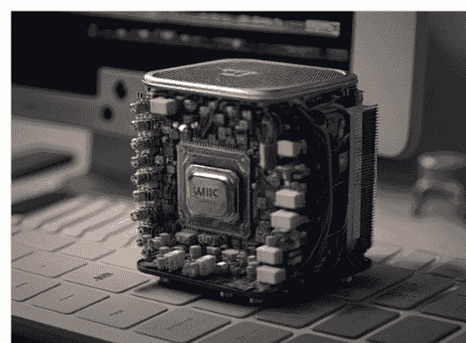
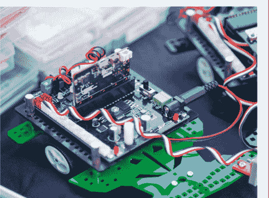
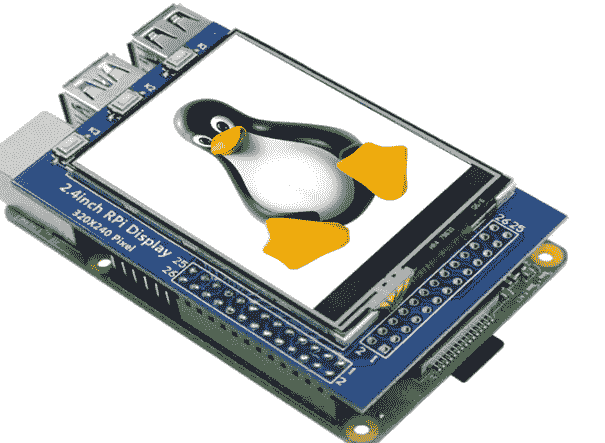

# 引言

我们将尝试理解 `Linux` 的一些基本概念，并看看为什么需要 `Linux` 以及使用 `Linux` 相比 `Windows` 有什么优势。让我们开始吧，`Linux` 是一个开源操作系统。开源意味着如果你在进行开发，就可以免费获得源代码。与授权软件不同，你不需要为它付费。它由 `Linus Torvalds` 基于 `Unix` 开发。人们可以免费使用 `Linux`，而不像 `Windows` 那样。这意味着与 `Windows` 不同，我们不需要购买许可证。你可以轻松地从任何 `Linux` 服务器下载并使用它。在 `Linux` 中，大部分操作系统都是免许可的。你可以轻松地下载……并使用它。它运行在大多数平台上，如电脑、移动设备、服务器等。例如，如果你正在运行 `Ubuntu` 或 `Android`，这意味着你直接或间接地正在使用 `Linux`。`Android` 基本上基于你的 `Linux`，只是 `Android` 中的 GUI 前端是用 `Java` 编写的。但底层结构是你的 `Linux` 内核，根文件系统概念等都是基于 `Linux` 环境的。根据大小和口味，我们会有灵活性选择许多选择，而且非常强大。人们甚至可以在不向电脑安装系统的情况下，通过 `CD/DVD` 或 `U` 盘运行 `Linux`。

- `Linux` 是一个开源操作系统。
- 开源意味着如果你在进行开发，就可以免费获得源代码。
- 与授权软件不同，你不需要为它付费。
- 它由 `Linus Torvalds` 基于 `Unix` 开发。
- 人们可以免费使用 `Linux`，而不像 `Windows` 那样。
- 这意味着与 `Windows` 不同，我们不需要购买许可证。
- 你可以轻松地从任何 `Linux` 服务器下载并使用它。
- 在 `Linux` 中，大部分操作系统都是免许可的。
- 你可以轻松地下载……并使用它。
- 它运行在大多数平台上，如电脑、移动设备、服务器等。
- 例如，如果你正在运行 `Ubuntu` 或 `Android`，这意味着你直接或间接地正在使用 `Linux`。
- `Android` 基本上基于你的 `Linux`，只是 `Android` 中的 GUI 前端是用 `Java` 编写的。
- 但底层结构是你的 `Linux` 内核，根文件系统概念等都是基于 `Linux` 环境的。
- 根据大小和口味，我们会有灵活性选择许多选择，而且非常强大。
- 人们甚至可以在不向电脑安装系统的情况下，通过 `CD/DVD` 或 `U` 盘运行 `Linux`。

## 目录

- 构建嵌入式系统
- 释放嵌入式 Linux 冒险、设计、开发与部署
- 带有示例代码
- 引言
- 为什么我们使用 Linux
- Linux 是一个开源操作系统
- 开源意味着
- 免费使用
- 许可证
- 相比 Windows 优势
- 虚拟机基础
- 安装
- 安装 VirtualBox
- 在虚拟机中安装 Ubuntu-16.04 X64
- Linux 终端
- 示例代码
- Linux Shell (BASH 和 SH)
- 示例代码
- 基础 Linux 命令
- 文本编辑器 (GEDIT)
- 文本编辑器 (NANO)
- 文本编辑器 (VI)
- 文本编辑器 (VIM)
- 版本控制 (GIT)
- 示例代码
- 使用 CTAGS 进行代码解析
- 示例代码
- 使用 SCOPE 进行代码解析
- 示例代码
- 嵌入式平台基础
- 低预算嵌入式板
- 串口通信 (MINICOM, PUTTY, TERATERM)
- 网络通信 (SSH, SCP, WINSCP, TFTP)
- 示例代码
- 从源码编译 QEMU
- 在 QEMU 中运行 ARM 编译的代码
- 带网络支持的 QEMU
- 构建块简介
- 工具链
- 引导加载程序概念
- U-BOOT 概念
- 为真实的 RPI 构建 U-BOOT
- 为 QEMU 构建 U-BOOT
- 在 QEMU 上运行 U-BOOT
- Linux 内核简介
- Linux 内核目录结构
- 板级支持包 (BSP)
- 在 QEMU 上启动 RPI


- `Android` 基本上基于你的 `Linux`，只是 `Android` 中的 `GUI` 前端是用 `Java` 编写的。

- 但底层结构是你的 `Linux` 内核，根文件系统概念等都是基于 `Linux` 环境的。

- 根据大小和口味，我们会有灵活性选择许多选择，而且非常强大。

- 人们甚至可以在不向电脑安装系统的情况下，通过 `CD/DVD` 或 `U` 盘运行 `Linux`。

- 构建嵌入式系统

- 释放嵌入式 `Linux` 冒险、设计、开发与部署

- 带有示例代码

- 目录

- 引言。

- 虚拟机基础。

- 安装。

- 安装 `VirtualBOX`。

- 在虚拟机中安装 `Ubuntu-16.04 X64`。

- `Linux` 终端。

- 示例代码。

- `Linux Shell (BASH 和 SH)`。

- 示例代码。

- 基础 `Linux` 命令。

- 文本编辑器 (`GEDIT`)。

- 文本编辑器 (`NANO`)。

- 文本编辑器 (`VI`)。

- 文本编辑器 (`VIM`)。

- 版本控制 (`GIT`)。

- 示例代码。

- 使用 `CTAGS` 进行代码解析。

- 示例代码。

- 使用 `SCOPE` 进行代码解析。

- 示例代码。

- 嵌入式平台基础。

- 低预算嵌入式板。

- 串口通信 (`MINICOM, PUTTY, TERATERM`)。

- 网络通信 (`SSH, SCP, WINSCP, TFTP`)。

- 示例代码。

- 从源码编译 `QEMU`。

- 在 `QEMU` 中运行 `ARM` 编译的代码。

- 带网络支持的 `QEMU`。

- 构建块简介。

- 工具链。

- 引导加载程序概念。

- `U-BOOT` 概念。

- 为真实的 `RPI` 构建 `U-BOOT`。

- 为 `QEMU` 构建 `U-BOOT`。

- 在 `QEMU` 上运行 `U-BOOT`。

- `Linux` 内核简介。

- `Linux` 内核目录结构。

- 板级支持包 (`BSP`)。

- 在 `QEMU` 上启动 `RPI`。

# 引言

我们将尝试理解 `Linux` 的一些基本概念，并看看为什么需要 `Linux` 以及使用 `Linux` 相比 `Windows` 有什么优势。让我们开始吧，`Linux` 是一个开源操作系统。开源意味着如果你在进行开发，就可以免费获得源代码。与授权软件不同，你不需要为它付费。它由 `Linus Torvalds` 基于 `Unix` 开发。人们可以免费使用 `Linux`，而不像 `Windows` 那样。这意味着与 `Windows` 不同，我们不需要购买许可证。你可以轻松地从任何 `Linux` 服务器下载并使用它。在 `Linux` 中，大部分操作系统都是免许可许可的。你可以轻松地下载……并使用它。它运行在大多数平台上，如电脑、移动设备、服务器等。例如，如果你正在运行 `Ubuntu` 或 `Android`，这意味着你直接或间接地正在使用 `Linux`。`Android` 基本上基于你的 `Linux`，只是 `Android` 中的 `GUI` 前端是用 `Java` 编写的。但底层结构是你的 `Linux` 内核，根文件系统概念等都是基于 `Linux` 环境的。根据大小和口味，我们会有灵活性选择许多选择，而且非常强大。人们甚至可以在不向电脑安装系统的情况下，通过 `CD/DVD` 或 `U` 盘运行 `Linux`。

- `Linux` 是一个开源操作系统。

- 开源意味着如果你在进行开发，就可以免费获得源代码。

- 与授权软件不同，你不需要为它付费。

- 它由 `Linus Torvalds` 基于 `Unix` 开发。

- 人们可以免费使用 `Linux`，而不像 `Windows` 那样。

- 这意味着与 `Windows` 不同，我们不需要购买许可证。

- 你可以轻松地从任何 `Linux` 服务器下载并使用它。

- 在 `Linux` 中，大部分操作系统都是免许可的。

- 你可以轻松地下载……并使用它。

- 它运行在大多数平台上，如电脑、移动设备、服务器等。

- 例如，如果你正在运行 `Ubuntu` 或 `Android`，这意味着你直接或间接地正在使用 `Linux`。

- `Android` 基本上基于你的 `Linux`，只是 `Android` 中的 `GUI` 前端是用 `Java` 编写的。

- 但底层结构是你的 `Linux` 内核，根文件系统概念等都是基于 `Linux` 环境的。

- 根据大小和口味，我们会有灵活性选择许多选择，而且非常强大。

- 人们甚至可以在不向电脑安装系统的情况下，通过 `CD/DVD` 或 `U` 盘运行 `Linux`。

虚拟机。一旦任务完成，它就会被销毁。现在我们将看到一些流行的虚拟机，就像我在第一张幻灯片上向你们展示的那样。让我们逐来看：`Virtualbox`，一款开源且跨平台的虚拟化软件。它可以适用于 `Windows`、`Linux`、`Mac` 和 `BSD` 操作系统。它在大多数开发环境中非常流行，人们经常使用 `Virtualbox`。第二个是 `VMware`，它类似于 `Virtualbox`，但它具有更多功能，而且不是免费的。我们需要支付许可费用。`VMware` 有两个版本，一个是 `Workstation`，另一个是 `VMware Player`。

## 流行虚拟机

- `Virtualbox` - 它是一款开源且跨平台的虚拟化软件。你可以在 `Windows`、`Linux`、`Mac` 和 `BSD` 系统上安装它。

- `VMware` - 它与 `Virtualbox` 类似，增加了一些功能。但它不是免费的。

- `Qemu` - 除了提供常规虚拟机支持外，它还设计用于模拟不同的架构，允许运行为其他 `CPU` 或架构编写的软件应用程序和操作系统。

如果我们选择 `VMware Workstation`，你需要获取许可。如果你选择 `VMware Player`，它实际上是免费的，我们可以使用。然后是 `Qemu`。`Qemu` 提供了与 `VMware` 类似的功能，虽然没有完全实现，但它基本上设计用于模拟不同的架构。这意味着如果你为 `ARM` 编写了代码并进行了交叉编译，你可以在 `Qemu` 上测试这些代码。它提供的另一个功能是，如果你有一个为 `ARM` 或其他架构设计的操作系统，使用 `Qemu` 我们可以直接运行它。

## 安装 Virtualbox

首先，我先来看我们工具箱的一些基本概念，之后我们将安装我们的“孩子们”。让我们开始吧：`Virtualbox`，一款开源且跨平台的虚拟化软件。它可以安装在 `Windows`、`Linux`、`Mac` 和 `Vista` 上。这意味着它为它支持的所有平台都提供了相应的级别。如果你为某一个平台创建虚拟机，那么它可以移植到另一个平台以支持我们。我在 `Windows` 中安装了一个虚拟机。同样的操作也可以在支持 `Linux` 的的另一个宿主机上进行。`Virtualbox` 提供了快照（`Snapshots`）功能。只需导入该格式的文件，它就能在你的机器或另一个宿主机上运行。`Virtualbox` 提供了快照功能。这意味着你可以保存虚拟机的不同状态，这对于你的开发是需要的。假设你有两个或三个开发环境，你可以将不同阶段保存为快照，只需快照，你就可以在它们之间切换并此进行工作。

## 简介

- `Virtualbox` 是一款开源且跨平台的虚拟化软件。你可以在 `Windows`、`Linux`、`Mac` 和 `BSD` 系统上安装它。

- 它是可移植的。在宿主机上创建的虚拟机可以使用开放虚拟格式 (`OVF`) 轻松地在另一个宿主机上运行。用户需要在需要时导入和导出虚拟机。

- `Virtualbox` 提供了虚拟机状态信息的保存快照功能。你可以回到过去并还原虚拟机。

现在我们理解了材料中用到的一些基本术语。有两点：一个是宿主机（`Host`），另一个是客机（`Guest`）。宿主机是指虚拟机运行的地方。例如，如果你在 `Windows` 上安装 `VMware`，那么你的 `Windows` 将充当宿主机，而你的虚拟机将充当客机。在我们实际开始使用 `Virtualbox` 之前，我们需要满足一些前提条件。首先，我们需要下载 `Virtualbox`，然后是 `Virtualbox 扩展包（Extension）`，如果你想启用 `USB` 支持，基本上需要 `Virtualbox 增强包（Guest Addition）`，并且 `Virtualbox 增强包` 是强制性的。没有它，你就无法充分利用 `Virtualbox` 的功能。它将启用执行我一起一起的所有操作所需的支持。通常你不需要担心 `Virtualbox 扩展`，通过在 `Virtualbox` 内部安装，它会自动下载，否则会在你安装时提示你下载。

## 前提条件

- `Virtualbox` (https://www.virtualbox.org/wiki/Downloads)

- `Virtualbox 扩展`（必须与 `virtualbox` 版本一致）以启用 `USB` 支持。

- `Virtualbox 增强包`（需要完全启用 `virtualbox` 功能）以便 `virtualbox` 与宿主机操作系统交互。它通常随 `Virtualbox` 一起提供，如果没有，在安装增强包时它会自动下载并安装在你的客机操作系统中。

这样之后我们将去 `Virtualbox` 官网，并尝试下载包含 `Virtualbox` 和 `Virtualbox 扩展包` 的必要包。这里我们需要注意版本必须相同。否则，你的 `Virtualbox 扩展包` 将无法工作。现在我将打开浏览器并尝试下载 `Virtualbox`，只需输入“virtual box”它就会出现在这里。你点击下载。这是一个 `VirtualBox` 系统。针对你的不同操作系统平台的包、`CLI` 适用于不同操作系统如 `Windows`、`Mac` 以及带有下一个发行版的 `Solaris`。但我们需要下载它，正如我们所知，只需点击 `Windows`，它就会开始下载，因为我的机器已经下载好了。我不需要下载这个，点击这一个。它将开始下载。下载 `Virtualbox` 后，我们需要下载 `Virtualbox 扩展包`。某些包对于所有平台都是相同的。我们不需要担心那个。它支持所有平台，只需点击它就会下载，因为我的机器已经下载好了。

## VirtualBox 二进制文件

下载时，你同意相应许可的条款和条件。

如果你正在寻找最新的 `VirtualBox 5.2` 包、`VirtualBox 5.2` 构建版本，请使用 `5.2` 版本。

## VirtualBox 6.0.0 平台

- `Windows` 宿主机

- `OSX` 宿主机

- `Linux` 发行版

- `Solaris` 宿主机

二进制文件根据 `GPL` 条发布。查看校验和以了解更改。你可能想检查校验和以验证完整性。如果是 `MD` 算法校验应该是受支持的。

- `SHA` 校验，`MD` 校验

**注意：** 在升级 `Virtualbox` 后，建议升级所有增强包。

## VirtualBox 6.0.0 Oracle VM 扩展包

- 所有支持的平台（`Windows`、`Mac`、`Linux`）

支持 `VirtualBox 2.0` 和 `3.0` 设备、`VirtualBox` 磁盘加密、`NVMe` 以及 `Intel` 核心 `PX` 启动。介绍请参考用户手册。该扩展根据 `VirtualBox 个人使用许可协议 (PUEL)` 发布。请安装相同版本的 `VirtualBox`。

在上述 `VirtualBox` 包中添加，然而如果你想在不安装整个程序的情况下查看它，你也可以……下载完成后我会取消。我们将直接进入机器的下载文件夹并尝试安装。现在我将进入我的下载目录并尝试运行并安装它。不。点击关于六条路的，或者你知道并安装它。现在客机列表开始安装此空间。接下来，是的，安装期间卸载。它向你询问某些电池、某些硬盘修复，点击这个。现在安装，将需要一些时间，我们的新 `VMware` 完全安装好了。接下来的阶段是添加某些操作。为此，我们需要进入偏好并插入偏好。进入扩展，点击添加并选择正确的 `6.0.0` 包，将会添加 `VirtualBox 扩展包`。你点击它，它没有要求你安装。同意此许可的要求并点击。

现在它已成功添加，你将看到一个绿色勾选，如果不是绿色。这意味着它与此版本的部分模块不兼容，点击确定。我们已添加它以便进行任何安装，但在这个项目中到此为止。在下一个项目中，我们将在安装了 `VirtualBox` 的相同虚拟机上尝试安装一个 `1` 到 `60` 节点的完整网络。

## 在 VirtualBox 中安装 UBUNTU-16.04 X64

我们将安装 `Ubuntu 16.04`。但在安装 `16.04` 之前，我将尝试理解如何根据我们的开发需求选择合适的版本，以及如何识别哪一个最适合我们的目标。让我们进入下一页幻灯片。每年有两个次要发布，带有 `LTS 16.04` 和 `18.04`，就像 `16.04` 和 `16.10` 那样，而不是 `16.10` 直接进入发布侧，并尝试理解一些基本术语，如 `LTS` 和生命周期结束（`end of life`）。`LTS` 是长期支持的意思。如果我们需要一个带有 `LTS` 的版本，这意味着它将获得长期支持；如果不是 `LTS`，支持将在几年后停止。因此，我们将进入发布侧并详细了解这一点。我将打开浏览器，输入 `ubuntu release` 或 `ubuntu release`，直接进入该网站。在开头就写着：“`LTS`”意味着这是一个当前受支持的词，并提供 `LTS` 服务。顶部写着 `18.10.10`，意味着它是在 `10` 月发布的，而 `.04` 与发布月份 `4` 月有关。我们注意到的两点不是发布词。另一个是主相关版本或任何非 `LTS` 的版本。次要和主相关版本都应该是偶数，还有一点是次要相关版本不是 `LTS`。`18.10` 版本同样不是 `LTS`。所以从这一侧来看很清楚，它是被认可的，`16.04` 下的 `04` 是 `LTS`，但 `18.10` 仍然不是 `LTS`。

## 扩展安全维护 (Extended Security Maintenance)

扩展安全维护是通过 `Ubuntu Advantage` 提供的一种付费选项，用于获取扩展的安全更新。

| 版本 | 支持的包 | 生命周期开始 | 年限 | 生命周期结束日期 |
|---|---|---|---|--|
| `Ubuntu 14.04 LTS` | 待宣布 | 2014年4月 | 5 年 | 2019年4月 |
| `Ubuntu 16.04 LTS` | 待宣布 | 2016年4月 | 3 年 | 2024年4月 |
| `Ubuntu 18.04 LTS` | 待宣布 | 2019年4月 | 3 年 | 2022年4月 |
| `Ubuntu 20.04 LTS` | Security/Team/ESM/12.04 | 2017年4月28日 | 2 年 | 2019年4月 |

## 生命周期结束 (End of Life)

| 版本 | 代号 | 发布日期 | 生命周期结束日期 |
|---|---|---|--|
| `Ubuntu 14.04 LTS` | Artful Aardvark | 2014年4月17日 | 2019年4月27日 |
| `Ubuntu 16.04 LTS` | Zesty Zaphyr | 2016年4月28日 | 2021年4月26日 |
| `Ubuntu 18.04 LTS` | Bionic Beavery Yaka | 2018年4月26日 | 2023年5月14日 |
| `Ubuntu 19.10 LTS` | Wily Wavy | 2019年10月22日 | 2024年7月12日 |
| `Ubuntu 20.04 LTS` | Focal Fossa | 2020年4月27日 | 2025年5月1日 |
| `Ubuntu 21.10 LTS` | Utopic Unicorn | 2021年10月27日 | 2026年7月12日 |
| `Ubuntu 22.04 LTS` | Jellyfish Jammy | 2022年4月21日 | 2027年4月27日 |
| `Ubuntu 23.04 LTS` | Lunar Mongoose | 2023年4月20日 | 2024年1月25日 |
| `Ubuntu 23.10 LTS` | Quantal Quetz | 2023年10月10日 | 2024年7月12日 |
| `Ubuntu 24.04 LTS` | Noble Numbat | 2024年4月25日 | 2029年5月1日 |
| `Ubuntu 24.10 LTS` | Orstraco Oriole | 2024年10月10日 | 2025年7月12日 |
| `Ubuntu 25.04 LTS` | Plucky Puppy | 2025年4月24日 | 2030年5月1日 |
| `Ubuntu 25.10 LTS` | Serene Hippo | 2025年10月23日 | 2026年7月12日 |
| `Ubuntu 26.04 LTS` | Scalable Puffin | 2026年4月23日 | 2031年4月27日 |
| `Ubuntu 26.10 LTS` | Slucky Squirrel | 2026年10月29日 | 2027年7月12日 |
| `Ubuntu 27.04 LTS` | Turmeric Tarsier | 2027年4月28日 | 2032年4月27日 |

现在我们来看生命周期。`16.04` 下的 `04` 是 `LTS`。由于这个版本在开始时是偶数，意味着它不是奇数；`16.04` 下的 `04` 是 `LTS`。所以我们将为开发目的妥善地选择。现在我们需要选择一个好的版本。`16.04` 下的 `04` 是 `LTS`，所以它将长期稳定。我们的主要任务是下载 `16.04` 下的 `04` 作为 `LTS` 版本。

| 名称 | 最后修改时间 | 大小 | 描述 |
|---|---|---|---|
| 父目录 | | | |
| `ISO` | 2016-04-21 | 2.4GB | |
| `HD-Virtual Disk` | 2016-04-21 | 20GB | |


我将取消此下载。下载完成后将花费一些时间。由于已经下载了，我们将进入 `VirtualBox` 进行安装。我将直接进入下一步。我将打开 `VirtualBox` 并尝试在 `VirtualBox` 内部安装。点击这种类型的名称，我想要 `16.04`。现在点击“下一步”。它询问内存大小。我们可以根据系统中可用的 `RAM` 来指定。现在选择了 `2048 MB`，点击“下一步”。这里要求选择硬盘以提供替代方案。现在我们不需要选择替代方案。次要相关和主相关版本都是偶数，还有一点是次要相关版本不是 `LTS`。`18.10` 版本同样不是 `LTS`。所以从这一侧来看很清楚，它是被认可的，`16.04` 下的 `04` 是 `LTS`，但 `18.10` 仍然不是 `LTS`。

我将取消此下载。下载完成后将花费一些时间。由于已经下载了，我们将进入 `VirtualBox` 进行安装。我将直接进入下一步。我将打开 `VirtualBox` 并尝试在 `VirtualBox` 内部安装。点击这种类型的名称，我想要 `16.04`。现在点击“下一步”。它询问内存大小。我们可以根据系统中可用的 `RAM` 来指定。现在选择了 `2048 MB`，点击“下一步”。这里要求选择硬盘以提供替代方案。现在我们不需要选择替代方案。次要相关和主相关版本都是偶数，还有一点是次要相关版本不是 `LTS`。点击下一步，选择硬盘类型。虚拟机硬盘要么以动态方式增长，或者一次性获取空间。选择动态并点击“下一步”。现在需要选择大小。我们不需要担心大小，它不会占用物理硬盘。点击创建将创建 `VirtualBox` 磁盘。现在需要在 `VirtualBox` 磁盘内安装镜像。`VirtualBox` 会在这里创建它。我们需要安装。现在只需点击“启动”。它会自动要求你选择启动介质。只需选择此选项并提供你想下载的路径。点击此处并启动。

## Ubuntu-16.04

新建 设置 放弃 启动

### 通用

名称：Ubuntu-16.04

操作系统：Ubuntu (64位)

主机文件夹：`C:\Users\BANKUL\RAVIT\VirtualBox\Ubuntu-16.04`

### 系统

基本内存：2048 MB

启动顺序：光驱、硬盘

加速：VT-x/AMD-V、嵌套分页、KVM 虚拟化

### 显示

显存：16 MB

显卡控制器：VGA

远程桌面：禁用

录制：禁用

### 存储

控制器 ID:IDE

IDE 辅助主：[光驱] 空

SATA 控制器：SATA

ATA 驱动 0：`Ubuntu-16.04.vdi` (常规，100.00 GB)

### 音频

主机驱动程序：Windows DirectSound

控制器：Intel AC'97

### 网络

适配器 1：Intel PRO/1000 MT 桌面 (NAT)

### USB

USB 控制器：OHCI, EHCI

设备过滤器：0（活动状态）

### 共享文件夹

无

## 描述

无


四。另一个就是那些乱七八糟的界面，就像你 Windows 的虚拟内存，点击继续，选择无区域，然后继续它。现在选择你的键盘类型，可以是美国英语或任何支持的类型，点击继续。现在选择名称，我输入 `will tab human`，现在请继续。现在它不会直接向你询问任何内容，它会安装每一个项目。这需要一些时间。在此期间，一旦安装完成，我将再次发布项目。这个项目现在有了能量了，并且正在询问是否启动以完成安装。听着，是的，重启，不，按下那个，这样我们就有了 1 和 2 完全运行的环境。一旦它启动，它会要求你登录凭据。记住我们已经给了你更多用户权限。默认情况下它会显示，所以你可以移动凭据。你只需要指定密码。

在这里我想告诉你们的另一点是，如果你在虚拟机（`VirtualBox`）中运行，速度会慢，因为它没有利用你硬件的全部性能。它是虚拟化的。这就是为什么你不需要担心它运行得有点慢或其他其他问题。现在已经登录，将进入设备并将剪贴板启用为双向，还有一点，将拖放支持也启用为双向。记得我告诉过你们需要做的三件事：首先我们需要下载 `VirtualBox`；其次是安装 `VirtualBox` 扩展；第三是安装增强功能（Guest Additions）。这将被安装。安装完成后，为了完全启用该功能，只需点击这里并安装。它会要求你运行，点击运行并输入密码。安装将开始。这需要一些时间。我现在将通过项目。现在看 Sherlock's Edison 成功安装在 hero 1 2 内部。我们可以使用虚拟机的所有功能了。最后我们需要做的是在这个虚拟机中启用共享支持以查看共享文件夹支持。从这里我们可以点击加号并添加任何你想添加的内容。我只想隐藏一个文件夹，就是现在。选择并将其设置为自动挂载，并设为永久，点击确定。点击确定。现在我们需要运行一个命令来启用此支持。

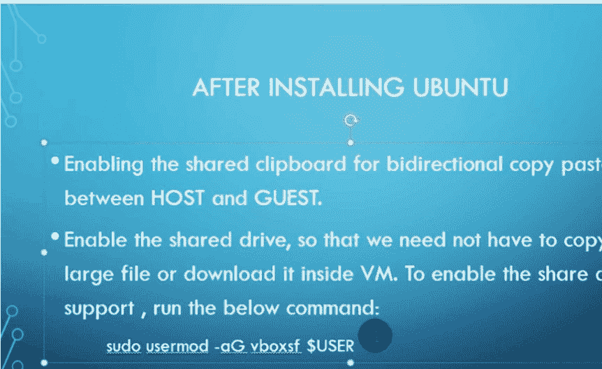

由于我们已经能够支持分层文件夹和共享剪贴板。这意味着我们可以直接从主机和客机列表之间复制粘贴，复制这一个然后在主机侧粘贴。你的虚拟机已经成功设置好了，现在完成了。下一步我们需要做的是重启系统并看到你的完整层级已挂载。执行这个伪重启，现在 1 和 2 已成功挂载。进入文件。我可以点击这个，我们就能看到我们的挂载文件夹名为 `share`。这是我们在主机和客机之间共享的文件夹，我们知道了。如果你还记得我们在下载中下载了 1、2 和 `VirtualBox` 相关的文件。这意味着我的文件夹已成功在 1、2 和 `Windows` 之间共享了，就是这些。

# LINUX 终端 (LINUX TERMINAL)

让我们开始吧。首先我们将涵盖理论项目，然后进入该项目的实操阶段。我们将看到 Linux 终端（Terminal）和控制台（Console）之间的区别。控制台和终端之间存在本质区别。我们将查看两者，以理解它们之间的根本区别。

现在我们先看终端。终端是一个命令行界面。就像 `Windows` 的 `cmd` 一样，它经常用于 Linux 环境，并且大部分情况下与 `Windows cmd` 相似。在练习之后，你会觉得你正在 `Windows` 本身上运行命令。因此，终端窗口（称为终端模拟器）是图形用户界面中的纯文本界面，用于模拟控制台，所以你的终端窗口看起来像这一个。现在我们来看控制台是什么。

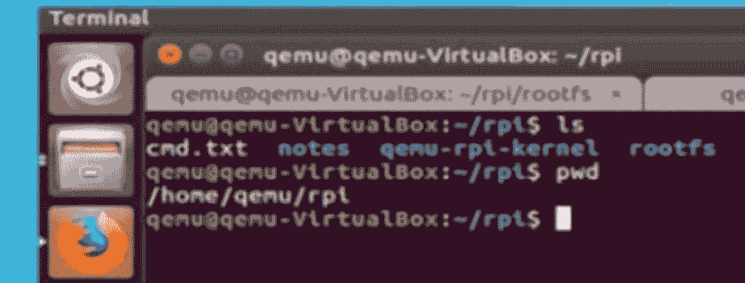

控制台是一个纯粹的 CLI 窗口，你对其没有控制权。除了运行命令、程序或脚本，纯文本模式的控制台在大多数嵌入式操作系统非常常见，即使你完全没有 GUI 访问权限。你无法使用鼠标光标。它不支持滚动功能。我们将看到控制台看起来是什么样。这就是控制台的样子。现在我将尝试解释为什么我们为了开发目的使用终端。

```
Ubuntu 16.04.5 LTS qemu-VirtualBox tty1
qemu-VirtualBox login: qemu
Password:
Welcome to Ubuntu 16.04.5 LTS (GNU/Linux 4.15.0-36-generic x86_64)

* Documentation: https://help.ubuntu.com
* Management: https://landscape.canonical.com
* Support: https://ubuntu.com/advantage

63 packages can be updated.
0 updates are security updates.

The programs included with the Ubuntu system are free software:
t exact distribution terms for each program are described in the individual files in /usr/share/doc/*copyright.

Ubuntu comes with ABSOLUTELY NO WARRANTY, to the extent permitted by applicable law.

qemu@qemu-VirtualBox:~$ ls
Desktop Documents Downloads examples.desktop Music Pictures Public
qemu@qemu-VirtualBox:~$ pwd
/home/qemu
qemu@qemu-VirtualBox:~$ $ _
```

终端非常友好。你可以在终端中很容易地运行命令，而不是在控制台中。控制台基本上是纯命令行模式或在尺寸受限的嵌入式平台中支持的功能。我们将看到如何在 Linux 发行版中切换终端和控制台。切换终端和控制台。在 Linux 发行版中，你也可以从 GUI 切换到控制台。使用 `CTRL + ALT + F` 进入控制台模式。基本上在 Linux 发行版中有控制台窗口。我们可以同时切换。如果你想回到 GUI 模式只需按下组合键 `CTRL ALT + F`。我们将在实操阶段看到如何切换这两个。我们将进入 Ubuntu 查看第一个终端并理解什么是终端。这是你的终端，它是如何轻松运行命令的，终端有这个功能。你可以向上和向下滚动，并从终端复制粘贴，这些功能在控制台中将不可用。现在我们将切换回控制台模式。记住切换回控制台模式要使用组合键 `CTRL ALT + F`。

```
qemu@qemu-VirtualBox:~/rpi/uboot-~$ ls
api     common  disk    examples Kconfig scripts
arch     config.mk doc      net      tags
boot    drivers include port      Kbuild MAINTAINERS
$ qemu@qemu-VirtualBox:~/rpi/uboot-~$ MAINTAINERS
$ command not found
```

并且设置为控制台模式。现在你在控制台中拥有正确的访问权限。现在你也可以在这里运行命令。但你看不到鼠标光标。你需要手动输入命令，无法复制粘贴命令，无法使用滚动功能。

## 示例代码

```
此脚本接受两个数字作为输入并计算它们的和
#!/bin/bash

## 提示用户输入第一个数字
echo "Enter the first number:"
read num1

## 提示用户输入第二个数字
echo "Enter the second number:"
read num2

## 计算和
sum=$((num1 + num2))

## 显示结果
echo "The sum of $num1 and $num2 is: $sum"
```

运行此脚本：

- 打开一个文本编辑器并将代码粘贴其中。
- 以 `.sh` 扩展名保存文件，例如 `calculate_sum.sh`。
- 打开终端窗口。
- 使用 `cd` 命令导航到保存脚本的目录。
- 运行 `chmod +x calculate_sum.sh` 赋予脚本可执行权限。
- 输入 `./calculate_sum.sh` 并按回车键运行脚本。
- 根据提示输入两个数字。
- 脚本将计算和并在终端中显示结果。

# Linux SHELL (BASH 和 SH)

让我们开始吧。Shell 是一个充当你与 Linux 系统之间接口的程序，它允许你输入命令供操作系统执行。在在这方面，它类似于 `Windows` 的命令提示符。有很多 Shell，如 `sh`、`csh`、`bash` 等，但最常用的 Shell 是 `bash`，它是 `Ubuntu` 以及大多数其他 Linux 发行版的默认 Shell。你可以仅通过输入 Shell 名称来在不同的 Shell 之间切换，例如，如果你想切换回 `sh`，只需输入 `sh`；如果你想切换回 `bash`，则输入 `bash`。

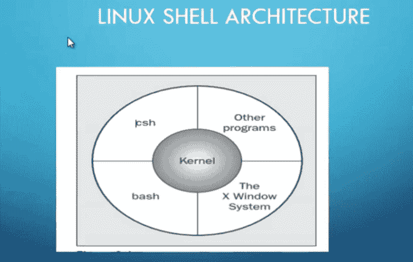

但在 `Ubuntu` 中，默认运行的 Shell 是 `bash`。现在我们将看下一个，Shell 架构。Shell 驻留在用户空间，它用于从用户处接收命令并将其发送到内核空间，内核空间将为你提供输出。一旦有了输出，`bash` 或 `SH` 就会向你显示命令输出。现在我们将进入 `bash` 并尝试理解 `bash` 的特性是什么？`Bash` 通常存在于大多数没有大小限制问题的发行版中。它通常是大多数 Linux 变体的默认 Shell，也用于许多嵌入式平台。它非常易用且对用户友好。在这里你可以非常轻松地运行命令。这里你有一个自动补全功能，所以我将尝试理解一下在终端中输入命令时自动补全功能的作用。你会发现有时你无法完全记得命令，但你知道命令的某些字母。只需输入命令的几个字母并按 `Tab` 键，就会向你显示命令提示，然后你就可以完成你的命令。现在我们将进入 `SH` 并了解它是什么。`SH` 通常用于轻量级嵌入式操作系统 `busybox`，它由许多用于嵌入式平台的微型实用程序组成。它非常简单且轻量，但没有用户友好的界面。此外，你找不到 `Tab` 自动补全功能以及其他特性，这意味着你需要准确记住命令，否则你无法运行命令。现在我们将进入实操环节，看看如何使用 `SH` 和 `BASH`。现在我们启动 `Ubuntu` 并观察此功能。

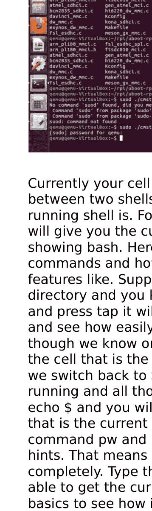

目前你的 Shell 是 `BASH`。现在我们将看到如何在两个 Shell 之间切换。但首先，我们将查看当前运行的 Shell 是什么。为此，输入命令 `echo $SHELL`，它将给你当前工作的 Shell。现在你可以看到它显示的是 `bash`。在这里我们将看到我们是如何输入命令的，以及我们如何方便地使用补全功能。例如，假设我们要获取当前目录列表，你知道命令 `pwd`，只需输入 `pw` 并按 `Tab` 键，它就会向你显示提示。现在我们按下 W 看看我们能多方便地运行命令。即使我们只知道几个字母，现在我们将切换回 `SH` Shell 并看看它是如何工作的。现在我们切换回 `SH`。你会发现那里没有我们运行位置的提示以及其他功能，这意味着你需要准确输入命令，否则你无法运行命令。

大小。我们需要提供一个 `-C` 来提取。我们需要提供 `-X`，这样我们就能理解什么是 `tar -xvf`。然后是文件夹名，然后是用于提取的扩展 `X`，`V` 表示详细，`F` 表示强制。同样对于压缩，有一个命令 `tar -cvf`。这是用于压缩的`-C` 选项用于压缩。现在是 `ping` 命令。这就像 `Windows` 的 `ping` 命令一样，用于检查两个 IP 之间的连接。然后是 `clear` 命令。假设你的窗口填满了命令。我们可以清除它。然后是 `apt-get` 命令。这用于在 `Ubuntu` 中安装或删除包。这在任何 Debian 软件包中都有效。在任何 Debian 系统上你都可以运行这个命令。对于安装，只需添加 `install`；对于删除只需添加 `sudo`。假设我想安装 `Vim` 软件包，我会输入 `sudo apt-get install vim`。有一点我们需要非常明确：我们需要以管理员身份使用这个和删除（`remove`）命令。这就是为什么 `sudo` 是必须的。否则，你将无法安装任何包。它会失败。现在有 `ifconfig` 命令。这就像 `Windows` 的 `ipconfig` 命令，然后是 `more` 和 `less` 命令。这用于在不打开文件的情况下获取内容。现在还有一些用于 `kill` 的命令。它用于根据 PID（进程 ID）杀死任务。进程 ID 被分配给系统上运行的每个进程。

- `Kill`: 用于根据 `pid` 杀死任务。
- `sudo kill -9 pid`
- `Killall`: 用于根据 `program_name` 杀死任务。
- `sudo killall program_name`
- `mount`: 用于挂载驱动器。
- `sudo mount -t ext4 /dev/sdx /mnt`
- `file`: 用于分析文件的类型。

```
root@virtualbox:~/embedded_linux/qemu-pi-kernel/test file
hello: 32-位可执行文件, ARM ABI 版本 1 (GNU/Linux), 静态链接, GNU/Linux 3.2.0, BuildID[e8734802bf4e1d6cf3a5f3cbba62], stripped: source ASCII 文本
hello.c
```

假设你正在运行 `vim` 编辑器，你会得到 `vim` 的 ID，你可以杀死 `vim` 编辑器。同样，`kill` 和 `killall` 之间存在本质区别。`kill` 需要 PID，`killall` 需要程序名称并会杀死该程序。同样有 `mount` 命令，这用于挂载驱动器到文件夹。假设你想挂载你的驱动器或 `DVD`。你可以使用这个命令进行挂载。这里有 `file` 命令，这用于分析文件的类型。如果你在文件上运行 `file` 命令，你就会知道它支持什么架构，以及它是二进制文件还是源文件。从图中看到，我们有一个编译好的文件，用于 `ARM`。如果不运行这个命令，你无法知道它是否适用于你的架构或是否适用于不同的架构。现在我将进入 `practical` 会话并查看一个。所有这些命令。对于它们，我将打开 `Ubuntu`，现在我将创建一个文件夹，然后我将运行 `all` 命令。这些命令。这里是 `cd .` 命令，看看它是如何工作的。

```
qemu@emu-VirtualBox:~/rpi/git_2/git_test$$ git log
commit 90c1a57604bd2e3da6dce37fb75ad0210764d
Author: Rahul Ravi <rahul.ravi26@gmail.com>
Date: Sun 08:26 2018 +0530

print added

commit 831d8e8c37f9a22f638446bf658e6cfde4f8
Author: Rahul Ravi <rahul.ravi26@gmail.com>
Date: Sun 08:23 2018 +0530

git test log
ju@qemu-VirtualBox:~/rpi/git_2/git_test$ cd ..
```


如果你输入 `cd ..`，它会返回上一级文件夹。同样我将再次返回，现在我将使用 `mkdir` 创建目录并看到它是如何的。使用 `mkdir` 我们可以创建它。现在使用 `cd` 命令本身，我们可以进入 `test` 目录。然后是 `less` 命令。它将显示该目录的文件列表。现在该目录中没有文件，我们可以使用 `cp` 命令复制该目录中的文件。`cp` 命令需要文件或带路径的文件。我们将返回上一级文件夹并复制任何文件，如 `hello world` 程序到这里。看看它是如何工作的。`cp` 要求源文件和目标位置或源文件夹和目标位置。现在我将复制这个。看到复制，现在我们将看到 `pwd` 命令，它显示打印工作目录。现在我输入 `pwd`。看到它显示的是当前工作目录。同样我们可以删除这个文件。使用 `rm` 删除这个文件。使用 `ls` 命令可以验证没有文件，然后使用 `touch` 命令可以创建任何文件 `test`。

```
$ qemu@emu-VirtualBox:~/rpi$ mkdir test_cmd
$ qemu@emu-VirtualBox:~/rpi$ cd test_cmd
$ qemu@emu-VirtualBox:~/rpi/test_cmd$ ls
$ qemu@emu-VirtualBox:~/rpi/test_cmd$ cp ../qemu-pi-kernel.tar.xz uboot-rpi.tar
$ qemu@emu-VirtualBox:~/rpi/test_cmd$ ls
$ qemu@emu-VirtualBox:~/rpi/test_cmd$ cp ../helloworld.c .
$ qemu@emu-VirtualBox:~/rpi/test_cmd$ ls
$ qemu@emu-VirtualBox:~/rpi/test_cmd$ cp ../helloworld.c .
$ qemu@emu-VirtualBox:~/rpi/test_cmd$ sync
$ qemu@emu-VirtualBox:~/rpi/test_cmd$ pwd
$ qemu@emu-VirtualBox:~/rpi/test_cmd$ ls
$ qemu@emu-VirtualBox:~/rpi/test_cmd$ touch_file
```

使用 `ls` 可以验证此文件是否存在。现在我们类型输入 `man` 命令并看看它的作用。使用 `man pwd` 会给我关于这个命令的信息，这非常有用。如果你了解这个命令的一些小知识，你可以运行 `pwd` 并获取详情以及我们需要传递的参数。只需按 `Q` 键就会退出帮助菜单。同样我们可以使用 `help` 命令，`pwd --help`，它将给你提供所有选项。这个这个不可用，我将尝试不同的命令 `rm --help`，看看它是否提供了 `rm` 命令需要的所有选项。现在将查看一些其他命令，如 `move`。在此之前，我们将先复制 `hello world` 到这里。我们可以运行 `clear` 来清除屏幕。现在我们将运行 `move` 命令，将 `hello world` 移动到这里。看看它是如何工作的。`mv` 要求源文件和目标位置或源文件夹和目标位置。

执行 `test_tar` 并看到它已成功解压。然后是一个 `cat` 命令，它可以在不打开文件的情况下查看内容，它已经向你展示了内容。现在我们要做什么呢？我们将现在编译这个 `hello` 程序，然后运行 `file` 命令并查看它显示了什么。从这些信息中，我们可以看到像 `Hello.c` 是源文件，`test` 是空文件，而 `test.tar.xz` 是我们的压缩文件。我们可以使用这个 `file` 命令来调查文件类型等所有信息，这个项目就此结束。

## 示例代码

1. 导航：

```
pwd: 此命令不需要任何参数。它简单地打印当前工作目录的完整路径。
cd <directory>: 此命令更改你的当前工作目录。将 <directory> 替换为你想要跳转的目录名称。
cd Documents # 到 Documents 文件夹
cd .. # 向上移动一级目录
cd ~ # 回到你的主目录
```

2. 文件和目录管理：

```
ls: 此命令列出当前目录的内容。你可以添加选项来获取更多细节：
ls # 列出文件名
ls -l # 列出详细信息（权限、所有者、大小等）
ls -a # 列出所有文件，包括隐藏文件（请小心）
ls -h # 以人类可读的格式显示文件大小（例如 KB, MB）
mkdir <directory_name>: 此命令创建一个新目录。
```

```
mkdir test # 创建一个名为 "test" 的目录
rmdir <directory_name>: 此命令删除一个空目录。
rmdir test # 删除 "test" 目录（如果为空）
touch <file_name>: 此命令创建一个空文件。
touch hello.txt # 创建名为 "hello.txt" 的文件
```

## 3. 文件操作：

```
cat <file_name>: 此命令在终端上显示文件内容。
cat hello.txt # 显示 "hello.txt" 内容
cp <source_file> <destination_file>: 此命令将文件从一个位置复制到另一个位置。
cp hello.txt copy.txt # 将 "hello.txt" 复制到 "copy.txt"
mv <source_file> <destination_file>: 此命令移动或重命名文件。
mv hello.txt Documents/ # 将 "hello.txt" 移动到 Documents 目录
mv hello.txt another_name.txt # 将 "hello.txt" 重命名为 "another_name.txt"
```

## 4. 文本处理：

```
head <file_name>: 此命令显示文件的前几行。
head hello.txt # 显示 "hello.txt" 的前 10 行（默认）
head -n 5 hello.txt # 显示 "hello.txt" 的前 5 行
tail <file_name>: 此命令显示文件的最后几行。
tail hello.txt # 显示 "hello.txt" 的后 10 行（默认）
tail -n 2 hello.txt # 显示 "hello.txt" 的最后 2 行
```

这些只是为了帮助你入门的示例。记住，你可以探索 `man` 命令（例如 `man ls`）来获取每个命令的详细信息和选项。

## 文本编辑器 (GEDIT)

我们将讨论 `gedit`。让我们开始吧。先从 `gedit` 的功能开始。它是一个 `gnome` 桌面环境的完整文本编辑器，你可以用它准备简单的笔记和文档，也可以将其用于编程。它拥有 `C` 和其他语言的索引高亮，就像 `Windows` 上的 `Notepad++` 一样。它与 `Notepad++` 非常相似，可以用于你的编码，如 `C`、`python` 等，因为它为不同的语言提供了语法高亮，并且可以带颜色高亮识别不同语言的索引、匹配括号等。它主要存在于所有的 `Linux` 发行版中；它不支持命令行界面。如果你想使用 `gedit` 的最大功能，我们需要使用下面的命令安装插件。现在我们将进入实操环节，看看它长什么样。如果你只是想看看它的样子，它看起来就像幻灯片中展示的那样。现在我将进入实操环节，对 `gedit` 进行一些编辑和功能测试。现在我打开 `ubuntu`，这是 `linux` 源代码所在的文件夹。现在我将打开其中一个文件，看看如何使用 `gedit` 功能在 `gedit` 中打开任何文件，点击该文件。

`gedit` 的侧边栏可以通过 `view`（视图）菜单中的“侧边面板”选项激活。如果你取消勾选，侧边面板就会关闭；要再次启用它，点击侧边面板它就会被启用。此外，假设我想在驱动器中打开一个新文件，我会点击该文件，它会在 `gedit` 中打开。`gedit` 支持在多个标签页中打开文件，如果你正在处理大量文件，这样工作会更方便，你可以轻松地在标签页之间切换。

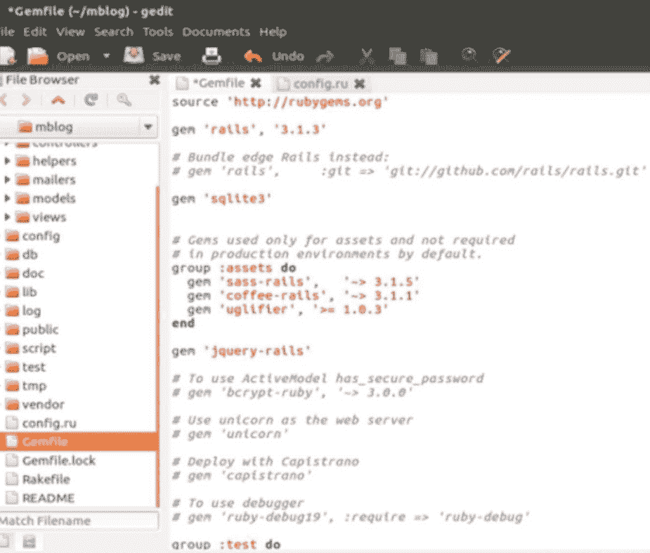


只有你可以使用 `cursor` 和模式。此外，不支持插件，它的功能并不全，就像 `VIM` 一样。我们现在将在实操环节查看所有这些内容，然后进入 `Ubuntu` 查看所有这些功能。现在我将打开一个 `hello world` 示例来向你们展示 `VI` 的所有功能。所以这是我们普通的 `VI` 吗？看，这段代码没有语法高亮，现在它处于命令模式。要开始输入，我们需要按 `i`。然后我们才能开始使用键盘打字，现在光标移动已启用，因为我们处于命令模式。现在一旦开始输入，我们就不能使用光标方向键了。现在我会按它。要进入追加模式，我会使用 `a`。现在我可以使用 `i` 命令进入插入模式，再次按回车，如果你愿意，可以写任何内容，比如打印 `Hello`。现在我们将看到如何复制粘贴。假设我想复制这一行。我可以使用 `yy` 命令，然后粘贴，它就会为我粘贴。看它是怎么粘贴的。假设我想删除一行。我可以使用 `dd` 命令删除它。我们将看到一个撤销功能，只允许撤销一次。看，我们不能撤销超过一次，至于保存，我们可以使用 `w` 命令，它会保存。

```c
#include <stdio.h>

int main() {
    printf("Hello \n");
    printf("Hello \n");
    return 0;
}
```

现在我们可以使用 `q` 命令退出此窗口。这只是 `VI` 的基础。开始练习它，因为它在嵌入式平台上是必需，因为你找不到 `VIM` 编辑器，所以也开始练习这个。但为了开发目的，我们将使用 `VIM` 编辑器，因为 `VIM` 非常用户友好并且具有语法高亮。

## 编辑器 (VIM)

我们将讨论 `VIM` 编辑器。由于我们已经涵盖了 `VI` 编辑器，所以我们将看到 `VI` 与 `VIM` 有何不同。让我们从 `VIM` 的功能开始，查看一些命令。之后，我们将针对我们的目的直接编辑 `VIM` 文件。我们将从功能开始。从功能性来说，`VIM` 几乎是 `VI` 的一个真正的超集。因此，`VI` 中的所有内容在 `VIM` 中都是可用的。这可能预装也可能没有。它非常强大，但需要更多的磁盘空间。这就是为什么通常在嵌入式 Linux 操作系统中找不到它。但为了开发目的，我们将使用 `VIM` 编辑器而不是 `edit` `nano` 或 `VI`，因为正如已经讨论过的，它是这四个编辑器中最功能强大的。

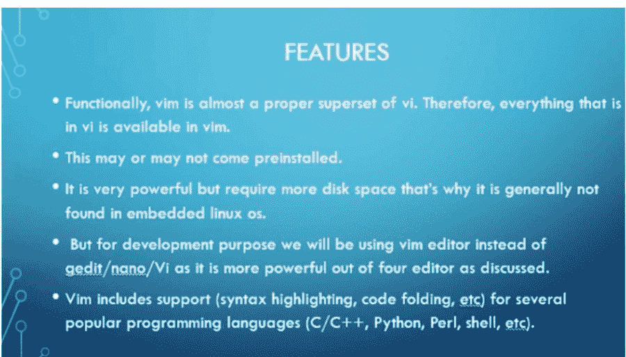

`VIM` 包含了对语法高亮、代码折叠等支持。它适用于大多数流行的编程语言。它与 `Cscope` 和 `ctags` 集成。这些内容稍后我们会介绍。`Cscope` 和 `ctag` 基本上用于代码搜索，非常强大。没有它们，你无法解析非常大的代码。因此使用 `VIM`，我们可以集成 `Cscope` 和 `ctag`。`VIM` 包含多级撤销和重做。在 `Vi` 中，我们看到没有提供多级撤销和重做，但在 `vim` 中是可用的。`VIM` 允许为了编辑目的拆分屏幕。因此，使用 `VIM`，我们实际上可以将屏幕分成两个并行窗口。`VIM` 无法编辑 `zip`、`tar` 等压缩归包内部的文件。我们也可以用它来区分两个文件。它被用于编辑，甚至是编辑二进制文件。我们可以使用 `VIM` 编辑甚至二进制文件。它包含了对插件的支持，以及对配置和启动文件的最终控制。现在我们将看到一些基本命令，之后我们将进入实操环节，在那里我们将运行 `VIM` 命令。光标移动由方向键控制。

* `Vim` 与 `cscope` 和 `ctags` 集成。
* `Vim` 包含多级撤销/重做。
* `Vim` 允许拆分屏幕以编辑多个文件。
* `Vim` 可以编辑压缩归包（`zip`, `tar`, 等）内部的文件。
* `Vim` 包含了内置的 `diff` 用于比较文件 (`vimdiff`)。
* `Vim` 可以显示并编辑甚至是二进制文件。
* `Vim` 包含了对插件的支持以及对启动文件的更精细的控制。

可以使用普通的删除键或退格键来删除字符。可以通过 `dd` 命令完成删除行。同样复制行也是如此。你可以使用 `yy` 复制，粘贴可以使用 `p` 命令，并且存在模式切换，正如我们在 `VI` 项目中已经讨论过的样，使用 `escape` 和 `insert` 我们可以切换模式，从命令模式切换到写入模式，然后使用 `q` 命令退出。你现在退出 `Vim`。如果你想在不保存的情况下退出，只需输入 `:q!`。你可以使用 `w` 命令保存文件。同样，在 `VIM` 内部搜索，你可以使用斜杠命令，并且我们已经看到了拆分等功能。拆分有两种类型：一种是水平拆分，另一种是垂直拆分。到为止，水平拆分我们可以给出 `split` 命令，而垂直拆分我们可以使用 `vsplit` 命令。

```
* 不保存退出: q!
* 保存文件: w
* 文本搜索: /
* 拆分: split (水平) 和 vsplit (垂直) 命令。然后你可以使用 Ctrl-W 方向来切换窗口（方向是方向键之一）。
* 快速查表: http://vimsheet.com/
```

实际上，你可以使用 `control w` 方向从此拆分窗口的一个窗口切换到另一个窗口，其中方向是方向键之一。所以现在你看到一个方向键之一。一个窗口......到到到到到....to..to......... to... 的方向键..，我们能够上下移动。

不要仅仅局限于这些命令。你可以使用这些内容进行基础编辑。最好你们大家去练习所有这些内容。通过练习，你将获得实践经验，并对 `VIM` 编辑器感到游刃有。

## 版本控制 (GIT)

我们将讨论 `GIT`。让我们让我们开始吧。我们将从 `GIT` 的特性开始。`Git` 是一个版本控制系统，用于跟踪计算机文件的更改，并协调多个人对这些文件进行协同工作。就像 `SVN` 一样，它主要用于软件开发中的源代码管理，但它也可以用于跟踪任何一组文件的更改。`Git` 比 `SVN` 更强大，在大多数开源项目中都非常常见。现在在进入实际操作之前，我们先来看一些基础命令。首先必须要做的事情是，我们需要使用 `git config --global user.name` 和 `git config --global user.email` 配置我们的用户名和邮箱 ID。下一步是我们需要创建一个仓库（`repo`）。如果不创建仓库，我们就无法在 `git` 中进行任何事情。为此，我们可以使用 `git init`。现在如果仓库已经存在，我们可以从本地或远程克隆（`clone`）它。到为止克隆本地仓库的命令是 `git clone <path_of_repo>`。如果你正在克隆远程仓库，我们需要提供用户名和主机 IP 地址等额外信息，然后是路径。将文件添加到仓库只需要命令 `git add .`。在将文件添加到仓库后，我们需要对其进行提交（`commit`），只有这样那些更改才会进入仓库。这里有一个概念，在 `git` 中有两个副本，一个是本地副本，另一个是远程副本或服务器副本。如果你执行 `git commit .`，它将存储在你的本地副本中。为了让你的更改进入远程服务器或本地服务器的主分支（`master branch`），我们需要使用 `git push` 或 `git push origin master` 将其推送到（`push`）。现在来检查我们的提交日志。我们可以使用 `git log` 查看我们检出（checked out）了多少代码。同样，还有一个使用 `git status` 命令来检查文件更改状态。还有一点我想说的是，在任何版本控制工具中，不仅是 `git`，在 `SVN` 或任何其他版本控制工具中，都有分支（`branch`）的概念。因此我们可以创建多个分支并并行工作。检出分支可以使用 `git checkout <branch_name>` 完成。所以我们可以检出任何分支并开展工作。现在我将进入实操环节并展示所有这些内容。为此，我将进入 `Ubuntu`，我们将看到如何操作。首先，我将创建一个名为 `git_test` 的文件夹，并在那里执行所有命令。我创建了一个文件夹：`git_test`。现在我把我们普通的 `hello.c` 程序复制到这个文件夹中，并进行所有与 `git` 相关的操作。

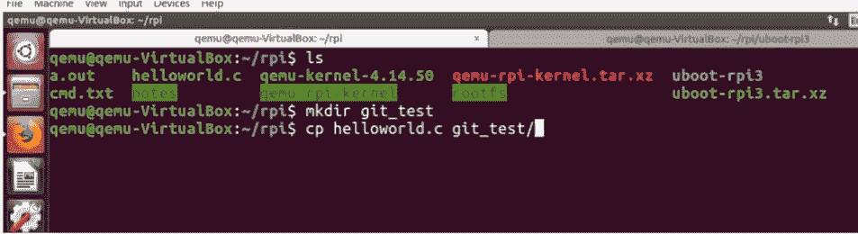

文件 视图 输入设备 帮助

```
qemu@qemu-VirtualBox: ~/rpi
qemu@qemu-VirtualBox:~/rpi$ ls
a.out helloworld.c qemu-kernel-4.14.50
cmd.txt qemu-pi-kernel.gz
qemu@qemu-VirtualBox:~/rpi$ mkdir git_test
qemu@qemu-VirtualBox:~/rpi$ cp helloworld.c
```

```
qemu@qemu-VirtualBox: ~/rpi/uboot-rpi3
qemu-rpi-kernel.tar.xz uboot-rpi3
root uboot-rpi3.tar.xz
git_test/
```

现在完成了。首先，我们必须要做的事情是设置用户名和邮箱 ID。为此，我将复制那两条命令并设置用户名和邮箱 ID。好了。现在我将进入 `git_test` 文件夹。

# 使用 CTAGS 进行代码解析

我们将使用 `ctags`。让我们从这个功能开始吧。`Ctag` 是一个用于浏览代码的强大工具。`Ctag` 是一个让你在大型源码项目中轻松导航的工具。它提供了一些可能在 `Eclipse` 或其他 IDE 中习惯使用的功能，我们可以从当前源文件跳转到函数和结构的定义。`Ctags` 还支持 C 以外的许多语言，因此你可能会发现它对未来的项目很有用。现在我将介绍安装和使用方法。要安装 `ctags`，我们可以使用下面的命令。我们将在实操环节中查看这些内容。首先我们来看理论。要使用 `ctags`，进入源码目录并运行以下命令，使用 `ctags -R` 然后加 `*` 或 `.` 生成 tag 文件。这将生成一个 tag 文件。tag 文件是 `ctags` 的核心。通过使用 tag 文件，`ctags` 能够找到函数、结构等的定义。现在如何使用 `ctag` ？使用 `ctag` 有两个非常常用的命令。一个是 `control-right bracket`，它会跳转到函数或结构的定义。第二个是 `control-hyphen t`，这会回到你之前跳转的函数。所以它用于从定义处回到你的原始函数或结构。现在让我们进入实操环节并查看一些用例。现在我将打开 `Ubuntu` 并演示如何使用 `ctag`。为了使用 `ctag`，我们将以 u-boot RPi 代码中的例子为例，让我们开始吧。最好取一个已知的示例。

```
qemu@qemu-VirtualBox: ~/rpi/uboot-rpi3$ ls
api cmd configs drivers fs
arch common disk dts include lib MAINTAINERS snapshot.commit README test
board config.mk doc examples Kbuild net scripts tools
qemu@qemu-VirtualBox:~/rpi/uboot-rpi3$ ls
api cmd configs drivers fs
arch common disk dts include
board config.mk doc examples Kbuild
qemu@qemu-VirtualBox:~/rpi/uboot-rpi3$ 
```

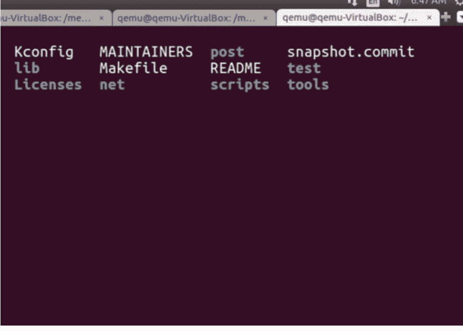

我们将以 `mmc` 驱动为例，这样可以看到里面有 `bcm2835`。我已经讨论过这个用于 Rpi 的芯片组。我先打开它，看看代码内部包含哪些内容。这是可用的代码，我们将看到如何使用它。但在那之前我们需要安装——在 `Ubuntu` 中我们不需要记住任何命令。只需输入该命令，如果不可用，它会给你提示。我们将使用 `ctags`，看，它正在提示你如何安装 `ctag`。幻灯片中也高亮了相同的内容。我们将直接从命令行提示安装它：`ctags`。现在正在安装 `ctags`，完成后我们就可以使用 `ctags`。现在安装完成，首先我们需要从源码目录（源码根目录）生成 tag。这是我们 u-boot 的根目录。我们将使用 `ctags -R *` 生成 tag 列表。完成后会生成 tag 列表。我可以向你展示生成了一个 tag 文件。

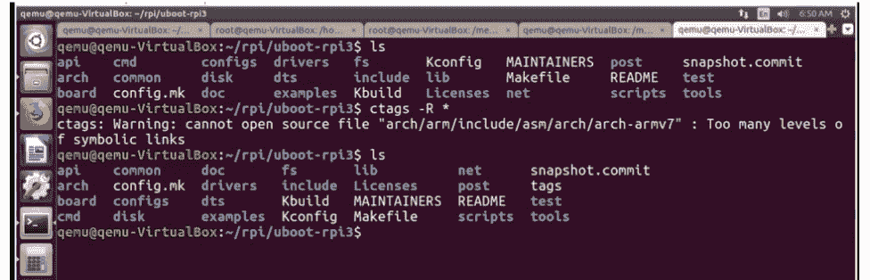

```
qemu@qemu-VirtualBox: ~/rpi/ ...
qemu@qemu-VirtualBox:~/rpi/uboot-rpi3$ ls
api cmd configs drivers fs
arch common disk dts include lib
board config.mk doc examples Kbuild Lic
qemu@qemu-VirtualBox:~/rpi/uboot-rpi3$ ctags -R *
ctags: Warning: cannot open source file "arch/arm" -f symbolic links
qemu@qemu-VirtualBox:~/rpi/uboot-rpi3$ ls
api common doc fs lib
arch config.mk drivers include Licenses
board configs dts Kbuild MAINTAINERS
cmd disk examples Kconfig Makefile
qemu@qemu-VirtualBox:~/rpi/uboot-rpi3$
```

```
nfig MAINTAINERS post snapshot.commit
enses net README test
Makefile net scripts tools
/include/asm/arch/arch-armv7" : Too many levels o
net snapshot.commit
post tags
README test
scripts tools
```

我们可以通过 `ls` 命令看到它。这就是你的 tag。现在我们可以从 `VIM` 本身运行 `ctag` 功能。首先我将打开文件。只需打开这个文件。好的，现在我们来看。假设我想看这个函数的定义 `bcm_2835_raw_writel`。只需点击这一个。将光标移动到那里，然后按 `control-right bracket`，看，我们能够跳转到这个函数。这就是 `ctags` 的工作原理。我们可以再次使用 `control T` 命令回到原始源码。

## 示例代码

使用 Opt Lib 文件：

Opt Lib 文件是用 C 语言编写的配置文件，用于为特定的文件格式或语言定义自定义解析器。这种方法需要 C 编程知识来编写解析器逻辑。这里是通用大纲：

- 创建一个 `.ctags` 扩展的文件（例如 `custom_parser.ctags`）。
- 在文件内部，定义函数来处理代码格式解析的不同方面，例如识别关键字、函数和变量。

```c
// custom_parser.ctags
#include <stdio.h>
#include <string.h>

// This is a mock parser
int custom_parser(FILE *fp, const char *filename) {
    // Logic would go here
    return 0;
}
```

利用现有解析器：

Opt Lib 文件是用 C 语言编写的配置文件，用于为特定的文件格式或语言定义自定义解析器。这种方法需要 C 编程知识来编写解析器逻辑。这里是通用大纲：

- 创建一个 `.ctags` 扩展的文件（例如 `custom_parser.ctags`）。
- 在文件内部，定义函数来处理代码格式解析的不同方面，例如识别关键字、函数和变量。

```c
// custom_parser.ctags
#include <stdio.h>
#include <string.h>

// This is a mock parser
int custom_parser(FILE *fp, const char *filename) {
    // Logic would go here
    return 0;
}
```

对于两种方法，请参考 `ctags` 文档 https://docs.ctags.io/en/latest/man/ctags.html 了解详细信息和可用选项。

# 使用 CTAGS 进行代码解析

应用于 C++ 文件。但在此我们讨论 C++ 的功能。`cscope` 是一个浏览代码的强大工具。它是和 `ctags` 类似的另一个工具，可以用于探索包含源码和头文件的目录。这种方法涉及到使用 `ctags` 选项来控制解析行为。这里有一些你可能会觉得有用的选项：

- `--kinds`: 指定让 `ctags` 识别的元素类型（例如函数、变量）。
- `--regex`: 使用正则表达式识别特定的模式。
- `--exclude`: 从解析中排除特定的行或模式。

记住：参考 `ctags` 文档 https://docs.ctags.io/en/latest/man/ctags.html 了解详细信息和可用选项。

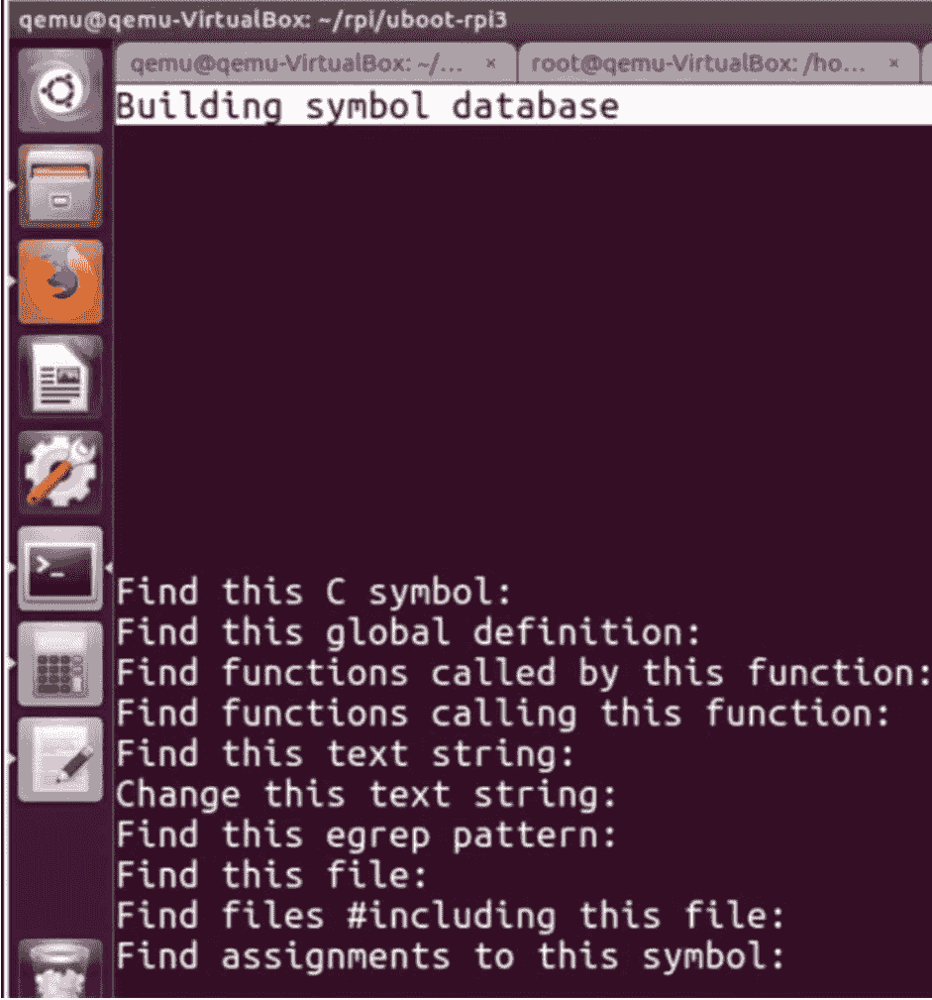

为此，我们需要打开并查看该文件中包含哪些内容。我将打开同一个文件 `driver mm`，然后是 `bcm` 相关的文件。那就是我们 Rpi 相关的 SD 卡文件。

# qemu-VirtualBox: -~/pi/uboot-rpi3


```text
# This code was extracted from:
# git@github.com/gonzou/u-boot-git master
# and hence presumably (C) 2012 Oleksandr Tymhenko

# Tweaks for U-Boot upstream
# (C) 2012 Stephen Warren

# Portions (e.g. read/write macros, concepts for back-to-back register write
# timekernel) mostly extracted from the Linux kernel at:
# https://github.com/raspberry/linux rpi-3.6.y

# The Linux kernel code has the following (C) and license, which is hence
# propagated to Oleksandr's tree and:

# Support for SDH device on 2835
# Based on sdhci-bcm2708.c (C) 2010 Broadcom

# This program is free: you can distribute it and/or modify
# under the terms of the GNU General Public License version 2 as
# published by the Free Software Foundation.

# This program is distributed in the hope that it will be useful,
# BUT WITHOUT ANY WARRANTY; without the implied warranty of
# You have received a copy of the GNU General Public License
# along with this program; if not, write to the Free Software
# Foundation, Inc., 675 Main Ave, Cambridge, MA 02139, USA.
# /

# * Supports:
# drivers/mm/bcm2835 sdhci.c 244L, 6838C
```

我们将打开这个文件，并使用 `cscope` 查看可以看到哪些函数。我们将直接取这一个看看它是如何运行的？我们将复制这个函数。现在我们将去寻找全局定义。但 `cscope` 支持许多功能，我们可以利用所有这些功能，比如什么是全局定义、谁在调用它、从哪里调用的等。但作为示例，我将展示如何使用 `cscope`，然后我放入这个并尝试看看它是否能被找到。看它是如何快速地进入该函数的定义并在 `VIM` 中打开的。所以就像普通的编辑器一样，你可以使用 `VIM` 来解析代码。返回回去，一旦完成工作你可以返回，你需要退出 `VIM`，为此我们将输入命令 `q`，这已经在 `VIM` 中涵盖过了。我们回到了原来的 `cscope` 窗口。

## 示例代码

1. 使用 `ctags` 进行预处理：

`Cscope` 依赖 `ctags` 来生成代码中符号的数据库。你可以在代码库目录上运行 `ctags`。

```bash
tags -R .. # 递归扫描当前目录及其子目录 (..)
```

请谨慎使用代码。

2. 构建 `Cscope` 数据库：

一旦你拥有了 `ctags` 数据库，就使用 `cscope` 创建它自己专门为代码导航设计的数据库。

```bash
cscope -b -q # 在静默模式 (q) 下构建数据库 (b)
```

请谨慎使用代码。

3. 使用 `Cscope` 进行代码导航：

构建数据库后，你可以使用各种 `Cscope` 命令来导航你的代码。这里是一些示例：

查找符号的引用：

```bash
cscope find f <symbol_name> # 查找符号 <symbol_name> 的所有引用（函数、变量等）
```

查找函数定义：

```bash
cscope find g <function_name> # 查找名为 <function_name> 的函数定义
```

查找包含特定头文件的文件：

```bash
cscope find i <header_file_name> # 查找包含头文件 <header_file_name> 的所有文件
```

请记住：

这是一个基础示例。`Cscope` 为你探索代码库还提供了许多更多功能。你可以将 `Cscope` 与各种编辑器或 `IDE` 集成，以获得更无缝的体验。请参阅 `Cscope` 帮助页（`man cscope`）或在线资源以获取有关可用命令和选项的详细信息。

# 嵌入式平台基础

在深入研究嵌入式平台之前，我们将理解嵌入式平台的一些基本概念。让我们开始吧。基本上有三种类型的嵌入式设备：一种是微控制器，然后是实时处理器和应用处理器。所以你将首先理解什么是嵌入式平台：软件和硬件的结合。

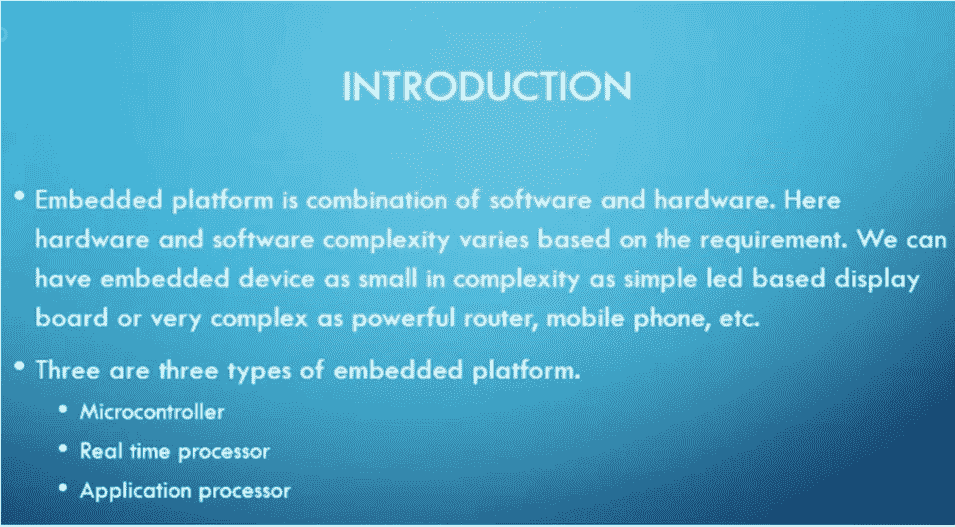

- 嵌入式平台是软件和硬件的结合。在这里，硬件和软件的复杂度根据需求而异。我们可以有复杂度上小到简单的 LED 显示板，或非常复杂的路由器、手机等这样的嵌入式设备。

- 有三种类型的嵌入式平台：
    - 微控制器
    - 实时处理器
    - 应用处理器

在这里，硬件和软件的复杂度根据需求而异，我们可以有复杂度上小到简单的 LCD 显示板，或非常复杂且强大的路由器和手机等这样的嵌入式设备。现在我们将什么是裸机代码（bare metal code）。裸机代码是指不需要任何其他（如引导加载程序或内核）即可运行的代码。它是以顺序方式运行的一段代码。微控制器是一个集成电路，专门用于执行一个任务并运行特定的应用程序，这与处理器可以同时执行多个任务的特点不同。

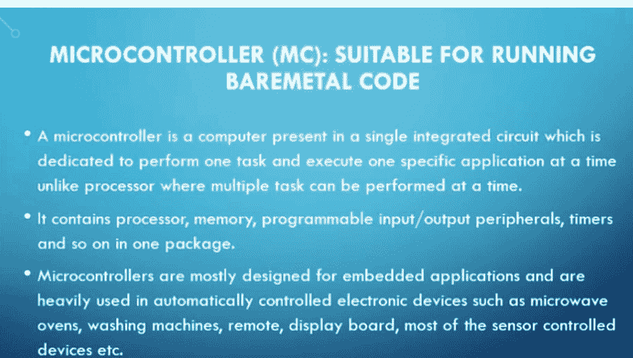

它在一个封装内包含内存、外设、定时器等。这意味着一个芯片就包含了所有所需的输入输出功能。微控制器主要设计用于嵌入式应用，并广泛用于自动控制设备，如微波炉、洗衣机、传感器控制设备等。它是一种适用于特定目的的低成本设备。功耗低于 `Intel` 和 `ARM` 等处理器。

- 它是适用于特定目的的低成本设备。
- 功耗低于 `Intel` 和 `ARM` 等处理器。
- 它是为了特定目的而设计的，因此对于某些任务微控制器是好的，但对于其他不是。
- 有些适用于多个 `GPIO`，有些适用于网络，有些适用于存储设备如 `SD` 卡或 `USB` 等。
- 示例包括 `8051`、`PIC`、`AVR`，`ARM` 也可以运行我们的应用程序。它是为了特定目的设计的，因此对于某些任务微控制器是好的，但对于其他不是。最好的例子是假设你正在运行洗衣机，控制器将不同；如果你正在运行 `LCD` 显示板，控制器也将不同，因为这取决于所需的 `IO` 数量、所需的设施，有些需要不同的 `IO`，有些需要 `ADC`，有些需要内部内存等。因此我们需要根据需要选择。这意味着微控制器有不同的尺寸和容量。有些可见的 `GPIO` 引脚很少。有些尺寸很大。例如你的、`PIC`、`AVR` 和 `ARM`。你们在大学时代可能已经用过 `PIC`。`ARM` 也是微控制器级别的。为此，你需要选择一个真正提供微控制器特性的 `ARM` 系列。其他系列具有处理器的特性。

现在我们来看实时处理器。它基本上设计用于运行你的 `RTOS`。`RTOS` 指的是实时操作系统，我们在固定的时间范围内需要完成任何任务。实时系统的典型示例包括空中交通控制系统、防御系统、指挥控制系统等。基本上 `RTOS` 只运行在 `RTP` 上以优化性能。如果你运行任何普通代码或裸机代码，你将获得那种性能。

`RTOS` 基本上有两种类型。一种是硬实时 `RTOS`。另一种是软实时 `RTOS` 的形式。我们将理解这两种东西。我们将学习何时需要使用硬实时 `RTOS`，以及何时需要使用形式或软实时 `RTOS`。硬实时意味着你必须绝对赶上每一个截止时间（deadline）。极少数系统有此要求。示例包括核能系统、某些医疗应用（如起搏器）、大量的国防应用、航空电子设备等。现在我们将看到软实时系统的形式。在这里，我们可以错过一些截止时间，但如果错过的次数太多，性能最终会退化。

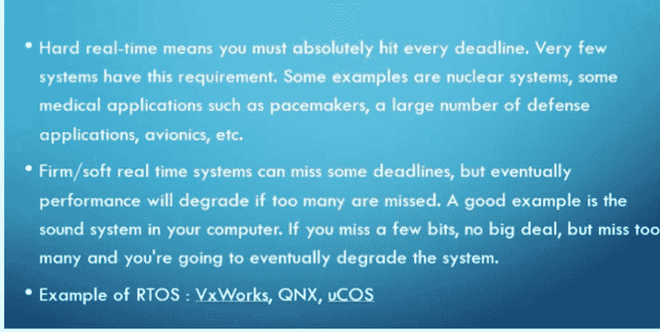

一个很好的例子是你电脑上的音响系统。如果你错过了一个节拍或几个比特（bits），并大碍。但错过过多可能会降低系统质量，你可以在某些音乐系统中分析出或听出这一点。如果你的声音出现很多问题，意味着你错过了太多的比特。`RTOS` 的示例有：

`VxWorks`、`QNX` 和 `Ucos`。`VxWorks` 非常流行且强大。它基本上用于国防、航空航天等领域，但非常非常贵。我们需要购买它的许可证。

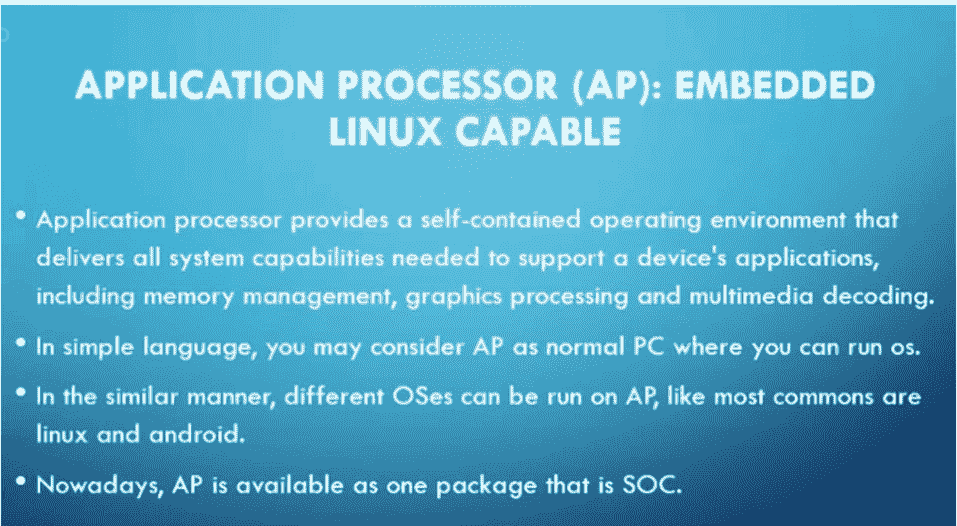

- 应用处理器（Application processor）提供了一个自包含的运行环境，提供支持设备应用所需的所有系统能力，包括内存管理、图形处理和多媒体解码。
- 简单来说，你可以将 `AP` 考虑为可以运行操作系统的普通 `PC`。
- 同样，`AP` 上可以运行不同的操作系统，最常见的是 `Linux` 和 `Android`。
- 如今，`AP` 以 `SOC`（片上系统）这一单一包的形式提供。

现在我们将转向应用处理器，这将是我们接后项目的主要目标。我们将仅在嵌入嵌入式 `Linux` 系统上工作。因此，应用处理器基本上设计用于运行一个具有类操作系统能力的完整独立系统。处理器提供了一个自包含的运行环境，提供支持设备应用所需的所有系统能力，包括内存管理、图形处理和多媒体解码。简单来说，你可以将 `AP` 视为可以运行不同操作系统的普通 `PC`。同样，不同的操作系统可以运行在 `AP` 上。

- `SoC` 是 `System on a Chip`（片上系统）的缩写，是一种将计算机所有主要组件集成到单个芯片上的集成电路。将你的 `CPU`、显卡、内存控制器和其他组件全部合入一个芯片中，这本质上就是一个 `SoC`。
- 有许多应用处理器供应商。其中最著名的是 `Nvidia`（英伟达）及其五核 `Tegra` 处理器、`Qualcomm`（高通）的 `Snapdragon`，以及三星的 `Exynos` 系列。许多廉价智能手机由 `MediaTek`（联发科）处理器驱动。
- 非智能手机移动设备如 `Kindle Fire` 平板使用德州仪器（Texas Instruments）名为 `OMAP`（开放多媒体应用平台）的应用处理器。

最常见的是 `Linux` 和 `Android`。如今，`AP` 以 `SOC` 的包形式提供。所以现在我们将理解什么是 `SOC`？`SoC` 是一种片上系统。片上系统意味着它会将另一个核心与 `ARM` 结合，例如你可以将你的图形单元和微控制器 ID 等合并到一个芯片中，它将包含所有功能封装在一个芯片内。如今，大多数手机都是智能手机。有许多应用处理器供应商，如 `Tegra`、`mediaTek` 等。它们为你提供 `SOC`。非智能手机设备也提供这一功能，如 `Kindle Fire` omap。`OMAP` 是一个 `TI` 处理器。我们将使用的这种处理器的一个最佳例子是你的 `beaglebone black`。`Beaglebone black` 是 `TI` 提供的 `SOC`。

## 低预算嵌入式板

我们将学习低预算嵌入式板，即 `Beaglebone black` 和 `RPi`，所以这两块板在市场上非常常见，而且在社区方面，对这两块板都有非常好的支持。现在我们将从 `beaglebone black` 开始，看看它的某些功能。之后我们将转向 `RPi`。让我们从 `beaglebone black` 开始吧。`Beaglebone black` 是面向开发者和爱好者的低成本、社区支持的支持板。在这里我们可以在几秒内启动 `Linux`。现在我们将查看板载功能。处理器方面，它有一个 `1GB ARM cortex-A`，并且具有 `1GB` 的 `DDR RAM`。它支持板载位 `EMC` 加存储。我们将理解什么是 `EMMC`。有两个术语。一个是 `EMC`，另一个是 `mm`。`MMC` 是普通的 `SD` 卡，但 `EMMC` 和 `MMC` 之间有细微区别。`EMMC` 基本上是板载 `MMC`。它是为了更快的处理以及避免在拔出和弹出 `SD` 卡时丢失任何数据而设计的。然后它用于视频处理的 `D` 图形加速器。它具有 `neon` 浮点加速器，用于你的浮点相关操作，如果你在谈论任何使用浮点数的数学计算，那么这个核心就可以使用。它还有 `PRU` 核心，那是你的微控制器，我们可以在其中运行

### BEAGLEBONE BLACK

- `Beaglebone Black` 是一个面向开发者和爱好者的低成本、社区支持的开发平台。在 `10` 秒内启动 `Linux`，仅需一根 `USB` 线即可在 `5` 分钟内开始开发。
- 处理器：`AM335x 1GHz ARM® Cortex-A8`
- `512MB DDR3 RAM`
- `4GB 8-位板载 eMMC`
- `3D` 图形加速器
- `NEON` 浮点加速器
- `PRU` 核心
- `Beaglebone Black` 是一个面向开发者和爱好者的低成本、社区支持的开发平台。在 `10` 秒内启动 `Linux`，仅需一根 `USB` 线即可在 `5` 分钟内开始开发。处理器：`AM335x 1GHz ARM® Cortex-A8`
- `512MB DDR3 RAM`
- `4GB 8-位板载 eMMC`
- `3D` 图形加速器
- `NEON` 浮点加速器
- `PRU` 核心
- `Beaglebone Black` 是一个面向开发者和爱好者的低成本、社区支持的开发平台。在 `10` 秒内启动 `Linux`，仅需一根 `USB` 线即可在 `5` 分钟内开始开发。处理器：`AM335x 1GHz ARM® Cortex-A8`
- `512MB DDR3 RAM`
- `4GB 8-位板载 eMMC`
- `3D` 图形加速器
- `NEON` 浮点加速器
- `PRU` 核心

一个面向开发者和爱好者的低成本、社区支持的开发平台。在 `10` 秒内启动 `Linux`，仅需一根 `USB` 线即可在 `5` 分钟内开始开发。处理器：`AM335x 1GHz ARM® Cortex-A8`、`512MB DDR3 RAM`、`4GB 8-位板载 eMMC`。它具有用于视频处理的 `3D` 图形加速器、用于数学计算的 `NEON` 浮点加速器以及作为微控制器的 `PRU` 核心。它是 `TI` 提供的自包含环境 `SOC`。在 `10` 秒内启动 `Linux`，仅需一根 `USB` 线即可在 `5` 分钟内开始开发。处理器：`AM335x 1GHz ARM® Cortex-A8`、`512MB DDR3 RAM`、`4GB 8-位板载 eMMC`。它具有 `3D` 图形加速器、`NEON` 浮点加速器和 `PRU` 核心。连接包括用于键盘和鼠标的 `USB` 主、以太网和用于显示器的 `HDMI`。它有 `GPIO`、`IC`、`SPI` 和 `UART`。它支持 `Debian`、`Android` 和 `Ubuntu`。

`Beaglebone Black` 是一个面向开发者和爱好者的低成本、社区支持的开发平台。在 `10` 秒内启动 `Linux`，仅需一根 `USB` 线即可在 `5` 分钟内开始开发。处理器：`AM335x 1GHz ARM® Cortex-A8`、`512MB DDR3 RAM`、`4GB 8-位板载 eMMC`。它具有 `3D` 图形加速器、`NEON` 浮点加速器和 `PRU` 核心。


它是基于最新的 `ARMv7` 处理器构建的。该型号比其前代更快，具有改进的电源管理，并带有无线和蓝牙。芯片组是 `Broadcom`，`CPU` 是四核。它支持图形引擎和 `2GB RAM`。

`Raspberry Pi` 比 `beaglebone black` 有更多功能。它有以太网、用于键盘和鼠标的 `USB` 主，并支持用于刷镜像和操作系统的 `MicroSD` 卡。支持无线（`WiFi` 和蓝牙）。它是一个完整的独立开发板，带有 `GPIO` 引脚、`IC`、`SPI` 和 `UART`。它具有用于显示器的 `HDMI` 支持。软件兼容性包括 `Debian`、`Android`、`Ubuntu`、`Kali Linux` 和 `FreeBSD`。

| `Ubuntu MATE` | `Snappy Ubuntu Core` |
|---|---|
| `Windows 10 IoT Core` | `OSMC` |
| `LibreLEC` | `PINEt` |

现在我们回到幻灯片。这就是树莓派（`Raspberry Pi`）的外观。中心是一个 `Broad通` 处理器，然后是你的 `HDMI` 接口。同样，看这里有四个 `USB` 端口，可以用来连接键盘和鼠标。这是你的以太网口。这是你的普通音频接口。这是你的 `GPIO` 引脚。现在我们来看看如何选择开发板。我们将进入这一节。我们已经看了两块板子，但仍然不知道应该买哪一个或研究哪一个。为了这一点，在购买任何板子（不仅是 `beaglebone black` 或树莓派）之前，我们需要考虑几点。这是一个通用的概念。

首先是社区支持。从学习和开发的角度来看，这是最重要的一点。在这种情况下，`beaglebone black` 比 `RPI` 好。在这里我们可以获得从引导加载程序、内核到根文件系统的完整启动支持。如果你对完全从零开始开发感兴趣，`beaglebone black` 更好。它是市市场上最好的。在项目制作功能方面，`RPi` 比 `beaglebone black` 更好，因为它提供了许多外设，如 `Wi-Fi`、蓝牙、四个 `USB` 端口、音频、`HDMI` 等。这意味着它可以作为一台具有所有功能的独立电脑。我们已经看过了所有这些。此外，它还支持摄像头和显示屏。

成本方面，我们会看到 `RPi` 比 `beaglebone black` 便宜。市场可用性：两者都很容易获得，意味着我们可以选择其中任何一个，以及如何方便地添加外部硬件，如插件支持。插件支持意味着摄像头显示单元、`Wi-Fi`、任何传感器。在这种情况下，`RPi` 的支持比 `BBB` 好。在这里可以很容易地添加插件硬件。

所以现在由你来选择。我已经为你提供了充足的信息，你可以分析并思考哪一个更好。市面上还有比这二样东西更便宜的设备。但在购买这两样东西之前，我们需要看看结合价格、功能以及许多其他因素，哪一个是更容易获取的。

## 串口通信 (`MINICOM`, `PUTTY`, `TERATERM`)


我们将讨论这三次。有很多术语和字符，所以我将尝试理解这三项内容是什么。让我们从用于连接板子与 `PC` 以访问板子控制台的基础串口通信开始。使用像 `Putty` 和 `Minicom` 这样的 `CLI` 程序，我们已经讨论过它的控制台是什么，以及我们如何连接到我们的任何板子。现在来看看这三个术语是什么。

如果我们谈到 `Putty`，它是 `Windows` 和 `Linux` 中的每个层级，但这个术语对于 `Bali` 来说是每个级别。我们知道在 `Linux` 中，`minicom` 是访问任何串口控制台的非常流行的工具。这就是为什么我们现在将主要关注它，并进行安装和它的含义。

首先，我们需要安装 `minicom`，因为这在大多数发行版中并不是默认安装的，启动后它不会运行。所以让我们回到第 1 和第 2 步，完成这里发生的所有事情。如果你输入 `minicom`，它不会允许你启动。这里我还有想告诉的一点，如果已经安装了，你可以启动它。若要进行安装，只需输入 `sudo apt-get install minicom`，如果已经是最新版本它就不会下载，否则它会提示你下载，因为它在我的 `PC` 上是可用的，它没有要求下载。

首先，我们需要为你的串口设置 `minicom`，现在我们来看看如何为我们的 `cdev` 设备设置它。首先，我们需要带权限打开 `minicom`。我已经讨论过什么是 `root` 权限。它就像 `Windows` 的管理员权限。现在我们将启动 `minicom` 来启动 `minicom`。

```
File Menu View Input Devices Help
$ qemu@qenu-VirtualBox:~/rpi/test_cmd$
$ qemu@qenu-VirtualBox:~/rpi/test_cmd open /ttyUSB0
$ qemu@qenu-VirtualBox:~/rpi/test_cmd$ minicom
minicom: cannot go to /tty8: Permission denied
$ qemu@qenu-VirtualBox:~/rpi/test_cmd$ sudo apt-get install minicom
[sudo] password for qemu:
Reading package lists... Done
Building dependency tree
Reading state information... Done
minicom is already at the newest version (2.7-5ubuntu4build0.16.04.1)
The following packages have been removed and are no longer required:
linux-headers-4.15.0-29-generic linux-headers-4.15.0-29-generic linux-image-4.15.0-29-generic linux-modules-4.15.0-29-generic linux-modules-extra-4.15.0-29-generic
Use sudo autoremove to remove them.
0 upgraded, 0 newly installed, 74 to remove and 77 not upgraded.
qemu@qenu-VirtualBox:~/rpi/test_cmd$ sudo minicom
```

我们需要给 `sudo minicom` 空间高权限。按回车键。现在我们需要进入配置（`configure`）来设置我们需要知道的几件事：你的串口设备是什么，然后是波特率，我们可以为我们的板子设置它。基本上所有的波特率。大多数板子都支持 `115200` 波特率。

| 选项 | 设置 |
|---|---|
| A - 串口设备 | `/dev/tty0` |
| B - 锁文件位置 | `/var/lock` |
| C - 调用程序 | |
| D - 调制程序 | |
| E - 波特/位 | `1152008N1` |
| F - 硬件流控 | `No` |
| G - 软件流控 | `No` |

一个按 `Z`，一个按 `A` 即可退出 `minicom`。我们需要按 `A` 退出。如果你想退出 `minicom`，它会关闭。这就是 `minicom` 的样子。这里我还有想告诉你的，我们如何选择串口设备，它会进入另一个窗口。只需输入信息。然后获取，你就能看到串口设备是否连接到你的系统。如果你使用笔记本电脑连接，基本上你会得到 `USB0` 或 `USB1`。

## 网络通信 (SSH, SCP, WINSCP, TFTP)

我们将讨论三次网络通信。网络通信中有四个主要的工具可以评估，我们指的是 `SSH` 和 `SCP`。现在我们逐一查看这四项。

- 让我们从基础的 `SSH` 开始：它用于与主机和目标端口或一个网络进行通信。
- `SCP` 用于在主机和目标之间传输文件和文件夹。
- 然后 `TFTP` 用于从 `FTB` 服务器下载文件。

现在从分发版的角度来看，就像在 `Windows` 中一样。`Linux` 的层级有什么工具？`Windows` 的层级有什么工具？`Putty` 和 `WinSCP` 适用于每个层级。如果你想使用此功能，可以直接使用 `Putty`，你可以通过网络与目标进行通信并发送文件。这就是 `Linux` 中的 `NSP`。我们不需要直接使用任何工具。你可以使用 `SSH` 或 `SCP`。现在正如我所说，我们将直接执行第 1 和第 2 步并运行这些命令，看看 `SSH` 和 `SCP` 是如何工作的。现在我将从 1-2 步开始安装 `SSL` 服务器。我们需要通过它很好地安装 `OpenSSL` 服务器。现在呈现，它开始安装你的 `OpenSSL` 服务器了。它将安装并启动 `OpenSSL` 服务器，你可以从进程列表中看到。

```bash
qemu@qemu-VirtualBox:~/rpi/ubuntu-rpi3$ sudo apt-get install openssh-server
qemu@qemu-VirtualBox:~/rpi/ubuntu-rpi3$ sudo apt-get install openssh-server
Reading package lists... Done
Reading state information... Done
The following packages have been automatically installed and are no longer required:
linux-headers-4.15.0-29-linux-headers-4.15.0-29-generic linux-4.15.0-29-generic linux-modules-4.15.0-29-generic
The following packages will be removed:
Use sudo apt autoremove to remove them.
sh-ahk risk mully-guard monkeyskeysher
The newly requested packages will be installed.
0 upgraded, 1 newly installed, 0 to remove and 2 not upgraded.
After this operation, 904 KB of disk space will be used.
Get:1 http://archive.ubuntu.com/ubuntu bionic/main amd64/openssh-server-amd64 1.7p2-ubuntu2.6 [335 KB]
Fetched 335 KB in 1 s (452 KB/s)
Setting up archives...
Selecting previously unselected package openssh-server
Preparing to install openssh-server (1.7p2-ubuntu2.6.2.64) (currently installed)...
Preparing to unpack .../openssh-server_1.7p2-ubuntu2.6_ubuntu2.amd64.deb ...
Processing triggers for readdev (0.0.0-19) ...
Processing triggers for libc (2.27-0ubuntu3) ...
Processing triggers for ufw (0.32.1) ...
Configuring openssh-server (1.7p2-ubuntu2.6_ubuntu2.amd64) ...
qemu@qemu-VirtualBox:~/rpi/ubuntu-rpi3$ ps aux | grep ssh
qemu@qemu-VirtualBox:~/rpi/ubuntu-rpi3$ 1873 pts/0    S    00:00 grep --color=auto ssh
qemu@qemu-VirtualBox:~/rpi/ubuntu-rpi3$ 
```

```bash
qemu@qemu-VirtualBox:~/rpi/uboot-rpi3$ sudo apt apt-get
[sudo] password for qemu:
Reading package lists... Done
Building dependency tree
Reading state information... Done
The following packages were automatically installed
linux-headers-4.15.0-29-linux-headers-4.15.0-29-generic
linux-modules-4.15.0-29-generic
Use 'sudo apt autoremove' to remove them.
Suggested packages:
ssh-askpass rrss rssh molly-guard monkeysphere
The following NEW packages will be installed:
openssh-server
0 upgraded, 1 newly installed, 0 to remove and 82 not
Need to get 335 kb of archives.
After this operation, 904 kB of additional disk space
Get:1 http://archive.ubuntu.com/ubuntu xenial-upd
Fetched 335 kb in1s (215 kb/s)
Preconfiguring packages ...
Selecting previously unselected package openssh-serv
(Reading database ... 294521 files and directories)
Preparing to unpack .../openssh-server_1%3a7.2p2-4ub
Unpacking openssh-server (1:7.2p2-ubuntu2.6)
Processing triggers for ureadhead (0.100.0-19)
Processing triggers for systemd (229-ubuntu21.0)
Processing triggers for ufw (0.35-ubuntu2)
Processing triggers for man-db (2.7.5-1)
Setting up openssh-server (1:7.2p2-ubuntu2.6)
qemu@qemu-VirtualBox:~/rpi/uboot-rpi3$ ps -ax | grep
1837 ? Ss 0:00 /usr/sbin/sshd
1873 pts/17 S+ 0:00 grep --color=auto ssh
qemu@qemu-VirtualBox:~/rpi/uboot-rpi3$ 
```

如果这个 `qemu` 进程没有运行，你就无法使用某项功能。现在我们将看看如何使用它。我们将查看幻灯片并尝试理解让成功运行所需的参数。我们需要一个用户名，然后是服务器 `IP`。对于 `CFP Mali` 的东西也是一样。我们需要一个额外的文件或文件夹。如果你正在为 `fuller` 进行通信，我们需要传递 `-r` 后面跟文件夹名。现在我们将进入 0 1 2 并查看如何操作。由于我们没有任何外部 `SSL` 服务器，我们将在本地尝试所有这些命令。`127.0.0.1` 是你的本地 `IP` 地址，你可以进入控制台。这里我们在想这是否在运行。为此，我们需要提供，因为 `SSL` 调查正在运行，为了验证这一点，将退出此项并在 `sudo` 下作为 `EDC` 在每个点，然后设置并停止。现在我们的服务器已停止。我们无法再次访问连接到它的主机。现在看，你遇到了像这样的错误，是因为我们的服务器没有正常工作。`copy` 也是如此。来，首先我们需要启动。真的，首先我们需要启动。

```bash
qemu@qemu-VirtualBox:~/rpi/ubuntu-rpi3$ sudo apt-get install openssh-server
qemu@qemu-VirtualBox:~/rpi/ubuntu-rpi3$ sudo apt-get install openssh-server
读取软件包列表... 完成
读取状态信息... 完成
以下软件包已自动安装，但不再需要了：
linux-headers-4.15.0-29-linux-headers-4.15.0-29-generic linux-4.15.0-29-generic linux-modules-4.15.0-29-generic
以下软件包将被移除：
使用 `sudo apt autoremove` 来删除它们。
sh-ahk risk mully-guard monkeyskeysher
新请求的软件包将安装：
0 个升级，1 个新安装，0 个移除，2 个未升级。
在此操作后，将使用 904 KB 的磁盘空间。
Get:1 http://archive.ubuntu.com/ubuntu bionic/main amd64/openssh-server-amd64 1.7p2-ubuntu2.6 [335 KB]
在 1 秒内获取了 335 KB (452 KB/s)
正在设置存档...
选择之前未选择的软件包 openssh-server
准备安装 openssh-server (1.7p2-ubuntu2.6.2.64) (当前已安装)...
准备解压 .../openssh-server_1.7p2-ubuntu2.6_ubuntu2.amd64.deb ...
正在处理 readdev (0.0.0-19) 的触发器...
正在处理 libc (2.27-0ubuntu3) 的触发器...
正在处理 ufw (0.32.1) 的触发器...
正在配置 openssh-server (1.7p2-ubuntu2.6_ubuntu2.amd64) ...
qemu@qemu-VirtualBox:~/rpi/ubuntu-rpi3$ ps aux | grep ssh
qemu@qemu-VirtualBox:~/rpi/ubuntu-rpi3$ 1873 pts/0    S    00:00 grep --color=auto ssh
qemu@qemu-VirtualBox:~/rpi/ubuntu-rpi3$ 
```

```bash
qemu@qemu-VirtualBox:~/rpi/uboot-rpi3$ sudo apt apt-get
[sudo] qemu 的密码是:
读取软件包列表... 完成
构建依赖树
读取状态信息... 完成
以下软件包已自动安装：
linux-headers-4.15.0-29-linux-headers-4.15.0-29-generic
linux-modules-4.15.0-29-generic
使用 'sudo apt autoremove' 来删除它们。
建议的软件包：
ssh-askpass rrss rssh molly-guard monkeysphere
将安装新的软件包：
openssh-server
0 个升级，1 个新安装，0 个移除，82 个未升级
需要获取 335 kb 的存档。
在此操作后，将额外使用 904 kB 的磁盘空间。
Get:1 http://archive.ubuntu.com/ubuntu xenial-upd
在 1 秒内获取了 335 kb (215 kb/s)
正在预配置软件包 ...
选择之前未选择的软件包 openssh-serv
(读取数据库 ... 294521 个文件和目录)
准备解压 .../openssh-server_1%3a7.2p2-4ub
解开 openssh-server (1:7.2p2-ubuntu2.6)
正在处理 ureadhead (0.100.0-19) 的触发器...
正在处理 systemd (229-ubuntu21.0) 的触发器...
正在处理 ufw (0.35-ubuntu2) 的触发器...
正在处理 man-db (2.7.5-1) 的触发器...
正在配置 openssh-server (1:7.2p2-ubuntu2.6) ...
qemu@qemu-VirtualBox:~/rpi/uboot-rpi3$ ps -ax | grep
1837 ? Ss 0:00 /usr/sbin/sshd
1873 pts/17 S+ 0:00 grep --color=auto ssh
qemu@qemu-VirtualBox:~/rpi/uboot-rpi3$ 
```


如果这个 `qemu` 进程没有运行，你就无法使用某项功能。现在我们将看看如何使用它。我们将查看幻灯片并尝试理解让成功运行所需的参数。我们需要一个用户名，然后是服务器 IP。对于 CFP Mali 的东西也是一样。我们需要一个额外的文件或文件夹。如果你正在为 `fuller` 进行通信，我们需要传递 `-r` 后面跟文件夹名。现在我们将进入 `0 1 2` 并查看如何操作。由于我们没有任何外部 SSL 服务器，我们将在本地尝试所有这些命令。`127.0.0.1` 是你的本地 IP 地址，你可以进入控制台。这里我们在想这是否在运行。为此，我们需要提供，因为 SSL 调查正在运行，为了验证这一点，将退出此项并在 `sudo` 下作为 EDC 在每个点，然后设置并停止。现在我们的服务器已停止。我们无法再次访问连接到它的主机。现在看，你遇到了像这样的错误，是因为我们的服务器没有正常工作。`copy` 也是如此。来，首先我们需要启动。真的，首先我们需要启动。

```bash
qemu@qemu-VirtualBox:~/rpi/ubuntu-rpi3$ sudo apt-get install openssh-server
qemu@qemu-VirtualBox:~/rpi/ubuntu-rpi3$ sudo apt-get install openssh-server
读取软件包列表... 完成
读取状态信息... 完成
以下软件包已自动安装，但不再需要了：
linux-headers-4.15.0-29-linux-headers-4.15.0-29-generic linux-4.15.0-29-generic linux-modules-4.15.0-29-generic
以下软件包将被移除：
使用 `sudo apt autoremove` 来删除它们。
sh-ahk risk mully-guard monkeyskeysher
新请求的软件包将安装：
0 个升级，1 个新安装，0 个移除，2 个未升级。
在此操作后，将使用 904 KB 的磁盘空间。
Get:1 http://archive.ubuntu.com/ubuntu bionic/main amd64/openssh-server-amd64 1.7p2-ubuntu2.6 [335 KB]
在 1 秒内获取了 335 KB (452 KB/s)
正在设置存档...
选择之前未选择的软件包 openssh-server
准备安装 openssh-server (1.7p2-ubuntu2.6.2.64) (当前已安装)...
准备解压 .../openssh-server_1.7p2-ubuntu2.6_ubuntu2.amd64.deb ...
正在处理 readdev (0.0.0-19) 的触发器...
正在处理 libc (2.27-0ubuntu3) 的触发器...
正在处理 ufw (0.32.1) 的触发器...
正在配置 openssh-server (1.7p2-ubuntu2.6_ubuntu2.amd64) ...
qemu@qemu-VirtualBox:~/rpi/ubuntu-rpi3$ ps aux | grep ssh
qemu@qemu-VirtualBox:~/rpi/ubuntu-rpi3$ 1873 pts/0    S    00:00 grep --color=auto ssh
qemu@qemu-VirtualBox:~/rpi/ubuntu-rpi3$ 
```

```bash
qemu@qemu-VirtualBox:~/rpi/uboot-rpi3$ sudo apt apt-get
[sudo] qemu 的密码是:
读取软件包列表... 完成
构建依赖树
读取状态信息... 完成
以下软件包已自动安装：
linux-headers-4.15.0-29-linux-headers-4.15.0-29-generic
linux-modules-4.15.0-29-generic
使用 'sudo apt autoremove' 来删除它们。
建议的软件包：
ssh-askpass rrss rssh molly-guard monkeysphere
将安装新的软件包：
openssh-server
0 个升级，1 个新安装，0 个移除，82 个未升级
需要获取 335 kb 的存档。
在此操作后，将额外使用 904 kB 的磁盘空间。
Get:1 http://archive.ubuntu.com/ubuntu xenial-upd
在 1 秒内获取了 335 kb (215 kb/s)
正在预配置软件包 ...
选择之前未选择的软件包 openssh-serv
(读取数据库 ... 294521 个文件和目录)
准备解压 .../openssh-server_1%3a7.2p2-4ub
解开 openssh-server (1:7.2p2-ubuntu2.6)
正在处理 ureadhead (0.100.0-19) 的触发器...
正在处理 systemd (229-ubuntu21.0) 的触发器...
正在处理 ufw (0.35-ubuntu2) 的触发器...
正在处理 man-db (2.7.5-1) 的触发器...
正在配置 openssh-server (1:7.2p2-ubuntu2.6) ...
qemu@qemu-VirtualBox:~/rpi/uboot-rpi3$ ps -ax | grep
1837 ? Ss 0:00 /usr/sbin/sshd
1873 pts/17 S+ 0:00 grep --color=auto ssh
qemu@qemu-VirtualBox:~/rpi/uboot-rpi3$ 
```

如果这个 `qemu` 进程没有运行，你就无法使用某项功能。现在我们将看看如何使用它。我们将查看幻灯片并尝试理解让成功运行所需的参数。我们需要一个用户名，然后是服务器 IP。对于 CFP Mali 的东西也是一样。我们需要一个额外的文件或文件夹。如果你正在为 `fuller` 进行通信，我们需要传递 `-r` 后面跟文件夹名。现在我们将进入 `0 1 2` 并查看如何操作。由于我们没有任何外部 SSL 服务器，我们将在本地尝试所有这些命令。`127.0.0.1` 是你的本地 IP 地址，你可以进入控制台。这里我们在想这是否在运行。为此，我们需要提供，因为 SSL 调查正在运行，为了验证这一点，将退出此项并在 `sudo` 下作为 EDC 在每个点，然后设置并停止。现在我们的服务器已停止。我们无法再次访问连接到它的主机。现在看，你遇到了像这样的错误，是因为我们的服务器没有正常工作。`copy` 也是如此。来，首先我们需要启动。真的，首先我们需要启动。

## 示例

### 1. SSH (Secure Shell)

安全地连接到远程 `Linux` 机器。

```bash
ssh <username>@<hostname> # 连接到远程机器
```

请谨慎使用。连接后，你可以在远程机器上使用标准的 `Linux` 命令。

### 2. SCP (Secure Copy)

安全地在本地和远程机器之间复制文件（使用 `SSH`）。

```bash
scp <source_file> <username>@<hostname>:<destination_file> # 复制到远程机器
scp <username>@<hostname>:<source_file> <destination_file> # 从远程机器复制
```

请谨慎使用。

### 3. WinSCP (Windows)

适用于 `Windows` 的图形化 `SFTP` 客户端，类似于 `SCP`。

使用 `WinSCP` 界面浏览远程服务器上的文件、上传/下载文件并管理目录。

### 4. TFTP (Trivial File Transfer Protocol)

轻量级文件传输协议。

一种更简单的文件传输协议，通常用于网络设备的初始配置或固件更新。

`TFTP` 服务器（在你的 `Linux` 机器上）：

```bash
tftpd & # 在后台启动 TFTP 服务
```

请务必谨慎使用代码。

`TFTP` 客户端（在另一台机器上）：

```bash
tftp <hostname> <filename> # 从 TFTP 服务器下载文件
tftp -p <local_port> <hostname> <filename> # 下载文件并指定本地端口（可选）
```

注意：`TFTP` 不提供加密或身份验证，因此在不可信的网络上使用时请谨慎。

这些都是基础示例。每个工具都提供了更多选项和功能。请参考它们的手册或在线资源获取详细信息：

- `SSH`: https://man7.org/linux/man-pages/man1/ssh.html
- `SCP`: https://www.zdnet.com/article/how-to-use-the-scp-command-in-linux/
- `WinSCP`: https://winscp.net/eng/index.php
- `TFTP`: https://datatracker.ietf.org/doc/rfc1350/

# 从源码编译 QEMU

我们将学习如何从源码编译 `QEMU`，但在开始之前，我们将先了解从源码编译的必要性。在 `Linux` 中有两种可用方式：我们可以直接下载安装包，也可以下载源代码并针对我们的目的进行交叉编译。我们可以对其进行自定义，可以修改功能后再进行使用。这种功能在 `Windows` 中很少使用。在这里，我们只需要下载工具然后就可以使用这些代码。如果我们使用源码并进行编译，我们将对源代码拥有完全的控制权，可以根据我们的目的和所需功能进行定制。此外还有一点：我们可以控制代码的版本，既可以获取最新的更改，也可以获取任何适合我们目的的提交（`commit`）。但在二进制文件中，我们没有太大的控制权，它取决于发行版。接下来我将介绍 `QEMU` 的前提条件。`QEMU` 需要安装一些先决条件。如果使用源码进行构建，则需要 `SDL` 库、`pixman` 库以及 `flex` 和 `bison` 库。在所有库中，最重要的是我们的 `SDL`。这是一款跨平台多媒体库，旨在为音频、键盘、鼠标以及任何其他硬件特性提供低级访问。没有这个库，`QEMU` 将无法正常工作。

## 前提条件

- `sudo apt-get install libsdl2-dev libpixman-1-dev flex bison`

- Simple DirectMedia Layer (`SDL`) 是一款跨平台多媒体库，旨在通过 `OpenGL` 和 2D 视频帧缓冲区为音频、键盘、鼠标、摇杆以及 3D 硬件提供低层级访问。

- 没有这个库，你将无法使用 `QEMU` 的大部分功能。

现在还需要理解一个概念，为了从源码构建任何包，我们需要三个步骤。首先，我们需要配置该包，然后构建并安装该包。配置是最重要的部分，我们对功能微调拥有完全控制权，或者可以对其进行自定义，甚至可以在包中添加我们的代码并进行构建。现在我将进入 `Ubuntu` 并逐一完成这些操作。首先，我们需要使用 `git clone` 获取源码。这部分已经在 `git` 项目中涵盖过了。我先获取源码。

```bash
## 获取源码
git clone https://github.com/qemu/qemu.git

## 配置
./configure --target-list=arm-softmmu,arm-linux-user --disable-vnc --enable-sdl --prefix=$PWD/sysroot

## 构建
make

## 安装
make
```

我们将进行配置和安装过程。它被下载在 `Qemu` 文件夹中。我们需要进入 `Qemu` 文件夹。

## qemu-VirtualBox: ~/rpi/qemu

```bash
qemu@qemu-VirtualBox: ~/rpi/test_cmd
qemu@qemu-VirtualBox:~/rpi$ cd qemu
qemu@qemu-VirtualBox:~/rpi/qemu$ ls
qemu@qemu-VirtualBox:~/rpi/qemu$ git clone https://github.com/qemu/qemu.git
Cloning into 'qemu'
remote: Enumerating objects: 2, done.
remote: Counting objects: 100% (2/2), done.
remote: Compressing objects: 100% (2/2), done.
remote: Total 402898 (delta 0), reused 0 (delta 0), pack-reused 402898
Receiving objects: 100% (402898/402898), 20.15 MiB | 1.05 MiB/s, done.
Resolving deltas: 100% (324332/324332), done.
checking connectivity... done.
qemu@qemu-VirtualBox:~/rpi/qemu$
```

只需输入 `ls` 命令查看它是否已成功下载。为了检查它是否真的是 `git` 源码，输入 `git log` 你就能看到它是否为 `git` 仓库。从 `git log` 中我们可以看到提交信息，这意味着这是一个 `git` 仓库。现在我们将进行配置。对于配置，我们将提供目标列表。我们正在为 `ARM` 编译，因此只提供 `ARM` 相关的配置文件：`arm-softmmu` 和 `arm-linux-user`。第一个参数提示我们要运行我们的 `OS`。第二个参数提示我们要运行应用程序，并禁用 `VNC`，否则它不会在控制台上自动启动。最后一个参数我们提供了构建和安装的 `sysroot` 目录，但在之前我们需要创建这个目录。现在这个目录创建了。

```bash
$ qemu-VirtualBox: ~/rpi/qemu
qemu@qemu-VirtualBox: ~/rpi/test_cmd
qemu@qemu-VirtualBox:~/rpi$ cd qemu
qemu@qemu-VirtualBox:~/rpi/qemu$ ls
qemu@qemu-VirtualBox:~/rpi/qemu$
qemu@qemu-VirtualBox:~/rpi/qemu$ git clone https://github.com/qemu/qemu.git
Cloning into 'qemu'
remote: Enumerating objects: 2, done.
remote: Counting objects: 100% (2/2), done.
remote: Compressing objects: 100% (2/2), done.
remote: Total 402898 (delta 0), reused 0 (delta 0), pack-reused 402898
Receiving objects: 100% (402898/402898), 20.15 MiB | 1.05 MiB/s, done.
Resolving deltas: 100% (324332/324332), done.
checking connectivity... done.
qemu@qemu-VirtualBox:~/rpi/qemu$
```

只需输入 `ls` 命令查看它是否已成功下载。为了检查它是否真的是 `git` 源码，输入 `git log` 你就能看到它是否为 `git` 仓库。从 `git log` 中我们可以看到提交信息，这意味着这是一个 `git` 仓库。现在我们将进行配置。对于配置，我们将提供目标列表。我们正在为 `ARM` 编译，因此只提供 `ARM` 相关的配置文件：`arm-softmmu` 和 `arm-linux-user`。第一个参数提示我们要运行我们的 `OS`。第二个参数提示我们要运行应用程序，并禁用 `VNC`，否则它不会在控制台上自动启动。最后一个参数我们提供了构建和安装的 `sysroot` 目录，但在之前我们需要创建这个目录。现在这个目录创建了。

（注：由于原文中存在大量重复的构建日志输出，根据“不要重复输出原文”的原则，此处仅对描述性文字进行翻译，重复的构建日志已略去或合并）

在配置之后，我们需要配置它。现在我将启动这个包，它已成功配置。现在可以运行命令来构建。构建需要一些时间。还有一点：直接下载 `QEMU` 源码可能无法直接构建它，因为某些先决包需要从 `git` 下载。现在构建完成，我们将安装它并查看运行情况。

```
GEN
  trace/generated-helpers.c
CC
  arm-softmu/trace-target.o
CC
  arm-softmu/qemu-system
LINK
  arm-softmu/qemu-system-arm
... (此处省略重复日志)
```


```bash
qemu@qemu-Virtual-Box:~/rpi/qemu
qemu@qemu-Virtual-Box:~/rpi/test_cmd
qemu-system.c
GEN      trace/generated-helpers.c
CC      arm-softmu/trace/control-target.o
CC      arm-softmu/qdburst/stub-xnl.o
CC      arm-softmu/trace/generated-helpers.o
CC      arm-softmu/qemu-system-arm
LINK
qemu@qemu-Virtual-Box:~/rpi/qemu/qemu$ make install
install -d -m 0755 "home/qemu/rpi/qemu/sysroot/share/qemu"
install -d -m 0755 "home/qemu/rpi/qemu/sysroot/var" -run
install -d -m 0755 "home/qemu/rpi/qemu/sysroot/bin"
install -d -m 0755 "home/qemu/rpi/qemu/qemu-keymap ivshmen-client ivshmen-server
strip "home/qemu/rpi/qemu/sysroot/bin/qemu-ga" "home/qemu/rpi
lshmen-client "home/qemu/rpi/qemu/sysroot/bin/qemu/bin/ivshmen-server
/home/qemu/rpi/qemu/sysroot/bin/qemu-pr-helper "home/qemu-
qemu/sysroot/bin"
install -d -m 0755 "home/qemu/rpi/qemu/sysroot/libexec"
install -c -m 0755 qemu-bridge-helper "home/qemu/rpi/qemu/sysroot/
strip "home/qemu/rpi/qemu/sysroot/libexec/bridge-helper"
set-ef -f epix-linux-bin vgabios-bits.bin vagables.bin vgabio.
ososvirtrio.bin vgabios-ramfb.bin vgabios-display.bin pbc_rom.bin
bin pxe-pcnet.rom efi-rtl8139.rom efi-virtio.rom efi-e1000.rom efi-
tagix-sadsp1800.dt debtlogix-mg605.dt multiboot.bin linuxoox
install -c -m 0644 /home/qemu/rpi/qemu/qemu-bios/sx "/home/
done
install -d -m 0755 "home/qemu/rpi/qemu/sysroot/share/qemu/keymon
set-ef; for x in da en-bo et fr-ch is it modifiers
l ru th common de-ch es it mt fr-ca hu ja mk ni-be
install -c -m 0644 /home/qemu/rpi/qemu/qemu-bios/sx "/home/
done
install -c -m 0644 /home/qemu/rpi/qemu/qemu-trace-events-all "/home/
for d arm-softmu arm-linux-user; do l
make -no-print-directory --build-DIR=home/qemu/rpi/qemu/qemu
directory quiet
qemu@qemu-Virtual-Box:~/rpi/qemu/qemu$ ls -l s
```

```bash
qemu-nbd qemu-img qemu-io qemu-edid scsi/qemu-pr-helper "/home/qemu/rpi/
/qemu/qemu/sysroot/bin/qemu-keymap "/home/qemu/rpi/qemu/qemu/sysroot/bin/
"/home/qemu/rpi/qemu/sysroot/bin/qemu-nbd "/home/qemu/rpi/qemu/qemu/gen
"/home/qemu/rpi/qemu/sysroot/bin/qemu-edid "/home/qemu/rpi/qemu/sysroot/q
oot=libbeec
ios-cirrus.bin openbios-vtga vgabios-xl1.bin vgabios-sparc2 openbios-sparc64 openbios-ppc qemu.tcb.bin qemu-rtlb329.bin pxe-virtio-efi1000.bin efi-eeif00.bin efi-e2-pci.net3.bin qemu-icon.bmp qemu-logo_text.bin samboo.dtb canyonylands.dtt.bin linux_kernel_d.bin kvmapic.bin s390-ccw.img s390-network.img spapr-r60-21100.bin qemu.vda.nppa-firmware.img; do \
e/qemu/rpi/qemu/sysroot/ de=aps pt-br sv ar= en-us fl-be hr it lv nl pt sl tr bepo cz; do
/home/qemu/rpi/qemu/sysroot/share/qemu/keymaps"; do \
qemu/rpi/qemu/sysroot/share/qemu/trace-events-all"
TARGET_DIR=$5 -C $5d || exit 1; \
```

For installation, we need `make install` and it will install properly. All the packages will be installed in the `sysroot` directory that we created in the root folder of Qemu. Just run `ls -sysroot` and you will be able to see many folders. Out of these, `bin` is the location where all packages will be installed. From the folder you will be able to see `qemu-system-arm` and `qemu-arm` are created. Those two files are mainly required for our purpose; `qemu-arm` is used to cross compile for ARM and `qemu-system-arm` is used to run OS for ARM.

## RUNNING ARM COMPILED CODE IN QEMU

This is a completely practical session, there is any theory in this one. For setting the toolchain for cross compiling, we need to first download the toolchain. So we will go on this link and download our toolchain. Just copy this link, go to the browser and download it. From the browser, if you go, this is the repo. This means simply clone or download it. Just clone is not required directly we can use the zipped folder. Once this is downloaded then we are ready to go. Since it is already downloaded I will not download it again. After this one, we need to set the toolchain. Three things are required: First we need to export the architecture which we are going to build. Second one is the path of our toolchain. And third one is the cross compiler. That is our ARM. Three things will do.

## SETTING UP TOOLCHAIN FOR CROSS COMPILING

- Download the toolchain from: `https://github.com/raspberrypi/tools`
- Setting up toolchain for cross compiling
- `export ARCH=arm`
- `export PATH=$home/qemu/rpi/tools-master/arm-bcm2708/arm-linux-gnueabi/bin`
- `export CROSS_COMPILE=arm-linux-gnueabi-`

So let's go to Ubuntu and do all those things. Now we come to Ubuntu. Here is a `hello world` program that we will compile and see how it is responding in QEMU. First of all we will do the initial setup like exporting architecture, exporting path, and exporting cross compile. We will export one by one. Go here and export the architecture.

```bash
# Build linux for cross compiling

download the toolchain https://github.com/linaro/reference-roots

# Extract

tar xvf tools-master-arm-bcm2708/arm-linux-gnueabi.bin

export CROSS_COMPILE=arm-linux-gnueabi-

$CROSS_COMPILE gcc hello.c -o hello_dyn

# Run with qemu

qemu-system-arm -M virt-arm /home/user/tools-master-arm-bcm2708/arm-linux-gnueabi/arm-linux-gnueabi ./hello_dyn

# Using ubuntu-s-installed qemu package

qemu-system-arm -M virt-arm -kernel /home/user/tools-master-arm-bcm2708/arm-linux-gnueabi/arm-linux-gnueabi ./hello_dyn
```

`File View Input Devices Help`

`cmd.txt (-rpi/demo) - gedit`

```text
qemu_linux_node.txt

------

# Setting toolchain for cross compiling

Download the toolchain from:

https://github.com/raspberrypi/tools

export PATH=$PATH:/home/qemu/rpi/demo/tools-master/arm-bcm2708/arm-linux-gnueabi/bin

export CROSS_COMPILE=arm-linux-gnueabi-

arm-linux-gnueabi-gcc hello.c -o hello_dyn

file hello_dyn

# Run using our built qemu

./qemu -home/qemu/rpi/demo/tools-master/arm-bcm2708/arm-linux-gnueabi/bin

# Starting qemu

qemu-system-arm -M virt-arm /home/qemu/rpi/demo/tools-master/bin

qemu-system-arm
```

`/rpi/demo/tools-master/cm2708/arm-linux-gnueabi/bin`

# Setting toolchain for cross compiling

Download the toolchain from: `https://github.com/raspberrypi/tools`

`export PATH=$PATH:/home/qemu/rpi/demo/tools-master/arm-bcm2708/arm-linux-gnueabi/bin`

`export CROSS_COMPILE=arm-linux-gnueabi-`

`arm-linux-gnueabi-gcc hello.c -o hello_dyn`

`file hello_dyn`

# Run using our built qemu

`./qemu -home/qemu/rpi/demo/tools-master/arm-bcm2708/arm-linux-gnueabi/bin`

# Starting qemu

`qemu-system-arm -M virt-arm /home/qemu/rpi/demo/tools-master/bin`

`qemu-system-arm`

`/rpi/demo/tools-master/cm2708/arm-linux-gnueabi/bin`

# Setting toolchain for cross compiling

Download the toolchain from: `https://github.com/raspberrypi/tools`

`export PATH=$PATH:/home/qemu/rpi/demo/tools-master/arm-bcm2708/arm-linux-gnueabi/bin`

`export CROSS_COMPILE=arm-linux-gnueabi-`

# Next thing is our cross compiler. Just copy this one.

```

```

`rpi/`

`.ssh/`

`.sudo_as_admin_successful`

`Templates/`

`tftfp_cmd.txt`

`.vboxclient-clipboard.pid`

`.vboxclient-display.pid`

`.vboxclient-draganddrop.pid`

`.vboxclient-seamless.pid`

`Videos/`

`.viminfo`

`.Xauthority`

`.xsession-errors`

`.xsession-errors.old`

`qemu/rpi/demo/tools-master/arm-bcm2708/arm-linux-g`


然后向右方向键，按`Tab`键。你会看到这个。我们正在获取`arm-linux`的打印输出，以及该编译器可用的所有工具，如链接器、调试器、编译器等所有东西。现在我要去设置交叉编译链，即我们的交叉编译器，复制这一个并设置交叉编译器。现在交叉编译器也设置好了。现在我们可以为我们的代码编译了，我们需要获取编译器名称，然后是你的`C`代码和输出文件。为此我们可以写`arm-linux gcc`，然后是我们的`hello world`程序`hello.c`，然后是输出名称。现在已经编译好了。现在我们可以使用`file`命令来查看实际上它是否是为我们的架构编译的，只需输入`file`和编译后的代码（即我们的`hello`）并按回车，你就能看到它是为`ARM`位架构编译的。这意味着我们的编译已经顺利完成。现在是时候在`Qemu`中运行它了。我已经在`QEMU`介绍中提到过，`qemu-arm`是用于运行`ARM`交叉编译的实用程序。这次我们将尝试运行它，我们需要知道几个参数。首先，第一个是你的`qemu`二进制文件`arm`，然后参数`-L`是你的库路径，最后是你的程序。只需按回车它就会运行。我们能看到`Hello`的输出。我们可以通过`cat`命令直接从代码中获取它。这一点我们在基础通用项目中已经涵盖过了。

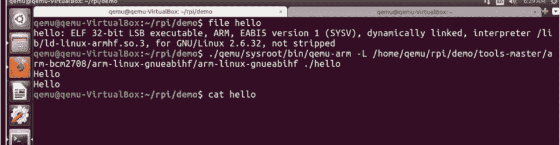

`cat`用于在不打开文件的情况下显示内容。从这段代码中我们可以看到`Hello`的打印是存在的，运行这段代码后我们就能看到这些打印。

## 带网络支持的 QEMU

我们将看到如何在`QEMU`中启用网络支持，但在那之前，我们将进行一些理论项目并理解如何创建它。让我们开始。我们将尝试理解第一个`tap`和`tan`网络。这需要在`Qemu`中启用网络支持。`TUN`和`TAP`接口是纯软件接口，意味着它们只存在于内核中，与普通网络接口不同，它们没有物理硬件组件，因此没有物理线连接到它们。`TUN`网络主要用于模拟网络层设备，它通过`IP`包等三层数据包运行。`TAP`基本上用于模拟链路层设备，它通过以太网帧等链路层数据包运行。它的行为就像网络适配器，只不过它是一个虚拟网络适配器。我们主要将为`RPi`使用`tap`网络，这将创建一个虚拟以太网设备，该设备仅存在于软件中，而不是真实的以太网设备。`TUN`基本用于路由，`TAP`用于创建我们的网络桥接。较低的流量开销仅传输目标为`VPN`客户端的流量。

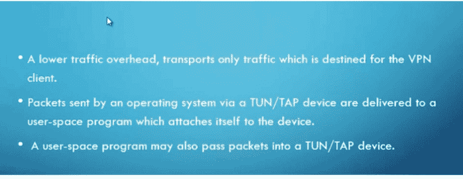

操作系统通过`tun`和`tap`设备发送的数据包包被传递到附加到该设备的用户空间程序。用户空间程序也可以将数据包传递到`tun`或`tap`设备。这些就是功能。你可以从互联网上探索更多关于`tap`或`tun`网络知识。这仅供参考。现在我们将进入实操环节，开始运行带网络支持的`RPI`。从上一个项目来看，只有两个参数发生了变化，其他的保持不变。我们将提供`-net`和`-net tap`接口名称以及脚本文件。正如我之前讨论过的，`tap`用于创建虚拟网络。这就是为什么我们提供`tap`参数，接口名称是`vnet0`。这将在主机端创建，现在我们将去`Ubuntu`端查看所有项。现在我们去`Ubuntu`运行这条命令。

```bash
sudo ./gemu/sysroot/bin/gemu-system-arm -kernel ./kernel-gemu-4.4.36 -cpu arm1176 -m 256 -M versatilepb -inititrd rootsfs.pio -append "root=/dev/ram raminit=/sbin/init" -no-reboot serial stdio -net mlic -net tap,ifname=vnet0,script=no,downscript=no

在客户端侧：

sudo ifconfig eth0 10.0.0.15

在主机侧：

#检查 vnet0 接口

ifconfig -a

sudo ifconfig vnet0 10.0.0.16
```

这就是我们需要运行的命令。首先是`qemu-system-arm`。其他的保持不变。最后我们将添加`-net`和`-net tap`相关参数。

# 基础模块介绍

到目前为止，我们立即讨论了选定的构建模块对比。因此，让我们从基础模块的概念开始。现在我们正在讨论家庭诊所的构建模块。在整个项目中，我们将使用`QEMU`作为硬件参考。在整个项目过程中，我们将在`QEMU`上进行仿真，以便在不购买新硬件的情况下理解它们的工作内存。我们已经涵盖了如何根据我们的目的选择板卡，通过更好地了解家庭诊所的基础模块，可以很容易根据自己的目的选择板卡，而不会浪费时间和金钱。

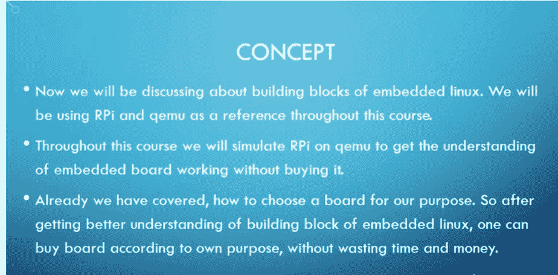

让我们从基础模块开始。它们被称为基础模块。第一个是工具链。第二个是`QEMU`。第三个是根文件系统上的内核核心。在本节中，我们将讨论导致工具链的原因，因为另外三个基础模块的内容非常广泛，需要在接下来的幻灯片中进行更多的扩展和耗时。我们将单独介绍`QEMU`，并尝试理解每个部分在主程序中的需求，并将取一个示例来构建一个“Hello World”程序，并查看如何在`QEMU`上运行它，就这些。

## 工具链

我们将学习工具链。让我们开始吧。学习工具链的一些概念，然后进入实操环节。工具链是一个完整的包，包含调试器以及许多其他东西，基本上设计用于构建、调试和分析你的代码的工具，它至少由两个新工具组成：你的汇编器、链接器等。然后是编译器、运行你最小代码的`C`库。其次是用于调试你编译代码的调试器。现在，基本上有两种类型的工具链：一种是原生的（Native），另一种是交叉的（Cross）。原生工具链基本上是在直接在你的主机上或直接在目标板卡上运行代码时需要的。例如，假设你正在为你的`Linux`或目标板卡编写代码，并在与主机或目标机器相同的系统上进行编译，那么它被称为原生。

### 工具链的类型

- 原生（Native）：在目标板卡上运行编译器。例如，你在`Linux`桌面面上写了一段`C`代码，编译然后在同一台机器上运行。
- 交叉（Cross）：在主机上编译代码，在目标机器上运行。例如，在你的`Linux`机器上编写并构建你的代码，然后部署到目标嵌入式板卡上执行。如果你的目标嵌入式板卡处理能力低和/或磁盘空间，这基本上是需要的，因为在主机`PC`上开发比在目标板上更容易。

然后还有其他东西，比如交叉编译器，如果你在目标机器的缺失按钮上编译代码，那么它将变成交叉编译器。交叉编译器基本上是为了满足这样一个需求：如果你因为尺寸限制或处理能力限制而无法在目标机器上运行代码，那么你可以使用交叉编译的概念，这意味着在主机上编译代码，然后部署到你的目标机器上运行。现在我们将进入另一页幻灯片，查看如何在`QEMU`中设置交叉编译的工具链。在之前的`move`部分，我们已经下载了该工具链。所以不需要进一步下载，我们将探索工具链的一些功能，无论是文件级、实用程序级还是头文件级，然后我们将编译一个之前已经涵盖过的`Hello`示例，但我们会再次运行它。现在我将进入`1` `2`并尝试解释原生工具链的功能是什么。在下载并解压后，你将得到一个工具链链文件夹，你进入该文件夹，里面有一个`27708`，那就是我们的工具链。

## 为交叉编译设置工具链

- 对于`RPi`（树莓派），我们将下载由工具链组成的工具，并探索可用的实用程序、库和头文件。
- 从此处下载工具链：`https://github.com/raspberry/tools`

```bash
export ARCH=arm

export PATH=$PATH:/home/qemu/rpi/demo/tools-master/arm-bcm2708/arm-linux-gnueabihf/bin

export CROSS_COMPILE=arm-linux-gnueabihf-
```

你进入内部。在这里我们正在执行下一个新`VBA`。这是我们将用于导出部分的文件夹，所有与工具链相关的参数文件都在这个文件夹中。点击这里的`bin`文件夹，`bin`文件夹包含了你制作调试、链接你编译代码所需的所有工具和实用程序，例如用于交叉编译代码的`GCC`，然后是你用于调试目的的`GDB`。

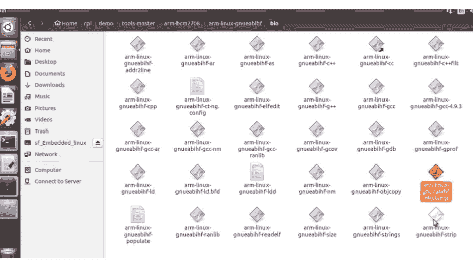

然后是链接器或你的`dumb strip`以及许多其他工具。现在是`fall`的早期`year new EPA achieve`此包含了你所有的库和头文件。如果你进入这个`route`，它包含了你所有的库，如我们正在做的`fuller`。它包含了编译源文件时常用的标准库。这是我们的库。然后是`user`文件夹。它包含一个用于分类的库，我们的`include`文件夹。这是我们将交叉编译后续代码的文件夹，你可以通过浏览这个文件夹来利用它，但都是关于我们的工具和相关信息的。

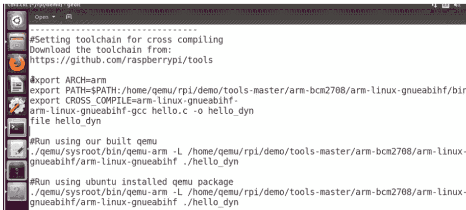


你进入内部。在这里，我们正在执行下一个新 VBA。这是我们将用于导出部分的文件夹，所有与工具链相关的参数文件都在这个文件夹中。点击这里的 `bin` 文件夹，`bin` 文件夹包含了你制作调试、链接你编译代码所需的所有工具和实用程序，例如用于交叉编译代码的 `gcc`，然后是你用于调试目的的 `gdb`。

然后是链接器或你的 `dumb strip` 以及许多其他工具。现在是 fall 的早期 year new EPA achieve 此包含了你所有的库和头文件。如果你进入这个 `route`，它包含了你所有的库，如我们正在做的 `fuller`。它包含了编译源文件时常用的标准库。这是我们的库。然后是用户文件夹。它包含一个用于分类的库，我们的 `include` 文件夹。这是我们将交叉编译后续代码的文件夹，你可以通过浏览这个文件夹来利用它，但都是关于我们的工具和相关信息的。

## 引导程序概念

我们将理解引导程序（Loader）。让我们开始，从介绍开始。我们将尝试理解为什么需要引导程序。这是运行在任何硬件上的第一段代码。如果你的板卡上没有引导程序，它将无法启动，因为这是执行所有硬件初始化并加载你的内核和根系统、启动媒体等的代码。你会看到一个步骤，它设置你的 SDRAM 控制器。然后它设置用于调试目的的串口调试。然后它设置用于加载内核和根系统的启动媒体。你的启动媒体可以是 SD 卡、NOR 或 NAND。

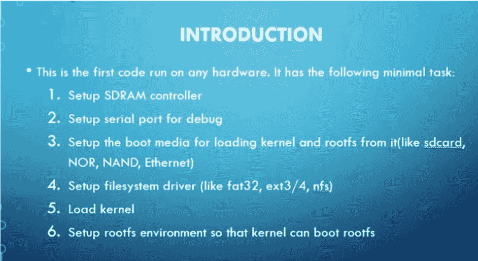

它会设置文件系统驱动程序，如 `FAT32`、`ext3`、`ext4`、`NFS`。这对于获取内核、根系统等镜像是需要的，然后它将加载内核。最后它将设置 `rootfs` 环境以便内核可以启动我们的 `rootfs`。现在有两种类型的引导程序。一种可用于 PC，另一种可用于我们的嵌入式设备。对于 PC，基本上有两种引导程序可用：`GRUB` 和 `Lilo`。对于嵌入式设备，`u-boot` 和 `RedBoot`。有很多引导程序，但我只列出了常用的引导程序。现在我们将介绍 PC 的引导程序，并尝试理解其中提供的功能是什么。所以最常见的，我已经有一个工具是 `grab` 和 `LILO`，`GRUB` 被大多数的发行版使用。`GRUB` 功能丰富并提供 `GUI` 支持，但它的占用空间很大，由于占用空间，不适合嵌入式平台。最常见的例子是 `GRUB`。当你启动 `Ubuntu` 时会看到。

第一个屏幕是 `GRUB`，我们将在那里选择你的 `ubuntu` 版本。如果你安装了多个版本，你

你经常会看到它要求你选择其中一个版本，那就是你的 `GRUB`。现在是嵌入式设备的启动程序。两种常见的启动程序是 `U-boot` 和 `RedBoot`。`U-boot` 主要用于嵌入式设备，因为它的内存占用较小。由于占用较小，它缺乏图形界面（`GUI`）。它提供文本模式以进行快速处理，并且占据的空间非常小，小于 `512 Kb`，因为在大多数嵌入式设备中空间非常有限。这就是为什么优先选择 `u-boot` 而不是 `GRUB`。这非常常见，你可以在大多数 `ARM` 开发板上看到它。

### U-BOOT 概念

我们将讨论 `u-boot` 的概念。让我们开始吧。我们将从介绍开始，并尝试理解 `u-boot` 的基础知识。`u-boot` 代表通用启动加载程序（universal bootloader），通常缩写为 `u-boot`。它是许多嵌入式平台使用的开源主启动程序，用于启动设备操作系统内核并加载文件系统。它支持多种计算机架构，如 `ARM`、`ARM 64位`、`x86`、`MIPS`、`microblaze` 等。`u-boot` 既是第一阶段启动程序，也是第二阶段启动程序。它从支持的启动设备（如 SD 卡、NOR、NAND flash）中的系统 ROM 读取。在这里我将尝试理解什么是系统 ROM。系统 ROM 是由制造商提供的第一阶段引导。系统 ROM 会检查下一阶段，该阶段被视为 `u-boot` 的第一阶段。如果存在尺寸限制，`u-boot` 会将自己拆分为两个分区，如 `SPL` 和 `u-boot`。`SPL` 非常小，因为它需要加载到 SDRAM 中。它将执行基本的硬件配置，然后将控制权交给 `u-boot`。`u-boot` 将处理其他初始化。因此，无论是否使用 `SPL`，`u-boot` 都会执行第一阶段（即配置内存控制器和 SDRAM）以及第二阶段启动（通过多个步骤从各种必须配置的设备如 SD 卡、NAND、NOR、U 盘等上加载现代操作系统）。因此，`u-boot` 在串口上运行命令行界面。通过控制台，用户可以启动内核，并可能更改默认参数。有命令可以读取设备信息、读/写闪存内存、查看内存，然后从串口或网络下载文件。此外，我们还可以根据项目需要操作设备树并处理环境变量，然后还可以保存所有这些数据。默认启动命令和自动启动前的超时将在板卡中设置。现在看看什么是配置文件。在进入配置文件之前，我将尝试解释一点：对于任何 `TI` 板卡，你会在启动介质中看到两个文件：`MLO` 和 `u-boot`。所以 `MLO` 是 `u-boot` 提供的第一阶段启动程序。

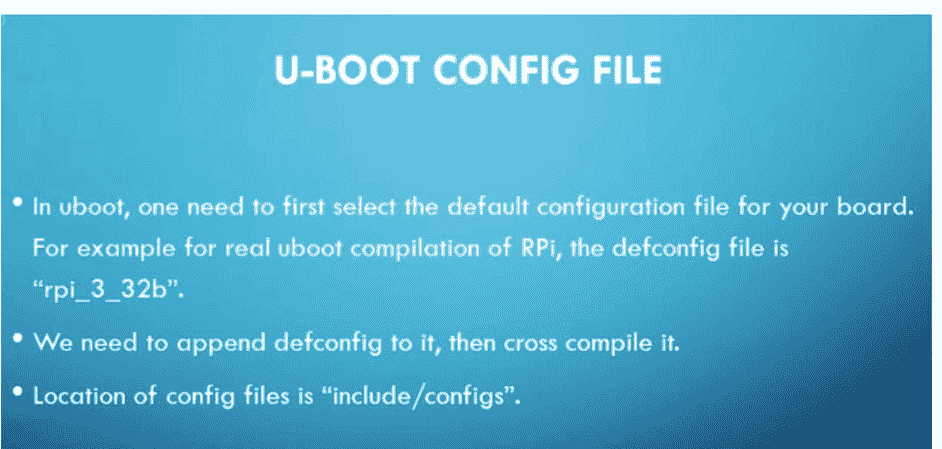

- 在 `uboot` 中，用户需要首先为你的板卡选择默认配置文件。
- 例如，对于 `RPi` 的真实 `uboot` 编译，`defconfig` 文件是 "rpi_3_32b"。
- 我们需要在其后面添加 `_defconfig`，然后进行交叉编译。
- 配置文件的位置是 "include/configs"。

因此，系统 ROM 会拾取 `MLO` 并快速启动它，而 `MLO` 会检查后续步骤，即作为启动程序的 `u-boot`。现在我们来看看到如何编译我们的 `u-boot`。为此，我们需要理解配置文件是什么。配置文件是用来存放所有硬件配置的主文件。因此，我们需要知道并为你的板卡选择正确的配置文件。例如，`RPi` 有 `rpi_3_32b` 作为默认配置文件，所有配置文件都存储在 `include config` 目录下。另一点，我们需要理解，为了交叉编译我们的 `u-boot` 代码，我们需要在配置文件的末尾添加 `__defconfig`。这样我们就能对其进行交叉编译。现在是时候理解 `u-boot` 环境了，因为它是所有 `u-boot` 设置的核心。没有它，`u-boot` 无法启动到下一个阶段（即我们的内核和根文件系统）。让我们了解它是什么。`U-boot` 环境是 `u-boot` 中用于启动板卡的独立区域。它存储了与 `u-boot` 和板卡相关的配置、设置和信息。我们可以使用 `help` 查看支持的命令列表。一些非常流行的命令是 `printenv`、`setenv` 和 `saveenv`。这三个命令会被频繁使用，因为通过这些命令可以设置、分析并保存大部分参数。让我们了解一下

### U-BOOT 环境

- 它是 `uboot` 中用于存储 `u-boot` 和板卡相关配置设置和信息的独立区域。
- 我们可以使用 `help` 查看支持的命令列表。
- 一些非常基础的命令是：
  - `Printenv` - 显示当前的 `uboot` 环境。
  - `Setenv` - 用于设置 `uboot` 中的环境变量。此设置仅保留在 RAM 中。
  - `Saveenv` - 用于将 `setenv` 设置的环境保存到非易失性内存中。
  - `boot` - 启动默认，即运行 'bootcmd'。
  - `bootd` - 启动默认，即运行 'bootcmd'。

`Printenv` 用于显示当前的 `u-boot` 环境。`setenv` 用于设置 `u-boot` 中的环境，但它只是将环境变量设置到 RAM 中，因此重启后设置会丢失。假设你想保存设置，我们需要执行 `saveenv` 命令。这样它就会将这些设置从 RAM 移动到你的非易失性内存中。现在有一个启动命令。

```bash
git clone git://git.denx.de/u-boot.git
git checkout v2017.03
sudo apt-get install device-tree-compiler
export ARCH=arm
export PATH=$PATH:/home/rpi/demo/tools-arm/arm-master/bcm2708/arm-linux-gnueabihf/
export CROSS_COMPILE=arm-linux-gnueabihf-
```

接下来我们需要配置我们的交叉编译器，如果不进行此配置，编译将无法进行。只需复制并粘贴这条命令，之后我们需要检查一下它是否真的为构建设置了交叉编译器，只需输入 `arm` 并按 Tab 键。你会看到与 `arm` 相关的编译器。这意味着我们的交叉工具链设置正确。现在是配置硬件的时间了。我们正在使用 `RPi`，这就是为什么我们需要 `RPi` 的默认配置（def config），正如我在之前的项目 U-Boot 概念中讨论过的。我们将尝试理解这个文件位于哪里。复制这个文件。输入 "ls" 查看文件夹列表，你会看到一个名为 `configs` 的文件夹。这就是所有配置文件所在的地方，我们将尝试打开这个文件并理解其中可用的一些内容。只需输入 `RPi`，你就能看到所有的 `RPi` 配置。由于我们使用的是 `rpi_3` 而不是 `rpi_2`，它已经显示了提示。只需复制并粘贴它，这就是我们的配置。首先，它需要被设置为 `ARM` 架构，然后是为它特定的架构设置，例如 `ARCH_BCM283X=y`，还有许多与硬件相关的设置已完成，如 `MMC`、`USB`、`GPIO`、`SDHCI`（用于 `MMC`）等。我们需要一个一个查看许多配置，根据需要启用相应的项，某些项可能不需要，例如它没有闪存，你会发现 `config CMD_FLASH` 未设置，这就是为什么它被注释掉了。在配置文件中，要进行注释，只需要在开头添加 `#`，该配置就会被注释。该配置文件就是这样设计的。

```text
qemu@qemu-VirtualBox:~/rpi/demo/u-boot
CONFIG_ARM=y
CONFIG_ARCH_BCM283x=y
CONFIG_TARGET_RPI_3_32b=y
CONFIG_SYS_MALLOC_F_LEN=20000
CONFIG_SYS_DEFAULT_DEVICE_TREE="bcm2837-rpi-3-b"
CONFIG_DISTRO_DEFAULTS=y
CONFIG_OF_BOARD_SETUP=y
# CONFIG_DISPLAY_CPUINFO is not set
# CONFIG_DISPLAY_BOARDINFO is not set
CONFIG_SYS_PROMPT="U-Boot 
# CONFIG_CMD_IMLS is not set
# CONFIG_CMD_FLASH is not set
CONFIG_CMD_MMC=y
CONFIG_CMD_USB=y
# CONFIG_CMD_FPGA is not set
CONFIG_CMD_GPIO=y
CONFIG_OF_EMBED=y
CONFIG_MMC_SDHCI=y
CONFIG_MMC_SDHCI_BCM283s=y
# CONFIG_REQUIRE_SERIAL_CONSOLE is not set
CONFIG_USB=y
CONFIG_USB_STORAGE=y
CONFIG_USB_KEYBOARD=y
CONFIG_CONSOLE_SCROLL_LINES=10
```


# 编译 U-Boot (Raspberry Pi)

现在我们将进入编译阶段。在编译之前，我们需要进行配置。之前我们还没有完成配置，所以让我们先进行配置。现在配置好了。此时配置已完成并写入了 `.config` 文件中。在任何 U-Boot 或 Linux 的配置中，最终配置都会写入 `.config` 文件中。如果你打开 `.config` 文件，你就会知道这是生成的最终配置，你可以查看并理解添加了哪些内容，例如如果你看到配置名称是 `RPi`，板型是 `RPi`，那么供应商、`SOC`、`CPU` 架构等所有内容都写在里面。每个配置都有一个章节，比如 `ARM` 架构，同样还有其他配置，如你可以看到的 `Broadcom` 特定的配置，然后是 `ARM` 调试，你可以通过一些基础配置并尝试理解可用的功能。我们的配置已经就绪。现在是构建 U-Boot 的时候了。去掉 `defconfig` 并在最后加上 `-j4`，这是为了加速构建过程，然后按回车。`j4` 正在编译。你可以看到生成了很多文件夹，如 `drivers`、`filesystems` 和 `nets`。它们位于不同的文件夹中。例如，`driver` 用于驱动相关文件，`lib` 用于库等。编译完成后，你会在目录下看到一些 U-Boot 相关的构建产物，如 `u-boot`、`u-boot.bin` 等。`u-boot.bin` 是最终副本。我们需要将其放入 SD 卡中，你的 SD 卡就会启动 Raspberry Pi。正常的 U-Boot 是包含调试信息的 U-Boot。同样的还有 `u-boot.sym`、`u-boot-nodtb.bin` 等文件。这就是这个项目的全部内容。在下一个项目中，我们将查看如何运行为参考板编译的 U-Boot，或者你可以取任何通用板并在 RPi 上运行它。

# 为 QEMU 构建 U-Boot

在今天的项目中，我们将为 `QEMU` 构建一个 U-Boot。在上一个项目中，我们为 `RPi` 构建了 U-Boot。因此概念是类似的，只有少数几处会变化。我们将尝试为 `QEMU` 构建 U-Boot。首先，我们需要设置一个交叉编译器，所以要正确设置。输入 `arm` 并按 Tab 键。看，已经设置好了。这就是我不再重复设置的原因。

让我们启动 `ubuntu` 并尝试运行它。这是我已经在 PPT 中分享过的命令。只需复制该命令并在 `ubuntu` 上运行即可。看，它已经启动了你的目标 `versatilelepb` 然后是符号 `#`。这是你的目标名称，只有当你在这里输入 `printenv` 时才能看到它，我们将能够看到在环境中设置的所有参数。我们之前在 u-boot 概念中讨论过 `printenv` 的用法。`printenv` 基本上用于查看为此特定开发板设置了哪些参数。如果你看到 `bootarg`，它显示的是波特率、以太网相关的参数等。这个项目的内容到此为止。在下一个项目中，我们将学习如何运行 `TFTP`（这在网络通信中讨论过），并查看我们如何将文件从你的系统传输到 u-boot。

# Linux 内核介绍

在今天的项目中，我们将理解 Linux 内核的一些基本概念。让我们开始吧。Linux 内核，或者基本上说任何内核，都是操作系统的核心。没有了它，你就无法获得操作系统的完整功能。这意味着我们需要在系统中运行一个内核，它将控制你所有的资源。所以我将解释它的角色。任何内核都具有如进程管理、内存管理、设备控制、网络等功能。Linux 内核也支持相同的功能。内核是所有资源的主宰。如果用户想要访问任何资源，这意味着没有内核，用户无法访问任何资源，它们必须向内核请求资源。这指的是硬件资源，甚至是软件资源。但用户如何实际访问它们呢？内核提供了两个常用的功能，如系统调用（system call）和 `ioctl` 调用。除此之外，还有许多其他方法。

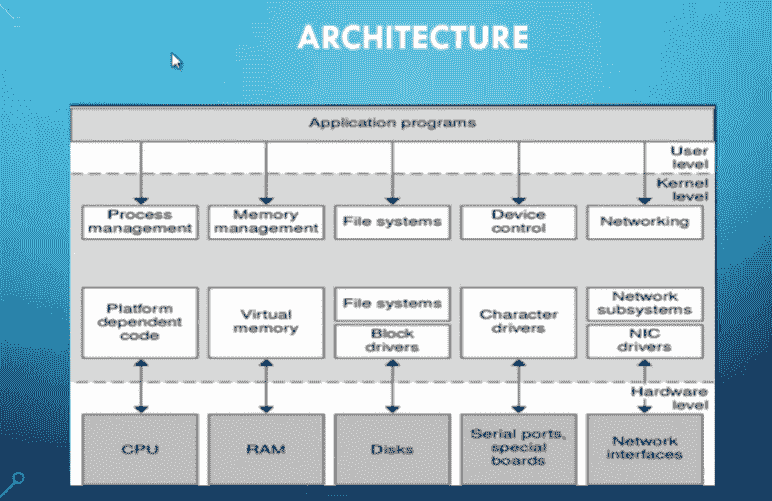

但这两个方法是最经常被使用的。现在我来看看操作系统被分为哪三个部分：硬件层、内核层和用户层。在硬件层，是你所有与硬件相关的驱动程序，或者说硬件本身位于那里。内核层是你所有控制所在的地方。在用户层，基本上居住着我们的应用程序和实用程序。假设我想访问我们的硬盘，在这种情况下，用户只需要请求内核资源以获得访问权限，然后内核层将允许你访问。假设我想从硬盘拷贝一个文件，然后使用它来调用 `copy` 系统调用，内核将检查该文件是否存在，如果存在，它将给你硬件级的访问权限，以便用户可以拷贝特定的资源。这就是该框架的工作方式。现在我将看看为什么需要内核。即使没有内核，我们也可以从 u-boot 运行应用程序。但它不具备多实例应用程序的所有优势，而且没有任何内存保护。这意味着我们无法运行我们的线程应用程序，而且我们在内存方面会遇到问题。我们不知道将使用哪些内存，万一我的应用程序导致系统崩溃怎么办？没有验证内存的方法。内存可能被占用、已使用，如果你使用任何无效内存或获取的内存，可能会导致系统崩溃或损坏该特定内存。因此，在内核中，所有如内存管理、进程管理和设备控制等设施得到了实现。没有了这些功能，我们的操作系统无法顺畅运行。这就是为什么需要内核。

# Linux 内核目录结构

在今天的项目中，我们尝试理解内核的目录结构。让我们开始吧。要理解 Linux 内核的工作原理，需要知道内核的目录结构。一旦对它有了更好的理解，就可以轻松地找到为添加到板卡上的自定义设备可能需要修改的代码。假设你想对你的真实硬件设备（如 `RPi` 或任何 Linux 板卡）进行任何更改，我们需要知道需要修改哪部分代码。假设我们修改了 `RAM` 大小，并将启动选项从 `MMC` 更改为 `NAND` 或 `NOR`。我们增加了 `NAND` 或 `NOR` 的大小，在这种情况下，我们需要知道驱动程序位于何处，以便进入该文件夹，理解代码并进行更改。在做所有这些事情之前，我们需要知道所有基本驱动程序的确切位置概念，然后就可以就绪。为了理解内核源码，我们不需要下载它，直接访问下面的链接即可。这只是 `4.9.142` 的内核源码仓库，看看里面有哪些驱动程序，或者说里面有哪些不同的文件夹。现在我们复制这个链接，打开浏览器并粘贴它。看，它是 `GIT` 形式的，至于什么是 `GIT`，我已经在之前的 `GIT` 项目中介绍过了。

## 内核源码仓库结构

现在我将详细介绍 `common` 文件夹。文档（`Documentation`）是最重要的文件夹。如果你要进行任何操作，它将帮助你理解代码工作流和许多其他事情。现在有一个 `arch` 文件夹。这基本上是一个架构相关的文件夹。你可以看到，每个架构都有一个独立的文件夹，如 `arm`、`arm64`、`MIPS`、`microblaze` 等。然后是 `block`，这是用于块驱动的。然后 `driver`，这是所有文件夹中最重要的部分，因为这是我们将修改大部分驱动程序的文件夹。它占据了任何其他内核的大部分空间。所以我们将进入 `driver` 看看还有哪些其他东西。如果你看到，每个驱动都有独立的文件夹，如字符设备驱动、时钟驱动、然后你的 `GPIO` 驱动、`i2c` 驱动、`mmc` 驱动等。

然后是 `fs` 目录。这是用于文件系统的。我们已经知道这个文件系统是什么了。假设你的内核位于 `ext4` 中，且你的根文件系统也位于 `ext4` 中，那么这就是必须的。如果没有它，内核将无法理解你根文件系统所在的驱动器格式，或者你将使用的文件类型。如果你打开这个 `fs`，你会看到很多可用驱动文件，如 `ext3`、`ext4`、`nfs` 等。现在有一个 `include` 文件夹，它包含了所有的 Linux 内核头文件。然后是 `init` 文件夹。这基本上是初始化代码，即内核启动时运行的代码段。然后是内核代码。这仍然是依赖于架构的代码。现在有一个 `lib` 文件夹。它包含了构建 Linux 内核所需的所有库。然后是 `mm` 文件夹，这是我们的内存管理部分。接着是 `net`。这对于所有网络相关的工具（如 `ipv4`、`ipv6` 等）都是必需的。然后是 `script` 文件夹。这是进行内核初始配置所需要的。这些内容是重要的。它仍然包含一些其他的文件夹，但那些文件夹对我们来说并不那么相关。

# 板级支持包 (BSP)

在今天的项目中，我将尝试理解板级支持包。这是任何硬件启动（bring up）的核心。在板级支持包内部，我们需要配置包以适应我们的自定义板卡。让我们了解什么是板级支持包。主线内核可以在 `RPi`、`beaglebone black` 等许多开发板上开箱即用。但在大多数情况下，你需要来自板卡或芯片供应商的 `BSP`。它可能落后于主线内核，但不同供应商之间的细粒度支持有所不同。这就是为什么我们需要正确选择供应商，以便获得适当的支持。如果你正在开发自己的板卡，你需要有你自己的代码。你需要编写一些 `BSP` 代码来启动你的板卡。现在我们来看看板级支持的水平。基本上分为三类：一种是架构，另一个是芯片级支持，第三个是板级支持。

## 板级支持层次

- 架构
  - `arm`, `mips`, `powerpc`, `x86`,...
- 芯片级（也称为系统级芯片, `SoC`）
  - `RPi`, `Freescale iMX`, `TI OMAP`, ...
- 板级
  - `SoC` 厂商评估板
  - `TI EVM`, `RPI` 板
  - `COTS` 板
    - `Digi`, `Eurotech`, 等

在架构方面，你会看到像 `ARM`、`PowerPC` 等支持。在芯片级支持方面，你将获得特定芯片的支持，如 `RPI`、`TI` 板相关支持等。对于板级支持，我们需要了解板卡。在 COTS 板中。`Digi`, `Eurotech`, 等。这是对 `COTS` 板的支持。

# 在 QEMU 上启动 RPi

今天我们将在 `QEMU` 上启动 `RPi`。但在那之前，我们需要下载一些文件。这里要做两件事：我们将使用我们的编译器 `qemu` 和安装了系统的根文件系统运行 `RPi`。这是我们编译的根文件系统。我们将运行它并查看它是如何工作的。`Qemu` 已经启动了 `RPi`。

系统已安装 `qemu`。结果将是相同的，因为我们传递的所有参数都是相同的。看，`qemu` 已经启动，`qemu` 也已经启动了 `RPi`。只需按回车键，你就能看到相同的消息。这就是这个项目的全部。在接下来的项目中，我们将学习如何启用网络。

# BUSYBOX 深入理解

在今天的项目中，我将介绍 `busybox`。这是一个纯理论项目。在下一个项目中，我们将学习如何配置、构建和部署 `busybox`。但现在，我们只涵盖理论性项目。所以，让我们开始吧。`Busybox` 通常被称为嵌入式 Linux 的“瑞士军刀”。这是因为它提供了大部分的常用工具。`Busybox` 将许多常用 Linux 工具的精简版本合并成一个单一的可执行文件。这一点我可以从快照中告诉你。我们将查看第四张幻灯片。在这里，你可以看到 `Busybox` 是一个工具，而像 `cp`、`dd`、`df` 等其他命令只是 `busybox` 的符号链接。这意味着所有命令都派生自 `busybox`。

## 基于 BUSYBOX 的一些基础命令

```


```
lrwrxwrfwx 1 qemu qemu 7 Dec 19 09:41 base64 -> busybox

-lrwrxwrfwx 1 qemu qemu 1023344 Nov 9 17:43 busybox

-lrwrxwrfwx 1 qemu qemu 7 Dec 19 09:41 cat -> busybox

-lrwrxwrfwx 1 qemu qemu 7 Dec 19 09:41 chattr -> busybox

-lrwrxwrfwx 1 qemu qemu 7 Dec 19 09:41 chgrp -> busybox

-lrwrxwrfwx 1 qemu qemu 7 Dec 19 09:41 chnod -> busybox

-lrwrxwrfwx 1 qemu qemu 7 Dec 19 09:41 chown -> busybox

-lrwrxwrfwx 1 qemu qemu 7 Dec 19 09:41 conspy -> busybox

-lrwrxwrfwx 1 qemu qemu 7 Dec 19 09:41 cp -> busybox

-lrwrxwrfwx 1 qemu qemu 7 Dec 19 09:41 ctyhtack -> busybox

-lrwrxwrfwx 1 qemu qemu 7 Dec 19 09:41 date -> busybox

-rwxr-xr-x 1 qemu qemu 207552 Nov 10 09:47 dbclient

-lrwrxwrfwx 1 qemu qemu 7 Dec 19 09:41 dd -> busybox

-lrwrxwrfwx 1 qemu qemu 7 Dec 19 09:41 df -> busybox

-lrwrxwrfwx 1 qemu qemu 7 Dec 19 09:41 dmesg -> busybox
```

我们将在实践课程中看到如何制作任何命令。但现在，只需要理解所有这些东西都是派生自`busybox`。现在我们回到原始幻灯片。`busybox`中的工具提供的选项通常比其功能完整的GNU兄弟版本少。这意味着如果我们在使用`busybox`中的某些工具，同时直接使用某些工具（或者说功能性工具），它们将是类似的，但对于高级用户，你可能会看到一些差异。不过对于普通用户来说没关系。这就是为什么它被称为选项比功能完整的GNU兄弟版本少。对于小型系统，或者你可以说是空间受限的嵌入式平台，`Busy Box`提供了几乎所有我们需要的环境，我们可以说一个`Busybox`就足以满足我们嵌入式平台的大部分需求。`Busybox`基本上在编写时考虑了尺寸和有限的资源。它具有极强的模块化方法。你可以轻松地包含或排除其中的一个包。我们将查看如何创建一个可以运行的系统。对于运行系统，我们需要`bin`文件夹、`sbin`文件夹、`dev`文件夹等。

这些内容可以创建，但`busybox`提供了我们的`bin`文件夹、`sbin`文件夹和配置文件。除此之外，我们需要创建设备节点、`proc`、`sys`，就可以了。只需在启动时包含Linux内核和引导程序，你的系统就准备好部署了。在`busybox`中，你将获得像`menuconfig`这样的功能（我们在Linux内核中见过它），它可以让我们灵活地包含或排除特定的包。默认情况下，大多数常用工具都会被包含。

- `BusyBox`的编写考虑了尺寸优化和有限的资源。
- 它也具有极强的模块化特征，因此你可以在编译时轻松地包含或排除命令（或功能）。
- 这使得自定义你的嵌入式系统变得简单。
- 要创建一个运行的系统，需要在`/dev`中添加一些设备节点，在`/etc`中添加一些配置文件，以及Linux内核和引导程序 (`u-boot`)。
- `Busybox`提供类似`menuconfig`的功能来包含或排除特定包。
- `Busybox`存在于所有的Linux发行版中。大多数基础命令都来自`busybox`。

我们不需要担心包含什么和不包含什么。对于高级用户，我们需要包含它，它默认不会被包含。`Busybox`几乎出现在所有的Linux发行版中。大多数基础命令都来自`busybox`。

你会看到它已经将目标位置更改为`busybox`的上一个文件夹。现在我很了。现在我们的配置文件已经创建了，如果你想看的话，这就是我们的配置文件，正如我们已经看到的在Linux构建中创建了`.config`文件。所以这种方法是类似的吗？现在我们可以编译了。要进行编译只需去掉`menuconfig`和`option`，它将并行编译并安装。按回车，它会做什么呢？它将在目标文件夹中编译并安装。现在`busybox`已经完全编译并安装到`rootfs`目录。进入`rootfs`目录查看它是否安装正确。等一下，进入`rootfs`目录查看它是否安装正确。记得我们选择了`.`，这意味着`rootfs`的上级目录，查看它是否已构建，这样我们就能看到`bin`、`sbin`和`usr`文件夹被创建。这些都是`rootfs`的主要文件夹。这个项目就此结束，在下一个项目中我们将学习如何使用`dropbear`作为`ssh`工具，因为`dropbear`是轻量级的。

## DROPBEAR 轻量级 SSH 客户端工具

在今天的项目中，我们将学习`dropbear`。`dropbear`基本上是一个轻量级的`ssh`客户端和服务器工具，它是`openssh`服务器的替代品之一。让我们从基础开始。`dropbear`是一个相对较小的`ssh`服务器和客户端。它运行在多种基于`posix`的平台上，基本上适用于大多数嵌入式平台，如无线路由器等许多平台。它具有与`openssh`服务器类似的认证过程。它支持`X11`转发，并具有与`openssh`服务器相似的功能。现在我们将进入实操阶段。在实操阶段中，首先我们需要满足前提条件，即设置工具链并获取`dropbear`的`tar`包。现在我将复制前三行。这是设置工具链所需的命令，你已经知道了。只需复制并输入到这里。只需检查一下你的工具链是否设置正确，输入`arm`并按补全键。所以我们的交叉工具链已设置正确。现在是下载`tar`包的时间。我已经下载好了，我不再重复下载。这就是那个文件。

### 教程文档 - 第 1 页

```bash
export ARCH=arm
export PATH=$PATH:/home/qemu/ripi/demo/tools-master/arm-bcm2708/arm-linux-gnueabihf/bin
export CROSS_COMPILE=arm-linux-gnueabihf/
```

```bash
wget http://matt.ucc.sn.au/dropbear/releases/dropbear_0.53.1.tar.gz
tar -xvf dropbear-0.53.1.tar.gz
cd dropbear-0.53.1
```

```bash
## 配置
./configure --prefix=$SPWD/../rootfs/ --host=arm-linux-gnueabihf --disable-lib CC=arm-linux-gnueabihf-gcc LDFLAGS=-Wl,--gc-sections -ffunction-sections -fdata-sections -O2
```

```bash
## 编译
make PROGRAMS="dropbear dbclient dropkey dropbearconvtt" -j1
```

```bash
## 安装
make install
```

只需复制并粘贴到你的终端。`wget`是一个让我们能够直接从互联网获取包的命令。无需访问浏览器，我们可以使用`wget`工具进行下载。只需将其复制并粘贴到你的终端，你就准备好了，按回车执行即可。由于我已经下载过了，我将不再重复下载。下载完成后，我们需要解压它。只需输入`ls`查看是否下载正确。现在我们需要解压它。正如我们所知，解压`tar`包文件需要提供`tar -x vf 文件名`。它会进行解压。现在解压完成。现在我们将进入`dropbear`目录完成其余工作。

```bash
qemu@genu-Virtuali:~/rpi/rpl/denmo/rootfs$ ls busybox
qemu@genu-Virtuali:~/rpi/rpl/denmo/rootfs$ export ARCH=arm
qemu@genu-Virtuali:~/rpi/rpl/denmo/rootfs$ export PATH=$PATH:/home/qemu/rpl/denmo/tools-master/
qemu@genu-Virtuali:~/rpi/rpl/denmo/rootfs$ export CROSS_COMPILE=arm-linux-gnueabihf/
qemu@genu-Virtuali:~/rpi/rpl/denmo/rootfs$ ls
arm2hdl
arm-linux-gnueabihf-gcov      arm-linux-gnueabihf-ld
arm-linux-gnueabihf-as       arm-linux-gnueabihf-prof
arm-linux-gnueabihf-ld      arm-linux-gnueabihf-strip
arm-linux-gnueabihf-cc       arm-linux-gnueabihf-ldd
arm-linux-gnueabihf-cstrip  arm-linux-gnueabihf-nm
arm-linux-gnueabihf-fstrip arm-linux-gnueabihf-objcopy
arm-linux-gnueabihf-ct-ng.config arm-linux-gnueabihf-objdump
arm-linux-gnueabihf-static  arm-linux-gnueabihf-pickle
arm-linux-gnueabihf-gcc-4.9  arm-linux-gnueabihf-readelf
arm-linux-gnueabihf-ar       arm-linux-gnueabihf-size
arm-linux-gnueabihf-strip  arm-linux-gnueabihf-strings
arm-linux-gnueabihf-gcc-arlib arm-linux-gnueabihf-strip
qemu@genu-Virtuali:~/rpi/rpl/denmo/rootfs$ tar -xvf dropbear-0.53.1.tar.gz -C rootfs busybox
```

首先我们需要在这里进行配置。我们唯一需要正确设置的是`rootfs`路径，即`pwd`，然后是我们已经为`busybox`设置的`rootfs`。进入`dropbear`文件夹后，只需复制并运行配置。现在检查所有前提条件是否已设置好。如果未设置，在需要安装特定包时它会报错。由于它没有给我返回任何错误，这意味着配置已经完成。现在是编译它了，只需运行`make`命令即可。由于我们指定了只编译`dropbear`、`dbclient`、`dropkey` `dropbearconvert`，这就是为什么我们在程序中指定了要构建的内容。
