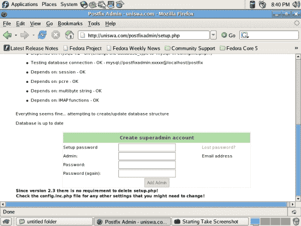

# 全 Linux 邮件服务器解决方案构建指南：虚拟域与用户


作者

Hedaya Mahmood Alasooly
Hedaya_alasooly@yahoo.com


指导老师：
Hidaia Alassouli 博士

学生姓名
Khumalo, Khumbulani V.

### 摘要

如今，一个系统托管多个域名已很常见，例如，uniswa.com 和 mtn.com 或 acme.com 可能运行在同一台主机机器上，但表现得就像运行在三个不同的主机上一样。一个系统通常有一个规范域名，它有其通常或本地域名，而额外的域名被配置为虚拟域名。

这项工作的目的是创建一个基于 `Postfix` 的邮件服务器解决方案，该方案基于虚拟用户和域名，即存储在 MySQL 数据库中的用户和域名。目标是实现完全虚拟化的用户和域名。`bob@uniswa.com != bob@acme.com`。这意味着为每个域名创建一个独立的命名空间。

它还将演示 `Courier-Imap` (IMAP/POP3) 的安装和配置，使其能够通过 `Postfix` 使用的同一个 MySQL 数据库进行身份验证。生成的 `postfix` 服务器具备配额管理功能，而这是 `Postfix` 默认并不包含的；该项目将演示如何适当地修补 `postfix`。密码以加密形式存储在数据库中。该工作还涵盖了 `Mail Scanner`、`SpamAssassin` 和 `ClamAv` 的安装，以便对邮件进行垃圾邮件和病毒扫描。MySQL 数据库的管理可以通过基于 Web 的工具 `Postfixadmin` 完成，也可以在 `MySQL` 终端中手动完成。`Postfixadmin` 是一个为 `Postfix` 创建的 Web 端管理工具，用于处理存储在 MySQL 中的 `Postfix` 风格的虚拟域名和用户。安装了基于 Web 的 `squirrelmail` 邮件客户端，以便用户通过互联网从世界任何地方检查邮件。所有安装均在 Fedora 5 Linux 机器上完成。


## 1. 引言

项目的目的是创建一个基于 `Postfix` 的邮件服务器解决方案，该方案基于虚拟用户和域名，即存储在 MySQL 数据库中的用户和域名。它还将演示 `Courier-Imap` (IMAP/POP3) 的安装和配置，使其能够通过 `Postfix` 使用的同一个 MySQL 数据库进行身份验证。生成的 `postfix` 服务器具备配额管理功能，而这是 `Postfix` 默认并不包含的；该项目将演示如何适当地修补 `postfix`。密码以加密形式存储在数据库中。项目还涵盖了 `Mail Scanner`、`SpamAssassin` 和 `ClamAv` 的安装，以便对邮件进行垃圾邮件和病毒扫描。MySQL 数据库的管理可以通过命令行 `mysql` 终端手动完成，也可以通过为 `postfix` 创建的 Web 端管理工具 (`Postfixadmin`) 完成，用户通过基于 Web 的邮件客户端界面 (`Squirrelmail`) 访问其邮件。所有安装均在 Fedora 5 机器上完成。

项目由以下部分组成：

* 安装 `Postfix`。
* 安装 `Courier-IMAP`（如果你想使用 `Courier` 作为 IMAP）。
* 创建 MySQL 表。
* 填充数据库。
* 创建 `Postfix-Mysql` 配置文件。
* 安装 `Postfixadmin`。
* 安装 `MailScanner`。
* 安装 `ClamAV`。
* 创建虚拟用户和虚拟目录。
* 配置 `Postfix`。
* `Courier-IMAP` 配置。
* 配置 `Squirrelmail`。
* 测试配置。

## 2. 项目描述

### 2.1 主要目标

这项工作的主要目标是创建一个支持多个域名的邮件服务器，例如接收 `bob@mtn.com` 和 `bob@acme.com` 的邮件。当邮件服务器设置完成后，它必须能够：

* 为用户接收并存储邮件。
* 支持配额管理以将邮箱保持在合理范围内。
* 让用户通过 IMAP 和 POP3 获取邮件。
* 接收并转发邮件。
* 提供一个 Web 邮件界面进行阅读。
* 检测病毒和垃圾邮件并进行过滤。

### 2.2 系统概述

该项目描述了如何创建一个虚拟域名和虚拟用户的邮件服务器（用户无法登录系统，他们仅存在于数据库中）。成功设置服务器需要具备以下组件的基础知识：

* `MySQL`（创建数据库、授予用户访问权限），这是一个存储域名、用户帐户和邮件转发信息的数据库系统。
* `SMTP` (`Postfix`)，这是邮件服务器之间发送邮件消息的协议。
* `POP3`, IMAP，这里使用的类型是 `Courier-IMAP`，替代方案可以是 `dovecot`，这是一个提供邮件目录访问的服务器。
* `Fedora` (Linux)，理解一般的系统管理、使用文本编辑器、命令行以及读取日志文件。

帐户存储在 MySQL 数据库中。域名将具有独立的命名空间，例如，`bob@acme.com` 和 `bob@mtn.com` 的邮件将进入不同的邮箱。因此，安排将为每个虚拟账户设置独立的邮箱。

服务器将使用一个支持多个域的 POP/IMAP 服务器。在这种安排下，管理员不需要为服务器上的电子邮件地址创建和维护系统帐户，相反，他将配置 `Postfix` 将邮件递送到本地消息存储，每个虚拟邮件地址都可以有一个邮箱文件。用户随后通过 POP IMAP 服务器检索其消息。

此外，服务器将具备配额支持以及垃圾邮件和病毒扫描功能（`Mail Scanner`、`Spam Assassin`）。数据库 (`MySQL`) 将通过命令行 `mysql` 终端手动管理，或通过为 `postfix` 创建的 Web 端管理工具 (`Postfixadmin`) 管理，用户通过基于 Web 的邮件客户端界面 (`Squirrelmail`) 访问其邮件。下方的框图（图 1）展示了该系统。



**图 2.1 服务器系统框图**

### 2.3 主要服务器组件

邮件服务器将在 Fedora core 5 操作系统中使用以下软件包创建：

* `Postfix` - `2.2.8-1.2`。
* `MySQL` - `5.0.18-2.1`。
* `Courier – Imap` – `4.4.1-1.5`。
* `Courier – Authlib` – `0.62.1-1.fc5`。


* `Squirrelmail` – `1.4.6.tar.bz2`
* `PostfixAdmin` – `2.3.3.tar.gz`
* Fedora core 5 默认带的 `Apache2`。
* `Mail Scanner-4.84.3-1.rpm.tar.gz`。
* `Install-Clam-0.96.5-SA-3.3.1` 或任何 `clamav` 软件包。
* Fedora core 5 默认带的 `SpamAssassin`。
* `Fedora core 5`（操作系统）。
* `Compaq 610 笔记本 Intel core Duo 3GHz 2GB RAM 320 GB HDD`。

所有使用的软件包均为 `i386` 类型。假设 Fedora core 5 和 `Mozilla Fire Fox` 已成功安装，并启用了 `HTTP` 和 `SMTP` 支持，同时关闭了防火墙。

## 3. 邮件服务器软件包的主要安装与配置：

该项目涵盖以下部分：
* 安装 `Postfix`。
* 安装 `Courier-IMAP`（如果你想使用 `Courier` 作为 `IMAP/POP` 服务器）。
* 创建数据库表。
* 为数据库填充部分数据。
* 创建 `Postfix-Mysql` 配置文件。
* 安装 `Postfixadmin`。
* 安装 `MailScanner`。
* 安装 `ClamAV` 和 `SpamAssassin`。
* 创建虚拟用户和虚拟目录。
* 配置 `MailScanner`。
* 配置 `Postfix`。
* `Courier-IMAP` 配置。
* 配置 `Squirrellmail`。

### 3.1 安装 Postfix：

Postfix 不带配额（quota）和 `MySQL` 数据库支持，因此为了支持这些功能，需要获取 `Postfix` 源码包和 `Postfix` 配额补丁，进行解压，并按照下文所示编辑补丁的规范文件。对 `Postfix` 进行补丁后，获取一个针对特定运行环境的新 `Postfix` 软件包。然后安装新的 `Postfix`。

在 `/usr/redhat/SOURCES` 目录下下载 `Postfix – 2.2.8 – 1.2.src.rpm` 和 `Postfix – 2.2.8 – vda.patch.gz` 或任何其他版本。

```bash
rpm -ivh Postfix – 2.2.8 – 1.2.src.rpm
gunzip postfix-2.2.8-vda.patch.gz
cd /usr/src/redhat/SPECS/
gedit postfix.spec # 编辑规范文件
```

- 将 `% define MYSQL 0` 改为 `% define MYSQL 1`
- 在 `# Patches` 语句块中添加 `Patch 0: postfix-2.2.8-vda.patch`
- 在 `%setup -q` 语句块中添加 `%patch0 -p1 -b .vda`

然后构建一个带有配额和 `MySQL` 数据库支持的新 `postfix` 软件包并安装它。

```bash
rpmbuild -ba postfix.spec
```

进入 `i386` 目录并安装 `postfix` 以及文件夹内的另外两个软件包（`postfix_debuginfo` 和 `pflogsumm`）。

```bash
cd /usr/src/redhat /RPMS/i386
rpm - ivh postfix - 2.2.8-1.2.i386.rpm
```

安装所需的依赖项取决于系统中安装的软件包，因此你应该下载并安装这些依赖，然后尝试重新安装 `postfix`。

### 3.2 Postfix 的初始配置：

要配置 `Postfix`，需要在 `/etc/postfix/main.cf` 文件中编辑并取消以下行的注释。`Postfix` 将识别服务器的全限定域名和本地域名。同时指定服务器发送邮件时使用的出站域名、允许接收的以太网接口以及允许在本地登录的邮件客户端 IP 地址。

```ini
myhostname =project.uniswa.com
mydomain =uniswa.com
myorigin =$myhostname
inet_interfaces = all
mydestination = $myhostname, localhost.$mydomain, localhost
mynetworks_style = subnet
```

执行以下操作以测试是否成功：

```bash
service postfix restart
telnet localhost 25 // 将出现类似下面的输出
```

```
Trying 127.0.0.1 …
Connected to localhost.localdomain (127.0.0.1)
Escape character is ‘^].
220 project.uniswa.com ESMTP Postfix
mail from: xyz
rcpt to: root@project.uniswa.sz
data
Hi testing
.
quit
```

### 3.3 安装 MySQL 软件包：

从 Fedora 自带的 `RPMS` 安装 `MySQL`、`mysql-devel`、`mysql-server`、`mysql-client` 软件包以及任何依赖包。例如安装 `mysql`：

```bash
rpm -ivh mysql*
```

### 3.4 创建表：

在 `MySQL` Shell 中，创建 `Postfix` 对应的 `admin` 用户并授予权限，以便 `Postfix` 配置和虚拟域名。

```sql
mysql
```

（创建 `postfix` 数据库）
```sql
CREATE DATABASE postfix;
USE postfix;
```

现在 `postfix` 数据库已创建，并包含了支持配额的 `admin` 表结构。`admin` 表用于存储用户信息：

```sql
CREATE TABLE admin (
  username varchar(255) NOT NULL,
  password varchar(255) NOT NULL,
  created datetime NOT NULL DEFAULT '0000-00-00 00:00:00',
  modified datetime DEFAULT '0000-00-00 00:00:00',
  active tinyint(1) DEFAULT 1,
  PRIMARY KEY (username)
);
```

`alias` 表用于将一个邮件地址映射到另一个：

```sql
CREATE TABLE alias (
  address varchar(255) NOT NULL,
  domain varchar(255) NOT NULL,
  created datetime NOT NULL DEFAULT '0000-00-00 00:00:00',
  modified datetime DEFAULT '0000-00-00 00:00:00',
  active tinyint(1) DEFAULT 1,
  PRIMARY KEY (address)
);
```

`domain` 表用于存储 `Postfix` 应该接收邮件的虚拟域名：

```sql
CREATE TABLE domain (
  domain varchar(255) NOT NULL,
  description varchar(255) NOT NULL,
  aliases int(10) DEFAULT 0,
  mailboxes int(10) DEFAULT 0,
  maxquota int(10) DEFAULT 0,
  transport varchar(255) DEFAULT NULL,
  backupmx tinyint(1) DEFAULT 1,
  created datetime NOT NULL DEFAULT '0000-00-00 00:00:00',
  modified datetime DEFAULT '0000-00-00 00:00:00',
  active tinyint(1) DEFAULT 1,
  PRIMARY KEY (domain)
);
```

`domain_admins` 表存储域管理员信息：

```sql
CREATE TABLE domain_admins (
  username varchar(255) NOT NULL,
  domain varchar(255) NOT NULL,
  create datetime NOT NULL DEFAULT '0000-00-00 00:00:00',
  modified datetime DEFAULT '0000-00-00 00:00:00',
  active tinyint(1) DEFAULT 1,
  PRIMARY KEY (username)
);
```

`log` 表存储每个虚拟域名和用户的活动记录：

```sql
CREATE TABLE log (
  timestamp datetime NOT NULL DEFAULT '0000-00-00 00:00:00',
  username varchar(255) NOT NULL,
  domain varchar(255) NOT NULL,
  action varchar(255) NOT NULL,
  data varchar(255) NOT NULL,
  KEY (timestamp)
);
```


`mailbox` 表存储了所有虚拟用户（即邮箱地址，因为邮箱地址和用户名相同）、密码（加密形式）以及每个邮箱箱的配额值。`mailbox` 表的结构如下：

```sql
CREATE TABLE mailbox ( username varchar(255) NOT NULL default '', password varchar(255) NOT NULL default '', name varchar(255) NOT NULL default '', maildir varchar(255) NOT NULL default '', quota int(10) NOT NULL default '0', domain varchar(255) NOT NULL default '', created datetime NOT NULL default '0000-00-00 00:00:00', modified datetime NOT NULL default '0000-00-00 00:00:00', active tinyint(1) NOT NULL default '1', PRIMARY KEY (username), KEY username (username) ) TYPE=MyISAM COMMENT='Postfix Admin - Virtual Mailboxes';
```

虚拟假期（Virtual Vacation）是通过一个接收邮件的本地 shell 账户实现的。邮件随后由 Perl 脚本处理，该脚本会将假期回复消息发给发送者。`vacation` 表的结构如下：

```sql
CREATE TABLE vacation (email varchar (255) NOT NULL default”, subject varchar (255) NOT NULL default”, body text NOT NULL default”, cache text NOT NULL default”, domain varchar (255) NOT NULL default”, Created datetime NOT NULL default ‘0000-00-00 00:00:00’, Active tinyint (1) NOT NULL default ‘1’, PRIMARY KEY (email), KEY email (email), TYPE = MYISAM COMMENT =’Postfix Admin – virtual vacation’;
```

`transport` 表是可选的，适用于高级用户。它允许将单个用户、整个域名或所有邮件转发到另一个服务器。`transport` 表的结构如下：

```sql
CREATE TABLE transport (username varchar (255) NOT NULL default”, domain varchar (255) NOT NULL default”, destination varchar (255) NOT NULL default”, Created datetime NOT NULL default ‘0000-00-00 00:00:00’, Modified datetime default ‘0000-00-00 00:00:00’, active tinyint (1) NOT NULL default ‘1’, PRIMARY KEY (domain));
```

### 3.5 为数据库填充数据：

接下来，必须向 Postfix 数据库中填充一些数据，否则这些数据仍然可以通过 `Postfixadmin` 进行填充。

```bash
Use postfix;
INSERT INTO domain (domain, description) VALUES (‘uniswa.com’, ‘Test Domain’);
INSERT INTO alias (address, goto) VALUES (‘alias@uniswa.com’, ‘user@uniswa.com ‘);
INSERT INTO mailbox (username, password, name, quota, maildir) VALUES (‘user@uniswa.com’, ENCRYPT(password),‘Mailbox User’,‘104857600’, ‘user@uniswa.com/’);
quit;
```

### 3.6 创建 Postfix-MysSql 配置：

必须告诉 Postfix 在哪里查找数据库中的所有信息。因此，必须创建六个访问文本并在 `etc/main.cf` 文件中进行映射，以允许 postfix 读取 MySQL 表格。

创建 `/etc/postfix/mysql/mysql_virtual_alias_maps.cf`
```
user = postfix
password = postfix
host = localhost
dname = postfix
query =SELECT go to FROM alias WHERE address =’%s’ AND active =1
```

创建 `/etc/postfix/mysql/mysql_virtual_domains_maps.cf`
```
user = postfix
password = postfix
host = localhost
dname = postfix
query = SELECT domain FROM domain WHERE domain = ‘%s’
```
# 备份 MX 转发时使用的优化查询

创建 `/etc/postfix/mysql/mysql_virtual_mailbox_maps.cf`
```
user = postfix
password = postfix
host = localhost
dname = postfix
query =SELECT maildir FROM mailbox WHERE username =’%s’ AND active =1
```

创建 `/etc/postfix/mysql/mysql_virtual_mailbox_limit_maps.cf`
```
user = postfix
password = postfix
host = localhost
dname = postfix
query =SELECT quota FROM mailbox WHERE username =’%s’
```

创建 `/etc/postfix/mysql/mysql_relay_domains_maps.cf`
```
user = postfix
password = postfix
host = localhost
dname = postfix
query =SELECT domain FROM domain WHERE domain=’%s’ backupmx = ‘1’
```

创建 `/etc/postfix/mysql/transport_maps.cf`
```
user = postfix
password = postfix
host = localhost
dname = postfix
table = transport
select_ field = destination
where_ field =domain
additional_conditions= and active = ‘true’
```

### 3.7 创建虚拟用户和虚拟目录：

系统可以存储数千个用户的邮箱箱。所有这些用户都是虚拟用户，其中没有任何一个是是 Linux 系统用户。你可能不想为每个用户分配唯一的 `UID`（用户 ID），因此让我们创建一个 Linux 用户，它将成为所有邮箱箱的所有者。

创建一个 id 为 `89` 且名为 `/vmail` 文件夹的虚拟 postfix 用户，并使其拥有邮件。该用户被赋予读写邮件权限。

```bash
# mkdir /vmail
# chown –R postfix: postfix /vmail
#chmod –R 771 /vmail
```

### 3.8 使用 MySQL maps 配置 Postfix：

六个 MySQL maps 配置文件已经创建，现在是时候设置 Postfix `main.cf` 文件了，以便 Postfix 能够查询 MySQL 数据库以获取虚拟邮箱箱和域名。打开 `main.cf` 文件。

```bash
# gedit /etc/postfix/main.cf
```

然后将以下代码段添加到 `main.cf`

```
virtual_mailbox_domains = mysql:/etc/postfix/mysql/mysql_virtual_domains_maps.cf
virtual_alias_maps =mysql:/etc/postfix/mysql/mysql_virtual_alias_maps.cf
virtual_mailbox_maps =mysql:/etc/postfix/mysql/mysql_virtual_mailbox_maps.cf
```

然后为投递到虚拟邮箱箱目录的用户分配 ID 和组 ID，并声明邮箱箱限制。

```
virtual_gid_maps = static: 89
virtual_mailbox_limit =51200000
virtual _ uid_maps = static: 89
virtual_minimum_uid =10
virtual_ transport =virtual
```

这些配置是为了支持配额而做的：
```
virtual_create_maildirsize =yes
virtual_mailbox_extended =yes
virtual_mailbox_limit_maps= mysql:/etc/postfix/mysql/mysql_virtual_mailbox_limit_maps.cf
virtual_mailbox_limit_ override= yes
virtual_maildir_limit_message =Sorry, the user’s maildir has overdrawn his diskspace quota, please try again later.
virtual_overquota_bounce =yes
```

### 3.9 安装 Courier-IMAP 和 Courier-authlib：

POP3 服务允许服务器托管电子邮件账户，并包含了管理服务器、域名和邮箱箱的工具。POP3 服务在服务器上执行消息下载和请求处理任务，其中消息下载包括将消息从文件系统中的文件夹传输到客户端，而请求处理则根据 POP3 协议执行，该协议定义了服务器如何响应从电子邮件客户端发送的请求。

SMTP 服务接收来自其他域的邮件，将其保存到 `Queue` 文件夹中，并通知 SMTP 投递服务邮件已到达。投递服务随后会将邮件移动到 POP3 邮件存储中，以便供 POP3 电子邮件客户端下载。

要安装 Courier–Imap，必须创建一个除 Root 用户之外的普通系统用户，因为 root 用户无法成功构建此包。

```bash
#useradd test (创建一个名为 test 的用户)
#passwd test (你可以输入任何密码)
#/bin/su -test (切换到用户 test)
```

创建 RPM 开发层次结构。

```bash
#mkdir $ HOME /rpm
#mkdir $ HOME/rpm/SOURCES
#mkdir $HOME/rpm/ SPECS
#mkdir $HOME/rpm/ BUILD
#mkdir $HOME/rpm/SRPMS
#mkdir $HOME/rpm/RPMS
#mkdir $HOME/rpm/RPMS/i386
#echo “%_topdir $HOME/rpm”>>$HOME/.rpmmacros
```

下载 `courier-imap` 压缩包（可用于 Fedora 5 的旧版本），将其保存到 `/home/test/rpm/SOURCES` 目录并解压：

```bash
#cp courier-imap-4.4.1.tar.bz2 /home/test/rpm/SOURCES
#cd /home/rpm/SOURCES
#tar xjf courier-imap-4.4.1.tar.bz2
```

进入 `/home/test/rpm/sources/courier-imap-4.4.1` 并编辑规范文件：

```bash
# cd courier-imap-4.0.1
# gedit courier-imap.spec
```

将以下行更改为将其放在更标准的地方（例如 /etc ）

```
%define _sysconfdir /etc/courier
%define _mandir /usr/share/man
%define _prefix /etc/courier
%define _localstatedir /var/run
```

```
%configure
--with-redhat
--enable-workaround-for-imap-client-bugs

%{?xflags: %{xflags}}

#%{__make} check
```


编辑完成后，将 `courier-imap.spec` 文件拷贝到 `/home/test/rpm/SPECS` 目录。在构建 `courier-imap` 之前，需要安装 `courier–authlib` 软件包（用于身份验证）。下载 `courier-authlib-0.62.1.tar.bz2` 或任何可用版本并保存到 `SOURCES` 目录。解压并编辑规格文件，然后将其拷贝到 `/home/test/rpm/SPECS` 目录，以 root 身份在 `i386` 目录中构建并安装。

```bash
cp courier-authlib-0.62.1.tar.bz2 /home/test/rpm/SOURCES
cd /home/rpm/SOURCES
tar xjf courier-authlib-0.59.1.tar.bz2
```

### 安装 courier-authlib

```bash
cd $HOME/rpm/SPECS
rmpbuild -bb courier-authlib.spec
su root
cd /home/test/rpm/RPMS/i356/
rpm-ivh courier-authlib-*
```

系统会提示 `libtool-itdl-devel` 依赖项失败，请下载并安装任何其他所需的依赖项。如果你想让 `courier-imap` 支持这些功能，你应该安装 `i386` 文件夹中找到的所有 `courier-authlib` 软件包。你会在那里找到以下软件包：`courier_authlib`, `courier_authlib_devel`, `courier_authlib_debuginfo`, `courier_authlib_userdb`, `courier_authlib_mysql`, `courier_authlib_pgsql`, `courier_authlib_userdb_ldab`。

以用户 `test` 构建 `courier–imap` 软件包并以 root 用户身份安装。

```bash
su test
cd $HOME/rpm/SPECS
rpmbuild-bb courier-imap.spec
su root
cd /home/test/rpm/RPMS/i386/
rpm-ivh courier-imap-*
```

根据需要安装任何失败的依赖项。然后按照以下方式启动软件包：

```bash
authdaemond restart
service courier-authlib restart
service courier-imap restart
```

### 3.10 Courier-IMAP 配置：

要告诉 Courier 它应该针对 MySQL 数据库进行身份验证，首先编辑 `/etc/authlib/authdaemonrc` 并更改 `authmodulelist` 的值，使其从 mysql 数据库读取。

`authmodulelist = “authmysql”`

`Courier- Imap` 的 `imapd` 文件 `/etc/courier/imapd` 包含类似下面的行：
`IMAP_CAPABILITY =”IMAP4rev 1 UIDPLUS CHILDREN NAMESPACE THREAD = ORDEREDSUBJECT THREAD= REFERENCES SORT QUOTA IDLE"`

修改 `/etc/authlib` 目录下的 `authmysqlrc` 文件，并添加这些行：

```text
#DEFAULT _DOMAIN uniswa.com
MYSQL_CRYPT_PWFIELD password
MYSQL_DATABASE postfix
MYSQL_GID_FIELD ‘89’
MYSQL_HOME_FIELD ‘/vmail/’
MYSQL_LOGIN _FIELD username
MYSQL_MAILDIR_FIELD maildir
MYSQL_NAME _FIELD name
MYSQL_OPT 0
MYSQL_ PASSWORD postfix
#MYSQL_ PORT 0
# 取消取消注释以支持配额。
MYQL_QUOTA_FIELD quota
MYSQL_ SERVER localhost
#Default RedHat Socket
MYSQL _SOCKET /var/lib/mysql.Sock
MYSQL_UID_FIELD ‘89’
MYSQL_USERNAME postfix
MYSQL_USER _TABLE mailbox
#MYSQL _WHER_CLAUSE server = ‘project.uniswa.com’
```

创建 `/etc/authlib/hostdomains` 文件，其中包含 `uniswa.com`，即由该服务器托管的域名。

使用 `courier-imap` 进行测试：

```bash
service postfix reload
authdaemond restart
service courier-authlib restart
service courier-imap restart
telnet localhost 25
mail from: hedaya
rcpt to: user@uniswa.com
data
hi testing
.
quit

telnet localhost 110
user user@uniswa.com
pass password
list
retr (msg no)
quit
```

### 3.11 配置 Postfixadmin：

Postfix 将允许管理员添加、删除和编辑邮箱以及完整域名。此基于 Web 的应用程序允许管理员访问 postfix 的 MySQL 配置并直接进行编辑。安装 Postfixadmin 的前提是安装 Apache。从 `http://high5.net` 下载 Postfix 包并保存到 apache 目录 `/var/www/html` 中，然后解压。

```bash
tar –zxvf postfixadmin-*.tar.gz
```

在 `config.inc.php` 文件中执行以下配置。

第一件事是告诉 Postfix 你已经配置了该应用程序。
`$CONF['configured'] = true;`

然后定义 postfix admin 版本的完整 URL。
`$CONF ['postfix_admin_url'] = 'http: //uniswa.com/postfixadmin’;`

接下来是设置数据库连接。

```php
$CONF ['database_type'] = 'mysql';
$CONF ['database_host'] = 'localhost';
$CONF ['database_user'] = 'postfixadmin';
$CONF ['database_password'] = 'postfixadmin';
$CONF ['database_name'] = 'postfix';
$CONF ['database_prefix'] = **;
```

所有问题将报告到的以及发送给所有人的邮箱地址。
`$CONF ['admin_email'] = 'postmaster@example.com';`

这用于向 Postfix 发送邮件以便邮箱。
`$CONF ['smtp_server'] = 'localhost';`
`$CONF ['smtp_port'] = 'localhost';`

此部分定义了使用的加密方法。
`$CONF ['encrypt'] = 'md5';`

密码所需的最小长度。
`$CONF ['min_password_length'] = 5;`

管理员的默认密码。
`$CONF ['default_password'] = '';`

此消息将发送给每个新建的邮箱。
`$CONF ['welcome_text'] = EOM
Hi,
Welcome to your new account.
EOM;`

生成的设置密码。
`$CONF ['setup_password'] = 5;`

该设置将创建管理员数据库。
`$CONF ['setup_password'] = 'YES';`

setupadmin 的路径。
`$CONF ['domain_path'] = 'YES';`

邮箱中的域名。
`$CONF ['domain_in_mailbox'] = 'YES';`

管理员的别名。
`$CONF ['aliases'] = 'YES';`

已设置邮箱。
`$CONF ['mailboxes'] = 'YES';`

用户的配额。
`$CONF ['maxquota'] = '10';`

配额的倍数。
`$CONF ['quota_multiplier'] = '10';`

用户的域名。
`$CONF ['domain'] = 'YES';`

传输选项。
`$CONF ['transport_options'] = array ('virtual', 'local', 'relay');`

默认传输。
`$CONF ['transport_default'] = 'virtual';`

别名的控制。
`$CONF ['control'] = 'YES';`

管理员控制。
`$CONF ['alias_control_admin'] = 'YES';`

设置。
`$CONF ['setup'] = 'YES';`

密码的哈希值。
`$CONF ['hash'] = 'md5';`

域名的控制。
`$CONF ['domain_control'] = 'YES';`

别名的设置。
`$CONF ['alias_setup'] = 'YES';`

域名的路径。
`$CONF ['domain_path'] = 'YES';`

别名的哈希值。
`$CONF ['alias_hash'] = 'md5';`

用户的控制。
`$CONF ['user_control'] = 'YES';`

用户的设置。
`$CONF ['user_setup'] = 'YES';`

用户的路径。
`$CONF ['user_path'] = 'YES';`

用户的哈希值。
`$CONF ['user_hash'] = 'md5';`


1. 从 `www.squirrelmail.org` 下载 `squirrelmail`。例如下载 `squirrelmail-1.4.6.tar.bz2` 或其他版本。

2. 解压 `squirrelmail`。

3. 将 `squirrelmail` 复制到文件夹 `/var/www/html/squirrelmail`。

6. 进入目录 `/var/www/squirrelmail/config`。

7. 将文件 `config_default.php` 重命名为 `config.php`。

8. 创建目录 `/var/www/html/squirrelmail/attach` 和 `/var/www/html/squirrelmail/data`，并更改它们的所有权。

```
chown –R apache data
chgrp- R apache data
chown – R apache attach
chgrp –R apache attach
chmod 730 data
chmod 730 attach
```

9. 从 squirrel 网站下载配额使用插件到 `/var/www/html/squirrelmail/plugins`。

```
cd /var/www/hml/squirrelmail/plugins
tar –zxvf quota_usage-1.3-1.2.7.tar.gz
```

10. 进入 `quota_usage` 目录，将 `config.php.sample` 复制为 `config.php` 并编辑 `config.php`，根据需要进行调整。

```
cd quota_usage
cp config.php.sample config.php
```

9. 在 `/var/www/html/squirrelmail/config` 路径命令行执行 perl 脚本：

```bash
./config.pl
```

- 选择 `2.` Server Setting Change Domain:
- 选择 `4.` General Option，将附件目录更改为 `.../attach/`，将数据目录更改为 `.../data/`
- 选择 `8.` Plug- in，添加包括 `quota _usage` 在内的所有插件
- 选择 `S` 保存配置。

10. 重启 `httpd` 服务。

```
service httpd restart
```

11. 在浏览器中访问 `http://project.uniswa.com/squirrelmail/`。

## 3. 安装和配置 MailScanner、ClamAV 和 SpamAssassin

Postfix 将所有入邮件放入等待队列（hold queue），这样 Mailscanner 就可以安全地访问这些邮件进行扫描，然后将它们传回 Postfix 活动队列进行递。我从 `http://www.mailscanner.info/downloads.html` 下载了 Mailscanner。解压包后，它会创建一个新目录。使用 `cd` 命令进入新目录，然后运行命令：

```bash
./install.sh
```

这将产生大量的输出，因为它会尝试构建并安装 MailScanner 使用的所有包。如果执行没有成功，你应该先安装 MailScanner 使用的所有依赖包。

以下是你需要在 MailScanner 配置文件中更改的选项：

- %org-name% = yoursite
- Run As User = postfix
- Run As Group = postfix
- Incoming Queue Dir = `/var/spool/postfix/hold`
- Outgoing Queue Dir = /var/spool/postfix/incoming
- MTA = postfix
- Virus Scanning = yes
- Virus Scanners = clamav
- Spam List = spamhaus.org spamcop.net ORDB-RBL
- Use SpamAssassin = yes

正确安装 ClamAV 和 SpamAssassin 的最佳方法是通过 `www.mailscanner.info` 中专门为此目的准备的包。从 `http://www.mailscanner.info/files/4/install-Clam-0.88.7-SA-3.1.7.tar.gz` 下载该包或任何版本。

你需要解压 tar 文件，使用 `cd` 命令进入新目录，然后运行命令：

```bash
./install.sh
```

你可以调整 `freshclam.conf` 文件以适应你的代理设置：

```
UpdateLogFile /var/log/freshclam.log
HTTPProxyServer proxy.uniswa.sz
HTTPProxyPort 80
```

要启动 `clamav` 和 `spanassassin`，请运行：

```bash
service spamd start
clamd start
```

自动更新请运行：

```bash
freshclam
```

我们需要编辑 postfix 以保留所有邮件消息，以便 MailScanner 能够扫描它们并将它们放入邮件队列。在 `/etc/postfix/main.cf` 中应添加以下行：

```
header_checks = regexp:/etc/postfix/header_checks
```

然后我们需要创建 `header_checks` 文件 `/etc/postfix/header_checks` 并存入以下信息：

```
/^Received:/ HOLD
```

你需要确保用户 `postfix` 可以写入 `/var/spool/MailScanner/incoming` 和 `/var/spool/MailScanner/quarantine`：

```
chown postfix.postfix /var/spool/MailScanner/incoming
chown postfix.postfix /var/spool/MailScanner/quarantine
```

启动 MailScanner，请运行：

```bash
service MailScanner start
```

问题是 MailScanner 在启动后无法成功加载，因此项目的该部分无法成功实现。邮件无法针对垃圾邮件和病毒进行扫描。

## 4. 测试配置

要测试配置，进入根目录并执行以下步骤：

```
service postfix reload
authdaemond restart
service courier-authlib restart
service courier-imap restart
service mysqld restart
service httpd restart
telnet localhost 25
mail from: khumalo
rcpt to: user@uniswa.com
data
just testing
.
quit

telnet localhost 110
user user@uiswa.com
pass password
list
retr (msg no)
quit
```

首先在 Linux Shell 中通过下图 4.1 和图 4.2 所示的命令进行测试。

然后打开 Mozilla Firefox 并访问 `http://project.uniswa.com/squirrelmail/`，使用图形化界面 `squirrelmail` 测试邮件服务器，如图 4.3、图 4.4、图 4.5、图 4.6 和图 4.7 所示。


# ISBN: 978-3-7487-5107-6

## BookRix 出版出版信息

感谢您选择在 BookRix.com 购买本书。我们邀请您再次访问 [BookRix.com](https://www.bookrix.com/) 对此[书籍](https://www.bookrix.com/_ebook-dr-hedaya-mahmood-alasooly-building-full-linux-mail-server-solution-with-virtual-domains-and-users) 进行评价。在这里，您可以与其他读者讨论，发现更多[书籍](https://www.bookrix.com/books.html)，甚至自己成为一名作者。

再次感谢您对我们 BookRix 社区的支持。

