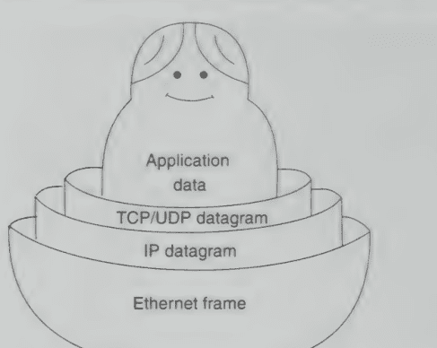
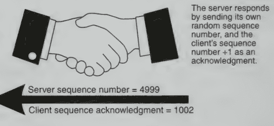
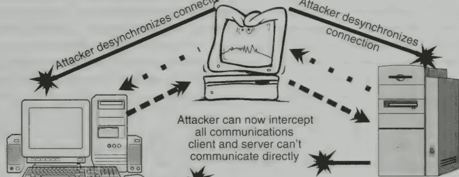
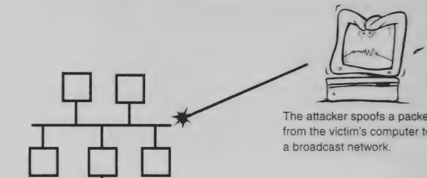
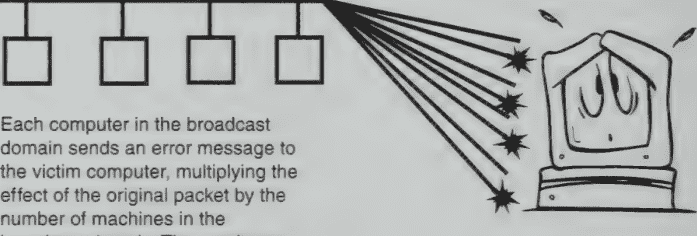
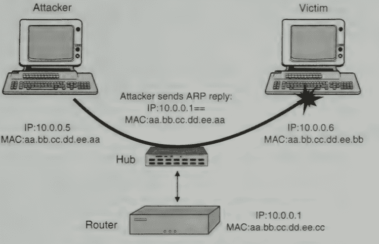
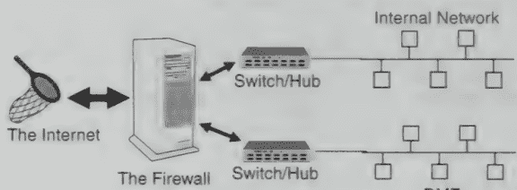

# 构建 Linux 和 OpenBSD 防火墙

Wes 希望将本书献给他的爷爷 Anthony Simeone 和已故的叔叔 Joseph Sonnenreich，他们都会从头读完这本书。

Tom 希望将本书献给他的妻子 Caroline Brossi Yates，她从头读完这本书，如果不是因为谦虚阻止了她，她本可以是共同作者。

- 总结 119

# 第 10 章 调整你的防火墙 295

# 致谢

感谢全球范围内投入精力和专业知识创建 `Linux` 和 `OpenBSD` 的所有人员，特别是 `Theo deRaadt` 和 `OpenBSD` 团队；`Linus Torvalds` 以及 `Linux` 的黑客们；以及 `Richard Stallman` 和自由软件基金会的志愿者们。

我们特别感谢以下人员所做出的贡献，所有这些贡献对本书的出版都是至关重要的：

- `Theo deRaadt`，对本文中 `OpenBSD` 部分提供了广泛的反馈。
- `Dave Pascoe`，网络大师，在真实网络上指导了 `Tom`，并鼓励他自己成为一名网络大师。`Dave` 对书中的任何错误不承担责任，但他对部分内容进行了合理性检查。
- `Erik Fichter` 和 `Brendan Conoboy`，《`IPFilter 文档编写指南`》的作者，他们对本文中 `IPFilter` 部分提出了意见和指正。
- `Warren Toomey`，`Unix` 历史学家，为确保我们“`Unix` 简史”的真实性提供了帮助。
- 英国教育体系，为 `Tom` 提供了所需的工具和机会。特别感谢 `Carol Perry`。
- `Jason Albanese`，`JP Consulting` 的创始人，负责了书中 `Linux` 部分的审查和测试。
- `Sean Ingles`，`//pharmatrak` 的系统管理员，负责了书中 `OpenBSD` 部分的审查和测试。
- 我们的编辑 `Cary Sullivan` 和 `Christina Berry`，感谢我们在写书期间的耐心，以及他们为了让书籍赶上通常复活节技术类书籍购买潮而付出的热情。

我们感谢几位为作者今天的成就奠定基础的人：

- `Larry Isaacson`，感谢他对 `MIT` 铜管合乐团的所有工作。如果没有他，作者们永远不会建立这种最初建立在粗鲁的小号演奏者笑话以及我们共同珍爱的“群体幻觉乐器”——长号的优越音量之上的终身友谊。
- `Frances Sonnenreich`；凭借她无尽的奉献和投入，她继续完美地履行着作为 `Wes` 母亲的艰巨且往往不计回报的工作。

如果我们的父母没有为我们的教育付出这么多，我们绝不会如此看重我们的教育。

# 引言

感谢购买史上最伟大悲剧的续作：《哈姆莱特》。你可能没有认出它是这部剧，我们对可能造成的任何困惑深表歉意。由于物流问题，我们根本无法安置并清理为了完美完成这样一个项目所需的无限供应的猴子和打字机。因此，我们只能选择坐在电脑键盘前的两个（尽管长着毛的）灵长动物。这实际上是概率法则的证明。在随机敲击键盘三个月后，我们得到了四万页毫无意义的文本。我们删除了所有不必要的字符，最后留下了这本书。诚然，有些句子很难懂，所以我们又了删减。但在大多数情况下，创造性的写作让我们得以保持条理并继续写下去。毕竟，丢掉的苹果并不多。

在审查了最终产品后，我们认为作为《哈姆莱特》的续作，它是巨大的成功。我们不确定为什么出版商坚持要将其营销为一本关于防火墙的书——与我们创作的这出引起共鸣且永恒的戏剧相比，这是一个相当现代的问题。但你已经看穿了骗局并购买了我们的杰作，保证它不会让你失望的。

# 本书真正关于什么

好了，回到现实。这是一本使用 `Red Hat Linux 6.0` 和 `OpenBSD 2.5` 构建防火墙的食谱。它包含了从零开始构建非常实用且强大的防火墙的逐步说明。本书假设你开始时仅有手里拿着这块加工过的肉体。它将引导你了解一些基础理论、在 `Linux` 和 `OpenBSD` 之间进行选择的过程、为你的系统获取正确的硬件、安装操作系统、配置防火墙，以及检测和处理安全漏洞。

我们将大胆保证，你想将本地网络（即使只有一台机器）连接到互联网。你已经决定防火墙是帮助你将网络推向世界的极佳方式，而不会把整个世界都请进来玩。真为你感到高兴。

但为什么有人会想要构建自己的防火墙呢？大家想要的都只是一个有两个孔和一个按钮的盒子：在一个孔里插上互联网，在另一个孔里插上我们的本地网络。然后我们按下盒子上标有“成为防火墙”的按钮，一切就那样发生了，对吧？

错误。那里那里那里那里那里那里那里那里大家想要的都只是一个有两个孔和一个按钮的盒子：在一个孔里插上互联网，在另一个孔里插上我们的本地网络。然后我们按下盒子上标有“成为防火墙”的按钮，一切就那样发生了，对吧？

错误。那里那里那里那里那里那里那里那里那里大家想要的都只是一个有两个孔和一个按钮的盒子：在一个孔里插上互联网，在另一个孔里插上我们的本地网络。然后我们按下盒子上标有“成为防火墙”的按钮，一切就那样发生了，对吧？

错误。那里那里那里那里那里那里那里那里那里那里那里那里那里那里那里那里那里那里那里那里。

# 为什么是 Linux 和 OpenBSD？

这个问题非常像 `Mac` 与 `Windows` 的争论。`Mac` 易于使用，因为它们限制了普通用户对系统的控制。`Windows` 使用较困难，但赋予了终端用户更大的灵活性。新手倾向于喜欢 `Mac`，而经验丰富的用户喜欢 `Windows` 的灵活性。

同样，`Linux` 和 `OpenBSD` 都能成为优秀的防火墙。它们都是开源软件，尽管许可不同。`OpenBSD` 更容易操作，并得到了社区和发行者的更好的支持。`OpenBSD` 以安全为构建构建，具有许多 `Linux` 中没有的强大安全功能（`Red Hat` 受美国出口限制无法包含强加密；`OpenBSD` 来自加拿大，一切公平）。`Linux` 和 `OpenBSD` 有许多共同点，但在数据过滤方面使用两个完全不同的系统。

如果你在拿起这本书时对要使用的操作系统有先入为主的观点，我们希望你在读完第 4 章“选择操作系统：`Linux` 对比 `OpenBSD`”之前将这些想法放在一边。我们不认为大多数读者听说过 `OpenBSD`。我们相信在读完第 4 章后，所有读者都会对 `Linux` 和 `OpenBSD` 的相对优缺点有更好的理解，并更有可能做出最适合自己的自己的决定。它们都体现了开源运动的力量。`OpenBSD` 和 `Linux` 的存在并蓬勃发展（以及许多其他开源操作系统，例如 `FreeBSD`、`NetBSD`、`Hurd` 等）是这种力量的证明。

# 引言

无论你做出何种选择，愿意将网络安全的信任交给一个开源倡议都是至关重要的。`Linux` 社区和 `FreeBSD` 社区都理解，这不在于哪种开源系统更好，而在于从一开始就把开源作为一种可行的替代方案。

# 为什么选择红帽（Red Hat）？

我们选择红帽发行版是因为它是最流行的 `Linux` 发行版。这意味着它受到了用户社区的深入理解和强力支持。红帽还提供真正的商业级安装支持。如果你遇到问题，可以拨打电话给真人，他们将为你提供帮助。红帽系统在技术上具有一些优势，包括一个良好的安装程序和强大的系统配置工具，例如 `Red Hat` 软件包管理系统（`RPMS`）。通过使用《红帽 `Linux` 安装指南》作为示例，我们能够为防火墙问题留出空间，而不会在操作系统安装上浪费这些空间。

然而，我们应该考虑到，构建防火墙时使用的工具是任何包含 `2.2.x` 内核的 `Linux` 发行版提供的（几乎所有现代发行版都是如此）。书中 `90%` 的 `Linux` 特有部分同样适用于其他发行版。

# 本书的结构

本书可以通过多种方式阅读。我们首先建议快速浏览整本书，包括每个操作系统的安装和配置章节。阅读你最感兴趣的章节。当你准备好安装防火墙时，请翻到你所选操作系统的分步操作说明。

本书分为三个主要部分。

# 第一部分

第一部分是网络理论，我们尽力使其尽可能清晰明了。不知道你的 `IP` 和 `UDP` 的区别吗？一直认为 `TCP` 是一种防腐剂，或者认为 `ICMP` 是一个穿着滑稽服装在加拿大维护法律的形象？第 1 章到第 3 章将带你了解网络知识，直到你感到有足够的信心从容地面对书的其余部分以及互联网的其余部分。

第 1 章“网络安全的 ABC”对任何网络环境中的安全问题进行了广泛概述。首先，我们查看为什么安全性不会随着互联网的出现而自然产生。然后我们退后一步，问问我们起初我们需要安全性——我们正试图保护什么？防火墙的工作是保护你的网络免受外部黑客的侵害，但如果黑客在内部会怎样？我们通过查看内部安全及其对你防火墙设计的影响来结束第 1 章。

在第 2 章“基础安全问题”中，我们查看了互联网的工作原理、核心协议的工作以及这些协议中固有的漏洞。具体来说，我们查看了 `TCP/IP` 协议族。我们还处理了一些通过互联网攻击机器的通用技术：缓冲区溢出。

在讨论了底层互联网协议后，第 3 章“你的网络如何变得安全？”详细查看了构建在 `TCP/IP` 之上的所有主要服务和协议。这些包括启用电子邮件、Web、聊天和文件共享的服务和协议。我们将告诉你是它们是如何工作的、它们有哪些漏洞，以及你可以做些什么来让它们更安全。本章还描述了与你的物理网络配置和用户管理相关的问题。

# 第二部分

第二部分进入了核心细节。第 4 章“选择操作系统：`Linux` 对比 `BSD`”讨论了我们所涉及的两个操作系统——`OpenBSD` 和 `Linux` 的历史、发展以及随而来的优缺点。希望这将帮助你做出选择。

第 5 章“获取正确的硬件”假设你已经做出了操作系统的决定，现在准备好获取所需的设备了。许多读者拿起这本书时在想：“我有一台旧的 `486`，它将成为一个棒的防火墙。”你是对的。它会成为一个棒的防火墙，但可能并不容易让所有必要的硬件在操作系统上运行。如果可能，最好获取一个符合我们建议的系统。

然后你必须安装操作系统，在这一点，书的线性流程停止了（将在第 10 章恢复）。第 6 章和第 7 章适用于 `Linux` 用户，第 8 章和第 9 章适用于 `OpenBSD` 用户。

第 6 章“安装 `Linux`”和第 8 章“安装 `OpenBSD`”涉及操作系统的安装。它们不是安装说明书。相反，它们旨在配合安装手册和其他支持文档一起阅读。这些章节的目的是引导你完成安装，并让你明确最终目标是一个防火墙系统。当你面临选择时，我们将帮助你为防火墙做出正确选择。系统安装好后，我们还将讨论在开始编写防火墙规则之前需要进行的一些进一步配置。

第 7 章“在 `Linux` 下配置防火墙”和第 9 章“在 `OpenBSD` 下配置防火墙”涉及为 `Linux` 和 `OpenBSD` 编写防火墙规则。这两个操作系统使用不同的数据包过滤框架。`Linux` 使用 `IPTables`，而 `OpenBSD` 使用 `IPFilter`。在这两个章节都解释了数据包过滤规则的语法，并解释了过滤器是如何工作的。

到此时，你已经有一台运行中的机器，并且知道如何编写数据包过滤器。第 10 章“调优你的防火墙”回顾了第 3 章描述的协议，并带你了解配置防火墙的细节，以按你的意愿处理它们。书中为 `Linux` 和 `OpenBSD` 提供了大量的示例。当你离开这一章时，你将拥有一个运行良好的防火墙。

# 第三部分

第三部分解释了你的工作尚未结束。你需要思考当出现问题时会发生什么。一旦你知道了，你该怎么办？第 11 章“入侵检测与响应”处理了发现被入侵的情况（入侵检测）以及你如何应对（响应）。

第 12 章“杂记笔记”是一个汇总章节，我们在其他所有章节中都提到过但未详细说明。这包括对标准 `Unix` 器 `vi` 的介绍。

# 我不喜欢阅读

如果你想在不阅读任何内容的情况下建立一个防火墙，可以跳过第 1、2、3 章。跳过第 4 章，选择 `Linux` 作为操作系统并阅读第 5 章。这将帮助你挑选硬件并将其组合在一起。阅读第 6 章以了解如何安装，阅读第 7 章以了解防火墙的基本知识。最后，第 10 章将向你展示如何配置防火墙。这应该能让你运行起来。然而，请回来阅读书的其余部分。真的，我们是认真的。这都适用于你。

# 谁应该读这本书

答案是任何连接到公共网络（如互联网）的人。即使你只是家里有一台电脑，你可能也想建立一个防火墙来保护自己。如果你的电脑基于 `Windows` 或 `Macintosh`，这一点尤为真实。最令人沮丧的是由于青少年运行 `Winuke`（一种导致 `Windows` 崩溃的程序）在大量随机 `IP` 地址，而其中一个就是你的。

家庭网络和预算有限的小公司从书中受益最多。你可以通过很小的硬件投入获得商业级的保护。学习安全的过程对你作为中小型网络管理员来说也将大有益处。

我们不预计许多大型公司会读这本书——由于让管理者对开源解决方案产生警意的 `FUD`（恐惧、不确定和怀疑）技术，他们可能直接购买商业防火墙解决方案。遗憾的是，你在书中构建的防火墙性能与任何商业防火墙解决方案一样强大。当然，营销噱头听起来商业软件包更好，但事实是，通过构建防火墙的过程所获得的知识，比最昂贵的商业解决方案所有的“高级”防火墙功能对你的网络安全的贡献更大。

尽管如此，我们仍然从大公司网络的角度讨论了某些问题，因为我们预计今天读这本书的许多中小型网络管理员在一年内将管理规模更大、更复杂的网络。了解你的决定如何随着公司的增长而产生影响是有用的。

我们预计本书的平均读者至少具有中级计算机技能。这意味着你以前打开过电脑，安装过软件和硬件，并且习惯配置计算机各个方面。我们不假设你具备 `Unix` 知识——我们为所有任务提供了显式指令。尽管如此，学习如何在 `Unix` 环境中工作对于充分维护你的防火墙是必要的。你将从书中中学到很多，我们还会引导你寻找其他优秀的教育资源。

## 这本书很快就会过时吗？

我们充分意识到，当我们大多数读者读这本书时，`Red Hat` 可能已经发布了多次额外的版本，而 `OpenBSD` 可能至少经过了一或两次修订。这并不是问题——这本书专门的设计初衷就是为了确保在两年后与今天一样具有相关性。

处理未来的修订有两种方法。第一种是简单地忽略它们——至少最初如此。只需获取一张 `Red Hat 6 CD`，或者从 `OpenBSD` 网站刻录一张 `OpenBSD 2.5 CD`，书中的内容就是 `100%` 准确的。一旦你完成了 `Red Hat 6` 或 `OpenBSD 2.5` 防火墙的安装和配置，就可以升级到最新版本。这通常是一个更容易的过程，因为这两个操作系统都自带了安装程序，这些程序可以在保留所有配置数据的情况下允许升级。此外，通过在 `Red Hat 6/OpenBSD 2.5` 上运行几次过程，你就有足够的信心独立处理某个层了。

另一种方法是获取最新版本并查看我们的网站（`www.wiley.com/compbooks/sonreich`）。我们会在每次发布时在网站上发布信息，突出与正文内容的主要差异。我们已经做了很多前瞻性的工作，以下是我们的发现：

在 `Red Hat 6.1` 中安装防火墙与 `6.0` 并无本质区别。可能会有一些细微的变化，但没有什么是配套网站上一页错误清单无法解决的。在 `6.1` 发布一年左右，预计 `Red Hat` 将从 `2.2.x` 内核切换到 `2.4.x` 内核。`2.4.x` 内核将基于 `ipchains` 的防火墙替换为基于 `netfilter/iptables` 的防火墙。幸运的是，`iptables` 的语法与 `ipchains` 的语法非常相似，而且对于希望继续使用 `ipchains` 的人们有一个向后兼容选项，开发者预计这种支持将持续到 `2003` 年底。

`OpenBSD 2.6` 中的安装程序将与 `2.5` 几乎相同，只有一些微小的增强。再次，这些将在配套网站上提到。`OpenBSD` 在未来一段时间内很可能继续使用 `IPFilter` 作为其防火墙工具。

## 网站上有什么？

大量裸露且完全暴露的文本文件。满足你对严密网络和胡渣系统管理员所有幻想的一切工具。用于对付脚本小子（`script kiddies`）的工具。企鹅。

好吧，那可能有点过头——我是企鹅的部分——但网站上会有一些相当实用的信息。正如我们上面提到的，随着未来的操作系统版本大量涌入市场，该网站将用于保持书籍内容的时效性。此外，我们还在网站上放置了许多脚本和实用程序。每个操作系统都有三个防火墙脚本：一个低安全性的脚本和两个高安全性的脚本（带 `DMZ` 和不带 `DMZ` 的）。还有其他帮助安装和删除各种防火墙组件的脚本。

## 关于术语的简单说明

我们深知 `Linux` 之所以几个原因成为如今的现象。其中一个是 `理查德·史尔曼`（`Richard Stallman`），另一个是自由软件基金会的 `GNU` 项目成员，他们拥有 `Unix` 系统所需的所有工具和实用程序，正等着 `Linus Torvalds` 在 `1991` 年推出他闪亮的新内核。从那时起，`Linux` 内核和 `GNU` 软件蒸蒸日盛。我们坚信，如果没有对方，两者都不会是今天的模样。为了简洁起见，我们在全书中使用“`Linux`”一词来指代本应被称为“`GNU/Linux` 系统”的内容，并无其他原因。

# 总结

综上所述

# 网络安全的 ABC

本章对任何网络环境中的安全问题提供了广泛概述。首先，我们查看了为什么安全不会随着互联网的出现而自然产生。然后我们退一步思考，为什么我们最初想要安全，我们正试图保护什么。防火墙的作用是保护你的网络免受外部黑客的攻击，但如果黑客在内部会发生什么？考虑到这一点，我们通过查看内部安全及其对防火墙设计的影响来结束本章。

## 为什么安全是一个问题？

这个问题初看起来并不那么愚蠢。只要它被设计过，互联网的设计初衷就是为了让信息移动尽可能容易，主要是在大学环境中。安全与其说是次要考虑，不如说是一种积极的障碍。

你怀疑我们？考虑无处不在的 `http` 协议，它在很多方面是现代 Web 的核心。它最初的设计并不是为了在线购物，而是为了比印刷媒体更快、更灵活地发布和分发研究论文。理念是尽可能向尽可能的人传递信息。防止人们阅读你的论文、获取你的信用卡号以及更改你的薪资信息并不是主要的考虑因素。如果是其他方式，互联网可能会是一个更安全的地方，但你可能从未听说过它。

## 网络不会为你保护安全。它的开放性是它的力量。

沉静过去的的设计标准对于风风雨变的现代互联网来说是不够的。连接到互联网的机器和网络仍然安全得不当。为什么呢？既然你读了前两段，正确推断出安全仍然不是一个主要的设计考虑因素并不会获得额外积分。在设计过程中，安全被牺牲给易用性、酷炫图形和其他各种装饰（`chrome`）等需求。

**`Chrome`：** 为了吸引用户而添加的显眼功能，但对力量几乎没有贡献。这些。为了吸引用户而添加的显眼功能，但对力量几乎没有贡献。 经常被用作蔑视的术语

> —`Jargon File 4.0`


毫无疑问，在部署之前，大家决定安全。由于安全，混乱将会发生。由于安全，绷带（`Band-ids`）被贴在系统上，这意味着系统将是安全的。如果你没猜到，这是个坏主意。如果你在部署时考虑安全，系统将变得不可用、不安全或两者兼有。安全必须从开始设计。从开始考虑安全意味着理解什么是安全。

## 安全不是事后考虑。

### 网络安全的 ABC

安全可以做得过度。为了拥有适当的安全，你不需要把自己关在盒子里。考虑汽车报警器和其他形式的安全。它们不能让汽车变得不可盗。没有什么可以做到这一点。它们能做的是增加难度。当你买车时，你的目的是不是阻止一切。你的目的是阻止盗窃。这是一个重要的区别。然而，如果你选择没有安全的情况下生活，那么迟早你的车会被盗。如果你在没有网络安全的情况下连接互联网，那么迟早黑客就会找到你。如果你真的倒霉，这两件事会在同一天发生。

#### 你在保护什么？

正式上，安全是防止对你的数据、计算机和声誉的未经授权访问。这些群体是相互关联的，这意味着对其中一个的损害往往会影响另一个。在阅读每个章节时，思考你拥有的哪些类别的资产以及它们可能被利用。

#### 数据

数据一词指的是不仅仅一个数据项，数据是一个信息单元。你拥有的数据比想象的要多。你的数据包括但不限：

- 存储在系统中的文档和数据库
- 跨传输的密码和其他令牌
- 存储在队列或邮箱中的电子邮件
- 指导系统行为的系统文件
- 系统在正常运行过程中产生的日志

如果黑客或其他坏人访问这些数据会发生什么？三件事中的一或多种：(1) 人阅读（并传播）数据；(2) 人更改数据；(3) 人删除数据。所有这些都会导致头疼。如果有人进入你的公司薪资系统并发现了公司每个员工的工资，隐私的损失会导致头疼。如果这些信息发布在内部公告板系统——或者更糟，发布在 `Usenet` 新闻组——会导致偏头痛。如果薪资信息被篡改，导致人们拿钱过多或过少，药物成瘾可能会成为你第二个严重的问题。最后，如果所有薪资记录被删除并工资发放停止了，止痛药可能不再足够，你可能需要一个自杀救援热线。

即使是只包含公共数据的机器也需要安全：当《纽约时报》网站在 1998 年 9 月崩溃时，所有人都在看他们的笑话。你不需要那样的关注度。

数据未经授权访问的糟糕案例之一是由于它太难检测了。如果有人复制了你的工资记录但没有将其公开，你可能永远都不知道。如果有人在你最新的软件包（即你正准备发出的那个）的中间更改了一个比特，在了一群愤怒的客户冲到你大门外之前，你可能什么也听不到。即使你能判断出某台机器被攻破了，你可能完全不知道损坏的程度。

#### 提示

如果发现某台机器被入侵，你需要将其视为已从根本上被攻破，即使看起来没有发生变化。

数据、操作系统以及任何信任这台被攻破机器的机器现在都是可疑的。在再次信任它们之前，你将对它们进行彻底的检查。这可能需要极长的时间。从头重新安装可能更快。在许多方面，从暴力破解你整个硬盘的黑客手中恢复，要比从一台显示出几次来自离地的特权登录的机器中恢复要容易得多。在本书的后后部分，我们将介绍用于处理入侵检测困难的工具，我们还将介绍如果你认为自己被入侵了该怎么办——即，事件响应。

#### 计算机

你了解你的电脑是什么：它们是带有硬盘的实际机器，对吧？嗯，是的，它们还包括将它们连接在一起的网络以及将连接到外部世界的互联网连接、你的备份磁带（你一直在做备份，对吧？），简而言之，就是任何连接到你某台电脑且不呼吸的东西。

如果一个黑客来使用你的电脑但没有触碰你的数据，会造成任何损害吗？对于经营销售此类资源业务的公司（例如互联网服务提供商）来说，坏人使用的计算机资源无法卖给付费客户。如果你的公司的产品不是计算机的服务，那么它几乎肯定在销售过程中使用了计算机；如果计算机变慢甚至崩溃，销售过程就会停止。如果你的互联网连接完全满了人们下载某个黑客在你的公司文件服务器上提供的盗版软件，来自合法客户的邮件可能无法送达。

一类攻击，拒绝服务攻击，其设计不是为了访问你的计算机，而是为了防止计算机的授权用户能够使用它们。它们可能复杂得令人沮丧，例如依赖于网络代码中已知漏洞的网络攻击。它们也可以简单得令人沮丧，例如从你的 `FTP` 服务器快速反复地下载一个短文件，以淹没你的日志文件并关闭服务器。随着操作系统变得日益安全，攻击，拒绝服务攻击正变得越来越常见。在许多方面，它们比更具侵入性的攻击更难防御，因为它们过度使用或滥用了你真正希望提供的服务，而不是访问并非用于使用的服务。幸运的是，对其中一些攻击有相应的防御措施。

#### 声誉

在许多方面，这是未经授权访问的所有受害者中最棘手的。你可能会失去客户、员工、同事、服务提供商以及其他所有人的信任。被成功攻击并不意味着羞耻。没有注意到入侵、忽视它或处理不当才是羞耻的。如果有人渗透了你的网络，他或她不仅损害你的内部数据，还可以损害你的声誉。对其他网站的攻击可以从你的网站发起，这不会赋予其他管理员或执法人员宽限；入侵者可以用看起来非常真实的方式发送邮件或在新闻组发帖。如果入侵者从你的邮件服务器向你所有的客户发送邮件，侮辱他们并附上几张脏照片，人们会记得很长时间。

早些时候，我们说你可以过度追求安全。我们为什么要说这样呢？为什么不把一切都锁死并吞掉钥匙？因为安全与便利性之间存在权衡。世界上最不安全的操作系统可以通过关闭机器并将其锁在一个密封的房间里来确保安全（别忘记派驻武装守卫）。这台机器现在对任何形式的破坏几乎是无敌的了。但另一方面，它不会做任何有用的事情。你从安全退回到以帮助易用性的每一步——守卫需要假期，有人想进房间擦窗户，“我能打开它两分钟把一些数据取出来吗？”、“我只是把它连接到调制解调器检查我的邮件”——都会让机器面临被破坏的风险。要正确平衡易用性和安全性之间的权衡，就是

#### 构建 LINUX 和 OPENBSD 防火墙

#### 提示

适当的安全在“足够安全以确保安全”和“足够不安全以便可以使用”之间取得了正确的平衡。

### 内部安全

威胁来自你公司的内部，也来自外部。通常，两者的结合导致了真正的安全漏洞。

普通用户并不积极关注安全。当安全给用户带来不便，或者发生了直接负面影响用户的安全漏洞时，安全才会成为关注点。因此，系统管理员不能假设用户会考虑他们的行为如何影响网络安全。事实上，普通用户可能会倾向于不安全，因为安全更方便。

阻止这种倾向的是你的安全策略。在最简单的形式下，这是一份用户应该做和不能做的事的清单。这份清单应该写下来并易于找到。良好的安全策略将把安全漏洞降到最低。

预防问题总是一份不好报的工作。你做得越好，知道的人越少。用户无疑会对你策略带来的不便表示抱怨，说“从来没发生过什么事，你为什么要担心？”正确的回答是压制想要拍打他们的冲动，并解释之所以没有发生任何事是因为他们正试图破坏的安全策略。如果他们利用职权，或试图越过你的级别解决问题，请确保你有一份非常清晰的你对此强烈反对的纸面记录。你不想处于其中。良好的安全策略还有助于保持其完整性——执行一项明确白纸黑字适用于每个人的事情要容易得多。

本书主要关于防火墙，所以一旦我们离开第 1 章，我们将不再关注内部安全。但对内部威胁的防护往往被忽视。内部安全不应被忽视，而书的这部分正是我们不忽视它的。如果你选择忽视它，你就只得到了一半。在讨论内部安全时，我们将针对“家庭办公室”、“小型企业”和“大型安装”提供建议。

### 网络安全的 ABC

为了你的一种真实的方案。尽可能，应该遵循这些做法。

#### 物理安全

保护重要的机器使得获取其物理访问变得困难得多。如果有人可以接触到机器，几乎无法防止其被破坏。在 `MIT`，网络安全和认证由 `kerberos` 系统处理，它使得伪造身份或位置变得极其困难。然而，`kerberos` 系统的安全性取决于批准所有请求的机器。这个票据服务器（如它所称）位于一个带大锁的房间内的笼子里。那个笼锁的钥匙非常少。物理安全不应停止于服务器。你是否曾告诉你的邮件包存储你的密码，以便你每次想查看邮件时都不必输入？你不是唯一一个。人们在电脑上存储密码。结果是，对于你的电脑而言，拥有某人的台式机等同于拥有了他们的身份。一个良好的密码保护的屏幕保护程序，在机器闲置一段时间后就会启动几分钟的时间就可以阻止机会机作案的物理访问破解。如果能防止人们在计算机上存储密码会更好，但这被证明是极其困难的。`从不这样做`本身就是一个良好的开始。无论如何，都不应忽视桌面安全（参见下文章节，“基于主机的安全”）。

#### 网络安全

如果你使用的是共享以太网而非交换以太网，那么确保网络硬件的安全尤为重要。解释这一点需要花一点时间；该解释仅适用于你使用所谓的双绞以太网的情况。你可以通过观察网络线来判断。如果它的末端连接的是类似粗大插头的东西，那么你很可能使用的是双绞。如果是其他任何东西，那么就不是，你可以跳过接下来的几段，现在就确保你的网络硬件安全。

在传统的共享以太网中，发送的每一个数据包都会被相同子网上的每台机器看到（严格来说是在同一个广播域内，但让我们不要把问题复杂化）。这意味着从你的桌面到服务器的密码在原则上可以被子网上的任何机器读取。事实上，存在着作为“嗅探器”的硬件和软件系统，专门用于利用这一事实。它们嗅探所有的网络流量并捕获看起来有趣的数据块。更糟糕，而且与常识相反，没有任何通用的有效方法可以阻止嗅探设备（即使是 `AntiSniff` 等程序也无法检测所有的嗅探器）。另一方面，在交换以太网中，交换机学习哪些机器连接到交换机的哪些端口，并且不会向不需要知道这些信息的机器发送流量。你可以看到这如何提供帮助——你发送到服务器的密码只有你自己和服务器可以看到。

也许一个比喻可以澄清这一点。假设你需要告诉 `Fred` 一个秘密，他住在办公室的另一端的某个地方。你可能需要告诉他你把前门的备用钥匙藏在哪里。但你不记得他在哪个隔间工作了。现在，你可以站在椅子上，用尽力气大喊“`Fred`！”并喊出钥匙的位置。你的同事们会知道这条信息是给 `Fred` 的，而不是给他们的；因此他们会忽略它，对吧？嗯，是的，他们会忽略，但我希望你前门走廊里没有贵重物品。这就是共享以太网的工作方式。现在假设你决定不大叫，你下了，请一位信任的同事去告诉 `Fred` 钥匙在哪里。同事知道 `Fred` 坐在哪里，他走到 `Fred` 的隔间并安静地告诉他信息。只有你、`Fred` 和那位信任的同事知道这个信息。这就是交换以太网的工作方式，交换机扮演了信任同事的角色（同时也让 `Fred` 扮演“服务器”的角色）。

判断你拥有的是哪种以太网可能是很复杂的。去看看你的网络集中器，即插入所有网络电缆的盒子。如果它们被标记为交换机，那么它们可能就是交换机。大多数其他迹象表明是共享网络。无论是共享还是交换，确保人们不能随心所欲地将东西插入你的网络中都是很好的内部安全措施。

从网络之外，桌面调制调器被认为是一个非常不安全的想法。个人用户通常没有安全地使用调制调器的能力。如果可能，拨入和拨出都应该由中心统一处理。

对于拨入，有各种设备可以接收来并进行正确的身份验证（使用“密码安全”章节中描述的远程认证协议之一）。集中拨入还将为你提供一种选择，确保拨入用户进入你网络的某些安全区域，该区域不会让他们表现得像在你的建筑内部一样。

对于拨出，有基于网络的调制调器，可以像任何其他基于 `IP` 的网络设备一样被访问。此外，它们可以配置为只允许某些类别的外呼通话，并可以记录所有通话。这些比仅仅在办公室 `PC` 上插一个 `56k` 调制调器要贵得多。然而，虽然很难抵抗那些只想在串口端口上插一个调制调器来做这个或那个公告板的人的诱惑，但尽量不要这样做。以结构化、良好设计且经过审计的方式提供这些服务总是更好的。

某些网络服务在本质上是不安全的。例如，电子邮件是明文，它可以被在互联网传输过程中经过的任何机器上的任何管理员读取。确保你的用户理解哪些内容是本质上不安全的，以及这的影响。确保你的用户知道哪些是不保密的。如果你故意不安全，这一点适用得更为如此。例如，你可能发现监控击键、电子邮件消息和/或电话。除非你希望你的公司成为巨大隐私丑闻的中心，否则你需要制定一个清晰的政策，规定你正在监控什么。你还应该说明数据将如何被使用、谁可以访问，以及如何保护免受未经授权的访问。

所以，总结一下：

- 家庭办公室应确保访客不会将笔记本电脑和其他设备接入他们的网络。如果你使用调制调器进行拨出，请确保当有人拨入时，调制调器不会响铃接听电话。如果你使用调制调器进行拨入，请确保线路上有良好的身份验证。不要假设未列出的号码会增加任何程度的安全性。有数百个免费程序会测试交换机中的每一个号码是否为调制调器。它们被称为盲拨号器，而且非常有效。

#### 密码安全

- 小型企业应该考虑用集线器更换为交换机。
- 规模较大的安装应该已经在使用交换机了。如果建筑里有任何调制调器，用长矛去找它们并像杀掉恐龙一样杀死它们（把它们扔进一个盒子里，放上一些 `AOL` 软盘）。所有的拨入和拨出都应该是中心化的。

密码是安全中的经典弱点。由于大多数组织都会分配用户名，密码成了最后的防线。让我们明确这一点：如果破解者可以推导出你的用户名，他们只需要密码来证明他们的授权。一旦破解者拥有了这一点，如果密码太简单，选择密码的老问题将很容易被发现；如果密码太复杂，它们会被经常忘记或（更糟糕的是）写下来。你可以通常设置密码在一段时间后过期，然后用户必须更改它。对于这种做法的益处意见很大，但出于各种原因我们建议不要。我们倾向于让用户花一点时间选择一个易记但难以猜测的密码，然后确保所有软件咨询中央用户名/密码数据库。

- 家庭办公室应该开始使用密码。是的，管理这些需要时间，但你总有一天要开始。今天就是个好日子。
- 小型企业应该确保密码安全包含在他们的书面安全策略中。这将确保员工知道对密码有保密义务，以及其他访问设备如钥匙，并确保他们清楚什么是坏密码。
- 规模较大的安装应该开始运行主动密码检查，以确保密码在设置时是良好的，并作为定期运行密码破解工具。`Crack` 是一个适用于 `Unix` 密码的良好工具；`10ptchcrack` 适用于 `NT` 密码。这两个程序包的参考文献可以在第 12 章中找到。当你第一次运行密码破解器时，你应该预计会破解大约 `40%` 的密码。如果你能破解自己的密码，别人也可以。在他们之前先做。

##### 网络安全基础知识

确保人们不会被骗而交出密码。任何用户都不应该需要披露密码，特别是通过电话或电子邮件。告诉你的用户，他们不应该披露密码，即使是对那些自称已授权的人员。破解者很容易通过给系统组的某个可怜的小弟打电话来获取密码，假装成销售副总裁并对他们大吼大叫，直到小弟更改副总裁的密码。确保获得授权更改密码的人员拥有一清晰的政策，规定人们应该如何请求更改。告诉他们，如果有人试图绕过这些渠道，让他们要求他们通过正规渠道是完全没问题的。当首席执行官因为某个系统组的小弟拒绝让他查看自己的邮件而大发雷霆时，请准备好承担这种压力。我们是认真的。

##### 什么是好密码？

抱歉，这不能告诉你。不过，我们可以告诉你一些坏密码的特征。坏密码包括：

- 任何语言中任何可以用罗马字母表示的单词或词组
- 任何通过将字母改为数字和/或添加数字而变化的单词或词组
- 全是数字的内容
- 用户名的任何变体；如果你的用户名是 `sbn914`，那么 `419nbs` 就是一个糟糕密码
- 你的全名或其任何部分的变体
- 任何基于关于你的公开信息的内容——特别是生日等项目

避免这些，你的表现将优于 `95%` 的人。这已经不错了。

#### 管理安全

正如朱利安曾说的，`quis custodiet ipsos custodes`，或者说，谁来守护守护者呢？必须有人对机器拥有绝对的权力。然而，这种权力往往分布得比实际需要的要广泛得多。人们倾向于随手给某些人员提供管理权限（又称 `root` 权限），例如，那些只需要更换磁带的人。只要有机会，机器完全可以很好地管理自己的安全，但如果给每个用户都分发一个可以完全访问整台机器的万能密码，那就行不了。

给磁带贴标签的女士只需要以 `root` 身份运行磁带标记程序。如何在不给她 `root` 密码的情况下让她标记磁带呢？在 `Unix` 下，存在诸如 `sudo` 这样的实用，可以将 `root` 访问限制为某些人的某些特定命令（关于 `sudo` 的更多信息可以见第 12 章）。更新员工列表的人员需要对员工文件的特权访问，但仅限于该文件。他需要 `root` 密码吗？文件访问通常可以通过创建新组并根据需要将人员加入其中来处理。在分发特权以完成任务时，花一点时间建立完成该任务所需的最小权限，并仅提供这些权限。

- 对于家庭办公室，考虑一下谁在重要机器上拥有 `root` 权限。如果你自己用 `root` 权限完成所有工作，请停止这样做。
- 对于小型企业，检查谁拥有 `root` 密码以及为什么。如果把密码写在某个地方的密封封里，也许可以少让三个知道它的人？你是否可以建立替代性的处理程序，让你能够从任何人那里追回控制权？

#### 基于主机的安全

有人可能认为，基于主机的安全不属于内部安全。我们不同意。无论是相信每个人都有基本的善良和信赖，还是在网络入口处拥有世界上最响亮的防火墙，都不应该阻止你在能力范围内修复基于主机的漏洞。我们说的基于主机的安全指的是特定操作系统或软件包中发现的安全漏洞。对于 `NT` 和 `Windows`，这通常意味着保持最新的热补丁和服务包。对于基于 `Unix` 的操作系统，这意味着保持供应商发布的 `OS` 补丁以及个人供应商的特定包补丁。有些非常称职的组织其唯一目的就是尽快向你告知最近发现的漏洞及其修复方法。关注他们。利用他们的免费服务（关于它们的更多信息请见第 12 章）。

- 对于家庭办公室，跟进你的补丁。查看我们在第 12 章中指定的资源。检查你的 `OS` 供应商的网站。利用他们或其他机构提供的任何安全邮件列表。与其他管理员交流。
- 对于小型企业，考虑你的机器之间的信任关系。它们在读取和写入数据方面是否对彼此同等信任？它们在远程访问方面是否互信吗？在识别了你的服务器并对其进行物理保护后，现在是时候确保除了必要的外，网络上没有易攻的路径。
- 对于较大的部署，不要接受没有某种数字签名或其他确认权威的网站提供的软件升级或补丁。

如果你认为上一个建议是多此一举，不妨听听这个来自《术语文件》（`Jargon File`）的故事。

有一个关于“红队”渗透受安全的军事计算机的经典故事，它说明了二进制补丁（或者实际上，任何你可以在安装前无法——或无法——检查和审查的补丁）固有的危险。他们找不到任何渗透 `IBM` 操作系统的门路或方法，于是他们访问了一个 `IBM` 办公室（记住，这些是据报道正在执行正式任务的正式军事人员），偷了一些 `IBM` 的文具，并创建了一个伪补丁。这个补丁就是他们需要的后门。该补丁在 `IBM` 补丁发布的正确时间发布，带有官方文具和所有配套文档，并被尽职地安装了。安装经理随后学到了关于正确程序的知识。

> -`Jargon File 4.0.0`


关于病毒扫描器。基于 Unix 的系统从设计上讲倾向于不受病毒侵害。PC 系统从设计上讲倾向于遭受病毒。病毒会让你作为管理员的生活变得非常愉快。它们可能会通过设计或无意引入糟糕的安全漏洞。

对于家庭办公室，跟进你的补丁。查看我们在第 12 章中指定的资源。检查你的 `OS` 供应商的网站。利用他们或其他机构提供的任何安全邮件列表。与其他管理员交流。

对于家庭办公室，没有良好的桌面病毒扫描软件可以替代。

小型企业应该考虑病毒是如何进入的，以及为什么，尽可能引入替代方案。确保你的病毒扫描器特征文件——即告诉扫描器如何识别病毒的文件——保持更新。

较大的部署可能希望使用硬件或软件来控制可移动媒体。这些通常包括软磁盘驱动器以及可能的 `CD-ROM` 和。

还有一类被称为宏病毒的病毒在软件包环境中传播。`Word` 和 `Excel` 病毒就是典型的例子。它们特别容易通过网络传播，特别是通过电子邮件。如果你认为在这些方面存在真实问题，可能值得调查一下技术。

对于特别关键主机，如 `tripwire`（见第 12 章）之类的软件包值得关注。它们监控系统上的特定文件，以查看自上次检查以来是否有任何更改。这无法告诉你文件是否安全，除非你花时间确保系统配置文件没有被更改；伪造时间戳并不费力。像 `tripwire` 这样的软件包使用了复杂的校验和，使得修改文件而不触发报警变得极其困难。

# 总则

真正的安全需要精明的管理。这意味着要在上面投入时间、精力和智慧。明确你的安全程序，以及你的计算机系统中每天应该发生什么的情况。如果你不知道在网络正常运行时本应该发生什么，你又如何知道有人在执行未经授权的任务呢？

然而，你在网络安全上投入的精力如果超过了你在其他安全形式上投入的精力，那是没有意义的。我们知道有一家公司担心其软件产品的源代码会泄露给竞争对手。他们安装了软件扫描每封发出的邮件，寻找可能包含在信息中的源代码代码。在陷入这种偏执时，他们没有注意到他们的磁带和驱动器提供给员工得非常充足。没有程序来检查为什么要写入磁带，或者记录谁带走了磁带。对于任何人来说，整个代码库每天晚上都通过某人的提包离开了公司。如果你认为你的员工有足够的胆量偷窃你的东西，那么就认为他们有足够的智力用最简单的方法来实现。

## 外部威胁

尽管从历史上看，超过一半的信息安全泄露来自公司内部，但这一数据最近发生了变化。我们很有信地预测，这一趋势将会增加。从历史上看，内部人员一直是最大的威胁，并不是因为你的员工异常糟糕，甚至不是普通的糟糕，而是因为在那个大大的世界里并没有多少黑客。真正的高手都有别的事情要忙。如今，任何傻瓜都能成为黑客——只需访问 `cracking.is/fun`，下载你的漏洞程序 `zip` 文件，给出目标的 `IP` 地址，然后点击开始。现如今，这不再是“是否”的问题，而是“何时”的问题。这好的一面是，大体上，针对最常见的漏洞保持严密的防范，就能让你保持相当安全。如果一个拥有足够技能的人对你表现得足够坏心，他们就会进来，但这样的人很少见，而且（我们希望！）不太可能对你怀有恶意。

良好的内部安全有助于外部安全。如果一个走进大楼的坏人无法从人们的屏幕上获取密码，或欺骗用户交出密码，他作为授权用户进入你网络的唯一方法就是欺骗机器，这意味着绕过防火墙。你现在简化了问题。

到这里，你自然会考虑到在你的网络和互联网之间放置一个防火墙，以防止坏人进入你的网络。防火墙是你与世界其他部分之间拥有的非常非常好的东西，但它并不是万灵药。防火墙能为你做的是区分授权用户和世界其他部分。如果操作得当，它可以很大程度上将世界其他部分隔绝在你的网络之外，按照你精确定义的方式允许他们进入。它不能做的是一次性解决所有问题。防火墙不是良好的内部安全策略的替代品，也不是良好的主机安全性的替代品。然而，它将是你试图将坏人拒之门外的单一要素元素。

# 总结

在第二章中，我们讨论了网络安全的基础。你将学习互联网是如何工作的，以及为什么互联网的设计在本质上是不安全的。最后，你将学习如何保护自己免受这些不安全因素。在第三章中，我们开始详细列出你的防火墙应该做什么。然而，我们将迅速发现安全性与便利性之间的权衡——对于你希望防止从外部进入的每项任务，用户都将无法从内部轻松完成某些任务。如果你现在就开始思考你绝对不希望人们从外部做什么，以及你绝对希望人们从内部做什么，那么在我们后续的学习中，将它们匹配起来将更容易。

## 互联网基本安全问题

令人惊讶的是，很多人很难解释互联网（`Internet`）和万网（`Web`）之间的区别。事实上，许多人并没有意识到它们存在差异。即使是电子邮件，这几十的杀手级应用，对许多互联网用户来说现在也是 `Web` 浏览器的功能。基础性的无知不仅限于互联网新手；我许多精通互联网的用户都不理解为什么 `Microsoft` `Word` 坚持要将 `Internet` 中的 `I` 大写。即使当我们认为这只是微软试图通过微妙地改变我们对英语的认知来主宰我们思想的又一次尝试时，经过进一步检查，我们才发现网的奠基父们在他们的早期文档中规定了字母大写。

为了在互联网上保护自己，你需要对互联网在基础层面有相当稳固的理解。一旦你有了这种理解，你就能评估与各种类型用户相关的安全风险。你还能够在问题变得太灾难之前检测出问题并找到解决方案。

本章将教你关于互联网的基础知识。我们将观察数据如何在计算机之间传输，以及计算机如何在在大规模网络中找到彼此。我们还将观察机器如何同时与多个网络程序工作。对于这些每一个主题，我们都会解释各种安全风险、黑客倾向于如何利用这些安全漏洞，以及你可以对此采取什么措施。当你读完本章后，你就准备好考虑你自己的网络安全了。

## “I”的含义

有一个通用的“互联网”概念，指的是基于我们在本章中描述的协议构建的任何网络集合。可能有很多这样的网络。恰好有一个特定的互联网是所有人都在使用的。这个网络，令人惊讶的，就被称为 `Internet`（互联网）。它最初被称为 `ARPANet`（高级研究计划局，或简称 `ARPA`，是五角楼的研发部门），然后在某些时期又被称为 `DARPA` 互联网（`D` 代表国防部）。最后，随着越来越多的公共部门连接到互联网，`DARPA` 被去掉了，这个“网络的网络”被正式被称为 `Internet`。

还存在“扩展互联网”的概念，它包含了内部不运行在 `TCP/IP` 上但通过内部网关连接的各种网络。这个更大网络的运行方式并没有真正标准化，主要是因为大多数人口并没有意识到这种区别。因此，许多人简单地将整体称为 `Internet`。其他人使用诸如 `Matrix`（矩阵）、扩展互联网（`Extended` `Internet`）等术语。`Matrix` 是互联网创始人中流行的一个词（它源自威廉·吉布斯的经典小说《神经漫游者》），但现在这个术已被注册并属于好莱坞。可能没多久，互联网创始人们就会面临商标侵权诉讼。

## 互联网如何工作：快速解释

对于不同的用户，连接互联网意味着不同的事情。有些用户有专用线路接入他们的计算机。他们始终连接到互联网。其他用户使用调制解调器接入互联网服务提供商。建立互联网连接有很多方法，对于应用程序来说，要确定正在连接的连接类型非常困难。有些用户有线路直接连接到计算机。

对于应用程序来说，要确定正在连接的连接类型非常困难，因为有很多连接的连接。即使应用程序直接连接互联网，可能会干扰数据被发送或接收。

与其尝试直接连接互联网，应用程序向操作系统“对话”，要求它发送或从互联网检索数据。到操作系统的接口被称为网络驱动程序。

## 网络驱动程序

网络驱动程序抽象了操作系统的细节。每个程序可以假装运行在自己的世界中，并可以向网络请求信息。如果多个程序想要网络数据，网络驱动程序将在它们之间进行调解，确保程序尽快获得所需数据。

## 互联网协议

存在许多类型的网络驱动程序，不同的驱动程序用于连接不同类型的网络。每种类型的网络都有其传递数据的特殊规则。互联网协议（`IP`）定义为互联网通信的标准，规定了数据如何在机器之间传输。通过使用标准，一台机器不需要知道另一端的计算机类型。计算机通过网络驱动程序处理数据的转换。

## 数据如何在互联网上移动

当数据在互联网上传输时，它被拆分成小块数据包。每个数据包从发送计算机单独发送。数据包只知道它应该到达的地址。它不知道如何到达那里。它使用的方法与邮件从你的本地信箱到达目标收件者的方式非常相似。

将一个数据包等同于你寄给阿拉斯加州某个小镇亲戚的一封信。你通过将信投进街角的信信箱来“发送”这封信。当然，信件并没有神奇地传输到你亲戚那里。邮递员会经过并在下午 5:45 左右清空信箱。他不知道如何把你的信寄到阿拉斯加州，但他知道如何把它送到当地邮局。他把它放进箱子里。

这种将信送到各个中央分局办公室的过程一直持续，直到其中一个较大的办公室实际上知道如何将信送到阿拉斯加州。

# 构建 `LINUX` 和 `OPENBSD` 防火墙

办公室的一名员工把它放入漏斗，漏斗被装在飞往安克雷奇的飞机上。

飞机落在安克雷奇，那里的邮递看到了这封信。他们知道那个矿业小镇的位置，但他们没有直接去那里的卡车。于是，信件到了附近的一个大镇。大镇的邮政员在那周晚些时候要去矿业小镇访问一个朋友，于是他带着信去，并在到达后将其递给了你的表哥。

这个冗长而复杂的故事有什么意义？它实际上包含很多观点。第一个大观点是，你将邮政员替换为称为路由器的计算机，将卡车替换为互联网线路，这样你就对数据如何在互联网上从点 `A` 到点 `B` 有了很好的理解。路由器本质上是一个数字邮政员。就像邮政员将邮件递给更靠近信封的邮局一样，路由器是专门将信息传递给更接近目的地的计算机的计算机。路由器可能不知道如何将数据传到目标位置，但它们可以将其传递给可能有更好主意的其他路由器。最终，线路上的某一个路由器会“知道”如何将数据传给正确的收件者。

初始路由器是如何猜测将信息发送何处的？互联网上的每台计算机都有一个唯一的地址，格式为四部分数字，被称为 `IP` 地址。这种格式非常像电话号码，第一部分是国家代码，第二部分是区代码，第三部分是交换机，第四部分是电话本身。路由器查看 `IP` 地址，它由四个数字组合而成，每个数字的范围在 0 到 255 之间。关于 `IP` 地址的解释，请参见标题为“`IP` 地址中包含什么？”的侧边栏。

第一个路由器查看目标 `IP` 地址中的四个数字。如果它知道如何将信息发送到前四个数字相同的路由器上，它就会沿着正确的方向发送数据包。如果它不知道网络在哪里，它会将数据包发送到另一个路由器，该路由器可能更有机会找到目标网络。

如果数据包正朝着正确的方向发送，它经过的每个路由器应该知道如何将数据包传到更接近实际目标网络的机器上。这个过程发生在数据包位于网络本身的机器上时。

如果在链条的某一点，知道它直接连接到目标网络内的计算机，或者甚至可能是目标本身，它将直接向那里发送数据包，跳过所有入站工作。回到我们最初的寄往阿拉斯加的信，想象一下如果你的家乡靠近中央调度站，该调度站知道如何将邮件寄到阿拉斯加。你的信会快得多到达那里，因为它跳过了许多前往其他调度办公室的非必要步骤。

# `IP` 地址中包含什么？

`IP` 地址看起来像这样：

```
18.62.2.61
```

`IP` 地址由四个 8 位数字（值范围 0–255）组成，这些数字被称为“字节”（`octets`），并用点隔开。使用这个系统，有 4 万亿个可能的 `IP` 地址。显然，需要一台非常强大的计算机才能存储所有这些地址的路由信息。因此，发明了一种分组这些地址的方法。

三种基本分组被称为 `A` 类、`B` 类和 `C` 类网络。第一个 `IP` 地址数字（我们的例子是 18）正好指定了一个特定的 `A` 类网络。只有 128 个 `A` 类网络，由 0 到 127 之间的第一个数字指定。这些分组中的半以上留作特殊用途。其余仅供政府和大型组织使用。这是因为 `A` 类网络的持有者可以控制由三个字节组合形成的所有地址。每个 `A` 类网络包含 1670 万个独立地址。马萨诸塞理工学院（`MIT`）就是其中之一，我们的示例指向 `MIT` 校园内的一台特定机器（`gsd.mit.edu`，全球学区的主机页）。因此，任何以 18 开头的 `IP` 地址将指向属于 `MIT` 网络一部分的机器。

`B` 类网络的第一个字节在 128 到 191 之间。与 `A` 类网络不同，`B` 类网络通过将第二个字节固定为特定数字来确定的。`B` 类网络的持有者可以分配最后两个字节组合产生的所有地址，总计约有 65,500 个可能的地址。总共约 16,000 个 `B` 类网络可用，其中大多数已经分配完毕。

`C` 类网络是限制最严格的网络类型。第一个字节可以在 192–223 范围内。第二个和第三个字节是固定的。`C` 类管理员只有 254 个可能的 `IP` 地址可以分配。有超过 200 万个 `C` 类网络可用。

这种拆分可能的 `IP` 地址数字的方法意味着，核心路由器只需要知道如何获取 200 万个网络的信息，而不是 4 万亿个地址。大多数路由器甚至没有完整的路由表（即 200 万多个地址），而是知道如何将信息发送到骨干路由器（一种拥有更完整表格的路由器）。从那里开始，该路由器将对如何将数据包传到目的地有更好的主意。

关于域名的简要说明：因为长数字对人类来说难以处理，因此创建了一个系统将名称与数字匹配。称为域名服务器（`DNS`）的特殊计算机被指定用于将这些名称翻译成正确的地址。当你在 `Web` 浏览器中输入地址时，例如 `www.example.com`，它会执行此操作。我们将在下一章中更详细地讨论这种服务。

通过标准协议之一进行通信。尽管如此，新协议层出不穷，一些私有协议也变得流行。这无疑只会让你的工作变得更加困难。

你的防火墙将位于用户机器上的客户端程序与它们想要访问的网络服务之间。只有当你显式地通过防火墙进行访问时，任何人才能使用这些服务。如果你是一个控制狂魔，你可能会兴奋得口水直流。而其他人此时此刻可能会对此此呻声连连，因为这意味着你必须理解并评估许多你可能根本不想去考虑的事情。

大多数协议都是构建在一个或两个基础协议之上的。这种结构允许开发者抽象掉跨网络传输数据的细节，转而专注于数据流的控制。传输控制协议（`TCP`）和用户数据报协议（`UDP`）被用于处理网络传输。这两个协议都是构建在 `IP`（互联网协议）之上的。我们已经简要地访问过 `IP`，`IP` 是几乎所有互联网通信的基础（`ARP`/`RARP` 除外，它们将在本章稍后部分讨论）。

让我们详细查看这些核心协议。

## 基础：`IP`

通过 `IP` 发送的数据是以一系列碎片的形式发送的，称为数据包（`packets`）。一大块数据被拆分成许多数据包。`IP` 的关键在于它的简单性。`IP` 提供了一种在网络中递送数据包的机制。它没有保证数据包一定能到达，或者以任何特定的顺序到达。如果路由器不知道如何将 `IP` 数据包发送到目的地，它就会将其丢弃并返回一个错误消息。

当你无法保证数据包会被送递时，它被称为不可靠的（`unreliable`）。如果没有信息可以帮助将一个包与上一个包关联起来，该系统被称为无连接的（`connectionless`）或无状态。

极少数应用程序直接处理 `IP`。路由通常在操作系统的内核（`core`）中处理。相反，应用程序使用 `TCP` 和 `UDP`，它们为 `IP` 提供了更高层的接口。有一类应用程序直接处理 `IP`——这些是各种包监控工具，我们将在第 11 章“入侵检测与响应”中查看这些工具。

跨网络发送的每个数据包都像一个俄罗斯娃娃（见图 2.1）。每一个壳（`shell`）都是一个头部（`header`）和一个可能的尾部（`trailer`）。头部是放在数据块开头的信息。尾部是指出现在数据块之后的信息。壳内部是数据，这些数据通常是其他较小的俄罗斯娃娃。

# 构建 `LINUX` 和 `OPENBSD` 防火墙



图 2.1 描绘得糟糕的俄罗斯娃娃以太网包。

头部、数据和尾部的组合被称为数据报（`datagram`）（“俄罗斯娃娃”术语从未被政府官员正式采用，可能是因为最初大部分技术是在冷战期间由 `DARPA` 开发的，但更有可能是因为我随口造了这个术语）。将一个数据报放在另一个内部的过程被称为封装（`encapsulation`）。

最外层的数据报称为以太网帧。它包含一个头部和一个尾部。中间是 `IP` 数据报。`IP` 数据报包含一个头部另一个数据报，通常是 `TCP` 或 `UDP` 数据报。`TCP` 和 `UDP` 数据报可能包含原始数据，也可能封装其他协议。

解开包中层的过程被称为解复用。以太网硬件解复用以太网帧并将封装的 `IP` 数据报传递给 `IP` 服务。`IP` 服务随后解复用其数据报并将结果信息传递给适当的服务——通常是 `TCP` 或 `UDP` 服务。

## `IP` 漏洞

在进入各种基于 `IP` 的攻击之前，我们需要引入一个关键概念，称为欺骗（`spoofing`）。创建一个具有虚假源 `IP` 地址的数据包非常容易。当另一台机器接收到此包时，它可能认为该包源于虚假的发送者。这个过程被称为对目标机器欺骗。攻击者使用欺骗有很多原因。

# 基础互联网安全问题

最常见的问题之一是获得匿名性。通过欺骗数据包，攻击看起来像是来自他人的机器。当攻击者想要冒充对某些资源具有特权访问权限的机器时，也会使用欺骗。为了让欺骗生效，还需要许多其他因素起作用；我们将在整个章节中详细介绍这些因素。

使用一个简单的 `IP` 数据包就可以发起许多攻击。我们将触及过去几年中造成相当破坏的几种特定攻击。通过检查这些攻击的工作原理，你将更好地理解新漏洞利用出现时的基础。

理解漏洞利用是如何运作的有助于更彻底地评估威胁，并使你能够实施有效的防护措施。

## 死亡之 `Ping` (`Ping` of Death)

最简单的基于 `IP` 的攻击可能是臭名昭著的死亡之 `Ping`（`PoD`）。这种攻击通过单个数据包实现，其长度超过了协议规范中规定的 `IP` 数据包最大长度。创建这样一个数据包极其简单。`Win95` 提供了一个程序，可以在 `DOS` 提示符中通过一行完成此操作（具体为 `ping -l 65510 target.ip.addr`）。`Unix` 系统提供了类似的命令，尽管许多最近版本不再允许生成此类数据包。

死亡之 `Ping` 是如何工作的？这与 `IP` 数据包被拆分（分片）成能够适应以太网帧的小块的方式有关。当一个 `IP` 数据包大于以太网帧的最大尺寸（减去头部/尾部）时，它会分裂并作为多个帧发送。接收的计算机提取碎片并将它们重新组成一个完整的 `IP` 数据包。

通常，`IP` 头部包含 `IP` 数据包的长度。当 `IP` 数据包被分片时，头部包含的是碎片的长度。没有任何分片数据包包含完整包的长度。因此，当数据包被分片时，完全组装包的长度只有在收到所有碎片后才能确定。


IP 规范为 IP 数据包设置了最大尺寸。死亡之 Ping 之所以有效是因为某些包处理程序假设不会出现大于此最大尺寸的数据包。数据包重组代码留下了足够用于最大 IP 包长度的内存。当超大数据包被重组时，数据包中的额外数据会溢出到其他内存区域。结果是它会让操作系统进入一种不稳定状态。操作系统拼命追求稳定性，并不可避免地陷入最稳定的状态——死亡。这是一种典型的缓冲区溢出攻击。我们将在本章末详细描述缓冲区溢出的过程。

**注意**

`ping` 程序让这种攻击变得如此简单，以至于它成为首选武器，并最终成为这种攻击方法的名称。虽然 `PoD` 类攻击是通过“`ping`”执行的，但也可以通过其他工具或自定义程序完成。仅防护“`ping`”请求无法解决此漏洞。

防止死亡之 Ping 的方法是修复你的版本，使其不再尝试重组超过最大长度的。在防火墙层面捕捉这种攻击非常困难，因为单个碎片看起来完全正常。只有当碎片被组装成完整的 IP 包时，问题才会发生。

**注意**

在防火墙层面有效拦截这种攻击的唯一方法是在防火墙处组装每个分片的 IP 数据包，并在将其传递给目标机器之前检查是否过长。这会消耗时间和 `CPU`，并可能为实时通信或带宽密集型服务带来问题。尽管如此，大多数防火墙都有此选项。

## 水滴 (Teardrop)

与 `PoD` 类似的是水滴攻击。在这里，大型 IP 包的碎片发生了重叠，而不是正确地端尾对齐。在图 2.2 中，包一的偏移量为 0，长度为 10。包二的偏移量为 5。这意味着它从中间开始。内核尝试消除重叠，但如果重叠碎片小于重叠的大小（如图 2.3 所示），内核就会发现自己处于一个未准备好处理的状态。这被亲切地称为内核崩溃（`kernel panic`）。内核崩溃通常是由不幸的接收机器的不愉快死亡表现引起的。

这些问题并不一定是由于 IP 协议的性质引起的——它们只是许多协议实现中的常见漏洞。下一个漏洞实际上是由 IP 协议的一个特性创建的。

```
0 = 分片 1 偏移
15 = 分片 1 结束
```


```
重组时丢弃额外部分
15 = 分片 1 长度
5 = 分片 2 偏移
25 = 分片 2 长度
30 = 分片 2 结束
```


```
15 = 分片 1 结束
= 新分片 2 偏移
```


```
15 = 分片 2 结束 - 新分片 2 偏移
新分片 2 长度
30 = 合并长度
```
**图 2.2** 两个数据包正常重叠。

# `TEARDROP` IP 分片重叠解决

```
0 = 分片 1 偏移
15 = 分片 1 结束
```


```
15 = 分片 1 长度
10 = 分片 2 长度
5 = 分片 2 偏移
10 = 分片 2 结束
```


```
-5 = 分片 2 结束 - 新分片 2 偏移
新分片 2 结束
15 = 分片 1 结束
= 新分片 2 偏移
```


分片 2 没有数据覆盖重叠区域。

当通过从分片 2 的结束位置减去新偏移来计算分片 2 的结束时，会得到一个负数。当内核分配内存将分片 2 拷贝到重组后的 IP 包时，它获得了一个负数的内存内存。内核将负数解释为巨大的数字，并迅速耗尽内存。

**图 2.3** `Teardrop` 重叠。

# 严格与松散源路由

顶级的黑客总是很好地隐藏自己的踪迹。真正的黑客永远不会直接从自己的机器发送数据包——那样太容易追踪了。相反，他们会通过他们已经获得授权访问的其他机器网络进行操作。这会导致攻击追溯到他人的机器和账户。通过利用 IP 协议中可以在许多系统中实现的几个选项，可以增加额外的混乱层。其中一种选项允许数据包指定它通往目的地时必须经过的路径。这被称为源路由。源路由有两种类型：松散和严格。源路由允许你指定数据包必须经过的机器，但它也可以经过其他其他机器。严格源路由则强制数据包按照规定的路线行驶。

源路由允许黑客构造无法追溯的、或看起来源于你某一台机器的攻击。源路由还允许黑客伪装受信任的机器。幸运的是，没有任何主要服务在 `ways` 源路由。因此，我们让防火墙过滤掉出现在我们网络上的任何源路由数据包。

# 控制狂魔：TCP

IP 是一个非常简单的系统。它的唯一任务是使信息在互联网上移动的方式标准化。它并不确保离开 `A` 点的数据到达 `B` 点。如果你无法保证发送的数据包会按照你发送的顺序被接收，那么编写网络应用程序将非常困难。如果你甚至不知道所有数据包最初是否已经送达，情况会更加棘手了！因此，大多数应用程序并不直接使用 IP。传输控制协议（TCP）的创建是为了让开发者的工作更轻松。

`TCP` 是一个提供机制，用于在不可靠的网络上发送可靠数据流的系统。它通过跟踪数据是否重复、发送顺序错乱或丢失来实现这一目标。如果它发现问题，就会纠正错误。这意味着你可以计算按顺序到达且没有间隙或重复的数据包。事实上，`TCP` 让你完全避免了处理数据包。给 `TCP` 一块数据，末端就会接收那块数据。应用程序开发者不需要处理将其拆分为更小的块。这允许应用程序跨 `TCP` 连接流式传输数据，而无需担心数据如何在网络上传输。

当 `TCP` 层叠在 IP 协议之上时，产生的系统被称为 `TCP/IP`。该系统为程序员提供了一个抽象层，让他们避免处理与从互联网接收的数据验证相关的问题。

# TCP 端口

`TCP` 还处理另一个主要问题：当多个服务器运行在同一个 IP 地址上会发生什么？许多程序使用 `TCP` 协议提供可靠连接。在同一台机器上，运行 `Web` 服务器、邮件服务器和 `X Windows` 服务器并不稀奇，它们都使用 `TCP` 协议接受来自其他计算机（客户端）的连接。当机器与那台机器建立 `TCP` 连接时，机器如何知道哪个服务的客户端想要连接它？

IP 头部包含目标机器的地址，但数据包中没有指向特定应用程序的信息。由于许多服务可能与给定的 IP 地址相关，这些信息显然是不够的。

解决方案被称为 `TCP` 端口号。`TCP` 端口为每个实例提供一个地址。源路由还允许黑客伪装攻击。源路由还允许黑客伪装受信任的机器。幸运的是，没有任何主要服务在 `ways` 源路由。因此，我们让防火墙过滤掉出现在我们网络上的任何源路由数据包。

# 端口

`TCP` 还处理另一个主要问题：当多个服务器运行在同一个 IP 地址上会发生什么？许多程序使用 `TCP` 协议提供可靠连接。在同一台机器上，运行 `Web` 服务器、邮件服务器和 `X Windows` 服务器并不稀奇，它们都使用 `TCP` 协议接受来自其他计算机（客户端）的连接。当机器与那台机器建立 `TCP` 连接时，机器如何知道哪个服务的客户端想要连接它？

IP 头部包含目标机器的地址，但数据包中没有指向特定应用程序的信息。由于许多服务可能与给定的 IP 地址相关，这些信息显然是不够的。

解决方案被称为 `TCP` 端口号。`TCP` 端口为每个实例提供一个地址。源路由还允许黑客构造攻击。源路由还允许黑客伪装受信任的机器。幸运的是，没有任何主要服务在 `ways` 源路由。因此，我们让防火墙过滤掉出现在我们网络上的任何源路由数据包。

`TCP` 还处理另一个主要问题：当多个服务器运行在同一个 IP 地址上会发生什么？许多程序使用 `TCP` 协议提供可靠连接。在同一台机器上，运行 `Web` 服务器、邮件服务器和 `X Windows` 服务器并不稀奇，它们都使用 `TCP` 协议接受来自其他计算机（客户端）的连接。当机器与那台机器建立 `TCP` 连接时，机器如何知道哪个服务的客户端想要连接它？

IP 头部包含目标机器的地址，但数据包中没有指向特定应用程序的信息。由于许多服务可能与给定的 IP 地址相关，这些信息显然是不够的。

解决方案被称为 `TCP` 端口号。`TCP` 端口为每个实例提供一个地址。源路由还允许黑客构造攻击。源路由还允许黑客伪装受信任的机器。幸运的是，没有任何主要服务在 `ways` 源路由。因此，我们让防火墙过滤掉出现在我们网络上的任何源路由数据包。

根据 IP 头部进行过滤。在其他情况下，我们可以使用 `TCP` 头部中的信息进行过滤，例如端口号。例如，设置防火墙简单的方法之一是阻塞除关键应用程序使用的端口以外的所有端口。自然，这种方法是有局限性的，否则本章将会短得得多。

## TCP 漏洞

`LAND` 攻击是最简单的 `TCP` 攻击之一：创建一个 `TCP` 数据包，其源 IP 地址、目的 IP 地址以及端口设置为相同的值。该地址必须是目标机器的地址，且端口必须运行着活跃的服务。`LAND` 攻击具有重启或其它杀死大量机器的显著效果！

将源 IP 地址设置为目标机器的地址，要求在构建数据包时假装你的机器就是目标机器。这是通过“伪造”目标机器来实现的。正如我们在本章前面提到的，伪造的数据包似乎来自其真实来源的某个地方。

`LAND` 攻击之所以有效，在于 `TCP` 的可靠性。为了确保连接的可靠，`TCP` 执行了两个关键任务。第一个是会话初始化。一个被称为“三次握手”的过程在客户端和服务器之间交换初始化数据。这为所有未来的通信建立了一个参考点，称为序列号。序列号帮助 `TCP` 重新排序数据包并确定数据包是否丢失。另一个关键任务涉及在接收到每个数据包时发送确认号。如果在一定时间内没有收到确认号，则会重传数据包。

`LAND` 攻击利用了初始连接建立期间产生确认的方式。攻击的关键在于，服务器端和客户端各有自己的初始序列号。例如，服务器的序列号可能是 `1, 2, 3, 4……`，而客户端的序列号可能是 `1000, 1001, 1002` 等。对于每次传输，接收方都会发送一个包含发送应用程序期望下一个序列号的确认号。

攻击始于攻击者发送一个随机序列号作为第一次握手。目标计算机说：“好的，这是我的随机序列号。我通过将你的数字加 `1` 并发送回给你来确认你的数字。”这是第二次握手。如果是正常情况，攻击者的机器将监听该数字，并通过将目标序列号加 `1` 并作为确认号发送来进行第三次握手。现在两台机器都知道了对方的序列号，并可以正确地跟踪数据包。图 2.4 展示了典型的三次握手过程。

该攻击的技巧在于，目标机器实际上是将此数据包发送给自己（由于源和目的 IP 地址相同，所以它认为发送者是自己）。问题在于，目标机器正在等待自己的序列号作为确认。相反，它收到了它刚刚发送出去的、带有攻击者序列号的确认号。由于这个序列号与它期望的号完全不同，`TCP` 知道这不可能是乱序数据包。因此，它再次发送相同的序列号。`TCP` 将此解释为“这不是我所预期的，请重试”。这创建了一个无限循环——它不断向自己发送错误的确认号，希望能及时看到正确的序列号。但它看到的只有自己刚刚发送出去的确认号。图 2.5 应该能帮助你更好地可视化这一过程。

## 正常的 TCP 三次握手

### 客户端

### 服务器

- 客户端通过发送一个随机序列号来发起连接。
- 监听连接。
- 
- 等待服务器用确认号和服务器序列号响应。
- 服务器通过发送自己的序列号，以及客户端序列号 `+1` 作为确认号来响应。
- 
- 客户端验证确认号，并将服务器序列号 `+1` 发送回服务器作为最终确认号。
- 连接完成。
- 

**图 2.4** `TCP` 的三次握手。

## LAND 攻击 TCP 握手

### 攻击者

### 服务器

- 攻击者通过向服务器发送一个看起来像自己的包含随机序列号的数据包来发起 `LAND` 攻击。
- 监听连接。
- 
- 服务器通过发送自己的序列号，以及攻击者的序列号 `+1` 作为确认号来响应——数据包被发送到了服务器本身……
- 
- 
- 服务器看到 `1002` 的确认号，并重发之前的传输以指示该值无效。
- 
- 

图 2.5 `LAND` 攻击 `TCP` 握手。

## 基础安全问题

# 构建 LINUX 和 OPENBSD 防火墙

为什么这会杀死机器？`TCP` 是一个高优先级进程。这意味着它优先于所有应用程序。它基本上中断了正常操作，以便占用内核资源。无限循环迅速消耗了系统资源，在大多数系统中会导致痛苦的死亡。有些，`TCP` 最终会超时，但很少有操作系统能在内核资源耗尽时保持稳定。还有其他需要注意的——`Teardrop` 变体与 `LAND` 攻击结合，通过下载操作系统的补丁来修复。`OpenBSD` 和 `Linux` 都已修复。`Windows` 的大多数版本也有补丁。配套网站提供了各个平台的主要安全补丁。

好了，那很简单。现在让我们来看一些严重的 `TCP` 问题。我们刚刚描述了 `TCP` 连接初始过程。我们还讨论了 `TCP` 如何对每个传输的数据包发送确认。你可能注意到缺少了身份验证机制。这是因为并没有。`TCP` 只要收到格式正确的数据包，就会假设数据是可以的。一旦连接建立，服务器没有方法判断数据是来自客户端机器还是假装成客户端机器的机器。

想象以下情况：一个客户端程序通过 `TCP` 与服务器通信。攻击者利用 `ARP` 技术（在本章稍后部分描述）来拦截并重定向从客户端和服务器的数据流到攻击者的机器。攻击者不想被发现，因此所有客户端的命令都通过服务器传输，服务器的响应也回传给客户端。对于客户端和服务器来说，它们似乎在直接通信。由于攻击者正在监控序列号，它可以根据需要向 `TCP` 流中插入自己的伪造数据包。这允许攻击者以被伪造客户端的所有权限访问服务器。攻击者还可以监控任何与攻击相关的输出，并且不传递给客户端。因此，这种攻击变得透明的。在某种情况下，攻击者甚至不需要破解密码即可获取机器访问权限。攻击者只需等待用户登录，然后劫持会话流。图 2.6 显示了攻击者如何劫持 `TCP` 会话。

这里的技巧在于将机器放置在数据流的中间。正如我们在本章稍后部分所示，这并不困难。许多 `TCP/IP` 实现中都存在安全漏洞，允许此类操作

```
客户端
服务器
```




```
客户端
服务器
```
**图 2.6** 劫持 `TCP` 会话。

一种攻击。`TCP` 内部也存在允许此类伪装的漏洞。即使黑客无法获取透传位置，该主题下也有许多同样强力的变体。

一种可以用于劫持 `TCP` 会话的技术称为 `脱同步（desynchronization）`。为了解释这一点，我们需要回到三次握手模型：

**三次握手 1。** 客户端向服务器发送一个同步包和它的序列号 `Client_Seq`。客户端等待确认包。

**三次握手 2。** 服务器回传一个确认包（`Client_Seq + 1`）和它自己的序列号 `Server_Seq`。客户端处于 `连接已建立` 状态，但服务器正在等待客户端的确认包。

在第二次握手之后，攻击者从阴影中跳出，并向服务器发送一个重置包，伪装成客户端。服务器看到这个包，并假设握手过程中出现了错误。服务器结束当前的连接并监听新连接。就在此发生期间，客户端向第二次握手发送了真实的确认包，但当确认包到达服务器时，攻击者已经清理了原始连接。服务器看到了客户端的确认包，并忽略了它，因为它已经不再相关。

客户端对这次交换一无所知。由于它不期望来自服务器的进一步确认包，因此它不知道发生了任何错误，并仍处于已建立状态。客户端认为服务器仍然活跃，但事实并非如此。服务器认为客户端已关闭连接，但它并没有。服务器和客户端对连接状态都存在误解。这被称为脱同步状态。

脱同步也可以通过向客户端和服务器发送大量的空 `TCP` 包（`null TCP packets`）来实现。空包是那些会被客户端或服务器接收但不会产生明显影响的包。结果是，每一端的内部序列号会在对方察觉不到的情况下增加。例如，如果服务器的数字是 `5`，一堆空 `TCP` 包可能会将其提高到 `5000`。客户端仍然认为服务器的序列号是 `5`；服务器会将客户端发送的后续数据包视为乱序。这是一种 `TCP` 设置，被称为“窗口（`window`）”，它决定了内部序列号与收到的包中提供的数字之间的最大差异。通过超过窗口，连接将变得脱同步状态。

一旦实现了脱同步状态，攻击者就准备好对 `TCP` 连接大干一场了。以下是攻击者所采取的步骤：

- **三次握手 1。** 攻击者代表客户端发送一个同步包来重启服务器连接，使用它自己的序列号：`Attack_Seq`。
- **三次握手 2。** 服务器对客户端响应一个确认包（`Attack_Seq + 1`）和它自己新的序列号：`New_Server_Seq`。
- **三次握手 3。** 这次攻击者伪装成客户端响应一个确认包（`Server_Seq + 1`）：（`Attack_Seq + 2`）。

现在，当客户端向服务器发送数据时，由于服务器会忽略它，因为序列号（`Client_Seq`）是错误的。攻击者看到了它并随心所欲，通常是使用新的序列号（`Attack_Seq`）重新创建包并发送到服务器。当服务器响应时，客户端由于相同的原因忽略了它（它期望 `Server_Seq` 却看到了 `New_Server_Seq`），攻击者再次在重新构建数据包并将其发回客户端（带有 `New_Server_Seq`）之前对数据进行操纵。


我们所说的大部分是正确的，但我们忽略了一个非常重要的细节。客户端和服务器都不会忽略带有错误序列号的数据。相反，系统不会回传一个带有错误序列号的确认包。这被解释为“序列号错误，请重试”。例如，当客户端尝试向服务器发送数据时，服务器会生成一个确认包，说它期望的是 `Ax`，并包含它的序列号 `New_Server_Seq`。客户端接收到 `ACK` 后会大失措措，因为它期望的序列号是 `Server_Seq`，而不是 `New_Server_Seq`。因此，客户端向服务器发回一个序列号为 `Client_Seq` 的 `ACK`。服务器收到这个包并镜像了客户端的反应，因为它期望的是 `Attack_Seq` 而不是 `Client_Seq`。

这听起来是否开始变得熟悉了？结果是产生了类似于 `LAND` 攻击产生的 `ACK` 风暴。区别在于，这些确认包不会在内核内部无限循环——它们在网络中来回。这可能会淹没网络并消耗大量带宽。幸运的是，攻击者可以通过伪造每个对方期望的确认包来结束风暴。聪明的攻击者会运行自动执行此操作的程序——将风暴减少到几个 `ACK`。

这些攻击假设可以在网络上嗅探数据包以确定序列号。还有两种方法在无法嗅探序列号的情况下依然有效。较新版本的 `TCP` 实现可能会使用更难预测的方法来生成序列号。你应该确保你的机器都运行着最新版本的 `TCP/IP` 服务，只要在更新和管理这些服务方面是在可行范围之的。

# 构建 LINUX 和 OPENBSD 防火墙

...能够在不通过加密验证的情况下建立连接。我们将在下一章中详细讨论 `ssh` 及其许多应用。

一个通用点：你不应该基于 `IP` 地址或硬件地址建立机器之间的信任关系。信任关系应该基于加密密码交换或或其他复杂系统。`IP` 信任太容易被破解了。

## 自由精神：UDP

使用 `TCP` 是有代价的。验证数据包完整且有序的过程会产生相当的开销。生成并传输大量的额外数据以控制流量。此外，`TCP` 必须在确定拥有正确数据之前才将其传递给应用程序。如果存在大量的丢包或网络拥塞，`TCP` 连接将遭受严重影响。

某些应用程序并不在乎数据是否乱序到达或丢失。不使用 `TCP` 带来的性能提升有时会超过数据丢失或错乱带来的缺点。经典的例子是流媒体音频/视频。丢失的数据包可以被跳过，而不会给用户造成太大问题。乱序的数据包也微乎其微。这就是用户数据报协议（`UDP`）。

`UDP` 是一种无状态、不可靠的传输机制。它基本上只是在 `IP` 包上增加了一个数字。它还包含一个长度和一个校验和，用于数据包级的数据完整性检查。它包含了将包从一个应用程序传输到另一个应用程序所需的最小信息。

流视频和音频服务器使用 `UDP` 将数据流发送到客户端。通过不使用 `TCP`，需要发送的数据减少，从而获得更好的性能。

当使用 `UDP` 时，客户端通常会实现自己的数据完整性检查。通过一些创意编程，客户端可以补偿损坏的数据。

当然，没有任何东西阻止一个应用程序同时使用 `TCP` 和 `UDP`。事实上，大多数流媒体视频/音频包使用 `TCP` 来在客户端和服务器之间发送控制命令和统计信息。`TCP` 是合理的，因为这些信息对于播放性能至关重要，但需要完整无损地到达。

## 基础网络安全问题

尽管 `TCP` 和 `UDP` 都使用端口号来标识个体，但它们的端口方案是分开的。这意味着 `TCP` 客户端和 `UDP` 客户端可以同时连接到 `IP` 地址上的同一个端口号。`IP` 层会正确地将 `TCP` 数据包路由到 `TCP`，将 `UDP` 数据包路由到 `UDP`。

## UDP 漏洞

使用 `UDP` 实施的一种典型攻击是“水滴攻击”（`Teardrop` attack）。`UDP` 被用于携带水滴攻击中使用的偏移分段。这在 `IP` 攻击章节中已经解释。另一种攻击是被称为 `fraggle`（碎片攻击）的拒绝服务攻击。为了理解 `fraggle`，你需要参考侧边栏中的单播、广播和多组播。

## 单播、广播和多组播

当一台计算机直接将数据发送到另一台计算机时，被称为单播（`unicasting`）。如果一台计算机同时向子网上的所有计算机发送数据，则被称为广播（`broadcasting`）。每个子网都有两个保留地址：`网络`地址和`广播`地址。子网上的每台计算机都监听自己的 `IP` 地址（或多个地址）以及广播地址。

发送数据的第三种方法是多组播（`multicasting`）。在某些情况下，消息需要递送到网络上的某些计算机，而不是所有计算机。多组播类似于广播，不同在于只有希望接收多组播的主机才会指定的多组播地址。主机可以监听多个多组播地址，即使它们没有在监听也可以向多组播地址发送数据。如果消息很长或频繁，多组播可以通过仅发送一次消息来减少网络流量。

为了有效地实施 `fraggle` 攻击，你需要从目标机器广播一个 `UDP` 数据包。该数据包应该在多个高度饱和的网络上广播（即子网中大多数 `IP` 地址都有计算机在运行的网络）。关键在于选择一个有趣的 `UDP` 端口。如果该端口不可达，结果将产生大量的“`ICMP` 端口不可达”消息。一个有趣的端口是回声端口（`echo` port），它只需将数据包回传（`echo`）给目标机器。如果伪造的端口是回声端口，理论上可以建立一个循环，让目标机器不断尝试回声大量的机器。这将迅速淹没目标机器（可能比它淹没任何广播机器的速度都要快）。图 2.7 显示了 `fraggle` 如何动摇你的网络。还有其他 `UDP` 端口也可以削弱等效性。我们将在第 3 章“如何安全你的网络？”中稍后讨论。

## Fraggle 攻击



攻击者伪造了一个从受害者计算机发送到广播网络的数据包。



广播域中的每台计算机都会向受害者计算机发送一条错误消息，将原始数据包的影响通过广播域内机器的数量进行倍增。结果可以为黑客在实施拒绝服务攻击时提供优势。

**图 2.7** 实施中的 `fraggle` 过程。

在大多数情况下，除非你计划拒绝所有 `UDP` 服务，否则阻止 `UDP fraggle` 攻击是困难的。任何暴露的 `UDP` 端口都容易受到 `fraggle` 攻击的影响。关闭未使用的端口会有帮助。在防火墙上拦截 `ICMP` 不可达请求也可以防止洪泛。你所做的最有效的事情是确保你的网络不被用于 `fraggle` 攻击。由于这里的原理与许多 `ICMP` 攻击非常相似，你应该参考 `ICMP` 部分以获取更多关于安全网络的信息。

## 翻译器：ARP/RARP

到目前为止，我们忽略了一个事实：每个 `IP` 数据包实际上封装在以太网数据包（或帧）中。以太网硬件对 `IP` 一无所知，理解 `IP` 地址。以太网有自己基于唯一硬件（`MAC`）地址的地址方案。以太网头部包含源硬件和目的硬件地址。以太网帧从源接口通过以太网线发送到目的硬件接口。目的接口几乎都在本地硬件接口上——路由是由 `IP` 层完成的，而不是以太网层。

# 注意

尽管以太网目前是最常见的物理网络技术，但它是 `IP` 数据包可以跨传输的唯一网络。同样，其他协议也可以跨以太网网络发送数据。可以说，以太网处理硬件，而 `IP` 处理软件。

问题是 `IP` 并不知道目的接口的硬件地址。它只知道分配给该接口的 `IP` 地址（一个硬件接口可以多个 `IP` 地址，但同一互联网上的多个接口不能共享一个 `IP` 地址）。将 `IP` 地址转换为硬件地址的机制是地址解析，或 `ARP`。

当 `IP` 需要将目的 `IP` 地址转换为接口地址时，它会发送 `ARP` 请求。该请求被广播到本地网络上的每台机器（参见单播、广播和多组播的侧边栏）。当目的地址所在的计算机看到此请求时，它会回传一个确认（它不需要广播这个——它可以从 `ARP` 包中读取发送机器的硬件和 `IP` 地址），并在回复中给出其硬件地址。请求发起者寻求回复并提取硬件地址。然后将其存储起来以备日后快速参考。现在 `IP` 层就可以使用正确的源和目的 `MAC` 地址构建完整的以太网帧了。

`ARP` 的技巧之处在于它没有被封装在 `IP` 数据包中。`ARP` 有它自己的数据包格式。以太网层感知 `ARP` 请求和回复并直接响应 `ARP` 服务，而不通过 `IP`。

`RARP` 是反向地址解析协议。它用于机器知道自己的硬件地址但需要知道 `IP` 地址的情况。这对无盘工作站很常见。当机器启动时，它在本地网络上发送 `RARP` 请求。该请求是广播的，任何拥有硬件到 `IP` 地址映射的机器都会响应包含 `IP` 地址的 `RARP` 回复。机器随后使用此地址配置其网络接口。

`RARP` 现在已不再常见，因为它只能提供 `IP` 地址，而不提供子网掩码或默认网关等信息。`DHCP`（动态主机配置协议）在很大程度上取代了 `RARP`，因为它提供了更多信息。

## ARP/RARP 漏洞

`ARP` 最大的问题是它是无状态的，这意味着监听回复的进程不知道自己是否发送过请求。这意味着如果 `ARP` 回复到达你的机器，没有办法判断你是否真的发送过 `ARP` 请求。

想象一种情况：你的机器收到一个虚假的 `ARP` 回复，将网络上另一台机器的硬件地址映射到路由器的 `IP` 地址。这更新了你机器上的 `ARP` 缓存。这种技术被称为缓存投毒。突然之间，发往路由的数据包被发送到了这台机器。如果这台机器被破解并被设置为分析包并转发到真实的路由器，你可能永远不会发现区别。

路由器并不是唯一值得伪造的机器。聪明黑客可能会选择伪造文件服务器或数据库服务器。通过一些知识，黑客可以拦截数据库文件或查询。更复杂的方法可能涉及双欺骗——数据库用户会认为黑客的机器就是数据库。同样，数据库也会认为黑客的机器就是用户的机器。

`ARP` 缓存会在一段时间后过期，但一个简单的程序可以不断发送 `ARP` 回复，确保缓存条目保持有效。某些 `ARP` 实现还通过向缓存中的每个条目发送 `ARP` 请求来尝试更新缓存。这为攻击者制造了一个大问题，具有真实 `IP` 地址的机器将响应其正确的硬件地址。再次，`ARP` 无状态特性为黑客提供了营救。在请求被发送之前发送响应，实际上可以防止请求被发送。这种技术如图 2.8 所示。因此，攻击者可以以相对较少的努力成功让一台机器伪造另一台机器。互联网上有许多程序可以让这个过程变得更加简单。

## ARP 缓存中毒



攻击者发送 `ARP` 回复：

```
IP: 10.0.0.1 (路由器)

MAC: aa.bb.cc.dd.ee.aa

IP: 10.0.0.5

MAC: aa.bb.cc.dd.ee.aa

IP: 10.0.0.6

MAC: aa.bb.cc.dd.ee.bb

IP: 10.0.0.1

MAC: aa.bb.cc.dd.ee.cc
```

受害者现在认为攻击者的机器就是路由器。

**图 2.8** `ARP` 缓存中毒。

伪充是 `ARP` 的用途之一。拒绝服务（`DoS`）是另一种。缓存中毒可以让缓存变得非常难以访问。一个不知道路由器所在处的 `Web` 服务器无法提供许多页面。只需一点精力就能轻松扭曲整个局域网的 `ARP` 缓存，使得整个局域网在相当一段时间内变得毫无价值。对于一个创造性的黑客来说，`ARP` 提供了一个极其丰富的鲜艳调色板，用来装饰你的网络。

我们假设大多数读者到这里已经对 `ARP` 攻击感到恐惧了。很大比例的人刚刚拔掉了家里/办公室的每一根网线。在混乱进一步扩大之前，让我们来谈谈这种攻击的局限性以及你可以采取什么措施来防止 `ARP` 攻击。

`ARP` 攻击只能用于伪造本地网内的机器。这意味着黑客必须已经访问了你网络内部的某台机器。不过，被中毒的机器可能在局域网之外。此外，`ARP` 请求几乎从不通过路由器发送；因此，被伪造的机器必须通过简单的集线器或令牌环网络连接到受攻击的机器上。先不要急着呼吸——大多数网络到处都是简单的集线器。一个高明的黑客可能能够进入你网络中的至少一台机器。

你对 `ARP` 重定向攻击的最优防御方法是通过硬件和入侵检测软件。通过使用交换机而不是集线器。是的，它们更贵，但它们提供的收益远超其成本。许多交换机可以被配置为将特定的硬件地址与交换机上的特定端口关联。交换机防止其他硬件地址在这些受限端口上注册。。指向这些新的、“顽皮”硬件地址的流量将不会被发送到这些端口。

入侵检测软件可以配置为识别局域网上的 `ARP` 攻击。我们将在第二章中进一步讨论。

## Gimp：IGMP

我们在几页前的侧边栏中简要提过多组播。如果局域网上的所有机器都连接到一个集线器，多组播就很简单。一旦涉及到路由器，情况就会变得复杂一些。如果另一端没有人在监听，那么路由器跨接口转发多组播包是没有意义的。需要一个系统，以便路由器能够确定子网上的是否有人在监听特定的多组播。这就是互联网组管理协议（`IGMP`）。

`IGMP` 是一个 `IP` 层级协议，这意味着每条消息都封装在 `IP` 数据报中。`IGMP` 消息非常简单——它们长度均为 8 字节，且没有头部。消息有两种类型：由组播路由器发送的查询（`query`），和主机响应查询发送的报告（`report`）。由于 `IGMP` 消息是通过 `IP` 发送的，无法保证它们能到达目的地。消息按随机间隔重复，以增加数据包到达所有必要机器的概率。

多组播通信被发送到一组监听程序。这些组由 `D` 类 `IP` 地址指定。`D` 类空间内的每个地址都是一个组号。一个程序可以在同一块硬件接口上加入多个组，也可以在多个接口上加入同一个组。与端口的概念不同，多个程序可以加入给定接口上的 `IGMP` 组。

主机通过向路由器发送 `IGMP` 报告来加入多组播组。这告诉路由器，它将开始为该主机所属的子网转发多组播包。路由器在多组播期间会定期隔地发送查询。当多组播路由器发送查询时，子网上至少有一台主机需要对路由器做出响应，以便向该子网转发多组播包。是否有更多主机响应并不重要——事实上，许多系统被设计为，如果多组播网络上的另一台主机已经响应了查询，则不进行响应。这有助于减少带宽消耗。如果一段时间后没有收到来自某个子网的响应，路由器就可以停止向该子网转发多组播包。


## IGMP 漏洞

网上关于 `IGMP` 漏洞的讨论相对较少。这并不意味着 `IGMP` 漏洞是不可能的或不存在。多组播的使用频率远没有其他通信方法那么高；因此，对多组播安全的关注较少。

`IGMP` 没有内置任何类型的安全性，这意味着从技术上讲，任何人都可以监听其网络上的任何多组播。多组播安全的所有方面都留给了应用层。使多组播会话防窃听的方法是加密数据流。目前有许多项目正在努力 `IGMP` 多组播的安全。

多组播可能会产生其他潜在问题——例如，它是 `DoS` 攻击的另一个入口。可以使用伪造的 `IGMP` 包让子集订阅大量流量的多组播会话，从而创建 `DoS`。另一个潜在的安全问题涉及多组播应用程序（`CU`），客户端应用程序可能会受到影响。

## 快速交付：你的友好路由

这个故事的启示是：如果你不需要它，就禁用它。

# 构建 Linux 和 OpenBSD 防火墙

小型网络和单个机器需要一种简单的路由机制。假设主机连接到一个带有两个路由器的集线器。主机如何决定由哪个路由器接收数据包？如果主机有多个接口，情况也是一样。答案是主机有它自己的静态路由表。

# 基础互联网安全问题

不带磁盘启动或连接到更复杂网络的系统。服务于简单网络（总共一个或几个路由器）的路由器也可能具有简单的路由表。

尽管这些表是简单的，但表内仍可能存在某些错误的路由。可能是某个主机无法访问，或者某个路由器宕机。在这些情况下，会发送错误消息，告知路由表内部的变化或不准确之处。这些消息是互联网控制消息协议（`ICMP`）的一部分。

`ICMP` 允许网络上的机器通知其他发生的错误。如果已知路由，它还可以用于找到通主机的更优路由。最常见的 `ICMP` 消息是生态请求/响应（`echo requests/replies`）、不可达错误（`unreachable errors`）和重定向错误（`redirect errors`）。重定向错误用于用更优路由更新路由表。根据主机需求 `RFC`（一项规定主机在互联网上正常运行必须实现的协议的标准），所有主机都必须接收 `ICMP` 重定向消息，而对于路由器来说是可选的。

# ICMP 漏洞

很少有协议能够防止滥用 `ICMP`。其核心特性之一是重定向错误可以帮助构建更准确的表。遗憾的是，重定向错误同样可以携带不准确的信息。恶意创建的 `ICMP` 重定向可能导致主机或路由器开始将流量重定向到任意选择的机器，该机器可能甚至不在本地网络上。最好的情况下，它只会让一切变得一团糟；最坏的情况下，它可能是安全漏洞的一个方面。与上述的 `ARP` 重定向攻击不同，路由表项不会过期，因此未被察觉的攻击可能会无限留下安全漏洞。

解决 `ICMP` 重定向攻击的唯一方法是用防火墙对其进行过滤。这将保护你免受基于重定向的外部攻击。遗憾的是，这并没有提高你的内部安全。想象一个不满的员工想要拦截从 `CEO` 到人力资源部的所有流量。该员工将自己的机器设置为路由器。向 `CEO` 的机器发送一个快速重定向包会将所有默认流量发送到员工的机器。从 `CEO` 机器发出的每个数据包都会经过员工的机器。通过一些基础嗅探，该员工可以看到大量信息。通过更高级的技术，该员工可以劫持并操纵 `CEO` 的通信。

防御内部安全泄露的最佳方法是购买一些额外设备。特别是智能交换机或额外防火墙后面的敏感设备。确定哪些机器需要相互通信，并

# 构建 LINUX 和 OPENBSD 防火墙

创建只允许这些连接的过滤和路由规则。最后，入侵检测（如第 11 节所述）至少会通知你那些你没想过会成为黑客“杀手锏”的事情。

当然，你很少听到对 `ICMP` 重定向攻击的抱怨。这是因为这些攻击需要的知识比平均水平稍多，而且通常是专业人士进行的更复杂的入侵的组件。让 `ICMP` 臭名昭彰的 `ICMP` 攻击是拒绝服务（`DoS`）类型攻击和死亡之源（`Ping of Death`）攻击。我们提到 `PoD` 攻击为一种 `IP` 攻击。虽然它是一项 `IP` 级别的攻击，但用于递送它的信使通常是 `Ping` 程序，它是 `ICMP` 请求/响应系统的接口。`PoD` 没有任何没有任何点是 `ICMP` 回显请求/响应所特有的。

`DoS` 攻击涉及用大量数据包淹机器的 `IP` 协议栈，防止机器处理正常流量。`ICMP` 回显请求常用于构建这种攻击。创建一个看起来源自目标机器的数据包。这是一个 `ICMP` 回显请求。该数据包被发送到一个非常大的子网的广播地址。结果是，子网上的每台机器都会响应回显请求，向目标机器发送回显响应。反复发送多次这些伪造的回显请求将淹没目标机器。这些攻击中的第一种被称为小烟雾攻击（`smurf` attack）。不久后，之前描述的基于 `UDP` 的“`fraggle`” 变体被创建了。


# 动态路由：RIP 和 OSPF

DoS 攻击的恼人之处在于，ICMP 回显请求是一个有用功能，允许机器判断另一台机器是否“存活”（活动可用）。它还允许机器确定两台机器之间路由的状态。许多程序依赖这些数据来优化它们的跨网络连接。这是一个通常在操作系统内核中处理的底层过程。这使得很难关闭它，除非你有直接访问并配置内核。时间戳和地址 ICMP 请求/响应系统也是内核级的，也可以用于这种类型的漏洞利用。

为了防止伪造的 DoS 攻击，你有几种选择。第一是在防火墙级别过滤掉所有的 ICMP 回显请求/响应数据包。这不是一个满意的解决方案，因为它实际上禁用了任何依赖于 ICMP 回显/响应的业务。此外，你仍然会受到攻击的影响，因为你的上游提供商仍在路由所有流量。你可能希望将高配置机器放在他人的网络上。如果你的 Web 服务器可能是此类攻击的目标（也许你正在运行一个比尔·盖茨网站之类的），你可能希望将你的服务器与主要的 ISP 同地托管。他们有带宽来承受攻击，并有追踪和消灭犯罪者的能力。通常，DoS 类型攻击的实施者并不是

至少，你有道德义务确保你的网络不会为 DoS 攻击做出贡献。做到点的简单方法是向你的网络添加过滤器，阻止所有指向网络的广播流量。另一个过滤器可以防止并非来自网络内部机器的出站流量（从而捕获伪造包）。如果你是另一个管理员道德忠诚的受益者，你可能认为通过揭示唯一真理来转换天堂是正当的。

人们不是凭空选择 IP 地址的。互联网地址分配机构将其分配给 ISP 和其他大型网络提供商。这些网络提供商将地址块分配给较小的网络。随着网络的出现、消失和移动，这些地址会被重新分配。某些网络根据需要动态分配 IP 地址。由于这些原因，指向 IP 地址或网络的路由可能会随时变化。在这些情况下，ICMP 重定向或路由器发现是不够的。

路由信息协议（RIP）是解决复杂路由需求最流行（尽管不一定是最）的解决方案。它为路由器提供了一种机制，让相互告知连接的网络。RIP 通信通过 UDP 数据包发送，标准 RIP 端口为 520。

RIP 是一个相对简单的服务：初始化后，它会请求每个可用接口，实际上是向每个直接连接的路由器请求完整的路由表。每个路由器 RIP 通过发送其路由表做出响应。RIP 处理响应并相应地构建自己的路由表。从那时起，RIP 定期向其邻居广播其路由表。当发生变化时，RIP 还会发送一个详细说明变化的特定更新。

尽管 RIP 很简单，但它存在许多问题，使其对于现代网络来说并非理想。RIP 的一种替代方案是最短路径优先（OSPF），它修复了 RIP 的问题，并预见到了一些未来问题。OSPF 直接利用 IP，因此必须由操作系统内核中的 IP 处理程序支持。大多数新操作系统发布版本都支持。

## RIP 漏洞

RIP 遭受与 ICMP 相同的问题——从本质上说，它被设置为接收变化的信息。RIP 的默认安装允许入侵者看到路由命令，从而将流量重定向到关键网络资源。在小型网络环境中，使用静态路由会更好。在更复杂的环境中，像 OSPF 这样的新协议将提供更多的安全性。路由器

# 构建 LINUX 和 OPENBSD 防火墙

应对任何路由更改信息都应保持极度怀疑，并应利用所有可用资源来验证更改请求的必要性和真实性。

## 缓冲区：IP 杀手

我们将稍微偏离主题，讨论一个非常重要的话题。许多黑客根本不需要使用这些技术的任何一种就可以访问其目标机器。黑客获取资源最流行的方法是通过缓冲区溢出（buffer overflow）技术。缓冲区溢出存在于多得惊讶的流行应用程序中（大多数基于 Windows 的应用程序至少有一个此类错误，而且往往有许多）。当缓冲区溢出被利用时，黑客可以在受损（受控）机器上执行任意程序。这些程序可以以最高优先级和访问级别运行。

这种技术的有效性得益于 C 语言语言的普及。在 C 语言中，内存需要经过仔细的分配和管理。当程序员需要在内存中存储数据时，需要分配适当的内存。如果要存储的数据大小增加，程序员有责任确保分配的内存也随之增加。如果存储的数据所需的空间超过分配的空间，就会发生缓冲区溢出。图 2.9 详细地描绘了这一耗费生命的过程。

内存管理在复杂应用程序中可能是一项非常困难的任务。如果一个应用程序从一开始没有经过仔细规划，内存管理可能会变得更加令人生畏。更糟糕的是，许多标准编程函数并没有正确分配内存。新手或懒惰的程序员使用这些函数，而不是使用内存安全的替代方案。这正是趣味开始的地方。任何对可能超出程序控制的数据（例如用户输入）分配固定内存空间的程序，都可能允许缓冲区溢出的发生。你会对有多少程序程序反复地犯下这种低级错误而感到震惊。


图 2.9 缓冲区中的溢出。

## 基础网络安全问题

现在你已经知道缓冲区溢出是因为程序试图在一个太小的内存块中存储过多的数据而导致的。我们还没有解释的是为什么这能让程序员执行任意代码。

秘密在于计算机使用内存的方式。当程序运行时，它需要访问三种类型的信息。第一种是程序指令本身。它还需要访问程序将要操作的数据。其中一些数据是固定的或静态的，在程序运行期间不会改变。其他数据是动态的，可能会在程序运行时发生变化。

第三类信息涉及函数，或子程序。程序员使用函数来简化程序的编写。如果一个任务在程序中被执行多次，那么只写一次该任务的指令，然后在每次需要运行该任务时只需指向这些指令是有帮助的。任务被称为函数。每当程序想要使用该函数时，它就会调用该函数。

程序是一系列指令。这些指令中的许多将是对函数的调用。当程序运行时，它按顺序处理这些指令。当程序调用函数时，它会暂停处理自己的指令，并转而处理函数的指令。一旦完成函数的指令，程序就会继续执行它自己的指令。为了实现这种机制，程序需要跟踪它在调用函数之前的位置。这部分数据被称为指令指针（Instruction Pointer），它包含了程序下一条指令的内存地址。

存储函数动态数据以及指令指针的内存部分被称为栈（the stack）。图 2.10 显示了栈被淹没的简化视图。


图 2.10 一个简单的栈溢出。

## 栈溢出

当程序员为动态数据分配内存并在该区域存储过多的数据时，可能会可能会包含指令指针的内存。现在，当程序完成函数并查看指令指针以寻找下一条指令的内存地址时，它看到了一个错误的值。

老练的黑客用自己的代码填充缓冲区，然后以某种方式使其溢出，使得指令指针被覆盖为一个指向缓冲区中黑客代码开头的值。结果是？计算机执行的下一条指令是黑客的代码。分配的缓冲区的大小限制了黑客可以执行的代码量，但这并没有真的引起很多问题。黑客可以在极其小的空间内创建非常有恶意的代码，通常只有几个字节之大。在缓冲区如此小的情况下，缓冲区和指令指针之间可能存在其他缓冲区。这些缓冲区可以用来为黑客的代码增加可用空间。

程序员终于开始使用编码标准和辅助库来尽量减少缓冲区溢出的发生。尽管如此，这些问题仍然存在，而且发生的概率随着应用程序复杂性的增加而增加。像微软的 Internet Explorer 这样的程序非常复杂，充满了缓冲区漏洞。

互联网上提供了关于缓冲区溢出的更详细的解释。一篇很好的论文是由 `l0pht` 的 `Mudge` 写的，另一篇详细的文章是由 `Underground` 的 `aleph1` 写的。我们建议你查看一下它们。

`Mudge` 的论文可以在 `www.l0pht.com/advisories/bufitos.pdf` 找到。`Mudge` 的教程可以在 `www.insecure.org/stf/mudge_buffer_overflow_tutorial.html` 找到。

`Aleph1` 的论文可以在 `www.insecure.org/stf/smashhack.txt` 找到

# 总结

我们刚刚详细地查看了核心网络协议。希望你现在对数据在互联网上的传输方式有了良好的理解。你可能已经开始思考你想让防火墙防御的攻击。这是因为下一章将让你真正思考防火墙的最终作用。

# 第 3 章

## 你的网络应该有多安全？

应对任何路由更改信息都应保持极度怀疑，并应利用所有可用资源来验证更改请求的必要性和真实性。

Contrary于营销炒作，安全没有魔法弹。当防火墙首次出现时，防火墙供应商声称拥有防火墙就让网络变得安全。虚拟专用网络（VPN）和入侵检测系统（IDS）供应商也曾散布类似的魔法弹炒作。中层管理喜欢魔法弹的想法——他们只需要付一次钱就可以假设网络是安全的。即使他们足够聪明而知道事实，最终也会被蛊术士的炒作所说服。

事实是，所有技术都有助于提高网络安全性，但没有任何技术能让网络变得完全安全。此外，如果你不理解你正在保护的是什么，你为什么要费力去保护它，以及它是如何被保护的，那么你的安全系统将无法运行。任何告诉你可以在不降低端点安全性的情况下简化这一过程的人都是撒谎的。

尽管如此，本章确实简化了许多问题，但这纯粹是出于需要。这里讨论的任何主题都可以扩展成一整本书——如果我们对少数几个主题进行过多的细节描述，信息就会变得过时且毫无用处。结果是，本章虽然无法解决你的安全问题，但它会提醒你，你面临的问题比你最初想象的要多得多。

这是因为我们在这里的目标不是回答问题，而是旨在指出你点思考并可能进一步研究的事项。敏锐的读者会注意到本章涵盖的范围非常广。无聊的读者会注意到他们有许多页面需要扫读。好吧，当章节的标题是一个反问句时，你得到的就是这种体验。

## 物理网络

学习完这本书的物理最终产品将是一台配置为防火墙的机器。为了让防火墙发挥作用，它必须在你的网络中处于战略性位置。构建网络有许多方法，但为了每本书省下几棵树，我们将处理由两种最常见的防火墙位置产生的网络。为此，我们必须引入两个概念：DMZ 和 IP 伪装（IP Masquerading）。

## DMZ

非军事区（De-Militarized Zone，简称 DMZ）是一个源于朝鲜战争的表达。在那里，它指的是被强行清空敌士兵的地带。这种想法是在不危及自己士兵生命的情况下实现的，那些地雷散布在 DMZ 中，就像意大利宽面上的罗马芝酱一样。这个术语被吸收到了网络领域，但去掉了“奶酪”。网络用它表示：“你的网络的一部分虽然在你的控制之下，但在你最严格的安全防护之外。”与网络的其他部分相比，你放在 DMZ 中的机器受到的互联网侵害的保护较少，或者说完全不受保护。

一旦机器进入了 DMZ，它就不应该再次被带回网络内部。假设它已经以某种方式被破解了。将其带入网络就像向特洛伊询问他们能否再送来几匹精美的木马。

## DMZ 的使用

如果你决定建立一个，你该如何使用它？放在 DMZ 中的机器通常向普通公众提供服务。这些服务通常包括 Web 服务、域名系统服务（DNS）、邮件中继和 FTP 服务（所有这些术语将在下文解释）。代理服务器也放在 DMZ 中。如果你决定允许用户仅通过代理服务器访问 Web，你可以将代理服务器放在防火墙中，并设置防火墙规则仅允许到代理服务器的 HTTP 访问。

只要你注意了以下几点，你的 DMZ 应该是没问题的：

- 如果你把一台机器放在 DMZ 中，必须有充分的理由。有时，公司会在 DMZ 内部设置几个具有完全访问权限的工作站。员工可以使用这些机器玩游戏和其他不安全的活动。如果内部机器无法访问互联网，或者访问极其受限，这就是充分的理由。如果你的政策是让员工从桌面适控制访问，那么创建这样的工作站会传达错误的信号。他们使用 DMZ 机器的唯一理由应该是他们正在做不符合办公场所的事情。

- 它应该是一个孤立的岛，而不是踏脚石。它不能直接连接到内部网络。此外，它不应该包含可能让黑客攻破网络其他部分的信息。这包括用户名、密码、网络硬件配置信息等。

- 它不能包含任何你无法承受丢失的东西。放在 DMZ 的任何重要文件都应该是网络内原始文件的只读副本。在 DMZ 中创建的文件不能迁移到网络中，除非管理员对它们进行了检查。如果你正在运行新闻服务器并希望存档新闻，请确保 DMZ 拥有自己的归档系统。你不应该做什么样的事？例如：如果你在 DMZ 中运行 FTP 服务器，不要让用户将机密信息放在那里，以便他们以后从家里获取。

- 它必须尽你所能做到安全。仅仅因为你假设它是不安全的，并不保证它就是不安全的。不要让黑客的攻击变得比绝对必要时更容易。黑客可能无法从你的 DMZ 攻破你的内部网络，但他们可能决定利用它来攻破他人的网络。认真考虑不要你的 DMZ 机器上运行 Windows；它本质上是不安全的，而且许多类型的入侵在 Windows 上无法被检测到。Linux 或 OpenBSD 可以提供更多如果不是全部所需的功能，以及更安全的环境。

所有的地址都是伪装路由器的 IP 地址。伪装盒如何知道数据包是要发给哪台私有机器的？数据包没有其他信息可以给路由器提供任何线索。


# 构建 Linux 和 OpenBSD 防火墙

## 网络拓扑

所有地址均为伪装路由器的 IP 地址。伪装设备如何确定数据包应发送至哪台私用机器？数据包本身不包含其他信息供路由器参考。

解决方案是深入下一层，查看应用程序绑定的 `TCP` 或 `UDP` 端口。伪装路由器使用一种名为“映射”（`mapping`）的技术，帮助其将数据包路由到内部主机。每个 `TCP` 或 `UDP` 数据包的头部均指定源端口和目的端口（参见第 2 章“基础互联网安全问题”）。当伪装路由器从内部主机接收数据包时，它会将源端口替换为其自身可用的端口之一（从预定义的端口池中选取）。旧的源端口、新的源端口以及发送数据包的内部主机的私用地址会被存储在映射表中。当响应数据包返回至伪装主机时，其目的端口应匹配映射表中的某个新源端口。通过查询映射表，路由器即可获取接收该数据包的内部主机的私用地址及原始源端口。示例如下：

- 从内部主机发出的出站包：源 IP `10.0.0.6`，目的 IP `18.69.0.5`，源端口 `1200`，目的端口 `514`。
- 从伪装路由器发出的出站包（`209.21.210.49`）：源 IP `209.21.210.49`，目的 IP `18.69.0.5`，源端口 `22005`，目的端口 `514`。
- 来自互联网的入站包：源 IP `18.69.0.5`，目的 IP `209.21.210.49`，源端口 `514`，目的端口 `22005`。
- 从伪装路由器发出的入站包（`10.0.0.1`——路由器的私用地址）：源 IP `209.21.210.49`，目的 IP `10.0.0.6`，源端口 `514`，目的端口 `1200`。

此方法对多数应用有效，但在特定场景下存在问题。最典型的案例是 `FTP`（文件传输协议）。主动模式（Active Mode）`FTP` 客户端工作时，服务器会主动向客户端发起新连接，并在随机选定的端口上进行数据传输。这对伪装路由器构成挑战，因为返回的连接不在端口映射表中，导致路由器无法确定转发目标，从而丢弃数据包。

解决此问题的有效方法有限。最简单的策略是仅支持被动模式（Passive Mode）`FTP`。在被动模式下，客户端在两个不同端口向服务器发起连接。由于这两个连接均源自防火墙内部，该模式与伪装防火墙兼容性良好。关于主动与被动 `FTP` 的工作机制，请参阅本章后文“与 `FTP` 相关的问题”部分。

另一种处理主动模式 `FTP` 的方案是使用内核补丁，该补丁专门解决此问题及其他类似服务（如 `Real Audio`）的问题。此补丁仅适用于 `Linux` 系统，且缺点极少。其工作原理是记录内部客户端启动主动模式 `FTP` 会话的行为，识别来自 `FTP` 服务器的返回连接（通过 IP 地址识别），对该连接进行端口映射并允许其通过防火墙。然而，风险在于返回连接可能并非预期的 `FTP` 连接；若发生此情况，防火墙可能错误地将数据包转发至内部网络中等待的 `FTP` 客户端，引发安全问题。本章后文将详细讨论 `FTP`。

若必须提供主动模式 `FTP` 等服务，潜在方案是结合代理服务器与伪装防火墙。代理服务器作为特定互联网服务的网关：局域网内主机向代理请求互联网数据，代理从互联网获取数据后回传请求主机。例如，使用 Web 代理时，用户浏览器向代理请求网页，代理从互联网获取页面后发送给客户端。主机无需直接连接互联网，仅需能访问代理服务器即可。市面上存在大量免费及商业代理服务器软件包，几乎涵盖所有主要网络协议，部分软件包支持自定义以处理新协议。但需注意：代理的动态可配置性越高，客户端所需的智能程度也越高。例如，`SOCKS` 是一种动态可重配置的代理协议，多数主流浏览器已支持 `SOCKS`（即“经过 `SOCKS` 化”），能够自动处理相关配置。

## 三脚防火墙



**图 3.3** 三脚防火墙。

三脚防火墙对外部世界与 `DMZ` 的处理方式，不同于其与内部网络的交互。此架构实用性极高，因此本文包含其安装与配置说明。

若受限于简单拓扑结构，三脚配置仍可实现 `DMZ`。将“路由器”替换为“调制解调器”，即可发现其与简单拓扑相似，仅多出一条“腿”。即便因 IP 地址空间不足或采用 IP 伪装（`masquerade`），仍可对 `DMZ` 内主机进行伪装，同时保持其与内部网络隔离。拥有电缆调制解调器或静态 `PPP` 连接的用户，可利用该架构在单一 IP 地址上运行大量 `DMZ` 服务器及整个内部网络，这对小型企业或家庭办公室是经济高效的解决方案。

三脚防火墙的主要缺点是增加了复杂性。进出 `DMZ` 及内部网络之间的流量均由规则集控制，易因配置疏忽导致规则错误。

另一方面，若无法控制互联网路由器，此架构可加强对 `DMZ` 流量的控制。若可行，阻止未授权访问 `DMZ` 具有重要安全价值。

## DMZ 的子网划分

若计划在 `DMZ` 中进行伪装，可忽略子网划分问题，直接遵循安装配置章节说明即可快速搭建三脚网络。

若需在 `DMZ` 中使用公网 IP 地址，则必须确保 `DMZ` 与所有非 `DMZ` 外部 IP（包括防火墙/外部路由器 IP）属于不同子网。

例如，假设拥有子网 `209.21.10.0/27` 的 IP 地址范围（即 `209.21.10.1` 至 `209.21.10.30`；如对斜杠表示法困惑，请参阅侧边栏“掩码”部分）。若需为公共访问服务器分配真实 IP 并在数据包到达前应用过滤规则，但防火墙和/或路由器位于 `209.21.10.0/27` 子网内，则需进一步子网划分为 `209.21.10.0/28`（0–15）和 `209.21.10.16/28`（16–31）。

此方法存在两个问题：
1. 每次子网划分会损失两个可用地址。在示例中，`209.21.10.15` 成为 `209.21.10.0/28` 的广播地址，`209.21.10.16` 成为 `209.21.10.16/28` 的网络地址，二者均不可分配。
2. 需在某个子网中保留两个地址供防火墙和外部路由器使用，可能浪费额外 12 个 IP 地址（除子网划分产生的 4 个不可分配地址外）。解决方式是进一步划分：将 `209.21.10.0/28` 划为 `209.21.10.0/29`，将路由器和防火墙分配至该子网；同时配置 `DMZ` 接口接收来自 `209.21.10.16/28` 和 `209.21.10.8/27` 子网的数据包。如此 `DMZ` 可用 20 个地址，总损失 6 个地址。虽复杂，但在地址空间受限时值得实施。

另一方案是通过接口间桥接解决子网差异。桥接指防火墙检测一个网络的数据包并转发至另一网络，但此方法易引发诸多问题，增加网络行为分析难度，超出本书范围，且通常无必要。

上述网络结构可作为基础构建模块，结合双宿主主机和多防火墙组合构建更复杂网络。代理服务器的定位也需考虑（因其部署位置复杂，此处不详述）。`Chapman` 和 `Zwicky` 的著作《互联网防火墙》（`O'Reilly, 1995`）深入探讨了这些主题。此外，建议查阅各类防火墙列表（第 12 章将指导获取途径），其中包含代理服务器最佳配置及其他防火墙实用信息。

## 掩码

子网和地址范围由子网掩码（`subnet mask`）或更常用的网络掩码（`netmask`）标识。其格式与 IP 地址相同但含义不同，通常以 `255` 等数字开头。理解掩码需先定义其概念：

在艺术领域，掩码（如遮蔽胶带）用于喷漆时覆盖不需修改的区域。在计算机领域，掩码用于覆盖不需修改的位。以 IP 地址和网络掩码为例：十进制表示为 `169.69.6.9` 和 `255.255.255.0`；二进制表示为：
- 地址：`10101001.01001001.00000110.00001001`
- 掩码：`11111111.11111111.11111111.00000000`

基于内部 IP 地址过滤的方法假设用户仅登录特定主机，且无其他用户可访问该主机或 IP 地址。此为不良假设，实施难度大，且每次主机变更或迁移均需更新过滤器。若内部网络使用动态 IP 分配，该方法将完全失效。

替代方案是部署带用户身份验证的代理服务器。若能将中央认证系统集成至代理验证流程，用户只需登录一次，代理即可通过令牌或票据框架自动验证身份。未来 `Kerberos`（由麻省理工学院开发的高安全性认证系统）可能成为 `Windows` 标准，但目前用户每次访问代理服务可能均需登录。若客户端软件完全支持代理，可缓存身份验证信息，用户仅在首次连接或长时间空闲后登录一次。注意：身份验证信息以可检索形式存储于用户机器，存在重大安全风险——若客户端可读取这些信息，攻击者亦可利用。

代理服务器方案的优势在于提供细粒度的用户级互联网访问控制，并作为应用层防火墙工具增强安全性。部分代理可执行病毒检测等增值功能。缺点是访问控制列表需独立维护，增加管理员工作负载，且对用户造成不便。说服管理层避免实施此类限制的有效策略，是展示其带来的复杂性。

## Back Orifice：极端案例

需铭记：无论自我防护等级多高，任何形式的互联网接入均存在重大安全风险。以下攻击案例可穿透多种安全措施：

`Joe User` 使用基于 `Windows` 的机器访问 `Sam Evil` 的网站。`Sam` 的网站包含基于浏览器的漏洞利用代码（利用流行浏览器缺陷），导致 `Joe` 的机器发生缓冲区溢出。`Sam` 执行的代码在 `Joe` 机器上安装了名为 `Back Orifice`（`BO`）的程序。一旦安装，`Sam` 版本的 `BO` 可规避现有病毒检测，因其在后台运行（`Windows` 难以检测后台程序），且文件可任意命名。`Sam` 持有 `BO` 源代码（免费分发），并已修改程序使现有 `BO` 检测器无法识别其变种。

`BO` 监测 `Joe` 的机器，发现其位于具有 IP 查询防火墙的网络后。`Joe` 仅能访问 `Web` 服务。`BO` 尝试通过 `Web` 连接 `Sam` 的服务器，但被代理服务器拦截并要求身份验证。`BO` 程序具备处理此场景的能力，等待 `Joe` 登录 `Web` 并捕获其输入密码（在 `Windows` 机器上，`BO` 可监控所有活动）。此后，`BO` 可随时通过 `HTTP` 访问 `Sam` 的机器，因其已获取通过代理所需的身份验证信息。尽管 `Sam` 与 `Joe` 之间无直接通信路径，`HTTP` 为 `Sam` 提供了比双向通信更灵活的能力。即使认为攻击仅限于 `Web` 场景，`BO` 也可通过电子邮件传播（作为木马附件或直接漏洞利用——后者无需用户阅读邮件即可触发）。若其他手段失败，社会工程学亦是安装 `BO` 的途径。


# 构建 Linux 和 OpenBSD 防火墙

## 关于 Java 的话

确实可以创建恶意的 `Java applet`。较新的 `Java 虚拟机`（`VM`——允许 `Java` 程序运行的系统）可以防止这些恶意 `applet`。遗憾的是，集成在旧版本 `Netscape` 和 `IE` 中的 `VM` 受到某些 `applet` 的影响。由于由于，我们建议禁用浏览器的内置 `Java` 支持。

另一方面，我们认为 `Java` 是动态内容的一种重要工具。通过使用 `Java` 插件，你可以兼得两者的好处。这是一个由 `Sun Systems`（`Java` 的制造者）提供的浏览器插件，允许你使用喜爱的虚拟机和喜爱的浏览器。结果是，你可以运行最新的 `Java`，而无需等待浏览器制造商升级你的系统。

当然，`Java` 插件本身可能存在一些安全问题，但作为一个插件，它相对容易升级。到目前，该插件一直相当稳定。

最后，你始终可以选择在局域网内的所有机器上都不运行 `Windows`。`Linux` 正在逐渐成为一种可行的桌面系统，它对这类攻击的敏感性要低得多。你至少应该看看替代方案。我们这个故事的寓意是：不要假设你能胜过黑客。老练且坚定的黑客可以找到破解几乎任何系统的方法。事实上，不过分安全措施是有价值的。黑客分为两个级别：娱乐型和专业的。娱乐型黑客会被设计良好的防火墙挡住。专业黑客会击穿你能想象到的任何东西。目标是让你的网站不成为专业黑客的目标。专业黑客经常为了证明他们可以做到而侵入安全的网站。通过不炫耀你的超安全网站，你会降低成为这类攻击目标的概率。

# 网络服务

我们终于来到了安全策略的核心——识别并控制将提供给你的用户的服务。这与本书的其余部分最为相关，因为在这里所做的决策将直接影响你防火墙的设计。

我们进入网络服务世界的第一步带我们来到一个十字路口。指向左侧的牌子写着：允许所有未被显式拒绝的内容。通往这个方向的路看起来平坦良好，易于通行。远方似乎有一朵小小的、深色的风雨云。指向右侧的牌子写着：拒绝所有未被显式允许的内容。这条路充满了杂乱的植被，每根树枝上挂着官僚主义的红带。你有一把砍刀，但要走右边那条路看起来是一项艰巨的工作。唯一的鼓励是远处巨大的彩虹，它似乎结束在那个方向的某处。

你应该选择那条看起来简单但通往麻烦的道路，还是应该现在付出巨大的努力，以换取获得金子的可能？如果这是一场冒险游戏，你现在可能会点击“保存”。如果你选择了错误的路径，你可以随时重新开始。在这里，错误的路径可能意味着你的网络甚至你的工作面临严重的麻烦。

我们本书将推荐哪条路应该是显而易见的。但其理由可能并不那么显而易见，所以让我们来看看每一条路。

## 允许所有未被显式拒绝的内容

这里的通用概念是选择几个你已知是有问题的项目并对其进行防护。其他所有内容都可以随意处理。这种方法的优势在于，你可以立即实现完全的功能化。创建一个执行此规则的策略需要花费的时间非常少，因为每当问题出现时，你都可以将其添加到拒绝列表中。

如果你没有显式地拒绝任何内容，用户和老板会喜欢死你，因为他们有权继续这么做。对于任何被拒绝的事情，总有绕过的方法——直到你发现它并堵住这个漏洞。问题正出于此。你总是在追赶。当然，你可能会投入一些工作并封堵所有的已知的安全漏洞（这需要很长时间才能完成），但在某个时刻，某人会找到一种你没有封堵的新切入方式。在你意识到发生了什么时，损害可能已经造成了。

# 构建 LINUX 和 OPENBSD 防火墙

使用这种策略维持安全需要对你的网络以及各种安全公告进行持续且高度的监控。这引出了一个问题：你应该监控什么？扫描每一个入站和出站数据是不可能的，监控端口同样是徒劳的。服务的范围是无边界的——这使得有效的监控非常困难，如果可能的话。最初看起来是一条轻松的路，结果将证明是一条通往地狱的风暴之路。这条路变得太夸张了，所以让我们尝试另一种。

## 拒绝所有未被显式允许的内容

为了走过这条路，你需要决定哪些是被允许的。这意味着你需要评估你的用户所有的网络需求和愿望。根据需求将用户分组可能会有所帮助。只有这样，你才能对每组用户所需的软件、服务和访问做出明智且可以辩护的决策（毫无疑问，你迟在某个时刻会受到老板或用户的攻击）。

沿着这条路，你确定会遇到许多“以太中的居民”。带有诸如 `TCP/IP`、`UDP`、`ICMP`、`ARP/RARP`、`BOOT/DHCP` 和 `HTTP` 等名字，它们看起来可能阴森且不吉利。不要担心——在本章中，我们将成为你的指南，向你展示你可能在网络中处理的所有服务的良和坏的一面。

这条路的优势在于，它迫使你对网络上发生的一切了充分的理解。你不理解的东西会被拒绝，除非你显式地创建一个绕过方法，否则没有办法。除了你已允许的服务中的安全漏洞外，你不需要担心你的网络通过一个你不熟悉的服务被攻破。

该策略的一个推论是，你不应该允许尽可能了解它对你网络的影响。本章为你提供了一些工具，你可以用它们产生新的服务。

这条路线的问题在于，你的用户不喜欢被限制。你将面临很多阻力，特别是当你决定不允许某个用户已经享受了一段时间的服务或访问时。如果策略是在你网络开发的非常早期阶段被制定并执行的，那么许多此类问题是可以避免的。如果你不够幸运没有处于那个阶段，你可能就要面对一些严峻的挑战了。

从这里开始我们假设你已经磨好了砍刀并卷起了袖子。砍开几丛藤蔓，在下一节与我们汇合。我们要进入技术层面了。我们将剖析构建在 `TCP` 和 `UDP` 之上的常见协议服务

## 你的网络应该有多安全？

对于每种服务，我们将查看它们的功能以及哪些程序是标准组件。然后我们将查看各种网络需求。最后，我们将查看这些协议和服务带来的不安全性，并关注黑客如何利用它们来破坏你的网络。

## 域名翻译

如果每个网站只能通过其 `IP` 地址访问，那么互联网上的生活将非常无聊。很难想象如果 `Yahoo!` 必须广告为“`204.200.71.68`”，它们将如何流行。这一节将描述允许你的 `Web` 浏览器将如 `www.yahoo.com` 这样的域名翻译为如 `204.200.71.68` 的 `IP` 地址的系统。

## DNS：域名解析服务

如果每个网站只能通过其 `IP` 地址访问，那么互联网上的生活将非常无聊。很难想象如果 `Yahoo!` 必须广告为“`204.200.71.68`”，它们将如何流行。这一节将描述允许你的 `Web` 浏览器将如 `www.yahoo.com` 这样的域名翻译为如 `204.200.71.68` 的 `IP` 地址的系统。

（此处重复重复）

如果每个网站只能通过其 `IP` 地址访问，那么互联网上的生活将非常无聊。很难想象如果 `Yahoo!` 必须广告为“`204.200.71.68`”，它们将如何流行。这一节将描述允许你的 `Web` 浏览器将如 `www.yahoo.com` 这样的域名翻译为如 `204.200.71.68` 的 `IP` 地址的系统。

## DNS：域名解析服务

`DNS` 是将如 `www.yahoo.com` 这样的域名翻译为如 `204.200.71.68` 的 `IP` 地址的系统。在最简单的形式下，`DNS` 通过调制调器拨号外部世界并使用 `UU`（古老且不可捉的 `Unix-to-Unix` 拷贝程序）将装满邮件的 `tar` 包拷贝进出公司，然后这些包会被解压并发送给接收者。这种延迟足以让人流泪；然而，它仍然缓慢得令人痛苦。然而，它仍然比信件快，而且不需要打印就可以发送。

## DNS：域名解析服务

`DNS` 在许多方面都是互联网的信使。即使是那些对互联网连接恐惧任何人类来源的偏执伙伴，也倾向于安排让邮件进出公司。我们的一位作者曾在一家银行工作，那里邮件被发送到一个中央服务器，该服务器使用 `9600` 波的调制调器拨号外部世界，并使用 `UU`（古老且不可捉的 `Unix-to-Unix` 拷贝程序）将装满邮件的 `tar` 包拷贝进出公司，然后这些包会被解压并发送给接收者。这种延迟足以让人流泪；然而，它仍然缓慢得令人痛苦。然而，它仍然比信件快，而且不需要打印就可以发送，所以它被使用了。

## 电子邮件

电子邮件在许多方面都是互联网的信使。即使是那些对互联网连接恐惧如他们恐惧任何人类来源的偏执伙伴，也倾向于安排让邮件进出公司。我们的一位作者曾在一家银行工作，那里邮件被发送到一个中央服务器，该服务器使用 `9600` 波的调制调器拨号外部世界，并使用 `UU`（古老且不可捉的 `Unix-to-Unix` 拷贝程序）将装满邮件的 `tar` 包拷贝进出公司，然后这些包会被解压并发送给接收者。这种延迟足以让人流泪；然而，它仍然缓慢得令人痛苦。然而，它仍然比信件快，而且不需要打印就可以发送，所以它被使用了。

## POP：邮局传输协议

在那个有趣而古老的日子里，每个想要连接互联网的人都使用 `Unix` 机器、`VAX` 或类似的多用户系统。这些系统永久连接到网络并始终保持在线状态，因此它们可以在邮件认为认为到达时随时发送邮件。邮件被收集在某个中央位置，用户然后使用邮件客户端读取邮件，这些客户端通常直接对邮件文件操作。

这种解决方案在现代桌面机器上（特别是 `PC`）上并不好用。人们倾向于关闭它们，将它们在建筑间移动——对于笔记本电脑来说甚至是跨越大陆移动——但仍然期望收集邮件。邮局传输协议（`Post Office Protocol`）的设计是为了满足你从中央邮件仓库收集邮件的需求，而无需让你在每台桌面设备上运行一个完整的邮件服务器。`POP-2` 现在主要具有历史价值，运行在 `TCP` 端口 `109`；而更现代的变体 `POP-3` 则运行在 `TCP` `110`。

## 与 POP 相关的问题

对于一个广泛使用的协议来说，`POP` 有许多不足之处。由于电子邮件应该是私密的，因此 `POP` 有一个身份验证步骤。在这一步骤中，用户名和密码以明文形式从客户端传输到 `POP` 服务器。在内部网络中这并不糟糕（只要你不介意员工阅读你的邮件）。但当你让密码以明文（未加密）的形式发送到你的网络之外时，情况就会变得棘手。如果密码只发送到你 `ISP` 的 `POP` 服务器，且你与该服务器有直接连接（这并不总是如此），那么这可能不是一个严重的安全风险。但如果你使用类似电缆调制解调器连接到外部世界，你的邻居可能会看到你的流量，那就很糟糕了。如果你在互联网上以明文发送密码，那你无异于自找麻烦。

## 如何让 POP 安全

为了从你的站点安全地访问并移除 `POP` 服务器，极少数 `POP` 客户端支持 `APOP`，它允许在不实际交换密码的情况下进行身份验证。如果你想使用它，将需要确保客户端和服务器都支持此功能。更多细节可以在 `RFC 1939` 中找到，地址为 `www.isi.iu/in-notes/rfc1939.txt`。你还应该阅读关于安全隧道的侧边栏，因为这种技术可以完全应用于 `POP`。

为了让远程客户端安全地访问你的 `POP` 服务器，你不应该让外部人员访问你在网络内部运行的任何 `POP` 服务器。如果人们想从境外读取邮件，你需要一个适当的远程访问解决方案。让 `POP` 接入是一个坏主意。

## 安全隧道

假设你已经在不安全的、不可信的互联网上，在一台信任的本地机器和一台信任的远程机器之间建立了安全连接。假设该连接经过了身份验证，使得远程机器知道它正在与真实的你通信，而你也知道你正在与正确的远程机器通信。如果你足够聪明，可以使用该连接在远程机器上建立登录会话，而不会被窃听或改变你的通信。你可以打开另一个连接与远程机器交换邮件，而不会有人看到你的 `POP`。你还可以做更多事情。如果你真的聪明，你可以编写一种协议，允许单个安全连接根据数据包逐个协商每个特定数据包用于何种服务。一个数据包可以是登录会话的一部分，另一个可以是邮件会话的一部分。幸运的是，此类协议已经存在了。这种通过单一通道建立多个服务连接的技术被称为安全隧道或安全端口转发。你可以在本章稍后的 `ssh` 部分找到更多关于安全隧道的信息。

## IMAP：互联网消息访问协议

`POP-3` 作为一种邮件收集协议有几个缺点，因此创建了更先进的替代方案 `IMAP`。它运行在 `TCP` 端口 `143`。

然而，作为一种网络协议，它与 `POP` 有相同的问题；密码是以明文发送的。像 `POP` 一样，它支持更安全的身份验证方法。如果你在自己的网络上连接到 `IMAP` 服务器，最佳选项是到 `IMAP` 服务器建立一个安全隧道。这样你就不需要担心加密方案的质量或性质。此外，建议外部密码与内部使用的密码不同，特别是如果你没有对 `IMAP` 服务器的专属控制权（例如，如果 `IMAP` 服务器由 `ISP` 运行的）。如果你运行自己的 `IMAP` 服务器，你不能允许从外部直接连接到你的服务器。如果你需要为 `IMAP` 服务器提供远程访问，请让你的用户到 `IMAP` 服务器建立安全隧道。对于服务器来说，这些连接就像是来自网络内部的。

## SMTP：邮件传输协议

`POP-3` 和 `IMAP` 是将邮件从其静止的地方获取到接收者计算机上读者的协议。然而，它们并不处理从发送者到接收者的邮件获取，也不处理任何回复或原始邮件。邮件的发送和传输是邮件传输代理（`MTA`）的职责。几乎所有 `MTA` 背后的协议都是 `SMTP`；以及它的扩展版本 `ESMTP`，扩展邮件传输协议。以下内容适用于两者。`SMTP` 的参考实现是 `sendmail` (`www.sendmail.org/`)。默认情况下，`SMTP` 服务器运行在 `TCP` 端口 `25`。如果你使用 `POP` 读取你站点的所有传入邮件，并使用你 `ISP` 的 `SMTP` 服务器发送所有传出邮件，你就不需要运行自己的 `SMTP` 服务器。你只需要处理到你 `ISP` `SMTP` 服务器的出站访问。另一方面，如果你想运行自己的 `SMTP` 服务器——无论是 `sendmail`、`qmail` 等——你将需要允许网络上的 `TCP` 端口 `25` 的入站连接。

你应该运行自己的 `SMTP` 服务器吗？（此处原文似乎不完整，仅翻译已提供的文本）

（根据上下文，原文此处在“Should you run your own SMTP server?”结束）

*注：由于提供的英文文本在 "Should you run your own SMTP server?" 之后似乎中断了，译文仅对应所提供的内容。*

## 你的网络应该有多安全？ 77

开源软件已经存在多年，且大多数明显的漏洞都已被发现，这在某种程度上是常的。任何全新的、闭源的或不曾闻过的软件早晚都会导致问题。`Sendmail` 是一个优秀的开源邮件服务器的完美范例。它曾非常不安全，通过互联网社区的广泛使用和调试，所有已知漏洞都已被修复。现在，`sendmail` 出现安全漏洞已经非常罕见了。

## 如何让 SMTP 安全

如果你决定运行自己的邮件服务器，建议务必确保它不会中继不该中继的内容。换句话说，你需要防止你的 `SMTP` 服务器充当垃圾邮件服务器。做到此点最简单的方法是确保你的 `SMTP` 服务器只转发源自你网络的出站邮件。这将击败大多数垃圾邮件发送者，除非他们能欺骗你的 `SMTP` 服务器，认为他们就在你的网络内部。

针对各种邮件传输代理的一些预防技术支持可以在 `Glennishman` 的网站上找到，目前地址为 `www.glenn.org/spam/sendmail.antispam.html`。你可不想成为垃圾邮件中继站。听我们的。诸如邮件滥用预防系统 (`http://maps.vis.com/`) 和开放中继行为修改系统 (`www.orbs.org/`) 这样的组织将确保许多其他人拒绝接收你的邮件。支付中继邮件所需的带宽可能还会花费你大量资金。别搞错了，如果有人发现你在良好的连接上运行开放中继，你会发现自己正在发送几十万封某人的垃圾邮件，这是完全正常的。那可是一次相当重大的拒绝服务攻击。

你还应该利用你的 `MTA`（邮件传输代理）限制输入消息大小的能力。`1Mb` 对于大多数低带宽站点来说足够了，而 `10 Mb` 对几乎所有人来说都足够。发送 `600 Mb` 文件有比邮件更好的方法，而且并不是每个人尝试发送的每一份 `600 Mb` 文件都是你想要的内容。

你可以在 `DMZ`（非军事化区）或内部网络运行你的 `SMTP` 服务器。将它放在防火墙内部有有利有弊。优点是你不必花费时间保护机器的非功能部分免受攻击，因为你的防火墙保护了它。问题是，如果由于 `SMTP` 服务器的安全漏洞导致机器被攻破，坏人就在你的防火墙内部拥有了一个直接连接。无论你做什么，千万不要在防火墙本身上运行你的 `SMTP` 服务器。本章后面的“你的防火墙提供了哪些服务？”部分将解释为什么这是一个坏主意。

## Web（万网）

对于世界网，我们还能说出什么没被说过的，或者更好地说，没在 `Web` 上发布过的内容呢？打开浏览器去吧。然而，对于本书来说，我们关注的是 `Web` 服务器协议。必须强调的是，这一节绝不是试图教你如何设置 `Web` 服务器。

## HTTP：超文本传输协议

`HTTP` 服务器通常运行在 `TCP` 端口 `80` 上。在本章的协议的大部分章节中，当我们讨论端口绑定时，我们都使用了“通常”一词，但在大多数情况下，它是几乎是强制性的。没有什么能阻止你编译一个运行在端口 `5037` 的邮件服务器，但不要指望能收到太多的邮件——因为没有其他人知道如何找到你的服务器。然而，`HTTP` 确实允许服务器运行在任何端口上，因为 `HTTP` `URL` 的通用格式看起来像“`www.company.com:81/page.html?`”。冒号后的 `81` 指定了端口号。如果像通常一样没有指定端口号，默认值是 `80` 端口。没有什么能阻止你在端口 `81`、`1999`、`8080` 或 `60003` 上运行 `Web` 服务器。只要浏览器遵循的 `URL` 包含你的服务器及其端口号，你的服务器就能被找到。

## 与 HTTP 相关的问题


根据定义，`HTTP` 协议是一种不安全的协议，也就是说，它没有身份验证，也没有数据加密。`HTTPS` 提供了加密的数据流和服务器认证，但如何验证客户端身份取决于 `HTTP` 客户端和服务器。这通常通过 `HTTP` 表单完成，该表单从客户端收集用户名和密码。在后端，由 Web 服务器或某个程序处理这些数据。

动态页面是 Web 安全问题最多产的来源。后端表单处理脚本以充满缓冲区溢出问题而闻名。在构建动态页面时，隐藏的 `HTML` 标签有时也被用作快捷方式。这可能会通过向黑客暴露关键的访问数据来产生重大的安全问题。一个编写得糟糕的表单处理脚本可以给黑客破解整个网络所需的所有信息。

`HTTP` 本身没有重大缺陷，尽管任何特定的 `HTTP` 服务器实现都存在许多问题。似乎每天都有另一个青少年发现侵入微软 Web 服务器的新方法。`Netscape` 服务器的安全漏洞发现得较少。这并不意味着

## 你的网络应该有多安全？

尽管 `Netscape` 服务器的漏洞较少。但许多黑客寻找微软产品漏洞的唯一目的是为了损害微软的声誉。黑客倾向于对 `Netscape` 同情，通常不会在 `Netscape` 产品中寻找漏洞——除非他们正试图破解某个系统。

所以你的选择是：一个有很多高度公开的安全漏洞的系统，还是一个可能也可能存在只有黑客才知道的安全漏洞的系统。不太吸引人，对吧？幸运的是，这是一个更好的选择。它被称为 `Apache`（`www.apache.org/`），出于一些好的理由，它是互联网上最常用的 Web 服务器：它是免费的，开源的，它能做比微软 服务器能做的事情更多，但速度更快，且漏洞更少。

## 如何让 HTTP 安全

所以你的选择是一个有很多高度公开的安全漏洞的系统，还是一个可能也可能存在只有黑客才知道的安全漏洞的系统。不太吸引人，对吧？幸运的是，这是一个更好的选择。它被称为 `Apache`（`www.apache.org/`），它是互联网上最常用的 Web 服务器，出于一些好的理由：它是免费的，开源的，它能做比微软 服务器能做的事情更多，但速度更快，且漏洞更少。

## 如何让 HTTP 安全（重复标题已翻译）

你可以采取一些步骤来提高安全性。第一步是确保你运行的是最新版本。第二步是配置你的服务器。最后，你应该关闭任何不必要的功能。

## 构建 LINUX 和 OpenBSD 防火墙

使用 `CGI` 有许多替代方案。一种流行的替代方案是预处理 `HTML`，它被诸如 `Java Server Pages`（`jsp`）、`php`、`Cold Fusion` 和 `Microsoft Server` 等工具使用。与其加载普通的 `HTML` 页面，服务器被配置为加载包含程序的复杂页面。例如，一个页面可能主要是 `Java` 代码。`Java` 程序的输出创建了发送给用户的 `HTML`。

预处理 `HTML` 的优势是，程序不会在系统级别执行。相反，预处理程序负责直接从源代码解释程序。由于程序以源代码的形式储存在服务器上，管理员始终可以通过代码来查看是否存在任何违规行为。此外，编写良好的处理器不会让编写糟糕的页面对系统造成。

如果你运行 Web 服务器，你需要允许互联网访问你服务器的 `80` 端口。虽然可以选择其他端口，但如果你希望你的网站易于访问，这并不是一个好主意。另一方面，不要假设使用一个冷门的端口号就能让网站私密或安全。给定 `IP` 地址，确定哪些端口运行 Web 服务器是轻而易举的。确保公共访问页面链接到私有 `URL` 可以为普通冲浪者增加微小的安全性，但这种技术对专业黑客来说几乎用处。通过保护你的私有页面或在防火墙内部运行私有 Web 服务器，你可以获得更大的安全性。

## HTTPS：安全 Web 服务

这在网络安全书中可能是一个不太准确的名称。存在一种子协议叫做 `HTTPS`，即安全 `HTTP`。它通常运行在 `TCP` 端口 `443` 上，并在浏览器和客户端之间提供安全、认证过的连接。认证是单向的——客户端浏览器是自称的服务器，但服务器对客户端仍然无所知。这里的安全性仅仅意味着客户端和服务器都可以确保跨网络传输的数据没有被窃听或篡改。从网络安全的角度来看，`HTTPS` 服务器及其提供的内容与 `HTTP` 服务器面临相同的关注问题。

## Web 客户端

为了让人们对使用 Web 更加放心，微软和 `Netscape` 都花费了大量的广告资金来说服公众他们产品的安全性。

当 Web 浏览器的制造商吹嘘其强大的安全功能时，他们指的总是通过 `HTTPS` 通信时使用的加密级别。目前，这些话论大多是毫无意义的自夸声势。虽然破解 `Netscape` 标准浏览器（合法出口的那个）所使用的加密技术是可能的，但它所需的计算能力是业余黑客根本无法提供的。在一年后情况可能就不如此了，但目前极极可能有人会截获 `HTTPS` 上的信用卡订单。何必费此呢？一个简单的无线电接收器就能捕捉通过无线电话拨出的数百个信用卡订单。

这并不是说加密毫无用处。相反，加密至关重要。但这与本节无关。我们关注的是浏览器本身的安全。在这一领域，微软和 `Netscape` 表现出持续的无法达标。构建一个可以利用任一浏览器安全漏洞来获取访问者机器完全控制权的 Web 页面太太容易了。

广域网（`Wide Web`）最初是一个简单的文档共享机制，后来变成了一个多媒体大杂烩。为了“征服”万网，`Netscape` 和微软在他们的浏览器中堆砌了各种附加功能。遗憾的是，抢先推出闪电技术的竞争导致了大量粗糙的代码编写，这意味着存在大量的 `Bug` 和安全漏洞。

大多数人完全不知道他们的 Web 浏览器能做什么。对于微软的 `Internet Explorer`（`IE`）来说尤其如此，因为它已内置在 `Windows 95/98` 操作系统中。这两个浏览器都可以读取、写入和删除用户硬盘上的任何文件。如果浏览器是完全安全的，且所有访问都经过用户授权，那就没问题。显然，事实并非如此。

`Netscape` 和微软发出的每个版本的 Web 浏览器都有许多安全漏洞，范围从相对无害（未经授权访问用户信息）到严重（允许任何网站在用户机器上执行任意命令）。这些漏洞中的许多可以在用户无需任何知识或操作的情况下被激活——只需访问恶意 Web 网站就足够了。更糟糕的是，大多数人不知道如何升级浏览器，或者根本没有意识到他们需要升级。这意味着所有已知的漏洞在大量机器上仍然有效。让我们来看几个特别棘手的漏洞。

## 与 Web 客户端相关的问题

`IE` 和 `Netscape` 最大的问题源源于它们的默认设置。`Java`、`ActiveX`、`JavaScript` 以及许多其他功能在大多数 Web 浏览器中默认都是开启的。这使得浏览器暴露于超出浏览器本身固有问题的范围攻击之下。人们不断在这些“额外”技术中发现不安全之处。幸运的是，大多数危险技术都可以禁用。我们在这里不会处理 `JavaScript`、`Java` 或 `ActiveX`，因为它们数量太多，且可以通过禁用该功能来轻松修复。某些网站将不再正常工作，但为了显著提高安全性，这种代价是微不足道的。正如之前提到的，可以通过 `Java` 插件重新激活 `Java`。

浏览器内部还有其他处理便利性的设置，例如数据缓存和 `Cookie`。默认情况下，许多此类功能都被设置为“开启”。你有责任检查整个配置程序并了解每个功能。现如今的许多功能并不是一目而见的。例如，`IEs 3` 的一个功能是允许通过脚本进行粘贴操作。在配置程序的背景下，这对用户可能毫无意义。但如果他们知道此功能允许任何网站下载其 `Windows` 剪贴板的内容，他们会立即将其关闭。

还有基于社会工程学主题的高科技变体。一种攻击是框架欺骗（frame spoofing），在某些条件下，可以更改浏览器窗口，使其看起来你正在浏览如 `Amazon.com` 的站点（`URL` 显示为 `"amazon.com"`，且页面看起来相似），但实际上你仍在浏览恶意网站。这可以被用来骗取信用卡信息或其他个人信息（用户名、密码等）。这些攻击通常可以通过细致的观察检测出来。遗憾的是，社会工程学者的受害者是那些不关注现实的人。

另一个主要的浏览器安全漏洞涉及缓冲区溢出。随着更多功能的添加，每个浏览器都需要能够处理 `HTTP` 以外的资源，并能够理解 `HTML` 以外的内容。随着为这些新功能添加处理程序，至少有一个处理程序包含缓冲区溢出条件的概率就会增加。溢出通常表现为过长的 `URL`。当浏览器尝试加载该 `URL` 时，它会进行检查。第 2 章末尾“基础互联网安全”中描述的过程，允许恶意 Web 通过将代码放置在 `URL` 的末尾来执行任意代码。当浏览器制造商正想出如何编写一个好的浏览器时，另一个缓冲区溢出漏洞又被发现了。记得我们之前关于内核安全的讨论吗。

一个立即导致缓冲区溢出的功能示例是 `IES5` 的 `"favicon.ico"` 书签漏洞。你可能知道也可能不知道，`IES5` 在用户将站点添加到收藏列表时会通知站点。它这样做的方法是请求……

## Cookies 与隐私

从 `IE` 和 `Navigator` 的第 4 版本开始，`Cookie` 在安装或升级期间都是“开启”的。你应该关闭它们吗？我们无法为你回答这个问题，但可以帮助你理解主要问题。

好的方面：`Cookie` 是 Web 服务器向访问者提供针对或个性化内容的重要方式。许多热门网站如果没有 `Cookie` 将无法工作。此外，大型站点需要 `Cookie` 来跟踪其访问者。分析访问模式有助于 Web 开发人员制作更好的网站。这也帮助他们获得广告收入。网站的运行和维护成本很高——需要有人为此付费。

在大多数情况下，`Cookies` 是安全的。每个 `Cookie` 只能由与创建它的服务器相同的 Web 服务器读取。这意味着 `go.com` 无法读取 `yahoo.com` 存储在 `Cookie` 文件中的信息。此外，存储在 `Cookie` 文件中的信息是一个映射到连接内部数据库的 `ID` 数字。即使其他站点能够读取该 `Cookie`，这个 `ID` 数字也是没有意义的。使用得当，`Cookie` 只能揭示用户自愿提供给访问的个人信息。

坏的方面：尽管如此，`Cookie` 可能会被不当使用。一家大公司销售管理广告和动态内容的流行产品。当使用该产品的网站收集用户的详细的人口统计信息时，这些信息会与 `Cookie` 关联。这非常直接。可怕的是，这个 `Cookie` 被存储在一个全局数据库中，并与配置文件一起。当访问者进入另一个使用相同产品的站点时，其所有的配置信息都是立即可用的。提供该产品的公司确保没有个人识别信息与全局配置文件关联。假设事实确实如此，那么还有一个更严重的问题。某人可能向医疗网站提供人口统计信息，因为他们认为只要不在网站的任何地方输入自己的姓名和地址就能保护他们的隐私。他们可能会为了购物而向另一个站点提供他们的姓名和地址。如果这两个站点都使用了上述产品，那么后一个站点就有能力将访问者的姓名和地址与在医疗网站收集的人口统计信息关联起来。

## Cookies 与隐私（续）

以及从个人信息到购买模式的其他信息。大多数邮购订单都是通过这家公司进行的。他们的意图并非秘密：他们计划合并这两个数据库。最终，任何带有横幅的网站都会知道你的名字、地址和人口统计特征。如果你浏览了汽车制造商的网站，当你在不久后在邮件中收到该汽车制造商的目录时，请不要感到惊讶。当然，这前提是你的信用评分足够高。再见，你好，“老大哥”。

一种折中方案：新产品开始出现，它们既承认 `Cookies` 的益处，又能保护用户免受负面影响。例如，`Zero-Knowledge`（`www.zernowledge.com`）是一家提供名为 `Freedom` 的隐私程序的公司。他们的软件允许用户利用互联网创建多个身份。与每个身份关联的 `Cookie` 分开存储。因此，你可以在在线购物时创建一个杂项身份，在浏览医疗信息时创建一个医疗身份，以及你想要的任何其他身份。你可以确保在查看更敏感的页面时，通过填写在线表单获取的个人资料信息不会被追踪。

其他公司正在创建工具来完全拦截横幅广告以及它们可能尝试发送的 `Cookie`。随着这类产品变得常见，用户可以在继续利用动态网站并向网站提供有用反馈的同时维护自己的隐私。

用于为收藏夹文件夹中的条目提供自定义图标的网站。抛开该系统固有的隐私问题不谈，还有一个严重的溢出问题。如果图标文件格式不正确，`IE5` 就会崩溃。一个精心制作的图标文件实际上可以在客户端机器上执行任意代码。虽然这种攻击确实需要用户主动书签一个网站，但有很多社会工程方法可以引导用户书签某个网站。

当然，一直存在着 `Back Orifice` 及其后代产品的威胁。如果你的任何用户浏览了错误的网页，黑客可以在几小时内接管你网络上的每台 `Windows` 机器。我们不是在开玩笑。`Back Orifice` 的危险性远超大多数行业人员的认知程度。原始版本揭示了这一概念。相对容易对其进行修改，使其在 `Windows` 下无法被检测到。此外，它可以通过 `HTTP` 通信，防火墙和代理服务器无法阻止它。一旦它进入机器，`BO` 提供了对想象中一切内容的完全访问权限。`BO` 还非常易于从受控制的机器向其他机器发起攻击。黑客可以

## 你的网络应该有多安全？

然后删除 `BO` 可执行文件以及他们在中间机器上留下的任何其他痕迹。醒了吗？

## 如何让 Web 客户端安全

你可能会认为升级到所选浏览器的最新版本就会修复安全漏洞。在某种程度上，你是对的。最为人知的漏洞通常会在下一个版本中被修补。当然，每个版本也引入了许多安全漏洞。此外，还有许多黑客尚未公布的漏洞。当浏览器漏洞利用获得大量媒体报道时，黑客发布几个漏洞是值得的。现在媒体完全忽略了安全问题，黑客们几乎没有动力去发布他们发现的漏洞了。相反，他们将这些漏洞留在了黑客社区内部。终端用户现在有一种虚假的安全感——媒体关注的缺失会导致人们认为浏览器已经变得更安全了。事实恰恰并非如此。

那么你能做什么呢？防火墙无法保护你的用户免受许多浏览器漏洞，特别是像 `Back Orifice` 这样最危险的漏洞。代理服务器、禁用插件以及关闭 `Java`、`JavaScript` 和 `ActiveX` 在某种程度上会有帮助，但它仍然留下了许多巨大的漏洞。

最安全的解决方案是不使用 `Netscape` 或 `Internet Explorer`。相反，给你的用户提供如 `Mozilla` 之类的开源浏览器。由于它是开源的，你可以修复发现的任何安全漏洞。更重要的是，只要你听到任何人发现的任何漏洞，你就可以修复它们。

另一个解决方案是只允许来自 `DMZ` 区域机器的 Web 访问。这无疑降低了便利性，但对安全来说是一个巨大的福音。如果 `Back Orifice` 攻破了 `DMZ` 机器，它不会攻破你的内部网络，尽管你的 `DMZ` 可能会成为未来攻击的跳板。

`Back Orifice` 和类似的利用程序仅在不记录进程的操作系统上是无法检测的。像 `Linux` 和 `BSD` 这样的操作系统保留每个运行进程的记录。一套良好的入侵检测软件将能够检测出未经授权的进程。`Windows` 和 `Mac` 机器更容易受到 `Back Orifice` 类攻击，因为后台进程无法被检测。这意味着，仅通过检查机器本身无法判断 `Back Orifice` 是否攻破了某台机器。某些入侵检测程序（例如 `loft` 发布的网络飞行记录器（`NFR`））能够检测标准 `BO` 客户端和服务器之间的通信。遗憾的是，由于 `Back Orifice` 和检测工具都是开源的，熟练的黑客可以轻松创建一个不被 `NFR` 工具检测到的 `BO` 变体。尽管如此，`loft` 工具绝对会抓到脚本小子（script kiddies）娱乐性的 `Back Orifice` 使用。

我们不建议使用浏览器内置的电子邮件程序（`Netscape`, `IE/Outlook`），因为网页太容易利用漏洞程序来收集用户的电子邮件地址了。此外，`HTML` 邮件是一件坏事，`Netscape` 和 `IE` 都在鼓励创建它。`HTML` 邮件之所以坏，是因为我们所讨论的任何基于 Web 的漏洞都可以作为邮件消息发送，并在打开邮件时立即激活。如果你的用户没有 `HTML` 邮件，他们就不会容易通过邮件受到伤害。

## 在机器之间传输文件

有时，你只需要将文件从 `A` 点移动到 `B` 点。它可能是一个 `zip` 文件。

## FTP：文件传输协议

`FTP` 是移动文件最常用的方法。像许多其他协议一样，`FTP` 在设计时并未考虑安全性。双通道结构处理数据请求与数据的分离。每个 `FTP` 服务器有一个*命令通道*，用于发布数据请求和目录列表；以及*数据通道*，数据通过其传输。所有其他控制信息（如身份验证）都在命令通道上发送。

## 主动模式

在主动模式下，`FTP` 服务器在 `TCP 21` 上接收命令，但使用一种奇怪的机制与客户端交换数据。当客户端在主动模式下连接 `FTP` 服务器并想要发送或接收数据时，客户端选择 `1024` 到 `65535` 之间的空闲端口，并告诉服务器在该端口连接。服务器从 `TCP 20` 连接到客户端指定的端口。一旦连接建立，数据即可传输。

主动模式对于防火墙后的 `FTP` 服务器是有利的，因为防火墙只需要允许访问服务器上的预定义端口。不幸的是，它对于防火墙后的客户端来说非常糟糕，原因有两个。首先，服务器在 `1024` 到 `65535` 之间的任意端口与客户端通信。这意味着防火墙需要允许互联网上的任何计算机访问该端口范围。对于网络安全管理员来说，这是一个非常坏的消息。

主动 `FTP` 的另一个问题是伪装防火墙的技术障碍：当客户端为数据连接选择端口时，它通过命令通道发送该端口。服务器向防火墙发起起的回连接。服务器预期客户端等待入站连接，确实，客户端在等待——但防火墙没有。大多数标准的端口管理器无法知道入站连接是否是活动 `FTP` 会话的一部分。此外，入站数据包中的信息并没有告诉防火墙哪台内部机器是目标接收者。

解决端口映射问题的一种尝试被称为*自适应防火墙*，并在本章稍后的*商业防火墙*节中进行详细描述。你会发现，自适应防火墙并不是一个非常好的解决方案。

简而言之：除非你想在你的防火墙上开出巨大的瑞士奶酪般的洞，否则你必须拒绝主动模式 `FTP` 客户端。

## 被动模式 (Passive Mode)

在被动模式下，命令通道是服务器上的端口 `21`，但不再使用传统的数据通道端口 `20`。相反，由客户端请求被动模式，服务器在 `1024` 到 `65535` 之间选取一个未使用的 `TCP` 端口并告知客户端。客户端向服务器的该端口建立连接。服务器在该端口上监听来自客户端的入站连接。一旦连接建立，数据流即可传输。大多数现代浏览器使用被动模式访问 `ftp://`。

让你的防火墙支持被动 `FTP` 客户端很容易，因为是客户端发起到服务器的命令和数据通道连接。端口映射器（`portmapper`）会看到来自客户端的出站连接并设置正确的映射。然后，服务器可以通过新通道与防火墙进行通信。


如果你正在运行 `FTP` 服务器，被动模式的问题就会出现。被动模式的本质要求你允许任何连接开放到你 `FTP` 服务器上 `1024` 到 `65535` 之间的任何端口。如果你的 `FTP` 服务器位于内部网络，且旨在仅供内部访问，这可能不是一个严重的问题。但如果你担心网络内部的攻击，这就是问题所在，因为它为已经在你内部网络中的黑客提供了机会。在这种情况下，你可能考虑建立一个仅限内部的主动模式 `FTP` 服务器。当然，最佳解决方案是使用非 `FTP` 的替代方案进行仅内部访问。

如果你需要 `FTP` 服务器能够从外部访问，被动模式的真正问题就会发生。允许此类访问你的内部网络是一个极其糟糕的主意，而且无论通过端口转发都很困难。因此，通常可以从 `Internet` 访问的服务器始终位于 `DMZ`（隔离特区）。对于你的内部机器，`DMZ` 服务器应该像任何其他外部机器——也就是说，它们必须使用被动模式才能通过防火墙。即使为自己的用户服务不是首要任务，互联网的总体趋势大多数网络浏览器在连接 `FTP` 服务器时强烈倾向于使用被动模式。

总而言之，如果你可以躲起来，就躲起来。这意味着不要拥有本地 `FTP` 服务器，仅允许用户跨防火墙使用被动模式。

## 更多问题：匿名 FTP (Anonymous FTP)

许多 `FTP` 服务器支持匿名 `FTP`。虽然 `FTP` 需要在 `FTP` 服务器上有有效的用户名和密码，但现在已很清楚，服务器管理员希望向所有人提供某些文件，无论他们在该服务器上是否有账户。匿名 `FTP` 就是这个问题的解决方案。你可以通过登录用户 `anonymous` 与匿名 `FTP` 服务器通信（或者在较新的服务器上登录用户 `FTP`——对于我们这些打字不快的人来说是这样说的）。根据传统，你传回的密码应该是你的完整电子邮件地址。如果你提供垃圾密码，许多 `FTP` 服务器会抱怨，但它们仍会让你进入。少数相当法西斯式的 `FTP` 服务器会除非你提供真实的（或格式正确的）电子邮件地址，否则将拒绝你的访问，但它们没有方法检查这是否是你的地址。

任何算合格的 `FTP` 服务器都会利用 `chroot` 系统调用或操作系统的等效功能进行匿名访问。这是一个从 `FTP` 服务器进程中隐藏文件 系统的系统调用。它通过将服务器限制在一个特定的子目录及其所有子目录中工作。对于服务器来说，在所选子目录之外没有其他目录。它认为所选子目录就是文件系统的根目录或顶层目录。这并非完美的安全，但它让用户很难滥用匿名 `FTP` 会话并访问客户端不应看到的 `FTP` 服务器部分。如果你必须运行 `FTP` 服务器，可以效仿 `wu-ftpd`（最初是华盛顿大学存档 `FTP` 服务器），当前细节可以在 `www.landfield.com/wu-/` 找到。

现在关于入站 `FTP`：如果你必须运行 `FTP` 服务器且必须支持匿名 `FTP`；请尽力避免入站匿名 `FTP`。这是你 `FTP` 服务器上的一个 `FTP` 用户可以创建的区域。他们不仅是拒绝服务攻击（`DoS`）的显眼目标，你最终会被用作“仓库”。这是当某些随机的小混将大量盗版软件（通常是 `Windows` 游戏）上传到你的 `FTP` 区域，然后告诉他的几十万个“朋友”在哪里可以下载“盗版软件 (warez)”。这不仅会阻塞你的 `Internet` 连接，取决于你所在的位置，还可能给你带来不愉快的法律责任。

我们的一位作者曾在一家坚持要有匿名 `FTP` 的公司工作，结果它出现在了盗版社区的多个“开放”站点列表上。当我们发现这个问题时，我们的第一个想法是控制监控上传，并迅速删除任何可疑上传的内容。我们写了一个 `perl` 脚本，将每个新上传的信息转传到我们的传呼机上。理论上，这些仓库经营者在几天后就会开明并离开。

事实证明，我们的理论与现实毫无关联。我们发现，经常因为有人在凌晨 `4:30` 向我们的 `FTP` 站点上传他最新的垃圾内容而被吵醒，感到非常厌烦。那些仓库经营者根本不在意，他们继续上传东西。在这种情况下三周后，我们用斧头彻底关闭了入站功能，并威胁说给任何想要重新开启它的人送掉我们的传呼机。现在它仍然是关闭的。

## 非匿名 FTP (Nonanonymous FTP)

运行一个需要用户名和密码的 `FTP` 服务器，只有在用户名和密码与内部网络登录无关时才是一个好主意。整个 `FTP` 会话都是未加密的；密码以明文通过网络发送。保护登录过程的唯一方法是加密整个会话。如果你有创建安全隧道的能力，那么你也有更好的文件传输机制。继续往下看以了解我们在说什么。

## 其他文件传输选项

`FTP` 并不是 `Internet` 上移动文件的唯一方法。`TFTP`（简易文件传输协议）主要用于启动工作站、配置网络设备等。它不应允许通过防火墙；它运行在 `UDP` 端口 `69` 上。`RCP`（远程复制程序）的不安全程度简直令人恐惧，在任何情况下都不应允许它通过防火墙（以及下面的其他 `r` 命令）。如果你想使用 `Unix` 风格的拷贝命令，`SCP`（安全复制程序）。它是 `ssh`（安全 `shell`）套件的一部分，我们稍后会赞它。

文件共享（跨网络将文件系统挂载到另一台计算机）不应被允许，除非安全地进行（即通过适当的虚拟网络解决方案，其讨论超出现本书的范围）。这涉及到跨防火墙使用 `NFS`（网络文件系统，一种 `Unix` 文件共享技术）或 `SMB`（服务器消息块，一种 `Windows` 文件共享技术）。

`NFS` 在 `UDP` 上（在某些现代实现中也包括 `TCP`）。它运行的端口没有普通 `TCP` 和 `UDP` 服务那样严格定义；访问 `NFS` 的客户端通过询问名为 `RPC portmapper`（远程过程调用）的服务来获取 `NFS` 服务运行的 `UDP` 或 `TCP` 端口。注意 `RPC` 不同于 `RCP` 程序。`RPC portmapper` 运行在 `TCP` 和 `UDP` 端口 `111` 上；绝不允许通过防火墙访问此端口，因为它可以给黑客提供大量有用信息。`SMB` 使用 `TCP` 端口 `137`、`138` 和 `139`；在我们看来，也应该阻止出站和入站，特别是当你的内部网络中有任何 `Windows` 机器时。对于大多数标准的 `NFS`，阻止对 `TCP` 和 `UDP` 端口 `2049` 的访问也是一个好主意，因为这是 `NFS` 服务器通常运行的默认端口号。

## 你的网络应该多安全？

许多小型网络管理员发现，自己向邻居分享的内容比他们想要的多得多。

## 新闻组 (Newsgroups)

如果你已经使用互联网几年了，你可能查看过新闻组。新用户也可能在没有察觉的情况下见过系统的某些部分。网络新手和老手都需要意识到，互联网除了电子邮件和 `Web` 还有其他内容。第一次接触新闻组可能是通过某个特定新闻组的 `Web` 界面，或者通过一个在其网页上解释如何参与其新闻组的组织。无论你通过什么途径了解新闻组，你总会被其交换的信息海量之大所震撼。

新闻组基本上就是公告板。新闻组与某些基于 `Web` 的讨论板的区别在于，发布在公共新闻组的帖子遍布整个互联网。而在 `Web` 板上发布帖子仅在该特定的网站上可用。

新闻组的框架是一个巨大的层次结构，类似于 `Web` 的设置方式。顶层组的名称如 `alt`、`rec`、`comp` 和 `org` 等。这些在概念上等同于 `Web` 上的 `com`、`net` 和 `org` 域名，尽管通过运行自己的服务器也可以创建新的顶层新闻组域名。在这些顶层名称之下有数千个专门主题。例如，在 `comp` 下有 `sys`、`os`、`mail`、`lang` 等。这些主题会进一步多次拆分，产生如如下的组名：`comp.unix.bsd.openbs` 和 `comp.security.unix`。每一层都有许多分支，有时在进入第三个分支之前，主题都显得非常模糊；在新闻组名称的树中搜索关键词是找到讨论特定主题的群组的有效方法。

## NNTP：网络新闻传输协议

与电子邮件不同，网络新闻（`netnews`）有一个处理读取、发布和传输新闻的单一协议。它被称为网络新闻传输协议（`NNTP`）。一个 `NNTP` 服务器通常运行在 `TCP` 端口 `119` 上。参考实现是 `inn.`。

## 与 NNTP 关联的问题

`NNTP` 恰好只有一个责任：传输新闻。几乎所有对 `NNTP` 服务器的现代增强都与性能改进和跟上新闻浪潮有关。这使得 `NNTP` 服务器效率高且安全漏洞较少。

`NNTP` 的真正问题在于实用性。你真的想在组织内部运行一个 `NNTP` 服务器吗？你的主要目标是允许组织内部的人访问公共新闻组，还是你计划运行自己的新闻层次结构？

获取完整的新闻馈会产生严重的带宽问题。在本文编写期间，新闻流量的平均日流量很容易超过 `T-1` 租用线的容量（每天约为 `15 Gb`）。你可能会发现，支持完整的新闻馈是一项昂贵且价值有限的提案，特别是考虑到这些流量中大部分是由色情内容和垃圾邮件组成的。

如果你只想从内部访问公共新闻组，最简单的解决方案是将你的用户指向 `Usenet` 的多个基于 `Web` 的界面之一，例如 `Deja.com` 和 `remarQ`。次优解决方案是找到一个运行新闻服务器的 `ISP`（互联网服务提供商），并让你的用户直接连接到该 `ISP` 的新闻服务器。

如果你想在特定主题上运行公共讨论，有比使用新闻服务器更好的实现方法。你可以建立一个基于 `Web` 的讨论列表，或者使用允许让你在他们的服务器上创建自己的列表的商业网站。

## 如何让 NNTP 安全

说了这么多，我们希望已经成功传达了这样一个信息：你可能不想运行公共的 `NNTP` 服务器。尽管如此，你可能会考虑一个对其必要且值得的应用。如果是这样，你需要从外部世界开放 `TCP` 端口 `119` 的访问。与任何其他服务器一样，选择任何常见的、可靠的开源实现，关注开发者的邮件列表，一旦发现那少数漏洞，你就会获知。保持及时更新你的补丁。

如果你只想提供对外部新闻服务器的访问，你只需要让你所在地点的机器访问你所选择的外部 `NNTP` 服务器上的 `119` 端口即可。

## 流媒体服务 (Streaming Services)

到目前为止，我们讨论的是基于请求和响应概念的通信协议。客户端或服务器请求信息，另一方发送信息。数据分块发送，并在完整接收信息后进行处理。还有另一种通信类型，数据流是连续的并被立即处理。这被称为流式通信，因为有持续的数据流。

第一类流式通信非常基础。像 `talk` 这样的程序允许两个用户通过网络连接实时互相输入消息。每个字母在输入后会立即出现在另一个用户的终端上。这为通信提供了一种即时感，这是通过电子邮件无法获得的。

最初，视频和音频是以批量形式下载的——只有在客户端接收到一个大数据块后，才能向用户播放结果。没多久，某些人就发现了如何发送可以立即处理和播放的小块数据信息。如果两个机器之间的连接非常快速且稳定，就可以跨网络发送实时音频或视频。随后在网络上实现双向通信只是一个小小的跨越。

在某个阶段，一些过热的开发者失误，让营销人员（`marketroid`）查看了技术。互联网电话、语音聊天和视频会议等即时性事物被炒作成“下一个大事”。流式通信因为有持续的数据流。

（注：原文后续部分存在大量重复和 `OCR` 错误，已根据指令按逻辑流进行清理翻译。）

# 如何让 IRC 安全

你首先需要问自己的第一个问题是：“我需要 `IRC` 吗？”如果你只是想参与 `IRC` 讨论，可以使用基于 `Web` 的界面或其他聊天网络。几乎每个门户网站都提供某种形式的实时聊天。`Talkcity.com` 是主要的 `Web` 聊天提供商之一。`Linux.com` 提供了 `Java applet` 接口连接到多个 `IRC` 讨论频道。`Undernet.org`、`Webmaster.com` 等还提供了完整的基于 `Web` 的界面。

如果你仍然想使用传统的 `IRC` 客户端连接到 `IRC` 网络，请注意，许多流行的 `IRC` 客户端因充斥安全漏洞而闻名。最流行的 `Windows` 客户端 `mIRC` 持续被利用。更糟糕的是，`mIRC` 不是开源的。尽管这个客户端很受欢迎，但我们建议你避免使用。总的来说，`Windows` 客户端并不安全。最好的 `IRC` 客户端是那些已经存在一段时间且开源的客户端，例如 `ircii`。这些开源客户端仅适用于 `Unix` 平台。你可以在 `irhelp.org` 上找到它们的链接。

很难想象在何种情况下，你的私有网络内的用户需要 `IRC` 访问。在 `DMZ`（脱敏区）机器上提供此服务要好得多，最好运行一个 `Linux` 或某些相对安全的操作系统。你还应该选择一组允许使用的 `IRC` 服务器。某些服务器将使用非标准端口，这需要你在你的防火墙上开启更多的孔。目前，你就需要允许到 `TCP` 端口 `6667` 的出站连接，可能还有其他几个。也有用于 `IRC` 服务器的 `SOCKS` 代理。

同样不建议运行公共访问的 `IRC` 服务器。提供实时聊天有许多替代方案，这些方案更易于访问和交互。许多 `IRC` 用户想要运行服务器仅仅是为了获得操作员（`operator`）权限。这些用户认为操作员身份很有面子。真正的服务器操作员知道，这只是一项耗时的工作。

如果你在 `IRC` 服务器上运行，你需要确保你的软件是开源的并且正在积极开发。运行完整的 `IRC` 服务器是一项昂贵的支出。带宽要求非常高——如果没有至少 `T-1` 连接，你将无法将服务器连接到许多公共网络。

学习更多 `IRC` 知识的好地方是 `irhelp.org/`。

## 流媒体

流媒体音频/视频主题有许多变体。广播音频、录制的视频/音频片段、互联网电话，甚至视频游戏都属于这一类。随着带宽的增加，越来越多的应用程序正在使用流媒体技术为用户提供实时交互性。

流媒体的需求与交互性水平紧密相关。最低的需求来自单向广播音频，例如互联网广播电。通常广播源与互联网有良好的连接，因此你的连接质量在很大程度上受网络质量的影响。双向广播音频要求双方都有良好的连接。视频的需求要高得多，而在任何低于 `T1` 连接的连接上，视频会议都是完全没有意义的。

通常有两种方法用于优化会议类应用程序（可能包括多人视频游戏）。使用第一种方法时，每个客户端应用程序都连接到一个中央服务器。中央服务器处理数据并将其发送给每个客户端。在音频会议的情况下，服务器需要处理多个人同时说话的情况。这是一项非常困难的任务，会使会议变慢到无法使用的程度。尽管如此，对于像视频游戏等要求要求低的应用，从防火墙的角度来看，这种方法更容易实现。这意味着你只需要为特定的 `IP` 地址开启一个端口。

第二种方法被较新的会议软件包和高性能网络游戏使用。中央服务器被用作一种匹配服务，识别所有参与者的 `IP` 地址。每个客户端应用程序与会议中的每个其他客户端建立连接。处理入入数据的负载在客户端端。如果某个特定客户端跟不上，只有该客户端会遭受影响。从防火墙的角度来看，这种方法完全是一场噩梦——互联网上的任何计算机都需要连接到你防火墙上的一个或多个端口。

# 与流媒体相关的问题

流媒体应用程序非常复杂。公司根据其应用程序性能质量进行竞争，而这种质量取决于它们的压缩算法和网络技巧。防止这些信息不落入竞争对手手中的唯一方法是保持其软件闭源。这意味着应用程序可能有许多安全漏洞。在 `Windows` 平台上，一个安全漏洞可能迅速导致整个系统被攻破。

大量的流媒体产品也为木马程序创造了机会。用户可能会访问一个提供精彩流媒体的网站，但该网站需要一个特殊的插件。用户经常下载并安装这个插件，而没有考虑该插件是否在执行它所声称的功能。由于高带宽的需求，如果网站在后台下载用户硬盘的内容，用户可能不会察觉。

## 你的网络应该有多安全？

即使是官方工具也可能在你不知情的情况下将隐私信息发送给第三方。尽管如此，人们可以合理信任来自 `Real Networks` 的 `Real Player` (`www.real.com`)。他们提供了选项，让你关闭他们执行的某些类型的跟踪（尽管仍然可能在未经你同意的情况下收集其他数据）。

撇开隐私不谈，还有可能恶意网站向你的客户端发送回数据，利用客户端软件中的安全漏洞，允许恶意网站控制你的机器。`Microsoft NetMeeting` 因包含许多此类不安全因素而臭名昭著。它在基于 `Windows` 的机器上被默认安装，并且可以从电子邮件正文中启动（并被破解），这一事实应该引起某些关注。当你意识到它能够产生许多发现的问题时，`NetMeeting` 是一个可怕的程序。查看 `NetMeeting` 漏洞 (`www.geek.com/bugq`)。

会议软件（不仅仅是 `NetMeeting`）由于许多原因非常通用。出于速度考虑，传输内容几乎从不加密。这意味着互联网上的人可以很容易监听整个对话。这就像在老式的无线电话上说话一样。邻居里的任何人用 `AM/FM` 收音机都能听到。大多数会议软件包还具有文件交换和远程桌面控制等工具。如果黑客能发现访问方面的漏洞，他们甚至不需要引发缓冲区溢出就可以利用软件攻击你的机器。我们将在本章节的远程窗口控制部分进一步探讨这一点。

任何类型的多用户网络软件的另一个问题是，它可能会作为用户服务向世界广播你的 `IP` 地址。例如，许多会议工具允许你列在目录中，以便他人连接到你。这些目录通常包含对黑客有用的信息——从你使用的软件版本到其他个人信息（如你的姓名），如果他们决定使用社交工程学，这些信息可以帮助他们。

游戏是臭名昭著的攻击目标。游戏发布周期非常短，推出游戏的压力巨大。这导致了代码编写糟糕的游戏存在许多需要修复的漏洞。有时游戏存在安全漏洞，允许黑客在玩家连接到游戏网络时入侵其机器。黑客只是在游戏网络上等待受害者，然后在获得脆弱的 `IP` 地址时进行攻击。

另一种流行的攻击是简单的拒绝服务攻击。在竞技性多人游戏中，玩家通常根据游戏内表现进行排名。许多游戏非常重视这些排名。一些失败者有时

如果他们担心可能会输掉比赛，就会诉诸拒绝服务（`DoS`）攻击。通过对对手发起 `DoS` 攻击，他们要么瘫痪对手，让攻击者获胜，要么会中断比赛，导致分数无效。这就是为什么不允许高度热门的多人游戏通过防火墙的原因——你的网络可能会被一个外部不满的玩家所干扰，他决定通过洪水攻击来报复。

## 如何让流媒体变得安全

通常不建议让多用户软件（会议和游戏）在防火墙上运行。如果你需要在同一公司的分机构之间，或与其他信赖的公司之间进行会议，可以为会议应用程序设置安全隧道。无论何种情况，在 `DMZ`（非军事化区）中运行软件都是更好的替代方案。

总来说，客户端软件提供的信息越多越好。与只需要连接到具有固定 `IP` 机器的系统相比，允许连接到互联网上任意机器的系统更易于处理。例如，你可以允许来自一组受信任服务器的 `Real Player` 内容，或允许 `CuSeeMe` 连接到特定的机器列表。这减少了在防火墙上开启漏洞的风险，但 `IP` 地址欺骗仍然可能让这一切付诸东流。


你如何能确信一个软件包正在执行它所声称的操作？这里有一个你可以运行的实验。使用像 Real Player 这样的流媒体客户端。在防火墙上为必要的端口连接到一个受信任的 Real Server（如果该服务器由你控制或你认识的非 Real Networks 人控制）。查看你的防火墙日志，看看客户端是否尝试连接到未经授权的站点。如果你正在运行服务器，检查服务器是否也正尝试连接其他站点。这可能表明有关你连接的一些信息正被发送给 Real Networks 等第三方，用于跟踪目的。如果没有出现，并不意味着它是绝对安全的——数据稍后可能会批量传输。正如你所看到的，在没有源代码且无法从源码编译二进制文件的情况下，要判断软件是否真的以安全的方式运行并不是易的。

有些公司非常清楚他们的软件带来的安全风险。他们付出了巨大努力，为受保护的网络访问其内容提供了许多替代方案。例如，Real Networks 注意到了防火墙的问题。他们为网络管理员提供了三种解决方案：

- 如何通过开启 `TCP`/`UDP` 端口来接受标准连接的说明
- `TCP` 连接的客户端选项
- 用于获得更好安全性的代理服务器，它可以与许多流行的代理解决方案配合

这并不意味着他们的软件是安全的，但比其他那些告诉你唯一选择是在防火墙上开启大量漏洞的软件包要好得多。

与本书中的其他所有内容一样，开源客户端/服务器软件是首选路径。对于任何种复杂的跨机器通信工具，尽可能了解你正在与谁通信至关重要。尽管如此，不要仅仅基于信任关系来建立安全性同样重要。你昨天信任的服务器可能今天就已经被破解了。

## 提供命令级访问

通常，登录到远程机器并发布命令是不可替代的。每当这种情况在互联网上以需要发送用户名和密码的方式发生时，它们很有可能被拦截。如果它们是以明文发送的，那么你很有可能很快会有意料之外的访客。

### Telnet

`Telnet` 是经典的远程访问应用程序，运行在 `TCP` 端口 `23`。它完全在开放状态下运行——没有加密，除了明文传输的用户名和密码外没有其他认证。我们认为，在今天还允许 `telnet` 访问的人就像那些从 200 英尺高的桥上蹦极却没带绳的人一样愚蠢，但如果你的用户确实需要 `telnet`，那没关系。清楚地告诉他们，他们将会被拦截。非常清楚地告诉他们，不要在这些远程系统上使用与内部系统相同的密码。告诉他们为什么。不要允许任何内部机器的端口 `23` 接收入站连接。

你可能会想，完全可以理解，`ssh` 是构建虚拟专用网络（VPN）的极佳基础。好吧，把这些念头抛掉吧。虽然它对于确保机器与网络之间的大多数访问非常好，但对于网络与网络之间的访问并不那么好。这本身并没有任何技术上的障碍，但并不是它的设计初衷。如果你需要一个 VPN，就去构建一个 VPN。一个非常优秀的免费工具是 `CIPE`（Crypto IP Extensions），由 `Olaf Titz` 编写。你可以在 `http://sites.inka/-bigred/cipe.html` 找到更多相关信息。

关于 VPN 的话题，值得提到一下 `IPSec`——即 IP 安全协议。这是一组相当复杂的协议：包括身份验证头（`AH`）和封装载荷（`ESP`）。它被用于在两个网络之间创建一个安全的 IP 级隧道。这是一个相对新的协议，由官方标准化委员会管理，并且是开发领域中一个非常热门的领域。`Linux` 和 `OpenBSD` 都有开源实现。`OpenBSD` 实际上包含一个使用 `IPSec` 的内置 VPN 解决方案。它仍在开发中，但尽管如此仍然非常酷。欲需更多信息，请查看 `www.ietf.org/html/charters/ipsec-charter.html`。免费的 `Linux` 实现可以在 `www.xs4all.nl/-freeswan` 找到，而 `OpenBSD` 的实现可以在 `ipsec` man 记录中查找。我们还应该注意，`IPSec` 在伪装网络方面存在一些问题。

## 远程窗口接口控制

在我们最初研究 `Microsoft NetMeeting` 时，曾简单提到过远程窗口接口控制的概念。对于 `Windows` 来说，这比 `Unix` 更令人担心，因为许多 `Windows` 应用具有窗口级别的访问权限。

### X 窗口系统

在马萨诸塞州剑桥市中心一栋不起眼的建筑里，一群计算机魔法师正试图让他们的计算机网络变得更容易使用。他们希望能够在一台计算机上运行图形应用程序，并在另一台计算机上查看它们。技术人员可以走到工作站，获得对其自己工作站的完全图形访问。如果软件只运行在一种机器上，它可以在该机器上运行，但仍然可以从不同类型的计算机进行控制。他们的理想系统将使强大的中央机器作为应用程序服务器、廉的机器作为终端成为可能。多个用户可以同时连接到强大的服务器并运行不同的应用程序。

当时存在一个名为 `W` 的现有图形窗口界面，但它太慢了；没有他们所需的所有功能，最糟糕的是它来自加州。他们改进了它，并遵循长期以来的争高高下的传统，将其命名为 `X`。它最早构于 1984 年。多年来，它被扩展、改进、标准化并移植到地球上的每一个平台。

用《术语文件》（Jargon File）的话说，`X` 是“在麻理工学院开发、规模庞大、功能过度、设计过度且极其复杂的窗口系统，在 `Unix` 系统上被广泛使用”。`X` 是如此复杂，以至于一个高水平的程序员可能需要几年时间才能理解。去书店看看 `O'Reilly` 出版的 `X` 编程丛书（假设你能找到一本不介意将其书架三分之一的空间留给这个特定系列的计算机类书籍）。

从终端用户的角度来看，`X` 是令人困惑的。请想象以下场景：你坐在计算机 `A` 前。你想在计算机 `A` 的屏幕上显示运行在计算机 `B` 上的应用程序。猜猜是哪台计算机在运行 `X`？如果你选计算机 `B`，你就错了。以下来自《自由计算机在线字典》（`http://wombat.doc.ic.ac.uk/`；编辑：`Denis Hovis`）的解释：

> `X` 使用一种客户端-服务器协议，即 `X` 协议。带有屏幕、键盘、鼠标和服务器程序的客户端或 `X` 终端，而客户端是应用程序。客户端运行在与服务器相同的计算机上，或运行在不同的计算机上，通过 `TCP/IP` 协议通过以太网进行通信。这很困惑，因为 `X` 客户端运行在人们通常认为的服务器（例如文件服务器）上，但在 `X` 中，是屏幕和键盘等正在被“提供”给应用程序。

`X` 运行在 `TCP` 端口 `6000` 上；如果一台机器上有多个显示器，其他显示器运行在 `6001`、`6002` 等等。强烈建议你通过你的防火墙阻止从端口 `6000` 到其他端口（如 `6010`）的 `TCP` 流量。

### 与 X 关联的问题

`X` 不是加密的，其身份验证系统可能会被破解。黑客可以轻易劫持 `X` 会话，制造各种麻烦。不同版本的 `X` 客户端和服务器可能存在内在的不安全因素。跨越防火墙运行 `X` 会话是一个非常糟糕的主意。

### 如何让 X 安全

你可以使用 `ssh` 为 `X` 创建一个安全隧道。`ssh` 标准实现的一部分包含一个创建 `X` 连接的机制。`ssh` 客户端会自动在服务器上设置 `DISPLAY` 环境变量，告诉它通过 `ssh` 隧道转发所有连接。`ssh` 客户端还使用一种独立于登录身份验证的安全授权机制。

另一个选项是使用 `VNC`（虚拟网络计算）。虽然在协议层面 `VNC` 并不比 `X` 更安全，但它的源代码是 `GPL` 许可的。这意味着你拥有完全访问编译你的客户端和服务器二进制文件时使用的源代码。

### VNC

在英国剑桥市深处一栋不起眼的建筑里，一群计算机魔法师正试图让他们的计算机网络变得更容易使用。他们希望能够在另一台计算机上运行图形应用程序，并在另一台计算机上查看它们。技术人员可以走到另一个实验室的工作站，获得对其自己工作站的完全图形访问。如果软件只运行在一种机器上，它可以从不同类型的计算机运行。他们的理想系统将使强大的中央机器作为应用程序服务器、便宜的机器作为终端成为可能。多个用户可以同时连接到强大的服务器并运行不同的应用程序。

当时存在一个名为 `X` 的现有图形界面，但它太慢了；没有他们所需的所有功能，最糟糕的是它来自美国。他们改进了它，并为了避免某种污名，将其命名为其他名称。多年来，它被扩展、改进、标准化并移植到每一个平台，包括 `Solaris`。

`VNC` 使用更易理解的客户端/服务器模型。服务器是你想要访问的机器，客户端是显示桌面的机器。相对于 `X`，协议非常简单。

其他优势列在 `VNC` 网站上（`uk.research-att.com/`）：

- 使用 `X`，如果你的机器崩溃或重启，所有远程应用程序都会失效。使用 `VNC`，它们会继续运行。这意味着你可以离开桌面，去隔壁或者几远的地方，然后重新连接并完成你正在输入的句子。光标也会在原处。
- `VNC` 很小且简单。例如，`Win32` 查看器只有 150 K，可以直接从软盘运行。无需安装。
- `VNC` 是可共享的。一个桌面可以被多个查看器同时使用。
- `VNC` 是真正的平台无关。任何查看器都可以连接任何服务器。运行在 `Linux` 机器上的桌面可以在 `PC`、`Solaris` 机器或任何架构上显示。协议的简单性使其很容易移植到新平台。有一个 `Java` 查看器可以在支持 `Java` 的浏览器中运行。有一个 `Windows` 服务器，允许你在任何这些平台上使用相同的查看器查看远程 `NT` 机器的桌面。

### 剑桥阴谋

有时似乎剑桥市在池塘彼岸有一个双胞胎。为了证明这一点，我们为这两个城市创建一个特性对比表。

| 剑桥，U.K. | 剑桥，MASS. |
| :--- | :--- |
| 学术圣地 | 学术麦加 |
| 古老的历史建筑 | 古老的历史建筑 |
| 英国的技术高地 | 美国的技术高地 |
| 有许多印度菜 | 有许多印度菜 |
| 车辆靠左行驶 | 车辆靠右侧行驶 |
| 去伦敦需要一小时 | 去波士顿需要一小时（那些等过红线或困于哈佛桥/大隧道拥堵的当地人应该理解） |

# 构建 Linux 和 OpenBSD 防火墙


另一种选项是使用 Java VNC 客户端变体 Mindbright。在一位作者的建议下，Mindbright 将他们的 Mindterm ssh 库接入了 Java VNC 客户端（这涉及少于 10 行代码修改）。结果是实现了带有 VNC 的自动化 ssh 隧道。非常酷。

无论你如何实现，都应该通过 ssh 运行 VNC。`Ssh` 内置了压缩功能，可以显著减少网络流量并提高连接速度。

# 注意

-   VNC 在客户端和服务器之间的通信中有多种不同的编码格式。如果客户端发现服务器在本地机器上，它将默认发送原始数据。这会导致通过连接传输更多数据，但能为本地使用提供更好的性能。通过使用 ssh 隧道建立连接，客户端会认为 VNC 服务器是本地的并发送原始数据。为了减少带宽占用，您应该带有“hexile”选项运行客户端。该选项使用了一种对于网络传输更高效的编码系统。

# 微软 Windows 平台产品

市场上有许多产品允许你从网络上某处的另一机器远程控制 Windows 机器。从根本上说，这是你可能提供的最危险的服务类型——对机器的完全控制。因此，所使用的系统尽可能安全至关重要。

# 与 Windows 远程控制产品相关的问题

Windows 平台在设计之初从未考虑安全性；安全性是事后添加的。该操作系统中存在根本性的缺陷，这些缺陷是无法通过补丁治愈的。例如，后台进程的运行方式可能无法被检测。这只是冰山一角——将你的浏览器指向 `bugtraqs` 存档（`www.securityfocus.com`）——查看“forums”（论坛）下，或使用搜索工具搜索“win”或“windows”来查看我们在谈论什么。问题的产生源于大多数 Windows 软件包都是闭源的这一事实。这意味着只有原始开发者才能识别并修复软件中的漏洞。大多数并非直接从 GNU 许可 Unix 代码编译的 Windows 基础软件产品都是安全灾难。

更糟糕的是，公司通过声称通过强加密来保障安全性来误导我们。虽然传输中的数据可能是安全的，但这与程序在根本层上是否安全没有关系。例如，加密密钥和密码通常存储在磁盘上，以便用户不需要每次都输入。无论方案多么复杂，如果密码存储在磁盘上并能由程序在无用户输入的情况下恢复，原始信息始终可以被恢复。

许多 Windows 应用程序使用常用的开发库进行开发，大部分库来自微软。黑客反复通过这些库中的缓冲区溢出条件发现不安全因素。要判断一个应用程序是否使用了此类库变得变得轻而易举。例如，由于微软核心开发库的弱点，许多 Windows 应用程序容易受到缓冲区溢出攻击。这些库为黑客提供了一套可靠且一致的利用方法。

正因如此，你必须假设，虽然传输中的数据可能是安全的，但客户端和服务器应用程序本身从根本上是不安全的，并且往往可以被轻易破解。至于传输中数据的安全性，你也应该保持谨慎。除非你能看到实现该算法的源代码，否则你无法信任任何加密算法。

Laplink、NetMeeting、PC Anywhere 以及其他 Windows 远程会话控制系统都依赖于专有的未公开的传输机制来营造安全感。虽然你可能确定这些程序对你的数据做了什么操作，但请放心，黑客确切知道数据是如何传输的，以及如何破解数据流。没有人能看到源代码，由于只有供应商才能创建和分发修复程序，这些程序是黑客的梦想。

# 如何让 Windows 远程控制产品变得安全

把机器推下悬崖。好吧，这并不总是可行的。遗憾的是，你对大多数此类程序的安全性能做的非常少。如果你能确定确切的传输机制，你可能可以使用 ssh 端口转发来创建一个应用程序使用的安全隧道。基于此，我们最好的建议是 VNC 或通过 ssh。这些是许多人依赖的良好软件包。

Windows 平台上还有另一个开源的远程控制程序值得提到：Backifice。它可以作为远程控制工具非常有用，但你需要阅读每一行代码并自行进行编译。理解 Backifice 在这一层的工作原理也能帮助避免未来的攻击。因为它是开源的，你可以找到通过 ssh 加密的方法。运行 `BO` 作为网络工具的缺点是它可能更难检测网络上的恶意攻击。

# 分布式计算

大多数计算机科学的研究和开发面向分布式计算。互联网本质上是一个巨大的计算网络。Web 是一个完美的例子。文档存储在世界的计算机上，但可以通过简单的协议（`HTTP`）在任何其他机器上轻松检索。在过去的几年里，Web 更多地转向了真正的分布式计算。许多 Web 服务器现在根据参数向用户呈现动态内容——这些参数都是通过 `HTTP` 协议发送的。

# 构建 LINUX 和 OPENBSD 防火墙

回到我们的示例：如果你想造一辆使用他人引擎的汽车会怎样？如果看到你的汽车如何使用法拉利最新的引擎运行，难道不很酷吗？在分布式计算中，这是可能的！你将使用我们稍后描述的框架之一，与实际上位于意大利菲奥拉诺（Fiorano）法拉利实验室服务器上的引擎对象进行交互。这辆汽车运行起来就像所有零件都在你的机器上一样，但实际上，引擎是在意大利的高性能赛车引擎上运行。

远程调用（`RMI`）。如果你的汽车是一个 Java 对象，而法拉利的引擎也是一个 Java 对象，那么你可能会使用 `RMI` 来连接两者。`RMI` 是 Java 自己的让一个对象引用位于网络上某处的另一个对象的方法的方法。它使用自己的协议进行通信，对于纯 Java 环境之外的任何事情并不有用。可以通过原生方法封装（Native Method wrappers，一种允许你在 Java 内部运行非 Java 程序的系统）使用 `RMI` 来访问非 Java 对象，但有更好的实现目标的方法。

对象请求代理（`ORB`）。我们示例的问题在于，虽然你说英语和 Java 语言，但法拉利的同胞说意大利语。你的程序如何与法拉利服务器通信？答案是使用一个对象请求代理。这是一种被称为中间件的特殊类型程序，因为它位于中间（像翻译器一样），并不真正关心交易的内容是什么。它的工作是弄清楚如何让交易发生。

接口定义语言（`IDL`）。每种语言都有其提供访问方法和数据的方式。并不是每种语言都为 `ORB` 提供了足够的设施来确定哪些方法可用以及它们支持什么数据类型。`ORB` 的 `IDL` 是指定每个对象可用方法以及它们可以作为参数接收的数据类型的一种通用常用方法。当程序员创建一个对象时，他们还会创建一个用 `ORB` 的 `IDL` 编写的接口定义文件。每种编程语言都使用相同的接口定义语言。通过 `IDL` 文件，`ORB` 可以弄清楚如何让 Java 对象在 C++ 程序员看来看起来像一个 C++ 对象，反之亦然。

通用对象请求代理架构（`CORBA`）。到目前为止，我们故事的问题是每个 `ORB` 厂商都了不同的接口。如果是这样，程序员必须提前在某个 `ORB` 上进行定义。如果他们以后想用不同的 `ORB`，可能需要重写程序。这就是 `CORBA` 登场的地方。`CORBA` 是关于 `ORB` 如何与各种编程语言接口的规范。这主要通过 `CORBA IDL` 实现——一种所有符合 `CORBA` 标准的 `ORB` 都使用的接口定义语言标准。它是一个由对象管理组（`OMG`）管理的开放标准。如果程序员为他们的语言使用 `CORBA` 接口，他们就可以确定他们的程序将与市场上任何符合 `CORBA` 标准的 `ORB` 工作。

通用间接 ORB 协议（`GIOP`）。不同厂商的 `ORB` 能够互操作也很重要。虽然我可能在网络上运行一个厂商的符合 `CORBA` 标准的 `ORB`，法拉利团队可能会使用不同的 `ORB`。`GIOP` 是 `CORBA` 框架的一部分。只要 `ORB` 符合 `CORBA` 标准，它们就能通过 `GIOP` 互操作。

互联网 ORB 协议（`IIOP`）。符合 `CORBA` 标准的 `ORB` 使用 `IIOP` 在互联网上相互通信。`IIOP` 是 `GIOP` 的特定特定实现。

分布式组件对象模型（`DCOM`）。微软试图让世界其他地区使用其专有标准。`DCOM` 与 `CORBA` 有相同的目标。大多数符合 `CORBA` 标准的 `ORB` 将可以在不费力的情况下将 `DCOM` 对象视为 `CORBA` 对象。正因如此，忽略 `DCOM` 并假设世界符合 `CORBA` 标准是安全的。

你注意到发生了什么吗？随着每个定义的出现，缩写与英语的比例在增加。而我们一直在努力保持它的尽可能可读。试着看一眼对象管理组网站（`www.omg.org`）上的一些技术文档。有些文档竟然做到一整页只有缩写。至少我们现在不是这样了。现在我们可以看看这将如何影响网络安全。

## RMI

你穿过防火墙进行 RMI 的体验将很大程度上取决于你是否控制两个端点。如果你控制客户端和服务器，那么让 RMI 工作起来就不会有太大困难。如果服务器在你的防火墙后面，你有一定的灵活性。如果客户端在你的防火墙后面而你不控制服务器，你可能会遇到麻烦，特别是当远程服务器位于防火墙之后。最后，如果你既不控制客户端也不控制服务器，那么你将有一场刺激的体验。

让我们从最简单的场景开始：你同时控制客户端和服务器。最好的办法是使用 ssh 在客户端和服务器之间建立隧道。这让一切都变得简单。遗憾的是，你很少有这种控制权。

其次最好的情况是你可以控制服务器，并且它在你的防火墙后面。要要做的事情是强制所有客户端通过 ssh 连接。如果这不起作用，事情就会变得困难。你可能需要将服务器放在 `DMZ`（隔离化区域）。

在任何情况下，你都不应该建议的 HTTP 破解方法。这涉及在防火墙内部设置 Web 服务器，并运行一个 CGI 程序，将 Web 服务器转换为 RMI 服务器。RMI 服务器不需要运行 Web 服务器——只要你可以直接剥离额外的 HTTP 信息。在你这一端，如果出站 HTTP 请求通过代理，你将没有问题——除非你的代理不支持非标准端口。如果 RMI 服务器运行在 80 端口，你就不需要担心这个问题（这就是为什么我们建议 RMI 服务器运行在 80 端口——其他客户端会感激的）。当然，远程服务器的管理员可能会蠢到运行 CGI/RMI 破解。如果是这样，无论 RMI 服务器在哪里，你都可以从 80 端口发送 HTTP。

如果你决定将 RMI 服务器放在 `DMZ`，但仍然需要访问内部资源（例如数据库），那么你需要创建一个应用程序级代理。如果你创建一个通过防火墙的安全隧道通信的微型 Java 程序会怎样？这个程序按方法作为代理。你必须确保该代理不会被滥用于访问内部网络。再次，安全负担在于应用程序，但现在风险较大的应用程序更小，且更容易审计。为了让黑客入侵，他们必须先攻破外部应用程序，然后攻破代理。入侵 `DMZ` 机器没有帮助，因为 `DMZ` 机器与内部网络之间的唯一通道是应用程序隧道。

这相当棘手。让我们退一步，假设我们只需要处理想要访问网络上某个服务器的 RMI 客户端。HTTP 服务器有两个端口。客户端可以发送看起来像标准 HTTP 请求的请求，其中端口号是目标 RMI 服务器上的 RMI 端口。RMI 服务器不需要运行 Web 服务器——只要你可以直接剥离即可。

如果你对客户端或服务器参数没有任何控制权，或者对方也在防火墙后面，那么你就可以完全忘记在网络上允许 RMI 了。在不经过大量的争斗的情况下，双方都不可能就共同策略达成一致。

## CORBA/IIOP

为了 RMI 在防火墙上“开洞”，请清晰且坚定地说明你的立场。让那些想要访问 RMI 的人自己去争论将如何穿过防火墙，在他们为你提供一个可以接受的解决方案（如 VPN 隧道）之前，请不要参与其中。

对于网络应用程序来说，安全模型有三个关键方面。第一个是安全的用户访问系统，它可以限制特定用户对特定资源组的访问。未经授权的用户不应能够访问受限数据。这始终是应用程序程序员的责任。第二个方面是安全的用户身份验证方法。在 CORBA 框架中，这是 ORB 的责任，它要么提供自己的认证系统，要么使用外部系统（如操作系统的自身的认证方案）。最后，跨越网络的数据需要是安全的。这是我们最关心的部分。

保护通信通道的问题在于，两个端点都需要同意同一种加密系统。CORBA 安全模型处理的是在单一安全技术域内提供安全。这意味着整个环境的安全策略和框架是一致的——例如，在一个大型且组织良好的公司内部。CORBA 规范并不处理连接两个具有不同安全策略的域。它建议使用安全网关技术，这相当于 VPN 解决方案。

使用 VPN 解决方案是极好的，但它要求远程管理员支持 ssh 而不是其他 VPN 解决方案。这也限制了 CORBA 的实用性，因为只有信任的系统才能安全地连接。理想情况下，CORBA 可以让网络上的任何系统访问资源安全。

目前的趋势是将 SSL 支持构建到 IIOP 中。SSL 的优势在于，如果它成为 CORBA 规范的一部分，那么所有的 ORB 都将支持它，通道可以在无需调整防火墙的情况下被认为是安全的。SSL 的问题在于你会被锁定在某种特定的加密技术上。通过安全隧道，你可以实现相同的目标，但具有任何时候切换隧道方法的灵活性。

从技术上讲，使用 ssh 在两个 ORB 之间建立隧道应该是可能的，但这需要连接两端协调。当然，我们可能需要的任何其他现有安全措施目前都需要大量的通信。

让 ssh 起作用的关键是两端都认为它们正在与“localhost”通信。结果是，远程对象的地址始终在 localhost，这是有效的。技巧在于协调端口号和支持回调——即服务器从客户端请求对象。似乎很少有人尝试过使用 ssh 来保护 CORBA 通信通道。

唯一需要警惕的是诸如 HTTP 隧道之类的“黑客”解决方案。如果你无法让 VPN 这种真正的安全解决方案工作，那么最好像 RMI 节建议的那样，将服务器放在 DMZ 区域中。

## 其他服务

有些服务不属于上述任何类别，但也有需要提到。

## NTP

网络时间协议 (`NTP`) 是生活中巨大的恩赐之一，至少当你需要知道现在几点时。使用 `NTP`，你可以让你系统上的时钟从于实时，通常精度在毫秒级。对 `NTP` 的讨论超出了本书的范围，更多信息可以在 `weecis.udel.edu/~ntp/` 以及新闻组 `com.protocols.time.ntp` 找到。

`NTP` 使用 `TCP` 和 `UDP` 端口 123；如果你希望将一台或多台机器同步到一个或外部 `NTP` 服务器，就必须允许部分流量通过防火墙。对任何内部服务器上这些服务的访问应限制为来自信任 `NTP` 服务器（如你的 ISP 提供的）的数据包，并发送那些外部同步的内部机器。`NTP` 的特性是，你只需要将一两台内部机器同步到外部源，然后你的其他机器同步到它们即可。

是的，你可以将所有内容直接同步到外部服务器，但那样给 `NTP` 服务器带来负载是非常危险的。特别是公共服务器。使用防火墙防止除 `NTP` 服务器以外的任何内部机器同步到外部 `NTP` 服务器，是强制大多数本地机器同步到本地服务器的好方法。

> NTP 希望每隔几分钟就和它的服务器通信一次。如果你处于任何类型的拨号线上，这不是一个好的运行协议，因为线路掉线的次数会比你想的要得多。在按带宽计费的线路上可以，因为 NTP 数据包很小。

## 你的网络有多安全？

## NIS

无处不在的网络信息系统 (`NIS`) 允许用户账户等信息进行集中管理。你应该运行 `NIS`，拒绝访问 `portmapper`（参见之前文件传输选项中对 `NFS` 的讨论）更为重要。这不会阻止某人猜测可能运行哪些 `UDP` 服务器端口，但它可以阻止他们从 `portmapper` 抄取信息。除了你选择的某些端口外阻止入站 `UDP`，而不是接受所有 `UDP` 包（除了你选择要拒绝的），这是你在防止破解者与你的 `NIS` 服务器交流的战斗中的另一个主要武器。

## 其它服务

如果我们尝试列出互联网上所有可用协议，这本书将变成电话簿。然而，我们已经涵盖了最常见的。当有人来找你并问“你能打开端口 xxx 以便我访问 Notta 大学的 squidplotz 服务器吗？”时，你对这个问题的意义会有一些概念。你就可以对后果做出某种理性的决定。那些需要你打开 40 到 50、60 到 70、80 到 90……之间所有 UDP 端口的服务（此处省略大量端口范围，一直至 1990），你也可以对后果做出某种理性的决定。

## 你的防火墙提供服务吗？

这个问题的简单且理想化的答案是否定的。真实的答案取决于你的资源。如果你资源有限，那么你可能无法负担额外的服务。

## 商业防火墙系统

到目前为止，我们一直把防火墙视为抽象的盒子。当我们结束这一章时，是时候看看盒子里有什么了。如果你读完这本书，从硬件角度来看，你的盒子将是一台标准 PC。不太开明的系统管理员可能会出去花大量的钱买一个商业防火墙盒子。这些在广告中听起来很棒，我们不会反驳：它们是极好的解决方案。但通常情况下，它们提供的并没有你遵循本书指令所得到的多。

“但是安全性呢？”你可能会问。所有的商业防火墙厂商现在都声称他们的防火墙可以做普通数据包过滤器做不到的事情——

防火墙可以实现的功能。我们刚刚提到，我们正在构建的防火墙是一个普通的数据包过滤防火墙，与商业防火墙没有太大区别。那么到底发生了什么呢？

商业防火墙供应商之间的竞争非常激烈。为了使产品差异化，供应商一直在扩大防火墙的定义范围并增加功能。其中一个标准功能是所谓的状态检测（`stateful inspection`）。通过这项技术，防火墙会在一个表中跟踪连接详细信息。它会不断根据表格核对每一个连接，如果发现不匹配，就会切断连接。听起来很棒，但在实践中，它提供的安全性提升微乎其微。状态检测可能能够阻止少数攻击，但黑客拥有近乎无限的攻击手段，这些攻击是状态检测无法阻止的。这些专门针对防火墙本身的攻击、社会工程学攻击、拒绝服务攻击、客户端漏洞以及许多其他攻击。

另一个热门功能是自适应过滤（`adaptive filtering`）。在这里，防火墙通过分析数据包参与到应用层。如果它能识别出该应用程序，就可以动态调整防火墙。最常见的例子是主动模式 FTP。自适应防火墙会识别从客户端发出的 FTP 命令数据包。当客户端告诉 FTP 服务器使用哪个端口时，防火墙会拦截命令数据包、端口号以及服务器的 IP 地址。然后，防火墙就知道当从 FTP 服务器 IP 地址到客户端机器指定端口的入站连接发生时该做什么。许多其他通信协议（如 Real Audio/Video）使用这项技术会表现更好。

自适应过滤听起来是一个很棒的解决方案，但可能会产生糟糕的副作用。你真的想要你的防火墙根据客户端请求自动打开和关闭端口吗？网络内部狡猾的用户可以利用这种技术，通过“伪造”几个数据包即可在防火墙上打开任意端口。此外，这是一项不需要的技术。大多数应用程序可以通过普通防火墙运行。Real Audio/Video 为防火墙后的用户提供了许多替代方案。代理服务器基本上就是自适应技术，只不过这项技术被放置在防火墙之外，这才是它所属的地方。大多数遇到防火墙问题的应用程序往往对代理服务器有某种支持。


大多数商业防火墙供应商已将某种形式的入侵检测整合到他们的防火墙产品中。虽然这实现了一站式购物，但并没有显著提高安全性。入侵检测方法的质量可能不如市场上提供的其他某些产品。但如果你的防火墙带了入侵检测包，你很可能会去寻找另一个可能更好的。这种全合式的方法可能会让你认为入侵检测软件可以设置好后置之不理。实际上，入侵检测系统最大的组件是你。不要指望任何产品能独立提供足够的入侵检测。如果你亲自经历了选择和配置入侵检测系统的过程，你将更好地理解为什么人为因素是良好检测系统的关键组成部分。

正如你看到的，纸面上看起来很好的功能可能并不会为你的防火墙增加多少价值。在网络地址转换（`NAT`）之上添加一些过滤规则，你就完成了大部分工作。这至少能让你达到这一步，并希望能再更远一点。商业供应商提供的其他功能仅仅是锦上添花。

# 创建你的策略

现在我们已经查看了安全策略背后的所有问题，是时候坐下来开始写了。让我们先回顾一下关键问题：

- 评估你当前的网络设计并为未来的增长做计划
- 评估用户所需的服务

即使你现在是唯一的用户，你已经有两组用户：管理员（你自己）和访客（`Web` 访问者等）。这是一个良好的开始。你可能还想创建第三组用户，针对那些物理访问你家庭办公室或希望访问网络的人。将这些人称为“本地访客”。如果你有一个大型网络，你将根据业务需求对用户进行分组。处理这个管理器是个好主意。从本质上说，经理们喜欢分组。任何大型组织内部已经设置了组结构——利用这些结构，你自己的网络结构将更容易让用户理解。

一旦你有了用户组，你就需要弄清如何改进你的分组。在创建组时，尽量记住你的实现方案。如果你使用代理服务器来控制出站访问，请检查它是否具有用户级访问控制。你最不想做的是制定一个复杂到无法实际实施和维护的策略。简单就好。通过创新的子网划分可以简化很多工作，这引导我们进入网络设计。

你的网络是一台电脑和一个调制解调器？还是 `20` 台工作站和一个路由器全部连接到同一个集线器上？无论你现在的网络是如何设置的，构建防火墙将为你未来提供更多的灵活性。

## 你的网络应该有多安全？

你想要 `DMZ` 吗？你想在 `DMZ` 中放置什么类型的机器？我们建议将服务器放在 `DMZ` 中，并隧道到受保护网络内部的服务。例如，你可以将 `Web` 服务器放在 `DMZ` 中，但所有内容都可以来自内部网络内的数据库或文件服务器。`ssh` 隧道可以以受控、安全的方式连接 `DMZ` 和内部网络。你可能会决定三个区域：`DMZ`、服务器区域和内部网络。服务器区域可以从防火墙级别或通过加固服务器本身而变得比 `DMZ` 安全得多。通过这种设置，`DMZ` 与内部网络之间没有特权通信手段。

最后一步是查看我们在本章中提到的所有资源列表。我们遗漏了你贵公司使用的任何内容吗？阅读我们这些协议和资源列表的过程应该帮助你以类似的方式分析其他协议。一旦你确定了公司使用的工具集，你就需要和经理坐在一起，确定每组用户应该能够访问的工具集。经理会对此非常感谢你的。这赋予了他们权力去说“任何秘书都不应该访问 `FTP` 资源”。当他们几个月后打来电话，要求为他们自己的秘书申请 `FTP` 访问权限以获取某个关键文件时，你将感到非常愉快。这时，你可以礼貌地建议经理通过适当的渠道申请更改安全策略。

这是我们本章的最后一点：确保此策略有完善的文档记录。确保你有一套清晰定义的程序来更改策略。对于组织中的任何人来说，更改策略不应该是轻而易举的。还应该非常明确，策略不能在短时间内更改。在接受任何更改之前强制进行一两周的审查将有助于防止经理为了满足截止日期而在安全框架上留下漏洞。确保管理层理解并签署了请求更改的程序。如果以后有人投诉，管理层无能为力。严格遵守策略——你留出的任何余地都会破坏策略的实用性。

# 总结

现在你已经了解了你想要保护的内容，是时候开始构建一个防火墙来保护它了。这条路径的第一步是选择你构建杰作的平台。本书为两个优秀的开源平台：`Linux` 和 `FreeBSD` 提供了分步指南。下一章将帮助你决定哪种操作系统更适合你。

# 第四章

## 选择操作系统：Linux 对比 OpenBSD


争议就是卖点。不信？那试着避开阅读这一章吧。你会发现你无法抗拒。它太引人入胜、太有诱惑了。我们希望人们能利用这一章来引发一场老牌“我的 `Unix` 版本更优”的口战。这真的能极大地提高这本书的销量，因为书只有几百页，而现代书用纸烧得很快。

如果你和大多数人一样，你可能从未听说过 `OpenBSD`。坦率地说，你可能对它在本书标题中占据显著位置感到困惑。你可能会问，为什么有人会选择一个未知系统而不是 `Linux` 呢？这个问题问得很好。

你可能还对术语感到相当困惑——书中这一章节的很多单词看起来非常相似：`Unix`, `Linux`, `POSIX`, `BSD`, `NetBSD`, `OpenBSD`, `BSDI`, `FreeBSD` 等。其中一些词指的是特定的操作系统，另一些则指的是标准或概念框架。`Unix` 世界之所以如此混乱，根源于历史、政治和法律。事实上，不同系统之间的许多技术差异是由法律和政治原因引发的，而非纯粹的技术考量。因此，为了更好地理解 `Unix` 世界，我们需要快速回顾它的历史。

# Unix 简史

关于 `Unix` 早期发展的简要描述可以在印第安纳大学的 `Unix` 工作站支持小组网站上找到（`www.uwsg.indiana.edu/uasail/concepts/unixhx.html`）。以下是增强准确性的节选：

该操作系统的起源于 `MULTICS`，全称为“多复用[信息]与计算服务”（`Multiplexed Information and Computing Service`）。`MULTICS` 项目于 `20` 世纪 `60` 年代中期，是通用电气、马诸塞理工学院和贝尔实验室的共同努力。`1969` 年，贝尔实验室退出了该项目。

参与该项目的贝尔实验室人员之一是肯·汤森（`Ken Thompson`）。他喜欢 `MULTICS` 的潜力，但觉得它太复杂了，同样的东西可以用简单的方式实现。`1969` 年，他编写了第一个版本的 `Unix`，称为 `UNICS`。`UNICS` 代表“非复用[信息]与计算系统”（`Unplexed Information and Computing System`）。尽管操作系统发生了变化，但这个名称保留了下来，并最终缩短为 `Unix`。

肯·汤森、丹尼斯·里奇（`Dennis Ritchie`）以及实验室的其他人员证明了继续进行 `Unix` 项目作为一个文档系统的合理性。系统的功能不断演进，到 `1974` 年，该系统已经强大到足以在贝尔实验室之外使用。贝尔实验室决定将系统及其源代码授权给若干大学。他们并没有意识到，这一决定将改变一切。

# 伯克利帮派

接受 `Unix` 的大学之一是加州大学伯克利分校（`UC Berkeley`）。这部分归于肯·汤森在 `1976` 年在那里度了一年的学术假。伯克利的几个人开始通过添加虚拟内存和 `TCP/IP` 网络等功能来开发 `Unix`。许多来自世界各地的程序员都为这个项目贡献了力量，其结果被称为伯克利软件发行版（`BSD`）。这很棒，但它包含了原始 `Unix` 代码，只能在贝尔实验室的许可条款下使用。在 `20` 世纪 `80` 年代，伯克利的人重写了部分 `Unix` 代码，使得原始的贝尔代码已所无几。其中一些程序员决定利用这些工作，成立了一家名为 `BSDI Inc.` 的公司。

与此同时，`AT&T` 贝尔实验室并没有放弃 `Unix`。开发一直在持续，最终产生了一个更广为人知的系统——`System V`。当 `BSD` 发布时，`AT&T` 对此并不愉快。对于 `BSDI` 来说遗憾的是，他们没有有效地移除所有原始贝尔代码的痕迹。最终，双方达成了一协议，发布了一个不完整的 `BSD` 系统，其中不包含任何 `AT&T` 的代码。

在进行这些法律博弈的同事，另一个自由的 `BSD` 系统正在为英特尔平台开发。它被称为 `FreeBSD`，其目标同样是替换留下的 `BSD` 代码。两组人独立地使用这些代码创建了他们自己的 `BSD` 框架版本。由于意识形态差异，这两个小组从未合并。`NetBSD` 小组希望让 `BSD` 框架适用于世界上每一件硬件。`FreeBSD` 小组则想创建一个高度可靠的商业级 `BSD` 系统，但仅针对英特尔平台。两者都实现了自己的目标——`NetBSD` 是应用最广泛的操作系统之一。`FreeBSD` 为英特尔平台进行了高度优化（现在也支持极少数其他平台），并被认为强大到足以任高负载商业环境。例如，`Yahoo!` 的 `Web` 服务器就运行 `FreeBSD`。

`BSD` 并没有放弃——他们继续朝着目标努力，并发布了另一个基于 `BSD` 的 `Unix` 系统，这次是基于 `FreeBSD`。他们决定将其系统商业化，并创建了成功的产品线。

那么，`OpenBSD` 是在这一切中处于什么位置的呢？`OpenBSD` 项目由 `Theo Raadt` 于 `1996` 年创立。`Theo` 的目标是创建世界上最安全的操作系统。他从 `BSD` 代码库开始，开始了可能是有史以来规模最大的安全审计。以下是来自 `OpenBSD` 网站的节选：

> 我们的安全审计通常有六到十二名成员，他们继续寻找并发现新的安全漏洞。我们从 1996 年夏天开始审计。我们用于提高安全性的方法很简单，就是对每个关键软件组件进行详尽的逐文件分析。在系统的几乎每个领域都发现了缺陷。在审计期间，我们发现了全新的类安全问题，并且经常会对之前审计过的源代码在考虑到这些新漏洞的情况下进行重新审计。

> 我们的安全审计通常有六到十二名成员，他们继续寻找并发现新的安全漏洞。我们从 1996 年夏天开始审计。我们用于提高安全性的方法很简单，就是对每个关键软件组件进行详尽的逐文件分析。在系统的几乎每个领域都发现了缺陷。在审计期间，我们发现了全新的类安全问题，并且经常会对之前审计过的源代码在考虑到这些新漏洞的情况下进行重新审计。没有其他操作系统可以声称拥有这种安全审计水平。在发现安全漏洞时，`BSD` 社区围绕三个 `BSD` 项目：`NetBSD`、`FreeBSD` 和 `OpenBSD`。它们通过模拟器（一种将其他系统的二进制代码转换为主机操作系统可以理解的格式的程序）或直接二进制兼容（内核可以直接处理其他系统的二进制代码）来运行其他系统编写的代码。

# 芬兰创业

与 `BSD` 帮不同，`Linux` 并非演变自 `Unix` 源代码。它源于一个完全不同的起点：`Minix`。`Andrew Tanenbaum` 创建 `Minix` 作为一种教学工具来展示他的操作系统设计方法。他的书《操作系统设计与实现》（`Prentice-Hall, 1997`）使用了 `Minix` 作为示例。该书的出版商允许免费下载和使用 `Minix` 用于教学。当时，它是唯一免费的 `Unix` 类系统，因为它是从零构建的，不包含任何 `AT&T` 代码。`Minix` 还能在许多平台上运行，使得非 `PC` 用户很容易获取。

`Tanenbaum` 原本只想创建一个他书的补充内容——他从未计划将 `Minix` 变成一个完整的操作系统。但许多根据他的书上课的学生痴迷了 `Minix`。他们想在家庭机器上使用 `Unix`，而 `Minix` 是唯一的选择。遗憾的是，`Minix` 需要一些改进。沮丧的 `Minix` 用户自己增加了他们需要的工具。围绕软件社区增加了功能并修复了漏洞，最终创建了一个免费的 `Unix` 类操作系统，尽管它还有些原始。它吸引了大量的黑客用户群，其中包括来自赫尔辛基大学的学生林纳斯·托瓦兹（`Linus Torvalds`）。

`Linus` 刚买了一台 `386`，对学习它的工作原理感到兴奋。他在机器上安装了 `Minix` 并开始尝试。很快，他开始实验操作系统设计的核心概念。他决定编写“比 `Minix` 更好的 `Minix`”。经过几个月的工作，他创建了一个自由运行的新操作系统。这纯粹是一个黑客的概念，包含的功能甚至比 `Minix` 还少。他正在进行邮件通信的人之一提议为代码在他的 `ftp` 服务器上找一个家园。这个人通过将主目录命名为 `Linix`，实际上命名了 `Linus` 的新系统。

## 追逐操作系统：Linux 对比 FreeBSD

`Linux` 历史上的决定性时刻是向一个 `Minix` 用户新闻组发送了这条消息：

> From: torvalds@klaava.Helsinki.FI (Linus Benedict Torvalds)
>
> Newsgroups: comp.os.minix
>
> Subject: 为 386-AT 免费类 minix 内核源码
>
> Message-ID: <1991Oct0.054106.4647@klaava.Helsinki.FI>
>
> Date: 5 Oct 91 05:41:06 GMT
>
> Organization: University of Helsinki
>
> 你是否怀念 minix-1.1 的日子，在那时汉们还是真汉子，并编写自己的设备驱动程序？你是否正处于没有 minix 项目，并且渴望着在一个可以根据自己的需求尝试修改的操作系统上练练手？你是否觉得一切在 minix 上运行得太良好让你感到沮丧？难道没有经历过为了让一个精妙程序运行而产生的噩梦吗？那么这篇帖子可能正是为你准备的——
>
> 正如我（？）多久前提到的，我正在为 AT-386 计算机开发一个类 minix 的免费版本。它终于已经了可用的阶段（尽管取决于你想要什么），我愿意发布源码进行分发。它只是 0.02 版本（+ 已有了一个非常小的补丁），但我已经在其下成功运行了 bash/cnu-make/gnu-sed/compress 等程序。
>
> 该项目的源码可以在 minix.fi 的 `/pub/linux` 目录下找到。该目录还包含了一些 README 文件和几个可以在 Linux 下运行的二进制文件（bash、update 和 gcc，你还能要求什么呢:-）。我们提供了内核源码，因为没有使用任何代码。库源码仅是部分免费的，因此目前无法分发。该系统能够“原样”编译，并且已知可以工作。是的。指向二进制文件（bash 和 gcc）的源码可以在 `/pub/gnu` 的相同位置找到。
>
> 警告！警告！这些源码仍然需要 minix-386 来进行编译（gcc-1.4.0.3.1 帮了忙），如果你想运行它，你需要 minix 来进行设置，所以对于你们这些没有 minix 的人来说，它还不是一个独立版本。我正在努力完善。你还需要某种黑客精神才能完成设置（？），所以希望能有一个 minix 的替代品，minix-386 需要我。目前它对于对操作系统和 386 感兴趣且拥有 minix 的黑客来说已经足够了。该系统需要一个 AT 兼容的硬盘 IDE 以及 EGA/VGA 显示。如果你感兴趣，请查看 README/RELNOTES，或给我发邮件获取更多信息。
>
> 我可以（好吧，回答你心里在问的“为什么”）。它会在一年内（或两年、下个月，谁知道）发布吗，我已经让它动起来了。这是一个由黑客为黑客编写的程序。我很享受这个过程，也许他们也会查看它甚至根据他们自己的需求进行修改。它仍然足够小，可以理解、使用和修改，我期待你可能提供的任何评论。
>
> 我也有兴趣发现是否有人为 minix 编写过任何工具/库函数。如果你的工作成果是可以免费分发的（根据版权保护，甚至是公有领域），我想听听你的消息，以便我将它们添加到系统中。我目前正在使用 Earl（感谢一个美妙且令人愿景的 Earl），类似的作品将非常受欢迎。如果你愿意让我使用你的代码，请给我写封信。
>
> Linus

此时，`Linus` 怀疑 `Linux` 能否成就什么名堂。这里没有意识形态，没有追求荣耀的计划。他只是为了好玩在进行黑客活动，并希望知道是否有人对这个项目感兴趣。在其他新闻组的帖子中，他反复提到 `Linux` 永远不会成为一个完整的内核，还经常引用“`The Hurd`”，作为一个即将触手可及的高公路内核。`Hurd` 最近才初现曙光，而且它是一个完全不同的物种。

对 `Linux` 的响应在几个月的时间里不断增长。在 `Linux` 社区热情的支持下，开发速度非常快。起初，`Linux` 需要 `Unix` 才能运行（它本身不包含足够独立运行的内容）。`1991` 年 `12` 月，在他发布第一条帖子后不到两个月，`Linux` 就可以独立运行并投入了。`Linux` 会频繁地发布新版本的内核，大多数发布是每日一次的，有些甚至更频繁！

今天，`Linux` 是一个全功能的操作系统，其功能可以竞争甚至超过许多其他 `Unix` 变体，包括商业版本。它也有弱点，但这些弱点正在迅速消失。它已经变得如此流行，以至于数千名开发者为项目的各个方面做出贡献。还有许多 `Linux` 发行版。它们在提供的支持软件方面有所不同。有些强调安装的简便。有些强调灵活性。所有发行版都使用 `Linux` 内核和相同的中央 `Unix` 程序。`Linux` 仍在协调内核开发，更新仍然非常频繁（尽管速度已降到每周或偶尔每月发布）。

## 为什么自由软件存在

在 `Linux` 的开发过程中，有很多可能杀死许多其他项目的因素。例如，当 `Linux` 刚开始时，`Minix` 正在达到一个中等可用的状态。还有一个基于 `MIT` 的、备受期待的 `Unix` 项目被称为“`The Hurd`”，计划在短期内发布。`BSD` 已经形成了一个相当规模的社区。启动另一个项目的动力并不大，或者那里有什么呢？

`Linux` 之所以能挺过早期是因为它的用户是黑客。他们并没有试图创造一个全世界都采用的东西。他们并不是为了利润。他们开发 `Linux` 是因为好玩。他们的回报是来自同行的认可。他们并不在意自己是在重复造轮子。`Hurd` 又花了五年才实现，而且由于关注不同的内核设计方法，它最终是一个截然不同的东西。

`386BSD` 的发布可能会扰乱 `Linux` 项目，但它建立在更稳固的代码的基础上，并拥有强大的追随者。人们会认为更先进的技术会吸引 `Linux` 贡献者离开，但他们并没有。`Linux` 社区发生了异常：最初简单的黑客行为变成了一场运动。

## 自由软件的法律与政治

`BSD` 和 `Linux` 的主要区别之一是许可政策。`Linux` 最初创建时，规定该程序是免费的，且不能商业出售。他的初始许可非常简单。几个月后，他被说服切换到不同的许可框架——`GNU` 通用许可证。这可能是 `Linux` 历史上最重要的事件。

## 什么是自由？

`GPL` 是最独特且强大的软件许可模型之一。虽然它提倡自由软件，但它对自由有精确的定义——许可的大部分涉及如何分发程序以及如果有人修改或使用该程序会发生什么。例如，`GPL` 的一部分确保如果作者想在其产品中改进/修改/包含 `GPL` 代码，整个软件包必须是 `GPL`。我们稍后会回到这里。

## GPL 如何启动 Linux


当 Linux 转换为 GPL 时，所有现有的 GNU 软件都可以直接包含。这是一个巨大的设计良好的自由软件库，本身就很有价值。但更重要的是，Linux 能够从 GNU 社区的人才中汲取力量。黑客开始开发 Linux 是因为它符合他们的意识形态信仰。该许可也适用于希望保持开发成果开放和免费获取的学术环境。它防止了公司利用学术界代码来开发自己的产品。

## 选择操作系统：Linux 对比 FreeBSD

BSD 家族是在现在被称为伯克利许可证（`Berkeley license`）的下发布的。从历史上看，伯克利许可证最早出现——它是 BSD 最初发布时使用的许可证。为 BSD 平台开发软件的程序员也选择为他们的软件使用伯克利许可证。这是一份简短且易于理解的许可证。《Daemon News》4 月刊（`www.daemonnews.org/199904/licensing.html`）中的《选择软件许可证》一文总结了该许可证的主要观点：

- 这是受版权保护的材料，归作者所有。
- 该材料是免费的。
- 你可以随心所欲地使用它并出售，只要你注明出处且不声称由你编写。
- 因为此材料而对你造成的任何后果由你自行负责，我不承担任何责任。不提供任何保证、担保或退款。

### 大分歧

伯克利许可证与 GNU 通用许可证（`GPL`）之间存在核心理念上的差异。伯克利许可证的设计是为了让软件免费公开。而 `GPL` 设计是为了保持软件免费可用。在 `GPL` 下，衍生作品（基于或包含原作品任何部分的软件）除非在内部使用，否则也必须根据 `GPL` 许可。这确保了不会有人拿走 `GPL` 作品并进行改进，然后将结果作为私有软件发行。伯克利许可证没有相关规定。

通过示例是理解自由软件基金会（`Free Software Foundation`）关注点的最佳方法。`Joe Hacker` 以伯克利许可证发布了一些酷代码。`Jim Corporation` 过度利用免费软件，而没有对社区做出任何贡献。现在，`Joe Hacker` 以 `GPL` 发布了另一个酷的软件包。`Jim Corporation` 将这些代码作为其软件的一部分。`Jim Corporation` 在 `GPL` 的迫下，也将软件采用 `GPL` 许可，并公开源代码。`Jim Corporation` 仍然可以对软件发行或支持收取费用。现在，`Jim Corporation` 为自由软件社区做出了贡献，`Stallman` 很高兴。

虽然上述是支持 `GPL` 的很有说服力的论点，但它并没有真正显示全貌。`GPL` 通过强制要求“洁室设计”（从零开始）设计，提高了非自由竞争的准入门槛。洁室设计

那么，这一切历史与选择操作系统有什么关系呢？嗯，你离不开它，但你将无法理解为什么会有这种选择。如果你是那种会被意识形态信念而非纯粹的实用主义现实所影响的人，这可能对你感兴趣。如果你决定向社区寻求帮助，理解这两个系统的背景也是至关重要的。你会发现，背景知识将帮助你避免新手陷阱。

还有许多因素影响你对操作系统的选择。本章的其余部分旨在帮助你根据需求选择最佳操作系统。

### 核心问题

在决定不同的操作系统时，需要考虑许多关键因素。本书的目标之一是通过为每个系统提供从开始到结束易于遵循的路径，来尽可能减少差异。尽管如此，你可能会发现自己偶尔超本书的范围。例如，你可能决定使用一台旧的 `486` 作为你的防火墙。在这种情况下，你绝对想要阅读硬件兼容性章节。你可能还会尝试不同发行版或版本的操作系统。在这种情况下，安装、配置和文档问题可能会影响你的选择。

### 硬件兼容性

我们假设你希望在 PC 平台上运行防火墙。如果你选择其他平台，你几乎肯定会选择 `OpenBSD` 作为解决方案。`OpenBSD` 支持许多不同的平台，但本书的硬件选择和安装章节并不支持。不过，防火墙配置的章节仍然适用，所有其他章节仍然具有相关性。如果你希望在类系统中运行防火墙，请确保你有一备备件。一直让机器运行是非常费力的，而且 `OpenBSD` 支持的大多数冷门硬件都是旧的。尽管我们很喜欢使用我们的 `Amigas`，但很难在短时间内弄到一个新的电源。

这两个操作系统在 PC 平台上都提供了丰富的支持硬件。它们支持大多数现有的 `Pentium` 硬件，以及大量的 `486` 硬件。如果你有旧硬件或非常新的硬件，那么你可能在 `Linux` 上运气更好。`Linux` 社区在为冷门硬件开发驱动程序方面做得出色。`OpenBSD` 支持大部分 `NetBSD` 剧库，这相当多。这是一个较小的开发社区，最新和更冷门的硬件组件不太可能获得支持。

另一方面，这并不意味着你一定在 `Red Hat Linux` 上会有更好的好运。虽然 `Linux` 对旧硬件的支持更多，但并不是所有旧硬件在标准的 `Red Hat` 发行版中都得到了支持。你可能需要在其他地方寻找适当的驱动程序。这将使你超出标准 `Red Hat` 安装和我们详细说明的范围。第 5 章“获取正确的硬件”更详细地涵盖了硬件选择问题。

只要你沿着现成的路线走，`Red Hat` 就非常友好。一旦你偏离路线，友好的安装程序就会变得恶魔般敌对。它吠，它咬，它从婴儿手里抢糖。当你弄清楚如何让安装程序愉快地与你的驱动程序配合时，你可能已经手动重写了安装程序。事实上，这通常就是解决方案。我们已经把这一点说得很：确保你使用的是与 `Red Hat` 兼容的硬件。

### 软件可用性

在早期版本的 `OpenBSD` 中，存在一些软件问题。目前的 `OpenBSD` 版本可以直接运行，以及。`OpenBSD` 和 `Linux` 之间真正不同的系统是内核。许多 GNU 软件包现在都带有它们自己的独立形式的文档。当这种情况发生时，通常会在主页中引用。

`OpenBSD` 主题的文档完全基于 `man` 页（帮助手册）。第 6 章“安装 Linux”处理了。第 7 章“配置 Linux”讨论了……。第 8 章“安装 OpenBSD”引导你完成……。第 9 章“OpenBSD 下防火防火规则”解释了如何

### 配置的便利性

一旦安装了操作系统，就需要完成一些工作来增强系统的安全性。在 `Red Hat Linux` 下，`Red Hat` 软件包管理系统（`RPM`）可以轻松安装和卸载复杂软件。在 `OpenBSD` 中，也有软件包管理系统，但它更原始且文档没有那么详细。

你从标准 `Red Hat` 安装中剥离的包将比标准 `OpenBSD` 安装的要得多。如果你使用我们在伙伴网站上提供的脚本，这将没有任何意义。脚本将自动删除所有多余的包。你可以编辑脚本（我们将在每个操作系统的配置章节中告诉如何操作），以便在系统中保留某些程序或删除额外的包。

除了删除多余软件外，`OpenBSD` 和 `Linux` 的配置几乎没有区别。两者都需要对几个启动文件进行修改。在可能的情况下，我们在伙伴网站上提供了脚本，以简化常见的管理任务。

### 文档

`Linux` 的流行导致了大量的在线和纸质文档。`Red Hat 6` 附带了详尽的安装指南，而且是所有版本都带有了基础 `Unix` 手册。访问 `http://metalab.unc/edu/LDP/`，`HOW-TO` 文档和 `MINIX HOW-TO` 的数量涵盖了每一个可以想象的主题，让你感到惊讶。在 `how-to` 中没有的内容通常潜伏在 `FAQ` 或新闻组存档中。许多 GNU 软件包现在都带有它们自己的独立形式的文档。当这种情况发生时，通常会在主页中引用。

### 安装的便利性

对于我们的读者来说，这两个系统都很容易安装。`Red Hat` 安装程序更简单、更快。用于分区硬盘的界面并不直观。`2.5` 安装程序中存在一个冷门的 bug，可能会损坏硬盘的主引导记录。它在 `2.6` 版本中已经修复。

知道它是如何工作的但忘记了如何访问某个特定功能。现在，`OpenBSD` 关键程序的 `man` 页（帮助手册）对初学者来说终于有用。例如，`PPP` 手页将告诉你从 `PPP` 如何工作到如何配置和运行的所有信息。它甚至进行了颜色编码以便于阅读。此外，还有几个页面（特别是 `afterboot`，位于第 8 节）包含了系统的通用信息。这些页面可以从 `OpenBSD` 网站访问。

光盘和网站上提供了一份常见问题解答（`FAQ`）。与其说是 `FAQ`，不如说它是一系列等待编写的“微型操作指南”。它包含了在其他地方找不到的丰富信息。我们建议阅读好几次——即使是那些看起来不相关的部分。

此外，`OpenBSD` 光盘附带了一份封页，包含实用的安装信息——具体是一个完整安装会话的打印输出。该会话经过精心设计，指出了未记录的功能，这些功能让安装过程变得简单得多。唯一的问题是，用户需要自己去摸索这些功能是如何工作的、意味着什么，以及还有哪些功能。我们尽力通过第 8 章提供更详尽的解释来解决这个问题。

在安装和核心程序问题之外，`OpenBSD` 用户经常发现，通过学习 `FreeBSD` 和 `Linux` 的文档可以找到许多问题的答案。

尽管如此，许多人因为其安全特性想使用 `OpenBSD`，却无法应对缺乏中心化的、基于 Web 或纸质的文档。如果你是其中之一，那么你将找到真正的文档。此书的一个目标是帮助缓解 `OpenBSD` 社区面临的文档匮乏问题。配套网站部分设计为为 `OpenBSD` 用户提供资源。我们甚至将 `OpenBSD` 安装和配置章节的文本放在网站上，作为一份“指南（HOW-TO）”。我们希望这能开启一种趋势。

### 通用安全

`OpenBSD` 从本质上比红帽（`Red Hat`）更安全。如前所述，安全专家已经多次审查了 `OpenBSD` 系统的每一行代码。虽然这本身就令人印象深刻，但 `OpenBSD` 的安全性远超审计本身，为他们的口号“默认安全”（`Secure by Default`）赋予了威严。

基础安装会自动执行其他操作系统在开箱即用无法无法的安全任务。例如，如果任何配置文件发生更改，它会被配置发送电子邮件。邮件包含了所做的每个更改的完整列表。这使得别人很难在您不知情的情况下破坏系统。这种能力可以添加到其他 `Unix` 系统中（我们在第 12 章“随笔”中讨论了“tripwire”程序，以获取更多信息）。

### 选择操作系统：Linux 对比 FreeBSD

目前的另一个安全优势是，`OpenBSD` 的安全水平阻碍了许多“脚本小子”（通常是青少年，通过运行脚本来利用流行操作系统中的漏洞的人员）创建针对 `OpenBSD` 的利用程序。虽然这接近于“通过客观性实现安全”，但它是有价值的，因为 `OpenBSD` 并不经常是公开漏洞集中的目标。相反，`Linux` 频繁是此类漏洞的目标。其首要原因之一是，许多流行的漏洞是基于 `OpenBSD` 团队发现的安全漏洞。当补丁在 `OpenBSD` 网站上出现时，脚本小子们利用 `OpenBSD` 平台已经太晚了，而不知情的 `Linux` 社区就成了真正的目标。

### 加密和其他密码问题

加密一直是美国公司的一个棘手问题。由于一些完全愚蠢的法律，美国公司不允许出口加密强大到政府无法破解的加密产品。这种设计的目的是防止犯罪分子使用无法破解的加密进行通信。美国政府的典型做法是，底层假设只有能够创建强加密软件的人居住在美国境内。事实证明，在美国境外商业化并频繁地提供强加密产品似乎改变了这一观点。结果是，美国公司无法在全球市场上与具有强加密的产品进行竞争。

`OpenBSD` 产品将其开发集中在加拿大。因此，它免受美国出口条例的限制。`OpenBSD` 的所有版本在系统核心部分都包含了非常强大的密码技术。例如，`/etc/passwd` 文件经过了强加密。

`OpenBSD` 还分发了加密解决方案。`KerberosIV` 和 `Pretty Good Privacy`（`PGP`）是随 `OpenBSD` 标准发行版提供的两个加密系统。它们都为客户端和服务器程序之间提供了安全身份验证和安全通信的机制。

这是 `OpenBSD` 最强大的支柱之一——世界上任何人都可以无限制地使用和拥有强加密。

另一方面，红帽没有分发强加密，因为红帽是一家美国公司。虽然你可以从国际网站下载强加密包，但这需要多得的工作，特别是当你尝试增强系统核心组件时。

### 支持

毫无疑问，`Linux` 在支持方面更胜一筹。为购买红帽包的用户提供基础支持。惠尔-惠普（`Hewlett Packard`）现在为 `Linux` 用户提供支持，`IBM` 也在一定程度上提供支持。对于那些愿意在网上寻求支持的人，有丰富的信息可用。`www.linux.org` 和 `www.linux.com` 的 URL 为 `Linux` 可想象的各个方面提供了令人印象深刻的资源。还有很多人会回复绝望的新闻组帖子。有专门帮助 `Linux` 用户的在线聊天室。一些最好的房间可以通过 `Linux.com` 网站的“chat”部分访问。庞大的 `Linux` 社区产生了一个非常强大的支持系统。

`OpenBSD` 较难寻找，尽管回答你问题的人会非常有知识。有许多与 `OpenBSD` 活跃新闻组。`Daemonnews.org` 是一本在线杂志，每月讨论 `NetBSD`、`FreeBSD` 和 `OpenBSD` 的问题。这引出了下一点：`OpenBSD` 与 `NetBSD` 和 `FreeBSD` 相似，你可以在这些社区中找到所需的支持。

这本书应该包含足够的信息，让大多数人解决这两个操作的问题。我们正在构建一个功能非常特定的系统。如果你严格遵守书中的指令，应该不会剩下需要支持的内容。

### 补丁与更新

`OpenBSD` 以定期且低频率进行更新（每年两次）。补丁（更新大型或复杂程序的有效方法）从中心位置提供。补丁总是解决安全问题且发生频率较低。这是由于当前发布版本的安全性极高。

另一方面，`Linux` 内核不断更新。持续开发不断产生安全漏洞。跟踪最新的 `Linux` 内核版本是非常困难的，而且并不总是值得的。发布目标主要是功能和稳定性，而安全考虑相对较少。然而，大多数更新是内核级别的，你不需要执行大多数更新。

有时只提供源代码补丁。这是好事——如果你研究补丁，你就能了解安全漏洞。不方便的地方是当补丁发布时，你需要重新编译受影响的程序。问题在于，我们会建议从防火墙中移除编译器作为额外的安全措施。这意味着安装补丁需要重新安装编译器、重新编译某些软件，然后再次卸载编译器。这对于任何系统通常都是问题，尽管二进制

### 选择操作系统：Linux 对比 OpenBSD

补丁和/或新的 `RPM` 版本通常会在 `Linux` 社区中迅速出现。

## 性能

对于防火墙而言，`Linux` 和 `OpenBSD` 提供的性能特征非常相似。各种基准测试显示，这两个系统在执行速度上几乎完全相同。总的来说，`OpenBSD` 在高负载下的稳定性似乎略好一些。`OpenBSD` 机器往往具有更长时间的运行时间（重启前的持续时间）——请注意，这两个系统的性能非常接近，在某些配置下，`Linux` 的性能可能优于 `OpenBSD`。

这两个操作系统提供的性能都比 `Windows NT` 显著更快且更稳定（在同一台机器上进行基准测试）。与商业 `Unix` 变体版相比，`Linux` 和 `OpenBSD` 也表现优异。例如，一项基准测试将 `OpenBSD` 与 `Sun Microsystems` 的商业操作系统 `Solaris` 进行了对比，结果显示在某些类型的计算中，`OpenBSD` 的速度实际上比 `Solaris` 快。

关于“在 PC 上性能最快”的传闻来自 `FreeBSD`，因为它专门针对 PC 架构进行了优化。正因如此，`Yahoo!` 和 `cdrom.com`（一个高流量 `FTP` 服务器）主要运行在 `FreeBSD` 上。

### 杂问题

除了上述概述的各种考虑因素，我们可能还需要谈谈三个需要考虑的其他问题。第一个涉及不同开发哲学带来的安全影响。第二个适用于你计划在未来其他项目中使用 `OpenBSD` 或 `Linux` 的情况。第三个涉及互联网上出现的大量关于“我的操作系统更好”的激烈争论。

### 开发哲学

`Linux` 和 `OpenBSD` 的开发哲学之间存在显著差异。`OpenBSD` 开发人员 `Jason Downs` 在为《ComputerBits》杂志（`www.computerbits.com/archive/1999030/bsd.htm`）写的一篇文章描述了这些不同的哲学。

`Linux` 本身实际上是一个内核：它是操作系统中处理设备、管理内存、运行程序以及执行如计算机与网络之间的接口等任务的部分。构成 `Linux` 操作系统的所有内容都包含在独立的程序中，这些程序通常由与内核人员不同的程序员编写。整个系统由另一个人或一家公司进行集成和打包，并作为发行版出售或赠送给用户。发行者与内核或其他他们所打包的程序的实际开发几乎没有或完全没有关系；他们只是做一些细小的更改，编译所有内容并创建安装工具。

`OpenBSD` 和其他 BSD 系统并不是这样开发的。所有用户程序都是与内核结合开发的，来自同一个源码树……这允许实现更高水平的系统质量控制和更好的集成：如果添加或更改了内部 `API` [应用程序编程接口]，所有使用它的程序将同时被更改，同时系统仍保持与之前接口的兼容性。当内核添加了安全特性时，所有应该使用该特性的用户程序将同时被修改。相反，没有任何一个个人或组织能够对构成所谓 `Linux` 操作系统的每一个程序进行完全的监督。

这种哲学差异在现实中意味着什么？例如，考虑缓冲区溢出。我们在第 2 章“基础 Internet 安全问题”的末尾简要地介绍过这些内容。

缓冲区溢出的概念已经存在很久了，利用程序也存在了同样久。然而，新的漏洞不断出现。自1998年初以来，计算机应急响应小组（`CERT`）已发布了17份通用告告。其中三分之一涉及明显的缓冲区溢出。

一旦理解了缓冲区溢出的概念，`OpenBSD` 团队就检查了整个操作系统代码并剔除了每一个潜在的缓冲区溢出。这并不是说这种情况在 `Linux` 上没有发生过，但 `OpenBSD` 团队有明确的任务去执行这类工作——即使这意味着他们无法实现人们想要的新功能。

我们不想惊吓任何人。在同一时期，`CERT` 也没有发布关于 `Linux` 内核漏洞的告警。但对于一个在整个发行版范围内将安全作为正式要求的操作系统来说，即使是以牺牲某些特性（`chrome`）为代价，也有明显的附加价值。

如果你想利用这一点，这意味着你必须学会在没有某些特性和理想功能的情况下生活。你的防火墙就是你的机器，所以你必须自己做决定。一位作者使用 `Red Hat`，另外两位使用 `OpenBSD`，所以即使我们也无法完全下定决心。

## 本范围之外的适用性

读完这本书后，你可能会决定使用 `Linux` 或 `OpenBSD` 启动其他项目。影响你决定的因素将取决于你正在开发的应用程序。

`OpenBSD` 是高度敏感或暴露在外的服务器的绝佳平台，例如 Web 服务器、`FTP` 服务器或内部 `NFS` 服务器。务必记住，`OpenBSD` 的安全性只能保护你免受操作系统层面的攻击。Web 服务器软件和 `FTP` 软件中存在大量的安全漏洞。`NFS` 可能会免受缓冲区溢的影响，但如果你犯了配置错误允许任何人读取/写入你的所有文件，它也无法保护你。对于其他操作系统，你仍然必须密切监控你的应用程序的安全。


Linux 对于需要扩展功能而非安全性的机器来说无疑是更好的选择。这包括桌面、开发机以及文件/应用程序/数据库服务器。虽然 OpenBSD 可以运行 Linux 软件，但缺乏支持和详尽的文档使其难以使用。例如，`Red Hat` 6 发行版使得运行 `KDE` 或 `GNOME` 这样良好的桌面环境变得简单。在 `OpenBSD` 中，你只得到了发行版自带的 `X Windows`。运行 `GNOME` 或 `KDE` 取决于你。

# 口战

Linux 和 BSD 都有支持者。其中一些是聪明人。另一些人将敌对阵营视为敌人，并不断试图说服所有人他们的操作系统更优越。最初，BSD 社区对 Linux 疑有强烈的抵制。他们担心这会夺走他们操作系统的用户，导致 BSD 平台的软件包减少。现在，BSD 组织者告诉开发者先为 Linux 平台编写，需要再移植到 BSD。他们的逻辑是 Linux 拥有更大的用户群，因此开发者会找到更多感兴趣的测试人员。

# 总结

OpenBSD 是一项非凡的尝试。考虑到自由 Unix 类操作系统市场的饱和，它的存在本身就说明了它的价值。当 OpenBSD 开始时，Linux 已经获得普及，而 NetBSD 和 FreeBSD 也已经非常成熟。OpenBSD 成功说服了这两个阵营的许多用户切换过来。

尽管如此，OpenBSD 并不适合所有人。安全性的一部分是通过从发行版中移除不必要的程序获得的。这使得它不像 Red Hat 那么友好。它不是一个非常好的桌面系统，也不是配置最容易的系统。它的大多数用户都是精通 Unix 管理的。它的文档非常少。

# 第 5 章

## 获取合适的硬件


在上一章中，我们帮助你为防火墙选择了操作系统。这一操作假设你已经做出了选择，并且现在准备好采取果断行动了。如果你还没有下定主意，你应该找个安静的地方坐坐，在继续之前深思熟虑。

在本章中，我们将帮助你为每种操作系统选择合适的硬件。我们将考虑你可能从哪里获得这些硬件，以及使用组件组装系统与购买成品相比的优缺点。你系统的性能至关重要，因此我们将讨论什么因素让一个系统适用于这项工作。最后，我们将讨论如何组装你的机器。

读完本章后，你面前应该会摆放着几个箱子。有些是纸箱的。其中一个应该是沉重的、金属材质的，而且可能是米色的。如果一切顺利，那个金属箱子将成为你网络的关键部分，而其他的将被储存起来。如果你发现情况恰恰相反，那么你可能还会觉得这本书当门顶用更有用。无论如何，从现在起，当我们提到“箱子”时，指的是那个闪烁着灯光的昂贵嗡嗡响设备。

当你完成本章后，你的箱子里应该包含你认为与你所选操作系统兼容且运行正常的硬件。

如果你打开箱子的电源，它应该发出一些声音并尝试读取软驱器/CD-ROM 驱动器。它甚至会在屏幕上显示几行启动信息。如果你能达到这一步，你就可以准备好进入下一章安装操作系统了。

## 硬件概览

我们在这里尝试构建的是一台相当简单的机器，包含以下组件：

- 主板上的 `CPU`
- 一些内存
- 显卡、显示器、键盘、硬盘和软驱驱动器、`CD-ROM` 驱动器以及鼠标
- 调制解调器、以太网或其他连接外部世界的设备
- 一或两块用于连接内部网络的以太网卡

这并不是什么火箭科学。系统执行的是一个相对简单且高度重复的任务。因此，设计应该越简单越好。关于这一点有一个格言：`KISS`（代表“`keep it simple, stupid`”，保持简单，愚蠢）。这台机器越复杂，可能出现的问题就越多。因此，我们将尽可能保持它的基础和无聊。

为了免你认为我们在赘述观点，请看看 `Linux` 路由器项目（`Linux` `Router` `Project`）。你可以在 `linuxrouter.org` 找到这些人。他们正在通过制作一个极其简单的路由器，使其能够放进单张 `1.4Mb` 软盘中——操作系统、路由代码、一切都在其中。拿一个空箱子，把软盘插进去，砰！就搞定了。我们不会走得太远。这种做法带来了一些我们在这里不希望看到的设计影响。例如，你不需要编辑配置文件，而是需要使用特殊工具重新制作启动盘。你需要另外一台配置好与这些特殊工具配合使用的机器，因为软盘没有空间存放必需品以外的任何东西。配置上的简单性是为了操作上的简单性而牺牲的。这并不是坏事——这不只是我们正在讨论的内容。但它是令人印象深刻的，它应该让你明白“简单即是好”这一理念。

## 英特尔，还是什么？

`Linux` 和 `OpenBSD` 都运行在特特（`Intel`）处理器上——这是你典型 `PC` 电脑的心脏。它们也被移植到了许多其他平台。在主流领域，`Linux` 还运行在 `Alpha` 处理器（`Digital` 的 64 位超快速芯片）和 `Sparc` 处理器（`Sun` `Micros` 的工业级稳健芯片）上。`OpenBSD` 的移植更为广泛——它运行在芯片、`Amiga`、旧的 `HP` 工作站、较新的 `Macintosh` 系统、`Sparc` 系统以及其他几个极难找到的非常冷门的系统上。如果你想玩得疯狂点，`Linux` 甚至被移植到了 `3Com` 的个人数字助理器 `Palm` 上。如果你有这种念头，你可以在 `PDA` 上运行你的防火墙。

但请不要这样做。

我们认为英特尔（`Intel`）类型的硬件是你的最佳选择。它很容易找到。它足够廉价。英特尔系统支持的网卡、显卡和其他扩展卡的种类远多于任何其他系统。但真正的决定性因素，也就是人们直奔我们的英特尔硬件评分榜的原因，是大多数人都在使用英特尔硬件运行 `Linux` 和 `OpenBSD`。另一个格言同样适用：顺势而为。较大的用户群往往倾向于迅速暴露问题。比你多得多的人会在让让他们心仪的网卡工作时遇到困难。比你多得多的人会好奇究竟连接那个特定的接口卡需要什么样的电缆。比你多得多的人会在生产环境中测试他们的防火墙。`Linux` 社区对软件问题的响应迅速，倾向于在几天而非几小时内解决问题。如果代码有问题，很可能在短时间内被发现并修复。

让我们明确一下准则：不要在这件事上太冒险。开路先者是很棒的！它具有教育意义，而且对灵魂有好处。但它对你的防火墙来说并不合适。涉及到你的防火墙时，要看别人在做什么。像他们构建那样构建一个良好、健壮的防火墙。然后去休假。在继续之前的最后说明：当我们谈论英特尔时，请注意我们并不是在推崇英特尔公司。

## 购买系统

你现在需要获取硬件。基本上有两种方法。你可以购买预装系统，也可以购买组件自己组装系统。

你已经知道我们在说什么了对吧？如果你对自己组装感到不自在，联系你的系统供应商，询问他们是否可以为 `Linux` 或 `OpenBSD` 构建。如果他们似乎可以，请阅读本章的剩余部分。总有一天，你需要打开它并修理它。如果不是你的第一次，那一天会痛苦得多。

`(www.redhat.com/support/index.html)`。你还会获得一本优秀的红帽 安装指南，对于获取良好的安装建议来说，这已经是是最权威的来源了。通过 `OpenBSD`，你帮助找到了这个项目，它不仅仅是温暖、模糊的慰藉。如果你正在运行 `OpenBSD` 并且看重那种程度的安全性，那么你真的需要那些代码审计员继续审计代码，并发现、修复他们能定位的每一个小漏洞。这两个发行版都不昂贵。买你自己的副本吧。

## 注意事项

无需多说，请查看 `www.openbsd.org` 和 `www.redhat.com` 以获取准确细节。

## 组件

现在我们将直接进入硬件的确切细节。本节将明确以下几点。

`品牌硬件是好的`。以防我们之前没有成功传达关于无标签硬件的观点，让我们重申一遍：有些供应商会试图告诉你，他们的显卡和你请求的显卡完全一样，或者它们与你想要的设备“`100%` 兼容”。忽略他们。他们根本不知道自己在说什么。你需要获取你所请求的精确部件。

`昂贵的品牌硬件通常更好`。这虽然有点遗憾，但通常是如此。声誉越好的制造商往往越愿意向开发 `Linux` 驱动程序的志愿者发布他们的规格说明，而这些相同的制造商往往对他们的产品收取更高的费用。这当然是一个泛泛而谈的结论，但其中有事实。

`推荐的品牌硬件是最好的`。听起来像句老生常谈吗？简而言之，被其他人广泛认可并已知运行良好的硬件是最好的。哪些“其他人”？由谁推荐的？嗯，这一切都是由发布操作系统的人推荐的。`Red Hat` 和 `OpenBSD` 都维护着兼容硬件列表。

## 注意事项

在写作时，`Red Hat` 和 `OpenBSD` 的硬件兼容性指南分别可以在 `www.redhat.com/corp/support/hardware/index.html` 和 `www.openbsd.org/i386.html`。如果书中的这些或任何其他 `URL` 发生变化，请检查配套网站以获取更新的参考。

`Red Hat` 将硬件分为几类：一级支持、二级支持、兼容（三级）和不支持。他们将一级硬件描述为“`Linux` 内核可以检测并使用的硬件。已知在公司内部和现场环境中都是可靠的”。他们将二级硬件描述为“应该被 `Linux` 内核检测并可用的硬件。然而，某些用户报告了该硬件某些版本存在的问题，或者该硬件与其他硬件的交互存在问题。我们强烈建议选择一级支持的硬件”。

`OpenBSD` 的硬件列表没有这种种细分，因此支持列表上的任何东西都应该是好的。

社区推荐的硬件也是好的，特别是如果它可以帮助你在两张同样青睐显卡之间做出选择时。问问别人。听听人们的恐怖故事和圆满结局，并从中学习。假设你没有住在一位硬件大师的隔壁，可以在 `USENet` 新闻组中找到社区，特别是 `com.os.linux` 和 `linux.redhat`。`USENet` 上的任何内容都不应被视为真理，即使那些人并不友好，你也可以从他人的错误中学习。

`手远离尖端技术`。另一个严肃的观点，这次指向另一个方向。开源操作系统依赖志愿者的工作来使其运行。商业操作系统供应商（特别是总部位于华盛顿州的供应商）让制造硬件的人编写驱动程序。这些硬件制造商确保他们的驱动程序与相关的商用操作系统兼容。好吧，好吧，他们可能确实如此。现在我们推测编写开源驱动程序的志愿者中有五之四比编写商用驱动程序的程序员更优秀。如果你怀疑这种断言，请通过他们的产品来判断；阅读 `www.fsf.org/software/reliability.html`。这些志愿者编写的驱动程序比商业代码员写的好得多，尤其是是因为他们对操作系统有完全访问权限。但商业供应商拥有巨大的优势：他们不仅可以在硬件开发期间访问技术数据，还可以访问测试设施。尽管供应商开始声称，并非所有购买他们硬件的人都会在上面运行商用操作系统，但他们仍然不愿意让志愿者在早期控制开发进程。

这意味着开源系统的驱动程序开发通常在硬件发布后滞后一点。这是常态。当驱动程序发布时，开源开发模式意味着早期采用者正在进行 `beta` 测试。我们知道你们许多人认为商用代码的早期采用者也在进行 `beta` 测试。这可能是真的。可能，开源 `beta` 测试者知道他们正在进行 `beta` 测试。你不想在你的防火墙上当 `beta` 测试者。当然，在你的开发机上进行 `beta` 测试吧；开发者获得的反馈越多、测试越快，代码就越健壮，我们都会受益。但不要在你的防火墙上这样做。

我们想要的是经过尝试和信任的硬件。不要太旧。不要太新。不要太便宜。我们想要许多人使用过并发现胜任的知名硬件。

## 处理器（又称 CPU）

我们在这里需要谈谈性能，所以去倒杯新茶（或者如果你坚持的话，去买咖啡）然后坐好。

`PC` 世界在历史上对处理器时钟频率有一种奇怪的痴迷（真正重要的是系统性能）。

我们想要经过尝试和信任的硬件。不要太旧。不要太新。不要太便宜。我们想要许多人使用过并发现胜任的知名硬件。

## 构建 LINUX 和 OpenBSD 防火墙

无需多说，查看 `www.openbsd.org` 和 `www.redhat.com` 以获取准确细节。

`Red Hat` 将硬件分为几类：一级支持、二级支持、兼容（三级）和不支持。他们将一级硬件描述为“`Linux` 内核可以检测并使用的硬件。已知在公司内部和现场环境中都是可靠的”。他们将二级硬件描述为“应该被 `Linux` 内核检测并可用的硬件。然而，某些用户报告了该硬件某些版本存在的问题，或者该硬件与其他硬件的交互存在问题。我们强烈建议选择一级支持的硬件”。

`OpenBSD` 的硬件列表没有这种细分，因此支持列表上的任何东西都应该是好的。

社区推荐的硬件也是好的，特别是如果它可以帮助你在两张同样青睐显卡之间做出选择时。问问别人。听听人们的恐怖故事和圆满结局，并从中学习。假设你没有住在一位硬件大师的隔壁，可以在 `USENet` 新闻组中找到社区，特别是 `com.os.linux` 和 `linux.redhat`。`USENet` 上的任何内容都不应被视为真理，即使那些人并不友好，你也可以从他人的错误中学习。

`手远离尖端技术`。另一个严肃的观点，这次指向另一个方向。开源操作系统依赖志愿者的工作来使其运行。商业操作系统供应商（特别是总部位于华盛顿州的供应商）让制造硬件的人编写驱动程序。这些硬件制造商确保他们的驱动程序与相关的商用操作系统兼容。好吧，好吧，他们可能确实如此。现在我们推测编写开源驱动程序的志愿者中有五之四比编写商用驱动程序的程序员更优秀。如果你怀疑这种断言，请通过他们的产品来判断；阅读 `www.fsf.org/software/reliability.html`。这些志愿者编写的驱动程序比商业代码员写的好得多，尤其是是因为他们对操作系统有完全访问权限。但商业供应商拥有巨大的优势：他们不仅可以在硬件开发期间访问技术数据，还可以访问测试设施。尽管供应商开始声称，并非所有购买他们硬件的人都会在上面运行商用操作系统，但他们仍然不愿意让志愿者在早期控制开发进程。

这意味着开源系统的驱动程序开发通常在硬件发布后滞后一点。这是常态。当驱动程序发布时，开源开发模式意味着早期采用者正在进行 `beta` 测试。我们知道你们许多人认为商用代码的早期采用者也在进行 `beta` 测试。这可能是真的。可能，开源 `beta` 测试者知道他们正在进行 `beta` 测试。你不想在你的防火墙上当 `beta` 测试者。当然，在你的开发机上进行 `beta` 测试吧；开发者获得的反馈越多、测试越快，代码就越健壮，我们都会受益。但不要在你的防火墙上这样做。

我们想要的是经过尝试和信任的硬件。不要太旧。不要太新。不要太便宜。我们想要许多人使用过并发现胜任的知名硬件。

## 处理器（又称 CPU）

我们在这里需要谈谈性能，所以去倒杯新茶（或者如果你坚持的话，去买咖啡）然后坐好。

`PC` 世界在历史上对处理器时钟频率有一种奇怪的痴迷（真正重要的是系统性能）。

声誉越好的制造商往往越愿意向开发 `Linux` 驱动程序的志愿者发布他们的规格说明，而这些相同的制造商往往对他们的产品收取更高的费用。这当然是一个泛泛而谈的结论，但其中有事实。

作为对处理器的最后总结，让我们只考虑数字 `1`。`1` 是一个很好的数字。对于你的系统来说，`1` 个处理器也是一个极佳的数量。希望你已经从我们对性能的这番论述中得到了提示：构建防火墙通常的问题是处理器速度不够快。希望你没有想过要尝试构建一个多处理器系统。嗯，请不要这样做。`Red Hat` 6 支持这一点，但 `OpenBSD` 不支持。你可以试试看。

## 内存

内存容量不太可能是你的限制性需求。这两个操作系统都可以在 `8` `Mb` 内存中运行得非常顺畅。然而，你可能想做一些狂野的操作，比如在控制台上启动 `X` 系统（`Linux` 和 `OpenBSD` 的窗口系统），这会从更多的内存中获益。拥有 `48`/`66`-`32` `Mb` 内存防火墙的作者经常将其作为“访客”控制台，允许办公室的信任访问者使用电子邮件和 `Web` 终端。出于我们在第 3 章末尾的“如何安全？”中涵盖过的安全考虑，我们不建议这样做，但这说明了需要的内存是多么小。对于我们大多数人来说，`32` `Mb` 足够了。如果你在为 `T-1` 线路构建防火墙，你可以到 `64` `Mb`。

内存速度始终值得最大化。操作系统将内存用作防火墙涉及的所有各种数据的缓冲区。如果你正在购买另一台新系统，它可能配备了你能获得的最快的内存。对于大多数现代系统来说，这意味着 `100` `MHz` 同步内存（`SDRAM`），通常被称为 `PCI10` 内存。请咨询你的信任供应商。

如果可能，请使用 `ECC` 或校验（`parity`）内存。校验位增加了一些功能，以检查 `RAM` 中的数据是否被损坏并实时进行纠正。`ECC` 扩展了这一功能并尝试纠正它们。如果你不使用 `ECC`/校验内存，可能会遇到数据损坏和其他异常。这可能是由于电源波动和相关问题引起的。`Unix` 工作站多年来在其所有产品线中一直使用校验（现在是 `ECC`）内存。听我们的劝吧。

尽管我们给出了最好的建议，如果你仍然决定构建一个 `Pentium-II` 系统，请记住内存可能以成对匹配 `SIMM` 的形式出现。请咨询你的供应商。

## 主板

乍看之下，主板的选择似乎并不很多。你需要一个支持你打算购买的处理器、且支持该处理器支持的时钟频率的主板。它需要支持你打算放入的内存，并有足够的 `PCI`/`ISA` 插槽供你打算使用的网卡使用。

# 构建 LINUX 和 OPENBSD 防火墙

关于这一点，你信任的供应商很可能为你提供你所需的东西。（注意：`OCR` 文本为 `"get you you need"`，已修正为 `"get you what you need"`）。

尽管如此，某些主板可能会出现问题。`Red Hat` 在其硬件兼容性页面列出了与其硬件兼容的型号。`OpenBSD` 并没有正式禁止任何东西，但他们说“定制服务器”可能会由于特殊的 `BIOS` 代码而产生问题。目前还不完全清楚他们说的“定制服务器”是指什么，但我们最好的猜测是非常大的多处理器机箱或其他超高端的 `PC`。你不应该为你的防火墙寻找那种系统。如果你有很多钱没处花，就去买 50 份这本书吧。

我们的建议是获取你能买到的最通用、中规中矩的主板。两位作者在使用技嘉（`www.gigabyte.com.tw/`）主板方面都取得了很大成功，尽管你的情况可能人而异。避开任何看起来有趣的设备，你就会没问题。

笔记本电脑不是构建防火墙的好选择。它们往往带有许多奇怪的硬件调整，比如自定义显卡或奇怪的 `BIOS`，这些给开源操作系统带来了麻烦。它们不能很好地处理多个网卡，因为它们通常没有 `PCI` 或 `ISA` 插槽，而且你很快就会用光 `PCMCIA` 插槽。诚然，有些笔记本电脑已经足够主流，`Linux` 或 `OpenBSD` 已经适配了它们；如果你感兴趣，可以在 `cs.utexas.edu/users/kharker/linux-laptop/` 查看 `Linux` 笔记本电脑项目。


希望你没有想过在笔记本电脑上运行你的防火墙。笔记本电脑并不是这项工作的合适平台。如果你有一台想要专门用于此目的的笔记本，可以考虑将其作为网络分析/入侵检测工具库的一部分。当你需要追踪网络上的黑客时，笔记本电脑的便携性将特别有用。我们将在第 11 章“入侵检测与响应”中讨论。

## 网卡

再次查看之前提到的 URL 中的操作系统硬件兼容性信息。收藏这些网站是一个好主意。

通常，对于 Linux 来说，某个厂商几乎所有的卡都受到支持，而不是每个厂商最近的三张卡。正如我们所暗示的，这是因为某些厂商更愿意向编写 Linux 驱动程序的人发布关于其卡的信息。你可能认为厂商会非常乐意让非常有能力的人为他们的硬件编写驱动程序——这让它更具卖力，而且是免费的。遗憾的是，许多厂商仍然没有跟上。通过购买他们的产品来奖励那些厂商。`Red Hat` 网站上列出的一级支持卡是最好的，但我们尝试过的那些二级支持卡工作得也很好。

到这里，我们将简要推介一下 `CDIS`，戈达德太空航天中心的“空间数据与信息科学卓越中心”。为什么？不是因为他们发明了 `BEOWULF` 集群（这是使用商品化硬件和 `Linux` 构建大型并行计算机最成功的尝试之一）。他们确实发明了那个，而且非常酷，但这并不是我们在这里赞扬他们的原因。我们将赞扬他们是因为在构建 `BEOWULF` 的过程中，他们发现了大量 `Linux` 网络和驱动程序的知识，你可以在 `http://cesdis.gsfc.nasa.gov/` 找到。（注意：OCR "CISDES" 根据上下文修正为 `CDIS`）。

对于 `BSD` 来说，各种卡都受到支持，正如在它的先驱 `NetBSD` 中一样。我们的猜测这指向了 `BSD` 在学术界的根源。选择一个允许的卡并坚持使用它。

关于支持即插即用（或正如讽刺者所说的“`PnP`”）的卡的简要说明：这项技术在 `Linux` 或 `OpenBSD` 下支持得都不好。如果你购买了可能支持即插即用的卡，请确保可以禁用即插即用功能。即插即用是一个与微软 `Windows` 密切相关的概念。某些硬件预期与 `Windows` 交互，发现其他系统时会感到困扰。大多数卡允许禁用 `PnP`，但你通常需要一个 `DOS` 程序来实现。至少其中一位作者没有 `DOS`，但他有一些硬件供应商只要他要求就会这样做。不言而喻，他从那些在询问禁用即插即用时一脸茫然的供应商那里购买了更多硬件。

在章节开头，我们提到你可能需要一些网卡。这是以防你决定构建三腿防火墙（如第 3 章所述），或者当你的互联网连接是以 `10-baseT` 网络而不是调制解器的形式呈现给你。`Linux` 需要特殊的启动指令来识别两个网卡。我们将在第 章，“安装 Linux”中回到这个问题。如果你计划构建多个网卡，请现在就买下它们，并确保它们都是相同的型号。`Linux` 用户最初应安装一个网卡。在你完成操作系统安装后，安装并识别其他卡会容易得多。`OpenBSD` 用户应该采取完全相反的建议。`OpenBSD` 安装程序会让配置多个网卡变得简单。

## 显卡

遗憾的是，你必须准备一张显卡（除非你使用 `Amiga` 或 `Mac` 作为你的防火墙平台）。没有显卡，你的 PC 将无法启动。不过，你在这台机器上不会进行大量的图形密集型工作。找到一张你的操作系统可以认可的最廉价的显卡并使用它即可。

在 `Linux` 和 `OpenBSD` 的情况下，显卡的认可取决于它们与 `XFree86` 的性能，这是 `X Window` 系统的公开 `Intel` 硬件端口。你不会在防火墙上运行 `X`，因此这不太可能是一个考虑因素。所以，无论你只能买到一张极其老旧的显卡，还是一张极其全新的尖端显卡，你仍然能够让系统良好运行（尽管旧显卡会便宜得多）。

值得注意的是，市场上上有 `AGP`、`PCI` 和 `ISA` 显卡（尽管 `ISA` 卡非常稀有）。如果你的主板支持 `AGP`，我们建议使用 `AGP`，因为可以为你节省出一个可能用于网卡所需的 `PCI` 插槽。`ISA` 显卡也能空出一个 `PCI` 插槽，但我们建议不要在防火墙系统中使用过时技术。它可能会产生许多难以修复的冲突。

## 硬盘

由于我们决定不采用 `Linux` 路由器项目将整个操作系统放在单张软碟上的方法，你需要一个硬盘。然而，你不需要特别大的硬盘，也不需要极快的硬盘。

两个主要的竞争者是 `IDE` 和 `SCSI`。`SCSI` 硬盘有窄、宽和超宽等型号；它们的价格都比 `IDE` 硬盘贵得多。我们会选择 `IDE` 硬盘，并且对 `1 GB` 的容量感到满意。你不会在这台机器上存储数据。然而，自从理查德从十字军东征回来以来，我们还没有见过 `1 GB` 的 `IDE` 硬盘出售，所以我们猜你至少会得到一个 `3 GB` 的硬盘。行吧。

## CD 驱动器

我们没有看到任何理由不配备一个 `IDE CD` 驱动器。我们建议避免使用美光（`Mitsumi`）型号，这些型号以问题多而闻名。

## 外壳

只要你买的外壳适合你购买的主板，外壳本身其实没什么出错的。不过，某些外壳会让你比其他外壳后悔得多。然而，你会经常在这个外壳内部忙碌，因此，一个具有良好人体工程学且易于操作的主板外壳，最终将价值连城。有些外壳的侧面可以在带有主板的情况下向外打开。有些电源单元（`PSU`）可以在导轨上滑动。有些具有易于拆卸和重新安装的盖。这些功能都是好的。而有些内部边缘尖锐或未经加工，会割到你，或者需要 `47` 螺丝才能固定盖子，或者带有一些奇怪的小塑料件永久固定主板。确实，这些功能都是坏的。花一点时间和钱买一个成为你朋友的外壳。

## 注意事项

血是给电路板准备的。此外，你不希望它们尝到血。听我们的吧。

关于故障：台式机出现故障很烦人，但你可以接受。然而，如果你的防火墙正在为你所有的机器提供互联网访问，那么防火墙的故障意味着你整个互联网连接的故障。顺便说一下，如果你的防火墙不是为你所有机器提供互联网访问的唯一设备，那么你的防火墙可能就不值了。

不幸的是，电源往往以单调的规律故障。硬盘是我们经常故障的唯一东西，我们稍后会提到。某些外壳（特别是针对服务器级系统的）具有双电源设计。这里的想法是两个电源都正常运行，但任何一个都足够单独带动整个箱子。这让它们在正常操作中的压力较小，运行温度更低。如果其中一个故障，机器不会立即死亡。但它们可能是值得的。另一个稍微便宜一点的选项是在购买外壳和其他部件时购买第二个电源——你可能会以很优惠的折扣买到——把它放在架上直到需要为止。把它做好标记。

当你购买外壳时，你可能还想买一个防静手环和扎带。防静手环可以防止你在触碰电子元件时瞬间烧毁它们，除非手环的一端连接在机壳上而你戴着另一端，否则你不应该碰任何机器。我们个人也喜欢将外壳插入墙插座（并关闭！）以改善接地，但我们无法对安全性发表评论，因为我们不是电工。扎带可以让你外壳内部杂乱的线线变得听话。请大量使用它们。

## 调制器

如果你的需求很基础，你的互联网连接将是一个调制器。我们建议使用外接调制器，因为它更具模块化——模块之间通过串口线分离。此外，调制器上所有闪烁的指示灯对于诊断问题非常有用。某些内部调制器确实有闪烁灯，但它们通常在机器后面；很难监控。

如果你选择内部调制器，你可能希望在主板的 `BIOS` 中禁用外部串口；这有助于减少内部冲突。详情请参见 `BIOS` 中的后续章节。

## 其他考虑

再次，防火墙故障可能是一件坏事。虽然电源故障很烦人——你的防火墙将会出问题——如果你的防火墙不是为你所有机器提供互联网访问的唯一设备，那么你的防火墙可能就不值了。

不幸的是，电源倾向于定期故障。虽然电源故障很烦人，但你可以接受。然而，如果你的防火墙正在为你所有机器提供互联网访问，故障故障故障故障故障。的，硬盘故障是灾难性的。一种廉价的替代方法是 `Redundant Array of Inexpensive Discs`（廉价硬盘阵列），这超出了本文范围，你可以在许多地方找到 `repairs.com/info.htm` 等。一旦故障，整个防火墙就会消失。如果你有备份，你仍然能够让系统良好运行（旧硬盘会便宜得多）。此外。

## 组装主机

如果你允许自己思考这个问题，这可能会非常创伤，但正如我们之前所说的，当它出现问题时，你总有一天会把它拆成零件。现在弄好比以后好。这也是一个完全符合逻辑的过程。

首先，厂商手册是你的新朋友。你将越来越喜欢它们。阅读并彻底消化它们。特别是主板手册，它会引导你完成设置所有跳线的细节。这些跳线控制如处理器速度和主板时钟频率。大多数主板手册会有查找表，显示每个处理器的跳线设置。最困难的部分是将机箱面板线连接到主板上相应的引脚。通常情况下手电筒有助于阅读引脚标签。只需缓慢、仔细地进行，并逻辑地思考。

尝试分阶段组装主机。游戏的目标是让主机识别软驱、显卡、主板、软驱、处理器和键盘，但仅此如此。用这个基础配置让它进入启动阶段，然后一次添加组件并不断尝试启动。也许添加剩余内存，然后尝试一个网卡，然后尝试硬盘。

- 将 `CD` 驱动器放在二级 `IDE` 控制器上并设置为“主”。不要尝试将其作为主 `IDE` 控制器的从设备。

另一个值得考虑的物品是纱布。用它覆盖所有的进气口。这可以防止灰埃在你的机器内积聚。确保你定期清洁，否则可能会切断空气。先安装一个风扇可以确定主风扇的吹风方向（通常在电源上，它通常向外吹）。

从组件组装系统可能会非常沮丧，但正如我们之前所说的，当它出现问题时，你总有一天会把它拆成零件。现在弄好比以后好。这也是一个完全符合逻辑的过程。主板并不恨你——还没有（仇恨电路在操作系统启动后才会启动）。一旦，整个防火墙就会消失。如果你有备份，你仍然能够让系统良好运行（旧硬盘会便宜得多）。此外

（已安装）。如果出现问题，可以被发现并解决。请反复阅读文档。尝试移动组件——也许你把内存插在了错误的插槽，或者处理器设置与主板跳线设置不匹配。

如果你的机器能够从 `CD-ROM` 驱动器启动，你的生活将会轻松得多。设置机器从 `CD-ROM` 启动也将帮助你判断驱动器是否连接。这涉及到对 `BIOS` 设置进行一些更改，并可能需要一些故障排除。在安装好操作系统并设置防火墙后，你应该确保将设置改回来，让机器不要从 `CD-ROM` 启动。否则，如果有人在光驱里留了一张光盘（这非常常见），那么当你的防火墙重启时，它会一直停在那里（糟糕），或者尝试从驱动器中的光盘启动（更糟糕）。

## BIOS 调优

`BIOS`（或称为基本输入/输出系统）是主板上的一个芯片，作为所有与底层硬件配置相关的设置的存储库。它提供了对软盘、`CD-ROM` 和硬盘的访问，并允许操作系统与键盘、鼠标和打印机等其他外设备进行通信。它负责从软盘、`CD-ROM` 或硬盘加载操作系统之前发生的所有事情。因此，你需要与它配合以启用从 `CD-ROM` 启动。我们在这里为你提供一个概览；你可以在 `www.sysopopt.com/biosdef.html` 了解更多 `BIOS` 的知识。

当你第一次启动 PC 时，按下键通常会带你进入 `BIOS` 配置界面（你的主板可能使用不同的键——请检查手册）。启用 `CD-ROM` 启动需要两个 `BIOS` 配置设置。你需要让 `BIOS` 知道你的系统中有一个 `CD-ROM` 驱动器。这通常是在一个标题类似于“`Standard CMOS Setup`”（标准 CMOS 设置）的配置界面上完成的。如果你没有看到此选项，请寻找“`IDE`”、“`HDD`”或“`Hard Disk/Drive`”（硬盘）。你需要的屏幕应该有一个包含四行的表格（有时这在初始屏幕上，或者位于顶部底部）。第一列应显示为：`Primary Master`（主主）、`Primary Slave`（主从）、`Secondary Master`（从主）、`Secondary Slave`（从从）。

如果你的光盘是作为 `Primary Slave`（主从）连接的，那么你需要确保 `TYPE`（类型）列的值设置为“`CD-ROM`”，或者如果没有“`CD-ROM`”值，则设置为“`AUTO`”（自动）。每个 `BIOS` 接口的设计都不同，因此如果你的 `BIOS` 配置界面与此描述不符，或者你感到非常困惑，请参考你的主板手册。

# 注意

在 `IDE` 控制器界面时，你还应该检查硬盘是否配置恰当——如果有疑问，将 `Primary Master`（主主）驱动器的 `TYPE` 值设置为“`AUTO`”并无大碍。如果没有 `AUTO` 设置，可能还有另一个用于 `IDE` 自动检测的 `BIOS` 配置界面。此过程将尝试自动确定正确的驱动器配置。如果所有尝试都失败了，你可能需要手动输入硬盘的几何结构参数。

另一个必要的配置涉及让 `BIOS` 在启动硬盘之前尝试从光盘启动。这通常在一个标题为“`BIOS FEATURES SELECTION`”（BIOS 功能选择）的界面上完成。你正在寻找的设置类似于“`boot sequence: A, C, SCSI`”（启动序列：`A, C, SCSI`）。你想将其更改为：“`CD-ROM, A, C`”、“`CD-ROM, C, A`”或类似的内容。请参考你的主板获取如何实现此点的说明。

如果你正确配置了一切，你应该首先访问 `CD-ROM` 驱动器，然后是软盘驱动器或硬盘。如果没有发生任何事情，尝试重启。如果你仍然没有运气，请检查系统是否检测到了驱动器。通常，`BIOS` 会打印状态消息，包括驱动器检测消息。在启动后的几秒钟内（测试完内存后），它应该显示某些有关找到 `CD-ROM` 驱动器的信息，假设你的 `BIOS` 提供了此类类型的信息。

如果 `BIOS` 能够正确检测到驱动器，那么你的特定配置可能无法从 `CD-ROM` 启动。如果 `BIOS` 看不到驱动器，唯一的解释就是它讨厌你——开玩笑的。继续阅读图表以找出可能出现的问题。

## CD-ROM 故障排除

如果 `BIOS` 没有检测到驱动器，你首先应该检查所有的 `BIOS` 设置。有时如果你以错误的方式退出 `BIOS` 配置程序，你的更改可能无法正确保存。

如果 `BIOS` 中的所有配置均正确，那么是时候再次打开机箱了。第一步是检查那些排线。你是否将红条与驱动器和主板上的红条对齐了？尝试另一根不同的排线——有时它们是有缺陷的。另一个常见问题是 `CD-ROM` 驱动器的主/从设置。如果它与硬盘一起连接到主 `IDE` 控制器上，则 `CD-ROM` 上的跳线应设置为 `slave`（从）。如果驱动器单独位于从控制器上，则跳线应设置为 `master`（主）位置。如果你在使用两个硬盘而没有 `IDE RAID` 控制器，请将 `CD-ROM` 驱动器放在主控制器上并设置为 `slave`，将第二个硬盘放在从控制器上。

其中一位作者在获取 `OpenBSD` 驱动器支持时遇到了一些麻烦。事实证明，在特定的硬件组合下，`OpenBSD` 只有在某些条件下才能看到 `CD-ROM` 驱动器。如果它是作为 `IDE` 控制器的 `slave` 连接的，它运行得完美。但是，只有在 `BIOS` 配置为在从 C 盘启动之前从光盘启动的情况下，它才能在从控制器上作为 `master` 工作。由于你想从光盘启动（作者正在进行实验），你需要使用该设置。然而，如果你在让 `RedHat` 或 `OpenBSD` 识别你的驱动器时遇到问题，你需要根据情况在 `master` 和 `slave` 之间进行切换。

## 构建 LINUX 和 OPENBSD 防墙

## 如果 CD 仍然无法工作怎么办

## 第6 章

# 安装 Linux

关于如何安装 `Linux` 有许多优秀的书籍，这证明了两个点：完全可以写一整本书关于安装和配置 `Linux` 的内容，而且已经有人做到了。我们希望更具原创性一点。我们最初的想法是：《在裸体蹦极时安装 `Linux`》，但由于后勤上的问题，我们无法完成必要的调研。最终，我们选择了一个虽然平庸但稍微相关一点的话题：使用 `Linux` 构建防火墙。

由于引言中所述的原因，这是一本专门针对 `Red Hat Linux 6.0` 的书。因此，你应该已经获取了适当的 `RedHat` 发行版（强烈建议使用 `CD-ROM`）。如果你发现包装盒里的内容显得有些草率，是因为其中包含了他们那本名为《安装指南》的优秀著作，那么这本指南写得如此出色，你会原谅他们没有包含一个关于“什么是蹦极”的章节。

然而，《安装指南》并不知道你正尝试建立防火墙。总的来说，它留 own了一些对于防火墙来说不应该留白的问题。它没有要求你安装某些东西（而我们会安装），而且（同样重要的是）它没有告诉你不去安装某些东西（而我们将禁止安装）。

本章将带你走过安装过程。当选项过于宽泛时，我们会提供有用的建议。我们会尽量确保你不会遗漏任何你需要的东西。我们会更努力地确保你不接受任何你不该的东西。一旦你获得了一个可以运行的系统，我们将开始删除防火墙不需要的内容。最后，我们将引导并帮助你安装和配置所需的工具，而这些工具在原始 `CD` 上是不提供的。在本章结束时，你应该已经从一堆硬件、一张光盘和一个启动盘，转变成了一个可以启动的、经过精简且已准备就绪的系统。

## Red Hat 安装

学习安装 `Linux` 的最好方法就是去安装它。我们所有人都是这么做的，而且经常这样做。每当我们设置一台新机器时，即使我们可能已经安装过 `50` 或 `100` 次 `Linux`，我们通常也会操作两次三次，以获得调优状态最好的系统。

`Red Hat` 的安装程序建议你在尝试安装之前阅读整个指南。这其中很有智慧，特别是如果你从未进行过 `Red Hat` 安装的话。在实际执行安装之前，阅读本章的剩余部分也是更明智之举。

如果你对基础安装感到担心，我们建议你先过一遍。接受所有默认设置。让安装脚本做出所有的艰难决定。观察并学习——安装花费不超过一小时。它可能只需要不到十分钟。当你看到它运行一两次后，并且认为你知道哪些部分该在哪里时，就可以尝试亲自动为。探索你的选项。让它做一些奇怪的事情。你改变不了任何东西，所以不要怕复杂。反正还会重新安装的，所以此时此刻你所做的任何操作都不会带入最终的防火墙配置中。

在某个时刻

我们不会讨论《`Red Hat` 安装指南》的每一个章节。某些章节不适用于我们指定的硬件配置；某些章节在安装时并非必须应用；而某些章节写得太好了，因此不需要任何评论。

# 第 2 章

为了执行防火墙安装，并不严格需要阅读这一章，但其中有很多有用的信息。

## 第 2.3 节

阅读此节以了解关于你的硬件你应该知道的，以便无问题地安装。你应该能够通过防火墙系统组件随附的文档，找到它所说你掌握的所有信息。

# 第 3 章

第 3 章是真正开始安装的第一章。

## 第 3.1 节

本节讨论了如何处理对话框，如果你从未进行过安装，这值得阅读。

## 第 3.2 节

在这里，插入启动软盘并真正开始“烹饪”。在系统尝试读取启动软盘后，你看到的第一行文本是以“`SYSLINUX 1.43`”开头的，在你得及阅读剩余内容之前它就消失了。这是一个良好的迹象，随后是一个更好的信号——启动屏幕。启动屏幕显示“`Welcome to Red Hat Linux`”，可能采用了某种有趣的色彩组合，并以屏幕左下角的“`boot:`”提示结束。


当你读完后，按下`<CR>`（或等待 60 秒它将自动继续）。你将在接下来的 60 秒左右看到两行文本出现，告诉`initrd`和（稍后的）`vmlinuz` 正在加载。如果一分钟后什么都没有发生，说明你遇到问题了，你需要查阅 Red Hat 手册以获取故障排除帮助，并在必要时查阅技术支持的联系方式（参见《安装指南》第 229 页的附录 A）。

> 计算机键盘上表示`<CR>` 键的方法比互联网上的数据包还要多。有些人称其为“Enter”，有些人叫它“Return”，有些人将其标记为“指向左下方的箭头”。我们称之为`<CR>`，是“Carriage Return”（回车）的缩写，因为我们是传统主义者。

在几行点之后，你更有可能看到大量闪烁的文本。这是 Linux 内核在首次启动时输出的内容。引用我们读过的对这一序列最好的描述之一，“你得到一封在黑色屏幕上用鲜艳白色字体打印的长电报。”像电报一样，它是简练且密集的。大部分是关于操作系统是否检测到了硬件，正如我们建议的那样，这不应该是问题。不久后，弹出“Welcome to Red Hat Linux”。这是很多文本：

按下`<CR>` 选择你的语言，然后按下`<CR>`。英语。如果你正在读这本书，你的英语完全足够完成安装了。Red Hat 曾提供过“Red-neck”作为一个安装选项，让你用南方口音和可选的嚼烟进行整个安装。这个选项在 Red Hat 中消失了。我们认为这很遗憾。

选择合适的键盘，然后按下`<CR>`。我们现在进入第 4 章。

# 第 4 章

《Red Hat 安装指南》的第 4 章处理了从“本地媒体”进行安装的主要部分。由于 CD-ROM 是“本地媒体”，这指的是我们。值得注意的是，Red Hat Linux 可以通过许多其他方式安装——从带有 CD-ROM 的 FTP 服务器、从带有 CD-ROM 的 NFS 服务器，甚至从 Web 服务器安装。Red Hat 指南的第 5 章讨论了如何执行此类安装；我们提到它以防你以后需要知道这种可能性。

## 第 4.1 节

本节询问你安装方法。安装方法应该是“Local CD-ROM”。我们建议你买一个，因为它们并不贵。选择“Local CD-ROM”，按下`<CR>`，将光放入驱动器（如果还没有的话），然后再次按下`<CR>` 以确认光已加载。

如果你需要以任何其他方式安装，这是完全可能的，你得自己找出差异。《Red Hat 安装指南》在这方面非常有帮助。

## 第 4.4 节

我们正在进入第 4.4 节。在电脑启动 CD-ROM 驱动器时，会有短暂的暂停。系统将询问你是要安装还是升级 Red Hat 系统。选择“Install”并按下`<CR>`。

## 第 4.5 节

现在进展得非常顺利。接下来，你会被问及是否希望执行两种标准安装之一——“工作站”、“服务器”或“自定义”。选择“自定义”并按`<CR>`。

## 第 4.6 节

本节将介绍 `SCSI`，即无处不在的小型计算机系统接口。`SCSI` 适配器用于驱动磁盘驱动器和磁带驱动器，最近还用于扫描仪、CD-ROM/R/RW 驱动器以及各种你在防火墙上绝对需要的其他外设设备。希望你这台机器上没有任何 `SCSI` 适配器，因此如果出现“SCSI 适配器”对话框，你可以回答“否”并跳过。如果你出于某种原因安装了它，或者你的主板内置了 `SCSI` 适配器，安装程序将识别它并相应安装驱动程序。对于“是否有更多 SCSI 适配器”的问题，你可以回答“否”，因为防火墙上你绝对不需要两个 `SCSI` 适配器。

## 第 4.7 节

这里情况开始变得复杂了。由于我们选择了自定义安装，我们必须对磁盘布局做出一些决定。你想使用哪种工具进行磁盘布局。目前，`Disk Druid` 可能是最好的工具。替代方案是`fdisk`，它速度更快且功能强大，但对你提供的信息不进行任何检查。让我们坚持使用`Disk Druid`。选择它，并按`<CR>`。

现在是阅读第 4.7.1 节的好时机，该节会为你介绍`Disk Druid`。读完后，查看`Disk Druid` 屏幕顶部的“当前磁盘分区”。如果定义了任何分区，请使用`F4` 删除它们。这是一块全新的磁盘，你并不打算在防火墙上运行任何其他操作系统，对吧？如果在这节的任何时候你觉得自己把事情搞得太乱了，请不要按`F12` 或离开`Disk Druid`。相反，你可以按`F5`（在确认重置后），一切将恢复到你进入`Disk Druid` 时的状态。

现在，我们需要创建三个分区。如果你好奇什么是分区，《Hat 安装指南》的附录 C 有非常棒的解释，你应该在开始之前读一下它。

第一个要创建的分区是`/boot`。由于 Linux 加载器`LILO` 与你的计算机`BIOS` 之间奇异关系的各种原因，我们需要在磁盘开头将启动时的代码单独分到一个自己的分区中。按`F1` 添加新分区。在“编辑新分区”屏幕上添加以下信息：

# 构建 LINUX 和 OPENBSD 防火墙

- 挂载点：`/boot`

- 大小 (Megs)：15

- 自动填满磁盘：未勾选

- 类型：Linux 原生

- 允许的驱动器：仅勾选`hda`

选择 OK 并按`<CR>`。如果分区添加成功，它应该出现在屏幕顶部区域。

接下来，我们将添加一个交换分区（`swap`）。按`F1` 添加新分区，并输入以下信息：

- 挂载点：留空

- 大小 (Megs)：127

- 自动填满磁盘：未勾选

- 类型：Linux 交换

- 允许的驱动器：仅勾选`hda`

现在我们将添加根（`/`）分区。这是文件系统中所有其他内容所在地。现在我们非常清楚，人们曾为分区方案发生过战争。红帽手册在第 29 页的最后一段明确提到了这一点。基于多年的 UNIX 系统管理员经验，以及对优质单麦威士忌忌的明显偏爱，我们倾向于输入以下信息：

- 挂载点：`/`

- 大小 (Megs)：1

- 自动填满磁盘：勾选

- 类型：Linux 原生

- 允许的驱动器：仅勾选`hda`

此时，屏幕顶部应该列出当前定义的三个分区。一个 15 Mb 的分区（可能称为`/boot` 分区，没有挂载点，但类型为“Linux 交换”，可能称为`hda5`）；以及一个大分区（可能称为`hda6`，挂载在`/` 上）。如果最后一个分区的尺寸（如“实际”列而非“请求”列中所示）并不接近整个磁盘驱动器，请删除并重新创建。我们不希望在这块磁盘上浪费空间。

# 安装 Linux

# 注意

不要担心`hda` 编号不是连续的（`hda1`, `hda2`, `hda3` 等）。

反之，不要尝试让`Disk Druid` 按顺序创建它们——那是行不通的。

选择`F12` 离开`Disk Druid`，并确认你想要保存我们所做的更改。

## 第 4.8 节

由于我们恰好创建了一个交换分区，当安装过程询问你想要使用哪个分区作为空间时，它应该只给你一个勾选项。勾选该选项，并勾选“格式化期间检查坏块”。选择 OK。按`<CR>`。

第 4.9 节仅涉及硬盘安装。由于我们是从 CD-ROM 安装，而不是从硬盘安装，我们可以跳过这一节。

## 第 4.10 节

你现在会被问及想要格式化最近创建的分区中的哪一个。在此语境下，格式化意味着在每个分区上布置一个空白的原型文件系统，以便放置数据（即文件）。除了格式化`/boot` 外，你还应该选择检查坏块。如果你在第 4.10 节之前没有勾选“检查坏块”，这应该只会花费几分钟。如果勾选了，可能会花费很长时间，但如果超过了两个小时，说明出了问题，你应该重启电脑。

## 第 4.11 节

现在你会被要求选择安装哪些组件。我们建议安装以下（仅这些）组件：

- 网络工作站

- 拨号工作站

- C 开发

# 构建 LINUX 和 OPENBSD 防火墙

- 开发库

- C++ 开发

- 内核开发

安装任何其他内容都会在系统中引入更多工具。更多的工具意味着更多的维护。我们还需要一些其他软件包，但我们将在主安装完成后安装它们。

我们建议不要勾选“选择软件包”，因为这会让你进入关于操作系统的每一个软件包安装的漫长对话。这不仅耗时，而且有些问题非常晦懂。现在，选择 OK 并按`<CR>`。

此时，你将看到安装日志。阅读信息，选择 OK 并按`<CR>`。此时，安装过程将开始格式化文件系统`/`。

一旦格式化完成，软件包安装对话将启动。这本质上是一个只读过程，但它能让你了解需要多长时间以及进度如何。这在红帽手册的第 4.11.4 节中有详细介绍。对于我们正在进行的全量安装的小集来说，安装并不漫长。在 66 MHz 的 486 上大约需要 20 分钟；在 300 MHz 的 K-6 系统上只需要 5 分钟。

帽子安装指南（第 91 页），让我们完成安装。第 5 章涉及其他形式的安装，如“本地 CD-ROM”和“硬盘”版本。

## 第 6 章

Red Hat 的第 6 章讨论了如何完成 Red Hat 安装并重启系统进入新配置。这将结束由 Red Hat 管理的防火墙安装阶段。随后我们将进入我们自己的安装阶段。

## 第 6.1 节

在此处，你需要配置鼠标。假设你有一个支持的单键鼠标并已连接，系统应该能找到它。如果你只有一个双键鼠标，可能希望在选择 OK 并按下`<CR>` 之前勾选“模拟三个按钮”（`Emulate 3 Buttons`）。

## 第 6.2 节

网络配置指的是你的以太网卡，而不是你可能正在使用的拨号网络。如果你将使用双（或更多）以太网卡配置，讨论指的是防火墙的内部接口，而不是指向 DMZ 的接口和/或指向世界的接口。我们稍后会添加其他以太网卡。

如果你使用私有以太网地址以进行伪装（参见第 3 章“你的网络应该有多安全？”中的IP 伪装章节），你应该从该范围内为防火墙的内部接口选择一个以太网地址。选择一个符合你编号计划的地址。通常我们根据策略为防火墙本身使用`192.168.1.1` 或`192.168.1.254`。你可以使用这些地址，也可以使用其他地址（第 3 章）。如果你计划为你的网络使用真实 IP 地址，你需要选择其中一个分配给以太网卡。

如果你的内部网络使用`DHCP`（动态主机配置协议），你需要在本地子网中找到一个一个不会被你的`DHCP` 服务器分配的地址。除非你想在内部网络上运行路由协议，否则让你的防火墙不断更改内部地址不是一个好主意（Not A Good Idea）。如果你的外部地址是通过`DHCP` 分配的，那是可以。

如果你使用了特别旧的网卡，Red Hat 可能会让你告诉它是什么种类型的卡，如果是这样，请执行操作。然后 Red Hat 会询问你是否想配置 LAN 网络。选择`YES` 并按下`<CR>`。

接下来，你会被要求选择分配主机地址的方法。选择`Static`（静态）并按下`<CR>`。给出你选择的 IP 地址和相应的子网掩码。如果你决定进行伪装并为防火墙内部接口使用`192.168.1.1` 地址，这些值的适当值是`192.168.1.1` 和`255.255.255.0`。由于这是你的默认网关，你需要将“default gateway”框留，但当你在网络接口上设置其他机器时，你需要告诉它们默认网关是`192.168.1.1`（或者如果你选择了其他地址，则是你选择的地址）。如果你有内部名称服务器，在“primary nameserver”框中输入其 IP 地址；否则输入 ISP 名称服务器（`DNS` 服务器）的 IP 地址。

选择 OK 并按下`<CR>`。这带我们进入网络参数设置的屏幕。如果你幸运地有一个真实的域名，请将其输入第一个框中。如果没有，将第一个框留空。你的主机名放在第二个框中。如果你有一个真实的域名，你需要与管理 DNS 的人员联系以正确获取主机名。如果你像我们大多数人一样没有真实的域名，请想一个响亮的主机名并输入此框。

如果你在第一个框中输入了域名，它将自动粘贴到第二个框中。光标将位于主机框中域名的开头。这是没问题的。作为一个简短的例子，如果你在第一个框中输入域名 `"foo.bar"`，当你离开第一个框时 `"foo.bar"` 将自动粘贴到第二个框中，光标将出现在开头的点之前。如果你认为 `"fnord"` 是一个响亮的主机名（好吧，品味是无法解释的），你在此处输入 `"fnord"`，第二个框将显示 `"fnord.bar"`。

如果你已经有多个内部`DNS` 服务器，或者你的 ISP 有多个服务器，你可以在第三和第四个框中输入次级和（可用的）三级`DNS` 服务器。同样，通过 IP 地址输入它们，而不是通过名称。并按下`<CR>`。

## 第 6.3 节

现在，你需要从提供的列表中选择你的时区。顶部关于机器时钟是否保持`GMT` 的框有点令人困惑。简短的回答似乎是，大多数现代主板遵循本地时间，并在秋季和春季进行时间偏移，因此不保持`GMT`。所以现在不要选择“Hardware Clock set to GMT”（硬件时钟设置为`GMT`）。如果这个假设证明是错误的，你可以稍后通过编辑文件`/etc/sysconfig/clock` 将行 `"UTC=false"` 改为`"UTC=true"` 来更改它。

选择 OK 并按下`<CR>`。（顺便说一下，我们不再重复这一句了）。

## 第 6.4 节

选择重启时启动的服务有点像磁盘分区；你对此有很多自己的见解。（注：原文此处存在大量重复的 OCR 错误文本，已根据要求进行清理）。

这不仅是一本关于安装 Red Hat 的书，它也不是关于如何让数据包在你与外部世界之间流动的书。防火墙的作用是阻止数据包在任何地方与你之间流动，而这本书的任务是帮助你构建防火墙。然而，我们认为简要讨论设置互联网连接的基础知识是一个好主意，并且包含一些新想法和参考来源的提示。

在设置防火墙之前，你得配置好网络。Unix 的优点之一在于事物是模块化的——你可以将网络设置与防火墙设置分开，将网络工具设置与网络分开，以此类推。利用这种模块化特性，不要试图在一个巨大的阶段完成所有工作。创建并验证和管理设置中的一小部分，比搞定整个部分要容易得多。很少有人能做到这一点，更少有人愿意以这种方式做事——好吧，我们并不是那少数自傲、自豪且很快就会后悔的人之一。你没理由也如此。

## 安装额外软件包

要做第一件事是再安装几个 Red Hat 软件包。如果你是从本地 CD-ROM 安装的，Red Hat 会自动设置好系统，以便你通过将红 Hat CD-ROM 插入驱动器并输入`mount /mnt/cdrom` 来挂载 CD-ROM。如果你得到类似“`mount: can't find /mnt/cdrom in /etc/mtab or /etc/fstab`”的回答，尝试`mount -t iso9660 -o /dev/cdrom /mnt/cdrom`。

一旦挂载了 CD-ROM，输入`cd /mnt/cdrom/RedHat/RPM`。你现在处于所有软件软件包所在的目录，包括你几分钟前构建系统时安装的所有软件包。我们还想要其中的几个。尝试以下命令：

```
rpm -ivh ipchains-*.1386.rpm
rpm -ivh tcpdump-*.1386.rpm
```

`RPM` 是 RedHat 包管理器（RedHat Package Manager），它是操作构成操作系统和应用程序的软件包工具。`-ivh` 是`-i`、`-v` 和`-h` 三个标志的组合，等同于这三个。第一个意思是“在行末尾安装软件包”，第二个意思是“对你遇到的问题显示详细信息”，第三个意思是“在安装软件包时打印一些哈希标记”。当你按下`<CR>` 时，将安装两个软件包。第一个`ipchains`，是防火墙操作工具。第二个`tcpdump`，是一个通过数据包监控网络流量的实用程序。它对于调试网络问题非常有用，所以我们可能需要它。第三个`minicom`，是一个终端模拟器软件包。它允许我们与调制调器等设备通信，并将对话结果以可识别的方式显示在屏幕上。

通过输入`cd /` 然后`umount /mnt/cdrom` 卸载 CD-ROM（注意是 `"umount"` 而不是 `"unmount"`）是必要的，因为如果文件系统正忙，内核将不允许你卸载。你当前的目录位于 CD-ROM 路径内，这构成了“忙碌” CD-ROM 设备。即使你从技术上没有访问任何文件，卸载设备也会让你留下一个无效的当前目录。内核希望避免这种不愉快的情况，我们也是如此：

## 删除不需要的软件包

我们并不想把这本书变成`RPM` 的说明书，就像我们不想想重写安装手册一样。然而，`RPM` 处于纯 Red Hat 系统软件管理的核心，因此它值得讨论。

要列出你当前安装的软件包，输入`rpm -qa`。要删除其中任何一个，输入`rpm -e PACKAGENAME`，用软件包名称替换`PACKAGENAME`。例如，要删除 C 编译器，你将输入`rpm -e egcs-1.1.2-12`，但不要这样做。我们还需要一段时间它，但在防火墙投入生产之前，我们会将其删除。

## 基于调制调器的防火墙

如果你的互联网连接是通过串口连接的，那么这一部分特别相关。我们所说的串口连接是指连接到串口端口（而不是计算机上的网络端口）的东西。

确实，租线（如随处可见的`T1`）在某种意义上是串口的。然而，它们超出了本书的范围。它们通常需要特殊设备，最终还是为你提供到租线路的标准网络（以太网）连接。

## 寻找你的调制调器

第一件事是确定调制调器在哪个串口上。如果你觉得这没有挑战性，请跳到下一节。我们意识到，我们几乎从未能通过查看 PC 背板就知道哪个串口是哪个。虽然某些机器确实在外部将端口标记为“1”和“2”，但这些标签并不一定对应相应的标识。由于这种识别的“黑艺术”在其他地方记录非常匮少，我们在这里稍微讨论一下。

大多数现代 PC 上只有两个串口（不要将其与并行端口或`LPT` 端口混淆），它们通过设备文件`/dev/ttyS0` 和`/dev/ttyS1` 访问，分别对应`COM1` 和`COM2`。这些也可以分别称为`COM1` 和`COM2`。[注：OCR 文本为 COMA 和 COMB，根据上下文修正为 COM1 和 COM2]。

由于这种识别的“黑艺术”在其他地方记录非常匮少，我们在这里稍微讨论一下。

## 在找到调制调器后

一旦确定了调制调器在哪个串口上，如果我们创建一个链接（就像我们已经提到的链接一样）指向调制调器，将来将节省大量时间。如果你的调制调器实际上是`/dev/ttyS0`，执行以下命令：

```
dev
ln -s ttyS0 modem
```

如果调制调器位于`/dev/ttyS1`，请更改上述命令中的`ttyS0`。调制调器部分的其余内容假设你已完成操作。

## 启动 Minicom


现在我们想与调制调器进行认交流。要与串口上的设备通信，我们需要某种软件来调解对话。`Minicom` 随 `Red Hat` 提供，我们在几个章节前已经安装了。要设置它，运行 `minicom -s`。需要更改的参数是“Serial port setup”和“Modem and dialing”—其余参数将会被合理设置。

使用方向键移动到“Serial port setup”并按下 `<CR>`。按下“A”编辑设备，并将文本更改为 `/dev/modem`（如果它还没有显示该内容）。按下 `<CR>` 确认。如果你需要更改速度或数据/奇偶校验/停止位设置，按下“E”并从出现的菜单中选择。我们的经验是，大多数速度都可以的，因为现代调制调器会自动调整（而且，这个速度并不代表你在连接互联网时想要驱动调制调器运行的速度）：`8N1`，简为 8 位数据位、无校验位、一个停止位，对于后者的设置通常没有问题。

# 安装 Linux

使用 `Escape` 键返回主菜单，使用方向键将光标移动到“Modem dialing”（调制调器拨号），按 `<CR>` 进入此菜单。你需要将字符串 `A` 和 `B` 都改回空字符串（`.`）。默认值可能对调制调器非常奇妙，但除非你了解它们的作用，并且确定它们是适用于你调制调器的正确字符串，否则你没有它们更好。按“A”选择第一个字符串，按删除键将其修剪，删除后按 `<CR>` 接受。对“B”重复此操作。

再次，使用 `Escape` 键返回主菜单并选择“Save setup as...”（保存设置为...）。用 `<CR>` 选择，并命名为“modem”，按 `<CR>` 确认。回到主菜单（这将自动发生）后，选择“Exit from Minicom”返回 `shell` 符。

从现在起，你只需要输入 `minicom` 即可与你的调制调器（“modem”）通信（在“minicom”告诉它我们刚刚保存的配置文件之后）。所以，尝试看。我们要找的，至少对于现代（“兼容 Hayes”）调制调器来说，是你应该能够在你的调制调器处输入 `at`，按 `<CR>`，并让它回复“OK”。如果你能成功，你绝对是在和你的调制调器通信。

要退出 `minicom`，按下 `CTRL-A`，然后按 `Q`，并按 `<CR>` 接受“Leave without-reset”（不重置退出）。

如果运行不正常，在尝试运行 `minicom` 时观察你调制调器上闪烁的指示灯。如果你看到灯在闪，但调制调器返回的是乱码（或什么都没有），你可能需要调整速度以及数据/停止/校验位设置。如果你没有看到灯闪，你应该回到起点并重新开始“Finding your modem”（寻找你的调制调器）。

# 点对点协议

既然你的调制调器和电脑正在相互通信，我们现在必须让它们与互联网通信。这涉及在串行电路上传输 `IP`（网络协议）信号。在互联网早期，第一个实现此目的的协议被称为 `SLIP`，即串行接口协议。它具有局限性，几乎在所有地方都被 `PPP`，即点对点协议取代了。

`PPP` 是你很可能在调制调器线上运行的，位于你的 `Linux` 机器和 `ISP` 之间，以便与互联网通信。无需详细讨论如何设置 `PPP`，因为你已经是本书的范畴了，而且此外这也是没必要的，因为你已经安装了一份关于该主题的优秀 `HOWTO`。如果你查看 `/usr/doc/ppp-2.3.7`，你会发现一个非常好的 `README.linux` 文件，它讨论了 `PPP` 的理论和应用。它在第 400 行左右进入应用部分（尝试 `+398 README linux`）。如果你将此内容与 `pppd` 手页（`PPP` 守护进程 `man pppd`）一起阅读，应该可以在你和 `ISP` 之间建立基础的 `PPP` 通话。最终，`PPP` 守护进程 (`pppd`) 可以处理拨号、登录你的 `ISP`，以及 `PPP` 连接本身。

尽管如此，如果你想将事情简化到最低共同标准，你可以使用 `minicom` 建立你与 `ISP` 之间的连接，然后交给 `pppd`。这对于常规使用并不理想，但它是最好的方法，例如调试你的连接或检查具体是哪些指令有效。

要做到这一点，用 `minicom modem` 启动 `minicom`。向你的调制调器发送 `AT` 以检查它是否正在监听（如果是，它会说 `OK`）。然后输入 `ATM1DT08451234567`（`M` 代表 modem，1 开启扬声器，`D` 代表拨号，`T` 代表音调拨号，你应该将 `08451234567` 替换为你的拨号数字）。你会听到 `minicom` 接听、拨打你的 `ISP` 并连接上。希望屏幕上会显示一些文本欢迎你进入 `ISP`（或者更可能是用极其可怕的罚款威胁你，邀请你登录）。如果你的 `ISP` 只支持 `CHAP`（握手认证协议）或 `PAP`（密码认证协议），你将无法手动登录：这些是设计用于让 `pppd` 处理身份验证的协议。假设你可以手动登录，在请求时输入你的用户名和密码。如果你输入得正确，当你的 `ISP` 尝试与你通信时，屏幕会显示乱码。此时，用 `CTRL-A` 然后按 `Q` 退出 `minicom`，输入命令 `pppd /dev/modem`。这会启动 `pppd`，它将建立你的互联网连接。如果你的 `ISP` 掉线，你需要输入此命令，否则你需要重启它。

| 参数 | 默认值 |
| :--- | :--- |
| ppp0 | 点对点协议 |
| inet addr | 12.34.56.78 |
| point-pt | 23.45.67.89 |
| Mask | 255.255.255.255 |
| MTU | 1500 |
| Metric | 1 |
| RX packets | 10 |
| errors dropped | 0 |
| frame | 0 |
| TX packets | 0 |
| errors dropped | 0 |
| carrier | 0 |
| collisions | 1 |

关键参数是“inet addr”，它说明你的 `IP` 地址是什么，以及“point-pt”，它说明你 `ISP` 的地址。在这个例子中，`12.34.56.78` 是你的地址，`23.45.67.89` 是你 `ISP` 的地址。

如果你有几块 `ISA` 卡，无论它们来自同一个供应商还是多个供应商，你就能赢得本周的星级菜花。在解决这个问题之前，你的生活可能将不会很有趣。请详细阅读 `Ethernet-HOWTO`。关键点是为每块卡分离 `I/O` 基地址，使它们在逻辑上相互独立，然后让内核按照正确的顺序对它们进行探测。这并不美观，考虑到 `PCI` 网卡如此廉价，我们建议安装几块相同的 `PCI` 卡。如果你看重自己的时间，请务必听听这个警告！

## 网卡配置

在 `/etc/sysconfig/network-scripts` 中存在一个名为 `ifcfg-eth0` 的文件。该文件用非常简单的语言描述了配置第一块以太网卡所需的参数；该文件的存在就足以触发网卡在启动时的配置。这是一个示例文件。

```
DEVICE=eth0
IPADDR=192.168.1.2
NETMASK=255.255.255.0
NETWORK=192.168.1.0
BROADCAST=192.168.1.255
ONBOOT=yes
```

这个文件非常直观，且极少使用深奥的“技巧”。要添加第二块卡，进入 `/etc/sysconfig/network-scripts` 并执行命令 `cp ifcfg-eth0 ifcfg-eth1`。编辑新文件 `ifcfg-eth1`。`DEVICE` 参数必须更改为 `eth1`；`ONBOOT` 应该保持为 `yes`，除非你真的不想让这块网卡做任何事情。其他参数取决于你现实生活中需要这块网卡拥有的 `IP` 地址，我们无法在这方面提供帮助，因为它们取决于你的特定网络。

## DHCP

除非你和互联网服务提供商（`ISP`）是好朋友，否则你的 `IP` 地址很可能是动态分配的。咨询你的服务提供商并询问是否如此，如果是，他们是如何分配地址的。以太网连接动态分配地址的常用方法是 `DHCP`。

要安装 `DHCP` 客户端，你应该重新查看之前的“安装额外软件包”章节。这次，挂载光驱，进入 `RPM` 目录，并按如下方式使用 `rpm`：`rpm -ivh dhcp*.i386.rpm`。通过 `cd /` 返回根目录并卸载光驱。

动态分配 `IP` 地址的问题是与端口转发器配合变得非常困难。每当你的地址变化时，你需要调整工作转发配置。绕过此唯一的方法是编写相当复杂的脚本。坦率地说，如果你有动态分配的 `IP` 地址，几乎没有理由运行公共可的服务。大多数 `ISP`（尤其是电缆调制解调器 `ISP`）会对公共 `FTP` 和 `HTTP` 服务器进行端口扫描。如果你发现自己在运行某些东西，他们杀死你账户的速度会比你说出“伙计们，我刚刚建立了一个非常酷的站点！”还要快。如果你想运行外部可访问的服务，请向你的 `ISP` 请求静态 `IP` 地址。

作为客户端的 `DHCP` 实际配置超出了本书的范围。不过，在 `DHCP mini-HOWTO` 的客户端设置部分可以找到有用的帮助。`Red Hat` 6.0 光盘上的版本稍微有点旧了；你可以在 `http://metalab.unc/LDP/HOWTO/mini/DHCP.html` 找到最新版本。由于你的防火墙上没有 `X`，因此也没有控制面板，你可能会发现针对 `Red Hat` 4 的说明更有用。

还有一点：不要计划在你的防火墙上运行 `DHCP` 服务器。这样做没有理由。如果你的内部网络已经在运行 `DHCP`，那是没问题的，但防火墙不应该是服务器。

## 其他重要信息

啊，这里有一个无遗漏章节。在进入总结之前，我们还需要处理几件事：强制性的内核补丁（针对一个在 `Red Hat` 6 发布后打印前发现的漏洞）以及对一个名为 `TCP wrappers` 的工具的讨论。

## 内核升级补丁

在写作期间，所有发行版的 2.2 版本 `Linux` 内核中刚刚发现了一个影响 `IP` 数据包处理的漏洞。确切细节有些模糊，但其本质是某些结构不当的数据包会导致内存被释放两次（`double free`）。如果这种情况得足够频繁，无论是在足够长的时间内，还是因为有人故意向你投发恶意数据包，你的内核就会崩溃（`panic`），你的机器将重启。由于我们正在构建一个防火墙，阻止已知的拒绝服务攻击漏洞是一个好主意。你应该修复这个问题。

`Red Hat` 在 `www.redhat.com/support/errata/rh60-errata-general.html#kernel` 提供了与内核相关的安全公告；如果他们在此期间移动了该页面，请从 `www.redhat.com/support/` 开始并查找 `errata`。无论如何，我们寻找的是与 1999 年 6 月 3 日内核安全问题相关的章节。该页面应该会有新内核和内核源码包的指针。获取内核和内核源码都非常重要，否则如果你手动重新编译内核（这并不难），你将直接把 `bug` 重新放回去。

升级内核比应用大多数 `Red Hat` 软件包要稍微复杂一点。自然，这应该很好地说明了跟进补丁和公告的价值，如果我们还没有把这个老调说烂的话。再次请参阅第 12 章获取提示。

## TCP Wrappers

`TCP wrappers` 是一个极好的软件包，最初由 `Wietse Venema` 编写，有助于许多机器的网络安全。它允许根据主机对连接进行筛选。等一下，我们听到你大叫道；这听起来就像防火墙。没错，它确实是。`TCP wrappers` 执行了许多数据包过滤防火墙所的工作，但配置文件要简单得多。它只能控制对 `TCP` 服务的访问——没有 `UDP` 或 `ICMP`——而且仅针对通过 `inet` 进程 `inetd` 启动的服务（如果你想了解更多关于 `inet` 进程的信息，我们将在第 7 章关闭它的大部分功能）。通常情况下，`sendmail` 或 Web 服务器无法被 `TCP wrappers` 保护。

确实，其他一些服务（例如新的改进版 `RPC portmapper`）已经过修改，以检查 `TCP wrappers` 控制文件并遵循它们，但有大量的应用程序尚未这样做。然而，`TCP wrappers` 可以做到一些 `ipchains` 无法很好处理的事情。例如，你可以使用主机名而不是 `IP` 地址来缩小可以连接到服务的范围，并可以在名称中使用通配符。例如，你可以通过拒绝 `*mit.edu` 来阻止 `mit.edu` 域内的任何机器。显然，这使得代码变得愉悦且易读。这同时也造成了一个巨大的安全漏洞。如果有人能攻破你的 `DNS` 服务器，或者任何被你的 `DNS` 服务器信任的 `DNS` 服务器，他们可以通过向你撒谎关于哪些 `IP` 地址在允许的域内，来解除你的封装保护。

那么，我们为什么要提到它呢？首先，它很酷。对于基于主机的而非基于防火墙的安全，它是管理员需要了解的极好的东西。记得我们说过即使有了防火墙也不应该忽视主机安全吗？我们还觉得有必要指出，安全防火墙的工具比安全桌面主机的工具要强大得多。要了解更多关于 `TCP wrappers` 的信息，请执行 `man tcpd`。

# 总结

我们现在在哪里？嗯，当我们开始这一章时拥有一组从软盘或光驱启动的硬件。现在，我们拥有了一个安装完整的 `Red Hat Linux` 系统。我们不仅安装了 `Linux`，还配置了额外的硬件网络服务，安装了用于创建防火墙规则的软件，并且已经修复了一个主要的安全漏洞（开放不是很棒吗？）。我们还连接到了 `ISP`，并让数据包流动了起来。

现在，你可以进入第 7 章“在 Linux 下配置防火墙”，在那里我们将实际构建防火墙。

# 在 Linux 下配置防火墙

到目前为止，你已经决定安装 `Linux`，获取并组装了兼容的硬件，而且如果你还在继续阅读的话，说明你已经安装了操作系统，且没有发生任何重大的伤亡。在本章中，我们将首先讨论防火墙工具背后的理论和底层概念。然后，我们将练习编写一些简单的规则，并对它们进行测试以确保它们有效。我们不会对你的防火墙允许的服务做过多的重要决定——那是第 10 章“配置防火墙”的任务。本章的目标是在章节结束时完成一个基础功能的防火墙。如有必要，我们还会帮助你设置 `IP` 伪装（`IP Masquerading`）。

`Linux` 2.2 内核中用于配置防火墙（以及伪装）的工具称为 `ipchains`。在 2.2 版本发布之前，该工具被称为 `ipfwadm`，它是 `BSD` 中 `ipfw` 的重写。`Rusty Russell` 和他的朋友们为 2.2 内核完全重构了包过滤代码。

在进行任何其他操作之前，我们必须确保操作系统已经安装了 `ipchains`。使用命令 `rpm -qa | grep ipchains`。这会列出所有包，并从列表中提取任何包含“ipchains”单词的包。如果你看到类似“ipchains-1.3.8-3”的内容，就可以继续了。如果你除了提示符之外什么都没有得到，你需要回到第 6 章“安装 Linux”，并重新查看如何安装 `ipchains`。

## 规则与链

考虑到这个标题可能会引起偏差的想法，我们希望立即将你的注意力重新回到防火墙。正确使用 `ipchains` 的两个关键概念是规则（rules）和链（chains）。链是数据包进入或离开网络接口，或从一个接口移动到另一个接口时必须经过路径；规则控制数据包通过这些链。

### 链

当数据包通过网络接口传输时，它们通过一个或多个链发送。具体来说，当数据包尝试进入网络接口时，它通过输入链（input chain）；当数据包尝试离开网络接口时，它通过输出链（output chain）；当数据包尝试在两个接口之间传输时，它通过前向链（forward chain）。这些链是按顺序应用的。如果一个数据包进入网络接口，其目的地需要将其路由到另一个接口，那么它必须通过输入链来决定是否允许被转发，然后通过前向链和输出链来决定是否允许离开。这一点在防火墙路由器的情况下尤为重要，因为它的工作是将数据包有选择地从一个接口移动到另一个接口。

如果我们决定使用伪装，前向链将包含伪装功能。回想第 3 章“你的网络应该有多安全？”中的 `IP` 伪装章节，如果你分配给你的公网 `IP` 地址比你内部网络中的地址少，你将需要使用 `IP` 伪装。正如我们那时指出的，如果你有足够的地址可以使用，你也可以为了安全而使用伪装。

**注意**

- 链本身不对如何路由数据包做决定；那由路由表处理。链做的唯一决定是是否路由数据包。我们将在第 10 章更深入地介绍路由表。

链有一个默认策略，由你定义。如果一个链除了默认策略外不包含其他内容，则通过该链的每个数据包都将被同样对待。可能的策略有 `ACCEPT`、`DENY` 和 `REJECT`。`ACCEPT` 意味着“允许通过链”，`DENY` 和 `REJECT` 都意味着“不同意通过链”。`DENY` 和 `REJECT` 之间存在细微差别，我们将在下文中介绍。为了具体化，考虑没有规则的链：如果输入链的默认策略是 `ACCEPT`，

# 在 Linux 下配置防火墙

那么任何数据包都将被允许进入任何网络接口；如果输出链的默认策略是 `DENY` 或 `REJECT`，则不允许任何数据包离开任何网络接口。

### DENY 还是 REJECT？

`DENY` 和 `REJECT` 都意味着拒绝数据包通过链。然而，在 `DENY` 的情况下，内核静静地丢弃数据包。就像把它丢在地上一样。这是拒绝数据包最高效的方法，但对发送者来说可能没有帮助——消息消失在虚空中，没有任何关于它被丢弃的迹象。另一方面，`REJECT` 会告诉内核丢弃数据包并向发送者发回 `ICMP` 消息，告知连接失败。这要有用得多，但会消耗资源，特别是处理能力。`REJECT` 还会让你暴露在你不想要的数据包，以及任何未触发被接受的数据包之下。攻击者可能不知道数据包去了哪里，但他知道它没有被丢在地上。攻击者随后可以集中发送像通过的包那的数据包。通常攻击自己要好得多，因此通常比 `REJECT` 一个你不想要的数据包要 `DENY` 好得多。然而，在某些情况下 `REJECT` 是有用的，我们将在本章介绍这些情况。为了避免 `ICMP` 消息来回跳，当应用于 `ICMP` 包时，`REJECT` 与 `DENY` 等同。

我们将使用“拒绝”或“拒绝数据包”这一术语来涵盖使用 `DENY` 或 `REJECT` 防止数据包通过链的操作。当我们谈论数据包被拒绝时，它们可能是被禁止（denied）或拒绝（rejected）。如果你只设置了默认策略，基于 `ipchains` 的配置将是类似于只能路由数据包。一个良好的防火墙具有辨别能力：允许某些类型的数据包，拒绝其他类型。为了实现此功能，我们在链中添加规则。

### 规则

规则控制数据包通过链的过程。规则由两个元素组成：一组条件和一个目标。条件允许规则适用于某些数据包；目标规定当数据包匹配条件时发生什么。通过链的数据包将对每个规则进行测试，直到匹配特定的规则并被调用。


定义一个没有目标的规则是合法的；如果数据包匹配了规则，什么都不会发生。由于内核会记录匹配每个规则的数据包数量，除非你对流量非常感兴趣，否则这可能是在浪费资源。

### 条件

你可以对规则施加什么样的条件？你可以根据数据包的许多不同方面进行区分：它的来源、去向、什么类型的 `IP` 协议、源或目的端口（对于 `UDP` 和 `TCP`），或者什么类型的消息（如果是 `ICMP`）。你还可以根据数据包想要进入（对于输入链）或离开（对于输出链）的特定接口进行区分。仅仅区分如何？`ACLU` 尚未对该问题采取立场，因此你需要根据自己的判断。我们将在本章介绍如何执行所有这些操作以及更多。

### 目标

六种可以应用于规则的基本潜在目标。我们已经讨论了其中三个：`ACCEPT`、`DENY`、`REJECT`。它们作为规则目标的功能与策略的功能相同。如果规则匹配数据包且目标是 `ACCEPT`，数据包通过链。恭喜，数据包！如果规则匹配数据包且目标是 `DENY` 或 `REJECT`，数据包未能通过链。下周见，恶意的攻击包。

其他三个可能的目标是 `MASQ`、`REDIRECT` 和 `RETURN`。你可能不会使用这些中的任何一个，除了 `MASQ`（你可能也不用它）。

`MASQ` 仅用于前向链。只有在内核配置时定义了 `CONFIG_IP_MASQUERADE` 时它才会激活（对于标准的红帽 6 内核确实如此；如果你重新编译内核并使用伪装，你需要确保此参数保持定义）。如果规则的目标是 `MASQ`，匹配规则的数据包将被伪装，如果它们源自它们即将离开的接口。由此类数据包生成的回复将被识别并自动去伪装且跳过前向链。我们将处理伪装在本章稍后的部分将进行详细介绍。遗憾的是，`ipchains` 工具也被用于管理地址伪装（`masquerading`），因为防火墙和地址伪装是两种截然不同的东西。

`REDIRECT` 仅用于 `input` 链。除非内核配置中定义了 `CONFIG_IP_TRANSPARENT_PROXY`，否则它不会是透明（这在 `Red Hat` 6 内核中是事实；如果你重新编译了内核，你需要确保该参数保持定义状态）。如果规则的目标是 `REDIRECT`，即使数据包本应发送到远程主机，规则也会将其重定向到本地套字。这通常不是你想要的操作，因为对于大多数网络来说，这会增加复杂性而没有什么实际收益。不过，这很酷。它允许你实现诸如透明 `Web` 缓存等功能。

## 透明 Web 缓存

对于运行有大量用户访问网页的网络来说，透明 `Web` 缓存是一种优雅的设备。很大可能有许多人想要访问同一个网站。如果人们通过一个中央本地服务器满足他们的请求，那么该服务器只需要在请求某个特定页面时访问一次远程服务器。对相同页面的后续请求可以从本地服务器获取，从而节省访问时间和带宽。本地服务器被称为 `Web` 缓存。使用标准的 `Web` 缓存需要每个用户的浏览器都配置指向中央服务器的 `Web` 页面，而不是直接访问互联网。然而，如果他们访问互联网时必须经过防火墙，让防火墙知道所有的 `Web` 请求都应该发送到本地 `Web` 缓存（来自该 `Web` 缓存的请求除外，这些必须允许访问互联网），那么你就可以无需重新配置每个桌面浏览器就能获得 `Web` 缓存的益处。这就是透明 `Web` 缓存，如果你有足够的用户通过同一个缓存，它可以将发往互联网的 `Web` 流量减少 50% 或更多。

`RETURN` 是任何链中合法的目标，但通常只在用户自定义链中具有实际用途，我们将在本章稍后部分中讨论这一点。如果你在 `input`、`output` 或 `forward` 链中使用 `RETURN` 作为目标，该链的默认策略将决定匹配规则的数据包的去留。这并不是接受或拒绝数据包的好方法。除了在用户自定义链中，应使用 `ACCEPT` 或 `DENY` 作为显式目标，而不是使用 `RETURN`。

## 先匹配者胜

规则添加到链中的顺序至关重要。为了理解这一点，请考虑链的评估方式。数据包进入链并按顺序对规则进行测试，直到匹配到其中一条规则的条件。该规则有一个目标，该目标将指定对该数据包的接受或拒绝。链的处理在这一点处停止，无论数据包是被接受还是拒绝。让我们重申一遍，因为非常重要：一旦数据包匹配了某条规则，它就不会再继续通过该链。匹配的数据包的目标决定了该匹配数据包的命运。规则结束。

## 注意事项

没有目标的规则不会停止链的处理。是跳转到目标的行为（而不仅仅是匹配规则）停止了链的处理。

这对你有何影响？例如，假设你希望拒绝来自特定 `IP` 地址的所有流量，但你允许的 `Web` 流量除外。先写拒绝规则再写接受规则是没有意义的，因为来自该 `IP` 地址的所有数据包将匹配第一条规则并被拒绝。`Web` 数据包永远无法到达允许进入的规则；它们将和其他数据包一起被拒绝。

特定规则必须在通用规则之前。换句话说，异常必须先于规则。英语中这种情况通常是相反的：先说规则，再说异常。当英语写道“我的猫都不允许进入我的房子，除了灰色的那只”时，对于 `ipchains` 必须写两条规则：“灰猫可以进入我的房子”，然后是“没有猫可以进入我的房子”。

第二条规则不需要对灰猫做显式的例外。她已经匹配了第一条规则并被允许；在一条规则之后，链的处理对她停止了。我所有其他的猫都通过第一条规则，匹配第二条规则，然后被礼貌地从后门出去。数据包的情况就像猫，只不过更安静一点。

## 用户自定义链

正如我们之前提到的，你可以定义自己的链并为它们赋予规则，就像你为三个内置链（`input`、`output` 和 `forward`）赋予规则一样。你只需要给你的链起不同的名字即可。

用户自定义链的定义和调用是很容易的。我们将在本章稍后介绍如何定义它们。一旦你定义了一个链，就可以像调用任何其他目标一样调用它。如果你定义了一个名为 `Webcheck` 的链，`Webcheck` 就变成了规则的有效目标，就像 `ACCEPT` 和 `DENY` 一样。

## 注意事项

你不能为用户自定义链设置策略。你也不能将内置链用作用户自定义链的目标。

用户自定义链构成了“先匹配者胜”规则的例外。上一段告诉过你，当第一个链中的规则将第二个链指定为规则的目标时，数据包是如何从一个链传递到另一个链的。我们将第一个链称为*调用链*（`calling chain`），将第二个链称为*被调用链*（`called chain`）。如果你调用了一个用户自定义链，且数据包没有匹配该用户自定义链中的任何规则，则数据包将传回调用链（记住，兜底规则没有策略，就像内置链那样有策略一样）。数据包将从发送它的那条规则之后的下一条规则处重新进入调用链。

用户自定义链的功能允许将复杂的规则集移动到它们自己的链中。然而，我们很少遇到复杂到足以能从这种模块化中获益的链。任何情况下，这就是你看到的内容：

## 实际链制作

我们已经涵盖了理论。现在我们将涵盖实践。

## 注意事项

在登录状态下执行本部分操作。如果你通过网络登录，你很可能会把自己锁在外面。你可能希望断开任何网络。

## 清空链

第一步是让我们进入一个已知的良好状态。执行这些命令：

```
ipchains -F
ipchains -F
ipchains -F
```

`-F` 清空指定链中的所有规则；这三个命令的组合清空了所有的内置链。

第二步是设置策略。执行这些命令（是的，大小写很重要）：

```
ipchains -P ACCEPT
ipchains -P ACCEPT
ipchains -P ACCEPT
```

`-P` 标志设置指定链的策略。我们将三个内置链都设置为 `ACCEPT`。这等同于沿着第三章描述的“接受未拒绝拒绝”路线。当我们构建真正的防火墙时，我们将从更严格的策略开始以避免毁灭。

第三步是查看我们做了什么。在任何时候，都可以通过输入命令显示规则和链的状态：

```
ipchains -L -n
```

`-L` 列出指定链的规则（如果没有指定则列出所有链），`-n` 标志以点形式表示所有 `IP` 地址，而不是尝试将其反向解析为域名。这种区别现在并不重要，因为我们的链中还没有地址，但随着我们添加规则，这将变得重要。如果你忽略了它，获取输出可能需要很长时间，因为你必须等待每个 `DNS` 反向解析超时——现在养成使用它的习惯比较好。任何情况下，这就是你看到的内容：

```
Chain input (policy ACCEPT):
Chain forward (policy ACCEPT):
Chain output (policy ACCEPT):
```

# 尝试规则规则

我们将尝试几条规则，让你熟悉 `ipchains`。如果你能看到它所产生的效果，就会更容易理解你正在做的事情。如果你有另一台电脑进行测试，观察效果会变得容易得多。

我们假设你的内部网络中至少还有另一台机器。当我们让你在那台机器上尝试某些操作时，我们将其称为“测试机”。你需要知道测试机和防火墙的 `IP` 地址。你还需要在物理上移动到测试机上以便从那里进行尝试——在大多数这些测试中，你可能无法保持网络连接。

让我们尝试拒绝所有特定类型的数据包，例如所有的 `TCP` 数据包：

```
ipchains -A input -p tcp -j DENY
```

这是我们编写的第一条规则。我们使用了 `-A` 标志，它将我们编写的规则追加到该链中已有的规则末尾。该链上目前没有规则，因为我们在上一节中清空（`flush`）了该链。这允许我们定义新规则。在这种情况下，条件由 `-p` 标志指定，该标志指定协议类型。我们使用了 `tcp`；我们也可以使用 `udp`、`icmp` 或表示任何协议的 `all`。`-j` 标志指定规则的目标，在这种情况下，无论规则多么长或复杂，在 `ipchains` 命令的某个地方，你都会看到 `-j` 标志位于目标之前（除非规则在之前没有提到目标）。

要查看执行结果，请到测试机。在命令提示符中执行 `telnet ip.address.of.firewall`。你会发现 `telnet` 只是停留在那里，发送连接请求，但没有得到任何响应。由于我们使用了 `DENY` 目标，防火墙正在静默地丢弃这些数据包。要查看 `DENY` 和 `REJECT` 区别，请尝试：

```
ipchains -F input
ipchains -A input -p tcp -j REJECT
```

第一行清空了 `input`，以移除我们刚刚定义的 `DENY` 规则。如果我们不这样做，新规则将追加在 `DENY` 规则之后，由于两条规则的条件相同（`-p tcp`），第一条规则将匹配任何 `TCP` 数据包，我们永远无法看到 `REJECT` 目标的生效效果。第二行定义了我们的新规则，其条件与原始规则相同，但目标不同。

# 构建 LINUX 和 OPENBSD 防火墙

再次尝试从测试机 `telnet` 到防火墙。这次，你应该会立即收到“连接被拒绝”的消息。这是 `ICMP` 响应，告诉测试机它无法访问防火墙——这就是 `DENY` 和 `REJECT` 的区别。尝试 `ping` 防火墙；你应该得到“up”响应，因为我们没有阻止 `ICMP` 流量，只阻止了 `TCP` 流量。如果你使用 `-p icmp` 重复上述步骤，即使 `telnet` 连接正常，`pings` 也会被静默丢弃。如果你好奇为什么尽管指定了 `REJECT` 它们仍然被静默丢弃，请回想我们说过的 `REJECT` 对于 `icmp` 流量等同于 `DENY`。

现在我们将尝试更有野心的操作。我们将拒绝到一个特定端口的 `TCP` 流量，在此例是 `telnet` 端口 (`23`)。尝试：

```
iptables -F input
iptables -A input -p tcp --destination-port 23 -j DROP
```

在这里，我们添加了新标志 `--destination-port`（是的，是双横线）。记得 `TCP` 端口 `23` 是交互式 `telnet` 访问的传统端口。如果你尝试从测试机 `telnet` 到防火墙，你应该得到一片沉默，就像你在第一个例子中看到一样。相反，尝试用 "telnet IP.addressof.firewall 513" 连接防火墙上的端口 `513`，你应该会立即获得连接（按回车返回提示符）。`TCP` 端口 `513` 是登录服务——我们在第 3 章中讨论过的危险服务之一。我们将在章节结束前关闭它。如果我们想阻止一个端口范围（例如，`99` 到 `1023`，包含边界），可以使用 `--destination-port 99:1023`。如果我们想阻止来自单个或范围源端口的数据，可以使用相同的 `--source-port` 标志。

为了简洁，可以使用 "--dport" 代替 "--destination-port"，用 "--sport" 代替 "--source-port"。双横线仍然是必须。

这也是我们第一条具有两个条件的规则：第一，协议必须是 `TCP`；第二，目标端口必须是 `23`。这两个条件必须同时满足才能匹配；无论单条规则中有多少条件，所有条件都必须满足才能匹配，如果只需满足其中一个条件，请编写两条规则。

现在我们将尝试指定源地址。如果你在内部网络中除了防火墙外还有两个主机，并且知道它们的所有 `IP` 地址，我们可以尝试过滤掉其中一个但不过滤另一个。假设其中之一的 `IP` 地址是 `1.2.3.4`。现在尝试：

```
ipchains -F input
ipchains -A input -p tcp -s 1.2.3.4 --destination-port 23 -j DENY
```

包含 `-s 1.2.3.4` 标志需要源地址。（此处后续原文存在大量重复和 OCR 错误，已根据逻辑进行清理）。

成为现有对话的一部分，是你想要邀请其进行仔细观察的操作。将此点与 `DENY`（拒绝）输入策略以及接受源自网络内部数据包的规则相结合，你就完成了某种极具选择性的过滤。

现在，你可能在想 `SYN` 标志是否可以被伪造。嗯，是可以被伪造的。作为一个网络坏蛋，可以构造出一个包含几乎任何内容的数据包。如果一个数据包到达机器并声称是现有对话的一部分，但机器对该对话一无所知，那么这个恶意数据包应该被丢弃。像上面那样的规则并不完全——但它可以让你的过滤器变得简单。简单的过滤器不太可能因为规则顺序或语法问题而失败。

尽管如此，你可能希望对这些包的源端口进行挑选。如果我们不是使用上面的通配规则，而是指定多个源端口，我们可以只允许属于现有 `telnet` 会话或 `ssh` 会话的数据包。以下三个规则如下：

```
iptables -A input -i ppp0 -p tcp --source-port 23 -j ACCEPT
iptables -A input -i ppp0 -p tcp --source-port 22 -j ACCEPT
iptables -A input -i ppp0 -p tcp --source-port 25 -j ACCEPT
```

如果我们对 `UDP` 数据包也能使用这种技巧就方便了，但由于 `UDP` 是无连接的，我们不能。过滤 `UDP` 包更为困难。如果你想允许 `DNS` 请求的响应，必须使用这样的规则：

```
iptables -A input -i ppp0 -p udp --source-port 53 -j ACCEPT
```

这将允许来自 `53` 端口的所有 `UDP` 数据包进入 `ppp0` 接口，无论它们是否是你发起的请求的响应。`UDP` 规则往往指定源地址以增加安全性。例如，在上面的规则中，你可以只允许这些来自你 `ISP` `DNS` 服务器的数据包。

## 伪装 (Masquerading)

在第三章中，我们讨论了 `IP` 伪装，即将整个内部网络隐藏在一个有效的 `IP` 地址后面。这与防火墙没有严格联系，但它是使用相同的工具管理的，而且是我们将常遇到的一个常见的需求。

回顾本章前面的内容，伪装是通过在 `forward` 规则中指定 `MASQ` 目标实现的。回想，我们只需要对从内部网络发出的数据包进行伪装，使用它们离开时经过的 `IP` 地址。最后回想，内核会自动处理响应，并恰地将它们重定向通过 `forward` 规则。由于这些情况都由内核处理，我们实际上只需要确保要发出的数据包指向 `MASQ` 目标。这很容易。为了方便说明，让我们假设内部网络使用私有地址范围 `192.168.1.0-192.168.1.255`，并且我们没有 `DMZ`。使用以下行：

```
iptables -F forward
iptables -A forward -s 192.168.1.0/24 -d [外部网段范围] -j MASQ
```

第二行匹配所有源 `IP` 在网络内部且目的地址在[外部]的数据包，并对它们调用 `MASQ` 目标。如果我们的内部网络是 `10.0.0.0-10.254.254`，我们会把 `192.168.1.0/24` 替换为 `10.0.0.0/8`；其他网络也可以类似指定。如果需要，回去阅读关于掩码的侧边栏。

伪装就是全部了。

## 转发 (Forwarding)

`Red Hat` 6 与许多现代发行版一样，被配置为不转发任何数据包。在改变这种行为之前，你把 `MASQ` 目标设置到脸发青也没用。

你可以通过几种方法改变这种行为。你可以在启动时设置，通过在 `/etc/sysconfig/network` 文件中设置 `FORWARD_IPV4=true`（看一眼，你会发现该行已经存在，只是它将变量设置为 `false`）。或者，你可以在需要时通过在防火墙启动脚本中包含以下代码来开启它：

```
echo 1 > /proc/sys/net/ipv4/ip_forward
```

有趣的是，如果你在 `/etc/sysconfig/network` 中设置了标志，系统在启动时正是这样做。你也可以随时通过以下命令关闭转发：

```
echo 0 > /proc/sys/net/ipv4/ip_forward
```

哪种方法最适合你？总体来说，我们更倾向于编辑 `/etc/sysconfig/network` 文件。实现这种方法的系统启动脚本中有适当的错误捕获和逻辑检查。这种方法的缺点是，如果你在启动数据转发后不久没有启动防火墙，你将有一个窗口，期间你不希望转发的数据包会溜过去。更多信息，请参阅本章稍后的“启动防火墙”部分。

## 实用防火墙 (Practical Firewall)

理论足够了，是时候编写一个真正的防火墙了。我们假设有一台带有两个接口的机器：`eth0` 连接到互联网，`eth1` 连接到内部网络。我们想要允许从内部网络到互联网的所有流量，但只想允许属于现有对话的互联网返回流量。

首先，我们将清除任何现有规则：

```
iptables -F INPUT
iptables -F OUTPUT
iptables -F FORWARD
```

接下来，我们将默认策略设为丢弃所有流量：


```
iptables -P INPUT DROP
iptables -P OUTPUT DROP
iptables -P FORWARD DROP
```

现在，我们将允许所有本地环回流量：

```
iptables -A INPUT -i lo -j ACCEPT
iptables -A OUTPUT -o lo -j ACCEPT
```

接下来，我们将允许已建立和相关的连接：

```
iptables -A INPUT -m state --state ESTABLISHED,RELATED -j ACCEPT
iptables -A OUTPUT -m state --state ESTABLISHED,RELATED -j ACCEPT
```

现在，我们将允许从内部网络到互联网的所有流量：

```
iptables -A FORWARD -i eth1 -o eth0 -j ACCEPT
```

```
# finally, deny all other packets to input and LOG them. let's see
# what's hitting us...
#
ipchains -A input -j DENY -l # see note 5
#
################################################################
# MASQ rules
################################################################
# ipchains -A forward -j MASQ -s 192.168.1.0/24 -d ! 192.168.1.0/24
#
# END OF FILE
```

注释：

1. 拒绝那些本不该出现的数据包总是个好主意。这些网络是第 3 章提到的私有网络。来自这些网络的数据包不应该出现在你的外部接口上，如果它们出现了，请拒绝它们。如果我们在网络内部使用公有地址空间，我们在此处还会添加一行，显式拒绝那些声称源自网络内部的外部数据包。

2. 我们将在防火墙上运行两个 `TCP` 服务，或者将它们转发到内部的某些服务器。这些服务位于 `TCP` 端口 `25`（邮件服务器）和 `22`（`ssh` 服务器，用于远程管理）。我们必须显式允许外部向这些服务建立新连接。（端口转发将在后续章节中详细讨论）。

3. 回想之前我们提到过，有时使用 `REJECT` 而不是 `DENY` 是有用的，尽管它会消耗更多资源。当我们尝试通过表现良好的 `SMTP` 服务器发送外发邮件时，该服务器会尝试对我们进行 `ident` 查找。“`ident`” 服务是一个老旧的服务，遗留于互联网上大家互信信任的时代，当时你建立 `SMTP` 连接的对方会在这个预先安排好的的服务上回访你的机器，以验证关于你的一些信息。这涉及到 `TCP` 端口 `113` 的入站连接。如果此尝试被拒绝，远程服务器将只会耸耸肩并继续 `SMTP` 会话。如果尝试被拒绝（`deny`），远程服务器将一直等待直到会话继续。其结果是你每次尝试连接邮件服务器时都会产生一分钟的延迟。如果你经常发送外发邮件，拒绝入站 `TCP` 端口 `113` 而使用 `DENY` 将显著提高连接速度。请注意：为了让邮件顺畅流动，允许远程服务器进行 `ident` 查找并不重要，只需要它在尝试时能得到一个即时且清晰的“`NO`”即可。

4. 我们显式地仅接受来自 `DNS` 服务器的 `DNS` 回复——包括 `UDP` 和 `TCP`。你需要将 `1.2.3.1` 和 `1.2.3.2` 替换为 `ISP` `DNS` 服务器的 `IP` 地址。如果超过两个，记得为每个服务器都包含一条 `TCP` 和一条 `UDP` 。

5. 既然我们已经将 `input` 列表的策略设置为 `DENY`，为什么还要写这一行呢？这一行不是多余的吗？在数据包转发过程中，设置 `DENY` 策略与将最后一条规则设置为无条件 `DENY` 在功能上没有区别。然而，你可以为规则添加 `-I` 标志，但不能为策略（`policy`）添加该标志。规则中的 `-I` 标志带有关于任何匹配并记录该规则的数据包的信息。这些信息通过 `syslog` 服务记录，设施（`facility`）为 `"kern"`，严重性（`severity`）为 `"info"`。关注那些敲门的人是个很棒的主意。参见关于日志（`logging`）的侧边栏了解如何操作。

你已经看到了你的第一个完整的防火墙。它短小精悍，但非常实用。它能为你做什么呢？

# 日志 (Logging)

所有 `Unix` 发行版都带有一个名为 `syslog` 的优秀集中日志工具。主要部分是 `syslog` 守护进程 `syslogd`（我们在安装 `Linux` 时告诉系统在启动时启动它）以及配置文件 `/etc/syslog.conf`。虽然 `syslog` 的精确操作过于复杂，本书无法涵盖，但你可以通过输入 `man syslog` 和 `man syslog.conf` 来阅读完整文档。要建立一个快速快捷的日志系统，在你的 `syslog.conf` 文件末尾添加一行：

```
/var/log/firewall
```

还需要说明的是，`syslog` 本身是一种网络服务——它运行在 `UDP` 端口 `514`。虽然 `Red Linux` 分发版的 `syslog` 配置为忽略任何源自运行机器以外机器的消息，但阻止来自互联网的 `UDP` 端口 `514` 流量的数据包仍然是明智的。

# 在 Linux 下配置防火墙

关于 `TCP`，你内部网络上的任何机器都能与外部世界建立 `TCP` 连接，你在内部使用的私有地址（从 `192.168.1.1`–`192.168.1.254` 范围内选择）将被伪装成你防火墙使用的真实 `IP` 地址，且回复将被允许返回并去伪装。入站方面，仅允许到你防火墙的邮件和 `ssh` 连接，以及来自你 `ISP` `DNS` 服务器的 `TCP` 连接。

关于 `UDP`，仅允许来自你 `ISP` `DNS` 服务器的 `DNS` 数据包以及来自你 `ISP` `NTP` 服务器的 `NTP` 包。任何基于 `UDP` 的服务对于你的防火墙以及内部网络上的机器都是不可见的。

# 启动防火墙

防火墙代码需要嵌入到系统启动脚本中，以便在每次网络重启时防火墙都会自动发生。在启动过程中发生得越晚，网络接口在在没有防火墙保护的情况下运行的时间就越长。如果时间足够，黑客可能会通过崩溃防火墙来攻破它。

# 输入、输出、转发 (Input, Output, Forward)

我们示例防火墙中的几乎所有规则都在 `input` 链上，我们没有使用 `forward` 或 `output` 链。你可能对此感到好奇。

总体而言，我们认为使用 `input` 链进行控制更安全。`input` 链中的任何规则都能隐含地保护防火墙以及其背后的所有机器。由于防火墙是防御互联网的主要防线，保护它是一件好事。

# 源路由 (Source Routing)

你可能记得我们在第 2 章“基础互联网安全问题”中讨论过为什么源路由是有害的。为了防止路由数据包被防火墙转发，请执行命令：

```
echo 0 > /proc/sys/net/ipv4/conf/all/accept_source_route
```

and

```
echo 0 > /proc/sys/net/ipv4/conf/default/accept_source_route
```

第一行设置了通用策略，第二行设置了应用于该行之后定义的接口的默认策略。将这两行都放在你的防火墙启动脚本是一个极佳的计划。

# 没有编译器？

由于部分人认为从防火墙上移除黑客友好的工具是个好主意；另一些人则认为真正的黑客用现有的工具就能生存。如果你想移除最有用的工具，从防火墙上移除 `C` 编译器是一个很好的开始。你可以通过以下命令删除：

```
rpm -ev egcs-c++1.1.2-12
```

and

```
rpm -ev egcs-1.1.2-12
```

如果你发现以后需要把它们装回来，你可以在 `Red Hat` `CD` 上找到这些包，它们与其他包位于相同的位置。

正如我们已经说过的，`IP` 伪装（`IP Masquerading`）非常强大，但它确实有一些缺点。特别是，如果你在内部网络中使用私有 `IP` 地址——例如 `192.168.1.1`-`254`——并将它们伪装在防火墙的真实 `IP` 地址后面，那么外部世界无办法访问防火墙之外的任何服务器。提醒：在防火墙上运行服务并不是一个好主意。假设你想在一台地址为 `192.168.1.7` 的内部机器上运行 `Web` 服务器，而你防火墙的外部地址是 `203.42.57.2`。那么，外部世界将如何访问它呢？

这时，端口转发工具就登场了。你可以从 `http://juanjox.linuxuhq.com/` 获取 `RPM` 包；按照我们在第 6 章中描述的那样进行安装，然后继续阅读。我们不会像介绍 `ipchains` 那样复杂的细节来涵盖它，但我们会向你展示一个具体的示例并提供一些提示——以及一两个警告。`ipmasquadm`（端口转发工具）的语法与 `ipchains` 非常相似，只是 `ipmasquadm` 的某些参数是小写的，而 `ipchains` 的参数是大写的。让你的 `Shift` 键休息半天假吧，继续读下去。

```
ipmasquadm portfw -f
```

`-f` 代表冲空（`flush`），就像 `ipchains` 一样（但是小写）。然后，执行：

```
ipmasquadm portfw -l -n
```

检查是否有规则。`-l` 表示列出（`list`），`-n` 表示不进行 `DNS` 查询（`no-DNS-lookups`），同样就像 `ipchains` 一样（同样，是小写）。你会看到类似这样的内容：

| `prot` | `localaddr` | `rediraddr` | `lport` | `rport` | `pcnt` | `pref` |
| :--- | :--- | :--- | :--- | :--- | :--- | :--- |

现在，让我们添加一条规则，让人们通过连接你防火墙上的 `80` 端口来访问你的真实 `Web` 服务器。执行以下操作：

你会看到这个：

| `prot` | `localaddr` | `rediraddr` | `lport` | `rport` | `pcnt` | `pref` |
| :--- | :--- | :--- | :--- | :--- | :--- | :--- |
| `TCP` | `203.42.57.2` | `192.168.1.17` | `80` | `80` | `10` | `10` |

第一个字段是协议（`protocol`）。回想一下，`HTTP` 是通常运行在 `80` 端口上的 `TCP` 协议。第二个字段是本地地址（`local address`），即人们在想要访问此服务时，尝试连接的防火墙上的地址。第三个字段是重定向地址（`redirect address`），即这些连接尝试应该发送到的内部网络地址。`lport` 和 `rport` 分别是人们尝试连接的防火墙端口，以及应该被发送的指定内部地址上的端口。最后两个字段指的是偏好（`preference`）；它们的用法超出了本文的涵盖范围。

这能为你带来什么？嗯，如果你在入站 `80` 端口的流量中打开一个“洞”，任何尝试连接你防火墙 `80` 端口的人都会被魔术地传输到 `192.168.1.17` 的 `80` 端口，而该端口就在你的网络内部。你可以在这台机器上运行 `Web` 服务器，放心地知道，无论它如何尝试，数据包都无法到达其上的任何其他端口。

我们提到了了一些缺点，对吧？这里有一个：你的防火墙外部 `IP` 地址上只有一个 `80` 端口，所以你只能重定向一次 `80` 端口——即只能有一个 `Web` 服务器。没有办法运行多个都使用 `80` 端口的 `Web` 服务器，并让外部世界通过 `80` 端口访问它们（除非你的防火墙有多个外部 `IP` 地址，但如果你足够好，只需简单地为每个地址的 `80` 端口编写多条 `ipmasquad` 规则即可）。

这里是另一个问题：这种技术适用于任何单通道协议。`HTTP`、`NTP`、`DNS`——任何只有一个通道的 `UDP` 或 `TCP` 协议都可以的。但像 `IRC` 或 `FTP` 这样具有控制通道和数据通道的协议会给端口转发带来特殊问题。考虑被动模式 `FTP`。确实，你将入站的命令请求转发到 `21` 端口，但当服务器回传一个随机端口让客户端打开数据通道时，你如何告诉防火墙哪个端口需要转发呢？无法提前告知 `FTP` 服务器将选择哪个端口，因此没有办法编写该规则。毫无疑问，未来会开发出更有适应性的 `ipmasquadm` 来处理这些问题，但目前，多通道协议是被排除的。

最后一个要提的问题与动态 `IP` 地址有关。你会发现，你必须在 `ipmasquad` 命令中指定你防火墙的 `IP` 地址；你不能直接告诉它去转发任何偶然从互联网上游荡到 `80` 端口的旧连接请求。如果你的外部 `IP` 地址是动态分配的，那么没有办法制定一条规则来适用于你可能获得的任何 `IP` 地址。你必须在地址分配给你时实时重写规则。这远远超出了本书的范围，所以除非你有静态地址，否则我们不劝你不要尝试以这种方式转发服务。

# IPChains 参考

以下是可以用于修改 `ipchains` 命令行为的每一个标志（`flag`）的列表和描述。许多标志对于构建大多数防火墙是不需要的，但如果你发现好奇如何这样做，本节可以提供一些信息。

- `A`: 向指定的链添加规则。

- `b`: 指定规则是双向的。

- `C`: 针对指定的链检查数据包。

- `D`: 从指定的链中删除规则。

- `F`: 清空（删除）指定链上的所有规则。

- `f`: 指定接口。

- `h`: 帮助标志提供了 `ipchains` 语法的简要描述。

- `I`: 在指定的链的位置插入规则。

- `i`: 指定数据包进入（输入）或离开（输出）的接口。

- `icmp-type`: 指定 `ICMP` 消息接口的一种方便且高效的方法。

- `j`: 指定匹配时跳转到的目标。

- `L`: 列出指定链中的所有规则，如果没有指定链，则列出所有链。

- `I`: 记录任何匹配此规则的数据包信息，以及指定的任何目标。

- `M`: 与 `-L` 使用，列出通常使用的伪装表信息。

- `m`: 用指定的值标记匹配的数据包。

- `n`: 通过指定的名称创建用户自定义链。

- `n`: 在列出 (`-L`) 时，以数字形式表示所有 `IP` 地址。

- `destination-port`: 指定目的端口。

- `dport`: 指定目的端口。

- `s`: 指定源接口。

- `eth+`: 指定所有以字符串 `'eth'` 开头的接口。

- `ipp0`: 指定名为 `ppp0` 的接口。

- `-S`: 允许手动设置伪装表条目。

- `-d`: 指定目的。

- `-p`: 指定协议。

- `-i`: 指定接口。

- `-f`: 指定接口。

- `-f`: 指定目的端口。

剩余的参数必须是六个内置目标之一：`ACCEPT`、`DENY`、`MASQ`、`REDIRECT`、`RETURN`，或用户自定义链的名称。

- `o`: 将匹配的数据包复制到用户态设备。这需要重新配置内核，并具备大量的内核内部知识。不要使用此标志。

- `P`: 将指定链的策略设置为指定的目标。例如 `iptchains -P input DENY` 将输入链的策略设置为 `DENY`。内置链或用户定义的链均不能作为策略目标。

- `p`: 在规则中匹配指定的协议。该协议必须是 `tcp`、`udp`、`icmp` 或 `all`、一个来自 `/etc/protocols` 的协议名称，或相应的协议号。`!` 可与 `-p` 和协议号配合使用，以反转选择。例如：`-p ! icmp` 指定了除 `ICMP` 之外的所有协议。

- `R`: 用此命令中的规则替换指定链中的指定规则。规则通过编号指定，从每条链的第一条规则开始计数。

- `S`: 配合 `-M`，设置伪装（`masquerading`）的超时参数。这是“源自计时黎明的古老魔法”（`Deep Magic From The Dawn Of Timing`），除非你的防火墙后面有很多繁忙的客户端，否则你不需要使用此标志。

- `s`: 指定数据包的源地址。参数与 `-d` 相同。`-sport` 仅指定数据包的源端口。参数与 `--destination-port` 相同。

- `t`: 可用于指定修改数据包头中服务类型（`TOS`）字段的标记。魔法没没此深了。不要使用此标志。

- `v`: 详细输出，与 `-L` 配合使用。建议使用 `132` 列宽的窗口阅读此标志产生的输出。它既令人眼目又具有教育意义。

- `X`: 删除指定的用户定义的链。任何其他链中不能有对该链的引用，且该链不能包含任何规则，否则删除将失败。如果没有指定链，它将尝试删除所有用户定义的链。

- `y`: 当协议设置为 `tcp` 时使用

- `Z`: 清零指定链中的数据包和字节计数器。如果没有指定链，则清空所有链。这不会清除链上的策略计数器；我们必须重启或更改策略来清除这些计数器。

# 总结

你现在能够编写一行防火墙代码来满足大多数需求。如果有人要求你在防火墙上开一个洞以允许服务通过，你知道要在防火墙启动代码中插入什么种行，以及放在哪里。希望你已经在你的防火墙机器上运行了一个简单的防火墙。你准备好进入第 10 章了，届我们将介绍第 3 章中讨论过的许多服务，但这次将向你准确地展示如何允许或拦截它们。

# 第 8 章

# 安装 OpenBSD


认为自己是幸运的吧。你正在开启一段激动人心的发现之旅。你将面对那些让高技能管理员也为之崩溃、泪水流进口袋保护套的挑战。你将向前迈，踏在那些被恐惧击垮的人背上。你的勇气来自一个永恒的源泉，这种力量同样激励了人类最珍贵的英雄：你已无一顾。

许多人投身安装 `OpenBSD` 的任务，是希望在硬盘的一个区域保留现有的操作系统。这些可怜的灵魂在迈出每一步时都知道，一步失错就意味着从备份文件中进行漫长的恢复。我们向新手们表示深切的同情，他们认为从备份恢复是最坏的情况（如果他们没备份，他们就要赢得一次通往地狱的单程之旅了）。现实是 `Windows` 有许多“鸡生还是蛋生”的小问题，这意味着加载恢复程序可能比预期的要困难得多。当恢复程序发现 `OpenBSD` 安装程序已经更改了分区表时，情况尤为如此（更多见 `a` 部分）。


# 开始之前

并不是与 Linux 配置双系统也是轻而易举，除非是在柬埔寨或科索沃。那些使用 `LILO`（Linux LOader，Linux 的默认引导加载程序）使用 Linux 的用户在不可避免的错误发生时会感到相当程度的震惊。`LILO` 对硬盘的设置方式非常敏感。一旦你动过分区表，想要让 `LILO` 做出任何反应将变得极其困难，除非你对驱动器头部来一散弹。恢复之路是有的，但那是一条蜿蜒的山路，路只有一车宽，到处都是深坑，而且有一支队由醉酒猴子驾驶的 18 轮木材卡车正迎面驶来。

而你，完全不在乎在安装过程中是否犯错。每当你把经验溅在分区表上时，你都可以肆无忌惮地反复擦除硬盘。你还在处理一个由最基础硬件组成的非常简单的系统。发生冲突的可能性很小。

认为你第一次就能安装正确吗？别费劲了。你应该至少进行两次完整安装，并至少走一遍升级程序。现在最好的办法是玩一玩，确保一切运行正常。当你凌晨 4:30 且你的网络正被一群青少年搞得一片混乱时，这些知识将真正产生回报。现在多玩几次安装程序可以确保你将来不会感到困惑。记好笔记，并始终将它们放在防火墙旁。

# 建议

建议一：在实际尝试安装 `OpenBSD` 之前先读一遍这一章。他们没必要说这个，但它值得重复。建议二：打印一些关键文档并阅读。你可能在安装过程中需要它们。以下是你可能需要的某些命令：

- `autoboot`
- `disklabel`
- `ifconfig`
- `man`
- `vi`

# 准备你的系统

我们假设你有一台组配好的电脑以及一个空白或牺牲硬盘。据你所知，这台电脑运行正常。如果上述句子描述了你的情况，你就可以开始安装了。如果不是，我们非常为自己决定阅读所有指令而感到自豪。

# 安装 OpenBSD

`FAQ` 位于 `www.openbsd.org/index.html`。

一些重要页面是：`www.openbsd.org/faq/2.html`。

# 使用启动盘

找一台已经安装了操作系统的机器——任何系统都可以。将 `OpenBSD` CD #1 放入该机器。接下来，你需要格式化几张软盘——准备四张比较稳妥。进行带有块检查的彻底格式化。如果有坏块，请使用另一张软盘。

下一步是在这些磁盘上做一些有用的工作。其中两个应该是启动的 `DOS` 磁盘——这通常可以通过格式化程序中的选项来实现。在每张磁盘上拷贝 `FDISK.EXE` 程序，它通常位于你的 `WINDOWS` 目录。

# 使用启动软盘（继续）

另外两张磁盘将成为 `OpenBSD` 安装软盘。在 `OpenBSD` CD (#1) 上有一个磁盘镜像（一种特殊的、与系统无关的可以扩展到软盘上的文件），名为 `floppy25.fs`。在 `DOS/Windows` 下，你将使用位于 CD (#1) `tools` 目录下的 `rewrite.exe` 程序来提取该镜像。你可以直接从光盘运行它。该程序是基于 `DOS` 的，因此运行时它会打开一个 `MS-DOS` 窗口。它会要求你输入镜像文件。输入 `floppy25.fs` 并按回车。目标是你的软盘驱动器号（通常是 `A`）。对剩余的软盘执行相同的提取操作，这样在其中一个损坏时你有一份备份。

现在你已准备好插入启动软盘并开启电脑了。如果运行成功，你就搞定了——剩余的安装过程与 `CD-ROM` 安装相同。如果不起作用，尝试 `dos` 软盘……它加载到 `dos` 提示符了吗？如果没有，尝试用另一台机器/另一个软盘创建 `dos` 软盘。如果仍然不起作用，要么是你连续得到了两个坏软盘，要么是你的软盘驱动器安装错误。

如果你能让软盘工作，那么问题可能是启动软盘的物理介质。

`Rewrite` 非常敏感，准确率通常只有 50% 左右。尝试先重写到几个不同的磁盘上来整理软盘（这可以清除任何坏扇区并提醒你介质缺陷）。

最后一点——确保你重写的是 `floppy25.fs`，而不是 `install.i386` 文件或其他文件。在早些时候，其中一位作者浪费了两个小时试图弄清楚为什么软盘驱动器有故障，因为犯了一个与上述描述极其相似的错误。

# 安装

好了，假设它成功了，你看到启动内容正在发生（而不是起火、冒烟或黑暗）。你最终会注意到一行：

```
boot>
```

这引出了我们操作系统安装的第一课：`<CR>` 键。通常情况下，按下 `<CR>` 会通过选择一个合理接受的选择来自动“做正确的事”，但偶尔它会格式化你的硬盘，清空你的银行账户，并带着你的伴侣逃到里约。通过肆意地敲击 `<CR>`，你将流露出一种冷酷的漠视和对生命肢体的完全蔑视，这体现了 `#acne-suffufferers` IRC 频道里一个 15 岁少年咆哮出的“你觉得幸运吗，混蛋？”所包含的所有恶毒。

# 注意

电脑键盘上表示 `<CR>` 键的符号比互联网上的数据包还要多。有些人称其为“Enter”，有些人称其为“Return”，还有人将其标记为“指向左下方的箭头”。我们称之为 `<CR>`，是“Carriage Return”（回车）的缩写，因为我们是传统主义者。

所以拿出勇气，放手一搏——尽情按下那个 `<CR>` 键。如果你无法聚集内在决心进行这样一次信仰的跳跃，安装程序将在大约 10 秒后替你这样做。无论如何，你都会越过边缘——通过跳跃，你至少可以让自己觉得对这件事你有某种选择权：

```
Booting fda0:/bsd#######
```

`######` 是数字后面跟着一个旋转的光标。

如果一切顺利，你会看到类似上面那行内容。如果你是从软盘或缓慢的 `CD-ROM` 驱动器启动，它将保持这种状态很久。不要恐慌。很快，行末会追加另一个数字，你还要等得更久。保持冷静。

在几乎没有警告的情况下，蓝色内容开始在屏幕上滚动（如果它从屏幕侧面溢出，请立即逃命）。仔细阅读这些内容可以让你了解 `OpenBSD` 关于你系统的很多信息，但对你来说并没有意义。只需等到屏幕显示以下内容：

```
sh: /etc/rc: No such file or directory
Enter pathname of shell or RETURN for:
```

把你的钱从银行账户里取出，为你的硬盘祈祷，把你的伴侣留在房间外。是再次按下 `<CR>` 的时候了。如果一切顺利，你现在应该看到：

```
(I)install, (U)grade or (S)hell?
```

输入 `I` 并按 `<CR>`。

接下来你会看到一个欢迎屏幕，上面询问你是否继续安装。输入 `y` 并按 `<CR>`。在这里直接按 `<CR>` 实际上是错误的——它会退出安装程序。幸运的是，没有造成伤害。如果你在输入 `y` 之前不小心按了 `<CR>`，可以在 `shell` 提示符处输入 `install` 并按 `<CR>` 重新安装。

# 构建 Linux 和 OpenBSD 防火墙

接下来的行将会是：

```
Cool! Let's get to type it..
Specify terminal type [pcvt25]:
```

在这里，按下 `<CR>` 选择括号中的 `pcvt25`。如果你不输入其他内容，`<CR>` 将始终选择该值。对于任何标准 `PC` 系统，`pcvt25` 没问题。如果你在使用需要不同类型的硬件，那就不在本本书的范围内。

# 设置硬盘

接下来的行将会是：

```
Cool! Let's get to type it..
Specify terminal type [pcvt25]:
```

在这里，按下 `<CR>` 选择括号中的 `pcvt25`。如果你不输入其他内容，`<CR>` 将始终选择该值。对于任何标准 `PC` 系统，`pcvt25` 没问题。如果你在使用需要不同类型的硬件，那就不在本本书的范围内。

默认应为 `63`。在此处按 `<CR>` 可以的。接下来你会被询问大小。在大小处输入 `200M`。它会提示你正在舍入到最近的磁道。`F5` 类型应为 `swap`，然后按 `<CR>`。

现在是时候添加你的主分区了。输入 `a a` 并按 `<CR>`。这表示添加分区 `a`。默认偏移量值应设置为一个数字。按 `<CR>` 接受默认值。默认大小应该是该磁盘的剩余部分。只需创建它，输入 `""`，这会告诉安装程序将该分区的剩余空间用于此分区。默认文件系统（`FS`）类型应为 `4.2BSD`。再次按 `<CR>` 或在需要时进行更改。挂载点应该是 `/`。对于其他所有内容，默认值通常是可以接受的。

## 按扇区分区

如果你喜欢按扇区进行分区，你需要计算交换分区（`swap space`）扇区的大小。查看你记录的每个扇区的字节数。如果数字是 512，这意味着每个扇区是半 `KB`。为了获得 200 兆，你的交换分区需要超过 400,000 个扇区（为了稳妥，多加几个——我使用了 450,000 个）。

现在你可以输入 `a a` 并按 `<CR>`。这表示添加分区 `a`。安装程序会询问偏移量值。偏移量默认为 `63`。按一次 `<CR>` 后，你会被询问大小。你想要的大小是扇区的总数减去交换区的数量（从技术上说你应该减去 63 个扇区的偏移量，但如果不减去，它将从交换空间扣除并产生差异）。`F5` 类型应为 `4.2BSD`（默认值；大小、块大小和 `cfg` 都是没问题的；对每一个只需按 `<CR>` 即可）。

现在你准备好创建交换分区了。输入 `a b` 并按 `<CR>`。默认偏移量应该是根分区的大小加上 53。如果不是，说明你在某个地方操作错了。同样，默认大小应该大致等于你为交换分区选择的大小（如果你没有从根分区大小中减去它，则需要减去 63）。`F5` 类型应为 `swap`——这应该是默认值；如果不是，直接输入即可。

由于你只有两个分区，`OpenBSD` 安装程序知道应该使用哪两个作为根分区和交换。它会给你机会配置另一块磁盘，但由于你只有一个驱动器，默认应该是 `[完成]` 的只需按 `<CR>` 继续。它会问你是否想使用编辑器 `ed`。答案是 `n`。最后，它将准备删除你的根分区。按 `y` 并擦掉——记住，你没什么损失的。

## 配置网络

你已经设置好了硬盘。很好。你的下一步是让网络连接运行起来。你不需要现在就运行所有的网卡，但至少配置一个网卡将非常有帮助（特别是当你的光驱器无法工作且你需要进行网络安装时）。

安装程序让网络配置变得非常简单。如果你的卡可能被默认内核支持，安装程序将检测到它。安装程序还允许你配置多个卡。因此，我们建议在你最终计划使用的配置将防火墙连接到网络。这将让你尽早发现潜在的网络问题，网卡/交换机/集线器上的灯将提供有用的诊断。

如果你不将 `DMZ` 放在防火墙后面，那么你只需要将一个网卡插入内部网络的交换机/集线器上，并将另一个网卡插入外部网络或连接调制解调器。如果你在使用调制解调器。

## 构建 LINUX 和 OpenBSD 防火墙

你最终需要对你的 `DMZ` 做出决定：你打算在 `DMZ` 中使用真实的 `IP` 地址，还是使用带有 `NAT` 和端口转发的私有地址，或者两者兼顾？如果你计划使用内部地址，你需要选择一个或多个真实的 `IP` 地址进行地址伪装（`masquerade`）。除非你完全清楚希望 `DMZ` 如何工作，否则你只需输入另一个内部网络地址。你以后会有机会重新配置它的。如果你选择 `10.0.0.1` 作为你的内部网络地址，你可能想选择 `10.254.0` 作为你的 `DMZ` 网络地址。这种选择没有特别的理由，仅仅它不太可能与你的子网划分策略发生冲突。

你需要配置的最后一个接口是连接到外部世界的接口。如果你将通过调制调器连接，那么你不需要配置它的任何内容。但如果你通过网线连接到外部世界，则需要为此接口配置一个静态 `IP` 地址。如果你的地址是通过 `DHCP` 分配的，那么你需要在 `IP` 地址处输入 `dhcp`。

完成接口配置后，在“Configure”（配置）界面提示符处输入 `done`。系统会要求你输入默认路由的 `IP` 地址。如果你的 `IP` 地址是动态分配的，请留空此和下一个问题。如果你有静态 `IP` 地址，你需要使用路由器的 `IP` 地址，或者在询问时 `ISP` 的网关地址会告诉你他们的网关地址。同样，他们会给你提供 `DNS` 服务器的 `IP` 地址。你可以不写 `DNS` 服务器，但我们不建议这样做。当系统询问你是否“现在就使用命名服务器”（would like to use the name server now）时，如果你提供了有效的 `DNS` 地址，应该回答 `yes`。

接下来，它将提供退出到命令行 `shell`（command shell）以执行额外配置的机会。如果到目前为止一切运行正常，则无需进入命令行 `shell`。如果网络没有配置好，先不要担心。如果你是从 `CD` 安装的，那么你现在真的不需要网络访问。你可以继续安装，以了解剩余安装过程的情况，并识别任何其他问题。以后你可以回来检查到底出了什么问题。

安装程序现在将把硬盘挂载到文件系统。如果完成，它会要求你设置 `root` 密码。值得花几分钟时间思考一个好密码。如果有人能猜出你的密码，你为确保网络安全所做的一切努力都将付诸东流。

最后一个主要步骤是将内容从 `CD` 移到你那个刚“格式化”的驱动器上。安装程序会告诉你这一切，然后要求你选择安装介质。在“Install from”（从此处安装）提示符处输入 `c` 然后按 `<CR>` 选择 `(C)D-ROM`。

# 关于密码的一些想法

在选择密码时，有一些始终应该尝试遵循的标准规则：不要使用任何语言的单词，不要使用任何此类单词的变体——不要认为在单词中加入几个数字就变安全了。

黑客拥有非常棒的工具，可以很容易地破解密码文件。你可以下载这些工具并在你的密码文件上运行它们。如果你有大量的用户，你会被这些密码破解程序能够破解的密码高百分比所震惊。如果你破解了某个用户的密码，应该指示他们立即更改密码。如果你已经能破解密码，最好不要通过电子邮件告知他们（因为可能别人也破解了），而是去面提醒用户，或者给他们留语音留言（尽管要先检查他们的邮箱箱密码是否是 `12345`）。

我们的建议是从书架上取下一本书，随机选一句话，并使用该句的首字母。不要选著名的名句。不要从书的第一页开始。不要使用你正在读的这本书（就是这本！），也不要把这本书放在你选中的那本书旁边。如果你需要高亮或下划这句话，以便在忘记 `root` 密码时作为应急参考，那是可以的（至少，这比把 `root` 写在纸上要好）。选一个好的，并花点时间把它固定在记忆中。

现在你将看到一个可用的 `CD-ROM` 驱动器列表。如果此列表为空，你需要阅读关于“如果 `CD` 驱动器未被识别怎么办”的侧边栏。假设它运行正常，你应该看到一个 `CD-ROM` 驱动器。通过输入驱动器的名称（可能是 `acd0`）来回答“哪镜是 `CD-ROM`”这个问题。

当询问文件系统（file system）时，选择 `cd9660`——这应该是默认值。相对于挂载点包含该文件的目录是 `/2.5/i386`（这也应该是默认值）。

现在到了有趣的部分：选择要安装的各种软件包。这个过程与 `RedHat` 6.0 有些不同，且与微软的安装方式完全不同。在 `OpenBSD` 下，软件包有三个独立的系统。第一个称为磁盘集（disk set），是构成 `OpenBSD` 的核心程序集合。安装程序将让你在这些集合中选择（尽管某些是必须的）。第二个系统是软件包系统（package system），它由少量工具组成，用于对 `OpenBSD` 团队认为稳定的预编译软件目录的操作。需要时，使用简单的命令即可从你的系统中添加和删除软件包。最后是 `ports` 树（ports tree），用于正在活跃开发中的程序。这些程序以源代码的形式发布，并根据需要编译。`ports` 树的特殊之处在于，特定程序的源代码是在安装期间从其作者的网站下载的。树本身只是可用内容的索引。当你进入树中所需的某个程序目录时，只需输入 `make`，就会导致 `ports` 系统自动下载必要的源代码、进行编译并安装——全过程自动完成。

# 如果你的 CD 驱动器未被识别该


# 网络安装方法

进行网络安装最简单的方法是通过 FTP。在另一台计算机上安装 FTP 服务器（如果是 Windows 机器，我们建议使用许多优秀的 FTP 服务器之一，例如 `WAR-FTPD`）。允许通过匿名 FTP 登录访问 CD-ROM 驱动器（使用任何匿名 FTP 都可以，因为你只是将这两台机器连接到隔离的集线器上——只需在完成后关闭 FTP 服务器即可）。将网络和 FTP 服务器连接到集线器上。为 FTP 服务器和防火墙选择适当的 IP 地址。确保它们在同一个子网内。

现在当被要求选择安装方法时，选择 FTP。通过其 IP 地址指定 FTP 服务器。为安装程序提供 CD-ROM 驱动器的路径，它将建立连接。如果 FTP 安装看起来不起作用，请检查 FTP 服务器。服务器显示连接了吗？如果没有，问题可能是路径不正确，或者用户名/密码组合错误。

完成安装并重启后，你应该检查 `OpenBSD` 是否检测到 CD-ROM 驱动器。如果没有，你绝对应该退回驱动器并更换一个新的。不要买 `Mitsumi` 驱动器——它们会导致很多问题。一旦安装了新驱动器，再次尝试完整安装。如果它能启动并找到 CD，那么情况就好多了！

# 磁盘集方法

我们正在处理的是磁盘集方法。磁盘集本质上是用 `tar` 程序归档并用 `gzip` 程序压缩的 gzipped tarballs，它们被提取到 `/` 目录下。这种方法的问题在于它是全有或无的——要么采取磁盘集中的所有文件，要么一个不取。更糟糕的是，没有标准的方法来卸载磁盘集。这没关系，因为你安装的是你想留在系统中的程序。对于真正的探险者，你仁慈的作者为你提供了一个在安装后管理磁盘集的工具（你可以在配套网站上找到它）。你可以向我们发送赞美和感谢，但我们更喜欢钱。

安装程序允许你从以下列表中选择你需要的磁盘集：

- [x] `base25.tar.gz`
- [x] `etc25.tar.gz`
- [ ] `misc25.tar.gz`
- [ ] `comp25.tar.gz`
- [ ] `man25.tar.gz`
- [ ] `game25.tar.gz`
- [ ] `xbase25.tar.gz`
- [ ] `xshare25.tar.gz`
- [ ] `xfont25.tar.gz`
- [ ] `xserv25.tar.gz`
- [x] `bsd`

注意，`base`、`etc` 和 `bsd` 已经被选中，因为它们是必需的。我们还需要 `misc`、`comp` 和 `man`。你可以通过多种方式选择这些额外的包。最简单的方法是一个一个使用文件名。

最快的方法是使用通配符。输入 `m*<CR>`，然后输入 `c*<CR>` 将选择另外三个。使用 `*` 会选择所有内容，使用 `-` 会删除所有内容。你不需要选择 x 软件包，因为你不会在防火墙上运行 `X`。游戏也同样。

当询问你是否准备就绪时，输入 `"done<CR>"` 并再次按 `<CR>`。这将开始安装过程。如果运气的话，该过程将在几分钟后完成，取决于你是否想提取更多集合。默认值是 `[n]`，所以只需按 `<CR>` 即可。

# 时区与后续配置

下一步是为位置选择时区。这非常直观。输入 `?` 可获取可用时区列表。你会发现列表中的某些位置末尾带有斜杠。如果你选择了这些位置之一，系统将提示你选择一个更具体的区域。

一旦你选完时区，安装程序将进行一些问答。它会询问你是否在该系统上运行 `X`。你的答案应该是 `"n"` 然后按 `<CR>`。

大功告成！你已经安装好了 `OpenBSD`。它会提示你在命令行提示符处输入 `halt` 来关闭机器。实际上，你可以弹出 CD-ROM 并输入：`reboot*` 代替。这将停止机器并强制重启。

到此时，你应该拥有一个可以启动到登录提示符的系统。如果不是，请阅读 `install.i386` 文件，查看 CD-ROM 封面的说明书，并阅读 FAQ。在这些文档中的一个就有你遇到问题的答案，假设你使用的是相对标准的硬件。如果不是，你也可以尝试通过 `OpenBSD` 新闻组寻求支持。

# 注意

如果你的系统被设置为优先从 CD-ROM 而不是硬盘启动，计算机将再次尝试重新安装操作系统。正确的做法是在重启之前从驱动器中取出 CD，但大多数现代 CD 驱动器允许操作系统在认为必要时锁定驱动器（换句话说，禁用弹出按钮）。由于在 CD 挂载时这是必要的，而且在整个安装过程中都是如此，你不太可能在重启前弹出 CD。因此，如果你的计算机尝试从 CD 重启，并且看起来你正要重新安装操作系统，请不要慌。按下计算机上的重置按钮，然后按住 CD-ROM 上的弹出按钮。一旦计算机重新初始化 CD-ROM 驱动器，驱动器就会听从并弹出 CD 托盘。取出 CD 并关闭驱动器。

你可能希望调整 `BIOS` 以便不从 CD-ROM 启动。这不是一个坏主意，因为你可能在之后安装包时使用 CD，并忘记了 CD 的存在。如果系统由于任何原因重启，你可能会在安装界面停留一段时间。

# 基础系统配置

仅仅因为你的机器启动到登录提示符并不意味着它现在很有用。抱歉要告诉你，但你还远没有设置好你的 `OpenBSD` 系统。为了正确配置它，你面前还有大量工作要做。为了配置和调整系统以作为防火墙使用，你需要执行许多任务。好消息是，我们将引导你完成整个过程。我们的第一个配置任务将涉及正确设置你的网卡和/或调制调器。

在进行任何操作之前，我们建议你仔细查看 `afterboot` 手页。在命令行提示符处输入 `afterboot<CR>`。如果你不理解一切请担心——我们实际上会在接下来的页面中涵盖这些许多主题。现在阅读 `afterboot` 将帮助你理解本章其余内容。

# 配置网卡

如果你正在创建一个 DMZ，你将超出安装期间执行的网络配置。即使你没有构建 DMZ，随着你网络的演变，你也会有机会更改网卡的设置。本节将描述如何使用 `"ifconfig"` 程序，并描述设置你的网络所需的几个关键配置文件。

## `ifconfig` 工具

首先让我们操作一下 `ifconfig`。此程序用于对接口设置进行实时更改。它对于诊断和初始配置非常有用。需要注意的是，`ifconfig` 不保存你所做的更改，但我们稍后会提到这一点。

以 root 身份登录并输入 `ifconfig -a` 然后按回车。这告诉 `ifconfig` 打印当前配置的状态报告。你应该看到接口列表。需要注意的是，`ifconfig` 不保存你所做的更改，但我们稍后会提到这一点。

## 哪个接口对应哪个设备——回顾

一旦你为接口配置了相应的地址，你可能需要确定哪块网卡物理上对应哪个接口。以前 `ifconfig -a` 会显示一行状态信息，这让我们非常容易地识别，但现在它已经消失了。还有另一种方法可以实现。

将你的其中一个网卡连接到一台能够响应 `ping` 请求的联网计算机。对于每个接口，执行以下命令：

`ping -l 10.0.0.1 10.0.0.2`

其中 `'10.0.0.1'` 应该替换为你分配给接口的地址，而 `10.0.0.2` 应该替换为从该网络可以访问的机器 IP 地址。如果你收到了响应，说明你刚刚成功匹配了网卡和接口。如果没有收到响应，将以太网线插入下一块网卡并重试。

如果该接口是通过 DHCP 配置的，则文件应仅包含 `"dhcp"` 一词。否则，此文件控制所有可以通过 `ifconfig` 程序设置的接口属性。事实上，该文件在启动时（当执行脚本 `/etc/netstart` 时）会被读取，其内容几乎原封地传递给 `ifconfig` 程序。

## 编辑文件

如果你从未在 Unix 环境中编辑过文件，你可能会大吃一惊。Unix 命令行没有等同于 `"记事本"` 的东西。相反，有一个 `'vi'`，这是一个强大的文本编辑器，它无疑是人类创造过的最不符合直觉的程序。不相信？在命令提示符处输入 `"vi"` 并按回车。两秒钟内，屏幕将充满大量的 `'~'` 符号。你现在已经进来了。好了，现在尝试退出程序。如果你能在 10 分钟内弄清楚这一点，你的表现就比任何一个第一次遇到它的作者都要好了。我们将在第 12 章解释如何执行一些基础编辑任务（如退出）。

你应该意识到，该文件的语法没有 `ifconfig` 语法灵活。在指定额外选项之前，你必须提供地址族、地址、子网掩码和广播地址。对于广播地址，除非你有特殊理由，否则将值设为 `'NONE'` 是最简单的。通过使用 `'NONE'`，程序将简单地默认为 IP 地址和子网掩码隐含的广播地址。除非你正在进行非常奇怪的操作，否则这应该是正确的。所有其他字段都与其对应的 `ifconfig` 项直接对应。

你可以通过运行以下命令强制系统重新读取 `hostname.xxx` 文件：

```sh
sh /etc/netstart
```

虽然 `'ifconfig'` 对于设置接口很有用，但它并没有告诉操作系统如何将数据包从一个接口传输到另一个。还有另一个名为 `'route'` 的程序，它过去用于修改内核包路由表。虽然了解一下 `'route'` 有帮助，但我们实际上在这里不需要担心它，因为正确的命令会由 `/etc/netstart/newifaliases` 脚本自动执行。我们建议在完成防火墙设置后找时间看一眼 `'route'` 的帮助页（man page），但今天不需要。

有一个 `'ifconfig'` 参数在 `hostname.xxx` 文件中不起作用：`'alias'`（别名）。为了设置持久性别名，你需要编辑一次 `/etc/ifaliases`。此文件在启动期间会被读取，其内容被传递给 `'ifconfig'` 程序。该文件的格式非常简单。每个别名单独一行；行数可以根据需要任意。每行的格式为：

```
<interface> <address> <netmask>
```

三个值都必须存在。如果你为一个接口设置多个别名，请每行放置一个别名。`'netstart'` 脚本不会激活此文件中的更改。相反，你应该使用我们称为 `'newifaliases'` 的脚本。从配套网站下载该脚本（或直接将其输入你喜欢的编辑器）。如果你不使用我们的脚本，还有两种其他方法可以激活该别名：1) 重启并使用带有 `'alias'` 参数的 `'ifconfig'` 程序。

另一个重要文件是 `/etc/hosts`。此文件包含 IP 地址到主机名的映射。域名解析器在检查 DNS 系统之前，通常会先检查此文件。在这里为你的防火墙系统添加条目是一个好主意。一个典型的文件可能如下：

```
127.0.0.1           localhost
10.0.0.1             firewall-internal    firewall-internal.mydomain.com
101.112.131.4       firewall-external    firewall-external.mydomain.com
```

第一行确保系统知道如何处理回环地址（loopback address）。第二行处理内部网络接口，第三行处理外部接口。在第二和第三行中，我们指定了内部和外部主机名，随后是主机+域名。这三者都是指代同一台机器的不同方式。

了解这些文件将让你能够配置任何接口和网络的组合。如果其中一个接口通过专线直接连接到互联网，你就可以跳过下一节，进入标题为 *Connecting to the Internet* 的章节。

## 连接互联网

如果你没有专线，可能会使用拨号调制调器。首先，你需要将调制调器与设备名称关联。这在 `/etc/interfaces` 文件中完成。使用你的编辑器打开文件并添加如下的一行：

```
if modem0
    enable modem
    speed 5600
```

`modem0` 是设备名称，可能根据你的系统而不同。你可以通过查看 `/dev/tty*` 来找到设备名称。定义调制调器后，你可以尝试运行以下命令进行连接：

```
ifconfig modem0 up
```

如果调制调器连接成功，你将看到指示连接的消息。如果没有，请检查你的电缆和设置。连接后，你需要配置你的 IP 地址和网关。这同样在 `/etc/interfaces` 文件中完成：

```
if modem0
    enable
    address 10.0.0.2
    netmask 255.255.255.0
    gateway 10.0.0.1
```

将地址和网关替换为 ISP（互联网服务提供商）提供的。

## 寻找调制调器

在进行任何操作之前，观察调制调器。注意哪些灯是亮着的，哪些是熄灭的。

（在调试调制调器之前花费了管理串口线的时间，才发现自己用错了线。）

# 在你找到调制调器之后

一旦你确定了调制调器在哪个端口，以后通过创建一个链接——就像上面提到的鼠标链接一样——指向调制调器，并通过它来引用调制调器，将节省大量时间。

如果你的调制调器是 `/dev/cua00`，请执行以下命令：

```
cd /dev
ln -s cua00 modem
```

如果调制调器实际上是 `/dev/cua01`，请将上述命令中的 `cua00` 更改以进行链接。每当你引用 `"/dev/modem"` 时，你都会自动与你的调制调器通信。调制调器部分的其余内容假设你已经完成了这一操作。

# 玩转 PPP（点对点协议）

既然你的调制调器和电脑已经在相互通信了，现在我们必须让它们与互联网通信。这涉及到通过串行线传输 IP（互联网协议）信号。在互联网早期，第一个尝试实现此目的的协议被称为 SLIP（串口线路互联网协议）。这种局限性几乎在所有地方都被 PPP（点对点协议）所取代。

PPP 是你可能会在调制调器上、在你的 `OpenBSD` 设备和 ISP 之间运行的协议，以便连接互联网。关于 PPP 所有方面的全面讨论超出了本书的范畴，而且也是没有必要的，因为你刚刚安装了一本关于该主题的优秀手册。如果你在命令提示符输入 `man ppp-crs-`，你将发现一个讨论 PPP 理论、应用和配置的优秀文档。该文档以及其他每一个 man 页面都可以在从 `www.openbsd.org/cgi-bin/man` 在线获取。

尽管如此，我们不会让你自己去弄懂所有问题。PPP 的初始配置可能有点困惑，因此我们在这里将带你完成。在之前，我们需要说明一个重要的一点：`OpenBSD` 中的 `ppp` 程序是一个非常复杂的软件。它的功能比 Linux 对应的程序要多得多。例如，它包含了按需拨号的功能，这在 Linux 中需要一个额外的程序（`dial`）。它还能够执行自己的数据过滤，与我们将在下一节讨论的过滤是分开的（我们不建议使用 PPP 的过滤系统——这意味着你会有两套规则需要保持同步，如果你忘记调整其中一个，可能会让你的生活变成地狱）。这意味着在 BSD 社区之外，你找不到关于 PPP 的太多额外帮助，因为 Linux 用户使用的是一个简单得多的程序。

第一步是从 `ppp` 程序拨打你的 ISP。我们需要弄清楚你 ISP 的登录程序。希望这非常直观。如果不是，我们建议更换你的 ISP 或拨打你 ISP 的技术支持寻求帮助。通常更换 ISP 更快、更简单。我们使用 `MindSpring`，它恰好与 `ppp.conf` 文件中的默认设置兼容。

在命令行输入 `"ppp"` 来启动 `ppp` 程序。一旦进入程序，输入：

```
set device dev modem
term
```

这将你置于终端模式。要连接到你的 ISP，请输入：

```
ATHIMDT1234567
```

将 `1234567` 替换为你的 ISP 电话号码并按 `<CR>`。

如果你的调制调器连接正确，几秒后你将听到一串蜂鸣声，随后是像在弹跳杆上的搅拌机里的猪叫声。这是一个很好、尽管听起来很刺耳的声音。不久后搅拌机将停止，你应该看到类似的内容：

```
CONNECT 9600
Welcome to MindSpring Dialup Service
arc-la.bos login:
```

如果提示符没有显示 `"login"`，那么请准确记录下它显示的内容（可能显示为 `"username"`）。输入你的用户名。对于 `MindSpring`，它是你的电子邮件地址。在按 `<CR>` 后，它会显示：

`Password:`

再次，如果这里显示的是 `"password"` 以外的任何内容，你需要把它记下来。输入你的密码并按 `<CR>`。如果用户名和密码都正确且有效，你将看到类似的内容：

```
Packet mode enabled: PPP session from 168.121.1.1 to 165.247.33.16
beginning...
~#A!{}}}}} 8)}S%n0}%%& %&&|~*-5]-
```

这意味着你已成功建立了 PPP 连接。在命令提示符输入 `~.` 随后输入 `close<CR>` 来退出会话。如果你在连接时遇到困难，或者它没有要求任何类似于登录和密码的内容，你可能使用的 ISP 使用了不同的认证方法。`ppp` 程序可以连接这些类型的 ISP，但我们在此节中不涵盖该过程。`ppp` 的 man 页面和 `ppp.conf.sample` 文件提供了该过程的详细说明。如果你无法搞定，请尝试切换 ISP。

现在我们来创建一个脚本来自动化连接过程。通过命令进入 `/etc/ppp` 目录：

```
cd /etc/ppp
```

在此目录下有许多示例配置文件。通过删除 `.sample` 扩展名，这些文件可以轻松转换为真实的配置文件。我们要做的是复制其中一个文件，在此过程中删除扩展名。然后我们将编辑复制的文件并将其转换为真实文件。通过这样做：

```
cp ppp.conf.sample ppp.conf
```

使用 `vi` 编辑复制的文件并转换为真实文件。在 `ppp.conf` 中，我们需要修改 `device` 选项。在命令行中输入：

```
set device dev modem
term
```

这将你进入终端模式。要连接到你的 ISP，输入：

```
ATHIMDT1234567
```

将 `1234567` 替换为你的 ISP 电话号码并按 `<CR>`。

如果你的调制调器连接正确，几秒后你将听到一串蜂鸣声，随后是像在弹跳杆上的搅拌机里的猪叫声。这是一个很好、尽管听起来很刺耳的声音。不久后搅拌机将停止，你应该看到类似的内容：

```
CONNECT 9600
Welcome to MindSpring Dialup Service
arc-la.bos login:
```


# 系统微调

## 建立 PPP 连接

如果提示符没有显示 `login`，那么请准确记录下它显示的内容（可能显示为 `username`）。输入你的用户名。对于 MindSpring，它是你的电子邮件地址。在按 `<CR>` 后，它会显示：

`Password:`

再次，如果这里显示的是 `password` 以外的任何内容，你需要把它记下来。输入你的密码并按 `<CR>`。如果用户名和密码都正确且有效，你将看到类似的内容：

```
Packet mode enabled: PPP session from 168.121.1.1 to 165.247.33.16
beginning...
~#A!{}}}}} 8)}S%n0}%%& %&&|~*-5]-
```

这意味着你已成功建立了 PPP 连接。在命令提示符输入 `~.` 随后输入 `close<CR>` 来退出会话。如果你在连接时遇到困难，或者它没有要求任何类似于登录和密码的内容，你可能使用的 ISP 使用了不同的认证方法。`ppp` 的 man 页面和 `ppp.conf.sample` 文件提供了该过程的详细说明。如果你无法搞定，请尝试切换 ISP。

现在我们来创建一个脚本来自动化连接过程。通过命令进入 `/etc/ppp` 目录：

```
cd /etc/ppp
```

在此目录下有许多示例配置文件。通过删除 `.sample` 扩展名，这些文件可以轻松转换为真实的配置文件。我们要做的是复制其中一个文件，在此过程中删除扩展名。然后我们将编辑复制的文件并将其转换为真实文件。通过这样做：

```
cp ppp.conf.sample ppp.conf
```

使用 `vi` 编辑复制的文件并转换为真实文件。在 `ppp.conf` 中，我们需要修改 `device` 选项。在命令行中输入：

```
set device dev modem
term
```

这将你进入终端模式。要连接到你的 ISP，输入：

```
ATHIMDT1234567
```

将 `1234567` 替换为你的 ISP 电话号码并按 `<CR>`。

如果你的调制调器连接正确，几秒后你将听到一串蜂鸣声，随后是像在弹跳杆上的搅拌机里的猪叫声。这是一个很好、尽管听起来很刺耳的声音。不久后搅拌机将停止，你应该看到类似的内容：

```
CONNECT 9600
Welcome to MindSpring Dialup Service
arc-la.bos login:
```

如果提示符没有显示 `login`，那么请准确记录下它显示的内容（可能显示为 `username`）。输入你的用户名。对于 MindSpring，它是你的电子邮件地址。在按 `<CR>` 后，它会显示：

`Password:`

再次，如果这里显示的是 `password` 以外的任何内容，你需要把它记下来。输入你的密码并按 `<CR>`。如果用户名和密码都正确且有效，你将看到类似的内容：

```
Packet mode enabled: PPP session from 168.121.1.1 to 165.247.33.16
beginning...
~#A!{}}}}} 8)}S%n0}%%& %&&|~*-5]-
```

这意味着你已成功建立了 PPP 连接。在命令提示符输入 `~.` 随后输入 `close<CR>` 来退出会话。如果你在连接时遇到困难，或者它没有要求任何类似于登录和密码的内容，你可能使用的 ISP 使用了不同的认证方法。`ppp` 的 man 页面和 `ppp.conf.sample` 文件提供了该过程的详细说明。如果你无法搞定，请尝试切换 ISP。

位置不对。检查 `ppp.conf` 文件以确保所有内容都在那里。要做到这一点，你可以使用命令：`/etc/ppp/ppp.conf`。

## 挂载 CD-ROM

在我们修补任何内容之前，我们需要能够访问 CD-ROM 某些文件。遗憾的是，你不能只是将 CD 插入驱动器并立即访问它。你首先需要将 CD 驱动器挂载到文件系统中。这基本上意味着创建一个目录，并从该目录访问 CD 的内容。

我们希望从 `/mnt/cdrom` 访问 CD。因此，第一步是创建目录。输入：`mkdir -p /mnt/cdrom` 并按下 `<CR>`。

下一步是确定哪个系统设备代表你的 CD-ROM 驱动器。最快的方法是输入：`dmesg | more` 并滚动查看该文件。你看到的是系统首次启动时创建的输出。在该文件的某个处应该有一行关于 CD-ROM 驱动器的内容，通常出现在列出网卡后不久。在这一行的某处寻找类似 `ATAPI` 或 `volume levels` 字样。

一旦你找到了正确的行，查看开头。该行的第一个内容是 CD-ROM 设备名称。对于我们来说，它恰好是 `acd0`。在该设备名称末尾加上一个 `a`，你就得到了 CD-ROM 的设备名称。所以，我们的 CD-ROM 是 `/dev/acd0a`。

如果你在 `dmesg` 输出中没有看到任何可能是 CD-ROM 驱动器的内容，那么你应该重新阅读第 5 章中关于 CD-ROM 故障排除的说明。你的 CD-ROM 可能需要不同的连接方式（改为从设备设备而不是主设备）。

现在我们已经找到了 CD-ROM，让我们验证一下是否获得了正确的驱动器。将 OpenBSD CD#1 放入驱动器并输入：

```
mount_cd9660 /dev/acd0a /mnt/cdrom
cd /mnt/cdrom
ls
```

将 `acd0a` 替换为适用于你 CD-ROM 的相应设备名称。如果一切顺利，你应该能看到 OpenBSD CD 上的文件列表。如果你看到其他内容，你可能挂载了错误的设备。更仔细地查看 `dmesg | more` 输出。

让我们通过为 CD-ROM 设备创建一个链接让生活变得更容易，就像我们对调制解调器的那样：

```
ln -s /dev/acd0a /dev/cdrom
```

再次，将 `acd0a` 替换为你的 CD-ROM 设备名称。从现在起，我们可以通过 `/dev/cdrom` 访问 CD。

现在让我们卸载 CD 以便我们可以弹出它：

```
cd /
umount /mnt/cdrom
```

注意命令是 `umount` 而不是 `unmount`。如果它抱怨设备正忙，请尝试：

```
umount -f /mnt/cdrom
```

确保先执行 `cd /`——如果你在执行此操作时当前目录位于 CD-ROM 目录树内，它会报错或引起其他问题。要弹出 CD，输入：

```
eject /dev/cdrom
```

最后，考虑让这个过程变得自动一些。输入：

```
vi /etc/fstab
```

将光标移动到最后行的末尾并输入 `a` 然后按下 `<CR>`。现在添加以下行：

```
/dev/cdrom /mnt/cdrom cd9660 ro 0 0
```

完成后，按下 `escape` 然后按下 `<CR>`。现在添加以下行：

```
mount_cd9660 /dev/acd0a /mnt/cdrom
cd /mnt/cdrom
ls
```

## 优化内核

FreeBSD 发行版带有通用内核。该内核支持大多数硬件，但没有针对防火墙用途进行优化。如果你的防火墙必须处理大量数据包，内存内核可能会耗尽。因此，有必要使用某些内存参数重新编译内核。顺便对系统应用一些补丁。

## 编辑内核配置文件

配置内核并不像 Linux 上的 OpenBSD 那样简单，它没有整洁的图形化界面。尽管如此，这是一个非常直接的过程，完全由单个配置文件管理。OpenBSD 发行版带有许多示例配置文件，每个

其中一个是为特定用途定制的。最符合我们需求的是 `GENERIC` 配置文件。假设你已经成功执行了联合挂载（union mount），你可以通过输入命令查看此配置文件：

```
more /usr/src/sys/arch/i386/conf/GENERIC
```

在编辑该文件之前，我们先创建一个它的副本，以免修改原始文件：

```
cd /usr/src/sys/arch/i386/conf
cp GENERIC MYKERNEL
```

现在让我们用 `vi` 编辑 `MYKERNEL` 文件：

```
vi MYKERNEL
```

我们的目标是添加几行可以提高防火墙性能的配置。这些行可以添加到文件的末尾。连续按 `ctrl-d` 直到光标位于行尾。按几次 `e` 移动到行末。按 `a` 在文件末尾追加文本。按 `<CR>` 开始新行并输入：

```
option NMBCLUSTERS=8192
option NKEMCLUSTERS=8192
option MAX_KMAP=120
option MAX_KMAPENT=6000
```

这是纯粹且未加质的黑魔法（好吧，也许掺杂了一了一点点杂质）。如果你想知道发生了什么，你需要阅读 OpenBSD FAQ 的第 12 部分以及 `options` 对应的页面：

你可能会在文件开头看到一行写着 `include ../conf/GENERIC` 的内容。实际上还有另一个 `GENERIC` 文件，它包含了适用于 OpenBSD 编译所有所有平台的选项（我们一直编辑的文件是针对 Intel 特定的）。要查看该文件，请输入：

```
more /usr/src/sys/conf/GENERIC
```

注意以下两行：

```
option IPFILTER
option IPFILTER_LOG
```

这两行启用了内核中的 IPFilter 代码。如果这两行中有任何一个以 `#`（注释符号）开头，你需要编辑文件并移除 `#`。如果不存在这些行，你需要手动添加它们。如果你使用的是 OpenBSD 2.5 CD，这些行应该是存在且未被注释的。

一旦你成功编译了这些更改，你可能想要剥离不必要的内核选项。`GENERIC` 配置文件包含了包万物——而你的系统需要的少于该文件的一半。诀窍在于找出应该删除哪一半。精简你的内核将提高启动时间和机器的性能。它还会让系统稍微安全一点——尽管仍然存在可能不安全的内容。我们在这方面无法为你提供太多帮助，但是一些通用的建议：

- 与其删除你不需要的行（在 `vi` 中使用 `dd` 完成），你应该通过在行首放置一个 `#` 将其注释掉。这会将该行变为注释，在编译内核时不会被处理。注释掉该行的用处是，如果你不小心禁用了某些功能，可以很容易重新激活它。要在行开头添加注释，只需将光标置于行首，输入 `i`，然后输入 `#` 最后按 `escape` 键。
- 某些可以删除的内容可能是音频驱动程序、`pcmia` 驱动程序、`scsi` 驱动程序（假设你使用的是 IDE），以及除了你拥有的驱动/卡之外的多余 CD-ROM/网络驱动程序。

## 编译内核

现在是见真时刻了——如果我们运气好，几条命令就会产生一个完全编译的内核。输入：

```
cd /usr/src/sys/arch/i386
config -s /usr/src/sys -b . MYKERNEL
make clean
make
```

如果一切运行正常，你应该能看到大量的编译器信息，它不应该立即返回提示符。相反，系统应该忙碌几分钟，吐出大块的编译器命令。大约 2 到 5 分钟后（取决于你机器的速度），你应该看到以下内容：

```
lots of compiler stuff
rm -f bsd
ld -z Ttext F0100000 -e start -x -o bsd $(SYSTEM_OBJ) vers.o
text data bss dec hex
2023424 143360 1063348 3230132 3149b4
```

这意味着一切进展顺利，你已经准备好要安装新内核（你的最后一行数字可能不同）。如果你看到其他内容，或者编译带有错误信息退出，说明你遇到了问题。

这里有几个故障排除提示：

**你的编译器安装了吗？** 你在安装时选择 `comp25.tar.gz` 磁盘了吗？如果没有选，你会收到消息：“cc not found” 或“gcc not found”。你可以通过以下命令安装它（如果你不确定是否安装了编译器，不用担心——执行这些命令没有坏）：

```
cd
mount /mnt/cdrom
mount_cd9660 /dev/cdrom /mnt/cdrom
tarf xf /mnt/cdrom/2.5/i386/comp25.tar.gz
```

确保你先执行 `cd /` 命令。

## 尝试直接从 CD-ROM 编译 GENERIC 内核

尝试直接从 CD-ROM 编译 `GENERIC` 内核，不进行任何补丁或修改。方法如下：

```
mkdir /tmp/kernel
cd /tmp/kernel
mount /mnt/cdrom
mount_cd9660 /dev/cdrom /mnt/cdrom
cp /mnt/cdrom/sys/arch/i386/conf/GENERIC
config -s /mnt/cdrom -b .
make
```

这将创建一个临时目录，挂载 CD-ROM 并在临时目录下编译 `GENERIC` 内核。如果仍然不起，你可以尝试将整个源码树拷贝到硬盘上。你的 CD-ROM 可能存在问题。要这样做，请尝试以下：

```
cd /
mount /mnt/cdrom
mount_cd9660 /dev/cdrom /mnt/cdrom
mkdir -p /usr/src/sys
cd /mnt/cdrom/sys
tarf cf . | (cd /usr/src/sys; tar xvf -)
cd sys/arch/i386/conf
config -s -b .
make
```

这会在你的硬盘上 `/usr/src/sys` 创建一个目录并将内核源码拷贝到其中。然后，在 `/` 目录下编译内核。

## 编译 LINUX 和 OpenBSD 编译墙

如果你                  

现在是见真时刻了——如果我们运气好，几条命令就会产生一个完全编译的内核。输入：

```
cd /usr/src/sys/arch/i386
config -s /usr/src -b . MYKERNEL
make clean
make
```

如果一切运行正常，你应该能看到大量的编译器信息，它不应该立即返回提示符。相反，系统应该忙碌几分钟，吐出大块的编译器命令。大约 2 到 5 分钟后（取决于你机器的速度），你应该看到以下内容：

```
lots of compiler stuff
rm -f bsd
ld -z Ttext F0100000 -e start -x -o bsd $(SYSTEM_OBJ) vers.o
text data bss dec hex
2023424 143360 1063348 3230132 3149b4
```

这意味着一切进展顺利，你已经准备好要安装新内核（你的最后一行数字可能不同）。如果你看到其他内容，或者编译带有错误信息退出，说明你遇到了问题。

这里有几个故障排除提示：


**你的编译器安装了吗？** 你在安装时选择 `comp25.tar.gz` 磁盘了吗？如果没有选，你会收到消息：“`cc not found`” 或 “`gcc not found`”。你可以通过以下命令安装它（如果你不确定是否安装了编译器，不用担心——执行这些命令没有坏）：

```
cd
mount /mnt/cdrom
mount_cd9660 /dev/cdrom /mnt/cdrom
tarf xf /mnt/cdrom/2.5/i386/comp25.tar.gz
```

确保你先执行 `cd /` 命令

## 尝试直接从 CD-ROM 编译 GENERIC 内核，不进行任何补丁或修改。方法如下：

```
mkdir /tmp/kernel
cd /tmp/kernel
mount /mnt/cdrom
mount_cd9660 /dev/cdrom /mnt/cdrom
cp /mnt/cdrom/sys/arch/i386/conf/GENERIC
config -s /mnt/cdrom -b .
make
```

这将创建一个临时目录，挂载 CD-ROM 并在临时目录下编译 `GENERIC` 内核。如果仍然不起，你可以尝试将整个源码树拷贝到硬盘上。你的 CD-ROM 可能存在问题。要这样做，请尝试以下：

```
cd /
mount /mnt/cdrom
mount_cd9660 /dev/cdrom /mnt/cdrom
mkdir -p /usr/src/sys
cd /mnt/cdrom/sys
tarf cf . | (cd /usr/src/sys; tar xvf -)
cd sys/arch/i386/conf
config -s -b .
make
```

这会在你的硬盘上 `/usr/src/sys` 创建一个目录并将内核源码拷贝到其中。然后，在 `/` 目录下编译内核。

## 构建 LINUX 和 OpenBSD 防火墙

如果你真的尝试这样做，它将无法找到 `bmap.patch` 文件。这是因为补丁文件位于 `/tmp/2.5/common` 目录。因此，你应该将第二行改为：

```
patch -p0 < /tmp/2.5/common/bmap.patch
```

一旦成功应用了补丁，你就需要重新编译内核。

如果你补丁的是内核以外的其他内容，你需要特别注意补丁程序。例如，当你将 `fts.patch` 应用到 `/usr/src` 时，它会提示你必须重新编译 `libc`。`libc` 在哪里呢？如果你查看补丁输出，可以看到 `lib/libc` 中被打过补丁的文件。如果你输入 `cd lib/libc` 然后输入 `make`，打过补丁的 `libc` 就会被重新编译。

# 保持你的机器安全

我们将在第 10 章“配置防火墙”中对这一点进行更深入的讨论，但现在有一些针对 OpenBSD 特有的问题需要我们先解决。

OpenBSD 的核心优势之一是它的安全审计流程。一旦某个软件经过了数次这样的流程，那么直接从 OpenBSD 网站获取未来的补丁和升级就至关重要；否则，你可能会引入未经过审计的代码。

# Apache

该规则的一个值得注意的例外是 `Apache`。OpenBSD 现在将 `Apache` 作为其默认分发版的一部分。OpenBSD 自带的 `Apache` 版本尚未经过完全审计。因此，你应该认为 `apache` 最新的稳定版本是**安全的。如果在 `apache` 中发现了安全漏洞 并在 `apache.org` 上发布，那么你应该升级你的 `apache` 版本。这与你的防火墙完全没有关系，因为你不会在防火墙上运行 Web 服务器。但在读完本章后，你可能会决定在网络中的其他几台机器上（例如你的 Web 服务器）运行 OpenBSD。在那种情况下，这将非常相关。

你应该至少检查一次 OpenBSD 网站以获取安全更新。检查版本 2.5 与当前最新版本之间的变更日志（`changelog`）也是很有用的。这将让你对下一个发布版本将包含的内容有一个大致的了解。

在第 10 章中，我们讨论了如何精简防火墙，移除任何不需要的内容。在 OpenBSD 中，这并不像在 Red Linux 中那么简单。问题在于系统上的大多数工具都是从磁盘集安装的。这些是在 `/` 目录下解压的 `tar` 包。这意味着文件散布在你的整个驱动器各处——在 `/usr`、`/etc`、`/bin`、`/sbin` 等。你不能简单地通过删除一个目录来卸载这些磁盘集。因此，我们在我们的网站上提供了一个允许你移除磁盘集的脚本：`uninstall`。该工具接受一个 `tar` 包作为输入，并用它定位并移除已安装的文件。

`uninstall` 程序还有一个额外用途：如果你传递一个自定义的 `tar` 包，可以使用它来提取更特定选择的文件。这有什么用呢？嗯，`base.tar.gz` 中可能有几个你不希望出现在防火墙上的程序。我们创建一个包含你想要从系统中删除的文件的新 `tar` 包。将此 `tar` 包存放在光盘或软盘上。要卸载这些文件，只需在其上运行脚本。要为了维护而重新安装它们，只需将其解压到 `/` 目录即可。

# 安装 ssh

你需要安装 `ssh`。它会让你的生活变得简单得多。相信我们。`ssh` 是作为 OpenBSD 包提供的，但由于专利限制，实际上并没有包含在 CD-ROM 中。不过，它在 OpenBSD 的 `ftp` 站点上提供。要从 `ftp` 站点安装 `ssh`，请输入命令：

```
pkg_add ftp://ftp.openbsd.org/pub/OpenBSD/2.5/packages/i386/ssh-1.2.26.gz
```

那个巧妙的包安装器将处理剩余的所有工作。`ssh` 守护进程将在下次重启电脑时自动运行。现在，你可以通过命令行提示符输入 `/usr/local/sbin/sshd` 来激活守护进程。

# 总结

在本章中，你学习了如何安装 OpenBSD。你还学习了如何为作为防火墙做准备。我们详细介绍了如何配置 `PPP`、额外的网卡以及你的内核。你应该多次练习安装和配置 OpenBSD 的过程。每当你这样做时，你都会变得在 OpenBSD 环境下工作更加自在。

现在你已经完成了本章，这次请遵循加固系统安全性的说明。你会发现我们已经涵盖了许多后续主题。一旦你完成了后 `boot` 的操作，你就准备好开始配置你的防火墙了。

现在是时候学习如何将机器变成数据过滤防火墙了。下一章将详细解释 `ipfilter` 和 `ipnat` 状态工具。

# 第 9 章

在 OpenBSD 下配置防火墙

到此时，你应该已经在设备上安装了 OpenBSD。你还没有的是一个实用的防火墙。你的机器如果正确连接到网络，将切断你的网络与外部世界之间的所有流量。防火墙可以与外部世界通信，而内部网络可以与防火墙通信。

我们将从讨论底层概念开始本章。OpenBSD 中用于配置防火墙的工具称为 `IPFilter`。`IPFilter` 实际上是一组程序——`ipf`、`ipnat` 和 `ipstat`。`ipf` 用于配置过滤。`ipnat` 用于执行网络地址转换 (`NAT`)。`ipstat` 用于获取规则的打印输出。

好消息是不需要安装其他东西——`IPFilter` 软件包是基础集的一部分。在我们开始使用这些程序之前，让我们来看看 `IPFilter` 背后的原理。

## `IPFilter` 理论

`IPFilter` 是一个非常简单但强大的过滤系统。它几乎可以完成 Linux `IPchains` 系统能做的一切。`IPFilter` 相比 `IPchains` 甚至有一些优势，最显著的是其易读的语法。`IPFilter` 的另一个优势是过滤（`ipf`）和转发/伪装（`ipnat`）功能的明确分离。这使得规则系统变得更容易理解，意味着你不太可能编写错误的规则。

## `IPF`

你大部分的防火墙规则将使用 `ipf` 程序编写。该程序用于从内核过滤器队列中添加和删除规则。内核实际上负责过滤，但规则是通过 `ipf` 程序设置的。

> `IPFilter` 不做出如何路由包的决策；那是由路由表处理的。过滤器唯一的决策是是否路由包。我们将在第 10 章深入讨论路由表。

## 规则处理

`ipf` 程序处理规则文件，这是一个你创建的简单文本文件。在该文件中，每行都指定一条过滤规则。过滤规则是一组条件以及满足条件时要采取的操作。通常情况下，操作是丢弃包（`ipf` 对此块的术语）或允许包通过防火墙（`pass`）。我们说“通常”是因为规则还可以做其他事情，例如对包进行记录（`log`）。对于真正的冒险者，规则甚至可以触发特殊内核函数的执行（`call`）。

规则文件中的规则按照它们出现的顺序进行处理。当数据包到达接口时，内核按顺序对每个规则进行测试。当数据包匹配规则时，内核会记录操作。在某些情况下，它会立即采取并停止处理数据包。在其他情况下，它将继续针对更多规则处理数据包。

## 在 OpenBSD 下配置防火墙

有两个事件会触发内核拦截或通过数据包。第一个是当内核到达规则列表中的最后一条规则时。此时，它将执行最后一个匹配规则中指定的动作。如果没有匹配到任何规则，数据包将默认通过。第二个事件是当匹配的规则显式地表示停止处理该数据包并采取预定的动作（通过选项 `quick` 关键字实现）。这曾用于对 `ipf` 处理进行短路处理，如果规则集很大，它可以显著提高防火墙的速度。我们稍后会详细讨论 `quick` 规则的价值。

如果数据包匹配到带有 `log`（日志）或 `count`（计数）动作的规则，该动作将立即执行。内核继续针对剩余规则处理该数据包。这使得对流量的记录和计数独立于数据包是被接受还是拒绝。

但等一下，你可能会说。如果有多个规则匹配到一个数据包，且没有一个包含 `quick` 选项，会发生？如果第一个匹配项说是拦截数据包，第二个说是通过数据包，而第三个匹配又说是拦截数据包呢？我们如何知道内核将执行哪种动作？

## 只有最后一个匹配有效

这并不是一个老烟枪的哲学思考。相反，它是理解 `IPFilter` 如何运作的关键。`IPFilter` 处理规则的方式非常像我们处理英语规则的方式。让我们以一个常见的情况为例：选择某些宠物进入我们的公寓。如果我们想禁止所有宠物进入我们的公寓，我们会挂起一个牌子写着：“不允许携带宠物”。如果我们决定金鱼和鬣蜥是可以接受的，我们可以修改牌子，写道：“不允许携带宠物，金鱼和鬣蜥除外”。如果反过来说会很别扭：“我的公寓允许金鱼和鬣蜥。不允许携带其他宠物。”为什么这种格式很别扭？因为我们倾向于先听到通用规则，然后是例外，尤其是当有一长长的例外列表时。这样做有充分的理由。想象听到以下内容：

> “金鱼、热带鱼、鲶鱼、小虾、龙虾、螃蟹、豚、鼠鱼、鬣蜥、蜥子、蟾蜍、乌龟、蝎子、蜘蛛、驯鹿、鹿、驯鹿、驼驼、羚羊、兔子、白鼬、老鼠和仓鼠都可以进入我的公寓。不允许携带其他宠物。”

在企鹅听众纳闷这个列表到底要列到哪里之后。当我们终于提到仓鼠时，他们的眼睛已经直了。当我们终于说到规则时，几乎每个听众都忘记了列表的大部分内容（房东除外，他会逐字记录下来作为驱逐通知）：这是因为听众不知道注意是很重要的。我们完全可以说：

“金鱼、热带鱼、鲶鱼、小虾、龙虾、螃蟹、鲨鱼、豚、企鹅、鬣蜥、蜥子、蟾蜍、乌龟、蝎子、蜘蛛、驯鹿、鹿、驯鹿、驼驼、羚羊、兔子、仓鼠、白鼬、老鼠和仓鼠是很酷的宠物。”

听众就可以回答：

“你晚上别一直看野生王国了”

而不需要记住列表的内容。

另一方面，通过将规则放在前面，听众确切知道我们在说什么。它还告诉听众随后的例外列表是重要的。此外，听众不需要记住整个列表，只需要在把宠物带入公寓之前检查它们的物种是否在列中。这就是为什么规则在例外之前是合理的。

如果你阅读了 Linux 对应的章节（第 7 章“在 Linux 下配置防火墙”），你会注意到 Linux 工具的做法恰恰相反，将例外放在规则之前。为什么呢？嗯，“最后匹配获胜”的处理有一个缺点：每一个数据包都必须经过每一条规则。而在“首次匹配获胜”的情况下，列表处理在找到匹配后就可以停止。这导致规则的可读性降低，但处理速度更快；为了提高性能，牺牲了配置的直观性。除非你在极快的线路上使用防火墙（至少是 T1 或更高级），否则性能不太可能是问题，但我们认为这个问题值得深入探讨，以便你看到设计决策的实际后果。

宠物的类比也适用于 `IPFilter`，尽管 `IPFilter` 的例外表现为与之前的规则冲突的规则。例如，在 `IPFilter-snake` 中，上面的示例将显示为以下两条规则：

- 第一条规则：“不允许携带宠物”

- 第二条规则：“金鱼、热带鱼、鲶鱼、小虾、龙虾、螃蟹、鲨鱼、豚、企鹅、鬣蜥、蜥子、蟾蜍、乌龟、蝎子、蜘蛛、驯鹿、鹿、驯鹿、驼驼、羚羊、兔子、仓鼠、白鼬、老鼠和仓鼠都是允许的。”

假设某天早晨，当我们洗澡时，一只大鳄龟不小心爬进了我们铺在床上的裤子里。随后的糟糕经历可能会促使我们进一步修改规则集。我们想从列表中专门排除大鳄龟。我们可以通过替换……（注：此处原文逻辑略有跳跃，按意译翻译）来实现。我们想从列表中专门排除大鳄龟。我们可以通过这样做：

“金鱼、热带鱼、鲶鱼……老鼠和仓鼠是很酷的宠物。”听众就可以回答：

“你晚上别一直看野生王国了”

而不需要真正记住列表的内容。

另一方面，通过将规则放在前面，听众确切知道我们在说什么。它还告诉听众随后的例外列表是重要的。此外，听众不需要记住整个列表，只需要在把宠物带入公寓之前检查它们的物种是否在列中。这就是为什么规则在例外之前是合理的。

如果你阅读了 Linux 对应的章节（第 7 章“在 Linux 下配置防火墙”），你会注意到 Linux 工具的做法恰恰相反，将例外放在规则之前。为什么呢？嗯，“最后匹配获胜”的处理有一个缺点：每一个数据包都必须经过每一条规则。而在“首次匹配获胜”的情况下，列表处理在找到匹配后就可以停止。这导致规则的可读性降低，但处理速度更快；为了提高性能，牺牲了配置的直观性。性能不太可能是问题，除非你在极快的线路上使用防火墙（至少是 T1 或更高级），但我们认为这个问题值得深入探讨，以便你看到设计决策的实际后果。

宠物的类比也适用于 `IPFilter`，尽管 `IPFilter` 的例外表现为与之前的规则冲突的规则。例如，在 `IPFilter-snake` 中，上面的示例将显示为以下两条规则：

- 第一条规则：“不允许携带宠物”

- 第二条规则：“金鱼、热带鱼、鲶鱼、小虾、龙虾、螃蟹、鲨鱼、豚、企鹅、鬣蜥、蜥子、蟾蜍、乌龟、蝎子、蜘蛛、驯鹿、鹿、驯鹿、驼驼、羚羊、兔子、仓鼠、白鼬、老鼠和仓鼠都是允许的。”

假设某天早晨，当我们洗澡时，一只大鳄龟不小心爬进了我们铺在床上的裤子里。随后的糟糕经历可能会促使我们进一步修改规则集。我们想从列表中专门排除大鳄龟。我们可以通过替换……（注：此处提供的原始文本似乎存在重复或逻辑混乱，以下将基于用户提供的完整文本进行规范翻译）

*由于用户提供的待文本包含大量重复，以下是基于该文本内容的规范翻译：*


假设某天早晨，当我们洗澡时，一只大鳄龟不小心爬进了我们铺在床上的裤子里。随后的糟糕经历可能会促使我们进一步修改规则集。我们想从列表中专门排除大鳄龟。我们可以通过替换……

## 在 OpenBSD 下配置防火墙

有两个事件会触发内核拦截或通过数据包。第一个是当内核到达规则列表中的最后一条规则时。此时，它将执行最后一个匹配规则中指定的动作。如果没有匹配到任何规则，数据包将默认通过。第二个事件是当匹配的规则显式地表示停止处理该数据包并采取预定的动作（通过选项`quick`关键字实现）。这曾用于对`ipf`处理进行短路处理，如果规则集很大，它可以显著提高防火墙的速度。我们稍后会详细讨论`quick`规则的价值。

如果数据包匹配到带有`log`（日志）或`count`（计数）动作的规则，该动作将立即执行。内核继续针对剩余规则处理该数据包。这使得对流量的记录和计数独立于数据包是被接受还是拒绝。

但等一下，你可能会说。如果有多个规则匹配到一个数据包，且没有一个包含`quick`选项，会发生？如果第一个匹配项说是拦截数据包，第二个说是通过数据包，而第三个匹配又说是拦截数据包呢？我们如何知道内核将执行哪种动作？

## 只有最后一个匹配有效

这并不是一个老烟鬼的哲学思考。相反，它是理解`IPFilter`如何运作的关键。`IPFilter`处理规则的方式非常像我们处理英语规则的方式。让我们以一个常见的情况为例：选择某些宠物进入我们的公寓。如果我们想禁止所有宠物进入我们的公寓，我们会挂起一个牌子写着：“不允许携带宠物”。如果我们决定金鱼和鬣蜥是可以接受的，我们可以修改牌子，写道：“不允许携带宠物，金鱼和鬣蜥除外”。如果反过来说会很别扭：“我的公寓允许金鱼和鬣蜥。不允许携带其他宠物。”为什么这种格式很别扭？因为我们倾向于先听到通用规则，然后是例外，尤其是当有一长长的例外列表时。这样做有充分的理由。想象听到以下内容：

> “金鱼、热带鱼、鲶鱼、小虾、龙虾、螃蟹、豚、鼠鱼、鬣蜥、蜥子、蟾蜍、乌龟、蝎子、蜘蛛、驯鹿、鹿、驯鹿、驼驼、羚羊、兔子、白鼬、老鼠和仓鼠都可以进入我的公寓。不允许携带其他宠物。”

在企鹅听众纳闷这个列表到底要列到哪里之后。当我们终于提到仓鼠时，他们的眼睛已经直了。当我们终于说到规则时，几乎每个听众都忘记了列表的大部分内容（房东除外，他会逐字记录下来作为驱逐通知）：这是因为听众不知道注意是很重要的。我们完全可以说：

“金鱼、热带鱼、鲶鱼、小虾、龙虾、螃蟹、鲨鱼、豚、企鹅、鬣蜥、蜥子、蟾蜍、乌龟、蝎子、蜘蛛、驯鹿、鹿、驯鹿、驼驼、羚羊、兔子、仓鼠、白鼬、老鼠和仓鼠是很酷的宠物。”

听众就可以回答：

“你晚上别一直看野生王国了”

而不需要真正记住列表的内容。

另一方面，通过将规则放在前面，听众确切知道我们在说什么。它还告诉听众随后的例外列表是重要的。此外，听众不需要记住整个列表，只需要在把宠物带入公寓之前检查它们的物种是否在列中。这就是为什么规则在例外之前是合理的。

如果你阅读了`Linux`对应的章节（第 7 章“在 `Linux` 下配置防火墙”），你会注意到`Linux`工具的做法恰恰相反，将例外放在规则之前。为什么呢？嗯，“最后匹配获胜”的处理有一个缺点：每一个数据包都必须经过每一条规则。而在“首次匹配获胜”的情况下，列表处理在找到匹配后就可以停止。这导致规则的可读性降低，但处理速度更快；为了提高性能，牺牲了配置的直观性。性能不太可能是问题，除非你在极快的线路上使用防火墙（至少是`T1`或更高级），但我们认为这个问题值得深入探讨，以便你看到设计决策的实际后果。

宠物的类比也适用于`IPFilter`，尽管`IPFilter`的例外表现为与之前的规则冲突的规则。例如，在`IPFilter-snake`中，上面的示例将显示为以下两条规则：

- 第一条规则：“不允许携带宠物”
- 第二条规则：“金鱼、热带鱼、鲶鱼、小虾、龙虾、螃蟹、鲨鱼、豚、企鹅、鬣蜥、蜥子、蟾蜍、乌龟、蝎子、蜘蛛、驯鹿、鹿、驯鹿、驼驼、羚羊、兔子、仓鼠、白鼬、老鼠和仓鼠都是允许的。”

假设某天早晨，当我们洗澡时，一只大鳄龟不小心爬进了我们铺在床上的裤子里。随后的糟糕经历可能会促使我们进一步修改规则集。我们想从列表中专门排除大鳄龟。我们可以通过替换……

这个问题有一个简单的解决方案。不要仅仅执行`ipf -s`，请尝试执行：`ipf -s; sleep 10; ipf -s`。此系列命令将交换规则，等待十秒，然后将它们换回来。

执行该命令后，输入几个随机命令（如切换目录等）。如果你的连接良好，那么你就知道更改并没有破坏你远程管理机器的能力。如果你的连接冻结了，不要担心——10秒后规则将恢复到原始状态，你也将重新获得连接。如果一切运行正常，你应该最后执行一次`ipf -s`以完全激活这些规则。

如果你在规则中使用了“keep state（保持状态）”功能，这种技术可能会带给你一种虚假的成就感。当你交换规则集时，状态表（state tables）会被保留。匹配状态表的数据包（packets）将继续通过，即使新的过滤规则在其他情况下会断开连接。要清空状态表，你需要执行`ipf -F`。

如果你在使用状态检测功能，我们建议通过控制台登录进行所有的过滤修改。

## 关于测试你的规则的一些想法

我们将使用活动规则集进行所有的测试，因为我们的防火墙尚未连接到任何关键设备。我们的测试将是实时的：我们将把计算机连接到入站和出站接口，以测试规则的有效性。例如，如果我们阻止了`telnet`访问，我们可以通过尝试从外部计算机`telnet`到内部计算机，来测试该规则是否生效。

最终，你会发现实时测试可能会变得枯燥。有效测试规则集的最佳方法是使用`iptest`工具创建一个测试脚本，该工具允许你创建具有特定属性的数据包。然后`ipf`程序会读取你的防火墙规则，并针对模拟防火墙对每个数据包进行测试。通过创建一组良好的测试数据包，你可以确保你的防火墙运行正常。我们为防火墙示例创建了一个示例测试脚本，你可以在`Companion`网站`www.wiley.com/compbooks/sonnenreich`找到它。

一旦你的规则集确定了，你偶尔可能需要对规则集进行更改。测试此点的最佳方法是先在新的规则上运行`iptest`脚本。如果测试通过，你就可以新规则放入非活动规则集中。你可以交换活动和非活动规则集来激活你的新规则。如果有任何错误，你可以将规则集换回来，恢复你的原始防火墙规则。

## 设置默认策略

现在我们有了一个干净的起点，让我们用`vi`打开`/etc/ipf.rules`文件并开始大干吧。我们将创建两条规则来构成我们的默认策略。在这两条规则之间，我们将匹配所有通过防火墙的数据包。如果没有其他规则匹配，那么其中一条规则将生效。以以下行作为你的`ipf.rules`文件的开头：

```
pass in all
pass out all
```

这是最简单的规则类型。`pass`（通过）术语是动作。我们将使用的另一个常用动作是`block`（阻塞）。`in`和`out`指数据包传输的方向，例如进入防火墙或离开防火墙。最后，`all`用于匹配所有数据包。通过这些规则，我们允许所有进入和流出的数据包通过防火墙。这等同于允许所有未被显式拒绝的道路，这在第 3 章“你的网络应该有多安全？”中描述了这种方法）。当我们构建防火墙时，我们将从更严格的策略（`block in all`，`block out all`）开始，以避免灾难和毁灭。

要查看其效果，我们需要首先激活`ipf.rules`文件中的规则。为此，请保存文件，退出`vi`并输入：

```
ipf -Fa -vf /etc/ipf.rules -E
```

> 如果你已经启用了 (-E) ipfilter 规则，在执行此命令时会收到错误消息。解决方案是在防火墙激活后去掉 '-E' 参数。

详细输出看起来应该像这样：

```
[pass in all]
pass in from any to any
[pass out all]
pass out from any to any
```

你看到的是`any`关键字扩展为其完整含义，即从任何地方到任何地方。我们将在本章稍后的部分解释这是。如果没有错误，说明你的规则集已处于激活状态。如果有错误，你可能在文件的某处有拼写错误。请检查每条规则是否单独单独一行。如果你在命令行中输入：

```
cat /etc/ipf.rules
```

你应该会得到以下输出：

```
pass in all

pass out all
```

当你运行：

```
ipstat -io
```

此时你不会得到完全相同的输出。

你应该看到类似于下面的输出：

```
pass in from any to any

pass out from any to any
```

很简单，对吧？现在变难了。（无论变得多么困难，你都可以回到这一节并执行这三个步骤来让防火墙恢复正常）。

## 基础概念

我们将测试几条规则，只需让你熟悉使用`ipf`。如果你能看到你所操作产生的影响，将更容易理解你正在做的事情。如果你有另一台计算机从那里进行测试，看到效果会容易得多。

我们假设你的内部网络中至少有一台机器。当我们想在那另一台机器上尝试某些操作时，我们将其称为测试机。你需要知道测试机和防火墙的`IP`地址。

## 按协议过滤

让我们尝试拒绝某种类型，比如`TCP`。在你的`/ipf.rules`文件中添加：

```
block in proto all
```

这是我们写的的第一条真正的规则。`proto`关键字让我们匹配特定的协议；`all`表示匹配任何源或目的地址。

# 构建 LINUX 和 OPENBSD 防火墙

如果你仍然遇到问题，你应该回到第 8 章“安装 `OpenBSD`”，并确保你的网卡配置正确。

假设`telnet`会话成功，通过执行`ipf -Fa -vf /etc/ipf.rules`命令来激活防火墙（我们省略了 ‘E’是因为我们假设防火墙已经启用）。你应该看到一些漂亮的输出。再次，回到测试机并`telnet`防火墙（从提示符输入命令`telnet address.of.firewall`）。你会发现`telnet`停在那里发送请求，没有任何回应。这意味着我们的防火墙正在工作——所有`telnet`客户端发送的`TCP`包。

## 提供反馈

由于我们使用了`block`而没有发送任何反馈消息，防火墙正在静地丢弃这些数据包。让我们尝试发回`TCP`重置包以通知`telnet`客户端服务不可用。当防火墙检测到`TCP`连接时，它将发送重置包，立即关闭连接。将`ipf.rules`文件的最后一行改为：

```
block return-rst in proto all
```

现在再次尝试`telnet`。这次，`telnet`客户端应该立即返回一个显示“拒绝连接”的错误消息。任何其他到该机器的`TCP`连接都将被同样拒绝。

另一种可以返回的消息类型是`ICMP`错误。这对于通知`UDP`客户端（如`traceroute`）服务不可用很有用。

## 在 OpenBSD 下配置防火墙

如果我们想在响应`UDP`请求时发送`ICMP`端口不可达（port-unreachable）错误，可以将该行更改为：

```bash
block return-icmp(port-unr) proto udp all
```

注意，`return-icmp`和`(port-unr)`之间没有空格。如果你在中间放了空格，`ipf`程序将无法读取该规则。你也可以省略`port-unr`，它将返回一个通用的`ICMP`不可达（类型 3）错误。

对于`TCP`连接，你会发现对于客户端来说，`TCP`重置（reset）比`ICMP`错误更快。这是因为`ICMP`错误可能由其他非致命因素引起（例如，有人拔掉了网线几秒钟），因此某些客户端不会因为`ICMP`错误而关闭连接。对于大多数情况，这种差异并不重要，但对于经常建立连接的某些自动化服务，它可以有助于减少流量和处理器的使用。尽管如此，你可能会遇到某些需要`ICMP`错误而不是`TCP`重置的情况。

让我们确保我们只阻止了`TCP`数据包。这个防火墙。通过尝试`ping`，你应该得到一个立即的“up”响应，因为我们没有阻止`ICMP`流量。如果你在上述步骤中用`proto icmp`代替`proto tcp`，`ping`将被静默丢弃，而`telnet`连接将可以正常工作。

## 按端口过滤

现在我们将尝试一些更有野心的东西。我们将拒绝指向特定端口的`TCP`流量，在此情况下是`telnet`端口 (23)。将你的`ipf.rules`文件的最后一行更改为：

```bash
block in proto tcp from any to any port = 23
```

在这里，我们将`all`替换为了`from any to any`。我们为什么要这样做？因为我们需要指定一个端口。关键字`all`等同于`from any to any any port >= 0`。`port >= 0`意味着 0 到 65535 之间的每一个端口（包含边界）。由于 65535 是最大的端口号而 0 是最小的，这等同于说“每个端口”。当我们想要匹配所有端口时，输入`">=0"`是非常麻烦的。因此，`IPFilter`的良心设计者允许我们通过完全省略`port`来匹配所有端口。综合来看，我们可以说使用`all`确实等同于`from any to any`。

我们的示例规则想要的是`from any port >= 0 to any port = 23`。使用简写形式，我们去掉了第一个`port`，得到`from any to any port 23`。记住`TCP`端口 23 是交互式`telnet`访问的传统端口。我们还输入了`port = telnet`，因为你可以使用端口号，也可以使用服务名，服务名是在`/etc/services`文件中定义的。

如果你尝试从测试机器`telnet`到防火墙，你应该得到一片沉默，就像你在第一个示例中一样。相反，如果你尝试用`telnet IPaddress.of.firewall 513`连接到防火墙上的 513 端口，你应该会获得立即的连接（按回车键获取提示符）。`TCP`端口 513 是登录服务——我们在第 3 章中讨论过的危险服务之一。我们将在章节结束前关闭它。如果我们想阻止一个端口范围（例如，99 到 1023），我们可以说`from to any port 98-<1024`。再次注意，范围操作符是不包含边界的。

这也是我们第一个具有两个条件的规则：首先，协议必须为`TCP`，其次，目标端口为 23。这两个条件必须同时满足才能匹配；无论单条规则中有多少条件，所有条件都必须满足才能进行匹配。如果你想应用两个条件，并在其中任何一个条件满足时匹配规则，请编写两条规则。

现在我们将按源地址进行过滤。让我们防止测试机器能够`telnet`到外部世界。在你的`/etc/ipf.rules`文件中添加以下内容，将`1.2.3.4`替换为你测试机器的内部`IP`地址：

```bash
block in proto tcp from 1.2.3.4 to any port = telnet
```

现在，`IP`地址为`1.2.3.4`的机器现在应该无法`telnet`到防火墙或外部世界的任何机器（如果你想找一个`telnet`主机来测试这个，可以尝试：`athena.dialup.mit.edu`——你无法进入，但如果`telnet`连接成功，它至少会提示登录）。

如果我们想指定源端口或端口范围，可以写类似`from 1.2.3.4 port > 1024 to any port telnet`的内容。此示例将阻止来自`1.2.3.4`机器大于 1024 端口的连接。只有`root`可以执行绑定到小于 1025 端口的进程，这将停止所有用户态应用程序（那些不以`root`运行的应用程序）与`telnet`端口。由于许多原因，这个示例并不特别有用，最大的原因是`Windows`和`Macintosh`机器不强制执行这种特权端口限制，因为假设所有用户都具有完全特权。

## 在 OpenBSD 下配置防火墙

`on`参数允许你指定特定的接口。例如，如果你的互联网连接是通过跨调制调器的`PPP`实现的。

`on`参数允许你指定特定的接口。例如，如果你的互联网连接是通过跨调制调器的`PPP`实现的。

`on`参数允许你指定特定的接口。例如，如果你的互联网连接是通过跨调制调器的`PPP`实现的。

`on`参数允许你指定特定的接口。例如，如果你的互联网连接是通过跨调制调器的`PPP`实现的。

`on`参数允许你指定特定的接口。例如，如果你的互联网连接是通过跨调制调器的`PPP`实现的。

`on`参数允许你指定特定的接口。例如，如果你的互联网连接是通过跨调制调器的`PPP`实现的。

`on`参数允许你指定特定的接口。例如，如果你的互联网连接是通过跨调制调器的`PPP`实现的。

`on`参数允许你指定特定的接口。例如，如果你的互联网连接是通过跨调制调器的`PPP`实现的。

`on`参数允许你指定特定的接口。例如，如果你的互联网连接是通过跨调制调器的`PPP`实现的。

`on`参数允许你指定特定的接口。例如，如果你的互联网连接是通过跨调制调器的`PPP`实现的。

`on`参数允许你指定特定的接口。例如，如果你的互联网连接是通过跨调制调器的`PPP`实现的。

`on`参数允许你指定特定的接口。例如，如果你的互联网连接是通过跨调制调器的`PPP`实现的。


`on` 参数允许你指定特定的接口。例如，如果你的互联网连接是通过跨调制调器的 PPP 实现的。

共同点是，它们都是对你的用户发起的连接的响应。如果你的用户启动了连接，那是好的——如果是其他人尝试启动连接，情况可能就不太妙了。

考虑以下规则：

```
pass in ppp0 proto tcp all flags A/SA
```

此规则仅适用于接口 `ppp0` 上的数据包，且仅适用于 TCP 数据包。到目前为止，很好。但接着是这个 `'A/SA'` 位。它意味着什么？在查阅了 IPF 的“罗塞塔石碑”（帮助页）后，我们了解到它允许我们过滤数据包中存在的 TCP 标志。该条件分为两部分：`/` 之前和 `/` 之后。`/` 之前的部分表示我们正在测试 `'ACK'` 标志是否存在。`/` 之后的部分表示我们只关心 `'SYN'` 和 `'ACK'` 标志的状态。当我们将两者结合时，我们看到这条规则将匹配一个设置了 `'ACK'` 标志但没有设置 `'SYN'` 标志的数据包。其他任何 TCP 标志可以设置也可以不设置——这条规则都不计在内。

那么，在实际操作中，这意味着什么？回到第 2 章描述的三次握手模型，我们看到当客户端发起连接时，它会发送一个带有 `'SYN'` 标志和初始序列数的包。当服务器响应时，它会发送一个设置了 `'SYN'` 和 `'ACK'` 标志的数据包，以及服务器的初始序列号和作为确认的客户端增加序列号。一旦连接建立，双方都不会再发送 SYN 数据包。收到的只有 ACK。因此，如果我们只想允许已建立的连接，我们就不应该接受任何带有 `'SYN'` 标志的数据包。

实现这种策略的另一种更显式的方法是：从一开始就拦截违规数据包。要做到这一点，需要在你的过滤器文件顶部出现以下行代码：

```
block in ppp0 proto tcp all flags S/SA
```

如果你想增加另一个安全措施，可以阻止当外部机器以某种方式发起连接时你的内部机器给出的响应。

```
block out of ppp0 proto tcp all flags SA/SA
```

这阻止了你的机器提供第二次握手。将这些规则与“阻止所有进入”的默认策略以及一些接受来自你网络内部数据包的规则相结合，你就已经完成了一些高度选择性的过滤。

## 状态检测 (Stateful Inspection)

这是一个每个主要防火墙厂商都确信出现在宣传册上的巨大热门词汇。最初，防火墙具有一种允许过滤已建立的 TCP 连接的功能。这意味着它可以判断一个数据包是否是已建立连接的一部分，并根据这些信息做出过滤决策。遗憾的是，用于此的机制仅仅是查看 TCP 标志。如果标志包含 `'ACK'` 但不包含 `'SYN'`，那么防火墙就会说，“看起来已经建立了”（这就是我们刚刚在上面的 TCP 标志部分中实现的那种系统）。

当然，任何四岁孩子都能让一个数据包通过这样的防火墙时被遗漏，因此发明了一种新机制：状态检测。它基本上意味着在连接建立时，防火墙会记录某些位的信息。这包括序列号和源/目的地址。当随后的数据包到达并声称是已建立连接的一部分时，防火墙会根据记录的数字对它们的序列号进行比对。如果入站序列号落在某个范围内，则这些数据包被视为连接的一部分。

状态检测的优势在于创建一个具有正确序列数的数据包非常困难。这并不意味着是不可能的，只是难度更大（参见下文的“会话劫持”）。无论如何，它比仅基于 TCP 标志的过滤要安全得多。此外，它可以显著节省处理能力——内核不需要将已建立的数据包通过过滤规则。它只需要对所有后续数据包应用初始策略即可。

## 会话劫持 (Session Hijacking)

我们在第 2 章“基础网络安全问题”中讨论了 TCP 会话劫持漏洞的本质。防火墙无法有效停止基于会话劫持的攻击。针对这种攻击最好的安全方法是加密数据流——攻击者可能能够让一个数据包通过防火墙，但如果没有正确的加密算法和密钥，他们将无法获得接收响应。

好消息是，IPFilter 系统也实现了了状态检测。它不仅可以保持 TCP 会话的状态，还可以跟踪 UDP 和 ICMP 会话（尽管这产生了一些有趣的安全问题，因为 UDP 和 ICMP 是无状态协议）。这是确保只有网络内部机器可以与网络外机器建立连接的最佳方法。

状态检测在 `ipf` 中通过关键字 `'keep state'` 实现。如果你想允许已建立的连接进入防火墙，你需要对识别来自你网络内部客户端的出站请求的规则应用 `'keep state'` 关键字。因此，为了对出站 `telnet` 客户端进行有效的检测，你应该这样写：

```
pass out on ppp0 proto tcp from any to any port = telnet keep state
```

我们可以进一步泛化，允许所有出站 TCP 连接都从状态检测中受益：

```
pass out on ppp0 proto tcp all keep state
```

同样，`'keep state'` 也可以作为入站连接的额外安全措施。一个经典的例子是为网络内部的 Web 服务器提供访问。假设你已经有了上述规则并带有拒绝所有入站流量的默认策略，以下代码将允许外部 Web 客户端发起初始页面请求。在此请求之后，Web 服务器将。

```
pass in on ppp0 proto tcp from any to any port = 80 flags S/A keep state
```

状态用于 UDP 或 ICMP，因为它们是无状态协议。但你仍然可以使用 `'keep state'` 来跟踪它们。这是一个常见的用法。

## 网络地址转换 (NAT)

在第 3 章中讨论了网络地址转换 (NAT)，但我们通常称之为伪装 (masquerading)。将内部网络隐藏在一个 IP 地址之后。NAT 实际上是伪装的超集。NAT 的部分处理伪装和端口转发。你可以认为伪装和端口转发是同一枚硬币的两面——伪装将出站映射到公共地址，端口转发映射入站。

### 激活 NAT 规则

在 NAT 规则工作之前，你需要对多个文件进行更改。第一步是在 `sysctl.conf` 中添加 `"net.inet.ip.forwarding=1"`。 NAT 需要 转发。

在第 8 章中，我们在重新编译内核时确保内核文件中存在 `"option IPFILTER"` 和 `"option IPFILTER_LOG"`。如果这些行不存在，NAT 将无法工作。同样，必须启用 IPF。

当 NAT 激活时，每个接口都需要一个有效的 IP 地址。如果你使用 PPP，有两种选项启动 NAT：

- 在启动 NAT 之前启动 PPP（不是非常可靠的选项）

- 当 PPP 连接建立时启动 NAT。要做到这一点，需要在 `/etc/ppp/ip-up` 脚本中添加以下行：

```
/sbin/ipnat -CF -f /etc/ipnat.rules
```

在 IPF 中，NAT 规则与 IPF 规则分开存储。NAT 规则从文件 `/etc/ipnat.rules` 读取。不要将它们放入 `ipf.rules` 文件中——那是不行的。同样， NAT 规则使用不同的工具注入内核。以下行将激活指定文件的 NAT 规则：

```
ipnat -f /etc/ipnat.rules
```

### 出站映射

我们需要映射从我们内部网络发出的包，自动将它们标记为离开时接口的 IP 地址。内核会自动跟踪回复，将它们映射回相应的内部地址，并将它们重定向到正确的接口。由于内核为我们做了许多工作，我们实际上只需要告诉内核哪些地址应该被映射。这非常简单。为了辩论起见，假设内部网络是私有地址范围之一 `192.168.1.0`–`192.168.1.255` 的子集，并且通过 `ppp0` 连接到外部世界。

# 在 OpenBSD 下配置防火墙

这种情况对你来说可能并不常见；但请耐心等待，一切都会变得显然易懂。
上面的情况可以使用规则进行正确映射：

```
map ppp0 192.168.1.0/24 -> 210.210.0/24
```

这是为了确保每台内部机器都能与外部世界通信。那么，如果我们只有一个 IP 地址，该怎么办呢？我们不能写成：

```
map ppp0 192.168.1.0/24 -> 210.210.0.1/32
```

为什么这行不通呢？如果内部网络上的两台机器连接到外部，它们看起来都像是来自同一个 IP 地址。到目前为止一切都很好。但如果两台机器都连接到同一台外部机器，并且在同一个端口上等待响应呢？现在当响应返回时，NAT 系统不知道哪个数据包应该发往哪台内部机器。它们的目标都是同一个端口和 IP 地址。解决方案是使用以下两条规则：

```
map ppp0 192.168.1.0/24 -> 210.210.0.1/32 portmap tcp/udp 1025:65000
map ppp0 192.168.1.0/24 -> 210.210.0.1/32
```

第一条规则为 TCP 和 UDP 连接调用端口映射技术，其工作原理如下：内部客户端 `192.168.1.1` 向互联网上的某台机器发送 TCP 数据包。源端口是 `4001`，目标端口是 `80`。这意味着内部客户端正在监听端口 `4001` 以等待响应。数据包到达防火墙。NAT 系统将数据包的 IP 地址更改为 `210.210.0.1`。端口映射器将端口从 `4001` 更改为 `60000`，并在表中记录此变化以及源内部机器。现在，数据包离开防火墙，到达前述互联网上的那台机器。该机器将其响应发回防火墙 (`210.210.0.1`) 的 `60000` 端口。端口映射器正在监听 `60000` 端口的入站连接。它获取返回的数据包并在表中查找端口 `60000`。它看到 `192.168.1.1` 正在端口 `4001` 等待该数据包，因此相应地更改了数据包中的目标信息，并将数据包发送到内部接口。`192.168.1.1` 接收到数据包，就像什么都没有发生一样。任务完成。

那么，这对我们有什么帮助呢？虽然我们只有一个 IP 地址可以使用，但我们有数万个端口可用。如果另一台内部机器发起的出站连接，使其在端口 `4001` 上等待响应，端口映射器将为它分配一个不同的端口——可能是 `60001`。当连接返回时，端口映射器非常容易区分——不同的连接只需在不同的端口返回即可。

## 构建 LINUX 和 OpenBSD 防火墙

还有一点：注意我们是从端口 `1025` 开始设置范围的。为什么不是从 `0` 开始？因为 `1025` 以下的端口是特殊的；它们只能以 `root` 用户身份运行的服务访问。因此，最重要的服务往往运行在这些端口上，并且它们具有特殊含义。避免动用这些端口是一个好主意。

那么第二行到底是做什么的？嗯，ICMP 呢？它没有可以映射的端口。我们需要通过 IP 地址来简化它。如果一个 ICMP 数据包进入，NAT 系统将尽力根据源 IP、目的 IP 地址以及之前的连接历史为该数据包识别合适的机器。如果你只有一个 IP 地址，这意味着 ICMP 数据包可能会丢失或广播到太多的机器。这并不是一个致命问题——最坏的情况下它只会影响你的网络性能。

敏锐的读者会注意到 `ipnat` 规则的顺序似乎与 `ipf` 规则的顺序相矛盾。根据“最后匹配计数”理论，TCP 和 UDP 数据包将同时匹配第一条规则和第二条规则，因此会匹配第二条规则。然而，对于 `ipnat` 来说，第一个匹配才有效。不要试图对其合理化。只需接受规则需要按照上述顺序排列，然后继续你的生活吧。


## 动态 NAT 映射

`map ppp0 192.168.1.0/24 -> 0/32 portmap tcp/udp 1025:65000`

`0/32` 告诉 IPNAT 地址正在被动态分配。我们将从 `ifconfig` 系统读取地址。每当 IP 地址发生变化时，你需要运行命令 `ipf -y`，以通知 IPF 需要更新其 NAT 表。这可以在你的 `ppp.conf` 文件中通过向 `pmdemand` 部分添加该行来实现自动化：

```
bg ipf -y
```

## 入站映射

在本书中，我们提到了“三脚架”DMZ 结构。这允许你在防火墙后面拥有一个安全的内部网络和一个独立的安全网络（DMZ）。DMZ 可用于为公共服务器提供安全保护。它增加了另一层黑客必须渗透的屏障。如果服务器被攻破，你的内部网络仍将保持安全。（译注：此处原文段落似乎存在多处逻辑混乱或重复，翻译时已根据上下文进行了处理）

对于 ICMP，它没有可以映射的端口。我们需要通过 IP 地址来简化它。如果一个 ICMP 数据包进入，NAT 系统将尽力根据源和目的 IP 地址以及之前的连接历史为该数据包识别合适的机器。如果你只有一个 IP 地址，这意味着 ICMP 数据包可能会丢失或广播到太多的机器。这并不是一个致命问题——最坏的情况下它只会影响你的网络性能。

敏锐的读者会注意到 `ipnat` 规则的顺序似乎与 `ipf` 规则的顺序相矛盾。根据“最后匹配计数”理论，TCP 和 UDP 数据包将同时匹配第一条规则和第二条规则，因此会匹配第二条规则。然而，对于 `ipnat` 来说，第一个匹配才有效。不要试图对其合理化。只需接受规则需要按照上述顺序排列，然后继续你的生活吧。

```
map ppp0 192.168.1.0/24 -> 0/32 portmap tcp/udp 1025:65000
```

`0/32` 告诉 IPNAT 地址正在被动态分配。我们将从 `ifconfig` 系统读取地址。每当 IP 地址发生变化时，你需要运行命令 `ipf -y`，以通知 IPF 需要更新其 NAT 表。这可以在你的 `ppp.conf` 文件中通过向 `pmdemand` 部分添加该行来实现自动化：

```
bg ipf -y
```

## 入站映射

在本书中，我们提到了“三脚架”DMZ 结构。这允许你在防火墙后面拥有一个安全的内部网络和一个独立的安全网络（DMZ）。DMZ 可用于为公共服务器提供安全保护。它增加了另一层黑客必须渗透的屏障。如果服务器被攻破，你的内部网络仍将保持安全。（译注：原文段落似乎存在多处逻辑混乱或重复，翻译时已根据上下文进行了处理）

# 拦截一些我们绝不应该看到的入站数据数据包

```
block in log quick on ppp0 from 192.168.0.0/16 to any
block in log quick on ppp0 from 172.16.0.0/12 to any
block in log quick on ppp0 from 10.0.0.0/8 to any
```

## 允许某些类别的 ICMP

```
pass in quick on ppp0 proto icmp all icmp-type 0
pass in quick on ppp0 proto icmp all icmp-type 3
pass in quick on ppp0 proto icmp all icmp-type 11
```

## 防止外部网络向我们网络内部的机器发起 TCP 连接

```
block in on ppp0 proto tcp all flags S/A
block out on ppp0 proto tcp all flags SA/SA
```

## 允许入站的 ssh 和邮件连接：见注释 3

```
pass in quick on ppp0 proto tcp from any to any port = 22 flags S/A keep state
pass in quick on ppp0 proto tcp from any to any port = 25 flags S/A keep state
```

## 允许由发起的连接产生的返回包：见注释 4

```
pass out on ppp0 proto tcp all keep state
```

## 拒绝 SMTP 握手的出站连接：见注释 5

```
block return-rst in on ppp0 proto tcp from any to port = 113
```

## 允许来自 1.2.3.1 和 1.2.3.2 的 UDP 响应：见注释 6

```
pass in on ppp0 proto udp from 1.2.3.1 port = 53 to any
pass in on ppp0 proto udp from 1.2.3.2 port = 53 to any
```

## 允许来自 1.3.4.5 的 NAT 响应

```
pass in on ppp0 proto udp from 1.3.4.5 port 123 to any
```

# `ipf.rules` 结束

以下代码应属于 `/etc/ipnat.rules`

```
############################################################################

## NAT 规则
############################################################
#

# 动态 PPP 映射 - "ipf" 必须在每次
# 新连接时运行
map 192.168.1.0/24 -> 0/32 portmap tcp/udp 1025:65000
map 192.168.1.0/24 -> 0/32             # 处理 ICMP 等
#

# ipnat.rules 结束
```

注释：

1.  策略中的 `log` 选项的作用是记录任何未被我们其他规则匹配的数据包。在运行的最初几天里，你应该频繁检查日志，以查看是否有特定类型的流量被此规则过度记录。这可能表明你的规则中存在问题（例如，你的用户可能正在尝试访问基于 UDP 的流媒体服务——TCP 请求通过了，但 UDP 响应没有通过）。

一旦你确定规则按预期工作，日志将告诉你有人在敲门。这并不意味着他们正试图黑入，所以不要惊慌——在报警联邦执法之前，先阅读第 11 章“入侵检测与响应”。

-   如果我们在网络内部使用公地址空间，我们在此处还会添加一行，显式拒绝来自外部并声称源自网络内部的包。

2.  拒绝那些本就不该存在的包是一个好主意。我们也不会在外部接口上看到任何进入或发往第 3 章提到的任何一个私有网络的包。这些规则将拒绝所有此类包。

3.  这行代码告诉防火墙跟踪出站 TCP 连接并允许返回数据通过防火墙而不进行进一步处理。这意味着从网络内部发起的 TCP 连接（如 Web 页面请求）的响应将能够正确路由回目标机器。入站 TCP 包只有在它们是内部请求的响应时才能通过——没有人能够对内部机器发起未请求请求的连接。

4.  我们将要在防火墙上运行两个 TCP 服务，或者将它们端口转发到内部的某些服务器（端口转发将在下一节中详细讨论）。这些服务运行在 TCP 端口 25（邮件服务器）和 22（ssh 服务器，用于远程管理）上。我们必须显式允许来自外部世界到这些服务的新连接。

5.  回想我们之前的观点，即有时向用户提供反馈是有用的，尽管这会消耗更多资源。这就是其中一种情况。当我们尝试通过表现良好的 SMTP 服务器发送邮件时，该服务器会尝试对我们进行 `ident` 查询。`ident` 服务是一个老旧的服务，是互联网上大家相互信任的时代的遗留，那时你正在建立 SMTP 连接的机器会尝试通过这个预先安排的服务回访你，以验证关于你的信息。这涉及到 TCP 端口 113 的入站连接。如果此尝试被拒绝，远程服务器将只会耸肩并继续 SMTP 对话。如果尝试被拒绝，远程服务器将等待该连接出现后再继续对话。最终结果是你每次尝试连接到邮件服务器时都会延迟一分钟。如果你经常发送出站邮件，对端口 113 上的所有入站 TCP 连接发送 TCP-Reset 而不仅仅是拦截数据包，将加快连接速度

# 在 OpenBSD 下配置防火墙

## 礼貌拒绝

当数据包被拦截时，内核会静地丢弃该数据包（就像把它丢在地上一样）。这是拒绝数据包最节省资源的方法，但对发送者来说可能毫无帮助——消息消失在虚空中，没有任何它被丢弃的迹象。

某些应用程序将从了解其通信是否被拒绝中获益。实现此的标准机制是在数据包被拦截时返回一个 ICMP“目标不可达”（Destination Unreachable）消息或 TCP 重置（Reset）。对于“拦截”（`block`）动作，有两个选项允许你发送这些消息。这些选项告诉内核丢弃数据包并向发送者发送消息，告知连接已失败。具体而言，选项有：`block return-rst` 和 `block return-icmp(code)`。

`return-rst` 选项用于 TCP 连接；它将发送一个重置包，有效地强制发送者的连接终止。`return-icmp` 选项允许你向发送者发送 ICMP 类型 3（目标不可达）消息。你可以通过在括号中指定可选的 `code` 来选择具体的类型不可达类型。请注意 `return-icmp` 和 `(code)` 之间没有空格。使用表 9.1 来确定 `code` 参数的值。你可以使用表中的代码名称或代码数字。无论哪种，必须放在括号内。

### 表 9.1 `code` 参数值

| 代码名称 | 代码数字 | 含义 |
|---|---|---|
| `net-unr` | 0 | 网络不可达 |
| `host-unr` | 1 | 主机不可达 |
| `proto-unr` | 2 | 协议不可达 |
| `port-unr` | 3 | 端口不可达 |
| `needfrag` | 4 | 需要分片但不允许分片 |
| `srcfail` | 5 | 源路由失败 |
| `net-unk` | 6 | 目标网络未知 |
| `host-unk` | 7 | 目标主机未知 |
| `isolate` | 8 | 源主机被隔离（已废弃） |
| `net-prohib` | 9 | 目标网络被管理性禁止 |
| `host-prohib` | 10 | 目标主机被管理性禁止 |
| `net-tos` | 11 | TOS 导致网络不可达 |
| `host-tos` | 12 | TOS 导致主机不可达 |

返回 ICMP 信息会让你暴露在信息探测的风险。如果你对你不想要的数据包发送 ICMP 拒绝，那么任何没有触发拒绝的数据包可能不知道数据包去了哪里，但他/或她知道它没有被丢在地上。攻击者随后可以集中发送更多与通过的包类似的的数据包。通常情况下，让攻击者发送那些你可以廉价丢在地上的东西更好。直接拦截数据包比提供过度的反馈要好。

# 日志

日志可以通过两种方式实现。第一种是使用 `log` 动作，它会立即将任何匹配的数据包写入日志设备（一种后文将讨论的程序）。“最后一次匹配计数”规则不适用于 `log` 动作。它可以用于记录特定类型的数据包，无论它们实际上是被允许了还是拦截了。

另一种记录数据包的方法是使用 `log` 选项。当 `log` 用作选项而不是动作时，只有当该规则是最后一个匹配规则时，才会记录数据包。这允许你确切看到防火墙拦截或通过了哪些数据包。这对于通常作为网络攻击一部分的某些恶意数据包特别有用。一个良好的日志系统可以作为即将发生的攻击的第一声警告。

使用任何一种日志方法，都可以在 `log` 关键字之后放置以下修饰符。如果使用了多个，应按此处所示顺序使用。

-   `body`。这将数据包内容的前 128 字节写入日志文件。
-   `first`。与 `keep` 选项配合使用，仅记录触发 `keep` 规则的第一个数据包，并允许后续数据包通过而不记录日志。
-   `block`。如果日志系统由于某些原因无法记录数据包，则规则的动作应更改为 `block`。这意味着如果该规则是最后一个匹配且由于某些原因无法记录数据包，则该数据包将被完全拦截。如果后续规则匹配，则不会产生此影响。

另一个不遵循“最后一次匹配计数”规则的动作是 `count`。`count` 动作会将各种统计信息写入一个与日志系统独立的系统中。统计数据可以通过后文讨论的 `ipstat` 程序查看。

# in | out

每条规则都需要一个动作参数。同样，动作后面必须跟着 `in` 或 `out`。这指的是数据包流向的方向。如果使用 `in`，规则将仅适用于进入防火墙的数据包。如果使用 `out`，规则仅适用于传出数据包。没有办法写一条同时适用于入站和出站数据包的规则。

# 在 OpenBSD 下配置防火墙

# source/destination

`in` 或 `out` 之后，另一个强制参数是 `source/destination` 参数。这表示规则适用的 IP 地址或地址范围。如果你想让规则适用于所有 IP 地址，可以使用值 `all`。非常短但有效的规则使用了最小可能的表示法：

```
block in all

pass out all
```

这些规则具有实际用途：如果它们是规则文件中的第一条规则，它们将设置一个默认策略。每个数据包都会匹配这两条规则之一。这两条规则的效果是设置默认策略。

# from/to

`from/to` 参数通常更具体。常用的形式是 `from/to`。其格式为：

```
from src_ip_port <op> y to dest_ip_port <op> z
```

你可以指定单个端口，或通过相应的运算符（`op`）指定端口范围。如果完全省略 `port` 关键字，它等同于说“所有端口”。对于单个端口号，使用 `=` 作为运算符。注意运算符的前后都有空格。例如，为了对目标端口 80 进行过滤，你会写：

```
pass out from any to any port = 80
```

> `from any to any` 等同于 `all` 关键字……几乎如此。区别在于你可以在前者指定端口号。例如，`pass out from any port 80` 具体允许内部机器访问运行标准端口上的 Web 服务器。然而，这并不是提供 Web 访问的好方法。

表 9.2 包含了可能的运算符。

## 表 9.2 运算符

| | |
|---|---|
| `=` `eq` | 等于 |
| `!=` `or` `ne` | 不等于 |
| `<` `or` `lt` | 小于 |
| `<=` `or` `le` | 小于等于 |
| `>` `gt` | 大于 |
| `>=` `or` `ge` | 大于等于 |
| `x<> y` | 小于 x 且大于 y——不包含边界 |
| `x>>y` | 大于 x 且小于 y——不包含边界 |

# 指定端口

也可以使用 `from/to` 参数指定数据包的源或目的端口。

# 协议 (protocol)

你会发现许多规则是针对特定协议的。在最基础的层，单独处理 TCP、UDP 和 ICMP 会非常方便。协议参数就是在这种程度上被用到的。该参数通常使用 `tcp`、`udp`、`tcp/udp`（同时指定 TCP 和 UDP）或 `icmp`。你也可以传递出现在 `/etc/protocols` 中的任何传输层协议。像 `ftp` 和 `http` 等协议明显没有出现在此文件中，因为它们是应用层协议，存在于 `/etc/services` 中。不要编辑 `protocols` 文件。

# 选项 (options)

你有能力指定一个或多个可选参数，这些参数可以影响数据包的处理。你的许多规则将调用这些选项中的至少一个。

# 日志 (log)

指定 `log` 选项会将数据包详情写入日志系统。只有当当前规则是匹配给定数据包的最后一个规则时，才会发生这种情况。请参见本参考指南操作部分关于日志记录的讨论。

# 快速 (quick)

`quick` 选项强制让规则成为特定数据包的最后一个处理规则。这通过减少内核在过滤时需要执行的工作量来提高性能。它在拦截已知的坏数据包（如路由数据包）时非常有用。

# 在 [接口名称] (on [interface name])

根据定义，你的防火墙至少有两个接口。此选项允许你对出现在特定接口上的上的数据包应用规则。当接口超过两个时，此规则最有用。

# 复制到 [接口]:<目标 IP> (dup-to [interface]:<destination IP>)

此选项会复制数据包并将副本从指定的接口发送。如果给了目标 IP 地址，内核将数据包的原始目标更改为指定的 IP。

# 到 [接口] (to [interface])

该选项将数据包透明地转发到指定的接口。如果你愿意，可以使用 `fastroute` 代替 `to`。

如果你使用了这些选项中的多个，你应该确保它们按照以下顺序出现：`log`、`quick`、`on`、`dup-to`、`to/fastroute`。

# 其他 (Misc)

以下参数可以出现在规则的最后。它们允许你使用某些类型 IP 数据包中存在的额外信息进行更精确的过滤。

# 带有 [短 | 分片 | 选项 <ip 选项>] (with [short | frag | opt <ip option>])

`with` 关键字为规则添加与数据包本身结构相关的条件。一个规则可以使用多个 `with` 语句。`and` 关键字可以作为 `with` 的直接同义词使用。

`short`。如果数据包太短无法包含完整的 IP 头部信息，内核会将其标记。如下规则将拦截所有短到不合法的入站 IP 数据包：

```
block in all with short
```

`frag`。`with frag` 匹配作为分片 IP 数据包一部分的数据包。

`<ip option>`。IP 规范允许数据包包含可供路由器和应用程序使用的额外选项。这些被称为 IP 选项，标准的互联网应用程序很少使用它们。要根据特定 IP 选项的存在进行过滤，你使用 `with opt` 并在后跟 IP 选项的名称。

大多数 IP 选项是无害的，但有几个（松散和严格源路由）是我们想要拦截的。拦截松散和严格源路由数据包的过滤器示例是：

```
block in all with opt lsrr
block in all with opt ssrr
```


注意，你可以通过仅在第一个选项后面串联它们来指定多个选项。你也可以根据不存在的选项进行过滤：在相关的选项之前使用 `not` 关键字。

# 标志 <标志选择>

`TCP` 数据包包含特殊的标志，用于传达有关 `TCP` 连接状态的额外信息。其中一个标志是 `SYN` 标志，它只在握手过程中发送。另一个是 `ACK` 标志，表示确认。

# 在 OpenBSD 下配置防火墙

如果你不清楚握手是如何运作的，请参见第 2 章关于 `TCP` 握手过程的讨论。

通过使用 `flags` 参数，你可以根据特定标志和标志组合进行过滤。共有六种可能的 `TCP` 标志，如表 9.3 所示。

要对 `TCP` 标志的组合进行过滤，只需列出必须存在的标志的首字母即可。例如，`flags RFAS` 将要求 `RST`、`FIN`、`ACK` 和 `SYN` 标志处于激活状态，数据包才能匹配。如果有任何其他激活标志，数据包将不会匹配该规则。

但如果你不在乎其他标志是否激活？想过滤任何包含激活的 `RST`、`FIN`、`ACK` 和 `SYN` 标志的数据包——即使数据包也包含激活的 `URG` 或 `PUSH` 标志。这是通过 `flags mask` 实现的，涉及在标志列表后放置一个 `/`，第二个列表包含我们感兴趣检查的标志。为了修改我们早的示例，我们可以使用 `flags RFAS/RFAS`。这将实现忽略 `URG` 和 `PUSH` 标志是否被设置的目标。

标志掩码表示法对于表示必须设置的标志特别有用。例如，`flags S/SAP` 将匹配带有 `SYN` 标志的数据包，但没有带 `ACK` 或 `PUSH` 标志。其余的标志可能设置，也可能不设置。

过滤 `TCP` 标志允许你防止外部机器向你的内部网络发起连接。一个实现此目的的规则示例：

```
block in proto tcp all flags S/SA
```

表 9.3 TCP 标志

| TCP 标志 | 意义 | 用于“FLAGS”选择的字母 |
| :--- | :--- | :--- |
| SYN | 同步连接 | S |
| ACK | 确认 | A |
| FIN | 完成连接 | F |
| RST | 重置连接 | R |
| PUSH | 推送数据 | P |
| URG | 紧急数据包 | U |

# icmp 类型 <消息类型> [代码 <代码类型>]

这必须与 `proto icmp` 结合使用。它允许你指定特定的 `icmp` 消息。例如，你可以用它拦截所有的回显请求（`echo-request`）：

```
block in proto icmp icmp-type 8
```

某些 `ICMP` 类型带有额外的额外信息。例如，`ICMP` 类型 3，“目标不可达”`ICMP` 消息，会使用代码 1 表示“主机不可达”，或使用代码 0 表示“网络不可达”，其他等。你可以允许“端口不可达”消息（代码 3）离开你的网络：

```
pass out proto icmp icmp-type 3 code 3
```

# 保持 [状态 | 分片]

`keep` 选项通过跟踪 `TCP` 序列号来加速 `TCP` 连接的处理。一旦 `TCP` 连接建立，具有正确序列号的额外数据包将允许通过防火墙而无需通过过滤器。保持状态不能保护你的网络免受劫持的 `TCP` 会话。事实上，它可能会稍微脆弱，因为劫持的数据包不会通过过滤器。我们建议审慎使用 `keep state`；它有价值，但不安全。

我们不建议使用 `keep frags`，它跟踪 `IP` 数据包的分片。如果过滤器允许分片，它将自动通过其他分片。这可能是非常危险的，对于普通操作是不必要的。在今天，`IP` 分片并不常见，因为大多数 `TCP/IP` 栈足够智能以避免创建大型 `IP` 数据包。

# 头 <组 ID>, 组 <组 ID>

`head` 和 `group` 选项用于创建组规则。这允许创建复杂的优化的防火墙规则。组的 `head` 是通用规则。当你创建通用规则时，添加 `head` 后面跟一个数字。现在你可以使用 `group` 关键字进一步过滤只匹配通用 `head` 规则的数据包。例如：

# 在 OpenBSD 下配置防火墙

```
block in on eth0 proto tcp call all head 100
block in on eth0 proto udp all head 101
pass in from any to any port = 22 group 100
```

在此示例中，我们为 `eth0` 上的所有 `TCP` 数据包创建了一个组（100）。我们又为 `eth0` 上的所有 `UDP` 数据包创建了第二个组。第三行表示允许通过任何端口 22 (`ssh`) 的入站连接，但仅限于属于组 100 的数据包。这意味着 `TCP` 数据包会被允许，但 `UDP` 数据包不会（`UDP` 它们是组 101 的部分）。该示例也可以写为：

```
block in on eth0 proto tcp/udp all
pass in on eth0 proto tcp from any to port = 22
```

虽然规则组（rule groups）具有让某些规则编写更加优雅的潜力，但它可能会大幅增加你的困惑程度。除非你的过滤规则已经非常复杂且你需要实现高度的优化，否则我们建议避免这种语法。

## IPNAT

网络地址转换通过一个名为 `ipnat` 的独立程序来实现。你将 NAT 代码存储在单独脚本文件 `/etc/ipnat.rules` 中。`ipnat` 的规则结构与 `ipf` 类似，但简单得多。可以执行的操作只有两种，且匹配标准的变体非常少。我们关注的主要操作是 `map` 动作。我们还会提到 `rdr` 动作。

### map

`map` 动作用于使来自内部地址的数据包看起来来自外部地址。

如果内部地址 + 子网掩码（`netmask`）指定了多个内部地址，则所有地址将映射到给定的外部地址。同样，外部地址也可以引用多个地址。

如果内部和外部地址的数量相等，则内部和外部地址之间将存在 1 对一映射。如果内部地址较多，情况可能会变得复杂。请查看端口映射（`portmapping`）部分获取更多信息。

`map` 动作的通用格式为：

```
map [interface] [int_ip+mask] -> [ext_ip+mask] <portmapping>
```

### interface

每条规则必须指定其应用的接口。该参数仅此此。

### ip+mask

这是一个 `IP` 地址，后跟一个子网掩码。子网掩码可以使用 `/` 符号指定（掩码以十六进制值、点分四进制或掩码位数的形式给出），或者使用 `netmask` 关键字后跟十六进制或点分四进制的子网掩码。

第一个 `ip+mask` 值 (`int_ip+mask`) 是内部网络。`-` 之后的 `ip+mask` 值 (`ext_ip+mask`) 是外部网络。`inmap` 将建立从内部网络到外部网络 `IP` 地址的连接。

### portmapping

如果内部网络地址数多于外部地址，就会出现一个问题——额外的内部地址将与已经分配给其他机器的现有外部地址冲突。为什么这是一个问题？如果多台机器使用相同的 `IP` 地址并等待相同端口的连接，NAT 系统将无法确定哪些数据包发往哪台机器。

为了说明这个问题，让我们来看一个常见的情景：你有一个 `IP` 地址，想在网络中的许多机器之间共享。你网络上的两台机器同时在使用 `Netscape`。由于 `Netscape` 使用非常简单的算法来为返回连接选择本地端口，它们极可能在同一个端口号上等待连接。当数据包从外部 Web 服务器返回时，它们都指向同一个 `IP` 码和同一个端口号。在没有额外信息的情况下，NAT 系统无法判断是哪台内部机器发出的哪个请求。

解决此问题的一种方法是使用端口映射技术。当内部机器向外部服务发送请求时，它会在特定端口上等待返回连接。此信息存储在数据包中。`portmapper` 选择一个在防火墙外部接口上唯一且未被使用的新端口号。它重写数据包，使返回连接到达该新端口号。`portmapper` 将原始端口、内部机器地址和新端口号存储在张表中。当返回连接到达时，它在表中查找该端口，即可轻松地确定数据包的目标内部机器。

为什么这有效？对于给定的 `IP` 地址，有超过 60,000 个可用的 `TCP` 和 `UDP` 端口。通过使用 `portmapper`，单个 `IP` 地址就可以支持超过 600 台机器进行 100 个并发连接。即使在用量高峰时期，平均内部机器的并发连接数可能远少于 100。

### rdr

`rdr` 动作代表重定向（redirect）。它的作用正如其名：它将目标为一个地址和端口的数据包重定向到另一个地址和端口。`Redirect` 是 `map` 的互补——虽然 `map` 处理出站数据包，而 `rdr` 处理入站数据包。

NAT 发生在过滤之前。记住这一点很重要，因为编写得糟糕的 `rdr` 规则可能会允许恶意数据包绕过防火墙。如果你想先过滤数据包然后将它们转发到其他机器，那么你进入了一个充满争议的领域。由于这个原因，许多用户在争论 NAT 何时发生时支持 `fintel`。一种可能的解决方案包括在 `ip pass` 规则中使用 `fastroute` 和 `quick` 选项。更有效的解决方案涉及多台 `IP` 过滤机器，但这会增加大量的复杂性，而收益极小。

`rdr` 动作的通用格式为：

```
rdr [interface] [orig_ip+mask] port [service] -> [new_ip+mask] port [service]
```

`rdr` 动作可以提供诸如代理和 Web 缓存的服务。查看 Transparent Web Cache 以获取更多信息。

### interface

到达指定接口的数据包将被重定向。

### src_ip+mask

这是一个 `IP` 地址后跟一个子网掩码。掩码可以使用 `/` 符号指定（掩码以十六进制值、点分四进制或掩码位数的形式给出），或者使用 `netmask` 关键字后跟十六进制或点分四进制的子网掩码。

### ip+mask

`ip+mask` 值是 `rdr` 规则应匹配的 `IP` 地址。`->` 之后的 `ip+mask` 值是新的目标地址。

此地址允许你为目标机器使用不同的端口。例如，如果你在内部机器 10.10.10.10 的端口 8001 上运行 Web 服务器，但你想让公众通过 210.210.210 的端口 80 访问它，那么你将将使用以下 `rdr` 规则（假设你的外部接口是 `eth0`）：

```
rdr ppp0 210.210.210.210/32 port 80 -> 10.10.10.10/32 port 8001
```

### service

每条 `rdr` 规则必须指定其所应用的特定端口。这可以通过端口号或 `/etc/services` 中的服务名称来实现。

# Transparent Web Cache

透明缓存（Transparent Cache）对于拥有许多用户浏览 Web 的网络是一种优雅的设备。他们很有可能访问同一个网站。如果通过本地服务器满足请求，服务器只有在第一次请求任何页面时需要访问远程站点。后续对相同页面的请求可以从本地满足。

要建立标准的 Web 缓存，每个用户的浏览器都必须配置为访问中央服务器而不是访问互联网。然而，如果通过防火墙让所有 Web 请求都发送到本地缓存（来自缓存的请求当然必须访问互联网），你可以在不需要重新配置桌面的情况下获得缓存的好处。要通过 `ipnat` 和 `rdr` 实现透明缓存（假设 `eth0` 是内部网络，10.10.10.1 是缓存的地址，210.210.210.210 是缓存使用的外部地址）：

```
map eth0 10.10.10.1/32 -> 210.210.210.210/210
rdr eth0 0.0.0.0/0 port 80 -> 10.10.10.1 port 80
```

# 在 OpenBSD 下配置防火墙

这涉及到将你的新规则置于活动规则集中。新规则的任何问题都可能导致你的防火墙立即失效。

更好的解决方案是 `iptest` 程序。`iptest` [接收] 一个防火墙规则集以及不同形状和大小的测试包。它模拟了如果将测试包发送到正在运行指定规则集的防火墙将会发生什么。这让你可以在不使其规则集生效的情况下对规则集进行测试。

`iptest` 的妙之处在于它可以从许多不同的源读取输入。例如，你可以根据 `tcpdump` 程序生成的输出创建测试包。你可以使用由 `snoop` 程序捕获的真实数据包。你甚至可以使用特殊的 `iptest` 文件格式来手动创建自己的数据包。

创建测试脚本的一种方法是启动像 `snoop` 这样的数据包捕获程序，然后在防火墙上运行系列实时测试。先进行一些简单的连通性测试，然后运行 `nmap`、`satan` 或其他网络渗透工具。在每次测试后停止，并将捕获的数据包保存到不同的文件中。一旦完成，你可以创建一个 shell 脚本，对每个数据文件执行 `iptest` 命令。在文件中你可以打印出状态行来说明测试内容。我们在公司网站上包含了一个示例脚本，它使用一系列 `snoop` 数据文件配合 `iptest`。

## IPSTAT

以下内容改编自 Brendan Conoboy 和 Erik Fichtner 的 `ipfilter-howto` 文档，或直接引用。

在最简单的形式下，`ipstat` 显示了一个关于防火墙性能的有趣数据表，例如有多少数据包通过或被拦截、它们是否被记录、创建了多少状态条目等。这里是你运行该工具时可能看到的一个示例：

```
# ipstat
input packets:          blocked 99286 passed 1258609 nomatch 14686
counted 0
output packets:         blocked 4200 passed 12843745 nomatch 14687
counted 0
input packets logged:   blocked 99286 passed 0
output packets logged: blocked 0 passed 0
packets logged:          input 0 output 0
                          input 3898 output 0
log failures:
fragment state(in):      kept 0 lost 0
fragment state(out):     kept 0 lost 0
packet state(in):       kept 169364 lost 0
packet state(out):      kept 431395 lost 0
ICMP replies:           TCP Rsts sent: 0
Result cache hits(in):  1215208 (out): 1098963
IN Pullups succeeded:   2 failed: 0
Pullups succeeded: 0 failed: 0
Fastroute successes: 0 failures: 0
TCP checksum fails: 0 out: 0
Packet log fails set: 0 none
```

`ipfstat` 程序也能显示你当前的规则列表。使用 `-i` 或 `-o` 标志将分别显示当前加载的入站或出口规则。你也可以同时使用两者。在此基础上添加 `-h` 可以通过显示你每条规则的“命中计数”（hit count）来同时提供更多信息。例如：

```
# ipfstat -hn
241403 pass out on w0 from any to any
384327 block out on ppp0 from any to any
430918 pass out quick on ppp0 proto tcp|udp from 20.20.20.24 to any
keep state keep kerap
```

注意，在上面的示例中，有很多出站数据包被拦截，尽管出站流量的过滤器非常宽松。从这一点，我们可以看到可能发生了一些异常情况。这里的某些情况可能值得进一步调查。另一方面，防火墙可能运行得完美。`ipfstat` 无法告诉你你的规则是对是错；它只能告诉你由于你的规则导致了什么结果。

为了调试你的规则，你可能想使用 `-n` 标志，它会在每条规则旁边显示规则号。

`ipfstat` 能为我们提供的最后真正有趣的信息是状态表的转储。这是通过 `-s` 标志完成的：

```
# ipfstat -s
261458 TCP
309349 UDP
0 ICMP
1980145 hits
2013648 misses
0 maximum
0 no memory
1 active
319348 expired
282419 closed
100.100.100.1 -> 20.20.20.1 ttl 864000 pass pr 2049 pr state 4/4
```

# 在 OpenBSD 下配置防火墙

```
pkts 196 bytes 17394    987 -> 22 585538471:2213225493 16592:1650
pass in log quick keep state
pkt_flags & b = 2    pkt_options & fffff = 0
pkt_security & ffff = 0    pkt_auth & ffff = 0
```


这里我们为一个 TCP 连接使用了一个状态条目。输出会随版本略有不同，但基本信息是相同的。在这个连接中，我们看到它已经完全建立（`state 4/4` 是该代码）。我们可以看到该状态条目的存活时间为 86400（`ttl 86400` 秒），这长得离谱，但它是已建立连接的默认值。每当状态条目未被使用时，`ttl` 计数器就会减 1，最终如果闲置会导致连接清理。每当状态条目被使用时，`ttl` 计数器也会重置为 86400，确保条目不会超时。在下一行中，我们看到通过了 196 个包含约 17kb 数据的包。我们看到了两个端点的端口，在本例中为 987 和 22；这意味着该状态条目代表从 `100.100.100.1` 端口 98 到 `20.20.20.1` 端口 22 的连接。第二行中巨大的数字是该连接的序列号，有助于确保没有人能向你的会话中注入伪造包。窗口也显示了。第三行是由 `keep` 状态生成的规则摘要，显示该连接……

## 在 OpenBSD 下配置防火墙

由于网络经常出现延迟情况，有时数据包会被重新生成。在这种情况下，完全可能有两个相同数据包的副本同时到达你的防火墙。如果你开启了状态保持（keeping state），系统已经看到并处理了该序列号。因此，它将假设该数据包属于不同的连接，而不会自动允许数据包通过。相反，数据包将继续通过你的过滤规则进行处理。很有可能这个数据包会被拦截并记录为可疑，因为否则它不应该存在。数据包被记录的另一个非恶意原因是状态连接已关闭。你经常会看到会话最后一个关闭包被记录，因为“保持状态”代码已经拆除了你的防火墙。以下是你可能在日志中看到的另一个数据包示例：

```
12:46:12.470951 i10 @0:1 S 20.20.20.254 >> 255.255.255.255 PR icmpnlen 20 icmp 9/0
```

行末尾的 `icmp 9/0` 表示 ICMP 类型 9，代码 0。这表明我们正在查看一个 ICMP 路由器广播播消息。我们想要表达的观点是，你会偶尔看到数据包被记录——这并不意味着你的系统正受到攻击。

最后，让我们通过 `o N` 选项查看 NAT 表的运行：

```
## ipmon -o N

01/08/1999 05:30:02.466114 @2 NAT:RDR 20.20.20.253,113 <- -

20.20.20.253 [100.100.13,135816]

01/08/1999 05:30:31.990037 @2 NAT:EXPIRE 20.20.20.253,113 <- -

20.20.20.253 [100.100.13,435816] Pkts 10 Bytes 455
```

这个示例显示了重定向到 `identd` 服务。伪装主机（Masquerading hosts）通常无法识别适用于它们的服务。示例中的服务器为出站映射 NAT 系统后的主机提供 `ident` 服务。

我们已经向你展示了一系列正常活动的示例；现在让我们看看正在进行的攻击。我们将使用 `nmap` 端口扫描工具来攻击本章中的示例防火墙代码。我们在 RedHat Linux 机器上运行 `nmap`，命令为：“`nmap -O fire.wall.ip.address`”。以下是输出内容（为了简洁起见已删除了时间戳）：

```
## ipmon -o I

03:54:42.526400 fxp0 0:1 b 20.21.21.257,166444 ->

209.21.57.53 00:1 b tcp len 20 40 -A

03:55:48.487609 fxp0 0:1 b 20.21.21.253,155558 ->

209.21.53.23 *1 b tcp len 20 60 -
```

```
03:55:48.49264 fxp 00:1 b 209.21.217.50,15560 ->

209.21.217.53,23 PR tcp len 20 60 -A

03:55:48.50490 fxp 00:1 b 209.21.217.50,15562 ->

209.21.217.53,33658 PR tcp len 20 60 -A

03:55:48.50228 fxp 00:1 b 209.21.217.50,15563 ->

209.21.217.53,33658 PR tcp len 20 60 -FUP

03:55:48.513620 fxp 00:1 b 209.21.217.50,15564 ->

209.21.217.53,33658 PR tcp len 20 328

03:55:49.314366 fxp 00:1 b 209.21.217.50,15558 ->

209.21.217.53,23 PR tcp len 20 60 -

03:55:49.313522 fxp 00:1 b 2009.21.217.50,15560 ->

209.21.217.53,23 PR tcp len 20 60 -
```

### OpenBSD

我们的前三个过滤器是覆盖所有数据包的泛用过滤器。这等同于在 IPChains 中设置默认策略。将这些行添加到 `/etc/ipf.rules` 文件中：

```
block in log all

pass out all
```

`log` 确保了任何未被其他规则匹配的入站数据包都会被记录。

接下来的行将允许来自内部接口 (`eth0`) 和回环接口的所有数据包。如果你的内部接口不是 `eth0`，请根据情况修改代码。你可以使用 "`ifconfig -a`" 来检查哪个接口具有什么地址。

```
pass in on lo all

pass in eth0 all
```

从现在起，每当我们提到 `ipf` 规则时，意味着这些规则应该添加到 `/etc/ipf.rules` 中。当规则的顺序变得重要时，我们会注明该规则在文件中应具有的相对位置。

# 拦截公然伪造的数据包

有极少数数据包是我们永远不应该在防火墙上看到的。这些数据包在世界上绝不会自然产生。它们包括伪装成来自内部机器的伪造包、目的地为你的内部网络但本应无法通过先前路由器的不可路由包，以及各种为了引起痛苦和折磨而存在的恶意包。

你看到这些数据包的唯一理由就是有人在玩恶劣的游戏。如果你遵循这些高度建议的规则，入侵者在他们的数据包被无情地踢出大门之前，听到的最后声音就是 eBun 入侵者分发包臂就绪的“Ka-click!”声（更多详细解释和/或新的成瘾，请参阅第 12 章“松散笔记”）。

# 防御伪造内部数据包

你应该始终禁止来自外部世界但针对私有网络的入站数据包。它们根本就不应该被路由到你这里。同样，你不应该永远看到进入外部接口且似乎源自你私有网络的数据包。这些规则适用于其他不可路由的 IP 地址——例如回环

# 构建 LINUX 和 OPENBSD 防火墙

如果你的外部接口不是 `ppp0`，请根据情况修改代码。从技术上讲，不需要指定接口，因为我们已经允许了所有来自内部和回环接口的数据包。然而，我们发现这有助于集中精力在规则的目的上，而且指定接口并没有真正的坏处。

### Linux

在以下规则中，`-b` 标志代表双向，这意味着它将匹配源自或指向指定 IP 地址范围的数据包。

```
# 首先处理标准的不可路由包

ipchains - Input -i ppp0 -s 255.255.255.252 -b -j DENY

ipchains - Input -i ppp0 -s 127.0.0.0/8 -b -j DENY

# 现在让我们处理内部网络

ipchains - Input -i ppp0 -s 10.0.0.0/8 -b -j DENY

ipchains - Input -i ppp0 -s 172.16.0.0/12 -b -j DENY

ipchains - Input -i ppp0 -s 192.168.0.0/16 -b -j DENY
```

### OpenBSD

在 OpenBSD 中，NAT 发生在过滤之前。过滤器将所有通过 NAT 的入站数据包的网络地址视为目标地址。这意味着在过滤层面，没有办法区分通过 NAT 的正常入站数据包和为了具有内部目标地址而通过 NAT 创建的入站伪造包。这意味着伪造数据包在技术上可能会通过你的防火墙规则。

这看起来像是一个安全漏洞，但如果你正确使用端口映射（portmapping），它实际上并没有那么糟糕（尽管可以更好）。当 NAT 看到伪造数据包时，由于它具有一个内部目标地址并通过 NAT 路由，将无法处理（注：此处原文似乎有断句，意指伪造包无法被正确映射）。这种方法让伪造包在技术上可能通过由于具有内部目标地址通过 NAT 路由的规则。

# 构建 LINUX AND OPENBSD 防火墙

如果你的外部接口不是 `ppp0`，请根据情况修改代码。从技术上讲，不需要指定接口，因为我们已经允许了所有来自内部和回环接口的数据包。然而，我们发现这有助于集中精力在规则的目的上，而且指定接口并没有真正的坏处。

### Linux

```
# first first take care of standard unroutables

ipchains - Input -i ppp0 -s 255.255.255.252 -b -j DENY

ipchains - Input -i ppp0 -s 127.0.0.0/8 -b -j DENY

# now let's deal with the internal networks

ipchains - Input -i ppp0 -s 10.0.0.0/8 -b -j DENY

ipchains - Input -i ppp0 -s 172.16.0.0/12 -b -j DENY

ipchains - Input -i ppp0 -s 192.168.0.0/16 -b -j DENY
```

### OpenBSD

在 OpenBSD 中，NAT 发生在过滤之前。过滤器将所有通过 NAT 的入站数据包的网络地址视为目标地址。这意味着在过滤层面，没有办法区分通过 NAT 的正常入站数据包和为了具有内部目标地址而通过 NAT 创建的入站伪造包。这意味着伪造数据包在技术上可能会通过你的防火墙规则。

这看起来像是一个安全漏洞，但如果你正确使用端口映射（portmapping），它实际上并没有那么糟糕（尽管可以更好）。当 NAT 看到伪造数据包时，由于它具有一个内部目标地址并通过 NAT 路由，将无法处理。这种方法让伪造包在技术上可能通过由于具有内部目标地址通过 NAT 路由的规则。

# 构建 LINUX AND OPENBSD 防火墙

如果你的外部接口不是 `ppp0`，请根据情况修改代码。从技术上讲，不需要指定接口，因为我们已经允许了所有来自内部和回环接口的数据包。然而，我们发现这有助于集中精力在规则的目的上，而且指定接口并没有真正的坏处。

### Linux

在以下规则中，`-b` 标志代表双向，这意味着它将匹配源自或指向指定 IP 地址范围的数据包。

```
# first take care of standard unroutables

ipchains - Input -i ppp0 -s 255.255.255.252 -b -j DENY

ipchains - Input -i ppp0 -s 127.0.0.0/8 -b -j DENY

# now let's deal with the internal networks

ipchains - Input -i ppp0 -s 10.0.0.0/8 -b -j DENY

ipchains - Input -i ppp0 -s 172.16.0.0/12 -b -j DENY

ipchains - Input -i ppp0 -s 192.168.0.0/16 -b -j DENY
```

### OpenBSD

在 OpenBSD 中，NAT 发生在过滤之前。过滤器将所有通过 NAT 的入站数据包的网络地址视为目标地址。这意味着在过滤层面，没有办法区分通过 NAT 的正常入站数据包和为了具有内部目标地址而通过 NAT 创建的入站伪造包。这意味着伪造数据包在技术上可能会通过你的防火墙规则。

这看起来像是一个安全漏洞，但如果你正确使用端口映射（portmapping），它实际上并没有那么糟糕（尽管可以更好）。当 NAT 看到伪造数据包时，由于它具有一个内部目标地址并通过 NAT 路由，将无法处理。这种方法让伪造包在技术上可能通过由于具有内部目标地址通过 NAT 路由的规则。

# 构建 LINUX AND OPENBSD 防火墙

如果你的外部接口不是 `ppp0`，请根据情况修改代码。从技术上讲，不需要指定接口，因为我们已经允许了所有来自内部和回环接口的数据包。然而，我们发现这有助于集中精力在规则的目的上，而且指定接口并没有真正的坏处。

### Linux

在以下规则中，`-b` 标志代表双向，这意味着它将匹配源自或指向指定 IP 地址范围的数据包。

```
# first take care of standard unroutables

ipchains - Input -i ppp0 -s 255.255.255.252 -b -j DENY

ipchains - Input -i ppp0 -s 127.0.0.0/8 -b -j DENY

# now let's deal with the internal networks

ipchains - Input -i ppp0 -s 10.0.0.0/8 -b -j DENY

ipchains - Input -i ppp0 -s 172.16.0.0/12 -b -j DENY

ipchains - Input -i ppp0 -s 192.168.0.0/16 -b -j DENY
```


### OpenBSD

在 OpenBSD 中，NAT 发生在过滤之前。过滤器将所有通过 NAT 的入站数据包的网络地址视为目标地址。这意味着在过滤层面，没有办法区分通过 NAT 的正常入站数据包和为了具有内部目标地址而通过 NAT 创建的入站伪造包。这意味着伪造数据包在技术上可能会通过你的防火墙规则。

这看起来像是一个安全漏洞，但如果你正确使用端口映射（`portmapping`），它实际上并没有那么糟糕（尽管可以更好）。当 NAT 看到伪造数据包时，由于它具有一个内部目标地址并通过 NAT 路由，将无法处理。这种方法让伪造包在技术上可能通过由于具有内部目标地址通过 NAT 路由的规则。

## 构建 LINUX AND OPENBSD 防火墙

如果你的外部接口不是 `ppp0`，请根据情况修改代码。从技术上讲，不需要指定接口，因为我们已经允许了所有来自内部和回环接口的数据包。然而，我们发现这有助于集中精力在规则的目的上，而且指定接口并没有真正的坏处。

### Linux

在以下规则中，`-b` 标志代表双向，这意味着它将匹配源自或指向指定 IP 地址范围的数据包。

### OpenBSD

`IPFilter` 的标志过滤功能结合“`keep state`”（保持状态）选项，为我们提供了一种更好、更安全的方法来处理这种情况。我们将阻止所有发起连接的入站请求（标志 `S/SA`）。在极少数情况下，如果某些请求穿过了该规则，我们也将阻止此类连接的入站响应（标志 `SA/SA`）。最后，我们将允许所有从内部机器发起的连接的入站响应（`keep state`）。

```
block in on ppp0 proto tcp flags S/SA
block out on ppp0 proto tcp flags SA/SA
pass out on ppp0 proto tcp keep state
```

## 阻塞特定的 TCP 服务器/服务

你可能希望防止内部网络上的机器访问互联网上的某些 TCP 服务。假设你希望阻止 `80` 端口，以防止从内部网络跨越防火墙进行 Web 浏览。以下是实现方法。在本示例中，`eth0` 被视为内部接口；你应该根据实际情况进行修改。

### Linux

```
ipchains -A input -i eth0 -p tcp --dport 80 -j DENY
```

> 如果你使用了类似上述“基本策略”中的规则来允许来自 `eth0` 进入防火墙的所有流量，则你需要将此规则放在防火墙脚本中那些基本策略规则之前。否则，此规则将永远不会生效。

### OpenBSD

```
block in on eth0 proto tcp from any to any port = 80
```

## UDP

要允许来自主机 `aaa.bbb.ccc.ddd` 的、目标映射为端口 `nnn` 的任意 UDP 数据包，其通用形式见下文章节。

### Linux

```
ipchains -A input -p udp --dport nnn -s aaa.bbb.ccc.ddd -j ACCEPT
```

### OpenBSD

```
pass in proto udp from aaa.bbb.ccc.ddd to any port = nnn
```

## ICMP

要允许来自主机 `aaa.bbb.ccc.ddd` 的消息类型为 `iii` 的任意 ICMP 数据包，其通用形式见下文章节。

### Linux

```
ipchains -A input -p icmp --dport iii -s aaa.bbb.ccc.ddd -j ACCEPT
```

如有需要，你可以添加 `-d` 标志来控制目标 IP 地址，以及其他几个标志（如第 7 章所示）。要拒绝数据包并将其丢弃，请将 `-j ACCEPT` 替换为 `-j DENY`。

### OpenBSD

```
pass in proto icmp from aaa.bbb.ccc.ddd to any icmp-type iii
```

某些类型的消息是建议允许的。至少，你应该允许你的防火墙接收这些消息。应该允许类型 `3`，以确保某些网络层讨论能够正确进行；如果你想使用 `ping` 程序检查网络外主机的可用性，则应该允许类型 `0`；如果你想使用 `traceroute` 程序检查类似内容，则应该允许类型 `11`。你会发现你的网络无法从外部被 `ping` 探测的——我们认为这是一件好事。如果你有不同意见，你还想通过防火墙允许 ICMP 类型 `8`。可以使用以下代码允许我们建议的规则；以正确修改 `ppp0`。

### Linux

```
ipchains -A input -i ppp0 -p icmp --dport 3 -j ACCEPT
ipchains -A input -i ppp0 -p icmp --dport 0 -j ACCEPT
ipchains -A input -i ppp0 -p icmp --dport 11 -j ACCEPT
```

### OpenBSD

```
pass in on ppp0 proto icmp all icmp-type 3
pass in on ppp0 proto icmp all icmp-type 0
pass in on ppp0 proto icmp all icmp-type 11
```

## 个别服务

在本节中，我们将逐一给出具体的代码示例，用于阻止和或允许某些服务。

凭借你敏锐的洞察力，你可能注意到第 3 章列出的并非所有协议都在这里涵盖了。这是因为并不是所有协议都需要被涵盖。我们建议使用单行代码允许你的大多数内部机器安全地与外部世界进行 TCP 会话。极少数 TCP 或 UDP 服务需要进入大多数网络，这非常符合“拒绝所有访问”的通用策略。我们需要防止少数服务从你的内部网络逃逸到未知领域，并允许少数特殊情况进入，但除此之外，生活可以过得很简单。请继续下文。

## DNS

至少，你希望能够与你 ISP 的 DNS 服务器通信。由于你已经使用一条通用规则来接受所有来自内部工作的数据包，你只需要担心接受来自 ISP 的回传信息。

如果在为网络内部的机器设置 DNS 时，通过 IP 地址告诉了它们 ISP 的名称服务器，那么你就是直接从 ISP 的名称服务器进行解析。在下面的示例代码中，我们假设 `ppp0` 是外部接口，`1.2.3.4` 和 `1.2.3.5` 是你 ISP 名称服务器的 IP 地址。请准确修改这些数据。

### Linux

```
ipchains -A input -i ppp0 -p udp -s 1.2.3.4 53 -j ACCEPT
ipchains -A input -i ppp0 -p tcp -s 1.2.3.4 53 -j ACCEPT
ipchains -A input -i ppp0 -p udp -s 1.2.3.5 53 -j ACCEPT
ipchains -A input -i ppp0 -p tcp -s 1.2.3.5 53 -j ACCEPT
```

### OpenBSD

```
pass in on ppp0 proto udp from 1.2.3.4 to any port = 53
pass in on ppp0 proto tcp from 1.2.3.4 to any port = 53
pass in on ppp0 proto udp from 1.2.3.5 to any port = 53
pass in on ppp0 proto tcp from 1.2.3.5 to any port = 53
```

*(注：原文 OpenBSD 示例似乎有截断或逻辑重复，已根据上下文补全或保持格式一致)*

### Linux

```
ipchains -A input -i ppp0 -p udp -s 1.2.3.4 53 -j ACCEPT
ipchains -A input -i ppp0 -p tcp -s 1.2.3.4 53 -j ACCEPT
ipchains -A input -i ppp0 -p udp -s 1.2.3.5 53 -j ACCEPT
ipchains -A input -i ppp0 -p tcp -s 1.2.3.5 53 -j ACCEPT
```

### OpenBSD

```
pass in on ppp0 proto udp from 1.2.3.4 to any port = 53
pass in on ppp0 proto tcp from 1.2.3.4 to any port = 53
pass in on ppp0 proto udp from 1.2.3.5 to any port = 53
pass in on ppp0 proto tcp from 1.2.3.5 to any port = 53
```

*(注：原文提供的 OpenBSD 示例在输入中似乎不完整，此处根据 `1.2.3.4 53 -j ACCEPT` 逻辑进行推断翻译，若严格遵循原文文本片段则如下：)*

### OpenBSD

```
pass in on ppp0 proto udp from 1.2.3.4 to any port = 53
pass in on ppp0 proto tcp from 1.2.3.4 to any port = 53
```

*(重新审视原文，原文 OpenBSD 部分确实较凌乱，按原文内容翻译：)*

### OpenBSD

```
pass in on ppp0 proto udp from 1.2.3.4 to any port = 53
pass in on ppp0 proto tcp from 1.2.3.4 to any port = 53
```

*(由于：原文提供的 OpenBSD 示例块在 prompt 中似乎显示不全，我将基于你提供的文本片段进行翻译。)*

**重新根据你提供的原始文本进行翻译（DNS 部分）：**

### Linux

```
ipchains -A input -i ppp0 -p udp -s 1.2.3.4 53 -j ACCEPT
ipchains -A input -i ppp0 -p tcp -s 1.2.3.4 53 -j ACCEPT
ipchains -A input -i ppp0 -p udp -s 1.2.3.5 53 -j ACCEPT
ipchains -A input -i ppp0 -p tcp -s 1.2.3.5 53 -j ACCEPT
```

### OpenBSD

```
pass in on ppp0 proto udp from 1.2.3.4 to any port = 53
pass in on ppp0 proto tcp from 1.2.3.4 to any port = 53
```

*(注：原文文本中 OpenBSD 示例在 `pass in on ppp0 ... port = 53` 之后紧接了描述，我将按原文呈现翻译。)*

---

**由于原文文本在 DNS 部分存在格式混乱，以下是基于原文文本内容的完整翻译：**

### OpenBSD

`IPFilter` 的标志过滤功能结合“`keep state`”（保持状态）选项，为我们提供了一种更好、更安全的方法来处理这种情况。我们将阻止所有发起连接的入站请求（标志 `S/SA`）。在极少数情况下，如果某些请求穿过了该规则，我们也将阻止此类连接的入站响应（标志 `SA/SA`）。最后，我们将允许所有从内部机器发起的连接的入站响应（`keep state`）。

```
block in on ppp0 proto tcp flags S/SA
block out on ppp0 proto tcp flags SA/SA
pass out on ppp0 proto tcp keep state
```

## 阻塞特定的 TCP 服务器/服务

你可能希望防止内部网络上的机器访问互联网上的某些 TCP 服务。假设你希望阻止 `80` 端口，以防止从内部网络跨越防火墙进行 Web 浏览。以下是实现方法。在本示例中，`eth0` 被视为内部接口；你应该根据实际情况进行修改。

### Linux

```
ipchains -A input -i eth0 -p tcp --dport 80 -j DENY
```

> 如果你使用了类似上述“基本策略”中的规则来允许来自 `eth0` 进入防火墙的所有流量，则你需要将此规则放在防火墙脚本中那些基本策略规则之前。否则，此规则将永远不会生效。

### OpenBSD

```
block in on eth0 proto tcp from any to any port = 80
```

## UDP

要允许来自主机 `aaa.bbb.ccc.ddd` 的、目标映射为端口 `nnn` 的任意 UDP 数据包，其通用形式见下文章节。

### Linux

```
ipchains -A input -p udp --dport nnn -s aaa.bbb.ccc.ddd -j ACCEPT
```

### OpenBSD

```
pass in proto udp from aaa.bbb.ccc.ddd to any port = nnn
```

## ICMP

要允许来自主机 `aaa.bbb.ccc.ddd` 的消息类型为 `iii` 的任意 ICMP 数据包，其通用形式见下文章节。

### Linux

```
ipchains -A input -p icmp --dport iii -s aaa.bbb.ccc.ddd -j ACCEPT
```

如有需要，你可以添加 `-d` 标志来控制目标 IP 地址，以及其他几个标志（如第 7 章所示）。要拒绝数据包并将其丢弃，请将 `-j ACCEPT` 替换为 `-j DENY`。

### OpenBSD

```
pass in proto icmp from aaa.bbb.ccc.ddd to any icmp-type iii
```

某些类型的消息是建议允许的。至少，你应该允许你的防火墙接收这些消息。应该允许类型 `3`，以确保某些网络层讨论能够正确进行；如果你想使用 `ping` 程序检查网络外主机的可用性，则应该允许类型 `0`；如果你想使用 `traceroute` 程序检查类似内容，则应该允许类型 `11`。你会发现你的网络无法从外部被 `ping` 探测的——我们认为这是一件好事。如果你有不同意见，你还想通过防火墙允许 ICMP 类型 `8`。可以使用以下代码允许我们建议的规则；以正确修改 `ppp0`。

### Linux

```
ipchains -A input -i ppp0 -p icmp --dport 3 -j ACCEPT
ipchains -A input -i ppp0 -p icmp --dport 0 -j ACCEPT
ipchains -A input -i ppp0 -p icmp --dport 11 -j ACCEPT
```

### OpenBSD

```
pass in on ppp0 proto icmp all icmp-type 3
pass in on ppp0 proto icmp all icmp-type 0
pass in on ppp0 proto icmp all icmp-type 11
```

## 个别服务

在本节中，我们将逐一给出具体的代码示例，用于阻止和或允许某些服务。

凭借你敏锐的洞察力，你可能注意到第 3 章列出的并非所有协议都在这里涵盖了。这是因为并不是所有协议都需要被涵盖。我们建议使用单行代码允许你的大多数内部机器安全地与外部世界进行 TCP 会话。极少数 TCP 或 UDP 服务需要进入大多数网络，这非常符合“拒绝所有访问”的通用策略。我们需要防止少数服务从你的内部网络逃逸到未知领域，并允许少数特殊情况进入，但除此之外，生活可以过得很简单。请继续下文。

## DNS

至少，你希望能够与你 ISP 的 DNS 服务器通信。由于你已经使用一条通用规则来接受所有来自内部工作的数据包，你只需要担心接受来自 ISP 的回传信息。

如果在为网络内部的机器设置 DNS 时，通过 IP 地址告诉了它们 ISP 的名称服务器，那么你就是直接从 ISP 的名称服务器进行解析。在下面的示例代码中，我们假设 `ppp0` 是外部接口，`1.2.3.4` 和 `1.2.3.5` 是你 ISP 名称服务器的 IP 地址。请准确修改这些数据。

### Linux

```
ipchains -A input -i ppp0 -p udp -s 1.2.3.4 53 -j ACCEPT
ipchains -A input -i ppp0 -p tcp -s 1.2.3.4 53 -j ACCEPT
ipchains -A input -i ppp0 -p udp -s 1.2.3.5 53 -j ACCEPT
ipchains -A input -i ppp0 -p tcp -s 1.2.3.5 53 -j ACCEPT
```

### OpenBSD

```
pass in on ppp0 proto udp from 1.2.3.4 to any port = 53
pass in on ppp0 proto tcp from 1.2.3.4 to any port = 53
```

*(注：由于原文文本在 DNS 部分存在格式混乱，此处翻译基于你提供的文本片段。)*

### OpenBSD

```
block on eth0 from any to any port = 80
block out on eth0 from any to 1.2.3.4 port = 80
pass in eth0 from any to any to 1.2.3.5 port = 80
```


# X/VNC/NFS/SMB

简直是字母汤！这四种协议显式地阻止其出站总是是明智之举。其中某些协议倾向于广播一些你不希望向外部世界发布的内容，另一些则完全是坏消息。假设 `eth0` 是你的内部接口，请按照下面的代码所示拦截它们。这些行的协议顺序与章节标题中的顺序一致。注意，第三行 `NFS` 并不保证能生效。第三章指出，`NFS` 理论上可以运行在几乎任何未使用的 `UDP` 端口上，而 `RPC portmapper` 管理着整个场景。然而，几乎所有的 `NFS` 最终都落在端口 `2049`，直接拦截它即可（此处此处：嗖的一声）。

### Linux

```
iptchains -A input -i eth0 -p tcp --dport 6000:6010 -j DENY

iptchains -A input -i eth0 -p tcp --dport 5900:5910 -j DENY

iptchains -A input -i eth0 --dport 2049 -j DENY

iptchains -A input -i eth0 --dport 137:139 -j DENY
```

如果你已经使用了上述“基本策略”（`Basic Policies`）中的规则来允许来自 `eth0` 的进入防火墙的流量，那么你需要将此规则放在防火墙脚本中基本策略规则之前；否则，此规则将永远不会生效。

### OpenBSD

注意，在以下规则中，`port` 单词之后以及 `>` 运算符的前后都有空格。如果你不加上空格，规则将无法工作。

```
block in quick on eth0 proto tcp from any to any port 5999 > 6011

block in quick on eth0 proto tcp from any to any port 5899 > 5911

block in quick on eth0 from any to any port = 2049

block in quick on eth0 from any to any port 136 > 140
```

# 伪装/网络地址转换

字典对“`masquerade`”（伪装）的定义是指戴面具的人聚集。我们非常确定这个奇怪的概念源于英国人。坦率地说，没有其他可以想象的解释。在我们特定的语境下，伪装是将内部网络上使用的一个或多个 `IP` 地址隐藏在一个或多个全局有效的 `IP` 地址之后。其他人更倾向于这种定义。作者之一正在英国乡村飞驰奔跑并大叫着“我是蝙蝠侠”，因此无法联系他寻求意见。这一定是货币的问题。

在 `Linux` 和 `OpenBSD` 防火墙的语境下，伪装（在 `OpenBSD` 世界中也称为网络地址转换）更准确的定义是将一个或多个内部网络地址隐藏在一个全局有效的 `IP` 地址之后。如果其中任何内容对你来说都是新信息，请参考第三章并重读“`IP` 伪装”部分。请，摘掉面具。

假设你在内部网络使用了私有范围 `192.168.1.0/24`，可以通过下一节中的代码实现 `IP` 伪装。

### Linux

`IPChains` 在伪装时会自动使用分配给你的外部接口的地址。你只需要指定内部网络中应该被伪装的地址。目前仅支持在一个 `IP` 地址后进行伪装。

```
ipchains -A forward -s 192.168.1.0/24 -d ! 192.168.1.0/24 -j MASQ
```

### OpenBSD

`OpenBSD` 下的网络地址转换工作方式与 `Linux` 下的 `IP` 伪装略有不同。通过 `NAT`，你将一组内部 `IP` 地址映射到一组外部 `IP` 地址。如果范围的大小不等，你将需要使用 `portmapper`。`portmapper` 会将内部的 `tcp` 或 `udp` 连接映射到指定范围内任意 `IP` 地址上的任意端口。

这有什么帮助呢？假设你有 `100` 台带有 Web 浏览器的内部机器。每个 Web 浏览器的源端口很可能是相同的。现在 `ipt` 必须将这些请求中的每一个映射到一个外部地址，而有了 `port mapper`，每个请求都映射到一个唯一的 `IP` 地址，且源端口保持不变。这意味着你至少需要 `100` 个真实的 `IP` 地址来同时处理所有 `100` 个连接。另一方面，如果你只有一个 `IP` 地址，`portmapper` 会更改每个出站连接的源端口，但会对所有连接使用相同的 `IP` 地址。由于可用的 `tcp` 和 `udp` 端口略少于 `64000`，一个 `IP` 地址就可以支持许多同时出站连接。

下面的示例显示了 `ipnat` 如何将从内部 `192.168.1.0` 子网的所有连接映射到外部 `IP` 地址 `1.2.3.4`。`portmapper` 用于映射 `tcp` 和 `udp` 连接。所有协议（例如 `ICMP`、`IGMP`）都直接映射到外部 `IP` 地址 `1.2.3.4`。

```
map ppp0 192.168.1.0/24 -> 1.2.3.4/32 portmap tcp/udp 1025:65000

map ppp0 192.168.1.0/24 -> 1.2.3.4/32 portmap tcp/udp 1025:65000
```

`OpenBSD` 还允许你在多个地址后进行伪装。这特别有用。无论你是使用现有脚本还是自己编写，你都需要确保它们在系统启动时执行。

机器。然而，这些服务对于你内部网络上的机器是可。我们不希望忽视主机安全，因为攻击既可以从内部发生，也可以从外部发生。此外，你可能会遇到关闭防火墙代码的时候——在那种时刻，不让你的内裤在风中飘动是一个好主意。

控制网络服务的文件是 `/etc/inetd.conf`。如果你查看该文件，你会看到许多以 `#` 开头的行。这些行是注释。其中某些注释实际上是默认被注释掉的有效配置指令。这些行指的是对于标准运行并非必需的服务。这些命令以注释的形式提供，以便系统管理员激活服务（他们只需删除 `#` 即可）。

每一行不是注释的行都是一个活跃的服务。该服务将在启动时启动。该行包含有关服务名称（第 `0` 列）和该服务运行端口（第 `1` 列）的信息。你可能会注意到，许多端口号实际上是如 `ftp` 之类的单词。

一旦你注释掉了那些条目，你需要让 `inetd` 重新读取该文件。在 `Linux` 和 `OpenBSD` 上，这都通过以下命令完成：

```
kill -1 `cat /var/run/inetd.pid (是的，那些是反引号)
```


# 调整你的防火墙

Linux 用户还可以使用命令`netstat -apn`检查哪些服务仍在与网络通信，该命令应以`root`身份运行以获得最大效果。输出可能冗长，但这里有几条代表性的行：

## 活跃的 Internet 连接（服务器和已建立的）

| Proto | Recv-Q | Send-Q | Local Address | Foreign Address | State | PID/program name |
|---|---|---|---|---|---|---|
| tcp | 0 | 0 | 0.0.0.0:22 | 0.0.0.0:* | LISTEN | 6905/sshd |
| tcp | 1 | 192.168.1.2:3183 | 206.160.10.50 | CLOSE_WAIT | 5501/netscape-com |
| tcp | 0 | 192.168.1.1:6200 | 192.168.1.1:13323 | ESTABLISHED | 4994/wrapper |
| tcp | 0 | 192.168.1.1:21022 | 192.168.1.1:13153 | ESTABLISHED | 5059/syslog |
| tcp | 0 | 192.168.1.1:26313 | 192.168.1.1:11341 | ESTABLISHED | 5018/pipe |
| udp | 0 | 0.0.0.0:25 | 0.0.0.0:* | LISTEN | 3634/sendmail: accept |
| udp | 0 | 0.0.0.0:111 | 0.0.0.0:* | | 2497/portmap |
| udp | 0 | 0.0.0.0:23 | 0.0.0.0:* | LISTEN | 398/instd |
| udp | 0 | 0.0.0.0:514 | 0.0.0.0:* | LISTEN | 398/instd |
| udp | 0 | 0.0.0.0:20249 | 0.0.0.0:* | | 1111/eyelog |
| udp | 0 | 0.0.0.0:111 | 0.0.0.0:* | | 2499/portmap |
| raw | 0 | 0.0.0.0:1 | 0.0.0.0:* | | 7 |
| raw | 0 | 0.0.0.0:6 | 0.0.0.0:* | | 7 |

## 活跃的 Unix 域（套接字）（连接和已建立的）

| Proto | Refcnt | Flags | Type | State | I-Mode | PID/program name | Path |
|---|---|---|---|---|---|---|---|
| unix | 1 | | CONNECTED | 138114 | 504/xterm | 000012d8 | |
| unix | 1 | | CONNECTED | 135959 | 4993/unix | 000012cf | |
| unix | 0 | | CONNECTED | 856 | 558/xterm | 0000037 | |
| unix | 1 | | CONNECTED | 142058 | 6813/zcmd | 0000131c | |

请不要尖叫着逃跑，情况没有看起来那么糟糕。这大部分内容是关于当前有效网络连接状态，或 `Unix` 套接字（非网络）连接的报告。我们关注的行是协议为 `TCP` 且状态为 `LISTEN` 的行，以及协议为 `UDP` 的行。这些在上面已用加粗显示。这些行代表正在积极监听有人连接它们的 `TCP` 服务，以及只是挂在那儿等待的 `UDP` 服务。在每情况下，端口都是第四列中的数字“`0.0.0.0`”。如果你回到第 3 章并查看 `/etc/services` 文件，你应该能够根据协议和端口号识别出这些服务的每一个，并将其关闭。`OpenBSD` 用户没有那么幸运——`OpenBSD` 下的 `netstat` 命令是原始的。你需要运行 `netstat -an`（注意 `OpenBSD` 下没有 `'p'` 标志）。输出看起来像这样：

## 构建 LINUX 和 OPENBSD 防墙

### 活跃的 Internet 连接（包括服务器）

| Proto | Recv-Q | Send-Q | Local Address | Foreign Address | State |
|---|---|---|---|---|---|
| tcp | 2 | 209.167.53:23 | 209.167.50:1561 | ESTABLISHED | |
| tcp | 2 | .37 | . | LISTEN | |
| tcp | 2 | .79 | . | LISTEN | |
| tcp | 2 | .513 | . | LISTEN | |
| tcp | 2 | .137.0.0.111 | . | LISTEN | |
| tcp | 2 | .111 | . | LISTEN | |
| udp | 2 | .688 | . | | |
| udp | 2 | .658 | . | | |
| udp | 2 | .512 | . | | |
| udp | 2 | .127.0.0.111 | . | | |
| udp | 2 | .514 | . | | |

### 活跃的 UNIX 套接字

| Address | Type | Recv-Send-Q | Inode | Conn | Refs |
|---|---|---|---|---|---|
| | dgram | 0 | 0 | | |

注意输出中没有服务名称或 `PID` 数字。你得到的信息是运行在各个端口上的服务列表。你需要寻找哪些服务运行在哪些端口，并通过注释掉 `inetd.conf` 中的行来停止守护进程。这会使机器免受另一侧负载的影响。结果是它们将被丢弃。

不关注路由表将是不尽职的。你可以完美地设置你的防火墙（所有正确的防火墙规则，伪装/`NAT`，`FORWARD_IPV4`），但如果你的路由表错了，数据包将无法。通常，你不应该直接操作路由表。这些表通常在 `pppd`、`dial`、`config` 等程序执行启动期间设置。尽管我不建议修改这个东西，但了解它是什么样的以及它是如何工作的好的。偶尔查看一下会有益。用于查询路由表的命令 `netstat -rm` 会产生与示例类似的输出。

### Linux

内核 IP 路由表

| Destination | Gateway | Genmask | Flags | MSS | Window | rtt | Iface |
|---|---|---|---|---|---|---|---|
| 192.168.1.2 | 0.0.0.0 | 255.255.255.255 | | 0 | 0 | | eth0 |
| 192.168.1.0 | 0.0.0.0 | 255.255.255.0 | U | 0 | 0 | | eth0 |
| 127.0.0.1 | 0.0.0.0 | 255.0.0.0 | | | | | lo |
| 0.0.0.0 | 192.168.1.1 | 0.0.0.0 | UG | 0 | 0 | | eth0 |

### OpenBSD

Internet:

| Destination | Gateway | Flags | Refs | Use | Mtu | Interface |
|---|---|---|---|---|---|---|
| 192.168.1.2 | 0a:ce:38:8fe:7 | U | 0 | - | eth0 |
| 192.168.1.0/24 | | U | | 0 | - | eth0 |
| 127/8 | 127.0.0.1 | UH | | 0 | - | lo0 |
| default | 192.168.1.1 | UGS | | 0 | - | eth0 |

这是一个极其基础的路由表，你在内部网络机器上找到的那种。这台机器的 `IP` 地址为 `192.168.1.2`。`Linux` 和 `OpenBSD` 版本的 `netstat` 之间有一些细微差异。一个容易发现的区别是网络掩码的显示方式。在 `OpenBSD` 中，它使用目标地址上的 `ip/mask` 表示法显示。在 `Linux` 下，它作为单独的一列以点四位形式写入。我们最感兴趣的字段是目标（`Destination`）、网关（`Gateway`）、生成掩码（`Genmask`，并入 `OpenBSD`）和接口（`Iface`）。第一行的目标是机器的内部 `IP` 地址，在 `Linux` 下没有网关（`0.0.0.0`），在 `OpenBSD` 下是接口的以太网地址。网络掩码是 `255.255.255.0`。你会记得第 7 章关于掩码的部分，这样的掩码指的是特定的单一地址。该路由以接口 `eth0` 结束。这是内核提醒自己它必须使用自己的以太网来访问自己的 `IP` 地址的方式。第二行的目标是本地子网，掩码为 `255.255.255.0` (`/24`)。这是一个 `C` 类网，来自于在 `/etc/sysconfig/ifcfg-eth0` 中赋予此接口的掩码。再次，在 `Linux` 下网关是 `0`（是的，`0.0.0.0`），但在 `OpenBSD` 下我们看到网关是 `link#1`。这告诉 `OpenBSD` 将所有发往的数据包发送

该子网从第一个网卡引出。该行的目的是告诉内核，本地广播网络上的所有主机都可以直接从本地网络接口进行访问。此条目是在以以太网卡初始化时创建的。

第三行有点奇怪。这是一个针对目标地址 `127.0.0.0` 的条目，属于 `A` 类网络（`255.0.0.0` 或 `/8`）——即所有以“`127.`”开头的地址。希望你还记得第三章中 `IP` 伪装（`IP Masquerading`）章节，`127` 是回环网络，是内核通过网络代码与自己通信而不经过网络的方法。这一行告诉内核，任何以 `127` 开头的地址都应该通过回环接口“`lo`”进行通信。

最后一行是这里唯一真正有效的一行，也是唯一网关条目不为空的一行。它包含一个目标 `0.0.0.0`（`FreeBSD` 下默认）的条目，网掩码为 `0.0.0.0`。稍微思考就能发现，这匹配任何 `IP` 地址。这一行会产生什么影响？它将所有出站数据包通过 `eth0` 接口发送到指定的网关 `192.168.1.1`。这就是启用将数据包发送到互联网的行——`192.168.1.1` 是本地的 `IP` 伪装路由器。

等一下，你可能会在这里抱怨，如果最后一行告诉内核要处理任何数据包该怎么办？话说回来，前两行呢——发送给自己的数据包会同时匹配那两行以及最后一行。哪条行将具有优先权？答案是，路由表的设计目标是寻找尽可能具体的匹配。发送给自己的数据包可以匹配第 1 行、第 2 行或第 4 行。然而，它们只能匹配第 1 行，因此第 1 行的优先级高于第 2 行或第 4 行。同样，发送例如 `192.168.1.24` 的数据包可以匹配第 2 行或第 4 行。但它们与第 2 行的匹配程度高于第 4 行，因为只有发送给本地网络的数据包匹配第 2 行。在这里，应用的是第 2 行。严格来说，当一个包可能有多个匹配时，将应用具有最精确掩码（即二进制形式中 `1` 的数量最多且 `0` 的数量最少）的匹配项。

希望这些内容易于理解。路由表不是魔法，它们是告诉内核如何将数据包发送到不同地址的查找表。路由表中的大多数行通常是内核对自身的备忘录。从上讲，内核可以通过其他方式确定这些信息，但这让处理特殊情况变得更快、更高效。例如，从机器到机器自身的包可以像其他数据包一样通过路由表处理。

# 总结

现在，你拥有了一个运行中的生产防火墙。你的网络正在平稳运行。总的来说，你的用户可以访问互联网，而互联网很大程度上无法访问他们。还有什么需要担心的吗？

嗯，入侵检测是一个好主意。不要一刻就认为没有它你就完成了网络安全加固。在下一章，我们将学习如何监控和检查你的网络。我们还将讨论如果你认为自己被黑客攻击了该怎么办，以应对可能的入侵风险。然后你就可以安心地去睡觉了。

# 第 11 章

## 入侵检测与响应

某一天，你坐在办公室里，读着邮件，浏览网页，可能还喝着茶。突然，远程数据包嗅探器检测到了入侵者！红色的闪烁灯充满了整个办公室，警报声在每条走廊回荡，唯一穿透嘈杂声的是监控系统重复的语音在念道：“警报！警报！”你冷静地走到防火墙控制台，让防御系统上线。就在此时，网络操作中心（`NOC`）发出的唯一声音是你向成员发出的严厉指令：“激活日志记录设备”、“执行路由追踪”、“让带驱动程序上线”。在几分钟内，入侵者被拦截了（这并非我的本意），`NOC` 恢复了正常。

是科幻还是事实？遗憾的是，对我们大多数人来说，它是科幻，是未经处理的科幻。事实仍然是，一个检测入侵的良好监控系统以及一个处理灾难的计划——最好是你已经练习过的——将让你在危机中处于有利位置。不过，把那件 `T` 恤留在家里吧。

我们不会详细阐述这些点，在本章中，我们将运行一些良好的网络监控系统。我们还会讨论灾难恢复，这种方式会引发思考，让你思考在发生此类事件时想要做什么，以及为了实现这一点需要做哪些准备。但首先，让我们了解我们要对付的对象。

# 认识你的敌人

你并不是在与星际迷中的克林人（`Klingons`）或博格人（`the Borg`）战斗。这是一个好消息。坏消息是，你可能面对面对一群经常打扮成克林人或博格人的青少年。他们中的大多数人属于“脚本小子”（`script kiddie`）类别。（……此处省略大量重复无意义句子……）他们中的大多数人属于脚本小子类别。

让我们详细检查每一个小组。

# 攻击者（The Pros）

攻击者是那些尚未被捕的凯文·米特尼克（`Kevin Mitnicks`）。他们像公共服务黑客一样知识渊博，但他们并不分享知识。相反，他们保留了一个未知漏洞的库，用于私人且通常是犯罪用途。这些人是真正的罪犯——他们被付钱去犯重罪。他们非常厉害。你可能会检测到他们进入了你的系统，但你可能完全不知道他们做了多少或没做什么。你无法阻止他们，你也几乎无法做些什么来保护自己。不用担心他们。除非你正在做某些非常秘密且重要的事情，否则你没什么好害怕的。如果你正在做秘密且重要的事情，千万不要在连接到网络的计算机上保留任何重要信息；否则，你简直是在自找自祸。

# 监控系统

监控系统分为两类：网络监控和主机监控。前者监控你网络上的流量，后者监控其自身。两者在入侵检测方面都是非常有用的。遗憾的是，对于 `Linux` 用户很少有这些工具是以 `RPM` 格式提供的；这意味着你将不得不精通 `tar` 和 `make`——前者用于解包软件分发包；后者用于创建二进制文件。`Unix` 长期以来备受喜爱和敌视（通常是同一群人对我们），因为所有真正优秀的软件都是以源码形式发布的。这意味着，最终你必须擅长构建软件。在本书中甚至无法开始涉及如何构建软件指令，但许多软件包都带有优秀的说明、用于自动化构建的调优良好的 `Makefile` 以及总体良好的态度。尝试一下吧。

关于监控系统的一个顺带提到：如果它们无法与你交流以告知某些事情异常或掉线，那么它们通常是没用的。准备好在专用的电话线上放一个旧调制解调器，这样无论你部署了什么监控系统，都可以呼叫你的传真机并告诉你坏消息。如果你没有或不想用传真机，现代手机可以模拟这种功能。然而，无论你决定用什么，请记住这些信息是简短且糟糕的，所以你很少需要一个超过 `9600` 波特的专用此服务的调制解调器。这是利用你放在角落里的那个旧调制解调器的绝佳方法。只需确保它不接听接入电话即可。

# 网络监控器

这些工具的构建非常复杂，但同类中最好的是 `NFR` 公司的 `Network Flight Recorder`。它不是免费的（任何意义上的都不免费），但它是开源的（因为它附带源码，所以你可以阅读它）。你可以在 `www.nfr.com` 找到详情，但简短的版本是 `NFR` 运行在你的网络上并观察它看到的所有流量。它包含一个复杂的引擎，用于判断它看到的内容是应该保留、报告、标记为有趣，还是确实导致 `NFR` 开始“鸣叫”，而这可以通过许多非常有趣的方式进行配置。

有趣的是，在网络上使用交换机会让 `NFR` 感到不悦，因为它想看到一切。如果你正在使用交换式网络（这对你是好事！），`NFR` 文档通过一些令人愉快的解决方案解决了这个问题。

# 主机监控器

主机监控器本身有两种口味。一种是从网络上监控主机，可能是为了查看它是否在网络上暴露了自己；另一种是从主机内部监控主机，以查看其内部是否存在漏洞，以及是否有人做了什么坏事。在管理良好的网络中，这两种类型都有其用处。

# 从网络进行主机监控

黑客寻找漏洞的一种方法是在你的网络上运行被称为“端口扫描器”的工具。这些工具尝试使用跨越有效端口范围的多种协议连接你网络上的每个 `IP` 地址。最简单的搜索 `Telnet` 端口、`mal` 端口等。其中最著名的工具之一是 `SATAN`，系统管理员网络分析工具（`System Administrator's Tool for Analyzing Networks`）。它在指定的主机或网络上寻找经典漏洞。通过配置良好的防火墙，它不应该发现任何东西，因此它更有用运行在你的本地网络上，以扫描本地网络上的机器。这个工具现在已经几年历史了，但由于人们不断犯同样的同样的、愚蠢的错误，如果你不先发现它们，它将继续在你的网络中发现漏洞。你可以在 `www.fish.com/~zen/satan/satan.html` 找到信息和工具本身。如果你不喜欢这个名字，其中包含一个补丁，可以将所有对 `SATAN` 的引用返回为 `SANTA`。

有一个 `SATAN` 检测器，它会寻找有人针对你的网络启动 `SATAN` 探测的网络踪迹。它被称为“`courtesy`（礼貌）”。它配有一张小孩子的漂亮照片（我们假设她是 `Courtney`，长得很迷人），可以在 `http://ciac.lnnl.gov/ciac/ToolsNetMon.html` 找到。如果你有 `DMZ`（非军事化区），在 `DMZ` 中的机器上运行此工具可能是特别值得的。

一个更近期且极其强大的扫描器是一个名为 `nmap` (`www.inception.org/nmap/`) 的实用程序。看到这个工具，你可能会认为它是给脚本小子（`script kiddies`）删除的。你是对的。但运行它本应该更令人愉悦。在自己的网络上运行 `nmap` 将让你知道脚本小子所能知道的一切。然后你可以使用这些信息来堵住漏洞，直到没有东西留给脚本小子使用为止。

`Nmap` 以许多不同的方式扫描大多数已知的 `TCP/IP` 缺陷。简单研究它的功能列表就可以作为一次提高意识的体验：

- 原生 `TCP` `connect()` 扫描（检查哪些 `TCP` 报告了响应）
- `SYN` 扫描
- `FIN` 扫描
- `NULL` 扫描
- `Xmas` 扫描
- `ACK` 扫描
- `Idle` 扫描
- `OS` 识别
- 服务指纹识别
- `Traceroute`
- 脚本扫描
- 端口扫描
- `UDP` 扫描
- 分段扫描
- `IP ID` 扫描
- `Bounce` 扫描
- 源路由扫描
- `SNMP` 扫描
- `Null` 窗口扫描
- `Xmas` 窗口扫描
- `ACK` 窗口扫描
- `Bogus` 扫描
- `Firewalk` 扫描
- `CVE` 扫描

等等，你可以在 `http://ftp.kernel.org/software` 找到更多信息

名字有趣的 `AAVID`（自主代理 `Autonomous Agents For Intrusion Detection`）是普渡大学 `COAST`（计算机操作、审计与安全）的一个项目。它由运行在各个机器上的小型代理组成，报告其状态，并有一个中央监控与之通信。如果你感兴趣，可以在 `purdue.edu/coast/projects/autonomous-agents.html` 找到更多。

# 日志

上述工具对于检测各种漏洞和入侵都很棒，但如果它们在入侵发生时没有发现入侵者该怎么办？在这种情况下，你的首要任务是评估所造成的损害并重建他们穿过的日志。为了做到这一点，你需要网络上发生的一切的详细日志。

黑客会做之一是关闭或禁用他们能找到任何日志代理。他们还会尝试手动编辑日志以删除他们的踪迹。一种工业级预防技术是建立一个系统，所有机器都向其发送 `syslog` 信息。这有两个优势：1 黑客现在需要攻破第二台机器来隐藏他们的踪迹，2 它为事件评估提供了一个单一的集中数据存储。

如果你选择构建集中日志记录器，你需要花一些时间固化该机器的安全性。机器应该专门用于日志而不运行任何其他网络服务。只有受信任的管理人员才能拥有账户。它应该接受并处理从你的网络发送到它的任何 `syslog` 信息。我们在网站上提供了一个 `syslog.conf` 文件。

一个繁忙的网络每天不会产生超过 `300 Mb` 的日志，所以一个 `10 Gb` 的磁盘可以让你保存相当多的日志信息。

# 主主机自身的监控

`Tripwire` 是一个非常出色的包，它允许你自动化对文件系统变化的监控。它通过获取你系统中每个关键文件的指纹来工作。这种指纹是唯一的，如果文件的任何方面（即使只是极小的一点变化）被更改，指纹就会发生变化。

你可能在想这能给你带来什么？它提供了一种简单快速的方法，来查看是否有人更改了你系统上的重要文件。确实，保留每份重要文件的副本并定期进行比较可以完成任务，但其中一些文件可能会变得很大，比较它们可能会变得非常缓慢。如果你对 `Tripwire` 感兴趣，可以在 `ftp://coast.cs.purdue.edu/pub/COAST/Tripwire/` 找到免费版本。顺便说一下，防火墙上运行 `Tripwire` 是一件好事。

`COPS`（计算机神谕与密码系统）是另一个经典的经典。人们可能会认为，没有人会发布一个像 `COPS` 这样在旧系统中惨败于基础测试的操作系统，但这种情况以一种令人沮丧的频率发生。由于同样的老错误不断重复，运行这个工具实际上非常有用。它是 `SATAN` 的本地对应物，因为它会在本地机器上寻找经典的安全漏洞。其中一些经典包括：糟糕的系统目录权限、糟糕的设备文件权限以及糟糕的匿名设置。`COPS` 会尝试一些基本的密码破解（尽管目前有更好的工具可用）。这不会在你的防火墙系统上引起任何警报，因为红帽系统非常小心，而 `OpenBSD` 对默认安装的权限也特别小心。此外，你没有在防火墙上设置任何网络服务，而且你之前在书中读过我们关于选择密码的章节，所以你应该没问题——但无论如何运行一下。在常规内部主机上运行 `COPS` 时，你可以在 `ftp://coast.cs.purdue.edu/pub/tools/cops/` 找到 `COPS`。

以防我们还没有把这一点说透，让我们再努力一下。跟上你的热补丁，特别是你的防火墙上。在防火墙上存在已知的安全漏洞没有任何借口。这真的很令人脸脸。参阅第 12 章“松散笔记”，获取 `Red Hat` 和 `OpenBSD` 页面的位置，以及几个监控黑客前沿的良好邮件列表的订阅详情。

# 进展中的破解，保持住

感谢你，切尔霍夫先生。

我们正站在桥板上，我们优秀的监控系统已经告诉我们，六个时区外的某个坏蛋利用了一个最近发现的内核漏洞，正在关闭我们的网络服务器。我们`现在`该做什么？在核心突破被锁定后我们又该做什么？

就像第 1 章“网络安全的 `ABC`”一样，事件响应可以很好地分为小型、中型和大型企业的指南。请记住，大型公司部分更多是关于良好实践的讨论点列表，而不是在你雇用第 101 位员工当天使用的指令集。像大多数军事事务一样，事件响应受益于定期的规划和练习。练习并不意味着演练活动；它也可以简单地把技术人员带出去吃披萨，并像玩熊一样演习一次事故。把熊留到事后阶段，除非在周五下午 6 点发生了不可避免的大规模入侵——那时已经是你每周公司“狂炸熊”活动开始两小时了。

# 事件期间

我们认为事件期间的组织行为分为四个阶段。你对这些每个阶段的策略需要提前仔细考虑——而不是在突破发生期间。这些阶段按顺序为：通知；评估；断开或关闭；以及进一步通知。后期的一些阶段可能会并行发生，但如果你涵盖了所有这些基础，你的表现就会很好。

# 通知

在某一点，将会发生某些事情，提醒你注意正在发生的事件或直到为止未被察觉的事件。它可能发生在晚上，可能发生在午餐时间，可能被负责安全的人注意到，也可能被操作员、用户或自动化系统注意到。自动化系统将执行程序程序执行的事：为了做到这一点，你只需要让它的条件和响应列表（如果发生 `A`，呼叫 `B` 人；如果发生 `C`，则仅在午夜前呼叫 `D` 人，否则呼叫 `E` 人）保持更新即可。如果某人被某个不具备评估能力的人注意到，除非你对该情况有明确的策略，否则你将会面临问题。人们在发现事情不对劲时，需要知道告诉谁，以及如何告诉他们。

如果你是一家小公司，通知通常很容易——在作者的一个站点，人们被指示拨打作者的手机。手机在晚上会将来电重定向到语音留言箱。这种策略对作者来说非常有效。你需要弄清楚什么是你可以接受的，告诉人们，并接受它。

在中型公司，你可能已经有了某种系统，让用户在事情不对劲时告诉计算支持人员（或人员）该做什么。这个系统已经用于处理如“`3` 号打印机没有墨粉”、“`Gandalf` 上的光符又满了”或“邮件系统无法工作”之类的信息。如果你只有一个支持人员，而且那就是你，那么你将自动收到第一个迹象的通知。你的问题将将其从你白天收到的所有噪音中分离出来。为此，保持你的大脑开放，考虑到偶尔，它可能是——（等待，文本继续）


# 构建 LINUX 和 OPENBSD 防火墙

如果你没有对自己的机器拥有物理控制权（例如它们位于某个机房），你将希望能够以优雅、立即且无警告的方式关闭机器。你的计划应该按顺序列出相关的命令。

## 更多通知

现在你已经成功阻止了进一步的损害，你需要让人们知道发生了什么。这是另一个时刻，清晰的、预先安排的入侵响应计划将为你提供巨大的帮助。告诉管理层“已在今天凌晨 3:05 检测到入侵，并已执行了 1999 年 3 月的入侵计划”，这比尝试列出你已经断开的所有连接要快得多。

小公司可能可以通过口口相传，或者给任何相关人员打个电话让他们知道系统已宕机来解决。

中型公司，以及任何拥有依赖网络访问的外部客户的企业，需要提前决定一种通知客户网络宕机的方法。不要假设你能通过电子邮件做到这一点！——贴在电梯里或门上的告示在传播此类消息时可能出乎意地有效。这些告示应该提前写好。

大公司需要有一份预先思考过的公告，告知他们哪些内容已被关闭、为什么要关闭、你正在尽一切恢复服务，以及你稍后会提供详细信息。这应该是全面灾备计划的一部分。你可能还想告诉他们，在没有计算设施的情况下应该做什么——不来打扰你就是个好主意。你还需要决定发送公告的媒介——再次，不要假设你可以使用电子邮件！如果你有语音信箱系统，它可能允许你发送广播消息。确保执行此操作的技术对于响应团队可用——大型组织中的事件响应团队很少包含语音电信管理员。

## 事件后

在事件发生后，你会有两个竞争的优先事项：找出哪里出了问题，以及修复系统。如果你把所有时间都花在第一个，可能需要几天才能恢复业务，甚至更久。如果你把所有时间都花在第二个，修复东西的行为会清除关于事件本身的所有数据。

## 入侵检测与响应

幸运的是，这两项任务并行良好。从良好的备份介质恢复系统或从只读安装介质重新安装系统的工作本质上是需要技术指导的巨大工作，而事件评估工作需要高水平的专业知识，但不需要很多人。作为事后恢复的技术负责人，如果你已经准备好了恢复阶段，就能更好地专注于评估。让我们逐一处理。

## 事件恢复

唯一真正安全的方法是从安装介质重新安装所有系统，然后以同样的方式重新安装所有程序。这可能花费很长时间，所以人们通常非常不愿意这样做。另一方面，有时任何东西都被破坏得如此严重，以没有其他安全的行动。尝试任何方法都可能导致“恢复-入侵-恢复”的恶性循环，以及普遍的哀嚎和切齿。如果你对何时“咬下子弹（彻底放弃）”有某些明确的标准，生活将变得简单。尝试制定一些指标，以决定何时必须从头重新安装机器、何时必须从磁带恢复机器，以及何时可以打补丁。像`tripwire`这样的加密措施在这里会有很大帮助，因为它们可以非常快速地告诉你给定系统发生了什么变化。

记住，一次成功的入侵在一段时间内不会被发现；有些永远不会被发现。只有当你能精确确定入侵发生的时间时，你才能把握地判断任何备份是否是良好的，如果是，它们必须早于哪个日期以确保它们是已知的。如果你无法确定这一点，恢复就不是安全的，在机器获得健康证明之前，重装是你唯一的出路。

你的计划应该列出机器获得健康证明需要通过哪些测试。如果你的计划要求恢复或重装，它应该列出介质在哪里，哪些磁带或`CD`驱动器适合读取它们，并列出执行恢复/重装所需的命令。

最后，你需要安排受损的系统在损害被擦除之前将其备份到磁带上进行分析，以防恢复团队领先于分析团队太多，导致他们没有其他机器来检查你正在分析的那些。确保你现场有足够的备用介质（在常规库存之外），以便在事件发生时能够保留你需要的快照。

## 事件分析

事件分析没有路线图。我们无法告诉你寻找系统漏洞；如果我们可以这样做，我们会自己找到并修复它们。弄清楚你是如何被攻破的就像科学调查。你必须细致且有条理，并且避免对自己撒谎或接受错误的逻辑。

从你所知道的开始——触发事件的事件。总结你对它的了解。思考某人是如何进入可以做这种事情的位置的。在脑海中推演这一过程，并找出此类活动会生成什么样的日志信息。检查你的网络审计系统以寻找此类活动的证据。

有时，漏洞将涉及你完全不知道的漏洞。在这种情况下，没有任何事情能对你有帮助；你无法找到通顺的线索。当你确信遗漏了审计追踪或未能


# 随笔笔记

欢迎阅读这本杂记的合集。简单来说，这些都是我们在之前的 11 章中需要向你提及，但当时为了不破坏正文流流、避免过于冗嗦，或者因为我们不想自己去查阅而未能包含的内容。

首先，我们将逐章节回顾本书，并按照顺序列出我们提供的参考文献。这绝不是什么传世之作，但它应该是益于学习的，并且能让你在阅读其他部分遇到问题时快速找到需要的参考，例如在书中看到类似“欲了解更多关于如何在优质提拉米苏中使用马斯卡彭奶士，请见第12 章”。

接下来，我们将触及一些有用但并不适合放在书中其他地方的主题。好吧，被你识破了。我们确实写了一个半章节关于安全策略的内容，事后我们把它删了，但又不忍心完全删掉。于是我们把它放在了书的最后，希望没有人注意到。

最后，我们将用一些实用的脚本和工具作为结尾，这些工具将在未来几年里极大提高你的生活质量。相信我们吧。

# 按章节划分的参考文献

在本节中，我们根据页码对每个章节的参考文献进行了组织。

## 第1 章

`Crack` 和 `l0phthcrack` (p. 10)。这些是判断密码文件是否安全的实用工具。`Crack` 设计用于在 Unix 系统上运行，而 `l0phthcrack` 是为 NT 设计的。我们首选破解提供者是 `CERT` (`www.cert.com/ftp/tools`)。你在这个网站发现不仅是破解工具。花时间尝试这里提供的其他东西是值得的。要获取 `l0phthcrack`，请在浏览器中打开 `www.l0ph.com` 并点击链接进入产品页面。你可能发现其中的一些工具和产品也很有。

`Sudo` (p. 12)。`Sudo` 是一个 Unix 程序，允许系统管理员为特定系统上的某些人员提供受限的 `root` 命令访问。它可以在 `www.courtesan.com/courtesan/products/` 获取；该网页提供了一个配置文件示例。该文件相当复杂，可能不适用于简单安装，但它展示了该工具的灵活性。命令可以根据严重程度分组，机器和用户可以根据信任度分组，命令参数可以使用类似于 Unix glob（通配符）的语法进行限制。该包防止用户在离开工作站时仍拥有高权限，因为它要求用户在通过 `sudo` 执行命令之前提供其密码（尽管在成功 `sudo` 之后可以留一个简短的授权窗口，以防止在长时间的系统维护期间输入密码变得繁琐）。

安全网站 (p. 12)。有许多一站式信息发布网站。这些网站试图跟进一个或多个操作系统的最新安全问题。其中一些网站非常好且几乎总是保持最新状态，而另一些则是商业垃圾。以下是几个非常棒的网站：

- `www.cert.org` 原始且最佳。计算机应急响应小组 (CERT) 是在莫里斯网络蠕虫事件后在卡内基·梅隆大学成立的，它是首个针对互联网、为互联网建立的正式事件响应组织。尽管它们的职责在过去的11年里发生了一些变化，但该网站仍然值得仔细阅读，特别是 `www.cert.org/advisories/index.html` 中的 `CERT` 告告存档。如果你深受此处任何漏洞之苦，那你就是在自自其苦。找到它们并修复它们。
- `www.cs.purdue.edu/coast` 普渡大学的计算机操作、审计与安全技术部门 (COAST) 托管了各种有趣的工具和建议，以及许多其他良好的链接。它已被并入 CERIAS（信息保证与安全教育与研究中心），地址为 `www.cerias.purdue.edu/`，也非常值得长久造访。
- `www.securityfocus.com` 这是 `Bugtra` 邮件列表的新家园，该列表被认为是讨论安全漏洞最好的邮件列表之一。许多安全问题在公众获知之前就已经在 `bugtrak` 上被讨论了。此外，`securityfocus` 提供了一个新的漏洞板块，以一种友好的方式组织了安全漏洞。这可能是网络上最详尽的安全网站。
- `www.sans` 系统管理、网络与安全研究所 (SANS) 产生近期重大破解和漏洞的优秀每月邮件摘要，非常值得阅读。他们的每周新闻简报 (`newsbytes`) 非常重要。
- `lw0ph.com` `l0ph` 不仅是管理工具的创建者，还是最尊敬的黑客组织之一。他们的网站包含了有关主要软件和操作系统中危险安全漏洞的信息。他们对微软特定的漏洞通常有非常有趣的信息。
- `slashdot.org` `Slashdot` 是极客的新闻，因此你可能在安全漏洞出现后很快在这里看到消息。
- `www.redhat.com/corp/support/errata/rh60-errata-general.html` 对于红帽 Linux 来说，这是修复安全漏洞和其他故障的权威来源。

`Tripwire` (p. 14)。该包最初由 COAST（见上文）开发，但已授权给 `Tripwire Security Systems` 进行开发。你可以在 `ftp://cs.cs.purdue.edu/pub/COAST/Tripwire/` 找到由 COAST 分发的最后一个版本，也可以在 `www.tripwiresecurity.com/` 找到它。`TSS` 似乎在让免费版的 `Tripwire` 比 COAST 更更新，但仍逊于 `www.tripwiresecurity.com/products/ASR_3.html` 提供的商业版。你需要填写一份表格来获取，但由于授权（此处原文漏掉授权）允许在单站点运行。

## 第3 章

防火墙讨论存档 (p. 63)。有许多讨论防火墙的邮件列表。这些列表大多已存档，并且可以通过网络搜索。以下是一些主要列表的链接：

- `ipfilter.false.net`
- 防火墙邮件列表 `http://lists.gnac.net/firewalls/archive.html`
- 防火墙向导邮件列表 `www.nfr.net/firewall-wizards/`

许多商业供应商维护着从其站点访问的列表和存档。这些对于通用的防火墙问题可能是很有用的。

`CERT` (p. 72)。正如我们所说的，`CERT` 是一个位于卡内基·梅隆大学的联邦资助计划。`cert.org` 网站上的信息信誉很高，但不够详尽及时。你不能完全依赖 `CERT` 的安全信息，因为他们并不响应每一个事件，而且通常是最后的安全哨兵。尽管如此，他们网站提供的工具和建议比（原始供应商提供的）快速修复或补丁要可靠得多。

`Kerberos` (p. 99)。摘自 `MIT Kerberos` 网站 (`http://web.mit.edu/kerberos/www/`)：

`Kerberos` 是一种身份验证协议。它旨在使用密钥加密为客户端/服务器应用程序提供强身份验证。

`Kerberos` 是 `MIT` 为解决这些网络安全问题创建的。`Kerberos` 协议使用强加密，使客户端可以通过不安全的网络连接向服务器证明其身份（反之亦然）。在客户端和服务器使用 `Kerberos` 证明了身份后，它们可以对所有通信进行加密，以确保在处理业务期间的隐私和数据完整性。许多标准 Unix 应用（如 `telnet`）已经 `Kerberos` 化。还有一个 Windows `Kerberos` 客户端套件，`Eudora` 邮件程序也内置了 `Kerberos` 支持。

`Kerberos` 这个名字指的是希腊神话中守护冥界入口的三头犬。某些读者可能通过罗马名字知道这只狗（不是土拨，好吗？）。它代表了 `Kerberos` 安全框架的三个部分：客户端、服务器和密钥发行中心 (KDC)。如果你想了解 `Kerberos` 如何工作原理，以及为什么它既安全又酷炫，请查看以下这个有趣且低技术的文档：`http://web.mit.edu/kerberos/www/dialogue.html`。

## 第 10 章

如果一想到宝可梦就会让你陷入狂怒，那么你会很高兴地知道有一只兔子厌倦了可爱的形象。住在 `www.sluggy.com` 的常驻持刀兔子 `Bun-Bun` 看起来可能很可爱，但别告诉他这种话。

## 第 11 章

带有更新/补丁的页面（第 324 页）。`RedHat` 和 `OpenBSD` 都维护着包含安全漏洞信息以及解决这些问题的补丁的页面。

- `RedHat` 访问：`www.redhat.com/corp/support/errata/rh60-errata-general.html`
- `OpenBSD` 访问：`www.openbsd.org/errata.html`

良好的黑客网站（第 324 页）：

- `attrition.org` 这是一个由真正的黑客组织运行的优秀网站之一，包含了信息列表和对其他网站的引用。该网站的一些文档可以教你常见的黑客技术，尤其是那些脚本小子（script kiddies）使用的技术。例如，`atl.2600/#Hack` FAQ 可以在 `www.attrition.org/~voyager/faq014.txt` 找到。`.2600` 是一个用于黑客讨论的美国 Usenet 新组（基于同名杂志），而 `#Hack` 是一个黑客 IRC 频道。如今这两个地方几乎完全由脚本小子占据。这个网站绝对值得一看。
- `hackernews.com` 这是一个非常优秀的黑客新闻网站，其存档中充斥着非常有趣的文章。
- `insecure.org` `Fyodor` 的 Web 是优秀的 `nmap` 工具的所在网站。在该网站上，你还会找到 `ExploitWorld`，这是一个包含许多安全问题和相关漏洞的综合数据库。
- `L0pft`（以及相关子集）例如，`Mudge`、`Weld Pond` 和 `Dildog` 是 `L0pft` 的居民。在 `L0pft` 上，你可以找到 `Cult of the Dead Cow`（`BackOrifice` 的创建者）以及与 `L0pft` 关联的其他黑客组织的链接。
- `phrack.com` 这是一本在线黑客杂志。投稿作者是来自世界各地非常聪明的黑客。他们的文章描述了黑客攻击各种系统和基础设施的理论与实践方法。有些文章发人启发，有些搞笑得令人难以置信，有些则可怕到让你剪掉信用卡并搬到蒙大拿州。`phrack` 的离线并行物是 `2600`，这是一份季刊黑客杂志。你可以从 `2600.com` 网站订阅。

## 第 12 章

递归（第 338 页）。这是一种强大的编程技术，程序或模块引用自身。它可以被看作循环逻辑的实际应用。当 `Richard Stallman` 创建 `GNU` 概念时，他立即通过对该想法精妙且不可反驳的解释赢得了各地黑客的青：什么是 `GNU`？`GNUs` 不是 `Unix`。

# vi 简要教程

需要注意的第一点是它的读音是 "vee eye"。不是 "vie" 不是 "vee"，更永远不是 "six"。正如我们之前暗示的那样，`vi` 可能是发明的最敌意的编辑器。`Byter TECO` 是发明的最敌意的编辑器。那么，为什么我们建议你使用 `vi` 呢？因为它是标准的，它是世界上几乎每个 Unix 系统的默认编辑器。你可以坐在任何机器前并使用 `vi` 编辑文件。如果该机器原始到足以支持全屏编辑，你就可以使用你的 `vi` 行编辑器通过 `vi` 命令子集来编辑文件。如果你坐在一台没有全屏功能且没有任何有用程序的机器上，你通常可以在某处找到 `vi` 那位、满脸胡渣的老祖父——"ed"。虽然 `ed` 的功能远比 `vi` 多得多，而且说话带着一种古怪的口音，但你通常可以通过用同样的奇怪口音说 `vi` 命令来学会如何与它交流。除非万已不得否则不要尝试这样做，但如果你真的不得不，你会赞美 `vi` 的。

说到名字，你可能对 `vi` 的名字好奇。它代表 visual（视觉），最可能是指你可以看到正在编辑的内容。信不由，`vi` 的创建是一个非常有革命性的想法。由于某种原因，早期程序（如 `ed`）的设计者忽略了这一功能，而 `ed` 只允许你输入的一切都解释为要添加到文档中的文本。在另一种模式下，它期望命令输入，我将你输入的一切都解释为要执行的命令。我们将这些模式称为 INPUT 模式和 COMMAND 模式。为了让你开心，`vi` 经常不会告诉你它正处于哪种模式。

## 创建文档

我们希望键盘上的方向键正常工作；它们非常有用。如果它们不起作用（这可能发生），或者你只是想看起来不像没用方向键，也有替代方案。最有用的是 `h`、`j`、`k` 和 `l`，分别向左、下、右移动。还有 `e` 可以移动到下一个单词的末尾；`w` 可以移动到下一个单词的开头；以及 `b`，可以回到上一个单词的开头。

其他快速移动命令还有 `,,`，它会带你回到上一个句子；`;` 会带你前进一个句子。同样地，`""` 向后移动一个段落，而 `{}` 则向前移动一个段落。

要快速到达行首，输入 `0`；要快速到达行尾，输入 `$`。

要搜索一个单词，输入 `/` 后跟搜索词。这将正向搜索整个文档。如果你想向后搜索，请输入 `?` 而不是 `/`。

句号 (`.`) 会重复上一次命令。如果你想重复上一个命令，可以使用 `n`。使用 `n` 而不是 `.` 的优点在于，你可以在两次搜索之间执行其他几条命令。`n` 会重复上次搜索，即使它不是最近一次的命令。

所有这些命令只在命令模式下有效（如果这听起来有点显而易见，请向我道歉）。如果你想停止在当前位置输入文本并在其他地方输入，你需要退出插入模式。

## 如何输入内容

我们大部分时间都使用 `i`。还有其他输入文本的方法，但这些是你最常用的命令。按下 ESC 键可以退出模式并返回命令模式。

## 如何移动？

（移动命令请见上文）

# 如何撤销上一个错误？

`u` 命令会撤销上一个命令。某些版本的 `vi`（例如与 Red Hat Linux 自带的那个，它实际上是 `vim`——改进版的 `vi`）具有多级撤销功能。而只有原味的 `vi` 只有机会出错一次，而且你需要立即纠正它——再次按一次 undo 就会撤销撤销，并让错误重新回来！

# 如何剪切、复制和粘贴？

在你用过的每一个程序中，剪切和粘贴的操作几乎完全相同：选中一段文本，点击剪切/复制，移动到你想放置的地方，然后点击粘贴。这非常简单。`vi` 的问题在于它没有高亮文本的方法，因为 `vi` 出现得比高亮概念早。`vi` 系统的运行原理如下：告诉它你想剪切还是复制，然后将光标移动到区域的末尾。之处在于，这种移动必须是单次动作的结果。这意味着你不能使用方向键移动，因为每按一次方向键都是一个独立的动作（长按方向键也没有用）。如果你尝试使用方向键，你只会移动一个字符。

那么，如果我们想要复制（yank）一大块文本该怎么办？仔细查看“如何移动”部分。我们可以使用这些命令中的任何一个在单次动作内到达我们想要的地方。让我们尝试剪切一个单词。选择 yank（复制）。按 `e` 移动到单词末尾。你甚至可能会在屏幕底部看到提示，显示你复制了几个字符。太棒了！现在把这个单词粘贴到某处，按 `p` 键。你的单词应该被插入到光标下方。如果我们想剪切这个单词，我们会先按小写的 `d` 表示删除，然后按 `e`。之后，可以使用 `p` 将文本粘贴到其他地方。

就像你使用 `e` 键移动到单词末尾一样，你可以使用 `}` 移动到段落末尾，或者用 `{` 回上句子。但如果我们想复制任意区域的文本，例如从一个句子的中间到几句之后另一个句子的中间呢？实现这一点最简单的方法是利用搜索命令的小技巧。

首先，进入你想复制或剪切的区域末尾。按 `d` 剪切或按 `y` 复制。然后输入区域起始的几个字母。按回车，搞定！你刚刚抓住了你的文本。作为一个例子，我们将修改以下文本：

> Free to look. Unless you want to lose your hand DO NOT pet the animals.

# 构建 LINUX 和 OPENBSD 防火墙

我们要在动物园里大闹一场了。将光标置于 `pet` 中的字母 `p` 上。
然后输入：

```
d?look
```

结果句子将是：

```
Feel free to pet the animals.
```

注意一点：反向搜索会匹配你输入的字符的第一次出现。例如，如果你在上面输入：

```
d?lo
```

结果句子将变得有点困惑：

```
Feel free to look. Unless you want to pet the animals.
```


# 如何退出？

大多数 Unix 会将 `CTRL-C` 作为退出信号，或将 `CTRL-Z` 作为暂停程序并返回 shell 的信号。在 vi 中，`CTRL-C` 永远无效，而 `CTRL-Z` 仅在命令模式下有效（即使有效，它也不会退出 vi，只是将其推到后台）。几乎每个用过 vi 的人对第一次遇到这种情况都有所记忆：“在屏幕上出现任何东西之前，我乱按了一堆键。然后我无法退出，更不用保存我输入的内容，我也无法逃回 shell 或暂停程序，我直接关了机。”

发生这种情况是因为初始的键盘绑定将 vi 系统带入了编辑模式。一旦进入编辑模式，控制序列会被解释为字面量并放入文本文件中。因此，`CTRL-Z` 或 `CTRL-C` 只是在屏幕上显示一些奇怪的字符。按键没有可见的副作用，而输入 `quit` 会导致屏幕上出现字母 'q'（`quit` 中的 'i' 会让系统进入插入模式，而 't' 被插入到文档中）。幸运的人可以使用 `CTRL-Z` 挂起 vi，然后开始阅读 man 手（帮助页）或使用 `kill` 命令终止被挂起的进程。

正确的退出方法是极其显而易见的命令 `:q`。没没错——在 `q` 之前有一个冒号。确保你先按了几次。当然，这并不简单。如果你不小心对文档做了任何更改或在文档中输入了任何内容，你需要在退出之前保存文件。要保存文件，使用命令 `:w`（代表 `:write`）。要保存并退出，使用 `:x` 或 `:wq`。如果不保存退出，使用命令 `:q!`（每当 vi 开始抱怨时，可以使用它来强制系统服从你的意愿）。到此时，真相应该显而易见了：vi 的创建是为了庆祝中世纪绘画和说服的艺术。文本编辑功能只是顺带进去的。它本意就不是为了友好的，而是为了轻量且强大。

# 照顾好你的冒号

在命令模式下，冒号位于长命令之前——即那些超过单个键的命令。在命令模式下按下 `:`，你会被带到屏幕底部。

# 创建安全策略

在创建安全策略时，你需要完成的工作量会随着网络和公司规模及复杂性的呈指数级增长。对于大型企业来说，一份完整的安全策略在创建之前可能需要数月的评估和规划。这可能会导致一份相当长的文档或一系列大量的文件。至少，它涉及的内容远比决定防火墙如何工作要多得多。良好的安全策略为控制进出贵公司的所有数字信息流提供了框架。

如果有现有的策略可以供参考，将极大地帮助你的工作。例如，你可能已经有了关于办公空间物理访问的策略。可能有一份电话访问策略。如果你的公司有企业传播部或公共事务部，很可能会有向公众发布信息的策略。这些策略中的任何一个都将有所帮助。

在创建安全策略之前，你必须做出一些重大决策。这些决策分为三类：管理、风险忍度和业务需求。你需要识别出能够对安全策略做出执行级决策的人或人员。希望这其中也包括你。你还需要评估公司能够承受的风险程度。如果你正在为一个机密军事分支建立网络，那么你的风险忍度将远低于为家庭办公室局域网（`LAN`）建立网络。最后，你需要确定人们从网络内部和外部使用网络的各种方式。让我们更详细地查看这些领域。

## 管理

制定任何类型的策略都涉及管理层面的决策，安全策略也不例外。有许多必须定义并分配的关键规则。即使你现在最后亲手处理一切，明天情况可能就不再如此了。如果规则列得足够清晰，随着你公司和网络的扩展，将很容易地将它们重新分配给其他人。

你还需要考虑与合规性相关的问题。你如何确保你的用户遵循了你的安全策略？如果用户故意或无意地违反法律，你的策略是否能保护你和你的公司？

还需要一套清晰定义的程序来处理与网络安全相关的许多问题。当你需要添加新用户时会发生什么？当安全受到破坏时会发生什么？当某人需要更高的访问权限时会发生什么？

## 权限

必须有人对安全策略拥有最终决定权。可能是你，也可能是你的首席执行官（`CEO`）。答案需要你通过与组织内所有相关方的讨论来确定。一旦确定了此人，他们需要意识到其职位的责任。如果他们不想处理该职位所包含的工作量，将责任委托给他人是他们的责任。这个人必须评估的首要事项之一就是你网络可用性的重要。在网络中断的情况下，你能生存多久？如果答案是“没不了多久”，那么在发生某些事件时，确保拥有决策权限的人员在短时间内可以被联系到是非常关重要的。

## 角色

保持网络安全的任务有许多方式可以分配给个人。我们创建了一套适用于大多数组织的角色。你可能会发现，其中某些角色在你的组织中并不是必要的，而且可能缺少了其他角色。

*   合规性。需要有人确保用户遵守安全策略。
*   网络监控。即使你使用了入侵检测包，某些工作仍需要定期监控网络状态并查看某些日志文件。与用户交流这很有帮助，因为用户可能会指出管理员没有注意到的网络问题。
*   入侵响应。这可能是一个团队，因为有效处理入侵需要许多复杂任务几乎同时发生。另请参见第 11 章“入侵检测与响应”。
*   系统维护。需要对网络设备、服务器和工作站进行例行维护。执行这些任务的人应该精通现的安全机制。这确保了他们不会无意中禁用或绕过安全框架。
*   用户支持。当新用户加入小组时，需要有人给用户提供机器和网络访问。当出现问题时，该新用户以及现有用户群都需要支持。

## 程序

最关键的程序之一是检测和消除安全违规。更多信息请参阅第 11 章。

`维护`。其他重要的程序是检查并确保所有软件已更新，并在必要时升级带有最新安全补丁的任何软件。应该有一份所有使用的软件列表。每个条目都应指向提供安全补丁的网页或其他资源。

`新技术`。新技术在互联网上的出现速度比纽哈文到纽约之间 `I-95` 号公路上的路洼还要快（对于英国读者：这几乎等同于 `M25` 高公路上的拥堵）。这些技术需要根据它们对组织的潜在用途以及协议和实现应用程序中的固有风险进行评估。应该有一个识别新技术、评估该技术并提出建议的流程。通常是用户会发现新技术，因此程序应该包含一种用户提交新技术请求的方法。它还应该对响应时间设定预期。

`策略变更`。美国宪法设计得非常周密，但在它实施后不久就需要变更。同样，无论你把安全策略规划得有多完美，你仍然需要不时进行更改。目前，每当用户对策略有意见时，他们就会向你抱怨。你需要一个清晰定义的请求策略变更的程序——一个能让你肆无忌惮地拒绝大部分请求的程序。这将为你节省无数的时间和头疼。你需要一个建议变更、评估建议以及发布策略修订的流程，以便所有员工都能了解相关的变更。

# 管理请求流的硬件解决方案

将一台碎纸机装在一个大型金属箱子里。在箱子上开一个申请表的插缝，使表单在插入后立即被粉碎。箱子应该是完全密封的，并用锁防止用户打开，以便取出碎纸袋。正面应该有一个标牌，写着：“此箱内有一个扫描仪，可电子处理表单并将请求添加到系统管理员队列中。由于需求巨大，响应时间可能会很长。原始纸质表格经过压缩以高效存储。”

# 合规

合规性有两个方面：

1.  你的用户必须始终遵守安全策略，否则价值将大大降低。
2.  安全策略本身应符合公司的通用合规政策，除非管理层另有要求。

执行安全策略是困难的。除非你的用户被安全等级限制得非常死，以至于没有工程变更订单就无法按键，否则只要他们选择，很可能绕过至少部分内容。让你的策略变得简单、简短且易于解释，有助于用户在技术和管理两方面都接受你的策略。让他们签署副本可以帮助说服他们“你是认真的”。

# 风险忍度

初创公司可以承担的风险比财富 500 强公司大得多。小公司的紧密性质意味着没有人预期一切都按部就班。但一旦员工人数增加，人际问题和缺乏谨慎就会引发内部混乱。互联网只会让情况变得糟糕。在这里我们概述了互联网带来的一些内部和外部风险。

## 内部风险

电子邮件。这无疑是互联网带来的最大风险。应该向公司每一个人明确，发送电子邮件等同于在时代广场的大屏幕上发布你的信息。任何人都可能看到它，而且它可以存在很长时间。电子邮件习惯于以惊人的规律发送到错误的收件箱中。人们两年前写的东西会回来困扰他们——去问问 Bill 他对电子邮件的看法吧。

`Web` 网。第二大风险是 `Web`。如果出现一个不适当的网站，其他人可能会被冒犯。员工可能会匿名在互联网上发布公司信息。由于有人在流行的网站上恶意发布关于你公司的不实信息，你的公司甚至可能遭受。已经发生过几起涉及雅虎聊天论坛上的不实信息给公司带来过度问题的重大事件。

其他互联网服务。在办公室中使用联网计算机会带来许多其他风险。例如，心怀不满的员工可能会编写程序拦截网络流量，并获得访问受限资源的权限。

## 外部风险

将“互联网”和“风险”放在同一个句子里，你几乎总会在下一句中发现“黑客”。将计算机连接到外部世界意味着，不请自来的客人来来吃饭只是时间问题。

如果你为员工提供 `Web` 访问权限，那么世界上最严密的防火墙也无法保护你的内部网络。到目前，你在计算机上可以做的几乎任何事情都可以通过访问网站并可能下载插件来实现。这意味着你可能认为仅通过允许 `Web` 访问就阻止了员工访问 `IRC`，但聪明的员工可以轻松通过带有 `IRC` 插件或 `Java` `Applet` 的网站获取访问。恶意网站确实[可以做到这一点]。要让某人被骗去访问此类网站并不困难。

## 业务需求

在制定安全策略时，最重要的因素应该是你的业务需求。为了帮助你确定自己的需求，请与管理层合作回答以下问题，你将对公司的网络需求有一个良好的概述。

*   内部访问。网络内部的用户需要访问哪些服务？
*   远程访问。远程用户需要哪些服务？他们需要访问网络内部的数据吗？
*   公共访问。你需要向公众提供哪些服务？
*   电子商业/数据交换。你需要与其他公司安全地交换信息吗？
*   可用性。你的网络可以宕机吗？多久？

## 脚本

本节包含许多实用的脚本，我们将这些脚本也放在了配套网站 `www.wiley.com/compbooks/sonnenreich`。这些脚本旨在帮助你配置系统。

### OpenBSD 卸载脚本

```sh
#!/bin/sh

# deton script for OpenBSD - requires sh, awk, and tar

if [ $# -ne 2 ]; then
    echo 1&2 Usage: $0 <root of install> <tar file>
    echo 1&2 where root of install is usually: /
    exit 127
fi

tar zf $2 | awk ' {sprintf("rm -rf $%s%%s*", $1); print a(system(a)) } ' - *
```

此脚本将从 OpenBSD 中删除一个磁盘集。将上述内容输入名为 `detar` 的文件中。执行以下命令：

```
chmod +x deton
```

要使用该脚本，输入：

```
detar /_name_of_diskset
```

因此，要删除 `comp25.tar.gz` 磁盘集，你应该输入：

```
detar / /cdrom/OpenBSD/2.5/1386/comp25.tar.gz
```

如果你知道某个 `tar.gz` 文件所在的目录并拥有原始 `tar` 文件，则可以使用此特定脚本卸载任何 `tar.gz` 文件。该脚本的另一个用途是创建一个你想一次性安装/卸载的所有程序的 `tar` 文件。确保创建 `tar` 文件时以 `/` 目录作为顶层目录。执行 `man tar` 来了解 `tar` 的工作原理。一旦你有了这样一个文件，你就可以运行脚本卸载文件，并在你想重新安装文件时运行：

```
cd /
tar zxf file.tar.gz
```

### Linux 下的防火墙启动

此脚本用于文明的方式启动防火墙，并符合红帽 Linux（`Red Hat Linux`）的启动/停止脚本架构。

```sh
#!/bin/sh

#
# Source function library
. /etc/rc.d/init.d/functions

# Source networking configuration.
/etc/sysconfig/network

[ -f /etc/rc.d/rc.firewall ] || exit 0

# See how we were called.
case "$1" in
    start)
        # Start firewall.
        echo -n *Starting firewall: *
        daemon /etc/rc.d/rc.firewall
        touch /var/lock/subsys/firewall
        ;
    stop)
        # Stop firewall.
        echo -n *Shutting down firewall: *
        ipchains -F input
        ipchains -F output
        ipchains -P input ACCEPT
        ipchains -P output ACCEPT
        echo
        rm -f /var/lock/subsys/firewall
        ;
    restart)
        $0 stop
        $0 start
        ;
    status)
        status firewall
        ;
    *)
        echo *Usage: firewall {start|stop|restart|status}*
        exit 1
esac
exit 0
```


此脚本应放置在 `/etc/rc.d/init.d/firewall` 中，并链接到对应你默认运行级别的启动目录（参见第 7 章“启动防火墙”和第 10 章“我无所不能”）。它还需要真实的防火墙代码作为简单的可执行指令放在 `/etc/rc.d/rc.firewall` 中。以 `/etc/rc.d/init.d/firewall start` 运行上述脚本将开启防火墙；运行 `/etc/rc.d/init.d/firewall stop` 将打开你的防火墙并清理所有链（参见转发链，因为如果你正在进行伪装，一旦清理了转发链，它就会崩溃）。运行此操作等同于在公共场合脱衣服；你可能想在调试时这样做，但在其他任何时间可能都不应该。

## 一些结语

感谢你耐心地读完这本书。我们希望它能引发你的思考、提供信息、具有指导意义，并帮助你建立一个运行良好的防火墙。

## 索引

AAFID. Sec 自主代理
用于入侵检测。
访问. Sec 命令级访问；交互；公共；访问；远程访问；控制；面向用户的访问控制。
control-poly, 344
未授权访问, 3
致谢 (ACKs), 32, 35, 36, 209
标志 (Flags), 263, 254–280–292, 动作, 274–276
主动模式, 86, 87
主动模式 FTP; 58, 59
活动规则集，不活动规则导致损害, 258
Active X, 68, 81, 82, 85
自适应过滤, 117
地址解析协议 (ARP), 23, 40–44, 70
攻击, 43
缓存，包, 21-漏洞, 22–44
地址, 保护；防火墙。
管理级决策, 345–348
管理访问, 11
管理安全, 11–12
ADR. 见 Data Research。
研究机构 (ARPA), 18
ARPANet, 18
AH. Sec 认证头。
别名, 228
Alpha 处理器, 142
匿名 FTP; 88–89
静态剥离, 53
Apache, 79, 246
Web 服务器, 22, 130
API. 见 Application Programming Interface。
应用程序接口 (API), 138
应用数据研究 (ADR), 128
ARP. 见 Address Resolution Protocol。
ARPANet. 见 Advanced Research and Agency。
AT&T Bell Labs, 122
认证, 机制, 304
认证头 (AH), 102
权限, 346
自主代理：用于入侵检测 (AAFID), 323
选择, 227
可用性, 349
缓冲区, 50–52
溢出, 50, 51
内置压缩, 106
业务需求, 349
业务需求, 345-开发, 168
电缆调制调器, 182
卡. 见 Network cards。
CD-ROM 驱动器, 152, 164, 326
切割, 237–239
非操作
后台办公室 (BO), 66–68, 85, 107
后端脚本, 78
基本输入输出系统 (BIOS), 154, 165, 231
分区, 216
配置, 156
调整, 157–213
研究人员, 122–124
Berkeley Software 设计 (BSD), 121, 122
BSD-4-Lite, 8.2
许可证, 130-版本, 199
运行, 303
Bios. 见 Basic Input/Output System。
启动 (动作), 250
软盘, 158, 213–214
宽度, 241
广播地址, 39, 48, 63
广播, 39, 40
基于浏览的利用, 66
BSD. 见 Berkeley Software Design
BSDI, 121, 123
教育与信息保证 (CERIAS), 335
CERIAS. 见 Education and Research in Security。
CERT. 见 Computer Emergency Team。
CSDESID, 151
数据, 186–191
调用链；转发链；用户定义链。
链制作，实用性, 191–199
参考. 见 Internet. 挑战握手协议 (CHAP), 178
CHAP. 见 Handshake Protocol。
校验和, 308
CIPE, 102
A 类网络, 314
A 类网络, 21
B 类网络, 21
D 类 IP 地址, 44
D 类, 29; 见 传输协议；组播客户端
客户端/服务器模型, 104
客户端/服务器软件, 99
客户端选项, 99
COAST. 见计算机操作审计与安全。
冒号, 见命令。
COMCOM2, 175, 231
命令级访问, 99–102
命令模式, 339, 340
命令通道, 116–118
通用 OS, 146
通用网接口 (cgi), 79, 82; 见 请求代理器架构 (CORBA), 108, 110–111, 113–114
编译器, 204
安装, 253. 见 GENERIC。
合规, 348
合规选项, 109. 见硬件。
计算机应急响应 (CERT), 72, 138, 130, 334, 336
计算机操作安全 (COAST), 323, 324, 335
计算机与密码系统 (COPS), 324
计算机, 4–5
条件, 168
配置: 防火墙；网络；网卡；OpenBSD, 易用性, 133
文件, 228–230; 见 GENERIC 配置文件。
步骤, 132
连接建立状态, 35
无连接系统, 23
连接, 25; 见 居家办公室；互联网，允许, 262–263
连接, 558
Cookies, 83–84
COPS. 见计算机与密码。
复制 (过程), 341–342
CORBA. 见通用对象请求代理架构。
CPU, 142, 147–149
版本, 256–257
破解, 130
破解者, 204
攻击业务, 327
使用, 45, 98
自定义系统, 150
复制 (过程), 342
Cyrix, 148
DARPA. 见 研究与机构部。
数据. 语义数据；静态通道, 88
损坏, 149
交换, 349
保护, 3–4
状态. 见 全局状态。
加密密码, 384
合并, 38
用户, 42

# 索引 355

- DSL, 231
- dsuninstall 程序, 247
- 双宿主机, 60
- dip-to (接口名称), 279
- 动态数据, 51
- 动态主机配置协议 (DHCP), 42, 70, 169, 181–182, 220
- 动态路由, 49–55
- 外部风险, 349
- 外部路由器, 63
- 外部安全, 15
  - 注释, 333
  - 保护, 204
  - 真实 IP 地址，保护, 299
  - 远程服务器, 111
  - 规则, 254
- nulruleset, 147, 287
- 脚本, 309
- 服务, 115–116
- start crypt, 203, 273–274
- 启动, 198, 350–352
- 系统。参见商业防火墙设置。
- 测试, 调整, 225
- 供应商, 53
- 防火墙, 139–204, 270–277

# F

- FDISK_EXE, 213
- 反馈消息, 258–259
- 文件传输协议 (FTP), 70, 86–910. 另参见 FTP 模式；匿名 FTP；非匿名 FTP；文件模式 FTP；真文件传输协议。
  - 访问, 119
  - 程序, 86
  - 程序（单数), 245
  - 服务器, 29, 55, 87–119, 139, 182, 224, 266, 209
- snare, 371
- 文件。配置编辑, 229. 参见内核传输。参见机器。
- 文件系统指标命令, 251
- 过滤器, 279. 另参见适配过滤器：数据接口使用, 261, 端口使用, 250, 协议使用, 257–259, 300–302, 规则, 309. 参见防火墙整体过滤器。
- 简化。参见传输控制协议。
- 理论。参见网协议。
- FIN, 209
- 标志, 281–292
- 芬兰（研究人员）, 124
- 防火墙, 15. 另参见基于以太网的；基于模式的防火墙；生产协议；传输。参见防火墙。
  - 构建, 182
  - 创建, 172, 252
  - 创建（包过滤）
  - 讨论存档, 336
  - 过滤器, 28
  - 实例。参见 Linux 日志, 98
  - 操作工具, 173
  - 非远程修改, 254–255

# E

- ECC/校验内存, 149
- 回显请求/响应, 47, 48
- 回显回复, 263, 91
- 电子商务。参见电子设备。
- 电子（电子商务）, 349
- 电子邮件 (E-mail), 3, 72–77, 192, 234. 另参见未发表的商业邮件。
- 电子邮件。参见电子。
- 封装安全协议 (ESP), 102
- 封装, 224
- 加密数据流, 378
- 加密, 106, 135. 参见密钥连接。
  - 密钥, 37
- 敌人的知识, 318–320
- 错误报告, 199
- ESCAP 过程, 339
- ESMTP。参见嵌入式系统邮件传输协议。
- ESP。参见封装安全协议。
- 以太网, 103, 181. 参见共享以太网。
  - 帧, 255
  - 硬件, 24, 40
  - 层, 41
  - MAC 地址, 313
- 基于以太的连接, 181
- 基于以太的防火墙, 179–192
- 评估, 326–327
- 暴露的 DM 配置, 69
- 扩展项, 188
- 扩展简单邮件传输协议 (EMTP), 75
- 外部创建, 201
- 外部地址, 305
- 扩展固定 IP 地址, 305
- 外部主机名, 230, 外在的, 230, 261, 284, 300, 307
- 固定 IP 地址, 98
- 标志选择, 280–282
- 标志。另参见传输控制协议。
- 阻抗, 195–197
- 掩码, 281
- 参数, 261
- 完成, 268–282
- 口水战, 139
- 前向命令, 148
- 转发, 199, 204, 206. 另参见端口。
- Fraggle, 39
  - 攻击, 40
- 帧制作软件, 82
- 自由定义, 127
- 下一个自由软件, 126–127
- 法律/政策, 128
- 自由软件协议 (FSF), 85, 127, 132
  - BSD, 121, 123
  - 二进制文件, 132
  - 文档, 126
  - 防火墙内核, 126
  - 从/到, 227–278
  - FSF。参见自由软件基金会。
- 函数, 51
- 通用互操作协议 (GIOP), 111
- GENERIC 配置文件, 241
- GENERIC 内核编译, 243
- GIOP。参见通用互操作协议。

# G

- 全局数据库, 83
- 全球学校, 21
- GNOME, 139
- GNU 公用许可证 (GPL), 100, 101–130, 133
  - 差异。参见伯克利。
  - GPL。参见 GNU 公用许可证。
- 显卡, 152
- 集线器, 60, 61
- Hurd, 120, 127
- 超文本标记语言 (HTML). 参见处理过的 HTML。
  - 易用, 132–133
  - 策略, 7
  - 主动的, 10
  - 可移除媒体，访问, 13
  - 软件升级, 13
  - sudo, 12
  - 指针, 51, 52
  - 接口（动作）, 284, 285
  - 接口定义 (IDL), 110
    - 卡片, 313
    - 配置, DHCP 使用, 229
    - 确定, 221, 229
    - 接口, 109. 参见内部接口：回环。
    - 内部访问, 349
- 被攻击的数据包，停止, 297–300
- 黑客, 28, 57, 50, 82, 85, 107, 318, 344. 另参见专业黑客；使用计算机, 55
- 超文本传输协议 (HTTP), 22, 55, 67, 78–80, 84, 206, 269–305
  - 端口, 112
  - 问题, 78–79
  - 安全, 79–80
  - 服务器, 192
  - 隧道, 114
  - ICMP。参见网控制消息协议。
  - icmp, 292
  - IDE, 154, 258
  - IDE CD-ROM 驱动器, 152
  - IDL。参见接口定义。
  - IE。参见 Internet Explorer。
  - ifconfig (配置), 230
  - ifconfig (工具), 227–228
  - IMG。参见全局组管理协议。
  - IIOP。参见 Internet-OR 协议。
  - IS。参见互联网信息服务器。
  - IMAP。参见互联网消息协议。
  - 内联规则, 另参见规则。
  - 入站连接, 267
  - 入站映射, 268–270
  - 入站数据包, 227. 另参见出站数据包, 292
  - 入站 TCP 因子, 272
  - 事件。参见监控。
  - 分析, 330–331
  - 恢复, 322
  - 网络数据, 183
  - 入/, 276–277
  - 检查。参见状态检查。
  - 源，束, 155–158
  - 兼容性, 131–132
  - 组件, 145–155
  - 维持, 141
  - 概述, 142–143
  - 管理，系统, 143–155
  - 质量。参见品牌解决方案。
  - HD。参见硬盘。
  - 头（组, ID）, 282–283
  - 进制 (hex), 选项, 106
  - 攻击，会话, 282
  - 攻击。参见会话。
  - 家庭笔记本/设备，网络连接, 7
  - 使用, 10
  - 根访问, 12
  - 病毒扫描软件, 13
  - 基于主机的安全, 8, 12–14
  - 主机。参见监控，
    - 配置使用, 324
    - 监控器, 321–324
    - 补丁, 324
    - 安全，忽略, 310
  - HTML。参见超文本标记语言。
  - 内部地址, 221, 229
  - 内部访问, 349
  - 地址地址, 283, 296
  - 内部 IP 地址, 313
  - 内部机器, 285, 297, 300
  - 出站数据包, 55, 62, 112
  - 内部网络, 119, 194, 196
  - 内部, 230, 270
  - 内部风险, 345–349
  - 内部安全, 2–15
  - 序列号, 36
  - 内部子网, 308
  - 连接, 7, 60–230
  - 移动，生成, 19–22
  - 函数，异常, 18–22
  - 入站数据包, 58
  - 端点。参见端点
  - 网控制消息协议 (ICMP), 3, 39, 40, 46–49, 173, 194, 258, 251–262, 265, 275, 276, 291, 302
- Internet Explorer (IE), 81, 82
- 互联网组管理协议 (ICMP), 44–405
- 互联网消息协议 (IMAP), 74
- 互联网服务 (IS), 80
- Internet-OR 协议, 108, 111, 113–114
- 际协议 (IP), 19
- 互联网地址, 15, 20, 21, 29, 38, 39, 41, 42, 49, 57, 64, 100, 178, 181, 226
  - 目的，防火墙
  - 地址链，引用, 207-209
  - 基础, 23-28
  - 设备, 94
  - 伪装, 54-60, 69, 186, 197, 205, 265, 299
    - 选项, 24, 95, 228
- 网络地址转换 (IPNAT)
- 互联网中继链 (IRC), 94-95
- 通道, 214
- 插件, 38
- 安全, 95
- 互联网安全协议 (IPSec), 102
- 方法, 231
- 提供者。参见互联网安全协议
- ISDN

# J

- Java, 68, 81, 82, 85
- Applet, 240
- 对象, 110
- Java 开发工具包 (JDK), 99
- Java 远程方法协议 (JRMP), 108
- Java 页面 (JSP), 80
- java 浏览器, 105
- 脚本, 81, 82
- JDK。参见 Java 开发工具包, JRMP。参见 JSP。参见 Java 页面。

# K

- 发行版, 126
- 文档, 134
- 防火墙安装, 172-184
- 历史, 122-126
- 插入, 144, 161
- 内核, 136, 138, 163
- 启动，GPU 使用, 128
- 注释, 333
- OpenBSD 编译, 121
- 操作系统, 151
- 软件包, 173-174
- 红帽安装, 162-172
- 路由器协议, 142, 152
- 使用。参见防火墙, 136
- Linux 加载程序 (LILO), 165, 172, 211, 212
- 局域网 (LAN), 43, 44, 68
- 网络, 109, 127
- 日志, 202, 276, 323
- 系统, 276
- 长格式命令，冒号使用, 343
- 回环，接口, 270, 298
- 网络, 56
- 宽松路由路由, 28, 299
- LPT 端口, 175, 231

# M

- MAC 地址, 40
- 机器，崩溃, 104
- 文件传输, 96
- 微宏, 113
- 邮件服务器。参见开源邮件服务器，运行, 304
- 邮件传输代理 (MTA), 75
- 维护, 347
- 映射（动作）, 283-285
- 映射。参见入站映射：出站连接
- 掩装, 63, 64
- 伪装, 198, 285, 306-307
- 路由器, 57, 58
- 表格, 208

# 358 索引

内存 (Memory), 25, 50, 149, 155
测试, 157

Minicom
调制解器 (modem), 177, 178
用法, 176-177
Mini, 124-126
mmRC, 94, 95

镜像 (Mirroring), 154; 参见镜像。
基于现代特性 (Modern-based features), 174-179
调制解器 (Modems), 183-153
适配器 (adaptor); 参见 空值模型适配器 (Null model adaptor)。
配置 (configuring), 176-233
用法, 258

波段 (Bodes), 86; 参见 激活模式 (Active mode); 被动模式 (Passive mode)。
防火墙镜像 (Firewalls); 热点网络节点 (Hotspot Networkors), 事故, 325-328
事后 (post-incident), 328-332
系统 (systems), 320-324

次要 (Minors); 参见 热点主机 (hot hosts);
网络节点 (Networkors), Motherways, 140-155, 231
移动过程 (Moving, process), 340
MTA. 参见 邮件对象源 (Mail Object Source)
组播 (Multicast), 239
组播客户端 (Multicast clients), 45
组播数据 (Multicasts), 44
多点 (Multoint), 40, 45
多通道协议 (multi-channel protocols), 269
复用 (MULTIPLEX), 122
多路用器盒 (Multiplexer box), 149
多路用器系统 (Multlexer system), 73

# N

域名服务器 (Nameserver), 文档, 303
NAT. 参见 网络地址转换 (Network Address Translation)。
原生方法封装 (Native Method wrappers), 110
原生协议 (Native-ground protocol), 解释, 22-45
NetBSD, 121, 123, 124, 132
子掩码 (Netmask), 62, 284, 285
子掩码划分 (Netmasking), 221
网络 (Network), 53; 参见 A 类网络; B 类网络; C 类网络; 内部网络; 大规模; 环形网络。
访问 (access), 67, 346
地址 (address), 326
管理员 (administrator), 320
集中器 (centrators), 9
配置 (configuration), 219-226
拥塞 (congestion), 38
干燥器 (drier), 18, 19
主机托管 (host hosting), 用法
代码 (code), 28
掩码 (mask), 227
监控 (monitoring), 320, 346
监控器 (monitors), 321
路由服务 (routing service), 45-50
服务 (services), 9, 69-71
拓扑排序 (topological sort), 60-65
类型 (types), 227

网络地址转换 (NAT), 249, 265-270, 298, 306-308; 另见 互联网协议网络地址转换。

规则, 266
网卡 (Network cards), 150-151
配置 (configuration), 181, 226-231 完成于-182
网络文件系统 (NFS), 90, 139, 366
服务器 (server), 164

网络飞行记录器 (NFR), 85, 321
网络信息系统 (NIS), 115, 171
网络传输协议 (NTP), 91-92
问题 (problems), 安全, 92

网络时间协议 (NTP), 114, 206, 229
服务器 互联网服务提供商。
新闻组 (Newsgroups), 91-92; 另见 USenet。

存档 (archive), 133
NFR. 参见 网络飞行记录器, 138
NFS. 参见 网络文件系统。
NIS. 参见 网络信息系统。
NTP. 参见 网络传输协议。
NOC, 317
非匿名 FTP, 90
非 FTP 替代方案, 88
通知 (Notification), 325-326, 328
NTP. 参见 网络时间协议: 调制解器适配器, 176, 232

# O

100baseTX, 227 网卡, 228
对象管理组 (OMG), 111
对象请求代理 (ORB), 110, 113
面向对象程序 (Object-oriented program), 109
面向对象编程 (Object-oriented programming), 108

偏移量值 (Offset value), 218
OMG: 参见 对象管理组（接口上）, 279
开放路径优先选择 (OSPF), 49-50

开放操作系统系统 (Open operating system system), 146-147
OpenBSD, 34, 84, 121, 297-309, 比较。 参见 Linux 安装 flocks, 214
安装 (installation), 244, 214-226, 安装程序, 225 新闻组, 225 单元, 333
OpenBSD2, 135
OS, 223 产品, 135 站点, 246 支持, 系统, 213-234, 237-246  脚本, 18, 116, 131; 另见 商业 OS: Linux 源代码, OpenBSD; 基于 Unix 的系统: 类 Unix 系统, 选择, 121-130 代码, 138 开发哲学, 137-138 分发, 144 硬件能力, 150 识别系统, 322 问题, 119-139 补丁, 126-137 性能, 117 安全漏洞, 335 稳定性, 262 适用性, 138 更新, 136–137 参数 (parameter), 279–280。

ORB. 对象请求代理。
OS. 参见 操作系统。
OSPF. 参见 路径优先。

出站连接, 237, 307
出站映射, 266–268, 270
出站包, 277. 另见 机器; 伪装。
出站流量, 288
失序包, 33 失序规则, 274
补丁 (Patches), 357. 另见 文章, 245-246
100 内存, 149
PCI 卡, 180
PCI 图形, 152
PCI/ISA 插, 149
PCMCIA 插, 150
PDA. 参见 个人助理。
系统 (Systems), 级别, 262
拒绝/权限 (Denials).
个人助理 (PDA), 143
物理网络 (Physical network), 54–68
物理学 (Physics), 7–8
事后恢复 (Post-incident recovery), 329
预处理 HTML, 80
主动密码检查器
过程 (Procedures), 347
进程标识符 (PID), 311, 312
处理器 (Processors), 147–149
生产框架 (Production framework), 244
专业标头 (Professional headers), 320
专有软件 (Proprietary software), 129
保护 (Protection). 参见 计算机; 数据; 223
声誉 (Reputation), 5-6
漏洞 (vulnerabilities), 49-50
安全 (security), 100
初始化, 31
连接, 304
问题 (problems), 75-
安全, 77
劫持 (hijacking), 26
路由 (routing), 312-312
伪装; 组播; 动态路由; 源; 静态路由; 142
服务. 参见 网络。

数据包, 3–6
特定数据包 (Package-specific packets), 12
按包密钥 (Key-by-packet bus); 协商, 74
数据包过滤防火墙 (Packet-filtering firewalls), 183, 195
数据包 (packets), 21, 193, 262–264
另见 地址解析协议; 互联网协议; 失序包; 同步包; 288
目标 (destination), 207
匹配, 280. 参见 欺骗。
嗅探 (sniffing), 47
停止. 分区, 218
通过 (Pass), 250
被动模式 (Passive mode), 86, 88
透传输 FTP (Pass-through FTP), 58, 259
位置 (position), 35
密码 (Passwords), 3, 73, 223, 234: 另见 根密码; 小型企业; 数据库。
粘贴过程 (Pasting, processing), 341–342
协议 (Protocol). 参见 互联网协议。
序列化 (lexication). 参见 邻域协议 (action), 279, 286
代理 (Proxy), 112
服务器, 67, 99
PSU. 参见 电源单元。
公共访问 (Public access), 239
公共地址 (Public address), 268
公密钥黑客 (Public-key hackers), 319
公密钥加密 (Public-key encryption), 37
PUSH, 282
PID. 参见 进程标识符。
死亡之钉 (Ping of Death (POD)), 25–攻击, 48
平台 (Platforms), 独立, 104
死亡之钉。
点对点协议 (PPP), 134, 177–196, 199–237, 266
配置 (configuration), 247
连接 (connection), 61, 62
更改, 347
创建. 参见 安全。
设置 (setting). 参见 默认策略。
POP. 参见 邮件传输协议。
端口标记 (Portmarkers), 80, 267. 另见 远程控制
端口 (porting), 281–285. 另见 入站映射。
端口 (Ports). 参见 传输控制
转发 (forwarding), 205–206, 265
监控 (monitoring), 70
数量, 79, 258
检查 (s), 278
树 (tree), 223
POSIX, 12
邮件传输协议 (POP), 73–74
接口 (interface), 175
密码, 74
问题 (problems), 73
安全, 73–74

Q
查询 (Query), sending, 44
快速选项 (option), 262, 279
退出过程 (Quitting, processing), 342–343

R
RA. 廉价冗余阵列 (Redundant Array of Inexpensive Items)。
RARP. 参见 反向地址解析协议。
R命令服务器 (R-command servers), 100
RCP. 参见 远程复制。
只读副本 (Read-only copies), 55
实时通信 (Real-time communication), 94
编码器 (coders), 162–172
安装程序 (installer), 132
包 (package), 136
目录 (directory), 181
重定向 (Redirect), 385-386
重定向攻击 (Redirect-based attacks), 48
廉价冗余阵列 (Redundant Array of Inexpensive Disks (RAID)), 154, 158
引用 (References), 334-338
远程访问 (Remote access), 13-39
控制 (control), 107-108
回复 (replies), 37
移动. 73
可移动媒体硬件 (Removable media, hardware), 37
解决方案 (solution action), 285
服务 (Services), 22,114-115, 303-306.
漏洞 (vulnerabilities), 82-84
压缩包 (tars), 345-349
激活 (Activation). 参见 网络地址转换。
RIP: 参见 路由信息协议。
路由 (Routing), 100
序列号 (Sequence number), 32, 37.
RPM: 参见 红帽管理系统。
RST 标志, 281
串行互联网协议 (SLIP), 273.
序列 (sequence).
返回剩余选项
声誉 (Reputation), 5-6
威胁 (threats), 49-50
影响 (implications),

Source

- 地址，194, 195, 260
- 代码, 98, 240
- 硬件地址, 41
- IP 地址, 32
- 端口, 188, 195, 260, 300, 307
- 路由，28, 254。另参见源路由；严格源/目的路由, 277-278
- 伪造 Do 攻击, 48
- 伪造 Internet 数据包保护, 297-299
- 欺骗, 24, 25。另参见帧欺骗 (Frame spoofing)。
- str. JSON (动作), 285
- SSH。参见安全外壳 (Secure Shell)
- SSL, 113
- 状态检测, 117, 261, 264-268
- 状态协议, 264
- 系统元素, 23
- 静态数据, 51
- IP 地址, 222
- 状态路由, 46-49
- 媒体媒体, 95-99
- 问题, 96-98
- 安全, 98-99
- 流媒体服务, 93-99。另参见用户数据报协议 (User Datagram Protocol)。
- 流视频/音频数据包, 38
- 源路由, 28, 299
- 学生信息程序委员会 (SIPB), 30
- 子网, 63。另参见内部子划分 (Internal Subsetting)，去本地化区域 (De-localization Zone)。
- 子单元, 51
- Sudo (工具), 334 使用。使用设置。
- 交换分区, 217
- 交换空间, 218
- 交换机，替换。参见小型 (Small)
- Sw Syn 标志, 197, 209, 263, 264, 280-282, 292
- Syn 数据包, 263
- 同步过程, 35
- 同步提及, 149
- 系统 LAUX, 143, 163
- 系统选择。参见操作系统 (Operating System)。
- 系统配置。参见 OpenBSD。
- 系统文件, 3
- 系统维护, 346
- 系统购买。参见硬件 (Hardware)。
- 系统启动, 273, 309
- 网络分析系统管理员 (SATAN), 324

# T
- 10baseT, 227
- 网卡, 228
- 10baseb 网络连接, 151
- 10ptft, 52
- 10ptrack, 103
- NT-1 连接, 95, 96
- T 级租线, 94
- 目标, 188-189
- 协议。TCP/IP。参见传输控制协议/互联网 (Transmission Control Protocol/Internet)。
- 泪滴攻击 (Teardrop), 26-28
- 技术, 347
- TECO, 338
- Telnet, 99, 264 客户端, 258, 服务器, 29
- 测试文档, 239
- 测试脚本, 254
- 层级支持的硬件
- TFTP。参见简单文件传输协议 (Vital File Transfer Protocol)
- 三（外部）, 15
- 三 形 DMZ 结构, 268
- 三 形防火墙, 61
- 三链路网络, 21
- 三次握手, 32
- 票据服务器 (Ticket-grant server), 7
- 层级支持的硬件, 145
- T 级支持的数据包, 151
- T 层级硬件, 145, 216
- 到（接口）, 279-280
- 令牌环网络, 43
- 拓扑结构。参见网络 (Network)。
- TOS。参见服务类型 (Type of Service)。
- 追踪路由 (Traceroute), 195
- 传输控制协议 (TCP), 23, 28-38, 188, 279 访问, 208 通信, 37 连接, 105, 195, 203, 257, 259, 262, 275 过滤器, 实现, 300-301 标志, 261, 263 空洞, 98 实现, 196, 262 数据包, 31, 96, 256, 257, 262, 282。另参见 Internet TCP 协议, 206, 299, 311 尝试, 223 序列可预测性特征, 322 服务器, 306 服务, 71, 115, 303 会话, 24, 62。另参见被劫持的 TCP 会话 (Hijacked TCP sessions)。封装, 183-184
- 传输控制协议 (TCP) 端口, 29-31, 58, 284, 307, 312
- TCP 20, 87
- TCP 22, 100, 201
- TCP 23, 96, 260
- TCP 25, 201, 272
- TCP 80
- TCP 109/110, 73
- TCP 113, 201, 272
- TCP 119, 92
- TCP 123, 114
- TCP 137-139, 90
- TCP 143, 74
- TCP 145, 97
- 传输控制协议/互联网 (TCP/IP), 18, 28, 70 实现, 86, 103 栈, 282, 透明 Web 缓存, 189, 286, Tripwire, 314, 335 简单文件传输协议 (TFTP), 90
- 信任关系, 38。另参见小型 (Small)。
- 受信任本地机器, 74
- 受信任远程机器, 44
- 隧道技术 (Tunneling)。参见超文本传输协议 (HyperText Transfer Protocol)。
- 教程 (Tutorial)。参见通过。
- 双向音频, 96 回复, 273 规则, 197
- 服务类型 (TOS), 209 输入, 过程, 339–340
- VPN。参见虚拟专用网络 (Virtual Network)。
- 用户数据报协议 (UDP) 服务, 71, 303, 311
- 基于 UDP 的互联网服务, 272
- 基于 UDP 的流媒体服务, 69, 98
- 脆弱性, 39–40
- 用户数据报协议 (UDP) 端口, 58, 284, 307, 312, 123, 114, 513, 204, 311
- 用户管理, 65–66
- 用户定义链, 189–191
- 用户级访问, 118
- 用户名/密码数据库, 112
- 用户支持, 246
- 拨号器, 9
- WAR-FTP, 224
- 仓储, 89
- Win32 查看器, 104
- 窗口, 36
- 窗口系统, 102
- 世界维网 (WWW/Web), 78–86, 348
- 透明 Web 缓存, 80–86, 页面, 84, 86, 请求, 72, 服务, 55, 79, 83, 115, 116, 183, 流量, 286, 269, 318, 访问者, 118
- 基于 Web 的论坛, 91
- 基于 Web 的接口, 91
- WORM 磁带, 326
- 封装 (Wrappers)。参见原生方法 (Native Method)；传输控制协议。
- WWW。参见世界维网。

# V
- VAX, 73
- 供应商, 160
- 虚拟机 (VM), 68, 338–343
- 虚拟桌面计算 (VNC), 104–306, 问题, 105, 安全, 105–116, 可共享性, 104, 尺寸/简单性, 104
- 虚拟专用网络 (VPN), 502 解决方案, 113
- 病毒, 65。另参见恶意病毒 (Marco viruses)。
- 检测, 96
- 病毒扫描软件。参见家庭办公室 (Home offices)。
- VM。参见虚拟机 (Virtual Machine)。
- VNC。参见虚拟桌面计算 (Virtual Network Computing)。
- 语音系统, 328
- 接口控制。参见远程窗口控制。参见带有选项的 X 系统，280。

# U
- 撤销 (过程), 341
- 不同步, 39, 41
- 未请求信息交换系统 (UNICS)。参见未请求信息交换系统 (UNICS), 122
- 赫尔辛基大学 (University of Helsinki), 90, 101, 128, glob 语法, 334
- 密码, 权限, 76
- 基于 Unix 的操作系统, 124
- Unix 间拷贝程序 (UCP), 252
- 不支持的硬件, 145
- 更新, 337。另参见内核补丁 (Kernel patch)。
- 升级。参见安装 (Installation)。
- URC, 281, 292
- URLs, 30
- USenet 新闻组, 3
- 用户数据报协议 (UDP), 23, 38–40, 70, 93, 94, 188, 203, 301–302, 客户端, 258, 连接, 267, 上下文, 265, 数据报, 24, 空洞, 98, 数据包, 49, 115, 268, 301, 协议, 206

# X
- X Window 服务器, 29
- X Window 系统 (X), 102–104, 139, 152, 306, 问题, 103, 安全, 103–104

# 使用开源构建商业级防火墙的分步指南

# 构建 Linux 和 OpenBSD 防火墙

现在比任何时候都要保护你的数据和计算机免受试图黑入你网络的人。如果没有适当的安全措施，错误的人可能会获得你系统的访问权限，读取关键文档、更改数据、删除项目，甚至更糟。通过这本书，你将快速学习如何在构建 Linux 或 OpenBSD 防火墙时保护你的网络。作者 Thomas Yates 和 Wes Sonnenreich 将清晰地引导你完成所有必要步骤，以：

- 构建满足你安全需求的 Linux 和 OpenBSD 防火墙
- 为操作系统选择合适的硬件并组装机器
- 配置允许电子邮件、新闻组和内网访问服务的防火墙
- 监控并更新你的系统以关闭任何安全漏洞
- 检测入侵者并恢复你的网络

WES SONNREICH 是 `programmarket` 的 CTO，这是一家面向医药行业的互联网服务公司。Wes 还是 `Sonnenreich Corporation` 的总裁，这互联网解决方案公司。客户包括 `Inflection` 和波士顿医疗中心。他有多本书，包括与 Tim Mancinta 合著的《`Web Developer Guide to Search Engines`》（Wiley）。

TOM YATES 有十年黑客经验，他坚信全面理解开源技术。他是英国 `Gatekeeper Technology LTD` 的 CTO，该公司是开源网络和安全解决方案的专家。

配套网站 `www.wiley.com/compbooks/sonnenreich` 包含：

- OpenBSD 和 Red Hat 最新版本的更新
- 有用的脚本和工具
- 示例防火墙配置
- 额外的在线资源

Wiley Computer Publishing 时效。实用。可靠。

JOHN WILEY & SONS, INC.
纽约 • 切斯特 • 莱因海姆
布里斯班 • 新加坡 • 多伦多

ISBN 0-471-35366-3 54499
