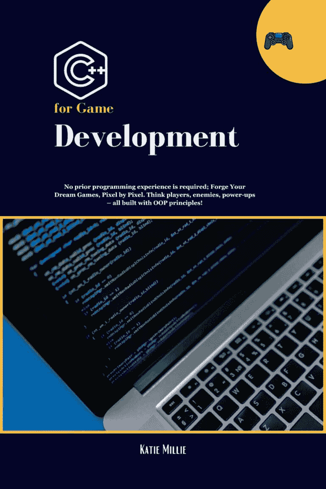

# C++ 游戏开发：无需先前的编程经验；逐像素打造你的梦想游戏。思考玩家、敌人、道具——这一切……原理！（Python 拓荒者圣经）



无需任何编程经验；从像素开始，打造你的梦想游戏。玩家、敌人、强化道具——一切基于面向对象（OOP）原则构建！

# 引言

## 释放 C++ 的力量：从像素开始，打造你的梦想游戏（即使你是编程新手）

你是否曾梦想过构建沉浸式的世界？是否梦想过制作出让玩家痴迷并让他们意犹未尽的游戏？快来看 C++ 游戏开发的传奇领域吧！这本书将是你把这些梦想变为惊人现实的门径。

忘记那些限制你创造力的笨重、预制游戏引擎吧。C++ 赋予了你原始且不受束缚的力量，让你能够雕刻游戏的每一个方面，从核心机制到惊艳的视觉效果。它是 Epic Games（虚幻引擎）和 Crytek（CryEngine）等行业巨头信赖的创作杰作的语言。

但是等等，C++ 复杂吗？虽然它以稳健著称，但有些人可能认为它令人望而生畏。秘密在于：这本书将用于游戏开发的 C++ 分解为一系列清晰、可操作的步骤。我们将手把手引导你从最基础知识开始，构建你的第一个迷人的游戏。

在这场令人兴奋的 C++ 游戏开发奥德赛中，等待着你的是：

- **掌握基础**：我们将建立 C++ 语法、变量、运算符和控制流的坚实基础。这些是你的游戏逻辑蓬勃发展的基石。
- **拥抱面向对象编程 (OOP)**：学习为你的游戏对象创建可复用的类，培养整洁高效的代码。想想玩家、敌人、强化道具——一切基于 OOP 原则构建！
- **释放图形的力量**：探索 2D 图形，处理精灵、纹理和变换让你的游戏世界充满活力（可选：深入研究 3D 图形）。
- **打造物理效果**：通过实现物理概念让你的游戏对象真实地移动。想象你的角色跳跃、躲避并与环境交互——物理让这一切成为可能！
- **构建游戏引擎（可选）**：接受终极挑战并构建自己的核心游戏引擎框架。学习管理游戏循环、对象和用户输入。
- **优化与调试**：我们将为你提供识别和修复错误的工具，确保你的游戏运行流畅并提供卓越的体验。

如果你符合以下情况，这本书将非常适合你：

- 你是一个完全初学者：无需任何编程经验；我们将全程为你提供指导。
- 你是一个经验丰富的程序员：渴望 C++ 为游戏开发提供的终极控制和灵活性。
- 你是一个有抱负的游戏开发者：渴望打破限制并构建真正独特的游戏。

在旅程结束时，你将能够：

- 流畅地编写为游戏开发定制的 C++ 代码。
- 具备设计和构建沉浸式游戏机制的知识。
- 能够创建视觉震撼且引人入胜的游戏。

停止梦想，开始构建！打开这本书，开启你的 C++ 游戏开发之旅。让我们把那些像素变成迷人的世界和难忘的游戏体验吧！

# 第一章：为什么使用 C++ 进行游戏开发？

C++ 凭借其性能、灵活性和底层控制的独特结合，在游戏开发领域仍然占据着主导地位。让我们深入探讨为什么 C++ 是游戏开发的首选，并结合 C++ 游戏开发实践的代码示例。

## 1. 性能优化

C++ 以其性能和效率而闻名，使其成为游戏等资源密集型应用程序的理想选择。它允许开发者在底层优化代码，直接访问硬件资源并最大限度地减少开销。以下是 C++ 代码如何进行性能优化的：

```cpp
// Example of optimized code in C++
#include <iostream>
#include <chrono>

int main() {
  auto start = std::chrono::high_resolution_clock::now();
  // Perform resource-intensive operations here
  auto end = std::chrono::high_resolution_clock::now();
  std::chrono::duration<double> duration = end - start;
  std::cout << "Execution time: " << duration.count() << " seconds\n";
  return 0;
}
```

## 2. 平台独立性

C++ 提供了平台独立性，允许开发者编写可以在不同操作系统和硬件配置上编译运行的代码。这种灵活性对于游戏开发至关重要，因为针对多个平台是行业常态。

```cpp
// Example of platform-independent code in C++
#include <iostream>
#ifdef _WIN32
#include <windows.h>
#elif __linux__
#include <unistd.h>
#endif

void sleepMilliseconds(int ms) {
#ifdef _WIN32
  Sleep(ms);
#elif __linux__
  usleep(ms * 1000);
#endif
}

int main() {
  std::cout << "Sleeping for 2 seconds...\n";
  sleepMilliseconds(2000);
  std::cout << "Awake!\n";
  return 0;
}
```

## 3. 低层控制

C++ 为开发者提供了对内存管理、硬件交互以及游戏开发中关键性能方面的低级控制。这种级别的控制对于优化游戏引擎、渲染管线和资源利用至关重要。

```cpp
// Example of low-level memory management in C++
#include <iostream>
int main() {
  int* ptr = new int[1000]; // Allocate memory dynamically
  // Perform operations with allocated memory
  delete[] ptr; // Free allocated memory
  return 0;
}
```

## 4. 访问硬件特性

C++ 允许直接访问硬件特性，如图形处理器（GPU）、输入/输出设备和网络能力。这种访问对于开发高性能图形引擎、物理模拟和游戏中的多人互动功能至关重要。

```cpp
// Example of GPU programming with C++
#include <iostream>
#include <cuda_runtime.h>

__global__ void addKernel(int* a, int* b, int* c, int size) {
  int tid = threadIdx.x + blockIdx.x * blockDim.x;
  if (tid < size) {
    c[tid] = a[tid] + b[tid];
  }
}

int main() {
  const int size = 1000;
  int* a, * b, * c;
  cudaMallocManaged(&a, size * sizeof(int));
  cudaMallocManaged(&b, size * sizeof(int));
  cudaMallocManaged(&c, size * sizeof(int));
  // Initialize arrays a and b
  addKernel<<<(size + 255) / 256, 256>>>(a, b, c, size);
  cudaDeviceSynchronize();
  // Process results in array c
  cudaFree(a);
  cudaFree(b);
  cudaFree(c);
  return 0;
}
```

## 5. 遗留支持与行业标准

许多游戏引擎和库使用 C++ 编写或提供 C++ API，这使其成为游戏开发的标准选择。此外，基于 C++ 构建的现有代码库、工具和框架也贡献了其在游戏行业中的遗留支持和广泛采用。

由于其无与伦比的性能、平台独立性、低层控制、对硬件特性的访问以及行业标准化，C++ 仍然是游戏开发的首选之一。通过利用 C++ 的优势，游戏开发者可以在各种平台上创建沉浸式、高性能的游戏，同时优化资源利用并为玩家提供无缝的游戏体验。

## 游戏开发版图：引擎、工具与工作流

游戏开发版图已经发生了巨大的演变，提供了多样化的引擎、工具和工作流来满足开发者的需求。让我们探索游戏开发生态系统，重点关注 C++ 游戏开发中常用的引擎、工具和工作流。

### C++ 开发中的游戏引擎

- **虚幻引擎 (Unreal Engine)**：最流行的游戏引擎之一，虚幻引擎大量使用 C++ 进行核心功能和游戏编程。它提供了一套强大的工具，用于创建高质量的 3D 游戏、模拟和可视化。以下是虚幻引擎如何在 C++ 中处理基础游戏逻辑的示例：

```cpp
// Example C++ code in Unreal Engine for handling player movement
void APlayerCharacter::MoveForward(float Value)
{
  FVector Direction = FRotationMatrix(GetControlRotation()).GetScaledAxis(EAxis::X);
  AddMovementInput(Direction, Value);
}
```

- **Unity**：虽然 Unity 主要使用 C# 进行脚本，但它也通过插件和原生代码集成支持 C++。C++ 可用于性能关键组件，例如渲染插件或针对特定平台的优化。

### 游戏开发工具

- **Visual Studio**：微软的 Visual Studio 是 C++ 游戏开发中广泛使用的集成开发环境 (IDE)。它提供了一套强大的功能，如为游戏开发工作流定制的代码编辑、调试、性能分析和项目管理。

- **CMake**：CMake 是一种跨平台构建生成器，常用于 C++ 游戏开发。它通过根据统一配置生成特定平台的构建文件（如 Makefile、Visual Studio 解决方案）来简化构建过程。

这是一个用于 C++ 项目的示例 `CMakeLists.txt` 文件：

```cmake
cmake_minimum_required(VERSION 3.10)
project(MyGame)
## 设置 C++ 标准
set(CMAKE_CXX_STANDARD 17)
## 添加可执行目标
add_executable(MyGame main.cpp)
## 链接库（例如 OpenGL, SDL2）
target_link_libraries(MyGame PUBLIC OpenGL::GL SDL2)
```

## 游戏开发工作流

- **设计与原型制作**：游戏开发从设计游戏机制、角色、关卡和资产开始。使用 Adobe Photoshop、Blender、Maya 和 ZBrush 等工具创建概念图、3D 模型、动画和纹理。
- **编程与脚本**：开发者使用 C++（在虚幻引擎中）或脚本语言（如 Lua）编写游戏逻辑、AI 行为、物理交互和用户界面。
- **资产集成**：游戏资产（模型、纹理、声音和动画）被导入游戏引擎并集成到场景中。引擎特定的编辑器允许设计师和开发者排列资产、设置属性并创建交互环境。
- **测试与调试**：测试对于确保游戏的稳定性、性能和玩家体验至关重要。开发者使用 IDE 中的调试工具识别并修复代码中的问题，而游戏引擎提供了游戏测试和性能分析的环境。
- **部署与分发**：一旦游戏准备就绪，将部署到各种平台，如 PC、游戏主机、移动设备或 Web。引擎和平台提供的构建配置和打包工具促进了部署过程。

建立一个健壮且高效的 C++ 开发环境对于游戏开发者创建高质量的游戏至关重要。在本指南中，我们将引导你完成为游戏开发定制的 C++ 开发环境搭建步骤，包括必要的工具、库和配置。

## 1. 安装 C++ 编译器

第一步是在你的开发机器上安装 C++ 编译器。对于 Windows 用户，`Visual Studio` 附带了 `Microsoft Visual C++ Compiler`，它被广泛用于 C++ 开发。在 macOS 上，你可以安装 `Xcode`，它包含了 `Clang` 编译器。Linux 用户可以使用包管理器安装 `GCC` (GNU 编译器集合)。

## 2. 选择集成开发环境 (IDE)

IDE 为编写、调试和管理 C++ 代码提供了一个全面的环境。以下是专用于 C++ 游戏开发的一些广受欢迎的 IDE 选项：

- `Visual Studio`（Windows）：微软的 `Visual Studio` 是一个强大的 IDE，提供 C++ 开发工具、调试能力，并支持与 `Unreal Engine` 等游戏引擎的集成。
- `Visual Studio Code`（跨平台）：`Visual Studio Code` 是一个轻量级且多功能的代码编辑器，通过 `C/C++` 和 `CMake Tools` 等扩展提供广泛的 C++ 支持。
- `CLion`（跨平台）：`CLion` 是 JetBrains 出品的专用 C++ IDE，以其智能代码辅助、调试工具以及对 `CMake` 和其他构建系统的支持而闻名。

根据你的平台偏好、工作流需求以及与游戏引擎的集成情况选择 IDE。

## 3. 设置构建工具和配置

- `CMake`：`CMake` 是一种流行的跨平台构建系统生成器，用于 C++ 开发（包括游戏开发）。它通过根据统一的 `CMake` 配置生成特定平台的构建文件（例如 `Makefiles`、`Visual Studio` 解决方案）来简化构建过程。

  1. 从官网或使用包管理器安装 `CMake`。
  2. 在项目目录中创建一个 `CMakeLists.txt` 文件，以定义构建配置和依赖项。

这是一个 C++ 游戏项目的简单 `CMakeLists.txt` 文件示例：

```cmake
cmake_minimum_required(VERSION 3.10)
project(MyGameProject)

## 设置 C++ 标准
set(CMAKE_CXX_STANDARD 17)

## 添加可执行目标
add_executable(MyGame main.cpp)

## 链接库（例如 OpenGL, SDL2）
target_link_libraries(MyGame PUBLIC OpenGL::GL SDL2)
```

- 构建系统 (Build Systems)：根据你的 IDE 和平台，配置构建系统以使用 `CMake` 生成的文件（例如 Linux 上的 `Makefiles`，Windows 上的 `Visual Studio` 解决方案）。`Visual Studio` 和 `CLion` 等 IDE 为 `CMake` 项目提供了内置支持。

## 4. 安装游戏开发库和 SDK

游戏开发通常需要图形、音频、输入处理等库和 SDK。以下是一些常用的库：

### 图形库

- `OpenGL`：一种用于渲染 2D 和 3D 图形的跨平台图形 API。
- `DirectX`（Windows）：微软用于 Windows 平台游戏开发的图形 API。

### 游戏引擎（可选）

- `Unreal Engine`：提供全套工具和框架，用于用 C++ 创建高质量的游戏。
- `Unity`（带 C++ 插件）：通过插件和原生代码集成支持 C++ 开发。

## 5. 配置版本控制和协作工具

版本控制系统如 `Git` 对于管理代码版本、与团队成员协作以及跟踪游戏项目的更改至关重要。选择一个版本控制平台（例如 `GitHub`、`GitLab`、`Bitbucket`）并为项目设置仓库。

## 6. 安装调试和性能分析工具

调试工具对于识别和修复 C++ 代码中的问题至关重要。大多数 IDE 都提供了内置调试器、断点和监视窗口。此外，考虑使用性能分析工具（例如 `Visual Studio Profiler`、`Valgrind`）来分析性能瓶颈并优化游戏的性能。

### 项目结构示例

这是一个使用 `CMake` 的简单 C++ 游戏项目结构示例：

```
MyGameProject/
├── CMakeLists.txt
├── src/
│   ├── main.cpp
│   ├── game/
│   │   ├── Player.cpp
│   │   └── Player.h
│   ├── graphics/
│   │   ├── Renderer.cpp
│   │   └── Renderer.h
│   └── utils/
│       ├── Timer.cpp
│       └── Timer.h
└── assets/
├── textures/
│   └── texture.png
└── sounds/
    └── sound.wav
```

为游戏开发搭建 C++ 开发环境涉及安装 C++ 编译器、选择 IDE、配置 `CMake` 等构建工具、安装必要的库和 SDK、设置版本控制和协作工具，并确保调试和性能分析能力。配置良好的开发环境可以简化你的工作流，提高效率，并让你能够利用 C++ 的力量创建引人入胜且沉浸式的游戏。

## C++ 代码初步：语法与结构

让我们通过探索其语法、结构以及与游戏开发相关的常见元素来初步了解 C++ 代码。

### 基础语法概述

C++ 是一种静态类型编译型语言，以其高性能和灵活性著称。这是一个简单的 C++ “Hello, World”程序：

```cpp
#include <iostream>

int main() {
    std::cout << "Hello, World!" << std::endl;
    return 0;
}
```

1. `#include <iostream>`：此行包含了输入输出库。
2. `int main()`：`main()` 函数是程序的入口。
3. `std::cout`：该对象用于输出到控制台。
4. `return 0`：表示程序成功结束。

### 数据类型与变量


# C++ 基础教程

## 第一章：C++ 初步了解

C++ 支持各种数据类型，如整数、浮点数、字符。以下是声明的示例：

```cpp
#include <iostream>

int main() {
    int score = 100;
    float pi = 3.14f;
    char grade = 'A';
    bool isRunning = true;

    std::cout << "Score: " << score << std::endl;
    std::cout << "Pi: " << pi << std::endl;
    std::cout << "Grade: " << grade << std::endl;
    std::cout << "Running: " << std::boolalpha << isRunning << std::endl;

    return 0;
}
```

1. `int score = 100`：声明了一个整数变量`score`。
2. `float pi = 3.14f`：声明了一个浮点数变量`pi`。
3. `char grade = 'A'`：声明了一个字符变量`grade`。
4. `bool isRunning = true`：声明了一个布尔变量`isRunning`。

### 控制结构：条件语句与循环

控制结构（如条件语句`if`、`else`和循环`for`、`while`）是游戏逻辑和决策的基础。以下是使用条件语句和循环的示例：

```cpp
#include <iostream>

int main() {
    int playerScore = 85;

    if (playerScore >= 90) {
        std::cout << "Congratulations! You achieved an A grade!" << std::endl;
    }
    else if (playerScore >= 80) {
        std::cout << "Well done! You got a B grade." << std::endl;
    }
    else {
        std::cout << "Keep practicing! You can improve." << std::endl;
    }

    for (int i = 0; i < 5; ++i) {
        std::cout << "Count: " << i << std::endl;
    }

    int countdown = 3;
    while (countdown > 0) {
        std::cout << "Countdown: " << countdown << std::endl;
        countdown--;
    }

    return 0;
}
```

1. `if`, `else if`, `else`：用于根据`playerScore`进行条件分支。
2. `for (int i = 0; i < 5; ++i)`：`for`循环从 0 迭代到 4 并打印计数。
3. `while (countdown > 0)`：`while`循环从 3 倒计时到 1 并打印倒计时值。

函数对于将代码组织成可用且可管理的单元至关重要。这里有一个定义和使用函数的示例：

```cpp
#include <iostream>

// 计算数字平方的函数
int square(int num) {
    return num * num;
}

int main() {
    int result = square(5);
    std::cout << "Square of 5 is: " << result << std::endl;
    return 0;
}
```

1. `int square(int num)`：定义了一个名为`square`的函数，它接受一个整数参数`num`并返回该数字的平方。
2. `int result = square(5);`：使用参数`5`调用`square`函数，并将结果存储在`result`变量中。

## 面向对象编程 (OOP) 基础

在游戏开发中，面向对象编程（OOP）概念（如类和对象）在组织代码和表示游戏实体方面起着至关重要的作用。这里有一个简单的示例：

```cpp
#include <iostream>

// 代表通用游戏实体的 GameEntity 类
class GameEntity {

private:
    std::string name;

public:
    GameEntity(const std::string& entityName) : name(entityName) {}

    void printName() {
        std::cout << "Entity Name: " << name << std::endl;
    }

};

int main() {
    GameEntity player("Player");
    player.printName();
    return 0;
}
```

1. `class GameEntity { ... }`：定义了一个类`GameEntity`，并带有一个构造函数来初始化`name`属性。
2. `GameEntity player("Player");`：创建一个类型为`GameEntity`的对象`player`，名为"Player"，并调用`printName`方法。

对 C++ 代码的初步了解为理解其语法、基本数据类型、控制结构、函数以及与游戏开发相关的 OOP 概念提供了基础。随着深入游戏编程，你将探索更高级的主题，如游戏循环、图形编程、输入处理和游戏引擎集成，利用 C++ 的强大和活性来创建沉浸式且引人入胜的游戏。

## 第二章：掌握 C++ 基础

### 变量和数据类型

变量和数据类型是 C++ 游戏开发的基础元素，作为在游戏中存储和操作数据的构建块。理解如何声明变量、选择合适的数据类型以及高效管理内存，对于创建健壮且高性能的游戏系统至关重要。让我们通过与游戏开发相关的代码示例深入研究 C++ 中的变量和数据类型。

#### 基本数据类型

C++ 提供了一系列基本数据类型来表示游戏中的不同值。以下是一些常见的数据类型：

1. **整数类型**：用于整数。
   - `int`：典型的整数类型。
   - `short`, `long`, `long long`：不同尺寸的整数变体。

2. **浮点类型**：用于小数。
   - `float`：单精度浮点数。
   - `double`：双精度浮点数，提供比`float`更高精度。

3. **字符类型**：用于单个字符。
   - `char`：代表单个字符。
   - `wchar_t`：代表宽字符，用于国际化。

4. **布尔类型**：
   - `bool`：表示真或假值。

#### 声明变量

在 C++ 中使用变量，需要用特定的数据类型对其进行声明。以下是变量声明的示例：

```cpp
#include <iostream>

int main() {
    int playerScore = 100;
    float playerHealth = 95.5f;
    char playerGrade = 'A';
    bool isPlayerAlive = true;

    std::cout << "Score: " << playerScore << std::endl;
    std::cout << "Health: " << playerHealth << std::endl;
    std::cout << "Grade: " << playerGrade << std::endl;
    std::cout << "Is Player Alive? " << std::boolalpha << isPlayerAlive << std::endl;
    return 0;
}
```

在此示例中：
- `playerScore`是一个整数变量，存储玩家的得分。
- `playerHealth`是一个浮点变量，存储玩家的血量。
- `playerGrade`是一个字符变量，存储玩家的等级。
- `isPlayerAlive`是一个布尔变量，指示玩家是否存活。

#### 常量与枚举

常量和枚举对于在游戏代码中定义固定值和命名常量非常有用。

```cpp
#include <iostream>

// 常量
const float PI = 3.14159;
const int MAX_PLAYERS = 4;

// 枚举
enum class Direction { Up, Down, Left, Right };

int main() {
    std::cout << "PI Value: " << PI << std::endl;
    std::cout << "Max Players: " << MAX_PLAYERS << std::endl;
    Direction playerDirection = Direction::Right;
    std::cout << "Player Direction: ";
    switch (playerDirection) {
        case Direction::Up:
            std::cout << "Up";
            break;
        case Direction::Down:
            std::cout << "Down";
            break;
        case Direction::Left:
            std::cout << "Left";
            break;
        case Direction::Right:
            std::cout << "Right";
            break;
    }
    return 0;
}
```

在此代码中：
- `PI`和`MAX_PLAYERS`是常量。
- `Direction`是定义可能方向的枚举。

#### 数组与字符串

数组和字符串对于存储数据集合（如玩家名称或物品）至关重要。

```cpp
#include <iostream>
#include <string>

int main() {
    int scores[5] = {85, 92, 78, 88, 95};
    std::cout << "First Score: " << scores[0] << std::endl;

    std::string playerName = "John Doe";
    std::cout << "Player Name: " << playerName << std::endl;
    return 0;
}
```

在此示例中：
- `scores`是一个存储五个整数的数组。
- `playerName`是一个存储名称的字符串。

#### 内存管理

在游戏开发中，高效管理内存对性能至关重要。C++ 通过指针提供手动内存管理，如果使用不当，它既强大又容易出错。

```cpp
#include <iostream>

int main() {
    // 动态内存分配
    int* dynamicScore = new int(75);
    std::cout << "Dynamic Score: " << *dynamicScore << std::endl;

    // 不要忘记释放内存
    delete dynamicScore;
    return 0;
}
```

在此代码中，`dynamicScore`是使用`new`动态分配的整数，必须使用`delete`释放内存。

## 运算符与表达式：计算与数据处理

运算符和表达式在 C++ 游戏开发的计算、比较和数据处理中起着至关重要的作用。它们允许开发者编写简洁且表达良好的代码来处理游戏逻辑中的各种任务。

### 算术运算符

算术运算符用于执行数学计算，如加、减、乘、除。这些运算符是实现涉及数值的游戏机制的基础。

```cpp
#include <iostream>

int main() {
    int a = 10, b = 5;
    int sum = a + b;
    int difference = a - b;
    int product = a * b;
    int quotient = a / b;
    int remainder = a % b;

    std::cout << "Sum: " << sum << std::endl;
    std::cout << "Difference: " << difference << std::endl;
    std::cout << "Product: " << product << std::endl;
    std::cout << "Quotient: " << quotient << std::endl;
    std::cout << "Remainder: " << remainder << std::endl;
    return 0;
}
```

在这个示例中，`a`和`b`是表示数值的变量，算术运算符（`+`, `-`, `*`, `/`, `%`）被用于执行加法、减法、乘法、除法和取模运算。

### 赋值运算符

赋值运算符用于给变量赋值。它们也可以与算术运算符结合，以实现简洁的赋值和计算语句。

```cpp
#include <iostream>

int main() {
    int score = 100;
    score += 10; // 等于：score = score + 10;
    score *= 2;  // 等于：score = score * 2;
    std::cout << "Updated Score: " << score << std::endl;
    return 0;
}
```

在这里，`+=`和`*=`是复合赋值运算符，它们将`score`的值与右侧表达式相加或相乘，并将结果赋值回`score`。

### 比较运算符

比较运算符用于比较两个值并产生布尔结果（`true`或`false`）。它们对于实现游戏中的条件逻辑和决策判断至关重要。

```cpp
#include <iostream>

int main() {
    int playerScore = 85;
    bool isHighScore = playerScore > 90;
    bool isPassed = playerScore >= 60;
    std::cout << "High Score? " << std::boolalpha << isHighScore << std::endl;
    std::cout << "Passed? " << std::boolalpha << isPassed << std::endl;
    return 0;
}
```

在这段代码中，`>`和`>=`是比较运算符，用于比较`playerScore`与指定值并产生布尔结果。

### 逻辑运算符

逻辑运算符用于组合多个条件并执行逻辑操作，如 AND（`&&`）、OR（`||`）和 NOT（`!`）。这些运算符对于实现复杂的决策和游戏规则非常有用。

```cpp
#include <iostream>

int main() {
    bool isPlayerAlive = true;
    int playerHealth = 50;
    bool canAttack = isPlayerAlive && (playerHealth > 0);
    bool isGameOver = !isPlayerAlive || (playerHealth <= 0);
    std::cout << "Can Attack? " << std::boolalpha << canAttack << std::endl;
    std::cout << "Game Over? " << std::boolalpha << isGameOver << std::endl;
    return 0;
}
```

在这里，`&&`（与）和`||`（或）是逻辑运算符，用于组合条件并根据玩家的状态和属性判断玩家是否可以攻击或游戏是否结束。

### 位运算符

位运算符作用于整数操作数的单个位，常用于游戏编程中的低级优化或位操作。

```cpp
#include <iostream>

int main() {
    int a = 5; // 二进制为 0101
    int b = 3; // 二进制为 0011
    int bitwiseAnd = a & b; // 位与：0001 (十进制为 1)
    int bitwiseOr = a | b;  // 位或：0111 (十进制为 7)
    int bitwiseXor = a ^ b; // 位异异或：0110 (十进制为 6)
    int bitwiseNotA = ~a;  // a 的位取反：1111...(0101 的补码)
    std::cout << "Bitwise AND: " << bitwiseAnd << std::endl;
    std::cout << "Bitwise OR: " << bitwiseOr << std::endl;
    std::cout << "Bitwise XOR: " << bitwiseXor << std::endl;
    std::cout << "Bitwise NOT A: " << bitwiseNotA << std::endl;
    return 0;
}
```

这些运算符（`&`, `|`, `^`, `~`）分别对整数的二进制表示执行位与、位或、位异或和取反操作。

### 运算符优先级与表达式

C++ 遵循特定的运算符优先级顺序。理解运算符优先级对于确保表达式正确求值至关重要。括号可以覆盖优先级并控制操作顺序。

```cpp
#include <iostream>

int main() {
    int result = 5 + 3 * 2; // 结果将为 11 (5 + (3 * 2))
    int overriddenResult = (5 + 3) * 2; // 结果将为 16 ((5 + 3) * 2)
    std::cout << "Result: " << result << std::endl;
    std::cout << "Overridden Result: " << overriddenResult << std::endl;
    return 0;
}
```


在这段代码中，`result` 展示了运算符优先级，其中乘法（`*`）在加法（`+`）之前执行，导致`5 + (3 * 2) = 11`。然而，`overriddenResult` 使用括号强制先执行加，导致`(5 + 3) * 2 = 16`。

在游戏开发中，有效理解并利用运算符及表达式对于执行计算、比较和逻辑操作至关重要。这些概念为实现游戏机制、AI 行为、物理计算等基础，使开发者能够在 `C++` 中创建复杂且迷人的游戏体验。

## 控制流语句：游戏逻辑的分支与循环

控制流语句（如分支和循环）是编程（包括游戏开发）的基础概念。它们允许开发者通过根据条件控制执行流以及遍历代码块来创建动态且交互式的游戏逻辑。让我们探索分支语句（`if-else`）和循环结构（`for`、`while`）。

### 分支语句：`if-else`

`if-else` 语句用于根据条件做出决策。它允许程序根据状态采取不同的路径。

```cpp
#include <iostream>

int main() {
int playerHealth = 75;
if (playerHealth > 0) {
  std::cout << "Player is alive." << std::endl;
}
else {
  std::cout << "Player is defeated." << std::endl;
}
return 0;
}
```

在这个示例中，程序检查`playerHealth`是否大于 0。如果是，打印“Player is alive”，否则打印“Player is defeated”。你还可以使用`else if`处理多种条件：

```cpp
#include <iostream>

int main() {
int playerScore = 85;
if (playerScore >= 90) {
  std::cout << "Excellent score!" << std::endl;
}
else if (playerScore >= 80) {
  std::cout << "Good score!" << std::endl;
}
else {
  std::cout << "Work harder for a higher score!" << std::endl;
}
return 0;
}
```

### 循环语句：`for` 和 `while`

循环对于重复任务至关重要，如遍历数组、更新游戏状态或运行游戏模拟。常用的循环结构是`for`和`while`。

#### `for` 循环

`for` 循环用于提前知道迭代次数的情况。

```cpp
#include <iostream>

int main() {
for (int i = 0; i < 5; ++i) {
  std::cout << "Iteration " << i + 1 << std::endl;
}
return 0;
}
```

此循环将迭代五次，打印“Iteration 1”到“Iteration 5”。

#### `while` 循环

`while` 循环用于迭代次数取决于条件的情况。

```cpp
#include <iostream>

int main() {
int countdown = 3;
while (countdown > 0) {
  std::cout << "Countdown: " << countdown << std::endl;
--countdown;
}
std::cout << "Liftoff!" << std::endl;
return 0;
}
```

在这个示例中，循环一直运行到`countdown`变为 0，期间打印倒计时值，然后输出“Liftoff!”

## 游戏开发中的控制流

在游戏开发中，控制流语句被广泛用于各种目的：

1. 游戏状态管理：使用分支管理游戏状态，如菜单、游戏、暂停和游戏结束。
2. 玩家输入处理：使用条件语句响应玩家输入，如键盘命令、鼠标点击或控制器输入。
3. 游戏逻辑与 AI：使用`if-else`语句实现游戏规则、AI 角色决策、敌人行为和脚本事件。
4. 游戏循环：使用循环更新游戏状态、处理游戏事件、处理物理计算并在游戏循环中渲染帧。

让我们来看一个涉及游戏状态管理的更复杂的示例：

```cpp
#include <iostream>
#include <string>

int main() {
    enum class GameState { MainMenu, Playing, GameOver };
    GameState currentState = GameState::MainMenu;

    while (true) {
        if (currentState == GameState::MainMenu) {
            std::cout << "Main Menu\n";
            std::string userInput;
            std::cout << "Enter 'start' to begin: ";
            std::cin >> userInput;
            if (userInput == "start") {
                currentState = GameState::Playing;
            }
        }
        else if (currentState == GameState::Playing) {
            std::cout << "Game is in progress\n";
            // Simulating gameplay
            currentState = GameState::GameOver; // For simplicity, transitioning to game over
        }
        else if (currentState == GameState::GameOver) {
            std::cout << "Game Over\n";
            break; // Exit the game loop
        }
    }
    return 0;
}
```

在这个示例中，我们使用枚举`GameState`来表示游戏的不同的状态。程序持续循环，根据用户输入和游戏逻辑处理主菜单、游戏进行和游戏结束等不同状态。

控制流语句如`if-else`分支和循环结构（`for`、`while`）对于在 `C++` 中创建动态和交互的游戏逻辑至关重要。通过利用这些结构，游戏开发者可以有效地实现游戏状态管理、玩家输入处理、游戏规则、AI 行为和游戏循环，从而带来引人且沉浸式的游戏体验。理解控制流是精通游戏编程和构建复杂游戏系统的基础。

# 函数：创建高效的可复用代码块

函数在游戏开发中起着至关重要的作用，通过封装可复用的代码块、促进代码组织并提高整体效率。它们允许开发者将复杂任务分解为更小、更容易管理的单元，使代码维护、调试和协作变得更容易。让我们深入研究 `C++` 中的函数，并结合相关的代码示例探索如何在游戏开发中使用它们。

## 基础函数语法

在 `C++` 中，使用以下语法定义函数：

```cpp
return_type function_name(parameters) {
    // 函数体
    // 要执行的代码
    return value; // 可选的返回语句
}
```

- `return_type`：指定函数执行后返回类型。
- `function_name`：函数名称，应具有描述性并遵循命名规范。
- `parameters`：函数执行其任务时可能采取的可选输入参数。
- `return value`：可选的返回语句，用于向调用代码发送数据。

让我们创建一个简单的函数来演示其语法：

```cpp
#include <iostream>

// 计算数字平方的函数
int square(int num) {
    return num * num;
}

int main() {
    int result = square(5);
    std::cout << "Square of 5 is: " << result << std::endl;
    return 0;
}
```

在这个示例中，`square()`是一个接受整数（`num`）作为输入的函数，计算其平方并返回结果。`main()`函数调用`square(5)`并打印 5 的平方值。

## 函数在游戏开发中的优势

1. **代码复用性**：函数允许你在整个游戏中复用代码块，减少冗余并促进模块化设计。
2. **抽象**：函数抽象了实现细节，让你能够关注高层逻辑，而不必担心内部运作。
3. **代码组织**：函数有助于将代码组织成逻辑单元，提高可读性和可维护性。
4. **调试与测试**：通过定义良好的函数，调试和测试变得更易管理，因为你可以隔离并测试单个组件。

## 函数参数和返回值

函数可以接受参数来定制其行为，并可以返回以向调用代码提供输出或结果。

```cpp
#include <iostream>

// 计算两个数字之和的函数
int sum(int a, int b) {
    return a + b;
}

// 显示消息的函数
void showMessage(const std::string& message) {
    std::cout << "Message: " << message << std::endl;
}

int main() {
    int result = sum(10, 20);
    std::cout << "Sum: " << result << std::endl;
    showMessage("Welcome to the game!");
    return 0;
}
```

在这个示例中：

- `sum()`接受两个整数作为参数并返回它们的和。
- `showMessage()`接受一个字符串消息作为参数，但不返回任何值（`void`返回类型）。

## 函数重载

`C++` 支持函数重载，允许你定义多个具有相同但参数列表不同的函数。这对于根据输入类型或参数数量提供函数的变体非常有用。

```cpp
#include <iostream>

// 计算矩形面积的函数
int area(int length, int width) {
    return length * width;
}

// 计算圆面积的重载函数
double area(double radius) {
    return 3.14159 * radius * radius;
}

int main() {
    int rectangleArea = area(5, 10);
    double circleArea = area(3.5);
    std::cout << "Rectangle Area: " << rectangleArea << std::endl;
    std::cout << "Circle Area: " << circleArea << std::endl;
    return 0;
}
```

在这里，`area()`被重载用于计算矩形的面积（两个整数参数）和圆的面积（单个双浮点数参数）。

## 函数在游戏开发中的用例

在游戏开发中，函数用于各种目的：

- **游戏机制**：实现评分、血量管理、移动、碰撞检测和实体生成的函数。
- **工具函数**：用于输入处理、随机数生成、向量操作和时间管理的常用工具函数。
- **AI 与游戏逻辑**：定义用于 AI 行为、路径查找算法、决策、游戏规则和脚本事件的函数。
- **图形与渲染**：封装渲染逻辑、着色器操作、动画更新和相机控制的函数。

通过有效利用函数，游戏开发者可以编写更整洁、更有组织的代码，从而高效。

# 数组与指针：游戏数据的高级内存管理

数组和指针是 `C++` 中强大的概念，能够实现高级内存管理和高效的数据处理。在游戏开发中，数组和指针被广泛用于存储实体、管理内存、优化性能以及实现网格、地图和列表等数据结构。让我们深入研究数组、指针及其在游戏开发中的应用。

## 游戏开发中的数组

数组提供了一种在内存中顺序存储相同类型元素集合的方法。它们非常适合管理相似数据的实例，例如玩家属性、敌人位置、物品库存和关卡数据。

### 静态数组

静态数组具有在编译时确定的固定大小，适用于预先知道元素的情况。

```cpp
#include <iostream>

int main() {
    const int numEnemies = 5;
    int enemyHealth[numEnemies] = {100, 80, 120, 90, 150};

    // 访问数组元素
    for (int i = 0; i < numEnemies; ++i) {
        std::cout << "Enemy " << i+1 << " Health: " << enemyHealth[i] << std::endl;
    }

    return 0;
}
```

在这个示例中，`enemyHealth`是一个存储五个敌人健康值的数组。`for`循环访问数组的每个元素以显示它们的健康状况。

### 动态数组（使用指针）

动态数组允许在运行时灵活管理内存，特别是当数组大小在编译时未知的情况下。它们通过指针以及`new`和`delete`等内存分配函数来实现。

```cpp
#include <iostream>

int main() {
  int numItems;
  std::cout << "Enter the number of items: ";
  std::cin >> numItems;
  int* itemPrices = new int[numItems]; // Dynamic memory allocation

  // Initialize array elements
  for (int i = 0; i < numItems; ++i) {
    std::cout << "Enter price for item " << i+1 << ": ";
    std::cin >> itemPrices[i];
  }

  // Display item prices
  for (int i = 0; i < numItems; ++i) {
    std::cout << "Item " << i+1 << " Price: $" << itemPrices[i] << std::endl;
  }

  delete[] itemPrices; // Free allocated memory
  return 0;
}
```

在这里，`itemPrices`是使用指针（`int*`）创建并根据用户输入（`numItems`）分配内存的动态数组。记住使用`delete[]`释放动态分配的内存以避免内存泄漏。

## 游戏开发中的指针

指针是存储内存地址的变量，允许直接操作内存并访问动态分配的资源。它们在游戏开发中被广泛用于高效的数据存储、函数间的数据传递以及复杂数据结构的管理。

## 指针算术与数组访问

指针支持算术操作，允许能够高效地遍历数组和动态内存块。

```cpp
#include <iostream>

int main() {
  int array[] = {10, 20, 30, 40, 50};
  int* ptr = array; // 指向数组第一个元素的指针
  for (int i = 0; i < 5; ++i) {
    std::cout << "Element " << i+1 << ": " << *ptr << std::endl;
    ptr++; // 将指针移动到下一个元素
  }
  return 0;
}
```

在此代码中，`ptr`最初指向`array`的第一个元素，使用指针算术（`ptr++`）遍历数组并访问其元素。

# 指针与动态内存分配

指针对于管理动态内存的分配和释放至关重要，能够实现高效的内存使用并避免内存泄漏。

```cpp
#include <iostream>

int main() {
  int* dynamicArray = new int[3]; // 为 3 个整数分配内存
  dynamicArray[0] = 100;
  dynamicArray[1] = 200;
  dynamicArray[2] = 300;
  for (int i = 0; i < 3; ++i) {
    std::cout << "Element " << i+1 << ": " << dynamicArray[i] << std::endl;
  }
  delete[] dynamicArray; // 释放分配的内存
  return 0;
}
```

在这里，`dynamicArray`是指向动态分配的整数数组的指针。在使用后，使用`delete[]`释放的内存。。

指针与与游戏结构结构指针在实现链表、树、图和动态数组等复杂游戏数据结构方面起着重要作用。它们允许节点或元素高效相互引用，便于数据的遍历和操作。


```cpp
#include <iostream>

struct Node {
  int data;
  Node* next;
};

int main() {
  Node* head = nullptr;
  Node* temp = nullptr;

  // 创建节点并链接它们
  for (int i = 1; i <= 5; ++i) {
    Node* newNode = new Node();
    newNode->data = i * 10;
    newNode->next = nullptr;
    if (head == nullptr) {
      head = newNode;
      temp = newNode;
    } else {
      temp->next = newNode;
      temp = newNode;
    }
  }

  // 显示链表元素
  Node* current = head;
  while (current != nullptr) {
    std::cout << current->data << " ";
    current = current->next;
  }

  // 释放分配的内存（清理）
  current = head;
  while (current != nullptr) {
    Node* nextNode = current->next;
    delete current;
    current = nextNode;
  }
  return 0;
}
```

在这个示例中，使用指针（`Node*`）创建了一个节点链表。每个节点包含数据（`int data`）和指向下一个节点的指针（`Node* next`）。随后对链表进行遍历和显示，并使用`delete`释放内存以避免内存泄漏。

数组和指针是 C++ 游戏开发的核心组成部分，用于管理游戏数据、实现数据结构以及高效处理动态内存。理解如何使用数组进行结构化数据存储以及使用指针进行内存管理，对于开发可扩展和高性能的游戏系统至关重要。通过利用数组、指针及其高级特性，游戏开发者可以优化资源使用，增强数据组织，并创建现代游戏开发中必要的复杂的游戏机制和数据结构。

# 第 3 章

## 理解面向对象编程 (OOP) 概念

类和对象是面向对象编程 (OOP) 的基本概念，在游戏开发中被广泛用于封装游戏实体、行为和功能。它们实现了封装、数据抽象、继承和多态，有助于创建模块化、可重用且易维护的游戏系统。让我们通过相关的代码示例探索 C++ 游戏开发中的类和对象，并了解它们对封装和数据抽象的影响。

## 类和对象的介绍

C++ 中的类是创建对象的蓝图。它定义了特定类型的属性（属性）和行为（方法）。对象是类的实例，代表游戏中的实体或概念。

```cpp
#include <iostream>
#include <string>

// Player 类定义
class Player {
public:
  // 初始化玩家数据的构造函数
  Player(std::string name, int level) : playerName(name), playerLevel(level) {}

  // 显示玩家信息的成员函数
  void displayPlayerInfo() {
    std::cout << "Player Name: " << playerName << ", Level: " << playerLevel << std::endl;
  }

private:
  std::string playerName;
  int playerLevel;
};

int main() {
  // 创建 Player 对象
  Player player1("John", 5);
  Player player2("Sarah", 8);

  // 使用对象方法显示信息
  player1.displayPlayerInfo();
  player2.displayPlayerInfo();
  return 0;
}
```

在这个示例中，`Player`是一个具有`playerName`和`playerLevel`属性以及`displayPlayerInfo()`方法的类。`player1`和`player2`是通过`Player`类构造函数创建的，并使用对象方法显示信息。

## 封装与数据抽象

封装是将数据（属性）和行为（方法）封装在类中，限制对数据的直接访问并通过方法提供受控访问。这种概念增强了数据安全性、代码模块化并减少了不同部分之间的依赖关系。

```cpp
#include <iostream>
#include <string>

// GameCharacter 类定义
class GameCharacter {
public:
  // 初始化字符数据的构造函数
  GameCharacter(const std::string& name, int health) : characterName(name), characterHealth(health) {}

  // 健康值的 setter 方法（封装）
  void setHealth(int health) {
    if (health >= 0) {
      characterHealth = health;
    }
  }

  // 健康值的 getter 方法（封装）
  int getHealth() const {
    return characterHealth;
  }

private:
  std::string characterName;
  int characterHealth;
};

int main() {
  // 创建 GameCharacter 类的对象
  GameCharacter hero("Hero", 100);

  // 使用 setter 和 getter 方法访问和修改数据
  hero.setHealth(80); // 设置健康值为 80
  std::cout << "Current Health: " << hero.getHealth() << std::endl;
  return 0;
}
```

在这个示例中，`GameCharacter`类通过提供 setter 和 getter 方法（`setHealth()`和`getHealth()`）来访问和修改`characterHealth`属性来实现封装。封装隐藏了类的内部实现细节，并确保了数据完整性和受控访问。

## 数据抽象与继承

数据抽象是隐藏复杂的实现细节并提供简化接口的过程。继承是一个 OOP 概念，允许类（子类或派生类）从另一个类（基类或超类）继承属性和行为，从而促进代码重用和层次结构。

```cpp
#include <iostream>
#include <string>

// 代表武器的基类
class Weapon {
public:
    Weapon(const std::string& name, int damage) : weaponName(name), weaponDamage(damage) {}
    void displayWeaponInfo() {
        std::cout << "Weapon Name: " << weaponName << ", Damage: " << weaponDamage << std::endl;
    }

protected:
    std::string weaponName;
    int weaponDamage;
};

// 代表剑的派生类（继承自 Weapon）
class Sword : public Weapon {
public:
    Sword(const std::string& name, int damage, int durability) : Weapon(name, damage), durability(durability) {}
    void displaySwordInfo() {
        std::cout << "Sword Name: " << weaponName << ", Damage: " << weaponDamage << ", Durability: " << durability << std::endl;
    }

private:
    int durability;
};

int main() {
    // 创建 Weapon 和 Sword 类的对象
    Weapon axe("Battle Axe", 50);
    Sword legendarySword("Excalibur", 100, 200);

    // 使用对象方法显示武器信息
    axe.displayWeaponInfo();
    legendarySword.displaySwordInfo();
    return 0;
}
```

在这个示例中，`Weapon`是基类，而`Sword`是继承自`Weapon`的派生类。`Sword`类在继承`Weapon`用属性的基础上，添加了剑特有的属性和方法。这种层次结构促进了代码重用，并允许对象进行特化。

## 类和对象在游戏开发中的优势

1. **模块化**：类和对象促进模块化设计，允许开发者独立地管理游戏实体、系统和行为。

2. **代码重用**：面向对象编程通过继承和多态促进代码重用，减少了冗余代码并提高了生产力。

3. **封装**：封装确保了数据安全，隐藏了实现细节，并为对象交互提供了清晰的接口。

4. **抽象**：数据抽象通过关注核心特征并隐藏不必要的细节，简化了复杂系统。

5. **层次结构与多态**：继承和多态实现了基于对象类型的层次结构和动态行为，增强了灵活性和扩展性。

通过有效利用类和对象，游戏开发者可以利用组织良好的代码、改进的数据管理和精简的流程，创建可扩展、可维护且功能丰富的游戏系统。OOP 原则是现代游戏开发框架和引擎的基础，使开发者能够高效地构建复杂且引人入的游戏。

## 继承：构建游戏对象之间的关系

继承是面向对象编程（OOP）中的基本概念，它允许在类之间建立关系，促进代码重用并创建相关对象的层次结构。在游戏开发中，继承对于建模游戏实体、行为和关系至关重要，能够产生更有组织、更可扩展的代码库。让我们通过相关的代码示例及其对构建游戏对象之间关系的影响，探索用于游戏开发的 C++ 继承。

## 理解 C++ 中的继承

继承涉及基于现有的类（基类或父类）创建新类（派生类或子类）。派生类继承其基类的属性和行为，并可以根据需要对其进行扩展或修改。这一概念遵循“是一个（is-a）”的关系，即派生类“是”其基类的一种类型。

```cpp
#include <iostream>
#include <string>

// 代表游戏角色的基类
class GameCharacter {
public:
    GameCharacter(const std::string& name, int health) : characterName(name), characterHealth(health) {}
    void displayInfo() const {
        std::cout << "Character Name: " << characterName << ", Health: " << characterHealth << std::endl;
    }

protected:
    std::string characterName;
    int characterHealth;
};

// 代表玩家角色的派生类（继承自 GameCharacter）
class PlayerCharacter : public GameCharacter {
public:
    PlayerCharacter(const std::string& name, int health, int experience)
    : GameCharacter(name, health), playerExperience(experience) {}
    void displayPlayerInfo() const {
        std::cout << "Player Name: " << characterName << ", Health: " << characterHealth
        << ", Experience: " << playerExperience << std::endl;
    }

private:
    int playerExperience;
};

int main() {
    PlayerCharacter player("Hero", 100, 500);
    player.displayInfo(); // 访问基类方法
    player.displayPlayerInfo(); // 访问派生类方法
    return 0;
}
```

在这个示例中，`GameCharacter`是基类，`PlayerCharacter`是继承自`GameCharacter`的派生类。`PlayerCharacter`类继承了`GameCharacter`的`characterName`和`characterHealth`属性，并增加了玩家角色特有的`playerExperience`属性。

## 继承的类型

1. **单继承**：派生类只继承一个基类。

2. **多重继承**：派生类继承多个基类。

3. **多级继承**：派生类继承自另一个派生类，形成层次结构。

```cpp
// 多重继承示例
class Weapon {
public:
    Weapon(const std::string& name, int damage) : weaponName(name), weaponDamage(damage) {}
    void displayWeaponInfo() const {
        std::cout << "Weapon Name: " << weaponName << ", Damage: " << weaponDamage << std::endl;
    }

protected:
    std::string weaponName;
    int weaponDamage;
};

class Sword : public Weapon {
public:
    Sword(const std::string& name, int damage) : Weapon(name, damage) {}
    void displaySwordInfo() const {
        std::cout << "Sword Name: " << weaponName << ", Damage: " << weaponDamage << std::endl;
    }
};

class MagicStaff : public Weapon {
public:
    MagicStaff(const std::string& name, int damage) : Weapon(name, damage) {}
    void displayStaffInfo() const {
        std::cout << "Staff Name: " << weaponName << ", Damage: " << weaponDamage << std::endl;
    }
};

class Wizard : public Sword, public MagicStaff {
public:
    Wizard(const std::string& name, int swordDamage, int staffDamage)
    : Sword("Excalibur", swordDamage), MagicStaff("Fire Staff", staffDamage), characterName(name) {}
    void displayInfo() const {
        std::cout << "Wizard Name: " << characterName << std::endl;
        displaySwordInfo(); // 访问基类方法
        displayStaffInfo();
    }

private:
    std::string characterName;
};

int main() {
    Wizard wizard("Gandalf", 50, 80);
    wizard.displayInfo(); // 显示组合信息
    return 0;
}
```

在这个多重继承示例中，`Sword`和`MagicStaff`继承自基类`Weapon`，而`Wizard`同时继承自`Sword`和`MagicStaff`，展示了多重继承。

## 继承在游戏开发中的优势

1. **代码重用**：继承通过继承现有类的属性和行为促进代码重用，减少了冗余代码并提高了生产力。

2. **层次结构与结构**：继承允许构建相关类的层次结构，反映了现实世界的关系并改进了代码组织。

3. **多态**：继承实现了多态，派生类可以被视为其基类类型，提升了游戏系统的灵活性和扩展性。

4. **特化与定制**：派生类可以对从基类继承的行为或属性进行特化和定制，为特定的游戏实体提供定制化功能。

5. **维护与可扩展性**：继承通过将代码模块化为可管理的单元，简化了维护和可扩展性，使得添加新功能或修改现有功能变得更容易。

通过有效利用继承，游戏开发者可以设计出健壮且灵活的架构，建模多种游戏实体，并在游戏中创建复杂的交互和行为。理解继承原理对于在 C++ 和其他面向对象的语言中设计可扩展、可维护和易扩展的游戏系统至关重要。

# 多态：游戏设计中的动态行为与灵活性


多态是面向对象编程（OOP）中的一个强大概念，它允许将对象视为基类的实例或派生类的实例。它通过提供一种根据对象类型执行不同操作的机制，为游戏设计带来了动态行为、灵活性和扩展性。在`C++`和游戏开发中，多态通过虚函数和函数重写实现。让我们通过相关的代码示例探索游戏开发中的多态，及其对游戏设计中动态行为和灵活性的影响。

## 理解 C++ 中的多态

多态允许对象被视为基类的实例，同时执行其派生类特定的方法。这一概念通过继承和虚函数实现。

```cpp
#include <iostream>
#include <string>

// 基类 Shape
class Shape {
public:
// 计算面积的虚函数（将要重写）
    virtual float calculateArea() const {
        return 0; // 基类的默认实现
    }
// 显示形状类型的虚函数
    virtual void displayType() const {
        std::cout << "Shape" << std::endl;
    }
};

// 派生类 Rectangle（继承自 Shape）
class Rectangle : public Shape {
public:
    Rectangle(float w, float h) : width(w), height(h) {}
// 重写基类的 calculateArea 函数
    float calculateArea() const override {
        return width * height;
    }
// 重写基类的 displayType 函数
    void displayType() const override {
        std::cout << "Rectangle" << std::endl;
    }
private:
    float width;
    float height;
};

// 派生类 Circle（继承自 Shape）
class Circle : public Shape {
public:
    Circle(float r) : radius(r) {}
// 重写基类的 calculateArea 函数
    float calculateArea() const override {
        return 3.14159f * radius * radius;
    }
// 重写基类的 displayType 函数
    void displayType() const override {
        std::cout << "Circle" << std::endl;
    }
private:
    float radius;
};

int main() {
    Shape* shapes[2]; // 形状指针数组
    shapes[0] = new Rectangle(5, 10);
    shapes[1] = new Circle(7);
    for (int i = 0; i < 2; ++i) {
        shapes[i]->displayType(); // 多态行为
        std::cout << "Area: " << shapes[i]->calculateArea() << std::endl;
    }
// 释放分配内存
    for (int i = 0; i < 2; ++i) {
        delete shapes[i];
    }
    return 0;
}
```

在这个示例中，`Shape`是一个带有虚函数`calculateArea()`和`displayType()`的基类。`Rectangle`和`Circle`是派生类，它们通过重写这些虚函数来提供特定的实现。在`main()`中，形状指针数组通过根据运行时实际对象类型调用重写后的函数展示了多态行为。

## 游戏开发中多态的优势

1. **动态行为**：多态允许根据运行时实际对象类型实现动态行为，增强了游戏系统的灵活性和适应性。

2. **扩展性**：可以在不修改现有代码的情况下添加新的派生类，促进了可扩展性和新功能的易于集成。

3. **代码复用**：多态通过利用继承并允许基类功能在多个派生类之间共享，促进了代码复用。

4. **层级结构**：多态支持层级类结构，反映了现实世界的关系并改进了代码组织和维护。

5. **接口与抽象**：多态促进了接口和抽象类的使用，在接口与实现细节之间提供了清晰的分离。

通过有效利用多态，游戏开发者可以创建动态、可扩展且模块化的游戏系统以适应变化的需求，便于代码维护，并通过多样化和交互元素增强游戏体验。理解多态原理对于游戏开发和其他软件工程领域设计灵活且健壮的架构至关重要。

# 第四章：面向游戏开发设计类

创建如玩家、敌人和其他交互元素的游戏实体是游戏开发的一个基本方面。在`C++`中，游戏实体通常表示为派自基类的对象，利用继承、多态和封装来实现有效的设计和实现。让我们通过`C++`代码示例探索如何创建游戏实体，并深入研究关键因素和实践。

## 游戏实体的基类

首先，让我们定义一个基类`GameObject`，捕捉游戏实体共享的属性和行为。

```cpp
#include <iostream>
#include <string>

class GameObject {
public:
    GameObject(const std::string& name) : objectName(name) {}
    virtual void update() {
        std::cout << "Updating " << objectName << std::endl;
    }
    virtual void displayInfo() const {
        std::cout << "Name: " << objectName << std::endl;
    }
protected:
    std::string objectName;
};
```

`GameObject`类提供了更新和显示的基本功能。它是创建特定游戏实体的基础。

## 玩家实体

游戏中的玩家实体通常具有健康值、得分和特殊能力等属性。让我们创建一个继承自`GameObject`的`Player`类来表示玩家实体。

```cpp
class Player : public GameObject {
public:
    Player(const std::string& name, int health) : GameObject(name), playerHealth(health) {}
    void takeDamage(int damage) {
        playerHealth -= damage;
        std::cout << objectName << " took " << damage << " damage." << std::endl;
    }
    void displayInfo() const override {
        std::cout << "Player Info - ";
        GameObject::displayInfo(); // 调用基类方法
        std::cout << "Health: " << playerHealth << std::endl;
    }
private:
    int playerHealth;
};
```

`Player`类包含了处理健康值和显示玩家特定信息的功能。

## 敌人实体

同样，敌人实体可能具有力量、行为模式和攻击能力等属性。让我们创建一个派自`GameObject`的`Enemy`类来表示敌人实体。

```cpp
class Enemy : public GameObject {
public:
  Enemy(const std::string& name, int strength) : GameObject(name), enemyStrength(strength) {}
  void attack(Player& target) {
    std::cout << objectName << " attacks " << target.getName() << " with strength " << enemyStrength << std::endl;
    // Implement attack logic here
  }
  int getStrength() const {
    return enemyStrength;
  }
  void displayInfo() const override {
    std::cout << "Enemy Info - ";
    GameObject::displayInfo(); // Call base class method
    std::cout << "Strength: " << enemyStrength << std::endl;
  }

private:
  int enemyStrength;
};
```

`Enemy`类包含一个`attack`方法用于与玩家实体交互，并显示特定的信息。

## 主函数与用法

在`main`函数中，我们可以创建玩家和敌人实体的实例并与它们进行交互。

```cpp
int main() {
  Player player("Hero", 100);
  Enemy enemy("Dragon", 150);
  player.displayInfo();
  enemy.displayInfo();
  enemy.attack(player);
  player.takeDamage(enemy.getStrength());
  player.displayInfo();
  return 0;
}
```

在此代码中，我们创建了一个具有初始生命值的玩家和一个具有力量值的敌人。我们显示了它们的信息，模拟了敌人对玩家的攻击，并相应更新了玩家的生命值。

# 游戏实体的关键考虑

1. **属性与行为**：定义每个游戏实体特定的属性（生命值、力量等）和行为（攻击、移动等）。

2. **继承与多态**：利用继承和多态创建游戏实体的层次结构，具有共享和特有的功能。

3. **封装**：将数据和方法封装在类中，以确保数据完整性并促进模块化设计。

4. **交互**：实现实体之间相互交互的方法，例如攻击、受到伤害和显示信息。

5. **更新逻辑**：为实体包含更新方法，以便在游戏更新期间执行操作，如移动、检查条件或触发事件。

通过遵循这些实践并有效利用面向对象编程（OOP）原则，游戏开发人员可以创建具有各种游戏实体的多样化交互世界，每个实体对游戏体验都有独特贡献。

# 使用类实现游戏机制

使用类来实现游戏机制是`C++`游戏开发的核心方面。类允许游戏开发人员结构化游戏逻辑、创建可重用组件并高效管理游戏状态。让我们探索如何使用类来实现各种游戏机制，并带有代码示例和解释。

## 1. 玩家移动与输入处理

玩家移动和输入处理是大多数游戏中的基本机制。以下是一个使用`C++`类实现玩家移动的示例。

```cpp
#include <iostream>

class Player {
public:
  void moveUp() {
    positionY -= speed;
  }
  void moveDown() {
    positionY += speed;
  }
  void moveLeft() {
    positionX -= speed;
  }
  void moveRight() {
    positionX += speed;
  }
  void displayPosition() const {
    std::cout << "Player Position: (" << positionX << ", " << positionY << ")" << std::endl;
  }

private:
  int positionX = 0;
  int positionY = 0;
  int speed = 1;
};
```

在此示例中，`Player`类封装了移动方法（`moveUp`、`moveDown`、`moveLeft`、`moveRight`）并维护了玩家的位置和移动速度。

## 2. 游戏循环与状态管理

游戏循环是游戏的核心部分，处理输入、更新游戏逻辑并渲染图形。这是一个使用`Game`类实现游戏循环的简化示例。

```cpp
#include <iostream>
#include <chrono>
#include <thread>

class Game {
public:
  void run() {
    while (isRunning) {
      processInput();
      update();
      render();
      std::this_thread::sleep_for(std::chrono::milliseconds(16)); // Cap frame rate to ~60 FPS
    }
  }

private:
  bool isRunning = true;
  void processInput() {
    // Handle player input
  }
  void update() {
    // Update game logic
  }
  void render() {
    // Render game graphics
    std::cout << "Rendering game..." << std::endl;
  }
};
```

`Game`类封装了游戏循环逻辑，包括输入处理、游戏逻辑更新和渲染。

## 3. 敌人 AI 与行为

实现敌人 AI 和行为为游戏增加了挑战性和动态性。这是一个带有基础 AI 行为的`Enemy`类示例。

```cpp
#include <iostream>

class Enemy {
public:
  void update() {
    // Implement enemy AI logic
    std::cout << "Enemy AI updated." << std::endl;
  }
};
```

`Enemy`类包含一个`update`方法，你可以在其中实现 AI 算法、移动模式和决策过程。

# 整合一切

在`main`函数中，你可以创建`Game`、`Player`和`Enemy`类的实例并运行游戏循环：

```cpp
int main() {
  Game game;
  Player player;
  Enemy enemy;
  game.run(); // Start the game loop
  return 0;
}
```

在游戏循环执行期间，`Game`类协调玩家、敌人和其他游戏元素的交互，通过调用它们相应的`update`和`render`方法。

## 使用类实现游戏机制的好处

1. **模块化**：类封装相关功能，促进了代码组织。

2. **可扩展性**：通过结构化的类方法添加新功能或机制变得更容易。

3. **关注点分离**：每个类专注于特定的功能，提高了可读性。

4. **代码重用性**：玩家移动、AI 行为和游戏状态可以在游戏的不同部分重用。

5. **测试与调试**：基于类的设计通过隔离组件及其交互有助于测试和调试。

通过有效利用类，游戏开发人员可以创建复杂且吸引人的游戏机制，同时保持代码库的整洁。

## 利用继承实现层次结构

利用继承是`C++`游戏开发中创建高效游戏对象层次结构促进代码复用的强大技术。继承允许基于现有类（基类）创建特化类（派生类），有助于模拟游戏中的关系和行为。

## 游戏对象的基类

首先，创建一个`GameObject`基类，捕捉层次结构中游戏对象共享的属性和行为。

```cpp
#include <iostream>

class GameObject {
public:
  GameObject(const std::string& name) : objectName(name) {}
  virtual void update() {
    std::cout << "Updating " << objectName << std::endl;
  }
  virtual void displayInfo() const {
    std::cout << "Name: " << objectName << std::endl;
  }

protected:
  std::string objectName;
};
```

`GameObject`类提供了更新和显示信息的基本功能，并创建特定的游戏对象奠定了基础。

## 使用继承的派生类

现在，让我们创建继承自`GameObject`的派生类来表示具有特定行为的不同游戏对象。

### 玩家类


```cpp
class Player : public GameObject {
public:
  Player(const std::string& name, int health) : GameObject(name), playerHealth(health) {}
  void takeDamage(int damage) {
    playerHealth -= damage;
    std::cout << objectName << " took " << damage << " damage." << std::endl;
  }
  void displayInfo() const override {
    std::cout << "Player Info - ";
    GameObject::displayInfo(); // Call base class method
    std::cout << "Health: " << playerHealth << std::endl;
  }

private:
  int playerHealth;
};
```

`Player`类继承自`GameObject`并添加了玩家特有的功能，例如健康值管理和伤害承受能力。

# 敌人类

```cpp
class Enemy : public GameObject {
public:
  Enemy(const std::string& name, int strength) : GameObject(name), enemyStrength(strength) {}
  void attack(Player& target) {
    std::cout << objectName << " attacks " << target.getName() << " with strength " << enemyStrength << std::endl;
    // 在此处实现攻击逻辑
  }
  int getStrength() const {
    return enemyStrength;
  }
  void displayInfo() const override {
    std::cout << "Enemy Info - ";
    GameObject::displayInfo(); // 调用基类方法
    std::cout << "Strength: " << enemyStrength << std::endl;
  }

private:
  int enemyStrength;
};
```

同样，`Enemy`类继承自`GameObject`，并包含了敌人特有的功能，如攻击和显示强度。

# 主函数与用法

在`main`函数中，我们可以创建派生类的实例并演示它们的功能。

```cpp
int main() {
  Player player("Hero", 100);
  Enemy enemy("Dragon", 150);
  player.displayInfo(); // 显示玩家信息
  enemy.displayInfo(); // 显示敌人信息
  enemy.attack(player); // 敌人攻击玩家
  player.takeDamage(enemy.getStrength()); // 玩家受伤
  player.displayInfo(); // 显示更新后的玩家信息
  return 0;
}
```

在此代码中，我们创建了`Player`和`Enemy`类实例，展示了它们特定的行为和交互，并利用继承访问基类`GameObject`的共享功能。

# 继承在游戏开发中的优势

1. **代码复用**：继承允许重用基类中的代码，减少冗余并提高效率。
2. **层级结构**：继承创建了反映游戏对象之间关系的层级结构，增强了代码的组织性和清晰度。
3. **特化**：派生类可以对其继承自基类的行为和属性进行特化，为不同的游戏对象提供定制的功能。
4. **多态**：继承实现了多态，使派生类可以被视为其基类类型，从而提高了游戏系统的灵活性和扩展性。
5. **维护与可扩展性**：继承通过将代码模块化为可管理的单元，简化了维护和扩展，使其更易于添加新功能或修改现有功能。

通过有效利用继承，游戏开发者可以创建高效且结构化的游戏层级，用具有特定行为建模化的游戏对象，并在C++游戏开发中维护整洁可扩展的代码库。

# 重写与多态的应用：动态游戏交互

重写和多态在C++游戏开发中起着至关重要的作用，它们实现了游戏对象之间动态且灵活的交互。这些概念允许派生类为基类方法提供自己的实现，促进代码的可扩展性，并有助于多态行为——即即使类型不同也可以被统一对待。让我们通过代码示例和解释探索如何在游戏开发中利用重写和多态。

## 理解方法重写

方法重写发生在派生类为其基类中已定义的方法提供了特定的实现时。这允许派生类在自定义行为的同时，仍然遵循基类定义的接口。在游戏开发中，方法重写通常用于为不同的游戏对象实现独特的动作或行为，同时保持通用接口。

### 示例：玩家与敌人类

让我们考虑一个拥有`GameObject`基类以及派生类`Player`和`Enemy`的场景，每个类都实现了自己的`update`方法。

```cpp
#include <iostream>

class GameObject {
public:
  virtual void update() {
    std::cout << "Generic object update." << std::endl;
  }
};

class Player : public GameObject {
public:
  void update() override {
    std::cout << "Player-specific update." << std::endl;
  }
};

class Enemy : public GameObject {
public:
  void update() override {
    std::cout << "Enemy-specific update." << std::endl;
  }
};
```

在这个示例中，`Player`和`Enemy`类都重写了继承自`GameObject`的`update()`方法，以提供它们特定的更新行为。

## 多态行为的应用

多态允许对象交替地被视为其基类或派生类的实例。这一概念对于在游戏开发中统一管理不同的游戏对象至关重要，特别是在遍历游戏实体集合并调用它们的`update`方法等场景下。

### 示例：使用多态

```cpp
#include <vector>

int main() {
  std::vector<GameObject*> gameObjects;
  gameObjects.push_back(new Player());
  gameObjects.push_back(new Enemy());
  for (GameObject* obj : gameObjects) {
    obj->update(); // 多态行为
  }
  // 清理已分配内存
  for (GameObject* obj : gameObjects) {
    delete obj;
  }
  return 0;
}
```

在`main()`函数中，我们创建了一个指向`GameObject`实例的向量，包含了`Player`和`Enemy`对象。通过对每个对象调用`update()`方法，会发生多态行为，并根据对象的实际类型执行每个派生类中相应的重写`update()`方法。

## 重写与多态在游戏开发中的优势

1. **代码活性**：重写允许在遵循基类定义的通用接口的同时，在派生类中自定义行为。
2. **动态交互**：多态实现了不同游戏对象之间的动态交互，促进了灵活可扩展的游戏系统。
3. **代码统一性**：可以通过多态统一对待不同类型的对象，简化代码并并了一致性。
4. **可扩展性**：可以轻松添加新的派生类而不修改现有代码，增强了可扩展性和可修改性。
5. **代码复用**：基类中定义的通用功能可以在多个派生类中重用，减少冗余并提高高效复用。

通过有效利用方法重写和多态，游戏开发者可以创建动态交互的游戏系统，使对象根据特定类型表现出不同的行为，同时在C++游戏开发中保持代码库的凝聚。

# 第五章：计算机图形基础简介

栅化和渲染流水线是计算机图形和游戏开发的基础概念。它们涉及将3D场景信息转换为可以在屏幕上显示的2D图像，处理几何、纹理、光照和其他视觉效果。让我们在C++游戏开发的背景下探索栅化和渲染流水线的概念，包括代码片段和解释。

## 栅化过程

栅化是将3D空间中的几何图元（如三角形）转换为屏幕像素的过程。这涉及渲染流水线中的多个阶段，包括顶点处理、图元装配、栅化、片元着色和帧缓冲区操作。

### 顶点处理与图元装配

在使用`OpenGL`或`DirectX`等图形API的C++游戏开发中，顶点处理涉及将顶点从对象空间转换到世界空间，到视图空间（相机空间），最后到裁剪空间。这里是使用OpenGL着色器语言（GLSL）的简化示例：

```glsl
#version 330 core
layout(location = 0) in vec3 inPosition; // 顶点位置属性
uniform mat4 modelMatrix;
uniform mat4 viewMatrix;
uniform mat4 projectionMatrix;
void main() {
  gl_Position = projectionMatrix * viewMatrix * modelMatrix * vec4(inPosition, 1.0);
}
```

在此顶点着色器代码中，顶点通过模型、视图和投影矩阵进行变换，以计算它们在裁剪空间中的最终位置。

顶点处理之后，图元装配会将顶点组装成几何图元（通常是三角形），然后将其送往光栅化。

## 光栅化

光栅化处理3D图元（三角形）并确定它们覆盖了屏幕上的哪些像素。每个像素的属性（如颜色和深度）根据形成三角形的顶点属性进行插值。以下是光栅化过程的高级表示：

1. 使用`重心坐标`等技术确定三角形覆盖了哪些像素。
2. 在整个三角形上插值顶点属性（例如颜色、`纹理坐标`），以为像素分配属性。
3. 执行背面剔除和深度测试，以确定可见性和遮挡关系。

## 渲染流水线

渲染流水线包含一系列处理几何结构并生成最终图像的阶段。现代图形API如`Vulkan`、`DirectX 12`和`Metal`提供了可编程的阶段，用于自定义和优化。以下是通用渲染流水线的简化概述：

1. `Vertex Shader`：变换顶点并将数据传递给后续阶段。
2. `Tessellation (optional)`（可选）：控制表面的细节水平。
3. `Geometry Shader (optional)`（可选）：处理图元并可以生成新的图元。
4. `Rasterization`：将图元转换为像素并插值属性。
5. `Fragment Shader (Pixel Shader)`：计算最终的像素颜色和深度。
6. `Depth and Stencil Tests`：根据深度和模板值确定像素的可见性。
7. `Blending`：根据透明度和混合模式组合像素颜色。
8. `Framebuffer Operations`：将最终像素写入帧缓冲区以进行显示。

## 代码示例：OpenGL渲染流水线

以下是一个使用C++和`OpenGL`建立基础渲染流水线的示例：

```cpp
#include <GL/glew.h>
#include <GLFW/glfw3.h>

void renderScene() {
  // 清空帧缓冲区
  glClear(GL_COLOR_BUFFER_BIT | GL_DEPTH_BUFFER_BIT);
  // 设置顶点和片元着色器，绑定缓冲区并绘制几何结构
  // 交换缓冲区并轮询事件
  glfwSwapBuffers(window);
  glfwPollEvents();
}

int main() {
  // 初始化GLFW，创建窗口并设置OpenGL上下文
  // 定义顶点和片元着色器，编译并链接着色器程序
  // 设置顶点数据、缓冲区和属性
  // 进入渲染循环
  while (!glfwWindowShouldClose(window)) {
    renderScene();
  }
  // 清理退出
  glfwTerminate();
  return 0;
}
```

在这段代码中，我们初始化了`GLFW`，创建了`OpenGL`上下文，定义了着色器，设置了缓冲区并进入渲染循环，持续调用`renderScene`来渲染场景。

光栅化和渲染流水线是图形编程和游戏开发中的核心概念。理解这些过程以及使用C++和图形API进行实现，能够让开发者创建具有高效渲染和视觉效果的交互游戏。合理利用着色器、缓冲区和渲染技术可以显著提升游戏画面的质量和性能。

# 处理2D图形：精灵、纹理和变换

处理2D图形是游戏开发的一个基本方面，涉及精灵、纹理和变换，以创建具有视觉吸引力和交互性的游戏环境。在C++游戏开发中，利用`SDL`、`SFML`等库或集成`OpenGL`/`DirectX`等图形API使开发者能够高效地处理2D图形。让我们通过代码示例和说明探索如何使用C++处理2D图形。

## 精灵与纹理

精灵（Sprites）是游戏中的2D图像或视觉元素，用于角色、物体、背景等。纹理（Textures）是加载到内存并应用于精灵的原始图像数据。以下是如何使用`SDL`在C++中处理精灵和纹理：

### 加载和渲染纹理

```cpp
#include <SDL2/SDL.h>
#include <SDL2/SDL_image.h>
#include <iostream>

SDL_Window* window = nullptr;
SDL_Renderer* renderer = nullptr;
SDL_Texture* texture = nullptr;

void loadTexture() {
  SDL_Surface* surface = IMG_Load("path/to/texture.png");
  if (!surface) {
    std::cerr << "Failed to load texture: " << SDL_GetError() << std::endl;
    return;
  }
  texture = SDL_CreateTextureFromSurface(renderer, surface);
  SDL_FreeSurface(surface);
}

void renderTexture() {
  SDL_Rect destRect = { 100, 100, 64, 64 }; // 渲染的目标矩形
  SDL_RenderCopy(renderer, texture, nullptr, &destRect);
  SDL_RenderPresent(renderer);
}

int main() {
  SDL_Init(SDL_INIT_VIDEO);
  window = SDL_CreateWindow("2D Graphics", SDL_WINDOWPOS_CENTERED, SDL_WINDOWPOS_CENTERED, 800, 600, SDL_WINDOW_SHOWN);
  renderer = SDL_CreateRenderer(window, -1, SDL_RENDERER_ACCELERATED);
  loadTexture();
  renderTexture();
  SDL_Delay(3000); // 延迟以显示渲染的纹理
  SDL_DestroyTexture(texture);
  SDL_DestroyRenderer(renderer);
  SDL_DestroyWindow(window);
  SDL_Quit();
  return 0;
}
```

在这个示例中，我们使用`SDL`从图像文件（`texture.png`）加载纹理并将其渲染到屏幕上。

## 变换：位置、旋转和缩放

变换允许你操作游戏世界中精灵或物体的位置、旋转和缩放。让我们看看如何使用`SDL`应用变换：

### 变换精灵

```cpp
void renderTransformedTexture() {
  SDL_Rect destRect = { 100, 100, 64, 64 }; // 渲染的目标矩形
  SDL_Point center = { 32, 32 }; // 旋转中心
  SDL_RenderCopyEx(renderer, texture, nullptr, &destRect, 45.0, &center, SDL_FLIP_NONE);
  SDL_RenderPresent(renderer);
}
```

在这个示例中，我们使用`SDL_RenderCopyEx`绕中心点旋转45度渲染纹理。

## 动画与精灵集

2D游戏中的动画涉及显示一系列图像（帧）以产生运动的错觉。精灵集（Sprite sheets）是包含角色或物体动画帧的图像集合。以下是使用`SDL`进行动画的基础示例：

### 使用精灵集进行动画


```cpp
void animateSpriteSheet() {
    int frameWidth = 64;
    int frameHeight = 64;
    int numFrames = 8; // 精灵集中的帧数
    int currentFrame = 0;
    SDL_Rect srcRect = { currentFrame * frameWidth, 0, frameWidth, frameHeight };
    SDL_Rect destRect = { 100, 100, frameWidth, frameHeight };

    // 渲染当前帧
    SDL_RenderCopy(renderer, texture, &srcRect, &destRect);
    SDL_RenderPresent(renderer);

    // 更新下一帧动画帧
    currentFrame = (currentFrame + 1) % numFrames;
}
```

这段代码片段演示了如何通过更新源矩形来随时间显示不同的帧，从而精灵集的动画。

3D 图形中的向量表示三维空间中的一个点或方向。它包含三个分量：`x`、`y` 和 `z`，分别代表它在 `x`、`y` 和 `z` 轴上的位置或位移。向量是定义 3D 图形中位置、方向、速度和变换的基础。

## 向量操作

让我们从 C++ 中的基础向量操作开始，如加法、减法和标量乘法：

```cpp
#include <iostream>

struct Vector3 {
float x, y, z;
Vector3(float x_, float y_, float z_) : x(x_), y(y_), z(z_) {}
Vector3 operator+(const Vector3& other) const {
return Vector3(x + other.x, y + other.y, z + other.z);
}
Vector3 operator-(const Vector3& other) const {
return Vector3(x - other.x, y - other.y, z - other.z);
}
Vector3 operator*(float scalar) const {
return Vector3(x * scalar, y * scalar, z * scalar);
}
};

int main() {
Vector3 vec1(1.0f, 2.0f, 3.0f);
Vector3 vec2(3.0f, 2.0f, 1.0f);
Vector3 sum = vec1 + vec2;
Vector3 difference = vec1 - vec2;
Vector3 scaled = vec1 * 2.0f;
std::cout << "Sum: (" << sum.x << ", " << sum.y << ", " << sum.z << ")" << std::endl;
std::cout << "Difference: (" << difference.x << ", " << difference.y << ", " << difference.z << ")" << std::endl;
std::cout << "Scaled: (" << scaled.x << ", " << scaled.y << ", " << scaled.z << ")" << std::endl;
return 0;
}
```

在这个示例中，我们定义了一个 `Vector3` 结构体，并重载了用于向量加法、减法和标量乘法的运算符。

## 3D 图形中的矩阵

矩阵对于表示 3D 空间中的平移、旋转、缩放和投影等变换至关重要。它们用于将向量和点从一个坐标系转换到另一个。

## 矩阵操作

让我们创建一个基础的 4x4 矩阵结构并在 C++ 中实现矩阵乘法：

```cpp
#include <iostream>

struct Matrix4 {
float elements[4][4];
Matrix4() {
// 初始化为单位矩阵
for (int i = 0; i < 4; ++i) {
for (int j = 0; j < 4; ++j) {
elements[i][j] = (i == j) ? 1.0f : 0.0f;
}
}
}
MatrixMatrix4 operator*(const Matrix4& other) const {
Matrix4 result;
for (int i = 0; i < 4; ++i) {
for (int j = 0; j < 4; ++j) {
result.elements[i][j] = 0.0f;
for (int k = 0; k < 4; ++k) {
result.elements[i][j] += elements[i][k] * other.elements[k][j];
}
}
}
return result;
}
};

int main() {
Matrix4 mat1;
Matrix4 mat2;
Matrix4 product = mat1 * mat2;
// 显示结果矩阵 (product)
for (int i = 0; i < 4; ++i) {
for (int j = 0; j < 4; ++j) {
std::cout << product.elements[i][j] << " ";
}
std::cout << std::endl;
}
return 0;
}
```

在这段代码中，我们定义了一个 `Matrix4` 结构体并重载了乘法运算符以执行矩阵乘法。

## 3D 图形中的坐标系

3D 图形中的坐标系定义了如何表示位置和朝向。最常用的坐标系有：

1. **世界坐标系**：3D 场景中所有对象的全局参考框架。

2. **局部坐标系**：单个对象的坐标系，通常相对于其在世界中的位置和朝向。

3. **相机坐标系**：相机或视点的坐标系，用于从特定视角渲染场景。

## 使用向量和矩阵进行变换

现在，让我们看看如何结合向量和矩阵来实现平移和旋转等变换：

```cpp
struct Transform {
Vector3 position;
Vector3 rotation;
Matrix4 getTransformMatrix() const {
Matrix4 translationMat;
translationMat.elements[0][3] = position.x;
translationMat.elements[1][3] = position.y;
translationMat.elements[2][3] = position.z;
// 根据旋转角度实现旋转矩阵
return translationMat; // 与旋转矩阵相乘得到完整变换
}
};

int main() {
Vector3 initialPosition(1.0f, 2.0f, 3.0f);
Vector3 initialRotation(0.0f, 0.0f, 0.0f); // 欧角
Transform objectTransform;
objectTransform.position = initialPosition;
objectTransform.rotation = initialRotation;
Matrix4 transformMatrix = objectTransform.getTransformMatrix();
// 使用 transformMatrix 变换顶点或对象
// 应用旋转、缩放等额外的变换
return 0;
}
```

在这个示例中，我们定义了一个 `Transform` 结构体，包含位置和旋转，以及一个生成变换矩阵的 `getTransformMatrix` 方法。

理解向量、矩阵和坐标系对于 3D 图形和游戏开发至关重要。通过在 C++ 代码中使用这些概念，开发者可以处理变换。练习向量矩阵操作并实现变换，可以提升 3D 图形技能并开启可能。

## 使用流行的 3D 图形库（例如 OpenGL, DirectX）

使用流行的 3D 图形库如 `OpenGL` 或 `DirectX` 是现代游戏开发的基石，它使开发者能够利用硬件加速并访问高级图形功能。在本文中，我们将关注 `OpenGL`，因为它跨平台且在游戏开发社区中非常流行。我们将探索如何将 `OpenGL` 集成到 C++ 游戏开发环境中，涵盖关键概念并提供代码示例。

### OpenGL 简介

`OpenGL` 是开源图形 API，提供了一组用于渲染 2D 和 3D 图形的函数。它允许开发者直接与 GPU（图形处理器）交互以创建视觉效果出色的图形，使其成为游戏开发的热门选择。

### 设置 OpenGL 开发环境

要在 C++ 游戏开发中使用 `OpenGL`，您需要设置开发环境。以下是入门步骤：

1. **安装 OpenGL 库**：根据您的平台（Windows, macOS, Linux），可能需要安装 `OpenGL` 库和头文件。在 Linux 上，可以使用包管理器 `apt` 或 `yum` 安装 `OpenGL` 库。在 Windows 上，可以下载并安装 `OpenGL` 扩展加载器 (`GLEW`) 和 `OpenGL` 工具工具包 (`GLUT`)。

2. **包含 OpenGL 头文件**：在您的 C++ 代码中，包含必要的 `OpenGL` 头文件。例如：

```cpp
#include <GL/glew.h>
#include <GLFW/glfw3.h>
```

3. **链接 OpenGL 库**：确保您的项目在编译时链接了 `OpenGL` 库。根据设置，您可能还需要链接 `GLEW` 或 `GLFW` 等库。

### 使用 GLFW 初始化 OpenGL 上下文

`GLFW`（OpenGL Framework）是一个提供跨平台支持以创建和管理窗口、`OpenGL` 上下文以及输入处理的库。让我们看看如何在 C++ 中使用 `GLFW` 初始化 `OpenGL` 上下文：

```cpp
#include <GL/glew.h>
#include <GLFW/glfw3.h>
#include <iostream>

void framebufferSizeCallback(GLFWwindow* window, int width, int height) {
    glViewport(0, 0, width, height);
}

int main() {
    // Initialize GLFW
    if (!glfwInit()) {
        std::cerr << "Failed to initialize GLFW" << std::endl;
        return -1;
    }

    // Configure GLFW
    glfwWindowHint(GLFW_CONTEXT_VERSION_MAJOR, 3);
    glfwWindowHint(GLFW_CONTEXT_VERSION_MINOR, 3);
    glfwWindowHint(GLFW_OPENGL_PROFILE, GLFW_OPENGL_CORE_PROFILE);

    // Create a GLFW window
    GLFWwindow* window = glfwCreateWindow(800, 600, "OpenGL Window", nullptr, nullptr);
    if (!window) {
        std::cerr << "Failed to create GLFW window" << std::endl;
        glfwTerminate();
        return -1;
    }
    glfwMakeContextCurrent(window);
    glfwSetFramebufferSizeCallback(window, framebufferSizeCallback);

    // Initialize GLEW (must be done after creating OpenGL context)
    if (glewInit() != GLEW_OK) {
        std::cerr << "Failed to initialize GLEW" << std::endl;
        glfwTerminate();
        return -1;
    }

    // Rendering loop
    while (!glfwWindowShouldClose(window)) {
        // Render commands here
        glfwSwapBuffers(window);
        glfwPollEvents();
    }

    // Clean up
    glfwTerminate();
    return 0;
}
```

在这段代码中，我们初始化了 `GLFW`，创建了一个 `OpenGL` 上文，并设置了渲染循环。当窗口发生改变时，会调用 `framebufferSizeCallback` 函数，确保视口相应地更新。

## 使用 OpenGL 进行渲染

`OpenGL` 使用状态机范式，你可以设置各种状态并发布渲染命令。这里有一个使用现代 `OpenGL`（带有着色器的 `OpenGL` 3.3+）渲染彩色三角形的简单示例：

### 顶点着色器 (Vertex Shader)

```glsl
#version 330 core
layout(location = 0) in vec3 aPosition;
void main() {
    gl_Position = vec4(aPosition, 1.0);
}
```

### 片元着色器 (Fragment Shader)

```glsl
#version 330 core
out vec4 fragColor;
void main() {
    fragColor = vec4(1.0, 0.5, 0.2, 1.0); // 橙色
}
```

## OpenGL 渲染代码

```cpp
#include <GL/glew.h>
#include <GLFW/glfw3.h>
#include <iostream>

void framebufferSizeCallback(GLFWwindow* window, int width, int height) {
    glViewport(0, 0, width, height);
}

int main() {
    // 初始化 GLFW，创建窗口并设置 OpenGL 上文
    // 代码省略部分代码
    // 顶点数据（三角形顶点）
    float vertices[] = {
        -0.5f, -0.5f, 0.0f, // 左下
        0.5f, -0.5f, 0.0f,  // 右下
        0.0f, 0.5f, 0.0f    // 顶部
    };

    // 创建顶点缓冲区对象 (VBO) 和顶点数组对象 (VAO)
    unsigned int VBO, VAO;
    glGenBuffers(1, &VBO);
    glGenVertexArrays(1, &VAO);

    // 先绑定 VAO，然后绑定并设置 VBO 数据
    glBindVertexArray(VAO);
    glBindBuffer(GL_ARRAY_BUFFER, VBO);
    glBufferData(GL_ARRAY_BUFFER, sizeof(vertices), vertices, GL_STATIC_DRAW);

    // 设置顶点属性指针
    glVertexAttribPointer(0, 3, GL_FLOAT, GL_FALSE, 3 * sizeof(float), (void*)0);
    glEnableVertexAttribArray(0);

    // 解绑 VAO（可选，但是良好的习惯）
    glBindVertexArray(0);

    // 渲染循环
    while (!glfwWindowShouldClose(window)) {
        // 清除屏幕
        glClearColor(0.2f, 0.3f, 0.3f, 1.0f);
        glClear(GL_COLOR_BUFFER_BIT);

        // 使用着色器程序（此处省略）并绑定 VAO
        glUseProgram(shaderProgram);
        glBindVertexArray(VAO);

        // 绘制三角形
        glDrawArrays(GL_TRIANGLES, 0, 3);

        // 交换缓冲区并轮事件
        glfwSwapBuffers(window);
        glfwPollEvents();
    }

    // 清理
    glDeleteVertexArrays(1, &VAO);
    glDeleteBuffers(1, &VBO);
    glfwTerminate();
    return 0;
}
```

在这个示例中，我们定义了顶点和片元着色器，并为渲染彩色三角形创建了顶点缓冲区对象 (`VBO`) 和顶点数组对象 (`VAO`)。

在 C++ 游戏开发中使用 `OpenGL` 为创建浸式 3D 图形开启了无限可能。通过设置 `OpenGL` 上文、理解渲染流水线并利用 `OpenGL` 函数进行图形操作，开发者可以在不同平台上创建视觉上震撼的游戏。结合着色器、管理顶点数据以及处理输入输出是丰富 `OpenGL` 开发体验的其他方面。持续的学习和对 `OpenGL` 的实验让开发者能够突破图形边界，创建引人入胜的游戏体验。

## 构建 3D 模型和在空间中变换


构建 3D 模型和在空间中变换是 3D 游戏开发的基础任务。在本文中，我们将探索如何使用`C++`和`OpenGL`创建和操作 3D 模型，涵盖顶点数据、模型加载、变换等主题。让我们通过代码示例和解释深入探讨。

## 表示 3D 模型

### 顶点数据与缓冲区

在`OpenGL`中，3D 模型通过顶点（3D 空间中的点）表示，然后连接成三角形或其他多边形。我们通常将顶点数据存储在顶点缓冲区对象（`VBOs`）中，并将顶点组织到顶点数组对象（`VAOs`）中进行高效渲染。

让我们创建一个简单的立方体示例：

```cpp
#include <GL/glew.h>
#include <GLFW/glfw3.h>
#include <iostream>

float vertices[] = {
    // 位置              // 颜色
    -0.5f, -0.5f, -0.5f,    1.0f, 0.0f, 0.0f, // 左下前
    0.5f, -0.5f, -0.5f,     0.0f, 1.0f, 0.0f, // 右下
    0.0f, 0.5f, 0.0f       // 顶部
};
```

```cpp
#include <assimp/Importer.hpp>
#include <assimp/scene.h>
#include <assimp/postprocess.h>

void loadModel(const char* path) {
    Assimp::Importer importer;
    const aiScene* scene = importer.ReadFile(path, aiProcess_Triangulate | aiProcess_FlipUVs | aiProcess_GenSmoothNormals | aiProcess_JoinIdenticalVertices);
    if (!scene || scene->mFlags & AI_SCENE_FLAGS_INCOMPLETE || !scene->mRootNode) {
        std::cerr << "Error loading model: " << importer.GetErrorString() << std::endl;
        return;
    }
    // 处理已加载的模型网格 (meshes)
    processNode(scene->mRootNode, scene);
}

void processNode(aiNode* node, const aiScene* scene) {
    // 处理该节点的所有模型网格（如果有的话）
    for (unsigned int i = 0; i < node->mNumMeshes; ++i) {
        aiMesh* mesh = scene->mMeshes[node->mMeshes[i]];
        processMesh(mesh, scene);
    }
    // 递归处理子节点
    for (unsigned int i = 0; i < node->mNumChildren; ++i) {
        processNode(node->mChildren[i], scene);
    }
}

void processMesh(aiMesh* mesh, const aiScene* scene) {
    // 处理网格数据（顶点、索引、纹理等）
}
```

这段代码段演示了使用`Assimp`库加载模型的简化版本。`loadModel`函数读取模型文件并使用`processNode`和`processMesh`函数处理其网格。

## 在 3D 空间中变换对象

一旦你加载或定义了 3D 模型，就可以使用平移、旋转和缩放等变换在 3D 空间中操纵它们。

### 变换矩阵

`OpenGL`使用变换矩阵对对象应用变换。这里是一个平移矩阵的示例：

```cpp
#include <glm/glm.hpp>
#include <glm/gtc/matrix_transform.hpp>

void renderModel(const glm::mat4& view, const glm::mat4& projection) {
    glm::mat4 model = glm::mat4(1.0f); // 标识矩阵（初始无变换）
    // 平移模型
    model = glm::translate(model, glm::vec3(0.0f, 0.0f, -3.0f));
    // 设置 shader uniform  (model, view, projection)
    shader.use();
    shader.setMat4("model", model);
    shader.setMat4("view", view);
    shader.setMat4("projection", projection);
    // 渲染模型（假设 shader 已设置并绑定了 VAO）
    renderCube();
}
```

在这个示例中，我们使用`GLM`库来创建变换矩阵。我们沿着 z 轴平移模型，然后将这些矩阵传递给 shader 进行渲染。

## 渲染 3D 模型

最后，渲染涉及设置着色器（shaders）、将变换矩阵和其他数据传递给着色程序以及发布绘制调用。

### 着色器设置

```cpp
const char* vertexShaderSource = "#version 330 core\n"
"layout(location = 0) in vec3 aPosition;\n"
"layout(location = 1) in vec3 aColor;\n"
"out vec3 fColor;\n"
"uniform mat4 model;\n"
"uniform mat4 view;\n"
"uniform mat4 projection;\n"
"void main() {\n"
"    gl_Position = projection * view * model * vec4(aPosition, 1.0);\n"
"    fColor = aColor;\n"
"}\n";
const char* fragmentShaderSource = "#version 330 core\n"
"in vec3 fColor;\n"
"out vec4 FragColor;\n"
"void main() {\n"
"    FragColor = vec4(fColor, 1.0);\n"
"}\n";
```

### 渲染循环

```cpp
int main() {
    // OpenGL 初始化和设置代码（为了简洁未省略）
    // 加载并编译着色器，创建着色器程序
    Shader shader(vertexShaderSource, fragmentShaderSource);
    // 设置模型、视图和投影矩阵
    glm::mat4 view = glm::lookAt(glm::vec3(0.0f, 0.0f, 3.0f), glm::vec3(0.0f, 0.0f, 0.0f), glm::vec3(0.0f, 1.0f, 0.0f));
    glm::mat4 projection = glm::perspective(glm::radians(45.0f), (float)800 / (float)600, 0.1f, 100.0f);
    // 渲染循环
    while (!glfwWindowShouldClose(window)) {
        // 清屏，设置变换，渲染模型等
        // 渲染 3D 模型
        renderModel(view, projection);
        // 交换缓冲区，轮询事件
        glfwSwapBuffers(window);
        glfwPollEvents();
    }
    // 清理并退出
    // ...
    return 0;
}
```

在这段代码中，我们设置了着色器，创建了变换矩阵（`view`）。

## 游戏中的物理：让对象真实地运动

理解力、运动和碰撞检测对于创建真实的游戏世界至关重要。

### 运动与牛顿运动定律

牛顿运动定律是物体在物理世界移动和交互的基础。

1. **第一定律（惯性定律）**：静止的物体将保持静止，运动的物体将保持直线运动。

2. **第二定律（加速度定律）**：物体的加速度与其作用的合力成正比，与其质量成反比（`F = ma`）。

3. **第三定律（作用力与反作用力）**：每一个作用力都有一个方向相反的反作用力。

### 在 C++ 中实现力

为了模拟重力、摩擦或用户控制的力，我们可以使用向量来表示力并将其应用到对象。

```cpp
#include <glm/glm.hpp>

struct Rigidbody {
    glm::vec3 position;
    glm::vec3 velocity;
    float mass;
};

void applyForce(Rigidbody& body, const glm::vec3& force) {
    // 加速度 = 力 / 质量（牛顿第二定律）
    glm::vec3 acceleration = force / body.mass;
    // 根据加速度更新速度
    body.velocity += acceleration;
    // 根据速度更新位置（假设时间步固定）
    body.position += body.velocity;
}

int main() {
    Rigidbody object;
    object.position = glm::vec3(0.0f, 0.0f, 0.0f);
    object.velocity = glm::vec3(0.0f, 0.0f, 0.0f);
    object.mass = 1.0f;

    glm::vec3 gravity(0.0f, -9.81f, 0.0f); // 重力
    // 将重力应用到对象
    applyForce(object, gravity);

    return 0;
}
```

### 碰撞检测

游戏中常见的碰撞类型有几种：

1. **边界框碰撞**：使用轴对齐边界框（AABB）进行的简易碰撞检测。

2. **形状碰撞**：与更复杂的形状（如球体、圆柱体或自定义网格）的碰撞。

3. **像素级碰撞**：基于像素数据进行精确碰撞检测，通常用于 2D 游戏。

### 在 C++ 中实现碰撞检测

让我们考虑一个使用 AABB 的简单边界框碰撞检测示例：

```cpp
struct AABB {
    glm::vec3 min; // 盒的最小坐标
    glm::vec3 max; // 盒的最大坐标
};

bool checkCollision(const AABB& box1, const AABB& box2) {
    // 检查每个轴 (x, y, z) 上的重叠
    bool overlapX = box1.max.x >= box2.min.x && box1.min.x <= box2.max.x;
    bool overlapY = box1.max.y >= box2.min.y && box1.min.y <= box2.max.y;
    bool overlapZ = box1.max.z >= box2.min.z && box1.min.z <= box2.max.z;  

    // 如果所有轴都重叠，则发生碰撞
    return overlapX && overlapY && overlapZ;
}

int main() {
    AABB box1 = { glm::vec3(-1.0f, -1.0f, -1.0f), glm::vec3(1.0f, 1.0f, 1.0f) };
    AABB box2 = { glm::vec3(0.0f, 0.0f, 0.0f), glm::vec3(2.0f, 2.0f, 2.0f) };
    if (checkCollision(box1, box2)) {
        std::cout << "Collision detected!" << std::endl;
    } else {
        std::cout << "No collision." << std::endl;
    }
    return 0;
}
```

在这段代码中，`AABB`代表轴对齐包围盒。`checkCollision`函数检查两个`AABBs`是否在每个轴上重叠，如果在所有轴上都重叠，则表示发生了碰撞。

### 与 OpenGL 集成

对于完整的游戏，这些概念通常被集成到`OpenGL`渲染循环中，在循环中会对物体应用外力、检查碰撞并触发相应的响应（例如：从墙壁反弹、物体破坏等）。

```cpp
void renderScene() {
    // 应用外力、更新位置、检查碰撞等
    // 示例：
    applyForce(object1, gravity);
    applyForce(object2, userControlledForce);
    if (checkCollision(object1AABB, object2AABB)) {
        handleCollision(object1, object2); // 碰撞响应
    }
    // 使用 OpenGL 渲染物体
    // ...
}

int main() {
    // OpenGL 初始化和设置代码
    while (!glfwWindowShouldClose(window)) {
        // 输入处理、更新游戏状态等
        // 渲染场景
        renderScene();
        glfwSwapBuffers(window);
        glfwPollEvents();
    }
    // 清理并退出
    // ...
    return 0;
}
```

在渲染循环中，通过调用`renderScene`来更新游戏状态，包括应用外力、检查碰撞以及使用`OpenGL`渲染物体。

理解外力、运动和碰撞检测对于创建动态且引人入胜的游戏至关重要。通过在`C++`和`OpenGL`中应用物理原理并实现外力、运动模拟和碰撞检测算法，开发者可以创建具有交互性和响应性玩法的真实游戏世界。对这些技术的不断实验、优化和改进将有助于提升游戏体验的整体质量和沉浸感。

### 实现用于真实游戏的物理引擎与仿真

在游戏开发中，实现用于真实游戏的物理引擎和仿真至关重要，特别是对于那些需要物体间精确交互的游戏，例如模拟类、赛车游戏或平台游戏。在本次讨论中，我们将探索如何使用`C++`将物理引擎集成到游戏中。

### 选择物理引擎

对于游戏开发者来说，有多种物理引擎可用，每种都有其优缺点。在这个示例中，让我们使用流行的开源物理引擎`Box2D`。`Box2D`以其简单性、稳定性和良好的文档而闻名。

### 设置项目

首先，你需要下载`Box2D`并将其集成到你的项目中。你可以从`Box2D`的 GitHub 仓库下载最新版本。下载后，将文件提取到项目目录中。

以下是项目的简版目录结构：

```
- project_folder/
- include/
- Box2D/ (提取的 Box2D 文件)
- src/
- main.cpp (你的游戏主源文件)
- CMakeLists.txt (用于基于 CMake 的构建)
```

### 包含 Box2D 头文件

在你的`main.cpp`文件中，你需要包含必要的`Box2D`头文件并设置基础游戏循环。

```cpp
#include <iostream>
#include <Box2D/Box2D.h>

int main() {
    // 初始化 Box2D 世界
    b2Vec2 gravity(0.0f, -9.81f); // 标准重力 (向下 9.81 m/s²)
    b2World world(gravity);
    // 游戏循环
    while (true) {
        // 推进物理仿真
        world.Step(1.0f / 60.0f, 6, 2); // 时间步长、速度迭代、位置迭代
        // 在此处更新游戏逻辑和渲染
        // 示例：根据 Box2D 的位置绘制物体
    }
    return 0;
}
```

### 创建物理体

现在，让我们在我们的世界中创建一些物理体。我们将创建一个地面和一个动态箱。


## Box2D 物理引擎进阶

### 创建物理体

以下 C++ 代码展示了如何创建地面物理体和动态物理体：

```cpp
// 创建地面物理体
b2BodyDef groundBodyDef;
groundBodyDef.position.Set(0.0f, -10.0f);
b2Body* groundBody = world.CreateBody(&groundBodyDef);
b2PolygonShape groundBox;

// 创建动态物理体
b2BodyDef bodyDef;
bodyDef.type = b2_dynamicBody;
bodyDef.position.Set(0.0f, 10.0f);
b2Body* body = world.CreateBody(&bodyDef);
b2PolygonShape dynamicBox;
dynamicBox.SetAsBox(1.0f, 1.0f);
b2FixtureDef fixtureDef;
fixtureDef.shape = &dynamicBox;
fixtureDef.density = 1.0f;
fixtureDef.friction = 0.3f;
body->CreateFixture(&fixtureDef);
```

### 处理碰撞

为了处理体之间的碰撞，我们可以创建一个继承自`b2ContactListener`的接触监听器并重写它的方法。

```cpp
class MyContactListener : public b2ContactListener {
    void BeginContact(b2Contact* contact) override {
        b2Body* bodyA = contact->GetFixtureA()->GetBody();
        b2Body* bodyB = contact->GetFixtureB()->GetBody();
        // 处理 bodyA 和 bodyB 之间的碰撞
    }

    void EndContact(b2Contact* contact) override {
        // 处理接触结束
    }
};
```

然后，将此接触监听器设置到我们的世界：

```cpp
MyContactListener myContactListener;
world.SetContactListener(&myContactListener);
```

### 应用外力和冲量

你可以对物理体应用外力和冲量以模拟真实的交互。

```cpp
// 为动态体应用外力
b2Vec2 force(100.0f, 0.0f);
body->ApplyForceToCenter(force, true); // true 表示唤醒物体

// 为动态体应用冲量
b2Vec2 impulse(0.0f, 50.0f);
body->ApplyLinearImpulse(impulse, body->GetWorldCenter(), true); // true 表示唤醒物体
```

### 渲染

对于渲染，你可以使用 OpenGL、DirectX 等图形库或游戏引擎内置的渲染系统。你通常需要将 Box2D 的坐标转换为屏幕坐标进行渲染。

## 第 8 章：输入处理与用户交互

捕捉键盘和鼠标输入对于游戏的用户交互至关重要。在 C++ 中，你可以通过平台特定的 API 或如 SDL（Simple DirectMedia Layer）或 GLFW（Graphics Library Framework）之类的库来实现。让我们深入探讨使用 SDL 在游戏环境中捕捉键盘和鼠标输入的示例。

### 设置 SDL

首先，你需要下载并在你的项目中设置好 SDL。你可以从 SDL 网站下载，或者如果你的开发环境支持，可以使用包管理器。

### 初始化 SDL

这里是初始化 SDL 并为我们的游戏创建窗口的示例：

```cpp
#include <iostream>
#include <SDL2/SDL.h>

int main() {
    // 初始化 SDL
    if (SDL_Init(SDL_INIT_VIDEO) != 0) {
        std::cerr << "SDL initialization failed: " << SDL_GetError() << std::endl;
        return -1;
    }

    // 创建一个窗口
    SDL_Window* window = SDL_CreateWindow("Game Window", SDL_WINDOWPOS_CENTERED, SDL_WINDOWPOS_CENTERED, 800, 600, SDL_WINDOW_SHOWN);
    if (!window) {
        std::cerr << "Failed to create SDL window: " << SDL_GetError() << std::endl;
        SDL_Quit();
        return -1;
    }

    // 游戏循环
    bool quit = false;
    SDL_Event event;
    while (!quit) {
        while (SDL_PollEvent(&event)) {
            if (event.type == SDL_QUIT) {
                quit = true;
            }
            // 在此处处理其他事件，如键盘和鼠标输入
        }
        // 在此处更新游戏逻辑和渲染
    }

    // 清理并退出
    SDL_DestroyWindow(window);
    SDL_Quit();
    return 0;
}
```

### 捕捉键盘输入

要捕捉键盘输入，你可以在事件循环中处理`SDL_KEYDOWN`和`SDL_KEYUP`事件：

```cpp
while (SDL_PollEvent(&event)) {
    if (event.type == SDL_QUIT) {
        quit = true;
    } else if (event.type == SDL_KEYDOWN) {
        switch (event.key.keysym.sym) {
            case SDLK_UP:
                // 处理向上方向键按下
                break;
            case SDLK_DOWN:
                // 处理向下方向键按下
                break;
            // 根据需要处理其他按键按下
        }
    } else if (event.type == SDL_KEYUP) {
        switch (event.key.keysym.sym) {
            case SDLK_UP:
                // 处理向上方向键释放
                break;
            case SDLK_DOWN:
                // 处理向下方向键释放
                break;
            // 根据需要处理其他按键释放
        }
    }
}
```

### 捕捉鼠标输入

对于鼠标输入，你可以处理`SDL_MOUSEBUTTONDOWN`和`SDL_MOUSEBUTTONUP`事件以及`SDL_MOUSEMOTION`：

```cpp
while (SDL_PollEvent(&event)) {
    if (event.type == SDL_QUIT) {
        quit = true;
    } else if (event.type == SDL_MOUSEBUTTONDOWN) {
        if (event.button.button == SDL_BUTTON_LEFT) {
            // 处理鼠标左键按下
        } else if (event.button.button == SDL_BUTTON_RIGHT) {
            // 处理鼠标右键按下
        }
    } else if (event.type == SDL_MOUSEBUTTONUP) {
        if (event.button.button == SDL_BUTTON_LEFT) {
            // 处理鼠标左键释放
        } else if (event.button.button == SDL_BUTTON_RIGHT) {
            // 处理鼠标右键释放
        }
    } else if (event.type == SDL_MOUSEMOTION) {
        int mouseX = event.motion.x;
        int mouseY = event.motion.y;
        // 使用 mouseX 和 mouseY 进行鼠标移动处理
    }
}
```

### 处理连续输入

对于连续输入（如按住按键或鼠标键），你可能想在游戏循环中维护一个状态变量：

```cpp
bool isKeyPressed = false; // 当按键按下时设置为 true
while (SDL_PollEvent(&event)) {
    if (event.type == SDL_QUIT) {
        quit = true;
    } else if (event.type == SDL_KEYDOWN) {
        isKeyPressed = true; // 按键按下时将状态设为 true
        // 处理按键按下
    } else if (event.type == SDL_KEYUP) {
        isKeyPressed = false; // 按键释放时重置状态
        // 处理按键释放
    }
}

// 使用 isKeyPressed 状态处理连续输入
if (isKeyPressed) {
    // 处理连续输入行为
}
```

捕捉键盘和鼠标输入允许玩家与你的游戏交互。通过集成 SDL 或类似的库，你可以轻松管理按键按下、按键释放、鼠标点击和鼠标移动等事件。记住在游戏逻辑中适当处理这些事件，以创建吸引的用户体验。

## 处理用户输入并将其用于游戏控制

处理用户输入对于游戏控制和交互至关重要。在 C++ 中，你可以处理各种类型的用户输入，例如键盘、鼠标和手柄输入，以创建响应迅速且吸引人的游戏体验。让我们探索如何在 C++ 游戏开发场景中处理用户输入并将其用于游戏控制。

### 处理键盘输入

```cpp
#include <iostream>
#include <SDL2/SDL.h>

int main() {
    // 初始化 SDL
    if (SDL_Init(SDL_INIT_VIDEO) != 0) {
        std::cerr << "SDL initialization failed: " << SDL_GetError() << std::endl;
        return -1;
    }

    // 创建一个窗口
    SDL_Window* window = SDL_CreateWindow("Game Window", SDL_WINDOWPOS_CENTERED, SDL_WINDOWPOS_CENTERED, 800, 600, SDL_WINDOW_SHOWN);
    if (!window) {
        std::cerr << "Failed to create SDL window: " << SDL_GetError() << std::endl;
        SDL_Quit();
        return -1;
    }

    // 创建渲染器
    SDL_Renderer* renderer = SDL_CreateRenderer(window, -1, SDL_RENDERER_ACCELERATED);
    // 游戏循环
    bool quit = false;
    SDL_Event event;
    while (!quit) {
        while (SDL_PollEvent(&event)) {
            if (event.type == SDL_QUIT) {
                quit = true;
            }
            // ...
        }
        // 在此处更新游戏逻辑和渲染
    }
    // 清理并退出
    SDL_DestroyRenderer(renderer);
    SDL_DestroyWindow(window);
    SDL_Quit();
    return 0;
}
```

要处理键盘输入，你可以使用 SDL 或类似的库来检查按键状态。这是一个使用 SDL 处理键盘输入的示例。

### 处理鼠标输入

鼠标输入可以用于点击、射击游戏中的瞄准或选择对象等操作。这里是使用 SDL 处理鼠标输入的示例：

```cpp
while (!quit) {
    while (SDL_PollEvent(&event)) {
        if (event.type == SDL_QUIT) {
            quit = true;
        } else if (event.type == SDL_MOUSEBUTTONDOWN) {
            int mouseX, mouseY;
            SDL_GetMouseState(&mouseX, &mouseY);
            // 在 (mouseX, mouseY) 处处理点击
        }
    }
}
```

### 手柄输入

现代手柄可以增强游戏体验。SDL 也提供了手柄支持。这是一个基础示例：

```cpp
// 初始化带有游戏控制器的 SDL
if (SDL_Init(SDL_INIT_VIDEO | SDL_INIT_GAMECROLLER) != 0) {
    std::cerr << "SDL initialization failed: " << SDL_GetError() << std::endl;
    return -1;
}

// 打开一个手柄
SDL_GameController* controller = SDL_GameControllerOpen(0);
if (!controller) {
    std::cerr << "Failed to open game controller: " << SDL_GetError() << std::endl;
    SDL_Quit();
    return -1;
}

// 游戏循环
while (!quit) {
    while (SDL_PollEvent(&event)) {
        if (event.type == SDL_QUIT) {
            quit = true;
        } else if (event.type == SDL_CONTROLLERBUTTONDOWN) {
            // 处理游戏控制器按钮按下
            SDL_GameControllerButton button = (SDL_GameControllerButton)event.cbutton.button;
            // 处理按钮按下
        }
    }
}

// 关闭手柄
SDL_GameControllerClose(controller);
```

游戏循环是游戏开发中的一个基本概念，负责编排游戏的核心更新和渲染周期。它确保游戏状态能够定期更新，并以的帧率渲染到屏幕上，通常为每秒 30 或 60 帧（FPS）。让我们深入了解如何使用 C++ 开发来构建游戏循环。

### 基础游戏循环结构

这里是 C++ 中游戏循环结构的简化版本：


```cpp
#include <iostream>
#include <SDL2/SDL.h>

const int SCREEN_WIDTH = 800;
const int SCREEN_HEIGHT = 600;

int main() {
    // 初始化 SDL
    if (SDL_Init(SDL_INIT_VIDEO) != 0) {
        std::cerr << "SDL initialization failed: " << SDL_GetError() << std::endl;
        return -1;
    }

    // 创建窗口
    SDL_Window* window = SDL_CreateWindow("Game Window", SDL_WINDOWPOS_CENTERED, SDL_WINDOWPOS_CENTERED, SCREEN_WIDTH, SCREEN_HEIGHT, SDL_WINDOW_SHOWN);
    if (!window) {
        std::cerr << "Failed to create SDL window: " << SDL_GetError() << std::endl;
        SDL_Quit();
        return -1;
    }

    // 创建渲染器
    SDL_Renderer* renderer = SDL_CreateRenderer(window, -1, SDL_RENDERER_ACCELERATED);
    if (!renderer) {
        std::cerr << "Failed to create SDL renderer: " << SDL_GetError() << std::endl;
        SDL_DestroyWindow(window);
        SDL_Quit();
        return -1;
    }

    // 游戏变量与初始化
    bool quit = false;
    Uint32 lastTime = SDL_GetTicks(); // 时间

    // 游戏循环
    while (!quit) {
        // 计算增量时间（自上一帧以来的时间）
        Uint32 currentTime = SDL_GetTicks();
        float deltaTime = (currentTime - lastTime) / 1000.0f; // 转换为秒
        lastTime = currentTime;

        // 事件处理
        SDL_Event event;
        while (SDL_PollEvent(&event)) {
            if (event.type == SDL_QUIT) {
                quit = true;
            }
            // 处理其他事件，如按键、鼠标点击等
        }

        // 根据增量时间更新游戏逻辑
        UpdateGame(deltaTime);

        // 渲染游戏
        SDL_SetRenderDrawColor(renderer, 0, 0, 0, 255); // 设置背景颜色（黑色）
        SDL_RenderClear(renderer); // 清除屏幕
        RenderGame(renderer); // 渲染游戏对象和 UI
        SDL_RenderPresent(renderer); // 显示渲染的帧
    }

    // 清理与退出
    SDL_DestroyRenderer(renderer);
    SDL_DestroyWindow(window);
    SDL_Quit();
    return 0;
}
```

## 游戏循环的关键组成部分

1. **初始化**：初始化`SDL`，创建窗口，并设置用于绘制图形的渲染器。

2. **游戏变量**：定义游戏特定的变量，例如用于控制循环的`quit`标志和用于跟踪时间的`lastTime`。

3. **事件处理**：在游戏循环内部，处理`SDL`事件，如退出游戏、按键、鼠标点击等。

4. **更新游戏逻辑**：根据经过的时间（增量时间）更新游戏状态。这确保了无论帧率如何，游戏体验都是流畅的。

5. **渲染游戏**：清除屏幕，渲染游戏对象和用户界面（UI），并将渲染的帧显示在屏幕上。

6. **清理与退出**：游戏循环退出时，销毁渲染器和窗口并退出`SDL`。

## 增量时间与帧率无关

在更新步骤中使用增量时间（`deltaTime`）可以确保即使帧率波动，游戏逻辑（例如物理计算、物体移动）也能平滑进行。通过将基于时间的值（如速度或加速度）乘以`deltaTime`，你可以实现帧率无关性。

```cpp
void UpdateGame(float deltaTime) {
    // 根据 deltaTime 更新游戏逻辑
    player.UpdatePosition(deltaTime); // 示例：根据 deltaTime 更新玩家位置
}
```

## 优化游戏循环

优化游戏循环涉及尽可能减少在每个周期中花费的时间，以保持稳定的帧率和响应速度。这可能包括优化渲染代码、减少不必要的计算以及使用高效的数据结构。

游戏循环是游戏的心脏，负责更新游戏状态和渲染视觉效果以创建交互体验。通过使用适当事件处理、增量时间计算和帧率无关性来构建游戏循环，你可以构建出在不同硬件配置上流畅运行的游戏，同时保持一致的游戏动态。

## 管理游戏对象与组件

高效地管理游戏对象和组件对于组织复杂的游戏系统和实现可扩展的游戏开发至关重要。在`C++`中，你可以实现一种基于组件的架构来有效处理游戏对象及其行为。让我们探索如何使用`C++`管理游戏对象和组件。

## 游戏对象与组件架构

游戏开发中的常用方法是将实体表示为由各种组件组成的游戏对象。每个组件封装了功能的特定方面，例如渲染、物理、输入处理、AI等。这种架构促进了代码的重用性、模块化和灵活性。

### 示例代码结构

让我们创建一个简单的示例，来演示如何在`C++`中管理游戏对象和组件。我们将定义一个`GameObject`类和几个组件类，如`TransformComponent`、`RenderComponent`和`InputComponent`。

```cpp
#include <iostream>
#include <vector>

class TransformComponent {
public:
    float x, y;
    TransformComponent(float _x, float _y) : x(_x), y(_y) {}
};

class RenderComponent {
public:
    void Render() {
        std::cout << "Rendering object\n";
    }
};

class InputComponent {
public:
    void ProcessInput() {
        std::cout << "Processing input\n";
    }
};

class GameObject {
private:
    std::vector<TransformComponent*> transformComponents;
    std::vector<RenderComponent*> renderComponents;
    std::vector<InputComponent*> inputComponents;

public:
    void AddTransformComponent(TransformComponent* transform) {
        transformComponents.push_back(transform);
    }
    void AddRenderComponent(RenderComponent* render) {
        renderComponents.push_back(render);
    }
    void AddInputComponent(InputComponent* input) {
        inputComponents.push_back(input);
    }
    void Update() {
        for (auto& input : inputComponents) {
            input->ProcessInput();
        }
        // Update other components
    }
    void Render() {
        for (auto& render : renderComponents) {
            render->Render();
        }
    }
};
```

在这个示例中，我们有三个组件类（`TransformComponent`、`RenderComponent`、`InputComponent`）代表游戏对象的不同功能。`GameObject`类维护了每个组件类型的向量。

## 创建和使用游戏对象

现在，让我们带有各种组件创建并使用游戏对象：

```cpp
int main() {
    // 创建游戏对象
    GameObject player;

    // 为玩家对象添加组件
    TransformComponent transform(100.0f, 100.0f);
    player.AddTransformComponent(&transform);

    RenderComponent renderComponent;
    player.AddRenderComponent(&renderComponent);

    InputComponent inputComponent;
    player.AddInputComponent(&inputComponent);

    // 游戏循环
    while (true) {
        // 处理输入、更新并渲染游戏对象
        player.Update();
        player.Render();
        // 其他游戏循环操作
        break; // 仅演示，防止无限循环
    }
    return 0;
}
```

在主函数中，我们创建了一个游戏对象（`player`）并为其附加了各种组件。在游戏循环期间，我们调用`GameObject`的`Update`和`Render`方法，这些方法反过来调用其组件相应的方法。

## 基于组件架构的优势

1. **模块化**：可以独立地添加、删除或修改组件，提高了代码的重用性和可维护性。

2. **可扩展性**：随着游戏的增长，可以通过添加新组件来实现新功能，而不影响现有代码。

3. **灵活性**：组件的不同组合可以创建具有不同行为的游戏实体。

4. **调试**：调试变得更加容易，因为组件专注于特定的功能，从而更容易隔离和修复问题。

使用基于组件的架构管理游戏对象和组件是游戏开发中一种强大的范式。通过将关注点分离为可重用和模块化的组件，你可以创建灵活、可扩展且易于维护的游戏系统。这种方法对于具有多种实体和行为的复杂游戏特别有利。

## 跨游戏处理输入和事件

在整个游戏中处理输入和事件对于创建交互性且吸引人的游戏体验至关重要。在`C++`中，你可以使用`SDL`或`GLFW`等库来管理来自键盘、鼠标、游戏手柄和触摸屏等设备的输入。让我们以`C++`和`SDL`为例，探索如何在跨游戏中处理输入和事件。

### 设置SDL处理输入

首先，确保你的`C++`项目中已安装并配置了`SDL`。你可以从SDL网站下载`SDL`，或者使用开发环境支持的包管理器。一旦设置好SDL，请在代码中包含必要的头文件：

```cpp
#include <iostream>
#include <SDL2/SDL.h>
```

### 初始化SDL并创建窗口

在处理输入之前，初始化`SDL`并为你的游戏创建一个窗口：

```cpp
int main() {
    // 初始化 SDL
    if (SDL_Init(SDL_INIT_VIDEO) != 0) {
        std::cerr << "SDL 初始化失败: " << SDL_GetError() << std::endl;
        return -1;
    }

    // 创建窗口
    SDL_Window* window = SDL_CreateWindow("Game Window", SDL_WINDOWPOS_CENTERED, SDL_WINDOWPOS_CENTERED, 800, 600, SDL_WINDOW_SHOWN);
    if (!window) {
        std::cerr << "未能创建 SDL 窗口: " << SDL_GetError() << std::endl;
        SDL_Quit();
        return -1;
    }

    // 游戏循环
    bool quit = false;
    SDL_Event event;
    while (!quit) {
        while (SDL_PollEvent(&event)) {
            if (event.type == SDL_QUIT) {
                quit = true;
            }
            // 在处处理其他事件
        }
        // 在处更新游戏逻辑并渲染
    }

    // 清理并退出
    SDL_DestroyWindow(window);
    SDL_Quit();
    return 0;
}
```

### 处理键盘输入

要处理键盘输入，你可以在事件循环中检查按键事件：

```cpp
while (SDL_PollEvent(&event)) {
    if (event.type == SDL_QUIT) {
        quit = true;
    } else if (event.type == SDL_KEYDOWN) {
        switch (event.key.keysym.sym) {
            case SDLK_UP:
                // 处理向上箭头键按下
                break;
            case SDLK_DOWN:
                // 处理向下箭头键按下
                break;
            // 根据需要处理其他按键按下
        }
    } else if (event.type == SDL_KEYUP) {
        switch (event.key.keysym.sym) {
            case SDLK_UP:
                // 处理向上箭头键释放
                break;
            case SDLK_DOWN:
                // 处理向下箭头键释放
                break;
            // 根据需要处理其他按键释放
        }
    }
}
```

### 处理鼠标输入

对于鼠标输入，你可以处理鼠标按键事件和鼠标移动事件：

```cpp
while (SDL_PollEvent(&event)) {
    if (event.type == SDL_QUIT) {
        quit = true;
    } else if (event.type == SDL_MOUSEBUTTONDOWN) {
        if (event.button.button == SDL_BUTTON_LEFT) {
            // 处理左鼠标键按下
        } else if (event.button.button == SDL_BUTTON_RIGHT) {
            // 处理右鼠标键按下
        }
    } else if (event.type == SDL_MOUSEBUTTONUP) {
        if (event.button.button == SDL_BUTTON_LEFT) {
            // 处理左鼠标键释放
        } else if (event.button.button == SDL_BUTTON_RIGHT) {
            // 处理右鼠标键释放
        }
    } else if (event.type == SDL_MOUSEMOTION) {
        int mouseX = event.motion.x;
        int mouseY = event.motion.y;
        // 使用 mouseX 和 mouseY 处理鼠标移动
    }
}
```

### 处理游戏手柄输入

SDL也支持游戏手柄输入。你可以在事件循环中检查手柄按键事件：


```cpp
while (SDL_PollEvent(&event)) {
    if (event.type == SDL_QUIT) {
        quit = true;
    } else if (event.type == SDL_CONTROLLERBUTTONDOWN) {
        SDL_GameControllerButton button = (SDL_GameControllerButton)event.cbutton.button;
        // 处理手柄按键按下事件
    } else if (event.type == SDL_CONTROLLERBUTTONUP) {
        SDL_GameControllerButton button = (SDL_GameControllerButton)event.cbutton.button;
        // 处理手柄按键释放事件
    }
}
```

跨游戏处理输入和事件对于创建交互且响应迅速的游戏体验至关重要。`SDL` 提供了一种简单的方法来管理来自键盘、鼠标和手柄等各种设备的输入。通过将输入处理集成到你的游戏循环和事件处理中，你可以创建出有效响应玩家动作的迷人游戏。

# 第 10 章：高级游戏引擎特性

实现声音和音效对于创建沉浸式且吸引人的游戏体验至关重要。在 C++ 中，你可以使用 `SDL_mixer` 或 `FMOD` 等库来处理音频、音乐和各种音效。让我们以 `SDL_mixer` 为例，探索如何处理音乐和音效。

## 设置 SDL_mixer

首先，确保你的 C++ 项目中已安装并配置了 `SDL_mixer`。你需要在代码中包含必要的头文件：

```cpp
#include <iostream>
#include <SDL2/SDL.h>
#include <SDL2/SDL_mixer.h>
```

## 初始化 SDL_mixer

之前，在 `main` 函数中初始化它：

```cpp
int main() {
    // 初始化 SDL
    if (SDL_Init(SDL_INIT_AUDIO) != 0) {
        std::cerr << "SDL 初始化失败: " << SDL_GetError() << std::endl;
        return -1;
    }

    // 初始化 SDL_mixer
    if (Mix_OpenAudio(44100, MIX_DEFAULT_FORMAT, 2, 2048) < 0) {
        std::cerr << "SDL_mixer 初始化失败: " << Mix_GetError() << std::endl;
        return -1;
    }

    // 加载音效
    Mix_Chunk* gunshotSound = Mix_LoadWAV("gunshot.wav");
    if (!gunshotSound) {
        std::cerr << "加载音效失败: " << Mix_GetError() << std::endl;
        Mix_CloseAudio();
        SDL_Quit();
        return -1;
    }

    // 游戏循环
    bool quit = false;
    SDL_Event event;
    while (!quit) {
        while (SDL_PollEvent(&event)) {
            if (event.type == SDL_QUIT) {
                quit = true;
            }
        }
        // 在处更新游戏逻辑并渲染
    }

    // 清理资源
    Mix_FreeChunk(gunshotSound);
    Mix_CloseAudio();
    SDL_Quit();
    return 0;
}
```

## 音效

现在我们已经加载了音效，让我们响应游戏事件（例如按键按下或碰撞）播放它：

```cpp
// 在游戏循环中
while (!quit) {
    while (SDL_PollEvent(&event)) {
        if (event.type == SDL_QUIT) {
            quit = true;
        } else if (event.type == SDL_KEYDOWN) {
            if (event.key.keysym.sym == SDLK_SPACE) {
                // 播放枪击音效
                Mix_PlayChannel(-1, gunshotSound, 0); // -1 表示任意通道，0 表示不循环
            }
        }
    }
    // ...
}
```

## 音乐

`SDL_mixer` 还可以处理音乐播放，例如游戏的背景音乐。让我们加载并播放音乐文件：

```cpp
// 加载
Mix_Music* backgroundMusic = Mix_LoadMUS("background_music.mp3");
if (!backgroundMusic) {
    std::cerr << "加载背景音乐失败: " << Mix_GetError() << std::endl;
    Mix_CloseAudio();
    SDL_Quit();
    return -1;
}

// 播放背景音乐
Mix_PlayMusic(backgroundMusic, -1); // -1 表示无限循环
```

## 音量控制

你还可以使用 `SDL_mixer` 函数来控制音频通道和音乐的音量：

```cpp
// 设置音量（范围：0-128）
Mix_Volume(-1, MIX_MAX_VOLUME / 2); // 设置所有通道的音量
Mix_VolumeMusic(MIX_MAX_VOLUME / 2); // 设置音乐音量
```

在 C++ 游戏中使用 `SDL_mixer` 实现音效和音频效果可以极大提升玩家体验。通过加载音频文件、播放音效和音乐以及控制音量，你可以创建沉浸式且动态的音频环境，与游戏的视觉效果和玩法形成补充。记住妥善处理资源加载、播放和清理，以避免内存泄漏并确保音频平缝集成。

# 集成脚本语言（例如 Lua）以增强游戏逻辑灵活性

在 C++ 游戏引擎中集成 `Lua` 等脚本语言可以显著增强游戏逻辑上的灵活性，并允许在不重新编译整个游戏的情况下进行快速迭代和自定义。`Lua` 轻量级且功能强大，是游戏开发中脚本化的流行选择。让我们探索如何在 C++ 游戏引擎中集成 `Lua` 用于游戏逻辑。

## 设置 Lua 和 LuaBridge

在将 `Lua` 集成到 C++ 游戏之前，你需要设置 `Lua` 以及像 `LuaBridge` 这样的库，它可以促进 C++ 和 `Lua` 代码之间的交互。

1. 下载 `Lua`：访问 Lua 网站（`https://www.lua.org/download.html`）并下载适用于你平台的相应 `Lua` 版本。按照提供的说明编译并安装 `Lua`。

2. 下载 `LuaBridge`：`LuaBridge` 是一个 C++ 库，简化了将 C++ 类和函数绑定到 `Lua` 的过程。你可以从它的 GitHub 仓库（`https://github.com/vinniefalco/LuaBridge`）下载 `LuaBridge` 并将其包含在项目中。

## 将 Lua 集成到 C++

让我们通过一个 C++ 游戏引擎中的集成示例。我们将演示如何将 C++ 函数和类暴露给 `Lua`、执行 `Lua` 脚本并获取结果。

### 示例代码结构

```cpp
#include <iostream>
#include <lua.hpp>
#include "LuaBridge/LuaBridge.h"

// 示例 C++ 类
class Character {
public:
Character(const std::string& name) : name(name), health(100) {}

void Attack(Character& other) {
    std::cout << name << " attacks " << other.name << std::endl;
    other.TakeDamage(10);
}

void TakeDamage(int amount) {
    health -= amount;
    std::cout << name << " takes " << amount << " damage" << std::endl;
}

int GetHealth() const { return health; }

private:
    std::string name;
    int health;
};

int main() {
    // 初始化 Lua 状态
    lua_State* L = luaL_newstate();
    luaL_openlibs(L);

    // 将 C++ 类和函数暴露给 Lua
    luabridge::getGlobalNamespace(L)
    .beginClass<Character>("Character")
    .addConstructor<void(*)(const std::string&)>()
    .addFunction("Attack", &Character::Attack)
    .addFunction("GetHealth", &Character::GetHealth)
    .endClass();

    // 加载并执行 Lua 脚本
    if (luaL_dofile(L, "script.lua") != LUA_OK) {
        std::cerr << "Error loading Lua script: " << lua_tostring(L, -1) << std::endl;
        lua_close(L);
        return -1;
    }

    // 创建并与 Lua 对象交互
    Character player("Player");
    Character enemy("Enemy");

    // 调用脚本中定义的 Lua 函数
    luabridge::LuaRef luaPlayer = luabridge::newUserData(L, &player);
    luabridge::LuaRef luaEnemy = luabridge::newUserData(L, &enemy);
    luabridge::setGlobal(L, luaPlayer, "player");
    luabridge::setGlobal(L, luaEnemy, "enemy");

    if (luaL_dofile(L, "main.lua") != LUA_OK) {
        std::cerr << "Error loading main Lua script: " << lua_tostring(L, -1) << std::endl;
        lua_close(L);
        return -1;
    }

    // 从 C++ 访问 Lua 定义的变量或调用 Lua 函数
    luabridge::LuaRef result = luabridge::getGlobal(L, "result");
    if (!result.isNil()) {
        std::cout << "Result from Lua script: " << result.cast<int>() << std::endl;
    }

    // 清理 Lua 状态
    lua_close(L);
    return 0;
}
```

### 代码说明

1. **初始化和加载 Lua 脚本**：我们初始化 Lua 状态（`lua_State`）并使用 `luaL_dofile` 加载 Lua 脚本（`script.lua` 和 `main.lua`）。

2. **将 C++ 类暴露给 Lua**：我们使用 `LuaBridge` 将 `Character` 类及其成员函数（`Attack`、`GetHealth`）暴露给 `Lua`。

3. **执行 Lua 脚本**：在主 C++ 程序中，我们执行 Lua 脚本，这些脚本可以与通过 `LuaBridge` 暴露的 C++ 对象和函数交互。

4. **访问 Lua 对象并调用函数**：我们从 C++ 对象创建 Lua 对象（`player` 和 `enemy`），并将它们设置为 Lua 中的全局变量。这允许 Lua 脚本访问并操作这些对象。

5. **从 Lua 获取结果**：在执行 Lua 脚本后，我们可以使用 `LuaBridge` 获取在 Lua 中定义的结果或变量。

### 示例 Lua 脚本 (script.lua)

```lua
-- 定义游戏逻辑的 Lua 脚本
function main()
    player:Attack(enemy)
    enemy:Attack(player)
    return 42
end
```

### 示例 Lua 脚本 (main.lua)

```lua
-- 用于额外逻辑的另一个 Lua 脚本
result = player:GetHealth() + enemy:GetHealth()
```

## 使用 Lua 进行游戏逻辑的好处

1. **灵活性**：`Lua` 允许设计师或非程序员调整游戏逻辑。

2. **快速迭代**：`Lua` 允许在不重新编译整个游戏的情况下更改。

3. **关注点分离**：`LuaBridge` 提供了内存管理。

4. **扩展性**：`Lua` 允许动态功能。

---

# 第 11 章

## 基础之外：游戏开发中的内存管理

理解内存分配和释放策略对于 C++ 开发至关重要，可以确保高效使用、防止内存泄漏并优化性能。在解释中，我们将涵盖不同的分配方法、它们的优点以及注意事项。

### 1. 栈分配 (Stack Allocation)

栈分配是内存分配的最简单的形式，内是在编译时从栈上分配内存。它对于短生命周期变量是快速且高效的。

```cpp
void StackAllocationExample() {
    int x = 10; // 在栈上分配
    // 使用 x...
}
```

**优点**：

- 分配和释放快。

- 由编译器自动管理（不需要手动内存管理）。

**注意事项**：

- 大小限制（栈空间取决于系统）。

- 不适用于大型对象或长寿命对象。

### 2. 堆分配 (Heap Allocation)

堆分配涉及在运行时使用 `new` 和 `delete` 运算符进行动态内存分配。内存在堆上分配，需要手动管理。

```cpp
void HeapAllocationExample() {
    int* ptr = new int(20); // 在堆上分配
    // 使用 ptr...
    delete ptr; // 释放内存
}
```

**优点**：

- 适用于大型对象或动态的对象。

- 可以动态分配和释放。

**注意事项**：

- 手动内存管理（如果处理不当会导致内存泄漏）。

- 由于动态分配开销，比栈分配慢。

### 3. 智能指针 (Smart Pointers)

智能指针（如 C++ 中的 `std::unique_ptr` 和 `std::shared_ptr`）提供了自动内存管理，减少了内存泄漏的风险。

```cpp
void SmartPointerExample() {
    std::unique_ptr<int> ptr = std::make_unique<int>(30); // 唯一所有
    // 使用 ptr...
    // 不需要手动删除（自动释放）
}
```

**优点**：

- 自动内存管理（减少内存泄漏机会）。

- 比原始指针更安全（不需要显式 `delete`）。

**注意事项**：

- 与原始指针相比，在内存和性能上有开销。

- 理解所有权语义（唯一所有权 vs 共享所有权）。

### 4. 对象池 (Object Pooling)

对象池是一种技术，通过创建一个预分配的对象池，并重复使用对象而不是不断地分配和释放它们。

```cpp
class Bullet {
// Bullet 属性和方法...
};

class BulletPool {
public:
    BulletPool(size_t size) : pool(size) {
        for (auto& bullet : pool) {
            bullet = std::make_shared<Bullet>();
        }
    }
    std::shared_ptr<Bullet> GetBullet() {
        for (auto& bullet : pool) {
            if (!bullet->IsActive()) {
                bullet->Reset(); // 重置子弹状态
                return bullet;
            }
        }
        return nullptr; // 池耗尽
    }

private:
    std::vector<std::shared_ptr<Bullet>> pool;
};
```

### 优势

1. 减少频繁分配/释放带来的开销。

2. 在对象频繁创建/销毁的场景下，提高性能并减少内存碎片。


### 注意事项

1. 需要仔细管理对象状态和重置逻辑。
2. 不适用于所有场景（例如生命周期高度多变的对象）。

## 内存管理最佳实践

1. **对小型、短生命周期变量使用栈分配**：尽可能对生命周期短的小型变量使用栈分配，以最小化开销。
2. **优先使用智能指针而非原始指针**：在需要手动内存管理时，使用智能指针（`std::unique_ptr`、`std::shared_ptr`）来管理动态内存，避免内存泄漏。
3. **避免频繁的堆分配/释放**：尽量减少动态内存的分配和释放，特别是在游戏性能关键型的部分。
4. **对频繁的对象创建/删除使用对象池**：对于对象频繁创建和销毁的场景，考虑使用对象池以减少开销并提高性能。
5. **分析与优化**：定期对游戏的内存使用和性能进行分析。根据分析数据优化内存分配和释放，以识别并修复潜在的瓶颈。

通过在`C++`游戏开发项目中理解并应用这些内存分配和释放策略，你可以提高内存管理效率，减少内存相关问题并优化整体游戏性能。

## 避免内存泄漏和性能问题

在`C++`游戏开发中，避免内存泄漏和性能问题对于确保稳定、高效且响应迅速的游戏体验至关重要。内存泄漏发生在分配的内存未被正确释放时，导致内存消耗逐渐增加并可能导致崩溃。以下是在`C++`游戏开发中避免内存泄漏和解决性能问题的策略及最佳实践。

### 1. 使用智能指针进行资源管理

智能指针（如`std::unique_ptr`和`std::shared_ptr`）提供了自动内存管理功能，通过确保在指针离开作用域时释放内存，帮助避免内存泄漏。

```cpp
#include <memory>

void SmartPointerExample() {
    std::shared_ptr<int> ptr = std::make_shared<int>(42); // 共享所有
    // 使用 ptr...
    // 无需显式 delete，内会在 ptr 离开作用域时自动释放
}
```

通过使用智能指针，你可以减少忘记释放内存的风险，并提高代码的安全可读性。

### 2. 实现 RAII（资源获取即初始化）模式

RAII 是一种编程范式，将资源管理与对象的生命周期绑定。内存、文件句柄或锁等资源在对象的构造函数中获取，在析构函数中释放。

```cpp
class ResourceManager {
public:
    ResourceManager() {
        // 在构造函数中获取资源
        resourcePtr = new Resource();
    }
    ~ResourceManager() {
        // 在析构函数中释放资源
        delete resourcePtr;
    }
private:
    Resource* resourcePtr;
};
```

使用 RAII 可以确保即使在异常或函数提前退出的情况下，资源也能被正确管理。

### 3. 避免循环依赖和所有权问题

对象或组件之间的循环依赖会导致引用计数问题，并防止智能指针正确释放内存。在使用共享指针时要避免循环依赖并注意所有权语义。

```cpp
class ObjectA;
class ObjectB {
public:
    std::shared_ptr<ObjectA> objectAPtr; // 如果可能，避免循环依赖
};
```

确保清晰的所有权语义（特别是使用共享指针时），防止对象存活时间超过需要。

### 4. 分析并优化内存使用

定期对游戏的内存使用和性能进行分析，以识别内存泄漏、过度内存消耗或性能瓶颈。使用`Valgrind`（用于内存分析）或开发环境提供的分析工具来检测并修复问题。

```cpp
void MemoryLeakExample() {
    // 分配内存未释放
    int* ptr = new int(10);
    // 缺少 delete ptr; --> 内存泄漏
}
```

### 5. 对频繁创建/销毁的对象使用对象池

对于频繁创建销毁的对象，考虑使用对象池来重用对象，而不是不断分配和释放内存。

```cpp
class Bullet {
// Bullet 属性和方法...
};

class BulletPool {
public:
    BulletPool(size_t size) : pool(size) {
        for (auto& bullet : pool) {
            bullet = std::make_shared<Bullet>();
        }
    }

    std::shared_ptr<Bullet> GetBullet() {
        for (auto& bullet : pool) {
            if (!bullet->IsActive()) {
                bullet->Reset(); // 重置子弹状态
                return bullet;
            }
        }
        return nullptr; // 池耗尽
    }

private:
    std::vector<std::shared_ptr<Bullet>> pool;
};
```

对象池减少了频繁分配和释放的开销，提高了性能。

### 6. 正确监控和处理外部资源

除了内存外，还要正确处理文件句柄、网络连接和图形资源等外部资源。确保资源在不再需要时被释放和清理。

```cpp
void ResourceManagementExample() {
    FileHandler file("data.txt");
    if (file.IsOpen()) {
        // 读取文件数据...
    }
    // 文件在离开作用域时自动关闭
}
```

内存泄漏和性能问题会显著影响游戏的性能。通过遵循智能指针、实现 RAII、避免循环依赖、分析内存使用和使用对象池等最佳实践，你可以减少内存泄漏，提高内存管理效率并优化游戏性能。定期测试、分析和代码审查对于在早期发现并解决内存相关问题至关重要，以确保玩家获得良好的体验。

# 章节：C++ 游戏开发中的调试技术

调试是游戏开发中识别和修复错误、Bug 和性能问题的重要部分。调试器和调试工具在此过程中起着关键作用，为开发者提供了检查代码、分析程序执行和有效解决问题的工具。在本指南中，我们将探索如何在`C++`游戏开发中使用调试器和常用的调试工具。

## 调试器概述

调试器是允许开发者监控和控制程序执行、设置断点、检查变量并在运行时逐行执行代码的工具。它们为程序行为提供了宝贵的见解，并有助于识别逻辑错误、内存问题和性能瓶颈。

### C++ 常用调试器

1. `GDB`（GNU Debugger）：在类 Unix 系统上流行的命令行调试器。它为调试`C++`代码提供了强大的功能。
2. `LLDB`（LLVM Debugger）：另一个命令行调试器，是 LLVM 项目的一部分，以其与 macOS 和某些 Linux 发行版的兼容性而闻名。
3. `Visual Studio Debugger`：集成在 Microsoft Visual Studio IDE 中，提供基于 GUI 工具的丰富调试体验。
4. `Code::Blocks Debugger`：集成在 Code::Blocks IDE 中的调试器，为`C++`项目提供调试功能。

在本指南中，我们将重点关注`GDB`，这是一种在基于 Unix 的系统上广泛使用的调试器。然而，所讨论的概念也适用于其他调试器。

## 使用 GDB 调试 C++ 游戏

### 1. 带有调试信息的编译

要有效使用`GDB`，请在编译`C++`游戏时启用调试信息。例如，使用`g++`的`-g`标志：

```bash
g++ -g -o game main.cpp
```

这确保了可执行文件包含调试符号，`GDB`可以用来将源代码行映射到机器指令。

### 2. 启动 GDB

要使用`GDB`调试你的游戏，请在终端中运行以下命令：

```bash
gdb ./game
```

这将启动`GDB`并加载你的游戏可执行文件进行调试。

### 3. 基本 GDB 命令

- `run`：开始执行程序。
- `break <line>`：在特定行设置断点。
- `break <function>`：在函数开始设置断点。
- `continue`：在遇到断点后继续执行程序。
- `step`：执行下一行代码（进入函数调用）。
- `next`：执行下一行代码（跳过函数调用）。
- `print <variable>`：打印变量的值。
- `backtrace`：显示当前调用栈。
- `quit`：退出`GDB`。

## 示例调试会话

让我们考虑一个简单的游戏示例：

```cpp
#include <iostream>

int main() {
    int x = 10;
    int y = 0;
    std::cout << "Enter a number: ";
    std::cin >> y;
    int result = x / y;
    std::cout << "Result: " << result << std::endl;
    return 0;
}
```

1. 使用带有调试信息编译程序：

```bash
g++ -g -o mygame main.cpp
```

2. 使用`GDB`开始调试：

```bash
gdb ./mygame
```

3. 在除法操作处设置断点：

```text
(gdb) break main.cpp:8
```

4. 运行程序：

```text
(gdb) run
```

5. 当程序停止在断点处时，使用`GDB`命令检查变量（`print x`、`print y`）、单步执行（`step`、`next`）并分析程序状态。

## 调试工具与技术

除了使用`GDB`等调试器外，游戏开发者经常使用各种调试工具和技术来诊断并解决问题。

### 1. 日志和调试消息

使用日志和调试消息在运行时输出程序状态、变量值和函数调用的信息。

```cpp
void UpdatePlayerPosition(Vector3 newPosition) {
    // 记录玩家位置调试
    std::cout << "Player position: " << newPosition.x << ", "
              << newPosition.y << ", " << newPosition.z << std::endl;
    // 更新玩家位置逻辑...
}
```

### 2. 断言

使用断言（`assert`宏）检查运行时应始终为真的条件。它们有助于在开发早期捕获逻辑错误。

```cpp
#include <cassert>

void ProcessInput(int value) {
    assert(value >= 0 && value <= 100); // 确保值在有效范围内
    // 处理输入逻辑...
}
```

### 3. 内存调试工具

利用`Valgrind`（适用于 Unix 类系统）或`AddressSanitizer`（LLVM 部分）等内存调试工具来检测内存泄漏、缓冲区溢出和其他内存相关问题。

### 4. 性能分析工具

使用`Perf`、`VTune`或 IDE 内置的性能分析工具来分析程序性能、识别瓶颈并优化代码。

### 5. 图形调试

对于图形密集型游戏，使用`RenderDoc`或`NVIDIA Nsight Graphics`等图形调试工具来检查 GPU 渲染、着色器并诊断图形故障。

调试是游戏开发中不可或缺的一部分，用于确保软件的质量和性能。通过使用`GDB`等调试器、日志、断言、内存调试工具、性能分析工具和图形调试工具，游戏开发者可以有效地诊断并修复`C++`游戏项目中的错误、内存泄漏、性能瓶颈和图形问题。定期测试、调试和代码优化实践有助于为玩家提供稳定且愉快的游戏体验。

## 在游戏代码中识别并修复错误

识别并修复游戏代码中的错误是游戏开发的一个关键方面，可确保流畅、无 bug 的游戏体验。错误范围从语法错误、逻辑错误到性能问题和意外行为。在本指南中，我们将讨论`C++`游戏开发中常见的错误类型、识别错误的技术以及修复策略。

## 常见错误类型

### 1. 语法错误

代码语法中的错误，例如缺少分号、变量名不正确或关键字使用不当。

```cpp
// 示例语法错误
int main() {
    int x = 10  // 此处缺少分号
    return 0;
}
```

### 2. 逻辑错误

代码逻辑中的错误，程序可以编译并运行，但由于算法缺陷或条件不正确产生错误结果。

```cpp
// 示例逻辑错误
int CalculateAverage(int a, int b) {
    return (a + b) / 2; // 逻辑错误
}
```

### 3. 运行时错误

程序执行期间发生的错误，例如除以零、越界访问或引用空指针。

```cpp
// 示例运行时错误
int DivideNumbers(int a, int b) {
    return a / b; // 当 b 为 0 时会导致除以零
}
```

### 4. 内存泄漏

动态分配内存（使用`new`）后未释放（使用`delete`），导致内存消耗逐渐增加。

```cpp
// 示例内存泄漏
void CreateObject() {
    Object* obj = new Object(); // 分配了内存但未释放
    // ...
}
```

### 5. 性能问题

导致帧率低、加载时间长或资源占用高的效率代码或算法。

```cpp
// 示例性能问题
void ProcessData(std::vector<int>& data) {
    for (int i = 0; i < data.size(); ++i) {
        // 低效处理数据
    }
}
```

## 识别错误的技术

### 1. 编译时错误

编译器在编译期间捕获语法错误和某些逻辑错误，提供带有行号和描述的错误信息。

### 2. 调试工具

使用`GDB`、IDE 内置调试器（如`Visual Studio Debugger`）以及日志/调试语句在运行时检查变量、单步执行代码并分析程序状态。

### 3. 静态分析工具

利用静态代码分析工具（如`Clang Static Analyzer`、`cppcheck`）检测潜在问题，如未初始化变量、未使用代码和潜在内存泄漏。

### 4. 动态分析工具

采用动态分析工具（如用于内存调试的`Valgrind`、性能分析工具`Perf`）分析程序行为、检测内存泄漏、识别性能瓶颈并优化代码。

## 修复错误的策略

### 1. 处理编译器警告

注意编译器警告，因为它们可能指示可能导致错误或意外的问题。

### 2. 使用调试工具

通过调试器单步执行、设置断点、检查变量值并跟踪程序流以识别错误根源。

### 3. 修复逻辑错误

检查并调试算法、条件和计算，以修正产生错误结果的逻辑错误。

```cpp
// 修复平均值计算中的逻辑错误
int CalculateAverage(int a, int b) {
    return (a + b) / 2.0; // 使用浮点数除法以提高精度
}
```

### 4. 处理运行时错误

使用错误检查和异常处理机制（`try-catch`块）优雅地处理潜在的运行时错误并防止程序崩溃。

```cpp
// 运行时错误示例中的除以零处理

int DivideNumbers(int a, int b) {
    if (b == 0) {
        // 优雅地处理除零（例如，返回特殊值或抛出异常）
        throw std::runtime_error("Division by zero");
    }
    return a / b;
}
```

### 5. 正确管理内存

使用智能指针（`std::unique_ptr`、`std::shared_ptr`）自动管理动态内存的分配和释放，减少内存泄漏风险。

```cpp
// 使用智能指针管理内存
void CreateObject() {
    std::unique_ptr<Object> obj = std::make_unique<Object>(); // 自动释放
    // Object 逻辑...
}
```

### 6. 优化性能

通过性能分析工具识别性能瓶颈，并通过改进算法、减少不必要的计算以及使用高效的数据结构来优化代码。

```cpp
// 使用高效的数据结构优化性能
void ProcessData(std::vector<int>& data) {
    for (const auto& item : data) {
        // 高效处理数据...
    }
}
```

在`C++`游戏开发中识别并修复错误需要结合技术、工具和最佳实践。通过理解常见的错误类型、有效使用调试工具、采用错误处理机制、正确管理内存以及优化性能，开发者可以创建稳定、高效且高质量的游戏。定期的测试、代码审查和持续改进是维护代码完整性并为玩家提供无缝游戏体验的关键。

# 第 13 章：C++ 游戏优化技术

在游戏开发中，性能瓶颈的分析至关重要，它可以帮助识别出对低帧率、长加载时间或高资源消耗等性能问题贡献最大的代码区域。性能分析工具可以帮助开发者分析不同函数的执行时间，识别热点并优化代码以提高整体游戏性能。让我们深入研究`C++`游戏开发中的性能瓶颈分析。

## 使用分析工具

1. **分析目标**：在分析之前，定义特定的性能目标，例如目标帧率、加载时间限制或资源使用阈值。这有助于确定优化工作的优先级并准确衡量改进情况。

2. **分析工具**：`C++`游戏开发有很多性能分析工具。常见的包括：

   - `Perf`：适用于 Linux 的命令行工具，提供详细的性能数据，如 CPU 使用率、函数调用次数等。
   - `Valgrind`：用于内存分析、检测内存泄漏以及识别未初始化内存读取等内存相关问题。
   - `Intel VTune Profiler`：为 CPU、GPU 和内存分析提供高级性能分析功能，适用于在 Intel 架构上优化性能。


## 3. 分析工作流

按照以下步骤分析游戏代码中的性能瓶颈：

- **带调试符号编译**：使用调试符号（`-g` 标志）编译你的游戏，以生成准确的分析信息。
- **插桩**：使用分析工具对你的代码进行插桩。这涉及到添加标记或插桩点，以测量特定函数或代码段的执行时间。
- **运行分析会话**：在分析器下运行你的游戏。执行典型的游戏操作或压力测试场景，以收集相关的性能数据。
- **分析分析结果**：分析工具生成的分析结果。寻找 CPU 耗高、调用频繁或内存占用过大的函数或代码段。
- **优化**：根据分析数据，优化代码的关键部分，改进算法，减少不必要的计算或优化数据结构以解决性能瓶颈。

## 使用 Perf 进行分析示例

让我们演示如何使用 `Perf` 对一个简单的 C++ 程序进行 CPU 使用率的基础分析：

```cpp
#include <iostream>
#include <vector>

void ProcessData(const std::vector<int>& data) {
  int sum = 0;
  for (int num : data) {
    sum += num;
  }
  std::cout << "Sum: " << sum << std::endl;
}

int main() {
  std::vector<int> numbers(1000000, 1); // 创建一个包含百万个元素的 vector
  // 分析 ProcessData 函数
  ProcessData(numbers);
  return 0;
}
```

1. 带调试符号并禁用优化的编译程序：

```bash
g++ -g -o myprogram program.cpp
```

2. 使用编译后的程序运行`Perf`：

```bash
perf record ./myprogram
```

3. 运行`Perf`后，分析分析数据：

```bash
perf report
```

`Perf`将提供报告，详细说明 CPU 使用情况以及在不同函数中花费的时间。这些信息有助于识别可以优化的性能瓶颈，从而提高整体性能。

## 优化策略

根据分析结果，应用优化策略解决性能瓶颈：

1. **算法优化**：改进算法以降低时间复杂度并优化数据处理。
2. **循环展开**：展开循环以获得更好的指令流水线效率并减少循环开销。
3. **数据结构**：使用高效的数据结构（例如，使用数组代替链表进行连续内存访问）来优化内存使用和访问时间。
4. **并行性**：利用多线程和并行处理利用多个 CPU 核心处理计算密集型任务。
5. **内存优化**：减少内存分配/释放，避免不必要的拷贝，并高效管理内存。
6. **分析迭代**：在优化后反复分析，以衡量改进情况并识别新的瓶颈。

性能瓶颈的分析是一个迭代过程，涉及识别、分析和优化代码的关键区域以增强游戏性能。通过使用`Perf`等分析工具，理解分析结果并应用优化策略，开发者可以在其 C++ 游戏中实现更流畅的体验、更快的加载时间以及更好的资源利用。定期的分析、测试和优化是维护高性能游戏系统并为玩家提供最佳游戏体验的关键实践。

## 高效游戏执行的代码优化策略

优化代码对于游戏开发中实现高效的执行、流畅的游戏和最佳的资源利用至关重要。代码优化涉及改进算法、减少不必要的计算、最小化内存使用以及有效利用硬件能力。在本指南中，我们将探索使用 C++ 进行高效游戏开发的各种优化策略。

### 1. 算法优化

算法优化侧重于提高算法和数据结构的效率，以降低复杂度并提高整体性能。

#### 示例：优化排序算法

```cpp
#include <algorithm>
#include <vector>

void SortData(std::vector<int>& data) {
  std::sort(data.begin(), data.end()); // 标准排序算法（例如，快速排序）
}

int main() {
  std::vector<int> numbers = {5, 3, 8, 2, 1, 9};
  SortData(numbers);
  return 0;
}
```

**优化**：针对特定的数据分布或限制，使用更高效的排序算法，如`基数排序`或`计数排序`。

#### 示例：高效搜索

```cpp
#include <algorithm>
#include <vector>

bool LinearSearch(const std::vector<int>& data, int target) {
  return std::find(data.begin(), data.end(), target) != data.end(); // 线性搜索
}

int main() {
  std::vector<int> numbers = {5, 3, 8, 2, 1, 9};
  bool found = LinearSearch(numbers, 8);
  return 0;
}
```

**优化**：对有序数据使用`二分查找`以获得 O(log n) 复杂度，而不是 O(n) 线性搜索。

### 2. 内存优化

高效内存使用对游戏性能至关重要，特别是在主机或移动设备等资源受限的环境中。

#### 示例：最小化动态内存分配

```cpp
#include <vector>

void ProcessData(const std::vector<int>& data) {
  // Process data...
}

int main() {
  std::vector<int> numbers(1000000, 0); // Allocating a large vector
  ProcessData(numbers);
  return 0;
}
```

**优化**：在性能关键区域，尽可能减少动态内存分配。重用内存缓冲区或使用对象池以减少开销。

#### 示例：优化数据结构

```cpp
struct Vector2D {
  float x;
  float y;
};

Vector2D Normalize(Vector2D vec) {
  float magnitude = sqrt(vec.x * vec.x + vec.y * vec.y);
  return {vec.x / magnitude, vec.y / magnitude};
}

int main() {
  Vector2D vec = {3.0f, 4.0f}; // Vector to normalize
  Vector2D normalized = Normalize(vec);
  return 0;
}
```

**优化**：在可能的情况下，使用固定大小的数组代替动态结构，以获得更好的内存局部性和减少内存开销。

### 3. 循环优化

优化循环可以显著提高代码性能，特别是在计算密集型部分。

```cpp
#include <vector>

void ProcessData(const std::vector<int>& data) {
  int sum = 0;
  for (size_t i = 0; i < data.size(); ++i) {
    sum += data[i];
  }
}

int main() {
  std::vector<int> numbers(1000000, 1); // Large data set
  ProcessData(numbers);
  return 0;
}
```

**优化**：手动展开循环或启用编译器优化（如`-O2`、`-O3`）以允许编译器执行循环展开优化。

### 4. 并行性与多线程

利用多线程和并行处理可以利用现代 CPU 的能力，提高可并行任务的性能。

#### 示例：多线程

```cpp
#include <iostream>
#include <thread>

void Task(int id) {
  std::cout << "Thread " << id << " started\n";
  // Perform task...
  std::cout << "Thread " << id << " finished\n";
}

int main() {
  std::thread t1(Task, 1);
  std::thread t2(Task, 2);
  t1.join();
  t2.join();
  return 0;
}
```

**优化**：识别可以并发运行的任务，并使用多线程（例如`std::thread`、`std::async`）使计算并行并提高整体性能。

### 5. 编译器优化

现代编译器提供了系列优化手段来自动提高代码性能。

#### 示例：编译器优化

```cpp
#include <vector>

void ProcessData(const std::vector<int>& data) {
  int sum = 0;
  for (int num : data) {
    sum += num;
  }
}

int main() {
  std::vector<int> numbers(1000000, 1); // Large data set
  ProcessData(numbers);
  return 0;
}
```

**优化**：启用编译器优化（例如 GCC/Clang 的`-O2`、`-O3`），让编译器执行循环展开、内联和代码重排等优化。

### 6. 分析与迭代

在应用优化后，再次对代码进行性能分析以衡量改进情况并识别新的瓶颈。优化是一个迭代过程，持续的分析和完善会带来更好的性能。

针对游戏开发优化 C++ 代码涉及算法改进、内存优化、循环优化、并行化以及利用编译器优化的结合。通过应用这些策略，游戏开发者可以实现高效的游戏执行、提高帧率、缩短加载时间，并为玩家提供更流畅的游戏体验。定期的分析、测试和优化是跨不同平台和硬件配置保持高游戏系统性能的必要实践。

## 第 14 章：关注最新的 C++ 和游戏开发趋势

紧跟 C++ 和游戏开发的最新趋势，对于游戏开发者保持竞争力、利用新技术以及交付尖端游戏体验至关重要。以下是专门针对游戏开发的保持 C++ 和游戏开发最新趋势的一些关键策略：

### 1. 关注行业博客和网站

通过关注专注于游戏开发和 C++ 的博客、新闻网站和论坛，与行业专家、游戏开发者和技术爱好者保持联系。一些流行的来源包括：

- **Gamasutra**：领先的游戏开发者平台，提供有关游戏开发趋势和技术的文章、新闻和见解。
- **GameDev.net**：社区驱动的平台，提供关于游戏开发各个方面的论坛、教程和文章。
- **CPPCon**：参加如`CPPCon`等会议，学习 C++ 编程的最新进展、最佳实践和技术。
- **Reddit 社区**：加入`r/gamedev`和`r/cpp`等子版，参与与游戏开发和 C++ 编程相关的讨论、新闻和更新。

### 2. 参加游戏马拉松和黑客松

游戏松和黑客松是挑战自我、与其他开发者合作以及探索新想法和技术的绝佳机会。`Ludum Dare`、`Global Game Jam`和`itch.io`等平台定期举办游戏松，参与者在有限的时间内创建游戏。这些活动让你接触到多样化的开发策略，并帮助你跟上新兴趋势。

### 3. 社交媒体和在线社区

在 Twitter、LinkedIn 和 Discord 等平台上关注行业领袖、游戏开发者和技术影响者。参与讨论，分享你的工作，并关注与游戏开发相关的动态和公告。加入相关的在线社区可以提供宝贵的见解和交流机会。

### 4. 探索开源项目和库

关注使用 C++ 构建的游戏开发开源引擎、框架和库。`GitHub`等平台上有许多开发者可以在其中协作、共享代码并贡献。通过探索开源项目，你可以从他人那里学习，采用新技术并了解最新的开发工具。

### 5. 参加研讨会、网络研讨会会议

参加专注于游戏开发、C++ 及相关技术的研讨会、网络研讨会会议。这些活动通常会有行业专家进行演讲，涵盖图形编程、游戏设计、优化技术等广泛主题。示例包括`游戏开发者大会 (GDC)`、`SIGGRAPH`和`CppCon`，它们提供了丰富的见解和交流机会。

### 6. 持续学习与技能提升

通过探索与游戏开发相关的新概念、语言、框架和工具，投入时间进行持续学习和技能提升。在`Udemy`、`Coursera`和`Pluralsight`等在线课程、教程和学习平台注册课程，以增强知识并跟上行业标准和最佳实践。

紧跟 C++ 和游戏开发的最新趋势需要主动的方法、持续的学习以及对开发者社区的积极参与。通过关注行业博客、参加游戏松和会议、与社交媒体和在线社区互动、探索开源项目以及投入持续学习，游戏开发者可以保持领先，利用新技术，并为玩家创造创新且迷人的游戏体验。保持好奇，探索新想法并拥抱终身学习，在 C++ 游戏开发中颖而出。

## 附录

### A：C++ 编程术语表

以下是与游戏开发相关的常用 C++ 编程术语表：

1. **编译器 (Compiler)**：将用 C++ 编写源代码翻译成计算机可以执行的机器码（目标代码）的程序。
2. **IDE (集成开发环境)**：一个将编写、编译、调试和测试代码工具整合在一个统一界面中的软件套件。示例包括`Visual Studio`、`Code::Blocks`和`CLion`。
3. **头文件 (.h)**：一个包含 C++ 程序中使用的函数、类、常量和其他标识符声明的文件。头文件通常使用`#include`指令包含在源文件中。
4. **源文件 (.cpp)**：一个包含用 C++ 编写的函数实现、类实现和程序逻辑的文件。源文件由编译器编译以生成可执行代码。
5. **类 (Class)**：C++ 中的一种用户定义数据类型，它封装了数据（属性）和操作这些数据的函数（方法）。类是面向对象编程 (OOP)的基础，在游戏开发中被广泛用于创建游戏对象和实体。
6. **对象 (Object)**：类的实例。对象持有类定义的数据，并可以执行类方法定义的操作。
7. **继承 (Inheritance)**：OOP 中的一种机制，一个类（派生类或子类）可以从另一个类（基类或父类）继承属性和方法。继承促进了游戏开发架构中的代码复用和层次结构。
8. **多态 (Polymorphism)**：对象根据其上下文呈现出多种形式或行为的能力。C++ 中的多态通过虚函数、函数重写和函数重载实现，允许灵活且可扩展的代码设计。
9. **模板 (Template)**：C++ 中的一种特性，通过定义带有占位符类型的函数或类来实现泛型编程。模板实现了代码复用，并为创建游戏开发中使用的数据结构和算法提供了灵活性。
10. **指针 (Pointer)**：存储另一个变量内存地址的变量。指针在 C++ 中被广泛用于游戏开发中的动态内存分配、数据结构和资源管理。
11. **内存管理**：
    - **栈 (Stack)**：存储局部变量、函数参数和函数返回地址的内存区域。栈内存由编译器自动管理。
    - **堆 (Heap)**：用于动态内存分配的内存区域。游戏开发者使用堆为运行时所需的对象、纹理、音频资产和其他资源分配内存。
12. **STL (标准模板库)**：C++ 提供的用于常用编程任务的通用算法、容器和函数的库。STL 组件如`vectors`、`lists`、`maps`和算法在游戏开发中广泛用于数据操作和处理。
13. **OpenGL**：一种跨平台的图形 API，用于在游戏中渲染 2D 和 3D 图形。OpenGL 提供了绘制几何形状、纹理、着色器以及处理图形渲染输入/输出的函数。
14. **游戏循环 (Game Loop)**：游戏的主循环，重复处理输入、更新游戏状态并渲染图形以提供连续的游戏体验。游戏循环是游戏开发中管理游戏逻辑和交互的基础。
15. **调试 (Debugging)**：识别并修复程序中错误（bug）的过程。调试工具、断点、日志和代码分析是游戏开发中调试和优化游戏代码的技术。

本术语表涵盖了 C++ 编程和游戏开发中的基本术语。理解这些术语对于使用 C++ 作为编程语言构建健壮、高效且有趣的游戏至关重要。

### B：常用的游戏开发库和工具

在游戏开发中，利用库和工具可以显著加速开发，提供基本功能并提升整体游戏质量。以下是一些与 C++ 一起使用的常用游戏开发库和工具及其示例和简要描述：

#### 1. SFML (简单快速多媒体库)

SFML 是一种专为 2D 游戏开发设计的多媒体库，为图形、音频和输入处理提供了简单的接口。

使用 SFML 初始化窗口并绘制形状的示例代码：

```cpp
#include <SFML/Graphics.hpp>

int main() {
    sf::RenderWindow window(sf::VideoMode(800, 600), "SFML Window");  
    sf::CircleShape shape(100.f);
    shape.setFillColor(sf::Color::Green);  
    while (window.isOpen()) {
        sf::Event event;
        while (window.pollEvent(event)) {
            if (event.type == sf::Event::Closed)
                window.close();
        }      
        window.clear();
        window.draw(shape);
        window.display();
    }  
    return 0;
}
```

#### 2. SDL (简单多媒体层)

SDL 是一个用于多媒体应用（包括游戏）的跨平台开发库。它提供了对音频、键盘/鼠标输入和图形的低级访问。

初始化 SDL 并创建窗口的示例代码：

```cpp
#include <SDL2/SDL.h>

int main() {
    SDL_Init(SDL_INIT_VIDEO);
    SDL_Window* window = SDL_CreateWindow("SDL Window", SDL_WINDOWPOS_CENTERED, SDL_WINDOWPOS_CENTERED, 800, 600, 0);
    if (!window) {
        return 1;
    }
    SDL_Delay(3000); // 显示窗口 3 秒
    SDL_DestroyWindow(window);
    SDL_Quit();
    return 0;
}
```


```cpp
#include <SDL2/SDL.h>

int main() {
    SDL_Init(SDL_INIT_VIDEO);
    SDL_Window* window = SDL_CreateWindow("SDL Window", SDL_WINDOWPOS_CENTERED, SDL_WINDOWPOS_CENTERED, 800, 600, SDL_WINDOW_SHOWN);  
    SDL_Renderer* renderer = SDL_CreateRenderer(window, -1, SDL_RENDERER_ACCELERATED);  
    SDL_SetRenderDrawColor(renderer, 0, 255, 0, 255);
    SDL_RenderClear(renderer);
    SDL_RenderPresent(renderer);  
    SDL_Delay(3000); // 延迟 3 秒  
    SDL_DestroyRenderer(renderer);
    SDL_DestroyWindow(window);  
    SDL_Quit();
    return 0;
}
```

### 3. OpenGL (开放图形库)

OpenGL 是一种用于渲染 2D 和 3D 图形的强大的图形 API。它提供了渲染几何形状、纹理、着色器以及处理图形渲染输入/输出的函数。

使用 GLFW 初始化 OpenGL 上文并绘制三角形的示例代码：

```cpp
#include <GLFW/glfw3.h>

int main() {
    GLFWwindow* window;  
    if (!glfwInit())
        return -1;  
    window = glfwCreateWindow(800, 600, "OpenGL Window", NULL, NULL);
    if (!window) {
        glfwTerminate();
        return -1;
    }  
    glfwMakeContextCurrent(window);
    while (!glfwWindowShouldClose(window)) {
        glClear(GL_COLOR_BUFFER_BIT);      
        glBegin(GL_TRIANGLES);
        glVertex2f(-0.5f, -0.5f);
        glVertex2f(0.5f, -0.5f);
        glVertex2f(0.0f, 0.5f);
        glEnd();      
        glfwSwapBuffers(window);  
        glfwPollEvents();
    }
    glfwTerminate();
    return 0;
}
```

### 4. ImGui (Dear ImGui)

ImGui 是一个用户界面库，允许在应用程序中轻松创建 GUI 元素。它特别适用于创建调试 UI、编辑器工具和游戏内 UI。

将 ImGui 集成到游戏中的示例代码：

```cpp
#include "imgui.h"
#include "imgui_impl_glfw.h"
#include "imgui_impl_opengl3.h"

int main() {
    // 初始化 GLFW 和 OpenGL 上文
    // ...  
    // 初始化 ImGui
    ImGui::CreateContext();
    ImGuiIO& io = ImGui::GetIO();
    ImGui_ImplGlfw_InitForOpenGL(window, true);
    ImGui_ImplOpenGL3_Init("#version 130");  
    // 主游戏循环
    while (!glfwWindowShouldClose(window)) {
        ImGui_ImplOpenGL3_NewFrame();
        ImGui_ImplGlfw_NewFrame();
        ImGui::NewFrame();  
        // ImGui UI 元素和逻辑
        ImGui::Begin("Hello, ImGui!");
        ImGui::Text("This is a ImGui window.");
        ImGui::End();  
        ImGui::Render();
        ImGui_ImplOpenGL3_RenderDrawData(ImGui::GetDrawData());  
        glfwSwapBuffers(window);
        glfwPollEvents();
    }
    ImGui_ImplOpenGL3_Shutdown();
    ImGui_ImplGlfw_Shutdown();
    ImGui::DestroyContext();
    // 清理和退出
    // ...  
    return 0;
}
```
