# C 语言入门：Linux 与树莓派上的 C 编程

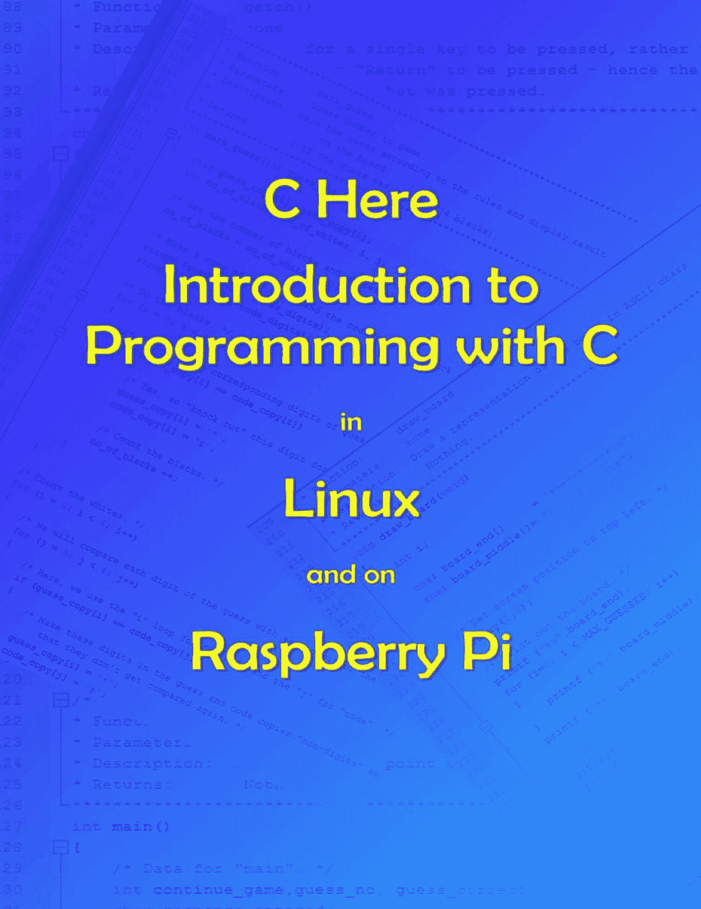

## 献言

本指南献给所有让本书出版成为可能的人——从我的家人到多年来指导和教我的老师、导师和良师。此外，我们还应该感谢许多无私和奉献的开发者、工程师和“极客”，他们帮助实现了在这一所谓的 21 世纪中我们生活中发挥着如此巨大作用的软件技术……

## 作者简介


Andrew Johnson 出于英国约克郡，并于 1986 年毕业于兰卡斯特大学，获得计算机科学与物理学学位。之后，他主要电信、过程控制和嵌入式系统领域从事了约 20 年的软件工程工作。他还全职或兼职从事教学、辅导和评估（成人教育领域）。

自 2012 年以来，他一直关注树莓派的发展，并参与了两个小型个人树莓派项目——一个飞机追踪器和一个基于`Python`的简单媒体亭机项目。

在空闲时间里，他广泛研究了许多“替代知识”话题，并在他的网站上发表过——[www.checktheevidence.com](http://www.checktheevidence.com)。你可以通过该网站或通过 ad.johnson2211@gmail.com 与他联系。

# 引言

本指南尝试向初级程序员介绍“C”编程语言。某些读者可能对`Java`、`Javascript`、`PHP`甚至`C#`更熟悉——这些语言都有许多关键字和语法特征，似乎是借用或衍生自`C`的。（顺带提一下，这些语言的编译器和解释器最初可能是用`C`或`C++`编写的。）

你会发现这些示例易于理解。当我最初将本指南中的内容作为为期 10 周的晚间课程（即约 20 小时的学习和实践）进行授授时，反非常好，帮助了许多人第一次学习编程，尽管`C`通常不被认为是初学者编程语言。

本指南不会教你关于`C`编程所需的所有知识，也不会教你通用的编程。它同样不会教你关于`Linux`或树莓派的所有知识。它几乎完全致力于教你**C 语言的基础知识，并将`Linux`和/或`树莓派`作为学习这些知识的平台。** 本指南没有涉及`C`语言更高级的特性，也没有过多讨论系统编程。然而，它确实讨论了`C`中指针的使用。

当你读到这里时，一本配套指南**高级 C 编程** 应该已经出版了。（这将涵盖`C`结构的使用、更高级的指针用法、位和字节级访问、二进制文件访问以及动态内存分配等主题。）

## 'C' 语言简介

“C”语言在 20 世纪 80 年代“声名鹊起”，从从最小的微处理器系统到最大的主机和超级计算机。这种语言的流行可能源于它的灵活性以及对底层特性的易访问性，这可以让你对主机系统拥有巨大的控制力。

它是一种相当奇的语言，可能非常晦涩（看看这个例子 - [`bit.ly/2qAkPVH`](http://bit.ly/2qAkPVH)），也许因为它仍然保持着一些原始的底层外观。对于没有经验的程序员来说，这里有很多陷阱——本指南试图突出其中的一些陷阱。然而，一旦掌握，“C”语言在高级语言和低级语言之间提供了一个恰恰的折中方案。自千禧年以来，`C`可以说经历了某种“复兴”，这源于`Linux`在许多计算平台上的采纳和使用增加，以及先进免费开源`C`编译器及相关开发环境的广泛可用，我们将在指南中使用其中一个（“Codeblocks”）。

对于潜在的`C++`程序员来说，学习原始的`C`语言可能不是一个坏主意，因为`C++`的大部分基础知识与`C`相同。

### C 的应用

它被专业人士和爱好者使用。它是一种通用语言——用于微处理器软件、设备驱动程序、早期操作系统、应用软件和游戏的开发！它最常用的方式是通过编译器，尽管最近几年至少有一个`C`解释器（`Ch`）问世了。

在编程中严肃且持续地使用`C`将迫使你学习更多关于计算机本质以及你正在使用的操作系统的知识。使用`C`时，你在编写程序时通常被迫以“较低的机器级别”思考。在更现代的编程语言中，许多底层活动隐藏在运行时库或“导入模块”中。而在`C`中，大多数情况下你处于系统的“最前沿”。

## 'C' 的历史

`UNIX`操作系统与`C`编程语言并行开发。现在，`Linux`的开发是为了`UNIX`的工作克隆，因此`C`基本上可以被视为`Linux`的“原生”编程语言。

'C' 起于一种名为`BCPL`的语言，该语言引入于 20 世纪 60 年。在此基础上开发了名为 'B' 的语言，随后'C' 由 Dennis Kernighan 于 1972 年在贝尔实验室编写。随后在 20 世纪 70 年代'C' 变得更加广泛使用，该语言历史上的一个重要里程碑是 1978 年，Brian Kernighan 和 Dennis Ritchie 出版了《C 语言参考手册》。这最终成为了该语言的公认标准，但并非官方标准。

到 1988 年，这种语言的使用非常广泛，以至于 ANSI 为该语言制定了一个标准——很大程度上基于 Kernighan 和 Ritchie 的参考手册第二版。所有据称符合 ANSI 标准的 'C' 编译器都遵循了 ANSI 在 1988 年制定的标准。

## 'C' 的哲学

'C' 的哲学始终是*“程序员知道自己在做什么”*，对于粗心的程序员，很少有保护措施。这种语言的态度与 BASIC 或一些复杂的现代语言（如`Java`、`Python`和`C#`）大不同。它允许你编写非法且毫无意义的代码。它的语法和类型检查很弱，尽管现代编译器的默认设置执行了更严格的编程选项。`C`的主要优势在于你拥有巨大的灵活性，例如，与其他语言相比，对机器硬件的访问通常非常简单。此外，'C' 编译器可以生成紧凑且优化良好的代码，这对于小型应用程序非常理想，对于大型应用程序也有用，因为你只需要从系统中“多榨取一点性能”。时间敏感的应用通常仍从使用`C`编码中受益，不仅是因为编译后的代码运行速度比解释型代码快数百倍，还因为`C`程序通常可以“绕过”某些损害程序/应用程序性能的操作系统特性。

# 如何使用本指南

1) **你需要一台能够运行大约 2012 年以后版本的`Linux`的设备。我将引用`Ubuntu`和`Raspbian`版本的`Linux`，它们都是`Debian`的衍生版本。**

2) **你需要知道如何在`Linux`的终端窗口或通过命令行使用命令，以及使用软件中心（Ubuntu）、App Grid 或其他基于 GUI 或命令行的应用程序安装程序（如“apt-get”）来安装`Linux`应用。**

## 使用 Windows 或 Mac 系统学习 C 语言

如果你没有 Linux 且不想在计算机上安装它，只要你有足够的磁盘空间，仍然可以很方便地使用 Linux 和 C 语言。只需搜索“Installing Virtual Box”和“Ubuntu Linux and Virtual Box”。如果你能在你的 Windows 或 Mac 电脑上成功安装了这些程序，就可以参考第 5 章以及本指南其他部分的说明来开始。你需要大约 20GB 的空间来安装所有内容。要成功使用 VirtualBox，你可能需要在 BIOS 中更改“Virtualisation”（虚拟化）设置。详情请在网上。

## 注意！

Linux 几乎每天都会更新——导致应用程序中的功能会被移动、删除和/或更改。图形界面会被重新设计，应用程序会被取代或过时。

**这意味着，当你阅读第 5 章中的说明时，它们可能并不是最新的，或者它们产生的结果可能略有不同。因此，你可能需要进行一些实验，并在网上搜索关于新功能、增强或更改的更新说明或笔记。**

你已经收到警告了！

## 示例的原理

某些示例程序看起来毫无意义或不切实际——在这种情况下，它们编写是为了说明语言的特性，而不是作为实用的程序。

你当然可以下载所有示例程序并编译、运行它们，但你可能会发现，如果你亲自输入它们，学得会更好（这在本指南最初创建的 20 世纪 90 年代非常常见）。如果你自己输入并编译程序，你将了解更多错误信息的含义，并且当你开始编写代码时，你会更擅长发现代码中的错误！

## 课程主题

当我最初开始编程时（在 1981 年的 Sinclair ZX81 电脑上），我的动力是写一个简单的游戏。一年后，当我得到传奇的 Spectrum（16K 型）时，发生了类似的事情。因此，在本指南中，我们将采取类似的“计划”。我们将建立知识来编写一个简单的“破解密码”游戏——许多人称之为“猜数字”（Mastermind）。

### 破解密码游戏 – “猜数字”

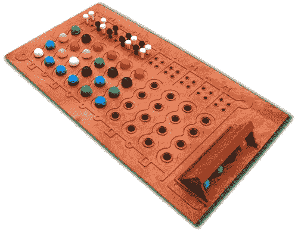

这是我小时候很喜欢玩的游戏——我甚至还有一个口袋电子版。一组数字（范围在 0-9 之间）被设置为“秘密密码”（它通常由人类——密码设置者设置，但我们将让计算机来完成）。然后，“破解者”尝试尽可能地猜密码。他或她通过将猜测放在棋板上来进行猜测——通常用户在游戏结束前有 10 次猜密码的机会。然后，“密码设置者”将根据某些规则对猜测进行“标记”：

*   如果猜测的某个数字也在密码中，但位于不同的（DIFFERENT）位置，则获得一个白色（WHITE）棋子。

*   如果猜测的某个数字也在密码中，但位于相同的（SAME）位置，则获得一个黑色（BLACK）棋子。

*   每个正确的数字最多只奖励一个白色或黑色棋子。

### 示例

*   如果秘密密码是“1234”，猜的值是“4255”，将获得一个黑色棋子（对应“2”）和一个白色棋子（对应“4”）。

*   在下方所示的示例（摘自我们将开发的程序运行版本），代码中可能有 3 或 4，且秘密密码*不*以 4 结尾，它可能包含 3，但如果包含 3，它不在前 3 个位置。

### 原理

通过开发一个易于理解且实际上非常有趣的游戏，我们能够引入基础编程概念，如输入和输出、数据存储（数组中）、计数、条件测试和循环（也称为迭代）。

完整的列表见附录 1。

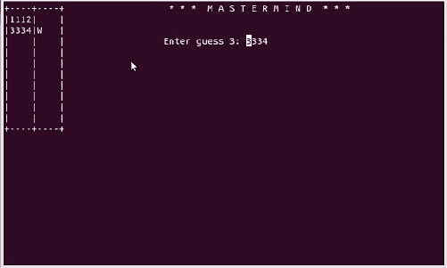

这就是我们完成后、运行的游戏的样子。

## 简单编程练习题

附录 2 列出了一些你可以编写的非常简单的程序构想——基于指南中给出的示例。没有提供解决方案。

### 其他语言

如果你能掌握本指南中的内容并理解你所做的一切，你将为理解过程化编程（procedural computer programming）中最常用方法的概念打下坚实的基础。逻辑上的下一步是去理解面向对象的计算机编程，这种编程固有地应用于更现代的编程语言，如`C++`、`Java`、`Python`甚至`BASIC`的变体中。

# 编程过程 – 快速总结

有些人会称之为“算法开发”、“算法设计”甚至“系统思维”。为了本指南的目的，我将称之为“编程过程”。有很多书籍对这些概念进行了极其详细的介绍。在这里，我们介绍本质的基础知识。

## 编程过程涉及

*   考虑问题。

*   将问题分解成小块。

*   考虑如何以计算机程序的形式表达问题中每个部分的解决方案。

### 程序

可以分为 2 主要部分：

*   指令 - 代码

*   信息 - 数据

在解决问题时，我们必须考虑需要哪些信息和指令。

## 程序中的指令/代码

可以分为 3 种主要类型：

1.  信息（数据）处理。

2.  条件测试。

3.  跳转/分支。

你将在本指南中看到每种类型指令的不同示例，尽管跳转/分支通常是通过以某种方式组织程序来隐式完成的。

## 程序中的信息/数据

可以以许多不同的形式存在。例如：

*   简单的整数值

*   浮点值（带有小数点的）

*   文本 / 字符串 / 字符

*   图形

*   声音

'C' 只是另一种编程语言，它有自己表达代码和数据的特殊方式。

## 编译语言

*   一旦写好程序，在运行之前必须经过*编译（“转换”）*处理。如果看到错误，程序必须终止、修正、重新编译并从头运行。

*   转换过程只进行一次，除非对程序进行了修改。

## 解释型语言

*   一旦写好程序，就可以立即运行。如果发生错误，程序可能会完全停止，或者在遵循某种“警告”消息后临时停止。程序可以被中断、修正，然后程序可以从停止的地方继续运行。

*   “转换”过程每次程序运行时都会发生——这会减慢速度，尽管在 21 世纪初，计算机处理器（CPU）的速度通常比 20 世纪末快几千倍。

## 混合语言

一些更现代的语言使用编译和解释的方法，在某些情况下可以提供特定的优势。

## 我们如何将 'C' 程序输入计算机？

为了编写 'C' 程序，我们需要能够在计算机中输入和存储文本。为了做到，我们使用*文本编辑器*。

### 文本编辑器

是一种我们在计算机上运行的程序，允许我们输入、修改和保存某些文本到磁盘。这些文本可以是任何东西——一个字母、一本书、一堆垃圾或一个 'C' 程序。

### 编译器

是一种我们在计算机上运行的程序，它将某些文本转换为“目标代码”。这种代码将在你编写代码的系统（称为“目标系统”）上运行。还有另一个称为“链接器”的程序，它将其他“标准”代码添加到目标代码中以创建“可执行程序”。

编译器和文本编辑器可能是完全独立的，但我们将使用`Codeblocks IDE`（集成开发环境），在其中它们可以被视为同一个东西。

### 目标系统

在这里，我们的目标系统可以是树莓派（Raspberry Pi）或 Windows PC——但你可以在运行不同类型系统的 PC 或树莓派上编译代码。这通常通过所谓的`嵌入式系统`来实现。对于这类开发，你需要使用交叉编译器。

## 什么是编译？

- 它是将一段文本转换为“目标代码”的过程，而目标代码反过来会被转换为“可运行的”或`executable`程序。

- 编译器会根据相关语言的规则（在本例中为 'C' 语言）检查文本，以查看它是否形成了一组有效的指令。

- 当编译器发现违反语言规则时，它会显示一条信息:-

“错误 X 行 Y：... 说明 ...”

或者，较严重的是:-

“警告 X 行 Z：... 说明 ...”

## 编辑、编译、链接

生成一个可运行的 'C' 程序实际上有 3 个不同的阶段，它们是:-

| 编辑 | 使用文本编辑器将程序输入计算机。输入的文本被称为`source code`或简单的`the source`。 |

| 编译 | 程序转换为“目标”代码，类似于机器码。 |

| 链接 | 一个名为`linker`（链接器）的程序将你的程序的目标代码与“运行时库”目标代码相结合，使你的程序成为一个完全独立的“单元”，该单元可以独立于编辑器、链接器和编译器运行。 |

通常，这些阶段对用户是隐藏的——特别是如果你使用集成开发环境（IDE）时，正如第 4 章节中提到的那样。如今，“编译”和“链接”通常在一个步骤中完成，如第 5 章节所示。

# 更多关于我们的项目

## 需求

如上所述，我们将构建一个基于“数独大师”（Mastermind）概念的简单游戏。为了做到这一点，我们有一个需要解决的问题——我们将将其分解为以下部分（有些人会把左侧的列称为“用户需求”或“功能需求”）。

| 需要完成...的代码/指令 | 所需数据 |

| :--- | :--- |

| 绘制面板 | 简单的面板布局 |

| 读取代码猜想 | 猜测中的数字 |

| 生成秘密代码 | 秘密代码中的数字 |

| 检查代码和猜测 | 比较“猜测存储”和“秘密代码存储” |

| 为每个猜测显示标记 | |

| 在游戏时计算次数 | 单个数字/计数器（猜测计数器） |

| 检查猜测次数是否过多 | 猜测计数器 |

| 显示“游戏胜利”或失败 | |

| 重启游戏 | |

## 流程图

我们可以将此重新视为流程图中的一组步骤，然后对其进行结构化处理。

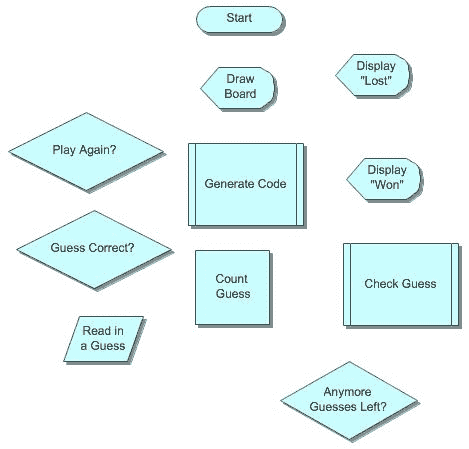

流程图元素，无结构化。

我们现在考虑玩游戏所需的步骤并重构流程图，如下：

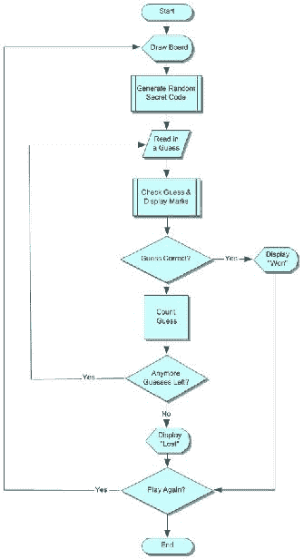

# 编译和运行 C 程序

## 命令行和 GUI

在现代桌面操作系统中本质有 2 种用户交互模式：

- 图形用户界面（*很早以前*这被称为 WIMP – 窗口、图标、鼠标、指针！）

- 命令行或“终端”（后者是指早期计算机如何通过视觉显示单元 – VDU – 仅是键盘和屏幕）提供对计算机的实时访问。）

有些人更倾向于某一种方法而不是另一种方法——尽管 GUI 方法有许多优点。如果你正在运行一个“精简版”的 Linux——例如运行在无法连接屏幕的低功耗设备上，命令行可能是唯一可行的方法。

### GUI

在这里，你只是在使用另一个应用程序/包来编译和运行程序——其运行方式与你的文字处理器、电子表格等非常相似。你输入程序并直接运行它，然后回去输入/编辑。

### 命令行

在这里你输入命令（在下一节中介绍）来编译和运行程序，然后通常输入另一个命令来运行编辑器（如“nano”）。这在第 5.5 节介绍。

## 在树莓派 / Linux 上安装 Codeblocks IDE

Linux 操作系统下有很多实用且出色的编辑器和 IDE，树莓派上可能也有同样的数量。然而，我为本指南选择了优秀的“Codeblocks” IDE。

在 Linux 上，你可以通过打开软件中心并搜索“Codeblocks”将其安装在你的系统上，尽管这可能不会给你最新版本。然而，完成以下步骤效果最好。

```
sudo apt-get install
```

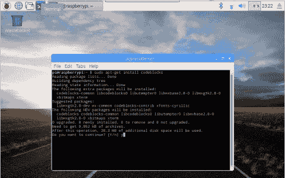

Raspbian Jessie – 从命令行安装 Codeblocks

启动器或应用程序文件夹中应该添加一个这样的图标，看起来像这样：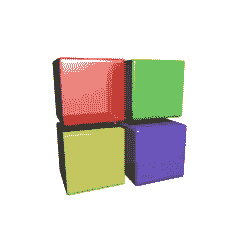

在树莓派上，一旦安装，Codeblocks 应该出现在 Applications/Programming（应用程序/编程）菜单中：

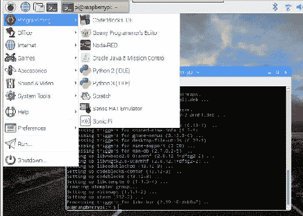

树莓派编程子菜单

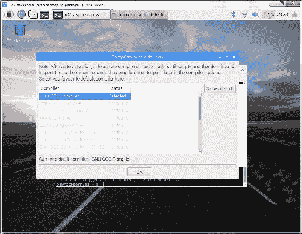

Codeblocks 编译器检测 – 应设置为`gcc`

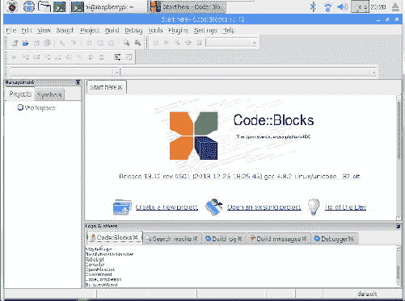

Codeblocks – 成功加载并运行 – 准备好编写程序！

## 第一个程序 – Codeblocks

有 2 种让你的第一个程序运行的方法，都在下面进行了概述。

### 快速/直接方法

1. 选择“File/New”（文件/新建）和“Create Empty File”（创建空文件）：


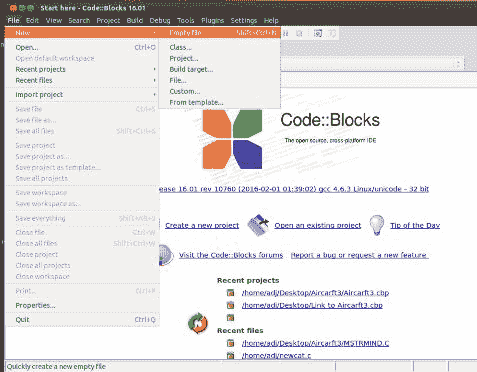

## 第一个程序 - 图形界面方法

2. 当你看到空文件出现时，按照所示*完全*输入以下文本。**不要漏掉任何字符，并注意引号、括号和分号！**

```c
/* 第一个 'C' 程序！ */

#include "stdio"

int main( )
{

printf ("Greetings, pop pickers!");

getchar( );
}
```

3. 然后点击“Play”（播放）按钮，它应该会给你显示所示的内容。

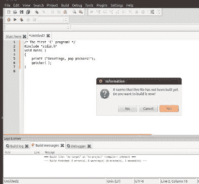

4. 点击“Yes”（是），然后你应该能看到下面的显示：

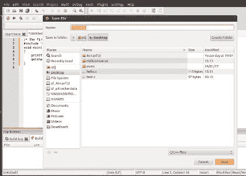

5. 输入`hello.c`（`.c` 是重要的！），然后点击“Save”（保存）。

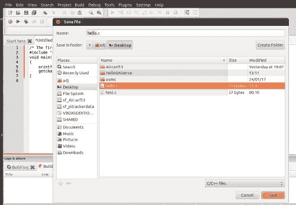

6. 几秒后，你应该看到以下显示。

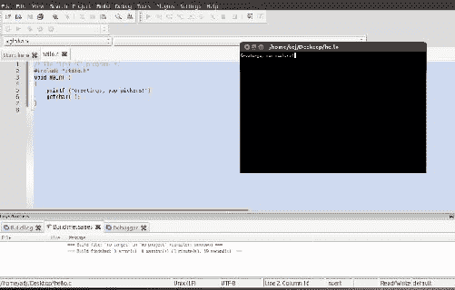

7. 你可以输入一些字符，然后按两次回车键，黑色小窗口就会消失。

### 向导方法

1. 选择“File Menu”（文件菜单）中的“New”（新建）和“Project”（项目）来启动新项目。选择“Console Application”（控制台应用程序）并点击“Go”。

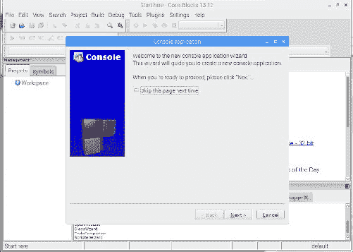

你会看到一些解释性文本，因此点击“Next”（下一步）。

2. 它询问你想用什么语言创建你的应用程序——“C”应该已经被选中了——所以点击“Next”。

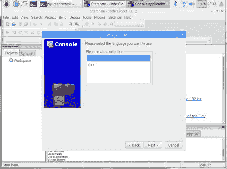

3. 为你的项目输入一个名称，例如“Hello”或“HelloUniverse”（想得大大一点！）并点击“Next”。

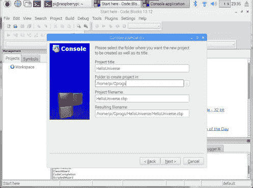

4. 随后你将看到一个设置列表。保持这些设置不变，直接点击“Finish”（完成）。

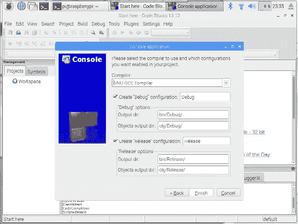

5. 你应该看到下面的显示——因此点击左侧“Projects”（项目）面板中的`main.c`。

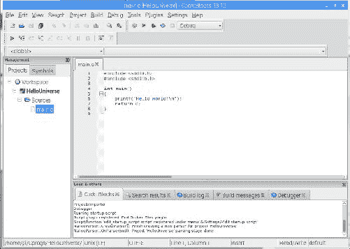

6. Codeblocks 生成了一个简单的“Hello World”程序。可以随意将“World”改为“Universe”。工具栏和按钮的布局在你的版本上可能会有不同。你也可以可选地在`printf`行之后添加`getchar()`行：

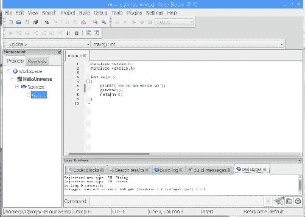

7. 现在点击工具栏上的绿色“播放”按钮：

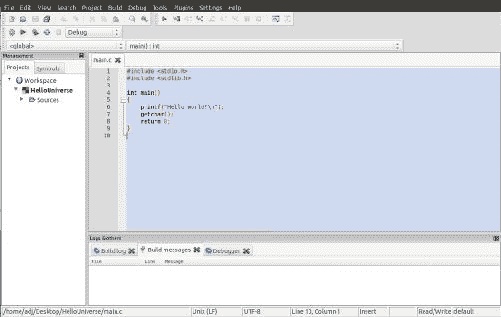

你应该看到下面的显示：

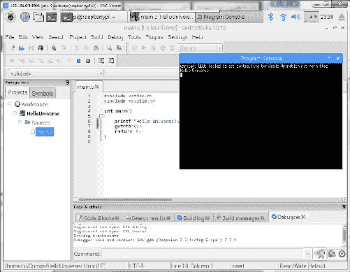

8. 你可以输入字符，然后按两次回车键，黑色小窗口就会消失。现在你可以继续阅读第 5.5 节。

## 第一个程序 - 命令行方法

如果你已经进入了命令行，可以忽略后续步骤。

1. 在菜单中寻找“terminal（终端）”图标，并点击它。输入：

```bash
nano hello.c
```

并按回车。

2. 你应该看到此显示界面。

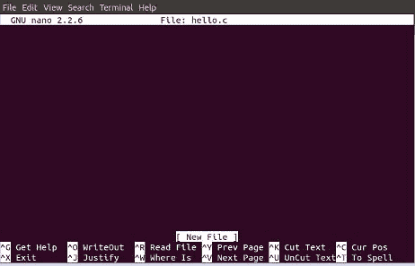

3. 输入此程序。

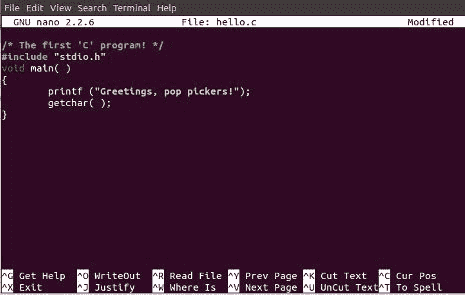

4. 按`Ctrl-X`，然后再按“Y”。

5. 输入以下行并按回车：

```bash
gcc hello.c -o hello
```

6. 如果你看到任何错误信息，或者收到除了命令提示符以外的任何内容，你需要通过再次输入`nano hello.c`来检查你的程序，并将你输入的内容与上方的内容进行对比。确保它们**完全**一致。如果你没有看到任何错误信息，直接输入：

```bash
./hello
```

7. 你应该看到下面的显示。

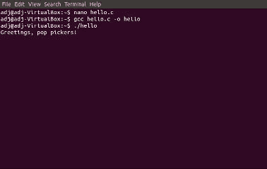

8. 按回车返回命令行。

9. 恭喜！你现在完成了你的第一个程序并成功运行了它！

## 第一个程序 - 它在做什么？

该程序所做的就是在屏幕上打印一条消息，并等待按下回车键。详细细节如下：

1. `main( )` 表示程序的开始。

2. `{`（左大括号）意味着一个“块”的开始。

3. `printf` 是一个打印“函数”——输出。

4. `getchar( )` 是一个键盘读取“函数”——读取字符输入并等待按下回车键。

5. `}`（右大括号）意味着一个块的结束。

6. `/* */` 意味着“注释”。“标记”之间的文本会被编译器忽略——这些文本用于记录每一步的操作。

在本指南结束时，你应该能够理解程序中所有行的作用。

## 第一个程序 – 观察

我们从这第一个程序中看到：

- 'C' 是“自由格式”的——程序中不需要输入行号（某些文本编辑器会在左侧边缘显示行号）。
- 'C' 是“块结构化”的——所有内容都在大大括号`{ }`之间的“块”中指定。

我们还应该注意 C 是区分大小写的。这意味着如果你使用`Printf`（大写字母“P”）而不是`printf`，程序将无法运行。

在接后的示例中，并不总是会列出整个程序。除非另有说明，否则你应该始终将程序输入到以下“骨架”中：

```c
int main ( )
{
    <你的程序代码>
}
```

## 关于“控制台应用程序”和控制台窗口的说明

我们刚刚输入的程序与本指南中将看到的所有其他程序一样，都在控制台窗口（Console Window）中运行。`控制台窗口`本质上是对交互式计算早期的回溯——那时你有一个基础的计算机控制台，只能显示字符或非常有限的图形。那里没有图形用户界面，而且几乎没有实际的图形。如果你学习《高级 C 语言编程指南》，我们将查看一些基本的 Linux 图形特性，但不是 GUI 编程。完整的 GUI 编程通常结合使用 C++ 等面向对象的编程语言会更好地理解。

# 'C' 中不同类型的数据

## 程序中的数据是什么？

它是程序执行其功能所需的信息。例如，公司人事记录中员工的姓名和地址，某人收藏中唱片的标题和艺术家。

现实世界中的数据具有无限的变化性。在'C'中，与其他编程语言一样，数据只有特定的表达方式。

## 在'C'程序中使用数据

要在程序中使用数据，我们必须先声明它，即输入一行特殊的代码，例如：

```c
int number_of_items;
```

为了声明一个数据——一个整数，“整数字”，用于存储某些计数操作的项目数量。代码必须知道它将使用什么数据，因此：数据声明始终位于代码之前。

### 关于数据声明的说明

显示的数据声明分三部分：

`int number_of_items ;`

(1) (2) (3)

它们是：

1. 数据类型。
2. 数据项名称。
3. 终止符。

我们将声明的数据项称为`variables（变量）`。`Name`通常被称为`identifier（标识符）`。

### 数据项（变量）命名

变量命名遵循某些规则：

- 变量名不能以数字开头。
- 变量名不能包含空格（使用下划线`_`代替）。
- 变量名是“区分大小写”的。
- 不能使用以下任何字符：`$ - +`。

（注：原始文本中存在大量重复的规则行，已进行清理并保留核心规则。）

`printf`命令在第 9 章中会有更详细的解释。

# 表达式、语句和运算符

这些是用于描述任何编程语言特定部分的 2 个词汇，理解它们非常重要。

## 表达式

表达式是变量名、数字和运算符的集合，它们可以一起用于计算以产生单个结果，例如：

```c
a + 2*b - 4*(c+d)
```

表达式通常形成*赋值语句的右侧部分*。

## 语句

是指程序中的任何完整命令。在'C'语言中，语句以分号结束：

```c
e = a + 2*b - 4*(c+d);
```

在这里，*表达式*`a + 2*b - 4*(c+d)`构成了整个语句的*部分*。以下也是一条语句：

```c
printf (“Crinkly Brindlewurdles...”);
```

## 运算符

| 符号 | 操作 |
| :--- | :--- |
| `+` | 加法 |
| `-` | 减法 |
| `*` | 乘法 |
| `/` | 除法 |
| `%` | 取模（余） |

运算符是语言中用于表示对数据进行常用操作的符号。有算术运算符和其他类型的运算符（后引入）。总之，'C'拥有一套丰富的运算符，但基本的运算符如上表所示。（稍后我们将看到`EQUALITY TESTING`使用`“= =”.`。）

## 自增和自减

“自增”通常意味着“加 1”，“自减”通常意味着“减 1”。'C'语言中一些非常有用的运算符是“自增”和“自减”运算符。

`++` 增 1。

`--` 减 1。

### 自增

例如，自增运算符可以产生以下效果：

```c
i = 0;
i++;             /* i 现在等于 1\. */
```

自减运算符具有相反的效果：

```c
i = 4;
i--;             /* i 现在等于 3\. */
```

`++`和`--`可以出现在它们所使用的变量名的之前或之后——效果略有不同。这些运算符也可以放在 C 语句的几乎任何地方，例如：

```c
i = 0;
j = i++;     /* 结果: i = 1, j = 0 */
/* 但是 */
i = 0;
j = ++i;     /* 结果: i = 1, j = 1 */
```

自增和自减运算符通常用于“for”循环（后引入）。

### 自增/自减总结

换句话说，如果运算符放在变量*之前*，则自增/自减在变量操作*之前*执行；如果运算符放在变量*之后*，则在对变量操作*之后*执行。

## 其他一些运算符

与`++`和`--`类似的还有`+=`和`-=`。

`+=` 加上指定的数值。

`-=` 减去指定的数值。

例如：

```c
i = 5;
i += 10;/* 结果现在是 15\. */
i = 17;
i -= 10;/* 结果现在是 7\. */
```

总而言之，我们可以说：

```c
i += x; /* 等于 i = i + x; */
i -= x; /* 等于 i = i - x; */
```

注意：运算符`/=`、`*=`和`%=`也可以用。

# 输出到屏幕 - “Printf”

我们现在将详细地查看`printf`函数。

```c
printf (“some text”, <some variables>);
```

(1) (2) (3)

1. 函数名。
2. 控制字符串。
3. 需要打印其值的变量。

`printf`的简单情况就像第一个示例程序，只包含要打印的文本而没有其他变量。

## 输出存储在变量的值 – “转换”字符

更复杂的情况是，你在“控制字符串”中放入一个或多个“转换字符”。转换字符紧跟`%`符号。一种转换字符是`%d`，意味着“在这里替换整数变量的值”。其他转换字符有：

| 转换说明符 | 用途 |
| :--- | :--- |
| `%ld` | 用于打印 long 数据。 |
| `%c` | 用于打印 char 数据。 |
| `%f` | 用于打印 float 或 double 数字数据。 |
| `%s` | 用于打印字符串数据（后介绍）。 |

注意：对于你指定的每一个转换字符，你必须在控制字符串之后包含一个变量，否则可能会出现不可预测的结果。

### 使用“printf”的示例程序

```c
#include "stdio"

int main() {
    char letter;
    int number;
    long long_number;
    float decimal_number;

    letter = 'z';
    number = 37;
    long_number = 1000;
    decimal_number = 9.81;

    printf (“The letter is %c\n”, letter);
    printf (“The number is %d\n”, number);
    printf (“The long number is %ld\n”, long_number);
    printf (“The decimal number is %f\n”, decimal_number);
}
```

（注：提供的代码块原始文本是碎片化的；我根据文中提到的格式说明符和变量重构了逻辑。）

### 注释

程序执行了以下操作：

1. 声明了 char、int、long 和 float。
2. 用值初始化它们。
3. 在消息中打印每个，并在后跟一个换行。

# 文本字符串

就像我们可以为数字和字符定义数据项一样，也可以为文本定义数据项并打印它们。这通过下面的程序实现。

```c
int main () {
    char android_name[] = “Kryten”;
    char android_type[] = “Mechanoid 2000”;

    printf (“Here comes the string... \n”);
    printf (“Android's name is \t%s\n”, android_name);
    printf (“Android's model number is \t%s\n”, android_type);
}
```

### 程序注释

程序执行了以下操作：

1. 声明了两个名为`android_name`和`android_type`的字符串变量，并将它们初始化为所示的字符。
2. 打印一条消息。
3. 在消息中打印每个字符串，并在后跟一个换行。

## 为什么字符串声明使用`[]`？

在'C'语言中声明文本字符串的这种特性是因为字符串实际上是*字符数组*。严格来说，当我们声明一个字符串时，应该这样做：

```c
char any_string[18] = “Zaphod Beeblebrox”;
```

在这里我们声明了一个包含 18 个字符的数组，用于存储“Zaphod Beeblebrox”的字母——实际上只有 17 个字母！需要额外的字符是因为'C'语言通过一个值为 0 的字符来识别文本字符串的结束。编译器在字符串的结束引号之前（隐式地）为我们放入了一个 0 字符。所以在'C'语言中，所有字符串都被 NULL (0) 终止。

在声明字符串时，使用`[]`是一种捷径——因为'C'编译器可以计算出字符串的长度，它实际上是为我们在`[]`之间放置了这个数字。

因此，上面的“Zaphod Beeblebrox”字符串可以显示为*字符数组*：

| 0 | 1 | 2 | 3 | 4 | 5 | 6 | 7 | 8 | 9 | 10 | 11 | 12 | 13 | 14 | 15 | 16 | 17 |
| :--- | :--- | :--- | :--- | :--- | :--- | :--- | :--- | :--- | :--- | :--- | :--- | :--- | :--- | :--- | :--- | :--- | :--- |
| Z | a | p | h | o | d |  | B | e | e | b | l | e | b | r | o | x | `\0` |

### 在字符串中引用单个字符

因为在之前的几个例子中，我们声明了一个字符数组，因此可以单独引用每个字符。例如，如果我们在程序中（字符串声明之后）写下面这行代码：

```c
printf (“%c\n”, any_string[3]);
```

我们会在屏幕上看到`'h'`。但这是“Zaphod”的第 4 个字母，而不是第 3 个，为什么呢？

### 使用数组元素

在'C'语言中引用数组元素时，必须从 0 开始计数。换句话说，任何数组的第一个元素始终标记为 0。因此，在'C'语言中，数组元素引用（索引）从 0 开始。

## 让我们修改我们的“打印面板”程序

现在我们将使用 2 个字符串变量并修改我们打印面板的方式。

```c
#include "stdio"

int main( )
{
    char board_end[] = "+----+----+\n";
    char board_middle[] = "| | |\n";
    /* 打印棋板。 */
    printf ("%s",board_end);
    printf ("%s",board_middle);
    printf ("%s",board_middle);
    printf ("%s",board_middle);
    printf ("%s",board_middle);
    printf ("%s",board_middle);
    printf ("%s",board_middle);
    printf ("%s",board_middle);
    printf ("%s",board_middle);
    printf ("%s",board_middle);
    printf ("%s",board_middle);
    printf ("%s",board_end);
    /* 打印标题。 */
    printf (" * * * M A S T E R M I N D * * *");
}
```

这比我们的第一个版本稍微好一点。例如，如果我们希望面板边缘由“:”而不是“|”组成，那么我们只需要更改`board_middle`字符串变量即可：

```c
char board_middle[] = ": | :\n";
```

# 其他数组

我们已经看到字符串是如何声明的——作为字符数组。我们可以通过在变量名后加上方括号中的数字来声明其他数据类型的数组：

```c
int card_values[4];
float stellar_magnitudes[10];
```

这声明了一个包含 4 个整数的数组和另一个包含 10 个浮点数的数组。

`card_values`数组有 4 个元素——`card_values[0]`、`card_values[1]`、`card_values[2]`、`card_values[3]`。数组元素的赋值通过如下方式实现：

```c
card_values[3] = 10;
```


在这里，`[3]` 被称为数组引用的下标。

## 初始化数组

数组可以在声明时进行初始化，例如：

```c
int phaser_bank_levels[5] = {7,7,7,6,6};
```

单独初始化元素，或者

```c
int phaser_bank_levels[5] = {10};
```

将数组`phaser_bank_levels`的所有元素都初始化为 10。

## 多维数组

可以通过在变量名后添加另一个索引来声明：

```c
float daily_totals_by_week[52][7];
```

这将声明一个 52 x 7 的浮点数数组，第 22 周的第 6 天可以通过以下方式引用：

```c
printf (“%f”, daily_totals_by_week[21][5]);
```

## 数组的使用

数组通常用于处理数据，就像在表格一样。表格中的每个“框”对应数组中的一个元素。考虑以下示例。假设我们想要存储某年的雨量（毫米）。我们将以表格的形式写它：

| Jan | Feb | Mar | Apr | May | Jun | Jul | Aug | Sep | Oct | Nov | Dec |
|---|---|---|---|---|---|---|---|---|---|---|---|
| 80 | 85 | 75 | 71 | 50 | 30 | 33 | 37 | 45 | 55 | 60 | 70 |

这可以使用 'C' 程序并使用以下数组声明来存储。

```c
int rainfall_in_month[12];
```

这可以扩展为包含初始化，如下：

```c
int rainfall_in_month[12] =
{
    80, 85, 75, 71, 50, 30, 33, 37, 45, 55, 60, 70
};
```

数组索引数字或下标 0 将用于访问 1 月的数据，1 用于访问 2 月，2 用于访问 3 月的数据，以此类推。因此，如果我们想打印 3 月的数据，我们将：

```c
printf (“March figure for rainfall is %d\n”, rainfall_in_month[2]);
```

正如我们稍后将看到的，结合“for”循环操作数组是很常见的——我们通常希望对数组中的每个数据项（每个元素）执行相同的操作，所以我们必须使用迭代。

## 代码破解游戏 – 存储我们的秘密代码和猜测

在我们的代码破解器游戏中，我们将使用 2 个数组——一个用于存储秘密代码数字，另一个用于存储猜测数字，如下：

```c
char guess_digits[5];
char code_digits[5];
```

稍后我们将编写代码从键盘读取猜测，并使用随机数生成函数生成秘密数字。

# 键盘输入

大多数高级语言都有从键盘读取数据的方法。在 'C' 中，这种方法的实现有点神秘。

## 用于读取字符串和数字的 'C' 输入函数`scanf`

下面的 'C' 程序将读取一个数字并打印出来。

```c
int main( )
{
    int centigrade_value;
    printf (“Enter a value in Degrees Centigrade:”);
    scanf (“%d”, &centigrade_value);
    printf (“The value entered was %d C.\n”, centigrade_value);
}
```

### 注意

1. 我们首先声明`centigrade_value`。

2. 我们打印一个提示。

3. 我们从键盘读取数字。

4. 我们打印输入的值。

5. `centigrade_value`之前的`&`是重要的——我们稍后会解释。

'C' 函数`scanf`用于从键盘读取数据。它在某种程度上是`printf`的补充函数。当使用`scanf`时，它至少包含两个部分：

```c
scanf (“%d”, &centigrade_value);
```

(1) (2) (3)

这些部分是：

1. 函数名

2. 控制字符串

3. 用于存储读入值的变量

控制字符串的格式与“printf”使用的格式相同，如章节 *9.1.* 中所述。“scanf”可以一次性读取到多个变量的值，例如：

```c
scanf (“%c %d %f”, &gender, &age_in_years, &weight);
```

在这里，我们使用`scanf`读取到三个变量`gender`、`age_in_years`和`weight`的值。

或许任何计算机程序最重要的功能就是其做出决策的能力——即进行条件测试。在 'C' 语言中进行条件测试的方法与其他高级语言相似。

### 条件语句

在 'C' 语言中有许多方法进行条件测试，但到目前为止常用的是“if..else”，如下所示。

```c
if (condition)
one line statement;
else
one line statement;
```

注意：与某些其他编程语言不同，这里假设了“THEN”，且该词没有包含在`if`语句中。

`if .. else`也可以采用略有不同的形式，使用“多行语句”。如下所示。

```c
if (condition)
{
statement 1;
statement 2;
.
.
statement n;
}
else
{
statement 1;
statement 2;
.
.
statement n;
}
```

注意：相等性测试是使用`==`的，例如：

```c
if (warp_factor == 10)
{
    printf (“The Engines can nae take it cap'n!!\n”);
}
```

与其他语言一样，也可以测试“不等式”。可以使用以下符号，而在其他情况下本该使用`==`（双等号）的地方：

| 符号 | 含义 |
| :--- | :--- |
| != | 不等于。 |
| > | 大于。 |
| >= | 大于或等于。 |
| < | 小于。 |
| <= | 小于或等于。 |

例如：

```c
if (i != 0)
{
    printf (“The number is non-zero.\n”);
}
```

### 另一个示例

假设我们想要检查电阻值是否大于 1000 欧姆，可以使用以下条件测试。

```c
if (resistance_value > 1000)
{
    printf (“Value is over 1 kilohm.\n”);
}
```

为了同时测试多个条件，需要“AND”（和）和“OR”（或）关键字。在 'C' 语言中，它们的表达式如下：

- `&&` - 逻辑与。

- `||` - 逻辑或。

例如：

```c
if ((character >= '0') && (character <= '9'))
{
    printf (“The character is a number. “);
}
```

### 条件测试的提示

可以通过在条件前面放置一个`!`对条件测试进行取反，例如：

```c
if (!((i >= 6) && (i <= 12)))
{
    printf (“Number is outside range 6 - 12”);
}
```

条件测试可能会变得非常复杂。为了保持它们清晰，遵循这些指南可能很有用：

- 每个条件测试都应该括在（圆形）括号中。

- 尽量坚持使用条件语句的多行形式。

- 始终对齐构成块开始和结束的大括号`{ }`。

- 如果条件测试变得复杂，请将其拆分到多行并合理地对齐。

## 更复杂的条件测试 - “switch..case” 语句

考虑编写一个玩纸牌游戏的 'C' 程序的想法。假设你想以数字的形式打印牌值，对于 2 到 10 的牌，或者对于其他牌打印 A, J, Q, K。如果我们假设一个名为`card_value`的`int`变量包含 1 到 13 之间的数字，我们可以在 'C' 语言中这样实现：

```c
if ((card_value >= 2) && (card_value <=10))
    printf (“%d”, card_value);
else
    if (card_value == 1)
        printf (“A”);
else
    if (card_value == 11)
        printf (“J”);
    else
        if (card_value == 12)
            printf (“Q”);
    else
            if (card_value == 13)
                printf (“K”);
```

正如我们看到的，这产生了一个相当大且笨拙的`if`语句集。如果我们想对每个 case 执行除了`printf`之外的操作，我们就必须对每个`if`使用`{ }`，这使得整个事情变得更加麻烦。另一种示例的方法是……

`switch..case`语句可以用于测试给定变量的多个离散值。其他语言往往单独使用`Case`语句。之前的示例可以重写为：

```c
switch (card_value)
{
    /* 控制变量 */
    case 1:
        printf (“A”);
        break;
    case 11:
        printf (“J”);
        break;
    case 12:
        printf (“Q”);
        break;
    case 13:
        printf (“K”);
        break;
    default:
        printf (“%d”, card_value);
        break;
}
```

### 注意：

1. `switch`语句根据控制变量的指定值执行指定的动作。

2. 在每个动作之后，插入`break;`词以导致指令的执行在`switch`语句的`}`之后继续。如果不包含`break`，执行将继续进入下一个`case`动作（这有时是有用的）。

3. `default:` case 指定了当控制变量的值不在其他 case 中列出的任何值时要采取的操作（这是可选的）。

4. 可能会让人惊讶的是，每个`case`中的语句不需要包含在`{ }`中。（尽管包含在`case`中的任何`if`、`do...while`、`for`语句将遵循正常规则。）

### “switch..case”的局限性

- 控制变量应该是`int`或`char`类型。

- 被测试的值必须是常量——即你不能使用`switch`来测试一个变量相对于另一个变量的值。

## 破解密码游戏 – 一些条件测试

在我们的破解密码游戏中，我们需要进行一些测试。

1. 检查猜测次数是否过多。

2. 检查用户是否想再次玩或结束游戏。

3. 检查用户输入的代码是否与秘密代码中的任何数字匹配。

“与秘密代码对比”步骤我们将留到以后，因为在可以轻松这样做之前，我们还需要学习更多。对于检查用户是否想继续游戏，我们可以这样做：

```c
char response;
response=getch();
if ((response==”y”) || (response==”Y”))
{
    /*开始一个新游戏！*/
}
else
{
    /*退出游戏 –结束程序！！ */
}
```

但对于检查猜测次数，我们可以这样做：

```c
int guess_counter = 0;
/* 这里还有需要做/考虑的事情！ */
guess_counter++;
/* 我们允许猜测 10 次 */
if (guess_counter > 10)
{
    printf (“You have lost!”);
}
else
{
    /* 这里还有需要做/考虑的事情！ */
}
```

我们将看到我们的最终代码与此略有不同，但“我们正在接近了”！

# 循环 - 迭代

程序中经常需要执行的操作之一是重复执行某些内容若干次。我们需要*迭代*。迭代有两种主要形式：

1. 固定次数的迭代。

2. 直到条件改变为止的迭代。

我们可以如下所示说明这些形式：

### 1. 固定次数的迭代。

将计数器初始化为最小值。

开始

执行某些指令。

增加计数。

测试计数是否大于最大值。

如果否 - 跳转到开始

如果是 - 跳转到结束

结束

注意：计数也可以初始化为最大值并减少到最小值。

### 2. 直到条件改变为止的迭代。

开始

执行某些指令（这些会影响*条件*）。

测试条件。

*条件*为真吗？

否 - 跳转到开始

是 - 跳转到结束

结束

注意：如果迭代是“有限的”（即在某处结束），则执行的指令必须以某种方式影响条件。

### 其他语言

其他编程语言具有类型 (1) 和 (2) 迭代的结构。形式 (1) 在 BASIC 中表示为`FOR...NEXT`。在 BASIC 和某些其他语言中，(2) 是`REPEAT ... UNTIL`语句的形式。我们现在来看 'C' 语言的等效写法。

## 迭代形式 (1) - “for” 循环

它具有通形式：

初始化 继续 迭代

表达式. 条件表达式.

```c
for ( i=0; i < 10; i++ )
    printf (“Spectrum is green!\n”);
```

示例的操作如下：

1. “循环控制变量”`i`（必须像其他数据项一样声明）设置为零。

2. 测试条件`i < 10`，且结果为真。

3. 执行`printf`。

4. `i`增加 1。

5. 重复步骤 2-4，直到`i`达到 10。

注意：只有当继续条件为真时，循环才会继续执行。

### 更高级的 “for” 循环

`for`语句的所有部分都可以包含多个部分，例如：假设`i`、`j`、`k`已声明为`int`：

```c
for (i=0, j=0; (j<=9) || (k != 1); i+=2, j++)
{
    <statements>
}
```

在上面的示例中，`i`和`j`都被初始化为零，评估继续条件（结果为 TRUE），执行`<statements>`，`i`增加 2，`j`增加 1。当`j`达到 10，或者当第三个变量“k”被设置为 1（这通常发生在“<statements>”内部的某处）时，循环终止。

### 注意事项：

1. 对于 “for” 语句，循环内部的代码可能永远不会执行（如果继续条件始终评估为 FALSE）。

2. “for” 语句中`( )`内部的所有部分都是`optional`（可选的），换句话说，这

```c
for ( ; ; ; )
{
}
```

是一段合法的代码 - 它表示一个无限循环（有时在“控制”类型程序中非常有用）。

## 迭代形式 (2) Do...While

这种形式与 BASIC 及类似语言中使用的`REPEAT...UNTIL`语句非常相似。例如：

```c
i=0;
do
{
    printf (“Spectrum is green!\n”);
    i++;
}
while (i<10);
```

程序的执行动作如下：

1. 将“循环控制变量”`i`（必须像其他数据项一样被声明）设置为零。

2. 执行`printf`。

3. `i`增加 1。

4. 测试条件`i < 10`，评估结果为 TRUE。

5. 重复步骤 2-4，直到`i`达到 10。

与 “for” 循环相比，操作上的唯一区别是条件是在动作**之后**测试的（而不是**之前**）。

更多注意事项：

1. “do” 循环内部的代码至少执行一次。

2. 与`REPEAT..UNTIL`的主要区别在于，测试的是“继续”条件（而不是“终止”条件）。

### 迭代形式 (2) - “Reprise” - “While..”

是另一种使用 “while”的形式，用于希望在执行动作**之前**测试条件的情况：

```c
i = 0;
while (i < 10)
{
    printf (“Spectrum is green\n”);
    i++;
}
```

1. 将“循环控制变量”`i`（必须像其他数据项一样被声明）设置为零。

2. 测试条件`i < 10`，评估结果为 TRUE。

3. 执行`printf`。

4. `i`增加 1。

5. 重复步骤 2-4，直到`i`达到 10。

注意：这里的动作与 “for” 循环相同，但我们在循环外初始化了`i`。这种形式可以用于任何觉得 “for” 循环显得大材小用的地方。

### 迭代总结

正如我们所见，`C`中有三种“循环”或“迭代”结构。示例所示：

```c
for (i = 0; i < 10; i++)
{
    <statements>
}
```

------------------------------------------------

```c
do
{
    <statements>
}
while (<condition TRUE>);
```

------------------------------------------------

```c
while (<condition TRUE>)
{
    <statements>
}
```

注意：注意 “while” 语句中分号的不同用法。

它们各都非常灵活，使用哪一个可能取决于个人选择，尽管你应该考虑你的迭代是否必须至少执行一次。（如果是这种情况，请选择 “do..while”）。

## 猜数字游戏 – 使用循环

我们现在可以修改之前的代码，为每次猜测包含一个循环，并为整个游戏包含一个循环。它看起来像这样：


进入`/path/to/xxx`目录，找到`xxx.json`。

在表达式`cvar = avar + bvar`中，加法运算符（`+`）将`avar`与`bvar`相加，得到它们的和`cvar`。

在`List.of(arg0, arg1, arg2)`中，`List`接口的工厂方法`of()`接受一系列的元素，返回包含它们的只读列表。

之后我们这样调用`cmd`命令：`cmd arg0 arg1 arg2`。

```
if (condVar > someVal) {console.log("xxx")}
```

---

```c
/* 启动一个玩游戏的循环。 */
do
{
    /* 稍后此处将添加内容。 */
    /* 现在进行 10 次猜测循环。 */
    for (guess_no=1; guess_no <= MAX_GUESSES; guess_no++)
    {
        /* 待办 */
        /* 读取猜测 - 传递当前的猜测数字。 */
        /* 待办 */
        /* 标记猜测。 */
        /* 如果猜对了，跳出 "for" 循环。 */
        if (guess_correct == 1)
        {
            break;
        }
    }
    /* 当我们到达这里时，我们要不是已经完了次数，
    "guess_correct" 就被设置为 1 - 猜测已经被
    标记并被发现是正确的。 */
    /* 检查我们是否猜中了！ */
    if (guess_correct == 1)
    {
        printf ("*** 你赢了! ***");
    }
    else
    {
        printf ("*** 你输了! ***");
    }
    /* 在此处添加内容！ */
    /* 现在询问用户不想玩另一个游戏。 */
    printf ("Another Game (enter Y or N)?");
    response_entered = getch();
    /* 使用 "toupper" 将其转换为大写。 */
    if (toupper(response_entered) == 'Y')
    {
        continue_game = 1;
    }
    else
    {
        continue_game = 0;
    }
}
while (continue_game == 1);
```

注意对`toupper`的使用，它在我们检查之前将字符转换为大写。

## “break” AND “continue”

### “break”

用于在某些条件发生时跳出循环。考虑以下示例：

```c
for (i = 0; i < 20; i++)
{
    if (array[i] == 0)
        break;
    array[i] = 1/array[i];
}
```

如果发现值为零的数组元素，`for`循环将终止（执行`break`），程序执行从“for”循环的末尾继续。

### “continue”

导致控制传递到最内层对应的`while`、`do`或`for`语句的末尾，在此时重新评估循环继续条件。

示例：

```c
for (i = 0; i < 20; i++)
{
    if (array[i] == 0)
        continue;
    array[i] = 1/array[i];
}
```

如果数组元素的值为 0，则**不会**执行除以 0 的操作。

### 函数

到目前为止，我们看到的所有示例都较小且更加自成。计算机程序的特点之一是，它们通常会增长——增长、再增长。如果我们一直尝试像现在这样做，我们将会陷入糟糕的混乱。最初，在考虑编写程序的问题时，我们说必须将其拆分为子程序。

### 子程序

几乎所有的编程语言都有定义子程序或*过程*或*函数*的方法——这些类似于小型的自包含程序，我们从“main”中*调用*它们。子程序通常每个只负责一项工作——例如，设置屏幕或显示菜单。对于超过 100 行的程序，尝试考虑如何将程序拆分为子程序是非常重要的。这被称为“结构化编程”。

在'C'中，子程序被称为“函数”。下面给出了在'C'中指定它们的示例。

```c
/* 定义一个打印星号行的函数。 */
void stars()
{
    char some_stars[] = “**********”;
    printf (“%s\n”, some_stars);
}

/* 定义一个打印不同行星行的函数。 */
void edge_stars()
{
    printf (“* *\n”);
}

int main ()
{
    // 清除控制台“屏幕”区域的特殊命令
    printf(“033[2J”);

    /* 调用 “stars” 函数。 */
    stars();

    /* 调用 3 次 “edge_stars” 函数。 */
    edge_stars();
    edge_stars();
    edge_stars();

    /* 第 2 次调用 “stars” 函数。 */
    stars();
}
```

### 程序说明

1. 我们定义了两个函数，称为`stars`和`edge_stars`。

2. 这些函数只是打印一些星号。

3. 我们从“main”程序中反复调用这两个函数，以产生以下输出：

| ********** | <-- stars |

| * * | <-- edge_stars |

| * * | <-- edge_stars |

| * * | <-- edge_stars |

| ********** | <-- stars |

4. 函数`stars`声明了自己的数据——**这些数据无法从“main”访问**。也就是说，如果在“main”内部任何地方添加行

`printf (“%s”, some_stars);`

这都无法运行——*程序甚至无法编译。为什么？*

## 子程序与“局部数据”

正如我们已经提到的，子程序本身就是独立的程序。因此，在函数中声明的任何数据（变量）不能被其他函数使用，除非我们采取明确行动使其可行。

考虑你家里的一间房间，书架上放着一些书。如果你进入另一个房间（比如，关上门），你就看不见那些书了。然而，如果你把书架放在户外的花园里，你可能从两个房间通过窗户看到它。

我们可以对'C'程序中的数据进行类似的操作 —— 我们可以将数据声明在一个所有函数都能看到的地方。我们通过将数据声明放在所有函数的外部来实现这一点。

```c
char some_text[ ]="This can be accessed by all functions.”;

void print_the_text( )
{
    printf (“Printing from the function...”);
    printf (some_text);
}

int main ( )
{
    printf (“Printing from 'Main'“);
    printf (some_text);
    print_the_text( );
}
```

这种方式（即在所有函数外部）声明的所有函数可访问的数据被称为全局数据（Global Data）。

## 带参数的函数

### 将数据传递给函数

将数据传递给过程是很常见的，例如将摄氏度值传递给函数，让它打印出华氏度。下面的示例定义了一个名为`c_to_f`的新'C'函数，它接收一个摄氏度值并打印华氏度值。

类型参数（也称为`argument`）

```c
void c_to_f (int degrees_c)
{
    printf (“%d Degrees C = %d degrees F”,
    degrees_c, ((degrees_c * 9) / 5) + 32);
}

int main ( )
{      
    c_to_f (20);
    c_to_f (25);
}
```

### 程序说明

1. 我们定义了一个类型为`void`的'C'函数（见后文）。

2. 我们指定它将接受一个整数整数值作为参数。

3. 我们编写了该函数，使其只打印转换后的值。

4. 我们在主程序中调用了两次函数，使用了稍微不同的值。

## 从函数返回数值

将某些值传递给函数通常非常有用，函数随后以某种方式“处理”这些值，然后*返回*一个值到主程序。我们可以稍微重写上一个程序来实现这一点：

返回值类型，参数类型，参数 (`argument`)

```c
int c_to_f (int degrees_c)
{
    int degrees_f;
    degrees_f = ((degrees_c * 9) / 5) + 32;
    return (degrees_f);
}

int main( )
{
    printf (“%d degrees C = %d degrees f \n”,
    20, c_to_f(20));
    printf (“%d degrees C = %d degrees f \n”,
    25, c_to_f(25));
}
```

### 程序说明

1. 函数的定义方式与上一个示例相同，*除了*它被定义为向主程序`return`一个值。

2. 函数直接*在*`printf`语句内部被调用了两次（因为我们定义了函数会返回一个值，因此可以在与变量或常量*完全*相同的地方对其进行引用，这是'C'函数的一个非常强大的特性）。

## 使用函数

'C'函数因此分为两大主类：

1. 返回值的函数，即被定义为某种*类型*的函数。

2. 不返回值的函数，即被定义为`void`类型（无类型）。

**因此，在编写函数时，你应该决定是否希望它将一个值返回到调用它的地方。**

如果你在定义函数时*完全没有*指定任何类型（即省略`void`），编译器将假设该函数的类型为`int`。

## 在函数被定义之前调用函数

考虑以下示例：

```c
void function_a( )
{
    printf (“Function A, now calling function B...\n”);
    function_b( );
}

void function_b( )
{
    printf (“Function B called.\n”);
}

int main ( )
{
    function_a( );
}
```

在这个示例程序中，我们尝试从函数`A`内部调用函数`B`。这个想法没有问题，但示例程序将无法编译。原因是当编译器在函数`A`中看到对函数`B`的调用时，它还没有定义，因此它假设`B`是一个类型为“int”的函数。随后，它看到了函数`B`的定义 —— 它的类型是“void”。这与已经假设的函数`B`类型“int”不一致，因此编译器生成了错误信息。我们可以通过以下方式解决这个问题：

```c
void function_b(void); /* 函数 B 的预声明或*“原型”* */
void function_a( )
{
    printf (“Function A, now calling function B...\n”);
    function_b( );
}

void function_b( )
{
    printf (“Function B called.\n”);
}

int main ( )
{
    function_a( );
}
```

这与之前的程序完全相同，只是我们告诉了编译器函数`B`将是“void”类型。这被称为预声明或原型。你可以直接将函数`B`的整个定义放在函数`A`之前，但这并不总是方便。**函数的预声明还应该包含函数使用的任何参数的类型：**

我们现在将`function_b`使其包含一个整数作为参数：

```c
void function_b(int);/* 函数 B 的预声明 */
/* B 将接受一个 “int”（整数）参数。 */
void function_a( )
{
    printf (“Function A, now calling function B...\n”);
    function_b(99);
}

void function_b(int any_number)
{
    printf (“Function B called with %d.\n”, any_number);
}

int main( )
{
    function_a( );
}
```

预声明*必须*与实际函数声明在**名称、类型以及参数的数量和类型**上一致。

## Codecracker 游戏 - 需要的函数

现在我们已经学习了函数，可以重新考虑原始流程图，并开发使游戏运行所需的函数。这个列表应该涵盖了我们需要的内容！

```c
/* 函数预声明 */
void draw_board(void);
void generate_code(void);
void read_in_guess(int guess_number);
void display_guess_on_board(int guess_number);
int mark_guess(int guess_number);
```

### 作为参数传递的值

* 我们不需要向`generate_code`或`draw_board`传递任何值 —— 它们不需要任何额外信息就可以完成它们的工作。

* 我们将当前的猜测数字（计数）传递给`read_in_guess`函数，以便它可以向用户显示消息，告诉他们当前正处于哪一次猜测。

* 我们将当前的猜测数字（计数）传递给`display_guess_on_board`函数，以便它“知道”在板的什么位置放置猜测。

* 我们将当前的猜测数字（计数）传递给`mark_guess`函数，以便它“知道”在板的什么位置放置标记。

### 返回值

* 前 4 个函数不需要返回传递的值。

* `mark_guess`函数将返回一个值，告诉我们猜测是否 100% 正确，这样我们就知道游戏是否结束，并可以告诉用户。

# 标准 'C' 函数

我们查看了如何定义自己的函数并向它们传递“参数”。'C'变得流行的原因之一是所谓的“库函数”。有数千个库函数，它们大致分为三大类：

* “标准”C函数 (ANSI)。

* “UNIX”兼容函数。

* “依赖系统”的函数。

前两组之间存在重叠。如果你想让你的程序具有“可移植性”（即可以在不同类型的计算机上编译和运行），你应该只使用来自前两组的函数。

我们已经使用了几个库函数 - `printf`, `scanf`, `clrscr`和`getch`。这些属于另一类通用函数，称为“输入/输出”函数。

## 头文件或 “.h” 文件

正如我们在章节 15.5 中讨论的那样，预先声明程序中使用的所有函数是一个良好的'C'语言习惯——事实上，大多数编译器倾向于默认强制执行这一做法。我们实际上已经使用了一些函数 - `printf`、`scanf`、`clrscr`和`getch`。严格来说，我们应该在调用这些函数之前，在程序中对它们进行预声明。然而，这些操作有种快捷方法。对于`printf`和`scanf`的预声明，我们可以在程序的最顶部添加以下行。

```c
#include “stdio.h”
```

这一行告诉编译器将`stdio.h`文件“插入”到当前文件中（但仅在编译期间）。如果你查看这个文件，你将发现`printf`和`scanf`的预声明，以及许多其他的“输入和输出”（I/O）函数。这就是为什么这个文件被称为`stdio.h`的原因，它是“standard I/O”（标准输入输出）头文件的缩写。

当你使用其他预定义的系统函数时，还有其他需要包含的头文件。我们遇到它们时介绍这些内容。你可以为你自己定义的函数定义你自己的头文件，但只有当你的'C'程序被拆分到多个文件中时，这才是真正必要的。

## 输入输出函数

- `printf`可以接受任意数量的参数（本课程未涵盖此）。它不返回值。

- `scanf`也可以接受任意数量的参数，并返回一个表示匹配并赋值的输入项数量的值。

- `getch`是一个不接受参数并等待按键触发的函数。它返回一个表示所按按键的值。（对于字母和数字，这是该字母或数字的 ASCII 值。）

## 字符串处理函数

最常用的库函数组之一是字符串处理函数（String Manipulation functions）。在你的'C'程序中使用字符串库函数时，请在代码列表的顶部加上该行：

```c
#include <string.h>
```

许多标准'C'函数（出于历史原因）的名称有些晦涩。字符串处理函数也不例外。

### 字符串拷贝函数 - “strcpy”

在大多数其他高级语言中，我们可以通过简单的赋值将字符串从一个变量“拷贝”到另一个变量：

`First_string=Second_string`

这将将变量`First_string`中的所有字符拷贝到变量`Second_string`。

如果在'C'中我们执行以下操作：

```c
/* 声明 2 个字符串 */
main ( )
{
char text_string_1[ ] = “You are awful, but I like you”;
char text_string_2[ ] = “It's all done in the best POSSIBLE taste”;
text_string_1 = text_string_2;
}
```

这将不会产生想要的效果。事实上，它可能无法编译！这就是C表现出低层性的例子之一。

### 字符串拷贝函数 - “strcpy”

要将字符从一个字符串拷贝到另一个字符串，必须使用函数`strcpy`。通用格式为：

`strcpy (<destination string>, <source string>)`

在我们的示例中，我们可以这样做

```c
strcpy (text_string_1, text_string_2);
```

`strcpy`的作用是将`text_string_2`中的每个字符拷贝到`text_string_1`，直到遇到`NULL` (0)字符——即字符串的结束。

警告：目标区域必须有足够的空间来存放正在拷贝的字符串，例如：


```c
/* 任意字符串。 */
char source_string[ ] = “Be careful using”;
char destination_string[11] = “Too Small!;
/* 上述是 10 个字符 + NULL 字符。” */
strcpy (destination_string, source_string);
```

这可能导致你的程序崩溃（CRASH）！

### 字符串拷贝“n”字符 - “strncpy”

它的工作方式与字符串拷贝相同，但只拷贝前`n`个字符，或者在源字符串中遇到`NULL`字符为止，例如

`strncpy (text_string_1, text_string_2, 10)`

将`text_string_2`的前 10 个字符拷贝到`text_string_1`（如果它的长度小于 10 个字符）。

### 字符串长度 - “strlen”

此函数返回整数形式的字符串长度，例如

`strlen (“Reves Mortimer”)`将返回值 17。返回的值不包括空字符，即

`strlen (“\0”)`

### 字符串比较 - “strcmp”

此函数比较两个字符串。它的用法如下：

`strcmp (string_1, string_2)`

并返回 3 种可能结果之一：

- 如果字符串**完全相同**（IDENTICAL），则返回 0
- 如果`string_1`的字母顺序小于`string_2`，返回 < 0
- 如果`string_1`的字母顺序大于`string_2`，返回 > 0

示例调用：

```c
char string_1[ ]=“Only Me!”, string_2[ ]=“Only Me!;
if (!strcmp (string_1, string_2))
{
printf (“The strings are identical”);
}
```

（当然，你不会设置两个字符串的赋值然后检查它们是否相等——通常我们会从键盘读取然后使用`strcmp`检查输入的值是否为某个字符串。）

## 字符串转数字

为了使用这些函数，请在文件顶部加上

```c
#include <stdlib.h>
```

### 字符串转整数函数 - atoi

此函数将字符串转换为整数，例如

```c
int answer_to_l_e;
answer_to_l_e = atoi (“42”);
```

### 字符串转浮点数 - atof

此函数将字符串转换为浮点数，例如

```c
float body_temp;
body_temp = atof (“98.4”);
```

### “打印”到字符串 - sprintf

`sprintf`是一个非常有用的函数。它可以执行`printf`的所有操作，但它将结果放在字符串中。它的用法如下：

`sprintf (destination, <control string>, parameters)`

想将数字转换为字符串？使用`sprintf`。

## Codebreaker 游戏 – 完成程序

我们已经涵盖或提到了用于我们的 Codebreaker 游戏的大部分或全部 C 方面，你可以在附录 1 – Codebreaker 程序列表中找到程序。程序中有很多注释，在你阅读完本指南后阅读这些注释，应该能让你理解程序的运行机制。

计算机内存通常被视为一组连续的存储位置序列 - 每个位置通过其数字地址进行唯一标识。该图表示一个可以存储数据的内存小块。

### 字节

| 地址 |
| :--- |
| 0 |
| 1 |
| 2 |
| 65533 |
| 65534 |
| 65535 |

内存底部

内存顶部

每个位置可以存储一个 0-255 之间的值。

在接下来的图中，我们可以看到几个方框中存储了数字。

| |
| :--- |
| 0 |
| 1 |
| 2 |
| 3 |
| 4 |
| 5 |
| 6 |
| 27 |
| 6 |
| 124 |
| 2 |
| 79 |
| 4 |
| 124 |

在地址`2`处存储了数字`124`。在地址`4`处存储了数字`79`。我们可以认为指针指向地址数字`2`。

## 指针与寻址

本质上，你可以认为指针仅仅是一个地址。在`C`程序中，我们可以请求系统告诉我们数据存储在何处（正如下文所示）。然后我们可以使用地址（指针）告诉系统对该存储的数据进行某些操作。简单来说，考虑到上面的图表，如果我们想更改其中一个方框中的值，我们需要告诉系统我们想要更改哪个方框编号。

## 那个奇怪的 & 符号...

当我们使用`scanf`时，我们看到必须在变量名之前使用取符（`&`）才能达到预期效果，例如：

```
scanf("%d", &centigrade_value);
```

将一个值读入整数变量`centigrade_value`。我们已经讨论过`scanf`是一个函数。在这里，它接受 2 个参数：控制字符串（`"%d"`）和我们的变量。但是，`scanf`需要改变我们变量的值，使其成为执行`scanf`时在键盘上输入的数字。事实上，它正在改变传递给它的参数之一的值。在某些编程语言中，指定你想要作为“可更改”参数的声明方式不同 - 或者你可能会发现自己被迫以不同的方式进行操作。在'C'中，你必须更改参数声明以使用指针。在我们深入研究之前，让我们来看一个例子。考虑以下程序：

```c
void print_the_number (int any_number)
{
    printf("我收到的数字 %d 用于打印!\n", any_number);
    any_number = 12;
    printf("我现在将数字改为了 %d, 好了!\n", any_number);
}

/* 程序从这里开始 */
int main( )
{
    int a_number;
    a_number = 10;
    printf("该数字的值现在是 %d\n", a_number);
    print_the_number(a_number);
    printf("数字数字的值现在是 %d\n", a_number);
}
```

### 程序注释

1. 设置一个值为 10 的整数变量。
2. 在“main”函数中打印该变量的值。
3. 调用一个函数并将该值作为参数传递。
4. 在函数内部，我们再次打印该值（它仍然是 10）。
5. 然后我们将它的值改为 12，并再次打印出来。
6. 程序执行返回`main`，我们再次打印我们的数字。

需要注意的重要的一点是，当我们返回`main`并最后一次打印数字时，它的值仍然是 10，尽管它显然在`print_the_number`函数中被更改了。这是因为当我们把数字传递给函数时，我们传递的是变量值的**拷贝**给函数，因此函数可以对该值的拷贝进行随心所欲的操作，而我们的原始值保持完整不变。因此，当我们返回`main`程序并打印我们的变量时，看到的是原始值。在这个示例中，变量是通过**值传递**给函数的。

函数需要能够修改非局部变量（且这些变量也不是全局变量，如“scanf”那样）的情况是非常普遍的。在'C'中实现这种操作的方法并不像其他语言那样直接，其他语言的设计是为了避免像 C 语言那样显式地考虑指针。

```c
void print_the_number (int *any_number)
{
    printf("我收到的数字 %d 用于打印!\n", *any_number);
    *any_number = 12;
    printf("我现在将数字改为了 %d, 好了!\n", *any_number);
}

int main( )
{
    int a_number;
    a_number = 10;
    printf("该数字的值现在是 %d\n", a_number);
    print_the_number(&a_number);
    printf("该数字的值现在是 %d\n", a_number);
}
```

如果不仔细观察，它与上一个示例没有太大区别。然而，这里有一些非常重要的变化：

1. 我们更改了`print_the_number`参数的声明方式。它的前面现在有一个`*`。
2. 在`print_the_number`函数中，我们现在通过`*any_number`来引用`any_number`。
3. 在主程序中，我们使用`&a_number`调用了`print_the_number`。

所有这些操作意味着在`print_the_number`函数内部，我们可以更改传递给函数的值。传递给函数的变量的值在函数内部被更改，当它返回主程序时，变量拥有被更改的值。*为什么呢？*

原因是我们通过**指针**传递了变量。

## 引用传递

在上面[17.1]节的图中，我们也可以认为每个“方框”都持有我们程序中某个变量的值。通过给函数一个变量的指针（即方框编号，而不是框内的实际值），我们可以更改该变量的内容。你实际上可以在'C'的任何地方使用指针，而不仅仅是在函数参数中。考虑以下程序。

```c
int main( )
{
    int a_number;
    /* 声明一个“指向 int 的指针”。 */
    int *a_number_ptr;
    /* 将“ptr”视为“pointer”的缩写。 */
    /* 设置指针变量指向变量“a_number”。 */
    a_number_ptr = &a_number;
    /* 初始化变量。 */
    a_number = 10;
    printf("该数字的值现在是 %d\n", a_number);
    *a_number_ptr = 12;
    printf("该数字的值现在是 %d\n", a_number);
    printf("该数字的值现在是 %d\n", *a_number_ptr);
}
```

### 程序注释

1. 我们声明了两个变量；一个“int”和一个“指向 int 的指针”。
2. 使用`&`运算符，我们获取`a_number`的地址并将其存储在指针变量`a_number_ptr`中。
3. 我们将`a_number`赋值为 10。
4. 我们打印`a_number`的当前值 (10)。
5. 我们将`a_number_ptr`“指向的任何内容”改为 12。
6. 我们打印`a_number`的值 (12)。
7. 我们打印`*a_number_ptr`的值 (12)。

现在，让我们来一下`*`（星号）和`&`（取符）的用法。

`&`将对象转换为指针 - 它给出了对象的地址。

`*`在数据声明中使用时意味着“指向...的指针”。

`*`在赋值中使用时意味着“被指向的对象” - 它将指针转换为对象。

## 指针、数组与字符串

'C'处理数组的方式与指针的使用紧密相关。在某些程序中，指针和数组引用互换使用是很常见的。实际上，通过指针可以非常方便地操作数组。

下面的程序使用指针操作数组：

```c
int main( )
{
    char character_array[10];
    char *character_ptr;
    char i;
    character_ptr = &character_array[0];
    for (i=0; i < 10; i++)
    {
        *character_ptr = i;
        character_ptr++;
    }
}
```

### 程序注释

1. 我们声明了一个长度为 10 的字符数组、一个“字符指针”变量和一个循环控制变量`i`。
2. 我们将指针初始化为`character_array`第一个元素的地址。
3. 在`for`循环中，我们将`character_ptr`指向的对象（`character_array`的一个元素）设置为循环变量`i`的当前值。
4. 我们增加字符指针变量的值，使其指向数组中的下一个字符。
5. 我们循环。
6. 我们之所以没有将`character_array`称为字符串，唯一的原因是它不是 NULL 终止的——它的末尾没有零字符。
7. 数组元素最终取值为 0 到 9 的值。

我们实际上可以稍微重写之前的程序。

```c
int main( )
{
    char character_array[10];
    char *character_ptr;
    char i;
    character_ptr = character_array;
    for (i=0; i < 10; i++)
    {
        *character_ptr++ = i;
    }
}
```

### 程序要说明

1. 在这里，我们直接使用数组名`character_array`初始化了`character_ptr`。如果你只引用数组名，它意味着数组中第一个元素的地址（无论该元素是什么类型）。回看我们对`strcpy`（字符串拷贝）库函数的使用，这实际上就是我们那里所做的事情。
2. 我们在赋值中递增字符指针（这种操作在许多程序中非常常见）。

## 更高级的指针用法

下一个程序实现了它自己的`strcpy`库函数。它是指针在“C”语言中如何使用的良好示例。

```c
void string_copy (char *destination_ptr, char *source_ptr)
{
    /* 从源位置拷贝到目标位置，直到遇到 NULL
    字符 - 此时条件将失败！ */
    do
    {
        *destination_ptr++ = *source_ptr;
    }
    while (*source_ptr++);
}

int main( )
{
    char source_string[ ] = “Reg Holsworth for PM!”
    char destination_string[50];
    string_copy (destination_string, source_string);
    printf (“My vote is ... %s\n”, destination_string);
}
```

### 程序要说明

1. 我们定义了一个函数`string_copy`，它包含两个字符指针参数（`char *`）。
2. 我们启动了一个`do`循环。
3. 我们将目标指针指向的字符赋值为源指针指向的字符，并（隐式地通过`++`）递增目标指针。
4. 我们测试源指针指向的内容是否为 NULL（零）字符，并隐式地递增源指针。如果我们发现 NULL 字符，它会被拷贝，但循环将终止。
5. 通常不建议重写库函数！这个示例纯粹是为了演示指针用法。
6. 这个示例说明了如何用几条简短的“C”语句编写一组相当复杂的操作。
7. 库函数`strcpy`的类型实际上是指向`char`的指针。它返回一个指向目标字符串的指针（换句话说，即第一个参数的值）。

**注意**：在“C”程序中使用指针时必须非常小心。这是“C”语言假设你清楚自己在做什么的又一个领域。错误的指针使用可能导致数据丢失或你程序正在使用的任何文件发生文件损坏。

# 文件处理

编程语言的重要特性之一是它们在宿主系统的主内存与其磁盘存储之间传输数据的能力。例如，假设你编写了一个“C”程序来存储实验结果，你可能希望程序首先允许用户输入值，然后将它们保存到磁盘上的文件中。在较晚的阶段，你可能希望将这些数据检索到程序中以供其他用途。或者，你可能希望将数据加载到另一个软件包中——例如文字处理器或电子表格。

## 文件输入与输出 - 文件 I/O

用于程序操作文件的通用术语是“文件 I/O”。在“C”语言中，文件 I/O 通过使用库函数完成，这里显示了其中几个：

| 函数 | 说明 |
| :--- | :--- |
| `fopen (<filename>, <mode>)` | 准备文件使用 - 返回用于`<stream>`的值 |
| `feof (<stream>)` | 检查是否到达结束。 |
| `fprintf (<stream>, control string, variables)` | 将内容输出到文件。 |
| `fputc (<stream>, char);` | 向文件输出单个字符。 |
| `fgetc (<stream>);` | 从文件中读取单个字符。 |
| `fscanf (<stream>, control string, variables)` | 从文件输入（读取）内容——类似于“scanf”。 |
| `fclose (<stream>)` | 结束文件使用 |

执行文件 I/O 的方法有很多，并不是所有的都会在这里列出。

### `fopen`

该函数接受 2 个字符串作为参数，要求系统为你的程序准备文件使用并做好就绪。该函数的第二个参数是一个字符串，指示你希望以何种“模式”访问文件：

### `fopen` 模式

| 模式字符串 | 动作/说明 |
| :--- | :--- |
| `r` | 打开用于读取 |
| `w` | 创建用于写入。如果文件已存在，将会被覆盖。 |
| `a` | 追加；在文件末尾打开。如果文件不存在则创建。 |
| `r+` | 以读写模式打开现有文件。 |
| `w+` | 创建新文件用于读写。如果存在，将会被覆盖。 |
| `a+` | 以读写模式打开；在末尾追加。 |

例如，`fopen (“otis.txt”, “wt+”)`将尝试打开文件“otis.txt”。`fopen`函数返回一个值（一个指针），用于访问该文件。

## ASCII 输出

这意味着指的是人类可读的文件输出——其工作方式与`printf`完全相同，不同之处是打印到文件而不是屏幕。


```c
#include <stdio.h>

int main( )
{
    FILE *stream;
    int i = 100;
    char c = 'C';
    float f = 1.234;

    /* 打开文件进行写入 */
    stream = fopen(“otis.txt”, “w”);

    /* 将一些数据写入文件 */
    fprintf(stream, “%d %c %f”, i, c, f);

    /* 关闭文件 */
    fclose(stream);
}
```

程序的运行动作如下：

1. 声明变量 `stream` 来存储用于访问文件的代码编号（实际上是指针）。
2. 声明一个 `int`、`char` 和 `float` 变量，并初始化它们。
3. 打开文件进行写入并存储返回的代码编号（指针）。
4. 将变量的值打印到变量 `stream` 中存储的代码编号对应的文件。
5. 关闭文件。

一旦运行了这个程序，你可以从命令行执行：

`pi@raspberrypi:~> cat otis.txt`

这将会显示程序生成的文件内容：

```text
100 C 1.234
```

如果你将 `fprintf` 语句改为：

`fprintf(stream, “%d\n%c\n%f\n”, i, c, f);`

重新编译并运行程序，你将在文件 `otis.txt` 中看到：

```text
100

C

1.234
```

## ASCII 输入

可以从文件中读取数据，就像是从键盘输入的一样——这通过使用函数 `fscanf` 实现的——这个函数与 `scanf` 非常相似——它只是期望从文件而不是键盘获取数据。考虑以下示例：

```c
#include <stdio.h>

int main(void)
{
    FILE *stream;
    int i = 100;
    char c = 'C';
    float f = 1.234;

    /* 打开文件进行读取 */
    stream = fopen(“otis.txt”, “r”);
}
```

```c
/* Check we have access to the file. */

if (stream != NULL)
{
    /*OK, Read some data from the file */
    fscanf(stream, “%d%c%f”, &i, &c, &f);
}

/* close the file */
fclose(stream);
}
```

程序的执行动作如下：

1. 声明一些变量——包括一个用于存储文件 `stream` 的变量。
2. 尝试打开文件进行读取。如果无法打开文件，`stream` 将具有值 `0`（`NULL`）。
3. 检查文件是否已正确打开。
4. 从文件中读取三个数据项并存入名为 `i`、`c` 和 `f` 的变量中。
5. 关闭文件并结束。

文件中必须包含与 `fscanf` 尝试读取的内容匹配的数据，因此，包含以下内容的文件：

```text
147 z 9.81
```

或者：

```text
147

z

9.81
```

都是可以的（每个项目之间用空格或换行分隔）。一旦程序中的 `fscanf` 执行完毕，`i` 将获得值 `147`，`c` 将持有字符 `z`，`f` 将获得值 `9.81`。

然而，如果文件中包含：

```text
z

147

9.81
```

事情就会“出错”，因为示例中的 `fscanf` 期望先看到一个数字——它实际看到的是一个字符，因此变量将无法正确赋值。

## 命令行参数

考虑 Linux 命令 `cp`，它实际上可以被写成一个 C 程序（正如之前在介绍文件/流操作时暗示的那样）。它的伪代码可能如下：

检查 `>2nd File<`（目标）是否与第一个文件相同。如果相同，立即退出。

打开 `>1st file<`——“源”文件。

（*** 某人在这里漏掉了一行伪代码）

打开目标文件。

重复：

```text
读取源文件的块。

将该块写入目标文件。

直到（所有源文件已读取完毕）。
```

当我们运行程序时，标记为 `>this<` 的内容是命令行上的部分信息。它们是 `copy` 命令的 `PARAMETERS`——要复制的文件名作为 `COMMAND LINE PARAMETERS` 传递给 `copy` 程序。

当 `copy` 程序运行时，它将命令行上提供的两个字符串视为文件名。然后它尝试打开这些文件并实际执行复制操作。

（*** 多年前在 `cp` 命令原始设计中漏掉的那行伪代码是检查目标驱动器/设备以查看是否有足够的空间存放目标文件——如果空间不足，程序应该立即退出。）

用于复制的命令行参数如下所示：

`cp mavis.txt jack.txt`

`^argument [0]` `^argument[1]` `^argument[2]`

事实上，大多数终端命令（它们本身就是程序）都会接受某种形式的命令行参数。

### 在 C 程序中访问命令行参数

在 C 程序中访问命令行参数是相对直接的。它们被 C 程序视为一组字符串——一个数组。接下来的 C 程序演示了这一点。

```c
/*
这是一个演示命令行参数用法的程序
*/
#include <iostream.h>
#include <conio.h>

// 我们修改了“main”的声明，以便我们可以访问命令行
// 参数...
/* 系统以以下方式组织它们:-
String String Number
+----------------+
| Program Name | 0
+----------------+
| | 1
+----------------+
| | 2
+----------------+ .
. . .
. . .
+----------------+ .
| | no_of_strings (第一个参数，在
+----------------+ 下文的 “main” 声明中).
*/
// 注意，使用 “char *” 非常重要。
int main(int no_of_strings, char *command_line_strings[])
{
int i;
printf(“\033[2J”); // 用于清除控制台“屏幕”区域的特殊命令
// 输出我们测试程序的名称 - 它作为数组中的
//第一个字符串存储:-
printf (“The program executable filename is: \t”);
printf (“%s\n\n”, mmand_line_strings[0]);
if (no_of_strings > 1)
{
printf (“Command line arguments are:\n”);
// 现在我们逐个打印每个命令行字符串
for (i = 1; i < no_of_strings; i++)
{
printf (“\t%s\n”, command_line_strings[i]);
}
}
else
{
printf (“No command line arguments given.\n”);
}
}
```

将我们在访问文件时使用的内容“缝合”到上述程序中，可以生成一个新版本的 Linux `cat` 命令（它只是在屏幕上显示文件）。该程序的代码如下：

```c
/*
这是一个演示命令行参数进一步用法的程序，
它是 Linux/Unix “cat” 命令的简单版本。
*/
#include <stdio.h>
// 我们修改了“main”的声明，以便我们可以访问命令行
// 参数...
int main(int no_of_strings, char *command_line_strings[])
{
int i;
char line_store[81];
FILE *file_to_type;
// 测试提供的命令行参数数量。
if (no_of_strings > 1)
{
// 现在我们逐个使用每个命令行字符串:-
for (i = 1; i < no_of_strings; i++)
{
printf (“Typing %s\t\n”, command_line_strings[i]);
/* 打开文件。 */
file_to_type = fopen (command_line_strings[i],”r”);
// 检查我们是否能够访问
if (file_to_type == 0)
{
fprintf (stderr, “*** Couldn't open %s\n”, command_line_strings[i]);
}
else
{
// 循环直到文件结束。 */
do
{
// 将文件的单行读入我们的缓冲区。
fgets(line_store,80,file_to_type);
// 将缓冲区的内容打印到屏幕上！
printf (“%s”,line_store);
}
while (!feof(file_to_type));
// ^^^^ 继续直到文件结束。
// 关闭我们刚刚读取的文件。
fclose (file_to_type);
}
}
}
else
{
printf (“No command line arguments given.\n”);
}
}
```

你可以看到，上面是一个很短的程序——它甚至连续打印多个文件——你只需要提供想要打印的文件名作为命令行参数即可。如果将其编译为名为 `newcat` 的文件并存储在主目录下，可以通过以下方式实现：

`pi@raspberrypi:~./newtype .profile .bash_history`

这将显示 `.profile .bash_history` 的内容（系统创建的两个文件）。

**注意**：在 `main( )` 声明中，常见 `argc` 和 `argv` 命名，而在上面的示例中使用了 `no_of_strings` 和 `command_line_strings`。之所以这样命名是因为编写第一个访问命令行参数的 `'C'` 程序的人使用了这些晦涩的名字来引用 `main` 声明中的参数。

因为 `main` 是和其他任何函数一样的 `'C'` 函数，我们可以给参数起任何喜欢的名称并让它们尽可能易读。`argc` 和 `argv` 可能（！）代表“参数计数”（argument count）和“参数向量”（arguments vector）。

## C 编程风格

由于 C 是一种“自由格式”语言，直接“堆砌”代码而不担心使用一致或合理的布局是非常容易的，尽管大多数复杂的文本编辑器都具有某种自动格式化功能来帮助布局。

在编写程序时，尽量让它们易读是非常重要的。这可以通过遵循简单的准则来实现：

1. 使用合理的变量和函数名，并用划线代替“空格”。例如，使用 `centigrade_value` 而不是 `c` 或 `c_val`。或者，如果你不喜欢使用划线，可以在变量名中使用大字母，例如 `CentigradeValue`。记住 C 是区分大小写的，所以要写对大写字母！

2. 间距留得当并合理缩进，例如将：

```c
if (centigrade_value == 30)
{
    printf (“Rather Warm”);
    average_value += centigrade_value;
}
```

而不是：

```c
if (centigrade_value==30){printf(“Rather warm”);average_value += centigrade_value;}
```

3. 大量且合理地使用注释，并与其相关的代码对齐，例如：

```c
/* 读取摄氏度值。 */
scanf (“%d”, &centigrade_value);
```

4. 在每个程序的开头（任何内容之前），放置一个注释框说明程序的用途、日期和作者姓名。例如：

```c
/**********************************************************
* 文件: *
* 描述: *
* *
* 作者: *
* 版本: *
* 日期: *
* 历史: *
***********************************************************/
```

5. 在每个函数的开始之前，放置一个“块”注释描述该函数的功能，例如：

```c
/**********************************************************
* 函数: *
* 描述: *
* 参数: *
* *
* *
* *
* 返回值: *
* *
***********************************************************/
```

比较以下 2 个 C 代码列表的风格，并考虑哪一个更具可读性以及为什么（无需考虑它的功能）。

### 示例 A

```c
while(1){
  x = 0;
  extchflag = EXTENDED_OFF;
  if( fpinmac ){
    fscanf(fpinmac,”%x %x”,&extchflag,&x);
    if( (extchflag == 1 || extchflag == 2) && (x == KEY_RAT) ){
      fscanf(fpinmac,”%x %x”,&ratx,&raty);
      clockwait(100);
    }else{
      timewait(1);
    }
    return(x);
  }
  if(ratpoint && ratflag){
    x = ratget();
    if( x == KEY_RAT){
      extchflag = EXTENDED_RAT;
      if( fpoutmac ){
        fprintf(fpoutmac,”%x %x”,extchflag,x);
        fprintf(fpoutmac,”%x %x”,ratx,raty);
      }
      return(x);
    }else if( x ){
      extchflag = EXTENDED_RAT;
      if( fpoutmac ){
        fprintf(fpoutmac,”%x %x”,extchflag,x);
      }
      return(x);
    }
  }
}
```

### 示例 B

```c
/*********************************/
/* */
/* 所有图像的主循环 */
/* */
/*********************************/
/* 检查我们是否已经处理过这张图像。 */
if (miniature_ptr)
{
  /* 设置一些变量以便我们可以方便使用。 */
  working_image_width = page_image_width = miniature_ptr->original_width;
  working_image_height = page_image_height = miniature_ptr->original_height;
  page_image_x_coord = miniature_ptr->page_x_coord;
  page_image_y_coord = miniature_ptr->page_y_coord;
  x_page_offset_into_image = y_page_offset_into_image = 0;
  /* 反转 Y 坐标用作输出页坐标。 */
  page_image_y_coord = (int)page_height - page_image_y_coord -
  working_image_height;
  /*********************************************/
  /* 检查图像部分超出页面。 */
  /*********************************************/
  /* 检查 X */
  if (page_image_x_coord < 0)
  {
    working_image_width = page_image_width + page_image_x_coord;
    x_page_offset_into_image = page_image_x_coord;
  }
  if (page_image_x_coord + page_image_width > page_width)
  {
    working_image_width = page_width - page_image_x_coord;
  }
  /* 检查 Y */
  if (page_image_y_coord < 0)
  {
    working_image_height = page_image_height + page_image_y_coord;
    y_page_offset_into_image = page_image_height - working_image_height;
  }
  if (page_image_y_coord + working_image_height > page_height)
  {
    working_image_height = page_height - page_image_y_coord;
    y_page_offset_into_image = 0;
  }
}
```

# 附录 1：代码破解器程序列表

这是数独游戏（Mastermind Game）的完成版列表。你可以在 [`chereprogramming.blogspot.co.uk/`](http://chereprogramming.blogspot.co.uk/) 或 [`bit.ly/2pZLbOQ`](http://bit.ly/2pZLbOQ) 找到副本。

除了其他之外，它也是良好编程风格的示例。因此，我希望代码中的注释能够对程序的工作原理提供足够的解释。


改进程序和编写代码的方法有很多。请记住，它是作为一种学习练习呈现的，并不是最好、最完整或最优化的代码列表。此外，它可以被拆分为 2 或 3 个模块。这种“拆分”是`高级 C 编程指南`中涵盖的主题之一。

```c
/****************************************************************************
* 文件: masterrmind.c
* 日期: 13.05.2017
* 作者: A.D. Johnson
* 版本: 1.0
* 描述: 运行“数独”游戏。使用了（几乎所有的）标准
* `C` ，因此应该能到其他系统。
*
*****************************************************************************/
```

```c
/****************************************************************************
这是一个设置数字序列的游戏——“代码”（通常由
人类设置，但我们将让计算机来完成），“破译者”尝试
尽可能快地猜出代码。他通过将它们放在棋板上来猜测。“代码设置者”随后将根据某些规则对猜测进行“标记”：-
如果猜测中的某个数字也在代码中，但
它位于一个**不同的**位置，则获得一个白色棋子。
如果猜测中的某个数字也在代码中，但
它位于**相同的**位置，则获得一个黑色棋子。
每个正确的数字只会被授予一个白色或黑色棋子。
示例
如果代码是“1234”，而猜测是“4255”，则将获得一个黑色棋子（针对“2”）
以及一个白色棋子（针对“4”）。
******************************************************************************/
```

```c
#include <stdio.h> /* 标准输入/输出 - printf, scanf 等等. */
#include <string.h> /* strcpy, strcmp. */
#include <stdlib.h> /* rand() 和 srand() */
#include <ctype.h> /* toupper */
#include <time.h> /* 用于 time 函数 */
#include <termios.h> /* Linux 系统 */

#define MAX_GUESSES 10

/* 全局数据 - 猜测和代码。 */
char guess_digits[5];
char code_digits[5];

/* 函数声明。 */
void draw_board(void);
void generate_code(void);
void read_in(int);
void display_guess_on_board(int);
int mark_guess(int);
```

```c
/*****************************************
* 函数: gotoxy
* 参数: 列 - X, 行 - Y
* 描述: 移动到指定的屏幕/窗口
*
* 返回值: 无
**************************************************/
void gotoxy(int x, int y)
{
  // 使用 ANSI 转义序列将光标
  // 移动到窗口的某个位置。
  printf("\033[%d;%dH", y, x);
}
```

```c
/*****************************************
* 函数: clrscr
* 参数: 无
* 描述: 清除屏幕区域
*
* 返回值: 无
**************************************************/
void clrscr()
{
  // 使用 ANSI 转义序列清除
  // 终端视图部分。
}
  printf("\033c");
}
```

```c
/*****************************************
* 函数: getch()
* 参数: 无
* 描述: 等待按下单个键，而不是需要
按下“回车”或“返回”——因此需要这些技巧
* 返回值: 按下的键码。
**************************************************/
char getch()
{
  int c=0;
  struct termios org_opts, new_opts;
  int res=0;
  //----- 将旧设置存储在结构体中 -----------
  res=tcgetattr(fileno(stdin), &org_opts);
  // 保留副本：
  new_opts = org_opts;
  // 更新感兴趣的位
  new_opts.c_lflag &= ~(ICANON | ECHO | ECHOE | ECHOK | ECHONL | ECHRT | ECHOKE | ICRNL);
  // 将设置放入系统。
  tcsetattr(fileno(stdin), TCSANOW, &new_opts);
  // 检查键
  c=getchar();
  //------ 恢复旧设置 ---------
  res=tcsetattr(fileno(stdin), TCSANOW, &org_opts);
  //assert(res==0);
  return(c);
}
```

```c
/*****************************************
* 函数: main
* 参数: 无
* 描述: 程序的主入口
* 返回值: 无。
**************************************************/
int main()
{
  /* "main" 的数据。 */
  int continue_game,guess_no,guess_correct;
  char response_entered;
  /* 启动一个我们在其中游戏的循环。 */
  do
{
    /* 清除屏幕。 */
    clrscr();
    /* 调用绘制棋板的函数。 */
    draw_board();


```c

/* 生成代码 - 在 "code_digits" 中。 */

generate_code();

/* 现在循环 10 次猜测。 */

for (guess_no=1; guess_no <= MAX_GUESSES; guess_no++)

{

    /* 读取猜测 - 传递当前的猜测数字。 */

    read_in_guess(guess_no);

    /* 将猜测放在看板上。 */

    display_guess_on_board(guess_no);

    /* 标记猜测。 */

    guess_correct = mark_guess(guess_no);

    /* 如果我们猜对了，跳出 "for" 循环。 */

    if (guess_correct == 1)

    {

        break;

    }

}

/* 当运行到这里时，要么是机会用完了，要么

   "guess_correct" 被设置为 1 - 意味着猜测被

   标记并被发现是正确的。 */

/* 移动光标准备打印游戏结果。 */

gotoxy(30,7);

/* 检查我们是否猜中了！ */

if (guess_correct == 1)

{

    printf ("*** You Win! ***");

}

else

{

    printf ("*** You have failed! ***");

}

gotoxy (30,9);

/* 打印代码。 */

printf ("The code was %s...", code_digits);

/* 现在询问用户是否想玩另一局。 */

printf ("Another Game (enter Y or N)?");

response_entered = getch();

/* 使用 "toupper" 将其转换为大写字母。 */

if (toupper(response_entered) == 'Y')

{

    continue_game = 1;

}

else

{

    continue_game = 0;

}

}

while (continue_game == 1);

/* 打印结束消息... */

gotoxy (30,11);

printf ("*** Bye bye... ***\n\n");

}

/*************************************************************************

* 函数: draw_board

* 参数: 无

* : 用 ASCII 字符绘制看板的表示

* 返回: 无。

**************************************************************************/

void draw_board(void)

{

    int i;

    char board_end[] = "+----+----+\n";

    char board_middle[]= "| | |\n";

    /* 设置屏幕位置到左上角。 */

    gotoxy(0,0);

    /* 打印看板。 */

    printf ("%s",board_end);

    for (i=0; i < MAX_GUESSES; i++)

    {

        printf ("%s",board_middle);

    }

    printf ("%s",board_end);

    /* 打印标题。 */

    gotoxy(30, 1);

    printf (" * * * M A S T E R M I N D * * *");

}

/*************************************************************************

* 函数: generate_code

* 参数: 无

* : 将一个随机代码放入 "code_digits" 字符数组中

* 返回: 无。

**************************************************************************/

void generate_code(void)

{

    int the_code;

    /* 设置随机数生成器以提供一个真正的随机值。 */

    srand (time(NULL));

    /* 获取一个 4 位随机数。 */

    the_code = rand() % 10000;

    /* 将此数字放入字符串中，采用正确的格式。 */

    sprintf (code_digits, "%04d", the_code);

}

/*************************************************************************

* 函数: read_in_guess

* 参数: 游戏中的猜测数字

* : 从键盘读取猜测。

* 返回: 无。

**************************************************************************/

void read_in_guess(int guess_no)

{

    int i;

    char key_entered;

    /* 将光标移回正确的位置。 */

    gotoxy(30,4);

    /* 打印提示符。 */

    printf ("Enter guess %d: \b\b\b\b", guess_no);

    /* 读取 4 位数字。 */

    for (i=0; i < 4; i++)

    {

        do

        {

            /* 获取按下的键。 */

            key_entered = getch();

        }

        /* 检查按下的键，如果无效则循环。 */

        while ((key_entered < '0') || (key_entered > '9'));

        /* 打印按下的键。 */

        printf ("%c", key_entered);

        /* 将键放入猜测数组的正确位置 - "i"。 */

        guess_digits[i] = key_entered;

    }

    /* 将 "guess_digits" 的末尾设为 0 - 这并不是真的

       必需的，但我们这样做是为了万无一失。 */

    guess_digits[4] = 0;

}

/*************************************************************************

* 函数: display_guess_on_board

* 参数: 游戏中的猜测数字

* : 在看板上的正确位置显示输入的猜测

* 返回: 无。

**************************************************************************/

void display_guess_on_board(int guess_no)

{

    /* 移动光标。 */

    gotoxy (2, guess_no + 1);

    /* 打印猜测。 */

    printf ("%s", guess_digits);

}

/*************************************************************************

* 函数: mark_guess

* 参数: 游戏中的猜测数字。

* : 根据规则标记猜测并在看板上显示结果。

          这是根据规则的猜测并在看板上显示结果。

          这是根据规则的猜测并在看板上显示结果。

          * 返回: 如果正确 (4) 返回 1。

**************************************************************************/

int mark_guess(int guess_no)

{

    char guess_copy[5], code_copy[5];

    int no_blacks, no_whites, i, j;

    /* 设置黑色和白色的数量。 */

    no_blacks = no_whites = 0;

    /* 制作猜测和代码的副本以便使用它们。 */

    strcpy (guess_copy, guess_digits);

    strcpy (code_copy, code_digits);

    /* 处理黑色部分。 */

    for (i = 0; i < 4; i++)

    {

        /* 比较代码的每一个数字。 */

        for (j = 0; j < 4; j++)

        {

            /* 这里，我们使用 "i" 代表猜测，"j" 代表代码。 */

            if (guess_copy[i] == code_copy[j])

            {

                /* 如果数字正确，标记它们。 */

                guess_copy[i] = '*';

                code_copy[j] = '#';

                /* 统计黑色数量。 */

                no_blacks++;

            }

        }

    }

    /* 计算白色数量。 */

    for (i = 0; i < 4; i++)

    {

        /* 检查数字是否被标记。 */

        if (guess_copy[i] != '*')

        {

            /* 如果数字未被标记，计算白色数量。 */

            no_whites++;

        }

    }

    /* 将光标移动到看板上的正确位置。 */

    gotoxy (7, guess_no + 1);

    /* 打印黑色部分。 */

    for (i = 0; i < no_blacks; i++)

    {

        printf ("%c", 'B');

    }

    /* 打印白色部分。 */

    for (i = 0; i < no_whites; i++)

    {

        printf ("%c",'W');

    }

    /* 如果我们数了 4 个黑色，我们返回 1，否则返回 0。 */

    if (no_blacks == 4)

    {

        /* 代码已被猜中。 */

        return (1);

    }

    else

    {

        return (0);

    }

}

/************************* 结束！ ****************************

## **程序的可能改进**

如上所述，有许多方法可以增强此程序。例如：


1. 某些`C`代码在某些地方可以简化，例如在游戏结束时检查响应时。

2. 游戏可以变得更具“可配置性”，例如：用户选择代码中有多少数字，并可能选择一个控制允许猜测次数的难度级别。

3. 可以使用彩色图形和音效，而不是单调的 ASCII 字符。

4. 可以添加评分功能（以及高分表），根据猜中代码的速度（以及难度）计算分数。这些信息可以保存到文件中。

5. 可以添加另一个人类为朋友设置代码的功能（简单模式）。

6. 通过允许字母代替数字，可以让代码变得更难以猜。

7. 可以重写游戏来去泡茶、洗碗、吸地等 :)

# 附录 2 - 'C' 练习题

1. **这些练习题提供了编写短程序的某些简单想法，以让你练习学到的某些技术/思想。** **为了方便以后参考你的解决方案，在保存“答案”时，使用相应的题目编号命名文件，例如将练习题 3 保存为 "EX3.C"。**

## 打印内容

1. 编写一个程序打印

`<你的名字>` 的 C 程序！`<日期>`

替换 `< >`（尖括号）之间的相应信息。

2. 编写一个程序打印 `^^^^^Whoosh!^^^^`，随后是 15 个 `"\n"`（换行符）。

## 变量与初始化

1. 编写一个程序，声明两个整数（`int`）分别命名为 `zaphod` 和 `trillian`，并使用 `printf` 语句将它们打印出来。你对打印数值有什么发现？

2. 修改上述程序，使变量在声明时就进行初始化。

3. 编写一个程序，声明两个浮点数（`float`）分别命名为 `income` 和 `percent_tax_rate`。将它们分别初始化为 10200 和 17.5。该程序应打印出 "The Tax Payable on " (`income`) "at " (`percent_tax_rate`) "is " (计算出的结果)。

## 字符串

1. 编写一个程序，声明一个名为 `kryten` 的字符串，并将其初始化为 "Mechanoid 2000"，然后使用 `printf` 将其打印。

2. 在程序中添加功能，以便单独打印字符串的第 3 个字符和第 6 个字符，与其他字符串的其他部分分开。

## 读取数字

1. 修改练习 6 中的程序，使其从键盘（`scanf`）读取 `income` 和 `tax_rate` 的值，并带有相应的提示。

2. 编写一个程序，读取一个摄氏度值并使用公式将其结果转换为华氏度：

`F = (C*9)/5 + 32`

3. 修改程序，使用浮点数（`float`）产生更准确的结果。

## 条件语句

1. 在“摄氏转华氏”程序中添加条件语句：当输入的温度为 0°C 或更低时，程序报告 "Whoa - freezing"；输入 10°C 或更低时报告 "Bit chilly..."；输入恰好 20°C 时，报告 "Ahhh - room temperature"；输入大于 30°C 时，报告 "Ouch - boiling!"。

2. 修改程序，使得输入 20c 时进行摄氏转华氏，如果输入 68f 则进行华氏转摄氏。（提示：如果你使用 `scanf` 后接 `int` 和 `char` 变量，变量会被设置）。

3. 编写一个程序，读取 1 到 7 之间的一个数字，然后打印出星期几（提示：使用 `if` 语句测试数字的值，然后打印相应的日期）。

## For 循环

1. 编写一个程序，使用 `for` 循环读取 5 个数字并计算它们的平均值。

2. 修改“平均值”程序，首先读取需要平均的数字个数 (!)。

3. 编写一个程序，从键盘读取四个数字并将它们存储在一个名为 `guess_digits` 的字符串中。将此文件保存为 `guess.c`。

## 循环与字符串

1. 编写一个程序，读取单个单词并判断输入的是字母 "E" 还是 "e"（提示：你需要使用循环检查每个字符。记住为你的字符串声明约 80 个字符以容纳整行。你可以通过测试正在查看的字符是否为 `\0` 或 0 来检查字符串的末尾）。

2. 编写一个程序，读取一个字符串并统计其中的元音数量，打印元音个数。

## switch 语句

1. 编写一个程序，提示并读取两个数字。这两个数字应该是：

   (i) 1 到 13 之间的值，代表牌号（1 = Ace, 11 = Jack, 12 = Queen 等）。

   (ii) 1 到 4 之间的值，代表花色（1 = Clubs, 2 = Diamonds, 3 = Hearts, 4 = Spades）。

2. 程序应验证这些数字，如果其中任何一个非法，则打印适当的消息。然后根据数字打印诸如 "Jack of Clubs" 的牌名。程序应使用 `switch` 语句为数字打印正确的消息。

3. 修改第 3 步中的程序，使其打印出牌中所有的完整列表（使用 `do`、`while` 或 `for` 循环）。

## 函数

1. 编写一个程序，包含一个名为 `print_total` 的函数，该函数打印传递的两个参数的总和。你需要传递 `integer` 或 `float` 类型的值。

2. 修改程序，将函数命名为 `calc_total` 并使其返回两个数字相加的总和。

3. 将计算华氏度/摄氏度值的程序改为使用函数——该函数接收 `centigrade` 作为参数并以浮点数形式返回华氏度值。

## 指针

1. 编写一个程序，声明三个整数 `holly`、`rimmer`、`starbug` 并将其初始化为 10、20 和 30。声明一个指向整数的指针 `integer_ptr`。通过将 `integer_ptr` 替指向 `holly` 和 `rimmer`，通过指针将这两个变量的值相加并将结果存储在 `starbug` 中。

2. 输入复制一个字符串到另一个的函数（如笔记所示）。修改该函数使其返回一个表示复制字符数量。在程序中添加 `main` 并声明两个名为 `source_string` 和 `dest_string` 的字符串变量。将 `source_string` 初始化为 "vogon poetry"，并调用函数打印字符串复制的结果以及函数的返回值。

# 附录 3 - 'C' 快速参考

## 主程序结构

```c
int main()
{
    /* 这是一个注释！ */
    printf("Huh?");
}
```

所有的`C`语句都以`;`结束，`` 之前除外。所有的`C`保留字均为小写。`C`是大小敏感的。

## 数据声明

在代码之前：

```c
int centigrade_value;   /* 整数 */
long unemployment;      /* 大整数 */
char any_char;          /* 字符 */
float exchange_rate;    /* 浮点数 */
char any_string[] = "Only Me!"; /* 字符串 */
```

### 数组

```c
int card_values[52]; /* 52 个元素的数组 */
```

数组元素引用从零开始，例如 `card_values[4]` 是 `card_values` 数组的第 5 个元素。

## 输出到屏幕 - printf

```c
printf("The number was %d\n", centigrade_value);
```

控制字符串元素

| 转换字符 | 特殊打印 |
| :--- | :--- |
| `%d` | 整数 |
| `%c` | 字符 |
| `%s` | 字符串 |
| `%ld` | 长整型 |
| `%f` | 浮点数/双精度 |
| `\n` | 换行 |
| `\r` | 回车 |
| `\b` | 退格 |
| `\t` | 制表符 |

`printf("%4d", centigrade_value);` 指定字段宽度（打印空间）为 4。字段宽度数字前的 `-` 表示“左对齐”。`"04"` 表示打印前导零。转换字符的数量必须与后续数据项匹配。

## 输入 - scanf

```c
scanf("%d", &centigrade_value);
```

将一个整数读入 `centigrade_value`。转换字符与 `printf` 相同。

## 运算符与不等式

```
tax = 10;      /* 赋值 */
tax++;          /* 自动增 +1 */
tax--;          /* 自动减 -1 */
tax += 20;      /* 等效于 tax + 20; */
tax -= 20;      /* 等效于 tax - 20; */
*               /* 相乘 */
/               /* 除法 */
%               /* 取模（余数） */
i == 10;        /* 测试是否相等 */
i != 10;        /* 不等于 */
i > 10;         /* 大于 */
i < 10;         /* 小于 */
i >= 10;        /* 大于等于 */
i <= 10;        /* 小于等于 */
&&              /* 逻辑与 */
||              /* 逻辑或 */
&               /* 单一操作数 - 地址 */
*               /* 指向所指对象的指针 */
>>              /* 右移 */
<<              /* 左移 */
~               /* 运算按位取反（反码） */
|               /* 运算按位或 */
&               /* 双操作数 - 按位与 */
^               /* 运算按位异或 */
```

## 条件语句

单条语句：

```c
if (i == 10)
    printf("Variable i is equal to 10");
```

复合语句：

```c
if (i == 10)
{
    printf("Variable i is equal to 10");
}
```

为下面的变量使用 `int`。`for` 循环中的元素分别是初始化、持续条件、迭代表达式。

```c
for (i = 1; i <= 4; i++)
{
    printf (“This appears 4 times!”);
}
```

## `while` 循环

```c
i = 0;
while (i < 10)
{
    i++;
    printf (“i is now %d, i”, i);
}
```

## `do` 循环

```c
i=0;
do
{
    i++;
    printf (“i is now %d, i”, i);
}
while (i < 10);
```

代码至少执行一次。

## `switch` 语句

使用整数作为控制变量：

```c
switch (card_value)
{
    case 1:
        printf (“Ace”);
        break;
    case 11:
        printf (“Jack”);
        break;
    .
    .
    default:
        printf (“%d”, card_value);
}
```

## 函数

/* 下面将声明三个函数。 */

`int global_integer; /* 在外部声明的全局数据*/`

/* 所有函数。 */

`void function_b(void); /* function_b 的预声明 */`

```c
void function_a(int any_number) /* 无返回值*/
{ /* 接收整数 ^^ 参数 */
    /* 整数仅在此函数中使用。 */
    int local_integer;
    printf (“The number is %d”, any_number);
}
```

```c
int function_c (int any_number) /* 返回整数*/
{ /* ^^ 接收整数参数 */
    function_b( ); /* 调用“function b” */
    printf (“The number is %d”, any_number);
    /* 仅加 10 并返回值。 */
    any_number += 10;
    return (any_number);
}
```

/* 没有参数也没有返回值的函数。 */

```c
void function_b ( )
{
    printf (“This is function b! “);
}
```

```c
int main ( )
{
    /* 调用函数 a。 */
    function_a(10);
    /* 调用函数 c。 */
    function_c( );
}
```

## 库函数

在程序顶部放置：

`#include “stdio.h”      /* 用于 printf, scanf 等 */`

`#include “string.h”      /* 用于字符串函数 */`

`#include “stdlib.h”      /* 用于标准 'C' 库 */`

## 字符串函数

- `strlen (string)`: 字符串长度

- `strcpy (dest, source)` 字符串拷贝

- `strncpy (dest, source, number)` 复制 n 个字符

- `strcmp (string1, string2)` 字符串比较（相等时返回 0）

- `strncmp (string1, string2, n)` 比较前 n 个字符

- `stricmp (string1, string2)` 不区分大小写的比较

- `strncmpi (string1, string2)` 比较前 n 个字符 - 不区分大小写

- `sprintf (string, control sting, etc)` 将“printf”内容输出到字符串中。

- `centigrade_value = atoi (string)` 将字符串转换为整数

## 标准 'C' 库

- `srand (long)`: 为“rand”设置种子。

- `rand ( )`: 返回随机值 0-65535。
