# 《Linux下的C语言编程，第2版》


## 作者简介：DAVID HASKINS

我1950年出生于伦敦切尔西区，但在新西兰长大，1966年回到英国。在当了几年职业鼓手之后，自1975年起我一直在计算机行业工作。

我的第一份工作是担任Sperry Univac（现为Unisys）的大型机硬件工程师，为期五年，随后在伦敦的英国电信公司担任分析程序员，长达14年。

在处理大量地理数据（地图坐标参考）的复杂任务时，我发现了C语言的乐趣——它的速度和效率。那是在1985年，从此我便成为C语言的忠实粉丝。

自1994年以来，我一直担任伦敦金斯顿大学计算机、信息系统与数学系的资深讲师。这是一所主要以技术见长的大学，由一所拥有悠久航空航天工程传统的理工学院演变而来。

我的主要工作是为庞大且多元化的学生群体讲授多种计算机语言和互联网系统设计。

我的大部分学术研究商业咨询都涉及空间系统设计，处理海量数据及其必要的处理效率问题使我专注于C和C++。我的教学网站位于www.ubibub.org，其中展示了一些相关材料。

我热衷于开放系统，自2002年以来一直将所有教学完全基于Linux平台，金斯顿大学在所有学生实验室中提供双启动设施方面已处于领先地位。


我是一名热情的游泳者，2009年完成了澳大利亚维多利亚州年度Lorne *Pier-to-Pub* 比赛，这是全球最大的公开海域游泳比赛，每年1月都有4,500名各年龄段的人下水游泳，届时空中会有鲨鱼探测飞机飞过。

在不教学的时候，我是一名热情的蔬菜园丁和业余音乐家，在爵士乐队和苏格兰风笛乐队中演奏。我会打鼓、吹高地风笛、单簧管，以及弹吉他和钢琴。

# 引言

## 为什么要学习C语言？

因为C语言就像拉丁语——它是有限的，且多年来没有改变。C语言紧凑且简洁，在当前经济环境下，我们需要大量熟悉C语言的年轻人来维持现有关键系统的运行。

C语言深深嵌入Linux和Unix的核心。Unix的设计理念是用C语言编写操作系统，因此要将其移植到新架构上只需一个C编译器。Linux本质上是早期一系列尝试制作Unix PC版本的成功故事。

如今以及过去多年以来，C语言知识都是严肃软件专业人士的先决条件，随着开放系统的近期流行和成熟，这一点更是如此。C语言的简练和感知上的难度使其在20世纪90年代末在大学教学中被Java取代，但一些教学社区越来越觉得Java其实并不是初学者开始学习的理想选择。

学生到达学院时，对计算的了解反而比十年前少了，因为编程在学校被视为太难以教学。与此同时，对胜任的IT专业人员期望的知识库每隔几年就会不可逆转地翻倍。

Java通常被作为第一门语言教授，但可能会引起学生困惑，因为它处于不断变化中，非常抽象且强大，而且变得太大，做同一件事的方法太多。它在某种程度上也“安全”，将学生与可怕的经历隔绝开来，就像开车时有安全气囊，戴耳机听音乐所以你更不细心。对于从类和对象开始学习的人来说，在方法内编写过程式代码的核心活动似乎是不可渗透的。

那么我们从哪里开始？一个合理的地方是“从头开始”，除非我们打算成为硬件设计师，否则C语言是我们大多数人都需要触及的最底层。即使是这些学生，从C语言开始并进一步深入研究机器内部，也是一个好主意。

C语言就像拥有一把非常锋利的刀，它可能是危险的，但如果你在学习当厨师，你会需要一把刀，并且可能会在发现它能做什么时割伤自己。同样，C语言期望你知道自己在做什么，如果你不知道，它在崩溃前不会发出警告。

掌握C语言知识能让你深入了解Java等高级语言表面之下的运作机制。C语言的语法基本上保证你能轻松理解随后出现的其他语言，如C++、Java、Javascript和C#。

C语言让你能够以细粒度的比特级别访问机器核心及其所有资源。

C语言被描述为“驾驶一辆没有刹车的保时捷”——而且因为它快速，这令人兴奋。当速度和效率至关重要时，C语言往往是唯一的选择。

C语言被称为“危险的”，因为它允许对机器进行低级别访问，但这种可怕性正是你需要理解的内容，因为它让你对将要使用的高级语言保持敬畏。

许多嵌入式微型系统仍然全部用C语言编写，并且用于监控和过程控制的隐形互联网机器到机器世界通常使用C语言。

希望这个理由列表能让你开始了解现代集成开发环境（IDEs）如Developer Studio、Netbeans和Eclipse日益增长的复杂性，这些环境给学生一种他们知道自己在做什么的错觉，但实际产生了混淆。

我的目标是让学生快速自信地跟上进度，而不必经历配置复杂工具链的所有噩梦。这本质上也是一个无需许可的方法，并可在任何设备上运行。

通过对真正发生的事情有这种基本理解，你可以继续发展，使用并真正理解你职业生涯中所需的任何工具。

为了提供一种做真实、有用且与时俱进事情的感觉，重点在于开发可视化且具有实际专业质量的Web服务器和客户端项目并上线，使用：

- Apache Web服务器和开发库。
- C语言CGI程序（使用“make”实用程序进行C编程）。


# C 语言 Apache 模块
# 带有 C 客户端库接口的 MySQL 服务器
# 带有 C 接口的 GD 图形库
# 涉及 CSS、(X)HTML、XML、JavaScript、Ajax 的附带使用

本课程由英国伦敦金斯顿大学（Kingston University）的一年级和二年级计算机科学学生设计并经过实验室测试。

# 系统配置

本书假设你使用的是带有 KDE 或 Gnome 桌面的 Linux 操作系统。常见架构的具体设置说明请参见 http://www.ubiq.org/CProgrammingInLinux/

如果你使用的是 KDE 桌面，你将拥有 Konqueror 或 Dolphin 作为文件管理器，以及 kate 或 kedit 作为编辑器。

在 Gnome 中，你可能会使用 Nautilus 和 gedit。

你需要熟悉以“超级用户”身份执行某些操作的概念，以便获得复制或删除某些文件的访问权限。这通常通过在 Linux 命令前加上“sudo”并提供密码来实现，如下例所示：

“sudo cp hello3 /srv/www/cgi-bin/hello3”

该命令将文件“hello3”复制到 Apache 服务器查找通用网关接口或 cgi 程序所在的区域。

在 KDE 中，“kdesu konqueror” 会以超级用户身份打开一个文件管理器。

在 Gnome 中，“gnomesu nautilus” 会以超级用户身份打开一个文件管理器。

你需要安装以下软件包：

| 软件包 | Ubuntu | Open Suse |
| :--- | :--- | :--- |
| C 开发库 | build-essential | Base Development (pattern) |
| Apache web 服务器 | apache2 | Web and LAMP Server (pattern) |
| Apache 开发库 | apache2-prefork-dev | apache2-devel |
| MySQL 服务器、客户端和开发库 | mysql-server libmysqlclient-dev | libmysqlclient-devel |
| GD 和开发库 | libgd2-xpm libgd2-xpm-dev | gd gd-devel |

在正文中，你会看到对文件夹 **cgi-bin** 的引用。该文件夹的位置因 Linux 发行版而异。默认情况下，用于 web 程序的此文件夹是：

- OpenSuse: `/srv/www/cgi-bin`
- Ubuntu: `/usr/lib/cgi-bin`

为了将程序放置在那里，你需要超级用户权限，因此最好在你自己的 home/`*****`/public\_html/cgi-bin 目录中创建一个文件夹，并更改 Apache 配置文件中的 **ScriptAlias** 和相关的 **Directory** 引用（OpenSuse）`/etc/apache2/default-server.conf` 或（Ubuntu）`/etc/apache2/sites-available/default.`

# 1 你好，世界

## 1.1 你好程序 1

使用文件管理器（在 KDE 中为 Konqueror，在 Gnome 中为 Nautilus）在你的主目录中创建一个新目录，用于存放本书中的所有示例，名称可以随意，例如“Programming_In_Linux”，名称中不要包含空格。

打开一个编辑器（在 KDE 中为 kate，在 Gnome 中为 gedit），输入（或从提供的源代码 zip 包中复制）以下内容：

```c
/*
C Programming in Linux (c) David Haskins 2008
chapter1_1.c
*/
#include <stdio.h>

int main(int argc, char *argv[])
{
    printf("Hello, you are learning C!\n");
    return 0;
}
```

将文本保存为新创建的主目录文件夹中的 **chapter1_1.c**。

打开一个终端窗口并输入：**gcc -o hello chapter1_1.c** 将程序编译为可执行的形式。

现在输入“ls -l”以列出该目录中所有文件的详细信息。你应该能看到 chapter1_1.c 在那里，以及一个名为“hello”的文件，这是你刚刚编写的已编译的 C 程序。

现在输入：**./hello** 以执行或运行该程序，它应该返回以下文本：

“Hello you are learning C!”。

如果成功运行，恭喜你，你现在的身份是程序员了！

### 程序剖析

位于 /*** *** / 之间的部分是一个注释，不会被编译，仅用于提供信息和参考。

“#include...” 部分告诉编译器需要哪些系统库，以及该程序引用了哪些头文件。在我们的情况下，使用了“printf”，它定义在 stdio.h 头文件中。

“int main(int argc, char *argv[])” 部分是实际程序的开始。这是一个入口点，大多数 C 程序都有一个 main 函数。

“int argc” 是函数“main”的一个参数，它是一个整数，用于计算通过“char *argv[]”（一个指向字符字符串的指针列表）传入的字符字符串参数的数量，这些参数可能在我们运行程序时通过命令行传入。

指向某事物的指针是指为这种数据类型在内存地址上指定的名称。我们可以有一个指向整数的指针：int *iptr，或者一个指向浮点数的指针：float *fPtr。任何事物列表都由 [] 描述，如果我们确切知道这个列表的大小，我们可能会将其声明为 [200]。在这种情况下，我们知道第二个参数是一个指向字符字符串的指针列表。

花括号内的其他所有内容都是 main 函数，在这种情况下，整个程序以行来表示。

每一行或语句都以分号“;”结束。

我们有像“printf(…)”这样的函数调用，这是调用定义在头文件 stdio.h 中的标准输入/输出库。

在程序末尾，“return 0” 通过向系统返回零来结束程序。

如果程序未正确运行，返回值通常用于指示成功或状态。

### 1.2 你好程序 2

将这个例子再进一步，考察程序入口处函数的声明：int main(int argc, char *argv[])

用通俗的英语来说，这意味着：

名为“main”的函数，返回一个整数，接受两个参数，一个是名为“argc”的整数，它是命令参数的数量，然后是 *argv[]，它是一个指向字符串的指针列表或数组，即这些字符串是你从命令行运行程序时输入的实际参数。

**一些定义：**

- **函数**：一块程序代码，具有 **返回数据类型**、一个名称、一些由逗号分隔的不同数据类型的参数，括在 **括号** 内，然后是括在 **花括号** 内的函数体，每个语句以 **分号** 结尾。
- **整型符号 int**：像 0,1,2,3,4,5 这样的计数数字。
- **列表、数组符号 []**：相同类型事物按编号顺序排列的序列。
- **指针符号 \***：定位某种类型数据片段起始位置的内存地址。
- **字符串或 char \***：指向由组成“cat”的字符（如 'c', 'a', 't'）序列的指针。字符字符串以特殊字符 NULL 或 '\0' 结尾，ASCII 值为 0 或十六进制 00

让我们重写一下程序，看看所有这些意味着什么，以免我们开始恐慌。

```c
/*************************************************
 C Programming in Linux (c) David Haskins 2008
 chapter1_2.c
 *************************************************/
#include <stdio.h>

int main(int argc, char *argv[])
{
 int i=0;
 printf("Hello, you are learning C!\n");
 printf("Number of arguments to the main function:%d\n", argc);
 for(i=0; i<argc; i++)
 {
 printf("argument number %d is %s\n", i, argv[i]);
 }
 return 0;
}
```

将文本保存为同一文件夹中的 **chapter1_2.c**。

打开一个终端窗口并输入：

```bash
gcc -o hello2 chapter1_2.c
```

将程序编译为可执行的形式。

现在输入 `ls -l` 以列出该目录中所有文件的详细信息。你应该能看到 chapter1_2.c 在那里，以及一个名为 `hello2` 的文件，这是你刚刚编写的已编译的 C 程序。

现在输入 `./hello2` 以执行或运行该程序，它应该返回以下文本：

```text
Hello, you are still learning C!!
Number of arguments to the main function:1
argument number 0 is ./hello2
```

我们可以看到，程序自身的名称被计为一个命令行参数，并且列表中或参数数组中事物的计数从零开始，而不是从一开始。

现在输入 `./hello2 my name is David` 以执行该程序，它应该返回以下文本：

```text
Hello, you are still learning C!!
Number of arguments to the main function:5
argument number 0 is ./hello2
argument number 1 is my
argument number 2 is name
argument number 3 is is
argument number 4 is David
```

那么，这里正在发生什么？似乎我们正在读回为了运行程序而输入的每个字符字符串（单词）。


#### 程序结构分析：

```c
printf("Hello, you are learning C!!\n");
```

调用库函数 printf 时传入了一个参数，即一个以 `\n`（换行符）结尾的字符串。

```c
printf("Number of arguments to the main function:%d\n", argc);
```

调用库函数 printf 时传入了两个参数：一个以 `\n` 结尾的字符串，其中包含 `%d` 作为第二个参数 `argc`（一个 int 类型）的占位符。

```c
for(i=0; i<argc; i++)
```

这是一个“for 循环”，我们通过计数器整数 `i` 反复执行某些操作。`i` 在每次迭代（循环）中递增（通过表达式 `i++`），只要 `i` 保持小于 `argc` 的值，循环就继续执行。

```c
printf("argument number %d is %d\n", i, argv[i]);
```

调用库函数 printf 时传入了三个参数：一个以 `\n` 结尾的字符串，其中包含 `%d` 作为第二个参数 `i`（一个 int 类型）的占位符，以及 `%s` 作为第三个参数 `argv[i]` 的占位符。`argv[i]` 是名为 `argv[]` 的字符字符串指针数组的第 i 个成员。

##### 1.3 第三个 Hello 程序

让我们进入实战，在网页中运行这个程序。额外添加第一个输出 printf 语句 `"Content-type:text/plain\n\n"`，它告诉服务器将要传输哪种 MIME 类型。

使用 `gcc -o hello3 chapter1_3.c` 进行编译，并将编译后的文件 `hello3` 复制到你的 `public_html/cgi-bin` 目录中（或者在本地机器上以超级用户身份将程序复制到 `/srv/www/cgi-bin`（OpenSuse）或 `/usr/lib/cgi-bin`（Ubuntu））。

```c
/********************************************
* C Programming in Linux (c) David Haskins 2008
* chapter1_3.c
********************************************/

#include <stdio.h>

int main(int argc, char *argv[]) 
{
    int i=0;

    printf("Content-type:text/plain\n\n");
    printf("Hello, you are still learning C!\n");
    printf("Number of arguments to the main function:%d\n", argc);
    for(i=0;i<argc;i++)
    {
        printf("argument number %d is %s\n", i, argv[i]);
    }
    return 0;
}
```

打开网络浏览器，输入 URL `http://localhost/cgi-bin/hello3?david+haskins`，你会发现 web 内容可以由 C 程序生成。

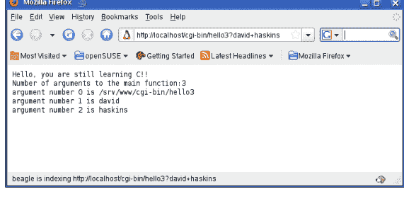

##### 1.4 第四个 Hello 程序

“main” 函数签名的一个鲜为人知的特性是它可以接受 **三个** 参数，我们现在将看到的是最后一个参数：`char *env[]`。它也是一个字符串指针列表，但在这种情况下，这些是程序运行时可用的 **系统环境变量**。

```c
/********************************************
* C Programming in Linux (c) David Haskins 2008
* chapter1_4.c
********************************************/
#include <stdio.h>

int main(int argc, char *argv[], char *env[])
{
    int i=0;

    printf("Content-type:text/plain\n\n");
    printf("Hello, you are still learning C!\n");
    printf("Number of arguments to the main function:%d\n", argc);
    for(i=0;i<argc;i++)
    {
        printf("argument number %d is %s\n", i, argv[i]);
    }
    i = 0;
    printf("Environment variables:\n");
    while(env[i])
    {
        printf("env[%d] = %s\n", i, env[i]);
        i++;
    }
    return 0;
}
```

使用 **`gcc -o hello4 chapter1_4.c`** 进行编译，并以超级用户身份将程序复制到 `/srv/www/cgi-bin`（OpenSuse）或 `/usr/lib/cgi-bin`（Ubuntu）。你可以从终端中通过 `./hello4` 运行此程序，你会看到一长串环境变量。在浏览器中输入 `http://localhost/cgi-bin/hello4` 时，你会看到一组完全不同的变量。

> **维基百科对“环境变量”的定义如下**：
> 
> “在所有 Unix 和类 Unix 系统中，每个进程都有自己的一套私有环境变量。默认情况下，当创建一个进程时，它会继承其父进程的副本环境，除了父进程在创建子进程时所做的明确更改........ 所有 Unix 操作系统变种以及 DOS 和 Microsoft Windows 都有环境变量；然而，它们并不都使用相同的变量名。运行的程序可以访问环境变量的值以用于配置目的。环境变量的示例包括..... PATH, HOME... “

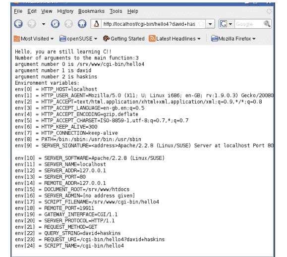

我们将很快发现，**QUERY_STRING** 是我们与程序通信的重要环境变量，在这种情况下，我们看到它的值是 “david+haskins”，即我们在 URL 中输入的 “?” 之后的所有内容。向诸如 hello4 这样的 **通用网关接口**（CGI）程序发送信息的有效方式，但我们应该将其限制为一个字符串。在我们的例子中，我们使用了 “+” 连接两个字符串。如果我们输入：“david haskins”，浏览器会对其进行转义，我们会看到：

```
QUERY_STRING=david%20haskins
```

我们将稍后学习如何将复杂的输入值集合传输给我们的程序。

##### 1.5 Hello World 总结

我们看到，一个带有少量输入和一些输出的简单程序实际上是非常强大的，因为它揭示并暴露了我们计算机内部的大量工作原理。

尽管我们才刚刚开始，但已经遇到了许多我们将反复使用的关键概念：

- 函数和参数
- 作为数据类型的数字（整数）和字符字符串
- 列表或数组
- 使用 “for” 和 “while” 的循环

我们特意采取了巨大的飞跃，从编写仅在 “终端屏幕” 中运行的程序，过渡到可以在互联网浏览器中可见的程序。

这样做的原因是，编写与用户交互的程序（在 Windows、Gnome 或 KDE 等窗口系统中）过程极其复杂，而且你不太会经常被要求这样做。

互联网浏览器如今已成为我们几乎所有操作的事实接口模式，因此我们不妨从一开始就理解如何使用它。

在后续的所有章节中，我们将遵循这一模式：从某些基本技术开始，然后将其应用于基于 Web 的系统。

实际上，并没有太多真正的现实世界 C 语言通用网关接口编程在进行中，但确实有大量基于 C 和 C++ 的代码作为 Apache 模块和 Microsoft IIS ISAPI Dlls 运行。也许很多人不知道，Ebay 的大部分代码是用 C / C++ 编写的。

为什么？因为它具有极致的速度，而他们在全球实时市场中与抢购者的业务需要这种闪电般快速的核心，因此没有其他方法能获得这种性能。

# 2 数据和内存

## 2.1 简单数据类型

当我们编写程序时，在声明和描述变量以表征我们想要包含在信息处理中的事物类型时，必须对世界的本质做出决定或断言。

这个过程具有深刻的哲学意义；我们做出 **本体论** 断言，认为此物或彼物存在；当我们选择特定的数据类型或数据类型集合来描述这些事物的属性时，我们做出 **认识论** 断言。这是沉重的话题，伴随着巨大的责任，不可轻率行事。

作为一个实际例子，我们可能声明一个看起来像地理数据库记录开头的东西。

```c
/********************************************************************
 * C Programming in Linux (c) David Haskins 2008
 * chapter2_1.c
 * ******************************************************************/

#include <stdio.h>
#define STRINGSIZE 256

int main(int argc, char *argv[])
{
    char town[STRINGSIZE] = "Guildford";
    char county[STRINGSIZE] = "Surrey";
    char country[STRINGSIZE] = "Great Britain";
    int population = 66773;
    float latitude = 51.238599;
    float longitude = -0.566257;
    printf("Town name: %s  population:%d\n",town,population);
    printf("County: %s\n",county);
    printf("Country: %s\n",country);
    printf("Location latitude: %f longitude: %f\n",latitude,longitude);
    printf("char = %d byte int = %d bytes float = %d bytes\n",
    sizeof(char),sizeof(int),sizeof(float) );
    printf("memory used:%d bytes\n",
    ((STRINGSIZE * 3) * sizeof(char) + sizeof(int) + (2 * sizeof(float)));
    return 0;
}
```


在此我们执行以下操作：

- 断言我们在此应用程序中遇到的所有字符字符串都将限制在 255 个字符以内，因此我们通过**预处理器**语句来**定义**这一点——这些语句以 # 开头。
- 断言城镇与郡相关联，郡与国在某些层级方式上相关联。
- 断言人口以整数计数——没有半个人。
- 断言位置将以特定的变体（WGS84）进行记录，这是描述地球表面位置的一种基于经纬度的惯例，该惯例使用小数来表示度、分和秒。

每个这样的语句都会在其声明所在函数的**作用域**内分配**内存**。每个**数据声明**将占用一定量的以**字节**为单位的内存，并为该部分内存赋予一个标签，即*变量名*。每种数据类型都有指定的大小，且 *sizeof()* 库函数将返回此整数。在这种情况下，是 $3 \times 256$ 个字符、一个整数和两个浮点数。确切大小取决于机器，但可能是 780 字节。

在数据声明所在的函数之外，这些数据是无法访问的——这就是声明的**作用域**。如果我们在 main() 函数外部声明，它的作用域将是**全局**的，其他函数就可以访问它。C 语言允许你这样做这种危险的操作，如果你愿意的话，所以请小心。

通常，我们会密切关注数据的作用域，并将**只读副本**或指向数据的**带标签的内存地址**传递给程序中可能需要对其执行操作甚至修改操作的部分。这些带标签的内存地址被称为**指针**。

我们在输出中使用**printf** 系列库函数（**sprintf** 用于创建字符串，**fprintf** 用于写入文件等），它们都使用共同的**格式字符串**参数来指定数据的表示方式。

- %c 字符
- %s 字符串
- %d 整数
- %f 浮点数 等等

参数中剩余的变量序列将按照指定顺序放入格式字符串中。

在 C 语言中，**初始化**你声明的任何数据是个好主意，因为为它们分配的内存内容未被清除，可能包含任意旧的垃圾数据。

编译命令：`gcc -o data1 chapter2_1.c -lc`

调用时程序的输出：`./data1`

```text
Town name: Guildford population: 66773
County: Surrey
Country: Great Britain
Location latitude: 51.238598 longitude: -0.566257
char = 1 byte int = 4 bytes float = 4 bytes
memory used: 780 bytes
```

## 关于 make 有用工具的一个说明

到现在为止，你可能已经厌倦了输入所有这些编译器命令，因此有一个名为 **make** 的工具，它在一个名为 **Makefile** 的文件上运行，该文件位于存储代码的文件夹中。以下是迄今为止示例的 Makefile：

```makefile
#Makefile
all: chap1 chap2
chap1: 1-1 1-2 1-3 1-4
1-1:
	gcc -o hello1 chapter1_1.c -lc
1-2:
	gcc -o hello2 chapter1_2.c -lc
1-3:
	gcc -o hello3 chapter1_3.c -lc
1-4:
	gcc -o hello4 chapter1_4.c -lc
chap2: 2-1 2-2
2-1:
	gcc -o data1 chapter2_1.c -lc
2-2:
	gcc -o data2 chapter2_2.c -lc
clean:
	rm hello* data* *~
```

要编译所有内容，输入 **make all**。
要编译 chapter2_1.c 的目标 2-1，输入 **make 2-1**。
每个 make 目标后的制表符对于 make 的语法至关重要。

代码包中包含用于整本书的 Makefile。

## 2.2 什么是字符串？

像 Java 和 C++ 这样的编程语言拥有字符串数据类型，隐藏了看似简单事物下面的一些复杂性。

字符字符串的一个基本属性是，它是由长度不确定的单个字符元素组成的序列。

我们可以键入键盘的大多数单个字符都由简单的数值 ASCII 代码表示，C 数据类型 char 用于存储字符数据。

字符串存储为以 NULL 结尾的字符数组，因此数组必须足够大以容纳字符序列加上一个字符。请记住，数组成员总是从零开始计数。

在这个例子中，我们可以看到 5 个单个字符被声明并初始化为值，以及一个设置为 "" 的空字符数组。

请注意单引号 `'` 用于字符周围，而双引号 `"` 用于字符字符串周围的差异。

```c
/******************************************** */
* C Programming in Linux (c) David Haskins 2008
* chapter2_2c                          * */
/******************************************** */

#include <stdio.h>

int main(int argc, char *argv[], char *env[])
{
    char c1 = 'd';
    char c2 = 'a';
    char c3 = 'v';
    char c4 = 'i';
    char c5 = 'd';
    char name[6] = "";

    sprintf(name, "%c%c%c%c%c%c", c1, c2, c3, c4, c5);
    printf("%s\n", name);
    return 0;
}
```

编译命令：`gcc -o data2 chapter2_2c -lc`。

调用时程序的输出：`./data2`

```text
david
```

### 2.3 字符串可以“意味着”什么

任何事物——赋予**变量**的**名称**及其**含义**或**用途**完全在于观察者的心中。试试这个：

```c
/****...*****
 * C Programming in Linux (c) David Haskins 2008
 * chapter2_3.c
 *  *
/*****...*****/
#include <stdio.h>
#include <string.h>

int main(int argc, char *argv[], char *env[])
{
	printf("Content-type:text/html\n\n");
	printf("<html>\n");
	printf("<body bgcolor=\"%s\"\n",argv[1]);
	printf("</body>\n");
	printf("</html>\n");
	return 0;
}
```

编译命令：`gcc -o data3 chapter2_3.c -lc`

作为超级用户，将程序复制到你的 public_html/cgi-bin 目录（或 /srv/www/cgi-bin (OpenSuSe) 或 /usr/lib/cgi-bin (Ubuntu)）。

在浏览器中输入：`http://localhost/cgi-bin/data3?red`
你应该会看到以下内容：

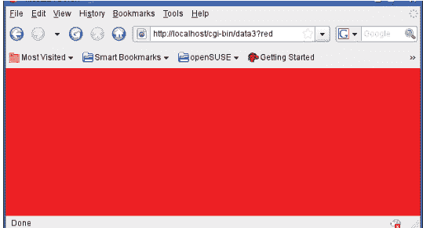

或者如果发送任何参数，你会得到令人惊讶的结果：

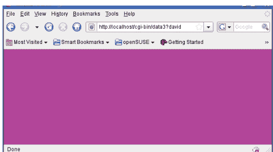

我们在这里做的是使用字符串参数 argv[1] 作为 HTML body 标签内的背景颜色代码。我们将 Content-type 规范更改为 text/html，奇迹般地，现在我们的程序正在生成 HTML 内容。一种语言在另一种语言表达内部。Web 浏览器理解一组有限的颜色术语，颜色也可以通过十六进制代码定义，例如 #FFFFFF（白色）、#FF0000（红色）、#00FF00（绿色）、#0000FF（蓝色）。

这个有趣的练习不仅仅是一个小把戏；一个程序可以在另一种语言中生成另一个程序的想法非常强大，这是整个互联网力量背后的原因。当我们从这个**通用网关接口程序**生成 HTML（或 XML 或任何其他内容）时，我们正在创建**动态内容**，可以链接到实时、变化的数据，而不是**静态**预编辑的网页。在实践中，大多数网站都有动态和静态内容的混合，但在这里我们只是在非常简单的层面上看到这是如何做到的。

在这本书中，我们将使用浏览器作为我们程序的推荐界面，因此我们将生成 HTML 和二进制图像流 Web 内容，纯粹作为一种手段来使程序的力量立即显现。在终端屏幕上盯着代码看并不是什么令人印象深刻的事情，编写窗口类型应用程序也不那么简单。

在实践中，你被要求编写的大多数软件都将在网络上运行，所以我们要不就这样一开始就从这个想法开始。大多数 Web 应用程序还涉及**多种语言**，例如 CSS、(X)HTML、XML、JavaScript、PHP、JAVA、JSP、ASP、.NET、SQL。如果这听起来很可怕，别恐慌。对 C 语言的了解将表明，这些执行不同功能的语言在语法上都有 C 语言的基础。

## 2.4 解析字符串

从某种输入字符串中提取含义或有价值信息所涉及的工作被称为“解析”。我们现在将构建另一个有趣的、可通过互联网调用的 CGI 程序来展示我们手中的力量。


## Linux 下的 C 语言编程
**(c) David Hasakins 2008**
**chapter2_4.c**

```c
/*****************************************************
 * C Programming in Linux (c) David Hasakins 2008
 * chapter2_4.c                                    */

#include <stdio.h>
#include <string.h>

int main(int argc, char *argv[], char *env[]) 
{
	char *token = NULL;
	char colour[256] = "";
	char colour2[256] = "";
	int wide = 0;
	int high = 0;
	int columns = 0;
	int rows = 0;

	token = (char *) strtok(argv[1], ":");
	strcpy(colour, token);
	token = (char *) strtok(NULL, ":");
	strcpy(colour2, token);
	token = (char *) strtok(NULL, ":");
	wide = atoi(token);
	token = (char *) strtok(NULL, ":");
	high = atoi(token);

	printf("Content-type:text/html\n\n");
	printf("<html>\n");
	printf("<body bgcolor=\"%s\">\n", colour);
	printf("<center>\n");
	printf("<table bgcolor=\"%s\" border=2>\n", colour2);
	for(rows = 0; rows <= high; rows++)
	{
		printf("<tr>\n");
		for(columns = 0; columns <= wide; columns++)
		{
			printf("<td><h6>row=%d cell=%d</h6></td>\n", rows, columns);
		}
		printf("</tr>\n");
	}
	printf("</table>\n");
	printf("</body>\n");
	printf("</html>\n");

	return 0;
}
```

使用 `gcc -o data4 chapter2_4.c -lc` 进行编译

以超级用户身份将程序复制到 `/srv/www/cgi-bin`（OpenSuse）或 `/usr/lib/cgi-bin`（Ubuntu）。

在浏览器中输入：

`http://localhost/cgi-bin/data4?red:blue:5:5`

你应该能看到这样的结果：

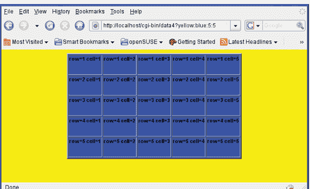

在这个程序中，我们获取 `argv[1]`（这里为 `yellow:blue:5:5`）；并使用库函数 **strtok** 对其进行 **解析**，该函数通过任意字符 `':'` 将字符串切分为标记（tokens），并将这些标记作为字符串来指定颜色，作为整数来指定表格的行数和单元格数。

函数 **atoi** 将整数字符串表示转换为整数（例如将 "1" 转换为 1）。

函数 **strtok** 有点特别，第一次调用时传入要解析的字符串名称，随后在后续调用中第一个参数变为 NULL。

**for(...) ** 循环机制用于执行指定次数的操作。

引入的 HTML 术语包括：

- `<html>`
- `<body>`
- `<table>`
- `<tr>` 表格行
- `<td>` 表格数据单元格

### 2.5 数据和内存 – 总结

我们使用了一些简单的数据类型来表示一些信息，并将输入传输给程序，以及组织和显示一些可视化输出。

我们在输出字符串中嵌入 HTML，以便在 web 浏览器中使输出可见。

作为一项练习，请尝试：

编写一个程序，放入你的 `**/public_html/cgi-bin**` 文件夹中，该程序可以在浏览器中以 **运动队或国家的名称** 和一系列 **颜色**（例如以十六进制指定，比如 `ff0000` = 红色 (rrggbb)）被调用，用于团队颜色或地图颜色，并显示一些合理的内容。我的版本看起来像这样：

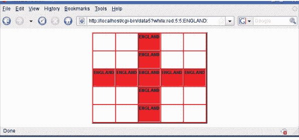

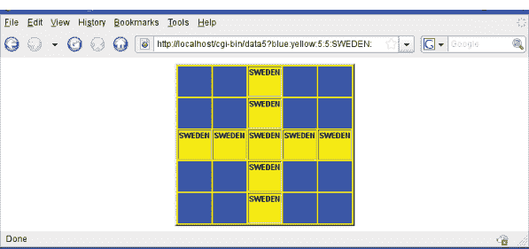

# 3 函数、指针和结构体

## 3.1 函数

我们所有程序的入口点被称为 `main()`，这是一个 **函数**，或者是一段执行某些操作的 **代码片段**，通常返回某个值。我们将程序结构化为函数，以防止它们变成无法在一屏或一页中看到的冗长且不可读的代码块，同时也确保我们不会到处重复相同的代码块。我们可以调用 C 语言的一部分如 `printf` 或 `strtok` 等 **库函数**，我们也可以调用我们自己的或他人编写函数库中的函数。我们必须确保存在适当的头文件并且预处理器可以读取，且源代码或编译后的库也存在并可访问。

正如之前所学，数据的 **作用域** 限制在其声明所在的 **函数** 内，因此我们使用指向数据和数据块的 **指针** 传递给函数，以便对数据进行一些处理。我们已经看到字符串被处理为以 NULL 字符结尾的单字符数组的指针。

```c
/* C Programming in Linux (c) David Haskins 2008
 * chapter3_1.c */

#include <stdio.h>
#include <string.h>
#include <math.h>

double doit(int number1, int number2)
{
    return sqrt((double)(number1 + number2));
}

int main(int argc, char *argv[], char *env[])
{
    int n1 = 0, n2 = 0, i = 0;
    n1 = atoi(strtok(argv[1], " "));
    n2 = atoi(strtok(NULL, " "));
    printf("Content-type:text/html\n\n<html><body>\n");
    for(i=1; i<=100; i++)    printf("%f ", doit(n1+i, n2*i));
    printf("</body></html>\n");
    return 0;
}
```

在这个例子中，我们可以重复调用函数 “doit”，该函数接受两个整数参数并返回某个数学计算的结果。

**编译**：`gcc -o func1 chapter3_1.c -lm`
**复制到 cgi-bin**：`cp func1 /home/david/public_html/cgi-bin/func1`

（你应该使用提供的 Makefile，或者随着进度维护 Makefile，添加目标以编译示例。）

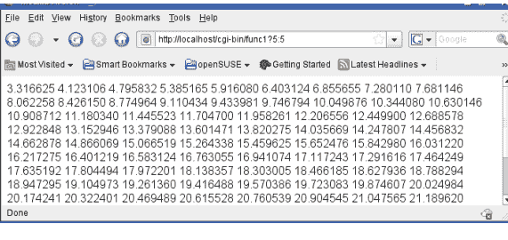

在浏览器中使用 “func1?5;5” 调用的结果看起来像这样。

在这种情况下，我们函数的参数是作为 **副本** 发送的，在函数内未被修改，而是被使用。

如果我们想要实际修改变量，我们需要将其指针传递给函数。

```c
/* C Programming in Linux (c) David Haskins 2008
 * chapter3_2.c */

#include <stdio.h>
#include <string.h>
#include <math.h>

void doit(int number1, int number2, double *result)
{
    *result = sqrt((double)(number1 + number2));
}

int main(int argc, char *argv[], char *env[])
{
    int n1 = 0, n2 = 0, i = 0;
    double result = 0;
    n1 = atoi(strtok(argv[1], ";"));
    n2 = atoi(strtok(NULL, ";"));
    printf("Content-type:text/html\n\n<html><body>\n");
    for(i = 1; i <= 100; i++)
    {
        doit(n1 + i, n2 * i, &result);
        printf("%6f ", result);
    }
    printf("</body></html>\n");
    return 0;
}
```

我们使用 `&result` 发送变量 ‘result’ 的地址，并在函数 `doit` 中使用 `*result` 对指针进行 *解引用* 以访问浮点数并改变其值，该操作在 main 内部但其作用域之外执行。这产生与 chapter3_1.c 相同的输出。

## 3.2 库函数

C 语言包含许多用于执行常用任务的内置函数。到目前为止，我们使用了 **atoi**、**printf**、**sizeof**、**strtok** 和 **sqrt**。要获取任何内置库函数的完整详细信息，我们只需输入例如：

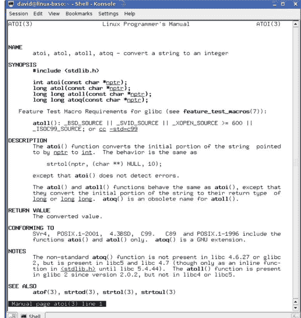

这几乎告诉了你关于这个函数及其变体如何使用的全部你需要知道的信息。最重要的是，它告诉你要包含哪个 **头文件**。

### 3.3 简短的库函数参考

所有可用函数的完整详细信息可以在以下位置找到：

按头文件分类的常见库函数：

| 头文件 | 类别 | 函数示例 |
| :--- | :--- | :--- |
| `math.h` | 三角函数 | `cos` `sin` `tan` |
| `math.h` | 指数、对数和幂函数 | `exp` `log` `pow` `sqrt` |
| `math.h` | 其他数学函数 | `ceil` `fabs` `floor` `fmod` |
| `stdio.h` | 文件函数 | `fclose` `feof` `fgetpos` `fopen` `fread` `fseek` |
| `stdio.h` | 格式化 I/O 函数 | `printf` `scanf` |
| `stdio.h` | 字符 I/O 函数 | `fgetc` `fgets` `fputc` `fputs` `getc` `getchar` `gets` `putc` `putchar` `puts` |
| `stdlib.h` | 字符串函数 | `atof` `atoi` `atol` |
| `stdlib.h` | 内存函数 | `calloc` `free` `malloc` |
| `stdlib.h` | 环境函数 | `abort` `exit` `getenv` `system` |
| `stdlib.h` | 数学函数 | `abs` `div` `rand` |
| `string.h` | 字符串函数 | `strcat` `strchr` `strcmp` `strncmp` `strcpy` `strncpy` `strcspn` `strlen` `strstr` `strtok` |
| `time.h` | 时间函数 | `asctime` `clock` `ctime` `time` |

在你发现需要做一些事情，进而导致你寻找为此目的编写的函数或函数库之前，学习库函数没有意义。你需要理解函数签名——或者参数列表的含义以及如何如何使用它，以及函数将返回什么或对作为指针传递给函数的变量执行什么操作。


## 3.4 数据结构

有时我们希望将一组变量作为一个组进行管理，例如从一个数据库记录中提取所有值，并将整个记录传递到程序的各个部分进行处理。为了实现这一点，我们可以将数据分组为结构体。

这个程序使用结构体（struct）来定义一个名为“玩家”的实体的一组属性。主函数包含一个由 5 个玩家组成的数组的声明和实例化。我们依次将每个数组成员的指针传递给一个函数，以对每个玩家进行排名。该函数使用 switch 语句来检查每个玩家名字的第一个字母，从而进行任意排名。然后，我们依次将每个数组成员的指针传递给一个用于打印详情的函数。

```c
/** *****************************************************
 * C Programming in Linux (c) David Haskins 2008
 * chapter3_3.c
 * ******************************************************/
#include <stdio.h>
#include <string.h>
struct player
{
    char name[255];
    char role[255];
    int ranking;
};
void rank(struct player *p)
{
    switch(p->name[0])
    {
        case 'P': p->ranking = 4;break;
        case 'H': p->ranking = 1;break;
        case 'R': p->ranking = 2;break;
        case 'J': p->ranking = 5;break;
        case 'B': p->ranking = 3;break;
    }
}
void show(struct player *p)
{
    printf("Name:%s Role:%s Ranking:%d<br>\n",
        p->name,p->role,p->ranking);
}
int main(int argc, char *argv[], char *env[])
{
    struct player myteam[5] = { {"Pele", "Striker",0 },
                        {"Beckham", "male model" ,0 },
                        {"Roddick","tennis man",0 },
                        {"Haskins","swimmer",0 },
                        {"Jagger", "singer",0 } };
    int i=0;
    printf("Content-type:text/html\n\n");
    for(i=0;i<5;i++) rank ( &myteam[i] );
    for(i=0;i<5;i++) show ( &myteam[i] );
    return 0;
}
```

结果如下所示，通常是在浏览器中查看：

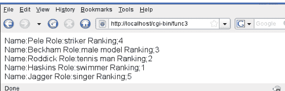

这是一种非常强大且相当高级的技术，但你需要了解它。**结构体**的概念直接导出了**类**和**对象**的概念。

我们可以看到，使用结构体极大地简化了将数据元素在程序中传递以执行不同工作的业务任务。如果我们更改结构体的定义，它仍然可以正常工作，我们只需添加代码来处理新属性，而不必更改执行工作的函数的参数列表或签名。

结构体的定义实际上并不创建任何数据，只是设定了我们可实例化的正式形状。在主函数中，我们可以以所示形式表达这种实例化，创建一个由符合我们定义的序列组成的数据元素列表。

你大概可以看出，带有附加函数或方法的结构体本质上就是 Java 中的类，在 C++ 中也是如此。**面向对象语言**从这里开始，实际上，许多早期被称为“面向对象”的系统实际上只是使用 C 语言结构体构建的。

例如，如果你查看 Apache 服务器开发头文件，你会发现很多结构体，比如在 httpd.h 的这个片段中：

```c
struct server_addr_rec {
    /** The next server in the list */
    server_addr_rec *next;
    /** The bound address, for this server */
    apr_sockaddr_t *host_addr;
    /** The bound port, for this server */
    apr_port_t host_port;
    /** The name given in "<VirtualHost>" */
    char *virthost;
};
```

不要担心这一切意味着什么——只需注意到这是一种非常常见且非常强大的技术，并且数据结构的設計，就像与其密切相关的数据库表的设计一样，是你作为程序员需要理解的核心、关键且至关重要的任务。

你做出哲学决定，认为**世界就是这样**并且可以以这种方式建模。这是一个沉重的责任——在哲学中，这项工作被称为**本体论**（存在什么？）和**认识论**（我们如何知道它？）。我打赌你从未想过这是你在做的事情！

### 3.5 函数、指针和结构体 – 结论

我们使用一些简单的数据类型来表示一些信息，并将输入传输到程序中，以及组织和显示一些视觉输出。

我们使用嵌入在输出字符串中的 HTML 使输出在网页浏览器中可见。

我们学习了创建函数库以供重复使用。

我们学习了数据结构和使用指针在程序中传递它们的方法。

**练习：**

使用 C 库函数创建一个程序，该程序：

- 以写入模式打开一个文件，
- 将命令行参数写入文件
- 关闭文件
- 以读取模式打开文件
- 读取内容
- 关闭文件
- 将其打印到屏幕上

这将给你寻找信息、查找合适的库函数以及在线或从书中查找示例的经验。

# 4 逻辑、循环和流程控制

## 4.1 C 流程控制的语法

我们可以使用以下 C 构造来控制程序执行。
当我们可以计数通过一个序列或系列时：

```c
for( 初始值; 继续直到 ; 增量变化 )
{ 做这个; 做那个; 做另一个; }
```

当我们在等待某个条件改变时：

```c
while( 这是真的 )
{ 做这个; 做那个; 做另一个; }
```

或者如果我们想至少做一次某事然后测试：

```c
do { 做这个; 做那个; 做另一个; }
while( 这是真的 )
```

当我们有一个单一选项要测试时：

```c
if( 这是真的 )
{ 做这个; 做那个; 做另一个; }
else
{ 做这个; 做那个; 做另一个; }
```

当我们要测试更多选项时：

```c
if( 这是真的 )
{ 做这个; 做那个; 做另一个; }
else if ( 这是真的 )
{ 做这个; 做那个; 做另一个; }
else
{ 做这个; 做那个; 做另一个; }
```

当我们要基于整数或单个字符值测试更多选项时：

```c
switch( 基于一个整数或字符值 )
{
case 0: 做这个; 做那个; 做另一个; break;
case n: 做这个; 做那个; 做另一个; break;
default: 做这个; 做那个; 做另一个; break;
}
```

## 4.2 控制发生什么以及顺序

这部分完全是关于**如果**、**那么**、**否则**、**真**和**假**的——这是我们表达和控制程序执行的基本构件。这可能是非常枯燥和琐碎的材料，因此为了使其更易于理解，我们将解决一个你将在进行任何复杂交互式网页工作时需要解决的问题。

我们将构建一个我们可以使用的东西，以提供类似于 Java .servlet 中典型的 `getParameter("ITEM1")` 方法或 PHP 中 `$_REQUEST["ITEM1"]` 函数所能获得的功能。

在第 1 章中，我们看到可以通过传递给 main 函数的隐式参数访问环境变量。我们还可以使用库函数 `getenv()` 来请求任何命名环境变量的值。

```c
/************************************************
 * C Programming in Linux (c) David Haskins 2008
 * chapter4_1.c                                    *
***********************************************/
#include <stdio.h>
#include <string.h>
int main(int argc, char *argv[], char *env[])
{
  printf("Content-type:text/html\n\n<html><body bgcolor=#29abe2>\n");
  char value[256] = "";
  strncpy(value,(char *) getenv("QUERY_STRING"),255);
  printf("QUERY_STRING : %s<BR>\n", value );
  printf("<form>\n");
  printf("<input type=\"TEXT\" name=\"ITEM1\">\n");
  printf("<input type=\"TEXT\" name=\"ITEM2\">\n");
  printf("<input type=\"SUBMIT\">");
  printf("</form></body></html>\n");
  return 0;
}
```

在这里，我们显示 **QUERY_STRING**，这是程序从包含所有命名表单元素的 NAME=VALUE 对的 HTML 表单接收到的完整内容。

默认情况下，HTML 表单使用 **GET** 方法，除非在 action 属性中另有指定，否则会将所有表单数据传回包含该表单的程序或页面。这些数据包含在 QUERY_STRING 中，作为由 & 字符分隔的变量 = 值对序列。

> 注意，在 HTML 中，值是用引号括起来的，因此要在 C 字符串中嵌入这些值，我们必须用特殊符号 \ 对字符进行“转义”，例如 “\"ITEM1\"” 。此外，我们在每个 HTML 输出部分的末尾使用“\n”或显式换行符，以便当我们在浏览器中选择“查看源代码”时，我们得到一些格式合理的文本，而不是整个页面显示为一条长单行。

在浏览器中调用此程序，我们会看到一个表单，并可以在框中输入一些数据：

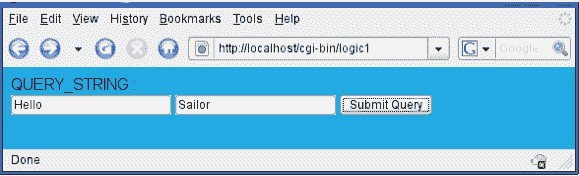

提交表单后，我们看到：

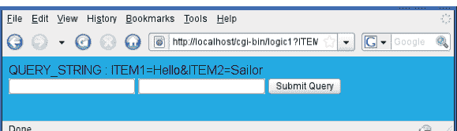

为了对 QUERY_STRING 做出很多意义并找到其中的特定值，我们将不得不*解析*它，将其分解为其组成部分，为此我们需要一些**条件逻辑**（if, else 等）和一些**循环**来计数变量中的字符。理想情况下，应创建一个基本函数来执行此任务，因为这是你


可能需要一次又一次地执行，因此拥有一段可以反复调用的代码是有意义的。

在下一个示例中，我们添加了此函数，输出中显著的差异是，在解析后我们可以将提取的值插入到 HTML 框中。我们似乎成功地创建了一个类似于 Java 的 getParameter() 函数——真的吗？

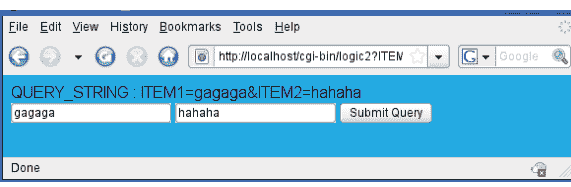

仔细看看 chapter4_2.c 并尝试使用除 A-Z、a-z 或数字以外的字符，你会发现有些不对劲。这里正在进行某种编码！

如果我在第一个字段中输入 **DAVID !!!**：

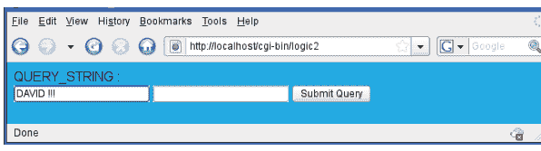

我得到这个结果：

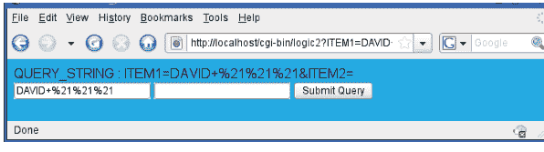

**空格** 字符变成了 **+**，而 **!** 变成了 **%21**。

这种编码的发生是因为某些字符在传输协议本身中被明确使用。例如，**&** 用于分隔 **QUERY_STRING** 的各个部分，而空格无法直接发送。

任何希望使用 **HTML** 表单信息的程序都必须能够解码所有这些内容，而现在我们将尝试这样做。

程序 **chapter4_2.c** 实现了我们目前看到的内容。它有一个 main 函数和一个 **decode_value** 函数，都在同一个文件中。

**decode_value** 函数接受三个参数：

- 1. 我们要查找的值的名称 *“ITEM1=”* 或 *“ITEM2=“*。
- 2. 如果找到该值，我们要将其放入的变量的地址
- 3. 要复制的最大字符数

该函数查找 **QUERY_STRING** 中值的起始和结束位置，然后逐字符将找到的字符复制到 value 变量中，并添加一个 **NULL** 字符来终止字符串。

```c
/*********************************************************
 * C Programming in Linux (c) David Haskins 2008
 * chapter4_2.c                                *
 *********************************************************/
#include <stdio.h>
#include <string.h>

void decode_value(const char *key, char *value, int size)
{
    int length = 0, i = 0, j = 0;
    char *pos1 = NULL, *pos2 = NULL;
    //if the string key is in the query string
    if( (pos1 = strstr((char *) getenv("QUERY_STRING"), key)) != NULL )
    {
        //find start of value for this key
        for(i=0; i<strlen(key); i++) pos1++;
        //find length of the value
        if( (pos2 = strstr(pos1,"&")) != NULL )
                length = pos2 - pos1;
        else length = strlen(pos1);
        //character by character, copy value from query string
        for(i = 0, j = 0; i < length ; i++, j++)
        {
            if( i < size) value[j] = pos1[i];
        }
        //add NULL character to end of the value
        if( i < size) value[j] = '\0';
                else value[size-1] = '\0';
    }
}

int main(int argc, char *argv[], char *env[])
{
        printf("Content-type:text/html\n\n<html><body bgcolor=#23a8e2>\n");
        char value[255] = "";
        strncpy(value,(char *) getenv("QUERY_STRING"),255);
        printf("QUERY_STRING : %s<BR>\n", value );
        printf("<form>\n");
        //call the decode_value function to get value of "ITEM1"
        decode_value("ITEM1=", (char *) &value, 255);
        if(strlen(value) > 0 )
                printf("<input type='TEXT' name='ITEM1' value=\"%s\">\n",value);
        else
                printf("<input type='TEXT' name='ITEM1'>\n");
        //call the decode_value function to get value of "ITEM2"
        decode_value("ITEM2=", (char *) &value, 255);
        if(strlen(value) > 0 )
                printf("<input type='TEXT' name='ITEM2' value=\"%s\">\n",value);
        else
                printf("<input type='TEXT' name='ITEM2'>\n");
        printf("<input type='SUBMIT'>");
        printf("</form></body></html>\n");
        return 0;
}
```

看起来我们将不得不在这个 decode_value 包上做大量的工作，既然这是一项我们可能会反复进行的任务，编写一个可以**复用**的**函数**是有意义的。

首先，我们可以将这个函数放入一个名为 `decode_value.c` 的单独文件中，并为所有我们可能编写的函数创建一个名为 `c_in_linux.h` 的文件，然后将所有这些编译成一个**库**。在 Make 文件中，我们可以添加：

```makefile
SRC_CIL = decode_value.c
OBJ_CIL = decode_value.o

#CII_INCLUDEDES = -L/usr/include/apache2 -l -L/usr/include/apache2 -l/usr/include/apr-1
#CII_LIBS = -L/usr/lib/mysql -lmysqlclient -L/usr/lib -lgd -L/home/david/public_html/Ventus/code

all: lib_cil 4-4

lib_cil:
	gcc -c $(SRC_CIL)
	ar rs c_in_linux.a $(OBJ_CIL)
	$(RM) *.o

4-4:
	gcc -o logic4 chapter4_3.c c_in_linux.a -lc
	cp logic4 /home/david/public_html/cgi-bin/logic4
```

这看起来既丑陋又复杂，但它的意思仅仅是：输入“make all”将：

- 将列表 SRC_CIL 中列出的所有 `*.c` 文件编译成对象文件 `*.o`
- 将所有对象文件编译成一个名为 `lib_c_in_linux.a` 的库归档
- 使用这个新归档编译 4-4。

这是我们用来尽可能保持文件小巧并将代码的可共享性最大化的模型。

现在我们可以有一个更简单的“main”函数文件，以及一些文件，用于我们可能希望从任何地方作为可调用函数编写的但我们目前还不知道的内容。所有这些都被组织成一个**库文件**（归档使用 `*.a`）——这些也可以被编译为动态加载的**共享对象** `*.so`，它们非常类似于 Windows 的 DLL。这正是所有 Linux 软件编写和交付的方式。

例如，MySQL C 应用程序接口（API）包括：

- `/usr/include/mysql` 中的所有头文件
- 库文件 `/usr/lib/mysql/libmysqlclient.a`

我们实际上正在做的是整个 Linux 组装的方式——我们只是以相同的方式向其中添加内容。

我们的**主**文件现在看起来像这样：

```c
/****...**** * C Programming in Linux (c) David Haskins 2008 * chapter4_3.c ****...****/ 
#include <stdio.h>
#include <string.h>
#include "c_in_linux.h"

int main(int argc, char *argv[], char *env[])
{
    printf("Content-type:text/html\n\n<html><body bgcolor=\"#23abe2\">\n");
    char value[255] = "";
    strncpy(value,(char *) getenv("QUERY_STRING"),255);
    printf("QUERY_STRING : %s<br>\n", value );
    printf("<form>\n");
    //call the decode_value function to get value of "ITEM1"
    decode_value ("ITEM1=", (char *) &value, 255);
    if(strlen(value) > 0 )
        printf("<input type=\"TEXT\" name=\"ITEM1\" value=\"%s\">\n",value);
    else
        printf("<input type=\"TEXT\" name=\"ITEM1\">\n");
    //call the decode_value function to get value of "ITEM2"
    decode_value ("ITEM2=", (char *) &value, 255);
    if(strlen(value) > 0 )
        printf("<input type=\"TEXT\" name=\"ITEM2\" value=\"%s\">\n",value);
    else
        printf("<input type=\"TEXT\" name=\"ITEM2\">\n");
    printf("<input type=\"SUBMIT\">");
    printf("</form></body></html>\n");
    return 0;
}
```

这段代码以相同的方式调用函数 `decode_value`，但由于在编译时链接了库 `c_in_linux.a`，并且它可以访问列出了库中所有函数的头文件 `c_in_linux.h`，所以一切都能正常工作。

尝试用**伪代码**描述解码此 QUERY STRING 的过程：

```text
get the QUERY_STRING
find the search string “ITEM1=” inside it
look for the end of the value of “ITEM1=”
copy the value to our “value” variable, translating funny codes such as:
%21 is ! %23 is #
```

这些特殊代码是由浏览器生成的，以确保无论你在 HTML 表单中输入什么，都能安全传输，而不干扰 HTTP 协议。它们有很多，本章的任务是**完成这项任务**，使键盘上的每个按键都像你认为的那样工作！！

程序 chapter4_3.c 调用这个未完成的函数 decode_value，到目前为止它只能处理 **空格** 字符和 ! – 它在一个**条件逻辑**片段中使用 **if**、**else** 和 **for** 以及库函数 **getenv**、**strcpy**、**strlen**、**strstr**，分析字符串以找到特定项目，然后将其复制到称为 **value** 的内存块中，该内存块已传递给函数。

结果显示解码后的值粘贴到第一个字段中；

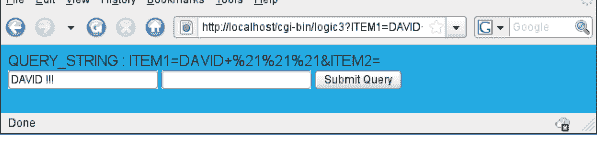


### 4.3 逻辑、循环与流程总结

控制程序流程的最重要部分在于明确你究竟想要做什么。我们还学会了将代码分解成可管理的块，并开始构建和使用我们自己的库和头文件。

能够用普通语言或**伪代码**来表达一个过程是非常有用的，它能帮助你把代码分解成步骤。

-   使用**for 循环**来明确遍历那些你知道有终点的对象。
-   使用**while** 和 **do...while** 循环来执行操作，直到某个条件发生变化。
-   当由整数或单个字符决定下一步发生什么时，使用**switch** 语句。
-   当可以按顺序测试互斥项时，使用**if**、**else if** 和 **else**。
-   复杂的**if** 和 **else** 以及非（!）条件判断组合可能会变得难以阅读。
-   使用大括号 ( { } ) 将内容分解成块。

### 练习

现在一个有用的**任务**就是**完善函数 `decode_value`**，这样你就拥有了一个实用工具，可以从 HTML 表单中抓取网页内容，并解码键盘上所有非字母数字键对应的值。

你会反复使用这个练习，所以值得做对。

```c
/*****...*****
 * program: decode_value.c                         *
 * version: 0.1                                      *
 * author: david haskins February 2008               *
/**...****/
#include <stdlib.h>
#include <string.h>
void decode_value(const char *key, char *value, int size)
{
    unsigned int length = 0;
    unsigned int i = 0;
    int j = 0;
    char *pos1 = "", *pos2 = "", code1 = '\0', code2 = '\0';
    
    strcpy(value, "");
    if( ( pos1 = strstr(getenv("QUERY_STRING"), key)) != NULL )
    {
        for(i=0; i<strlen(key); i++) pos1++;
        if( (pos2 = strstr(pos1, "&")) != NULL )
        {
            length = pos2 - pos1;
        }
        else length = strlen(pos1);
        for(i = 0, j = 0; i < length ; i++, j++)
        {
            if(j < size)
            {
                if(pos1[i] == '%')
                {
                    i++;    code1 = pos1[i];
                    i++;    code2 = pos1[i];
                    if(code1 == '2' && code2== '0')
                        value[j] = ' ';
                    else if(code1 == '2' && code2== '1')
                        value[j] = '!';
                }
                else value[j] = pos1[i];
            }
        }
        if(j < size)
        {
            value[j] = '\0';
        }
        else value[size-1] = '\0';
    }
}
```

# 5 使用 MySQL 处理数据库

## 5.1 关于不要重造轮子

在每个项目中不从零开始是非常明智的，因此我们在前人（通过这条路径的人）所做的工作基础上进行构建。我们使用的所有 C 库都是由某人基于更底层的零散部件编写而成的，如果我们要的话，我们可以访问和修改这些代码。这就是开放系统的全部含义。

在实践中，我们只是想使用可靠的服务，我们将要使用的前两个服务无处不在——数据库访问和图形图像生成。

## 5.2 MySQL C API

要访问 MySQL 函数集，我们确保编译器可以访问 MySQL 的头文件和库，并简单地调用一些我们自己无需编写的 mysql 函数。

在下一个例子中，我们将数据库代码连接到之前的工作上，并将解码后的数据插入数据库，然后读取我们迄今为止存储的内容。

在新的终端窗口中，我们输入：

```
mysql test
```

然后：

```
create table CIL (ITEM1 varchar(255),ITEM2 varchar(255));
```

这会在 test 数据库（在你的 MySQL 设置中应该已经创建好了）中创建一个供程序写入的表。

如果一切正常，看起来会是这样。

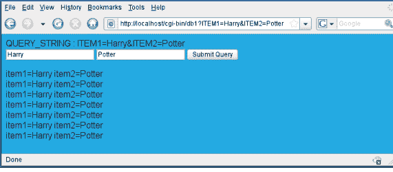

声明的数据类型 **MYSQL**、**MYSQL_RES** 和 **MYSQL_ROW** 是**预处理器定义**，它们代表 mysql.h 中更复杂的 C 声明，我们只需要知道如何调用它们即可。

MySQL 提供的文档包含了你执行更复杂操作所需的所有信息。

```c
/******+*****+*****+*****+*****+*****+*****+*****+
* C Programming in Linux (c) David Haskins 2008
* chapter5_1.c
* ++++++++++++++++++++++++++++++++++++++
*/
#include <stdio.h>
#include <string.h>
#include <mysql/mysql.h>
#include "c_in_linux.h"

int main(int argc, char *argv[], char *env[])
{

 char value1[255] = "", value2[255] = "", SQL[1024]="";
 int rc = 0;

 MYSQL *conn = NULL;
 MYSQL_RES *result = NULL;
 MYSQL_ROW row;

 printf("Content-type:text/html\n\n<html><body bgcolor=#23abe2>\n");
 strncpy(value1,(char *) getenv("QUERY_STRING"),255);
 printf("QUERY_STRING : %s<BR>\n",value1);
 printf("<form>\n");
 //call the decode_value function to get value of "ITEM1"
 decode_value( "ITEM1=", (char *) &value1, 255);
 if(strlen(value1) > 0 )
 printf("<input type=\"TEXT\" name=\"ITEM1\" value=\"%s\">\n",value1);
 else
 printf("<input type=\"TEXT\" name=\"ITEM1\">\n");
 //call the decode_value function to get value of "ITEM2"
 decode_value( "ITEM2=", (char *) &value2, 255);
 if(strlen(value2) > 0 )
 printf("<input type=\"TEXT\" name=\"ITEM2\" value=\"%s\">\n",value2);
 else
 printf("<input type=\"TEXT\" name=\"ITEM2\">\n");
 printf("<input type=\"SUBMIT\">");
 printf("</form></body></html>\n");
//OPEN DATABASE
 conn = mysql_init(NULL);
 mysql_options(conn,MYSQL_READ_DEFAULT_GROUP,"/mysqlcap");
 mysql_real_connect(conn, "localhost","","","test",0,NULL,0);
 //INSERT IF THERE IS ANY DATA
 if(strlen(value1) >0 || strlen(value2) >0)
 {
 sprintf(SQL,"insert into CIL values ('%s','%s')",value1,value2);
 rc = mysql_query(conn,SQL);
 }
 //READ
 rc = mysql_query(conn,"select * from CIL");
 result = mysql_use_result(conn);
 while( (row = mysql_fetch_row(result)) != NULL)
 {
 printf("item1=%s item2=%s<br>",row[0],row[1]);
 }

 mysql_free_result(result);
 mysql_close(conn);
 return 0; }
```

都理解了吗？

仅用不到 10 行（高亮部分）C 语言代码，我们就已将数据插入数据库表中，并能再次读取它们，这相当无痛。通过**mysql_init**，我们获得指向 MYSQL 类型数据结构的指针，然后可以使用它通过**mysql_options**和**mysql_real_connect**连接到 test 数据库，接着我们像在终端会话中那样执行 SQL 语句。查询结果可以作为 MYSQL_ROW 字符串数组序列通过**mysql_use_result**获取。我们使用**mysql_free_result**释放使用的内存，并使用**mysql_close**关闭数据库。

正如 C 库通常那样，你需要能够理解通常稀疏的文档才能理解函数调用，对于 MySQL 5.1，我们可以在此找到所有这些信息：

<http://dev.mysql.com/doc/refman/5.1/en/index.html>

### MySQL 5.1 参考手册 / 连接器和 API / MySQL C API 包含：

| 函数 | 函数 |
|---|---|
| mysql_affected_rows() | mysql_insert_id() |
| mysql_autocommit() | mysql_kill() |
| mysql_change_user() | mysql_library_end() |
| mysql_character_set_name() | mysql_library_init() |
| mysql_close() | mysql_list_dbs() |
| mysql_commit() | mysql_list_fields() |
| mysql_connect() | mysql_list_processes() |
| mysql_create_db() | mysql_list_tables() |
| mysql_data_seek() | mysql_more_results() |
| mysql_debug() | mysql_next_result() |
| mysql_drop_db() | mysql_num_fields() |
| mysql_dump_debug_info() | mysql_num_rows() |
| mysql_eof() | mysql_options() |
| mysql_errno() | mysql_ping() |
| mysql_error() | mysql_query() |
| mysql_escape_string() | mysql_real_connect() |
| mysql_fetch_field() | mysql_real_escape_string() |
| mysql_fetch_field_direct() | mysql_real_query() |
| mysql_fetch_fields() | mysql_refresh() |
| mysql_fetch_lengths() | mysql_reload() |
| mysql_fetch_row() | mysql_rollback() |
| mysql_field_count() | mysql_row_seek() |
| mysql_field_seek() | mysql_row_tell() |
| mysql_field_tell() | mysql_select_db() |
| mysql_free_result() | mysql_set_character_set() |
| mysql_get_character_set_info() | mysql_set_local_infile_default() |
| mysql_get_client_info() | mysql_set_local_infile_handler() |
| mysql_get_client_version() | mysql_set_server_option() |
| mysql_get_host_info() | mysql_shutdown() |
| mysql_get_proto_info() | mysql_sqlstate() |
| mysql_get_server_info() | mysql_ssl_set() |
| mysql_get_server_version() | mysql_stat() |
| mysql_get_ssl_cipher() | mysql_store_result() |
| mysql_hex_string() | mysql_thread_id() |
| mysql_info() | mysql_use_result() |
| mysql_init() | mysql_warning_count() |


# 6 使用 GD 库进行图形处理

动态生成适合特定场景的有趣图像是一种令人愉悦、具有挑战性且富有回报的编程类型。我们将使用 Thomas Boutell 的 GD C 语言库，该库作为一个开放系统项目已存在多年。

## 6.1 生成二进制内容

在这里，我们创建一个图像，并将查询字符串（QUERY STRING）中 `TEXT=` 部分的内容打印到其中，并将我们的内容类型设置为 image/gif。**gdImageGif** 函数将二进制图像写入 **stdout**，即输出流，而不是文件，因此二进制图像数据会被发送回浏览器。

```c
/*************************************************************************
 * C Programming in Linux (c) David Haskins 2008
 * chapter6_1.c                                   *
/************************************************************************/
#include <stdio.h>
#include <stdlib.h>
#include <string.h>
#include <gd.h>
#include <gdfonts.h>
#include "c_in_linux.h"

int main(int argc, char *argv[], char *env[])
{
    int text=0,background=0,height=50,width=0;
    char value[255] = "";
    gdImagePtr im_out = NULL;

    decode_value("TEXT=", (char *) &value, 255);
    width = ( strlen(value) * 10 ) + 5;
    im_out = gdImageCreate(width,height);
    background = gdImageColorAllocate(im_out, 255,0,255);
    text  = gdImageColorAllocate(im_out,0,0,255);
    gdImageFilledRectangle(im_out, 0,0, width-1, height-1, background);
    gdImageString(im_out,gdFontGetSmall(),10,5,(unsigned char *)value,    text);
    printf("Content-type: image/gif\n\n");
    gdImageGif(im_out,stdout);
    gdImageDestroy(im_out);
    return 0;
}
```

当使用 `cgi-bin/gdgraph1?TEXT=DavidHaskins` 调用该程序时，会产生如下输出：

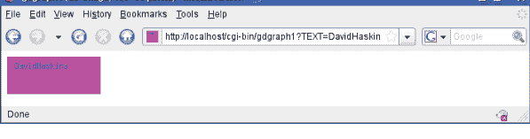

虽然这并不是最花哨或最吸引人的练习，但它至少展示了生成图形输出的关键原理。使用 GD 库，你可以加载现有图像，并以 **GIF**、**JPEG**、**PNG**、**WBMP** 等多种格式生成图像，甚至可以创建 **动画 GIF**。

如果你使用过 PHP 开发工具，你会认出 GD 库函数，因为它们几乎完全相同，这表明在这种情况下 PHP 只是同一个 C 库的封装层。

这里显示的文本使用了内部字体之一，包括 Tiny、Small、Medium Bold、Large 和 Giant。这些字体足以满足简单的标签需求，但你也可以使用 TrueType 字体以获得更吸引人的输出。

可以使用线条或特定样式、填充和多边形（开放或封闭）以及圆形、圆弧进行几何绘图。需要牢记的主要一点是，图像的**左上角**是原点，对于学过数学的人来说，这可能显得反直觉——我从未发现为什么是这样，只能想象最早在这一领域从事工作的程序员恰好不熟悉我们通常认为原点 x=0, y=0 位于左下角的坐标系。

颜色以 0 到 255 范围内的 RGB 值指定，因此白色是 255,255,255，红色是 255,0,0。要确定细微的色调，请使用 GNU GIMP 等图形工具，它拥有取色器功能，帮助查明细微的 RGB 值。可以从一张图像的调色板中获取颜色，并在另一张图像中使用，请求的调色板中最接近的颜色将被使用，如果还有空间则会自动创建该颜色。

## 6.2 使用 TrueType 字体

在这个例子中，我们修改了之前的程序，使用 TrueType 字体生成标签。

```c
/*************************************************************
 * C Programming in Linux (c) David Haskins 2008 * chapter6_2.c
 ************************************************************/

#include <stdio.h>
#include <stdlib.h>
#include <string.h>
#include <gd.h>
#include <gdfonts.h>
#include "c_in_linux.h"

int main(int argc, char *argv[], char *env[]) {
    int text=0,background=0,height=50,width=0,x=0,y=0,size=30,string_rectangle[8];
    double angle=0.0;
    char value[255] = "";
    //OpenSuse TrueType Font
    char font[]=" /usr/share/fonts/truetype/DejaVuSans.ttf";
    //Ubuntu TrueType Font
    // char font[256] =
    "/usr/share/fonts/truetype/ttf-dejavu/DejaVuSans.ttf";
    char *err = NULL;
    gdImagePtr im_out = NULL;

    decode_value("TEXT=" ,(char *) &value, 255);
    //call gdImageStringFT with NULL image to obtain size
    err = gdImageStringFT(NULL,&string_rectangle[0],
        font,size,angle,0,0,value);

    x = string_rectangle[2]-string_rectangle[6] + 6;
    y = string_rectangle[3]-string_rectangle[7] + 6;
    // create an image big enough for the string plus a little space
    im_out = gdImageCreate(x,y);
    //allocate colours
    background = gdImageColorAllocate(im_out, 0,0,0);
    text    = gdImageColorAllocate(im_out,255,0,255);
    //get starting position
    x = 3 - string_rectangle[6];
    y = 3 - string_rectangle[7];
    //draw the string
    err = gdImageStringFT(im_out,&string_rectangle[0],
        text,font,size,angle,x,y,value);

    //output
    printf("Content-type: image/gif\n\n");
    gdImageGif(im_out,stdout);
    gdImageDestroy(im_out);

    return 0; }
```

我们像之前一样调用此程序 `cgi-bin/gdgraph1?TEXT=C+PROGRAMMING+IN+LINUX`

得到类似以下的输出，你很可能发现这是一种更实用的工具类型。你系统字体的位置和内容包括会因环境而异，但代码提供了一个示例：

- OpenSuse `/usr/share/fonts/truetype/*.ttf`
- Ubuntu `/usr/share/fonts/truetype/ttf-dejavu/*.ttf`

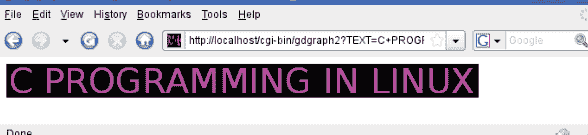

要想熟练使用 GD 这样的库，你必须做好实验的准备，并花大量时间去理解函数参数，仔细查看位于以下地址的详细可用文档：

[http://www.boutell.com/gd](http://www.boutell.com/gd)

### 6.3 GD 函数参考

完整的详细文档集维护在：[http://www.boutell.com/gd](http://www.boutell.com/gd)

GD 包含了丰富的功能，支持各种类型的绘图和许多格式，以及 TrueType 字体和动画 Gif 图像。以下是按类别划分的函数列表：

**图像创建、销毁、加载和保存：**

```c
gdImageCreate(int sx, int sy)
gdImageCreateFromJpeg(FILE *in)
gdImageCreateFromPng(FILE *in)
gdImageCreateFromGif(FILE *in)
gdImageCreateFromGd(FILE *in)
gdImageCreateFromWBMP(FILE *in)
gdImageDestroy(gdImagePtr im)
```

```c
void gdImageJpeg(gdImagePtr im, FILE*out, int quality)
void gdImageGif(gdImagePtr im, FILE*out)
void gdImagePng(gdImagePtr im, FILE*out)
void gdImageWBMP(gdImagePtr im, int fg, FILE*out)
void gdImageGd(gdImagePtr im, FILE*out)
```

**绘图函数：**

```c
void gdImageSetPixel(gdImagePtr im, int x, int y, int color)
void gdImageLine(gdImagePtr im, int x1, int y1, int x2, int y2, int color)
void gdImageDashedLine(gdImagePtr im, int x1, int y1, int x2, int y2, int color)
void gdImagePolygon(gdImagePtr im, gdPointPtr point_s, int point_sTotal, int color)
void gdImageOpenPolygon(gdImagePtr im, gdPointPtr point_s, int point_sTotal, int color)
void gdImageRectangle(gdImagePtr im, int x1, int y1, int x2, int y2, int color)
void gdImageFilledPolygon(gdImagePtr im, gdPointPtr point_s, int point_sTotal, int color)
void gdImageFilledRectangle(gdImagePtr im, int x1, int y1, int x2, int y2, int color)
void gdImageArc(gdImagePtr im, int cx, int cy, int w, int h, int s, int e, int color)
void gdImageFilledArc(gdImagePtr im, int cx, int cy, int w, int h, int s, int e, int color, int style)
void gdImageFilledEllipse(gdImagePtr im, int cx, int cy, int w, int h, int color)
void gdImageFillToBorder(gdImagePtr im, int x, int y, int border, int color)
void gdImageFill(gdImagePtr im, int x, int y, int color)
void gdImageSetAntiAliased(gdImagePtr im, int c)
void gdImageSetAntiAliasedDontBlend(gdImagePtr im, int c)
void gdImageSetBrush(gdImagePtr im, gdImagePtr brush)
void gdImageSetTile(gdImagePtr im, gdImagePtr tile)
void gdImageSetStyle(gdImagePtr im, int *style, int styleLength)
void gdImageSetThickness(gdImagePtr im, int thickness)
void gdImageAlphaBlending(gdImagePtr im, int blending)
void gdImageSaveAlpha(gdImagePtr im, int saveFlag)
void gdImageSetClip(gdImagePtr im, int x1, int y1, int x2, int y2)
void gdImageGetClip(gdImagePtr im, int *x1P, int *y1P, int *x2P, int *y2P)
```


#### 查询函数：

```cpp
int gdImageAlpha(gdImagePtr im, int color)(MACRO)
int gdImageGetPixel(gdImagePtr im, int x, int y)
int gdImageBoundsSafe(gdImagePtr im, int x, int y)
int gdImageGreen(gdImagePtr im, int color)(MACRO)
int gdImageRed(gdImagePtr im, int color)(MACRO)
int gdImageSX(gdImagePtr im)(MACRO)
int gdImageSY(gdImagePtr im)(MACRO)
int gdImageTrueColor(im)(MACRO)
```

#### 文本处理函数：

```cpp
gdFontPtr gdFontGetSmall(void )
gdFontPtr gdFontGetLarge(void )
gdFontPtr gdFontGetMediumBold(void )
gdFontPtr gdFontGetGiant(void )
gdFontPtr gdFontGetTiny(void )
void gdImageChar(gdImagePtr im, gdFontPtr font, int x, int y, int c, int color)
void gdImageCharUp(gdImagePtr im, gdFontPtr font, int x, int y, int c, int color)
void gdImageString(gdImagePtr im, gdFontPtr font, int x, int y, unsigned char*s, int color)
void gdImageString16(gdImagePtr im, gdFontPtr font, int x, int y, unsigned short *s, int color)
void gdImageStringUp(gdImagePtr im, gdFontPtr font, int x, int y, unsigned char*s, int color)
void gdImageStringUp16(gdImagePtr im, gdFontPtr font, int x, int y, unsigned short*s, int color)
char *gdImageStringFT(gdImagePtr im, int *brect, int fg, char *fontname, double ptsize, double angle, int x, int y, char *string)
char *gdImageStringFTEx(gdImagePtr im, int *brect, int fg, char *fontname, double ptsize, double angle, int x, int y, gdFFString ExtraPtr strex)
char *gdImageStringFTCircle(gdImagePtr im, int cx, int cy, double radius, double textRadius, double fillPortion, char*font, double ptsize, char*top, char*bottom, int fgcolor)
char *gdImageStringTTF(gdImagePtr im, int *brect, int fg, char *fontname, double ptsize, double angle, int x, int y, char *string)
```

#### 颜色处理函数：

```cpp
int gdImageColorAllocate(gdImagePtr im, int r, int g, int b)
int gdImageColorAllocateAlpha(gdImagePtr im, int r, int g, int b, int a)
int gdImageColorClosest(gdImagePtr im, int r, int g, int b)
int gdImageColorClosestAlpha(gdImagePtr im, int r, int g, int b, int a)
int gdImageColorClosestHWB(gdImagePtr im, int r, int g, int b)
int gdImageColorExact(gdImagePtr im, int r, int g, int b)
int gdImageColorResolve(gdImagePtr im, int r, int g, int b)
int gdImageColorResolveAlpha(gdImagePtr im, int r, int g, int b, int a)
int gdImageColorsTotal(gdImagePtr im)(MACRO)
int gdImageRed(gdImagePtr im, int c)(MACRO)
int gdImageGreen(gdImagePtr im, int c)(MACRO)
int gdImageBlue(gdImagePtr im, int c)(MACRO)
int gdImageGetInterlaced(gdImagePtr im)(MACRO)
int gdImageGetTransparent(gdImagePtr im, int color)
void gdImageColorDeallocate(gdImagePtr im, int color)
void gdImageColorTransparent(gdImagePtr im, int color)
void gdTrueColor(int red, int green, int blue)(MACRO)
void gdTrueColorAlpha(int red, int green, int blue, int alpha)(MACRO)
```

#### 缩放函数：

```cpp
void gdImageCopy(gdImagePtr dst, gdImagePtr src, int dstX, int dstY, int srcX, int srcY, int w, int h)
void gdImageCopyResized(gdImagePtr dst, gdImagePtr src, int dstX, int dstY, int srcX, int srcY, int destW, int destH, int srcW, int srcH)
void gdImageCopyResampled(gdImagePtr dst, gdImagePtr src, int dstX, int dstY, int srcX, int srcY, int destW, int destH, int srcW, int srcH)
void gdImageCopyRotated(gdImagePtr dst, gdImagePtr src, double dstX, double dstY, int srcX, int srcY, int srcW, int srcH, int angle)
void gdImageCopyMerge(gdImagePtr dst, gdImagePtr src, int dstX, int dstY, int srcX, int srcY, int w, int h, int pct)
void gdImageCopyMergeGray(gdImagePtr dst, gdImagePtr src, int dstX, int dstY, int srcX, int srcY, int w, int h, int pct)
void gdImagePaletteCopy(gdImagePtr dst, gdImagePtr src)
void gdImageSquareToCircle(gdImagePtr im, int radius)
void gdImageSharpen(gdImagePtr im, int pct)
```

#### 杂项函数：

```cpp
int gdImageCompare(gdImagePtr im1, gdImagePtr im2)
void gdImageInterlace(gdImagePtr im, int interlace)
void gdFree(void *ptr)
```

要使用此类库，你需要熟悉参数，这些参数通常是库本身内部定义的数据类型，例如 `gdImagePtr`，它是指向某种包含待处理或存储图像所有数据的结构的指针。这些内容起初可能看起来有些不寻常，但过一段时间后，你会开始习惯这种语法和在线文档，并开始在复杂性中看到规律。

# 7 APACHE C 模块

## 7.1 更安全的 C Web 应用程序

在现实生活中，很少有 Web 管理员愿意让任何人将 C 程序作为 CGI 内容生成器运行，因为存在崩溃和核心转储的风险。然而，Apache 服务器本身就是用 C 编写的，而且其开发工具中附带了一些实用程序，允许你创建代码存根，你可以在其中放置 C 程序并在服务器加载时将其作为 Apache 模块运行，从而在一种“沙盒”中安全地管理它们。在这里，我们将以一个之前的示例为例，将其转化为一个 Apache 模块。

Apache2 开发库中包含一个名为 `apxs2` 的实用程序，可以调用它来生成程序的代码存根，该存根可以被编译成一个模块，并由 Apache Web 服务器加载和管理。这些模块可用于执行各种各样的任务，但在我们的情况下，我们将做一件类似于 IIS 服务器中找到的 ISAPI DLL 的事情。`apxs2` 实用程序的确切位置会根据你使用的 Linux 发行版而变化，但在 OpenSuse 中，它是这样运行的。

在终端中输入：**apxs2 -n labelmaker -g**

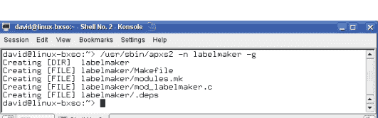

这将创建一个使用你给定的名称（labelmaker）的文件夹，以及一个**Makefile**、一个可用于 Make 实用程序的 **modules.mk** 文件，和一个名为 **mod_labelmaker.c** 的文件。

生成的 C 文件有点像 Apache 的“Hello World”。它看起来可能很复杂，但它确实提供了一个值得阅读的长篇解释性注释头。其思想是，当 Apache 启动时，任何位于指定位置并在服务器配置文件中配置为需要加载的模块都将被加载。`_register_hooks` 函数列出了可以在 Apache 服务器进程中的特定阶段调用的函数的名称和签名。在这种情况下，如果调用了名称 `http://localhost/labelmaker`，该模块将被要求在 `_handler` 函数中处理发生任何事情。

服务器配置可能有点麻烦，但在 OpenSuse 中，我们必须将此添加到文件

```
/etc/apache2/sites-available/default
```

```
<Location /labelmaker> 
SetHandler labelmaker 
</Location>
```

并在 /etc/config.sys/apache2 中，我们将我们的模块名称 labelmaker 添加到以以下行开头的长逗号分隔列表中

`APACHE_MODULES=".....,labelmaker"`

现在进入 labelmaker 文件夹并输入：

```
sudo apxs2 -c -i mod_labelmaker.c
sudo /etc/init.d/apache2 restart
```

在浏览器中像这样调用它：


```cpp
#include "http.h"
#include "http_config.h"
#include "http_protocol.h"
#include "ap_config.h"

/* The sample content handler */
static int labelmaker_handler(request_rec *r)
{
  if (strcmp(r->handler, "labelmaker")) {
    return DECLINED;
  }
  r->content_type = "text/html";

  if (!r->header_only)
    ap_rputs("The sample page from mod_labelmaker.c\n", r);
  return OK;
}

static void labelmaker_register_hooks(apr_pool_t *p)
{
  ap_hook_handler(labelmaker_handler, NULL, NULL, APR_HOOK_MIDDLE);
}

/* Dispatch list for API hooks */
module AP_MODULE_DECLARE_DATA labelmaker_module = {
  STANDARD20_MODULE_STUFF,
  NULL,          /* create per-dir    config structures */
  NULL,          /* merge per-dir    config structures */
  NULL,          /* create per-server config structures */
  NULL,          /* merge per-server config structures */
  NULL,          /* table of config file commands        */
  labelmaker_register_hooks /* register hooks            */
};
```

## 7.2 添加一些功能

现在我们可以将我们在第 6 章中为图形库做的工作插入作为一个替代的处理程序函数（在代码 Chapter7_1.c 中，有两个处理程序，其中一个被注释掉了）。请注意（高亮显示的）对修改后的 decode_value 函数的调用，该函数使用 r->args 指针获取 QUERY_STRING 而不是使用 getenv()。此外，Apache 对输出的处理方式也有些不同——调用 gdImageGifPtr 获取图像中字节数组的指针，然后 ap_writev 函数输出数据。我们必须在输出调用后使用 gdFree 释放指针。


```c
static int labelmaker_handler(request_rec *r)
{
    void *iptr;
    int sz = 0;

    if (strcmp(r->handler, "labelmaker")) {
        return DECLINED;
    }

    r->content_type = "Content-type: image/gif";
    if (!r->header_only) {
        int text = 0, background = 0, x = 0, y = 0, size = 30, string_rectangle[8];
        double angle = 0.0;
        char value[255] = "Hello";
        char font[256] = "/usr/share/fonts/truetype/DejaVuSans.ttf";
        char *err = NULL;
        gdImagePtr im_out = NULL;
        decode_value(r, "TEXT=", (char *) &value, 255);
        err = gdImageStringFT(NULL, &string_rectangle[0], 0,
                              font, size, angle, 0, 0, value);
        x = string_rectangle[2] - string_rectangle[6] + 6;
        y = string_rectangle[3] - string_rectangle[7] + 6;
        im_out = gdImageCreate(x, y);
        background = gdImageColorAllocate(im_out, 0, 0, 0);
        text = gdImageColorAllocate(im_out, 255, 0, 255);
        x = 3 - string_rectangle[6];
        y = 3 - string_rectangle[7];
        err = gdImageStringFT(im_out, &string_rectangle[0], text,
                              font, size, angle, x, y, value);
        iptr = gdImageGifPtr(im_out, &sz);
        ap_write(iptr, sz, r);
        gdFree(iptr);
        gdImageDestroy(im_out);
    }
    return OK;
}
```

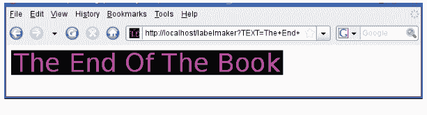

### 7.3 APACHE 模块总结

虽然编写和调试 Apache 模块颇具挑战性，但这可能是最具有成就感且深奥的领域，你可以在其中进行真正的、具有商业价值且可安全部署的 Web 内容生成。不难看出，此示例可以通过添加颜色和字体的参数进行扩展，从而成为一个有用的 Web 内容工具。

关于 Apache 模块的清晰简洁的资料很少，但你可以从位于 [http://httpd.apache.org/docs/2.2/developer/](http://httpd.apache.org/docs/2.2/developer/) 的在线文档开始阅读。

最近值得一看的书是 Nick Kew 的《The Apache Modules Book》（Prentice Hall 出版社）。

# 8 幽灵项目

## 8.1 PHP 网站生成器项目

能够编写简短的 C 程序来自动化繁琐任务，或者完成那些通常需要使用邮件合并等笨重工具花费数小时才能完成的工作，这是你学会后将最感庆幸的技能之一。这个项目就是这样一项节省时间的工具。Ghost 是一个轻量级的 PHP 生成器，供你自定义使用。

如果你发现自己总是需要构建 PHP 网站，那么一种能够一步生成所有参数传递、解码、表单构建和数据库管理代码的快速方法将非常有用。像 Ruby on Rails 这样的工具提供了此类功能，但它们的设置和运行复杂得多，并且你最终需要学习另一种语言才能进一步开发。

开始使用这个工具的最佳方式可能是编译并运行它。将 ghost.zip 源代码解压缩到你的 public_html 文件夹中，这将创建一个名为 ghost 的文件夹。Makefile 包含一个名为 g1 的目标，用于编译和链接 ghost。因此，进入 **public_html/ghost** 并输入：**make g1**。

要运行网站生成器，请输入：

- ./ghost testwebsite data1 data2 data1 data3 data4 data6 data6
- 这将创建：
  - 一个文件夹 **public_html/testwebsite**
  - 一个名为 **testwebsite** 的 mysql 数据库表，包含文本字段 data1 data2 data1 data3 data4 data6 data6
  - 一个 **testwebsite.css** 文件
  - 空的 **header.html** 和 **footer.html** 页面
  - 一个 **index.php**，演示了对指定数据项的数据库表进行表单处理、条目、编辑与更新以及删除。

在浏览器中，你将在 `http://localhost/~yourname/testwebsite` 看到如下界面

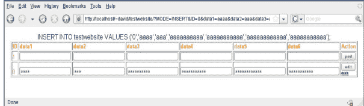

其背后的理念是，创建和管理表单内容的所有机械性工作都已完成并可以进行自定义。此屏幕截图显示了提交一条记录后的结果。顶部一行用于输入新数据，底部一行或几行允许编辑或删除记录。这是一个框架，允许你在自己的网站设计中采用和使用其中的部分。

让我们分段查看此代码。

第一部分声明所需的数据，并创建文件夹和 CSS 文件。

```cpp
int main(int argc, char *argv[])
{
  FILE *out = NULL;
  MYSQL *conn = NULL;
  MYSQL_RES *result = NULL;
  MYSQL_ROW row;
  MYSQL_FIELD *field;
  char SQL[STRINGSIZE] = "";
  char BIT[STRINGSIZE] = "";
  char SQLINSERT[STRINGSIZE] = "";
  char SQLUPDATE[STRINGSIZE] = "";
  char SQLDELETE[STRINGSIZE] = "";
  int rc = 0, i = 0, num_fields = 0;

  //CREATE DIRECTORY////////////////
  sprintf(BIT, "mkdir ~/public_html/%s", argv[1]);
  system(BIT);
  //BUILD CSS///////////////////////
  sprintf(BIT, "../%s/%s.css", argv[1], argv[1]);
  out = fopen(BIT, "w");
  fprintf(out, "table {width:800;vertical-align:top;}\n");
  fprintf(out, "th {font-size:80%;color:#fd9208;vertical-align:bottom;text-align:left;}\n");
  fprintf(out, "td {font-size:80%;color:#fd9208;vertical-align:bottom;text-align:left;}\n");
  fprintf(out, "input {font-size:80%;color:#196419;}\n");
  fprintf(out, "a {font-size:65%;color:#000000;}\n");
  fclose(out);
```

接下来生成 header.html 和 footer.html 文件。这些文件由 PHP 文件加载，可以作为通用的公共页眉和页脚使用。CSS 文件在 header.html 文件中被引用。

```c
//BUILD HEADER HTML///////////////////////////////////
sprintf(BIT, "./%s/head.html", argv[1]);
out = fopen(BIT, "w");
fprintf(out, "<html>\n");
fprintf(out, "<head>\n");
fprintf(out, "<link rel=\"stylesheet\" type=\"text/css\" href=\"%s.css\" />\n", argv[1]);
fprintf(out, "<title>%s</title>\n", argv[1]);
fprintf(out, "</head>\n");
fprintf(out, "<body>\n");
fprintf(out, "<center>\n");
fprintf(out, "<table><tr><td>\n");
fprintf(out, "</td></tr></table>\n");
fclose(out);
//BUILD FOOT HTML///////////////////////////////////
sprintf(BIT, "./%s/foot.html", argv[1]);
out = fopen(BIT, "w");
fprintf(out, "</body></html>\n");
fclose(out);
```

接下来我们创建数据库。

```c
//OPEN DATABASE/////////////////////////////////
conn = mysql_init(NULL);
mysql_options(conn, MYSQL_READ_DEFAULT_GROUP, "mysqldump");
mysql_real_connect(conn, "localhost", "", "test", 0, NULL, 0);
//CREATE TABLE////////////////////////////////////////
sprintf(SQL, "drop table if exists %s", argv[1]);
rc = mysql_query(conn, SQL);
sprintf(SQL, "create table %s (ID varchar(255)", argv[1]);
for (i = 2; i < argc; i++)
{
    sprintf(BIT, ",%s varchar(255)", argv[i]);
    strcat(SQL, BIT);
}

strcat(SQL, ")");
rc = mysql_query(conn, SQL);
```

现在复杂的部分开始了，即生成一个 PHP 脚本。理解这一点的最佳方法是在浏览器中查看页面源代码时检查该程序的实际控制输出。

顶部是一个表单，针对由运行 ghost 程序生成的表中定义的每一列都有一个文本框。

```html
<tr>
<form><input type='hidden' name='MODE' value='INSERT'>
<td><input type=hidden name='ID' value='1'>1</td>
<td><input type=text name='data1' /></td>
<td><input type=text name='data2' /></td>
<td><input type=text name='data3' /></td>
<td><input type=text name='data4' /></td>
<td><input type=text name='data5' /></td>
<td><input type=text name='data6' /></td>
<td><input type='submit' value='post' /></td>
</form>
</tr>
```

对于表中的每一行，我们现在生成一个允许编辑数据的表单，以及一个用于执行删除操作的锚点链接。

```html
<tr>
<form><input type='hidden' name='MODE' value='UPDATE'>
<td><input type=hidden name='ID' value='0'>0</td>
<td><input type=text name='data1' value='aaaaaaaaaaaaaa'></td>
<td><input type=text name='data2' value='aaaaaaaaaaaaaa'></td>
<td><input type=text name='data3' value='aaaaaaaaaaaaaa'></td>
<td><input type=text name='data4' value='aaaaaaaaaaaaaa'></td>
<td><input type=text name='data5' value='aaaaaaaaaaaaaa'></td>
<td><input type=text name='data6' value='aaaaaaaaaaaaaa'></td>
<td><input type='submit' value='edit' /></form>
<a href='?ID=0&MODE=DELETE'>delete</a></td>
</tr>
```

仔细检查 index.php 文件，你可以看到这一切发生在哪里，并逆向查找在 ghost.c 源代码中生成此 PHP 代码的位置。一个好主意是在打印稿上使用高光笔，因为我们在另一种语言（PHP）内部嵌入了一种语言（HTML），而 PHP 又在另一种语言内部，因此非常谨慎地使用转义字符 `\` ' 来表示必要的单引号和双引号，以使其正常工作。这看起来可能很复杂——但 ghost 允许的快速原型设计使得花时间去自定义 C 代码是值得的，这样你想要的 PHP 和数据库就会以你期望的方式输出。

这里是生成编辑或删除行的 PHP 文件 index.php 的部分代码。静态 HTML 已突出显示，其他部分由 MySQL PHP 函数调用插入。


```c
$result = mysql_query("select * from testwebsite");
while($row = mysql_fetch_array($result))
{
    echo "<tr>";
    echo "<form><input type='hidden' name='MODE' value='UPDATE'>";
    for($i=0;$i < mysql_num_fields($result); $i++)
    if($i!=0)
        echo "<td><input type=hidden name=" .
            mysql_field_name($result,$i) . "' value='" .
        $row[mysql_field_name($result,$i)] .
        "'>" .
        "</td>";
    else
        echo "<td><input type=text name='" .
            mysql_field_name($result,$i) .
        "' value='" .
            $row[mysql_field_name($result,$i)] .
        "'></td>";
    echo "<td><input type='submit' value='edit'></form>";
    echo "<a href='?ID=" .
        $row[mysql_field_name($result,0)] .
        "&MODE=DELETE>delete</a>";
    echo "</td></tr>";
}
mysql_free_result($result);
mysql_close($con);
```

如您所见，大量枯燥且重复性的工作已得到自动化。您可以着手修改 PHP 代码推进项目，或者深入底层去自定义生成所有这些代码的 C 程序。

我个人经常使用 ghost 来节省建站时间，这也是我编写它的初衷。我厌倦了反复编写几乎完全相同的代码来解码 HTML 表单以及填充或更新数据库。

# 12 结语

在您研读完这些简单的示例后，我希望您能意识到，掌握 C 语言始终是一项有用且持续具有实用价值的技能。

25 年过去了，我仍会定期编写 C 程序以快速且高效地完成日常任务。一旦编写完成，这些程序就会成为一套适合我使用的持久工具库的一部分，并且具备可移植性。

这本简短的书包含了我多年来学到的许多“技巧”，关于这些技巧几乎没有明确的文档记载，且坦率地说，它假定读者熟悉 Linux。在针对各种经验水平不同的学生测试了这些内容后，我相信一位专注且细心的学生能够成功运行所有这些材料，并以此为起点，发现 C 语言的乐趣。我的许多学生都说，“这比 Java 有趣多了，我能看清真正发生了什么！”这令我最感欣慰，也让我确信您会发现这些内容很有用。

感兴趣的读者可能会要求出版社委托我撰写一本配套书籍：

**Linux 下的 C++ 标准模板库编程**

祝好运，编程愉快。

David

2009 年 3 月 31 日

