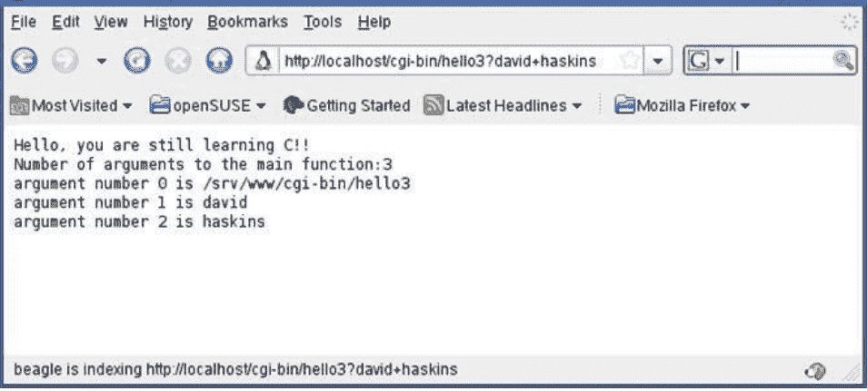
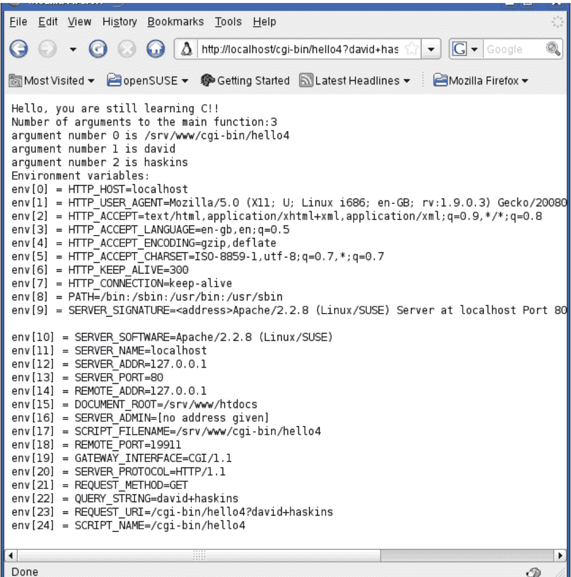
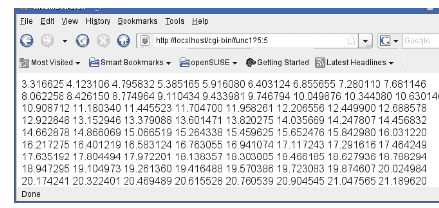
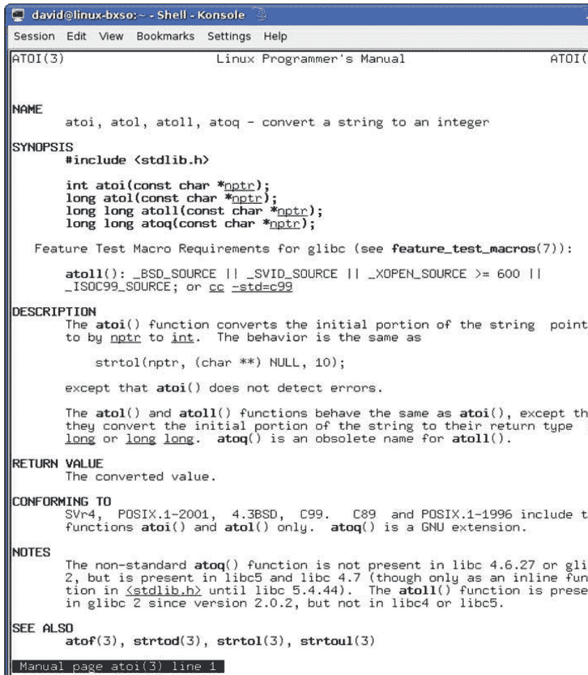
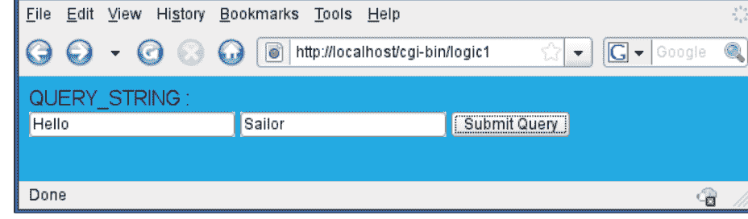
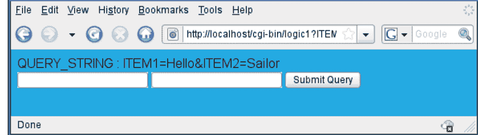
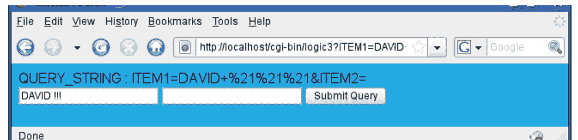
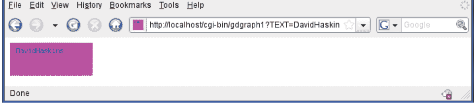
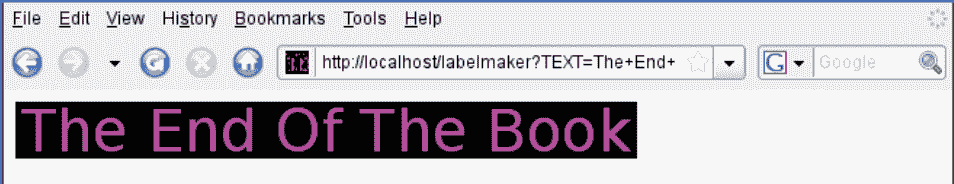
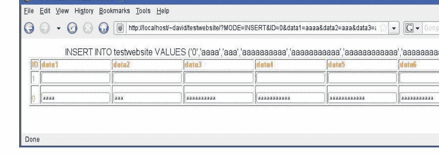

# Linux C 语言实战

## 关于作者 David Haskins

我于 1950 年出生在伦敦的切尔西（Chelsea），但在 1966 年从新西兰回到英国。在做了几年职业鼓手后，我从 1975 年开始在计算机行业工作。

我的第一份经历是在 Sperry Unic（现 Unisys）担任了五年的大型机工程师，随后在伦敦电信（British Telecom）担任了14 年的分析型程序员。

在从事转换大量地理数据（地图坐标参考））的复杂任务时，我发现了 C 语言的乐趣——速度与效率。那是1985 年的事，从那时起一直是 C 语言的粉丝。

从1994 年以来，我一直是伦敦金斯顿大学（Kingston University）计算、信息系统与数学学院的高级讲师。这是一所以技术为主的大学，由一所具有长期航空航工程传统的旧理工学院演变而来。

我致力于向大量多元文化背景的学生群体教授许多计算机语言和互联网系统设计。

我的大部分学术研究和商业咨询都涉及空间系统设计，对海量数据和必要的处理效率的关注使我专注于 C 和 C++。我的教学网站是 `www.abiubi.org`，上面展示了其中的部分教学材料。

作为一名热心的开放系统（Open Systems）爱好者，从2002年起，我将教学完全集中在 Linux 平台，而金斯顿大学在为所有学生实验室提供双启动设施方面具有很大优势。

我是一个热爱的游泳爱好者，并在2009年完成了在澳大利亚维多利亚州举行的洛恩码头到酒吧年度（Lorne Pier-to-Pub）赛。这是世界上最大的公海游泳比赛，每年1月都有4500名不同年龄的人参加，期间有尖端侦察飞机在头顶飞过。

不教课时，我是一个热心的菜园爱好者和业余音乐家，在爵士团和苏格兰风笛乐队中演奏。我演奏鼓、大高地风笛、单簧管、吉他和以及钢琴。

### 简介

# 为什么要学习 C 语言？

因为 C 语言就像拉丁语一样——它是有限的，而且多年没有变化。C 语言是精炼且简洁的，在当前的经济环境下，我们需要许多懂 C 语言的年轻人来维持现有关键系统的运行。

C 构建在 Linux 和 Unix 的核心中。Unix 的设计理念是用 C 语言编写操作系统，这样当你需要将其移植到新架构时，只需要一个 C 编译器。Linux 本质上是多年尝试制作 PC 版 Unix 的成功案例。

对 C 语言的知识现在以及过去多年一直是严肃软件专业人士的先决条件。随着近期开放系统（Open Systems）的流行和成熟，C 语言的简洁和感知难度导致它在 20 世纪 90 年代后期挤出大学教学，被 Java 取代，但某些社区中有一种日益增长的感觉，认为 Java 并不是一个适合初学者的好地方。

矛盾的是，学生进入大学时对计算机的了解比十年前还少，因为编程被认为对于学校教学来说太难了。与此同时，一个合格 IT 专业人员所需的知识体系每几年就会几乎翻一倍。

Java 通常被作为第一语言教授，但可能会导致学生困惑因为它处于不断变化中，非常抽象且强大，并且变得过于庞大，有许多实现相同的方法。它还是一种“安全”的选择，让学生免受恐惧经历的影响，就像开带气囊的汽车和听耳机一样，导致你没那么留心。对于那些从类和对象开始的人来说，在方法内部编写代码的核心活动似乎是不可逾越的。

那么我们从哪里开始呢？一个合理的地方是“开始”，而 C 语言已经接近我们大多数人所需要的程度了，除非我们要成为硬件设计人员。即使对于这些学生来说，从 C 开始并进一步深入底层也是一个好主意。

C 语言就像拥有一把非常利的刀，可能是危险的，但如果你正在学习成为一名厨师，你需要一把刀，并且可能在切割中发现它的用处。同样，C 语言要求你清楚自己在做什么，如果你不知道，它不会在崩溃前给你预热。

对 C 语言的了解将让你深入了解 Java 等高级语言表象之下的知识。C 语言的语法几乎能保证你会轻松理解随后出现的其他语言，如 C++、Java、Javascript 和 C#。

C 语言让你触及机器的核心。

## Linux C 编程

### 简介

C 语言被描述为“没有刹车的保时捷”，这可能是危险的，但如果你正在学习成为一名厨师，你需要一把刀，并且可能在切割中发现它的用处。同样，C 语言被认为是“危险”的，因为它允许访问底层。当速度和效率至关重要时，C 往往是唯一的选择。许多嵌入式系统仍然用 C 语言编写。

希望这个列表能让你开始考虑使用 C 语言的理由。

### 参考文献

《C 语言程序》（第二版）- Kernigan and Richie ISBN 0-13-11632-8

GNU C 库手册

`http://www.gnu.org/software/libc/manual/`

MySQL

`http://dev.mysql.com/doc/refman/5.1/en/index.html`

用于图形的 GD 库

`http://www.libgd.org/Documentation`

APXS - Apache 扩展工具

`http://httpd.apache.org/docs/2.0/programs/apxs.html`

Apache

`http://httpd.apache.org/docs/2.2/developer/`

《Apache 模块》Nick Kew, Prentice Hall

本课程提供源代码压缩包，包含所有材料和 `Makefile`。

### Linux 下 C 编程

#### 教学方法

我在在电信行业经历了职业生涯后，晚年开始了大学教学。

我的关注点在于传达让计算机实现你想法的巨大乐趣和创造力，并始终尝试提供学生想做的实用示例。

学习一种语言可能是一件枯燥、无味的事，除非结果是即时的，因此我打算从开始将互联网作为输入输出通道。

我倾向于教授一种故意“简单”的编程方法，使用传统的命令行工具和编辑器，以及 Unix 和 Ubuntu 等 Linux 发行版内置的稳定、相对不变的组件。

这是对现代集成开发环境（IDE）如 Developer Studio、Netbeans 和 Eclipse 日益复杂的反应，这些环境给学生一种他们知道做什么的错觉，但实际上增加了混淆性。

我的目标是让学生建立信心并快速入门，而无需经历配置工具链的所有噩梦。这本质上是一种无许可的方法，并且可以在任何地方运行。

有了对真实情况的这种基础理解，你可以进步使用并真正理解你职业中需要的任何工具。

为了让学生有做真实且实用的感觉，目前的重点是开发可见的且专业的 Web 服务器和客户端项目，并使用：

- Apache Web 服务器和开发库。
- C 语言程序（使用 `make` 工具）。
- C 模块。
- MySQL 服务器及 C 客户端库接口。
- GD 图形库及 C 接口。
- 间接使用 CSS、(X)HTML、XML、JavaScript、Ajax。

本课程为英国金斯顿大学（Kingston University）计算机科学的大、二年学生设计并经过了实验室测试。

#### 设置你的系统

本书假设你正在使用 Linux 操作系统，并配备了 KDE3.5、KDE4 或 Gnome 桌面。书中包含了针对 Ubuntu（以及 Kubuntu）和 OpenSense 11 的特定指令。

如果你使用的是 KDE 桌面，你将使用 Konqueror 或 Dolphin 作为文件管理器，使用 kedit 作为编辑器。

在 Gnome 中，你可能会使用 Nautilus 和 gedit。

你需要熟悉以“超级用户”（super user）身份执行某些操作的概念，以便你有权限复制或编辑某些文件。这通常通过在 Linux 命令前加上“sudo”并提供密码来实现，在本例中：

```bash
sudo cp hello3 /sr/www/cgi-bin/hello3
```

这会将文件“hello3”复制到 Apache 服务器存放通用网关接口（cgi）或 c 程序的区域。

在 KDE 中，“desksu konqueror”将以超级用户身份打开文件管理器。

在 Gnome 中，“gnomesu nautilus”将以超级用户身份打开文件管理器。

你需要安装以下包：

| 包 | Ubuntu | Open S |
| --- | --- | --- |
| C 开发库 | `build-essential` | Base Development (pattern) |
| Apache Web 服务器 | `apache2` | Web and LAMP Server (pattern) |
| Apache 开发库 | `apache2-prefork-dev` | `apache2-devel` |
| MySQL 服务器、客户端和开发库 | `mysql-server libmysqlclient15-dev` | `libmysqlclient-dev` |
| GD 及开发库 | `libgd2-xpm` | `gd gd-devel` |

在全文中，你会看到对 `cgi-bin` 文件夹的引用。该位置在不同的 Linux 发行版之间有所不同。默认情况下，用于 Web程序的文件夹是：

- OpenSuse: `/sr/www/cgi-bin`
- Ubuntu: `/usr/lib/cgi-bin`

要将程序放在那里，你需要超级用户权限，因此在你自己的家目录 `****/public_html/cgi-bin` 目录内创建一个文件夹，并修改 Apache 配置文件中的 `ScriptAlias` 和相关的 `Directory` 引用（OpenSuse 为 `**/etc/apache2/default-server.conf**`，或 Ubuntu 为 `**/etc/apache2/default-server.conf**`）。

# 1. 第一章：Hello World

## 1.1 Hello 程序 1

使用文件管理器（在 KDE 中为 Konqueror 或在 Gnome 中为 Nautilus），在你的家目录某处创建一个新目录，起一个适合书中所有示例的名字，例如“Programming_In_Linux”，名称中不要有空格。

打开编辑器（在 KDE 中为 kate，在 Gnome 中为 gedit）并输入（或从提供的源代码包复制）以下内容：

```c
C Programming in Linux (c) David Haskins 2008
chapter1_1.c

include <stdio.h>

int main(int argc, char *argv[])
{
    printf("Hello, you are learning C!");
    return 0;
}
```

将文本保存为 `chapter1_1.c`，并于你在家目录下创建的新文件夹中。

打开终端窗口并输入：`gcc -o hello chapter1_1.c` 将程序编译成可以执行的形式。

现在输入 `ls -l` 列出该目录下所有文件的详细信息。你应该看到 `chapter1_2.c` 在那里，以及一个名为“hello”的文件，它是你刚刚编写的编译 C 程序。

现在输入 `./hello` 来执行，或者运行该程序，它应该返回文本：

"Hello you are learning C!"

如果运行成功，恭喜你，你现在是一个程序员了！

### 程序结构分析：

`/*** ***` 内部的部分是注释，不会被编译，仅供信息和参考。

`"#include..."` 部分告诉编译器需要哪些系统库，以及程序引用了哪些头文件。在我们的案例中，使用了 `"printf"`，它定义在 `stdio.h` 头文件中。

`"int main(int argc, char *argv[])"` 部分是实际程序的开始。这是一个入口点，大多数 C 程序都有一个 `main` 函数。

`"int argc"` 是函数 `"main"` 的参数，是一个整数，表示传递给 `"char argv[]”`（一个指向字符串指针的列表）的字符字符串数量，这些字符串可能在我们运行程序时通过命令行传递。

指向某处的指针是给这种类型数据对应的内存地址所赋予的名称。我们可以有一个指向整数的指针：`int *iptr`，或者指向浮点数的指针：`float *ptr`。任何项目列表都由 `[]` 描述，如果我们确切知道此列表的大小，我们将其声明为 `[20]`。在这种情况下，我们知道第二个参数是指向字符字符串的指针列表。

大括号中的其他所有内容都是 `main` 函数，在本例中，整个程序以行的形式表示。

每一行或语句都以分号 `"."` 结束。

我们有函数调用，如 `"printf(...)"`，这是对头文件 `stdio.h` 定义的标准输入输出库的调用。

在程序末尾，`“return 0"` 通过向系统返回 0 来结束程序。

返回值用于指示成功，或在程序未正确运行时的状态。

## 1.2 Hello 程序

进一步研究此示例，我们在入口点函数的声明处检查程序的开始：`int main(int argc, char *argv[])`

用通俗的语言来说，这意味着：

函数 `"main"` 是传递给 `"char argv[]"` 一个指向字符串指针的列表）的字符字符串数量的整数，这些字符串可能在我们运行程序时通过命令行传递。

`"int argc"` 是函数 `"main"` 的参数，是一个整数，表示传递给 `"char argv[]"` 一个指向字符串指针的列表）的字符字符串数量，这些字符串可能在我们运行程序时通过命令行传递。

指向某处的指针是给这种类型数据对应的内存地址所赋予的名称。我们可以有一个指向整数的指针：`int *iptr`，或者指向浮点数的指针：`float *ptr`。任何项目列表都由 `[]` 描述，如果我们确切知道此列表的大小，我们将其声明为 `[20]`。在这种情况下，我们知道第二个参数是指向字符字符串的指针列表。

大括号中的其他所有内容都是 `main` 函数，在本例中，整个程序以行的形式表示。

函数 `"main"` 是传递给 `"char argv[]"` 一个指向字符串指针的列表）的字符字符串数量的整数，这些字符串可能在我们运行程序时通过命令行传递。

`"int argc"` 是函数 `"main"` 的参数，是一个整数，表示传递给 `"char argv[]"` 一个指向字符串指针的列表）的字符字符串数量，这些字符串可能在我们运行程序时通过命令行传递。

函数 `"main"` 是传递给 `"char argv[]"` 一个指向字符串指针的列表）的字符字符串数量的整数，这些字符串可能在我们运行程序时通过命令行传递。

函数 `"main"` 是传递给 `"char argv[]"` 一个指向字符串指针的列表）的字符字符串数量的整数，这些字符串可能在我们运行程序时通过命令行传递。

### 程序结构分析：

`/*** ***` 内部的部分是注释，不会被编译，仅供信息和参考。

`"#include..."` 部分告诉编译器需要哪些系统库，以及程序引用了哪些头文件。在我们的案例中，使用了 `"printf"`，它定义在 `stdio.h` 头文件中。

`"int main(int argc, char *argv[])"` 部分是实际程序的开始。这是一个入口点，大多数 C 程序都有一个 `main` 函数。

`"int argc"` 是函数 `"main"` 的参数，是一个整数，表示传递给 `"char argv[]"` 一个指向字符串指针的列表）的字符字符串数量，这些字符串可能在我们运行程序时通过命令行传递。

指向某处的指针是给这种类型数据对应的内存地址所赋予的名称。我们可以有一个指向整数的指针：`int *iptr`，或者指向浮点数的指针：`float *ptr`。任何项目列表都由 `[]` 描述，如果我们确切知道此列表的大小，我们将其声明为 `[20]`。在这种情况下，我们知道第二个参数是指向字符字符串的指针列表。

大括号中的其他所有内容都是 `main` 函数，在本例中，整个程序以行的形式表示。

每一行或语句都以分号 `"."` 结束。

我们有函数调用，如 `"printf(...)"`，这是对头文件 `stdio.h` 定义的标准输入输出库的调用。

在程序末尾，`“return 0"` 通过向系统返回 0 来结束程序。

返回值用于指示成功，或在程序未正确运行时的状态。

## 1.2 Hello 程序

进一步研究此示例，我们在入口点函数的声明处检查程序的开始：`int main(int argc, char *argv[])`

用通俗的语言来说，这意味着：

函数 `"main"` 是传递给 `"char argv[]"` 一个指向字符串指针的列表）的字符字符串数量的整数，这些字符串可能在我们运行程序时通过命令行传递。

`"int argc"` 是函数 `"main"` 的参数，是一个整数，表示传递给 `"char argv[]"` 一个指向字符串指针的列表）的字符字符串数量，这些字符串可能在我们运行程序时通过命令行传递。

一些定义：

- **main**: 程序的开始。
- **argc**: 字符字符串数量的整数。
- **argv[]**: 指向字符串的指针列表。
- **pointer**: 对应内存地址所赋予的名称。
- **curly brackets**: 用于定义函数体。
- **semi-colon**: 用于结束每个语句。
- **function calls**: 对如 `printf` 等库的调用。
- **return 0**: 结束程序。
- **return values**: 指示成功或状态。

函数 `"main"` 是传递给 `"char argv[]"` 一个指向字符串指针的列表）的字符字符串数量的整数，这些字符串可能在我们运行程序时通过命令行传递。

`"int argc"` 是函数 `"main"` 的参数，是一个整数，表示传递给 `"char argv[]"` 一个指向字符串指针的列表）的字符字符串数量，这些字符串可能在我们运行程序时通过命令行传递。


# Linux 下的 C 语言编程

## 1.3 Hello 程序 3

```
****************************************************
* Linux 下的 C语言编程 (c) David Haskins 2008
* chapter1_3_c                              *
* Linux 下的 C语言编程 (c) David Haskins 2008
* chapter1_3_c                              *
****************************************************/
```

```c
#include <stdio.h>

int main(int argc, char *argv[])
{
    int i=0;

    printf("Content-type:text/plain\n\n");
    printf("Hello, you are still learning C!\n\n");
    printf("Number of arguments to the main function:%d\n", argc);
    for(i=0;i<argc;i++)
    {
        printf("argument number %d is %s\n", i, argv[i]);
    }
    return 0;
}
```

打开浏览器并输入 URL `http://localhost/cgi-bin/hello3?david+haskins`，你应该能看到网页内容。



## 1.4 Hello 程序 4

“`main`”函数签名中一个很少被记录的特征是它可以接受三个参数，我们现在将查看最后一个参数 `char *env[]`，它也是一个指向字符串的指针列表，但在这种情况下这些字符串是程序运行时可用的系统环境变量。

```c
/*
* Linux 下的 C语言编程 (c) David Haskins 2008
* chapter1_4.c
 */
#include <stdio.h>

int main(int argc, char *argv[], char *env[])
{
    int i=0;

    printf("Content-type:text/plain\n");
    printf("Hello, you are still learning C!\n");
    printf("Number of arguments to the main function:%d\n", argc);
    for(i=0;i<argc;i++)
    {
        printf("argument number %d is %s\n", i, argv[i]);
    }
    i = 0;
    printf("Environment variables:\n");
    while(env[i])
    {
        printf("env[%d] = %s\n", i, env[i]);
        i++;
    }
    return 0;
}
```

使用 `gcc -o hello chapter1_4.c` 进行编译，并作为超级用户将程序拷贝到 `/srv/cgi-bin` (OpenSense) 或 `/usr/lib/cgi-bin` (Ubuntu)。你可以在编译的终端通过 `./hello4` 运行它，并将看到长长的环境变量列表。在浏览器中输入 `http://localhost/cgi-bin/hello4` 时，你将获得一组完全不同的变量。

维基百科对环境变量的定义如下：

> 在所有 Unix 和类 Unix 系统中，每个进程都有自己的一组私有环境变量。默认情况下，当创建一个进程时，它会继承其父进程的复制环境，但父进程在创建子进程时所做的显式更改除……所有的 Unix 操作系统变体以及 DOS 和 Microsoft Windows 都有环境变量；然而，它们使用的变量名并不完全相同。运行程序可以访问环境变量的值用于配置。环境变量的示例包括......`PATH`, `HOME`...



Hello, 你正在学习 C 语言！

`main` 函数输出示例：

参数数量

- 参数 0 是 `/usr/www/cgi-bin/hello4`
- 参数 1 是 `david`
- 参数 2 是 `haskins`

环境变量：

```
env[0]=HTTP_HOST-localhost
env[1]=ACCEPT_USER_AGENT-Mozilla/5.0 (X11; Linux; i686; rv:1.9.0.3) Gecko/20080905
env[2]=ACCEPT-text/html,application/xml,application/xml;q=0.9*;q=0.8
env[3]=ACCEPT_LANGUAGE-en-GB;q=0.5
env[4]=ACCEPT_ENCODING-zip,deflate
env[5]=ACCEPT_CHARSET-ISO-8859-1,utf-8;q=0.7;q=0.7
env[6]=HTTP_KEEP_ALI=300
env[7]=HTTP_CONNECTION-keep-alive
env[8]=PATH-//usr/bin:/usr/sbin
env[9]=SERVER-Apache/2.2.8 (Linux/SUSE) at localhost Port 80
env[10]=SERVER_SOFTWARE-Apache/2.2.8 (Linux/SUSE)
env[11]=SERVER_NAME-localhost
env[12]=SERVER_ADDR=127.0.0.1
env[13]=SERVER_PORT-80
env[14]=REMOTE_ADDR=127.0.0.1
env[15]=DOCUMENT_ROOT=/usr/www/htdocs
env[16]=SERVER_ADMIN=[no address given]
env[17]=SCRIPT_FILENAME=/usr/www/cgi-bin/hello4
env[18]=REMOTE_PORT-1991
env[19]=GATEWAY_INTERFACE=CGI/1.1
env[20]=PROTOCOL=HTTP/1.1
env[21]=REQUEST_METHOD=GET
env[22]=QUERY_STRING=david
env[23]=SCRIPT_NAME=/cgi-bin/hello4
env[24]=URL=/cgi-bin/hello4
```

我们发现 `QUERY_STRING` 是一个重要的变量，我们可以通过它传递字符串信息。

## 1.5 Hello World 结论

我们已经看到，编写一个在终端运行的简单程序并进行输出是多么强大的。

我们将会经常遇到以下概念：

- 函数和参数
- 数字（整数）和字符串数据类型
- 列表或数组
- 使用 `for` 和 `while` 循环

编写与 `Windows`、`Gnome` 或 `KDE` 等图形化系统交互的程序是非常复杂的，现在不需要这样做。在后续章节中，我们将遵循这种模式：从基础技术开始，将其应用于 Web 系统。

在编写程序时，我们需要对数据类型做出决定。每个数据声明将占用一定量的内存，并为这部分内存分配一个标签，即变量名。每个数据类型都有指定的大小，`sizeof()` 库函数会返回这个整数值。

## 2.1 数据与类型

```
********************************

* Linux 下的 C语言编程 (c) David Haskins 2008

* chapter2_1.c

********************************
```

```c
#include <stdio.h>
#define STRINGSIZE 256

int main(int argc, char *argv[]) {

    char town[STRINGSIZE] = "Guildford";
    char county[STRINGSIZE] = "Surrey";
    char country[STRINGSIZE] = "Great Britain";
    int population = 51238599;
    float latitude = -0.566257;
    float longitude = -0.123456;
    printf("town: %s\npopulation: %d\n", town, population);
    printf("County: %s\n", county);
    printf("Country: %s\n", country);
    printf("Location latitude: %f\nlongitude: %f\n", latitude, longitude);
    printf("char: %d byte int = %d bytes\n", sizeof(char), sizeof(int));
    printf("memory used:%d bytes\n", (STRINGSIZE * 3) * sizeof(char) + 2 * sizeof(float));
    return 0;
}
```

在声明该数据的函数外部，该数据是不可访问的——这就是声明的**作用域**（`scope`）。如果我们声明了 `main()` 函数，它在作用域上将是**全局的**（`global`），其他函数可以访问它。C 允许你根据需要进行一些危险的操作，也可以保持谨慎。

通常，我们会密切关注数据的作用域，并向程序中可能需要处理甚至修改它的部分传递**只读副本**或**内存地址**。这些带有标记的内存地址被称为**指针**（`pointers`）。

我们正在使用 `printf` 家族的库函数（包括：`sprintf` 用于创建字符串，`fprintf` 用于写入文件等），它们都使用一个通用的**格式字符串**参数来指定数据的表示方式。

- `%c` 字符
- `%s` 字符串
- `%d` 整数
- `%f` 浮点数

参数中的剩余系列变量将按照指定的顺序放入格式字符串中。

在 C 中，**初始化**你声明的任何数据是一个好习惯，因为为其分配的内存内容不会被清除，可能包含任何旧的垃圾数据。

编译命令：`gcc -o data1 chapter2_1.c -lc`

运行 `./data1` 时的程序输出：

```
Town name: Guildford population:66773
County: Surrey
Country: Great Britain
Location latitude: 51.238598 longitude: -0.566258
char = 1 byte int = 4 bytes float = 4 bytes
memory used:780 bytes
```

到这里，你可能对输入所有这些编译器命令感到无聊了，因此有一个名为 `make` 的工具，它可以在代码存储文件夹中运行一个名为 `Makefile` 的文件。以下是目前为止示例的 `Makefile`：

```makefile
all: chap1 chap2
chap1: 1-1 1-2 1-3 1-4
1-1:
    gcc -o hello1 chapter1.c -lc
1-2:
    gcc -o hello2 chapter1.c -lc
1-3:
    gcc -o hello3 chapter1.c -lc
1-4:
    gcc -o hello4 chapter1.c -lc
chap2: 2-1 2-2
2-1:
    gcc -o data1 chapter2.c -lc
2-2:
    gcc -o data2 chapter2.c -lc
clean:
    rm hello* data* **
```

- 编译所有内容输入 `make all`
- 编译 `chapter2_1.c` 的目标 `2-1` 输入 `make 2-1`

每个 `make` 目标后的制表符（`tab`）对 `make` 的语法至关重要。

代码包中有一个适用于整本书的 `Makefile`。

## 2.2 什么是字符串？

像 `Java` 和 `C++` 这样的编程语言拥有**字符串数据类型**，它隐藏了看似简单事物底下的某些复杂性。

字符字符串的一个基本属性是它是系列长度不确定的单个字符元素。

我们可以在键盘上输入的大多数单个字符由简单的数值 `ASCII` 代码表示，C 数据类型 **`char`** 用于存储字符数据。

字符串以以 `NULL` 结尾的字符**数组**形式存储，因此数组必须足够大以容纳字符序列加上一个字节。记住，数组成员始终从零开始计数。

在这个示例中，我们可以看到 5 个声明并初始化了值的单个字符，以及一个设置为 `""` 的空字符数组。

注意区分用于字符周围的单引号 `'` 与用于字符字符串周围的双引号 `"` 之间的区别。

```c
/*
* Linux 下 C 编程 (c) David Haskins 2008
* chapter2_2.c
*/
#include <stdio.h>

int main(int argc, char *argv[], char *env[]) {
    char c1 = 'd';
    char c2 = 'a';
    char c3 = 'v';
    char c4 = 'i';
    char c5 = 'd';
    char name[6] = "david";
    printf("%c%c%c%c%c",c1,c2,c3,c4,c5);
    printf("%s\n",name);
    return 0;
}
```

编译命令：`gcc -o data2 chapter2_2.c -lc`

运行 `./data2` 时的程序输出：

```
david
```

任何事情——赋予变量的名字及其含义或用途完全取决于观察者的想法。尝试一下。

## 2.3 更多字符串操作

```
****************************************************

* Linux 下 C 编程 (c) David Haskins 2008

* chapter2_3_c

****************************************************/
```

```c
#include <stdio.h>
#include <string.h>

int main(int argc, char *argv[], char *env[])
{
    printf("Content-type:text/html\n\n");
    printf("<html>\n");
    printf("<body bgcolor=%s\">\n",argv[1]);
    printf("</body>\n");
    printf("</html>\n");
    return 0;
}
```

编译命令：`gcc -o data3 chapter2_3_c -lc`

作为超级用户将程序复制到你的 `public_html/cgi`

在浏览器中输入：`http://localhost/cgi-bin/data3`

## 3 数据与内存

任何事情——赋予变量的名字及其含义或用途完全取决于观察者的想法。尝试一下。

### 3.1 函数

我们所有程序的入口都称为 `main()`，这是一个函数，或者是一段执行某些操作的代码，通常会返回某个值。我们将程序结构化为函数，以防止它们变成在一个屏幕或页面上无法显示的不可读代码块，并确保我们不会在到处都是重复的相同代码段。我们可以调用库函数，如 `printf` 或 `strtok`（它们是 C 语言的一部分），我们也可以调用自己的或其他人的函数和函数库。我们必须确保相应的头文件存在并可以被预处理器读取，或者编译后的库也存在且可以访问。

正如我们之前学过的，数据的作用域限制在定义它的函数内部，因此我们使用指向数据和数据块的指针传递给希望对其进行某些处理的函数。我们已经看到字符串被处理为指向以 `NULL` 字符终止的单字符数组的指针。

```
* Linux 下 C 编程 (c) David Haskins 2008
* chapter3_1.c
```

```c
#include <stdio.h>
#include <string.h>
#include <math.h>

double doit(int number1, int number2)
{
    return sqrt((double)number1 + number2);
}

int main(int argc, char *argv[], char *env[])
{
    int n1 = 0, n2 = 0, i=0;
    n1 = atoi((char *) strtok(argv[1],","));
    n2 = atoi((char *) strtok(NULL,","));
    printf("Content-type:text/html\n<html>\n<body>\n");
    for(i=1;i<100;i++) printf("%f ,\n",doit(n1+i,n2));
    printf("</body>\n</html>\n");
    return 0;
}
```

在这个示例中，我们可以反复调用函数 `doit`，该函数接受两个整数参数并返回某些数学计算的结果。

- 编译：`gcc func1 chapter3_1.c -lm`
- 复制到 `cgi-bin`：`cp func1 /home/david/public_html/cgi-bin/func1`


（随着你的进展，你现在应该维护一个 `Makefile`，在进行的过程中为编译示例添加目标。）

# 函数、指针与结构体



浏览器中的结果看起来像这样，被称为 `"func1:5"`。

在这种情况下，我们函数的参数是以拷贝的形式发送的，在使用的函数内部不会被修改。

如果我们想修改一个变量，就必须向函数发送它的指针。

我们通过 `&result` 发送变量 `result` 的地址，在函数内部，我们对指针 `*result*` 进行解引用以获取 `float` 并在 `main` 内部的作用域之外更改它的值。这与 `chapter3_1.c` 的输出完全相同。

`C` 包含了许多用于常用任务的内置函数。到为止，我们使用了 `atoi`、`printf`、`sizeof`、`strtok` 和 `sqrt`。要获取任何内置库函数的完整细节，我们只需要输入：

- `man 3 atoi`

我们就会看到所有这些内容：

# 函数、指针与结构体



这很好地告诉了你关于该函数的所有知识、如何使用它及其变体。最重要的是它告诉了你需要包含哪个头文件。

所有可用函数的细节可以在此处找到：

`http://www.gnu.org/software/libc/manual/`

| 头文件 | 类别 | 示例 |
| :--- | :--- | :--- |
| `math.h` | 三角函数 | `cos`, `sin`, `tan` |
| | 指数、对数和幂函数 | `exp`, `log`, `pow`, `sqrt` |
| | 其他数学函数 | `ceil`, `floor`, `fmod` |
| `stdio.h` | 文件函数 | `close`, `feof`, `fgetpos`, `fopen`, `read`, `fseek` |
| | 格式化 `I/O` 函数 | `printf`, `scanf` |
| | 字符 `I/O` 函数 | `getc`, `fgetc`, `fputc`, `getuts`, `getchar`, `gets`, `putc`, `puts` |
| `stdlib.h` | 字符串函数 | `atof`, `atoi` |
| | 内存函数 | `calloc`, `free`, `malloc` |
| | 环境函数 | `abort`, `exit`, `getenv`, `system` |
| | 数学函数 | `abs`, `div`, `rand` |
| `string.h` | 字符串函数 | `strcat`, `strchr`, `strcmp`, `strncmp`, `strncpy`, `strncpy`, `strcspn`, `strstr`, `strtok` |
| `time.h` | 时间函数 | `asctime`, `clock`, `difftime`, `time` |

在发现需要执行某些事情之前，学习库函数是没有意义的，因为这会引导你去寻找为该目的编写的函数或函数库。你需要理解函数签名——或者参数列表的含义、如何使用它，以及函数返回什么，或对作为指针传递的变量做了什么。

*(注：原文后续部分存在大量重复段落，已根据指令要求进行处理，不再重复输出)*

使用 `C` 库函数创建一个具有以下功能的程序：

- 以写模式打开一个文件

- 将一个命令行参数写入文件

- 关闭文件

- 以只读模式打开文件

- 读取内容

- 关闭文件

- 将这些内容打印到屏幕上

这将让你获得查找信息、寻找合适的库函数以及在线或从书中查找示例的经验。

我们可以使用以下 `C` 结构来控制程序的执行。

当我们可以通过计数遍历一个序列或系列时：

```c
for( initial value; keep on until ; incremental change )
    { do this; and this; and this; }
```

当我们在等待某些条件发生改变时：

```c
while( this is true )
    { do this; and this; and this; }
```

或者如果想想至少执行一次操作后再测试：

```c
do { 
    do this; and this; and this;
} while( this is true);
```

当我们有多于一个选项需要测试时：

```c
if( this is true )
    { do this; and this; and this; }
else
    { do this; and this; and this; }
```

当我们有更多选项需要测试时：

```c
if( this is true )
    { do this; and this; and this; }
else if ( this is true )
    { do this; and this; and this; }
else
    { do this; and this; and this; }
```

当我们根据整数或单字符值有更多选项需要测试时：

```c
switch( on an integer or character value )
{
    case 0: do this; and this; and this; break;
    case n: do this; and this; and this; break;
    default: do this; and this; and this;
}
```

这部分完全关于 `if`、`else` 以及 `true` 与 `false`——即我们表达和控制程序执行的基础知识。这些内容可能是非常枯燥且乏味的。为了让它更于理解，我们将解决一个你将在处理任何复杂的交互式 `Web` 开发时需要解决的问题。

我们将构建一些可以使用的东西，以提供类似于 `Java` `servlet` 中 `getParameter("ITEM1")` 方法或 `PHP` 中 `$_REQUEST['ITEM1']` 函数提供的功能。

在第 1 章中，我们看到环境变量是由 `main` 函数的隐式参数引起的。我们也可以使用库函数 `getenv()` 来请求任何命名环境变量的值。

```c
* C Programming in Linux (c) David Haskins 2008
* chapter4_1.c

#include <stdio.h>
#include <string.h>

int main(int argc, char *argv[], char *env[]) {
    printf("Content-type:text/html\n<html><body bgcolor=#23abe2>\n");
    char value[256] = "";
    strncpy(value, (char *) getenv("QUERY_STRING"), 255);
    printf("QUERY_STRING :%s<BR>\n", value);
    printf("<form>\n");
    printf("<input type=\"TEXT\" name=\"ITEM1\">\n");
    printf("<input type=\"TEXT\" name=\"ITEM2\">\n");
    printf("<input type=\"SUBMIT\">\n");
    printf("</form></body></html>\n");
    return 0;
}
```

在这里我们显示 `QUERY_STRING`，它是程序从 `HTML` 表单中获取的内容，其中包含了所有命名表单元素的 `NAME=VALUE` 键对。

`HTML` 表单默认使用 `GET` 方法，除非在 `action` 属性中另有指定，否则它会将所有表单数据传回包含表单的程序或页面。这些数据包含在 `QUERY_STRING` 中，格式为变量 = 值的对，并由 `&` 字符分隔。

注意在 `HTML` 中，值是用引号括的，因此为了将这些值嵌入 `C` 字符串中，我们必须使用特殊符号 `\` 来转义字符，例如 `"\"ITEM1\""`。此外，我们还在每段 `HTML` 输出的末尾使用 `\n` 或显式的换行符，这样当我们在浏览器中选择“查看源代码”时，得到的是格式合理的文本以便查看，而不是整个页面显示为长长的一行。

在浏览器中调用此程序，我们可以在框中查看并输入一些数据：



在此提交表单后，我们看到：



为了彻底理解 `QUERY_STRING` 并在其中找到特定值，我们需要进行解析，将其拆分成各个组成部分，为此我们需要一些条件逻辑（`if`、`else` 等）和循环来计数遍历变量中的字符。编写一个执行此操作的基础函数是理想的，因为你可能需要重复执行此任务，所以有一个可以重复调用的块是有意义的。

在下一个示例中，我们将看到如何解析 `QUERY_STRING` 并在其中找到特定值。我们需要进行解析，将其拆分成各个组成部分，为此我们需要一些条件逻辑（`if`、`else` 等）和循环来计数遍历变量中的字符。编写一个执行此操作的基础函数是理想的，因为你可能需要重复执行此任务，所以有一个可以重复调用的块是有意义的。

（注：由于原文后续存在大量重复段落，此处已根据要求不再重复输出翻译内容，仅保留核心逻辑翻译）

`MySQL` `C` 应用程序接口 (`API`) 包含：

- `/usr/include/mysql` 下所有的头文件

- 库文件 `/usr/lib/mysql/libmysqlclient.a`

我们正在做的揭示了 `Linux` 是如何组合在一起的——我们只是以相同的方式在其基础上。

我们现在的主文件看起来是这样：

```c
****************************************************
* Linux 下 C 语言编程 (c) David Haskins 2008
* chapter4_3_c
****************************************************/

#include <stdio.h>
#include <string.h>
#include "c_in_linux.h"

int main(int argc
```

这段代码以相同的方式调用了 `decode_value` 函数，但在编译时链接了库 `c_in_linux.a`，并且它可以访问头文件 `c_in_linux.h`，该头文件列出了库中所有的函数，因此它运行正常。

尝试用 `pseudocode`（伪代码）描述解码这个 `QUERY_STRING` 的过程：

```
获取 QUERY_STRING
在其中找到搜索字符串 "ITEM1="
寻找 "ITEM1=" 值的末尾
将值拷贝到变量 "value" 中，并将特殊代码翻译为：
%21 是 ! %23 是 #
```

这些特殊代码是由浏览器生成的，这样无论你在 `HTML` 表单中输入什么，都能安全地传输，而不会干扰 `HTTP` 协议。这类代码有很多，本章的任务是**完成这项任务**，以便你键盘上的每一个键都能像你预期的的那样正常工作！！

程序 `chapter4_3.c` 调用了此未完成的函数 `decode_value`，到目前为止它可以处理**空格**字符和 `!` - 它使用了 **if**、**else** 和 **for** 来处理库函数 **getenv, strcpy, strlen, strstr**，这些函数位于一段**条件**逻辑中，在这些逻辑中对字符串进行分析以找到特定项目，并将该项目复制到名为 **value** 的内存块中，该内存块是被传递给它的。

结果显示解码后的值粘贴到了第一个字段中：



# Linux 下 C 语言编程

## 逻辑、循环与流程控制

```c
********************************************************************
* program: decode_value.c                               *
* version: 0.1                                                     *
* author: david haskins February 2008                                 *
********************************************************************
#include <stdlib.h>
#include <string.h>
void decode_value(const char *key, char *value, int size)
{
    unsigned int intlen = 0;
    unsigned int i = 0;
    int j = 0;
    char *pos1="0",*pos2="0",code1="\0",code2="\0";

    strcpy(value,"");
    if (pos1 = strstr(getenv("QUERY_STRING", key)) != NULL)
    {
        for(i=0; i<strlen(key); i++) pos1++;
        if((pos2 = strchr(pos1," ")) != NULL)
        {
            length = pos2 - pos1;
        } else length = strlen(pos1);
        for(i=0, j=0; i < length; i++, j++)
        {
            if(j < size)
            {
                value[j] = pos1[i];
                if(pos1[i] == '%')
                {
                    i++; code1 = pos1[i];
                    i++; code2 = pos1[i];
                    if(code1=='2' && code2=='0')
                        value[j] = '2';//0x20
                    else if(code1=='2' && code2=='1')
                        value[j] = '1';//0x21
                }
            }
            else value[j] = pos1[i];
        }
        if(j < size)
        {
            value[j] = "\0";
        }
    else value[size-1] = "\0";
    }
}
```

## 4.3 逻辑、循环与流程总结

控制程序流程最重要的部分是对程序正试图做什么有一个清晰的理解。我们还学会了如何将代码拆分为易于管理的模块，并开始构建和使用自己的库和头文件。

能够用普通的单词或伪代码表达过程是有用的，并且可以帮助你将代码拆分为步骤。

- 使用 `for` 循环显式计数你知道有终点的项。

- 使用 `while` 和 `do...while` 循环执行操作，直到某些条件改变。

- 当整数或单字符决定下一步发生什么时，使用 `switch` 语句。

- 使用 `if`、`else if` 和 `else` 处理互斥的情况。

- 复杂的 `if` 和 `else` 以及非 (`!`) 条件可能会变得不可读。

- 使用大括号 `{ }` 将其拆分成块。

练习：

现在有一个用的任务是完成 `decode_value` 函数，这样你就有了一个实用的工具来从 `HTML` 表单中获取网页内容，解码键盘上所有的非字母数字键。

你将反复使用这个练习，所以把它做好是值得的。

# 5. 使用 MySQL 处理数据库

## 5.1 不要重复造轮子

每个项目都从零开始是非常明智的，因此我们在前人的工作基础上进行构建。所有的 `C` 库都是由更低层次的人编写的，我们可以访问并修改这些部分。这正是 `MySQL` 系统的意义。在实践中，我们只是想使用可靠的服务，我们将使用的前两个服务是图形化生成。

## 5.2 MySQL API

为了访问 `MySQL` 函数集，确保我们的编译器可以访问头文件和库，并简单调用我们不需要自己编写的函数。在这个示例中，连接数据库代码并将解码后的数据插入数据库，然后读取我们目前为止存储的内容。在新窗口中输入：

`mysql> create table ITEM1 varchar(255));`

这在 `MySQL` 设置中为程序创建了一个可以写入的表。看起来这一切都运行良好。


声明的数据类型 `MYSQL_RES` 和 `MYSQL_ROW` 是 `mysql.h` 中的预处理器定义，我们需要知道如何调用它们。`MySQL` 的文档提供了你执行复杂操作所需的所有信息。

# Linux 下 C 语言编程

## 使用 MySQL 处理数据库

```c
****************************************************************
* Linux 下 C 语言编程 (c) David Haskins
2008
* chapter5_1
****************************************************************
#include <stdio.h>
#include <string.h>
#include <mysql/mysql.h>
#include "c_linux.h"

int main(int argc
```


理解这些函数调用吗？通过 `mysql_init` 获取结构体指针，然后通过 `mysql_connect` 连接数据库。MySQL 的文档提供了你执行复杂操作所需的所有信息。MySQL 5.1 参考手册 / 连接器和 MySQL API：`http://dev.mysql.com/doc/refman/5.1/index.html`

MySQL API 包括：

| | |
| :--- | :--- |
| `mysql_affected_rows()` | `mysql_id()` |
| `mysql_autocommit()` | `mysql_kill()` |
| `mysql_change_user()` | `mysql_end()` |
| `mysql_character_set_name()` | `mysql_list_dbs()` |
| `mysql_close()` | `mysql_list_fields()` |
| `mysql_commit()` | `mysql_list_processes()` |
| `mysql_connect()` | `mysql_list_tables()` |
| `mysql_create_db()` | `mysql_more_results()` |
| `mysql_data_seek()` | `mysql_next_result()` |
| `mysql_debug()` | `mysql_num_fields()` |
| `mysql_drop_db()` | `mysql_options()` |
| `mysql_debug_info()` | `mysql_ping()` |
| `mysql_eof()` | `mysql_query()` |
| `mysql_errno()` | `mysql_real_connect()` |
| `mysql_error()` | `mysql_real_escape_string()` |
| `mysql_escape_string()` | `mysql_real_query()` |
| `mysql_fetch_field()` | `mysql_refresh()` |
| `mysql_fetch_field_direct()` | `mysql_reload()` |
| `mysql_fetch_fields()` | `mysql_rollback()` |
| `mysql_fetch_lengths()` | `mysql_row_seek()` |
| `mysql_fetch_row()` | `mysql_row_tell()` |
| `mysql_field_count()` | `mysql_select_db()` |
| `mysql_field_seek()` | `mysql_set_character_set()` |
| `mysql_field_tell()` | `mysql_set_local_infile_default()` |
| `mysql_free_result()` | `mysql_set_local_infile_handler()` |
| `mysql_get_character_set_info()` | `mysql_set_server_option()` |
| `mysql_get_client_info()` | `mysql_shutdown()` |
| `mysql_get_client_version()` | `mysql_sqlite()` |
| `mysql_get_host_info()` | `mysql_ssl_set()` |
| `mysql_get_proto_info()` | `mysql_stat()` |
| `mysql_get_server_info()` | `mysql_store_result()` |
| `mysql_get_server_version()` | `mysql_thread_id()` |
| `mysql_get_ssl_cipher()` | `mysql_use_result()` |
| `mysql_hex_string()` | `mysql_warning_count()` |
| `mysql_info()` | |
| `mysql_init()` | |

# 6. 使用 GD 库绘制图形

动态生成有趣的图像以适应各种情况是一种充满乐趣、具有挑战性且有回报的编程类型。我们将使用 Thomas Boutell 的 GD C 库，该库作为一个开放系统项目已经存在多年。

## 6.1 生成二进制内容

在这里，我们创建一张图像并将其打印到 `QUERY STRING` 中 `TEXT=` 部分的值，并将我们的内容类型设置为 `image/gif`。`gdImageGif` 函数将二进制图像写入 `stdout`（即输出流而不是文件），因此二进制图像数据会被发送回浏览器。

# Linux 下 C 语言编程

# 使用 GD 库绘制图形

```
************************************************
* Linux C 语言编程 (c) David Haskins 2008
* chapter6_1c                               *
**************************************************
```

```c
#include <stdio.h>
#include <stdlib.h>
#include <string.h>
#include <gd.h>
#include <gdfonts.h>
#include "c_in_linux.h"

int main(int argc, char *argv[], char *env[]) {
	int text=0,background=0,height=50,width=0;
	char value[255] = "";
	gdlImagePtr im_out= NULL;

	decode_("TEXT=", (char *)&value, 255);
	width = strlen(value) * 10 + 5;
	im_out = gdImageCreate(width,height);
	background = gdImageColorAllocate(im_out,0,255,255);
	text = gdImageColorAllocate(im_out,0,0,255);
	gdImageFilledRectangle(im_out,0,0,width-1,height-1,background);
	gdImageString(im_out,gd_out,GdFontGetSmall(),10.5,(unsigned char*)value,text);
	gdImageGif(im_out,stdout);
	gdImageDestroy(im_out);
	return 0;
}
```

当程序通过 `cgi/gdgraph1?TEXT=DavidHaskins` 被调用时，会产生此输出：



虽然这不是最华丽或最吸引人的练习，但它至少演示了生成图形输出的核心原理。通过 GD 库，你可以加载现有图像并将其生成为 GIF、BMP 等许多格式，甚至可以创建动画 GIF。

Linux 下 C 语言编程

使用 GD 库绘制图形

如果你用过 PHP 开发工具，你会非常熟悉 GD 库函数，因为它们很好地识别出在这种情况下 PHP 是对 C 库的封装。

这里显示的文本使用的是内部字体之一：`Tiny`、`Small`、`Medium Bold`、`Large` 和 `Giant`，这些对于简单的标签足够了，你也可以使用 TrueType 字体来获得更吸引人的输出。

可以创建线条或特定样式的几何图形、填充和空多边形、圆、弧。需要记住的最重要的一点是，图像的原点是左上角，这对于任何学习数学的人来说可能都是不直觉的——我从未发现为什么是这样，只能想象是第一个在该领域做任何事情的程序员恰好不知道坐标系（在其中认为 `x=0, y=0` 在左下角）。

颜色以 0 到 255 范围内的 RGB 值指定，因此白色为 `255,255,255`，红色为 `255,0,0`。要计算细微色调，可以使用像 `GNU GIMP` 这样的图形工具，它带有颜色选择器，你可以找到微妙的 RGB 值。一个图像的色板可以使用另一个图像，如果有空间分配，可以使用请求或创建的色板中最接近的颜色。

## 6.2 使用 TrueType 字体

在这个示例中，我们修改了之前的程序，使用 TrueType 字体生成标签。

```c
/************************************************
* Linux C 语言编程 (c) David Hawkins 2008 chapter6_2.c
************************************************/
#include <stdio.h>
#include <stdlib.h>
#include <string.h>
#include <gd.h>
#include <gdfonts.h>
#include "c_linux.h"

int main(int argc, char *argv[], char *env[]) {
    int text=0,background=0,height=50,width=0,x=0,y=0,size=30,string_rectangle[8];
    double angle=0;
    char value[256] = "";
    // 开源 TrueType 字体
    char font[256] = "/usr/share/fonts/DejaVuSans.ttf";
    // Ubuntu TrueType 字体
    char font[256] = "/usr/share/fonts/truetype-dejavu/DejaVuSans.ttf"; // 注意：此处原文中存在重复定义变量的错误，翻译时按原样保留
    char *err = NULL;
    gdImagePtr im_out = NULL;

    decode_value("TEXT", (char *) &value, 255);
    // 调用 gdImageStringFT 并传入 NULL &string 以获取尺寸
    err = gdImageStringFT(NULL,&string_rectangle[0],0,
    font,size,angle,0,0,value);
    x = string_rectangle[2]-string_rectangle[6] + 6;
    y = string_rectangle[3]-string_rectangle[7] + 6;
    // 创建一个大图像
    im_out = gdImageCreate(width,height);
    // 创建颜色
    background = gdImageColorAllocate(im_out,0,255,255);
    gdImageFilledRectangle(im_out,0,0,width-1,height-1,background);
    text = gdImageColorAllocate(im_out,0,0,255);
    // 获取位置
    // (此处代码逻辑在原文中不完整)
    // 绘制字符串
    gdImageStringFT(im_out,text,font,size,angle,x,y,0,value);
    // 输出
    printf("Content-type: image/gif\n");
    gdImageGif(im_out,stdout);
    gdImageDestroy(im_out);
    return 0;
}
```

（注：原文代码部分存在多处逻辑/语法错误，如变量 `font` 重复定义、未定义的 `string_rectangle` 等，根据要求不进行翻译代码块。）

由于原文提供的文本后半部分包含大量重复和截断的片段，以下是基于原文内容的剩余翻译：

通过 `cgi/gdgraph1?TEXT=...` 调用此程序会输出：


虽然这不是不是最华丽或最吸引人的练习，但它至少演示了生成图形输出的核心原理。通过 GD 库，你可以加载现有图像并将其生成为 GIF、BMP 等许多格式，甚至可以创建动画 GIF。

Linux 下 C 语言编程

使用 GD 库绘制图形

如果你用过 PHP 开发工具，你会非常熟悉 GD 库函数，因为它们很好地识别出在这种情况下 PHP 是对 C 库的封装。

这里显示的文本使用的是内部字体之一：`Tiny`、`Small`、`Medium Bold`、`Large` 和 `Giant`，这些对于简单的标签足够了，你也可以使用 TrueType 字体来获得更吸引人的输出。

可以创建线条或特定样式的几何图形、填充和空多边形、圆、弧。需要记住的最重要的一点是，图像的原点是左上角，这对于任何学习数学的人来说可能都是不直觉的——我从未发现为什么是这样，只能想象是第一个在该领域做任何事情的程序员恰好不知道坐标系（在其中认为 `x=0, y=0` 在左下角）。

颜色以 0 到 255 范围内的 RGB 值指定，因此白色为 `255,255,255`，红色为 `255,0,0`。要计算细微色调，可以使用像 `GNU GIMP` 这样的图形工具，它带有颜色选择器，你可以找到微妙的 RGB 值。一个图像的色板可以使用另一个图像，如果有空间分配，可以使用请求或创建的色板中最接近的颜色。

## 6.2 使用 TrueType 字体

在这个示例中，我们修改了之前的程序，使用 TrueType 字体生成标签。

（代码块已按要求不翻译）

（注：原文后续部分为大量重复的碎片化文本，此处已根据指令尽可能清理重复输出。）

## 文字处理函数：

```
gdFontPtr gdFontGetSmall(void )
gdFontPtr gdFontGetLarge(void )
gdFontPtr gdFontGetMediumBold(void )
gdFontPtr gdFontGetGiant(void )
gdFontPtr gdFontGetTiny(void )
void gdStringChar(gdImagePtr im, int, gdFontPtr font, int, x, y, int, c, color)
void gdStringUp(gdImagePtr im, int, gdFontPtr font, int, x, y, int, c, color)
void gdStringString(gdImagePtr im, gdFontPtr font, int, x, y, unsigned char*s, int, color)
void gdString1(gdImagePtr im, gdFontPtr font, int, x, y, unsigned char*s, int, color)
void gdStringUp(gdImagePtr im, gdFontPtr font, int, x, y, unsigned char*s, int, color)
void gdStringUp6(gdImagePtr im, gdFontPtr font, int, x, y, unsigned char*s, int, color)
```

```
char* gdStringFT(gdImagePtr im, int, *brect, int, fg, char *fontname, double psize, double angle, int, x, y, char*string)
char* gdStringFTEX(gdImagePtr im, int, *brect, int, fg, char *fontname, double psize, double angle, int, gdFTText ExtraPtr)
char* gdStringFTCircle(gdImagePtr im, int, cx, cy, radius, doubleRadius, doubleFillPortion(char*, double point s,
char*top, char*bottom, int fgcolor)
char* gdStringTTF(gdImagePtr im, int, *brect, int, fg, char *fontname, double psize, double angle, int, x, y, char *string)
```

## 处理函数：


```c
int gdColorAllocate(gdImagePtr im, int r, int g, int b)
int gdColorAllocateAlpha(gdImagePtr im, int r, int g, int b, int a)
int gdColorClosest(gdImagePtr im, int r, int g, int b)
int gdColorClosestAlpha(gdImagePtr im, int r, int g, int b, int a)
int gdColorClosestHWB(gdImagePtr im, int r, int g, int b)
int gdColorExact(gdImagePtr im, int r, int g, int b)
int gdColorResolve(gdImagePtr im, int r, int g, int b)
int gdColorResolveAlpha(gdImagePtr im, int r, int g, int b, int a)
int gdColorTotal(gdImagePtr im)(MAX)
int gdColorRed(gdImagePtr im, int c)(MAX)
int gdColorGreen(gdImagePtr im, int c)(MAX)
int gdColorBlue(gdImagePtr im, int c)(MAX)
int gdColorGetInteraced(gdImagePtr im)(MAX)
int gdColorGetTransparent(gdImagePtr im)(MAX)
```

# 在 Linux 中编程

## 使用 GD 库进行图形处理

```c
void gdiImageColorDeallocate(gdiImagePtr im, int color)
void gdiImageColorTransparent(gdiImagePtr im, int color)
void gdiTrueColor(int red, int green, int blue)(MACRO)
void gdiTrueColorAlpha(int red, int green, int blue, int alpha)(MACRO)
```

### 缩放函数

```c
void gdiImageCopy(gdiImagePtr dst, gdiImagePtr src, int dstX, int dstY, int srcX,
srcY, int w, int h)
void gdiImageCopyResized(gdiImagePtr dst, gdiImagePtr src, int dstX, int dstY, int
srcX, int srcY, int destW, int destH, int srcW, int srcH)
void gdiImageCopyResampled(gdiImagePtr dst, gdiImagePtr src, int dstX, int dstY, int
srcX, int srcY, int destW, int destH, int srcW, int srcH)
void gdiImageCopyRotated(gdiImagePtr dst, gdiImagePtr src, int doubledX, doubledY,
int srcX, int srcY, int srcW, int srcH, int angle)
void gdiImageCopyMerge(gdiImagePtr dst, gdiImagePtr src, int dstX, int dstY, int srcX,
srcY, int w, int h, int pct)
```

## 在 Linux 中进行 C 编程

### 使用 GD 库进行图形处理

```c
void gdImageCopyMergeGray(gdlImagePtr dst, gdlImagePtr src, int dstX, int dstY, int srcX,
int srcY, int w, int h, int pct)
void gdImagePaletteCopy(gdlImagePtr dst, gdlImagePtr src)
void gdImageSquareToCircle(gdlImagePtr im, int radius)
void gdImageSharpen(gdlImagePtr im, int pct)
```

### 其他函数

```c
int gdImageCompare(gdlImagePtr im1, gdlImagePtr im2)
gdImageInterlace(gdlImagePtr im, int interlace)
gdFree(void *ptr)
```

为了使用此类库，你将熟悉这些参数，这些参数通常是库内部定义的类型，例如 `gdImagePtr`，它是某种包含图像数据的结构体。

这些看起来可能很寻常，但一段时间后你就会习惯语法和在线文档并开始理解其复杂性。

# Apache 模块

## 7.1 安全 Web 应用

在现实生活中，很少有 Web 管理员允许运行 `CGI`，因为 `Apache` 服务器本身是用 `C` 语言编写的，其开发工具允许创建存根（`stubs`），你可以将程序放入其中并在作为 `Apache` 模块加载时安全地运行。在这里，我们将早期的示例转换为 `Apache` 模块。这些模块可以执行各种任务，但在我们的情况下，`axs` 工具的确切位置将根据你使用的 Linux 发行版而变化。

```bash
/usr/sbin/apxs -n labelmaker -g
Creating [DIR] labelmaker
Creating [FILE] labelmaker/Makefile
Creating [FILE] labelmaker/modules.mk
Creating [FILE] labelmaker/mod_maker.c
Creating [FILE] labelmaker/.deps
```

创建一个名为 `labelmaker` 的文件夹、一个可以被 `Make` 工具使用的 `modules.mk` 文件以及一个名为 `mod_maker.c` 的文件。该 `C` 文件为 `Apache` 生成了 `Hello World`。看起来可能很复杂，但它提供了值得阅读的头文件。其想法是 `Apache` 在指定的位置启动它的模块。在服务器配置文件，`*_register_hooks` 函数列出了可以在 `Apache` 处理过程中特定阶段调用的函数名称和签名。在这种情况下，该模块的名称将处理 `*_handler` 函数中的任何事情。

服务器的配置可能有点麻烦，我们需要将其添加到文件中：

## `/etc/apache2/default.conf`

```apache
<Location /labelmaker>
    SetHandler labelmaker
</Location>
```

并在 `/etc/apache2/conf` 中以逗号分隔的列表添加我们的模块 `labelmaker`：

`APACHE_MODULES="....labelmaker"`

现在进入 `labelmaker` 文件夹并：

```bash
/usr/sbin/apxs -e -i mod_maker.c
sudo /etc/init.d/apache2 restart
```

## 在 Linux 中 C 编程

# Apache 模块

在浏览器中这样调用它：

```c
#include "httpd.h"
#include "http_config.h"
#include "http_protocol.h"
#include "ap_config.h"

/* 示例内容处理器 */
static int labelmaker_handler(request_rec *r)
{
    if (strcmp(r->handler, "labelmaker")) {
        return DECLINED;
    }
    r->content_type = "text/html";
}

if (r->header_only) {
    ap_puts("The sample page from mod_maker.c\n", r);
    return OK;
}

static void labelmaker_register_hooks(apr_pool_t *p)
{
    ap_hook_handler(labelmaker_handler, NULL, NULL, APR_HOOK_MIDDLE);
}

/* API hooks 的分发列表 */
module AP_MODULE_DECLARE_DATA labelmaker_module = {
    STANDARD20_MODULE_STUFF,
    NULL,        /* 创建目录配置结构 */
    NULL,        /* 合并目录配置结构 */
    NULL,        /* 创建服务器配置结构 */
    NULL,        /* 合并服务器配置结构 */
    NULL,        /* 配置文件命令 */
    labelmaker_register_hooks /* 注册 hooks */
};
```

## 7.2 添加某些功能

我们将第 6 章中为图形库的工作作为替换处理器函数（在代码 `Chapter_7.c` 中有两个处理器，其中一个被注释掉了）。注意对修改后的 `decode_value` 函数的调用，它使用 `r->args` 指针从 `getenv()` 获取 `QUERY_STRING`。此外 `Apache` 处理输出的方式不同——通过调用 `gdImagePtr` 获取图像字节数组的指针，然后由 `ap_write` 函数输出数据。我们必须在调用后使用 `gdFree` 释放指针。

```c
static int labelmarker_handler(request_rec *rec)

{

    void *iptr;

    int sz = 0;

    if (strcmp(r->handler, "labelmaker")) {

        return DECLINED;

    }

    r->content_type = "image/gif";

    if (r->header_only) {

        ap_puts("The sample page from mod_maker.c\n", r);

        return OK;

    }

    gdImagePtr im_out;

    int text=0,background=0,x=0,y=0,size=30,string_rectangle[8];

    double angle=0.0;

    char value[255] = "Hello";

    char font[256] = "/usr/share/fonts/truetype/DejaVuSans.ttf";

    char *err = NULL;

    im_out = gdImageCreate(x,y);

    decode_value(r,"TEXT",(char*)&value, 255);

    err=gdImageStringFT(NULL,string_rectangle[0],font,

    font_size,angle,0.0,value[6]) + 6;

    x=string_rectangle[2]-string_rectangle[6] + 6;

    y=string_rectangle[3]-string_rectangle[7] + 6;

    im_cat = gdImageCreate(x,y);

    background=gdColorAllocate(im_out,0,0,0);

    text=gdColorAllocate(im_out,255,255,255);

    x=3-string_rectangle[6];

    y=3-string_rectangle[7];

    err = gdImageStringFT(im_out,string_rectangle[0],text,

    font_size,angle,x,y,value);

    iptr = gdImageGifPtr(im_out,&sz);

    ap_write(iptr,sz, r);

    gdFree(iptr);

}

    gdImageDestroy(im_out);

    return OK;

}
```

## 7.3 Apache 模块结论

虽然编写和调试非常困难，但这可能可能是回报最高且最深奥的领域，在这里你可以生成真实的、具有商业价值且可以安全部署的 Web 内容。很容易看出如何通过颜色和字体参数扩展此示例，使其成为一个实用的 Web 内容工具。

关于 Apache 模块的清晰且简单的材料非常少，但可以从在线文档开始学习：`http://httpd.apache.org/docs/2.2/developer/`

最近有一本值得一读的书是《The Apache Modules Book》，Nick Kew, Prentice Hall。



# 8. Ghost 项目

## 8.1 一个 PHP 网站生成器项目

使用 `C` 语言编写短程序来自动化枯燥的任务，或者完成原本需要花费数小时调整笨陋工具（如邮件合并）才能完成的工作，是你会非常庆幸学会了它的技能之一。这个项目非常节省时间。`Ghost` 是一个轻量级的 `PHP` 生成器，供你自定义。

如果你发现自己总是在构建 `PHP` 网站，那么一步到位生成所有参数传递、解码、表单构建和数据库管理代码将非常有用。像 `Ruby on Rails` 这样的工具提供了此类功能，但设置和运行要复杂得多，而且你不需要为了此额外学习另一种语言。

要运行网站生成器，输入：

- `/ghost testwebsite data1 data2 data3 data4 data6 data6`
将创建：
- 一个文件夹 `/public_html/testwebsite`
- 一个名为 `testwebsite` 的 `mysql` 数据库表，包含文本字段 `data1` `data2` `data3` `data4` `data6`
- 一个 `testwebsite.css` 文件
- 空的 `header.html` 和 `footer.html` 页面
- 一个 `index.php`，它演示了如何对指定的数据项进行数据库表进行输入、编辑、更新和删除操作。

在浏览器中，你可以在此处看到：`http://localhost/~username/testwebsite`



这背后的想法是创建和管理表单内容的所有机械化部分都已完成并且可以自定义。这张截图显示了提交一条记录的结果。顶行用于输入数据，下方的行允许编辑或删除记录。这是一个框架，允许你在你自己的网站设计中提取并使用这些部分。

让我们分段使用代码。

第一部分声明了数据的数据并创建了文件夹和 `CSS` 文件。

```c
int main(int argc
```

生成 `header.html` 和 `footer.html` 文件。这些文件由 `PHP` 文件加载，可以作为通用的页眉和页脚。`CSS` 文件在 `header.html` 文件中引用。

```c
//BUILD HEADER HTML////////////////////////////////////

printf(BIT,"../%s/head.html",argv[1]);

out = fopen(BIT,"w");

printf(out,"<html>\n");

printf(out,"<head>\n");

printf(out,"<link rel="%s" type="text/css" href=\"\%s.css" />\n",argv[1]);

printf(out,"<title>%s</title>",argv[1]);

printf(out,"</head>\n");

printf(out,"<body>\n");

printf(out,"<center>\n");

printf(out,"<table><tr><td>\n");

printf(out,"</td></tr></table>\n");

printf(out,"\n");

fclose(out);

//BUILD FOOT HTML////////////////////////////////////

printf(BIT,"../%s/foot.html",argv[1]);

out = fopen(BIT,"w");

printf(out,"</body></html>\n");

fclose(out);
```

# Linux 下 C 语言编程

## Ghost 项目

我们创建数据库基础。

```c
// OPEN DATABASE/////////////////////////////////////

conn = mysql_init((MYSQL *) 0);

mysql_options(conn,MYSQL_READ_DEFAULT_GROUP,"mysqlcap");

mysql_real_connect(conn,"localhost","","","test",0,NULL,0);

// CREATE TABLE///////////////////////////////////////

sprint(SQL,"drop table if exists %s",argv[1]);

rc = mysql_query(conn,SQL);

sprint(SQL,"create table %s (ID varchar(255)),",argv[1]);

for(i=2; i < argc; i++) {
```


# Linux 下 C 编程

## Ghost 项目

`sprint(SQL,"BIT,%s varchar(255)),",argv[i]);`

`strcat(SQL,BIT);`

`}`

`rc = mysql_query(conn,SQL);`

复杂的部分现在开始，即生成 php 脚本。理解此点的最佳方法是在当我们在浏览器中查看页面源代码时查看程序的实际输出。

顶行是一个表单，对于运行 `ghost` 程序后生成的表中定义的每一列都有一个文本框。

```html
<form><input type='hidden' name='MODE' value='INSERT'>
    <td><input type='hidden name='ID' value='1'> 1 </td>
    <td><input type='text' name='data1'></td>
    <td><input type='text' name='data2'></td>
    <td><input type='text' name='data3'></td>
    <td><input type='text' name='data4'></td>
    <td><input type='text' name='data5'></td>
    <td><input type='text' name='data6'></td>
    <td><input type='submit' value='post'></td>
</form>
```

对于表中的每一行，我们现在生成一个允许编辑数据的表单和一个用于删除操作的链接。

```html
<form><input type='hidden' name='MODE' value='UPDATE'>
    <td><input type='hidden' name='ID' value='0'></td>
    <td><input type='text' name='data1' value='aaaaaaaaaa'></td>
    <td><input type='text' name='data2' value='aaaaaaaaaa'></td>
    <td><input type='text' name='data3' value='aaaaaaaaaa'></td>
    <td><input type='text' name='data4' value='aaaaaaaaaa'></td>
    <td><input type='text' name='data5' value='aaaaaaaaaa'></td>
    <td><input type='text' name='data6' value='aaaaaaaaaa'></td>
    <td><input type='submit' value='post'></td>
</form>
```

### 核心概念

这背后的想法是创建和管理表单内容的所有机械化部分都已完成并且可以自定义。截图显示了提交一条记录的结果。顶行用于输入数据，下方的行允许编辑或删除记录。这是一个框架，允许你在你自己的网站设计中提取并使用这些部分。

让我们分段使用代码。

第一部分声明了需要的数据并创建了文件夹和 CSS 文件。

```c
int main(int argc
```

生成 `header.html` 和 `footer.html` 文件。这些文件由 PHP 文件加载，可以作为通用的页眉和页脚。`CSS` 文件在 `header.html` 文件中引用。

```php
$result = mysql_query("select * from testwebsite");

while($row = mysql_fetch_array($result))
{
    echo "<tr>";
    echo "<form><input type='hidden' name='MODE' value='UPDATE'>";
    for($i=0; $i<num_fields($result); $i++) {
        if($i==0) {
            echo "<td><input type='hidden' name='".field_name($result,$i)."' value='".row[field_name($result,$i)]."'></td>";
        } else {
            echo "<td><input type='text' name='".field_name($result,$i)."' value='".row[field_name($result,$i)]."'></td>";
        }
    }
    echo "<td><input type='submit' value='edit'></form>";
    echo "<td><a href='?ID=".$result[0]."&MODE=DELETE'>delete</a>";
    echo "<td></td>";
    echo "</tr>";
}

mysql_free_result($result);

mysql_close($con);
```

复杂的部分现在开始，即生成 `php` 脚本。理解此点的最佳方法是在当我们在浏览器中查看页面源代码时查看程序的实际输出。

顶行是一个表单，对于运行 `ghost` 程序后生成的表中每一列都有一个文本框。

对于表中的每一行，我们现在生成一个允许编辑数据的表单和一个用于删除操作的链接。
