# Caldera OpenLinux 初学者指南


## vi(1) 命令

`vi filename` 在 `filename` 上调用 vi 编辑器

- `i` 进入插入模式，在当前位置之前插入
- `I` 进入插入模式，在当前行开头插入
- `a` 进入插入模式，在当前位置之后插入
- `A` 进入插入模式，在当前行末尾插入
- `<Esc>` 从插入模式返回命令模式
- `x` 在命令模式下删除一个字符
- `cw` 删除当前位置之前的单词并进入输入模式
- `:w` 写入文件
- `:q` 退出且不额外写入磁盘
- `:wq` 写回文件并退出
- `:q!` 退出文件且不保存即将发生的更改
- `/string` 在文件中正向搜索字符串 `string`
- `?string` 在文件中反向搜索字符串 `string`
- `n` 查找下一个字符串（向前或向后）
- `u` 撤销上一个命令

## 一些系统管理命令

- `mount` 挂载文件系统，将磁盘或软盘连接到树目录结构
- `umount` 卸载文件系统，使文件系统准备好从系统中移除
- `fsck` 检查指定文件系统的结构和完整性
- `mkfs` 在低级格式化的磁盘上建立目录结构
- `shutdown now` 立即关闭系统，而不是等待发送消息；`Ctrl+Alt+Del` 可实现相同操作
- `vmstat` 查看虚拟内存性能
- `procinfo` 收集有关进程的信息

## 文件权限

- `rwxrwxwx` 用户、组和其他（（世界）的读、写、执行权限 — 模式 777
- `drxr-xr-` 所有者完全开放的目录，组可以读取和搜索，世界可以读取（但不能搜索） — 模式 754
- `crw-r--` 字符特殊文件，所有者可以读或写，组和世界只能读 — 模式 644
- `brw-----` 块特殊文件；只有所有者可以读或写 — 模式 600

## 一些常用命令

- `cd directory` 将当前目录更改为 `directory`
- `ls` 列出目录
- `ls -l` 列出目录，以及文件的大小、权限、所有者和日期
- `ls -a` 列出所有文件，包括隐藏文件（以点开头开头的文件）
- `pwd` 打印工作目录（你所在的目录）
- `rm file` 删除文件
- `mkdir` 创建新（空）目录
- `rmdir` 删除空目录
- `cp` 复制文件
- `mv` 移动（或重命名）文件
- `cat` 合并文件
- `more` 分页查看文件
- `less` 分页查看文件
- `touch` 创建新（空）文件，更改现有文件的访问日期
- `chown` 更改文件或目录的所有者
- `chgrp` 更改文件或目录的组
- `chmod` 更改文件或目录的权限
- `sort` 按特定顺序排序文件（取决于选项）
- `echo` 将命令后输入的内容回到屏幕上
- `date` 读取日期和时间（不带参数）；设置日期和时间（带参数）
- `cut` 将宽文件拆分成多个窄文件
- `sed` 用于大文件或实时编辑的流编辑器
- `ln` 将文件名链接到另一个文件
- `grep` 搜索程序，使用通用正则表达式查找数据并将匹配项打印为 grep 输出


# 给我们人的参考资料！

你对电脑感到畏惧和困惑吗？你是否发现传统手册充满了你永远用不到的技术细节？你的朋友和家人是否总是打电话叫你修理 PC 上的简单问题？那么，来自 IDG 的 ...傻呆指南（For Dummies®）电脑书籍正是为你准备的。

# 关于作者

Jon "maddog" Hall 是 Linux International 的执行董事，这是一家致力于推广 Linux 操作系统使用的供应商组织。他在计算机行业已经工作了二十五个年头。在 DEC 工作期间，“maddog”结识了 Linus Torvalds，Linux 的进入并改变了他的生活，很大程度上是因为它让他提供了每天工作 22 小时。你通常可以在各种 Linux 会议和活动上看到 Jon 演讲，他还因长途跋涉为当地 Linux 用户小组进行演讲而闻名。

Nicholas Wells 是一位全职作家和培训顾问，撰写过许多关于 Linux、Linux 应用及相关 Internet 主题的著作。他为 IDG Books Worldwide, Inc. 创作了《Linux Web Server Toolkit》和《OpenLinux Secrets》。他拥有语言学学位（遗憾的是，这个学位很少被用到）和 MBA 学位（幸运的是，它也很少被用到）。Nicholas 自 1980 年以来一直在软件行业工作，曾任于 Novell 等公司，最近担任 Caldera Systems 的总监。他在位于犹犹他州的家中进行培训、咨询和写作。

# 关于 ID BOOKS WORLDWIDE

IDG Worldwide, Inc. 是国际数据集团（International Data Group）的子公司，全球最大的计算机相关信息出版商，也是信息技术信息服务的领先全球提供商。IDG 由 Patrick J. McGover 在 30 多年前创立，现在在全球范围内雇用了超过 9,000 名员工。IDG 在 75 个国家出版了 250 多种计算机出版物。每天有超过 9000 万人阅读一本或多本 ID 出版物。

IDG Books 出于 1990 年，是美国销量最畅销计算机书籍的出版商。我们非常自豪地收到了计算机出版社协会颁发的八项编辑卓越奖，以及《Current Computers》首届读者选择奖的奖项。我们最畅销的“傻瓜”（Forummies）系列印刷量超过 5000 万册，涵盖 31 种语言。IDG Books Worldwide 通过与新华北京合资，成为第一家在中华民国出版的美国出版商。以创纪录的速度，IDG Books 已成为全球想要学习如何管理业务读者的首选。

我们的使命是：我们的每一本书都旨在为读者带来额外的价值和技能培养说明。我们的书由理解并关心我们读者的专家编写。编辑人员的知识库源于出版、教育和新闻行业多年的经验——我们利用这些经验来创作引领我们进入新千年的书籍。简而言之，当我们关注书籍时，我们会使用最优秀的人。我们为广泛的读者群体设计书籍，并大量使用图标和插图。由于我们采用了高效的电子化编写、编辑和出版流程，我们可以花费更多时间来确保优质内容，而在制作书籍的技巧上花费更少的时间。

你可以信任我们的承诺：就你感兴趣读的主题，以具有竞争力的价格交付高质量书籍。在 IDG Books Worldwide，我们延续了 IDG 超过 30 年来提供品质的传统。除了 IDG Books Worldwide，你将找不到比 IDG Books Worldwide 更好的书籍了。


John Kilcullen

董事长兼首席执行官

IDG Books Worldwide, Inc.

Steven Berkowitz

总裁兼出版经理

IDG Books Worldwide, Inc.


IDG 是全球领先的媒体、研究和展览公司。1964 年，IDG 的收入为 1205 万美元，拥有 90 名员工。从那时起，它已在全球 90 个国家发展了超过 9,000 名员工。IDG 的多元化产品和服务涵盖了出版、在线出版、展览和会议、市场研究、教育培训以及数据驱动营销等关键领域。每天有超过 9000 万人阅读 IDG 的 250 多种杂志和报纸，包括《PC World》和《Computerworld》。IDG Worldwide 是全球增长最快的计算机公司，为 IT 专业人士、用户和爱好者服务。我们的“傻瓜”系列印刷量超过 5000 万册。IDG 通过 IDG (http://www.idg.com) 在全球提供信息、数据分析、咨询和研究，在全球 41 个国家拥有 400 多名员工。IDG 运营着涵盖 30 种语言的 100 多种全球发行杂志。例如，《Mac》、《Windows》以及 Windows.com、website.com、web designer 等杂志。IDG 还运营一家培训公司，拥有 2400 多名学生和 789 门数字营销课程，IDG 在全球提供展览和展览产品。有关公司的更多信息可以访问 www.idg.com。

Jon "maddog" Hall 和 Nicholas Wells

致妈妈，“maddog”广为人知，而 Nicholas Wells 始终如一。

感谢以下人员对这本书感到自豪：

- John Kilcullen
- Steven Berkowitz
- Anne
- John Green
- Mary Smart
- Laura Levin
- Ace Ortiz
- Michelle Thorne
- Richard Springer
- Michelle Baxter
- Mary Baxter
- Kristin Cocks
- Kevin Thornton
- Diane Graves
- Sofia March
- Debbie Stanley
- Tony Carpenter
- Shelley Lea
- Debbie J. Gates
- Robert Springer
- Kathie Schutte
- Patty Page
- Patrick J. McGover，没有他，这本书将无法完成。


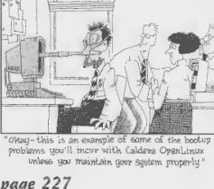


“噢，真遗憾，伙子们！请务必避免 Caldera Open-Line 爆发。噢不！我们今天最好保持好心情，躲进高天。”

“哎哟！如果你不妥善维护你的系统，这就是你将在 Caldera Open-Line 中将要遇到的一些最棘手的问题示例：”

“这被称为 Caldera Open-Line 爆炸！每个人都会遇到一次，你只能祈祷从对手手中逃脱，但没有人能逃脱。命运眷青那些脸出现在灾难之上面的人。”

如果我能说什么，那就是‘为了我的 Gaten 感谢 TFC’，我担心最好不要怕我，编辑让我陷入了这种毁灭性的困境。”


现代婚姻

HEE 同意了银色版、饥饿，并且仍然让我继续工作处理这种毁灭性的局面。

正开始失败，试图找到一种方法，因为 Caldera 爆发需要告诉一个峰值以便撤退。

我不认为是 Caldera 爆发本身有多么魔力，不如说是它与某种小瘟疫的联系。

电子邮件：richtennant@the5thwave.com

全球网：www.the5thwave.com

接下来该做什么................................................................................7

# 第一部分：介绍 OpenLinux................................................................ 9

# 第二章：访问 OpenLinux................................................................ 19

# xiv 傻瓜版 Caldera OpenLinux

# 第十一部分：安装 OpenLinux........................................................... 33

磁盘驱动器...............................................................................40

从 Windows 95/98 获取信息..................................................................42

留下线索................................................................................52

+ 第四章：为 OpenLinux 腾出空间..................................................53

从软盘启动.......................................................................61

+ 第五章：安装：最后的冲刺..............................................................65

+ 第六章：使用图形系统解决问题......................................81

# 第三部分：使用 OpenLinux ................................................................................113

# 第 9 章：使用编辑器 ................................................................141

# xvi Calder OpenLinux 傻教程

# 第 10 章：避免 Shell 冲击 ............................................................ 155

# 第 11 章：世界上的窗口 ................................................... 183

- 再见，KDE ................................................................................. 204
- 将一切链接到 KDE ....................................................... 204

# 第 12 章：做些用的事情 ................................................... 207

# 第四部分：维护你的系统...............................................227

## 第 14 章：自定义 OpenLinux...............................................................245

# 第五部分：在线...............................................................257

## 第 15 章：设置你的互联网连接.......................................259

# xviii OpenLinux 入门

- 启动它！................................................................................274

## 第 16 章：浏览网页.......................................................275

# 第六部分：部分...............................................................289

## 第 17 章：帮助来源..................................................291

## 第 18 章：问题领域与解决方案..................................................301

- 未检测到我的 CD-ROM...............................................................303

# 第七部分：附录...............................................................309

## 附录 B：OpenLinux 手册页 (man Pages) .................................................325

# 通用公共许可证协议..................................................357

## 引言

其他关于 OpenLinux 的书籍包含了许多 UNIX 系统管理员感兴趣的迷人信息，以及一长串难以发音且带有混乱选项的命令。这本书与众不同。在《Caldera OpenLinux 傻瓜指南》(OpenLinux For Dummies) 中，这些迷人的信息是为你准备的，而且描述和指导是用通俗易懂的英语编写的。


将这本书作为一份趣味且信息丰富的 OpenLinux 参考资料使用。或者买一叠《Caldera OpenLinux 傻瓜指南》并用它们来压花。（嘿，你仍然可以使用最上面那本作为 OpenLinux 的参考。）

# 关于本书

这本书的设计旨在作为一份得得手的参考资料。当你花费两个小时徒劳地输入 `xstart` 并两次加载窗口系统（`Window System`）后，你五岁的孩子却告诉你 `x` 应该放在单词末尾时，《Caldera OpenLinux 傻瓜指南将为你提供寻求帮助和慰藉的地方。

我们试图让书中充满你需要了解的内容，例如：

- 安装 OpenLinux

- 探索 KDE 图形桌面

- 发出重要命令

- 处理文件和目录

- 使用文本编辑器和其他有趣的应用程序

- 上网冲浪

- 寻找帮助

你可以在书中各处看到故障排除的提示。实际上，OpenLinux 并没有那么麻烦——我们只是希望你的体验尽可能顺畅。

# 愚蠢的假设

你知道人们对那些做假设的人怎么说，但如果我们不做出几个假设，这本书就写不出来。如果你符合以下情况，这本书就是为你写的：

- 你有一个 OpenLinux 操作系统。惊喜——书后的 CD-ROM 里有一个。

- 你有一台电脑。

- 你想把 OpenLinux 操作系统和你的电脑结合起来，但使用胶带并没起作用。

- 你不需要成为 OpenLinux 大师——至少现在不需要。

# 本书使用的约定

在计算机约定中，成千上万的计算机爱好者聚在一起讨论深度问题，例如：

- Tim-Tams 饼干是终极垃圾食品吗？

# 输入代码

文中的命令显示如 `this`。文中没有出现但单独占一行的命令看起来像这样：

```
pwd
```

如果我们在文中对命令进行了加粗处理——如 `pwd` —— 这意味着你应该输入该部分。我们经常展示命令及其返回文本的示例，看起来像这样：

```
[maddog@shamet maddog]$pwd
/home/maddog
```

## 引言

除去命令以外的内容——在本例中，除 `pwd` 之外的所有内容——是计算机之前在屏幕上显示的内容，或者是命令返回的内容。因此，在这个示例中，在你输入 `pwd`（并按回车）后，电脑显示 `/home/maddog`。就这些吗？嗯，不完全是。注意上一个例子中的 `maddog@shame.maddog` 吗？你不会在你的系统上看到它，除非你也叫 maddog。但你会看到类似的内容。`/home/maddog` 也是如此；maddog 被替换为你系统的目录名。

现在，还有一些复杂的后续。请看以下内容：

```
[root@localhost /root]# passswd <name>
```

`<name>` 是斜体的，这意味着你应该用一个名称替换 `<name>`。在这种情况下，你用你的登录名替换 `<name>`。你该如何知道这一点呢？别担心。我们会在文中告诉你。

以下是 OpenLinux 命令语法的概览：

- 未被 `[`、`(` 或 `<` 括起来的文本必须与显示完全一致

- 方括号 `[]` 内部的文本是可选的。

- 尖括号 `<>` 内部的文本必须替换为相应的文本。

- 大括号 `{}` 内部的文本表示你必须在大括号内选择一个值，并用 `|` 符号分隔。

- 省号 `...` 表示“以此类推”，或根据需要重复前面的命令行。

现在不要过于担心这些信息。对于书的大部分内容，你不需要了解这些细节。如果你确实需要了解某些特定语法，请回到这里进行复习。

# 快捷键等内容

快捷键通过加号显示。例如，`Ctrl+Alt+Delete` 意味着你同时按下 `Ctrl` 键、`Alt` 键和 `Delete` 键。

你还会看到类似这样的：

```
[maddog@localhost]$ maddog$ vi quagmire
date
echo
cut -f 1,5 -d: /etc/passwd | sed -e 's/:/
'
```

现在，你通过阅读“输入代码”部分知道加粗的内容需要按显示输入。但在这种情况下，尖括号内的内容 `ESC` 键。

# 本书的结构

对于所有的傻瓜指南，本书被分为独立的部分。好吧，并不完全如此。对于其他部分，你可以按任何顺序阅读。嘿，尝试倒着读来挑战一下。在本节中，我们将告诉你每个部分的内容。

# 第一部分：介绍 OpenLinux

在第一部分中，你将了解到 Linux 的诞生以及 Caldera OpenLinux 如何融入这段迷人的历史。

## 第二部分：安装 OpenLinux

在第二部分，你将得到老问题的答案：我到底如何安装 OpenLinux？我们提供了详细的分步说明。你还将获得关于安装窗口系统和 KDE（OpenLinux 的图形部分）的大量帮助。对于这一部分，你可能需要双份咖啡或一罐 Jolt 汽水（富含糖和咖啡因！）在身边。

# 第三部分：使用 OpenLinux

在第三部分，你将获得关于操作 OpenLinux 的精彩细节。我们带你了解文本器的历史以及如何使用它们。你发现并不是所有的 Shell 都在海底；OpenLinux 有一个适合你的 Shell。你还可以让 KDE 运转起来，通过移动、调整大小、隐藏窗口以及使用随附的许多应用程序。

# 第四部分：维护你的系统

OpenLinux 不是一个高维护的操作系统，但它确实需要照顾。（巧克力文件系统也是）。在第四部分中，你将了解到如何管理 OpenLinux 文件系统，这是照顾 OpenLinux 的大部分工作。你还将获得关于提升 OpenLinux 性能的提示。轰。

# 第五部分：上网

# 第六部分：十条

一本傻瓜指南如果没有“十条”是不完整的。那就是第六部分。你将在第 17 章找到所有重要的 OpenLinux 资源。在第 18 章，我们为人们在安装 OpenLinux 后最常见的问题提供解答。

# 第七部分：附录

最后是附录。在附录 A 中，我们列出了 Caldera Systems 认为与 OpenLinux 兼容的所有硬件。在附录 B 中，你将了解到关于 OpenLinux 手册页的所有知识。在附录 C 中，我们告诉你在书中哪里可以找到安装 CD-ROM 的信息。

## 第6 章 Caldera OpenLinux 入门教程

### CD-ROM 的其他用途

在计算机和计算机程序员很多的地方，大量的 CD-ROM 通过邮件寄达或作为某人购买的软件的一部分到达。最终，这些 CD-ROM 过时或从未被安装——那些作为不需要的广告送到的软件产品就是如此。具有环保意识的程序员可以对这些 CD-ROM 做些什么，让它们不占满填埋场呢？

钟。（Maddog 有四个这种我们用 Windows NT CD-ROM 制成的钟——嘿，你能想象出比这更好的用途吗？）

对 CD-ROM 进行更奇特的用途需要高温来将其熔化，并使其塑形在水杯底部周围，从而制作成花盆或烛台。正如你可以想象的，这样做导致了这些设施管理层的些许恐慌，特别是当他们发现购买的较昂贵的程序之一最终落在了花盆底部时。

一组程序员会把废弃的 CD-ROM 用作杯垫。另一组人则从 CD-ROM 中制作出手机挂饰。（阳光照射在 CD-ROM 上的光芒会在墙上投射出美丽的彩虹。）还有一些人把 CD-ROM 用作钟，通过购买廉价的石英钟机芯（带指针）并使用 CD-ROM 作为表盘。

现在，当你不使用它时，请将你的 CalderaLinux 入门教程 CD-ROM 存放在安全的地方，例如书后侧的套袋里。

### 你不需要阅读的内容

见鬼，如果你不想读，你不需要读这本书的任何内容，但你为什么要买它呢？（并不是我们在抱怨。）第一部分包含背景信息。如果你不想看，就别读。此外，侧边栏中的文字是可选的，尽管通常很有帮助。如果你正处于使用 OpenLinux 的快速通道，可以跳过侧边栏和带有技术细节（`Technical Stuff`）图标的文本。但我们建议你放慢速度，享受这个过程。

### 书中的图标


这个图标指向了特别极客的技术信息。你可以跳过这些内容。

这个图标标记了与 CD-ROM 相关的讨论。该 CD-ROM 是 Caldera Systems OpenLinux 2.3 的副本，这是出版时的最新发行版。

### 引言

不要让这种事情发生身上！我们希望我们在 UNIX 和 Linux 的经验能帮助你避免第一次尝试时犯同样的错误。

巧妙的小快捷径可以节省时间。OpenLinux 是一个强大的操作系统，通过利用 OpenLinux 中的工具和程序，你可以节省不可信的时间和精力。我们希望我们的提示能告诉你如何做到。

Maddog 在 Linux 世界里算是一个偶像（图标：一个盲目崇拜的对象），而这个图标（页边处带有主体肖像的小圆圈）表示了他丰富经验中的故事或观点。

Nick（像 Maddog 一样）拥有一令人印象目的 Linux 资历，这个符号表示 Nick 在通往 OpenLinux 魔法师之路上的某种经历或观点。

### 从此以后去哪里

你即将加入使用和开发 OpenLinux 的人群大军。我们使用 Linux 已经超过五年（使用计算机近二十年）。我们发现 OpenLinux 是一个灵活、强大的操作系统，即使在不购买大量额外软件的情况下也能解决大多数问题。OpenLinux 操作系统的未来是光明的。你为了熟悉 OpenLinux 所花费的时间精力是值得的。拥抱 Linux。

## 第一部分

### 介绍 OpenLinux

> 听着，我说的只是，“给盖斯先生来 FTC”，结果那个戴大眼镜的极客家伙走出来告诉他不怕我，我可以随心调查他，而他会带着这些律师在法庭见我。

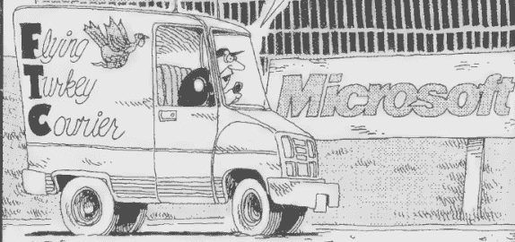

如果你想了解 Linux 尤其是 OpenLinux 到底是什么，请查看这一部分。首先，我们深入研究了一段历史（远没有我们想的那么多）。然后你会发现为什么 Linux 比其他系统更快、更小、更便宜且更漂亮。此外，你还将获得关于使用 OpenLinux 的不同方法的建议。

## 第 1 章

1991 年，赫尔辛基大学的本科生 `Linus Torvalds` 获得了一台全新的 `IBM 386`。Linus 对这台电脑不满意，他想运行 Linux。UNIX 太贵了，所以 Linus 和一个才华横溢的程序员团队着手了这项任务。从那些早 Implementation起，Linus Torvalds 就一直出现在《福斯》杂志的封面。谁知道未来五年会带来什么呢？

### 为什么它是免费的？

Linus 做出的最重要的决定之一是所有代码都可以免费分发。为了进一步了解许多免费组件，你可能想访问自由软件基金网站 `www.fsf.org`。


## 12 第一部分：介绍 OpenLinux


### 让我们开放地面对 Linux

Linux 是今天第一个在美国境外启动的操作系统。所有其他操作系统虽然接受了非美国参与者的某些支持和建设，但构思于美国。来自世界各地的人——从未被全球公认的技术国家不断增加——都在为 Linux 做贡献。当我与巴西圣保卢大学校长站在运行 Linux 的学校超级计算机前时，他对我的观察说：“我们也考虑过这一点。”

当人们问我为什么认为 Linux 和开源开发项目如此重要时，我回答说并不是自大地认为所有优秀的程序员都来自

源代码可用性的重要性怎么都不为。免费分发源代码的结果是一个不断改进的 Linux 操作系统。每个开发者都可以在早期开发者的努力基础上进行构建，造福每个人——包括你。

Linux 内核开发始于 1991 年。到 1994 年早春（在 Caldera 开始不久），Linux 的第一个版本（`V1.0`）开放供使用。即使那时，Linux 也是一个惊叹的操作系统，在 `Intel` 系统上只需少于 `2MB` 的内存即可极速运行。这个免费系统包含了以下功能，这些功能在花费数百美元的操作系统中：

# 第一章：OpenLinux 与你

Caldera 的角色何在？Caldera 由 `Bryan Sparks` 于 1994 年创立，旨在创建一个基于 Linux 的完整桌面和服务器操作系统。Caldera 创建了一个名为 OpenLinux 的发行版，其重点是提供一个能让企业和新用户受益的 Linux 系统。为此，OpenLinux 包含了目前所有 Linux 发行版中最易操作的安装程序和最丰富的商业插件。本书描述了 OpenLinux 2.3 版本，该版本也包含在 CD-ROM 中。

## 添加其他组件

从互联网上收集 Linux 软件并为像你这样的用户封装软件的公司提供了极佳的服务。但单靠这项服务并不能成就一项伟大的事业；利润空间太小，因为任何拥有光刻刻录机的人都能加入。因此，像 Caldera Systems, Inc. 这样的公司在他们的 Linux 产品中添加了各种其他东西——那些互联网上无法获得的东西。这就是为什么人们愿意花大钱购买那些原本可以免费下载的软件包。OpenLinux 的亮点包括：

- 技术支持选项，包括为真正需要支持（并愿意额外付费）的用户提供的电话支持，以及基于 Web 的信息搜索。

虽然本书没有包含三张 CD-ROM 和 `WordPerfect` 等商业产品（因为 Caldera 将所有内容都保存在其软件盒中销售），但包含了图形化安装程序，因此你可以轻松地开始使用！


## 14 第一部分：简介 OpenLinux

### 以不同的方式使用 OpenLinux

OpenLinux 是一个多功能的操作系统。虽然 Linux 最初是计算机科学学生的独领领域，但现在 OpenLinux 已被企业和政府用于降低成本和提高性能。你可以以多种方式使用 OpenLinux：作为桌面工作站、服务器、嵌入式系统的基础（如智能 VCR 录像机或机器人），甚至作为超级计算机。第 5 章中描述的安装选项允许你选择打算用于 Linux 的系统类型。你的选项包括家庭系统、服务器、开发工作站和企业服务器。

Linux 的另一个流行用途是用于互联网服务提供商（`ISP`），他们使用 Linux 为互联网和万维网提供信息和业务。得益于成千上万致力于 Linux 不同部分的人，该系统每天都变得更加灵活、强大。

接下来的章节描述了你可以使用 OpenLinux 的某些方式。

### 个人工作站

凭借 OpenLinux 的强大，你可以同时运行许多程序，一次处理多个用户的需求，并使用高质量的图形界面。OpenLinux 可以处理极其巨大的文件和程序。OpenLinux 使用了一种名为 `X Window System`（也称为 `X Windows`、`X11` 或简称为 `X`）的复杂窗口系统，不仅可以与大多数 UNIX 系统共享文件，还可以与 `Microsoft Windows`、`OS/2` 以及其他操作系统共享。

如果 Open OpenLinux 包含的程序数量不能满足你的需求，可以使用额外的商业应用程序。这些应用程序包括 `Oracle` 或 `Sybase` 等数据库；专门的科学程序；以及办公套件，如 `WordPerfect` 和 `Applixware`。通过 OpenLinux，你可以在笔记本电脑、桌面工作站和大型服务器系统上拥有相同的环境。

### 文件和打印服务器

由于其多任务能力、虚拟内存和强大的文件系统，OpenLinux 作为 `Microsoft Windows` 系统的文件和打印服务器效果良好。一种名为 `Samba` 的软件产品允许运行 Windows 的 PC 与文件系统以及连接到 OpenLinux 机器的打印机通信。`AppleTalk` 允许 Apple 计算机共享文件和打印机。当然，OpenLinux 可以与 UNIX 系统共享文件和打印机。通过使用 OpenLinux 管理文件和打印机，你可以节省大量资金，因为操作系统以及提供这些服务的分层软件已包含在本书 CD-ROM 中的基础 OpenLinux 产品中。

互联网（全球网络）和局域网（单一企业内部使用的微网络）的许多功能的实现归于 `HTML`（超文本标记语言）和万维网。UNIX 系统处于发展的前沿，而局域网需要类似的服务，例如：

许多互联网服务提供商（`ISP`）使用 Linux 提供服务，是因为 OpenLinux 是高效的，而且因为操作系统的源代码是提供的。如果出现问题，ISP 可以从 Caldera 网站下载补丁，或者自己解决问题。另一种方案是等待软件供应商修复问题。

## 16 第一部分：简介 OpenLinux

及时的修复有多关键？嗯，1997 年，一个由于恶意使用 `TCP/IP` 产生的问题影响了几乎所有的 UNIX 系统。这个问题允许坏人（黑客）关闭其他人的系统。世界需要软件更新——而且要快！OpenLinux 以及所有 Linux系统的更新在问题出现四小时后就出现在互联网上了。各种供应商花费了几周时间开发类似的更新并发送给他们的客户。

### 三层体系架构

哇！到底什么是三层体系架构？三层架构简单来说意味着大多数大型计算任务可以分解为三个独立的层：

如果我们把问题分解为这三个层，问题通常更容易解决，并在需要时更容易更改。直到最近，数据显示层是由运行在桌面上的 Windows 系统组成的（可能使用 `Visual Basic` 开发界面）。数据处理层和数据存储检索层是通过网络通信的 UNIX（或旧系统）组成的。

但现在，数据显示层可以是运行免费 Web 浏览器或免费 `Java` 系统（一种应用程序的可移植环境）。通过使用 OpenLinux，一些公司可以节省数千美元的操作系统成本，同时获得所需的安全性和健壮性。

与大多数 UNIX 系统一样，OpenLinux 还拥有复杂的数据处理工具，使 OpenLinux 成为良好的二层系统。OpenLinux 可以从旧系统文件的各种类型数据库或报告中提取数据，然后对数据进行排序、搜索、合并、处理和其他操作，将新结果传递给桌面显示层。

最后，OpenLinux 具备作为良好数据存储和检索层的设施。多个商业数据库包运行在 OpenLinux 上。这些包包括 `DB2`、`Oracle`、`Informix`、`Sybase` 和 `Interbase`。如果你负担不起商业数据库包，可以使用免费提供的包，例如 `Postgres`。

# 第一章：OpenLinux 与你


三层架构的概念是在逻辑上划分工作，在你完成这种划分后，就可以将这三部分功能部署到一台计算机上——即一台 `OpenLinux` 系统。

## 交箱式系统（Turnkey system）

交箱式系统只需组装一次，然后在成百上千处进行复制。典型的交箱式系统包括信息查询亭、酒店预订系统、医生和律师事务所系统以及汽车诊断系统。`OpenLinux` 非常适用于交箱式系统的工作，因为 `OpenLinux` 提供了交箱式系统所需的安全性、保护和稳定性，而无需为许多份操作系统支付巨额费用。例如，假设 4,000 个酒店系统需要某个应用程序。如果企业必须为每个操作系统支付 500 美元，那么仅仅为了涵盖操作系统，项目就需要额外花费 2,000,000 美元。

## Linux 无处不在

## 第二章

- 与商业程序共舞

`Caldera OpenLinux For Dummies CD-ROM` 提供了一份 `Caldera Systems OpenLinux 2.3` 的副本。虽然有很多 Linux 发行版可用，但 `OpenLinux` 是一个极佳的选择，特别是对于新用户或专注于 Linux 业务的人来说。本章重点介绍了 `OpenLinux` 包含的一些工具，例如文本编辑器和邮件接口——仅为了勾起你的胃口。我们会在书中其他地方让你查找更多信息。

## 做你自己的软件律师

`Linus Torvalds`（林斯·托瓦兹）和 Linux 开发团队创建了 Linux 操作系统内核。内核包含了管理内存、文件、运行程序、网络以及各种硬件设备的软件。将内核想象成指挥交通的警察即可。

构成大多数人认为 Linux 的编译器和其他程序，来自不同的人士，他们通过互联网或 `CD-ROM` 分发这些程序。通常，这些人会添加安装技术、系统管理工具、一些应用程序（无论是免费软件还是商业软件）以及发行介质，正如 `Caldera` 对 `OpenLinux` 所的那样。在任何情况下，Linux 许可证都要求基础 Linux 系统可以自由复制，即使增值组件不是。

## 第一部分：简介 OpenLinux

## 不同的 Linux 系统……嗯，很不同！

要深入描述其他 Linux 发行版需要大量空间，但以下信息可以让你对 Linux 世界包含的内容有所了解，除了你手中的这款 `OpenLinux` 产品之外。

`Red Hat Software` (`www.redhat.com`) 是由三位 Linux 爱好者合作的早期发行版，后来红帽最大的分发商 `ACC` 也加入了他们。

早期的发行版之一是 `Yggrasil` 发行版。在进行简单的安装后，`Yggrasil` 启动了 `X Window` 系统，显示了一些 `mpeg` 视频，并在计算机控制台上发出了“Hello”。

`S.U.S.E. GmbH` (`www.suse.com`) 是一家德国公司（在加利福尼亚设有办事处），推出德语和英语版本的发行版。`S.U.S.E. GmbH` 还代理其他人的发行版产品。

另一个发行版是 `Slackware`。由 `Patrick Volkering` 和各种经销商分发并持续维护（以 `Walnut Creek CD-ROM` (`www.cdrom.com`) 的形式存在），`Slackware` 分为软件包，从网络或 `CD-ROM` 复制到其他包中。你可以直接通过 `www.slackware.com` 联系 `Slackware` 的人员。

`Pacific HiTech, Inc.` (`www.pht.com`) 是一家提供 Linux 翻译版的公司，包括日语和中文翻译。`Pacific HiTech` 最近更名为 `Turbo Linux` 并开始销售专门的高端 Linux 服务器。

`OpenLinux` 是许多 Linux 发行版之一，也有许多 Linux 应用程序可用。这些发行版在成本、外观和法律影响方面存在很大。根据作者/所有者的决定，Linux 应用程序可能归类为以下任一：

- 免费可用软件

免费可用软件供终端用户免费使用。虽然软件可能是免费提供的，但此类软件通常并非公有领域（即任何人都可以随意使用）。免费软件通常由作者或作者拥有版权，他们允许人们使用或对其进行修改。免费软件使用许多不同的许可证。免费软件最著名的许可证是通用公共许可证（`GPL`），也称为开源软件（见 `www.fsf.org` 和 `www.opensource.org`）。

## 第二章：访问 OpenLinux

免费可用软件可进一步分为你可以自由复制或自由分发的软件。有些人免费提供他们的软件，但前提是你直接从特定站点或非商业发行版复制。其他人则允许你在任何地方复制他们的软件。复制限制通常适用于制作发行版的人，而不是该发行版的用户。基于免费可用软件创建产品的公司有义务遵守

免费并不总是好事。当我在 `Caldera` 工作时，有一个系统管理员来我们这里，因为他的经理对使用 Linux 感到不悦。“我们不运行免费的东西！”经理坚持认为。我们为他提供了一份 Linux（当然带有文档和支持），大家都开心了。

许多免费应用程序已从 `UNIX` 移植到 `OS/2`、`Windows 3.1`、`95`、`98` 和 `NT` 以及其他操作系统。如果你使用已移植到许多操作系统的应用程序，例如 `emacs(1)` 编辑器，你可能会在其他操作系统中使用相同的应用程序。

当你看到一个词（例如 `emacs`）后面跟着一个括号数字时，该名称指的是 Linux 手书中关于如何使用该命令的章节。例如，`emacs(1)` 是一种用于处理文件中文本的文本编辑器，而 `emacs(1)` 文档位于手册页的第 1 部分。`1pd(8)` 是位于参考手册第 8 部分的命令。在你的 Linux 系统运行后，你可以输入以下命令：

```
man emacs
man 1pd
```

获取使用这些命令的信息。

非免费应用程序由商业应用程序和共享应用程序组成。商业应用程序直接出售。共享应用程序可以试用或个人使用。如果你经常使用该共享软件或想出于商业目的使用程序，那么你应该向作者付费。金额通常很小（25 美元很典型；200 美元是高端）。

要查看非免费应用程序列表——在你安装了 Linux 系统并启动 `KDE` 桌面后——请在终端模拟器中输入以下命令查看商业 `HOWTO`：

```
netscape:/usr/doc/HOWTO/other-formats/html/Commercial-HOWTO.html
```

# 22 第一部分：介绍 OpenLinux

此文件是在您安装系统时从您的 `Calder OpenLinux For Dummies` 光盘中提取的。`Calder OpenLinux` 光盘上的文件可能是您在互联网上找到的较旧版本。要获取最新的非免费应用程序列表，你可以使用 Web 浏览器访问以下 `URL` 查看 Linux 商业 `HOWTO`：

```
www.linuxhq.com/tbm/Commercial HOWTO
```

你还可以浏览一些 Linux 应用程序目录。网站包含了有关免费可用程序和商业应用程序的信息。尝试 `www.linuxapps.com` 或 `SAL.KachiTech.com`（用于 Linux 上的科学应用）。


越来越多的商业软件程序供 Linux 使用。寻找软件程序的好方法是查阅杂志，例如《Linux Journal》（或者在德国或波兰，是《Linux Magazine》或《LinuxPlus》），

## 界面：美观还是快速？

`OpenLinux` 可以分为免费和非免费，也可以分为字符单元程序和图形化程序。字符单元程序是典型的应用程序类型，你输入一个命令，系统做出响应。`MS-DOS` 是字符单元操作系统的示例。在图形化应用程序中，你使用鼠标和键盘告诉计算机要做什么。`Microsoft Windows` 是图形系统的普及例子。


`UNIX` 起于字符单元操作系统，然后增加了图形窗口系统。`OpenLinux` 从 `UNIX` 继承了字符字符单元和图形特征。

你可能大部分时间都会在图形模式下使用 `OpenLinux` —— 这是你安装 `OpenLinux` 时的默认启动模式。`OpenLinux` 的图形部分被称为 `KDE` 桌面，或简称为 `KDE`。`KDE` 看起来很棒，但使用图形系统有几个缺点：

- 许多字符单元程序是在 `X Window` 系统（`KDE` 所在的 `OpenLinux` 窗口系统）和 `KDE` 时代之前创建的。有些在字符单元模式下运行效果更好。在第 10 章，你会看到许多在字符单元模式下运行良好的应用程序。

- 管理图形界面对你的计算机来说始终是大量工作。

## 第 2 章：OpenLinux 的装饰

如果你的系统变慢到让你心烦的程度，请增加内存、购买更快的计算机，或尝试一些字符单元程序。此外，如果你短时间使用笔记本电脑（例如在会议中记笔记），并发现 `X Window` 系统及其相关程序的启动时间太长，你可能想要选择（正如我们经常这样做那样）字符单元模式。

接下来的章节将带你了解一些字符单元和图形应用程序。

## 文本编辑器

`OpenLinux` 带有几种不同的文本编辑器。文本编辑器通常允许你输入和处理字母数字字符的程序。某些文本编辑器可以执行简单的文字处理任务，如自动换行，但大多数编辑器无法执行大多数文字处理功能，如拼写检查或将文本设斜体。事实上，纯文本文件无法存储有关文本格式的信息，例如大字体、粗体和斜体。纯文本文件只存储你输入的字符。

文本编辑器适用于简单的文本编辑任务以及编写简单甚至复杂的程序。大多数编辑器都有内置的帮助功能，或提供在线帮助。此外，你还可以找到关于一些编辑器的书籍，例如 `vi(1)` 和 `emacs(1)`。

在本节中，我们描述了随 `OpenLinux` 一的字符单元文本编辑器和基于图形的文本编辑器。我们还会提到一些商业文本编辑器。

### 字符单元文本编辑器

所有 Linux 系统上的“编辑器之编辑器”被称为 `vi(1)`，即视觉编辑器（`visual editor`）。信不信，`vi` 比它的前身更具视觉化。`vi` 写于 20 世纪 70 年代中期，`vi(1)` 允许人们一次看到整屏文本！虽然学习 `vi(1)` 有挑战性，但了解它是一个好主意，因为 `vi(1)` 是你处理的任何 Linux 系统上通用的编辑器。使用 `vi(1)` 还让你觉得自己非常聪明 —— 这就是我们在第 9 章向你展示 `vi(1)` 基础的原因。许多 Linux 系统带有一个名为 `vim(1)`（改进版）的 `vi` 新版本。

另一个字符单元文本编辑器是 `emacs(1)`，它是自由软件基金会的之星之一。`emacs(1)` 的追随者声称 `emacs(1)` 不仅仅是一个文本编辑器；还是阅读邮件、调试程序、从互联网阅读新闻以及各种其他面向文本活动的接口。这个


`emacs(1)` 程序还可以模拟多个字符单元编辑器，并跳转到图形模式。内存占用和使用大量磁盘空间是 `emacs(1)` 的缺点。

记住，你可以在图形环境（`KDE`）中启动任何字符单元编辑器。

### 图形文本编辑器

除了 `OpenLinux` 自带的所有字符单元编辑器外，`KDE` 还内置了两个出色的文本编辑器。第一个编辑器被称为 `Kedit`，是一个图形编辑器，但增加了如拼写检查等功能。通过 `KDE` 菜单中的选择编辑器启动 `Kedit`。

`KDE` 中更高级的旨在替代 `Kedit` 的编辑器是 `Kwrite`。`Kwrite` 是为程序员设计的。通过 `KDE` 菜单中的高级编辑器启动 `Kwrite`。

## 商业文本编辑器

有几种商业文本编辑器可用，与简单的文本编辑器相比，其中一些具有显著价值（特别是对于软件开发人员）。两种最流行的编辑器是：

- `MicroEdge` 开发的 `Slick Edit`，一种基于 `X11` 的编辑器，也运行在 `Windows 3.1`、`95`、`98` 和 `NT` 上。该编辑器是语言敏感的，如果你使用 `C++`、`Java`、`HTML`、`Perl`、`AWK`、`Pascal`、`FORTRAN`、`BASIC`、`dBase-2`、`COBOL`、`Ada` 或其他语言编程，`Visual Edit` 支持这些语言并尝试让文本更易读、可搜索。`Visual Edit` 模拟其他编辑器（如 `vi`、`emacs` 和 `Brief`），并与其他跟踪代码程序集成。`Visual Edit` 绝对是程序员编辑器，但对非程序员也有用。

- `Vital` 开发的 `Crisp`，另一种语言敏感的跨平台编辑器，适用于许多不同的 `UNIX` 和 Linux 系统，以及 `Windows 3.1`、`95`、`98` 和 `NT`。

## 邮件工具

电子邮件由两个主要部分组成：用于编写或读取消息的前端。在本节描述的邮件程序外，注意某些 Web 浏览器可以读取邮件和互联网新闻（通过互联网访问的一系列信息）、处理 `FTP` 文件下载并执行其他与互联网相关的任务。

### 字符单元界面

最早的邮件界面仅在字符单元模式可用。某些字符单元界面如下：

- `mail(1)`：最早的邮件界面之一。`Mail` 是早期版本 `UNIX` 的字符单元界面。`mail(1)` 仍然是一个强大的界面，当你在字符单元模式下工作想要发送快速邮件或扫描最近邮件时，它是一个非常有用的程序。

- `elm(1)`：一种交互式屏幕式邮件程序，可以替代 `mail(1)` 作为前端。`elm(1)` 易于使用，并为创建邮件消息提供了类似 `vim(1)` 的编辑器。`pine(1)`（现在意味着互联网新闻和电子邮件，但以前以更友好的名称 `pine` 闻）是一个全屏邮件界面。

# 第一部分：介绍 OpenLinux

-   `pine(1)` 具有许多 `elm(1)` 的功能，此外还有一些自己的特性。`pine(1)` 使用一个名为 `pico` 的简单编辑器来编写邮件，并还可以处理 `MIME`（多用途互联网邮件扩展），用于通过邮件发送图片、计算机程序和其他非文本项目。

`pine(1)` 运行在 `DOS` 和 `Windows` 系统上，也运行在许多 `UNIX` 系统上。`pine(1)` 内置拼写检查器（给老板写信息时这总是很有用的）；可以读取 `NNTP`；可以用于访问网络新闻；并可以处理 `IMAP` 邮件，`IMAP` 将邮件发送到从互联网任何地方都可以访问的存储位置——尤其是当你带着笔记本电脑携带 Linux 旅行时，因为你可以连接到互联网服务提供商（`ISP`）然后处理你的邮件。

`mh(1)`：也被称为 `RAND` 消息处理系统，`mh(1)` 是一系列可以在命令行级别进行邮件操作的命令。`mh(1)` 是一个全面的邮件接口，允许你为邮件创建不同的文件夹，以多种方式扫描文件夹中的邮件，并回复、转发以及其他管理你的邮件。因为它由这些不同的命令组成，`mh(1)` 被用于构建两个非常有用的图形化界面：`xmh(1)` 和 `exmh(1)`，它们将在下文中描述。

## 图形邮件接口

图形邮件程序提供了一个强大且易用的界面来读取和操作邮件。图形邮件接口就像图形文本编辑器一样，需要 `X Window` 系统并可以在 `KDE` 中运行。

`xmh(1)` 是为前面提到的面向字符单元的 `mh(1)` 命令编写的图形界面。因此，你可以在图形环境下的 `mh(1)` 和 `xmh(1)` 之间切换使用，`xmh(1)` 是一个用于演示 `X Window` 系统早期版本的简单接口。


我更喜欢 `exmh(1)` 图形邮件程序，因为它是免费分发的，我可以在家里、学校以及旅行时的笔记本电脑上使用相同的界面。`exmh(1)` 非常强大——具有 `MIME` 和 `POP` 功能、文件夹支持，以及用于定制打印、编辑器以及的一系列其他参数的简单方法。`exmh(1)` 邮件程序还会高亮邮件文本中的 `URL`（网页地址）；当你点击 `URL` 时，`exmh(1)` 会调用你的浏览器并显示该 `URL`。`exmh(1)` 具有全面的搜索功能，用于查找分类文件夹的邮件消息。

`KDE` 包含一个名为 `Kmail` 的电子邮件接口。可以从 `KDE` 中的“Internet”菜单启动 `Kmail`。初始屏幕（已显示几条消息）如图 2-2 所示。

# 第2章：OpenLinux 的配件

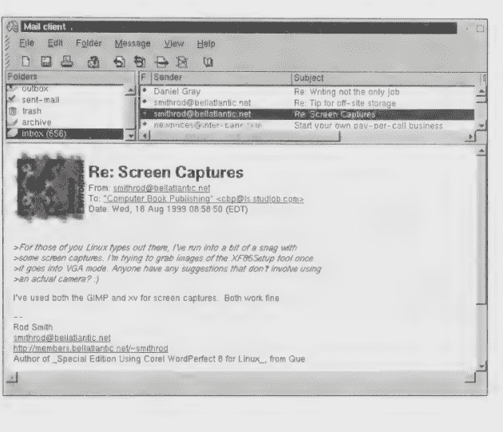

图 2-2：`KDE` 中的 `Kmail` 图形邮件接口。

`Kmail` 包含许多高级功能，例如 `MIME` 附件、电子邮件过滤器、多个邮件文件夹，并支持所有三种流行的邮件协议：`POP`、`IMAP` 和 `SMTP`。如果你用过任何基于浏览器的邮件阅读器（如图 2-3 所示），那么 `Kmail` 中的邮件编写窗口应该看起来很熟悉。

## 商业邮件接口

与文本编辑器一样，还有几种商业邮件接口程序可用。某些程序单独出售；另一些则是应用程序套件的一部分。其中一种产品是来自 `NetManage Software` 的 `Zmail`。`Zmail` 已被移植到 `UNIX` 系统，还移植到了 `Windows 3.1`、`95`、`98` 和 `NT`。因为 `Zmail` 跨多个系统工作，你可以在所有平台上使用相同的邮件接口。

另一个商业邮件接口位于 `Applix` 中，它由 `Applix, Inc.` 。该产品是一个办公套件，由一个 `WYSIWY`（所见即所得）文本处理器、一个集成电子表格、一个演示文稿包、一个图形编辑器和一个邮件前端组成。在图 2-4 中，你将看到 `OpenLinux` 完整商业版中包含的一些 `Applixware` 组件。

# 第一部分：介绍 OpenLinux

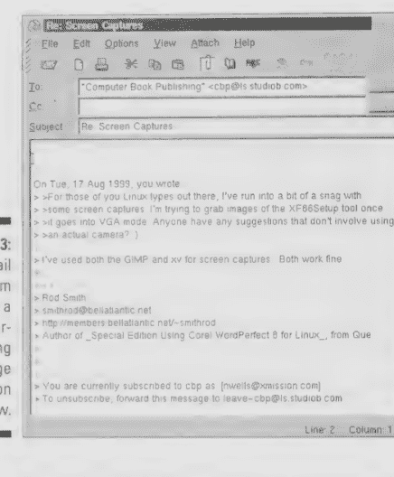

图 2-3：

`Kmail` 程序使用了一个熟悉的邮件编写窗口。

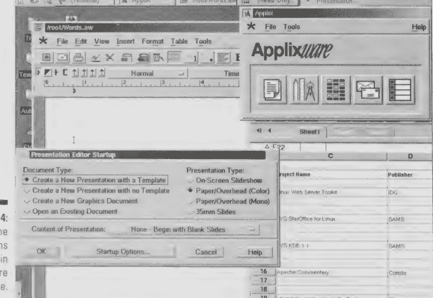

图 2-4：

`Applixware Office` 套件中的某些应用程序。

# 第2章：OpenLinux 的配件

另一个具有完整电子邮件能力的商业产品是 `StarOffice`。这个完整的办公套件包含在 `OpenLinux` 的完整版本中。`StarOffice` 中的电子邮件客户端集成在桌面环境中，带有字文字处理器、电子表格以及许多 `Internet` 功能，如网页浏览和 `FTP` 站点访问。图 2-5 显示了 `StarOffice` 的邮件接口。

关于 `StarOffice` 的更多信息，请查看《StarOffice For Linux For Dummies》，Michael Meadhra (IDG Books Worldwide, Inc.)。


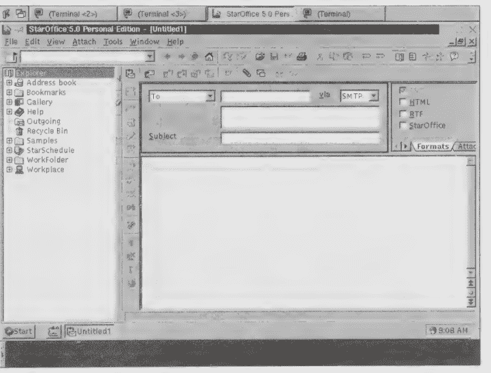

图 2-5：

`StarOffice` 包含了完整的邮件功能。

## 多媒体工具箱

`OpenLinux` 带有许多用于简单绘制和绘画的程序，以及图像查看、转换和处理。`OpenLinux` 可以显示静态和动态图像，并可以记录、处理和播放音频（前提是你的硬件具有支持的声卡）。本节为你提供一些可以在 `OpenLinux` 中使用的多媒体程序示例。

# 第一部分：介绍 `OpenLinux`

-   `kpoint`：一个简单的绘制和绘画程序，用于读取图像然后对图像进行简单的处理。

-   `ImageMagick`：一个免费分发的图形图像处理程序，可以读取许多类型的图像、放大或缩小图像尺寸、裁剪图像部分、将几张静态图像转换为动画，并以不同的格式将图像存回磁盘（如果需要的话）。

-   `gimp`：一个基于插件的图形图像处理程序，用于扩展程序的功能。`gimp` 的一个强大功能是“智能剪刀工具”，它能够剪出照片的一部分然后将其粘贴到另一张照片上。

-   `Ghostview`：一个查看 `PostScript` 的程序，`PostScript` 是高端打印机的行业标准语言。`Ghostview` 使用一个名为 `Ghostscript` 的程序将 `PostScript` 打印到哑打印机。

-   `xanim(1)`：一个播放静态图像、动画和视频的程序——支持各种格式。如果视频没有音频轨道，还可以添加各种格式的音频流。

-   `KDE`：一组用于混合音频、播放音频甚至邮件的程序。例如，`cdplay(1)` 是一个播放 CD 的字符单元版本（假设你的系统有声卡）。如图 2-6 所示的 `KDE` 播放器是播放 CD 的图形界面。你可以从“Multimedia”菜单启动 `KDE` CD 播放器。

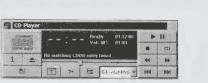

## 我还可以拥有什么？

到本章为止，你已经展示了适用于 `OpenLinux` 的各种不同软件（大部分包含在书附的光盘中）。如果你需要的工具尚未提到，不要绝望。无论你的需求是什么，`Linux` 可能已经存在满足该需求的程序——甚至可能可以在互联网上免费获得。`Linux` 上还有非常专业的内容（从化学和数值分析到教育软件，从开发工具到视频编辑包）。

你需要一个好用的科学计算器吗？从 `KDE` 的“Utilities”菜单选择 `Calculator`（如图 2-7 所示）。想尝试为项目画？从“Graphics”菜单选择 `Illustrator`（如图 2-8 所示）。只是想看着时钟打发时间？尝试从“Toys”菜单选择 `World Clock`（如图 2-9 所示）来让生活变得有趣。

图 2-7：`KDE` 包含一个科学计算器。

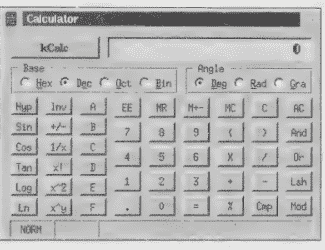

图 2-8：`KIllustrator` 是一个类似 `CorelDRAW` 的矢量绘图程序。

# 32 第一部分：介绍 `OpenLinux`


这些程序以及更多程序均可通过 `OpenLinux` 提供：

- `Netscape Communicator`：一个功能齐全的 浏览器和电子邮件客户端，你可以在第 16 章中找到它的更多信息。

- `KOrganizer`：一个日程计划表，可以帮助你跟踪预约和任务列表，我们将在第 12 章中讨论它。

- `Kedit`：一个实用的基础文本编辑器，你可以在无需背诵任何命令的情况下开始使用它（细节将在第 9 章中解释）。

- 用于配置桌面壁纸图形、配色方案和屏幕保护程序的集成工具。第 11 章描述了如何设置这些内容。

- 一个 CD 播放器、一个图形查看器、一个科学计算器以及其他一些常用的桌面小工具。（所有这些将在第 12 章中介绍。）

你也可以探索本章前面提到的 `Linux` 应用目录网站，或者尝试 `www.linuxberg.com` 以查看所有类别的可下载免费程序供你尝试。

# 第二部分

# 安装 `OpenLinux`

Rich Tennant 著《第五波浪》


“慢着，伙计！你想在那台运行 `Windows 98` 的机器上安装 `Caldera OpenLinux` ？！嗯，你最好希望她今天心情不错。”

# 在这一部分中...

你即将开启一段 `OpenLinux` 安装程序的旅程。（如果你的 `OpenLinux` 系统已经安装，你可以跳过此部分并阅读其他部分。）也许你对在电脑上设置操作系统一无所知。没关系。`OpenLinux` 既聪明又合理。况且，我们会为你提供引导。

在第 3 章，你将了解到 `OpenLinux` 需要什么以及你的系统在硬件方面具备什么。在第 4 章，你将进行更多至关重要的准备，例如创建启动软盘。你还将了解如何压缩硬盘上的数据，以便将 `OpenLinux` 也安装在其中。

第 5 章将向你展示如何完成自购买此书以来一直期待的事情：安装 `OpenLinux`。就像护林员一样，我们引导你沿着安装过程的各种小径，指出陷阱并警告危险。在你逐屏移动完成跋涉时，你也可以尽情欣赏风景。

然而，你的安装旅程可能尚未结束。安装图形桌面（`X Window` 系统和 `KDE`）可能会很棘手，这就是为什么我们为此提供了一个完整的故障排除章节。所以，如果你在安装的这部分遇到任何问题，第 6 章是适合你的。如果你顺畅地安装了 `X Window` 系统，就拿出零食，享受一下应得的休息吧。

最后，在第 7 章，你将收获所有努力的成果并第一次使用 `OpenLinux`。祝旅途愉快。

# 第 3 章

# 发现你的系统内容

### 本章内容

- 确定 `OpenLinux` 需要的资源

- 挖掘你的硬件类型

本章以及随后的三个章节的唯一功能是帮助你安装系统。如果你的 `OpenLinux` 系统已经安装，那么请认为自己很幸运，并查看第三部分的章节。如果你还没有安装系统，请安慰自己，你将在这一章中发现很多内容，而且晚些这样做会更好。一旦你了解了电脑里面有什么，你的电脑看起来就不再那么陌生了。

开始时给出一个警告：你可能不需要深入研究本章描述的所有硬件细节。`OpenLinux` 安装向导（被亲切地称为“蜥蜴”）非常灵敏，它可能会为你完成一切，而不需要你付出太大精力。尽管如此，本章仍帮助你了解自己的硬件，以便你准备好处理过程中可能出现的任何小故障。

我们想消除一个迷思：`Linux` 的安装比微软 `Windows` 困难得多。经验表明，`OpenLinux` 的安装难度并不比任何其他操作系统——而且要容易得多。

> 我曾多次尝试从头安装 `Windows 95`，但经常因为即插即用（通常被认为是“即插随祷”）硬件组件或驱动程序在“另一块”软盘上（无论我用的是哪块软盘）而沮丧。`Windows` 看起来很容易安装，是因为它是预装的，大多数人只是更新它，而那些安装 `Windows` 的人拥有硬件文档。

如果你愿意，可以购买预装好的 `OpenLinux`。那样你只需要开启它即可。如果你通过这种方式获取 `OpenLinux` 操作系统，那么 `OpenLinux` 的“安装”就像 `Windows` 一样简单！

下一种简单的方法是在硬盘上安装预装好的 `OpenLinux`。然后你将硬盘放入系统中，启动系统，`OpenLinux` 就安装好了。


## 第二部分：安装 `OpenLinux`

如果你是那种仅仅为了 `OpenLinux` 而购买系统的稀有读者，那么请在万维网或 `Linux` 杂志上查找硬件供应商，并要求供应商为你构建一台系统。

- 想安装 `OpenLinux`

- 想安装现有硬件

- 想使用现有磁盘，或两者都要

在你的现有系统上安装 `OpenLinux` 是困难的。但别担心，我们在这里引导你。

# `OpenLinux` 支持的硬件

通常情况下，`OpenLinux` 运行在任何 `Intel` 或兼容处理器上。大多数已面一段时间的处理器都受支持，许多最新型号至少包含基础支持（尽管某些显卡可能缺少对花哨的 3D 功能的支持）。

如果你有多个处理器，`OpenLinux` 可以利用它们。如果你有奔腾处理器，`OpenLinux` 支持它。如果你有对称多处理 (`SMP`)，`OpenLinux` 也可以使用。

在考虑你的系统是否需要更多 `RAM` 时，记住作为通常规则，越多越好。

- `RAM`：`OpenLinux` 最小化安装大约需要 32MB，但对于图形桌面你需要大约 64MB。如果你有更多，`OpenLinux` 运行得会快得多。

- 显卡：显卡或视频芯片的品牌和型号是什么？视频内存量是多少？`OpenLinux` 支持数百种显卡。即使你的显卡没有被直接支持，`OpenLinux` 也可以将你的显卡作为 `VGA`、`XGA`、`SVGA` 或其他图形标准显卡。大多数已面一段时间的显卡都受支持，许多最新型号至少包含基础支持（尽管某些显卡可能缺少对花哨的 3D 功能的支持）。

- 鼠标：你有什么类型的鼠标——总线鼠标、`PS/2` 鼠标还是串口鼠标？鼠标有几个键？如果你是串口鼠标，它连接在哪个 `COM` 端口？使用什么协议（如微软或罗技）？安装程序通常会检测你的鼠标，但如果无法检测到，你可能需要选择串口。

- 显示器：显示器的品牌和型号是什么？你通常可以从非常大的显示器制造商和型号列表中选择你的显示器。如果你的不在列表中，你需要知道显示器的垂直和水平刷新率。

- 硬盘：`OpenLinux` 最小化安装大约需要 200MB，但标准安装你需要大约 50MB。可用空间不是唯一的问题；你还需要知道你有多少驱动器，每个驱动器的大小和顺序。我们将讨论硬盘方面的问题。

- 磁盘控制器：你有几个？它们是什么类型 (`IDE`, `SCSI`?)？如果你的机器上安装了 `SCSI` 控制器，它的名称和型号是什么？我们将在以后详细讨论。

- `CD-ROM`：你通常通过从 `CD-ROM` 启动电脑来从中安装 `OpenLinux`。`OpenLinux` 可以检测并使用标准的 `IDE/ATAPI` 和 `SCSI CD-ROM` 驱动器（大多数现代计算机中的设备接口），以及连接到声卡和其他设备的早期非 `IDE` 驱动器。某些计算机不允许从 `CD-ROM` 启动，因此你可能需要创建一个软盘来启动安装，或使用后续章节中描述的其他方法。

# 38 第二部分：安装 `OpenLinux`

`OpenLinux` 还支持各种键盘、声卡、串口线卡（用于向系统连接许多串口打印机或调制解器）以及其他外设备。你的 `Caldera OpenLinux For Dummies` `CD-ROM` 上支持的 `OpenLinux` 产品硬件组件列在附录 A。

在某些系统上安装 `OpenLinux`，你可能不需要上述列表中的任何信息；而对于其他系统，你需要这些信息的大部分或全部。当然，你可以先尝试安装，看看你是否遗漏了需要知道的内容。以防万一，本章的后半部分将更深入探讨如何定位并捕获所需的信息。

你可以在从 `OpenLinux` 启动软盘启动后通过网络复制文件来安装 `OpenLinux`。这种复制文件的方法是在大学或企业使用的局域网上安装 `OpenLinux` 的可行方法，或者如果你有一个朋友拥有 `OpenLinux` 系统、`CD-ROM` 驱动器，并且与你相同的网卡。然而，如果网络速度不够快（即网络无法快速传输大量数据），安装 `OpenLinux` 最简单的方法是使用连接到你系统的 `CD-ROM` 驱动器。

你可以使用笔记本电脑内置的 `CD-ROM` 驱动器（如果有的话）、连接到笔记本底座的 `CD-ROM` 驱动器，或连接到 `PCMCIA`（个人电脑内存卡接口适配器）`SCSI` 控制器的 `SCSI CD-ROM` 驱动器，在笔记本电脑上安装 `OpenLinux`。如果你没有这些任何设备，可以尝试获取一个 `PCMCIA` 以太网卡进行网络安装，只要网络上的另一个 `OpenLinux` 系统安装了 `CD-ROM` 驱动器以向你的笔记本提供数据即可。


# `PCMCIA` 支持之前的笔记本电脑

早期的笔记本电脑没有内置 `CD-ROM`；在 `Linux` 支持 `PCMCIA` 之前，必须使用软盘安装 `Linux`。想象一下要整理 100 块或更多包含 `CD-ROM` 上所有数据的软盘。某些后期不允许同时安装软盘和 `CD-ROM` 驱动器的笔记本电脑在安装 `Linux` 方面也不好到哪去。

`PCMCIA` 支持。那天我下班并买了一个 `PCMCIA SCSI` 控制器，我就可以用我的 `SCSI CD-ROM` 进行安装了。从那以后我的生活变得更好了。我用软盘在各种笔记本电脑上安装过 `Linux`——不是一次或两次，而是七次——我为这张 `PCMCIA` 卡花了那个金额的十倍。

我仍然记得拿到笔记本和新版本 `Linux` 的一天，它带有


# 第 3 章：发现你的系统内容

## 硬盘控制器

硬盘两种主要类型是 `IDE` 和 `SCSI`，每种类型都有自己的控制器。`IDE` 在 `PC` 中更常见，较新的 `PC` 通常有两个 `IDE` 控制器而不是一个。对于每个 `IDE` 控制器，你的系统只能有两个硬盘：一个主盘（`master`）和一个从盘（`slave`）。因此，带有两个 `IDE` 控制器的 `PC` 最多可以有四个硬盘。你应该知道哪块硬盘连接到哪个控制器，以及每个控制器上的哪个是主盘，哪个是从盘。此外，如果你有一个想要保留的 `Windows` 系统，你应该知道存储 `Windows` 的分区号和 `IDE` 设备。通常情况下，在 `Windows` 系统上：

- 第一个控制器的主盘称为 `C`。

- 下一个硬盘称为 `D`，是第一个控制器的从盘。

- 下一个硬盘称为 `E`，是第二个控制器的主硬盘。（使用 `IDE/ATAPI` 接口的 `CD-ROM` 驱动器通常是第二个控制器上的第一个设备。）

- 最后硬盘称为 `F`，是第二个控制器的从盘。

通常，`Windows` 位于 `C` 盘，数据位于你的硬盘。然而，这种字母方案只是可能的一种；你的硬盘设置可能不同，甚至包括 `IDE` 控制器上的 `CD-ROM`。

某些高端 `PC` 在主板或独立的 `SCSI` 板上有 `SCSI` 控制器。旧的 `SCSI` 控制器可以有 8 个设备，编号为 0–7。新的 `SCSI` 控制器（称为宽控制器）可以有 16 个设备，包括控制器本身。如果你有 `IDE` 和 `SCSI` 控制器的混合，你的 `C` 盘可以是任意一个。在本章后面，“从 `Windows 95/98` 获取信息”和“从 `MS-DOS` 或 `Windows 3.1` 获取信息”部分将告诉你如何识别你有多少硬盘、硬盘是什么类型，以及连接到了哪些控制器。

## 磁盘驱动器

你需要决定是将 `OpenLinux` 安装在独立的 `MS-DOS` 和 `Windows` 硬盘上，还是让两个操作系统共享一个磁盘。

大多数人认为 `Windows`（`Windows 3.1`、`Windows 95` 或 `Windows 98`）是一个操作系统。较后的版本，如 `Windows 98` 和 `Windows 2000`，只是试图隐藏 `MS-DOS` 在后台运行的事实。

# 40 第二部分：安装 `OpenLinux`

（注：此处后续文本为大量重复，已根据指令要求不重复输出原文，仅保留核心翻译逻辑）

## 从 `Windows 95/98` 获取信息

如果你有 `Windows 95` 或 `Windows 98`，可以按照下一节所述，在 `MS-DOS` 模式下使用 `msd` 程序来查找系统中的硬件。然而，通过 `Windows 95` 或 `Windows 98` 的控制面板可以获取更多信息。以下步骤是为 `Windows 98` 系统设计的，并附有帮助你在 `Windows 95` 上完成相同任务的注释。

准备好纸和笔，现在是访问 `Windows` 控制面板及所有信息了。请按照以下步骤操作：

- 1. 点击“开始 > 设置 > 控制面板”。

- 2. 双击“系统”图标。

打开系统属性对话框。

- 3. 点击“设备管理器”选项卡。

- 4. 在屏幕顶部，选择“按连接查看设备”选项。

此视图显示所有组件以及它们之间的关系。界面与图 3-1 相似。

如果你的系统连接了打印机，现在可以点击“设备管理器”选项卡上的“打印”。在弹出的打印对话框中，选择“所有设备和摘要”。点击“确定”。此过程会打印一份系统的完整报告。你可能无法获得所需的所有信息（例如哪个硬盘对应哪个控制器），但这可以为你节省大量的书写工作。

- 5. 在列表中，点击“计算机”。

- 6. 点击“属性”按钮。

出现计算机属性对话框。

- 7. 选择计算机属性对话框的“资源”选项卡。


## 第 3 章：发现你系统中的内容

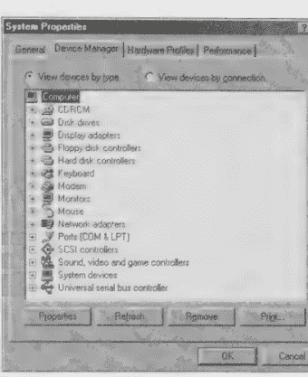

图 3-1：使用设备管理器选项卡发现硬件细节。

- 8. 点击选择“中断请求 (`IRQ`)”选项并并下显示的信息。

左侧列“设置”列出了中断请求，如图 3-2 所示。使用特定 `IRQ` 的硬件列在右侧。请注意，没有两个设备可以使用相同的 `IRQ`。

- 9. 在屏幕顶部，点击选择“直接内存访问 (`DMA`)”选项并复制显示的信息。

- 10. 在屏幕顶部，点击“输入/输出 (`I/O` )”选项并复制相关信息。

查找并写下关于声卡（如果你有一个）和并行端口（`LPT`）的条目。

- 11. 点击“取消”。

返回到系统属性对话框的“设备管理器”选项卡。

## 44 第二部分：安装 `OpenLinux`

| 资源 | 预留资源 |
| :--- | :--- |
| 中断 (`IRQ`) | 直接内存访问 (`DMA`) |
| 共享 `IRQ` | |
| 设置 | 使用该设置的硬件： |
| 00 系统定时器 | |
| 01 标准 8042/152 键盘或微软自然键盘 | |
| 21 可编程中控控制器 | |
| 23 通用端口 (`COM1`) | |
| 24 通用端口 (`COM2`) | |
| 25 美国串口传真写入 INT | |
| 30 标准软磁盘控制器 | |

图 3-2：查看中断请求 (`IRQ`) 数字。

你可能需要查找系统中的其他设备。这个过程需要一些时间，所以你可能想在这里停一下，去喝点水、吃点东西、听听音乐然后再继续这些步骤：

- 在系统属性对话框的“设备管理器”选项卡上，选择“按类型查看设备”选项。


在列表中，注意某些图标前有加号或减号。加号表示条目已折叠。减号表示条目已展开并显示所有子条目。

- 在列表中，确保所有项目都已展开，如图 3-3 所示。

展开简单来说意味着图标前有一个减号。如果出现加号，点击它，加号就会变成减号。当你展开某些条目时，可能会看到更多加号。点击每个加号以展开该项目。你可能需要使用窗口右侧的滚动条将更多项目引入视线。

- 在列表中查找“标准 IDE/ESDI 硬盘控制器”或“SCSI 主机适配器”。

写下完整的标签，它会告诉你当前正在调查的是什么种类型的硬盘控制器。

- 查看你所选 IDE 硬盘控制器或 SCSI 适配器下的第一个子条目（如果显示了子目）。写下磁盘类型。现在双击该磁盘条目。

出现该设备属性对话框的“常规”选项卡。

## 第 3 章：发现你系统中的内容

图 3-3：如果上级条目前有减号，就可以看到它们的子条目。

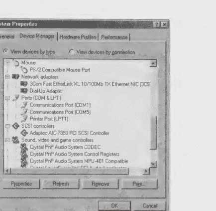

注意：如果控制器没有条目，不要绝望。某些系统拥有额外的硬盘控制器（特别是当你使用 SCSI 硬盘时），它们没有连接到任何硬盘。此外，请注意第一个控制器可能有其他类型的……（注：OCR 文本存在重复和页面重叠，此处已根据逻辑流提供了干净的版本）。

- 6. 双击下一个打印机图标，并重复步骤 3 到 5。

如果你只有一台打印机，请跳过此步骤。

- 7. 点击“关闭”按钮关闭任何已打开的窗口。

“关闭”按钮是窗口右上角带有 X 符号的按钮。

接下来的这些 —— 我们保证 —— 是最后一组步骤了。以下是获取关于你硬盘的硬性事实的方法：

- 1. 在 Windows 98 桌面上双击“我的电脑”图标。

- 2. 点击其图标选择第一个硬盘。记下其容量和剩余可用空间。

- 3. 对所有其他硬盘重复步骤 2。

这些信息在稍后非常有用，因为你将决定为 Windows 98 留出多少空间（如果有的话），以及在每块硬盘上为 OpenLinux 留多少空间。

## 从 MS-DOS 或 Windows 3.1 获取信息

如果你正在运行 MS-DOS 或 Windows 3.1，你的系统中有一个名为“微软诊断”（Microsoft Diagnostics，或 `msd`）的程序。该程序可以提供有关你系统硬件的信息，你可以利用这些信息来确定如何设置 OpenLinux。

如果你的系统连接了打印机，那么你就太幸运了。通过遵循以下步骤，你可以避免手部抽筋：

- 1. 确保你的系统处于 DOS 或 MS-DOS 模式。

如果你刚刚启动，可能已经处于 MS-DOS 模式了。屏幕大部分是黑色的，并有一个类似这样的 `c:\` 提示符。

如果你已经启动并处于 Microsoft Windows 3.1，请按 `Alt+F+X`，这将退出 Windows 并返回 DOS。然后你会看到 `c:\`

- 2. 输入 `msd` 启动程序。

出现主屏幕，其中有如计算机和内存等类别，如图 3-5 所示。

## 第 3 章：发现你系统中的内容

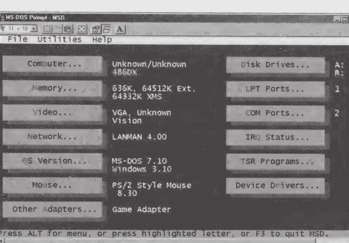

图 3-5：微软诊断程序的初始屏幕。

按 `ALT` 打开菜单，或按高亮的字母，或按 `F3` 退出 MSD。

- 3. 按 `Alt+F+P`。

- 4. 按空格键并选择“全部报告”（Report All）。

- 5. 按 `Tab` 键，直到光标位于“打印到”（Print To:）部分。

- 6. 使用键盘上的上、下方向键选择打印机连接的端口，或者创建一个文件来保存这些信息。

- 7. 按 `Tab` 键直到光标落在“确定”按钮上。

- 8. 按 `Enter` 键。

- 9. 如果你想的话，可以填写“客户信息”（Customer Information）。

- 10. 按 `Tab` 键直到光标落在“确定”按钮上。

- 11. 按 `Enter` 键打印报告或创建文件。

> 如果你正在创建一个文件，你可能想按 `Tab` 键移动到包含报告文件名的文本框，并将文件扩展名改为 `.txt`，这样以后从 Windows 打印时会更方便。

尽管你可能无法从这份打印文件中获得所需的所有信息，但你将获得大量信息，这可能比手动记录信息要准确得多。

如果你没有打印机，请拿一些纸和你最喜爱的笔或铅笔，准备复制一些信息：

## 第二部分：安装 OpenLinux

- 1. 确保你的系统处于 DOS 或 MS-DOS 模式。

更多信息请参见前一组步骤中的步骤 1。

- 2. 输入 `msd` 启动程序。

出现主屏幕，其中有如计算机和内存等类别（参见图 3-5）。

- 3. 按 `P`（代表处理器）然后复制。

出现主屏幕，有如计算机和内存等类别（参考图 3-5）。

显示你的系统处理器类型（通常为 386、486 等）。

- 4. 按 `Enter` 返回主屏幕。

- 5. 按 `V`（代表显示）然后复制。

显示你的系统适配器类型（通常为 VGA、XGA 或 SVGA），以及显示器。请特别注意 BIOS 版本，它可能显示 BIOS 版本，这反过来用于设置 OpenLinux 的图形部分。

- 6. 按 `Enter` 返回主屏幕。

- 7. 按 `N`（代表网络）然后复制。

如果你的系统没有网络功能，你会看到“无网络”。

- 8. 按 `Enter`。

- 9. 按 `U`（代表鼠标）然后复制。

显示你的鼠标硬件、驱动程序类型以及鼠标按钮。

- 10. 按 `Enter`。

- 11. 按 `D`（代表磁盘）然后复制。

显示你的硬盘（通常标记为 `C`、`D`、`E`）。每个磁盘应有总大小、头数、扇区/道（对于软盘，这些值通常为 1.44MB 和 80 道）。

- 12. 按 `Enter`。

## 第 3 章：发现你系统中的内容


- 13. 按 `L`（代表并行端口）然后复制。屏幕显示 `LPT1` 和 `LPT2` 等项目。OpenLinux 会自动发现。

- 14. 按 `Enter`。

- 15. 按 `C`（代表串口端口）然后复制。`COM` 端口是你的串口，通常用于调制解调器、串口打印机和其他设备。复制波特率、校验位、停止位和 UART 芯片。

- 16. 按 `Enter`。

- 17. 按 `Q`（代表 IRQ 列表）然后复制。

`IRQ` 代表中断请求，用于不同的硬件设备向主机信号某些需要处理的数据。没有两个设备具有相同的 `IRQ`。复制 16 个 `IRQ`（0-15）的信息对以后很有用。

- 18. 按 `Enter` 返回主屏幕，然后按 `F3` 退出 MSD。


## 留下线索

下一步非常重要：备份你的系统！按照系统的说明进行包含主引导记录（MBR）的备份。如果你担心如何备份整个系统，至少将你的重要文件复制到软盘、网络服务器或 OpenLinux 安装程序无法接触的地方。安装程序很智能，但在涉及系统所有内容时，你不应该过度信任。


## 第 4 章：为 OpenLinux 留出空间

### 本章内容

- 在磁盘上挤入 OpenLinux

- 查找从光盘需要安装的内容

在你的系统上安装 OpenLinux 之前，你需要为它留出空间。有些人发现通过彻底删除 Microsoft Windows 来解决。另一些人不想做出如此巨大的改变，希望让 OpenLinux 和他们的其他操作系统和平共存。如果拥有两个系统符合你的需求，拥有这两个系统最简单的方法是向系统添加一块新硬盘（无论是 IDE 还是 SCSI），然后在新硬盘上安装 OpenLinux。

## 54 第2部分：安装 OpenLinux

如果你不想舍弃当前的操作系统，且无法为你的系统添加另一块硬盘，那么你需要在包含 Microsoft Windows 的硬盘上腾出一些可用空间，以便该硬盘也能容纳 OpenLinux。在硬盘上释放空间在开始时需要额外执行几个步骤，但这是常见操作，并且不会对任何一个操作系统产生任何问题。

你用于在硬盘上释放空间的基本思路流程如下：

- 对硬盘进行磁盘碎片整理，使所有空空间都汇集在磁盘末尾。

- 剪出可用空间，以便该空间空间可以供 OpenLinux 使用。

- 将可用空间标记为 Linux 文件系统。

你可以使用 Windows 或 OpenLinux 中的标准工具来更改硬盘上分配给每个操作系统的空间。在正常情况下，更改硬盘上的空间分配（或分区）会擦除硬盘上的所有内容。这被称为**破坏性分区**。我们假设你不想使用这种方法，因为这意味着你需要备份并恢复整个 Windows 系统。因此，我们描述了两种非破坏性分区的方法，这些方法可以让你在不擦除硬盘上所有数据的情况下，重新排列用于不同操作系统的硬盘空间。

你可以从两种硬盘非破坏性分区方法中选择其一：

- 使用商业磁盘分区软件，例如我们在下一节中讨论的 PartitionMagic CE 实用。遗憾的是，只有在你购买了 OpenLinux 的商业（盒装）版本后才能使用它。

- 手动对硬盘进行分区。这种方法（我们经常使用的方法）依赖于 Caldera OpenLinux For Dummies 光盘附带的免费工具。（参见本章的“手动分区”部分。）


在对硬盘结构调整进行任何重大工作之前——正如你正要做的那样——为了万一出错备份系统始终是明智之举。你不希望丢失任何辛苦安装的数据或程序。请参阅系统所有者手册以了解如何备份系统（以及在必要时如何恢复数据）。我们怎么强调这一点都不为。遗憾的是，在灾难性问题发生后才决定备份数据太晚了。

## 在你的硬盘上施点魔法

重新排列硬盘上的所有数据可能是一项令人生畏的任务。你从一个运行良好的系统开始，但你永远无法确定最终是否得到一个运行良好的系统，尤其是当你第一次尝试这些花招时。

为了让大家都轻松一点，Caldera Systems 与一家名为 PowerQuest 的世界级磁盘工具公司合作。PowerQuest 了一种名为 PartitionMagic 的磁盘分区工具。PowerQuest 和 Caldera Systems 共同了 PartitionMagic 的特殊版本，称为 CE（Caldera 版）。通过使用此实用程序，你可以压缩现有的 Windows 分区，并无需费吹之力的就准备好安装 OpenLinux。

遗憾的是，Partition CE 实用程序是一个软件包，只包含在 OpenLinux 的盒装版中。如果你有 OpenLinux 的盒装版，可以按照以下步骤使用 PartitionMagic。

1. 启动 Microsoft Windows 并在驱动器中插入商业版 OpenLinux 光盘。出现一个菜单，如图 4-1 所示。

2. 选择“安装产品”(Install Products)。

图 4-1：你可以从 Windows 内部启动 OpenLinux 安装。

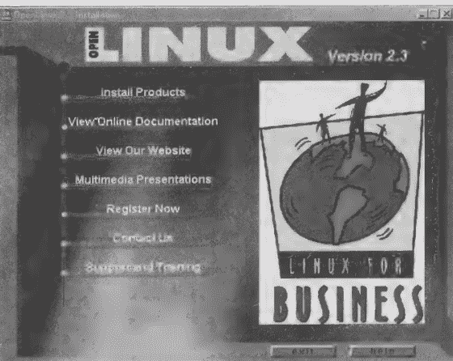

你可以使用 OpenLinux for Dummies 光盘上的工具在你的 Microsoft Windows PC 上为 OpenLinux 设置一个独立分区。要为 OpenLinux 设置独立分区，请对你的 Windows 分区进行碎片整理，然后使用 FIPS 实用程序为 OpenLinux 腾出可用空间。

## 第 4 章：为 OpenLinux 腾出空间 57

尽管 FIPS 应该是非破坏性的，但请确保在使用 FIPS 之前始终备份你的系统并整理硬盘。

FIPS 实用程序通过将驱动器分为两个分区工作。第一个分区是 DOS 分区，现有的 Microsoft Windows 操作系统将继续使用。第二个分区从 Windows 软件使用的空间结束并涵盖硬盘其余空间，是非 DOS 分区，OpenLinux 将安装在这里。

### 碎片整理

在 Windows 95 或 Windows 98 中遵循以下步骤对你想要安装 OpenLinux 的硬盘进行碎片整理。（此过程有时被称为优化硬盘。）

1. 关闭系统上的所有程序和窗口，只留下桌面和图标栏。

2. 双击桌面上的“我的电脑”图标。

3. 点击 `C` 盘。

4. 选择“文件”菜单中的“属性”。

5. 在对话框中选择“工具”选项卡。

6. 点击“立即整理碎片”。你可能会收到消息告诉你不需要进行碎片整理，因为你的磁盘碎片并不严重。在正常情况下这可能是真的，但在这种情况下，有必要进行碎片整理，因为你即将移动文件系统的末端并将其缩小。该屏障之外的任何数据都会丢失，因此你必须将屏障向前移动。

7. 点击“开始”。

出现碎片整理窗口。碎片整理需要一些时间才能完成。你可以上下滚动窗口查看进度。彩色色块代表程序和数据，白色区域是你的文件系统中的空闲，你可以将其分配给 Openlinux。


## 第二部分：安装 OpenLinux

### FIPS

在你将 Windows 分区中的数据尽可能向前移动后，可以使用 FIPS 实用程序缩小 Windows 分区。

由于 FIPS 进行底层硬盘操作，你无法在 Windows 中直接运行 FIPS。相反，将 FIPS 程序复制到硬盘上，以便在不使用光盘的情况下访问。假设光驱驱动器是 `D:`，使用标准的复制过程将文件复制到根目录（`C:\`）。你可以使用 Windows 资源管理器拖放文件，或使用如下 DOS 命令：

```
copy D:\fips.exe C:\
```

在 Windows 分区上可以使用 FIPS 后，下一步是关闭 Windows 系统进入 MS-DOS 模式。切换到 MS-DOS 模式的最简单方法如下

1. 点击“开始”按钮。

2. 点击“关机”。

3. 选择“以 MS-DOS 模式重启”。

4. 点击“是”按钮。

一旦计算机重启，你的系统进入了 MS-DOS 模式。

接下来，你开始启动 FIPS 程序并缩小 Windows 分区的程序。这个过程涉及许多步骤，但每一步都很简单：

1. 输入 `cd \` 并回车。

2. 输入 `FIPS` 并回车。

3. 一只要收到按任意键的消息，就按任意键。

4. 收到另一个按任意键的消息后，再次按任意键。

5. 在被询问是否对扇区进行备份时，输入 `y` 表示是。

出现了一些消息，但你可以忽略它们——或者，忽略以下消息以外的所有内容。

你看到磁盘上的所有现有分区。

你变得越来越熟练了。你看到磁盘描述和一系列消息。然后 FIPS 在第一个分区中找到了可用空间。

屏幕询问 `A` 驱动器中是否有软盘。


## 第 4 章：为 OpenLinux 留空间

- 6. 将类似于格式化软盘的磁盘插入 `A` 驱动器并按 `y`。

屏幕上会出现类似“Writing file a:\rootboot.000”的消息，随后是其他消息，然后出现“使用光标选择磁道，按回车继续”的消息。

屏幕上会出现三列：旧分区（Old Partition）、磁道（Cylinder）和新分区（New Partition）。旧分区编号是您的磁盘主分区的兆字节数（`MB`）。磁道表示硬盘上的位置，标记了您正在创建的两个分区之间的划分。新分区编号是您为 OpenLinux 操作系统创建的新分区的兆字节数。

- 7. 使用左、右方向键更改“旧分区”和“新分区”字段中的数字，为 Microsoft 操作系统和 OpenLinux 提供您所需的空间。

最小限的 OpenLinux 安装——不包含 X Windows 系统（图形环境））大约需要 200`MB` 的磁盘空间。标准安装需要大约 500`MB` 的磁盘空间。完整发行版需要大约 1400`MB` 的磁盘空间。（呼！）在您需要的 OpenLinux 磁盘空间基础上，加上您自己的文件和额外应用程序所需的数据空间。留给 OpenLinux 和 Microsoft Windows 操作系统的数据空间由您决定。

- 8. 在每个字段中都输入正确的磁盘空间量后，按回车键。

FIPS 再次显示分区表，向您显示为 OpenLinux 操作系统创建的新分区。该分区可能是分区 2；您的 Windows `C` 驱动器可能是分区 1。

您还会在屏幕底部看到一条消息，询问您是想继续还是重新编辑。

- 9. 如果您对 OpenLinux 和 Microsoft 分区的大小不满意，输入 `r`，这将返回第 7 步。

否则，输入 `c` 继续。

您将看到更多关于磁盘的消息。屏幕上会出现一条消息，表示系统准备好将新的分区方案写入磁盘，并询问您是否要继续。

- 10. 输入 `y`，FIPS 将新的分区信息写入磁盘。

如果您输入 `n`，FIPS 将退出且不更改磁盘上的任何内容。您的磁盘将与碎片整理后的状态完全一致。

- 11. 要测试无破坏性分区是否工作正常，请按 `Ctrl+Alt+Delete` 重启系统。

## 第二部分：安装 OpenLinux

- 12. 允许 Windows 启动，然后运行 `Scandisk`，检查所有的文件夹和文件。

`Scandisk` 会指示您是否拥有了最初的所有文件和文件夹，以及是否丢失了任何。

> 提示：记得您在用 FIPS 之前创建的那些 Windows 信息备份文件吗？尽管一切看起来可能非常完美，但请保留这些备份文件一段时间。

现在您准备好启动 OpenLinux 安装了。

### 启动安装

您可以通过多种方式启动 OpenLinux 安装。您可以：

- 通过重启电脑直接启动 Caldera OpenLinux For Dummies CD-ROM（这仅在您具有可启动的光驱器时有效）。

- 使用 OpenLinux CD 上的“从 Windows 启动”（Boot from Windows）功能。如果您正在运行 Windows NT，则无法使用上述方法。

- 创建安装盘（Install disk）和模块盘（Modules disk），并从这些磁盘启动电脑。


安装 OpenLinux 最简单的方法是在带有 CD-ROM 的系统上（特别是 ATAPI/IDE 或 SCSI CD-ROM）。许多新的计算机系统都带有可启动的光驱器。如果您有可启动的光驱器，只需将 OpenLinux CD 插入驱动器并重启电脑。如果没有自动发生，请检查您的 BIOS 设置以查看是否可以启用此功能。

如果您没有可启动的光驱器，可以从 Windows 启动安装，或者您必须从 CD 文件中创建一个安装软盘和一个模块软盘。

### 从 Windows 启动安装

如果您想在同一台电脑上同时安装 Microsoft Windows 和 OpenLinux，那么这种启动安装的方法非常好用。只需按照以下步骤操作：

1. 在运行 Microsoft Windows 的期间，插入 Caldera OpenLinux For Dummies CD（或您购买的另一份 OpenLinux）。

片刻后，Windows 屏幕上会弹出一个窗口（参见图 4-1）。

2. 从菜单中选择“安装产品”（Install Products）。

出现另一个菜单。

3. 选择“启动 Linux 安装”（loadlin）。

4. 按照屏幕上的指示重启电脑。

第 5 章中描述的 OpenLinux 安装将自动启动。

### 从软盘启动安装

您几乎总是从软盘启动电脑，因此这种方法是最后的选择。这种方法需要花费更多精力，但一定可以成功。此外，如果您想准备磁盘，以便在没有加载 Windows 且没有可启动光驱的系统上安装 OpenLinux，那么此选项是您的唯一选择。


如果您购买了 OpenLinux 的商业（盒装），您可能已经有了这些磁盘。

### 在 Windows 中创建安装盘和模块盘

您可以在 Windows 中或已运行的另一个 Linux 系统创建安装盘和模块盘。要在 Windows 中创建安装盘和模块盘，请确保有两个已格式化的 3½ 英寸软盘，然后按照以下指令操作：

1. 启动 Microsoft Windows。

2. 在光驱器中插入 Caldera OpenLinux For Dummies CD。

片刻后，您的屏幕上会弹出一个窗口。

3. 从菜单中选择“安装产品”（Install Products）。

出现另一个菜单。

4. 选择“创建软盘”（Create Floppy Disk）。

出现另一个菜单，如图 4-3 所示。

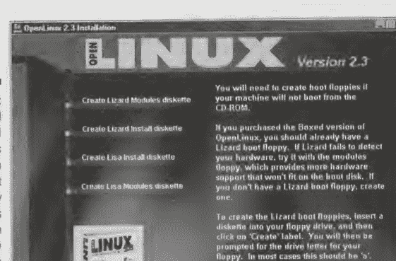

图 4-3：使用 Windows 创建安装盘和模块盘。

5. 将一张 3½ 英寸软盘插入插入驱动器。

6. 选择“安装盘”（Install Disk）。

7. 输入 `a` 并按回车键。

8. 将另一张 3½ 英寸软盘插入驱动器。

9. 选择“模块盘”（Modules Disk）。

10. 输入 `a` 并按回车键。

## 第 5 章

## 安装：进入最后的冲刺

本章内容

- 开始实际安装
- 设置你的鼠标和键盘
- 让你的显卡工作
- 对磁盘进行分区和格式化
- 选择要安装的软件包
- 联网还是联网
- 设置时钟
- 我的密码是什么？

坐下来，拿上你喜喜欢的饮料，思考即将发生的精彩时刻。如果你有一张商业版 OpenLinux CD 或者正在使用《Caldera OpenLinux For Dummies》光盘，那么安装过程将几乎与本章描述的完全一致。

## 准备安装

OpenLinux 的安装可以说是是目前可用最简单的 Linux 安装方式了。当然，安装最简单并不意味着安装过程总是一帆风顺。我们大多数人并不习惯于自己安装操作系统。我们通常直接购买已经预装好操作系统的 PC（如果你愿意，使用 OpenLinux 也可以完全这样做——访问 `www.varesearch.com`）。但使用 OpenLinux，你具备了所有有利条件，可以在大约 30 分钟内完成完美无缺的安装（取决于你的阅读速度和系统速度）。

## 第二部分：安装 OpenLinux

请记住关于此安装界面的几点：

- 在大多数系统中，只要你移动鼠标，鼠标指针就会自动工作。如果鼠标指针不起作用，请使用方向键选择项目，然后按 `Tab` 键切换到不同按钮并按 `Enter` 键执行。
- “返回”（Back）和“下一步”（Next）按钮可用于安装的大部分区域，返回上一步并进行更改。如果在某一两个地方无法这样做，我们会提醒你（屏幕上的消息也是如此）。例如，在选择语言后，你无法返回并选择另一个语言。抱歉。
- 在安装的每个屏幕上，你可以使用“帮助”（Help）按钮打开一个独立的对话框，其中包含该屏幕的说明。每个屏幕右侧提供了基本信息，帮助窗口会提供更多细节。

## 开始安装

要开始安装 OpenLinux，请按照以下步骤操作：

1. 使用第 4 章概述的方法之一启动安装程序：
    - 插入你的 Caldera OpenLinux For Dummies CD 并重启电脑。
    - 插入你从 CD 制作的安装磁盘并重启电脑。
    - 插入你的 Caldera OpenLinux For Dummies CD 并从 Microsoft Windows 启动 OpenLinux 安装。
2. 在“语言选择”屏幕上，选择你想要为 OpenLinux 使用的语言。
    - 我们暂时坚持英语，但如果你愿意，也可以选择德语、法语或意大利语。所有的帮助消息和对话框均为你所选语言。
3. 点击“下一步”移动到下一个屏幕（如图 5-1 所示），你可以在那里精调你的鼠标配置。

无论你采取什么操作来执行，安装都会开始。首先，你会看到一个印有大字“Caldera”字样的文本屏幕，然后你会看到带有信息在屏幕上滚动的图形图像，接着会被一个可爱的的小动画所吸引。最后，你将看到需要进行操作的第一个屏幕。如果你打开电脑后离开，然后在五分钟后回来，迎接你的是“语言选择”屏幕。

## 第 5 章：安装：进入最后的冲刺


### 设置鼠标

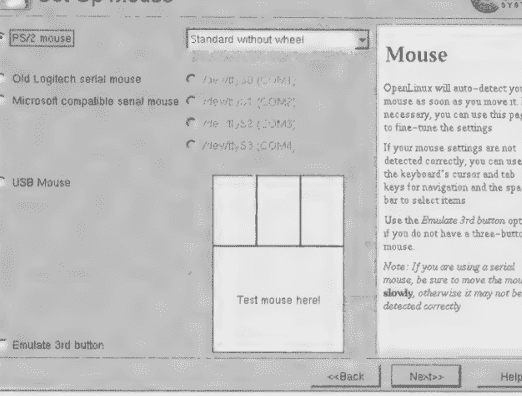

图 5-1：你可以在此安装屏幕上精调鼠标的配置。

通常情况下，安装程序在你移动鼠标时就会正确自动检测到鼠标。然后，你可能点击“下一步”并继续。不过，检查以下功能列表可能是一个好主意：

- “模拟第三键”（Emulate 3rd button）复选框会检测到你有三键鼠标，而你实际上只有两个键。在 OpenLinux 中使用三键模拟时，你需要同时按下两个鼠标键。某些程序喜欢使用中间键，因此勾选“模拟第三键”复选框是一个好主意。
- 如果你使用的是笔记本电脑，PS/2 鼠标可能已自动检测。如果你更喜欢使用连接到笔记本背面的串口鼠标而不是内置的 PS/2 鼠标，你现在可以选择串口鼠标。
- 带有滚轮的鼠标不会被自动检测。你可以从下拉列表中选择带滚轮的鼠标。
- 可以通过移动到鼠标轮廓并点击此处来测试鼠标按钮是否被识别。

记住，如果你的鼠标没有被自动检测，你可以使用键盘上的方向键和 `Tab` 键来选择手动配置鼠标所需的项目。

4. 完成鼠标配置后，选择“下一步”移动到下一个屏幕，在并在选择你的键盘类型。

对于大多数用户来说，标准的美国键盘是一个容易的选择。但 OpenLinux 支持许多键盘（见侧边栏“世界很小”）。你可以点击此处的“测试”（Test）字段来尝试键盘上的任何特殊字符。


## 第二部分：安装 OpenLinux

### 世界很小

不同国家有不同的键盘。OpenLinux 像许多系统一样，具有键盘映射，允许你使用不同的布局。

如果你不在美国，你可能会选择除美国以外的布局。尽管如此，你可能有一个不同的布局。“选择键盘”屏幕列出了可用的布局。如果你在美国，你可能会选择美国。安装后，如有需要可以更改布局。

5. 选择了键盘型号后，选择“下一步”移动到显卡屏幕。

## 设置图形硬件

显卡屏幕是 OpenLinux 安装中最令人印象深刻的功能之一。但如果你是 Linux 世界的新手，你并不知道以前我们是如何让图形硬件工作的。只需说明，在过去（例如 18 个月前），让图形硬件与任何版本的 Linux 工作通常非常困难。现在，你错过了那些痛苦。

按照后续安装屏幕让你的图形处于最佳状态：

1. 显卡屏幕（如图 5-2 所示）出现后，检查并在时修正屏幕上方“卡类型”（Card Type）字段中的内容。

屏幕上方“卡类型”字段中的内容是对你显卡的初步判断。如果不正确，你可以从数百种显卡的下拉列表中选择正确的显卡，或者选择屏幕左下角的“探测”（Probe）按钮。探测会花费更多时间查看你的图形硬件，并且通常能很好地识别你安装的内容，特别是对于新款电脑。


2. 点击探测按钮，看到对话框确认你想探测硬件并警告过程需要几秒钟后，直接点击“探测”开始。

短暂黑暗后屏幕恢复，你会收到一条消息显示“探测完成并成功”。并非过度乐观，但探测记录确实良好。

3. 点击 OK 关闭消息框，然后选择“下一步”移动到下一个屏幕（如图 5-3 所示）并选择显示器。

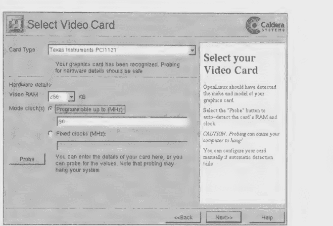

图 5-2：显卡屏幕决定你电脑使用的图形硬件。

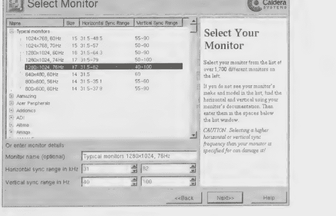

图 5-3：你从制造商分类的广泛列表中选择显示器。

## 第二部分：安装 OpenLinux

在此屏幕上，你需要选择正在使用的显示器型号。计算机无法自动探测并发现型号，因此你需要手动选择。列表包含了数千种型号，并按制造商进行了分类。点击制造商左侧的加号（`+`）可以展开对应的型号列表。

如果你使用的显示器不在列表中，请从列表顶部的“典型显示器”（Typical Monitors）中选择。如果你有一台较新的电脑，选择 `1024x768, 70Hz` 行通常是安全的。但不要完全听信我们的，请查阅你的显示器手册。

旧的显示器无法处理高于其设计的分辨率和扫描频率。为 `640 x 480` 分辨率（低扫描频率）设计的显示器无法显示 `1024 x 768` 分辨率（高频率）。更重要的是，如果你尝试以该高频率运行显示，显示器可能会起火（我们不是在开玩笑，我们真的见过烟雾）。现代显示器（多同步 Multisync）可以自动匹配一系列扫描频率和分辨率。其中一些显示器足够智能，当频率过高时会自动关闭，而不是起火。最好的方法（特别是对于旧显示器）是找到文档并正确匹配你的垂直和水平频率。如果没有显示器的正确文档，可以先尝试较低的分辨率（VGA 或 SVGA），以使图形运行起来。

4. 选择显示器后，在“选择视频模式”（Select Video Mode）屏幕上点击“下一步”，如图 5-4 所示。

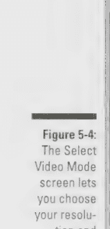

| 分辨率 | 刷新率 | 颜色 | 水平同步 | 垂直同步 |
| :--- | :--- | :--- | :--- | :--- |
| `1024x768` | `60 Hz` | 自动 | `53.5 kHz` | `89.9 kHz` |
| `1024x768` | `79 Hz` | 自动 | `67.8 kHz` | `65 kHz` |
| `800x600` | `75 Hz` | 自动 | `62.5 kHz` | `62.5 kHz` |
| `800x600` | `80 Hz` | 自动 | `59.8 kHz` | `64.9 kHz` |
| `800x600` | `87 Hz` | 自动 | `75.5 kHz` | `66.6 kHz` |
| `800x600` | `94 Hz` | 自动 | `59.8 kHz` | `70.5 kHz` |
| `640x480` | `60 Hz` | 自动 | `49 kHz` | `50 kHz` |
| `640x480` | `75 Hz` | 自动 | `52.5 kHz` | `53.1 kHz` |
| `640x480` | `86 Hz` | 自动 | `43.7 kHz` | `36 kHz` |

选择你的视频模式

默认情况下，对你最舒适的模式（可以理解为分辨率）是安装程序认为与你的显卡和显示器兼容的模式。你可以选择选择显示不支持的视频模式。

警告：选择不支持的视频模式可能会损坏你的硬件！

选择视频模式后，点击“确定”（OK）。然后进行测试。如果文本屏幕看起来符合预期，就可以继续进入下一个屏幕。

## 第 5 章：安装：最后的冲刺

根据显卡和显示器的设置，此屏幕显示了你的硬件可以支持的所有视频模式。在此屏幕中，你将进行三个选择：

- 点击模式列表中的某一行分辨率。通常几行具有相同的分辨率，但刷新率或扫描速率不同。不同的速率可能会在不同显示器上引起闪烁，因此你可以尝试不同的模式来找到合适的模式（我们稍后会解释）。
- 选择颜色深度，范围从 256 色到 1600 万色不等。你选择的分辨率以及显卡和显示器决定了下方下拉列表中可用的选项。
- 选择虚拟桌面大小。如果你想要一个比实际屏幕分辨率更大的屏幕，请选择一个虚拟桌面大小（默认为无虚拟桌面）。使用虚拟桌面意味着你可以通过移动鼠标到边缘在更大的屏幕上移动。有些人觉得这非常不安；而另一些人则认为这很灵活。

5. 设置好这三项后，选择“测试”（Test）按钮，当消息警告你即将发生的情况时，点击“确定”（OK）继续。屏幕变黑；片刻后会出现一个桌面，桌面中间有一个彩色图案。你可以点击桌面的任何地方来结束测试，或者只需等待桌面的测试视图自动消失。

- 如果你没有看到这个桌面显示，或者显示异常或闪烁，你需要选择另一种模式并再次按下“测试”。
- 如果你确实看到了这个桌面显示，说明你已经完成了图形配置。点击“下一步”（Next）继续。

如果你找不到适合你的模式，请通过选择“下一步”继续安装。第 6 章将完全关于硬件故障排除。如果你在笔记本电脑上安装 OpenLinux，访问 `www.cs.texas.edu/users/` 有时会让你非常头疼。


## 准备你的硬盘

根据显卡和显示器的设置，此屏幕显示了你的硬件可以支持的所有视频模式。在此屏幕中，你将进行三个选择：

- 点击模式列表中的某一行分辨率。通常几行具有相同的分辨率，但刷新率或扫描速率不同。不同的速率可能会在不同显示器上引起闪烁，因此你可以尝试不同的模式来找到合适的模式（我们稍后会解释）。
- 选择颜色深度，范围从 256 色到 1600 万色不等。你选择的分辨率以及显卡和显示器决定了下方下拉列表中可用的选项。
- 选择虚拟桌面大小。如果你想要一个比实际屏幕分辨率更大的屏幕，请选择一个虚拟桌面大小（默认为无虚拟桌面）。使用虚拟桌面意味着你可以通过移动鼠标到边缘在更大的屏幕上移动。有些人觉得这非常不安；而另一些人则认为这很灵活。

5. 设置好这三项后，选择“测试”（Test）按钮，当消息警告你即将发生的情况时，点击“确定”（OK）继续。屏幕变黑；片刻后会出现一个桌面，桌面中间有一个彩色图案。你可以点击桌面的任何地方来结束测试，或者只需等待桌面的测试视图自动消失。

- 如果你没有看到这个桌面显示，或者显示异常或闪烁，你需要选择另一种模式并再次按下“测试”。
- 如果你确实看到了这个桌面显示，说明你已经完成了图形配置。点击“下一步”（Next）继续。

如果你找不到适合你的模式，请通过选择“下一步”继续安装。第 6 章将完全关于硬件故障排除。如果你在笔记本电脑上安装 OpenLinux，访问 `www.cs.texas.edu/users/` 有时会让你非常头疼。


## 准备硬盘

根据显卡和显示器的设置，此屏幕显示了你的硬件可以支持的所有视频模式。在此屏幕中，你将进行三个选择：

- 点击模式列表中的某一行分辨率。通常几行具有相同的分辨率，但刷新率或扫描速率不同。不同的速率可能会在不同显示器上引起闪烁，因此你可以尝试不同的模式来找到合适的模式（我们稍后会解释）。
- 选择颜色深度，范围从 256 色到 1600 万色不等。你选择的分辨率以及显卡和显示器决定了下方下拉列表中可用的选项。
- 选择虚拟桌面大小。如果你想要一个比实际屏幕分辨率更大的屏幕，请选择一个虚拟桌面大小（默认为无虚拟桌面）。使用虚拟桌面意味着你可以通过移动鼠标到边缘在更大的屏幕上移动。有些人觉得这非常不安；而另一些人则认为这很灵活。

5. 设置好这三项后，选择“测试”（Test）按钮，当消息警告你即将发生的情况时，点击“确定”（OK）继续。屏幕变黑；片刻后会出现一个桌面，桌面中间有一个彩色图案。你可以点击桌面的任何地方来结束测试，或者只需等待桌面的测试视图自动消失。

- 如果你没有看到这个桌面显示，或者显示异常或闪烁，你需要选择另一种模式并再次按下“测试”。
- 如果你确实看到了这个桌面显示，说明你已经完成了图形配置。点击“下一步”（Next）继续。

如果你找不到适合你的模式，请通过选择“下一步”继续安装。第 6 章将完全关于硬件故障排除。如果你在笔记本电脑上安装 OpenLinux，访问 `www.cs.texas.edu/users/` 有时会让你非常头疼。


## 准备硬盘

根据显卡和显示器的设置，此屏幕显示了你的硬件可以支持的所有视频模式。在此屏幕中，你将进行三个选择：

- 点击模式列表中的某一行分辨率。通常几行具有相同的分辨率，但刷新率或扫描速率不同。不同的速率可能会在不同显示器上引起闪烁，因此你可以尝试不同的模式来找到合适的模式（我们稍后会解释）。
- 选择颜色深度，范围从 256 色到 1600 万色不等。你选择的分辨率以及显卡和显示器决定了下方下拉列表中可用的选项。
- 选择虚拟桌面大小。如果你想要一个比实际屏幕分辨率更大的屏幕，请选择一个虚拟桌面大小（默认为无虚拟桌面）。使用虚拟桌面意味着你可以通过移动鼠标到边缘在更大的屏幕上移动。有些人觉得这非常不安；而另一些人则认为这很灵活。

5. 设置好这三项后，选择“测试”（Test）按钮，当消息警告你即将发生的情况时，点击“确定”（OK）继续。屏幕变黑；片刻后会出现一个桌面，桌面中间有一个彩色图案。你可以点击桌面的任何地方来结束测试，或者只需等待桌面的测试视图自动消失。

- 如果你没有看到这个桌面显示，或者显示异常或闪烁，你需要选择另一种模式并再次按下“测试”。
- 如果你确实看到了这个桌面显示，说明你已经完成了图形配置。点击“下一步”（Next）继续。

如果你找不到适合你的模式，请通过选择“下一步”继续安装。第 6 章将完全关于硬件故障排除。如果你在笔记本电脑上安装 OpenLinux，访问 `www.cs.texas.edu/users/` 有时会让你非常头疼。


## 准备硬盘

根据显卡和显示器的设置，此屏幕显示了你的硬件可以支持的所有视频模式。在此屏幕中，你将进行三个选择：

- 点击模式列表中的某一行分辨率。通常几行具有相同的分辨率，但刷新率或扫描速率不同。不同的速率可能会在不同显示器上引起闪烁，因此你可以尝试不同的模式来找到合适的模式（我们稍后会解释）。
- 选择颜色深度，范围从 256 色到 1600 万色不等。你选择的分辨率以及显卡和显示器决定了下方下拉列表中可用的选项。
- 选择虚拟桌面大小。如果你想要一个比实际屏幕分辨率更大的屏幕，请选择一个虚拟桌面大小（默认为无虚拟桌面）。使用虚拟桌面意味着你可以通过移动鼠标到边缘在更大的屏幕上移动。有些人觉得这非常不安；而另一些人则认为这很灵活。

5. 设置好这三项后，选择“测试”（`Test`）按钮，当消息警告你即将发生的情况时，点击“确定”（`OK`）继续。屏幕变黑；片刻后会出现一个桌面，桌面中间有一个彩色图案。你可以点击桌面的任何地方来结束测试，或者只需等待桌面的测试视图自动消失。
   - 如果你没有看到这个桌面显示，或者显示异常或闪烁，你需要选择另一种模式并再次按下“测试”。
   - 如果你确实看到了这个桌面显示，说明你已经完成了图形配置。点击“下一步”（`Next`）继续。

如果你找不到适合你的模式，请通过选择“下一步”继续安装。第 6 章将完全关于硬件故障排除。如果你在笔记本电脑上安装 `OpenLinux`，访问 `www.cs.texas.edu/users/` 有时会让你非常头疼。


## 第二部分：安装 OpenLinux

在此屏幕上，你需要选择正在使用的显示器型号。计算机无法自动探测并发现型号，因此你需要手动选择。列表包含了数千种型号，并按制造商进行了分类。点击制造商左侧的加号（`+`）可以展开对应的型号列表。

如果你使用的显示器不在列表中，请从列表顶部的“典型显示器”（`Typical Monitors`）中选择。如果你有一台较新的电脑，选择 `1024x768, 70Hz` 行通常是安全的。但不要完全听信我们的，请查阅你的显示器手册。

旧的显示器无法处理高于其设计的分辨率和扫描频率。为 `640 x 480` 分辨率（低扫描频率）设计的显示器无法显示 `1024 x 768` 分辨率（高频率）。更重要的是，如果你尝试以该高频率运行，显示器可能会起火（我们不是在开玩笑，我们真的见过烟雾）。现代显示器（多同步 `Multisync`）可以自动匹配一系列扫描频率和分辨率。其中一些显示器足够智能，当频率过高时会自动关闭，而不是起火。最好的方法（特别是对于旧显示器）是找到文档并正确匹配你的垂直和水平频率。如果没有显示器的正确文档，可以先尝试较低的分辨率（`VGA` 或 `SVGA`），以使图形运行起来。

- 4. 选择显示器后，在“选择视频模式”（`Select Video Mode`）屏幕上点击“下一步”，如图 5-4 所示。


| 分辨率 | 刷新率 | 颜色 | 水平同步 | 垂直同步 |
| --- | --- | --- | --- | --- |
| 1024x768 | 60 Hz | 自动 | 53.5 kHz | 89.9 kHz |
| 1024x768 | 79 Hz | 自动 | 67.8 kHz | 65 kHz |
| 800x600 | 75 Hz | 自动 | 62.5 kHz | 62.5 kHz |
| 800x600 | 80 Hz | 自动 | 59.8 kHz | 64.9 kHz |
| 800x600 | 87 Hz | 自动 | 75.5 kHz | 66.6 kHz |
| 800x600 | 94 Hz | 自动 | 59.8 kHz | 70.5 kHz |
| 640x480 | 60 Hz | 自动 | 49 kHz | 50 kHz |
| 640x480 | 75 Hz | 自动 | 52.5 kHz | 53.1 kHz |
| 640x480 | 86 Hz | 自动 | 43.7 kHz | 36 kHz |

### 选择你的视频模式

默认情况下，对你最舒适的模式（可以理解为分辨率）是安装程序认为与你的显卡和显示器兼容的模式。你可以选择选择显示不支持的视频模式。

**警告**：选择不支持的视频模式可能会损坏你的硬件！

选择视频模式后，点击“确定”（`OK`）。然后进行测试。如果文本屏幕看起来符合预期，就可以继续进入下一个屏幕。

## 第 5 章：安装：最后的冲刺

根据显卡和显示器的设置，此屏幕显示了你的硬件可以支持的所有视频模式。在此屏幕中，你将进行三个选择：

- 点击模式列表中的某一行分辨率。通常几行具有相同的分辨率，但刷新率或扫描速率不同。不同的速率可能会在不同显示器上引起闪烁，因此你可以尝试不同的模式来找到合适的模式（我们稍后会解释）。
- 选择颜色深度，范围从 256 色到 1600 万色不等。你选择的分辨率以及显卡和显示器决定了下方下拉列表中可用的选项。
- 选择虚拟桌面大小。如果你想要一个比实际屏幕分辨率更大的屏幕，请选择一个虚拟桌面大小（默认为无虚拟桌面）。使用虚拟桌面意味着你可以通过移动鼠标到边缘在更大的屏幕上移动。有些人觉得这非常不安；而另一些人则认为这很灵活。

5. 设置好这三项后，选择“测试”（`Test`）按钮，当消息警告你即将发生的情况时，点击“确定”（`OK`）继续。屏幕变黑；片刻后会出现一个桌面，桌面中间有一个彩色图案。你可以点击桌面的任何地方来结束测试，或者只需等待桌面的测试视图自动消失。
   - 如果你没有看到这个桌面显示，或者显示异常或闪烁，你需要选择另一种模式并再次按下“测试”。
   - 如果你确实看到了这个桌面显示，说明你已经完成了图形配置。点击“下一步”（`Next`）继续。

如果你找不到适合你的模式，请通过选择“下一步”继续安装。第 6 章将完全关于硬件故障排除。如果你在笔记本电脑上安装 `OpenLinux`，访问 `www.cs.texas.edu/users/` 有时会让你非常头疼。


### 硬盘分区配置

- **启动复选框**：我们建议通过选择此功能使 `Linux` 分区处于可启动状态，这允许您在每次启动系统时都可以启动 `OpenLinux` 或 `Windows`。
- **格式化复选框**：对于 `Linux` 分区，此复选框会自动勾选。您安装 `OpenLinux` 的分区将被格式化。

在设置好两个所需的分区后，选择“下一步”继续。此时您的硬盘尚未发生任何变化。

“分区信息”屏幕显示哪些分区将用于根分区（`OpenLinux` 的核心）和交换分区（`swap`）。

在确认这些分区是正确的后，选择“格式化所选分区”按钮。在格式化操作完成之前，“下一步”按钮将处于激活状态。如果有必要，您可以选择“上退”按钮，在选择“格式化分区”之前修改您的分区计划。

在安装活动期间，您可以按 `Ctrl+Alt+F5` 或 `Ctrl+Alt+F6` 查看安装程序正在使用的后台进程信息。按 `Alt+F8` 返回安装界面。

接下来，您需要在“选择安装”屏幕上选择要安装的软件包，如图 5-6 所示。可用选项包括：


| 图 5-6 | “选择安装”屏幕允许您根据对 `OpenLinux` 的用途在多个安装选项之间进行选择。 |
| --- | --- |

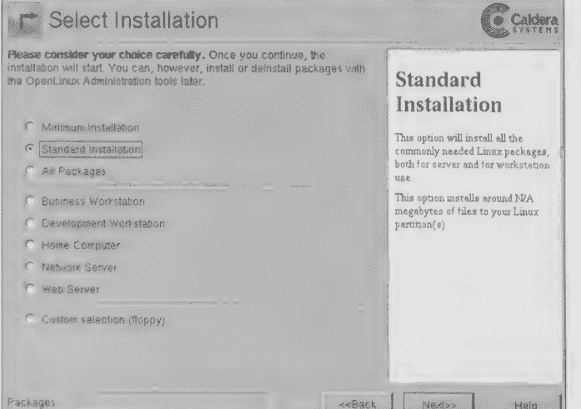

### 第 5 章：安装：进入最后冲刺阶段

- **最小化安装**：无图形支持，仅需 170 MB，适用于实验或为测试创建一个极简的 `OpenLinux` 系统。
- **标准安装**：一个不错的选择，需要 650 MB 的硬盘空间。
- **所有软件包**：需要约 1.4 GB 的磁盘空间。安装光盘上的所有内容。
- **商务工作站**：安装由 `Caldera` 认为对运行 `OpenLinux` 作为桌面操作系统的商务用户有用的软件。
- **开发工作站**：安装有益于将 `OpenLinux` 作为软件开发平台的工具。
- **家庭计算机**：安装对家庭用户有用的程序，包括互联网连接工具。
- **网络服务器**：安装互联网服务、网络实用程序和协议集合。
- **Web 服务器**：一种侧重于 `Apache Web` 服务器及支持工具的小型化安装。
- **自定义选择（软盘）**：如果您设置了带有安装说明的软盘（我们没有向您演示如何操作），请选择此选项。

如果您没有足够的硬盘空间来选择某些选项，则这些选项在列表中将处于禁用状态。此外，请记住，在完成安装后，您可以使用图形化包管理器轻松地添加软件包，不要觉得您在此屏幕上的软件包选择是板上钉钉的。

大多数正在熟悉 `OpenLinux` 的用户应该选择“标准安装”。如果您有特定的目标（例如互联网服务器或开发工作站），请随时选择相应的安装选项。


在您选择“下一步”继续后，您选择的软件包将在您进行其他配置选择时立即安装。您无法使用“上退”按钮返回此屏幕并进行不同的选择。

## 完成配置

当 `OpenLinux` 愉快地进行自我安装时，您可以继续选择一些配置选项。下一个屏幕允许您为 `OpenLinux` 设置根密码，如图 5-7 所示。

### 76 第二部分：安装 OpenLinux

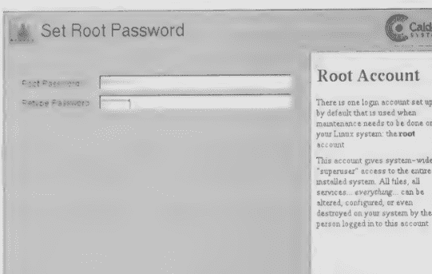

图 5-7：为 `OpenLinux` 设置一个根密码。


## 第二部分：安装 OpenLinux

### 分区配置

- **启动复选框**：建议通过选择此功能使 `Linux` 分区处于可启动状态，这允许您在每次启动系统时都可以启动 `OpenLinux` 或 `Windows`。
- **格式化复选框**：对于 `Linux` 分区，此复选框会自动勾选。您安装 `OpenLinux` 的分区将被格式化。

在设置好两个所需的分区后，选择“下一步”继续。此时您的硬盘尚未发生任何变化。

“分区信息”屏幕显示哪些分区将用于根分区（`OpenLinux` 的核心）和交换分区。

在确认这些分区是正确的后，选择“格式化所选分区”按钮。在格式化操作完成之前，“下一步”按钮将处于激活状态。如果有必要，您可以选择“上退”按钮，在选择“格式化分区”之前修改您的分区计划。

在安装活动期间，您可以按 `Ctrl+Alt+F5` 或 `Ctrl+Alt+F6` 查看安装程序正在使用的后台进程信息。按 `Alt+F8` 返回安装界面。

### 选择软件包

接下来，您需要在“选择安装”屏幕上选择要安装的软件包，如图 5-6 所示。可用选项包括：


| 图 5-6 | “选择安装”屏幕允许您根据对 `OpenLinux` 的用途在多个安装选项之间进行选择。 |


#### 第 5 章：安装：进入最后冲刺阶段

- **最小化安装**：无图形支持，仅需 170 MB，适用于实验或为测试创建一个极简的 `OpenLinux` 系统。
- **标准安装**：一个不错的选择，需要 650 MB 的硬盘空间。
- **所有软件包**：需要约 1.4 GB 的磁盘空间。安装光盘上的所有内容。
- **商务工作站**：安装由 `Caldera` 认为对运行 `OpenLinux` 作为桌面操作系统的商务用户有用的软件。
- **开发工作站**：安装有益于将 `OpenLinux` 作为软件开发平台的工具。
- **家庭计算机**：安装对家庭用户有用的程序，包括互联网连接工具。
- **网络服务器**：安装互联网服务、网络实用程序和协议集合。
- **Web 服务器**：一种侧重于 `Apache Web` 服务器及支持工具的小型化安装。
- **自定义选择（软盘）**：如果您设置了带有安装说明的软盘（我们没有向您演示如何操作），请选择此选项。

如果您没有足够的硬盘空间来选择某些选项，则这些选项在列表中将处于禁用状态。此外，请记住，在完成安装后，您可以使用图形化包管理器轻松地添加软件包，不要觉得您在此屏幕上的软件包选择是板上钉钉的。

大多数正在熟悉 `OpenLinux` 的用户应该选择“标准安装”。如果您有特定的目标（例如互联网服务器或开发工作站），请随时选择相应的安装选项。


在您选择“下一步”继续后，您选择的软件包将在您进行其他配置选择时立即安装。您无法使用“上退”按钮返回此屏幕并进行不同的选择。

### 完成配置

当 `OpenLinux` 愉快地进行自我安装时，您可以继续选择一些配置选项。下一个屏幕允许您为 `OpenLinux` 设置根密码，如图 5-7 所示。


图 5-7：为 `OpenLinux` 设置一个根密码。

### 时区与安装进度

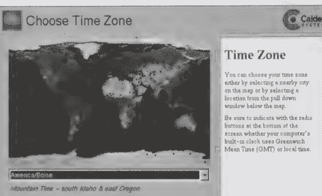

**图 5-11**：你在这个地图屏幕上选择你的时区。

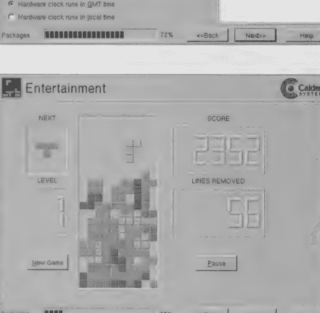

**图 5-12**：随着安装进行，你可以玩玩游戏来打时间。

屏幕底部的进度条显示了安装进度。该条标记为 `Packages`（软件包），必须达到 100% 才能完成安装。然后标签变为 `Postinstall`（安装后处理），并必须再次爬到 100%。在此阶段，安装正在配置所有已安装的软件包。在软件包安装和 `Postinstall` 阶段之前，`Finish`（完成）按钮处于未激活状态。当 `Finish` 变为激活且你按下它后，系统将重启；随后你就可以立即登录并开始使用你的 `OpenLinux` 系统了！

# 第 6 章

## 使用图形系统解决问题

**本章内容**

- 揭示关于视频控制器、显示器和鼠标的详细信息
- 再次尝试 `Lizard`
- 使用其他工具配置 `X Window` 系统
- 如果没有任何尝试都无效，如何寻找一些帮助
- 注意关机礼仪

在安装 `OpenLinux` 过程中，你在配置视频硬件时遇到过麻烦吗？如果是，本章就是为你准备的。请宽慰，图形硬件可能是 `OpenLinux` 系统中最难正常运行的部分。但图形也是你 `OpenLinux` 系统中最重要的部分之一——除非你倾向于一直在命令行界面工作。`OpenLinux` 使用的图形界面——`KDE` 桌面是基于 `X Window` 系统（也称为 "X"）构建的。如果 `X` 没有正确配置以使用你的视频硬件，那么 `KDE` 就无法提供良好的图形界面，也无法访问在书中其他地方描述的所有图形程序（参见第 12 章）。

### 发现你硬件的真实身份

在启动带有 `KDE` 桌面的 `X Window` 系统之前，你的配置文件必须包含关于视频控制器卡、显示器、鼠标和键盘的正确信息。通常情况下，`OpenLinux` 安装过程会自动确定所有信息，但如果没有发生这种情况，你仍然可以让一切正常工作。

对于你的视频控制器卡，你需要了解：

- 型号（以及可能使用的视频芯片）
- 卡上的显存（`video RAM`）容量

你可以在系统文档中找到这些信息，或者如果你使用的是双启动系统，可以通过 `Microsoft Windows` 控制面板（在第 3 章描述）。但现在你已经运行了 `OpenLinux`，你也可以尝试在本章中描述的 `Lizard`、`X` 和 `XF86Setup` 配置工具。

接下来，你需要了解关于鼠标的以下信息：

- 型号和制造商
- 鼠标是 `PS/2` 总线鼠标还是串行鼠标

同样，你的系统文档应该包含这些信息，鼠标底部通常也有一些基础信息。

`PS/2` 鼠标的电线（或尾部）端有一个圆形连接器。串口鼠标通常有一个带有九孔的椭圆形连接器。所有类型的 `PS/2` 总线鼠标在 `OpenLinux` 看来看起来是一样的。然而，不同的串口鼠标具有不同的特性。如果你有一个串口鼠标，你必须知道它的型号和制造商，或者你的鼠标是否模拟了其他知名鼠标。此外，并没有多少 `OpenLinux` 程序支持许多鼠标上配备的滚轮。


三键鼠标与 `OpenLinux` 配合效果最好，但双键鼠标也可以用。在 `X` 中，同时按住双键鼠标的两个键与在三键鼠标上按下中间键的感觉相同（前提是系统通过第 5 章讨论的 `Emulate 3 Button` 进行了正确配置）。


最后，你需要了解关于显示器的信息。大多数显示器手册后面都有一个表格，包含：

- 水平同步范围
- 垂直同步范围
- 分辨率

显示器是否为多同步（`multisync`），这意味着显示器可以以多种分辨率运行。


旧式显示器（特别是旧系统自带的 `VGA` 显示器）通常不是多同步的。如果你尝试使用比 `VGA`（640 x 480）更高的分辨率，这些显示器可能会损坏。水平和垂直同步数字帮助 `X` 决定在屏幕上放置像素的方式。分辨率告诉 `X` 屏幕上水平和垂直方向有多少像素。640x480 分辨率通常是最差的，1280x1024 通常被认为是最好的。对于大多数系统，追求 800 x 600 作为最低分辨率，1024 x 768 作为理想分辨率。


较高的视频分辨率会使用更多显存（位于视频卡上，因此与系统分离），允许屏幕显示颜色更少，并通常会缩小屏幕上的文字使其难以阅读。另一方面，使用更高的分辨率意味着可以在同一显示器上同时看到更多信息（尽管文字可能小到没眼镜看不清）。某些视频卡可以升级增加内存，一些较新的显示器内置了保护以防止烧毁。旧显示器没有这种保护，可能会起火。尝试从手册、经销商或制造商处查找你显示器的规格。


如果你听到显示器发出噪声、闻到元件气味或认为屏幕看起来不对，按下 `Ctrl+Alt+Backspace` 退出 `X` 并尝试较低的分辨率。否则，可能会损坏显示器。


### 探测系统

如果你的系统启动并处于命令行模式，你可能没有配置 `X` 所需的所有信息。收集这些最后机会是让 `X` 自己探测硬件。要实现这一点，你需要安装 `X Server`，`OpenLinux` 安装应该已经完成了。默认 `X Server` 是 `XFree86 Project`。这些 `X Server` 的包名都以 `XF86_SVGA` 开头。当你尝试此操作时看到"No file or directory"，说明你没有安装 `X Server`。回到手册获取信息。

要让 `X Server` 探测你的硬件，运行此命令：

```
X -probe
```


# 第 6 章：使用图形系统解决问题

你看到大量文本滚动屏幕，然后屏幕变为空。片刻后，命令行界面再次出现。在出现的所有文本中，你会看到关于你的视频芯片的信息。`X` 无法确定关于你显示器的太多信息——这取决于你。但视频芯片和可能的显存量是一个非常有用的起点。

以下行显示了在 Toshiba 2595 笔记本电脑上运行该命令的结果。注意 `X-server` 使用 `(default)` 探测了这些行。

```
XF86Config; /etc/XF86Config
(**) 代表提供的，--) 代表探测/默认值
(**) XB: rules: "free86"
(**) XB: model: "pc101"
(**) XB: layout: "us"
(**) Mouse: type: microsoft, device: /dev/ttyS0, baudrate: 1200
(**) Mouse: buttons: 3,3 emulation (timeout: 50ms)
(**) SVGA: Graphics device ID: "Primary Card"
(**) SVGA: Monitor ID: "Primary Monitor"
(**) Path set to "/usr/X11R/lib/X11/fonts/Type1,/usr/X11R/lib/X11/fonts/Speeds,/usr/X11R/lib/X11/fonts/misc,/usr/X11R/lib/X11/fonts/75dpi"
(--) SVGA: VCI: Trident 9525 DVD rev 73, Memory @ 0xff0000, 0xff0000, MMIO @ 0xff7e000
(--) Trident chipset version: 0xf3 (Cyber9525)
(--) SVGA: BIOS requests Clock Control Bits 0x3
(--) SVGA: Detected a Trident 9525 DVD.
(--) SVGA: Detected an STN 800x600 Display
(--) SVGA: Revision 65.
(--) SVGA: Using Trident programmable clocks
(**) SVGA: chipset: cyber9525
(**) SVGA: videoram: 2048k
(**) SVGA: Using 16 bpp, Depth 16, Color weight: 565
(**) SVGA: Maximum allowed dot-clock: 230.000 MHz
(**) SVGA: Mode "800x600/60Hz": mode clock = 40.000
(**) SVGA: Virtual resolution set to 800x600
(--) SVGA: Speedup code selection modified because virtualX!=- 1024
(--) SVGA: Using Linear Frame Buffer at 0xff800000, Size 2MB
```

如你所示，探测命令提供了许多有用信息，包括电脑有一块 Trident 9525 视频卡、一个 PCI 总线和 2 MB 内存。

## 配置冲突

现在你已经了解了关于你的视频硬件的所有信息，可以开始配置 `X Window` 系统了。我们假设你还没有运行图形系统。如果图形系统已经在运行，那么你在这里干什么呢？请跳转到其他章节。

`OpenLinux` 提供了几个工具来帮助你配置并运行 `X Window` 系统。我们在这里查看的三个工具是：

- `Lizard X` 配置工具
- `XF86Setup`
- `xf86config`

**注意：** 你从本章的图中可以看到，为了截图并向你展示工作原理，我们已经运行了 `X Window` 系统。请放心，我们描述的程序在字符单元命令行中同样有效。

### 运行中的 Lizard

我们在第 5 章中讨论的 `Linux Wizard`（或 `Lizard X`）安装程序是我们见过的配置 `X` 最好的工具。

你可以使用同一个工具（在安装完 `OpenLinux` 其部分、重启并登录后）来调整图形设置或让一切首次正常工作。

你可以通过两种方式启动程序：

- 如果你还没有让 `X` 工作，输入命令 `lizardx` 来启动此实用程序。
- 如果你的图形环境正在运行并想使用此实用程序进行调整，请在主菜单上选择 `COAS server`（点击左下角的 `K` 图标打开主菜单）。

启动 `Lizard X` 后，按照以下步骤操作：

1. 在第一个 `Lizard X` 屏幕上（如图 6-1 所示）配置你的鼠标，然后选择 `Next`（下一步）继续。遵循第 5 章提供的相同说明。

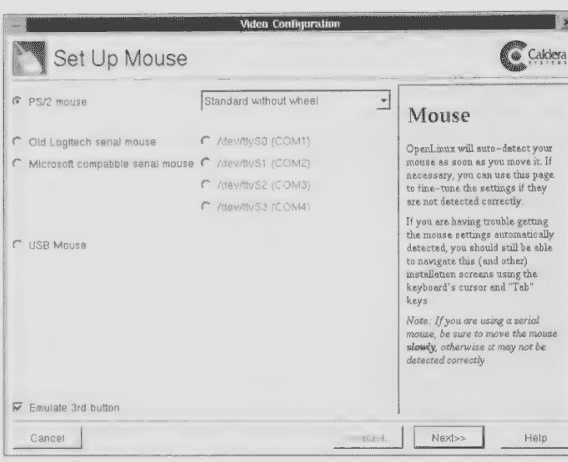

图 6-1：Lizard 视频配置工具从鼠标配置屏幕开始。

#### USB 鼠标

一旦你移动鼠标，`OpenLinux` 就会自动检测到它。如有必要，如果设置没有被正确检测，你可以使用此页面调整设置。

2. 接下来从显示的列表中选择你的键盘型号和布局。选择 `Next` 继续。
3. 在 `Select Video Card`（选择显卡）屏幕上（如图 6-2 所示），选择 `Probe`（探测）按钮并确认对视频硬件进行自动探测。然后选择 `Next` 继续。

`Lizard X` 实用程序的真正威力在于此。`Lizard X` 会探测你的视频硬件，并确定设置正确视频配置所需的一切。你只需要点击 `Probe` 并观察即可。

4. 根据你收集的关于显示器能力的信息选择一个显示器。再次选择 `Next` 继续。
5. 在 `Select Video Mode`（选择视频模式）屏幕上（如图 6-3 所示）选择一种视频模式，并通过点击 `Test mode`（测试模式）按钮测试该模式。

测试视频模式的能力是 `Lizard X` 的另一个强大功能。如果你最初选择的没有显示正常，使用 `Back`（返回）按钮回到 `Select Video Card` 屏幕并重试。继续尝试模式，直到找到一个可以工作的模式，如图 6-3 所示。

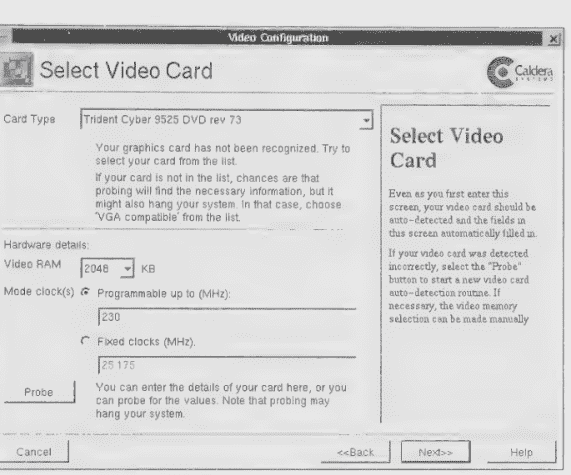

图 6-2：`Select Video Card` 屏幕可以确定你的视频芯片组和显存。

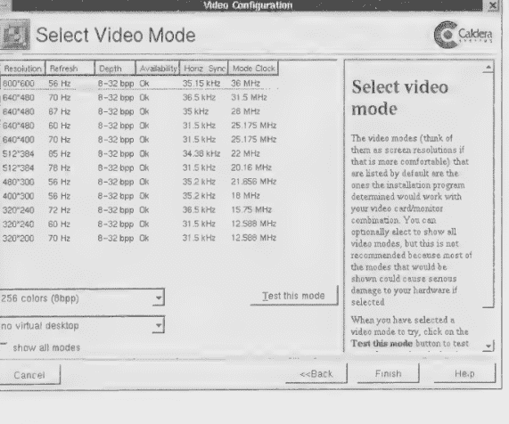

图 6-3：在 `Select Video Mode` 屏幕可以测试视频模式，直到找到一个正常工作的模式。

注意：如果你找不到正常的模式，`Lizard X` 实用程序可能没有正确检测到视频硬件。使用 `Back` 按钮返回 `Select Video Card` 屏幕重试，或者尝试本章讨论的其他方法。

6. 最后，点击 `Finish`（完成）更新你的配置文件（`/etc/XF86Config`）。

## 尝试设置工具

另一个你可以配置 `X` 的 `OpenLinux` 工具是 `XF86Setup`。这个工具没有 `Lizard X` 那么好用，但如果 `Lizard X` 无法为你配置图形，`XF86Setup` 可能会成功。从字符单元命令行启动 `XF86Setup` 的命令（注意大小写！）。

```
XF86Setup
```

现在按照以下步骤使用 `XF86Setup` 配置 `X`：

1. 如果提示，使用方向键选择 `Yes` 或 `No`，告诉 `XF86Setup` 你是否想使用现有配置文件作为起点。`XF86Setup` 只在你已经有配置文件时才会询问此项。如果某些东西工作正常（例如鼠标），你可能想从这里开始。如果你有很多问题，就 `No` 并从头开始。
2. 消息框询问你是否准备好切换到图形模式。按 `Enter`。你立即进入了 `VGA` 图形模式（640x480 分辨率），如图 6-4 所示的初始屏幕。
3. 点击屏幕顶部的 `Mouse` 按钮。如果鼠标还没有工作，反复按 `Tab` 直到 `Mouse` 按钮被高亮，然后按 `Enter`。出现 `Mouse` 屏幕，如图 6-5 所示。

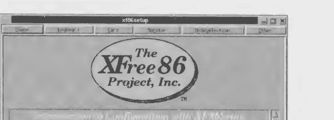

图 6-4：`XF86Setup` 从工具信息屏幕开始。

有五个独立的配置对应标签按钮：

- `Mouse`：使用此设置指针、右键等以及你的鼠标类型
- `Keyboard`：设置键盘的布局和语言
- `Sound`：选择声卡类型
- `Monitor`：选择显示器类型和能力
- `Other`：配置各种设置

你可能想从配置鼠标开始，但在完成任何标签后，可以按 `[F5]` 退出。你也可以随时点击 `Help`（帮助）按钮获取额外说明。

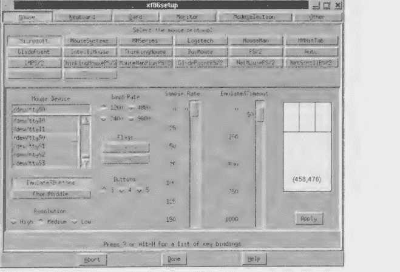

图 6-5：使用此窗口配置鼠标。

| 鼠标设备 | 采样率 | 仿真超时 |
| :--- | :--- | :--- |
| `PS/2` | 1000 | |
| `PS/2` | 500 | |
| `Generic` | 250 | |
| `Generic` | 1000 | |
| `PS/2` | | |

4. 选择鼠标使用的协议和设备名称。在鼠标工作之前，不要担心其他设置。
5. 点击屏幕底部的 `Apply` 按钮激活你的选择。如果鼠标不起工作，再次使用 `Tab` 和 `Enter`。
6. 如果你使用的是标准键盘，可以跳过 `Keyboard` 按钮；否则，点击屏幕顶部的 `Keyboard` 按钮，然后在 `Keyboard` 屏幕上选择键盘型号和布局。
7. 点击屏幕上方按钮行中的 `Card` 按钮。出现一个窗口，你在其中为 `XF86` 定义你正在使用的视频显卡，如图 6-6 所示。

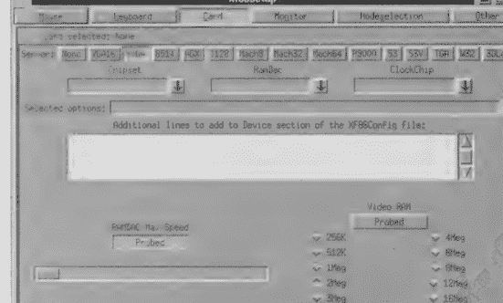

图 6-6：在此窗口中为 `XF86Setup` 选择显卡。

8. 根据视频显卡的芯片组选择你想要使用的 `X` 服务器。对于其他字段，你可以选择 `Probed`。如果 `Probed` 不行，你可以返回此屏幕并选择特定选项。

你可能可以在制造商和型号列表中找到特定的显卡，从而避免手动输入所有这些视频设置。如果你在 `XF86Setup` 提供的列表中看不到你的显卡，则必须使用常规屏幕（参考图 6-6）。

9. 选择 `Card List` 按钮查看列表列表（如图 6-7 所示），查看你的显卡是否在列表中。

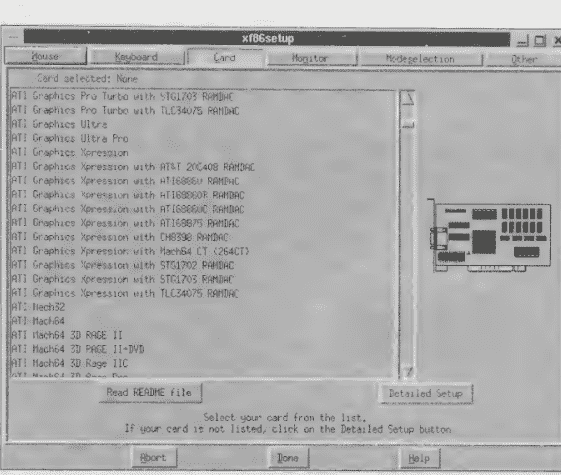

图 6-7：`Card List` 屏幕列出了数百种显卡。

10. 选择 `Monitor` 按钮。选择最适合你显示器能力的行。

如果你不确定你的显示器或者没有较新的显示器，选择 `Super VGA, 800x600` 行（如图 6-8 所示）作为起点。

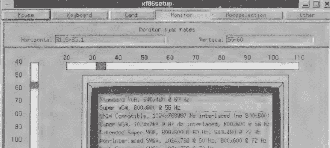

图 6-8：在 `XF86Setup` 的此屏幕中仔细选择显示器描述。

11. 选择 `Modeselection` 按钮，如图 6-9 所示。

在此屏幕上选择你想要使用的分辨率。大多数用户会想要 `800x600` 或 `1024x768`。

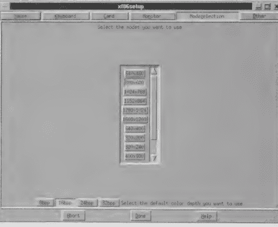

图 6-9：在 `Modeselection` 屏幕上选择分辨率和色深。

12. 从底部的按钮选择色深。

- `8bpp` 按钮用于 256 色；
- `16bpp` 用于 3.2 万色；
- `24bpp` 或 `32bpp` 用于数百万色。颜色数量越多，需要的显存就越多。

极少有显卡需要在 `Other`（其他）屏幕上设置任何选项。如果你愿意，可以随意查看这些选项。

13. 选择 `Done`，然后在弹出窗口中点击 `Okay`。

图形系统开始启动（或尝试启动）。如果一切运行正常，你将看到一个带有小型 `X` 鼠标指针的图形界面。然后你就可以保存配置并使用 `kde` 命令启动标准的 `OpenLinux` 桌面界面。

## 真正硬核的方法

如果 `Lizard` 和 `XF86Setup` 工具不起作用，那么你可能需要一位真正的 `OpenLinux` 大师来提供帮助。不过，你也可以尝试另一个工具——`xf86config`（全小写），这是一个老式的字符模式工具。

尽管 `xf86config` 很少使用，但 `OpenLinux` 包含了 `xf86config`（它使用不同的内部进程，可能会导致配置成功）。

输入此命令开始：

```
xf86config
```

屏幕会出现全屏文本（见图 6-10）。将你收集的关于视频硬件的信息放在身边，并仔细阅读每个屏幕上的所有信息，按照指示操作。

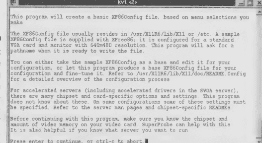

图 6-10：`xf86config` 工具是一个用于设置 `X` 的字符化程序。

该程序将根据你做的选择创建一个基础 `xf86config` 文件。

`Xf86config` 文件通常位于 `/etc/X11/xorg.conf` 或 `/etc`。`xf86config` 提供了一个示例文件，其配置为标准 `VGA` 卡和 `640x480` 分辨率。该程序在准备写入文件时会询问路径。

以此为基础并根据你的配置进行编辑，或者让程序生成一个基础 `xf86config` 文件以详细概述配置过程。

对于加速的服务器（包括 `X` 服务器中的加速驱动程序），有许多选项和设置。该程序并不了解它们。在某些配置中，必须指定这些设置；请参考服务器手册和特定芯片组的 `README`。

此配置允许你选择显卡的芯片组和显存大小。`SuperProbe` 可以帮助你完成。

知道你想运行什么，也会很有帮助

按回车继续，或按 `ctrl-e` 退出

`xf86config` 是高效的，但它要求你比阅读 `Xf86Setup` 多读很多内容，才能在出现的众多菜单中知道该选择什么。尽管如此，在闪亮的新设备（如 `Lizard X`）出现之前，`xf86config` 提供了另一个为成千上万人证明良好的选项。

在你回答了 `xf86config` 提出的问题后，`xf86config` 会为你创建一个配置文件。一旦 `xf86config` 退出，你就可以立即使用 `kde` 命令在 `OpenLinux` 中运行图形桌面。

## 启动引擎

在你成功为视频硬件配置好 `X` 后，是时候尝试带有 `KDE` 桌面的图形系统了。要这样做，只需输入以下：

```
kde
```

屏幕变黑、闪烁、显示背景颜色（屏幕中间可能有一个 `X` 鼠标指针），然后——如果一切顺利——开始显示 `KDE` 面板、桌面图标，可能还有一两个对话框。

或者可能没有。（唉。）如果屏幕恢复到字符单元界面，你将看到关于可能出现错误的各种信息。你可能正确指定了视频代码，或者错误地回答了其他某些问题。如果是那样，你可以做几件事：

- 如第 3 章所述，使用 `Windows 98`（如果可用）获取更多关于你显卡的详细信息。
- 通过联系 `Caldera` 获取更新版本的 `X` 服务器（`XFree86`），在 `Caldera FTP` 站点（`ftp.calderystems.com`）的更新目录下查找，或者在 Web 上 `www.xfree86.org` 查找 `XFree86`。
- 找一位经验丰富的 `OpenLinux` 人士帮助你。`Caldera` 提供的用户列表就是用于此类帮助的。
- 去斐济读一个课程——在南太平洋大学，他们有一个非常好的计算机科学系，那里每个人都使用 `Linux`。（你好，伙伴们！）


## 起源


`X Window` 最初在马萨诸塞理工学院（MIT）开发。后来，`X Window` 一个非营利组织。`X Window System` 由一组想要提供专有 `X Window` 系统免费替代的人开发的。`X Window System` 也由一组想要提供专有 `X Window` 系统免费替代的人开发的。`X Window System` 同样由一组想要提供专有 `X Window` 系统免费替代的人开发的。`X Window System` 还是由一组想要提供专有 `X Window` 系统免费替代的人开发的。`X Window System` 也是由一组想要提供专有 `X Window` 系统免费替代的人开发的。`X Window System` 同样由一组想要提供专有 `X Window` 系统免费替代的人开发的。`X Window System` 也是由一组想要提供专有 `X Window` 系统免费替代的人开发的。`X Window System` 同样由一组想要提供专有 `X Window` 系统免费替代的人开发的。`X Window System` 也由一组想要提供专有 `X Window` 系统免费替代的人开发的。`X Window System` 还是由一组想要提供专有 `X Window` 系统免费替代的人开发的。`X Window System` 同样由想要想要提供专有 `X Window` 系统免费替代的人开发的。`X Window System` 同样由一组想要提供专有 `X Window` 系统免费替代的人开发的。`X Window System` 还是由一组想要提供专有 `X Window` 系统免费替代的人开发的。`X Window System` 也由一组想要提供专有 `X Window` 系统免费替代的人开发的。`X Window System` 同样由一组想要提供专有 `X Window` 系统免费替代的人开发的。`X Window System` 还是由一组想要提供专有 `X Window` 系统免费替代的人开发的。`X Window System` 也由一组想要提供专有 `X Window` 系统免费替代的人开发的。`X Window System` 同样由一组想要提供专有 `X Window` 系统免费替代的人开发的。`X Window System` 还是由一组想要提供专有 `X Window` 系统免费替代的人开发的。`X Window System` 同样由一组想要提供专有 `X Window` 系统免费替代的人开发的。`X Window System` 也由一组想要提供专有 `X Window` 系统免费替代的人开发的。

## 第 6 章：解决图形系统问题

如果你尝试了这些解决方案 `X` 仍然无法工作，请寻找当地的大学或高中。或者，如果你有笔记本，可能想从 `Metrolink` (`www.metrolink.com`) 或 `Xi Graphics` (`www.xigraphics.com`) 买一个商用 `X` 服务器。有时 `X86` 不不起时，`Metrolink` 或 `Xi Graphics` 的代码是有效的。此外，如果你购买了 `X` 服务器，在安装好 `X` 后可以拨打公司的技术支持热线。

## 成功了！

恭喜你让 `X Window System` 运行起来。如果你知道处理 PC 视频硬件涉及的所有问题，你会认为 `X86` 开发者能让图形运行起来太神奇了。尽管它是免费分发的，但你可能想向其开发基金捐款，该基金列在 `www.XFree86.org`。

如果你想关闭图形系统（或至少回到图形登录提示，取决于你的系统配置），右键点击桌面背景并选择 `Logout`（注销）。

一个配置对话框会警告你在退出之前可能想要关闭任何应用程序窗口。选择 `OK` 退出图形环境。

如果你在退出图形环境遇到困难，尝试按下 `Ctrl+Alt+Backspace`。这样做将让你立即回到字符模式。当然，如果你有任何应用程序窗口，将丢失任何未保存的数据。`KDE` 环境无法保存你的状态以便在下次在图形环境中工作时恢复打开的窗口（见第 11 章）。通常情况下，只有当常规方法（注销菜单项）对你不起作用时才使用 `Ctrl+Alt+Backspace`。

## 96 第二部分：安装 `OpenLinux`

## 关闭 `OpenLinux`

如果你习惯了旧版本的微软 `Windows` 系统，那么看到有一个专门介绍如何关闭系统的章节，可能会觉得很奇怪。毕竟，你难道不应该直接关掉电源开关吗？不！所有现代操作系统都要求你“正式”地关闭系统，这实际上是告诉系统准备好为断电做好准备。`OpenLinux` 需要一个系统化的过程来关闭操作系统，之后你就可以关闭电源开关了。

如果你刚刚安装完系统，你将以名为 `root` 的系统管理员身份登录。请按照以下步骤关闭系统：

1. 如果图形化环境（`KDE`）正在运行，从主菜单中选择“注销”（`Logout`）（或右键点击桌面背景并选择“注销”）。

系统将返回到带有 `#` 提示符的字符单元模式，或者返回图形登录界面。如果你处于字符单元模式，请在提示符处输入 `shutdown -h`。这样做会告诉 `OpenLinux` 现在停止操作系统，而不是等待一段时间。否则，继续执行第 2 步。

2. 如果你处于图形登录界面，请选择“关机”（`Shutdown`）。

会弹出一个小对话框，你可以在其中选择关闭系统或重启系统（还有其他几个选项）。

3. 选择你需要的选项并按 `OK`。

`shutdown` 是发送给 `OpenLinux` 的命令。某些命令带有选项（或标志），可以提供有关命令应执行操作的额外信息。`-h` 意味着在关机后停止系统，而不是重启。

`-r` 意味着关机后重启。`now` 意味着立即开始关机过程。如果没有 `now`，`shutdown` 命令会延迟，并向仍在系统上工作的人发送警告信息，告诉他们系统即将关闭。

重启系统的另一种方法是臭名昭著的“三指礼” `Ctrl-Alt-Delete`。三指礼仅仅是向 `OpenLinux` 发送了一条 `shutdown -r now` 命令，结果与你手动输入此命令相同。

作为 `OpenLinux` 用户，重启系统应该是一个极低频率的事件。因为登录程序为 `OpenLinux` 系统提供了必要的安全保障，你不需要在会话之间关闭系统。`OpenLinux` 是稳定的，因此不会像某些其他 PC 操作系统那样死机或崩溃。然而，如果你在同一台机器上安装了多个操作系统，重启将带你回到 `LILO` 提示符（或 `Boot Manager`、`System Commander` 或其他启动程序），以便你启动另一个操作系统。


# 第7章

## 首次使用 `OpenLinux`

### 本章内容

- 启动 `OpenLinux`
- 登录 `OpenLinux`
- 设置你的桌面
- 创建用户账户
- 更新密码
- 停止 `OpenLinux`

在你计算机系统上加载 `OpenLinux` 之后（参见第 4 章和第 5 章），该软件正热切地等待第一个向你展示的机会。但等等！第一次登录 `OpenLinux` 比你想象的要复杂一点。进入 `OpenLinux` 后，你将面临关于你希望图形界面呈现什么样子的各种问题。

诚然，图形界面的问题很容易。尽管如此，本章将引导你解决这些问题，并解释如何为不同的用户添加账户以及更改密码。当你准备好退出 `OpenLinux` 时，我们将教你如何优雅但完全地停止它。

## 启动 `OpenLinux`

你准备好启动 `OpenLinux` 了吗？现在开始：

1. 确保所有设备已关闭。
2. 开启所有外围设备，如打印机和扫描仪。
3. 开启显示器的电源（如果与主主机箱分开）。
4. 开启主电源开关。

一段时间后，`OpenLinux` 标志屏幕上会出现 `LILO boot:`。

5. 按 `Tab` 键查看可启动的操作系统。

取决于你在安装 `OpenLinux` 期间选择的选项，你可能会看到类似下面的内容。启动提示符在等待你选择一个要启动的操作系统。按下 `<TAB>` 键显示所有可用的操作系统（在本例中 `linux` 和 `dos` 是标签）。然后会出现启动提示符，这样你就可以输入你的选择：

```
boot:
linux dos
boot:
```

6. 输入列出的操作系统之一的名称然后按 `Enter`。

操作系统启动。你必须足够快，在启动提示符后输入 `linux`。

如果你什么都不做——也就是说，你忽略了这些精彩指令——在一段时间（通常是 5 到 20 秒）后，第一个列出的操作系统（称为默认系统）将启动。

为了让 `OpenLinux` 启动，必须：

- `OpenLinux` 是唯一安装的操作系统；或者
- `OpenLinux` 必须是列出的第一个操作系统，以便它作为默认系统启动。

否则，你可能需要等待另一个操作系统完成启动、将其关闭、重启，然后确保你足够快能在提示符后输入 `linux`。

当 `OpenLinux` 操作系统启动时，你会看到各种信息在屏幕上滚动，许多技术操作正在发生。你可以忽略这些信息，除非你需要联系 `Caldera` 技术支持。滚动停止后，屏幕闪烁几次，然后出现图形登录界面，如图 7-1 所示。


## 第7章：首次使用 `OpenLinux`

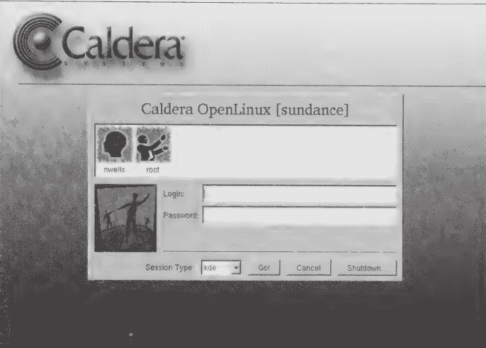

图 7-1：图形登录界面。

你已准备好登录系统。很幸运的是，我们在下一节中介绍了这个主题！

## 权力的根源

如果你想使用 `OpenLinux`，就必须以具有不同用户名的特定用户登录。为什么？因为 `OpenLinux` 是一个多用户系统，使用不同的账户来防止人们查看他人的文件、删除必要的文件或进行其他坏事。拥有独特的身份也有助于防止一个人的操作影响到另一个人，因为许多人可能同时使用同一台计算机。

## 100 第二部分：安装 `OpenLinux`

这种保护的结果是，没有用户名和密码，没有人可以在系统内做任何事情。这样做的好处是，没有你的用户名和密码，没有人可以破坏你的东西（当然，除非那个人拥有超级用户密码）。

作为第一步，使用你在安装期间创建的普通账户登录。该账户的名称可能与你的名字相同。

你也可以登录 `root`，它是系统的用户名（你最好不要忘记它）。以 `root` 身份登录是危险的，因为在你熟悉 `OpenLinux` 的过程中很容易破坏东西。因此，最好使用你的普通账户登录，然后临时切换到 `root` 账户来完成任何需要超级用户权限的任务。

现在你已经在登录界面输入了用户名和密码。

在屏幕上的对话框中输入密码时，你看不到。这种保密性确保了可能在你肩后观察的同事不会看到密码并在稍后尝试登录你的身份（职场信任真如此。）如果你输入了错误的密码，图形登录界面将返回，你可以再次尝试输入密码。

## 启动你的 `KDE` 桌面

输入用户名和密码后，会出现 `KDE` 桌面，如图 7-2 所示。`KDE` 桌面是 `OpenLinux` 的主要工作环境。

`KDE` 包括一个通过点击 K 图标（如图 7-3 所示）打开的主菜单、一个可以存放常用程序的桌面背景，以及一套完整的图形化配置工具。

## 第 7 章：首次使用 `OpenLinux`

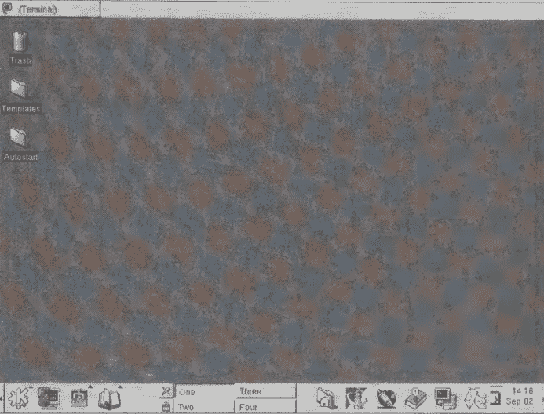

图 7-2：`KDE` 桌面主窗口。

你想做的第一件事是设置 `KDE` 以匹配你的个人偏好。当你第一次登录 `OpenLinux` 时，`KDE` 设置向导会自动出现。按照以下步骤配置你的桌面，使桌面外观符合你的要求。

- 从显示的四个选项（`KDE`、`Windows`、`Macintosh` 或 `BEOS`）中选择一个桌面主题。

点击其中一个按钮后，屏幕会立即变为你所选择的设置。例如，如果你选择了 `Macintosh` 界面，菜单栏将出现在屏幕顶部。我们显示的屏幕截图是基于 `KDE` 主题，但你可以选择任何你喜欢的。

- 点击“`Next`”（`Next`）继续。

- 出现一个设备图标列表。

- 点击你想要从桌面访问的任何设备图标。

大多数较新的电脑都包含 3½ 英寸软磁盘驱动器和 `CD-ROM` 驱动器。当你点击其中一个图标时，该图标会立即出现在你的桌面上，位于 `KDE` 向导窗口的左侧。

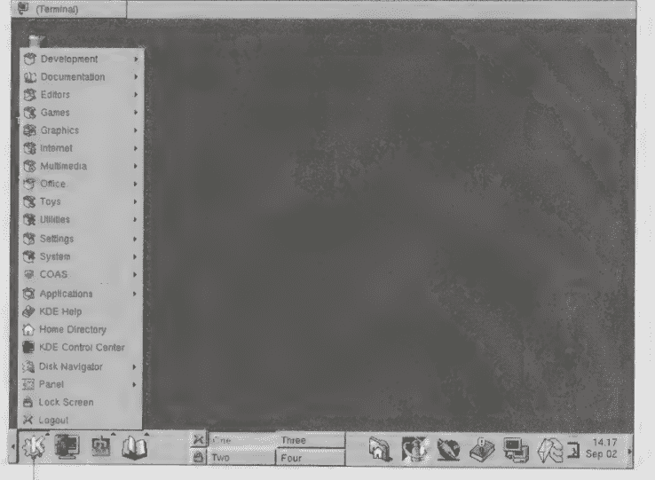

图 7-3：面板上的 `Kicon` 打开 `KDE` 中的主菜单。

`Kicon`

4. 选择“`Next`”继续。

出现一个打印机图标。

5. 如果你想从桌面访问本地打印机（例如，你可以将文件拖放到打印机上），请点击“`printer`”。

打印机图标会立即出现在你的桌面上。

6. 选择“`Next`”继续。

你会看到一个互联网网站列表（参见图 7-4）。

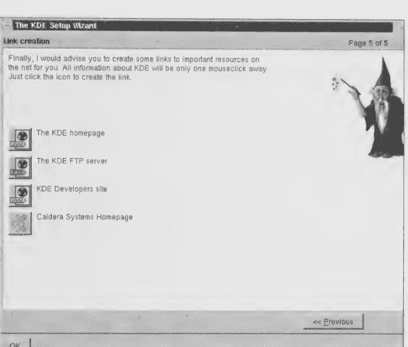

图 7-4：可以轻松地将网站链接添加到 `KDE` 桌面。

7. 为你想要从桌面快速访问的每个互联网网站选择图标。

在向导窗口中点击图标后，一个以相应站点命名的图标会立即出现在你的 `KDE` 桌面上，位于向导窗口的左侧。

如果你已连接互联网（在阅读完第 15 章后你就会），点击这些图标之一将直接带你进入图标上命名的网站。

8. 选择 `File:Exit` 以关闭 `KDE` 设置向导。

你的 `KDE` 桌面配置完成！

`KDE` 还有数百个其他配置选项，例如设置壁纸图形、选择颜色方案、设置显示字体以及选择屏幕保护程序（详情请参见第 11 章）。在本章中，我们将探索一些你在开始调整屏幕保护程序设置之前可能需要的话题。

## 与 `OpenLinux` 面对面

现在，你正盯着一个 `KDE` 桌面——它配置了拖放打印机和一个精巧的菜单按钮——你可能感到非常如松。毕竟，设置一个强大的 `OpenLinux` 系统并没那么糟糕。

但我们有一个坏消息：从这个流畅的桌面中，你无法完成 `OpenLinux` 能完成的所有事情。相反，你必须在命令行界面面对 `OpenLinux`。

不要惊慌。在这一节中，我们只需打开一个命令行窗口并立即将其关闭。没有晦涩的命令，没有神秘的编辑器，也没有关于那些倾向于使用鼠标而非键盘的人的评论。在本章的后续章节中，根据需要，我们将向你展示如何利用名为“命令行”的奇特怪兽进行更多操作。

你可以通过两种方式从 `OpenLinux` 的 `KDE` 桌面打开命令行：

- 点击面板上的终端模拟器（`Terminal Emulator`）图标。会出现一个命令行窗口（也称为终端模拟器窗口），如图 7-5 所示。

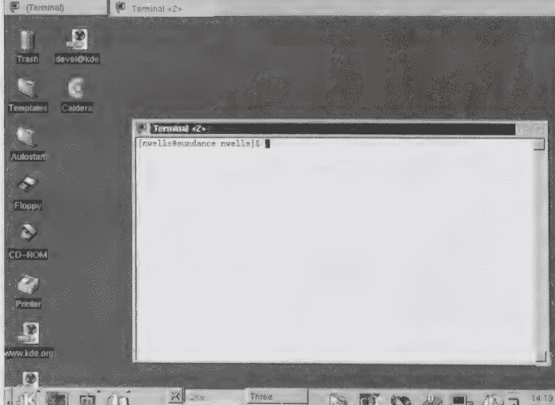

图 7-5：终端模拟器打开命令行窗口。

## 换一个名字的命令行

如果你来自 `DOS` 或 `Windows` 世界，你很可能见过过命令行提示符，它看起来可能像这样：

```
C:\
```

`OpenLinux` 的命令行提示符看起来相似，但工作方式略有不同。`OpenLinux` 中的命令行实际上是一个名为 `shell`（外壳）的程序。`OpenLinux` 中的 `shell` 就像 `DOS` 中的 `COMMAND.COM`，当然要好得多。现在先不用管为什么。`OpenLinux` 中使用的特定 `shell`（实际上也是许多其他 `Linux` 和 `UNIX` 系统）被称为 `bash`。（第 10 章将详细介绍 `bash`。）

`OpenLinux` 中的 `shell`（或命令行）在不同时期也被称为终端模拟器（`terminal emulator`，因为这就像你连接到了你的 `OpenLinux` 系统的哑终端一样），或 `Xterm` 窗口（因为这是打开运行 `bash` 窗口的图形化程序的名称）。

所以，每当你看到这些术语中的任何一个时，请记住，它们指的都是一个你可以输入命令的地方。

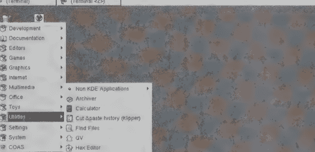

图 7-6：工具菜单（`Utilities menu`）（注：图 7-6 的 OCR 文字未对齐/截断，已根据上下文修正）。

## 图形化创建账户

要创建账户，必须以 `root` 身份登录。

1. 在 `KDE` 桌面，打开 `COAS` 帐户窗口。

出现一个介绍框。

2. 点击你想查看或更改的帐户名称。

出现一个对话框。

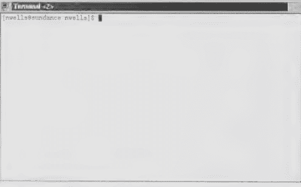

图 7-7：终端菜单（`Terminal`）。

3. 选择 `User:Create User` 打开创建用户窗口。

4. 输入新帐户的登录名并点击 `OK`。

出现一个对话框。

5. 填写有关新帐户的信息，例如用户的全名。

6. 点击 `OK` 按钮将新用户添加到系统。

新用户被添加到系统的用户列表中（随后出现在 `COAS` 用户管理窗口）。

7. 选择 `File:Exit` 关闭 `COAS` 对话框。

你对 `OpenLinux` 用户信息的更改已保存。

你犯错了吗？如果是，更改账户非常简单。只需以下步骤操作：

1. 按照之前的步骤打开 `COAS` 帐户窗口。
2. 点击你想查看或更改的帐户名称。
3. 选择 `User:Edit User`。
4. 进行你的更改。
5. 点击 `OK` 按钮。
6. 选择 `File:Exit`。

## 通过命令行创建新账户

大部分信息都是一言易懂的，但这里有一些提示：

- 用户名要短且全小写。
- 使用大写字母、小写字母和特殊字符的组合来设置一个难以猜测的密码。不要使用常用词、昵称或其他人们可以猜到的词。
- 将 `/bin/bash` 设置为你的默认 `shell`，这是一个很好的选择。（关于 `shell` 的更多信息，请参第 10 章。）

## 通过命令行创建新账户

如果你没有运行 `KDE` 桌面（如果你喜欢那种方式，稍后会介绍），或者你单纯地不喜欢之前描述的 `COAS` 工具，可以使用以下命令在 `OpenLinux` 中创建新用户：

```
useradd <name>
```

其中 `<name>` 是你想创建的新普通帐户的帐户名（用户名）。

# 第7章：首次使用 `OpenLinux`

## 选择有意义的账户名称

你为账户（用户名）选择的名称也是发送和接收电子邮件时使用的名称，因此请务必仔细选择。现在看起来可爱或合适的名字，以后可能就不再那样了。此外，避免选择过长的名字，因为你可能每天都要输入好几次。你可能还需要在电话中告诉别人你的电子邮件地址，所以像 `phool`（愚蠢）这样的用户名会导致信息发送错误，让你觉得自己自己很 `phool`。


多年前，一位名叫 Tom Chielewski 的前学生来到我的公司工作。我们的公司标准规定登录名必须是人的姓氏。当我创建他的账户时，我知道人们很难正确拼写出 Tom 的名字，所以我将他的账户创建为 `TomC`。Tom Chielewski 在整个小组、部门以及拥有 13 万人的公司里都以 `TomC` 闻名。在 Tom 离开公司后，他的新公司执行了与我们相同的政策。但在他第一天结束之前，他又变回 `TomC`。

## 密码是什么？

定期更改密码是提高 `OpenLinux` 系统安全性的极佳方法，而且这个操作可以通过简单的命令完成。如果你以 `root` 身份登录，只需使用以下代码，记得将 `<name>` 替换为你的用户名：

```
passwd <name>
```

当你输入类似这样的命令时，系统会提示你为账户 `<name>` 设置新密码。

`New Unix password:`

`新 Unix 密码：`

`Retype new UNIX password:`

`重新输入新的 UNIX 密码：`

`password: all authentication tokens updated successfully`

`所有身份验证令牌更新成功`

在上例中，密码正确输入了两次。然而，你无法看出，因为程序不允许你（或其他任何人）在输入时看到密码。屏幕上甚至不会出现标记点。

顺便说一下，如果你以 `root` 身份登录，可以使用本节所示命令更改任何用户的密码。如果你以普通用户名登录，则只能更改你自己的密码。命令类似，但不包含用户名（系统假设为你自己的）：

`passwd`

使用此命令更改你自己的密码，在输入新密码之前你必须输入当前密码。这样做可以防止朋友在你去接水时更改你的密码。

使用 `passwd` 命令时要小心。如果你以 `root` 身份登录但忘记在 `passwd` 命令后包含想要更改密码的用户名，你最终会更改 `root` 密码。那么当你下次尝试以 `root` 登录发现密码无效时，就会有一个大惊喜——因为你更改了它！

## 结束你的会话

`OpenLinux` 与所有现代操作系统一样，要求你完成正常关机，而不是简单地拔掉电源。这可以防止内存中临时存储的信息丢失。正常关机会将所有内容记录到硬盘，并按顺序关闭所有程序。

注销系统非常简单。只需遵循以下步骤：

1. 点击面板上的 `K` 图标，从主菜单中选择“注销”（`Logout`）项目。

出现一个对话框。你正在运行的所有程序都会列在这个对话框中。`KDE` 会尝试在你下一次登录时重启这些程序。在退出桌面之前，请查看列表，看看程序是否有任何内容需要保存。（如果是，请选择“取消”）。

你也可以通过右键点击 `KDE` 桌面背景的任何地方并从弹出菜单中选择“注销”来选择注销选项。虚拟桌面按钮（标记为一、二等）左侧也包含一个带有 `X` 的小图标。点击 `X` 图标将启动注销序列。

2. 点击“注销”以确认你想注销。

片刻后，会出现图形登录界面。此时你可以再次登录（如果需要，可以使用你的普通用户名或 `root`）。你也可以从这里选择关机。

如需关机电脑，请继续执行以下步骤：

3. 点击“关机”（`Shutdown`）按钮。

出现一个带有关机选项的小对话框。

4. 选择适当的关机选项（如重启或停止系统）。

当屏幕显示“系统已停止”（`System halted`）或开始重启后，你就可以关闭电源了。

> 我们可能没告诉你，但如果你以 `root` 身份登录并打开了命令行窗口，可以跳过整个注销程序。只需输入命令 `reboot`。此命令会导致正常关机，但在不提示保存任何未保存文件的情况下关闭所有打开的程序，因此谨慎使用此命令。

# 第三部分：使用 OpenLinux

作者：`Rich Tennant`

在部分中你将了解到基础知识：文件和命令、编辑器和 `shell` 以及窗口。第 8 章将带你开启 `OpenLinux` 系统之旅，在途中你会遇到文件类型、子目录和根目录。然后你将使用命令在 `OpenLinux` 系统中导航——在此更改、移动和删除文件。在第 9 章中，你的之旅将带你进入文本编辑的迷宫：搜索、移动、添加和删除。作为一个尽职尽责的指南，我们提供了文本编辑器来减轻你的任务。偶尔，任何旅行者都会使用解释器。在 `OpenLinux` 中，你使用命令解释器，即 `shell`。在第 10 章中，你将学习关于 `shell` 的短课程。为了让你少做一个决定，我们提供了使用哪种 `shell` 的建议（别担心，我们建议的 `shell` 是默认的）。

- 文件和目录的内部
- 在 `OpenLinux` 系统中寻找路径
- 你在 `OpenLinux` 系统中的位置
- 创建、移动和销毁目录及文件
- 赋予和撤销权限
- 理解命令语法
- 发现一些 `OpenLinux` 命令
- 根据你的喜好修改命令

在本章中，你将在目录中迈出第一步。我们向你介绍文件类型、子目录和根目录，并向你指路——也就是通向你的目录的路。接下来，当你熟悉了文件系统后，几个命令就能搞定。你将发现如何复制和移动文件及目录，以及如何创建它们。然后我们将带你了解更改文件所有权权限的过程。你还可以通过调整几个 `OpenLinux` 命令来练习你的 `OpenLinux` 命令语法。

## 文件事实

文件是信息的集合，具有独特的标识，由文件名和存放该文件的位置（称为目录路径）组成。`OpenLinux` 可以在同一个目录中存储许多文件——只要文件的名称不同。`OpenLinux` 也可以在不同的目录中存储相同名称的文件。

困惑？一个示例可能会有。假设你产生了一个绝妙的主意，并决定将这个主意保存在目录 `/wonderful` 下一个名为 `idea` 的文件中。现在假设你灵感爆发，又有了另一个主意。现在你想把第二个主意保存在 `/wonderful` 目录，于是你使用了一个不同的名字，例如 `/wonderful/idea2`。（希望你的主意比我们的独特。）你也可以把文件放在另一个位置——也许是 `/bizarre` 目录。如果你决定把它放在 `/bizarre` 中，你可以将其命名为 `idea`。`OpenLinux` 将此文件和 `/wonderful/idea` 文件视为不同的文件。记住，每个目录只能包含一个相同名称的文件。

`OpenLinux` 文件名长度可达 256 个字符。它可以包含大写字母和小字母（也称为混合大小）、数字以及特殊字符，如下划线 `_`、点 `.` 和连字符 `-`。由于 `OpenLinux` 文件名由区分大小写的名称组成——且每个名称都是唯一的——我们称这些名称为敏感名称。例如，文件名 `FILENAME`、`filename` 和 `FileNameName` 是不同文件的唯一文件名；而在某些系统（如 `Compaq` 的 `OpenVMS`）上，它们会被读取为同一个文件。

> **技术细节**
>
> 虽然文件名技术上可以包含通配符（如星号 `*` 和问号 `?`），但使用通配符并不是好主意。各种命令解释器（即 `shell`）使用通配符匹配多个文件名。如果你的文件名包含通配符，你在指定特定文件时会遇到困难。我们建议你创建不包含空格或其他对 `shell` 有特殊含义的文件名。

## 文件管理器

在 `OpenLinux` 中处理文件简单的方法是使用 `KDE` 文件管理器，它也被称为 `kfm`（`KDE File Manager`）。你可以通过从 `KDE` 主菜单选择“主目录”（`Home Directory`）或点击面板上的主目录图标（是的，主目录图标就是那个小房子图标）来打开文件管理器窗口。

## 第 8 章：文件与命令操作

在本章中，当你了解了如何操作文件和目录后，你将看到如何从命令行和文件管理器窗口中完成许多任务。每当你有工作要处理时，都可以随时选择任一种方式。

## 文件类型

`OpenLinux` 文件可以包含各种信息。以下五类文件将成为你最熟悉的：用户数据文件、系统数据文件、目录文件、特殊文件和可执行文件。

- **用户数据文件**：包含你创建的信息。用户数据文件有时被称为扁平文件（`flat files`），通常包含最简单的数据，由纯文本和数字组成。更复杂的文件（如图形或电子表格文件）必须由特殊程序解释和使用。如果你用文本编辑器查看这些文件，它们大多是不可读的，因为这些文件的内容不是 `ASCII` 文本。更改这些文件通常只会影响拥有这些文件的用户。
- **系统数据文件**：系统用于跟踪系统上的用户、登录情况、密码等。作为系统管理员，你可能被要求查看或编辑这些文件。作为普通用户，你不需要担心系统数据文件，除非你可能将它们用作自己的启动文件的示例。
- **目录文件**：持有属于它们的文件以及其它目录的名称。这些文件和目录被称为“子”（`children`）。`OpenLinux` 中的目录只是另一种类型的文件。如果你处于一个目录中，你上面的目录被称为“父目录”（`parent`）。这听起来很亲切吧？
- **特殊文件**：代表硬件设备（如磁盘驱动器、磁带驱动器或键盘）或操作系统的某种占位符 `/dev` 是一个包含许多此类特殊文件的目录。你可以通过输入以下命令查看此目录：

```
ls /dev
```

- **可执行文件**：包含供操作系统使用的指令（通常称为程序或 `shell` 脚本）。如果你输入其中一个文件名，你就是在告诉操作系统执行这些指令。某些可执行文件看起来像乱码，而另一些则看起来像长长的命令列表。`OpenLinux` 有一些标准目录，大多数可执行文件都位于其中：`/bin`、`/usr/bin`、`/sbin` 和 `/usr/sbin`。通过将可执行文件放在预定义的目录中，`OpenLinux` 可以在你想运行它们时找到这些文件。

## 文件与目录

你可以将 `OpenLinux` 文件系统想象成一个巨大的文件夹，其中包含文件和其他文件夹，而这些文件夹又包含文件和其他文件夹，这些文件夹又包含文件和其他文件夹，以此类推。事实上，`OpenLinux` 文件系统通常就是这样组织的。一个大目录包含文件和其他目录，而所有其他目录又包含文件和目录。

## 目录与子目录

包含在另一个目录中的（嵌套的）目录被称为子目录。例如，名为 `/mother` 的目录可能包含一个名为 `/child` 的子目录。两者之间的关系被称为父目录和子目录。子目录的全名是 `/mother/child`，这可以是存放家庭聚会信息文件的好地方。它可以命名为 `/mother/child/reunion`。

## 根目录

在 `OpenLinux`、`DOS` 和 `UNIX` 的树形目录结构中，树底部作为所有其他目录父目录的大目录被称为根目录（`root directory`），用单个斜杠 `/` 表示（读作 "slash/"）。从根目录开始，整个目录结构像树一样生长，目录和子目录像树枝一样向外分叉。

如果你将树转过来，让树干在空中而树枝指向地面，你就得到了一棵倒立的树——这正是 `OpenLinux` 文件系统通常绘图和表示的方式（根目录在顶部）。如果我们在谈论大自然，你看到的将是一棵死树。然而，由于这是计算机技术，它是倒立的。

## 我们在哪里？

要弄清楚自己在 `OpenLinux` 文件系统中的位置，只需在提示符处输入 `pwd`，如下所示：

```
pwd
/home/nwells
```

该命令表示我们已登录 `nwells`，且当前工作目录是 `/home/nwells`。当然，你应该以自己的身份登录并处于 `/home/yourself` 目录，其中 `yourself` 是你的登录名。`pwd` 命令代表打印工作目录。工作目录是 `OpenLinux` 命令执行的默认目录。判断一个名称是文件名还是目录的最简单方法是看斜杠（`/`）之前显示的内容。例如，`usr/` 表示在 `usr` 目录下的 `local`。

如果你执行带有 `-F` 选项的 `ls` 命令，目录末尾会带有一个斜杠，如 `local/`，这样你知道 `local` 是一个目录。你不需要知道 `local` 是一个文件还是目录，因为斜杠已经告诉了你。

判断斜杠区分目录和文件的方法是看它之前的内容。如果斜杠之前没有任何内容，那就是根目录。例如，`/usr` 是一个子目录。

## 关于 Home

`OpenLinux` 系统有一个名为 `/home` 的目录，它包含用户的家目录，用户可以在这里：

- 存储文件
- 创建更多子目录
- 移动、删除和修改子目录

`OpenLinux` 系统文件以及其他用户的文件不在用户的 `/home` 目录。`OpenLinux` 决定 `/home` 目录的位置，只有超级用户才能更改。`OpenLinux` 是独裁的，因为它必须维护秩序和安全。你的 `/home` 目录对窥视者是不安全的。为了确保你的隐私，你需要锁定目录（我们在“我可以……”部分中会提到）。然而，任何以 `root`（超级用户）身份登录系统的用户都可以看到你 `/home` 目录中的内容，即使你锁定了它。

## 使用 pwd 和 cd 导航

你不需要地图或 `GPS` 就可以在 `OpenLinux` 文件系统中导航。你只需要知道两个命令：`pwd` 和 `cd`。

输入此命令：

```
ls -la
```

你只能看到当前工作目录下的文件。如果你想指定一个不在工作目录中的文件，你必须标识包含该文件的目录以及该文件的名称。例如，以下命令列出了 `/etc` 目录下的 `passwd` 文件：

```
ls -la /etc/passwd
```

确定你当前工作目录的另一种方法是查看你正在操作的文件管理器窗口顶部，就在工具栏正下方。那里显示的路径表示你正在该窗口中查看哪个目录。

## 每个目录都有一个父目录和许多亲属

如果你想要读取的文件位于你所在目录的子目录下，你可以通过输入相对文件名来访问该文件。相对文件名指定了文件相对于你所在位置的位置。

除了我们之前告诉你的关于指定目录路径的内容外，你还需要了解这三个额外规则：

- 一个点 `.` 始终代表你的当前目录。
- 两个点 `..` 指定了你当前所在目录的父目录。
- 所有包含 `.` 或 `..` 的目录路径都是相对目录路径。

你可以使用 `ls` 命令的 `-a` 选项查看这些文件。如果没有 `-a` 选项，`ls` 命令不会去列出 `.` 或 `..` 文件，命令也不会列出任何以点开开头的文件名。这看起来可能很奇怪，但 `UNIX` 的创建者认为，某些通常被隐藏的文件可以让目录结构保持整洁。因此，始终存在的文件（`.` 和 `..`）以及特殊用途的文件是被隐藏的。应该被隐藏的文件类型是那些用户在每次目录结构列出时通常不需要看到的文件（例如，用于根据用户偏好定制应用程序的文件）。

指定一个相对于你所在位置的路径。例如：

```
pwd
/home/nwells
ls -la ../etc/passwd
```

此路径表示，要找到 `passwd` 文件，我们需要向上两个目录层级（`../../`），然后进入 `/etc`。

如果你想查看系统上的登录账户，可以从主目录执行以下命令：

```
ls -la ..
```

此命令列出父目录。因为父目录（`/home`）包含了系统中所有人的登录目录，所以此命令向你显示了他们登录目录的名称。

# 在路径名中，有绝对路径

你一直在查看相对路径名，它们相对于你在文件系统中的位置。在文件系统的任何位置都有效的文件名被称为绝对文件名。这些文件名始终以斜杠字符 `/` 开头，表示根目录。

```
ls -la /etc/passwd
```

在每个文件管理器窗口的“视图”（`View`）菜单中，你可以选择“显示隐藏文件”（`Show Hidden Files`），将点文件包含在。如果你正在查看隐藏文件，可以点击双点 `..` 目录切换到当前工作目录的父目录。你也可以点击工具栏上的上箭头图标，这通常是切换到父目录视图更容易的方法。

# 更改工作目录

有时你可能想要更改工作目录，因为这样做允许你使用更短的相对路径。要这样做，你只需使用 `cd`（更改目录）命令。

例如，要从当前工作目录更改到 `/usr` 目录，请输入：

```
cd /usr
```

在文件管理器窗口中，你可以点击工具栏下方的位置字段并输入路径，更改窗口内容以查看该路径的文件和目录。你也可以点击（只需一次）文件管理器窗口中看到的任何目录切换到该目录。

# 回家

如果你单独输入 `cd` 而不带任何目录名，你将返回主目录。只要知道可以轻松回到熟悉的区域就是令人安心的。哪里都不比家好。

你也可以配合相对指定使用 `cd`。例如：

```
cd ..
```

如果你在 `/usr/bin` 目录并输入上述命令，你将被带到名为 `/usr` 的父目录，如下所示：

```
cd /usr/bin
cd ..
```

> 这里有一个技巧：如果你输入 `cd --<username>`，你可以进入该用户的主目录。在非常大的系统中，这个命令非常有用，因为消除了你记住并输入——大型目录规范的需要。

记住，每个文件管理器窗口的工具栏上都有一个主目录的图标。只需点击带有小房子图片的图标，即可立即返回你的主目录。

# 使用 cat 创建和向文件添加内容

`cat` 命令简单、易用，是 `OpenLinux` 最实用的命令之一。`cat` 代表 `concatenate`（连接），意味着在末尾添加。`cat` 命令接收它收到的所有输入（主要来自键盘）并将其输出到屏幕。

在学习本节及后续章节时，请确保你没有以 `root` 身份登录（见第 7 章）。在完全熟悉本章之前，请不要以 `root` 身份登录并尝试示例。`OpenLinux`（大部分情况下）没有撤销功能，尽管该功能已在日程中。

要了解 `cat` 命令的原理，请遵循以下步骤：

1. 确保你在主目录。


`sort` 命令对 `file1` 的内容进行排序并将其追加到（可能已经存在的）`file2` 中。如果 `file2` 不存在，系统将创建 `file2` 并将排序后的输出放入其中。

完成后，请务必使用 `^D` 结束会话。

## 极致的操作体验

OpenLinux 有许多方法可以创建、移动、复制和删除目录。其中某些功能非常易用，以至于你必须格外小心：与其他操作系统不同，OpenLinux 不会提示你即将覆盖一个文件 —— 它只会遵循你的指令并执行覆盖！


我们以前说过一次，现在还要重说一遍：确保你在阅读这些章节时没有以 `root` 身份登录。

## 创建目录

若要在 OpenLinux 中创建一个新目录，请使用 `mkdir` 命令（就像在 DOS 中一样）。该命令格式如下：

```
mkdir newdirectory
```

该命令会在你的当前目录或工作目录下创建一个子目录。如果你想在另一个目录下创建子目录，请先切换到该目录，然后再创建新的子目录。

创建一个名为 `santa_cruz` 的新目录。开始吧，动手做：

```
mkdir santa_cruz
```

现在创建另一个名为 `work` 的目录：

```
mkdir work
```

然后切换目录以进入 `santa_cruz` 目录：

```
cd santa_cruz
```

现在使用 `cat` 命令在 `santa_cruz` 下创建一个名为 `radman` 的文件（参见本章早前的“使用 `cat` 创建和添加文件”）：

```
cat radman
```

从前，住着一位英俊的王子。

```
^D
```

现在创建另一个文件：

```
cat > jewels
从前，住着一位美丽的公主。
^D
```

再来一个：

```
cat > moody
英俊的王子和美丽的公主有一只名叫 Mood 的狗。
^D
```

现在你有一些文件可以操作了。

对于那些在文件管理器窗口中进行此练习的人，可以从“文件”菜单中选择“New”（新建），然后选择“Directory”（目录）来在当前工作目录中创建新的子目录。然而，你无法在文件管理器窗口内按照描述使用 `cat` 命令，因为该练习要求你在命令行中输入文本。

## 移动和复制文件及目录

OpenLinux 提供了两种方法移动和复制文件及目录 —— 使用命令或使用文件管理器。

### 使用命令移动和复制

移动目录和文件的命令是 `mv`，复制命令是 `cp`。如果你想重命名文件，可以使用移动（`move`）命令。不，你并没有真的移动文件，但在 OpenLinux 中，开发者意识到重命名与移动非常相似。`mv` 命令的格式为：

```
mv <source> <destination>
```

使用上一节中的示例文件，你可以执行以下命令将名为 `radman` 的文件重命名为 `bryant`：

```
mv radman bryant
```

此命令将文件留在 `santa_cruz` 目录中，但将其名称更改为 `bryant`。你会发现文件并没有真的移动，只是被重命名了。

现在将 `bryant` 文件移动到 `work` 目录。要做到这一点，首先必须将文件向上移动，然后进入 `work` 目录。你可以通过一个命令完成：

```
mv bryant ../work
```

注意，目标文件使用了 `..`（父目录）标识。此命令告诉 OpenLinux 向上一个目录级别寻找名为 `work` 的目录，然后将文件放入该目录并命名为 `bryant`，因为你没有指定其他名称。如果你输入以下内容：

```
mv bryant ../work/supersalesman
```

`bryant` 文件将移动到名为 `supersalesman` 的 `work` 目录中。注意，在两种情况下（文件保持 `bryant` 名称或取新名 `supersalesman`），你的当前目录仍然是 `santa_cruz`，且所有的文件名都是相对于该目录的。


严格来说，文件仍然移动了。数据位仍在磁盘上原始的相同位置。但你用来描述文件的规格说明（目录路径加文件名）发生了变化，因此它看起来移动了。

在 UNIX 的早期版本中，不允许使用 `mv` 将文件从一个磁盘分区移动到另一个；你只能使用 `cp` 命令复制文件。OpenLinux 允许你使用 `mv` 命令将文件移动到任何地方。通常，`mv` 将数据留在原地，仅更改文件的名称或其所在的目录。当文件跨磁盘分区移动时（例如在许多 OpenLinux 系统中从 `/usr` 移动到 `/home`），数据会被复制到新的磁盘分区，新名称会被放入分区的目录结构中，而名称和文件数据从旧磁盘分区中删除。

复制文件涉及数据操作。其语法为：

```
cp <source> <destination>
```

看起来熟悉吗？这和你用于 `mv` 命令的语法相同。

现在，为 `jewels` 文件创建两个副本。因为在同一个目录下不能有两个同名文件，你必须想一个新名称，例如 `jewels2`。

```
cp jewels jewels2
```

如果你想在不同的目录中复制一个文件，可以使用相同的文件名。例如，假设你想将名为 `moody` 的文件复制到 `../work` 目录。你可以保留 `moody` 这个名字，因为它的完整路径现在包含了 `work` 而不是 `santa_cruz`：

```
cp moody ../work
```


如你所见，文件的路径规范在命令之间是相似的，尽管文件内容和命令不同。

### 使用文件管理器移动和复制

在图形化文件管理器中移动和复制文件非常简单。只需遵循以下步骤：

1.  打开两个文件管理器窗口（再次点击面板上的房屋图标）。确保其中一个窗口包含要复制的文件所在的目录，另一个窗口包含你想要复制到的目录。
2.  接下来，点击并拖动文件从一个窗口到另一个窗口，在目标目录上松开鼠标。你会看到弹出一个菜单，可以在其中选择 `Move`（移动）、`Copy`（复制）或 `Link`（链接）（选择链接会在新位置创建一个指向文件的指针，而文件留在原始位置。）

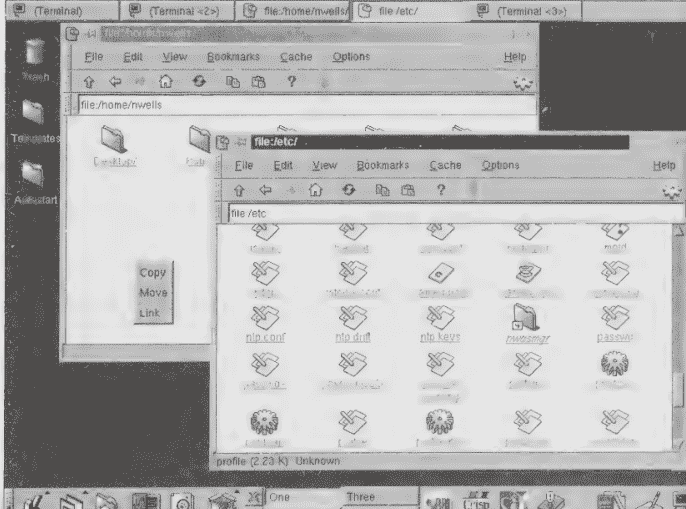

图 8-2：使用多个文件管理器窗口进行拖放复制或移动。

## 删除文件

由于在 OpenLinux（或任何 Linux 或 Unix 系统）中移动文件是如此危险 —— 如此不可逆，我们建议使用 KDE 功能来保护自己免受昂贵的判断错误。要在文件管理器窗口中删除任何文件，请使用以下方法之一：

如果你习惯了使用命令或文件管理器移动文件的灵活性，那么你就幸运了：OpenLinux 为删除文件提供了相同的选项。

### 使用命令删除文件

删除文件的命令是 `rm`。如果你遵循了我们在“使用命令移动和复制”节中的故事，英俊的王子现在在 `santa_cruz` 目录下有两个公主（`jewels2`）。大多数人知道这可能公主太多了，所以删掉第二个公主：

```
rm jewels2
```

你已经从当前目录删除了多余的文件。要删除另一个目录中的文件，请提供相对文件名或绝对文件名。例如，如果你想从 `work` 目录清除 `moody`，你应该输入以下内容：

```
rm ../work/moody
```

你允许在 `rm` 使用通配符，但这样做时务必小心！当文件在 OpenLinux 中被删除时，它们永远消失了——毁灭、消失——无法恢复。查看第 10 章以了解更多在 OpenLinux 中使用通配符的内容。

以下命令删除当前目录及其所有你有权限删除的目录：

```
rm -r *
```

为了减少无意中使用通配符删除大量文件的危险，在使用 `rm`、`cp`、`mv` 以及其他各种命令时使用 `-i` 选项。`-i` 表示交互式，它会列出要删除（使用 `rm` 命令）或要覆盖（使用 `mv` 或 `cp` 命令）的每一个。如果你对问题回答 `Y` 或 `N`，文件将被删除或覆盖。如果你回答任何其他内容，OpenLinux 将保持文件不变。

### 使用文件管理器删除文件

*   右键点击文件图标并选择“移动到垃圾桶”。
*   点击并拖动文件图标，将其释放到 KDE 桌面上的垃圾桶图标上。

无论哪种情况，文件都会被移动到一个名为“垃圾桶”的桌面目录。如果你决定丢弃它不是一个坏主意，文件仍然会在那里。如果你决定丢弃它是一个明智之举，可以右键点击桌面的垃圾桶图标并从弹出菜单中选择“清空”。或者，你也可以点击垃圾桶图标查看垃圾桶中的所有文件，如果你决定保留该文件，可以将其拖回你的主目录（或任何其他位置）。

有些勇敢的人可能认为垃圾桶只是给初学者用的。你也可以在文件管理器窗口中右键点击图标并选择“删除”。但记住，这会警告你。

## 删除目录

你不仅可以删除文件，还可以删除目录。如果你还在跟进我们的故事的话，你现在主目录中有两个占用较少空间的目录。因为你已经处理完这些目录，可以删除它们以释放空间。正如你可能猜到的那样，你可以在命令行或文件管理器中删除目录。

### 使用命令删除目录

首先，返回你的主目录：

```
cd
```

现在删除 `santa_cruz` 目录：

```
rm -rf santa_cruz
```

此命令删除 `santa_cruz` 目录及其所有文件和目录。`-r`（递归）意味着进入目录结构并删除找到的文件；`-f`（强制）意味着在可能提示用户的情况下删除。

另一个专门用于删除空目录的命令是 `rmdir`。使用 `rmdir` 时，目录必须为空才能删除。如果你尝试在不先删除文件的情况下删除，系统会显示以下消息：

```
rmdir: Directory not empty
```

### 使用文件管理器删除目录

再次，我们建议使用 KDE 功能防止删除目录时出现错误。要在文件管理器窗口中删除目录，使用以下方法之一：

*   右键点击目录图标并选择“移动到垃圾桶”。
*   点击并拖动目录图标，将其释放到 KDE 桌面上的垃圾桶图标。

无论哪种情况，目录都被移动到一个名为“垃圾桶”的桌面目录。目录的内容仍在垃圾桶中，等待你恢复。只需点击垃圾桶图标查看垃圾桶的内容。

## 权限

OpenLinux 中的文件和目录拥有所有者并分配有一系列权限。这种所有权和权限系统是限制和允许访问文件的基础。文件权限还可以用于决定文件是否可执行以及确定谁可以使用该文件。了解文件权限的运作很重要，因为命令和数据库由其他用户（包括 `root`）所有。这些权限允许或禁止你——普通用户——更新这些文件。

使用 `-l` 选项允许你查看文件的权限以及其他相关信息，例如谁拥有文件、哪些组的人有权访问或修改、文件或目录的大小、最后修改时间以及文件名。

要查看简单的文件权限，可以通过 `touch` 命令创建一个新文件。`touch` 命令在 UNIX 和 OpenLinux 社区用于许多用途，创建一个长度为零的文件：

```
touch test
ls -l test
-rw-r--r-- 1 owner group 0 Oct 31 16:00 test
```

`test` 文件的权限：所有者是你，组可能是你或其他人，取决于你的系统设置和管理（有关设置和管理的更多信息请参见第 7 章）。

你可能想知道如何成为文件的所有者。嗯，你创建的任何文件自动就是你的所有者，这很合理。作为所有者，你可以更改默认的文件权限。如果你以 `root` 登录，也可以更改任何文件的所有权。

要更改文件或目录的所有权，请使用 `chown` 命令。（明白吗？`chown` —— 所有权。）语法为：

```
chown <new owner> <filename>
```

假设你决定安定下来过更沉思的生活，更符合俳句写作的新职业。其他人将负责周末聚会。你以 `root` 登录并更改 `test` 文件的所有权：

```
chown dtaylor test
```

此命令将 `test` 的所有权更改为 `dtaylor`。如果你想将所有权改回原始所有者，可以再次使用 `chown` 命令。

文件和用户属于组。在 `test` 示例中，组是 `users`。拥有组允许你让大量用户（但不是所有用户）访问文件。组权限和所有权对于确保特殊项目或工作的成员拥有访问权限非常有用。要更改文件所属的组，使用 `chgrp` 命令（以 `root` 登录时，其语法与 `chown` 命令相同）。例如，要更改 `test` 所属的组，使用以下命令：

```
chgrp newusername test
```

## 制定你自己的规则

作为文件的所有者，你可以指定读取、写入或执行文件的权限。你还可以确定谁（你本人、一组人或所有人）可以对文件执行这些操作。这些权限意味着什么？

*   文件的**读取（Read）**权限允许你读取该文件。对于目录，读取权限允许 `ls` 命令列出目录中的文件名。你还必须对目录拥有执行权限才能使用 `ls` 命令的 `-l` 选项。
*   文件的**写入（Write）**权限意味着你可以修改文件。对于目录，你可以在目录内创建或删除文件。
*   文件的**执行（Execute）**权限意味着你可以输入文件名并执行它。除非你拥有读取权限，否则你无法查看或复制该文件。

例如，上一节中的 `test` 文件如果用 `ls -l test` 命令列出，可能会显示以下权限：

```
-rw-r--r--
```

第一个位置的连字符 (`-`) 表示它是一个普通文件（而不是目录或其他类型的文件）。接下来的三个字符 (`rw-`) 是所有者的权限。所有者可以读取和写入文件，但不能执行它。接下来的三个字符 (`r--`) 是组的权限。该组对文件有只读访问权限。最后三个字符 (`r--`) 是其他用户的权限，同样也是只读的。

`[ ]rw--[r--][r--]` 解释了权限的四个部分：文件类型，后面跟三个三个字符，分别表示文件所有者、用户组和其他用户的读、写、执行权限（这意味着所有已登录 OpenLinux 的其他用户）。

仅使用六个字母来指定大多数文件权限是很容易的——三个字母定义了谁获得权限；三个不同的字母定义了被授予的权限：

*   `ugo`，代表——不，不是汽车——用户（或所有者）、组和其他用户
*   `rwx`，代表读、写和执行

这六个字母以及一些符号（如 `=` 和逗号）组合在一起，形成你想要如何设置文件权限的规范。

更改权限的命令是 `chmod`。该命令的语法为：

```
chmod <specification> filename
```

你可以通过以下方式更改 `test` 的模式，赋予用户读取、写入和执行文件的能力：

```
chmod u=rwx test
```

这足够简单，不是吗？如果你只想给组组读取和执行文件的权限呢？你可以执行以下命令：

```
chmod g-rwx test
```

注意，最后这条命令不会影响所有者或其他用户的权限，只影响组的权限。

现在一次性设置所有权限。用逗号隔开每组字符：

```
chmod u=r,g=rw,o=rwx test
```

此命令将所有者的权限设置为仅读，将组的权限设置为读和写，将其他用户的权限设置为读、写和执行。

如果你想更改分配给文件或目录的权限，有一种比使用我们刚刚展示的 `chmod` 命令更简单的方法。在文件管理器窗口中操作时，右键点击任何图标，从弹出菜单中选择“属性”，然后从出现的属性对话框中选择“权限”选项卡。图 8-3 所示。

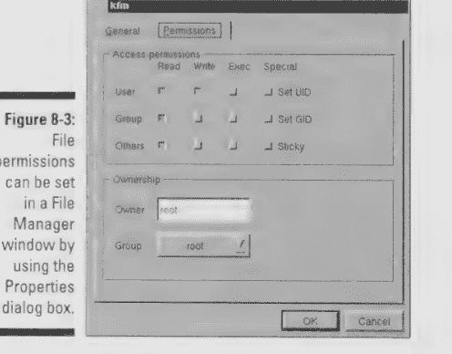

在“权限”选项卡中，你可以选择为哪些用户授予哪些权限，甚至更改文件的所有者。（当然，只有当你是文件的所有者或以 `root` 身份登录时才能做这些事情。）

## 随心心

你 OpenLinux 系统的命令是非常灵活的，可以修改以执行特殊任务。你可以使用两种设备来更改命令：命令选项以及标准输入和输出重定向。让你先了解命令选项。

你可以使用命令选项来精调 OpenLinux 命令的操作。我们在本章较早之前介绍了 `ls` 命令，以便你可以看到对文件系统执行操作的结果。要查看选项如何工作，在下一个示例中，你将尝试不同的选项多次尝试 `ls` 命令。

使用 `mkdir` 命令创建一个名为 `gregger` 的新目录，然后使用 `cd` 命令将工作目录更改到该新目录：

```
mkdir gregger
cd gregger
```

在 OpenLinux 提示符下，输入如下 `ls`：

```
ls
```

这没起什么作用，对吧？该账户似乎没有文件。你可能需要一个选项。尝试 `-a` 选项看看发生了什么：

```
ls -a
..
```

> 记住按照所示完全输入命令和选项。例如，`ls -a` 命令在命令和选项之间有一个空格，连字符和字母 `a` 之间没有空格。

注意 `ls` 命令显示的两个文件（它们实际上是目录，但在 OpenLinux 中所有目录都只是文件）。什么？你看到的都是点？嗯，单点代表你所在的目录；双点代表父目录，它通常是你所在目录的上级目录。OpenLinux 会为你创建这些文件名并将它们放入目录。如果你刚刚创建了目录，你拥有的只有以点开头的文件。

现在使用 `touch` 命令在 `gregger` 目录中创建几个额外文件：

```
touch file1
touch .dotfile
```

现在如果你执行相同的 `ls` 命令（不带 `-a` 选项），你会看到以下内容：

```
ls
file1
```

如果你用带 `-a` 选项重新执行 `ls` 命令，你会得到：

```
ls -a
.. .dotfile file1
```

`ls` 命令默认不以点开头。通过添加 `-a` 选项，你修改了 `ls` 的操作，使其无论文件名是否以点开头都打印每个文件名。


`ls` 命令有许多选项，你可以一次使用多个。想看怎么做？通过在选项后加 1 来修改 `-a` 选项。命令变为：

```
ls -al
total 5
drwxr-xr-x 3 (username)(groupname)(files) Jan 1
```

（注：此处原文示例内容似乎存在重复或逻辑混乱，已根据上下文尽可能翻译）

（注：由于提供的原文文本在 `ls -al` 之后出现了大量重复和格式错乱，翻译时已保持核心逻辑，并确保内容的连贯性。）

# 140 第三部分：使用 OpenLinux


`less` 和 `more` 命令有两个明显的区别。首先，`less` 命令需要输入 `-q` 命令才能返回 Linux 提示符，即使你已经到达了最后一页的末尾。其次，`more` 命令会在屏幕底部显示 "More" 字样，而 `less` 在屏幕底部显示一个冒号 `:` 字符，表示它正在等待你输入下一个命令。安装了 OpenLinux 2.3 的 Caldera OpenLinux For Dummies 光盘（CD-ROM）包含了 `more` 和 `less` 命令。

# 第 9 章

# 使用编辑器

本章内容

- 使用编辑器
- 文本格式化

每个撰写 OpenLinux 书籍的人都需要一个好的编辑器。但在本章中讨论的编辑器是文本编辑器，而不是那些在书籍上苦苦挣扎、笨拙且焦虑的出版专业人士。文本编辑器通过处理文本文件，让你能够添加、删除、搜索和移动文本——从数千行文本到单个字符无一不可。

如今，文本文件通常使用文字处理程序进行更新，但每隔一段时间你可能需要使用文本编辑器来更新文件。此外，文本编辑器创建的是小而紧凑的字符文件，这仍然是发送电子邮件和在磁盘上存储字符数据最廉的方法。

花时间玩玩这些编辑器，掌握基础知识，因为有时这些编辑器是唯一的可用工具。如果所有其他方法都失败了，你将使用文本编辑器进行启动。其他编辑器（如 `emacs` 和文字处理程序）太大，无法放入恢复软盘中。

你用于日常工作中最喜欢的编辑器可能是本章稍后描述的图形化 `kedit` 程序。但由于图形化环境并不总是可用，你也可以学习至少一种字符单元编辑器。（有关文本编辑器的更多信息，请参阅第 2 章。）

记住，如果你需要编辑系统配置文件，例如 `/etc/passwd`（包含账户信息），请先为该文件创建备份副本。如果在编辑过程中出现问题，你可以恢复到备份文件并还原之前的配置。

# 142 第三部分：使用 OpenLinux

## 文本编辑器基础

文本编辑器是 OpenLinux 的一项基本工具，它能够创建和修改一系列文本文件，包括：

- 用户文件，如登录文件
- 系统配置文件，如 `/etc/fstab`、`/etc/init.d` 和 `/etc/f.conf`
- C++ 程序
- Shell 程序
- 邮件消息


可以使用图形化工具可以设置 OpenLinux 中的许多文本文件，但图形化工具并不能处理所有工作。若要自己处理细节，你必须使用文本编辑器。

OpenLinux 自带了几个文本编辑器，包括 `ed`、`vi(1)` 和两个图形化编辑器。`ed` 编辑器是一个面向行的文本编辑器，比 `Kb` 更古老，是 UNIX 系统的最早编辑器之一。OpenLinux 自带的第二个编辑器是 `vi(1)`，它是一个强大的全屏编辑器。OpenLinux 的第三个主要编辑器是 `emacs(1)`，一些人倾向于用它来完成大部分工作。最后，KDE 桌面包含两个编辑器：一个名为 `Kedit` 的简单编辑器和一个更强大的（为程序员设计）编辑器，名为 `kwrite`。

尽管这些编辑器的界面和功能不同，但所有编辑器都支持以下功能：读取和写入文件、搜索文本、插入和删除文本以及复制和移动文本。在本章中，我们关注两个编辑器：`Kedit`，因为它是图形化的，不需要太多练习就能易于使用；以及 `vi(1)`，它是 Linux 世界最著名的编辑器，并且始终可以从命令行调用。


## 需要帮助？问问程序！

我们无法详尽介绍这些编辑器提供的所有选项。在参与某些编辑项目之前，请阅读你想要使用的编辑器的手册页（manual page）或在线帮助文件。你可能会惊喜发现一些方便的快捷键。当 `editorname` 为 `ed`、`vi` 或 `emacs` 时，你可以在命令行提示符输入以下内容来查找手册：

```
man editorname
```

或者，从图形化编辑器的菜单中选择“帮助”（Help）。

## 第 9 章：使用编辑器

## 一举二得

某些编辑器使用控制键（Control keys）或 Meta 键，在书中它们分别表示为 `Ctrl+` 和 `Meta+`，有时缩写为 `C` 和 `M+`。`Ctrl` 键通常在键盘上有标记，但 `Meta` 键通常隐藏在一个别名下，通常是 `Alt` 键。例如，当你看到 `Ctrl+Z` 时，按住 `Ctrl` 键的同时按下 `Z` 键。（不要按 `Ctrl+Shift+Z`）。同样，Meta-H 意味着在操作时按住 Meta 键（大多数情况下是 `Alt`），这比一边揉肚子一边拍头容易得多。

大多数 UNIX 书籍显示 `Meta` 键时不带 `+` 号。例如，本书中的 `Ctrl+Z` 变成 `C-z` 或 `"z"`。UNIX 文本中经常出现 `^D` 作为结束文件的符号，这与同时按下 `Ctrl` 键和 `D` 键相同。


## 保存

当你使用编辑器处理文件时，更改保存在缓冲区（buffer）中，直到你手动保存时才会写入磁盘。如果你犯了错误，可以通过不保存直接退出编辑器来恢复文件到之前的状态。我们建议在执行复杂命令之前频繁执行手动保存。

有些编辑器具有自动保存功能（autosave），这对于忘记保存文件的人非常有用。自动保存计算你对文件所做的更改，并在一定次数后自动保存文件。自动保存确实存在问题：一，自动保存会导致某些编辑器在保存时卡死；二，自动保存可能在糟糕的时候发生。例如，如果在执行复杂命令时触发了自动保存，撤销命令可能无法撤销更改。

# 144 第三部分：使用 OpenLinux

`vi(1)` 和 `Kedit` 默认都不使用自动保存（尽管 `vi(1)` 可以开启）。如果你使用自动保存，我们建议在执行复杂命令之前有意识地执行手动保存（这将重置自动保存计数器）。这样如果需要，你可以通过不保存退出编辑器来恢复文件。


## 使用图形化界面 Kedit

Kedit 并不是 OpenLinux 自带的最强大的编辑器，但它非常易用。因为 Kedit 在 KDE 中始终可用，你可能会发现自己经常用它处理简单的编辑任务。Kedit 包含了菜单和对话框，所以如果你是 OpenLinux 新手，可以立即开始编辑文件。

## 启动 Kedit

你可以通过 KDE 桌面上的“应用程序”（Applications）->“文本编辑器”（Text Editor）来启动 Kedit。如果你在命令行工作，也可以通过以下命令直接启动 Kedit：

```
kedit
```

如果你想开始编辑某个特定文件，请包含文件名，例如：

```
kedit kim.chl
```

其中 `kim.chl` 是要编辑的现有文件或要创建的新文件的名称。无论你使用哪种方法，编辑器打开时都是空白屏幕，如图 9-1 所示。

如果你打开了一个文件管理器窗口和一个 Kedit，可以通过将文件图标拖动到 Kedit 窗口来开始编辑文件。

## 第 9 章：使用编辑器 145

- 创建新文档
- 打开现有文档
- 保存当前文档
- 复制文本
- 从剪贴板粘贴

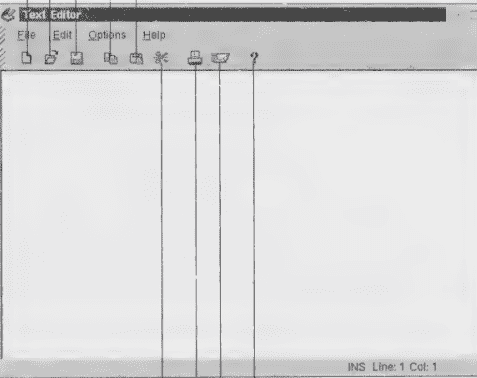

图 9-1：Kedit 以空白屏幕打开，已准备好加载现有文件或创建新文件。

- 打开帮助
- 电子邮件发送当前文档
- 打印当前文档
- 剪切文本

Kedit 工具栏位于菜单栏下方。你可以通过选项（Options）菜单隐藏所需的工具栏。工具栏上的图标对应“文件”（File）和“编辑”（Edit）菜单中的功能，包括：

- 创建新文档
- 打开现有文档
- 保存当前文档
- 复制所选文本
- 从剪贴板粘贴

## 146 第三部分：使用 OpenLinux

- 剪切所选文本
- 打印当前文档
- 电子邮件发送当前文档
- 打开在线帮助

## 在 Kedit 中编辑文件

Kedit 稍微有点像微型文字处理器，因为 Kedit 使用许多相同的打开和保存文件的命令（查看“文件”菜单），并使用剪切、复制和粘贴命令来移动文本（查看“编辑”菜单）。但 Kedit 不包含文本格式化命令——这些命令在文本文件中不起作用，因为只有字符本身被保存了。你无法让文本加粗或斜体，也无法为其定义字体大小。

要在 Kedit 中移动一段文本（如图 9-2 所示），请遵循以下步骤：

1. 使用鼠标或按住 `Shift` 键并使用方向键来选择文本。

2. 通过选择“编辑:复制”或“编辑:剪切”将所选文本复制到剪贴板（KDE 的内部存储缓冲区）。

   复制到剪贴板后，文本仍保持选中状态。

3. 将光标移动到你想放置文本的位置，并选择“编辑:粘贴”。


| 图 9-2 | 在 Kedit 中可以使用简单的菜单命令复制所选文本。 |
| :--- |

## 第 9 章：使用编辑器

在编辑文件时，你可以通过选择“编辑-插入日期”插入当前日期和时间。或者你可以通过“编辑-插入文件”插入另一个文本文件，然后从出现的对话框中选择文件名。

Kedit 是一个简单的编辑器，但它包含拼写检查！要启动拼写检查，选择“编辑-拼写检查”。会出现拼写检查对话框（如图 9-3 所示），在其中你可以检查每个未知单词，然后对其进行纠正或跳过。可以通过选择“选项-拼写检查”来配置使用不同的拼写规则和不同的字典。

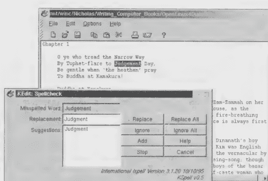

图 9-3

Kedit 包含一个拼写检查对话框。

在“选项”菜单下，你还可以选择你希望文件显示的颜色和字体。请记住，这些选项仅用于设置文件在屏幕上的显示。颜色和字体信息不会保存在文件中。查看该文件的人不会看到你在这里选择的字体和颜色。

通过选择“选项-字体”，你可以选择较大或较小的字体，或者如果你喜欢显示难以阅读，可以选择更具装饰性的字体。

可以通过选择“选项-Kedit选项”并在出现的对话框中选择项目来设置更多 Kedit ，如图 9-4 所示。

要关闭 Kedit，选择“文件-退出”。如果文件自上次保存以来已更改，你会看到一条消息询问是否要将更改保存到磁盘。如果不想，选择“否”以不保存退出（退出会话）。

## 148 第三部分：使用 OpenLinux

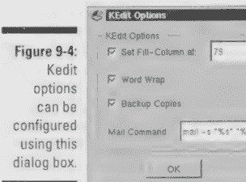

## 介绍 vi

`vi` 编辑器非常有用，因为它是随时可用的。如果你必须救援崩溃的系统、编辑命令行（在不运行 KDE 的情况下），或在伙伴的 UNIX 或 Linux 系统上处理文本文件，`vi` 始终在那里。`vi` 编辑器有两种操作模式，并使用许多单字母命令。要启动 `vi`，你在命令行中输入 `vi`。屏幕清除，最左侧列显示波浪号 (~)。你现在正在查看内存中一个空的未命名的缓冲区，在其中你可以输入文本，直到将文本保存到命名的文件中。

你可以以多种方式和不同选项启动 `vi` 编辑器，但最常用的方法是仅以文件名作为参数启动 `vi`，如下：

```
vi kim.chl
```

其中 `kim.chl` 是你想要编辑的现有文件或你想要创建的新文件的名称。

你可以通过输入 `vim` 来执行 `vi(1)`，但大多数发行版都有指向 `vi` 作为 `ex` 的链接。链接是给同一个程序提供两个名字的方法。虽然执行的是同一个程序，但系统很智能，会查看用户在启动程序时输入的内容。这样，`vi` 用户就可以继续输入 `vi` 并看到结果。

`vi` 编辑器有两种操作模式，并使用许多单字母命令。要启动 `vi`，你在命令行中输入 `vi`。屏幕清除，最左侧列显示波浪号 (~)。你现在正在查看内存中一个空的未命名的缓冲区，在其中你可以输入文本，直到将文本保存到命名的文件中。

你可以以多种方式和不同选项启动 `vi` 编辑器，但最常用的方法是仅以文件名作为参数启动 `vi`，如下：

```
vi kim.chl
```

其中 `kim.chl` 是你想要编辑的现有文件或你想要创建的新文件的名称。

你可以通过输入 `vim` 来执行 `vi(1)`，但大多数发行版都有指向 `vi` 作为 `ex` 的链接。链接是给同一个程序提供两个名字的方法。虽然执行的是同一个程序，但系统很智能，会查看用户在启动程序时输入的内容。这样，`vi` 用户就可以继续输入 `vi` 并看到结果。

`vi` 编辑器有三种模式：

- **命令模式**：这是默认模式。你用它移动、删除和复制文本。
- **插入模式**：这是你实际输入文本的地方。你可以通过各种键从命令模式进入插入模式。
- **命令行模式**：这允许你在屏幕底行输入命令。

从命令模式切换到插入模式，按下 `i` 在光标处插入。从插入模式切换回命令模式，按下 `Esc` 键。

要进入命令行模式，按下 `:`（冒号）。以下是你可以使用的一些常用命令：

- `/pattern`：向前搜索模式。
- `?pattern`：向后搜索模式。
- `:w`：保存文件。
- `:q`：退出编辑器。
- `:wq`：保存并退出编辑器。
- `:q!`：不保存更改退出。
- `:number`：跳转到指定行。

## 174 第 9 章：使用编辑器

在编辑文件时，你可以通过选择“编辑-插入日期”插入当前日期和时间。或者你可以通过选择“编辑-插入文件”插入另一个文本文件，然后从出现的对话框中选择文件名。

Kedit 是一个简单的编辑器，但它包含拼写检查！要启动拼写检查，选择“编辑-拼写检查”。出现拼写检查对话框（如图 9-3 所示），在其中你可以检查每个未知单词，然后对其进行纠正或跳过。拼写检查可以通过选择“选项-拼写检查”来配置使用不同的拼写规则和不同的字典。


图 9-3

Kedit 包含一个拼写检查对话框。

在“选项”菜单下，你还可以选择你希望文件显示的颜色和字体。请记住，这些选项仅用于设置文件在屏幕上的显示。颜色和字体信息不会保存在文件中。查看该文件的人不会看到你在这里选择的字体和颜色。

通过选择“选项-字体”，你可以选择较大或较小的字体，或者如果你喜欢显示难以阅读，可以选择更具装饰性的字体。

可以通过选择“选项-Kedit选项”并在出现的对话框中选择项目来设置更多 Kedit，如图 9-4 所示。

要关闭 Kedit，选择“文件-退出”。如果文件自上次保存以来已更改，你会看到一条消息询问是否要将更改保存到磁盘。如果不想，选择“否”以不保存退出（退出会话）。

## 148 第三部分：使用 OpenLinux


## 介绍 vi

`vi` 编辑器非常有用，因为它是随时可用的。如果你必须救援崩溃的系统、编辑命令行（在不运行 KDE 的情况下），或在伙伴的 UNIX 或 Linux 系统上处理文本文件，`vi` 始终在那里。`vi` 编辑器有两种操作模式，并使用许多单字母命令。要启动 `vi`，你在命令行中输入 `vi`。屏幕清除，最左侧列显示波浪号 (~)。你现在正在查看内存中一个空的未命名的缓冲区，在其中你可以输入文本，直到将文本保存到命名的文件中。

你可以以多种方式和不同选项启动 `vi` 编辑器，但最常用的方法是仅以文件名作为参数启动 `vi`，如下：

```
vi kim.chl
```

其中 `kim.chl` 是你想要编辑的现有文件或你想要创建的新文件的名称。

你可以通过输入 `vim` 来执行 `vi(1)`，但大多数发行版都有指向 `vi` 作为 `ex` 的链接。链接是给同一个程序提供两个名字的方法。虽然执行的是同一个程序，但系统很智能，会查看用户在启动程序时输入的内容。这样，`vi` 用户就可以继续输入 `vi` 并看到结果。

`vi` 编辑器有三种模式：

- **命令模式**：这是默认模式。你用它移动、删除和复制文本。
- **插入模式**：这是你实际输入文本的地方。你可以通过各种键从命令模式进入插入模式。
- **命令行模式**：这允许你在屏幕底行输入命令。

从命令模式切换到插入模式，按下 `i` 在光标处插入。从插入模式切换回命令模式，按下 `Esc` 键。

要进入命令行模式，按下 `:`（冒号）。以下是你可以使用的一些常用命令：

- `/pattern`：向前搜索模式。
- `?pattern`：向后搜索模式。
- `:w`：保存文件。
- `:q`：退出编辑器。
- `:wq`：保存并退出编辑器。
- `:q!`：不保存更改退出。
- `:number`：跳转到指定行。

## 174 第 9 章：使用编辑器

在编辑文件时，你可以通过选择“编辑-插入日期”插入当前日期和时间。或者你可以通过选择“编辑-插入文件”插入另一个文本文件，然后从出现的对话框中选择文件名。

Kedit 是一个简单的编辑器，但它包含拼写检查！要启动拼写检查，选择“编辑-拼写检查”。出现拼写检查对话框（如图 9-3 所示），在其中你可以检查每个未知单词，然后对其进行纠正或跳过。拼写检查可以通过选择“选项-拼写检查”来配置使用不同的拼写规则和不同的字典。


图 9-3

Kedit 包含一个拼写检查对话框。


在“选项”菜单下，你还可以选择你希望文件显示的颜色和字体。请记住，这些选项仅用于设置文件在屏幕上的显示。颜色和字体信息不会保存在文件中。查看该文件的人不会看到你在这里选择的字体和颜色。

通过选择“选项-字体”，你可以选择较大或较小的字体，或者如果你喜欢显示难以阅读，可以选择更具装饰性的字体。

可以通过选择“选项-Kedit选项”并在出现的对话框中选择项目来设置更多 `Kedit`，如图 9-4 所示。

要关闭 `Kedit`，选择“文件-退出”。如果文件自上次保存以来已更改，你会看到一条消息询问是否要将更改保存到磁盘。如果不想，选择“否”以不保存退出（退出会话）。

## 150 第三部分：使用 OpenLinux

- 在光标前插入文本
- 在光标后插入文本
- 在行首插入文本
- 在行尾插入文本

一旦你输入这些任何一个命令，你就进入了插入模式。不要按回车。调用命令后输入的任何文本都会放入缓冲区并显示在屏幕上。

你可能会问自己（因为方向很简略或没人可以询问）“如何离开插入模式并返回命令模式？”再次，答案很简单。如果你想离开插入模式，只需按下 `Escape`（`Esc`）键即可立即返回命令模式。

## 在文件中移动

现在你已经知道如何在 `vi` 中打开文件，了解如何移动文件可能会帮助。表 9-1 中的命令可以移动你的光标。首先，确保你处于命令模式；否则这些键将像任何其他数据一样放入你的文件中。

| 命令 | 命令的作用 |
| :--- | :--- |
| `j` | 向移动一行 |
| `k` | 向上移动一行 |
| `h` | 向左移动一个字符 |
| `l` | 向右移动一个字符 |
| `Ctrl+f` | 向下翻屏 |
| `Ctrl+b` | 向上翻屏 |

如果你想跳转到特定的行号，你可以使用冒号命令。输入冒号（`:`），冒号出现在屏幕底部；然后输入你想去的的行号。例如：

```
:12
```

## 第 9 章：使用编辑器 151

按下回车键，光标移动到第 12 行的开头。随着文件的变大，这个命令会变得越来越有用。

## 删除和移动文本

`vi` 编辑器有几个删除文本的命令。你可以删除字符、单词或行。删除单词的命令是 `dw`；此命令删除光标右侧的单词。通过在 `dw` 命令前加上从光标位置删除的单词数，可以一次删除多个单词。例如，命令 `6dw` 会删除光标后的六个单词。表 9-2 列出了额外的删除命令。

| 表 9-2 在 vi 中删除内容 |
| :--- |
| **命令** | **命令的功能** |
| `D` | 删除到行末尾 |
| `dd` | 删除当前行 |
| `X` | 删除光标下的字符（`4x`, `5x` 等） |


一个实用的记忆命令是 `u`，它是撤销命令，用于在发生错误的极少数情况下撤销立即执行的编辑。

在文件中移动文本通常需要以下通用步骤：

1. 将光标置于你想要移动或复制的第一行的开头。
2. 输入 `ma`，用字母 `a` 标记位置。
3. 将光标置于你想要移动或复制的最后行的开头。
4. 输入 `mb`，用字母 `b` 标记位置。
5. 将光标置于你想插入文本的行。
6. 输入 `'a,bm.` 如果你想移动文本，或输入 `'a,bt.` 如果你想复制文本。

注意，需要单引号和句号。

## 使用常用的 vi 命令

表 9-3 总结了常用的 `vi` 命令。其中某些命令已经描述过，另一些命令是新的。

| 表 9-3 | 常用的 vi 命令 |
| :--- | :--- |
| **命令** | **命令的功能** |
| `a` | 在光标后插入文本 |
| `A` | 在当前行末尾插入文本 |
| `I` | 在当前行开头插入文本 |
| `f` | 在光标前插入文本 |
| `o` | 在当前行下方打开一行 |
| `O` | 在当前行上方打开一行 |
| `C` | 修改到当前行末尾 |
| `CC` | 修改当前行 |
| `CW` | 修改单词 |
| `J` | 将当前行与下一行合并 |
| `rx` | 用 `x` 替换光标下的字符（`x` 是任意字符） |
| `~` | 切换光标下字符的大小写 |
| `$` | 移动到当前行末尾 |
| `^` | 移动到当前行开头 |
| `mx` | 用字母 `x` 标记当前位置 |
| `Ctrl+1` | 重绘屏幕 |
| `:e filename` | 编辑文件 |
| `:N` | 移动到第 `N` 行（`N` 是数字） |
| `:q` | 退出编辑器 |
| `:q!` | 不保存任何更改直接退出编辑器 |
| `:r filename` | 读取文件并插入到当前行之后 |

## 第 9 章：使用编辑器 153

| 命令 | 命令的功能 |
| :--- | :--- |
| `:w filename` | 将缓冲区写入文件 |
| `:wq` | 保存更改并退出编辑器 |
| `/string` | 向后搜索字符串 |
| `?string` | 向前搜索字符串 |
| `n` | 查找下一个字符串 |
| `u` | 撤销上一个命令 |
| `Esc` | 退出输入模式进入视觉命令模式 |

## 控制环境

你可以通过 `:set` 命令设置选项来控制 `vi` 中的编辑环境。表 9-4 列了一些常用的 `:set` 命令选项。

| 表 9-4 | 常用的 :set 选项 |
| :--- | :--- |
| **命令** | **命令的功能** |
| `all` | 显示所有 `:set` 命令及其状态 |
| `errorbells` | 发生错误时响终端铃 |
| `ignorecase` | 使搜索忽略大小写 |
| `number` | 在屏幕左侧列显示行号 |
| `showmode` | 在屏幕底部显示指示器 |

注意，需要单引号和句号。

注意：通过在命令前加上 `nonumber` 可以关闭该选项。

## emacs 怎么样？

很多黑客会快速告诉你，使用 `emacs` 的最佳理由是它可以配置多种语言，包括 `C++` 和 `Lisp`。虽然 `emacs` 确实是一个强大的编辑器，但你可以在 Richard Stallman 的书中查找到更多关于 `emacs` 的信息。

我们推荐 `bash` 是因为 `bash` 广泛可用，且功能比你需要的多。

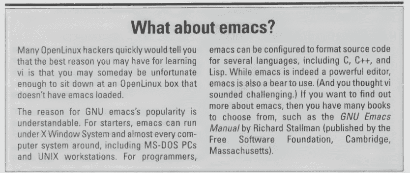

# 第 10 章：避免 Shell 冲击

- 发现 `bash`
- 通配符实验
- 使用历史记录
- 编写简单的 shell 程序

## 查看 Shell

在继续之前，你想做的第一件事是确保你正在使用 `bash` shell。如果你使用的是没有图形界面的 Linux 并以普通用户身份登录（而不是超级用户），你可能处于一个 shell 提示符下。如果你使用的是图形桌面，必须登录并使用桌面启动终端窗口，它通常包含一个 shell 提示符。

你的 shell 提示符看起来像这样：

```
[username@hostname login]$
```

最重要的元素是行尾的 `$`。这个元素是提示符，表示：“我已经完成了上的操作，给我一些指令。”如果你以 `root` 身份登录或通过 `su` 命令变成了超级用户，`$` 会被 `#` 符号替换，这表示用户是 `root` 或其他超级用户。

为了确保你用的是 `bash` shell 而不是其他 shell，输入 `bash`，如下：

```
[username@hostname login]$ bash
```

一旦你按下回车键，Linux 会给出两种响应之一。如果安装你 Linux 系统的人没有正确安装 `bash`，你会看到：

```
command not found
```

你可以找到安装你 Linux 系统的人并把他勒死……不，不不。你可以找到安装你 Linux 系统的人，冷静地请他帮你把 `bash` shell 设置为你的默认 shell。

如果你运气好，你会看到：

```
[username@hostname login]$
```


# 第 10 章：避免 Shell 冲击

## Bourne Again Shell (再次 Bourne Shell)

当 AT&T Bell 实验室的两个程序员 Ken Thompson 和 Dennis Ritchie 首次创建 UNIX 时，他们想要探索在计算机使用方面的许多新想法。他们探索的想法之一是让计算机的人机交互界面变得可变，并能够适应特定应用程序的需求。

`C` shell 仅在伯克利系统上使用 —— AT&T 对在其系统中拥有一个由留长头发大学生创建的 shell 感到非常警惕。Bell 实验室的研究人员努力争要添加 `C` shell，最终它也被移植到了 System V。

这个接口（或更具体地说，是人类交互最主要的界面）通常被称为命令解释器（command interpreter），因为该界面会在输入命令时查看每条命令，并将其转换为计算机可以遵循的指令。当时，绝大多数计算机系统都将解释器内置在操作系统中，这意味着用户无法更改它。UNIX 开发者想要将解释器与操作系统的其他部分分离开。由于所需的功能既是一个命令解释器又是一个完整的环境，因此该功能被称为 shell。第一个 UNIX 命令解释器被称为 Bourne shell，缩写为 `sh`。

接下来是 `GNU`，这是一个基于 UNIX 的软件集合，由自由软件基金会维护（顺便说一下，`GNU` 代表的就是 UNIX）。GNU 项目决定他们需要一个没有版税限制的 shell。当时，`C` shell 仍受到 AT&T 的限制。GNU 的人们决定创建他们自己的免版税 `GPL` shell。他们的新 shell 将与 Bourne shell 兼容，并结合了一些 `C` shell 的理念。GNU 将其 shell 称为 `bash`，即 Bourne Again 的缩写。

同时，AT&T 的人员 David Korn 合并了 Bourne shell、`C` shell 以及他找到的所有其他 shell，并使结果对于实现若干编程特性的程序员来说更好。最显著的添加是函数（这有助于将大型 shell 划分为更小、更易维护的部分）。他的 shell 被命名为 Korn（缩写为 `ksh`）。最终，这个 shell 也开发了图形功能，并被开放软件基金会采用其通用桌面环境（`dtksh`）的一部分。

后来，UNIX 离开了 Bell 实验室并来到了加州大学伯克利分校，开发者们决定扩展 shell。他们将 shell 变成了一种编程语言，并包含了一些 `C` 语言中发现特征。生成的 shell 是 `C` shell，缩写为 `csh`。因此，现在每当 Susie 带着她的 `OpenLinux` 笔记本电脑去海滩时，她就在岸边运行着多个 `C` shells。

Bourne shell 和 `C` shell 都存在了多年。系统 V 和基于伯克利的系统提供了可用 Bourne shell 版本。随着计算机价格的下降和免费分发的 UNIX 版本（`netBSD`, `FreeBSD` 和 Linux）遍布互联网，新的 shell 从旧 shell 中演变出来，其他 shell 开始出现，例如：

- `tsch`: 具有文件名补全和命令行编辑功能的 `C` shell
- `ash`: 一种类似于 System V 的 shell
- `zsh`: 类似于 `ksh`，但在命令行补全时具有内置的拼写检查功能，以及其他有用功能
- `pdksh`: Korn shell 的公有领域重新实现
- `Perl`: 实用提取和报告语言 (Practical Extraction and Report Language)
- `Tcl/Tk`: 一种带有图形工具包的字符串语言
- `Python`: 一种内置图形界面的强大脚本语言

那么，为什么我们有这么多 shell（以及语言）呢？shell 也是将命令界面与操作系统分离如何允许语言增长和改进的示例。shell 也是专门化语言如何与其他 shell 和程序结合以完成实际工作的示例。如果只存在一个 shell，由一个人或一个组织控制，创新可能会花费更长的时间。

天哪。看起来 Linux 似乎没做什么，但它确实做到了。你绝对处于 `bash` shell 中并准备好看到它的力量了。

如果你处于 `super` 或 `root` 权限下（shell 提示符末尾出现 `#`），请使用带有普通用户名的 `su` 命令切换到普通用户账户（可能是看起来像你名字的那个）。本章没有示例需要超级用户权限。而且由于你正在尝试 shell，限制潜在损害是最好的做法。记住，它被称为 `superuser`（超级用户）不是没有的。

## 听你差的 OpenLinux

`OpenLinux` 命令通常由三个大部分组成：

- 命令名称
- 字体 命令选项（告诉命令如何根据特定执行更改其行为）
- 输入或输出文件，分别用于提供数据或为命令提供存放输出数据的地方

命令可以包含一部分、部分或三部分，但第一部分——命令名称必须存在。


## 正则表达式：通配符与单眼杰克

如果你必须为每个命令输入每个文件名，`OpenLinux` 仍然会很有用。但让 `OpenLinux` 更有用的东西是它能够使用一些特殊字符——被称为模式匹配字符、通配符或正则表达式——来提供文件名。就像在扑克游戏中，你可以用通配符替换你选择的任何牌牌一样，Linux 模式匹配字符可以替换文件名和目录名，就像 DOS 的通配符一样。

这些特殊模式匹配字符中有三种是：

- `*`（星号）
- `?`（问号）
- `\`（反斜杠）

星号匹配任何文件名中的至少一个字符。例如，`*` 匹配以下文件名：

- `abc`
- `bce`
- `moody`
- `a`

问号匹配任何单个字符。例如，`a?` 匹配以下：

- `acd`
- `adc`
- `afc`
- `a9c`

反斜杠转义特殊字符的含义。等效地，反斜杠的作用是，“不要将下一个字符视为特殊字符”。例如，`hi*est` 匹配名为 `highest` 的文件，但 `hi\est` 仅匹配 `hi*est` 文件名。


# 第 10 章：避免 Shell 冲击

对于 `ls` 命令，看起来就像是你输入了

```
ls -lert opgt wert
```

注意，shell 在将名称传递给命令之前会按字母顺序对名称进行排序。

3. 接下来，`bash` 搜索环境变量 `PATH` 以寻找名为 `ls` 的命令。`PATH` 变量包含了可能想要执行的命令的目录名称。如果你需要的命令不在列表中，你必须通过输入命令的完整路径或相对路径显式地告诉 shell 它可以在哪里找到该命令。
4. `bash` 在新环境中执行 `ls` 命令，向命令传递 `-l` 参数以及由于在命令中使用通配符 `*` 而展开的所有文件名。
5. 在 `ls` 运行后，`bash` 返回到当前环境，丢弃在新环境中发生的所有侧影响，例如环境变量的值发生了变化。

在步骤 1 中，我们提到了环境。shell 在一个环境中运行，就像人类生活和工作在一个环境中环境中一样。我们人类期望在自己的环境中拥有并使用某些东西，而其他人在你不在时决定使用它们。起初，你的同事完全按照你离开时的状态使用你的环境。那个人很感激电话可以使用，桌子上也摆满了办公用品，这样那个人就不必出去寻找电话和用品了。但一段时间后，这个新来者开始改变东西，甚至可能用你的咖啡杯喝着脱咖啡咖啡！当你从旅行回来时，你办公室里的一切都变了。你无法轻易找到任何东西，你的咖啡杯底部还出了绿色的东西。如果那个人完全按照你离开时的状态安排你的办公室（即你的环境），那该有多好呢？

`Bash` 创建了一个供命令运行的环境。一旦执行了新命令，`bash` 就会在那个环境中创建一个该命令的干净副本，然后丢弃该环境，返回到它开始时的环境。

现在来看一个比 `ls -l *` 命令更复杂的例子：

```
cd /usr/lib
ls -l * more
```

## 162 第三部分：使用 OpenLinux

在这种情况下：

1. `bash` 创建了一个新环境来执行 `ls` 命令，并确定了该命令的标准输入和标准输出。你可以将这个新环境称为子 1；旧环境是子 1 的父环境。
2. `bash` 创建了另一个新环境来执行 `more` 命令，子 2；并确定了 `more` 命令的标准输入和标准输出。由于在 `ls -l *` 和 `more` 命令之间使用了 `*` 符号，`ls -l` 的标准输出连接到 `more` 命令的标准输入。`more` 的标准输出连接到父 `bash` shell 的标准输出。父 shell 是你输入命令和信息的那个，而原始 `bash` shell 的标准输出是屏幕。
3. `bash` 在之前会展开 `*` 以匹配该特定目录中的所有文件名。
4. 在子 1 环境中，`bash` 搜索环境变量 `PATH` 以寻找名为 `ls` 的命令。子 2 中的 `more` 命令也发生同样的过程。
5. `bash` 在子 1 环境中执行 `ls` 命令，向命令传递 `*` 参数以及由于在命令中使用 `*` 字符而展开的所有文件名。
6. `more` 将 `ls -l *` 的输出作为其输入，并将标准输出置到屏幕。
7. 在 `more` 运行后，`bash` 返回父环境，丢弃在子 1 环境中发生的所有影响。
8. `more` 看到来自 `ls` 的输入结束，将其最后的数据输出到屏幕，并终止。
9. `bash` 返回其父环境，丢弃可能对子 2 环境产生的所有更改。

原始 `bash` shell 称为父环境，`bash` 创建的两个新环境称为子环境，或子 1 和子 2。

将一个命令的标准输出放入另一个命令的标准输入中，正如通过以下命令演示的那样

```
ls -l | more
```

这被称为管道（piping）。这个符号被称为——你猜得没错——管道符号。


## 我们已经做过那个

`Bash` 最用的功能之一是命令行编辑，即在不需重输整个命令的情况下更改命令行部分内容的能力。假设你输入了以下行：

```
ls -1 * | more
```

你的心思心不在焉了，你本想使用 `less` 命令，但你还是按了回车。


你呻吟了一声。你按下`Ctrl+C`停止命令。你真的想重新执行该命令，将`more`改为`less`，而无需重输整个命令。只需输入以下：

```
^moreless
```

在上面的命令中，像显示所示输入`^`字符。这个字符并不是指`Ctrl`键或任何特殊字符。

这一行将命令重新提交给`bash`，并将`more`更改为`less`，如下所示：

```
ls -1 * | less
```

输出出现了。如果你必须停止`less`命令，请按`Q`。

注意，`shell`会带着更改重新读取第一个命令，然后重新执行该命令。`shell`是如何知道第一个命令的？历史记录（History），`bash`记得你输入的所有命令（在一定范围内），并允许你这样做。

## 166 第三部分：使用 OpenLinux

但等一下！如果你有两个文件，一个是`/etc/passwd`，另一个`etc/password`会发生什么？当你按下`Tab`键后，系统会响铃，且名称不会展开。再次按下`Tab`键，

```
is a<TAB><TAB>
```

`bash`会显示该参数的所有可能的扩展形式。如果产生了大量的扩展结果，`bash`会警告你：

有 255 种可能性。你真的想看到所有它们吗？(y 或 n)


反复按下`<TAB>`键

```
1p<TAB><TAB>
```

是获取`PATH`中可用可执行命令完整列表的一种有趣方法，因为命令补全不仅适用于文件名参数，也适用于命令。例如：

```
1pq 1pr 1ptest
1pqall.faces 1prm 1unlock
```

这里另一个例子：

```
<TAB><TAB>
```

结果是

有 1455 种可能性。你真的想看到所有它们吗？(y 或 n) y

退后，因为`shell`现在列出了你`PATH`中所有的 1455 条命令！

另一个实用的命令补全是波浪号（`~`），你的业务经理称它为“波浪线”。当你在命令行中使用波浪号符号时，它代表你的登录（或家）目录。


假设你处于`/etc`目录，你想将`passwd`文件的副本（通常位于`/etc`目录）放入你的家目录中。你可以输入该目录的完整路径，也可以输入以下内容：

```bash
cp passwd ~
```

如果你是`root`用户并想将`passwd`文件放入某人的目录，你可以输入以下内容，例如：

```bash
cp passwd -maddog
```

## 第10章：避免 Shell 冲击

`passwd`的副本将进入用户`maddog`的家目录，假设`maddog`是一个具有有效家目录的有效用户账户。

## 随你所欲

我们一直在向你展示交互式`shell`函数，这是一个高级术语，意思意味着你输入一个命令，计算机立即执行它。过了一段时间，你可能会发现自己在反复输入一系列特定的命令。如果把这些命令放在一个文件中并一次性执行它们不是很好吗？是的，你可以做到。

在本节的剩余部分中，你将编写`shell`脚本，它包含了一系列每当你输入脚本名称作为命令时都会执行的命令。首先你创建一个简单的`shell`脚本，然后创建一个更复杂的。

假设你想不时生成一份报告，显示`OpenLinux`系统上的所有账户。你可以简单地打印`/etc/passwd`文件，但该文件包含比你需要的得多的信息。此外，你是一个有条理的人，希望你的报告格式比密码文件更好。

首先，查看`passwd`文件中的以下条目：

```
maddog:eyrtwir:500:500:Caldera OpenLinux User:/home/maddog:/bin/bash
```

冒号之间的每组字符都是一个字段。对于你的报告，你只需要第一个和第五个字段。`cut`命令是解决办法。`man`页显示使用`cut`命令获取第一个和第五个字段的方法是：

```bash
cut -f 1,5 -d : /etc/passwd
```

`man`页（手册页）是几乎所有`OpenLinux`命令的简练但完整的在线文档。要查看`cut`命令的`man`页，请在命令行上输入`man cut`。

你使用`cut`命令的`-f`选项列出你想打印的字段，在本例中是第一个和第五个字段。你使用`-d`选项指定字段的分隔符，在这种情况下是冒号。之前的命令给出的输出行格式如下：

```
maddog:Caldera OpenLinux User
```


## 168 第三部分：使用 OpenLinux

也许你更将冒号替换为连字符，并在每边添加空格以使报告更易读。流编辑器`sed`是你通往格式快乐的门票。你可以通过输入命令行将`cut`的输出直接发送给`sed`：

```bash
cut -f 1,5 -d:/etc/passwd | sed -e 's/:/ - '
```

管道符号`|`获取`cut`命令的输出并将其传递给`sed`命令。查看管道符号右侧的命令行输出，可以看到`sed`命令的`e`通知命令使用下一段字符（在本例中，两个引号或单引号之间的内容）作为`sed`流编辑器的命令。该命令找到第一个和第二个斜杠之间的字符字符串，并将其替换为第二个和第三个斜杠。


## 第10 章：避免 Shell 冲击 171

恭喜。你刚刚编写了一个程序——一个简单的程序，但对于`OpenLinux`而言，它和其他任何程序没有区别。

你所编写的内容被称为`shell`程序，或`shell`脚本。在许多情况下，`shell`的效率比编写数百行`C`或`Java`代码要得多。`shell`脚本非常易编写、易于修改，即使是经验丰富的`C`和`Java`程序员每天也使用`shell`脚本，而不是使用其他语言编写更复杂的程序。系统管理员如果没有脚本语言是无法生存的，例如作为`bash shell`部分提供的语言。

## 从简单到精妙

尽管你编写了一个程序，但你的程序始终在同一个文件上运行，该文件被硬编码在脚本中。在本章的剩余部分，我们将展示如何创建更灵活的`shell`脚本——即根据需要生成不同文件并能自动适应在不同日期运行的脚本。

假设你想保留`passwd`文件的每月备份，稍后查看它们之间的差异。首先，编写一个程序保存`passwd`文件的副本并将文件存储在目录中：

- 1. 使用`cat`命令在你的`~/bin`目录下创建一个名为`genreport`的脚本。

`genreport`脚本非常简单。`genreport`脚本使用`cat`命令将`/etc/passwd`文件复制到标准输出；重定向符号将`genreport`脚本放入一个文件中。

- 2. 对于文件名，1999年10月份的`passwd`文件为`passwd199910`，1999年11月份的`passwd`文件为`passwd199911`。

例如，1999年10月份的`passwd`文件为`passwd199910`，1999年11月份的`passwd`文件为`passwd199911`。

要创建这些文件，在`shell`脚本内部执行`date`命令，并使用其输出追加到单词`passwd`之后。如果你在`date`命令周围使用反引号（称为 accent grave），如果现在是1999 年 10 月，它会生成`199910`并将其追加到字符字符串`passwd`之后。反引号告诉`Linux`“执行反引号符号之间的内容作为`Linux`命令，并将该命令的结果作为较大命令中的字符串”。

因此，`date`命令生成字符串`199910`，它追加到名称`passwd`之后创建了`passwd199910`。

## 172 第三部分：使用 OpenLinux

如果你正在键盘上寻找那个反引号字符，你可能会在波浪号`~`下找到它。

- 3. 在你的`bin`目录下创建此文件后，不要忘记更改其权限使文件可执行。（第8章讨论了文件权限。）

以下是我们概述的程序，以及该程序的示例：

```
cat ~/bin/genreport
cat /etc/passwd > passwd`date +Y%m`
<CTRL+D>
chmod +rx ~/bin/genreport
cd
mkdir reports ; cd reports;
genreport
ls
passwd199910
```

注意第二行，我们使用了两个反引号字符，而不是单引号。

没有被管道符号`|`分隔的标准命令——即它们的标准输出不会被喂给下一个命令的标准输入——可以放在同一行并用分号 (`;`) 隔开。这种快捷方式在交互模式下很有用，但在脚本中你很少需要按回车并等待响应，可以节省任何时间。在脚本中，最好将命令放在单独的行，这样如果需要，命令更容易更改。

假设你在几个月的每月第一天运行该程序。你积累了多个`passwd`文件的副本，随着用户账户的添加和删除，每个副本都有变化。

最终，`reports`目录看起来像这样：

```
passwd199907 passwd199909 passwd199911 passwd200001
passwd199908 passwd199910 passwd199912 passwd200002
```

要模拟运行几个月你的`genreport`程序，请遵循以下步骤：

- 1. 创建一个名为`reports`的目录并进入该目录 (`cd`)。

- 2. 执行一次`genreport`程序。

## 第10 章：避免 Shell 冲击

- 3. 为不同的月份创建七份报告副本。

要这样做，将每个新文件的名称改为不同的日期。这总共创建了八个文件（原始文件和七个副本）。这些文件内容相同，但目前没关系。

```
cp passwd1999907 passwd1999908
cp passwd1999907 passwd1999909
cp passwd1999907 passwd1999910
cp passwd1999907 passwd1999911
cp passwd1999907 passwd199912
cp passwd1999907 passwd20001
cp passwd1999907 passwd20002
```

- 4. 编写一个脚本，显示每月添加和删除的账户。

实现此点的一种方法是创建一个程序，允许你提供两个文件名，以查看是否有账户被添加或删除。第二种方法更自动化；

## 将信息传递给你的 shell

当你调用`shell`时，`shell`程序可以从参数获取几个信息。为了说明参数的存在和`shell`的能力，使用文本编辑器创建一个名为`stuff`的简单`shell`，并将其放在主目录的二进制目录下（例如`/home/maddog/bin`）。（记得更改`shell`的模式使其所有者可执行。）

```
cat ~/bin/stuff
echo the zeroth argument $0
echo the first argument $1
echo the second argument $2
echo the third argument $3
echo the fourth argument $4
echo the number of expanded arguments $$
<CTRL+D>
chmod u+x ~/bin/stuff
```

放入`shell`的行数已经足够了。注意每行都以数字或字符`#`结尾，前面有一个美元符号。这些`shell`内部的特殊名称根据你在命令行上输入的命令名称以及调用`shell`时包含的参数进行赋值。

你应该仍然在`reports`目录，但为了确保万无，请切换到你的`reports`目录。然后执行你刚刚创建的`stuff`脚本：

```
cd ~/reports
stuff
the zeroth argument /home/maddog/bin/stuff
the first argument
the second argument
the third argument
the fourth argument
the number of expanded arguments 0
```

注意零位参数（称为`$0`）是执行的`shell`命令的完整路径。当行上单独执行命令名称而没有额外参数或选项时，零位参数是接收信息的唯一参数。

# 第 10 章：避免 Shell 冲击（Shell Shock）

现在按照如下方式在`shell`命令行中提供一个通配符：

```
stuff *
```

零位参数是`/home/maddog/bin/stuff`

第一个参数是`passwd1999707`

第二个参数是`passwd1999708`

第三个参数是`passwd1999709`

第四个参数是`passwd1999710`

展开后的参数数量为 8

`shell`会扩展通配符以包含所有匹配`*`通配符的文件，在这种情况下，这意味着目录中的所有文件。然而，`#`参数报告有八个参数匹配了通配符，因为你在`shell`脚本中只请求了四个参数（在这种情况下是文件名）。

要查看命令行上确实有 8 个参数，请输入以下命令：

```
echo *
```

`echo`命令会回显行中它后面出现的任何内容。如果你输入`echo Hi there`并按回车，那么`Hi`会出现在下一行。如果你输入命令行`echo 5342`并按回车，行上就会出现`5342`。

但在你在`reports`目录下输入`echo *`并按回车后，下一行出现的是与`*`不同的内容。这是`reports`目录下每个文件或目录的名字，因为`bash`将`*`视为正则表达式并将其扩展为匹配目录中每个不以点开头的文件名或目录。该扩展后的行随后会被提交给`echo`命令。


同样的情况也会发生在你的`shell`脚本或任何接收正则表达式作为参数传递的`shell`脚本上。扩展正则表达式的是`shell`而不是你调用的命令或`shell`脚本。由于你在`reports`目录中创建了 8 个文件名，你已知行上有 8 个参数（你目录中的 8 个名称），而不仅仅是你打印的那一个。

现在添加适当的正则扩展来覆盖所有`passwd1999xx`文件；共有 6 个：

```
stuff *1999*
```

零位参数是`/home/maddog/bin/stuff`

第一个参数是`passwd1999707`

第二个参数是`passwd1999708`

第三个参数是`passwd1999709`

第四个参数是`passwd1999710`

展开后的参数数量为 6

# 第三部分：使用 OpenLinux

在你的四个参数（`$1`到`$4`）中只返回了四个文件，因为`shell`脚本只请求打印四个。

最后一步导致了 2000 年份的通配符扩展：

```
stuff *2000*
零位参数是 /home/maddog/bin/stuff
第一个参数是 passwd200001
第二个参数是 passwd200002
第三个参数
第四个参数
展开后的参数数量为 2
```

四个参数中只有两个被填充了。同样地，`#`参数报告只有两个文件被扩展并放置在了命令行上。

## 首先，条件

一组命令通常不会在命令行上逐行输入，而只在`shell`脚本中用于决策。这些命令是流控制语句，或条件语句，它们在许多计算机语言中以不同的形式存在。`bash shell`语言中最简单的是`if`。`if`语句通常如下：

```
if list1
then
list2
elif list3
then
list4
elif list5
then
list6
else list7
fi
```

看起来很丑，不是吗？但它并不糟糕。注意它整体以`if`开头并以`fi`结尾（`fi`是`if`的倒拼）。谁说计算机程序员没有幽默感呢？

`list`语句代表其他的`shell`命令、语句等，应该进行测试以判断它们是真是假（`list1`, `list2`, `list3`, `list4`, `list5`, `list6`, `list7`）。

# 180 第三部分：使用 OpenLinux

现在，祈祷好运并测试该程序吧！噢。收回手指，输入以下内容：

```
passdiff
Usage: passdiff file1 file2
passdiff passwd199908 pass19910
pass19910 is not a file
passdiff passwd199908 passwd199910
password file passwd199908 had these extra logon names:
> baddog A BAD Caldera OpenLinux User
password file passwd199910 had these extra logon names:
> bulldog Another Caldera OpenLinux User
```

# 我们一次最多只能做 50 件事

在`OpenLinux`系统上执行程序并利用其多任务能力——即同时运行多个程序是非常棒的。这个过程被称为作业控制。`Windows NT`不支持多任务，`Windows 95`似乎支持多任务，而`UNIX`系统已经支持多任务了近 30 年。这种多任务能力大部分归功于`shell`能够启动后台作业并管理它们。

例如，也许你有一个运行时间很长的任务，几乎不需要或不需要人工输入。当你启动该任务时，只需要在行尾加一个`&`符号，该作业就会在后台运行。


例如，如果你启动了`kCalc`（一个非常漂亮的图形化计算器，随《Caldera OpenLinux 入门》光盘默认`KDE`桌面安装），你可能希望它运行很久，并同时输入其他命令。（有关`kCalc`程序的更多信息，请参见第 12 章。）将`kCalc`放入后台（假设你正在运行`KDE`桌面），你可以在终端模拟器中输入以下命令启动`kCalc`：

```
kcalc &
[1] 2449
```

括号中的数字是作业号，后面紧跟着进程`ID`（`PID`）。作业号是`shell`给`kCalc`程序分配的数字，用于跟踪该作业。进程`ID`是整个操作系统用于跟踪`kCalc`程序的数字。

## 等等，还有更多

`Linux`以其晦涩的命令名称、错误信息和文档而闻名。我们更倾向于认为这些命令名称是简洁的——在很小的空间内包含大量的含义。然而，`bash`的`man page`（帮助手册）超过了 60 页，没有任何示例，也没有让你愉快的轻松对话。从长度可以推断，`shell`编程涉及比我们这几页能告诉你的多得多。关于`shell`编程已经有很多整本书。然而，我们在这里展示的内容可以帮助你编写几个短脚本让你的生活变得更轻松。

要找到当前使用的`shell`下运行的所有程序，你可以如下所示使用`jobs` `shell`命令：

```
jobs

[1]+ Running kcalc &
```

此命令告诉你`kCalc`是作业 #1，运行良好（谢谢），它没有在等待控制台的任何输入，正享受着它的美好时光。

另一方面，你可以有另一个作业（例如`largejob`），只需通过在行尾加上`&`即可将其临时放入后台：

```
largejob &
```

在这种情况下，当你输入`jobs`命令后，你会发现`largejob`已停止，正在等待输入或由于其他原因停止：

```
jobs

[1]- Running kcalc &

[2]+ Stopped (tty output) largejob
```

你可以通过输入`fg %2`并给予更多输入将`largejob`带到前台，然后按`Ctrl+Z`并输入`bg`将`largejob`放回后台。呼。它看起来是这样的：

```
fg %2

largejob

MADDDOG tries hard.

<CTRL+Z>

[2]+ Stopped largejob

bg

[2]+ largejob &
```

你可以拥有几十个甚至数百个后台进程。如果所有后台进程同时从键盘接收数据，你如何知道哪个程序正在接收数据呢？每个程序都必须等待你识别出它、将程序带到前台、输入需要的数据，然后将程序放回后台，在那里程序将一直幸福地运行，直到它终止或再次需要键盘输入（或如你所知的，标准输入）。现在你知道为什么`largejob`在等待接受如此宝贵且及时的输入了。

# 第 11 章

# 世界上的 Windows

## 本章内容

- 惊人的`KDE`

- 移动窗口

- 调整窗口大小

- 最小化和最大化窗口

- 使用虚拟桌面

- 让你的桌面与众不同

- 退出`KDE`

- 在`KDE`中使用其他应用程序

`Linux`从一开始就拥有`X Window`系统，为那些倾向于使用鼠标而非键盘的人提供图形环境。`X Window`系统具有强大的远程访问功能；`X`还有成千上万的可用应用程序。但仅有`X`并不能提供像`Windows`或`Macintosh`电脑那样的功能全桌面界面。

1996 年，`Matthias Etrich`创立了一个名为`KDE`（`K Desktop Environment`）的项目。如果你使用过`Microsoft Windows`系统或类似的系统，`KDE`提供了你熟悉的精美窗口和桌面工具。`KDE`包含了屏幕保护程序、颜色方案、壁纸图像和配件（如计算器、日历和基础文本编辑器）。`Caldera OpenLinux`包含了这一切。在本章中，你将发现`KDE`的各种用法，包括如何操作窗口、如何调整大小以及如何根据你的喜好设置桌面。

## 惊人的 KDE

在登录后，`KDE`几乎从一开始为那些需要图形环境的人提供服务。图 11-1 显示了各项项目：任务栏 垃圾桶 自动启动


> 提示：如果你还没有配置`KDE`，可以通过命令启动。图标 桌面 面板

`KDE`提供了一个完整的图形界面。通过使用`KDE`，你可以完成以下操作：

- 探索你的桌面

- 启动图形应用程序

- 使用键盘和鼠标技巧控制环境

- 配置整个系统

- 使用命令行窗口执行命令

- 顺利退出桌面

- 创建桌面快捷方式

## 探索桌面

你在`KDE`中工作的桌面空间包含许多帮助你处理各种程序的功能。参考图 11-1 找到列出的各项：

- 任务栏：出现在`KDE`桌面顶部。任务栏包含每个打开窗口的按钮。点击任务栏上的按钮可以激活任何窗口。

- 面板：出现在`KDE`桌面底部。面板图标代表你认为经常启动的应用程序，例如主目录的文件浏览器、`Netscape Browser`和命令行窗口（称为终端）。点击面板上的图标启动相应的程序。

- K 图标：此图标是面板图标之一（位于左侧），但 K 特别关注。点击 K 图标打开`KDE`主菜单，如图 11-2 所示。启动大多数程序（那些面板上没有图标的程序，如`Netscape Browser`有样的）最简单的方法是从`KDE`主菜单中选择。我们将在下一节介绍菜单选项。

- 桌面：这是中间的大区域。桌面是你工作时应用程序窗口出现的地方。你也可以在面上放置图标，以便方便访问喜欢的程序或常用的文件。

- 垃圾桶：它就像`Microsoft Windows`中的回收站或`Macintosh`桌面上的垃圾桶一样。你可以将图标拖到垃圾桶中丢弃。如果你确定要删除文件，右键点击垃圾桶图标并选择“清空”。

在大多数操作系统中，即使清空了回收站或垃圾桶，你也可以从系统中恢复（还原）已删除的文件。不要计划在`OpenLinux`中恢复删除——将其视为一种安全特性。当你删除文件（或清空垃圾桶）时，文件就消失了。

# 186 第三部分：使用 OpenLinux

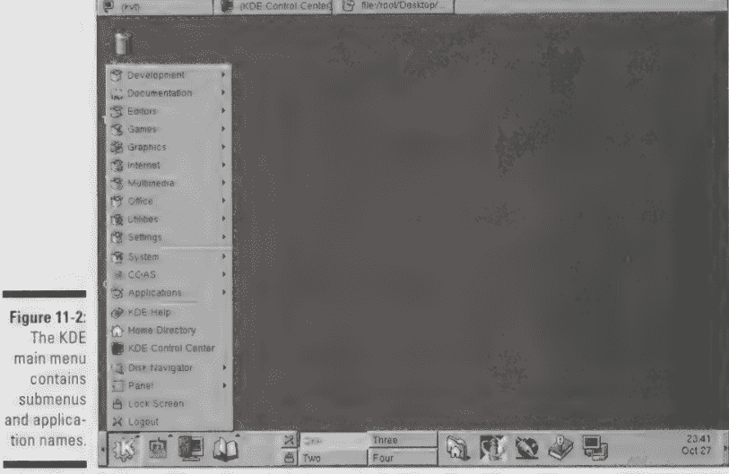

你的`KDE`桌面上可能还会有其他几个图标，特别是如果你在首次登录新的`OpenLinux`系统后，使用了`KDE`配置向导来设置你的桌面的话。（请参阅第 7 章。）

> 提示

> `KDE`的许多功能可以通过点击鼠标右键（我们称之为右键点击）来访问。如果你想知道如何执行某项操作，可以点击右键看看是否会弹出一个包含你所需命令的快捷菜单。你可以从尝试在`KDE`桌面或某个桌面图标上点击右键开始。

## 启动应用程序

在学会了如何在`KDE`桌面上穿梭之后，你可能会想接下来该做什么。启动一个应用程序怎么样？按照以下步骤操作：

- 点击 K 图标打开主菜单。

  注意：你也可以按`Alt+F1`组合键来打开主菜单。

- 使用方向键在主菜单选项之间导航，并在所需的项目被高亮后按下`Enter`键。

## 第11 章：世界上的窗口

例如，点击“Graphics”（图形）一词打开图形子菜单（你可以通过单词右侧的小箭头箭头判断`Graphics`是子菜单）。然后点击“Fractals Generator”（分形生成器）。分形生成器启动，向你展示精美的数学生成图形，如图 11-3 所示。

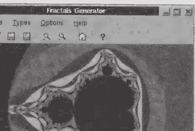

图 11-3：`KDE`在图形子菜单上包含一个分形程序。

在`KDE`面板上找到看起来像带有小房子的文件夹的图标。那就是你的主目录。你可以点击该图标打开一个文件管理器窗口，显示你主目录中的所有文件。文件管理器窗口如图 11-4 所示。

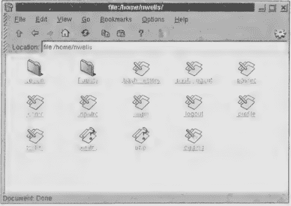

图 11-4：你可以通过点击`KDE`面板图标打开显示主目录的文件管理器窗口。

如果你需要帮助，再次打开主菜单并点击`KDE Help`（帮助）菜单项。`KDE Help`菜单不是子菜单；此菜单会立即打开一个`KDE`帮助窗口，你可以在其中搜索关于`KDE`最紧迫问题的答案（或继续阅读此处以获取答案）。帮助窗口如图 11-5 所示。

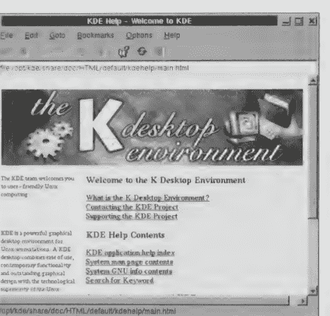

图 11-5：`KDE`主菜单包含一个帮助项，点击可打开此在线窗口。

## 窗口技巧

你正在操作的`KDE`桌面会同时打开许多窗口。但正如你所想象的，你可以迅速让`KDE`桌面变得杂乱。通常，`KDE`提供了几个实用的技巧来操作桌面上的窗口。

### 将焦点集中在活动窗口上

如果一个窗口在`KDE`中处于激活状态，我们说该窗口拥有焦点。你可以通过点击窗口内的任何地方将焦点移动到窗口。拥有焦点的窗口移动到所有其他窗口之上，以便你使用该窗口。

当然，有时你想要使用的窗口被隐藏了。如果发生这种情况，尝试以下方法之一使所需的窗口在`KDE`中变为激活：

- 点击任务栏上与你想要使用的窗口匹配的按钮。该窗口将移动到顶端，准备好使用。

- 按住`Alt`键并反复按下`Tab`。第一次按下此组合键时，屏幕上会出现一个小框。随着你反复按下`Tab`，每个窗口的名字都会出现。反复按下`Tab`直到选择所需的窗口。

- 按下`Ctrl+Esc`组合键。一个框会列出所有窗口。点击你想使用的窗口，它将跳转到顶端。

## 移动窗口

当你启动一个新应用程序后，通常想将窗口放在另一个地方。

要在`KDE`中移动窗口，请点击标题栏（窗口顶部的蓝色条），将其拖动到新位置并释放鼠标。

### 调整窗口大小

大多数`KDE`窗口都可以调整大小以更好地适应桌面上的其他窗口，或更容易查看窗口内容。调整窗口大小请遵循以下步骤：

1. 将鼠标指针移动到窗口的任意角。当你将指针放在正确的位置时，鼠标指针会从箭头变为匹配该角的直角符号。

2. 看到新的鼠标指针后，点击并拖动以调整窗口大小。

如果你无法让鼠标指针发生变化，你可能正在处理一个无法调整大小的窗口。然而，大多数窗口可以使用本节的方法进行调整大小。

### 使窗口最大化或隐藏窗口

如果你想要一个巨大的窗口，可以最大化窗口，而不是通过拖动来扩展它。

标题栏包含三个图标：

- 横线图标：这会将窗口最小化，意味着窗口不再显示在桌面上。

- 方块图标：这会将窗口最大化到可能的尺寸。

- X：这会关闭窗口。

### 掌握窗口技巧

`KDE`窗口还有额外功能：

- 双击标题栏的任意位置可以将窗口切换为仅显示标题栏。如果只显示标题栏，窗口处于阴影状态。一旦双击阴影窗口的标题栏，窗口将恢复到之前的尺寸。

- 右键点击任何窗口的标题栏弹出选项菜单。这就是控制菜单。你可以随时通过`Alt+F3`组合键或点击标题栏左侧的小图标打开活动窗口的控制菜单。

- 我们尚未描述的一个功能是“置顶”（`sticky`）选项。如果你在多个桌面上工作，每个窗口通常只显示在一个桌面上。任何窗口都可以设置为置顶，以便该窗口出现在所有桌面上。如果你切换桌面（例如按下`Ctrl+F2`），置顶窗口仍然留在你离开的地方。

- 任何窗口的“到”（`To`）控制子菜单让你将窗口移动到另一个桌面。子菜单包含你配置的所有桌面名称（一、二、三、四、默认）。从从桌面菜单中选择一个项目后，窗口会突然消失。

# 192 第三部分：使用 OpenLinux

# 请进，任务控制中心

`KDE`提供了一个控制中心（`Control Center`），允许你配置环境的大部分功能。你可以点击面板上的控制中心图标（该图标看起来像一个上方带有电脑板的屏幕）或直接从主菜单中选择“控制中心”来访问控制中心。

本节侧重于使用控制中心设置选项，但你也会使用主菜单中的“设置”（`Settings`）子菜单。我们描述的控制中心区域对应主菜单中“设置”下的子菜单和菜单项。


图 11-8 显示了控制中心的初始显示。要操作控制中心中的选项，点击区域名称左侧的加号。将出现该区域的项列表。点击其中一项即可开始配置该项。控制中心窗口右侧会出现一或多个页面（每个页面顶部有一个页签）。

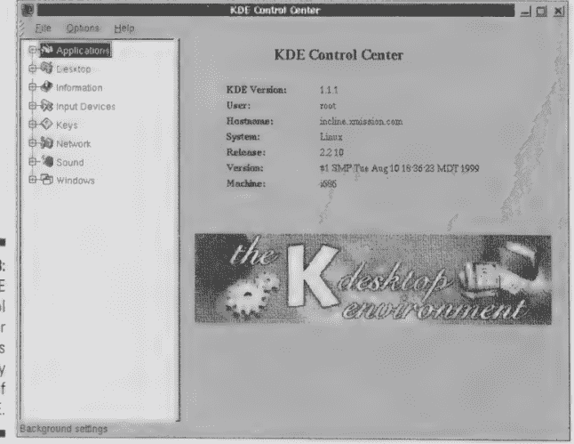

图 11-8：`KDE`控制中心配置`KDE`功能。背景设置

在你在控制中心左侧选择了一个要配置的项后，控制中心窗口底部会出现几个按钮。

- 帮助（`Help`）：为你正在查看的配置信息打开在线帮助页面。

- 默认（`Default`）：将当前配置屏幕重置为默认设置。（注意：这可能对所有配置选项都有效。）

- 确定（`OK`）：应用你所做的配置并返回到原始的控制中心屏幕（如图 11-9 所示）。

- 应用（`Apply`）：（激活）你所做的配置，并保持配置选项显示状态，以便你进行其他更改。

- 取消（`Cancel`）：忽略当前屏幕上进行的更改并返回原始的控制中心屏幕（如图 11-9 所示）。

`KDE`支持数百个配置选项，其中大部分你都可以从控制中心访问。我们只描述了最重要的——那些我们认为你可能想要自己设置的选项。你可以通过查看我们没有使用的页面来探索其他选项。使用“帮助”按钮或进行实验来查看你可以做什么！

# KDE 配置文件

你在`KDE`控制中心中配置的信息存储在`KDE`目录下的纯文本配置文件中。如果你想探索这些文件以了解`KDE`在后台是如何运行的，请尝试查看`/opt/kde/share/config`目录下的文件，例如`kcm_arc`和`kpanelrc`。

每个配置文件适用于单个应用程序。大多数文件以字母`rc`结尾，代表“资源配置”（`resource configuration`）。你可以使用任何文本编辑器来修改这些配置文件（在修改第一个文件之前先创建一个备份副本，以防发生问题）。配置文件的格式非常直观，当你探索每个文件时，就会变得显而易见。务必一次尝试一项，以免因为选择奇怪的选项导致应用程序无法使用。

`/opt/kde/share/config`目录下的文件适用于系统上的所有用户。

`root`用户可以为`OpenLinux`系统上的所有用户设置这些配置。但每个用户也可以拥有个性的配置。这些配置文件存储在`.kde/share/config`目录中（注意`.kde`目录是一个隐藏目录，并以点开头）。如果`KDE`在用户的家目录中找到配置文件，这些设置将覆盖主`KDE`配置文件。例如，每个用户可能都会使用偏好的颜色方案和壁纸。因为这些功能存储在`.kde/share/config`目录中（在`desktoprc`以及其他类似名称的文件中），所以`/opt/kde/share/config`中的文件不会被参考。如果用户家目录下未包含配置文件，则使用系统级配置。


# 194 第三部分：使用 OpenLinux

## 你想把它放在哪里？

你的`KDE`桌面的基本部分可以位于几个位置以适应你的喜好。要设置面板和任务栏的位置，打开控制中心的“应用程序”部分并选择“面板”。控制中心右侧会出现四个页签。面板页签（如图 11-9 所示）可以选择面板和任务栏的位置。

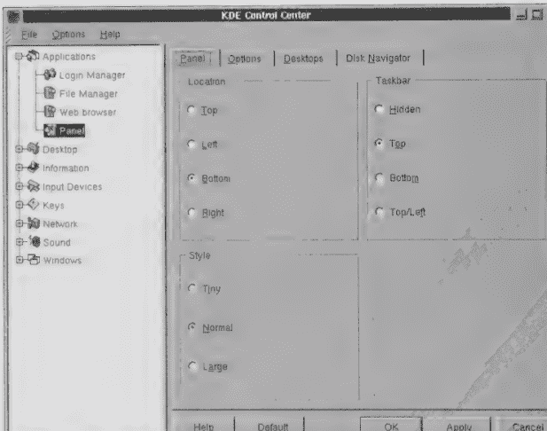

图 11-9：配置面板和任务栏的位置

面板位于位于顶部、底部、左侧或右侧。面板样式可以是微型（使用较小的半高图标）、普通（默认显示）或大型。大型选项使用的图标与普通相同，但会将图标放在更大的框内（这对于 1600 x 1200 分辨率的屏幕很有）。在面板页签的“样式”部分选择尺寸。点击“应用”即可看到你的选择效果。


# 第 11 章：世界上的窗口

任务面板可以位于顶部、底部、左侧或右侧。任务栏样式可以是微型（使用较小的半高图标）、普通（默认显示）或大型。大型选项使用的图标与普通相同，但会将图标放在更大的框内（这对于 1600 x 1200 分辨率的屏幕很有用）。在面板页签的“样式”部分选择尺寸。点击“应用”即可看到你的选择效果。


**图 11-9**：配置面板和任务栏的位置

如果没有任何配色方案适合你的任务，请选择“添加”（Add）按钮，为自己的配色方案命名，然后从 Widget 列表中选择项目，为你的新配色方案中的每个项目设置颜色。选择一个项目后，点击 Widget 名称下方的彩色条（例如：非活动标题栏）。会出现标准的 KDE 选择颜色对话框，如图 11-13 所示。


**图 11-12**：可以在 KDE 控制中心的“桌面”（Desktop）部分下使用“颜色”（Colors）项配置配色方案。


**图 11-13**：可以在此标准 KDE 对话框中选择窗口每个部分的颜色。

还可以通过控制中心桌面（Desktop）部分下的“字体”（Fonts）项选择用于桌面和窗口的字体。选择你想要更改的字体（大多数项目使用“常规”字体）。然后从系统可用字体的下拉列表中选择一种字体。设置你喜欢的 `粗体` 或 `斜体` 以及大小，然后按“应用”（Apply）查看文本效果。记住，你可以使用“默认”（Default）按钮来撤销在该框中做的任何错误决定。字体对话框如图 11-14 所示。


**图 11-14**：KDE 对话框使用的所有字体都可以通过 KDE 控制中心的此部分进行设置。

## 墙纸

选择桌面（Desktop）部分下的“背景”（Background）项以打开背景标签页，如图 11-15 所示。使用此标签页设置出现在应用程序窗口背后的窗口背景。在此标签页上，你可以设置背景使用的配色方案，或者如果你愿意，可以选择一张图形作为壁纸。

首先从桌面列表中选择你想要配置的桌面。每个桌面都可以有独立的颜色和壁纸配置（除非你选择了“共同背景”复选框，在这种情况下，只有当前中的桌面可以配置，其他桌面将与该配置匹配）。

在你选择好所需的桌面后，请记住以下几点：

- 背景可以是单色（默认）或双色（如果你选择了“双色”Two Colour 选项）。如果你选择了双色选项，可以通过点击“双色”按钮下方的彩色框来选择第二种颜色。选中“双色”后，你还可以选择“设置”（Setup）来配置这两种颜色在背景上的混合方式（如图 11-16 所示）。可以为两种颜色选择简单的渐变或复杂的图案。


**图 11-15**：可以在控制中心的此标签页设置背景颜色和壁纸图形。


**图 11-16**：双色设置对话框让你选择所选的两种颜色作为背景图像。

- 如果你想在桌面背景上使用壁纸图形，就不用担心颜色选项——在大多数情况下，壁纸会覆盖背景。壁纸可以是平铺的（重复以覆盖整个背景）或居中的（屏幕中间的一张图像）。`Arrangement`（排列）下拉列表中的其他选项基本上是这两种想法的变体。

KDE 提供了约一百张壁纸图形。所有这些壁纸都是旨在作为平铺图像的小型图形。你可能有一张大图像，希望它单张并居中显示在桌面上。任何标准图形格式（如 `jpg` 或 `gif`）的图像都可以作为壁纸图形。只需选择“浏览”（Browse）按钮选择你需要的图形文件，然后从“排列”下拉列表中选择该图形相应的排列方式。


如果你在 KDE 提供的数百张壁纸中选择时遇到困难，请勾选“随机”（Random）复选框，然后选择其旁边的“设置”（Setup）按钮。添加你想要的所有壁纸，并在“设置”对话框中设置从你创建的列表中随机选择壁纸图像的延迟时间。

## 选择屏幕保护程序

选择屏幕保护程序不是你在 OpenLinux 系统上执行最重要的任务。大多数显示器会自动进入节能模式，你可能甚至看不到你选择的屏幕保护程序。尽管如此，KDE 提供了许多有趣的屏幕保护程序，值得探索。

控制中心桌面部分的“屏幕保护程序”（Screensaver）项如图 11-17 所示。在此标签页中，你可以从约 20 个的列表中选择一个屏幕保护程序。

## 在桌面添加应用程序

你可以在午餐时间玩玩分形生成器。但你需要的一些程序并没有包含在 KDE 主菜单中。你该如何操作呢？

KDE 使用一种称为 `KDE Link` 文件的小型配置文件。这些文件包含了 KDE 启动应用程序所需的所有信息。`KDE Link` 文件被用于创建 KDE 菜单项、KDE 桌面图标、KDE 面板图标、KDE 自动启动图标……你对此此类推。

假设你已经通过 KDE 桌面上的图标访问你最喜欢的图形程序 Gimp。只需按照以下步骤操作即可：

1. 右键点击桌面，然后在弹出的菜单中选择“新建（New）：应用程序（Application）”。
2. 弹出一个包含文件名的小窗口。
3. 将名称从默认的 `Program.kdelink` 改为与你想添加到桌面的应用程序名称匹配的名称。
4. 例如，如果你要添加 Gimp 程序，可以使用 `Gimp.kdelink`（只需确保保留 `.kdelink` 部分不变）。注意文件扩展名不是 `kdelink`，而是 `.kdelink`。
5. 点击“确定（OK）”。出现属性对话框。
6. 选择对话框的“执行（Execute）”选项卡（如图 11-20 所示）。


**图 11-20**：KDE Link 属性对话框的执行选项卡包含了通过此 KDE Link 文件执行的程序名称。

7. 在执行字段中输入如你从命令行一样启动程序的命令。在本示例中，我们输入命令 `gimp`。
8. 点击齿轮图标，为你正在配置访问的应用程序选择新图标。KDE 包含了数百个供选择的图标。如果你想查看 KDE 为 `KDE Link` 文件提供了哪些选项，请探索其他选项卡。
9. 点击“确定（OK）”关闭对话框并激活新的 `KDE Link` 文件。

图标出现在桌面上。你可以点击（一次）此图标来启动你在“执行（Execute）”选项卡中输入的程序。


你可以使用标准的拖放技术将此图标及其代表的配置文件复制或移动到你的面板（Panel）、自动启动文件夹或菜单配置对话框中。（选择“面板（Panel）-> 编辑菜单（Edit Menus）”来更改 KDE 菜单。）


KDE Link 文件只是一个告诉 KDE 如何使用该应用程序的配置文件。一旦你删除了 KDE Link 文件，此操作对该文件原本用于访问的应用程序没有产生影响。

# 第 12 章

# 做些有用的事情

本章内容

- 使用 OpenLinux 日程规划器 (`KOrganizer`)
- 使用 `kCalc` 计算器进行计数
- 从 CD-ROM 驱动器播放音乐
- 享受玩一两个游戏
- 查看和创建图形
- 在 OpenLinux 中运行 DOS 程序

OpenLinux 包含了许多实用的图形程序。空间限制让我们无法向你展示所有在 KDE 下运行的程序，甚至不是 Caldera 在标准安装中包含的所有程序。但我们在本章向你展示的程序是 OpenLinux 的代表，并能让你对其他程序的工作原理有一个良好的了解。

我们的空间仅展示这些程序的基本功能。你可以通过探索每个程序中的“帮助（Help）”菜单和 KDE 主菜单来学习更高级的功能。如果你需要额外的应用程序，请查看 KDE 网站：`www.kde.org/applications.html`。

## 整理你的自己

我们大多数人需要一些帮助来跟进繁忙的生活。对于许多随身携带某种日程规划表的人——或者经常使用电脑的人来说——在如 Microsoft Outlook 这样的程序中跟踪约会和人物是有必要的。

KDE 提供了一个类似的程序，让你可以在 OpenLinux 中完成同样的事情：`KOrganizer`。你不需要为 `KOrganizer` 额外付费。开始开始，从 KDE 的“办公（Office）”子菜单中选择“组织器（Organizer）”。出现 `KOrganizer` 程序窗口如图 12-1 所示。

参考日历


图 12-1：`KOrganizer` 程序让你设置日历预约和待办事项列表。

当你启动程序时，`KOrganizer` 窗口分为三个部分：

- 参考日历
- 待办列表（To-Do list）
- 日程安排（daily schedule）

## 设置简单的预约

你可以按照以下步骤在每日日程安排日历中设置预约：

- 右键点击你想要安排预约的小时，然后从弹出的菜单中选择“新建预约（New Appointment）”。
- 出现一个“新建预约（New Appointment）”对话框，如图 12-2 所示。
- 在“摘要（Summary）”字段中输入预约名称。
- 在“预约时间（Appointment Time）”部分设置开始时间（Start Time）和结束时间（End Time）。


图 12-2：在 `KOrganizer` 中设置新预约。

- 出现一个“新建预约（New Appointment）”对话框，如图 12-2 所示。
- 在“摘要（Summary）”字段中输入预约名称。
- 在“预约时间（Appointment Time）”部分设置开始时间（Start Time）和结束时间（End Time）。
- 设置完成后，你可以根据需要进行调整（注：此处原文存在重复性逻辑跳跃，已按原意翻译）。

## 设置重复事件

有些预约是重复发生的。要安排重复事件，请按照以下步骤操作：

- 点击 `KOrganizer` 窗口的待办列表（To-Do list）区域。（注：上下文建议点击重复选项卡）
- 选择一种重复规则（Recurrence Rule）——每天（Daily）、每周（Weekly）、每月（Monthly）或每年（Yearly），并在重复规则中输入相应信息。
- 选择重复之间的周数（默认是每周1周）。
- 选择事件发生的星期（勾选相应的星期复选框）。
- 在对话框的重复区域核实开始日期（Begin On）。如果日期不正确，点击日期旁边的日历按钮并从日历中选择日期。
- 输入事件结束日期。此日期可以是无（选择“No Ending”）、固定次数或固定日期（在“截止（End by）”字段中输入）。
- 重复次数（end after occurrences）指的是事件重复的周、月或年。例如，如果日程安排每周发生3次，而你想安排 10 周，则在重复次数处输入 10，而不是 30。
- 在对话框的异常（Exceptions）区域输入任何异常情况（取消课程、假期或其他任何情况）。点击文本输入字段旁边的日历图标选择日期，然后点击“添加（Add）”将日期添加到异常列表中。
- 点击“新建预约”或“编辑预约”对话框顶部的“确定”按钮。

## 创建待办列表条目

`KOrganizer` 中的待办列表与你日历上的预约没有关联。待办列表是一个基础的任务列表，用于记录提醒你需要完成要做要做。

要添加新的待办列表项，请按照以下步骤操作：

1. 点击 `KOrganizer` 窗口的待办列表（To-Do list）区域。

   出现弹出菜单。

2. 从弹出菜单中选择“新建待办（New To-Do）”。

   光标出现在空白行中，你可以在此处输入新的待办列表项。

3. 输入任务并按回车键。

`KOrganizer` 显示的每日日历标准视图并非查看世界的唯一方式。`KOrganizer` 还有其他视图。你可以通过选择 `KOrganizer` 的“视图”菜单或点击工具栏上的图标（工具栏最右端的图标控制视图）来选择视图。“天”、“工作”和“周”视图都由一个图标选择。你可以通过反复点击工具栏上数起第三的图标在这三个选项之间切换。

## 第 12 章：做些有用的事

要查看一个可以从中选择“天”、“工作周”或“周”视图的下拉列表，请点击并按住工具栏右侧数第三个图标。

可用的不同视图如下：

- 列表（List）：显示当天的预约列表，如图 12-5 所示。
- 天（Day）：显示单日，按小时划分，并列出每小时的预约情况。
- 工作视图（Work View）：在日历区域内显示五天，如图 12-6 所示。
- 周（Week）：在日历区域内显示七天（如图 12-6 所示，但增加了周六和周日）。
- 月（Month）：显示整个月份，但不显示参考日历或待办事项，如图 12-7 所示。
- 待办列表（To-Do list）：显示待办列表，不显示参考日历或任何已计划的预约。


图 12-5：

列表显示你的预约，而不将其按小时日历进行组织。

`KOrganizer` 中的箭头通常意味着你可以点击箭头切换到第二天、下周或下个月。

214 第三部分：使用 OpenLinux

图 12-6：工作周视图在一个屏幕上总结了一周的预约。


图 12-7：月视图显示了整个月份，每天都有缩写形式的预约。


第 12 章：做些有用的事 215

`KOrganizer` 拥有众多功能和配置选项。你可以通过选择菜单栏中的“选项 -> 编辑选项”来设置你的偏好。会出现配置对话框，如图 12-8 所示。从窗口左侧的列表中选择一个项目，然后在窗口右侧设置相应功能。


图 12-8：

你可以在此对话框中为 `KOrganizer` 设置配置选项。

只要你退出 `KOrganizer`，你所有的预约和待办事项项都会被保存。第一次退出 `KOrganizer` 时，系统会提示你使用文件名。使用一个简单的文件名，例如你的名字或与日历相关的项目名称。下次启动程序时，信息将自动加载并立即显示。

## 追踪你的资金

好了，我们承认。这一部分真的不是关于钱的；这一部分是关于使用计算器的。但我们大多数人使用的数字都是关于钱的，所以我们引起了你的注意力，不是吗？

要启动计算器程序，从桌面主菜单的“实用工具”子菜单选择“计算器”。图 12-9 所示的计算器被称为 `kCalc`。

216 第三部分：使用 OpenLinux

NICK 说

### 玩股市？OpenLinux 也可以参与

OpenLinux 支持真实的金钱应用 `www.linuxberg.com` 或 `www.kde.org`。通过玩 `KStocks`（适合新手）或 `tsinvest`（适合专业投资者）来追踪股票和平衡支票簿。你可以从网络网站了解这些应用程序，如。

图 12-9：KDE 包含一个功能齐全的计算器，你可以从“实用工具”菜单启动。


使用计算器可能对你很熟悉，但我们只想关于 `kCalc` 的几点提示：

- 你可以使用鼠标、普通键盘或数字键盘输入数字。
- 你可以将计算器窗口中的数字复制到剪贴板，以便在其他应用程序中使用。
- 数字键盘上的字母用于处理十六进制数字（计算机使用的数字）。你可以通过 `kCalc` 下方的 Base 按钮切换到这些数字。
- `kCalc` 拥有独立的三角函数和统计函数键。按 `F3` 在这些函数之间切换。
- 你可以通过点击按钮配置 `kCalc`。对话框中会出现帮助按钮（因为 `kCalc` 窗口没有菜单栏）。

第 12 章：做些有用的事

> 提示

> 使用对话框中的帮助按钮会打开一份包含有用信息的文档，例如如何使用这些功能。

图 12-10：`kCalc` 配置框显示你可以设置。


218 第三部分：使用 OpenLinux

图 12-11：

播放器包含在多媒体子菜单中。


220 第三部分：使用 OpenLinux


图 12-14：可以在配置框的 CDDB 选项卡中设置对 CDDB 数据库的网络访问。

## 玩纸牌怎么样？

大多数人至少会喜欢玩一次电脑游戏。如果你不喜欢电脑游戏，也许你还没有找到合适的游戏。OpenLinux 在桌面的“游戏”子菜单中包含了大约 15 款游戏。每个游戏都值得花几个小时实验来帮助你理解 OpenLinux。告诉你的老板我们说没问题的。

有些游戏是街机风格的，例如行星（如图 12-15 所示）。使用以下键控制你的飞船：

- 左箭头：逆时针旋转
- 右箭头：顺时针旋转
- 上箭头：推进器（向前移动）
- 空格：发射鱼雷

# 第 12 章：做些有用的事 221


图 12-15：

OpenLinux 的“游戏”（Games）菜单中包含了《小行星》等许多街机风格的游戏。


图 12-16：

OpenLinux 包含了纸牌游戏 `Solitaire`（在“游戏”菜单中选择“Patience”）。

## 222 第三部分：使用 OpenLinux

如果 `Games.kde` 中的 15 个游戏还不足以让你感到娱乐，请查看 `www.kde.org/applications.html`，你可以在那里下载额外的游戏。你可以找到更多纸牌游戏、策略游戏（如果你是 `NetHack` 的粉丝，则包括它）、街机游戏（有人想玩吃人包吗？）以及静态类游戏（如象棋）。


事实上，如果你喜欢下象棋，OpenLinux 已经在你的 OpenLinux CD 中直接包含了你需要的所有内容。象棋通常不会默认安装，但你可以按照以下步骤安装象棋并开始游戏：

1. 确保你已以 `root` 身份登录以安装新软件。
2. 将你的 OpenLinux CD 插入 CD-ROM（如果你有 OpenLinux 的商业盒装，请使用 CD 1）。
3. 使用此命令挂载 CD：

```
mount /mnt/cdrom
```

4. 使用此命令切换到包含软件包的目录：

```
cd /mnt/cdrom/col/install/RPMS
```

5. 使用以下命令安装 `thechess` 引擎：
6. 使用此命令安装象棋界面：
7. 输入以下命令开始象棋游戏：

```
rpm -Uvh gnuchess-4.0.p180-1.1386.rpm
rpm -Uvh xboard-4.0.2-2.1386.rpm
```

```
xboard
```

12-17 显示了准备好让你下第一步的棋盘。要移动棋子，点击、拖拽并释放棋子。你只能移动自己的棋子——默认情况下你使用白棋，所以你先走。当你松开鼠标将棋子落在新棋格上时，电脑会立即移动。

## 第 12 章：做些有用的事 223


图 12-17：OpenLinux 包含一个基于强大的 `gnu` 引擎的精彩象棋游戏。

## 为我画幅

计算机比以往任何时候都要视觉化。有了网页以及你下载的所有航天飞器图片（参见 `www.nasa.gov/gallery/index.html`），你可能需要一个良好的查看器。OpenLinux 提供了这个工具。从“图形”（Graphics）菜单中选择“图像查看器”（Image Viewer）。图像查看器（如果你需要从命令行启动，则称为 `kview`）打开时看起来没什么特别的——一个带有菜单栏的灰色框。

你可以通过选择“文件>打开”并在你的文件系统中选择图形文件来加载图像。大多数常见的图像格式都可以查看，包括以下：

- `gif`
- `jpeg`
- `bmp`
- `pcx`
- `xbm`
- `xpm`
- `xwd`

## 224 第三部分：使用 OpenLinux

如果你打开了一个文件管理器窗口来查看你的主目录或文件系统中的另一个位置，你可以从文件管理器窗口拖动图形文件的图标，并将其落在如图 12-18 所示的图像查看器窗口上，即可自动加载图像。


图 12-18：你可以将图标拖到图像查看器窗口上打开图形文件。

图像查看器包含了许多调整图像的实用功能。该程序并非用于编辑照片或其他图像（请参阅下一节），但你可以执行：

- 通过点击并拖拽图像，然后选择“编辑：裁剪”（`Edit:Crop`）来裁剪图像部分。
- 从“缩放”（Zoom）菜单中选择项目来调整图像大小。
- 使用“变换”（Transform）菜单上的项目旋转或翻转图像。
- 通过选择“到桌面”（To Desktop）菜单上的项目（临时）制作桌面壁纸。
- 在“过滤器”（Filter）菜单上将图像更改为灰度。
- 使用“文件：打印”（`File:Print`）选项打印图像。
- 使用“过滤器：强度”（`Filter:Intensity`）子菜单调整图像的亮度或伽马。

图像查看器并没有某些图形程序那样拥有花哨的过滤器。然而，如果你点击图像查看器可以显示的图形文件图标，图像查看器会自动启动并显示图像。

## 第 12 章：做些有用的事

如果你想做的不仅仅是查看图像，请从“图形”（Graphics）菜单中选择“绘画”（Paint）。绘画程序如图 12-19 所示。

图 12-19：绘画程序有一组工具。


图像查看器并没有某些图形程序那样拥有花哨的过滤器。然而，如果你点击图像查看器可以显示的图形文件图标，图像查看器会自动启动并显示图像。

## 挂载与卸载

文件对于 OpenLinux 以及其他类 Unix 操作系统非常重要，其重要性与 DOS、Windows 和 Macintosh 操作系统不同。在 OpenLinux 中，一切都以文件的形式存储在目录结构中预测的位置——OpenLinux 甚至将命令也存储为文件。与其他操作系统一样，Linux 拥有一种树形结构的层次目录组织形式，称为文件系统。

所有用户可用的磁盘空间都合并在一个目录树中。系统的基根是根目录，用斜杠（`/`）表示。文件系统的内容通过名为“挂载”（mounting）的过程，将文件系统合并到系统目录中，供 OpenLinux 使用。

文件系统可以被挂载或卸载，这意味着文件系统可以连接或断开与目录树的连接。根文件系统在运行时始终挂载在根目录上，无法卸载。其他文件系统可以根据需要挂载，例如包含在另一个硬盘、软磁盘或 CD-ROM 上的系统。

## 命令语法

以下是手动挂载文件系统的命令语法：

```
mount block-special-file mount mount-point
```

其中 `block-special-file` 是创建文件系统的磁盘分区设备驱动器（例如硬盘或 CD-ROM），而 `mount-point` 是挂载文件系统的目录。`block-special-file` 术语通常被称为“设备名称”，因为用户通过引用目录结构中的 `block-special-file` 来访问设备。

想看 `mount` 命令将第一个软磁盘（Linux 将其称为 `/dev/fd0`，见第 4 章）挂载到 `/mnt` 目录吗？嘿，我们承诺过让你过得愉快的时光吗？

```
mount /dev/fd0 /mnt
```


# 第 13 章：文件系统管理

文件系统在任何时刻只能挂载在一个地方。在执行 `mount` 命令之前，挂载文件系统的目录（`mount-point`）必须已经存在。否则，命令将无法工作。如果你需要创建目录，请结合使用 `mkdir` 命令（见第 8 章）和 `mount` 命令。例如，创建一个名为 `canadianpolice` 的新目录，然后将软磁盘（`/dev/fd0`）上的磁盘文件系统挂载到该目录，您可以使用以下命令：


```
mkdir /canadianpolice
mount /dev/fd0 /canadianpolice
```

在完成操作或厌倦了挂载的 `/canadianpolice` 文件系统后，您必须使用 `umount` 命令卸载该文件系统。`umount` 命令的语法为：

```
umount name
```

其中 `name` 是 `block-special-file` 的名称（设备 `/dev/fd0`）或目录的名称（即挂载点 `/canadianpolice`）。

## 查找其他文件使用者

由于 OpenLinux 是一个多用户操作系统，有时会有多个用户同时登录系统。这意味着可能会有多个文件系统被挂载并正在使用。`umount` 命令仅对活动的文件系统有效。如果文件系统中的某个文件处于打开状态，或者该文件系统就是当前目录，则会错误消息提示设备正忙。

如何找出哪些文件正在被谁使用？您可以使用 `fuser` 命令。（听懂了吗？Find user — `fuser`。）该命令会返回大量信息，识别哪些进程正在使用特定的文件或文件系统，以及哪个用户在使用它们。如果您对 `fuser` 使用文件名，它将仅返回该文件的信息。如果您对 `fuser` 使用块特殊设备文件名，那么 `fuser` 将报告该文件系统中的所有文件。

`fuser` 命令有两个您可能觉得非常有用的选项：

- `-u` 显示用户名以及进程 ID
- `-m` 允许您通过名称指定文件系统

`fuser` 是一个字符单元程序。通过运行带有 `-u` 的 `fuser`，您可以获取使用文件系统的程序数量以及使用这些程序的姓名。例如：

```
/usr/sbin/fuser -u /home
492r(nwells) 503r(nwells)
504r(nwells) 508r(nwells) 580r(nwells)
581r(nwells) 585r(nwells) 586r(nwells)
598r(nwells) 599r(nwells) 601r(nwells)
879r(nwells) 1287r(nwells)
```

在这里可以看到 `nwells` 有一系列程序正在使用 `home` 文件系统。如果您想查看这些程序是什么，可以使用 `ps` 命令，它显示系统中运行的进程的编号和名称：

```
ps ax | grep 601
601 pS  0:00 /opt/applix/applix
```

我们运行 `ps ax` 是以扩展模式查看系统中的所有进程，以便您看到它们的额外信息，而不仅仅是名称。然后，通过使用 `ps` 命令，您可以识别哪个进程正在使用该文件。

根文件系统在运行时始终挂载在根目录上，无法卸载。其他文件系统可以根据需要挂载，例如包含在另一个硬盘、软磁盘或 `CD-ROM` 上的系统。

## 配置文件系统

`/etc/fstab`。文件中的条目通常遵循以下格式：

```
block-special-file mount-loc type dump-freq
```

其中

- `block-special-file` 是设备名称。
- `mount-loc` 是挂载文件系统的目录。
- `type` 是分区类型。对于原生 OpenLinux 文件系统，`type` 为 `ext2`。
- `dump` 是 `dump` 工具使用的标志（通常为 `0` 或 `1`）。
- `freq-number` 是 `fsck` 工具检查文件系统的顺序。

`dump-freq` 是 `dump` 程序备份文件系统的频率（并非所有系统都使用此参数）。

`pass-number` 是一个十进制，用于指定 `fsck`（文件系统检查）检查文件系统的顺序。`pass-number` 为 `1`（一）表示应该首先检查该文件系统。此 `pass-number` 分配给根文件系统（`root`）。在不同驱动器上的所有其他文件系统可以并行进行检查以加快速度，但同一驱动器上的文件系统应该具有不同的 `pass-number`。对于交换设备（`swap device`），`pass-number` 应为 `0`（零），这将禁用 `fsck` 检查。

以下是一些典型的 `/etc/fstab` 条目的示例：

```
/dev/hdb1 / ext2 defaults 1 1
/dev/hdb3 none swap sw 0 0
/dev/hda1 /mnt/win98 vfat noauto 0 0
```

第一行启用了将第二个 IDE 磁盘的第一个分区作为根文件系统挂载。该分区是 Linux 原生文件系统，并使用了 `rw`、`suid`、`dev`、`exec`、`auto`、`nouser` 和 `async` 选项。`/etc/fstab` 文件中的第一个条目还表示根文件系统应该每周进行一次 `dump`（备份）（详细信息请参阅 `man` 命令）。最后，`/etc/fstab` 文件的第一个条目表示在系统启动后应立即对根文件系统执行 `fsck`。

第二行显示第二个 IDE 磁盘的第三个分区是交换分区，其格式为交换文件。交换分区不应被备份，你也不应该在交换分区上执行 `fsck` 命令。

`/etc/fstab` 文件的第三行指向第一个磁盘的第一个分区，该分区是准备挂载在 `/mnt/win98` 的文件系统。该文件系统可能包含 Microsoft Windows 98 的文件，你可以对该文件系统进行读写操作。该文件系统不会通过 `mount` 选项自动挂载。你永远不要使用 `dump` 备份此文件系统，也不应对其进行文件系统检查。

在你设置好 `/etc/fstab` 配置文件后，文件系统可以在启动时自动挂载。此外，由于你设置了 `/etc/fstab` 文件，`mount` 和 `umount` 命令只需要挂载点（`mount-point`）或块设备文件（`block-special-file`）作为参数。

通常，`/etc/fstab` 文件的部分内容是在安装期间设置的，因此你只需要随着添加新磁盘或磁盘分区随时更新该文件。

Caldera OpenLinux 包含一个用于更新 `/etc/fstab` 文件的图形界面，这样你就不需要用文本编辑器编辑文件了（尽管你仍然有此选项）。在附的 `CD-ROM` 上，你可以使用一个名为 `fstab` 的程序更新文件，步骤如下：

1. 确保 KDE 桌面正在运行。
2. 打开终端模拟器（命令行）窗口。
3. 输入此命令切换到 `root` 用户：
   ```
   su
   ```
4. 在提示时输入 `root` 密码。
5. 输入 `kfstab` 启动编辑 `/etc/fstab` 文件的工具。

出现一个对话框，如图 13-1 所示。


6. 在 `Device`（设备）字段中输入设备名称。
7. 在 `Mount Point`（挂载点）字段中输入挂载点。
8. 如果你想从显示的 `Default`（默认）更新 `Options`，选择 `Options` 字段旁边的 `Preferences`（偏好）按钮。
9. 点击 `Add`（添加）按钮将此设备添加到你的文件系统配置中。
10. 点击 `Save`（保存）用你输入的新文件系统更新磁盘上的 `/etc/fstab` 文件。

## 修复文件系统

文件系统可能会由于任何原因而损坏。`fsck` 工具可以检查并修复损坏的文件系统。通常，`fsck` 会在系统启动时自动运行。如果 `fsck` 发现错误，它会提示你如何操作。

`fsck` 检查的文件系统不应该是挂载的。对于交换设备，`pass-number` 应该是 `0`，这将禁用 `fsck` 检查。

`fsck` 可以执行的修复是有限的。它会检查文件的完整性并修复损坏。当系统崩溃时，`fsck` 会对 `/etc/fstab` 文件中列出的所有文件系统执行 `fsck` 检查。

这里 `fsck` 的语法如下：

```
fsck (options) filesystem
```

其中 `filesystem` 是文件系统所在的块设备文件。

`fsck` 命令具有以下选项：

- `-p` 修复文件系统。
- `-n` 回答所有提示并仅列出问题。
- `-y` 回答所有提示并修复。
- `-f` 强制执行文件系统检查。

很多人使用 `-y` 选项运行 `fsck`。如果你使用 `-p` 选项，某些步骤会自动执行。丢失的文件会被放在 `lost-found` 目录中，其他也是如此。假设掉电，系统崩溃了。当系统重启时，你会看到类似的内容：

```
/dev/hda5 was not unmounted, check forced
/dev/hda5: Deleted inode 1456 has zerime. FIXED
/dev/hda5: Deleted inode 14577 has zerime. FIXED
/dev/hda5: Deleted inode 123753 has zerime. FIXED
summary information? Yes
/dev/hda5: 46906/308400 files (1.6% non-contiguous),
767481 blocks free
```

通常你会为每个文件系统看到类似的内容：

```
fsck.ext2 -a /dev/hda7
/dev/hda7 was not unmounted, check forced
/dev/hda7: Deleted inode 1324 has zerime. FIXED
/dev/hda7: Deleted inode 15987 has zerime. FIXED
summary information? Yes
/dev/hda7: 42726/356000 files (1.6% non-contiguous)
75621/1283507 blocks
```

这些信息是 `fsck` 以 `-a` 选项运行，它会回答你的所有问题。大多数情况下，该选项修复掉电或计算机内部故障时发生的任何错误。在 `fsck` 运行后，它会报告哪些文件系统被修改过。

## 238 第四部分：维护你的系统


OpenLinux 定期添加对新文件系统的支持。以下是主要的文件系统类型：

- 本地系统: `ext`, `ext2`, `hpfs`
- NFS: `nfs`
- Samba: `smb`
- CD-ROM: `iso9660`
- DOS 和 Windows: `msdos`, `umsdos`, `vfat`
- 其他: `sysv` 和 `minix`

如果你想添加其中一种类型的文件系统，必须创建一个新分区，这可能意味着添加一个新的硬盘驱动器，而这恰是下一节的主题。

## 设置那块新硬盘

增加磁盘空间的第一步是添加一个新的硬盘驱动器。要向系统添加磁盘并让用户能够访问该磁盘（无论磁盘是 SCSI 还是 IDE），需要完成以下任务：

- 将硬盘驱动器连接到你的计算机系统中。
- 在 OpenLinux 中为磁盘控制器提供合适的设备驱动程序。这可能意味着要重新编译 OpenLinux 操作系统的内核（详情请阅第 14 节）。
- 定义至少一个分区。
- 在任何用于用户文件的分区上创建一个或多个文件系统。
- 将新文件系统输入到 `/etc/fstab` 配置文件中。
- 挂载文件系统（你可能需要为挂载点创建一个目录）。

后续章节将带你了解在物理安装后，如何配置硬盘、软磁盘和 CD-ROM 驱动器的过程。

## 配置驱动器

向你的微型计算机添加硬盘的工作分为两个步骤：

- 物理上添加硬盘
- 逻辑上让 OpenLinux 意识到硬盘的存在

第一步超出了本书的涵盖范畴，因为你的驱动器可能是 IDE 也可能是可能是 SCSI，而且物理磁盘的设置取决于系统的其他硬件。我们建议你查阅随系统附带的硬件手册，或让转销商为你安装新磁盘。OpenLinux 系统的复杂之处在于，有多个操作系统（如 DOS、OpenLinux 和 SCO UNIX）可能会共享同一块磁盘。

为了完成安装和配置新磁盘所需的所有步骤，你必须知道总格式化驱动容量、头数和磁柱数等其他细节。你通常可以在文档或制造商处找到这些信息。

你可能想记录来自分区表（如 `dkblk` 所示）的数据，例如：

- 分区编号
- 类型
- 大小
- 起始和结束块

## 安装驱动器

驱动器连接到系统后，OpenLinux 在启动时应该识别出它。要以比显示慢的速度查看启动信息，请使用 `dmesg` 命令。如果你添加了新的 IDE 驱动器，请寻找对新 `hdx` 驱动器的提及，其中 `x` 被替换为字母 b、c、d 或 e。这些信息告诉你，内核在启动时看到了这块新磁盘，添加此磁盘不需要重新编译内核。同样，如果你正在添加新的 SCSI 驱动器，你会看到一条启动消息，指示有一个名为 `sdx` 的新磁盘驱动器，其中 `x` 是一个字母。在 IDE 或 SCSI 情况下，你都可能看到包含附加信息的其他消息。

IDE 驱动器的消息如下：

```
hdb: HITACHI_DK227A-50, 4789MB / 512KB Cache, CHS=610/255/63
```

稍后，会出现一条如下所示的消息，它描述了新磁盘上存在的分区（如果有）：

```
hdb: hdb1 hdb2 < hdb5 hdb6 hdb7 hdb8 >
```

SCSI 驱动器设备具有如下消息：

```
SCSI device sdb: hdwr device=......
sdb: sdb1 *
```

## 240 第四部分：维护你的系统

如果你看到这些消息，说明内核已经看到了你的新磁盘，你不需要重新编译内核即可使用新磁盘。

书中附带的 CD-ROM 中的 OpenLinux 产品为每个 IDE 磁盘（hda–hdb）提供了块设备文件，每个磁盘有九个分区（1–9）。OpenLinux 还为七个 SCSI 硬盘驱动器（sda–sdg）提供了块设备文件，每个可以有八个分区（1–8）。此外，OpenLinux 还为 SCSI CD-ROM（scd）提供了一个具有八个分区（0–7）的块设备文件。如果你有更多的磁盘（我们很羡慕），你可能需要为设备创建一个或多个额外的块设备文件，如下：

```
cd /dev; makedev sd
```

此命令为 SCSI 磁盘 7 创建块设备文件。注意，在 IDE 和 SCSI 磁盘中，字母和磁盘编号是对应的：a 代表第一块磁盘，b 代表第二个，以此类推。

如果你添加的 ID 编号比现有更小的 SCSI 磁盘驱动器，新磁盘驱动器将采用该数字。假设你有硬件 ID 数字为 0、2、3 的 SCSI 磁盘驱动器。OpenLinux 分别将这些磁盘命名为 `sda`、`sdb` 和 `sdc`。你创建分区和文件系统，并在 `/etc/fstab` 中创建条目以显示你挂载文件的位置。现在你获得了一个新磁盘驱动器并将硬件 ID 数字设置为 1。当你重启时，该新磁盘驱动器将获得该编号。

## 分区驱动器

现在你已经创建了块设备文件，就可以使用 `fdisk` 对驱动器进行分区了。例如，如果你想在系统上运行该命令，输入：

```
/sbin/fdisk /dev/sda
```

要了解如何使用 `fdisk`，请参阅第 5 节。


## 266：文件系统管理

## 创建文件系统

每个磁盘分区只是一个具有起始和结束位置的空空间。除非该分区用作交换空间，否则你必须在分区上创建某种类型的文件系统才能使其可用。`mkfs`（make file system）命令用于在分区上创建文件系统。通常文件系统是原生 OpenLinux 文件系统，目前是 `ext2`。在磁盘分区上创建文件系统的例如，输入：

```
mkfs -t ext2 /dev/sda1
```

如果你想在磁盘分区上创建一个 MS-DOS 文件系统，使用此命令：

```
mkfs -t msdos /dev/sda2
```

你可以继续执行 `mkfs` 命令为新磁盘创建文件系统。也可以保留一些分区不创建文件系统（供以后使用），只要你在通过 `mount` 命令或 `/etc/fstab` 附加它们之前。

恭喜！你的磁盘已经物理连接到系统并完成了分区，你还为硬盘添加了文件系统。现在硬盘已准备好加入文件系统——只需使用我们之前介绍的 `mount` 命令或 `/etc/fstab`。

## 软磁盘的使用

软磁盘的处理方式与硬盘有所不同，主要是由于它们的大小和脆弱性。软磁盘通常不会挂载并持续数小时或几天来存储数 GB 数据。更多时候，软磁盘用于将数据传输到其他计算机或备份少量文件。

虽然你可以在软磁盘上创建 OpenLinux 文件系统，但以其他方式使用软磁盘更有优势：

- 软磁盘可以挂载为 DOS 文件系统，可以使用标准的 OpenLinux 工具（如 `cp` 和 `ls`）进行访问。
- 软磁盘可以作为原始设备配合命令使用（如 `tar` 和 `cpio`）。
- 软磁盘允许使用读写磁盘的特殊工具。

# 242 第四部分：维护您的系统

在 OpenLinux 系统上，第一个软驱驱动器的块设备文件是 `/dev/fd0`。默认密度为 1,440 千字节。我们假设你正在使用 3½ 英寸的预格式化软盘。

以下命令用于挂载软盘并向软盘写入一个 DOS 文件（请将 `any-dosfile.txt` 替换为实际文件名）：

```
mount /dev/fd0 /mnt/floppy
cp any-dosfile.txt /mnt/floppy
mount /mnt/floppy
```

这些命令实现在文件在 MS-DOS（Windows 3.1, 95, 98）或 Windows NT 机器之间来回传输的方法。你可以将文件添加到软盘中，将软盘插入 MS-DOS 机器，MS-DOS 机器就可以从磁盘中读取该文件。同样，通过挂载一个在 MS-DOS 机器上创建的软盘，你可以使用 OpenLinux 读取并操作这些文件。

你系统中安装的 `mtools` 软件包允许你无需先挂载软盘并将其添加到文件系统即可访问 DOS 磁盘和文件。表 13-1 显示了一些 `mtools` 命令，这些命令对 DOS 用户可能很熟悉。

| 表 13-1 | mtools 实用程序 |
| :--- | :--- |
| 命令 | 功能 |
| `mformat` | 以 DOS 格式格式化软盘 |
| `ylabel` | DOS 磁盘标记 |
| `mcd` | DOS 软盘上的当前目录位置 |
| `mdir` | 列出 DOS 软盘上的目录内容 |
| `mtype` | 显示 DOS 文件的内容 |
| `mcopy` | 在 DOS 软盘和 OpenLinux 之间复制文件 |
| `mdel` | 删除 DOS 软盘上的文件 |
| `mren` | 重命名 DOS 软盘上的文件 |
| `mmd` | 在 DOS 软盘上创建子目录 |
| `mrd` | 从 DOS 软盘上删除目录 |
| `mattrib` | 修改 DOS 文件属性 |

# 第 13 章：文件系统管理

## 配置 CD-ROM 驱动器

你对待 CD-ROM 驱动器的方式类似于硬盘驱动器，但不完全相同。在 OpenLinux 中，CD-ROM 的块设备文件通常是 `/dev/cdrom`、`/dev/hdc`、`/dev/hdd` 或 `/dev/sr0`，取决于 CD-ROM 的类型、CD-ROM 如何连接到控制器以及 CD-ROM 的驱动器编号等因素。

常见的 CD-ROM 类型是 ATAPI，OpenLinux 在启动时识别 ATAPI CD-ROM 驱动器。SCSI CD-ROM 通常在内核启动时也被识别。如果你是从附带的 CD-ROM 安装的 OpenLinux，那么 OpenLinux 将识别 CD-ROM，它可能被称为 `/dev/cdrom`。

我们提到 CD-ROM 与其他磁盘驱动器并不相同，因为它是只读的（这意味着你无法更改其内容），并且通常磁盘只有一个文件系统。因此，你不需要对 CD-ROM 驱动器进行分区，也不需要在挂载之前创建文件系统。制造商已经完成了这些工作。你只需要确定你想在何处挂载 CD-ROM 以及将其挂载到哪个设备上。我们假设你的 CD-ROM 驱动器是 `/dev/cdrom`，它实际上只是指向另一个特殊设备文件的指针（称为*链接*），这让你能够通过名称 `/dev/cdrom` 调用 CD-ROM，而无需在某些系统上调用为 `/dev/scda`（因为恰好是一个 SCSI 设备），在另一些系统上调用为 `/dev/hdc`（因为恰好是一个基于 IDE 的设备）。

以下是在你的 OpenLinux 系统上挂载 CD-ROM 的命令：

```
mount /mnt/cdrom
```

如果你在运行此命令时遇到困难，可能是因为 OpenLinux 安装没有正确识别你的 CD-ROM 驱动器，并将其信息存放在 `/etc/fstab` 文件中。在这种情况下，你可以尝试以下更晦涩的命令，它为 OpenLinux 提供了访问 CD-ROM 驱动器所需的所有详细信息。

```
mount -r -t iso9660 /dev/cdrom /mnt/cdrom
```

OpenLinux 系统在关机时会自动卸载文件系统，并且——如果你将所有必要信息放入 `/etc/fstab` 文件中——它会在你启动系统时自动挂载它们。

# 第 14 章

## 定制 OpenLinux

### 本章内容

- 了解不同类型的内存
- 挖掘你的系统有多少内存
- 检查你的磁盘性能
- 重新构建你的内核

我们的 OpenLinux 系统是硬件和软件的混合体，你对两者都有选择。那么，你如何调整你的系统以获得良好的性能呢？请遵循本章。

> 调整操作系统可能会成为一项耗费精力的任务。如果你痴迷于从硬件和软件中榨出最大性能，你将没有时间顾其他事情。利用本章中的技巧，深呼吸，继续过你的生活吧。

## 调整你的 OpenLinux 系统

大多数 UNIX 类系统没有许多可以更改的旋钮和按钮来让系统运行得更快或更好。然而，OpenLinux 具有一些特殊功能，你可以对其进行微调以获得更好的性能。更重要的是，如果你遵循一些准则，可以帮助你的 OpenLinux 系统发挥最佳性能。

你有足够的内存

尽管内存过多是可能的，计算机是-v，内存。

没有足够的内存

尽管内存过多是可能的，计算机是-v，内存。

## 真实内存与虚拟内存

当我们谈论真实内存时，我们指的是系统中的物理 RAM。

# 我有足够的内存吗？

`procinfo` 和 `vmstat` 命令可以帮助确定是否有足够的内存。单独使用或与其他命令结合可以告诉你是否过度使用了内存。

## 使用 vmstat 测量性能

`vmstat` 命令显示内存、进程状态、I/O 系统和 CPU 利用率。`vmstat` 命令还会告诉你交换分区是否被使用，如果是，使用了多少。

以下是 `vmstat` 的示例输出：

```
vmstat memory swap io system cpu
procs r b w swpd free buff cache so bo cs us sy id
1 0 0 2100 2372 13248 0 4 1 123 52 3 95
```

- r 数字表示等待 CPU 注意的进程。此类进程越多，系统越慢。
- b 数字表示等待某些事件发生的进程（通常是某种类型的 I/O）。即使你有一些空闲 CPU，这些进程也可以运行。阻塞中的进程过多可能意味着你存在 I/O 瓶颈。我们将在本章晚些时候讨论如何缓解 I/O 瓶颈。
- w 数字是交换出去的进程数量。如果没有足够的内存来高效运行进程，或者它们空闲了超过 20 秒，进程就会被交换出去。较大的值可能意味着内存不足。长时间不活动的进程（例如等待 I/O）可能会被 OpenLinux 自动交换，以节省真实内存空间和其他系统资源。
- swpd 是使用的虚拟内存量，千字节。
- free 是空闲内存量，千字节。
- buff 是 I/O 缓冲区中的内存，千字节。
- cache 是 I/O 缓存，千字节。

# 第 14 章：定制 OpenLinux

## 248 第四部分：维护你的系统

- si (交换入) 和 so (交换出) 监控换入和换出的程序页面。在负载沉重、内存受限的系统中，我们看到这里的数值很高。
- bi (块读入) 和 bo (块写出) 表示磁盘上的 I/O 活动。
- in 值报告每秒中断次数（包括时钟）。

通常情况下，中断次数范围从单用户系统的几百次（其中大多数是由于系统时钟引起的）到繁忙服务器系统的几千次不等。

如果你有一个发生故障（“疯了”）的设备，每秒中断数就会很有用。接线不当的串口线可能会以每秒数千次的中断消耗 CPU 时间。虽然在大多数系统中，每秒几百次中断并不罕见，但中断数量突然出现且无法解释的跳跃（例如，在一台原本未使用的机器上每秒出现数千次中断）可能值得调查。

- cs 报告上下文切换的次数
- us, sy, 和 id（用户、系统和空闲）CPU 数值分别代表 CPU 运行你的程序、执行某种类型的系统服务（可能是由你的程序请求）或空闲的时间百分比。注意，具有大量空闲时间的系统并不一定调优得最好；CPU 空闲可能是因为程序等待 I/O。

`vmstat` 可以在 OpenLinux 运行时自动输出单行摘要。按照以下格式输入命令（只需用时间间隔，单位为秒，替换 x）：

```
vmstat x
```

你看到的程序是系统内部的程序，减去 vmstat 自身的活动（尽管运行 vmstat 确实会有轻微影响）。

## 使用任务管理器测量性能

任务管理器是另一个用于测量系统性能的程序。在许多方面，任务管理器比 `vmstat` 更好用，因为任务管理器在一个地方列出了更多信息，且格式更好（更符合人类视觉习惯）。不过，`vmstat` 仍然有自己的单位，但 `vmstat` 缺乏格式化使其更容易被 shell 脚本使用。

你可以通过选择 KDE 主菜单中的系统：任务管理器来启动任务管理器：任务管理器有两个选项卡：

- 进程列表选项卡（如图 14-1 所示）
- 性能计数器选项卡


## 第14 章：自定义 OpenLinux 249

进程列表选项卡包含了在你的 OpenLinux 系统上运行的所有进程（程序）。你可以选择只显示你启动的程序还是显示所有程序。屏幕每几秒刷新一次，因为进程的状态会变化。


图 14-1

任务管理器的进程列表选项卡。

要更改任何进程的优先级，从列表中选择该进程，并从“进程”菜单中选择一个项目。你也可以使用“杀死”按钮结束任何给你带来麻烦的进程。


以较低优先级运行命令（特别是在后台运行）是一件好事，可以使系统对交互式任务的响应更快。


性能计数器（如图 14-2 所示）显示了随时间变化的系统性能。你可以看到这个系统运行时间并不长，但彩色图表（实际上是它们）显示了 CPU 的负载（处理程序请求的忙碌程度）以及系统资源的使用情况，特别是内存和交换空间（虚拟内存）。

## 增强磁盘性能

当你有足够的内存后，你可能想查看磁盘性能如何。OpenLinux（像很多 UNIX 操作系统）是以用户为导的。许多 OpenLinux 用户从磁盘执行，运行一段时间（在磁盘上创建交换空间然后释放），并退出。特别是当你在 shell 编程中创建一个长管道时，行中的最后几个程序可能不会执行任何工作，因为这些程序依赖于在执行任何操作之前流向它们的数据。如果没有数据到达管道中的最后一个程序，这些程序就无法执行任何操作并将会终止。

假设最后一个程序是排序程序（`sort`）。排序程序的工作是将输出按特定顺序排序，然后允许在屏幕上显示输出。如果没有数据通过管道，排序程序的工作将非常短（几乎不存在），而且排序程序为准备排序所做的一切工作都是徒劳。

OpenLinux 还会处理大量临时文件。C 编译器在编译程序时会生成许多临时文件，排序程序在排序时（那个排序例程）也这样做。所有这些临时文件可能会将数据刷入磁盘或从磁盘读取数据，从而通过磁盘子系统产生瓶颈。

OpenLinux 在其动态缓冲区缓存中留了一部分内存，用于存储在磁盘和 CPU 之间移动的数据。当从磁盘读取数据时，数据首先进入动态缓冲区缓存。通常，比原始请求更多的数据会进入被称为*预读*（`read-ahead`）的进程。当需要更多数据时，CPU 可以直接访问缓冲区缓存而无需等待磁盘。当数据写入磁盘时，CPU 经常需要等待。

## 多交换分区

如果你的系统频繁分页和交换，你无法负担更多内存，可以创建多个交换分区（而不是一个），并将分布在各个磁盘上。旧版本的 OpenLinux 每个交换分区限制为 `128MB`。最新版本支持多达 `16` 个交换分区。

## 创建你自己的内核

可能减慢系统的因素之一可能是内核没有针对你的硬件或需求进行定制。一个没有为你的系统设置内核有两个主要缺点：

- 内核可能是为你没有的处理器编译的。
- 你拥有比需要的更多的指令和数据。

本节将描述这两种情况以及你可以做什么。

## 为你的处理器定制内核

OpenLinux 的内核准备在最大范围的系统中良好运行。因此，它是为最慢的处理器编译的：`Intel 386`。你拥有的是这个吧？哦，让我们修复它。

为了利用你手边的 Pentium 类系统的性能，你至少需要构建 OpenLinux 的内核部分，并指定你使用的处理器。操作如下：

1. 以 `root` 身份登录。
2. 插入 Linux For Dummies 光驱。
3. 使用以下命令挂载光驱：
   ```
   mount /mnt/cdrom
   ```
4. 进入光驱上的包目录：
   ```
   cd /mnt/cdrom/install/RPMS
   ```
5. 使用以下两个命令安装内核源码（在按下回车键之前，输入显示的信息后按 `<TAB>` 键。这将填充包的其余部分）：
   ```
   rpm -Uvh linux-source-common<TAB>
   rpm -Uvh linux-source-13B6<TAB>
   ```
   如果你从这两个命令中收到任何错误消息提示包已安装，你可以忽略该信息（知道你领先了一步）并继续下一步。
6. 在系统提示符下输入 `cd /usr/src/linux`。
7. 输入 `make menuconfig`。

   屏幕出现，如图 14-3 所示。
8. 使用方向键移动到 `General setup` 并按回车。

   出现 `General setup` 菜单，如图 14-4 所示。

   

   图 14-4：常规设置菜单。

9. 使用方向键移动到 `Processor family`（处理器族）（屏幕会滚动），然后按回车键。

   会出现一个所有支持处理器的菜单，如图 14-5 所示。

   

   图 14-5：选择处理器的列表。

10. 使用方向键将光标移动到系统中对应的处理器上，然后按空格键进行选择。

    你会自动返回上一个菜单，你选择的处理器将显示在 `Processor` 之下。
11. 按一次 `Tab` 键将光标移动到 `Exit`（退出），然后按回车键。

    出现第一个菜单。
12. 按一次 `Tab` 键将光标移动到 `Exit`（退出），然后按回车键关闭菜单。
13. 如果你不想保存更改，按一次 `Tab` 键选择 `No`（否），然后按回车键退出菜单。
14. 要保存你的新内核配置文件，请执行以下操作：
    - a. 按回车键。

      出现以下消息：

      Linux 内核现在已可能为你的设置配置了绪。请检查顶层 `Makefile` 以进行额外配置，如果你想确保所有文件都已正确生成，请执行 `"make dep; make clean"`。

    - b. 按照提示输入 `make dep; make clean`。
    - c. 最后，输入 `make lilo` 来生成新内核。

我们已经带你完成了一次非常简单的内核重配置，只更改了一个微小条目。你调用了配置内核的程序，允许 OpenLinux 识别并生成创建新内核的所有依赖项，清理了内核目录结构中的旧文件，然后生成了内核。但到此时你可能还没有完成工作，因此在下一节中，你将通过重新定义内核所需的内容迈出更大的一步。

## 不需要需要的指令和数据

尽管重新制作内核并仅更改处理器类型通常会利用 CPU 架构中的新指令使你的系统运行更快，但仅更改处理器类型对内核的大小没有任何帮助（如果你请求了你未使用的功能支持，内核可能会变得非常大）。仅仅更改 CPU 架构也不会支持安装内核中未列的功能或设备。

例如，OpenLinux 可能没有针对你的声卡进行调优。声卡非常复杂，许多声卡看起来几乎和软件模一样。因此，你可能想要制作一个与你的声卡有效配合的新内核。幸运的是，许多不同的内核功能和驱动设备都以模块化形式存在，并通过可加载内核模块和可加载设备驱动程序可用。由于这两个特性，OpenLinux 中的标准内核可以处理许多设备和功能，而无需重建。然而，如果某个功能似乎不起作用，可能需要检查一下内核配置。

1. 以 `root` 身份登录。
2. 切换到 `/usr/src/linux` 目录。
3. 输入 `make menuconfig`。

   屏幕出现（参考图 14-3）。
4. 使用方向键进入 `General setup`（常规设置），并按回车键。
5. 将光标移动到感兴趣的选项上并输入 `?`（问号）。

   配置程序尝试告诉你该选项的含义、为什么该选项很重要，以及该选项可能的陷阱和优势。配置程序还会就是否将每个选项作为模块包含（或是否包含该选项）提供建议。
6. 使用方向键向下移动菜单项并选择你想要包含的内容。

   参考图 14-3 中的元素，你可以看到前面带有方括号 `[` 和 `]` 的条目有两个可能的值。通过将光标移动到这些条目，你可以选择空白（表示未选择）或 `*`（表示已选择）。如果选择带有 `<` 和 `>` 括号，则有三种可能值：未选择、已选择或模块。
7. 按 `Tab` 键将光标移动到 `Exit` 选项，然后按回车键。
8. 告诉系统保存你的新内核配置文件。
9. 按照提示输入 `make dep; make clean`。
10. 最后，输入 `make lilo` 来生成新内核。

与上一节一样，你调用了配置内核的程序，允许 OpenLinux 识别并生成创建新内核的所有依赖项，清理了内核目录结构中的旧文件，然后生成了内核。但这次，内核可能已经包含了你想要的所有功能，因此你可以按照下一节中的步骤继续将新内核放到到位。

## 完成内核重建

在按照你想要的方式重建内核后，你可能需要重新制作任何想要使用的模块。这些模块是内核中指定为可加载的模块。重新制作模块最简单的方法是在构建基础内核后输入 `make modules` 和 `make modules install`。

除了将内核制作成你想要的样式外，你必须告诉系统你想把内核放在哪里。实现此方法的方法是 `/etc/lilo.conf`，它是 `LILO` 的配置文件。如果你编辑 `/etc/lilo.conf`，你会看到一个类似这样的文件：

```
boot=/dev/hda
map=/boot/map
install=/boot/mlinux
prompt
timeout=50
other=/dev/h1
label=dos
root=hda
```

第一行 `boot=/dev/hda` 表示启动块位于设备 `/dev/hda`。如果你想在软磁盘上创建 `LILO` 启动，可以将此行改为 `boot=/dev/fd0`。第二行显示获取块的位置。现在，让我们保持这些行不变。`prompt` 行意味着你需要进行多引导（使用 `LILO` 启动多个操作系统），并且你希望 `LILO` 程序在启动默认操作系统之前至少等待 `50` 秒，在这种情况下是 `dos`。最后的条目告诉 `LILO` 你的根文件系统是 `/dev/hda`，并且在有机会由 `fsck` 检查之前应以只读方式挂载。

在你更新了 `/etc/lilo.conf` 文件以反映你的系统配置，并且新内核副本位于 `/linux` 后（你可能需要检查文件的日期和时间戳以确保它是最新的），你可以输入 `lilo` 命令并更新主引导记录。下次你启动时，你将运行你重建的内核。


# 在这一部分 . . .

是时候去拥抱大自然了，从你的后院开始，从那里向外延伸。第 15 章将教你如何找到互联网服务提供商（`ISP`），然后在你的 `ISP` 和你的系统之间建立必要的连接。

你也准备好进入未知的领域，即 Web 网的世界了。第 16 章将教你如何使用一个自然而然称为 Web 浏览器的程序来浏览 Web。《Caldera OpenLinux For Dummies》光盘中已经包含了目前最优秀的 Web 浏览器之一：`Netscape Communicator`。

好了，现在你已经进入了计算机世界的荒野，你将如何通信呢？烟雾信号？约瑟？电子邮件？那才是正道，在第 16 章中你还会发现如何发送和接收电子邮件。

# 第 15 章

## 设置你的互联网连接

本章内容

- 寻找互联网服务提供商
- 连接你的调制解器
- 在你的调制解器和互联网服务提供商之间建立连接
- 启动和停止互联网服务软件

如今要做的事情之一就是上网。你连接到互联网并占用几小时电话线，寻找晦涩的信息，并向那些你几乎认识、从不在电话里说话的人发送电子邮件。

现在，你也可以去派对并随口说一句：“我今天下午上网时发现了这个……[这会引来无聊的目光]……在我的 OpenLinux 系统上。” 提到 OpenLinux 立即表明你是一个互联网社区中真正有身份和地位的人。

不过，首先必须找到一个良好的互联网服务提供商，将你的电话连接到电脑（使用称为调制解器的设备），并在你的 OpenLinux 系统上设置一些简单的项目（以满足网络之神）来建立连接。

## 寻找 ISP

我们将互联网服务提供商（`ISP`）分为两类：专门针对 Windows 和 Windows NT 产品的，以及那些良好的。我们所说的“良好”，是指也能处理 UNIX 和 Linux 账户的 `ISP`。

要寻找良好的 `ISP`，首先查看当地黄页电话中的“互联网”或“互联网服务提供商”部分。列出你找到的任何 `ISP` 名称和电话号码。这些公司可能是本地公司，如果你只想从家里通信，这就没问题。如果你经常旅行，你可能想拨打以下国家级提供商：

- `AT&T WorldNet`: `800-967-5363`
- `IBM Global Network`: `800-888-4103`
- `CompuServe`: `800-336-6823`

接下来，和住在你附近的朋友聊天，询问他们使用哪个 `ISP` 以及他们对该服务有什么看法。如果某个服务过度使用本地接入号码，你通常会遇到忙音。还要询问技术支持，在某些服务中，技术支持很糟糕或不存在。

最后，拨打 `ISP` 的电话告诉他们你有一个 Linux 系统，并且对带有电子邮件新闻组的 `PPP` 服务感兴趣。查询这些 `ISP` 是否在你的本地拨叫范围内有接入号码。否则，你每次连接都可能拨打长途电话。检查他们的价格以及是否提供无限服务（无论登录多少小时，都是固定费率）。无限服务的典型价格是每月 `20` 到 `30` 美元。托管网页的 `ISP` 是一个加分项，因为它们可以过滤垃圾邮件（垃圾信息）。

现在是验证你自己的电话服务是按费率收费还是按量计费的好时机。

告诉 `ISP` 你的调制解器的最高速度。你可能需要为 `ISP` 服务器提供登录名称和密码，你可能想提前把这些写下来。

我的来自波兰的年轻朋友来我我。他获得了一个全国性的 `ISP` 服务，以便通过互联网与家人和家乡联系。不幸的是，距离他 `ISP` 连接最近的号码是从我家的长途电话。我提醒他注意连接费用。不幸的是，距离他 `ISP` 连接最近的号码是从我家的长途电话。我提醒他注意连接费用。我提醒他注意连接费用。

你可能需要向 `ISP` 提供以下信息：

- 调制解器的最高速度
- 登录名称
- 密码
- 接入号码
- 电子邮件
- 新闻组
- `PPP` 服务
- 拨叫范围
- 无限服务
- 固定费率
- 网页托管


# 第 15 章：设置你的互联网连接

- 调制解器
- 密码
- 登录名称
- 接入号码
- 拨叫范围
- 主域名服务器（`DNS`）
- 辅助域名服务器（`DNS`）
- 电子邮件（`SMTP`）
- 新闻组（`NNTP`）
- 电子邮件（`POP3`）

使用 OpenLinux 之前，你必须拥有以下设备之一：

- 调制解器
- `ISDN`
- 数字用户订阅线（`DSL`）
- 以太网
- 宽带调制解器

对于第二和第三项，我们假设你使用的是电话线。调制解器简单来说有三个主要功能：

- 将数字信息转换为跨线的调
- 拨打电话号码
- 与调制解器协商

## 调制解器类型

调制解器可以是内部的或外部的。外部调制解器位于自己的盒子里，插在电源、电话和电脑背面的串口接口上。内部调制解器通常插在机箱内部的主板插槽上。对于计算机和操作系统来说，内部调制解器就像两个串口口。内部调制解器从计算机供电，插入电话孔。

通常内部调制解器比对应的产品便宜，但有些人更喜欢外部调制解器，因为他们可以通过从一个系统拔下并插入另一个来连接。

第三种串口调制解器是 `PCMCIA` 卡（有时称为 `PC` 卡）。这些卡通常用于笔记本电脑。

## 寻找串口线

在连接调制解器后，你必须告诉 OpenLinux 调制解器连接到哪个串口线（或模拟串口线）。如果你在安装 OpenLinux 时已经安装了调制解器，安装程序在扫描系统并定位调制解器时已经为你创建了 `/dev/modem`。

`/dev/modem` 设备是一个标准位置。OpenLinux 创建了一个指向实际调制解器的 `/dev/modem` 符号链接。调制解器本身可能位于 `/dev/tty0`、`/dev/tty1` 或另一个串口设备。

如果你需要定位安装 OpenLinux 后安装的调制解器，请尝试使用每个串口（`ttyS0` 到 `ttyS3`），看看哪个适用于你。你可以通过 `ln` 命令配合 `-s` 选项将一个串口设备链接到 `/dev/modem` 设备名称，如下：

```
ln -s /dev/ttyS0 /dev/modem
```

设置好 `/dev/modem` 链接后，你可以尝试使用下一节描述的 `kppp` 程序使用该链接。如果调制解器没有反应（正常工作时你会听到拨号声），请通过上面的命令为不同的设备创建链接。

## 第 15 章：设置您的 Internet 连接

一些较新的电脑已经安装了调制解调器，但这种调制解调器是 `WinModem`，并不是真正的调制解调器 —— 它需要软件控制才能工作。由于此类设备尚未发布规范，OpenLinux（或任何版本的 Linux）无法访问 `WinModem`。

与其尝试每一个串口端口地址，如果您的系统中安装了 Windows 98，可以通过查看 Windows 配置信息查看调制解调器连接到哪个端口或 `COM` 线。重启电脑进入 Windows 并按照以下步骤操作：

1. 选择开始>设置>控制面板。

   出现控制面板窗口。
2. 点击调制解调器图标。

   出现调制解调器属性对话框。
3. 点击诊断选项卡。

   你会看到列出的调制解调器，旁边有一个 `COM` 串行号。这个数字是 Windows 对您的调制解调器串口通信的标识。

## 设置 kppp

您已经连接了调制解调器并与 `ISP` 建立了账户，但这并不是您需要做的所有。您需要设置一个使用 `PPP` 通信协议的程序，通过您刚刚的调制解调器设备连接到 `ISP`。`KDE` 包含了完成此任务的完美工具：`kppp`。

要启动 `kppp`，从 `KDE` 的 Internet 菜单中选择它。出现主连接窗口，如图 15-1 所示。该窗口包含字段，您可以在其中选择连接的账户，并在点击连接之前输入该账户的用户名和密码。但在使用 `kppp` 之前，您需要设置您的账户并告诉 `kppp` 如何使用您的调制解调器。

图 15-1：`kppp` 主窗口包含输入用户名和密码的地方。


## 设置 ISP 账户

要开始设置 `kppp`，请遵循以下步骤：

1. 在 `kppp` 主窗口上选择设置按钮。

   出现 `kppp` 配置对话框，如图 15-2 所示。该对话框包含多个选项卡。您可以在账户（`Accounts`）选项卡中设置有关 `ISP` 的信息。此选项卡显示您已配置的所有账户（可能包含一些您尚未配置的账户 —— 请删除它们）。

   图 15-2：`kppp` 配置对话框包含设置账户和调制解调器访问信息的选项卡。

   

2. 要设置 `ISP` 账户，在 `kppp` 配置对话框的账户选项卡上选择新建（`New`）。


出现新账户对话框。该对话框包含六个选项卡，您可以在其中设置 ISP 账户的属性。幸运的是，通常情况下在六个选项卡中的大部分里不需要做做什么，设置账户非常简单。最重要的选项卡是拨号（`Dial`）选项卡，如图 15-3 所示。


图 15-3：在新账户对话框的拨号选项卡中，您设置设置如何访问您的 ISP。

### 3. 在拨号选项卡中，执行以下操作：

- a. 在连接名称（`Connection Name`）字段中为账户输入一个名称。此名称可以是您选择的任何内容，但尝试使用与您的 ISP 名称关联的名称，以防您以后有多个账户需要跟踪。
- b. 在电话号码（`Phone Number`）字段中输入拨打 ISP 服务器的号码（请注意，不是技术支持热电话）。`kppp` 没有花哨的拨号选项，因此如果您在家里以外需要先拨打 9 或在拨打长途电话时拨特殊代码，您需要手动将这些功能作为电话号码字段的一部分输入。
- c. 在验证（`Authentication`）字段中指定您希望 `kppp` 如何向 ISP 服务器识别您的身份。四种选项是基于脚本的（`Script-based`）、基于终端的（`Terminal-based`）、`PAP` 和 `CHAP`。几乎所有的 ISP 都使用 `PAP` 或 `CHAP`，因为 `PAP` 和 `CHAP` 比另外两种方法更容易且更安全。我们稍后会解释如何使用登录脚本（`Login Script`）选项卡设置基于脚本的验证。请询问您的 ISP 连接到其服务器应使用哪种方法。
- d. 如果您希望 `kppp` 在连接时记住您为该账户输入的密码，请勾选存储密码（`Store password`）复框。此功能对于快速连接非常方便，但它有两个缺点：第一，其他人可能会尝试窥探您的系统并定位密码（尽管它不会以明文显示在屏幕上）。其次，如果您不经常输入密码，可能会忘记（这使得从另一个系统使用您的 ISP 账户变得困难）。
- e. 输入一个在连接建立后自动启动的程序名称。三个字段允许您在不同的点执行程序：首次连接时、断开连接之前或断开连接后。您可以在这些字段中输入任何命令，就像在命令行中一样。例如，您可以在“连接时执行程序”（`Execute program upon connect`）字段中输入程序名 `netscape`，以便在连接建立后启动 `Netscape Communicator`。
- f. 点击参数（`Arguments`）按钮编辑 `pppd` 参数（如有必要）。`ppp` 是管理连接的后台程序。

### 4. 点击选项（Options）选项卡（如图 15-4 所示）并选择压缩（Compression）按钮，除非有理由不这样做。

选项选项卡允许您压缩通过连接发送的数据。这可以让您的连接感觉更快。通过选择默认压缩（`Default Compression`），您的数据将由 ISP 压缩。如果您需要使用特定的压缩算法，请选择手动（`Manual`）并从列表中选择。然而，使用压缩会增加电脑的 CPU 负载。

### 5. 点击加密（Encryption）选项卡（如图 15-5 所示）并选择加密按钮。

加密选项卡允许您对通过连接发送的数据进行加密。这对于安全很重要，特别是当您使用公共线路时。通过选择默认加密（`Default Encryption`），您的数据将被加密。如果您需要使用特定的加密算法，请选择手动（`Manual`）并从列表中选择。注意加密会减慢您的连接。

### 6. 点击网关（Gateway）选项卡（如图 15-6 所示）并点击默认网关（Default Gateway）按钮，除非有理由不这样做。

网关选项卡告诉您的系统如何路由信息（准确说是网络数据包）。您的 ISP 通常是通世界 —— Internet 的网关。通过选择默认网关，您的连接将使用 ISP 网关。如果您需要使用不同的网关，请选择静态网关（`Static Gateway`）并输入网关计算机的 IP 地址。只有当您有一个大部分流量都在内部网络时，才需要静态网关。然而，在此选项卡中使用静态网关地址可能会使浏览变得困难。

### 7. 点击登录脚本（Login Script）选项卡并创建任何所需的脚本。

我们承诺过会解释如何使用登录脚本验证方法。欢迎来到登录脚本选项卡。这种验证方法使用您的计算机与 ISP 计算机之间的脚本交换来登录您并启动 `pppd` 守护进程。脚本的目的是定义从 ISP 服务器期望哪些文本行，以及返回哪些命令。通常，这些行涉及您的用户名和密码。

要创建登录脚本，请从下拉列表中选择一种消息类型，例如期望（`Expect`）或发送（`Send`）（大多数行都是这二者之一 —— 您可能没有其他的）。在列表旁边的空白字段中输入文本并选择添加（`Add`）或插入（`Insert`）。您的登录脚本行将一个显示在登录脚本选项卡的底部部分。

## 第 15 章：设置您的互联网连接

您的 ISP（互联网服务商）提供了示例行，以显示连接到其服务器的登录脚本。图 15-7 显示了登录脚本（`Login Script`）选项卡中的简单脚本版本。


如果您的 ISP 指定使用 `PAP` 或 `CHAP` 认证，无需在登录脚本选项卡中输入任何内容。

### 8. 点击计数（Accounting）选项卡并进行任何选择。

此选项卡提供了跟踪与 ISP 交换的数据量以及连接时间的功能，并根据您使用的电信运营商计算费用。这些信息仅适用于美国境外，在美国，电信运营商通常按时间单位或字节数收取互联网连接费用。

如果您在美国境外，可以勾选启用计费（`Enable accounting`）复选框，然后选择您所在国家的电信运营商。然后从流量（`Volume`）下拉列表中选择计费方法。在 `kppp` 配置对话框的计数选项卡中，您可以看到根据账户的使用情况生成的与配置账户相关的费用摘要。此摘要让您可以在账单周期之间跟踪支出。图 15-8 显示了选择电信运营商后计数选项卡的外。

### 9. 在这六个选项卡中输入完所有账户信息后（理想情况下并非所有都需要），点击确定关闭“新建账户”（New Account）对话框并完成 kppp 配置。

在 `kppp` 对话框中，您可以多次选择“新建”（`New`）来设置多个 ISP 账户。您还可以从列表中选择账户并点击“编辑”（`Edit`）来更改该账户的属性。

## 270 第五部分：在线


设置好新账户后，`kppp` 配置对话框中账户（`Accounts`）选项卡上的功能将变得更有意义。在账户列表和用于设置账户的按钮（如果您需要，可以删除它们）下方，您会看到标记为电话费用（`Phone Costs`）、流量（`Volume`）、重置费用（`Reset Costs`）和查看日志（`View Logs`）的字段。这些字段指的是计数设置（`Accounting Setup`）信息确定的信息。

在使用该新账户之前，您必须完成 `kppp` 配置并建立连接。

## 完成 kppp 配置

要完成新 ISP 账户的最后设置，请按照以下步骤操作：

### 1. 点击 kppp 配置对话框的设备（Device）选项卡（如图 15-9 所示），定义如何访问您的调制调器设备。

此选项卡包含几个关键区域：

- 在调制调器设备（`Modem Device`）下拉列表中选择您的调制调器名称。如果 `OpenLinux` 在安装期间找到调制调器或您在之后创建了链接，通常为 `/dev/modem`。您也可以从下拉列表中选择不同的串口（例如 `/dev/tty0`）。
- 控制（`Flow Control`）和线路终止（`Line Termination`）设置可以保持不变，除非在其他一切看起来都正确的情况下您遇到连接问题。

## 第 15 章：设置您的互联网连接


图 15-9：使用 `kppp` 配置对话框的设备选项卡来配置您的调制调器。

- 连接速度（`Connection Speed`）字段决定了 `kppp` 尝试向调制调器发送信息的速度。在此字段中，选择一个较高的数字比选择一个太低的要好。如果您选择一个高数字，`kppp` 会尝试推出数据并等待调制调器跟上。如果您选择一个低数字，调制调器将等待更多数据发送，这会导致您的传输速度低于其能达的速度。如果您有一个 28.8k 调制调器，可以选择 57600 作为速度；如果您有一个 56K 调制调器（在您所在的地区确实能以 56K 运行），请选择 115200。
- 使用锁文件（`Use Lock File`）复选框表示 `kppp` 应该锁定调制调器，以便在 `kppp` 使用时其他程序无法使用它。这是一件好事。
- 超时（`Timeout`）字段设置了 `kppp` 在放弃之前寻找调制调器并等待其响应的尝试时间（即我们说的超时）。对于较慢的调制调器来说，60 秒的值有点长。如果您的调制调器在启动连接时看起来响应很快，可以缩短这段延迟时间。

点击调制调器（`Modem`）选项卡（如图 15-10 所示）来定义调制调器的特定选项。

忙等（`Busy Wait`）字段定义了 `kppp` 在检测到忙音信号后重试连接之前等待的时间。调制调器音（`Modem volume`）滑块决定了拨号声的大小（尽管这可能无法有效消除某些调制调器的声音）。

## 272 第五部分：在线

图 15-10：特定的调制调器命令和延迟在调制调器选项卡中设置。


调制调器命令（`Modem Commands`）、查询调制调器（`Query Modem`）和终端（`Terminal`）按钮允许您出于测试目的手动与调制调器交互。调制调器命令包含了 `kppp` 用于与您的调制调器通信的所有命令。如果您正在使用非标准命令，可以通过选择调制调器并修改其中任何一个来编辑图 15-11 所示的列表。

用图 15-11：与您的调制调器通信时使用的命令。


## 第 15 章：设置您的互联网连接

### 3. 点击 PPP 选项卡（如图 15-12 所示）并指定您希望 kppp 在连接时的行为。

超时（`Timeout`）字段指示了等待连接的时间。这与设备选项卡无关。设备选项卡中的超时值决定了 `kppp` 等待调制调器响应的时间。


`PPP` 选项卡包含几个复选框。以下列表描述了这些选项的功能：

- 连接时停靠面板（`Dock into Panel on Connect`）：让程序在面板上显示一个小图标指示连接（但不显示 `kppp` 窗口）。
- 断开时自动拨号（`Automatic Redial on Disconnect`）：如果由于某种原因丢失连接，会自动尝试重新拨号并建立连接。
- 连接时显示时钟（`Show Clock on Caption`）：在连接时显示时钟。
- X 服务器断开连接（`Disconnect on X-server`）：在 KDE 关闭且 `kppp` 程序退出后，连接将结束。（如果未选择此选项，您可能会因为 `kppp` 不再显示而认为已断开，但实际上连接以及产生的费用仍在持续。）
- 断开时退出（`Quit on Disconnect`）：连接结束时退出 `kppp`。

## 274 第五部分：在线

- 连接时最小化窗口（`Minimize Window on Connect`）：在建立连接后最小化 `kppp` 窗口。这可以让 `kppp` 窗口让位，可以使用 `Netscape Communicator`。当然，您仍然可以从任务栏访问 `kppp` 窗口。

### 4. 点击图表（Graph）选项卡（如图 15-13 所示），并为连接期间显示的流量图表选择颜色（如果勾选了流量 Throughput 复选框）。


通过点击任何颜色框，您可以从标准的 KDE 颜色选择对话框中选择新颜色。

## 启动吧！

在设置好账户和设备信息后，您只需点击鼠标即可连接到 ISP。请按照以下步骤操作：

### 1. 在 kppp 主窗口中（参考图 15-1），从“连接到”（Connect to）下拉列表中选择一个账户。

### 2. 在登录 ID 字段中输入 ISP 账户的登录 ID 并按回车键。

### 3. 在密码字段中输入该 ISP 账户的密码并按回车键。

### 4. 点击连接并等待片建立连接。

## 第16 章

## 浏览网页

**本章内容**

- 定制 Netscape 以适应你的需求
- 查看网页内容
- 获取和阅读电子邮件
- 发送你的第一封电子邮件

从以前，有一家名为 `Netscape` 的公司创建了一个名为 `Mozilla` 的浏览器。尽管该公司的名称拼写为 `Netscape`，但你本应该把它读作 `Mozilla`。很疯狂，不是吗？（在本章中，我们将交替使用这两个名称）。无论如何，该浏览器是世界上最好的浏览器之一（并非最好），而 `Netscape` 的人员们通过将其交给开源社区，让该浏览器变得更加出色。

随着时间的推移，`Mozilla` 不仅可以浏览网页，还可以读取电子邮件、使用文件传输协议（`FTP`）收集文件、使用 `Java` 运行简单程序，甚至阅读 `NetNews`（由网络上数千个类别组成的讨论组），这一切都通过单一图形界面实现。

在本章中，你将为你的系统设置 `Netscape Communicator`。然后，根据你的 ISP（互联网服务提供商）的信息，你就可以浏览网页并接收电子邮件。

## 定制 Netscape Communicator

你的《Caldera OpenLinux 傻瓜指南》光光盘中有一个 `Mozilla` 副本，你可以在 `KDE` 运行时从终端模拟器窗口中输入以下内容来激活它：

```
netscape&
```

或者，如果你今天想轻松点，可以点击 `KDE` 面板上的 `Netscape Communicator` 图标，或从“Internet”子菜单中选择 `Communicator`。会出现像图 16-1 所示的屏幕，`Mozilla` 就被释放了！


图 16-1：调用状态下的 `Netscape (Mozilla)`。

初始屏幕（默认的 `Netscape` 主页）向你显示 `OpenLinux` 的在线帮助，你可以参考它来获取指向 `Caldera` 网站或其他信息的链接。`Netscape` 有三个主界面：

- 导航（`Navigator`）界面（参阅图 16-1）
- 邮件与讨论（`Mail and Discussions`）界面
- 新闻（`News`）界面

你想做的第一件事是根据你的偏好定制 `Netscape`。你可以离线进行操作，如果你只有一根电话线，这显然是更好的选择。遵循以下步骤：

### 1. 选择 编辑（Edit）：首选项（Preferences）。

出现首选项窗口，如图 16-2 所示。

请注意，在首选项窗口的左侧是类别（`Category`）项目，它是你在首选项窗口中位置的地图。如果你跳过了外观（`Appearance`）窗口（其含义不言自明），而现在正集中在导航（`Navigator`）窗口。导航窗口是你决定启动 `Netscape` 时显示什么种初始窗口的地方；大多数人会选择主页或最后查看的页面。


图 16-2：

`Netscape` 的第一个主要首选项窗口。

### 2. 在导航窗口的“主页（Home Page）”区域，填写位置（Location）字段。

确保你填写了主页位置，这样你就可以通过点击导航屏幕顶部的“主页”图标轻松访问它。如果你更改了主页，你可能想在某处记录默认位置，以防你需要查找 `OpenLinux` 在线页面。

### 3. 如果你需要，选择一个历史（History）数量。

`Netscape` 会记住你去过哪里，并允许你选择（并前往）之前的位置。`Netscape` 记住多久（以及列表变得多大）取决于你选择多少天的历史。

### 4. 在类别窗口中，点击 邮件与新闻组（Mail & Newsgroups），然后点击 身份（Identity）。填写任何必要信息。

图 16-3 所示的身份窗口是你添加电子邮件地址、发件人地址和组织名称，并指定你的签名文件（包含额外信息的文件，作为签名包含在每封电子邮件的末尾）。


图 16-3：完美风采的身份窗口。

### 5. 在类别窗口中，点击 邮件与新闻组（Mail & Newsgroups），然后点击 消息（Messages）。填写任何必要信息。

你可能想要取消“在回复时自动引用并包含原始消息”的选项。（有些人认为这种习惯有点讨厌人。）要取消取消一个选项，只需点击移除标记即可。

出现图 16-4 所示的屏幕。你使用此屏幕为发出的消息设置默认值，例如消息是否被封装并在回复中包含原始消息。

在此窗口中，你可以选择自动引用你回复的电子邮件选项，这意味着原始消息将包含（引用）在你的回复中。当你对某人写的内容发表评论时，此功能通常有用。


图 16-4：

消息

窗口提供了发送

电子邮件的选项。

### 6. 在类别窗口中，点击 邮件与新闻组（Mail & Newsgroups），然后点击 格式（Formatting），并填写所有必要信息。

注意关于如何响应 `HTML` 消息的章节。如果使用 `HTML` 没问题，你可以使用 `HTML` 阅读器。

### 7. 在类别窗口中，点击 邮件与新闻组（Mail & Newsgroups），然后点击 服务器（Servers），并填写所有必要信息。

出现图 16-5 所示的窗口。因为你可能连接互联网的时间很短，你的互联网

提供商提供了服务器，当你连接到互联网时，它会发送消息。你的 ISP 提供一个服务器名称（通常与登录名相同），用于入站和发出的邮件。


图 16-5：设置电子邮件服务器。


9. 在类别窗口中，点击`邮件与新闻组`（`Mail & Newsgroups`），然后点击`新闻组服务器`（`Newsgroups Servers`），并填写所有必要信息。

`Netscape`允许你阅读`Netnews`，这是一个活跃多年的讨论组。讨论组是互联网的用途之一，多年来一直传播信息（和虚假信息）。要参与讨论组，请填写新闻服务器名称（由你的`ISP`提供），以及可以下载消息的工作区域。消息组可能非常活跃，所以你应该填写窗口中的最后一个选项，指定在询问之前你想接收多少消息。这些字段显示在图 16-6 中。


图 16-6：设置新闻服务器信息以参与新闻组讨论。

9. 此时，你准备好运行`Netscape`并查看世界了，所以点击确定并出发吧！

## 准备好了，出发！

现在你已经正确配置了浏览器，可以在终端模拟器窗口中输入以下内容（或使用第 15 章描述的`kpppp`工具）来连接互联网：

```
/sbin/ifup ppp0
```

你需要等待几秒钟（甚至一分钟）连接到你的`ISP`（听调制器调号声令人放心）。尝试使用`ping`命令查看`www.calderasystems.com`服务器在网络上可见，这表明你有了工作的连接：

```
ping www.calderasystems.com
```

现在输入以下内容：

```
netscape http://www.linuxjournal.org&
```

`Netscape`启动并显示你提供的`URL`（`http://www.linuxjournal.org`）。屏幕看起来与图 16-7 相似。

# 282 第 V 部分：上线

## 稳脚跟地冲浪

在你开始冲浪`Web`之前，你需要一个合适的立脚点。要导航到一个网站，你需要输入或点击`URL`（统一资源定位符）。在你知道至少一个`URL`后，移动到网上其他地方通常就很容易了。`URL`看起来像这样：

```
http://www.openlinux.org/
```

或者这样：

```
www.openlinux.org/
```

某些浏览器允许你省略`http://`。某些浏览器允许你省略末尾的斜杠，除非最后一段是文件名。

如果点击后你的浏览器没有带你到另一个网页位置，罪魁祸首通常是以下因素之一：

- 你查看的页面最近没有更新，而你指向的页面已不存在。
- 服务器系统正在运行，但由于太多的用户尝试访问该页面，负载过大。例如，当`eBay`服务器收到新的一批豆宝宝（`Beanie Babies`）待售时，就会发生这个问题。
- 你的网络连接中断，无论是你到`ISP`之间，还是`ISP`到请求的网站之间。

在上网时，请保持耐心。即使在状态最好的日子，下载某些页面也可能需要几分钟。

在过去，识别网页上的链接很容易，因为链接有下划线，且通常是蓝色的文字。现在这并不简单。定位链接的最好方法是将鼠标指针移动到网页的某个位置，看指针是否从箭头变成一只带有指向食指的手。如果是的话，这只手就表示一个链接，你可以点击它跳转到不同的页面。

页面的左侧有许多通往*Linux Journal*网站各个部分的链接。点击一个链接，如“什么是 Linux？”，你会被带到一个与图 16-8 相似的页面。

注意，在`Netscape`窗口的顶部有一个框，其中包含你正在查看的页面`URL`。

使用光标或键盘删除“位置”字段中的`URL`，并替换为另一个`URL`。然后按回车键（`Return`），浏览器就会跳转到另一个网页。这里有一些有趣的尝试的`URL`：

```
http://www.slashdot.org
http://www.linuxworld.com
http://www.linuxberg.com
```

# 第 16 章：冲浪 Web

`Netscape: OpenLinux 2.3`在线帮助

`文件` `编辑` `视图` `通信器` `帮助`

| `黑` `重载` `首页` `搜索指南` `打印` `安全` `商店` |
|---|
| `n` | `书签` `浏览到: http://www.linuxjournal.com` | `相关内容` |

# `linuxjournal`

顶级 `Linux` 杂志

1999 年 8 月 12 日，星期四 | 9 月论坛：“Linux 烹饪”

- 新闻与信息
- 电子商务
- 旭日升
- 作者 `David Feen`，1999 年 9 月 3 日
- 杂项
- 随着收购 `StarOffice` 和支持安排
`McReilly` 的帕洛奥小组继续执行其使命
- 介绍 `Peter H. Salus`
作者 `Carla French`，1999 年 7 月 27 日
我们新的任编辑总监将帮助带来主流
- 缩水包装的 `UCITA`
作者 `Bryan Pffaffenberger`，1999 年 8 月 24 日
在后 `UCITA` 时代，选择 `Linux` 仅仅是
向这些公司发送一条信息，他们非常需要
**即将到来的软件危机：Linux 能否**

图 16-7：`Netscape Navigator` 查看 *Linux Journal* 首页。


`LINUX JOURNAL`

发行会议

现在就在报刊上。

[点击图像上的目录表]

`Netscape: OpenLinux 2.3`在线帮助

`文件` `编辑` `视图` `通信器` `帮助`

| `黑` `重载` `首页` `搜索指南` `打印` `安全` `商店` |
|---|
| `n` | `书签` `浏览到: http://www.linuxjournal.com/whatislinux` | `相关内容` |

# `linuxjournal`

顶级 `Linux` 杂志

`首页` > `什么是 Linux？`

1999 年 6 月 24 日，星期五 | 最后更新于下午 4:00

# 什么是 Linux？

`Linux`又称为**`GNU/Linux`**，是一种类`Unix`操作系统，最初为各种平台开发，包括`PowerPC`、`Macintosh`、`Amiga`、`Atari`、`DEC`、`Sun Spar`等许多平台。它在世界上非常流行，拥有数百万用户，并保持着与其他类`Unix`系统相同的最高能力。

# Linux 系统

`Linux`的中央神经系统是内核（`kernel`），它是运行计算机开发的操作系统，并且在最新的发布版本和最新的实验性发布版本中均可用。`2.2`系列只是所有类型中的一种。内核设计是模块化的，因此可以在需要时加载功能表，并在之后释放内存。因为与其他会减慢计算机速度的操作系统相比，它的性能更好。

图 16-8：包含关于“什么是 Linux?”信息的网页。

# 284 第 V 部分：上线

打开新网页的另一种方法是选择“`打开页面`”（`Open Page`）。浏览器会显示图 16-9 所示的“`打开页面`”对话框，在其中你可以输入新`URL`，并选择你想将该`URL`用于`Navigator`（大多数情况下）还是用于`Composer`（可能是为了将`URL`指向的网页作为新网页的一部分）。你还可以使用此对话框打开`HTML`代码文件（网页编写的语言）。你可以使用光标或键盘删除“位置”字段中的`URL`，并替换为另一个`URL`。然后按回车键，浏览器就会跳转到另一个网页。这里有一些有趣的尝试的`URL`：

```
http://www.slashdot.org
http://www.linuxworld.com
http://www.linuxberg.com
```

# 288 第五部分：在线

1. 点击“`收件人`”（`To`）字段，并输入你自己的电子邮箱地址。
2. 点击“`主题`”（`Subject`）字段，并输入合适的主题。
3. 点击消息正文区域，输入你的消息内容。
4. 点击“`发送`”（`Send`）图标。

如果你是发给自己发送消息，消息不会立即出现。它仍然必须通过电话线路传输，经过服务器分析，然后发送回给你，所以请耐心等待。

你还可以向消息中添加文件、图片甚至声音，并将其发送给同样使用`Netscape`（或其他符合`MIME`标准的邮件阅读器）的朋友。要给信件添加文件，只需点击“撰写”窗口顶部的“`附件`”（`Attach`）图标。会出现一个与图 16-14 类似的对话框，允许你搜索`OpenLinux`的文件结构以寻找你想要发送的文件。


图 16-14：用于选择要附件到电子邮件的文件的附件对话窗口。

此时，你已经可以使用互联网进行基本操作了，但还有更多功能可用。首先，使用`Netscape`中的“`帮助`”功能来阅读不同的选项。网络上有大量你可以访问的丰富数据。但请记住，数据可能是好的数据，也可能是坏数据，你必须运用常识来判断你的数据源是博学的还是不可靠的。上网愉快！

# 第六部分

# 十之篇

# `Rich Tennant` 著《第五波浪》


“我不认为她着迷的说是`Caldera OpenLinux`操作系统本身，不如说是它与某种不会飞的小型鸟类之间的联系。”

# 在这一部分中……

啊，这就是你在每本《傻瓜指南》（`For Dummies`）书籍中都能找到的部分：十之篇。在这里，我们可以翻找寻找并想出十种这个和十种那个。

在第 17 章中，我们列出了寻找帮助的十个重要地点。此外，你还可以使用这些资源来增强和拓宽你对`Linux`通用特别是`OpenLinux`的知识。关于这些伟大的技术，你可以发现的东西是无穷无尽的。

在第 18 章中，我们汇总了人们在安装`OpenLinux`后最常遇到的十个问题。如果你遇到了麻烦，请先看这里。

# 第 17 章

# 帮助的十源

+ 本章内容

- 阅读、阅读、阅读
- 查看 `Linux HOWTOs`
- 回学校学习
- 成为一个新闻观察员（`newshround`）
- 使用用户组
- 付费支持
- 添加商业应用程序
- 访问网站
- 参加会议
- 尝试帮助他人

到这里，你可能在想，运行一个`OpenLinux`（或任何`Linux`或`UNIX`系统）所需的信息和知识是否有尽头。答案是肯定的，良好运行系统所需的知识确实有尽头，但如果你想理解事物是如何运作和相互作用的，那么你所能积累的知识是没有尽头的。在本章中，我们建议了若干种获取额外培训和支持的方法。

# 书籍和更多书籍

当我们 20 多年前开始使用计算机时，关于计算机的书籍只填满了一个书架，而且大部分是关于硬件电子的。在流行出版书店里很少看到关于计算机的书。今天，有成千上万关于计算机的书可用；大多数计算机书籍描述的是软件及其交互，而硬件现在退居次席。

# 292 第六部分：十之篇

也许你 own 购买某本书之前看过了其他书籍，但被它们使用的技术术语吓到了。或者你认为其他书籍对于你想做的事情来说太泛统了，因为你想要以任务为导向的内容。读完这本之后，你可能想再次查看那些书籍，因为你的知识水平已经飞跃了。`TCP/IP`网络、`Web`服务器管理、图形用户界面、系统管理和常规计算机编程，都是你可以在`OpenLinux`背景下进行深入学习的主题。

许多针对`UNIX`系统的书籍部分或完全适用于`OpenLinux`，例如关于`Perl`的书籍，`Perl`是一种全面的编程语言。通过获取一本（或多本）关于`Perl`的书并坐在你的`Linux`系统前，你就可以拥有一件工作工作的新工具，并对一种完整的编程语言有新的认识。如果你想了解如何编写`Perl`，只需查看源码即可。


# 成为极客（`geek`）

只要你跟上了所有这些技术知识，你就应该知道真正的（以及`Linux`）极客有他们自己的说话方式。`Linux`极客使用的术语大多是为了让他们自己的生活更方便，而不是为了让世界其他的人困惑，但他们的一些言论，嗯……这里有一些例子：

- “`check`”（检查）文件系统而不是“`run`”（运行）
- 在谈论编辑器时，用“`vi`”（与 "`eye`" 押韵）而不是 "`vee`"

`Linux`极客知道单词`fsck`（磁盘检查工具）可以被用作名词、动词和形容词，他们这样说：

- 我运行了`fsck`。
- `fsck`一下文件系统。
- 我把文件移动到了`fsck`系统。

你的英语老师（以及我们）会对这个概念感到不而栗。

---

By now, you're probably wondering whether any end exists to the amount of information and knowledge needed to run an `OpenLinux` (or any `Linux` or `UNIX` system). The answer is yes, an end does exist to the knowledge you need to run a system well, but not to the knowledge you can accumulate if you want to understand how things work and interact. In this chapter, we suggest several ways to get additional training and support.

# Books and More Books

When we started working with computers 20+ years ago, the number of books about computers filled only one bookshelf and were mostly about hardware electronics. One rarely saw books on computers in the popular-press bookstores. Today, thousands of books on computers are available; most computer books describe the software and its interactions, with hardware now taking a backseat.

# 292 Part VI: The Part of Tens

Perhaps you looked at other books before you bought one but were intimidated by their use of technical terms. Or you thought other books too general for what you wanted to do, because you wanted something task-oriented. You may want to look over those books again after reading this one, because your knowledge level soared. `TCP/IP` networking, `Web` server administration, graphical interfaces, system administration, and regular computer programming are all topics you can study in greater depth with a background in `OpenLinux`.


关于UNIX系统的许多书籍，要么部分适用，要么完全适用于OpenLinux，例如关于`Perl`的书籍，它是一门综合性的编程语言。通过获取一本（或多本）关于`Perl`的书籍，并坐下来与你的Linux系统一起工作，你可以拥有一个用于工作的新工具，并对一门完整的编程语言有新的欣赏。如果你想了解如何编写`Perl`，只需查看源代码即可。


## 成为极客

既然你正在熟悉所有这些技术知识，你应该知道真正的（以及Linux）极客有自己独特的表达方式。Linux极客使用的行话大多使他们的生活更便捷，而非让其他世界感到困惑，但他们的一些说法……这里有一些例子：

- “check”文件系统，而不是“run”
- 当谈论编辑器时，说“`vi`”（读音同“eye”），而不是“vee”

Linux极客知道，单词`fsck`（磁盘检查工具）可以用作名词、动词和形容词，他们说：

- 我运行了`fsck`。
- `fsck`这个文件系统。
- 我把文件移到了`fsck`系统中。

你的英语老师（和我们）会对这个概念感到不寒而栗。

我还想指出的是……（此处省略重复内容）

（此处说明：由于提供的源文本存在严重重复，上述译文已针对核心内容完成翻译并去除了冗余段落。）

## 第 17 章：帮助来源

### 引入援军

有些人希望能够雇佣人员来管理或修复他们的系统，这在商业计算机世界中被称为“支持”。通常，你购买电脑的地方——无论是商店、增值分销商（`VAR`）还是制造商——都会提供这种支持。

`Linux` 在过去曾因缺乏高水平的支持而受到批评，但如今这种观点已经很难站住脚了。第一类提供支持的群体是 `Linux` 产品的厂商。`Caldera Systems` 为 `OpenLinux` 提供了完整的支持包，其他 `Linux` 厂商也是如此。这些支持包范围从电子邮件、电话到现场咨询不等。如果你从 `Linux` 专家（如 `VA Research` (`www.varesearch.com`)）处作为完整包购买系统，务必询问你的硬件供应商你的系统包含哪些内容。

另一组提供支持的人是转售 `Linux` 系统的人。这些人通常会在从他们那里购买的硬件上安装 `OpenLinux`。如果你的系统坏了，他们会为你转售系统并帮助你解决棘手问题（通常需要付费）。

最后一组提供支持的人是独立顾问，他们学习了 `OpenLinux`，现在正从事该系统提供支持的业务。你可以在一份名为《`Consultants HOWTO`》的文档中找到顾问列表，该文档位于地址：

```
www.linuxhq.com/HOWTO/Consultants-HOWTO.html
```

你也可以访问 `Question Exchange`，向合格的在线专家提交技术问题。你可以注明你是否愿意付费获得问题的答复（这可以加快响应速度）。访问 `www.questionexchange.com`。

你可以在随附的 `CD-ROM` 上找到一份并非最新版本的顾问列表，其中在 `/usr/doc/HOWTO/other-formats/html` 目录下包含了《`Consultants HOWTO`》的副本。


### 商业应用

由于我们讨论的是商业支持，我们需要提到一些关于商业应用的内容。许多 `OpenLinux` 用户很节俭（我们更喜欢这种说法而不是廉价），并且通常只想使用免费分发的软件。通常，这些免费分发的软件非常好，并且完全能实现你的需求。然而在其他时候，你需要的应用仅以商业应用的形式提供。

296 页 第六部分：十之部分

`OpenLinux` 用户购买最新、最强大的硬件，并希望在 `OpenLinux` 上拥有与他们在其他操作系统上相同的商业应用，无论价格如何。

对于全球可能阅读此书的商业应用厂商，我们再如何强调这一点都不为过：你需要像对待任何其他操作系统市场一样，关注 `OpenLinux` 应用的市场。你可以将你的应用程序卖给这样一个市场，这个市场不仅对此表示赞赏，而且由于各种原因，相信其操作系统应该作为一个开源产品进行开发。这并不需要影响你对应用程序的看法。

如果你好奇为什么在有了我们讨论过的所有免费软件的情况下，商业软件仍然可行，请考虑一下这些程序的强大功能列表，例如 `Appl, Inc.` (`www.applic.com`) 开发的 `ApplicationOffice`。`ApplicationOffice` 拥有文字处理器、电子表格、演示文稿包、一个邮件前端、一个 `HTML` 编写程序、一个用于绘图的图形程序（通常用于你的演示文稿或论文）、一个应用程序构建程序以及一种允许你将这些和其他程序整合在一起的脚本语言。

我们使用 `ApplicationOffice Words` 编写了本书。我们选择 `ApplicationOffice Words` 而不是 `Microsoft Word`，是因为我们可以轻松地从 `OpenLinux` 源码中复制代码示例并将其粘贴到书中。在 `ApplicationOffice Words` 中完成一个章节后，文本可以轻松导出为 `Microsoft Word 97` 格式，然后发送给我们的编辑。


我也使用 `ApplicationOffice Presentation Editor` 在 `Linux` 上制作演示文稿。当我在展会或会议上谈论 `Linux` 时，可以使用 `X Window` 系统在屏幕上显示演示幻灯片来演示我所说的内容。如果我使用 `Microsoft PowerPoint`，为了进行演示，我必须将系统重启到 `Linux` —— 这充其也是一种很尴尬的方法。`ApplicationOffice` 拥有许多微软产品具备的功能。`ApplicationOffice` 的最新版本可以读取和创建 `PowerPoint` 输出，所以现在我可以运行无分区的系统（`FAT-free`）。

其他办公软件也可用。`StarOffice` 包含了文字处理器、电子表格、演示和图形软件、简单数据库以及完整的互联网集成。我们可以在 `StarOffice` 内部读取邮件、浏览和编辑 `Web` 页面，并访问 `FTP` 或新闻网站。`StarOffice` 最初由德国的 `StarDivision` 开发，随后在 1999 年被 `Sun Systems` 收购，并已在互联网上免费发布。（访问 `www.sun.com` 并搜索 `StarOffice`）。

`Corel` 的 `WordPerfect for Linux` 也具有很强的实力，包括服务器版和个人版，以及一个可免费下载的版本。`Corel` 已投入了大量资源开发额外的 `Linux` 产品。`Corel` 产品的网站为 `linux.core.com`。

### 访问网站

有各种网站可以提供帮助。其中一些网站提供技术信息，一些提供 `Linux` 社区的新闻，另一些则为 `Linux` 社区提供了发表意见的平台。以下是你可能想要查看的网站：

- `Linux International`: `www.li.org`
- `LinuxXQ`: `www.linuxxq.org`
- `Linux World`: `www.linuxworld.com`
- `Linux Today`: `www.linxtoday.com`
- `Linux Documentation Project`: `www.linux.org/ldp`
- `Linux Now`: `www.linuxnow.com`
- `Linux Journal`: `www.linuxjournal.com`
- `Linux Focus`: `www.linuxfocus.com`
- `Linux Weekly News`: `www.lwn.net`
- `Slashdot`: `www.slashdot.org`
- `Freshmeat`: `www.freshmeat.net`
- `File Watcher`: `www.filewatcher.org`

这个列表并不是详尽的。你可以在上述网站上找到更多链接。某些网站是面向成熟读者的。大多数观点都是比较激进的。不要根据这些来判断技术。要警惕并形成你自己的观点。


### 参加会议

你可以参加许多会议和贸易展会获取更多关于 `Linux` 的信息。新展会定期出现，请关注 `Linux` 相关的网站以查看即将哪些活动。在可能的情况下，我们列出了这些活动的通用 `Web` 地址。你可能需要进行一些上网查找找到下一个活动。如果遇到困难，可以尝试 `Linux International` 网站。

### Linux 世界会议与展会

`Linux World Conference and Expo` 是由多年行业展会商 `IDC` 举办的第一个也是最大的 `Linux` 展。它面向技术受众（有会议环节）和商业受众（有主旨演讲和展位）。访问 `www.linuxworld.com` 了解日期和地点详情。

### Linux 商业展会

`Linux Business Expo` 是 `Comdex` 展的一部分，由 `ZD Events` 在春秋季节举办两次。尽管受到 `Comdex` 人群的干扰，但 `Linux` 在该活动中仍然表现强劲。`Linux Business Expo` 是该活动的新部分；`Linux International` 和许多 `Linux` 厂商多年来在该展设有 `Linux` 展馆。访问其网站 `www.comdex.com`。

### Linux Kongress

`Linux Kongress` 是最早的 `Linux` 活动。它每年在德国举行，是一场面向 `Linux` 开发者的技术会议，配有小型的展位。网站为 `www.linux-kongress.de`。

### Linux Expo

`Linux Expo` 每春天在卡罗来纳州的罗利/达勒姆地区举行。`Linux Expo` 是一个技术会议、展会，而且是一个非常好的体验。1998 年有 2000 多名者和众多供应商参与。网站为 `www.linuxexpo.org`。

### USENIX/FREEENIX

`USENIX` 是一个长期支持 `UNIX` 用户的技术组织，每年举办多个不同主题的技术会议和小型展会。几年前，创建了一个名为 `FREEENIX` 的独立会议，用于免费分发的操作系统（如 `Linux`）。如果你对吸引 `UNIX` 巨头（例如多年前 `UNIX` 的两位主要创建者之一 `Dennis Ritchie`）的优秀技术会议感兴趣，或者你是一名 `Linux` 开发者，你可能想看看 `www.unix.org`。

## 第17章：帮助的来源 299

### CeBIT

`CeBIT` 是全球最大的计算机贸易展，每年在德国汉诺威举行。它通常吸引超过 600,000 人参加。近年来，`Linux International` (`www.li.org`) 与其他几家 `Linux` 供应商共同设立了展位。`CeBIT` 的 `Linux` 区域吸引了数千名访问者。`CeBIT` 大部分是一个贸易展，关于 `Linux` 的会议环节非常少（如果有的话）。如需了解更多关于 `CeBIT` 的信息，请访问 `www.messe.de`。

### 尝试帮助他人

当你已经用尽了所有寻求帮助的方法（可能在此之前就用尽了），你应该尝试尽你所能。通常，你会发现某些部分是可以契合的，或者软件并没有你想象的那么困难。这里是一些建议：

- 如果你正在研究一个大型软件包，请扫描一遍文档，并集中在必要的主题上。

我仍然记得第一次尝试学习 `goof(1)`，那是一个强大的文本处理系统。文档非常望而生畏，我觉得我永远学不会这个软件包。我是对的；我确实没学会。但我确实学会了足够完成几件事的知识，这已经满足了我需要的。通过这些“简单的事情”（少于软件包的 2%），我可以写信、制作幻映灯片并处理必要的文本。如果我需要另一个命令，我会在参考书中查找。

- 创建一个你想要实现的小型示例。

如果你正在使用一个新命令或 `OpenLinux` 的某个部分，请为你你不熟悉的该命令或软件部分创建一个小型示例，看看它是如何运行的。

- 保持简单。

`Maddox` 的一个朋友叫 `Mike Gancarz`（嘿，`Mike`！）写了一本名为《`UNIX 哲学`》的书。在这本书中，`Mike` 讲述了 `UNIX` 系统在早期是如何创建和编程的，利用许多微小、晦涩（我们更倾向于使用“简洁”一词）的命令，这些命令隐藏在我们现在使用的图形化界面之下。通过这些命令，你可以创建一个名为 `shell` 脚本的强大程序，或者一个一个地使用这些命令来转换你的数据。`Mike` 书的核心思想是保持事物的小和简单。

- 记住 `OpenLinux` 仅仅是一段代码，而你的电脑仅仅是一台机器。


## 300 第六部分：十的部分

如果你犯了错又怎样？你可能在一个只有一个用户（你）的机器上运行 `OpenLinux`。这就是 `OpenLinux` 的伟大之处。它运行在低于 50 美元的便宜设备上，你可以买一台旧的 486 电脑，配备足够的磁盘和内存作为练习系统运行 `OpenLinux`。（我们就在这样的机器上运行过 `Linux`。它们运行得很好，非常感谢。）所以，即使你因为犯了某个错误而必须重新安装系统，你练习机器上的其他内容也不会受到干扰。你现在知道如何安装 `OpenLinux` 了，这样当出现问题时，你就不需要让任何人知道。

我们还建议你帮助其他人。“什么？”你说道，“我怎么帮助别人呢？我只是个初学者！”

我们都是这样开始的。没有人出生时就拥有计算机科学知识；我们都是随着时间推移而学的。然而，巩固一个想法或观点的方法是解释给别人听。帮助别人在他们的 `PC` 上安装 `OpenLinux` 将巩固你发现的一些概念。你可以做的另一件事是参加本地用户组会议或贸易展会议上的 `Linux Fest`。在这些活动中，许多人（带着他们的机器）去安装 `Linux`。这样你不仅可以帮助别人，可能还会从其他参与者那里学到一些要点。

`OpenLinux` 的一个主要宗旨是“开放”（`open`）。`OpenLinux` 是开放的，而且共享是最好的。你可以通过加入 `Caldera Systems` 邮件列表立即开始帮助他人（并提问）。在这个邮件列表上，数百名 `OpenLinux` 用户交换信息并互相帮助解决问题。`Caldera Systems` 网站有订阅说明；请访问 `www.calderystems.com/support/forums` 查看。

## 第18章

### 十个问题领域及解决方案

本章内容

- 我无法再启动 `OpenLinux`
- 安装后我的磁盘编号变了
- 声音无法工作
- 我的 `CD-ROM` 未被检测到
- 我不知道如何移除 `LILO` 并恢复我的 `MBR`
- 我无法使用 `LILO` 启动
- `ls` 命令不显示彩色的文件
- `OpenLinux` 找不到 `shell` 脚本（或程序）
- 我启动 `KDE` 时看到灰色的屏幕
- 我似乎一直没有正确的时间

在任何复杂的技术情况下，人们都会遇到需要帮助的问题和困难。本章中的问题取自一个包含数百个问答的数据库。这些许多问题在本书的其他部分已经有所回答，但因为你可能没有读过那些章节，我们在这里重复了一些信息。

### 我无法再启动 OpenLinux

问题：你安装了 `OpenLinux`，一切正常（当然了）。然后某天，你对你的 `Windows` 或 `Windows NT` 系统做了更改，`OpenLinux` 停止了工作。你再也看不到 `lilo` 启动提示，因此你无法再指定你想启动。

解决方案：你安装了 `OpenLinux`，一切正常（当然了）。然后某天，你对你的 `Windows` 或 `Windows NT` 系统做了更改，`OpenLinux` 停止了工作。你再也看不到 `lilo` 启动提示，因此你无法再指定你想启动。

## 300 第六部分：十的部分

如果你犯了错又怎样？你可能在一个只有一个用户（你）的机器上运行 `OpenLinux`。这就是 `OpenLinux` 的伟大之处。它运行在低于 50 美元的便宜设备上，你可以买一台旧的 486 电脑，配备足够的磁盘和内存作为练习系统运行 `OpenLinux`。（我们就在这样的机器上运行过 `Linux`。它们运行得很好，非常感谢。）所以，即使你因为犯了某个错误而必须重新安装系统，你练习机器上的其他内容也不会受到干扰。你现在知道如何安装 `OpenLinux` 了，这样当出现问题时，你就不需要让任何人知道。

我们还建议你帮助其他人。“什么？”你说道，“我怎么帮助别人呢？我只是个初学者！”


我们都是这样开始的。没有人出生时就拥有计算机科学知识；我们都是随着时间推移而学的。然而，巩固一个想法或观点的方法是解释给别人听。帮助别人在他们的 PC 上安装 OpenLinux 将巩固你发现的一些概念。你可以做的另一件事是参加本地用户组会议或贸易展会议上的 Linux Fest。在这些活动中，许多人（带着他们的机器）去安装 Linux。这样你不仅可以帮助别人，可能还会从其他参与者那里学到一些要点。

OpenLinux 的一个主要宗旨是“开放”（open）。OpenLinux 是开放的，而且共享是最好的。你可以通过加入 Caldera Systems 邮件列表立即开始帮助他人（并提问）。在这个邮件列表上，数百名 OpenLinux 用户交换信息并互相帮助解决问题。Caldera Systems 网站有订阅说明；请访问 `www.calderystems.com/support/forums` 查看。

# 第18章

## 十个问题领域及解决方案

### 本章内容

- 我无法再启动 OpenLinux
- 安装后我的磁盘编号变了
- 声音无法工作
- 我的 CD-ROM 未被检测到
- 我不知道如何移除 LILO 并恢复我的 MBR
- 我无法使用 LILO 启动
- `ls` 命令不显示彩色的文件
- OpenLinux 找不到 shell 脚本（或程序）
- 我启动 KDE 时看到灰色的屏幕
- 我似乎一直没有正确的时间

在任何复杂的技术情况下，人们都会遇到需要帮助的问题和困难。本章中的问题取自一个包含数百个问答的数据库。这些许多问题在本书的其他部分已经有所回答，但因为你可能没有读过那些章节，我们在这里重复了一些信息。

## 我无法再启动 OpenLinux

**问题：** 你安装了 OpenLinux，一切正常（当然了）。然后某天，你对你的 Windows 或 Windows NT 系统做了更改，OpenLinux 停止了工作。你再也看不到 `lilo` 启动提示，因此你无法再指定你想启动。

**解决方案：** 你安装了 OpenLinux，一切正常（当然了）。然后某天，你对你的 Windows 或 Windows NT 系统做了更改，OpenLinux 停止了工作。你再也看不到 `lilo` 启动提示，因此你无法再指定你想启动。

# 304 第六部分：十个问题

早期的 CD-ROM 曾伪装成其他设备（如磁带驱动器或软盘）以欺骗计算机系统使用它们，但这些 CD-ROM 被隐藏在了检测系统之外。如果你的系统中有一个隐藏的 CD-ROM，不要绝望：你可以提供帮助 OpenLinux 找到你的 CD-ROM 的信息。

参考之前关于磁盘编号的章节。然后应用本节中的信息，推算出如果 OpenLinux 知道你的 CD-ROM，它会给它起一个什么名字。如果你有一个 EIDE/ATAPI CD-ROM，请在启动或安装系统时任何看到 `boot` 或 `lilo` 的地方输入以下行：

```
linux hdx=cdrom
```

其中 X 是如果你的 CD-ROM 可以被检测到，它所拥有的数字。

# 我不知道如何删除 LILO 并恢复我的 MBR

**问题：** 你不知道如何替换在开始安装 OpenLinux 之前位于系统上的引导记录。

**解决方案：** 你可以以 root 身份登录 OpenLinux，然后输入以下命令：

```
/sbin/lilo -u
```

另一种解决方案是启动 MS-DOS 或 Windows 3.1, 95, 98 或 NT 到 MS-DOS 提示符，并输入：

```
fdisk /mbr
```

# 我无法使用 LILO 启动

**问题：** 你需要将 OpenLinux 放在超出第 1023 个磁道、第二个 IDE 磁盘、第二个 SCSI ID 号的磁盘或分区上，或者你需要做一些让 OpenLinux 很难通过 LILO 启动的操作。通过其他方式启动 OpenLinux 吗？

**解决方案：** 你可以使用一个名为 LOADLIN 的程序从你的 MS-DOS 或 Windows 系统启动：

# 第 18 章：十个问题及解决方案

1. 将配置好的 Linux 内核拷贝到 MS-DOS 或 Windows 系统的 C 盘。

   简单的方法是安装 OpenLinux，以 root 身份登录并输入 `grep`

   ```
   image /etc/lilo.conf
   ```

   会出现一行类似下面的内容：

   ```
   image=/boot/vmlinuz-2.2.10
   ```

   它指向你的压缩内核（在本例中位于 `/boot/vmlinuz-2.5.10`）。

2. 如下所示将压缩内核拷贝到软盘中：

   ```
   mcopy /boot/vmlinuz-2.2.10 a:\vlinux.gz
   ```

   内核名称 `vmlinuz-2.2.10` 指 Linux 内核的特定版本。除了保持不变的 `/boot/vmlinuz-part`，该名称在你的系统上可能略有不同。

   接下来从随书的 CD-ROM 拷贝 LOADLIN。

3. 启动 MS-DOS 或 Windows，并拷贝 CD-ROM 驱动器中的 OpenLinux For Dummies CD-ROM。

4. 进入 DOSUTILS 目录并将 LOADLIN.EXE 拷贝到你的 C 盘。

   如果你使用的是 MS-DOS 或 Windows 3.1，请拷贝 LOADLIN16 文件，它是该程序的 16 位版本。

5. 将你刚刚在软盘上制作的内核镜像拷贝到 C 盘。

6. 退出 Windows，进入 MS-DOS 提示符，然后输入以下内容（假设你的根分区在 `/dev/hda5` 分区）来启动 OpenLinux：

   ```
   C:\ loadlin vmlinuz.gz root=/dev/hda5
   ```

# ls 命令不显示彩色文件

**问题：** 使用随附的 CD-ROM 中的 OpenLinux 时，你无法让 `ls` 命令以颜色显示文件。

**解决方案：** 你必须编辑家目录下的 `.bashrc` 文件，在文件末尾添加以下行：

```
alias ls='ls --color=auto'
```

# 306 第六部分：十个问题

注销并重新登录以重新执行你的 `.bashrc` 文件（假设你使用的是 `bash` shell），大功告成，`ls` 以不同的颜色显示不同的文件类型。

# OpenLinux 找不到 脚本（或程序）

**问题：** 你输入了一个命令名称，但 OpenLinux 找不到该命令，即使与命令名匹配的文件位于当前目录中。

**解决方案：** 当你输入 shell 或二进制命令名时，OpenLinux 会在特定的地方按特定的顺序查找该名称。要找出 OpenLinux 查找哪些目录以及顺序如何，请输入以下命令：

```
echo $PATH
```

你会看到类似下面的流信息：

`/bin:/usr/bin:/usr/local/bin`

OpenLinux 在这些目录中查找你想执行的命令、脚本、程序或 shell。取决于你的发行版或你的系统管理员（如果有的话）如何设置系统，你可能会看到更多目录。

现在假设你创建一个名为 `flobn` 的 shell 或程序并想要执行它（假设你已经设置了权限位使 `flobn` 对你可执行）。你有两个选择（实际上你有多于两个选择，但我们列出了最安全的）。一种选择是在命令行上输入：

```
./flobn
```

此命令告诉 OpenLinux 在此目录 (`.`) 查找并执行 `flobn`。

你的第二个选择是将 `flobn` 移动到 `PATH` 变量显示的某个目录之一，例如 `/usr`。

# 332 第 18 章：十个问题及解决方案

# 当我启动 KDE 时，看到灰屏

**问题：** 你在开始安装 OpenLinux 之前位于系统上的引导记录。

# 第七部分

# 附录


附录：人体解剖学中那个无用的遗迹，显然绝不应该应用于本部分的重要信息。附录 A 是一个真正的悬念——列出了我们能找到的所有与随附 CD-ROM 中的 OpenLinux 版本（顺便说一下，是 2.3 版本）兼容的硬件。

在文中各处我们提到了 man pages（帮助页）。在附录 B 中，将了解 man 页中所有章节的含义，以及如何找到适合你的 man 页。最后一个附录是关于安装你的《Caldera OpenLinux For Dummies》光盘的。对于那些被指控存储了安装说明的人——惊喜吧。我们使用附录 C 指引参考真正的安装说明（占据了第二部分的大部分）。

## 附录 A

硬件兼容性

《Caldera OpenLinux For Dummies》光盘上的 OpenLinux 版本支持广泛的硬件，但像任何其他 Linux 产品一样，它并不支持所有类型的硬件。

要了解 OpenLinux 支持哪些硬件，你可以访问 Caldera Systems 网站 (`www.calderasystems.com`) 或查看随附 CD-ROM 上的详尽文档。Caldera 网站包含一份综合列表，随着 OpenLinux 发布新硬件而不断更新。本附录中的信息提供了许多硬件选项列表（包括一些要避免使用的选项），但它没有列出所有最新的硬件设备——其中许多设备你可以在 Linux 下使用。尽管如此，如果你目前没有连接网络，将所有内容放在网上对你也没有帮助。此外，偶尔在纸上写些东西也是好事，可以备参考。出于这些原因，我们提供了这个附录。


我们尽力根据 Caldera Systems, Inc. 认为 OpenLinux 2.3 目前支持的硬件，在本附录中呈现正确的材料。然而，问题仍然可能发生。此外，新硬件不断推出，某些可能与 OpenLinux 兼容的新硬件可能未被列出。

在系统运行后，请检查 `/usr/doc/HOWTO` 目录下的硬件 HOWTO，查看是否列出了其他你可能在 OpenLinux 系统中使用的硬件。

## 硬件架构

OpenLinux 运行在各种硬件架构上。这些架构通常由主 CPU 制造商的型号定义，例如 Intel 架构、Alpha (Compaq) 架构和 SPARC (Sun) 架构。本书和此 CD-ROM 仅涵盖 Intel 架构，包括从 AMD 和 Ryzen CPU 一到 x386 配置直到 Pentium II 级 CPU。

除了 CPU 的硬件架构外，你还需要考虑总线结构。总线由电气路径、电线和插座组成，用于在 CPU 与设备之间传输电脉冲。


# 第七部分：附录

ISA、EISA、VLB 和 PCI 总线已经存在很长时间了，并且 OpenLinux 都支持它们。虽然 OpenLinux 内核对 Microchannel 总线有支持，但 OpenLinux 默认不支持 Microchannel，尽管如果你足够勇敢，可以尝试重新编译内核来添加此支持。大多数现代系统都是基于 PCI 的，并带有一或两个 ISA 插槽以向后兼容。

此外，AGP 总线被作为显卡接口支持。OpenLinux 支持的可用 AGP 显卡数量仍在增加。除了本附录提供的信息外，你可能想检查 Caldera System 网站或 XFree86 网站 (`www.xfree86.org`)，以了解 OpenLinux 中标准 XFree86 软件支持的额外 AGP 卡。

CPU 架构和总线结构的结合可以模糊地称为主板（motherboard）。如果 OpenLinux 在你的系统上无法运行，且你怀疑是主板的问题，请咨询主板制造商查看其是否有更新版本的 BIOS（将 CPU 连接到总线结构和设备的代码）。

## 笔记本电脑

笔记本电脑和 OpenLinux 存在一些问题。虽然较新的笔记本电脑硬盘和内存大到足以容纳 OpenLinux，但笔记本电脑制造商继续使用最新的电子产品，以使笔记本电脑更快、更小、更便宜。这很棒，除了最新的硬件可能尚未被 OpenLinux 支持。

笔记本电脑最大的持续问题是，许多笔记本电脑制造商使用的视频芯片无法被 OpenLinux 安装程序轻松识别和配置。其中一些芯片是不支持的。其他外设也可能导致问题。PCMCIA SCSI 驱动器和 CD-ROM 接口——这些在旧笔记本电脑上也很常见——会让安装 OpenLinux 变成一项挑战。

许多旧笔记本电脑具有可交换的软磁盘驱动器和 CD-ROM 驱动器。你不能同时在机器中使用这两个设备。在很多情况下，CD-ROM 驱动器也是不可启动。我花费了几小时研究如何通过网络连接、额外的外设甚至不同的笔记本电脑来绕过这些早期系统的局限性。


## SMP 系统

《Caldera OpenLinux For Dummies》内核支持多处理器 (SMP)，尽管默认未启用（需要你重新编译内核）。在 OpenLinux 2.3 中，支持两个或四个 CPU。

## 内存

计算机系统中的所有内存都与 OpenLinux 兼容。然而，当你的系统拥有大量内存时，可能需要根据 BIOS 的智能程度在 `/etc/conf` 中添加以下：

```
append="mem=<number>"
```

在任何情况下，如果 OpenLinux 遇到内存问题，使用此处所示的行。例如，对于拥有 256MB 内存的机器，使用以下行启动 OpenLinux 系统：

```
append="mem=256M"
```

## 视频

字符模式下，OpenLinux 支持所有显卡。因此，至少你可以让你的系统运行。同样，大多数显卡在 VGA 或 SVGA 模式下工作，尽管 KDE 在大空间可能会很慢。但在厂商的帮助下，加速卡比非加速卡运行更快。

某些已知可用的加速卡：ARK Logic (ARK1000PV/VL, ARK2000PV/MT), ATI Mach8, ATI Mach32, ATI Mach64, Chips Technologies 64200, 64300, 65520, 65525, 65530, 65535, 65545, 65546, 65550, 65554, Cirrus Logic 5420, 5420/5430, 5434, 5436, 544x, 546x, 5480, 62x, 754, Diamond Viper 330, Gemi P1 (ET6000), IBM 8514/A, IBM XGA-I, XGA-II, IIT AGX-0110/0145/016, the Matrix (VGX), Matrox M2GA064 (Millennium), Matrox MGA014/1064 (Mystique), Number 1128, OTI-087, S3 72 (Trio32), 764 (Trio), 664, 801, 805, 864, 866, 868, B3625 (VGE), B6375 (VGE/VX), B3685 (VGX), B6988 (VGE/VX), 911, 924, 928, 964, 968, S3 显卡家族, 86c01, 86c02, 86c05, Trident 9400, 966x, Cyber9838x, Tseng ET4000/W32/W32i/W32, ET6000, Weitepek P9900 (16/32), Diamond Viper VLB/PCI, Orchid 9000, 以及 Western Digital D9906/24A/24A2/a31/33。

多种非加速板：Alliance AP6422, AT24, ATI Video Series, Avance Logic AL2101/2228/2302/2308/2401, Cirrus Logic 6420/6440, 5555, Compaq AVGA, DEC 21030, Genera VGGA (320x200), MX68000/MX6800GX, NCR 77C22, 77C2-77C2E., NVIDIA NV1, OTI-0437C, OTI-067, OTI-0771, Real RTG3106, S-Thomson STG2690, Trident 8800, 820LL, 8900, 9000, 9100B, 9200XR, 9320LCD, 9420X, 9420DGI, 9430Dgi, Tseng ET4000AX, VGA (标准 VGA, 4 bit, slow), 7/Headland Technologies HT2213-252, Western Digital/Paradise/10/11/30。

## 硬盘控制器


OpenLinux 与标准的 IDE、EIDE 和 SCSI 磁盘控制器兼容。此外，OpenLinux 还支持在早期声卡上的许多 SCSI 控制器（特别是 Sound Blaster 和 Media Vision 卡）。我们建议你避开基于声卡的 SCSI 和一些旧 SCSI 卡，因为它们速度慢，且启动过程难以确定它们的位置。尝试寻找基于 PCI 的 SCSI 安装。

## 附录 A：硬件兼容性


# 附录 A：硬件兼容性

## SCSI 控制器

以下是支持的一些 SCSI 控制器：

*   `AMI Fast Disk` VLB/EISA (`BusLogic` 兼容)
*   `Adaptec AHA-1502E` (ISA/VLB) (`AIC-6360`)
*   `Adaptec AVA-1505/1515` (ISA) (`Adaptec AHA-152x` 兼容)
*   `Adaptec AHA-1510/152x` (ISA/VLB) (`AIC-6260/6360`)
*   `Adaptec AHA-154x` (ISA) 所有型号
*   `Adaptec AHA-174x` (ISA) 增强模式
*   `Adaptec AHA-274x` (ISA) (`AIC-7771`)
*   `Adaptec AHA-284x` (VLB) (`AIC-7770`)
*   `Adaptec AHA-2920` (PCI)
*   `Adaptec AHA-2940U` (PCI) (`AIC-7861`)
*   `Adaptec AHA-294x/U/W/UW/D/WD` (`AIC-7871`, `AHA-7844`, `AIC-7884`)
*   `Adaptec AHA-3940/U/W` (PCI) (`AIC-7872`, `AHA-7882`) (自 1.3 起)
*   `Adaptec AHA-398x/U/W` (PCI) (`AIC-7873`, `AIC-7883`)
*   带有 `AIC-7850`, `AIC-7855`, `AIC-7860` 的 `Adaptec PCI` 控制器
*   带有 `AIC-777x` (ISA), `AIC-785x`, `AIC-787x` (PCI) (`AIC-7888`)
*   `PCI Advansys 5140`
*   `Always In 2000`
*   `BusLogic` (ISA/VLB/PCI) 所有型号
*   `D PMT 201`, `PM2012a` (EATA-PIO), `PCI Smartcache/SmartRAD Plus`
*   `III`, `IV` 家族 (ISA/EISA)
*   `Future Domain TMC-16x0`, `TMC-3260` (PCI)
*   `Future Domain TMC-8xx`, `TMC-950`
*   `Future Domain` 链 `TMC-1800`, `TMC-18C50`, `TMC-1830`, `TMC-3670`
*   `IP-Vortex PCI-SCSI Disk Array` (支持许多 `RAID`)
*   `Media Vision Audio Spectrum 6 SCSI` (ISA)
*   `NCR 53850` 通用卡
*   `NCR 53400` (`Trantor T130B`) 使用通用 `NCR 5380` SCSI 支持
*   `NCR 53C406` (`AccuLogic ASAP/Media Vision Premium 3D SCSI`)
*   `NCR` 芯片 `53Cx70`, `53C10`, `53C85`, `53C20`, `53C25`, `53C60`, `53C75`, `53C95`
*   `QLogic/Control Concepts SCSI/IDE (FAS408)` (ISA/VLB)
*   `Quantum ISA-200IS`
*   `Seagate ST-01/ST-02` (ISA)
*   `SoundBlast 16 SCSI-2` (`Adaptec 152x` 兼容) (ISA)
*   `Tekram DC-90`, `390W/U/F/R`, `T128/T12BF/T228` (ISA)
*   `UltraStor14F` (ISA)
*   `24F` (EISA)
*   `34F` (VLB)
*   以及 `Western Digital WD7000` SCSI

预期的板卡包括适用于并行和 `DTC` 板的 SCSI 适配器，例如不与 `Adaptec` 兼容的 `327x` 和 `328x`。

## 串口、并行和摇杆接口

任何标准扩展卡都提供串口端口、并行端口、摇杆端口，或这些卡的组合可用于扩展 `OpenLinux` 的硬件连接性。`OpenLinux` 支持使用以下芯片组（你可以通过查看卡本身或查询供应商或文档来识别它们）：`8250`, `16450`, `16550` 和 `16550 UART`。

## 其他控制器（多路）

某些卡片用于增加 PC 风格系统支持的串口线数量，使其超过大多数计算机默认带的一或两个/并行线。多路串口卡可以分为智能型和非智能型，智能型具有存储来自卡片上串口端口信息的空间，并且还可以向卡上的每个端口发送控制信号。智能型卡可以减少每秒从大量端口流入系统的海量数据开销，从而减轻主 `CPU` 的负载。某些非智能型卡每个端口都使用一个 `IRQ`，这可能会消耗大量的系统资源而收益极小。尽量尝试获取一张智能型且仅使用一个 `IRQ` 的卡。

## 非智能卡

某些非智能卡是：

*   `AST FourPort` 及其克隆版本 (4 口)
*   `Accent Async-4` (4 口)
*   `Arnet Multiproport-8` (8 口)
*   `Bell Technologies HUB6` (6 口)
*   `Boca BB-1004`, `1008` (4 口) - 不带 `DTR`, `SER` 和 `CD`
*   `BOCA BB-2016` (16 口)
*   `Boca IO/AT66` (6 口)
*   `Boca IO 2by4` (4 串口/并行, 5 `IRQs`)
*   `Compute ValuePort` (4, 6, 8 口) `AST` 兼容
*   `DigiBoard/X`, `PC/Xem`, `PC/Iem`, `EISA/Xem`, `PCI/Xr` (4, 8, 16 口)
*   `Comtrol Hostess 550` (4 口)
*   `PC-COMM` (4 口)
*   `SlIG I/O Expander` (4 口)
*   `STB` (4 口)
*   `Twincom AC/550`
*   以及 `Usenet Serial II` (4 口)

## 智能卡

某些支持的智能卡是：

*   `Compute IntelliPort II` (4/8/16 口)
*   `Cycles-8Y/16Y` (8, 16 口) (ISA/PCI)
*   `DigiBoard PC/Xe` (ISA)
*   `PC/Xi` (ISA) 和 `PC/Xeve`
*   `Unique SST` 智能卡
*   `Hayes ES` 2 和 8 口
*   `Stallion EasyO` (ISA)
*   `Stallion EasyConnection 83/32` (ISA/MCA)
*   `Stallion EasyConnection 8/64` (PCI)
*   `Stallion Onboard` (ISA/MCA 以及ion `Brumpy` (ISA)

## 网络适配器

如果你打算使用以太网，请购买一张好的卡。某些早期卡不稳定，会导致系统停止工作。大多数新卡的速度为 `100 Mbit/s`，而旧的 `10M/s` 在你当前的环境或较新的环境中可以工作。支持的卡包括：

*   `3Com 3503`
*   `3C505`
*   `3C507`
*   `3C509/3509` (PCI)
*   `3C579` (EISA)
*   `3Com Etherlink Vortex` (`3590`, `3592`, `3593` (PCI))
*   `3Com Etherlink Boomerang` (`9305`) (PCI)
*   `3Com Fast Etherlink` (`3515`)
*   `AMD LANCE` (`79C96`)/net (ISA)
*   `Attached 1500`
*   `HP 2405A`, `NE2000/2100`
*   `AT&T GIS`, `Lanier`, `Allied LA1000`
*   以及 `Ancel Communications AC3200`


## 声卡

`OpenLinux` 支持许多声卡，包括：

*   `Adlib (OPL2)`
*   `Audio Excel DSP16`
*   `Aztec Sound NX Pro`
*   `Crystal CS4232/4326` (`nP`)
*   `ECHO-PASS` (`Orchid SoundWave32`, `Cardinal DSP16`)
*   `Enisound Soundscape`
*   `Gravis Ultrasound 16-bit`
*   `Gravis Ultrasound MAX`
*   `ACE` (无 `MIDI` 口和音频录制)
*   `Gravis Ultrasound PnP` (带 `RAM`)
*   `Logitech SoundWave Games` (`SBPro`, `48kHz` 立体声)
*   `Logitech SoundWave Man` (`Jaz16/OPL4`)
*   `Logitech SoundMan 16` (`PAS-16` 兼容)
*   `Media Vision Premium 30` (`Jaz16`)
*   `Media Vision Pro Sonic 16` (`Jaz`)
*   `Media Vision Pro Audio Spectrum 16`
*   `Media Vision Audio Studio 16`
*   `Microsoft Sound System` (`AD148`)
*   `OAK ETI-601` (`Mozart`)
*   `PCI 82C924/8225`
*   `PCI 82C28/8229` (`MAD16 Pro/ISP16/Mozart`)
*   `PCI 82C93`
*   `Sound Blaster Pro`
*   `Blaster 16`
*   `Sound Blaster 32/64/AWE` (类似 `Sound Blaster 16`)
*   `Sound Blaster AWE63/Gold` 和 `16/32/AnP`
*   `Turtle Beach Wavefront` (`Mulai`, `Tropez`)
*   `Wave Blaster` (以及其他主板)
*   基于 `ES Technologies Audrives` (`688`, `1688`), `MPU-401 MIDI`
*   以及 `PC` 声器/并行口 doc

## 磁带驱动

在备份系统时，使用磁带驱动可以在一个设备上获得大量存储空间（`4GB` 或更高）。`OpenLinux` 支持大多数 `SCSI` 磁带驱动。其他驱动器有时使用软盘控制器（例如 `Colorado CF-10/FC-20`, `Mountain Mach-2` 以及 `lome Tape Controller II`）直到 `IDE` 控制器（`Seagate TapeMaster 8000` 和 `Conner CTMA 4000 IDE ATAPI` 流式磁带驱动）。

注意 `OpenLinux` 不支持并行端口磁带驱动。

## CD-ROM 驱动

你可能认为任何 `CD-ROM` 设备在 `OpenLinux` 下都能工作，大多数确实。然而，早期的 `CD-ROM` 驱动通常连接到声卡上，用于多媒体而非大容量数据驱动。`Linux` 支持大多数 `SCSI` 和 `EIDE (ATAPI)` `CD-ROM` 驱动，特别是以 `2x`、`4x` 以及最高 `40x` 速度读取数据的较新型号。

## 刻录机

遗憾的歌手、摄影师和编舞老师希望能够制作装满音乐和图片的自己的 `CD-ROM`。没错，使用 `OpenLinux` 可以做到！`OpenLinux` 支持刻录机，并有多种软件指导你进行一次性写入 (`WO`) 光盘刻录。程序如 `cdwrite` 和 `cdcd` 可用于写入 `CD-WO`；图形化前端（如 `X-CD-Roast` 和 `KreatateCD`）让工作变得更加简单。以下刻录机是：

*   `Grundig CD 100 IPW`
*   `HP CD-Writer+ 7100`
*   `HP SureStore 402i`
*   `HP SureStore 602e/si`
*   `JVC XR-W2010`
*   `Mitsubishi CDRW-225`
*   `Mitsumi CR-2600TE`
*   `Olympus CDS-620E`
*   `Philips CDD-522/2000/2600/3610`
*   `Plextor CDR PX-24CS`
*   `Ricoh MP 1420C`
*   `Ricoh MP 6205/6201S`
*   `Sanyo CDR-R245`
*   `Smart and Friendly Internal 2006 Plug 2.05`
*   `Sony 920S/924/926S`
*   `Taiyo Yuden EW-50`
*   `TEAC CD-R50S`
*   `WPI (Wearnes) CDR-632P`
*   `WPI (Wearnes) CDRW-622`
*   `Yamaha CDR-100`
*   `Yamaha CDR-200/200t/200tx`
*   以及 `Yamaha CDR-400t/400tx`

## 鼠标

在另一种情况下，你可能会说：“鼠标的工作肯定没什么问题，因为它们太简单了。”然而，当我们开始考虑鼠标和人的变幻莫测时，就会知道没有什么是简单的。`OpenLinux` 支持以下鼠标：

*   微软串口鼠标
*   `Mouse Systems` 串口鼠标
*   罗技串口鼠标
*   `ATI XL Inport` 总线鼠标
*   `C&T 82C710 (QuickPort)`（东芝，`TI Travelmate`）
*   微软总线鼠标
*   罗技总线鼠标
*   `PS/2`（辅助设备）鼠标
*   以及 `Alps Glidepoint`

## 打印机和绘图仪

所有连接到并行口或串口的打印机和绘图仪都应该可以使用——专为 `Microsoft` 产品设计的打印机除外。你发现这里的规律了吗？

许多 `OpenLinux` 程序输出 `PostScript` 文件。非 `PostScript` 打印可以通过 `Ghostscript` 仿真 `PostScript Level 2`，特别是：

*   `Apple Imagewriter`
*   `HP M850`
*   `佳能 BubbleJet BJ10e` (`bj10e`)
*   `佳能 BubbleJet BJ200`
*   `BJC-210`（仅黑白）
*   `BJC-240`（仅黑白） (`bj200`)
*   `佳能 BubbleJet BJC-600`
*   `BJC-610`
*   `BJC-4000`
*   `BJC-4100`
*   `BJC-450`
*   `MultiPASS 2500`
*   `BJC-240`
*   `BJC-70` (`bj600`)
*   `佳能 BubbleJet BJC-800` (`bj800`)
*   `DEC LBP-8II`
*   `LIPS III`
*   `DEC LA50/770/75/plus`
*   `DEC LN03`
*   `LJ250`
*   `爱普 9针`
*   `24线`
*   `LIPS 系列`
*   `爱普 Styl Color/Color II/500/800` (`stolor`)
*   `HP 2563B`
*   `HP DesignJet 650C` (`djet500`)
*   `HP Desktop Jet` (`deskjet`)
*   `HP Desjet 500`
*   `桌面移动式` (`djet104`)
*   `HP Desktop 400/5000/5400/693c/632c` (`cdj95`)
*   `HP Desktop 550/5600/6600/6820/6832/693e/693c/870ce` (`cdj875`)
*   `HP Desktop 850/870ce/870cd` (`cdj850`)
*   `HP Desjet 510/520/540/550/63c` - 仅限黑色打印 (`cdjmono`)
*   `HP Desjet 600` (`lj4dlth`)
*   `HP Desjet 600/8700ce`
*   `LaserJet 5/5L` (`lj4`)
*   `HP Desjet 500/500/510/520/540/550/560C/850C/855C`
*   `HP Desjet 720`
*   `820` 和 `1000` 系列
*   `HP PaintJet XL300`
*   `Desjet 600/1200C/1600C` (`pix300`)
*   `HP PaintJet/PL/III/IV`
*   `HP PaintJet/XL`
*   `IBM` 喷墨彩色打印机
*   `IBM Proprinter`
*   `Image Imprint`
*   `三菱 CP50` 彩色
*   `NEC P6/P6`
*   `Oki Ol410ex Led` (`lj4`)
*   `Okidata MicroLine 182`
*   `理光 4081/6000` (`r4081`)
*   `SPARCprinter`
*   `StarJet 48` 喷墨打印机
*   `Tektronix 4693dbit`
*   `Tektronix 4965/4966` 喷墨绘图仪
*   以及 `施乐 Xs` 打印机（`2700`、`3700`、`4045` 等）

## 扫描仪

`OpenLinux` 有一个名为 `SANE` 的接口，允许你连接并控制多种扫描仪。目前支持的扫描仪有：

*   `A Tech AC 4096/AS 8000P`
*   `Adara Image Star I`
*   `Conrad` 个人扫描仪 `64`
*   `P105` 手持扫描仪
*   `爱普 GT6000`
*   `富士时 SCSI-2` 扫描仪
*   `Genius ColorPage-SP2`
*   `Genius GS-B105g` 手持扫描仪
*   `Genius Genisci GS4500`
*   `GS4500` 手持扫描仪
*   `HPScreen Greyscan`
*   `HP Scanjet` 系列
*   `HP Scanjet`
*   `Ilx`
*   `Ilp`
*   `4c`
*   `5p`
*   `6c`
*   `7c`
*   `Scanman 32`
*   `Scanman 256` 手持扫描仪
*   `Microtek ScanMarker E3`
*   `E6`
*   `II`
*   `IXE`
*   `III`
*   以及 `Microtek ScanMarker E3`
*   `E6`
*   `IXE`
*   `III` 和 `355` 型
*   `Mustek M105`
*   `Mustek HT800 Turbo`
*   `Matador 105`
*   `Matador 256` 手持扫描仪
*   `Matador`
*   `尼康 Coolscan 35mm` 胶片相机
*   以及 `Umax`

## 触摸屏

由于我们资金不足，`Metro Link X-server` 支持以下触摸控制器：`Carroll`、`Lucas Deeco` 和 `MicroTouch`。

## 视频采集卡、帧采集器和电视调谐器


视频采集卡、帧采集器和电视调谐器允许你捕获图像并通过网络发送，仅限实时。有一些程序支持调谐器：`BTTV` (`www.thp.uni.de/-rjkm/`)、`Xawt` 和 `Xts`。`CMOS` 视频会议带有采集卡。支持的其他板卡还有：`Data Translation DT2803`、`Data Translation DT2851`、`Data Translation DT315`、`Digital DEPCM-AA`、`Digital Technology`、`EFA InfoGraph 205`、`207 Combo`、`ELECOM Leamed LD-CDWA`、`LD-CDNY`、`LD-CDY`、`ED-2110`、`EthonPRIME`、`以太网`、`NE-1000`、`4109`、`Fiberline-4860`、`Gateway` 以及 `Genius`。以下是可以在 `OpenLinux` 下运行的其他网卡：`3Com 3589`、`3589B`、`3589C`、`3589D`、`Faralloc EtherWave`、`EtherMac`、`CONTEC C(NET)PC`、`Eagle NE200`、`Labs EPX-10BT`、`EPX-10T`、`富士龙 FMV-J181`、`FMV-J182`、`FMV-J182A`、`东芝 LA501`、`日立 HT-4840-11`、`NextCom CS5310`、`RATOC REX-9528`、`REX-5588A/AW`、`TDK LK-CD020`、`LKD-CD022A`、`LKD-CD21AX`、`New Media EtherLAN`、`ACX EN2212`、`EN2216`、`Allied CenterCOM CE6001`、`LA-PCM`、`AmbiCom AM8802`、`Apollo RE450CT`、`Asante FriendlyNet`、`Lithium LNN-107B`、`California Access LAN Adapter`、`CeLAN EPCMIA`、`CNet CN3036`、`CN40BC`、`Complex/RelyLink Combo`、`Complex Link`、`Connware Adapter`、`Danpanex EN-6202`、`Datrek NetCard`、`Data Communications CommunariE`、`PCP78-AC`、`D Link-E-650`、`DE-660`、`DynaLink L100C`。

## 附录 A：硬件兼容性

支持的多功能卡：`3Com 3c562`, `3c562B/C/D`, `3c563B/C/D`, `3Com3CCEM556`, `3CXEM556`, `Motorola Marquis`, `D-Link DME336T`, `Grey Cell GCS3400`, `IBM Home and Away`, `IBM Home and Away 28.8`, `Linksys LANmodem 28.8`, `33.6`, `Gateway Telepath Combo`, `Megahertz/U.S. Robotics EM1144`, `EM3288`, `EM3336`, `Motorola Mariner`, `Ositech Jack of Diamonds`, 以及 `Xircom CreditCard CEM28`, `CEM33`, 和 `CEM56`。

## 附录 B：OpenLinux man 手页

本附录包含

- 启动 `man` 命令
- 阅读 man 手页
- 查找命令

所有的 UNIX 和 Linux 系统很大程度上由在命令行执行的小型、简短的命令组成。通常，每个命令至少关联一个 man 页，这与性别（gender）无关。在 `OpenLinux` 中，`man` 代表 *manual*（手册）。

曾几何时，man 页是 UNIX 系统附带的唯一文档。Maddog 某处保留着他第一次作为 UNIX 用户和系统管理员时收到的那薄书。那本书只包含 man 页，Maddog 当时理应通过这些页面来安装 UNIX 系统。多年以后，Maddog 仍然首先查看 man 页，以快速了解某个命令的作用、应该使用哪些参数或在命令行上设置哪些值。

本附录将向你展示如何使用 `man(1)` 命令，如何阅读和理解 man 手页，以及如何找到可能帮助你理解正在研究的 `OpenLinux` 命令的其他 man 页。

## 查看 OpenLinux 手手册页

要开始使用 man 手页，请遵循以下步骤：

- 运行 `OpenLinux`，以用户身份登录（普通用户或 `root`）。
- 输入 `man`。

系统会询问你想查看哪一个手册页。`man` 命令的语法（与其他许多命令一样）至少需要一个参数。

### 3. 通过输入 `man man` 来提供参数。

第一个 `man` 是命令名，第二个 `man` 告诉 Linux 你想要关于手册程序本身的信息。系统可能会让你稍候一下，它正在将页面格式化到你的屏幕上，并显示 `man` 命令的参考页。

4. 如果屏幕底部出现冒号 (:)，按空格键查看下一页，或使用方向键在页面间移动。
5. 如需退出程序，请按 `q`。

## man 页中的章节

man 页位于你 `OpenLinux` 系统的中的多个目录中：

- `/usr/man`
- `/usr/local/man`
- `/usr/X11R6/man`

每个目录都划分为子目录，代表手册的不同章节，如下所示：

- `man1`: 用户命令
- `man2`: 系统调用
- `man3`: 库函数
- `man4`: 特殊文件
- `man5`: 文件格式
- `man6`: 游戏（看看大家都去那个章节！）
- `man7`: 杂项
- `man8`: 系统管理命令
- `mann`: `nroff`, `troff`, 和 `groff`（以及现在的 `tk`）宏定义

注意，大多数目录都有多个章节。

两个章节可能包含同名命令的条目。例如，第 1 节有一个 `open` 命令，而第 2 节有一个 `open` 系统调用。为了确保你阅读的是正确的章节，你可以在 `man` 命令行上指定命令。例如：

```
[maddog@localhost maddog]$ man2 open
```

man 数据库的大多数章节（这基本上就是 man —— 一个数据库）包含两个部分：

- 由名为 `intro.n` 的文件表示的简介页，其中 `n` 是对应章节的数字。
- 所有命令、调用、库名和文件名，由名为 `command.n` 的文件表示，其中 `n` 是章节名称。

如果你使用 `cd` 切换到 `/usr/man/man1` 目录并执行 `ls` 命令，你会看到如 `cat.1.gz` 和 `grep.1.gz` 等文件。奇怪的是，你没有找到名为 `cd.1.gz` 的文件，因为 `grep` 命令内置在不同的 shell 中，它的文档包含在 `bash.1.gz` 文件或 `csh.1.gz` 文件中。

由于 man 页实际上是文本文件的一种，它们可能会占用大量空间。为了节省系统空间，所有的 man 页都以压缩格式存储，这就是 man 页文件上 `.gz` 后缀的含义。当你使用 `man` 命令查看 man 页时，文件会在查看时被解压缩。如果你想查看原始 man 页文本的内容，请尝试此命令：

```
zcat /usr/man/man1/ls.1.gz | less
```


如果你使用 `bash` 作为 shell，可以通过以下命令获取有关其他内置命令的信息：

```
help
```

简介页简要描述了手册的章节，以及你是否需要了解该章节的特殊知识。打印简介页非常简单，例如执行：

```
man 2 intro
```

或

```
man 3 intro
```

## man 页中的主题

每个 man 页由几个章节组成。在部分中，我们列出了我们认为在你理解如何阅读 man 页的途中最重要的章节。注意，某些 man 页并不包含所有这些章节，其他页面包含的章节比这里列出的更多。

## 名字 (Name)

名称通常是命令名，后面跟着一个连字符，然后是命令功能的单行描述。这个命令的简要描述通常是你执行 `man` 命令时看到的内容。这两个命令中的任何一个后跟一个单词，都会列出包含该单词的所有 man 页的“名字”字段。输入以下：

```
apropos cat
```

## 概要 (Synopsis)

概要是命令应该使用方式的简写方法。例如：

```
lpq [-1] [Printer] [...]
```

## 描述 (Description)

描述章节是对功能的简要介绍，然后通过选项告诉命令要做什么来对其扩展。`man` 自己的手册页就是描述的一个良好示例。

## 选项 (Options)

如概要章节所示，选项章节显示了命令如何处理参数中的数据。每个选项都会修改命令的行为，无论是显著的还是微妙的。选项还会向命令传递有关在何处查找文件的信息。三种类型的选项是

- 无参数
- 附带参数
- 位置参数

无参数意味着该选项带有一个连字符，后面跟着一个或多个单字符选项。例如：

```
~ -ax
```

`a` 和 `x` 没有其他需要查看的值。然而，在接下来的命令中

```
1pq -Pzlipsa
```

`P` 选项必须有一个参数，在这个例子中参数是 `zkipsa`。

## 环境变量

有时候，为了减少你需要提供给命令的信息，你可以设置环境变量。每个 shell（或命令解释器）都有一个它运行的环境。这个环境（在创建时）由某些打开的文件组成，这些文件占用一些内存，并且几乎总是包含环境变量。

使用 `bash` shell，请输入以下内容。（如果你不确定自己是否在使用 `bash` shell，请在命令行提示符处输入 `bash`，然后继续执行示例。）

```
printenv
```

你会看到类似这样的内容：

```
HOSTNAME=localhost
LOGNAME=maddog
USERNAME=
_ETC_PROFILE=1
HELPATH=/usr/openwin/help
MAIL=/var/spool/mail/maddog
PAGER=less
CLASSPATH=/usr/java/lib/classes.zip
TERM=xterm-1386
HOSTTYPE=local
PATH=/usr/local/bin:/usr/bin:/usr/X11R6/bin:/opt/bin:
t/tex/bin:/opt/kde:/usr/java/bin:/home/maddog
gbin
KEDIR=/opt/kde
HOME=/home/maddog
SHELL=/bin/bash
USER=maddog
LESSCHARSET=latin1
JAVA_HOME=/usr/java
DISPLAY=:0.0
```

```
HOST=localhost.localdomain
OSTYPE=Linux
OPENHOME=/usr/openwin
SHLVL=2
_=/usr/bin/printenv
```

这个列表包含了环境变量列表，我们无法描述所有的它们；但这里是最重要的几个：

- `PATH` 告诉 shell 在所有地方查找命令
- `HOME` 在当你不提供任何参数时，告诉 `cd` 应该去哪里
- `OSTYPE` 告诉 shell 和程序它们运行的是什么操作系统

不同的 shell 有不同的方法来设置这些变量（并创建和设置其他变量），以告诉命令应该做什么。

注意，变量未设置为某个值（空）与变量不存在（未设置）之间是不同的，而且这些差异因命令而异。例如，在前面的列表中，第一个变量 `USERNAME` 被设置为 `NULL`。该变量存在这一事实是有重要意义的。变量被设置为 `NULL` 而不是其他值这一事实对各种程序也具有重要意义。

## 诊断

错误消息或退出码表示程序或 shell 出了问题。通常情况下，UNIX 错误消息是简洁的。有时候事情看起来出错了，但实际上是正常的。例如，大多数 UNIX 用户认为当他们在空目录中执行 `ls` 命令时，应该得到一个错误消息，例如“目录为空”或“未找到文件”。问题在于？`ls` 命令本身可以以任何顺序显示名称（与 `ls *` 不同，后者按字母顺序显示文件）。因此，如果你有一个包含三个文件 `file`, `not`, 和 `found` 的目录，且它们恰好按该顺序打印，那么你就可以判断目录是否为空。诚然，这个例子是人为构造的；但 UNIX 开发者认为少就是比多好（不，我们不是在讨论命令 `less` 和 `more`），而且沉默是金（如果你听过那些老旧的、嘈杂的点矩阵打印机或针式打印机，这句话就有意义了）。

大多数程序都会显示一个你通常看不到的退出码，除非它是非零码（意味着程序未成功结束）。如果你是一个程序员，你就可以测试退出码的值来确定是否发生了错误；如果你编写程序或 shell 脚本，我们鼓励你设置并测试退出码。

## 缺陷/缺失

是的，所有程序都有 bug，而且大多数 Linux 爱好者都很擅长修正它们。但有些 bug 如此奥，以至于只影响百万分之一中的一个人，而试图修正它们意味着要重新设计整个程序。这种类型的 bug 被视为一种缺陷或局限性，并列在手页中。

## 兼容性问题

如果命令或程序的新版本发布，新版本的运行可能与旧命令或程序略有不同。这种差异可能会导致与使用旧命令或程序编写的 shell 脚本产生兼容性问题。如果命令或程序的作者认为存在问题，那么应该在这里记录这个问题。

## 注意事项

注意事项（注意事项）是程序员给命令或程序用户的警告。注意事项可能包括在执行命令或程序之前需要考虑的事项、安全问题，或者程序在大应用程序中占用文件系统空间。例如，如果一个程序已知存在潜在的安全风险，但仍然是一个流行的工具（如 `rsh` 命令之类的远程访问工具就是一个例子），那么注意事项部分可能会警告你在在使用程序时更加小心。

## 免责声明

免责声明通常是应作者雇主的要求包含的法律声明。

# 附录 B：OpenLinux 帮助页

不久后，厂商开始推出各自版本的 UNIX —— 其中一些厂商使用 `System V` 作为基础，另一些厂商则使用 `BSD`（称为伯克利版本）。某些厂商（如太阳微系统公司）最初从 `BSD` 开始，然后切换到了 `System V`（这让他们的用户非常恼恼）。

1988 年，`IEEE` 开发了用于操作系统的 `POSIX` 标准。`IEEE` 是一个伟大的组织，该组织所做出的最有意义的事情可能是在 UNIX 的基础上进行构建，而不是从零开始编写该规范。接口取自现有的 `System V` 和伯克利版本的 UNIX。

如果一个操作系统兼容 `POSIX`，且一个程序是根据 `POSIX` 标准编写的，那么该程序应该能够在该操作系统上无问题地运行，用户在从上一个使用过的 `POSIX` 操作系统切换时，只需极少或无需重新培训即可使用该操作系统。

尽管仍有许多工作需要完成——包括在定义 `POSIX` 和厂商实现 `POSIX` 方面——但 `POSIX` 合规性和认证是值得追求的目标。

其他标准，例如网络通信和将数据放入 CD-ROM 的标准，应该由制造商、发行商和开发者实现并满足（顺序不一定要求如此）。标准既是正式标准，也是事实标准，这两者都将帮助你的系统与下一个系统更好地协作。

Linux 的构建目标是兼容 `POSIX`，因此 Linux 遵循了许多其他 `POSIX` 标准。通过遵循 `POSIX` 标准，Linux 能够轻松地将代码从一组 `POSIX` 兼容的接口复制到另一组接口，并从一个 `POSIX` 兼容的操作系统复制到另一个。`POSIX` 合规还允许 `OpenLinux` 与其他操作系统具有互操作性。许多人积极参与计算机行业标准（如 `POSIX`）的开发，Linux 社区通常支持这种走向标准的运动。

# 文件

除了之前提到的启动文件或配置文件外，有时帮助页描述的命令或程序会使用系统中的其他文件以及用于存放中间工作的临时文件。这些文件列在主页的“文件”（`Files`）部分。如果一个命令不起作用，可能是因为这些文件之一缺失、文件权限错误（或其所在的目录权限错误）、所有者错误或数据损坏导致的。

# 查找帮助的其他地方

你可以在系统的其他地方找到帮助。首先，尝试 `info` 命令。例如，输入 `info ls` 来学习 `ls` 命令。另一个查找点是 `/usr/doc` 目录。

文档（如在 `/usr/doc` 中找到的）可以放在一个系统上，然后通过网络文件系统（`NFS`）的力量让所有人可用。告诉你的系统管理员在你的系统上加载 `/usr/doc` 以共享文档。如果你是自己的系统管理员，那么进衣柜给自己做场讲座吧！

*注意：*某些系统管理员通过不在其系统上加载 `/usr/doc` 来节省磁盘空间。随着廉价磁盘的普及，这样做会产生一种适得其反的效果。

# 未来工作

“未来工作”部分列出了作者对帮助页所描述的命令或程序的计划，通常是为了引起他人的兴趣和帮助。

# 另参见/相关软件

“另参见/相关软件”部分列出了帮助页描述的命令或程序相关的程序。通常，多个程序组成一个执行特定任务的程序系统。某些程序具有相似的功能但并不完全相同。某些程序是你正在查看的程序的对立面（例如，剪切和粘贴）。*另参见*通常会让你对该程序的预期用途有一个整体了解，或者引导你找到完成任务的正确程序。

# 找到正确的帮助页

如果你不知道要找的是什么命令，请使用 `apropos` 命令后跟你感兴趣的单词。`apropos` 命令会搜索所有帮助页寻找该单词，并列出包含该单词的所有 `man` 命令名称及其对应的单行描述。你可能应该将 `apropos` 命令的输出通过给 `less` 命令：

```
apropos print | less
```

注意 `apropos` 匹配的是部分单词（称为字符串），这就是为什么我们建议使用 `print` 而不是 `printer`。关键词越短，命令找到的匹配项就越多。

然后，在你有了想要查看的页面后，对每个页面执行 `man` 命令。通过单行描述，你可能会决定哪些命令符合你的需求。

接下来，查看“描述”（`description`）字段，它能让你对命令可以做什么有更好的的了解。如果你仍然不确定命令的基本功能，请查看“另参见”（`also`）部分，找出是否有其他命令符合要求。

此之后，跳过“大纲”（`synopsis`）部分——它通常只是关于如何输入命令的提醒——直接进入“选项”（`options`）部分。通读选项部分，尝试将选项应用到命令的基本描述中。


在阅读了几个帮助页后，你会发现相似的命令会出现相同的选项。


这一切都是基础性的工作。要发现一个命令究竟是做什么的，你可以尝试该命令。使用编辑器创建一个小型测试文件，或使用现有文件（如 `/etc/passwd` 文件）作为输入。


不要以 `root` 身份执行此操作。你可能会在无意中删除部分。由于非特权用户执行操作是安全的，你可能需要时间阅读所有帮助页以熟悉系统。由于 OpenLinux 包含了完整的 OpenLinux 实现，CD-ROM 包含了约 1000 个通用命令和 260 个系统管理命令。

# 附录 C

## 关于 CD

Caldera Systems, Inc. 的 OpenLinux 操作系统 CD 包含了带有图形化安装工具的 OpenLinux 2.3。CD 不包含 PartitionMagic 产品，也不包含 StarOffice 等商业组件，如果你购买完整盒装版可以获得。

## 系统要求

确保你的计算机符合此处列出的系统要求。如果你的计算机不匹配，可能会出现问题：

- 带 486 或更快处理器的 PC。
- 至少 8MB RAM。为了获得最佳性能，我们建议使用 KDE 的人员至少拥有 16MB，最好为 32MB。
- 至少 500MB 可用磁盘空间以完成安装。相反，如果你选择安装 CD 上的内容，你需要 1.4GB 的磁盘空间。
- CD-ROM 驱动器。
- 3½ 英磁盘驱动器和一张空白 3½ 英磁盘。
- 显示至少 256 色或灰色的显示器。
- IDE 或 SCSI 磁盘。
- 键盘和鼠标。
- 如果你想上网，需要速度至少 28800 Kbps 的调制解调器。

## 第 部分：附录

参考附录 A 获取所有兼容 OpenLinux 的硬件列表。

## 使用 CD

安装 CD 的说明在第二部分。安装软件后，请将 CD 放回塑料盒妥善保存。

## 你将发现的内容

CD 包含了 Caldera Systems, Inc. OpenLinux 操作系统。你可以通过 HTML 查看器（如默认的 Netscape）查看此 CD 上的文档。你也可以从 Netscape 打印文档（如果系统连接了打印机），或通过另一个操作系统（如 DOS、Windows 或 UNIX）直接从 CD 查看文档。

## 附录 C：关于 CD

您可能拥有使用 OpenLinux 不支持控制器的 SCSI 磁盘，或者该控制器在刻录 CD 时太新，尚未获得 OpenLinux 开发团队的适当支持。

如果您在使用您认为损坏的 CD 方面遇到问题，请拨打 IDG Books 全球客户服务电话：800-762-2974（美国境外：317-572-3993）。然而，客户服务将无法帮助与程序或程序运行原理相关的复杂问题。请参阅本书第二部分的“安装说明”。

# 索引

### 符号

- `(重音符号)`, 171
- `&` (`&and`), 180
- `>` (追加符号), 124
- `*` (星号), 159
- `\` (反斜杠), 160
- `!` (`!感叹号`), 163–165
- `!!` (双感叹号), 163–165
- `:` (冒号) 和目录路径, 170
- `.` (点) 目录, 121, 122
- `..` (点) 目录, 121, 122
- `^D` (文件结束) 和 `cat` 命令, 124
- `|` (管道符号), 168
- `?` (问号), 159
- `>` (标准输出重定向), 124
- `;` (分号), 172
- `$` (shell 提示符), 156
- `#` (`root` 或超级用户的 shell 提示符), 156
- `/` (斜杠), 119
- `#` 参数 (argument), 174–175, 176
- `<` (标准输出), 125
- `~` (波浪号), 166
- 从 KDE 开始, 186–188

### 应用

- `*` 编辑器 (Text Editor), 144
- Applixware (Applix, Inc.), 27–28, 296
- 预约 (appointments)
  - 调度周期性安排, 210–211
  - 附件 (attach up), 208–209
- `apropos` 命令, 336–337
- 参数 (arguments), 174–176, 329
- 箭头 (沿命令行移动光标), 158
- `ash`, 158
- 本书的假设, 2
- 星号 (`*`), 159
- 星际大战 (Asteroids), 220, 221
- 附件文件窗口 (Netscape), 288
- 将文件附加到电子邮件, 288
- 自动保存 (autosave), 143–144
- 自动启动文件夹 (KDE), 185

### A

- 绝对文件名 (absolute filename), 122
- 加速卡 (accelerated card), 313–314
- 重音符号 (`'`), 171
- 会计标签页 (新账户对话框), 269, 270
- 账户标签页 (`kppp` 配置对话框), 269–270
- 激活窗口 (activating window), 188–189
- 隐藏磁盘 (hiding disks), 40
- AGP 总线, 312
- `Alt+F1` (打开主菜单), 186
- `Alt+F2` (打开弹出窗口), 204
- `Alt+F3` (控制菜单), 190
- `Alt+F8` (返回安装界面), 74
- `Alt-Tab` (激活窗口), 188
- 安和符号 (`&`), 180
- 追加符号 (`-`), 124
- AppleTalk, 15
- OpenLinux 应用程序, 165

### B

- 后端 (电子邮件, back end), 25
- 后台 (background)
  - 在 KDE 中更改, 199–201
  - 将任务放入后台, 181–182
- 备份 (backing up)
  - 在编辑系统配置文件之前, 141
  - 在安装之前, 52
  - 在重新分区之前, 54
- 反斜杠 (`\`), 160
- 退格键 (Backspace) (从命令行删除一个字符), 139
- 感叹号 (`!`), 163–165
- 双感叹号 (`!!`), 163–165
- `bash`
  - `bash` 冒险, 155
  - 命令行功能, 165–167
  - 在命令行中进行编辑, 163
  - 重新执行命令, 163–165
  - `bash` 命令
    - 组成, 158, 160–162
    - 正则表达式, 159–160
- 开始安装, 66–68
- Beowulf 系统, 17
- `bin` 目录, 170

### C

- 344 Caldera OpenLinux For Dummies (注意：这看起来像是一个标题)
- 块特殊文件 (block-special-file), 230, 232, 240
- 书 (book)
  - 假设, 2
  - 约定, 2–4
  - 组织结构, 4–5
  - 目的, 1
- 引导加载程序 (boot loader), 79
- 启动 (booting)
  - 从 CD-ROM, 37
  - OpenLinux, 97–99
  - 故障排除, 301–302, 304–305
- BootMagic 程序, 79
- Bourne Again Shell (`bash`), 157
- Bourne shell (`sh`), 157
- 缓冲区 (buffer), 143
- 缓冲区缓存 (buffer cache), 250–251
- 总线结构, 331
- 字符单元应用程序 (character-cell application)
  - 邮件接口, 25–26
  - 概述, 22
  - 文本编辑器, 23–24
- 象棋，安装和游戏, 222–223
- `chgrp` 命令, 134
- 子进程 (children), 117
- `chmod` 命令, 135–136
- `chown` 命令, 133
- 关闭 (closing)
  - 命令行窗口, 106
  - 窗口, 190
- 集群 (clustering), 167
- COAS (Caldera Administration System)
  - 创建新用户账户, 106–108
- COAS 用户管理, 107
- 冒号:`:` 和目录路径, 170
- 冒号模式 (vi 编辑器), 148, 149
- 颜色，在 KDE 中更改, 197
- 颜色深度, 71, 92
- `bash` 补全功能, 165–167
- 命令行解释器, 157
  - 创建新用户账户, 108–109
  - 打开, 104–106
  - 在 `bash` 中进行命令行编辑, 163
  - 在命令行模式下工作, 203–204
- 命令行提示符, 105
- 命令 (commands)。另见 `bash`
  - 参数, 2–3
  - 约定, 2–3
  - 特殊学习, 173
  - 使用文件和目录, 127–29
  - 选项, 136–138, 329
  - 输出, 138–140
  - 使用目录, 131–132
  - 语法, 120
- vi 编辑器, 149–150, 151, 153
- 商业应用程序 (commercial application)
  - 描述, 21
  - 邮件接口, 27–29
  - 支持, 295–296
  - 文本编辑器, 25
- 商业 HWTO, 21
- 商业 X Server, 95
  - 兼容性问题, 332
- 组合窗口 (Netscape), 287
- 并 (concatenate), 123
- 条件语句, 176–177
- shell (`csh`), 157
- 计算器 (Calculator), 31
- 计算器程序。另见 Caldera Systems, Inc.
  - 找到, 13
  - FTP 站点, 94
  - Web 站点, 293, 300, 311
- 颜色列表 (XFsetup), 90–91
- 绿色 (XFsetup), 90
- 大小写敏感, 108, 116
- `cat` 命令, 123
- 类别 (Netscape), 279, 280
- `cd` 命令, 122–123
- CD 播放器 (CD Player), 217–220
  - 内容, 293, 340
  - 安装并启动, 37
  - 用途, 6
  - 与 OpenLinux 的兼容性, 318
  - 配置, 243
- CD 刻机 (CD-writer), 318
- `cdplay(1)`, 30
- CeBit, 299
- 认证网站, 293
- 文件权限, 135–136
- 组 (group), 134
- 密码, 109–110
- 工作目录 (working directory), 122

### 索引 345

- 会议和展会, 297–299
- 配置对话框, 219–220
- `kCalc`, 217
- 组织器 (Organizer), 215
- 配置文件, 333
- 配置。另见重新配置，219–220
- CD-ROM 驱动器, 243
  - 安装后的驱动器, 238–239
- KDE 桌面, 101–103, 192–193
- 配置 OpenLinux
  - 引导加载程序, 79
  - 主机名选择, 78
  - `root` 密码, 75–76
  - 时区, 79, 80
  - 用户账户, 76–77
- 配置 X Window System Linux 向导, 85–88
- XF6 Setup, 88–92
- 连接调制解器, 261–263
- 连接到 ISP, 274
- Consultants HOWTO Web 站点, 295
- 控制中心 (KDE)
  - 背景, 199–201
  - 颜色, 197
  - 配置选项, 203
  - 桌面标签页, 196
  - 字体更改, 198–199
  - 概述, 192–193
  - 数据位置, 194–195
  - 屏幕保护程序, 201–202
  - 控制面板 (Windows 95), 42–48
    - 发明, 2–4
    - 复制文件和目录, 127–29
    - 安装方法, 38
  - 软件限制 (copyleft), 21
  - Core Linux 站点, 296
  - 损坏的文件系统, 235–237
  - `cp` 命令, 128, 130
  - 复制器, 16
  - 创建发行版, 11
  - 创建目录, 126–127, 331
  - 关键 (Vital), 25
  - 跨平台编辑器, 25
  - `csh` (shell), 157
  - `Ctrl` (文本编辑器), 143
  - `Ctrl+Alt+Backspace` (退出), 83, 95
  - `Ctrl+Alt+Delete` (重启), 96
  - `Ctrl+Alt+F5` (安装程序中的后台), 74
  - `Ctrl-D` (命令行窗口), 106
  - `Ctrl+E` (打开窗口), 189
  - `Ctrl-P` (命令历史), 165
  - 自定义安装选项, 72–74
  - `^D` (文件结束)和 `cat` 命令, 124
  - 数据处理层, 76
  - 数据呈现层, 16
  - 数据存储和检索层, 16
  - 数据库包, 16
  - `date` 命令, 168, 171
  - Debian 发行版, 20
  - 默认按钮 (KDE), 198
  - 默认图形环境, 14
  - 操作系统, 98
  - 工作目录, 120
  - X server, 83
  - 磁盘碎片, 57
  - 删除。另见删除
  - 需求分页, 246
  - 桌面, 190。另见 KDE Desktop
  - 重新分区, 54
  - `/dev` 目录, 118
  - `/dev/modem` 设备, 262
  - 设备驱动程序文件, 230
  - 设备管理器 (系统属性对话框), 42, 43, 270–271
  - 诊断, 331
  - 创建目录, 126–127
  - 概述, 118
  - 使用, 131–132
  - 直接文件, 116
  - 目录路径, 170
  - 免责声明, 334
  - 发行版, 17
  - `dmesg` 命令, 168
  - `dns` 标签 (新账户对话框), 269, 270
  - 文档, 299
  - 点 (`.`) (目录), 121, 122
  - 点 (`..`) (目录), 121, 122

### 371

- 346 Caldera OpenLinux For Dummies (注意：这看起来像是一个标题)
- 索引
- 磁盘碎片, 57
- 需求分页, 246
- 桌面, 190。另见 KDE Desktop
- 重新分区, 54
- `/dev` 目录, 118
- `/dev/modem` 设备, 262
- 设备驱动程序文件, 230
- 设备管理器 (系统属性对话框), 42, 43, 270–271
- 诊断, 331
- 创建目录, 126–127
- 概述, 118
- 使用, 131–132
- 直接文件, 116
- 目录路径, 170
- 免责声明, 334
- 发行版, 17
- `dmesg` 命令, 168
- `dns` 标签 (新账户对话框), 269, 270
- 文档, 299

### F

- `^D` (文件结束)和 `cat` 命令, 124
- 数据处理层, 76
- 数据呈现层, 16
- 数据存储和检索层, 16
- 数据库包, 16
- `date` 命令, 168, 171
- Debian 发行版, 20
- 默认按钮 (KDE), 198
- 默认图形环境, 14
- 操作系统, 98
- 工作目录, 120
- X server, 83
- 磁盘碎片, 57
- 删除。另见删除
- 需求分页, 246
- 桌面, 190。另见 KDE Desktop
- 重新分区, 54
- `/dev` 目录, 118
- `/dev/modem` 设备, 262
- 设备驱动程序文件, 230
- 设备管理器 (系统属性对话框), 42, 43, 270–271
- 诊断, 331
- 创建目录, 126–127
- 概述, 118
- 使用, 131–132
- 直接文件, 116
- 目录路径, 170
- 免责声明, 334
- 发行版, 17
- `dmesg` 命令, 168
- `dns` 标签 (新账户对话框), 269, 270
- 文档, 299

### E

- 电子邮件 (e-mail)
- 附加到, 288
- 字符单元接口, 25–26
- 商业接口, 27–29
- 字符化界面, 25
- 接收, 285–286
- 发送, 286–288
- `echo` 命令, 168, 175
- `echo*` 命令, 175
- 编辑, 142
- To-Do 对话框, 212
- 在 Kedit 中编辑, 146–148
- 复制 (Kedit), 146
- 裁剪 (图片查看器), 224
- 剪切 (Kedit), 146
- 插入日期 (Kedit), 147
- 插入文件 (Kedit), 147
- 粘贴, 146
- 偏好 (Netscape), 276
- 拼写检查 (Kedit), 147
- `elm(1)`, 25
- `emacs(1)`, 23–244
- 模拟第三次启动复选框, 67
- 增强磁盘性能, 250–251
- 娱乐服务, 80
- 整个硬盘安装选项, 72
- 环境和 `bash`, 161–162
- 环境变量, 330–331
- `/etc/stab` 文件, 232–235


## 索引

- `/etc/ilo.conf`，255–256
- 以太网卡，316–317
- 可执行文件，118
- 执行权限，134
- `ExecTrain` Web 站点，293
- 退出代码，331
- 退出，347

### 字

- 字体，在 KDE 中更改，198–199
- 字体对话框，198–199

### 强

- 强制选项 (forcefully)，131

### 前

- 前台，将作业置于前台，181–182

### 分

- 分形生成器 (Fractals Generator)，187

### 空

- 空闲块 (free blocks)

### 自

- 自由软件网站，11
- 为 OpenLinux 硬盘腾出空间，54。另见磁盘重新分区
- 免费可用，20–21
- 自由复制软件，212
- 自由可分发的源代码，11–12
- 自由分发软件，211

### F

- `Freshmeat` 网站，297
- 邮件前端（邮件），25
- `fsck` 命令，234, 236–237
- 函数，157
- `fuser` 命令，231–232

### 游

- 游戏子菜单，220–223
- 游戏网站，222

### 网

- 网关选项卡（新账户对话框），268

### 极

- 极客 (geek)，292

### 普

- 普通设置菜单，253

### G

- `Ghostview`，30
- `gimp`，225
- `GLUE` (Linux 用户组)，294
- `GNU` 通用公共许可证 (GPL)，20, 334
- `GNU` 项目，157
- 图形化选项卡（`Kipple` 配置）对话框，274
- 图形化应用程序邮件界面，26–27
- `offview` 的，222
- 文本编辑器，24, 144–148
- 图形化登录界面，98–99

#### 图形系统

- 配置 X Window 系统，85–93
- 识别硬件，81–83
- 探测，83–84
- 关闭，95
- 测试，93–95

- 图形硬件，安装时的设置，188
- 游戏子菜单
- 图形子菜单

#### 图形子菜单

- 图标编辑器 (Icon Editor)，225
- 图像查看器 (Image Viewer)，223–224
- 绘画程序 (Paint)，225

- `greep` 命令，232

### 组

- 组，133

#### 硬盘

- 添加，220
- 安装后的配置，238–239
- 增强性能，250–251
- 文件系统，241
- 为硬盘腾出空间，54
- 安装选项，71–75
- 安装，239–240
- 命名规范，73
- 分区，240
- 以及 `PartitionMagic`，55–56
- 手动重新分区，56–60
- `OpenLinux` 的要求，37, 59

- 硬盘控制器，37, 314–315
- 硬盘分区，237–238

#### 硬件识别

- 图形系统，81–83
- 架构之前，41–51

- 硬件架构，311–312

#### 硬件兼容性

- 架构，311–312
- `CD-ROM` 驱动器，318
- `CWriter`，318
- 磁盘驱动器，040

- 硬盘控制器，39, 314–315
- 笔记本电脑，312
- 内存，313
- 调制解调器，318
- 鼠标，319
- 多端口控制器，315–317
- `offview` 的，36
- `PCMCIA` 卡，321–323
- 打印机和绘仪，319
- 扫描仪，320
- 串口、并行以及摇杆接口，315
- `SMP` 系统，313
- 磁带驱动器，317–318
- 触摸屏，320
- `UPS`，321
- 视频，313–314
- 视频采集卡、采集器和调谐器，320

- 硬件 `HOWTOs`
- 帮助和安装，66

#### 帮助来源

- `/usr/doc` 目录，336
- 书籍，291–292
- 商业应用，295–296
- 会议，297–299
- `UNIX` 和 `Linux` 课程，293

- 帮助他人，300
- `info` 命令，336
- `Linux HOWTOs`，293
- 网络视图，294
- 支持，295
- 技巧，299–300
- 用户组，297

#### 帮助系统

- `kCalc`，216
- `KDE`: 帮助菜单，187–188
- `Netscape`: 288
- 文本编辑器以及，142
- 帮助内容 (`HelpContents`)，142
- 惠普 (`Hewlett-Packard`) 网站，293

- 隐藏文件，121
- 面板和任务栏 (Panel and Taskbar)，194–195
- 高可用性，17
- 历史，查找和重新执行命令行，163–165
- `Linux` 内核历史，11–12
- 返回主目录，123
- 主目录窗口，116–117

##### 安装前准备

- 安装前的硬件识别，41–51
- 接口以及，66
- 启动程序，60–63
- 为 `OpenLinux` 腾出空间，53–60
- 概述，35–36
- 准备硬盘，71–75
- 设置图形，68–71
- 故障排除，340–341

- 智能牧师 (intelligent cleric)，316
- 交互式 shell，167
- 内部调制解调器，262

##### Internet 连接

- 调制解调器以及，251–263
- `OpenLinux` 的内域网服务，15–16
- 使用 `Netscape`，281–284

- Internet 新，25

##### Internet 服务提供商 (`ISP`)

- 连接，274
- `Linux` 使用，41
- 搜索，259–261
- 设置，264–270

- 中断请求 (`IRQ`)
  - 选项，43, 44
  - 每秒，248

- 实时中断树，119
- `IP` 选项卡（新账户对话框），266, 267
- `ISP`

##### Internet 服务提供商 (`ISP`)

- 选项，cp 命令)，130
- 识别窗口，190

- `IDE` 控制器
  - 描述，39
  - 安装，239

- `IDE` 磁盘索引，故障排除，302–303

- 安装前的硬件识别
  - `MS-DOS` 或 `Windows`，48–51
  - 概述，42–48

- 身份窗口 (Identity window)，277–278
- `IEEE` (电气与电子工程师)，335
- `if` 语句，176–177
- 图像查看器，223–224
- `ImageMagick`，30
- `info` 命令，336
- 在 `Linux` 中创建安装磁盘，63

- 安装前的备份，52
- 复制文件方法，38
- 完成配置，75–80
- 术语，292
- 任务控制，180
- 任务号，181

#### `K` 桌面环境

参见 `KDE` (K Desktop Environment)

- 图标，100, 102, 185
- `kCalc`，180, 215–217
- `KD` 播放器，30
- `KDE` 桌面窗口，100, 101
- `KDE` 文件管理器 (`Kfm`)，116–117
- `KDE` 帮助菜单项，187–188

##### `KDE`

- 背景，199–201
- 颜色，197
- 文件，193
- 控制中心，192–193, 203
- 缺点，222
- 退出，204
- 特性，185–186

- 字体，更改，198–199
- `Kmail` 图形界面，26–27, 28
- 最大化和最小化窗口，189–190
- 移动窗口，189
- 从命令行打开，104–106
- 概述，14
- 桌面位置，194–195
- 调整窗口大小，189
- 屏幕元素，183–184
- 屏幕保护程序，选择，201–202
- 阴影窗口，190–191
- 启动，100–103
- 从此处启动应用程序，186–188
- 字符单元编辑器，24
- 粘性窗口，190
- 故障排除灰色屏，307
- 用途，184–185
- 虚拟桌面，195–197
- 窗口焦点，188–189
- 窗口选项，190–191
- 在文本模式工作，203–204

- `KDE` 链接对话框，205
- `KDE` 选择颜色对话框，197–198
- `KDE` 设置向导，101–103
- `K` 网站，207

#### `Kedit`

- 编辑文件，146–148
- 视图，24, 32, 142
- 屏幕元素，145
- 启动，144
- 工具栏，145–146

- `Kedit` 选项对话框，147–148

#### 内核

- 描述，11, 12, 19
- 配置，254–255
- 重新配置后，255–256
- 针对处理器定制，251–254

- 安装时的键盘配置，67–68

#### 键盘快捷键

- `Alt+F1` (打开主菜单)，186
- `Alt+F2` (打开弹出窗口)，204
- `Alt+F3` (打开控制菜单)，190
- `Alt+F8` (返回安装)，74
- `Alt+Tab` (激活窗口)，188
- `Ctrl+Backspace` (退出)，8, 95
- `Ctrl+Alt+Delete` (重启)，96
- `Ctrl+F5` 或 `Ctrl+F6` (带有安装程序)，74
- `Ctrl+Alt-D` (打开命令行窗口)，106
- `Ctrl+D` (文件结束)，124
- `Ctrl+Esc` (窗口列表)，189 (等待，检查错误)
- `Ctrl+P` (显示命令历史)，165
- `Ctrl+U` (从命令行删除文本)，139

- 从命令行删除文本，139
- 安装程序，74

- `Keystone` 学习网站，293
- 按键，3–4
- 关键字，337
- `kfm` (`KDE` 文件管理器)，116–117
- 列表工具，235
- `kill` 命令的功能，232
- `Kilator`，341
- `Kmail`，26–27, 28

#### `KOrganizer`

- 约程，设置，208–209
- 在其中更改窗口，212–215
- 配置选项，215
- 安排访问，210–211

- 待办列表，制作，211–212

- `Korn`，254
- `Korn` shell (`ksh`)，157
- 点，330
- 配置对话框，34, 269–270
- 设备选项卡，270–271
- `Graph`，274
- 调制解调器选项卡，271–272
- `PPP` 选项卡，273–274
- 配置工具，270–274
- 启动，263
- `ksh` (shell)，157
- `view` 命令，223
- 语言敏感编辑器，25

### L

- `LAN` (局域网)，配置，77–78
- 笔记本电脑与 `OpenLinux` 的兼容性，312
- 分层产品发行，334
- `less` 命令，139–140
- 许可证问题，19–21

#### `LILO` (`Linux` Loader)

- 使用启动，301–302, 304–305
- 移除，304

- 屏幕，79
- 描述，148
- 定位，282

- `Linux`，创建 Install 和 Modules 磁盘，63
- `Linux` 目录，22
- `Linux` 商务展，298
- `Linux` Commercial `HOWTO`，22
- `Linux` Documentation Project 网站，297
- `Linux` Expo，298
- `Linux` Focus 网站，297
- `Linux` Install Fest，300
- `Linux` International 网站，297
- `Linux` Journal 首页，283
- `Linux` Journal 网站，281–282
- `Linux` 大会，298
- `LILO` Loader，参见 `LILO` (`Linux` Loader)
- `Linux` Now 网站，297
- `Linux` Professional Institute 网站，317
- `Linux` Today 网站，293
- `Linux` Weekly 网站，297
- `Linux` World (向导)，85–88
- `Linux` World & Expo，298
- `Linux` World 网站，297
- `LinuxCare` 网站，332
- `LinuxUniversity` 网站，293
- `LinuxWord`，335

## 索引

- `Metrolink` 网站, 95
- `h(1)`，26
- 微通道总线, 312
- 微软诊断 (`msd`), 48–51
- 最小化窗口, 189–190
- 混合大小写, 116
- `mkdir` 命令, 126–127
- `mkfs` 命令, 241

### 调制解器

- 与 `OpenLinux` 的兼容性, 318
- 连接, 261
- 查找串口, 262–263
- 类型, 262

- 现代命令按钮 (`kppp` 配置对话框), 272
- 模型任务 (`kppp` 配置对话框), 271–272
- 鼠标屏幕 (`XF86Setup`), 92
- 模块磁盘，在 `Linux` 中创建, 63
- 金钱应用程序网站, 216
  - 安装时配置, 69–70
  - 识别, 82–83
  - 安装, 37
- 监视屏幕 (`XF86Setup`), 191
- 月视图 (`KOrganizer`), 213–214
- `more` 命令, 139–140
- 其他板, 312
- `mount` 命令, 234
- `mount-loc`, 230
- `mount-point`, 230

#### 挂载

- `CD-ROM`, 243
- 软磁盘, 242

##### 挂载文件系统

- 命令语法, 230–231
- 配置系统在启动时执行挂载 命令, 232–235
- 查找其他用户, 231–232
- 概览, 230

#### 鼠标

- 与 `OpenLinux` 的兼容性, 319
- 安装时配置, 66–67
- 识别, 82
- 安装, 37, 66
- 右键点击, 186
- `tree-button` 命令切换到双键, 67, 82

- 鼠标屏幕 (`XF86Setup`), 88–89

#### 移动

- 使用命令移动文件和目录, 127–129
- 使用文件管理器移动文件和目录, 129
- 使用 `vi` 编辑器移动文本, 151
- `KDE` 中的窗口, 189
- 将窗口移动到其他桌面, 190

- `Mozilla`。参见 `Netscape` `Communicator`

#### `MS-DOS`

- 在安装前获取信息, 48–51
- 与 `Windows`, 40
- 在其中操作, 225–226

- `msd` (微软诊断), 48–51
- 工具实用程序, 242
- 多媒体程序, 29–30
- 多媒体子菜单, `CD` 播放器, 217–220
- 串口卡, 315–317
- 多同步显示器, 82–83
- 多任务能力, 180–182
- 音乐 `CD`, 播放, 217–220
- `mv` 命令, 127–128, 130

### N

#### 命名

- 目录, 119
- 硬盘和分区, 73
- 用户账户, 109
- 虚拟桌面, 196

- `NASA` 网站, 223

#### 导航

- 文件系统, 120–123
- `vi` 编辑器中的文件, 150–151
- 网站, 282

- `netnetws`, 275, 280, 294

#### `Netscape` `Communicator`

- 连接到互联网, 281–284
- 自定义化, 275–281
- 概览, 32, 75
- 接收电子邮件, 285–286
- 发送电子邮件, 268–288

- `Netscape` 主页, 276
- 网络适配器, 316–317
- 网络，为 `OpenLinux` 配置, 77–78
- 新账户对话框 (`kppp`), 265–269


- 新预约对话框, 208–209, 210
- 新应用程序, 205
- `Newssg` 组组服务器 (Netscape), 28
- `Nick Says` 图标, 7
- 非破坏性分区
  - 描述, 54
  - 手动类型, 56–60
  - 使用 `PartitionMagic`, 55–56
- 非免费应用, 21–22
- 智能卡, 316
- 笔记本，在 `OpenLinux` 上安装, 38
- `OEM` 部分, 41
- `CD` 图标, 6
- `Open Page` 对话框 (Netscape), 284
- 打开
  - 命令行, 104–106
  - `Web` 页面, 284
  - `OpenLinux`
    - 文件和打印服务器使用, 15
    - 亮点, 13
    - 局域网服务提供商使用, 15–16
    - 概览, 13
    - 个人工作站使用, 14–15
    - 关闭, 96
    - 系统要求, 339–340
    - 三层客户端/服务器使用, 16–17
    - 一体机系统, 17
    - 使用, 14
  - `OpenSource` 软件, 20, 334
  - 操作系统和 `POSIX` 标准, 334–335
  - `Options©Edit` (`KOrganizer`), 215
  - `Options©Font` (`kedit`), 147
  - `Options©Spellchecker` (`kedit`), 147
  - 其他用户, 135
- 驱动, 83
- `p`
- `Pacific HiTech, Inc.`, 20
- 软件包，选择和安装, 75
- 软件包安装, 80
- `Paint` 程序, 225
- `Panel` (`KDE`)
  - 视图, 185
  - 定位, 194–195
  - `Panel©Edit Menus`, 206
- 父目录, 117
- `Partition Hard Disk` (屏幕), 72–77
- `PartitionMagic` (`PowerQuest`), 13, 55–56
- 重新分区
  - 使用磁盘空间, 237–238
  - 命名规范, 73
  - 将信息传递给 `shell`, 174–176
  - 密码命令, 109–110
  - 更改密码, 109–110
- `PATH` 环境变量, 161
- 模式匹配字符, 159
- `PCMCIA` (`Personal Memory Card Adapter`) 卡
  - 与 `OpenLinux` 的兼容性, 321–323
  - 调制解器类型, 262
- `PCMCIA` (`Personal Memory Card Adapter`) `SCSI` 控制器
  - 支持, 38
  - 磁盘分页, 250–251
  - 系统测量, 247–250
- `Performance Meter` 标签 (`Task Manager`), 249–250
- `Perl`, 158, 292
- 权限
  - 指定和更改, 135–136
  - 类型, 134–135
  - 在 `OpenLinux` 中的使用, 14–15
- `ping` 命令, 281
- 管道符号, (138), 162
- 管道信息, 138–161
- `POP` (邮局协议), 279
- `POSIX` 标准, 334–335
- 安装后基础, 80
- `Postscript`, 30
- `P` 标签 (`kppp` 配置对话框), 273–274
- `pppd` 程序, 266
- `Preferences` 窗口 (Netscape), 276
- 预分区选项, 72
- `Priority` 滑块 (屏幕保护程序对话框), 202
- 使用 `X` 服务器探测硬件, 83–84
- 进程 `ID` 号, 180
- `Processes` 标签 (`Task Manager`), 248–249
- 处理器作为 `Linux`, 17
  - 对称多任务处理, 36
  - 内核 `tailing`, 251–254
- 程序可执行文件, 118
  - 查找，排排除, 306
- `ps/2` 鼠标, 82
- `ps` 命令, 232
- 公共软件, 72
- `pwd` 命令, 120–121
- `Python`, 155, 158
- `q` 命令, 139–140
- `Question Exchange` 网站, 295
- 问号 (7?), 159
- 退出, 144
- `root` 密码
  - 更改, 110
  - 创建, 75–76
- `root` 用户
  - 概览, 76
  - 与 `reboot` 命令, 121
  - 警告, 123
- `root` 窗口, 195
- `RAM`
  - 内存与虚拟内存对比, 246
  - `OpenLinux` 的要求, 36
  - 与 `Task Manager`, 248–250
- `mstat` 命令, 247–248
- `RAM` 消息系统, 26
- `RAWWRITE.EXE` 程序, 62
- 预读, 250–251
- 读取权限, 134
- `README` 文件, 340
- 实际内存, 240
- `reboot` 命令, 111
- 重启, 96。另见 `booting`
- 接收电子邮件, 285–286
- 重新配置内核, 251–256
- 从垃圾箱覆盖文件, 185
- 递归选项, 131
- `Red Hot Software`, 20
- 标准输出重定向 (`>`), 124
- 重执行命令, 163–165
- 相对文件名, 121–122
- 删除
  - 目录, 131–132
  - 文件, 130–131
  - 使用 `vi` 编辑器删除文本, 151
- 分区硬盘
  - 手动, 56–60
  - 概览, 54
  - 使用 `PartitionMagic`, 55–56
- 调整窗口大小, 189
- 分辨率
  - 显示器和, 70, 72–83
  - 选择, 71
- `Resources` 标签 (声音、视频和游戏控制器项), 46
- 右键点击鼠标, 186
- `Ritchie`, 157
- `rm` 命令, 130
- `rm -rf` 命令, 131
- `rmdir` 命令, 131–132
- `root` 目录, 118–219
- `root` 文件系统, 230
- `SA` 认证网站, 293
- `Samba`, 15
- 保存文件, 143
- 可扩展性, 17
- 扫描器, 320
- 科学计算器, 31
- 屏幕锁定, 201
- 屏幕保护程序，选择, 201–202
- 屏幕保护程序对话框, 202
- `SCSI` 控制器, 322
- `SCSI`
  - 与 `OpenLinux` 的兼容性, 314–315
  - 描述, 39
  - 安装, 239–240
  - 磁盘支持, 38
  - 测量, 247–250
- 启动标准
- 安装后基础, 80
- `Postscript`, 30
- `P` 标签 (`kppp` 配置对话框), 273–274
- `pppd` 程序, 266
- `Preferences` 窗口 (Netscape), 276
- 预分区选项, 72
- `Priority` 滑块 (屏幕保护程序对话框), 202
- 使用 `X` 服务器探测硬件, 83–84
- 进程 `ID` 号, 180
- `Processes` 标签 (`Task Manager`), 248–249
- 处理器作为 `Linux`, 17
  - 对称多任务处理, 36
  - 内核 `tailing`, 251–254
- 程序可执行文件, 118
  - 查找，排排除, 306

## 目录 355

- `OpenLinux` 的三层客户端/服务器/使用, 336
- `/usr/doc` 目录, 16–17
- 工具~终端, 105
- `tide` (−), 166
- 错误排排除, 308
- `VA Research` 网站, 65, 295
- 区域选择, 79–80
- `vi` 编辑器
  - 及时修正问题, 16
  - 命令, 149–153
  - 提示图标, 70
  - 在 `enlist` 中控制环境, 153
  - 制作 `To-Do` 列表项, 211–212
  - 使用创建 `shell` 脚本, 168–171
- `Torvalds, Linux`, 11
- 在文本中删除和移动, 151
- `touch` 命令, 132
  - 模式, 148–149
- 触摸屏, 320
  - 在其中导航, 150–151
- `Linux` 培训, 293
- 概述, 232, 142
- 垃圾箱, 131
  - 启动, 148
- `tree` 目录结构, 118–119
- 视频捕获板、帧采集和电视调调谐器, 320
  - 故障排除。另参见图形系统
- 增强, 301–302, 304–305
- 视频卡
  - `CD-ROM` 日期, 303–304
  - 与 `OpenLinux` 的兼容性, 313–314
  - 磁盘编号, 302–307
  - 安装时的配置, 68–69
  - 查找 `shell` 脚本或程序, 306
  - 安装, 37
  - 安装, 340–341
- 视频控制器板, 82
- `KDE` 屏幕, 307
- 显存, 83
- 笔记本电脑安装, 71
- 视频分辨率, 83
- `Is` 命令, 305–306
- 在 `KOrganizer` 中查看, 212–215
- 移除 `LILO` 并恢复 `MBR`, 304
- 查看主页, 325–326
- 声卡, 303
- `vim(1)`, 23
- 时间, 308
- 虚拟桌面
  - 调整系统, 245–249
  - 配置, 195–197
- `Turbo Linux`, 20
  - 尺寸选择, 71
- 键入系统, 17
  - 之间的切换, 197
- 双色状态对话框, 200
- 虚拟内存, 237
- 输入代码, 2–3
- 可视命令模式 (`vi` 编辑器), 148–149
- `Visual Slip Edit` (`MicroEdge`), 25
- `vmstat` 命令, 247–248
- `ummount` 命令, 231, 234
- 壁纸图形, 200–201
- 未分配的卡, 313–314
- `Walnut Creek CD-ROM` 网站, 20
- 从垃圾箱恢复删除的文件系统, 185
- 警告!, 7
- 卸载文件系统, 231–232
- 更新 `/etc/stab` 文件, 235
- 网页打开, 284
- 网站
  - `UNIX` 和 `Linux` 课程, 293
  - `URL` (统一资源定位符), 266, 282
  - 帮助来源, 297
  - `USENIX/FREEENV`, 298
  - 导航, 282
- 用户帐户
  - 空格, 168
- `UPS` (不间断电源), 321
- 窗口 *另参见* `KDE` (`K` 桌面环境)
  - 激活, 188–189
  - 关闭, 190
  - 移动到其他桌面, 190
- `Windows` 引导安装程序, 60–61
  - `MS-DOS` 和, 40
  - 3.1 版本，安装前的信息获取, 48–51
- `Windows 95/98`
  - 控制面板, 42–48
  - 在其中进行磁盘碎片, 57
  - 查找调制调器的端口或 `COM` 线路, 263
  - 安装前的信息获取, 42–48 (注：安装前的信息获取，42–48)
  - 无线网络适配器, 322
- `Linux` 版 `WordPerfect`, 296
- 工作视图 (`KOrganizer`), 213–214
  - 更改工作目录, 122–123
- 描述, 120–121
- 世界时钟, 31–32
- 写权限, 134
- `X Window` 系统-配置, 85–93
  - 概述, 81–83
  - 探测, 83–84
  - 关闭, 95
  - 故障排除, 307
- 配置工具, 92–93
- `XFree` 网站, 94
- 设置工具, 88

因此，本节的目的并非主张权利或质疑您完全独立编写的权利；相反，其目的在于行使控制基于本程序的衍生作品或集体作品分发的权利。此外，仅仅在存储卷或发行介质上将基于本程序的程序（或基于本程序的作品）聚合，并不将该作品纳入本许可协议的范围。

3. 您可以根据第 1 条和第 2 条的条款，以目标代码或可执行形式复制并发行程序（或根据第 2 条基于程序的作品），前提是您还满足以下条件之一：

(a) 附带完整的相应的机器可读源代码，且必须按照软件接口的惯例按照上述第 1 条和第 2 条的条款分发；

(b) 附带一份书面承诺，至少三年内向任何第三方收取不超过物理分发源代码成本的费用，提供相应源代码的完整机器可读源代码，且必须按照软件接口的惯例按照上述第 1 条和第 2 条的条款分发；

(c) 附带您收到的作为分发相应代码报价的信息。（此替代方案仅适用于非商业分发，且仅当您根据第 b 条以目标代码或可执行形式收到带有此类报价的程序时有效。）

作品的源代码是指对该作品进行修改的首选形式。对于可执行作品，完整源代码意味着所有模块的所有源代码，加上任何相关的接口文件、用于控制可执行程序编译和安装的脚本。然而，作为一个特殊例外，源代码不需要包含该可执行程序运行的操作系统主要组件（编译器、内核等）通常分发的任何内容（无论是源代码形式还是二进制形式），除非该组件本身就是可执行程序。

如果通过提供访问指定地点的代码来发行可执行代码或目标代码，那么即使作为源代码的分发，第三方也不被强制在复制目标对象的同时复制源代码。

4. 除非在本许可协议中明确规定的情况外，您不得复制、修改、分许可或发行程序。任何尝试复制、修改、分许可或发行本程序的尝试都是无效的，并将自动终止您根据本许可协议享有的权利。

然而，根据本许可协议从您处获得副本或权利的人员，只要该方保持完全遵守，其许可就不会终止。

5. 您并不需要接受本许可协议，因为您已经签署了它。但是，没有任何条款允许您修改或发行程序或其衍生作品。如果您不接受本许可协议，这些行为是被禁止的。因此，通过修改或发行程序（或任何基于程序的作品），您表示您接受通过本许可协议进行此类，并接受其关于复制、发行或修改程序或基于该程序的作品的所有条款和条件。

6. 您每次重新发行程序（或任何基于程序的作品），接收者都会自动获得原作者的许可，允许其根据这些条款和条件复制、修改或更改程序。您不得对接收者行使本协议授予的权利施加任何进一步限制。您无需对应第三方遵守本许可协议的情况承担责任。

7. 如果由于法院判决、指犯专利权的指控或其他任何原因（但不限于专利问题），对您施加了（通过法院命令、协议或其他方式）与本许可协议条件相冲突的条件，这些条件并免除您履行本许可协议条件的义务。如果您无法通过分发来同时满足您在本许可协议下的义务以及任何其他相关义务，结果您可能完全无法发行程序。例如，如果专利许可不允许所有通过您直接或间接收到副本的人员免特许费地重新发行程序，那么您同时满足该许可和本许可协议的唯一方法就是停止发行程序。

如果本节的任何部分在任何情况下被认为无效或不可执行，则该节的其余部分应适用，且该节在其他情况下也适用。

本节的目的并非诱导您侵犯任何专利或其他产权，或质疑任何此类主张的有效性；本节的唯一目的是保护自由软件分发系统的完整性，该系统是通过公共许可实现的。许多人对于通过一致应用该原则而分发的广泛软件做出了慷慨贡献；这取决于作者/捐赠者决定是否愿意通过任何其他系统发行软件，被许可者不能施加这一点。

本节旨在彻底说明认为是本许可协议其余部分的后果。

8. 自由软件基金可能会随时发布修订和/或新版本的通用许可协议。这些新版本在精神上与当前版本相似，但在细节上可能不同，以解决新的问题或担忧。

每个版本都有不同的版本号。如果程序指定了适用于它的本许可协议版本及“任何更高版本”，您可以选择遵循该版本或自由软件基金发布的任何更高版本的条款。如果程序未指定本许可协议的版本号，您可以选择自由软件基金发布的任何版本。

10. 如果您希望包含其他条件不同的自由程序的部分，请写信向作者寻求许可。对于由自由软件基金版权的软件，请写信给自由软件基金；我们有时对此提供例外。我们的决定将遵循两个目标：维护我们自由软件的所有衍生品的自由地位，以及促进软件的共享和重用。

## 无保证

由于程序是免费许可的，在适用法律范围内不对程序提供任何保证。除非另有书面说明，版权所有者和/或其他方按“现状”提供程序，不提供任何形式的保证，无论是暗示还是暗示的，包括但不限于对商销性和特定用途的暗示保证。程序的质量和性能风险完全由您承担；自由程序提供缺陷，且您承担所有必要的维护、维修或修正费用。

12. 除非适用法律要求或书面同意，否则任何版权所有者或根据上述许可修改和/或重新发行程序的其他方，对于因使用或无法使用程序而造成的任何损害（包括但不限于数据丢失、数据变得不准确、您或第三方遭受损失或程序无法与其他程序配合运行），均不对您承担责任，即使该所有者或其他方已告知可能发生此类损害。

## IDG 全球图书

### 书籍注册

我们想听听你的意见！

请访问 `http://my2cents.dummies.com` 注册本书并告诉我们你的读后体验！

- 参加我们的每月抽奖活动。
- 向我们提供关于这本书的反馈——告诉我们你最喜欢的部分、最不喜欢的部分，或者你可能向作者提的问题和希望修改的地方！
- 让我们知道你对其他哪些感兴趣的……傻呆指南（For Dummies®）话题。

你的反馈帮助我们决定出版哪些书籍，告诉我们在修订书籍时需要增加哪些内容，并让我们知道我们是否满足了你作为……傻呆指南”读者的需求。我们是最宝贵的资源，你的见解对我们至关重要！

没有上网？在世界各地的当地零售店购买《Dummies 101®: The Internet For Windows® 98》或《The For Dummies》第 6 版即可轻松开始。

或者，您也可以向以下地址寄信，告诉我们您的想法：

...For Dummies Book Registration

`Dummies Press`


10475 Crospoint Blvd.

Indianapolis, IN 46256


## 安装说明

`Caldera OpenLinux For Dummies CD-ROM`包含了`Caldera OpenLinux`的完整免费软件发行。

**关于使用 `Linux` 的重要信息：** `Linux`支持许多与`IBM`兼容的`PC`，但某些`PC`和组件不受支持。附录`A`列出了与`OpenLinux`兼容的硬件。在尝试从`Caldera OpenLinux For Dummies CD-ROM`安装`OpenLinux`之前，请审阅该附录。

`Linux`操作系统及其应用程序是全球独立用户社区的合作产物，`IDG Books Worldwide, Inc.`不保证`Linux`操作系统应用程序或`Caldera OpenLinux For Dummies CD-ROM`对于任何计算机系统或目的的适用性。`IDG Books Worldwide, Inc.`不为`Linux`操作系统、`Linux`应用程序或`Caldera OpenLinux For Dummies CD-ROM`提供额外的安装支持或技术支持。

本书的第二部分描述了`Caldera OpenLinux`的安装过程。

## 有限质修

`IDGB`保证，自购买本书之日起六十（`60`）天内，软件和软件介质在正常使用不受材料和工艺缺陷。如果`IDGB`在质保期内收到材料或工艺缺陷的通知，`IDGB`将更换缺陷的软件介质。

`IDGB`和本书作者对软件、程序、其中包含的源代码以及/或书中描述的技术，不承担任何明示或暗示的保证，包括但不限于对其适销性和针对特定用途的适用性的暗示保证。`IDGB`不保证软件中包含的功能将满足您的需求，也不保证软件的运行将没有错误。

此有限质保赋予了您特定的法律权利，您可能还拥有随管辖区而不同的其他权利。

`ISL LIBRARY`

`3 2792 746 591`

# 撤回

爱荷华州大学

图书馆


# 爱荷华州立大学图书馆

`Ames, iowa 50011`

`HECKMAN`装订厂，`Inc.`

设计并执行

`00年5月`

`DEMCO`
