# Caldera OpenLinux：从知识到精通

本文本附有位于图书馆媒体中心的非书籍资料。


已借出

爱荷华州立大学

图书馆


互联网档案馆于 2022 年数字化

资金由卡赫尔/奥斯汀基金会提供

`https://archive.org/details/calderaopenlinux0000skol`

已借出

爱荷华州立大学

图书馆

## 编辑团队

- **David Skoll** (副社长)
- **Michael Stephens** (执行编辑)
- **Don Roche** (开发编辑)
- **Jim O'Shea** (总编辑)
- **Charlotte Clapp** (技术编辑)
- **Gert-Jan Hagenraars** (技术编辑)
- **Carl Constantin** (技术编辑)
- **Steve Epstein** (技术编辑)
- **Pamalee Nelson** (团队协调员)
- **Gary Scherf** (媒体开发者)
- **Don Adair** (版式设计)
- **Aren Howell** (封面设计)
- **Eric Borgert** (文案撰写)
- **Lisa England** (制作)
- **Dan Harris** (制作)
- **Brad Lensner** (制作)

## 目录

- Perl
  - unless
  - 循环
    - `for`
    - `foreach`
    - `while`
    - `until`
    - `last` 和 `next`
    - `do...while` 和 `do...until`
  - 正则表达式
  - 访问 `Shell`
  - 开关
  - 模块和 `CPAN`
  - 代码示例
    - 发送邮件
    - 清除日志
    - 发布到 `Usenet`
    - 单行程序
  - 命令行处理
  - Perl 相关工具
  - 更多信息
    - 书籍
    - `Usenet`
    - `WWW`
    - 其他
  - 总结

### 33 Tcl/Tk 简介

- 快速示例
- Tk 中的“你好，世界”
- Tcl 语法和概念
  - 变量替换
  - 命令替换
  - 反斜杠替换
  - 引号
  - 注释
  - 变量
  - 数组
  - 表达式
    - 数字
    - 运算符
    - 内置函数
  - 列表
    - 提取列表元素
    - 创建列表
    - 操作列表
    - 列表和命令
  - 控制结构
    - `if`
    - `while`
    - `for`
    - `foreach`
    - `break` 和 `continue`
    - `switch`
    - `source`
    - `eval`
  - 过程
    - `proc`
    - 局部和全局变量
    - 参数
- Tk
  - 小部件
- Tcl 扩展
- 深入探索
- 总结

### 34 Python 简介

- 简介
  - `pulpipush`
  - 运行 `pulpish`
- 什么是 Python？
- 优势
- 快速上手
- 基础
  - 数值对象概述
  - 字符串和字符串转换概述
- 编写 Python 脚本
- Python 的强大之处
  - 列表处理能力
  - 列表处理运算符
  - 更多序列类型
    - 字符串的可变性
    - 列表的可变性
    - `del` 语句
    - 值 `None`
    - 排序列表
    - 元组
    - 字典
- 比较和循环结构
  - 比较
  - 循环结构
  - 循环控制语句
- 函数和命名空间
  - 函数描述
  - 返回值
  - 命名空间简介
  - 命名空间混淆——全局救场
- 输入和输出
  - 输入
  - 输出
- `OS` 模块、函数和方法
- 异常
  - `try...except`
  - `try...finally`
  - 大量异常
- 现实世界：示例代码
  - 示例：图形目录列表
- Python 强力工具：嵌入式 Python
  - 使用嵌入式 Python 在 `HTML` 代码中插入时间戳
- 面向对象编程
  - `OOP` 简介——如何避免混淆
  - 类定义
  - 特殊方法演示——健谈对象
- 标准模块概述
  - `sys` 模块
  - `types` 模块
  - `string` 模块
  - `math` 模块
  - `time` 模块
  - `shutil` 模块
  - `commands` 模块
- 后续步骤
  - `http://www.python.org`
  - 继续教育
- 总结

### 35 C 和 C++ 简介

- C 的历史
- C 中的“你好，世界”
- 注释
  - 包含头文件
  - 主函数
- 数据类型
  - 声明变量
  - 变量作用域
  - 变量存储类别
- 语句
  - 声明
  - 定义
  - 表达式语句
  - `if` 语句
  - `switch` 语句
  - `while` 语句
  - `do` 语句
  - `for` 语句
  - `return` 语句
- 函数
- 数组、结构体和指针
  - 数组
  - 结构体
  - 指针
- C 预处理器...................................885
  - 包含...................................886
  - 定义...................................886
  - 条件编译...................................887
- 更多 C 特性...................................888
  - `C++`...................................888
    - 类...................................890
    - 成员函数...................................892
    - 主程序...................................892
    - 继承...................................892
    - 虚函数...................................893
    - 多重继承...................................894
    - 运算符和函数重载...................................894
  - 更多 `C++` 特性...................................896
  - 摘要...................................897

## 36 使用 GNU 开发工具 899

- 术语...................................900
- GNU C 编译器...................................901
  - 调用 `gcc`...................................901
  - `gcc` 编译选项...................................902
  - `gcc` 路径和链接选项...................................903
- 编译 C++ 程序...................................904
- `GNU Make`...................................904
  - `Makefile`...................................904
  - `make` 变量...................................907
  - 隐式规则...................................909
  - 常用 `make` 命令行选项...................................910
- 构建第三方软件包...................................911
- 深入使用 `make`...................................912
- `GNU` 调试器...................................912
- 事后调试...................................914
- 附加到运行中的进程...................................916
- 数据显示调试器 (`gdd`)...................................918
- 深入使用 `gdd`...................................919
- 摘要...................................920

## 第六部分 附录 921

## A 有用的 Linux 命令 924

- 在线文档...................................924
  - `man` 和 `apropos`...................................924
  - `info`...................................925
  - `/usr/doc` 层次结构...................................927
- 文件管理...................................929
  - 复制文件：`cp`...................................929
  - 查找文件：`find`...................................930
  - 创建链接：`ln`...................................936
- 检查文件...................................937
  - 识别文件：`file`...................................937
  - 查看文件的一部分：`head` 和 `tail`...................................938
  - 比较文件：`cmp` 和 `diff`...................................939
- 正则表达式...................................941
  - 原子...................................942
  - 量词...................................942
  - 连接...................................943
  - 交替...................................943
  - 元字符...................................943
  - 分组...................................944
- 文本处理...................................944
  - 在文件中搜索文本：`grep`...................................944
  - 修改文本流：`sed`...................................946
  - 更新文件：`patch`...................................949
- 文件压缩和归档...................................950
  - 文件和归档的压缩与解压...................................950
  - 文件归档：`tar`...................................951
- 信息性命令...................................954
  - 计算机名称...................................954
  - 我是谁？...................................954
  - 距离上次重启多久了？...................................955
  - 谁已登录？...................................955
  - 空闲内存...................................956
  - 磁盘空间...................................957
  - 空闲空间...................................957
  - 已用空间...................................958
- 进程管理...................................959
  - 向进程发送信号：`kill`...................................959
  - 监控进程：`top`...................................960
- 启动和停止系统...................................961
  - 带警告关机：`shutdown`...................................962
  - 立即停止或重启...................................962
  - 三指致敬（`Alt-SysRq-Reboot`）...................................962
- 杂项命令...................................963
  - 打印日历...................................963
  - 获取或设置系统日期...................................963

## 安装 Caldera OpenLinux 965

1. 简介 . 966
2. 安装 Caldera OpenLinux . 966
3. 使用 `LIZARD` 安装 Caldera OpenLinux . 966
4. 启动 `LIZARD` 安装过程 . 967
5. 使用 `LISA` 安装 Caldera OpenLinux . 973
6. 为 `LISA` 创建磁盘 . 973
7. 使用 `LISA` . 974
8. 在 `LISA` 中配置额外硬件 . 975
9. `LISA` 内核模块管理器 . 975
10. 在 `LISA` 下划分磁盘分区 . 976
11. 选择 `LISA` 安装方法 . 976
12. 在 `LISA` 下安装软件包 . 977
13. 在 `LISA` 中启用/禁用服务 . 978

1. 分区简介 . 978
2. 主分区 . 979
3. 扩展分区 . 979

1. 快速上手分区 . 980
2. 高级分区——优化性能的方案 . 983
3. 组织以降低碎片化 . 983
4. 组织以简化备份 . 983
5. 为性能而组织 . 983
6. 为可靠性优化 . 985

1. 分区教程 1——搬家 . 986
2. 分区教程 2——使用符号链接 . 989

1. Linux 软件 `RAID` . 990
2. 实现软件 `RAID` . 992
3. 修补内核 . 993
4. 安装 `RAIDTools` . 994
5. 配置 `RAID` 0 卷 . 994
6. 配置线性卷 . 996
7. 配置 `RAID` 1 卷 . 997
8. 摘要 . 999

## 参考文献 1001

## RPM 列表 1005

## 索引 1021

## 关于主编作者

David F. Skoll 是 `UNIX` 和自由软件的长期用户，也是 `Linux`（两者的融合）的坚定倡导者。他设计过多个大型 `UNIX` 软件项目，应用范围涵盖集成电路设计、集成电路逆向工程、图像处理和日历管理等领域。David 是 `Roaring Penguin Software Inc.` 的创始人，这是一家专注于网络设置、网络安全和应用开发的 `Linux` 咨询公司。他还撰写每月 `Linux` 专栏文章以及偶尔的激进的社论文章。

## 关于合作作者

Daniel Robbins 居住在美国新墨西哥州阿尔伯克基，他是 `Enoch GNU/Linux` 的首席架构师，同时也是 `Stampede GNU/Linux` 的开发者。Daniel 从小学二年级起就以某种形式与计算机结缘，当时他首次接触了 `Logo` 编程语言以及可能具有潜在危险的《吃豆人》游戏。这可能解释了他此后曾在索尼电子出版/`Psychosis` 担任首席美术设计师，目前正在为一家你在新闻中听到的热门基于互联网的新兴公司开发高性能多线程应用服务器。在不使用电脑的时候，Daniel 喜欢与家人在一起，他的妻子 Mary 即将在今年春天生一个孩子。Daniel 开始玩山地自行车极限运动，并私下希望这能让他为父亲角色在身体和精神上做好准备。


## Carl B. Constantine

居住在加拿大不列颠哥伦比亚省美丽的维多利亚市，他为 `Metrowerks` 担任技术作家，该公司是 `Mac OS`、`Windows` 和 `Linux` 版 `CodeWarrior` 开发环境的制造商。除了工作之外，`Carl` 喜欢与妻子 `Terry` 和三个孩子（`Rebekah` - 4 岁，`Emily` - 2 岁，和 `Matthew` - 2 个月大）在一起，进行编程、密码学、计算机图形学、国际象棋，以及玩《`Descent 2`》。`Carl` 也是当地 `Linux` 用户组（`VLUG` - 维多利亚 `Linux` 用户组）的活跃成员。

## Gert-Jan Hagenaar

毕业于荷兰埃因霍温理工大学数学系。1984 年，当他用 `BASIC` 从头编写他的第一个关系数据库时，开始寻找替代的操作系统和平台。1991 年，一个新兴的操作系统在 `0.99` - 补丁级别 `11` 版本时似乎具有潜力，其余的就是历史了。他在渥太华阿冈昆学院的晚间课程中教授 `Linux`，并在任何工作的地方培训系统管理员和程序员。他曾经管理过 80 多台运行各种系统的服务器，包括 `HP-UX`、`SunOS` 和 `Solaris`、`BSDI`、`IRIX`、`NetBSD`、`FreeBSD` 到 `Linux`。有些人说他也维护过 `NT` 服务器。这一说法从未得到证实。他通常可以在 `OC LUG` 邮件列表中找到，他有习惯用脚本和程序回答非常规问题，用“`RTFM`”（读手册，笨蛋）或“买本书读读”回答其他问题的习惯。

## Glenda R. Snodgrass

是位于阿拉巴马州莫比尔的咨询公司 `The Net Effect, LLC` 的首席顾问和管理合伙人。在过去四年中，她致力于向当地企业传授互联网的商业应用，进行多场入门级和中端级的研讨会和培训工作坊，并咨询和培训当地工业员工的内网开发。`Glenda` 是热情的 `Linux` 爱好者，具有数据库设计和管理的广泛背景。她拥有阿拉巴马大学莫比尔分校的文学学士学位，以及法国巴黎巴黎第一大学（索邦大学）的硕士学位。在不使用电脑的时候，`Glenda` 可以在东南部的小径上找到，骑着她的阿拉伯阉马 `Lakota` 进行耐力骑行，她的伴侣 `Dobie`，`Bailey` 陪伴左右。

## Mitch Aday

自 1995 年起开始使用 `Linux`。他曾在各种政府机构、非营利组织和商业企业担任系统和网络管理员，尽可能使用 `Linux` 系统并推广其使用。在 `The Net Effect, LLC` 担任网络安全顾问和软件开发人员的现任职位中，他几乎每天都在多种方式使用 `Linux`。在不与电脑在一起的时候，他骑他的阿拉伯阉马 `Embers`、骑自行车、烹饪，偶尔打非常糟糕的橄榄球。

## David Schrwering

是 `American Communication & Computation, Inc` 的主席（荣誉退休），也是计算玄学的实践者。自 60 年代末以来，他一直在计算机系统基础设施和安全领域执业。他的客户包括许多美国政府机构以及牙买加和前苏联政府。他多次在美国工业安全协会、美国公关协会和年度监控会议上发言。不在国际商务旅行时，他花时间处理 `Khadfs`（安全的 `Linux` 内核）以及为 `UNIX`（`AIX`, `SCO`, `Solaris`）和 `Linux` 开发设备驱动程序。尽管他不到 50 岁，总是穿着蓝色牛仔裤和企业 T 恤，他利用空闲时间担任 `International Digital Maintenance, Ltd.` 的董事，以及 `The Internet Growth Fund`（一只投资于互联网的公募基金）的董事 - 美交所代码：`FND`。他与 `Linux` 合作已超过 6 年，并有许多文章和出版物。关于本书的意见、批评和问题可以致信 `calderaunleashed@hq.com` 向他提出。

## 莱尔·R·泰勒

（`Lyle R. Taylor`）在犹他州洛根市的犹他州立大学获得了计算机科学学士学位，他目前仍居住在洛根。过去三年里，他作为独立软件工程师，在 `Linux` 和 `Windows` 环境下使用 `Java`、`C++` 和 `Perl` 开发数据库和图形小程序及应用。自大学早期岁月在一台老旧的 `DEC` 机器上首次接触 `UNIX` 以来，他就一直是 `UNIX` 和 `Linux` 的爱好者。当他后来发现可以在家中自己的 `PC` 上运行 `Linux`，并拥有他在大学使用的 `DEC`、`Sun` 和 `Hewlett-Packard` 工作站的大部分喜爱功能（除了那些昂贵的软件外）时，他欣喜若狂。现在，他使用 `Linux` 作为粘合剂，将一台由 `Macintosh`、`Linux` 和 `Windows` 机器组成的家庭网络连接在一起，并将其作为他的主要开发平台。

## 丹尼尔·索林

（`Daniel Solin`）是来自北欧的 `Linux` 爱好者，更具体地说，是瑞典的吕德维卡人。他于 1994 年首次接触 `Linux`，从此便成为了一名忠实的粉丝。目前，丹尼尔经营着一家 `Linux` 咨询公司。他一直对软件开发感兴趣，并在过去的六个月里教授 `C++`。当丹尼尔不盯着他的显示器（也不盯着别人的显示器）时，他喜欢和女友琳达共度时光、看一部好电影、踢足球，或者逗弄他的狗希亚尔马（虽然方式非常友好）。你可以通过 `daniel@solin.org` 联系丹尼尔。

## 献词

献给诺琳、伊丽莎白和吉莉安。

## 致谢

我要感谢麦克米伦计算机出版社的工作人员，他们在帮助编写这本书方面表现出的专业精神。特别是，我要感谢我的编辑唐·罗奇（`Don Roche`）和吉姆·奥谢（`Jim O’Shea`），感谢他们启动了项目并保持其进展。我还要感谢我的技术审稿人，格尔-扬·哈杰纳斯（`Gert-Jan Hageenaars`）、史蒂夫·艾普斯坦（`Steve Epstein`）和卡尔·康斯坦丁（`Carl Constantine`），他们极大地改进了这本书，以及为完成这本书付出了大量工作的合著者。也要感谢 `TeleDynamics` 的加里·劳伦斯·墨菲（`Gary Lawrence Murphy`），是他向我介绍了麦克米伦出版社。最后，我要感谢我的妻子诺琳和女儿伊丽莎白与吉莉安，她们优雅地接受了写书所涉及的漫长工作时间。

## 告诉我们你的想法！

作为这本书的读者，`*你*`是我们最重要的批评者和评论者。我们重视你的意见，希望了解我们做对了什么，我们可以如何做得更好，你希望我们在哪些领域出版，以及你愿意传达给我们的其他任何智慧之言。

你可以通过传真、电子邮件或写信直接告诉我，让我知道你喜欢或不喜欢这本书的哪些地方——以及我们可以如何让我们的书变得更强。

> `*请注意，我无法帮助你解决与本书主题相关的技术问题，而且由于我收到的邮件数量庞大，我可能无法回复每一封信息。*`

当你写信时，请务必包括本书的标题和作者，以及你的名字和电话或传真号码。我将仔细审阅你的评论，并与参与本书工作的作者和编辑分享。

传真：`317-581-4770`

电子邮件：`mstephens@mcp.com`

邮寄：`Michael Stephens`

`Associate Publisher`

`Sams Publishing`

`201 West 103rd Street`

`Indianapolis, IN 46290 USA`

## 引言

本书是 `Linux` 使用和管理的全面指南。虽然它是针对由 `Caldera Systems, Inc.` 开发的 `OpenLinux` 发行版量身定制的，但其中绝大多数内容适用于任何 `Linux` 发行版。相当多的信息也普遍适用于 `UNIX` 系统。

本书涵盖了大量内容。`Linux` 是一个复杂而强大的系统，既具有快速的发展节奏，又拥有悠久的 `UNIX` 传统。快速发展确保 `Linux` 令人兴奋并处于前沿；而 `UNIX` 传统则确保本书中的大多数信息在未来几年内都将保持相关性和准确性。

即使是一本像这样大的书，也无法详细涵盖 `Linux` 的每一个方面。相反，我解释各种主题背后的基本概念，并通过描述和示例充实一些细节。理解基本概念并知道在哪里查找细节，比被呈现一个点击操作的清单要好得多。当事情出错时，对基本原理的深刻理解远胜于杂乱无章的经验法则。

然而，这种方法意味着我很多次会引导你参考在线 `Linux` 文档以获取细节。我敦促你阅读优秀的在线手册和信息页；它们在覆盖范围方面既权威又详尽。本书为你提供理解和欣赏这些在线文档所需的背景知识。安装 `Linux` 并对其进行实验。你可以通过阅读来记忆，但只有通过实践才能理解。

存在许多图形工具来控制 `Linux` 管理的各个方面，例如网络设置、域名服务设置和用户管理。虽然我鼓励你检查和使用权这些工具，但我从传统的 `UNIX` 命令行角度讨论系统管理。这能让你更深入地了解所涉及的问题，并欣赏图形配置工具的功能和局限性。最初的学习努力是值得的。

### 本书的目标受众是谁？

本书旨在供任何想要设置和管理 `Linux` 系统的人使用。无论你是在设置个人工作站、多用户服务器，还是大量的 `Linux Web` 服务器集群，`Linux` 和 `UNIX` 使用和管理的基本原理都是一样的。本书帮助你最大限度地利用你的 `Linux` 系统。

### 阅读本书前你需要了解什么？

我不假设你有任何 `UNIX` 或 `Linux` 经验——即使对于从未见过 `UNIX` 的人，本书也会解释 `UNIX` 基本原理。然而，我假设你有一些其他操作系统（如 `Windows` 或 `Mac OS`）的使用经验。此外，我假设你对 `PC` 硬件和硬件术语有初步的了解。

### 你将从本书中学到什么？

阅读完本书后，你将知道如何使用和管理 `Linux` 系统。你将理解基本的 `UNIX` 概念，并了解“`UNIX` 哲学”——即 `UNIX` 系统背后的基本设计原则。你还将知道如何配置和管理 `TCP/IP` 网络以及各种网络服务，如电子邮件、新闻、`Web` 服务、文件共享等。最重要的是，你将知道去哪里查找那些数量众多、无法在本书中直接涵盖的细节。在 `Linux` 系统中找到自己的位置会令人无比满足；本书将使你确信你能在系统中找到方向。

### 你需要什么软件？

本书假设你已安装 `Caldera OpenLinux`，版本为 `2.2` 或 `2.3`。（版本 `2.3` 主要是修复错误发布的版本；它与 `2.2` 非常相似。）虽然你可以使用其他 `Linux` 发行版，但文件位置和发行版包含的软件包可能与 `Caldera OpenLinux` 略有不同。如果你是 `Linux` 新手，最好使用 `Caldera OpenLinux`，以便本书准确反映你的系统。

### 本书的组织方式

本书分为以下几个部分：

#### 第一部分：基础知识

本部分介绍基本的 `Linux` 和 `UNIX` 概念。它涵盖 `Linux` 的历史、基本的 `Linux` 概念和命令、`UNIX Shell`（你与 `Linux` 系统的主要接口）、`X Window` 系统以及 `KDE`（`OpenLinux` 的图形用户界面）。最后一章介绍文本编辑器——几乎所有的 `Linux` 系统管理都是通过编辑文本文件完成的，因此你应该尽早学习一个 `Linux` 文本编辑器。

本书的章节按照学习 `Linux` 的逻辑顺序进行组织。然而，在进入第二部分之前，你应该阅读附录 A，“有用的 `UNIX` 命令”。附录 C 包含了许多在后几部分中将有用的信息。

#### 第二部分：系统管理

本部分教你执行基本的系统管理。你将学习如何使用 `RPM` 包管理器管理软件包，如何设置文件系统，以及如何设置打印系统。你还将学习如何管理用户账户、远程登录以及定期计划任务。

几章描述了 `Linux` 网络，从 `TCP/IP` 网络的基础知识到设置 `PPP` 拨号网络以及各种网络服务，如网络文件系统、面向 `Windows` 客户端的文件和打印共享、`Web` 和电子邮件配置，以及防火墙配置。你还将学习备份系统的重要性，以及如何执行备份和恢复。最后，本部分以一章关于安全性的内容结束，如果你打算将 `Linux` 服务器连接到互联网，必须阅读此章。

#### 第三部分：Linux 应用

本部分涵盖了可用的许多 `Linux` 应用。第一章介绍了生产力套件，如办公套件和文字处理器。其余章节涵盖数据库服务器、图形和图像处理工具、排版工具，以及声音和多媒体应用。

#### 第四部分：编程、自动化和内核编译

第四部分向你介绍 `shell` 和 `awk` 编程。`shell` 和 `awk` 是可以大大减轻系统管理负担的工具，通过自动化许多步骤来实现。脚本化是 `UNIX` 最强大的方面之一，这些工具可以为你节省许多小时的乏味工作。

第 31 章，“配置和构建内核”，描述了如何重新编译一个新的 `Linux` 内核。你可能需要这样做，以从内核中排除某些功能（以节省内存），或者当发布了一个修复重要错误的新内核时。

#### 第五部分：开发环境

第五部分描述了 `Linux` 上可用的许多编程和应用开发工具。前三章涵盖 `Perl`、`Tcl/Tk` 和 `Python`，这三种解释型语言。这些语言非常适合快速应用开发、原型制作以及编写脚本来自动化繁琐的任务。`Tcl/Tk` 使你能构建功能齐全的图形程序，而无需担心 `X Window` 系统的复杂性。

最后两章简要介绍了 `C` 和 `C++` 开发以及 `GNU` 编译器工具。如果你熟悉其他环境下的 `C` 或 `C++` 编程，这些章节将教你如何在 `Linux` 下进行开发。

## 第六部分：附录

附录 A 列出了有用的 `UNIX` 命令。在尝试管理 `Linux` 系统之前，你应该了解这些命令。附录 B 描述了如何安装 `Caldera OpenLinux`。附录 C 是一本带有注释的参考书目——你很快就会明白，理解 `Linux` 需要大量的阅读。

### 本书使用的约定

本书使用以下排版约定：

- 代码行、命令、语句、变量以及任何你输入或在屏幕上看到的文本都使用等宽字体。粗体等宽字体通常用于表示用户的输入。

- 语法描述中的占位符以斜体等宽字体显示。请将占位符替换为其代表的实际文件名、参数或其他元素。

- 斜体用于强调正在定义的技术术语。

- `➤` 图标用于表示某行代码实际上是上一行代码的延续。有时一行代码太长，无法作为单行放在页面上。如果你在代码行前看到 `➤`，请记住它是紧挨其上方的那一行的一部分。

- 本书还包含“说明”、“技巧”和“注意事项”，以帮助你更快地发现重要或有用的信息。其中一些是提高工作效率的有用捷径。

## 关键 OpenLinux

### 第一部分

## 本部分包含

- 1 `Caldera OpenLinux` 简介 7
- 2 基础 `Linux` 概念与命令 23
- 3 使用 `Shell` 55
- 4 使用 `X` 窗口系统 79
- 5 探索 `KDE` 111
- 6 文本编辑器 135

## Caldera OpenLinux 简介

### 第 1 章

### 本章包含

- 什么是 `Linux`？ 8
- 为什么选择 `Linux`？ 14
- `Linux` 特性 16
- `Caldera OpenLinux` 18
- `Linux` 信息来源 19
- 硬件需求 20
- 迈向 `Linux` 21

### 什么是 Linux？

`Linux` 是一个健壮的类 `UNIX` 网络操作系统，它席卷了整个计算界。这本书将教你如何充分利用你的 `Caldera OpenLinux` 系统。它还将提供足够的背景知识，使你对任何版本的 `Linux`，甚至大多数品牌的 `UNIX` 都感到自信。

在开始技术性讨论之前，回顾一下 `Linux` 的历史是有价值的。`Linux` 是源流追溯到近 30 年前强大 `UNIX` 传统的一部分。这段丰富而多彩的历史影响了 `Linux` 的设计决策，因此了解它将帮助你理解 `Linux` 背后的哲学以及实现各项功能所采取的方法。

## UNIX 的历史

### 诞生

在 20 世纪 60 年代后期，`AT&T` 的贝尔电话实验室正在开发一种名为 `Multics` 的分时计算机系统。在 `Multics` 之前，大多数计算机系统以批处理模式运行。用户将作业提交到队列中，第二天回来查看结果。相反，`Multics` 允许用户坐在终端前与系统进行交互。每个用户被分配一段计算时间的“时间片”。这使得能够与计算机进行实时交互，并能更快地发现并纠正错误。

`Multics` 是一个非常宏大的项目——事实上，它过于宏大了——变得难以管理。虽然用户欣赏分时概念，但该项目已不可持续。

1969 年，`Ken Thomson` 和 `Dennis Ritchie` 开始在 `DEC PDP-7` 上实现一个操作系统。它借用了 `Multics` 的一些好主意，但系统规模小得多。1970 年，`Brian Kernighan` 戏称它为“`UNIX`”，这是对“`Multics`”一词讽刺性的戏谑。这就开始了我们今天所知道的操作系统，以及 `UNIX` 命令和函数命名中文字游戏的传统。

最初，`UNIX`（与当时大多数操作系统一样）是用汇编语言（一种非常低级的语言，指定每个微处理器指令）编写的。到 1973 年，在创建语言 `B`（源自一种称为 `BCPL` 的早期语言）之后，`Brian Kernighan` 和 `Dennis Ritchie` 发明了一种名为 `C` 的语言，并且 `UNIX` 内核用 `C` 重写。（`*内核*`是操作系统的核心；它控制内存分配、进程调度、资源管理和硬件驱动程序。）用高级语言编写操作系统是一项重大创新，也是 `UNIX` 普及的巨大推动力——用 `C` 编写的系统比用汇编语言编写的系统更容易移植到新架构，差距是数量级的。

### 青春期

1973 年，`Thomson` 和 `Ritchie` 在操作系统原理研讨会上发表了关于 `UNIX` 的论文，该系统引起了巨大的兴趣。当时，`AT&T` 正处于反垄断调查之下，被禁止进入计算机市场。然而，`AT&T` 的律师批准在以下条件将 `UNIX` 发布给大学：不进行推广、不保证修复错误、不提供支持。

大学急切地采用了该系统。由于 `AT&T` 的发布政策，`UNIX` 用户必须团结起来互相支持。这导致了一种长期存在的 `UNIX` 分享与合作的传统。`UNIX` 用户对系统的忠诚，既源于 `UNIX` 历史所灌输的价值观，也源于系统的技术优点。

1975 年，`Ken Thomson` 回到加州大学伯克利分校，并带上了 `UNIX`。两名研究生 `Bill Joy` 和 `Chuck Haley` 开始在该系统上工作，其中 `Joy` 创作了 `Vi` 全屏幕文本编辑器。基于在伯克利的工作，创建了 `UNIX` 的伯克利系统分发（`BSD`）版本。

1979 年，`AT&T` 意识到它拥有一个有价值的产品，并更改了 `UNIX` 的许可条款。其源代码不再允许大学在操作系统课程中使用，`UNIX` 突然变成了一个商业产品，不再是可自由共享的公共产品。这一时期也标志着业余计算和软件自由共享的结束，以及严肃的 `PC` 软件市场的开始。

### 成年期


直到 20 世纪 80 年代初，`UNIX` 一直被贬低为一个主要由大学生使用的非法操作系统，而不是一个严肃的工作环境。大型计算机公司有自己的专有（且互不兼容）系统，这些系统的用户被锁定其中。

然而，在 20 世纪 80 年代，一类新的计算机开始侵入小型计算机的领域：科学工作站。它们在工人桌面的一个小盒子里提供了大量的处理能力。早期的工作站使用专有操作系统，但一家名为 `Sun Microsystems` 的初创公司采取了激进的方针，提供 `UNIX` 工作站。几年内，其他供应商如 `Silicon Graphics`、`Hewlett-Packard`，甚至 `IBM` 和 `DEC` 也提供了 `UNIX` 工作站。`UNIX` 消灭了工作站市场中的专有竞争，并摧毁了小型计算机市场。`UNIX` 注定要爆发。


### 中年危机

不幸的是，`UNIX` 开始分裂。每个制造商提供略有不同的 `UNIX` 版本，带有微小的不兼容性。虽然不兼容性确实很小，但可能不太懂计算机的管理者在查看 `UNIX` 时会看到一团混乱。一些供应商提供具有 `BSD` 传承的 `UNIX`，而其他供应商则源自 `AT&T` 的“官方”`System V` `UNIX`。

在 20 世纪 80 年代末和 90 年代初，`PC` 的计算能力开始接近 `UNIX` 工作站。虽然 `PC` 背负着 `DOS` 和早期版本的 `Windows`，但它们迅速成为商业计算的标准。在 `UNIX` 供应商做出反应之前，他们的“下一个大市场”已被微软和个人电脑整个吞并。

`UNIX` 供应商结盟以对抗这一威胁，但这些联盟充其量是摇摇欲坠的，只是徒劳无功。与此同时，`Windows` 的市场份额不断增加。`Windows` 甚至开始威胁 `UNIX` 在科学和服务器市场的霸主地位。

### 成熟期

在此期间，`UNIX` 社区成员对 `AT&T` 的许可条款感到不满，并开始几个项目，以生产限制较少的 `UNIX` 版本。

`P. J. Plaugher` 的 `Idris` 项目和 `Andrew Tanenbaum` 的 `Minix` 旨在替换 `UNIX` 内核。`BSD` 开发人员开始用从头编写的代码替换系统中的所有 `AT&T` 代码。

同时，另一组人采取了不同的方法。1983 年，`Richard Stallman` 创立了自由软件基金会，并开始了 `GNU` 项目。（`GNU` 是一个自我引用的缩略语，意思是 `GNU` 不是 `UNIX`。）`GNU` 不是从内核开始，而是开始编写系统实用程序的自由替代版本，如编译器、编辑器和实用命令。经过多年的努力，几乎所有 `UNIX` 系统程序的 `GNU` 版本都已存在。`GNU` 软件的质量如此之高，以至于即使是商业 `UNIX` 系统的用户也常规地将供应商的实用程序替换为 `GNU` 实用程序。

到 20 世纪 90 年代中期，`UNIX` 的碎片在很大程度上已被修复。`IEEE`（电气和电子工程师学会）`POSIX` 委员会和 `ANSI/ISO` 委员会制定的标准等，从法律上统一了各种 `UNIX` 变体。

然而，到那时微软已成长为全球最大的软件公司，并正在积极使用其新的 `Windows NT` 操作系统争夺 `UNIX` 的市场。微软拥有桌面，并针对服务器房间，承诺统一的接口和通用的事实标准。`UNIX` 的未来岌岌可危。

微软忽视了一个关键的发展趋势：互联网。

微软对互联网热度的爆发完全没有做好准备。突然间，所有人都想接入互联网，而 `UNIX` 则主导着互联网。`UNIX` 的原生网络协议是 `TCP/IP`，它多年来一直用于驱动互联网。微软进行了激烈的反击，但 `UNIX` 获得了一段喘息之机。

## UNIX 的后裔

`Linus Torvalds` 是芬兰赫尔辛基大学的计算机科学专业学生。他在大学期间接触过 `UNIX`，并想在自己的家用 `PC` 上运行它。他购买了`Andrew Tanenbaum`开发的 `Minix`，但对其局限性感到沮丧。他开始开发自己的内核，并于 1991 年在互联网上以 `GNU` 通用公共许可证发布。他很快收到了来自世界各地程序员的反馈。内核逐渐壮大并变得更有用；它与 `GNU` `UNIX` 实用程序结合在了一起。突然间，一个完整的 `UNIX` 替代品诞生了。

世界各地那些对不稳定且缓慢的 `Windows` 系统感到沮丧的程序员，只需下载 `Linux`，就能将他们的 `PC` 变成一台 `UNIX` 工作站。由于 `Linux` 的许可条款，它首先悄无声息地，后来公开地进入了企业和家庭。`Linux` 引发了对 `UNIX` 及其他免费类 `UNIX` 系统的兴趣激增。一代学生接触到了 `UNIX` 的价值观：合作、分享、技术卓越以及对专有系统的不信任。`Thomson` 和 `Ritchie` 留下的持久遗产已被新一代所接受。

## UNIX 哲学

让我们在此暂停，来看看 `UNIX` 哲学。这里指的是技术哲学——即 `UNIX` 之所以如此运作的原因。

### 围绕软件工具的架构

最初的 `UNIX` 开发者对软件开发有着清晰的愿景：

- 编写只做一件事并将其做好的程序。
- 使这些程序无缝地结合在一起。

这一哲学取得了超出他们最狂野预期的成功。`UNIX` 仍然是现存的用途最广泛、最小巧且最简单的操作系统之一。1970 年代编写的 `UNIX` 工具至今仍能卓有成效地被使用。

让我用一个具体的例子来说明这一哲学。我使用 `UNIX` 文本编辑器撰写这本书。文本编辑器只做一件事：让我编辑文本文件。它不进行排版、图像处理、拼写检查或交叉引用。我为这些功能使用独立的程序，但由于它们都能顺畅地协同工作，整个过程非常轻松。如果我突然发现了一个更好的拼写检查器，我不必扔掉我的编辑器、排版工具或图形工具。我只需替换拼写检查器即可。

不幸的是，大多数 `PC` 软件并非如此运作。例如，`Microsoft Word` 既是文本编辑器，又是图形编辑器、排版工具、拼写检查器，甚至还是编程环境。这使得它相当庞大且笨重。此外，你被迫同时使用 `Word` 的所有组件。如果你喜欢 `Word` 的编辑器和排版功能，但不喜欢它的拼写检查器，你几乎无能为力。`Word` 是单体式的。

## 多用户能力

`UNIX` 从一开始就被设计为多用户系统。它将不同用户的设置清晰地彼此隔离开来。`UNIX` 支持多个交互式会话。每个 `UNIX` 文件都与一个用户相关联。这种清晰的设计即使在 `Windows NT` 下仍然难以企及，因为 `NT` 存储大量系统范围的配置数据，并且在不使用第三方插件的情况下不允许进行多个交互式会话。例如，在标准版的 `NT Server` 和 `Workstation` 下，两个用户不可能在同一台 `NT` 机器上同时运行交互式会话。

## 可配置性

`UNIX` 具有高度的可配置性。`UNIX` 是由程序员为程序员编写的，程序员通常对他们理想的环境有强烈的想法。因此，`UNIX` 有多种可用的 `Shell`（命令解释器），以及大量的图形用户界面和桌面环境。有些人将此视为 `UNIX` 的弱点，但我将其视为一种优势。所有这些特性都可以按用户进行配置。你可以完全按照自己的喜好设置系统，而不是按照制造商的指令设置。

对 `UNIX` 可配置性的批评者指出了图形用户界面缺乏标准化。他们声称控制更严格的系统提供了一致性更高的界面。这是事实，但一致性是否比自定义更值得追求，这是个疑问。我认为，计算机用户应该迫使用户界面符合她的口味，而不是改变工作习惯来适应用户界面。

## 简洁性与统一性

`UNIX` 不做不必要的区分。例如，在 `UNIX` 中，二进制文件和文本文件没有区别。文件就是文件。许多 `UNIX` 应用程序以人类可读的格式保存数据，这使得调试和崩溃恢复更容易。

`UNIX` 不区分本地和远程文件系统。应用程序和用户完全不知道它们正在编辑的文件是位于本地硬盘上，还是位于 20 英里外的磁盘上（除非他们费心去查明）。

在 `X Window` 系统下，`UNIX` 模糊了本地和远程进程之间的界限。当我正在输入这段文字时，我的屏幕上显示着两个窗口。其中一个运行在我的个人电脑上，另一个则运行在楼下两层的一台电脑上。如果不做一些调查，我无法分辨哪一个属于哪台机器。

`X Window` 系统是一个网络化的图形系统。它允许程序在一台机器上运行，而将它们的界面呈现在另一台机器上。该系统在第 4 章中有描述。

## Linux 发行版

随着 `Linux` 的成功越来越大，几个组织开发了 `Linux` 发行版。发行版是一种方便预打包的 `Linux` 安装程序，包含内核、实用程序和应用程序。安装和使用发行版比从互联网各处收集源代码、编译并手动安装要简单得多。

一些 `Linux` 发行版，如 `Debian`，拥有强大的自由软件传统，并且是非商业性的。然而，大多数发行版由盈利公司分发。这些公司对 `Linux` 的商业化采取不同的方法。

例如，`Red Hat Software` 没有向系统添加任何专有增强。他们的所有代码都可以自由再分发。他们的商业模式依赖于强大的品牌知名度。

另一方面，`Caldera` 在 `Linux` 中包含了一些专有增强功能，使其安装和 administrate（管理）变得非常容易。他们还拥有与多家商业软件供应商和增值经销商的战略伙伴关系。`Caldera OpenLinux` 附带了 `WordPerfect`、`Star Office` 和 `BRU`（一种备份实用程序）的个人版本。`Caldera` 还提供支持和培训。

大多数 `Linux` 发行版都包含一个包管理系统。该程序和数据库跟踪已安装的软件，并确保没有版本冲突或缺失的依赖项。包管理器使系统升级变得非常容易。

`Caldera` 和 `Red Hat` 都使用 `RPM` 包管理系统，它已成为 `Linux` 世界的事实标准。

### 为什么选择 Linux？

你为什么应该使用 `Linux`？它提供了哪些优势？在本节中，我希望向你展示 `Linux` 相对于其他系统的一些引人注目的优势。

`Linux` 拥有深厚的 `UNIX` 传统，这（在我看来）足以推荐它作为一个良好的操作系统。`Linux` 还免费提供源代码，这又是一个强有力的推荐理由。最后，`Linux` 非常稳定且灵活。本节将详细阐述这些要点。

## 自由软件

`Linux` 内核基于 `GNU` 通用公共许可证授权。大多数系统实用程序来自 `GNU` 项目。为了承认这一传统，有些人将 `Linux` 系统称为 `GNU/Linux` 系统。

`Linux` 建立在自由软件之上的事实对其成功至关重要。由程序员在业余时间无偿开发的软件被证明比商业软件更健壮、更灵活——这是一个令人惊讶的反直觉结果。

然而，深入反思会发现其中并无矛盾。与专有软件相比，自由软件具有以下优势：

- 由于源代码可用，成千上万人检查软件。错误被迅速发现并修复。
- 最终用户可以随心所欲地定制自由软件。有特殊需求的用户（那些因为只是小众市场而被商业软件供应商忽视的用户）可以完全按照他们认为合适的方式定制 `Linux`。
- 自由软件不包含多余的功能。如果有人添加了无用的功能，其他人可以将其移除。
- 自由软件防止了重复造轮子。通过共享代码和想法，你可以节省大量工作。
- 自由软件天生比专有软件更安全。你拥有完全的控制权。你可以审计代码（或雇佣某人来做）并修复安全问题。你可以验证安全算法的健壮性。没有“通过保密实现安全”这一说。
- 自由软件成本低廉。你可以随意复制它。

## UNIX 兼容性

选择 `Linux` 的另一个原因是它对 `UNIX` 的兼容性。在用户层面，`Linux` 与 `UNIX` 非常相似。如果你熟悉 `UNIX`，你就已经掌握了 `Linux` 的大部分内容。

在编程层面，大多数应用程序只需极少的工作量就可以在 `Linux` 和 `UNIX` 之间移植。`Linux` 在设计时特意追求与 `UNIX` 兼容，以便充分利用现有的大量 `UNIX` 软件资源。

`Linux` 能够与其他 `UNIX` 机器极良好地协同工作。它使用标准的 `UNIX` 服务，例如 `RPC`（远程过程调用）和 `NFS`（网络文件系统）。它也能与 `Windows` 机器（通过 `Samba` 套件）和 `Macintosh` 计算机（通过 `AppleTalk` 支持）协同工作。

`Linux` 继承了 `UNIX` 强大的灵活性和可定制性，使其适用于广泛的应用领域，包括传统的服务器和桌面应用，以及一些不常见的应用，如嵌入式系统。

## 可靠性和性能

选择 `Linux` 的又一个原因是其可靠性和性能。`Linux` 机器通常可以持续运行数月之久。`Linux` 提供完整的内存保护，并使任务在 `kernel`（内核）层面以及彼此之间相互隔离。也就是说，行为异常或编写不良的程序只能导致自身崩溃。它们无法使操作系统宕机或导致其他程序崩溃。`Linux` 是一个非常健壮的系统。

`Linux` 体积非常小巧，并能高效利用你的硬件。你可以在一台老旧的 486 机器上轻松安装 `Linux`，并将其用作防火墙或 `Web` 服务器。`Linux` 能让旧机器焕发新生，为你节省大量资金。

## 对开放标准的支持

`Linux` 是一个完全开放的系统。它遵循诸如各种 `POSIX` 标准以及 `Internet Engineering Task Force`（`IETF`，互联网工程任务组）制定的 `TCP/IP` 标准等开放标准。通过避免使用专有 `API`（应用程序接口）和协议，你可以减少对单一供应商的依赖。你可以根据所获得的服务和价值，从众多 `Linux` 提供商中进行选择。对于专有系统而言，一旦你做出了投入，你就别无选择，只能继续与最初的系统提供商合作，即使你对服务水平感到不满也是如此。

## Linux 特性

本节简要概述了 `Linux` 的卓越技术特性。这些特性赋予了 `Linux` 大量的灵活性和稳定性。也正是这些特性使 `Linux` 在关键服务器应用中广受欢迎。

### 完整的内存保护

如前所述，`Linux` 为所有进程提供完整的内存保护。每个进程都在自己的虚拟地址空间中运行，无法破坏其他进程的地址空间或内核。一个崩溃的进程几乎永远不会导致整个系统宕机。

### 虚拟内存

`Linux` 通过将磁盘的一部分用作交换空间（`swap space`）来扩展物理内存的大小。这使得你同时运行的程序数量可以超过物理内存所能容纳的数量。这个过程是隐式的，程序对此毫不知情。它们只是认为自己独享着一个巨大的内存空间，而 `Linux` 内核会为其管理内存。

**注意**

尽管这种能力被称为交换（`swapping`），磁盘空间被称为交换空间（`swap space`），但 `Linux` 使用磁盘空间作为虚拟内存的机制更准确的称呼是分页（`paging`）。

### 完整的多用户功能

`Linux` 本质上是多用户的。每个进程和文件都与一个用户相关联。使用 `"telnet"` 或 `X Window` 系统，你的 `Linux` 机器可以同时进行多个交互式会话。你还可以在后台启动任务，并让它们在你注销后继续运行。

`Linux` 提供完整的文件保护，防止用户破坏或（如果选择限制）访问彼此的文件。重要的系统文件受到保护，防止被普通用户随意修改。

### 对多处理的支持

如果你幸运地拥有一台拥有多个 `CPU` 的计算机，`Linux` 可以利用这些多个处理器。与 2.0 系列相比，最近的 2.2 系列内核极大地提高了 `Linux` 对多个 `CPU` 的处理能力。

### 一流的 TCP/IP 网络功能

`Linux` 的 `TCP/IP` 网络代码是最先进的可用代码之一。它完全支持当前的 `TCP/IP` 协议，并包含对下一代互联网协议 `IPv6` 的实验性支持。

除了标准的 `TCP/IP` 支持外，`Linux` 内核还包括 `IP` 防火墙代码、`IP` 伪装（允许你将整个网络隐藏在拨号链路之后）、`IP` 服务质量（`QoS`）控制以及许多安全特性。这些特性可与 `Cisco` 和 `Nortel` 等公司销售的高端路由设备中的类似特性相媲美。

最后，由于 `Linux` 非常节约地使用资源，低端 `PC` 也可被用作路由器和防火墙。我在一台二手的、价值 200 美元的 `Intel 386` 机器上设置了 `Linux` 路由器和防火墙——这比一个 `NT` 服务器许可证的价格还便宜。

### 与 Windows 和 Macintosh 的互操作性

借助 `Samba` 套件，`Linux` 可以作为 `Windows` 客户端的文件和打印服务器。它也可以作为 `NT` 文件和打印服务器的客户端。`Linux` 包含 `AppleTalk` 模块，允许其成为 `Macintosh` 客户端的文件和打印服务器。

### 互联网服务器软件

`Apache`，世界上最受欢迎的 `Web` 服务器，运行在 `Linux` 上。`Linux` 还包含 `ftp` 服务器、电子邮件传输代理，以及 `POP` 和 `IMAP` 邮件服务器。你可以从互联网免费获得适用于 `Linux` 的 `LDAP` 服务器。

### 顶尖的开发工具

`Linux` 包含 `GNU C`、`C++`、`Objective-C` 和 `FORTRAN` 编译器，这些工具被广泛认为是顶尖的专业工具，用于开发从高端 `Linux` 系统到嵌入式系统和视频游戏机的一切。

此外，`Linux` 还包含大量脚本语言，如 `Perl`、`Tcl/Tk`、`Python` 以及许多鲜为人知的语言。还有 `Sun Java` 开发工具的 `Linux` 移植版以及几种 `Java` 虚拟机（`JVM`）实现。

结合强大的编辑器，如 `Emacs` 和 `Vi`，以及专业的调试器，如 `Gdb` 和 `Ddd`，`Linux` 提供了一个无与伦比的开发环境。

### 模块化内核

大多数驱动程序既可以编译为内核的不可分割部分，也可以编译为可加载模块。需要在内核访问硬件之前进行配置的硬件（例如即插即用卡）必须拥有模块化驱动程序。

### Caldera OpenLinux

`Caldera OpenLinux` 是由位于犹他州普罗沃的 `Caldera Systems, Inc.` 公司销售的 `Linux` 发行版。本书讨论的版本是 `OpenLinux 2.2`，它包含现代的 2.2 系列内核。`Caldera OpenLinux` 是一个完整的 `Linux` 发行版，包含数百个免费软件包以及一些商业软件。以下是 `Caldera OpenLinux` 包含的商业软件：

- `Corel` 的 `WordPerfect 8 for Linux`。请注意，`OpenLinux` 包含的版本是仅供个人使用的“下载”版本。
- `StarOffice 5.0` 办公套件。同样，此版本仅供个人使用。
- `BRU` 备份和恢复工具。
- `Netscape Navigator`、`Communicator` 和 `Composer`。
- `Power Quest Partition Magic`（`Caldera Systems` 版）。此版本无法识别大于 8 `GB` 的硬盘；要处理更大的硬盘，你必须购买完整的 4.0 版本。
- `Power Quest Boot Magic`。`Power Quest` 软件简化了双启动系统的管理。

`Caldera OpenLinux` 还包含以下专有组件：

- `Lizard` 图形安装程序
- `Lisa` 系统管理工具


# Netaire Linux 客户端

# OpenLinux Windows 工具

Caldera 的差异化特性是其出色的图形安装工具以及精心选择的软件包组合，结合 K Desktop Environment（KDE，K 桌面环境），使其成为桌面 PC 或个人工作站的绝佳选择。尽管大多数 Linux 供应商专注于服务器市场，但 `Caldera OpenLinux` 是一款明确面向桌面用户的强大产品。

不幸的是，`Lizard` 和 `Lisa` 的许可条款可能会阻止你在一台以上的计算机上安装 `Caldera OpenLinux`，除非你购买额外的许可证。你可以下载系统的“Lite”版本，该版本不包含这些组件。

## Linux 信息资源

有许多宝贵的在线 Linux 信息资源。由于 `Linux` 是通过互联网开发和分发的，因此其大部分文档也是如此。为了充分利用你的 `Linux` 系统，你应该连接到互联网。

### Linux 文档项目

`Linux` 文档项目（`LDP`）是一个在线仓库，包含数千页的 `Linux` 文档。它包含了关于设置、配置和运行 `Linux` 的宝贵技巧。`Linux` 文档项目拥有自己的域名 `http://www.linuxdoc.org`，其主页是 `http://metalab.unc.edu/LDP`。我在本书中多次引用 `Linux` 文档项目中的文档。

许多最有用的 `Linux` 文档被称为 `Linux HOWTOs`。这些是简短的文档，详细说明了如何完成特定任务或理解 `Linux` 的特定方面。如有疑问，请查看位于 `http://metalab.unc.edu/LDP/index.html#howto` 的 `Linux HOWTO` 索引。

### 门户站点

以下是一些查找 `Linux` 信息的良好起点网站。它们有许多链接指向其他更专业的站点：

- `http://www.linux.com` 一个高级门户站点
- `http://www.kernelnotes.org` 一个内核相关站点，有许多优秀的文档链接
- `http://www.freshmeat.net` 最新的 `Linux` 应用软件公告
- `http://www.linuxtoday.com` `Linux` 相关新闻标题

#### 新闻组

`comp.os.linux.announce` 是一个受监控的用于 `Linux` 相关公告的新闻组。`comp.os.linux.answers` 是一个受监控的用于定期发布如 `FAQ` 列表和 `HOWTO` 文档的新闻组。

`comp.os.linux.hardware` 专门用于硬件相关问题。如果你在某个硬件部件上遇到问题，可以在这里发布。

`comp.os.linux.networking` 处理与 `Linux` 网络相关的所有内容，包括协议讨论以及可能的一些硬件问题。

`comp.os.linux.x` 专门用于在 `Linux` 上运行 `X Windows`（具体而言是 `XFree86`）。还有其他专门用于 `X`（但非 `Linux`）的新闻组，其中可能包含有价值的信息。

在向新闻组发布问题之前，请阅读 `comp.os.linux.answers` 并浏览 `Linux` 文档项目。首先检查旧的新文章，看看是否有人已经问过你的问题。很可能你的问题之前已被问过并得到回答。

## 硬件需求

到现在为止，你大概已经迫不及待地想要尝试 `Linux` 了。尽管 `Linux` 已被移植到许多处理器架构上，但大多数人都在（且 `Caldera` 仅支持）`Intel x86` 机器上运行它。

由于 `Linux` 是由志愿者开发的，而且大多数硬件制造商不为其硬件编写 `Linux` 驱动程序，因此在购买用于 `Linux` 系统的硬件时必须小心谨慎。

要获取最新的 `Linux` 支持硬件列表，请查看位于 `http://metalab.unc.edu/LDP/HOWTO/Hardware-HOWTO.html` 的 `Linux` 硬件 `HOWTO`。

请记住：当你设置 `Linux` 时，了解你硬件的所有细节很重要。如果你正在为 `Linux` 系统购买新硬件，请获得书面保证，如果它无法与 `Linux` 配合工作，你可以退货或换货。尽管大多数硬件都能正常运行，但保护自己是更好的做法。

| 硬件组件 | 备注 |
|:--|:--|
| 主板 | 大多数 `PCI`、`VL.B`、`EISA` 和 `ISA` 主板都没问题。 |
| 微处理器（`Intel` 系列） | `80386` 或更高版本。来自 `AMD` 和 `Cyrix` 的非 `Intel x86` 兼容芯片也能工作。 |
| 显卡 | 所有显卡在文本模式下都能很好地工作。有关图形模式的详细信息，请参阅硬件 `HOWTO`。 |
| `I/O` 控制器 | 支持所有标准串行/并行/游戏杆组合卡。 |
| 网络适配器 | 支持所有现代以太网卡（`PCI` 和 `ISA`）。有关建议，请参阅硬件 `HOWTO`。 |
| 声卡 | 支持许多流行声卡，但声音在一定程度上是个问题区域。有关详细信息，请参阅硬件 `HOWTO` 和声音 `HOWTO`。 |
| 磁带驱动器 | 支持所有 `SCSI` 驱动器。支持某些 `IDE` 和“软盘磁带”驱动器，以及某些并行端口磁带驱动器。 |
| `CD-ROM` 驱动器和刻录机 | 支持所有 `SCSI` 和 `ATAPI` `CD-ROM` 驱动器。支持许多 `SCSI` `CD` 刻录机和某些 `IDE` 刻录机。 |
| 可移动驱动器 | 支持 `Zip`、`Jaz` 和 `SyQuest` `SCSI` 驱动器，以及并行端口 `ZIP` 驱动器。 |
| 鼠标 | 所有串行和 `PS/2` 鼠标都能工作。如果可能，请获取一个三键鼠标；大多数图形 `Linux` 程序都假设为三键鼠标。 |
| 调制解调器 | 所有外部调制解调器都能工作。内部调制解调器如果表现为串行端口则能工作。“`WinModems`”无法工作，应不惜一切代价避免使用。 |
| 打印机 | 所有并行端口和串行端口打印机都能工作。`PostScript` 和 `惠普 PCL` 打印机得到很好的支持。“`WinPrinters`”无法工作，应避免使用。 |
| 扫描仪 | `SANE` 项目（`http://www.mostang.com/sane`）支持许多 `SCSI` 扫描仪。支持某些并行端口扫描仪，但数量不多且支持不佳。 |

## 继续前行，迈向 Linux

你现在已经准备好开始你的 `Linux` 之旅了。如果你已经了解 `UNIX`，`Linux` 会显得熟悉且友好。如果你是 `UNIX` 的新手，`Linux` 起初可能会显得陌生且神秘。坚持下去。当你逐渐了解该系统时，你会欣赏到它的优雅与强大。

`Linux` 是一个拥有悠久历史和分享与合作传统的系统。`Linux` 属于所有人；它是自由软件运动的先驱者留给我们的遗产。我希望你喜欢探索 `Linux` 的过程。

# 第 2 章 基本 Linux 概念与命令

## 本章内容

- 登录与注销 24
- 为什么要学习命令行界面？ 26
- `Linux` 文件系统 26
- 文件系统布局 32
- `Shell` 35
- 基本 `UNIX` 命令 37
- `UNIX` 手册页：`man` 42
- 虚拟控制台 46
- 输入快捷键 47
- 配置文件 49
- 进程 50
- 常见问题 53

`Linux` 是一个多用户系统，因此乍一看可能比你习惯的其他操作系统略显复杂。为了有效使用 `Linux`，你必须了解如何登录和注销系统，`Linux` 文件系统是如何组织的，以及命令行界面是如何工作的。掌握这些基础知识后，你就准备好探索系统中一些更有趣和更强大的方面了。

## 登录与注销

正如在“完整的多用户特性”一节中所述，`Linux` 是一个完整的多用户系统。在使用系统之前，你需要提供你的身份和密码。

如果你按照附录 B 的描述安装了 `Caldera OpenLinux`，你应该至少创建了两个账户。

第一个账户，通常称为 `root`，是“超级用户”的账户：这个用户拥有全权；几乎所有的权限和理智检查都会被跳过，因为假设 `root` 知道自己在做什么。因此，除非你正在执行系统维护，否则永远不要以 `root` 身份登录。即便如此，最好以你自己的身份登录，并在需要时使用 `su` 命令切换到 `root`。

你创建的第二个账户应该是你自己的个人账户。你应该使用此账户登录并工作。

### 登录

如果你配置了 `X Windows` 和 `K Desktop Environment` 来运行，你会看到一个图形对话框提示你登录。输入你的登录名和密码，然后点击“Go”（去）。

如果没有运行 `X Windows`，你的计算机将处于文本模式，并且你会收到登录提示。输入你的登录名并按下 `Enter`。然后输入你的密码。当你输入密码时，屏幕上不会有任何回显。（你可能习惯了那些在你输入密码每个字符时显示星号的系统。`Linux` 不会这样做。）

> **注意**
>
> `Linux` 中几乎一切都是区分大小写的。请确保你以正确的大小写输入登录名和密码，通常是小写。

如果您身处图形化桌面环境，请点击终端图标以打开文本终端。（见图 2.1。）


终端窗口将会打开。其中会包含一个提示符，看起来大致如下：

```
[dave@machine dave]$ s
```

您的提示符会略有不同，因为它基于您的用户名、机器名称和工作目录。本书中的示例将以如下方式显示 shell 提示符：

```
$ .
```

如果您以 `root` 身份登录，提示符中的美元符号（`$`）将被替换为英镑符号（`#`），以提醒您处于 `root` 状态。在以 `root` 身份操作时要格外谨慎，因为一个错误可能会毁掉您的系统。

### 注销

要从 `KDE` 注销，请点击注销图标以关闭您的 `KDE` 会话。（见图 2.2。）


如果您未处于图形模式，或者只想注销您打开的终端（而非整个 `KDE`），请在终端中输入 `exit`：

```
$ exit
```

## 更改密码

保持密码保密至关重要。强密码是防御针对您的 `Linux` 系统攻击的第一道也是最好的一道防线。

如果您需要更改密码，请遵循以下步骤。

1. 如前所述，点击终端图标打开一个终端窗口。
2. 输入命令：`passwd`
3. 当系统提示时，输入您的旧密码。
4. 当系统提示时，输入您的新密码。
5. 重新输入新密码以确认。

## 为什么要学习命令行界面？

如果您安装了 `Caldera OpenLinux`，可能已经让 `KDE` 桌面界面正常运行了。这是一个友好且现代的图形化桌面，您可以使用简单的鼠标点击和菜单选择来完成大多数任务。`KDE` 在第五章中有详细描述；不过，如果您使用过 `Windows` 或 `Mac OS`，会发现它相当直观。请务必去探索 `KDE`。

然而，您应该回到本章。虽然 `KDE` 让使用 `Linux` 变得简单，但要成为一名高级用户——即释放您系统的潜力——您必须了解 `UNIX` 基础知识。尽管命令行界面不如图形化界面那样引人注目，但它仍然是与 `UNIX` 系统交互的最强大手段。许多日常任务使用命令行界面完成起来比使用图形化界面更快捷。

此外，图形化界面来来去去，但命令行是永恒的。`UNIX` 和 `Linux` 系统提供了 `KDE`、`GNOME`、`CDE` 以及众多鲜为人知的图形化界面。但是，命令行 shell 彼此非常相似。因此，如果您熟悉 `UNIX` 命令，就能轻松地从 `Linux` 迁移到不同的 `UNIX` 系统。

## Linux 文件系统

理解文件系统概念是理解 `Linux` 和 `UNIX` 的核心。`Linux` 文件系统是一个由文件和目录组成的分层系统，类似于 `Windows` 或 `Macintosh`。然而，与那些系统相比，`Linux` 文件系统有一些不同之处：

- `Linux` 没有“驱动器字母”的概念。整个 `Linux` 文件系统始于根目录，称为 `/`。
- `Linux` 使用斜杠字符 (`/`) 来分隔路径名的组成部分，而不是反斜杠 (`\`) 或冒号 (`:`)。

目录或文件指定为以其组成部分构成的斜杠分隔列表，例如：`/home/dave/book.tex`。这样的列表通常被称为路径或路径名。

`UNIX` 对文件和子目录的存放位置没有强制限制，但多年来已形成了一些惯例，几乎所有 `UNIX` 系统都具有相当标准的目录布局。也就是说，大多数 `UNIX` 系统按惯例将程序和配置文件存储在特定的标准目录中，这在“文件系统布局”一节中有描述。

## 路径名

让我们看看路径名的基本语法。路径由斜杠分隔的组成部分构成。路径可以是相对的，也可以是绝对的。*相对路径* 是相对于当前工作目录进行解释的。*绝对路径* 是从根目录或分层文件系统的基本起点开始进行解释的。

相对路径不以斜杠开头。例如，以下所有路径都是相对的：

- `junk`
- `junkdir/subdir/foo.txt`
- `.`
- `../foo`

它们都是相对于当前目录进行解释的。特殊名称 `.` 指的是当前目录，而特殊名称 `..` 指的是当前目录的父目录。

因此，相对路径 `../foo` 指的是当前目录的父目录的父目录中的文件 `foo`。

绝对路径以斜杠开头。绝对路径指定从文件系统根开始的路径。以下所有路径都是绝对的：

- `/etc/passwd`
- `/tmp/..`
- `/home/dave`
- `/`

请注意，棘手的路径 `/tmp/..` 仅仅是根目录（`/`）的同义词。

## 更改工作目录

`Linux` 中的每个进程都有一个相关的 *工作目录*。这是解释相对路径名时所用的目录。如果您创建一个文件而未指定目录，该文件将在工作目录中创建。当您首次登录时，您的工作目录是称为您的 *主目录* 的目录。主目录通常是 `/home/` 的子目录。如果您的登录名是 *dave*，您的主目录很可能是 `/home/dave`。

要查看您当前所在的目录，请在终端窗口中输入 `pwd` (*Print Working Directory*，打印工作目录)：

```
$ pwd
/home/dave
```

要更改您的工作目录，请使用 `cd` 命令。输入以下内容：

```
$ cd /usr/bin
$ pwd
/usr/bin
```

您的工作目录现在是 `/usr/bin`。

要返回到您的主目录，请输入一个简单的 `cd` 命令，如下例所示：

```
$ cd
$ pwd
/home/dave
```

## 创建目录

将各种各样的文件直接保留在主目录中并不是一个好主意。这样很快就会变得杂乱且难以管理。最好是在主目录之下创建子目录来组织您的文件。

切换到您的主目录并输入此命令：

```
$ mkdir test
```

`mkdir` 命令创建一个名为 `test` 的目录。切换到新创建的目录：

```
$ cd test
$ pwd
/home/dave/test
```

## 删除目录

如果您仍在 `test` 目录中，请输入以下内容以返回主目录：

```
$ cd ..
```

请记住，特殊名称 `..` 指的是当前目录的父目录。

要删除 `test` 目录，请输入以下内容：

```
$ rmdir test
```

目录已消失。您可以尝试切换目录到该目录来验证这一点：

```
$ cd test
bash: test: No such file or directory
```

> **注意**：我们将在本章后面“Shell”一节中解释 `bash` 的含义。

## 列出目录

你不被要求记住目录中包含的所有文件和目录。`ls` 命令列出目录的内容。如果您从主目录运行 `ls`，您可能会看到类似这样的内容：

```
$ ls
Desktop
```

`ls` 与几乎所有 `UNIX` 命令一样，接受改变其行为的命令行选项。选项以破折号 (`-`) 开头，通常后跟一个字母。输入以下内容：

```
$ cd
$ ls -a
```

```
.
.bash_logout	.gcdir	.login	.tcshtre
..
.bashrc	.inputrc	.logout	.wmrc
.Authority	.config	.kde	.profile	Desktop
.bash_history	.cshrc	.kdeirc	.seyon
```

您会看到无数的文件。文件名以句号 (`.`) 开头的文件称为隐藏文件，除非使用 `-a` 选项，否则 `ls` 不会显示它们。

隐藏文件通常用于存储配置数据或用户选项。您通常不需要知道这些文件，因此它们默认不显示。然而，它们只是普通的文件，您可以使用 `ls -a` 查看它们，编辑它们，重命名它们等。

> **注意**：大多数 `UNIX` 程序将自定义信息存储在您主目录中的文件中。这些文件的名称通常以句号开头，这样普通的 `ls` 列表就不会被几十个配置文件名搞得杂乱无章。事实上，这就是隐藏文件概念背后的全部原因。

名为 `.` 的文件指的是当前目录，而 `..` 指的是当前目录的父目录。

## `ls` 命令的长格式

`ls` 命令还有一个选项，`-l` 表示长格式。其输出效果如图 2.3 所示。

### 图 2.3

**`ls -l` 的输出**

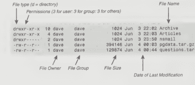

#### 文件权限

`Linux` 中的每个文件都与一个所有者和一个组相关联。`Caldera OpenLinux` 遵循将每个用户放入其所属组的惯例。（这样做的原因将在第 8 章中阐明。）

`Linux` 允许你为文件的所有者、文件所属组的成员以及其他人分配不同的权限。`ls -l` 输出中典型的权限列表如下所示：

```text
drwxr-xr-x
```

第一个 `d` 表示该文件是一个目录。普通文件在第一位上是一个短横线。接下来的三个字符（`rwx`）表示目录的所有者具有读取、写入和执行权限。第二组三个字符（`r-x`）表示目录所属组的成员具有读取和执行权限。最后一组三个字符（`r-x`）表示其他人具有读取和执行权限。

这些权限是如何解释的？对于普通文件，解释起来相当简单：

- 如果你对某个文件有读取权限，你可以查看该文件的内容。
- 如果你对某个文件有写入权限，你可以修改该文件的内容。
- 如果你对某个文件有执行权限，你可以将该文件作为程序执行。

**注意**

请注意，`UNIX` 并不通过查找以 `.COM` 或 `.EXE` 结尾的特殊文件名来识别可执行文件。相反，它是通过查看权限设置来识别可执行文件的。

对于目录，权限的解释如下：

- 如果你对某个目录有读取权限，你可以列出该目录的内容。


- 如果你对某个目录有写入权限，你可以创建新文件、重命名现有文件以及删除文件。

**注意**

删除文件并不需要对文件本身拥有写入权限。你只需要对包含该文件的目录拥有写入权限即可。

- 如果你对某个目录有执行权限，你可以将该目录设置为你当前的工作目录（使用 `cd`）。

**注意**

这并不是文件权限的全部内容。但就现阶段而言，这已经足够了。第 8 章将提供其余的细节。

## 符号链接

UNIX 符号链接在某些方面类似于 Windows 中的快捷方式，不同的是，由于它是内核文件系统代码的一部分，因此它被系统普遍理解，而不是仅被系统某些部分理解的附加“功能”。

符号链接允许你使用另一个名称来引用一个文件。假设你在家目录中有一个名为 `report-v.1` 的文件。你有时希望使用简单的名称 `report` 来引用它。

要为我们文件 `report-v.1` 创建符号链接，请输入：

```bash
$ ln -s report-v.1 report
$ ls -l
lrwxrwxrwx 1 dave dave 10 Jun 7 15:44 report -> report-v.1
-rw-rw-r-- 1 dave dave 28 Jun 7 15:43 report-v.1
```

注意 `report` 的列表项。开头的 `l` 表示该文件是一个符号链接。链接本身的权限无关紧要；重要的是链接所指向的文件的权限。注意 `ls` 显示 `report` “指向” `report-v.1` 的方式。

符号链接打破了 UNIX 文件系统的严格层次结构，但它们非常有用。在使用 UNIX 一段时间后，你会欣赏符号链接提供的灵活性。

> **注意**
>
> 如果存在符号链接，那么是否存在非符号链接（即硬链接）？是的，UNIX 文件系统有硬链接的概念，它是通过不使用 `ln` 的 `-s` 选项创建的。但请暂时不要尝试使用它们。在使用 `ln` 时始终使用 `-s`。

## 挂载点

如果 Linux 没有盘符的概念，如何使用多个驱动器？答案是 Linux 允许你将整个磁盘分区的层次结构插入目录树的任意位置。（执行此操作的命令在第 8 章中介绍。）

根目录 `/` 是特殊的。它在 Linux 启动时进行挂载。也就是说，磁盘分区上的根目录成为整个 Linux 树的根目录。

其他分区可以挂载在根目录之下。在我的系统中，我将所有的 `/home` 目录保留在一个单独的分区上。（见图 2.4。）当你从 `/` 更改目录到 `/home` 时，磁盘分区会发生改变。这一切都是隐藏的；然而，Linux 会为你记录这些挂载点。


你可以有许多挂载点，其中一些可以引用不同的磁盘，甚至是远程磁盘。然而，对于大多数应用程序而言，Linux 文件系统只是一个简单的单根树。你通常不需要担心什么被挂载在哪里。

## 文件系统布局

尽管 Linux 内核没有强制要求特定的文件系统布局，但大多数 Linux 安装都或多或少遵循 Linux 文件系统标准，该标准规定了应存在哪些目录以及它们应包含什么。本节简要介绍了 Linux 文件系统中重要目录。

- `/` 根目录是文件系统的起点。通常，此目录仅包含子目录，尽管某些系统（包括 Caldera OpenLinux）会在根目录中放置一个名为 `vmlinuz` 的文件。`vmlinuz` 是启动时加载的 Linux 内核。

- `/bin` 此目录包含在启动过程早期需要或在对坏盘进行系统恢复时可能有用关键程序文件。

- `/sbin` 与 `/bin` 类似，此目录包含启动过程早期需要的关键程序。然而，`/sbin` 中的程序旨在用于系统管理和维护目的，并不打算供普通用户随意使用。说实话，`/bin` 和 `/sbin` 之间的划分有些任意。

- `/lib` 此目录包含关键的共享库。这些对应于 Windows 中的动态链接库。它们包含由许多程序共享的代码库，因此只需加载到内存中一次。

- `/lib/modules` 此目录树包含包含内核模块配置信息的子目录。

- `/etc` 此目录包含适用于整个机器的配置信息。你会在 `/etc` 中找到诸如密码文件（用户列表）、主机名、启动和关闭脚本以及邮件传输代理配置文件等项目。

- `/tmp` 此目录用于临时文件。任何人都可以在此创建文件，但每次系统重启时它们都会被删除。

- `/home` 此目录通常包含用户的主目录。

- `/boot` 此目录包含与启动加载器相关的文件。它包括主引导记录等深奥内容。一些 Linux 设置将可引导的 Linux 内核文件放置在 `/boot` 中。

**注意**

> **启动加载器**是一个小型程序，当计算机首次启动时从硬盘加载。它负责加载操作系统的*其余*部分。PC 架构使用**主引导记录**来告知 BIOS（内置 ROM 软件）磁盘的哪些部分包含启动加载器。

- `/proc` 此目录相当不寻常：其中的文件和目录并不对应于真实文件。相反，它们让你能够获取（在某些情况下设置）内部内核参数。例如，文件 `/proc/cpuinfo` 包含有关你的 CPU 的信息。输入 `cat /proc/cpuinfo` 即可查看这些相当有趣的信息，其中包含（除其他外）处理器类型及其时钟速度。

- `/opt` Caldera OpenLinux 上的可选（通常较大的）软件包，如 Netscape、WordPerfect、StarOffice 和 KDE，都放在 `/opt` 中。

- `/dev` 此目录包含特殊设备文件。这些不是真实文件，而是文件系统中对应于实际硬件设备驱动程序的特殊条目。

**注意**

设备文件在第 8 章中有详细讨论。

- `/usr` 这是一个庞大的独立层次结构。你的大多数 Linux 系统文件都位于此目录中。

- `/usr/bin` 大多数可执行文件位于此处。

- `/usr/sbin` 额外的系统管理员程序保留在此目录中。

- `/usr/lib` 此目录包含更多的共享库。此外，许多程序将私有信息或可执行文件放在这里。

**注意**

为什么在 `/usr` 下镜像 `/bin`、`/lib` 和 `/sbin`？传统上，UNIX 系统使用相对较小的磁盘分区作为根分区，并在 `/usr` 下挂载一个较大的分区。似乎有一个规律：大型东西比小型东西更容易出错，因此拥有一个小的根分区可以增加在磁盘崩溃事件中系统可被救活的机会。根分区应仅包含足够启动并运行系统以检查或修复 `/usr` 分区的软件。

- `/usr/X11R6` 此较大的目录树包含与 X 窗口系统相关的所有内容。

- `/usr/dict` 此目录包含 `/usr/dict/words`，这是拼写检查程序使用的英文单词列表。

- `/usr/man` 大多数系统手册页（参见“UNIX 手册页：man”部分）位于此处。

- `/usr/src` 源代码可以在这个目录中找到。特别是，`/usr/src/linux` 包含 Linux 内核的源代码。

- `/usr/share` 类似于 `/usr/lib`，此目录旨在作为与架构无关信息的存储库。因此，尽管 `/usr/lib` 通常包含特定处理器架构的共享库和程序。`/usr/share` 包含文本文件以及其他适用于任何处理器架构的文件。

- `/usr/local`。此目录用于本地软件安装，但你可以在此处放置任何喜欢的内容。

- `/usr/doc`。此目录保留用于文档。它通常包含文本文件，但几乎可以容纳任何内容。Linux HOW-TO 指南和 Linux 文档项目书籍存放在这里。

此列表并非详尽无遗，但应该能让你对文件系统的组织方式有个大致的了解。要获取更完整的描述以及该组织结构背后的理由，请参阅 Linux 文档项目中的 Linux 文件系统标准。

## 外壳程序（Shell）

当你在命令提示符下输入命令时，你并不是直接与 Linux 内核交互。相反，是一个称为外壳程序（shell）的解释器在解释你的命令。

秉承 UNIX 高度自定义的传统，你可以从多种外壳程序中进行选择。这些外壳程序包括：

- `sh`：原始的 UNIX 外壳程序，被称为 Bourne Shell（以其作者命名）。它在 Linux 上很少被使用，因为它相当原始。

- `bash`：大多数 Linux 系统（包括 Caldera OpenLinux）的默认外壳程序。它提供高级交互功能，如命令行编辑和文件名补全，这些功能使得在命令行界面工作比在图形用户界面中工作更令人愉悦。

> **注意**
>
> `bash` 是 Bourne Again Shell 的缩写，体现了另一个古老的 UNIX 传统——双关语（bad puns）。

- `csh`：由伯克利开发的 C shell。用于交互时，它与 `sh` 相当相似，但具有不同的编程语法。

- `tcsh`：`csh` 的增强版本，支持命令行编辑和补全。

还有其他较少使用的外壳程序，如 `zsh` 和 `ksh`，如果你不喜欢上述任何标准选项，可以对其进行研究。

外壳程序更高级的功能将在第 3 章“使用外壳程序”中介绍；本节仅作为介绍。

### I/O 重定向

既然你已经查看并创建了目录，现在是时候处理文件了。让我们创建第一个文件。切换到你的主目录并输入以下内容：

```
$ cat
```

现在输入一些文本。

```
Help, I am stuck in a UNIX system.
Help, I am stuck in a UNIX system.
Stop it!
Stop it!
```

这会很快变得无聊。按 Ctrl-D：即按住 Ctrl 键并输入 **D**。

`cat` 命令看起来不像猫；它看起来像鹦鹉。此处使用的 `cat` 命令是过滤器（filter）的一个例子。它从*标准输入流*读取并写入*标准输出流*。

标准输入流通常是你的键盘，而标准输出通常是你的终端窗口。因此，`cat` 从键盘读取行并将其打印到你的终端。它会一直这样做，直到你按下 Ctrl-D，这是终端的结束文件（end-of-file）字符。当程序从键盘读取时，Ctrl-D 表示输入结束。当 `cat` 看到输入结束时，它就退出了。

> Ctrl-D 通常是终端的结束文件字符，但就像 UNIX 的大多数方面一样，你可以将其配置为其他内容。但请记住，现存的几乎所有 Linux 系统都配置为使用 Ctrl-D 作为结束文件字符。

尽管标准输入通常来自键盘，标准输出通常去往终端，但你可以重定向任一流。例如，输入以下内容：

```
$ cat > myfile
```

现在输入一些文本。

```
Help, I am stuck in a UNIX system.
Stop it!
```

然后按 Ctrl-D。注意你的输入没有被回显。输入 `ls`，你应该会看到一个名为 `myfile` 的文件。`>` 符号将 `cat` 的输出重定向到 `myfile`。

如果你可以重定向标准输出，那么肯定也可以重定向标准输入。方法如下：

```
$ cat < myfile
Help, I am stuck in a UNIX system.
Stop it!
```

`<` 符号从 `myfile` 获取输入，而不是从键盘。你可以像这样组合重定向：

```
$ cat < myfile > yourfile
```

这将把 `myfile` 复制到 `yourfile`。

### 丢弃输出

特殊文件 `/dev/null` 用于丢弃输出。发送到 `/dev/null` 的任何内容都会直接被消耗并丢弃。如果你尝试从 `/dev/null` 读取，它会立即返回结束文件标志。

以下命令除了浪费 CPU 周期外，什么也不做：

```
$ cat < myfile > /dev/null
```

这似乎非常无用，但有时你想运行命令但不想看到它们的输出。通过重定向输出到 `/dev/null` 可以轻松实现这一点。

## 基本 UNIX 命令

既然你已经尝鲜了 UNIX 文件和目录，现在是时候更详细地查看 UNIX 命令了。有很多 UNIX 命令，但其中大多数具有相同的结构，看起来像这样：

```
command options arguments
```

命令是命令的名称。选项是改变命令某些行为的特殊字符序列。选项通常以连字符开头。我们之前已经见过选项的作用（参见“列出目录”部分），当我们查看 `ls` 的 `-a` 选项时。

参数是提供给命令的其他信息片段。对于许多命令，参数是文件名。

例如，考虑这一行：`ls -a /home/jim`。命令 `ls` 后跟选项 `-a` 和参数 `/home/jim`。

### 列出文件：ls

我们已经见过 `ls` 命令的作用。让我们看看该命令的更多方面。

- 如果你想列出特定的文件或目录，可以提供文件或目录名称作为参数。例如：

  ```
  $ ls -l /etc/hosts /etc/passwd
  -rw-r--r-- 1 root root 1419 Jun 7 21:03 /etc/hosts
  -rw-r--r-- 1 root root 1807 Jun 7 11:53 /etc/passwd
  ```

  注意，`-l` 选项要求“长列表”，而两个参数 `/etc/hosts` 和 `/etc/passwd` 指定了我们想要列出的文件。

- 如果你想要递归列出目录，请使用 `-R` 选项。例如，`ls -R /` 将列出你 Linux 系统中的每个文件和目录。这将花费很长时间并产生大量输出。要停止列出，请按 Ctrl-C，这是标准的中断字符。

### 更改目录：cd

我们也已经看到 `cd` 的作用。带有参数时，它更改到指定目录。没有参数时，它更改到你的主目录。

如果你的外壳程序是 bash（如果你使用标准的 Caldera 配置，它很可能就是），`cd` 命令还有一个额外的增强功能：输入 `cd -` 会把你更改到上一个目录（即上一个 `cd` 命令之前的目录）。

你可以使用 `cd -` 在两个目录之间切换，而不必输入（或记忆）路径名。这可能非常方便。

### 主目录的特殊名称

大多数现代外壳程序允许你为你的主目录指定一个特殊名称。名称 `~`（波浪号）指代你的主目录。如果你的主目录是 `/home/dave`，那么文件 `/home/dave/work.txt` 也可以称为 `~/work.txt`。

### 重命名或移动文件：mv

要重命名文件，请使用 `mv` 命令。这个命令有很多选项和不同的行为模式：

- 若要简单地重命名文件，请使用 `mv oldname newname`。但请注意：如果 `newname` 已经存在，它在重命名之前会被删除。

> **警告**
>
> UNIX 假设你知道自己在做什么。因此，几乎没有任何命令在执行危险操作前要求确认。这是另一个不要以 root 身份操作的好理由，除非绝对必要。

- 要将文件移动到另一个目录，请使用 `mv file directory`。目标目录必须已经存在。

- 要移动并重命名文件，请使用 `mv oldName directory/newname`。

- 你可以使用目录名作为 `mv` 的第一个参数来移动整个目录。

- 你可以使用 `mv` 像这样将整个文件集合移动到目录中：

  ```
  $ mv file1 file2 ... fileN directory
  ```

- 如果你希望 `mv` 在覆盖文件之前询问确认，请使用 `-i` 选项：

  ```
  $ mv -i file preciousName
  ```

  如果 `preciousName` 已经存在，`mv` 会提示确认。

### 删除文件：rm

`rm` 命令删除文件。

- 要删除文件，只需输入 `rm filename`。你可以通过提供文件名列表来删除多个文件。

> **警告**
>
> 你不会收到确认提示。在 Linux 下，实际上不可能“撤销”文件。一旦文件消失，它就没了。请小心。

- 要讓 `rm` 提示确认，请使用 `-i` 选项：

  ```
  $ rm -i junk trash precious temp
  ```

  对于每个即将被删除的文件，你都会收到提示。

- 要递归删除整个目录树，请使用 `-r` 选项：

  ```
  $ rm -r junkdir
  ```

###### 警告

递归删除非常危险。在按下 Enter 键之前，请停下来深呼吸，仔细检查命令行。

- 即使没有提供 `-i` 选项，`rm` 有时也会提示确认。（例如，如果你尝试删除一个没有写权限的文件，它会进行提示。尽管如果你在包含该文件的目录中具有写权限，删除该文件在法律上是允许的，但 `rm` 将此情况视为异常并进行提示。）如果你希望 `rm` 不问任何问题、不打印任何错误信息就直接继续执行，请使用 `-f` 选项：

```bash
$ rm -rf /reallymeant/this
```

### 创建目录：`mkdir`

UNIX 文件系统围绕层次化目录进行组织。`mkdir` 命令用于创建这些目录。用法如下：

- 要创建目录，请使用 `mkdir 目录名`。父目录必须已经存在。例如，如果你想创建目录 `/home/dave/Projects/calendar`，目录 `/home/dave/Projects` 必须已经存在。

- 但是，如果需要 `mkdir` 在必要时创建父目录，请使用 `-p` 选项：

```bash
$ mkdir -p /home/dave/a/very/deep/subdirectory
```

- 你可以一次创建多个目录，就像这样：

```bash
$ mkdir dir1 dir2 dir3 dir4 dir5
```

### 删除目录：`rmdir`

命令 `rmdir` 用于删除目录。但是，只有当目录为空时它才会删除该目录。你更有可能使用 `rm -r` 来删除整个目录树。

- 要删除目录，请使用：

```bash
$ rmdir 目录名
```

- 你可以一次删除多个目录：

```bash
$ rmdir dir1 dir2 dir3
```

- 如果你有一个由其他空目录组成的子树，你可以使用 `-p` 选项：

```bash
$ rmdir -p a/b/c
```


这等同于：

```bash
$ rmdir -p a/b
$ rmdir -p a
```

### 查看文件内容：`cat`

让我们更详细地看看 `cat`。在“输入/输出重定向”部分，我们看到 `cat` 作为简单的过滤器运行。实际上，`cat` 是一个复杂得多的工具。

#### `cat` 的参数

`cat` 可以接受参数。每个参数都被视为文件名；依次打开每个文件并将其内容发送到标准输出。例如，

```bash
$ cat file1 file2 file3
```

依次将 `file1`、`file2` 和 `file3` 的内容发送到标准输出。

> 这解释了名称 `cat` 的由来：它是 `concatenate`（连接）的缩写。（即使事实证明这个词源并非真正如此，这也是一种很好的合理化解释。）

#### 编号行

`-n` 选项使 `cat` 在打印时对行进行编号。这里有一个例子：

```bash
$ cat > tmpfile
A line

Another line
^D

$ cat -n tmpfile
     1 A line
     2
     3 Another line
```

如果你不希望空行被编号，请使用 `-b` 选项：

```bash
$ cat -b -n tmpfile
     1 A line
     2 Another line
```

空行仍然会显示；只是没有被编号。

### 压缩空行

如果你有文件在文本行之间混杂着许多空行，请使用 `-s` 选项将多个空行“压缩”为单个空行。

### 分页浏览文件：`more`

`more` 命令让你能够以易于管理的片段查看文件。而 `cat` 将其（可能庞大的）输出发送到标准输出而不暂停，`more` 则更有礼貌——在每个屏幕的输出之后，它会暂停让你阅读信息。

> **注意**
>
> MS-DOS 和 Windows 有一个 `more` 命令，但 UNIX 版本的 `more` 功能强大得多。

要分页浏览文件，请使用：

```bash
$ more filename
```

在一个示例上试试：`Try more /etc/zshrc.`

在第一屏信息显示后，计算机将显示类似以下内容：

`-More- (14%)`

以反色显示。

- 按 Enter 键前进单行。
- 按空格键前进一屏。
- 按 `b` 键后退一屏。
- 按 `?` 键获取帮助屏幕。这将显示可用命令。

虽然 `more` 是传统的 UNIX 分页程序，但功能强大得多的 `less` 程序是浏览文件的更好选择。它具有许多高级功能，可能比 `more` 更快。你使用 `less` 的方法与 `more` 完全相同：

```bash
$ less filename
```

### UNIX 手册页：`man`

访问在线 UNIX 文档的命令是 `man`。

`man` 既是最有用的 UNIX 命令之一，也是最无用的 UNIX 命令之一。如果你相当熟悉 UNIX，`man` 非常有用：UNIX 手册页是 UNIX 命令、系统调用、文件格式和库函数的权威描述。然而，如果你刚开始使用 UNIX，手册页可能非常令人望而生畏。例如，试试这个命令：

```bash
$ man ls
```

你将看到（通过 `more` 分页显示）一大段文档，其中提到了诸如“GNU 选项”、“POSIX 选项”和“-labcdgfijklmnopqrstuxABCD FGLNQRSUX”等晦涩的内容。谁能想到我们的老朋友 `ls` 竟然如此复杂？

### 手册页的结构

要理解手册页（通常称为 man 页），让我们先看看 man 页的结构。man 页分为若干部分；典型的部分包括：

- **NAME**：命令的名称及其用途的单行描述。
- **SYNOPSIS**：调用命令的简要说明、选项列表和参数列表。
- **DESCRIPTION**：命令功能的长篇描述。
- **OPTIONS**：命令选项及其含义的详尽描述。
- **ENVIRONMENT**：命令使用的任何特殊环境变量。

> **注意**
>
> 环境变量将在第 3 章中描述。

- **FILES**：命令使用或引用的任何特定文件。
- **AUTHOR**：命令的作者。
- **CONFORMING TO**：命令遵循的标准。
- **BUGS**：已知的问题或不足之处。
- **SEE ALSO**：相关 man 页的列表。

并非所有 man 页都具有所有这些部分，一些 man 页还有额外的部分，但这些部分是最常见的。

### 手册部分

按照古老的 UNIX 传统，整套手册页被分为若干部分。这些部分通常（但并非总是）用一个数字或字母命名。最普遍公认的部分如下：

| 部分 | 描述 |
| :--- | :--- |
| 1 | 用户命令。普通的 UNIX 命令，如 `ls` 和 `cat`。 |
| 2 | 系统调用。调用 UNIX 内核中代码的过程。它们与 UNIX 程序员有关。 |
| 3 | 子例程。可能不涉及系统调用的库函数，如标准 C 函数。第 3 部分主要对程序员有兴趣。 |
| 4 | 设备。内核在硬件设备和用户程序之间接口的文档。这部分内容绝对只对程序员和系统管理员有兴趣。 |
| 5 | 文件格式。编辑文本文件的格式和含义。大多数 UNIX 程序通过编辑文本文件进行配置。这些信息对系统管理员和普通用户感兴趣——第 5 部分将告诉你如何根据你的偏好配置各种程序。 |
| 6 | 游戏。这部分并不正式存在，因为我们都知 道 UNIX 是用于严肃工作的。 |
| 7 | 杂项。无法归入其他类别的 man 页。 |
| 8 | 系统管理。只有系统管理员才应使用的命令，但每个普通用户都会阅读并尝试。 |

这些手册部分编号相当标准化，但绝非普遍适用。例如，许多安装包含用于“新”页面的 `n` 部分和用于“本地”页面的 `l` 部分。其他版本甚至有更多部分。不幸的是，将页面放置在哪个部分的选择因系统而异。

通常，你会看到对 man 页的引用写作 `command(部分)`。例如，`ls` 的 man 页通常被称为 `ls(1)`。你可以通过输入以下命令来指定 `man` 的特定部分：

```bash
$ man 部分 条目
```

试试这些命令：

```bash
$ man 1 chown
$ man 2 chown
```

如你所见，`chown` 既是用户命令又是系统调用。这些页面通过将其中一个称为 `chown(1)` 而另一个称为 `chown(2)` 来区分。

##### 注意

请注意：`man 部分 条目` 语法在 Linux 上有效，但其他 UNIX 版本使用不同的语法。例如，在 Solaris 上，你使用 `man -s 部分 条目` 来指定部分。

大多数章节都有一个名为 *intro* 的页面，该页面可能包含也可能不包含关于该章节的有用信息。例如，在 Caldera OpenLinux 中，`intro(1)` 简短且无用，但 `intro(3)` 却相当有用。

##### 注意

此时你已经知道，要查看 `intro(3)`，你必须输入 `man 3 intro`。

## 阅读手册页

让我们通过阅读 `ls(1)` 手册页来学习。一旦你学会了如何解读它，你就会有足够的信心像专业人士一样使用 `man`，没有任何 UNIX 命令能让你望而生畏。

##### 名称

“名称”部分相当直白。它将 `ls`、`dir` 和 `vdir` 列为“列出目录内容”的命令。

### 概要

概要行内容如下：

```
ls [options] [file...]
```

这意味着 `ls` 后面可以选跟 *options*（方括号表示可选项），然后再跟一个或多个文件名（方括号表示它们是可选的；省略号表示可以重复）。

下一行内容如下：

```
POSIX options: [-CFRacdilqqrtu]
```

如第 1 章所述，POSIX 是 IEEE 的一个委员会，正在对类 UNIX 操作系统进行标准化。POSIX 选项几乎可以在所有 UNIX 系统上正常工作。

下一行 `GNU options` 指出了 GNU 版本 `ls` 特有的那些选项。这些选项在任何 Linux 系统上都有可能正常工作，并且在其他使用 GNU `ls` 但未通过 POSIX 标准化的 UNIX 系统上也能工作。

请注意，GNU 程序通常有两种选项形式：短格式和长格式。例如，对于 `ls`，选项 `-c` 会使所有文件（甚至是以句点 (.) 开头的文件）被列出。在使用 `ls` 时，你也可以使用等效的长选项 `--all`。GNU 长选项始终以两个破折号开头，设计为易于阅读。POSIX 短选项始终以一个破折号开头，设计为易于键入。你可以选择你喜欢的任一风格，甚至可以混合使用它们。


### 描述

“描述”部分以其对完整性和准确性的坚持而著称，而不是对初学者有帮助。然而，如果你坚持下去，你会感激能够获取所有信息，而不是为了让学习过程更轻松而将“高级”信息隐藏起来。

##### 环境变量

本节列出了 `ls` 关注的可环境变量。它主要用于微调其行为或将消息语言更改为英语以外的语言。

### 缺陷

本节列出了 `ls` 的异常行为。碰巧的是，报告的 `ls` 缺陷都是针对其他 UNIX 系统，而不是 Linux。因此，Linux 的 `ls` 是没有缺陷的……

### 符合性

GNU `ls` 符合 POSIX 标准 1003.2。

### 参见

我们被建议查看 `dircolors(1)`。这告诉了我们如何设置 `ls` 以在终端支持该功能时以彩色显示其输出。这让我们可以看到目录为蓝色，压缩文件为红色，等等。

## 虚拟控制台

即使你没有图形界面，Linux 也允许你同时从控制台运行多个终端会话。想象一下并排放置的七八台计算机。Linux 允许你通过按 `Ctrl+Alt+Fn` 在这些虚拟计算机之间切换。例如，`Ctrl+Alt+F1` 将你切换到第一个虚拟控制台。

每个虚拟控制台可以包含一个完整的终端会话，甚至整个 KDE 桌面环境。试试切换控制台，在不同位置登录，看看会发生什么。

虚拟控制台非常有用。即使你不运行 X Window 系统，虚拟控制台也允许你拥有多个交互式登录会话。这对于执行管理任务或终止行为不端的程序可能很有用。在慢速系统上，你可能不想运行 X，而虚拟控制台提供了多终端的便利性。

##### 注意

在标准的 Caldera 设置中，KDE 在虚拟控制台 8 中运行。虚拟控制台 7 中没有有用的内容，但虚拟控制台 1–6 提供完整的登录会话。如果你在文本模式的虚拟控制台中，可以使用 `Alt+Fn` 切换控制台。在 X Window 会话中，你需要使用 `Ctrl+Alt+Fn`。在文本模式控制台中使用 `Ctrl+Alt+Fn` 更容易，因为它不会造成伤害。

## 输入快捷键

命令行界面的问题是它涉及大量的打字，人们倾向于减少他们输入的字符数量。这意味着他们给文件起的名字像 `frpt9899` 而不是 `fiscal-report-1998-99.txt`。图形界面通过减少这个问题，因为文件通常是从图形对话框中选择的，从而消除了输入它们名称的需要。

##### 文件名补全

使用现代 shell，你没有借口采取输入捷径。让我们创建四个文件，命名为 `a-long-filename`、`b-long-filename`、`b-long-again` 和 `c-what-i-mean`。创建一个空的 `test` 目录并切换到该目录。然后输入：

```
$ cat < /dev/null > a-long-filename
$ cat < /dev/null > b-long-filename
$ cat < /dev/null > b-long-again
$ cat < /dev/null > c-what-i-mean
```

（回顾我们在“丢弃输出”部分中关于 `/dev/null` 的讨论。）

现在，假设我们要使用 `cat` 来过滤 `a-long-filename`。在命令提示符下，输入 `cat a`，然后按 `Tab`。Shell 会为你填入完整的文件名 `a-long-filename`。

这是如何工作的？Shell 检查了部分命令行，并确定你在寻找一个以 `a` 开头的文件。它扫描目录，找到了唯一可能的匹配文件，并为你完成了名称。

如果你以 `cat b` 开头然后按 `Tab` 会怎样？在这种情况下，Shell 会填入到 `b-long-` 为止，并且终端会发出蜂鸣声。Shell 知道你在寻找以 `b` 开头的文件，但存在多于一个的可能性。它完成到最长的共同词干，然后发出蜂鸣声。

如果你第二次按 `Tab`，Shell 会列出所有可能性。你可以自己完成文件名，或者输入足够的字符以区分选择，然后再次按 `Tab`。

> **提示**
>
> 第二个 `Tab` 技巧适用于 `bash`。如果你的 shell 是 *tcsh*，你需要按 `Ctrl+D` 来获取可能性列表。如果你的 shell 是 *csh* 或 *sh*，你根本没有补全功能。*tcsh* 有一个非常复杂的补全机制，在第 3 章中有描述。

如果补全的文件名是一个目录，Shell 足够聪明，会为其添加尾随斜杠。你可以继续操作，一路完成漫长的目录路径。在我的 Caldera OpenLinux 系统上，我可以用仅仅 15 次击键到达 38 个字符的文件 `/usr/share/sendmail/cf/ostype/linux.m4`：

```
$ u Tab s Tab se Tab c Tab o Tab l Tab i Tab
```

## 命令编辑

Shell 允许你在输入时编辑命令。

- 使用左箭头和右箭头键在命令行前后移动。
- 输入字符以在光标处插入它们。
- 当你在编辑命令时，按 `Ctrl+D` 删除光标下的字符。

> **注意**
>
> 如果你只有 shell 提示符且尚未输入命令，请勿按 `Ctrl+D`。`Ctrl+D` 是终端的文件结束字符，在 shell 提示符后立即按下它可能会导致你注销！

- 按上箭头或下箭头键移动到命令历史中的前一条或下一条命令。请注意，在命令历史中移动会丢弃你对当前命令所做的任何编辑。
- 按 `Ctrl+A` 移动到命令的开头。
- 按 `Ctrl+E` 移动到命令的末尾。
- 按 `Ctrl+K` 删除从光标位置到命令末尾的所有字符。

> **注意**
>
> 一如既往，这里描述的按键是完全可配置的。所描述的设置仅仅是 `bash` 和 `tcsh` shell 的默认设置。

## 配置文件

大多数 UNIX 程序是可以配置的。它们从配置文件中读取配置信息，这些文件通常是纯文本文件。你现在可以查看配置文件，但不要编辑它们。配置文件的含义在描述使用它们的程序的章节中解释。

配置文件可能分为两大类：

- 系统级配置文件适用于所有用户，通常存储在 `/etc` 目录或其某个子目录中。
- 每用户配置文件存储在每个用户的主目录中。它们通常是隐藏文件：它们以句点开头命名，因此不会出现在普通的 `ls` 列表中。

#### `bash` 配置文件

`bash` 使用多个系统级和每用户配置文件。如果你的 shell 是登录 shell（通常如此），`bash` 启动过程如下：

- 如果 `/etc/profile` 存在，shell 会读取它并执行其中找到的命令。这被称为源化文件（sourcing the file）。
- 如果 `~/.bash_profile` 存在，它会源化。否则，如果 `~/.bash_login` 存在，它会源化。否则，如果 `~/.profile` 存在，它会源化。

当你退出登录的 `bash` shell 时，如果 `~/.bash_logout` 存在，它会源化它。如果 `bash` 不是登录 shell（例如，如果你在 shell 提示符下输入 `bash`），那么它只会在 `~/.bashrc` 存在时源化它。

> **注意**
>
> `bash` 有命令行选项来改变这种行为。更多细节，请参见 man 页面 `bash(1)`。

#### `tcsh` 配置文件

`tcsh` 拥有更复杂的启动顺序。登录 `tcsh` 会按以下顺序加载存在的文件：

- `/etc/csh.cshrc`
- `/etc/csh.login`
- `~/.tcshrc` 或，如果未找到，则加载 `~/.cshrc`
- `~/.history`
- `~/.login`
- `~/.cshdirs`

非登录 shell 只读取 `/etc/csh.cshrc` 以及 `~/.tcshrc` 或 `~/.cshrc`。

第 3 章详细描述了这些文本文件的内容。你可以使用任何文本编辑器（例如简单的 KDE 文本编辑器）来编辑这些文件。

你可能想更仔细地查看这些文件，以了解可以配置哪些类型的内容。但此时不必指望能完全理解所有内容。

## 进程

在 UNIX 系统上，每个正在运行的程序都称为进程。每个进程都由一个称为进程 ID 或简称 `pid` 的小整数标识。你应该理解 UNIX 进程的工作方式。通常，你需要找到失控程序的进程 ID 以终止它。如果系统繁忙，你需要查看哪些进程正在运行并占用大量计算机资源。

### 列出进程

要在你的 Linux 系统上查看进程，请输入：

```
$ ps
```

输出可能看起来类似于以下内容（但不完全相同）：

| PID | TTY   | TIME     | CMD   |
|-----|-------|----------|-------|
| 889 | tty0  | 00:00:00 | bash  |
| 903 | tty0  | 00:01:48 | emacs |
| 1088| tty0  | 00:00:00 | ps    |

`PID` 列列出进程 ID。`TTY` 列指定与该命令关联的终端。`TIME` 列指定该命令消耗的 CPU 时间。最后，`CMD` 列是正在运行的命令的名称。

`ps` 有许多命令行选项。`-u` 选项以面向用户的方式格式化输出。由 `-u` 选项产生的输出提供了有关哪些用户正在运行哪些进程的信息。这允许你在某人占用了你所有的内存或 CPU 时间时归咎于人。

```
$ ps -u
```

| USER | PID | %CPU | %MEM | VSZ   | RSS  | TTY    | STAT | START | TIME | COMMAND    |
|:---|:---|:---|:---|:---|:---|:---|:---|:---|:---|:---|


|------|-----|------|------|-------|------|--------|------|-------|------|----------|
| `dfs`  | 889 | 0.0  | 0.8  | 1860  | 1036 | `tty9p0` | `S`    | 09:07 | 0:00 | `bash`     |
| `dfs`  | 903 | 2.3  | 7.0  | 11488 | 9060 | `tty9p0` | `S`    | 09:09 | 1:51 | `emacs ch2.tex` |

新列具有以下含义：

- `USER` 运行该进程的用户。
- `%CPU` 该进程使用的 CPU 时间百分比。
- `%MEM` 该进程使用的物理内存百分比。
- `VSZ` 进程的虚拟内存空间大小。
- `RSS` 进程的“常驻集大小”。这是当前消耗的物理内存量。
- `STAT` 进程状态，通常是 `R`（可运行）、`S`（睡眠）或 `T`（停止）。还有其他状态代码。有关详细信息，请参阅 `ps(1)`。
- `START` 进程启动的时间。

`ps` 通常只显示你的进程；要查看所有进程，请使用 `-a` 选项。要查看未与任何终端关联的进程，请使用 `-x` 选项。尝试以下命令，感受一下系统正在运行什么：

```bash
$ ps -aux
```

哇。幕后发生了很多事情。（参见图 2.5。）

### 终止进程

通常，你在准备终止进程之前会查看进程列表。例如，假设你有一个看似挂起的 `ls` 进程——它拒绝停止。如果你正在使用 `KDE`，可以打开另一个终端窗口；否则，你可以切换到另一个虚拟控制台，并使用 `ps` 获取 `ls` 进程的 `pid`。得到该数字后，输入：

```bash
$ kill pid
```

这应该能终止该进程。

> **注意**
>
> 它通过发送“终止信号”来实现这一点。

### 图 2.5 使用 "ps -aux"

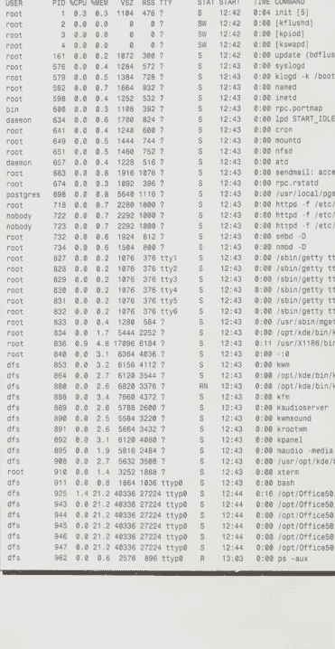

一些进程即使被终止也会拒绝死亡。对于像这样的顽固进程，请使用：

```bash
$ kill -9 pid
```

这向目标进程发送“杀死”信号，这是 `UNIX` 中等同于核武器的存在。没有什么应该能幸存于“杀死”信号。为了提高可读性，你可以使用 `kill -KILL` 代替 `kill -9`。

## 常见问题

以下是新 `UNIX` 用户有时会遇到的一些常见问题。它们与在终端输入时遇到的问题有关，而不是与设置 `Linux` 或使用图形界面相关的问题。

### 终端冻结了

有时，你会愉快地打字，突然终端停止响应。你输入的任何内容都不会出现；`shell` 也保持沉默。

很有可能，你不小心按下了 `Ctrl+S`。要解除终端冻结，请按 `Ctrl+Q`。但要小心：你输入的所有内容都已被排队，因此你可能会看到大量输出、错误信息和不友好的蜂鸣声。

天哪，终端为什么这样表现？在计算机的中生代时期，终端使用一种称为 `XON/XOFF` 的软件流量控制协议。如果计算机发送数据太快，终端会发送 `XOFF` 字符以告诉它暂停一下。当终端准备好接收更多数据时，它会发送 `XON`。你可能已经猜出 `XOFF` 对应于 `Ctrl+S`，而 `XON` 对应于 `Ctrl+Q`。

### 我打字时只收到“？”

如果计算机进入一种模式，似乎忽略你输入的所有内容，并仅用简单的问号 `?` 响应，那么你可能不小心调用了 `ed` 文本编辑器。这是一个古老（但功能强大）的行式文本编辑器。要退出它，只需按 `Ctrl+D`。

> **注意**
>
> `Ctrl+C` 无法让你退出 `ed`；它拦截了中断键。

### Shell 提示符改变且 Shell 忽略我

如果 `shell` 提示符变为 `>` 并且 `shell` 似乎在不反应的情况下消耗你的输入，那么你可能不小心输入了一个未匹配的引号字符。如第 3 章所述，引号字符对 `shell` 具有特殊含义，`shell` 希望它们是匹配的。

要摆脱这种情况，只需按 `Ctrl+C`。

## 总结

在本章中，你学习了如何登录和注销 `Linux`，以及如何使用 `passwd` 更改密码。你学习了文件系统的基本结构以及创建和删除目录的命令。你学习了文件权限和符号链接。

接下来，你学习了大多数 `UNIX` 命令的结构以及一些用于操作文件的常见命令。你学习了最重要的 `UNIX` 命令 `man`，用于阅读在线手册页。你学习了高级功能，如切换虚拟控制台和文件名补全。最后，你学习了如何查看正在运行的进程以及如何终止失控的进程。

## 使用 Shell

## 3

## 章节

### 本章内容

- `bash` 56
- Shell 历史 57
- Shell 变量 68
- `tcsh` 72

`Shell` 是你最基本的、在许多方面也是最灵活的与系统的接口。你可以通过少数几次按键访问系统的所有角落和缝隙。使用 `shell` 所获得的强大功能可以非常有用且令人愉悦。对一些人来说，这是优雅的简单性；但对其他人来说，它是难以理解的胡言乱语。这种与命令行的交互，可能比任何其他因素都更多地为 `UNIX` 赢得了困难的声誉。话虽如此，`UNIX` 并不像你可能担心的那么难。

`UNIX` 最奖励的一件事是深思熟虑。有一句老话常说，`UNIX` 给你足够的绳子让你自己上吊（有时甚至多次），因此思考你想要实现什么以及你打算如何实现它是值得的。人们很难指望要求用户思考是操作系统所能犯的最严重的错误，但确实不太流行。

你需要与 `shell` 交互。如果你从慢速开始并花一些时间研究它，你可能会欣赏它，可能比系统的任何其他部分都更甚。

市面上有许多不同的 `shell`。人们对于希望如何与系统交互有不同的品味，由此产生了一系列的 `shell`。`OpenLinux` 包括以下内容：

- `/bin/bash`（以及可能是 `bash2`，取决于你的安装方式）
- `/bin/sh`（指向 `/bin/bash` 的符号链接）
- `/bin/tcsh`
- `/bin/csh`（指向 `/bin/tcsh` 的符号链接）
- `/bin/zsh`

如果你不喜欢这些选择，市面上还有其他一些 `shell`。大部分 `shell` 根据其使用的命令语法分为三类：基于 `sh`（`Bourne shell`）的、基于 `csh`（`C Shell`）的和基于 `ksh`（`Korn shell`）的。由于 `OpenLinux` 中没有代表 `Korn shell`（尽管它包含许多该 `shell` 的功能），我们将研究 `OpenLinux` 实际提供的两个具有代表性的 `shell`：`bash`，一种 `Bourne` 类型的 `shell`，和 `tcsh`，一种 `C` 类型的 `shell`。

#### bash

`bash`——`Bourne Again Shell`——松散地基于 `UNIX` 中第一个真正的命令解释器 `Bourne Shell` 的传统。其目的当然是为 `GNU` 系统提供一个坚固的 `shell`，并最终符合 `POSIX Shell` 标准。（`POSIX` 是 `IEEE` 可移植操作系统接口——一系列定义操作系统基本接口和功能的标准。达到 `POSIX` 符合性的系统理论上应该能够运行同一代码库的程序。）

然而，与大多数 `GNU` 项目一样，仅仅提供一个可工作的程序被证明是不够的。无论是通过设计还是由于每个人的不同需求

在此基础上，`Bash` `shell` 已经发展成为一个功能非常强大的 `shell`。它自豪地“窃取”了周围其他 `shell`（特别是 `sh`、`csh` 和 `ksh`）中所有最优秀的特性，并在此基础上添加了许多其独有的特性。`Bash` 是主要 `Linux` 发行版上的事实标准 `shell`。许多 `UNIX` 用户和系统管理员在使用 `/bin/sh` 时很难坚持五分钟而不安装 `bash` 以及大量其他 `GNU` 工具，无论他们身在哪台机器上。

##### 注意

毫无疑问，`Bash` `shell` 是 `Linux` 上最受欢迎且使用最广泛的 `shell`。`Caldera OpenLinux` 允许你在安装期间为用户选择初始默认 `shell`。如果在安装后你想尝试其他 `shell`，必须在使用 `chsh` 命令登录后才能更改 `shell`。在更改 `shell` 时，`chsh` 命令会要求输入密码以及新 `shell` 的位置和名称。只有当新 `shell` 的名称列在 `/etc/shells` 中可接受的系统 `shell` 列表中时，它才会成为你的默认 `shell`。请确保该 `shell` 已安装并列出在系统的 `/etc/shells` 文件中，否则你将无法登录！

#### Shell 历史

`Bash` 拥有一个非常有用的特性，称为`命令历史`。这是从 `C shell` 借鉴的特性之一。命令历史会记录你最近使用的命令（记录的数量是可以配置的）。利用这一特性，你可以查看命令，更重要的是，可以重新使用它们。当你必须执行许多重复性任务时，这非常有用；你可以让历史功能替你输入。

使用历史的选项非常多（正如 `Bash` 中的大多数选项一样）。有些选项是你每天都会使用并依赖的；有些选项只有当你再次在文档或本书中发现它们时才会被想起。可能最常用到的并不是一个确切的命令，而是对光标键的使用。在 `Bash` 中（假设是标准的 101 键或 104 键键盘），向上箭头键会浏览之前的命令，你可以使用左键和右键箭头编辑这些命令，然后按 `Enter` 键执行。向下箭头键会向下浏览你的历史记录，直到当前的命令行。此外，如前所述，你的命令历史中项目的数量是可以配置的。`Bash` 环境变量 `HISTSIZE` 控制着记住的命令数量。`Bash` 还将你的历史记录存储在一个由环境变量 `HISTFILE` 指向的文件中（默认值是 `~/.bash_history`），而保留在 `HISTFILE` 中的命令数量由环境变量 `HISTFILESIZE` 控制。这样做的目的是，当你注销后再次登录时，你仍然可以检索上次会话中的命令。你可以使用 `shell` 命令 `history` 来检查所有这些命令历史数据，它会给出一个列出你执行过的所有命令（多达 `HISTSIZE` 个）的编号列表。`history {n}` 将显示最后 `n` 个命令。

以下命令也很常用。它们是 `bash` 所称的`事件指示符`。基本上，这意味着它们引用历史记录中特定的事件或命令行。请注意，上一个命令的全部内容将被执行（除了替换部分）。

- `!`

  这个`bang`字符告诉 `bash` 你想使用 `history list`（历史列表）中的一个先前命令。

- `!`

  这告诉 `bash` 再次执行上一个命令（也就是说，将重新执行最后输入的命令）。这也可以写成 `!-1`。

- `!*string*`

  执行以 `string` 开头的最近命令。

##### 示例 3.1

```bash
$ ls /
auto/  bru/  home/  lib/  net/  root/  usr/
bin/   dev/  initrd/  lost+found/  opt/  sbin/  var/
boot/  etc/  install/  mnt/  proc/  tmp/  vmlinuz

$ !ls
auto/  bru/  home/  lib/  net/  root/  usr/
bin/   dev/  initrd/  lost+found/  opt/  sbin/  var/
boot/  etc/  install/  mnt/  proc/  tmp/  vmlinuz
```

- `!n*`

  执行编号为 `n` 的命令行（也就是说，如果你的 `history` 中有 500 行，你可以输入 `!400` 并执行第 400 个命令）。这与 `history` 命令配合使用非常有用。

- `!-n*`

  执行当前命令行减去 `n`（也就是说，`-1` 是紧挨着的前一个命令，`-2` 是前一个的前一个，依此类推）。

- `!?string[?]`

  执行包含 `string` 的上一个命令实例（注意 `!*string` 和 `!?string` 之间的区别——后者将执行在命令中任何位置包含 `string` 的命令。`!*string` 仅重复以 `string` 开头的命令。）

- `*string1*/*string2*`

  这是一个替换命令。它重复上一个命令，将 `string1` 替换为 `string2`。

##### 示例 3.2

```bash
$ ls /
auto/  bru/  home/  lib/  net/  root/  usr/
bin/  dev/  initrd/  lost+found/  opt/  sbin/  var/
boot/  etc/  install/  mnt/  proc/  tmp/  vmlinuz
$ cd ~/.mnt*
$ ls /mnt
   cdrom/  fd0/  fd1/  floppy/  floppy2/
```

你可以看到`/`被替换成了`/mnt`。

接下来是 `Bash` 称为`单词指示符`的命令（也就是说，它们作用于单词或命令行的元素）。这些指示符在 `!` 和单词指示符之间用冒号 `:` 表示。其中最有用的包括：

- `0`

  这意味着执行第 0 个单词；它指实际的程序名称本身。例如：

##### 示例 3.3

```bash
$ ls /
auto/  bru/  home/  lib/  net/  root/  usr/
bin/  dev/  initrd/  lost+found/  opt/  sbin/  var/
boot/  etc/  install/  mnt/  proc/  tmp/  vmlinuz
$ !1:0
ls
Desktop/  geekcode-1.1.tar.gz  src/  tmp/
Mail/  nsmbail/  test/  updates/
book@  pinf-o-0.5.6.tar.gz  tkinfo-2.5.tar.gz
```

如你所见，执行 `!1:0` 是以无参数的方式执行了 `ls`——它只执行了第 0 个单词，即命令本身。

- `:`

  这意味着第一个单词，不是命令本身，而是它的参数。

##### 示例 3.4

```bash
$ ls /
auto/  bru/  home/  lib/  net/  root/  usr/
bin/  dev/  initrd/  lost+found/  opt/  sbin/  var/
boot/  etc/  install/  mnt/  proc/  tmp/  vmlinuz
$ cd !:~
cd /
$ pwd
/
$
```

- `:s/old/new/`

  （用 `new` 替换 `old`）。

##### 示例 3.5

```bash
$ ls /usr
X11R6/ dict/ games/ include/ java/ libexec/ man/ sbin/ src/
bin/ doc/ i386-linux/ info/ lib/ local/ openwin/ share/
$ ls /usr/var/
adm/ catman/ lib/ lock/ log/ nis/ run/ spool/ state/ tmp/
```

#### I/O 重定向

提交给 `UNIX` `shell` 或由其产生的数据被分为三类之一：`stdin`（标准输入）、`stdout`（标准输出）或 `stderr`（标准错误）。可以使用 `>` 和 `<` 字符将这些数据引导到你想要操作或存储数据的目标文件或命令。

- `stdin` 标准输入是命令接收的输入，由 `<` 表示。
- `stdout` 标准输出是命令产生的输出，由 `>` 表示。（在技术上，它是第一个文件描述符，因此也可以用 `1>` 或 `1` 表示；参见后续讨论。）
- `stderr` 标准错误是命令在出错时产生的输出，由 `2>` 表示。（它是第二个文件描述符。）

##### 示例 3.6 将 stdout 重定向到文件

```bash
$ command > file
$ command 1> file
$ command >! file # 这是覆盖重定向
```

在这个例子中，你可以看到 `stdout` 的工作方式。`command` 的输出被引导到 `file`。第三行中 `>` 的意义在于它会“覆盖”该文件。换句话说，`shell` 不会检查你是否打算销毁一个已存在的文件；它只会直接写入其中。（这通常只在之前设置了 `noclobber` `shell` 变量时才有影响。）

##### 示例 3.7 追加 stdout

```bash
$ command >> file
```

这展示了如何将 `stdout` 追加到文件。如果 `file` 已经存在并且包含你想要保留的数据，你可以使用 `>>` 将 `command` 的输出追加到 `file` 中。

##### 示例 3.8 重定向 stdin

```bash
$ command < file
```

这里你可以看到 `stdin` 从 `file` 引导到 `command`。请注意，这并不总是必需的，有些程序甚至无法以此方式工作。这是为了支持那些不采用相当标准化的：

```bash
$ command file
```

形式来表示“使用 `file` 作为 `command` 的标准输入”的程序；这些程序要求你明确说明。许多其他程序可以接受这两种输入语法。

##### 示例 3.9 减少 stderr

```bash
$ command 2> file.err
```

这展示了将 `command` 产生的任何错误重定向到 `file.err`。实际上，`command` 中发送到 `stderr` 的任何输出都会被重定向；然而，通常发送到 `stderr` 的是错误信息。`command` 的正常输出——`stdout`——仍将直接显示在你的屏幕上。

##### 示例 3.10 重定向 stderr 和 stdout

```bash
$ command > file 2>&1
$ command > & file
$ command &> file
```


这些展示了将`stderr`和`stdout`都引导到文件的几种不同方法。请注意，第一个例子具有最通用的实用性，因为几乎任何 Bourne 类型的 shell 都能理解它。第二个例子借用了 C-shell 语法，而最后一个是纯粹的`bash`特性。

##### 示例 3.11a

```bash
$ command << EOF
text content
you can put $VARIABLES here, too
EOF
```

##### 示例 3.11b

```bash
$ command <<- EOF > file
[TAB]text
[TAB]text
EOF
```

这些是“此处文档”（here documents）——极其有用的小构造，特别是在 shell 程序中。基本上，`command`会接收“text content”的内容，直到到达关键字`EOF`为止（关键字设置在第一行`<<`的右侧，可以是任何内容）。示例 3.11b 展示了`<<-`构造，它除了做与第一个例子相同的事情外，还移除文本开头的任何`[TAB]`字符。

#### 管道

还可以将一个命令的输出重定向为另一个命令的输入。这是通过管道符`|`来实现的。由管道连接的一组命令称为管道行（pipeline）。这非常有用。你可以将许多简单的、单一用途的程序串联起来，从而精确地输出你所需或想要的结果。这是 UNIX 哲学的基石之一——简单且能良好完成单一任务的工具，可以以近乎无限的方式组合，来实现你所能想象的任何功能。

##### 示例 3.12 简单管道

```
command1 | command2
```

这展示了一个简单的命令管道——`command1`将其输出发送给`command2`进行处理。

##### 示例 3.13 重定向与管道组合

```
command1 < file | command2 2> file.err | command3
```

这个例子更复杂，因为它展示了重定向和管道的结合使用。`command1`从`file`读取输入，并将其输出通过管道传递给`command2`；`command2`将其标准错误（`stderr`）重定向到`file.err`，并将其标准输出（`stdout`）通过管道传递给`command3`。

#### 后台进程与作业控制

`bash`具备在后台运行程序的能力；换句话说，你可以启动一个程序，让它在“不可见”的状态下运行，同时你继续在当前运行的`bash`进程中工作。`bash`还可以控制这些正在运行的进程：它可以停止和恢复它们，并将在前台运行的进程移至后台。改变运行中程序状态的能力称为作业控制。

当有人希望在后台运行某条命令，但误在前景启动了它，或者前景启动的命令运行时间远超用户预期时，作业控制命令经常被使用。当一条命令在前台启动时，它会锁定用户与 shell 的进一步交互，直到该命令完成。这就是为什么大多数非平凡、非交互式的任务都在后台启动。

整个系统。这两个数字中的任何一个都可以用于通过`bash`与程序交互。正如你所见，`pid`用于终止正在运行的程序。

##### 示例 3.14

```
$ ./job-cntrl &
[1] 3510
$ kill 3510
$
[1]+ Terminated        ./job-cntrl
```

`jobs`命令是`bash`的一个命令，用于检查`bash`当前正在执行的所有程序。要暂停在前台运行的进程，请按`Ctrl+z`（在示例中用`^Z`表示）。在前台进程被暂停后，你可以使用命令`bg`（将命令转入后台）和`fg`（将命令返回前台）来操控它。你还可以在其作业号前加上`%`符号来引用该命令。所有内容均展示在示例 3.15 中。

##### 示例 3.15

```
$ ./job-cntrl
^Z
[1]+ Stopped           ./job-cntrl
$ bg
[1]+ ./job-cntrl &
$ jobs
[1]+ Running           ./job-cntrl &
$ kill %1
[1]+ Terminated        ./job-cntrl
```

在这里，`job-cntrl`被启动，通过`Ctrl+z`暂停，然后通过`bg`转入后台。接着检查正在运行的作业，并使用其作业号（`kill %1`）终止该作业。

#### Shell 语法

由于`bash`是一种 Bourne 风格的 shell，它与`sh`和其他 Bourne 类型的 shell 共享大量通用的语法。你调用命令、参数、值以及编写 shell 脚本的方式是主要 shell 类型之间的一大区别特征。Bourne 语法在视觉上与 C shell 和 Korn shell 不同（尽管与 Korn shell 的差异不太明显）。在`bash`中工作和编程所需的主要语言结构如下。

Linux 支持长文件名（最多 255 个字符），并且已经支持相当长的时间了。它还支持名称中包含空格——包括文件、变量等。虽然人们不常使用空格，但了解其方法是重要且有用的。然而，为了使`bash`识别这些字符，必须对空格和一些其他特殊字符进行引用或转义。你可以通过将它们包含在单引号（`''`）或双引号（`""`）中，或使用转义字符——反斜杠（`\`）来引用它们。需要特别注意的字符包括：空格、美元符号（`$`）、反引号（`` ` ``）以及引号字符（`"`, `'`, 和`\`）。

使用单引号引用字符（`'x'`）会保留单引号内的所有字符。它保留空格，但也会去除字符的特殊含义（例如，如果你之前给`X`分配了一个值，单引号内的`$X`将不再具有该值——它将变成字面上的美元符号`X`）。

使用双引号引用字符（`"x"`）既保留空格，也保留字符的特殊含义。这意味着你可以使用`"$X"`，并且它仍会扩展为变量`X`的值。

使用转义字符（`\`）进行引用可以保留空格（即`x\ `表示`x`后跟一个空格），并且也可以去除字符的特殊性质。如果用于特殊字符（如`$`或另一个`\`）之前，反斜杠会去除该特殊字符的特殊性质（例如，`\$`仅表示美元符号，而不是变量`X`的值）。在双引号内部使用时，它特别有用，用于在双引号中嵌入双引号。

##### 示例 3.16

你希望在双引号中拥有以下内容：

```
"some text `with quoted parts` and the end."
```

通常第一个`` ` ``会与`"with"`前的`` ` ``匹配，导致你无法得到想要的结果。为了避免这种情况，请输入：

```
"some text \`with quoted parts\` and the end."
```

`bash`还提供了一种方法，允许你表示一组命令，并根据其他命令的条件执行命令。这对于快速自动执行任务或 shell 编程很有用。

用分号分隔的命令按顺序执行：

```
$ command ; command
```

当第一个命令完成后，第二个命令将执行。此功能在启动前规划执行顺序时很有用。你无需等待某个命令停止后才能输入 shell 要执行的下一个命令。

用`&&`分隔的命令基于第一个命令的退出状态有条件地执行：

```
$ command && command
```

如果第一个命令正确运行，则第二个命令将执行。如果第一个命令失败，第二个命令将不会运行。

用`||`分隔的命令有条件地执行，其逻辑与`&&`相反：

```
$ command || command
```

如果第一个命令失败，第二个命令将执行；如果第一个命令成功运行，则第二个命令根本不会运行。

`bash`还允许你将命令分组：

```
$ { x; y; }
```

此命令分组将运行花括号（`{ }`）内的所有命令，其退出值为最后执行的命令的值——成功或失败。

以下命令分组在一个子 shell 中运行所有命令：

```
$ ( x; y; )
```

这意味着当前 shell 的变量和环境不影响子 shell 内部的命令。分组的退出状态是最后执行的命令的退出状态。

##### 文件名补全

文件名补全通常以其更常见的名字为人所知——“有史以来最伟大的发明”。如果你不会打字，甚至即使你会打字但并不觉得这有多令人兴奋，你也会非常喜欢这个功能——非常喜欢。基本上，`bash`会扫描你正在操作的目录和文件，判断你试图输入的内容，并替你完成输入——当然，这需要你的一点配合。

让我们看一个例子。假设当前工作目录包含以下文件和子目录：

```
News/ bin/ games/ mail/ samplefile test/
```

如果你希望从当前工作目录切换到`test`子目录，通常你会输入以下命令：

```
$ cd test
```

虽然这样也可以，但`bash`允许你以更高效的方式完成相同的事情。因为`test`是目录中唯一以字母`t`开头的项目，当你输入以下内容时，`bash`可以推断出你的意图：

```
$ cd t[TAB]
```

当你输入`t`时，`bash`知道你只能指的是`test`子目录，因此在你按下 Tab 键后，它会补全目录名`test`。`bash`随后为你完成该命令并将其显示在屏幕上。当你按下回车键时，该命令行将如同你自己输入了完整的文件名一样被执行。

对于像这样简短的命令，你可能看不出由 shell 为你补全命令有多大价值。在如此短的命令行上，你甚至可能会略微被拖慢速度。然而，当你习惯了此功能，并且随着你输入的命令变得越来越长，你会想知道以前没有它是如何生活的。

那么，如果目录中有多个文件以字母`t`开头会发生什么？看起来，如果你想使用命令行补全功能，这似乎会造成问题。让我们看看当目录内容如下时会发生什么：

```
News/ bin/ mail/ samplefile test/ tools/ working/
```

现在，当前目录中有两个以`t`开头的子目录。如果你仍然想切换到`test`子目录，如何让`bash`为你补全子目录名称？如果你输入`cd t[TAB]`，`bash`不知道你想切换到哪个子目录，因为仅凭`t`不足以区分`test/`和`tools/`。如果你只输入`cd t[TAB]`，`bash`会发出蜂鸣声，以通知你它不知道你想要什么。然后你可以向命令行添加更多字母，直到你想要的内容变得明确。在这种情况下，你只需要在`bash`能够补全命令之前再输入一个字母即可。输入`e[TAB]`会得到：

```
$ cd test
```

如果你想要切换到`tools`子目录，你只需要输入：

```
$ cd to[TAB]
```

每当你输入命令时按下 Tab 键，`bash`都会尝试为你补全命令。如果它无法做到，它会填入尽可能多的内容，然后发出蜂鸣声，通知你需要更多信息。你所需要做的只是输入下一个字母并按下 Tab 键；一旦部分单词变得独特，`bash`就会替你完成剩余部分的输入。

#### 通配符扩展和路径扩展

`bash`可以接收简写形式（通配符）并将其扩展为完整的单词和命令。这是`bash`的另一种打字辅助功能——它允许你输入几个简短的字母，然后将其扩展为大量的命令和参数。

基本通配符有以下几种类型：

| 符号 | 描述 |
| :--- | :--- |
| `*` | 匹配任意字符和任意数量的字符 |
| `?` | 匹配任意单个字符 |
| `[...]` | 匹配括号内包含的任意单个字符 |

`*`通配符可能是使用最频繁的，因为它的含义最广泛，并且可以用于单词的开头和结尾。例如，`t*`将扩展为包含任意位置有`t`的绝对任何单词。正因为如此，`*`既有用又有些危险，因为它可能扩展到你预期的范围之外。一如既往，考虑你输入内容的最终后果是很重要的。

`*`通配符的一种常见用法是将特定类型的所有事物作为参数包含在你的命令中。例如，你在一个目录中有以下文件：

```
work.txt    work1.txt    work2.txt    work3.txt    sched.txt
```

你想打印所有这些文本文件。你可以通过使用以下命令来实现：

```
$ lpr *.txt
```

所有具有`.txt`扩展名的文件都将被打印。

`?`通配符比`*`通配符限制得更多。它精确地匹配一个单个字符。再次以上面的目录为例，如果你输入以下内容：

```
$ lpr work?.txt
```

只有`work1.txt`、`work2.txt`和`work3.txt`会被打印。请注意，`work.txt`将*不*被打印。如果没有字符供`?`匹配，则视为不匹配并被排除。

`[...]`通配符允许你指定要匹配的某些字符或字符范围。要使用`[...]`通配符打印文件`work1.txt`、`work2.txt`和`work3.txt`，你可以输入以下内容：

```
$ lpr work[123].txt
```

使用命令来指定字符范围，你会输入：

```
$ lpr work[1-3].txt
```

你也可以使用`[...]`通配符来*不*匹配某些字符或范围。这是通过将`[]`内部的第一个字符设置为`!`或`^`字符来实现的。例如：

```
$ lpr work[^12].txt
```

只会打印`work3.txt`。再次说明，它不匹配缺失的字符（当它试图匹配时），因此`work.txt`不会打印。

#### Shell 变量

Shell 中最重要的一件事，特别是在编程中，是将值分配给变量。Shell 变量可以具有数值或字符串（文本）值；它们不是类型化的（也就是说，在示例 3.17 中，`X`是整数，`Y`是字符串，但反过来也完全有效）。

> **示例 3.17**

假设你有两个变量，`X`和`Y`。要将`X`的值设置为数字 72，将`Y`的值设置为`"hello"`，请输入：

```
$ X=72
$ echo $X
72

$ Y="hello"
$ echo $Y
hello
```

`echo`函数确认每个变量（`$X`和`$Y`）具有我们刚刚分配的值。（注意，变量仅使用变量名进行分配，而已分配的变量随后使用前导`$`来引用。）

变量还可以被分配命令的输出，如下所示：

```
$ X=`date`
$ echo $X
Wed Sep 1 13:23:03 CDT 1999
```

变量还可以彼此比较其值。这可以基于文本或算术值。例如：

```
$ X=hello
$ Y=goodbye
$ [ $X = $Y ] && echo "hi"
$
$ [ $X != $Y ] && echo "bye"
bye
```

变量也可以被“导出”，以便子 shell 继承其值。你主要会在`bash`用于设置初始工作环境的配置文件中看到这一点。例如：

```
$ LESS="-M"
$ export LESS
```

这将把值`-M`分配给`LESS`环境变量，无论是在当前环境中还是在任何运行的子 shell 中（从当前 shell 启动另一个 shell 或在当前 shell 中运行 shell 程序）。

`bash`启动时会初始化一些变量。其中许多对于确定 shell 如何工作很重要。以下是对这些变量中最有用的变量的描述：

- **`EDITOR`**

  默认的编辑器程序。

- **`HISTFILE`**

  用于存储命令历史的文件。

- **`HISTSIZE`**

  *`bash`*将在内存中保留的命令数量。

- **`HOME`**

  当前用户的**`HOME`**目录。

- **`MAIL`**

  用户邮件文件夹的路径。

- **`MAILCHECK`**

  检查**`$MAIL`**中是否有新邮件到达的间隔（以秒为单位）。当新邮件到达时，用户会收到通知。

- **`OLDPWD`**

  前一个工作目录（在进入当前目录之前生效的那个）。

- **`PAGER`**

  当由读取此变量的程序呈现多页输出时运行的默认程序。

- **`PATH`**

  **`bash`**在查找可执行文件时使用的搜索路径（可以在单个值中列出多个路径，每个路径之间用冒号分隔）。

- **`PS1`**

  在命令行上显示的第一级提示符。它可以设置为任何内容，包括以下特殊值：

  - **`\!`** 显示命令的历史编号。

  - **`\#`** 显示当前命令的命令编号。

  - **`\$`** 除非用户是 root，否则在提示符中显示`$`。在这种情况下，它显示`#`提示符。

  - **`\\`** 显示反斜杠。

  - **`\d`** 显示当前日期。

  - **`\h`** 显示运行 shell 的计算机的主机名。

  - **`\n`** 显示换行符。

  - **`\nnn`** 显示对应于数字*nnn*的八进制值的字符。

  - **`\s`** 显示正在运行的 shell 的名称。

  - **`\t`** 显示当前时间。

  - **`\u`** 显示当前用户。

  - **`\w`** 显示当前工作目录的基本名称。

  - **`\W`** 显示当前工作目录的完整路径。

- **`PWD`**

  当前工作目录。

#### `bash` 配置文件

与大多数 shell 一样，*`bash`*在启动时会查看多个配置文件，以设置初始值和环境变量。具体查看（source）哪些文件以及查看的顺序，取决于 shell 的启动方式，在一定程度上也取决于运行它的发行版。例如，OpenLinux 拥有比*`bash`*通常使用的更复杂的启动文件序列。

*登录* shell（从登录提示符启动，或使用*`-login`*选项启动的*`bash`*）的正常序列如下：

- `/etc/profile`

  *`bash`*和 Bourne 类型的 shell 首先会读取此文件。它包含适用于所有 Bourne shell 的系统级默认值。

- `~/.bash_profile`

  然后`bash`尝试读取这个`bash`和用户特定的文件。

- `~/.bash_login`

  然后`bash`尝试读取这个`bash`和用户特定的文件。

- `~/.profile`


- 最后 `bash` 尝试读取这个 Bourne 类型和用户特定的文件。

- `~/.bash_logout`

  - 退出时，它尝试读取此文件（99% 的情况下该文件仅包含用于清屏的 `clear` 命令）。

在 OpenLinux 中，这个过程稍显复杂。文件 `~/.bash_profile` 和 `~/.bash_login` 并不存在（在发行版安装中）。当你登录到 OpenLinux 时，流程如下：

`/etc/profile`

`bash` 最初读取这个文件。

`~/.profile`

`bash` 然后读取这个文件。它旨在保存适用于任何 Bourne 类型 shell 的用户特定设置。接着它会引入下一个文件：

`~/.bashrc`

此文件通常用于保存 `bash` 和用户特定的设置。然而，OpenLinux 发行版打算让此文件保存由安装程序设置的每个用户的变量。（在 OpenLinux 中，`.bashrc-private` 起到了其他系统中 `.bashrc` 通常起到的作用。）接着它会引入下一个文件：

`/etc/config.d/shells/bashrc`

这是交互式 shell 的系统级初始化文件（此文件是 OpenLinux 独有的，因此仅适用于 OpenLinux），它读取：

`~/.bashrc-private`

此文件也是 OpenLinux 独有的，旨在保存特定用户的设置，在其他系统中这些设置通常保存在 `~/.bashrc` 中。此文件处理完成后，控制权返回到：

`~/.profile`

它引入 ...

`/etc/config.d/shells/profile`

此文件保存适用于任何 Bourne 类型登录 shell 的系统级默认值（此文件也是 OpenLinux 独有的）：

`~/.profile-private`

最后读取此文件。它旨在保存适用于任何 Bourne 类型 shell 的用户特定设置。这同样是 OpenLinux 独有的特性。实际上，该文件在 OpenLinux 的默认安装中并不存在（但如果存在，它会被读取）。

`~/.bash_logout`

退出时，读取此文件（在 OpenLinux 中，该文件仅包含清屏命令）。

此外，如果可用，交互式 shell 可以读取 `~/.inputrc` 文件（OpenLinux 默认不包含此文件）以获取按键绑定。

对于交互式但非登录的 shell（即不带 `-login` 选项的 `bash`），仅读取 `~/.bashrc` 文件（由 `bash` 本身读取）。当然，在 OpenLinux 中，`~/.bashrc` 会引入 `/etc/config.d/shells/bashrc` 和 `~/.bashrc-private`。

非交互式 shell（通常是由程序启动或从程序中启动的 shell）将读取 `BASH_ENV` 变量指向的文件，然后读取 `ENV` 变量（如果其中任何一个存在）。

此外，如果 `bash` 作为 `sh` 被调用（即作为 `/bin/sh` 而非 `/bin/bash` 启动），它仅读取 `/etc/profile` 和 `~/.profile`（但你已经看到在 OpenLinux 下这些文件会引入哪些内容）。

基本上，在 OpenLinux 中配置 `bash` 归结为查看所有上述文件以了解它们的作用。这一练习为了解 shell 变量和命令的工作原理提供了极佳的教材。

然而，你通常只需要修改 `~/.bashrc-private` 即可将 shell 配置为你想要的方式。

##### tcsh

`tcsh` 是 C shell (`csh`) 的修改版本。它完全向后兼容 `csh`，但包含了许多新功能，使用户交互更加容易。相对于 `csh` 最大的改进在于命令行编辑和历史导航领域。你会发现 `tcsh` 和 `bash` 有许多共同点，每个 shell 都有一些使其具有独特性的“特殊功能”。进行一些实验并熟悉自己的工作风格，将帮助你确定这些 shell 中哪一个对你来说更舒适、更有用。

#### 比较 tcsh 和 bash

C shell 最初由 Bill Joy（因 Sun 公司而闻名）在开发 BSD UNIX 时创建。基本上，它是为了在 shell 中模拟 C 语言语法而编写的（因此得名），因为许多程序员觉得 Bourne 语法令人不快。事实证明，早期版本的 `csh` 存在一些缺陷，这些缺陷在编程中最为显眼和频繁地出现；因此，具有讽刺意味的是，`csh` 作为登录 shell 在日常用户中变得更加流行，而许多专业人士继续用 `sh` 编写程序。

`bash` 中的许多有用功能在 `tcsh` 中也存在，甚至工作方式相同（例如，命令补全、通配符和输入/输出重定向）。其他功能，如命令历史，是相似但不完全相同的；`tcsh` 还提供了 `bash` 中不可用的功能，例如拼写纠正。

#### tcsh 命令摘要

以下是一些最实用的 `tcsh` 命令的简要列表：

- `alias` 用于设置和显示别名，即可由用户设置的命令昵称。

- `bg` 后台命令。用于强制挂起的进程在后台继续运行。

- `bindkey` 允许用户更改与按键序列相关联的编辑操作。

- `cd` 允许用户将当前工作目录更改为指定的目录。

- `exit` 允许用户终止 shell。

- `fg` 前台命令。用于强制挂起的进程在前台继续运行。

- `history` 允许用户显示和修改历史列表和历史文件的内容。

- `kill` 允许用户终止另一个进程。

- `logout` 允许用户终止登录 shell。

- `set` 用于设置 `tcsh` 变量的值。

- `source` 用于读取并执行文件的内容。

- `unalias` 用于移除使用 `alias` 命令定义的别名。

这些命令的更多细节和用法示例可在 `tcsh` 的手册页中找到。在提示符下，输入：

```
man tcsh
```

#### 命令历史

`tcsh` shell 提供了一种访问命令历史的机制，这与 `bash` 中的机制类似。shell 会记住输入到 shell 的最后 `$HISTSIZE` 条命令（其中 `$HISTSIZE` 是一个可由用户定义的 `tcsh` 变量）。

`tcsh` 在历史列表中存储最后 `$HISTSIZE` 条命令的文本。当你登录到你的账户时，历史列表从历史文件初始化。此历史文件的默认文件名是 `.history`，但你可以使用 `$HISTFILE` `tcsh` 变量更改它。此文件位于你的主目录中。（请注意，该文件以句点开头。这意味着该文件是一个隐藏文件，只有使用 `ls` 命令的 `-a` 或 `-A` 选项时，它才会出现在目录列表中。）

##### 注意

为了将历史列表保存在历史文件中，你必须确保 `savelist` 变量已设置为你想要保存的命令数量。

使用历史列表最简单的方法是使用向上和向下箭头键滚动浏览之前输入的命令。按向上箭头键将使最后输入的命令出现在命令行上。再次按向上箭头键会将之前的命令放置在命令行上，以此类推。如果你在命令缓冲区中向上移动超过了你想要的命令，你可以通过按向下箭头键一次移动历史列表中的一个命令向下。

命令行上的命令可以被编辑。你可以使用左移和右移箭头键在命令行上移动，并可以在任何位置插入文本。你

你还可以通过使用 `Backspace` 或 `Delete` 键从命令行中删除文本。大多数用户会发现这些简单的编辑命令已经足够，但对于需要更多功能的用户，`tcsh` 还支持一系列等效的 `emacs` 和 `vi` 编辑命令。

使用历史文件的另一种方法是使用 `tcsh` 提供的其他编辑命令来显示和编辑历史列表。`history` 命令可以通过以下三种不同方法中的任意一种来调用。

首先，可以按如下方式将历史列表显示在屏幕上：

```
history [-nr] [n]
```

- `n` 选项用于指定要显示的命令数量。如果不使用 `n` 选项，`history` 命令将显示整个历史列表。

- `-n` 选项使 `history` 命令移除通常存在于输出中的命令编号和时间戳。

- `-r` 选项告诉 `history` 命令以相反的顺序显示命令，从最近的命令开始。

其次，可以按如下方式修改历史文件或历史列表的内容：

```
history -S |-L |-M [filename]
```

- `-S` 选项将历史列表写入文件。

- `-L` 选项将历史文件追加到当前的历史列表中。

- `-M` 选项将历史文件的内容与当前的历史列表合并，并根据每个命令中包含的时间戳对结果列表进行排序。


> `history` 命令的多种形式中的所有选项都将 `filename` 选项用作历史文件的名称。如果未指定 `filename`，`history` 命令将使用 `histfile` 变量的 `value`。如果未设置 `histfile` 变量，它将使用 `~/.history`（主目录）文件。

第三，可以使用以下命令清除当前的历史列表：

```
history -c
```

除了 `history` 命令及其选项外，`tcsh` 还包含许多历史导航和编辑命令。以下命令用于在历史列表中导航：

- `!n`：重新执行具有历史编号 `n` 的命令。

- `!-n`：重新执行距历史列表末尾 `n` 个位置处的命令。

- `!!`：重新执行输入的最后一条命令。

- `!c`：重新执行历史列表中以字母 `c` 开头的最后一条命令。

- `!?c?`：重新执行历史列表中包含字母 `c` 的最后一条命令。

历史编辑命令允许你替换之前输入命令中的单词和字母，以及向之前输入命令的末尾添加单词。有关这些编辑命令的更多信息，请参阅 `tcsh` man 页面。

#### tcsh 命令自动补全

与 `bash` 一样，在输入命令的任何时候按下 `Tab` 键都可以调用 `tcsh` 命令行自动补全功能。

当你按下 `Tab` 键时，`tcsh` 会尝试通过将已输入的内容与命令所引用的目录中的任何文件进行匹配来补全命令。例如，假设你输入了以下命令，然后按下了 `Tab` 键：

```
emacs hello
```

在这里，`tcsh` 会尝试将 `hello` 中的字母与当前目录中的任何文件（或子目录）进行匹配。如果当前目录中有一个以字母 `hello` 开头的简单文件，`tcsh` 会为你补全文件名的剩余部分。现在，假设你输入了以下命令，然后按下了 `Tab` 键：

```
emacs /usr/bin/hello
```

在这种情况下，`tcsh` 会尝试将字母 `hello` 与 `/usr/bin/` 目录中的任何文件进行匹配。从这些例子中，你可以看到，在要求 `tcsh` 为你补全命令之前，必须给它一些提示信息。

这里有一个使用命令行自动补全的另一个例子。假设你当前所在的目录包含以下文件：

```
News/  bin/  mail/  sample.txt  testfile  ttd.txt
```

如果你想打印 `sample.txt` 文件，你可以输入以下命令：

```
lpr sample.txt
```

使用命令行自动补全功能，你只需输入以下命令并按下 `Tab` 键即可：

```
lpr s
```

此时，`tcsh` 尝试补全命令，并发现唯一可能与迄今为止输入的内容匹配的文件是 `sample.txt` 文件。`tcsh` 将通过在命令行上显示以下文本来补全命令：

```
lpr sample.txt
```

你现在可以通过按下 `Enter` 键来确认这是预期的命令，或者如果这不是你预期的命令，你可以对其进行编辑。

#### tcsh 变量

以下是 `tcsh` 中最常用的一些变量：

- `autocorrect`：如果设置为开启，`tcsh` 将自动尝试纠正命令行拼写错误。

- `histfile`：用于存储命令历史的文件名称。

- `history`：历史列表的大小。

- `home`：用户的主目录。

- `path`：`tcsh` 在查找可执行程序时使用的搜索 `路径`。

- `prompt`：在命令行上显示的第一级提示符。

- `prompt2`：当 `for`、`foreach` 或 `while` 循环期望输入时显示的第二级提示符。

- `prompt3`：当 `tcsh` 尝试纠正命令中的拼写错误时显示的第三级提示符。

- `savelist`：如果你希望 `tcsh` 在注销时保存历史列表，此变量必须设置为你想要保存的历史命令数量。

- `watch`：包含要监视登录和注销的用户终端对列表。

这些变量用于为每个用户定制 `tcsh`，并在配置文件中进行了探讨。

#### tcsh 配置文件

许多 `tcsh` 变量可以在命令行上使用，以更改 `tcsh` 在单个会话中的运行方式。但是，若要使更改适用于所有未来的会话，必须将它们保存到每次启动 `tcsh` 时都会执行的文件中。

对于 `tcsh` 来说，有几个初始化文件非常重要。这些文件中的命令在你首次登录时执行。

对于标准 `tcsh` 安装的登录，配置文件的加载顺序如下：

- `/etc/csh.cshrc`：此文件中的命令在每次运行 `tcsh` 程序的副本时执行。此文件中通常出现的命令类型的示例包括别名和变量声明。

- `/etc/csh.login`：通常，若要更改 `csh.login` 中的任何设置，你会将其复制到你主目录中的 `~/.login`，并在那里进行所需的更改。

- `~/tcshrc` 或 `~/cshrc`：`tcsh` 接下来会加载主目录中 `.cshrc` 文件的任何副本。

- `~/.history`：接下来引入历史文件。

- `~/.login`：你主目录中的个人登录文件（如果你创建了一个）随后加载。

- `~/.cshdirs`：最后，`tcsh` 检查主目录中是否有此文件，它用于加载目录堆栈。

对于正常的非登录 shell，启动过程如下：

`/etc/csh.cshrc` --> `~/.tcshrc`（或 `~/cshrc`）

然而，在 OpenLinux 中，`tcsh` 的启动过程要复杂得多。首先加载 `/etc/csh.cshrc` 文件，然后是 `~/.tcshrc`，它引入了 `/etc/config.d/shells/csh.cshrc`。这种额外的配置层是 OpenLinux 独有的，随后它加载：

- `~/.tcshrc-all`：单个用户的 `tcsh` 默认设置；但是，如果此文件不可用，则使用 `~/cshrc-all` 作为单个用户的 `tcsh` 默认设置。

- `~/.tcshrc-interactive`：单个用户的 `tcsh` 交互式 shell 默认设置，或者，如果此文件不可用，则使用 `~/cshrc-interactive`。

- `~/.history`：用户的命令历史。

- `~/.login`：单个用户的通用登录设置。它引入 `/etc/config.d/shells/csh.login` 作为系统登录默认设置。

- `~/.login-private`：这是单个用户的 `tcsh` 登录设置。

###### 摘要

在本章中，我们学习了两种流行 shell，`bash` 和 `tcsh` 的基本配置和使用方法。本章中详述的命令将帮助你开始使用 shell 工作。

这两种 shell 中的任意一种都非常适合日常使用你的 OpenLinux 系统，你在这两者之间的选择将取决于你的个人偏好和使用习惯。

## 第 4 章

## 使用 X 窗口系统

### 本章内容

- X 的历史 80

- X 的基本概念 80

- 配置 XFree86 88

- 颜色 97

- 字体 98

- 启动 X 101

- 一些 X 客户端 102

X 窗口系统是一个网络化的图形系统，它是大多数 Linux（以及实际上大多数 UNIX 系统）图形用户界面背后的基础设施。

## X 的历史

X 窗口系统最初由麻省理工学院于 1984 年发布。当前版本（第 11 版）的首次发布于 1987 年 9 月。最新的 X 版本是第 11 版第 6 次发布，通常称为 `X11R6`。（实际上，真正最新且最强大的是第 6.4 次发布，或称 `X11R6.4`。）

X 由 MIT 的 Athena 项目和数字设备公司（Digital Equipment Corporation）开发，并得到了许多其他组织和公司的贡献。X 的管理权于 1988 年移交给了 X 联合会（X Consortium），该组织由几乎所有大型工作站和软件供应商组成。1996 年 12 月 31 日，X 窗口系统的所有权利被转让给开放软件基金会（Open Software Foundation），该基金会后来变成了开放组（The Open Group）。1999 年 5 月 17 日，开放组成立了一个名为 X.Org 的子公司，目前正式负责 X 的开发工作。

X 以一个非常宽松的许可证发布，该许可证不仅允许免费复制和使用软件，还允许将其整合到商业产品中而无需支付许可费用。

在 Linux 上，最受欢迎的 X 实现是由 XFree86 Project, Inc. 提供的 `XFree86` 实现。这是一个非营利组织，发布适用于常见 PC 显卡的 X 实现。`XFree86` 实现主要运行在 Intel 处理器上，但已移植到 Linux 支持的所有处理器架构。此外，`XFree86` 也是其他免费 UNIX 系统（如 `FreeBSD`）的标准 X 服务器。

## X 的基本概念

X 具有一些独特的设计理念，与 Microsoft Windows 或 MacOS 等其他图形系统不同。要充分领略 X 的强大功能，你必须理解这些差异。

### X 的客户端/服务器特性

X 窗口系统是一个客户端/服务器系统。X 服务器控制你工作终端上的显示。X 客户端向 X 服务器发送请求，以绘制窗口、绘制线条、渲染文本等。X 服务器向客户端发送回复，并发送事件，如鼠标移动、鼠标按钮点击和按键按下。

X 服务器仅仅是一个普通的 Linux 程序。Linux 内核对图形或窗口一无所知；所有这些事务都由 X 服务器处理。这种安排有一个非常重要的后果：如果由于某种原因，X 服务器存在 bug 导致其挂起或崩溃，你通常只需将其终止，你的 Linux 系统仍会保持完全正常运行。


X 的一个非常强大的功能是，服务器接受来自本地机器或网络上客户端的连接。X 支持多种网络协议，包括 `TCP/IP`，即标准的互联网协议。这意味着客户端可以在任何连接到服务器机器的机器上运行（甚至跨越互联网），并使其窗口无缝地出现在显示器上。在 X 中，本地程序和远程程序之间的界限变得模糊。

X 的这一特性导致了 X 终端的出现，X 终端仅仅是内置 X 服务器且没有其他软件的终端。用户登录并在（通常是强大的）中央计算机上远程运行所有程序。廉价且功能强大的个人计算机的普及使 X 服务器几乎变得无关紧要，但 X 提供的强大远程访问功能仍然非常有用。

例如，假设你有一些服务器锁在服务器房里。为每台服务器配备键盘和显示器真的没有意义，因为没有人会坐在它们前面。利用 X，你可以远程在服务器上打开窗口，并使用图形化管理工具从工作站轻松地控制它们。

X 的客户端/服务器特性有时令人困惑，因为服务器运行在本地工作站上，而客户端可能在其他地方运行。重申一下：

-   X 服务器控制视频卡并执行所有绘图操作。它运行在本地工作站上。
-   X 客户端是请求服务器为其执行绘图操作的应用程序。X 客户端可以运行在本地工作站或远程机器上。

### 显示器

每个 X 服务器管理一个显示器。显示器指的是一组键盘、鼠标和一个或多个屏幕。（虽然 X 系统支持多头显示器，但当前的 `XFree86` 实现不支持。`XFree86` 的下一个主要版本（第 4.0 版）承诺支持多头显示器。）

每个屏幕都有一个类似这样的名称：

```
machine:dispNum:screenNum
```

`machine` 是运行 X 服务器的机器名称。如果服务器运行在本地机器上，它可能为空。

`dispNum` 是指定显示器编号的数字。

**背景资料**

在一台给定的机器上可以拥有多个显示器。例如，在 Linux 下，你可以在不同的虚拟控制台运行两个完全独立的 X 服务器。一个是显示器 0，另一个是显示器 1。

`screenNum` 是屏幕编号。多头显示器可以拥有多个屏幕。

在我的网络上，我在机器 `shvey` 上运行一个终端，在 `shishi` 上运行 X 服务器。`shvey` 上客户端的显示器被称为 `shishi:0.0`。当你启动 X 客户端时，可以使用 `-display` 选项指定显示器，但通常你只需将 `DISPLAY` 环境变量设置为显示器的名称。X 的启动过程会自动为本地客户端正确设置该变量。

## 窗口管理器

X 的另一个设计特性是它只提供机制，而不提供策略。也就是说，核心 X 系统提供绘制窗口、渲染文本以及处理鼠标和键盘事件的机制。它不规定窗口应该是什么样子，特定的鼠标点击应该做什么，或者哪些按键执行什么操作。例如，X 不规定哪些按键用于打开或关闭窗口、最小化窗口等。

界面的策略或外观与感觉留给窗口管理器。窗口管理器是一个具有特殊权限的普通 X 客户端。它在窗口周围绘制装饰性边框，绘制所需的按钮，并提供用户调整大小、移动、打开和关闭窗口的机制。

图 4.1 说明了 X 的架构。该图显示本地工作站上运行着一个 X 服务器。有两个本地 X 客户端连接到服务器，还有一个窗口管理器。此外，还有一个从另一台机器连接的远程 X 客户端。

**图 4.1**

X 窗口系统架构。

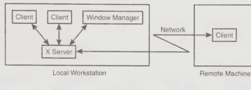

**背景资料**

原则上，窗口管理器可以远程运行，但出于性能原因，通常与 X 服务器运行在同一台机器上。

X 服务器和窗口管理器之间职责的分离意味着你可以尝试许多不同的用户界面。因此，由于你只需更换窗口管理器而无需改变核心 X 系统即可改变外观和感觉，因此很容易尝试不同的界面并进行自定义。

**背景资料**

事实上，这是 X 最受批评的方面之一：由于缺乏标准化，X 程序在哪些按键用于什么操作、哪些鼠标按钮调出打开菜单等方面存在微小但令人烦恼的差异。

在商业 UNIX 世界中，经过几年的争斗和分歧后，Motif 用户界面被选为标准。通用桌面环境（CDE）是标准的商业 UNIX 桌面。

不幸的是，Motif 和 CDE 不是免费的或开源的。因此，它们在 Linux 上没有受到太多青睐，尽管有 Linux 实现版本。

有一段时间，Linux 继续维持使用许多不同的图形用户界面。最终，两个大型项目涌现出来，承诺为 Linux 提供标准化的桌面：K 桌面环境（KDE）和 GNU 网络对象模型环境（GNOME）。Caldera 选择使用 KDE 作为 OpenLinux 的标准桌面环境。KDE 在第 5 章中有详细介绍。

KDE 包含其自带的窗口管理器，称为 `kwm`。该窗口管理器负责绘制 KDE 的窗口边框，并实现 KDE 桌面的外观和体验。如果你选择不使用 KDE 但仍然希望使用 X，那么 OpenLinux 提供的唯一其他窗口管理器是极其古老的 `twm`，它会让 Linux 看起来像 20 世纪 80 年代初那个吱呀作响的老旧系统。除非你的电脑速度较慢或内存有限（在这种情况下，KDE 可能会给系统带来过大的负担），否则我建议继续使用 KDE。

## 指针与选区

鼠标光标被称为指针。鼠标按钮通常不被称为左、中、右按钮，而是被称为按钮 1、按钮 2 和按钮 3。对于右利手者，按钮 1、2 和 3 分别对应左、中、右按钮。然而，对于左利手者，这些按钮可以被反转。

X 服务器维护一个称为“选区”（selection）的属性。它可以包含从应用程序中剪切并粘贴到另一个应用程序中的选定文本。

对于大多数基于文本的应用程序，你按如下方式操作选区：

-   1. 按住按钮 1，拖动鼠标指针，划过你希望选中的文本。
-   2. 若要扩展选区，将鼠标指针移动到你希望选区结束的位置，然后按下按钮 3。这会自动将文本复制到选区中。

通常，选区以字符大小的增量增长。如果在拖动或扩展选区之前双击按钮 1，选区将以单词大小的增量增长。三次点击则会产生以行大小为增量增长的选区。

-   3. 要粘贴选区，请按下按钮 2。

> **注意**
>
> 没有显式的“复制”或“剪切”操作。仅仅进行选择这一动作就会执行隐式复制，因此你创建选区后可以立即进行粘贴。

X 并未强制规定鼠标按钮在选区方面的具体行为，但（值得庆幸的是），创建和扩展选区是几乎所有 X 客户端都达成一致的两种 GUI 操作。

##### 事件

所有 X 程序都是事件驱动的。X 服务器监控鼠标和键盘，并向客户端发送事件。表 4.1 列出了一些常见事件。

**表 4.1 X 窗口事件**

| 事件 | 含义 |
| :--- | :--- |
| `ButtonPress` | 按下了鼠标按钮。 |
| `ButtonRelease` | 释放了鼠标按钮。 |
| `KeyPress` | 按下了键盘按键。 |
| `KeyRelease` | 释放了键盘按键。 |
| `Motion` | 移动了鼠标指针。 |
| `Enter` | 指针进入了一个窗口。 |
| `Leave` | 指针离开了一个窗口。 |

还有更多的事件，通常事件主要对 X 程序员感兴趣。然而，一些程序的手册页讨论了将操作绑定到事件，因此了解 X 事件是怎么回事是值得的。

###### 焦点

在 X 中，键盘事件在任一时刻都只发送给一个窗口。接收键盘事件的窗口被称为拥有键盘焦点。

设置输入焦点有两种基本策略：

-   点击输入（`Click-to-type`）：最后点击了鼠标按钮的窗口拥有焦点，并保持该焦点，直到在另一个窗口中点击鼠标按钮。
-   焦点跟随鼠标（`Focus-follows-mouse`）：包含鼠标指针的窗口拥有焦点。

选择你更喜欢的方案（可通过 KDE 控制中心进行此设置），但请注意，窗口管理器只能为顶层窗口设置焦点策略。即使你为顶层窗口选择了“焦点跟随鼠标”，应用程序也可能要求你点击特定的图形元素以设置焦点。

###### 资源

与大多数 UNIX 程序一样，X 是可定制的——令人难以置信地、难以置信地、令人困惑地可定制。许多可以定制的内容都是通过 X 资源进行定制的。


实际上，KDE 使用你主目录中的自定义文件进行大部分定制，因此如果你使用 KDE 应用程序，就不太需要折腾 X 资源。然而，仍然有许多有用的非 KDE X 应用程序使用资源进行定制。

X 资源仅仅是由 X 服务器存储、X 客户端可以查询或设置的键值对。使用 `xrdp` 命令来操作 X 资源数据库。例如，要获取所有当前 X 资源的列表，请使用：

```
$ xrdp -q
Xterm*background: Black
Xterm*foreground: Wheat1
Emacs.background: Black
Emacs.foreground: Wheat1
```

这些资源指定了我希望我的 `xterm` 背景为黑色，前景为 `Wheat1`。相同的偏好也适用于 `emacs`。（`xterm` 是一个终端模拟器，`emacs` 是一个文本编辑器；它们将在后续章节中讨论。）

资源规范中的值组件很直接：在这些示例中，值仅仅是颜色名称。

然而，键组件的语法稍显复杂。键的规范看起来像这样：

```
component... component...resourceName
```

每个组件可以是实例名或类名。按照惯例，实例名以小写字母开头，类名以大写字母开头。

例如，前面示例中显示的 `emacs` 是一个类名。`emacs` 文本编辑器有两个变体：GNU `emacs` 和 `Xemacs`。两者都非常相似，且都属于 `emacs` 类。因此，这些资源适用于这两个程序。应用程序设计者在创建程序时选择实例名和类名。你必须阅读程序的文档才能发现实例名和类名。

为了区分 `emacs` 和 `Xemacs`，你可以这样设置资源：

```
emacs.foreground: wheat1
xemacs.foreground: red
```

这将使 GNU `emacs` 使用 `white1` 作为前景色，而 `Xemacs` 使用 `red`。

X 应用程序通常由层次化的窗口集合组成。考虑图 4.2 中示意的假想 CD 播放器应用程序。

### 图 4.2

X 资源。

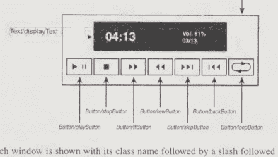

在图中，每个窗口都显示其类名，后跟一个斜杠，再后跟实例名。例如，所有按钮都属于 `Button` 类，但每个按钮都有其自己的实例名。

以下是一些 X 资源的示例：

```
! 将所有内容的背景设置为黄色
CDPlayer*background: yellow
! 但将按钮设置为绿色
CDPlayer*Button.background: green
! 并将“循环”按钮设置为红色
CDPlayer*loopButton.background: red
```

考虑第一个资源，它将背景设置为黄色。应用程序 `CdPlayer` 的类名后跟一个星号，然后是资源名称 `background`。星号代表任意层级的层次结构。因此，它设置整个应用程序、嵌套窗口、替换窗口等的背景。

第二个资源设置类为 `Button` 的任何窗口的背景，无论它在窗口层次结构中的位置如何。第三个命令设置特定窗口 `loopButton` 的背景（无论它出现在层次结构的哪个位置）。

X 资源的确切语法记录在 `X(1)` 手册页的“Resources”部分。

注意，每个应用程序定义自己的窗口（或部件）层次结构和类名。虽然使用相同部件工具包（用于构建图形界面的库）构建的应用程序很可能对其窗口具有一致的类名，但 X 本身并不对窗口类名强制标准。（记住，它提供机制，而非策略。）

使用 `x` 程序来设置资源。设置资源最简单的方法是创建一个文件（通常称为主目录中的 `.Xresources`），指定你希望设置的资源。该文件看起来像这样：

```
! 注释行 -- 以感叹号开头。
Xterm*background: white
Ghostview*arguments: -DNOPLATFONTS
Xterm*font: 10x20
```

你只需列出资源，后跟冒号和值。你可以使用反斜杠字符（`\\`）续写长行。

请记住，你需要阅读每个应用程序的手册页以发现它使用或期望哪些资源。

创建资源文件后，使用以下命令将其加载到 X 服务器中：

```
$ xrdb -merge $HOME/.Xresources
```

这将文件中指定的资源添加到 X 资源数据库中。`x` 还有一些选项：

-   `xrdb -query` 查询 X 资源数据库并将结果打印到标准输出。
-   `xrdb -merge fileName` 将文件中的资源合并到数据库中。
-   `xrdb -load fileName` 用文件中的资源替换数据库中的资源。

`x` 还有一些用于处理资源文件的更高级（且较少使用）选项；有关更多细节，请参见 `x(1)`。

## 配置 XFree86

从历史上看，在 Linux 下配置 X 服务器是最困难的任务之一。然而，现代 `XFree86` 服务器支持广泛的视频卡，并且 `PCI` 总线使得识别硬件变得更容易。最有可能的情况是，当你安装 Caldera OpenLinux 时，安装程序正确配置了 X 服务器。如果未正确配置，或者你因为某种原因（例如添加新的视频卡）希望重新配置 X 服务器，本节将解释如何做到这一点。

### 识别您的视频硬件

如果您不了解视频硬件的详细参数，`SuperProbe` 程序或许能够探测到这些信息。要运行该程序，请获取 root 权限并输入：

```
SuperProbe
```

您可能希望将输出重定向到一个文件：

```
SuperProbe > probe.log 2>&1
```

如果 `SuperProbe` 成功识别了您的视频硬件，其输出将类似于以下内容：

```
First video: Super-VGA

    chipset: Matrox G200 AGP (PCI Probed)

    RAMDAC:  Matrox G200 built-in DAC w/clock
```

###### 警告

`SuperProbe` 如果您的硬件较为特殊，可能会导致系统挂起。请确保从文本模式（而不是在 X 服务器内部）运行该程序，并确保没有重要的未保存工作。

`SuperProbe` 具有多个选项，但大多数选项假设您已具备相当深入的显卡和硬件知识。一个普遍有用的选项是 `verbose`（详细模式），它会让 `SuperProbe` 在探测各种视频卡时打印详细信息。

### 运行 XF86Setup

`XF86Setup` 程序是一个用于配置 `XF86` 的工具。您可以在文本模式或 X 窗口中运行它。如果您是第一次设置 X，则必须使用文本模式版本。如果您想调整设置，可以使用图形版本。

要调用 `XF86Setup`，请获取 root 权限并输入：

```
XF86Setup
```

如果您正在 X 下运行系统，系统会询问您是否想调整当前设置。如果回答“是”，将显示图形配置工具。

该图形工具有六个主要按钮，分别标记为 `Mouse`（鼠标）、`Keyboard`（键盘）、`Card`（显卡）、`Monitor`（监视器）、`Modelselection`（模式选择）和 `Other`（其他）。

### 配置鼠标

要设置鼠标，请单击 `Mouse` 按钮。如果您的鼠标尚未正常工作（这是一种合理的情况），请按 `Tab` 键突出显示 `Mouse` 按钮，然后按空格键或 `Enter` 键。或者，按 `Alt-M` 键直接进入鼠标配置菜单。

从选项中选择一个鼠标协议。您很可能拥有一个 `PS/2` 鼠标或串口鼠标。大多数串口鼠标使用 `Microsoft` 协议。

从提供的列表中选择鼠标设备。如果您使用的是双按钮鼠标，请启用 `Emulate3Buttons`。此模式在您同时按下两个鼠标按钮时模拟第三个鼠标按钮。

按 `A` 键应用更改，并检查指针是否正常移动。不断尝试不同的设置，直到其正常工作为止。

### 配置键盘

单击 `Keyboard` 按钮以设置键盘。通常这里不需要做什么：在绝大多数情况下，选择通用的 101 键 PC 键盘（带有美国英语布局）即可正常工作。

附加选项允许您将 `Control` 键放置在 `A` 键旁边。如果您习惯在 Sun 工作站上工作，这种调整可以保住您的理智。

### 配置视频卡

单击 `Card` 以配置视频卡。

如果您幸运的话，您的视频卡会列在卡列表中，您只需选择它即可。（如果没有看到卡列表，而是出现了一个充满选项和问题的窗口，请单击 `Card List` 以获取卡列表。）

如果您没有看到您的卡，必须单击 `Detailed Setup` 以手动输入各种参数。

首先，您必须知道为您的视频卡选择哪个服务器。有时很明显；`Mach64` 服务器支持 `Mach64` 卡。其他时候则不那么明显。如果您不知道该选择哪个服务器，只需选择一个并阅读 `README` 文件。（`Read README File` 按钮会打开当前所选服务器的文件。）如果您找不到 `README` 文件，请查看 `/usr/X11R6/1ib/X11/doc` 目录。许多 `README` 文件可能有助于解决问题。

通常，如果服务器名称与您的卡或芯片组名称匹配，请使用它。否则，请尝试 `SVGA` 服务器，它支持许多卡和芯片组。作为最后手段，您可以使用 `VGA16` 服务器，它仅提供 640 乘 480 分辨率，颜色数为 16 色。

`Chipset`（芯片组）选项允许您指定图形芯片组。下拉列表并选择与您的卡匹配的芯片组。如果没有匹配项或您不确定，请留空芯片组条目。对 `RamDac` 和 `ClockChip` 做同样的操作。

如果您知道图形卡的视频内存大小，请从选项列表中选择合适的容量。

### 配置监视器

单击 `Monitor` 以配置监视器。

监视器的配置通常比图形卡更容易。X 服务器需要知道监视器接受的水平和垂直频率范围。这些通常在监视器手册背面的“Specifications”（规格）部分中标明。如果您的监视器没有手册，请从提供的列表中选择一个通用监视器。

> **警告**
>
> 请勿超过监视器手册中指定的水平同步范围。这样做可能会严重损坏监视器。

### 配置图形模式


在配置完视频卡和监视器后，单击 `Modeselection` 以选择图形模式。从分辨率列表中，选择想要使用的模式。您还应选择一个默认颜色深度；这指定每个像素占用多少位视频内存。深度为 `8` 允许屏幕上同时显示最多 `256` 种不同颜色。深度为 `16` 允许 `65,536` 种不同颜色，深度为 `24` 或 `32` 允许 `16,777,216` 种颜色。选择您的硬件支持的最佳模式和颜色深度。

### 配置 X 服务器行为

单击 `Other` 以配置 X 行为的某些其他方面。

- `允许通过热键序列杀死服务器` 允许您通过按 `Ctrl+Alt+Backspace` 来终止 X 服务器。选择此选项通常是个好主意，因为它为您的错误 X 配置提供了一条逃生路径。对于安全应用程序或 Internet 信息亭，您应禁用此选项。否则，请保持开启。

- `允许视频模式切换` 如果在配置图形模式时选择了多种分辨率，您可以使用 `Ctrl+Alt++`（加号）和 `Ctrl+Alt+-`（减号）在它们之间切换，其中的加号和减号是指数字小键盘上的键。

- `不捕获信号` 永远不要启用此选项。这是供希望调试 X 服务器的程序员使用的。

- `允许来自其他主机的视频模式更改` 如果启用此选项，远程 X 客户端将被允许更改服务器的视频模式。

- `允许来自其他主机的键盘和鼠标设置更改` 如果启用此选项，远程 X 客户端将被允许更改键盘和鼠标设置。

X 服务器行为的默认值可能很好；您不应该需要更改它们。

### 运行 xf86config

如果您不在 X 下启动 `XF86Setup`，它会尝试运行 `VGA16` X 服务器为您提供图形界面。如果这失败了，您必须使用非图形程序 `xf86config`：

```text
#### xf86config
```

`xf86config` 是 `XF86Setup` 的文本模式对应物。它会询问有关您硬件的问题，您只需输入答案。`xf86config` 依次处理以下项目：

- `鼠标配置` 此区域与 `XF86Setup` 中的类似。只需输入正确的答案。

- `键盘配置` 对“是否使用 XKB？”回答“y”。然后，从列表中选择您的键盘。

- `监视器配置` 此区域与 `XF86Setup` 中的类似。但是，您将被要求输入标识字符串以识别您的监视器。监视器型号和制造商通常是不错的选择。

- `显卡配置` 对“是否要查看卡数据库？”回答 "y"，并从列表中选择您的卡。如果未找到，您将被询问与 `XF86Setup` 的选项设置类似的问题。根据您提供的卡的信息，`xf86config` 将选择适当的 X 服务器。
  - `xf86config` 会询问是否要设置指向适当 X 服务器的符号链接。回答 "y"。
  - 输入您的视频卡的内存大小和标识字符串。（标识字符串与监视器配置部分中的类似。）
  - `xf86config` 会询问是否应探测您的视频卡的时钟设置。回答 "y" 通常是安全的。
  - 选择图形模式，方法与 `XF86Setup` 相同。
  - `xf86config` 会询问是否应将配置文件保存在 `/etc/XF86Config` 中。如果您确定不会覆盖现有配置文件，则回答 "y"。否则，回答 "n"。一直回答 "n"，直到被要求提供文件名。这允许您查看设置文件而不会覆盖现有文件。

##### 编辑配置文件

在 `Caldera OpenLinux` 下，`XFree86` 的配置文件是 `/etc/XF86Config`。这是一个文本文件，您可以使用文本编辑器进行编辑。文件格式在手动页 `XF86Config(5)` 中有记录，但我们将在此介绍主要部分。

> **注意**
>
> 文件中有大量注释；在阅读本节时，您应该查看该文件。否则，您会发现这些说明很难理解。

##### 文件部分

第一部分由 "Files" 标题标识，指定 X 服务器使用的各种文件的位置。

- `RgbPath` 指定 RGB 数据库的位置。这只是一个文本文件，包含数百种颜色名称（如红色、番木瓜色和皇家蓝）以及对应颜色的红、绿、蓝强度值。

#### ModulePath

- `FontPath` 指定 X 服务器应查找字体文件的位置。X 可以渲染点阵字体和可缩放（Type 1）字体。您可以提供多个 `FontPath` 规范；它们将按顺序进行搜索。
- 如果您拥有同一字体的点阵版本和可缩放版本，应将点阵版本目录置于可缩放版本目录之前，并在点阵版本目录末尾添加 `:unscaled`。这将导致 X 服务器在找到精确尺寸匹配时使用点阵字体，而在未找到精确匹配时退回到较慢的可缩放字体渲染。
- `ModulePath` 指定可动态加载模块的位置，这些模块为 X 服务器添加额外功能。这些模块包括 X 的扩展以及对触摸屏和绘图板等不常见输入设备的模块。默认值通常没问题。

#### Module 部分

"Module" 部分指定要加载到 X 服务器中的哪些动态对象。例如，如果您拥有 `Summagraphics` 图形板，您可能希望在此部分中放置 `Load "x886summa.so"`。如果您没有特殊的硬件，请保留该部分不变。

#### ServerFlags 部分

"ServerFlags" 部分指定 X 服务器行为的某些方面。大多数标志在 `/etc/X86Config` 中都有很好的注释。您可能会想要修改的标志只有：

- `DontZoom` 此标志禁止使用 `Ctrl+Alt+（加号）` 或 `Ctrl+Alt+-（减号）` 进行视频模式切换。
- `DontZap` 此标志禁止您使用 `Ctrl+Alt+Backspace` 终止 X 服务器。

#### Keyboard 部分

由 "Keyboard" 标题标识的部分控制键盘配置：

- `Protocol` 在 Linux 下应始终设置为 "Standard"。
- `AutoRepeat` 延迟速率 指定键盘的自动重复行为。在初始延迟 `delay` 毫秒后，按键以 `rate` 次/秒的频率重复。

该部分中的其他设置允许您微调键盘的控制；详情参见 `X86Config(5)`。

#### Pointer 部分

由 “Pointer” 标题标识的部分控制鼠标配置：

- `Protocol` 指定鼠标协议。最可能是 `PS/2` 或 `Microsoft`，但如果这些都不起作用，请查阅手册页了解其他可能性。
- `Device` 指定鼠标设备文件。通常，文件 `/dev/mouse` 是指向真实鼠标设备的符号链接，这是正确的条目。（设备文件在第 8 章中详细讨论。）
- `Emulate3Buttons` 告诉服务器在同时按下左右鼠标按钮时模拟中间鼠标按钮。如果您有一个双键鼠标，请使用此选项。
- `ChordMiddle` 由于某些神秘原因，某些 `Logitech` 鼠标需要此选项（或者我听说如此；我从未遇到过需要它的鼠标）。

一如既往，还有更多深奥的设置可供使用，我一如既往地建议您查阅 `XF86Config(5)` 以获取更多细节。

#### Monitor 部分

由 “Monitor” 标题标识的部分向 X 服务器指定您的监视器。可以存在任意数量的监视器部分。（此功能在您经常切换监视器时可能有用；您可以在配置文件中存储两种定义，并进行简单更改以选择当前连接的监视器。）

每个监视器部分包含以下条目：

- `Identifier` 您的监视器的唯一标识符。像 `AcerView 99c` 这样的东西可能是一个不错的选择。
- `VendorName` 您的监视器厂商的名称——例如，`Acer`。
- `ModelName` 您的监视器厂商的型号——例如，`99c`。
- `HorizSync` 指定您监视器的水平同步范围。可以将其指定为离散值列表，如 `31.5`、`35.2`，或范围列表，如 `16-26`、`31-60`。单位为千赫兹。
- `VertRefresh` 指定您监视器的垂直刷新率范围（单位为赫兹）。与 `HorizSync` 一样，可以将其指定为离散值列表或范围列表。
- `Modeline` 指定低级视频时序。您真的不想编辑 `modelines`；请使用默认值。编辑 `modelines` 需要对视频硬件有相当深入的理解；所有详细细节请查看 `/usr/X11R6/lib/X11/doc/VideoModes.doc`。

#### Device 部分

由 “Device” 标题标识的部分向 X 服务器指定显卡设置。

##### 背景资料

为什么它被称为 `Device` 而不是 `Card` 或 `GraphicsCard`？我们永远无法知道。这是那些被永久保留的设计决策之一，就像琥珀中保存的昆虫一样。

设备部分包含以下条目：

- `Identifier`
  一个唯一标识您显卡的标识符。像 `Matrox Millennium G200` 这样的东西可能很合适。
- `VendorName`
  您的显卡厂商的名称——例如，`Matrox`。
- `BoardName`
  您的显卡的型号——例如，`Millennium G200`。

诸如 `Chipset`、`VideoRam` 和一些特定于显卡的额外可选条目允许您调整显卡的配置。详情请查阅 `XF86Config(5)`。

##### Screen 部分

由 “Screen” 标题标识的部分指定每个 X 服务器使用的显卡和监视器组合。此部分的条目包括：

- `Driver`
  指定哪个 X 服务器应使用屏幕配置。可能的值有：
  - `Accel`
    所有加速 X 服务器都使用此部分的设置。基本上，所有特定于显卡的 X 服务器，如 `XF86_Mach32` 和 `XF86_S3V`，都属于此类。
  - `Mono`
    非 `VGA` 单色 X 服务器使用此部分的设置。
  - `SVGA`
    `XF86_SVGA` `SuperVGA` X 服务器使用此部分的设置。
  - `VGA2` 和 `VGA16`
    这些设置由 `XF86_VGA16` 中两位和四位数服务器中的 `VGA` 驱动程序使用。

您只需要为您提供实际拥有的显卡条目。最有可能的是，您只需要 `VGA16` 以及 `Accel` 或 `SVGA`；这些类型涵盖了大多数现代显卡。

- `DefaultColorDepth` `bpp` 指定屏幕的默认颜色深度。
- `Device` 指定使用哪个显卡。这应与某个设备部分的 `Identifier` 条目匹配。
- `Monitor` 指定使用哪个监视器。这应与某个监视器部分的 `Identifier` 条目匹配。

在屏幕部分内，有一些称为 "Display" 的子部分。每个显示子部分具有以下条目：

- `Depth` `bpp` 该子部分适用的颜色深度。这允许您为不同的颜色深度配置不同的分辨率。（例如，您的显卡可能有足够的内存以每像素 `8` 位运行在 `1280` 乘以 `1024` 下，但仅在每像素 `16` 位下运行在 `1024` 乘以 `768` 下。）
- `Virtual` `x y` 指定屏幕的“虚拟”分辨率。例如，如果您的监视器仅支持 `1024` 乘以 `768`，但您的显卡支持 `1280` 乘以 `1024`，您可以为监视器指定 `1024` 乘以 `768` 的模式，但虚拟尺寸为 `1280` 乘以 `1024`。这会创建一个比监视器更大的屏幕。当您将鼠标指针移动到屏幕边缘时，整个屏幕滚动。滚动在硬件中完成，速度快且令人印象深刻，但通常太分心，因此实际中很少使用。
- `Modes` `modeName...` 指定要使用的分辨率列表。您可以使用 `Ctrl+Alt++`（加号）和 `Ctrl+Alt+-`（减号）在列表中循环。

在屏幕部分和设备子部分中，请查阅 `XF86Config(5)` 了解更多配置选项。在 `/usr/lib/X11/XF86Config.eg` 中有一个注释良好的示例文件 `XF86Config`。

#### Colors

您可以使用以下两种方法之一向 X 程序指定颜色：

- `按名称` 在 shell 提示符下输入 `xcolortel` 以查看 X 服务器已知的所有命名颜色列表。
- `按红绿蓝值` 这样的颜色指定为：

`#RRGGBB`

`RR` 是两个十六进制数字，指定红色分量的值，从 `00` 到 `FF`。同样，`GG` 和 `BB` 各是两个十六进制数字，分别指定绿色和蓝色分量的值。


### 备注

十六进制数是以 `16` 为基数的数字表示法。数字 `0` 到 `9` 具有其通常的含义，而“数字”`A` 到 `F` 代表 `10` 到 `15`。要将一个两位的十六进制数转换为十进制数，需将第一位数字乘以 `16` 并加上第二位数字。例如，十六进制数 `A6` 等于 `10*16 + 6`，即 `166`。在颜色规范中常见的数字有 `00` (`0`)、`FF` (`255`) 和 `80` (`128`)。

以下是一些示例：

- `#FF0000`: 全饱和度红色
- `#FF00FF`: 全饱和度洋红色
- `#008000`: 深绿色
- `#000000`: 黑色
- `#FFFFFF`: 白色

在 `xcolorsel` 中，你可以将显示格式设置为 `8` 位缩放 `RGB`（使用“显示格式”下拉菜单），以便以类似于此处所示十六进制方案的方式查看颜色值。

##### 背景资料

还有其他指定颜色的方法，但本文介绍的两种方法最为常用。有关更多详细信息，请参阅 `X(1)`。

###### 字体

`XFree86` 附带了大量字体集合。它还附带了一种相当笨重（但功能强大）的字体命名机制。

X 服务器可以渲染各种类型的字体：`PCF` 和 `BDF` 字体是仅由 X Window 系统使用的位图字体。`Type 1` 字体是可缩放的 `PostScript` 字体，`Speedo` 字体是另一种可缩放字体。目前，X 不支持 `TrueType` 可缩放字体，尽管 `XFree86` 的下一个版本将支持它们。

#### X 逻辑字体描述

在 X 中，字体名称包含 `14` 个部分。这 `14` 个部分列在表 `4.2` 中。

**表 4.2 X 逻辑字体描述中的字段**

| 字段 | 含义 |
| :--- | :--- |
| `Foundry` (铸造厂) | 创建该字体的组织。示例有 `adobe` 和 `bitstream`。 |
| `Family` (家族) | 一般字体家族，如 `courier` 或 `times`。 |
| `Weight` (字重) | 字体的字重。示例有 `bold` (粗体) 或 `medium` (中等)。 |
| `Slant` (倾斜) | 字体的倾斜度。示例有 `i` 代表斜体，`o` 代表倾斜体，以及 `r` 代表直立。 |
| `Set Width` (设置宽度) | 字体的“紧凑度”。通常是 `normal` (正常)，但也可能是 `condensed` (紧凑) 或 `semicondensed` (半紧凑)。 |
| `Additional Style` (附加样式) | 附加样式参数。这极少被使用。我找到的唯一示例是一个在字段中指定 `sans` 的 `Lucida` 字体。 |
| `Pixel Size` (像素大小) | 指定字体的像素大小。 |
| `Point Size` (磅值大小) | 指定以十分之一磅为单位的字体大小。通常应该指定磅值大小而不是像素大小；X 服务器将计算要使用的正确像素大小。 |
| `X Resolution` (X 分辨率) | 字体的水平分辨率，单位为点每英寸。仅用于位图字体。 |
| `Y Resolution` (Y 分辨率) | 字体的垂直分辨率，单位为点每英寸。仅用于位图字体。 |
| `Spacing` (间距) | 字体使用的间距方案。可以是 `p` 代表成比例，`m` 代表等宽，或 `c` 代表固定间距。 |
| `Average Width` (平均宽度) | 字体中所有字符的平均宽度（以十分之一像素为单位）。 |
| `Registry` (注册表) | 负责确定字体编码方案的机构。例如，根据 `ISO 8859` 标准编码的所有字体的注册表为 `iso8859`。 |
| `Encoding` (编码) | 特定的编码方案。西欧字符使用 `iso8859-1` 方案编码，而希伯来字符使用 `iso8859-8` 编码。 |

例如，一种相当美观的 `24` 像素直立 `Courier` 字体可以指定为：

```
-adobe-courier-bold-r-normal-24-240-75-75-m-50-iso8859-1
```

字体名称以破折号开头，随后是由破折号分隔的表 `4.2` 中描述的 `14` 个字段列表。

这确实是一种指定字体的繁琐方式！幸运的是，大部分字段都可以使用通配符，从而让服务器选择一个匹配的字体。你只需指定家族、字重、倾斜和大小，就可以获得 `24` 像素直立 `Courier` 字体，如下所示：

```
-*-courier-bold-r-*--24-*
```

如果有多个字体匹配通配符规范，则使用找到的第一个。通常，你应该明确指定字体家族、字重、倾斜以及磅值或像素大小。这些字段通常足以得出你想要的字体。

许多 X 客户端允许你在命令行上使用 `-fn` 选项指定字体名称。如果你使用通配符字体名称，请务必给它们加上引号，以避免 shell 扩展。例如，要使用之前描述的 `Courier` 字体启动 `xterm` 会话，请使用：

```
$ xterm -fn '-*-courier-bold-r-*--24-*'
```

#### 查看字体

`xfontsel` 程序允许你查看可用字体。要启动它，请输入：

```
$ xfontsel
```

使用下拉菜单填写各种字体命名字段。窗口右上角的指示器显示了与剩余通配字段匹配的字体数量。

你可以使用 `x11fonts` 获取系统上可用字体的列表。此命令会产生大量输出，因此你可能希望将其输出发送到文件或通过 `more` 管道处理：

```
$ x11fonts | more
```

你可以通过提供 `-fn` 选项后跟通配符模式来限制 `x11fonts` 的输出。请记住给模式加上引号，以防止 shell 尝试扩展它。此示例列出了系统上所有 `Courier` 字体：

```
$ x11fonts -fn '-*courier-*' | more
```

#### 可缩放字体

可缩放字体是 X 的一个较新的添加。它们通过用于像素大小、磅值大小、`x` 和 `y` 分辨率以及平均宽度的 `0` 来命名。注意，只有 `Type 1` 和 `Speedo` 字体是可缩放的；缩放位图字体会产生较差的效果。

##### 背景资料


在 `XLFD` 中使用“魔法”值的技术术语是 `kludge`。它以可疑且非直观的方式重载了 `XLFD` 中字段的含义。

当你使用 `xlsfonts` 时，你可能会看到一些成比例的字体，例如：

```
-bitstream-courier-medium-r-normal--0-0-0-m-0-iso8859-1
```

你可以通过指定特定大小来查看特定大小的字体。这给出了一个 `xterm`，其字母高度为 48 像素：

```
$ xterm -fn \
-bitstream-courier-medium-r-*-*-48.*.*.*.*.*.*
```

### 启动 X

如果你在安装过程中成功安装了 `KDE`，`X Windows` 在启动计算机时可能会自动启动。管理登录会话的程序称为 `kdm`。这在第 5 章中有所介绍。

如果 `X` 没有自动启动（因为你无法配置它，或者你更喜欢启动到文本模式），你可以从 shell 提示符使用 `startx` 命令启动 `X`。调用 `startx` 的最简单方法是：

```
$ startx
```

这会启动一个 `X` 服务器并执行 shell 脚本 `$HOME/.xinitrc`。通常，你会在 `$HOME/.xinitrc` 中放置启动各种 `X` 客户端和窗口管理器的命令。如果此文件不存在，则会运行文件 `/etc/X11/xinit/xinitrc`。这会启动一个时钟和几个 `xterm` 终端窗口，这通常不是你想要的。

如果你想启动 `KDE`，可以使用以下命令：

```
$ kde
```

这与 `startx` 类似，但会查找 `$HOME/.kdeinitrc` 或 `/etc/X11/xinit/kdeinitrc`。这些文件应包含正确启动 `KDE` 的命令。查看 `/etc/X11/xinit/kdeinitrc` 以了解其功能。

使用 `startx` 或 `kde` 时，你可以通过在前面添加双破折号来指定 `X` 服务器选项。例如，要以每像素 8 位模式启动 `KDE`，请使用：

```
$ kde -- -bpp 8
```

有关 `X` 服务器接受的选项列表，请参阅 `XFree86(1)`。

### 一些 X 客户端

本节介绍了一些更受欢迎的 `X` 客户端。请注意，许多 `X` 客户端都有等效的 `KDE` 程序。选择使用哪个取决于个人喜好。`KDE` 程序提供更一致的外观和感觉，但如果你迁移到不同的 `UNIX` 系统，你更有可能找到标准 `X` 客户端，而不是它们的 `KDE` 对应程序。

#### 标准 X 客户端选项

大多数 `X` 客户端接受以下标准选项。它们被称为标准 `X` 工具包命令行选项。

- `-display` *displayname* 指定要连接的 `X` 服务器显示。如果未提供，客户端将使用 `DISPLAY` 环境变量的值。
- `-fn` *font* 指定要使用的字体。
- `-fg` *color* 指定前景颜色。
- `-bd` *color* 指定边框颜色。
- `-bg` *color* 指定背景颜色。
- `-title` *string* 请求窗口管理器在窗口标题栏中显示 *string*。
- `-name` *name* 在资源数据库中查找资源时，使用 *name* 作为应用程序名称。
- `-geometry` *w*h*+x+y* 请求窗口管理器将窗口大小设为 *w* 乘以 *h* 个单位，偏移量为 *x* 和 *y*。

对于大多数应用程序，*w* 和 *h* 的单位是像素，但对于某些应用程序（如编辑器和终端仿真器），它们是字符。

*x* 和 *y* 偏移量指定了窗口的放置位置。如果 *x* 是一个以 `+` 开头的数字，则窗口的左边缘放置在距屏幕左边缘 *x* 像素处。如果它是一个以 `-` 开头的数字，则窗口的右边缘放置在距屏幕右边缘 *x* 像素处。

如果 *y* 是一个以 `+` 开头的数字，则窗口的上边缘放置在距屏幕上边缘 *y* 像素处。如果它是一个以 `-` 开头的数字，则窗口的下边缘放置在距屏幕下边缘 *y* 像素处。

- `-iconic` 指示窗口应以“最小化”而非“打开”的状态启动。

#### xterm

`xterm` 是 `X Window` 系统的终端模拟器。它证明了（有些人甚至认为这是指责）`UNIX` 的命令行传统，即最流行的图形应用程序之一竟然是终端模拟器。要启动 `xterm` 会话，只需输入：

```
$ xterm &
```

通常将命令放入后台运行会比较方便，这样你可以重新获得原来的 shell 提示符。

`xterm` 模拟了 `VT-102` 终端，这是一种在多年前多用户系统上流行的串行终端。

`xterm` 相当简单，没有太多花哨的功能。然而，它确实提供了一些超越原始 `VT-102` 的功能。

##### 字体选择

要更改 `xterm` 的字体，请按住 `Ctrl` 并单击鼠标按钮 3。你会看到几个字体大小的选择，范围从无法阅读到巨大。选择你想要的那个。

##### VT 选项

`VT` 选项是控制终端行为各个方面的选项。例如，你可以启用终端左侧的滚动条，开启反向视频，或在突然滚动和平滑滚动之间切换。

要更改 `VT` 选项，请按住 `Ctrl` 和鼠标按钮 2。会出现一个包含各种选项的菜单，允许你更改终端行为的各个方面。大多数时候，你会保持默认设置不变。

##### 主要选项

要更改主要选项，请按住 `Ctrl` 和鼠标按钮 1。会出现另一个包含各种选项的菜单，允许你更改终端行为的各个方面。最重要的设置是：

- `Secure Keyboard`：使用此选项以安全方式“捕获”键盘。如果你在不安全的方式下运行 `X`，其他人可能会“窥探”你的 `X` 会话。`xterm` 提供了一种简单但有效的方法来保护键盘，以防止窥探。详细信息请参见 `xterm(1)` 中的“Security”章节。
- `Allow SendEvents`：使用此选项允许其他程序向你的 `xterm` 发送伪按键和按钮事件。通常，这是一个严重的安全漏洞，因此不要激活此选项！

有关可用选项的更多详细信息，请参见 `xterm(1)`。

##### 滚动条导航

在 `xterm` 窗口的一侧，你应该能看到一个滚动条。你可以使用按钮 2 移动滑块，以浏览最近滚动出窗口的几十行内容。你还可以使用 `Shift+PgUp` 和 `Shift+PgDn` 以页为单位进行导航。（如果看不到滚动条，请从 `VT Options` 菜单中启用它。）即使关闭了滚动条，`Shift+PgUp` 和 `Shift+PgDn` 键也可以使用。

##### 一个有趣的 xterm 技巧

`VT-102` `xterm` 模拟器识别某些转义序列或特殊字符序列。如果你使用 `bash` shell，可以将以下内容放入你的 `.bashrc` 文件：

```
if [ $TERM = "xterm" ] ; then
PS1='\[\033[2;\u@\h:\w\007[033]1;\w\007\] :\u@\h\W$ '
fi
```

这段神奇的咒语设置了：`bash` 的主要提示符，使得 `xterm` 窗口的标题栏被设置为类似以下内容：

`user@host:current_directory`

如果你同时打开了几个 `xterm` 窗口，这个技巧非常有用——它让你能够跟踪每个 `xterm` 中 shell 的当前工作目录。

#### xclock

没有模拟时钟的图形显示能算完整吗？为了完善你的 `X` 桌面，添加 `xclock`（参见图 4.3）。


`xclock` 接受所有标准的 `X` 工具包命令行选项，以及以下选项：

- `-analog` 指示需要模拟时钟。这是默认设置。
- `-digital` 生成一个枯燥的数字时钟。
- `-chime` 使时钟在半点“鸣响”一次，在整点“鸣响”两次。因为时钟的鸣响只是电脑扬声器发出滴滴声，所以效果不太惊艳。
- `-hands` *color* 设置指针的颜色。
- `-update` *seconds* 指定以秒为单位的时钟显示更新频率。默认值为 60；任何 30 或更小的值都会导致显示秒针。

#### xload

`xload` 程序显示系统负载平均值的图形表示。负载平均值衡量的是在给定时刻有多少进程准备就绪，并按时间取平均值。繁忙系统的负载平均值比空闲系统高。`xload` 显示不是很实用，但看看你的电脑有多忙还是很有意义的。

`xload` 接受标准的 `X` 工具包命令行选项，以及以下选项：

- `-highlight` *color* 指定刻度线的颜色。
- `-jumpscroll` *n* 当图形填满窗口时，使显示前进 *n* 像素。默认值是窗口大小的一半。
- `-label` *string* 放置在窗口中的标签。
- `-update` *seconds* 指定通过采样负载平均值来更新显示频率。

#### xcalc

`xcalc` 命令弹出一个方便的小型科学计算器。（参见图 4.4。）如果你是老式 `HP RPN` 计算器的粉丝，你可以使用 `-rpn` 标志启动 `xcalc`。


#### xbiff

`xbiff` 命令监控你的 `UNIX` 邮件文件夹。通常，它会显示一个信箱图片，且旗帜是放下的（参见图 4.5）。当你收到邮件时，旗帜会升起，电脑会发出哔声。


#### xman

`xman` 命令为你提供了 `UNIX` 手册页的简单点选界面。

> 注意
>
> `KDE` 帮助浏览器更优越；只要可能，你最好使用它而不是 `xman`。

`xman` 弹出一个带有三个按钮的小窗口。单击 `Manual Page` 调出手册页窗口。（奇怪的是，这个初始窗口包含 `xman` 的手册页。）从 `Sections` 菜单中选择一个章节，然后单击某个条目以调出手册页。

或者，你可以输入 `Ctrl+S` 并输入你要查找的手册页名称。

#### xeyes

`xeyes` 命令让你可以执行重要的系统管理功能。图 4.6 展示了我的意思。


#### xvidtune

`xvidtune` 命令允许你调整视频模式。这在（例如）显示未正确居中于屏幕，并且你不幸拥有那种依赖 `Windows` 驱动程序而不是前面板按钮来更改显示设置的讨厌显示器时很有用。

**注意**

`xvidtune` 专用于 `XFree86`；它不适用于（也不由）其他 `X` 服务器提供。

要运行 `xvidtune`，只需输入：

```
$ xvidtune
```

阅读并同意标题为 "WARNING WARNING WARNING..." 的面板后，你可以玩转视频模式。

- 要在进行更改时立即应用所有更改，请启用 `Auto`。否则，单击 `Apply` 使所做的更改生效。
- 单击 `Left`、`Right`、`Wider` 或 `Narrower` 以更改水平设置。
- 单击 `Up`、`Down`、`Shorter` 或 `Taller` 以更改垂直设置。
- 单击 `Restore` 以恢复原始设置。
- 单击 `Next` 或 `Prev` 以循环浏览 `X` 服务器配置的所有可用分辨率列表。
- 单击 `Show` 以将当前设置的模式行打印到标准输出。该模式行适合包含在 `/etc/XF86Config` 配置文件中。
- 单击 `Quit` 以退出 `xvidtune`。

#### xset

`xset` 命令允许你设置 `X` 服务器的各个方面。它控制着许多不同的事物，因此本节包含若干小节。

##### 铃声音量

要控制铃声音量（由电脑扬声器发出的哔声），请这样使用 `xset`：

```
$ xset b off # 禁用铃声
$ xset b vol pitch duration
```

`xset` 的第二种形式，请使用以下参数：

- *vol*：0 到 100 之间的数字，指定从静音到最大音量。
- *pitch*：哔声的音调（赫兹）。大多数计算机能发出的音调范围有限；请尝试不同值。
- *duration*：持续时间（毫秒）。

##### 按键声

像这样使用 *xset* 来控制按键声：

```
$ xset c off # 禁用按键声
$ xset c vol # 开启按键声
```

*vol* 是 0 到 100 之间的数字。如果硬件支持，开启按键声会导致计算机扬声器在你每次按下按键时发出咔哒声。一段时间后，你可能会发现这非常令人烦躁。

##### DPMS

`DPMS`（显示器电源管理系统）允许 `X` 在一段时间不活动后关闭显示器电源。要控制它，像这样使用 *xset*：

```
$ xset dpms off # 禁用 DPMS
$ xset dpms standby suspend off
```

在 *xset* 的第二种形式中，使用这些参数：

- *standby*：指定将显示器置于“待机”模式前的等待时间（秒）。
- *suspend*：指定将显示器置于“挂起”模式前的等待时间（秒）。
- *off*：指定关闭显示器前的等待时间（秒）。

**注意**

> 并非所有显示器都遵循节能信号。“绿色”节能显示器最有可能遵循这些信号。

###### 字体路径

你可以在运行时更改 `X` 服务器的字体路径。如果你添加了新的字体目录并希望测试这些字体，可能需要这样做。

- 要将字体路径恢复为配置文件中指定的默认值，请使用 `xset fp default`。
- 要从字体路径中移除一个目录，请使用 `xset fp- dir`。
- 要在字体路径开头添加一个目录，请使用 `xset +fp dir`。
- 要在字体路径末尾添加一个目录，请使用 `xset fp+ dir`。
- 要强制服务器更新其字体列表（以防额外的字体文件被添加到现有字体目录中），请使用 `xset fp rehash`。

##### 鼠标加速度

当你快速移动鼠标时，`X` 服务器会“加速”鼠标指针。这会产生更自然的感觉。你像这样控制加速度：

- 要将加速度设置为默认值，请使用 `xset m default`。
- 要指定加速度，请使用 `xset m n/d t`。

其工作原理如下：如果鼠标在两次采样之间移动超过 *t* 个像素，指针将按 *n/d* 的比例加速。例如：

```
$ xset m 3/2 4
```

此示例导致当你进行大幅移动时，鼠标指针移动速度是正常速度的 1.5 倍（3/2）。若想看到鼠标指针真正飞速移动，请尝试：

```
$ xset m 8/1 4
```

这才是加速度！

###### 摘要

在本章中，你学习了 `X Window` 系统的历史以及一些基本的 `X` 概念。我们涵盖了 `Xfree86` `X` 服务器的配置。你学习了如何向 `X` 应用程序指定字体和颜色，如何启动 `X` 会话以及如何运行一些常见的 `X` 客户端。我们讨论了标准的 `X` 工具包命令行选项。最后，你学习了如何使用 `xvidtune` 调整 `X` 服务器的视频设置，以及如何通过 `xset` 修改许多 `X` 服务器设置（通常在配置文件中指定）。

## 第 5 章

## 探索 KDE

### 本章内容

- 桌面 113
- `KDE` 文件管理器 121
- `KDE` 控制中心 124
- 一些 `KDE` 应用程序 128

`K` 桌面环境（`KDE`）是随 `Caldera OpenLinux` 一起提供的标准图形环境。如第 4 章所述，`X` 并不强制对图形对象施加特定的外观、感觉或行为。窗口管理器和各种编程库等更高层级的程序有义务施加一致的外观和感觉。

`KDE` 由多个实现图形环境的组件组成。`KDE` 窗口管理器 (`kwm`) 提供标准的窗口装饰。这些装饰包括每个窗口框右侧的三个“最小化-最大化-关闭”按钮，每个窗口上的调整大小手柄，以及每个窗口框左侧的下拉菜单。

第二个重要组件是 `KDE` 文件管理器 (`kfm`)，它提供图形化的文件系统导航工具。它还配合窗口管理器，使你可以创建背景窗口上的图标。这些图标提供了启动程序或浏览常用目录的便捷快捷方式。

第三个重要组件是 `KDE` 面板 (`kpanel`)，它在屏幕的一个边缘绘制一个条。这个条包含 `K` 菜单（类似于 `Microsoft Windows` 的开始菜单）用于启动程序。它还包含用于锁定屏幕、注销、切换虚拟桌面和启动程序的按钮。你可以自定义面板，使常用程序可以通过单次鼠标点击访问。

图 5.1 展示了典型的 `KDE` 桌面。面板位于屏幕底部可见。左上角附近的几个图标提供了启动程序的快速按钮。你可以看到 `kwm` 在每个窗口上放置的窗口装饰。


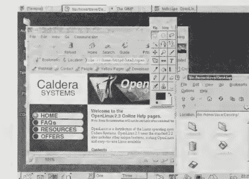

`KDE` 还为应用程序间通信提供了一致的框架。你可以将对象从一个 `KDE` 应用程序拖出并放入另一个应用程序。例如，你可以将文件图标从 `KDE` 文件管理器拖出并放入另一个 `KDE` 程序的窗口。第二个程序会对放置做出反应并打开该文件。

除了统一的外观外，所有 `KDE` 应用程序还共享统一的感觉。也就是说，每个应用程序对某些标准按键反应的相同。例如，所有带有“文件”菜单的 `KDE` 应用程序在你按下 `Ctrl+Q` 时都会终止，而在你按下 `Ctrl+O` 时会打开“打开文件”对话框。

然而，鉴于 `Linux` 开发的无序性质以及 `UNIX` 圈子中普遍存在的自由选择态度，总会有许多有用的非 `KDE` 图形程序。例如，`GNOME` 桌面是基于完全不同软件库的 `KDE` 的替代品。仍然有许多程序使用 `Motif` 库或其他 `X` 库。幸运的是，`GNOME` 和 `KDE` 开发人员正在沟通，因此有希望 `GNOME` 和 `KDE` 程序将尊重彼此的拖放协议。但与 `Microsoft Windows` 或 `Mac OS` 那样坚实统一的图形界面不太可能很快实现。你最好习惯（并享受）`X` 程序的多样性。

在本章中，我们将介绍 `KDE` 桌面的基本设置并概述基本的窗口操作。接下来，我们将讨论三个重要的 `KDE` 应用程序——窗口管理器、面板和文件管理器。这三个应用程序提供了大部分桌面功能和行为。最后，我们将介绍三个示例 `KDE` 应用程序。虽然 `KDE` 应用程序有几十个，但我们只检查这三个，因为它们展示了典型的 `KDE` 应用程序行为。完整讨论所有 `KDE` 应用程序将填充满整本书。

### 桌面


本节概述 KDE 桌面。我们将查看窗口按钮如何工作，如何使用面板，以及如何创建图标。这些是导航 KDE 的基本要求。幸运的是，它们很容易掌握，尤其是如果你使用过 Microsoft Windows。KDE 设计者有意从 Windows 中汲取想法，使许多计算机用户熟悉界面。

## 窗口管理器

KDE 窗口管理器 `kwm` 在窗口周围放置装饰框和按钮。这些装饰在图 5.2 中说明。（虽然窗口管理器绘制的对象在标准 X Window 系统术语中称为装饰，但它们既具有功能性又具有装饰性。）

### 窗口按钮

既然术语已经弄清楚，让我们来研究一下 `kwm` 窗口装饰。

要使窗口占据整个屏幕，点击最大化按钮。窗口扩展至填满屏幕。注意最大化按钮也从凸起的方块变为凹陷的方块。如果你再次点击最大化按钮，窗口将缩小回其原始大小。

要暂时从屏幕移除窗口，点击最小化按钮。窗口从屏幕消失。但是，沿着屏幕一个边缘的细条称为任务栏，包含桌面上每个窗口的按钮。当你最小化窗口时，其任务栏按钮继续存在。你可以点击任务栏上的按钮将窗口恢复至其原始大小。

默认情况下，KDE 会动画显示窗口缩小的过程。这提供了一个方便的视觉提示，让你能够找到窗口的任务栏按钮。

若要永久关闭窗口，请单击关闭按钮。如果该窗口是应用程序的主窗口，则应用程序将终止。如果它只是多个已打开的应用程序对话框之一，通常只有该窗口会消失。不过，不同的应用程序对关闭按钮的反应可能各不相同——您需要自行尝试。

菜单按钮提供窗口操作的下拉菜单。若要查看菜单，请单击菜单按钮。应用程序可以在窗口菜单中添加额外的条目；然而，所有应用程序都具有以下条目：

- `最大化` 对应最大化按钮。如果窗口已经最大化，则菜单条目显示为 `还原`。

- `最小化` 对应最小化按钮。

- `移动` 允许您通过移动鼠标指针来移动窗口。当窗口移动到所需位置时，单击按钮 1。

- `调整大小` 允许您调整窗口大小。当您移动鼠标指针时，窗口的轮廓会显示其新的大小。当大小达到所需值时，单击按钮 1 以使大小更改生效。

- `粘滞` 使窗口变为“粘滞”状态。KDE 支持虚拟桌面。想象一下，实际的 KDE 桌面比您的显示器大得多。虚拟桌面是插入到这个更大桌面中的显示器大小的窗口。KDE 允许您通过单击面板上的按钮在虚拟桌面之间切换。粘滞窗口“粘附”在监视器上，始终可见，即使您切换虚拟桌面也是如此。普通窗口在您切换离开其虚拟桌面时会消失。（所有这些内容将在本章后面题为“面板”的章节中详细讨论。）

菜单按钮旁边的小图钉按钮在粘滞状态和普通状态之间切换窗口。当窗口为粘滞状态时，图钉会改变位置，使窗口看起来像是被钉在屏幕上。

- `移动到桌面...` 允许您将窗口移动到不同的虚拟桌面。您可以从子菜单中选择所需的桌面。

- `关闭` 对应关闭按钮。

## 窗口标题栏

如果屏幕上有很多窗口，它们很可能会重叠。若要提升窗口，请在窗口的标题栏中单击鼠标按钮 1。窗口将移动到所有其他窗口的前面。也可以通过按住 `Alt` 键并在窗口的任意位置单击按钮 2 来实现此效果。

若要降低窗口，请在窗口的标题栏中单击按钮 2。窗口将移动到所有其他窗口的后面。此外，如果窗口当前位于所有其他窗口的前面，在窗口任意位置按下 `Alt` + 按钮 2 会将窗口移至其他窗口之后。

若要隐藏窗口，请在窗口的标题栏中双击按钮 1。窗口将消失，只留下标题栏。在标题栏中再次双击以还原窗口。

若要移动窗口，请拖动窗口的标题栏。窗口会随着您拖动鼠标指针而移动。也可以通过按住 `Alt` 键并使用按钮 1 在窗口任意位置拖动来移动窗口。

> **注意**
>
> 这些鼠标点击是 KDE 的默认设置。您可以配置 KDE，使其按照您喜欢的方式对鼠标点击做出反应。题为“KDE 控制中心”的章节介绍了如何配置 KDE。

## 调整窗口大小

若要调整窗口大小，请将鼠标指针移动到窗口边框的边缘或角落。这可能有点棘手，需要一点练习。当指针位于正确位置时，它会变成带有箭头的条状光标。箭头的方向指示窗口将调整大小的方向。例如，如果您在窗口框的左上角附近移动，鼠标指针会变成看起来像这样的调整大小指针：⇖

使用调整大小光标，拖动窗口的角或边缘以调整其大小。轮廓会显示窗口最终的外观。将窗口调整到所需大小后，释放鼠标按钮，窗口将会调整大小。

也可以通过按住 `Alt` 键并使用按钮 3 在窗口任意位置拖动来调整窗口大小。

## 面板

面板是出现在屏幕一侧的条状工具栏。它为启动应用程序提供了一个方便的集中位置。典型的面板如图 5.3 所示。


## 隐藏面板

面板两端带有纹理的条状区域包含小箭头。单击这两个条状区域中的任一个以收缩面板。面板会收缩为屏幕一侧的细条。单击细条以使面板重新出现。

请注意，当您收缩面板时，K 按钮、窗口列表按钮和磁盘导航按钮会出现在屏幕左上角的一个小框内。这些选择按钮允许您访问最常用的面板功能，而无需重新扩展整个面板条。

## 应用程序启动器

K 按钮的官方名称是应用程序启动器，但我们简单地称其为 K 按钮。单击它会调出如图 5.4 所示的 KDE 应用程序菜单。


使用 KDE 应用程序菜单，您可以启动大多数 KDE 应用程序，而无需输入命令行。菜单的第一组条目是分类列表（开发、文档、编辑器、游戏、图形、互联网、多媒体、办公、玩具和实用工具）。单击这些条目会调出应用程序程序的子菜单。将程序组织到一般类别中使菜单更整洁，并有助于导航磁盘内容。

第二组条目（`设置`、`系统` 和 `COAS`）会调出与桌面配置和系统管理相关的程序。`设置` 允许您自定义 KDE 本身，更改其外观和行为以适应您的喜好。`系统` 提供对各种系统配置和信息工具的访问。请随意尝试其中一些工具；它们的数量太多，无法在本章中全部涵盖。`COAS` 提供对 Caldera 开放管理系统的访问，这是 Linux 的一个图形化配置系统。管理工具将在第 10 章中介绍。

下一组条目（`文字处理`、`应用程序`、`KDE 帮助`、`主目录` 和 `KDE 控制中心`）包括其他一些（出于某些未知原因）未在第一组中分类的应用程序。此组中最重要的菜单条目是 `KDE 帮助`，它启动 KDE 帮助浏览器。KDE 帮助浏览器包含大多数 KDE 程序的帮助，也是系统手册页和信息页的一站式浏览器。将文档分为传统手册页、GNU 风格信息页和 KDE HTML 页是不幸的。KDE 帮助浏览器通过从一个应用程序提供对这些所有资源的访问来缓解这一问题。请使用 KDE 帮助。您会喜欢它的。

`主目录` 条目会在您的主目录中打开文件管理器。文件管理器将在本章后面题为“KDE 文件管理器”的章节中介绍。

`KDE 控制中心` 启动一个应用程序，允许您自定义 KDE 的外观和感觉。它在下一节“KDE 控制中心”中介绍。

`个人菜单` 会调出个人和非 KDE 应用程序的菜单。您可以自定义此菜单；它在本章后面题为“自定义面板”的章节中更详细地介绍。

`磁盘导航器` 菜单将整个 `Linux` 文件系统呈现为一系列级联菜单。您可以通过从一个菜单到另一个菜单来遍历您的主目录、CD-ROM 或根目录。磁盘导航器还会记住您最近使用的文件和应用程序，并在 `最近` 部分中显示它们。

`锁定屏幕` 和 `注销` 所做的正是它们所描述的。屏幕锁由您的 UNIX 密码保护。`注销` 条目终止您的 KDE 会话。然而，`KDE 窗口管理器` 会保存您的桌面状态，以便下次启动 KDE 时，相同的应用程序在相同的位置打开，就像您注销时一样。

## 自定义面板

从 K 菜单中，选择 `面板` 以自定义面板。面板自定义菜单（图 5.5）弹出。


点击“添加应用程序”条目会打开一个包含所有可用 KDE 应用程序的级联菜单。当您选择某个应用程序时，其图标会被直接添加到面板中。然后，您可以通过点击面板中的图标来启动该应用程序。这对于经常使用的应用程序来说是一个巨大的时间节省器。

“添加磁盘导航器”和“添加窗口列表”条目会在面板中添加特殊按钮。磁盘导航器按钮允许您直接从面板访问磁盘导航器，而无需通过 K 菜单。窗口列表按钮会在面板中添加一个特殊按钮，列出桌面上的所有窗口。选择一个窗口会打开它（如果它是最小化的），并将其置于其他窗口之前。

“配置”条目允许您配置面板。您可以控制其位置（顶部、底部、左侧或右侧）和大小。您还可以控制任务栏的位置（请记住，任务栏是一个小条，为每个活动窗口保留一个按钮）。

从“配置”条目中，您还可以设置虚拟桌面的数量以及面板行为的其他方面。更多细节，请参阅 KDE 帮助中关于面板应用程序的条目。

“编辑菜单”条目允许您编辑 K 菜单。选择它会启动一个特殊的菜单编辑应用程序以及菜单编辑器的帮助屏幕。菜单编辑器相对容易使用，帮助文档也很合理。然而，有一点可能并不明显，即 K 菜单分为系统级标准部分和每个用户的部分。您可以编辑您的每个用户部分，但只有 `root` 用户可以编辑系统级菜单。

“重启”条目会重启面板。虽然您可以使用 KDE 应用程序自定义面板，但也可以通过编辑文本文件来自定义它。KDE 帮助条目“K 面板手册”的第 4 节描述了如何编辑这些文件。选择“重启”会使面板从文本文件重新读取其配置。

在面板上，您可以在按住鼠标按钮 2 的同时拖动任何按钮来重新配置它。如果在图标上点击按钮 3，将弹出一个菜单。此菜单允许您移动或删除图标，或编辑其属性。您可以编辑的属性包括

- **常规属性** 图标的文件名。

- **权限** 图标目标的 UNIX 权限。

- **执行** 要执行的程序以及如何运行它。您还可以通过点击 `Execute` 选项卡上的 `icon` 按钮为图标选择新图像。

- **应用程序** 按钮将启动的应用程序的可读页面名称。您在此面板的 `Comment` 字段中输入的任何内容，当鼠标指针在按钮上停留时会以弹出式帮助气泡的形式显示。

面板可以吞并 X Window 程序。这意味着这些程序直接显示在面板中，而不是在它们自己的窗口中。有关如何做到这一点的详细信息，请参阅 KDE 面板帮助页面的第 3 节。

## 虚拟桌面

在面板的中心附近是用于切换虚拟桌面的按钮。KDE 将您的工作区划分为最多八个（默认四个）虚拟桌面。把这些想象成可以容纳额外窗口的额外工作区域。通过点击面板上的虚拟桌面按钮，您可以切换到不同的桌面。您可以安排您的工作，例如，您的 Web 浏览器在一个桌面上，您的电子邮件客户端在另一个桌面上，您的文本编辑器在第三个桌面上。这让您能够高效地利用屏幕空间。

一个很好的设计细节是虚拟桌面方案与任务栏的集成。如果您按下任务栏中属于不同虚拟桌面中某个窗口的按钮，KDE 会自动切换到包含该窗口的桌面。这使得在多个虚拟桌面中安排工作变得更加方便。

## 桌面菜单

在桌面背景上按下按钮 3 会调出桌面菜单（图 5.6）。

桌面菜单条目在表 5.1 中有描述。

**图 5.6**

*桌面菜单。*


### 表 5.1 桌面菜单条目

| 条目 | 含义 |
| :--- | :--- |
| 新建 | 调出一个子菜单，允许您创建新文件、文件夹、`URL`、应用程序图标等。 |
| 书签 | 调出一个子菜单，显示您使用文件管理器创建的任何书签。该菜单还有一个用于编辑现有书签的条目。 |
| 桌面帮助 | 调出 KDE 帮助浏览器。 |
| 执行命令 | 提示您输入命令，然后执行该命令。您可以按 `Alt` + `F2` 作为快捷键。如果未打开 `shell` 窗口，此条目对于输入命令很有用。 |
| 显示属性 | 调出 KDE 显示属性编辑器，允许您更改背景、颜色、字体、样式和屏幕保护程序。 |
| 刷新桌面 | 导致所有窗口重新显示其内容（以防有缺陷的程序干扰了显示）。 |
| 整理窗口 | 移动窗口，使每个窗口尽可能多地可见。 |
| 层叠窗口 | 移动窗口，使它们占据的桌面空间尽可能少。 |
| 排列图标 | 整齐地排列桌面图标。 |
| 锁定屏幕 | 使用密码保护的屏幕保护程序锁定屏幕。 |
| 注销 | 终止 KDE 会话。 |

## KDE 文件管理器

KDE 文件管理器，`kfm`，是集文件管理器和 Web 浏览器于一体。您可以使用它来导航您的文件系统并浏览 Web。文件管理器还负责桌面图标，这些图标提供了对常用文件和应用程序的便捷快捷方式。

要启动文件管理器，请点击面板上的主目录图标。（见图 5.3。）

KDE 文件管理器启动。（见图 5.7。）

要打开文件或文件夹，请使用按钮 1 点击它一次。

> **注意**
>
> 大多数 KDE 程序只需单击一次即可执行操作。与大多数 GUI（包括 Microsoft Windows）不同，KDE 程序需要双击才能打开文件或启动应用程序。单击激活是大多数 Web 浏览器的工作方式，但在文件管理器中需要一些时间来适应。


### 图 5.7

KDE 文件管理器。


使用文件管理器的工具栏执行以下操作：

- 要切换到当前目录的父目录，请点击 `Up`。

- 要返回到上一个目录（追溯您的步骤），请点击 `Back`。

- 要撤销上一步 `Back` 操作，请点击 `Next`。

- 要切换到您的主目录，请点击 `Home`。

- 要刷新当前显示，请点击 `Refresh`。

点击问号按钮以调出 KDE 文件管理器的帮助页面。该页面解释了文件管理器的其他功能。

## 选择文件

通常，点击文件会打开它。如果您只是想选择某个文件以对其执行某些操作（如删除它），您有几种选择：

- 要选择单个文件并对其执行操作，请使用按钮 3 点击该文件。将弹出一个菜单。从此菜单中，您可以删除文件、将其移动到垃圾桶，或编辑其属性。在属性编辑器中，您可以更改文件的名称、权限和图标。

- 要选择多个文件，请按住 `Control` 键，并在每个文件上点击按钮 1。如果您想取消选择已选中的文件，请按住 `Control` 键再次点击。选择文件后，您可以使用按钮 3 打开菜单并对所有文件执行操作。

## 视图

“视图”菜单允许您更改文件管理器中文件的外观。正常视图称为图标视图，将文件和目录显示为小图标。其他类型的视图是：

- 文本视图 类似于 `ls -l` 命令的输出显示。

- 长视图 类似于文本视图，但在列表的左侧有小图标。

- 短视图 类似于 `ls` 命令的输出，但在每个文件名左侧有小图标。

此外，“显示树”选项会启用从文件系统根目录、您的主目录和您的桌面目录开始的树状目录结构显示。

## 桌面目录

放置在您的主目录下的桌面目录中的任何文件都会作为图标出现在桌面表面上。您可以通过多种方式创建这些图标：

- 使用 KDE 文件管理器，只需在 `Desktop` 中创建目录或文件。它将会作为一个图标出现。

- 从 KDE 文件管理器将文件或目录拖到桌面背景上。将显示一个包含“复制”、“移动”和“链接”选项的小菜单。“复制”操作会将文件或目录从其源位置复制到桌面目录。“移动”操作会将文件或目录移动到桌面目录（并将其从原始位置移除）。最后，“链接”操作将在桌面中放置指向该文件的符号链接。这将显示为一个带有小箭头的图标，表示快捷方式。

## URL

KDE 文件管理器不仅是一个导航文件系统的实用工具，它还是一个完整的 Web 浏览器。在位置文本输入框中，只需输入像 `http://www.roaringpenguin.com` 这样的 `URL` 即可打开 Web 页面。您还可以打开 `FTP` `URL` 并将文件管理器用作 `FTP` 客户端。

您可以使用文件管理器查看的任何内容都可以制作成桌面图标。您甚至可以链接从 Web 页面拖放并放置在桌面上。这将创建一个图标，当点击时，会立即带您到该 `URL`。

## 书签

KDE 文件管理器的书签菜单允许您将当前位置添加到您的书签集中。书签是通往经常访问的文件和 `URL` 的链接。它们允许您组织浏览和工作，正如 Web 浏览器中的书签一样。您使用文件管理器创建的任何书签都可以通过桌面背景上的按钮 3 弹出菜单访问。

## MIME 类型

KDE 文件管理器可以使用正确的应用程序自动打开许多不同类型的文件。例如，它知道使用 KDE 图像查看器打开 `GIF` 和 `JPEG` 图像。将文件类型映射到应用程序的规则存储在 `MIME` 类型文件夹中。您可以通过从文件管理器菜单中选择“编辑：`MIME` 类型”来编辑 `MIME` 类型文件夹。

`MIME` 类型的命名方式是一般类别后跟斜杠，然后是一个具体实例。例如，`GIF` 图像的类型为 `image/gif`，而 `JPEG` 图像的类型为 `image/jpeg`。`HTML` 文档的类型为 `text/html`。

`MIME` 类型文件夹中的每个通用类别都有一个目录，在每个类别内部都有指定如何打开每种文件类型的文件。点击其中一个文件以编辑该类型。

例如，`image/gif` `MIME` 类型的属性指定应使用 KDE 图像查看器打开此类型的文件。点击各种 `MIME` 类型以查看（并编辑）它们的属性。有关添加和编辑 `MIME` 类型的更多信息，请参见 KDE 文件管理器在线手册的第 3.2 节。

## 拖放

大多数 KDE 程序允许您从一个窗口拖出文件并将其放到另一个窗口上。例如，通过从 K 菜单中选择“编辑器：文本编辑器”启动 KDE 文本编辑器。打开一个 KDE 文件管理器窗口并切换到 `/etc` 目录。将文件 `magic` 从文件管理器拖到文本编辑器窗口上。当您释放文件时，文本编辑器会打开该文件并显示其内容。

同样，如果您将文件从文件管理器拖放到“打印机队列”应用程序上，KDE 将打印该文件。（“打印机队列”应用程序可以从 K 菜单下的“系统：打印机队列”中找到。）

## KDE 控制中心

KDE 控制中心控制 KDE 用户界面的各个方面。点击面板上的控制中心图标即可启动它（图 5.3）。KDE 控制中心窗口如图 5.8 所示。

KDE 控制中心包含许多配置模块，随着 KDE 的演进，可能会增加更多模块。我将简要概述这些模块；更多详情请参考 KDE 在线帮助或自行尝试配置模块。大多数模块都非常直观。


### 5.8 KDE 控制中心
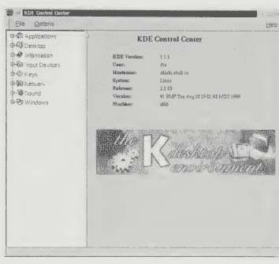

图 5.8 KDE 控制中心。

### 5.8.1 应用程序
应用程序类别允许您更改重要 KDE 程序的行为：登录管理器、文件管理器、Web 浏览器和面板。

登录管理器是系统在等待您登录时向您打招呼的图形登录屏幕。请注意，只有 `root` 用户才能修改登录管理器的行为。

您可以更改登录管理器的外观，例如背景图像、登录标志和文本字体。您还可以要求登录管理器不显示用户列表。默认情况下，登录管理器会显示用户列表，这使登录更容易：您只需点击您的用户名即可。但是，显示系统中所有用户的名称存在安全风险，我建议关闭此显示功能。

文件管理器的配置模块允许您选择文件管理器显示的字体和颜色。您还可以选择默认的终端程序和文本编辑器。

Web 浏览器的配置模块允许您配置 Web 浏览器。如果您使用代理服务器，可以在这里填写代理信息。您还可以配置 Web 浏览器如何处理 `cookie`。

**注意**

`Cookies` 是从 Web 服务器发送的信息片段，允许它们跨会话追踪您的 Web 访问。有些人认为这是对隐私的侵犯，但我不认为接受 `cookies` 会造成多大危害。

面板的配置模块允许您配置面板和任务栏在屏幕上的位置、面板的大小，以及当未使用时面板和任务栏是否“自动隐藏”。您还可以将虚拟桌面的数量从默认的四位更改为二、四、六或八。

### 5.8.2 桌面
桌面类别允许您更改桌面的整体外观。您可以更改桌面背景，使其为纯色、颜色渐变或壁纸图像。

“边框”选项允许您设置活动桌面边框。这些设置使 KDE 在鼠标指针“推”桌面边缘时自动切换桌面。您还可以设置吸附区域，使窗口整齐地吸附到屏幕边缘以及彼此之间。请尝试操作以了解设置的效果。

“颜色和字体”选项允许您更改 KDE 用于装饰窗口的颜色和字体。符合 KDE 规范的应用程序会遵守您在此处选择的颜色和字体设置，但非 KDE 的 `X` 程序可能会选择自己的配色方案和字体。

“桌面图标”选项允许您控制桌面图标的放置方式。您可以指定水平和垂直间距网格以及文本颜色。您还可以设置透明图标标签，效果相当不错。

如果您安装了主 `CD-ROM` 上 `contrib` 目录中的 `kdesktop` 软件包，“主题管理器”选项将允许您选择 KDE 主题。这些主题会极大地改变 KDE 的外观，使您可以使其看起来像 `Windows 98` 那样乏味，或像高科技街机游戏那样令人兴奋。KDE 主题是另一个有趣的“生产力杀手”。

“语言”选项允许您选择应用程序的默认语言。如果您是双语或多语言使用者，可以选择最多三种语言。由于某些应用程序未翻译为所有语言，您可以选择多种语言，以增加应用程序选择您能理解的语言的可能性。

“屏幕保护程序”选项允许您设置 KDE 屏幕保护程序，包括其启动前的延迟、显示的精美图形以及是否受密码保护。

最后，**样式**选项允许您选择 KDE 控件是否以 `Windows 95` 或 `Motif` 样式绘制。如果安装了 KDE 主题，**主题管理器**选项将使**样式**选项变得过时。

### 5.8.3 信息
**信息**类别显示有关 `Linux` 系统许多方面的信息。这些信息包括哪些设备具有内核驱动程序；哪些 `DMA` 通道、`I/O` 端口和中断正在使用；内存使用情况；文件系统分区；`PCI` 总线设备；处理器信息；`SCSI` 信息，等等。其中大部分信息可通过 `/proc` 文件系统访问，但 KDE 控制中心以更吸引人且易懂的格式呈现这些信息。

### 5.8.4 输入设备
**输入设备**类别允许您配置键盘和鼠标。如果您拥有非英语键盘，**国际键盘**选项允许您从大约四种不同的国际键盘布局中进行选择。**键盘**选项允许您控制键盘的其他方面，例如按键重复和按键点击音量。（请注意，并非所有计算机都支持键盘点击声——谢天谢地。）

**鼠标**选项允许您控制鼠标加速和按钮映射。如果您是左撇子，您可能希望让鼠标右键表现为按钮 1。

> **注意**
>
> 鼠标加速是指快速移动鼠标时，通过软件加速鼠标运动。这种加速使大幅度运动更高效，同时保持小幅度运动的精确度。

### 5.8.5 按键
**按键**类别允许您修改 KDE 的键盘快捷键。**全局按键**选项编辑在桌面级别起作用的全局按键（例如切换虚拟桌面的按键），而**标准按键**选项编辑每个应用程序的标准按键，例如剪切和粘贴快捷键。

### 5.8.6 网络
**网络**类别内容较少，仅包含一个**Talk 配置**选项。此选项使 KDE 能够对 `UNIX` `talk` 程序做出反应，通过播放声音并打开终端窗口来响应。要使用此功能，您需要运行 `ktalkd` 守护进程。但是，默认的 `Caldera OpenLinux` 设置不使用 `ktalkd` 守护进程。如果您有兴趣进行设置，请按 `Talk` 配置模块上的**帮助**以查看在线帮助。

### 5.8.7 声音
声音类别允许您控制系统声音。“铃声”选项允许您设置系统蜂鸣音的音量、音调和持续时间。请注意，并非所有系统都能更改蜂鸣音的音量或音调。

“系统声音”选项允许您将声音与各种事件关联，例如打开或关闭窗口、注销等。每当您执行与匹配声音相关的操作时，KDE 窗口管理器就会播放该声音。起初这很有趣，但很快就会变得烦人。

### 5.8.8 窗口
最后，窗口类别允许您更改 KDE 窗口的行为。您可以更改诸如窗口标题栏中出现哪些按钮以及哪些按键可以穿越窗口列表等设置。

此类别还允许您更改窗口对鼠标点击的反应。例如，如果您希望标题栏中的按钮 2 提升窗口而不是按钮 1，您可以如此配置。

此类别中有很多配置选项，但它们都很直观。花几分钟时间四处摸索，看看如何配置您的系统。

## 5.9 一些 KDE 应用程序
既然已经涵盖了 KDE 本身的基础知识，让我们来看看一些 KDE 应用程序。KDE 应用程序是理解 KDE 约定并遵循 KDE 用户界面指南的普通 `X Window` 应用程序。这意味着 KDE 应用程序可以使用拖放交换数据，它们具有一致的用户界面和类似的快捷键，并且它们都具有统一的外观。

## 5.9.1 KDE 软件包管理器
KDE 软件包管理器是 `RPM` 软件包管理系统的图形化前端。（`RPM` 在第 7 章中有详细描述。）

要启动 KDE 软件包管理器，在 `shell` 提示符下输入 `kpackage`。或者，从文件管理器点击一个 `.rpm` 文件。`kpackage` 窗口将显示（图 5.9）。

图 5.9 KDE 软件包管理器。

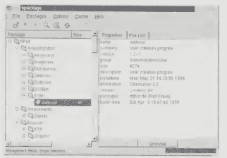

`kpackage` 将所有已安装的软件包组织成一个层次结构。您可以在左侧窗口窗格中查看该层次结构。单击箭头以展开或折叠子树。

当您将层次结构向下浏览至实际软件包后，单击该软件包以查看其属性。这些属性包括软件包名称、版本、摘要、大小和描述。单击“文件列表”选项卡可获取该软件包拥有的所有文件列表。

如果您在查看软件包时点击“卸载”，该软件包将从系统中移除。

如果您打开一个 `.rpm` 文件（通过“文件: 打开”或从文件管理器中拖放文件），`kpackage` 会提供安装该软件的选项。它会列出软件包属性以及该软件包将安装的所有文件。单击“安装”以安装该软件包。

**注意**

安装软件包需要 `root` 权限。如果您以非 `root` 用户身份运行并单击文件管理器中的 `.rpm` 文件，系统会提示您输入 `root` 密码，以便您可以以 `root` 身份运行 `kpackage`。如果您不想以 `root` 身份运行 `kpackage`，而只是想检查 `RPM`，请从命令行启动 `kpackage`，并使用“文件: 打开”打开 `RPM`，或者从文件管理器拖放它。

使用菜单项“文件: 打开 URL”，甚至可以打开指向 `RPM` 软件包的 `HTTP` 或 `FTP` URL，并从 `kpackage` 安装它。这使得您可以轻松通过互联网更新系统。

KDE 软件包管理器还有许多用于操作软件包的功能：有关更多详细信息，请参阅 KDE 软件包管理器的帮助页面。

## 5.9.2 KDE 任务管理器
KDE 任务管理器是 `ps` 命令的图形化版本，同时也是系统负载的良好显示方式。要启动 KDE 任务管理器，请从 K 菜单中选择“系统: 任务管理器”，或在 `shell` 提示符下输入 `ktop`。任务管理器打开后，显示一个进程列表（图 5.10）。

图 5.10 KDE 任务管理器（进程列表）

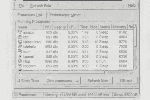

从该窗口，您可以执行以下操作：

- 激活“显示树”以开启面向树的进程显示。这将显示进程的父进程和子进程。
- 选择“自己的进程”、“用户进程”、“系统进程”或“所有进程”之一，以控制显示哪些进程。
- 通过单击进程来突出显示它。然后您可以单击“终止任务”来终止它。您可以向下拉“进程”菜单对选定的进程执行其他操作。这允许您更改进程的优先级或发送除 `KILL` 以外的信号。
- 单击表格标题以按该标题对进程进行排序。例如，您可以单击“内存”标题按内存使用情况对进程进行排序。请注意，由于父子关系会覆盖排序标准，此排序在树模式下无法正常工作。

“性能仪表”选项卡显示您计算机的 `CPU` 使用率和内存使用率统计信息。如图 5.11 所示，显示由一对条形图组成，大约每秒更新一次。

图 5.11 KDE 任务管理器（性能仪表）。

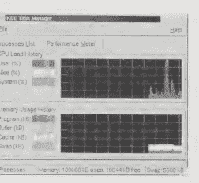

`CPU` 负载历史面板将 `CPU` 使用率分为三类：

- **用户**：执行用户代码（换句话说，实际应用程序代码）所花费的 `CPU` 时间百分比。
- **Nice**：“nice” 进程（即优先级低于正常优先级的进程）使用的 `CPU` 时间百分比。
- **系统**：用于执行系统调用的 `CPU` 时间百分比。这是在内核内部执行所花费的时间。

内存使用率历史面板将内存使用率分为四类：

- **程序**：应用程序使用的内存。
- **缓冲区**：内核缓冲区为内部目的使用的内存。
- **缓存**：内核用于缓存文件系统访问的内存。内核缓存这些访问以提高性能。如果应用程序需要额外的内存，内核会按需缩小文件系统缓存。
- **交换**：已被写入磁盘的内存页面所占用的空间。如果系统内存不足，它会交换部分页面到磁盘。这种实践允许系统运行比当前内存容量更多的进程；然而，过多的交换会减慢系统速度，并可能使其实际上不可用。

## 5.9.3 KDE 图像查看器
KDE 图像查看器允许您查看 `GIF`、`JPEG`、`TIFF`、`PNG` 及其他图像。不幸的是，（截至 KDE 版本 1.1.1）它的文档非常糟糕，因此在线帮助毫无用处。

要启动 KDE 图像查看器，请在 `shell` 提示符下输入 `kview`，或单击 KDE 文件管理器中的图像。或者，从 K 菜单中选择“图形: 图像查看器”。图 5.12 显示了包含图像的图像查看器窗口。

图 5.12 KDE 图像查看器。


要查看图像，请使用“文件: 打开”打开它，或从文件管理器拖放图像文件。当图像在内存中时，您可以使用一些简单的图像处理操作来操纵它。

要更改图像大小，请从“缩放”菜单中选择一个条目。您可以缩小或放大图像。要将图像恰好适应窗口，请选择“缩放: 最大/纵横比”。这会在保持原始纵横比的同时，使图像尽可能大且适应窗口。

“变换”菜单允许您旋转和镜像图像。您可以顺时针或逆时针旋转，以及水平或垂直镜像。

“到桌面”菜单允许您将图像放置到桌面上。菜单中的各个条目控制图像在桌面上的平铺方式。请注意，如果您已配置 KDE 使用壁纸图像，`kview` 放置的图像在切换虚拟桌面时将丢失。

“滤镜”菜单允许您对图像执行简单的滤波处理。要更改图像亮度，请选择“强度: 亮度”并输入一个数字。大于 100 的数字会使图像变亮，小于 100 的数字会使图像变暗。

要更改图像的 `gamma` 响应，请选择“强度: Gamma 校正”并输入一个 `gamma` 值。大于 1 的值倾向于使图像变亮并增强图像暗部中特征的区分度，同时减少亮部的细节。小于 1 的值则完全相反——图像变暗，且暗部的细节被抑制。

要将彩色图像转换为灰度图像，请选择“滤镜: 灰度”。最后，“滤镜: 平滑”使图像平滑。没有关于如何执行平滑的文档，但它似乎是通过线性模糊滤镜进行的。该滤镜将每个像素替换为围绕该像素（包括原始像素）的九个像素的平均值。

您可以使用 `kview` 打开许多图像文件，既可以在命令行上提供文件名，也可以将图像拖放到查看器窗口。“图像”菜单允许您操纵 `kview` 已知的图像列表。您甚至可以启动幻灯片模式，依次显示图像。如果各种图像是电影的帧，您可以将 `kview` 作为原始电影查看器使用。

## 5.10 总结
本章概述了 K 桌面环境。您学习了桌面的布局以及如何执行基本操作，如打开、关闭、移动和调整窗口大小。您了解了三个最重要的 KDE 应用程序——提供窗口按钮和装饰的窗口管理器；提供 K 菜单、各种应用程序启动按钮以及任务栏的面板；以及允许您导航文件系统和浏览互联网的 KDE 文件管理器。

接下来，您学习了 KDE 控制中心，它允许您自定义 KDE 的所有方面。最后，我们介绍了三个示例 KDE 应用程序：KDE 软件包管理器、KDE 任务管理器和 KDE 图像查看器。这三个应用程序说明了 KDE 应用程序的运作方式。我鼓励您探索 K 菜单，发现许多其他 KDE 应用程序。

# 6 文本编辑器

## 6.1 本章内容
- `vi` 136
- `XEmacs` 155

`Caldera OpenLinux` 附带了几种不同的文本编辑器，适合完成不同的任务。在本章中，我们将讨论其中的两种：`vi`（发音为 vee-eye）和 `XEmacs`（发音为 ex-ee-max）。

`vi` 和 `XEmacs` 都是常见的编辑器，且历史悠久，但 `vi` 是事实上的标准编辑器，包含在所有 `UNIX` 实现中。在使用其他版本的 `UNIX` 时，如果生活中没有其他确定的事情，你几乎可以肯定 `vi` 始终会在那里支持你。

`vi` 和 `XEmacs` 的行为都与大多数现代文本编辑器不太一样。`vi` 是在一个不同的时代编写的，那时图形用户界面（`GUI`）尚未普及；而 `XEmacs` 最初基于 `Emacs`，`Emacs` 是比 `vi` 更近代的编辑器，但仍然是为在终端窗口或控制台上运行而开发的。这并不意味着它们应该被淘汰并落伍。鉴于 `vi` 几乎无处不在，学习其基础知识是一个好主意，绝对对你有利。此外，如果你曾经需要从崩溃中救援系统并从命令行编辑配置文件（别担心，那一天终将到来），当使用救援软盘启动时，`vi` 很可能将是唯一可用的编辑器。

虽然 `XEmacs` 的行为可能与你习惯的不同，但它是一个功能强大的编辑器，也是 `Linux` 或 `UNIX` 下可免费使用的最佳编辑器之一。

## 6.2 vi
如果你是 `Linux` 和 `UNIX` 的新手，`vi` 可能会让你感到震惊。尽管有大量可用的文本编辑器，其中许多是带有图形用户界面的新编辑器，但 `vi` 是最常见和最广泛使用的，或者至少是最广泛可用的。

`vi` 令人震惊的原因是因为它的工作方式不像你期望的现代编辑器那样。`vi` 并不是*完全*不像任何带有 `GUI` 的 `Windows` 或其他现代编辑器。`vi` 是一个基于文本的编辑器，旨在在终端窗口或从控制台运行。它也是在与我们今天习惯的世界和范式不同的环境中设计的。这使得它看起来奇怪且难以使用。

但不要害怕！如果你想的话，大部分时间你可以不用 `vi` 也能应付。然而，它有时会非常实用，甚至必不可少。它在文本文件中导航、搜索和替换文本以及进行快速编辑方面非常方便。它也是编程的绝佳编辑器（许多老程序员都推崇它！）。我主要用它来对配置文件等事物进行快速更改（在使用 `Linux` 的生活中，你肯定会经常看到它们）。我发现，直接输入 `vi /thefile/Iwant/to/edit` 并做我想做的事，往往比通过菜单找到我想要的编辑器、等待其启动，然后通过文件对话框找到我想编辑的文件要简单和快速得多。

有时 `vi` 也是你唯一的选择。比如，当你需要从救援软盘启动系统并修改配置文件以修复某些问题时。在这种情况下，救援软盘的创建者可能只包含了 `vi`。

如前所述，你可以过一种快乐且富有成效的生活而不使用 `vi`，但如果你了解 `vi` 的基础知识，当陷入困境时你就能使用它。然而请注意，你只有通过实际使用才能学会有效地使用它。在阅读相关讨论时，试着尝试一下。使用那些命令。即使你不想一直使用它，稍加练习也能帮助你熟悉操作并避免日后的大量挫败感。

## 6.3 简史
在讨论如何使用 `vi` 之前，让我们看看它的起源。这有助于你理解为什么它的工作方式与大多数现代编辑器不同。

有趣的是，值得注意的是，当 `vi` 被编写时，它几乎是此前所有成果的集大成者。它是顶级的、尖端的技术。这是因为 `vi` 是在我们刚从电传终端中恢复过来的时期编写的——电传终端类似于连接在计算机上的打字机，早餐时吞噬成卷的纸带。

在电传终端上编辑文件没有简单的方法。你所能做的基本上就是打印一行，向行编辑器输入命令让它进行所需的更改，然后再次打印以查看是否正确。由于你在打印的页面上查看所有输出，没有光标可以移动。因此，你必须指定你想更改的单词以及要更改为什么。例如，如果你不小心将 `the` 输入为 `hte`，你会使用类似这样的命令来修复它：

```
:substitute/hte/the/
```

在电传终端之后，出现了 `CRT`（阴极射线管）。然而，最早的 `CRT` 只允许编辑当前行，除了你终于可以直接编辑行这一事实外，情况并没有好多少。下一代 `CRT` 通过允许光标在整个屏幕上移动来解决这个问题，为屏幕编辑器铺平了道路。然后 `vi` 诞生了。`vi` 是一个屏幕编辑器；然而，它还包括许多旧命令和行编辑器的功能。通过这种方式，习惯旧编辑器的人仍然感觉自在，并可以继续过着快乐和富有成效的生活。

## 6.4 编辑模式
`vi` 运行于两种编辑模式之一：**命令模式**和*插入模式*。当 `vi` 处于命令模式时，它准备接受并执行命令。任何按键都被解释为命令，并且不会显示在文本中。命令执行某些编辑功能，在文件中移动你，并将 `vi` 切换到插入模式。大多数命令是单个按键，但有些是两个或多个键的组合。当你按下命令的键时，在大多数情况下，`vi` 只会执行命令，而不会将你输入的键回显到屏幕上。当然，也有例外，我们稍后会讲到。


Bill Joy（`vi` 之父）在创建 `vi` 的命令集时试图使用助记符。例如，`i` 代表插入（insert）。他还试图使用暗示含义的字符。例如，右大括号（`}`）将你移动到段落末尾，而左大括号（`{`）将你移动到段落开头。学习 `vi` 的一部分就是学习像 `vi` 那样思考。很快，你会学会“逆向”思考，并将其与字母 `b` 联系起来，而不是想到像“左”这样完全不同的东西。随着使用，一切都来得很快。

当 `vi` 处于插入模式时，它将按键解释为要放入文件中的文本。你输入的内容都会显示在屏幕上，并对你的文件进行更改，正如你所期望的那样。通过按 `Esc` 键退出插入模式并返回命令模式。

通常，在编辑会话期间，你会频繁地在命令模式和插入模式之间切换。始终知道你处于哪种模式非常重要。很容易开始输入文本，以为自己在插入模式，结果发现自己处于命令模式，并且 `vi` 对你的文件进行了你并不想要的更改。当然，有办法撤销这些更改，所以当你遇到这种情况时不要恐慌。

## 运行 vi

要使用 `vi` 创建新文件，只需在命令行输入 `vi`，后跟新文件的名称。图 6.1 显示了 `vi` 在终端窗口中运行一个新空文件 `newFile` 的屏幕截图。光标是左上角的方块，所有的波浪号（`~~~`）代表空行，或者更确切地说，是文件末尾之后的行。也就是说，如果你有一个只有六行的文件，六行之后没有内容显示，所以 `vi` 打印波浪号让你知道六行之后没有其他内容。最后一行用作某种状态行，你在那里输入某些编辑命令。默认情况下，`vi` 以命令模式启动。

### 提示

`vi` 实际上不会在你保存之前创建新文件。因此，如果你在没有输入任何文本，或者没有保存已输入文本的情况下退出 `vi`，该文件将不会被创建。当你误输入想要编辑的现有文件名，而 `vi` 认为你要创建一个新文件时，这种情况经常会发生。

类似地，要编辑一个已经存在的文件，你只需在命令行上输入该文件的名称：

```
$ vi anExistingFile
```

然后 `vi` 会将文件加载到缓冲区中并显示出来。如果你只输入一个简单的文件名，不带任何斜杠（`/`），`vi` 将在当前目录中查找或创建该文件。如果你想编辑不同目录中的文件，则需要包含文件的路径。图 6.2 展示了 `vi` 打开文件 `/etc/printcap` 后看起来的样子。

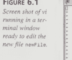


## 保存文件和退出 vi

有很多方法可以保存你的文件并退出 `vi`。有些命令允许你同时执行这两个操作，而另一些则允许你将这两个操作组合在一起。表 6.1 列出了这些方法中最常见的一些。

| 命令 | 助记符 | 描述 |
| :--- | :--- | :--- |
| `:w` | Write | 保存文件 |
| `:w!` | Write | 强制 `vi` 保存文件 |
| `:w newName` | Write | 将文件另存为 `newName` |
| `ZZ` | — | 保存文件并退出 |
| `:wq` | Write/quit | 保存文件并退出 |
| `:q` | Quit | 退出 `vi` |
| `:q!` | Quit | 不保存更改直接退出 `vi` |

> **注意**
>
> 要使用表 6.1 中列出的任何命令，`vi` 必须处于命令模式。如果未处于该模式，请按 `Esc` 键切换到命令模式。

以冒号（`:`）开头的命令是 `ex` 命令。`ex` 是一种旧的行编辑器，而 `vi` 是 `ex` 的超集，因此所有有效的 `ex` 命令在 `vi` 中也都有效。当你输入冒号时，光标会移动到屏幕的左下角，并显示你输入的命令。除非你按下 `Enter` 键，否则该命令不会执行。这适用于所有 `ex` 命令。`vi` 命令在你按下该命令的按键时立即执行，并且不会在屏幕上显示。因此，例如，`:w` 只有在按下 `Enter` 键后才会执行，而 `ZZ` 会在你按下第二个 `Z` 时立即执行。

感叹号（`!`）告诉 `vi` 你真的希望它执行你指示的操作。对于这些命令，你需要在两种情况下使用感叹号。如果文件的权限设置导致你没有写权限，你需要使用 `:w!`。通常，如果你没有写权限，并尝试执行不带感叹号的 `:w`，`vi` 会告诉你它无法写入文件，然后就停止了。感叹号告诉它无论如何都要尝试写入文件。但是请注意，这仅在你拥有该文件所有权的情况下才有效。如果你不拥有该文件，无论你在命令中添加多少感叹号，都无法写入！当你在做了不打算保存的更改后想要退出 `vi` 时，请使用 `:q!`。如果你做了更改并仅尝试使用 `:q` 退出，`vi` 会告诉你有未保存的更改，并且不会退出。

`vi` 还允许通过指定要保存范围的起始行和结束行号来保存文件的部分内容。它会保存指定两行之间的所有内容，包括这两行本身。你使用以下命令来完成此操作：

```
:first_line, last_line w newName
```

其中 `first_line` 和 `last_line` 是行号或可用于指定特定范围的特殊字符。例如，句号（`.`）表示当前行（即光标所在的行），而美元符号（`$`）表示文件的最后一行。`newName` 是要保存到的文件的名称。注意命令中 `last_line` 后面的 `w`。这不是打字错误。它是写命令。

#### 提示

- 若要查看你所在的行以及其他一些信息，请按 `Ctrl+G`。
- 若要转到特定行，请使用 `:line_number` 命令。例如，`:25` 会将你带到文件的第 25 行。
- 若要让 `vi` 在屏幕左侧显示行号，请使用 `:set number` 命令。你可以使用 `:set nonumber` 命令再次关闭它们。

表 6.2 列出了保存文件部分内容的几个示例。

#### 表 6.2 保存文件部分内容的示例

| 命令 | 操作 |
| :--- | :--- |
| `:25,50w newFile` | 将第 25 行至第 50 行保存到文件 `newFile`。 |
| `:.,50w newFile` | 从当前行到第 50 行的所有内容保存到文件 `newFile`。 |
| `:1.,w newFile` | 从文件开头到当前行的所有内容保存到文件 `newFile`。 |
| `:50,$w newFile` | 从第 50 行到文件末尾的所有内容保存到文件 `newFile`。 |

如果你不想将所选部分保存到新文件，你可以将其保存到当前文件，但需要稍微更改命令。不要在命令末尾指定文件名，而是在 `w` 后添加一个感叹号。这告诉 `vi` 你真的只想保存文件的一部分，丢弃其余部分。例如，要仅保存文件的第 10 行至第 100 行，你会使用以下命令：

```
: 10, 100w!
```

如果你忘记添加感叹号，`vi` 将不会保存文件，但会告诉你需要使用感叹号才能仅保存文件的一部分。

##### 在文件中移动

`vi` 有许多命令可帮助你在文件中移动。不同移动命令的数量乍一看可能显得多余，但如果你学会了它们，它们会非常有用，并使编辑变得更加轻松和快速。

最简单、最基本的移动方式就是使用方向键以及 `Page Up` 和 `Page Down` 键。在大多数情况下，它们的表现符合你的预期。但是请注意，你无法移动到行末之外，当你尝试时，光标不会自动换行到下一行。例如，如果光标位于行末，而你按下右箭头键，`vi` 只会发出蜂鸣声（就好像你应该知道得更好一些似的）。

##### 注意

你可以在命令模式和输入模式下使用方向键、`Page Up` 和 `Page Down` 键进行移动。但是，所有其他移动命令只能在命令模式下使用。

##### 注意

随 `OpenLinux` 提供的 `vi` 版本实际上是一个增强版本，拥有比通用 `vi` 更多的功能。在大多数情况下，我们将讨论几乎在任何版本的 `vi` 中都能找到的功能，但你可能会发现其他版本的 `vi` 不具备你习惯使用的功能，或者行为略有不同。例如，许多版本的 `vi` 不允许使用方向键、`Page Up` 和 `Page Down` 键。因此，你仍应学习基本的光标移动命令。

当你无法使用方向键进行移动，或者想要更快地移动时，请使用 `vi` 命令。一般来说，与使用方向键相比，使用 `vi` 命令可以更快、更轻松地进行移动，因为 `vi` 命令允许你以跳跃的方式移动到特定类型的位置，而不仅仅是逐字符或逐行移动。例如，`w` 将光标移动到下一个单词的开头，而 `]` 将光标移动到当前段落的末尾。表 6.3 总结了 `vi` 的大多数移动命令。以下部分将简要描述每个命令。

#### 表 6.3 vi 移动命令

| 命令 | 助记符 | 移动... |
| :--- | :--- | :--- |
| `h` | — | 光标向左移动一个空格。 |
| `j` | — | 光标向下移动一个空格。 |
| `k` | — | 光标向上移动一个空格。 |
| `l` | — | 光标向右移动一个空格。 |
| `w` | Word | 光标移动到下一个单词的开头。 |
| `W` | Word | 光标移动到下一个单词的开头，忽略符号和标点。 |
| `e` | End | 光标移动到当前单词的末尾（如果光标位于空白区域或单词末尾，则移动到下一个单词的末尾）。 |
| `E` | End | 光标移动到当前单词的末尾，忽略符号和标点（如果光标位于空白区域或单词末尾，则移动到下一个单词的末尾）。 |
| `b` | Backward | 光标移动到当前单词的开头（如果光标位于空白区域或单词开头，则移动到上一个单词的开头）。 |
| `B` | Backward | 光标移动到当前单词的开头，忽略符号和标点（如果光标位于空白区域或单词开头，则移动到上一个单词的开头）。 |
| `0 (zero)` | — | 光标移动到行首。 |
| `^` | — | 光标移动到行上的第一个非空字符。 |
| `Enter key` | — | 光标移动到下一行行首。 |
| `$` | — | 光标移动到当前行行末。 |
| `+` | — | 光标移动到下一行的第一个非空字符。 |
| `-` | — | 光标移动到上一行的第一个非空字符。 |

#### 表 6.3 续

| 命令 | 助记符 | 移动... |
| :--- | :--- | :--- |
| `(` | — | 光标移动至当前句子的开头（如果光标位于空白区域或句子开头，则移动至上一句）。 |
| `)` | — | 光标移动至当前句子的末尾（如果光标位于空白区域或句子末尾，则移动至下一句）。 |
| `{` | — | 光标移动至当前段落的开头（如果光标位于空白区域或段落开头，则移动至上一段）。 |
| `}` | — | 光标移动至当前段落的末尾（如果光标位于空白区域或段落末尾，则移动至下一段）。 |
| `H` | Home | 光标移动至屏幕上的第一行。 |
| `M` | Middle | 光标移动至屏幕上的中间行。 |
| `L` | Last | 光标移动至屏幕上的最后一行。 |
| `nH` | — | 光标移动至屏幕上第一行下方的第 `n` 行（不会越过屏幕上的最后一行）。 |
| `nL` | — | 光标移动至屏幕上最后一行上方的第 `n` 行（不会越过屏幕上的最顶行）。 |
| `nG` | Go | 光标移动至第 `n` 行。 |
| `;n` | — | 光标移动至第 `n` 行。 |
| `Ctrl+F` | Forward | 向前翻屏。 |
| `Ctrl+B` | Backward | 向后翻屏。 |
| `Ctrl+D` | Down | 向前半屏。 |
| `Ctrl+U` | Up | 向后半屏。 |
| `Ctrl+E` | Expose | 向上滚动一行。 |
| `Ctrl+Y` | — | 向下滚动一行。 |

> **提示**
>
> 你可以通过在命令前加上需要重复的次数，来告诉 `vi` 重复执行某个命令指定次数。例如，如果你想让光标向前移动三个单词，你可以输入 `3w`，这实际上是将 `w` 命令重复执行三次。

### 一次移动一个空格

要向左或向右移动一个空格，请使用命令 `h` 和 `l`。要向上或向下移动一个空格，请使用命令 `j` 和 `k`。`h` 让你向左移动一个空格，而 `l` 让你向右移动一个空格。`j` 让你向下移动一个空格，而 `k` 让你向上移动一个空格。

这些键并没有真正的助记符，但记住这些移动键都集中在键盘的一个区域可能会很有帮助。最左边和最右边的键分别让你向左和向右移动，而中间的键则让你向下和向上移动。即使你忘记了 `j` 是让你向下还是向上移动，记住那个让你向下移动的键位于该组中间，也能让你完成 50% 的记忆。一旦你尝试过，你就会知道方向。如果需要，你可以再走另一个方向。

### 一次移动一个单词

有六个命令可以一次移动一个单词：`w`, `W`, `e`, `E`, `b`, 和 `B`。注意，小写字母和大写字母代表不同的命令。`vi` 对大小写敏感。

这些命令使用两种不同的单词定义。第一种定义将单词视为字母或符号的连续组合。当该组合结束时，单词边界出现。这意味着 `asdf` 被视为一个单词，`e#$%` 也是。然而，`asdf@#$%hijk l` 被视为三个单词，因为第一个字母组在第一个符号处结束，而符号组（被视为一个单词）在字母 `h` 处结束。这也意味着标点符号将被视为单词。因此，在短语 `bye, bye.` 中，实际上有四个单词；`bye` 占了两个，逗号和句号占另外两个。

单词的第二种定义指出，单词是字母和符号的任何集合，并且单词在下一个空白字符（或者如果你处于文件最后一个单词，则在文件末尾）处终止。

小写字母使用第一种定义，大写字母使用第二种定义。`w` 和 `W` 让你移动至下一个单词的开头。`e` 和 `E` 让你移动至下一个单词的末尾（如果光标位于单词内除末尾外的其他位置，则移动至当前单词的末尾）。`b` 和 `B` 让你移动至上一个单词的开头（如果光标位于单词内除开头外的其他位置，则移动至当前单词的开头）。

### 一次移动一行

有两种类型的行命令——一种将你移动至当前行开头的某个点或行尾的某个点，另一种将你移动至上一个或下一行开头的某个点。我说“开头的某个点”，是因为有些命令会将你移动至行首的最开始，而另一些会将你移动至行上的第一个非空白字符。一行定义为回车符之间的文本。如果自动换行（autowrap）关闭，一行可以跨越屏幕上的多个物理行。如果开启，`vi` 将在 80 个字符处（通常是屏幕边缘）自动插入回车符。默认情况下它是关闭的。

在第一组中，我们有 `0`（零），它移动你至当前行的开头。`^` 移动你至当前行的第一个非空白字符（即忽略空格和制表符）。`$` 移动你至当前行的末尾。

在第二组中，我们有 `Enter` 键，它移动你至下一行的开头。`+` 移动你至下一行的第一个非空白字符，`-` 移动你至上一个行的第一个非空白字符。

### 一次移动一个句子或段落

为了更加便利，`vi` 甚至可以一次移动一个句子或段落。这在编辑英语文本时最为方便，或者更准确地说，是普通文本。`vi` 通过寻找句号后跟随的空白空间，或如果找不到句号则寻找空白行来找到句子的末尾。`vi` 通过寻找下一个空白行来找到下一个段落。因此，段落是两条空白线之间的所有文本（或在文件开头或末尾，是空白线之前或之后的文本）。

`( ` 移动你至上一个句子的开头（如果光标位于句子内除开头外的其他位置，则移动至当前句子的开头），`) ` 移动你至下一个句子的开头。`{` 移动你至上一个段落的开头（如果光标位于段落内除开头外的其他位置，则移动至当前段落的开头），`}` 移动你至下一个段落的开头。

### 在屏幕上移动

五个命令允许你方便地移动至屏幕上的常见行，或相对于屏幕顶行或底行的某个位置。`H` 将光标移动至屏幕第一行的开头。`M` 将光标移动至屏幕中间行，`L` 将光标移动至屏幕最后一行。`nH` 将光标移动至顶行下方第 `n` 行的开头。例如，`7H` 会将光标移动至顶行下方第 7 行的开头。因此，如果顶行是文件的第一行，光标现在将位于第 8 行。`nL` 将光标移动至底行上方第 `n` 行的开头，与前面的命令类似。

### 移动至特定行

你可以使用以下两个命令之一来移动至文件中的特定行：`nG` 或 `:n`，其中 `n` 是你想要移动到的行号。因此，若要移动至第 123 行，你可以输入 `123G` 或 `:123`。请注意，第二个命令需要按 `Enter` 键，因为它是一个 `ex` 命令，而第一个命令在你按下 `G` 时立即执行。

### 向上或向下滚动屏幕

你可以以整屏、半屏或一次一行的增量来滚动屏幕（你正在查看的文件部分）。`Ctrl+F` 和 `Ctrl+B` 分别向前和向后滚动整个屏幕。`Ctrl+D` 和 `Ctrl+U` 分别向前和向后半屏。`Ctrl+Y` 和 `Ctrl+E` 分别向前和向下一行。

### 通过搜索文本移动

你还可以通过搜索文本模式来在文件中移动。要向前搜索文本模式，请使用以下命令：

```
/pattern
```

`pattern` 是你想要搜索的文本或字母数字模式。当你输入命令时，它会显示在屏幕底部。因此，尽管这不是 `ex` 命令，你仍需按 `Enter` 键完成它。基本上，你在屏幕底部输入的所有命令都是按 `Enter` 键完成的。

你可以使用以下命令向后搜索：

```
?pattern
```

如果你在文件末尾向前搜索，`vi` 会自动循环搜索并从头开始。同样，如果你在文件开头向后搜索，`vi` 会循环到文件末尾并继续搜索。如果没有找到匹配项，`vi` 会给出提示。

要重复搜索并移动至下一个匹配项，你只需使用 `/` 或 `?` 而无需重新输入文本模式。`vi` 会记住之前搜索的内容，并从当前位置再次执行相同的搜索。你也可以使用 `vi` 命令 `n` 和 `N`，它们分别执行与 `/` 和 `?` 相同的功能。`/` 和 `n` 向前搜索下一个匹配项，`?` 和 `N` 向后搜索下一个匹配项。

你还可以在搜索中使用通配符。例如，星号（`*`）将匹配零个或多个字母数字字符。因此，如果你想查找文件中所有以 `th` 开头的单词（我不知道你为什么想这样做，但假设你确实想这么做），你会使用以下命令：

```
/th*
```

这将匹配像 `the`, `this`, `that`, 和 `think` 这样的单词。表 6.4 描述了一些可供你使用的通配符。


### 表 6.4 搜索中常用的通配符

| 通配符 | 表示... |
|----------|---------------|
| `.` | 任意单个字符 |
| `*` | 零个或多个字符 |


| `[ ... ]` | 括号内的任意字符（例如，`[xyz]` 将匹配 `x`、`y` 或 `z` 中的任意一个） |
| `[ ... , .]` | 指定范围内的任意字符（例如，`[a-z]` 将匹配从 `a` 到 `z` 之间的任意单个字符） |

如果你只想查找行首或行尾的文本模式，请分别使用脱字符（`^`）和美元符号（`$`）。脱字符放置在文本模式之前，告诉 `vi` 只有当该文本位于行首时才视为匹配。例如，如果你正在编辑一个包含姓名和电话号码的列表，其中姓氏位于行的开头，而你想跳转到姓氏以 `P` 开头的部分，可以使用以下命令：

```
/^P
```

这将带你到下一行，该行中 `P` 是第一个字符。请注意，就本命令而言，空白字符（空格和制表符）也被视为字符，因此如果 `P` 前面有一个空格，则不会匹配。

美元符号放置在要匹配的文本模式之后，告诉 `vi` 只有当该文本位于行尾时才视为匹配。例如，假设你有一个国际地址列表，所有信息都排列在列中，国家名位于最后一列。如果你想找到下一个住在德国的人，可以使用以下命令：

```
/Germany$
```

你还可以组合使用脱字符和美元符号，以查找仅包含该文本模式的行。例如，以下命令将搜索仅包含单词 `this` 的行：

```
/^this$
```

因此，如果你的文件内容如下：

```
this
this & that
```

第一个 `this` 会匹配，但第二个不会。

## 编辑文件

既然你可以轻松地在任何位置移动，我们就能开始做更有趣的事情——比如实际编辑文件。有无数用于编辑文件的命令——本章无法深入涵盖所有细节——因此我们将只讨论你更常使用的那些常见命令。

请记住，许多这些命令会将 `vi` 切换到输入模式，这意味着你输入的所有内容都会插入（或放置）到文本中。当你准备再次使用某些命令来执行其他编辑任务或移动时，你需要按 `Esc` 键将 `vi` 切换回命令模式。

## 插入文本

要插入文本，你需要切换到插入模式。表 6.5 列出了一些将 `vi` 切换到插入模式的常用命令。这些命令之间的主要区别在于哪里开始插入文本。

### 表 6.5 切换到插入模式的命令

| 命令 | 助记符 | 描述 |
|---|---|---|
| `i` | Insert | 在光标前插入文本。 |
| `I` | Insert | 在行首插入文本。 |
| `a` | Append | 在光标后插入文本。 |
| `A` | Append | 在行尾插入文本。 |
| `o` | Open | 在当前行下方打开新行，并在新行开头插入文本。 |
| `O` | Open | 在当前行上方打开新行，并在新行开头插入文本。 |

`i` 和 `a` 命令的主要区别仅在于 `i` 使文本插入到光标当前位置之前，而 `a` 使文本插入到光标当前位置之后。例如，如果光标在字母 `t` 上，使用 `i` 命令，你可以输入 `ca` 来组成单词 `cat`。如果使用 `a` 命令，你可以输入 `ar` 来组成单词 `tar`。

你可能会想，“嗯，有什么区别呢？你完全可以只将光标移到 `t` 之后，使用 `i` 命令并输入 `ar` 来得到 `tar`。” 这在大多数情况下是正确的。虽然你可能大多数时候都可以这样做，但这两个命令的区别在两种情况下很重要。第一种情况是你位于有一行文本的行首，并希望在开头插入文本。你只能使用 `i`（或 `l`）命令，因为 `a` 命令将在第一个字符之后开始插入文本。同样，如果你位于文本行的末尾并希望在该行末尾追加一些文本，你必须使用 `a`（或 `A`）命令，因为 `i` 命令将在行尾最后一个字符之前插入文本。如果你想在空行上放置文本（例如，当你第一次向新文件添加文本时），使用哪个命令并不重要。

`I` 和 `A` 命令只是为了方便你而存在的。你可以通过移动到行的开头或结尾并使用相应的小写命令来实现相同的结果。

`o` 和 `O` 命令分别在当前行之后的和之前插入一个空白新行，并将光标放置在新行的开头，准备插入文本。与 `i` 和 `a` 命令一样，`o` 和 `O` 命令之间的区别在两种情况下变得重要。首先，如果你位于文件顶部，想在顶行之前插入一个空白行，你只能使用 `O` 命令。这将把其他所有内容向下移动，并在文件顶部留下一个空白新行。同样，如果你位于文件底部并想添加一个空白新行，你只能使用 `o` 命令。（实际上，这并不完全准确。你也可以在最后一行使用类似 `A` 的命令并按 `Enter` 键，但你不能对 `O` 命令这样做。）

## 更改和替换文本

`vi` 具有一些非常有用的命令用于更改和替换文本。例如，它允许你只替换一个单词、接下来的三个单词、直到句子末尾的所有内容，甚至直到段落末尾的所有内容。它还允许你替换单个字符或覆盖直到行尾的文本。表 6.6 总结了一些可能的情况。

### 表 6.6 更改和替换文本的命令

| 命令 | 助记符 | 描述 |
|---|---|---|
| `cw` | Change/word | 更改直到单词末尾的文本。 |
| `c^` | Change/— | 更改直到行首的文本。 |
| `c$` | Change/— | 更改直到行末的文本。 |
| `c)` | Change/— | 更改直到句子末尾的文本。 |
| `c}` | Change/— | 更改直到段落末尾的文本。 |
| `3cw` | 3 times/change/— | 更改接下来的三个单词。 |
| `r` | Replace | 用下一个输入的字符替换光标下的字符。 |
| `R` | Replace | 覆盖光标下的文本。 |

当你使用更改命令时，`vi` 会删除相应数量的文本并进入插入模式，以便你可以输入新文本。例如，要更改一个单词，将光标放置在该单词的开头并使用 `cw` 命令。`vi` 将删除光标处的单词并进入输入模式。然后你可以输入要替换旧单词的新单词。不过，你并不限于只输入一个单词。你可以输入任意多的内容。`vi` 的行为就像你删除了该单词本身，然后使用 `i` 命令进入输入模式一样。

你可以通过将光标放在想要更改的单词的第一个字符上并使用 `cw` 命令来更改单词的一部分。`vi` 将删除从光标到单词末尾的所有内容，并像以前一样进入输入模式。其他更改命令的行为类似。

有时你只想更改一个字符。最简单的做法是使用替换命令 `r`。要替换一个字符，将光标放在它上面，按 `r` 键，然后按你要用来替换它的字符。`vi` 在此命令中保持在命令模式。

`R` 命令使 `vi` 进入替换模式，这基本上等同于其他文本编辑器和文字处理器中的覆写模式。当你将 `vi` 放入替换模式时，你输入的任何一个字符都会替换光标下的文本。对于 `OpenLinux` 附带的 `vi` 版本，你可以使用方向键四处移动并替换文件不同部分的文本，而无需先让 `vi` 进入命令模式。然而，有一点需要注意的是，按 `Enter` 键不会简单地带你到下一行，而是在光标处插入一个回车符。

## 替换文本

`vi` 的一个强大功能是能够根据文本模式（相当于查找和替换）搜索并替换文本。例如，你可以用一条简单命令告诉它用单词 `dog` 替换单词 `cat` 的每一次出现。`vi` 使用 `x` 替换（`s`）命令来完成此操作。此命令的最简单形式如下：

```
:s/old_text/new_text
```


#### 提示

你应该会在表 6.6 列出的命令中看到一些熟悉的字符及其熟悉的含义。请注意，更改命令是一个多部分命令。`c` 表示“我想更改某些内容”，而紧随其后的字母或字符告诉它你想更改什么。你可以将 `c` 命令与所有移动命令一起使用，以指定你想更改的内容。

这将把当前行中的第一个 `old_text` 替换为 `new_text`。例如，如果你的某一行是：

```
Our cat fought with the neighbor's cat.
```

而你意识到你养的不是猫而是狗，你可以使用以下命令替换第一个 `cat` 实例：

```
:s/cat/dog
```

这将得到以下行：

```
Our dog fought with the neighbor's cat.
```

现在，如果你想把该行中所有 `cat` 都替换为 `dog`，你需要在替换命令的末尾添加 `/g`（全局）符号，如下所示：

```
:s/cat/dog/g
```

这将得到以下行：

```
Our dog fought with the neighbor's dog.
```

但是等等！还有更多功能！你可以指定你希望替换命令作用的行范围（甚至整个文件！）。要指定行范围，请使用此命令：

```
:first_line,second_line s/old_text/new_text
```

与只保存文件的一部分时一样，你可以使用句号 (`.`) 来表示当前行，使用美元符号 (`$`) 来表示文件中的最后一行。例如，要在从当前行到文件末尾的每一行中将第一个 `cat` 替换为 `dog`，你可以使用以下命令：

```
.,$ s/cat/dog
```

要指定整个文件，你使用此命令：

```
:%s/old_text/new_text
```

如前所述，如果在末尾没有 `/g`，这些命令只会替换指定的每一行中的第一个 `old_text`。为了替换 `old_text` 的所有出现，你需要在替换命令的末尾添加 `/g`。

例如，如果你正在写一篇英文论文，并且得知老师会因为说“`we was`”而不是“`we were`”而扣分，你可以使用以下命令将文件中所有“`we was`”替换为“`we were`”：

```
:%s/we was/we were/g
```

能够进行全局替换是一个非常实用的功能；然而，你需要小心，否则可能会得到意外的结果。例如，当你在论文中将 "we was" 替换为 "we were" 时，如果你在那里某处写了 "we washed"，`vi` 会将 "we was" 匹配到 "we washed" 的前半部分，并将其更改为 "we wereherd"！不过，有一些有效的方法可以解决这个问题。一种方法是让 `vi` 在执行替换前进行确认。这样，你可以看到它是否会弄乱某些东西，并在不执行该情况下的替换时告知它。你可以通过在命令末尾添加 `c` 来告诉 `vi` 确认替换：

```
:s/old_text/new_text/c
```

你仍然可以指定行和全局替换，同时要求它确认替换。例如，为了避免 "we washed" 的问题，你可以使用此命令：

```
:s/we was/we were/gc
```

当它找到匹配项时，`vi` 会给你一个响应的机会。按 `y`、`n`、`a` 或 `q` 分别表示是、否、全部和退出。

## 删除文本

要删除文本，你使用 `delete` 命令，即 `d`。`delete` 命令的工作原理与 `change` 命令非常相似，你可以将其与所有移动命令结合使用以指定要删除的内容。例如，要删除一个句子，你需要将光标放在句子开头并按 `d`。表 6.7 列出了一些常见的 `delete` 命令组合。表 6.8 列出了一些其他常见的文本删除命令。

### 表 6.7 常见的 Delete/移动命令组合

| 命令 | 删除... |
| :--- | :--- |
| `dw` | 到单词结尾（此命令还将删除单词后的任何空白字符） |
| `d0` (零) | 到行首 |
| `d$` | 到行尾 |
| `3dw` | 接下来的三个单词 |
| `3d1` | 接下来的三个字母 |

### 表 6.8 其他常见的删除命令

| 命令 | 删除... |
| :--- | :--- |
| `x` | 光标下的字符 |
| `X` | 光标前的字符 |
| `6x` | 接下来的六个字符（包括光标下的那个） |
| `dd` | 整个当前行 |
| `4dd` | 接下来的四行（当前行及其后的三行） |
| `D` | 从光标到行尾的所有内容 |

注意，`dd` 不仅仅是清除当前行的文本，它实际上会完全移除该行，使其下方的所有内容上移一行。

#### 剪切、复制和粘贴

`vi` 没有你可能习惯看到的剪切、复制和粘贴机制。相反，每当你删除某些内容时，`vi` 会将其存储在一个缓冲区中，然后你可以使用 `put` 命令之一（`p` 和 `P`）将其粘贴到任何你想要的位置。`p` 将删除（剪切）的文本粘贴在光标之后，而 `P` 将其粘贴在光标之前。

例如，如果你有两行顺序错误的内容，你可以使用 `dd` 命令删除第一行，将光标移动到第二行下面的那一行，然后使用 `P` 命令将其放在第二行之后。

要复制文本，使用 `yank` 命令，即 `y`。`yank` 命令的工作方式与 `delete` 命令非常相似，只是它不会以任何方式更改文本。它只是将指定的文本放入缓冲区，该缓冲区可以使用 `put` 命令之一粘贴到任何你想要的位置。与 `delete` 命令一样，你可以将 `yank` 命令与任何移动命令结合使用以指定要 `yank` 的内容。有一些特殊的 `yank` 命令不是 `y` 与移动命令的组合。例如，`yy` 将整个当前行 `yank` 到缓冲区，而 `Y` 将从光标到行尾的所有内容 `yank`（类似于 `y$`）。表 6.9 列出了一些常见的 `yank` 命令组合。

### 表 6.9 常见的 Yank 命令组合

| 命令 | Yank... |
| :--- | :--- |
| `yw` | 到单词结尾（此命令还将 `yank` 单词后的任何空白字符） |
| `y0` (零) | 从光标到行首的所有内容 |
| `y$` | 从光标到行尾的所有内容 |
| `y)` | 到句子结尾的所有内容 |
| `y}` | 到段落结尾的所有内容 |
| `yy` | 整个当前行 |
| `Y` | 与 `yy` 相同 |

## 合并行

偶尔你会想要合并行；换句话说，你想把下面一行的文本拉上来与当前行的末尾连接。在许多文本编辑器中，你只需将光标放在上一行的末尾并按 `Delete` 键即可做到这一点，`vi` 并非如此工作。如果你移动到行尾并尝试使用例如 `x` 命令删除字符，你只会删除该行的最后一个字符。相反，`vi` 有一个特殊的命令用于合并两行，即 `J`。将光标放在第一行，只需按 `J`。这将把下面一行的内容合并到第一行的末尾。

## 撤销和重做命令

`vi` 有两个撤销命令，它们的作用方式略有不同。一个是 `u` 命令，它撤销最后执行的命令。注意，这可能涉及很多内容。例如，如果你使用 `insert` 命令输入一个段落，然后按 `Esc` 键返回命令模式，对于 `u` 来说，撤销最后一个命令意味着删除你刚才输入的所有文本（即整个段落）。你可以执行多次撤销。`Ctrl+R` 重新执行使用 `u` 命令撤销的最后一条命令。你可以执行多次重做。

另一个撤销命令是 `U`，它撤销在最后一次编辑的行上进行的所有编辑。再次按 `U` 将重新执行这些编辑。一旦你开始在另一行上工作，`U` 命令将只适用于你正在编辑的新行。然而，你仍然可以使用 `u` 命令回到另一行进行修改。

## XEmacs

`XEmacs` 是一个功能强大且高度可配置的编辑器，可以通过使用你用 `Lisp` 编程语言编写的模块进行自定义。如果你愿意，你可以配置 `XEmacs` 为你烤吐司。`XEmacs` 比旧的 `Emacs` 编辑器更进一步，它提供了图形用户界面并添加了许多不同的功能和函数，例如针对不同类型文件的语法高亮显示。这使得 `XEmacs` 在编程和编写 `shell` 脚本时非常有用。`XEmacs` 还互联网就绪，内置了 `Web` 浏览器以及电子邮件和新闻客户端。甚至——它还有游戏！

`XEmacs` 与 `vi` 相似，你可以使用键盘命令以高级方式移动和编辑文本。然而，通常你并不需要大多数命令。例如，有命令可以每次向前或向后移动一个词、句子、段落或一页，但你也可以使用箭头键或用鼠标将光标定位到你想放置的位置。它的行为也更像你对现代编辑器的预期，你不必像使用 `vi` 那样担心处于输入模式还是命令模式。你可以随时随意点击并编辑文本。在大多数情况下，你不必太担心那些命令，但如果你想了解它们（例如在控制台上以 `Emacs` 模拟模式运行 `XEmacs` 时，它们可能很有用），你可以在启动 `XEmacs` 后按 `Ctrl-h` 然后按 `t` 来浏览边学边做的 `Emacs` 教程。

在我们开始讨论如何使用 `XEmacs` 之前，让我们先定义几个概念，以便清晰区分它们。首先，缓冲区（`buffer`）是包含你正在编辑文本的内存区域。其次，框架（`frame`）是 `XEmacs` 运行的窗口——即传统 `Windows` 和 `Macintosh` 意义上的窗口。第三，窗口（`window`）是 `XEmacs` 内部显示缓冲区的编辑空间。如果你在框架内有一个第二窗口，你将在传统窗口内看到两个编辑空间。图 6.3 对此进行了说明。

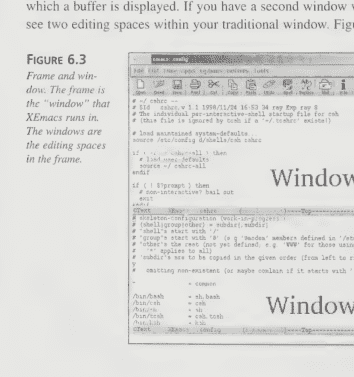

### 启动 XEmacs

从命令行启动 `XEmacs` 非常简单。只需键入 `xemacs &` 然后按 `Enter` 键。这会在后台启动 `XEmacs`，以便你可以继续将终端用于其他事情。图 6.4 显示了启动时 `XEmacs` 的外观。如果你的屏幕小于 1024 × 768，你可能需要调整大小，因为它启动时可能太高了。

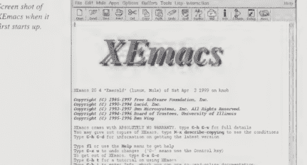

你还可以通过在命令行中简单添加文件名，使其准备好编辑一个文件（新的或现有的）：

```
$ xemacs myFile &
```

从框架的顶部到底部，你可以看到菜单栏、工具栏、编辑窗口、模式行和回显行。菜单主要只是提供便捷的快捷键，用于你可以键入的键盘命令。对于许多菜单项，键盘命令显示在菜单项的右侧。工具栏提供了更多常用命令的快捷键。


模式行为你提供在关联窗口中发生事件的描述。从左到右，模式行包含以下信息。首先，`{1508}` 是 XEmacs 正在使用的语言环境。其次，两个空格表示文件是否已被修改，或者它是否为只读。当未修改且非只读时，你只看到短横线（`-`）。如果已修改，你会看到两个星号（`*`）。如果缓冲区是只读的，你会看到两个百分号（`%`）。第三，是正在编辑的缓冲区名称。在这种情况下，正在编辑的是缓冲区 `scratch`。这个缓冲区始终存在，可以用作草稿纸，顾名思义。第四，XEmacs 正在运行的主要模式和次要模式，以 `(*主要* *次要*)` 的形式在括号间给出。在这种情况下，它是 Lisp 交互模式。XEmacs 可以运行在几种模式中，这将在后面讨论。最后是缓冲区中的位置。如果你正在查看缓冲区的全部内容，则显示 `All`（全部）。如果你正在查看文件顶部，则显示 `Top`（顶部）。同样，如果你正在查看文件底部，则显示 `Bot`（底部）。否则，显示屏幕顶部上方的文件百分比（例如，`10%`）。

回显行用于向你打印错误消息和其他信息。它也是 XEmacs 显示你为命令输入的文本的地方。

### 打开和创建文件

在 XEmacs 中打开文件有几种不同的方法，关于它们在哪里打开也有几个不同的选项。XEmacs 允许你同时编辑几个文件。你可以打开一个框架，通过从“缓冲区”菜单中选择要查看的那个来一次查看一个文件，或者你可以在单独的框架或窗口中查看你的文件，或者这些的任何组合。

打开文件最简单的方法是点击工具栏上的“打开”按钮。这会弹出一个如图 6.5 所示的对话框窗口，允许你选择要打开的文件。当对话框窗口首次出现时，当前目录的所有内容都会列出。目录列在左侧，所有文件列在右侧。底部是一个区域，你输入的任何内容都会显示在那里。

如果你想使用鼠标在目录结构中移动或选择文件，你可以用`中`鼠标按钮点击你想移动的目录或你想打开的文件（用左键点击不会像预期那样选择鼠标下的文件或目录）。你不需要双击。立即点击目录后，文件对话框窗口会切换到该目录并列出其所有内容。立即点击文件后，XEmacs 会打开该文件。默认情况下，文件在主框架的当前窗口中显示。

#### 图 6.5

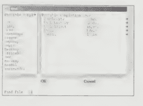

打开文件的对话框窗口。目录显示在左侧，文件显示在右侧。当前路径显示在窗口底部，你输入的任何文本也显示在那里。

你也可以直接键入文件名，如有必要包括其路径。按 `Enter` 键或点击“确定”按钮将打开文件。

#### 提示

XEmacs 具有一个在你输入文件名称时非常实用的功能。如果你只输入第一个字符（或你想输入的部分），然后按空格键，XEmacs 会为你完成文件或目录的名称。如果存在多个可能的补全，它将尽可能完成名称，然后在右侧的文件区域中列出所有可能的补全。如果补全结果是目录，则文件对话框窗口将切换到该目录并列出其内容。当你找到想要的文件后，按 `Enter` 键或点击“确定”按钮将关闭对话框窗口并打开文件。

你也可以从文件菜单中打开文件。你有三个选项用于打开文件进行编辑，一个选项用于将文件插入当前缓冲区，还有一个用于仅查看文件（即，以只读方式打开）。第一个选项“打开...”的工作方式与点击“打开”按钮相同。第二个选项“在其他窗口中打开...”将在当前框架内创建一个新窗口（类似于图 6.3）并在新窗口中打开文件。“在新框架中打开...”将创建一个新框架并在那里打开文件。“插入文件...”将选定的文件插入到当前缓冲区的光标位置。“查看文件...”仅用于查看打开文件，并允许你使用熟悉的 `more` 命令、`空格`键和 `b` 键向前和向后翻页。按 `q` 键将关闭文件。

#### 提示

如果你在窗口中打开文件（即在框架中可见两个或更多窗口），你可以通过点击你要使其可见的缓冲区的窗口并使用命令 `Ctrl+× 1` 来返回到仅使用一个窗口。这将关闭所有其他窗口，并使用框架中所有的空闲空间来显示所选缓冲区。

要创建一个新文件，你必须经过与打开文件相同的过程，只不过你输入新文件的名称。这创建了一个用于编辑该文件的新缓冲区。然而，实际文件只有在保存时才会创建。

##### 注意

当 XEmacs 在终端窗口或控制台上模拟 Emacs 时，你可以使用 `Ctrl+× Ctrl+f` 命令打开文件或创建新文件。这允许你在终端窗口或屏幕底部的回显行中键入文件名。

### 保存文件和退出 XEmacs

要保存文件，你只需点击工具栏上的“保存”按钮，或从文件菜单中选择“保存 `*文件名*`”，其中 `*文件名*` 是当前缓冲区的名称。如果你想将缓冲区保存为新文件，请从文件菜单中选择“另存为...”。XEmacs 随后会弹出一个文件对话框框，你可以输入想要保存到的文件名称。

要退出 XEmacs，只需从文件菜单中选择“退出...”，或者如果你的窗口管理器设置为显示一个按钮，点击该按钮让窗口管理器关闭窗口。如果有已修改但未保存的缓冲区，XEmacs 将显示一个对话框框询问是否应该保存它们。如果你愿意，你也可以在那时取消操作并继续工作。

##### 注意

你也可以使用 Emacs 命令 `Ctrl+× Ctrl+s` 和 `Ctrl+× Ctrl+w` 分别来保存和另存为文件。你可以使用命令 `Ctrl+× Ctrl+c` 来退出。

### 不退出 XEmacs 而关闭文件

如果您已完成文件的编辑，并希望在不退出 XEmacs 的情况下关闭该文件，请从文件菜单中选择 `Delete Buffer *文件名*`。这并不会删除该文件，只是清除在编辑期间用于存储该文件的内存空间。该文件将不再显示在缓冲区菜单中。

### 文件在磁盘上发生变更时更新缓冲区

如果您正在查看或编辑的文件在磁盘上发生了更改，您可以通过选择 `Revert Buffer *文件名*` 来更新缓冲区，以显示最新版本。这将重新加载文件并刷新缓冲区。

### 编辑缓冲区

文件被打开到缓冲区中，或为新建文件创建了新的缓冲区后，您可以直接在窗口中编辑该缓冲区。对于基本编辑操作，XEmacs 的表现基本符合您的预期。不过，有几点需要注意。

在许多编辑器中，您可以选中某些文本，然后按 `Delete` 或 `Backspace` 键将其删除。XEmacs 的工作方式并非如此。如果您用鼠标选中某些文本并按下 `Delete` 或 `Backspace` 键，XEmacs 实际上只是删除光标前或光标处的字符（如果光标是竖线，则删除光标后的字符），就好像文本未被选中一样。`Delete` 键删除光标后或光标处的字符，而 `Backspace` 键删除光标前的字符。同样，您不能选中某些文本并开始输入，期望选中的文本会被正在输入的新文本替换。相反，它只会开始在光标所在处插入文本。通常，您只会将鼠标选中与剪切和复制操作配合使用。

此外，某些编辑器允许您点击任意位置并从该点开始编辑，如有必要会用空格填充该行。XEmacs 不允许这样做。如果您点击某一行最后一个字符之后的位置（这可以是一个空白字符，就像任何其他字符一样），XEmacs 只会将光标放置在该字符处或其之后。同样，如果您点击缓冲区末端之后的位置，XEmacs 只会将光标放置在缓冲区末尾（即缓冲区中最后一个字符之后）。

XEmacs 的行为也可能因其所处的模式不同而与您预期的不同。许多不同的模式会对 XEmacs 的某些方面进行自定义，使其更便于用于特定目的。例如，当 XEmacs 处于 C 语言模式时，它会被定制以协助更易于、更快地进行 C 语言编程。实现这一点的一种方式是根据大括号的位置以及前一行是否已结束（即构成一个完整的 C 语句还是在另一行继续）进行自动缩进。为了帮助重新格式化未良好缩进的 C 文件，如果您将光标放在该行的任意位置并按下 `Tab` 键，XEmacs 将根据其周围环境正确缩进该行。它不会插入 `Tab` 字符，这与大多数其他程序不同。这是一个不错的功能，因为要重新格式化整个文件，您只需从顶部开始，在每一非空行按 `Tab` 键向下操作即可。如果觉得这太冗长且繁琐，您可以记录一个宏来为您完成此操作（如果您愿意的话）。

#### 剪切、复制和粘贴

XEmacs 具有一些用于处理文本的高级功能，包括复制和移动。不过，大多数时候，您只是想简单地剪切、复制或粘贴文本。最简单的方法是选中您要复制或粘贴的文本，然后点击工具栏上的相应按钮。然后您可以将光标定位到您想要粘贴的位置，并点击粘贴按钮。

> **提示**
>
> 若要快速复制文本，您只需像往常一样用鼠标选中它，然后使用鼠标中键点击您想要粘贴的位置。请注意，这与使用复制按钮处理文本的方式并不完全相同。如果您选中某些文本，点击复制按钮，然后选中其他文本，点击粘贴按钮将粘贴`第一个`选中的文本，而使用鼠标中键点击将粘贴`其他`选中的文本。

#### 搜索和替换文本

XEmacs 允许您使用 `Ctrl+s` 和 `Ctrl+r` 分别向前或向后搜索文本。当您发出命令时，回显区会出现“向前增量搜索”或“向后增量搜索”（反向搜索）的提示。然后您可以输入要搜索的文本，这些文本也会显示在回显区。当您输入时，XEmacs 会立即开始搜索您输入的文本，从光标位置开始。它会突出显示找到的任何匹配项。若要再次搜索下一个匹配项，只需再次发出该命令。在进行向前或反向搜索时，XEmacs 不会环绕至文件的开头或结尾。一旦到达文件的任一端，搜索将失败。

搜索完成后，您可以通过几种不同的方式退出。若要退出并返回光标的原始位置，您可以按 `Ctrl+g`。如果您想移动到当前匹配项的位置，您可以按 `Enter`，或者使用鼠标左键点击您希望光标所在的位置。

> **注意**
>
> 默认情况下，XEmacs 中的所有搜索都是不区分大小写的。因此，字符串 `"cat"` 将匹配 `"cat"`、`"Cat"` 和 `"CAT"`。您可以通过在选项菜单中选择 **Editing Options** 项目下的 **Case Sensitive Search** 来更改此行为。

> **提示**
>
> 如果不想让 XEmacs 执行增量搜索（即边输入边搜索），您可以让它仅在输入完整个字符串后进行搜索，方法是先按 `Ctrl+s`，然后输入搜索字符串。在您输入完搜索字符串并按下 `Enter` 后，XEmacs 将开始搜索。反向搜索也适用相同的操作过程。

若要搜索和替换文本，您可以使用 `Esc+&`（按 `Esc`，然后按 `Shift+5` 以输入 `&`）。当您发出命令时，回显窗口中会出现“查询替换：”。然后您可以输入要替换的文本并按 `Enter`。回显区中的文本随后会变为“查询替换旧文本：”。然后您输入新文本，再次按 `Enter`。随后 XEmacs 会从光标位置开始向前搜索，直到找到与 `old_text` 匹配的内容。找到后，它会询问您是否应替换它。按 `y` 将导致替换，按 `n` 将导致跳过。按 `!` 将导致替换所有剩余匹配项而不提示您，而按 `q` 将导致停止搜索和替换，但不替换当前匹配项。

### 编辑模式

XEmacs 最出色的特点之一是它具有语言敏感性。它具有若干主要模式和次要模式，可根据不同种类文本的编辑需求定制其操作。例如，有针对 C、Lisp、Emacs Lisp、英文文本等的主要模式。对于任何特定缓冲区，XEmacs 一次只能处于一种主要模式。有许多次要模式提供某些功能，您可以随时将其开启或关闭。XEmacs 可以同时启用多个次要模式。

#### 主要模式

打开文件时，XEmacs 通常可以根据其扩展名判断文件类型，并进入相应的模式。例如，如果您打开文件 `main.c`，它将识别出这是一个 C 语言文件并进入 C 语言模式。如果它未正确识别文件或未进入您期望的模式，您可以按 `Esc+x`，然后输入要切换到的模式名称，从而手动设置模式。当前缓冲区的主要模式列在模式行的括号中。表 6.10 列出了可用的部分主要模式。

**表 6.10 部分 XEmacs 主要模式**

| 模式 | 描述 |
| :--- | :--- |
| `fundamental-mode` | 这是启动 XEmacs 时的默认模式。它没有特殊功能或按键绑定。 |
| `nroff-mode` | 此模式用于在格式化之前编辑 `nroff` 文件。它重新定义了一些缩进命令。 |
| `tex-mode` | 此模式用于编辑 LaTeX 源文件。它添加了插入引号、大括号和其他字符的命令。它还可以帮助良好地格式化文件以便打印。 |
| `outline-mode` | 此模式用于编辑大纲。它允许您使文本的某些部分不可见，以便查看文档的整体结构。 |
| `c-mode` | 此模式用于编辑 C 源文件。它重新定义了缩进命令并执行语法高亮——这是一个非常有用的功能。 |
| `c++-mode` | 这与 `c-mode` 类似，但用于 C++ 源文件。 |
| `lisp-mode` | 此模式用于编辑 Lisp 源文件。 |
| `fortran-mode` | 此模式用于编辑 Fortran 源文件。它添加了用于移动和缩进的特殊命令。 |
| `asm-mode` | 此模式用于编辑汇编源文件。 |

> **提示**
>
> 您可以通过在帮助菜单的 **Commands and Keys** 菜单项下选择 **Mode** 来获取有关当前所处模式的信息。

#### 次要模式

次要模式提供可随意开启或关闭的可选功能。您可以与任何主要模式配合使用任意数量的次要模式。您使用与主要模式相同的命令来开启和关闭次要模式。如果该模式处于关闭状态，则发出命令将开启它。再次发出相同命令将再次关闭它。简而言之，该命令只是切换次要模式的开/关状态。部分活跃的次要模式列在模式行上主要模式的旁边。表 6.11 列出了可用的部分次要模式。

| 模式 | 描述 |
| :--- | :--- |
| `font-lock-mode`（字体锁定模式） | 此模式根据文本类型以不同的颜色和字体显示文本。您也可以从选项菜单中的“语法高亮”菜单项切换此模式。 |
| `auto-fill-mode`（自动填充模式） | 此模式启用自动换行。 |
| `overwrite-mode`（覆盖模式） | 此模式使文本在输入新文本时被覆盖，而不是向右移动。您可以通过“插入”按钮或从选项菜单切换此模式。 |
| `auto-save-mode`（自动保存模式） | 此选项使您当前正在编辑的缓冲区定期自动保存。如果您不习惯经常保存工作，此选项是必须的。 |
| `line-number-mode`（行号模式） | 此模式使光标所在的行号在模式行中连续显示。 |
| `blink-paren`（括号闪烁） | 当您将光标放置在括号、花括号或方括号旁边时，此模式将导致 XEmacs 使匹配的括号、花括号或方括号闪烁。这对于确定 C 等语言中代码块的边界非常有用，并且在编辑 Lisp 等语言时几乎是保持理智的必需品。（在此模式行上没有“`-mode`”字样。） |

### 使用多窗口

XEmacs 允许您在单个框架内使用多个窗口。我们已经提到过，您可以将文件打开到新的窗口。您还可以随时创建新窗口并关闭它们。使用窗口，您可以在单个框架中编辑多个文件，或者您可以在同一缓冲区的不同位置进行编辑。例如，您可以创建第二个窗口并为每个窗口选择相同的缓冲区。然后，您可以在编辑一个区域的同时查看文档的另一个区域。如果文档的相同区域在两个窗口中都可见，您将在一个窗口中做的更改也会出现在另一个窗口中。每个窗口都有自己的模式行和回显区。表 6.12 列出了用于处理窗口的一些命令。

**表 6.12**

| 命令 | 描述 |
| :--- | :--- |
| `Ctrl+X 0`（零） | 关闭选定的窗口。如果当前窗口是框架中唯一的窗口，则框架也会关闭，除非它是打开的唯一框架。 |
| `Ctrl+x 1`（一） | 关闭除选定窗口外的所有窗口。 |
| `Ctrl+x 2` | 将当前窗口分割为两个窗口，一个在上，一个在下。两个窗口都将显示相同的缓冲区。包含光标的窗口是`选定窗口`。您可以从缓冲区菜单中选择所需的缓冲区来更改特定窗口的缓冲区。 |
| `Ctrl+3` | 将当前窗口分割为两个窗口，一个在左，一个在右。 |

### 获取更多信息

在本节中，我们仅涵盖了使用 XEmacs 的基础知识。在大多数情况下，这应该足以让您开始有效地使用它。XEmacs 是一个具有许多功能的大型程序，花点时间浏览用户手册和参考手册将使您受益。您可以在 `http://www.xemacs.org/` 找到这些以及更多相关信息。

###### 摘要

在本章中，您学习了如何在 `vi` 中执行以下操作：

- 启动和停止它
- 创建新文件和打开现有文件
- 保存文件的部分或全部内容
- 高效地移动
- 插入、删除和更改文本
- 查找和替换文本
- 将两行合并为一行
- 撤销命令

您还学习了如何在 XEmacs 中执行以下操作：

- 启动和停止它
- 创建新文件以及打开和关闭现有文件
- 处理多个文件
- 剪切、复制和粘贴文本
- 查找和替换文本
- 更改主要模式
- 启用和禁用次要模式
- 使用多窗口


## 系统管理

## 部分

**在本部分中**

- 7 使用 RPM 进行软件管理 171
- 8 设置文件系统 185
- 9 打印 209
- 10 OpenLinux 管理工具 231
- 11 设置 TCP/IP 网络 267
- 12 设置 DNS——域名系统 293
- 13 配置 PPP 307
- 14 配置 NIS——网络信息系统 325
- 15 配置 NFS——网络文件系统 339
- 16 配置 Samba 349
- 17 NetWare 集成 367
- 18 配置 Apache 395
- 19 邮件服务 419
- 20 互联网新闻 459
- 21 IP 防火墙和伪装 477
- 22 运行代理 507
- 23 执行备份和还原 529
- 24 保护 Linux 安全 549

#### 第 7 章

## 使用 RPM 进行软件管理

**在本章中**

- 安装新软件包 172
- 卸载软件包 177
- 升级已安装软件包 179
- 获取软件包信息 180

随 Caldera OpenLinux 提供的所有软件都存储在 RPM 软件包中（通常称为 RPMs）。RPM 软件包是文件存档，其中包含有关存档的额外信息，包括软件包名称、描述、软件版本号、对其他软件包和文件的依赖关系以及其他信息。Red Hat 软件包管理器（`rpm`）用于安装、升级、删除、验证软件包以及获取软件包信息。


每个已安装软件包的信息都存储在一个数据库中。这些信息包括软件包中的文件列表以及随软件包存储的所有信息。`rpm` 使用数据库中的信息，以便您可以干净地卸载软件包，或验证自软件包安装以来，软件包中的所有文件是否未更改或未丢失。当然，您可以始终安装您编译的软件或来自“tarballs”（压缩包）的软件。但是，如果您能找到并将使用所需的 RPM 软件包，您可以使系统更干净、更有条理，并使卸载某些内容或进行其他更改变得更容易。学会使用 `rpm`；它是您的朋友。

`rpm` 有 10 种操作模式，每种都有自己的命令行参数集。不同的模式包括安装、卸载、查询、验证、签名检查、构建、重建数据库、修复权限、设置所有者和组以及显示 RC。在本章中，我们仅讨论前三种模式，这些是您最可能使用的模式。

## 安装新软件包

在某个时候，您会遇到一个您绝对需要的程序，该程序在 OpenLinux 2.2 安装时未安装或未随发行版提供。好吧，您走运了。安装以 RPM 形式提供的新软件非常容易。您使用带有 `-i` 选项的它使 `rpm` 进入安装模式。这是安装软件包的一般命令行格式：

```
rpm -i [install-options] <package-file>+
```

`<package-file>+` 代表要安装的一个或多个软件包文件名。

软件包文件名由三部分组成。首先是软件包名称。其次是组装该软件包的目标架构。第三是 `.rpm` 扩展名，指示该文件是 RPM 软件包。

```
<package-name>.<architecture>.rpm
```

例如，软件包 `foo-1.2.i386.rpm` 是为基于 Intel 处理器的机器组装的 RPM 软件包 `foo-1.2`。

**注意**

> 您必须以 `root` 或超级用户身份登录才能安装、升级或删除软件包。

因此，要安装软件包 `foo-1.2.i386.rpm`，请输入以下命令：

```
rpm -i foo-1.2.i386.rpm
```

一般命令行格式末尾的 `+` 仅表示您可以通过在命令末尾放置要安装的每个软件包的名称来一次安装多个软件包。因此，如果您有软件包 `foo-1.2.i386.rpm` 和 `bar-3.4.i386.rpm`，您将使用以下命令：

```
rpm -i foo-1.2.i386.rpm bar-3.4.i386.rpm
```

您还可以使用 shell 识别的通配符安装多个存档，或通过尽可能少地键入名称来节省击键：

```
rpm -i foo*
```

**注意**

指定软件包文件的另一种美妙方式是使用 ftp URL。URL 的一般格式为：

```
ftp://<user>:<password>@hostname/path/to/package.rpm
```

`<user>` 代表您希望登录的用户名，`<password>` 代表要使用的密码。`hostname` 是要连接的主机。如果您省略 `<password>`，系统会提示输入密码。如果省略了 `<user>` 和 `<password>`，RPM 将使用匿名 ftp。请注意，在这种情况下，您还应该省略冒号（`:`）和 @ 符号（`@`）。

例如，假设您想在机器 `ftp.foo.bar.net` 上安装软件包 `foo-1.2.rpm`。如果它位于目录 `/pub/packages` 中，并且您可以使用匿名 ftp 访问它，您可以使用以下 URL 访问它：

```
ftp://ftp.foo.bar.net/pub/packages/foo-1.2.rpm
```

如果您的名字是 Susan，并且它位于您的主目录 `/home/susan` 中，您可以使用此 URL 访问它：

```
ftp://susan@ftp.foo.bar.net/home/susan/foo-1.2.rpm
```

在这种情况下，你没有提供密码，因此系统会提示你输入。出于安全原因（例如，这样可以防止你的密码出现在命令历史记录中），这种做法是首选的。但如果你不担心这个问题，你可以像这样将其包含在 URL 中：

```
ftp://susan:right0ftp.foobar.net/home/susan/foo-1.2.rpm
```

在安装、升级或查询软件包时，你可以使用 ftp URL。RPM 使用被动 ftp 来传输软件包。

### 软件包与文件依赖项

`rpm` 可以包含依赖项信息，指出在安装完成之前需要某些文件或软件包。这意味着每当你开始安装一个软件包时，`rpm` 都会检查以确保在安装尝试之前满足所有依赖项。如果它发现正在安装的安装包需要某个尚未安装的文件或软件包，它将报告错误并退出，而不安装该软件包。

#### 注意

`rpm` 仅检查数据库以查看是否已安装所需的软件包或文件。它不会检查文件是否实际存在。因此，如果你安装了一个软件包然后删除了其中一个文件，`rpm` 会表现得好像该文件仍然存在一样。同样，如果你从源代码编译了某个库并手动安装它，除非你之前已经安装了包含相同文件的软件包，否则 `rpm` 会表现得好像该库不存在一样并给你报错，即使文件实际上存在。

仅仅因为存在依赖项错误并不意味着你无法安装软件包。你应该查看错误并确定是否必须先安装另一个软件包。对于系统中未安装的库，最好的方法通常是找到该库的 RPM 并安装它。然后你可以尝试重新安装原始软件包。然而在某些情况下，你希望原封不动地安装软件包（即不对系统做其他更改，也就是不先安装其他软件包）。你可以通过在命令行中添加 `--nodeps` 选项来实现这一点，这告诉 `rpm` 忽略依赖项信息：

```
#### rpm -i --nodeps <package-file>*
```

想要这样做的理由有很多。一个例子可能是包含一个程序的两个版本的软件包：一个静态链接到 Motif，另一个动态链接到它。软件包会说它需要 Motif 库才能安装，但你可能没有 Motif 且不打算在近期安装。然而，由于软件包中有一个静态链接版本的程序，你可以直接使用那个版本。使用 `--nodeps` 选项允许你至少安装软件包，从而可以继续使用静态链接的程序。

让我们考虑另一个例子，你拥有一个软件包，它要求你从源代码编译并手动安装的库文件。由于该库文件不在 `rpm` 的数据库中，除非你告诉它忽略依赖项，否则 `rpm` 会认为该文件不存在并给出依赖项错误。

我在安装大量相互依赖的 RPM 时经常使用这个选项。例如，KDE 的 RPM 之间存在依赖关系，通常要求你按特定顺序安装它们。我只需将它们全部放在一个空目录中并执行以下命令：

```
#### rpm -i --nodeps *.rpm
```

这种方法节省了按通常要求的顺序安装软件包所需的所有打字工作。它只是按字母顺序安装它们，而不考虑已经安装了什么其他内容。

#### 注意

虽然这是一种安装大量软件包的便捷方法，但这可能并非推荐做法。软件包可以包含在安装软件包中的文件之前或之后执行的脚本。如果软件包 B 的正确安装依赖于软件包 A 的正确安装（因为安装脚本所做的某些事情），那么按错误顺序安装它们可能会导致问题。虽然我在以这种方式安装 KDE 时没有遇到问题，但没有保证你在以这种方式安装其他软件包时不会遇到问题。在做此类操作之前务必小心。先确保你知道自己在做什么。

#### 注意

有时你会遇到依赖项问题，因为软件包需要的库版本比你已安装的版本更旧。如果较新的库版本与较旧的版本在源代码和二进制代码上是兼容的，你通常可以通过简单地创建指向已安装库的符号链接来作弊，并按原样安装软件包。例如，我有一个软件包需要 `libtermcap.so.2`，而这并不随 OpenLinux 2.2 附带。事实证明 `libncurses.so.4.2` 在二进制上与 `libtermcap.so.2` 兼容（至少满足我的需要），所以我简单地创建了一个从 `/usr/lib/libtermcap.so.2` 到 `/lib/libncurses.so.4.2` 的符号链接，并运行 `ldconfig` 以更新动态链接器。

### 软件包与文件冲突

当 `rpm` 检查数据库中的软件包和文件依赖项时，它也会检查冲突。当你尝试安装已安装的软件包，或者当软件包包含由另一个软件包安装的文件时，就会发生冲突。当 `rpm` 发现冲突时，它会输出描述该冲突的错误消息并退出，而不安装软件包。如果你想安装已经安装过的软件包（即覆盖之前的安装），你可以使用 `--replacepkgs` 选项告诉 `rpm` 用你正在安装的软件包替换当前已安装的软件包：

```
#### rpm -i --replacepkgs <package-file>*
```

这里有一个你可能想使用此选项的情况。当你安装系统时，它安装了 C 库的某个版本。你决定通过从源代码编译更新版本来尝试将它们更新到更新的版本。于是你编译了库并用新文件替换了原始文件，而没有卸载它们所属的软件包。这样做之后，你会意识到自己在某个地方弄乱了，并决定要将原始文件恢复原状。于是你找到包含原始 C 库的 RPM 并尝试重新安装它。`rpm` 抱怨该软件包已经安装，并拒绝处理源代码。因此，你通过使用 `--replacepkgs` 选项迫使其服从，该选项允许你将弄乱的软件包替换为原始软件包。

如果存在文件冲突，并且你希望 `rpm` 用你试图安装的软件包中的文件替换这些文件，你可以使用 `--replacefiles` 选项：

```
#### rpm -i --replacefiles <package-file>*
```

`-force` 选项等同于同时指定 `--replacefiles` 和 `--replacepkgs` 选项：

```
#### rpm -i -force <package-file>*
```

#### 注意

在使用 `--replacefiles` 选项之前，请确保替换文件不会搞乱任何东西。例如，如果你的系统上安装的文件版本比正在安装的软件包提供的版本更新，那么依赖更新版本的程序可能会停止工作。一般来说，你可能不会遇到问题，但在过马路前请先看看（行事前先确认）。

### 首先检查潜在问题

如果你想在尝试安装特定 RPM 之前知道是否可能存在任何潜在冲突或问题，你可以使用 `--test` 选项告诉 `rpm` 不要实际安装该 RPM，而是仅检查并报告潜在的冲突或问题。这可能会为你省去不少麻烦。

```
#### rpm -i --test <package-file>+
```

## 卸载软件包

`rpm` 最棒的特点之一是它能够干净、轻松且安全地卸载程序。使用传统的软件安装方法，例如从 tar 归档包安装，甚至使用配置为安装软件的 `make` 和 Makefile，都会使卸载程序变得困难。如果你使用那些方法之一，通常必须找出所有文件并手动删除它们。（我认为我从未见过带有卸载目标的 Makefile。）这可能非常麻烦，甚至非常危险，因为你通常需要具备 `root` 权限才能这样做，而且作为 `root` 用户，你太容易误删错误的文件了。此外，由于 Linux 如此先进，当它删除一个文件时，它做得非常彻底——无论你怎么努力、请求、乞求或哭泣，你都拿不回来。

虽然你在卸载 RPM 时仍然需要小心，但使用 `rpm` 卸载软件通常比手动删除文件更安全。这是因为 `rpm` 跟踪你的所有文件，因此它知道哪些文件属于哪个软件包，并且只删除适当的文件。它还会执行类似于安装时进行的依赖项检查，只是在这种情况下，它会告诉你是否有其他软件包需要你想卸载的软件包中的文件（或软件包本身）。这些信息有助于防止你在不知道这样做会彻底搞乱系统的情况下卸载 C 库等关键组件。

例如，如果你尝试卸载 C 库（从完整安装的 OpenLinux 2.2 中的软件包 `glibc-2.1-3`），`rpm` 会向你展示一个包含 800 多个对软件包中文件依赖项的列表。它还会告诉你开发软件包

包 `glibc-devel-2.1-3` 依赖于 `glibc-2.1-3` 包。这是一个相当明显的迹象，表明除非你清楚自己在做什么，否则你最好不要删除该包！

要卸载 RPM 包，请使用带有 `-e` 选项（代表 `erase`，即擦除/删除）的 `rpm` 命令，使 `rpm` 进入卸载模式：

```bash
#### rpm -e [uninstall-options] <package-name>+
```

请注意，在 `rpm` 安装模式下，`<package-name>`（包名）与 `<package-file>`（包文件）是不同的，但它们之间有关联。通常，如果你从文件 `foo-1.2.1.386` 安装一个包，该包会被记录在 `rpm` 数据库中为 `foo-1.2`，或者作为包 `foo` 的版本 1.2。`rpm` 不需要带有版本号完整包名就知道要删除哪个包。仅使用包名（`foo`）就足够了。因此，要删除包 `foo-1.2`，你会输入：

```bash
#### rpm -e foo-1.2

or

#### rpm -e foo
```

如果你只安装了 `foo` 包的一个版本，第二个 `rpm` 命令将有效。但是，如果你还安装了 `foo` 的 1.35 版本，`rpm` 会找到这两个版本并不知道要删除哪一个，因此它会发出警告并退出。然后你需要决定要删除哪一个，或者使用 `--allmatches` 选项告诉 `rpm` 删除 `foo` 包的所有版本。因此，要仅删除 1.2 版本，你会输入：

```bash
#### rpm -e foo-1.2
```

但如果你想删除这两个版本，你会输入：

```bash
#### rpm -e --allmatches foo
```

### 包和文件依赖

如“包和文件冲突”部分所述，包之间可能存在许多相互依赖关系。`rpm` 会检查是否有任何包依赖于你正在删除的包或该包中的文件。如果检测到任何依赖关系，它将发出错误消息并在不删除包的情况下退出。如果你知道删除该包不会导致任何问题，尽管存在报告的依赖关系，你可以告诉 `rpm` 在不先检查的情况下删除该包。使用 `--nodeps` 选项，就像你在安装 RPM 时所做的那样：

```bash
#### rpm -e --nodeps <package-name>+
```

这种情况可能会发生在你按错误顺序删除一组相关包时。例如，许多库包也带有“开发”包。库包仅包含运行程序所需的编译好的库文件，而开发包包含必要的头文件等，以便你可以编译使用这些库的程序。通常，如果你尝试在开发包之前删除库包，`rpm` 会告诉你开发包需要该库包。你可以通过按正确顺序卸载文件（即先卸载开发包，再卸载库包）或使用 `--nodeps` 选项来避免冲突。

回想一下，`rpm` 实际上并不检查数据库中的文件是否存在于系统上。因此，如果你打算用自行编译的软件替换一个包，通常可以忽略依赖错误。例如，如果你通过 RPM 安装了 `xpm` 库，但计划编译最新版本并替换当前安装的那个，尽管有错误消息表明某些其他包需要它，你仍然可以安全地卸载 `xpm` RPM。你可以这样做，是因为最终系统中仍然会有一个有效的 `xpm` 库。不过，请注意，如果你后来尝试安装一个需要 `xpm` 库的包，`rpm` 会给出错误消息，指出存在失败的依赖关系，因为它认为 `xpm` 库未安装。这不是一个问题，因为你实际上知道该库就在那里。


### 首先检查潜在问题

你可以让 `rpm` 检查潜在问题，而不实际尝试卸载任何包。你以前一样，使用 `--test` 选项来做到这一点：

```bash
#### rpm -e --test <package-name>-v
```

纯属娱乐（为了看看一些不同的错误长什么样），执行以下命令：

```bash
#### rpm -e --test glibc-2.1 2>&1 | more
```

这将给你一个屏幕的错误消息，关于依赖关系。按空格键可以每屏幕一次推进列表。当你认为看得够多了，按 `q`。

## 升级已安装的包

总有一天，会出现一个你绝对需要的新版本软件。你已安装了旧版本，并且刚刚下载了较新版本的 RPM。升级你的包的最佳方式是什么？使用 `rpm` 的升级模式。升级模式没有列在章节开头，因为它实际上是安装模式的一个特殊情况。当你使用升级模式时，`rpm` 在安装新包之前会卸载旧包。`-U` 选项使 `rpm` 进入升级模式：

```bash
#### rpm -U [install-options] <package-file>
```

在安装模式下有效的所有命令行选项在升级模式下也都有效，并且在首次安装 RPM 或卸载 RPM 时可能遇到的所有问题在升级 RPM 时也可能出现。这是因为在安装新包之前，`rpm` 会卸载旧包。因此，“安装新包”部分和“卸载包”部分中提到的所有内容同样适用于本节。

不过需要注意的是，在升级某些包时，你可能会遇到依赖错误，因为 `rpm` 希望在安装新包之前先卸载旧包。由于其他包需要旧包，`rpm` 不会卸载它，因此升级将失败。在大多数此类情况下，你需要使用 `--nodeps` 选项告诉 `rpm` 忽略依赖关系。一个常见的例子是库文件。例如，如果你想将 C 库升级到最新且最好的版本，你需要指定 `--nodeps` 选项，以便 `rpm` 可以删除旧版本。这不是一个问题，因为升级后的版本将替换其他包依赖的所有文件，使一切像以前一样平稳运行。

#### 注意

当你升级一个包时，你通常假设你试图安装的包比你已安装的包更新。`rpm` 基于这一假设工作，如果发现“较新”的包实际上比“较旧”的包更旧，它会抱怨并退出。如果你确实想要“升级”到旧版本的包，你可以使用 `--oldpackage` 选项让 `rpm` 屈服，该选项告诉 `rpm` 允许用较旧的包替换较新的包：

```bash
#### rpm -U --oldpackage <package-file>
```

## 获取有关包的信息

`rpm` 的一个伟大且实用的功能是你可以获取有关已安装或未安装的 RPM 的信息。你可以获取几种不同类型的信息，例如安装了哪些包、包中的文件、包的描述、哪些其他包依赖于某个包，以及某个包依赖于哪些包。

由于 RPM 数据库在查询时不会改变，你不需要以 `root` 或超级用户身份登录才能使用 `rpm` 获取有关包的信息。要获取有关包的信息，请在查询模式下使用 `rpm`。`-q` 选项使 `rpm` 进入查询模式：

```bash
$ rpm -q [query-options]
```


查询选项有两个子集，用于指定查询：一个是用于选择包，另一个用于选择所需的信息。

#### 包选择选项

包选择选项用于指定将查询哪个（些）包。指定单个包最简单、最直接的方法是仅给出其名称：

```bash
$ rpm -q foo
```

或者，如果你想更具体，也可以包含版本号：

```bash
$ rpm -q foo-1.2
```

现在，像这样的简单查询不会给你太多信息。它只会打印出包的完整包名，包括任何额外的版本信息。例如，如果这是包 `foo`，版本 1.2，发布版本 3，`rpm` 将打印出：

```
foo-1.2-3
```

当你将包选择选项与信息选择选项结合时，你开始获得有趣的信息。`-a` 选项告诉 `rpm` 查询所有已安装的包。

```bash
$ rpm -q -a
```

单独来看，这并没有比直接指定单个包名更有趣多少，因为它只列出所有已安装的包。但是，这个选项与 `grep` 等命令结合使用可能非常有用。例如，我创建了一个名为 `rpmgrep` 的别名，它接收前面命令的输出并将其管道传输到 `grep`。在使用 bash shell 时，别名是这样指定的：

- `kdbase-opengl-1.1.1-1`

- `kdesupport-devel-static-1.1.1-1`

- `kdesupport-devel-1.1.1-1`

- `kdeapps-1.1.6`

- `kdegames-1.1.1-1`

- `kdedoc-990211-1`

- `kdegraphics-1.1.1-1`

- `kdetoys-1.1.1-1`

- `kdclibs-devel-1.1.1-1`

- `kdesupport-1.1.1-1`

- `kdelibs-1.1.1-1`

- `kdestart-1.1.14`

- `kdetnemes-2.0.0-1`

- `kdelibs-doc-1.1.1-1`

- `kdenetwork-1.1.1-1`

- `kdbase-1.1.1-1`

- `kdemultimedia-1.1.1-1`

- `kdeutils-1.1.1-1`

碰巧所有已安装且名称中包含 `kde` 的包都以 `kde` 开头。然而，如果我有一个名为 `pkdeemmon` 的包，或者名称中其他位置包含 `kde` 的包，它也会显示在列表中。

如果你知道想要查询的包中的某个文件，你可以告诉 `rpm` 查询拥有该文件的包。你使用 `-f` 选项指定文件名：

```bash
$ rpm -qf file-name
```

不过请注意，`file-name` 必须包含完整路径。例如，如果我想了解文件 `libxll.so` 属于哪个包，我将使用以下命令：

```bash
$ rpm -qf /usr/X11R6/lib/libXpm.so
XFree86-devel-3.3.3.1-3
```

这告诉我它属于包 `XFree86-devel-3.3.3.1-3`。

你还可以使用 `-p` 选项获取尚未安装的 RPM 的信息：

```bash
$ rpm -qp package-file
```

#### 信息选择选项

你将使用信息选择选项与包选择选项结合使用，以获取有关特定包的信息。要获取有关包的基本信息，包括其名称、版本号和描述，请使用 `-i` 选项：

```bash
$ rpm -qi package-selection-option
```

`package-selection-option` 是在 `-i` 选项之后还是之前出现并不重要。例如，要查看有关 `glibc` 包的信息，你将使用以下命令（并获得以下输出）：

```bash
$ rpm -q -i glibc
```

| 字段 | 值 | 字段 | 值 |
| :--- | :--- | :--- | :--- |
| 名称 | glibc | 供应商 | Caldera, Inc. |
| 版本 | 2.1 | 发行版 | OpenLinux 2.2 |
| 发行 | 3 | 构建主机 | knob.calderasystems.com |
| 安装日期 | 1999年5月24日星期一 09:08:32 | 构建日期 | 1999年4月3日星期六 21:07:18 |
| 大小 | 2528618 | 源 RPM | glibc-2.1-3.src.rpm |
| 组 | System/Library | | |
| 版权 | LGPL | | |
| 打包者 | duwe@caldera.de (Torsten Duwe) | | |
| URL | http://www.gnu.org/software/libc/ | | |
| 摘要 | 程序的标准共享库。 | | |
| 描述 | 包含系统中多个程序使用的标准库。为了节省磁盘空间和内存，并简化升级，常见的系统代码集中在一个位置并在程序之间共享。此包包含最重要的共享库集合，即标准 C 库和标准数学库。没有这些，Linux 系统将无法运行。 | | |

你可以使用 `-l` 选项查看包中文件的完整列表：

```bash
$ rpm -q -l package-selection-option
```

如果你想要更具体，可以使用 `-d` 选项仅列出文档文件，或使用 `-c` 选项仅列出配置文件：

```bash
$ rpm -q -d package-selection-option

或

$ rpm -q -c package-selection-option
```

例如，假设你想查看文件 `/usr/X11R6/lib/libXpm.so` 所在的包中是否附带了任何文档。你可以通过发出以下命令来获取随包安装的所有文档文件的列表：

```bash
$ rpm -q -d -f /usr/X11R6/lib/libXpm.so
```

这告诉 `rpm` 查询文件 `/usr/X11R6/lib/libXpm.so` 所属的包并列出所有文档文件。此命令产生以下输出：

```bash
$ rpm -q -d -f /usr/X11R6/lib/libXpm.so
/usr/X11R6/man/man1/xpm.1x.gz
/usr/doc/xpm-devel-4.11/xpm.PS.gz
```

从输出中，我们得知 `xpm` 命令有一个 man 页面，并且目录 `/usr/doc/xpm-devel-4.11` 中有一个 PostScript 文档，我们可以使用诸如 `gostview` 或 `kgostview`（gostview 的 KDE 版本）等程序查看它。

我们之前了解到，你可以在安装或卸载模式下使用 `--test` 选项检查依赖冲突等潜在问题。我们还可以使用 `-R` 选项列出包依赖的包或文件：

```bash
$ rpm -q -R package-selection-option
```

它列出的是包还是文件（或两者）取决于包创建者如何设置依赖关系。例如，列出 `xpm-devel` 包的依赖项仅列出文件，而 `kdebase` 的列表则包含包和文件。

###### 摘要

在本章中，我们学习了 Red Hat 软件包管理器（`rpm`），这是一个强大的软件包管理器。`rpm` 允许你将软件打包成易于安装、卸载和升级的 RPM 文件（包）。与传统软件打包方法（如 `tar` 文件）相比，它使软件管理变得更加容易。它通过维护一个数据库来实现这一点，该数据库包含有关每个已安装包的信息，包括包中的文件、包的描述以及包对其他包的依赖关系。利用这些信息，`rpm` 可以安全地安装和卸载包中的所有文件，而无需你担心它们是什么或在哪里。它还可以防止你卸载其他包正常运行所需的包，或安装与已安装包冲突的包。它通过告知你数据库中列出的任何依赖关系或完成请求操作前的潜在冲突来实现这一点。

我们学习了 `rpm` 的三种操作模式（安装、卸载和查询）以及每种模式中最常用的选项。我们学习了如何安装、卸载和升级软件包，以及如何查询 RPM 数据库或 RPM 文件以获取有关软件包的信息。

有关更多信息，包括本章未讨论的选项和其他操作模式，请参阅 man 页面（使用命令 `man rpm`）。还有一个专门介绍 `rpm` 信息的网站，地址为 `http://www.rpm.org/`。从那里，你还可以下载一本（长篇的）书籍《Maximum RPM》，该书以更详细的方式介绍了 `rpm`。可以从 `http://www.rpm.org/maximum-rpm.ps.gz` 下载 PostScript 版本，或者在 `http://www.rpm.org/maximum-rpm.tar.gz` 获取 LaTeX 版本。

## 设置文件系统

#### 第 8 章

### 本章内容

- 设备 186

- 分区 188

- 文件系统 191

- 挂载文件系统 193

- 检查文件系统 197

- 核算和配额 198

- 文件权限 198

- 文件所有权 204

- 交换空间 204

你在第 2 章中首次接触了 Linux 文件系统。本章描述了 Linux 文件和文件系统的各种类型。在本章中，你将学习如何设置文件系统和管理文件权限。你还将学习如何设置交换空间（用于通过交换部分数据到磁盘来扩展物理内存的磁盘空间）。这些任务对于 Linux 系统的安装和维护至关重要。

### 设备

除了常规文件和目录外，UNIX 文件系统还可以容纳其他几种类型的文件。设备文件不是真实的文件；相反，它是内核设备驱动的“挂钩”。如果程序从设备文件读取或写入数据，数据不会传输到磁盘或从磁盘传输。相反，数据被传递给内核设备驱动，该驱动直接与硬件设备通信。请注意，读取或写入设备文件可能是危险的——向硬件设备写入错误的数据可能会锁死你的系统。因此，大多数设备文件只能由 `root` 写入。

设备文件有两种不同的类型：

- **字符设备** 指将数据作为字节流产生或消费的设备。这些包括终端、串行端口、打印机端口和鼠标等设备。

- **块设备** 指将数据组织成块的设备。几乎所有块设备都是磁盘驱动器（硬盘或软盘）。

### 设备名称

大多数设备文件位于 `/dev` 目录中。已经形成了一些命名约定。请注意，这些命名约定是 Linux 特有的；其他 UNIX 系统使用不同的设备名称。表 8.1 显示了磁盘驱动器的命名方式。

**表 8.1 磁盘设备名称**

| 设备名称 | 含义 |
| :--- | :--- |
| `/dev/hda` | 第一个 IDE 控制器上的主驱动器 |
| `/dev/hdb` | 第一个 IDE 控制器上的从驱动器 |
| `/dev/hdc` | 第二个 IDE 控制器上的主驱动器 |
| `/dev/hdd` | 第二个 IDE 控制器上的从驱动器 |
| `/dev/sda` | 第一个（最低 LUN）SCSI 驱动器 |
| `/dev/sdb` | 第二个 SCSI 驱动器 |
| `/dev/cdrom` | 通常是指向“真实”CD-ROM 设备的符号链接，该设备通常是 IDE 或 SCSI 磁盘设备之一 |

表 8.2 展示了各种字符设备的命名方式。

#### 表 8.2 字符设备

| 设备名称 | 含义 |
|---|---|
| `/dev/ttyS0` | 第一个串行端口 (COM1) |
| `/dev/ttyS1` | 第二个串行端口 (COM2) |
| `/dev/lp0` | 第一个并行端口 |
| `/dev/mouse` | 通常是一个指向“真实”鼠标设备的符号链接，对于 PS/2 鼠标通常是 `/dev/psaux`，而对于串口鼠标则是某个串行端口。 |

### 分区命名

磁盘驱动器可以被分区。也就是说，整个磁盘驱动器可能被（实际上通常也是）划分为称为**分区**的块。在 Windows 下，每个分区表现为不同的盘符。在 Linux 下，情况略有不同。每个分区可以容纳一个文件系统，该文件系统可以挂载在目录层级中的某个位置。在 Linux 下，分区也可以被指定为交换分区，在这种情况下，该空间用于交换。

每个分区在 `/dev` 目录中都有一个名称，该名称通过在基础设备名称末尾添加数字形成。因此，例如，`/dev/hda1` 指第一个 IDE 控制器主驱上的第 1 分区，`/dev/sdb3` 指第二个 SCSI 驱动器上的第 3 分区。

### 内核对设备名称的视角

Linux 内核和内核设备驱动程序不知道这些命名约定。在 Linux 内核中，设备驱动程序由且仅由以下两条信息标识：

- 设备是块设备还是字符设备

- 设备的主设备号

在一个设备驱动程序内部，特定的物理设备由其次设备号识别。

让我们看一个具体的例子：

```
$ ls -l /dev/hdb
brw-r-- 1 root operator 3, 64 Apr 3 16:47 /dev/hdb
```

从这段代码中，我们可以看出三点：

- 开头的 `b` 告诉我们这是一个块设备。

- `operator` 后面的 `3` 告诉我们该设备的主设备号是 `3`。所有主设备号为 `3` 的块设备都是 IDE 磁盘驱动器；这是硬编码在 Linux 内核中的。

- `3` 后面的 `64` 是次设备号。它标识特定的 IDE 磁盘驱动器。

#### 背景知识

注意该设备相当受限的权限。设备文件上的权限以与常规文件权限控制文件访问完全相同的方式控制对设备驱动程序的访问。你不想让普通用户访问大多数设备文件，因为这会赋予他们读取文件系统、格式化磁盘驱动器甚至使系统崩溃的权力。

让我们看一个字符设备：

```
$ ls -l /dev/ttyS1
crw-rw- 1 root uucp 4, 65 Apr 3 16:47 /dev/ttyS1
```

从这个例子中，我们可以看到：

- 开头的 `c` 告诉我们这是一个字符设备。

- `uucp` 后面的 `4` 告诉我们该设备的主设备号是 `4`。所有主设备号为 `4` 的字符设备都是串行端口。

- `4` 后面的 `65` 是次设备号。它标识特定的串行端口（在 Windows 世界中是 COM2）。

#### 背景知识

分配的设备驱动程序编号可以在 `/usr/src/linux/Documentation/devices.txt` 中找到。

### 分区

在你创建文件系统之前，你必须对磁盘驱动器进行分区。分区将磁盘上的空间划分为独立的块。每个分区都可以创建一个文件系统。这种方案允许多个操作系统共存于一个磁盘——每个系统使用不同的分区作为其自身的文件系统。

在 Linux 下，你可以使用 `fdisk`（一个面向命令行的程序）或 `cfdisk`（一个菜单驱动的程序）来对磁盘驱动器进行分区。我推荐 `cfdisk`，因为它更简单——菜单驱动的界面比命令行的 `fdisk` 更易用。

### 分区表

在 Intel PC 架构上，硬盘驱动器可以包含最多四个主分区和若干逻辑分区，有时称为辅助或扩展分区。

#### 背景知识

为什么是这样？这是糟糕设计和低估能力年代留下的遗憾遗迹。原始的分区表只留了四个分区的位置，这是一个“肯定足够”的数量。逻辑分区是作为扩展分区表的一种变通方案（“技巧”）添加的。

你基本上可以忽略主分区和逻辑分区之间的区别：Linux 并不关心它们。然而，某些操作系统比较挑剔，要求它们的根文件系统位于主分区中。请阅读那些（有缺陷的）操作系统的文档。如果你只在你的系统上运行 Caldera OpenLinux，你不需要担心主分区与逻辑分区的问题。如果你例如与 Windows 双启动，请确保你的 Windows 分区是主分区。

### 柱面、磁头和扇区

硬盘驱动器有许多磁头。在磁盘驱动器内部，有一些金属盘片，盘片的每一侧都有读写磁头。大多数 IDE 驱动器有 16 个磁头。每个盘片包含许多同心“磁道”，通过移动磁头组件来访问这些磁道。驱动器上的每个磁道称为一个柱面，柱面进一步划分为扇区，扇区是柱面的弧形部分。几乎所有 PC IDE 驱动器每个柱面有 63 个扇区。

大多数 IDE 硬盘固定磁头数为 16，扇区数为 63。这使得柱面数量成为确定驱动器容量的参数。现代硬盘可以有数千个柱面。不幸的是，另一个古老的判断失误导致 BIOS 只能识别最多 1023 个柱面，在标准磁头数和扇区大小下约为 504MB。当这些 BIOS 设计时，对于 PC 来说 504MB 是无法想象巨大的磁盘空间。

为了处理更大的 IDE 驱动器，BIOS 在面对这些大磁盘时会撒谎。它们假装增加磁头数，并在“虚假”磁头号和实际驱动器几何结构之间进行转换。这一切都很繁琐且令人烦恼。

现代 BIOS 可以处理多达 65,536 个柱面的驱动器，在标准几何结构下约为 32GB。这些 BIOS 必须放入“LBA”模式以启用此功能。

以下是底线：在对磁盘进行分区之前，你必须知道磁盘的真实几何结构。对于 IDE 磁盘，你可以通过查看 `/proc/ide/ide0/device/geometry` 来获取。这是我系统的输出：

```
$ cat /proc/ide/hda/geometry
physical 19885/16/63
logical 1247/255/63
```

这告诉我，真实几何结构是 19,885 个柱面，16 个磁头，每个柱面 63 个扇区。逻辑几何结构（由 BIOS 撒谎声称的）是 1247 个柱面，255 个磁头和每个柱面 63 个扇区。

SCSI 驱动器可以有更广泛种类的几何结构。幸运的是，它们一致地报告其几何结构，因此 `fdisk` 和 `cfdisk` 不需要帮助来确定几何结构。

### 创建和删除分区

现在，既然你理解为什么需要分区以及磁盘驱动器几何结构是如何工作的，你准备好对你的磁盘进行分区了。

要运行 `cfdisk`，输入：

```bash
cfdisk /dev/device
```

其中 `device` 是一个磁盘设备。例如，要对第一个 IDE 主驱进行分区，使用：

```bash
cfdisk /dev/hda
```

当你输入 `cfdisk` 命令后，你将在终端窗口中看到一个图形界面。这个界面是以文本模式实现的，所以它看起来像一些旧的 DOS 字符模式界面。

##### 删除分区

要删除一个分区，高亮显示该分区（使用上和下箭头），然后选择删除（使用左和右箭头）。

##### 创建分区

要创建一个分区：

1. 选择新建。

2. 根据分区类型选择主分区或逻辑分区。

3. 输入分区的大小（以兆字节为单位）并按 Enter。

#### 分区类型


每个分区都有一个标记其类型的标志。Linux 系统最常见的类型是`Linux Native`（也称为`Linux Ext2`）和`Linux Swap`。Linux 原生分区用于常规 Linux 文件系统，而 Linux 交换分区用于交换空间。

要更改分区类型：

1. 高亮显示你希望更改类型的分区。按上箭头或下箭头，直到正确的分区被高亮显示。
2. 选择`Type`。
3. 输入你希望创建的分区类型的代码。

### 写入更改

你对分区表所做的任何更改，直到你选择`Write`之前，实际上都不会写入磁盘。如果你希望在不写入更改的情况下退出，请选择`Quit`。

### 告知 `cfdisk` 磁盘几何结构

没有菜单项用于设置磁盘几何结构。相反，按`g`键进入几何结构菜单。那里有输入磁盘磁头、柱面和扇区参数的选项。

**警告**

除非你知道自己在做什么，否则不要这样做。大多数时候，没有必要告知 `cfdisk` 磁盘几何结构。

大多数现代 BIOS 不要求你更改 `cfdisk` 对磁盘几何结构的视图。如果你有一个较旧的 系统，请阅读迷你-HOWTO 部分的`Linux Documentation Project` HOWTO 页面中的`Large Disk HOWTO`。

##### 文件系统

文件系统是 UNIX 目录树的实现。虽然 UNIX 文件系统相当简单，但维护结构所需的实现细节相当复杂。在文件系统成为其一部分之前，必须在磁盘分区上创建文件系统

为 UNIX 目录树的一部分。创建文件系统时，会将各种簿记信息写入磁盘分区，这使得 Linux 能够跟踪文件和目录。

> **警告**
> 在磁盘分区上创建文件系统还会永久销毁该分区上可能存在的任何先前数据。

### 文件系统类型

Linux 支持许多不同类型的文件系统。从用户角度来看，它们看起来都非常相似：它们都表现为文件和目录的层次树。然而，低级别的簿记细节因系统而异，某些功能也有所不同。让我们来看看一些文件系统。

- `iso 9660`：ISO 9660 文件系统是 CD-ROM 的标准文件系统。
  - Linux 支持“Rock Ridge 扩展”，它允许使用长文件名和符号链接。它还支持 Microsoft 的“Joliet”扩展。
- `ext2`：`ext2` 文件系统是标准的 Linux 文件系统。它支持长达 255 个字符的文件名、符号链接、标准的 UNIX 权限和所有权，以及一些高级功能。

> **背景资料**
> `ext2` 意为“第二扩展”，因为它是 Linux 文件系统的第二次重新实现。曾有一个 `ext` 文件系统，但现在已经没人使用了。

- `vfat`：`vfat` 文件系统包括 Microsoft 文件系统家族，包括 `FAT`、`VFAT` 和 `FAT32`。Linux 可以读写这些文件系统，但必须做出假设以补充缺失的信息，如 UNIX 文件权限和所有权。

Linux 支持许多其他文件系统，但以下三种可能是你最关心的。

##### 背景资料

远程文件系统，例如由另一台机器提供的 `NFS` 和 `SMB` 共享，更准确地称为卷。本节仅涵盖本地磁盘驱动器上的文件系统。

### 创建文件系统

要创建文件系统，只需使用`mkfs`（make file system）命令：

```
mkfs -t ext2 /dev/device
```

例如，要在`/dev/hda`的第一个分区上创建文件系统，请使用：

```
mkfs -t ext2 /dev/hda1
```

##### 背景资料

注意`root`提示符`#`。除非`/dev`目录中的权限设置严重错误，否则必须具有`root`权限才能创建文件系统。

`-t ext2`选项告知`mkfs`创建`ext2`文件系统。对于这种类型的文件系统，你可以提供额外选项：

- `-c`使`mkfs`在创建文件系统之前检查设备的坏块。这通常是个好主意；它可以防止日后出现问题。
- `-v`使`mkfs`更加详细。它在工作时打印大量消息。
- `-q`使`mkfs`非常安静。它在工作时不打印任何内容。

还有许多其他选项；其中大多数仅对 Linux 开发人员或系统极端调优有用。有关`mkfs`的详细信息，请查阅手册页`mkfs(8)`；有关 ext2 文件系统的详细信息，请查阅`mke2fs(8)`。

### 挂载文件系统

将文件系统*粘合*到 Linux 目录树中的操作称为挂载文件系统。根文件系统是一个特例：它在系统初始化时由内核挂载，且永远无法卸载。其余的文件系统可以在系统运行时进行挂载和卸载。

#### 图 8.1

挂载示例。

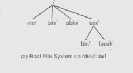


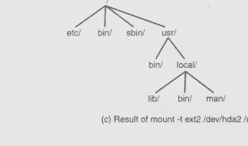

考虑图 8.1 中的示例。假设根文件系统位于`/dev/hda1`，另一个文件系统位于`/dev/hda2`。当这个第二个文件系统被挂载到`/usr/local`时，其目录层次结构与 UNIX 层次结构无缝融合。

##### 注意

如果原始根文件系统下`/usr/local`中有任何文件或目录，只要第二个文件系统挂载在其上，它们就会隐藏。当第二个文件系统被卸载时，它们会再次可见。虽然这无害，但以这种方式隐藏的文件仍占用磁盘空间，尽管它们不可访问。因此，通常将文件系统挂载到空目录上。

### 手动挂载文件系统

要挂载文件系统，请使用`mount`命令：

```
mount -t fstype device mount_point
```

这里，`fstype`是文件系统类型，通常是`ext2`；`device`是包含文件系统的设备文件；`mount_point`是你希望挂载新文件系统的位置。例如：

```
mount -t ext2 /dev/hdb1 /home
```

将`/dev/hdb1`上的文件系统挂载到`/home`。

注意，通常必须具有 root 权限才能挂载和卸载文件系统。

### 自动挂载文件系统

每次想要挂载文件系统时都要输入`mount`命令将是一项真正的工作。文件`/etc/fstab`包含描述在系统启动时应挂载的文件系统的行。

##### 背景资料

在其他 UNIX 系统上，该文件可能具有其他名称。例如，在 Solaris 上，它被称为`/etc/vfstab`。

`/etc/fstab`的每一行看起来像这样：

```
# 注释行 -- 以 # 开头的行被忽略
# 设备     挂载点     类型    选项      dump fscsk
/dev/hda1  /          ext2   defaults    1      1
/proc      /proc      proc   defaults    0      0
/dev/hdc   /mnt/cdrom iso9660 ro,nouser,noauto 0  0
```

每一行要么是空白行，要么是注释行（以`#`开头），要么由六个字段组成：

- 设备字段指定要挂载的设备。
- 挂载点字段指定文件系统的挂载位置。我们可以看到，我的根文件系统保留在`/dev/hda1`上。

##### 背景资料

这是一个先有鸡还是先有蛋的问题。在读取`/etc/fstab`之前，我们如何知道它持有根文件系统？`/etc/fstab`本身就在根文件系统中。事实上，内核使用不同的机制来挂载根文件系统；将其包含在`/etc/fstab`中是为了启动脚本的利益，这些脚本会检查文件系统完整性。

- 类型字段指定文件系统类型。我的根文件系统是`ext2`，`/proc`伪文件系统类型为`proc`，而我的 CD 光驱通常挂载`iso9660`类型的文件系统。此类型通过`-t`选项传递给`mount`。
- `opts`字段指定传递给`mount`的选项。它们以逗号分隔的列表给出，项目之间没有空格。大多数文件系统在此字段中简单地使用`defaults`，但 CD-ROM 使用`ro,nouser,noauto`。`ro`选项意味着以只读方式挂载文件系统。`nouser`意味着我们不希望普通用户挂载系统；只授予`root`权限。`noauto`告知系统在启动时不要挂载 CD-ROM。（毕竟，驱动器中可能没有 CD。）
- `dump`字段由`dump`命令使用，该命令备份整个文件系统。我不认识有人实际使用`dump`进行备份；如果你选择使用，可以查阅手册页`fstab(5)`和`dump(8)`以获取详细信息。
- `fsck`字段指定启动时检查文件系统完整性的顺序。根分区在此字段中应始终为 1。其他`ext2`分区在此字段中应为 2。在启动时，系统将按照此字段指示的顺序检查分区。不需要检查的文件系统，如 CD-ROM 或`/proc`文件系统，在此字段中应为 0。

##### 挂载选项

以下是一些最常用的挂载选项（可能出现在`/etc/fstab`的`opts`字段中）：

- `ro`：此选项以只读方式挂载文件系统。尽管它通常与 CD-ROM 等只读硬件一起使用，但出于安全或效率原因，其他文件系统也可能被设置为只读挂载。
- `auto`：此选项默认开启，意味着文件系统应在启动时自动挂载。
- `noauto`：此选项导致文件系统不在启动时自动挂载。
- `user`：此选项允许普通用户（不仅仅是`root`）挂载文件系统。将其用于 CD-ROM 文件系统是安全的，但你通常不应使文件系统可由用户挂载。
- `nodev`：此选项阻止系统识别已挂载文件系统上的设备文件。如果你允许普通用户挂载文件系统，出于安全原因，应开启`nodev`选项。（`user`选项默认开启此功能。）

##### 背景资料

为什么允许用户挂载的文件系统上的设备文件是一个安全漏洞？罪犯可以创建一个包含对磁盘分区具有全局写权限的设备文件的文件系统，挂载该文件系统，然后完全访问你的磁盘。

- `noexec`：此选项阻止系统识别可执行权限位。如果正在挂载包含针对不同 CPU 架构的可执行文件的文件系统，此选项非常有用。
- `nosuid`：此选项阻止识别 set-user-id（设置用户 ID）和 set-group-id（设置组 ID）位。关于为什么这是一个好主意，请参阅 `nodev` 部分的讨论。

还有许多其他挂载选项，某些文件系统还具有文件系统特定的选项；有关详细信息，请查阅`mount(8)`手册页。

### 检查文件系统

总有一天（你会遇到这种情况）你会面对一个损坏的文件系统。最可能的原因是硬件或电源故障；Linux 本身几乎不会破坏文件系统。

在启动时，Linux 会尝试修复文件系统中的小问题。但是，如果它无法做到这一点，你将收到一条醒目的警告，提示你手动运行`fsck`，并被置于维护模式。

要在维护模式下继续，请输入 root 密码。你将获得一个 shell 提示符。

#### 调用 `fsck`

要检查文件系统，请使用`fsck`命令：

```bash
fsck -t fstype device_file
```

例如：

```bash
fsck -t ext2 /dev/hdb1
```

> **警告**
> 确保你正在检查的设备文件未被挂载。在挂载的文件系统上运行`fsck`会损坏文件系统。如果根文件系统损坏，你将不得不从救援磁盘启动，并在那里运行`fsck`。

对于 ext2 文件系统，你可以使用`-p`选项，该选项使`fsck`在不询问任何问题的情况下修复文件系统：

```bash
fsck -t ext2 -p /dev/hdb1
```

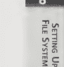

否则，你将收到提示以回答问题。除非你是专家级的文件系统黑客，否则请回答 `fsck` 的所有问题的“Y”（是）。

如果`fsck`无法修复文件系统，那就没什么运气了。你需要重新创建文件系统并从中恢复备份。

#### 背景知识

你做了备份，对吧？

查阅`fsck(8)`和`e2fsck(8)`手册页以获取有关`fsck`的所有详细信息。

### 账户配额与磁盘配额

Linux 允许你限制用户消耗磁盘空间的量。但是，Caldera OpenLinux 并不包含管理磁盘配额所需的工具。磁盘配额通常用于中央文件服务器，而 Caldera OpenLinux 面向的是桌面用户。不过，你可以从 Linux 归档站点获取并安装配额工具。你还必须重新编译内核以支持配额。

##### 文件权限

正确的文件权限是 Linux 系统安全的关键部分。控制谁可以修改敏感文件对于保持系统安全和用户信息的隐私非常重要。你应该确保文件具有正确的权限和所有权。

每个文件或目录都与两个 ID 相关联：

- 文件的属主是一个单独的用户。
- 文件的组是一组可能包含多个用户的组。

每个文件或目录都有三组权限：

- 属主的权限指定属主可以对该文件做什么。
- 组的权限指定该文件组中的成员可以对该文件做什么。
- “其他”权限指定非属主且非该文件组成员的用户可以对该文件做什么。

在每组权限中，可以授予三种类型的权限：

- `读`权限授予读取文件或目录的权限。
- `写`权限授予向文件写入的权限。对于目录，写权限允许在目录中创建新文件或删除现有文件。
- `执行`权限授予执行文件的权限。对于目录，执行权限允许将该目录设为当前目录。

要更改文件或目录的权限，请使用`chmod`命令。注意，你必须是文件的属主或`root`才能更改文件或目录的权限。非文件属主的组成员无法更改其权限。

#### 符号权限

`chmod`理解多种表达文件权限的方式。更改权限最简单的方法是使用符号权限。符号权限看起来像这样：

```text
who who what
```

这里，`who`是指定要影响谁的权限的字母列表：

- `u`指定应更改文件的属主（“用户”）的权限。
- `g`指定应更改文件的组的权限。
- `o`指定应更改其他用户的权限。
- `a`指定应更改所有用户的权限。`a`等同于`ugo`。

`how`是指定如何影响权限的单个字符：

- `+`表示由`who`命名的个人或人员应被授予额外权限。
- `-`表示由`who`命名的个人或人员的权限应被移除。
- `=`表示由`who`命名的个人或人员应仅获得指定的权限。

`what`是指定权限的字母列表：

- `r`表示读权限。
- `w`表示写权限。
- `x`表示执行权限。
- `X`类似于`x`，但如果文件是目录或其中一个执行权限位已经打开，则它只会打开执行权限。

#### 背景知识

`what`还有更多可能性；我们很快就会介绍。

`chmod`命令看起来像这样：

```bash
$ chmod permissions file...
```

以下是一些示例：

```bash
# 授予所有人 public.txt 的读权限
# 'who' 是 a, 'how' 是 +, 'what' 是 r
$ chmod a+r public.txt

# 移除组和其他人的读和写权限
# 'who' 是 go, 'how' 是 -, 'what' 是 rw
$ chmod go-rw private.txt
```

#### SUID、SGID 和粘滞位

除了控制用户、组和其他人的读、写和执行权限的九个标志外，每个文件还有三个额外的权限标志：

- `set-user-id`或`suid`位控制文件被执行时发生的事情。如果设置了`suid`位，那么当文件被执行时，进程的有效用户 ID 变为文件的属主的 ID，而不是执行该文件的人的 ID。

这种机制是 UNIX 如何给予某些程序额外权限的方式。例如，`passwd`命令（用于更改你的密码）需要`root`特权来修改系统密码文件。可执行文件`/usr/bin/passwd`由`root`拥有，并且其`suid`位已开启：

```bash
$ ls -l /usr/bin/passwd
-r-sr-xr-x 1 root bin 38857 Apr 3 16:49 /usr/bin/passwd
```

注意属主权限标志中的`s`。这表示`suid`和`execute`位是开启的。如果`suid`位开启而`execute`位关闭，`ls`将显示`S`。（这种位组合不应出现。）

> **警告**
> `Suid`程序可以赋予普通用户额外甚至`root`特权。除非你确定这样做是安全的，否则不要打开`suid`位。

`set-group-id`或`sgid`位类似于`suid`位——当执行设置了`sgid`位的文件时，进程的有效组变为该文件的组。

例如，邮件程序需要能够写入`/var/spool/mail`目录中的文件。该目录由组`mail`拥有且可写；`/bin/mail`程序对组`mail`具有`sgid`属性：

```bash
$ ls -l /bin/mail
-rwxr-sr-x 1 root mail 70552 Apr 3 16:53 /bin/mail
```

每当运行`/bin/mail`时，它拥有与`mail`组关联的特权，而不仅仅是运行它的人的特权。对于目录，`sgid`位具有不同的含义：在设置了`sgid`位的目录中创建的任何文件或目录都将获得与目录相同的组。此外，在该目录中创建的任何目录都将设置其`sgid`位。

这对团队项目非常有用。你可以创建一个公共项目目录和组。将目录的组设为公共项目组，并打开`sgid`位。放在项目目录中的任何文件或目录都属于项目组，而不是放置它们的人的组。


# 粘滞位与目录权限

通常，要删除或重命名文件，您只需要该文件所在目录的写权限。文件本身的权限无关紧要。这会在像 `/tmp` 这样的共享目录中造成问题，这些目录允许所有人写入。虽然必须允许任何人创建 `/tmp` 中的文件，但不希望一个用户能够从 `/tmp` 中删除另一个用户的文件。

如果在目录上设置了粘滞位，则只有文件的属主（或目录的属主）才能从目录中删除文件。如果我们查看 `/tmp`，可以看到设置了粘粘粘位：

```bash
$ ls -ld /tmp
drwxrwxrwt 34 root root 3072 Jun 20 11:38 /tmp
```

`t` 标志表示粘滞位。任何人都可以向 `/tmp` 写入，但只有 `root` 或文件的属主才能从 `/tmp` 中删除文件。（此示例还说明了 `ls` 的 `-d` 选项，它使 `ls` 将目录视为普通文件，而不是列出其内容。）


## 背景知识

粘滞位之所以如此命名，是因为在非常早期的 UNIX 版本中，粘滞位指示经常被执行的程序，系统会在交换空间（swap space）中保留程序代码，以便下次调用时更快地执行。现代虚拟内存技术使得这种优化变得不必要，粘滞位因此获得了其现代解释。

## 数字权限

在 `chmod` 命令中，您像这样控制 `suid`、`sgid` 和 `sticky` 位：

```
$ chmod u+s file # 开启 suid
$ chmod u-s file # 关闭 suid
$ chmod g+s file # 开启 sgid
$ chmod g-s file # 关闭 sgid
$ chmod o+t dir # 开启 sticky
$ chmod o-t dir # 关闭 sticky
```

`chmod` 有几个有用的选项：

- `-R` 使 `chmod` 递归地改变目录及其内容的权限。
- `-v` 使 `chmod` 打印消息，确切说明它正在进行的更改。（此选项适用于 GNU `chmod`；在大多数 UNIX 系统上它不是标准的。）

有关指定符号权限的其他方法，请参见手册页 `chmod(1)`。

许多 UNIX 用户有时使用数字权限描述而不是符号描述。每个权限标志在文件系统中占用一个位。权限字的值通常以八进制（即基数 8）表示。


为什么 UNIX 使用基数 8？有三种类型的权限（读、写 和 执行），每个八进制数字代表三个二进制位；因此，以基数 8 表示权限字会产生非常自然的值。（至少对 UNIX 用户来说，这种推理是自然的。）

它是这样工作的。数字模式由最多四个八进制数字组成。对于第一个数字：

- `sticky` 权限存储在该八进制数字的最低有效位；它的值为 1。
- `sgid` 权限存储在该八进制数字的中间位；它的值为 2。
- `suid` 权限存储在该八进制数字的最高有效位；它的值为 4。

对于其余三个数字，分别指定用户、组和其他权限：

- 执行权限存储在该八进制数字的最低有效位；它的值为 1。
- 写权限存储在该八进制数字的中间位；它的值为 2。
- 读权限存储在该八进制数字的最高有效位；它的值为 4。

要推导权限字的值，请将每个已启用权限位的值相加。

这迫切要求示例。以下是 `ls` 列出的符号权限及其对应的数字权限：

- `-rw-r--r--` 对应 644。用户具有读和写（4+2）权限，而组和其他人仅具有读（4）权限。由于 `sgid`、`suid` 和 `sticky` 位未被使用，第一个数字（隐含地）为零。为了清晰起见，您可以将权限写为 0644。
- `-rwxr-xr-x` 对应 755。用户具有读、写和执行（4+2+1）权限，而组和其他人仅具有读和执行（4+1）权限。
- `-r-sr-xr-x` 对应 4555。`suid` 位（4）处于开启状态，用户、组和其他人具有读和执行（4+1）权限。
- `-rw----` 对应 600。用户具有读和写（4+2）权限，而组和其他人没有任何权限。

## 文件权限掩码（umask）

每个 UNIX 进程都有一个与之关联的特殊值，称为 `umask`（文件权限掩码）。默认情况下，大多数 UNIX 程序创建普通文件时使用 666 的权限，创建目录时使用 777 的权限。这赋予所有人对文件或目录的完全访问权限，这可能不是我们所期望的。

`umask` 值指定要关闭哪些权限位。要查看您的 `umask` 值，输入：

```
$ umask
002
```

在此示例中，仅关闭了对其他人的写权限。`umask` 的一些常见值包括：

- `002` 关闭对其他人的写权限。如果每个用户都属于其自己唯一的组，则此值是安全的。这是 Caldera OpenLinux 的默认值。
- `022` 关闭对组和其他人的写权限。这在许多 UNIX 系统中常用。
- `077` 关闭对其他人的所有权限。
- `027` 关闭对组的写权限，并关闭对其他人的所有权限。
- `077` 关闭对组和其他人的所有权限。这用于实现最大隐私。

要设置 `umask`，只需指定值即可：

```
$ umask 077
```

您可以在（并且应该）在 shell 的启动文件中尽早设置 `umask`。这确保了在登录期间创建的文件受到适当的保护。

## 文件所有权

要更改文件的属主或组，请使用 `chown` 命令。您可以仅使用 `chgrp` 命令更改组。命令如下所示：

```
##### chown [选项] user[:group] file...
$ chgrp [选项] group file...
```

只有 `root` 可以更改文件的所有权。文件的属主可以将文件的组更改为他或她是成员的任意组。`root` 可以任意更改文件的组。

要更改文件的属主，只需指定新属主的登录名或数字用户 ID：

```
##### chown dave /home/dave/foo.txt
```

如果您想同时更改属主和组，请用冒号将它们分隔开：

```
##### chown dave:users /home/dave/foo.txt
```

如果您只想更改组，请使用 `chgrp`：

```
##### chgrp users /home/dave/foo.txt
```

`chown` 和 `chgrp` 最常使用的选项是 `-R`，它使它们递归地沿目录层次结构更改属主或组。手册页 `chown(1)` 和 `chgrp(1)` 讨论了其他较少使用的选项。

# 交换空间（Swap Space）

Linux 可以为进程提供比计算机物理内存更多的内存。它通过在不使用内存块时将它们分页到磁盘文件或分区，并在需要时按需分页回来实现这一点。

Linux 可以使用文件或特殊的磁盘分区作为交换空间。交换文件更方便——您可以在需要时创建并激活它，并且可以相对轻松地调整其大小。然而，交换文件比交换分区速度慢。

交换分区比交换文件快，但在 Linux 运行时，您无法轻松更改其大小或创建额外的分区。我建议创建一个大小约为计算机物理内存两倍的交换分区。如果您需要额外的交换空间，您始终可以临时创建一个或多个交换文件。

## 创建交换分区

创建交换分区与创建任何类型的分区相同。使用 `fdisk` 或 `cfdisk` 创建分区，然后将其类型设置为 Linux Swap。

## 创建交换文件

要创建交换文件，您需要文件系统中的某处创建一个大型文件。最简单的方法是使用 `dd` 命令。

`dd`（根据其手册页）“转换并复制文件”。它从输入文件读取块大小的块，可能对数据执行某种转换，并将块（可能与输入块大小不同）写入输出文件。

对于我们的目的，我们将仅使用涉及 `dd` 的标准配方来创建交换文件。要创建大小为 `n` MB 的交换文件，请使用此命令：

```
##### dd if=/dev/zero of=swapfile bs=1k count=nk
```

例如，要创建名为 `/var/swap` 的 32MB 交换文件，请使用：

```
##### dd if=/dev/zero of=/var/swap bs=1k count=32k
```

`if=/dev/zero` 告诉 `dd` 从输入文件 `/dev/zero` 读取。这是一个特殊的设备文件（类似于 `/dev/null`），当您从中读取时，它只会返回一连串值为零的字节。


与 `/dev/null` 一样，写入 `/dev/zero` 的任何内容都会被丢弃。

`of=/var/swap` 告诉 `dd` 写入普通文件 `/var/swap`。`bs=1k` 告诉 `dd` 以 1KB（1024 字节）的块进行读写。

### 背景资料

您可以分别使用 `ibs=` 和 `obs=` 指定不同大小的输入和输出块。

`count=32k` 告诉 `dd` 读取 32KB（即 32 × 1024 = 32,768）个块。块大小和计数的组合产生 32 × 1024 × 1024 字节，即 32MB。

由于敏感信息可能会在进程交换出时被放入交换文件中，因此您应该确保交换文件由 `root` 拥有，并且其他用户不可读。请遵循以下步骤操作：

```
##### chown root:root /swapfile
##### chmod go-rwx /swapfile
```

## 格式化交换区域

在使用交换文件或分区之前，您必须对其进行格式化。这只需在交换文件或分区创建后立即做一次。

要格式化交换分区，请使用 `mkswap` 命令：

```
##### mkswap /swapfile; sync
##### mkswap -C /dev/hdc3
```

在第一个示例中，我们在交换文件上使用 `mkswap`。由于交换文件是文件系统中的普通文件，因此我们使用 `sync` 命令将输出刷新到磁盘。这确保了格式化信息确实被写入磁盘，而不仅仅缓存在内存中。

在第二个示例中，我们在交换分区上使用它。对于交换分区，请提供表示该分区的设备文件名称。此外，对于分区，我们使用 `-C` 选项，该选项告诉 `mkswap` 检查磁盘坏块。在格式化交换分区时始终使用 `-C`；在格式化交换文件时切勿使用它。

### 背景资料

跟踪交换空间的方法在 2.0 和 2.2 内核版本之间发生了变化。“旧式”方法允许交换空间区域最大约为 128MB，而“新式”方法允许其最大约为 2GB。`mkswap` 会自动选择合适的风格。（不要创建比物理 RAM 多两倍的交换空间——如果您真的开始使用那么多虚拟内存，磁盘分页会使您的系统慢如蜗牛。）

## 启用交换区域

要启用交换功能，请使用 `swapon` 命令：

```bash
##### swapon /swapfile
##### swapon /dev/hdc3
```

第一个示例在交换文件上启用交换；第二个示例在交换分区上启用交换。

如果您希望交换分区在每次启动系统时都被激活，请向 `/etc/fstab` 添加如下所示的一行：

```
/dev/hdc3  swap  swap  defaults 0 0
```

挂载点（`mount_point`）和类型（`type`）中的 `swap` 信息会告知启动脚本 `/dev/hdc3` 是一个交换分区。您可以像这样启用 `/etc/fstab` 中列出的所有分区的交换功能：

```bash
##### swapon -a
```

> **注意**
>
> 当交换文件正在用作交换空间时，您无法更改其大小。您只能通过禁用该文件的交换功能、更改其大小、重新运行 `mkswap`，然后重新启用交换来实现此操作。

`swapon` 有一个 `-p` 选项，允许您设置交换空间的“优先级”。该选项接受 0 到 32767 之间的整数参数。数字越高，优先级越高。高优先级的交换区域优先于低优先级的交换区域被使用。如果您同时拥有交换分区和交换文件，请为交换分区分配更高的优先级，因为它们的性能更好。

在 `/etc/fstab` 中，您可以在 `opts` 字段中放入 `pri=n` 条目来设置交换区域的优先级。

`swapon` 有一个非常实用的 `-s` 选项，它显示交换区域的状态：

```bash
$ swapon -s
```

```
Filename  Type  Size  Used  Priority
/dev/hda4  partition  377520  0  -1
```

## 禁用交换区域

要禁用交换区域，请使用 `swapoff` 命令：

```bash
##### swapoff /swapfile
##### swapoff /dev/hdc3
```

第一个示例禁用交换文件上的交换，第二个示例禁用交换分区。您可以使用 `swapoff -a` 来禁用 `/etc/fstab` 中列出的所有交换分区。

# 总结

在本章中，您学习了 Linux 如何使用特殊的设备文件来表示设备驱动程序。您学习了如何分区磁盘以及创建文件系统，以及如何将文件系统挂载到 Linux 目录层次结构中。您还学习了文件权限以及如何检查和设置它们。最后，您学习了如何创建和使用交换文件。

# 第 9 章 打印

## 本章内容

- 从 Caldera 210 进行本地打印
- 打印中使用的工具和位置 216
- 理解打印过程 219
- 使用 COAS “管理”您的打印机 220
- 设置和使用远程打印机 222
- 格式化打印 225
- 使用您的打印机与其他应用程序 226
- 有用的打印功能增强程序（以及在哪里找到它们） 229
- 一些高手的秘密（初级组） 229

## 从 Caldera 进行本地打印

在本章中，我们将探索在 Caldera 中打印可用的选项。有许多打印功能可用，我们需要涵盖大量的程序和辅助文件。Caldera 为您提供从本地机器打印、从连接到局域网的另一台机器打印，甚至从远程位置的打印机进行打印（如果可以通过 WAN 或互联网寻址）的选择。所需的是使用打印机的权限，对于本地连接的打印机，您只需为自己授予该权限即可。

如果您有权使用打印机，其余的操作就很简单了。不过，它确实有一些细节。我们将涵盖简单情况——本地打印到并行打印机——以及复杂情况——通过互联网远程打印到运行在串行端口上的 PostScript 打印机，且该串行端口位于防火墙之后。

Caldera 有许多实用工具，使安装打印机变得轻而易举。如果您使用的是本地并行打印机，大约 10 分钟就可以开始工作。但为了验证硬件是否正常工作，最好先使用 DOS 软盘启动并尝试在打印机上打印文件，然后再着手设置 Linux 打印机。我花了一个小时试图让打印机在 Linux 下工作，结果发现存在硬件问题或配置问题，导致打印机根本无法工作。首先进行这个简单的 DOS 测试本可以省去所有的挫折感。

### Caldera 如何定位我的打印机？

Caldera 与其他 UNIX 变种一样，通过特殊的设备文件与所有硬件设备“对话”。这些设备文件只是 Linux 文件结构中的条目，由内核中的“设备驱动程序”处理。如果在 Caldera 默认安装中列出打印机设备特殊文件，您将看到类似以下内容：

```bash
##### ls -l /dev/lp*
```

```
crw-rw----    1 root            lp        0,  0 Apr  3 16:47 /dev/lp0  (Printer at address 0x38C)
crw-rw----    1 root            lp        0,  1 Apr  3 16:47 /dev/lp1  (Printer at address 0x378)
crw-rw----    1 root            lp        0,  2 Apr  3 16:47 /dev/lp2  (Printer at address 0x278)
```

了解以下内容对您是重要的：设备条目第一列中的 `c` 代表字符特殊设备，它告诉操作系统不要将数据写入磁盘上的文件系统，而是将目标为此打印机的任何数据交给位于位置 6 的驱动程序（第 32 列中的主设备号后跟逗号）进行适当处理。逗号后、月份前的数字称为次设备号，它告诉驱动程序数据的目标是哪台打印机。

如果您的打印机停止打印，但系统表现得像在打印，请检查打印机设备特殊文件。通常，设备条目已被删除（或者您打错了打印机名称），系统已将数据放入文件，而不是交给设备驱动程序在设备上输出。如果日期前的数字没有逗号，这一点最有可能得到证明。

串行设备同样在 `/dev` 目录中有条目。串行设备的条目将与 `/dev/ttyS?` 类似，其中 `?` 被串行端口号（0、1、2、3 或 4）替换，这些也是字符特殊设备。

远程打印以稍有不同的方式实现，因此这些打印机不需要在 `/dev` 目录中的条目。

### 打印机选择（或仅在有一个可用时默认使用）

打印机有许多类型和技术。几乎所有都可以与 Caldera 配合使用，尽管您可能希望使用 PostScript 打印机以便能够打印图形。

某些打印机使用专有的软件架构，需要工厂配置的驱动程序软件。HP 1000 系列打印机就是一个例子。在 HP 能够为 Linux 提供软件驱动程序之前，这些打印机将在您的系统上无法工作。其他专有架构也存在；然而，这是最常见的系列，也是最常见的制造商。驱动程序将会随之而来，可能由硬件制造商或根据 GNU 通用公共许可证由高手编写，但在那之前，不要徒劳无益地努力（don't bang your head against a doorstop）。

#### 打印第一页

为了打印，您必须首先检查几件事：

- 计算机是否开机？
- 是否安装了 Caldera OpenLinux？
- 打印机是否连接到适当的端口？
- 打印机是否开机？

如果您的打印机连接到您的并行端口（我们在此假设这种情况），您应该能够使用以下命令在打印机上产生输出：

```bash
ls > /dev/lp0
```


# 激光打印机与打印机状态检查

如果您没有使用激光打印机，您的打印机上应该会打印出一些内容，或者至少打印头应该会移动。如果您在激光打印机上打印，您应该将打印机设置为脱机状态并吐出一页，以查看您打印的内容。这是因为向激光打印机打印实际上只是向打印机本身的缓冲区打印，直到它接收到物理打印页面的命令。激光打印机不能只打印一行——它们必须以连续的方式打印整个页面，因为页面经过激光束。

大多数打印机通过将打印机设置为脱机状态（按下 `Online` 按钮，灯会熄灭），随后按下通常标记为“换页”（`Form Feed`）的按钮来吐出一页。

> **注意**
>
> 手动吐出页面后，请记住按下 `Online` 按钮使灯亮起。否则，打印机将像门挡一样坐在那里，不听计算机的指令。

当 `Online` 灯亮起时，打印机正在与计算机“对话”（并听取其指令）。当它熄灭时，它不听计算机指令，也不会接收或处理任何指令或打印任何页面。保持 `Online` 灯亮起是正常状态。

对于许多打印机（特别是激光打印机），您将会看到行以阶梯方式打印（每一行打印在上一行的下方和右侧）。缺少回车符可能是原因，这不应该让您担心。我们稍后会使用过滤器插入回车符。

如果您的打印机像门挡一样坐在那里，拒绝做任何事情，那么您需要确定发生了什么。

首先，您必须验证打印机端口已启用并适当地寻址。如果您使用的是允许您设置板载并行端口响应哪个地址的 `BIOS`（基本输入/输出系统）的计算机，请确保打印机连接的端口设置为 `0x3bc`（`/dev/lp0` 的地址）。如果这是由计算机中板上的开关处理的，您需要检查开关设置以验证这些设置。

其次，您需要验证并行端口驱动程序已编译到内核中。（并行端口驱动程序是与硬件并行端口对话的软件。）要确定并行端口驱动程序是否已编译到内核中（并行端口 `driver` 会默认随发行版内核存在，但可能已被后续的内核重新编译移除），您需要执行以下测试。

输入以下命令：

```
#cat /proc/devices | grep lp
```

您应该看到且仅看到一行：

```
6 lp
```

此表示法表明并口已被编译进内核，并且设置为 `Major Device 6`。此主要设备编号必须与前面使用的 `ls -1` 命令中的主要设备编号一致。

如果您的打印机仍然像 `doosstop` 一样无反应，请重新核实事宜（如果您有多个端口），确认打印机插入的端口，并检查电缆和打印机在另一台已知正常的系统上是否能正常工作。

在您成功（可能需要尝试多次）让打印机产生输出后，下一步是检查（以防万一）行打印机守护进程（`spooler`）是否正常工作。

# LISA 配置指南

使用 `LISA`，不是街对面那个漂亮女孩，而是 `Caldera OpenLinux` 发行版的一部分——`Linux` 安装和系统管理程序。附录 B 将更全面地介绍 `LISA`，但这里有一些简单的指南供您入门。

1.  为了快速检查，输入：
    ```
    #lisa
    ```
2.  当 `LISA` 屏幕出现时，选择 `3`（系统配置），`2`（系统配置），以及 `6`（配置守护进程/服务器自动启动）。
3.  向下滚动查看 `Printer Server (LPD)`。这通常位于编号 `12`。
4.  验证 `Printer Server (LPD)` 旁边的括号中是否有 `X`，表示系统启动时自动启动。如果存在该 `X`，那么 `spooler`（行打印机守护进程）将在每次系统重启时自动启动。

既然您已经配置了 `spooler` 以自动启动，您可以继续创建 `spooler` 可以使用的打印机。请注意，`Caldera OpenLinux` 提供了几种打印 `spooler`。有关这些选项的信息，请参阅标题为“打印中使用的工具和位置”的部分。

同样，我们可以使用 `LISA` 来完成此操作（还有其他方法，但这是最简单的一种）。

1.  通过输入以下内容再次开始此过程：
    ```
    #lisa
    ```
2.  当 `LISA` 屏幕出现时，选择 `3`（系统配置），`1`（硬件配置），以及 `6`（配置打印机）。
3.  在提示处选择一个打印机驱动程序。（参见图 9.1。）

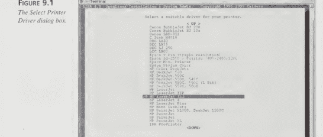

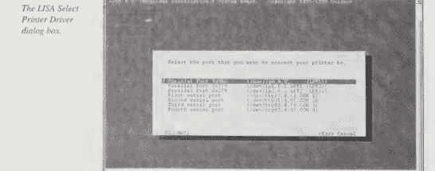

从此列表中选择合适的打印机。“无可用打印机”选项通常是一个糟糕的选择，否则您不应该在此处，但其余选项均合适且有用。

4.  在提示处选择一个打印机连接。（参见图 9.2。）

在此对话框中，您选择打印机连接的物理端口。在我们的示例中，这是 `Parallel Port 0x3bc`，即第一个物理并口，与我们之前的选择一致。

##### 注意

在此处一致性非常重要。如果您向计算机撒谎关于在哪里找到打印机，它会相信您！

5.  如果您被引导到图 9.3 所示的对话框，请选择适合您打印机的打印机分辨率（每英寸点数）。

##### 图 9.3

`LISA` 默认打印机分辨率对话框。

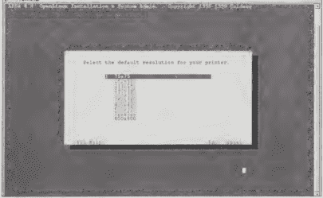

选择高于打印机支持能力的分辨率（每英寸点数较多）通常会导致打印机不打印或打印乱码。对于激光打印机，这通常是打印机自身内存量的限制（打印机必须在打印前缓冲完整的页面图像），因此降低分辨率可以让它在物理打印页面前打印完整的一页（尽管纹理较粗糙）。

6.  如果您被引导到默认纸张大小对话框（参见图 9.4），请选择适当的纸张大小。大多数人会选择 `4 Letter`，即 `8-1/2" × 11"`。然而，许多来自中东或欧洲的用户可能会选择 `2 A4` 尺寸，这在那些地方更为常见。

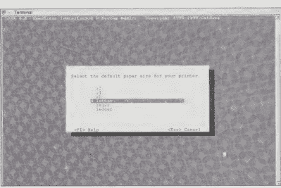

## 打印中使用的工具和位置

在所有必需的选择完成后，您将返回到硬件配置对话框，您只需要按 `Esc` 键退出到桌面即可打印。

现在，正如我们承诺的那样，您可以打印第一页了。实现这一现代奇迹壮举的命令是：

```
#lpr /etc/profile (a text file that is always present)
```

现在让我们更深入地了解 `Caldera OpenLinux` 中打印子系统的工作细节。

首先要理解的是，在 `Caldera OpenLinux` 后台运行的程序处理了几乎所有的打印问题。这就是行打印机守护进程（`LPD`）。`Caldera` 提供三种 `spooler` 选择。使用哪个 `spooler` 进程的选择在安装时已经做出。最常见的一种（也是我们在这里将要使用的）叫做 `LPRng`。

`LPD` 脚本在启动时启动行打印机守护进程，并可在 `/etc/rc.d/init.d` 目录中找到，与其他初始化脚本在一起。从该脚本执行的那一刻起，`lpd` 进程就在后台运行。您可以使用以下命令查找此守护进程的进程号和状态：

```
#ps -ef | grep lp
```

这将打印出一行包含单词 `daemon`、进程号以及一些其他信息，包括守护进程的当前状态，例如 `START_IDLE`。

随着此进程在后台运行并等待命令，当您请求时，一切都会自动发生。

以下是一些与行打印机守护进程通信的命令。

| 命令 | 描述 |
| :--- | :--- |
| `/usr/sbin/lpd` | 实际的打印机守护进程。 |
| `/usr/sbin/lpc` | 行打印机控制程序。 |
| `/usr/sbin/lpracct` | 在 `TCP` 上监听打印机的计费信息。 |
| `/usr/bin/lp` | 旧式打印 `spooler` 提交程序（通常只是链接到 `lpr`）。 |
| `/usr/bin/lpq` | 行打印机队列检查程序。 |
| `/usr/bin/lpr` | 新式打印 `spooler` 提交程序。 |
| `/usr/bin/lprm` | 从打印队列中移除作业的程序。 |
| `/usr/bin/lpstat` | 提供关于 `spooler` 当前状态和已管理作业信息的程序。 |
| `/usr/sbin/tunelp` | 用于调整打印机操作的程序。 |
| `/usr/bin/pr` | 另一种旧式 `spooler` 提交程序，允许许多选项，包括从给定页面开始打印以及支持分栏打印（即使源文件进程不支持此功能）。 |
| `/usr/libexec/LPRng-3.5.3/lpbanner` | 一个简单的横幅打印程序，通常由 `spooler` 使用。 |
| `/usr/libexec/LPRng-3.5.3/lpf` | 一个基本的打印过滤程序，至少会为打印数据流中的每个换行符添加一个回车符。 |
| `/usr/lib/coas/scripts/ctr1printer` | `COAS` 用于设置打印机和 `spooler` 参数的脚本。 |

以下是一些由行打印机守护进程使用的文件。

**`/etc/printcap`**

包含系统中所有可用打印机控制代码和打印定义的文件。如果您想添加另一个打印机或为现有打印机添加功能，将在该文件中完成。最好让 `LISA` 和 `COAS` 修改此文件。

**`/etc/rc.d/init.d/lpd`**

处理 `spooler` 守护进程启动和停止所有相关问题的 shell 脚本。

**`/etc/sysconfig/daemons/lpd`**

守护进程启动的控制文件。

**`/etc/sysconfig/printers`**

包含 `Caldera OpenLinux` 中每个已定义打印机的文件的目录。这些文件中的每一个（文件名与打印机名称相同）都包含打印机的控制信息，包括 `ghostscript` 接口信息和分辨率数据。

**`/etc/lpd.conf`**

行打印机守护进程的配置文件的。`Caldera` 默认分发文件包含数十个行打印机守护进程选项，但它们都被注释掉了（第一列中的 `#`）。如果您希望设置这些选项中的任何一个（它们在文件中都有很好的文档），您需要编辑该文件并取消注释您希望行打印机守护进程遵守的选项。

**`/etc/lpd.perms`**

包含 `LPD` `spooler` 权限定义的文件。每次执行 `spool` 或 `unspool` 操作时，都会检查此文件以确定该操作在此计算机和请求的打印机上是否被允许。

**`/var/lock/subsys/lpd`**

包含 `spooler`“锁”信息的文件。当打印机正在积极打印文件时，打印请求被接受并发送到队列目录，直到打印机在物理上能够打印该文件为止。锁定文件防止多个进程同时向打印机发送打印数据，从而导致垃圾输出。

## 目录和文件说明表

| 路径 | 描述 |
| :--- | :--- |
| `/var/spool/lpd` | 包含一个子目录的目录，每个子目录对应 `Caldera OpenLinux` 中定义的打印机。这些子目录中的每一个（目录名称与打印机名称相同）都包含该打印机的过滤器定义、控制文件、状态文件和日志文件。 |
| `/var/spool/lpd/lpd.lock.*` | 包含该计算机上 `lpd` 进程号的文件。用于检查和锁定进程。 |

最后，以下是线打印机守护程序使用的一些设备项。

| 设备 | 描述 |
| :--- | :--- |
| `/dev/lp0` | `LPR1` 的字符特殊设备： |
| `/dev/lp1` | `LPR2` 的字符特殊设备： |
| `/dev/lp2` | `LPR3` 的字符特殊设备： |

## 理解打印过程

如果你因接收到大量关于打印的信息而感到头脑混乱，那么你可能会想要跳过这一部分，直接进入下一部分，学习如何使用 `COAS` 来“管理”你的打印机。另一方面，如果前面的信息只是激发了你的兴趣，那么这一部分正是为你准备的。这里我们将所有内容融会贯通。

当 `lpr` 接收到任何内容（可能是文件名或管道传入的数据）时，它会解析数据的第一行，查看你是否指定了打印机。如果你没有指定打印机，`lpr` 将默认使用 `/etc/printcap` 文件中的第一个打印机条目。选择打印机的实际优先级顺序可以通过以下命令找到：

```bash
#### man lpr
```

并查看 `-P` 选项。

当 `lpr` 拥有数据并知道其去向时，它会在 `/var/spool/lpd/printer name/` 目录中创建一个文件，用于存储数据副本，该文件名以 `df` 开头，后跟一些主机信息和序列号。在同一目录中，它还存储一个以 `cf` 开头的文件，后跟文件名的其余部分——这是控制文件。

这些文件保留在 `spool` 目录中，直到线打印机守护程序确定打印机不忙且可用（在线），此时它将读取控制文件并确定在将数据复制到打印机设备之前需要采取哪些操作。

当这两个文件位于 `spool` 目录中（通常被称为排队等待打印）时，其他程序可以查询或更改文件的状态（从而更改打印任务本身的状态）。`lpq` 和 `lpstat` 可以显示任务的状态。`lpwm` 可以删除任务。`lpc` 可以取消、启用、禁用或暂停任务或打印机。

验证打印机功能的一个非常重要命令是：

```bash
#### lpc status all
```

该命令将为你提供所有该计算机已知的打印机状态的快速概览。

如果打印机不忙且在线，`LPD` 将搜索 `spool` 目录（实际上这套机制中是有方法的，但这里不深入讨论），找到优先级最高的下一个任务，然后将其管道传输到该打印机的过滤器（可以在 `/var/spool/lpd/printer_name/filter` 找到——`Caldera` 在设置打印机时将其放在那里），并传输到其物理端口。

在 `LPD` 将整个文件通过过滤器复制到物理打印机端口后，它会检查下一个优先级最高的打印任务。如果没有任务，它将在 `LPD` 下次被调用之前进入休眠状态。

## 使用 COAS “管理”你的打印机

`COAS`（`Caldera Open` 管理系统）是一个基于 `X Window` 的打印机管理工具，经常会有用。

图 9.5 展示了 `COAS` 打印机配置对话框。要到达此入口屏幕，请点击 `X Window` 任务栏上的 `COAS` 图标（通常是从左数第三个）。然后，高亮选择“外设”和“打印机”并点击鼠标。在出现的欢迎屏幕上点击“确定”。

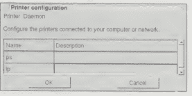

**图 9.5**

*`COAS` 打印机配置对话框。*

在入口屏幕上，选择栏只有两个选项：打印机和守护程序。“守护程序”按钮允许你启动或停止打印机守护程序（这将启动或停止打印机）。“打印机”按钮允许你编辑、添加或删除打印机。操作系统会列出它已知的所有打印机的名称和描述。

如果你高亮选择打印机名称，点击“打印机”按钮，并选择“编辑”，你将进入打印机属性对话框（见图 9.6）。

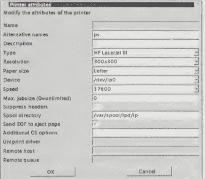

**图 9.6**

*`COAS` 打印机属性对话框。*

此对话框中的某些字段是灰色的（不可编辑）。在 `COAS` 中，对于本地打印机，名称、`Uniprint` 驱动程序、远程主机（毕竟你不是在编辑远程打印机）和远程队列都将显示为灰色。

不过，你可以分配一个更容易理解的备用名称，并输入打印机的描述。

类型字段允许你选择连接到端口的打印机类型。值得注意的是，编辑对话框中可用的选择与添加对话框中可用的选择不同（见下一节的讨论）。如果在添加打印机时，你找不到适合你打印机的选择，你可以输入任何内容，然后回来编辑打印机以选择更合适的打印机驱动程序。

分辨率字段（如果未显示为灰色）将允许你选择在类型字段中选择的打印机所适用的分辨率。

剩余字段基本上都一目了然，并且可能不应该被非专业人士修改。不要因并行打印机需要速度参数（如示例中所示）而感到困扰，因为它似乎完全不影响并行打印机的速度。

在你完成所需的更改后，点击“确定”按钮。你将进入一个确认对话框，询问你是否确认更改、丢弃更改或取消编辑。在你选择合适的按钮后，你将返回到打印机配置对话框。

## 设置和使用远程打印机

设置远程打印机简单、直接且**详细**。这里的细节非常重要，另一台机器上的大写字母必须是你机器上的大写字母。一切必须精确匹配。如果你能 `ping` 通另一台机器，但不能向其打印，你很可能会发现你误输入了一些小错误。

你至少需要以下信息：

- 托管打印机的远程主机的主机名。
- 该打印机在远程机器上的队列名称。

此外，如果你打算在 `LAN` 或 `WAN` 上打印，你需要支持与远程打印机计算机或打印服务器硬件通信的 `LAN/WAN` 协议。

在正确设置远程打印机后，你将能够向任何你有权限的地方发送打印输出。你在本地计算机上的所有工作都可能（并且将会）因远程机器拒绝权限而完全停滞。

几种协议通常用于与远程打印机网关（计算机或打印服务器）通信。其中更常见的两种是 `TCP/IP` 和 `SMB`（会话消息块）。`TCP/IP` 是许多非微软环境（尤其是 `UNIX` 环境）中使用的协议，而 `SMB` 自 1987 年起已在微软环境中可用。`Caldera OpenLinux` 支持这两种协议。但是，安装 `SMB` 环境需要额外安装 `Samba`，这提供在 `Caldera OpenLinux` 介质中。`SMB` 和 `Samba` 在第 16 章中有更全面的介绍。

为 `Caldera` 添加远程打印机功能的步骤与设置本地打印机的步骤非常相似。如果你希望验证任何参数，远程打印机都包含在本地 `*/etc/printcap*` 文件中。

虽然你可以使用 `LISA` 或编辑特定文件来创建远程打印机，但 `COAS` 可能是最简单的方法。

这一切应该熟悉于题为“使用 `COAS` ‘管理’你的打印机”的那一节。

1.  从图 9.5 中的屏幕选择打印机，然后选择添加。
2.  在图 9.7 所示的 `COAS` 选择打印机型号对话框中选择通用远程打印机。

**图 9.7**

`COAS` 选择打印机型号对话框。

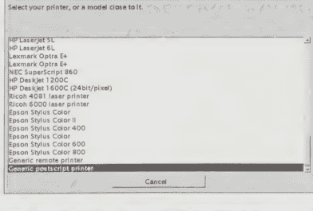

**注意**

务必小心。通用远程打印机位于列表的末尾附近，其后是通用 `PostScript` 打印机。如果你没有选择远程打印机，你将设置一个本地打印机，而这并不是你这里想要做的。

3.  在图 9.8 所示的 `COAS` 名称打印机对话框中为远程打印机指定一个名称。给远程打印机起一个既能表明它是远程的、又能标识其实际物理位置的名字是非常好的主意。特别是当所谓的“远程”打印机实际上位于本地，但通过网络连接时，这一点尤为重要。

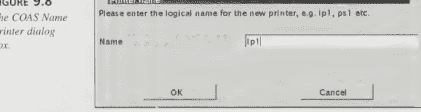


4. 告知 `spooler` 控制此打印机的远程主机是哪个，以及远程主机如何称呼此打印机。（参见图 9.9。）

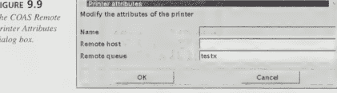

5. 从出现的确认屏幕保存、丢弃或取消此打印机条目。

## 通过网络打印第一页

我们现在准备通过网络打印第一页了。根据你使用的网络协议类型以及网络的连接方式，你可以使用多种方法来实现这一点。

如果你正试图通过局域网使用 `Samba` 进行打印，可以使用以下命令测试 `Samba` 挂载的配置：

```
#### testprns remoteIp
```

这里你需要将 `remoteIp` 替换为 `/etc/printcap` 文件中远程打印机的实际名称。

你应该执行其他几个 `Samba` 测试，这些测试在第 16 章关于 `Samba` 的部分中有详细讨论。不过，如果前面的测试成功，那么你的远程打印机很可能也能正常工作。

要在连接到 `Samba` 的打印机上打印，请输入以下命令：

```
#### smbclient //servername/printernane
```

系统会提示你在 `servername` 上输入密码，在某些情况下必须使用大写字母。完成此操作后，你就可以开始使用通过网络可用的打印机了。

如果我们试图通过 `TCP/IP` 网络进行打印，输入以下命令应在远程打印机上产生一些打印输出：

```
#### lpr -P RemotePrinterName /etc/profile
```

这将在远程打印机 `RemotePrinterName` 上打印文件 `/etc/profile`（一个始终存在的文件）。

###### 格式化打印

如果你只是随便打印一些无用内容（`junk printing`），那么我们目前所做的一切都足够了，但我猜通过限制我们进行的无用打印，我们可以为保护森林节省几棵树。

无用打印的替代方案是格式化打印（也称为非无用打印）。当我们拥有长长的打印输出，且需要页码（玩过“357 捡拾”游戏吗？）或页眉和页脚时，格式化打印很有用。另一个希望为打印输出的每一页添加信息的场景是，我们希望每页都打印“仅供传阅”或“机密”通知。

如果你使用的是文字处理软件，这通常非常容易实现。然而，你通常不会用文字处理软件打印财务记录或客户名单。

解决这些问题的一个非常有效的方案是 `pr` 命令。它存在于许多版本的 `UNIX` 中，并提供了大量选项来满足你的各种需求。

例如，以下命令：

```
#### pr -h "Public Information" -o 20 < pr --help | lpr
```

将给你一个格式美观的页面，顶部包含“Public Information”（以及时间和日期），内容为 `pr` 命令的帮助列表。

这里需要稍作解释。首先执行的命令部分是 `pr --help`，它生成 `pr` 命令的帮助列表。这段文本通过管道传输到行首的 `pr -h "Public Information" -o 20` 命令中的 `pr` 命令。不仅它会生成带有包含“Public Information”以及其他标准页眉信息的格式化输出，还会给你一个 20 个空格宽度的左边距（也许是为了留作注释）。然后，这个 `pr` 命令的输出通过管道传输到 `lpr` `spooler`。


如果你觉得这更像是一场打字测试而非护林行为，那你可能是对的。但是，如果你只是在 `pr` 和 `-h` 之间加上 `+356`，该命令将变为：

`pr +356 -h "Public Information" -o 20 < longprintout.txt | lpr`

这个命令真正能保护森林，因为你将从 `longprintout.txt` 的第 356 页开始打印。当然，这一页会有正确的页眉和页码。

另一个对格式化文本（并保护森林）非常有用的命令是 `groff`。该命令实际上是整个 `groff` 文档格式化系统的前端，具有广泛的功能，特别是当你想为特定设备格式化文档时。

`Caldera` 提供的 `groff` 版本支持以下目标设备：

- `PostScript` 打印机

- `TeX` `dvi` 设备

- 多个 `X11` 查看器（在 75 和 100 `dpi` 下）

- 打字机类设备

- 使用 `ISO` `Latin-1` 字符集的打字机类设备

- `PCL5` 兼容打印机

另一个格式化命令是 `troff`。当你需要包含小数点尺寸和数学表达式等格式化（如物理或数学论文中可能出现的情况），`troff` 是最有用的。

## 使用其他应用程序配置打印机

`Caldera` `OpenLinux` 附带了 `WordPerfect` 8 for `Linux`，这将在第 25 章与其他文字处理软件包一起介绍。为了将打印机设置为与 `WordPerfect` 配合工作，请选中角落的 `K-Gear` 图标，突出显示应用程序，然后单击 `WordPerfect`。

在 `WordPerfect` 标志窗口中，选择 `Program`（程序）然后选择 `Printer Control`（打印机控制）。

在图 9.10 所示的 `Printer Control`（打印机控制）对话框中，你可以管理 `WordPerfect` 的打印机。

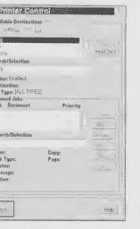

在此对话框中，你可以选择任何 `WordPerfect` 打印作业的目的地，并锁定该打印机，以便其他应用程序不会干扰 `WordPerfect` 的打印机设置。

此外，你可以查看当前的 `WordPerfect` 打印队列，并可选择取消打印作业、将其移动到另一台打印机、重新排序打印作业、停止打印作业或保留打印作业。

你还可以通过单击打印作业，然后单击 `Status`（状态）按钮来检查打印作业的状态。

`Caldera` `OpenLinux` 还附带了 `Star Office` 5.0。该应用程序的打印机设置通过图 9.11 所示的对话框进行处理。

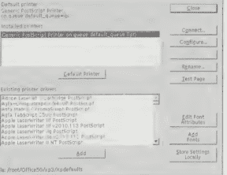

该应用程序的默认设置对于大多数打印机开箱即用即可正常工作。你可以看到，有许多选项可以提高 `Star Office` 的性能。希望使用 `Caldera` `OpenLinux` 下 `Star Office` 传真功能的人需要探索这些选项。

首先，如果你突出显示打印机并单击打印机安装对话框上的 `Connect`（连接）按钮，将在你的监视器上显示图 9.12 所示的 `Connect`（连接）对话框。

#### 图 9.12

`Star Office` 打印机连接对话框。

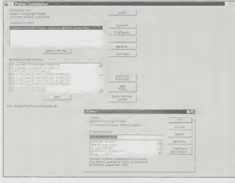

此对话框允许你修改或移除打印机队列，并配置 `Star Office` 的传真输出。

如果你选择 `Configure fax`（配置传真），将进入一个输入框，允许你选择打印到文件或管道，并输入 `Star Office` 使用的特定传真命令。`Star Office` 文档将提供有关传真打印选项具体信息的更多细节。

## 有用的增强打印功能程序（及获取途径）

最有用的打印工具之一使你能够在一页纸上打印文档的多页内容（再次保护森林）。这个工具是 `mpage`，可以从以下地址获取：

http://www.userfriendly.net/linux/RPM/turbolinux/1.2/RPMS/mpage-2.4-1.i386.html

请注意，归档文件使用 `_z` 后缀表示 `_Z`；换句话说，该文件是使用 `compress` 而非 `gzip` 进行压缩的。这个命令不仅显著加快了打印速度，还能保护森林。

另一个有用的程序是 `nenscript`，它可以格式化 `ASCII` 文件，将其转换为 `PostScript`，然后允许你选择许多选项，如横向或纵向打印、单列或双列、是否带页眉等。可以在以下地址找到 `nenscript`：

http://www.im.lcs.mit.edu/magnus/nenscript/

## 大师们的一些秘诀（初级部）

当其他方法都失败时，有时查看 `Grant Taylor` 的 `Linux Printing HOWTO` 主页很有用，可以在以下地址找到：

http://www.picante.com/~gtaylor/pht/

如果你试图从 `Linux` 打印到 `Windows` 95 网络上的打印机，另一个非常值得访问的网站是：

http://home1.pacific.net.sg/~harish/linuxprint.html

最后一个针对大师们（初级部）的网站，它包含了你通常可能想要的所有软件包（包括打印软件包）：

http://www.shopternet.net/publiclibrary/RPM/Groups.html

该网站按功能对所有软件包进行了分类。

###### 摘要

遗憾的是，人类仍然想要打印几乎所有内容，通常随后还会将它们归档。因此，在 `Caldera` `OpenLinux` 上设置打印机是必要的。

随着有用的 `PostScript` 设备出现，以及 `Caldera` `OpenLinux` 对这些设备的出色支持，我们未来可能有机会仅将内容保存在硬盘上并在屏幕上显示。但今天我们不能这样做，所以我们打印。

在 `Caldera` 上进行打印很直接，尽管其设置步骤众多（所有这些都是从 `UNIX` 继承而来的），并且设置完成后有很多选项。

在本章中，我们设置了打印机的硬件，并验证内核驱动程序已安装。我们还查看了如何使用 `COAS` 与打印机交互，以及如何使用 `LISA` 修改安装。我们简要概述了打印系统使用的所有程序和文件，并讨论了添加和设置远程打印机。最后，我们探索了有关打印和打印池的额外信息来源。

## 第 10 章

#### OpenLinux 管理工具

**本章内容**

- 文件系统组织 232

- 控制台管理工具 238

- `Caldera` `Open` 管理系统 247

- `COAStool` 247

本章涵盖了管理 `OpenLinux` 安装的基本知识。首先，我们将查看系统的目录结构（即文件系统），然后探索命令行工具以及 `Caldera` `OpenLinux` 中包含的出色的图形管理工具。

#### 文件系统组织

`OpenLinux` 主要遵循 `Linux` 文件系统标准（`FSTND`）——完整说明可在 `http://www.pathname.com/fhs/` 获得，因此是一个组织良好的系统。`FSTND` 的一个特点是根目录（`/`）非常干净，仅保留最基本的文件。安装完成后，您的根目录应该看起来像这样：

```
auto/  bru/  home/  lib/  net/  root/  usr/
bin/  dev/  initrd/  lost+found/  opt/  sbin/  var/
boot/  etc/  install/  mnt/  proc/  tmp/  vmlinuz
```

以下各节介绍了这些目录中通常包含的文件类型。

##### /bin 和 /sbin 的要素

使用和维护 `OpenLinux` 所需的大部分基本程序都存储在 `/bin` 和 `/sbin` 目录中。这些目录名称中的 `bin` 源自可执行程序是二进制文件这一事实。

`/bin` 目录存放大部分使系统启动和运行所需的基本用户程序，例如：

- `login`

- `Shell`（`bash`、`tosh`）

- 文件操作工具（`cp`、`mv`、`rm`、`ln`、`tar`）

- 编辑器（`ed`、`vi`）

- 文件系统工具（`dd`、`df`、`mount`、`umount`、`sync`）

- 系统工具（`uname`、`hostname`、`arch`）

除了这些类型的程序外，`/bin` 目录还包含 `gzip` 和 `gunzip` 等 `GNU` 工具。

`/sbin` 目录存放基本维护或系统程序，例如：

- `fsck`

- `fdisk`

- `mkfs`

- `shutdown`

- `lilo`

- `init`

存储在 `/bin` 和 `/sbin` 中的程序的主要区别在于，`/sbin` 中的几乎所有程序都旨在供 `root` 用于系统管理和启动；许多不能被普通用户执行。默认情况下，`/sbin` 和 `/usr/bin` 目录不包含在普通用户的 `PATH` 中。

##### /etc 中的配置文件

`/etc` 目录通常用于存储许多程序所需的全局配置文件。`/etc` 中的一些重要文件如下：

- `passwd`

- `shadow`

- `fstab`

- `hosts`

- `inittab`

- `motd`

- `profile`

- `shells`

- `services`

- `lilo.conf`

**注意**

通常不建议也不需要手动编辑这些文件，因为 `OpenLinux` 提供了命令行和图形工具来管理用户。

此列表中的前两个文件，`/etc/passwd` 和 `/etc/shadow`，是身份验证文件，本章后面将对其进行解释。

列表中的下一个文件，`/etc/fstab`，包含系统知道如何自动挂载的设备列表。这是文件系统表。此文件中的一行看起来可能如下所示：

```
/dev/hda1          /           ext2      defaults 1 1
```

第一部分 `/dev/hda1` 指示要挂载的设备（在本例中是内部硬盘 `hda` 的第一个分区）。第二部分 `/` 指示挂载设备的位置。条目 `ext2` 指示设备包含的文件系统类型，其余条目是挂载选项。（此设备指定了默认选项。还有其他许多选项；有关详细信息，请参阅 `mount` 命令的 `man` 页。）

此文件至少还包含另外两个条目，一个是交换（`swap`），另一个是 `/proc`。在许多系统中，`/etc/fstab` 还包含 `CD-ROM`、软盘、`zip` 磁盘和其他可挂载媒体的条目。要添加、删除或更改挂载信息，请使用 `Caldera` `OpenLinux` 管理系统（`COAS`）中的文件系统菜单项（在命令提示符下输入 `coastool`，然后从菜单中选择文件系统）。

文件 `/etc/hosts` 包含 `IP` 地址及对应主机名（和别名）的列表。当给定机器名称时，此列表用于解析机器的 `IP` 地址。一个示例条目可能如下所示：

- # `IP` 地址      主机名      主机别名

- `206.202.56.3`    `consider.thenetxeffexr.com`    `consider www`

`/etc/initab`（或系统初始化表）是 `/etc` 目录下另一个重要的文件。此文本文件包含了通常启动 `Linux` 的说明。

`/etc/motd` 是系统管理员放置“当日信息”（因此得名 `motd`）的文件。通常它包含与系统相关的信息，如计划停机或软件升级，但可以包含任何内容。此文件的内容通常在登录时显示。

`/etc/profile` 是 `Shell` 为 `sh` 或 `bash`（`OpenLinux` 的默认 `shell`）的用户默认识别文件。主要用于设置诸如 `PATH` 和 `PS1`（针对 `Bourne` `shells`）等变量，以及诸如默认 `umask` 之类的内容。`/etc/profile` 文件并非用来替代个人初始化文件，并且由于脚本和用户都会使用它，因此应保持简洁。有关更多信息，请参阅第 3 章。

文件 `/etc/shells` 也与 `shells` 有关。它是用户“批准”的 `shell` 列表。其主要用途之一是防止人们不小心将 `shell` 更改为不可用的 `shell`。

`/etc/services` 包含系统上各种端口上可运行的服务列表。条目看起来可能如下所示：

- `telnet`    `23/tcp`

- `http`      `80/tcp`

第一个条目是服务名称，第二个条目是服务运行的端口，最后一个条目是服务类型。从前面的几行可以看出，`Telnet` 运行在端口 23，`HTTP` 运行在端口 80，这些是这些服务的标准端口。

列表中的最后一个文件是 `/etc/lilo.conf`。此文件包含系统启动时行为的描述，以及系统上所有可启动映像的列表。

`/etc` 下还有两个重要的子目录：`x11` 和 `rc.d`。`/etc` 的 `x11` 子目录包含 `X` 显示管理器（如 `xdm` 和 `kdm`）、窗口管理器（如 `twm`）和字体服务器（`xfs`）的配置文件。大多数窗口管理器包将其配置文件添加到位于 `/etc/X11` 下的目录中。例外情况是 `X` 桌面环境，如 `KDE`（将其所有文件放在 `/opt/kde/` 中）。`X` 服务器配置文件是 `/etc/XF86Config`。

`/etc` 的 `rc.d` 子目录包含在 `Linux` 启动或关闭时运行的初始化脚本。某些脚本包含加载模块的命令；其他脚本处理通用启动行为。

除了上述文件外，`/etc` 目录中还有许多其他配置文件。

##### /home

`/home` 目录是系统上所有用户的家目录的存储位置。这包括实际用户（人）以及如 `FTP` 或 `HTTPD` 等用户的家目录。

##### /mnt

根据约定，`/mnt` 目录是其他文件系统（如 `DOS`、网络挂载的 `NFS` 文件系统，或 `CD-ROM`、软盘、`zip` 磁盘或 `Jaz` 磁盘等可移动介质）挂载的目录。通常，`/mnt` 目录包含若干子目录，每个子目录都是特定设备类型的挂载点。您的 `/mnt` 目录可能如下所示：

```
cdrom/    dos/    floppy/    zip/
```

通过在 `/mnt` 下使用子目录来容纳所有已挂载的介质，您保持 `/` 目录的整洁。

##### /tmp 和 /var

`/tmp` 和 `/var` 目录用于存放临时文件或内容经常变化的文件。

`/tmp` 目录通常是那些只需短暂使用且随时可以删除的文件的垃圾堆。它通常结构比较松散，但在多用户系统中，大多数用户都遵循这样的惯例：在 `/tmp` 中创建一个个人目录（名称与其用户名相同）来存储他们的临时文件。`/tmp` 最常见的用途（除了作为一次性文件的存放位置外）是作为构建和安装程序的起点。


`/var` 目录比 `/tmp` 稍有序一些，通常的结构如下：

- `adm/`
- `catman/`
- `lib/`
- `lock/`
- `log/`
- `nis/`
- `run/`
- `spool/`
- `state/`
- `tmp/`

在这些目录中，`/var/log` 目录是所有用户都应熟悉的目录，因为系统生成的绝大多数消息都存储在其中。你的 `/var/log` 目录可能如下所示：

- `httpd/`
- `kdm/`
- `lastlog`
- `lastlog.01`
- `mail`
- `mail.01.gz`
- `majordomo/`
- `messages`
- `messages.01.gz`
- `news.all`
- `samba.d/`
- `secure`
- `secure.01.gz`
- `spooler`
- `uucp/`
- `vbox/`
- `wtmp`
- `wtmp.01`
- `xferlog`

在这些文件中，`messages` 在尝试诊断系统问题时最有帮助，因为它包含自系统首次启动以来所有的系统消息。

例如，诊断问题（如建立点对点协议 (`PPP`) 连接）的一个有用方法是使用 `tail` 命令连续显示 `/var/log/messages` 的最后几行，如下所示：

```
###### tail -f /var/log/messages
```

##### `/usr`

按照惯例，`/usr` 目录存储了大多数与系统用户直接相关的程序和文件。它在某种程度上是 `/` 目录的一个微型版本。你的 `/usr` 目录可能如下所示：

```
X11R6/
bin/
dict/
doc/
games/
isolinux/
include/
info/
java/
lib/
libexec/
local/
man/
openwin/
sbin/
share/
src/
```

下面几段简要描述了几个此类目录的内容。

`/usr/bin` 和 `/usr/sbin` 目录存储了系统中可用的绝大部分可执行文件。放入这些目录的可执行文件的功能和类型遵循与 `/bin` 和 `/sbin` 相同的通用惯例。然而，在许多情况下，除非你是以 `root` 操作员身份登录，否则你通常无法运行 `/usr/sbin` 或 `/sbin` 目录中的命令，因为这些程序可能会操作重要的系统文件。

在 Linux 下，`/usr/opt` 或 `/opt` 目录等同于 Solaris 中的 `/opt` 目录。可选软件包通常安装在 `/opt` 中；例如，Star Office 套件和最新版本的适用于 Linux 的 WordPerfect 都存储在 `/opt` 目录下。

`/usr/X11` 和 `/usr/X11R6` 目录及其子目录包含几乎所有与 X 窗口系统相关的文件，如手册页、库和可执行文件。OpenLinux 系统仅包含 `/usr/X11R6`，即 X 窗口系统第 11 版的第六个修订版。

`/usr/local` 目录是本地程序、手册页和库的安装位置。在许多站点，`/usr` 中的大多数目录在所有计算机上都保持相同，但任何需要在特定机器上安装的内容都放在 `/usr/local` 中，从而将这些文件标识为本地文件，并便于维护大量系统。

最后，`/usr` 下最实用的目录之一是 `/usr/dict`，系统本地字典文件 `/usr/dict/words` 就存储在这里。大多数版本的 `/usr/dict/words` 包含约 45,000 个单词，但有些可能多达 100,000 个单词或更多。在 OpenLinux 中，`words` 文件是指向 `linux.words` 文件的符号链接。OpenLinux 默认拼写检查器 `ispell` 的主字典位于 `/usr/lib/ispell` 目录下，但你可以通过 `-L` 命令行选项强制 `ispell` 使用 `/usr/dict/words`。

#### 控制台管理工具

Linux 在管理方式上具有惊人的灵活性。尽管 OpenLinux 包含大量功能强大的图形工具（将在下一节中解释），但同样可以从命令行良好地（在许多情况下甚至是更好地）对其进行管理。事实上，UNIX 系统的许多卓越品质之一就是，你可以从半颗地球之外以完全相同的方式和相同的容量进行管理，就好像你正坐在它面前一样。

本部分关于控制台管理的内容将介绍你需要的基本工具：添加和删除用户、安排任务以及启动和停止系统服务。使用 `COAS` 图形工具几乎可以完成所有相同的任务。然而，如果你有需要（例如，为了远程管理你的 OpenLinux 系统），或者只是想学习“真正”的 UNIX 做事方式，那么本部分应该能帮助你很好地起步。

#### 用户管理

系统管理（特别是在大型站点中）的一项主要任务竟然是处理用户帐户：添加、删除和修改它们。最初，处理用户帐户是一项耗时且很大程度上令人恼火的手动任务；然而，现在许多工具在很大程度上自动化了这一过程。

包含大多数登录相关信息并控制登录和帐户创建的文件如下：

- `/etc/passwd`：此文件存储用户帐户信息。登录名、用户 ID (`UID`)、组 ID (`GID`)、全名、主目录和登录 `shell` 都在这里。
- `/etc/shadow`：此文件存储用户的加密密码，以及有关密码过期的信息。
- `/etc/group`：此文件存储组信息（组 ID）、组成员以及很少使用的组密码字段。
- `/etc/login.defs`：此文件存储创建新登录信息的默认信息。你可以在此处设置密码过期、组 ID、默认 `shell` 以及一系列其他选项。
- `/etc/pam.d/`：此目录存储各个登录工具的可插拔认证模块 (`PAM`) 配置信息。仅关于 `PAM` 就足以写一整本书，因为它相当复杂。如果你对了解所有选项感兴趣，请查看 `/usr/doc/libpam-0.66/` 中的文档。在你完成该操作并对该主题有把握之前，建议你不要动这些文件。
- `/etc/skel/`：此目录存储用于创建用户主目录的默认配置文件。这些是初始的点文件（之所以这样称呼是因为它们前面带有句点），它们会被复制到新用户的主目录中。

##### 用户管理程序

以下大纲用于创建、删除和配置用户登录：

`/usr/sbin/useradd`：此程序添加单个新用户，并可以在命令行上为其设置各种默认值。在没有命令行选项的情况下，它从 `/etc/login.defs` 读取默认值。其选项如下：

- `-u UID`：从命令行设置数字用户 ID。
- `-g group`：从命令行设置组 ID。
- `-m`：如果用户的主目录尚不存在，则创建它。
- `-d home directory`：将用户的主目录设置为命令行上的值，而不是将用户的登录名追加到默认 `<rootdir>`（通常在 `/etc/login.defs` 中设置为 `/home`）。
- `-s shell`：从命令行设置登录 `shell`。
- `-r rootdir`：设置主目录的根目录（即，不将目录放在 `/home` 中）。
- `-e expire date`：密码将在该日期过期的绝对日期，格式为 日/月/年 (`dd/mm/yyyy`)。
- `-f inactive period`：密码过期后，帐户被锁定前的无活动天数。
- `-D`：从 `/etc/login.defs` 显示默认值—不需要登录名参数。
- `name`：此帐户要使用的登录名。

`/usr/sbin/userdel`：此程序从系统认证文件（`/etc/passwd`、`/etc/shadow`、`/etc/group`）中删除指定的用户。在其他大多数 UNIX 版本中，此程序会接受一个 `-r` 参数，指示它也删除用户的主目录。OpenLinux 的版本不会这样做，因此你需要自己删除主目录。

`/usr/sbin/usermod`：此程序将修改用户的登录信息。运行此命令时，用户必须未登录或未正在执行程序。它接受以下命令行参数：

- `-u`：更改用户的数字 `UID`。
- `-c`：向用户的 `/etc/passwd` 条目添加注释；这通常是用户的全名。
- `-g`：设置用户的初始组。
- `-G`：将用户添加到 `-G` 后面指定的附加组中。
- `-d home directory`：将用户的主目录更改为 `-d` 后面指定的另一个目录。
- `-m`：如果与 `-d` 一起给出，则用户的当前目录将被复制到新位置。
- `-e expire date`：设置帐户在此日期过期 (`mm/dd/yyyy`)。
- `-f inactive period`：设置密码过期后帐户锁定前的无活动期。
- `-l login name`：更改用户的登录名。
- `-s`：更改用户的默认 `shell`。
- `name`：要更改的登录名。

`/usr/bin/passwd`：允许你更改用户密码。只有 `root` 可以更改其他用户的密码。普通用户在允许更改之前会被提示输入当前密码。该程序请求新密码，然后要求你正确重新输入它后才接受。

`/usr/bin/chfn`：此程序更改用户的“finger”信息。这是用户的个人信息：全名、办公室、电话号码等。

当调用时带有登录名称，它会交互式地请求新的信息。对于任何你不想更新的字段，你只需按回车键即可。

`/usr/bin/chsh`：该程序用于更改用户的默认 `shell`。这允许你将用户的 `shell` 更改为 `/etc/shells` 文件中的任何一项。

##### 服务

UNIX 系统主要基于独立且可单独配置的程序模型工作，每个程序执行特定的任务。没有单一的主程序负责所有功能并执行所有操作。所有内容都是分布式的，并可供你以任何方式更改——只要你不介意弄脏双手。

通常系统在启动时自动运行、在后台运行并为系统或系统用户提供某些服务的程序，通常被称为*守护进程*（daemons，发音类似 demos）。这是一个非常宽松的定义；实际上唯一的要求是程序自己进入后台并运行，直到被明确停止为止。然而，大多数定义系统操作方式和执行功能的程序都完全符合第一个定义。尽管这通常也不是强制要求，但这些守护进程大多位于 `/usr/sbin`，将配置文件存储在 `/etc` 中，并且通常将进程 ID 存储在 `/var/run` 中的一个文件中。

例如 `syslogd`（系统事件记录器）。该守护进程本身是 `/usr/sbin/syslogd`，其配置文件是 `/etc/syslog.conf`，它维护一个 PID 文件 `/var/run/syslogd.pid`。

OpenLinux（或任何 UNIX）系统启动及其提供服务的流程主要由一个名为 `init` 的程序控制。在 OpenLinux 中，`init` 位于 `/sbin`。它是 Linux 系统启动时运行的第一个程序，并且控制所有其他进程的启动、运行和停止。基本上，所有 UNIX 系统都基于不同的系统操作“级别”假设工作，并且每个级别中运行的进程是或可能是不同的。这些被称为*运行级别*（run levels），有两种主要的*运行级别*定义模型：BSD 模型和 System V 模型。

BSD 模型是两者中较简单的；它有更少的配置文件和更少的运行级别。System V 模型则稍微复杂一些：这是 OpenLinux 和大多数其他 Linux 发行版使用的模型。在 SysV 模型中，有几个编号的*运行级别*，每个*运行级别*对系统都有特定的含义。以下是 OpenLinux 中使用的*运行级别*：

- *运行级别 0*：这是系统关机时进入的运行级别。它旨在用于需要从系统断电的情况。
- *运行级别 1*：这是单用户模式——不设置网络，也不运行系统守护进程。这是作为系统维护模式而设计的。


- *运行级别 2*：这传统上表示正常的多用户状态，但不运行 NFS 或其他网络服务。基本上，它是一种你可以访问网络，但其他人无法访问你的服务的状态。
- *运行级别 3*：这是正常的多用户模式——启动所有已配置的系统服务和网络服务。这是未运行 X 登录的系统所使用的一般运行级别。
- *运行级别 4*：这是一个未定义的状态。OpenLinux 将其处理方式与级别 3 完全相同。
- *运行级别 5*：多用户加上 X 显示管理器——运行所有配置的系统服务和网络服务。此外，还会启动 `xdm` 或 `kdm` 程序，以允许从控制台（可能还有远程，具体取决于设置）进行 X 登录。
- *运行级别 6*：这是系统重启时进入的运行级别。
- *运行级别 s/S*：这是单用户模式的另一个通用名称。

`/etc/inittab` 文件控制每个这些运行级别的进入方式或是否进入。这控制了启动过程的最早阶段。它通常告诉 `init` 运行几个关键程序；然后告诉 `init` 默认的默认运行级别将是什么。（它还包含用于控制 Linux 控制台的程序（`getty`）的配置信息。）在 OpenLinux 中，你的默认运行级别很可能是 5，除非你没有设置 X，在这种情况下它应该是 3。

在所有内核设置完成后，`init` 切换到其默认运行级别并启动应在该级别运行的守护进程。此过程由 `/etc/rc.d/` 目录下的文件控制。基本上，对于每个运行级别都有一个 `rcN.d` 目录，其中 `N` 等于运行级别的编号。因此，当系统进入运行级别 3 时，`/etc/rc.d/rc3.d/` 中的所有文件都会被执行。

事实上，事情比这稍微复杂一点。（某种方式下，你肯定早就知道了，不是吗？）守护进程的实际控制文件位于 `/etc/rc.d/init.d/` 中。各个 `rcN.d` 目录中的文件实际上是指向 `/etc/rc.d/init.d/` 中文件的符号链接，以便 `init` 可以知道以何种顺序启动项目以及是否要启动或停止项目。以下是一个示例——`/etc/rc.d/rc2.d/` 目录的列表：

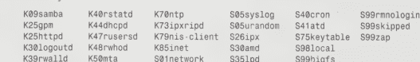

如果命令前以 `K` 开头，守护进程会被终止；如果以 `S` 开头，守护进程会被启动。数字用于排序——例如，`S30amd` 会在 `S981ocal` 之前启动。

该系统真正出色之处在于 `/etc/rc.d/init.d/` 目录。如果你想在所有服务启动并运行之后启动和停止系统服务，你不需要四处寻找，只需这样做：

```bash
$ /etc/rc.d/init.d/ntop stop
$
$ /etc/rc.d/init.d/ntop start
```

现在，如果你希望改变系统启动时启动的内容和方式，你所需要做的是改变 `/etc/rc.d/rcN.d` 目录中的顺序，或者将 `S` 改为 `K`。`/etc/rc.d/init.d` 中脚本的配置文件存储在 `/etc/sysconfig/daemons` 中。通过修改这些目录中的内容，你可以手动完全改变系统的启动方式。

当然，你应该知道，修改这些文件是导致系统完全无法启动的绝佳方法，直到某位好的 Linux 高手过来帮你修复。话虽如此，这几个程序中集中了大量的功能和控制力，因此了解这一切的运作方式肯定是好事。如果你不这样了解，你永远不会自己也成为 Linux 高手。

##### 任务调度

Linux 和 UNIX 系统的一个便利之处在于，当你不在场时调度系统执行工作有多么容易。许多任务由系统设置，以便在深夜处理这些事情，以免打扰你。你也可以利用这一点。这些调度大多使用两个程序进行：`crontab` 和 `at`。`crontab` 是 `cron` 守护进程的用户界面。`cron` 守护进程始终运行，并读取系统和用户配置文件以确定何时运行任务。使用 `crontab`，你可以调度程序供 `cron` 在任何未来时间和固定间隔运行。

如果你只运行 `crontab` 程序，它会为你启动一个编辑器来编写你的调度。你也可以直接提供一个已经包含你调度的文件。你可以使用 `-l` 选项列出你的文件，并使用 `-e` 选项更改你的编辑器。使用 `crontab` 程序创建的个人 crontabs 具有以下语法：

| 字段 | 范围/值 |
| :--- | :--- |
| `[分钟]` | `0-59` |
| `[小时]` | `0-23` |
| `[月中的日子]` | `0-31` |
| `[月份]` | `0-12` [或名称] |
| `[星期几]` | `0-7` [或名称] |
| `[要运行的命令]` | |

每个单独的字段都可以用星号（`*`）替换，表示在其中的任何一项上运行。对于接受名称的月份和星期几字段，只需使用名称的前三个字母。因此，例如在七月每周四上午 5:45 运行一个命令的例子是：

```
45 05 * Jul Thu command_to_run
```

此外，`/etc/crontab` 文件和 `/etc/cron.d/` 目录下的目录中还有系统 crontabs。这些系统 crontabs 在星期几和命令之间增加了一个用户字段——以谁的身份运行程序。因此，对于需要以 `root` 身份从系统 crontab 运行的命令，上一个示例将变为：

```
45 05 * Jul Thu root command_to_run
```

`at` 是一个用于在将来的一个特定点运行特定程序的命令。`at` 命令不会像 `cron` 那样无限地重复命令。`at` 的语法比 `crontab` 更友好；它可以接受大多数时间格式，甚至包括表示时间的“自然语言”词汇。以下是一些示例：

```
at midnight command_to_run
```

```
at 2pm Aug 2 command_to_run
```

```
at 11:45am Jan 2 2000 command_to_run
```

命令 `atq` 将列出调用用户的任务及其计划运行的时间。`atrm` 将删除指定的任务编号，你可以通过查看 `atq` 命令的输出获得该编号。

#### 通过 /proc 进行内核管理

`/proc` 是你的朋友。在 Linux 内核中，`/proc` 目录下的伪文件包含大量的诊断信息和设置运行时参数的简单手段。

最经常有用的 `/proc` 诊断文件如下。

- `/proc/cpuinfo` 列出处理器类型、速度以及其他关于计算机硬件的基本信息：


```bash
$ cat /proc/cpuinfo
processor     : 0
vendor_id     : GenuineIntel
cpu family    : 6
model         : 1
model name    : Pentium Pro
stepping      : 7
cpu MHz       : 199.436220
```

### `/proc/cpuinfo`

```
cache   size    : 256 KB
fdiv_bug    : no
hlt_bug     : no
sep_bug     : no
f00f_bug    : no
fpu         : yes
fpu_exception   : yes
cpuid level : 2
wp          : yes
flags       : fpu vme de pse tsc msr pae mce cx8 sep mtrr pge mca cmov
bogomips    : 199.07
```

### `/proc/ioports`

`/proc/ioports` 显示已安装设备的起始和结束地址：

```
$ cat /proc/ioports
0000-001f : dma1
0020-003f : pic1
0040-005f : timer
0060-006f : keyboard
0070-007f : rtc
0080-008f : dma page reg
00a0-00af : pic2
00c0-00df : dma2
00f0-00ff : fpu
01f0-01f7 : ide0
02f8-02ff : serial(auto)
0378-037a : parport0
03c0-03df : vga*
03e8-03ef : serial(auto)
03f8-03ff : serial(auto)
03f8-03ff : ide0
ff80-ff9f : eth0
ffa0-ffa7 : ide0
ffa8-ffaf : ide1
```

### `/proc/interrupts`

`/proc/interrupts` 将 `IRQ` 行映射到设备：

```
$ cat /proc/interrupts
          CPU0
  0:  50449731    XT-PIC    timer
  1:     594122    XT-PIC    keyboard
  2:        0    XT-PIC    cascade
  4:  1324260    XT-PIC    serial
  8:         1    XT-PIC    rtc
  9:    280466    XT-PIC    eth0
 13:         1    XT-PIC    fpu
 14:    304916    XT-PIC    ide0
NMI:        0
```

### `/proc/meminfo`

`/proc/meminfo` 显示系统上的内存使用情况：

```
$ cat /proc/meminfo
             total:    used:    free:    shared:  buffers:  cached:
Mem:       64913408  63381504  1531904  46350528  1388544 249963216
Swap:      605056192   7503872 585552320

MemTotal:       63392 kB
MemFree:          1496 kB
MemShared:       45272 kB
Buffers:          1356 kB
Cached:          24384 kB
SwapTotal:       64508 kB
SwapFree:        57100 kB
```

### `/proc/pci`

`/proc/pci` 显示系统中所有 `PCI` 设备的信息：

```
$ cat /proc/pci

PCI devices found:
Bus 0, device 0, function 0:
    Host bridge: Intel 82441FX Natoma (rev 2).
        Medium device1. Fast back-to-back capable. Master Capable.
    Latency=64.
Bus 0, device 7, function 0:
    ISA bridge: Intel 82371SB PIIX3 ISA (rev 0).
        Medium device1. Fast back-to-back capable. Master Capable. No bursts.
Bus 0, device 7, function 1:
    IDE interface: Intel 82371SB PIIX3 IDE (rev 0).
        Medium device1. Fast back-to-back capable. Master Capable.
    Latency=64.
    I/O at 0xffa0 [0xffa1].
Bus 0, device 11, function 0:
    VGA compatible controller: S3 Inc. Vision 968 (rev 0).
        Medium device1. IRQ 11.
    Non-prefetchable 32 bit memory at 0xfa000000 [0xfa000000].
Bus 0, device 17, function 0:
    Ethernet controller: Realtek 8029 (rev 0).
        Medium device1. IRQ 9.
    I/O at 0xff80 [0xffb1].
```

### `/proc/parport`

`/proc/parport` 包含每个并行端口的目录，并报告连接到每个端口的设备：

```
$ cat /proc/parport/0/hardware

base:  0x378
irq:  none
dma:  none
modes:  SPP
```

内核和其他底层运行时参数可以通过 `/proc/sys` 伪文件进行设置。例如，要将文件句柄的最大数量设置为更高的值，您可以在启动脚本中包含一行，将新数字直接回显到 `/proc/sys/fs/file-max`。

## `Caldera Open` 管理系统

`Caldera Open` 管理系统（`COAS`）是一组图形工具，允许您设置机器的大部分重要服务和功能，而无需熟悉众多文件。这对于 `UNIX` 的易用性是一个重大进步。需要注意的是，`COAS` 具有运行不同图形“前端”的能力——它可以在控制台上运行，也可以在 `X` 中运行。我们将提供 `X` 窗口系统/`KDE` 版本 `COAS` 的屏幕截图，但控制台版本在功能上是相同的。

### `COAStool`

提供 `COAS` 图形界面的程序称为 `COAStool`。只需输入其名称，即可在控制台或 `X` 环境中启动该程序。大多数 `COAStool` 功能需要 `root` 权限，当然，作为普通用户，您也可以浏览大多数功能，以了解其大致情况。

以这种方式启动 `COAStool` 可以提供与 `KDE` 中 `COAS` 菜单相同的所有功能，并额外增加一个项目。您可以在以下位置找到它：

`网络管理 -> TCP/IP 网络选项`

这允许您配置工作站网络的基本状态。需要 `root` 权限；除非有特定原因，否则强烈建议您不要更改默认设置。

如图 10.1 所示，可用选项为：

- **网络（`Networking`）** 此切换开关（启用/禁用）允许您选择下次启动时是否需要任何网络。

- **IP 转发（`IP Forwarding`）** 此切换开关（启用/禁用）允许您选择网络流量是否会在多个网络接口之间转发。显然，这需要您拥有多个网络接口（即，多个以太网接口、以太网/`ppp` 接口等）。除非您打算让计算机充当路由器或防火墙，否则强烈建议您将其保持为默认的禁用状态。

#### 图 10.1

*网络选项对话框。*

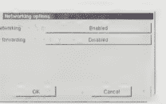

### `COAS` 菜单

`COAS` 菜单由 `KDE` 工具栏上的 `COAS` 菜单图标（或 `KDE` 主菜单上的 `COAS` 菜单项）表示。从 `KDE` 菜单栏运行 `COAStool` 的一个好处是，您可以作为普通用户运行 `X`/`KDE`。如果调用的程序需要该级别的权限，`COAStool` 将启动一个名为 `COAS su` 包装器的小程序，以向您获取 `root` 密码。参见图 10.2。

#### 图 10.2

*COAS su 包装器对话框。*


`COAS` 菜单具有以下结构：

- 网络 ->
  - `TCP/IP`
  - `NIS`
  - `Resolver`（解析器）
  - 以太网接口
- 邮件传输
- 外设 ->
  - 键盘
  - 鼠标
  - 打印机
- 系统 ->
  - 账户
  - 守护进程
  - 文件系统
  - 主机名
  - 资源
  - 时间
- 内核
- 软件

下文将解释这些菜单选项中的每一个。

- **网络（`Network`）** 此菜单项打开控制工作站网络上大多数功能的配置对话框和菜单。

- **TCP/IP** 这些菜单项可用于控制工作站的基本网络功能。

## 网络信息服务

网络信息服务（`NIS`）允许如图 10.3 所示配置 `NIS` 域和选项。这是一个源自 `Sun` 的协议，在大型 `UNIX` 安装中获得了相当广泛的接受。简而言之，`NIS` 可用于提供主机和用户定位及认证的手段。其具体细节和设置可能（通常也是）相当复杂，配置此服务的需求可能仅适用于您试图将新的 `OpenLinux` 机器集成到更大的 `UNIX` 环境中的情况。如果是这种情况，您可以使用 `COAS` 通过以下对话框和字段将您的机器配置为 `NIS` 客户端：

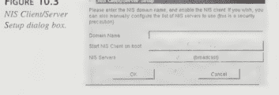

- **域名（`Domain Name`）** 您的客户端机器将所属的 `NIS` 域。请注意，这可能与您的 `DNS` 域名不同。如果您认为需要启用 `NIS` 配置，请在开始之前确保您拥有这些框中的所有正确信息。在您的机器上错误地配置 `NIS` 会给您的网络管理员带来麻烦，并可能对您的健康产生不愉快的后果。

- **启动时启用 NIS 客户端（Start NIS Client on Boot）** 允许您在工作站启动时启动 `ypsbind`。这使您能够利用 `NIS` 服务。如果域名框为空，此切换框将被禁用（灰色）。

- **NIS 服务器（`NIS Servers`）** 通常设置为广播，以便它可以检测到网络上任何可用的 `NIS` 服务器。使用此对话框，您可以手动设置多达十台 `NIS` 服务器，您的客户端工作站将允许绑定到这些服务器。参见图 10.4。

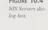

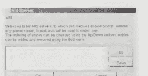

请注意，`Resolver`（解析器）和 `Account`（账户）对话框（本章稍后讨论）也与 `NIS` 存在某些交互和影响。`Resolver` 部分可以控制主机名查找的顺序（`NIS` 也可以用于查找主机名，就像 `DNS` 一样）。`Account` 对话框可以启用用于用户名的 `NIS` 认证查找。有关更多信息，请参见该章节的这些部分。

### 解析器

名称解析器设置对话框允许您配置解析器库在工作站上的工作方式。解析器将 `IP` 地址（计算机在 `TCP/IP` 网络中用于识别其他计算机的点分四元组数字表示法，例如 `10.10.10.1`）转换为主机名，并将其反向转换。可以使用以下字段进行配置，如图 10.5 所示。


- **信息来源（`Information Source`）** 点击时弹出搜索顺序对话框，如图 10.6 所示。它允许您配置各种名称解析源的查询顺序，甚至可以添加或移除解析源。
  - `host`——指 `/etc/hosts` 文件
  - `nis`——指 `NIS` 解析
  - `dns`——指域名服务（`Domain Name Service`）解析

## 第 10 章

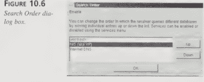

- **尝试防止欺骗**：要求解析器库在尝试确定属于某个 `IP` 地址的名称时执行两次查找。首先，它请求属于该 `IP` 地址的名称；然后请求与刚返回的名称相对应的 `IP` 地址。大多数时候它们相匹配；当它们不匹配时，可能意味着某人正试图掩盖其真实身份（或者至少其 `DNS` 配置不当或错误）。这在技术上是打开/关闭 `/etc/host.conf` 文件中的 `nospoof` 选项。

- **报告欺骗尝试**：启用将所有 `DNS` 欺骗尝试记录到系统日志（默认为 `/var/log/messages`）的功能。这在技术上是打开/关闭 `/etc/host.conf` 文件中的 `spoofalert` 选项。

- **DNS 服务器**：点击时弹出如图 10.7 所示的 `DNS` 名称服务器对话框。通过“编辑”菜单项，你可以添加、编辑或删除名称服务器，并且可以使用“上”和“下”按钮来确定名称服务器的查询顺序。

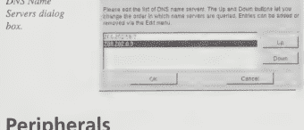

### 外设

#### 键盘

键盘配置对话框允许你设置键盘的重要控制参数，如图 10.8 所示。


- **布局映射**：允许你在八种不同的键盘映射之间进行选择，这些映射既匹配你使用的键盘，也匹配你的国家来源。选择项包括美国、法国、德国以及许多其他欧洲语言映射。

- **重复率**：允许你设置选定按键每秒重复的次数。`Linux` 控制台的标准值为 `30.0 cps`。请根据个人喜好进行调整。

- **重复延迟**：允许你根据个人喜好调整按键开始重复前的毫秒数延迟。`Linux` 控制台的标准值为 `250 ms`。

#### 鼠标

你可以使用如图 10.9 所示的 `GPM` 鼠标配置对话框来配置 `GPM` 程序，以便在控制台上使用鼠标。


> **注意：** `GPM` 鼠标配置不会配置在 `X` 窗口系统中运行的鼠标。如果你是从控制台启动 `COASTRGH`，或者希望在仍处于 `X` 环境时配置 `GPM`，那么这是正确的。然而，如果你想更改 `X` 中的鼠标行为，则不应使用此配置工具——请改用 `XF86` 设置或 `KDE` 配置工具。

在此对话框中可以设置以下选项：

- **型号**：允许你从近一打不同的鼠标驱动程序中进行选择。最常用且可能被使用的驱动程序是 `Microsoft` 串口鼠标和 `PS/2` 鼠标。

- **驱动**：允许你选择与你所选鼠标型号配合工作的模块。通常不需要设置此项，因为它对应于你选择的型号。可能的选项有 `serial`（串口）、`busmouse`（总线鼠标）和 `PS/2`。

- **协议**：指示鼠标使用的通信协议。同样，这对应于你选择的型号，因此通常不需要更改此设置。

- **设备文件**：指示该鼠标连接到的端口。正常值为 `MS` 协议鼠标的 `/dev/mouse` 和 `PS/2` 协议鼠标的 `/dev/psaux`。

- **仿真**：允许你通过同时按下按钮 1 和按钮 2 来模拟第三个按钮，从而仿真三键鼠标。除了选择 `MS` 串口鼠标外，此选项通常是被灰色禁用的。

- **在启动时开始**：允许你指定是否在启动时启动 `GPM` 服务（必须启动该服务才能在控制台上支持鼠标功能）。

#### 打印机

打印机配置对话框允许你创建、编辑和删除新的打印机，以及启动和停止打印服务。如图 10.10 所示，有许多可用的选项。

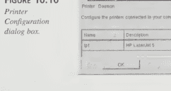

**打印机菜单项**

- **编辑**：允许你编辑当前条目。

- **添加**：允许你向系统添加新打印机并进行配置。

- **删除**：允许你删除当前选中的项。

**守护进程菜单项**

| 选项 | 描述 |
| :--- | :--- |
| **启动** | 允许你启动打印机服务。 |
| **停止** | 允许你停止打印机服务。 |

若要添加新打印机，请从打印机菜单中选择“添加”。然后系统会要求你选择打印机型号（或与其相似的型号），为其命名，并确认其属性（纸张大小、设备）。在这里唯一需要动脑的是选择打印机型号，因为其他默认值通常都是正确的。确认打印机属性后，系统会要求你保存数据，然后询问是否创建打印队列（这是文件等待发送到打印机时的中间目录）。对这两个问题都回答“是”。然后打印机守护进程将重启，你的打印机应该可以正常工作。

如果打印机未按预期工作，或者你只是想更改其部分配置，请选择该打印机，然后从打印机菜单中选择“编辑”。你会看到一个扩展的打印机属性列表，如图 10.11 所示。


- **名称**：打印机名称是在初始设置时选择的，不可配置。

- **替代名称**：列出打印机的其他寻址名称。

- **描述**：列出初始设置时选择的制造商和型号。

- **类型**：与 `Linux` 打印相关的打印机类型。这通常不是打印机的确切名称，而是打印机类别。例如，选择 `HP LaserJet III` 将允许向所有 `LaserJet III` 系列打印机打印。


- **分辨率**：你希望输出达到的标准水平 × 垂直分辨率。激光打印机和喷墨打印机的正常值通常为 `300 × 300` 和 `600 × 600`。

- **纸张大小**：设置通常在美国为 `Letter`（信纸），在欧洲为 `A4`。

- **设备**：打印机所连接的打印机端口。在 `UNIX` 中，打印机通常被称为 `lp-something`（`lp` 是过去行式打印机 [Line Printer] 时代留下的遗留名称）。在 `Linux` 中，端口被称为 `lpN`，其中 `N` 是从 `0` 开始的数字（`LPT1 = lp0`）。你可用的端口是 `Linux` 自动检测到的，因此如果你只有一个打印机端口，那么你将只有一个 `lp0` 条目可供选择。还为少数串口打印机列出了串口。

- **速度**：串口打印机的设置。

- **最大作业大小**：允许你设置允许的打印作业的最大大小。这对于防止远程打印机用户向你的打印机发送巨大的打印作业特别有用。大小以 `1KB` 块为单位。

- **抑制页眉**：允许你抑制页眉。默认情况下，打印系统会显示横幅页或页眉以分隔打印作业，这在多用户环境中是有用的。然而，如果你是唯一使用打印机的人，那么这是浪费纸张，因此你可以勾选此框以抑制页眉。

- **暂存目录**：指示该打印机存放等待打印文件的目录。这通常在初始打印机配置时设置和创建，在正常条件下不应更改。

- **发送 EOF 以弹出页面**：如果你的打印机有时会吞掉你发送的最后一页，你需要勾选此选项以向打印机发送额外的文件结束消息。

- **额外的 GS 选项**：列出 `OpenLinux` 基于 `GhostScript` 程序进行打印所使用的打印机驱动程序。该程序有众多选项，你可以在此处设置它们。除非在特殊条件下（或者你确实知道自己在做什么），否则你不需要在这里填入任何内容。

- **Uniprint 驱动**：`Uniprint` 是一个通用的打印机驱动程序，允许你通过指定特定选项来指定确切的打印机。除非你已知你需要此功能，否则你可能不需要（而且，除非你从类型菜单中选择 `Uniprint` 驱动，否则它会被灰色禁用）。

- **远程主机**：打印机所连接的主机名称。除非你从类型菜单中选择远程打印机，否则该项为灰色禁用。

- **远程队列**：远程主机上打印机的名称。除非你从类型菜单中选择远程打印机，否则该项为灰色禁用。


##### 注意

如果您编辑了其中一台打印机的设置，您需要手动停止并重启打印机服务才能使更改生效。您可以通过“守护程序”菜单执行此操作。首先停止打印机守护程序，然后启动它。此时，您的更改将生效。

##### 系统

“系统”菜单包含所有基本的系统管理工具。

###### 账户

“用户账户”对话框允许您添加、编辑和删除系统用户，以及设置登录策略和默认值。其中包含多个菜单项，如图 10.12 所示。


| 用户 | UID | 名称 | 主目录 |
| --- | --- | --- | --- |
| `root` | `1` | `root` | `/root` |
| `bin` | `1` | `bin` | `/bin` |
| `daemon` | `2` | `daemon` | `/daemon` |
| `adm` | `3` | `adm` | `/var/adm` |
| `lp` | `4` | `lp` | `/usr/spool/lp` |
| `sync` | `5` | `sync` | `/bin` |
| `shutdown` | `6` | `shutdown` | `/sbin` |
| `halt` | `7` | `halt` | `/sbin` |
| `mail` | `8` | `mail` | `/var/spool/mail` |
| `news` | `9` | `news` | `/var/spool/news` |
| ... | `4` | | |

- **文件** 允许您退出。
- **操作** 允许您编辑、创建和删除用户。
- **查看** 允许您查看所有用户（包括系统账户）或将显示限制为常规用户（没有系统权限的普通用户）。
- **选项** 允许您设置首选项、允许使用影子密码以及启用 `NIS` 查找。选择“首选项”会弹出“编辑首选项”对话框，如图 10.13 所示。

**首选项** 允许您为创建所有新用户账户设置首选项。

**最小 UID** 指示允许用户 ID 的最小数值。通常，所有用户都被设置为较高的 ID（默认从 `500` 开始），以将其与系统账户区分开来。

**组分配策略** 确定每个新用户是否拥有自己的组，或者是否将所有新用户放入单个 `users` 组。

**默认组** 设置为 `100`（`users`），且呈灰色不可编辑状态。

**默认 Shell** 指示用户在首次登录时将使用的 shell。

**默认密码有效期** 标识密码在用户必须更换为新密码之前默认有效的持续时间（以天为单位）。

**主目录** 指示所有新主目录将放入的基目录。

- **禁用影子密码** 将影子密码（存储在专用受保护文件中的密码）转换回普通 `passwd` 格式（用户信息中包含密码数据，且所有人可见，格式为加密形式）。除非您有非常具体的原因并且了解其后果，否则强烈建议不要禁用影子密码。

- **启用 NIS 查找** 打开 `NIS` 用户身份验证。如果您不使用 `NIS`，则不需要此功能；实际上，它可能会拖慢速度并导致其他问题。如果您不需要，请勿打开。

要在 `COAS` 中创建新账户，请打开**操作**菜单并选择**创建用户**。输入新用户的登录名（系统用于识别用户的八位字符名称）。将显示如图 10.14 所示的“编辑用户”对话框。

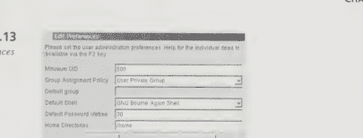

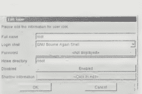

**全名** 存储用户的真实姓名。

`UID` 用户 ID——保持默认值即可。

`组 ID` 保持默认值即可。

- **登录 Shell** 设置为用户的偏好（可能是 `GNU Bourne Again Shell`）。
- **密码** 点击后允许您输入用户的密码。
- **主目录** 保持默认值。这是所有用户个人文件的存放位置。
- **已禁用** 允许您启用或禁用用户账户。创建时请保持为“已启用”（创建新账户后立即禁用它没有什么意义）。
- **影子信息** 点击后，会弹出“密码过期”对话框（如图 10.15 所示），可用于设置密码策略。

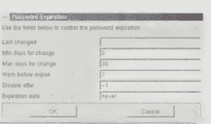

**最后更改** 应设置为当前日期，并显示为灰色。

`最少更改天数` 列出允许用户更改密码前的最小天数（默认为 `0`，表示没有最小值）。

`最多更改天数` 列出允许使用密码的最大天数（默认为 `30` 天）。在没有更改密码的情况下经过这么多天后，用户在登录前必须更改密码。

**过期前警告** 列出密码过期前的天数。用户将开始收到警告消息，告知其密码即将过期。

**失效后** 指示密码过期后，账户将在多少天无活动后失效。默认设置 `-1` 表示账户实际上不会失效。

**过期日期** 允许管理员设置该账户将过期的特定日期。此日期可以 `MM/DD/YY` 格式表示。

##### 注意

虽然有许多选项，但基本上您只需要设置用户登录名、全名以及可能的 shell 和密码即可。其他所有默认值都应提供一个合理的起点。

###### 守护程序

“系统服务”对话框允许您确定每次系统启动时将激活哪些服务。如图 10.16 所示，每个服务旁边的复选框可以勾选或取消勾选。许多服务旁边都有简短但有用的注释。


##### 文件系统

“文件系统”对话框允许您挂载和卸载系统设备，获取已挂载或待挂载设备的信息，以及配置来自 `NFS` 服务器的挂载。（参见图 10.17。）

###### 260


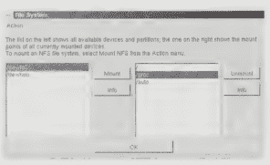

左侧窗格中的项目是位于 `/etc/fstab`（文件系统表）中但当前未挂载的设备。您可以点击其右侧的“挂载”按钮来挂载这些设备。

右侧窗格中的项目是已经挂载的设备。您可以点击其右侧的“卸载”按钮来卸载它们。

通过高亮显示相应的条目并点击其右侧的“信息”按钮，可以获取已挂载和未挂载设备的信息。此信息显示实际系统设备的名称（Device）、其已挂载或将挂载的目录（Directory）、文件系统类型（FS Type -ext2、mdos、nfs 等），以及为该挂载设置的选项（Options）。

通过打开“操作”菜单，您可以向系统添加 `NFS`（网络文件系统）挂载。

如图 10.18 所示的“挂载文件系统”对话框为您提供以下选项：

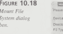

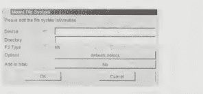

- `设备` 表征 `NFS` 挂载的服务器/导出对。
- `目录` 您希望将服务器/导出挂载到的目录。
- `FS 类型` 设置为 `nfs`，不可编辑。
- **选项** 点击时启动“文件系统选项”对话框。参见图 10.19。（这些选项超出了本章入门内容的范围。要了解更多信息，请参见第 15 章或查看 `nfs(5)` 手册页。）

**图 10.19**

*文件系统选项对话框。*

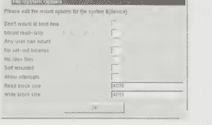

- **添加到 fstab** 此开关确定您是否将此挂载添加到您的 `/etc/fstab` 文件中，从而尝试在每次启动时重新挂载。

###### 主机名

如图 10.20 所示的“系统主机名”对话框允许您更改计算机的主机名。如果您有连接互联网的计算机，这应该是一个完全限定名称，其中“完全限定”意味着 `hostName.domainName`。

**图 10.20**

*系统主机名对话框。*


###### 资源

资源实用程序提供了有关系统的丰富有用信息，这些信息由内核在启动期间和运行过程中跟踪。

如图 10.21 所示的“系统资源信息”对话框最初启动时显示所有有关系统 CPU 的可用信息。通过选择“信息”菜单，您可以访问更多详细信息：

###### 图 10.21

系统资源信息对话框。

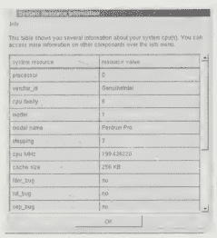

- **块设备（Block Devices）** 列出系统可用的块设备，例如软盘（`fd`）和硬盘（`ide/scsi`）。同时也列出主设备号（内核用于跟踪其设备的编号）。
- **字符设备（Character Devices）** 列出可用的字符设备，例如串行端口（`ttyS`）和打印机（`lp`）。同时也列出主设备号。
- **中断（Interrupts）** 显示系统中使用的所有中断，它们归属于什么设备，是否共享，以及在该特定中断线上发生的中断总数。
- **系统负载平均值（System Load Average）** 显示系统在过去 15 分钟内的负载（等待运行的进程数）、当前正在运行的进程数、系统中存活的进程总数（任务）以及最后启动的进程的 `PID`。（参见图 10.22。）

###### 图 10.22

系统负载平均值对话框。


- **I/O 端口（I/O ports）** 列出系统中正在使用的 I/O 端口。显示每个设备的起始和结束地址，以及声明该端口范围的设备名称。
- **DMA** 列出系统中正在使用的直接内存访问（`DMA`）通道，以及哪个设备占用了每个通道。

###### 时间

如图 10.23 所示，系统时间对话框允许你手动设置当前系统时间和时区。

- **当前时间（Current Time）** 包含系统当前时间，呈灰色不可编辑状态
- **设置当前时间（Set Current Time）** 允许你设置当前时间
- **你的时区（Your Time Zone）** 点击后允许你为计算机选择一个新的时区

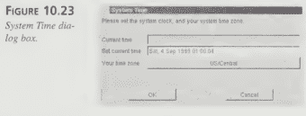

###### 内核

内核控制关键内核模块的加载和卸载。

内核模块（`Kernel Modules`）对话框允许你查看哪些内核模块已加载，哪些可供加载，加载和卸载它们，并查看关于每个模块的少量信息。

如图 10.24 所示，内核模块对话框的左侧窗格显示了可供加载的模块。要加载模块，请高亮显示该模块并选择其紧邻右侧的“Load（加载）”按钮。要获取模块的（非常简短的）描述，请高亮显示该模块并选择其紧邻右侧的“Info（信息）”按钮。

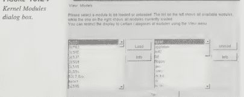

右侧窗格显示已加载的模块。你可以使用紧邻右侧的按钮来卸载这些模块或获取简短描述。

`View（视图）` 菜单项可用于限制或扩展下方两个窗格中模块的显示。通过选择菜单中的某个类别，你可以查看仅该类型中哪些模块可用且当前已加载。可用的 `View` 选项包括：`All（全部）`、`Archnet`、`CDROM`、`Ethernet（以太网）`、`Misc（杂项）`、`Network（网络）`、`SCSI`、`SCSI Host Adapters（SCSI 主控制器）`、`Sound（声音）`、`Token Ring（令牌环）`、`File System（文件系统）`、`ISDN` 和 `Multimedia（多媒体）`。

`Models（型号）` 菜单可用于为 `ARCnet`、以太网和令牌环网卡设置特定信息。选择三个类别之一后，系统会要求你按 `Model（型号）` 或 `Driver（驱动程序）` 选择你的卡片。随后会弹出一个对话框用于设置该驱动程序的特定选项。如前所述，这些选项因卡片而异。

除非你有特定理由更改图 10.25 中所示的 `Kernel Module Configuration（内核模块配置）` 对话框中的选项，否则应保持它们的默认设置。这些模块在没有外部协助的情况下配置卡片的能力非常出色。

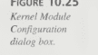

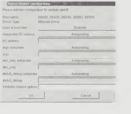

###### 软件

`Software（软件）` 项控制软件包的安装和移除。（`提示：` 坚持使用 `kpackage`。）

如图 10.26 所示，`Software Selection（软件选择）` 对话框允许你编录系统上可用的软件，并通过取消勾选来卸载软件包。

###### 图 10.26

软件选择对话框。

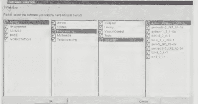

通过使用“安装（Installation）”菜单，你还可以为要安装的新软件包选择源。这可以是你的发行版 CD，甚至可以是你的计算机通过 `NFS` 连接到的服务器。设置好新软件包（`RPMs`）的源后，软件选择程序将提供你尚未安装的软件包列表（未勾选的复选框）。要安装额外的软件包，你只需勾选相应的复选框即可。（参见图 10.27。）

###### 图 10.27

源选择对话框。


###### 摘要

在本章中，我们探索了 `Caldera OpenLinux` 的基本文件系统组织，以及用于系统管理的最有用的命令行和图形工具。使用这些工具，你可以应用后续章节中的信息，以最大程度地提高效率和易用性，从而自定义和管理人员你的 `OpenLinux` 系统。

## 第 11 章

## 设置 TCP/IP 网络

### 本章内容

- 网络基础 268
- 网络设备 274
- 配置 TCP/IP 网络 275
- Caldera 的网络设置 283
- 名称服务 287
- 有用的诊断程序 288
- DHCP 290

虽然运行一个与其他机器断开的 `Linux` 系统是可能的，但几乎所有的 `Linux` 安装都与其他机器联网，即使这种网络仅通过拨号线路用于网页浏览。

本章描述如何在 `Linux` 下设置 `TCP/IP` 网络。我们将先介绍 `TCP/IP` 本身的背景信息，然后描述 `Linux` 的实现。读完本章后，你将能够让你的 `Linux` 机器联网。

## 网络基础

`Linux` 支持许多网络协议，但其中最重要的是 `TCP/IP`。除了是 `Linux` 和 `UNIX` 的原生网络协议外，`TCP/IP` 也是互联网使用的协议。

> **背景知识**
>
> 协议是计算机（或人类）用于通信的约定方法。

#### 重要定义

在关于网络的讨论中，经常会出现几个术语。本章将这些术语定义如下：

- `网络（network）` 是可以直接相互通信的机器集合。例如，所有连接在以太网电缆上的机器组成一个网络。
- `主机（host）` 是网络上的机器。
- `接口（interface）` 是主机和网络之间的连接。例如，以太网卡是一个接口，拨号连接中使用的串行端口也是一个接口。
- `互联网（internet）` 是连接在一起的计算机网络集合。连接这些网络在一起的机器称为 `路由器（routers）`。
- `Internet（互联网）` 是基于 `TCP/IP` 协议互联的全球网络集合。
- `数据包（packet）` 是在网络上发送的单个信息单元。大多数计算机网络发送的是信息数据包，而不是连续的字节流。数据包也称为 `数据报（datagrams）`。
- `广播数据包（broadcast packet）` 是旨在由网络上每个主机接收的数据包。`组播数据包（multicast packet）` 旨在发送给特定的一组主机，而 `单播数据包（unicast packet）` 旨在发送给一个特定主机。

##### TCP/IP


# TCP/IP 协议族
TCP/IP 实际上是一组协议。这些包括：

- `IP`，即互联网协议。`IP` 是一种网络协议，其功能是将数据包从源传输到目的地。`IP` 是一种不可靠协议；它会尽力将数据包传输到目的地，但不保证传输成功。
- `UDP`，即用户数据报协议。`UDP` 是建立在 `IP` 之上的一种非常简单的协议；与 `IP` 一样，`UDP` 不保证数据包的传输。
- `TCP`，即传输控制协议。`TCP` 是一种复杂的传输协议，在两个进程之间提供一条“管道”。`TCP` 保证一台计算机在管道一端输入的内容会在另一端无错误地输出。`TCP` 建立在 `IP` 之上，为了在 `IP` 之上建立一个（虚拟的）无错误通道，它包含相当复杂的计时器、确认和重传机制。
- `ICMP`，即互联网控制报文协议。`ICMP`（建立在 `IP` 之上）用于控制互联网本身的操作。例如，`ICMP` 用于报告无法到达的机器或建议更好的数据包传输路由。

# IP 地址
`IP` 网络上的每台计算机都会被分配一个 `IP` 地址。

> **背景知识**
>
> 实际上，这并不完全准确。更准确地说，每个接口都有一个 `IP` 地址，而且一台计算机可以有多个接口。

`IP` 地址是一个 32 位数字，通常写作四个从 0 到 255 的数字，中间用点号分隔。例如，一个 `IP` 地址可能如下所示：`192.168.4.7`。

`IP` 地址分为两部分：网络地址和主机地址。网络地址由第一部分组成，主机地址是最后一部分。通常，网络上的每台机器都有一个主机地址。

地址中网络和主机部分的大小取决于地址类别：

- `A` 类地址包括从 `0.0.0.0` 到 `127.255.255.255` 的 `IP` 地址。前 8 位标识网络，最后 24 位标识主机。
- `B` 类地址包含从 `128.0.0.0` 到 `191.255.255.255` 的 `IP` 地址。前 16 位标识网络，最后 16 位标识主机。
- `C` 类地址包含从 `192.0.0.0` 到 `223.255.255.255` 的 `IP` 地址。前 24 位标识网络，最后 8 位标识主机。
- `D` 类地址包含从 `224.0.0.0` 到 `239.255.255.255` 的 `IP` 地址。它们用于多播（同时向多个目的地发送数据），这里不做讨论。
- `E` 类地址范围为 `240.0.0.0` 到 `247.255.255.255`，保留供将来使用，从 `248.0.0.0` 到 `255.255.255.255` 的地址也是如此。

## 背景资料
随着无类别域间路由（`CIDR`）和子网划分的出现，不同地址类别的重要性已有所降低。子网划分是将地址的主机部分进一步划分为子网和主机部分。

例如，`IP` 地址 `134.117.9.35` 是一个 `B` 类地址，其网络部分为 `134.117`，主机部分为 `9.35`。组织可以选择对地址进行细分。例如，被分配了地址块 `134.117` 的组织可能会将 `134.117.1` 作为 `C` 类网络分配给一个部门，将 `134.117.2` 分配给另一个部门，依此类推。因此，地址 `134.117.9.35` 代表网络 `134.117` 中子网 `9` 上的第 35 号主机。

如果您正在搭建网络，应根据网络的规模来决定使用哪个地址类别。大多数小型局域网的主机少于 254 台，因此 `C` 类网络就足够了。大型组织可能需要多个互联的局域网，可能需要使用 `B` 类网络。极少有组织需要 `A` 类网络。

# 私有地址
通常，`IP` 地址必须是全局唯一的。它们由一个名为互联网网络信息中心（`InterNIC`）的中央权威机构分配。然而，某些地址块保留用于私有使用。如果您正在搭建一个不连接互联网的主机网络，应使用这些私有地址。即使您计划连接互联网，对于不希望被外部世界看到的内部主机，也应使用私有地址。私有网络地址如下：

- `A` 类：`10.0.0.0`。（所有以 `10.` 开头的地址。）
- `B` 类：从 `172.16.0.0` 到 `172.31.0.0`。（所有以 `172.16` 到 `172.31` 开头的地址。）
- `C` 类：从 `192.168.0.0` 到 `192.168.255.0`。（所有以 `192.168.` 开头的地址。）

## 背景资料
`Linux` 支持 `IP` 伪装（`IP` masquerading），它允许在防火墙上进行真实 `IP` 地址和私有 `IP` 地址之间的转换，而外部或内部主机对此均无感知。对于内部网络，请始终选择私有 `IP` 地址。

# TCP
传输控制协议（`TCP`）是建立在 `IP` 之上的传输协议。它为两个进程之间的通信创建了一个虚拟的无差错信道。

`TCP` 在寻址方案中添加了端口的概念。当在两个主机之间建立 `TCP` 连接时，起始端关联一个 `IP` 地址和一个 16 位端口号。同样，目的端也有一个 `IP` 地址和端口号。一个类比是电话对话：电话号码对应 `IP` 地址，用于标识主机（或房屋）。端口就像特定的人名；一个房屋中可能有多个使用电话的人，同样，一个主机中也可能有多个使用 `TCP` 的进程。

请注意，`TCP` 连接由四个部分的信息完全标识：源地址、源端口、目的地址和目的端口。不同的 `TCP` 连接具有相同的目的地址和端口是非常可能的（事实上非常常见）。它们通过源地址和端口来区分。

`telnet` 程序允许您远程登录到另一台机器。其工作方式如下：在目的机器上，一个 `telnet` 守护进程（在后台运行的程序）在“众所周知”的端口号（端口 23）上“监听”传入连接。`telnet` 客户端选择任何可用端口并初始化到目的机器端口 23 的连接。`telnet` 守护进程响应并允许您登录。您可以向同一台机器打开另一个 `telnet` 会话；虽然两个 `telnet` 客户端都通信到目的端口 23，但它们具有不同的源端口，目的端的 `TCP` 代码会跟踪这两个连接。

`TCP` 用于许多需要可靠虚拟连接的应用，包括远程登录、文件传输、电子邮件传输、网页浏览和网络新闻传输。

# UDP
用户数据报协议（`UDP`）比 `TCP` 简单得多。`UDP` 尽最大努力交付数据包，但不保证交付。它也不保证数据包不会重复。

与 `TCP` 类似，`UDP` 使用 16 位端口号来协调两台机器上不同进程之间的数据。然而，`UDP` 端口与 `TCP` 端口是完全独立的。

`UDP` 用于能够容忍不可靠传输的应用，例如多媒体广播。（偶尔丢失的视频帧或音频数据包并不重要。）`UDP` 也适用于多播（同时向多个目的地发送数据）或需要简单性的场景，例如用于启动无盘客户端的 `TFTP` 协议。（将 `TCP` 编码到廉价的无盘客户端中是相当沉重的负担。）

## DNS
`DNS` 是域名系统。记住您希望连接的机器的数字 `IP` 地址是繁重的。`DNS` 是一个巨大的全球分布式数据库，它将机器名称（如 `www.foo.ca`）映射到 `IP` 地址。第 12 章描述了如何设置 `DNS`。目前，您应该意识到 `IP`（以及 `TCP` 和 `UDP`）不了解机器名称；它们仅使用 `IP` 地址。

`DNS` 下的机器名称有两部分：主机名和域名。例如，机器 `www.foo.ca` 的主机名是 `www`，域名是 `foo.ca`。像 `www.foo.ca` 这样的完整机器名称称为完全限定主机名。

# 路由
理解 `IP` 如何在同一以太网电缆上的机器之间路由数据相对容易（例如）。源机器只需将数据包放置到以太网上，目的机器稍后就会拾取它。

然而，数据包必须从一个网络移动到另一个网络。这种路由由路由器执行。路由器是连接到两个网络并在它们之间传递数据包的机器。路由器拥有多个 `IP` 地址（每个网络一个）。

`IP` 使用 `IP` 地址的网络部分来执行路由。`IP` 网络中的每台机器都有一个路由表，指定如何路由数据包。例如，旨在本地以太网上任何目的地的数据包直接放置在以太网上。旨在其他目的地的数据包必须发送到路由器，路由器（拥有更多的路由知识）决定下一步将其发送到哪里。

考虑图 11.1 中显示的网络。线条表示网络连接，圆圈表示以太网。

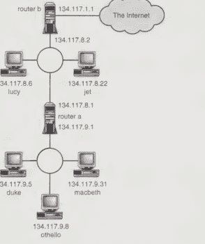

如果 `duke` 想要向 `macbeth` 发送数据包，它只需将数据包放置在其以太网接口上，数据包稍后就会出现在 `macbeth` 的以太网接口上。

然而，如果 `duke` 想要向 `jet` 发送数据包，它会将其发送到 `router a` 的接口 `134.117.9.1`。`router a` 检查目的地并确定数据包应放置在出站接口 `134.117.8.1` 上，通过该接口到达 `jet`。

最后一个例子，如果 `othello` 想要向互联网上的某台机器发送数据包，它将数据包发送到 `134.117.9.1`。`router a` 检查目的地址并将数据包发送到 `134.117.8.2`，这是 `router b` 在 `134.117.8.0` 网络上的接口。

## 背景材料
`IP` 网络通常通过将地址的主机部分置零来进行命名。

`router b` 随后检查目的地址，并通过接口 `134.117.1.1` 将数据包发送到互联网。

请注意，`duke`、`macbeth` 和 `othello` 仅知道如何将所有非 `134.117.9.0` 网络的数据包转发给 `router a`。`router a` 知道两个网络 `134.117.9.0` 和 `134.117.8.0`，但会将其他所有数据包转发给 `router b`。通过这种方式，路由知识可以被分散并保持在相对局部的范围内。

# 网络设备
`Linux` 支持许多网络接口，但两种最常见的接口是以太网卡和串行端口。以太网卡提供了快速且廉价的局域网连接。串行端口通常使用点对点协议（`PPP`）将主机（或网络）连接到互联网。

第 13 章描述了如何设置 `PPP`。然而，在本章中，我们集中讨论使用以太网进行网络连接。让我们来看看 `Linux` 如何命名和控制网络设备。

# 网络设备名称
网络设备等并非像大多数其他设备那样是文件系统中的特殊文件；相反，它们拥有独立于任何文件系统的名称。也就是说，网络设备名称是内核内部的，不对应于文件系统中的任何名称。你需要使用特殊命令来访问网络设备；不能使用普通的 `UNIX` 文件操作命令。

我们将考察三种类型的网络设备——环回接口、以太网接口和 `PPP` 接口。

# 环回接口
每台支持 `TCP/IP` 网络连接的 `Linux` 机器都有一个名为 `lo` 的特殊接口，即环回接口。环回接口完全由软件实现。任何在环回接口上传输的数据包都会由同一主机接收。

环回接口听起来可能没什么用，但实际上非常有用。环回接口允许需要 `TCP/IP` 网络连接的程序在单个主机上运行。环回接口还用于将广播数据包转发给发送主机，因为大多数以太网卡无法接收它们自己发送的数据包。

# 以太网接口
以太网接口被命名为 `eth0`、`eth1` 等（具体取决于你的机器有多少块以太网卡）。

`Linux` 支持多种以太网卡，包括几乎所有现代的 `PCI` 卡。如果你有一块较旧的 `ISA` 卡，你可能需要设置一些跳线才能使其正常工作。如果你不幸拥有一块即插即用的 `ISA` 卡，则需要使用 `isapnp` 包进行配置。有关设置以太网硬件的信息，请参阅以太网 `HOWTO`（`/usr/doc/HOWTO/Ethernet-HOWTO.gz`）。在同一目录中，请参阅 `Plug-and-Play-HOWTO.gz`，它解释了如何在 `Linux` 下设置即插即用硬件。

# PPP 接口
`PPP` 接口被命名为 `ppp0`、`ppp1` 等。当 `PPP` 链路建立（`up`）时创建，当链路断开（`down`）时销毁。（当链路激活时称为“建立”，当链路去激活时称为“断开”。）

# 配置 TCP/IP 网络
本节描述如何在以太网网络上设置 `TCP/IP` 网络。我们假设你已按照以太网 `HOWTO` 中的说明使以太网卡处于运行状态。

## 配置接口：ifconfig
使用 `ifconfig` 命令来配置网络接口。

`ifconfig` 命令设置以下信息：

- 接口的 `IP` 地址。
- 接口的网络掩码。请记住，每个 `IP` 地址由网络部分和主机部分组成。网络掩码是一个 32 位二进制数，其代表网络部分的位为 1，代表主机部分的位为 0。

例如，考虑 `C` 类网络 `192.168.4.0`。前 24 位是网络部分，后 8 位是主机部分。因此，网络掩码为 `255.255.255.0`。

如果你将 `C` 类网络划分为两个子网 `192.168.4.0` 和 `192.168.4.128`（每个子网保留 7 位作为主机部分），则每个子网网络的网络掩码为 `255.255.255.128`。（要对网络进行子网划分，只需为每个接口选择适当的地址和掩码即可。）

### 注意
> 网络掩码始终由一连串 1 位后接一连串 0 位组成。

接口使用网络掩码来确定某个 `IP` 地址是否在同一网络上。例如，`192.168.4.73` 与 `192.168.4.222` 位于同一个 `C` 类网络上。然而，如果网络如前所述进行了子网划分，这些地址位于不同的网络上；`192.168.4.73` 位于 `192.168.4.0` 子网，而 `192.168.4.222` 位于 `192.168.4.128` 子网。

网络有时写作 `地址/位数`，其中 `地址` 是网络地址，`位数` 是网络部分的位数。例如，`C` 类网络 `192.168.4.0` 可以写作 `192.168.4.0/24`，而具有 7 位主机位的子网 `192.168.4.0` 可以写作 `192.168.4.0/25`。

你也可以像这样将网络写作 `地址/掩码`：例如 `192.168.4.0/255.255.255.0` 和 `192.168.4.128/255.255.255.128`。

- 接口的广播地址。这是本地网络上保留用于广播数据包的特殊 `IP` 地址。广播地址就是将网络地址的主机部分全部置为 1。网络 `192.168.4.0/24` 的广播地址是 `192.168.4.255`，而 `192.168.4.0/25` 的广播地址是 `192.168.4.127`。
- 接口标志。这包括接口是否处于活动状态、是否支持广播等。

### 调用 ifconfig
你按以下方式调用 `ifconfig`：

```
$ ifconfig interface [aftype] [options] [address]
```

这里，`interface` 是接口的名称。`aftype` 是地址族类型，在本示例中可省略，或始终提供为 `inet`，表示 `IP` 地址族。

#### 背景材料
其他支持的地址族包括 `inet6`（用于 `IPv6`，即下一代 `IP`）、`ax25`（业余无线电分组交换）、`ddp`（`AppleTalk`）、`ipx`（`Novell` `IPX`）以及 `netrom`（另一种业余无线电分组协议）。

如果你不提供任何选项，`ifconfig` 仅仅显示关于接口的信息。让我们看看环回接口：

```
$ ifconfig lo

lo
link encap:Local Loopback
  inet addr:127.0.0.1 Mask:255.0.0.0
  UP LOOPBACK RUNNING MTU:3924 Metric:1
  RX packets:16 errors:0 dropped:0 overruns:0 frame:0
  TX packets:16 errors:0 dropped:0 overruns:0 carrier:0
  collisions:0 txqueuelen:0
```

现在让我们检查 `ifconfig` 的输出：

- `Link encap:Local Loopback` 表示这是本地环回设备。以太网卡的链路封装类型为 `Ethernet`。
- `inet addr:127.0.0.1` 是本地环回的互联网地址。地址 `127.0.0.1` 是一个特殊地址，始终指代本地主机。`Mask:255.0.0.0` 意味着环回地址连接到“网络” `127.0.0.0/8`。这是一个 `A` 类伪网络；`127.0.0.0/8` 上的任何主机都指代本地主机。
- `UP LOOPBACK RUNNING` 表示接口已启用，设置了环回标志，并且接口当前正在运行。
- `MTU:3924` 指定了接口的最大传输单元。大于 3,924 字节的数据包必须被拆分。`Metric:1` 用于路由目的。
- 其余各行提供有关接口使用状况的信息。接口已发送 16 个数据包并接收了 16 个数据包。正如软件接口预期那样，处理过程没有遇到任何错误、丢弃数据包或溢出。

在设置以太网接口之前，让我们查看以太网接口的 `ifconfig` 输出，以了解你需要提供的信息：

```
$ ifconfig eth0
eth0 Link encap:Ethernet  Hwaddr 00:60:67:62:31:D4
     inet addr:192.168.2.3  Bcast:192.168.2.255  Mask:255.255.255.0
     UP BROADCAST RUNNING MULTICAST  MTU:1500  Metric:1
     RX packets:19392 errors:0 dropped:0 overruns:0 frame:0
     TX packets:30536 errors:0 dropped:0 overruns:0 carrier:0
     collisions:31 txqueuelen:100
     Interrupt:5 Base address:0x320
```

在此输出中，我们看到：

- 链路封装为 `Ethernet`，以太网硬件地址为 `00:60:67:62:31:D4`。每个以太网卡都有唯一的 6 字节硬件地址。

#### 背景材料
以太网网络上的数据包使用以太网地址作为源和目的地址进行路由。这些地址是如何映射到 `IP` 地址的？地址解析协议（`ARP`）会自动且动态地将以太网地址映射到 `IP` 地址；通常你不需要担心网络软件如何知道哪个以太网地址对应于哪个 `IP` 地址。

- 网卡的 `IP` 地址为 `192.168.2.3`。其所在网络的广播地址为 `192.168.2.255`，网络掩码为 `255.255.255.0`。这些地址对应于 `C` 类网络 `192.168.2.0/24`。
- 接口已启用并正在运行，可以看到它支持广播和多播数据包。以太网卡的 `MTU` 始终为 `1500`，因为这是合法以太网帧的最大尺寸。
- 接口已发送和接收了成千上万个数据包。可以看到发生了少量冲突。以太网是一种广播介质；因此，两个以太网接口可能会同时发送。当这种情况发生时，两个帧都会变得乱码，即发生了冲突。


为了方便起见，`ifconfig` 会打印出以太网卡使用的中断请求号（IRQ，5）和 I/O 端口基地址（0x320）。

#### 设置以太网接口

要配置以太网连接，你必须具备以下信息：

- 接口的 `IP` 地址。这将由局域网（LAN）管理员分配。
- 如果你是局域网管理员，请选择一个私有地址块，并为每个接口分配一个 `IP` 地址。你可以随意分配地址（在你选择或分配的网段内），只要确保网络上的每个接口都有唯一的地址即可。此外，你不能分配全零或全 1 的主机部分作为地址；这些地址分别代表网络地址和广播地址。
- 网络掩码。从管理员处获取或自己选择一个；对于大多数局域网，使用 C 类网络掩码（255.255.255.0）即可。
- 广播地址。这仅仅是网络部分加上全 1 的主机部分。对于 C 类网络 `x.y.z.0/24`，广播地址是 `x.y.z.255`。

要配置以太网卡，请使用：

```bash
##### ifconfig eth0 broadcast bcast_addr netmask mask ip_addr
```

这里，`bcast_addr` 是广播地址，`mask` 是网络掩码，`ip_addr` 是接口的 `IP` 地址。请注意，只有 `root` 用户才有权配置接口。你可以用 `eth1` 替换 `eth0` 来配置第二张以太网卡，依此类推。

要启用接口，请使用：

```bash
##### ifconfig eth0 up
```

此命令会启用（激活）接口，并为该接口所在的网络添加一条路由。

## 设置路由

`route` 命令用于配置内核的路由表。路由器在每次需要传输数据包时都会查询此表。路由表指示应使用哪个接口来传输数据包。为了说明起见，图 11.2 展示了我网络的拓扑（连接方式）结构。


## 环回路由

让我们看一个简单的路由表——即只有一个环回接口的机器的路由表：

```bash
$ route -n
Kernel IP routing table
Destination Gateway Genmask Flags Metric Ref Use Iface
127.0.0.0 0.0.0.0 255.0.0.0 U 0 0 0 lo
```

列表中的每一行都称为一条路由。以下是每列的含义：

- `Destination` 指定目标主机或网络。
- `Gateway` 是要使用的网关的 `IP` 地址。（Gateway 是 router 的旧称。）如果网关地址是 `0.0.0.0`，则表示目标直接连接到主机，不需要网关。
- `Genmask` 是“通用掩码”，它指定路由的通用性。对于此路由，genmask 是 `255.0.0.0`，意味着只需匹配目标地址的前 8 位。因此，任何发往 `127.x.y.z` 的数据包都将使用此路由。当试图为 `IP` 地址匹配路由时，内核会将地址与 genmask 进行按位与运算，然后执行比较。
- `Flags` 列出与路由关联的一些标志。最常见的标志是 `U`（路由已启用）、`H`（目标是主机而非网络）和 `G`（使用网关）。还有其他标志，详情请参阅 `route(8)`。
- `Metric` 是路由的“成本”度量。
- `Ref` 是当前使用该路由的连接数。
- `Use` 是路由在路由查找中被使用的次数。
- `Iface` 是要使用的接口。

因此，在这个例子中，所有目标为 `127.x.y.z` 的数据包都将通过环回接口 `lo` 进行路由。

## 本地网络路由

路由复杂度的下一个级别是到本地网络的路由。我的主要计算机（shishi）地址为 `192.168.2.3`，连接到网络 `192.168.2.0/24`。以下是来自 `route -n` 的路由表：

| Destination | Gateway | Gennmask | Flags | Metric | Ref | Use | Iface |
| :--- | :--- | :--- | :--- | :--- | :--- | :--- | :--- |
| 192.168.2.0 | 0.0.0.0 | 255.255.255.0 | U | 0 | 0 | 0 | eth0 |
| 127.0.0.0 | 0.0.0.0 | 255.0.0.0 | U | 0 | 0 | 0 | lo |

发往 `127.0.0.0/8` 网络的数据包仍然使用环回接口，但发往 `192.168.2.0/24` 任何位置的数据包（注意 genmask！）使用 `eth0`，即第一张（也是唯一一张）以太网卡。我们知道 `192.168.2.0/24` 是一个本地网络，因为网关地址是 `0.0.0.0`。

## 默认路由

最后，shishi 如何与不在本地网络上的机器通信？网关机器 sheva 拥有互联网连接；所有非本地数据包都必须转发给它。以下是 shishi 的完整路由表：

| Destination | Gateway | Gennmask | Flags | Metric | Ref | Use | Iface |
| :--- | :--- | :--- | :--- | :--- | :--- | :--- | :--- |
| 192.168.2.0 | 0.0.0.0 | 255.255.255.0 | U | 0 | 0 | 0 | eth0 |
| 127.0.0.0 | 0.0.0.0 | 255.0.0.0 | U | 0 | 0 | 0 | lo |
| 0.0.0.0 | 192.168.2.1 | 0.0.0.0 | UG | 1 | 0 | 0 | eth0 |

请注意最后一条路由的一些重要事项：

- 目标 `0.0.0.0` 和 genmask `0.0.0.0` 表明这是一条默认路由。任何未在前两条路由中匹配的数据包都将在第三条路由上发送。
- 网关地址是 `192.168.2.1`（一个真实的网关机器），并且设置了 `G` 标志。这表明该路由不是直接的，必须通过网关。此外，metric 被设置为 1，表明这是一条比本地路由成本更高的路由。

让我们看看使用该表路由数据包的示例：

- 本地主机的数据包发往 `192.168.2.2` 匹配第一条条目。它将使用 `eth0` 接口直接发送到目标。
- 本地主机的数据包发往 `127.0.0.1` 匹配第二条条目。它将通过环回接口发送。
- 本地主机的数据包发往 `134.117.9.35` 匹配第三条条目（默认路由）。它将通过接口 `eth0` 发送到网关 `192.168.2.1`。在那里，它（大概）将由网关通过某种连接转发到互联网。

### 添加路由

除了显示路由表外，`route` 命令还用于添加和删除路由。请注意，如果你的网络相对简单，并且你使用 Caldera 的图形设置工具，路由会自动为你创建。

在尝试创建路由之前，你应该使用 `ifconfig` 配置所有网络设备。此外，只有 `root` 才能调整路由表。

要添加路由，请使用：

```bash
#### route add [-net|-host] target dev
```

如果你正在为特定主机添加路由，请使用 `-host` 选项。如果是网络路由，请使用 `-net`。

`target` 指定路由的目标。如果目标是主机，则它只是主机的 `IP` 地址。如果目标是网络，则它是网络地址后跟斜杠和网络部分中的位数。`dev` 指定用于该路由的网络接口。

这里有一个例子：要在 shishi 上设置本地网络路由（路由表中的第一条路由），请使用：

```bash
#### route add -net 192.168.2.0/24 eth0
```

要为特定主机添加路由，请使用：

```bash
#### route add -host 192.168.2.244 eth0
```

**背景材料**

当然，鉴于已有网络路由，这条主机路由是多余的。

如果你需要通过网关添加默认路由，请使用：

```bash
#### route add default gw gateway
```

例如，shishi 的默认路由是这样设置的：

```bash
#### route add default gw 192.168.2.1
```


**注**

要使用网关，必须有到网关机器的路由。在这个例子中，网关机器位于 `192.168.2.0/24` 网络上，因此可以通过第一条路由访问。

`route` 有许多其他用于配置路由表的选项；详情请参阅 `route(8)`。

## 删除路由

`route` 可以删除路由。请使用：

```bash
#### route del [-net|-host] target
```

例如，要从 shishi 删除除环回路由外的所有路由，请使用：

```bash
#### route del default
#### route del -net 192.168.2.0/24
```

## Caldera 的网络设置

Caldera OpenLinux 包含许多简化 `TCP/IP` 配置的网络脚本。请注意，这些只是 shell 脚本，最终使用 `ifconfig` 和 `route` 来做实际工作。

## 整体网络设置

shell 脚本 `/etc/sysconfig/network` 包含由其他网络脚本使用的三个变量赋值。它看起来像这样：

```bash
NETWORKING=yes|no
HOSTNAME=hostname
IF_LIST=interface_list
```

例如，shishi 上的 `/etc/sysconfig/network` 看起来像这样：

```bash
NETWORKING=yes
HOSTNAME=shishi.skoll.ca
IF_LIST="lo eth tr sl ppp"
```

第一行表示我们想使用 `TCP/IP` 网络。第二行设置机器的完全限定主机名，第三行列出尝试初始化的可能接口。

##### 背景资料

我们已经见过 `lo` 和 `eth` 接口。`tr` 接口用于令牌环网络，`sl` 用于 `SLIP` 接口（一种在串行链路上运行 `IP` 的较旧协议），而 `ppp` 是点对点协议接口（在第 13 章中讨论）。

## 接口配置

每个接口都有一个名为 `/etc/sysconfig/network-scripts/ifcfg-ifname` 的配置脚本。例如，`eth0` 接口的配置脚本为 `/etc/sysconfig/network-scripts/ifcfg-eth0`。该脚本大致如下所示：

```bash
#!/bin/sh

#### Device type: ethernet
#### Variable declarations:
DEVICE=eth0
IPADDR=192.168.2.3
NETMASK=255.255.255.0
NETWORK=192.168.2.0
BROADCAST=192.168.2.255
GATEWAY=192.168.2.1
ONBOOT=yes
DYNAMIC=...
#### End variable declarations
REMIP=0.0.0.0
MTU=1500
```

这些变量具有以下含义：

- `DEVICE` 是接口名称。
- `IPADDR` 是接口的 `IP` 地址。
- `NETMASK` 是接口的网络掩码。
- `NETWORK` 是接口的网络地址。
- `BROADCAST` 是接口的广播地址。
- `GATEWAY` 是网关主机的 `IP` 地址。如果网络中没有网关，则将此变量设置为 `none`。网关的存在会导致网络脚本使用网关设置一条默认路由。
- `ONBOOT` 的值为 `yes` 或 `no`。如果为 `yes`，则接口在计算机启动时自动激活。这对于以太网接口是合适的，但对于调制解调器线路可能并不合适。
- `DYNAMIC` 为空或者是动态地址分配协议（如 `dhcp` 或 `bootp`）。如果 `DYNAMIC` 非空，系统将动态配置 `IP` 地址、网络掩码等。（动态地址分配在“DHCP”一节中有介绍。）
- `REMIP` 指定远程 `IP` 地址。这对于点对点链路非常有用；对于以太网接口而言则无意义。
- `MTU` 指定最大传输单元。以太网接口的 `MTU` 无法更改，但串行链路的 `MTU` 可以调整。

## 启动和停止网络

在启动时，Shell 脚本 `/etc/rc.d/init.d/network` 会以参数 `start` 执行。该脚本执行以下操作：

- 根据 `/etc/sysconfig/network` 中的设置启用或禁用 `IP` 转发。`IP` 转发允许你将 `Linux` 机器用作路由器。要启用它，请将行 `IPFORWARDING=yes` 放入 `/etc/sysconfig/network`。
- 初始化环回接口 `lo`。
- 对于 `IF_LIST`（来自 `/etc/sysconfig/network`）中的每种类型的每个接口，运行另一个名为 `/sbin/ifup` 的 Shell 脚本。该脚本从 `/etc/sysconfig/network-scripts` 读取相应的 `ifcfg-interface` 文件，并实际执行 `ifconfig` 和 `route` 命令来激活接口。
- 如果 Shell 脚本 `/etc/sysconfig/network-scripts/ifcfg-routes` 存在，则执行它。你可以在此脚本中放入 `route` 命令，以设置所需的任何特殊路由。

要停止网络（例如，在系统关闭时），你调用 `/etc/rc.d/init.d/network` 脚本并传入参数 `stop`，这将导致接口被关闭。

尽管这些 Shell 脚本内部相当复杂，但使用起来非常简单。不幸的是，它们的文档并不完善。你应该阅读这些脚本以了解其工作原理。

## 添加接口

添加额外的接口非常简单。只需创建相应的 `/etc/sysconfig/network-scripts/ifcfg-interface` 脚本即可。你可以使用文本编辑器或图形化的 Caldera Open Administration System 面板来创建此脚本。要通过 COAS 添加接口，请从 COAS 菜单中选择 `Network-Ethernet Interfaces`。随后会弹出图 11.3 所示的窗口。


在此窗口中，只需填写相关字段以创建配置脚本。这些字段包括：

- 网络设备：网络设备名称。
- PNP 配置：这与即插即用硬件无关。相反，它表示一种集中式 `IP` 地址分配协议，如 `DHCP`。
- 接口地址、网络掩码和广播地址：接口的 `IP` 地址、网络掩码和广播地址。
- 默认路由：如果启用此选项，接口将使用该接口设置一条默认路由。
- 默认网关：如果你正在使用该接口作为默认路由，此字段包含网关的 `IP` 地址。
- 启动时初始化：如果启用此选项，接口及其路由将在启动时初始化。这对于以太网接口通常来说是合适的。

##### 背景资料

`New Alias` 按钮允许你创建接口别名。别名允许你将单个物理接口划分为多个逻辑接口，每个接口都有自己独立的 `IP` 地址。这种安排在虚拟 `Web` 主机中非常有用，例如，你希望让一台机器看起来像是许多不同的机器。别名在线 `WWW-HOWTO` 中有详细的描述。

## 名称服务

总是使用 `IP` 地址来代表主机和网络地址是非常麻烦的。`Linux` 支持多种名称服务，用于在名称和数字之间进行映射，反之亦然。

文件 `/etc/nsswitch.conf` 控制使用哪些名称服务及其顺序。在本节中，我们关注的行大致如下所示：

```
hosts:      files nis dns
networks:    nis files dns
```

第一行意味着在查找主机名或地址时，系统首先咨询 files 服务。如果失败，系统会尝试 nis 服务，最后尝试 dns 服务。这些服务是什么意思？

- files 服务会导致在简单文本文件中查找。具体使用哪个文件取决于正在查找的内容。对于主机到地址的映射，系统会咨询 `/etc/hosts` 文件。这是一个纯文本文件。空行和以 `#` 开头的行会被忽略；其他行由一个 `IP` 地址后跟主机的“规范”名称，再后跟主机的“昵称”组成。例如，以下是 shishi 的 `/etc/hosts` 文件内容：

    ```
    192.168.2.1  shevy, shevy.sk011.ca shevy
    192.168.2.2  scruffy, scruffy.sk011.ca scruffy
    192.168.2.3  shishi, shishi.sk011.ca shishi
    ```

    每个地址后面跟着完全限定主机名和短名称。

    ##### 背景资料

    `/etc/hosts` 中的注释建议你最好不要编辑它。但认真的 `Linux` 用户还是会去编辑它。

- nis 服务是由 `Sun Microsystems` 设计的一种数据库查询系统。它允许你存储许多查询文件（如 `/etc/hosts`）的集中式版本，并让客户端在服务器上进行查询。

    NIS（网络信息服务）旨在用于小型网络。它不适用于整个互联网的查询。`NIS` 在第 14 章中有介绍。

- dns 服务指的是域名系统，即整个互联网上的分布式主机名到地址映射数据库。第 12 章详细介绍了 `DNS`。

## 解析器配置

用于查找主机地址的一组函数驻留在解析器库中。它执行文件查找、`NIS` 查找和 `DNS` 查找。解析器库的 `DNS` 查找部分由文件 `/etc/resolv.conf` 控制。该文件大致如下所示：

```
domain skoll.ca
nameserver 192.168.2.1
nameserver 192.168.2.22
nameserver 192.168.2.33
```


`domain` 行指定本地 DNS 域。如果 DNS 查找失败，未限定的主机名将附加此域。

`nameserver` 行指定名称服务器的 IP 地址。这些是专门配置为响应 DNS 请求的主机。第一行是主名称服务器，通常也是唯一使用的服务器。如果主名称服务器宕机，则依次尝试备用名称服务器。

`nsswitch.conf` 文件在 info 中有文档记录；输入 `info "(libc6)NSS Configuration File"` 即可查看相关文档。

## 有用的诊断程序

Linux 包含两个有用的诊断程序（`ping` 和 `traceroute`），它们可以让你判断计算机是否成功联网以及路由是否正确设置。

## ping

`ping` 程序测试从一台主机到另一台主机的连接性。

> `ping` 的名字来源于声呐回声定位器，它通过声音脉冲对物体进行“ping”。

要 `ping` 一台主机，请使用：

```
$ ping host
```

`host` 可以是 IP 地址或主机名。（如果你的名称服务未正常工作，你可能需要提供 IP 地址。）

以下是 shishi 上的运行示例：

```
$ ping shevy
PING shevy.skoll.ca (192.168.2.1): 56 data bytes
64 bytes from 192.168.2.1: icmp_seq=0 ttl=64 time=1.2 ms
64 bytes from 192.168.2.1: icmp_seq=1 ttl=64 time=1.2 ms
Hit interrupt (Ctrl-C)
-- shevy.skoll.ca ping statistics --
2 packets transmitted, 2 packets received, 0% packet loss
round-trip min/avg/max = 1.2/1.2/1.2 ms
```

`ping` 通过发送特殊的 ICMP 回显请求数据报来工作。被 `ping` 的系统会返回回显应答数据报。`ping` 会每秒发送一个数据报，直到你按下中断键。然后 `ping` 会列出结果的摘要。

如果你能 `ping` 通局域网中的另一台主机，那么在设置网络方面就迈出了良好的第一步。

`ping` 有许多选项；详情请参阅 `ping(8)`。

**注意**

你可能已连接到互联网，但无法 `ping` 通互联网上的某台主机。许多站点会阻止 ICMP 回显请求数据报。

### traceroute

`traceroute` 程序显示数据包从你的主机到目的地的路由路径。

**背景知识**

实际上，这种说法并不完全准确。更准确地说，`traceroute` 显示一条合理的路径，这很可能就是实际采取的路径，但也可能不是。互联网上的路由会动态变化。

你使用 `traceroute` 的方式与使用 `ping` 相同：

```
$ traceroute host
```

以下是 shishi 上的运行示例：

```
$ traceroute shevy
traceroute to shevy.skoll.ca (192.168.2.1), 30 hops max, 40 byte packets
1 shevy (192.168.2.1) 1.263 ms 1.128 ms 1.123 ms
```

这并不太有趣，因为路由是直接的。`traceroute` 手册页中有一个更好的示例，见 `traceroute(8)`。

## DHCP

对于小型网络，为每台主机分配固定的 IP 地址并在启动时配置每台主机知晓其 IP 地址是可以接受的。

随着网络规模变大，管理主机变得困难，而且为特定的 IP 地址定制每台主机的配置文件也变得很麻烦。

DHCP（动态主机配置协议）是一种用于向网络上的主机动态分配 IP 地址的协议。其基本思想是，在启动时，客户端会广播一个 DHCP 请求。DHCP 服务器会接收到该广播。它向客户端分配 IP 地址、主机名、网络掩码等，并将回复发送回客户端。然后，客户端根据服务器的回复，使用 `ifconfig` 完成其网络接口的配置。

使用 DHCP 时，客户端不会永久拥有其 IP 地址。服务器给予的是一个租约。租约到期后，客户端不能再使用该 IP 地址。客户端应在租约到期前更新租约。

### 设置 DHCP 客户端

设置 DHCP 客户端很简单。只需在 `/etc/sysconfig/network-scripts/ifcfg-<ifname>` 文件中设置 `DYNAMIC=dhcp`，或在 COAS 图形配置工具中启用即插即用功能。

程序 `dhcpd` 会联系 DHCP 服务器并设置网络配置。DHCP 服务器提供的配置包括：

- 客户端的 IP 地址、地址掩码和广播地址。这些信息供 `ifconfig` 使用。
- 路由器和 DNS 服务器的 IP 地址。这些信息用于设置路由和 `/etc/resolv.conf`。
- 客户端的主机名和域名。

### 设置 DHCP 服务器

设置 DHCP 服务器比设置 DHCP 客户端更复杂。首先，你必须确保 DHCP 服务器在启动时运行。你可以从 COAS 系统:守护进程菜单中完成此操作（见图 11.4）。启用 DHCP 和 BOOTP 引导服务器。

#### 配置 DHCP 服务器

DHCP 服务器可以通过一个名为 `/etc/dhcpd.conf` 的配置文件进行控制。

DHCP 服务器可以随机分配地址。也就是说，它可以维护一个可用 IP 地址池，并根据请求向客户端分配地址。这种安排适用于经常移动（如笔记本电脑）且不是其他机器服务器的机器。以下是一个 `/etc/dhcpd.conf` 文件的示例：

```
default-lease-time 600;
max-lease-time 7200;
option subnet-mask 255.255.255.0;
option broadcast-address 192.168.2.255;
option routers 192.168.2.1;
option domain-name-servers 192.168.2.1, 192.168.2.22;
option domain-name "skoll.ca";

subnet 192.168.2.0 netmask 255.255.255.0 {
  range 192.168.2.2 192.168.2.100;
  range 192.168.2.150 192.168.2.200;
}
```

让我们看看这些选项：

- `default-lease-time 600` 指定 10 分钟（600 秒）的默认租约时间。这是客户端在更新之前可以保留 IP 地址的默认时间长度。如果你的客户端很少变更，你可以指定以小时或天为单位的长租约时间。如果你的网络位于工厂，工厂将互联网设备接入网络进行测试然后发货，那么 5 分钟左右的租约时间是合适的。
- `max-lease-time 7200` 指定客户端获得的租约不会超过 2 小时，即使它请求更长时间。
- `subnet-mask` 和 `broadcast-address` 指定客户端应使用的子网掩码和广播地址。`ifconfig` 使用这些值。


- `routers 192.168.2.1` 指定路由器的 IP 地址。客户端将添加一条默认路由，使用该地址作为网关。
- `domain-name-servers` 和 `domain-name` 选项设置解析器配置。
- `subnet` 部分控制特定子网的配置。DHCP 服务器在 192.168.2.2 到 192.168.2.100 以及 192.168.2.150 到 192.168.2.200 的范围内分配 IP 地址。它不会向客户端分配该范围之外的 IP 地址。

##### 具有固定 IP 地址的机器

某些机器应始终分配固定地址。例如，文件或 Web 服务器应被赋予固定地址。你可以将如下行添加到 `/etc/dhcpd.conf`：

```
host shishi {
    hardware ethernet 00:60:67:62:31:04;
    fixed-address 192.168.2.3;
}
```

这段代码允许你根据客户端的以太网地址分配 IP 地址。你可以根据网络需求混合使用动态和静态地址分配。

本节只是触及了 DHCP 服务器配置的皮毛。更多细节请参见 `dhcpd.conf(5)` 和位于 `/usr/doc/HOWTO/other-formats/html/mini/DHCP.html` 的 DHCP 迷你 HOWTO。

###### 摘要

本章涵盖了 TCP/IP 网络的基础知识。你学习了 IP 地址如何标识网络接口。你学习了如何使用 `ifconfig` 配置 Linux 网络接口，以及如何使用 `route` 设置 IP 路由表。我们查看了 Caldera 网络设置 shell 脚本的组织方式。然后你学习了如何在客户端配置名称服务，以及如何使用 `ping` 和 `traceroute` 执行网络诊断。最后，你学习了如何设置 DHCP 客户端和服务器，以集中管理 IP 地址分配。

## 设置 DNS——域名系统

### 本章内容

- DNS 基础 294
- DNS 配置 297
- DNS 数据库文件 299
- 使用 `nslookup` 304

## 第 12 章

第 11 章介绍了域名系统，并描述了如何将 Linux 机器设置为 DNS 服务器客户端。本章详细描述了 DNS，并解释了如何在 Linux 上设置 DNS 服务器。

设置 DNS 相当简单，但需要大量关注细节。读完本章后，你应该能够设置一个可用的 DNS 服务器。即使你只运行一个小型家庭网络，网络上的 DNS 服务器也能减少发往互联网的 DNS 查找数量，从而节省互联网链路的带宽。

## DNS 基础

DNS 是一个数据库系统。它回答客户端的查询。识别主机 `hostname` 的 IP 地址是 DNS 回答的最常见查询。

DNS 是一个分布式数据库。这意味着没有中央服务器知道所有 DNS 查询的答案。相反，世界各地的各个服务器负责其本地域。顶级服务器，或根服务器，只知道将客户端的下一级查询转给哪个 DNS 服务器。

DNS 使用分层命名方案用于互联网主机。主机的名称类似于 `host.subdomain.subdomain.domain`。

有许多顶级域名。一些常见的顶级域名是：

- `.com` 商业实体。这是最受追捧的顶级域名。
- `.edu` 美国教育机构。
- `.org` 非商业组织。
- `.mil` 美国军事机构。
- `.gov` 美国政府机构。

此外，每个国家都有一个双字母的国家域名，例如美国的 `.us`、加拿大的 `.ca`、法国的 `.fr` 等。在每个国家域名内，一个国家组织决定子域的组织。例如，澳大利亚镜像了原始的顶级域名，产生了诸如 `.com.au` 和 `.edu.au` 的子域名。其他国家使用自己的委派方案。例如，加拿大有一些基于省份的域名（`.on.ca` 和 `.nf.ca`），并且“大型”组织有足够的特权拥有自己的顶级加拿域域名（`.linux.ca` 和 `.gc.ca`）。

### 根服务器

一些众所周知的根服务器是 DNS 查询的起点。（根服务器只是一个拥有顶级域名信息的普通 DNS 服务器。）

你可以通过匿名 FTP 从 `ftp.rs.internic.net` 获取根服务器列表，文件路径为 `/domain/named.root`。该列表是所有 DNS 查询的起点。

### 查询过程解析

让我们看看 DNS 查询是如何工作的。假设 `shishi.roaringpenguin.com` 上的一个客户端希望找到 `www.linux.com` 的 IP 地址。

首先，`shishi` 上的解析器将查询发送到前面讨论过的某个根服务器。根服务器回复道：“我没有你的查询答案，但以下服务器完全了解 `.com` 域的信息。”

然后，解析器查询一个 `.com` 服务器。它回复道：“我没有你的查询答案，但以下服务器完全了解 `.linux.com` 域的信息。”

最后，解析器查询一个 `.linux.com` 服务器。它回复了正确的 IP 地址。该过程如图 12.1 所示。


`.linux.com` 的名称服务器被称为权威服务器，因为它们包含关于 `.linux.com` 域中机器的绝对权威信息。通常，运行由这些服务器命名的网络的同一组管理员也运行权威名称服务器。

这似乎是一种极其复杂且浪费回答 DNS 查询的方式。对于单个主机查找，互联网上发送了三次查询和三次响应。这肯定最终会过载根名称服务器，因为根名称服务器必须参与每一次 DNS 查询？

事实上，DNS 的强大功能来自于缓存。组织会设置本地名称服务器，代表客户端执行查询。查询的答案会被缓存到本地名称服务器上。下次执行相同的查询时，本地名称服务器会在不查询其他任何名称服务器的情况下直接回答。

因此，例如，如果 `shishi` 运行了一个本地名称服务器，它会迅速建立起一个已回答查询的缓存。最终，`shishi` 将直接回答大多数查询，只有偶尔的查询会被发送到互联网上。

当然，DNS 查询的答案不能永远缓存——如果主机的 IP 地址发生变化，缓存的结果将失效。因此，查询的权威服务器会指定该查询答案的“生存时间”（time to live）。如果查询答案的缓存时间超过了其生存时间，缓存结果将失效，并且会查询权威服务器。

##### 背景资料

这就是为什么当一台机器的 IP 地址发生变化时，该变更可能需要数小时甚至数天才能传播到全球 DNS 的原因。所有缓存的条目都必须过期。

### DNS 记录类型

所有 DNS 查询都有类型，并且答案具有相应的记录类型。每个答案被称为资源记录（Resource Record，简称 RR）。以下是一些 DNS RR 类型：

- `A`：A 类型记录包含主机的 IP 地址。这是查询最频繁的此记录类型。
- `CNAME`：CNAME 类型记录保存主机的规范名称。例如，许多组织将其 Web 服务器命名为 `www`。然而，这通常只是真实 Web 服务器的昵称。如果你的 Web 服务器的真实名称是 `bigserver.roaringpenguin.com`，你可以为 `www.roaringpenguin.com` 创建一个 CNAME 记录，其中列出 `bigserver.roaringpenguin.com` 作为规范名称。如果你需要将 Web 服务器迁移到另一台机器，你只需要修改 CNAME 记录。
- `MX`：MX 类型记录保存用于邮件交换的机器。例如，`roaringpenguin.com` 的邮件处理机器可能被称为 `mail.roaringpenguin.com`。
- `NS`：NS 类型记录列出用于某个域的名称服务器。例如，`roaringpenguin.com` 的名称服务器是 `dns.storm.ca` 和 `sns.storm.ca`。
- `PTR`：PTR 类型记录用于反向 DNS——即，给定一个 IP 地址，查找对应的主机名。
- `SOA`：SOA 类型记录保存域的权威起始（start-of-authority）信息。这包括负责该 DNS 域的人员的电子邮件地址，以及各种生存时间和超时值。

还有其他 DNS 记录类型，但上述这些是最常见的。

## DNS 配置

在 Linux 下，`named` 程序提供 DNS 服务。该程序通常在启动时通过指定应激活的 Internet 域名服务器（`named`）来启动。（你可以使用 COAS 来完成此操作。）

`named` 读取名为 `/etc/named.conf` 的配置文件，该文件指定的其他所有文件，然后监听 DNS 查询。`named` 是 BIND（Berkeley Internet Name Daemon）发行版的一部分。除了 `named(8)` 手册页外，你还可以使用 Web 浏览器查看 `/usr/doc/bind-8.1/html/index.html` 以获取更多详细信息。（我们将这称为 HTML 文档。）

文件 `/etc/named.conf` 是 `named` 的主配置文件。

> **背景资料**
>
> 如果你使用的是旧版本的 `named`，旧的 `/etc/named.boot` 文件不再使用。新的配置文件格式不同；程序 `named-bootconf` 会将 `named.boot` 文件转换为 `named.conf` 文件。

`named.conf` 文件有许多选项；我们这里只介绍最常用的几个。有关所有详细信息，请阅读 HTML 文档。

##### 选项

`options` 语句用于设置 `named` 的全局选项。有许多选项；其中一些如下：

- `directory`：指定剩余配置文件的目录。`named` 使用许多辅助配置文件；任何相对路径名都被认为是相对于此选项指定的目录。
- `recursion`：此选项可以是 `yes` 或 `no`。如果是 `yes`（默认值），则名称服务器执行查找名称的所有工作。如果是 `no`，则名称服务器如果没有相关信息，就只是将客户端指向一个权威名称服务器。（参见图 12.1。）
- `forwarders`：此选项可用于将查询转发到其他名称服务器。例如，在一个大型组织中，每个部门的名称服务器都可以将查询转发到中央名称服务器。中央名称服务器可以迅速建立起一个丰富的信息缓存，从而大大减少在组织外部（通常是缓慢的链路）执行名称查询的需求。`forwarders` 选项接受一个 IP 地址列表。

以下是 `/etc/named.conf` 中的一个 options 部分示例：

```
options {
    directory "/var/named";
    forwarders { 134.117.9.46; 134.117.9.33; 134.117.1.11; };
};
```


在这个示例中，所有其他配置文件都放置在`/var/named`中。我们将查询转发到第二行中指定的三个 IP 地址。（先尝试`134.117.9.46`；然后尝试`.33`，最后尝试`.1.11`，如果前两个没有响应。）

#### 区域

区域（zone）语句定义一个区域。例如，你管理的任何域都是一个区域。根域（称为`"."`）通常也是一个区域。

区域语句看起来像这样（在其最简单的形式中）：

```
zone "zone_name" zone_class {
    type zone_type;
    file "file_name";
}
```

- `zone_name`：区域的名称。例如，区域名称可能是`roaringpenguin.com`。区域`.`指的是根域。
- `zone_class`：区域的地址族。对于 Internet 区域，它始终是`in`。
- `zone_type`：区域类型。有四种区域类型：
    - **Master zone（主区域）**：你的名称服务器是其权威的 zone。
    - **Slave zone（从区域）**：主区域的副本。对于从区域，你的名称服务器会定期联系主服务器列表中的一个以复制信息。主服务器列表在`zone`语句的`masters`子句中；详细信息请参阅 HTML 文档。
    - **Stub zone（存根区域）**：类似于从区域，但它仅复制 NS 记录，而不是所有主记录。
    - **Hint zone（提示区域）**：指定初始的根名称服务器集合。当`named`启动时，它使用根提示来找到一个根名称服务器（并更新其根名称服务器列表）。
- `file_name`：包含资源记录的文件。对于主区域，这是包含主信息的文件。对于从区域和存根区域，`named`将主信息的副本写入文件。对于提示区域，文件包含根名称服务器列表。

对于简单的配置，你可能只会使用主区域和提示区域。

请记住，如果你对`file_name`指定了一个相对路径，该路径将是相对于`directory`选项中给出的目录。

### DNS 数据库文件

`named`将 DNS 信息存储在称为 DNS 数据库文件的文件中。这些文件只是纯文本文件，在`named`启动时读取。主配置文件告诉`named`为每个区域使用哪个数据库文件。

这是`shishi`上的`/etc/named.conf`文件：

```
options {
directory "/var/named/";
forwarders { 134.117.9.46; 134.117.9.33; 134.117.1.11; };
};

zone "roaringpenguin.com" in {
type master;
file "master/roaringpenguin.com";
};

zone "." in {
type hint;
file "named.cache";
};

zone "127.in-addr.arpa" in {
type master;
file "master/127";
};

zone "2.168.192.in-addr.arpa" in {
type master;
file "master/192.168.2";
};
```

我们之前见过`options`语句；让我们看看各个区域。

### 主区域文件

第一个区域用于域名`roaringpenguin.com`。`shishi`是该区域的主名称服务器。资源记录存储在文件`/var/named/master/roaringpenguin.com`中。以下是该文件的内容：

```
@ IN SOA shishi.roaringpenguin.com. dns.roaringpenguin.com. (
    1999060501    ; serial
    10800         ; refresh
    3600          ; retry
    604800        ; Expire
    86400         ; Minimum
)
IN NS shishi.roaringpenguin.com.
IN MX 10 shevy
IN MX 20 mail.isp.example.
localhost IN A 127.0.0.1
shevy IN A 192.168.2.1
scruffy IN A 192.168.2.2
shishi IN A 192.168.2.3
www IN CNAME shevy
```

每个 RR 的格式为：

`domain` `ttl` `class` `type data`

这些部分具有以下含义：

- `domain` 该记录所适用的域名。如果未给出域名，则使用上一条记录的域名。
- `ttl` 记录的生存时间（以秒为单位）。这指定了记录有效多久；在此时间过期后，任何缓存的版本都会失效，其他名称服务器会从主服务器重新加载该记录。如果省略`ttl`，则默认为前面 SOA 记录中的`minimum`字段。（后面会对此进行说明。）
- `class` 这是记录的类。对于 TCP/IP 网络，类始终为`IN`。
- `type` 这是在标题为“DNS 记录类型”的章节中描述的记录类型。
- `data` 这是记录的数据。其格式取决于记录类型。

### SOA 记录

示例文件中的 SOA 记录包含以下部分：

- `@` 记录的域。`@`字符具有特殊含义，表示文件的“源”。源简单来说就是`/etc/named.conf`中相应区域部分中指定的域名。因此，对于此示例，源是`roaringpenguin.com`。
- `IN` 类是`IN`。
- `SOA` 类型是`SOA`，即 Start Of Authority。
- `shishi.roaringpenguin.com.` `roaringpenguin.com`的主服务器的规范主机名。

###### 警告

注意以下内容中的末尾句点：

`shishi.roaringpenguin.com.`

这将其标记为绝对名称。如果你省略末尾的句点，所有名称将被视为相对于文件的源。这将导致类似`shishi.roaringpenguin.com.roaringpenguin.com`的结果，这显然是错误的。

- `dfs.roaringpenguin.com.` 联系人。这是域名管理员的电子邮件地址，其中`@`符号被替换为句点。也请注意标记绝对名称的末尾句点。
- `1999060501` 记录的序列号。每当区域的数据发生变化时，应增加此序列号。次要名称服务器会定期从主名称服务器获取 SOA 记录。如果序列号已增加，它们将从主服务器重新加载所有区域信息。
- 生成序列号的一种简便方法是使用`YYYYMMDDSS`，其中`YYYY`是年份，`MM`是月份，`DD`是日期，`SS`是两位数字的变更编号，允许每天最多进行 100 次变更。
- `10800` 以秒为单位的刷新值。这指定了次要名称服务器应多久与主名称服务器同步一次。
- `3600` 以秒为单位的重试值。如果区域刷新失败，这指定了次要服务器应多久重试一次刷新。
- `604800` 指定次要服务器在最终丢弃区域信息之前应持续尝试多久的值（如果它们无法联系主服务器）。（604,800 秒是一周。此值通常应相当大。）
- `86400` 指定该域中资源记录默认生存时间的值。86,400 秒是一天。如果你的网络很少变化，你可以将此值设置得更长，也许是一周。

### NS 记录

NS 记录指定该域的服务器名称。在示例中，省略了域部分，因此默认为上一条 RR 的域，即`roaringpenguin.com`。

NS 记录的数据部分指定该域的服务器名称。它必须是服务器名称的规范名称。在此示例中，`roaringpenguin.com`的服务器名称是：

`shishi.roaringpenguin.com.`

请注意配置文件中的末尾句点，表示这是一个绝对名称。

### A 记录

A 记录将主机名映射到 IP 地址。让我们看看`shevy`的条目。该记录的域部分指定为`shevy`，但由于没有末尾句点，该域是相对的。因此，该记录的真实域是`shevy.roaringpenguin.com`。

该记录的数据部分指定了`shevy`的 IP 地址，即`192.168.2.1`。

为方便起见，我们也定义了一个本地主机条目，尽管大多数客户端可能会在它们的`/etc/hosts`文件中找到该条目，而不是咨询 DNS。

### MX 记录

MX 记录指定邮件交换器；这些机器处理该域的邮件。每条记录由一个偏好值和紧随其后的主机名组成。偏好值较低的机器首先被尝试；如果无法联系到它们，则接下来尝试偏好值较高的机器。

在此示例中，`roaringpenguin.com`的首选邮件交换器是`shevy.roaringpenguin.com`。如果该机器宕机，次要邮件交换器是`mail.isp.example`。请注意第二个示例中的绝对名称。

### CNAME 记录

CNAME 记录指定“规范”主机名。在所示示例中，我们将`www.roaringpenguin.com`的规范名称设置为`shevy.roaringpenguin.com`。

##### 反向查找文件

前向查找是如何进行的相当清楚：给定一个主机名，解析器查询 DNS 服务器，最终返回一个 IP 地址。但是反向查找是如何进行的？

解决方案是一个巧妙的技巧。定义了一个伪域`in-addr.arpa`。要查找 IP 地址，会在这个伪域中进行搜索。IP 地址被反转，附加`in-addr.arpa`并发起对 PTR 记录的查找。这种方案允许利用现有的 DNS 机制，而无需添加任何编程更改或复杂性。

例如，要查找 IP 地址为`192.168.2.3`的主机的名称，解析器查询名称`3.2.168.192.in-addr.arpa`以查找 PTR 记录。让我们看看示例`/etc/named.conf`中的最后一个区域，即区域`2.168.192.in-addr.arpa`：

```
@ IN SOA shishi.roaringpenguin.com. dfs.roaringpenguin.com.
    1999060501    ; serial
    10800         ; refresh
    3600          ; retry
    604800        ; Expire
    86400         ; Minimum
)
IN NS shishi.roaringpenguin.com.
1 IN PTR shevy.roaringpenguin.com.
2 IN PTR scruffy.roaringpenguin.com.
3 IN PTR shishi.roaringpenguin.com.
```

我们之前见过 SOA 和 NS 记录。注意 PTR 记录。具有域 3（例如）的 PTR 记录具有相对域；因此实际域是`3.2.168.192.in-addr.arpa`。PTR 记录给出了主机名，即：`shishi.roaringpenguin.com.`

请注意主机名上的末尾句点，表示这是一个绝对名称。

##### 背景资料

这种执行反向查找的方法相当巧妙；然而，如果你在非 8 位边界上对网络进行子网划分，这会使生活变得困难。将反向查找文件委托给子网管理员很棘手，因为反向查找依赖于在 8 位边界处拆分 IP 地址。

域`127.1-in-addr.arpa`的反向查找文件包含相同的 SOA 和 NS 记录，但具有这个 PTR 记录：

```
1.0.0 IN PTR localhost.
```

这使得针对`1.0.0.127.1-in-addr.arpa`的反向查找返回`localhost`。

##### 注意

设置前向名称服务器记录（A、MX 和 CNAME）并忘记反向查找（PTR）是一个常见的错误。许多服务器如果无法执行你的主机名的反向查找，将会拒绝连接，因此你应该确保前向和反向查找数据库都是最新的。

### 缓存提示文件

让我们看看文件`/var/named/named.cache`，它是根区域`"."`的提示文件。（它被称为提示文件，因为它列出了根名称服务器，这些服务器是任何外部 DNS 查询的起点。）


### 使用 nslookup

本文件列出了整个互联网上的 13 个根域名服务器，这些信息是从`ftp://ftp.rs.internic.net/domain/named.root`获取的。（我们展示的是该文件的一个略有编辑的版本。）

```text
;       This file is made available by InterNIC
;       registration services
;       under anonymous FTP as
;           file          /domain/named.root
;       on server         FTP.RS.INTERNIC.NET

.               3600000   IN NS   A.ROOT-SERVERS.NET.
A.ROOT-SERVERS.NET. 3600000   A   198.41.0.4
.               3600000   NS B.ROOT-SERVERS.NET.
B.ROOT-SERVERS.NET. 3600000   A   128.9.0.107
.               3600000   NS C.ROOT-SERVERS.NET.
C.ROOT-SERVERS.NET. 3600000   A   192.33.4.12
.               3600000   NS D.ROOT-SERVERS.NET.
D.ROOT-SERVERS.NET. 3600000   A   128.8.10.90
.               3600000   NS E.ROOT-SERVERS.NET.
E.ROOT-SERVERS.NET. 3600000   A   192.203.230.10
.               3600000   NS F.ROOT-SERVERS.NET.
F.ROOT-SERVERS.NET. 3600000   A   192.5.5.241
.               3600000   NS G.ROOT-SERVERS.NET.
G.ROOT-SERVERS.NET. 3600000   A   192.112.36.4
.               3600000   NS H.ROOT-SERVERS.NET.
H.ROOT-SERVERS.NET. 3600000   A   128.63.2.53
.               3600000   NS I.ROOT-SERVERS.NET.
I.ROOT-SERVERS.NET. 3600000   A   192.36.148.17
.               3600000   NS J.ROOT-SERVERS.NET.
J.ROOT-SERVERS.NET. 3600000   A   198.41.0.10
.               3600000   NS K.ROOT-SERVERS.NET.
K.ROOT-SERVERS.NET. 3600000   A   193.0.14.129
.               3600000   NS L.ROOT-SERVERS.NET.
L.ROOT-SERVERS.NET. 3600000   A   198.32.64.12
.               3600000   NS M.ROOT-SERVERS.NET.
M.ROOT-SERVERS.NET. 3600000   A   202.12.27.33
```

在配置缓存域名服务器时，你应该从 InterNIC 服务器获取该文件。此处显示的版本自 1997 年 8 月以来未发生过变化，但不能保证它未来不会改变。尽管如此，在紧急情况下，你大概可以像上面那样键入该文件的内容来使其运行起来。`named`应该会自动更新该文件（假设它确实能够联系到某个根域名服务器）。

`nslookup`程序执行 DNS 查询，并可用于调试 DNS 配置问题。

要启动`nslookup`，请输入：

```bash
$ nslookup
Default Server: shishi.roaringpenguin.com
Address: 192.168.2.3
>
```

该程序会打印出它正在使用的域名服务器的名称和 IP 地址（这取自`/etc/resolv.conf`）并提示用户输入。

要查找主机名的 IP 地址，只需输入该主机名：

```bash
> scruffy.roaringpenguin.com
Server: shishi.roaringpenguin.com
Address: 192.168.2.3
Name: scruffy.roaringpenguin.com
Address: 192.168.2.2
```

`nslookup`会打印出你查询的主机的名称和地址。（它还会打印服务器名称和 IP 地址；从今以后我们将省略这些行。）

如果你想进行反向查找，你必须先告诉`nslookup`你关注的是 PTR 记录，然后输入`in-addr.arpa`域名：

```bash
> set type=PTR
> 1.2.168.192.in-addr.arpa
1.2.168.192.in-addr.arpa name = shevy.roaringpenguin.com
2.168.192.in-addr.arpa nameserver = shishi.roaringpenguin.com
shishi.roaringpenguin.com internet address = 192.168.2.3
```

`nslookup`会打印出该主机的名称，以及`2.168.192.in-addr.arpa`域的域名服务器名称和 IP 地址。


你可以使用 `nslookup` 查看某个域的 SOA 记录：

```bash
> set type=SOA
> roaringpenguin.com
roaringpenguin.com
origin = shishi.roaringpenguin.com
mail addr = dfs.roaringpenguin.com
serial = 1999060501
refresh = 10000 (3H)
retry = 3600 (1H)
expire = 604800 (1W)
minimum ttl = 86400 (1D)
```

`set type` 命令中的类型可以是任何 RR 类型或单词 `ANY`。`ANY` 记录类型返回与主机或域名相关联的所有记录。如果你已连接到互联网，你可以对任何主机或域进行这些查找。这验证了你的域名服务器配置对于它非权威的其他域也能正常工作。在此示例中，我们从作者的网络查找出版商的信息：

```bash
> set type=ANY
> mcp.com

Non-authoritative answer:
mcp.com nameserver = NS1.IQUEST.NET
mcp.com nameserver = NS2.IQUEST.NET
mcp.com nameserver = NS2.mcp.com

Authoritative answers can be found from:
mcp.com nameserver = NS1.IQUEST.NET
mcp.com nameserver = NS2.IQUEST.NET
mcp.com nameserver = NS2.mcp.com

NS1.IQUEST.NET internet address = 198.70.36.70
NS2.IQUEST.NET internet address = 198.70.36.95
NS2.mcp.com internet address = 204.95.224.200
```

要退出 `nslookup`，请输入文件结束字符（通常是 `Ctrl-D`）。

有关 `nslookup` 的更多信息，请参见手册页 `nslookup(8)`。

## 摘要

在本章中，你学习了 DNS 如何作为一个全球分布式数据库进行设置。你学习了 DNS 查询是如何执行的，以及域名服务器缓存对于高效的 DNS 运行至关重要。接下来，你了解了各种 DNS 记录类型，以及如何在 Linux 上设置 `named` DNS 服务器。最后，你学习了如何使用 `nslookup` 进行交互式 DNS 查询。


# 配置 PPP

## 本章内容

- PPP 背景 308
- 串行端口配置 309
- 运行 `pppd` 310
- 使用 `chat` 建立连接 312
- IP 配置选项 314
- PPP 认证 314
- 连接到 ISP 316
- 设置拨入 PPP 服务器 317
- 通过 PPP 链路路由 319
- 自动启用 PPP 链路 320
- `kppp` 324

大多数人没有享受高速互联网连接的奢侈条件。相反，他们依赖通过电话线路的调制解调器连接来访问互联网。

PPP（点对点协议）是一种在串行线上传输数据包的网络协议。以太网通常用于连接彼此靠近的计算机，而串行线通常用于连接相距甚远的网络。PPP 需要廉价的硬件（串行端口、调制解调器和电话线）来提供两个网络之间或本地网络与互联网之间的连接。

使用 PPP，Linux 既可以用作拨号客户端，也可以用作拨入服务器。因此，Linux 机器可以作为网关，将本地网络连接到互联网，或为拨入用户提供远程访问服务。

## PPP 背景

PPP 是一个相当复杂的协议。除了处理 IP 流量外，PPP 还为其他网络协议（如 Novell 的 IPX 和 AppleTalk）提供了规定。我们将集中讨论如何在 PPP 链路上路由 IP 流量。

PPP 由一整套协议组成。最低层是高级数据链路控制（HDLC），它定义了原始 PPP 数据帧的帧格式并提供校验和。HDLC 是一个国际标准，类似于原始以太网帧。

链路控制协议（LCP）位于 HDLC 之上。它负责协商与数据链路本身相关的选项，例如 MTU 以及双方是否应定期发送回显请求以确定链路是否仍然处于活动状态。

对于 PPP 链路上支持的每种网络协议，都有相应的控制协议。例如，对于 IP 链路，有互联网协议控制协议（IPCP），它协商 IP 链路的各个方面，例如双方将使用哪个 IP 地址。

Linux 的 PPP 实现分为两部分。在内核中，低层 PPP 驱动程序处理 HDLC 帧处理以及数据包的实际传输和接收。`pppd` 程序（它是一个普通程序——不是内核的一部分）处理选项协商、认证等。`pppd` 相当复杂，具有许多选项；我们将讨论其中最常见的选项。在你阅读完本章并理解 PPP 如何工作后，你应该能够在使用手册页 `pppd(8)` 之后对 `pppd` 进行微调。

## 串行端口配置

要使用 PPP，你必须配置计算机上的串行端口。Linux 中的串行端口命名为 `/dev/ttyS#`。例如，第一个串行端口（对应于 DOS 的 `COM1:`）是 `/dev/ttyS0`，第三个串行端口是 `/dev/ttyS2`。

### 串行硬件

Linux 支持标准的 PC 串行端口硬件以及用于将许多调制解调器连接到远程访问服务器的多端口串行板。在本书中，我们只讨论标准的 PC 串行硬件。

标准 PC 串行端口支持 `RS-232` 串行标准。这是一个广泛使用的标准，规定了串行端口上各种信号的含义及其电压级别。

串行链路至少需要三根线：用作电压参考的地线、用于发送数据的线以及用于接收数据的线。由于串行端口相对较慢，因此使用额外的线进行流量控制：调制解调器可以要求计算机暂停发送，以免丢失数据。类似地，计算机可以要求调制解调器停止向它发送数据。实现此目的的线条称为清除发送（`CTS`）和请求发送（`RTS`）。出于此原因，`RS-232` 硬件流量控制有时被称为 `RTS/CTS`。

调制解调器使用额外的线来表示载波的存在。通常，如果载波丢失，计算机应该挂断调制解调器并断开链路。

从 PC 端来看，串行端口有一个 `I/O` 地址和 `IRQ` 线。`I/O` 地址是计算机用于发送或接收数据的地址。`IRQ`（中断请求）线用于在收到数据时通知计算机。

串行端口上有一个称为 `UART` 的特殊芯片，它负责将串行数据转换为计算机可读的并行数据，反之亦然。几乎所有调制解调器串行数据使用 `16550A` 芯片（或其克隆芯片）。旧计算机可能使用 `16450` 芯片。`16550A` 有一个 16 字节的缓冲区，使其可以比 `16450` 运行得更快。

大多数内置调制解调器模拟串行端口。从计算机的角度来看，内置调制解调器只是另一个串行端口。


### 警告

`WinModem`（软件调制解调器）并非如此。它们使用专有软件驱动程序才能工作。如果你拥有一台 Linux 机器，`WinModem` 只能当个趁手的镇纸——但仅此而已。

### 配置串口硬件

要查看你的串口设置，请输入：

```bash
$ setserial -g /dev/ttyS0
/dev/ttyS0 at 0x03f8 (irq = 4) is a 16550A
/dev/ttyS1 at 0x02f8 (irq = 3) is a 16550A
```

在此示例中，该计算机有两个串口，其 `IRQ` 和 `I/O` 地址线如所示。

很可能，Linux 能够正确检测并配置至少前两个串口，你无需进行任何特殊操作。如果你确实需要设置串口，请使用 `setserial` 命令。该命令允许你配置 `IRQ` 线和 `I/O` 地址等项目。手册页 `setserial(8)` 描述了各种设置。`/usr/doc/HOWTO` 中还有一份优秀的 `Serial-HOWTO` 文档，它解释了如何配置串口。

## 运行 pppd

为了说明目的，我创建了图 13.1 中的网络。


要创建该网络，我只需用一根直通电缆（`null modem cable`）将 `shashi` 的串口连接到 `shevy` 的串口即可。

为了建立链路，我在 `shevy` 上运行以下命令：

```bash
$ /usr/bin/pppd /dev/ttyS0 57600 192.168.3.1:192.168.3.2 crtscts
```

以下是 `pppd` 参数的说明：

- `/dev/ttyS0` 指定要使用的串口。
- `57600` 指定端口的波特率（每秒位数）。
- `192.168.3.1:192.168.3.2` 指定本地和远程 IP 地址。在这种情况下，本地地址（`shevy_p`）是 `192.168.3.1`，远程地址是 `192.168.3.2`。

> **背景资料**
>
> 通常，你不需要指定 IP 地址。在大多数情况下，拨入服务器会选取 IP 地址。如果你确实指定了 IP 地址，远程服务器可能会拒绝它们。我们将在后文对此稍作讨论。

- `crtscts` 为端口开启硬件流控。

`pppd` 命令执行以下步骤：

1. 它将串口（`/dev/ttyS0`）置于 PPP 模式。
2. 它使用 LCP 与远程端协商链路的各个方面。通常，默认值工作正常。
3. 它使用 IPCP 协商本地和远程 IP 地址。
4. 它创建一个网络接口（在此情况下为 `ppp0`）并设置路由表条目。在这种情况下，它只是创建一条从 `192.168.3.1` 到 `192.168.3.2` 的主机路由。

这是 PPP 链路建立后 `shevy` 上的路由条目：

```bash
$ route -n
Destination Gateway Genmask  Flags Metric Ref Use Iface
192.168.3.2  0.0.0.0  255.255.255.255  UH  0  0  1 ppp0
```

注意创建了一条主机路由。以下是 `ppp0` 的接口配置：

```bash
$ ifconfig ppp0
ppp0  Link encap:Point-to-Point Protocol
  inet addr:192.168.3.1  P-t-P:192.168.3.2  Mask:255.255.255.255
  UP POINTTOPOINT RUNNING NOARP MULTICAST  MTU:1500  Metric:1
  RX packets:20 errors:1 dropped:1 overruns:0 frame:0
  TX packets:22 errors:0 dropped:0 overruns:0 carrier:0
  collisions:0  txqueuelen:10
```

注意链路封装为点对点协议（`Point-to-Point Protocol`）。接口的 IP 地址是 `192.168.3.1`，另一端的 IP 地址由 `P-t-P` 指定为 `192.168.3.2`。此外，接口设置了 `POINTOPOINT` 标志。

这个例子简单得不切实际。计算机通过专用电缆连接，IP 地址协商由客户端硬编码，且无需身份验证。在现实世界中，你可能需要拨打互联网服务提供商（`ISP`），进行身份验证，接受提供商分配的 IP 地址等等。

`pppd` 命令的语法如下：

```bash
$ pppd [tty_name] [speed] [options]
```

`tty_name` 只是串口设备的名称，`speed` 是以位/秒为单位的速率。以下是一些常用的 `options`：

- `auth` 要求远程系统进行身份验证。拨入服务器通常使用此选项要求客户端进行身份验证。
- `crtscts` 使用硬件流控。使用 `no crtscts` 禁用此功能。
- `defaultroute` 使用远程系统作为网关，向系统路由表添加默认路由。当 PPP 链路断开时，默认路由会被移除。对于拨入服务提供商的典型情况，你应该指定 `defaultroute`。
- `connect program` 运行程序以设置串行线路。程序退出后尝试设置 PPP。此选项允许你在切换到 PPP 模式之前自动建立连接（例如，向服务提供商提供你的登录名和密码）。
- `debug` 启用调试。如果设置，`pppd` 会将控制包的信息记录到系统日志设施中。可以通过设置系统日志记录器将此信息定向到文件。详情参见 `syslog.conf(5)`。
- `modem` 告知 `pppd` 连接是通过调制解调器进行的。这会导致 `pppd` 监控调制解调器状态线，如果调制解调器载波丢失则断开连接。

所有选项都列在一个名为 `/etc/ppp/options` 的文件中。选项应每行显示一个。

## 使用 chat 设置连接

许多拨入服务提供商要求在切换到 PPP 模式之前输入登录名和密码。`chat` 程序自动处理调制解调器拨号和登录过程。

`chat` 使用一种称为 `chat script`（聊天脚本）的特殊脚本进行设置。`chat` 脚本仅由称为 `expect`（期望）和 `send`（发送）字符串的字符串对组成。`chat` 等待一个 `expect` 字符串，如果接收到该字符串，则发送对应的 `send` 字符串。

以下是一个聊天脚本示例：

```bash
""      ATZ
OK      "ATDP 555-7634"
login:  davey
word:   K3w1d00d
```

第一个字符串是 `""`，即空字符串。这使 `chat` 跳过第一个期望部分并立即发送 `ATZ`。这是重置调制解调器的命令。

调制解调器响应 `OK`，`chat` 发送字符串 `ATDP 555-7634`，使调制解调器拨打我的互联网服务提供商。

> **背景资料**
>
> 是的，我是北美最后一批使用脉冲拨号线路的人之一。

过了一会儿，远程计算机应答并打印 `Login:`。`chat` 看到此信息并发送用户名 `davey`。类似地，在密码提示词的最后一部分（`Password:`）之后，它发送密码 `K3w1d00d` 并退出。此时，远程计算机切换到 PPP 模式，`pppd` 在本地计算机上接管工作。

实际上，这个脚本并不完整。以下是完整的脚本：

```bash
ABORT     BUSY
ABORT     "NO CARRIER"
ABORT     VOICE
ABORT     "NO DIALTONE"
ABORT     "NO DIAL TONE"
""        ATZ
OK        "ATDP 555-7634"
login:    davey
word:     K3w1d00d
```

特殊关键字 `ABORT` 列出了应中止连接的字符串。如果接收到 `BUSY`、`"NO CARRIER"` 等任何字符串，`chat` 会立即退出。

要调用 `chat`，你可以将整个脚本放在命令行上，如下所示：

```bash
$ chat '"' ATZ OK 'ATDP 555-7634',...
```

或者将脚本放入文件（例如 `/etc/ppp/chat-script`）中，并像这样调用 `chat`：

```bash
$ chat -f /etc/ppp/chat-script
```

你应始终使用第二种方法。将脚本放在命令行上可能会泄露密码（通过 `ps` 命令）。你应确保聊天脚本文件仅 `root` 可读。

在调用 `pppd` 时，你会使用类似以下内容：

```bash
$ pppd /dev/ttyS0 57600 connect 'chat -f /etc/ppp/chat-script'...
```

注意引号的作用是使 `chat -f /etc/ppp/chat-script` 作为 `pppd` 的一个参数出现。

`chat` 还有许多其他选项和脚本命令；详情参见 `chat(8)`。最有用的命令行选项是 `-v`。`-v` 命令使 `chat` 将发送或从调制解调器接收的所有内容记录到系统日志中。这对调试连接问题非常有用，但可能导致密码在系统日志文件中可见。这些日志文件应仅允许 `root` 读取。

## IP 配置选项

我们之前已经看到，你在 `pppd` 命令行上使用 `local_addr:remote_addr` 来请求特定的 IP 地址。但是，如果你正在拨入远程访问服务器，它很可能会分配 IP 地址。要使用此功能，请提供 `noipdefault` 命令行选项。远程服务器将提供链路每端的 IP 地址。

或者，你可以指定本地和远程地址，但使用 `icpca-accept-local` 和 `icpca-accept-remote` 选项。如果远程机器不提供地址，将使用你提供的地址。否则，将使用远程机器提供的地址。

例如，如果你使用本地和远程地址 `192.168.3.1` 和 `192.168.3.2`，但愿意在服务器坚持时使用其他地址，请使用：

```bash
$ pppd ... 192.168.3.1:192.168.3.2 icpca-accept-local icpca-accept-remote
```

## PPP 身份验证

如果你运营拨入远程访问服务器，对传入的客户端进行身份验证至关重要。如果你正在拨入服务器，你可能希望验证服务器身份，确保你未连接到错误的服务器。

PPP 链路身份验证主要有两种方法。密码身份验证协议（`PAP`）是一种类似于普通登录的简单协议。客户端发送用户名和密码，服务器将其与其密码数据库进行比较。此技术不安全：窃听者可以轻松获取用户名和密码。

`CHAP`（挑战握手认证协议）是一种更安全的协议。服务器向客户端发送一个随机生成的字符串（称为“挑战”），并同时发送服务器的主机名。客户端查找与服务器主机名相关联的“秘密信息”，将其与挑战信息结合，使用单向加密函数进行加密，然后将结果发送回服务器。服务器执行完全相同的计算，并将其结果与客户端的响应进行比较。如果两者不匹配，链路将被断开。

此外，`CHAP` 允许任何一方定期向另一方发出挑战。此过程可确保另一方未被入侵者替换。

> **背景资料**
>
> PPP 是对称的。在前面的段落中，`服务器` 指请求认证的一方计算机，而 `客户端` 指通过认证自身来响应的计算机。

默认情况下，`pppd` 不要求认证，但如果在被请求时（当然前提是它知道正确的秘密信息），它同意进行自认证。


PAP 和 CHAP 的认证密码被称为秘密信息（secrets）。它们分别存储在 `/etc/ppp/pap-secrets` 和 `/etc/ppp/chap-secrets` 中。这些文件包含明文密码，且应仅对 `root` 用户可读。

## PAP 秘密信息文件

如果你正在使用 PAP 认证，PAP 秘密信息文件 `/etc/ppp/pap-secrets` 看起来像下面 `shv` 的示例：

| 用户 | 服务器 | 秘密信息 | 地址 |
|---|---|---|---|
| `davey` | `other` | `K3w!d00d` | `192.168.1.1` |
| `other` | `shv` | `D0h344` | `192.168.1.2` |

在此示例中，当 `shv` 连接到机器 `other` 时，它使用用户名 `davey` 和密码 `K3w!d00d` 进行响应。

当 `pppd` 向另一台机器进行自认证时，它会选择一个包含远程服务器名称作为第二字段、本地用户名作为第一字段的行。默认情况下，本地用户名是主机名，但这可以通过 `pppd` 的 `user` 选项进行修改。由于 `pppd` 无法知道远程服务器名称，因此必须通过 `remotename` 选项提供：

```
pppd...remotename other user davey
```

如果地址列不为空，则指定分配给用户机器的 IP 地址。

在检查远程机器的认证时，`pppd` 使用本地主机名作为服务器（尽管 `name` 选项可以覆盖此设置），并使用远程系统提供的用户名作为用户。因此，例如，如果 `other` 想要连接到 `shv`，那么 `shv` 上的 `pppd` 将期望密码为 `D0h344`，并将地址 `192.168.1.2` 分配给 `other`。

你可以在 `address` 字段中放置多个 IP 地址；`address` 字段中的地址指定了可接受的 IP 地址列表。若要允许任意地址，请使用 `*`。你也可以使用网络地址（如 `192.168.2.0/24`），这将允许 C 类 `192.168.2.0` 网络上的任何地址。

`pppd` 还有许多其他处理 PAP 的选项；详情请参阅 `pppd(8)`。

## CHAP 秘密信息文件

CHAP 秘密信息文件 `/etc/ppp/chap-secrets` 与 PAP 秘密信息文件具有相同的格式。然而，对于 CHAP，你不需要指定远程计算机的名称，因为该信息会在 CHAP 对话中由远程计算机传递。

如果你不幸需要拨号连接到 Windows NT `PPP` 服务器，可能会遇到连接问题。一些 Windows NT 服务器配置为使用非标准（当然）的微软认证协议，称为 MS-CHAP。Caldera OpenLinux 附带的 `pppd` 似乎能够处理此协议，但我无法对其进行测试。请阅读 `PPP-HOWTO` 文档以获取更多信息。`HOWTO` 解释了如何检查日志信息以确定是否使用了 MS-CHAP，以及如何设置 `pppd` 以使用它。

## 连接到 ISP

要将你的系统连接到 ISP，你需要以下信息：

- `一个（或多个）名称服务器的 IP 地址。` 这些需要放入 `/etc/resolv.conf`。

- `ISP 使用的登录对话类型。` 这是编写聊天脚本所必需的。你可能可以通过使用终端模拟程序拨号并手动响应提示来确定这一点。

- `ISP 使用的认证类型。` 它可能使用 CHAP、PAP，或者除了登录聊天外没有其他认证。

不幸的是，许多 ISP 将 Windows 用户作为其主要客户，其客户支持人员无法回答这些问题——除了点击和选择之外，他们几乎一无所知。如果你还没有 ISP，请寻找一家对 Linux 友好的提供商。一些 ISP 甚至向客户提供 Linux PPP 和聊天脚本。

如果你已经有一个客户支持人员无法帮助你的 ISP，你需要自己找出设置。如果你使用 Windows 拨号连接，你应该能够从网络对话中获取名称服务器 IP 地址。经过一些实验，最终应该会找到你需要的其余信息。

## 设置拨入 PPP 服务器

前面的章节介绍了使用 `pppd` 进行拨出的操作。本节描述如何将你的 Linux 机器设置为拨入客户端的远程访问服务器。

设置拨入服务器有几个步骤：

- 对于每个串口，你必须启动一个 `mgetty` 进程。`mgetty` 程序监听串口活动并允许登录。

- 你必须配置 `mgetty` 以识别 PPP 链路控制协议消息并将串口切换到 PPP 模式。

- 你必须为拨入用户设置适当的秘密信息文件。

以下各节介绍了一种实现所需设置的简单方法。

### 启动 mgetty

要使用 `mgetty` 配置串口以支持登录，请在 `/etc/inittab` 中放入如下所示的一行：

```
S0:2345:respawn:/usr/sbin/mgetty -s 57600 ttyS0
```

这会使 `mgetty` 在将速度设置为 57,600 波特后监听串口 `/dev/ttyS0`。`mgetty` 有许多其他选项。它是名为 `mgetty+sendfax` 的一个更大包的一部分，该包允许你处理传真传输和接收，以及远程登录和终端。详情请参阅 `mgetty(8)`。

### 配置 mgetty 以支持 PPP 操作

设置拨入账户的最简单方法是配置 `mgetty` 以识别 PPP LCP 消息并自动将串口切换到 PPP 模式。

> **警告**

> 如果你这样做，`mgetty` 将不会认证传入的呼叫。在这种情况下，你必须使用 CHAP 或 PAP 来认证传入的 PPP 连接。

文件 `/etc/mgetty+sendfax/login.conf` 保存了与 `mgetty` 登录过程相关的配置。为了自动识别传入的 PPP 连接，请在该文件中放入类似下面的行：

```
/AutoPPP/ - a_ppd /usr/sbin/pppd auth modem require-chap refuse-pap
```

在此示例中，我们要求 CHAP 认证，并拒绝允许或执行 PAP 认证。你可以根据喜好更改此设置。

`auth` 选项使得如果远程计算机无法进行自认证，`pppd` 将关闭链路。

## 设置秘密信息文件

让我们继续这个例子。假设我们希望允许用户 `dfs` 拨入。我们分配给他的计算机 IP 地址为 `192.168.3.1`。以下是来自 `/etc/ppp/chap-secrets` 的行：

```
#Client          server        password       IP addresses
 dfs  shishi.roaringpenguin.com    k3wld00d    192.168.3.1
```

在客户端一侧，CHAP 秘密信息文件看起来可能如下：

```
#Client          server        password       IP addresses
 dfs  shishi.roaringpenguin.com    k3wld00d
```

客户端 `pppd` 将接受服务器分配的 IP 地址。

## 按端口选项

如果你正在为一个网络设置拨入服务器，你可能会在服务器上连接多个调制解调器。在这种情况下，你可以创建一个全局 `/etc/ppp/options` 文件，内容如下所示：

```
proxyarp
 crtscts
 modem
```

`proxyarp` 选项在系统的地址解析协议表中创建一个条目，其中包含远程机器的 IP 地址。如果拨入服务器位于 LAN 上，这是让 LAN 上其他机器看到正在拨入的机器的最简单方式。更复杂的连接需要设置额外的路由；这将在后面介绍。

然后，为每个端口创建一个名为 `/etc/ppp/options.ttyX` 的文件。例如，如果你有两个调制解调器（一个在 `/dev/ttyS0`，另一个在 `/dev/ttyS1`），你可以创建这两个文件：

```
File: /etc/ppp/options.ttyS0
 server_ip:192.168.7.1
```

在这里，`server_ip` 是服务器 PPP 接口的地址，而 `192.168.7.x` 条目是分配给远程机器的 IP 地址。在这种情况下，拨入 `/dev/ttyS0` 的机器会被分配地址 `192.168.7.1`，而拨入 `/dev/ttyS1` 的机器则会被分配 `192.168.7.2`。请注意，你可以使用有效的主机名而不是硬编码的 IP 地址；这可能会使文件更具可读性。

## 通过 PPP 链路进行路由

在许多情况下，PPP 链路的路由很简单。通常情况下，PPP 链路将一台机器或局域网（LAN）连接到互联网。在这种情况下，可以将 `defaultroute` 选项与 `pppd` 命令一起使用，以通过 PPP 链路设置默认路由。局域网上的所有其他机器都应该具有默认路由，以拥有 PPP 链路的机器作为网关。

然而，有时你需要为两个网络设置非默认路由。例如，考虑两个网络 `192.168.7.0/24`（网络 7）和 `192.168.8.0/24`（网络 8），每个网络都有自己独立的互联网连接。（参见图 13.2）为简化起见，假设 PPP 链路和互联网链路使用相同的机器。这使得两个网络上的其他主机可以通过网关拥有简单的默认路由。


当 PPP 链路建立时，网关 8 必须通过其 PPP 接口为网络 7 添加路由，反之亦然。当 PPP 链路断开时，必须删除该路由。

每当 PPP 链路建立时，脚本 `/etc/ppp/ip-up` 都会带着五个参数执行：

-   PPP 设备（例如，`ppp0`）。

-   终端设备（例如，`/dev/ttyS1`）。

-   终端速度（以比特每秒计）。

-   本地 IP 地址。

-   远程 IP 地址。

作为一个例子，假设网关 7 的 IP 地址在网关 8 的 PPP 链路另一端显示为 `192.168.9.1`。那么，网关 8 上的 `/etc/ppp/ip-up` 可能看起来像这样：

```
if [ "$1" = 192.168.9.1 ] ; then
    # Add the network route for Network 7
    route add -net 192.168.7.0 netmask 255.255.255.0 gw 192.168.9.1
fi
```

类似地，当 PPP 链路断开时，脚本 `/etc/ppp/ip-down` 会带着相同的五个参数执行。它可能看起来像这样：

```
if [ "$1" = 192.168.9.1 ] ; then
    # Delete the network route for Network 7
    route del -net 192.168.7.0
fi
```

网关 7 上一对互补的脚本将设置到网络 8 的路由。

请注意，我们为 PPP 链路创建了另一个网络 `192.168.9.xxx`。这并非严格必要，但它使两个网关保持对称。

## 自动建立 PPP 链路

如果你正在拨入 PPP 服务器，通常必须手动调用 `pppd` 来启动 PPP 连接。`diald` 程序可以自动化这一任务；它可以根据需求建立 PPP 链路，并在一定时间的不活动后断开它们。

`diald` 有很多选项，可能相当复杂。我们将只说明将一个本地机器或局域网连接到 PPP 服务器并将 PPP 链路用作默认路由的常见情况。

## 配置 diald

`diald` 读取名为 `/etc/diald.conf` 的配置文件。以我的本地网络（图 11.2）为例。这是 `shevy` 上的 `/etc/diald.conf`：

```text
mode ppp
connect "/usr/sbin/chat -f /etc/ppp/mychat"
device /dev/ttyS2
speed 38400
modem
lock
crtscts
local 192.168.1.1
remote 192.168.1.2
pppd-options 192.168.1.1:192.168.1.2
defaultroute
include /usr/lib/diald/standard.filter
```

`shevy` 使用本地地址为 `192.168.1.1` 和远程地址为 `192.168.1.2` 的 PPP 链路连接到互联网。让我们逐一检查 `/etc/diald.conf` 的每一行：

-   `mode ppp` 指定我们将使用 PPP 连接作为链路。这通常应该是这样。

-   `connect...` 指定连接脚本。这与提供给 `pppd` 的选项完全相同。注意，我们指定 chat 程序的完整路径名，因为出于安全原因，`diald` 运行时使用空的 `PATH`。

-   `device /dev/ttyS2` 指定连接的串行端口。

-   `speed 38400` 指定串行端口的速度。

-   `modem` 指定串行端口连接到调制解调器，并且应尊重调制解调器控制线。

-   `lock` 指定 `diald` 应为端口创建锁文件。许多使用串行端口的程序都会创建标准锁文件，并尊重其他此类程序留下的锁文件。

-   `crtscts` 开启硬件流量控制。

-   `local` 和 `remote` 指定本地和远程 IP 地址。

-   `pppd-options...` 指定在链路建立时传递给 `pppd` 的选项。似乎你不需要在这里指定本地和远程 IP 地址，但我的 `diald` 版本除非我将这些选项传递给 `pppd`，否则无法正常工作。

-   `defaultroute` 告诉 `diald` 将新连接设为默认路由。

-   `include...` 包含各种规则，用于决定保持连接开启的时间长短。某些类型的分组（例如，HTTP 或 FTP 分组）不应该让连接长时间保持活跃，因为它们往往成串到达，而在给定连接上几乎没有空闲时间。然而，Telnet 分组会保持链路更长时间，因为在给定连接上它们之间可能有很多空闲时间。

关于确定链路保持时间长的规则可以非常精细地调整；有关所有（繁琐的！）细节，请参阅 `diald(8)`。

要调用 `diald` 的最简单形式，只需创建 `/etc/diald.conf` 并输入：

```
diald
```

让我们在 `shevy` 上观察 `diald` 的运行情况。首先，这是在调用 `diald` 之前的路由表：

| 目标 | 网关 | 子网掩码 | 标志 | 度量 | 引用 | 使用 | 接口 |
| :--- | :--- | :--- | :--- | :--- | :--- | :--- | :--- |
| `192.168.1.2` | `0.0.0.0` | `255.255.255.0` | U | 0 | 0 | 25 | `eth0` |
| `127.0.0.0` | `0.0.0.0` | `255.0.0.0` | U | 0 | 0 | 2 | `lo` |

接下来，我们调用 `diald`：

```
diald
route -n
```

| 目标 | 网关 | 子网掩码 | 标志 | 度量 | 引用 | 使用 | 接口 |
| :--- | :--- | :--- | :--- | :--- | :--- | :--- | :--- |
| `192.168.1.2` | `0.0.0.0` | `255.255.255.255` | UH | 1 | 0 | 0 | `sl0` |
| `192.168.2.0` | `0.0.0.0` | `255.255.255.0` | U | 0 | 0 | 26 | `eth0` |
| `127.0.0.0` | `0.0.0.0` | `255.0.0.0` | U | 0 | 0 | 2 | `lo` |
| `0.0.0.0` | `0.0.0.0` | `0.0.0.0` | U | 1 | 0 | 0 | `sl0` |

注意这两个额外的路由：到 `192.168.1.2`（我们希望建立的 PPP 链路的另一端）的路由和默认路由（`0.0.0.0`）都通过接口 `sl0`。事实证明，`sl0` 是一个“虚假”接口；`diald` 程序只是监听它并截获在该接口上发送的分组。

##### 背景资料

`sl0` 设备是串行线路互联网协议（SLIP）设备。这是一种较旧、功能较弱的协议，在很大程度上已被 PPP 取代。尽管如此，要使用 `diald`，你的内核必须支持 SLIP。标准的 Caldera OpenLinux 内核运行正常。

现在让我们尝试访问互联网上的主机：

```
telnet www.roaringpenguin.com 80
```

`telnet` 命令似乎需要很长时间，但 `shevy` 上的调制解调器开始拨号。几秒后，路由表看起来像这样：

| 目标 | 网关 | 子网掩码 | 标志 | 度量 | 引用 | 使用 | 接口 |
| :--- | :--- | :--- | :--- | :--- | :--- | :--- | :--- |
| `192.168.1.2` | `0.0.0.0` | `255.255.255.255` | UH | 0 | 0 | 0 | `ppp1` |
| `192.168.1.2` | `0.0.0.0` | `255.255.255.255` | UH | 1 | 0 | 0 | `sl0` |
| `192.168.2.0` | `0.0.0.0` | `255.255.255.0` | U | 0 | 0 | 28 | `eth0` |
| `127.0.0.0` | `0.0.0.0` | `255.0.0.0` | U | 0 | 0 | 2 | `lo` |
| `0.0.0.0` | `0.0.0.0` | `0.0.0.0` | U | 0 | 0 | 1 | `ppp1` |
| `0.0.0.0` | `0.0.0.0` | `0.0.0.0` | U | 1 | 0 | 13 | `sl0` |

注意 `ppp1` 接口。现在，默认路由和到 `192.168.1.2` 的主机路由都通过它。

##### 背景资料

`sl0` 路由仍然存在，但它们未被使用，因为它们比 `ppp1` 路由具有更高的度量值。

PPP 链路建立后，`diald` 监控其上的流量。在经过一定的空闲时间后，`diald` 关闭链路并从路由表中移除 `ppp1` 路由。


`diald` 可用于许多更复杂的情况，例如具有动态 IP 地址的连接和具有更复杂路由需求的连接。有许多优秀的手册页；请查看 `diald(8)`、`diald-examples(5)`、`diald-monitor(5)` 和 `diald-control(5)`。

## 监控 diald

`diald` 附带一个名为 `dctrl` 的精美图形实用程序，用于监控和控制 `diald`。在 `/etc/diald.conf` 中，放入以下行：

```
fifo /var/run/fifo_name
```

当 `diald` 启动时，它在指定文件中创建一个命名管道。`dctrl` 程序读写此管道来监控 `diald`。要调用 `dctrl`，只需输入：

```
dctrl
```

将出现一个图形窗口。图 13.3 显示了该窗口，所有显示项均已开启（来自选项菜单）。

#### 图 13.3

diald 控制窗口。


界面行显示了所有线路及其状态。下一节展示了详细的链路状态。这里还有几个不错的图表显示链路活动。

通过 `dctrl`，你可以强制链路连接或断开，甚至强制 `diald` 完全退出。出于此原因，该 FIFO 应仅由 root 或你信任的人访问；更多详情请参阅 `dctrl(1)`。

#### kppp

`kppp` 程序是一个用于使用 PPP 链路拨号的图形化 KDE 程序。它具有出色的在线帮助，并且只是 `pppd` 的一个前端。在阅读完本章后，你应该不会在理解和使用 `kppp` 设置 PPP 链路时遇到任何问题。

所有 PPP 设置都可以通过“Setup”（设置）按钮访问。在“Modem”（调制解调器）选项卡中，你可以按下“Terminal”（终端）按钮并直接输入到调制解调器。这对于调试 chat 脚本非常有用。

###### 摘要

在本章中，你学习了 Linux 中串行硬件的命名和配置方法。你学习了如何运行 `pppd` 以启动 PPP 链路，以及如何使用 `chat` 进行拨号并登录到远程计算机。接下来，你学习了 PPP 如何使用 PAP 和 CHAP 认证来提高安全性，以及如何将个人工作站连接到 ISP。然后，你学习了更高级的 PPP 场景，例如如何设置远程访问服务器，以及如何在 PPP 链路建立和断开时修改路由表。最后，你学习了如何使用 `diald` 创建按需 PPP 链路，以及如何使用图形化 `kppp` 应用程序来设置 PPP 链路。

## 配置 NIS——网络信息系统

### 本章内容

- NIS 的工作原理 326
- RPC 327
- 设置 NIS 服务器 329
- 设置 NIS 客户端 331
- 从属服务器 334
- NIS 客户端工具 335

## 第 14 章

NIS（网络信息系统，Network Information System）是一种在计算机网络中共享信息的方法。NIS 允许你使用共享的密码数据库，以相同的登录名和密码登录网络中的任何计算机。NIS 还可以用于共享 `/etc/hosts` 信息（提供类似于 DNS 的服务）。

通过在网络上分发系统配置，所有计算机看起来几乎相同。此外，主文件是集中管理的，如果你需要添加或移动主机，这将简化配置信息的维护。

## NIS 的工作原理

NIS 服务器维护信息数据库。NIS 客户端向服务器发送请求，服务器在其数据库中查找信息并将结果返回给客户端。

NIS 网络被划分为称为 NIS 域名的管理分组。请注意，NIS 域名与 DNS 域名没有任何关系：它们仅仅是出于管理目的创建的主机组。话虽如此，一个 NIS 域通常对应于局域网上的所有计算机。

例如，即使一个相当大的组织（比如 Sun Microsystems）中的所有计算机都在同一个 DNS 域 `sun.com` 下，它们也会被划分为许多 NIS 域，每个域对应于一个局域网。

最初，NIS 被称为 Yellow Pages（黄页），或 YP。然而，British Telecom 拥有 Yellow Pages 的商标权，并迫使 Sun Microsystems 放弃该名称。尽管如此，由于历史遗产，许多与 NIS 相关的命令名称仍以 `yp` 开头。

#### NIS 映射

NIS 服务器将其信息维护在称为 NIS 映射的数据库中。映射通常由常规的系统配置文件生成。表 14.1 列出了一些典型的 NIS 映射及其对应的系统配置文件。

**表 14.1 NIS 映射**

| 系统文件 | 映射 |
| :--- | :--- |
| `/etc/passwd` | `passwd.byname`, `passwd.byuid` |
| `/etc/hosts` | `hosts.byname`, `hosts.byaddr` |
| `/etc/group` | `group.byname`, `group.bygid` |

请注意，许多配置文件生成两个映射。例如，`passwd.byname` 映射支持在给定登录名的情况下高效定位密码信息。`passwd.byuid` 支持基于数值用户 ID 的高效搜索。

许多映射都有昵称，因为输入长名称很笨拙。昵称列表存储在 `/var/yp/nicknames` 文件中。如果你已经启动了 NIS，你可以这样获取昵称列表：

```
$ ypscat -x
Use `ethers` for map `ethers.byname`
Use `aliases` for map `mail.aliases`
Use `services` for map `services.byname`
Use `protocols` for map `protocols.byNumber`
Use `hosts` for map `hosts.byaddr`
Use `networks` for map `networks.byaddr`
Use `group` for map `group.byname`
Use `passwd` for map `passwd.byname`
```

可能还有许多其他用于其他目的的映射。这些通常包含特定应用程序的专门信息。使用 NIS 的应用程序应包含文档，指定它们使用哪些映射以及映射中包含什么内容。

#### NIS+

NIS 由一组具有单一命名空间的“扁平”映射组成。Sun Microsystems 开发了一个新的网络信息系统，称为 NIS+。NIS+ 比 NIS 有更多的增强功能，包括层次化命名空间和表项之间的关系。NIS+ 比 NIS 具有更高的安全性和可扩展性，但目前 Linux 上还没有 NIS+ 的生产版本。

##### RPC

NIS 服务器是我们讨论过的第一个使用由 Sun Microsystems 开发的远程过程调用（RPC）机制的服务器。

RPC 允许客户端在服务器机器中调用远程过程。RPC 机制包括用于接受来自客户端过程的参数、通过网络传输它们、调用服务器过程以及将答案传输回客户端的设施。

出于管理目的，你必须知道 RPC 如何选取端口号。普通的 TCP 或 UDP 服务器选取“知名”端口号。例如，Telnet 服务器始终监听端口 23。所有 Telnet 客户端都知道在端口 23 联系服务器。

RPC 程序通常不选取固定的端口号。当 RPC 服务器启动时，它会选取操作系统分配给它的任何端口（有时称为临时端口），并将此端口注册到另一个称为端口映射器（port mapper）的服务器。端口映射器本身是一个 RPC 服务器，但它确实监听一个知名端口（端口 111）。

每个 RPC 服务器都被分配一个程序号和一个版本。NFS 服务器的程序号恰好是 100004，而 Linux 支持的版本是 1 和 2。当 RPC 客户端希望联系 RPC 服务器时，它首先联系远程机器上的端口映射器（在知名端口 111 上）。它指定它正在寻找的程序号。如果该服务器已注册到端口映射器，端口映射器将回复 RPC 服务器正在监听的 TCP 或 UDP 端口。然后客户端直接联系 RPC 服务器。

这意味着在启动任何 RPC 服务之前，你必须启动 `/usr/sbin/rpc.portmap` 程序。幸运的是，默认的 Caldera OpenLinux 设置将端口映射器作为基本网络设置的一部分启动。

如果你想查看主机上正在运行哪些 RPC 服务器，请像这样使用 `rpcinfo` 命令：

```
$ rpcinfo -p hostname
```

| program | vers | proto | port | service |
| :------ | :--- | :--- | :--- | :------ |
| 100000 | 2 | tcp | 111 | portmapper |
| 100000 | 2 | udp | 111 | portmapper |
| 100005 | 1 | udp | 825 | mountd |
| 100005 | 2 | udp | 825 | mountd |
| 100005 | 1 | tcp | 828 | mountd |
| 100005 | 2 | tcp | 828 | mountd |
| 100003 | 2 | udp | 2049 | nfs |
| 100003 | 2 | tcp | 2049 | nfs |
| 100001 | 5 | udp | 851 | rstatd |
| 100001 | 3 | udp | 851 | rstatd |
| 100001 | 2 | udp | 851 | rstatd |
| 100001 | 1 | udp | 851 | rstatd |
| 100009 | 1 | udp | 742 | ypaccessd |
| 100004 | 2 | udp | 743 | ypserv |
| 100004 | 1 | udp | 743 | ypserv |
| 100004 | 2 | tcp | 746 | ypserv |
| 100004 | 1 | tcp | 746 | ypserv |

要了解特定服务器的信息，请像这样使用 `-t` 选项（用于 TCP 服务器）或 `-u` 选项（用于 UDP 服务器）：

```
$ rpcinfo -t hostname 100004
program 100004 version 1 ready and waiting
program 100004 version 2 ready and waiting
```

更多详情请参阅 `rpcinfo(8)`。

## 设置 NIS 服务器

单个 NIS 服务器可以为多个 NIS 域提供信息。我们将介绍如何为单个域设置服务器；扩展到多个 NIS 域的过程非常简单。

**注意：**

> 虽然 NIS 服务器可以服务多个域，但根据 `/usr/doc/nis-server-2.0/README.server` 中的文档，它不支持多个密码文件。因此，在实际操作中，让服务器服务于多个 NIS 域是没有意义的。

要设置 NIS 服务器，必须确定一个 NIS 域名。出于历史原因，许多人选择在 DNS 域名前加上 `yp`，例如 `yp.roaringpenguin.com`。然而，这样做并没有实际理由；如果您愿意，也可以轻松选择 `yp.foo`。无论如何，请选择一个 NIS 域名。此外，还要决定使用哪台机器作为 NIS 服务器。

在 NIS 服务器上，创建一个名为 `/etc/nis/domainname` 的目录。如果您选择 `yp.foo` 作为域名，该目录将是 `/etc/nis/yp.foo`。

### 设置映射源

在目录 `/etc/nis/yp.foo` 中，必须为所有 NIS 映射设置源文件。例如，如果您要发布 `passwd` 和 `group` 映射，应将这些映射的文本文件放置在 `/etc/nis/yp.foo` 下。如果 NIS 映射需要包含与 NIS 服务器上的系统配置文件相同的信息（这是一种相当常见的设置），只需从 `/etc/passwd` 和 `/etc/group` 创建指向 `/etc/nis/yp.foo` 的符号链接即可。如果使用影子密码，还需要链接 `/etc/shadow`。

**警告**

> 在 NIS 中使用影子密码破坏了影子密码的初衷。在 NIS 中，任何人都可以通过简单的 `ypcat` 命令读取密码数据库。如果您想使用影子密码，请勿通过 NIS 分发密码文件。


## 构建映射数据库

要从（文本文件）源构建映射数据库，您需要将 `/etc/nis/.nisupdate.conf.sample` 复制到 `/etc/nis/yp.foo/.nisupdate.conf`。也就是说，将示例配置文件复制到域目录中，并命名为 `.nisupdate.conf`。

> Caldera OpenLinux 随附的 `.nisupdate.conf` 文件无法正确工作。在使用之前，请进行以下修复。

编辑 `.nisupdate.conf` 文件以纠正某些错误。将 `hosts` 的规则更改为：

```
Srule("hosts") =
"mkeydb2 hosts hosts.byname,hosts.byaddr 1,0";
```

将 `services` 的规则更改为：

```
Srule("services") =
"mkeydb2 services services.byname,services.byNumber n0,n1";
```

通过取消注释（删除 `#` 号）来选中您要分发的映射规则。您可能至少希望分发 `passwd`、`group` 和 `hosts` 映射。

设置好 `.nisupdate.conf` 后，运行以下命令：

```
/etc/nis/nis_update
```

此命令执行以下步骤：

1. 对于 `/etc/nis` 的每个子目录 `dir`，读取 `dir` 中的 `.nisupdate.conf` 文件。
2. 对于配置文件中的每个映射，在 `/var/nis/dir` 中生成对应的数据库。这些数据库的格式允许高效查找信息。

> 实际上，`nis_update` 仅在二进制数据库不存在或比对应的主文本文件旧时才更新该数据库。

每次更改主文本文件中的信息时，都应运行 `nis_update` 以更新 NIS 映射。

在我们 `yp.foo` 的示例中，运行 `nis_update` 后，将出现一个名为 `/var/nis/yp.foo` 的目录，其中包含如下文件：

```
group.bygid	hosts.byname
group.byname	passwd.byname
hosts.byaddr	passwd.byuid
```

这些是 NIS 服务器使用的数据库。

## 启动 NIS 服务器

要启动 NIS 服务器，执行以下命令：

```
sh /etc/rc.d/init.d/nis-server start
```

要使 NIS 服务器在启动时自动运行，请进入 COAS 的 **系统 : 守护程序** 面板，并启用 **NIS-网络信息服务 (服务器部分)**。

启动 NIS 服务器时，实际上会启动两个程序：

- 程序 `ypserv` 是实际的 NIS 服务器。其手册页为 `ypserver(8)`。
- 程序 `ypasswd` 允许 NIS 客户端上的用户在 NIS 服务器上更改密码。它记录在 `ypasswd(8)` 中。在客户端机器上，用户应调用 `ypasswd` 来更改密码（而不是 `passwd`）。

## NIS 安全性

默认情况下，允许任何人从 NIS 服务器请求信息。这是不可取的，因为（除非防火墙阻止）任何人都可以下载您的整个密码文件并在方便时对其进行破解。

幸运的是，NIS 服务器支持一种称为 `securenets` 的功能，它可以限制谁可以联系它。在文件 `/var/nis/securenets` 中，放置一个 `netmask/network`（网络掩码/网络）对的列表。只有指定网络上的机器才能联系 NIS 服务器。

例如，如果您的本地网络是 `192.168.2.0/255.255.255.0`，请在 `/var/nis/securenets` 中放入以下这一行：

```
255.255.255.0    192.168.2.0
```

来自其他任何主机的连接都将被丢弃。

## 设置 NIS 客户端

要设置 NIS 客户端，需要设置 NIS 域名并运行名为 `ypbind` 的程序。`ypbind` 负责定位该域的 NIS 服务器。

传统上，`ypbind` 通过在本地网络中广播请求并监听响应来查找 NIS 服务器。然而，这并不安全：任何拥有物理网络访问权限的人都可以插入一台 Linux 笔记本电脑并提供一个包含伪造密码条目的 NIS 服务器。

由于广播是不安全的，通常的做法是指定 NIS 服务器。这是在文件 `/etc/nis.conf` 中完成的。如果您的 NIS 域是 `yp.foo` 且 NIS 服务器的 IP 地址是 `192.168.2.3`，请在 `/etc/nis.conf` 中放入这样一行：

```
domain yp.foo server 192.168.2.3
```

要启动 `ypbind`，运行此命令：

```
sh /etc/rc.d/init.d/nis-client start
```

此命令解析 `/etc/nis.conf`，使用 `domainname` 命令设置 NIS 域名，并启动 `ypbind`。

`domainname` 命令显示 NIS 域名。像这样调用它：

```
$ domainname
yp.foo
```

如果您以 root 权限运行，可以按以下方式设置域名：

```
domainname my_domain.name
```

`ypbind` 命令创建一个名为 `/var/nis/binding/domain.version` 的文件。例如，该文件可能名为 `/var/nis/binding/yp.foo.2`。Linux C 库查找此文件以确定如何连接 NIS 服务器。

`ypbind` 有很多选项；它们记录在 `ypbind(8)` 中。

## 名称服务切换


标准 Linux 运行时库具有用于访问各种系统信息片段的函数。例如，`getpwnam` 和 `getpwuid` 函数分别根据登录名或数字用户 ID 获取密码信息。在传统的 UNIX 系统中，这些函数只是读取 `/etc/passwd` 文件以获取所需信息。

现代 Linux 系统是支持 NIS 的，这意味着这些函数可以从 NIS 服务器检索信息，而不是（或除了）读取 `/etc` 中的配置文件。要确定库函数如何检索信息，系统会参考文件 `/etc/nsswitch.conf`。`/etc/nsswitch.conf` 中的每一行看起来都像是这样：

```
database: services
```

这里，`database` 是数据库的名称（如 `passwd` 或 `hosts`），`services` 是要参考的信息源列表。`services` 中的每个条目可以是以下之一：

- `files` 参考相应的系统配置文件。例如，对于 `passwd` 数据库，将参考文件 `/etc/passwd`。
- `nis` 参考 NIS 服务器。
- `nisplus` 参考 NIS+ 服务器。这在 Linux 系统上可能不可用，如果不可用将被忽略。
- `dns` 参考 DNS 系统（用于 `hosts` 数据库）。
- `compat` 使用一种与在发明 `/etc/nsswitch.conf` 之前开发的那些旧技巧兼容的访问方法。我们稍后会讨论这一点。

以下是 Caldera OpenLinux 典型的 `/etc/nsswitch.conf` 文件：

```
#### /etc/nsswitch.conf
#
#### 名称服务切换配置文件。
#

passwd:		compat
shadow:		compat
group:		compat

hosts:		files nis dns
networks:		files nis dns

ethers:		nis files
protocols:	nis files
rpc:		nis files
services:		nis files
```


`passwd`、`shadow` 和 `group` 数据库使用 `compat` 服务。以下是它对 `passwd` 的工作原理；`shadow` 和 `group` 的操作相同。

首先，系统读取 `/etc/passwd` 中的 `passwd` 数据库文件。如果遇到如下条目：

```
+::0:0:::
```

它会参考 NIS 服务器。本质上，这允许您将 `password` 数据库的前半部分保留在 `/etc/passwd` 中，而将其余部分放在 NIS 服务器上。由于首先参考本地文件，因此 `/etc/passwd` 中的本地条目会覆盖来自 NIS 服务器的条目。

这确实是一种变通做法（hack）。更干净的做法是从 `/etc/passwd` 中删除“魔术”条目，然后在 `/etc/nsswitch.conf` 中使用以下指定：

```
passwd:	files nis
```

在示例文件中，我们可以看到主机名查找首先尝试使用文件，然后是 NIS，最后是 DNS。这意味着主机名首先在 `/etc/hosts` 中查找，接着在 NIS 服务器上查找，最后通过 DNS 查找。

关于名称服务切换文件的更多信息，请查阅以下 info 页面：

`$ info '(libc)Name Service Switch'`

#### 名称服务切换操作

在服务列表中的每个服务之后，可以指定一个操作。通常，依次尝试每个服务，直到查找成功。你可以使用操作来修改这种行为。

操作的写法如下：

`[status=action]`

在这里，`action` 是 `return`（意味着忽略剩余的服务，如果找到了则返回所查找的键）或 `continue`（意味着继续使用下一个服务进行查找）。

`status` 是以下之一：

- `success` 该服务的查找成功。默认操作是 `return`。
- `notfound` 查找过程运行正常，但未找到值。默认操作是 `continue`。
- `unavail` 查找服务永久不可用。默认操作是 `continue`。
- `tryagain` 查找服务临时不可用。默认操作是 `continue`。

例如，考虑 `/etc/nsswitch.conf` 中的这个条目：

`services: nis [NOTFOUND=return] files`

在这里，如果 NIS 正在运行但未找到该服务，我们就不麻烦去系统配置文件中查找。假设 NIS 服务器拥有完整的信息，如果在 NIS 服务器上找不到数据，那么系统配置文件中也不会有。

然而，当网络启动时，NIS 服务器可能不可用。在这种情况下，状态将是 `unavail`，将使用本地配置文件。

#### 从属服务器

到目前为止描述的 NIS 存在的问题是，它在你网络上引入了一个单点故障。如果 NIS 服务器崩溃，网络上的任何人都无法登录任何主机。使用 NIS 的所有主机查找都将失败，情况将变得一片混乱。

解决这个问题的方法是运行多个 NIS 服务器。指定一个 NIS 服务器作为主服务器。它持有映射的原始主副本。多个从属服务器持有映射的副本，这些副本会定期从主服务器更新。

要设置从属 NIS 服务器，请将机器设置为 NIS 域的客户端。同时，也将其设置为 NIS 服务器。

接下来，将 NIS 映射从主服务器上的 `/var/nis/domain` 复制到从属服务器上的 `/var/nis/domain`。

命令 `ypxfr` 用于从主服务器更新从属服务器上的映射。你应该在从属服务器上定期运行此命令（使用 `cron`）以同步其映射与主服务器。

在 Caldera OpenLinux 上，`/usr/libexec/nis` 中的文件 `ypxfr_1perday`、`ypxfr_1perhour` 和 `ypxfr_2perday` 是旨在用于从属服务器更新其映射的示例 shell 脚本。例如，你可以在从属服务器上 root 的 crontab 文件中放入这些行：

```
0  *  *  *  /usr/libexec/nis/ypxfr_1perhour
15 11,23 *  *  /usr/libexec/nis/ypxfr_2perday
30  03  *  *  /usr/libexec/nis/ypxfr_1perday
```

这将每小时整点运行 `ypxfr_1perhour`，在上午 11:15 和晚上 11:15 运行 `ypxfr_2perday`，并在每天凌晨 3:30 运行 `ypxfr_1perday`。

这些 shell 脚本只是调用带有要传输的各种映射名称的 `ypxfr`。你应该编辑它们以反映你的网络设置所使用的映射。有关 `ypxfr` 的更多信息，请查阅 `ypxfr(8)`。

还有一个细节：需要告知客户端从属服务器的存在。你可以在 `/etc/nis.conf` 中放入以下行

```
domain yp.foo broadcast
```

但这是不安全的，因为它使用了广播。相反，最好添加一个从属服务器列表，如下所示：

```
domain yp.foo server master_ip_addr
ypserver slave1_ip_addr
ypserver slave2_ip_addr
```

#### NIS 客户端工具

NIS 套件附带了一些用于检查 NIS 设置的工具。这些工具允许你查询或列出 NIS 映射。你可以使用它们来检查你的 NIS 设置是否正确，或检查任何 NIS 映射。

`ypcat` 命令列出 NIS 映射。在一个正确设置的客户端上运行如下所示：

```
$ ypcat map_name
```

例如，你可以如下列出 `passwd.byname` 映射：

```
$ ypcat passwd.byname

root::znj3jf9HJa93::0:0:root:/root:/bin/bash
gopher::*:13:30:gopher:/usr/lib/gopher-data
bin:::*:1:1:bin:/bin
ftp:::*:14:50:FTP User:/home/ftp
dfs:943jfrssJd9aa::500:500:David F. Skoll:/home/dfs:/bin/bash
nobody:*::65534:65534:Nobody:/bin/false
...
```

`ypcat` 命令理解别名（在“NIS 映射”一节中之前讨论过）；你可以输入 `ypcat passwd` 来列出 `passwd.byname`。

`ypcat` 有一些选项可以找到。它们记录在 `ypcat(1)` 中。

##### `ypwhich`

有时，你需要知道 NIS 服务器的名称。如果你有从属服务器，可能不确定客户端使用的是哪个服务器。`ypwhich` 命令显示正在使用的 NIS 服务器的名称。你可以像这样使用它：

```
$ ypwhich
shishi.roaringpenguin.com
```

或者，如果你想知道特定映射（例如 `passwd.byname`）的主服务器，请使用：

```
$ ypwhich -m passwd.byname
shishi.roaringpenguin.com
```

有关详细信息，请参阅 `ypwhich(1)`。

##### `ypmatch`

虽然 `ypcat` 列出了 NIS 映射的全部内容，但 `ypmatch` 命令允许你在不列出整个映射的情况下查找映射中的特定键。这比检索整个映射然后搜索特定条目要高效得多。例如，要在 NIS 服务器上查找 root 的密码条目，请使用：

```
$ ypmatch root passwd.byname
root::znj3jf9HJa93::0:0:root:/root:/bin/bash
```

`ypmatch` 有一些选项记录在 `ypmatch(1)` 中。

##### `yppasswd`

如果你使用 NIS 分发密码数据库，客户端机器上的用户不应使用通常的 `passwd` 命令更改他们的密码。相反，他们应该调用 `yppasswd`。这会在 NIS 服务器上更改密码。要调用它，请使用类似这样的命令：

```
$ yppasswd
Please enter old password:  01DPwd
Please enter new password:  k3wlD00d
Please retype new password: k3wlD00d
The NIS password has been changed on shishi.roaringpenguin.com
```

你可能希望将客户端机器上的 `/usr/bin/passwd` 重命名为 `/usr/bin/passwd.local`，并使 `/usr/bin/passwd` 成为指向 `/usr/bin/yppasswd` 的符号链接。这样，NIS 客户端上的用户就可以使用熟悉的 `passwd` 命令来更改他们的 NIS 密码。

## 总结

在本章中，我们学习了 NIS 信息如何组织成 NIS 映射，以及 NIS 服务器如何向客户端提供信息。我们还了解到，NIS 服务器和客户端被组织成称为 NIS 域的组。

我们被介绍了 Sun RPC，这是一个被许多 UNIX 程序使用的设施。我们学习了如何设置 NIS 服务器，构建映射数据库，并启动服务器。然后我们学习了如何设置 NIS 客户端，以及名称服务切换文件 `/etc/nsswitch.conf` 如何控制名称查找。

最后，我们学习了如何设置从属 NIS 服务器，以及如何使用 `ypcat`、`ypwhich` 和 `ypmatch` 查询 NIS 服务器。


## 第 15 章

## 配置 NFS—网络文件系统

### 本章内容

- NFS 的工作原理 340
- 配置 NFS 服务器 342
- 配置 NFS 客户端 344
- `showmount` 程序 347
- 自动挂载 347

网络文件系统（NFS）是计算机之间共享文件系统的标准 UNIX 方法，这意味着 NFS 使你能够访问远程文件系统，仿佛它们是本地的一样。以这种方式访问的 NFS 文件系统称为 NFS 卷。

NFS 有几个重要的用途：

- 用户的主目录可以保留在中央 NFS 服务器上，并由客户端挂载。这允许用户使用多个工作站之一，并且仍然可以访问文件系统树中相同位置的文件。结合 NIS，NFS 允许你使局域网上的工作站变得“通用”：为所有用户提供完全相同的登录环境。
- 大型本地软件安装可以保留在中央服务器上。这减少了磁盘空间需求并简化了软件更新。

> **注意**
>
> 然而，NFS 也有其缺点。NFS 不安全——任何对物理上访问你的网络的人都可以拦截和检查 NFS 数据。此外，计算机犯罪分子相对容易欺骗 NFS 的认证机制并冒充你网络上的另一个用户。因此，你不应使用 NFS 共享敏感信息或在 Internet 上使用它。你应该设置防火墙来阻止 NFS 流量。

### NFS 的工作原理

NFS 使用 Sun RPC（如第 14 章所述）进行客户端-服务器通信。

在 Linux 下，NFS 的客户端部分直接构建到 Linux 内核中。然而，两个普通的 Linux 程序实现了服务器端。

> **背景知识**
>
> 传统 UNIX 系统直接在内核中实现客户端和服务器。Linux 有一个内核空间的 NFS 服务器，但它仍然是实验性的。你现在应该使用用户空间程序。

## NFS 是一种无状态协议

NFS 是一种无状态协议。这意味着服务器不会记住任何有关文件操作的信息；就服务器而言，每个操作都是原子的。例如，假设您想读取一个 2KB 的文件。您可以先读取 1KB，然后再读取第二个 1KB。NFS 服务器不会记住“文件位置”或类似的东西；处理所有状态的责任在于 NFS 客户端。

在此示例中，NFS 客户端将执行一次原子的“从位置 0 开始读取 1KB”操作，然后执行一次原子的“从位置 1024 开始读取 1KB”操作。

这种设计非常不寻常，但它具有一些优点：

- NFS 服务器可以崩溃并重新启动，而客户端不会注意到任何异常。由于服务器不存储任何关于“连接”的信息，因此即使崩溃也不会丢失任何信息。（不过，在服务器重新启动之前，客户端会注意到响应时间非常长。）
- NFS 服务器可以处理许多客户端。由于没有需要维护的每客户端连接或状态，成千上万个客户端可以挂载 NFS 卷，而不会对服务器产生任何影响（除非它们同时试图访问这些卷！）。

然而，无状态设计存在一个严重的缺点：无法锁定 NFS 文件，因为文件锁意味着服务器必须记住某些状态。有几种方法可以绕过这一点，通常涉及特殊的锁定守护进程，但 Caldera OpenLinux 中没有任何一种可用。因此，请勿将数据库文件（通常需要锁定）放置在 NFS 卷上。

## 挂载 NFS 卷

要挂载一个 NFS 卷，内核（在客户端上）会联系服务器上的一个特殊挂载守护进程。它将要挂载的卷的路径名传递给该守护进程。挂载守护进程返回一个句柄，这是一段字节。句柄的含义与客户端无关；据推测，它对服务器有某种意义。每当客户端希望引用已挂载的卷时，它会将相同的句柄传回给服务器。

要引用特定文件，客户端会要求 NFS 服务器执行目录搜索（从挂载守护进程给出的句柄开始）。NFS 服务器返回另一个句柄，该句柄指向该文件。从这一点开始，客户端会为所有后续 NFS 操作指定该句柄和所需的操作。

服务器生成句柄的方式使得即使服务器崩溃并重启，句柄仍然有效。这使得客户端在仅发生网络流量延迟的情况下也能继续运行。

##### 背景资料

实际上，情况稍微复杂一些，但这就是 NFS 的概念工作方式。

## NFS 权限

每个 NFS 事务都使用来自客户端的用户 ID 和组 ID。出于安全性和合理性的考虑，这些 ID 必须匹配。这意味着所有 NFS 服务器和客户端都应使用相同的密码文件，或者都应使用相同的 NIS 映射进行身份验证。

虽然将不匹配的客户端 ID 映射到相应的服务器 ID 的机制是存在的，但这带来的麻烦远大于其价值。

## 配置 NFS 服务器

要设置 NFS 服务器，您需要决定向哪些客户端开放哪些目录树，以及向谁开放。文件 `/etc/exports` 包含一个正在导出的 NFS 卷列表。通常，空白行和以 `#` 开头的行会被忽略。其他行看起来像这样：

```
volume who_and_how ...
```

在这一行中，`volume` 是导出目录树的根目录，而 `who_and_how` 是一个可能访问该树的客户端及其访问方式的列表。`who_and_how` 中的每个条目看起来像这样：

```
host(options)
```

`host` 部分指定哪些客户端可以访问该卷。它可以采用以下任何形式指定：

- 单个主机名或 IP 地址。
- 由 `@group` 指定的网络组。关于网络组的详细信息，请参阅 `netgroup(5)`。
- 带有通配符的主机名。字符 `*` 和 `?` 的解释方式与 shell 通配符相同。例如，`*.roaringpenguin.com` 将匹配 `shishi.roaringpenguin.com` 和 `shishi.roaringpenguin.com`，但不匹配 `mach.subdomain.roaringpenguin.com`。
- 指定为 地址/子网掩码 的整个 IP 网络（例如，`192.168.2.0/255.255.255.0`）。

每个主机规范后面可以跟随一个或多个选项。选项包含在括号中，并用逗号分隔。请勿在选项列表中加入空格。可用选项如下：

- `secure`：要求挂载请求来自“保留”的 Internet 端口。UNIX 机器限制对 1024 以下端口的访问仅 root 用户可用；此选项通过确保来自 UNIX 机器的请求源自 root 特权源，从而提供了一定的安全保障。此选项默认开启。
- `ro`：允许对卷进行只读访问。
- `noaccess`：禁止访问该卷。这个看似无用的选项允许您导出一个卷，但禁用对卷内特定子目录的访问。


> `noaccess` 级别仅在 Linux 上有效。大多数 UNIX NFS 服务器不允许 `noaccess` 级别的控制。

- `root_squash`：将客户端上 `root` 的访问权限转换为服务器上的 `nobody`。它实际上降低了 `root` 的特权。此选项默认开启。它旨在提供额外的安全性——任何在客户端上获得 `root` 权限的人仍然无法修改 NFS 服务器上的敏感文件。实际上，该选项并没有提供那么大的额外安全性。

- `no_root_squash`：关闭 `root_squash`。

有关更多选项，请参阅 `exports(5)`。其余的大多数选项都与用户和组 ID 映射有关。

## /etc/exports 文件示例

以下是一个示例 `exports` 文件：

```
/   shishi(ro) trusted(rw,no_root_squash)
    *.roaringpenguin.com(ro)
/usr/local   (ro,insecure)
/pub   (ro,insecure)
/pub/private   (noaccess)
```

让我们逐行查看：

- `shishi` 被允许以只读方式挂载根目录。`trusted` 可以以读/写方式挂载它，并且此外，`trusted` 上的 `root` 在服务器上保留 `root` 权限。

- `roaringpenguin.com` 中的任何机器都可以只读挂载 `/usr/local`。

- 任何人都可以只读挂载 `/pub`，并且挂载请求无需来自 UNIX 保留端口。

- 然而，无人可以查看 `/pub/private`。

## 启动 NFS 服务器

您可以通过在 COAS System:Daemons 对话框中启用 NFS Server 来在启动时启动 NFS 服务器。

要手动启动 NFS 服务器，请以 `root` 身份输入此命令：

```
#### sh /etc/rc.d/init.d/nfs start
```

要关闭 NFS 服务器，请使用：

```
#### sh /etc/rc.d/init.d/nfs stop
```

`/etc/rc.d/init.d/nfs` 文件只是一个 shell 脚本，用于启动或停止两个程序——`rpc.mountd`（挂载守护进程）和 `rpc.nfsd`（NFS 服务器守护进程）。

这些程序具有可能对调试或特殊情况有用的命令行选项；请参阅 `mountd(8)` 和 `nfsd(8)`。

## 安全考虑

NFS 从未为高安全性而设计。请考虑以下潜在问题：

- NFS 不加密传输中的数据。任何拥有您网络物理访问权限的人都可以查看经过的数据。

- NFS 服务器信任客户端提供给它们的用户和组 ID。如果有人可以将他的笔记本电脑 Linux 机器连接到您的网络，他可以冒充任何用户，并访问该用户可以访问的任何 NFS 文件。您可能希望使所有 NFS 卷变为只读，以减少被篡改的问题。

- 被入侵的 NFS 客户端可用于入侵 NFS 服务器，进而该服务器可以入侵其服务的所有其他客户端。例如，在某个客户端上获得 `root` 权限的入侵者可以修改 NFS 服务器上的二进制文件，从而入侵整个网络。同样，这是仅使用只读 NFS 挂载的有力理由。

## 配置 NFS 客户端

要配置 NFS 客户端，您需要确保内核支持 NFS 挂载的文件系统。标准的 Caldera OpenLinux 内核提供此支持；您不应该需要做任何特殊的事情。

要挂载 NFS 文件系统，请按照以下方式使用 `mount` 命令：

```
#### mount -t nfs server:volume mountpt
```

在这里，`server` 是 NFS 服务器的名称，`volume` 是服务器上的卷。`mountpt` 是本地挂载点。

这里有一个具体的示例。我在 `shishi` 上有一个高速 CD-ROM 驱动器，我希望 `shevy` 能够访问该驱动器。

在 `shishi` 上，`/etc/exports` 文件中有一行如下：

```
/mnt/cdrom     shevy(ro,no_root_squash)
```

这允许 `shevy` 以只读方式挂载 `/mnt/cdrom`。要在 `shevy` 上挂载该卷，我输入：

```
#### mount -t nfs shishi:/mnt/cdrom /mnt/shishi-cd
```

执行此命令后，`shishi` 上的 CD-ROM 在 `shevy` 的 `/mnt/shishi-cd` 下可用。

要卸载该卷，我使用常规的 `umount` 命令：

```
#### umount /mnt/shishi-cd
```

### NFS 挂载选项

NFS 卷可以关联多个挂载选项。包括：

- `rsize=n` 设置 NFS 从 NFS 服务器读取数据时使用的字节数。默认值为 1024，但对于某些服务器，指定 8192 可以提高吞吐量。

- `wsize=n` 设置 NFS 向 NFS 服务器写入数据时使用的字节数。默认值为 1024，但对于某些服务器，指定 8192 可以提高吞吐量。

- `timeo=n` 设置初始重传超时时间（以十分之一秒为单位）。如果传输超时，NFS 具有复杂的回退机制；有关更多详细信息，请参阅 `nfs(5)`。

- `retrans=n` 设置发生重大超时之前的小超时次数和重传次数。根据其他 NFS 选项，重大超时会导致在控制台上打印消息或终止文件操作。

- `retry=n` `mount` 命令尝试挂载 NFS 文件系统时保持重试的分钟数。默认值是 10,000 分钟，大约是一周。

- `bg` 如果首次 NFS 挂载尝试超时，`mount` 命令会将自身放入后台并继续尝试。如果缺少此选项，`mount` 将保持在前台并继续尝试挂载文件系统。

您应该根据试图挂载的文件系统类型仔细使用此选项。例如，如果在启动时 NFS 挂载 `/usr`，那么工作站很可能在 `/usr` 挂载之前无法继续。在这种情况下不要使用 `bg`。

然而，如果您正在 NFS 挂载 USENET 新闻目录，让工作站启动并运行通常比等待新闻服务器启动更重要。在这种情况下，您应该使用 `bg` 选项。

- `fg` 此选项执行与 `bg`（即默认行为）相反的操作。

- `soft` 如果 NFS 文件操作发生重大超时，向调用程序报告 I/O 错误。

- `hard` 如果 NFS 文件操作发生重大超时，在控制台上打印消息并继续尝试。这是默认值。

硬挂载和软挂载选项也应谨慎使用。对于重要的卷，您可能希望使用硬挂载，因为除非它们被挂载，否则系统无法继续。不太重要的卷可以使用软挂载。请注意，软挂载的文件系统可能会导致数据丢失，因为 NFS 可能不会立即报告错误（由于网络延迟和其他因素）。

#### 背景知识

硬挂载的 NFS 文件系统通常被比作慢速磁盘驱动器，而软挂载的文件系统则被比作损坏的驱动器。

- `intr` 如果卷是硬挂载的，此选项允许您使用中断键中断 NFS 文件操作。默认情况下是禁止这样做并迫使您等待 NFS 服务器恢复。

在专门情况下还有更多选项；有关更多详细信息，请参阅 `nfs(5)`。

### /etc/fstab 中的 NFS 卷

通过在 `/etc/fstab` 中放置其挂载参数，您可以在启动时自动挂载 NFS 卷。以下是一个示例：

| 文件系统 | 挂载点 | 类型 | 选项 | Dump | Pass |
| :--- | :--- | :--- | :--- | :--- | :--- |
| `shishi:/mnt/cdrom` | `/mnt/shishi-cd` | `nfs` | `ro, bg` | 0 | 0 |

此选项将 `shishi:/mnt/cdrom` 以只读方式挂载到 `/mnt/shishi-cd`。如果初始挂载请求超时，`mount` 命令会将自身放入后台，并在启动序列的其余部分继续的同时保持尝试。

### showmount 程序

`showmount` 命令对于查看哪些 NFS 卷已被客户端挂载以及哪些 NFS 卷正由服务器导出非常有用。

要查看服务器导出的文件系统列表，请输入：

```
$ showmount -e server
```

例如：

```
$ showmount -e shishi
Export list for shishi:
/mnt/cdrom *.roaringpenguin.com
```

在 NFS 服务器上，您可以查看正在从服务器挂载文件系统的客户端主机列表：

```
$ showmount
Hosts on shishi.roaringpenguin.com:
scruffy.roaringpenguin.com
shevy.roaringpenguin.com
```

您可以使用 `-a` 选项获取更多详细信息：

```
$ showmount -a
All mount points on shishi.roaringpenguin.com:
scruffy.roaringpenguin.com:/mnt/cdrom
shevy.roaringpenguin.com:/mnt/cdrom
```

这使您可以查看哪些主机正在挂载哪些卷。

`showmount` 还有更多选项；有关详细信息，请参阅 `showmount(8)`。

### 自动挂载

有时，将用户的家目录分布在多个 NFS 服务器上会更方便。如果在任何特定时间只需要一两个目录，那么始终在所有机器上挂载所有目录是非常烦人的。

自动挂载程序允许您创建自动挂载映射，指定某个目录位于哪台机器上。只有当实际请求该目录时（例如，当某人登录或尝试从目录读取文件时），才会执行挂载。

Linux 支持两种类型的自动挂载程序：`autofs` 文件系统内置于内核中，并由一个名为 `automount` 的实用程序配置。不幸的是，Caldera OpenLinux 不包含此软件包。不过，它可在大多数 Linux 归档中找到。

第二种自动挂载程序称为 `am-utils`，不依赖于内核支持。相反，一个名为 `amd` 的守护进程“假装”是一个 NFS 服务器。它拦截 NFS 请求并执行满足这些请求所需的任何挂载。

不幸的是，`amd` 的设置相当复杂。它附带一本 97 页的手册，其内容超出了本章的范围。您可以使用 `info` 像这样查看手册：

```
$ info "(am-utils)Top"
```

自动挂载功能强大，但通常弊大于利。除非您拥有一个拥有许多 NFS 服务器的大型网络，否则使用常规 NFS 挂载更容易。特别是，大多数小型网络都是围绕中心文件服务器和许多客户端组织的。在这种情况下，每个客户端都可以直接从服务器挂载文件，而无需复杂的自动挂载映射。

## 总结

在本章中，您学习了 NFS 的基本原理，包括其无状态设计。您学习了如何挂载 NFS 文件系统以及 NFS 如何使用用户和组 ID 来确定访问权限。接下来，您学习了如何通过编辑 `/etc/exports` 来配置 NFS 服务器，以及如何通过调用 `rpc.mountd` 和 `rpc.nfsd` 来启动 NFS 服务器。您学习了设置 NFS 服务器时的一些安全考虑。接下来，您学习了如何配置 NFS 客户端并挂载 NFS 卷。最后，您学习了如何使用 `showmount` 获取有关已挂载和可用 NFS 卷的信息。您还简要介绍了自动挂载以及指向 `amd` 文档的指针。

## 配置 Samba

本章内容

- SMB 概述 350
- Samba 配置 351
- 运行 Samba 360
- 调试 Samba 设置 360
- 挂载 SMB 共享 362
- 检查 Samba 状态 363
- 基于 Web 的 Samba 配置 364

Samba 是一种软件，允许 Linux 机器与 Windows 客户端共享磁盘目录和打印机。Samba 使用服务器消息块 (SMB) 协议与 Windows 客户端通信。本章将教您如何设置一台 Linux 机器作为 Windows 客户端的文件和打印服务器。您还将学习如何将 Linux 机器设置为 Windows 文件服务器的客户端。这些功能使您能够在混合 UNIX/Windows 环境中无缝地使用 Linux 机器。通过使用 Linux 作为文件和打印服务器，您可以节省通常相当可观的 NT 许可证费用以及相关的 Windows NT 维护和升级成本。

### SMB 概述

SMB 是一种最初设计用于在局域网内共享资源的协议。它最初是一个非常原始的协议，运行在一种名为 `NetBIOS` 的专有网络协议上。多年来，随着需要更多功能，SMB 变得越来越复杂，直到它成长为今天这种复杂且丑陋的协议。

在 Samba 出现之前，只有 Microsoft Windows、OS/2 以及一些用于 UNIX 机器的专有且昂贵的附加程序才能实现 SMB 协议。Samba 是一套自由软件，它通过在 `TCP/IP` 上封装 `NetBIOS` 数据包来实现 SMB。可以配置 Microsoft Windows 执行相同的操作，并且可以与 Samba 互操作，仿佛 Samba 是一个原生的 Windows NT 文件和打印服务器。

> **注意**

> 要使用 Samba，您的 Windows 客户端必须启用 `TCP/IP` 网络，并且必须配置为使用基于 `TCP/IP` 的“Microsoft 网络客户端”和“Microsoft 网络的文件和打印机共享”。

将 SMB 客户端映射到 UNIX 存在一些困难的问题，因为 Windows 和 UNIX 的理念差异巨大。让我们看看一些困难领域。UNIX 使用用户 ID 来验证所有文件访问操作。SMB 有一个非常宽松的用户名概念；早期的 SMB 协议根本没有用户名的概念。Samba 试图通过尽可能使用用户级共享安全机制来应对这一问题。Windows 95/98 没有用户级安全概念；它只允许共享级安全。在用户级安全中，基于用户提供用户名和有效密码来授予访问权限。在共享级安全中，每个共享资源都有一个密码，连接到该资源的人只需提供密码即可。这对于始终需要用户 ID 的 UNIX 来说显然是一个问题。

UNIX 具有严格且一致的文件所有权概念。Windows 95/98 的 SMB 协议完全没有文件所有权的概念。因此，UNIX SMB 服务器无法向 Windows 95/98 客户端发出信号，表明由于缺乏所有权而拒绝访问文件的权限。

许多 SMB 客户端在传输密码前会将其转换为大写。Samba 通过尝试密码的各种排列组合来试图进行补偿。其他 SMB 客户端在传输前会对密码进行加密。Samba 支持加密密码。

SMB 为 Windows 客户端提供了多种类型的锁。Samba 可以模拟这些锁中的大多数，但它无法强制执行对 UNIX 程序的锁定。也就是说，如果 Windows 客户端锁定了某个文件，该文件对其他 Windows 客户端来说是锁定的，但 UNIX 进程可以毫不费力地访问该文件。如果 Windows 和 UNIX 进程同时更新同一个文件，这可能会导致问题。

最后，SMB 文档记载很少。尽管 Samba 团队确实从 Microsoft 那里获得了一些文档和帮助，并且 SMB 是一个 X/Open 标准，但 Samba 的许多功能是通过逆向工程实现协议的。Samba 团队能够使其运行得如此良好，这是对其坚韧不拔精神的肯定。

## Samba 配置

Samba 使用文件 `/etc/samba.d/smb.conf` 来保存配置选项。Samba 拥有大量的配置选项，所有这些都在 `smb.conf(5)` 手册页中有所描述。为了帮助你理解 Samba，让我们查看一个简单的配置文件，以说明一些常见的选项，然后在此基础上进行构建。

配置文件（像 UNIX 上通常那样）是一个纯文本文件。空行以及以 `#` 或 `;` 开头的行将被忽略。

配置文件分为多个部分。`global` 部分控制 Samba 的整体行为。每个 `share`（共享）都有其自己的部分，用于控制与其相关的参数。（共享是指服务器向客户端提供的共享资源，如打印机或磁盘目录。）

### 全局配置选项

全局选项适用于整个 Samba 服务器。以下是一些全局设置。它们是 Caldera OpenLinux 附带的 `/etc/samba.d/smb.conf.sample` 中示例配置选项的编辑版本。

```text
#### Sample SAMBA file
#### The global settings begin with the tag [global]
```

```text
[global]

#### Workgroup (NT domain name)
workgroup = WORKGROUP

#### Server string — equivalent of NT "Description" field
server string = Samba Server on Caldera OpenLinux

#### Automatically set up printers from /etc/printcap
load printers = yes

#### Caldera uses LP/Rng printer daemon
printing = lp1ng

#### Cap the size of the log file at 50kB
max log size = 50

#### Security mode: Don't use share-level security!
security = user

#### How to fiddle with upper/lowercase matches
password level = 1
username level = 1

#### Encrypt passwords? (commented out)
#### encrypt passwords = yes
#### smb passwrd file = /etc/samba/.smbpasswd
```

`[global]` 标签表示全局选项部分的开始。`workgroup` 选项指定了一个 Microsoft 域名称。你应该将其设置为你的 Windows NT 域名称。`server string` 选项是一个注释，在 Windows 客户端的“详细视图”模式的网络邻居浏览器中显示。


`load printers = yes` 选项告诉 Samba 为在系统 `/etc/printcap` 文件中找到的每个打印机创建一个共享打印机。我们将在本章稍后介绍 Samba 打印机配置。UNIX 系统有多种打印假脱机方法；`printing = lp1ng` 告诉 Samba 服务器使用 LP/Rng 打印假脱机。

`security = user` 选项告诉 Samba 所有用户必须使用用户名/密码对进行身份验证。这比共享级别的安全性要安全得多。在共享级别安全性中，密码与共享资源本身相关联，任何能够提供该密码的用户都会获得访问权限。现代客户端（Windows 95/98 和 NT）支持用户级别的安全性，你应该配置 Samba 以使用它。

`password level` 和 `username level` 选项指定在匹配用户名和密码时要尝试的大写和小写字母组合数量。一些愚蠢的客户端将用户名和密码转换为大写；这对于 UNIX 身份验证显然是不利的。级别为 1 意味着 Samba 尝试以下几种可能性：

- 按发送的名称。
- 全大写的名称。
- 全小写的名称。
- 一个大写字母和其他小写字母的所有组合。
- 一个小写字母和其他大写字母的所有组合。

该值越高，连接尝试可能花费的时间越长，安全性越低。

### 加密密码

现代 Windows 客户端可以在通过网络发送之前对密码进行加密。这提高了安全性，因为窃听你网络的人无法捕获用户的密码。

Samba 支持加密密码，但设置起来稍微有些麻烦。SMB 不使用与 UNIX 密码文件相同的加密算法，因此它需要一个单独的文件来存储加密的密码。该文件通常是 `/etc/samba.d/smbpasswd`。

为了设置该文件，你必须为系统密码文件中的每个用户创建一个条目。如果你没有使用 NIS，请像这样操作（作为 root）：

```bash
mksmbspasswd < /etc/passwd > /etc/samba.d/smbpasswd
```

如果你正在使用 NIS，请改为运行此命令：

```bash
ypcat passwd | mksmbspasswd > /etc/samba.d/smbpasswd
```

这些命令设置了一个文件，其中所有人的密码都是锁定状态。接下来，你必须为每个希望从 Windows 客户端访问共享资源的用户设置密码。请像以下操作（作为 root）：

```bash
smbpasswd user
New SMB password: gr9x3wq
Retype new SMB password: gr9x3wq
Password changed for user user
```

### 禁用加密密码

如果你的本地网络是安全的，或者你使用的是本来就会传输明文密码的其他协议（如 Telnet），你可能希望禁用加密密码。这简化了密码文件的维护。（你不需要维护单独的 `smbpasswd` 文件。）


你可以在 Windows 客户端上禁用加密密码。执行此操作的机制因你使用的 Windows 版本而异。有关详细信息，请参见 `/usr/doc/samba-2.0.3/docs` 中的文件 `NT4_PlainPassword.reg`、`Win95_PlainPassword.reg` 和 `Win98_PlainPassword.reg`。你还应该查看 `/usr/doc/samba-2.0.3/docs/textdocs` 中的文档文件，特别是 `ENCRYPTION.txt` 文件。

### 文件共享

在全局配置选项之后是共享配置。每个共享部分指定一个要与 Windows 客户端共享的资源。继续使用示例配置文件，以下是一个共享 CD-ROM 卷的部分：

```text
#### Make the CD-ROM available to anyone read-only
[cdrom]
    path = /mnt/cdrom
    public = yes
    writable = no
```

`[cdrom]` 部分创建了一个名为 `cdrom` 的共享。`path` 指定要共享哪个目录。访问该共享的任何 Windows 客户端都将看到以 `/mnt/cdrom` 为根的目录树。

`public = yes` 选项指定任何人都可以无需密码即可访问该共享。当建立公共连接时，Samba 守护程序将其用户 ID 更改为 `nobody`。`writable = no` 选项提供只读访问权限，对于 CD-ROM 设备来说，这是理所当然的。

我已经在 `shishi` 上设置了 `cdrom` 共享。从测试 Windows 机器来看，该资源被称为 `\\shishi\cdrom`。Windows 将网络资源命名为两个反斜杠，后跟服务器名称，另一个反斜杠，以及共享名称。

Samba 支持一种称为 `[homes]` 的特殊类型共享。以下是示例：

```text
[homes]
    valid users = %$S
    only user = yes
    user = %$S
    writable = yes
    create mask = 0750
```

该共享之所以特殊，是因为它基于用户名创建人工共享。例如，如果用户 `dfs` 连接到名为 `dfs` 的共享，Samba 首先在 `smb.conf` 文件中查找名为 `dfs` 的共享。如果没有找到，它会检查是否存在 `homes` 共享。如果存在，并且 `dfs` 在 UNIX 密码文件中有条目，`homes` 共享将被克隆，其默认路径等于用户的家目录。本质上，这使得 `\\servername\default` 映射到 `username` 的家目录（只要 `username` 在 UNIX 密码文件中有条目）。

`valid users` 选项指定了允许连接到该共享的用户的列表。在这里，我们看到了 Samba 百分号替换机制的第一个示例。在这种情况下，`%S` 会被替换为共享的名称。将 `valid users` 设置为 `%` 会强制要求共享名称必须与用户名匹配。其他各种百分号替换的说明记录在 `smb.conf(5)` 中。

`user` 和 `valid users` 选项协同工作，以确保只有 `valid users` 选项中指定的用户才能连接到资源，并且访问是在该用户的 UNIX 用户 ID 下进行的。

主目录是可写的，允许用户完全访问其文件。创建掩码（`create mask`）指定了创建文件时要使用的 `umask`；在这种情况下，所有者将拥有完全访问权限，组将拥有读取和执行权限，而其他用户没有权限。

##### 注意

Caldera 的默认配置将路径设置为 `/%%/Public`。也就是说，共享用户映射到用户主目录下的 `Public` 目录。这样做的理由是所有的配置文件从 Windows 查看时看起来很糟糕，而且限制对主目录中某个子目录的访问更好。您可以选择任何一种映射。

对于文件共享的最后一个示例，考虑一个公共目录，任何人都可以在其中读取和写入文件。可以这样创建该共享：

```text
#### A publicly-accessible directory
[public]
comment = Public directory for sharing files
path = /var/public
browseable = yes
writable = yes
create mask = 0755
```

在这个示例中，创建了一个名为 `public` 的公共共享。路径是 `/var/public`。创建掩码 `0755` 意味着文件的拥有者拥有完全访问权限，其他人拥有读取和执行权限。

`/var/public` 目录的 UNIX 权限很重要。如果您希望允许任何人删除任何人的文件，请将 `/var/public` 的权限设置为 `0777`。但是，我建议将权限设置为 `1777`。这允许任何人向目录中写入，但粘滞位（sticky bit，在第 8 章中介绍）禁止人们删除属于其他用户的文件。

由于 Windows 95/98 没有文件所有权的概念，尝试删除由其他用户拥有的文件会产生无用且具有误导性的错误消息：“无法删除文件：拒绝访问。请确保磁盘没有满或写保护，并且文件当前未在使用。” 不幸的是，查看文件所有者的唯一方法是登录到 UNIX 服务器并运行 `ls`。

## 打印机共享

全局配置部分中的 `load printers` 和 `printing` 选项通常消除了定义单独打印机共享的需要。Samba 通过读取 `/etc/printcap` 文件自动创建共享。

然而，Caldera OpenLinux 的打印系统过于聪明，反而成了负担。Caldera 使所有打印机看起来都像 PostScript 打印机。Windows 客户端通常有它们自己的打印机驱动，并且对打印机应该是什么样的有自己的想法。因此，要从 Windows 客户端使用打印机，您不应该使用标准的 UNIX 打印机定义。您应该定义一个通用打印机，并在客户端机器上安装打印机驱动。

###### 警告

Caldera 管理系统没有创建通用本地打印机的方法。您必须手动编辑 `/etc/printcap`。您可以尝试选择 PostScript 打印机作为打印机类型。这应该会禁用任何过滤，但通过直接编辑 `/etc/printcap` 来创建条目更安全。

例如，我有一台 Lexmark Optra E+ 激光打印机。它使用 Hewlett-Packard 的打印机控制语言（PCL），但 Caldera 安装了一个打印过滤器，使其接受 PostScript。（转换是使用 `ghostscript` 完成的。）

Windows 客户端有它们自己的 Optra E+ 驱动，并期望能够与打印机通信 PCL。以下是 Caldera 在 `/etc/printcap` 中打印机的条目：

```text
lp:        \n    :lp=/dev/lp0:\n    :br#57600:\n    :rm=:\n    :rp=:\n    :sd=/var/spool1/lpd/lp:\n    :mx#0:\n    :sh:\n    :if=/var/spool1/lpd/lp/printfilter:
```

为了创建通用版本，只需复制除第 1 行以外的所有内容，并更改打印机名称：

```text
[general:
  :lp=/dev/lp0:
  :br#57600:
  :rm=
  :rp=
  :sd=/var/spool/lpd/generic:
  :mx#0:
  :sh:
```

您需要更改打印机名称和 spool 目录（`sd`）。像下面这样创建目录并重新加载行式打印机守护进程（作为 root）：

```bash
mkdir /var/spool/lpd/generic
sh /etc/rc.d/init.d/lpd reload
```

从 Windows 客户端连接到打印机 `\server\generic`，但选择正确的 Windows 打印机驱动（在本例中，为 Lexmark Optra E+）。这样做会导致 Windows 向打印机发送正确的数据，Linux 服务器会将其直接传递给打印机而不加修改。如果您没有删除第 1 行，Linux 服务器会将数据通过打印过滤器，使其变得无法修复的损坏。

或者，您可以让 Windows 认为服务器上的所有打印机都是通用的 PostScript 打印机。（例如，您可以选择 Apple LaserWriter 驱动。）然后，您使用标准的 Caldera 打印过滤器将 PostScript 转换为打印机实际使用的语言。这会产生更简单的设置，但无法使用实际打印机 Windows 打印机驱动中可能可用的任何特殊功能。

### PDF 伪打印机

Portable Document Format（PDF，可移植文档格式）是一种由 Adobe 定义的用于电子分发文档的流行文档格式。它的主要特性是保留所有格式，使电子文档看起来与打印文档完全相同。它还允许矢量图形的有效交换。

通常，要从 Windows 创建 PDF 文档，您需要购买 Adobe 的 PDF Writer 软件。然而，如果 Linux、Samba、`ghostscript` 和一个小 shell 脚本配合得当，您可以拥有一个免费的 PDF 文档创建器。

首先，在 Samba 配置文件中设置一个打印机：

```text
[pdwrite]
  comment = Convert docs to PDF
  public = no
  printable = yes
  path = /tmp
  print command = /usr/local/bin/makePDF %s %u
```

注意此共享具有 `printable = yes` 属性。这告诉 Samba 该共享是打印机而不是磁盘。路径告诉 Samba 将传入的 spool 文件放在哪里。

所有的魔法都在 `print command` 选项中。每次您打印到该共享时，都会调用 shell 脚本 `/usr/local/bin/makePDF`，它带有两个参数——传入 spool 文件的名称（`%s`）和用户的名称（`%u`）。让我们看看这个 shell 脚本：

```bash
#!/bin/sh

#### Script to convert PostScript into PDF and
#### save it in /var/public/pdfs/username

umask 022
INPUTFILE=$1
USER=$2
DIR=/var/public/pdfs/$USER
#### Create directory in case it doesn't exist
mkdir -p $DIR

#### Generate a unique filename
CTR=1

while [ true ]; do
OUTPUTFILE=$DIR/out_$CTR.pdf
if [ ! -f $OUTPUTFILE ]; then
break
fi
CTR=`expr $CTR + 1`
done

#### Convert the file
ps2pdf -dSAFER $INPUTFILE $OUTPUTFILE

#### Remove input file
rm -f $INPUTFILE

exit 0
```

首先，shell 脚本将 `umask` 设置为 022，以便它创建的任何文件和目录都不是全局或组可写的。

变量 `INPUTFILE` 和 `USER` 是从命令行参数设置的。然后，shell 脚本创建目录 `/var/public/pdfs/user`，其中 `user` 是用户的名称。

接下来，`while` 循环生成唯一的文件名。最后，shell 脚本运行 `ps2pdf` 程序将 PostScript 转换为 PDF，并删除传入的 spool 文件。

还有几个步骤来完成设置：创建由 root 所有且权限为 `1777` 的目录 `/var/public/pdfs`。这是一个共享目录，PDF 文件将被放在这里。

最后，在 Windows 客户端上创建一个网络打印机。使用 `pdwrite` 共享作为网络打印机，并使用 Apple LaserWriter 驱动。这样就设置好了！

###### 警告

确保只有具有有效登录名的用户才能访问 PDF 打印机。否则，用户可能提供精心构造的虚假用户名，导致 Samba 执行任意的 UNIX 命令。此外，请确保在 `ps2pdf` 命令行中包含 `-dSAFER` 选项。

向打印机打印一张测试页。如果您之前设置了公共共享，则名为 `out-1.pdf` 的文件会神奇地出现在公共共享中的 `pdwrite` 用户文件夹中。您打印到网络打印机的任何内容都会以 PDF 格式简单地添加到该文件夹中。任何用户都可以打印到打印机，她的 PDF 文件将整齐地组织在一个带有她名字的文件夹中。她甚至不需要知道幕后有一台 Linux 服务器。

##### 注意

此示例说明了 UNIX 的极端灵活性。通过将任务分解为小部分并谨慎使用 shell 脚本，您可以获得非常实用的结果。然而，显示的 shell 脚本并不是最优的——如果输出目录中有许多文件，生成输出文件名可能需要很长时间。此外，如果输出文件名与正在打印的文档名称有一些关联会更好。通过检查 Windows 生成的 PostScript 代码，可以获取其中一些信息；改进 shell 脚本作为练习留给您。（Perl 可能更适合更复杂的脚本；参见第 32 章，“Perl 编程。”）

由 `ghostscript` 进行的 PDF 转换不如 Acrobat 的 PDF Writer 好。它只能将标准的 14 种 PostScript 字体转换为矢量格式；其他所有字体都被渲染为位图。因此，您应该编辑 Windows 中的 PDF 打印机属性，并选择 *根据字体替换表向打印机发送 TrueType 字体*。另外，在创建文档时，坚持使用标准的 PostScript 字体（Times、Courier 和 Helvetica/Arial）。

由于 PDF 文件非常容易创建，跨平台，并且不存在宏病毒的风险，我敦促您以 PDF 文件分发格式文档，而不是以 Microsoft Word 或 WordPerfect 等专有格式。

### 运行 Samba

Samba 服务器由两个守护进程组成：`nmbd` 守护进程提供 NetBIOS 名称服务，而 `smbd` 守护进程提供实际资源共享。

若要在系统启动时自动启动 Samba，请打开 COAS System::Daemons 对话框并启用 SMB Server Processes (Samba)。

若要手动启动 Samba，请以 root 身份运行以下命令：

```bash
sh /etc/rc.d/init.d/samba start
```

若要停止 Samba，请使用：

```bash
sh /etc/rc.d/init.d/samba stop
```

如果你修改了配置文件并且需要重启 Samba，请使用：

```bash
sh /etc/rc.d/init.d/samba restart
```


脚本 `/etc/rc.d/init.d/samba` 会启动或停止 `nmbd` 和 `smbd` 程序。这些程序有许多命令行选项；请分别参阅手册页 `nmbd(8)` 和 `smbd(8)`。

## 调试 Samba 配置

Samba 包含几个用于调试 Samba 配置的实用程序。它们可以验证你的配置文件是否合理，并允许你从 Linux 命令行连接到 SMB 服务器。

### 验证 Samba 配置文件

程序 `smbtestparm` 会解析 Samba 配置文件并报告任何错误。以下是一个示例：

```
$ smbtestparm
Load smb config files from /etc/samba.d/smb.conf
Processing section "[homes]"
Processing section "[cdrom]"
Processing section "[printers]"
Processing section "[public]"
Processing section "[pdwrite]"
Loaded services file OK.
Press enter to see a dump of your service definitions
```

在验证所有服务正确后，`smbtestparm` 会提示你按 Enter 键。此时，它将转储完整的全球参数列表。这包括配置文件中的参数以及配置文件中未包含的参数的默认值。随后，它将打印完整的共享列表。

按 Enter 键的提示有点烦人，因为它使得将 `smbtestparm` 的输出重定向到文件或通过 `more` 查看变得困难。如果你希望将 `smbtestparm` 的输出写入文件，请使用 `-s` 选项调用它：

```
$ smbtestparm -s > tempfile
```

## 命令行 SMB 客户端

`smbclient` 是一个命令行 SMB 客户端程序。它允许你从 Linux 机器连接到 SMB 共享，从而消除从 Windows 机器测试你的配置的必要性。

连接到共享的最简单方法如下：

```
$ smbclient //server/share
```

以下是一个示例：

```
$ smbclient //shishi/dfs
Added interface ...
Password: k3w1d00d
Domain=[WORKGROUP] OS=[Unix] Server=[Samba 2.0.3]
smb: \>
```

你连接到的共享（在此例中为 `//shishi/dfs`）被称为远程目录，而当前的 UNIX 工作目录则是本地目录。

`smb:` 提示符是一个类似 FTP 的提示符。要列出可用命令，请输入 `help`：

```
smb: \> help
ls dir du lcd cd
...
```

表 16.1 列出了 `smbclient` 的一些更有用的命令。

**表 16.1** `smbclient` 命令

| 命令 | 含义 |
| :--- | :--- |
| `ls` | 列出当前远程目录的内容。 |
| `pwd` | 显示当前远程目录。 |
| `rename` | 重命名文件。 |
| `rm` | 删除文件。 |
| `get` | 将文件从远程目录传输到本地目录。 |
| `put` | 将文件从本地目录传输到远程目录。 |
| `print` | 打印本地文件。仅当共享是打印机共享时才有效。 |
| `help` | 列出可用命令。 |
| `help cmd` | 获取关于命令 `cmd` 的帮助。 |
| `quit` | 从 SMB 服务器注销。 |

正如你所见，`smbclient` 与命令行 FTP 客户端非常相似。有关其他命令的详细信息，请在 `smbclient` 提示符下输入 `help`。有关调用 `smbclient` 的详细信息，请参见手册页 `smbclient(1)`。

## 备份 SMB 共享

`smbclient` 有一个非常有用的命令，称为 `tar`。该命令为远程目录创建 `tar` 文件。你可以使用 `smbclient` 从 Linux 机器备份或恢复 SMB 共享。

要备份 SMB 共享，请使用 `c` 选项：

```
smb:\> tar c backup.tar

5166 ( 280.3 kb/s) \SUSLOG.DAT
28553 ( 386.0 kb/s) \BOOTLOG.TXT
20553 ( 378.7 kb/s) \BOOTLOG.PR
93812 ( 424.1 kb/s) \COMMAND.COM
...
```

`smbclient` 将整个共享备份到 `backup.tar` 中。`x` 选项作用相反；它使 `smbclient` 从本地 `tar` 文件中提取文件并将其放到 SMB 共享上。

你可以使用 `-T` 选项调用 `smbclient` 以自动调用 `tar` 命令。这允许你编写 shell 脚本以从 Linux 备份 SMB 共享。有关详细信息，请参见 `smbclient(1)`。

## 挂载 SMB 共享

Linux 不仅可以充当 SMB 服务器，还可以挂载 SMB 文件系统。你可以将 SMB 共享放置在 Linux 目录树中，就像你可以将 NFS 卷放在目录树中一样。

要挂载 SMB 共享，请使用 `smbmount` 命令：

```
#### smbmount //server/share password -c 'mount mountp'
```

例如，以下命令将 `\\windows\\c share` 挂载到 `/mnt/w` 下：

```
#### smbmount //windows/c k3w100ed -o "mount /mnt/w/"
```

你可以通过列出目录内容来验证挂载是否成功：

```
$ ls /mnt/w
```

```
AUTOEXEC.BAT      DETLOG.TXT      SETUPLOG.TXT
Acrobat3          DRVSPACE.BIN    SUIDLOG.DAT
BOOTLOG.PRV       IO.SYS          SYSTEM.1ST
BOOTLOG.TXT       MSDOS.--        WEBSHARE
COMMAND.COM       MSDOS.SYS       WINDOWS
CONFIG.SYS        NETLOG.TXT      dfs
DBLSpace.BIN      Program Files   logo.sys
DETLOG.OLD        RECYCLED
```

是的，所有丑陋的 Windows 文件都在那里。

由于 SMB 没有用户或组的概念，`smbmount` 命令允许你为挂载的共享指定用户和组（从 UNIX 的角度来看）。`-u` 选项指定数字用户 ID，`-g` 指定数字组 ID。它们默认为调用 `smbmount` 的人的用户 ID 和组 ID。你还可以使用 `-f` 和 `-d` 选项以八进制数字指定文件和目录权限。有关详细信息，请参见 `smbmount(8)` 和 `smbnt(8)` 手册页。

要卸载 SMB 共享，请使用常规的 `umount` 命令：

```
#### umount /mnt/w
```

## 检查 Samba 状态

`smbstatus` 命令显示所有当前活动共享的简短列表。以下是一个示例：

```
$ smbstatus

Samba version 2.0.3
Service  uid  gid  pid  machine
--------------------------------------
dfs      dfs  dfs  1056  windoze  Mon Aug 23 09:02:21 1999
cdrom    dfs  dfs  1056  windoze  Mon Aug 23 09:02:21 1999
public   dfs  dfs  1056  windoze  Mon Aug 23 09:02:21 1999

No locked files

Share mode memory usage (bytes):

1848464(99%) free + 56(0%) used + 56(0%) overhead = 1848576(100%) total
```

`-b` 选项提供“简短”输出：

```
$ smbstatus -b
Samba version 2.0.3
PID Username Machine Time logged in
--------------------------------------------------
1056 dfs winzoe Mon Aug 23 09:02:21 1999
```

## 基于 Web 的 Samba 配置

如果编辑文本 `smb.conf` 文件让你感到沮丧，别担心：Samba 支持通过名为 SWAT（Samba Web-based Administration Tool）的程序进行基于 Web 的配置文件编辑。

要启用 SWAT，请确保 `/etc/services` 中出现以下行：

```
swat  901/tcp # Samba Web Administration Tool
```

接下来，请确保 `/etc/inetd.conf` 中出现以下行：

```
swat stream tcp nowait.400 root /usr/sbin/tcpd swat
```

最后，也是最重要的是，在 `/etc/hosts.deny` 中放入这行：

```
swat:ALL EXCEPT 127.0.0.1
```

> **警告**
>
> SWAT 要求你在 Web 浏览器中输入 `root` 密码。不要通过网络使用 SWAT；入侵者可能会窃取 `root` 密码。`/etc/hosts.deny` 中的这一行确保所有 SWAT 会话都在 Samba 服务器本身上运行。

按以下方法重启 `inetd`：

```
#### kill -HUP `cat /var/run/inetd.pid`
```

在 Samba 服务器上，启动 Web 浏览器并打开 URL `http://localhost:901`：

```
$ netscape http://localhost:901
```

输入 `root` 登录名和密码。你将看到精彩的 SWAT 主页（图 16.1）。

#### 图 16.1 SWAT 主页。


从这个主页出发，可以立即访问所有的 Samba 文档。你可以点击全局（Globals）、共享（Shares）和打印机（Printers）图标，分别配置全局变量、磁盘共享和打印机共享。状态（Status）图标会显示当前活动的 Samba 连接列表，而查看（View）则列出 `/etc/samba/smb.conf` 文件。最后，密码（password）功能允许你管理服务器和客户端的密码。

如图 16.2 所示，SWAT 提供了一个美观的界面用于输入数据，并包含指向每个参数设置帮助文件的链接。当你学习 Samba 时，这将非常宝贵。

### 警告

如果你曾手动编辑过 `/etc/samba/smb.conf`，使用 SWAT 提交更改将会丢弃你可能添加的任何注释。SWAT 忠实地保留配置文件含义，但它会丢弃注释和备注。

在使用 SWAT 完成 Samba 配置后，请退出 Web 浏览器（即使你打算继续浏览网页）。只要该 Web 浏览器保持运行，它就会缓存 `root` 登录名和密码，这可能会在他人不慎离开终端时允许其他人访问 SWAT。


### 摘要

在本章中，你了解了一些关于 SMB 的背景知识，SMB 是微软 Windows 广泛用于共享磁盘和打印机资源的协议。我们涵盖了 Samba 配置，包括全局选项、共享选项和打印机选项。我们还开发了一种特殊的打印机，当作为 Windows 打印机使用时可生成 PDF 文档。接着，你学习了如何启动和停止 Samba，以及如何使用 `smbd`、`testparm` 和 `smbclient` 来测试你的 Samba 设置。你学习了如何将 SMB 共享挂载为 Linux 文件系统的一部分。最后，你学习了 SWAT，这是一种基于 Web 的 Samba 配置工具（你或许会疑惑为什么我强迫你费尽力气去阅读基于文本的配置流程）。

## 第 17 章

## NetWare 集成

### 本章内容

- Linux NetWare 客户端简介 368
- NetWare 客户端入门 368
- 激活和停用 NetWare 客户端 371
- 使用 Linux NetWare 客户端 371
- 使用 NetWare 客户端打印 375
- Bindery 服务器的 NetWare 管理 377
- Bindery 服务器上的文件系统和配额 381
- Novell 目录服务管理 383
- NDS 服务器上的磁盘配额管理 391
- NDS 服务器上的文件系统受托人 392

## Linux NetWare 客户端简介

Caldera OpenLinux 的 NetWare 客户端组件允许你将你的 Linux 安装无缝集成到你组织现有的 NetWare 环境中。该客户端提供了与 NetWare 3.x 和 4.x 服务器通信的完整功能。具体而言，它提供以下服务：

- 识别网络上所有的 NDS 树和 bindery 服务器
- 登录和注销 NDS 树及 bindery 服务器的实用工具
- 在登录 NDS 时挂载所有可访问的 NDS 对象和文件
- 打印和打印队列管理实用工具
- NetWare 广播消息实用工具
- 用于管理用户密码、挂载点等的其他实用工具

## NetWare 客户端入门

本节将解释如何开始使用 NetWare。即如何安装、配置以及执行其他基本任务。

### 安装 NetWare 客户端和实用工具

要安装 NetWare 客户端，Internetwork Packet Exchange (IPX) 必须被编译到内核中或作为模块加载。在 Caldera OpenLinux 安装中，“作为模块加载”是默认设置，除非你更改了它，否则你的系统应该已准备好安装客户端包和实用工具。

要安装 NetWare 客户端，你必须以 `root` 用户身份执行以下一系列命令，并将软盘（随你的 Caldera OpenLinux 发行版附带）插入软驱中：

```bash
mount -t ext2 /dev/fd0 /mnt/floppy
rpm -ivh /mnt/floppy/nwclient-4.2.0_c0122-1.i386.rpm
```

安装完成后，每次重启系统时 NetWare 客户端都会自动启动。如果你希望立即启动而无需重启，请输入以下命令：

```bash
/etc/rc.d/init.d/nwclient
```

Novell 目录服务 (NDS) 对于组织大型网络非常有帮助。NDS 是一个对象数据库，其中每个对象代表网络中的用户或资源。在每个对象内部存储了关于单个用户或网络资源的信息，以及该对象与网络中其他对象的关系。`bindery` 是一个特殊的数据库；它在 Novell 文件服务器上存储网络配置信息。NetWare 客户端查询 `bindery` 以获取有关可用服务、用户和路由信息的信息。

Caldera NetWare 客户端提供了许多 NetWare NDS 树和 `bindery` 管理实用工具。对于 NDS 树，这些工具包括：

- `nwdscrcate`：创建一个新 NDS 对象。
- `nwdsattribs`：列出 NDS 对象类的属性。
- `nwdsvalues`：列出 NDS 对象属性的值。
- `nwdsmodify`：修改 NDS 对象属性的值。
- `nwdsrm`：从树中删除 NDS 对象。
- `nwdsaddtrust`：授予 NDS 对象对 NetWare 目录的权限。
- `nwsshowtrust`：显示 NDS 对象对 NetWare 目录的权限。
- `nwdssetspace`：为特定的 NDS 目录设置磁盘配额。
- `nwds showspace`：显示特定 NDS 目录的磁盘配额。

对于 `bindery` 服务器，这些工具包括：

- `nwboocate`：创建一个新的 NetWare `bindery` 对象（用户、组或队列）。
- `nwbproops`：列出 NetWare `bindery` 对象的属性。
- `nwbpopare`：为 NetWare `bindery` 对象创建新属性。
- `nwbpadd`：为 NetWare `bindery` 对象的属性添加值。
- `nwbpopvalues`：列出 NetWare `bindery` 对象属性的所有值。
- `nwbrm`：从 NetWare `bindery` 对象的属性中删除值。
- `nwbbrm`：从 NetWare `bindery` 中删除对象。
- `nwbaddtrust`：授予 NetWare `bindery` 对象对 NetWare 目录的权限。
- `nwbshowtrust`：显示 `bindery` 对象对 NetWare 目录的顶级权限。
- `nwbesetespace`：为特定的 NetWare `bindery` 目录设置磁盘配额。
- `nwbshowspace`：显示特定 NetWare `bindery` 目录的磁盘配额。

要安装这些 NetWare 管理实用工具，请按照前面概述的方法插入并挂载软盘，然后执行以下命令：

```bash
rpm -ivh /mnt/floppy/ntutils-static-c1.1-17.1306.rpm
```

安装完成后，假设 NetWare 客户端已安装并启动，NetWare 管理实用工具即可立即使用。

## 配置 NetWare 客户端


当你安装 Linux 的 NetWare 客户端时，客户端已配置为可立即使用。但是，你可以随时更改默认配置。要重新配置 NetWare 客户端，请以 root 用户身份登录 Linux 客户端，并使用任何文本编辑器打开 `/etc/sysconfig/nwclient` 文件。打开此文件时，你会发现设置了两个默认选项：`NBOOT=yes` 和 `NWCLIENT_SINGLE_CONNECTION_TABLE=no`。

`NBOOT` 指示 NetWare 客户端是否在你每次启动时自动启动。如果客户端处于活动状态，NetWare 服务器和树将出现在 `/netWare` 目录下，并且所有 NetWare 实用工具都将正常工作。

默认情况下，每个 NetWare 用户都有一个独立的 NetWare 资源连接表。这意味着如果两个不同的用户登录到 Linux，每个用户都可以使用不同的 NetWare 用户名登录到相同的（或多个）NetWare 服务器。在所有情况下，`root` 用户的访问权限是所有已登录到 NetWare 系统的 Linux 用户权限的总和。

如果参数 `NWCLIENT_SINGLE_CONNECTION_TABLE` 设置为 `yes`，所有用户共享单个连接表。你可能会发现这样做的优点，但这可能会降低 NetWare 客户端的实用性，并且也可能带来安全问题。例如，如果两个 Linux 用户想要访问同一个 NetWare 服务器，先登录的用户其姓名将出现在连接表中。虽然第二个用户不能再次登录，因为该服务器已经存在该连接，但第二个用户可以基于第一个用户登录的权限访问 NetWare 服务器。

> **注意**
>
> 请注意，进行任何更改后，你必须重新启动客户端才能使更改生效。

## 设置 NetWare 环境变量

许多随 Linux NetWare 客户端提供的实用工具要求你设置某些环境变量，以获取如何与你的 NetWare 系统进行交互的信息。如果未设置环境变量，你必须在执行时指定它

依赖于某个给定变量的命令。例如，如果未设置打印队列和服务器的环境变量，您必须在打印文件时指定它们；否则，系统将不允许您进行打印。

以下是 NetWare 环境变量：

- `NWCLIENT_PREFERRED_SERVER`——当语法中需要指定服务器选项时，首选的服务器。
- `NWCLIENT_PREFERRED_QUEUE`——当语法中需要指定队列选项时，首选的打印队列。
- `NWCLIENT_PREFERRED_TREE`——当语法中需要指定 NDS 树时，首选的树。
- `NWCLIENT_DEFAULT_NAME_CONTEXT`——在 NDS 目录树中，为您提供的用户名设置的默认上下文。
- `NWCLIENT_DEFAULT_USER`——登录到 NetWare 服务器时使用的默认名称。

## 激活和停用 NetWare 客户端

NetWare 客户端的默认行为是在每次启动时自动运行，因此如果您不想使用它，必须停用此设置。停用客户端可以释放大约 500KB 的磁盘空间和 1.2MB 的内存（RAM）。在大多数情况下，您可以安全地重新启动客户端而无需重启系统。

要停用，请执行以下命令：

```bash
/etc/rc.d/init.d/nwclient stop
```

要激活，请执行以下命令：

```bash
/etc/rc.d/init.d/nwclient start
```

## 使用 Linux 的 NetWare 客户端

让我们看看如何使用 Linux 的 NetWare 客户端。这包括登录/注销、在 NetWare 服务器上工作以及识别和更改登录信息。


在您可以查看或存储 NetWare 对象中的信息，或查看目录和文件之前，您必须登录（身份验证）到一个 `bindery` 服务器或 NDS 目录树。您使用命令 `nwlogin`。如果在命令行上未指定，环境变量 `NWCLIENT.PREFERRED_TREE` 和 `NWCLIENT.PREFERRED_SERVER` 将决定您应该对其执行身份验证的服务器或树。如果您未指定环境变量，并且在命令行上未提供任何服务器或树，程序将对第一个发现的 NDS 树进行身份验证。如果您同时指定了树和服务器，则树优先。当登录到一个树时，`nwlogin` 会对该树中第一个可用的服务器进行身份验证。

如果请求的服务器是 NDS 树的一员，并且您已经通过了该树的身份验证，`nwlogin` 将使用 NDS 后台身份验证对服务器进行身份验证。您可以在命令行或环境变量 `NWCLIENT_DEFAULT_USER` 中指定您的用户名。如果您未指定用户名，`nwlogin` 会提示您登录，并默认使用 Linux 登录名称。对于 NDS 用户，环境变量 `NWCLIENT_DEFAULT_NAME_CONTEXT` 是默认 NDS 上下文。如果无法在该上下文中找到用户，则使用服务器的上下文。

> **注意**
>
> 如果 `NWCLIENT_DEFAULT_USER` 变量不存在，则将使用您的 Linux 登录名称。如果也设置了 `NWCLIENT_DEFAULT_NAME_CONTEXT`，则您只需输入 `nwlogin` 即可。

在您通过 NDS 目录树中的某个服务器完成身份验证后，您可以查看该服务器上的任何文件和目录（根据您的访问权限和特权）。如果您尝试查看您未通过身份验证的树中的 NDS 对象，或者访问您的登录未授予您使用权的卷上的文件，`/NetWare` 下的相应 Linux 目录将显示为空。

如果环境变量（`NWCLIENT_DEFAULT_NAME_CONTEXT`）已设置，要登录到 NDS 目录树，请输入 `nwlogin` 和您的 NetWare 用户名：

```bash
nwlogin hsimpson
```

如果环境变量未设置，要登录到 NDS 目录树，请输入 `nwlogin` 和您的用户上下文：

```bash
nwlogin .hs.imsion.this.computer.nowhere
```

要登录到特定的 NDS 目录树，您需在用户名后添加树名以及选项 `-t` 和 `-u`。

```bash
nwlogin -t tree -u .hsimpson.this.computer.nowhere
```

要登录到目录树中的特定服务器，您需使用服务器名称与您的用户名，以及选项 `-s` 和 `-u`。

```bash
nwlogin -s server -u .hsimpson.this.computer.nowhere
```

> **注意**
>
> 只要您拥有所需的访问权限和特权，您也可以访问与您指定的服务器位于同一 NDS 目录树中的其他任何服务器。

要登录到最近的 NDS 目录树，只需输入命令 `nwlogin`。在提示符下输入您的用户名。若要使用默认值，只需按回车键；否则，输入一个替代的登录名称。

要登录到处于 `bindery` 仿真模式的 NetWare 4.x 服务器，请输入以下命令：

```bash
nwlogin -s server -b -u username
```

这是一个示例：

```bash
nwlogin -s server -b -u .hsimpson.this.computer.nowhere
```

此命令强制对该服务器定义的 `bindery` 上下文内的 NDS 对象进行 `bindery` 身份验证，而不是 NDS 身份验证。

在以上所有示例中，成功登录后系统会提示您输入 NetWare 密码。登录到 NetWare 服务器后，您可以访问位于那里的文件，就好像它们是您本地文件系统的一部分一样，这基于您的登录用户权利和特权。当您在 NetWare 目录中浏览时，系统会自动找到网络上的任何 NetWare 服务器。

## 在 NetWare 服务器上工作

要访问网络上的 `bindery` 服务器，请将目录更改为 `/NetWare/bindery`。每个服务器的子目录包含类似于用户的文件、组和打印队列等对象，这些对象包含指向该 NetWare `bindery` 服务器上的卷或对象的引用。

要访问网络上的 NDS 目录树，请将目录更改为 `/NetWare/NDS`。在这里，每个 NDS 目录树的名称与该目录树中的根对象同义。当您切换到 NDS 目录树时，您会看到该树中的顶级对象。您可以通过 NDS 容器对象的多层结构继续遍历此目录系统。诸如用户或组对象这样的叶子对象在目录树中显示为具有对象名称的文件。

尽管 NetWare 卷上的目录和文件等项目看起来是本地文件系统的一部分，但 NetWare 服务器本身根据您对 NetWare 的访问特权来控制这些项目的安全性和访问权限。例如，如果您以 `admin` 身份登录到 NDS 目录树，您可以使用 `nwdsmodify` 实用工具来更改属性的值。如果您注销然后再次以用户 `harryson` 身份登录，您可能没有足够的权限查看该属性的值，即使从 Linux 目录列表中查看时这些对象的权限并未改变。

### 注销

当不再需要与 NetWare 服务器或目录树的连接时，出于安全原因，您应该注销。使用 `nwlogout` 命令从 NetWare 服务器、NDS 树或所有 NetWare 连接中注销。从 NDS 树注销包括从该树中的所有服务器注销，并销毁作为对树进行身份验证过程的一部分创建的凭证。

要从 NetWare 服务器注销，只需输入以下内容：

```bash
nwlogout -s server
```

在这种情况下，您仅从指定的服务器注销。您登录的其他服务器仍可访问。

要从 NetWare 目录树注销，请使用：

```bash
nwlogout -t tree
```

在这种情况下，指定树中的所有服务器均不可访问。

要注销所有连接，只需使用 `-a` 开关输入 `nwlogout` 命令：

```bash
nwlogout -a
```

### 识别和更改登录信息

NetWare 实用工具提供了关于您的 NetWare 连接的丰富信息。实际上，只需输入 `nwwhoami` 即可列出您连接的所有 NDS 树以及用于连接每个树的登录用户名。此外，还会显示每个 NDS 树中每个服务器的服务器名称和 NetWare 版本，以及与服务器连接的验证状态（NDS、Bindery 或无）。如果您使用 Bindery 身份验证连接，则会显示您在该服务器上登录的用户名。最后，还会显示每个连接的编号，以及您连接的不属于 NDS 树的每个 `bindery` 服务器的类似连接信息。

由于 NetWare 服务器的宽限期登录功能，即使您的密码已过期，您仍被允许登录特定次数。这是为了提供充足的时间来进行更改。由于您可能连接到许多不同的 NDS 树和 NetWare 服务器，因此必须指定要为哪个连接更改密码。要查看当前连接及其属性，请如上所述使用 `nwwhoami` 命令。要更改 NDS 树的密码，请使用以下语法使用 `nwpasswd` 命令：

```bash
nwpasswd -t tree -u username
```

您使用相同的命令来更改基于 `bindery` 的服务器的密码，但语法略有不同：

```bash
nwpasswd -s server -u username
```

即使您的密码已过期，NetWare 的宽限期登录功能也允许您登录特定次数，提供充足的时间来更改密码。您可能会连接到许多不同的 NDS 树和 NetWare 服务器，因此您必须指定密码更改影响的连接。使用如上所述的 `nwwhoami` 命令查看当前连接及其属性。

如果您正在更改除自己之外其他用户的密码，并且您未以管理员或同等权限身份登录，系统会提示您输入当前密码。在这种情况下，您输入当前密码，然后输入新密码，最后再次输入以确认。

## 使用 NetWare 客户端打印

NetWare 客户端允许您直接打印到 NetWare 打印服务器，并允许您指定这些文件的打印方式。在 NetWare 中打印文件时，它们会被发送到打印队列。打印队列是一个存放区域，许多用户的文件存储在那里，等待轮到它们被打印。这些文件有时也被称为打印作业。使用 NetWare 客户端，您可以从命令行打印，甚至可以指定文件如何打印。这些选项可能包括副本数量，以及是否自动插入回车。您使用 `nprint` 命令在特定的 NetWare 打印队列上打印指定的文件。用户必须已经通过与该打印队列关联的服务器或树的身份验证。

无论是直接还是间接，都可以使用 `-s`（或 `--server`）和 `-q`（或 `--queue`）选项直接指定。也可以通过使用 `-b`（或 `--bindery`）选项传递 NetWare 绑定器队列的路径，或使用 `-n`（或 `--nds`）选项指定 NetWare 目录服务队列或打印机对象的路径来间接指定。如果您没有指定任何队列或服务器，则使用环境变量 `NWCLIENT_PREFERRED_QUEUE` 和 `NWCLIENT_PREFERRED_SERVER` 来确定要打印到的队列和服务器。如果命令行中未指定文件名，则改为打印 `stdin`。

如果设置了 NetWare 环境变量，要打印文件，请输入：

```bash
nwprint filename
```

要从命令行打印目录列表（如果环境变量已设置），请切换到您要列出的目录并输入：

```bash
ls | nwprint
```

请注意，在这两个命令中，如果未设置环境变量，您必须使用 `-q` 或 `-s` 开关来指定要使用的打印队列或特定服务器。正确的语法如下：

```bash
nwprint -s server -q queue_file
```

`nwprint` 命令的另一个选项是 `-b` 开关：这用于在打印时指定绑定器服务器。语法如下：

```bash
nwprint -b bindery/path/to/print/queue_file
```

这是一个示例：

```bash
nwprint -b /NetWare/bindery/hsimpson/objects/01 somefile.txt
```

使用 `-n` 选项将打印作业发送到 NDS 服务器：

```bash
nwprint -n NDS/path/to/print/queue_file
```

您的命令将类似于以下示例：

```bash
nwprint -n /NetWare/NDS/tree1/myorg/01 somefile.txt
```

当打印机不自动回到下一行开头时，您的文本会出现所谓的阶梯效果。在 `nwprint` 命令中添加 `-c` 选项，以便打印机在每行之后自动插入回车：

```bash
nwprint -c somefile.txt
```

当您改变关于打印作业的想法时，您可能想要查看打印队列并删除它。NetWare 客户端允许您比较轻松地做到这一点。您使用 `nwqstat` 命令来查看队列中的打印请求。`nwqstat` 显示特定 NetWare 打印队列的状态，可选地限制为作业 ID、由特定用户提交的作业，或两者兼有。与 `nwprint` 一样，您必须已认证到位于打印队列所在的服务器或树上。如果您指定了作业 ID 和用户名，则仅显示这些作业 ID 的状态以及由这些用户提交的作业。作业 ID 是由 `nwprint` 启动打印作业时返回的八位十六进制作业编号。在命令行上，作业 ID 必须跟随所有选项，而用户名必须跟随所有作业 ID。

要查看某个队列中打印作业列表，您使用 `nwqstat` 并采用以下语法：

```bash
nwqstat -s server -q queue
```

以下是该命令使用的两个不同示例：

```bash
nwqstat -s server1 -q bjic4000
nwqstat -n /NetWare/NDS/tree1/myorg/Q1
```

如果您想查看由特定用户发送到特定队列中的打印作业，语法基本相同，您只需在命令末尾添加用户名：

```bash
nwqstat -s server1 -q bjic4000 hsimpson
```

在以上任一情况下，您都会看到一个打印请求列表：

```bash
hsimpsonsilver:/a:\colors\exam.doc Job Active 01e00001
hsimpson C:\(BURNS).SAFTEY.WPD Job Active 01e02002
hsimpson Donut Order Job Active 01e01001
```

要删除一个或多个打印作业，使用 `nwdelqjob` 命令。此命令从指定的 NetWare 打印队列中移除指定的作业。与 `nwprint` 和 `nwqstat` 一样，您必须已经认证到位于打印队列所在的服务器或树上。您使用作业 ID 来识别要删除的作业。要删除一个打印作业，请输入：

```bash
nwdelqjob -s server -q queue job_number
```

查看以下两个示例：

```bash
nwdelqjob -s server1 -q bjic4000 01e00001
nwdelqjob -n /NetWare/NDS/BURNS/Q1 01e02002
```

## 绑定器服务器的 NetWare 管理

Caldera 为 Linux 版的 NetWare 包含用于从 Linux 的 NetWare 客户端管理 NetWare 服务器的实用程序，包括管理绑定器和 NDS 服务的方法。

NetWare 3.x 服务器将用户名及其组成员资格等基本信息存储在称为绑定器的特殊数据库中。NetWare 客户端实用程序提供了一种管理 NetWare 3.x 服务器的方法，通过创建、查看、修改和删除服务器绑定器中的对象及其属性。这些实用程序包括管理磁盘空间配额和文件系统受托人的设施。

NetWare 3.x 服务器还使用绑定器对象来表示和保存有关用户、用户组、打印队列以及其他特定于应用程序的实体的信息。要创建新的绑定器对象，您使用 `nwobject` 命令。此命令在由 NetWare 路径指示的 NetWare 服务器的绑定器中创建指定类型的对象。您必须已经认证到绑定器对象所在服务器。您必须提供服务器、对象名称和对象类型；这些对象没有默认值。如果您创建类型为 1（用户）的对象，您也可以提供主目录卷和路径，用户的家目录将在那里创建。

要在绑定器服务器上创建新的用户对象，请输入：

```bash
nwobject -s server_name -o object_name -t user_type -H home_directory
```


例如，要在绑定器服务器 `cburns` 上创建名为 `hsimpson` 的类型 1（用户）的用户对象，请输入：

```
nwobject -s /NetWare/bindery/cburns -o hsimpson -t 1 -H sys/home
```

要在绑定器服务器上创建新的组对象，请输入：

```
nwobject -s server_name -o object_name -t user_type
```

例如，要在绑定器服务器 `cburns` 上创建名为 `writers` 的类型 2（组）的组对象，请输入：

```
nwobject -s /NetWare/bindery/cburns -o writers -t 2
```

正如绑定器包含表示非文件系统资源的对象一样，每个绑定器对象都由包含其所表示资源信息的属性组成。例如，用户对象包含其所属组的信息。绑定器对象存储在 `GROUPS_I_M_IN` 属性中。要创建这些属性，您使用 `nwobject` 命令。此命令在由 NetWare 服务器路径指示的绑定器对象中创建指定类型的属性。您必须提供对象名称和属性名称，因为这些参数没有默认值。

对于属性类型，默认值为 `ITEM`，对于读取安全性，默认值为 `ANYONE`，对于写入安全性，默认值为 `ANYONE`。要创建属性，请输入 `nwobject` 并使用以下选项：

- `-o` 配合对象名称，在 NetWare 绑定器服务器上为对象创建新属性；对象和服务器都由 NetWare 绑定器对象路径指示。或者，如果定义了环境变量 `NWCLIENT_PREFERRED_SERVER`，值可以只是一个对象名称。NetWare 路径始终以 `/NetWare/bindery/` 开头，后接 NetWare 服务器的名称，然后是一个正斜杠，接着是 `objects/`，然后是对象的名称。在路径的 NetWare 部分之后，所有名称均不区分大小写。
- `-p` 配合属性的名称。
- `-t` 配合属性的类型。类型可以有以下几个值之一：`SET`，一个绑定器对象名称集合，或 `ITEM`，一个由 0 个或多个 128 字节上下文特定内容段组成的集合。
- `-r` 配合属性的读取安全性。
- `-w` 配合属性的写入安全性。读取和写入安全性均可以有以下几个值之一：
  - `ANYONE` 任何人都可以访问该属性。
  - `LOGGED` 任何已登录的人都可以访问该属性。
  - `OBJECT` 任何以该对象或 `SUPERVISOR` 等效身份登录的人都可以访问该属性。
  - `SUPERVISOR` 任何以 `SUPERVISOR` 等效身份登录的人都可以访问该属性。
  - `NETWARE` 只有绑定器可以访问该属性。
- `-h` 帮助，显示关于此实用程序及其示例的信息。

假设您想要在绑定器服务器 `cburns` 的对象 `hsmipson` 上创建名为 `PIZZA_NUMBER` 的新属性。`PIZZA_NUMBER` 是类型 `ITEM` 的属性，允许任何人读取，并允许对象 `hsmipson` 或监督者等效身份写入：

```
nwcreate -o /NetWare/bindery/cburns/objects/hsmipson -p PIZZA_NUMBER -t ITEM -r ANYONE -w OBJECT
```

要删除属性，您使用 `nwpropm` 命令，该命令从您提供的路径和 NetWare 服务器上的绑定器对象属性中移除值。如果属性类型为 `SET`，则仅从对象属性中移除指定的值。如果属性是 `ITEM` 类型，则整个属性及其所有值都会被移除。您必须提供对象路径和属性名称，并且如果属性类型为 `SET`，您还必须提供值。要删除属性，请使用 `nwpropm` 命令和以下选项：

- `-o` 加上对象名称。
- `-p` 加上属性名称。
- `-v` 加上要移除的值。仅在属性类型为 `SET` 时使用此选项。如果属性是 `ITEM` 类型，则整个属性及其所有值都会从对象中移除，因此您不需要使用 `-v` 选项。
- `-h` 显示有关此实用程序的信息，并附带示例。

以下是 `nwbrpm` 命令及其选项的一个示例：

```
nwbrpm -o /NetWare/binary/cburns/objects/hsimpson -p groups_i\'m_in -v ATG
```

在此示例中，二进制服务器 `cburns` 上对象 `hsimpson` 的 `GROUPS_I_M_IN` `SET` 属性中，指向对象 `ATG` 的引用已被移除。下一个示例引用了一个 `ITEM` 类型的属性：

```
nwbrpm -o /NetWare/binary/cburns/objects/hsimpson -p chocolate
```

由于在此示例中 `CHOCOLATE` 属性不是 `SET` 属性，因此无需使用 `-v` 选项即可将二进制服务器 `cburns` 上对象 `hsimpson` 中的该属性及其现有值移除。

只要您拥有查看权限，就可以显示编录（bindery）对象任何属性的值。权限基于属性读取安全标志的值。您可以添加或移除您有权修改的任何编录对象（基于属性的写入安全标志）的任何属性值。要查看编录对象的属性值，请使用 `nwbpvalues` 命令。由于没有默认值，因此必须提供对象和属性名称。要查看属性值，请使用以下语法：

```
nwbpvalues -o object -p property
```

下一个示例将位于经过身份验证的编录服务器 `cburns` 上的名为 `hsimpson` 的对象的编录属性 `GROUPS_I_M_IN` 的值列出到标准输出（stdout）。

```
nwbpvalues -o /NetWare/binary/cburns/objects/hsimpson -p groups_i\'m_in
```

请注意，您必须在属性名称中的撇号前加上反斜杠。

要添加属性值，请使用 `nwbpadd` 命令。您必须提供对象路径、属性名称、属性类型和值。语法如下：

```
nwbpadd -o object -p property -t type -v value
```

要在编录服务器 `cburns` 上的用户 `hsimpson` 的 `CHOCOLATE` 属性中添加一个新的字符串值 “Safety Agent 1”，请输入：

```
nwbpadd -o /NetWare/bindery/cburns/objects/hsimpson -p chocolate -t STRING -v "Safety Agent 1"
```

也许您想为编录服务器 `cburns` 上的用户 `hsimpson` 的 `REVISION` 属性添加一个新的 4 字节二进制值 `0x0000010b`（高位-低位顺序，不进行字节交换！）：

```
nwbpadd -o /NetWare/bindery/cburns/objects/hsimpson -p revision -t SEGMENT -v "04 00 00 01 0b"
```

### 编录服务器上的文件系统和配额

您可以为附加到编录服务器的卷上的每个目录分配空间配额。空间配额限制了特定用户或应用程序目录使用的磁盘空间量。例如，如果用户的 home 目录限制为 5MB，则该用户无法存储可能使系统对其他用户不可用的过量信息。

要查看任何目录的当前磁盘空间配额，请使用 `nwbo.showspace` 命令。您必须包含 `-d` 参数及其参数。语法如下：

```
nwbo.showspace -d directory_path
```

要显示编录服务器 `cburns` 的卷 `sys:` 上目录 `/users/hsimpson` 的磁盘配额，请输入：

```
nwbo.showspace -d /NetWare/bindery/cburns/volumes/sys/users/hsimpson
```

要设置磁盘空间配额，请使用 `nwbosetspace` 命令。您必须提供 `-d` 和 `-b` 两个选项，并各自带上参数。`blocks` 参数是以 4KB 块为单位的空间限制。要移除目录上的所有限制，请为 `blocks` 指定 0。要将磁盘空间限制为 0 字节，请为 `blocks` 指定 -1。您可以将编录服务器 `cburns` 的卷 `sys:` 上的目录 `/users/hsimpson` 限制在大约 4MB（4,096,000 字节）：

```
nwbosetspace -d /NetWare/bindery/cburns/volumes/sys/users/hsimpson -b 1000
```

也许您决定移除任何空间限制，因为他是个好人：

```
nwbosetspace -d /NetWare/bindery/cburns/volumes/sys/users/hsimpson -b 0
```


如果他一直在用非公司工作或材料浪费空间，您可能想限制他向此目录保存任何内容：

```
nwbootspace -d /NetWare/bindery/cburns/volumes/users/hsimpson -b -1
```

NetWare 编录服务器上的文件系统受托人是一个对象（通常是用户对象），该对象被授予了 NetWare 卷上某个文件或目录的一组访问权限。在查看受托人分配时请记住，用户拥有的有效权限（即用户实际能对文件或目录执行的操作）可以是用户对该文件或目录的受托人分配、父目录的受托人分配以及组受托人分配的组合。

首先，找到您希望成为受托人的编录对象；例如，找到您想要授予访问权限的用户，然后使用 `nwboots trust` 命令查看对象在服务器上的文件或目录上的权限。您必须包含 `-o` 或 `-p` 选项之一。如果使用 `-o`，`nwboots trust` 将显示该对象在编录对象路径中指定的服务器上对任何和所有目录的受托人权限。如果使用 `-p`，您将看到该目录的所有受托人对象。

用户权限显示为符号权限掩码。权限用标准 NetWare 权限语法封装在方括号中，包含以下值的零个或多个：

- `R`：从文件读取。
- `W`：写入文件。
- `C`：创建目录或文件。
- `E`：擦除目录或文件。
- `M`：修改目录或文件。
- `F`：文件扫描。
- `A`：访问控制。

如果 `nwboots trust` 返回 `[RWF]`，则表示该用户对该目录具有读取、写入和文件扫描权限。

要显示编录对象 `hsimpson` 在经身份验证的服务器 `cburns` 上拥有的所有目录的权限，请使用以下命令：

```
nwboots trust -o /NetWare/bindery/cburns/objects/hsimpson
```

您还可以显示服务器 `cburns` 上目录或文件 `SYS:/users/hsimpson` 的所有编录受托人的权限：

```
nwboots trust -p /NetWare/bindery/cburns/volumes/SYS/users/hsimpson
```

要将某个对象作为受托人添加到另一个文件或目录，请使用命令 `nwboadstrust`。您使用此命令授予的新权限将覆盖之前明确授予该对象的任何权限。您必须包含所有三个参数：对象、路径和权限掩码。

您使用 `RIGHTS_MASK` 指定用户的新权限掩码，它可以是助记符或十六进制字节值。若要表示为助记符，请将助记符封装在方括号内，并使用上述大纲中的零个或多个值。若要表示为十六进制字节值，请输入以下单个权限十六进制值的总和：

- `00`：无访问权限。
- `01`：读取访问权限。
- `02`：写入访问权限。
- `04`：打开访问权限。
- `08`：创建访问权限。
- `10`：删除访问权限。
- `20`：所有权访问权限。
- `40`：搜索访问权限。
- `80`：修改访问权限。

`ff` 的总和赋予所有权限。

语法如下：

```
nwboadstrust -o object -r [rights-mask] -p object_path
```

要为编录服务器 `cburns` 上的对象 `hsimpson` 授予卷 `sys` 上目录 `/users/hsimpson` 的所有权限，请执行以下操作：

```
nwboadstrust -o /NetWare/bindery/cburns/objects/hsimpson -r ff -d /NetWare/bindery/cburns/volumes/sys/users/hsimpson
```

您还可以使用：

```
nwboadstrust -o /NetWare/bindery/cburns/objects/hsimpson -r [RWCEMF] -d /NetWare/bindery/cburns/volumes/sys/users/hsimpson
```

## Novell 目录服务的管理

NetWare 4 服务器将用户名及其组成员身份等基本信息存储在特殊的分布式数据库中。此数据库是 NDS 使用的所有信息的存储库。Caldera NetWare 客户端提供了许多用于管理 NDS 目录的实用程序，您可以使用它们创建、查看、修改或删除对象及其属性。这些实用程序还提供了管理磁盘空间配额和文件系统受托人的功能。


可以在 NDS 树中的任何容器对象下创建 NDS 对象，包括树根。创建新的 NDS 对象时，您必须提供其部分属性的值。这些强制属性因对象而异，尽管大多数对象除了通用名称外没有其他强制属性。例如，创建用户对象时，您必须提供其通用名称（对象在目录树中的名称）和姓氏的值。要创建 NDS 对象，请使用 `nwdscreate` 命令。`nwdscreate` 具有以下选项：

- `-p` 要在其中创建给定对象的 NDS 树的 NetWare 路径。NetWare 路径始终以 `/NetWare/NDS/` 开头，后跟 NDS 树名称。
- `-o` 您想要创建的对象类型。
- `-t` 要创建的对象的 NDS 对象类。您可以在树根下直接创建前两种类型：`country`（国家/地区）和 `organization`（组织）。请注意，类型为 `country` 的对象可以包含类型为 `organization` 的对象。
- `-H` 您想要创建用户 home 目录的主目录卷对象和路径。如果对象不是用户类型，此选项将被忽略。
- `-h` 显示有关此实用程序的信息，并附带示例。

您可以在除树根或类型为 `country` 的对象之外的任何 NDS 容器对象下创建以下类型的对象：

| 对象类型 | 对象类型 |
| :--- | :--- |
| AFP 服务器 | 计算机 |
| 目录映射 | 外部实体 |
| 组 | 列表 |
| 消息路由组 | NetWare 核心协议 (NCP) 服务器 |
| 组织角色 | 组织单位 |
| 打印服务器 | 打印机 |
| 配置文件 | 队列 |
| 用户 | 卷 |

> **注意**
>
> 您必须用双引号封装包含嵌入空格的对象类型，例如 “Message routing group”。

如果您想在经过身份验证的树 `Macmillan` 中的 NDS 组织 `Publishing` 下创建一个类型为组（`group`）的 NDS 对象 `writers`，请输入：

```
nwdscreate -p /NetWare/NDS/Macmillan/Publishing -o writers -t Group
```

这里有一个创建类型为 `user` 的第二个示例：

```
nwdscreate -p /NetWare/NDS/Macmillan/Publishing
-o silenzu -t user -H /NetWare/NDS/Macmillan/Publishing/Server_SYS/users
/silenzu Surname writers
```

该示例在认证树 `Macmillan` 的 NDS 组织 `Publishing` 中创建了一个名为 `silenzu`、类型为 `user` 的 NDS 对象。由于 `Surname` 属性对于 `user` 类型对象是必需的，因此它与值 `writers` 一起被指定。此用户对象会自动添加到默认上下文中的 `Everyone` 组中。由于该命令还包含主目录路径，因此在卷 `Server_SYS` 上创建了目录 `users/silenzu`，并且新的用户对象获得了对该目录的完全权限。

表 17.1 列出了命令参数并描述了其功能。

### 表 17.1 命令参数

| 要设置此类型的对象 | 指定这些参数 |
| :--- | :--- |
| NetWare AFP NLM 的 Apple Talk 文件协议服务器。 | `-p` NDS 对象父级的路径<br>`-o` 对象<br>`-t` "AFP Server" |
| 计算机对象；内容可能因应用程序而异。 | `-p` NDS 对象父级的路径<br>`-o` 对象<br>`-t` `Computer` |
| 用于全球 NDS 树的顶层国籍容器。 | `-p` NDS 对象父级的路径<br>`-o` 对象<br>`-t` `Country` |
| 目录映射，代表“可变”的目录规范，如登录脚本中指示的应用程序。 | `-p` NDS 对象父级的路径<br>`-o` 对象<br>`-t` "Directory Map"<br>`"Host Server"` 主机服务器 |
| MHS 专用的非用户邮件接收者占位符。 | `-p` NDS 对象父级的路径<br>`-o` 对象<br>`-t` "External Entity" |
| 将获得等效访问权限的用户集合（组）。 | `-p` NDS 对象父级的路径<br>`-o` 对象<br>`-t` `Group` |
| MHS 专用组，不限于包含用户。 | `-p` NDS 对象父级的路径<br>`-o` 对象<br>`-t` `List` |
| MHS 专用消息服务器公共组。 | `-p` NDS 对象父级的路径<br>`-o` 对象<br>`-t` "Message Routing Group" |


## NDS 对象类型与命令参数

| “部门”级别容器，可以位于国家对象之下。 | `-p` NDS 对象父级的路径<br>`-o` 对象<br>`-t` Organization |
| 人员（可变）的通用“角色”等效项。 | `-p` NDS 对象父级的路径<br>`-o` 对象<br>`-t` 'Organizational Role' |
| 工作组级别容器对象。此类型的容器持有其他对象。 | `-p` NDS 对象父级的路径<br>`-o` 对象<br>`-t` 'Organizational Unit' |
| 表示 NetWare 打印服务器的对象。 | `-p` NDS 对象父级的路径<br>`-o` 对象<br>`-t` 'Print Server' |
| 表示连接到打印服务器的打印机的对象。 | `-p` NDS 对象父级的路径<br>`-o` 对象<br>`-t` Printer |
| 表示共享 NetWare 登录脚本的对象。 | `-p` NDS 对象父级的路径<br>`-o` 对象<br>`-t` Profile<br>`'Login Script'` `登录脚本` |
| 表示打印服务器队列的对象。 | `-p` NDS 对象父级的路径<br>`-o` 对象<br>`-t` Queue<br>`'Queue Directory'` 队列目录的路径 |
| 可以认证到 NDS 服务器的用户。 | `-p` NDS 对象父级的路径<br>`-o` 对象<br>`-t` User<br>`-H` 用户主目录的路径<br>`Surname` 用户姓氏 |
| 代表 NCP 服务器卷（含文件和目录）的对象。 | `-p` NDS 对象父级的路径<br>`-o` 对象<br>`-t` Volume<br>`'Host Resource Name'` 主机服务器 |

您可以随时移除 NDS 对象。但是，如果对象是容器，您必须首先将其清空。要移除 NDS 对象，请使用 `nwdsrm` 命令，语法如下：

```
nwdsrm -o path_to_object
```

要从名为 `Macmillan` 的树中移除名为 `silenuz` 的对象，请输入：

```
nwdsrm -o /NetWare/NDS/Macmillan/Publishing/silenuz
```

NetWare 还允许您为每个对象分配各种属性。用户属性可以包括用户姓名、电话号码、安全访问权限等。许多类型的属性被分类。首先，您需要了解如何查看对象的属性。使用 `nwdsattrs` 命令，语法如下：

```
nwdsattr -o path_to_object -a attribute
```

您可以列出 NDS 树 `Macmillan` 中容器对象 `Publishing` 下的对象 `silenuz` 的所有属性：

```
nwdsattr -o /NetWare/NDS/Macmillan/Publishing/silenuz
```

要了解特定属性，例如 `silenuz` 的组成员身份，请使用 `-a` 参数添加该属性：

```
nwdsattr -o /NetWare/NDS/Macmillan/Publishing/silenuz -a "Group Membership"
```

如果需要添加或修改属性值，请使用 `nwdsmodify` 命令。您必须包含对象路径、属性、语法、更改类型和值。按以下方式使用此命令：

```
nwdsmodify -o path_to_object -a attribute -v value -s syntax -c operation
```

`attribute` 是您要更改的对象属性，`value` 是被添加、修改或删除的值。多部分值各部分之间的分隔符是冒号。要修改的属性的语法是目录服务中使用的语法 ID 的助记符。可能的语法如下；带星号的项在输入方式上有一些限制，将在列表后详细讨论。

- CE 字符串
- CI 字符串
- PR 字符串
- NU 字符串
- CI 列表*
- 布尔值*
- 整数
- 八位字节字符串*
- 电话号码
- 传真号码*
- 网络地址*
- 八位字节列表
- 电子邮件地址*
- 路径*
- 副本指针
- ACL*
- 邮政地址*
- 时间戳*
- 类名称
- 流*
- 计数器
- 反向链接*
- 时间*
- 类型名称*
- 持有*
- 间隔

将 CI 列表值输入为一系列用冒号 (:) 分隔的字符串。一个示例是用户对象的 `Language` 属性的一系列语言代码，如 `US:DE:UK`。

布尔值以 `true` 或 `false` 输入，且大小写不敏感。

您可以将八位字节字符串值输入为字符串，除非您想要表示用户对象的 `Login Allowed Time Map` 属性。在这种情况下且仅在这种情况下，值由一到七个半小时时间块范围组成（采用 24 小时格式），并用冒号分隔。每个范围的语法为 `DayHHMMHHMM`。示例为 `Mon0700-1730;tue0700-1730;fri0700-1730`，这将访问权限限制在周一、周二和周五的上午 7 点至下午 5:30。即使您想要授予完全不受限制访问权限，也必须指定七个范围，每个工作日一个。

NetWare、DOS 和 Windows 实用程序中的传真号码值只是简单的电话号码。`nwdsmodify` 允许您仅输入电话号码，但通过使用 NDS 传真号码规范，您可以存储与传真相关的一系列位，例如封面页的公司标志。如果您要存储此信息，语法为 `PhoneNumber::NumberOfBits:ByteEncoding`。`PhoneNumber` 字段是传真电话号码，`NumberOfBits` 字段是后续位序列的位数，`ByteEncoding` 字段是包含该位序列的一系列十六进制字节。例如，`435-763-4357:33:DE AD BE EF 80` 表示电话号码 435-763-4357，包含 33 位关联信息。这 33 位编码在十六进制字节编码 `DE AD BE EF 80` 中。

将网络地址值输入为 `TYPE:ADDRESS`。类型可以是 `IPX`、`IP`、`SDLC`、`TokenRing/Ethernet` (TRE)、`OSI` 或 `AppleTalk` (AFP)。根据协议类型不同，输入 `ADDRESS` 的格式也不同。每种协议的语法如下：

- `IPX:net:node:socket` (十六进制数字)
  - 示例：`IPX:1234abcd:1234abcdef:12ab`
- `IP:class:domain:subnet:node` (十进制数字)
  - 示例：`IP:192.168.1.45`
- `SDLC:cua:blockid:puid` (十六进制数字)
  - 示例：`SDLC:12ab:123abc:12345abcde`
- `TRE:sap:blockid:puid` (十六进制数字)
  - 示例：`TRE:12ab:123abc:12345abcde`
- `OSI:hexaddress` (带空格的十六进制数字)
  - 示例：`OSI:12 34 56 78 9a bc`
- `AFP:net:node:socket:object:type:zone` (十进制数字和十六进制数字)
  - 示例：`AFP:1234:56:78:myObject:aType:aZone`

电子邮件地址值由数字地址类型和地址表示，中间用冒号分隔。示例是 `23:hsimpson@springfield.doh`，表示地址 `hsimpson@springfield.doh` 和类型 23。Novell 的 MHS 为其 MHS 服务提供这些值的进一步编码，使得地址类型成为一个标志，用于区分外部电子邮件别名 (1) 和外部电子邮件地址 (0)。地址本身以文本形式指示地址类型，然后是电子邮件地址本身，中间用额外的冒号分隔。`1:SMTP:hsimpson@springfield.doh` 表示地址为 `hsimpson@springfield.doh` 的 SMTP 外部电子邮件别名。

将路径值输入为 `NAMESPACE:VOLUME:PATH`。命名空间始终是单个数字，例如 DOS 命名空间为 0。`VOLUME` 是一个区分字符，`PATH` 是从卷根开始的绝对路径。

ACL 值被指定为 `ATTR:SUBJECT:PRIVILEGES`。`ATTR` 是一个 NDS 属性名称，用于接收访问控制，或者可以是特殊值之一 [所有 `属性` 权限]、[SMS `权限`]（存储管理系统）或 [条目 `权限`]。`SUBJECT` 是接收访问权限的对象的 NetWare 路径或区分名称。`PRIVILEGES` 是一个编码字符串，表示授予的累积权限，以符号权限的总和表示。这些符号权限值可能因所分配的属性类型而异。对于属性 [SMS `权限`]，你可以分配扫描、备份、恢复、重命名、删除和管理等符号权限。对于 [条目 `权限`] 属性，可能的符号权限包括浏览、添加、删除、重命名和监督员。对于所有其他属性，包括 [所有 `属性` 权限]，符号权限为比较、读取、写入、自身、管理者和监督员。例如，`Group Membership:silenu2.MyOrg:Compare+Read` 为对象 `silenu2.MyOrg` 提供对其 `Group Membership` 属性的比较和读取访问权限。

PO 地址值以冒号分隔的字符串系列形式输入。一个例子是 `Name:Address:PO Box:City:State:Zip`。

时间戳值由一个整数秒数和事件 ID 组成，两者用冒号分隔。这两个量都是长整型（32 位）整数。例如，`123:456` 表示事件 ID 456 的 123 个整秒。

流值保存长字符串，例如登录脚本或打印机信息。你可以通过使用 `\n`（代表换行符）分隔来包含多行。例如，`echo this is line 1 \n echo this is line two \n echo this is line three` 转换为一个三行脚本，每行都以 `echo this is line` 开头，后跟行号。

反向链接值由一个远程 ID 和一个对象名称组成，用冒号分隔。远程 ID 是一个长整型（32 位）整数。对象名称是一个 NDS 区分名称。`123:silenu2.MyOrg` 表示指向对象 `silenu2.MyOrg` 的反向链接，其远程 ID 为 123。

时间值采用 `YY/MM/DD:HH/MM/SS` 的形式，其中 `YY` 是年份的最后两位数字，`MM` 是数字月份，`DD` 是月份的日期，`HH` 是 24 小时制的一天中的小时，`MM` 是小数部分，`SS` 是分钟内的秒数。例如，`96/05/14:053100` 表示 1996 年 5 月 14 日上午 5:31。

类型名称值由一个数字级别、一个数字间隔和一个文本对象名称组成，用冒号分隔。`123:456:silenu2.MyOrg` 表示对象 `silenu2.MyOrg`，其级别为 123，间隔为 456。

保留值由一个数字时间段和一个文本对象名称组成，当然也是用冒号分隔。例如，`123:silenu2.MyOrg` 表示 `silenu2.MyOrg` 在 123 个时间单位上的保留。

假设你想将字符串值 `'Winner of the 1999 safety award.'` 添加到名为 `hsimpson` 的对象的 `Description` 属性中，该对象位于名为 `cburns` 的 NDS 树中的 `PowerPlant` 组织中。你发出以下 `nwdsmodify` 命令：

```
nwdsmodify -o /NetWare/NDS/cburns/PowerPlant/hsimpson
-a Description -v "Winner of the 1999 safety award." -s "CI String" -c a
```

你也可以使用：

```
nwdsmodify -o /NetWare/NDS/cburns/Engineering/ATG
-a Member -v hsimpson.PowerPlant -s "Distinguished Name" -c d
```

在第一种情况下，区分名称 `hsimpson.PowerPlant`（也可以被称为 `/NetWare/NDS/cburns/PowerPlant/hsimpson`）从名为 `ATG` 的组的 `Member` 属性中移除，该组位于名为 `cburns` 的 NDS 树中的 `Engineering` 组织中。

以下是该示例的 `nwdsmodify` 的另一个版本：

```
nwdsmodify -o /NetWare/NDS/Macmillan/Publishing/silenz -a "Home Directory"
-v "0:server1_sys.Publishing"/home/silenz -s Path -c a
```

此命令在 `Macmillan` NDS 树的 `Publishing` 组织中，为对象 `silenz` 的 `Home Directory` 属性添加一个新值。`Home Directory` 属性的类型为 `Path`，该新的路径值是卷（其 NDS 区分名称为 `server1_sys.Publishing`）上的目录 `/home/silenz`。

## 管理 NDS 服务器上的磁盘配额

与 `bindery` 服务器一样，你可以为连接到 NDS 服务器的卷上的每个目录分配空间配额。要查看当前为配额分配的磁盘空间，请使用 `nwsshowspace`：

```
nwsshowspace -d path_to_directory_service
```

要更改磁盘配额或首次设置它，请使用 `nwssetspace` 命令。你必须包括 `-d` 参数以及 `-b`、`-k` 或 `-m` 参数之一，每个参数都有其特有的参数。语法为

```
nwssetspace -d path_to_directory_service
```

最后，你必须添加以下选项之一：

- `-k` 加上该目录可使用的千字节数。
- `-m` 加上该目录可使用的兆字节数。
- `-b` 加上该目录可使用的 4KB 块数。

要将用户 `silenzu` 的主目录大小限制为约 50MB 磁盘空间，请按照以下方式使用 `nwdssetspace`：

```
nwdssetspace -d /NetWare/NDS/Macmillan/Publishing/sys/home
/silenzu -m 50
```

### NDS 服务器上的文件系统受托人

NetWare NDS 服务器上的文件系统受托人是一个对象（通常是一个用户对象），已被授予对 NetWare 卷上的文件或目录的一组访问权限。

在查看文件系统受托人分配时，请记住，用户的有效权限可以是用户对该文件或目录、父目录、父 NDS 对象（受任何可能存在的继承权限过滤器限制）以及安全等价或组受托人分配的受托人分配的组合。由于文件和目录在 NDS 中可能持有的所有权限与在 `bindery` 服务器中相同，请参见本章前面题为“NetWare Administration for Bindery Servers”的章节。

要查看对象在服务器上对文件或目录的权限，请使用：

```
nwdsshowtrust -o path_to_object
```

要将对象作为受托人添加到另一个文件或目录或对其进行更改，请使用：

```
nwdsaddtrust -o path_to_object
```

假设你想授予 authenticated NDS 树 `Macmillan` 中 `Publishing` 组织中的名为 `silenzu` 的对象对 `workserver` 旧卷上目录 `/users/hsimpson` 的所有权限。你按以下方式使用 `nwdsaddtrust`：

```
nwdsaddtrust -o /NetWare/NDS/Macmillan/Publishing/silenzu -r ff
-p /NetWare/NDS/Macmillan/workserver_old/users/hsimpson
```

注意，此示例使用十六进制值 `ff` 来分配完全权限，但也可以使用助记值 `[RWCEMF]`。

### 摘要

NetWare 客户端为 Linux 平台带来了实用的 NetWare 集成和管理功能。你可以使用这些实用程序轻松地登录并在任何 NDS 或 `bindery` 服务器上访问你的个人工作文件，以及执行许多重要的管理功能。如果你想了解 Caldera 对客户端的最新开发进展，或者想了解更多关于客户端功能的信息，我建议你加入 Caldera 的 NetWare 邮件列表。发送电子邮件到 `majordomo@lists.calderasystems.com`，正文为 `subscribe NetWare`。如果你对了解 NetWare 的工作原理感兴趣，我推荐 Macmillan Publishing 出版的书籍 `NetWare Unleashed`。


## 第 18 章

## 配置 Apache

### 本章内容

- 什么是 Apache？ 396
- 服务器安装 397
- 基本配置 398

本章涵盖 Apache Web 服务器的安装、配置和管理。Apache 将为请求 Web 页面的用户提供服务，无论是内部（内网或仅你自己在自己的 OpenLinux 机器上）还是外部（Internet 上的 Web 服务器）。本章讨论的 Web 服务器安装仅涵盖基础软件；你还可以添加各种模块并配置 Apache 以与其他第三方软件（数据库、表单处理器等）配合运行，从而创建复杂的动态 Web 站点。

#### 什么是 Apache？


根据 NetCraft 对 Web 站点的调查，`Apache` 是当今 Internet 上使用最广泛的 Web 服务器。在软件早期开发期间，`Apache` 这个名字出现是因为它是一个“打补丁的”服务器，由 `NCSA HTTPd` Web 服务器的免费源代码的补丁组成。在 `NCSA HTTPd` 项目停止后的一段时间里，许多人编写了各种代码补丁，以修复错误或添加所需功能。有大量此类代码在流传，人们自由分享，但完全处于无管理状态。过了一会儿，Bob Bechendorf 建立了这些补丁的中心存储库，`Apache` 项目由此诞生。该项目仍由一个相当小的核心编程小组组成，但任何人都欢迎向小组提交补丁以可能纳入代码中。

在过去一年里，对 `Apache` 项目的兴趣激增，部分得益于对开源的新兴趣。这在一定程度上也归功于 `IBM` 宣布计划向该项目投入大量资源，因为使用一个成熟的、经过验证的 Web 服务器比尝试编写自己的更有意义。这种兴趣的后果包括强化 `NT` 版本的开发和加速发布进度。

了解 `Apache` 的最佳去处是 `Apache` 小组的网站 `http://www.apache.org/` 和 `Apache Week` 网站 `http://www.apacheweek.com/`，你可以在那里订阅通过电子邮件接收 `Apache Week`，以跟进项目的最新发展。

### 提示

除了大量的在线文档外，你还可以在 `/home/httpd/doc/` 目录中找到 `Apache` 的完整文档。你可以通过查看新 `OpenLinux` 系统上的文件 `/home/httpd/apache/doc/index.html` 来访问此文档。你可以使用 `Netscape` 或 `Lynx` 打开这些 URL，它们也可以安装在你的系统上。

`OpenLinux` 附带了一个版本的 `Apache`，但由于 `Apache` 快速的发布计划，该版本可能已经落后了好几个版本。你可以从 `ftp://ftp.calderasystems.com/pub/OpenLinux/updates/2.2/current/RPMS` 获取 `OpenLinux` 维护的最新版本。

你也可以从 `http://rurus.w3.org/linux/RPM/` 获取 `Apache` 的 RPM 文件，或者你可以从 `Apache` 网站获取最新的源代码，并遵循真正的 `Linux` 传统，自己构建它。

本章涵盖 `OpenLinux` 中的 `Apache` 版本：`1.3.4` 版。

## 服务器安装

如果你经过了标准安装流程，你的计算机上很可能已经装有 `Apache` 服务器。如果没有，你可以使用 `RPM` 安装 `Apache`，或者自己构建源代码。你可以通过键入以下命令使用命令行 `rpm` 工具安装 `RPM`：

```
rpm -Uvh apache-VERSION.rpm
```

其中 `VERSION` 是 `Apache` 版本号（例如，`apache-1.3.4-4.rpm`）。

`Apache` `RPM` 在以下目录中安装文件：

- `/etc/httpd/apache/conf/` 此目录包含所有 `Apache` 配置文件，包括 `access.conf`、`httpd.conf` 和 `srm.conf`。请参阅本章稍后关于配置文件的章节。

- `/etc/rc.d/` 此目录下的树形结构包含系统启动脚本。`Apache` `RPM` 安装了一套完整的用于 Web 服务器的脚本。这些脚本可用于从命令行启动和停止服务器，并且当工作站停止、启动或重新启动时，它们也会自动启动和停止服务器。

- `/home/httpd/` （来自 `rpm`）`rpm` 在此位置安装默认服务器图标（`/home/httpd/apache/icons/`）、`CGI` 程序（`/home/httpd/cgi-bin/`）、`HTML` 文件（`/home/httpd/html/`）、`HTML` 手册（`/home/httpd/apache/doc/manual/`）和支持二进制文件（`/home/httpd/bin/`）。如果你想将 Web 内容保留在其他位置，可以通过在服务器配置文件中进行相应更改来实现。

- `/usr/doc/` 和 `/usr/man/` `rpm` 包含手册页和 readme 文件，这些文件放置在这些目录中。与大多数 `RPM` 包一样，readme 文件和其他相关文档放置在 `/usr/doc` 下的一个以 `Apache` 服务器版本命名的目录中。

- `/usr/sbin/` 服务器可执行文件放置在此目录中（`httpd` 或 `apache`）。

- `/var/log/httpd/apache/` 服务器日志文件放置在此目录中。默认情况下，有两个日志文件——`access_log` 和 `error_log`——但你可以定义任意数量的包含各种信息的自定义日志。请参阅本章稍后关于日志记录的章节。


如果你正在升级到更新版本的 `Apache`，`rpm` 不会覆盖你当前的配置文件。相反，它会移动你当前的文件并为它们添加扩展名 `.rpmnew`。例如，`srm.conf` 变为 `srm.conf.rpmnew`。不要低估良好备份的重要性。在升级服务器上你关心的任何内容之前，请务必先进行备份。

## 基本配置

本节中包含的 `Apache` Web 服务器基本配置说明将使你很快就能正确运行服务器。

### 运行时服务器配置设置

传统上，`Apache` 将运行时配置保存在三个文件中——`httpd.conf`、`access.conf` 和 `srm.conf`——主要是因为 `NCSA` 的配置文件就是这样编写的，而 `Apache` 是从 `NCSA` 发展而来的。从由 `apache.org` 分发的 `Apache` `1.3.4` 版本开始，运行时配置仅存储在一个文件中——`httpd.conf`。然而，`OpenLinux` 仍继续使用旧的三部分布局。

`Apache` 仍然识别此配置并与其配合工作。我们不知道他们是否会无限期地支持这种布局。如果你打算仅使用 `Caldera` 分发的 `Apache` 版本，坚持使用三文件系统对你来说将是最简单的。如果你打算使用 `apache.org` 的版本，你可以通过键入以下内容来创建一个统一的 `httpd.conf` 文件：

```
cat srm.conf >> httpd.conf
cat access.conf >> httpd.conf
```

然后确保 `srm.conf` 和 `access.conf` 是空的。

`Apache` 在进程启动（或重新启动）时从配置文件读取数据。你可以使用本章“`/etc/rc.d/httpd` 脚本”部分讨论的命令，让 `Apache` 进程在运行时重新加载配置信息。

你使用配置指令对服务器进行运行时配置，这些指令是设置某些选项的命令。你使用它们来告诉服务器你想要启用的各种选项，例如与服务器配置和操作相关的文件位置。配置指令遵循以下语法：

```
directive option option...
```

你每行指定一个指令。一些指令仅设置值（如文件名），而其他指令允许你指定各种选项。一些特殊的指令称为部分（sections），看起来像 `HTML` 标签。部分指令由尖括号包围，例如 `<directive>`。部分通常包围一组仅应用于该部分中指定目录的指令：

```
<Directory somedir/in/your/tree>
directive option option
directive option option
</Directory>
```

所有部分都通过匹配的部分标签关闭，该标签看起来像 `</directive>`。请注意，部分标签与其他指令一样，每行指定一个。

#### 编辑 httpd.conf

配置文件中大多数默认设置都可以保留，特别是如果你已将服务器安装在默认位置并且没有在你的服务器上执行任何不寻常的操作。一般来说，如果你不明白某个特定指令的作用，你应该将其保持为默认值。

以下是你可能想要更改的一些设置。

##### ServerType

提到此指令更多是出于好奇而非其他原因。两种服务器类型是 `standalone` 和 `inetd`。在几乎可以想象到的每种情况下，你都希望它设置为 `standalone`。将 `ServerType` 设置为 `inetd` 会导致为每个传入的 HTTP 请求生成一个新的服务器来处理。该服务器随后会在请求得到服务后立即终止。这通常对于测试配置更改有用，因为每次生成新的服务器进程时，配置文件都会重新加载。当然，这极其缓慢，因为每次请求都有服务器启动的开销。

##### ServerRoot

此指令设置服务器目录的绝对路径，告诉服务器在哪里找到所有资源和配置文件。这些资源中的许多在配置文件中是相对于 `ServerRoot` 目录指定的。你的 `ServerRoot` 指令默认应设置为 `/etc/httpd/apache`。

##### Port

`Port` 指令指示你希望服务器运行在哪个端口。默认情况下，这设置为 `80`，这是标准的 `HTTP` 端口号。你可能希望将服务器运行在另一个端口上，例如，为了运行一个测试服务器，你并不希望人们偶然发现它。（不要将此选项与真正的安全混淆！）

##### User 和 Group

`User` 和 `Group` 指令应设置为服务器用于处理请求的用户 ID (UID) 和组 ID (GID)。通常，你希望将这些设置保留为默认值：`nobody` 和 `nobody`。如果你想使用不同的 UID 或 GID，你需要意识到服务器将以此处定义的用户和组权限运行。这意味着在发生安全漏洞的情况下，无论是服务器上的还是（更可能的）你自己的 `CGI` 程序上的，这些程序将以分配的 UID 运行。如果服务器以 `root` 或其他特权用户身份运行，某人可以利用安全漏洞并对你的网站做一些糟糕的事情。如果你想象一下指定用户运行 `rm rf /` 这样的命令，你就应该确信将这两个值保留为 `nobody` 和 `nobody` 可能是最安全的做法。

你可以使用 UID 和 GID 数字而不是名称来指定 `User` 和 `Group` 指令。如果你使用数字，请确保你指定的数字对应于你想要使用的用户和组，并且它们前面有井号符号 (#)。

这些指令按名称指定时的外观如下：

```
User      nobody
Group     nobody
```

使用 UID 和 GID 数字的相同指定如下：

```
User      #65534
Group     #65534
```

##### ServerAdmin

将此指令设置为管理服务器的 Web 管理员的地址。它应该是一个有效的电子邮件地址或别名，例如 `webmaster@your-domain.com`。将此值设置为有效地址很重要，因为当服务器出现问题时，此地址将返回给访客。


##### ServerName

该指令设置服务器将返回的主机名。请将其设置为完全限定域名 (fqdn)。例如，请将其设置为 `www.your-domain.com`，而不仅仅是 `www`。如果该机器可以从互联网访问而不仅仅是你的本地网络，这一点尤为重要。除非你希望返回与机器规范名称不同的名称，否则实际上你不需要设置此参数。如果未设置此值，服务器将自行确定名称并将其设置为其规范名称。然而，你可能希望服务器返回更友好的地址，例如 `intranet.website.for.your.domain`。无论如何，`ServerName` 应该是你网络中一个真实的域名系统 (DNS) 名称。如果你管理自己的 DNS 服务器，请记得为你的主机添加一个别名。如果由其他人管理你的 DNS，请要求那个人为你设置此名称。

##### DocumentRoot

将此指令设置为你文档树的绝对路径，这是 `Apache` 提供文件服务的顶层目录。默认情况下，它被设置为 `/home/httpd/html`。此指令出现在 `OpenLinux` 中的 `srm.conf` 文件中。

##### UserDir

该指令定义了相对于本地用户主目录的目录，该用户可以在其中放置公共 `HTML` 文档。它是相对的，因为每个用户都将拥有自己的 `HTML` 目录。此指令的默认设置是 `public_html`。因此，每个用户都可以在其主目录下创建一个名为 `public_html` 的目录，放置在该目录中的 `HTML` 文档将可以通过 `http://servername/~username` 访问，其中 `username` 是特定用户的用户名。此指令出现在 `OpenLinux` 中的 `srm.conf` 文件中。

##### DirectoryIndex

该指令指示哪个文件应作为目录的索引提供服务，例如，如果请求 URL `http://www.server.com/Directory/` 时应该提供哪个文件。在这里放置一个文件列表通常很有用，这样，如果找不到 `index.html`（默认值），就可以提供另一个文件作为替代。如果你有 `Windows` 用户上传文件，在此列表中添加 `index.htm` 会有所帮助。最实用的应用是运行一个 `CGI` 程序作为目录中的默认操作。在这种情况下，指令看起来像 `DirectoryIndex index.html index.cgi`。此指令出现在 `OpenLinux` 中的 `srm.conf` 文件中。

##### 注意

允许单个用户在你的服务器上放置 Web 内容会带来几个重要的安全考虑。如果你在互联网上而不是私有网络上运行 Web 服务器，你应该阅读 Lincoln Stein 编写的 *WWWW Security FAQ*。你可以在 `http://www.genome.wi.mit.edu/WWW/faqs/wwww-security-faq.html` 找到副本。

##### .htaccess 文件和访问限制

几乎任何出现在配置文件中的指令都可以出现在 `.htaccess` 文件中。此文件在 `OpenLinux` 的 `srm.conf` 中的 `AccessFileName` 指令中指定，在目录级别设置配置。作为系统管理员，你可以指定此文件的名称以及服务器配置中哪些可以被此文件的内容覆盖。这对于有多个内容提供商且希望控制这些人员对其空间操作的网站特别有用。

为了限制 `.htaccess` 文件可以覆盖的内容，你需要使用 `access.conf` 文件（在 `OpenLinux` 中）中的 `AllowOverride` 指令。这可以全局设置或按目录设置。为了配置默认可用的选项，你需要使用 `Options` 指令。

例如，你会在你的 `access.conf` 文件中看到以下内容：

```
#### Each directory to which Apache has access can be configured with respect
#### to which services and features are allowed and/or disabled in that
#### directory (and its subdirectories).

#### First, we configure the "default" to be a very restrictive set of
#### permissions.

<Directory />
Options None
AllowOverride None
</Directory>
```

##### Options 指令

`Options` 可以是 `None`、`All`，或者 `Indexes`、`Includes`、`FollowSymlinks`、`ExecCGI` 或 `MultiViews` 的任意组合。`MultiViews` 不包含在 `All` 中，必须明确指定。这些选项的解释如下。

- `None`：此目录未启用任何可用选项。

- `All`：除 `MultiViews` 外，所有可用选项均在此目录中启用。

| 指令 | 描述 |
| :--- | :--- |
| `Indexes` | 在缺少 `index.html` 文件或其他 `DirectoryIndex` 文件的情况下，将生成目录中文件的列表作为 `HTML` 页面显示给用户。 |
| `Includes` | 允许在此目录中使用服务器端包含 (SSI)。如果你希望允许包含但不希望允许这些包含中的 `exec` 选项，也可以写为 `IncludesNoExec`。出于安全原因，对于你无法完全控制的目录（例如 `UserDir` 目录），通常这是一个好主意。 |
| `FollowSymlinks` | 此目录允许访问符号链接到文档目录的目录。这通常是个坏主意，你不应该为整个服务器全局设置此选项。你或许想要为个别目录设置此选项，但只有在你有充分理由时才这样做。此选项是一个潜在的安全风险，因为它允许 Web 用户逃离文档目录，并且可能允许他们访问你并不希望人们乱动的文件系统部分。 |
| `ExecCGI` | 允许在此目录中使用 `CGI` 程序，即使它不是 `ScriptAlias` 目录。 |
| `MultiViews` | 此目录是 `mod_negotiation` 模块的一部分。当未找到客户端请求的文档时，服务器会尝试确定哪个文档最适合客户端的要求。请参阅 `http://www.apache.org/docs/mod/mod_negotiation.html` 或你系统上的同一文档（只要安装了 `apache-docs` `RPM`，就应该是 `/home/httpd/apache/doc/manual/mod/mod_negotiation.html`）。 |

> **注意**
>
> 这些指令也会影响指定目录的所有子目录。

##### AllowOverride 指令

`AllowOverride` 指令指定 `.htaccess` 文件可以覆盖哪些选项。你可以为每个目录对此指令进行不同的设置。例如，你可以对主文档根目录和 `UserDir` 目录中可覆盖的内容有不同的标准。

这种能力对于用户目录特别有用，因为用户无法访问主服务器配置文件。


`AllowOverride`可以设置为`All`，或者`Options`、`FileInfo`、`AuthConfig`和`Limit`的任意组合。这些选项的解释如下。

- **`Options`**：`.htaccess`文件可以添加此目录`Options`指令中未列出的选项。

- **`FileInfo`**：`.htaccess`文件可以包含用于修改文档类型信息的指令。

- **`AuthConfig`**：`.htaccess`文件可以包含授权指令。

- **`Limit`**：`.htaccess`文件可以包含`allow`、`deny`和`order`指令。

## 虚拟主机

使用Web服务器提供的更受欢迎的一项服务是托管虚拟域名，也称为虚拟主机。这是一个拥有自己域名的完整网站，就像是一台独立的机器一样，但它与其他网站托管在同一台机器上。`Apache`通过`httpd.conf`配置文件中的指令以简单的方式实现了这种能力。在`Apache`服务器上托管虚拟主机有两种方式。你可以拥有一个IP地址和多个`CNAMES`，或者拥有多个IP地址，每个地址一个名称。`Apache`有不同类型的指令集来处理这两种选项。

### 基于地址的虚拟主机

在配置好Linux机器具有多个IP地址之后，设置`Apache`将它们作为不同的网站提供服务非常简单。你只需要为每个想要作为独立网站的地址在`httpd.conf`文件中放入一个`VirtualHost`指令：

```apache
<VirtualHost www.virtual.com>
 ServerName www.virtual.com
 DocumentRoot /home/virtual/public_html
 TransferLog /home/virtual/logs/access_log
 ErrorLog /home/virtual/logs/error_log
</VirtualHost>
```

你应该在`VirtualHost`标签中使用IP地址，而不是主机名。

你可以指定`<VirtualHost>`标签内的任何配置指令。例如，你可能希望为虚拟主机设置与主服务器不同的`AllowOverride`指令。未指定的任何指令都将默认为主服务器的设置。

不能设置为在`VirtualHost`部分中设置的指令包括`ServerType`、`StartServers`、`MaxSpareServers`、`MinSpareServers`、`MaxRequestsPerChild`、`BindAddress`、`Listen`、`PidFile`、`TypesConfig`、`ServerRoot`和`NameVirtualHost`。

### 基于名称的虚拟主机

基于名称的虚拟主机允许你在同一个IP地址上运行多个主机。你需要将这些附加名称作为`CNAME`添加到你的DNS中，指向相应机器。当HTTP客户端（浏览器）向你的服务器请求文档时，它会在请求中发送一个变量，指示其请求文档的服务器名称。基于此变量，服务器确定应该从哪个虚拟主机提供内容。

**注意：**

一些旧版浏览器无法看到基于名称的虚拟主机，因为这是`HTTP 1.1`的一个特性，而这些旧版浏览器严格遵循`HTTP 1.0`标准。然而，许多其他旧版浏览器部分支持`HTTP 1.1`，而这是大多数浏览器已支持一段时间的`HTTP 1.1`功能之一。

基于名称的虚拟主机比基于IP地址的虚拟主机只需要多一步额外操作。你首先需要指示哪个IP地址拥有多个DNS名称。这通过`NameVirtualHost`指令完成。

```
NameVirtualHost 192.168.204.24
```

然后你需要为该地址上的每个名称设置一个章节，配置该名称的设置。与基于IP的虚拟主机一样，你只需要设置那些需要不同配置的主机。你必须设置`ServerName`指令，因为这是区分不同主机的唯一依据：

```
<VirtualHost 192.168.204.24>
ServerName bugserver.database.com
ServerAlias bugserver
DocumentRoot /home/bugserver/htdocs
ScriptAlias /home/bugserver/cgi-bin
TransferLog /home/bugserver/logs/access_log
</VirtualHost>
```

```
<VirtualHost 192.168.204.24>
ServerName pts.database.com
ServerAlias pts
DocumentRoot /home/pts/htdocs
ScriptAlias /home/pts/cgi-bin
TransferLog /home/pts/logs/access_log
ErrorLog /home/pts/logs/error_log
</VirtualHost>
```

#### 提示

如果你在内网或内部网络上托管网站，用户经常会使用机器的短名称而不是完全限定域名。例如，他们可能在浏览器位置栏中输入`http://bugserver/index.html`，而不是`http://bugserver.database.com/index.html`。在这种情况下，`Apache`不会识别这两个地址应该指向同一个虚拟主机。你可以通过为`bugserver`和`bugserver.database.com`都设置`VirtualHost`指令来解决这个问题，但简单的解决方法是使用`ServerAlias`指令，该指令列出了机器的所有有效别名：

```
ServerAlias bugserver
```

###### 警告

如果你计划在你的系统上运行大量虚拟主机，你应该考虑将所有记录的信息发送到标准的`Apache`日志文件，而不是发送到单独的文件。原因是你可能会达到系统的文件描述符限制，因为每个日志文件都会消耗一个文件描述符。Linux 2.2中每个进程的系统限制为1024，但由于`ulimit`限制，实际可能低得多。此问题的症状包括诸如“无法fork”、“日志文件未写入信息”或“HTTP请求响应缓慢”等错误消息。

###### 日志记录

`Apache`几乎可以提供你感兴趣的任何来自Web访问的信息。运行`Apache`服务器时会产生两个标准日志文件——`access_log`和`error_log`。除了`error_log`之外的所有日志（默认情况下，这就是`access_log`）都是按照`CustomLog`和`LogFormat`指令指定的格式生成的。这些指令出现在你的`httpd.conf`文件中。

可以使用`LogFormat`指令定义新的日志格式：

```
LogFormat " %h %l %u %t "%r" %>s %b" common
```

通用日志格式是创建自定义日志格式的良好起点。请注意，大多数可用的日志分析工具都假设你使用的是通用日志格式或组合日志格式，这两种格式都在默认配置文件中定义。

以下变量可用于`LogFormat`语句：

- `%b`发送的字节数，不包括HTTP头。

- `%f`文件名。

- `%(VARIABLE)e`环境变量*VARIABLE*的内容。

- `%h`远程主机。（*注意：*如果你有高流量，不要包含此变量，因为它会导致每次命中都进行反向DNS查找。）

- `%a`远程IP地址。

- `%(HEADER)i`发送到服务器的请求中*HEADER:*头行的内容。

- `%l`远程登录名（如果提供了*identd*）。

- `%(NOTE)n`来自其他模块的注释*NOTE*的内容。

- `%(HEADER)o`回复中*HEADER:*头行的内容。

- `%p`提供请求的服务器规范端口。

- `%P`处理请求的子进程ID。

- `%r`请求的第一行。

- `%s`内部重定向请求的原始请求状态。对于最后一个请求的状态，使用`%s`。

- `%t`时间，采用通用日志格式时间格式。

- `%(format)t`时间，形式由*format*给出，应采用*strftime(3)*格式。

- `%T`处理请求所花的时间，以秒为单位。

- `%u`来自*auth*的远程用户；如果返回状态（`%s`）为401，则可能是虚假的。

- `%U`请求的URL路径。

- `%v`提供请求的服务器的规范服务器名称。

在每个变量中，你可以在变量前面添加一个条件，以决定是否显示该变量。如果不显示，则会显示`·`。这些条件的形式是数值返回值的列表。例如，`%401u`将显示*REMOTE_USER*的值，除非返回代码是401。

然后可以使用*CustomLog*指令指定日志文件的位置和格式：

```
CustomLog /var/log/httpd/apache/access_log common
```

如果未指定为绝对路径，则假设日志文件的位置相对于*ServerRoot*。

## CGI 和 SSI

在网站上提供动态内容最常见的方法是使用CGI（通用网关接口）程序。CGI是服务器进程（如生成动态文档的程序）与服务器本身之间通信的规范。服务器端包含（SSI）允许将CGI程序或其他程序的输出插入到现有的HTML页面中。

### CGI

默认情况下，你可以将任何CGI程序放在服务器的*ScriptAlias*目录中。这些程序必须由运行服务器的用户可执行。这通常意味着你需要将文件的模式更改为755，这样除了用户以外没有人可以执行它们。

```
chmod 755 program.cgi
```

为了在*ScriptAlias*目录之外执行CGI程序，你需要为该目录启用*ExecCGI*选项。这可以在你的`access.conf`文件或该目录中的`.htaccess`文件中完成。

CGI程序可以用任何语言编写。最流行的CGI编程语言是Perl和C。由于本书不是关于CGI的书，你可能需要找一本好的CGI编程书，例如*《CGI Programming with Perl, Second Edition》*。

为了测试你是否正确配置了CGI，请尝试以下用Perl编写的CGI程序，它显示HTTP环境变量的值。

```
#!/usr/bin/perl
print "Content-type: text/html\n\n";
print "<html><head><title>Simple CGI program</title></head><body>\n";
for (keys %ENV) {
    print "$_ = $ENV{$_}<br>\n";
}
print "</body></html>\n";
```

如果你打算用Perl编写CGI程序，你可能需要查看随Perl捆绑的CGI模块。

### SSI

服务器端包含是直接写入HTML页面的指令，服务器在向Web客户端提供页面时解析这些指令。它们可用于包含其他文件、程序输出或环境变量。

启用SSI（Server-Side Includes，服务器端包含）最常见的方式是指示服务器在提供具有特定文件名扩展名（通常是`.shtml`）的文件时对其进行解析。这可以通过在`srvm.conf`文件中取消以下行的注释来实现：

```
#### To use server-parsed HTML files
#### AddType text/html .shtml
#### AddHandler server-parsed .shtml
```

通过取消注释`AddType`和`AddHandler`行，你可以告诉服务器解析所有`.shtml`文件中的SSI指令。

启用SSI较少使用的方式是通过`XBitHack`指令。`XBitHack`可以设置为`on`、`off`或`full`，并可以在服务器配置、每个`<Directory>`、每个`<VirtualHost>`或`.htaccess`文件中设置。如果`XBitHack`指令处于开启状态，则表示所有设置了用户执行位的文件都应被解析以查找SSI指令。这有两个主要优点。其一，你无需仅仅因为想添加少量动态内容就重命名文件并更改指向该文件的所有链接。另一个原因更偏向外观——查看你网页内容的用户无法通过文件名看出你正在动态生成页面——因此你的“魔术”显得略微令人印象深刻。如果`XBitHack`设置为`full`，`Apache`还会测试组执行位。如果该位开启，它将返回包含文件最后修改时间的`Last-Modified`标头；否则，它不会生成`Last-Modified`标头。允许生成`Last-Modified`标头使得数据可以被缓存。

除了这些指令外，对于你希望允许SSI的目录，还必须指定`Options Includes`指令。这可以在服务器的`access.conf`文件或`.htaccess`文件中设置。

#### 基本SSI指令

SSI指令看起来类似于HTML注释标签。语法如下：

```
<!--#element attribute=value attribute=value ... -->
```

`element`可以是以下其中之一：

- `config`: 此指令允许你设置关于如何处理文档解析的各种配置选项。由于页面是从上到下解析的，因此`config`指令应出现在HTML文档的顶部。可以通过此命令设置三种配置：

    - `errormsg`: 允许你设置在解析文档过程中发生错误时返回给客户端的错误消息。这通常是`[an error occurred while processing this directive]`，但你可以通过此指令将其设置为任何内容。

      示例：`<!--#config errormsg='[It's broken, dude]'-->`

    - `sizefmt`: 允许你设置用于显示文件大小的格式。你可以将值设置为`bytes`以显示确切的字节大小，或设置为`abbrev`以KB或MB显示大小。

      示例：`<!--#config sizefmt="bytes"-->`

    - `timefmt`: 允许你设置用于显示时间的格式。该值的格式与C（以及Perl）中用于显示日期的`strftime`函数使用的格式相同，如以下表格所示。

| 格式 | 描述 |

| :--- | :--- |

| `%%` | 百分号 |

| `%a` | 星期缩写 |

| `%A` | 星期 |

| `%b` | 月份缩写 |

| `%B` | 月份 |

| `%c` | ctime格式：Sat Nov 19 21:05:57 1994 |

| `%d` | 月份中的数字日期 |

| `%e` | DD |

| `%D` | MM/DD/YY |

| `%h` | 月份缩写 |

| `%H` | 小时，24小时制，前导0 |

| `%I` | 小时，12小时制，前导0 |

| `%j` | 一年中的第几天 |

| `%k` | 小时 |

| `%l` | 小时，12小时制 |

| `%m` | 月份编号，从1开始 |

| `%M` | 分钟，前导0 |

| `%n` | 换行符 |

| `%o` | 华丽的日期，如 1st, 2nd, 或 25th |

| `%p` | a.m. 或 p.m. |

| `%r` | 时间格式：09:05:57 p.m. |

| `%R` | 时间格式：21:05 |

| `%s` | 秒，前导0 |

| `%t` | Tab |

| `%T` | 时间格式：21:05:57 |

| `%U` | 周数；周日作为每周第一天 |

| `%u` | 星期数字：周日 = 0 |

| `%V` | 周数；周一作为每周第一天 |

| `%x` | 日期格式：11/19/94 |

| `%X` | 时间格式：21:05:57 |

| `%y` | 年份（两位数字） |

| `%Y` | 年份（四位数字） |

| `%z` | 时区ASCII表示，例如 PST |

- `echo`: 显示下列包含变量中的任意一个。时间将按照`timefmt`指定的时间格式显示。要显示的变量通过`var`属性指示。

    - `DATE_GMT`: 格林威治标准时间的当前日期。

    - `DATE_LOCAL`: 本地时区的当前日期。

    - `DOCUMENT_NAME`: 用户请求文档的文件名（不包括目录）。

    - `DOCUMENT_URL`: 用户请求文档的（%-解码）URL路径。注意，在嵌套包含文件的情况下，这不是当前文档的URL。

    - `LAST_MODIFIED`: 用户请求文档的最后修改日期。

- `exec`: 根据提供的参数执行shell命令或CGI程序。有效属性为`cgi`和`cmd`。

    - `cgi`: 要执行的CGI程序的URL。该URL必须是本地CGI，而不是位于另一台机器上的。CGI程序会接收最初传递给请求文档的`QUERY_STRING`和`PATH_INFO`，因此指定的URL不能包含这些信息。你最好使用`include virtual`而不是此指令。

    - `cmd`: 要执行的shell命令。结果将显示在HTML页面上。

- `fsize`: 显示由`file`或`virtual`属性指定的文件的大小。大小将按照`sizefmt`指令指定的方式显示。

    - `file`: 文件的路径（文件系统路径），如果值以`/`开头，则相对于根目录；否则相对于当前目录。

    - `virtual`: 文件的相对URL路径。

- `flastmod`: 显示文件的最后修改日期。所需文件的指定方式与`fsize`指令相同。

- `include`: 包含文件的内容。文件通过`file`和`virtual`属性指定，方式与`fsize`和`flastmod`相同。如果指定的是CGI程序且未设置`IncludesNoExec`，则该程序将被执行并显示结果。应优先使用此指令而非`exec`指令。你可以使用此指令传递`QUERY_STRING`，而这是`exec`指令无法做到的。

- `printenv`: 显示所有现有变量。没有属性。

    - 示例：`<!--#printenv -->`


- `set`：设置变量的值。属性为 `var` 和 `value`。
    - 示例：`<!--#set var="animal" value="cow" -->`

> **注意**
>
> 所有定义的 CGI 环境变量也可以作为 `include` 变量使用。

> **注意**
>
> 在你的 `配置` 文件中（或在 `.htaccess` 中），你可以指定 `Options IncludesNoExec` 来禁止 `exec` 指令，因为这是 SSI 指令中安全性最低的。当 Web 用户能够创建内容（如留言簿或讨论板）且这些选项被启用时，请格外谨慎！

这些变量可以在以下某些指令的其他位置使用。

#### 流程控制

使用通过 `set` 指令设置的变量以及各种环境变量和 `include` 变量，你可以使用有限的流程控制语法在服务器解析页面上生成一定量的动态内容。

`if/else` 函数的语法如下：

```
<!--#if expr="test_condition" -->
<!--#elif expr="test_condition" -->
<!--#else -->
<!--#endif -->
```

`expr` 可以是一个字符串，如果非空则被视为真；也可以是两个字符串之间的多种比较。可用的比较运算符为 `=`、`!=`、`<`、`<=`、`>` 和 `>=`。如果第二个字符串的格式为 `/string/`，则字符串将通过正则表达式进行比较。可以使用 `&&`（AND）和 `||`（OR）将多个比较串联起来。出现在 `if/elsif/else` 指令之间的任何文本都将在生成的页面上显示。

如下所示的这种流程结构的示例：

```
<!-- #set var="agent"  value="$HTTP_USER_AGENT"  -->
<!-- #if expr="agent = /Mozilla/" -->
Mozilla!
<!-- #else -->
Something else!
<!-- #endif -->
```

如果你使用将 `Mozilla` 作为其 `USER_AGENT` 字符串一部分的浏览器，这段代码将显示 `Mozilla!`；否则，将显示 `Something else!`。

## 启动和停止服务器

至此，你的 Apache 服务器已安装并按需配置完毕。是时候第一次启动它了。

服务器 `httpd` 有几个命令行选项，你可以使用它们来设置一些默认值，指定 `httpd` 将从哪里读取其配置指令。Apache `httpd` 可执行文件理解以下选项：

```
httpd [-d directory]  [ -f file]
     [ -C "directive" ] [ -c "directive" ]
     [ -V ] [ -v ] [ -h ] [ -l ] [ -L ] [ -8 ] [ -t ]
```

`-d` 选项覆盖 `ServerRoot` 目录的位置。它设置 `ServerRoot` 变量（Apache 服务器查找其文件的目录）的初始值为你指定的任何路径。此默认值通常从 `httpd.conf` 中的 `ServerRoot` 指令读取，在 OpenLinux 中设置为 `/etc/httpd/apache`。

`-f` 标志指定主配置文件 `httpd.conf` 的位置。它在启动时读取并执行 `configurationFile` 中发现的配置命令。如果 `configurationFile` 不是绝对路径（不以 `/` 开头），则假设其位置相对于 `httpd.conf` 中 `ServerRoot` 指令指定的路径。默认情况下，此值设置为 `/etc/httpd/apache/conf/httpd.conf`。

`-v` 选项打印 Apache 服务器的发展版本并终止进程。

`-V` 选项显示服务器编译时生效的所有设置。

`-h` 选项打印服务器的以下用法信息：

### 用法

用法：`httpd [-d directory] [-f file] [-C 'directive'] [-c 'directive'] [-v] [-V] [-h] [-l] [-L] [-S] [-t]`

可以使用以下选项：

- `-D` `name`：定义一个名称，用于 `<IfDefine>name` 指令。
- `-d` `directory`：指定替代的 `ServerRoot`。
- `-f` `file`：指定替代的 `ServerConfigFile`。
- `-C` "directive"：在读取配置文件之前处理指令。
- `-c` "directive"：在读取配置文件之后处理指令。
- `-v`：显示版本号。
- `-V`：显示编译设置。
- `-h`：列出可用的命令行选项（即本页面）。
- `-l`：列出已编译的模块。
- `-L`：列出可用的配置指令。
- `-S`：显示解析后的设置（目前仅包括虚拟主机设置）。
- `-t`：仅对配置文件运行语法测试。
- `-l`：列出编译进你的 Apache 服务器的模块。
- `-L`：列出你拥有的模块支持的所有可用配置指令。
- `-S`：列出服务器的虚拟主机设置。
- `-t`：非常实用的选项，会对你的配置文件进行语法检查。（在更改配置文件后重启服务器之前，运行此检查是个好主意。）

> **注意**
>
> 当你从命令行手动启动服务器时，需要以 `root` 身份执行。以 `root` 身份启动主要有两个原因：
>
> - 如果你的独立服务器使用默认的 HTTP 端口（端口 80），只有超级用户才能绑定 1024 以下的互联网端口。
> - 只有由 `root` 拥有的进程才能更改其 `UID` 和 `GID`（如 `User` 和 `Group` 指令所指定）。如果你以其他 `UID` 启动服务器，它将拥有启动该进程用户的权限运行。

#### `/etc/rc.d/httpd` 脚本

OpenLinux 使用 `/etc/rc.d/` 目录中的脚本来控制各种服务（包括 Apache Web 服务器）的启动和关闭。为 Apache Web 服务器安装的主要脚本是 `/etc/rc.d/init.d/httpd`。OpenLinux 附带的 `httpd` 脚本如清单 18.1 所示。如果你曾经从源代码安装 Apache，你可能需要创建从 `/usr/local/apache/apache1/` 到 `/etc/rc.d/init.d/httpd` 的符号链接。

> **注意**
>
> `/etc/rc.d/init.d/httpd` 是一个 shell 脚本，与位于 `/usr/sbin` 中的 Apache 服务器程序不同。也就是说，`/usr/sbin/httpd.apache` 是可执行文件，而 `/etc/rc.d/init.d/httpd` 是一个用于帮助控制该程序的 shell 脚本。

执行 `httpd` 脚本时可以使用以下选项：

- **start**：系统使用此选项在启动时启动 Web 服务器。你作为 `root` 也可以使用此脚本来启动服务器。
- **stop**：系统使用此选项优雅地停止服务器。你应该使用此脚本而不是 `kill` 命令来停止服务器。

> **提示**
>
> 有两种方法可以让 Apache 重新读取其配置文件并纳入你所做的更改，而无需使用脚本停止并重新启动 Apache。这是向 `httpd` 进程发送信号（使用 `kill` 命令）来实现的。

```
# kill -HUP `cat /var/run/httpd.pid`
```

> 上述命令会导致 `httpd` 进程断开所有连接，终止所有子进程，重新读取其配置文件，然后使用新配置启动新的子进程和连接。如果你希望立即停止使用旧配置服务所有连接并切换到新配置，则应使用此方法。

```
# kill -USR1 `cat /var/run/httpd.pid`
```

> 上述命令会导致 `httpd` 进程重新读取其配置文件。但是，它不会断开当前的连接。子进程将继续在旧配置规则下运行，直到它们正在服务的连接终止为止。这是纳入配置更改时破坏性最小的方式。在生产 Web 服务器上，停机是不可接受的，除了与安全相关的配置更改外，这是重启的最佳方式。

#### 清单 18.1: `/etc/rc.d/init.d/httpd`

```sh
#!/bin/sh
#
##### httpd  This shell script takes care of starting and stopping
##### httpd.
#

##### Source function library.
. /etc/rc.d/init.d/functions

NAME=httpd
DAEMON=/usr/sbin/$NAME
DAEMON=$DAEMON.$SVARIANT

##### Source networking configuration.
. /etc/sysconfig/network

#### See how we were called.
case "$1" in
start)
	grep -q nobody /etc/group ||{ echo "nobody: 65534:" >> /etc/group
	[ ! -e $LOCK ] || exit 1
	[ -x $DAEMON ] || exit 0
	[ ${NETWORKING} != "no" ] || exit 0

	# Start daemons.
	if [ -f /etc/httpd/$SVARIANT/conf/httpd.conf ]; then
		echo -n "Starting $SVARIANT services ($SVARIANT): "
		ssd -S -n $NAME -x $DAEMON -- -f /etc/httpd/$SVARIANT/conf/httpd.conf
		touch $LOCK
		echo ""
	elif [ "${PROBABLY" = "goofing" ]; then
		echo "$SVARIANT httpd not configured: Skipped!"
	fi
;;
stop)
	[ -f $LOCK ] || exit 0

	# Stop daemons.
	echo -n "Stopping $SVARIANT httpd: "
	ssd -K -p /var/run/$NAME.pid -n $NAME

	echo ""
	rm -f $LOCK
;;
*)
	echo 'Usage: httpd {start|stop}'
	exit 1
;;
esac
exit 0
```

#### 小结

现在，你已经在计算机上运行了世界上最受欢迎的 Web 服务器。你的 Apache Web 服务器已准备好为多个域名提供基本 Web 页面，并使用 `CGI` 和 `SSL` 提供动态内容。许多优秀的开源低成本商业软件程序，如 `PHP` 和 `MySQL`，可以与 Apache 配合使用，为网站提供复杂的动态内容。请访问本章服务器安装部分提到的 Apache 站点，或查看 `www.devshed.net`、`www.php.net` 或 `www.mysql.org` 以获取更多信息。你会发现有各种各样的软件可用于构建功能强大且外观吸引人的互联网或局域网网站服务器。

## 邮件服务

### 本章内容

- 电子邮件基础 420
- 配置 `Sendmail` 423
- 设置邮件集线器 454

### 第 19 章

##### 电子邮件基础

电子邮件（email）已成为企业和个人的首选通讯媒介。电子邮件比普通一等邮件（“蜗牛邮件”）或传真更快捷、更容易编写和发送，且成本几乎可以忽略不计。由于许多商务信函的正式规则在电子邮件交流中不再适用，电子邮件的读写速度更快，通常能营造出一种在信头纸上无法实现的舒适沟通水平。由于通过电子邮件发送的请求并不要求你立刻放下手头一切去回应（像电话那样！），因此它通常是传递非紧急消息和请求的首选方式。电子邮件能在几分钟内传遍全球，使得国际通讯能够以前所未有的速度和低成本进行。此外，附件二进制文件的能力（从文字处理文档到 `CAD` 图纸）开辟了信息交换的全新维度。

截至 1999 年 5 月，北美（美国和加拿大）有 37.4% 的人口上网，大约 1.01 亿人。许多人拥有两个或更多电子邮件地址，通常是商务和个人账户的组合。免费电子邮件提供商（如 `Hotmail` 和 `Juno`）的兴起，使得没有独立互联网接入的人也能在公共接入设施（学校、图书馆、办公室的外包工作站）上维护私人电子邮件账户。不可否认的是，电子邮件的使用量激增：商务通信、个人消息、垃圾邮件、自动回复（“我将外出直到...”）、面向专业人士和爱好者的邮件列表等等，不胜枚举。

提供邮件服务是 Linux 的一个自然用途，因为电子邮件最初是在 UNIX 下开发并成熟的。为了为你自己以及其他访问你机器的人提供电子邮件访问，你需要在系统中设置邮件服务器软件并获得互联网接入。

在本章中，你将学习如何配置 Linux 机器，以便将电子邮件从你的系统传输到互联网进行分发。你将学习如何配置 OpenLinux 机器作为邮件服务器，以及如何在系统中设置虚拟域/主机的邮件服务。Linux 上有几种可用的邮件服务器替代方案。我们选择讨论当前最流行的邮件服务器软件：`Sendmail`。几乎所有 Linux 发行版，包括 OpenLinux，都提供 `Sendmail` 作为标准邮件服务器软件。

##### 邮件代理：`MTA`、`MDA` 和 `MUA`

Linux 电子邮件系统主要有三个部分：邮件传输代理（`MTA`）、邮件投递代理（`MDA`）和邮件用户代理（`MUA`）。对于用户来说，电子邮件通常相当简单：他们主要处理 `MUA`，这是该程序

## 电子邮件系统组件

电子邮件用户代理（`MUA`）允许用户阅读和发送电子邮件。它读取已投递到用户邮箱的传入消息，并将传出消息传递给邮件传输代理（`MTA`）以发送给远程收件人。有许多 Linux 软件包用于编写和阅读电子邮件。例如，`pine`、`elm`、`MH`、`Mail` 和 `elm` 是最受欢迎的邮件阅读器之一。Linux 系统管理员主要处理电子邮件的传输和投递。

邮件投递代理（`MDA`）从服务器接收邮件，并负责将邮件实际投递给用户。`MDA` 通常只投递特定类型的邮件。在 UNIX 系统中，标准的 `MDA` 是 `/bin/mail` 程序。它的职责是将邮件投递到用户的本地邮箱文件。OpenLinux 使用 `mail.local` 作为其 `MDA`，这是一个比 `/bin/mail` 更安全、用途更单一的 program。另一个非常流行的 `MDA`，在许多现代 Linux 系统中都是标准配置，是 `procmail`。`procmail` 可以作为本地投递代理使用，也可以在投递前作为高级邮件过滤器；OpenLinux 使用 `procmail` 作为过滤器。

`MTA` 基本上是一个邮件路由器。它从 `MUA` 或另一个 `MTA` 接收消息。它根据邮件头中的信息决定应该使用哪种投递方法，然后将消息传递给适当的 `MDA` 或另一个 `MTA`。简而言之，`MTA` 处理了将邮件从邮件用户传输到邮件投递代理所需的一切。`MTA` 还解释别名，并为其他邮件投递代理重写地址。它中继来自其他传输代理的邮件。无法投递的邮件由 `MTA` 排队，以便稍后传输。

在 UNIX 世界中占主导地位的邮件传输代理（约占所有互联网电子邮件的 70%~80%）是 `Sendmail`。有几个不同版本的 `Sendmail`（`Berkeley`、`IDA`、`Sendmail Inc.`），以及替代的 `MTA`，如 `qmail`、`smail`、`zmail`。本章将介绍 OpenLinux 中包含的 `Berkeley/Sendmail Inc. 8.9` 变体。

## 简单邮件传输协议

`Sendmail` 使用简单邮件传输协议（`SMTP`）在互联网主机之间传输邮件。`SMTP` 在 `RFC821`（即请求评论 #821）中有描述，是一个非常简单的协议，由四字命令和三字回复码组成。该协议足够简单，以至于可以通过直接 `telnet` 到 `SMTP` 端口 25 来使用它。这种方法通常用于确定 `SMTP` 配置中出了什么问题。然而，通过 `telnet` 进入无法提供标准邮件用户代理的功能性和灵活性。作为 `SMTP` 扩展版本的 `ESMTP` 现在被非常广泛地使用。

要查看简单 `SMTP` 事务的示例（实际上在这种情况下是一个 `SMTP` 服务器），请按照下一节所示将 `telnet` 连接到 `SMTP` 服务器。

### SMTP 会话

```text
$ telnet theneteffect.com 25
Trying 206.202.56.3...
Connected to theneteffect.com.
Escape character is '^]'.
220 consider.theneteffect.com ESMTP Sendmail 8.9/8.9.3; Thu, 26 Aug 1999
21:35:42 -0500
HELO theneteffect.com
250 consider.theneteffect.com Hello chevaliere.theneteffect.com [206.202.0.252],
please to meet you
MAIL From: <mitch@theneteffect.com>
250 <mitch@theneteffect.com>... Sender ok
RCPT To: <mitch@acan.net>
250 <mitch@acan.net>... Recipient ok
DATA
354 Enter mail, end with "." on a line by itself
This is a test.

250 VAA24159 Message accepted for delivery
QUIT
221 consider.theneteffect.com closing connection
Connection closed by foreign host.
```

在这个示例中，我们通过 `telnet` 连接到 `SMTP` 服务器并与之交换问候语开始。我们告诉 `SMTP` 服务器将消息从 `mitch@theneteffect.com` 发送到 `mitch@acan.net`，`SMTP` 服务器验证了这两个地址。然后我们输入命令 `DATA`，后跟消息文本。当消息完成时，我们在提示符下输入 `QUIT` 来关闭 `SMTP` 会话。邮件消息已排队等待发送。

### 消息格式


电子邮件消息的格式在 `RFC822` 中规定。互联网电子邮件消息由报头和正文组成。报头字段是关键字/值对，由冒号分隔。某些报头字段是 `RFC822` 强制要求的，许多其他字段是可选的，并提供关于消息的信息。

查看邮件消息的报头字段以了解邮件消息中包含何种信息是有用的。例如，查看前一个 `SMTP` 会话发送的消息：

```text
Return-Path: <mitch@theneteffect.com>
Received: from consider.theneteffect.com (consider.theneteffect.com
[206.202.56.3])
    by nsl.acan.bsn (8.9.2/8.9.2) with SMTP id VAA0837
    for <mitch@acan.net>; Thu, 26 Aug 1999 21:37:44 -0500 (CDT)
Received: from theneteneffect.com (chevaliere.theneteneffect.com [206.202.0.252])
    by consider.theneteneffect.com (8.9.3/8.9.3) with SMTP id VAA24159
    for <mitch@acan.net>; Thu, 26 Aug 1999 21:36:27 -0500

Date: Thu, 26 Aug 1999 21:36:27 -0500
From: Mitch Aclair <mitch@theneteneffect.com>
Message-Id: <199908270236.VAA24159@consider.theneteneffect.com>
To: undisclosed-recipients:
This is a test.
```

消息报头提供了基本信息，如发件人和收件人的地址，消息最初发送的日期和时间，以及处理或中继该消息的每个服务器的身份，以及每次中继生效的日期和时间。错误也会被报告，可用于排查电子邮件投递问题。

## 配置 Sendmail

`Sendmail` 可以说是本书中探讨的最困难的主题之一。幸运的是，对于 `Caldera OpenLinux` 2.3 的用户来说，无需深入学习 `Sendmail` 即可在新 `OpenLinux` 机器上设置邮件服务。为了彻底起见，我们将简要讨论配置 `Sendmail` 的旧方法，然后提及使用 `M4` 宏配置 `Sendmail` 的中间“简单”方法。如果您对该主题没有浓厚的兴趣，可以直接跳转到“使用 `COAS` 配置”部分，使您的生活简单得多。

通常，`Sendmail` 在后台等待新消息。当建立 `SMTP` 连接时，会调用一个子进程来处理该连接。父 `Sendmail` 进程返回到监听新的 `SMTP` 连接。

`Sendmail` 子进程将新到达的消息放入邮件队列（通常存储在 `/var/spool/queue` 中）。如果消息可以立即投递，该消息将被投递并从队列中删除。如果消息不能立即投递，该消息将保留在队列中，`Sendmail` 子进程将终止。

队列中保留的消息的投递将在下次处理队列时尝试。父 `Sendmail` 通常会定期 `fork` 一个子进程，以尝试投递队列中保留的任何内容。

## 文件位置

多年来，`Sendmail` 发行版在很大程度上标准化了放置文件的位置，尽管在不同类型的机器（或工作站或服务器）和各种 `UNIX` 发行版之间存在一些差异。`OpenLinux` 在某种程度上偏离了这一松散标准，进入了“供应商配置”的世界。`OpenLinux` 并不是第一个，也肯定不是最后一个偏离标准位置的系统。事实上，如果对新接触 `OpenLinux` 的人而言，他们的系统确实比其他系统更合乎逻辑。尽管如此，知道某些东西在您预期的地方，许多不在，以及如果您是新用户则完全无法理解的一些事情，会有所帮助。

首先，`Sendmail` 保存文件的“标准”位置是：

- `etc` 用于 `sendmail.cf` 配置文件、`sendmail.cw` 和别名文件，以及 `Sendmail` 众多可选功能的各种文件。
- `usr/sbin` 用于 `Sendmail` 二进制文件（或者 `usr/lib`，通常在二进制文件实际不在的那个目录中有一个符号链接）。
- `usr/lib` 用于 `sendmail.hf` 帮助文本文件。
- `var/log` 用于 `sendmail.st` 统计文件。
- `var/spool/mail` 用于邮箱文件（这是 `Linux` 的一个术语，但它指的是 `/var/mail`、`/usr/mail`、`/usr/spool/mail`——它有很多可以存放的地方）。
- `var/spool/mqueue` 用于队列文件（等待发送或投递的邮件）。
- `var/run` 用于 `sendmail.pid` PID（进程 ID）文件。
- `usr/bin` 通常保存所有支持文件/链接：`newaliases`、`praliases`、`makemap`、`mailq`。

好的，这相当直截了当且简单——好吧，也许不简单，但相当标准。当然，如果您多年来一直在使用 `Suns`，您可能认为这些东西应该生活在 `/etc/mail` 中。

`OpenLinux` 将其许多配置文件基于可扩展性和可配置性，尽可能通过图形和/或自动化工具。这意味着配置范围可以从极其简单（如果您只需要用鼠标点击几个选项）到比正常情况更困难和复杂（如果您需要手动完成某些操作）。

首先，`OpenLinux` 支持在多个 `MTA` 之间切换，以支持用户偏好。这是通过程序 `usr/bin/mta-switch` 实现的。`mta-switch` 可以在 `Sendmail`、`qmail` 和 `smail` 之间切换，在切换后为您安排配置文件，并确保事物不会出错。其配置文件和程序链接分散在 `/etc/mta` 目录、`/etc/sysconfig/mta` 和 `/etc/sysconfig/daemont/mta` 中。文件 `/etc/sysconfig/mta` 的内容决定了 `sendmail.cf` 文件如何通过 `Caldera Open Administration System` (`COAS`) 或 `mta-switch` 重建——这是一个重要文件。

现在 `Sendmail` 本身在常规位置 `/etc` 中拥有重要的配置文件。`sendmail.cf`、`sendmail.cw` 和别名文件（`aliases`）就在那里。从这一点开始，你需要四处看看。`sendmail.hf` 位于 `/usr/share/sendmail`，程序二进制文件本身位于 `/usr/libexec/sendmail`，而用于重建 `sendmail.cf` 的所有 `m4` 文件都在 `/usr/share/sendmail/` 中。如果你选择使用 `smrsh`（`Sendmail` 受限 Shell），那么程序二进制文件将放在 `/usr/libexec/smrsh` 中。最后，如果你需要访问 `sendmail` 的 `mailerdb` 功能，默认安装会将其放在 `/etc/sendmail`。

列出所有这些文件的位置，我们当然不是想鼓励人们去胡乱折腾它们，因为这样做的潜在破坏力不可小觑。此外，通过使用 `OpenLinux` 提供的优秀管理工具，完全有可能避免直接接触 `Sendmail` 配置文件，同时仍能拥有一个功能完美的互联网邮件主机。然而，有时候你确实需要或者就是想看清楚一切在哪里、是什么样子——这非常符合 `Linux` 的精神。所以现在你知道该去哪里查看了。

## Sendmail 配置文件

`Sendmail` 配置文件是 `/etc/sendmail.cf`。它包含关于通用配置选项（如队列目录和超时值）、每个 `MDA` 的定义（包括路径名和选项）、用于处理/重写标头的规则集，以及决定哪些 `MDA` 用于哪些邮件的“路由表”的指令。

`Sendmail` 配置文件非常晦涩难懂；一直如此。`Sendmail` 是在很久以前创建的，那时 `UNIX` 机器速度很慢，并且没有标准化的电子邮件传输协议可用。`Sendmail` 配置文件被刻意设计为尽可能灵活和高效，以便 `Sendmail` 能够轻松读取和解析它。没有考虑人类的“用户友好性”。事实上，有一个标准的玩笑称 `sendmail.cf` 的语法更接近于 `垃圾` 调制解调器显示的噪声，而不是英语。因此，`sendmail.cf` 通常被认为是一名 `Linux` 系统管理员将面临的最大难题之一。

从下方 `Caldera OpenLinux` 2.3 中默认 `/etc/sendmail.cf` 文件的打印输出中，你可以感受到为什么许多人害怕处理 `Sendmail`。第一次看到它时，它令人惊讶地复杂（即使尝试了 100 次后也只会稍微简单一点），需要认真、有指导的学习才能掌握。文件开头出现了一些既是必要的又谢天谢地相当直接明了的配置选项，但该文件的其他部分相当令人费解。这没关系。这里包含这份打印输出主要是为了熟悉。阅读注释。你可能永远不需要手动修改此文件，但查看它仍然会有帮助。


一些需要查找的配置选项如下：

| 选项 | 描述 |
|---|---|
| `Fw /etc/sendmail.cw` | 此选项设置了你存放机器别名的文件名——即它将接受邮件的域名和主机名。 |
| `Dj Sw.Foo.COM` | 此选项设置了你机器的完全限定域名。`Sendmail` 通常会自行确定，但如果有需要，你可以在此处设置。 |
| `DS` | 此选项设置了你的“智能中继”的名称——即一台接受你的邮件并决定如何处理它的中心机器。本章稍后会详细讨论此内容。 |
| `FR-o /etc/mail/relay-domains` | 此文件包含一个将接受和转发来自你机器的邮件的主机列表。 |
| `O MaxMessageSize=1000000` | 此选项允许你设置允许发送或接收的消息最大尺寸。此处设置为 1MB。 |

正如你所见，还有许多其他配置选项。许多都带有简要解释的注释。浏览这些注释并大致熟悉一下文件可能会对你大有裨益。承认在“`REWRITING RULES`”部分开始后，你理解的内容非常少。这些是 `Sendmail` 用于投递邮件的实际规则。应参考专门的 `Sendmail` 书籍来破译其含义。

```
/etc/sendmail.cf
#
#### Copyright 1998 Sendmail, Inc. All rights reserved.
#### Copyright 1993, 1995 Eric P. Allman. All rights reserved.
#### Copyright 1988, 1993
#### The Regents of the University of California. All rights reserved.
#
#### By using this file, you agree to the terms and conditions set
#### forth in the LICENSE file which can be found at the top level of
#### the sendmail distribution.
#
```

```
########################
#
#### SENDMAIL CONFIGURATION FILE
#
########################
#
#### built by root@knoe.calderasystems.com on Sat Apr 3 16:20:40 MST 1999
#### in /usr/share/sendmail/cf/cf
#### using ../ as configuration include directory
#
########################
#
##### @(#)cfhead.m4 8.22 (Berkeley) 5/19/98 #####
##### @(#)cf.m4 8.29 (Berkeley) 5/19/98 #####
#
#### Copyright 1996, 1997 Caldera Inc., Provo
#
#### This is a generic configuration file for Caldera OpenLinux
#
#### Basic ideas taken from Red Hat contrib/sendmail-8.7.5-1.src.rpm.
#### Credits go to Marc (whoever built it).
#
##### Sid: generic-col2.2.mc,v 1.4 1999/02/23 15:36:07 okir Exp $ #####
#####
##### @(#)linux.m4 8.7 (Berkeley) 5/19/98 #####
##### @(#)local_lmtp.m4 8.5 (Berkeley) 5/19/98 #####
##### @(#)redirect.m4 8.10 (Berkeley) 5/19/98 #####
##### @(#)always_add_domain.m4 8.6 (Berkeley) 5/19/98 #####
##### @(#)use_cw_file.m4 8.6 (Berkeley) 5/19/98 #####
##### @(#)mailertable.m4 8.9 (Berkeley) 5/19/98 #####
##### @(#)proto.m4 8.223 (Berkeley) 6/30/98 #####

#### level 8 config file format
V8/Berkeley

#### override file safeties - setting this option compromises system security
#### need to set this now for the sake of class files
#O DontBlameSendmail=safe
```


```
# local_info 
Cwlocalhost
#### file containing names of hosts for which we receive email
Fw/etc/sendmail.cw

#### my official domain name
#### ...define this only if sendmail cannot automatically determine your domain
#DJSw.Foo.COM
CP.

#### “Smart” relay host (may be null)
DS

#### operators that cannot be in local usernames (i.e., network indicators)
C0 @ % !

#### a class with just dot (for identifying canonical names)
C..

#### a class with just a left bracket (for identifying domain literals)
C[(

#### Mailer table (overriding domains)
Kmailer table hash /etc/sendmail/mailertable

#### Resolve map (to check if a host exists in check_mail)
Kresolve host -a<OK> -T<TEMP>

#### Hosts that will permit relaying (S=R)
FR-o /etc/mail/relay-domains

#### who I send unqualified names to (null means deliver locally)
DR

#### who gets all local email traffic ($R has precedence for unqualified names)
DH

#### dequoting map
Kdequote dequote

#### class E: names that should be exposed as from this host, even if we masquerade
#### class L: names that should be delivered locally, even if we have a relay
#### class M: domains that should be converted to $M
#CL root
CE root
```


### 选项配置

#### `who` I masquerade as (`null` for no masquerading) (see also `$-M`)
`DM`

#### my name for error messages
`DnMAILER-DAEMON`

`CPREDIRECT`

#### Configuration version number
`DZ8.9.1`

##### 选项部分

#### strip message body to 7 bits on input?
`O SevenBitInput=False`

#### 8-bit data handling
`O EightBitMode=pass8`

#### wait for alias file rebuild (default units: minutes)
`O AliasWait=10`

#### location of alias file
`O AliasFile=/etc/aliases`

#### minimum number of free blocks on filesystem
`O MinFreeBlocks=100`

#### maximum message size
`#O MaxMessageSize=1000000`

#### substitution for space (blank) characters
`O BlankSub=-`

#### avoid connecting to "expensive" mailers on initial submission?
`O HoldExpensive=False`

#### checkpoint queue runs after every N successful deliveries
`#O CheckpointInterval=10`

#### default delivery mode
`O DeliveryMode=background`

#### automatically rebuild the alias database?
`#O AutoRebuildAliases`

#### error message header/file
`#O ErrorHeader=/etc/sendmail.oE`

#### 错误模式
`#O ErrorMode=print`

#### 是否在头部顶部保存 Unix 风格的 "From_" 行？
`#O SaveFromLine`

#### 临时文件模式
`O TempFileMode=0600`

#### 是否根据 GECOS 字段匹配收件人？
`#O MatchGECOS`

#### 最大跳数
`#O MaxHopCount=17`

#### 帮助文件位置
`O HelpFile=/usr/share/sendmail/sendmail.hf`

#### 是否忽略传入消息中的点作为终止符？
`#O IgnoreDots`

#### 名称解析器选项
`#O ResolverOptions=+AAONLY`

#### 是否投递 MIME 封装的错误消息？
`O SendMimeErrors=True`

#### 转寄文件搜索路径
`O ForwardPath=$z/.forward:$w:$z/.forward`

#### 打开连接缓存大小
`O ConnectionCacheSize=2`

#### 打开连接缓存超时时间
`O ConnectionCacheTimeout=5m`

#### 持久主机状态目录
`#O HostStatusDirectory=.hoststat`

#### 单线程投递（需要 `HostStatusDirectory`）？
`#O SingleThreadDelivery`

#### 是否使用 `Errors-To:` 头？
`O UseErrorsTo=False`

#### 日志级别
`O LogLevel=9`

#### 即使在别名展开时，也给我发一份副本？
`#O MeToo`

#### 在 `newaliases` 中验证右侧值？
`O CheckAliases=False`

#### 如果没有特殊标点符号，默认消息是否使用旧式头部？
`#O OldStyleHeaders=True`

#### SMTP 守护进程选项
`#O DaemonPortOptions=Port=esmt p`

#### 隐私标志
`O PrivacyOptions=authwarnings`

#### 谁（如果有人）应获得错误消息的额外副本
`#O PostMasterCopy=Postmaster`

#### 仅队列函数的斜率
`#O QueueFactor=000000`

#### 队列目录
`O QueueDirectory=/var/spool/mqueue`

#### 超时设置（其中许多）
`#O Timeout.initial=5m`

`#O Timeout.connect=5m`

`#O Timeout.connect=5m`

`#O Timeout.helo=5m`

`#O Timeout.mail=10m`

`#O Timeout.rcpt=1h`

`#O Timeout.datainit=5m`

`#O Timeout.datalock=1h`

`#O Timeout.datafinal=1h`

`#O Timeout.rset=5m`

`#O Timeout.quit=2m`

`#O Timeout.misc=2m`

`#O Timeout.command=1h`

`#O Timeout.ident=30s`

`#O Timeout.filopen=60s`

`O Timeout.queuereturn=5d`

`#O Timeout.queuereturn.normal=5d`

`#O Timeout.queuereturn.urgent=2d`

`#O Timeout.queuereturn.non-urgent=7d`

`O Timeout.queuwarn=4h`

`#O Timeout.queuwarn.normal=4h`

`#O Timeout.queuwarn.urgent=1h`

`#O Timeout.queuwarn.non-urgent=12h`

`#O Timeout.hoststatus=30m`

#### 是否不应修剪路由地址语法中的路由？
`#O DontPruneRoutes`

#### 在 `fork` 之前是否排队所有操作？
`O SuperSafe=True`

#### 状态文件
`O StatusFile=/var/log/sendmail.st`

#### 时区处理：
#### 如果未定义，使用系统默认值
#### 如果已定义但为空，使用传入的 `TZ` 环境变量
#### 如果已定义且非空，使用该信息
`#O TimeZoneSpec=`

#### 默认 `UID`（可以使用用户名或 `userid:groupid`）
`#O DefaultUser=mailnull`

#### 用户数据库文件位置列表（`null` 表示不查找）
`#O UserDatabaseSpec=/etc/userdb`

#### 备用 `MX` 主机
`#O FallBackMXhost=fall.back.host.net`

#### 如果我们是一个站点最好的 `MX` 主机，是否直接尝试它而不是配置错误
`#O TryNullMXList`

#### 我们只将消息排队的工作负载平均值
`#O QueueLA=8`

#### 我们拒绝连接的工作负载平均值
`#O RefuseLA=12`

#### 我们一次允许的最大子进程数
`#O MaxDaemonChildren=12`

#### 每秒最大新连接数
`#O ConnectionRateThrottle=3`

#### 工作收件人因子
`#O RecipientFactor=30000`

#### 是否在每个独立进程中投递每个排队任务？
`#O ForkEachJob`

#### 工作类因子
`#O ClassFactor=1800`

#### 工作时间因子
`#O RetryFactor=90000`

#### 我们是否先按主机名对队列进行排序？
`#O QueueSortOrder=priortiy`

#### 重试前在队列中的最短时间
`#O MinQueueAge=30m`

#### 默认字符集
`#O DefaultCharSet=iso-8859-1`

#### 服务开关文件（在 `Solaris`、`Ultrix`、`OSF/1` 等其他系统上被忽略）
`#O ServiceSwitchFile=/etc/service.switch`

#### 主机文件（通常是 `/etc/hosts`）
`#O HostsFile=/etc/hosts`

#### 连接失败时拨号线路延迟
`#O DialDelay=10s`

#### 如果消息中没有收件人时采取的操作
`#O NoRecipientAction=add-to-undisclosed`

#### 用于写入文件的 `chroot` 环境
`#O SafeFileEnvironment=/arch`

#### 地址中是否允许冒号？
`#O ColonOKInAddr`

#### 您可以处理队列中的多少个作业？
`#O MaxQueueRunSize=10000`

#### 我是否应避免展开 `CNAMES`（违反协议）？
`#O DontExpandCnames`

#### SMTP 初始登录消息（旧的 `$e` 宏）
`O SmtgGreetingMessage=$j Sendmail $v/$Z; $b`

#### UNIX 初始 `From` 头部格式（旧的 `$1` 宏）
`O UnixFromLine=From $g $d`

#### 包含嵌入换行符的 `From:` 行会被展开为一行
`#O SingleLineFromHeader=False`

#### 是否允许不包含主机名的 `HELO` SMTP 命令
`#O AllowBogusHELO=False`

#### 全名短语中需要引用的字符（`@,;()\[]` 是自动的）
`#O MustQuoteChars=`

#### 分隔符（运算符）字符（旧的 `$o` 宏）
`O OperatorChars=.:%&!/'/]+`

#### 是否因高 `NIS` 成本而避免调用 `initgroups(3)`？
`#O DontInitGroups`

#### 组可写的 `:include:` 和 `.forward` 文件（不可信？）
`O UnsafeGroupWrites=True`

#### 发送错误时发生的错误发往哪里？
`#O DoubleBounceAddress=postmaster`

#### 对于大部分处理过程，我们假定什么用户 `ID`？
`#O RunAsUser=sendmail`

#### 每个 SMTP 信封的最大收件人数
`#O MaxRecipientsPerMessage=100`

#### 我们是否从已安装接口获取本地名称？
`#O DontProbeInterfaces`

#### 消息优先级
`Pfirst-class=@`

`Pspecial-delivery=@@`

`Plist=-30`

`Pbulk=-60`

`Pjunk=-100`

#### 可信用户
#### 这相当于设置类 `"t"`
`#/etc/sendmail.ct`

`Troot`

`Tdaemon`

`Tuucp`

#### 头部格式
`H?P?Return-Path: <$g>`

`HReceived: $z$from $s $.$?_(($?{$f from $.$_} $.$by $j) ($v/$Z)$?r with $Rs. id $i$?u for $u; $i; $.$b`

`H?0D$resent-Date: $a`

`H?0D$Date: $a`

`H?2$Resent-From: $x$g-<$g>$|$Sg.`

`H?xF$From: $x$x <$g-$|$Sg.`

`H?xF$Full-Name: $x`

#### `HPosted-Date: $a`
#### `H2l?$Received-Id: $b`
`H?M?$esent-Message-Id: <${$}st$>]`

`H7M?Message-Id: <$t.$i$>`

#### 规则集 3 -- 名称规范化
`S3`

#### 处理空输入（转换为 `<@>` 特殊情况），
`R0$ $ <@>`

#### 去除 `group:` 语法（不在尖括号内！）和尾部分号
`RS* $ : S1 <@> mark addressees`

`RS* < S* > S* <@> : S1 < S2 > $3 unmark <addr>`

`R0 S* <@> $ : <@> unmark @host:`

`RS* : : S* <@> $ S1 : : S2 unmark node:addr`

`R :include$ S* <@> $ : include$ S1 unmark :include:. .`

`RS* [ S* | S* ] <@> $ : S1 [ S2 ] S3 unmark IPv6 addr`

`RS* : S* [ S* ] S1 : S2 [ S3 ] <@> remark # leading colon`

`RS* ; S* <@> S : S2 strip colon if marked`

`RS* <@> S : S1 unmark`

`RS* ; $1 strip trailing semi`

`RS* < S* ; > S1 < S2 > bogus bracketed semi`

#### 空输入现在由列表 `; ;` 语法产生
`R0$ $ ; ; <@>`

#### 去除尖括号 -- 注意 `RFC733` 启发式方法以获取最内部项目
`RS* S : S1 <1> housekeeping <>`

`RS* < S* > < S2 > strip excess on left`

`R< S* > $* < $1 > strip excess on right`

`R<> $ < @ > MAIL FROM:<@> case`

`R< S* > $ : S1 remove housekeeping <>`

#### 确保 `<@,ea,bq,ec:u|er|eR@>` 语法易于解析 -- 稍后撤销
`Re S*, S* < $1 : S2 change all "|" to "+"`

#### 本地化并处理基于路由的地址
`Re S* : S* $ S0 S>96 < $1 > : S2 handle <route-addr>`

#### 查找列表语法的焦点
`R S* : S* ; $ $* S0 S>96 $1 : S2 ; < $3 > list syntax`

`R $+ : S* ; $@ $1 : $2; list syntax`

#### 查找 `@` 语法地址的焦点
`RS+ @ $* $: $1 < @ $2 > focus on domain`

`RS+ < $* @ $+ > $1 $2 < @ $3 > move gaze right`

`RS+ < @ $* > $@ $>96 $1 < @ $2 > already canonical`

#### 进行一些健全性检查
`RS+ < @ $* : $* > $* $1 < @ $2 $3 > $4 mix colons in addr`

#### 将旧式地址转换为基于域名的地址
`RS- ! $+ $@ $>96 $2 < @ $1 . $2 > resolve uucp names`

`RS- . . ! $+ $@ $>96 $3 < @ . $1 . $2 > domain uuCPs`

`RS+ ! $+ $@ $>96 $2 < @ . $1 . $2 > uucp subdomains`

#### 如果有 `%` 符号，取最右边的一个
`RS* % $* $1 @ $2 First make them all @s.`

`RS* @ $+ @ $* $1 $2 $3 Undo all but the last.`

`RS* @ $* $@ $>96 $1 < @ $2 > Insert < > and finish`

#### 否则我们必须是本地名称
`RS* $@ $>96 $1`

#### 规则集 96 -- 规则集 3 的下半部分
`$96`

#### 处理本地名称的特殊情况
`RS+ < @ localhost > S* $: $1 < @ $[ ] . > $2 no domain at all`

`RS+ < @ localhost . $m > S* $: $1 < @ $[ ] . > $2 local domain`

`RS+ < @ localhost . UUCP > S* $: $1 < @ $[ ] . > $2 .UUCP domain`

`RS+ < @ [ $* ] > S* $: $1 < @ [ $2 ] . > $3 mark [a.b.c.d]`

`RS* < @@ $=w > S* $: $1 < @ $[ ] . > $3 self-literal`

`RS* < @@ $* > S* $@ $1 < @ $2 > $3 canon IP addr`

#### 如果确实是 `UUCP`，立即处理它
#### 将 `UUCP` 流量视为本地地址
`RS* < @ $* . UUCP . > S* $: $1 < @ $[ ] $2 $[ ] . UUCP . > $3`

`RS* < @ $* . . UUCP . > S* $@ $1 < @ $2 . > $3`

#### 传递给名称服务器以使主机名规范化
`RS* < @ $* $-=P > S* $: $1 < @ $[ ] $2 $3 $[ ] > $4`

#### 本地主机别名和伪域名总是规范化的

#### 规则集 4 - 最终输出后重写
`S4`

`RS* < @ S+ . ,> S* $1 < @ $2 > $3`

#### 消除内部代码——绝不应走到这一步！
`RS* < @ *LOCAL*> S* $1 < @ $]> $2`

#### 将本地域名信息外部化
`RS* < S+ > S* $1 $2 $3 defocus`

`R@ S+: < @ $1 : $+ S: $1 ., $2 .> $3 `route-addr> canonical`

`Re S* S@ $1 ... 并退出`

#### `UUCP` 必须始终以旧格式呈现


`R@< @ S- . UUCP $2/$1 u@h.uucp <> h:u`

#### 删除重复的本地名称

`RS* S S=w @ S=w $1 $2 u@host@host => u@host`

#### 规则集 97 - 重新规范化并调用规则集零

`S97`

`RS* S: S>3 S$`

`RS* S@ S>0 $1`

#### 规则集 0 - 解析地址

`S0`

`RS* S: S>Parse0 $1 初始解析`

`R<> $S}local $: <@> 特殊情况错误消息`

`R$* $: $>98 $1 处理本地黑魔法（hacks）`

`R$* $: $>Parse1 $1 最终解析`

#### Parse0 -- 执行初始语法检查并消除本地地址。

#### 这应返回（可能经过修改的）输入

#### 或返回一个 #error mailer。它不应返回

#### 除 #error mailer 以外的 #mailer。

`SParse0`

`R<0> $0 <0> 特殊情况错误消息`

`R$* : $* ; <>$* $Error $0 5.1.3 $: 'List; 语法对收件人地址非法'`

`R@<0>$> <0 $1> 捕获 '@host' 的无效内容`

`R<0>=$> $: <>$> $Error $0 5.1.3 $: '需要用户地址'`

`R$* $: <$ $1>`

`R<> $* <0 [$*] > $* $1 <0 [$2] > $3`

`R<> $* <$* : $* > $* $Error $0 5.1.3 $: '主机名部分不允许使用冒号'`

`R<> $* $1`

`R$* <0 . $*> $* $Error $0 5.1.2 $: '无效的主机名'`

`R$* <0 $* . . $*> $* $Error $0 5.1.2 $: '无效的主机名'`

#### 现在删除本地信息 -- 注意使用 *0 来查找引起转发的字符

`R$* <0 > $* $0 $>Parse0 $>3 $1 user0 > user`

`R<> $*=W . > : $* $0 $-Parse0 $>3 $2 @here:..., ... $2...`

`RS: <0 $*=W . > S: $(dequote $1) > : <0 $2: > 去除 'foo'@here 中的引号`

`R<> $* > $Error $0 5.1.3 $: '需要用户地址'`

`R$* <0 $* <0 @ $*=W . > $0 $-Parse0 $>3 $1 $2 $3 ...@here -> ...`

`RS: S: $(dequote $1) $> <0 *LOCAL* > 去除 'foo' 中的引号`

`R<> *LOCAL* > $Error $0 5.1.3 $: '需要用户地址'`

`R$* $=O $* <0 *LOCAL* >`

`R$* <0 *LOCAL* > $0 $>Parse0 $>3 $1 $2 $3 ...@*LOCAL* > : ...`

`R$* <0 *LOCAL* > S: $1`

#### Parse1 -- 规则集 0 的下半部分。

`SParse1`

#### 处理数字地址规范

`R$* <0 [$*] > $* $: $>98 $1 <0 [$2] > $3 数字互联网规范`

`R$* <0 [$*] > $* $#emptP $0 [$2] $: $1 <0 [$2] > $3 仍为数字：发送`

#### 短路本地投递以使转发邮件正常工作

`R$=L <0 $*=W . > $#local S: $1 特殊本地名称`

`R$* <0 $*=W . > $#local S: $1 常规本地名称`

#### 非本地 -- 尝试 mailer 表查找

`R&* <@ $+ > $* $: < $2 > $1 < @ $2 > $3 提取主机名`

`R< $+ . > $* $: < $1 > $2 去除尾部点`

`R< $+ > $* $: < $[mail&relay $1 ]> $2 查找`

`R< $: [ : $+ > $* $>95 < $1 > $2 > $3 检查 -- 已解析？`

`R< $+ > $* $: $>90 <$1>$2 尝试域名`

#### 解析本地连接的 UUCP 链接

`RS* < @ $-Z , UUCP . > $* #uucp-uudom $0 $2 $: $1 < @ $2 .UUCP . > $3`

`RS* < @ $-Y . UUCP . > $* #uucp-new $0 $2 $: $1 < @ $2 .UUCP . > $3`

`RS* < @ $-U . UUCP . > $* #uucp-old $0 $2 $: $1 < @ $2 .UUCP . > $3`

#### 解析远程连接的 UUCP 链接（如有）

#### 通过转发到其他主机来解析伪顶级域名

#### 将其他 UUCP 流量直接转发到 UUCP

`RS* < @ $+ .UUCP . > $* #uucp-old $0 $2 $: $1 < @ $2 .UUCP . > $3`

#### user@host.UUCP

#### 将仍带有主机的名称传递给 smarthost（如果已定义）

`RS* < @ $+ > $* $:>95 < $$ > $1 < @ $2 > $3 粘合 smarthost 名称`

#### 处理其他远程名称

`RS* < @&* > $* $&smtp $0 $2 $: $1 < @ $2 > $3 user@host.domain`

#### 处理本地投递的名称

`RS=L $local $: $1 特殊本地名称`

`RS+ $local $: $1 常规本地名称`

#### 规则集 5 - 别名扩展后的特殊重写

`$5`

#### 处理 plused 用户以使别名工作良好

`RS+ + * $local $0 $& $: $1`

`RS+ + $* $local $0 & $2 $: $1 + *`

#### 在前面添加一个空的 '*forward host*'

`RS+ $1 $: <@ $1`

#### 查看是否有中继或枢纽

`R< > $+ $: < $H > $1 尝试枢纽`

`R< > $+ $: < $R > $1 尝试中继`

`R< > $+ $: < > $1 $&h 不，恢复 +detail`

`R< < $+ > $* > $* < < > $1 > + $2 $3 找到用户部分`

`R< < $+ > + $* > $* $local $0 $2 $: $1 $&1 去除多余的 +`

`R< < > $+ > $* $0 $1 没有 +detail`

`R$: $1 $&h 加回 -detail`

`R< local: $* > $& $>-95 < local $1 > $2 没有主机扩展`

`R< error: $* > $& $>-95 < error $1 > $2 没有主机扩展`

`R< $-: $* > $& $>-95 < $1 > $2 > $3 < @ $2 >`

`R< $* > $& $0 >-95 < $1 > $2 < @ $1 >`

#### 规则集 90 -- 尝试 mailertable 条目的域名部分

`$90`

`R$* <$.: . > $& $; $!$2 < $(mailertable . $3 $0 !$!$2 $0 $2 $) > $4`

`R$* <$-I: $* > $& $>-95 < $2 > $3 > $4 检查 -- 已解析？`

`R$* < $. > $& $0 >-90 $1 > < $2> $3 无 - 去除 & 重试`

`R$* < $* > $& $; < $(mailertable . $0 !$!$2 $) > $3 尝试 ".."`

`R< $-[: $*+ > $& $>-95 < $1 : $2 > $3 找到 "_"？`

`R< $* > $& $0 !$2 无 mailertable 匹配`

#### 规则集 95 -- 将 mailer:$user@host 语法规范化为三元组

`$95`

`R< > $& $0 $1 去除空中继`

`R< error: $. $*+ > $& $!error $0 $(default $1) $: $2`

`R< local: $* > $& $>CanonLocal < $1 > $2`

`R< $. : $*+ > $&<$*>$& $# $1 $0 <$3: <$2 >$<$3> 使用字面用户`

`R< $-: $* > $& $# $1 $0 <$3: <$2> $3 尝试限定 mailer`

`R< $-w > $& $0 $2 删除本地主机`

`R< $* > $& $relay $0 $1 : $2 $2 使用非限定 mailer`

#### 规则集 CanonLocal -- 规范化 local: 语法

`$CanonLocal`

#### 去除任何可能出现的主机名的尾部点

`R< $* > $& < @ $* > $; < $1 > $2 < @ $3`

#### 处理 local: 语法 -- 使用旧用户，无论带或不带主机

`R< > $* < @ $* > $& $local $0 !$$2 $: $1`

`R< > $& $local $0 $1 $1`

#### 处理 local:user@host 语法 -- 忽略主机部分

`R< $0 > $* : $* < @ $* > $; < $1 > $3 < @ $4`

#### 处理 local:user 语法

`R< $* > $* <@ $* > $& $local $0 $2>$3 $: $1`

`R< $* > $& $local $0 $2 $1`

#### 规则集 93 -- 将头部名称转换为伪装形式

`S93`

#### 特殊处理应公开的用户

`RS=E < @ $LOCAL > $& $1 < @ $J . > 保持公开`

`RS=E < @ $=M . > $& $1 < @ $2 . >`

`RS=E < @ $=W . > $& $1 < @ $2 . >`

#### 处理特定域名的伪装

`RS* < @ $=M . > $* $: $1 < @ $2 . @ $M > $3 转换伪装域名`

`RS* < @ $=w . > $* $: $1 < @ $2 . @ $M > $3`

`RS* < @ $LOCAL* > $* $: $1 < @ $2 . @ $M > $2`

`RS* < @ $* @ $* > $* $: $1 < @ $2 > $3 $M 为空`

`RS* < @ $* @ $* > $* $: $1 < @ $3 . > $4 $M 不为空`

#### 规则集 94 -- 将信封名称转换为伪装形式

`S94`

`RS* < @ $LOCAL* > $* $: $1 < @ $J . > $2`

#### 规则集 98 -- 规则集零的本地部分（可以为空）

`S98`

#### 发送到 foo@Host.REDIRECT 的地址将给出 551 错误代码

`RS* < @ $*.REDIRECT . > $: $1 < @ $2 . REDIRECT . > > $ { @ ( pM o d e ) }`

`RS* < @ $*.REDIRECT . < > > $: $1 < @ $2 . REDIRECT . >`

`RS* < @ $* @ $*.REDIRECT . > < $ . > $#$ error $& $5.1.1 . > ' 551 用户已移动；`

`* 请尝试 $1@S$2 . '`

#### ParseRecipient -- 去除 =R 中的主机，以及可能的

#### $* $=m 或 access 数据库。

#### 检查用户部分是否有主机分隔符。

`###`

#### 参数：

`###`

`$1` -- 完整收件人地址

`###`

`###`

返回：

`###`

#### 已解析，非本地中继地址

#### check_relay -- 在 SMTP 启动时检查主机名/地址

`SLocal_check_relay`

`Check_relay`

`RS$        $: $1 $; $>"Local_check_relay" $1`

`RS$ $*  $* $; $#3`

`RS$ $; $*  $0 $>"Basic_check_relay" $1 $; $2`

#### check_mail -- 检查 SMTP 'MAIL FROM:' 命令参数

`SLocal_check_mail`

`Check_mail`

`RS$        $: $1 $; $>"Local_check_mail" $1`

`RS$ $*  $#5$  $:$2`

`RS$ $; $*  $0 $>"Basic_check_mail" $1`

#### Basic_check_mail

#### 检查延迟投递模式

`RS$        $: <$(deliveryMode)> $1`

`R< d > $*  $0 deferred`

`R< $* > $*       $: $2`

`R<>          $0 <OK>`

`RS$        $: $> $>Parse@ $3 $1    将域名规范化`

`R<?> $* < @ $* >     .- <?> $1 < @ $2 > $3    去除尾部点号`

#### 处理非 DNS 主机名（ *bitnet, * decnet, * uucp, 等）

`R<?> $* < * $-P > $* $: <OK> $1 < @ $2 $3 > $4`

`R<?> $* < @ $* > $* $: .-7 $(resolve $2 $; $2 <PERM> $) > $1 < @ $2 > $3`

`R<?> $* <S-> $* @ < $> > $*`

`$: <$2> $3 < @ $4 > $5`

#### 处理地址中 @localhost 的情况

`R<$> $* < @localhost $* : S: < ? $&(client_name) > < $1> $2 < @localhost.\$m >`

`R<$> $* < @localhost.$m >`

`$: < ? $&(client_name) > < $1> $2 < @localhost.\$m >`

`R<$> $* < @localhost.UUCP >`

`$: < ? $&(client_name) > < $1> $2 < @localhost.UUCP >`

`R<?> $S-=w> $S+> $*`

`R<?> $*> <$3> $*`

`$Erroror $0 5.5.4 $ '553 Real domain name required'`

`R<?> <$S> $*`

`$: <$1> $2`

#### 处理地址中没有 @domain 的情况

`R<> $*`

`$: < ? $&(client_name) > $1`

`R<> $*`

`$ <OK> : ,,,local unqualified ok`

`R<?> $*> $*`

`$Erroror $0 5.5.4 $ '553 Domain name required'`

`...remote is not`

#### 检查结果

`R<> $*`

`$ <OK>`

`R<> $*`

`$ <OK>`

`R<TEMP> $*`

`$Erroror $0 4.1.8 $ '451 Sender domain must resolve'`

`R<PERM> $*`

`$Erroror $0 5.1.8 $ '501 Sender domain must exist'`

#### check_rctp -- 检查 SMTP "RCPT TO:" 命令参数

`Slocal_check_rctp`

`Scheck_rctp`

`RS*`

`$ $1 $* >local_check_rctp' $1`

`RS+ $ $S*`

`$ <$2`

`RS+ $ S*`

`$ $0 $'Basic_check_rctp' $1`

#### Basic_check_rctp

#### 检查延迟投递模式

`RS*`

`$ : < $&(deliveryMode) > $1`

`R< d > $*`

`$0 deferred`

`R< $* > $*`

`$ : $2`

`RS*`

`$ $>ParseRecipient $1 去除可中继的主机`

#### 任何在本地终止的都是合法的

`RS+ < @ $S=\$ >`

`$0 OK`

`RS+ < @ $* =R $* >`

`$0 OK`

#### 检查本地用户（即无限定地址）

`RS*`

`$ : <$2> $1`

`R<?> $* > < $S > $*`

`$ : <$REMOTE> $1 < @ $2 >`

#### 本地用户是合法的

`R<?> $*`

`$0 OK`

`19 邮件服务`

`R<$+> $*                $: $2`

#### 任何源自本地的是合法的

`RS*                       $: <?> $&(client_name)`

#### 检查是否为括号包裹的 IP 地址（正向查找 != 反向查找）

`R<-> [S*]               $: <BAD> [$1]`

#### 传递给名称服务器以将主机名规范化

`R<?> $* $-P             $: <?> $1 $2 $`

`R<$+> $*                $: $2`

`RS* .                   $1      去除尾部点号`

`R$0                     $0 OK`

`RS=                     $0 OK`

`RS* $-R                 $0 OK`

#### 检查 IP 地址

`RS*                       S: $&(client_addr)`

`R$0                     $0 OK      源自本地`

`R0                      $0 OK      源自本地`

`R=R $*                  $0 OK      中继 IP 地址`

`RS*                     $: [ $1 ]    加上括号...`

`RS=                     $0 OK      ... 并检查是否为本地`

#### 其他任何情况均为无效

`RS*                     $error $ 5.7.1 $: "550 Relaying denied"`

`#`


### 邮件器定义

#### 本地和程序邮件器规范

```
@(#)local.m4   8.30 (Berkeley) 6/30/90
```

```
Local,    P=/usr/libexec/sendmail/mail.local, F=lsDFMAw:/;@qSx$fmnz9,
S=10/30, R=20/40,
T=DNS/RFC822/X-Unix,
A=mail_local -l

Mprog,    P=/bin/sh, T=lsDFMQueue9, S=10/30, R=20/40, D=$z:/,
T=X-Unix,
A=sh -c $u
```

##### 信封发件人重写

```
S10
R<@>		$&		错误发送至 mailer-daemon
RE <@ $*> 	$&		临时绕过 Sun 的瑕疵
RS+	$: $>50 $1	如有需要添加本地域名
RS*	$: $>94 $1	执行伪装（masquerading）
```

##### 信封收件人重写

```
S20
RS+ < @ $* >	$: $1		去除主机部分
```

##### 头文件发件人重写

```
S30
R<@>		$&		错误发送至 mailer-daemon
RE <@ $*> 	$&		临时绕过 Sun 的瑕疵
RS+	$: $>50 $1	如有需要添加本地域名
RS*	$: $>93 $1	执行伪装（masquerading）
```

##### 头文件收件人重写

```
S40
RS+	$:	$>50 $1	如有需要添加本地域名
```

##### 添加本地域名名的公共代码（仅在 always-add-domain 时）

```
S50
RS+ < @ $* >*$	$@ $1 < @ $2 > $3	已完全限定
RS*	$@ $1 < @ *LOCAL* >	添加本地限定
```

### SMTP 邮件器规范

```
@(#)smtp.m4	8.38 (Berkeley) 5/19/98
```

```
Msmtp,	P=[IPC], F=mDFMuX, S=11/31, R=21, E=\r\n, L=990,
	T=DNS/RFC822/SMTP,
	A=IPC $

Mesmtp,	P=[IPC], F=mDFMuXa, S=11/31, R=21, E=\r\n, L=990,
	T=DNS/RFC822/SMTP,
	A=IPC $

Msmtp8,	P=[IPC], F=mDFMuX8, S=11/31, R=21, E=\r\n, L=990,
	T=DNS/RFC822/SMTP,
	A=IPC $

Mrelay,	P=[IPC], F=mDFMuXa8, S=11/31, R=61, E=\r\n, L=2040,
T=DNS/RFC822/SMTP,
A=IPC $h
```

##### 信封发件人重写

```
S11
RS+             S: >$1 $1             发件人/收件人公共部分
R$* ; , ; <@>   $0                     列表；特殊情况
RS+             S: >$1 $1             限定无限定名称
RS+             S: >$4 $1             执行伪装（masquerading）
```

##### 信封收件人重写

如果不是对收件人进行伪装，则也包括头文件收件人

```
S21
RS+             S: >$1 $1             发件人/收件人公共部分
RS+             S: >$1 $1             限定无限定名称
```

##### 头文件发件人和伪装头文件收件人重写

```
S31
RS+             S: >$1 $1             发件人/收件人公共部分
R:; <@>         $0                     列表；特殊情况
```

执行特殊的头文件重写

```
RS* <@> S*      $0 $1 <@> $2          通过空主机
R< @ S* > S*    $0 < @ $1 > $2        通过路由地址
RS+             S: >$1 $1             限定无限定名称
RS+             S: >$3 $1             执行伪装（masquerading）
```

##### 将伪域名地址转换为真实域名地址

```
S51
```

通过 `<route-addr>`

```
R< @ S* > S*    $0 < @ $1 > $2        解析 <route-addr>
```

输出伪域名为 `user@fake@relay`

执行 UUCP 启发式规则；注意这些规则与 UUCP 邮件器共享

```
RS+ < @ $+ .UUCP. >     S: < $2 ! > $1       转换为 UUCP 形式
RS+ < @ S* > S*         $0 $1 < @ $2 > $3     非 UUCP 形式
```

保持这些为 `.UUCP` 形式以避免进一步篡改

```
R< $S$ ! > S- 1 $+   $0 $2 < $0 $1 .UUCP. >
R< $S$ ! > S-.$*$ S-   $0 $3 < $0 $1,$2 >
R< $S$ ! > S+   $0 $1 < $0 $S$ .UUCP. >
R< $S+ ! > S+   $1 S$ ! $2 < $0 $>      使用 UUCP_RELAY
RS+ < $0 $* : S+ >  $0 $1 < $0 $3 >      去除 mailer: 部分
RS+ < $0 >  S: $1 < @ .LOCAL* >          如果没有 UUCP_RELAY
```

##### 公共发件人和伪装收件人重写

```
@
$G1
RS+ < $0 $* > S+  $0 $1 < $0 $2 > $3   已完全限定
RS+  $0 $1 < @ .LOCAL* >  添加本地限定
```

##### 中继邮件器头文件伪装收件人重写

```
@
$71
RS+   S: $>G1 S$ 1
RS+   S: $>G3 $S1
```

### UUCP 邮件器规范

```
@(#)uucp.m4 8.30 (Berkeley) 5/19/98
```

UUCP 邮件器有无种变化。这真的非常荒谬。

##### 旧 UUCP 邮件器（两个名称）

```
Muucp,    P=/usr/bin/uux, F=DFMhuudd, S=12, R=22/42, M=100000,
          T=X-UUCP/X-UUCP/X-Unix,
          A=uux -r -asg -gC $hirsmail ($0)

Muucp-old,  P=/usr/bin/uux, F=DFMhuudd, S=12, R=22/42, M=100000,
          T=X-UUCP/X-UUCP/X-Unix,
          A=uux -r -asg -gC $hirsmail ($0)
```

##### 智能 UUCP 邮件器（处理多个地址）[两个名称]

```
Muucp,  P=/usr/bin/uux, F=DFMhuudd, S=12, R=22/42, M=100000,
       T=X-UUCP/X-UUCP/X-Unix,
       A=uux -r -asg -gC $hirsmail ($0)

Muucp-new,  P=/usr/bin/uux, F=DFMhuudd, S=12, R=22/42, M=100000,
       T=X-UUCP/X-UUCP/X-Unix,
       A=uux -r -asg -gC $hirsmail ($0)
```

##### 域化 UUCP 邮件器

```
Muucp-dom, P=/usr/bin/uux, F=mDFMhud, S=52/31, R=21, M=100000,
T=X:UUCP/X-UUCP/X-Unix,
A=uuX --r -a5G -gC $hIrmaIl ($u)
```

##### 带有 UUCP 风格发件人信封的域化 UUCP 邮件器

```
Muucp-udom, P=/usr/bin/uux, F=mDFMhud, S=72/31, R=21, M=100000,
T=X:UUCP/X-UUCP/X-Unix,
A=uuX --r -a5G -gC $hIrmaIl ($u)
```

##### 信封和标头发件人重写

```
S12
```

将错误地址作为特殊情况处理

```
R<@>    $n    错误发送至邮件器守护进程
```

列表 `;;` 语法应已废弃

```
R;; <@>   $e
RS* < @ $* .. > $*        $1 < @ $2 > $3    去除尾部点号
R* < @ $=w >           $1         $3         去除本地名称
R<@ $* .. .UUCP > : $*  $1 ! $2            转换为 UUCP 格式
R<@ $+ > : $+          $1 ! $2            转换为 UUCP 格式
R<@ < @ $* .. .UUCP >    $2 ! $1            转换为 UUCP 格式
R* < @ $* > : $*       $2 ! $1            转换为 UUCP 格式
RS&! ! $* ! $+        $e $&h ! $2       Sh!...!user >= ....!luser
RS&! ! $*+            $e $&h ! $2       Shluser >= $hluser
RS+                  $: $u ! $1        前置我们的名称
RT $+                $: $k ! $1        以防 $u 未定义
```

##### 信封收件人重写

```
S22
```

列表 `;;` 应已废弃

```
R;; <@>   $e
RS* < @ $* .. > $*        $1 < @ $2 > $3    去除尾部点号
R* < @ $=w >           $1         $3         去除本地名称
R<@ $* .. .UUCP > : $*  $1 ! $2            转换为 UUCP 格式
R<@ $+ > : $+          $1 ! $2            转换为 UUCP 格式
R* < @ $* > : $*       $2 ! $1            转换为 UUCP 格式
RS* < @ $+ >          $2 ! $1            转换为 UUCP 格式
```

##### 标头收件人重写

```
S42
```

列表 `;;` 语法应已废弃

```
R; <@> $@
RS* < @ $* . > $* $1 < @ $2 > $3 去除尾部点号
RS* < @ $=* > $1 去除本地名称
R<@ $...UUCP > : $+ $1 ! $2 转换为 UUCP 格式
R<@ $* > : $+ $1 ! $2 转换为 UUCP 格式
RS* < @ $...UUCP > $2 ! $1 转换为 UUCP 格式
RS* < @ $* > $2 ! $1 转换为 UUCP 格式
RS$h ! $* ! $+ $@ $1 ! $2 $h...luser >= ...luser
RS$h ! $+ $@ $&h ! $1 $hluser => $luser
RS+ $: $U ! $1 前置我们的名称
R! $+ $: $& ! $1 以防 $U 未定义
```

##### uucp-dm 邮件器的信封发件人重写

```
S52
```

将错误地址作为特殊情况处理

```
R<@> $n 错误发送至邮件器守护进程
```

将所有内容传递给标准 SMTP 邮件器重写

```
RS* $@ $-11 $1
```

##### uucp-uudm 邮件器的信封发件人重写

```
S72
```

将错误地址作为特殊情况处理

```
R<@> $n 错误发送至邮件器守护进程
```

执行标准 SMTP 邮件器重写

```
RS* . $: $-11 $1
RS* < @ $* . > $* $1 < @ $2 > $3 去除尾部点号
R<@ $...UUCP > : $+ $@ $&1 ! $2 转换为 UUCP 格式
R<@ $+ > : $+ $@ $&1 ! $2 转换为 UUCP 格式
RS* < @ $...UUCP > $@ $&2 ! $1 转换为 UUCP 格式
RS* < @ $* > $@ $&2 ! $1 转换为 UUCP 格式
```

## M4 配置文件：Sendmail.mc

多年来，管理员不得不手工修改 `sendmail.cf` 文件才能使其按预期工作。当时并没有一种标准或默认的方法来轻松进行更改。最终，计算机变得更快，且 `SMTP` 得到了标准化。因此，从 `Sendmail 8.0` 版本开始，人们编写了一组用于 `m4` 宏语言的宏，以简化创建、修改和维护 `sendmail.cf` 文件中所有常见配置的工作。包含这些宏的文件被称为 `mc` 文件。

以下是 `Caldera OpenLinux 2.2` 的 `sendmail.mc`。该文件用于生成你刚刚审阅完的庞大 `sendmail.cf` 文件。如你所见，它小得多，也稍微容易理解一些（尽管你肯定不会说它简单）。基本上，`sendmail.mc` 文件中的每个选项都对应于 `sendmail.cf` 文件中特定的一组规则和选项行。因此，如果你在 `sendmail.mc` 中设置了某个选项，它将用于更改 `sendmail.cf` 中所有相关的信息。如果你对手动处理此文件感兴趣，`/usr/share/sendmail/cf/README` 中包含关于每个选项的优秀参考资料。

```
`/usr/share/sendmail/cf/cf/generic-col2.2.mc
divert(0)
#
#### Copyright 1996, 1997 Caldera Inc., Provo
#
divert(-1)
#
#### THIS SOFTWARE IS PROVIDED BY Caldera AND CONTRIBUTORS ``AS IS'' AND
#### ANY EXPRESS OR IMPLIED WARRANTIES, INCLUDING, BUT NOT LIMITED TO, THE
#### IMPLIED WARRANTIES OF MERCHANTABILITY AND FITNESS FOR A PARTICULAR PURPOSE
#### ARE DISCLAIMED. IN NO EVENT SHALL Caldera OR CONTRIBUTORS BE LIABLE
#### FOR ANY DIRECT, INDIRECT, INCIDENTAL, SPECIAL, EXEMPLARY, OR CONSEQUENTIAL
#### DAMAGES (INCLUDING, BUT NOT LIMITED TO, PROCUREMENT OF SUBSTITUTE GOODS
#### OR SERVICES; LOSS OF USE, DATA, OR PROFITS; OR BUSINESS INTERRUPTION)
#### HOWEVER CAUSED AND ON ANY THEORY OF LIABILITY, WHETHER IN CONTRACT, STRICT
#### LIABILITY, OR TORT (INCLUDING NEGLIGENCE OR OTHERWISE) ARISING IN ANY WAY
#### OUT OF THE USE OF THIS SOFTWARE, EVEN IF ADVISED OF THE POSSIBILITY OF
#### SUCH DAMAGE.

divert(0)dnl
#
#### This is a generic configuration file for Caldera OpenLinux 2.2
#
#### Basic ideas taken from Red Hat contrib/sendmail-8.7.5-1.src.rpm.
# Credits go to Marc (whatever built it). 
#
VERSIONID(`$Id: generic-col2.2.mc,v 1.4 1999/02/23 15:36:07 okir Exp $')
divert(:1)
OSTYPE(`linux')
```


```
undefine( `UUCP_RELAY' )
undefine( `BITNET_RELAY' )
undefine( `LOCAL_MAILER_PATH' )
dnl. ##############################################################
dnl. # Changed Aug/20/1997 --Okir
dnl. # we now use FEATURE(local_procmail)
dnl define( `LOCAL_MAILER_PATH', `/usr/bin/procmail' )
dnl define( `LOCAL_MAILER_FLAGS', `SPfhn9' )
dnl define( `LOCAL_MAILER_ARGS', `procmail -Y -a $h -d Su' )
define( `STATUS_FILE', `/var/log/sendmail.st' )
define( `HELP_FILE', `/usr/share/sendmail/sendmail.hf' )
define( `CONFUNSAFE_GROUP_WRITES', `True' )
dnl. ##############################################################
dnl. # Sendmail comes with a program called smrsh, which restricts
dnl. # the programs that can be executed as a result of an alias or
dnl. # .forward expansion. Only those commands found in /usr/libexec/sm.bin
dnl. # can actually be executed (for details, see smrsh(8)).
dnl. #
dnl. FEATURE(`smrsh', `/usr/libexec/sm.bin' )
dnl. ##############################################################
dnl. # Use mail.local as the local delivery agent
dnl. #
FEATURE(local_ltp, `/usr/libexec/sendmail/mail.local' )
dnl. ##############################################################
dnl. # Enable the .REDIRECT feature in alias lookups
dnl. #
FEATURE(redirect)
dnl. ##############################################################
dnl. #
dnl. #
FEATURE(always_add_domain)
dnl. ##############################################################
dnl. # Let the user specify host aliases in sendmail.cf
dnl. #
dnl. # The following doesn't seem to work.. .
dnl. define(confCW_FILE, `/etc/sendmail/sendmail.cf' )
FEATURE(use_cw_file)
dnl. ##############################################################
dnl. # We provide a mailertable to fine-tune routing.
dnl. #
FEATURE(mailertable, `hash /etc/sendmail/mailertable' )
dnl. ##############################################################
dnl. # Include COL setup
dnl. #
ifdef(`COL_FEATURES', `define(`COL_FEATURES', `/dev/null')')
include(COL_FEATURES)
dnl. ##############################################################
dnl. # Include the following mailers:
dnl. #
MAILER(local)
MAILER(smtp)
MAILER(uucp)
```


要使用 `M4` 宏来配置 `Sendmail`，请首先将 `sendmail.mc` 文件保存在 `/usr/share/sendmail/cf/cf` 目录中。然后输入以下命令以生成 `sendmail.cf` 文件：

```
m4 ../m4/cf.m4 generic-c0l2.2.mc > sendmail.cf
```

以 `root` 身份，将 `sendmail.cf` 文件移动到 `/etc`，并将其权限设置为 64。（记得先备份现有的 `sendmail.cf` 文件。）

#### 使用 `COAS` 进行配置

`m4` 宏源文件提供了几乎无限制的可配置性。你为了满足需求而修改 `/etc/sendmail.cf` 的任何方式几乎都可以通过使用 `m4` 文件来实现。`m4` 格式相比手工编辑晦涩难懂的 `sendmail.cf` 以便让守护进程听从指令来说，是一个巨大的改进。尽管如此，它也不能说是完全用户友好。幸运的是，`Caldera` 在其 `COAS` 管理系统中包含了一个工具，用于配置 `Sendmail` 中一些最通用的必要选项。

在 `X` 环境下，启动 `COAS` 工具（`KDE` 桌面上从左数第三个图标）并选择“网络: 邮件传输”。将出现一个包含以下选项的对话框：

-   **可见域名** 此选项允许你更改人们在收到的邮件中“看到”的域名。如果你希望邮件看起来来自与 `Sendmail` 当前运行的机器或不同的机器或域名，你可以在此处输入该域名。这通常用于确保当邮件实际上源自 `<user@host1.domain.com>` 时，人们将邮件回复给 `<user@domain.com>`。`Sendmail` 文档和配置文件将此功能称为“伪装”（masquerading），在 `sendmail.cf` 文件中，它在技术上是 `DM` 选项。

-   **邮件中继主机** 此选项告诉 `Sendmail` 将所有无法在本地投递的邮件转发到一个预计知道如何处理这些邮件的主机。这种情况可能出现在具有复杂邮件路由需求的组织中，在那里为每个工作站配置正确路由到所有可能目的地的邮件可能是困难或不可能的。当工作站对网络或外部世界的视野有限，并且只能通过发送到邮件中继来正确发送邮件时，也可能发生这种情况。`Sendmail` 将此功能称为“智能”中继主机，在技术上是 `sendmail.cf` 文件中的 `DS` 选项。

-   **传输方法** 如果你未选择邮件中继主机，此下拉框将置灰，默认值为 `SMTP`。如果你选择了邮件中继主机，你将可以选择在 `SMTP` 和 `UUCP` 之间选择。除非你确实知道自己在做什么，否则应将此设置为 `SMTP`。`UUCP` 是 `UNIX` 到 `UNIX` 复制协议（`UCCP`）——如今仅在有少量且数量日益减少的主机上使用的协议。在特定情况下，`UUCP` 可能非常有用。然而，如果你是一个连接互联网的主机，你几乎不可能需要处理除 `SMTP` 以外的任何内容。

-   **中继是互联网中心**  

    此复选框选项与邮件中继主机相关。它关闭名称规范化。设置此选项后，`Sendmail` 进程将不再在 `DNS` 中查询主机名以确认其有效性。这减轻了本地机器的负担，因为它无需为转发的邮件进行 `DNS` 查询。如果本地机器对 `DNS` 的访问有限或没有访问权限，这也很有用。此外，发送到你所在域本地主机的邮件将通过 `SMTP` 直接发送，而不是发送到邮件中继。邮件中继被期望处理你发送给它的其他所有邮件。

-   **中继是本地中心**  

    此选项将发送所有内容到邮件中继主机，即使你要发送的目标地址语法表明它应该在本地投递。（通常情况是，发送到 `user@` 的邮件会在本地投递，而 `user@domain.com` 会被投递到另一台主机。当设置“中继是本地中心”时，即使是 `user@` 也会被发送到邮件中继。）

修改这些字段中的任何一个，`OpenLinux` 都会为你重建 `sendmail.cf` 并启用新功能。

## 别名

别名是一种将邮件重定向到不同电子邮件地址的方法。别名可以重定向到一个或多个电子邮件账户、文件、程序或这些的组合。别名通常用于将邮件转发到用户首选的邮件收件箱、过滤传入的邮件、允许用户使用多个地址被引用以及定义邮件列表。别名文件是 `/etc/aliases`。

别名文件 `/etc/aliases` 的格式为：

```text
local-name: recipient1,recipient2,...
```

其中 `local-name` 是别名的地址。冒号后的逗号分隔地址列表都将接收该别名。以空白字符开头的行是延续行。以 `#` 开头的行是注释，将被忽略。以下是一些来自别名文件的示例别名：

```text
#### Support Group

glenda:	grs@theneffect.com

mitch:	mitch@theneffect.com

gfff:	geoff@theneffect.com

charlotte:	charlotte@theneffect.com

support:	glenda, mitch, geoff
```

前三个别名（`glenda`、`mitch`、`geoff`）是为用户个人设置的。它们简单地将每个用户的邮件重定向到 `user@theneffect.com`。因此，这些用户的邮件不会在本地投递，而是发送到他们的 `@theneffect.com` 地址。第四个别名将用户名长于标准八个字符的邮件进行重定向。

最后一个别名是组别名。组别名不对应实际用户。它是一个指向用户组的别名。因此，只要地址之间用逗号分隔，别名就可以将邮件定向到多个地址。

## 设置邮件中心

邮件中心是一个中央服务器，用于处理本地网络内的所有电子邮件流量。网络上的计算机将所有邮件通过中心路由，而不是直接发送给收件人。中心会重写所有传出消息的头部，使其看起来像是直接从中心发出的。收到的邮件会自动路由到中心并在那里存储。客户端不会直接接收邮件。

邮件中心的主要优势如下：

-   寻址简化了。所有邮件都发送给一台机器。

-   所有邮件都在中央存储。更容易管理。

-   客户端机器与外部世界隔离。这增加了一层安全性。

-   无需在每个客户端机器上配置邮件。任何邮件配置更改只需在邮件中心进行。

-   客户端机器不关心网络路由中的中断，也不需要排队消息。它们将邮件转发给中心，中心会处理一切。

当然，也有缺点：

-   邮件中心必须知道网络上的所有用户。

-   可能会有性能问题。

-   邮件通过邮件中心传输时可能会有延迟。

## 配置邮件中心

要配置邮件中心，你必须做几件事：

-   创建本地计算机的 `sendmail.cf` 文件。这将告诉 `Sendmail` 通过中心（智能主机）路由所有邮件。它还重写地址，使传出邮件看起来像是来自中心而不是客户端机器。

-   为每个客户端机器创建 `DNS MX` 记录，将发送给客户端的所有邮件重定向到中心。

-   更改中心的 `Sendmail` 配置，以便发送给客户端机器的邮件可以在中心投递。

## 客户端配置

要在使用邮件中心的网络上配置客户端机器，你必须做两件基本事情：(1) 配置投递代理以将邮件指向中心，以及 (2) 配置重写以将发件人地址重写为看起来来自中心。这是通过创建特殊的客户端 `sendmail.cf` 来实现的。具体操作会因 `sendmail` 版本而异。手动生成此文件可能很复杂。然而，也可以使用 `m4` 生成此文件，如配置 `Sendmail` 部分所述。

以下是用于生成客户端 `sendmail.cf` 的 `m4` 代码：

```m4
include(`../m4/cf.m4')
VERSIONID(`linux for smtp-only setup')dnl
OSTYPE(Linux)
MASQUERADE_AS(theneteffect.com)
define(`STATUS_FILE','`/var/log/sendmail.st')
define(`HELP_FILE','`/usr/share/sendmail/sendmail.hf')
FEATURE(always_add_domain)
EXPOSE_USER(root)
EXPOSE_USER(postmaster)
EXPOSE_USER(MAILER_DAEMON)
FEATURE(nulliclient,`mail.theneffect.com')
```

这里，`mail.theneffect.com` 将被替换为邮件中心的名称。

执行以下步骤使用 `COAS` 生成此文件：

1.  选择 `COAS`:`Network`:`Mail Transfer`。

2.  在 `Visible Domain` 对话框中，输入你所在的域（例如，`theneffect.com`）。

3.  在 `Mail Relay Host` 对话框中，输入你的邮件中心名称（例如，`mail.theneffect.com`）。

4.  将传输方法下拉对话框保持设置为 `SMTP`。

5.  勾选“中继是互联网中心”复选框。（事实上，你可以不勾选此选项，而只勾选“中继是本地中心”选项。两种方法都会生成相同的 `sendmail.cf` 文件。同时勾选这两个选项可以更清楚地表明你的意图，因为中心既是本地中继也是互联网中继。）

6.  勾选“中继是本地中心”复选框。

7.  点击确定以确认你的选择。

在 `COAS` 中生成此文件不会提供与 `m4` 方法完全相同的文件。然而，它会提供一个功能性的替代方案。除非你已知在 `m4` 方法中需要特定内容，否则你可能会更放心地使用 `COAS` 工具。

## `DNS` 配置

为了使发送给客户端机器的邮件自动投递到中心，你必须为每个客户端机器创建 `MX` 记录。每个客户端机器的 `MX` 记录都应指向邮件中心。如果名称服务由外部管理，你必须要求你的 `DNS` 管理员进行这些更改。

你的 `DNS` 区域的主要文件应包含每个客户端机器的条目。它们看起来可能像这样：

```text
client_hostname IN A 206.202.42.31
```

应在 `A` 记录后立即添加一个新的 `MX` 记录，指向邮件中心：

```text
client_hostname IN A 206.202.42.31
      IN MX 10 mail.theneffect.com
```

`MX` 记录中的 10 指定邮件交换器的优先级；这只在存在多个 `MX` 记录时起作用。文件重新配置后，必须更新 `SOA` 记录。必须通过执行 `/usr/sbin/ndc reload` 告知名称服务器重新加载文件。

## 中心配置

虽然 `MX` 条目允许发送给客户端的邮件重定向到中心，但仅此并不足够。电子邮件仍然指向客户端，中心将尝试将消息投递到客户端并失败。最简单的方法是将客户端机器的主机名添加到 `sendmail.cf` 中的类宏 `w`。类宏 `w` 是中心可以使用的名称列表。如果客户端机器在此列表中，那么中心将像地址指向中心一样接收指向客户端机器的邮件。例如，如果中心有三个客户端，主机名为 `foo`、`bar` 和 `baz`，请执行以下操作：

1.  在客户端配置操作中创建的 `sendmail.mc` 文件中添加以下行：

    `FEATURE(use_cw_file)dnl`

2.  从新的 `sendmail.mc` 文件生成 `/etc/sendmail.cf` 文件，该文件已修改为使用 `/etc/sendmail.cw` 文件。确保 `/etc/sendmail.cf` 文件中包含以下语句：

    #### 包含我们接收电子邮件的主机名称的文件
    
    `Fw-o /etc/sendmail.cw`

3.  将客户端 `foo`、`bar` 和 `baz` 添加到 `/etc/sendmail.cw` 文件中。

4.  重启 `Sendmail`。

## 总结

在本章中，我们学习了如何设置和配置 `SMTP` 服务器以及 `Sendmail`，以及如何设置邮件中心（`mail hub`）。`Sendmail` 的配置文件 `/etc/sendmail.cf` 虽然内容庞大复杂，但如果你愿意，可以通过使用 `m4` 宏文件或更简单的 `COAS` 管理工具来避免直接处理它。我们还学习了如何通过三个步骤来设置中央邮件服务器，即邮件中心：(1) 配置客户端计算机，使其将所有发出的邮件发送到邮件中心，该中心也是一个智能主机（`smarthost`）；(2) 配置 `DNS`，使外部发往这些客户端计算机的所有电子邮件都先通过邮件中心；(3) 配置邮件中心本身，使其通过类 `w`（`class w`）和 `/etc/sendmail.cw` 来接受其客户端的邮件。

## 第 20 章

## 互联网新闻（`Internet News`）

## 本章导读

-   关于 `Usenet` 新闻 460

-   `Linux` 与 `Usenet` 461

-   互联网新闻服务器软件 464

-   `tin` 新闻阅读器 475

`Usenet` 新闻组是一个引人入胜且信息丰富的来源，提供信息、娱乐、新闻以及一般的闲聊。`Usenet` 是互联网最古老的组成部分之一，在万维网（`World Wide Web`）出现之前就已经很流行了。就用户交互而言，`Usenet` 仍然是互联网上最流行的部分之一，它为讨论任何主题提供了一个动态且经常具有争议的论坛。尽管电子邮件列表日益流行，特别是对于互联网新手而言，但严肃的“网络极客”（`net nerds`）为了生存，始终需要定期享用 `Usenet` 这一精神食粮。


在本章中，你将学习如何配置你的 Linux 机器，使其通过互联网连接下载新闻组，以及如何安装和配置 `tin`——一种基本的 Linux 新闻阅读器（用于阅读新闻组中帖子的软件）。Linux 访问新闻组有多种选择，但我们将重点介绍 `INN`（InterNet News），这是 Linux 上最常见的新闻服务器软件包，它包含在 `OpenLinux` 发行版中。

### 关于 Usenet 新闻

Usenet 始于 1979 年，是 Jim Ellis 和 Tom Truscott 的一个项目。他们使用 `UUCP` 等较旧的技术，在本地计算机之间传输小型的新闻组数据包。随着时间推移，更好的软件应运而生，使得这些新闻组可以通过 `TCP/IP` 连接进行传输，这意味着 Usenet 现在是跨平台的。换句话说，用户可以通过 `UNIX`、`VMS`、`Windows`、`Macintosh`、大型机终端或终端模拟器进入其中一个新闻组。最终，开发出了特定的基于 GUI 的软件，而现代 Web 浏览器通常都集成了 Usenet 阅读器。

随着 Usenet 转向 `TCP/IP`，新闻传输方法得以完善，并被命名为 `NNTP`，即网络新闻传输协议（Network News Transfer Protocol）。它被分配了 `TCP/IP` 端口号 `119`。

Usenet 为用户提供了大量的交互性和广泛的人际联系，这也是其长期受欢迎的主要原因。用户有很多选择，这可能相当具有吸引力。用户可以阅读特定新闻组中的文章，发布自己原创的消息，通过电子邮件回复消息的作者，或者在该列表上公开回复之前的消息。

今天的 Usenet 用户应该至少能找到一个符合其兴趣的新闻组。新闻组分为几个主要层级（master hierarchies），其中包含成千上万的子组。主要层级以 `alt.*`（关于已涵盖主题的替代或附加组）、`comp.*`（计算机）、`rec.*`（娱乐）、`sci.*`（科学）、`biz.*`（商业）等术语开头，还有其他类别。

虽然 Usenet 被设计为基于文本的媒介，但现在它通常被用于处理几乎任何类型的文件，只要采用了将这些文件转换为文本的适当方法（例如 `UUencoding`）。`UUencoding` 允许以文本形式传输二进制软件包、图片、音乐、电影和数据，然后由任何用户进行 `UUdecoded`（解码）。与简单的文本文件相比，这些 `UUencoded` 文件通常非常巨大，因此，Usenet 馈送源取消某些特殊消息类型或大幅限制其可用性并不罕见。

目前，Usenet 新闻组数量已超过 100,000 个，涉及许多不同的主题。完整接收平均一天内的新闻组帖子需要数吉字节的磁盘空间和相应的传输时间。显然，如果你通过比 `T1`（`1.544MBps`）线路更慢的速度访问 Usenet，你必须在下载内容方面有所选择。普通模拟调制解调器根本无法在合理时间内下载整个 Usenet 馈送。然而，选择性访问新闻组适合大多数用户，因为没有人实际上能每天读完 Usenet 上的所有帖子！

### Linux 与 Usenet

提供访问 Usenet 新闻组的服务是 Linux 的一项自然功能，因为新闻组是在 `UNIX` 下发展起来的。要为你和网络上的其他人提供 Usenet 新闻组访问，你只需配置好新闻组软件并让系统具备互联网接入即可。几乎任何互联网连接都能提供某种形式的新闻访问，无论是直接通过（你自己的网关），通过新闻转发服务，还是通过第三方接入服务。

许多互联网服务提供商（`ISP`）作为其基本服务的一部分向你提供新闻访问：你可以从所有可用新闻组的完整列表中选择你感兴趣的新闻组，然后这些新闻组将被传输到你的机器上供你阅读。如果你想访问一个未下载的某个新闻组，快速连接到你的 `ISP` 即可浏览其中的帖子。

将新闻组下载到你的 Linux 系统主要有三种方式：`INN`、`C News` 和 `NNTPcache`。`C News` 旨在通过 `UUCP`（`UNIX` to `UNIX` Copy Protocol）连接下载新闻。`NNTPcache` 对于小型站点是一个不错的选择，特别是那些没有足够带宽下载所有所需新闻的站点。然而，`INN` 是使用最广泛的。幸运的是，它包含在你的 `OpenLinux` 发行版 CD 中。

`INN` 是下载完整新闻组最灵活且可配置性最高的方法，尤其适用于具有高速互联网连接的大型站点，或者那些传输大量新闻的站点（例如大型教育机构）。

### 新闻服务器如何工作

Rich Salz 开发了 `INN`，旨在在一个软件包中提供完整的 Usenet 应用。`INN` 的一个吸引点是，它不在乎你使用 `TCP/IP` 还是 `UUCP` 来传输新闻组；`INN` 同样能完美处理这两种方式。`INN` 使用 `innfeed` 服务器进程处理用于传输新闻的 `NNTP`，并提供独立的新闻阅读服务（`nnrp`），作为单独的服务器 `nnrpd`，当检测到新闻 `TCP/IP` 端口（`119`）上有连接时启动。

Usenet 新闻组帖子时刻在互联网上的机器之间互相发送。为了将一个系统的邮件发送到另一个系统，Usenet 使用一种称为 *flooding*（泛洪/广播）的技术。泛洪发生在当一台机器连接到另一台机器，并基本上将所有新闻组中的帖子作为一个大的数据块进行传输时。接收机器随后连接到另一台机器并重复此过程。通过这种方式，新闻组中的所有帖子都会在整个互联网范围内传输。这比在某个与世隔绝的互联网服务器上维护单一的新闻组信息来源要好得多。

每个参与泛洪的机器都有一份列表，列出了所有可以发送或接收新闻组帖子的其他机器。每个连接被称为 *newsfeed*（新闻馈送源）。当你连接到 `ISP` 并下载新闻组帖子时，你实际上是在你的机器和 `ISP` 的机器之间创建一个新闻馈送源，而 `ISP` 的机器又与互联网上另一台某处的机器建立了一个新闻馈送源。通过本地调整后续新闻馈送源的泛洪情况，可以根据客户端的需求和服务器系统的健康状况，大幅减少或过滤消息的负荷和数量。例如，`NNTP` 服务器列表中第四或第五个服务器的泛洪大小可能仅为初始服务器泛洪大小的几分之一。

新闻馈送源很少对匿名用户开放，如果开放的话，通常也仅限于阅读，不允许发布。人们会投入巨大的努力来保护新闻馈送源免受未经授权的访问。当一台机器参与泛洪或接收新闻馈送源时，它会获得一份授权向新闻组发送和/或中继帖子的机器列表。不幸的是，维护不善的机器有时可能会留下漏洞或开放端口，成为未经授权的访问点。`INN` 提供了表和配置文件以防止未经授权的访问。这一功能将在本章后面讨论。

向新闻组发布消息对于最终用户来说似乎是一个本地过程，但实际上发生了一系列事件。新的帖子会通过各种新闻馈送源中继机器进行中转，直到该帖子传播得足够广泛，从而出现在所有地方。

当帖子从一台机器跳到另一台机器时，这些访问记录在消息头的一个名为 *path*（路径）的字段中，以便消息不会在每次访问时被重复存储在每台机器上

误传至前一台机器。作为额外的索引工具，为了防止消息中转混乱和重复，每个独立的帖子都会被分配一个与其目标新闻组相关的唯一识别编号。

`INN` 等服务器软件的工作原理是信任客户端软件发送其当前帖子列表，以确保消息不重复存在。

### 防止新闻帖子重复

当你连接到 `ISP` 并请求新闻组更新时，通常使用两种方法之一来确保你在阅读器中不会获得重复帖子。最常见的技术称为 `have/sendme`，它告知新闻源另一端（例如你的 `ISP` 服务器）你已拥有哪些消息 `ID` 以及缺少哪些。然后，只有缺失的帖子会被传输到你的 Linux 机器上。

`have/sendme` 协议对于更新少数几个新闻组非常有效，但在处理大量新闻组时会显著变得迟缓。因此，一种称为 `batching`（批处理）的方法被用于传输大型新闻组源。在批处理中，新闻源一端的所有内容作为一个块进行传输。你的机器随后会对下载内容进行排序，丢弃任何重复项。与 `have/sendme` 相比，批处理给本地 Linux 机器增加了更多的负载，但它大大减少了新闻源两端之间的消息交互。通常情况下，选择更新协议意味着选择如何最有效地利用你自己的资源（带宽与本地处理能力之间的权衡）。

### 推送与拉取

另外两个术语用于描述新闻组帖子从一台机器传输到另一台机器：推送（`pushing`）和拉取（`pulling`）。这些术语特别适用于不每天下载整个新闻源的小型系统。你的系统可以使用 `have/sendme` 协议从新闻源下载文章，这种技术称为 `pushing`。或者，你的机器可以根据帖子的到达日期从新闻源请求特定的帖子或整个新闻组，这种技术称为 `pulling`。

### 下载新闻组的替代方法

如果你很少使用 Usenet 或连接新闻源的时间有限，那么下载 Usenet 新闻组有替代方法。这种方式允许你与远程网络上的新闻服务器交互，并在该服务器上阅读帖子，而不是将它们下载到你的机器上。许多 `ISP` 允许你选择是否


将新闻组下载到你的机器，或在他们的新闻服务器上阅读。显然，如果在服务器上阅读，你必须始终处于连接状态，但如果你不经常浏览 Usenet 或机器磁盘空间有限，这可能是更好的选择。另一种替代方法是通过 `http://www.deja.com` 在网上阅读新闻。这是一个大型网站，它以你的网页浏览器可使用的格式显示来自全球几乎所有新闻组的帖子。它还提供了非常强大的搜索功能。如果你想解决某个特定问题，只要你在那里进行搜索，很可能就会找到答案。

### InterNet 新闻服务器软件

`InterNet` `News` (`INN`) 服务器软件最初是为处理具有复杂连接和配置问题的超大系统上的新闻而设计的。`INN` 包含一个 `NNTP` 组件，但在下载和处理新闻组时，它明显比单独使用 `NNTP` 更快。幸运的是，对于大多数基本的 Linux 设置，`INN` 可以快速配置。我们的配置示例基于使用 `TCP/IP` 通过普通拨号连接到 `ISP`。


One problem with `INN` is a lack of good documentation. To date, no one has spent the time to produce a good public-domain how-to file about configuring and maintaining `INN` on Linux 系统, but an `INN-FAQ`, among other things, is available from the `INN` homepage at `http://www.isc.org/inn/inn.html`. You will also find documentation and samples in `/usr/doc/inn-2.2.1/` on your OpenLinux system, as well as in the man pages, of course.

**译文：**

`INN` 的一个问题是缺乏良好的文档。迄今为止，没有人花时间编写一份关于在 Linux 系统上配置和维护 `INN` 的优质公共领域操作指南，但包括 `INN-FAQ` 在内的其他资源可以从 `INN` 主页 `http://www.isc.org/inn/inn.html` 获取。在你的 OpenLinux 系统的 `/usr/doc/inn-2.2.1/` 目录下，当然还有 man 手册页中，也可以找到文档和示例。

### INN Hardware and Software Requirements

**译文：**

### INN 硬件和软件要求

`INN` doesn’t impose too many hardware requirements; most Linux-capable hardware is sufficient to run `INN`. If you do download a lot of newsgroup postings, however, slow processors will be affected. Because `INN` often works in background, your foreground tasks get slower while `INN` crunches away. This is usually not a problem with Pentium 或更好的 CPU 运行 Caldera OpenLinux. It is safe to suggest that your `INN` server should carry as much RAM as you can afford, with a great amount of swap space on disk equally as important. Also, a separate partition, or even a separate disk, is highly recommended for the newsfeed spool(s).

**译文：**

`INN` 并没有施加过多的硬件要求；大多数支持 Linux 的硬件都足以运行 `INN`。然而，如果你确实下载了大量新闻组帖子，缓慢的处理器将受到影响。因为 `INN` 经常在后台运行，所以当 `INN` 在处理数据时，你的前台任务会变慢。在运行 Caldera OpenLinux 的 Pentium 或更高级的 CPU 上，这通常不是问题。可以安全地建议，你的 `INN` 服务器应配备你所能负担的最大内存，同时磁盘上大量的交换空间同样重要。此外，强烈建议为新闻源临时目录使用独立的分区，甚至独立的磁盘。

Additionally, if you are setting up a news server for many users, it would help to have your `INN` server not handle any other tasks such as printing, file sharing, or mail services. Although the kernel in Caldera OpenLinux is built for multitasking and is inherently powerful, the disk bottleneck of a multitasked server will cause the greatest speed and efficiency troubles.

**译文：**

此外，如果你正在为许多用户设置新闻服务器，最好让你的 `INN` 服务器不处理任何其他任务，如打印、文件共享或邮件服务。尽管 Caldera OpenLinux 的内核是为多任务构建的，并且本质上很强大，但多任务服务器的磁盘瓶颈会导致最大的速度和效率问题。

Disk space may be a problem if you don't have a lot to spare. Downloading newsgroups can eat up disk space at an alarming rate, even if you download only a few groups a day. Because newsgroup postings are not automatically deleted after you read them, the effect is cumulative. This is especially a problem with newsgroups that contain binary information such as compiled programs or pictures. A typical newsgroup download can range from a few kilobytes to several megabytes. Some of the binary newsgroups get many megabytes daily, all of which accumulate over a week or so to huge amounts of disk space. It is not unusual for a day's complete download of all the newsgroups to take up 4 or 5GB of disk space, so you must be careful about which newsgroups you select to download.

**译文：**

如果你没有太多的可用空间，磁盘空间可能会成为一个问题。下载新闻组可能会以惊人的速度占用磁盘空间，即使你每天只下载几个组。因为新闻组帖子在你阅读后不会自动删除，其影响是累积的。这对于包含二进制信息（如编译好的程序或图片）的新闻组尤其是个问题。典型的新闻组下载量可以从几千字节到几兆字节不等。一些二进制新闻组每天可获得许多兆字节的数据，这些在一周左右就会累积成巨大的磁盘空间。完全下载一天所有新闻组占用 4 或 5GB 的磁盘空间并不罕见，因此你必须谨慎选择要下载的新闻组。

Modems are another issue, and the speed of your modem directly impacts how many newsgroups you can download in a reasonable amount of time. Obviously, the faster your modem is the better. A 56Kbps modem will download much more data in a minute than a 14,400bps modem. That doesn't mean you need to junk your existing slower modems and replace them. The determining factor for your connection is the amount of data you will be transferring. If you download fewer than a dozen nonbinary newsgroups a day, a 14,400bps modem is just fine. When you start downloading megabytes of data a day, as often happens with binary-laden newsgroups, you need a much faster connection to keep the download time to a minimum. Any of today's 56Kbps modems will suit your purposes for typical Usenet downloads of a few dozen nonbinary newsgroups.

**译文：**

调制解调器是另一个问题，调制解调器的速度直接影响你在合理时间内能下载多少新闻组。显然，你的调制解调器越快越好。56Kbps 调制解调器每分钟下载的数据量远多于 14,400bps 调制解调器。这并不意味着你需要丢弃现有的较慢调制解调器并更换它们。决定你连接效率的因素是你要传输的数据量。如果你每天下载少于十几个非二进制新闻组，14,400bps 的调制解调器就足够了。当你开始每天下载兆字节级别的数据（在富含二进制的新闻组中很常见）时，你需要更快的连接以保持最短的下载时间。对于典型下载几十种非二进制新闻组的 Usenet 用途，当今任何一款 56Kbps 调制解调器都能满足你的需求。

When you start downloading large amounts of news, you should look at faster connections. If your goal is to provide `INN` services at a professional standard, the minimal connection to your batch or flood server should be of the class beyond conventional telephony modems. Commercial or corporate `INN` servers should at least be using ISDN (128Kbps), T1 (1.544Mbps), or T3 (45Mbps) connection for the news transfer. Fractional use of ISDN and T1 lines are available for a reasonable cost these days (depending on where in the world you live), but the overall expense of the line and routers is usually more than the newsgroup reading is worth to end users. Private users or less official organizations now have an increasingly available choice of home high-speed Internet access via cable-TV modems (2~10Mbps) or ADSL (2~7Mbps), although with lesser technical and business-class support in most cases. As always, a high-quality emergency power supply (UPS) is very desirable, particularly in a commercial setup.

**译文：**

当你开始下载大量新闻时，你应该考虑更快的连接。如果你的目标是提供专业标准的 `INN` 服务，那么到你批处理或洪水服务器的最低连接应超越传统电话调制解调器的级别。商业或企业级 `INN` 服务器至少应使用 ISDN（128Kbps）、T1（1.544Mbps）或 T3（45Mbps）连接进行新闻传输。如今，ISDN 和 T1 线路的按比例使用在合理成本下是可获得的（取决于你居住在世界的哪个位置），但线路和路由器的总体开销通常超过了新闻组阅读对最终用户的价值。私人用户或较不正式的机构现在越来越多地可以选择通过有线电视调制解调器（2~10Mbps）或 ADSL（2~7Mbps）的家庭高速互联网接入，尽管在大多数情况下，技术支持和商业级支持较少。一如既往，高质量的不间断电源（UPS）是非常理想的，特别是在商业环境中。

Software requirements for `INN` are simple: You need `INN` and a configured connection to a newsfeed source (such as UUCP or TCP/IP to an ISP). `INN` is supplied with Caldera OpenLinux, and you can also obtain it from the Internet Software Consortium (`www.isc.org`), which maintains `INN`.

**译文：**

`INN` 的软件要求很简单：你需要 `INN` 以及到新闻源（例如到 ISP 的 UUCP 或 TCP/IP 连接）的已配置连接。`INN` 随 Caldera OpenLinux 提供，你也可以从维护 `INN` 的互联网软件协会（Internet Software Consortium, `www.isc.org`）获取它。

### INN 如何工作

`INN` 服务器的主进程是 `innd`，它是一个守护进程，持续监听 TCP/IP 端口 119，并将传入的连接附加到其相应的服务上。当 `innd` 首次启动时，它会打开端口 119，然后将 `/etc/news/` 目录下的 `incoming.conf`、`actsync.ign`、`actsync.cfg` 和 `newfsdeeds` 文件的内容加载到 RAM 中，以实现即时、高速访问。

`incoming.conf` 文件包含所有向您的 `INN` 服务器提供洪泛（floods）或批处理（batches）的远程 NNTP 服务器的名称。`actsync.*` 文件被视为历史文件，因为它们包含针对存储在您 `INN` 服务器上的每个 newsgroup（newsgroup 通常指新闻组）的一行记录。由于它们始终驻留在 RAM 中，并且在给定时间段内大小可能会有巨大差异，因此很明显，在 `INN` 服务器上拥有大量 RAM 和交换空间的重要性。

活动文件具有更大的用途。由于您可能不希望允许用户对所有新闻组拥有完全访问权限，您可以基于自己的标准决定每个新闻组的相对状态。活动文件允许针对每个新闻组设置各种规则，并且您会随时看到这些规则一直生效，直到您更改它们为止。

**表 20.1** 在活动文件中设置的新闻组状态

| 状态 | 含义 |

| :--- | :--- |

| `n` | 允许向远程组发帖。 |

| `x` | 不允许向此组发帖。 |

| `y` | 仅允许本地发帖。 |

| `=alt.*` | 仅本地存储在以该新闻组名称命名的文件夹中。 |

| `m` | 仅允许该新闻组的版主发帖。 |

| `j` | 帖子会被发送，但如果再次接收则会在本地丢弃。 |

在 `INN` 的所有配置文件中，也许最重要的是 `/etc/news/control.ct1`，它是所有新闻组的主数据库。它自动告知 `innd` 如何处理其表中指定的每个新闻组的发帖。由于管理员可能需要管理超过 50,000 个新闻组，因此轻松允许使用通配符和“通用”处置方式。这个文件通常是所有 `INN` 配置文件中定制最多的一个。

如果不进行适当的日志记录和服务器监控，就不应提供任何形式的 Internet 资源服务。`INN` 完全有能力保留日志，甚至 Caldera OpenLinux 也在您的 `/etc/syslog.conf` 文件中专门为一项 `INN` 条目。关于 `/etc/syslog.conf` 文件的讨论超出了本章的范围，但可以说，`/etc/syslog.conf` 文件中的条目告诉 `INN` 在哪里保存其日志文件。

在 Caldera OpenLinux 中，所有通过 syslog 记录的新闻相关消息都发送到 `/var/log/news.all`，而严重级别为错误（error）或更高的新闻相关消息也会发送到 `/var/log/spooler`。`INN` 在 `/var/log/news.d` 中维护其自己的日志文件。

通过编辑 `/etc/news/innwatch.ctl` 文件，可以方便地监控您的 `INN` 服务器的磁盘 inode 使用率、cpu 负载和其他参数。该文件内部看起来像一团糟，但实际上遵循逻辑格式。请记住，该文件中的字段用感叹号（!）符号分隔。操纵此文件确实需要对高级系统管理、`awk` 和 shell 语法有一些了解。因此，新用户可能会觉得通过 `/etc/news/innwatch.ctl` 文件进行监控有些令人望而却步。

### 安装 INN

Caldera OpenLinux 为所有 `INN` 配置文件提供了一个名为 `/etc/news` 的特殊目录，并将主要的 `INN` 二进制文件安装到 `/usr/libexec/inn`，并包含许多指向 `/usr/sbin` 等标准位置兼容性链接。这意味着，除了正确设置 `/etc/news` 配置文件外，从 Linux 命令行或脚本中运行您的 `INN` 服务器几乎不需要额外的努力。作为附带福利，Caldera OpenLinux 提供了位于目录 `/usr/doc/inn-2.2.1/samples/` 中的各种 `INN` 样本模板供您使用和比较。

一旦您决定将您的 Caldera OpenLinux 机器作为 `INN` 服务器，一些 `INN` 二进制文件将不断运行，但其余的将在需要时使用。由于您的新闻阅读客户端可能不与您特定的日常时间表共享，您的 `INN` 服务器可能需要每天 24 小时运行。

要安装 `INN`，请执行以下操作：


1. 检查`/etc/group`文件，查找名为`news`的组。如果不存在，请创建它。`news`登录二进制文件应该是`news`组中唯一的用户。为`INN`访问提供专用组可以增强系统安全性。该组应该默认存在。

2. 检查您的`/etc/passwd`文件，查找名为`news`的用户。如果不存在，请创建`news`用户。用户`news`应属于组`news`。主目录可以是任何东西，出于安全原因，启动命令应为空白或类似`/bin/false`的内容——任何人都不应该需要主动以`news`用户身份登录。系统不使用这两个参数中的任何一个。创建`news`用户是为了允许`INN`以非`root`登录运行，以提高系统安全性。此账户应该默认存在。此外，请确保密码字段由星号（`*`）填充。这可以再次确保没有人可以交互式地以`news`用户身份登录。

3. `INN`经常向`news`登录发送邮件，因此您可能想要为用户名`news`和`usenet`创建指向`root`、`postmaster`或您希望这些消息发送到的任何其他登录的别名。别名字保存在`/etc/aliases`中。添加别名后，请确保随后运行`/usr/bin/newaliases`命令，以便添加的别名生效。

4. 通过输入以下命令检查您的系统上是否已经安装了`INN`：

```
rpm -q inn
```

如果您在安装时安装了`INN`，您将看到以下回复：

```
inn-2.2.1-1
```

如果您的`OpenLinux`机器尚未安装`INN`，请输入：

```
rpm -i inn-2.2.1-1.i386.rpm
```

安装包应创建两个文件：`/etc/rc.d/init.d/news`和`/usr/libexec/inn/bin/rc.news`。这些文件将由`init`用于每次引导时启动新闻服务。安装后，除非显式禁用或移除，否则这些文件将在引导过程中自动执行。如果未创建这些文件，请参阅以下说明。

`Openlinux` `INN` `RPM`文件将在各种目录下安装`INN`和新`sgroup`支持。所有捆绑文档将安装在`/usr/doc/inn-2.2.1`下，主要的`INN`二进制文件位于`/usr/libexec/inn/bin`。

5. 在`INN`包成功安装且您已正确配置`/etc/news`文件后，您可以通过输入以下命令启动新闻服务：

```
/etc/rc.d/init.d/news start
```

### INN 启动文件

安装`INN` `RPM`时，它应自动安装重要的`INN`启动文件`/etc/rc.d/init.d/news`（如清单20.1所示）和`/usr/libexec/inn/bin/rc.news`（如清单20.2所示）。

#### 清单 20.1 `/etc/rc.d/init.d/news` 的内容

```bash
#!/bin/bash

#### Source function library (and set vital variables).
. /etc/rc.d/init.d/functions
#### See how we were called.
case "$1" in
start)
    [ ! -e $SVIlock ] || exit 1
    SVIemptyConfig /etc/news/innd.conf && {
        echo "$DESCRiptIVE: not configured! Skipped..."
        exit 2
    }
    echo -n "Starting SIDENT services: "
    SVIrun $ I "innd" "linnd" \
        /usr/libexec/inn/bin/rc.news
    echo " ."
    touch $SVIlock
    ;;
stop)
    [ -e $SVIlock ] || exit 0
    echo -n "Stopping SIDENT services: "
    SVIrun S I "innd" . "ctlinnd failed" \
        /usr/libexec/inn/bin/ctlinnd s t 30 shutdown System stopped
    test -f /var/run/news/innwatch.pid &&
    kill 1 'cat /var/run/news/innwatch.pid'
    #echo " ."
    rm -f $SVIlock
    ;;
*)
    echo "Usage: $SVIscript {start|stop}"
    exit 1
    ;;
esac
exit 0
```

如您所见，`/etc/rc.d/init.d/news`是一个相对标准的控制文件，与`/etc/rc.d/init.d`目录中的所有其他文件非常相似。它首先检查所有各种网络服务是否正在运行；然后根据传入的参数（`start`或`stop`），执行相应的操作。大部分工作是在`rc.news`文件中完成的，其示例显示在清单20.2中。

#### 清单 20.2 `/usr/libexec/inn/bin/rc.news` 的内容

```bash
#### News boot script. Runs as "news" user. Requires innndstart be
#### setupd root. Run from rc.whatever as:
##			su news -C /path/to/rc.news >/dev/console
##
#### Modified by okir@Caledar.de
#### No longer require innndstart to be setupd -it's a tattered bag of fleas.

. /usr/libexec/inn/innshellvars

AZ=ABCDEFGHIJKLMNOPQRSTUVWXYZ
az=abcdefghijklmnopqrstuvwxyz

action=$1
#shift

case $action in
""|
	S0 start-innd "$0"
		xexec $0 start-misc "$0";
	start-innd)
	# This runs with root privilege.
	# Make sure you don't trash any news-owned files.

	## Pick $(INND) or $(INNDSTART)
	WHAT=$(INNDSTART)
	MAIL=`$($MAILCMD -s "Boot-time Usenet warning on `hostname`" ${NEWMASTER}`
	## RFLAG is set below; set INNFLAGS in inn.conf(5)
	RFLAG=""

	## Clean shutdown or already running?
	if [ -f ${SERVERPID} ] ; then
		if kill -0 `cat ${SERVERPID}` 2>/dev/null; then
		echo " INND: apparently running! Exting..."
		exit !
	fi
		echo " INND: PID file exists — unclean shutdown! ..."
		RFLAG="-r"
	fi

if [ ! -f ${PATHDB}/.news.daily ] ; then
	echo " .news.daily file; need to run news.daily" ; eval ${MAIL}
else
	case "`find ${PATHDB}/.news.daily -mtime +1 -print 2>/dev/null`" in
	""|
	*)
	echo "Old .news.daily file; need to run news.daily" ; eval ${MAIL}
	;;
	esac
fi

#### Active file recovery.
if [ ! -s ${ACTIVE} ]; then
    if [ -s ${NINACTIVE} ]; then
        mv ${NINACTIVE} ${ACTIVE}
    else
        if [ -s ${OLDACTIVE} ]; then
            cp -p ${OLDACTIVE} ${ACTIVE}
        else
            echo '  INND:  No active file! Exiting...'
            exit 1
        fi
    fi
fi
RFLAG="-r"
#### You might want to rebuild the DBZ database, too:
#cd ${PATHDB} \
#        && makehistory -r \
#        && mv history.n.dir history.dir \
#        && mv history.n.index history.index \
#### && mv history.n.hash history.hash
fi

#### Remove temporary batchfiles and lock files.
( cd ${BATCH} && rm -f bch* )
( cd ${LOCKS} && rm -f LOCK* )
( cd ${TEMPSOCKDIR} && rm -f ${TEMPSOCK} )
rm -f ${NEWSCONTROL} ${NNTPCONNECT} ${SERVERPID}

#### Start the show.
eval ${WHAT} ${RFLAG} ${INFLAGS}
;;
start-misc)
#### This runs with news privilege:

#### Set to true or false
: ${DOINWATCH:=true}
DOINWATCH=`echo ${DOINWATCH} | tr ${AZ} ${az}`
if [ -z "${DOINWATCH}" \
        -o "${DOINWATCH}" = "on" \
        -o "${DOINWATCH}" = "true" \
        -o "${DOINWATCH}" = "yes" ]; then
        DOINWATCH=true
else
        DOINWATCH=false
fi

#### Gee, looks like lisp, doesn't it?
${DOINWATCH} && {
	echo " INN: Scheduled start of innwatch."
	( sleep 60 ; ${INNWATCH} ) </dev/null >/dev/null 2>&1 &
}

: ${DOCNFSSTAT:=false}
DOCNFSSTAT="echo "${DOCNFSSTAT}"" ; tr ${AZ} '${az}'"
if [ -z "${DOCNFSSTAT}" ] \
   -o "${DOCNFSSTAT}" = "on" \
   -o "${DOCNFSSTAT}" = "true" \
   -o "${DOCNFSSTAT}" = "yes" ] ; then
    DOCNFSSTAT=true
else
    DOCNFSSTAT=false
fi

${DOCNFSSTAT} && {
    echo "Scheduled start of cfnfsstat."
    ( sleep 60 ; ${PATHBIN}/cfnfsstat -s -l ) &
}

RMFILE=${MOST_LOGS}/expire.rw
for F in ${RMFILE} ${RMFILE}.* ; do
    if [ -r ${F} -a -s ${F} ] ; then
        echo " INN: Removing articles from pre-downtime expire run (${F})."
        (
            echo 'System shut down during expire.' \
            'Unlinking articles listed in'
            echo ${F}
        ) ; eval ${MAIL}
        ${PATHBIN}/expreimr ${F}
    fi
done &
: ;;
esac
exit 0
```

该脚本执行多项维护任务，包括检查`news.daily`脚本是否最近运行过（`news.daily`负责处理文章过期等事项）以及实际启动`INN`。

在安装并准备就绪`INN`包之后，您仍然需要检查配置信息，以确保当`innd`连接到新闻源时，一切都能顺利运行。

##### 注意

`INN`对用户的和组的设置以及文件权限非常严格。作为一般原则，请勿修改任何`INN`文件的权限，否则您可能会发现该包无法正常工作。

## 配置 INN

配置`INN`可能需要数小时，因为它是一个允许同时连接多个新闻源的复杂包——但请不要恐慌。对于通过`TCP/IP`或`UUCP`与`ISP`进行简单连接，您只需几分钟即可配置`INN`。大部分工作在安装该包时已经完成。

按照以下步骤检查并配置您的`INN`设置，同时注意不要损坏任何文件或更改权限：

- 1. 编辑`/etc/news/incoming.conf`文件。此文件列出了您的系统连接的所有新闻源，并由`INN`守护进程读取。以下示例用于输入新闻源机器的名称或`IP`地址：

    ```
    peer newsfeed {
        hostname:        news.isp.net
    }
    ```

    由于大多数系统只有一个新闻源，因此您只需要一个`peer`条目。如果您的新闻源需要密码，请在冒号后添加另一个参数`password:`及相应的密码。可以在每个新闻源基础上指定许多其他参数。完整列表请参阅`man`手册页。

- 2. 由于必须关注防止未知或未授权的邮件发布者滥用您的系统，`INN`提供了一个名为`/etc/news/nnrp.access`的文件，用于允许或禁止广泛的 用户活动。基于该文件中的条目，用户客户端软件将被告知是否允许从客户端的特定主机名或`IP`地址向特定新闻组上传消息。如果您允许局域网上的其他机器，或通过远程访问服务器连接到您机器的机器，读取您系统收集的新闻，则需要将它们的名字添加到该文件中。

    当`nnrpd`守护进程启动时，会读取`/etc/news/nnrp.access`文件（针对每个调用新闻阅读器的人），并遵循以下语法：`name:perms:user:password:newsgroup`

    `name`是您允许读取新闻的机器地址。（可以使用通配符允许整个子网。）`perms`是权限，具有以下值之一：`Read`（用于只读访问）、`Post`（允许发布消息）或`ReadPost`（同时具备`Read`和`Post`权限）。`user`字段用于在允许发布之前验证用户名，`password`完成同样的任务。要防止用户通过您的服务器发布消息，请将`user`和`password`留作空格，以便无法匹配。

    `newsgroup`字段是新闻组名称的模式，根据配置内容可以读取或不可读取。新闻组访问使用通配符，因此`comp.*`允许访问所有以`comp`开头的新闻组，而`!sex`禁用访问所有以`word sex`开头的新闻组。`innrp.access`文件中的默认设置是阻止所有访问。若要允许域`tpci.com`中的所有用户无需认证即可读取和发布新闻，请在`innrp.access`中添加此行：

    ```
    *.tpci.com:Read Post:::*
    ```

    若要向系统中所有人都开放新闻系统，无论域名如何，请使用星号代替域名。

- 3. `inn.conf.sample`文件应在您的`/etc/news`目录中。将此文件复制为`inn.conf`，并将包含`organization`的行更改为：

    ```
    organization:    Your company name
           pathhost:    your FQDN
    ```

    这指定了使用您服务器的新闻组用户的`organization`头默认值。

    当然，如果您正在设置`INN`从您的`ISP`的新闻服务器获取新闻，您的`ISP`必须在其端设置好您希望用户能够访问的新闻组。请记住，新闻占用大量带宽，因此请尽量减少下载的新闻量。

如上所述，`innd`守护进程监控端口`119`上的`NNTP`活动（涉及`flood`和`batcher`），但它还有另一个与不同协议相关的功能。`innd`守护进程还监听来自`Usenet`阅读软件传入的`NNRP`（Net News Read Protocol）活动。

当您的服务器高效地服务`Usenet`新闻组、接受或拒绝帖子、过滤不需要的消息或组并执行其他维护任务时，您必须密切关注监控工具的输出，以查看可用的磁盘空间如何适应负载。

如果您的`INN`服务器显示出不可接受的高负载迹象（已知这会减慢所有机器功能或损害磁盘空间），`INN`管理员将

通常，你可以采取诸如禁止大多数`alt.binaries`组并将文章过期时间设置为较短的值（在`/etc/news/expire.cn`文件中）等措施。你越早将它们从服务器上移除，替代品就能越早被引入。

`/usr/sbin/ctlinnnd`包含的一个应急功能是`流量限制`，它既可以在洪水或批处理期间减少新闻源服务器之间的传输能力，也可以切断所有连接！只有经过仔细监控，你才能知道是否需要通过限制你的`INN`服务器来防止潜在的磁盘过载或系统饱和。


最后，如果由于某种原因你的 `/etc/services` 文件受损，你的 Linux 内核可能无法理解 TCP/IP 端口 `119` 到 `NNTP` 的映射，因此建议你将该文件与你的 `INN` 文件一起备份。

在安装和配置 `INN` 并通知你的 ISP 你想要访问他们的 NNTP 服务后，你应该能够使用 `INN` 下载新闻并通过新闻阅读器访问这些新闻（假设你已在 `nrcp.access` 文件中授予了自己权限）。虽然可以在 `INN` 的配置文件中引入许多复杂性，但保持简单往往是最好的方法。随着你经验的增加，你可以修改新闻源的行为。

## `tin` 新闻阅读器

Linux 系统上有很多可用的新闻阅读器。你的 OpenLinux 发行版包含 `tin`——一个简单但快速且高效的 Linux 新闻阅读器。如果你的系统上有 Web 服务，你可能根本不需要新闻阅读器。许多 Web 浏览器允许访问新组，无论是在你自己的新闻目录中，还是通过连接到 ISP 的新闻源。

`tin` 相较于早期的新闻阅读器如 `rn`（读取新闻）包的主要优势在于，`tin` 允许你跟踪*线程*。新组中的一个*线程*是关于一个主要主题的持续讨论。在支持线程的新闻阅读器出现之前，你必须按顺序从第一个到最后一个阅读新闻，并试图在阅读过程中将几个不同的对话组织成逻辑组。使用 `tin`，你可以从一个线程或主题开始，阅读关于该主题的所有帖子，然后转到另一个主题，而无需考虑帖子发布的 chronological 顺序。

通常，线程会自动处理，无需特殊的用户交互，尽管在新闻源背后会有一些工作在进行。有些新组不支持线程，但大多数都支持。如果线程可用，你可以从头到尾跟踪线程，或者随时跳出并切换到其他线程。


### 安装和配置 `tin`

`tin` 新闻阅读器很容易作为二进制包安装；Caldera OpenLinux 包含一个 RPM。要查看 `tin` 是否已安装在你的系统上，请输入：

```
rpm -q tin
```

你应该看到以下回复：

```
tin-1.1.3ub-4
```

如果你没有找到该名称的软件包，你可以通过发出以下命令，从 CD 上包含 RPM 文件的目录安装 `tin` 软件包：

```
rpm -i tin-1,3ub-4.1386.rpm
```

运行 `tin` 实际上不需要特殊的配置。当二进制文件在你的系统上可用时，它会检查你新闻池中的新闻组信息并将其呈现给你。如果你在本地没有新闻的系统上运行它，你必须设置一个环境变量，告诉 `tin` 从哪里读取新闻。如果你的新闻服务器是 `news.home.com`，要输入的命令序列是：

```
$ NNTPSERVER=news.home.com
$ export NNTPSERVER
$ tin -r
```

你也可以在一个名为 `/etc/nntpserver` 的系统级文件中设置新闻阅读器（创建一个包含你的 nntp 服务器名称的单条目的文件）。这样，你只需启动新闻阅读器即可阅读新闻。

## 总结

在本章中，你了解了 Usenet 新闻的工作原理，以及如何安装和配置 InterNet News 服务以及基本的 Linux 新闻阅读器 `tin`。在设置你的 `INN` 服务器之前，你需要考虑你希望提供的新闻源的大小、你愿意存放消息的时间长度、维护允许和禁止功能文件的复杂性，以及你可以花在管理你的 `INN` 服务器上的时间。请记住，Usenet 是一个不断变化的消息和新组的海洋，因此管理它是相当动态的。由于 `INN` 是当今最流行和强大的 Usenet 新闻服务器之一，你可以放心其能力。请记住，在完成和测试 `INN` 配置之前，你需要可用的新闻源连接。TCP/IP 和 UUCP 连接的设置在本书的其他部分中有说明。

# 第 21 章

# IP 防火墙和伪装

## 本章内容

- 防火墙 478
- 数据包过滤 479
- IP 防火墙链 480
- 使用 `ipchains` 配置和检查防火墙 483
- IP 伪装 502
- 保存和恢复防火墙 504
- 延伸阅读 505

我们这个时代最大的关切之一就是计算机安全，即如何保护计算机或计算机网络免受未经授权的人员或计算机的非法访问。有人说，唯一安全的计算机是被关闭、完全断开连接、封装在混凝土块中并埋在地下至少 10 英尺深处的计算机。虽然这可能会使计算机安全，但我们大多数人都希望能够使用我们的计算机，同时保持合理的安全水平。这一条件有效地排除了上述情景。

为了能够安全地使用我们的计算机，人们开发了许多不同的方案来帮助保护它们免受未经授权的访问。这些策略包括诸如密码保护、加密、各种身份验证协议、禁用不必要的服务和防火墙等。没有任何单一的防护方法就足以实现良好的安全。如果你想要一台真正安全的计算机，你需要使用这些方法和其他方法的组合。

在本章中，我们将讨论一种防护方法：防火墙——特别是过滤防火墙。另一种类型的防火墙，代理防火墙，将在第 22 章中讨论。

### 防火墙

*防火墙* 这个术语实际上来自汽车界。它是将乘客与发动机分隔开的一堵墙。其目的是保护——在发生火灾时，它将乘客与发动机舱隔离开来，同时仍然允许访问发动机的控制装置。

在计算机世界中，防火墙是连接两个网络并保护它们彼此免受伤害的设备或计算机。通常，它用于保护私有网络免受公共网络（如互联网）的侵害。防火墙计算机（此后简称为*防火墙*）可以访问两个网络，通常，除了通过防火墙外，两个网络都无法访问对方。

基本上有两种类型的防火墙——过滤防火墙和代理防火墙。过滤防火墙检查每个单独的 IP 数据包，并根据一组规则决定是让其通过还是阻止。数据包可以根据几个标准进行过滤，包括其源地址、目标地址、数据包类型、使用的协议以及它们源自或指向的端口。你还可以根据数据包是传入、传出还是被转发来指定不同的规则。

代理防火墙采取不同的方法。代理防火墙为每种你希望“通过”防火墙的服务设置一个代理服务器。想要连接防火墙另一侧机器的机器将连接到代理服务器。代理服务器不是过滤数据包，而是连接到防火墙另一侧的相应机器，并复制数据通过。这样，防火墙一侧的机器无法直接访问另一侧的机器，而使用过滤防火墙时则可以实现。

为了帮助说明两种防火墙类型之间的区别，你可以说电话是一种过滤防火墙。使用电话，你直接与另一端的人交流，但你看不见对方。只有你的声音传送到另一个人那里。电报更像是一种代理防火墙。你将信息交给西联；他们制作一份副本并将副本交给另一个人。

设置防火墙可以帮助保护你的计算机或网络免受未经授权的访问，但仅凭防火墙本身是不够的。你还需要采取其他措施来适当保护你的计算机或网络。例如，你可以拥有很棒的防火墙，但如果你为系统上的账户选择了不充分的密码，某人可能仍然可以轻易闯入。

### 数据包过滤

通过网络传输的所有流量都以称为*数据包*的小型数据块发送。当通过网络发送大文件时，它会被分解成更小、更容易管理的数据包，而不是一大块。这允许更高效地传输和控制来自多个源的数据。数据包基本上有两个部分——报头，说明它是什么类型的数据包，它来自哪里，要发往哪里，以及正文，即正在发送的实际数据的一部分。

一些协议具有连接的概念。在发送包含实际数据包之前，会交换特殊数据包以建立连接。这些数据包表示诸如“我想建立一个连接”、“好的”和“谢谢”等信息。建立连接后，就会发送包含真实数据的数据包。

IP 过滤器查看这些数据包的报头，并决定是接受它们（让它们通过）、拒绝它们（丢弃它们，就好像从未看到过它们）还是拒绝它们并发送一条消息，说明它们已被拒绝并丢弃。Linux 在内核中内置了这种能力。`ipchains` 程序用于设置管理数据包如何被过滤的规则。

> **注意**
>
> 尽管内核源代码包含用于数据包过滤的必要代码，但随 OpenLinux 提供的默认内核未配置为使用它。为了进行 IP 过滤并设置过滤防火墙，你必须重新配置、重新编译并重新安装内核。如果你从未这样做过或不确定该过程，请阅读第 31 章，其中详细说明了这一点。

若要使用内核和 `ipchains` 的过滤功能，必须在内核中启用以下选项：

-   网络防火墙
-   `IP`：防火墙功能

如有需要，也可以启用以下选项：

-   `IP`：始终进行分片重组：推荐启用，但仅当您需要使用透明代理支持或 `IP` 伪装时才是必需的。
-   `IP`：伪装：如果私有网络没有有效的 `IP` 地址，并通过防火墙连接到 Internet，则此项是必需的。
-   `IP`：透明代理支持：用于将特定流量重定向到防火墙上的其他端口，非常有用。

### IP 防火墙规则链

称为*防火墙规则链*或简称为*规则链*的规则列表用于确定如何处理特定数据包。每个规则链都有一个关联的名称，内置规则链还有一个关联的*策略*。策略告诉内核，如果没有匹配任何规则，应如何处理数据包。用户定义的规则链没有策略。

每条规则都可以有一个关联的操作或*目标*，该目标告诉内核，如果匹配了该规则，应如何处理数据包。该目标可以是另一个用于测试数据包的规则链，也可以是六个特殊目标之一：`ACCEPT`、`REJECT`、`DENY`、`MASQ`、`REDIRECT` 和 `RETURN`。这些特殊目标最终决定数据的命运。您可以在表 21.1 中找到它们的详细描述。

| 目标 | 描述 |
| :--- | :--- |
| `ACCEPT` | 允许数据包通过。 |
| `REJECT` | 不允许数据包通过。数据包被丢弃，但如果它不是 `ICMP` 数据包，则会向源发送一个 `ICMP` 响应，告知其目的地址不可达。对于 `ICMP` 数据包，`REJECT` 等同于 `DENY`。 |
| `DENY` | 不允许数据包通过。数据包 simply 被丢弃。 |
| `MASQ` | 告诉内核对数据包进行伪装。换句话说，内核使数据包看起来像是从防火墙发出的，从而有效地隐藏了防火墙后面数据包的真实来源。如果防火墙后面的机器没有有效的 Internet IP 地址，则必须使用此功能。大多数家庭网络和许多小型办公室网络均属于这种情况。此目标仅适用于 *forward* 链和用户定义链中的规则。必须配置内核以支持 IP 伪装才能使用此目标。 |
| `REDIRECT` | 告诉内核将数据包重定向到本地端口，而不是其原本的目标。此目标仅可用于指定 *TCP* 或 *UDP* 为协议规则，且仅适用于经过 *input* 链和用户定义链的数据包。 |
| `RETURN` | 告诉内核停止遍历当前规则链并跳转至末尾。最终结果等同于该链中没有匹配任何规则。如果正在遍历的是内置链，则使用该链的策略来确定数据包的命运。 |

数据包按从第一条到最后一条的顺序依次与该链中的每条规则进行测试，直到匹配某条规则为止。如果匹配了某条规则，内核将查看该规则的目标以确定如何处理数据包。如果目标是另一个用户定义规则链，则内核将测试该链中的每条规则，直到匹配某条规则或到达该链末尾。到达链末尾后，它返回到之前跳转到的那个链中的对应规则。当到达可测试规则集的末尾（即内置链的末尾）时，内核检查该链的策略并相应地执行操作。

策略可以是前四个特殊目标中的任意一个：*ACCEPT*、*REJECT*、*DENY* 或 *MASQ*。

内核拥有三个内置链，分别称为 *input*、*forward* 和 *output*。当数据包进入时，内核将其与 *input* 链中的规则进行匹配。如果成功通过所有输入规则，内核随后决定下一步将其发送到哪里（这称为*路由*）。如果数据包发往另一台机器，内核将其与 *forward* 链进行匹配。如果也通过了该链，内核在实际将其发送到下一台机器之前，还会将其与 *output* 链进行匹配。图 21.1 说明了数据包穿过过滤器时的路径。

#### 图 21.1

数据包穿过*过滤器*的路径


**校验和**

确保数据包未以任何方式损坏。如果已损坏，则予以拒绝。

**合理性检查**

格式错误的可能会让规则检查代码混淆，因此会被检测并丢弃。为了清晰起见，合理性检查在图 21.1 中仅显示在 *input* 链之前，但实际上在遍历每个防火墙规则链之前都会执行。

**input 链**

*input* 链是数据包首先被测试的链。除非数据包被拒绝或回绝，否则将其传递下去。

**去伪装**

如果数据包是某个*伪装*数据包的回复，则对该数据包进行*去伪装*，并直接传递到 *output* 链。（*注意：* 这仅适用于使用 *IP 伪装* 的情况）

**路由决策**

检查数据包的目的地，以判断它是发往本地进程还是需转发至另一台机器。如果目的地是本地进程，数据包将被发送到 *output* 链；否则，将其发送到 *forward* 链。

| 组件 | 描述 |
| :--- | :--- |
| 本地进程 | 本地进程可以在路由决策后接收数据包，并将它们通过路由决策步骤发送到 output 链。 |
| lo 接口 | 如果来自本地进程的数据包被发送到另一个本地进程，它们将以接口设置为 'lo'（通常称为回环接口）的方式通过 output 链，然后以接口仍设置为 'lo' 的方式重新进入 input 链。 |
| forward 链 | 所有发往另一台机器的数据包都会经过 forward 链。 |
| output 链 | 所有数据包在被发送出去之前都会遍历 output 链。 |

### 使用 `ipchains` 配置和检查防火墙

程序 `ipchains` 用于配置防火墙（防火墙规则链）并查看相关信息。`ipchains` 允许您操作整个链或链内的规则。它还允许您除了三个内置链之外定义新链。通常从命令行运行以进行设置，然后最好在防火墙启动时通过系统启动脚本运行。

`ipchains` 不会在何处存储防火墙配置，因此当防火墙关闭时配置会丢失。但是，将 `ipchains` 命令添加到系统启动脚本中很容易，以便在启动时重新配置防火墙。还有一些脚本可以简化此过程。

#### 操作整个链

六种操作针对整个链。前五种具有相同的语法：

```
ipchains -[LFNXZ] [chain] [options]
```

括号 ([ ]) 不是命令的一部分，而是表示可选参数，或者括号内的参数中仅使用其中一个。例如，您可能没有选项，因为它们是可选的。但是，您必须选择 `-L`、`-F`、`-X`、`-N` 和 `-Z` 之一以执行相应的操作。


使用 `ipchains` 必须是 root 或超级用户。

#### 列出链中的规则

您可以使用 `-L` 选项列出链中的规则：

```
ipchains -L [chain] [options]
```

例如，在我目前的设置下，当我列出 forward 链的内容时，得到以下输出：

```
##### ipchains -L forward
Chain forward (policy ACCEPT):
target prot opt source destination ports
MASQ all ----- 192.168.0.0/16 !192.168.0.0/16 n/a
```

这表示 forward 链的策略是 `ACCEPT`，这意味着默认情况下，进入且发往另一台机器的数据包会被转发，或者说被 `ACCEPT` 以便转发。第二行只是一行列标题，解释后续行的信息。紧接着是该链规则的列表。在这种情况下，该链只有一条规则。简而言之，它表示所有源自本地网络且发往其他任何地方的数据包都要进行伪装，使其看起来像是来自防火墙机器。如果这看起来晦涩难懂，请不用担心。阅读有关指定规则的章节后，您就会理解其含义。

如果您不指定链，则列出所有链中的规则：

```
##### ipchains -L
Chain input (policy ACCEPT):
Chain forward (policy ACCEPT):
target prot opt source destination ports
MASQ all ----- 192.168.0.0/16 !192.168.0.0/16 n/a
Chain output (policy ACCEPT):
```

注意 input 和 output 链没有规则。默认情况下，三个内置链没有规则，且每个链的策略都是 `ACCEPT`。如果您只需要一台能在两个或多个网络之间自由路由数据包的机器，您只需要为防火墙配置内核并启用 IP 转发。在这种情况下，本地网络没有有效的 IP 地址，因此对离开本地网络的数据包使用 IP 伪装。否则，此防火墙仅作为路由器运行。

表 21.2 列出了一些可与 `-L` 选项结合使用的有用选项。

## IP 防火墙与伪装

#### 表 21.2 可与 `-L` 选项一起使用的选项

| **选项** | **描述** |
| :--- | :--- |
| `-n` | 数字输出。使 `iptables` 以数字形式打印地址和端口。默认情况下，`iptables` 会尽可能打印主机、网络和服务名称。由于省去了 `iptables` 进行反向 DNS 查找的步骤，这可以极大地加快该命令的执行速度。 |
| `-v` | 详细输出。使 `iptables` 列出接口地址、规则选项、TOS 掩码以及数据包和字节计数器，连同默认给出的其他信息。后缀 `k`、`M` 和 `G` 分别添加到数据包和字节计数器后，表示一千、一百万和十亿的乘数。 |
| `-x` | 精确。使显示数据包和字节计数器的精确值，而不是使用乘数 `k`、`M` 和 `G` 的取整数值。只有与 `-v` 选项一起指定时，此选项才有意义。 |

*注意：垂直侧边栏文字内容为：*

`21`

`IP`

`FIREWALLING`

`AND`

`MASQUERADING`

#### 删除链中的所有规则

若要删除或移除链中的所有规则使其变为空链，请使用 `-F`（清空）选项：

```bash
iptables -F [chain]
```

如果未指定链，则所有链都会被清空并保持为空。例如，对于前面列出的简单防火墙，清空 `forward` 链并列出防火墙规则将产生以下结果：


#### 删除所有规则

```bash
iptables -F forward
iptables -L
```

在这种情况下，您也可以简单地输入 `iptables -F` 以获得相同的结果，因为其他链已经是空的。不过，除了避免输入 `forward` 所需的几次击键外，这样做并没有强有力的理由。

#### 删除一条链

您可以使用 `-X` 选项删除用户定义的链：

```bash
iptables -X [chain]
```

在删除链之前，它必须是空的（使用 `-F` 选项将其清空），并且其他链中必须没有引用该链的规则。任何引用它的规则都必须被删除，或者替换为具有不同目标规则。如果未指定链，`iptables` 将尝试删除所有用户定义的链。

> **注意**
>
> 三条内置链（`input`、`forward` 和 `output`）不能被删除。

例如，如果您希望清除整个防火墙配置以便重新开始，可以发出以下两个命令，这将清空所有链，然后删除所有用户定义的链：

```bash
iptables -F
iptables -X
```

#### 创建新链

您可以使用 `-N` 选项创建一个新的规则链（用户定义的链）：

```bash
iptables -N new_chain
```

`new_chain` 是您希望为新链指定的名称。您不能使用已被占用的名称。因此，从一开始，您不能使用 `input`、`forward` 和 `output` 这些名称。

没有简单的方法来重命名链。您只需要使用新名称创建一条新链，并按照旧链的方式进行设置。任何引用旧链的规则都必须重新定义，以引用新链。然后，您可以删除旧链，并忘记它曾经存在过。

例如，如果您希望为从 `ppp0` 接口进入的数据包设置一条链，您可以使用以下命令创建一个名为 `ppp0` 的新链：

```bash
iptables -N ppp0
```

然后，您可以将仅适用于从 `ppp0` 接口进入的数据包的规则放置在这条链中。

然而，仅仅创建链并为其添加规则并不足以启用该链。链的名称只是为了您的方便，对内核来说没有意义。内核不会查看名称并想，“好的。来自 `ppp0` 的数据包进入 `ppp0` 链。” 您需要在其中一条内置链（或可从内置链到达的用户定义链）中设置一条规则，其目标为链 `ppp0`。这很容易做到，稍后将会讨论。

想要定义自己的链有几个原因。一个原因是组织结构。如果您保持防火墙的条理清晰，管理起来和排除故障都会更容易。如果您将规则在逻辑上分组，您将更容易跟踪规则并找出问题所在。另一个原因是效率。如果您有不同的接口，并且希望为每个接口以不同方式过滤数据包，为每个单独的接口创建具有规则的自己的链，可以省去内核将例如来自 `eth0` 接口的数据包与 `eth1` 接口的规则进行比较的麻烦。如果您的防火墙中有大量流量通过，这可以节省大量的 CPU 周期。

#### 将数据包和字节计数器清零

链中的每条规则都有数据包和字节计数器，用于统计匹配该规则的数据包数量以及这些数据包的大小总和（以字节为单位）。可以使用前面在“列出链中的规则”部分描述的 `-L` 和 `-v` 选项来查看这些计数器。

有时需要将重置这些计数器为零。例如，如果您希望出于会计原因按天跟踪流量，您可以每天在午夜重置一次，以便仅统计下一天的流量。您使用 `-Z`（清零）选项重置计数器：

```bash
iptables -Z [chain]
```

如果未指定链，则所有链中的计数器都会被重置。

例如，以下命令序列显示了在 `forward` 链中清零前后计数器的情况（输出非常长，因此仅显示每行的前部分）：

```bash
iptables -L forward -vn
Chain forward (policy ACCEPT: 6 packets, 432 bytes):
pkts bytes target ...
97 10723 MASQ ...
iptables -Z forward
iptables -L forward -vn
Chain forward (policy ACCEPT: 6 packets, 432 bytes):
pkts bytes target ...
0 0 MASQ ...
```

请注意，只有规则的计数器被清零。列在策略后面的计数不同，且无法被清零。

#### 设置链的策略

处理整个链的第六条命令允许您设置其策略。其语法如下：

```bash
iptables -P chain target
```

策略规定了如果链中没有匹配任何规则时采取的动作。策略只能指定给内置链，且只能为前四个特殊目标之一：`ACCEPT`、`REJECT`、`DENY` 或 `MASQ`。

例如，如果您只允许少量特定类型的数据包通过防火墙转发，那么最简便的方法可能是将默认策略设置为 `DENY` 或 `REJECT`，然后为要转发的数据包指定规则。您可以使用以下命令设置策略：

```bash
iptables -P forward DENY
```

或

```bash
iptables -P forward REJECT
```

#### 处理单个规则

既然您已经知道如何处理整个规则链，我们现在可以讨论实际处理使链变得有用的规则。规则有五种基本操作。您可以将规则追加到链的末尾，在链内的给定位置插入规则，替换给定规则，删除链内给定位置的规则，以及删除匹配给定规范的第一条规则。

##### 注意

接下来的四个部分仅描述用于执行特定操作的命令。在大多数情况下，在您学习如何指定规则之前，它们没有提供足够的信息来实际使用该命令。这将在“指定规则”部分中讨论。

#### 将规则追加到链的末尾

向链添加规则的最简单方法是简单地将其追加到末尾。您使用 `-A` 选项来完成此操作：

```bash
iptables -A chain rule-specification [options]
```

然而，请记住，规则的顺序很重要。将规则追加到链的末尾会使其成为最后被检查的规则。如果您希望将规则放置在链中的其他位置，您必须使用插入命令将其插入。

#### 向链中插入规则

你可以使用 `insert` 选项（即 `-I`）在链的指定位置插入一条规则：

```bash
iptables -I chain [position] rule-specification [options]
```

规则的编号从 1 开始，因此在位置 1 插入规则会将其置于链的开头。如果不指定位置，规则也会插入到链的开头。如果当前有 `n` 条规则，在位置 `n+1` 插入会将规则追加到链的末尾。尝试在大于 `n+1` 的位置插入会产生错误，这是不可行的。除了列出规则并手动计数外，没有其他简便方法来确定某条规则的具体位置。

#### 替换规则

你可以使用 `replace` 选项（即 `-R`）替换链中指定位置的规则：

```bash
iptables -R chain position rule-specification [options]
```

这将把位置 `position` 处规则的规则规范更改为给定的规则规范。省略位置或指定一个不存在的位置（例如 `n+1`）都会导致错误。

#### 删除规则

删除规则有两种方式。你可以指定要删除规则的位置，或者提供一个规则规范，这样链中匹配该规范的第一条规则将被删除。在这两种情况下，都使用 `-D` 选项。这两种不同的方法语法如下：

```bash
iptables -D chain position
iptables -D chain rule-specification
```

#### 指定规则

现在进入有趣的部分——如何指定规则。如果你不能指定规则，其他所有内容都毫无用处。指定规则有许多方面，正如你可以指定许多不同的数据包属性以匹配规则一样。你可以指定源地址和目的地址、使用的协议、端口等。每个方面将在单独的章节中讨论，但请记住，它们可以组合起来形成更复杂的规则。

##### 指定源地址和目的地址

`-s` 和 `-d` 选项分别用于指定源地址和目的地址。源地址和目的地址的指定具有相同的语法：

```bash
-s [!] address[/mask] [!] [port:port]
-d [!] address[/mask] [!] [port:port]
```


地址本身可以通过五种方式之一来指定。最简单且最常用的指定特定地址的方法是直接给出其完全限定域名（例如，`localhost` 或 `www.gnu.org`）。第二种方法是给出实际的 IP 地址（例如，`localhost` 的 `127.0.0.1` 或 `gnu.org` 的 `209.8.12.8/52`）。

另外三种方法允许你指定地址组。如果你有一个名为 `localnet` 的网络，你可以像指定主机域名一样简单地给出网络名称。否则，你可以使用网络地址后跟网络掩码，或者使用一个代表网络掩码左侧 1 的数量的普通数字。因此，`192.168.1.0/255.255.255.0` 和 `192.168.1.0/24` 是等效的，并匹配从 `192.168.1.1` 到 `192.168.1.255` 的任何地址。

#### 提示

> 你可以使用 `0/0`（都是零）来指定任何地址。因此，`-s 0/0` 将匹配来自任何地方的数据包，而 `-d 0/0` 将匹配去往任何地方的数据包。不过，这通常是不必要的，因为这与未指定源地址（或在这种情况下是目的地址）的效果相同。

地址和端口前的感叹号（`!`）会反转地址的含义。也就是说，`-s !127.0.0.1` 将匹配源*不是* `localhost` 的任何数据包。感叹号可以与多个不同的规则规范选项一起使用，以否定该选项的含义。这非常方便。例如，如果你的本地网络地址是 `192.168.1.0`，并且你想匹配所有去往*另一个*网络的数据包，你可以这样指定地址：`-s 192.168.1.0 -d !192.168.1.0`。这会匹配起源于你的网络且目的不是你的网络的任何数据包。

你可以通过在地址旁指定端口或 ICMP 类型来使匹配更精确。可以通过执行命令 `iptables -h icmp` 查看有效的 ICMP 类型列表。你可以使用服务名称或端口号来指定端口。你还可以使用语法 `lower_port:upper_port` 指定端口范围。例如，指定 25 到 1023 的所有端口为 `25:1023`。如果省略下限，则包含从 0 到上限的所有端口。如果省略上限，则包含从下限到 65535（可用的最高端口号）的所有端口。例如，`:1023` 包含从 0 到 1023 的所有端口，而 `1024:` 包含从 1024 到 65535 的所有端口。仅使用冒号（`:`），即同时省略上下限，等同于指定 `0:65535` 或不指定端口。

##### 注意

端口只能与 `TCP`、`UDP` 和 `ICMP` 协议结合使用。

##### 注意

重要的是要记住，一般来说，源端口和目的端口并不相同。例如，如果你想要限制本地网络对 Internet 的访问，仅允许用户连接到 Web 服务器，你不会通过允许源端口和目的端口均为 80 或 `www` 的数据包来实现。你应该省略源端口（或将其限制在 1023 以上的端口）并将目的端口设为 80。例如，对于位于 `192.168.1.0` 的本地网络，你可能会使用以下地址设置一条规则：

```bash
-s 192.168.1.0/24 1024: -d ! 192.168.1.0 www
```

别忘了，你只能在与 `TCP`、`UDP` 或 `ICMP` 协议结合使用时指定端口。在这种情况下，你需要在之前的地址规范旁边指定 `TCP` 协议。

##### 注意

不要阻止所有 `ICMP` type 3（目标不可达）数据包。如果你这样做，你将永远不会收到“主机不可达”或“无路由到主机”错误。这本身并不是一个严重的问题，但它意味着你永远不会发现连接无法完成，因为你不会收到消息。消息只会一直等待直到超时。

然而，更严重的事实是，这些数据包用于 `MTU` 发现。`MTU` 发现试图确定在不进行分片（避免分片有助于提高性能）的情况下可以发送的最大数据包大小。它的工作原理是发送设置了“不分片”（Don't Fragment）位的数据包。如果它收到一个回复，说明需要分片但设置了“不分片”位（`ICMP` type fragmentation-needed），它会将数据包越变小直到通过。fragmentation-needed 数据包是一种目标不可达数据包。如果它被阻止，本地主机将永远不会减少其发送的数据包大小，网络性能将极其缓慢甚至停止。

#### 指定协议

你可以使用 `-p` 选项匹配特定协议的数据包：

```bash
-p [!] protocol
```

`protocol` 可以是协议号、`tcp`、`udp`、`icmp`、`/etc/protocols` 文件中列出的任何协议，或者 `all`。它不区分大小写，因此 `TCP` 和 `tcp` 同样有效。指定 0（零）作为协议号等同于指定 `all`，意味着任何协议都会匹配。

为了完整上一节注意事项中的示例，你需要像这样指定 `TCP` 协议及地址：

```bash
-s 192.168.1.0/24 1024: -d ! 192.168.1.0 www -p tcp
```

#### 指定接口

你可以使用 `-i` 选项指定要匹配的接口名称：

```bash
-i [!] interface_name[*]
```

运行 `ifconfig` 命令将列出所有已启用的接口。至少，你将拥有回环接口 `lo`。第一个以太网接口将是 `eth0`。第二个将是 `eth1`，依此类推。通过调制解调器连接 Internet 很可能使用 `ppp0`。

遍历输入链的数据包的接口是其进入的接口。对于转发链和输出链，接口是其将离开的接口。因此，如果你想匹配来自特定接口的数据包，你需要在输入链中执行此操作。要匹配从特定接口出去的数据包，你可以在转发链或输出链中执行此操作。

在指定规则时，你可以指定未启用或不存在的接口。它们只是在接口启用之前不会被匹配。这对像 `ppp0` 这样的接口很有用，这些接口只有在计算机通过调制解调器连接到 Internet 时才会启用。

加号（`+`）是一个通配符。它允许你匹配具有给定名称（或名称的一部分）的所有接口。例如，`ppp+` 将匹配所有 `PPP` 接口，而 `et+` 将匹配所有以太网接口以及任何以 `et` 开头的其他接口。

#### 指定 SYN 数据包

在某些情况下，允许 `TCP` 连接仅在一个方向进行是非常有用的，例如允许连接到某个 Web 服务器，但不允许从该 Web 服务器发起连接。然而，简单地阻止来自该服务器的所有 `TCP` 数据包并不能奏效。阻止来自某台机器所有的 `TCP` 数据包将导致

#### 阻断 TCP SYN 数据包

...这会导致你无法向其建立连接，并且会阻止它向你发送任何数据，而当你试图连接 Web 服务器时，这并不是你期望的情况。解决方案是阻断来自 Web 服务器的 `TCP` `SYN` 数据包。`TCP` `SYN` 数据包（或简称为 `SYN` 数据包）是用于建立 `TCP` 连接的特殊数据包。如果你阻断来自 Web 服务器的 `SYN` 数据包，它将无法连接到你的机器，但你可以连接到它。向某台机器阻断 `SYN` 数据包将阻止你连接到该机器。

你通过使用 `-y` 选项指定规则以匹配 `SYN` 数据包。此选项没有参数。然而，你可以用感叹号 (`!`) 作为前缀来反转其含义。此选项只能在协议设置为 `TCP` 时使用。

例如，你可以像这样匹配来自机器 `192.168.2.5` 的所有 `SYN` 数据包：

```bash
-p tcp -s 192.168.2.5 -y
```

你可以像这样匹配来自同一台机器的所有 `TCP` 数据包，*除了* `SYN` 数据包：

```bash
-p tcp -s 192.168.2.5 ! -y
```

#### 处理分片

当一个数据包太大，无法一次性通过网络发送时，它会被分解为分片。这些分片在接收方机器上重新组合，以恢复整个数据包。这通常是可以接受的；然而，分片的一个副作用是，原始数据包头仅放置在第一个分片中。因此，检查此类信息的规则只能在前一个分片中找到它；因此，其余分片将无法匹配该规则。仅放置在第一个分片中的信息包括源端口和目标端口、`ICMP` 类型、`ICMP` 代码以及 `TCP` `SYN` 标志。

通常允许第二个及后续分片通过防火墙是安全的，因为如果第一个分片被防火墙阻断，接收端无法重新组装它们。然而，历史上曾出现过允许仅通过发送分片即可使机器崩溃的漏洞。

如果你的防火墙是网络连接到 Internet 或其他网络的唯一连接，最简单且最好的解决方案可能是编译内核时启用“IP: Always Defragment”（IP：始终重组分片）。这会导致防火墙在传输之前将所有分片组装为原始数据包。此选择有效地消除了 `IP` 防火墙链中分片的问题。

如果你的防火墙不是外部网络的唯一链路，那么你不应该启用“IP: Always Defragment”。在这种情况下，你可以使用 `-f` 选项设置匹配第二个及后续分片的特殊规则。在 `-f` 前加上感叹号 (`!`) 将匹配*除了*第二个及后续分片之外的所有内容。然而请记住，旨在匹配分片的规则无法查找仅包含在第一个分片中的信息。

例如，以下规范将匹配来自机器 `192.168.2.5` 的所有第二个及后续分片：

```bash
-s 192.168.2.5 -f
```

#### 指定目标

每条规则可以有一个目标，该目标可以是六个特殊目标之一或用户定义的链。规则不需要拥有目标，并且在某些情况下你不会添加目标。例如，如果你只是想跟踪从第一个以太网接口进入的流量数量，你可以在 `input`（输入）链中放置一条匹配所有接口设置为 `eth0` 的数据包的规则。否则，大多数规则都将拥有目标。如果规则没有目标，即使它被匹配，过滤器也将继续与该链中其余规则进行测试。

目标告诉过滤器如何处置数据包。六个内置目标定义了要采取的特殊操作，例如拒绝数据包或伪装数据包。否则，如果目标是用户定义的链，过滤器将跳转到该链的开头，并继续用那里的规则测试数据包。如果到达用户定义链的末尾，它将回到之前的链继续上次中断的地方。


例如，如果穿越 `input` 链的数据包匹配了目标设置为用户定义链 `ppp` 的规则 2，过滤器将跳转到 `ppp` 链的开头并开始用那里的规则进行测试。如果在那里有任何规则匹配，将采取相应的操作。如果到达 `ppp` 链的末尾，过滤器将回到 `input` 链，并重新开始用那里的规则进行测试，再次从规则编号 3 开始。当到达 `input` 链的末尾时，链策略将决定数据包的去向。

你使用 `-j` (`jump`/跳转) 选项指定目标：

```
-j target
```

例如，如果你只希望来自机器 `sally` 的流量通过防火墙转发，你可以将 `forward`（转发）链的策略设置为 `DENY` 或 `REJECT`，然后添加此规则：

```
-s sally -j ACCEPT
```


或者，如果你想要阻断到机器 `john` 的流量，你可以使用以下规则做到这一点：

```
-d john -j DENY
```

如果你在系统中启用“IP: Transparent Proxy Support”（IP：透明代理支持），你可以在 `input` 链或用户定义链中使用 `REDIRECT` 目标。`REDIRECT` 目标将数据包重定向到本地主机（即防火墙），重定向到原始目标端口或任何指定端口，无论其原始目的地在哪里。指定 `REDIRECT` 目标的语法可能与其他目标略有不同：

```
-j REDIRECT [port]
```

如果省略端口号，数据包将重定向到数据包中指定的端口（即原始端口）。指定 `0`（零）的效果与不指定端口相同。否则，所有数据包都将被引导至防火墙上的指定端口。

#### 具有副作用的规则

通常，规则除了更改数据包和字节计数器以及规则的目标对数据包所做的操作外，没有副作用。有两个选项会以某种方式更改与规则匹配的数据包。但其中真正有用的只有 `-t` 选项。`-t` 选项用于修改 IP 头中的 `TOS`（Type Of Service，服务类型）字段，其语法如下：

```
-t and_mask xor_mask
```

当数据包匹配带有此选项的规则时，`TOS` 字段首先与 `and_mask` 进行按位与（`AND`）运算，然后与 `xor_mask` 进行按位异或（`XOR`）运算。`and_mask` 和 `xor_mask` 指定为 8 位十六进制值。

头部的 `TOS` 字段是 4 位，影响数据包的处理方式。它们指定的四种服务类型为：最小延迟、最大吞吐量、最大可靠性和最小成本。一次只能设置其中一个。因此，任何尝试设置两个或更多比特的规则都将被拒绝。如果存在规则为某些数据包设置多个比特的可能性，将向 `stdout` 打印警告，但如果你知道该类型的数据包永远不会到达该规则，则可以安全地忽略该警告。表 21.3 列出了四种服务类型及其用于设置的掩码和典型用途。

##### 表 21.3 TOS 比特和值

| 名称 | AND 掩码 | XOR 掩码 | 典型用途 |
| --- | --- | --- | --- |
| 最小延迟 | 0x01 | 0x10 | FTP 或 telnet |
| 最大吞吐量 | 0x01 | 0x08 | ftp-data |
| 最大可靠性 | 0x01 | 0x04 | SNMP |
| 最小成本 | 0x01 | 0x02 | NNTP |

例如，如果你经常通过调制解调器使用 `FTP` 下载数据的同时保持 `telnet` 会话，你可以为所有经由 `ppp0` 发出且目标为 `telnet` 端口的数据包设置“最小延迟”`TOS` 比特，并为目标为 `ftp-data` 端口的数据包设置“最大吞吐量”比特。这有助于提高 `FTP` 数据的吞吐量，同时降低 `telnet` 会话的延迟。你可以使用以下两个命令做到这一点：

```
ipchains -A output -p tcp -d 0/0 telnet -t 0x01 0x10 -i ppp0
ipchains -A output -p tcp -d 0/0 ftp-data -t 0x01 0x08 -i ppp0
```

#### 记录数据包

你可以通过在规则中指定 `-l` 选项来记录匹配的数据包。这将把一些关于匹配数据包的日志信息发送到系统日志。通常，你不希望这样做，因为如果许多数据包匹配该规则，你的系统日志将被大量数据填满。但是，如果你想查找某些异常事件，这可能会很有用。

#### 检查防火墙

既然你已经了解了关于指定规则和构建链的所有内容，你建立了一个宏伟的防火墙并希望对其进行测试。`ipchains` 的一个非常出色的功能是，它允许你查看进入防火墙的特定数据包会发生什么。你指定数据包的方式与指定规则的方式相同。特别是，你必须指定源地址和目标地址、协议以及接口。如果你将协议指定为 `TCP` 或 `UDP`，你还必须指定单个（而非范围）的源端口和目标端口。如果你将协议指定为 `ICMP`，你还必须指定 `ICMP` 类型和代码。如果协议是 `TCP`，你可以使用 `-y` 选项指定 `SYN` 标志应被设置。

#### 一些有用的示例

至此，你已经掌握了高效使用 `ipchains` 配置防火墙所需的大部分知识。不过，查看一些常见且有用操作的示例及其实现方法，或许能帮助你在脑海中巩固和理清这些概念（如果尚未理清的话）。

##### 保护单台主机

防火墙通常设计用于保护一个网络免受另一个网络的威胁。但如果你只有一台计算机，并通过调制解调器用它连接互联网，该怎么办？别担心，你很幸运。一个简单的防火墙配置仍然可以帮助你获得保护，并优化通过 `PPP` 连接的传输性能。

你可以使用 `input` 链来控制进入你计算机的数据包类型。例如，如果你不希望任何人能够连接到你的计算机，你可以阻止所有通过 `ppp0` 接口进入的 `SYN` 数据包。

你可以使用 `output` 链来优化某些类型的数据传输（这在 `input` 链中很难做到）。例如，你可以将 `telnet` 和 `www` 数据包设置为最小延迟，以保持系统的响应性。你还可以通过设置最大吞吐量 `TOS` 位，让 `FTP` 传输尽可能多地传输数据。

首先，让我们定义一个名为 `ppp-in` 的新链。我们将所有涉及 `ppp0` 接口（通过调制解调器连接到互联网）的规则放入该链中，以便在 `input` 链中进行检查。

```
ipchains -N ppp-in
```

现在，当数据包进入时，它会从 `input` 链开始，因此你需要在那里添加一条规则，指示如果数据包来自 `ppp0` 接口，则跳转到 `ppp-in` 链：

```
ipchains -A input -i ppp0 -j ppp-in
```

现在你可以将所有关于传入数据包的规则放在那里。例如，如果你不希望任何人连接到你的机器，你可以拒绝或禁止所有 `SYN` 数据包。你可以使用以下命令来执行此操作：

```
ipchains -A ppp-in -p tcp -s 0/0 -y -j REJECT
```

然而，简单地拒绝或禁止所有数据包可能会导致 `FTP` 出现问题。`FTP` 有两种类型：主动和被动。被动 `FTP` 仅与 `FTP` 服务器建立连接。主动 `FTP` 首先与 `FTP` 服务器建立连接以发送命令，但随后 `FTP` 服务器会反向连接到你的机器以发送数据。这意味着，如果你阻止所有 `SYN` 数据包，你将无法使用主动 `FTP`，因为 `FTP` 服务器无法连接到你的机器来发送数据。不过，大多数网络浏览器使用被动 `FTP`，因此如果你只使用被动 `FTP`，就不会有问题。否则，你可以通过阻止除来自 `ftp-data` 端口的所有 `SYN` 数据包来绕过这个问题：

```
ipchains -A ppp-in -p tcp -s 0/0 ! ftp-data -y -j REJECT
```

这将拒绝任何非来自 `ftp-data` 端口的 `SYN` 数据包。现在，除非从 `ftp-data` 端口发起，否则没有人能从互联网与你的计算机建立 `TCP` 连接。很可能，只有 `FTP` 服务器会这样做。

如果你不希望任何人 `Ping` 你的计算机（可能会使其遭受“死亡之 Ping”攻击），你可以像这样拒绝或禁止任何 `echo-request` 数据包：

```
ipchains -A ppp-in -p icmp -s 0/0 echo-request -j REJECT
```

默认情况下，`input` 链的策略是 `ACCEPT`（接受）。在这种情况下，你需要指定所有你不希望通过的内容。你也可以反过来做，将默认策略改为 `DENY`（拒绝）或 `REJECT`（禁止），然后指定你确实希望通过的内容。你选择哪种方式主要取决于你希望或不希望哪些内容通过。

为了进一步优化，让我们创建一个名为 `ppp-out` 的新链，将其放入 `output` 链中：

```
ipchains -N ppp-out
```

所有发往 `ppp0` 接口的数据包都必须通过此链：

```
ipchains -A output -i ppp0 -j ppp-out
```

你可以添加规则以加快 Web 流量和 `telnet` 的响应速度：

```
ipchains -A ppp-out -p tcp -d 0 0 www -t 0x01 0x10
ipchains -A ppp-out -p tcp -d 0 0 telnet -t 0x01 0x10
```

并降低 `FTP`、邮件和新闻传输的成本：

```
ipchains -A ppp-out -p tcp -d 0 0 ftp-data -t 0x01 0x02
ipchains -A ppp-out -p tcp -d 0 0 pop-3 -t 0x01 0x02
ipchains -A ppp-out -p tcp -d 0 0 nntp -t 0x01 0x02
```

##### 保护拥有有效 IP 地址的网络

如果你在一个拥有有效 IP 地址（例如，你已向 `InterNIC` 或其他相关机构申请并获得域名）的网络上设置防火墙，那么你的本地网络实际上已成为互联网的一部分。保护你的网络的关键在于决定你希望允许哪些类型的数据包进出你的网络。如果你采用非常宽松的策略（即限制不多），最简单的做法可能是默认转发数据包，然后指定你不希望通过的数据包。如果你采用严格的策略（即很少数据包能通过），那么最简单的做法可能是在 `forward` 链中默认拒绝或禁止数据包，然后指定你允许通过的数据包。

你还需要查看本地网络中有哪些类型的机器以及它们执行的功能类型。例如，它们全都是 `Linux` 机器、`Windows NT` 或 `95` 机器、还是 `Macintosh`？每种机器有什么类型的漏洞，它们可能会对互联网上的其他机器造成什么类型的问题？例如，你不希望公司里的任何人能够执行 IP 欺骗攻击。你会运行邮件、Web 或新闻服务器吗？你需要允许（有限地）访问这些机器，并允许它们（有限地）访问互联网，同时保护它们免受未经授权的访问或恶意攻击。

根据你的设置，保护网络可能会变得相当复杂。如果你只有几台计算机，用户连接 Web、收发电子邮件和阅读新闻，你可以轻松且简单地保持紧密控制。然而，如果你在防火墙后有不同的服务器、许多拥有对防火墙内外各种服务不同访问级别的用户，以及你希望保护其免受外部访问的机器，那么你的防火墙设置很可能会非常复杂。在这种情况下，你的需求超出了本书的范围，你应该考虑阅读一本关于计算机和网络安全的好书和/或咨询安全专家。

在这种情况下，让我们坚持一个简单的场景。你有一个小型家庭办公室网络，包含四台计算机。你有一台机器通过电缆调制解调器永久连接到互联网，该调制解调器连接到你的第一个以太网接口 `eth0`，你想将该机器用作网关。也就是说，你的其他三台机器通过你的第二个以太网接口 `eth1` 经由集线器连接到网关/防火墙机器，流量通过它进出互联网。你多付了几美元，让你的 `ISP` 提供四个有效 IP 地址，你已将这些地址分配给你的机器。你的 `ISP` 处理你所有的 `DNS` 问题，但你必须在第二和第三台机器上（而不是防火墙上）设置邮件服务器和 Web 服务器。你使用最后一台机器工作。需要通过防火墙的唯一流量是到这两个服务器的 Web 和邮件流量，以及来自你工作机器的 Web 和 `telnet` 流量。你的主机分别命名为 `gateway`、`mail`、`www` 和 `work`。（这听起来像是一个冒险游戏——你想前进、左转还是右转？）

首先，让我们为 `eth0` 创建一个 `input` 链：

```
ipchains -N eth0-in
ipchains -A input -i eth0 -j eth0-in
```

现在，假设你不希望任何人从外部实际连接到你的防火墙机器。为了避免这种情况，我们可以拒绝所有通过第一个以太网接口进入且目的地为 `gateway` 的 `SYN` 数据包：

```
ipchains -A eth0-in -p tcp -d gateway -y -j REJECT
```

请注意，这并不会阻止你从家庭办公室中的某台机器连接到你的防火墙，因为那些机器将通过第二个以太网接口进行连接。

我们不希望任何人向任何计算机发送“死亡之 Ping”，所以我们简单地禁止来自互联网的所有传入 `ping` 数据包：

```
ipchains -A eth0-in -p icmp -s 0/0 echo-request -j DENY
```

我们希望允许到邮件服务器的唯一连接是用于向我们发送邮件的 `SMTP` 连接，因此我们停止所有其他连接：

```
ipchains -A eth0-in -p tcp -d mail ! smtp -y -j REJECT
```

同样，我们只希望允许到我们的 Web 服务器的 Web 连接：

```
ipchains -A eth0-in -p tcp -d www ! www -y -j REJECT
```

我们希望能够通过 `telnet` 登录到我们的工作机器并使用主动 `FTP`，因此我们拒绝 `SYN` 数据包，除非它们指向 `telnet` 端口或来自 `ftp-data` 端口。我们通过创建一个包含三条规则的新链来实现此目的：两条允许建立 `telnet` 和主动 `FTP` 连接的规则，以及一条拒绝所有其他连接的规则。

```
ipchains -N work-connect
ipchains -A eth0-in -p tcp -d work -y -j work-connect
```

#### 提示

用户自定义的链不能有策略，但可以通过在链的末尾简单添加一条匹配任何数据包并跳转到你所期望的策略目标的规则，来轻松模拟出策略。例如，上面最后一条规则将匹配任何数据包，然后跳转到 `REJECT` 目标。如果前两条规则之一匹配，则“策略规则”将不会被触发。否则，数据包将被拒绝，就好像我们指定了 `REJECT` 作为链的策略一样。

为了安全起见，我们只希望我们的邮件服务器能够连接到其他邮件服务器和我们的 `DNS` 服务器（为简化起见，将其命名为 `nameserver`）：

```bash
ipchains -N eth1-in
ipchains -A input -i eth1 -j eth1-in
ipchains -N mail-connect
ipchains -A eth1-in -p tcp -s mail -y -j mail-connect
ipchains -A mail-connect -p tcp -d nameserver domain -j ACCEPT
ipchains -A mail-connect -p tcp -d 0/0 smtp -j ACCEPT
ipchains -A mail-connect -j REJECT
```

我们不希望我们的 Web 服务器连接到除了我们的 `DNS` 服务器以外的任何东西：

```bash
ipchains -N www-dns-connect
ipchains -A eth1-in -p tcp -s www -y -j www-dns-connect
ipchains -A www-dns-connect -p tcp -d nameserver domain -j ACCEPT
ipchains -A www-dns-connect -j REJECT
```

我们将允许我们的工作机连接任何它想连接的目标。

虽然这有助于保护你的机器免受未经授权的访问，但这真的只是一个开始。我们在这里所做的仅仅是限制谁能连接什么，以及阻止“死亡之 Ping”攻击。或许也值得看看你不希望穿过你的防火墙的其他类型的数据包，并为此添加相应的规则。

##### 注意

请记住，即使 `forward` 链默认会接受数据包，你必须在内核中启用 IP 转发，它才能在两个或多个接口之间转发数据包。最简单的做法是将以下行添加到文件 `/etc/sysconfig/network` 中：

```bash
IPFORWARDING=yes
```

### IP 伪装（IP Masquerading）

可以设置一个私有网络，使用为私有用途预留的 IP 地址（有关私有 IP 地址的更多信息，请参见第 11 章）。这些 IP 地址对于互联网而言是无效的，不能在互联网上使用。那么问题在于，你如何将使用无法在互联网上使用的 IP 地址的私有网络连接到互联网？答案是使用 IP 伪装。


当一台机器（即防火墙机器）拥有至少两个接口时，就会发生 IP 伪装。其中一个接口连接到互联网并拥有有效的 IP 地址。这可能是一个通过你的 ISP 连接到互联网的调制解调器连接。当你登录时，ISP 会给你一个有效的 IP 地址。另一个接口连接到你的内部网络，并拥有一个对你私有网络有效的 IP 地址。防火墙被设置为网络上其他机器的默认路由或网关，因此当它们有发往互联网的数据流量时，该流量会被发送到防火墙以进行转发。防火墙机器随后复制该数据包并对其进行“伪装”，声称它来自防火墙本身，而不是实际来源的机器（从而将私有 IP 地址隐藏在互联网之外）。它会记住哪些数据包被伪装了，因此当它收到回复时，它会复制返回的数据包并将其发回给发起整个过程的机器。本地机器认为它正在与互联网上的机器通信，但互联网上的机器认为它正在与防火墙通信。

这在几种不同的方式下都非常有用。最明显的一点是，你不需要获取一整个 C 类 IP 地址段来设置一个希望访问互联网的私有网络。你甚至不需要从 ISP 那里获取一堆静态 IP 地址。

例如，我有两个本地网络，使用网络地址 `192.168.1.0` 和 `192.168.2.0`。我只有一台机器拥有 100Mb 网卡，另一台只有 10Mb 网卡，但我只有五台机器，因此我在防火墙中安装了两块以太网卡，一块用于 100Mb 卡片的机器，另一块用于 10Mb 卡片的机器。通过使用私有 IP 地址，我可以将所有机器组网在一起，并使用 IP 伪装，我可以通过防火墙机器让所有机器都能访问互联网，该防火墙机器只需在我需要时拨号即可。

这样做的另一个原因是，从某些方面来说，你的网络会更加安全。这是因为除了防火墙外，没有外部机器可以直接连接到私有网络上的机器。防火墙后面的所有机器实际上都对互联网隐藏了起来，同时仍保留对互联网的访问权限。某人进入你的网络的唯一方式是先连接到防火墙，然后从中转接。例如，要 `telnet` 到一台内部机器，某人需要先 `telnet` 到防火墙，然后从防火墙 `telnet` 到内部机器。

然而，存在一种称为“IP 欺骗”（IP Spoofing）的攻击，外部人员可以发送带有伪造源地址和目标地址的数据包，使其看起来像是来自内部网络。他们无法连接到内部任何机器（因为不会有数据包返回给他们），但他们可以发送可能导致有漏洞软件出问题的数据包。例如，他们可以发送大量 SYN 数据包（称为 SYN 泛洪攻击），使某台机器误以为有人试图建立大量连接。这会耗尽机器资源从而使其瘫痪。幸运的是，有办法防范这类攻击。例如，你可以向 `input` 链添加一条规则，确保从连接到互联网的接口进入的数据包不声称拥有来自私有网络的 IP 地址。例如，如果你使用网络地址 `192.168.1.0` 作为你的私有网络，并通过 `ppp0` 接口连接到互联网，以下规则可以保护你免受 IP 欺骗攻击：

```bash
ipchains -A input -i ppp0 -s 192.168.1.0/24 -j DENY
```

然而，IP 伪装也有缺点。由于外部主机无法连接到内部主机（当然，相反方向是可以的），某些协议无法很好地工作。例如，FTP 有两种类型：被动和主动。在主动 FTP 中，客户端建立连接与服务器交换命令和响应，但服务器会反向连接到客户端机器以发送文件。在使用 IP 伪装的情况下，除非用户是从防火墙发起 FTP，否则 FTP 服务器将无法与客户端机器建立连接。对于大多数 FTP 客户端（例如，当你从命令行运行 `ftp` 时），主动 FTP 是默认设置。然而，在被动 FTP 中，总是由客户端建立连接，因此被动 FTP 可以毫无障碍地工作。大多数互联网浏览器使用被动 FTP。

不过，人们正在积极努力修复 IP 伪装带来的问题。例如，有几个内核模块可以帮助你处理某些有问题的协议。你可以在目录 `/lib/modules/2.2.5/ipv4` 中找到它们。它们是所有名称中带有“masq”的模块。模块的名称通常暗示了该模块设计用途的关键。例如，`ip_masq_irc` 用于帮助伪装互联网中继聊天（IRC）协议。

设置你的防火墙使用 IP 伪装非常容易。在你正确配置了内核之后（参见本章的第一部分——那将是最难的部分），你在 `forward` 链中设置规则，将你想要伪装的所有数据包的目标设置为 `MASQ`。在我的情况下，这非常简单。任何来自本地网络且目标不是本地网络的数据包都会被伪装。

```bash
ipchains -A forward -s 192.168.0.0/16 -d ! 192.168.0.0/16 -j MASQ
```

当然，你可以更有选择性，只对特定类型的数据包进行伪装。

**注意**

就像转发具有有效 IP 地址的数据包一样，为了让 IP 伪装（IP masquerading）生效，您必须在内核中启用 IP 转发。

### 保存和恢复防火墙

有两个实用脚本可以为您保存和恢复防火墙。它们非常方便，因为防火墙需要在每次机器启动时进行设置，而且很难记住设置防火墙时使用的全部命令，因此您可以将这些命令放入系统启动脚本中。

`ipchains-save` 脚本允许您将防火墙设置保存为一种可由 `ipchains-restore` 用于恢复防火墙设置的格式。它们的语法如下：

```bash
ipchains-save [-v] [chain]
ipchains-restore [-f]
```

`ipchains-save` 将其输出发送到 `stdout`，并在 `stderr` 上告知其执行情况，因此要将防火墙设置保存到文件中，您需要将 `stdout` 重定向到文件：

```shell
ipchains-save > file_name
```

除非指定了链（`chain`），否则 `ipchains-save` 会保存整个防火墙设置；如果指定了链，则只保存指定的链。例如，以下命令将 `input` 链保存到文件 `firewallInput` 中：

```shell
ipchains-save input > firewallInput
```

`-v` 选项会在保存时将规则打印到 `stderr`。

`ipchains-restore` 从 `stdin` 获取输入，因此要恢复存储在文件 `myFirewall` 中的防火墙设置，可使用以下命令：

```shell
ipchains-restore < myFirewall
```

如果 `ipchains-restore` 遇到用户定义的链，它首先会检查该链是否已存在。如果已存在，`ipchains-restore` 会询问是否应刷新（`flush`）该链（用文件中存储的设置替换它），或跳过该链（不对其进行更改）。如果指定了 `-f` 选项，则不会提示；该链将被刷新并替换。

### 进一步阅读

有关防火墙和 `TCP/IP` 网络的更多信息，请参阅防火墙 HOWTO、Ipchains HOWTO、以太网 HOWTO 和 NET-3 HOWTO。这些内容均随 Openlinux 提供在线文档，也可在 Web 上的 `http://metalab.unc.edu/LDP/` 上查看。互联网上还可以找到一些 IP 伪装 HOWTO。此外，强烈建议寻找一本关于计算机和网络安全的好书。

#### 摘要

在本章中，您学习了过滤型防火墙以及如何使用 `ipchains` 进行设置。您还学习了 IP 伪装以及如何使用 `ipchains` 进行设置。


## 第 22 章

## 运行代理

### 本章内容

- 理解代理技术 508
- 代理服务器软件 511
- 让代理服务器发挥作用 513

现代网络管理员都知道，将局域网连接到互联网或供陌生人使用的高流量网络是一项颇具风险的业务，存在严重的安全隐患。访问互联网面临的另一个问题是 IP 地址的可用性：由于每个访问互联网的计算机都必须拥有自己的 IP 地址，因此可用的数字池必须足够大，才能处理所有流量。不幸的是，使用当今最通用的编址方案，这个数字池并不足够大，因此需要寻找替代措施。

关于互联网访问的另一个考虑因素是，局域网中的每一台机器是否都有能力在如此不安全的环境中自保。由于为每一台机器配置最高级别的安全性是一项非常耗时且困难的任务，加上持续性的预防维护更增加了负担，因此必须寻找更好的解决方案。

小型办公室和家庭用户也常常面临需要通过单一互联网连接操作多个本地主机的需求。由于大多数 ISP 只分配一个 IP 地址，传统设置禁止多台机器实时共享该互联网访问。

一种解决方案是包过滤防火墙，如前一章所述。然而，另一种在某些方面可能证明更简单且更有效的选项是代理服务器。

市面上有几种代理软件选项可供选择，每种都有其优点，也有各自不同的配置要求。尽管它们之间可能差异很大，但它们执行的基本功能相同：连接到互联网的所有局域网机器在互联网上显示为代理服务器（带有代理的 IP 地址），而不是它们本身。

在本章中，您将学习如何配置您的 Caldera Openlinux 2.3 机器作为代理服务器，从而允许多个本地主机通过它安全地访问互联网连接。

## 理解代理技术

在计算机安全领域，关于什么是防火墙——其特定的理想特性、配置等——存在不少争论。这场争论很大一部分涉及到代理的问题：代理服务器在多大程度上是防火墙，以及哪些类型的防火墙不含代理。关于这个话题有许多不同的观点，而且像往常一样，参与者之间的讨论在很大程度上带有宗教色彩。庆幸的是，这场“宗教战争”的具体细节超出了本文讨论的范围。

简而言之，代理可用于创建防火墙。特定的代理服务器是否实际上是防火墙，完全取决于该机器终端用途和整体配置。代理也可与其他类型的防火墙（特别是包过滤防火墙及其各种衍生产品——“有状态”或动态包过滤器）结合使用。有些人认为，最好的防火墙可以由这些组合技术构成，它们可以提供“纵深防御”——多层安全机制，防止攻击者进入内部网络。

然而，代理服务器并不一定需要充当防火墙设备。它们可以是纯粹的身份验证设备，执行谁可以在何时访问何处的网络策略，而无需针对攻击进行完全加固，或真正旨在为两侧的客户端和服务器提供保护。它们也可以用作缓存设备，存储从请求站点检索的数据，并在响应客户端的后续请求时提供这些数据，而无需再次访问互联网从而浪费宝贵的带宽。

总而言之，在很大程度上，您代理的目的以及如何设置的具体细节决定了它是否可以作为防火墙。您可以使用完全不合适的软件来构建代理，使其从一开始就不安全且作为安全设备毫无用处。更可能的情况是，您没有足够关注细节，最终得到一个本可以成为防火墙但实际上不是的服务器。如果您没有计划让该机器具备安全性，可以确定它一定不具备安全性。


**注意**

重要的是要记住，防火墙可能包含其他重要功能，如日志记录、入侵检测系统、加密和隧道技术。再次强调，区分主要在于目的、策略和设置。仅基于特定功能将某物标记为防火墙或非防火墙，忽略了所涉及的实际问题。

代理的好处在于您可以关闭路由。在使用包过滤器时，您必须在接口之间路由数据包。安全专家总是担心路由规则中的小错误或操作系统本身的小故障会导致有害数据包进入网络。在最坏的情况下，由于路由/防火墙规则问题或操作系统故障，路由失效，随后互联网的所有进出数据包都被允许通过，即所谓的“故障开启”（fail open）事件。

在关闭路由的代理中，这种情况实际上是不可能发生的。除了那些在一个接口上被接受然后由代理在另一个接口上重新发起的数据包外，没有数据包会在接口之间传递。而且，即使这样，也只有代理配置的那些服务才被允许。话虽如此，如果设置不当，代理防火墙故障仍可能导致灾难性后果，而为每项服务都需要一个协议感知代理这一要求对于组织来说可能过于限制。这就是为什么许多防火墙设备和产品正在转向混合代理和过滤设计的原因。

当一台机器被设置为代理时，它实际上是一台服务器，将有一台或多台机器使用它作为代理客户端来访问互联网。虽然代理软件安装在服务器上，但客户端可能不需要安装代理软件，也没有必要让互联网或外部实体以不同的方式对待您的网络连接。

让我们以简单的术语来考虑代理服务器是如何工作的。首先，代理服务器代表客户端与互联网或外部资源建立 `TCP/IP` 连接。就互联网连接的另一端而言，它只与代理服务器接触，对客户端一无所知。

因此，客户是电路级代理。它们之间的主要区别在于它们代理的流量类型，或它们处理的数据类型。`SOCKS` 是电路级代理的一个例子，而 `Squid` 和 `TIS` 代理是应用代理的例子。然而，重要的是要理解，这些中的一个并不排斥其他。一个防火墙可以同时实现包过滤、电路级和应用级代理是可能的。

像 `SOCKS` 这样的电路级代理只关注其自身的协议，用于身份验证、路由决策等。它根本不关心涉及的其他协议。从某种意义上说，`SOCKS` 所做的就是将特定服务的请求包裹在 `SOCKS` 请求中。然后，根据 `SOCKS` 代理的策略评估 `SOCKS` 请求：IP 号码或域名、用户名和密码、请求到达的接口、路由规则等。`SOCKS` 是一种非常通用的代理协议。任何可以包裹在 `SOCKS` 请求中的服务通常都可以被客户端使用。

这具有巨大的优势，使您能够允许网络上的许多不同服务，同时在单一位置（`SOCKS` 服务器）设置策略（哪些用户可以使用哪些服务）。缺点是大多数软件并不支持 `SOCKS`。因此，任何软件包都需要重写以使用 `SOCKS` 服务，或者必须使用某种“垫片”（shim）软件将原始软件的 `TCP/IP` 请求包裹在 `SOCKS` 请求中。处理垫片软件有时可能是一种痛苦且费脑的经历。

## 代理服务器软件

应用代理实际上能够“理解”与其交互的协议，然后将客户端的请求转发给互联网上的预期接收方。这些代理不仅像所有代理一样，通过发起独立连接来提供对抗恶意数据包的防护，还能保护免受应用协议内部的恶意攻击。之所以能做到这一点，是因为它们理解应用所使用的“语言”，并且知道什么时机该说什么内容。

例如，假设你拥有一个用于简单邮件传输协议（`SMTP`）的代理。由于该代理了解 `SMTP` 协议，它可以阻止利用该协议本身的攻击，例如过长的消息头行、试图从主题行中调用程序等。事实上，许多用于安全的代理实现了一种“简化版”的被代理协议，以确保只有它们确定可以验证的特定信息才能通过。

对于代理服务器管理员而言，存在多种工具和技术，用于帮助调整和控制诸如内容、主机和域名访问权限以及所有事务日志记录等事宜。此外，还可以测试用户授权（入站和出站），并且可以记录用户的会话以供处理系统滥用事件使用。

在当今众多可用的代理软件包中，有三种尤为突出：`SOCKS`、`TIS` 和 `Squid`。从这三个代理中做出选择将取决于财务资源、内部网络服务和最终用户需求的综合考量。

#### SOCKS

毫无疑问，一些最流行的代理软件是基于 `SOCKS` 协议开发的。`SOCKS` 是“SOCK-et-S”的缩写，显然这是一个随着协议流传下来的内部名称。（所有程序员似乎都喜欢通过给程序命名来逗乐自己。）`SOCKS` 是由 `NEC` 公司开发的，`NEC` 提供可在 `http://www.socks.nec.com` 获取的参考实现。源代码可以免费下载。

该协议有两个公开版本：版本 4 和版本 5。`NEC` 继续在其实现中开发版本 5，许多当前产品也使用版本 5。版本 5 是协议的更高级版本，除了通过 `TCP` 的 `SOCKS` 外，还支持 `UDP` 并代理 `DNS` 请求。版本 4 仅代理 `TCP`，并且还需要访问防火墙内部的 `DNS` 服务器来解析主机名。某些产品，特别是 `Netscape Navigator` 和 `Communicator` 的某些版本，仅支持版本 4，这主要源于许可问题。如果有选择，建议使用版本 5。需要注意的是，`NEC` 版本的许可并不是开放的，尽管它是一个不错的产品，但在使用前务必确保你符合其许可要求。

另一个开发成熟的 `SOCKS` v4/v5 产品是 `Dante`，由挪威的 `Inferno Nettverk` 开发。它可以在 `http://www.inet.no/dante/` 获取。提供完整的源代码，并附带 `BSD-style` 许可。`Inferno` 还将源代码打包成对 `RPM` 友好的格式，因此你可以通过输入以下命令从 tarball 构建二进制 `RPM`：

```bash
rpm -ta dante-VERSION.tar.gz
```

目前仍有几个针对 `SOCKS` 版本 4 服务器的原始 `NEC` 参考软件的版本。直到 4.2.2 版本和 4.3 测试版（这些版本实现了类似版本 5 的带有 `DNS` 解析功能的 `SOCKS` 版本 4A）都是公开可用的。这些版本可以在 `Sunsite`、镜像站和其他 `FTP` 档案中找到。不过，这些版本已经年代久远，不再进行开发。如果你希望深入了解 `SOCKS` 协议，这些是不错的示例，但你可能会遇到相当大的困难来构建和使用这些代码。

`SOCKS` 提供以下优势：

- 隐藏在服务器后的代理客户端
- 对其他网络系统的“透明性”
- 在单台机器上实现简单的网络安全策略
- 灵活过滤和筛选双向流量
- 配置相对容易

#### TIS

另一个强大的代理软件包是 `TIS`（可信信息系统）防火墙工具包。它在 `http://www.tis.com/fwtk/` 以源代码形式提供，并使用专有许可安排而不是 `GNU 通用公共许可证`。下载前必须注册。

`TIS` 与 `SOCKS` 在几个关键领域有所不同：

- 配置显著更复杂，但更灵活。
- 它运行在指定的防火墙之上。
- 它由独立的协议代理组成。
- 它增加了一层用户界面，这可能会阻碍本地透明性。
- 它非常安全。

#### Squid

最近，一款名为 `Squid` 的开源代理软件包作为高级用户的强大工具脱颖而出。`Squid` 以源代码形式在 `http://www.squid-cache.org` 提供，它不仅仅是一个处理客户端互联网事务的程序，因为它还集成了一种强大的缓存技术，极大地提高了大型局域网的代理服务器性能。

`Squid` 代理软件程序旨在处理客户端用户想要下载互联网资源的请求，然后透明地处理该事务。`Squid` 将信息流式传输到客户端机器，但保留一份副本供自身在缓存中使用——这样，如果用户再次寻求该页面，它将从本地缓存读取，速度比再次跨万维网发送请求快得多。

`Squid` 旨在处理当今主要的互联网协议：`HTTP`、`FTP`、`WAIS`、安全套接层（`SSL`）和 `Gopher`。截至近期，`Squid` 不适用于 `NNTP`、`POP` 或如 `RealAudio` 等其他 `UDP` 类型的流媒体资源。


虽然 `Squid` 在缓存相对静态的互联网资源方面表现最佳，但它必须定期为动态站点更新其缓存，因此应该注意，某些高度可变的网站在 `Squid` 代理下可能不会显得特别快。

`Squid` 的主要特点如下：

- 类似 `SOCKS` 的代理服务
- 缓存互联网资源数据以加快本地响应
- 能够与 `TIS` 的 `HTTP` 防火墙代理或 `SOCKS` 共存
- 配置和实施显著更复杂
- 比 `SOCKS` 更好地处理大量数据

## 部署代理服务器

在考虑安装代理服务器系统时，首先要考虑的问题是局域网的性质。对于希望两台或多台电脑通过电缆调制解调器或其他高速住宅线路访问互联网的家用用户来说，在 `Caldera OpenLinux 2.3` 机器上安装 `SOCKS` 是一个不错的选择，并且只需要少量的网络背景知识。

对于已经使用防火墙的商业用户，`SOCKS` 选项是可用的，但在考虑处理大量客户端或互联网事务时，它比不上 `TIS` 或 `Squid`。

## 部署 `SOCKS`

`SOCKS` 是一个伞形代理服务器，在同一个屋顶下进行 `HTTP`、`FTP` 和其他协议的事务。这与例如 `TIS` 形成对比，`TIS` 将协议分解为不同的责任领域，因此需要为万维网、`FTP`、`ARPA/Berkeley` “r-” 命令（`rlogin`、`rsh`、`rcp`）和其他协议配置代理服务。`SOCKS` 非常易于设置；安装后实际上只有两个配置文件需要关注。第一个是文件 `sockd.conf`，它是互联网访问的“门槛”。

`sockd.conf` 文件包含允许和阻止行，每一行都需要根据 `IP` 地址范围进行自定义。要禁止某个 `IP` 范围访问，`deny`（拒绝）行将包含该数字范围。同样，仅允许特定范围的 `IP` 地址也是可能的。可以应用额外的数字，完全像 `netmask`（子网掩码）一样，以进一步调整允许和拒绝的 `IP` 范围。

我们将看看 `Dante SOCKS` 软件包，它是一款免费可用的开源软件，运行起来极其简单。对于 `RPM` 版本，只需以 `root` 身份登录并输入：

```
rpm -ta dante-VERSION.tar.gz
```

以传统方式编译几乎同样简单，因为它使用 `autoconfig`。只需解压软件包并输入：

```
./configure
make
make install
```

文件 `/etc/sockd.conf`（在 `Dante` 实现中；在 `NEC` 版本中称为 `socksd.conf`）配置 `SOCKS` 服务器本身的运行方式、谁被允许进入以及他们可以访问哪里。下面展示了一个带有注释的工作 `Dante` `sockd.conf` 文件的示例。你应该注意，这是一个简单的示例，可以帮你得到一个可用的 `sockd`。它没有使用 `SOCKS` 的一些高级功能，例如认证。对于更高级的配置，你需要参考你的文档和 `man` 页面。

```
#### /etc/sockd.conf - 针对 Dante SOCKS 服务器的示例配置文件。

#### 通过 syslog 记录日志信息
logoutput: syslog
#### 它也可以记录到 stderr、stdout 或文件（如所示）
#logoutput: /var/log/sockd.log

#### 可以制作服务器仅绑定到一个地址和端口 - 在
#### 多宿主机（多个网络接口）设置中非常有用。
internal: 192.168.7.1 port = 1080

#### 服务器发出的所有连接都将使用该 ipaddress

#### 192.168.7.1

external: 192.168.7.1

#### 可用的认证方式及其优先级顺序

#### method: username none

method: none

###

#### 权限分配 - 重要

###

#### 当服务器需要执行特权操作时（例如绑定特权套接字、写入文件等）所运行的 UserID

user.privileged: root

#### 正常运行时，它将使用无特权用户 ID "socks"。

user.notprivileged: socks

###

#### 其他选项

###

#### 从客户端连接到发送请求之间，最多允许经过多少秒？请根据

#### 你的网络性能和所支持的方法进行调整。

connecttimeout: 30    # 在局域网中，如果方法为 "none"，这通常足够了。

###

#### 规则部分

###

#### 实际规则。有两种类型，它们在不同的层级上工作。

#

#### 以 "client" 为前缀的规则首先被检查，它们说明了谁被允许以及谁不被允许与服务器交谈/连接。即，

#### 包含可能有效的客户端的 IP 地址范围。

#### 出于安全原因，特别重要的是这些规则只使用 IP 地址，而不是主机名。

#

#### 没有 "client" 前缀的规则在稍后被检查，即在客户端发送其请求之后，用于评估实际的

#### 请求。

#

#### 在 'client' 上下文中的 'to:' 指定连接被接受的地址，即 socksserver 正在监听的地址，

#### 或者对于服务器监听的任何地址，只需使用 "0.0.0.0/0"。

#

#### 在非-"client" 上下文中的 "to:" 指定客户端 socks$request 的目标地址。

#

#### "from:" 在两种上下文中都是源地址。

###

#### 客户端规则

###

#### 所有客户端都来自我们的局域网 192.168.7.0/24

client pass {

     from: 192.168.7.0/24 to: 0.0.0.0/0

}

#### 尽快阻止其他所有人，并记录连接，因为他们不在我们的网络上，也没有理由连接我们。这是默认的

#### 但如果你自己提供规则，你可以指定详细细节。

client block {

     from: 0.0.0.0/0 to: 0.0.0.0/0

     log: connect error

}

###

##### 规则

###

#### 你可能不希望人们连接到回环地址，

#### 谁知道那时会发生什么。

block {

     from: 0.0.0.0/0 to: 127.0.0.0/8

     log: connect error

}

#### 如果你想使用普通（非 PASV）ftp，你需要这个。注意它允许

#### 客户端绑定到你服务器上的地址（例如 ftp 的 ftp-data）。

#### 如果你只使用网络浏览器，则不需要这个。

pass {

     from: 0.0.0.0/0 i:0: 0.0.0.0/0

     command: bind bindreply

     log: connect error data loopoperation

}

#### 我们内部网络 192.168.7.0/24 中的任何人都被允许对其余所有操作

#### 使用 tcp 和 udp。

pass {

     from: 192.168.7.0/24 to: 0.0.0.0/0

     protocol: tcp udp

}

#### 最后一行，阻止其他所有人。这是默认的，但如果你提供

#### 自己的规则，你可以指定你自己的日志记录/操作。

block {

        from: 0.0.0.0/0 to: 0.0.0.0/0

                log: connect error

}
```

`SOCKS` 使用的第二个配置文件是 `socks.conf` 文件，它负责将期望的 `IP` 范围或地址匹配到直接资源（如局域网内的资源）或需要代理处理的互联网资源。

通过调整 `socks.conf` 文件的直接条目，不允许也不需要访问局域网以外的地方。如果请求互联网连接，则会参考文件的拒绝条目，并根据管理员的规格拒绝连接。最后，如果互联网连接是可接受的，`socks.conf` 文件会将请求引导至代理服务器。

以下是 `socks.conf` 的带注释的运行示例：

```
#### /etc/socks.conf - Dante SOCKS 客户端的配置文件。

###

#### 全局配置设置

###

#### DNS 主机名解析

resolveprotocol: udp	# 使用 UDP 解析名称，默认

#resolveprotocol: tcp	# 使用 TCP 解析名称，如果你的

#### SOCKS 服务器仅支持版本 4，请设置此项。

#resolveprotocol: fake	# 没有可用的 DNS，就伪造它。

###

##### 路由

###

#### 前往本地名称服务器的路由。这可以提高性能，但

#### 被注释掉了，因为我们没有本地名称服务器。

#route {

	from: 0.0.0.0/0 to: 192.168.7.1/32 port = domain via: direct

#}

#### 有一个路由，使所有到回环地址的连接都是直接的。

route {

	from: 0.0.0.0/0	to: 127.0.0.0/8 via: direct

	command: connect udpassociate # 除了 bind 以外的所有，bind 会让我们困惑。

}

#### 到本地局域网的地址走直接连接

route {

    from: 0.0.0.0/0 to: 192.168.7.0/24 via: direct

}

#### 到宇宙其他部分的流量通过 192.168.7.1 处的 SOCKS 服务器发出。

#### 如果你没有内部 DNS 设置，你应该将服务器作为 IP 数字给出。

route {

    from: 0.0.0.0/0 to: 0.0.0.0/0 via: 192.168.7.1 port = 1080

    protocol: tcp udp            # 服务器支持 tcp 和 udp。

    proxyprotocol: socks_v4 socks_v5 # 服务器支持 socks v4 和 v5。

    method: none \_username       # 我们愿意通过

                                  # 方法 'none' 进行身份验证，而不是 'username'。

}
```

对于家庭用户来说，`SOCKS` 服务器可能是通过单个连接访问互联网的好选择，但它有缺点。位于 `SOCKS` 代理服务器内部的客户端主机实际上被隔绝于外部世界，这意味着诸如流媒体、聊天会话甚至直接的 `Telnet` 访问等常见的万维网功能可能无法使用。需要注意的是，`SOCKS v5` 处理了其中许多问题，但管理员必须意识到，要实施典型单机互联网连接中的一些常见功能，可能需要尝试和错误的方法。

## 让 `TIS` 发挥作用

如果我们认为 `SOCKS` 是相对容易设置和配置的代理软件，那么 `TIS` 的防火墙工具包（`FWTK`）则是其凶狠的比特犬对应物。`TIS` 需要大量的细节关注和测试。然而，如果设置得当，它将作为一个极其安全的代理/防火墙。`FWTK` 设计良好、小巧且可验证正确。如果你认为自己具备使其正确编译和运行的相当技能，`TIS` 很可能是你开始攀登防火墙高手之路的好地方。

你应该注意到，`FWTK` 不是一个开源项目，并且对其使用有相当大的限制。许可证的一部分内容如下：

- 1. 许可证。

`TIS` 授予您 `TIS` 防火墙工具包程序（“`FWTK`”）及其相关文档的非独占、不可转让的许可证，前提是您接受本软件许可证中包含的所有条款和条件。本许可证允许您仅为贵组织的内部非商业用途使用、复制和修改 `FWTK`。如果 `FWTK` 被修改，必须携带醒目的通知，说明已进行更改以及更改的日期。本许可证未明确授予的所有权利均保留给 `TIS`。

- 2. 许可证限制。

- a. 您只能按照本协议明确规定的方式使用、复制和修改 `FWTK`。您不得重新分发或以其他方式向另一人、组织或实体提供 `FWTK`。即使本许可证规定此使用仅限于您的内部使用，您必须复制并包含本协议和 `TIS` 的版权声明在任何副本及其相关文档中。

- b. `FWTK` 的使用仅限于您的内部非商业用途。`FWTK` 的整体或其任何部分或元素均未授权用于（i）销售的任何硬件、固件、软件、程序或其他产品；（ii）您从中获得任何收入的产品；或（iii）您甚至免费提供的与任何商业活动配合使用的产品。

- c. 禁止向您接受本许可证条款和条件后将被提供的 `FWTK` 源代码和/或文档的在线位置向任何其他人、组织或实体披露。

## 构建、安装和配置 `TIS`

一旦你拥有了最新的 `FWTK`，你就必须构建它，这需要你对系统有一定的了解。参见下面包含的 `Makefile.config.linux` 和 `firewall.1` 的差异（针对 1998 年 3 月 2 日的 `V2.1` 版本）。`diff` 显示两个文件之间的差异——旧文件的行用减号标记，新文件的行用加号标记。

将 `Makefile.config` 移动到 `Makefile.config.bak`，并将 `Makefile.config.linux` 复制到 `Makefile.config`。然后对 `Makefile.config` 进行以下更改（将与 – 对应的行更改为与 + 对应的行）：

```
#### 安装二进制文件的目录
-DEST=  /usr/local/etc
+DEST=  /usr/local/tis
```

```
#### 系统可能需要的任何辅助库的名称（例如，-lsocket）
#### 如果你想要链接到 resolver 库，请在此处指定。
-AUXLIB=
+AUXLIB= -lresolv -lcrypt
```

```
-LDFLAGS -g -static
+LDFLAGS -g -static
```

```
#### fwtc 源码的位置 [供需要它的任何外部工具 #include 使用]
```

## `TIS` 配置更新

```
-FWTKSRCDIR=/u/b/mjr/firewall/fwtk

+FWTKSRCDIR=/usr/local/tis/src

#### X-qw 的 X 库位置

-XLIBDIR=/usr/X11/lib

+XLIBDIR=/usr/X11R6/lib

#### X 头文件的位置

-XINCLUDE=/usr/X11/include

+XINCLUDE=/usr/X11R6/include
```

然后在 `firewall.h` 文件中按以下方式进行修改：

```
#ifndef PERMFILE

-#define PERMFILE "/usr/local/etc/netperm-table"

+#define PERMFILE "/usr/local/tis/netperm-table"

#endif
```

然后保存 `firewall.n` 文件中的更改，并输入以下命令：

```
make
make install
```

`TIS` 中最关键的专有文件是 `netperm-table` 文件，它是通过防火墙上的 `TIS` 协议进行连接的“交通指挥者”。该文件内包含这样的条目，例如来自防火墙内部和外部的主机和群组认证。因此，`TIS` 的安装由**首席管理员**执行，或者与当地站点的**网络安全机构**协作进行。

假设认证已正确设置，其他功能包括**自定义调整超时时间**，以防止来自互联网黑客工具（如 `Satan` 和 `Cracker`）对登录会话的多次攻击。

虽然 `TIS` 在提供安全的 `Telnet` 和 `FTP` 会话方面表现出色，但应当理解，任何形式的代理服务实际上都会将内部网络与外部隔绝，因此像聊天、邮件和流媒体等多数常见互联网功能需要更深入的考虑和更多的配置。

以下是一个用于 `Telnet` 代理的示例配置：

在 `/usr/local/tis/netperm-table` 中：

```
#### Netacl 规则

netacl-telnetd: permit-hosts 127.0.0.1 -exec /usr/sbin/telnetd

#### 如果取消下一行的注释，则 Telnet 代理可用

netacl-telnetd: permit-hosts * -exec /usr/local/tis/tn-gw

#### Telnet 网关规则

tn-gw:               timeout 3600

tn-gw:               permit-hosts 192.168.7.*
```

确保没有任何进程正在 `Telnet` 端口（`23`）上运行，并如下启动 `netacl`：

```
/usr/local/tis/netacl -daemon telnet telnetd
```

或者，可以编辑系统的 `/etc/inetd.conf` 文件，该文件控制被称为“超级服务器”守护进程 `inetd` 的行为（它充当本地 `UNIX` 或 `Linux` 机器上许多典型互联网协议的监督者），以包含关于如何处理新版本 `TIS` 协议的具体说明。

以下是 `/etc/inetd.conf` 中该行外观的示例：

```
telnet stream tcp nowait root /usr/local/tis/netacl telnetd
```

完成此操作后，用户将看到以下欢迎信息：

```
$ telnet comnet

Trying 192.168.7.1 ... 

Connected to comnet.thenetoffect.com.

Escape character is '^]' .

comnet.thenetoffect.com telnet proxy (Version V2.1) ready:

tn-gw->
```

在 `tn-gw->` 提示符下，用户然后可以通过键入 `connect hostname` 或 `c hostname` 连接到外部主机。

重要的一点是**转发被关闭**，并且除了您需要的 `FWTK` 服务外，不使用任何服务。这将提供极其安全的代理设置。

使用 `TIS` 时，`Telnet` 和 `FTP` 会话对最终用户不是透明的，但使用这些协议的外部接入点是透明的。因此，用户会与 `TIS` `Telnet` 守护程序打开一个 `Telnet` 会话，该会话将通过防火墙打开一个可接受的门户，允许外部会话在其上进行“搭便车”。`FTP` 的处理方式类似。

## 让 `Squid` 发挥作用


名为 `Squid` 的**代理服务**使用互联网缓存来减少局域网的外部连接数，同时如果内容在缓存中，它还能加快对本地客户端的响应速度。

在实施任何形式的互联网缓存时，许多**哲学问题**在起作用。该服务器实际上是在代表本地客户端进行外部连接，并像内部客户端一样进行所有交易。

其含义是，缓存的内容现在可能包含极其私密或敏感的材料，如信用卡号、个人数据、公司机密以及其他高度重要的项目。此外，关于缓存（复制）材料是否构成**版权侵犯**的法律先例尚未确立。

## 第二部分

如前所述，如果大多数外部连接都指向特别动态的互联网资源，缓存可能甚至不适用。在这种情况下，缓存的好处可能微乎其微。

一旦您决定 `Squid` 适合您（如果您这样做，您肯定会追随许多大型安装和 `ISP` 的脚步），您就必须处理构建和安装它。（它不随默认 `OpenLinux` 提供）。这是另一个使用 `autoconf` 的软件包，因此相对容易开始使用（尽管您需要了解一些高级选项）。

在安装 `Squid` 之前，您需要认真考虑有多少客户端将使用您的缓存，并据此规划您的硬件和安装需求。对于 5 到 10 个工作站，64 到 128MB 的 `RAM` 和 1GB 的磁盘空间应该能很好地改善您的网页浏览体验。然而，随着您增加用户，硬件需求可能会增长到巨大的比例，将大量人放在过小的缓存后面可能会减慢对互联网的访问而不是加快它。

缓存代理服务系统的一个主要部分是大量磁盘的配置和管理，有时对于大型局域网来说，空间在 10 到 20 GB 范围内。如果没有对磁盘硬件管理的扎实理解，设置 `Squid` 的任务可能会很困难。最简单的实现是将所有缓存分配（在 `squid.conf` 中）到一个磁盘，但这导致在许多用户尝试访问该磁盘时出现**物理瓶颈**。

对于大型磁盘系统，即使使用 `RAID`，`Squid` 也允许在该磁盘空间中分配多个缓存，具有各种配置选项。

默认情况下，软件安装到 `/usr/local/squid`。如果您有一个空间更大、磁盘更快的特定位置，您可以通过调用 `configure` 来设置它，如下所示：

```
$ ./.configure --prefix=/path/to/squid*
```

您可能想要设置的其他 `configure` 选项如下：

- `-enable-gnuregexp`：编译 `GNUregexp`，这是据称 `Squid` 使用的更优越的**正则表达式**库。

- `-enable-icmp`：启用 `ICMP` ping。此功能允许 `Squid` 映射其他缓存和目标站点，以确定哪个缓存是最近的，以便从中检索缓存数据，或者它是否应直接检索 `URL`。

- `-enable-delay-pools`：启用延迟池以限制带宽使用。这可以用作一种“**流量整形**”；也就是说，它有效地将客户端计算机的带宽限制在预先确定的数量。

- `-enable-useragent-log`：启用 `User Agent` 头日志记录。这开启 `User Agent` 头的日志记录，这是标识正在使用的 `Web` 浏览器类型的 `HTTP` 头。

- `-enable-snmp`：启用 `SNMP` 监控。允许您使用简单网络监控协议监控您的缓存。

- `-disable-ident-lookups`：这允许您移除执行 `ident`（`RFC 931`）查找的代码。这在对大多数 `Windows` 客户端通常不运行 `ident` 的站点上可能极其有用。

一旦您决定了选项，您只需要输入

```
make all
make install
```

`Squid` 将被构建并放置在您指定的位置。

`Squid` 实际上只有一个配置文件——这可能看起来很简单，但并非如此。`Squid` 的 `squid.conf` 文件可以开始时相当基础，但在大型安装中它很快会自成一体。因此，强烈建议仔细添加清晰的注释，并备份妥善保管。在配置 `squid.conf` 文件之前，应积累大量先验信息。由于该文件控制传入和传出请求、超时措施、防火墙访问信息、`HTTP` 端口号分配以及其他重要值，设置它不应靠猜测。应事先明确网络和防火墙的清晰图景。

一个示例 `squid.conf` 文件将安装到 `prefix/etc`（其中 `prefix` 是您安装的位置）。在启动 `Squid` 之前，您**必须**为您的站点配置此文件。所有选项都已被注释。您应该取消注释并更改您需要的那些，但不要更改其他。

您可能需要设置的一些重要选项如下：

| **选项** | **描述** |
| :--- | :--- |
| `http_port` | 这默认为 3128；另一个流行端口是 8080。这是您的浏览器需要指向的端口。该行可以包含多个端口号。 |
| `tcp_incoming_address` | 这些设置 `Squid` 启动时将绑定到的地址。默认情况下，它将绑定到所有接口，但出于安全原因，您可能希望将其更改为特定地址（例如，在多宿主情况下）。 |
| `tcp_outgoing_address` | |
| `udp_incoming_address` | |
| `udp_outgoing_address` | |

### `cache_peer`

如果您打算让缓存与其他缓存进行交互（这在后面的章节中有说明），则需要设置此项。一行示例可能如下：

```
##### host name type foo.net
##### cache_peer parent.foo.net
##### parent 3128 3130 [proxy only]
cache_peer sib1.foo.net
##### sibling 3128 3130 [proxy only]
```

### `acl QUERY urlpath`

`~regex cgi bin (?`
`no_cache deny QUERY`

这两行定义了一个 `ACL`（访问控制列表），禁止缓存动态内容。

### `cache_mem`

这是用于对象缓存的理想内存量。这并不意味着 `Squid` 可使用的总内存量的上限。对于专用的 `Squid` 缓存，一个合适的数值通常是物理内存的 1/3 到 1/2。

### `maximum_object_size`

`Squid` 将缓存的最大对象大小。

### `cache_dir`

这设置了缓存目录的路径、该目录中缓存增长的最大尺寸，以及用于存储缓存的第一级和第二级目录数量，格式如下：

`[cacheDir] [size] [level1] [level2]`

### `client_netmask`

决定 `IP` 日志记录的准确性。设置为 `255.255.255.255` 时，将记录连接客户端的精确 `IP`。设置为 `255.255.255.0` 时，最后一个八位组将设置为 0。

### `acl aclname acltype`

这允许您定义访问控制列表。这可能会变得复杂，但正确配置极其重要。定义内部局域网的 `ACL` 示例可能如下（假设您的局域网是 `192.168.7.0/24`）：

`acl mylan src 192.168.7.0/255.255.255.0`

### `http_access`

这允许您根据先前定义的 `ACL` 来定义谁可以访问您的缓存。允许上述 `ACL` 定义的局域网访问缓存的 `http_access` 行示例如下：

`http_access allow mylan`

### `cache_effective_user`, `cache_effective_group`

设置缓存启动后使用的 `UID`。应设置为 `nobody` 或您设置来运行 `Squid` 的其他非特权用户。

| 参数 | 描述 |
| :--- | :--- |
| `visible_hostname` | `Squid` 在错误消息等中返回的主机名。 |
| `logfile_rotate` [num] | 保留日志文件数量。这些文件可能会变得非常大，因此请确保您有足够的空间。 |
| `minimum_direct_hops` | 如果使用 `ICMP` ping，则对跳数不超过此数值的目标站点进行直接获取。 |
| `query_icmp` [on/off] | 是否使用 `ICMP` ping。 |
| `anonimize_headers` | 这允许您过滤掉客户端浏览器的请求头，`Squid` 会将这些请求头显示给目标站点。如果您想要稍微清理过的请求头，可以尝试： |
| | `anonimize_headers deny From Referer Server` |
| | `anonimize_headers deny User Agent WWW-Authenticate Link` |

除了这些（最重要的项）之外，可能还有另外一百多项左右。建议您通读整个 `squid.conf` 文件（是的，它相当长）以及所有文档。不过，这些设置应该可以为您提供一些合理的默认值，帮助您入门。

配置好 `squid.conf` 文件后，您必须通过输入以下命令来初始化缓存目录：

```
##### /usr/local/squid/bin/squid -z
```

这可能需要几分钟。然后，您可以使用 `/usr/local/squid/bin` 中的 `RunCache` 命令启动 `Squid`：

```
##### /usr/local/squid/bin/RunCache &
```

`Squid` 的功能远不止本地 `Web` 缓存。它还可以利用原生协议——互联网缓存协议（`ICP`）。这是缓存之间相互通信所使用的语言。它们使用 `ICP` 来查找特定缓存拥有的对象，并请求缓存的信息（对象本身）。这是 `Squid` 使用的默认缓存间通信语言。

`Squid` 缓存之间的相互关系决定了特定缓存是父缓存、子缓存还是同级缓存。这被称为分层缓存配置。位于高流量互联网网关附近的大型缓存是父缓存；其他更远的缓存是子缓存。同级缓存是与父缓存处于同一级别的子缓存。子缓存最初会从同级缓存请求数据，然后是父缓存，最后才是实际的（真实）`URL` 目标。使用 `ICMP` 往返映射可以让 `Squid` 更准确地计算应首先尝试的同级、父缓存或目标。


分层缓存所隐含的配置复杂性意味着，这种技术最好由团队而非个人来管理。这种缓存方法的一个缺点（有时相当显著）是，实际访问正确资源并将其交付给客户端所需的时间，可能比直接互联网连接明显更长，这取决于配置、互联网状态以及父缓存和同级缓存的情况。

`Squid` 代理缓存的另一种变体是“加速缓存”，在这种模式下，内部客户端用户并不是关注的重点，而是更快的 `HTTP` 服务。通过将 `Web` 服务器的资源分布在 `Squid` 的缓存系统中，许多典型的瓶颈（磁盘、虚拟内存交换、文件系统开销等）不再是影响因素。

如果企业 `intranet` 或互联网 `HTTP` 服务器已知难以满足其需求，战略性部署的 `Squid` 加速代理可以更快地传播内容。由于它们是缓存而不是独立的 `Web` 服务器，因此可以轻松地填充原始站点的最新变更。仔细关注 `squid.conf` 中描述如何防止重复存储过期数据的设置，可以显著提高 `Web` 服务器的网络性能。

使用 `Squid` 缓存 `Web` 服务器的主要好处是安全性，因为外部用户和连接不会获知原始 `Web` 服务器的身份。让 `Squid` 缓存服务器承受攻击优于让原始 `Web` 服务器承受。

使用 `Squid` `HTTP` 加速器的唯一缺点可能是，重要信息现在难以收集；不过，一个资源丰富的网络管理员完全可以自动化加速器，使其向中央数据库报告信息。

配置加速器只需告知本地 `Squid` 代理监听并缓存哪个 `HTTP` 端口即可。这将输入到其 `squid.conf` 文件中。

考虑到只需一个配置文件，`Squid` 可能看起来很简单，但如上所述，这极具欺骗性。`Squid` 是一个高度复杂的工具，值得进行大量的测试、规划、关注和配置。

### 摘要

`Caldera` `OpenLinux` 2.3 的用户来自不同背景，具有不同的训练水平、经验和能力。根据您的需求和舒适度，本章描述的任何一个代理服务器包都可以为局域网提供适当的互联网访问，同时保护本地资源。

对于想要最大化利用单条互联网连接的家庭用户来说，`SOCKS` 是一个理想工具。对于具有高级安全需求或大型网络的防火墙用户，`TIS` 工具可能大有裨益。如果涉及 `Web` 服务或大量用户，使用 `Squid` 的解决方案可以在速度和效率方面带来显著的改进，无论是内部客户端还是外部 `Web` 浏览器，这取决于特定的 `Squid` 配置。

最重要的是，对这些技术的熟悉程度是充分利用它们的基础。幸运的是，每一种技术都有各种互联网资源，提供技巧、支持、常见问题解答（`FAQ`）和其他信息。

## 执行备份和恢复

### 本章内容

- 良好备份的特点 531
- 选择备份介质 532
- 选择备份工具 533
- 备份策略 535
- 使用 `BRU-2000` 执行备份 542

## 第 23 章

您的数据是有价值的，这种价值既来自于创建它所花费的时间，也来自于它的独特性。重新创建数据需要您付出时间和努力。这会增加成本，或者至少会带来个人的痛苦。在某些情况下，重新创建数据甚至是不可能的，例如民意调查的结果或科学实验。既然您的数据是时间和努力的投资，就应该采取适当的步骤来保护它，避免丢失。

您可能会丢失数据的基本原因有四个：

- 人为操作
- 硬件故障
- 软件漏洞
- 自然灾害

人类非常不可靠，经常犯错。由粗心造成的事故，例如在错误的目录下输入 `rm -r`，可能导致数据丢失。此外，有些人是恶意的，会故意尝试破坏数据。即使是在拥有顶级安全性的系统中，数据仍然面临风险。

尽管现代硬件比其前身更可靠，但它们仍然可能看似自发地发生故障。通常用于存储数据的关键硬件部件是硬盘，虽然新型硬盘比旧型更可靠，但它们仍然会故障。毕竟，硬盘依赖于微小的磁场在充满电磁噪声的世界中保持完整。

现代软件往往不可靠，一个坚如磐石的程序是例外而非常规。由于此类软件的不可靠性，您用来操作数据的工具可能会反而销毁该数据。通常这是因为软件在准备就绪之前就被发布，并且包含漏洞。这些漏洞可能会在软件发布补丁时修复，但不幸的是，您在数据操作上投入的时间以及数据本身都已消失。

大自然可能并不邪恶，但即使当它是好的时候，也可能造成破坏。飓风、龙卷风、地震、海啸，甚至简单的雷雨都会对您的数据构成威胁。

备份是保护您对关键数据投资的一种方式。通过拥有多份数据副本，如果其中一个副本被销毁，问题就会小得多。有多份副本时，唯一的损失将是恢复过程所花费的时间，假设备份成功存储了数据。因此，正确执行备份非常重要。良好的备份规程的一部分是确保您的备份有效。例如，您不希望在一块硬盘故障后才面临备份失败的局面。

在 15,000 个用户的数据库上。为了避免这种情况，建议您制定测试策略来抽查备份。最简单的方法是执行实际的恢复操作，这应该在真正需要备份之前尝试。

未来是未知的，没有人知道会发生什么。也许你的系统在制作备份中途宕机，而你一直只使用一种备份介质，该介质也可能被销毁。这将使你一无所有。或者，也许在恢复某些内容时，你意识到你忘记备份某些重要内容，例如你部门的工资单。也许你的备份都运行良好，但你的磁带驱动器坏了，而且不再生产能读取那种磁带的磁带驱动器。正如你所见，适当的备份协议对于保护你的投资至关重要。事实上，当谈到备份时，偏执可以被称为一种保守的态度。


Because a good backup strategy involves both archives and backups, you should understand the difference between the two. Backups are file operations to save your data at regular intervals, either in whole or incrementally. Archives are file operations to save your data for long periods of time.

This chapter covers the qualities of a good backup and the process of selecting a backup medium. Some backup tools will be discussed, along with strategies for incremental and full backups.

## Qualities of a Good Backup

In the best of all possible worlds, backups would be perfectly reliable, always available, easy to use, and extremely fast. In the real world, however, trade-offs must be made. For example, backups stored offsite are good for disaster recovery but are not always available. In order to choose the proper backup strategy, you must look at the following factors:

- Cost
- Reliability
- Speed
- Availability
- Usability

Cost is important because an inexpensive medium will allow you to have adequate storage space for your data. It is recommended that you have several times more storage space than what you need for data. Thus, many factors need to be considered when calculating the cost, such as initial investment and the cost of media. For example, the cost


of a CD-RW drive is approximately three times that of a zip drive, but writable CDs are about one third the cost of a zip disk.

Reliability is extremely important. A backup medium should be able to hold the data without corruption for many years. The way you use a backup medium affects its reliability. For example, a hard disk is typically very reliable, but if the hard drive is in the same computer that you are backing up, you probably should not consider it to be reliable. If something should happen to the computer, such as a power surge, everything may be wiped out. Of course, if the backups are never successfully written to the backup medium, it does not matter how good the medium is.

Speed is more important or less, depending on the system. If backups can be done without interaction, it doesn’t matter that it takes two hours to do a backup, as long as it needs no supervision. On the other hand, if the backup cannot be done when the computer is otherwise idle, speed is an issue. Also, restoration time may be an issue because the time it takes to restore the data can be just as critical as the need to have that data available.

Availability is obviously necessary because you cannot use a backup medium if it is unavailable. Less obvious is the need for the medium to be available in the future and on computers other than your own. Thus, it is important to have both onsite backups for restoring small amounts of files that are lost due to user mishaps and off-site backups for full disaster recovery.

Usability is a large factor in how often backups are made because fast, available, reliable backups are no good if they are not usable. The easier it is to make backups the better; a backup medium should not be difficult to use. This is especially important for restoration. In an emergency, the person who usually performs the backups and restores may be unavailable, and a non-technical person may need to perform the task. Good documentation is an integral part of usability.

## Selecting a Backup Medium

Once upon a time, the typical alternatives for a backup medium were floppies, tapes, and hard drive. Today, many other choices of media exist. The following provides a comparison of various media that you might consider using for backup and archival purposes.

| Media Type | Cost | Speed | Reliability | Availability | Usability |
| :--- | :--- | :--- | :--- | :--- | :--- |
| Floppy Disks | cheap | slow | good | high | Not very usable for large amounts of data |
| CDR | cheap to medium | slow | good | high | Read-only media good for archives |
| CD RW | medium | slow | good | medium | Read/write media: economical for mid-size systems (each disk usually 500MB) |
| Iomega zip | medium to expensive | slow | good | high | May be economical for small systems, each zip drive holds 120MB |
| Flash | very expensive | fast | excellent | low | May be good for ROM small systems, currently limited to 200MB |
| Tapes | cheap to medium | medium to fast | good | high | Depending on the size, tapes can be a solution for most systems |
| Removable HDD | expensive | fast | excellent | high | Portable, reliable, and available in sizes of 2GB or more |
| Hard drives | expensive | fast | excellent | high | Highly usable, but not reliable if used to back up a hard drive in the same computer |

Writeable CDs are good for archival purposes, and some formats can be overwritten, allowing for a reusable backup medium. Flopticals have the good qualities of both floppies (they’re random access, allowing for quick restoration of a single file) and tapes (they contain a lot of data), but they have not really penetrated the consumer market to any great extent. However, they are usually popular in high-end, large-scale computing operations. More popular removable media are the Iomega Zip and Jaz drives, which come in 120MB Zip and 1 to 2GB Jaz form factors. Though a Zip or Jaz drive is cheaper than a CDR drive, the media itself is quite a bit more expensive than a writeable CD.

## Selecting a Backup Tool

There are many tools that can be used to make backups. The traditional tools are `tar` and `cpio`. They are similar and mostly equivalent from a backup point of view, in that both are capable of storing files on tapes and retrieving files from them. Both are capable of using almost any media because the kernel device drivers take care of the low-level device handling.

Because tapes were once the `de facto` standard for backups, throughout the rest of this chapter I will refer to the backup device as a tape. This is just to represent it in a generic way and should be replaced with the device you actually use.

### Note

In addition to the tools I will be covering, there is a large number of third-party packages (both freeware and commercial) that can be used for backups. The Linux Software map lists many of the freeware packages.

The following `tar` command saves all files under `/home` to the default tape drive:

```
tar -c /home
```

the `-c` option (`--create`) tells `tar` to create a new archive by gathering files from the path that follows, in this case `/home`.

Although similar to the `tar` command, `cpio` has several advantages. First, it packs data more efficiently. Second, it is designed to back up arbitrary sets of files, whereas `tar` is meant for backing up subdirectories and trees. Third, `cpio` is designed to span several tapes, skipping over any bad sections on the tape, whereas `tar` will crash and burn if it tries to write to a bad section. `cpio` also supports archives in the following formats:

- binary
- old ASCII
- new ASCII
- crc
- HPUX Binary
- HPUX old ASCII
- old tar
- POSIX.1 tar

### Note

By default, `cpio` creates binary format archives for compatibility with older `cpio` programs. When extracting from archives, `cpio` automatically recognizes what kind of archive it is reading and can read archives created on machines with different byte-orders.

## 备份策略

一种简单的备份方案是：先对所有数据进行一次备份，然后在经过一段时间之后，备份自上次备份以来发生更改的所有内容。第一次备份称为`全量`备份，后续的进行`增量`备份。全量备份通常比增量备份工作量更大，因为涉及的数据量更多。此外，从大型归档中恢复单个文件可能非常繁琐。然而，在大多数情况下，从多个增量备份中恢复往往比从单个全量备份中恢复的工作量大得多，因为每个增量备份都需要先恢复其前一个备份。

相应地，恢复过程也可以进行优化，使得您始终备份自上次全量备份以来的所有内容；这样一来，备份的工作量会稍大，但永远不需要恢复超过一个全量备份和一个增量备份。良好的备份和恢复策略能够确定何时需要执行全量备份，以及何时应改为执行增量备份。

> **注意**
>
> 如果您将 `Open Linux` 系统用于商业用途，务必制定备份策略。制定正式的定期保存关键信息计划对于防止因数据丢失而导致的任何财务损失至关重要。一旦制定了备份策略，请务必坚持执行。


# Linux 备份策略与工具指南

## 备份级别概念

Linux 使用备份级别的概念来区分不同类型的备份。全量备份被指定为级别 `0` 备份。其他级别表示需要备份自前一级别以来已发生更改的文件。

例如，您可能在周五执行级别 `0` 备份（全量），然后在周一执行级别 `1`，这将备份自级别 `0` 备份以来已更改的所有文件。在周二晚上，您会执行级别 `2` 备份，这将仅备份自级别 `1` 备份以来已更改的那些文件。

如果您有六卷磁带，并希望每个工作日（周一至周五）都进行备份，您可以使用磁带 1 在周五进行全量备份，使用磁带 2–5 在周一至周四进行增量备份（级别 `1`、级别 `2`、级别 `3` 和级别 `4`），然后在下一个周五使用磁带 6 进行全量备份。随后，您将再次使用磁带 2–5 开始进行增量备份。

在您拥有磁带 6 上的第二个全量备份之前，不要覆盖磁带 1。一旦成功将全量备份制作到磁带 6，磁带 1 就可以移至异地存储，以防存放磁带的建筑发生意外。当再次需要制作全量备份时，使用磁带 1，并将磁带 6 放在其原本的位置。

这是一个非常简单的策略，接下来的两个策略也是如此。

### 两卷磁带策略

下表展示了仅使用两卷磁带的简单备份策略：

| 星期 | 级别 |
| :--- | :--- |
| 周日 | 0 |
| 周一 | 1 |
| 周二 | 1 |
| 周三 | 1 |
| 周四 | 1 |
| 周五 | 1 |
| 周六 | 1 |

这种策略的优点在于，它只需要两套介质，并且恢复完整系统时只需恢复全量备份和最后一个增量备份即可。这种方法的一个缺点是，备份的大小会在一周中逐渐增加，甚至可能增长到需要额外介质的地步。

### 七卷磁带策略

以下展示了另一种使用七卷磁带的简单策略：

| 星期 | 级别 |
| :--- | :--- |
| 周一 | 0 |
| 周二 | 1 |
| 周三 | 2 |
| 周四 | 3 |
| 周五 | 4 |
| 周六 | 5 |
| 周日 | 6 |

这种策略的优点在于，每个备份相对快速且容量较小，因此易于管理。然而，这种方案的缺点是它使用七套介质，并且为了恢复完整系统，必须使用所有七套介质。

> **注意**
>
> 备份级别还可以用于将文件系统恢复时间降至最低。例如，如果您有许多级别编号递增的增量备份，您需要按顺序恢复所有备份才能重建整个文件系统。相反，您可以使用能够减少恢复文件系统所需备份数量的级别编号。为了最小化恢复所需的磁带数量，您可以为每个增量磁带使用较小的级别。然而，制作备份所需的时间会增加（每个备份都会复制自上次全量备份以来的所有内容）。

### 选择备份内容

在决定采用哪种备份方案时，您需要了解文件系统的用途。在大多数情况下，您希望尽可能多地备份，经常更改的文件优先于很少更改的文件。

某些文件，如可以轻松重新安装的软件，不一定需要包含在备份中。但该软件的系统配置文件应该包含在内；否则，您将需要重新配置它们。

某些目录，如 `/tmp` 和 `/proc`，永远不需要备份，尤其是 `/proc`，因为它只包含内核自动生成的数据。一些灰色领域包括新闻组池、日志文件以及 `/var` 中的许多其他内容。您必须决定哪些内容对您来说是重要的。

备份的明显目标是用户文件（`/home`）和系统配置文件（`/etc`），以及文件系统中其他分散的重要数据。

## 使用 tar 和 cpio 执行备份

### 基础全量备份

使用以下命令可以轻松简单地实现全量备份：

```bash
tar -c /
```

这将把整个文件系统备份到默认设备 `/dev/rmt0`。

使用以下内容也可以实现相同的结果：

```bash
tar --create --file /dev/rmt0 /
```

此示例使用了 GNU `tar` 可用的长选项名称。大多数 UNIX 系统上的传统 `tar` 版本仅理解单字符选项。

#### 注意

Open Linux 附带的 GNU `tar` 版本还有几个用于文件压缩和多卷备份操作的有用选项。如果使用 `-Z` 选项，归档将使用 `gzip` 进行压缩；如果使用 `-z` 选项，归档也将使用 `gzip` 压缩。此外，要执行多卷备份或恢复，请在命令行使用 `-M` 选项。

例如，要在多张软盘上制作 `/usr/src` 的压缩多卷归档，请使用以下命令：

```bash
tar -cMzF /dev/fd0 /usr/src
```

软盘在开始备份前应该已经格式化。

制作备份后，您应该检查备份以确保其正确制作。毕竟，您不希望等到需要数据时才发现备份已损坏。为此，您需使用带有 `-compare` (`-d`, `-diff`) 选项的 `tar`：

```bash
tar -compare -verbose -f /dev/rmt0
```

### 增量备份

可以使用 `tar` 的 `-N` (`--newer`) 选项进行增量备份。例如，要备份自 1999 年 7 月 8 日以来 `/usr/src` 中所有已修改的文件，请如下使用 `tar`：

```bash
tar -cN '8 jul 1999' -f /dev/rmt0 /usr/src -v
```

不幸的是，当文件的 `inode` 信息（如权限位或文件名）发生更改时，`tar` 不会注意到。这可以通过使用 `find` 并将当前文件系统状态与之前备份的文件列表进行比较来解决。

#### 注意

许多用于在增量备份中使用 `find` 的脚本和程序可以在大多数 Linux `FTP` 站点上找到。一个好的查找地点是 `ftp://ftp.sunsite.edu/pub/linux/utils/compression`。

正如之前所述，使用 `find` 命令进行增量备份比简单的备份需要更多的工作。`find` 命令能够查找自特定日期以来已更改的所有文件，或比指定文件更新的文件。利用这些信息，执行增量备份变得容易。

以下命令查找今天已修改的文件并备份这些文件，使用 `tar` 在 `/dev/ftape` 上创建归档。

```bash
tar -cf /dev/ftape `find / -mtime -1 ! -type d -print`
```

`! -type d`（不等于类型 `d`）表示如果对象是目录则不归档它。这样做是因为 `tar` 会跟随目录，除非目录内的所有内容都发生更改，否则您不想备份该目录。

当然，`find` 命令也可以与 `cpio` 一起使用。以下命令执行与上述 `tar` 命令相同的任务：

```bash
find / -mtime -1 | cpio -o > /dev/ftape
```

如前所述，`find` 命令可以查找比指定文件更新的文件，这使得在成功备份后触碰（`touch`）一个文件变得容易。然后在下次备份时，您只需搜索比您触碰的文件更新的文件。

要使用 `cpio` 和 `find` 搜索并归档比文件 `/tmp/backup` 更新的文件，请使用以下命令：

```bash
find / -newer /tmp/backup -print | cpio > /dev/rmt0
```

使用 `tar` 时，以下命令可达到相同结果：

```bash
tar -cf /dev/rmt0 `find / -newer /tmp/backup -print`
```

> **注意**
>
> 在开始备份过程之前，您总是希望先“触摸”该文件，因为这可确保下一次备份将包含在当前备份过程中发生变化的任何文件。这意味着，对于您使用的每个不同备份级别，您都必须使用不同的文件。

## 磁带上有什么？

当您拥有一个归档磁带时，您可能不太确定上面有什么内容。它可能包含较旧的文件，因为损坏的文件有时要过很长时间才能被注意到。也许它来自增量备份，在这种情况下，它只包含在上一次备份之后发生变化的那些文件。

这是一个令人困惑的问题，但这里有一个解决方案。`tar` 和 `cpio` 都提供了为备份创建目录（TOC）的方法。创建备份目录最方便的时间是备份过程中。

以下命令展示了如何使用 `tar` 和 `cpio` 来实现这一点：

```bash
tar -cv / > /tmp/backup/monday.TOC
```

```bash
find / -print | cpio -ov >/dev/rmt0 2>/tmp/backup/monday.TOC
```

> **注意**
>
> 如果每次备份时都要创建一个目录（TOC），那么这将是一个极佳的文件，可与 `--newer` 命令配合使用，以进行增量备份。这样一来，每天您只需“触摸”上一次备份生成的目录文件即可。

`cpio` 备份会自动将列表发送到标准输出（`stdout`）；因此，此命令只是捕获输出并将其写入文件。`-v`（`-verbose`）选项也会将文件列表发送到标准输出。

## 使用 tar 和 cpio 恢复文件

> **注意**
>
> `tar` 始终以顺序方式读取备份卷，因此对于大容量卷，速度相当慢。您还必须记住，在使用磁带驱动器或其他顺序介质时，无法使用随机访问数据库技术。

备份文件是一件好事；它就像一份保险单。但当灾难发生时，您必须准备好恢复数据。使用 `tar` 或 `cpio` 恢复文件都非常简单。

有时，在恢复之前，查看归档内容以了解确切需要恢复什么内容可能是一个明智之举。为此，您需要使用带有 `--list`（`-t`）选项的 `tar` 和 `cpio`。

例如，要查看软盘上 `tar` 归档的内容，您可以使用以下命令：

```bash
tar --list --file /dev/fd0
```

如果使用 `cpio` 执行相同操作，则可以使用以下命令：

```bash
cpio -it < /dev/fd0
```

既然您知道如何检查归档中的特定文件内容，就可以继续提取所需的文件了。若使用 `tar` 进行提取，请使用 `--extract`（`-x`）选项。

例如，要从软盘上的 `tar` 归档中提取所有文件，并保持所有权限完好无损，您可以使用以下命令：

```bash
tar --extract -pvf /dev/fd0
```

如果使用 `cpio` 执行相同操作，则可以使用以下命令：

```bash
cpio -im < /dev/fd0
```

`tar` 中的 `-p` 选项表示保留文件权限，`v` 选项表示显示详细信息（列出所有正在恢复的文件），而 `f` 选项表示在 `/dev/fd0` 上查找（请记住，`tar` 的默认设备是 `/dev/rmt0`）。`cpio` 中的 `-m` 选项与 `tar` 中的 `-p` 选项作用相同，即保留原始文件的所有属性。


知道如何恢复整个归档很重要，但如果您只需要恢复单个损坏文件呢？恢复整个归档既不经济也不实用。

幸运的是，使用 `cpio` 和 `tar` 都可以通过在命令行中指定要恢复的文件名来提取并恢复特定的文件和目录（包括它们的文件和子目录）。

例如，假设 `/usr/src` 已归档到 `/mnt/ftape`，且您正准备重新编译内核，但其中一个文件已损坏。您需要恢复该损坏文件，在本例中为 `/usr/src/linux/include/linux/hdreg.h`。操作如下：

```bash
tar -xpvf /dev/ftape usr/src/linux/include/linux/hdreg.h
```

如果使用 `cpio` 执行相同操作：

```bash
cpio -im '*'hdreg.h' < /dev/ftape
```

> **注意**
>
> `tar` 并不总能正确处理已删除的文件。如果您从全量和增量备份中恢复文件系统，且在两者之间删除了一个文件，恢复后该被删除的文件将再次存在。如果该文件因包含不应再可用的敏感数据而被删除，这可能成为一个安全问题。

## 压缩备份

备份可能会占用大量空间，这可能反过来导致需要购买昂贵额外介质的需求。为了最大化您已有的媒体空间，可以使用压缩技术。

有几种方法可以做到这一点。如前所述，您可以将 `-z` 或 `-Z` 选项与 `tar` 一起使用，以便 `tar` 将整个输出通过 `gzip` 或 `compress` 程序进行处理，然后再将其写入备份介质。

不幸的是，压缩备份可能会因压缩工作方式而引发问题。如果有一个位错误，其余所有压缩数据都将无法使用。一些备份程序具有内置的错误纠正功能，但没有方法能处理大量错误。

这意味着如果使用 `tar` 的 `-z` 选项对备份进行压缩，单个错误就意味着整个备份丢失，因为备份必须尽可能可靠，所以这种压缩方法未必是好主意。

另一种方法是单独压缩每个文件。这意味着如果压缩失败，只会丢失一个文件，但其他所有文件都安然无恙。

压缩需要时间，这可能会导致备份程序无法以足够快的速度向磁带驱动器写入数据。可以通过缓冲输出来避免这种情况，既可以在备份程序内部支持的情况下内部缓冲，也可以使用另一个程序在外部进行缓冲。这通常只在较旧、较慢的计算机上才会成为问题。

## 使用 BRU-2000 执行备份

购买 COL 2.2 商业版本的 Open Linux 用户会发现 CD-ROM 上附带了一份 Enhanced Software Technologies 的 `BRU PE`。事实上，如果您执行了通过 Lisa 或 Lizard 推荐的安装，那么它已经安装好了。`BRU-PE` 是更强大的 `BRU-2000` 商业版中的个人版。

虽然只是个人版，但它仍然是一个相当先进的备份和恢复实用工具。事实上，它支持：

- 用于 KDE 的命令行或图形界面
- 备份过程中的错误检测
- 数据完整性验证
- 活动文件系统的备份和恢复
- 在线帮助
- 自动识别压缩文件
- 用于计划备份的背景模式

`BRU` 软件实际上是两个程序：用于从控制台执行备份的标准 `BRU`，以及用于在 KDE 下使用的 GUI 程序 `xbru`。`BRU-PE` 在您的 Linux 系统上使用多个文件和目录。大部分图形界面支持位于 `/opt/xbru` 下，而配置文件 `/etc/brutab` 用于配置各种备份设备。

### 安装

如前所述，如果您通过 Lisa 或 Lizard 执行了推荐安装，`BRU-PE` 已经安装好了。如果没有，您将需要手动安装它。

为此，请挂载您的 COL 2.2 CD。然后，以 `root` 身份进入 CD 上的 `/OpenLinux/install/RPMS` 目录并发出以下命令：

```bash
rpm -ivh BRU+.rpm
```

### 启动与界面

要对系统执行全量或增量备份，必须以用户 `root` 身份登录。

若要使用图形界面版本，您可以通过多种方式启动程序。您可以通过选择 K 菜单、实用工具、`BRU-PE` 备份实用工具来启动，或者按 `Alt+F2` 然后在出现的命令行框中输入 `xbru`。此时，应该会出现图 23.1 中看到的对话框。

#### 图 23.1

`BRU-2000` 程序是适用于近 20 种操作系统（包括 Linux）的商业备份和恢复实用工具。


如果此时您选择备份，程序将首先检查默认备份设备的状态。如果您以前从未运行过 `BRU-PE`，点击备份按钮将显示一条消息，如图 23.2 所示。

#### 图 23.2

默认备份设备的状态。


如您所见，默认演示设备并非实际设备。因此，在使用 `BRU-PE` 执行任何备份之前，您必须设置一个用于存储归档的实际设备。

为此，请从文件菜单中选择“配置 `BRU`”，将弹出一个新的对话框，如图 23.3 所示。

#### 图 23.3

若要配置用于 `BRU-PE` 的备份设备，请从配置对话框中选择“设备”选项卡。


选择“设备”选项卡，该选项卡位于左上角附近，然后选择“新建”按钮。此时将出现“新设备”窗口，如图 23.4 所示。从下拉菜单中选择一个设备类型，然后在“设备节点”框中输入该设备的路径。最后，单击“创建”。


### 文件选择

选择“备份”按钮或从“文件”菜单中选择“备份”，将显示“文件选择”界面，如图 23.5 所示。左侧的框显示当前目录的内容，并在其上方显示目录名称。若要更改目录，您可以修改 CD 条目或在左侧窗口中双击目录列表。右侧的框显示当前已选定用于备份的文件或目录。


您可以通过高亮显示文件/目录，然后单击“添加”按钮来添加文件或目录。若要添加当前目录中的所有文件和子目录，请使用“全部添加”按钮。

> **注意**
>
> 如果备份列表中已经包含某个目录内的文件或目录，则无法添加该目录。这样做会导致 `BRU` 将这些文件或目录备份两次。因此，在添加父目录之前，您必须先移除其中的子目录或文件。

`BRU-PE` 还提供了一种搜索功能，可通过单击“搜索”按钮访问。单击该按钮后，将弹出一个搜索窗口，您可以在其中输入 shell 风格的模式，并可选择启用递归搜索。

### 备份定义

备份定义允许您为未来某个时间的计划备份或快速检索定义一组备份选项以及所选的文件或目录。备份界面提供了用于备份定义的“保存”和“加载”按钮。

选择“保存”会提示您为定义命名。然后，“保存”将存储所有相关信息，包括当前设备选择、备份选项（如压缩、包含/排除模式设置）以及所选的文件和目录。保存定义后，系统将提示您安排该定义在未来某个时间运行。

选择“加载”会显示一个对话框，其中列出了所有当前定义。选择所需的定义后，`BRU-PE` 将把设备和备份选项设置为创建该定义时存储的值。

### 备份选项

可以通过从“备份文件选择”界面选择“选项”按钮，或从“选项”菜单中选择“备份”来访问“备份选项”界面。此时将出现“备份选项”界面，如图 23.6 所示。


**图 23.6**

`BRU-PE` 的备份选项窗口。

从这个窗口可以看出，您可以更改各种设置，例如增量备份、挂载点处理、压缩设置和日志记录选项。

这里有一个选项，我建议始终勾选，那就是“创建磁带目录”。通过为备份选择此项，它们将始终包含一个目录，`BRU-PE` 可以利用该目录快速确定磁带的内容。

若要保存您的设置以供将来使用，请从“选项”菜单中选择“保存选项”。

### 运行备份

当您至少为备份选择了一个文件或目录后，单击 **继续** 按钮。随后，您会看到几个用于覆盖或追加磁带以及标记备份的对话框。


然后，`估算`窗口将出现，显示要备份的文件数量、备份大小（以千字节为单位）以及该备份大约占用的卷数。

> 如果使用压缩，卷估算不会考虑这一因素。

从这一点开始，只要不需要更换磁带，备份即可在无需进一步干预的情况下完成。估算完成后，单击`继续`按钮以执行备份。如果在 `30 秒`内未进行选择，备份将自动继续进行。

### 安排备份定义

`BRU-PE` 提供了一个调度器，用于设置在未来时间运行备份定义。调度器界面可以通过保存定义后出现的对话框窗口打开，或者从`文件`菜单中选择`调度器`打开。调度器界面如图 23.7 所示。


右侧的框显示了当前用户的定义列表。已安排的定义旁边会有一个 `*` 标记。若要安排一个定义，请双击定义名称。

然后，您可以选择以多种方式运行该定义，例如按星期几、按每月几日，或按特定日期和时间。例如，您可能有一个名为“每日”的定义，在周一到周四的 23:30 运行，执行增量备份。然后，您可以安排一个名为“每周”的定义，在每周五的 23:30 执行完全备份。

#### 注意

您必须选择“保存”来存储更改并使其生效。选择其他定义或关闭窗口将导致未保存的更改被丢弃。

## 使用 BRU-PE 恢复文件

在 `BRU-PE` 允许您选择要恢复的文件之前，它必须检索归档的内容。如果归档是使用“磁带目录”选项创建的，那么只需读取文件列表即可；否则，`BRU-PE` 必须扫描整个归档以获取列表。

检索到归档的内容后，它将显示一个类似于用于选择备份文件的列表。右侧的框显示当前目录（如磁带中存储的那样）。您可以双击目录来更改目录。

当您选择所有要恢复的文件或目录后，单击“恢复”按钮。

某些恢复选项可以通过单击“恢复”界面上的“选项”按钮，或从“选项”菜单中选择“恢复”来访问。在这里，您可以控制诸如在恢复期间覆盖文件、以新名称恢复文件以及将绝对路径名转换为相对路径名等功能。

## 总结

备份是避免因数据丢失而导致灾难的一种重要方式。良好的备份策略很重要，但能够恢复文件也很重要。请记住，务必始终检查您的备份。从长远来看，这将为您节省时间和精力。

## 保护 Linux

### 本章内容

- 计算机安全基础 550
- UNIX 安全模型 553
- 常见攻击 555
- 防止攻击 558
- 监控、检测和日志记录 560
- 控制服务访问 565
- 保持系统最新 568
- 安全工具 569
- 隐私 570

过去几年里，计算机和网络安全变得至关重要。随着越来越多的系统连接到互联网，出现安全问题的可能性急剧增加。

`Linux` 本身可以配置得非常安全。不幸的是，由于 `Linux` 是一个相当丰富的系统，拥有许多网络服务，因此存在大量机会使得 `bug` 或配置错误导致安全问题。此外，`Linux` 机器通常使用便捷的设施，如远程登录和 `NFS` 文件共享。一旦某个系统因这些设施而被攻破，其他人就相对容易地攻陷其他系统，并将其用作新攻击的基础。

### 计算机安全基础

如果计算机系统做了您期望它做的事情，那么它就是安全的。不同的人对安全有不同的定义，但大多数安全模型都包含以下特征：

- 系统应防止未经授权的人员访问机密信息。
- 系统应防止信息被未经授权地修改。
- 系统应防止其他人拒绝服务（通过占用资源、利用 `bug` 等方式）。
- 系统应确保信息不会因事故、疏忽或灾难而丢失。
- 系统应保持审计轨迹，以便追踪和追溯未经授权或未获批准的用法到个别用户。

安全的各个方面根据目标的不同而重要性不同。例如，银行可能希望确保没有人能修改信息，并且在灾难发生时信息不会丢失。机密性的重要性稍低。另一方面，国防机构可能将机密性列为首要任务。

### 黑客与破解者

大众媒体通常使用 `hacker`（黑客）一词来指代计算机罪犯。在 `Linux` 界，黑客只是有才的（如果有些痴迷的话）程序员。计算机罪犯被称为 `crackers`（破解者）。然而，我认为这两个词都过于委婉，掩盖了那些故意违反计算机安全者犯罪本质。我将根据他们的意图，将计算机罪犯称为罪犯、破坏者或攻击者。

切勿误会：故意入侵计算机系统是一种犯罪行为。不应容忍这种行为。

#### 风险评估

在规划计算机安全之前，您需要评估您试图保护的是什么。您是否拥有高度机密的信息，这些信息一旦泄露会造成经济损失？您是否有依赖持续访问您计算设施的用户？您是否拥有昂贵的计算机设备？一旦您知道您正在保护什么，您对如何保护它就会有一个更好的了解。

### 物理安全

计算机安全中最常被忽视的方面之一是物理安全。如果您没有连接互联网，没有调制解调器线路，并且有一个无法窃听的光纤局域网，您可能认为您的网络相当安全。但如果有人能在晚上闯入您的计算机机房并偷走服务器，那么再精密的网络安全工具也无济于事。

为了从物理上保护您的计算机，请考虑以下几点：

- 将含有机密数据的服务器放置在有可上锁墙壁的房间里。确保没有人能通过假天花板或抬高地板进入服务器房间。
- 考虑从服务器和工作站中移除软盘驱动器。对 `BIOS` 设置密码保护，以防止犯罪分子更改启动顺序并从其自己的设备启动。
- 在计算机上加上识别标记。使用锁定装置将计算机固定在桌子或架子上。
- 保护计算机的环境。使用不间断电源或浪涌保护器来保护计算机免受电源问题的影响。不要将计算机放置在喷淋头附近；如果可能，在计算机房中使用二氧化碳灭火器。如果您的建筑物容易遭受洪水侵袭，请在服务器房间中安装水位传感器。
- 使用钢制导管或电缆桥架保护网络连接。

基本上，您应该考虑将任何用于物理保护贵重资产的措施应用于保护计算机设备。

### 员工安全

许多计算机犯罪是“内部作案”。也就是说，它们是由滥用计算机特权的员工实施的。

从实际角度来看，针对犯罪员工没有技术解决方案。在某个阶段，您必须信任某人。但是，您可以采取各种措施来降低员工计算机犯罪的几率：

- 确保您的员工得到适当的报酬，不过度劳累，并感到被重视。不满的员工比快乐的员工更有可能犯罪。
- 安全地记录所有对计算机系统的访问。例如，所有登录都可以记录到锁闭房间内的打印机上。只有能够进入该房间的人才能修改日志。如果您有多个冗余日志，修改它们将需要协作。
- 确保员工理解计算机安全的必要性，并了解计算机犯罪的成本和后果。
- 如果员工离职或被解雇，立即禁用所有登录账户。收回已发给该员工的任何通行证、钥匙等。
- 对您可能考虑任命为敏感职位的人员进行背景调查。确保所有教育和工作经历声明都是真实的。在简历上撒谎的人可能不适合需要安全性的职位。

#### 网络安全

许多安全漏洞是由利用网络程序中的错误造成的。这些安全漏洞可以通过互联网进行，这使得追踪肇事者变得极其困难。我们将在本章稍后详细讨论这些漏洞。

### 数据丢失

仍然令我惊讶的是，许多人和组织没有建立完善的备份系统。从一开始，您就应该规划和实施备份系统。以下是一些需要考虑的事项：

- 如果您花费大量精力保护数据，但让备份磁带四处散落，您应该考虑对备份进行加密。确保加密密钥被写下来并锁在某个地方的保险箱里，以防您忘记它们！
- 定期将备份介质转移到场外的安全位置。如果所有备份都在一个位置，火灾可能会毁掉一切。
- 确保您的备份介质能够持久使用。不要使用超过制造商推荐次数的磁带。考虑使用可记录光盘等持久性介质用于归档目的。（但请注意，可记录光盘的寿命尚未完全确定。）
- 确保您可以恢复文件。让备份人员定期尝试从备份集中恢复一个随机文件，以保持其技能的最新状态。

### UNIX 安全模型

`Linux` 使用传统的 `UNIX` 安全模型。每个文件和目录都有两个 `ID`：所有者 `ID` 和组 `ID`。每个用户都有一个用户 `ID` 和若干组 `ID`。文件访问权限是这样确定的：

1. 如果您的有效用户 `ID` 与文件所有者的 `ID` 匹配，您将获得权限设置中用户部分的权利。
2. 如果您属于该文件的组，您将获得权限设置中组部分的权利。
3. 否则，您将获得权限设置中“其他”部分的权利。

#### root 账户

`Linux` 有一个特殊账户（通常称为 `root`），其用户 `ID` 为零。大多数权限检查对该用户 `ID` 暂停执行；用户 `ID` 为零的用户几乎可以做任何事情。`UNIX` 因这一点受到广泛批评；其权限分离非常粗略。其他系统提供更细粒度的权限划分，大大减少了“超级用户”账户的需求（但不一定完全消除它）。

然而，`root` 在概念上是简单的，并且（理论上）相当安全。事实上，我认为 `UNIX` 权限模型的简单性在提高其安全性方面起了很大作用。

> **注意**
>
> 有一个引入 `UNIX` 能力的草案标准，这将允许更细粒度的权限划分。在内部，`Linux` 内核包含能力的规定，但它们尚未完全实现。最有可能的是，在下个稳定版内核发布中，某种能力将会就位。

### SUID 和 SGID 程序

有时，普通用户合法地需要额外的权限。例如，要更改您的密码，您需要能够修改 `/etc/passwd` 文件。显然，额外的权限必须严格控制——您应该只能更改您的密码，而不能更改他人的。

在 `UNIX` 和 `Linux` 中，`SUID` 程序允许您临时假设不同的用户 `ID`。例如，如果一个程序由 `root` 拥有并且 `setuid` 标志已开启，那么当任何人运行该程序时，该进程的有效用户 `ID` 将是 `root`。类似地，`setgid` 标志允许任何人假设有效组 `ID`，该 `ID` 是可执行文件的组 `ID`。

`SUID` 和 `SGID` 程序是 `UNIX` 和 `Linux` 中主要的 `security` 问题来源。问题是，这些程序负责仔细控制对增加权限的访问。不幸的是，`SUID` 和 `SGID` 程序中的错误通常允许犯罪分子欺骗程序提供对额外权限的非受控访问。

让我再重复一遍：所有 `SUID` 和 `SGID` 安全问题都是由用户级程序中的错误造成的。它们不是由 `SUID` 和 `SGID` 机制本身的固有安全性问题造成的。

#### 备注

旧版本的 `UNIX` 并非如此，它们在处理 `SUID` 程序的方式上存在问题。所有已知的 `SUID` 机制的系统性问题都已得到纠正。

旧版 `UNIX` 系统相当自由地使用 `SUID` 和 `SGID` 程序。现代趋势是将 `SUID` 和 `SGID` 程序的数量减少到最少。如果程序没有绝对需要额外权限，则不应给予它们。

您应该知道系统中的所有 `SUID` 和 `SGID` 程序。另一个名为 `Debian Linux` 的 `Linux` 发行版有一个优秀的 `shell` 脚本，叫做 `/usr/sbin/checksecurity`，它可以找到所有 `SUID` 和 `SGID` 程序，并在发现自上次扫描以来的变化时提醒您。您可以使用以下代码段做类似的事情：

```bash
#!/bin/sh
cd /var/security/stuff
find / -type f -perm +06000 | sort > setuid.today
if cmp -s setuid.today setuid.yesterday > /dev/null
then
:
else
echo "*** Changes found! Run"
echo "*** diff -c setuid.today setuid.yesterday
fi

mv -f setuid.today setuid.yesterday
```

对 `SUID` 或 `SGID` 程序的突然出现保持高度警惕。

请注意，如果你希望使用上述 `shell` 脚本，你必须创建 `/var/securitystuff` 目录。标准的 `Caldera OpenLinux` 系统中并不存在该目录。你应该将该目录的所有者设置为 `root`，并设置权限为 700，以防止普通用户查看安全扫描结果。

### 设备文件

设备文件允许访问系统硬件。设备文件的权限应设置为使普通用户无法不当访问设备。例如，对应于磁盘驱动器的设备文件不应允许普通用户读取或写入；否则，他们可以直接访问设备，从而绕过所有文件系统权限检查。

除非你信任某个 `NFS` 服务器，否则你应该使用 `nodev` 和 `nosuid` 选项挂载 `NFS` 卷，以便忽略设备文件和 `SUID`/`SGID` 标志。这可以降低被攻陷的 `NFS` 服务器进一步攻陷你系统的可能性。

## 常见攻击

本节概述了犯罪分子用于入侵 `Linux` 系统的一些常见攻击技术。

### 缓冲区溢出

迄今为止最常见的漏洞利用是缓冲区溢出。`Linux` 以及几乎所有 `Linux` 实用程序都是用 C 语言编写的，而 C 语言不执行运行时数组边界检查。因此，例如，如果你声明了一个大小为 256 的数组但写入第 257 个元素，C 运行时库将不会检测到这一点。

不幸的是，许多 `UNIX` 和 `Linux` 程序在写入数组之前并不进行检查。（由于 C 字符串实现为字符数组，数组在实际所有重要的 C 程序中都被广泛使用。）

有时这些数组是局部变量，它们通常放置在栈上。栈是用于存储局部变量、子程序调用的返回地址和临时变量的内存区域。通过写入局部缓冲区末尾之外的数据，攻击者可以导致栈上的数据损坏。通过仔细控制写入的内容，攻击者可以以一种特定方式损坏栈数据，从而启动他们选择的应用程序。

现在考虑一个可以通过这种方式被利用的 `SUID` 程序。攻击者可以导致栈损坏，使得 `shell` `/bin/sh` 被执行。如果原始的 `SUID` 程序以 `root` 权限运行，攻击者将获得一个 `root` 的 `shell`。从那里，他可以攻陷整个系统。

虽然这听起来非常困难（你必须知道程序存在漏洞；你需要知道如何提供导致栈损坏的坏数据；你需要以恰到好处的方式损坏栈），但高级 `UNIX` 程序员一旦怀疑存在弱点，就可以相当快速地开发出一个利用程序。此外，许多计算机犯罪分子分发明码的利用程序，称为脚本，允许非专业用户攻击存在漏洞的程序。不幸的是，`UNIX` 自动化任务的高效特性也可以被用来自动化攻击。

### 网络嗅探

以太网本质上是一种广播介质。任何能够接入你网络的人都可以监控以太网上的所有流量。攻击者可以将一台笔记本电脑藏在某处，监控并记录所有以太网流量。从中，他们可以获得密码、读取机密信息并攻陷你的网络安全。

互联网是这种情况的极端例子。除非你愿意让任何人看到，否则你不应该通过互联网传输任何东西。特别是电子邮件，不应被视为一种私人介质。加密工具可以提供帮助，但有时甚至发送电子邮件这一事实本身都应该是机密的，而当前的加密工具无法隐藏此信息。

### 社会工程学

社会工程学是一种非技术性攻击，依赖于人际互动。例如，假设你是一位忙碌的系统管理员，有人打电话给你说：“你好，我是 4322 分机的 `Bob MacKenzie`。我今天在家工作，我忘了我的密码。你能帮我登录吗？”

也许来电者听起来像 `Bob`，而且你知道 `Bob` 的分机是 4322，所以你就配合了。如果来电者是一个恰好获取了关于 `Bob` 信息的攻击者，那么你就成了社会工程学攻击的受害者。

以下是一些防止此类攻击的建议：

- 将公司信息（如员工姓名、办公室位置、电话分机和登录名）保密。攻击者最初掌握的信息越少，发动社会工程学攻击就越困难。
- 培训员工绝不通过电话或电子邮件接受或提供登录或密码信息。
- 培训员工绝不将其内部登录名或密码用于外部服务（如网页登录、个人 `ISP` 账户等）。
- 建立处理丢失密码等问题的正式程序。例如，如果某人丢失了密码，政策可能要求他必须亲自到场申请一个新的。
- 告诫用户绝不运行通过电子邮件收到的可执行文件。在 `UNIX` 世界中，此类诡计并不常见，但随着越来越多的 `Microsoft Windows` 用户迁移到 `Linux`，这种攻击的可能性正在增加。

### 密码猜测

强密码是你抵御攻击的第一道防线。培训用户选择良好的密码。良好的密码不是字典单词、某人的姓名、电话号码等。作为一般规则，良好的密码至少应为六个字符长，并包含至少一个大写字母、一个小写字母和一个非字母字符。

`Linux` 支持密码过期，强制用户定期更改密码。在 `COAS` 用户账户面板中，当你创建或编辑账户时，这显示在 `Shadow` 信息对话框中。

密码过期是一个微妙的问题。一方面，强制用户偶尔更改密码限制了破解后的密码有用的时间长度。另一方面，如果用户必须太频繁地更改密码，他们会感到厌烦并选择容易记住的密码序列。

我的建议是培训人们使用强密码，并忘记过期的事。如果你确实想要设置过期时间，请选择一个合理的过期期限（30–90 天），以便用户有时间记住密码，而无需写下密码或构造相似的密码序列。

### 拒绝服务攻击

拒绝服务攻击是指攻击者垄断系统资源，导致其他用户无法得到服务的攻击。拒绝服务攻击是最难防止的类型，因为防止它们可能需要施加任意限制，而这些限制本身可能被视为拒绝服务。

作为拒绝服务攻击的一个例子，考虑一个通过 64kbps `ISDN` 线路连接到互联网的网站。如果攻击者在拥有 T3 链路的快速计算机上尽可能快地向小网站发送数据包，`ISDN` 链路将被数据包填满，从而拒绝服务（或至少严重降低服务质量）小网站。

另一个例子是，如果 `Web` 服务器有一个相当耗费资源的 `CGI` 脚本，而某人向 `Web` 服务器发送大量请求，该 `CGI` 脚本可能会占用处理器，从而拒绝其他人访问。

最后的一个例子是，考虑 `TCP/IP` 协议栈中的一个 `bug`，如果发送某个格式错误的报文，会导致计算机崩溃。虽然该 `bug` 不能被直接利用来控制计算机或获取机密信息，但它可以被用来拒绝服务。

只有最后这个例子是一个真正的 `bug`，可以修复。前两个例子完全防止起来非常困难。只有通过仔细设计网络和 `Web` 服务器，才能减少其影响。

## 防止攻击

本节描述了一些你可以用来防止攻击你的 `Linux` 机器的方法。如果你连接到互联网，你应该仔细考虑这些技术。

#### 防火墙

`防火墙` 有助于防止对计算机网络的攻击。防火墙是一个网关，它在一个接口上连接内部 `LAN`，在另一个接口上连接互联网。防火墙有规则，确定数据包是否允许离开内部网络并传输到互联网，反之亦然。

防火墙已在前面章节中介绍过；我将只回顾一下防火墙的一些安全考虑因素。

### 专用机器

防火墙应该是一台专用机器。不要在防火墙上运行其他任何内容。为了获得最大安全性，请遵循以下原则：

- 不要在防火墙上安装不必要的软件。特别是，不要安装 `Telnet` 客户端或服务器、`FTP` 客户端或服务器、编译器、`Perl` 或其他开发工具。这些工具的缺乏会阻碍可能攻陷防火墙的攻击者。


- 不要在防火墙上运行任何互联网服务。这意味着没有`sendmail`，没有`FTP`或`Web`服务器，甚至没有`daytime`、`echo`或`discard`服务。要关闭服务，请编辑`/etc/inetd.conf`关闭所有内容。更好的是，甚至不要运行`inetd`。要关闭非`inetd`控制的服务，请从相应的`/etc/rc.d/rc?.d`目录中移除它们的启动脚本。

- 对于本地网络中的机器，使用不可路由（私有）地址。丢弃所有源自互联网且目的地为不可路由地址（或声称来自这些地址）的数据包。使用伪装技术允许内部机器访问互联网。

- 确保所有防火墙规则都记录命中日志。日志应同时在防火墙主机和内部网络上的日志主机上进行记录。

为了实现极致的防火墙安全性，你可以设置如下防火墙：

- 使用一台没有硬盘的机器。

- 创建一个受写保护的、可引导的`Linux`软盘，其中包含内核和一个最小文件系统。

- 当防火墙从软盘启动时，它应创建一个`RAM`磁盘并将其用作根分区。一旦系统启动完成、配置好所有接口并设置好防火墙规则后，删除`sh`、`route`和`ifconfig`二进制文件。（事实上，删除所有系统二进制文件——因为系统正常运行后不再需要它们。）由于这些二进制文件位于`RAM`磁盘上，可引导软盘不会受到影响。

这种设置的妙处在于，甚至连`sh`的缺失都使得攻击者极难控制防火墙。即使攻击者设法获取了`shell`，他也无法永久修改防火墙配置（该配置位于受写保护的软盘上）。

此类防火墙设置的机制稍显复杂；起点是`/usr/src/linux/Documentation/initrd.txt`中的“Initial RAMDisk”文章。当然，在设置完美之前，你需要第二台机器用于测试目的。

## 防火墙不是万能药

防火墙阻止互联网上的某些数据包进入你的局域网，并阻止局域网上的某些数据包进入互联网。仅此而已。如果你在防火墙后面运行一个存在可利用缓冲区溢出的`Web`浏览器，防火墙无法防止缓冲区溢出攻击。因此，你需要实践纵深防御。将你的所有局域网工作站安全加固，使得你即使在没有防火墙的情况下，也会放心地将它们连接到互联网。然后，无论如何都要部署防火墙。

每台局域网机器（如果运行`Linux`）都应该有其自身的防火墙规则，以拒绝来自外部机器的数据包。例如，外部机器不应尝试访问内部机器上的任何`UNIX`服务，因此，所有不是来自本地网络且目的端口低于`1024`的数据包都应被阻断。

特别是，内部机器不应信任防火墙。防火墙通常是攻击者首先攻陷的机器；内部机器不应允许来自防火墙主机的连接。

虽然这可能显得过度，但你可以同时使用`TCP Wrappers`功能和防火墙规则来限制对`TCP`服务的访问。有关该功能的概述，请参阅手册页`hosts_access(5)`。在调制解调器计算机上，由多层访问控制引入的开销是可以接受的。

### SUID/SGID 程序

获取系统中所有`SUID`或`SGID`程序的列表，并确保你理解它们为何需要`SUID`或`SGID`权限。在许多情况下，这些程序在没有特殊权限的情况下也能很好地运行。如果你对某个`SUID`程序感到不满，请移除它或关闭其`SUID`位。

例如，在我的系统中，文件`/usr/bin/ponisdn`以`SUID root`身份安装。由于该命令用于监控`ISDN`子系统，而我没有任何`ISDN`硬件，最好移除该程序（或至少关闭`SUID`位），以免留下潜在的攻击漏洞。

### 保持更新

你应该定期查看供应商的网站以获取安全更新。安全问题和修复出现的频率惊人；如果你重视安全，就会努力跟上这些更新。一个极好的资源是位于`http://www.securityfocus.com`的`BUGTRAQ`列表。这是一个完全公开列表（它会告诉你确切的漏洞利用方法）。由于计算机罪犯很可能也在阅读该列表，你最好也阅读它，以保持领先（或至少跟上）他们的步伐。

然而，请注意：通常，在新版本发布时更新软件是个好主意，但有时新版本会引入新的`bug`或安全漏洞。

除非你确定某个版本修复了关键的安全问题，否则我会评估每次升级并在更新前等待一段时间。那些率先升级的勇敢用户如果发现了新的安全`bug`，很快就会报告他们的体验。

### 监控、检测与日志

监控和日志工具是整体安全的重要组成部分。它们可以在攻击者进入你的系统之前向你发出攻击尝试的警报。它们还可以帮助你追踪攻陷你系统的攻击者（前提是日志设置得当，使攻击者无法销毁它们）。

### 系统日志

在`Linux`上，大多数日志记录是通过`syslog`设施完成的。一个名为`/etc/syslog.conf`的文件控制信息的记录方式和位置。这些信息前文已涉及；更多细节，请参阅`syslog.conf(5)`和`syslogd(8)`。

为了最大程度的安全性，你应该将消息记录到本地主机和中央日志主机。为了极致的安全，将日志输出传递给行式打印机。对于已获取`root`权限的攻击者来说，删除磁盘文件比销毁几百英里外锁在房间里的纸张容易得多。

### 日志分析

系统日志通常包含大量信息，其中大部分是乏味的例行信息。这是危险的，因为它可能导致你忽略本应提醒你问题的日志条目。

虽然有一些日志分析工具可用，但（不幸的是）`Caldera OpenLinux 2.3`中并未包含任何一款。

我最喜欢的日志分析工具之一是`swatch`，可以从`ftp://ftp.stanford.edu/general/security-tools/swatch`获取。这是一个`Perl`脚本，允许你指定不感兴趣的日志条目（使用正则表达式）。该工具扫描日志文件，丢弃无趣的消息，并将其余部分通过电子邮件发送给你。

指定无趣的消息比指定想要保留的消息更安全，因为可能会出现意料之外的消息类型并被丢弃。

你应该每天对你的日志文件运行`swatch`，并每天花`5–10`分钟阅读其输出。

### 攻击的典型迹象

哪些日志条目可能表明有攻击尝试？查找这些条目并将它们视为可疑行为：

- 多次失败的登录尝试。这可能表明密码破解尝试。然而，不要过度反应——合法用户可能只是忘记了密码。

- 多次失败（或成功！）的`su`尝试。同样，少数几次失败的尝试可能是误操作（例如，将`su`错输为`du`）。

- 对许多不同网络服务的访问。如果有程序频繁且迅速地连接你的邮件代理、`FTP`服务器、`Web`服务器或`Telnet`客户端，你的机器很可能正在被端口扫描。在此过程中，攻击者尝试连接你机器上的许多不同端口，以确定哪些服务正在运行。一些攻击脚本甚至读取由各种服务守护进程返回的横幅（`banner`），确定其中包含的安全漏洞（如果有），并自动攻陷它们。

- 任何异常或持续出现的故障消息。这可能是由硬件或软件问题引起——或者是由攻击者在探测你的配置。

请注意，系统记录器本身也可以被用于拒绝服务攻击。系统日志守护进程`syslogd`有一个选项（`-r`），允许它通过网络接收日志消息。攻击者可以向系统记录器发送成千上万个虚假的日志消息，填满日志机器的磁盘空间。你通常应该禁用`-r`选项，或使用防火墙规则来控制哪些机器可以向日志守护进程发送日志消息。

## 监控文件

如果攻击者控制了你的系统，他通常会修改某些文件以便日后通过后门访问。你可以通过使文件修改变得困难来防止此类行为，或者通过监控工具来检测这些行为。

### 防止文件修改

防止文件修改的唯一可靠方法是将从只读设备（如`CD-ROM`）挂载的文件。请注意，将普通硬盘作为只读挂载并不安全，因为获取`root`权限的攻击者可以很容易地将磁盘重新挂载为读写模式。

> **注意**
>
> 你可能能够对硬件进行修改，使磁盘驱动器真正变为只读。磁盘电缆写入线上的简单开关就能做到这一点。然而，我不知道有任何实际实现此功能的磁盘硬件。如果你擅长使用烙铁且胆子够大，你可以剪断磁盘电缆上的写入线并插入一个开关。但除非你绝对清楚自己在做什么，否则不要这样做。

将文件系统的大部分挂载为只读是棘手的，但这是可以做到的。原则上，根分区应可挂载为只读。实际上唯一需要写访问权限的目录树是：

- `/var` 包含运行时可修改的数据

- `/tmp` 包含临时文件

- `/home` 包含用户的主目录

你可以将这三个树放置在硬盘上，而系统的其余部分则放在只读介质上。

## 检测文件修改

然而，对大多数人来说，将系统的大部分设置为只读是不切实际的。例如，你可能有合法的需求需要修改`/etc`目录下的文件，并且不希望经历重新刻录光盘或操作硬件开关的麻烦。在这种情况下，文件修改检测是仅次于预防措施的次佳方案。

`Gene Spafford`等人开发的`Tripwire`软件包可用于检查文件是否被修改。`Tripwire`通过维护一个包含文件和目录修改时间的数据库来工作。它还会保存文件的若干哈希值。

哈希值是通过处理文件内容计算出的数字。哈希函数的构想是，给定的文件始终会产生相同的哈希值，但不同的文件产生相同哈希值的可能性极低。此外，哈希函数被设计为使得极难修改文件以获得特定的哈希值。这使得攻击者难以在修改文件的同时，使其拥有与未修改文件相同的哈希值。

可通过`FTP`从`ftp://coast.cs.purdue.edu/pub/COAST/Tripwire`获取`Tripwire`。请注意，该`FTP`站点仅包含`Tripwire`的旧版本源码。该源码需要稍作调整才能在`Linux`下编译。

如果你不愿意编辑`C`源文件来编译`Tripwire`，`Tripwire Security`公司提供商业版本，地址为`http://www.tripwiresecurity.com`。

`Tripwire`具有多种不同的哈希函数；你可以使用它们以增加安全性。有关详细信息，请下载或购买`Tripwire`。

大多数`Linux`发行版（包括`Caldera OpenLinux`）都包含一个名为`md5sum`的程序，该程序执行类似（但较弱）的检查。`md5sum`程序仅检查文件内容，而不检查其权限或修改时间。然而，它总比没有好。

要为多个文件创建签名列表，请像这样调用`md5sum`：

```bash
$ md5sum file...
```

例如，要检查`/sbin`中的所有文件并将校验和放入名为`CKSUMS`的文件中，请使用以下命令：

```bash
$ md5sum /sbin/* > CKSUMS
```

由于`/sbin`中的一些文件仅`root`可读，因此必须以`root`身份运行`md5sum`命令。

应将文件`CKSUMS`保存在安全的地方，最好是在写保护的软盘上。

要验证文件的校验和是否未更改，请使用`-c`选项调用`md5sum`：

```bash
$ md5sum -c CKSUMS
```

使用`-c`选项时，`md5sum`从`CKSUMS`读取文件列表并验证每个文件。如果一切正常，你应该看到一长串文件名，后面跟着`OK`。

如果文件已被修改，你将看到类似以下内容：

```bash
$ md5sum -c CKSUMS
...
sbin/udostcl: OK
sbin/umsetup: OK
sbin/umssync: FAILED
sbin/update: OK
md5sum: WARNING: 1 of 87 computed checksums did NOT match
```

这表明文件`/sbin/umssync`已被修改。

有关`md5sum`的更多信息，请参阅`md5sum(1)`或`md5sum`信息页。

## 面对入侵时应采取的措施

如果你怀疑系统已被入侵，保持冷静非常重要。如果你怀疑系统可执行文件已被修改，请意识到你无法信任系统中的任何内容。你应该关闭系统，并使用从分发`CD`构建的救援软盘重新启动。挂载文件系统并将所有日志文件复制到安全位置。然后格式化所有分区，并从分发介质重新安装操作系统。从备份磁带恢复主目录，但将主目录中的任何可执行文件视为可疑。在极端情况下，你可能需要检查主目录中的所有文件是否被篡改。

如果你当场抓获入侵者，你可以使用`ps`、`who`和`w`等命令监视他的操作。尽量收集尽可能多的信息以追踪入侵者。如果入侵者是通过网络进入的，你还可以以`root`身份运行`tcpdump`，将发送或来自入侵者的每个网络数据包转储到文件中。这允许你重建他的整个会话。

一旦你认为已收集了足够的信息，就断开入侵者的连接。你可以尝试使用`talk`或`write`与他交谈以核实其意图，但如果其意图是恶意的，入侵者一旦知道自己被发现了，可能会决定造成最大程度的破坏。

## 控制对服务的访问

`UNIX`服务（或守护进程）是安全问题的常见来源。攻击者可以连接到服务，并且通常可以很容易地确定正在运行的程序版本。掌握特定版本漏洞知识的攻击者可以利用这些漏洞获得对你机器的访问权限。

一个明显的安全增强措施是限制对服务的访问。为外部世界提供服务的机器（例如`Web`、邮件和`FTP`服务器）应位于其自己的网络上，并通过防火墙与内部网络隔离。这些机器应被内部机器视为外部机器，即使它们在你的管理控制之下。

在你的内部网络上，你应将服务访问权限限制在真正需要这些服务的计算机上。即使为外部世界提供服务的机器也应将其提供的服务限制在绝对必要的范围内。

### TCP Wrappers

`Wietse Venema`开发的`TCP Wrappers`套接字为控制服务访问提供了灵活且便捷的机制。该套接字由两个组件组成：一个名为`tcpd`的独立程序和一个可以与其他程序链接的名为`libwrap.a`的库。

大多数`Internet`服务由`inetd`守护进程启动，该进程读取名为`/etc/inetd.conf`的配置文件。在`Caldera OpenLinux`上，此文件已经配置好以利用`TCP Wrappers`套接字。让我们看一下示例`inetd.conf`行：

```
telnet stream top nowait root /usr/sbin/tcpd in.telnetd
```

此行指定`Telnet`服务的传入连接应运行带有参数`in.telnetd`的程序`/usr/sbin/tcpd`。

发生的事情是，`tcpd`检查是否允许访问，如果是，则运行程序`in.telnetd`，即实际的`Telnet`服务器。`inetd.conf`文件配置得使得几乎所有服务都由`tcpd`保护。

> **注意**
>
> 未受保护的服务仅仅是诸如`echo`、`discard`等琐碎的内部服务。除非你有充分的理由启用这些服务，否则应禁用它们。

### 访问控制

`tcpd`使用在`hosts_access(5)`和`hosts_options(5)`手册页中描述的语言来控制对服务的访问。`tcpd`通常使用两个访问文件，`/etc/hosts.allow`和`/etc/hosts.deny`，但你可以将所有访问控制信息放在单个文件中以便于维护。

例如，假设你希望仅允许`local.domain`中的主机访问服务，而不允许任何其他主机访问。请在`/etc/hosts.allow`中放置以下行：

```
ALL: .local.domain : ALLOW
ALL: ALL : DENY
```

第一个匹配项总是决定访问是否被授予。在这种情况下，`local.domain`中的任何主机（注意模式中的前导点）将被允许访问所有服务。所有其他主机将被拒绝访问。

`/etc/hosts.allow`中的每一行看起来像这样：

```
daemon_list : client_list : option : option ...
```

`daemon_list`是服务列表。对于`/etc/inetd.conf`中的服务，请使用守护进程程序的名称。例如，对于`Telnet`服务，服务名称是`in.telnetd`，因为这是`tcpd`程序的参数。你可以列出多个守护进程，用空格分隔。

此外，`EXCEPT`运算符可用于`daemon`和`client`列表中。例如，要拒绝除`FTP`之外的所有服务访问，请使用：

```
ALL EXCEPT ftp : ALL : DENY
```

`client_list`是空格分隔的客户端机器列表。列表中的每个条目可以采用以下形式之一：

- 以`.`（点）开头的字符串。如果完全限定域名最后部分匹配该字符串，则主机名匹配。

- 以`.`（点）结尾的字符串。如果`IP`地址的第一部分匹配该字符串，则主机名匹配。例如，`192.168.`匹配任何`IP`地址以`192.168`开头的机器。

- 形式为`n.n.n.n/m.m.m.m`的表达式，解释为网络/子网掩码对。例如，`192.168.4.0/255.255.255.128`匹配从`192.168.4.0`到`192.168.4.127`的地址。

此外，你可以使用特殊关键字来匹配主机：

- `ALL`匹配任何主机（以及`daemon_list`中的任何守护进程）。

### 访问控制选项

`UNKNOWN`匹配名称未知（在`DNS`中没有条目）的主机。请谨慎使用此选项，因为`DNS`可能会出现暂时性的故障。

`KNOWN`匹配名称已知的主机。

`PARANOID`匹配名称与其地址不匹配的主机。这可能表示存在欺骗尝试。默认情况下，`tcpd`在查询访问控制表之前就会丢弃此类请求；如果您希望允许此类请求，则需要从源码重新构建它。

`tcpd`配置行的选项部分可以包含以下内容：

- `ALLOW` 允许访问指定的服务。

- `DENY` 拒绝访问指定的服务。

- `spawn` 在执行某些在`hosts_access(5)`中描述的扩展后，执行一条命令。例如：

  ```bash
  spawn (/usr/sbin/safe_finger \
  -l @%h ; /usr/ucb/mail root) &
  ```

  该命令以连接的主机名为参数运行`safe_finger`，并将结果通过电子邮件发送给`root`用户。这可以提供一些关于谁正在尝试连接该服务的信息。（或者，它可能提供来自控制远程系统的攻击者的无用信息。）

- `twist` 用指定的`shell`命令替换当前进程。标准输入、输出和错误都连接到客户端进程。例如，假设您希望拒绝`bad.domain`中的客户端访问`FTP`服务。您可以使用以下配置：

  ```bash
  in.ftpd : .bad.domain : \
  twist /bin/echo 421 No bad people allowed
  ```


TCP Wrappers 套件还有许多其他选项；更多详情请参阅 `hosts_access(5)` 和 `hosts_options(5)`。

并非由 `inetd` 启动的服务也可以利用 TCP Wrappers 库，但它们必须经过编写和配置才能做到这一点。特别是，`sendmail` 可以利用 TCP wrappers，但 Caldera OpenLinux 2.3 附带的默认 `sendmail` 二进制文件并未配置为利用此功能。如果您希望具备此功能，必须从源码重新构建它。

### 其他程序

`sendmail`、`in.ftpd` 和 Apache Web 服务器 `httpd` 等其他程序拥有自己的访问控制配置文件。您应该使用并正确配置它们。

最后，您甚至可以在工作站上启用 IP 火灾行走（IP firewalking，一种利用 TCP 状态信息穿透防火墙的技术）来过滤对服务的访问。虽然多重访问控制机制是冗余的且会消耗处理功率，但在现代计算机上，速度损耗微乎其微，额外的控制层增加了保护。

**注意**

如果您使用多层访问控制，请务必单独测试每一层。否则，您可能会认为所有配置文件都是正确的，而实际上第一层保护已经覆盖了所有剩余层。（本章稍后在“安全工具”部分描述了一些用于测试系统安全的工具。）

## 保持系统最新

保持系统更新非常重要。当发现安全漏洞时，修复补丁或变通方案通常会迅速提供。通常需要关注的程序包括：

- Linux 内核本身。Linux TCP/IP 协议栈或其他子系统中偶尔会发现 bug，这些 bug 可能导致拒绝服务问题。

- Apache Web 服务器

- `in.ftpd` FTP 服务器

- `sendmail` 邮件传输代理

- 任何提供网络服务或安装为 SUID 或 SGID 的其他程序

您应该查找安全问题和软件更新的地方包括：

- 位于 `http://www.securityfocus.com` 的 BUGTRAQ 列表。

- 位于 `http://www.cert.org` 的 CERT（计算机应急响应小组）。请参见“CERT 建议”章节。

- 位于 `http://ciac.llnl.gov` 的 CIAC（计算机事件咨询能力）。

- Caldera 的安全公告页面，位于 `http://www.calderasystems.com/news/security`。

一般来说，保持系统更新就像获取并安装新的 RPM 软件包一样简单。请务必在安装前验证它们并检查签名。

在某些情况下，您可能需要从源码重新构建或修补源文件。您应该熟悉这个过程，以便在紧急情况下能够迅速执行。

## 安全工具

几种有用的工具允许通过端口扫描来检测远程计算机导出了哪些服务。攻击者通常会使用这些工具作为计算机犯罪的先兆；您应该使用相同的工具扫描自己的计算机，并验证扫描是否生成了日志条目。

> **警告**
>
> 未经系统管理员许可，不要扫描远程计算机。扫描行为本身可能被视为敌对行为。

我们将在此列出可用的工具，但不会描述它们的运行方式或设置方法。您应该下载这些工具并阅读其附带文档以获取设置信息。

### nmap

`nmap` 程序是一个高级端口扫描器，可以扫描 TCP 和 UDP 服务。它可以利用特殊技巧尝试规避防火墙，并避免目标机器记录连接尝试。它通常还可以根据目标对畸形 TCP 包的响应来识别目标操作系统。`nmap` 的网页位于 [http://www.insecure.org/nmap/index.html](http://www.insecure.org/nmap/index.html)。

##### SAINT

`SAINT` 是另一种类似于 `nmap` 的扫描工具，但它可以执行不同种类的探测。`SAINT` 的主页是 [http://www.wdsi.com/saint/index.html](http://www.wdsi.com/saint/index.html)。

### Crack

`Crack` 是一个用于破解 UNIX 密码的程序。您可以使用它来确保用户选择了强密码。`Crack` 的主页位于 [http://www.users.dircon.co.uk/crypto](http://www.users.dircon.co.uk/crypto)。

### Trinux

`Trinux` 是一个基于软盘的 Linux 发行版，包含许多安全工具。其主页是 [http://www.trinux.org](http://www.trinux.org)。

## 开放安全解决方案

位于 `http://www.opensec.net` 的开放安全解决方案页面包含 100 多个安全工具的链接，涉及加密和认证、主机安全检查、网络映射、入侵检测、日志记录和监控等领域。这是一个安全信息的宝库。

## 隐私

互联网电子邮件和其他形式的信息交换存在以下问题：

- 缺乏隐私：信息在从源移动到目的地的过程中可以被拦截和读取。

- 缺乏认证：创建看似来自他人的伪造电子邮件消息非常容易。虽然在传输过程中修改消息或伪造其他类型的信息流稍微困难一些，但仍然是完全可能的。

互联网并非私密空间。您应该假设其他人可以读取您在互联网上发送的任何内容，甚至可能对其进行修改。即使是企业内部电子邮件也不太可能是私密的。大多数公司都有政策，允许他们读取员工收发的所有电子邮件，以及该员工拥有的任何文件。

实现一定程度的隐私和认证的唯一实用方法是使用加密对信息进行编码，并使用数字签名对其进行认证。

**注意**

> 但即便如此，也无法提供完全的保护。这些技术无法掩盖通信发生的事实。例如，即使内容经过加密，来自 `julia@mycompany.com` 发送给 `recruiting@competitor.com` 的邮件也可能给 Julia 带来麻烦。

## PGP

最流行的加密和认证工具是 PGP，即 Pretty Good Privacy。您可以从 `http://www.pgp.com` 获取商业版本，或从 `http://web.mit.edu/network/pgp.html` 下载免费版本（仅限非商业用途）。请注意，由于美国出口限制，这些软件包仅对美国及加拿大居民可用。

另一种认证和加密工具是 GNU Privacy Guard，可从 `http://www.gnupg.org` 获取。由于该工具是在美国之外编写的，且其 FTP 服务器位于欧洲，因此任何人都可以获取和使用该工具。它遵循 `RFC 2440` 中描述的 OpenPGP 格式。

**警告**

不幸的是，GNU Privacy Guard 与 PGP 2 版本不兼容，因为它不使用 `RSA` 或 `IDEA` 算法。这些算法受专利保护，因此无法在自由软件中使用。这是软件专利限制自由软件使用的另一个例子，也说明了软件专利是一个糟糕的主题。

##### 公钥密码学

PGP 和 GNU Privacy Guard 提供了加密和认证电子邮件消息及文件的功能。它们为此目的使用公钥密码学。在公钥密码学中，会生成一对密钥。私钥应保密。泄露私钥是严重的安全违规行为。与私钥对应的公钥应广泛发布。

要加密一条消息，使得只有特定接收者才能解密它，您使用该接收者的公钥来加密消息。只有知道该接收者私钥的人才能解密该消息。公钥加密的安全性基于一个假设：给定公钥，推导私钥非常困难。这一困难尚未得到确凿证明，但大多数密码学专家认为这是真的。

要认证一条消息，您用自己的私钥对其（或从中计算的哈希值）进行加密。任何知道您公钥的人都可以解密并验证消息确实来自您。没有人可以创建一条能用您的公钥解密的伪造消息，因为这样做需要知道您的私钥。

PGP 和 GNU Privacy Guard 相当复杂，拥有许多选项。您应该下载这些工具并阅读随附的文档。GNU Privacy Guard 有一些与 PGP 互操作的机制，但专利和出口问题错综复杂。

## 虚拟专用网络

虚拟专用网络是一个包含互联网作为其一个或多个链路的网络（见图 24.1）。

## 图 24.1

虚拟专用网络。


在虚拟专用网络中，跨越互联网的所有流量均由发送网关加密，并由接收网关解密。例如，对于图 24.1 中网络左半部分的 host 而言，右半部分的 host 可能仅表现为本地网络上的本地 host。这两个网关负责处理跨越互联网的数据流加密。

IP 安全（IPSec）标准规定了在互联网上构建虚拟专用网络所使用的协议。Linux 的一个免费 VPN 实现是 FreeS/WAN，其主页为 `http://www.xs4all.nl/~freeswan/`。由于该软件是在美国以外开发的，因此可以免费出口。

FreeS/WAN 允许你设置两台 Linux 机器充当 VPN 网关。它包含多种加密算法，并支持公钥加密以及密钥交换标准。

不幸的是，FreeS/WAN 需要修改 Linux 内核，且（截至本文撰写时）仅可靠地支持 2.0 系列的内核。其配置超出了本书的范围；如果你有兴趣设置 VPN，请下载该软件包并阅读其中附带的优秀文档。

另一种 VPN 选项是 PoTPoP，它提供了一个与 Microsoft PPTP 设置兼容的虚拟专用网络。PoTPoP 不需要修改内核。其主页为 `http://www.moretonbay.com/vpn/pptp.html`。

市场上可能还有其他可用工具；请访问 `http://www.opensec.net` 上的“隧道（Tunneling）”部分查看。

###### 摘要

在本章中，你学习了计算机安全的基础知识，包括对安全计算机的有用定义。你了解了安全的各个组成部分，包括物理安全、人员安全和网络安全。

接着，你学习了 UNIX 安全模块，该模块赋予 `root` 账户无限权限。你学习了针对 UNIX 程序的常见攻击，包括缓冲区溢出、网络嗅探、社会工程学、密码猜测和拒绝服务攻击。

在学习了攻击手段后，你学习了如何通过使用防火墙和限制 SUID/SGID 程序的使用来预防它们。你还学习了如何以及监控什么内容来检测入侵者，以及如何使用 TCP Wrappers 包来控制对网络服务的访问。

接下来，你学习了保持系统最新的重要性，并介绍了一些用于了解安全问题及修复方案的资源。

最后，你学习了如何确保在互联网上拥有适度的隐私，以及如何获取用于建立安全虚拟专用网络的软件。


## Linux 应用

## 第三部分

## 本部分内容

- 25 使用生产力软件 577

- 26 MySQL 基础 593

- 27 使用图像处理工具 615

- 28 文档排版 649

- 29 设置声音和多媒体 671

## 第 25 章

## 使用生产力软件

### 本章内容

- 使用 WordPerfect 578

- 使用 StarOffice 585

Caldera Open Linux 2.3 附带了许多生产力软件包——事实上，数量之多无法在一章中全部涵盖。只是为了让你入门，我们将简要介绍其中两个：WordPerfect，长期以来被认为是全球首屈一指的排版软件包；以及 StarOffice，它将文字处理与电子表格、演示文稿、电子邮件和其他软件结合在一个一流的办公套件中。

在初步了解这两款软件后，你真的应该花时间去探索其他许多可用的生产力软件包，例如 Plan 和 Korganizer（日程安排）、Kaddressbook（联系人）以及 The Gimp（图形处理）。多样性是生活的调味品，这绝对是 Linux 计算的众多优势之一。

## 使用 WordPerfect

WordPerfect 在其多种形态和所有权变更过程中，已为全球文字处理制定了标准十多年。在过去几年中，它自身已发展为一个虚拟办公套件，直接将图形处理和电子表格功能整合到文档处理中，而高级布局功能则能够制作出美观、专业的演示文稿。

###### 安装

如果你使用 Lisa 执行了推荐安装，或使用 Lizard 执行了推荐加商业版安装，WordPerfect 的主要部分已经安装完毕。如果没有，请挂载你的 Caldera OpenLinux 2.3 CD-ROM，切换到 `/OpenLinux/install/RPMS`，并使用以下命令进行安装：

```
rpm -ivh WordPerfect-8.0.7.1386.rpm
```

主安装完成后，必须针对个人使用配置 WordPerfect。你必须登录为你正在配置的用户，然后运行 `/usr/bin/xwp`。此时，系统会提示你输入序列号，你可以通过在 `http://venus.corel.com/nasapps/wp8linuxreg/register.html` 注册你的软件来获取序列号。

### 入门

虽然 Corel WordPerfect 8 for Linux 的功能与 WordPerfect 8 for Windows 基本相同，但当首次启动 Linux 版本时，你仍然会立即注意到差异：WordPerfect 首先会打开一个小型程序窗口，其中包含所有设置选项（显示、文档位置、快速格式设置等），并控制 WordPerfect。从这里，你可以打开多个 WordPerfect 窗口（在本章中称为 *Windows*），其中包含新建或现有的文档。在这里，你还会找到最近打开的文档列表（即当前的任务列表）。

不过，要小心这些 W!indows！它们的运行方式与你预期的可能略有不同。当你在 W!indow 的文件菜单中选择 **Open**（打开）或 **New**（新建）时，你是在告诉 WordPerfect 在此窗口中打开另一个文档，从而关闭屏幕上当前显示的文档。换句话说，W!indow 的文件菜单选项是替换功能，不会打开额外的 W!indow。这是那些你不得不通过意外关闭正在处理的文档第四次或第五次之后才能学会的事情。

经验丰富的 WordPerfect 用户会注意到的另一个主要区别在于快捷键。在 Windows 版本 WordPerfect 中使用的许多快捷键在 X Windows 环境中可能会产生意想不到的结果，因此一些快捷键已被移除，另一些已被更改。明智的做法是在你习惯新的快捷键之前使用菜单选项。

### 文件管理

要打开现有文件，请在 W!window 的文件菜单中选择 **Open**（打开），或在程序窗口（本章中简称为 *Program*）的程序菜单中选择 **Open Window**（打开窗口）。

要从头创建一个新文档，请在 W!window 的文件菜单中选择 **New**（新建），或在程序菜单中选择 **New Window**（新建窗口）。

请记住，在 W!window 中完成的工作只有在保存为文件后才会永久存储。请不时使用 **File, Save**（文件，保存）来保存你的工作，以防止在系统故障时丢失。

> **提示**
>
> WordPerfect for Linux 具有其他版本 WordPerfect 使用的相同自动备份功能。从 **Program**（程序）中选择 **Preferences, Files**（偏好设置，文件）以设置临时备份文件的位置以及自动备份的频率。这并不能代替经常使用 **File, Save**（文件，保存）来保存工作，但它确实作为一种额外的保障措施。

首次保存文件时，请在文件菜单中选择 **Save**（保存）。然后将光标置于 **Filename/Current Selection**（文件名/当前选择）文本框中，并输入新的文件名。记得检查保存文件的路径。你可以通过导航右侧的 **Directory List**（目录列表）部分来更改目录。最后点击 **OK**（确定），文件将被保存。

#### 提示

请记住，Linux 支持长文件名，这非常有用——但仅限在一定程度内。如果你的文件名过于详细，你仍然会发现自己在阅读一行又一行的目录列表，试图确定你要找的是哪个文件。为某些文档类型开发缩写（ltr 代表 letter，env 代表 envelope，lab 代表 labels 等），以便轻松搜索，并利用良好的目录结构来组织文件，就像在文件柜中那样。

要将当前文档以新名称保存（如果你正在编辑一个想要保留的表单，或者不确定是否希望这个新版本成为“最终版本”），请选择 File, Save As（文件，另存为），并像保存新文件一样操作。在点击 OK（确定）之前，再次检查文件名和路径。

要以不同的文件格式保存文件，请选择 File, Save As（文件，另存为），并从 Save Options/File Format（保存选项/文件格式）下拉框中进行选择。指定文件名和路径（你可以使用当前文件名来替换现有文件，或输入新名称以保留旧格式），然后选择 OK（确定）以新名称和格式保存文件。

请记住，使用 File, Save（文件，保存）来保存打开文档的同名连续更新，使用 File, Save As（文件，另存为）将打开的文档保存为新名称。

## 格式化文档

幸运的是，WordPerfect 8 for Linux 中的页面格式化与其他版本的 WordPerfect 以及许多其他流行的文字处理程序基本相同。以下基础内容将帮你入门，对各个菜单选项进行一些实验将帮助你完善技巧。

### 页面设置

选择 Format, Page（格式，页面）以获取大多数基本页面设置选项：页面大小和布局、编号等。但是，页眉和页脚位于 Insert（插入）菜单下。

使用 Format, Margins（格式，页边距）更改文本和打印页面边缘之间的空白区域。默认页边距设置为页面四周均为 1 英寸。

要更改页边距，将光标移动到要更改的段落（对于侧边距）或页面（对于上或下边距），或者使用鼠标选择要更改左或右边距的段落，然后选择 File, Page Setup, Margins（文件，页面设置，页边距）或 Format, Margins（格式，页边距）。接下来，指定 Left（左）、Right（右）、Top（上）或 Bottom（下）页边距的新设置，然后点击 OK（确定）以激活新设置。

## 对齐方式

使用对齐功能将页面上的文本对齐到右侧、左侧、居中，或在左右页边距之间对齐。

要使用不同的对齐方式，请将光标放置在所需位置，从“格式”菜单中选择“对齐”，然后选择您想要的对齐类型。当您开始输入时，文本将应用新的对齐方式。

要更改现有文本的对齐方式，请选择要调整对齐的段落，或将光标移动到您要更改对齐方式的段落中的某个位置。从“格式”菜单中选择“对齐”，然后选择您想要的对齐类型。该段落随后将按您选择的对齐方式进行格式化。

**注意**


如果您选择使用第二种选项，更改将影响整个段落及其后续文本。

## 制表位

使用制表位设置来确定按下 `Tab` 键或 `Back Tab`（`Shift+Tab`）键时插入点停止的位置。要修改制表位设置，请将光标放置在希望新制表位设置生效的段落中。选择“格式”、“行”、“制表位设置”。要清除单个现有的制表位设置，请在“位置”文本框中指定该设置，然后选择“清除”。要删除所有当前的制表位设置，请选择“全部清除”。

要设置新的制表位，您必须首先决定如何测量制表位：是从左页边距开始（相对）还是从纸张左边缘开始（绝对）。从“类型”选项菜单中选择一个制表位类型。表 25.1 显示了可用的选项。

**表 25.1 制表位设置选项**

| 选项 | 描述 |
| :--- | :--- |
| 左对齐 | 您输入的文本移动到制表位的右侧。 |
| 居中 | 您输入的文本围绕制表位居中。 |
| 右对齐 | 您输入的文本向左移动到制表位的左侧。 |
| 小数点对齐 | 您在插入对齐字符（通常是小数点）之前输入的文本移动到制表位的左侧。您在对齐字符之后输入的文本移动到制表位的右侧。小数点保持对齐。 |
| 前导符 | 按下 `Tab` 键时，您的文本中会插入一排圆点。前导符从插入点插入到下一个制表位设置之间。您可以使用左对齐、右对齐、居中或小数点制表位插入前导符。 |

接下来，在“位置”文本框中指定一个制表位设置，然后单击“设置”按钮。如果您在没有先单击“设置”按钮的情况下直接单击“确定”，您的新制表位将不会被设置。对于具有固定间隔模式或多个制表位，请在“位置”文本框中指定起始制表位设置，选择“每隔重复”，然后指定您想要制表位之间的距离。要清除所有手动设置的制表位并返回到 `WordPerfect` 的默认制表位设置，请单击“默认”。最后，单击“确定”以使新的制表位设置生效。

## 行距

使用行距功能来指定文本行之间的间距。

要更改行距，请将光标放在您希望开始更改间距的段落中的任意位置，或者选择您希望重新格式化文本中的任何文本。

选择“格式”、“行”、“间距”，并指定您要在文档中使用的行距。最后，单击“确定”以使这些更改生效。

#### 提示

行高是指从一行的顶部到下一行顶部的距离。`Corel WordPerfect` 通过将当前行高乘以您指定的值来确定行距。不同字体具有不同的行高，并且您可以使用“格式”、“适合”选项框设置进一步调整这些值。

### 字体

使用字体功能来更改打印文档时使用的基本字型。文档中的字体由三个元素组成：字体面孔（例如 `Times Roman` 或 `Courier`）、字体样式（例如 `粗体` 或 `斜体`）以及字号（例如 `10cpi` 或 `10pt`）。

##### 注意

以 `cpi`（每英寸字符数，也称为打字员术语中的“间距”，或“等宽”字体）测量的字号中，无论字符是窄的（如 `1` 和感叹号）还是宽的（如 `M` 和 `0`），每个字符在页面上都占据特定的空间。这在手动排版需要特定对齐方式的文本时非常有用，而无需使用制表位、缩进、表格或其他可能无法正确转换为不同文档格式的格式代码。

然而，以 `pt`（磅）测量的字号被称为比例间距字体。换句话说，每个字符在页面上占据的空间与其大小和形状成比例。

#### 提示

普遍认为，人眼阅读“磅”字体比阅读“间距”字体更轻松，这在格式化重要的商业提案或学期论文时是一个值得了解的事实。

由于比例间距系统更高效，通常可以在一页上容纳更多的文本，这是否对您有利取决于具体项目。

使用“格式”、“排版”中的选项来进一步调整字符放置和间距。

要更改整个文档的字体，请将光标放在第一页的顶部，并选择“格式”、“字体”。要从此点开始更改字体，请将光标放在您希望更改生效的位置。您也可以使用鼠标选择文本（从单个字符到整个段落），并使用字体选项仅将更改应用于选定的文本。特殊的文本格式化功能，如删除线和双下划线，也可在字体选项框中找到。

## 页码

使用页码功能来选择所需的页码类型，并将它们放置在打印页面的特定位置。您还可以在文档文本的任何位置插入页码、辅助编号、章节编号或卷号。

要为页面编号，请将光标放在希望开始编号的页面顶部。选择“格式”、“页面”、“页码”、“编号”。从“位置”选项菜单中选择页码的位置，然后单击“确定”。


要在文本中插入格式化页码，请将光标放在您希望格式化页码出现的位置。选择“格式”、“页面”、“页码”、“编号”，然后选择“选项”以显示页码选项对话框。从可用选项中进行选择，勾选“插入格式”和“在插入点处的伴随文本”复选框，然后单击“确定”。

要在文本中仅插入页码（无特殊格式），请将插入点放在您希望页码出现的位置，并选择“格式”、“页面”、“页码”、“插入页码”、“页码”。

## 页面居中

使用“页面居中”功能在上下页边距之间居中显示文本（例如提案或剧本的标题页）。

如果您想为单个页面打开或关闭居中功能，请将光标放在该页面上；对于多个页面，请将光标放在该节的第一个页面上。选择“格式”、“页面”、“居中”。选择一个选项以指示您要居中的页面（或关闭居中功能），然后单击“确定”以使更改生效。

请记住，“页面居中”仅用于垂直对齐；要在页面上从左到右居中显示文本，请使用对齐功能。

## 高级功能

`Corel WordPerfect 8 for Linux` 提供了许多高级功能，有效地将这款软件置于文字处理和桌面出版类别之间。这里简要介绍了一些功能，以吸引您去探索 `WordPerfect` 的可能性。

## 插入图形

众所周知，简单的图形图像如果没有过度使用，可以激活原本非常枯燥的文档。`WordPerfect` 使插入剪贴画、自定义图形（如标志）或由第三方软件生成的图形变得轻而易举。选择“插入”、“图形”、“来自文件”可插入已保存到磁盘上的现成图形图像。

`WordPerfect` 会创建一个包含您图像的小框。您可以使用鼠标将框拖到页面上的不同位置，并拖动框边距以调整大小。为了更精确，右键单击图像框以查看完整的图像框选项菜单，包括图号和说明文字。

引用或特别有趣的内容。您还可以使用图形线条和其他形状（插入，形状）来分隔章节。最后，您可以直接插入一些有趣的字符（插入，符号），例如星号、箭头、指向手指等，以引起人们对特定要点或章节标题的注意。

## 大纲/项目符号列表

在 `WordPerfect` 中可以创建多种类型的有序列表和无序列表。选择“插入”、“项目符号和编号”以创建项目符号列表、编号列表、编号段落以及各种大纲格式。稍微尝试一下这些功能，就能将几页枯燥无味的散文变成引人注目的、逻辑严密的论点来支持您的立场——至少在外观上是这样的。

## 自定义配置

对于高级用户来说，`WordPerfect 8` 中有许多高级功能可以进行自定义，甚至关闭。在“程序”菜单下，您会找到一个“偏好设置”菜单，其中包含 `WordPerfect` 中几乎所有可用选项的配置设置。有些功能您每天都会使用，有些仅偶尔使用，还有些可能永远不会用到。对这些配置设置稍加尝试，您将能够定制您的 `WordPerfect 8` 副本，以实现最高效率。

除了文字处理和基本桌面出版功能外，`WordPerfect` 还提供 `HTML` 编辑、使用其绘图程序进行基本图形处理（插入，图形，绘制图片），以及通过其表格功能（插入，表格）提供的有限电子表格功能。然而，对于一套完整的办公套件，您应该看看 `StarOffice`。

## 使用 StarOffice

`StarOffice` 是一套功能齐全的办公套件，包含用于处理文字处理、电子表格、图形、演示文稿、地址簿和日程安排的应用软件，此外还包括互联网功能（电子邮件、新闻组、`FTP` 和网页浏览）。

`StarOffice` 可以说是最早真正集成的办公套件之一，因为启动 `StarOffice` 会为您提供一个完整的工作区，称为 `StarOffice` 桌面，它将所有 `StarOffice` 功能整合在单一界面中，并配备多个工具栏和导航功能。所有类型的文档，从非洲的网页到您市场部门服务器上的图形，再到您本地硬盘上的购物清单——通过 `Star` 桌面上的鼠标点击，都可以轻松获取。

### 安装

如果您使用 `Lisa` 执行了推荐安装，或使用 `Lizard` 执行了推荐加上商业版安装，则 `StarOffice` 的主要部分已经安装。如果没有，请挂载 `Caldera OpenLinux 2.3 CD-ROM`，切换到 `/openLinux/install/RPMS`，并输入 `rpm -ivh StarOffice-5.0_01_506L-2.i386.rpm`

主要安装部分完成后，必须对 `StarOffice` 进行个人使用设置。您必须以您正在设置的用户身份登录，然后运行 `/opt/Office50/bin/setup`。此时，系统会提示您输入媒体密钥，该密钥可以在您的 `OpenLinux 2.3` *快速入门指南* 的内封面上找到。

### 入门

`Star` 桌面乍一看可能有点令人望而却步，但只需稍作时间（只需开始点击）即可掌握。本质上，`Star` 桌面将图形用户界面（`GUI`）环境中的所有典型元素整合到一个单一的工作区中，类似于 `Windows 95/98` 操作系统的桌面。您需要稍微改变一下思维方式，因为您通常期望在启动软件程序时具有某种特定的功能范围，但反复使用后，您很快就会喜欢上这种集成的文档管理方法。

> **提示**
>
> 作为 `StarOffice` 的新手，您可能想要激活“扩展提示”。当您将鼠标指针在屏幕元素上停留片刻时，将显示该元素的简短描述。您可以通过从“帮助”菜单中选择该项来切换扩展提示。

### 桌面的组件

`StarOffice` 桌面包含许多元素，有些非常有用，有些仅具基本功能，还有些则纯粹很“酷”。本节简要概述了用于该套件基本导航的主要元素。

#### 栏

`Star` 桌面包含多种工具栏，包括以下各项：

- *标题栏* — 包含 `StarOffice` 中当前活动文档的标题
- *菜单栏* — 包含根据其基本功能排序的各种菜单
- *功能栏*（*就在菜单栏下方*）— 包含重要命令和功能的图标，您在工作于文档时可以使用这些功能
- *任务栏* — 包含各种桌面的图标、所有打开的任务图标以及创建新任务的图标

> **提示**
>
> 菜单栏，以及工具栏和状态栏，可以根据您的需求进行修改。为此，请选择“工具”、“配置”。您还可以通过“工具”、“选项”、“常规”、“视图”来更改各种工具栏中图标的显示外观。

额外的工具栏包括对象栏、主工具栏和选项栏。您可以通过从任何窗口中选择“帮助”，阅读 `StarOffice` 附带的出色的在线文档中关于这些内容的所有信息。

在功能栏的左端，`URL` 字段指示当前活动文档的位置。通过在此框中输入文件位置，您可以打开存储在系统中任何可访问位置（无论是本地还是互联网上）的文档。`StarOffice` 将确定文件类型并使用适当的软件（`Web` 浏览器、电子表格、文字处理等）打开它。

### 窗口

`StarOffice` 的主窗口包含桌面的所有元素，包括许多子窗口。窗口可以是全屏或部分屏幕视图，并且是可移动的（只需使用鼠标拖动它们）。窗口内部包含与特定软件功能相关的图标或指向单个文档的快捷方式。根据个人需求，您可以将图标在各种窗口和工具栏之间拖放。

与大多数程序一样，在 `StarOffice` 中，显示在前台的是活动文档。活动窗口接受键盘输入，可以是目录视图或文档。要切换打开的文档，请从任务栏中选择相应的图标，或使用“窗口”菜单。

`StarOffice` 中的菜单是上下文相关的——可见菜单将根据活动窗口和打开的任务不断变化。菜单项按照目的排序（剪切、复制和粘贴都在“编辑”菜单下）。在特定时间不可用的功能将会变灰。

## 资源管理器和浏览器

这两个功能构成了 `Star` 文件管理系统的基础。资源管理器（`Explorer`）用于浏览文件夹/目录，而浏览器（`Beamer`）则显示在资源管理器中高亮显示的当前文件夹的内容。在浏览器窗口中双击文档，将在相应的应用程序（文字处理、电子表格等）中打开该文档。

例如，`Star` 地址簿是一个 `dBase` 格式的数据库，已集成到 `StarOffice` 中。在“地址簿”下的资源管理器中，选择“表格”，然后双击“Address”，浏览器中将显示一个包含几条示例地址记录的数据库表格。

资源管理器还允许您删除文件，或者只是将它们移到回收站，在那里它们将被存储，直到您清空回收站。

> **提示**
>
> 在使用 `StarOffice` 工作时的任何时间，都可以使用 `Shift+Ctrl+E` 打开资源管理器，使用 `Shift+Ctrl+B` 打开浏览器。

## 自定义您的工作区

`StarOffice` 提供了许多自定义工作区的方式。您可以创建多个桌面（例如，您可能希望一个桌面用于商务事务，另一个单独的桌面用于私人事务）。您可以通过布局和主题（颜色、背景等）自定义每个桌面。

工作区自定义功能位于“工具”、“选项”、“常规”下。在这里，您可以创建额外的桌面（路径），或更改您的桌面（视图）的“外观和感觉”，以模拟您更熟悉的 `GUI`（`Mac`、`OS/2` 或 `X Windows`）。

同样在“视图”选项卡下，您可以更改显示的比例（如果您在读取 `StarOffice` 桌面默认的菜单和对话框中的小字体时遇到困难，这将非常有用），以及鼠标定位选项和在移动窗口时显示窗口内容的选项。

## 使用 StarOffice 进行工作

随着 `GUI` 的出现，软件操作的巨大差异基本上结束了。“看过一个，就看过所有”这句格言可以很容易地应用于大多数当代软件应用程序。因此，我们将仅简要概述

执行 `StarOffice` 下各种功能的基本步骤，并鼓励您自行实验或购买一本专门深入介绍该生产力软件包的书籍。《Sams Teach Yourself StarOffice 5 for Linux》是一个不错的选择。

### 文档

文档——无论是文字处理、电子表格还是演示文稿——是 `StarOffice` 中最常用的文件类型。每次您创建新文档或打开现有文档时，`StarOffice` 都会启动适当的应用程序来处理该类型的文档。

## 创建新文档

在 `StarOffice` 中创建新文档几乎易如反掌。只需点击“开始”按钮（桌面左下角），并从列表中选择适当的文档类别即可。

如果您希望使用不同于默认模板的格式，请选择“文件”、“新建”、“从模板”。`StarOffice` 将显示一个模板选择对话框，您可以在其中选择一个作为新文档基础的模板。`StarOffice` 中包含了许多有用的文档模板。

## 打开文档

打开 `StarOffice` 中的文档有很多种方法，具体取决于您所在位置以及哪些窗口处于打开状态。您可以使用资源管理器（`Explorer`）和光束（`Beamer`）来识别文件，然后双击文件名；在任何窗口中选择“文件”、“打开”；使用“开始”按钮；或者在功能栏（`Function Bar`）的 `URL` 窗口中输入文档名称和路径。

## 创建模板

创建新模板的最简单方法是通过使用自动向导（`Autopilot`）。当您使用自动向导创建模板时，该模板随后可以像默认模板一样被访问。一般来说，您只需在自动向导中填写一次信息，然后将其作为创建新文档的基础。

例如，要创建传真封面模板，请选择“文件”、“自动向导”、“传真”。自动向导会引导您通过一系列对话框，您可以在其中选择各种选项，例如插入公司标志以及发件人和收件人的基本信息。最后，点击“创建”，新的传真模板将被添加到模板列表中。

### 事件

`Star Scheduler`（星历调度器）使计划约会和任务变得轻松。要激活 `Star Scheduler`，请双击桌面上的“事件”文件夹。在默认设置中，会显示当前日期约会的概览。右侧显示月历和任务列表。使用对象栏（`Object Bar`）中的图标或“查看”菜单中的命令来查看您的约会、任务或日历。

事件区域左侧的彩色条标记了对应于事件或约会的时段，让您快速概览当天的空闲和占用时间。颜色会根据事件概览窗口上下文菜单下的设置而变化。您的调度器可以自定义为显示各种布局格式、过滤器和样式。

## 创建新约会

使用鼠标创建新约会很容易。在事件概览中，点击开始时间并将鼠标指针拖动到结束时间。然后输入一些文字来定义该约会。约会已记录。在鼠标其他地方单击以退出文本输入模式，或简单地按 `Enter` 键。

对于没有特定开始或结束时间的全天事件，将光标放在每日事件概览的顶部，并像创建约会一样简单地输入文本。

## 修改约会

要更改约会的时间，只需将约会拖动到新的时间即可。要复制一个约会，请在按住 `Ctrl` 键的同时将其拖动到新时间。鼠标指针旁边的加号（`+`）表示当您释放鼠标按钮时，该约会将被复制。

要删除一个约会，请右键单击该约会以打开上下文菜单，然后选择“删除”。

### 电子邮件

`StarOffice` 支持 `POP3`、`IMAP` 和 `IMAP`。要为现有的电子邮件账户设置 `StarOffice` 电子邮件软件，请从在资源管理器下选择“新建”、“文件夹”开始，并将其命名为类似于 `mail` 的名称。在此 `mail` 文件夹中，您必须创建一个电子邮件账户和一个发件箱。右键单击新的 `mail` 文件夹，选择“新建”，然后选择您要设置的账户类型。点击“常规”选项卡并填写您希望用于此条目的名称——也许是 `inbox`（收件箱）。依次点击每个选项卡并填写所需的信息。

> **注意**
>
> 您可以在 `StarOffice` 的单个桌面上设置多个电子邮件账户。
>
> 在每个账户中保留 *密码* 字段空白即可在不影响性能的情况下提供安全性——在需要时会询问 *密码*。

既然我们有一个对象来处理 incoming mail（传入邮件），我们就需要一个对象来处理 outgoing mail（传出邮件）。您可以以非常相似的方式创建发件箱——在资源管理器中右键单击 `mail` 文件夹，并从上下文菜单中选择“新建”、“发件箱”（或者在创建收件箱后立即提示您创建发件箱）。使用各种选项卡完成发件箱的设置。


要检查您的邮件，只需选择“开始”、“邮件”即可。

### FTP

设置经常访问的 `FTP` 站点以便从 `StarOffice` 快速访问是相当容易的。使用“更新和同步”功能使快速检查 `FTP` 站点自上次访问以来的任何变化变得简单。


首先，您必须创建一个用于存储 `FTP` 站点信息的文件夹。右键单击资源管理器条目，并从上下文菜单中选择“新建”、“文件夹”。将其命名为 `FTPS`。现在，右键单击新的 `FTPS` 文件夹，并从上下文菜单中选择“新建”、“`FTP` 账户”。在第一个选项卡下，填写服务器名称、用户名和密码（与电子邮件类似，如果密码条目留空，在需要时会提示输入）。

举个例子，让我们设置 `Caldera Systems` 的 `FTP` 站点，以便将来可以轻松检查更新。

在服务器字段中，输入 `ftp.calderasystems.com`。点击“常规”选项卡，并在单个字段中输入 `Caldera`——这将是该对象在 `FTPS` 文件夹中的名称。通过勾选该框启用“以“匿名”身份登录”选项。规则和查看可以保持默认设置，尽管这些可以根据您的需要进行更改。

现在，每当您想检查 `Caldera` 站点上的更新时，只需双击 `FTPS` 文件夹下的 `Caldera` 条目即可。更新可以在 `/pub/OpenLinux/updates` 目录中找到。

## 总结

一个稳定、可靠的操作系统仍然需要好的软件才能对普通用户有用。`Caldera OpenLinux 2.3` 中包含的生产力软件包是绝佳的起步基础。可以快速轻松地创建必要的文档，从而为家庭用户或业务工作站提供一个高产、高效的工作环境。

## 第 26 章

## MySQL 基础

### 本章内容

- 什么是 `MySQL`？ 594
- 安装 `MySQL` 595
- `MySQL` 管理 600
- 使用 `MySQL` 管理数据库 606

计算机从一开始就是被发明来让我们的生活更轻松的。计算机更严肃的用途之一是数据库管理，即存储大量数据。

我想，如果我们有一天没有我们心爱的数据库，地球很可能会裂成两半。尽管您可能每天许多次（例如，当您用信用卡付款时）都不会想到这一点，但很可能有一个或多个数据库被搜索以找到所需信息。如今，数据库是我们离不开的东西。

因此，全球各地都对安全和稳定的数据库服务器有着广泛的需求。`MySQL` 是最受欢迎的数据库之一——可能是因为它既提供高安全性和稳定性，也因为其性能击败了市场上所有的其他数据库系统。（不，这不是 `MySQL` 的广告。我只是在陈述简单的事实。）

无论您是拥有数千名员工并在全球运营的商业公司，还是只是坐在家中的另一位热心的计算机爱好者，想要更多地了解数据库，`MySQL` 可能是您能做出的最佳选择。

本章将为您提供 `MySQL` 服务器软件的良好介绍。`MySQL` 是存储客户信息、您的 `CD-ROM` 收藏、关于您网站的信息或您想要存储的任何内容的巨大帮助。

## 什么是 MySQL？

`MySQL` 是一个多用户和多线程的数据库服务器。它使用世界上最流行的数据库语言——结构化查询语言（`SQL`）来构建和管理数据库。

与许多其他 `Linux` 应用程序一样，`MySQL` 是客户端/服务器实现。`MySQL` 服务器守护进程 `mysqld` 负责数据库连接，这些连接可以由可用的众多现有客户端程序之一发起。通过这种方式，您可以轻松通过 `Telnet` 从世界上的任何计算机连接到您的 `MySQL` 服务器并访问您的数据。

如我所说，`SQL` 是 `MySQL` 中使用的数据库语言。它是一种标准化语言，也被许多其他数据库服务器使用，例如 `Essentia` (`http://www.inter-soft.com/products/essentia`)。如果您想为网站存储客户信息，您可以立即使用 `SQL` 做到这一点。

`MySQL` 开发人员表示，`MySQL` 的主要目标是提供一个快速、健壮且易于使用的数据库服务器。我必须说他们成功了。

## 安装 MySQL

安装 `MySQL` 相当简单，尽管你需要自己编译源代码。在某些情况下这可能很困难，但对于 `MySQL` 来说绝对并非如此。

### 获取 MySQL

要安装 `MySQL`，你需要下载源代码发行版。你可以在世界各地的许多归档站点中找到它。其中一些如表 26.1 所示。

#### 表 26.1 MySQL 镜像站

| 国家 | 网址 |
| :--- | :--- |
| 澳大利亚 | `http://mirror.aarnet.edu.au/mysql/` |
| 奥地利 | `http://gd.tuwien.ac.at/db/mysql/` |
| 加拿大 | `http://web.tryc.on.ca/mysql/` |
| 智利 | `http://mysql.vision.cl/` |
| 丹麦 | `http://mysql.ake.dk` |
| 法国 | `http://www.minet.net/devel/mysql/` |
| 芬兰 | `http://mysql.eunet.fi/` |
| 德国 | `http://wipo1.uni-bonn.de/MySQL/` |
| 意大利 | `http://www.teta.it/mysql/` |
| 日本 | `http://www.software.co.jp/MySQL` |
| 韩国 | `http://linux.kreonet.re.kr/mysql/` |
| 葡萄牙 | `http://mysql.leirianet.pt` |
| 俄罗斯 | `http://mysql.directnet.ru` |
| 南非 | `http://www.mysql.mweb.co.za` |
| 瑞典 | `http://ftp.sunet.se/pub/unix/databases/relational/mysql/` |
| 瑞士 | `http://sunsite.unilab-switch.ch//ftp//mysql/` |
| 英国 | `http://mysql.omnipotent.net/` |
| 美国 (纽约) | `http://www.buoy.com/mysql/` |
| 美国 (洛杉矶) | `http://mysql.pingzero.net/` |

建议您选择地理位置上离您最近的镜像站。这样做既帮助了你自己，也帮助了所有其他互联网用户，因为它占用的带宽更少。

从您选择的服务器上下载最新版本的 `MySQL`（版本号最高的那个）。在撰写本文时，这是 `3.23.4` 版本。

> **注意**
>
> 实际上，`www.mysql.com` 上有 `MySQL` 的二进制 `rpm` 版本可用。然而，这是为 `Red Hat Linux` 设计的，可能无法在 `Caldera OpenLinux` 上正常工作。

> **警告**
>
> `MySQL 3.23.4` 是一个所谓的“alpha”（测试）版本。这是一个包含了即将包含在下一个稳定版本中的许多功能，但可能包含错误并且在某些环境中可能不稳定的版本。如果您非常关注稳定性（并且计划使用 `MySQL` 存储重要数据），我建议您使用最新的稳定版本。在撰写本文时，这是 `3.22.26a` 版本。但是，这很有可能已经改变了。可能已经发布了全新的稳定发行版。请在 `www.mysql.com` 上阅读相关内容。

### 安装文件

当您下载了源代码发行版后，进入包含发行版文件的目录并解压缩它：

```bash
#### tar xvzf mysql-3.23.4-alpha.tar.gz
```

您现在会看到大量的 `tar` 输出，显示归档中包含哪些文件。完成后，`cd` 到您新的 `mysql` 目录（在我的情况下，这是 `/mysql-3.23.4-alpha`）。

在 `mysql` 发行版目录中，您需要运行其中包含的 `configure` 脚本。当您运行 `configure` 时，所有的“`Makefile`”和其他配置文件都会自动编辑以适合您的系统。如果不先运行 `configure`，您将无法成功编译源代码。我还建议给 `configure` 添加选项 `--prefix=/usr/local/mysql`。这将使 `MySQL` 安装到 `/usr/local/mysql` 而不是 `/usr/local`。我认为这提供了对发行版更好的概览，我建议您这样做，尽管这不是安装工作所必需的。

```bash
#### ./configure --prefix=/usr/local/mysql
```

> **注意**
>
> 请注意，为了让您的 shell（很可能是 `bash`）找到 `configure` 脚本，您必须准确地告诉它它在哪里。因为 `configure` 位于您的当前目录中，请在命令前加上 `./`。

> **注意**
>
> 如果您在运行 `configure` 脚本期间遇到类似如下的错误消息：
>
> ```
> configure: error: No curses/termcap library found
> ```
>
> 请确保您已安装了 `curses` 库。
>
> 如果在安装 `MySQL` 过程中出现关于其他缺失包的错误消息，请尝试找出缺失了哪个包，然后从您的 `Caldera OpenLinux` 发行版 `CD` 中安装它。

当 `configure` 完成后，您就准备好开始实际编译了。通过在 `MySQL` 源代码发行版目录（您的当前目录）中发出 `make` 命令来执行此操作：

```bash
#### make
```

这次不需要 `../`，因为您正在执行位于搜索路径中的命令。

编译开始，您会看到大量晦涩难懂的文字在屏幕上滚动。这是有关当前正在编译什么以及如何编译的信息。编译过程需要一段时间，特别是在内存不多的旧计算机上。然而，`make` 迟早会结束，然后是时候安装 `MySQL` 了。这也是用 `make` 程序完成的，只是在命令中添加字符串 `install`：

```bash
#### make install
```

`make` 现在会将 `MySQL` 安装到 `/usr/local/mysql` 下。文件相当多，因此这可能花费一些时间。

如果您第一次安装 `MySQL`（我假设是这样的），您还需要安装用于管理 `MySQL` 服务器的权限表。使用位于源代码发行版 `/scripts` 目录中的 `mysql_install_db` 脚本来完成此操作。

```bash
#### cd scripts
#### . /mysql_install_db
```

您的 `MySQL` 安装现在非常接近完成。然而，我假设您还希望 `MySQL` 服务器在系统启动时自动启动。为此，您需要对您的 `/etc/rc.d` 层级进行一些更改。首先，作为 `root`，将文件 `support-files/mysql.server`（位于您的 `MySQL` 发行版目录中）复制到您的 `/etc/rc.d/init.d` 目录。然后，在 `/etc/rc.d/rc5.d` 中创建一个指向 `/etc/rc.d/init.d/mysql.server` 的符号链接：

```bash
#### cd /etc/rc.d/rc5.d
#### ln -s ../init.d/mysql.server S99mysqlid
```

> **注意**
>
> 如果您的系统在启动时不自动启动 `X`，这意味着您的系统未配置为在运行级别 5 启动。您不应该从 `/etc/rc.d/rc5.d` 创建符号链接，而应从 `/etc/rc.d/rc3.d` 创建。

现在，您可以重启 `Linux` 系统，或者手动启动服务器：

```bash
#### /etc/rc.d/init.d/mysql.server start
```

> **提示**
>
> 如果在尝试执行 `mysql.server` 脚本时遇到“Permission Denied”（权限被拒绝）消息，您需要确保您有权限执行此操作。`cd` 到 `/etc/rc.d/init.d` 目录（作为 `root`）并执行以下命令：
>
> ```bash
> # chmod 755 mysql.server
> ```
>
> 这应该能解决问题。

> **提示**
>
> 通过执行 `mysql.server` 脚本并使用 `stop` 参数而不是 `start`，还可以轻松停止 `MySQL` 服务器：
>
> ```bash
> # /etc/rc.d/init.d/mysql.server stop
> ```

如果一切顺利，您现在就在 `Caldera OpenLinux` 系统上运行着一个可用的 `MySQL` 服务器。

## 测试安装

为了确保 `MySQL` 已正确安装在您的系统上，您可以运行一个简单的测试命令。进入 `/usr/local/mysql/bin` 目录（作为 `root`）并如下执行 `mysql`：

```bash
#### ./mysql -e 'select host,db,user from db' mysql
```

如果一切正常，您应该得到以下输出：

| host | db | user |
| :--- | :--- | :--- |
| `% test%` | | `test_` |
| `%` | | |

如果您在此过程中遇到某种错误消息，请确保您运行了 `mysql_install_db` 脚本。

> **提示**
>
> 为了更轻松地访问随 `MySQL` 提供的二进制文件（如 `mysql`），您可以将 `/usr/local/mysql/bin` 目录添加到系统的搜索路径中。如果您使用的是 `bash` 作为您的 shell（如果您不知道您使用的是哪个 shell，您很可能使用的是 `bash`），您可以在您的 `/etc/profile` 文件中更改这一点。查找类似以下内容的字符串：
>
> `PATH="/bin:/usr/bin"`
>
> 并将其更改为
>
> `PATH="/bin:/usr/bin:/usr/local/mysql/bin"`
>
> 要激活更改，请运行 `source /etc/profile` 或注销然后再次登录。现在您可以从文件系统的任何位置执行 `/usr/local/mysql/bin` 中的命令。

## MySQL 管理

您现在拥有一个可用的 `MySQL` 安装，但要使其真正有用，您必须设置用户帐户以及这些用户的权限。在 `MySQL` 中，这些任务由三个表控制：`user`、`db` 和 `host`。它们都是 `mysql` 数据库的一部分。为了能够更改这些表，您需要使用 `root` 帐户登录到 `MySQL` 服务器。

## 设置 root 密码

您可能想要做的第一件事是为 `root` 帐户设置密码。如果您没有为 `root` 帐户设置密码，任何人都可以通过输入以下内容登录到该帐户：

```bash
#### mysql -u root
```

`MySQL` 的 `root` 帐户就像您 `Linux` 系统上的 `root` 帐户一样工作，因此您可能不希望任何人访问此帐户。您可以使用 `mysqladmin` 工具为其设置密码（当然，不带 `<` 和 `>`）：

```bash
mysqladmin password <your password>
```

您也可以使用单个命令完成此操作：

```bash
mysqladmin -u root password <your password>
```

> **提示**
>
> 也许您觉得新的 `MySQL` 安装中安全性不是主要问题。也许您的机器甚至没有连接到任何网络。在您读完这一章并完成所有测试之后再设置 `root` 密码可能是个好主意。这样，您就节省了每次以 `root` 身份登录时输入密码的时间（而且您的键盘可能也能多撑一会儿）。

## 权限系统

正如我提到的，`MySQL` 服务器的管理是通过 `user`、`db` 和 `host` 表进行的。这些通常被称为权限表或特权表。它们都位于 `mysql` 数据库中，并且只能由 `root` 用户访问。这个管理系统通常被称为权限系统。起初它可能会感觉有点复杂，但事实上，它是一个相当简单的概念。

通过添加、删除和修改 `user`、`db` 和 `host` 表中的条目，你可以告诉服务器哪些用户能够登录、他们可以访问哪些数据库以及他们可以从哪些主机连接。表 26.2 展示了这三个授权表的内容。字段名称后括号内的字符串指示该特定字段包含在三个权限表中的哪一个。

### 表 26.2 权限表

| 字段 | 描述 |
| :--- | :--- |
| `Host` (user, db, host) | 确定用户可以从哪台主机连接 |
| `User` (user, db) | 设置用户名称 |
| `Db` (db, host) | 确定这将影响哪个数据库 |
| `Password` (user, db) | 设置用户的密码 |
| `Select_priv` (user, db, host) | 允许用户选择（列出）数据库中的特定行——可以是 `Y` 或 `N` |
| `Insert_priv` (user, db, host) | 允许用户向数据库插入一行——可以是 `Y` 或 `N` |
| `Update_priv` (user, db, host) | 允许用户更新现有行——可以是 `Y` 或 `N` |
| `Delete_priv` (user, db, host) | 允许用户删除一行——可以是 `Y` 或 `N` |
| `Index_priv` (user, db, host) | 允许用户创建或删除索引——可以是 `Y` 或 `N` |
| `Alter_priv` (user, db, host) | 允许用户使用 `ALTER TABLE` 命令——可以是 `Y` 或 `N` |
| `Create_priv` (user, db, host) | 允许用户创建新的数据库和表——可以是 `Y` 或 `N` |
| `Drop_priv` (user, db, host) | 允许用户删除现有的数据库和表——可以是 `Y` 或 `N` |
| `Grant_priv` (user, db, host) | 允许用户向其他用户授予权限，但仅限你自己拥有的权限——可以是 `Y` 或 `N` |
| `Reload_priv` (user) | 允许用户使用 `mysqladmin` 程序执行以下命令：`reload`, `refresh`, `flush-privileges`, `flush-hosts`, `flush-logs` 和 `flush-tables`——可以是 `Y` 或 `N` |
| `Shutdown_priv` (user) | 允许用户使用 `mysqladmin` 执行 `shutdown` 命令——可以是 `Y` 或 `N`。 |
| `Process_priv` (user) | 允许用户使用 `mysqladmin` 执行 `processlist` 和 `kill` 命令——可以是 `Y` 或 `N`。 |
| `File_priv` (user) | 允许用户读写 `MySQL` 服务器本身可以读写的任何文件——可以是 `Y` 或 `N`。 |


# MySQL 权限与数据库管理

## 权限验证机制

当你尝试连接到你的 MySQL 服务器（或任何其他 MySQL 服务器）时，服务器通过检查权限表来确定是接受还是拒绝连接。以下是其工作原理的简要说明：

1. 首先，服务器检查 `user` 表，以确定你是否能够建立任何连接。如果在 `user` 表中存在一条记录，其用户名和对应的密码与你输入的相同，且该条目的主机名与你连接时所在的主机名相同，则允许连接。用户还从 `user` 表中获得其“全局”权限。
2. 当你登录时，`db` 和 `host` 表用于确定你是否被允许执行你尝试执行的操作。如果在 `db` 或 `host` 表中找不到特定用户的记录，则使用 `user` 表中的全局权限。

## 设置你的第一个 MySQL 权限

现在你将要利用你新学到的知识来设置你自己的权限。有两种方法可以做到这一点：使用 `GRANT` 语句或直接修改授权表。使用 `GRANT` 语句修改权限系统有一些优势。它对人类更易于理解，而且出错率也低得多。使用哪种方法取决于你。

你必须首先做的是以 `root` 用户身份连接到 MySQL 服务器，如下所示：

```bash
mysql -u root -p mysql
Enter password:
Welcome to the MySQL monitor.  Commands end with ; or \g.
Your MySQL connection id is 2 to server version: 3.23.4-alpha-log
Type 'help' for help.
mysql>
```

### 注意

请注意，如果你为 `root` 账户设置了密码，你必须使用 `-p` 参数调用 `mysql`。否则，你将收到以下消息：

```bash
bash# mysql -u root
ERROR 1045: Access denied for user: 'root@localhost'
(Using password: NO)
```

如果你不提供 `-p` 参数，`mysql` 会认为你不希望输入任何密码。

### 示例 1：超级用户

假设你想创建一个用户 `slackhacker`，该用户将拥有 `root` 权限——即访问一切。`slackhacker` 能够从任何主机连接到服务器，并希望使用 `topsecret` 作为他的/她的密码。

要直接通过修改来实现这一点，请输入以下命令：

```sql
mysql> INSERT INTO user values('localhost','slackhacker',PASSWORD('topsecret'),'Y','Y','Y','Y','Y','Y','Y','Y','Y','Y','Y','Y','Y','Y','Y','Y','Y');
mysql> INSERT INTO user VALUES('%','slackhacker',PASSWORD('topsecret'),'Y','Y','Y','Y','Y','Y','Y','Y','Y','Y','Y','Y','Y','Y','Y','Y','Y','Y');
```

当你进行直接修改时，还必须告诉服务器重新加载表：

```sql
mysql> FLUSH PRIVILEGES;
```

> **警告**
>
> 请注意，你在 `PASSWORD` 函数内部输入密码。此函数将密码编码为不可读的形式，这样其他用户无法仅通过输入以下内容就看到你的密码：
>
> ```sql
> mysql> SELECT * FROM user WHERE(user='slackhacker');
> ```
>
> 你绝对不想要那样，对吗？所以务必使用 `PASSWORD` 函数。
>
> **注意**
>
> 请注意，你必须输入分号 (`;`) 来结束一个命令。

你可能想知道为什么我们为 `slackhacker@localhost` 和 `slackhacker@%`（意味着任何主机上的 `slackhacker`）分别输入了两行。如果我们不这样做，`mysql_install_db` 创建的用于 `localhost` 的匿名用户条目将被使用。原因是匿名用户条目具有更具体的 `Host` 字段值，因此在用户表排序顺序中更靠前。有关此信息的更多细节，请阅读 MySQL 文档，可以在 `www.mysql.com` 找到。

要使用 `GRANT` 表添加 `slackhacker` 用户，你应按如下操作：

```sql
mysql> GRANT ALL PRIVILEGES ON *.* TO slackhacker@localhost 
> IDENTIFIED BY 'topsecret' WITH GRANT OPTION;
mysql> GRANT ALL PRIVILEGES ON *.* TO slackhacker@'%' 
> IDENTIFIED BY 'topsecret' WITH GRANT OPTION;
```

如你所见，`GRANT` 语句更易于理解。因此，使用它们代替直接修改可能更明智。

### 示例 2：来自不同主机的不同数据库

用户根据从哪台主机连接，可能希望访问不同的数据库。这在 MySQL 中很容易做到。

在下面的示例中，我们将创建用户 `common`。`common` 希望能够从总共三台主机 `localhost`、`foreignhost` 和 `anotherhost` 连接。从 `localhost`，`common` 希望访问数据库 `admin`。从 `foreignhost`，他希望访问 `customers`，而从 `anotherhost`，他希望访问 `economy`。他还希望使用密码 `weakpass`。

首先，我们编辑 `user` 数据库，赋予 `common` 从这三个主机连接的权限：

```sql
mysql> INSERT INTO user (Host,User,Password)
> VALUES ('localhost','common',PASSWORD('weakpass'));
mysql> INSERT INTO user (Host,User,Password)
> VALUES ('foreignhost','common',PASSWORD('weakpass'));
mysql> INSERT INTO user (Host,User,Password)
> VALUES ('anotherhost','common',PASSWORD('weakpass'));
mysql> FLUSH PRIVILEGES;
```

这三个表允许 `common` 从三个主机 `localhost`、`foreignhost` 和 `anotherhost` 连接。我们将权限字段（所有的 `Y`）留空，这样它们将默认为 `N`。现在，我们将编辑 `db` 表，赋予 `common` 访问他的数据库的权限：

```sql
mysql> INSERT INTO db
> (Host,Db,User,Select_priv,Insert_priv,Update_priv,Delete_priv,
> Create_priv,Drop_priv)
> VALUES
> ('localhost','admin','common','Y','Y','Y','Y','Y','Y');
mysql> INSERT INTO db
> (Host,Db,User,Select_priv,Insert_priv,Update_priv,Delete_priv,
> Create_priv,Drop_priv)
> VALUES
> ('foreignhost','customers','common','Y','Y','Y','Y','Y','Y');
mysql> INSERT INTO db
> (Host,Db,User,Select_priv,Insert_priv,Update_priv,Delete_priv,
> Create_priv,Drop_priv)
> VALUES
> ('anotherhost','economy','common','Y','Y','Y','Y','Y','Y');
```

如果该用户从 `foreignhost` 连接，`common` 将被授予对数据库 `customers` 的访问权限，但将被拒绝访问 `economy`。此外，如果从 `anotherhost` 连接，他将获得对数据库 `economy` 的访问权限，但会被拒绝访问 `customers`。从 `localhost` 连接时，他可以访问 `admin` 数据库。

你也可以使用 `GRANT` 语句来执行这些操作：

```sql
mysql> GRANT SELECT,INSERT,UPDATE,DELETE,CREATE, DROP
    -> ON admin.*
    -> TO common@localhost
    -> IDENTIFIED BY 'weakpass';
mysql> GRANT SELECT,INSERT,UPDATE,DELETE,CREATE, DROP
    -> ON customers.*
    -> TO common@foreignhost
    -> IDENTIFIED BY 'weakpass';
mysql> GRANT SELECT,INSERT,UPDATE,DELETE,CREATE, DROP
    -> ON economy.*
    -> TO common@anotherhost
    -> IDENTIFIED BY 'weakpass';
```

## `tables_priv` 和 `columns_priv`

在较新版本的 MySQL 中，授权表中增加了两个新表：`tables_priv` 和 `columns_priv`。通过这些表，你可以授予用户非常具体的权限，例如允许他们访问表中的某单一列。只有当用户尝试访问其在 `user`、`db` 或 `host` 表中未被授予访问权限的内容时，MySQL 才会查询 `tables_priv` 和 `columns_priv` 表。`tables_priv` 和 `columns_priv` 中的字段如表 26.3 所示。字段名后括号内的字符串指示该字段包含在哪个表中。

### 表 26.3 `tables_priv` 和 `columns_priv` 表

| 字段 | 描述 |
| :--- | :--- |
| `Host` (both) | 确定用户可以从哪个主机连接。 |
| `Db` (both) | 确定这将影响哪个数据库。 |
| `User` (both) | 设置用户名。 |
| `Table_name` (both) | 这将影响哪张表？ |
| `Column_name` (`columns_priv`) | 哪一列？ |
| `Table_priv` (`tables_priv`) | 设置表特定权限。 |
| `Column_priv` (both) | 设置列特定权限。 |

`table_priv` 和 `column_priv` 字段与其他字段略有不同。它们被称为 SET 字段，只能包含给定的值集合。对于 `table_priv`，这些值为 `Select`、`Insert`、`Update`、`Delete`、`Create`、`Drop`、`Grant References`、`Index` 和 `Alter`。对于 `column_priv`，它们为 `Select`、`Insert`、`Update` 和 `References`。

如果你使用 `GRANT` 语句来管理权限系统，`tables_priv` 和 `columns_priv` 表会在必要时自动编辑。

在 MySQL 中设置用户账户几乎没有限制。你现在应该已经对工作原理有了基本的了解，并且能够根据你的个人需求配置授权表。请记住，MySQL 服务器将合并所有五个权限表以形成对用户的完整描述。

如需更多信息，建议你阅读官方 MySQL 文档（位于 `www.mysql.com`）的第 6 章。

## 使用 MySQL 管理数据库

你的 MySQL 服务器现在已经运行起来了。现在是时候开始做你最初安装 MySQL 时想要做的事情——创建数据库了。MySQL 中使用的数据库语言当然是 SQL（结构化查询语言）。SQL 是世界上最受欢迎的数据库语言，它在创建数据库时赋予你（几乎）无限的权力。

当然，你必须先连接到你的 MySQL 服务器。你可以按照本章“MySQL 管理”部分中的方法操作，使用 `mysql -u <user> -p` 语法。以 `root` 身份登录：

```bash
## mysql -u root -p
Enter password:
Welcome to the MySQL monitor.  Commands end with ; or \g.
Your MySQL connection id is 3 to server version: 3.23.4-alpha-log

Type 'help;' or 'h;' for help.

mysql>
```

你现在已登录，可以开始输入 SQL 命令。

## MySQL 基础

SQL 命令通常由一个语句和分号（`;`）组成。但有一些例外（如 `QUIT`）。让我们从一个简单的命令开始：

```sql
mysql> SELECT version();
```

这意味着“将 `version()` 函数的输出打印到屏幕上”。如果一切正常，MySQL 将输出类似以下内容：

```
+---------------+
| version()     |
+---------------+
| 3.23.4-alpha-log |
+---------------+
1 row in set (0.02 sec)
```

然后显示另一个 `mysql>` 提示符。

MySQL 对关键字不区分大小写，因此 `SELECT VERSION()` 或 `SeLeCt vERsIoN()` 也没问题。

你也可以跨多行输入命令。如果你输入前面的语句但不包含结尾的分号，MySQL 将回答如下：

```sql
mysql> select version()
->
```

`->` 表示你可以自由输入更多语句。MySQL 将继续显示 `->`，直到你输入分号告知 MySQL 命令已完成。

## 数据类型

数据类型是 MySQL 数据库中最小的元素。表中的每个字段都被声明为存储特定的数据类型。例如，它可以是一个字符串或一个整数。创建表时，你必须告诉 MySQL 列中应该存储什么类型的数据。因此，了解不同的数据类型、它们是什么以及何时使用它们非常重要。

有各种不同形式和大小的数据类型。决定选择哪种数据类型的是你想在列中存储的内容。通过在正确的位置选择正确的数据类型，你可以提高数据库的性能。

- `CHAR(M)` 用于存储固定长度的字符串。它可以存储 1–255 个字符。`M` 表示字符数。以下是 `CHAR` 声明的示例：
    - `name CHAR(20);`
- `VARCHAR(M)` 仅存储插入该字段的数据的长度。无论数据多长，`CHAR` 都会存储创建表时指定的字符数。以下是 `VARCHAR` 声明的示例：
    - `name VARCHAR(20);`
- `INT(M) [unsigned]` 用于存储范围从 `-2147483648` 到 `2147483648` 的整数。如果声明为无符号（`unsigned`），它可以处理从 `0` 到 `4294967295` 的整数。以下是 `INT` 声明的一些示例：
    - `years INT;`
    - `many_years INT;`
- `FLOAT(M,D)` 用于存储小的十进制数。`M` 声明总位数（包括小数部分），`D` 声明小数位数：
    - `decimal FLOAT(5,3);`
- `DATE` 用于存储日期相关信息。这是通过 MySQL 提供的众多日期格式化命令之一完成的：
    - `today's_date DATE;`
- `TEXT` 存储长度从 `255` 到 `65535` 个字符的字符串：
    - `article TEXT;`
- `BLOB` 与 `TEXT` 相同，但它区分大小写：
    - `article BLOB;`
- `SET` 是一种可以存储给定值集合的数据类型，最多 `64` 个值。例如：
    - `cars SET('ford', 'BMW') NOT NULL;`
    - 可以有四个值：`""`, `"ford"`, `"BMW"` 和 `"ford,BMW"`。
- `ENUM` 与 `SET` 非常相似。但是，对于 `ENUM`，只能选择一个值。例如：
    - `cars ENUM('ford', 'BMW') NOT NULL;`
    - 可以持有值 `""`, `"ford"` 和 `"BMW"`。

## 创建/删除数据库

在 MySQL 中创建数据库有两种方法。你可以使用 `mysqladmin` 工具，或者在已登录到 MySQL 时使用 `CREATE DATABASE` 语句。

要在 `mysqladmin` 中创建名为 `mydb` 的数据库，请在提示符下输入以下命令（此时你不应该已登录到 MySQL）：

```bash
#### mysqladmin -u root -p create mydb
Enter password:
Database "mydb" created.
```

或者，如前所述，当你已经登录到 MySQL 时，也可以这样做：

```sql
mysql> CREATE DATABASE mydb;
Query OK, 1 row affected (0.09 sec)
```

使用 `SHOW DATABASES` 语句列出当前存在的数据库：

```sql
mysql> SHOW DATABASES;
--------------+
| Database    |
--------------+
| mydb        |
| mysql       |
| test        |
--------------+
```

要向新数据库中添加表，你必须告诉 MySQL 你希望处理的是 `mydb` 数据库。也有两种方法做到这一点。首先，你可以在启动 `mysql` 时选择数据库：

```bash
#### mysql -u root -p mydb
```

或者，当你已经登录到 MySQL 时，使用 `USE` 语句进行选择：

```sql
mysql> USE mydb
```


要删除`mydb`数据库，你再次使用`mysqladmin`工具：

```bash
mysqladmin -u root -p drop mydb
Enter password:
Dropping the database is potentially a very bad thing to do.
Any data stored in the database will be destroyed.
Do you really want to drop the ‘mydb’ database [y/N]
y
Database ‘mydb’ dropped
```

## 创建/删除表

现在我们将看看如何使用刚才讨论的数据类型来创建表。一个示例表声明可能如下所示：

```sql
mysql> CREATE TABLE example(
    -> name VARCHAR(20),
    -> age INT,
    -> phone INT,
    -> ID INT NOT NULL AUTO_INCREMENT,
    -> PRIMARY KEY(ID));
```

这将在我们当前选择的数据库中创建名为`example`的表。`example`将有一个`VARCHAR`列`name`，以及三个`INT`列`age`、`phone`和`ID`。`ID`是一个特殊列，用于给行分配`ID`号。每次我们将`NULL`（空值）插入到此列时，`ID`都会增加 1。`NOT NULL`语句意味着它不能为`NULL`（空值）。`PRIMARY KEY(ID)`意味着两条记录不能拥有相同的`ID`值。

然后我们可以轻松地向表中插入一行

```sql
mysql> INSERT INTO example VALUES
   -> ('Joe Smith',32,123456789,NULL);
Query OK, 1 row affected (0.00 sec)
```

以及列出表

```sql
mysql> SELECT * FROM example;
+-----------+-----+-----------+----+
| name      | age | phone     | ID |
+-----------+-----+-----------+----+
| Joe Smith |  32 | 123456789 |  1 |
+-----------+-----+-----------+----+
1 row in set (0.00 sec)
```

请注意，如果我们向表中插入另一行，该行的`ID`将是 2。

要查看数据库中有哪些表，请使用`SHOW TABLES`语句：

```sql
mysql> SHOW TABLES;
+--------------------+
| Tables_in_mysql    |
+--------------------+
| columns_priv       |
| db                 |
| economy            |
| example            |
| func               |
| host               |
| tables_priv        |
| user               |
+--------------------+
```

要删除一个表，请使用`DROP TABLE`语句：

```sql
mysql> DROP TABLE economy;
Query OK, 0 rows affected (0.02 sec)
```

> **提示**
>
> “*行*”是一组已声明的数据类型。一组行被称为“*表*。”
>
> 一组表被称为“*数据库*”——它就这么简单。

## 有用的 MySQL 特性

MySQL 包含大量语句和特性——数量极其庞大。要在这里描述所有特性远超本章（甚至整本书）的范围。但是，我们将介绍一些最常用的特性，以便您可以对表执行最必要的操作。

## 注释

我们已经提到了最基础的 MySQL 特性，这些内容将不在这里重复涵盖。

### DESCRIBE 语句

`DESCRIBE`语句显示表中列的名称和类型，例如

```sql
mysql> DESCRIBE mytable;

Field ;Type    ;Null;Key;Default;Extra;Privileges
name  ;varchar(20) ;YES  ;    ;     ;     ;select,insert,update,references;
age   ;int(11)   ;YES  ;    ;NULL ;     ;select,insert,update,references;
```

### 从文件读取数据

当您创建了自己的表后，您很快会意识到使用`INSERT`语句插入所有行实在太耗时了。MySQL 为此提供了一个很好的解决方案——从文件加载数据。

这非常容易做到。只需将您的记录输入到一个文件中，每行一条记录，值之间用制表符分隔。假设您想向一个存储某人名和年龄的表中插入几条记录。您可以创建一个包含以下内容的文件：

```text
"Joe Smith"    32
"Bill Clayton" 43
"Dan Jones"    27
```

然后您可以使用以下命令将这些记录插入表中：

```sql
mysql> LOAD DATA LOCAL INFILE "/data.txt" INTO TABLE people;
Query OK, 3 rows affected (0.23 sec)
Records: 3 Deleted: 0 Skipped: 0 Warnings: 0
```

在这个例子中，表名是`people`，`data.txt`文件位于文件系统的顶层目录（根目录）。此后，`people`表包含三条记录：

```sql
mysql> SELECT * FROM people;

name    ;age
"Joe Smith" ;32
"Bill Clayton" ;43
"Dan Jones" ;27
```

> **提示**
>
> 从数据文件导入时，`NULL`由``\N``表示。因此，请在文件中输入``\N``代替`NULL`。如果您想让某个字段为空，也可以使用``\N``（`NULL`）。

### 对行进行排序

到目前为止，我们使用`SELECT`语句查看行时没有特定的顺序。只需添加几条新语句，您就可以轻松地对行进行排序。假设您想按年龄排序显示`people`表中的行。输入以下命令：

```sql
mysql> SELECT * FROM people ORDER BY age;
+-----------+-----+
| name      | age |
+-----------+-----+
| Dan Jones |  27 |
| Joe Smith |  32 |
| Bill Clayton | 43 |
+-----------+-----+
```

您也可以通过添加`DESC`语句进行降序排序：

```sql
mysql> SELECT * FROM people ORDER BY age DESC;
+-----------+-----+
| name      | age |
+-----------+-----+
| Bill Clayton | 43 |
| Joe Smith |  32 |
| Dan Jones |  27 |
+-----------+-----+
```

### 计算

您在 MySQL 中列出表时甚至可以进行计算。以下简单示例列出了`people`中的`name`行，并将`age`乘以 365：

```sql
mysql> SELECT name, age*365 FROM people;
+------------+---------+
| name       | age*365 |
+------------+---------+
| Joe Smith  |  11680 |
| Bill Clayton | 15695 |
| Dan Jones  |  9855 |
+------------+---------+
```

### 模式匹配

MySQL 包含标准的模式匹配。`%`代表未知数量的字符（包括无字符），`_`代表任何单个字符。以下是使用`people`表的一个例子：

```sql
mysql> SELECT * FROM people WHERE age LIKE "3_";
+-----------+-----+
| name      | age |
+-----------+-----+
| Joe Smith | 32  |
+-----------+-----+
```

在这里，您告诉 MySQL 列出所有以 3 开头的`age`行，并且您做到了。

在下一个例子中，您要求 MySQL 找到`name`以 D 开头的行：

```sql
mysql> SELECT * FROM people WHERE name LIKE "D%";
+------------+-----+
| name       | age |
+------------+-----+
| Dan Jones  | 27  |
+------------+-----+
```

**注意**

注意我们输入的是 D 以指示 Dan Jones 的首字母。*(注：OCR 文本显示 `"\D%"`，这很可能是 `"D%"` 或 `'\D%'`（如果转义引号）的笔误，但根据“以 D 开头”的上下文，应为 `D%`。OCR 注释提到“输入 \ 以指示 Dan Jones 开头的 “ ””，这很令人困惑。我将保留 SQL 命令匹配 D 的意图。)*

实际上，仔细看 OCR：`SELECT * FROM people WHERE name LIKE "\D%";` 而注释说 `Note that we enter the \ to indicate the starting “ ” in Dan Jones.` 这非常可能是 OCR 错误，原意应为 `Note that we enter the D to indicate the starting letter in Dan Jones.` 或者原文可能是 `LIKE 'D%'` 而 OCR 误读了 `D` 为 `\`？不，`D` 和 `\` 并不接近。

让我们看看“正好 14 个字符”的例子：`LIKE "__________"`（8 个下划线）。“Bill Clayton” 是 11 个字符。“Joe Smith” 是 9 个。“Dan Jones” 是 9 个。没有一个是 14 个。等等，“Bill Clayton” 是 11 个。也许是“Bill Clayton Smith”？不。

让我们坚持提供的 OCR 文本，仅更正 SQL 中明显的语法错误（如第一个模式匹配示例中缺少 WHERE）。

在第一个模式匹配示例中：

`mysql> SELECT * FROM people age LIKE "3_";` 缺少 `WHERE`。

`mysql> SELECT * FROM people WHERE age LIKE "3_";`

在第二个示例中：

`mysql> SELECT * FROM people WHERE name LIKE "\D%";`

注释说：`Note that we enter the \ to indicate the starting “ ” in Dan Jones.`

这意味着 OCR 混乱了引号或反斜杠。它可能是 `LIKE "D%"`。注释很可能是 `Note that we enter the D to indicate the starting letter in Dan Jones.` 我会将 SQL 更正为 `D%` 并使注释反映这一点，或者如果注释文本不是明显错误就保持原样，但 `\` 是错误的。我假设 SQL 应该是 `D%`，而注释已损坏。我将清理 SQL 使其成为有效语法。

有无数种使用模式匹配列出行的不同方式。请参阅官方 MySQL 文档（`www.mysql.com`）以获取更多示例。

###### 摘要

在本章中，我们查看了广泛使用的数据库服务器 MySQL 的最基本部分。我们远未涵盖 MySQL 的所有方面，但至少您已学习了最基础的部分。现在您可以使用 MySQL 权限系统设置一些简单的用户权限，以及创建您自己的数据库和表。

MySQL 是一个非常有用的工具。通过学习高效地使用它，您会发现使用计算机的全新方面。


## 使用图像处理工具

本章内容

- `xv` 616
- `Image Magick` 624
- `The GIMP` 636

OpenLinux 附带了几个用于查看、处理和创建图像及图形的程序。其中一些已经存在了一段时间，功能有限，但其他一些，如 GIMP，相当新且功能非常强大。在本章中，我们将介绍`xv`，一个较旧的图像显示和处理程序；`Image Magick`，一套用于图像显示、处理和创建的工具程序；以及 GIMP（GNU 图像操纵程序），一个用于图像处理和创建的优秀程序。

`xv`是一个较旧的程序，不再被开发，但对于某些任务仍然非常有用。`Image Magick`也已经存在了相当长时间，但仍被积极开发，并充满了特性和功能。GIMP 是其中最新的（只有几年历史），同样也在积极开发中。GIMP 是图形艺术家以及希望创建新图像或修饰现有图像的其他人的优秀工具。

我们只会触及这些大多数程序能力的表面；请不要犹豫，查阅各节中引用的其他文档！您可能还想时不时地查看`Image Magick`和 GIMP 的网站，以获取最新更新、插件等。例如，GIMP 的新插件编写得非常频繁。

### XV

`xv`是一个在 X Window 系统下使用的交互式图像显示和处理程序。它可以查看和处理 16 种不同的图像格式。它还可以生成图像的 PostScript 文件，尽管它无法打开和处理这些文件。`xv`是查看、调整大小、裁剪、填充以及调整图像颜色和亮度的好程序。`xv`的一个特别出色的功能是 Visual Scheduler，它是一个浏览器窗口，使您能够查看目录中所有图像的缩略图。

> **注意**
>
> 如果您安装 OpenLinux 时未安装`xv`，您可以从安装光盘`Packages/RPMS`目录中的 RPM 文件`xv-3.10a-8.1386.rpm`安装它。

图 27.1 显示了启动`xv`时的样子。您可以通过 KDE 中的“图形”菜单或通过在命令行输入`xv`来启动`xv`。如果在命令行提供图像名称，`xv`将在启动时显示该图像。


当`xv`启动时，它仅打开图像显示窗口。在窗口的任意位置右键点击会打开`xv`控制窗口。在那里，你可以访问`xv`的所有控制选项。图 27.2 展示了`xv`控制窗口。


##### 注意

主应用程序窗口是图像显示窗口，而不是`xv`控制窗口。如果你关闭图像显示窗口，`xv`将随之关闭——即使`xv`控制窗口仍然打开。

## 使用菜单

`xv`控制窗口顶部的两行按钮实际上是弹出菜单。点击其中一个按钮会弹出菜单。释放鼠标按钮会关闭菜单。要选择菜单中的某一项，请点击相应的按钮，按住鼠标按钮不放，并将鼠标拖动到你想要选择的菜单项。释放鼠标按钮将选中该项并执行相应的操作。

### 显示菜单

显示菜单提供了关于如何（而非*在哪里*）显示图像的多个选项。这些选项实际上都不会修改图像。它们只影响图像在屏幕上的显示方式。表 27.1 描述了显示菜单中的每个选项。

| 选项 | 描述 |
| :--- | :--- |
| **原始** | 将显示的图像恢复为其*原始*状态。（即每个显示的像素尽可能匹配图像中原始像素的颜色。）此选项仅在你发出平滑或抖动命令后才被启用。 |
| **抖动** | 如果你正在伪彩色（PseudoColor）显示器上运行，并且无法为图像中的所有颜色分配颜色单元，此选项将使用显示器能够分配的颜色对图像中的颜色进行抖动处理。如果已获取所有需要的颜色，或者你正在真彩色（TrueColor）显示器上运行，则此选项无效。 |
| **平滑** | 平滑因图像调整大小时整数舍入误差导致的失真。仅当图像经过调整大小时，平滑才有实际效果。 |
| **读写颜色** | 告知`xv`使用读写颜色单元，这可以帮助加快颜色操作速度。此选项仅在运行于伪彩色显示器且未选择使用标准颜色表选项时启用。 |
| **正常颜色** | 这是在伪彩色显示器上的默认模式。在此模式下，`xv`会尝试从图像中分配尽可能多的颜色。如果颜色用完，`xv`会尝试一些颜色技巧，然后将剩余颜色映射到最接近的已分配颜色。当不在伪彩色显示器上运行时，此选项被禁用。 |
| **完美颜色** | 此模式首先尝试像正常颜色选项那样进行，但如果无法分配任何颜色，它将释放所有已分配的颜色并创建其自己的私有颜色表。 |
| **使用私有颜色表** | 此模式使`xv`默认分配一个私有颜色表。 |
| **使用标准颜色表** | 此模式使`xv`对所有正在显示的图像使用通用颜色表，而不是尝试单独获取每个图像的所有颜色。在此模式下，图像可能看起来不那么美观，但它允许你同时显示多个不同的图像，而不会耗尽颜色资源。 |

### 24/8 位菜单

24/8 位菜单控制`xv`运行的颜色模式：24 位颜色（真彩色）或 8 位颜色（256 色）。当在 8 位（256 色）显示器上运行时，8 位模式是默认设置。当在真彩色显示器（15 位、16 位、24 位或 32 位颜色）上运行时，对于如 GIF 等图像格式（图像中最多只能有 256 种颜色），使用的是 8 位颜色。对于 JPEG 等真彩色图像格式，使用的是 24 位颜色。


两种模式之间一个重要的区别在于，在 8 位模式下，`xv` 使用可直接编辑的颜色表。而在 24 位模式下，没有颜色表。此外，大多数图像编辑功能都需要图像处于 24 位模式。如果当前不是 24 位模式，图像将被转换为 24 位模式，执行编辑操作，然后再转回 8 位模式。这可能会在图像中引入伪影（artifacts），因此如果你计划使用许多算法，最好先将 `xv` 切换到 24 位模式。

锁定当前模式可以防止 `xv` 在加载新图像时改变颜色模式。

接下来的三个选项控制 `xv` 将用于将 24 位图像转换为 8 位图像的方法。最快的方法转换效果最差（但速度很快），而最慢的方法效果最好。慢速（Slow）和最佳（Best）方法之间的一个主要区别在于，慢速方法会对颜色进行抖动处理，而最佳方法则不会。如果你打算大幅放大图像，最佳方法可能是最好的选择，因为随着图像放大，抖动会变得非常明显。

### 算法菜单

算法菜单包含多种可以应用于整个图像或图像中选定区域的算法。用更通俗的话说，算法与其他软件（如 `Photoshop`）中的滤镜相同。要将算法应用于整个图像，只需选择所需的算法即可。要将算法应用于图像中的矩形选区，首先用鼠标左键选择所需的区域，然后选择所需的算法。选择“全部撤销”将撤销应用于图像的所有算法，使其恢复到原始状态。

### 根窗口菜单

根窗口菜单控制图像在哪里以及如何显示。两个主要的选择是在窗口内还是在根窗口（即背景或桌面）内显示。如果你选择将图像显示在根窗口中，它可以以多种不同的方式显示。大多数选项只是以各种方式平铺图像。根窗口：居中在根窗口的中心显示单个图像副本。相关的扭曲和砖块选项的作用与根窗口：居中类似，但会在根窗口的其余部分显示扭曲或砖块图案。


## 窗口菜单

通过窗口菜单，你可以访问 `xv` 中可用的其他窗口（及相关功能）。`Visual Schnauzer` 就像一个简单的文件管理器，允许你在目录中导航并查看其内容，但它还显示目录中图像的缩略图。图 27.3 展示了 `Visual Schnauzer`。


当你第一次使用 `Visual Schnauzer` 查看目录时，在点击“更新”按钮之前，它不会显示目录中任何图像的缩略图。随后，`xv` 会检查目录中的每个文件，当找到图像文件时，`xv` 会生成缩略图并将其保存在隐藏目录 `.xvpics` 中的一个新文件中。下次你查看该目录时，`xv` 将找到 `.xvpics` 目录并在显示目录内容时使用已生成的缩略图。如果目录中有新图像，你必须再次点击“更新”按钮来为它们生成缩略图。如果你没有正在查看的目录的写入权限，`xv` 仍然可以生成缩略图，但它们不会被保存。每次查看该目录时，你都需要重新生成它们。

颜色编辑器允许你对图像执行颜色和亮度操作。使用颜色编辑器，你可以编辑调色板（如果在 8 位模式下）、更改图像的色相和饱和度，并一次对全颜色（强度）或对红、绿、蓝通道分别执行伽马校正。图 27.4 展示了颜色编辑器。

图像信息窗口显示有关图像的信息。图像注释窗口允许你查看与图像一起保存的任何注释。注释不会影响实际图像。它们只是添加到图像文件的头部部分。文本查看器窗口允许你以 `ASCII` 或十六进制格式查看图像文件。如果你尝试打开 `xv` 无法识别的图像，它将在文本查看器窗口中打开。图 27.5 展示了文本查看器窗口。


## 图像大小菜单

图像大小菜单允许您调整显示图像的大小。没有任何选项会更改实际图像。这些选项仅影响图像在屏幕上的显示方式。

## 加载图像文件

通过单击“加载”按钮，您可以加载图像文件。这会打开一个类似于图 27.6 中所示的文件对话框。在那里，您可以导航并选择要打开的文件。选择文件后，该文件的名称会被复制到对话框底部的文本字段中。然后，您可以单击“确定”或按 `Enter` 键来加载该文件。双击列表中的文件也可以加载该文件。“重新扫描”会重新读取目录并更新文件列表。“全部加载”会尝试加载当前目录中的所有文件。

如果您想打开多个文件，而不必反复打开加载对话框，可以单击文件列表正下方的“浏览”复选框。这样可以防止在加载文件时关闭加载对话框。然后，您可以继续选择和加载文件。完成后，单击“取消”将关闭对话框。


您打开的每个文件都会显示在 `xv` 控制窗口中的列表中，如图 27.7 所示。`xv` 一次只显示一张图像，但您可以通过双击列表中的所需图像来选择要显示的图像。您还可以通过单击“下一张”和“上一张”按钮来浏览图像，这两个按钮分别显示列表中的下一张或上一张图像。


#### 将图像保存为文件

通过单击“保存”按钮，您可以保存图像，这将弹出类似于图 27.8 中所示的保存对话框。当前图像的名称会放置在对话框底部的文本字段中。您可以修改该名称，以便将图像保存为不同的文件。

**图 27.8**

用于将图像保存为文件的 `xv` 保存对话框。


在对话框顶部有两个按钮，它们会弹出菜单，允许您选择保存图像的格式以及要使用的颜色模式。只需打开图像，打开保存对话框，并选择要转换的图像格式，即可将图像从一种格式转换为另一种格式。选择其他图像格式后，`xv` 会自动将文件名扩展名更改为适合所选格式的扩展名。

第二个按钮允许您选择要使用的颜色模式。您有四个选项：全色、灰度、黑白抖动和减少颜色。全色以您在屏幕上看到的方式保存图像，但包含所有颜色。如果 `xv` 无法显示所有颜色并需要对某些颜色进行抖动，则保存的是实际图像中的颜色，而不是屏幕上显示的颜色。但是，对图像所做的所有更改——例如调整大小、裁剪和通过算法进行的更改——都将被保存。灰度工作方式与全色类似，但以灰度格式保存图像。黑白抖动创建一个每像素 1 位的黑白抖动图像并保存它。减少颜色准确保存屏幕上显示的图像，包括为显示图像而进行的任何抖动。

“上一组设置”按钮将格式和颜色设置恢复到上次保存图像时使用的设置。“上一名称”按钮将文本字段中的文件名恢复到上次保存图像时使用的文件名。

如果图像中选择了某个区域，单击“选定区域”复选框将仅保存图像的选定部分。此外，如果您查看图像时其尺寸不等于实际尺寸，单击“正常大小”按钮将以实际尺寸保存图像。这在您查看比屏幕更大的图像，或在查看时更改了图像尺寸时可能很有用。

###### Image Magick

`Image Magick` 是一套包含八个命令行和 GUI 程序，用于查看、创建和操作图像。`Image Magick` 实用程序能够识别并处理 40 多种不同的图像格式。还提供了 `Perl` 和 `C` 库，使您能够在自己的程序中使用 `Image Magick` 的许多特性和功能。例如，存在一个 `CGI` 库，它使您能够使用 `Image Magick` 为 Web 页面和其他用途创建即时图形。

八个不同的实用程序分别是 `animate`、`combine`、`convert`、`display`、`identify`、`import`、`mogrify` 和 `montage`。

- **注意**

  如果您安装 `OpenLinux` 时未安装 `Image Magick`，可以从安装光盘上的 `Packages/RPMS` 目录中的 RPM 文件 `ImageMagick-4.2.7-2.1386.rpm` 进行安装。

### animate

`animate` 允许您快速连续显示一系列图像，例如动画帧。加载并动画一组图像最简单的方法是在命令行中指定它们。例如，如果您将动画的所有帧保存为 `frame0001.tga`、`frame0002.tga` 等，可以使用以下命令将它们加载到 `animate` 中并查看动画：

```
$ animate frame*.tga
```

您也可以将要动画的每个文件在命令行上单独列出。图像将按照命令行上指定的顺序显示。如果未指定要动画的文件，`animate` 将显示一个空白显示窗口，并弹出一个文件对话框，您可以在其中指定要动画的文件。您还可以在文件对话框中使用通配符来指定多个文件。

加载完所有文件后，`animate` 开始动画播放。如果您单击显示窗口中的任何位置，会弹出一个“命令”窗口，使您可以以各种方式控制动画。图 27.9 显示了 `animate` 的“命令”窗口。带有小向右箭头的按钮会带出一个子菜单。除了菜单项外，表 27.2 列出了您可以使用的四个键盘快捷键。


**表 27.2 `animate` 的键盘快捷键**

| 按键 | 描述 |
|---|---|
| Space | 显示序列中的下一张图像（步进） |
| `<` | 加快动画（减少帧之间的延迟） |
| `>` | 减慢动画（增加帧之间的延迟） |
| `?` | 显示有关当前图像的信息 |

`animate` 允许您通过使用 `-delay` 选项来指定动画帧之间的延迟（以毫秒和秒为单位）。其语法如下：

`-delay` 毫秒 [x秒]

第一个数字，毫秒，指定在前进到动画的下一帧之前要等待多长时间。第二个数字是可选的，指定在重复动画之前要等待多长时间。例如，`-delay` 60x1 将在帧之间暂停 60 毫秒，然后等待整整一秒后再重复动画。

`animate` 还可以显示一个覆盖整个屏幕的背景，动画在中心播放。这使您能够在没有桌面上其他干扰的情况下查看动画。您可以使用 `-backdrop` 选项告诉 `animate` 执行此操作。您可以使用 `-background` 选项指定背景颜色。例如，要在黑色背景上显示您的帧序列，可以使用以下命令：

```
$ animate -backdrop -background black frame*.tga
```

您可以在 `animate` 手册页（`man animate`）中找到有关 `animate` 的更多信息，包括更多命令行选项。

### combine

`combine` 将多个图像合成为新图像。它纯粹是一个命令行工具。没有显示功能，无法让您在确认之前查看结果或进行实验。`combine` 的语法如下：

```
combine [选项] 图像 合成图 [掩膜] 合并图
```

因此，要将凤头鹦鹉图像与栖木合二为一，可以使用以下命令：

```
$ combine cockatoo.tif perch.tif composite.tif
```

这实际上会导致将第二张图像（`perch.tif`）放置在第一张图像（`cockatoo.tif`）之上，用第二张图像中的像素替换第一张图像中的每个像素，从左上角坐标 `(0,0)` 开始。这可能不是您想要的，但没关系，因为您不必以这种方式操作。您可以通过许多不同的方式组合图像。`-composite` 选项允许您指定不同类型的合成运算符。`-composite` 选项有一个参数，即要使用的运算符：

```
-composite 运算符
```

表 27.3 列出了 `-composite` 选项的有效参数。

**表 27.3** `-composite` 选项的合成操作

| 操作 | 描述 |
| :--- | :--- |
| over | 合成图像在其重叠处将遮挡其下方的图像。合成图像中的黑色像素不会遮挡下方的图像。 |
| in | 合成图像将按图像的形状裁剪。图像的数据不会出现在结果中。 |
| out | 合成图像将被裁切出图像的形状。 |
| atop | 与 over 相同，但合成图像中位于图像形状之外的部分不会出现在结果中。 |
| xor | 只有每个图像中不位于任何重叠区域的部分才会出现在结果中。重叠区域将是空白的。 |
| plus | 两张图像简单地相加。任何超过 255 的像素值都简单地设置为 255。 |
| minus | 从合成图中减去图像。任何小于零的像素值都设置为 0。 |
| add | 将两幅图像相加，但结果值将为 `(pixel1 + pixel2) mod 256`。也就是说，颜色值会回绕到 0；256 将变为 0，257 将变为 1，依此类推。 |
| subtract | 将两幅图像相减，但负值会回绕到 255（类似于 add，但方向相反）。 |
| difference | 从 image 中减去 composite，但最终的像素值是差的绝对值。 |
| bumpmap | 使用 composite 对 image 进行着色。 |
| replace | 在重叠区域，composite 替换 image。 |

`combine` 还能做很多事情。有关详细信息，请查看手册页（`man combine`）或其他 `ImageMagick` 文档。

#### convert

`convert` 用于将图像文件从一种格式转换为另一种格式。与 `combine` 一样，`convert` 纯粹是一个命令行工具。其语法如下：

```
convert [options] in-file [file...] out-file
```

在许多情况下，`convert` 可以通过文件名扩展名识别正在转换的来源格式和目标格式。例如，如果使用以下命令：

```
$ convert image.tif image.png
```

`convert` 将知道你是要将 `TIFF` 图像转换为 `PNG` 图像。对于其他类型的图像，你可能需要通过指定希望图像所在的格式来提供一点帮助。例如，要将 `TIFF` 图像转换为 `SUN` 光栅文件，可以使用类似以下命令：

```
$ convert image.tif sun:image.ras
```

第二个图像名称前的 `sun:` 告知 `convert` 将图像转换为何种格式。`convert` 的手册页（`man convert`）中列出了完整的受支持图像格式列表以及用于指定它们的标签（例如，`sun`）。可以说，这个列表非常长。如果 `convert` 无法读取或写入你所需的图像格式，你可能会很难找到能支持该格式的程序！

关于 `convert` 的一个有趣之处在于，你实际上可以使用它来绘图。你可以绘制字符串（文本）、线条、点、圆等。如果你想注释图像或以某种简单方式标记图像，这会很有用。例如，要在图像的 `(100,100)` 位置写入“Hello World”，可以使用类似以下命令：

```
$ convert -font 12x24 -pen blue .draw "text +100+100 'Hello World'" image.tif newImage.tif
```

此命令将字体设置为 `12x24` 字体，将绘图颜色设置为蓝色，在图像 `image.tif` 的 `(100,100)` 位置绘制文本 `Hello World`，并将新图像写入 `newImage.tif`。

查看手册页以了解 `convert` 还能做哪些其他事情。

#### display

`display` 是一个精神上类似于 `xv` 的程序，但 `display` 要好得多。你可以使用它来显示图像并以多种方式更改它们。你还可以一次加载多个图像，并像幻灯片放映一样按顺序显示它们。`display` 不会像 `animate` 那样对它们进行动画处理，但如果你有一组用于幻灯片的图像，`display` 是替代使用 `PowerPoint` 等软件来显示它们的一种选择。缺点是 `display` 不具备 `PowerPoint` 中实际制作幻灯片所需的所有功能。但这没关系，在 `Linux` 下还有其他方法可以做到这一点（`GIMP` 是一个不错的程序，可用于实现其中一些功能）。此外，如果你使用的是 8 位（256 色）显示，使用 `display` 获得的效果会比使用 `xv` 好得多。

与 `animate` 类似，如果在启动 `display` 时未指定要显示的图像，它将打开显示窗口，并弹出一个文件对话框让你指定要打开的图像。如果你在命令行中指定了图像，它将直接显示该图像。如果你指定了多个图像，或者使用了匹配多个图像的通配符，`display` 将打开给定的第一个图像。每次按下 `Space` 键时，`display` 将前进到下一个图像，直到结束。

同样，像 `animate` 一样，在显示窗口中点击任何位置都会弹出一个命令窗口，其中包含几个不同的菜单，允许你对图像执行不同类型的操作。图 27.10 显示了 `display` 的命令窗口。

##### 注意

> 类似于 `xv`，`display` 的主要应用程序窗口是图像显示窗口。关闭该窗口将退出应用程序，无论打开了哪些其他窗口。

#### 图 27.10

`display` 的命令窗口。


大多数菜单项的行为符合你的预期。然而，有一点需要注意，即默认情况下，菜单操作作用于整个图像。可以设置它们仅作用于图像的选定部分，但你不能像在 `xv` 中那样用鼠标简单地选择它。如果你尝试这样做，你会发现当你在图像上点击鼠标时，命令窗口会消失（再次点击鼠标可使其重新出现）。要选择图像的矩形区域，请从“图像编辑”菜单中选择“感兴趣区域...”。然后，你可以以传统方式选择图像中的矩形区域——按住并拖动鼠标以绘制一个矩形。

你会注意到，命令窗口会发生变化，以反映你当前所处的模式或正在执行的操作的有效操作和选项。例如，在选择区域的情况下，在你选择“感兴趣区域...”之后，命令窗口会调整自身大小，仅显示两个按钮：`Help`（帮助）和 `Dismiss`（取消）。点击 `Help` 按钮将显示一个关于选择区域的小帮助页面，点击 `Dismiss` 按钮将取消操作并返回到原始的菜单设置。


当你选中要操作的区域后，命令窗口再次发生变化，以反映你可以对选定区域执行的操作。该选择将持续存在，直到你按下 `Dismiss` 按钮。在此之前，你可以对选择执行任意数量的操作。按下 `Dismiss` 按钮后，选择将消失，命令窗口返回到其原始状态。图 27.11 和图 27.12 显示了在选择图像区域的过程中和选择结束后，命令窗口如何变化。


**图 27.11**

刚在“图像编辑”菜单中选择“感兴趣区域...”且在选择区域之前，命令窗口的状态。请注意标题已更改为 ROI（Region Of Interest，感兴趣区域）。


**图 27.12**

选择图像区域后的命令窗口。请注意标题已更改为 `Apply`（应用），表明所选操作将应用于选定区域。

几乎你能用 `xv` 做的事情，你都能用 `display` 做到。然而，`display` 具有一些其他不错的功能。它比 `xv` 拥有更多的过滤器或算法，并且它还允许你在图像上绘图（以 `convert` 可以在图像上绘图的相同方式）、在图像中放置文本，以及以与 `combine` 相同的方式组合图像。有关更多信息，请查看 `display` 的手册页 (`man display`)。在线文档（通过点击 `Help` 按钮获取）也非常好。

#### identify

`identify` 描述一个或多个图像文件的格式和其他属性。它将报告许多事实，包括场景编号、文件名、图像的像素尺寸、图像是否有色彩映射、图像中的颜色数量、图像的字节大小、使用的图像格式（`GIF`、`JPEG` 等）以及处理图像所用的秒数。`identify` 纯粹是一个命令行工具，语法如下：

```
identify [options] file [file ...]
```

例如，对图像 `millep02.jpg` 运行该命令时，我得到以下输出：

```
$ identify millep02.jpg
millep02.jpg 216x267 DirectClass 8823b JPEG 1s
```

这表明图像名称为 `millep02.jpg`，其尺寸为 216 像素宽 x 267 像素高，使用 `DirectClass` 色彩映射（基本上意味着没有色彩映射），文件大小为 8823 字节，图像格式为 `JPEG`，读取和处理图像花费了 1 秒。实际上，时间被四舍五入为 1 秒。图像实际处理速度快得多。

如果你指定了 `-verbose` 选项，会产生更多输出，并提供关于图像的额外信息，包括任何图像注释：

```
$ identify -verbose millep02.jpg

Image: millep02.jpg
  class: DirectClass
  colors: 15066
  matte: False
  runLength packets: 30364 of 57672
  geometry: 216x267
  resolution: 72x72 pixels/inch
  depth: 16
  filesize: 8823b
  interlace: None
  format: JPEG
  comments:
    U-Lead Systems, Inc.
```

有关更多信息，请参阅 `identify` 的手册页 (`man identify`)。

#### import

`import` 截取 X 服务器屏幕截图并将其保存到文件中。你可以截取单个窗口、整个屏幕或屏幕的任意矩形部分的屏幕截图。它是一个纯粹的命令行程序，语法如下：

```
import [options] [file]
```

你可以使用 `display` 查看结果、进行修改等。如果未指定要保存到的文件，输出将保存到文件 `magic.ps`。

要捕获窗口，你可以通过 ID 或名称指定它，或者只需在目标窗口中任意位置点击一次鼠标。如果你点击根窗口（桌面）上的某个位置，`import` 将截取整个屏幕的照片。要捕获给定的矩形

屏幕区域，按住鼠标左键不放，然后拖动鼠标在目标区域周围形成一个矩形框。当你松开鼠标按钮时，`import` 命令将会获取该矩形框内指定的屏幕区域。

表 27.4 列出了 `import` 的一些常用选项。更多信息，请参阅 `import` 手册页（`man import`）。

#### 表 27.4 import 的常用选项

| 选项 | 描述 |
| :--- | :--- |
| `-delay` `seconds` | 指定选择目标窗口前的延迟秒数。这可以用来为你准备好窗口争取时间。 |
| `-display` `host:display[.screen]` | 指定要连接的 X 服务器。这允许你对远程屏幕进行截图。注意：你需要对远程 X 服务器具有访问权限，才能获取该屏幕上或来自该屏幕的截图。 |
| `-frame` | 告知 `import` 包含窗口管理器的边框。否则，它将排除窗口管理器的边框。 |
| `-screen` | 告知 `import` 用于获取屏幕图像的 `getImage` 请求应在根窗口（root window）上执行，而不是直接在选择窗口上执行。这使得你可以将与其他指定窗口重叠的其他窗口的片段包含在图像中。例如，这将允许你在图像中获取弹出菜单，即使这些菜单是独立窗口，只是位于指定窗口之上。 |
| `-window` `id` | 告知 `import` 抓取具有给定 ID 或名称的窗口。 |

例如，要获取整个屏幕的截图并将其保存到文件 `screen.tif`，你可以使用以下命令：

```
$ import -window root screen.tif
```

或者，要获取来自显示 `otherhost:0` 的带有窗口管理器边框的 `xload` 窗口截图，并将其保存为文件 `xload.eps`，你可以使用此命令：

```
$ import -window xload -display otherhost:0 -frame xload.eps
```

#### mogrify

`mogrify` 用于转换图像或图像序列。使用此命令，你可以对图像进行缩放、旋转、减少颜色数量以及执行许多其他操作。使用 `mogrify`，你几乎可以完成使用 `display` 或 `convert` 所能完成的任何操作。一般来说，原始图像将被转换后的图像所替换（想想《花生漫画》中卡尔文的变形机——它不会生成他的修改副本，而是直接改变他本人）。当然，也有一些例外情况。`mogrify` 是一个纯粹的命令行工具，其语法如下：

```
mogrify [options] file [ [options] file ...]
```

`mogrify` 可用于替代 `convert` 将图像从一种格式转换为另一种格式。它还允许你使用通配符来指定要转换的多个图像。这是一种有效的图像批处理方法。例如，以下命令将当前目录中的所有 `TIFF` 图像转换为 `JPEG`：

```
$ mogrify -format JPEG *.tif
```

这是原始图像不会被修改后的图像覆盖的一种情况。在这种情况下，`mogrify` 会将 `TIFF` 图像转换为 `JPEG`，然后使用相同的图像名称但扩展名为 `.jpeg` 进行保存。`picture.tif` 的转换图像将命名为 `picture.jpeg`。

表 27.5 列出了一些可与 `mogrify` 一起使用的选项。有关更多信息和选项，请参阅 `mogrify` 手册页（`man mogrify`）。

#### 表 27.5 mogrify 的选项

| 选项 | 描述 |
| :--- | :--- |
| `-blur` `factor` | 对图像进行模糊处理。`factor` 是增强程度百分比，可以是 0.0 到 99.9 之间的任何数字。 |
| `-contrast` | 增加图像的对比度（亮色和暗色之间的强度差异）。 |
| `+contrast` | 降低图像的对比度。 |
| `-despeckle` | 减少图像中的斑点。 |
| `-edge` `factor` | 检测图像中的边缘。`factor` 是 0.0 到 99.9 之间的百分比值。 |
| `-emboss` | 对图像进行浮雕处理。 |
| `-enhance` | 通过应用数字滤镜来增强图像。 |
| `-equalize` | 对图像执行直方图均衡化。 |
| `-flip` | 垂直翻转图像。 |
| `-flop` | 水平翻转图像。 |
| `-format` `type` | 将图像转换为指定格式。`type` 是 ImageMagick 识别的一种格式。 |
| `-gamma` `value` | 对图像执行伽马校正。`value` 是执行的伽马校正量。 |
| `-normalize` | 变换图像，使其使用完整的颜色值范围。这是一种对比度增强技术。 |
| `-raise` `<width>`x`<height>` | 对图像边缘进行着色以产生 3D 效果，使其看起来像是被提升起来的。`<width>` 是左右提升边缘的像素厚度。`<height>` 是上下提升边缘的像素厚度。 |
| `+raise` `<width>`x`<height>` | 与 `-raise` 相同，但会给图像一种“下沉”的效果。 |
| `-sharpen` `factor` | 使图像更锐利。`factor` 是 0.0 到 99.9 之间的百分比值。 |

#### montage

`montage` 创建一个新的合成图像，该图像由指定图像的缩略图组成。这些缩略图平铺在新图像上，可以围绕它们放置边框，并在其下方显示名称。合成图像还可以有一个标题。你可以使用通配符指定多张图像，或者在命令行上单独列出每张图像。`montage` 是一个纯粹的命令行工具，其语法如下：

```
montage [options] file [ . . . ] output_file
```

命令行上的每个图像（最后一个 `output_file` 除外）都会按比例缩放以适应最大图块尺寸。默认情况下，这是 120x120。合成图像的背景色设置为 X 资源 `background` 的颜色，或 `-background` 选项指定的颜色。合成图像的尺寸由标题大小、图块大小、每行图块数、行数、边框宽度和高度、图像边框厚度以及图像标签的高度决定。默认情况下，每行有五个图块，最多四行。如果图像数量少于该数量，则行数可能会更少；如果图像少于五个，合成图像的宽度将仅足以容纳给定的图像。如果图像数量超过合成图像所能容纳的最大图块数（由每行图块数和最大行数决定），`montage` 将创建多于一张的合成图像。

例如，要创建你喜欢的鱼的蒙太奇图像并将其保存到文件 `fishes.tif`，你可以使用类似于这样的命令：

```
$ montage salmon.tif trout.tif catfish.tif fishes.tif
```

要创建 `fish` 目录中所有鱼图片的蒙太奇图像，图块尺寸最大为 256 乘以 192 像素，周围有红色边框，并用 10 像素的背景色分隔，你可以使用类似于这样的命令：

```
$ montage -geometry 256x192+10+10 -bordercolor red fish/* fish.tif
```

表 27.6 列出了一些可与 `montage` 一起使用的选项。更多信息请参阅 `montage` 手册页（`man montage`）。

#### 表 27.6 与 montage 一起使用的选项

| 选项 | 描述 |
| :--- | :--- |
| `-adjoin` | 将图像连接到一个多图像文件中。 |
| `-font` `_name_` | 指定用于标题和图像标签的字体。 |
| `-geometry` `_<width>x_<height>++<border>_<width>++<border>_height_>` | 设置首选的图块尺寸以及边框宽度和高度。注意：这与图像边框不同；这是图块之间的间距。 |
| `-label` `_name_` | 为图像分配一个标签。 |
| `-mode` `_type_` | 设置蒙太奇类型。有效的模式包括 `Frame`、`UnFrame` 和 `Concatenate`。默认模式是 `UnFrame`。 |
| `-pointsize` `_value_` | 如果 `montage` 无法获取 X 字体，则使用 PostScript 字体。此选项指定字体的点数大小。 |
| `-shadow` | 在图块下方添加阴影。 |
| `-texture` `_file_` | 使用给定文件作为纹理平铺在合成图像的背景上。 |
| `-tile` `_<cols>x_<rows>` | 指定每行图块数和合成图像的最大行数。 |

## 查找有关 ImageMagick 的更多信息

你可以在 `http://www.wizards.dupont.com/cristy/ImageMagick.html` 上找到有关 ImageMagick 及其配套库的更多信息。

###### GIMP

GIMP（GNU 图像处理程序）是一个用于创建、查看和编辑图像的出色程序。它被设计为类似 Adobe Photoshop 的替代品。虽然它并不完全像 Photoshop 那样工作，但 Photoshop 中的许多功能在 GIMP 中也能实现。此外，GIMP 还能完成一些 Photoshop 无法完成的任务。关于哪个程序更好的争论从未停止过（但众所周知，GIMP *一定* 更好，哪怕是因为它能在 Linux 下运行，而 Photoshop 不能）。

GIMP 从一开始就被设计得非常灵活且易于修改。这是通过通过插件实现其大部分功能来完成的。插件用于所有的图像过滤器、导入器和导出器。如果你想要某种效果而 GIMP 尚未支持，你可以通过为其编写插件来实现。如果你不是程序员，也不用担心：人们一直在为 GIMP 编写插件。如果你能说服某个人，认为你的插件是一个值得拥有的好东西，你甚至可能说服别人为你编写插件。

GIMP 还有一种名为 Script-Fu 的脚本语言，允许你自动化某些任务。它自带了许多 Script-Fu 脚本，用于创建标志、网页按钮、特定类型的图案等。许多人编写了执行各种任务的 Script-Fu 脚本，并公开提供给任何想要使用它们的人。你可以在 `http://www.gimp.org/scripts.html` 上找到其中一些脚本的列表。

GIMP 也是图形艺术家的优秀工具。相当多的人使用 GIMP 创作了非凡的艺术作品。甚至有一个双月一次的奖项，旨在评选最佳的 GIMP 创作图像。有关该奖项的信息可以在 `http://contest.gimp.org/` 上找到。此外，`http://www.gimp.org/gallery.html` 上还有一个图像库。请务必通过链接访问作者的网站，看看他们的其他作品。你会看到用 GIMP 做出的一些惊人成果。

虽然 GIMP 是图形艺术家的优秀工具，但它并不适合所有类型的艺术作品。它纯粹是基于像素的程序，不能处理矢量图形。它更类似于绘画，而不是使用 Adobe Illustrator 等程序所能实现的效果。

### 注意事项

如果在安装 OpenLinux 时未安装 GIMP，你可以从安装光盘的 `Packages/RPMS` 目录中的 RPM 文件 `gimp-1.0.4-1.i386.rpm` 和 `gimp-data-1.0.0-1.i386.rpm` 安装它。应该安装这两个 RPM 文件。

### 首次运行 GIMP

你可以从 KDE 菜单或命令行启动 GIMP。要从命令行启动，只需在命令提示符下输入 `gimp` 即可。当你第一次运行 GIMP 时，会弹出一个 GIMP 安装对话框，如图 27.13 所示。该对话框包含一些你应该阅读的信息。


阅读完信息后，你应该点击“安装”按钮。你也可以点击“忽略”按钮，但这样 GIMP 每次启动时都会显示此对话框，你将不得不一直点击“忽略”，或者最终屈服并允许它进行安装。如果你点击“安装”，GIMP 将在你的主目录中创建一个名为 `.gimp` 的新目录。在该目录内，它将创建其他一些子目录并复制一些配置文件。GIMP 安装自身所需的空间非常少。成功完成这些任务后，会弹出一个新的对话框窗口——类似于图 27.14 所示的窗口——声明安装成功，并给你继续或退出的选项。通常，你希望继续。

**图 27.14**

*安装日志对话框*。


如果你选择继续，将弹出一个带有进度条的启动画面，类似于图 27.15，显示 GIMP 启动过程中的进度。在初始安装之后，每次启动 GIMP 时，你首先看到的将是这个启动画面。当 GIMP 完全加载时，启动画面将消失，随后你会看到 GIMP 工具栏窗口和 GIMP 今日提示窗口，分别如图 27.16 和 27.17 所示。

**图 27.15**

*GIMP 启动画面*。


**图 27.16**

*GIMP 工具栏窗口。这是 GIMP 的主应用程序窗口，也是所有活动的中心。*


在 GIMP 今日提示窗口中，每次启动 GIMP 时你都会看到一条新的提示。你可以使用“上一个提示”和“下一个提示”按钮浏览不同的提示。当你读完提示后，可以点击“关闭”按钮关闭窗口。如果你厌倦了每次启动 GIMP 时都阅读提示，可以通过取消选中窗口左下角的“下次显示提示”复选框来禁用此功能。

### 工具栏

与 `xv` 和 `display` 不同，GIMP 的主应用程序窗口是工具栏窗口。只有当你关闭该窗口或从其中一个菜单中选择“退出”时，GIMP 才会退出。

工具栏窗口是 GIMP 所有活动的中心。工具栏上选定的工具决定了 GIMP 所处的模式。如果你将鼠标悬停在某个按钮上，会弹出一个工具提示，描述该特定工具的用途。点击工具即可选中它。双击工具会弹出该工具的选项对话框。


当前选定的前景色和背景色显示在工具栏的底部。点击其中一个会弹出一个颜色选择对话框——类似于图 27.18 所示的对话框——允许你以几种不同的方式选择颜色。当你选定想要的颜色后，点击“关闭”会将前景色或背景色更改为选定的颜色。如果你最终决定不更改颜色，点击“恢复旧颜色”将关闭对话框，不对原始前景色和背景色进行任何更改。


点击工具栏上背景色方块上方的双向箭头可以交换前景色和背景色。点击前景色方块下方的小黑白方块将分别把前景色和背景色更改为黑色和白色。

工具栏上方的菜单非常通用，仅包含不适用于任何已打开图像的项目。通过这些菜单，你可以执行诸如打开图像、创建新图像、设置 `GIMP` 偏好、访问某些对话框窗口、截图以及访问已安装的 `Script-Fu` 脚本等操作。

### 打开图像文件

在 `GIMP` 中打开图像有两种方法。一种是在启动时通过命令行提供文件名。另一种是从工具栏窗口的“文件”菜单中选择“打开”。如果你从“文件”菜单打开文件，会弹出一个文件对话框，类似于图 27.19 所示的对话框。


对话框顶部的三个按钮提供了一些文件管理器功能，允许你创建目录以及删除和重命名文件。如果你想将图像保存到一个新目录但忘记在尝试保存图像之前创建该目录，这非常方便。你可以通过双击想要切换到的目录来在目录结构中移动。

两个特殊目录 `./` 和 `../` 与常规目录一起列出。`./` 代表当前目录，`../` 代表父目录。双击 `../` 目录会让你向上移动一个目录。如果你位于根目录（`/`），点击 `.../` 将不会有任何效果，因为你无法回退到根目录之前。双击 `./` 会导致重新读取当前目录。如果自打开加载图像对话框以来目录内容已发生变化，你就需要这样做。

选择文件会将其名称放置在对话框底部的文本字段中。然后，你可以按 `Enter` 键或点击“确定”按钮来打开所选图像。双击所需文件也会打开它。图像加载完成后，文件对话框消失，你会看到一个显示图像的新窗口。如果 `GIMP` 因某种原因无法打开图像，将弹出一个错误对话框，并且文件对话框将保持打开状态，以便你可以重试。

通常情况下，`GIMP` 能够通过文件名扩展名或检查图像文件是否处于可识别的格式来确定其正在打开的图像类型。如果 `GIMP` 因某种原因无法确定图像类型，你可以使用对话框中“打开选项”区域的下拉列表进行指定。

## 创建新图像

如果你想创建一张新图像，请在工具栏窗口菜单栏中从“文件”菜单中选择“新建”。这将打开一个如图 27.20 所示的新建图像对话框，允许你指定图像的大小、它将是灰度还是 `RGB` 图像，以及它应该具有纯色背景还是透明背景。你可以处理任意大小的图像，但大图像会迅速占用大量内存，特别是如果图像中有多层时，因此不要过度使用。


你一开始只能选择两种颜色模式之一：`RGB` 或灰度。`GIMP` 实际上支持三种模式（`RGB`、灰度和索引），但它不允许你以索引颜色图像开始，因为它无法知道你想以什么颜色开始。一般来说，处理 `RGB` 或灰度图像更好，如果需要，可以在保存之前将其转换为索引图像。`GIMP` 目前不支持印刷中使用的 `CMYK` 颜色模型。

填充类型指定图像背景将如何填充。背景表示图像背景将使用选定的背景色（默认为白色）填充。如果你剪切或删除图像的一部分，该空间将使用背景色填充。

白色表示背景将填充为纯白色。无论选定的背景色是什么，删除或剪切图像的一部分总是导致空白被填充为白色。

透明表示背景将不被填充。相反，你将看到棋盘格背景，表示它是透明的。这对于创建透明 `GIF` 和其他支持透明的图像类型非常有用。

当你选择图像选项后，点击“确定”将创建新图像。图 27.21 显示图像显示窗口，其中有一张 256 乘 256 像素的、空的、新创建的、透明的 `RGB` 图像。新创建的图像命名为 `untitled-数字`，其中“数字”被替换为一个数字。`GIMP` 有一个内部计数器，用于跟踪自启动以来创建或打开的图像数量。它使用此计数器来确定为新名称追加什么数字。

颜色模式以括号形式显示在窗口标题中。在这种情况下，它是 `RGB-alpha`。要在图像中存在透明，必须有一个 `alpha` 通道。`RGB-alpha` 中的 `alpha` 仅表示存在 `alpha` 通道。

在图像窗口的顶部和左侧是带有小箭头的标尺，指示光标位于哪个像素（行和列）。你需要仔细查看才能看到这些小箭头。当你移动光标穿过图像时，它们会实时移动。`GIMP` 目前不支持每英寸点数 (`dpi`) 的概念，因此你不能更改标尺上显示的内容来表示除绝对像素位置以外的任何度量单位。例如，你不能说图像分辨率为 `300 dpi`，然后让标尺以英寸显示光标位置。不过这可能会在未来版本中出现。


> 图 27.21
>
> 显示新创建的透明图像的图像窗口。

#### 弹出菜单

你会注意到图像显示窗口中没有菜单。那么，如果工具栏窗口菜单中没有太多有用的功能，你该如何处理图像呢？答案是 `GIMP` 的设计师选择不向图像窗口添加菜单栏。相反，他们将所有实用功能都放在了弹出菜单中，这些菜单在你在图像区域任何地方点击鼠标右键时弹出。只要按住鼠标按钮，菜单就会保持显示。要选择某项，按住鼠标按钮，将鼠标拖动到你想要的项上，然后释放鼠标按钮。

在弹出菜单中，你可以访问工具栏窗口菜单中的大多数内容，还有更多功能。你可以访问文件操作，如保存图像或创建或打开新图像。你可以执行编辑操作，如剪切、复制和粘贴。你可以执行各种选择操作，控制图像在屏幕上的显示方式，执行颜色操作，更改颜色模式，应用滤镜，并对图像执行大量其他操作。简而言之，你可以对图像执行的大多数操作都在弹出菜单中。因此，熟练使用 `GIMP` 的关键是熟悉这些菜单，以便你知道有哪些功能以及如何使用它们。图 27.22 展示了一些弹出菜单。


**图 27.22**

`GIMP` 中可用的部分弹出菜单。

#### 将图像保存为文件

既然你知道如何打开弹出菜单，你可以将图像保存为文件。为此，请从“文件”菜单中选择“保存”（如果你想将图像保存为不同的文件，请选择“另存为”）。如果这是你第一次保存该图像，或者你选择了“另存为”，则会出现一个如图 27.23 所示的文件对话框。


你会注意到，这个对话框看起来与 `加载图像` 对话框非常相似。事实证明，它的工作方式也基本相同。这里需要注意的是对话框中 `保存选项` 区域的下拉列表。该列表允许你指定保存图像的格式，或者让 `GIMP` 根据文件名扩展名尝试确定要使用的格式。对于大多数常见格式，这都能正常工作。例如，如果你想将图像保存为 `JPEG`，只需在图像名称后添加 ` .jpg` 就足以让 `GIMP` 知道你想要什么格式。

##### 注意

`GIMP` 支持许多大多数图像格式无法处理的功能。例如，它支持多层和图层蒙版。要完整保存带有所有图层和其他信息的图像，你需要使用 `XCF` 格式。这可以被视为 `GIMP` 的本地格式。

在处理图像时，我建议你先以 `XCF` 格式保存原始文件，然后进行必要的更改以将其保存为最终格式。例如，在处理不同图层时，明智的做法是首先以 `XCF` 格式保存图像，保留所有图层信息，然后在准备保存为最终格式时 `扁平化` 图像（将所有图层合并为一个）。这样，如果你想稍后进行更改，就可以返回并继续处理各个图层。

#### 使用 `Script-Fu` 脚本

基本上，安装了两类 `Script-Fu` 脚本：创建新图像的脚本和处理现有图像的脚本。第一类脚本位于工具栏窗口 `Xtns` 菜单下的 `Script-Fu` 菜单中。第二类脚本位于图像显示窗口弹出菜单中的 `Script-Fu` 菜单中。第一类脚本包括创建标志的脚本——例如用于网页的标志——按钮以及不同的图案。在第二类脚本中，你会发现允许你使用特殊效果的脚本，例如使图像看起来像老照片，创建新图案（替换原始图像）如熔岩图案，以及许多其他操作。

当你选择要使用的脚本时，会弹出一个对话框，允许你自定义脚本操作的不同方面。例如，如果你决定使用 `3D Outline` 脚本进行新的标志制作（选择 `Xtns`, `Script-Fu`, `Logos`, `3D Outline`），将弹出一个类似于图 27.24 的对话框。图 27.25 显示了该脚本使用默认设置生成的图像。


##### 注意

大多数标志脚本使用默认未在您的 `X` 服务器上安装的字体。如果你尝试运行使用你没有的字体脚本，你会收到错误消息，脚本将失败。这些脚本使用的字体可以在 `freefonts` 和 `sharefonts` 软件包中找到，可以从 `GIMP` 网站获取。不过，你通常可以提供不同的字体名称来使用。

##### 注意

要使文本相关的 `Script-Fu` 脚本或文本工具生成的文字在边缘处看起来美观平滑，必须使用可缩放字体。`openLinux` 自带的大多数字体都是位图字体。这导致 `X` 服务器使字体看起来更大的唯一方法基本上就是放大它们。这会导致文字轮廓变得非常锯齿状，因为放大会使其呈现出阶梯状的外观。为了避免这种情况，您必须安装可缩放字体，例如 `freefonts` 和 `sharfonts` 包中包含的字体。您也可以安装其他 `TrueType` 或 `Type1` 字体。这类字体在数学上指定了字体的轮廓，允许 `X` 服务器在几乎任何尺寸下生成美观、平滑的字体。图 27.26 展示了使用位图 `Times Roman` 字体时 `Script-Fu` 标志的外观。有关可用于 `GIMP` 的更多信息，请访问 `http://www.gimp.org/fonts.html`。

#### 图 27.26


## 安装新的 `Script-Fu` 脚本

您可以通过将新的 `Script-Fu` 脚本复制到主目录下的 `.gimp/scripts` 目录来安装它。如果您希望安装该脚本，以便特定机器上的每个 `GIMP` 用户都能访问它，可以将其复制到 `/usr/X11R6/share/gimp/scripts` 目录。您需要以 `root` 或超级用户身份执行此操作。重新启动 `GIMP` 后，您会在 `Script-Fu` 菜单之一中找到新脚本。

## 安装新的插件

安装新的插件与安装新的 `Script-Fu` 脚本类似。您只需将其复制到主目录下的 `.gimp/plug-ins` 目录，或者如果您希望所有人都能使用它，则将其复制到 `/usr/X11R6/lib/gimp/1.0/plug-ins` 目录。下次启动 `GIMP` 时，该插件将可用。

## 查找更多信息

`GIMP` 是一个功能丰富的程序，但无法在此处详尽讨论。然而，在有效使用 `GIMP` 之前，您无需了解其所有功能。许多功能都是直观的，并且可以轻松地在菜单中找到。但对于那些希望充分利用 `GIMP` 的人来说，网络上有很多可用的文档。首先要去的地方是 `http://www.gimp.org/`。在 `http://manual.gimp.org/` 可以找到 `GIMP` 用户手册（通常称为 `GUM`）的在线版本。许多人还建立了自己的专门介绍 `GIMP` 的网页，其中包含他们编写的教程、脚本和插件。您只需在许多互联网搜索引擎中搜索 `"gimp"` 即可找到其中许多内容。您还可以找到关于 `GIMP` 的书籍，例如 Michael J. Hammel 所著的《`GIMP 艺术家指南`》以及 Joshua 和 Ramona Pruitt 所著的《`Sams 教你 24 小时精通 GIMP`》。

## 总结

在本章中，您学习了如何使用 `xv`、`ImageMagick` 和 `GIMP` 来显示、操作和创建图像及图形。

- 通过 `xv`，您学会了如何：
  - 打开和保存图像
  - 在根窗口中显示图像
  - 对整个图像或图像选定区域应用算法
  - 调整图像的色调和饱和度
  - 对图像应用伽马校正
  - 显示有关图像的信息
- 通过 `ImageMagick`，您学会了如何：
  - 显示图像
  - 将图像从一种格式转换为另一种格式
  - 以各种方式组合两个或多个图像
  - 使图像序列动画化
  - 截取单个窗口或整个屏幕的截图
  - 创建图像蒙太奇
  - 在图像上绘制文本
- 通过 `GIMP`，您学会了如何：
  - 以各种格式打开和保存图像
  - 创建新图像
  - 对图像或图像选定区域应用滤镜
  - 安装和使用 `Script-Fu` 脚本

# 第 28 章 文档排版

### 本章内容

- 创建排版文档 651
- 排版输入工具 654
- 用于排版的实用工具 662
- 特殊（或非常花哨的排版） 669

本章向您展示如何在 Linux 系统上进行排版。正如您将看到的，Linux 中提供了大量的排版例程，对于开发项目而言，这更像是一个深思熟虑的功能，而非事后的补救。Linux 的排版要感谢所有那些夜以继日工作的学生，他们使用 Linux 的排版功能生成其定稿论文。

排版人士有一个古老的笑话，大致是这样的：“排版——它不再仅仅是文字处理。”如果您简历上没有排版经验，您可能看不懂这个笑话。这个笑话有趣的地方在于，大多数人认为如果使用的是最新的文字处理器，那么文字处理就是排版。

如本章所示，情况并非如此。首先，无论是在机电技术还是电子技术中，排版的出现都早于文字处理。其次，排版远不止是文字处理，其生成的文档通常具有更高的视觉质量（尽管即使是这种质量也可能被一台 16 美元的二手机点阵打印机和一条旧色带所破坏）。

因此，如果您想要排版质量的格式化和打印，Caldera Linux 拥有您所需的工具。

Caldera 支持各种各样的排版程序和工具。一些随安装 CD-ROM 提供，其他则可通过网络获取。

在几乎所有 UNIX 系统中，执行排版格式化和字体选择的实际过程称为 TeX。TeX 功能有多种实现方式。有些相当出色，但有些则稍逊一筹。随 Caldera 提供的 TeX 实现是 Web2c 实现，最初是为 UNIX 编写的。它包含了由 Donald Knuth 领导的斯坦福 TeX 项目开发的所有标准程序。此外，还包括由 Peter Breitenlohner 编写的 DVIcopy 和由 John Hobbie 编写的 MetaPost 及其实用工具。总而言之，Caldera 开箱即用地提供了最佳解决方案和所有必要的选项。

本章分为三个基本部分：排版输入工具（编辑器等）、排版实用工具以及排版特殊内容（排版外语、数学论文和图表）。

您肯定会想要阅读关于排版输入工具的部分，并浏览实用工具部分。特殊内容部分是为那些需要生成此类文档的人准备的，因此如果您跳过它，不会错过任何重要内容。

## 创建排版文档

关于 Linux 上排版的所有讨论似乎都在讨论 LaTeX 而非 TeX。这可能是因为 TeX 非常正式且晦涩难懂，而 LaTeX 是一组更简单的宏，提供了面向 TeX 的友好用户界面。如果 TeX 晦涩难懂，那么 LaTeX 就很复杂。虽然为了创建美观的文档，了解所有的 LaTeX 并不是必需的，但您应该知道，有数百个宏可用于在 TeX 中执行几乎任何操作，并且这些宏在 Caldera Linux 实现中均可使用。有几本关于 LaTeX 的权威性著作（有些长达数百页），在您开始熟悉 LaTeX 之后，您可能希望参考其中一本。然而，我的目的是让您开始排版，并让您感受一下其中的可能性。

LaTeX 是一种用于生成中型或大型技术文档的文档制作系统。如果您计划制作的文档只有大约五页长，使用 LaTeX 设置它可能不值得花那个时间，但它是可行的。LaTeX 不是文字处理器。甚至不能合理地将其用作文字处理器。LaTeX 的目的是让作者您坐在驾驶座上，而将格式化的细节留给 TeX。

为了说明这一点，让我们看看在文字处理器中创建文档与在 LaTeX 中做同样事情之间的区别。

#### 石油的真实经济

David Scheringer

1972年2月

石油以绝对线性的方式受供求曲线的影响。在给定时间内，可供使用的石油越多，其成本就越低。对这个绝对线性的供需曲线的唯一修正是由政府干预引起的。

要在大多数排版系统和文字处理器中生成此示例，您所做的不仅仅是输入文本。首先，您必须决定使用什么版式。其次，您必须选择标题的字体——比如 14 号 Verdana——然后您必须决定作者姓名的字体。嗯，您明白我的意思了。

这导致三个显而易见的问题：作者浪费时间设计文档、许多设计不良的文档以及浪费的纸浆。LaTeX 是尝试将作者从设计和陷入文档细节中解脱出来的一种尝试。最好将这部分工作留给文档设计人员。同一份文档在 LaTeX 中的显示方式如清单 28.1 所示。

#### 列表 28.1 LaTeX 中石油的真实经济学

```latex
\documentclass{article}
\title{The Real Economics of Oil}
\author{David Showering}
\date{February 1972}
\begin{document}
\maketitle
Oil is subject to the supply and demand curves in an absolutely linear manner.
The more oil that is available at a given time, the lower cost of that oil.
The only modification to this absolutely linear
supply / demand curve is that which
is caused
by intervention of a government.
\end{document}
```


现在我知道你要说什么了。“天哪，这看起来像是一堆胡言乱语，而且工作量要大得多。” 好吧，如果你愿意尝试一下，我确信你会发现，即使是在这份微小的“文档”上，结果也是值得的，而且你可以节省时间。

你需要做的是以下操作。打开你喜欢的编辑器或文字处理软件。我使用的是`vi`，因为我用了它 25 年，但`WordPerfect`或`Star Office`也会产生相同的结果。现在，准确地输入你在前面示例中看到的文本。请注意，在以`\`开头的行中，单词周围使用了**花括号**。完成后，将文件保存为扩展名为`*.tex`的文本文件。这种扩展将使接下来的所有操作变得更加简单，但如果你出于自己的目的想使用其他扩展名，它也能工作。

请注意，在示例中，我在句子的奇怪位置插入了回车符。这是为了提醒你，使用`LaTeX`时，你应专注于文档的内容，而不是物理格式。

现在，让我们测试一下`LaTeX`。在命令输入行中，输入以下命令：

```
latex [filename]
```

或者，使用`.tex`扩展名：

```
latex [filename.extension]
```

在你的终端屏幕上，你会看到类似于图 28.1 中显示的信息。

如果你没有看到以下以开头的行：

```
! LaTeX Error
```

那么一切正常（好吧，也许拼写会有误，但这可以修正）。

#### 图 28.1

来自`LaTeX`的屏幕输出


正如你在图 28.1 中看到的，`LaTeX`会写出许多文件。其中一些对于调试大型文档中出错的根源至关重要——`[filename].log`和`[filename].aux`。然而，如果你成功的话，`LaTeX`将输出一个名为`[filename].dvi`的文件。这是我们在下一步中将使用的关键设备无关文件。

下一步是从 X 中的终端窗口输入以下命令：

```
xdvi [filename]
```

瞧，你会看到图 28.2 中显示的窗口。不错，不是吗？

#### 图 28.2

排版文档的屏幕显示。


如果你要将文档减少为硬拷贝，命令是

```
dvips [filename]
```

如果打印机设置正确，这将在你的打印机上产生文档的排版副本。

开发此排版文档所需的所有信息都包含在由 TeX 信息行（以`\`开头）提供的控制信息以及列表 28.1 中由`\documentclass{article}`行调用的文档类定义中。

好吧，这很容易，不是吗？不幸的是，魔鬼在于细节，而细节非常多。

## 排版输入工具

许多工具可用于`Linux`，使排版材料的输入更容易：`emacs`（在`Caldera`发行版 CD 上）是许多 UNIX 爱好者的最爱，但`LyX`可能对我们其他 90% 的人来说是更好的选择，因为它将协助你将图像和图形插入到最终文档中。由于`Caldera`发行版 CD 上包含一个出色的`LyX`版本，我将在此集中介绍它。

#### 创建 LaTeX 输入文件

你可以使用几乎任何文本处理程序创建`LaTeX`输入文件。当你熟悉`Caldera OpenLinux`后，你很可能想要使用`emacs`；但`vi`、`Star Office`和`WordPerfect`都是可接受的。

最佳选项，一种为`LaTeX`提供美观字体的方式，是`LyX`（`Caldera`发行版版本称为`KLyX`）。它将文字处理软件的舒适使用与`LaTeX`的高质量排版相结合，提供几乎所见即所得的文档视图。虽然行和页的换行不会像印刷文档中那样精确显示，但几乎其他一切都显示。

`LyX`使你免于处理低级格式化，如大号粗体无衬线斜体字体以及上下少许空间，并允许你专注于内容。排版者（即`LaTeX`）拥有足够的信息以非常美观的方式断开你的文本，所以让它这样做。你只需为每个段落选择一个布局，并将驾驶工作留给系统。

这产生了使用通用标记概念的可移植文档。当然，你仍然可以进行低级格式化，但通常的方式是告诉`LyX`文本是什么，而不是它应该看起来像什么。从某种意义上说，`LyX`为你提供所见即所意（What You See Is What You Mean，`WYSIWYM`）编辑。

`LyX`组织的网页可以在`http://www.lyx.org`找到。它包含关于`LyX`的许多见解和其他有用信息，以及提示和产品的当前版本。

`Caldera`随`Caldera`提供的`LyX`实现称为`KLyX`。它可以在桌面选项栏下的`K-gear`图标、应用程序、`KLyX`中找到，或者可以通过在`X`下运行的终端使用以下命令输入：

```
KLyx
```

通过选择这两种方法之一，`KLyX`启动屏幕（如图 28.3 所示）会在你的桌面上打开。


从这一点开始，如果你选择“文件”、“从模板新建”，你会得到一个目录屏幕。如果你跟随图 28.4 中位置字段中描述的目录偏差，将显示`KLyX`附带的默认模板。


你可以扩展这些模板，为你的文档创建自己的外观和感觉。创建新模板所需的一切就是在`KLyX`中创建一个具有你自己特殊外观和感觉的文档，然后将其保存在模板目录中。

然而，你可能会问，“我如何从头开始创建本章中的文档？” 所有功能都在那里，这只是为了找到它们。但两次走过同样的路并不有趣，所以何不尝试开始你灵魂中等待释放的小说呢。

要开始你的小说，回到图 28.3 中描绘的屏幕。要到达那里，点击“取消”以关闭模板屏幕。

现在你需要执行以下步骤：

1. 点击“文件”。
2. 点击“新建”。
3. 为你的小说输入文件名。
4. 选择并点击菜单栏上的“布局”。
5. 选择并点击“文档”。
6. 点击“类别”右侧的下拉选择箭头。
7. 浏览并点击“书籍”。
8. 当被询问是否更改文档类别时，回答“是”。
9. 点击“应用”。

第一次有点棘手。对话框位于选择栏上“文件”和“编辑”单词下方的左上角。这个框可能写着“标准”。这是段落环境窗口。

10. 转到段落环境窗口并突出显示“标题”。
11. 输入你的巨著标题：`**我的最后一部伟大小说**`。
12. 回到段落环境窗口并突出显示`**作者**`。
13. 继续输入你的名字；这是你的巨著。
14. 回到段落环境窗口并突出显示`**日期**`。

    对此，我可能会建议公元 2000 年左右，因为，如果你像我一样，这部巨著将花费很长时间来写（非常长的时间）。

15. 回到段落环境窗口并选择`**标准**`。

    现在才是最棘手的部分：第一句。

16. 你可以尝试类似这样的内容：“既非最好的时代，也非黑暗风雨之夜。”

你的屏幕应该看起来类似于图 28.5。


如你所见，`KLyX`看起来和行为都很像文字处理软件。事实上，通过费一番周折，你可以让`KLyX`完全像文字处理软件一样行动。（这一切都可以在配置文件中找到。）

然而，我将向你展示一些你的文字处理软件做不到的事情。在这个屏幕上，选择“文件”、“预览”、“查看 DVI”，你将看到你的巨著以设备无关格式成形。

在`kdvi`面板上，就在你眼前，是你巨著的第一页（见图 28.6）。在这种情况下，这是你文档的标题页。文档类`[book]`创建标题页，而文档类`[article]`则不会。如果你想看到你创建的第一行（拥有引人注目的第一行非常重要），点击控制栏中“选项”一词下方“p”右侧的右箭头。现在你已移动到巨著的第一页。

此时，你已经犯了一些错误，这是好事。我们从错误中学到的比从成功中更多。一个在许多时候派上用场的有用提示是，当`Caldera KLyX`感到困惑或死机时（或者你让它困惑或杀掉它），它会尽力保存你打开的文件。它很可能会将它们保存在文件通常会被保存的目录中（也就是说，打开文件时所在的目录），但为了让你保持警觉，它会将文件重命名为`[filename].lvy.emergency`。你所要做的就是将文件重命名（我更喜欢复制——以防万一）为`[filename].lvy`，以便`KLyX`能够找到它，然后你可以回到`KLyX`并以正常方式打开它。

#### 图 28.6

你的小说的第一页。

如果你想找到所有的紧急文件（如果你像我一样，最终会有好几个），可以使用以下命令：

```bash
#find /print | grep emergency
```

这些文件将被列出，包括它们实际所在的目录。

在进入实用工具部分之前，你还需要了解`KLyX`的两个其他功能。第一个是在文档中插入图表和图像，第二个是在文档中插入外文字符（对于某些人而言，数学字符也属于外文）。

#### 在 KLyX 中插入图片

要在文档中插入图片，请在`KLyX`面板上单击“插入”（Insert），然后选择“图片”（Figure）。

在弹出的对话框中，选择你想要使用封装式还是内联式 PostScript。

如果你选择封装式，文档中会插入一个小方框。将鼠标移到这个小方框上并左键单击。

这将调出“编辑图片”对话框面板（见图 28.7）。

#### 图 28.7

`KLyX`的“编辑图片”对话框面板。


单击右上角的“浏览”按钮，然后浏览到`/usr/share/ghostscript/5.10/examples/golfer.ps`。

在“高度”部分，高亮显示“页面百分比”（% of Page），并在该按钮下方的输入框中输入 25。你已在文档中添加了一张图片，它占据了页面的 25%。

在“编辑图片”对话框面板的右下角，你可以为图片添加标题。如图所示，你有选项可以旋转图形、更改图形的高度和宽度、以彩色显示，甚至完全不显示它。

当你对图片的调整满意后，单击“应用”和“确定”按钮，你将返回`KLyX`编辑面板。

#### 在 KLyX 中插入表格

文档中的另一个常见问题是向表格中输入数据。`KLyX`对此也有一个简单的解决方案。

你只需单击“插入”（Insert），然后选择“表格”（Table）。接着使用调整大小条来选择行数和列数。当你向`KLyX`指定了正确的行数和列数后，单击“确定”（OK），表格将被插入文档中。

嗯，不完全准确。`KLyX`会插入一个表格图标，上面标有指定的行数和列数。但不用担心，它工作得很好。将鼠标光标移到表格中的任一小编辑框上并单击；瞧，你就可以开始输入了。列或行会立刻在你眼前增长到容纳文本、图片或图形所需的大小。

#### Linux 应用程序

**第三部分**

如果你需要在文档中插入数学字符，或者事实上需要插入任何外文字符，步骤如下：

首先，你需要确认选项是否可见（这是默认设置，但有些人会将其关闭，因为它占用屏幕空间）。

在`KLyX`主屏幕上，单击“选项”（Options）、“屏幕选项”（Screen Options）、“工具栏”（Toolbars），并确认“数学”（Math）和“字符”（Character）均设置为“始终可见”（Always Visible）。

然后，在主屏幕上，你将拥有一个包含数学符号和字符选择对话框的工具栏。

一些数学符号是双色的，一些则是单色的。双色的符号是你可以输入数据的符号。为什么想要在符号中输入数据呢？好吧，如果符号是平方根符号，你需要对某个东西开平方根，不是吗？在`KLyX`中，单击该符号，你会得到两种选项之一。第一种选项是将该符号插入你的文档，第二种选项是你将获得一个包含类似符号的更大区块。试试看；单击平方根符号（数学栏左侧的第一个符号）。

看，你刚刚在当前段落环境中使用的相同大小和字体下，向文档中插入了一个平方根符号。剩下的唯一任务就是输入你要开平方根的内容。

我不想让你偏离主题，但如果你真的想超越自我，不如试试这个？单击平方根符号，然后当你处于其下方的蓝色区域时，移动到数学栏上的希腊字母 pi 符号，并单击它——你将获得大量可供使用的希腊符号。因为我是一个追求超越的人，我实际上想要 pi 符号（第五行，第五个字符），所以我移动鼠标并单击它。瞧！我在平方根符号下得到了 pi。这才是超越。

排版系统有数百种其他选项可供使用，但其中大多数你永远不会用到。如果你有疑问或想知道如何执行某些操作，在主`KLyX`面板上单击“帮助”（Help），“参考手册”（Reference Manual）中可找到的文档将会非常有帮助。

主面板“帮助”弹出菜单中的另一个选项是“已知错误”（Known Bugs）。你可以通过单击“帮助”（Help），“已知错误”（Known Bugs）来访问此功能。

在这里，你可以找到用户报告给`KLyX`项目的错误报告（嗯，有些实际上是偏好设置而非错误）。值得注意的是，这些报告的语气和内容具有协作性和建议性。与许多操作系统不同，你不需要持有任何认证资格就可以提出建议或报告错误。`KLyX`以及整个`Linux`项目都是由志愿者完成的，而好的建议正是使产品变得更好的关键。但请记住，它们是免费的。因此，如果你需要对某件非常特殊且很难实现、且仅使用一次的事情，它在支持该产品的团队待办事项清单上可能优先级较低。另一方面，如果你发现了一个重要错误，可以轻松复现，并向支持团队传达了详细且有意义信息，你可能会发现它很快被修复（有时就在同一天）。

关于错误的信息应通过电子邮件发送至`lyx@via.ecp.fr`。在此之前，作为对志愿者程序员时间的礼貌，你应该检查`http://via.ecp.fr/~andre/lyx/archive`以确认该错误是否已被提请注意。

在离开`KLyX`之前，还有最后一项内容。这是可用的系统级文档（随`Caldera`一起提供），适用于`KLyx`和`LaTeX`程序。

这部分文档记录并不完善，但如果你尝试以下操作，你会感到惊讶。

```bash
#cd /opt/tex2c/info
#info web2c
```

你将看到图 28.8 所示的屏幕。

#### 图 28.8

Web2c LyX 的 Info 文档。


这是`info`格式的`Web2C`文档。如果你未在`LyX`的“帮助”、“参考手册”中找到它，你很可能在这里找到。

使用`info`超出了本章的范围，但它非常简单易用，你会感到惊讶。事实上，你可以学得很快，甚至可以在大约 10 分钟内成为一名认证的`info`用户，如果存在这样的认证（`CIU`）的话。

不过，以下是一些基础知识。

- 光标键在`info`文件中移动。
- 当你位于想要获取更多信息的主题上时，按`Enter`键。
- `u`（代表 up/向上） - 返回上一屏
- `n`（代表 next/下一个） - 前进一屏
- `d` - 将光标移至`info`树的顶部
- `q`（代表 quit/退出） - 退出`info`进程
- `?`（代表 question mark/问号） - 显示帮助屏幕（但会占用`Info`屏幕的一半空间）

这里有一个真正的难题——如果你将光标移动到屏幕的帮助半区，你可以通过输入`ctrl-x 0`（数字零）来恢复完整的`Info`屏幕。

## 用于排版的实用工具

在`Caldera Linux`中，用于排版的实用工具有数百种之多。其中许多随发布光盘提供，其他则可在网络上获取。出于组织目的，我喜欢将它们分为三类。

- 查看器（使用`X`的实用工具）
- 转换器
- 导出器（不使用`X`的实用工具）

查看器包括使用`X-Windowing`系统来查看和修改排版页面的程序。转换器包括执行图像类型转换的程序，以及例如允许你瞬间从排版页面转换为`HTML`以便网络发布的实用工具。导出器是那些用于打印文档或可能传真文档的实用工具，以及可能从排版原始文件创建动态网页内容的程序。

### 用于排版的查看实用工具

`Linux`中有许多实用工具允许你查看你创建的文档。其中一些与设备无关，另一些则不是。考虑到大多数排版文件实际上是排版页面的图片，而非同一页面的字符表示，因此设备无关性很重要。设备无关性允许你以非常简单的方式打印、查看和网络分发相同的图像。

### xdvi

`xdvi`是在`Linux`下查看与设备无关的图形文件的半标准实用工具。`Caldera`的实现与其分发 CD 上的大多数图形包链接。

如果你想查看一个`*.dvi`文件，请在运行`X`的终端屏幕上输入以下命令：

```bash
xdvi /usr/doc/LDP/network-guide/nag/images.dvi
```

#### 首先尝试一次性完美地输入那个。

请记住，你必须在`X`环境下的终端中执行此操作。如果在控制台终端中执行，它会提示找不到显示器。经过一段时间，当`xdv1`找到并加载支持文件后，实际上会显示该`dvi`图像。

选择此图像是因为它位于`Caldera`的安装 CD-ROM 上，而不是为了测试你手指的灵活性。

当你正确地完成所有步骤后，你会看到一个类似于图 28.9 的图像。

#### 图 28.9

使用`xdv1`显示的图像。


从这个示例可以看出，`xdv1`提供了许多选项。首先，你可以调整放大倍数，其次，你可以浏览`dvi`文件中的整页内容。此外，你还可以以 PostScript 格式查看图像。最后，你可以使用“文件”命令将单张图像保存到另一个文件中。

存在许多`dvi`格式实用程序。（其中大多数在后续章节中作为转换工具进行介绍，因为通常图像要么保持原样即可，此时`xdv1`将完全足够；要么你想将其转换为其他格式，这就属于转换操作。）

### gs (ghostscript)

GhostScript（简称`gs`）是 Adobe Systems PostScript 和便携文档格式（`PDF`）语言在`Linux`上的实现。它可以读取 PostScript 文档和`PDF`格式文档，并几乎在任何显示或打印设备上显示它们。

GhostScript 拥有数百个选项，允许你选择显示用的纸张尺寸（从 2.6x3.7 cm 到 100x141 cm），文档或页面将正确调整大小，并具有与纸张尺寸匹配的正确纵横比。它允许你为每一页选择分辨率和特殊字体。


调用 `gs` 的常规方法是从桌面选择 K-gear, Graphics, PS Viewer，这将打开 `ghostscript`。

此时，如果你浏览到 `/usr/share/ghostscript/5.10/examples/golfper.ps`，应该会看到一个类似于图 28.10 的屏幕。

#### 图 28.10

使用 `ghostscript` 显示图像。


在这个屏幕上，你有很多选项，但它们实际上只是以用户友好的方式实现了 `gs` 可用命令行选项中很小的一部分。

`gv` 是通用的 `ghostscript` 查看器，它提供了一套不同的选项和实用程序。它的一些选项让人联想到 Microsoft 的 `PowerPoint` 产品，而不仅仅是简单的查看器。

### XV

最后但同样重要，是 `xv` 查看器。你可以在 K-gear, Graphics, XV 中找到它。它可以对图形图像执行几乎任何操作，包括以下功能：

-   图像格式转换

-   屏幕捕获

-   抖动处理

-   色彩映射转换

-   色深转换（8/24 位）

-   模糊

-   边缘检测

-   浮雕效果

-   像素化

-   去噪点

-   裁剪

它可以加载和保存以下格式：

-   `GIF`

-   `TIFF`

-   `JPEG`

-   `BMP`

-   Sun Rasterfile

-   以及其他无法一一细述的格式

如果你需要在排版过程中进行任何图像转换或图像增强，这里一定有至少一个工具能满足你的具体需求。

## 用于排版的转换实用程序

数百个实用程序在 `Caldera Linux` 上运行。其中大多数随发行版 CD 提供，其余的则可以轻松通过网络获取。

我将简要介绍一些最实用的工具，这些通常是用于创建文档内容的工具。

### dvips

这些工具中第一个不得不提的是 `dvips`——它将 `dvi` 文档转换为 `PostScript` 文档的实用程序。它具有一些使其区别于其他 `TeX` PostScript 驱动程序的特性。

`dvips` 生成优秀的标准 `PostScript`，可以作为插图包含在其他文档中，或通过多种打印后台作业处理程序打印。生成的 `PostScript` 最小化了对打印机内存的使用，因此即使是非常复杂且包含许多字体的文档，也可以在内存很小的打印机上打印。

`dvips` 最有趣（也最重要）的功能之一是它能够创建虚拟字体。这种以自然且可移植的方式处理字体重映射的能力，为 `TeX` 排版器增加了一个全新的灵活性层次。

虽然它进行简单而快速的转换，并且这些转换可以输出到文件，但 `dvips` 更常用于将 `dvi` 文件打印到 `PostScript` 打印机。系统的一些选项，如“仅打印奇数页”、“多份折叠份数”或“打印裁剪标记”，使 `dvips` 在排版环境中不可或缺。它们会让你的文档看起来像是在专业的排版店完成的。

### dvilj

`dvips` 概念的一个变体是 `dvilj` 命令。它的工作方式与 `dvips` 命令完全相同，具有相同的选项集，但它创建的是适合 `HP LaserJet` 打印机而非 `PostScript` 打印机的输出。

### dvipdfm

`dvipdfm` 是一个有趣的实用程序，可以将 `dvi` 格式转换为 `Adobe Acrobat` 格式的一种变体。它在自动生成超链接方面存在一些限制，但至少在基本层面上，它可以为你节省大量时间。可以从网络上免费在以下地址下载：

```
ftp://ftp.tex.ac.uk/tex-archive/dviware/dvipdfm.tar.gz
```

### dvitomp

`dvitomp` 是一个实用程序，可以将 `dvi` 格式转换为低级别的 `MetaPost` 命令，并保存在 `MPX` 文件中。虽然它通常由 `makeMPX` 例程调用，但你可以使用它通过命令行进行简单的紧急转换。

### dmp

`dmp` 将独立于设备的 `troff` (`ditroff`) 转换为低级别的 `MetaPost` 命令，并将它们保存在 `.MPX` 文件中。

如果你需要实现这一点，`dmp` 是一个有用的实用程序。只需注意，在它编写时，作者做出了若干假设（当时所有假设都是合理的），但现在这些假设不再有效，因此生成的许多输出都需要你手动调整，才能获得真正专业的文档。

### mpost

`mpost` 是一个有用的实用程序，它接受用 `MetaPost` 语言指定的一系列图片，并以 `PostScript` 格式输出它们。

### wp2latex

`wp2latex` 是一个很棒的小程序，可在以下地址获取：

```
http://warchieve.wustl.edu/mirrors/msdos/tex
```

这是一个由 Eindhoven 大学的 R. C. Houteep 用 `Turbo Pascal` 编写的 PC 程序，它可以将 `WordPerfect 5` 文件转换为 `LaTeX` 格式。然而，这是一个不完美的程序。它仅支持到 `WordPerfect 5.0`，这意味着它不具备以下功能：索引、目录、页边距、图形和公式编辑器。

虽然它是受版权保护的程序，但它是免费的，并附带 `Pascal` 源代码。

`rtf2TeX` 是一个将 Microsoft 富文本格式转换为 `TeX` 格式的程序。可以通过匿名 `ftp` 在以下地址获取：

```
ftp://astro.princeton.edu/pub/rtf2Tex.tar.Z
```

作者和维护者是 Robert Lupton。

一个有竞争力的（当谈到 `Linux` 和自由软件时，如果我们能使用这个词的话）实现在以下地址提供：

```
ftp://ftp.vmars.tuwien.ac.at/pub/misc
```

由 Erwin Wechtl 编写。

## WEB—清晰化编程

`WEB` 语言允许你一次编写代码并多次使用。你可以创建一个源文件，该文件既可编译又提供文档。以下实用程序将允许你既编译代码，又提供格式良好的文档，以尽可能详细的细节描述程序或系统。更好的是，一切都保存在一个地方，同时维护排版的文档和源代码。

关于清晰化编程和 `WEB` 语言的大量信息可在以下地址获取：

```
http://www.loria.fr/services/tex/english/litte.html
```

然而，一些亮点在于以下章节中。

`Tangle`（随 `Caldera Linux` 一起提供）从 `WEB` 源文件创建 `Pascal` 源文件。输出源文件可能不太美观（72 个字符被压缩在一行中），但它能编译，而且无论如何，你真正的源文件是 `WEB` 源文件。

#### Weave

`Weave`（也随 `Caldera Linux` 一起提供）从 `WEB` 源文件创建 `TeX` 文档。它会处理诸如页面布局、缩进和标识符斜体等细节。它还会自动进行广泛的交叉引用。

## 用于排版的导出实用程序

许多实用程序将接收一个 `LaTeX` 格式文档并将其转换为另一种更实用的格式。这种转换最常见的需求是转换为 `HTML` 格式（Linux 旧使用的 `SGML` 格式不再受支持）。有一些实用程序可以协助你将文档放到网上，以下章节中提供了一些样本。

### LaTeX2HTML

这是一个程序，它将把你的 `LaTeX` 文档转换为适用于 Web 的 `HTML`。该程序最有用的信息页面位于：

```
http://cbl.leeds.ac.uk/nikos/teXhtml/doc/latex2html/latex2html.html
```

在这个站点，你可以找到世界各地的镜像站点链接、概述以及手册，还有一些非常具有参考价值的示例（总是最实用的）。

### LTX2X

`LTX2X` 是一个更通用的 `LaTeX` 到 `HTML`（以及其他选项）转换器。通过为目标语言/脚本类型设置表格（例如，针对 `HTML`），`LTX2X` 将为你完成转换。这是一个更高级到专家级的工具，但即使是初学者也可以使用一些预设的转换。

`LTX2X` 可在以下地址获取：

```
ftp://ftp.dante.de/tex-archive/support/ltx2x.tar.gz
```

### CWEB2HTML

这是一个程序，可在以下地址获取：

```
http://www.cdc.informatik.tu-darmstadt.de/~lippmann/cweb2html/
```

这将有助于你解决在为网页编写文档时遇到的所有问题。`CWEB2HTML` 将把 `WEB` 格式的文件转换为可供浏览器在 Web 上使用的 `HTML` 文件。

## 异类排版（或极致的排版效果）

对于想要进行一些有趣排版工作的读者，Web 上提供了许多可与 `TeX` 配合使用的工具，以实现各种功能。

一些更有趣的工具将在以下章节中讨论。

### 乐谱排版

如果你想排版复调音乐或其他多谱表音乐，你可以查看 Daniel Taupin 开发的 `MusicTeX`。

获取地址：

```
ftp://ftp.gmd.de/music/musictex/
```

另一个替代品（名称非常相似）是 `MusiXTeX`，获取地址为：

```
http://doc2.wi-inf.wissen.de/doc/musixtex-173s-1/
```

`MusiXTeX` 支持大多数音乐家使用的宽页面，同时也支持 `LaTeX` 格式的窄页面。它可以排版以下内容：谱表、音符、和弦、连音线、滑音线以及装饰音。

它附带了详尽的文档和示例。使用起来有点复杂，但其输出效果（以及修改输出的便利性）会让大多数音乐家觉得物有所值。

### 图表排版

使用 `TeX` 或 `LaTeX` 排版图表的标准是 `DISLIN`。它是一个高层子程序和函数库，可辅助你显示图表并将其包含在 `LaTeX` 文档中。

通常，你会使用 `DISLIN` 生成 `PostScript` 图表，并将该图像包含在你的 `TeX` 文档中。不过，该产品附带了多种其他驱动程序，因此你可以在将其提交给文档的 `PostScript` 格式之前完善图表效果。

有关该工具信息和用法的官方网站位于：

```
http://www.limp1.mpg.de/dislin/
```

可通过 RPM 安装该软件副本的地址为：

```
http://linusp.usp.br/rpm2html/contrib/libc5/i386/dslin_vf-7.1-1.i386.html
```

### 费曼图排版

费曼图是非常有趣的事物。如果你对高能物理感兴趣，可能每天都会用到它们。

它们以发明者理查德·费曼（Richard Feynman）的名字命名。费曼是一位高能物理学家，但在不玩恶作剧的时候也不例外。在洛斯阿拉莫斯——美国安保最严密的军事设施——费曼学会了撬锁，他经常打开保险箱和文件柜以证明它们并不安全。他还喜欢从围栏的洞中溜出去，然后走到基地前门去吓唬警卫。总之，他肯定会喜欢 `Linux`（他于 1988 年去世）。

因此，如果你需要排版费曼图，可以使用 Michael Levine 的包来实现，你可以在以下地址找到它：

```
http://ftp.tex.ac.uk/tex-archive/macros/latex209/contrib/feynman.tar.gz
```

如果你觉得费曼图的包不止这一个，还可以查看 Thorsten Ohl 在以下地址的贡献：

```
http://ftp.tex.ac.uk/tex-archive/macros/latex/contri/b/supported/feynfm.tar.gz
```

它与 `MetaFont` 或 `MetaPost` 配合使用，将生成用于费曼图的图像字体，或者生成 `PostScript` 图像。

## 总结

在本章中，你接触到了原生 `Caldera` 的排版功能，以及通过 Web 可用的功能。你创建了一个排版文档，了解了可读写编程（Literate Programming），并学习了如何将一种形式的排版文档转换为其他形式的打印和显示文档。最后，你了解了一些关于音乐排版、图表以及费曼图的知识，费曼图以这位获得诺贝尔奖并擅长恶作剧的科学家命名。

# 29

## 章节

## 设置声音与多媒体

### 本章内容

- 简介 672

- 获取声音 672

- Linux 内核声音 673

- OSS—开放声音系统 679

- ALSA—高级 Linux 声音架构 683

- 音频数据操作与转换 687

- 提取数字音频数据 689

- MPEG 1 Layer 3 编码 692

- 使用 Shorten 进行无损音频编码 695

- SoundTracker 模块 697

- MIDI 简介 700

- 软件 MIDI 合成 702

- 下一步 705

### 简介

面对撰写关于 `Linux` 声音和多媒体一章的任务时，我有几个选择。我本可以写一篇广泛但浅显的文章，简要涉及多种多媒体技术，但不提供太多实用信息。或者，我可以选择专注于深入探讨 `Linux` 世界中最热门的声音和多媒体技术，将本章填满有关如何挖掘 `Linux` 多媒体潜力的内部知识。幸运的是，我选择了后者，因为我认为你寻找的可能不仅仅是 `Caldera` 多媒体功能的简单概述。

在本章的后半部分，我专注于前沿的 `Linux` 声音技术和应用程序，例如音频数据操作与转换、数字音频提取、`MPEG 1 Layer 3` 编码、无损音频压缩、`MIDI` 技术综述以及对 `MIDI` 软件合成引擎的深入探讨。在章节的最后，我为你提供了在线资源的链接，你可以利用这些资源将 `Linux` 多媒体知识扩展到本书的范围之外。如果你已经掌握了在 `Linux` 下配置声卡的技巧，可以跳到“音频数据操作与转换”部分。

如果你尚未配置声卡以使其在 `Caldera` 下正常工作，或者你对探索其他声音架构感兴趣，请继续阅读——我将深入介绍 `Linux` 下的声音配置。除了介绍标准内核声音驱动设置外，我们还将研究开放声音系统（`OSS`，一种商业选择）和高级 `Linux` 声音架构（`ALSA`），这是一个出色的免费替代方案。我还提供了关于 `ISA PnP` 声音硬件配置这一棘手主题的急需信息，并探讨了可能的声音配置陷阱和驱动兼容性问题。

#### 获取声音

在 `Linux` 下让声音正常工作有几种方法，但基本原理在每种情况下都是相同的。诀窍是创建并安装内核模块，然后由内核加载。它们将提供一个接口，使用户程序能够安全地访问你的声音硬件。如果你碰巧拥有一张 `ISA PnP` 声卡，可能还需要额外的一步来配置卡片的 `PnP` 资源。

正如我提到的，虽然原理相同，但你仍有几种不同的技术来实际实现声音工作。我们将在本章探讨其中三种。第一种技术是使用标准的 `Linux` 内核声音模块，这可能就是你所需的全部。第二种技术是一种相对廉价的商业选择，称为 `OSS`，其特点是支持更多种类的新硬件。最后，我介绍了 `ALSA`——高级 `Linux` 声音架构。`ALSA` 是一个非商业性的努力，旨在为各种声卡提供增强的支持，并且是免费的。

#### 选择声卡

在购买用于 `Linux` 的声卡之前，请做一些研究并确认该卡片的驱动程序在最近的 `Linux` 内核、`OSS` 或 `ALSA` 中可用。许多声卡制造商尚未意识到向 `Linux` 开发者提供其声卡规范的重要性，或者他们只在开发者签署保密协议（`NDA`）后才发布此类信息，而这会违反 `GNU` 公共许可证的条款。如果可能，请选择在 `Linux` 下支持的基于 `PCI` 的声卡。这种卡片将提供更高的性能且更易于配置。

#### Linux 内核声音

如果你拥有基于 `PCI` 的声卡或标准 `ISA`（非 `PnP`）声卡，设置声音非常简单。对于基于 `PCI` 的声卡，只需按正确的顺序加载内核模块即可，从名为 `soundcore` 的基础声音模块开始，进而加载为你特定品牌声卡设计的硬件特定模块。`ISA` 声卡还要求你在加载硬件特定模块时，将卡片的正确中断和内存地址作为命令行参数指定。`ISA PnP` 声卡的处理方式相同，不同之处在于在加载硬件特定内核模块之前，你需要使用一套特殊的 `PnP` 工具与 `ISA PnP` 卡片通信，并配置其使用你指定的中断和 `IO` 地址。正确配置 `ISA PnP` 卡片后，你可以将其视为标准 `ISA`（非 `PnP`）声卡，并带有适当参数加载声卡模块。如果你感到困惑，不用担心。我将分步介绍每种方法。

#### 初始手动配置

首先，我们将尝试手动加载声音驱动，并验证它们是否正常工作。在我们使其正常工作后，我将解释如何对系统进行修改，以便在启动时正确配置声音。


## 重启 KDE 并测试声音

当您准备好测试声卡配置时，我建议您使用 `KDE` 控制面板尝试播放一些示例声音。但在 `KDE` 识别新的声音配置之前，您必须在不完全重启计算机的情况下重启 `KDE`。然后，如果设置有效，您可以配置系统，使其在启动时加载适当的声驱动程序。要快速重启 `KDE` 而不重新编辑您的机器，请执行以下操作：

- 1. 注销 `KDE`，并通过点击“关机”并选择“控制台模式”以控制台模式重启系统。

- 2. 您可能需要按 `Control+Alt+F1` 切换到控制台。

- 3. 以 `root` 身份登录。

- 4. 输入 `init 5` 切换到运行级别 5。

- 5. `KDE` 现在将重启并检测您的声卡设置。

现在，请进入控制面板。点击“声音”选项卡，启用声音，选择一些声音样本，并按下“测试”按钮。您可能需要启动声音混音器小工具（在“多媒体”菜单下）以调整声卡的输出音量，以便您可以听到声音。在验证设置生效后，您就可以使更改永久化了。本提示应帮助您在测试声卡配置时避免不必要的重启。

手动配置声音的第一步是加载 `soundcore` 内核模块。作为 `root`，输入：

```
> insmod soundcore
```

如果上述过程成功完成，您会看到一个新的提示符，且没有输出。如果您想确保模块已正确插入，请输入 `lsmod`。

无论您拥有什么样的声卡，基于 `Linux` 内核的声音支持以及基于 `ALSA` 的声音支持都需要 `soundcore` 模块。它将由我们接下来加载的硬件特定模块使用。您采取的下一步取决于您拥有何种类型的声卡。如果您拥有基于 `PCI` 的声卡，您可能只需要加载对应于您特定声卡的内核模块，无需额外选项。例如，对于基于 `es1371` 的声卡，如 `Ensoniq AudioPCI` 声卡或 `SoundBlaster PCI 64/128`，输入：

```
> insmod es1371
```

#### AudioPCI/SoundBlaster PCI


如果`es1371`模块未能正确加载您的`Ensoniq AudioPCI`或`SoundBlaster PCI 64/128`，请尝试`es1370`模块。`Creative Labs`和`Ensoniq`发布了使用`es1370`和`es1371`芯片的这些声卡的版本。其中一个版本将适用于您。

现在，声音应该可以正常工作了。如果您拥有标准的`ISA`（非即插即用）声卡，例如`SoundBlaster 16 PnP`，您必须输入类似以下内容：

```bash
> insmod uart401
> insmod sb irq=5 dma=1 dma16=5 mpu_io=0x300 io=0x220
```

`insmod sb`命令的参数指定了您特定声卡的硬件设置。如果您拥有`ISA`（非即插即用）声卡但不知道您的硬件设置，现在是时候找出您的声卡手册并查看声卡上的跳线设置了。记录它们，并如前所示在命令行中输入它们。以下是与`SoundBlaster`系列声卡一起使用的参数（来自内核源代码文档）：

| 参数 | 描述 |
| :--- | :--- |
| `io` | `SoundBlaster`芯片的 IO 地址 (0x220, 0x240, 0x260, 0x280) |
| `irq` | `SoundBlaster`芯片的中断请求 (5, 7, 9, 10) |
| `dma` | 8 位 DMA 通道 (0, 1, 3) |
| `dma16` | `SoundBlaster 16`及更高版本的 16 位 DMA 通道 (5, 6, 7) |
| `mpu_io` | 如果存在`MPU`芯片，其 IO 地址 (0x300, 0x330) |

如果您没有`SoundBlaster`兼容声卡，并且必须指定命令行选项以便您的声卡模块正确加载，请查阅最近的内核源代码归档，并浏览`linux/Documentation/sound`目录。虽然我只能涉及一些最常用的命令行选项，但内核源代码文档完全描述了每一种可能的配置参数。为了帮助您找到适当的文档并引导至正确的硬件特定模块，我提供了一个声卡及其对应内核模块的表格。

| 模块 | 声卡 |
| :--- | :--- |
| `es1370` | `SoundBlaster PCI128` / 某些`Ensoniq AudioPCI` |
| `es1371` | `SoundBlaster PCI64` / 某些`Ensoniq AudioPCI` |
| `sb` | `SoundBlaster`及克隆 |
| `awe_wave` | `SoundBlaster 32` / `AWE 32` / `AWE 64` `MIDI`的额外支持 |
| `msnd` | `Turtle Beach MultiSound` |
| `msnd_classic` | `Turtle Beach Classic/Monterey/Tahiti`的额外支持 |
| `msnd_pinnacle` | `Turtle Beach Pinnacle/Fiji`的额外支持 |
| `wavefront` | `Turtle Beach Maui/Tropez/Tropez Plus` |
| `ad1848` | `Gravis Ultrasound Family`模块 1 |
| `gus` | `Gravis Ultrasound Family`模块 2 |

## 自动加载模块

在确定了必须加载的模块及其正确的配置选项（如果有）之后，您现在需要配置`Caldera OpenLinux 2.2`以在启动时自动加载这些模块。这在`KDE`下很简单——只需进入`COAS`子菜单并选择“内核”即可。这将加载`COAS`内核模块配置程序，允许您指定必须加载的额外模块，以及任何必要的命令行参数。系统将按照您的指定加载适当的模块，并记住您的更改，以便`Caldera`在重启后自动按您的喜好设置系统。

## ISA PnP 声卡

如果您拥有`ISA PnP`声卡，在加载声音模块之前，您必须做一些棘手的事情。尽可能简单地说，您必须首先使用`pnpdump`命令查询声卡，查看它可以配置为使用哪些可能的硬件资源。然后，您必须选择不与系统中任何其他设备冲突的硬件资源，然后使用`isapnp`命令配置声卡使用这些特定资源（中断、I/O 端口等）。完成此操作后，您就可以加载内核声音模块，指定声卡现在正在使用的确切硬件资源。比喻来说，您是在告诉声卡去到哪里（“去端口 23 那边”），然后告诉内核声音模块在哪里可以找到声卡（“我们把它送到端口 23 了”）。`isapnp`和`pnpdump`都包含在`isapnptools`包中，该包在`Caldera OpenLinux`中默认安装。

我们的第一步是探测声卡，查看您的特定声卡哪些中断和 I/O 地址是合法的，方法如下，以`root`身份执行：

```bash
> cd /tmp
> pnpdump > mypnp.conf
```

`pnpdump`生成一个注释掉的、特定于您特定`ISA PnP`硬件的`isapnp`配置文件。输入上述命令后，`/tmp/mypnp.conf`中应该存在一个几乎完整的配置文件。您的下一步是编辑该文件，从详尽的可能选项列表中为您的声卡选择合适的资源，并使用这些资源配置声卡。如果配置成功，您可以继续加载声音模块，使用您选择的`PnP`设置。

如果您查看`mypnp.conf`，您会注意到许多注释掉的行。此文件包含您的`ISA PnP`硬件的所有可能设置；您的工作是通过“取消注释”此文件中的特定行来选择适当的设置。您必须做的第一件事是找到文件 refers to 您的`ISA PnP`声卡的部分。就我的`SoundBlaster 16 PnP`而言，这一行是：

```
(CONFIGURE CTL0024/ 269330673 {LD 0
```

我知道这一点，因为紧接着这一行之前的注释块内容如下：

```
#### Card 1: (serial identifier 39 10 0d a8 f1 24 00 8c 0e)
#### Vendor Id CTL0024, Serial Number 269330673, checksum 0x39.
#### Version 1.0, Vendor version 1.0
#### ANSI string --Creative SB16 PnP--
#
#### Logical device id CTL0031
#
#### Edit the entries below to uncomment out the configuration required.
#### Note that only the first value of any range is given, this may be changed
#### if required. Don't forget to uncomment the activate (ACT) when happy
```

对于我的`SoundBlaster 16 PnP`，我需要取消注释`conf.cfg`文件中的`INT 0`、`DMA 0`、`DMA 1`、`IO 0`和`IO 1`行，以指定我的`SoundBlaster`使用的中断、DMA 通道和 IO 地址。我选择注释掉这些选项的第一个块（还有许多其他具有不同数值参数的可能块）。您一次应该只取消注释一个块，而不是从几个不同的块中选择行：

```
(CONFIGURE CTL0024/ 269330673 {LD 0
#### ANSI string --Audio--
#
#### Multiple choice time, choose one only !
#
#### Start dependent functions: priority preferred
#### IRQ 5.
#
#### High true, edge sensitive interrupt (by default)
(INT 0 {IRQ 5 {MODE +E})}
#### First DMA channel 1.
#### 8 bit DMA only
#
#### Logical device is a bus master
#### DMA may execute in count by byte mode
```


#### DMA 可能无法按字计数模式执行

#### 兼容模式下的 DMA 通道速度

#### (DMA 0 (通道 1))

#

#### 下一个 DMA 通道 5。

#### 仅支持 16 位 DMA

#### 逻辑设备是总线主控器

#### DMA 可能无法按字节计数模式执行

#### DMA 可能按字计数模式执行

#### 兼容模式下的 DMA 通道速度

#### (DMA 1 (通道 5))

#### 逻辑设备解码 16 位 IO 地址线

#### 最小 IO 基地址 0x0220

#### 最大 IO 基地址 0x0220

#### IO 基地址对齐 1 字节

#### 所需 IO 地址数量: 16

#### (IO 0 (大小 16) (基地址 0x0220))

#### 逻辑设备解码 16 位 IO 地址线

#### 最小 IO 基地址 0x0330

#### 最大 IO 基地址 0x0330

#### IO 基地址对齐 1 字节

#### 所需 IO 地址数量: 2

#### (IO 1 (大小 2) (基地址 0x0330))

#### 逻辑设备解码 16 位 IO 地址线

#### 最小 IO 基地址 0x0388

#### 最大 IO 基地址 0x0388

#

#### IO 基地址对齐 1 字节

#### 所需 IO 地址数量: 4

#### (IO 2 (大小 4) (基地址 0x0388))

随后还有许多其他硬件设置块，可能对应系统中的其他硬件设备；你可以跳过它们。但不要跳过如下所示的那组行。我们需要对这些行进行简单修改，以使我们的硬件设置生效。只需取消注释`(ACT Y)`行，使其看起来像以下内容：

```
(NAME `CTL0024/269330673` [0] [Audio              })
#
#### End dependent functions
#### (ACT Y)
))
```

我们现在准备使用`isapnp`来测试我们的配置，它将使用我们的配置文件来配置我们的`ISA PnP`设备。作为`root`，只需输入命令

```
> isapnp mypnp.conf
```

如果`isapnp`告诉你某个板卡已配置成功，那么你就设置好了；继续执行最后一步。如果遇到某种资源冲突错误，请重复上述过程，但在`mypnp.conf`中取消注释不同的配置选项块。你可能需要查看`/proc/interrupts`、`/proc/ioports`和`/proc/dma`来了解系统中当前分配的硬件资源。这将有助于你为配置文件做出良好的选择。对于某些人，这个过程很简单；而对于其他人，它可能很困难且耗时。这很大程度上取决于你的特定硬件对`ISA PnP`规范的符合程度，以及你的硬件在选择中断、I/O 端口等方面的灵活性。花点时间找到适合你硬件的正确设置，并要有耐心。

## 最终的 PnP 步骤——使你的 PnP 设置永久化

若要配置`Caldera OpenLinux 2.2`，使其在启动时正确配置你的`ISA PnP`卡，只需将`mypnp.conf`复制到`/etc/isapnp.conf`：

```
cp mypnp.conf /etc/isapnp.conf
```

重启后，你可以将你的`ISA PnP`卡视为标准的`ISA`（非`PnP`）设备。加载模块时，只需使用`isapnp.conf`中指定的硬件设置作为你的硬件设置即可。在正确配置声音硬件后，请参考前面名为“自动加载模块”的章节，并按照那里的说明操作，以便在系统启动时自动加载你的`ISA PnP`卡的模块。

如果你此时仍无法正确配置声卡，你可能对尝试`Open Sound System`（开源声卡系统）感兴趣，下文将对此进行描述。

或者，如果你更倾向于技术层面，你可能想要尝试`ALSA`——高级 Linux 声音架构。`ALSA`的介绍将在`OSS`章节之后提供。

如果你的声卡已正确配置，并且准备好试用它了，请跳过接下来的两个部分，直接前往“音频数据操作与转换”部分。

## OSS—Open Sound System（开源声卡系统）

`4Front Technologies`（http://www.opensound.com）分发一种名为`OSS`，即`Open Sound System`（开源声卡系统）的产品，它提供对各种声卡的广泛支持，甚至支持几种适用于专业或发烧友使用的数字 I/O 卡。此外，其产品包括一项名为`SoftOSS`的功能，该功能提供基于软件的 32 通道音色库引擎，用于`MIDI`回放。尽管许多 Linux 用户回避商业驱动程序，但`OSS`是一个高质量产品，对于大多数声卡通常仅售价 20 美元。如果你有一个特殊的声卡或有特殊需求，例如多轨数字录音，这可能是你唯一的选择，而且是一个不错的选择。

你可能希望考虑`OSS`的另一个原因是，它在自动配置`ISA PnP`卡（如`SoundBlaster 16 PnP`）方面表现出色。`OSS`通常会自动检测并配置此类卡，无需你付出任何努力。因此，如果你无法使用`isapnp`工具包手动配置你的卡，`OSS`可能是一个不错的选择。如果你目前使用的是`SoundBlaster 16 PnP`，但计划将来升级到`SoundBlaster PCI128`或`PCI64`，`OSS`也能正常工作，并且配置所需的时间和精力很少。如果你不感兴趣花大量时间与声卡配置作斗争，它可能是一个不错的选择。

如果你无法决定是否订购`OSS`，或者希望在购买之前验证它是否能正常工作于你的卡上，请访问http://www.opensound.com下载`OSS`的限时试用版，你可以在你的硬件上进行测试。然后你可以使用以下说明安装`OSS`并确定是否要购买它。

## OSS 下载与安装

`OSS`在安装和配置的简便性方面表现出色。我将带你完成使`OSS`运行所需的步骤。请注意，这些步骤适用于试用版和商业版。

只需将归档文件提取到`/tmp`：

```
> tar xzvf osslinux3920-glibc-2210-UP.tar.gz -C /tmp
```

请注意，这是一个单处理器归档文件。如果你有`SMP`机器，你应该下载该软件的`SMP`版本。现在，运行安装程序：

```
> /tmp/oss-install
```

接受所有协议，然后选择你喜欢的目标目录。然后`OSS`将自动安装、自动检测并正确配置你的声卡（参见图 29.1）。点击保存更改并退出，你的配置将被保存。

**图 29.1**

`OSS`自动检测到了我的`SoundBlaster PCI128`。


## 商业版 OSS

如果你购买了`OSS`的商业版，你还必须安装通过电子邮件发给你的授权文件。为此，只需在加载`OSS Config`程序时选择“安装授权文件”选项，并将其指向硬盘上授权文件的位置。读取此文件后，你的`OSS`版本应为完整的商业版。你可以通过查看输入`sounding`后`OSS`的输出来验证这一点。如果`OSS`正确读取授权文件，它会显示`Licensed to <your name here>`。

要启用`OSS`，只需输入

```
> sounding
```

通过输入`soundoff`可以禁用`OSS`。在声音关闭后，可以通过输入`soundconf`来加载`OSS Config`程序，从而重新配置你的声卡。

## OSS 配置技巧与行业新闻

我想确保涵盖所有与`OSS`正常工作相关的内容，因此我给`4Front`加州办事处的`Dave Mazumdar`打了个电话，了解前三个主要技术支持问题的详细信息，以及关于`Creative Labs`新款`SoundBlaster Live!`声卡支持的信息。我发现的内容既有趣又极其有帮助。

根据`Dave`的说法，`OSS`的首要技术支持问题是许多内核黑客在重新编译内核时没有启用**内核模块版本支持**。`OSS`要求启用此内核选项，以确保`OSS`安装顺利进行。内核版本化允许`OSS`模块二进制文件顺利插入你的内核，而无需考虑你使用的小版本号。当你重新编译内核时，你会在“可加载模块支持”部分找到此选项。有关重新编译内核的更多信息，请参见第 31 章“配置和构建内核”。

`Dave`提到的第二个问题是，许多带有集成声卡芯片的新笔记本电脑，其芯片未设置为正确工作于即插即用，且无法在`BIOS`中进行配置。在处理这些芯片时，在安装 Linux 之前快速进入`Windows 95/98`以确定你的集成声卡芯片的类型和硬件设置可能是必需的。在写下这些设置后（通常可以在控制面板中找到），你应该拥有让`OSS`在 Linux 下正常发声所需的信息。首先尝试自动检测：如果不起作用，尝试手动使声音工作。

戴夫经常接到询问“声卡 X”是否能在`OSS`下运行的电话。由于 PC 平台上有许多品牌的声卡，戴夫建议你只需试用评估版本，以判断你的特定品牌声卡是否受支持。`OSS`拥有非常出色的自动检测例程，几乎可以识别任何类型的兼容声卡。


戴夫和我还聊到了 `OSS` 即将支持的 `SoundBlaster Live!` 系列声卡。他说，截至本书写作时，`SoundBlaster Live!` 的驱动程序因创新科技（`Creative Labs`）缺乏合作而停滞不前。他解释说，创新科技有经济动机使其硬件规格保密——将它们公开会让竞争对手生产 `SoundBlaster Live!` 兼容芯片组或声卡变得相对容易。创新科技希望避免像 `SoundBlaster Pro` 那样发生的事情，当时硬件规格的发布导致了数百款第三方 `SoundBlaster Pro` 兼容声卡和芯片的出现。通过将 `Live!` 声卡的硬件规格公开，创新科技还有失去对其专有 `EAX` 环境音频扩展控制的风险。这是一个不幸的局面，可能会阻碍 `SoundBlaster Live!` 系列声卡在 `Linux` 市场的普及。直到这一情况改变，除非你已经购买了 `SoundBlaster Live!` 声卡，否则你可能想避免购买它。创新科技已经开始了 `Linux` 下 `Live!` 系列驱动程序的开发，但此时它与广泛的内核不兼容，且有些不稳定。你可能想访问 `http://www.soundblaster.com` 查看这种情况是否有所改善。

## 配置 SoftOSS

`SoftOSS` 需要一些配置才能正常工作。此过程中最难的部分是下载并安装 Eric A. Welsh 优秀的免费补丁（乐器样本）。这在本章后面的 MIDI 软件合成部分中有详细说明。要使 `SoftOSS` 正常工作，你只需在安装 `EAW` 补丁后，将以下行添加到你的 `/etc/profile` 文件中：

```
export GUSPATHDIR=<directory to patches>
```

记住这一步；没有它，`OSS` 自带的播放程序将无法找到其需要的补丁。有关完整说明，请参阅本章后面关于“为 `TiMidity++` 和 `OSS` 安装补丁文件”的部分。

## ALSA——高级 Linux 声音架构

`Linux` 下声音支持的第三个也是最有趣的选项是 `ALSA`，即高级 `Linux` 声音架构。它计划最终替代当前随内核源代码一起分发的 `OSS/Freetext` 衍生驱动程序。`ALSA` 提供了一个高性能、完全模块化的声音系统，支持一些优秀的声卡。要安装 `ALSA`，你必须下载、编译、安装并配置最新的三个源代码存档，这些存档可从 `ALSA` 项目网站获取。如果你的声卡受 `ALSA` 支持（大多数流行声卡都是），那么付出一点努力是值得的，因为它为你的 `Linux` 机器提供了下一代声音架构。举个例子，使用标准内核驱动程序，我的 `SoundBlaster PCI128` 在同时使用 `TiMidity++` 播放 `MIDI` 文件并浏览网页时，音频播放会出现卡顿。而使用 `ALSA` 时，声音播放几乎完美无缺。

`ALSA` 项目始于替换 `Gravis UltraSound` 系列声卡的内核声音驱动的目标，最终发展成为一个完整的高性能声音系统。它提供了一个改进的 `API` 来访问声音硬件，同时为尚未具有原生 `ALSA` 支持的应用程序提供了完整的 `OSS` 兼容性模块。`ALSA` 目前支持以下声音硬件：

- `Trident 4D Wave DX/NX`
- `Gravis UltraSound PhP, Extreme, Classic/ACE, MAX`
- `Gravis` 兼容设备（`Dynasonic 3-D, STD Sound Rage 32, STB UltraSound 32-Pro`）
- `SoundBlaster, Pro, 16, AWE32, AWE64, PCI64, PCI128`
- `Ensoniq AudioPCI (ES1370/1371)`
- `ESS AudioDrive ESx688`
- `ESS ES18xx`（存在一些问题）
- `ESS Solo-1 ES1938`
- `Yamaha OPL3-SA2, OPL3-SA3`
- `OAK Mozart`
- `PINE Schubert 32 PCI`
- `S3 SonicVibes PCI`

如果 `ALSA` 与你的声卡兼容，我鼓励你尝试一下。使用 `ALSA` 将使你在 `Linux` 声音功能的最前沿，并为你提供目前可用的高性能和最先进的 `Linux` 声音支持。

### 安装 ALSA

安装 `ALSA` 的第一步是访问位于 `http://www.alsa-project.org` 的 `ALSA` 项目网站。你必须下载三个源代码存档：`alsa-driver`、`alsa-lib` 和 `alsa-utils` 的最新版本。编译相当简单。我们将在此快速回顾一下流程。

首先将 `alsa-driver` 解压缩到一个临时目录。进入 `alsa-driver` 目录后，输入：

```sh
./configure --help
```

这将为你提供 `ALSA` 驱动程序的编译选项列表。你将感兴趣的选项包括（来自 `alsa-driver-0.3.2`）：

| 选项 | 描述 |
| :--- | :--- |
| `--with-debug=level` | 指定调试级别（none, basic, memory, full） |
| `--with-processor=cpu` | 指定处理器类型（i386, i486, i586, i686, alphas, ppc, mips, auto） |
| `--with-smp=yes,no,auto` | 驱动程序将（不）编译 `SMP` 支持 |
| `--with-isapnp=yes,no,auto` | 驱动程序将（不）编译 `ISA PnP` 支持 |
| `--with-sequence=yes,no` | 驱动程序将（不）编译序列器支持 |
| `--with-oss=no,yes` | 驱动程序将（不）编译 `OSS/Lite` 模拟 |
| `--with-cards=<list>` | 为 `<list>` 中的声卡编译驱动程序（声卡可以用逗号分隔。all 编译所有驱动程序） |

只需将适当的参数传递给 `configure` 脚本，源代码存档就会配置好以便构建。我建议使用以下选项：

```sh
./configure --with-debug=none --with-processor=<your> --with-sequencer=yes \
--with-oss=yes --with-cards=all
```

配置应该会成功完成。现在你可以准备编译驱动程序了。执行以下命令：

```sh
make
```

之后，输入：

```sh
make install
```

驱动程序现在已安装。你应该对 `alsa-lib` 和 `alsa-utils` 重复此过程，只不过你不需要向 `configure` 脚本传递任何配置参数。不带任何选项运行 `configure` 脚本即可正常工作。完成这些后，运行 `make` 和 `make install`；所有正确的二进制文件和库随后将安装在你的系统上。

### 测试 ALSA

`ALSA` 高度模块化化；如果在安装 `alsa-driver` 后查看你的 `/lib/modules/<kernel>/misc` 目录，你会发现这一点。使用 `ALSA` 时，通常会加载大约 10 个独立的模块，每个提供特定功能，例如直接与硬件接口、序列处理、计时、混音、播放数字音频流等。因此，我们将大量使用 `modprobe` 二进制文件，它将加载我们想要的模块，以及我们感兴趣的模块所依赖的任何模块。这使得我们的生活轻松了许多——`modprobe` 处理繁重的工作。为了加载 `ALSA`，我们必须输入：

```sh
modprobe <module_name>
```

并使用适合你特定硬件的名称。查看下表以找到适合你特定硬件的模块。

| 模块名称 | 声卡/芯片组 |
| :--- | :--- |
| `snd-audiodrivers` | `ESS AudioDrive 1688 and ES-688` |
| `snd-audiodrivers18x` | `ESS AudioDrive 18xx` |
| `snd-gusclassic` | `Gravis UltraSound Classic` |
| `snd-gusextreme` | `Gravis UltraSound Extreme` |
| `snd-gusmax` | `Gravis UltraSound MAX` |
| `snd-interwave` | `Gravis UltraSound PnP, STB Sound Rage & more` |
| `snd-interwave-stb` | `STB UltraSound 32 Pro` |
| `snd-sb8` | `SoundBlaster 1.0, 2.0, Pro` |
| `snd-sb16` | `SoundBlaster 16`（加上 `PnP`） |
| `snd-sbawe` | `SoundBlaster AWE32, AWE64`（加上 `PnP`） |
| `snd-opl3sa` | `Yamaha OPL3-SA2/SA3` |
| `snd-mozart` | `OAK Mozart` |
| `snd-opti9xx` | `OPTi 82C9xx` |
| `snd-sonicvibes` | `S3 SonicVibes PCI (PINE Schubert 32 PCI)` |
| `snd-audiopci1370` | `Ensoniq AudioPCI, SoundBlaster PCI 64/128` |
| `snd-audiopci1371` | 同上，较新的芯片组（其中一个有效） |
| `snd-card-ad1848` | `AD1848/AD1847/CS4248` |
| `snd-card-cs4231` | `CS4231` |

#### Linux 应用程序

## 第二部分

| 模块名称 | 声卡/芯片组 |
| :--- | :--- |
| `snd-card-cs4232` | `CS4232` |
| `snd-card-cs4236` | `CS4235/4236/4236B/4237B/4238B/4239` |
| `snd-card-cs46lx` | `PCI` 声卡 (`CS46190/4612/4615/4680`) |
| `snd-tridentwave` | `Trident 4DWave DX/NX` 声卡 |
| `snd-fm801` | 基于 `ForteMedia FM801` 的 `PCI` |

为典型的 `PCI` 声卡加载 `ALSA` 模块，只需将之前所示的 `modprobe` 行中替换为相应的模块名称即可。对于 `ISA` 声卡，情况会稍微复杂一些，你必须在 `modprobe` 行中指定硬件设置。你可以在 `alsa-driver` 目录中一个名为 *INSTALL* 的文本文件中找到相应的参数名称。`ISA` 声卡的一行内容如下所示：

```
> modprobe sbwave snd_port=0x220 snd_mpu_port=0x330 snd_irq=5 snd_dma8=1 \
> snd_dma16=5 snd_mic_adc=1
```

某些声卡模块，例如 `SoundBlaster 16/AWE32/AWE64`，通过指定 `snd_isapnp=1` 支持 `PnP` 自动配置。这指示模块尝试自动配置声卡。对于不支持 `ISA PnP` 自动配置或没有 `snd_isapnp` 配置选项的声卡，你必须遵循前面“Linux 内核声音”部分列出的 `ISA PnP` 配置说明。在标准 `ALSA` 模块加载完成后，完整的 `ALSA` 声音功能即可使用，但没有 `OSS` 仿真。若要启用 `OSS` 仿真，需要执行以下命令：

```
> modprobe snd-pcm-oss
> modprobe snd-mixer-oss
```

这将加载 `OSS PCM` 仿真所需的所有模块。此时如果你尝试使用基于声音的程序，你将听不到任何声音。这是因为 `ALSA` 混合器默认没有声音，直到你显式启用它。你可以使用两个 `ALSA` 专用的混合器程序：*amixer2* 和 *alsamixer*。我们将忽略这两个，因为 `KDE` 声音混合器面板对我们的目的来说完全可以胜任。只需加载它并调整音量至你喜欢的程度（参见图 29.2）。


有一个你应当熟悉的特殊 `ALSA` 专用程序，叫做 `alsactl`。它主要用于设置、存储并自动恢复你首选的音量设置。在使用混合器小工具或 `alsactl` 本身设置好所需的音量后，以 `root` 用户身份输入以下内容：

```
> alsactl store
```

输入 `alsactl restore` 将自动恢复这些设置。我们将使用此命令在系统启动时自动恢复音量设置。

## 在启动时加载 ALSA

让 `ALSA` 在启动时加载非常简单。只需将以下行放在 `/etc/rc.d/rc.local` 文件的末尾：

```
modprobe snd-<你的声卡>
modprobe snd-pcm-oss
modprobe snd-mixer-oss
/usr/sbin/alsactl restore
```

然后，在启动时，`ALSA` 和 `OSS` 仿真所需的所有必要模块将被加载，你的声卡将设置为你首选的音量。现在你可以开始享受了！

## 音频数据处理与转换

`Sox` 是处理、播放和转换声音样本的必备工具，它已包含在你的 `Caldera` 系统中。除了能够将声音样本转换为各种声音样本和乐器格式外，`sox` 还允许你重新采样声音数据，将立体声转换为单声道，应用回声、混响、扫频、高通和低通滤波器，以及更多功能。为了向你介绍 `sox`，以下是如何使用它通过声卡播放 `WAV` 文件：

```
> sox mysound.wav -t ossdsp /dev/dsp
```

`Sox` 接受两个主要参数，分别由输入文件和输出文件组成。它还接受其他选项，例如 `-t` 选项，用于指定输出流的文件类型。指定输入流的文件类型很简单：

```
> cat heart.wav | sox -t wav - -t ossdsp /dev/dsp
```

此示例将 `heart.wav` 连接到 `sox` 程序的标准输入，该程序被告知以 `WAV` 格式解释数据并从中接受输入（-）。输出类型再次设置为 `OSS dsp` 设备。

以下是 `sox` 支持的文件类型列表，以及用于与 `-t` 选项配合使用的相应名称：

| 选项 | 文件类型 |
| :--- | :--- |
| `8svx` | `Amiga 8SVX` 乐器 |
| `aiff` | `Amiga IFF` 格式（也用于 `Apple IIc/IIGS, SGI` 等） |
| `au` | `Sun AU` 文件 |
| `cdr` | 原始 `CD` 音频—立体声，无符号，`44100Hz` |
| `cvs` | 连续可变斜率增量调制，用于压缩语音 |
| `dat` | 文本数据 |
| `hcom` | `Macintosh` 赫夫曼压缩音频 |
| `maud` | 随 `Tocatta` 声卡引入的 `Amiga` 格式 |
| `ossdsp` | `OSS` 音频输出 |
| `sf` | `IRCAM` 声音文件（由 `CSound` 和 `MixView` 使用） |
| `smp` | `Turtle Beach SampleVision` |
| `txw` | `Yamaha TX-16W` 样本 |
| `voc` | `SoundBlaster VOC` |
| `wav` | `Microsoft WAV` |
| `vwe` | `Psion` 声音文件 |
| `raw` | 原始音频文件，还必须指定速率、大小、符号和通道数 |
| `ub` | 原始无符号字节数据，默认 `8000Hz` 和单通道 |
| `sb` | 原始有符号字节数据，默认 `8000Hz` 和单通道 |
| `uw` | 原始无符号字数据，默认 `8000Hz` 和单通道 |
| `sw` | 原始有符号字数据，默认 `8000Hz` 和单通道 |
| `ul` | 原始 `u16w` 数据，默认 `8000Hz` 和单通道 |
| `auto` | 使用此类型让 `sox` 尝试自动识别输入文件 |

在处理没有采样率、采样大小、符号和通道数等信息编码在文件内部的声音样本时，情况可能会变得有点棘手。在这种情况下，可能需要一些额外的命令行选项来告诉 `Sox` 这些文件的预期内容。例如，如果我们把 `CD` 质量的 `WAV` 声音样本转换为 `raw unsigned word` 格式，在使用该文件作为输入文件时，我们必须告诉 `sox` 文件类型、通道数、采样率和采样大小，因为这些数据不再存储在文件本身中：

```
> sox heart.wav -t uw heart.uw
> sox -t uw -c 2 -r 44100 heart.uw -t ossdsp /dev/dsp
```

以下是你可能需要使用的选项的快速列表。请记住，这些选项可以指定给输入和输出文件。放在第一个文件名之前的任何选项都用于输入文件，放在第一个文件名之后但在第二个文件名之前的任何选项都用于输出文件：

| 选项 | 描述 | 示例 | 含义 |
| :--- | :--- | :--- | :--- |
| `-t` | 设置文件类型 | `-t uw` | 原始无符号字文件 |
| `-c` | 设置通道数 | `-c 2` | `2` 个通道（立体声） |
| `-r` | 指定频率（赫兹） | `-r 8000` | 设置频率为 `8000Hz` |

还有其他许多较少使用的选项，详细介绍在 `sox` 手册页中。

最后，`sox` 具备为转换的声音样本添加特殊效果和滤波器的能力。要指定过滤器，在行尾添加效果名称和选项，位于其他选项之后。以下是一些示例：

```
> sox heart.wav heart-reverb.wav reverb 0.9 100 50 25 12.5
> sox heart.wav heart-reversed.wav reverse
> sox heart.wav heart-vibrosaw.wav 15
```

还有许多其他过滤器和效果，详细介绍在 `sox` 手册页中。

## 提取数字音频数据

在硬盘上创建你最爱歌曲档案的第一步，是从 `CD` 中提取数字音频数据。虽然你可以简单地使用声卡的线路输入录制音乐，但这将是一个巨大的错误，因为音频数据会从数字转换为模拟，然后再转回数字，导致音质损失。将 `CD` 音频数据保存到硬盘的最佳方法是使用一种能够直接从光盘读取数字数据并将其保存到另一张光盘的特殊程序。我们将介绍两个执行此操作程序的用法：`cdparanoia` 和 `dagrab`。


但在开始之前，重要的是要提到，你的 CD-ROM 驱动器可能物理上无法从 CD 中提取数字音频数据，或者执行此任务的能力非常差，提供有点损坏的数字数据，出现比特丢失和其他糟糕情况。一般来说，`SCSI CD-ROM`在`CDDA`（`Compact Disc Digital Audio`）提取方面表现最好。然而，直到你提取数据并试听之前，你永远不会知道你的`CD-ROM`驱动器表现如何，因此我鼓励你继续进行并评估结果。

## 技术细节

你可能会好奇为什么提取数字音频数据如此困难，而当你的`CD-ROM`驱动器读取数据光盘时却工作正常。答案在于`CD`音频数据本身的格式。虽然`CD`被誉为随机访问格式，但事实是，只有数据`CD`才是真正随机访问的，使用光盘上大约九分之一的数据用于跟踪和纠错。另一方面，`CD`音频数据使用每个音频扇区的每一个位仅用于音乐。这为数字音频提取软件检测由跳字、计时问题等引起的错误提供了困难的方法。普通`CD`播放器通过在恰好`1X`速度下操作`CD`驱动器，并使用基于硬件的解决方案在非常精确的时间间隔从光盘读取数据来解决这个问题。在现代多任务操作系统如`Linux`下，条件并不理想。通常在音频提取过程发生时还有许多其他事情正在进行，这大大增加了基于计时错误的几率。此外，考虑到今天可用的许多`CD-ROM`驱动器质量相对较低，甚至难以处理数据光盘，你可以看到为什么需要特殊的提取工具。

### Plextor CD-ROM 驱动器

如果你有兴趣从`CD`收藏中提取大量数字音频，你可能想要购买一个`Plextor`CD-ROM 驱动器。尽管不像`Toshiba`或`Sony`那么流行，但`Plextor`在业内以保证无瑕的数字音频提取而闻名。`Plextor`肯定不是唯一能够无瑕提取数字音频的驱动器品牌，但据我所知，它是唯一一家在其整个驱动器系列中保证这种能力的公司。`Plextor`驱动器略微昂贵，但能完成工作。

## cdparanoia

来看看`cdparanoia`。`cdparanoia`是`Linux`下可靠地从`CD`中提取数字音频的首选工具，可免费从`http://www.xiph.org`下载。

它的一个优势在于`cdparanoia`能够从性能不佳的光驱或有划痕的光盘中提取数字音频数据，并在提取过程中修复数据（如必要）。以下是一个`cdparanoia`状态屏幕的示例：

```
cdparanoia III alpha prerelease 9.5 (March 24, 1999)
1999 Monty <xiphmont@mit.edu>

This is PRERELEASE software! Report bugs to xiphmont@mit.edu
http://www.mit.edu/afs/sipb/user/x/xiphmont/cdparanoia/index.html

Forcing default to read 16 sectors; ignoring preset and autosense
Forcing search overlap to 8 sectors; ignoring autosense
Ripping from sector  22350 (track 14 [0:00.00])
      to sector   24497 (track 14 [4:45.36])

outputting to cdca.wav

(== PROGRESS == [!!!!!!!!!!!!]            ; 230242 00 ] == :P. ==)
```

进度条中的感叹号（以及右侧伸出舌头的表情符号）表明`cdparanoia`正在从`CD`中提取的数字音频中发现并纠正错误。它工作得很辛苦，因为遗憾的是，我的`Toshiba IDE`光驱似乎不太胜任提取数字音频的任务！

下载、编译并安装`cdparanoia`后，其使用非常简单。只需将一张音频`CD`放入你的`CD-ROM`驱动器，然后输入

```
> cdparanoia <trackNumber>
```

然后`cdparanoia`将开始提取过程，并显示一个类似于上述的状态栏，让你了解其进度。要了解所有各种进度条符号的含义，请输入

```
> cdparanoia 2>&1 | less
```

你现在可以滚动帮助文本，弄清楚每个符号的含义，并确定适当的操作方案。如果你碰巧有一个不太好的`IDE CD-ROM`驱动器，请尝试使用`-n 8 -o 4`作为选项；这些选项将把读取的扇区数设置为 8，重叠扇区数设置为 4。这将帮助`cdparanoia`在提取过程中更好地纠正数据错误。

歌曲提取完成后，你可以尝试使用你最喜欢的`WAV`播放器播放`cdca.wav`。在你折腾完提取的数字音频后，我们现在准备对数据进行编码。

## MPEG 1 第三层编码

`MPEG`代表“运动图像专家组”（`Moving Picture Experts Group`），这是一个定义视频和音频数据编码标准的国际组织。其标准之一是`MPEG 1 第三层`（`Layer 3`），这是一种专门设计用于高效存储音频数据的有损压缩技术，可实现`10:1`及以上的压缩比。在数字音频领域，*有损*意味着在转换过程中会丢失部分数据，但在`MPEG 1 第三层`中，编码算法的设计旨在尽可能丢弃这些对听觉影响较小的音频数据。`MPEG 1 第三层`的一个优势在于它能够在低比特率（例如每通道`64kbps`）下高效压缩音频数据，这种数据速率使得文件相对较小，可以轻松通过现代网络甚至通过调制解调器的电话线传输。这一技术小窍门对互联网产生了巨大的现实影响，`MPEG 1 第三层`（或常称为`MP3`）为普通计算机用户提供了一种近乎理想的方式来分发接近`CD`质量的音乐。`MP3`技术催生了一种全新的互联网音乐分发方式，以及一种新的便携式音乐播放设备。考虑一下，一条典型的`5`分钟`CD`音频曲目在磁盘上大约占用`52MB`。这是一份相当笨重的数据，但在使用`MP3`编码以`64kbps/通道`压缩后，生成的文件大小小于`5MB`！这些数据量可以通过`56kbps`调制解调器在大约`15`分钟内传输：虽然不是瞬间完成，但对于大量计算机用户来说，这种传输速率至少是有些实用性的。突然间，接近`CD`质量的数字音频可以轻松地由普通计算机所有者上传和下载。太棒了！

### MP3——使用与滥用

由于`MP3`允许将五分钟长的歌曲压缩到约`5MB`，`MP3`技术被许多人用于盗版受版权保护的音乐。不幸的是，这种常见做法使`MP3`编码在音乐行业的许多人中名声不佳。与任何技术一样，`MP3`既可以用于合法目的，也可以用于非法目的。重要的是要指出，`MP3`压缩本身并没有任何固有的非法性；事实上，基于`MPEG`的压缩技术也用于数字视频卫星传输以及`DVD`电影！我请求你不要将`MP3`技术用于非法目的，例如压缩和分发受版权保护的音乐。如果你不喜欢光盘的零售价格，我建议参与解决这个问题的方案，而不是将其作为盗版大量受版权保护音乐的借口。幸运的是，`MP3`确实提供了几种合法的替代方案，目前各种艺术家正在探索这些方案，例如使用`MP3`作为官方音乐分发介质以降低音乐成本。

### MP3 归档

话虽如此，`MP3`有许多令人兴奋的、完全合法（而且非常有趣！）的用途。使用`MP3`压缩，你可以将你的`Linux`机器变成你整个房子的“音乐服务器”。当你意识到`22GB`的硬盘现在已经可用且价格并不不合理时，通过使用`MP3`压缩，你可以存储大约

```
22000MB / (650MB/11) = ~375 张全长紧凑光盘！
```

考虑到大多数`CD`并没有完全填满，这个数字增加到大约`500`张`CD`。即使家里闲置的一块`3GB`硬盘也可以存储：

```
3000MB / (650MB/11) = ~50 张全长紧凑光盘
```

同样，考虑到`CD`很少使用光盘的全部容量这一事实，这个数字增加到大约`60`张`CD`。这意味着，一台配备良好`CD-ROM`驱动器、声卡和额外硬盘空间的`Linux`机器，可以取代你原本打算在本地电子产品店购买的那种`100`张`CD`换盘机的功能。

其他人还发现了`MP3`技术更具创新性的用途。有些人制作了基于`Linux`的车载音响系统，将所有音乐以`MP3`格式存储。你可以在互联网上看到许多此类设备的图片，其中一些相当令人印象深刻。

当然，`MP3`还可以用于下载音乐到新一代便携式音乐播放器。这些播放器类似于便携式`CD`播放器，但没有运动部件，可提供从`40`分钟到数小时不等的音乐播放时间，即使你正在乘坐过山车，它们也会不间断地继续播放！

### 音质

由于`MP3`压缩使用有损算法并丢弃数据，许多人担心使用`MP3`编码音乐会保真度降低。实际上，在典型的立体声系统上，很难察觉原始`CD`音频数据和`MP3`压缩版本之间的区别——压缩算法非常优秀。你需要将原始`CD`曲目与压缩版本进行比较才能注意到区别。除非你的家庭立体声系统恰好由数千美元的高端发烧友级设备组成，否则你很可能不会注意到音质上有显著差异。鼓励你在自己的立体声上比较原始`CD`和`MP3`的音质，并做出自己的判断。你会发现音频质量完全可以接受，或者你可能不会。如果你是一位发烧友或听力非常敏感，请查看下一节，我将介绍`shorten`——一种完全无损的音频压缩应用程序！

## 设置声音和多媒体


## bladeenc

`bladeenc`是一个可自由分发的`MP3`编码器。查找此编码器的推荐方法是访问`http://freshmeat.net`并搜索“`bladeenc`”。它的操作非常简单：要将我的`cdda.wav`文件转换为`mysong.mp3`，请输入

```
> bladeenc cdda.wav mysong.mp3
```

```
BladeEnc 0.81    Tord Jonsson       主页：

http://www.bladeenc.cjd.net

========================================================================

BladeEnc 是自由软件，在 Lesser General Public License 下分发。

详见文件 COPYING、BladeEnc 主页或 www.fsf.org 获取更多详情。

待编码文件：1

编码：  cdda.wav

输入：     44.1 kHz, 16 位, 立体声。

输出：    128 kBit, 立体声。

状态：    27.9% 完成, 预计剩余 00:04:10            批次：27.9% 完成, 预计剩余 00:04:10
```

编码需要几分钟时间，`bladeenc`会显示一个状态屏幕，显示预计完成时间。编码完成后，请注意文件大小的显著差异：

```
-rw-r--r--    1 root    root    50361088  Jul 6 16:11 cdda.wav
-rw-r--r--    1 root    root     4567747  Jul 6 16:20 mysong.mp3
```

当然，文件大小的显著减小本身并没有意义。尝试提取和编码你自己的音频数据，然后使用基于控制台的`mpg123`（包含在`Caldera OpenLinux`中）来聆听`MP3`数据：

```
> mpg123 mysong.mp3
```

如果你在一个好的立体声系统上或佩戴耳机仔细聆听，你可能会注意到编码版本有一些细微的差别，例如定位较差、清晰度略有损失等。但对于在标准音频设备上或车内的一般聆听，`MP3`绝对足够好。让你的耳朵做评判——许多人根本听不出差别，并发现`MP3`编码的音乐与原始数字数据一样令人享受（请原谅这个双关语！）享受吧！

## 使用 shorten 进行无损音频编码

让我们正视现实：尽管许多人会完全满足于一款优秀的有损音频压缩器，但总会有一些人，哪怕丢掉了原始数据中哪怕一比特，也绝不会感到满意。对于这些人——无论是音响发烧友、音乐家还是音响工程师来说——`MPEG 1 第三层`标准都不够好（至少无法满足他们大部分的需求）。幸运的是，这些人在剑桥大学工程系有一位朋友，`A. J. Robinson`博士。`Robinson`博士不仅编写了一款名为`shorten`的高质量无损波形压缩器，他还以可自由分发的非商业许可协议发布了源代码，使他的技术为我们所可用。`shorten`是一款出色的压缩器，通常能够将`CD`质量的音频压缩到原始大小的一半到四分之三之间。我们现在开始深入研究这款即使是完美主义者也能完全接受的音频压缩器。

### shorten——获取方式

要下载`shorten`的`Linux`版本，请访问托尼位于剑桥大学的网站，网址为`http://www.eng.cam.ac.uk/~ajr`，并点击“语音和音频编码”链接。然后，您将能够下载`shorten`的`UNIX`版本，并在线阅读关于该技术的报告。下载`shorten`后，在`Linux`下执行以下步骤以编译它：

```bash
cd /tmp
tar xzvf /path/to/archive/shorten.tar.gz
cd shorten-2.3a
make
```

然后，以`root`用户身份执行：

```bash
make install
```

### shorten——如何使用

安装完成，`shorten`现在已准备就绪。但在开始之前，让我们创建一个批处理文件，帮助我们播放“`.shn` 压缩文件。以`root`身份，切换到`/usr/local/bin`目录，并创建一个名为`shnp`的文件，其中包含列表 29.1 中的文本。


**列表 29.1** `shorten` 播放脚本

```bash
#!/bin/bash
for x in "$@"
do
    echo "Playing $x"
    shorten -x $x - | sox -t .wav - -t ossdsp /dev/dsp
done
```

完成后，输入`chmod +x` `shnp`使此脚本可执行。现在，通过将它们指定为命令行选项，此脚本允许你播放任意数量的`shorten`压缩的`WAV`文件。

现在，我们将创建另一个脚本，用于轻松压缩多个`WAV`文件。`shorten`无法做到的一件事是一次接受多个文件进行压缩。由于能够输入`shncomp *.wav`来压缩当前目录中的所有`WAV`文件会很方便，因此列表 29.2 中的脚本非常有用。

**列表 29.2** `shorten` 压缩脚本

```bash
#!/bin/bash
for x in "$@"
do
    echo "Compressing $x"
    shorten $x
done
```

使此脚本可执行后，我们现在准备尝试压缩一些`WAV`文件并查看我们获得的压缩率。我将尝试硬驱动器上一个包含以下文件的音效目录：

```bash
total 4842
-rw-r--r--   1 drobbins users   401634 Aug 25  1997 asterisk.wav
-rw-r--r--   1 drobbins users   31854 Aug 31  1998 eglanced.wav
-rw-r--r--   1 drobbins users   141538 Jun 25  1997 error-.wav
-rw-r--r--   1 drobbins users   244962 Jun 25  1997 menupop.wav
-rw-r--r--   1 drobbins users    98882 Jun 25  1997 menuselec.wav
-rw-r--r--   1 drobbins users   229602 Jun 25  1997 minimini.wav
-rw-r--r--   1 drobbins users    19834 Jun 25  1997 question.wav
-rw-r--r--   1 drobbins users   145266 Jun 25  1997 guitwin.wav
-rw-r--r--   1 drobbins users   229602 Jun 25  1997 restwin.wav
-rw-r--r--   1 drobbins users   175314 Jun 25  1997 startwin.wav
```

输入`shncomp *.wav`后，我的目录现在看起来像这样：

```bash
total 2456
-rw-r--r--   1 drobbins users   267409 Jun 25  1997 asterisk.wav.shn
-rw-r--r--   1 drobbins users    23313 Aug 31  1998 eglanced.wav.shn
-rw-r--r--   1 drobbins users    52949 Jun 25  1997 error-.wav.shn
-rw-r--r--   1 drobbins users   126653 Jun 25  1997 menupop.wav.shn
-rw-r--r--   1 drobbins users   108473 Jun 25  1997 menuselec.wav.shn
-rw-r--r--   1 drobbins users   108793 Jun 25  1997 miniwin.wav.shn
-rw-r--r--   1 drobbins users   108077 Jun 25  1997 question.wav.shn
-rw-r--r--   1 drobbins users   753609 Jun 25  1997 guitwin.wav.shn
-rw-r--r--   1 drobbins users   108785 Jun 25  1997 restwin.wav.shn
-rw-r--r--   1 drobbins users   842157 Jun 25  1997 startwin.wav.shn
```


缩小了一半！但我在压缩的波形中丢失任何数据了吗？我戴上耳机，快速输入`shnp *.shn`，立刻感到放心；`shorten`如其广告所述：没有丢失任何数据！正如你所见，`shorten`提供了真正出色的压缩率，而且它对非商业使用免费，这非常棒。请注意，`shorten`也支持有损音频压缩，如果需要的话；请查看`shorten`的手册页以获取更多信息。

## SoundTracker 模块

SoundTracker 模块是一种在 Amiga 电脑时代流行的音乐文件格式。作为电子游戏存储音乐的主要方法，SoundTracker 模块及其衍生格式（如 `3XD`、`MED` 和许多其他格式）在互联网上广泛可用。针对控制台和 `X` 窗口系统都有许多可用的模块播放器。

模块与许多音乐文件的不同之处在于，它们同时存储乐谱和数字声音采样。模块播放器以不同的频率播放这些采样，以模拟乐器的不同音符（一种原始的波表合成形式）。最终效果出人意料地好。模块是一种极其灵活的音乐格式。它们让程序员和音乐家对作品的最终结果拥有绝对的控制权，因为实际的声音采样在模块文件中被逐字传输。与此形成对比的是 `MIDI` 文件，在 `MIDI` 文件中，音乐家只提供乐谱，并依赖声卡 `ROM` 提供听起来不错的乐器进行播放。所以你可能知道，`MIDI` 乐器的质量因声卡而异，而模块在几乎所有现代声硬件上听起来几乎完全相同。

### libmikmod

为了帮助你理解模块播放器，我们将下载一个名为`libmikmod`的全功能模块和声音播放器库，并用`C`编写一个简单的模块播放器。然后我们将编译它并使用它来播放我们从互联网下载的各种SoundTracker 模块。找到`libmikmod`的最佳方法是访问 `http://freshmeat.net` 并搜索“`libmikmod`”。按照正确的链接下载`libmikmod`后，现在你准备编译它。输入以下内容：

```bash
cd /tmp
tar xzvf /location/of/file/libmikmod-3.1.7.tar.gz
cd libmikmod-3.1.7
./configure
```

如果你正在使用`ALSA`，请改为输入`./configure --enable-alsa`。这会告诉`libmikmod`直接使用`ALSA`，而不是通过`OSS`兼容性模块。在此步骤之后，源代码树准备好进行编译，因此输入

```bash
make
```

现在，以`root`用户身份输入

```bash
make install
ldconfig
```

## 测试 libmikmod

`libmikmod`现在将自动安装，并且通过`ldconfig`更新你的库依赖信息，以便程序可以找到`libmikmod`。现在，为一个特殊的`C`编程项目创建一个目录——我们要创建一个简单的模块播放器。列表 29.3 几乎是`libmikmod`信息文档中示例程序的逐字复制：我们唯一添加的是将模块指定为命令行参数的功能。虽然代码行数并不多，但得益于`libmikmod`的强大功能，它完成了工作。

**列表 29.3** `libmikmod` 示例模块播放器

```c
/* MikMod Sound Library example program: a simple module player */
/* A tiny modification by Daniel Robbins, 7/6/99 */
#include <unistd.h>
#include <mikmod.h>

main(int argc, char **argv)
{
  MODULE *module;

  /* Register all the drivers */
  MikMod_RegisterAllDrivers();

  /* Register all the module loaders */
  MikMod_RegisterAllLoaders();

  /* Initialize the library */
  md_mode=DMODE_SOFT_MUSIC;

  if(MikMod_Init("")
  {
    fprintf(stderr,"Could not initialize sound, reason:%s\n",
    MikMod_strerror(MikMod_errno));
    return;
  }
  /* load module */
  module = Player_Load(argv[1],64,0);
  if (module)
  {
    /* start module */
    Player_Start(module);
    while(Player_Active()
    {
      /* we're playing */
      usleep(10000);
      MikMod_Update();
    }
    Player_Stop();
    Player_Free(module);
  }
  else
    fprintf(stderr,"Could not load module, reason: %s\n",
    MikMod_strerror(MikMod_errno));
  /* give up */
  MikMod_Exit();
}
```

输入上述程序并将其保存为`mkplay.c`后，可以通过输入以下命令进行编译：

```bash
> gcc mkplay.c -o mkplay -lmikmod
```

这将生成一个名为`mkplay`的二进制文件，可用于播放SoundTracker 和类似SoundTracker 的模块。只需在命令行中按以下方式指定它们：

```bash
> mkplay mymodule.mod
```

我建议你将这个新的二进制文件复制到`/usr/local/bin`，以便将其加入你的路径中，从而可以从任何目录访问。现在，在我们尝试运行程序之前，我们必须找到一些SoundTracker 模块。最简单的办法是前往`http://www.yahoo.com` 搜索“`mod files`”或浏览到 娱乐 > 音乐 > 计算机生成 > `mod` 类别。你创建的新播放器可以处理`.mod`、`.s3m`和`.xm`文件以及其他文件。下载一些文件，听一听，看看你的感受。模块的一个良好来源是位于`http://ftp.wustl.edu/~aminet/dirs/tmoe_mods.html` 的`AmiNet` 模块归档库。这些文件大多是`lha`压缩的——幸运的是，`Caldera OpenLinux` 拥有一个`lha`解压缩程序。下载归档文件后，输入以下内容：

```bash
> lha x myfile.lha -o Medited
mymodule.mod
```

现在你可以使用你的播放器播放该模块：

```bash
> mkplay mymodule.mod
```

SoundTracker 模块提供了一种简单且易于分发的方法，用于分发可以在各种硬件上播放的歌曲。模块的优势在于它们自带乐器。我们将研究`MIDI`，这是一种独立于乐器并用于专业应用以及越来越多基于`PC`应用的标准。

## MIDI 简介

`MIDI`是`Musical Instrument Digital Interface`（乐器数字接口）的缩写，最初设计于`1982`年，旨在为音乐合成器提供互操作和共享音乐信息标准方式。自那时起，`MIDI`在`PC`领域变得非常流行。许多声卡内置了`MIDI`端口，许多声卡还在其本身集成了先进的`MIDI`合成器。但在我们深入`MIDI`的细节之前，将`MIDI`与数字化音频以及SoundTracker 模块进行比较是一个好主意。

与数字化音频相比，`MIDI`文件小得多。由于`MIDI`文件仅包含`MIDI`合成器播放特定乐谱所需的指令，而不包含数字化声音数据本身，这使得`MIDI`文件在当今标准下显得极其微小，一首五分钟歌曲通常仅为`50KB`。与此形成对比的是，典型的`CD`质量歌曲为`50MB`，`MPEG 1 Layer 3`编码的歌曲为`5MB`，你可以看到`MIDI`文件实际上是多么小。

然而，这种小尺寸带来了一些局限性。因为`MIDI`文件仅包含合成器在特定时间演奏特定乐器的指令，作曲家对最终音乐质量的控制相对较少。毕竟，不同的合成器和声卡使用不同的合成技术来模拟现场乐器，这些乐器不仅在声音质量和特性上差异巨大，相对音量也可能不同。这可能导致一种情况：一个`MIDI`文件在使用某款声卡的`MIDI`合成引擎播放时听起来很棒，但在另一款声卡上听起来很糟糕（或明显更差）。尽管声卡`MIDI`波形表合成器的现代进步已大大改善了整体音质，但两台合成器绝不等同的事实将永远存在。因此，虽然`MIDI`允许在多种电子音乐设备上进行音乐回放，但它也严重限制了音乐家对音乐最终“声音”的控制。他或她完全不知道完成的乐曲是在相当于电子三角钢琴的设备上播放，还是像木琴（`kazoo`）这样的廉价乐器。

使用`MIDI`的另一个更明显的限制在于，它是一种专门设计用来表示器乐音乐的格式。无法使用`MIDI`准确传输人声或复杂且独特的音效。使用`MIDI`有点像为极其先进的自动钢琴作曲。实际上，`MIDI`合成器就是这种东西。

考虑到这一点，`MIDI`是几种特定用途的理想音乐格式。它是器乐作曲和回放的理想选择，特别是当音乐可能需要稍后编辑时。数字化音乐，如`MPEG 1 Layer 3`和`CD`音频，并不处于可以轻松更改的格式中。在处理`MIDI`文件时，一段音乐可以很容易地逐音符进行修改。它是可塑的，而数字音频则不是。`MIDI`的另一个理想用途是多媒体项目（如游戏）中器乐音乐的播放。对于背景音乐，`MIDI`提供了一种理想的作曲方式，其音乐几乎可以在任何类型的声音硬件上听到。当然，如果你是一名专业音乐家，`MIDI`是你想要处理的内容。它是电子乐器所说的语言，而你的计算机（配合适当的声音硬件）也能说这种语言。

### 通用 MIDI 系统

通用`MIDI`系统（`GM`）旨在解决各种`MIDI`设备之间存在的一个有趣问题——为特定乐曲选择正确的乐器。以一个在特定`MIDI`系统上创作的`MIDI`乐谱为例。当在另一制造商的`MIDI`系统上回放时，选择到错误乐器并不罕见。这是因为，在`MIDI`文件中，乐器是通过数字选择的，而制造商并没有一套标准数字来映射到不同硬件上的相同乐器。因此，例如，即使乐谱是用长笛创作的，它在另一制造商的合成器上可能会回放为钢琴。为了解决这个问题，`GM`规范定义了从数字到乐器类型的标准映射，因此长笛永远是长笛，钢琴永远是钢琴。这解决了`MIDI`文件互换的问题，并消除了用户端可能需要对`MIDI`文件进行任何调整才能正确播放的需求。记住通用`MIDI`——你会经常听到它。如果你遇到一个使用错误乐器回放的`MIDI`文件，你也会知道发生了什么。

### MIDI 乐器——FM 与波形表合成

我们已经涵盖了`MIDI`的基础知识，但尚未深入查看合成阶段——`MIDI`合成器究竟如何通过扬声器回放数字乐器波形？我们将涵盖两种技术：`FM`合成和波形表合成。

`FM`合成，见于较旧的声卡中，是一种描述音乐乐器的相对简单的方法。主要适用于表示合成声音，`FM`合成乐器在声卡`ROM`中占据的存储空间相对较少。`FM`合成的主要缺点在于，难以准确模拟真实乐器的声音。`FM`合成因其“合成器”（`synthy`）般的声音而易于识别。

另一方面，波形表合成可以充分表示真实乐器，并且是现代声卡和合成器首选的乐器格式。在其最基本的形式中，波形表由特定乐器的样本组成，然后可以以不同的音高回放以模拟特定乐器的不同音符。然而，当前的波形表技术比这复杂得多。这种复杂性使得使用相对有限的内存就能实现极高品质的结果。当然，波形表声音占用的存储空间比`FM`大得多，`MIDI`爱好者和专业人士配备具有`32MB`或更多专用板载`RAM`用于存储波形表样本的声卡并不罕见。现代波形表合成使用了音高偏移、插值和特殊数据压缩等技术，将合成声音的极限推向新高度。

### 软件 MIDI 合成

传统上，`MIDI`回放是通过使用声卡上内置的硬件合成器、可选的从板，或插入声卡`MIDI`端口的外部`MIDI`盒来实现的。最近，`MIDI`合成出现了一种新的可能性：软件合成。与现代机器上，这项任务可以完全在软件中执行，而不是依赖专用声音硬件将`MIDI`数据转换为数字音频数据。软件合成引擎通常使用波形表乐器将`MIDI`文件渲染为数字位流，然后通过声卡的数字音频输出设备进行播放。虽然你可能会想知道为什么在专用`MIDI`硬件触手可及的情况下还有人想要这样做，但有很多充分理由。首先，并非所有人都拥有提供`MIDI`回放的声卡。其次，虽然许多声卡提供`16`位声音和`MIDI`回放，但`MIDI`硬件可能使用`FM`合成，其在音质方面无法与现代波形表合成相提并论。此外，在现代`Pentium II`级别机器上，软件合成所需的`CPU`时间几乎可以忽略不计，使其成为一个具有吸引力且灵活的选项，如果你的声卡没有任何类型的`MIDI`支持，这也是必需的。

你甚至可能已经在`Microsoft Windows`下使用了基于软件的合成引擎而不自知。声卡制造商的一种常见做法是设计一个具备在硬件中播放`32`个同时乐器的能力的声卡，然后宣传该声卡能够同时播放`64`个乐器！其方式

要实现这种技巧，需设计驱动程序，使得当同时使用的乐器数量超过`32`个时，提供软件合成。通常，`Windows`声卡驱动程序提供选项来开启或关闭这些额外的声部。

### SoftOSS

如果您正在寻找软件`MIDI`合成，`SoftOSS`是一种可行的方案。`SoftOSS`作为`Open Sound System`（`OSS`）的驱动程序实现，提供了一个完全基于软件的合成器，对于兼容`OSS`的应用程序而言，其表现就像一个硬件设备。这意味着它提供了与标准`Linux` `MIDI`程序完全兼容的优势。目前，`SoftOSS`占用的`CPU`资源比`Timidity`少，但音质略逊一筹。

### Kmidi

`Kmidi`是一个基于`KDE`的应用程序，包含在`Caldera OpenLinux`中。它具有使用软件合成回放`MIDI`文件的功能；不幸的是，`Caldera`附带版本的该程序是`beta`版，略显不稳定。我建议您使用`Kmidi`的“大哥”`TiMidity++`来回放`MIDI`文件。

### TiMidity++

`TiMidity++`是一个优秀的`MIDI`软件合成引擎，完全模拟了`Gravis UltraSound`系列波形声卡，从而提供了真正惊人的音质。它可以从`http://www.goioce.co.jp/member/mo/timidity`获取。尽管`TiMidity++`在运行前需要一些配置，但最终的效果绝对值得付出这些努力。

`TiMidity`安装的第一步是从`TiMidity`网站下载源代码，编译软件，并安装编译后的应用程序。安装过程大致如下：

```bash
> cd /tmp
> tar xzvf TiMidity++-2.1.0.tar.gz
> cd TiMidity++-2.1.0
> ./configure --enable-nruses
```

（配置将开始）

```bash
> make
```

（编译将开始）

完成后，只需以`root`身份输入`make install`。软件将安装到`/usr/local`，并且我们将准备好进入配置过程的下一阶段——安装补丁文件。

## 为 TiMidity++ 和 OSS 安装补丁文件

安装补丁文件是一个繁琐且耗时的过程，但我会帮助你以最少麻烦的方式完成它。你要做的第一件事是访问`Eric A. Welsh`的`TiMidity`补丁网站，地址为`http://www.stardate.bc.ca/~guspatches.htm`。`Eric`在其页面上提供了一个高质量、可自由分发的补丁集。虽然体积较大，但下载和安装绝对是值得的。安装过程的第一步是下载`unar`二进制文件。我们将使用此程序来解压补丁文件归档。点击他页面顶部的`UNRAR`链接并下载`rarlinux.sfx`归档文件。将其移动到一个独立的临时目录中，然后输入

```bash
> ./rarlinux.sfx
```

该可执行归档文件现在将解压到当前目录。现在，以`root`身份将`rar`和`unar`复制到`/usr/local/bin`。我们现在准备好开始下载和安装补丁文件了。下载`eawpats`补丁集的所有部分，以及完整的`drumsfx`补丁集。这些文件将以`.rar`、`.r00`、`.r01`等结尾。下载完这些文件后，请下载任何可用的更新文件。我们现在准备好安装这些补丁了！`TiMidity++`安装完成后，只需以`root`身份执行以下操作：

```bash
> cd /usr/local/timidity
> unar e /path/to/rar/files/eawpats5.rar
> unar e /path/to/rar/files/drumsf4.rar
> unar e /path/to/rar/files/eawp5up1.rar
```

你使用的文件名可能略有不同，但它们将与上述文件名类似并以`.rar`结尾。解压完成后，我们`TiMidity`的最后一步是编辑`/usr/local/lib/timidity/timidity.cfg`文件，该文件应包含以下未注释的行：

```bash
dir /usr/local/lib/timidity
source gravis.cfg
source gsdrums.cfg
source gsxfx.cfg
source xgmap2.cfg
```

完成后，`TiMidity++`应该就准备就绪可以使用了。加载声音驱动程序并适当设置音量后，以下命令应该能播放音乐：

```bash
> timidity myfile.mid
```

为了获得更令人印象深刻的声音，请尝试以下命令行，它增加了混响、合唱效果、对声音样本进行抗混叠处理、增加`256`声部复音功能，并提高输出的采样频率：

```bash
> timidity -a -s65000 -EFchorus=1 -EFreverb=1,63 -p 256 -D 10 myfile.mid
```

要让`SoftOSS`使用`EAW`补丁集，只需在`shell`中输入以下命令，将`GUSPATCHDIR`环境变量设置为`/usr/local/lib/timidity`：

```bash
export GUSPATCHDIR=/usr/local/lib/timidity
```


如果希望系统每次启动时都执行此设置，请将此行添加到你的`/etc/profile`文件中。当此环境变量被定义后，`SoftOSS` 现在就可以工作了，例如：

```bash
> /usr/lib/oss/play 1 myfile.mid
```

你需要根据`OSS`的安装位置调整`play`的路径。另外请注意，你可能需要使用`1`以外的数字——只需输入`cat /dev/sndstat`并使用对应于`SoftOSS`合成设备的数字即可。享受软件合成的世界吧！

## 接下来去哪里

我希望我们对Linux声音和多媒体领域的快速浏览能让你对系统中可用的最新和最棒的技术产生兴趣。由于我无法在这么小的一章中涵盖所有内容，我为你提供了指向网络上特定位置的指针，你可以继续深入研究Linux多媒体技术。你的第一站应该是`http://freshmeat.net`，这是一个非常受欢迎的Linux软件新闻站点。你将能够浏览Linux应用程序的最新版本，以及查看`Freshmeat`的附录按类别浏览应用程序。`freshmeat`上包含大量我未提及的优秀多媒体应用程序。

其次，请访问`http://www.real.com`获取最新版本的免费`RealPlayer G2`。`RealPlayer G2`允许你通过Web查看行业标准流媒体文件。虽然目前仍处于beta版本，但当你阅读此文本时，完整版本应该已经可用（或接近可用）。

如果你对购买一组高质量的声样本以配合你选择的MIDI软件合成引擎使用感兴趣，我建议你前往`Utopia Sound Division`的网站`http://utopia.a1.n1`。它拥有与此章节中介绍的合成引擎兼容的绝佳补丁集。

即使你对购买`OSS`不感兴趣，我也建议你访问`http://www.opensound.com`并浏览其声音和多媒体应用程序列表，该列表非常详尽，并会向你介绍一些你可能不熟悉的程序。

此外，你应该查看位于`http://sound.condorow.net`的一组优秀声音和多媒体链接。通过所有这些网站，你应该已经踏上了成为Linux多媒体专家的道路！

## 编程、自动化和内核编译

## 第四部分

## 本部分目录

- `30` Shell 和 `Awk` 编程基础 709
- `31` 配置和构建内核 735

## Shell 和 awk 编程

- 使用 `bash` 进行 `Shell` 编程 710
- `bash` 变量 711
- 环境变量 712
- `Shell` 脚本 713
- 条件结构 714
- 循环结构 716
- 内置 `Shell` 变量和位置参数 719
- 函数 720
- 深入 `Shell` 编程 721
- `awk` 脚本 722
- 调用 `awk` 723
- 内置 `awk` 变量 725
- 数组 726
- `awk` 表达式 728
- 控制语句 729
- 输入/输出语句 731
- 内置函数 732
- 用户定义的函数 733
- 深入 `awk` 734

# 第 30 章

Linux `shell` 不仅仅是一个命令解释器，它还内置了强大的编程语言。你可以编写相当复杂的`shell`程序——事实上，用于通过互联网传输`Usenet`新闻帖子的软件`C News`的早期版本几乎完全由`shell`脚本编写。

虽然`shell`脚本语言不如`Perl`等大型语言那样强大，但由于每个`UNIX`系统都保证拥有一个`shell`，因此它被广泛使用。（大多数商业`UNIX`系统不包含`Perl`。）因此，`shell`脚本用于必须能在任何`UNIX`系统上运行而无需重新编译的程序，使其成为安装脚本和配置程序的理想选择。

除了`shell`脚本外，经验丰富的`UNIX`管理员也会充分利用`awk`解释器。`awk`（以其发明者`Aho`、`Weinberger`和`Kernighan`命名）是一种用于扫描和处理文本文件的脚本语言。虽然`Perl`已取代`awk`成为文本文件处理的主流，但由于`awk`也是`UNIX`系统的标准组件，因此它仍被广泛使用。你可以保证`POSIX`兼容的`UNIX`系统包含一个`awk`解释器。如果你想编写可移植的脚本，请选择`awk`而不是`Perl`。

在`Linux`上，`awk`语言由`GNU awk`解释器`gawk`解释。（命令`awk`是指向`gawk`的符号链接。）`GNU`版本的`awk`包含原始的`awk`语言以及一些强大的`GNU`特定扩展。

由于`awk`只是一个普通的`UNIX`命令，你可以结合`shell`脚本和`awk`编程来创建强大的文本处理程序。本章描述了如何使用`bash shell`脚本语言和`gawk`解释器进行编程。这两个程序都扩展了原始的`sh`和`awk`解释器；我会仔细注明哪些功能是`bash`和`gawk`特有的，以便你如果需要编写可移植脚本时可以避免使用这些功能。

### 使用 bash 进行 Shell 编程

`bash shell`是`Linux`系统上最常用的`shell`。它源自`UNIX`的`Bourne shell`，后者是所有`UNIX`系统的标准配置。（`Bash`代表`Bourne Again Shell`，延续了`UNIX`糟糕双关语的传统。）原始的`Bourne shell`包含一种强大的脚本语言，但不便于交互使用。`bash`增加了许多易用性功能（如文件名补全和命令历史）以及其他`shell`的功能。它还保留并扩展了优秀的`Bourne shell`编程语言。

在本章中，我将重点介绍`bash`脚本语言。如果你想要了解`bash`其他功能的良好概述，例如其对交互式使用的改进，请查看`bash` `info`页面。

#### bash 变量

`bash`允许你设置和使用变量。变量只是一个用于存储字符串的命名容器。设置变量即将一个字符串放入该命名容器中。引用变量则会获取最近存储在该容器中的字符串。所有编程语言都支持变量，`bash`也不例外。然而，与某些语言不同，`bash`变量没有类型——它们始终存储字符串。

要在`bash`中设置变量，只需输入：

```bash
$ var=value
```

例如，以下命令将`CITY`的值设置为`Ottawa`：

```bash
$ CITY=Ottawa
```

##### 注意

变量名与等号之间不要留有空格。如果你输入`CITY = Ottawa`，`shell`会错误地认为你试图执行一个名为`CITY`的命令，并带有`=`和`Ottawa`两个参数。类似地，如果值中包含空格，你必须像这样给它加上引号：`CITY="Kansas City"`。

`shell`变量约定俗成地使用全大写字母命名；然而，这是一种传统而非法律。你创建的`shell`变量应以字母开头，并且可以包含字母、数字和下划线。

要使用变量的值，请在其前面加上美元符号。继续上面的示例，输入以下内容：

```bash
$ echo $CITY
Ottawa
```

`Shell`会用变量的值`Ottawa`替换单词`$CITY`。如果你引用一个不存在的变量，`shell`会将其替换为空字符串，如下例所示：

```bash
$ echo "My country is $COUNTRY."
My country is .
```

上面的示例还表明，`shell`会在双引号字符串内部进行变量替换。下一个示例显示，单引号会抑制变量替换：

```bash
$ echo 'My country is $COUNTRY.'
My country is $COUNTRY.
```

##### 环境变量

`Linux`中的每个进程都有一个称为环境的内存区域。在这个内存中，你可以放置环境变量。环境变量仅仅是看起来像这样的字符串：

`VAR=value`

要查看你的`shell`环境的内容，请输入`printenv`：

```bash
$ printenv
KDEDIR=/opt/kde
HOME=/home/dls
SHELL=/bin/bash
DISPLAY=:0.0
HOST=shiishi.sko11.ca
...
```

你会看到相当多的环境变量。关于环境的重要事项是，当创建新进程时，它会收到其父进程环境的一个副本。许多`UNIX`程序使用环境变量来存储很少更改的配置提示。例如，`X`程序使用环境变量`DISPLAY`来确定连接到哪个`X`服务器。由于这在会话期间几乎从不改变，因此每次在命令行上都指定它会很烦人。相反，当你启动`X`时，它会在启动客户端时将`DISPLAY`环境变量传递给它们。

**注意**

子进程获得环境的一个副本。这意味着子进程无法修改其父进程的环境。它只能修改自己的环境。

当你在`bash`中创建一个变量时，它不会自动放入环境中。`export`命令将变量放入环境中。例如，要将环境变量`EDITOR`设置为`emacs -nw`，请使用以下命令：

```bash
$ EDITOR="emacs -nw"
$ export EDITOR
```

许多`UNIX`程序使用`EDITOR`环境变量来确定你的默认文本编辑器。你可以使用上述命令来选择你喜欢的编辑器。

**注意**

`bash`允许你将这两个命令合并为一个，如下所示：`export EDITOR="emacs -nw"`。但是，标准的`UNIX Bourne shell`不允许这样做。

#### Shell 脚本

`Shell`脚本是一个包含`shell`命令的文本文件。你可以使用普通的文本编辑器创建该文件。创建一个名为`hello`的示例`shell`脚本，内容如下：

```bash
#!/bin/sh
echo "Hello, World!"
exit 0
```

第一行（`#!/bin/sh`）告诉内核应该使用程序`/bin/sh`来解释该脚本。当你尝试执行一个文件并且内核遇到这种“哈希感叹号”（`hash-bang`）标记时，它会调用该行指定的程序，并将脚本名称作为其第一个参数。

**注意**

为什么是`/bin/sh`而不是`/bin/bash`？在大多数`Linux`系统中，`/bin/sh`是指向`/bin/bash`的符号链接。在大多数商业`UNIX`系统中，`/bin/bash`不存在，而`/bin/sh`是标准系统`shell`。使用`/bin/sh`使脚本更有可能在各种`UNIX`平台上正常工作。

`exit`命令是一个内置的`shell`命令。它使`shell`脚本立即终止，并带有指定的退出值。

在你创建文件`hello`的目录中，输入：

```bash
$ ./hello
bash: ./hello: Permission denied
```

在执行脚本之前，你必须开启执行权限。请按照以下步骤操作：

```bash
$ chmod a+x ./hello
$ ./hello
Hello, World!
```

#### 条件构造

`bash`包含完整编程语言的所有常见功能。一个基本功能是条件执行——根据某个条件选择执行脚本的哪些部分。`Shell`脚本语言有两种条件构造：`if`（如果）和`case`（情况）。

###### if 语句

`if`语句看起来像以下内容：

```bash
if TEST1 ; then
    COMMANDS1 ;
[elif TEST2 ; then
    COMMANDS2 ;]
[else
    COMMANDSn ;]
fi
```

方括号中的部分是可选的；实际上不要输入方括号。

`TEST1`是一个命令列表。如果列表中的最后一个命令以状态零退出，则执行命令列表`COMMANDS1`。否则，如果列表`TEST2`中的最后一个命令以状态零退出，则执行`COMMANDS2`。如果所有测试都失败并且存在`else`部分，则执行`COMMANDSn`。

这里是一个具体的示例。创建一个名为`iftest`的文件，内容如下：

```bash
#!/bin/sh
if [ "$LOGNAME" = "dfs" ] ; then
    echo "Hello, David!"
    FULLNAME=David;
elif [ "$LOGNAME" = "demo" ] ; then
    echo "Hello, Demo User!"
    FULLNAME=demo
else
    echo "Go away, impostor!"
    FULLNAME=unknown
fi
```

让我们分析一下这个脚本。`if`语句后面方括号中的部分看起来肯定不像是一个命令列表。然而，你的系统上确实存在一个名为`[`的命令。（它位于`/usr/bin/`中。）该命令以四个参数执行：`$LOGNAME`、`=`、`dfs`和`]`。在上面的示例中，如果`$LOGNAME`的值是`dfs`，则`[`以状态零退出，并执行`if`之后的命令。否则，`[`以非零状态退出，`shell`会跳过到`elif`子句。

请注意，`test`是`[`的同义词，只是它不能接受最后的`]`参数。你可以用以下更传统形式重写`shell`脚本：

```bash
#!/bin/sh
if test "$LOGNAME" = "dfs" ; then
    echo "Hello, David!"
    FULLNAME=David;
elif test "$LOGNAME" = "demo" ; then
    echo "Hello, Demo User!"
    FULLNAME=demo
else
    echo "Go away, impostor!"
    FULLNAME=unknown
fi
```

在上面的示例中，很清楚`if`关键字后面跟随的是一个语句。

##### 注意

大多数`shell`，包括`bash`，都有`[`和`test`的内置实现。

`[`和`test`有许多形式——它们可以检查文件和目录是否存在，测试字符串是否相等，等等。更多详细信息，请参见`test(1)`手册页。另外，在`bash`下，输入`help test`以获取关于`bash`内置`test`命令的信息。

请注意，我对`$LOGNAME`环境变量加了引号。这确保了即使变量未定义，`shell`脚本也能正常工作。要查看如果不给变量名加引号会发生什么，请移除引号并输入以下内容：

```bash
$ LOGNAME=
$ sh ./iftest
./iftest: [ : =: unary operator expected
./iftest: [ : =: unary operator expected
Go away, impostor!
```

请注意，`[`命令因等号前缺少参数而感到困惑。给`$LOGNAME`加引号确保了参数的存在，即使它只是一个空字符串。

##### case 语句

`case`语句看起来像以下内容：

```bash
case WORD in
    PATTERN1a [ | PATTERN1b]... ) COMMANDS1 ;;
    PATTERN2a [ | PATTERN2b]... ) COMMANDS2 ;;
esac
```

在`case`语句中，每个`PATTERN`都是一个`shell`的“glob 风格”模式。如果列表中的任何模式匹配`WORD`，则执行相应的`COMMANDS`。这需要一个具体的示例来演示。创建一个名为`casetest`的文件，内容如下：

```bash
#!/bin/sh
case "$NAME" in
dfs | demo) echo "Hello, David or Demo!" ;;
root) echo "Greetings, O great master!" ;;
b*) echo "Hello, B-something!" ;;
*) echo "I don't know who you are, but Hi." ;;
esac
```

现在，测试该脚本：

```bash
$ NAME=dfs sh ./casetest
Hello, David or Demo!
$ NAME=demo sh ./casetest
Hello, David or Demo!
$ NAME=root sh ./casetest
Greetings, O great master!
$ NAME=bob sh ./casetest
Hello, B-something!
$ NAME=hacker sh ./casetest
I don't know who you are, but Hi.
```

`case`语句会依次尝试每个匹配，直到成功为止。模式`*`匹配任何内容，因此可以将其用作默认情况。

脚本的测试还展示了另一项`shell`语法功能：你可以在命令之前输入任意数量的变量赋值。这些变量赋值仅在命令执行期间有效。你可以验证变量`NAME`未被设置：

```bash
$ echo "Name is $NAME"
Name is
```

这种方便的语法允许你仅为需要变量的命令设置变量，而不会永久污染`shell`的变量空间。

###### 循环结构

`Shell`有三种循环结构。其中两种（`while`和`until`语句）在满足条件前重复执行命令，另一种（`for`语句）为列表中的每个单词执行命令。

##### while 和 until 语句

`while`语句形式如下：

```text
while TEST ; do COMMANDS ; done
```

`until`语句非常相似：

```text
until TEST ; do COMMANDS ; done
```

对于`while`语句，会执行`TEST`列表中的命令。如果列表中的最后一个命令的退出状态为零，则执行`COMMANDS`。这一过程重复进行，直到`TEST`中的最后一个命令以非零退出状态退出为止。

`until`与之类似，但只要`TEST`的退出状态为非零，它就会重复执行，当`TEST`的退出状态为零时终止。

下面是一个示例。创建一个名为`whletest`的文件，内容如下：

```bash
#!/bin/sh
ANS='?'

while test "$ANS" != 'y' -a "$ANS" != 'n' ; do
  echo -n "Please enter 'y' or 'n': "
  read ANS
done

echo "You entered $ANS."
```

运行以下脚本：


```text
$ sh ./whletest
Please enter 'y' or 'n': foo
Please enter 'y' or 'n': bar
Please enter 'y' or 'n': n
You entered n.
```

在此示例中，我们首先将变量 `ANS` 初始化为 `?`。然后，只要它不是 `y` 或 `n`，我们就提示用户。命令 `read ANS` 读取一行输入并将其赋值给变量 `ANS`。循环持续进行，直到用户输入 `y` 或 `n` 为止。

与 C 语言一样，shell 支持 `break` 和 `continue` 命令。在循环内部，`break` 命令会导致循环立即终止。`continue` 命令开始循环的下一次迭代。

考虑这个示例：创建一个名为 `addtest` 的文件，内容如下：

```bash
#!/bin/sh
TOTAL=0
while true; do
        echo -n "Enter a number or 'q' : "
        read NUM
        if test "$NUM" = ""; then
                echo "Blank!"
                continue
        fi
        if test "$NUM" = "q"; then break; fi
        TOTAL=`expr $TOTAL + $NUM`
done

echo "Total is $TOTAL."
```

运行以下脚本：

```text
$ sh ./addtest
Enter a number or 'q' : 1
Enter a number or 'q' :
Blank!
Enter a number or 'q' : 2
Enter a number or 'q' : 3
Enter a number or 'q' : q
Total is 6.
```

如果你输入空行，脚本会回显 `Blank!` 并执行 `continue`，从而重新开始循环。如果你输入 `q`，`break` 命令将终止循环。否则，你输入的数字会被加到累计总和上。（请记住，反引号引用会让 shell 评估一个命令，然后将该命令的输出替换到该行中。）

`expr` 命令在附录 A“有用的 UNIX 命令”中有介绍。

> **注意**
>
> 你在第 3 章“使用 Shell”中已简要接触过反引号引用。反引号内的任何内容都会作为 shell 命令执行。Shell 收集命令的输出，并用该命令的输出（将换行符转换为空格后）替换原始的带反引号的文本。
>
> 例如，以下 shell 命令：
>
> ```bash
> echo `Today is `date``
> ```
>
> 将产生类似以下内容的输出：
>
> ```text
> Today is Thu Oct 7 12:47:36 EDT 1999
> ```
>
> 请注意，`date` 命令的输出已替换了原始带反引号的文本。

###### for 语句

`for` 语句形式如下：

```text
for VAR in WORDS ; do COMMANDS ; done
```

这里，`VAR` 是一个 shell 变量的名称，`WORDS` 是一个单词列表。`COMMANDS` 是一个命令列表。

要查看 `for` 语句的示例，请输入以下内容：

```text
$ for X in 1 2 3 4; do echo "I like $X"; done
I like 1
I like 2
I like 3
I like 4
```

你还可以制作一个“穷人的”`ls` 命令：

```text
$ for X in /etc/* ; do echo "$X"; done
/etc/HOSTNAME
/etc/PHI.conf
/etc/X11
...
```

##### 内置 Shell 变量和位置参数

Shell 有几个内置变量。其中一些在第 3 章中有介绍。表 30.1 列出了一些对 shell 脚本编写有用的内置变量。

**表 30.1 内置 Shell 变量**

| 变量 | 含义 |
| :------- | :------- |
| `PATH` | shell 搜索命令的目录的冒号分隔列表。 |
| `HOME` | 你的主目录。 |
| `PS1` | Shell 的主要提示符。 |
| `PS2` | Shell 的次要提示符（当它等待更多输入以完成命令时）。 |
| `RANDOM` | 每次读取此变量时，都会返回一个随机整数。 |
| `\*` | 传递给 shell 脚本的所有位置参数列表。如果用双引号括起来，它扩展为单个参数。 |
| `@` | 传递给 shell 脚本的所有位置参数列表。如果用双引号括起来，扩展为双引号括起来的参数列表。 |
| `#` | 位置参数的数量。 |
| `?` | 最近执行的命令的退出状态。 |
| `$$` | Shell 的进程 ID。 |
| `0` | Shell 脚本的名称。 |
| `n` | 第 `n` 个位置参数。 |

如果你调用 shell 脚本时附带额外参数，这些额外参数被称为位置参数。创建一个名为 `paramtest` 的 shell 脚本，内容如下：

```bash
#!/bin/sh
echo "My name is $0"
echo "My process-ID is $$"
echo "I have $# positional parameters."
n=0
for PARAM in "$@" ; do
n=`expr $n + 1`
echo "Parameter $n: $PARAM"
done
echo "Here is a random number: $RANDOM"
echo "The previous echo command exited with status: $?"
```

现在测试该脚本：

```text
$ sh paramtest one "two and a" three
My name is paramtest
My process-ID is 1363
I have 3 positional parameters.
Parameter 1: one
Parameter 2: two and a
Parameter 3: three
Here is a random number: 13011
The previous echo command exited with status: 0
```

你的输出会有所不同；进程 ID 和随机值应该不同。上一个示例说明了 shell 的几个内置变量和参数。有关更多细节，请查阅 `bash(1)` 手册页和 `bash` 信息页。

###### 函数

Shell 允许你定义函数，函数是 shell 命令的列表。定义函数后，你可以像调用普通 shell 命令一样调用它。在函数执行期间，位置参数将获取传递给函数调用的参数值。

将以下内容输入到名为 `functest` 的文件中：

```bash
max() {
    if test $# = 0 ; then
        echo "??"
        return 1
    fi
    MAX=$1
    for N in "$@"; do
        if test "$N" -gt "$MAX" ; then MAX=$N; fi
    done
    echo "$MAX"
    return 0
}
```

现在通过输入 `source functest` 来加载该文件。`source` 命令读取文件的内容，就好像你在 shell 中输入了它们一样。现在测试 `max` 函数：

```text
$ max 1 9 8 4
9
$ max
??
```

可以看到，函数的行为与内置命令无异。注意，如果不提供任何参数，函数会打印 `??` 并以状态 `1` 返回。（我使用 `return` 而不是 `exit` 来终止函数。使用 `exit` 会让你注销出 shell！）

反引号引用在 shell 函数中非常有用。这个示例使用 `max` 函数计算一个值并赋值给变量 `VAL`：

```text
$ VAL=`max 9 1 8 3 5`
$ echo $VAL
9
```

#### 深入 Shell 编程

前面的章节为你提供了 shell 编程的良好入门。为了更进一步，请阅读优秀的 `bash` 手册和信息页。你也应该检查 shell 脚本以了解它们是如何工作的。`/etc/rc.d/init.d` 中的所有程序都是 shell 脚本；`/usr/bin` 中的许多程序也是。要获取 `/usr/bin` 中 shell 脚本的列表，运行此命令：

```text
$ file /usr/bin/* ; grep Bourne
```

其他 Bourne shell 衍生版本，如 `zsh` 和 `ksh`，与 `bash` 相当相似。C shell 系列（`tcsh` 和 `csh`）具有完全不同的编程语法，但概念


是相似的。我没有展示 C shell 脚本，因为同时学习两套语法只会让人困惑。此外，Bourne shell 在每个 UNIX 系统上都可用，而某些系统则缺少 C shell。

如果你对学习 C shell 编程感兴趣，请查阅 `tosh(1)` 手册页。

#### awk 脚本

`awk` 是一种用于处理文本文件的语言。它是一种扫描和模式匹配语言。`awk` 逐行处理文本文件，并将每一行与模式进行匹配。如果发生匹配，就会执行相应的操作。`awk` 的强大之处在于，你可以创建特定的模式和操作来执行你所需的精确处理。

`awk` 语言由 `awk` 程序进行解释（在 Linux 系统中，则由 `gawk` 程序解释）。我会通过书写 `awk` 表示语言，而用 `awk` 表示 UNIX 命令，来区分二者。

`awk` 程序由一系列“模式-操作”语句组成：

`pattern { action }`

`awk` 的工作方式如下：

- 它从作为参数传入的所有文件名（如果没有提供文件名参数，则从标准输入）中读取行。
- 每次读取一行时，它都会扫描所有模式。任何匹配的模式都会导致其关联的操作被执行。如果多个模式匹配，操作将按照它们在 `awk` 程序中出现的顺序执行。

##### awk 模式

`awk` 模式可以采取以下形式之一：

- `BEGIN`——与 `BEGIN` 关联的操作会在读取任何行之前执行。
- `END`——与 `END` 关联的操作会在读取完所有行之后执行。
- `/regexp/`——如果该行匹配正则表达式 `regexp`，则执行操作。（正则表达式在附录 A 的“正则表达式”部分中有描述。）
- `pattern1 && pattern2`——如果 `pattern1` 和 `pattern2` 都匹配，则匹配成功。
- `pattern1 || pattern2`——如果 `pattern1` 或 `pattern2` 任一匹配，则匹配成功。
- `pattern1, pattern2`——这是一个范围模式。它匹配从第一个匹配 `pattern1` 的行开始，到第一个匹配 `pattern2` 的结束（包含该行）之间的所有行。
- `expression`——匹配所有使 `expression` 计算结果非零的行。

还有其他形式的模式（参见 `awk(1)` 手册页），但上面列出的这些是最常见的。

##### 记录和字段

当读取每一行（称为一个记录）时，`awk` 会将其分割为字段。通常，`awk` 基于空白字符来分割行。例如，行 `This is a line` 会被分割为四个字段，每个字段对应一个单词。但是，你可以使用 `awk` 的 `-F` 命令行选项来更改 `awk` 用于分割记录的策略。（当我描述如何调用 `awk` 时，会详细介绍这一点。）

每次 `awk` 分割一个记录时，它会设置某些内部变量。变量 `NF` 被设置为该记录中字段的数量。特殊记法 `$n`（其中 `n` 是整数）指代第 `n` 个字段，从 1 开始计数。记法 `$0` 指代整个记录。

##### 调用 `awk`

以下示例是一个非常简单的 `awk` 程序：

```bash
$ awk '{print NF ": " $0}' < /etc/issue
0:
2: Caldera OpenLiux(TM)
2: Version 2.3
5: Copyright 1996-1999 Caldera Systems, Inc.
0:
0:
```

整个程序都在命令行上给出（用单引号包裹，以防止 shell 尝试进行变量插值）。

该程序没有模式部分，只有操作。在这种情况下，操作会对读取的每一行执行。

该操作由单个 `print` 语句组成，它（对于每个输入行）打印字段数量，后跟一个冒号，再后跟该行本身。该程序从标准输入读取，我将其重定向自文件 `/etc/issue`。正如你所见，`awk` 按空白字符分割行。空白行被视为零个字段。

`awk` 程序可能会变得很长且复杂。你肯定不想每次都把它们敲在命令行上。你可以将你的 `awk` 程序放入一个文本文件中，并使用 `-f` 选项调用 `awk`。它会从该文件读取脚本。

让我们来看一个较大的 `awk` 脚本。创建一个名为 `vowel.awk` 的文件，内容如下：

```awk
#!/usr/bin/awk -f

###### Initialize counters
BEGIN {
    na = 0;
    ne = 0;
    ni = 0;
    no = 0;
    nu = 0;
    total = 0;
}

###### Count vowels
/[Aa]/ { na = na + 1; }
/[Ee]/ { ne = ne + 1; }
/[Ii]/ { ni = ni + 1; }
/[Oo]/ { no = no + 1; }
/[Uu]/ { nu = nu + 1; }

###### Add to total
{ total = total + 1; }

###### Summarize results
END {
    print "Out of", total, "lines:"
    print na, "contained the letter 'A'"
    print ne, "contained the letter 'E'"
    print ni, "contained the letter 'I'"
    print no, "contained the letter 'O'"
    print nu, "contained the letter 'U'"
}
```

请注意，`awk` 将以 `#` 开头的行视为注释并忽略它们。（大多数 UNIX 脚本解释器都这样做；这使得处理 “hash-bang” 记法更容易。）

运行以下示例（可能需要几秒钟）：

```bash
$ awk -f vowel.awk < /usr/dict/words
Out of 45402 lines:
23405 contained the letter 'A'
30253 contained the letter 'E'
23873 contained the letter 'I'
17776 contained the letter 'O'
10892 contained the letter 'U'
```

注意那行 hash-bang 行 `#!/usr/bin/awk -f`。这允许你将脚本作为可执行文件运行：

```bash
$ chmod a+x ./vowel.awk
$ ./vowel.awk < /usr/dict/words
Out of 45402 lines:
...
```

##### 更改字段分隔符

你可以使用 `-F` 选项更改字段分隔符。假设你想打印 `/etc/passwd` 中的全名字段。这是文件中的第五个字段，但字段是以冒号分隔的。以下 `awk` 命令可以做到这一点：

```bash
$ awk -F: '{ print $5 }' /etc/passwd
```

##### 赋值变量值

你可以使用 `-v` 选项在命令行上为变量赋值。此 `awk` 命令打印 `/etc/passwd` 中的第一个字段：

```bash
$ awk -F: -v COL=1 '{ print $COL }' /etc/passwd
```

而这个示例打印第六个字段：

```bash
$ awk -F: -v COL=6 '{ print $COL }' /etc/passwd
```

注意脚本本身没有变化。唯一改变的是对 `COL` 的赋值。显然，对于如此小的示例，使用变量赋值的好处微乎其微，但对于较大的 `awk` 程序，在命令行上为变量赋值以调整其行为可能非常方便。

##### 内置的 `awk` 变量

`awk` 包含一系列控制其行为或向脚本提供信息的内置变量。表 30.2 展示了一些变量。有关所有内置变量的详细信息，请参阅 `awk(1)`。

| **变量** | **含义** |
| :--- | :--- |
| `ARGC` | 作为命令行参数给出的文件名数量。 |
| `ARGV` | 从 `0` 到 `ARGC - 1` 索引的命令行文件名参数数组。 |
| `ARGIND` | 当前正在处理的文件在 `ARGV` 中的索引。 |
| `FILENAME` | 当前正在处理的文件的名称。对于标准输入设置为 `-`，在 `BEGIN` 块内未定义。 |
| `FNR` | 当前输入文件中的记录编号。记录通常对应于行，编号从 `1` 开始。当读取新文件时，`FNR` 重置为 `1`。 |
| `FS` | 输入字段分隔符（默认为空格）。如果设置为单个字符，该字符即为字段分隔符。如果设置为多字符字符串，该字符串被解释为正则表达式，任何匹配该正则表达式的字符都视为字段分隔符。 |
| `NF` | 当前记录中的字段数量。 |
| `NR` | 迄今为止读取的总记录数。读取新文件时，`NR` 不会重置。 |
| `OFS` | 输出字段分隔符，默认为空格。此字符串在 `print` 命令的逗号分隔参数之间打印。 |


### 表 30.2：awk 变量

| 变量 | 含义 |
| :--- | :--- |
| **ORS** | 输出记录分隔符，默认为换行符。这在每个 `print` 命令之后打印。 |
| **RS** | 输入记录分隔符（默认为换行符）。如果设置为单个字符，该字符即为记录分隔符。如果设置为多字符字符串，该字符串被解释为正则表达式，任何匹配该正则表达式的字符都视为记录分隔符。如果 `RS` 是空字符串，则空行分隔记录。 |

### 数组

除了前面示例中的简单变量外，`awk` 还支持数组变量。数组是一组完整的值集合。特定的值通过其索引访问。在许多编程语言中，数组索引必须是整数。然而，`awk` 支持允许其索引为任意字符串的关联数组。

让我们看一个例子。以下脚本使用了许多我尚未讲解的 `awk` 结构，但它是一个如何使用数组的好例子。我会详细解释每一部分。创建一个名为 `countwords.awk` 的文件，包含以下内容：

```awk
{
for (i = 1; i <= NF; i++) {
words[$i]++;
}
}

END {
for (word in words) {
printf("%s occurred %d time(s)\n", word, words[word]);
}
}
```

这里有一个动作，即 `for` 动作。`for` 命令是一种循环结构，类似于 C 语言中的 `for` 循环。它的工作机制如下：

1. 首先，将变量 `i` 设置为 1。
2. 接下来，将 `i` 与 `NF` 进行比较。如果 `i` 小于或等于 `NF`，则执行循环体。
3. 在循环体执行完毕后，变量 `i` 自增。（有趣的记法 `VAR++` 表示将 `VAR` 加 1。）
4. 返回步骤 2。

循环体非常有趣。语句 `words[$i]++` 会递增一个数组变量。数组的名称是 `words`；索引是第 `i` 个字段的值。因此，整个 `for` 循环遍历行中的每个字段，以该字段值作为索引来递增数组元素。

请注意，我没有初始化 `words` 数组。如果像之前那样在表达式中引用一个不存在的数组元素，`awk` 会自动创建该元素并将其初始值设为零。这很实用，因为它省去了在操作变量之前测试变量是否存在的麻烦。

当所有输入读取完毕后，第二个 `for` 循环会执行。这个第二个循环采用了不同的形式：

```awk
for (VAR in ARRAY) BODY
```

`for` 的这第二种形式会将数组的索引依次赋值给变量。每次执行赋值时，它都会执行循环体。在这个例子中，它遍历 `words` 中的所有索引，并打印每个单词及其在输入中出现的次数。

`printf` 语句类似于 C 语言中的格式化输出语句。它打印其第一个参数，但会进行某些被称为“百分号替换”的替换操作。在这个例子中，`printf` 将 `word` 的值作为字符串替换 `%s`，将 `words[word]` 的值作为十进制数替换 `%d`。最后的 `\n` 会被转换为换行符。

通过输入以下内容来测试脚本：

```bash
$ awk -f countwords.awk
I like awk and awk likes me
Do I like awk?
^D
awk occurred 1 time(s)
me occurred 1 time(s)
likes occurred 1 time(s)
and occurred 1 time(s)
I occurred 2 time(s)
awk occurred 2 time(s)
Do occurred 1 time(s)
like occurred 2 time(s)
```

在上面的示例中，`^D` 表示输入 `Control+D`，即终端的文件结束符。

如您所见，`awk` 会统计您输入的单词。请注意，它将 `awk` 和 `awk?` 视为不同的单词。还要注意，单词输出的顺序是不可预测的——第二个 `for` 循环以未指定的顺序遍历数组。这是因为关联数组的低级实现细节所致。

#### awk 表达式

许多 `awk` 语句使用表达式来控制其行为。例如，`for` 语句的第一种形式使用三个表达式来控制循环。

`awk` 表达式类似于 C 表达式。它由一系列值和运算符组成。`awk` 运算符按优先级降序排列，见表 30.3。

**表 30.3：awk 运算符**

| 运算符 | 含义 |
| :--- | :--- |
| `( ... )` | 分组。括号改变正常的优先级规则。 |
| `$` | 字段引用。 |
| `++` 和 `--` | 前缀和后缀递增与递减。前缀运算符递增或递减变量并返回新值；后缀运算符递增或递减变量并返回旧值。 |
| `^` 或 `**` | 幂运算。 |
| `*`、`/` 和 `%` | 乘法、除法和取模。 |
| `+` 和 `-` | 加法和减法。 |
| 空格 | 字符串连接。 |
| `<`、`<=`、`>` 和 `>=` | 关系运算符。 |
| `==` 和 `!=` | 比较运算符。 |
| `~` 和 `!~` | 正则表达式匹配。例如，如果 `regexp` 匹配 `expr`，则 `expr ~ regexp` 返回 1；否则返回 0。 |
| `in` | 数组成员关系。如果 `array` 包含索引为 `expr` 的元素，则 `expr in array` 返回 1。 |
| `&&` | 逻辑与。如果两个操作数都非零，则为真。 |
| `\|\|` | 逻辑或。如果任一操作数非零，则为真。 |
| `?:` | C 条件运算符。表达式 `expr1 ? expr2 : expr3` 在 `expr1` 非零时返回 `expr2`，否则返回 `expr3`。只有 `expr2` 或 `expr3` 中的一项会被计算。 |
| `=` | 赋值。支持加法、减法、乘法、除法、取模和幂运算的各种复合赋值运算符。例如，`var += val` 等价于 `var = var + val`，不同之处在于 `var` 只被计算一次。 |

`awk` 表达式可以作为模式使用。以下命令仅打印包含一个或多个字段的行。这是抑制文件中空行的简单方法。

```bash
$ awk 'NF > 0 { print $0 }' input_file
```

#### 控制语句

控制语句是内置的 `awk` 语句，用于控制程序流程或输入处理。我们已经见过创建循环的 `for` 语句。控制语句如下：

- `if (expr) stmt1 [else stmt2]`
- `while (expr) statement`
- `do statement while (expr)`
- `for (expr1; expr2; expr3) statement`
- `for (var in array) statement`
- `break`
- `continue`
- `delete array[index]`
- `delete array`（仅限 GNU `gawk`。）
- `exit [expr]`
- `{ statements }` 花括号引入复合语句，即将多个语句组合为一个。

##### if 语句

语句 `if (expr) stmt1 [else stmt2]` 会评估表达式 `expr`。如果结果非零，`awk` 执行 `stmt1`。否则，如果存在 `else` 子句，`awk` 执行 `stmt2`。示例如下：

```awk
{
  if (NF % 2) {
    print $0 ": Odd number of fields"
  } else {
    print $0 ": Even number of fields"
  }
}
```

对于每一行输入，`awk` 会回显该行，并打印其中包含偶数还是奇数字段数的提示。

##### while 语句

语句 `while (expr) statement` 执行以下操作：

1. 评估 `expr`。如果结果为零，则终止 `while` 语句。
2. 执行循环体 `statement`。
3. 返回步骤 1。

##### do 语句

`do` 语句类似于 `while` 语句，不同之处在于循环体至少会执行一次。`do` 的操作如下：

1. 执行循环体 `statement`。
2. 评估 `expr`。如果结果为零，则终止 `do` 语句。
3. 否则，返回步骤 1。

##### for 语句

您已经见过 `for` 语句的工作情况。以下是其工作原理的正式描述：

1. 评估 `expr1` 并丢弃结果。
2. 评估 `expr2`。如果结果为零，则终止 `for` 循环。
3. 执行循环体语句。
4. 评估 `expr3` 并丢弃结果。
5. 返回步骤 2。

##### break 和 continue 语句

在循环体内，`break` 会立即终止循环。`continue` 会使循环在下一次迭代时重新开始。对于 `while` 循环，`awk` 会跳转到之前说明的算法的步骤 1。对于 `do` 循环，它跳转到步骤 2。对于 `for` 循环，它跳转到步骤 4（评估 `expr2` 的步骤）。

##### delete 语句

`delete` 语句删除指定的数组元素。一个 GNU 扩展允许您仅提供数组名称来删除数组中的所有元素。

##### exit 语句

`exit` 语句使 `awk` 停止处理任何进一步的输入。如果存在任何 `END` 动作，它们将被执行。如果 `exit` 出现在 `END` 块内部，它会立即停止程序。如果在关键字 `exit` 之后提供表达式，`awk` 在终止时会将其用作操作系统的退出值。

##### I/O 语句

`AWK` 有许多用于执行输入和输出的语句。这些语句总结见表 30.4。

**表 30.4：I/O 语句**

| 语句 | 含义 |
| :--- | :--- |
| `close(file)` | 关闭文件或管道。 |
| `getline` | 获取下一个输入记录，并设置 `$0`、`NF`、`NR` 和 `FNR`。 |
| `getline < file` | 从指定文件读取下一个记录，并设置 `$0` 和 `NF`。 |
| `getline var` | 将 `var` 设置为下一个输入记录，并设置 `NF` 和 `FNR`。 |
| `getline var < file` | 将 `var` 设置为来自文件 `file` 的下一个输入记录。 |
| `next` | 停止处理当前记录，并开始处理下一个记录。 |

### 内置函数

`awk` 拥有大量可用于表达式中的内置函数。这些函数包括数值、字符串和时间函数。这些函数的文档见 `awk(1)`；我不在此重复该表格。相反，我将给出一些示例，如下所示：

```bash
$ awk 'length($0) > 21' < /usr/dict/words
antidissestablishmentarianism
electroencephalography
```

`length` 函数返回字符串的字符长度。上一个示例打印出 `/usr/dict/words` 中所有长度超过 21 个字符的单词。

```bash
$ awk '{print cos(NR/20.0)}'
```

上一个示例打印出（针对每个输入行）记录数除以 20 的余弦值。我不知道你为什么想要这样做，除非你正在写一本关于 `awk` 的书，并希望展示它能处理浮点运算和超越数学函数。

#### 用户定义函数

`awk` 允许你定义自己的函数。考虑以下 `awk` 脚本：

```awk
#!/usr/bin/awk -f
function factorial(n) {
    if (n <= 1) {
        return 1
    } else {
        return n * factorial(n-1)
    }
}

{ print $0 " factorial is " factorial($0) }
```

函数 `factorial` 接受单个参数 `n`。它计算 `n` 的阶乘值（即从 1 到 `n` 所有数的乘积）。此示例说明 `awk` 允许递归函数定义。

一个函数可以有任意数量的参数。在函数声明中，用逗号分隔参数名。如果调用函数时提供的参数少于其参数数量，剩余参数默认为空字符串。这种技巧常用于创建局部变量——只需将局部变量添加到参数列表中。当函数被调用时，这些变量将被设置为空字符串。对它们的操作不会影响任何 `awk` 全局变量。

要调用一个函数，只需使用函数名后跟一个由 `awk` 表达式组成的括号列表。不要在函数名和左括号之间留空格。当你调用函数时，参数通常按值传递。如果函数修改了某个特定参数，只有其局部副本会被修改。函数调用中的值不受影响。然而，如果你将一个数组传递给函数，数组是按引用传递的，函数对参数所做的任何更改都会反映在原始数组中。考虑以下脚本（将其放入名为 `array.awk` 的文件中）：

```awk
function set(array, idx, value) {
    array[idx] = value
}
BEGIN {
    c[0] = 0
    c[1] = 1
    set(c, 0, "zero")
    printf("c[0] is %s; c[1] is %s\n", c[0], c[1])
}
```

现在测试它：

```bash
$ awk -f array.awk < /dev/null
c[0] is zero; c[1] is 1
```

注意，函数修改了 `c[0]`。

#### 深入使用 awk

本章的第二部分概述了 `awk` 的功能。`awk` 具有惊人的灵活性，可以轻松执行许多文本操作任务。`awk(1)` 手册页写得很好，而 `gawk` 的信息页（info page）则非常出色。请参阅信息页中的“示例程序”部分，以了解 `awk` 所能实现的功能。

#### 摘要

在本章中，你学习了 shell 和 `awk` 编程的基础知识。首先，你了解了 shell 变量及其含义。接下来，你学习了如何编写 shell 脚本以及使用 shell 的条件和循环结构。

你了解了特殊的内置 shell 变量，以及它们如何控制 shell 的运行或为 shell 脚本提供信息。最后，你学习了如何编写 shell 函数——这些函数将一系列 shell 命令组合成一个等效命令。

在 `awk` 部分，你学习了 `awk` 的模式和操作。你了解了 `awk` 如何将输入分割为记录和字段，以及如何从 `awk` 脚本中访问字段。你学习了如何调用 `awk` 来运行 `awk` 程序。接下来，你了解了 `awk` 变量和数组。

之后，你学习了 `awk` 表达式和语句，这是 `awk` 脚本的核心内容。你学习了 `awk` 的内置函数，并学习了如何编写自己的用户定义 `awk` 函数。在此过程中，你看到了许多关于 `awk` 强大功能和灵活性的示例。

# 第 31 章

## 配置和构建内核

**本章内容**

- 为什么要重新构建内核？ 736
- 模块与集成驱动 736
- 构建内核 737
- 配置内核 737
- 编译内核 748

Linux 最令人兴奋的方面之一是你可以自定义内核——操作系统的核心。Linux 包含完整的源代码，因此你可以从源代码重新构建内核。

在本章中，我将介绍你可能想要重新构建内核的原因以及构建内核所需的步骤。在重新构建内核之前，你应该对系统的硬件有充分的了解——你必须回答的许多问题都与硬件有关。

本章结束时，你将能够构建一个针对你的硬件和特定需求进行调优的自定义内核。这可以节省内存并提高性能和安全性。

### 为什么要重新构建内核？

在 Linux 的早期，重新构建内核被视为安装过程的一部分。这是因为设备驱动程序是直接链接到内核中的。因此，如果你获得了一块新的硬件，你就必须制作一个全新的内核。

现代版本的 Linux 支持内核模块，这使你能够动态加载和卸载设备驱动程序（以及内核的其他部分）。尽管 Linux 内核仍然是单片的——内核的所有部分都在同一个虚拟地址空间中运行——但加载和卸载模块的能力几乎完全消除了一需要编译新内核的需求。

然而，仍然有一些原因需要重新构建内核：

- 如果你有一台内存非常有限的机器，可以通过省略不需要的内核部分来节省内存。
- 对于防火墙或其他敏感机器，你可能希望编译一个不支持内核模块的内核。这关闭了一个潜在的攻击途径。
- 你的发行版附带的标准内核可能不包含你需要的功能。例如，标准的 Caldera OpenLinux 内核不包含 IP 防火墙功能。
- 你可能希望编写设备驱动程序或使用实验性驱动程序。或者，你可能希望在不升级内核的情况下，将安全漏洞修复补丁应用到内核代码中。

### 模块与集成驱动

几乎所有设备驱动程序都可以是集成到内核中的，也可以编译为可加载模块。以下是使驱动成为可加载模块的一些原因：

- 当驱动程序未使用时可以卸载它们，从而节省内存。
- 你可以创建一个标准内核，用于各种硬件。这是大多数发行版采用的方法——它们提供一个通用内核和大量的设备驱动程序模块选择。

### 构建内核

Linux 内核源码位于 `/usr/src/linux`（如果你已安装 `linux-source-common` 和 `linux-source-i386` 软件包）。

要构建内核，请遵循以下步骤：

1. 配置内核——这涉及回答许多配置问题；我将在下一节中详细介绍该过程。
2. 编译内核——这涉及几条简单的 UNIX 命令。
3. 安装内核——这包括将编译好的内核复制到其最终位置，并告知引导加载程序如何加载它。

### 配置内核

Linux 内核拥有大量的配置选项。这些选项控制内核中包含哪些软件以及内核行为的某些方面。

配置选项分为若干类别。这些类别包括：

- 代码成熟度级别选项——这实际上是一个选项，它控制是否提示用户选择实验性或未完成代码和驱动程序。
- 处理器类型和特性——这些选项允许你指定处理器系列和任何特殊的处理器属性。
- 可加载模块支持——你是否需要可加载模块支持以及有关该支持工作原理的一些细节。
- 通用设置——诸如是否需要网络支持、PCI 支持等通用选项。
- 即插即用支持——你是否希望内核支持 ISA 即插即用设备。
- 块设备——应该支持哪些块设备，例如 IDE 硬盘、PC 软驱、RAM 磁盘、并口 IDE 磁盘等。
- 网络选项——与网络相关的各种选项，例如是否启用防火墙以及支持非 IP 协议，如 IPX 和 AppleTalk DDP。
- QoS 和/或公平排队——Linux 包含服务质量 IP 网络代码，使你能够根据（例如）用户支付的费用来分配带宽。该代码是实验性的。


# SCSI 支持
你是否需要 SCSI 支持以及 SCSI 驱动程序行为的一些方面。

## SCSI 低层驱动程序
支持哪些 SCSI 卡。

## 网络设备支持
支持哪些网卡。

## 业余无线电支持
你是否需要支持业余分组无线电调制解调器。

## IrDA 子系统支持
你是否需要支持 IrDA（红外）端口。该代码是实验性的。

## 红外端口设备驱动程序
低层红外端口驱动程序。该代码是实验性的。

## ISDN 子系统
你是否需要 ISDN 支持。请注意，这仅适用于特殊的 ISDN 适配卡。如果你有一个连接到串口的 ISDN 调制解调器，你不需要特殊的 ISDN 支持——普通的网络和串口支持即可工作。

## 旧式 CD-ROM 驱动程序
用于旧的和专有 CD-ROM 的驱动程序，例如旧的 `SoundBlaster` 和 `Mitsumi` CD。

## 字符设备
字符设备驱动程序，如虚拟控制台、串口支持、多端口串口适配器、并口打印机支持、`PS/2` 鼠标等。

## 鼠标
支持特定的非串口鼠标，如总线鼠标、`PS/2` 鼠标以及其他奇异的指针硬件。

## 看门狗卡
支持硬件看门狗。如果计算机似乎已死机或冷却风扇似乎已卡死，这些看门狗会重置计算机。该代码是实验性的。

## Linux 视频
支持多种视频采集和叠加卡以及 FM 调谐器。

## 摇杆支持
支持多种游戏控制器。

## Ftape
支持连接到软驱控制器的廉价磁带驱动器。

## 文件系统
支持各种本地文件系统。

## 网络文件系统
支持各种网络文件系统，包括 `NFS` 和 Microsoft 的 `SMB`。

## 分区类型
支持各种分区标签方案。仅当你在分区类型对话框中提到的操作系统上进行双启动时使用此选项。

## 本地语言支持
支持各种语言，其方式类似于 Microsoft 文件系统的使用方式。

## 控制台驱动程序
支持各种控制台驱动程序。在 Intel 兼容机器上，你通常只需要标准的 `VGA` 文本模式控制台。其他架构具有更复杂的控制台驱动程序。

## 声音
支持各种声卡。

## 额外的低层声音驱动程序
更多的声音配置问题。

## 通用串行总线 (USB)
支持 USB 端口。

## 内核黑客
对内核的神奇黑客技巧，即使在内核调试期间崩溃，也能让你重新获得对系统的部分控制。详细信息位于 `/usr/src/linux/Documentation/sysrq.txt` 中。

如你所见，内核高度可配置，拥有大量的选项。我将在此处介绍重点和重要选项，但不会涵盖所有内容。特别是，我不会涵盖实验性选项或所有的硬件可能性。所有选项都有帮助文档，因此在其他地方重复它们是没有意义的。此外，我无法访问所有类型的硬件，也无法验证所有硬件选项的行为。

要构建新内核，你必须安装 `linux-source-common`、`linux-source-i386`、`linux-kernel-i386` 和 `linux-kernel-doc` RPM 软件包。如果你进行了 `Caldera OpenLinux` 的完整安装，这些 RPM 软件包已经安装。否则，请立即安装它们。

本章中的所有示例都基于 `Caldera OpenLinux 2.2` 附带的 `2.2.5` 内核。较新的内核可能具有略有不同（或少量额外）的选项。

配置内核的最简单方法是登录为 `root` 并运行 `X`。更改目录到 `/usr/src/linux` 并输入：

```
make xconfig
```

稍后，图 31.1 中的对话框将出现。

如你所见，所有内核配置类别都展示了。我建议你从代码成熟度级别选项开始，并按顺序（通过在每个类别的对话框上按“下一步”）逐一处理。

每个类别由多个问题组成。大多数问题有简单的“是”或“否”答案。有些需要从一组选项中进行选择，其他则需要填写条目。许多设备驱动程序允许三种答案：是 (`Y`)，意味着将驱动程序链接到内核；模块 (`M`)，意味着将驱动程序编译为模块；否 (`N`)，意味着根本不编译该驱动程序。

图 31.2 显示了样本类别的对话框。请注意，大多数问题有 `Y`、`M` 和 `N` 答案，而有些只有 `Y` 和 `N`。还要注意，每个问题都有一个“帮助”按钮。按下该按钮（通常）会为问题弹出一个小帮助文件。我将在本章中多次提到这些帮助文件。

### 图 31.1

内核配置对话框。


### 图 31.2

样本配置类别对话框。


如果你没有运行 `X`，可以使用以下命令之一：

```
make menuconfig
make config
```

`make menuconfig` 为你提供基于字符的菜单配置接口，而 `make config` 为你提供笨终端问题，你必须输入答案。为了说明目的，我将展示 `make xconfig` 对话框。然而，任何配置方法的问题和答案都是相同的。

让我们检查非实验性配置类别。

#### 代码成熟度级别选项

此类别有一个问题：你希望被提示选择开发中或未完成的代码吗？如果你希望走在边缘，回答 `Y`。否则，回答 `N`。

#### 处理器类型和特性

这里有几个与你的处理器相关的问题。

- 处理器系列——如果你在这里回答 `386`，内核将在所有 Intel 兼容处理器上工作。你可以指定其他选项——如 `486`、`Pentium` 或 `PPro`——用于针对特定处理器优化的内核，但可能无法在早期型号上工作。

- 数学模拟——如果你在这里回答 `Y`，内核将包含模拟数学协处理器的代码。某些古老的 `386` 和 `486SX` 机器可能需要此功能。通常回答 `Y` 是安全的。

- `MTRR` 支持——提供对 Intel `Pentium Pro` 和 `Pentium II` 处理器上寄存器的访问。你应该在这里回答 `Y`；更多信息，请参见 `/usr/src/linux/Documentation/mtrr.txt`。

- 对称多处理支持——如果你的计算机有多个处理器，请回答 `Y`。否则，回答 `N`。

#### 可加载模块支持

此对话框控制内核对可加载模块的支持。问题是

- 启用可加载模块支持——回答 `Y` 以启用可加载模块支持。这通常应该启用。

- 为模块的所有符号设置版本信息——如果你在这里回答 `Y`，就可以安全地使用为不同版本内核编译的模块。如果你在这里回答 `Y`，你需要程序 `/sbin/gensyms`，它是 `modutils` RPM 的一部分。


内核模块加载器——如果在此处回答 `Y`，内核可以在需要时自动加载模块。有关详细信息，请参阅 `/usr/src/linux/Documentation/kmod.txt`。

#### 常规设置

此类别包括所有未归入其他类别的选项。其中一些较重要的问题如下：

- 网络支持——即使您认为不需要网络支持，也请始终回答 `Y`。即使在独立机器上，`X Window`（例如）也依赖于网络支持。

- `PCI` 支持——如果您打算在具有 `PCI` 总线的机器上运行内核（几乎所有现代 PC 都是如此），请回答 `Y`。

- `System V IPC`——请对此选项回答 `Y`。`System V IPC` 是一组用于进程间通信的例程，被许多 UNIX 程序使用。

有关其他问题的详细信息，请阅读其帮助文件。

#### 即插即用支持

此类别包含两个问题：

- 即插即用支持——如果您回答 `Y`，内核将配置某些即插即用设备。如果您回答 `N`，您仍可使用来自 `isapnpools` RPM 包的用户级 ISA 即插即用工具包。

- 自动探测并行设备——在此处回答 `Y` 或 `M`，允许内核自动识别某些并行端口设备。

#### 块设备

此类别允许您选择内核将支持哪些块设备。主要问题如下：

- 普通 PC 软盘支持——如果您想从 Linux 访问软盘驱动器，请回答 `Y` 或 `M`。

- 增强型 IDE 支持——如果您有 `EIDE` 硬盘、`ATAPI` CD-ROM 或 `ATAPI` 磁带驱动器，请回答 `Y`。如果您的根分区不在 `EIDE` 硬盘上，但拥有（例如）一个 `ATAPI` CD-ROM，您可以回答 `M`。

- SCSI 仿真支持——某些类型的硬件（尤其是 CD 刻录机）同时提供 SCSI 版本和 `ATAPI` 版本。在某些情况下，针对 SCSI 版本存在 Linux 驱动程序，但针对 `ATAPI` 版本则不存在。此选项允许您使用 SCSI 驱动程序配合 `ATAPI` 设备。

- 回环设备支持——回答 `Y` 或 `M` 可启用回环块设备。这使您能够使用普通文件作为块设备。这在（例如）刻录 CD-ROM 文件系统映像之前检查其完整性时非常有用。此外，回环设备支持加密，使您能够创建加密文件系统。

- 多设备驱动程序支持——在此处回答 `Y` 将启用与 `RAID` 相关的问题。Linux 的 `RAID` 支持使您能够创建跨越多个物理磁盘分区或组合冗余磁盘驱动器以形成容错虚拟磁盘驱动器的文件系统。

- RAM 磁盘支持——在此处回答 `Y` 或 `M`，允许您使用部分 RAM 作为块设备。

- 初始 RAM 磁盘支持——如果您对 RAM 磁盘支持回答了 `Y`，则您可以在此回答 `Y`，以支持基于 RAM 磁盘的根文件系统。这使您能够创建完全通用的内核，该内核可以启动、检测硬件、加载相应的模块，然后继续启动过程。有关详细信息，请参阅 `/usr/src/linux/Documentation/initrd.txt`。

#### 网络选项

此类别控制 Linux 内核的网络功能。重要问题如下：

- 网络防火墙——如果您想将 Linux 机器用作防火墙，请回答 `Y`。如果您想对 `IP` 数据包进行防火墙处理（这几乎是肯定的），您还必须对“IP：防火墙”回答 `Y`。

- `TCP/IP` 网络——如果您想支持 `TCP/IP` 网络，请回答 `Y`，这几乎是肯定的。

- `UNIX` 域套接字——请在此处回答 `Y`。许多 UNIX 程序使用这种类型的进程间通信。

- `IP`：多播——如果您想支持 `IP` 多播，请回答 `Y`。除非您想访问多播信息，例如音频或视频广播，否则回答 `N` 是安全的。

- `IP`：始终分段重组——如果您希望内核在防火墙处理或转发 `IP` 数据包之前对其进行分段重组，请在此处回答 `Y`。对于防火墙机器，您应始终对此问题回答 `Y`；已有报告指出，基于生成微小片段的多种攻击。回答 `Y` 可能会给防火墙机器增加一些处理开销。

- `IP`：伪装——如果您想支持伪装，请回答 `Y`。这使得防火墙后面的整个网络对外部世界看起来像一个 `IP` 地址。防火墙机器在将数据包转发到外部世界时伪装内部地址，并对传入数据包进行反伪装。

- `IP`：别名支持——如果您在此处回答 `Y`，您将能够为物理网络接口分配多个 `IP` 地址。这对于虚拟 Web 托管等场景可能非常有用。

- `IPv6` 协议——回答 `Y` 将启用（实验性的）`IPv6` 代码。`IPv6` 是下一代互联网协议。

- `IPX` 协议——回答 `Y` 或 `M` 以支持对 Novell `IPX` 协议的支持。

- `Appletalk DDP`——如果您想将 Apple Macintosh 客户端连接到 Linux 打印和文件服务器，请回答 `Y` 或 `M`。

#### SCSI 支持

此类别包含与 SCSI 支持相关的一般问题。这些问题包括：

- SCSI 支持——如果您想要 SCSI 支持，请在此处回答 `Y` 或 `M`。如果您回答 `N`，将完全不包含 SCSI 支持。

- SCSI 磁盘支持——回答 `Y` 或 `M` 以支持 SCSI 磁盘驱动器。

- SCSI 磁带支持——回答 `Y` 或 `M` 以支持 SCSI 磁带驱动器。

- SCSI CD-ROM 支持——回答 `Y` 或 `M` 以支持 SCSI CD-ROM 驱动器。

- SCSI 通用支持——回答 `Y` 或 `M` 以支持通用 SCSI 设备。如果您有 SCSI 扫描仪或其他非存储类 SCSI 设备，则需要此功能。

- 探测每个 SCSI 设备上的所有 `LUN`——如果您的 CD 袖珍库每个设备有多个逻辑单元编号，请回答 `Y`。

- 详细的 SCSI 错误报告——如果您想要更可读的 SCSI 错误消息，请回答 `Y`（代价是占用 12KB 内存）。

#### SCSI 低级驱动程序

此类别包含许多与特定 SCSI 硬件相关的问题。找到您的 SCSI 卡条目并回答 `Y` 或 `M`。某些 SCSI 卡具有您可以从此对话框配置的特殊功能。

#### 网络设备支持

此类别包含 Linux 支持的网络卡的详尽（且令人疲惫）列表。找到您的卡并选择 `Y` 或 `M`。一个重要的问题是以太网（10Mbit 或 100Mbit）。如果您想要任何类型的以太网支持，请对此问题回答 `Y`。

#### 业余无线电支持

此类别包含与业余无线电网络硬件相关的问题。如果您拥有此类硬件，您将知道如何回答这些问题。由于我没有业余无线电硬件，因此无法为此类别提供指导。

#### IrDA 子系统支持

如果您有 IrDA 端口（许多笔记本电脑都有），您可以启用 IrDA 支持。阅读每个问题的帮助文件。特别注意，您需要一些用户级工具，例如 `irmanager` 和 `irattach`，这些工具未包含在 Caldera OpenLinux 中。有关详细信息，请参阅 `/usr/src/linux/Documentation/networking/irda.txt`。

#### 红外端口设备驱动程序

此类别列出了特定红外端口硬件的驱动程序。从列表中选择您的硬件并回答 `Y` 或 `M`。

#### ISDN 子系统

此类别包含与 ISDN 网络子系统相关的问题。这主要用于在欧洲使用的大部分特殊 ISDN 硬件。如果您有一个连接到串行端口的 ISDN 适配器，您可以忽略此部分，并使用普通串行设备上的 `PPP`。

#### 旧版 CD-ROM 驱动程序

此部分包含关于旧版专有 CD-ROM 驱动器的问题。如果您有一个不是 SCSI 或 ATAPI 的旧 CD-ROM，请从列表中选择它。将所有驱动程序编译为模块并在运行时尝试它们都是安全的。

#### 字符设备

此部分包含关于字符设备的问题。其中一些较重要的问题如下：

- 虚拟终端——如果您想要虚拟控制台，请回答 `Y`。除非您正在为嵌入式系统构建内核，否则您必须在此处回答 `Y`。

- 在虚拟终端上支持控制台——除非您拥有一台无头 Linux 机器且其控制台是串行端口，否则请在此处回答 `Y`。

- 在串行端口上支持控制台——如果您希望将控制台消息发送到串行端口，请回答 `Y`。

- 标准/通用（dumb）串行支持——回答 `Y` 或 `M` 以包含对标准 PC 串行硬件的支持。如果您想要串行控制台，您必须在此处回答 `Y`（而不是 `M`）。

- 扩展型 dumb 串行驱动程序选项——回答 `Y` 将启用关于更高级串行端口行为的问题，例如共享中断和对某些特殊串行板的支持。

- 非标准串行端口支持——如果您想启用对某些智能多端口串行硬件的支持，请在此处回答 `Y`。例如，如果您正在使用


以 Linux 机器作为拨入服务器并配备专用 32 端口串行板，请在此处回答 `Y`。

- 并行打印机支持——如果您打算将并行打印机连接到您的 Linux 机器，请回答 `Y` 或 `M`。

- 鼠标支持（非串行鼠标）——如果您拥有总线鼠标或 `PS/2` 鼠标，请回答 `Y`。

##### 鼠标

此类别允许您为非串行鼠标选择选项。绝大多数此类鼠标是 `PS/2` 鼠标；请对 `PS/2` 问题回答 `Y`。该类别中的其余问题涉及较少见的硬件。

#### Video for Linux

如果您有视频叠加卡，请从列表中选择合适的硬件支持。您还需要用户级工具；请参阅 Video for Linux 问题的帮助文件以获取详细信息。

#### 游戏杆支持

如果您有游戏控制器，请从列表中选择合适的硬件并选择 `Y` 或 `M`。

#### Ftape

此类别包含连接至软盘控制器的磁带驱动器的配置信息。如果您拥有此类磁带驱动器，请对 `Ftape` 支持以及 `VFS` 接口 `Zitape` 回答 `Y` 或 `M`。另请参阅 `/usr/src/linux/Documentation/ftape.txt`。

##### 文件系统

此重要类别指定内核将支持哪些本地文件系统。以下是主要问题：

- 配额支持——如果您回答 `Y`，您将能够为每个用户设置磁盘空间使用限制。这需要额外的软件，而这些软件不包含在 Caldera OpenLinux 中。请参阅该问题的帮助文件以获取详细信息。

- 内核自动挂载器支持——如果您希望支持内核模式自动挂载器，请回答 `Y` 或 `M`。此工具可以自动按需挂载文件系统。阅读该问题的帮助文件以获取更多详细信息。大多数用户不需要自动挂载器。

- DOS FAT fs 支持——如果您想要挂载 MS-DOS FAT 文件系统，请回答 `Y` 或 `M`。您还应该对 MS-DOS fs 支持和 VFAT fs 支持回答 `Y` 或 `M`。这使您能够挂载 Windows 分区。

- ISO 9660 CD-ROM 文件系统支持——如果您想要挂载 CD-ROM 文件系统，请回答 `Y` 或 `M`。

- Microsoft Joliet CD-ROM 扩展——如果您希望在 Linux 下读取 Joliet CD-ROM，请回答 `Y`。

- NTFS 文件系统支持——如果您想要对 NTFS 分区进行只读访问，请回答 `Y` 或 `M`。NTFS 是 Windows NT 使用的文件系统。

- `/proc` 文件系统支持——请在此处回答 `Y`，否则许多程序将崩溃。

- 第二扩展文件系统支持——请在此处回答 `Y`。这是 Linux 的原生文件系统。

许多其他文件系统也得到支持，包括 OS/2 HPFS、BSD UFS、Amiga FFS 和 Apple Macintosh 文件系统。请选择您需要的选项。

#### 网络文件系统

Linux 可以作为多种网络文件系统的客户端。此类别中的重要问题是：

- Coda 文件系统支持——Coda 是一种先进的网络文件系统，与 NFS 相比有许多有用的优势。使用 Coda 需要额外的用户级工具；请参阅帮助文件以获取详细信息。

- NFS 文件系统支持——NFS 是标准的 Linux 网络文件系统；如果您计划使用它，请在此处回答 `Y` 或 `M`。

- 根文件系统位于 NFS 上——如果您希望设置一个无盘工作站并通过 NFS 挂载其根目录，请回答 `Y`。您需要对 NFS 文件系统支持回答 `Y`（而不是 `M`）。


- SMB 文件系统支持——如果您想要挂载由 Windows NT 或 Windows 95/98 机器提供的文件系统，请回答 `Y` 或 `M`。

- NCP 文件系统支持——请回答 `Y` 或 `M` 以挂载 Novell NetWare 卷。

#### 分区类型

此类别包含针对不同磁盘分区表表示方法的支持。对于绝大多数位于 Intel PC 上的 Linux 安装，您应该对所有问题回答 `N`。如果您同时安装 Linux 和 FreeBSD（双启动），请对 BSD 双表支持回答 `Y`。请参阅其他问题的帮助文件以获取详细信息。

#### 本地语言支持

Microsoft Windows 使用代码页来存储对国际语言的支持。除非内核编译时间是个问题，否则在此类别中的每个问题上回答 `M` 都是安全的。

#### 控制台驱动

如果您在标准 PC 硬件上运行，请对 VGA 文本控制台和视频模式选择支持回答 `Y`。

帧缓冲设备支持是实验性的；此代码允许在内核级别控制各种显卡，并为用户级程序提供统一的 API。在标准 PC 硬件上这不是必需的，但在某些架构中可能需要。

####### 声音

声音配置过去极其痛苦，但现在只是中等程度的痛苦。大多数声卡驱动可以编译为模块。请对所有问题（或您的特定硬件）选择 `M`。此外，您应该阅读 Sound HOWTO 以及 `/usr/src/linux/Documentation/sound` 中的文件，以及本书第 29 章“设置声音和多媒体”。

#### 通用串行总线

如果您拥有 USB 硬件，请对这些问题的回答 `Y` 或 `M`。我不拥有任何 USB 硬件，因此无法对 USB 支持进行实验。USB 支持是实验性的，因此只有在您在代码成熟度级别类别中回答了 `Y`（包含开发中/不完整代码）的情况下，才会提供此选项。

#### 内核调试

此类别中唯一的问题是 Magic SysRq 键。请参见文件 `/usr/src/linux/Documentation/sysrq.txt`。

### 编译内核

配置好内核后，您应该通过点击“保存并退出”来保存更改。这将内核配置信息保存在 `/usr/src/linux/.config` 中。您也可以使用“存储配置到文件”和“从文件加载配置”将配置保存和恢复到其他文件。

要编译内核，请切换到 `/usr/src/linux` 目录并遵循以下步骤：

1. 创建依赖关系。这确保需要重新编译的所有代码都重新编译。

2. 编译内核。

3. 编译可加载模块。

4. 安装可加载模块。

5. 安装内核。

以下步骤在下面的章节中详细解释。

#### 创建依赖关系

为了确保需要重新编译的所有内容都得到编译，您必须为源代码树构建依赖列表。通过输入以下内容来实现：

```
make dep
```

#### 构建内核

要构建内核，请输入：

```
make bzImage
```

您可能想要将输出重定向到文件，如下所示：

```
make bzImage >& make.log
```

> **背景材料**
>
> 您可以尝试 `make zImage`，但它对小型内核映像有用。如果内核太大，请使用 `make bzImage`。

#### 构建模块

如果您在任何问题上回答了 `M`，您需要构建所有内核模块。要执行此操作，请输入：

```
make modules
```

与之前一样，您可能希望将输出重定向到文件，如下所示：

```
make modules >& make.log.make_modules
```

#### 安装模块

要安装模块，请输入：

```
make modules_install
```

这会将模块安装到 `/lib/modules/x.y.z` 中，其中 `x.y.z` 是内核版本。

#### 安装内核

编译后的内核将位于 `/usr/src/linux/arch/i386/boot/bzImage`（如果您使用了 `make zImage`，则是 `...zImage`）。

要安装内核，请将此文件复制到 `/boot`。不要覆盖现有的内核（通常称为 `/boot/vmlinuz-2.2.5-modular` 或类似名称）。保留原始内核，以防新内核无法启动。将内核复制到新文件，例如 `/boot/vmlinuz-2.2.5-rebuilt`。

接下来，您必须安装一个可以加载新内核的引导加载器。编辑 `/etc/lilo.conf` 文件来完成此操作。最简单的方法是复制现有内核的条目并为其赋予新标签。例如，旧内核的 `lilo` 条目可能看起来像这样：

```
image = /boot/vmlinuz-2.2.5-modular
label = linux
root = /dev/hda1
vga = 274
read-only
append = 'debug=2'
```

复制条目，使其最终拥有两个条目，如下所示：

```
#
# default entry
#
image = /boot/vmlinuz-2.2.5-rebuilt
label = linux
root = /dev/hda1
vga = 274
read-only
append = 'debug=2'
```

```
#
# additional entries
#
image = /boot/vmlinuz-2.2.5-modular
label = Original
root = /dev/hda1
vga = 274
read-only
append = 'debug=2'
```

**注意**

`root` 和 `vga` 条目是我系统中的示例。您应该使用 Caldera OpenLinux 安装过程在您的 `/etc/lilo.conf` 文件中设置的值。

在这里，`vmlinuz-2.2.5-rebuilt` 的新条目被标记为 `linux`，而原始条目被移动到新条目之后并重新标记为 `Origlinux`。在 `lilo` 启动提示符下，如果新内核无法启动，你可以指定 `Origlinux` 来引导原始内核。

最后，要实际安装引导加载程序，请输入：

```shell
/sbin/lilo
```

请注意，`lilo` 和 `/etc/lilo.conf` 文件还有许多其他选项和设置；请参阅 `lilo(8)` 和 `lilo.conf(5)` 获取详细信息。

###### 摘要

在本章中，你学习了为什么编译新内核是可取的（有时甚至是必要的）。你了解了模块和集成驱动程序之间的区别。

接下来，你学习了如何配置内核以及各种内核配置类别。最后，你学习了如何编译和安装新内核及其相关的内核模块，以及如何使用 `lilo` 为新内核设置引导加载程序。

## 开发环境

#### 第五部分

## 本部分内容

- 32 Perl 编程 755

- 33 Tcl/Tk 简介 781

- 34 Python 简介 807

- 35 C 和 C++ 简介 857

- 36 使用 GNU 开发工具 899

## 第 32 章 Perl 编程

### 本章内容

- 一个简单的 Perl 程序 756

- Perl 变量和数据结构 758

- 运算符 760

- 条件语句：`if`/`else` 和 `unless` 763

- 循环 765

- 正则表达式 767

- 访问 Shell 768

- 开关（Switches） 770

- 模块和 CPAN 772

- 代码示例 774

- 与 Perl 相关的工具 778

- 更多信息 778

Perl（Practical Extraction and Report Language，实用抽取和报告语言）由 Larry Wall 于 20 世纪 80 年代中期开发，当时他已经负责了许多相当重要的 UNIX 实用工具。Larry 声称 Perl 实际上代表的是 “Pathologically Eclectic Rubbish Lister”（病态的综合垃圾列表器）。随着 20 世纪 90 年代初万维网（World Wide Web）的诞生，Perl 作为 CGI 编程的首选语言迅速崛起。随着最近开源运动兴趣的爆发，Perl 获得的关注度几乎与 Linux 不相上下。

据 Larry 所说，Perl 的全部意义在于 “让简单的事情变得简单，让困难的事情变得可能。” 许多编程语言让你花费过多的时间去处理琐事以取悦语言，然后你才有空让它做你想要它做的事情。Perl 让你可以完成工作，而无需担心内存分配和变量类型等问题。

Perl 包含了 C、Basic 和各种其他编程语言的最佳特性，并拌入了大量的 `awk`、`sed` 和 shell 脚本元素。与其他 UNIX 工具相比，Perl 有一个优势——它可以处理二进制文件（那些没有行终止符或包含二进制数据的文件）。`sed` 和 `awk` 做不到这一点。

在 Perl 中，“完成某件事的方法不止一种。” 这是 Perl 的非官方座右铭，由于出现频率极高，通常缩写为 `TIMTOWTDI`。如果你熟悉其他编程语言，你很可能会写出可运行的 Perl 代码。

大多数 Linux 发行版都附带一个 Perl 版本，但通常该版本比最新的好几个版本旧。考虑到制作并实际分发一个发行版所需的时间，这是合乎情理的。截至本书撰写时，当前生产版本的 Perl 是 `5.005_03`（即 Perl 版本 `5.5`，补丁级别 `3`）。版本 `5.005_61` 作为开发者版本可用（通常被认为是实验性的）。你可以在 shell 提示符下输入 `perl -v` 来确定你安装了哪个版本的 Perl。

本章侧重于版本 `5`。如果你在 Perl 版本 `4` 上尝试以下许多示例，它们将会失败。如果你使用的是版本 `4`，你应该获取较新的版本之一。如果你正在安装最近的 Linux 发行版，你应该拥有版本 `5`。

Perl 是一种解释型语言。该解释器已经移植到几乎所有已知的操作系统。对于 UNIX 和类 UNIX（例如 Linux）操作系统，你可以直接从 `http://www.perl.com/` 下载代码并自行构建。

### 一个简单的 Perl 程序

为了向你介绍 Perl 编程的最基本内容，列表 32.1 展示了一个微不足道的 Perl 程序。

#### 列表 32.1 一个微不足道的 Perl 程序

```perl
#!/usr/bin/perl
print "Look at all the camels!\n";
```

这就是整个程序。输入这些代码，将其保存为名为 `trivial.pl` 的文件，然后执行它。

```bash
$ perl trivial.pl
Look at all the camels!
```

`#!` 行从技术上讲根本不是 Perl 代码的一部分（在 Perl 中，`#` 字符是注释字符），而是给 shell 的一条消息，告诉它去哪里寻找执行此程序的可执行文件。这是 shell 编程中的标准做法，如第 30 章 “Shell 和 awk 编程简介” 中所述。

**注意**

`#!` 通常读作 she-bang，这是 sharp（`#` 字符在音乐中的名称）和 bang（感叹号的另一个名称）的缩写。

另一种读法是 pound-bang，因为大多数人将电话键盘上的 `#` 字符称为 pound（英镑符号/磅）。

还有另一种读法是 hash-bang（如第 30 章中所示），这遵循了 `#` 字符的技术术语。

第二行做的正是你预期的那样——它打印引号内的文本。`\n` 是换行符的转义序列。

如果由于某种原因你的系统上没有位于 `/usr/bin/perl` 的 Perl，你可以使用 `which` 命令找到 Perl 的正确位置：

```bash
which perl
```

如果你没有安装 Perl，你可能想跳到本章的 “更多信息” 部分，了解你可以在哪里获取 Perl 解释器。由于大多数 Linux 发行版都附带一个 Perl 版本，这种情况通常不会发生。

Perl 语句以分号结尾。一条 Perl 语句可以跨越多个实际屏幕行。或者，你可以在一行中拥有 Perl 语句。Perl 并不特别在意空白符。

在 Perl 中，`#` 字符用作注释字符。也就是说，从 `#` 字符到下一个换行符之间的内容都是注释，并被解释器忽略。例外情况包括当 `#` 字符位于引号字符串内，以及当它用作正则表达式中的分隔符时。

代码块，例如可能出现在循环内部或条件语句分支中的内容，用花括号（`{ }`）表示。

Perl 安装中附带了一份名为 `perlfunc` 的文档，列出了所有可用的 Perl 函数及其用法。你可以通过在命令行输入 `perldoc perlfunc` 来查看此文档。你还可以在 `http://www.cpan.org/doc/manual/html/pod/perlfunc.html` 在线找到此文档。

**提示**

你可以使用 `perldoc` 和 `man` 命令来获取有关你系统上安装的 Perl 版本的更多信息。

要获取有关 `perldoc` 命令的信息，请输入：

```bash
perldoc perldoc
```

要获取有关 Perl 的介绍信息，你有两种不同的命令可供选择：

```bash
perldoc perl
man perl
```

文档非常详尽，并且组织良好，有助于你找到所需内容。

### Perl 变量和数据结构

Perl 是一种 *弱类型* 语言，这意味着它不要求你指定特定变量将存储什么数据类型。例如，C 要求你声明某个变量是整数、字符、指针或其他类型。Perl 变量可以是它们需要的任何类型，并且可以在需要时改变类型。

#### Perl 变量类型

Perl 中有三种变量类型——标量、数组和哈希。为了试图让每种数据类型在视觉上易于区分，使用不同的字符来表示每种变量类型。

##### 标量变量

标量变量用 `$` 字符表示，例如 `$penguin`。标量可以是数字，也可以是字符串，并且可以根据需要从一种类型变为另一种类型。如果你把数字当作字符串处理，它就是字符串。如果你把字符串当作数字处理，如果这样做有意义，它将被转换为数字；否则，它可能评估为 `0`。 例如，字符串 `76trombones` 在用于数值计算时会求值为数字 `76`，但字符串 `polar bear` 会求值为 `0`。

### 数组

数组使用 `@` 字符表示，例如 `@fish`。*数组*是一个通过索引号引用的值列表，索引从第一个元素编号为 `0` 开始，这与 C 语言和 `awk` 相同。数组中的每个元素都是一个标量值。由于标量值使用 `$` 字符表示，因此数组中的单个元素也用 `$` 字符表示。例如，`$fish[2]` 指的是 `@fish` 数组中的第三个元素。这可能会让一些人感到困惑，但它是完全一致的。

##### 哈希

哈希使用 `%` 字符表示，例如 `%employee`。*哈希*（过去有一个冗长的名称叫*关联数组*）是一个键/值对的列表。哈希中的单个元素通过名称引用，而不是通过索引。同样，由于值是标量，单个元素使用 `$` 字符。例如，`$employee{name}` 给你哈希中的一个值。处理哈希的两个相当有用的函数是 `keys` 和 `values`。`keys` 函数返回一个包含哈希所有键的数组，`values` 返回一个包含哈希值的数组。清单 32.2 中的代码显示了环境中的所有值，很像输入 `env` 命令。

**LISTING 32.2** 显示 `env` 哈希的内容

```perl
foreach $key (keys %ENV) {
    print "$key = $ENV{$key}\n";
}
```

##### 特殊变量

Perl 有各种各样的特殊变量。它们通常看起来像标点符号——例如 `$_`、`$1` 和 `$)`——并且对于简写代码非常有用。（`$_` 是默认变量，`$1` 是操作系统返回的错误消息，`$)` 是 Perl 版本号。）

`$_` 可能是这些变量中最有用的一个，我们将在本章中更多地使用它。`$_` 是 Perl 默认变量，在未指定参数时使用。例如，以下两个语句是等价的：

```perl
chomp;

chomp($_);
```

以下循环是等价的：

```perl
for $cow (@cattle) {
    print "$cow says moo.\n";
}
for (@cattle) {
    print "$_ says moo.\n";
}
```

关于这些特殊变量的完整列表，请参阅 Perl 发行版中附带的 `perlvar` 文档，或在线访问 `http://www.cpan.org/doc/manual/html/pod/perlvar.html`。

##### 运算符

Perl 支持多种运算符以执行各种操作。Perl 有比较运算符（顾名思义，用于比较值）、复合运算符（用于组合操作或多个比较）、算术运算符（执行数学运算）以及特殊字符串常量。

##### 比较运算符

Perl 使用的比较运算符与 C、`awk` 和各种 UNIX shell 使用的类似。大多数情况下，比较运算符用于 `if` 语句或循环中。

Perl 有两类比较运算符：关系运算符（大于、小于等）和相等性运算符（相等、不相等）。这两类都包含数字和字符串的运算符。

表 32.1 显示了关系运算符及其行为。

| | 数字 | 字符串 | 含义 |

|---|---|---|---|

| `>` | `>` | `gt` | 大于 |

| `>=` | `>=` | `ge` | 大于或等于 |

| `<` | `<` | `lt` | 小于 |

| `<=` | `<=` | `le` | 小于或等于 |


#### 注意：表 32.1 的 OCR 修正说明

表 32.1 的原始 OCR 格式错误。根据标准 Perl 文档和上下文，Numeric 列应包含运算符 `>`、`>=`、`<`、`<=`，String 列应包含 `gt`、`ge`、`lt`、`le`。然而，为表 32.1 提供的 OCR 文本是：`| > | gt | Greater than |`。这看起来像是一个合并或损坏的行。让我们再看一下 OCR 文本：`| > | gt | Greater than |`。似乎 OCR 漏掉了数字列标题或将它们合并了。实际上，看 OCR：`| | Numeric | String | Meaning |` 后面跟着 `| > | gt | Greater than |`。这意味着第一行数据在未命名列中有 `>`？不，标题有 4 列：空、Numeric、String、Meaning。该行有 3 个值：`>`、`gt`、`Greater than`。这是模棱两可的。标准 Perl 表格有 Numeric、String、Meaning。因此 `>` 是 Numeric，`gt` 是 String。我将把它重构为标准的格式。

#### 表 32.2 及修正说明

表 32.2 显示了相等性运算符及其行为。

**TABLE 32.2** Perl 中的相等性运算符

| 数字 | 字符串 | 含义 |
| :--- | :--- | :--- |
| `==` | `eq` | 等于 |
| `!=` | `ne` | 不等于 |
| `!=` | `cmp` | 比较，结果为带符号的 |

注意：OCR 文本中有 `\u2260`，即不等于符号，但在 `cmp` 的上下文中，运算符是用于比较的 `cmp`。OCR 中的行是 `| \u2260 | cmp | Comparison... |`。`\u2260` 是 Unicode 的“不等于”。然而，`cmp` 运算符是独特的。通常，表格列出 `==`/`eq`、`!=`/`ne`，然后是用于字符串比较逻辑的 `cmp`，该逻辑返回 -1/0/1。带符号比较的数字等价物并不存在像 `cmp` 对字符串那样作为单一二元运算符（它是排序/比较逻辑的一部分）。但通常表格列出 `<`/`lt` 等。让我们看看具体的 OCR 行：`| \u2260 | cmp | Comparison, with signed result |`。似乎 OCR 混淆了运算符符号。在 Perl 中，`cmp` 是字符串比较运算符。不存在直接的数字“带符号比较”二元运算符来返回 -1/0/1，就像 `cmp` 对字符串那样，除非使用 `sort` 或特定逻辑。然而，查看标准 Perl 文档，`cmp` 运算符用于字符串比较。数字等价逻辑通常由 `<`、`>`、`==` 处理。等等，OCR 在数字列中说了 `\u2260`（不等于）？这与 `cmp` 不符。让我们看下一段：“The \u2260 and cmp operators return -1 if...”。这表明 OCR 识别了一个看起来像不等于的符号，或者可能是特定符号的格式错误。实际上，在某些上下文中，`cmp` 运算符是唯一返回 -1、0、1 的运算符。数字运算符 `==`、`!=` 返回 0 或 1。文本说“The \u2260 and cmp operators return -1...”。这很可能是源文件或 OCR 错误中的笔误。`!=`（不等于）返回 0 或 1，而不是 -1/0/1。`cmp` 运算符返回 -1/0/1。是否存在数字等价物？没有。也许 OCR 误读了 `<=>`（太空船运算符）为 `\u2260`？`\u2260` 是 `≠`。`<=>` 看起来不同。然而，文本明确提到“\u2260 and cmp”。如果我纠正 OCR，我应该看看什么合理。太空船运算符 `<=>` 在数字比较中返回 -1、0、1。`cmp` 对字符串这样做。`\u2260` 是 `<=>` 的 OCR 错误的可能性很高，或者只是格式错误的字符。但指令是纠正*明显的*错误。`\u2260` 是特定的 Unicode 字符。如果文本说“The ≠ and cmp operators...”，这对 Perl 来说是事实错误的。`!=` 不返回 -1。`<=>` 返回。我将假设 OCR 在 `<=>` 符号上失败并输出了 `≠`。我会将其更正为 `<=>`，因为它符合“如果左 < 右则返回 -1，如果相等则返回 0，如果左 > 右则返回 +1”的描述。等等，表格单元格在字符串列中有 `cmp`。数字列单元格有 `\u2260`。很可能是 `<=>`。我将在表格和文本中用 `<=>` 替换 `\u2260`。

**TABLE 32.2 和文本更正：**

标准的 Perl“相等性运算符”表格通常包括 `==`/`eq` 和 `!=`/`ne`。下一行通常是 `<=>`/`cmp`，用于“带符号结果的比较”。

OCR 表格行：`| \u2260 | cmp | Comparison... |`

OCR 文本：“The \u2260 and cmp operators...”

更正：将 `\u2260` 替换为 `<=>`（太空船运算符）或 `cmp` 等价物？不，`<=>` 是数字的。

让我们重新仔细阅读 OCR 文本：`| \u2260 | cmp | Comparison, with signed result |`。

以及文本：`The \u2260 and cmp operators return -1...`。

我会将 `\u2260` 更正为 `<=>`，因为它是 `cmp` 的数字对应项，并符合描述。

**TABLE 32.2** Perl 中的相等性运算符

| 数字 | 字符串 | 含义 |
| :--- | :--- | :--- |
| `==` | `eq` | 等于 |
| `!=` | `ne` | 不等于 |
| `<=>` | `cmp` | 比较，结果为带符号的 |

相等和不等于运算符返回 1 表示真，0 表示假（与关系运算符相同）。`<=>` 和 `cmp` 运算符在左操作数小于右操作数时返回 -1，相等时返回 0，左操作数大于右操作数时返回 +1。

#### 复合运算符

Perl 使用的复合运算符与 C、awk 和各种 UNIX shell 使用的类似。复合运算符用于将其他操作组合成复杂的逻辑形式。

表 32.3 显示了复合模式运算符及其行为。

**TABLE 32.3** Perl 中的复合模式运算符

| 运算符 | 含义 |
| :--- | :--- |
| `&&` | 逻辑 AND |
| `||` | 逻辑 OR |
| `!` | 逻辑 NOT |
| `( )` | 括号；用于组合复合语句 |

注意：OCR 在 OR 处有 `\;\;`。正确的是 `||`。

#### 算术运算符

Perl 支持各种各样的数学运算。表 32.4 总结了这些运算符。

**TABLE 32.4** Perl 算术运算符

| 运算符 | 目的 |
| :--- | :--- |
| `x**y` | 将 x 提升到 y 次方（等同于 `x^y`） |
| `x%y` | 计算 `x/y` 的余数 |
| `x+y` | 将 x 加到 y |
| `x-y` | 从 x 中减去 y |
| `x*y` | 将 x 乘以 y |
| `x/y` | 将 x 除以 y |
| `-y` | 取 y 的负值（切换 y 的符号）；也称为*一元减号* |
| `++y` | 将 y 自增 1 并使用该值（前缀自增） |
| `y++` | 使用 y 的值然后自增 1（后缀自增） |
| `--y` | 将 y 自减 1 并使用该值（前缀自减） |
| `y--` | 使用 y 的值然后自减 1（后缀自减） |
| `x=y` | 将 y 的值赋值给 x。Perl 还支持运算符赋值运算符（`+=`、`-=`、`*=`、`/=`、`%=`、`**=` 等） |

注意：合并了分割的表 32.4。OCR 中 `x\*y` 带有反斜杠，更正为 `x*y`。OCR 中的 `x=y` 很可能是 `x = y` 或仅仅是作为赋值的 `x=y`。标准是 `=`。我会按照 OCR 保留 `x=y` 但清楚地格式化。

你还可以在算术语句中使用比较运算符（如 `==` 或 `<`）和复合模式运算符（`&&`、`||` 和 `!`）。它们求值为 0 表示假，1 表示真。

#### 其他运算符

Perl 支持一些不属于上述任何类别的运算符。表 32.5 总结了这些运算符。

**TABLE 32.5** 其他 Perl 运算符

| 运算符 | 目的 |
| :--- | :--- |
| `!x` | 按位取反（将 0 位变为 1，1 位变为 0）。 |
| `x & y` | 按位与。 |
| `x | y` | 按位或。 |
| `x ^ y` | 按位异或（XOR）。 |
| `x << y` | 按位左移（将 x 左移 y 位）。 |
| `x >> y` | 按位右移（将 x 右移 y 位）。 |
| `x . y` | 将 y 连接到 x 上。 |
| `a x b` | 将字符串 a 重复 b 次。 |
| `x , y` | 逗号运算符——求值 x 然后求值 y。 |
| `x ? y : z` | 条件表达式——如果 x 为真，则求值 y；否则，求值 z。提供了一种在任何你希望的地方使用 if 语句的能力（例如在 print 中间）。 |

注意：OCR 在按位取反处有 `-x`。正确的是 `!` 或 `~`。在 Perl 中，按位取反是 `~`。OCR 文本说 `-x | Bitwise not`。`-` 是一元减号。`~` 是按位取反。我会将 `-x` 更正为 `~x`。另外 `x ; y` 是 OCR 对 `x | y` 的记录。已更正为 `|`。

除了逗号运算符和条件表达式外，这些运算符还可以与赋值运算符一起使用（类似于加法 [+] 可以与赋值 [+=] 结合得到 [+=] 的方式）。

#### 特殊字符串常量

Perl 支持具有特殊含义或无法从键盘输入的*字符串常量*。

表 32.6 显示了 Perl 支持的大多数常量。

**TABLE 32.6** Perl 特殊字符串常量

| 表达式 | 含义 |
| :--- | :--- |
| `\\` | 包含反斜杠的方法 |
| `\a` | 警报或铃字符 |
| `\b` | 退格 |
| `\c` | 控制字符（类似于按住 Control 键并按下 c 字符） |
| `\e` | 转义 |
| `\f` | 换页 |
| `\n` | 换行 |
| `\r` | 回车 |
| `\t` | 制表符 |
| `\v` | 垂直制表符 |
| `\xNW` | 指示 *NW* 是十六进制数 |
| `\OMNW` | 指示 *MNW* 是八进制（基数 8）数 |

注意：OCR 在反斜杠处有 `\`，可能意指 `\\`。OCR 在控制字符处有 `^c`，标准 Perl 文档说 `\c` 或类似表示法。我将使用 `\c`，因为这 resemble 本文引用的标准 Perl 文档。OCR 中 `\OMNW` 和 `\OMNW` 描述不匹配。标准是 `\0` 或 `\0NNN`？不，`\` 后跟八进制数字。`\0MW`？OCR 说 `\OMNW` 和“MNW 是八进制”。这是乱码。标准 Perl 允许 `\` 后跟 1-3 个八进制数字。例如 `\101`。我会将其更正为标准表示法：`\` 后跟八进制数字。但特定的文本 `\OMNW` 看起来像是 `\0` 或类似的 OCR 错误。让我们看看模式。`\xNW` 是十六进制。`\ONW`？不。`\0` 是空值。也许是 `\` 后跟八进制。我会保持列标题和值尽可能接近，但如果安全则更正明显的乱码。实际上，“包含反斜杠的方法”，符号是 `\\`。对于控制字符，它是 `\c` 后跟一个字母。对于八进制，它是 `\` 后跟数字。我会调整表格单元格以使其成为准确的 Perl 语法。

| 表达式 | 含义 |
| :--- | :--- |
| `\\` | 包含反斜杠的方法 |
| `\a` | 警报或铃字符 |
| `\b` | 退格 |
| `\c` | 控制字符（类似于按住 Control 键并按下 c 字符） |
| `\e` | 转义 |
| `\f` | 换页 |
| `\n` | 换行 |
| `\r` | 回车 |
| `\t` | 制表符 |
| `\v` | 垂直制表符 |
| `\xNW` | 指示 *NW* 是十六进制数 |
| `\` + 八进制 | 指示以下数字是八进制（基数 8）数 |

*等等，如果不是“明显”错误，我不应过度更正。OCR `\OMNW` 非常具体。它可能是 `\0` 或 `\NNN`。我会将其保留为 `\` 后跟八进制数字，但文本说“MNW”。我会尽量坚持文本内容，只修正符号。`^c` 通常用于在终端中表示 Control+C，但在 Perl 转义序列中，它是 `\c`。我会使用 `\c`，因为它更“Perl”风格。*

### 条件语句：if/else 和 unless

Perl 提供两个条件语句。*if* 和 *unless*，它们的作用互为相反。*if* 允许你仅在满足某些条件时执行代码块，从而控制程序中的逻辑流程。相反，*unless* 在满足某些条件时执行语句。

#### if

Perl if/else 结构的语法如下：

```perl
if (condition) {
    statement or block of code
}
elsif (condition) {
    statement or block of code
}
else {
    statement or block of code
}
```

*condition* 可以是返回真或假值的语句。

**注意**

Perl 中的真值定义方式可能对你来说很陌生，所以要小心。在 Perl 中，除了 0（数字零）、"0"（包含数字 0 的字符串）、''（空字符串）和未定义的值以外，一切都是真值。请注意，即使字符串 "00" 也是真值，因为它不属于上述四种情况之一。

如果测试条件返回真值，则*语句*或*代码块*被执行。例如，清单 32.3 使用了 *if/else* 结构。

**LISTING 32.3** if/elsif/else

```perl
if ($favorite eq "chocolate") {
    print "I like chocolate too.\n";
} elsif ($favorite eq "spinach") {
    print "Oh, I don't like spinach.\n";
} else {
    print "Your favorite food is $favorite.\n";
}
```

**注意**

Larry 是一位语言学家，因此 Perl 包含了许多习语化的表达方式来对应口头英语。*if* 语句就是一个很好的例子。例如，你可以这样说：

```perl
if ($name eq "Rich") {
    print "Hello, Rich!\n";
}
```

或者，你可以按照更自然的说法来书写：

```perl
print "Hello Rich!\n" if $name eq "Rich";
```

Larry 将 Perl 设计成一种自然语言。在这方面，它与大多数其他编程语言不同。传统的计算机科学做法是使用一组最少的关键字来构建所有其他概念。而 Perl 则相反，它提供了不止一种方式来表达同一含义（TIMTOWTDI），就像口语一样。

与口语一样，Perl 随着使用而演变。如果人们发现需要某个特定功能或新语法，Larry 就会将其纳入下一个版本。如果没人使用某个特定特性，或者所有人都讨厌某个特定结构，Larry 就会将其剔除。正如 Larry 所说，“我选择 Perl 的特性集，是因为我认为它们是很酷的特性。我放弃了其他特性，是因为我觉得它们很糟糕。”

#### unless

`unless` 的作用与 `if` 完全相同，只是方向相反。`when` 条件为假时，`unless` 会执行一条语句或代码块。

```perl
unless ($name eq "Rich")   {
    print "Go away, you're not allowed in here!\n";
}
```

> **注意**
>
> 你可以用更自然的语言重新表述上述示例，就像在 *if* 示例中做的那样。

```perl
print "Go away!\n" unless $name eq "Rich";
```

虽然没有明确规定，但你应该尽量将语句中更重要的部分（把它想象成一个句子）放在左侧，以便更容易阅读。

### 循环

*循环* 是一种多次执行某事的方法。一个非常简单的例子是一个倒计时计时器，它在告诉你鸡蛋煮好之前执行任务（等待 1 秒）300 次。

循环结构可以在满足特定条件时执行一段代码，或者在遍历一系列值时执行，可能将该列表用作参数。

Perl 有四种循环结构：`for`、`foreach`、`while` 和 `until`。

#### for

`for` 结构为定义的一组条件执行*语句*（代码块）：

```perl
for (start condition; end condition; increment function) {
    statement(s)
}
```

起始条件在循环开始时设置。每次循环执行时，都会执行增量函数，直到达到结束条件。这看起来很像传统的 for/next 循环。以下代码是 for 循环的示例：

```perl
for ($i=1; $i<=10; $i++) {
    print "$i\n"
}
```

#### foreach

`foreach` 结构为列表或数组中的每个元素执行语句块：

```perl
foreach $name (@names) {
    print "$name\n"
}
```

循环变量（示例中的 `$name`）不仅仅是被设置为数组元素的值；它被别名到该元素。这意味着如果你修改循环变量，实际上是在修改数组。

如果未指定循环数组，如以下示例所示，则使用 Perl 的默认变量 `$_`：

```perl
for (@names)         {
    print "$_ was here!\n";
}
```

这种语法可能非常方便，但也可能导致代码难以阅读。请为那些将来需要维护你代码的人着想吧。那很可能就是你。

> **注意**


> `foreach` 常被简写为 `for`。

###### `while`

`while` 在特定条件为真时执行语句块：

```
while ($x<10) {

    print "$x\n";

    $x++;

}
```

请记住，条件可以是任何返回真或假值的表达式。例如，它可能是一个函数调用：

```
while (InvalidPassword($user, $password)) {

    print 'You've entered an invalid password. Please try again.\n';

    $password = GetPassword;

}
```

##### `until`

`until` 是 `while` 语句的完全相反。它在特定条件为假时执行语句块——或者更准确地说，直到条件变为真：

```
until (ValidPassword($user, $password)) {

    print 'You've entered an invalid password. Please try again.\n';

    $password = GetPassword;

}
```

##### `last` 和 `next`

你可以使用 `last` 语句强制 Perl 提前结束循环。`last` 类似于 C 语言中的 `break` 命令——循环退出。如果你决定跳过循环的剩余内容而不结束循环本身，可以使用 `next`，它类似于 C 语言中的 `continue` 命令。不幸的是，这些在 `do...while` 循环中不起作用。

##### `do...while` 和 `do...until`

`while` 和 `until` 循环首先评估条件。通过在条件前应用 `do` 块，可以改变这种行为。使用 `do` 块时，条件最后评估，导致块的内容至少执行一次（即使条件为假）。这类似于 C 语言中的 `do...while` (*条件*) 语句。

#### 正则表达式

Perl 最大的优势在于文本和文件操作，这是通过使用正则表达式（`regex`）库来实现的。正则表达式允许高效且轻松地完成复杂的模式匹配和替换。

例如，下面这行代码将文本行中每个出现的字符串 `bob` 或字符串 `mary` 替换为 `fred`：

```
$string =~ s/bob|mary/fred/gi;
```

不深入过多细节，表 32.7 解释了上面这行代码的含义。

| 元素 | 解释 |
| :--- | :--- |
| `$string =~` | 对变量 `$string` 中找到的文本执行此模式匹配。 |
| `s` | 替换。 |
| `/` | 开始要匹配的文本。 |
| `bob\|mary` | 匹配文本 `bob` 或 `mary`。你应该记得它查找的是文本 `mary`，而不是单词 `mary`；也就是说，它也会匹配单词 `maryland` 中的文本 `mary`。 |
| `/` | 结束要匹配的文本；开始要替换的文本。 |
| `fred` | 将匹配到的任何内容替换为文本 `fred`。 |
| `/` | 结束要替换的文本。 |
| `g` | 全局执行此替换；也就是说，在字符串中匹配到匹配文本的任何位置（任意次数）都进行替换。 |
| `i` | 搜索文本不区分大小写。它匹配 `Bob`、`bOb` 或 `bOB`。 |
| `;` | 指示代码行结束。 |

如果你对细节感兴趣，可以使用手册中的 `regex (5)` 章节获取更多信息。

虽然用一个字符串替换另一个字符串可能看起来是个相当琐碎的任务，但在另一种语言（例如 C）中实现相同功能所需的代码却相当令人望而生畏。

#### 访问 Shell

Perl 对管理功能很有用，因为它可以访问 `shell`。这意味着 Perl 可以执行你通常通过向 `shell` 输入命令来执行的任何进程。你使用 `\`\` 语法来实现这一点。例如，列表 32.4 中的以下代码打印目录列表。

##### 列表 32.4 使用反引号访问 Shell

```
$curr_dir = `pwd`;

@listing = `ls -la`;

print "Listing for $curr_dir\n";

foreach $file (@listing) {

    print "$file";

}
```

> **注意**
>
> 反引号 `` ` `` 表示法使用大多数键盘上位于 Tab 键上方的反引号，而不是单引号。

你还可以使用 `Shell` 模块来访问 `shell`。`Shell` 是随 Perl 提供的标准模块之一。它提供了一种对 `shell` 更透明的访问方式。查看以下代码示例：

```
use Shell qw(cp);

cp ('/home/httpd/logs/access.log', "/tmp/httpd.log");
```

这几乎看起来像是直接将命令行函数导入到 Perl 中。虽然实际上并非如此，但你可以假装是这样，并相应地使用它。

访问 `shell` 的第三种方法是通过 `system` 函数调用：

```
$rc = 0xfff & system('cp /home/httpd/logs/access.log /tmp/httpd.log');

if ($rc == 0) {

    print "system cp succeeded \n";

}

else {

    print "system cp failed $rc";

}
```

`system` 函数也可以与 `or` `die` 子句一起使用：

```
system('cp /home/httpd/logs/access.log /tmp/httpd.log') == 0

    or die "system cp failed: $?"
```

然而，你无法捕获通过 `system` 函数执行的命令的输出。

在 `shell` 脚本语言中，访问命令行相当常见，但在更高级的编程语言中则不太常见。

#### 开关（Switches）

Perl 拥有多种命令行选项（*开关*），它们会微妙地改变 Perl 的行为。这些开关可以出现在命令行上，也可以放在 Perl 程序开头的 `#!` 行中。

以下是所有可用的命令行开关。

> **注意**
>
> 多个命令行开关可以堆叠在一起，因此 `-pie` 等同于 `-p -i -e`。

- `-0[octnum]` 将输入记录分隔符（`$/`）指定为八进制数。`$/` 通常是换行符，因此每条记录对应一行。例如，如果你将一个文件读入数组，这将使每个数组元素对应一行。值 `00` 是一个特殊情况，它会导致 Perl 每次读取一段作为一条记录。如果省略 `octnum`，则空字符作为分隔符。
- `-a` 当与 `-n` 或 `-p` 一起使用时，开启自动拆分模式。这意味着输入的每一行都会自动拆分到 `@F` 数组中。
- `-c` 告诉 Perl 对指定的 Perl 程序执行语法检查，但不执行它。这非常有价值，而且给出的错误信息很有用、易读，并告诉你从何处开始查找问题，这在错误信息中是罕见的。
- `-d` 在 Perl 调试器下运行脚本。更多信息请参阅 `perldebug`。

> **注意**
>
> 本章节中多处引用了 Perl 文档。例如，`perldebug`、`perlrun`、`perlmod` 和 `perlmodlib` 都是 Perl 文档中的文档。要查看这些文档，只需在 Shell 提示符下输入 `perldoc perlmodlib`。你还可以在 `http://www.cpan.org/doc/index.html` 或任何 CPAN 网站上在线查看所有 Perl 文档。（CPAN 是 Perl 综合归档网络。详见本章后面的“模块和 CPAN”。）
>
> Perl 文档以 POD（纯普通文档）格式编写，可以使用随 Perl 提供的 `pod2*` 工具将其转换为任何其他格式，如 `tex`、`ASCII` 或 `HTML`。例如，要生成 `Fubar` 模块的 HTML 文档，你会输入 `pod2html Fubar.pm > Fubar.html`。

- `-d:foo` 在安装为 `Devel::foo` 的调试或跟踪模块的控制下运行脚本。例如，`-d:DProf` 使用 `Devel::DProf` 分析器执行脚本。有关 Perl 调试器的更多信息，请参阅 `perldebug`。
- `-Dflags` 设置调试标志。更多细节请参阅 `perlrun`。
- `-e commandline` 指示跟随的内容是 Perl 代码。这允许你直接在命令行输入 Perl 代码，而不是运行文件中的代码。

```
perl -e 'print join " ", keys %ENV;'
```

- `-Fpattern` 指定如果在 `-a` 也生效时的拆分模式。默认情况下是“ ”，`-F` 允许你将它设置为你需要的任何值，如 ‘,’ 或 ‘;’。模式可以用 `//`、`""` 或 `''` 包围。
- `-h` 输入 `perl -h` 会列出所有可用的命令行开关。
- `-i[extension]` 指示文件将被就地编辑。如果提供了扩展名，原始文件将使用该扩展名备份。否则，原始文件将被覆盖。
- `-Idirectory` 由 `-I` 指定的目录会被添加到模块（`@INC`）的搜索路径的前面。
- `-l[octnum]` 启用自动行尾处理，这意味着行尾字符会自动从输入中移除并加回到输出中。如果省略 `octnum`，这只是换行符。
- `-m|-module` 或 `-M|-module` 在运行你的脚本之前执行 `use module`。`-m` 和 `-M` 之间有细微的差别。更多细节请参阅 `perlrun`。
- `-n` 使 Perl 对命令行提供的每个文件循环执行你的脚本。不会打印输出。以下示例来自 `perlrun`，删除所有超过一周的文件：

```
find . -mtime +7 -print | perl -nle 'unlink;'
```

- `-p` 这与 `-n` 类似，只是每一行都会打印出来。
- `-P` 导致脚本在由 Perl 编译之前先通过 C 预处理器运行。
- `-s` 执行一些命令行开关解析，并将开关放入 Perl 脚本中对应的变量中。例如，如果使用 `-fubar` 开关运行以下脚本，它将打印 ‘1’。你的 Perl 代码可能如下：

```
#!/usr/bin/perl -s
print $fubar;
```

当你执行它时，你会输入：

```
myperl -fubar
```

- `-S` 使用 `PATH` 环境变量搜索脚本。
- `-T` 启用*污染*检查。在这种模式下，Perl 假设所有用户输入都是污染的或不安全的，直到程序员告知其不然。这有助于保护你免受试图利用你代码中安全漏洞的人的影响，在编写 CGI 程序时尤为重要。
- `-u` 告诉 Perl 在编译此脚本后转储核心。假设你有大量的时间和耐心，你可以用这个来创建一个可执行文件。
- `-U` 允许你在 Perl 程序中做不安全的事情，例如以超级用户身份运行时注销目录。
- `-v` 打印你的 Perl 可执行文件的版本和补丁级别。

```
$ perl -v
This is perl, version 5.005_03 built for i586-linux
```

版权所有 1987-1999, Larry Wall

Perl 只能根据艺术许可证或 GNU 通用公共许可证的条款进行复制，

这些许可证可以在 Perl 5.0 源代码包中找到。

Perl 的完整文档，包括常见问题列表，

应该在这个系统上使用 ‘man perl’ 或

‘perldoc perl’ 找到。如果你可以访问互联网，

将你的浏览器指向 `http://www.perl.com/`，即 Perl

主页。

- `-V` 打印主要 Perl 配置值的摘要以及 `@INC` 的当前值。

```
-V:names
```

此参数将 `names` 配置变量的值打印到 `STDOUT`。

- `-w` 告诉 Perl 显示关于程序中潜在问题的警告信息，例如仅使用一次的变量（可能是拼写错误），在比较中使用 `*` 而不是 `==`，等等。这通常与 `-c` 标志一起使用，以进行彻底的程序检查。

```
perl -cw finalassignment.pl
```

- `-x directory` 告诉 Perl 脚本嵌入在更大的东西中，如电子邮件消息。Perl 丢弃 `#!` 开始且包含字符串 `perl` 的行之前的所有内容，以及 `__END__` 之后的所有内容。如果指定了目录，Perl 会在执行脚本前更改到该目录。

#### 模块和 CPAN

Perl 社区（以及 Linux 社区）的一个巨大优势在于它是一个开源社区。Perl 通过 CPAN（Perl 综合归档网络）表达了这一点，它是一组代码仓库的镜像网络——更准确地说，是 Perl 代码。

CPAN 的大部分由*模块*组成，模块是可用的代码块，执行有用的操作，这样你每次试图构建自行车时就不必重新发明轮子。有数千个 Perl 模块，从发送电子邮件到维护你的 Cisco 路由器访问列表，到告诉你名字是男性还是女性，到以某种花哨格式打印时间，无所不包。有用于 CGI 编程的模块，访问套接字库的模块，以及为你发布到 Usenet 的模块。如果你能想到做某事，很有可能有一个模块可以帮助你。如果没有有帮助的模块，鼓励你编写一个并与社区的其他人分享。

在 `http://www.perl.com/CPAN/` 你会找到 CPAN 多路复用器，它试图引导你到离你最近的 CPAN 站点。

Perl 随附一组已安装的标准模块。这些模块包含你想要的许多功能。你可以使用 CPAN 模块（它是标准模块之一）在我的系统上下载和安装其他模块。输入以下命令会让你进入一个交互式 Shell，让你访问 CPAN。你可以在提示符处输入 *help* 获取关于如何使用 CPAN 程序的更多信息。

```
perl -MPAN -e shell
```

安装来自 CPAN 的模块（或编写你自己的模块）后，你可以使用 `use` 函数将该模块加载到内存中，以便你可以使用它。

```
use Time::CTime;
```

`use` 在变量 `@INC` 列出的目录中查找模块。在这个例子中，`use` 查找一个名为 `Time` 的目录，该目录包含一个名为 `CTime.pm` 的文件，进而假设该文件包含一个名为 `Time::CTime` 的软件包。每个模块的分发版本都应包含关于使用该模块的文档。

有关所有标准 Perl 模块（安装 Perl 时随附的那些）的列表，请参阅 Perl 文档中的 *perlm5lib*。你可以在命令提示符下输入 *perldoc perlm5lib* 来阅读此文档。

### 代码示例

在过去几年里，许多人形成了一种观念，认为 Perl 是一种 CGI 语言，好像它除了 CGI 之外毫无用处。事实恰恰相反。你可以将 Perl 用于系统管理的方方面面，并作为你计划在新 Linux 系统上运行的任何应用程序的基础构件。

以下章节提供了一些你可能想用 Perl 完成的任务示例。Perl 足够通用，你可以让它完成几乎任何事情。

#### 发送邮件

让 Perl 发送邮件有几种方法。一种常见的方法是打开一个通往 *sendmail* 的管道并向其发送数据（如列表 32.5 所示）。另一种方法使用 `Mail::Sendmail` 模块，它直接使用套接字连接来发送邮件（如列表 32.6 所示）。后一种方法更快，因为它不需要启动外部进程。

**列表 32.5 使用 `sendmail` 发送邮件**

```perl
open (MAIL, "| /usr/sbin/sendmail -t"); # 使用 -t 以防止用户滥用
print MAIL
To: dpitts@mkm.net
From: rbowen@mkm.net
Subject: Email notification

David,
  Sending email from Perl is easy!
Rich
.
EndMail
close MAIL;
```

**注意**

注意电子邮件地址中的 `@` 符号需要转义，以便 Perl 不会尝试评估该名称的数组。

用于打印邮件消息的语法被称为 *heredoc*。语法如下：

```perl
print <<EndText;
.....
EndText
```

`EndText` 值在块的开头和结尾必须完全相同，包括任何空白字符。

**列表 32.6 使用 `Mail::Sendmail` 模块发送邮件**

```perl
use Mail::Sendmail;
%mail = ('To' => 'dpitts@mik.net',
         'From' => 'rbowen@mik.net',
         'Subject' => 'Email notification',
         'Message' => 'Sending email from Perl is easy!');
sendmail(%mail);
```

Perl 会忽略哈希中最后一个元素后的逗号。保留它很方便；如果你想向哈希添加项目，不需要添加逗号。这纯粹是一种风格选择。

另外注意，在单引号 (' ') 内的 `@` 符号不需要转义。Perl 在单引号内不 *插值*（评估变量），但在双引号和 `heredoc` 内会。

##### 清除日志

许多程序维护各种日志。通常，日志中的许多信息是冗余的或无用的。列表 32.7 中显示的程序删除文件中包含特定单词或短语的所有行，这样你就可以清除那些已知不重要的行。例如，你可能希望删除 Apache 错误日志中源自你的测试客户端机器的所有行，因为你知道这些错误消息是在测试过程中产生的。

**列表 32.7 清除日志文件**


```perl
#!/usr/bin/perl
##### 小心使用此程序！！
##### 这将删除包含给定单词的所有行
##### 用法： remove <word> <file>
$word=$ARGV[0];
$file=$ARGV[1];
if ($file) {
    # 打开文件以读取
    open (FILE, "$file") or die "Could not open file: $!";    
    @lines=<FILE>;
    close FILE;
    # 打开文件以写入
    open (FILE, ">$file") or die "Could not open file for writing: $!";
    for (@lines) {
        print FILE unless /$word/;
    } # End for
    close FILE;
} else {
    print "Usage:  remove <word> <file>\n";
} # End if...else
```

该代码使用了一些惯用的 Perl 表达式使代码简洁。它使用`<FILE>`符号将文件读取到数组中；然后除非行匹配命令行给定的模式，否则它将行写回文件。

`die`函数在`open`语句失败时终止程序操作并显示错误消息。错误消息中的`$!`，如特殊变量部分所述，是操作系统返回的错误消息。它可能是类似于“文件未找到”或“权限被拒绝”的内容。

#### 发布到 Usenet

如果你的工作要求定期向 Usenet 发布内容——例如 FAQ 列表——列表 32.8 中显示的程序可以为你自动化这个过程。在示例代码中，发布的文本是从文本文件读取的，但你的输入可以来自任何地方。

列表 32.8 中显示的程序使用`Net::NNTP`模块，它是 Perl 发行版的标准组成部分。你可以通过在命令行键入`perldoc Net::NNTP`找到关于`Net::NNTP`模块的更多文档。

**列表 32.8** 向 Usenet 发布文章

```perl
#!/usr/bin/perl
open (POST, "post.file");
@post = <POST>;
close POST;
use Net::NNTP;
$NNTPHost = 'news';
$nntp = Net::NNTP->new($NNTPHost)
       or die "Can't contact $NNTPHost: $!";
##### $nntp->debug(1);
$nntp->post()
       or die "Could not post article: $!";
$nntp->datasend("Newsgroups: news.announce\n");
$nntp->datasend("Subject: FAQ - Frequently Asked Questions\n");
$nntp->datasend("From: ADMIN <root@rcbowen.com>\n");
$nntp->datasend("\n\n");
for (@post) {
    $nntp->datasend($_);
} # End for
$nntp->quit;
```

#### 单行程序

Perl 有一个不太好的名声，认为它难以阅读。事实是，你可以在任何语言中编写难以阅读的代码。Perl 允许用多种方法做某事，这自然而然地导致人们试图寻找最晦涩的方法来做事情。

Perl 擅长的一个领域是单行程序。人们费尽心思将任务简化为一行 Perl 代码。以下是一些可能使你的生活更轻松的单行程序示例。

**提示**

仅仅因为你做某事并不是做某事的特别好的理由。我会经常写稍微长一点的代码，即使某件事可以只用一行代码完成，只是为了可读性——既是为了我自己，也是为了以后阅读代码的人。回头去看一段为了效率或仅仅因为能做到而将某事简化为一行的代码，并花费 30 分钟试图弄清楚它做什么，是非常令人恼火的。

#### 施瓦茨变换

以 Randal Schwartz 命名，`施瓦茨变换`是一种按不明显的方式排序数组的方法。`sort`函数按字母顺序排序数组；这很清楚。如果你想按第三个单词对字符串数组按字母顺序排序怎么办？也许你想要一些更有用的东西，比如按文件大小对文件列表进行排序？施瓦茨变换创建一个新列表，该列表包含你要用于排序的信息，并引用原始列表。然后你排序新列表并使用它来确定原始列表应有的顺序。这是一个简单的示例，按长度对字符串列表进行排序：

```perl
sorted_by_length =
    map { $_->[0] }                # 提取原始列表
    sort { $a->[1] <=> $b->[1] }    # 按转换后的值排序
    map { [$_, length($_)] }
    @list;
```

由于每个运算符都立即作用于其右侧的输入，从右到左阅读（或按照此处写的从上到下）会很有帮助。

首先作用于列表的是`map`运算符。它将列表转换为哈希，其中键是列表元素，值是每个元素的长度。这就是你放置代码以进行你想要的排序转换的地方。

下一个运算符是`sort`函数，它按值对列表进行排序。

最后，通过提取键，哈希被转换回数组。数组现在处于所需顺序。

#### 命令行处理

Perl 在解析各种程序的输出方面非常出色。这是许多人使用`awk`和`sed`等工具完成的任务。Perl 为你提供了更大的词汇量来执行这些任务。以下示例非常简单，但它说明了你可能如何使用 Perl 切割某些输出并对其进行处理。在示例中，Perl 用于仅列出大于 10 KB 的文件。

```perl
ls -la | perl -nae 'print "$F[8] $F[4]\n" if $F[4] > 10000;'
```

`-n`开关表示我希望 Perl 代码对输出的每一行运行一次。`-a`开关自动将输出拆分到`@F`数组中。`-e`开关表示 Perl 代码将跟随在命令行中。（见本章前面提到的“开关”。）

### Perl 相关工具

许多工具与 Perl 相关或包含在 Perl 发行版中。其中最常见的是：

- `perldoc`：显示 Perl 文档
- `pod2html`：将 Perl 文档转换为 HTML 格式
- `pod2man`：将 Perl 文档转换为 man (`nroff`/`troff`) 格式
- `a2p`：将 `awk` 脚本转换为 Perl
- `s2p`：将 `sed` 命令转换为 Perl

### 更多信息

查找更多信息的第一个地方是 Perl 文档和 Linux man 页面。

Perl、其所有文档以及数百万行 Perl 程序都可以在互联网上免费获取。还有许多专门针对 Perl 的 Usenet 新闻组，以及一摞书和一本季刊。

#### 书籍

尽管你当地的书店可能有许多 Perl 书籍，但以下书籍被强烈推荐。你还可以查看`Camel Critiques`（Tom Christiansen；`http://language.perl.com/critiques/index.html`）阅读关于其他可用 Perl 书籍的评论。

- 《编程 Perl 语言》（第二版），作者 Larry Wall、Randal L. Schwartz 和 Tom Christiansen。O’Reilly & Associates 出版社。
- 《高效 Perl 编程：用 Perl 编写更好的程序》（Effective Perl Programming: Writing Better Programs with Perl），作者 Joseph Hall。Addison-Wesley 出版公司。
- 《精通正则表达式》（Mastering Regular Expressions），作者 Jeffrey Friedl。O’Reilly & Associates 出版社。
- 《Perl 精华：桌面快速参考》（Perl in a Nutshell: A Desktop Quick Reference），作者 Ellen Siever、Stephan Sphaenour 和 Nathan Patwardhan。O’Reilly & Associates 出版社。

#### Usenet（网络新闻组）

请在 Usenet 上关注以下版块：

- `comp.lang.perl.misc` 讨论 Perl 编程语言的各个方面。请确保你的问题是特定于 Perl 的，而不是通用的 CGI 编程问题。资深用户往往会批评那些分不清区别的人。
- `comp.infosystems.www.authoring.cgi` 讨论 CGI 程序的编写；因此，大部分讨论都是特定于 Perl 的。请确保你的问题与 CGI 编程相关，而不仅仅是 Perl。资深用户对于保持主题一致性非常严格。

#### WWW（万维网）

请在万维网上访问这些网站：

- `http://www.perl.com/` Perl 语言的官方网站由 Tom Christiansen 维护。这是获取关于 Perl 各类信息的地方，从其历史和文化到实用的技巧。这也是为你所在系统下载 Perl 解释器的地方。
- `http://www.perl.com/CPAN/` 这是上述网站的一部分，但值得单独提及。CPAN 是你查找 Perl 模块和程序的地方。如果你在 Perl 中编写了自认为特别有用的内容，可以在此提供给 Perl 社区使用。
- `http://www.perlmonth.com/` 这是一个专门致力于 Perl 的月度电子杂志。这是一个相当新的项目，但已拥有一群令人印象深刻的贡献者。
- `http://www.hwg.org/` HTML 作家公会（HTML Writers Guild）是一个致力于协助 Web 开发者的非营利组织。他们的服务之一是其众多的邮件列表。`hwg-servers` 邮件列表和 `hwg-languages` 邮件列表是提出与 Perl 相关问题的绝佳场所。
- `http://www.pm.org/` Perl Mongers 是当地的 Perl 用户组。你的地区可能也有一个。

#### 其他

以下是未归入上述任何类别的其他宝贵资源：

- `Perl Journal`（《Perl 杂志》）（`http://www.tpj.com/`）
- `The Perl Journal`（《Perl 杂志》）是一份致力于 Perl 编程语言的季刊。由 Jon Orwant 主持，`TPJ` 始终充满优秀、有趣且信息量丰富的文章；它是新手和资深 Perl 程序员无价的资源。

###### 摘要

用其创造者的话说，Perl“结合了 C、`sed`、`awk` 和 `sh` 的最佳元素”，对于那些没有这些语言经验的人来说，它也是一种很棒的编程语言。

Perl 强大的正则表达式库和易用性使其成为当今首选的脚本语言之一，特别是在 CGI 编程领域。许多人甚至认为 Perl 仅仅是一种 CGI 语言，而事实上，它能做的远不止这些。

Perl 常被称为胶水语言，因为它能够将各种不相关的应用粘合在一起，形成连贯的整体。Perl 可以减轻你作为系统管理员的工作负担，通过代劳部分工作并让你的各种应用程序协同工作，使你的工作更加轻松。

## Tcl/Tk 简介

### 本章内容

- 快速示例 782
- Tk 中的“Hello, World” 783
- Tcl 语法和概念 784
- 变量 787
- 表达式 789
- 列表 791
- 控制结构 794
- 过程 797
- Tk 799
- Tcl 扩展 805
- 进一步探索 806

Tcl 是由 John Ousterhout 在加州大学伯克利分校开发的一种解释型语言。Tcl 最初的设计目的是使用脚本语言将小型应用程序（用 C 或其他语言编写）“粘合”在一起，以形成大型应用程序。然而，Tcl 非常成功，许多大型应用程序都完全使用 Tcl 编写。Tcl 现在由一家名为 Scriptics 的公司提供支持，其网站为`http://www.scriptics.com`。

除了 Tcl，Ousterhout 还开发了 Tk 工具包。Tk 是一个图形工具包，也是 Tcl 受欢迎的主要原因之一。结合使用 Tcl 和 Tk 工具包，你可以非常快速地创建图形应用程序。Tcl 和 Tk 作为命令行程序的出色“封装器”，可以将其转化为美观的图形应用程序。

此外，Tcl 和 Tk 是可嵌入的。你可以将 C 库链接到 C 或 C++ 程序中，从而使 Tcl 和 Tk 的所有功能可用。因此，你可以用 C 或 C++ 编写程序的编译部分或对时间敏感的部分，并使用 Tcl 脚本语言将它们结合起来。你还可以使用 Tcl 和 Tk 开发用户界面。

如果这还不够，Tcl/Tk 是免费软件。它甚至不受 GPL 或 LGPL 许可协议的约束；你可以在商业产品中合法地嵌入 Tcl/Tk，而无需支付任何许可证费用，这是其受欢迎的另一个原因。最后，Tcl/Tk 是跨平台的——它在 Linux 上几乎没有差异地运行，并适用于几乎所有的 UNIX 平台、Windows 和 Mac OS。这种可移植性使 Tcl/Tk 成为部署跨平台应用程序的非常有吸引力的解决方案。

本章将简要介绍 Tcl/Tk。但是，它不会教你编程。我假设你对计算机编程有一定了解，并理解变量、循环、`if/then` 结构和过程等概念。若需详细讨论 Tcl/Tk，请阅读 John Ousterhout 的 `Tcl and the Tk Toolkit`（`Tcl 与 Tk 工具包`）（详情见参考文献）。

## 快速示例

Tcl/Tk 程序通常被称为脚本。`tclsh` 程序解释 Tcl 脚本，而 `wish` 程序解释带有 Tk 工具包扩展的 Tcl 脚本。

启动 `tclsh` 并输入`expr 2 + 3`。你应该会看到类似以下内容：

```
$ tclsh
% expr 2 + 3
5
%
```

百分号是 tclsh 的提示符。`expr 2 + 3` 这一行是一个 Tcl 命令。所有 Tcl 命令均由空格分隔的单词组成。在此示例中，该命令有四个单词，第一个是`expr`，最后一个是`3`。

命令的第一个单词是命令名称；剩余的单词是参数。在这方面，Tcl 的语法与 UNIX shell 非常相似。

通常，你用换行符终止命令。但是，你可以通过在除最后一行以外的每一行末尾添加反斜杠字符（`\`）来将长命令拆分到多行。

当 Tcl 解释器执行命令时，命令会返回一个返回值。在解释每个命令之后，`tclsh` 会打印该返回值。在这种情况下，`expr 2 + 3` 的返回值为 5。

要退出 `tclsh`，请输入`exit`。

## Tk 中的“Hello, World”

现在让我们看看一些 Tk 扩展。`wish` 程序包含 Tcl 语言解释器和 Tk 图形扩展。启动 `wish` 并输入以下内容：

```
$ wish
% button .b -text "Hi, There" -command exit
.b
% pack .b
```

你应该会看到一个类似于图 33.1 所示的窗口。


让我们检查这个脚本。首先，注意每个命令都遵循空格分隔单词的通常模式。第一个命令有六个单词——文本 `Hi, There` 因为引号而被视为一个单词。虽然引号允许在单词中包含空格，但它们实际上不是单词本身的一部分。

Tcl 命令的单词结构非常重要。大多数命令要求特定数量的单词或特定的单词模式。你必须确保你希望被视为单个单词的内容确实是一个单词。如果在此示例中省略引号，`Hi,` 和 `There` 将被视为单独的单词，并且命令将返回错误。

`button` 命令创建一个 `widget`（小部件）。`widget` 只是一个窗口，可能包含一些内容和行为。命令的两个部分 -`text “Hi, There”` 和 -`command exit` 是配置选项。对于按钮而言，-`text` 选项设置要在按钮中显示的文本，而 -`command` 选项指定在单击按钮时要执行的脚本。

每个组件都属于一个类。大约有十几个组件类，例如按钮、滚动条、标尺、框架、单选按钮等。给定类中的每个组件大致具有相同的行为和外观。

Tk 以层级方式组织组件。主窗口（始终由 `wish` 创建。）被称为`.`（单个句号。）我们创建的按钮`.b`是主窗口的后代。因此，组件名称由以`.`开头并用点分隔的名称路径组成。在这方面，它们类似于 UNIX 路径名，其中点代替了斜杠。出于我们稍后将讨论的原因，组件路径的每个组件都应以小写字母开头。

每个组件都有许多配置选项。在我们的示例中，我们只使用了`-text`和`-command`选项，但存在用于控制组件几乎每个方面的选项，例如颜色、字体等。

`pack` 命令使按钮可见。组件在创建时不会自动显示。相反，一个`几何管理器`将它们放入顶级窗口中。`pack` 命令使用称为 `packer` 的几何管理器将组件放入另一个窗口（在这种情况下，`pack` 命令将`.b`放入其父窗口，即应用程序的主窗口。）

`packer` 安排`.b`填充其父窗口。由于其父窗口比必要的大，packer 将主窗口缩小到刚好容纳`.b`的大小。

## Tcl 语法和概念

Tcl 脚本由一个或多个命令组成。命令通常由换行符分隔，但也可以用分号分隔。例如，脚本

```
set a 23
puts $a
```

与脚本

```
set a 23; puts $a
```

相同。

要执行脚本，Tcl 解释器首先解析脚本，然后评估它。在解析期间，解释器将脚本分解为单独的单词。在评估期间，解释器使用每个命令中的第一个单词来查找执行该命令的过程。如果解释器找到这样的过程，它会调用该过程并将剩余的单词作为参数传递。

### 变量替换

Tcl 提供了几种影响单词解析方式的替换。第一种是变量替换。考虑以下脚本：

```
set a Hello_There
set b $a
```

第一个命令创建变量`a`并将其值设置为`Hello_There`。


第二个命令创建变量 `b` 并将其值设置为变量 `a` 的值。在这种情况下，`b` 也会被设置为 `Hello_There`。以一个美元符号开头的单词会导致该单词被当作变量引用；变量的值将替换原始单词。

注意，变量替换总是产生一个单词。例如，如果我们将 `a` 设置为 `Hello there, everyone`，则 `$a` 将被替换为一个包含嵌入空格的单个单词。

变量替换也可以发生在单词内部。考虑以下示例：

```
set a 123
set b 456
expr $a+$b
```

最后一个命令的第二个单词变为 `123+456`，`expr` 的结果为 `579`。

在以下示例中：

```
set a feet
set b two$a
```

`b` 的值被设置为 `two feet`。

### 命令替换

命令替换将单词的一部分或全部替换为 `Tcl` 脚本的结果。所涉及的 `Tcl` 脚本包含在方括号（`[]`）中，可以包含任意数量的 `Tcl` 命令。（脚本的结果是最后执行的命令的结果。）

考虑以下示例：

```
set hours 2
set minutes [expr $hours * 60]
```

这里，命令 `expr 2 * 60` 被评估（记住，`$hours` 是变量替换）并返回 `120`。这将第二个命令转换为 `set minutes 120`。

与变量替换类似，命令替换可以出现在单词的任何位置，并且在同一个单词内多次出现：

```
set woodSize [expr 1*1]_by_[expr 8/2]
```

导致 `woodSize` 被设置为 `2_by_4`。

## 反斜杠替换

反斜杠替换用于向单词中插入特殊字符或防止其他类型的替换。

例如，

```
set price Price:\n|$4.45| box.
```

将 `price` 设置为

```
Price:
$4.45 a box.
```

`\n` 序列向单词中插入一个换行符。美元符号前的反斜杠防止 `Tcl` 将 `$4` 解释为变量替换。空格前的反斜杠使空格被视为单词的一部分，而不是单词分隔符。

`Tcl` 理解 `ANSI C` 的大部分反斜杠序列，如表 `33.1` 所示。

| 反斜杠序列 | 替换为 |
|---|---|
| `\a` | 听觉铃 |
| `\b` | 退格 |
| `\f` | 换页 |
| `\n` | 换行 |
| `\r` | 回车 |
| `\t` | 制表符 |
| `\v` | 垂直制表符 |
| `\ddd` | 由 `ddd` 给出的八进制值 |
| `\xhh` | 由 `hh` 给出的十六进制值 |
| `\newline` | 单个空格 |

反斜杠后跟随表 `33.1` 中未列出的任何字符时，会被替换为第二个字符。这允许你关闭 `Tcl` 通常对诸如 `$`、`[` 和 `\` 等字符的特殊解释。

## 引用

`Tcl` 提供了除反斜杠替换之外的另外两种防止解析器赋予字符（如 `$`）特殊含义的方法。

第一种形式使用双引号。双引号禁用了单词分隔符。以下是反斜杠替换示例的重写形式：

```
set price "Price:\n\$4.45 a box."
```

注意，不再需要在空格前放置反斜杠，但仍然需要转义美元符号。在双引号内，变量、命令和反斜杠替换仍然发生。

引用的第二种形式是 `花括号引用`。将文本放在花括号中实际上关闭了所有替换。例如，

```
set price {Price
$4.45 a box.}
```

在这个例子中，我们不需要用反斜杠转义任何内容。此外，为了插入换行符，我们需要在脚本中有一个字面换行符。花括号内的序列 `\n` 将保持为两个字符 `\n` 不变。

注意，花括号是嵌套的，且用反斜杠转义的花括号不计入花括号匹配。然而，反斜杠不会被移除。

## 注释

如果一行的第一个非空白字符是 `#`，则它及其后直到换行符的所有字符都被视为注释并被丢弃。如果 `#` 字符出现在命令中的其他任何位置（除了第一个非空白字符），它不被视为注释。

### 变量

`Tcl` 中的变量在赋值时自动创建。它们没有类型；`Tcl` 中的一切都被视为字符串。你可以将变量视为可以存储值的命名存储容器。

**注意**

实际上，最新版本的 `Tcl` 在内部并不将一切视为字符串。但是，从 `Tcl` 程序员的观点来看，将一切视为以字符串形式存储是方便的。

你可以将变量命名为任何内容，但通常将变量命名为以字母开头的字母和数字序列。

`set` 命令创建变量。第一种形式接受两个参数（变量名和值）并将变量设置为指定值。命令的返回值是变量被设置的值。例如，`set a 5` 将 `a` 的值设置为 `5` 并返回 `5`。

`set` 的第二种形式只接受变量名，并简单地返回变量的值。例如，`set a` 返回变量 `a` 的当前值，或者如果没有这样的变量则导致错误。

```
% set a 56.555
56.555
% set a
56.555
% set a Frog
Frog
```

以下是一些用于操纵变量的其他命令：

-   `append` `varName` `?value?` 将每个 `value` 参数附加到变量 `varName`。如果 `varName` 不存在，它将以初始为空值创建。返回值是 `varName` 的最终值。
-   `incr` `varName` `?increment?` 将 `increment` 加到 `varName`。如果缺少 `increment`，则假定为 `1`。返回递增后的值。
-   `set` `varName` `?value?` 如果提供 `value`，则将 `varName` 设置为 `value` 并返回它。否则，返回 `varName` 的值。
-   `unset` `varName` 删除所有命名的变量并返回空字符串。

### 数组

`Tcl` 中的数组是元素的集合。数组元素的名称有两部分：数组的基本名称和元素索引。元素索引可以是任意字符串，不必是数字。`Tcl` 数组是关联数组。

关联数组可用于分组相关的值集合。例如，如果你在记录人们最喜欢的颜色，你可以创建一个数组，其中索引是人们的名字，值是对应的最喜欢的颜色。这将在一个易于管理的单一位置分组信息。

要命名数组元素，在数组名称后跟上括号中的索引。例如：

```
set favColor(George) Blue
set favColor(Nancy) Green
set person Susan
set favColor($person) Orange
set msg "$person's favorite color: $favColor($person)"
```

你可以在任何可以使用简单变量的地方使用数组元素。特别要注意最后一个示例，它展示了如何在变量替换中使用数组变量。

`array` 命令可以操作数组。我们不会展示该命令的所有功能，但以下是一些示例：

```
% array names favColor
Nancy George Susan
```

`array names` 命令返回数组中所有索引的列表（顺序任意）。

`Tcl` 命令有自己的手册页。不幸的是，`Caldera OpenLinux 2.2` 的设置是不正确的。要访问 `Tcl` 手册页，请在您的 `.bashrc` 文件中添加以下内容：

```
export MANPATH="$MANPATH:/usr/share/tcl-8.0.0/man:/usr/share/tk-8.0.0/man"
```

否则，`man` 命令将找不到手册页。现在您已经配置了 `MANPATH`，可以从 `array(n)` 手册页获取有关 `array` 的更多信息。

##### 表达式

表达式由值（操作数）和运算符组成。运算符将操作数组合在一起以产生新的值。

### 数字

`Tcl` 中的数字可以是整数或实数。整数通常表示为十进制整数，例如 `721` 或 `33`。然而，如果它们以零开头，则按八进制解释。因此，整数 `072` 等同于整数 `58`。如果以 `0x` 开头，则按十六进制解释。因此，`072`、`58` 和 `0x3A` 表示同一个整数。

实数的写法与 `ANSI C` 相同。示例包括 `12.3`、`-5.0`、`6.23e+33` 和 `1.0E-9`。

##### 运算符

`Tcl` 支持大多数 `ANSI C` 运算符。它们在表 `33.2` 中总结。优先级较高的运算符在优先级较低的运算符之前求值。具有相同优先级的运算符从左到右求值。在表中，优先级从上到下递减。水平线内的运算符组具有相同的优先级。

表 33.2 `Tcl` 运算符

| 运算符 | 含义 | 操作数类型 |
| :--- | :--- | :--- |
| `-x` | `x` 的负值 | 整数、实数 |
| `!x` | 逻辑非：如果 `x` 为 `0` 则为 `1`，否则为 `0` | 整数、实数 |
| `~x` | `x` 的按位补数 | 整数 |
| `x*y` | `x` 和 `y` 的乘积 | 整数、实数 |
| `x/y` | `x` 除以 `y` 的商 | 整数、实数 |
| `x%y` | `x` 除以 `y` 的余数 | 整数 |
| `x+y` | `x` 和 `y` 的和 | 整数、实数 |
| `x-y` | `x` 减去 `y` 的差 | 整数、实数 |
| `x<<y` | 将 `x` 左移 `y` 位 | 整数 |
| `x>>y` | 将 `x` 右移 `y` 位 | 整数 |
| `x<y` | 如果 `x` 小于 `y` 则为 `1`，否则为 `0` | 整数、实数、字符串 |
| `x<=y` | 如果 `x` 小于或等于 `y` 则为 `1`，否则为 `0` | 整数、实数、字符串 |
| `x>y` | 如果 `x` 大于 `y` 则为 `1`，否则为 `0` | 整数、实数、字符串 |
| `x>=y` | 如果 `x` 大于或等于 `y` 则为 `1`，否则为 `0` | 整数、实数、字符串 |
| `x==y` | 如果 `x` 等于 `y` 则为 `1`，否则为 `0` | 整数、实数、字符串 |
| `x!=y` | 如果 `x` 不等于 `y` 则为 `1`，否则为 `0` | 整数、实数、字符串 |
| `x&y` | `x` 和 `y` 的按位与 | 整数 |
| `x^y` | `x` 和 `y` 的按位异或 | 整数 |
| `x\|y` | `x` 和 `y` 的按位或 | 整数 |
| `x&&y` | `x` 和 `y` 的逻辑与：如果两者都非零则为 `1`，否则为 `0` | 整数 |
| `x\|\|y` | `x` 和 `y` 的逻辑或：如果任一非零则为 `1`，否则为 `0` | 整数 |
| `x?y:z` | 选择：如果 `x` 非零则为 `y`，否则为 `z` | 整数、实数 |

与 `C` 语言一样，逻辑运算符是短路运算符。如果 `&&` 的第一个操作数为零，或者 `||` 的第一个操作数非零，则第二个操作数不会被求值。

在表达式中，替换通过正常的解析器机制发生。然而，表达式求值器也执行变量替换。考虑以下示例：

```
% set a 5
5
% expr 5+$a
10
% expr {$a+$a}
10
```

在第一个 `expr` 中，`Tcl` 解析器执行替换。在第二个 `expr` 中，表达式求值器执行替换。在第二种情况下，被替换的变量必须只包含一个简单值。（也就是说，像设置 `a` 为 `*5*6*7` 这样的“猴子业务”行不通。无论如何，你应该避免这种技巧。）

### 内置函数

`Tcl` 有许多内置函数，如 `sin`、`exp` 等。详情请参阅 `expr(n)`（在修复您的 `MANPATH` 之后）。

##### 列表

`Tcl` 使用列表来表示集合。`list` 是元素的序列。

在最简单的形式中，列表是空格分隔的词集合。例如，字符串 `Hop Skip Jump` 是一个具有三个元素的列表。

### 提取列表元素

`lindex` 命令从列表中提取特定元素。它接受一个列表和一个索引作为参数，并返回相应的元素。索引是一个整数，`0` 对应第一个元素，`1` 对应第二个元素，依此类推，如下所示：

```
% lindex {Hop Skip Jump} 1
Skip
```

当你在 `Tcl` 解释器中输入列表时，通常将元素包含在大括号中，以确保列表被解释为一个单词。这些大括号不是列表本身的一部分，如下所示：

```
% set x {Hop Skip Jump}
Hop Skip Jump
% lindex $x 2
Jump
```

### 创建列表

`concat` 命令连接多个列表。考虑以下示例：

```
% concat {1 2 3} 4 5 {6 7}
1 2 3 4 5 6 7
```

`concat` 接收四个列表（注意，单独的词 `4` 和 `5` 被视为单元素列表）并返回一个由原始列表中所有元素组成的列表。

另一方面，`list` 命令将其所有参数连接在一起，使得每个参数成为结果列表中的单个元素。以下是一些示例：

```
% list {1 2 3} 4 5 {6 7}
{1 2 3} 4 5 {6 7}
% list "buzz off" go away
{buzz off} go away
```

注意，`list` 会添加所需的大括号或反斜杠，以确保每个参数在最终列表中是一个适当的列表元素。

`llength` 命令返回列表中元素的数目：

```
% llength {{1 2 3} 4 5 {6 7}}
4
% llength foo
1
% llength {}
0
```

### 操作列表

有一些用于操作列表的命令。下面简要介绍；详情请参见手册页。

-   `linsert` `list` `index` `elem` `?elem?`：`linsert` 命令通过在 `list` 的 `index` 元素之前插入所有 `elem` 元素来形成一个新列表。如果 `index` 为零，新元素将放在列表的开头。如果它大于或等于列表的原始长度，新元素将添加到列表的末尾。返回值为新列表。
-   `lreplace` `list` `first` `last` `?elem?`：`lreplace` 命令通过首先删除索引从 `first` 到 `last` 的所有元素来形成一个新列表。然后，它将提供的 `elems`（如果有）插入到被删除元素的位置。返回值为新列表。
-   `lrange` `list` `first` `last`：`lrange` 命令返回一个列表，该列表由原始列表中从索引 `first` 到 `last` 的所有元素组成。如果 `last` 是单词 `end`，则返回从 `first` 到列表末尾的所有元素。
-   `lsearch` `?option?` `list` `elem`：`lsearch` 命令返回列表 `list` 中元素 `elem` 的索引。如果不存在这样的元素，则返回 `-1`。
    -   `option` 控制 `elem` 的匹配方式。如果是 `-exact`，`elem` 必须与列表元素完全匹配。如果是 `-glob`，`elem` 被视为 `shell` 风格的通配符模式用于匹配目的。如果是 `-regexp`，`elem` 被视为正则表达式。`Tcl` 拥有非常强大的正则表达式；详情请参阅 `regexp(n)`。
-   `lsort` `?option?` `list`：`lsort` 命令创建一个新列表，该列表由原始列表中所有按字典顺序排序的元素组成。`lsort` 有许多选项来控制排序方式；详情请参阅 `lsort(n)`。
-   `lappend` `varName` `elem` `?elem?` 序列：`lappend` `varName` `elem1` `elem1` 等同于 `set` `var` `"$var {*list} *elem1* *elem2*"`，但效率更高。`lappend` 通常用于一次增加几个片段来构建大列表。

### 列表与命令

格式良好的 `Tcl` 列表是单词的序列。同样，`Tcl` 命令也是单词的序列。这个属性非常重要：如果 `Tcl` 列表被评估为脚本，解析器不会对列表元素进行任何替换。它只是将这些元素原样作为命令中的单词使用。

许多 `Tcl` 和 `Tk` 命令接受脚本作为参数。例如，我们注意到 `button` 命令的 `-command` 选项期望一个脚本作为参数。你可以通过提供一个列表来组合脚本：

```
button .b -command {set x 0}
```

每次点击按钮时，脚本 `set x 0` 都会被评估。

假设你想构建一个依赖于变量的脚本。以下是一个简短的示例：

```
button .b1 -command {set x "A-One"}
button .b2 -command {set x "And a-Two"}
```

你可能会尝试类似以下内容（我们稍后解释 `foreach`）：

```
foreach {n label} { {"A-One" 2 "And a-Two"} }
    { button .b$n -command {set x $label} }
```

> **注意**
>
> 显然，对于两个按钮，这没有意义。考虑构建 `15` 个按钮，你会看到 `foreach` 带来的打字节省。

注意，我们使用变量替换来构建按钮名称。然而，这个例子行不通，因为大括号抑制了变量替换。以下是第二次尝试：

```
foreach {n label} { {"A-One" 2 "And a-Two"} }
    { button .b$n -command "set x $label" }
```

不幸的是，这也不起作用。当点击 `.b2` 时，执行 `set x And a-Two` 脚本，这会引发错误——`set` 命令的参数过多。

正确的做法如下：

```
foreach {n label} { {"A-One" 2 "And a-Two"} }
    { button .b$n -command {list set x $label} }
```

`list` 命令确保我们始终获得一个格式良好的三元素列表，因此保证它是一个格式良好的脚本，由 `set` 后跟恰好两个参数组成。

## 控制结构

`Tcl` 拥有现代语言中常见的控制结构。控制结构的实现方式不太寻常，因为 `Tcl` 控制结构是普通的命令，其中一些参数恰好是 `Tcl` 脚本。

### `if`

`if` 命令的格式大致如下：

```
if test1 body1 ?elseif test2 body2...? ?else bodyn?
```

每个 `test` 依次作为表达式求值。如果结果非零，`Tcl` 执行对应的 `body` 并跳过剩余的 `tests` 和 `bodies`。如果所有 `tests` 均为 `false` 且存在 `else` 子句，`Tcl` 将执行最后一个 `body`。


`if` 命令的结果是已执行的某个 `body` 的结果，如果没有 `body` 执行，则为空字符串。

考虑以下示例：

```
if { $a > 0 } {
  set answer Positive
  set b $a
} elseif { $a == 0 } {
  set answer Zero
  set b $a
} else {
  set answer Negative
  set b [expr -1 * $a]
}
```

在该示例中，`answer` 根据 `a` 的值被设置为 `Positive`、`Zero` 或 `Negative`。此外，`b` 被设置为 `a` 的绝对值。

###### while

`while` 命令看起来像这样：

```
while test body
```

`while` 命令将 `test` 作为表达式求值。如果结果非零，`while` 命令将 `body` 作为 Tcl 脚本执行。此过程重复直到 `test` 变为 `false`。

```
set i 0
set total 0

while { $i < 10 } {
incr i
incr total $i
}
set total
```

这会将 1 到 10 的所有数字相加，结果存储在 `total` 中。

`while` 命令返回空字符串。

### for

`for` 命令看起来与其在 C 语言中的对应物有点像：

```
for init test update body
```

首先，Tcl 将 `init` 作为脚本求值。接下来，Tcl 将 `test` 作为表达式求值。如果它返回 `true`，Tcl 将 `body` 作为脚本求值。之后，Tcl 将 `update` 作为脚本求值。该过程从 `test` 的求值开始重复，直到 `test` 返回 `false`。

以下是使用 `for` 循环编写的上述示例：

```
for {set i 1; set total 0} {$i <= 10} {incr i} {
incr total $i
}
set total
```

### foreach

`foreach` 命令遍历一个列表。其最简单的形式如下：

```
foreach var list body
```

它将 `list` 中的连续元素分配给 `var`，并在每次分配后执行 `body`。以下示例将数字 22、75、41 和 3 相加：

```
set total 0
foreach number { 22 75 41 3 } {
incr total $number
}
set total
```

你可以将第一个参数设为变量列表。在这种情况下，`foreach` 在每次迭代中消耗列表中与变量数量相等的元素，并将它们分配给匹配的变量。例如，以下代码计算 `22*75` + `41*3` 的值：

```
set total 0
foreach {x y} { 22 75 41 3 } {
incr total [expr $x * $y]
}
set total
```

最后，你可以提供多个列表和变量列表，它们会并行步进。以下示例计算 `22*75*4` + `41*3*8`：

```tcl
set total 0
foreach {x y} { 22 75 41 3} z {4 8} {
    incr total [expr $x * $y * $z]
}
set total
```

更多细节请参阅手册页 `foreach(n)`。

### break and continue

在循环体内部，你可以使用 `break` 和 `continue` 命令。`break` 命令停止执行循环体并完全终止循环。执行将继续到循环后的下一条命令。

`continue` 语句终止当前循环体的执行并开始新的迭代。对于 `while` 循环，这意味着重新评估 `test`。对于 `for` 循环，执行 `update` 并重新评估 `test`。对于 `foreach`，执行下一次循环迭代。

### switch

`switch` 命令是编码一系列 `if... else if... else` 命令的更紧凑的方式。

以下是 `switch` 的一个示例：

```tcl
switch $a {
    1 { incr t1 }
    2 { incr t2 }
    default {incr tx}
}
```

在此示例中，如果 `a` 持有值 `1`，则 `t1` 递增。如果是 `2`，则 `t2` 递增；否则，`tx` 递增。

`switch` 命令还有其他选项和特性；详情请参阅 `switch(n)`。`switch` 的返回值是所执行的脚本的值，如果没有脚本执行，则为空字符串。

### source

`source` 命令接受一个参数，即文件名。读取该文件并将其作为 Tcl 脚本评估。返回值是该文件中最后执行的一条 Tcl 命令的值。

例如，要执行 `file.tcl` 中的 Tcl 命令，请使用 `source file.tcl`。

### eval

`eval` 命令将其所有参数连接起来（类似于使用 `concat`），并将结果作为 Tcl 脚本执行。这用于构建可执行脚本或强制进行另一轮替换。

考虑以下示例：

```
set a 1
set varName "a"
set b ${varName}
eval set c ${varName}
set c
```

在此示例中，`eval` 命令的参数是 `set`、`c` 和 `$a`。`eval` 命令强制进行另一轮解析，因此 `c` 被设置为 `1`。然而，因为我们没有对 `b` 使用 `eval`，所以 `b` 被设置为字符串 `${a}`。

## 过程

虽然大多数内置 Tcl 命令由 Tcl 解释器中的 C 代码执行，但你可以用 Tcl 编写自己的命令，并让它们像内置命令一样执行。

### proc

`proc` 命令定义一个过程：

```
proc pname args body
```

`pname` 是过程的名称。`args` 是过程的参数列表，`body` 是构成过程主体的 Tcl 脚本。

当 Tcl 调用一个过程时，实际参数存储在 `args` 中指定的变量名下。`body` 被执行，其返回值成为该过程的返回值。

考虑以下过程，它返回其参数平方和：

```
proc sos { a b } {
  expr $a*$a + $b*$b
}
```

现在你可以将 `sos` 用作 Tcl 命令：

```
% sos 3 4
25
% sos -3 8
73
% sos 7
no value given for parameter "b" to "sos"
```

你可以使用 `return` 命令提前结束过程的执行；`return` 命令的参数将作为过程的值返回。例如，你可以创建一个递归过程来计算数字的阶乘：

```
proc factorial { n } {
    if {$n <= 1} {
        return 1
    }
    expr $n * [factorial [expr $n-1]]
}
```

在此示例中，如果参数小于或等于 `1`，则返回 `1`。否则，执行 `expr` 命令，并且由于它是过程中的最后一条命令，其返回值成为该过程的返回值。以下是一些示例调用：

```
% factorial 10
3628800

% factorial 0
1

% factorial glup
syntax error in expression "glup-1"
```

### 局部变量和全局变量

在过程体中创建的所有变量，以及过程的正式参数，都是局部变量。它们是该过程独有的（实际上是某次特定过程调用的独有变量）。

如果你希望从过程体访问全局变量，请使用 `global` 命令将它们声明为全局。

```
set globVar 10
proc mult { a } {
    global globVar
    expr $a * $globVar
}
```

### 参数

`proc` 命令具有额外的语法，用于声明带有默认值（当缺少参数时）的过程，以及接受任意数量参数的过程。

如果过程参数列表中的条目是一个双元素列表，则第一个元素是正式参数的名称，第二个元素是默认值：

```
proc mult {a {b 10}} {
    expr $a * $b
}
% mult 5 6
30

% mult 5
50
```

如示例所示，如果省略第二个参数，它将假设默认值 `10`。

你可以通过使用 `args` 作为最后一个参数名来声明一个接受任意数量参数的过程。在这种情况下，Tcl 将所有剩余参数打包到一个列表中，并将此列表分配给 `args`。以下过程接受任意数量的参数并返回它们平方和：

```
proc ssum { args } {
    set total 0
    foreach num $args {
        incr total [expr $num*$num]
    }
    return $total
}
% ssum 5 6
61
% ssum 1 2 3 4 5
55
% ssum
0
```

在最后一种情况下，`args` 被赋值为空列表，因此 `foreach` 命令完全没有迭代。

##### Tk

让我们现在来看看一些使用 Tk 小部件集的 Tcl 程序。你已经见过一个简单的例子；让我们写一个有用的 Tcl/Tk 程序。

以下程序创建一个非常简单的颜色选择器对话框。它显示三个滑块，你可以调整它们以选择红色、绿色和蓝色的各种强度。当你点击“确定”时，它会将颜色值作为标准的 X 颜色字符串打印到标准输出。

> 注意
>
> 行号仅供参考；请勿实际输入它们。

```
1 # Main program
2 frame .swatch -height 1i -width 1i
3 scale .red -length 4i -orient horizontal \\
4        -from 0 -to 255 -command setcolor -label Red
5 scale .green -length 4i -orient horizontal \\
6        -from 0 -to 255 -command setcolor -label Green
7 scale .blue -length 4i -orient horizontal \\
8 -from 0 -to 255 -command setcolor -label Blue
9 button .ok -text OK -command printcolor
10 pack .swatch -expand 0 -fill x
11 pack .red .green .blue .ok
12 # Set the swatch color based on scales
13 proc setcolor { dummy } {
14 set r [.red get]
15 set g [.green get]
16 set b [.blue get]
17 set color [format "#%02x%02x%02x" $r $g $b]
18 .swatch configure -background $color
19 }
20 # Print color and exit
21 proc printcolor {} {
22 set r [.red get]
23 set g [.green get]
24 set b [.blue get]
25 set color [format "#%02x%02x%02x" $r $g $b]
26 puts $color
27 exit 0
28 }
```

将此内容放入名为 `color.tcl` 的文件中，并输入 `wish color.tcl`。

你应该会看到一个类似图 33.2 的窗口。


当你滑动刻度尺时，颜色块会随之变色。如果你点击 `OK`，颜色值将以 X 颜色格式输出到标准输出。你可以在 shell 脚本中使用此功能。例如，假设你希望用户选择一个颜色：

```
echo "Please pick a color."  
COLOR=`wish color.tcl`
```

让我们看看颜色选择程序。我们首先从主程序开始，然后查看辅助过程。

第 2 行创建了一个名为 `.swatch` 的框架。框架（`frame`）是一种简单的控件，通常用作其他控件的容器。在这种情况下，我们将高度和宽度设置为 1 英寸，并使用框架的背景颜色作为颜色样本。

第 3 行和第 4 行创建了一个标记为 `Red` 的刻度尺。刻度尺（`scale`）是用于在特定范围内输入数值的滑块。在此处，范围是从 0 到 255。该刻度尺长 4 英寸，长边方向水平放置。

每次刻度尺被移动时，Tk 都会调用由 `-command` 选项指定的脚本，并将刻度尺的当前值附加在末尾。因此，如果红色刻度尺从 55 移动到 56，Tk 将执行脚本 `setcolor 56`。

第 5 行到第 8 行创建了绿色和蓝色颜色分量的刻度尺。

第 9 行创建了一个名为 `.ok` 的按钮。当鼠标指针位于 `OK` 按钮上并按下并释放鼠标左键时，Tk 将执行脚本 `printcolor`。

第 10 行将框架 `.swatch` 打包到其父级中。`-expand 0` 选项使得当父级扩展时框架不会随之扩展。然而，如果在 `x` 方向上有剩余空间，框架将填满该空间（因为 `-fill x` 选项）。框架默认从容器窗口的顶部开始打包。

第 11 行将剩余的控件从顶部向下打包，形成如图 33.2 所示的最终窗口布局。

第 13 行到第 19 行实现了 `setcolor` 命令。回想一下，当刻度尺改变时，刻度尺的值会被附加到脚本中。在此处，该值作为参数传递给 `setcolor`。由于我们不关心该值（我们使用其他方式获取刻度尺的值，如下所示），因此声明了一个哑参数来接收并丢弃该值。

第 14 行到第 16 行获取每个刻度尺上的值。请注意，当你创建一个控件时，会创建一个同名或类似名称的 Tcl 命令。该命令允许你查询和修改控件的属性。在此处，我们调用控件命令 `get` 来获取三个刻度尺的值。

第 17 行将颜色值格式化为一个以 `#` 开头的一位十六进制数。Tcl 的 `format` 命令类似于 C 的 `printf` 函数（有关详细信息，请参阅 `format(n)`）。


最后，第 18 行在 `.swatch` 控件上调用 `configure` 控件命令以设置背景颜色。这会导致样本颜色实际上发生改变。

第 20 行到第 28 行定义了 `printcolor` 过程。这与 `setcolor` 类似，但它只是将颜色值打印到标准输出并退出，而不是设置样本颜色。

## 控件

本章只能对 Tk 控件进行非常简要的概述。快速了解可用控件的最佳方法是运行 Tk 演示。不幸的是，`Caldera OpenLinux 2.2` 的设置是不正确的；你必须以 `root` 身份运行以下命令来修复它：

```
1n -s /usr/share/tk-8.0/Demos /usr/lib/tk8.0/demos
```

然后，按如下方式运行实际的演示：

```
$ wish /usr/lib/tk8.0/demos/widget
```

所有控件都有一个控件类命令来创建该控件。例如，命令 `button` 创建按钮，`frame` 创建框架，`canvas` 创建画布控件。一旦控件被创建，命名的控件就变成了一个 Tcl 命令。所有控件都有一个 `configure` 控件命令，它可以配置控件的各个方面，例如其颜色、字体、大小等。我们在前面示例的第 18 行中看到了它的实际应用。控件还有一个 `cget` 控件命令，用于检索控件属性的当前值。

以下部分讨论了可用的 Tk 控件。

### 标签

标签控件是一种简单控件，用于显示文本字符串或位图。它用于（如其名称所示）标记对话框的部分，且没有内置行为。

### 按钮

当按钮被点击时，会触发某些操作。按钮的典型用途包括许多对话框上找到的 `OK` 和 `Cancel` 按钮。

### 复选框

复选框允许你选择或取消选择项目。每个复选框可以处于“已选中”或“未选中”状态。复选框相互独立，适用于简单的 `Yes/No` 问题。

### 单选按钮

单选按钮允许你从多个选项中选择一项。在给定组中，只能选择一个单选按钮；选择另一个单选按钮会自动取消同一组中所有其他单选按钮的选择。

### 列表框

列表框包含字符串列表。它们允许选择一个（或可能多个）字符串。你可以使用它们来提供从多种可能性中选择一个，或让用户从文件名列中选择一个或多个文件。

### 滚动条

滚动条包含两个小箭头和一个滑块。通常你将滚动条连接到其他控件，以使其滚动。滚动条常与列表框、文本控件和画布配合使用。Tk 演示提供了滚动条的良好示例。

### 输入框

输入框是用于输入单行文本的小框。它们作为表单中用于输入信息的元素非常有用。

### 文本

文本控件专为多行文本显示而设计。然而，文本控件能做的远不止这些。文本控件包含强大的文本编辑功能。它还包含对文本范围进行标记（`tagging`）以及使用标记（`marks`）跟踪文本位置的功能。

标记可用于更改文本字体，因此你可以在单个控件内混合使用不同字体、对齐样式、颜色和字体大小。你还可以使带标记的文本区域对事件产生反应。这让你能够构建强大的超文本控件和动画文本显示。

最后，你可以将其他窗口嵌入到文本流中。这让你可以在文本对话框中嵌入画布、图片和按钮，从而创建非常强大的用户界面。图 33.3 展示了包含在 Tk 演示库中的文本演示。

### 画布

画布控件持有画布项目，如矩形、椭圆、线条、多边形、图像和其他窗口。与文本控件一样，画布控件极其强大。画布项目可以响应鼠标和键盘事件，允许你创建高度交互式的界面。画布项目可以进行标记，以便进行分组。可以将事件绑定到标记而不是特定的项目，从而对哪些项目响应哪些事件进行精细控制。


**图 33.3**

Tk 文本演示。


图 33.4 展示了包含在 Tk 演示库中的画布演示。

**图 33.4**

Tk 画布演示。


### 刻度尺

刻度尺提供滑块，允许用户在特定范围内设置数值参数。配置选项指定范围的起点和终点、步长大小、是否以及多久绘制一次刻度等。

#### 菜单

Tk 提供了对窗口顶部的菜单栏以及弹出菜单的内建支持。为菜单项创建键盘加速器非常容易。Tk 支持级联菜单，以及菜单内的单选按钮、复选框和图片。你还可以创建可撕裂菜单，这些菜单可以被“撕下”成为顶层窗口。

### 常用对话框

Tk 提供了常用对话框的内建版本，如消息框、文件选择器和颜色选择器。在 UNIX 上，这些是用 Tcl 实现的；而在 Windows 和 Macintosh 上，使用的是本地对话框。

## Tcl 扩展

Tcl 的设计方式使得向基本解释器添加扩展非常容易。这些扩展可以用 C、Tcl 或两者的组合编写。

如何为 Tcl 编写 C 扩展超出了本书的范围，但 C API 非常整洁且易于理解。位于 `/usr/share/tcl-8.0/man/man3` 和 `/usr/share/tk-8.0/man/man3` 中的手册页包含了所有可公开访问的 C 函数的说明。

一些知名的 Tcl 扩展包括 [incr Tcl]，这是 Tcl 的面向对象扩展；`TclX`，这是一个扩展版 Tcl，增加了对许多 UNIX 系统调用的访问；`BLT` 和 `Tix`，它们实现了新的有用的 Tk 控件；以及 `BWidget`，这是一套外观专业的控件，完全用 Tcl 实现。

有关 Tcl 及其扩展的更多信息可以在 Scriptics 网站 <http://www.scriptics.com> 上找到。

## 深入探索

Tcl/Tk 还有许多其他特性，例如，

- 强大的字符串操纵函数。
- 用于组织库模块的命名空间，以避免命名冲突。

### 摘要

由于篇幅所限，本章对 Tcl 语言的介绍非常简略，对 Tk 及其功能特性的介绍则更加简短。

在本章中，你学习了关于 Tcl 语言的重要概念，例如其解释型和跨平台的特性。你了解到 Tcl 中的命令仅仅是单词的列表。接下来，你学习了 Tcl 解析器的规则，包括替换和引号的使用。

你学习了 Tcl 变量、数组、表达式和列表。你还学习了 Tcl 的控制结构：`if`、`while`、`for`、`foreach` 和 `switch`。

本章展示了如何使用 `source` 执行脚本文件，以及如何使用 `eval` 将列表作为脚本评估执行。你学习了如何定义和调用过程（procedures），以及如何从过程体中访问全局变量。

最后，你简要了解了 Tk 图形工具包，它是如何组织小部件的，以及它提供了哪些类型的小部件。

## 第 34 章

## Python 简介

### 本章内容

- 简介 808
- 基础 811
- Python 的力量 816
- 更多序列类型 818
- 字典 821
- 比较和循环结构 823
- 函数和命名空间 828
- 输入和输出 831
- 异常 835
- 现实世界：示例代码 837
- 面向对象编程 845
- 标准模块概述 849
- 下一步走向何方 855

### 简介

也许你正在犹豫为什么要考虑阅读这一章。毕竟，Python 看起来只是另一种晦涩的语言，是成千种你可以放心忽略、转而专注于 C、C++ 和 Perl 这“三大语言”的语言之一。如果你认同这种观点，我想向你展示一些内容来改变你的想法。感兴趣吗？

### pullpush

让我们假设一下，你经常浏览网络，并且经常遇到想要下载的文件。你是一个信息收集者，当你发现好的内容时，你喜欢将其归档。但与普通人将文件下载到本地机器不同，你目前正就读于大学，校园系统管理员严格限制了你可以在主目录中存储的数据量。因此，与其将文件存储在校园账户中，你选择将它们归档在一位好友的 `ftp` 服务器上，那里为你预留了 2 GB 的专用存储空间。经过一两周后，你开始厌倦手动将 `HTML` 文档保存到你的大学账户、手动上传所有内容，然后删除原始文件以腾出空间的繁琐过程。就本例而言，假设你恰好对 Python 及其能力有健康的理解和尊重，并编写了清单 34.1 中所示的程序。

### 清单 34.1 pullpush

```python
#!/usr/bin/env python

from urllib import *; from ftplib import FTP; import readline
ftpsite='ftp.friend.net'; ftpdir='/pub/archive/'; user='bob'; passwd='hahehoo'

ftp=FTP(ftpsite); ftp.login(user,passwd)
murl=raw_input('Get URL http://')
ftp.storbinary('STOR '+ftpdir+raw_input('Save as
ftp://'+ftpsite+ftpdir,url.open('http://'+murl),2048)
ftp.quit(); print 'OK :)'
```

### 运行 pullpush

要运行此脚本，启动你喜欢的文本编辑器并将其输入。将其保存为 `pulpush`。在 shell 提示符下，输入：

```bash
> chmod +x pulpush
```

这使得脚本可执行，这样只需在 shell 提示符下输入 `./pulpush` 即可运行。或者，你可以通过输入 `python pulpush` 来运行脚本。第一种选项之所以有效，是因为脚本开头的 `#!/usr/bin/env python` 行；无论是否存在该行，第二种选项都能工作（该行会被解释为注释并被忽略）。

仅用六行代码，你就创建了一件 Python 杰作。该程序不仅从网络下载文件，还将该文件上传到你朋友的 `ftp` 站点，全程无需在你的主目录中存储任何数据。当你发现想要保存的文件时，只需输入 `pullpush` 并按下 Enter 键：

```text
> pullpush
Get URL http://_
```

然后，你输入想要下载的文件 URL。再次按下 Enter 后，系统会询问你希望在朋友的 `ftp` 服务器上创建的文件名：

```text
> pullpush
Get URL http://freshmeat.net
Save as ftp://ftp.friend.net/pub/archive/_
```

输入文件名几秒钟后，你会收到友好的“OK :)”问候，传输即完成。没有在你的主目录中创建任何文件，因此无需清理，你的数据现在安全地存放在你的 `ftp` 归档中。

我希望这个小例子能说服你 Python 是一门值得学习的语言。你花在读完本章上的时间是一项投资，随着你开始使用 Python 以更快、更好的方式完成任务，这项投资将会带来巨大的回报。

## 什么是 Python？

Python 是一种便携式、面向对象、解释型编程语言。它的许多属性——如优雅但强大的语法、内置的动态高级数据结构以及模块化设计——使其非常适合快速应用开发。

Python 可在多种平台上运行，包括 Linux、多个版本的 UNIX、Windows 98/NT、DOS、OS/2 和 Amiga。各种 Python 模块提供了对底层操作系统的接口，以及访问操作系统原生 GUI 的能力。

最后，Python 可自由使用和分发。它不使用 GPL 风格的许可证；相反，它使用一种限制较少的许可证，允许你出于任何目的免费使用、复制、修改和分发 Python。

## 优势

Python 最令兴奋的优势之一是其快速创建功能性程序的能力，这通常被称为 RAD（快速应用开发）。Python 优雅的语法和内置的高级数据结构使得无论工作任务是什么，都能简单有效地完成。

Python 是一种解释型语言这一事实大大加速了开发过程。从实际角度来看，Python 的解释型性质意味着开发过程中没有“编译”步骤。程序只需编写，然后立即执行并测试以确认正常运行。Python 也可以在“交互模式”下运行，用户可以输入命令并实时观察其执行。这不仅是对日常开发的绝佳福利，也是快速轻松学习语言的好方法。Python 还可以对现有程序进行字节码编译以提高性能。

使 Python 与众不同的并不是某个特定功能，而是这些众多功能如何协同作用，为初学者和资深开发者创建一个快速、有趣且强大的编程环境。众所周知，Python 程序员会因语言为开发过程提供的优势而“爱上”这门语言。可以说，Python 是当今可用的最好的 RAD 工具之一，如果你进行任何类型的开发或脚本工作，绝对值得熟悉它。

Python 还可以用于编写最终将用另一种语言（如 C 或 C++）实现的代码原型。这将允许你在不牺牲大量时间的情况下，尝试不同的算法和解决问题的方法。当你把方法中的难题都解决后，就可以开始编写 C 程序了。当然，你会发现 Python 代码运行得很好，无需重新编码。然而，根据你的具体任务，将代码移植到较低层面的语言有时会带来显著的速度提升。

## 快速上手

我们现在准备好开始动手演示 Python 能做什么了。如果你有任何结构化编程语言的经验，你会发现 Python 的语法很熟悉，因为它从 C 和 Pascal 等语言借用了许多标准运算符和函数。如果你没有编程经验，你可能需要找一本入门计算机编程教科书。无论教科书使用何种特定语言，你会发现诸如运算符、过程（procedures）和结构化编程等标准概念可以直接应用于 Python。

开始使用 Python 的最佳方法是启动交互模式的解释器并开始输入命令。为此，启动命令 shell 并输入：

```text
> python
```

然后，你将处于 Python 解释器的交互模式中。屏幕上将出现以下文本：

### 如果未安装 Python

根据你在 Caldera OpenLinux 安装过程中选择的安装选项，Python 可能已安装也可能未安装。如果 Python 未安装，请先挂载你的 Caldera OpenLinux 安装光盘，切换到光盘上的 `Packages/RPMS` 目录，然后输入以下命令：

```bash
rpm -i python-1.5.1-a.1386.rpm
```

就本章的目的而言，你可以放心忽略该目录中的其他几个 Python 软件包。

最后显示的一行是主提示符（primary prompt），它提示你解释器正在等待你的输入。在这里，你可以进行尝试，熟悉 Python 的语法。试着输入以下命令：

```python
>>> 100+6
106
>>> a=2100
>>> b=6
>>> c=5
>>> a/b*c
1750
```

第一个例子相当自明；表达式 `100+6` 的值评估为 `106`。在第二个例子中，我们创建名为 `a`、`b` 和 `c` 的三个对象，并将整数值分配给它们。在最后一个提示符处，我们输入了一个使用除法和乘法运算符的表达式，其值评估为数值 `1750`。

这是一个很好的机会来提及：由于 Python 是一种面向对象的语言，我们将使用 `对象` 一词来指代你通常习惯称之为变量的实体。在 Python 中，所有数据都存储在对象中。

## 基础知识

让我们看看 Python 语言的基本运算符和函数。运算符是代表数学运算（如 `+`）的特殊字符；它们通常出现在数值对象之间。以下是一些示例：

| 文本 | 说明 |
| :--- | :--- |
| `+` | 这是一个运算符。 |
| `3+4` | 这是一个表达式（两个数字和一个运算符）。 |
| `a=3+4` | 这是一个语句（一个对象、一个赋值运算符和一个表达式）。 |

函数是接受零个或多个参数并返回可选值的子程序。它们在使用时看起来像这样：

```python
c=myfunction(a,b)
```

这里执行了一个名为 `myfunction` 的函数，参数为 `a` 和 `b`，并返回一个值插入到对象 `c` 中。所有函数名称后都有开括号和闭括号，其中可能（也可能不）包含参数。所需的参数数量取决于被调用的特定函数。

### 数值对象概述

Python 提供你可能期望的现代语言中的所有数值类型，而且还有一些额外的类型，包括整数、长整数、浮点数，甚至复数（虚数）类型。有必要了解如何在 Python 中表示这些类型，所以让我们来看看。

#### 超长整数

如果你熟悉其他编程语言，你可能以为 Python 中的长整数长度为 64 位。事实并非如此——Python 的长整数拥有无限位数的可用数字，仅受你计算机可用 RAM 的限制！然而，在 Intel 及兼容架构上，标准 Python 整数只能长达 32 位。如果满足需求，请使用常规整数；如果满足不了，长整数肯定能满足。

| 类型 | 示例 | 说明 | 如何输入 |
| :--- | :--- | :--- | :--- |
| 整数 | `1` | | 输入字面数字 |
| 浮点数 | `2.3` | | 输入数字后跟小数点和可选数字 |
| 复数 | `2 + 3j` | | 输入整数 +/- 虚数 |
| 八进制 | `023` | | 输入数字前加一个零 |
| 十六进制 | `0xff` | | 输入数字前加 `0x` |
| 长整数 | `30000000L` | | 输入数字后立即加 `l` 或 `L` |
| 虚数 | `3j` | | 输入数字后立即加 `j` |

除了多种数值类型外，Python 还提供了一些内置的算术运算符和函数：

| 运算符/函数 | 描述 | 示例 |
| :--- | :--- | :--- |
| `**` | 幂运算符（指数） | `2**3` |
| `+, -, ~` | 一元正数、负数、按位取反 | `-2, -0x05` |
| `*, /, +, -` | 乘、除、加、减 | `3 - 4 * 6` |
| `%` | 取模运算符 | `13 % 4` |
| `<<, >>` | 二进制左移和右移运算符 | `1 << 4` |
| `&, ^, |` | 按位与、异或或或二进制按位运算符 | `0xff ^ 0x10` |
| `abs(x)` | 绝对值 | `abs(-10)` |
| `cmp(x,y)` | 比较值，相等返回 `0`，x 较小返回 `-1`，x 较大返回 `1` | `cmp(20, x)` |
| `coerce(x,y)` | 将 x 和 y 转换为通用类型（如果 x 是整数且 y 是浮点数，将返回包含两项的列表，均为浮点数） | `coerce(a,b)` |
| `complex(x,y)` | 创建复数 | `a=complex(4,3)` |
| `divmod(x,y)` | 以元组形式返回 `x/y` 的商和余数 | `divmod(20,3)` |
| `float(x)` | 将字符串和数字转换为浮点数 | `float("200")` |
| `int(x)` | 将整数字符串和数字转换为整数 | `int('321')` |
| `long(x)` | 将字符串和数字转换为长整数 | `long("321111")` |
| `pow(x,y[,z])` | 返回 `x**y` (如果包含 `z` 则为模运算) | `pow(2,16,8)` |
| `round(x)` | 四舍五入（浮点数） | `round(3.3)` |

### 字符串及字符串转换概述

现在，让我们看另一个示例，这次使用整数和字符串：

```python
>>> name='Daniel'
>>> description='Person'
>>> age=25
>>> name+description
'DanielPerson'
>>> name+description+age
Traceback (innermost last):
  File "<stdin>", line 1, in ?
TypeError: illegal argument type for built-in operation
```

一切似乎进展顺利，直到我们将 `name`+`description`+`age` 输入解释器。你能看出我们哪里做错了吗？我们将逐行分析，答案应该会变得明显。在前两行中，我们定义了两个对象 `name` 和 `description`，分别分配了两个不同的字符串。在第一行中，我们使用双引号包围字符串数据，而在第二行中，我们使用单引号。Python 并不关心你使用单引号还是双引号，只要你选择相同的字符来开始或结束字符串即可。我们通过定义对象 `age` 等于数值 `25` 完成了对象声明。

在下一行中，我们遇到了新的一种表达式——我们将两个字符串“加”在一起！正如你可能从程序输出中猜测到的，当 `+` 用于两个字符串字面量或对象时，Python 理解这两个字符串应该被连接（拼接）。

我们的最后一个表达式 `name`+`description`+`age` 看起来是正确的，但 Python 不喜欢它。问题在于我们试图将不同类型（数值和字符串）相加。在 Python 中，我们可以使用 `+` 运算符来添加数值或连接字符串，但不能同时做到这两点。以下是如何获得我们期望的结果：

```python
>>> print name+description+str(age)
DanielPerson25
```

这是一个简单的解决方案。要将数值转换为字符串，请用 `str()` 将其包围。作为字符串，它就可以正常地与其他字符串连接。

将我们的三个值用空格分开会很好，有几种方法可以做到这一点。最快且最粗糙的方法是简单地插入字面空格，如下面的例子所示：

```python
>>> print name+' '+description+' '+str(age)
Daniel Person 25
```

我们将在下一节探索第二种可能性。

## 编写 Python 脚本

能够实时与 Python 解释器交互很方便，但对于大多数项目，你希望在文本文件中创建 Python 脚本。要做到这一点，只需启动你喜欢的文本编辑器，并在第一行输入：

```bash
#!/usr/bin/env python
```


保存你的新脚本后，你需要使脚本可执行：

```bash
chmod +x myscript
```

现在你应该能够输入 `./myscript`，Python 将加载并执行该脚本。

作为一个示例，启动你喜欢的文本编辑器并创建一个名为 `printout.py` 的新文件。在此文件中，输入以下内容：

```python
#!/usr/bin/env python

#### this program prints out some text

a='Hello,'
b='World!'
print a+' '+b
```

在尝试执行此程序之前，请记住输入 `chmod +x printout.py`。现在，要执行它，请输入 `./printout.py`。出乎意料的是，著名的短语“Hello World!”无处可见！Python 解释器在交互模式下非常友好，会自动打印表达式的结果。但当我们作为脚本的一部分执行 Python 命令时，输出需要显式打印。幸运的是，修复很容易：

```python
#!/usr/bin/env python

#### this program prints out some text, for real

a='Hello,'
b='World!'
print a+' '+b
```

`print` 命令显式命令解释器将表达式的结果打印到标准输出。现在它将打印出期望的结果。注意你可以用其他方式使用 `print` 命令来获得相同的输出：

```python
print a,b
```

`print` 命令很智能，它知道像我们这样的程序员经常希望在变量之间插入一个空格；当我们将要打印的项目用逗号分隔而不是将它们连接在一起时，它会这样自动执行。另外注意，命令 `print a,b` 将打印 `Hello, World!`，但在行尾没有换行。因此，以下命令也将产生相同的输出：

```python
print a,
print b
```

### 如何添加注释

顺便说一下，前面示例中出现的“#”符号是 Python 指定注释的标准方式；# 字符后的任何文本都是注释，将被忽略。

我们已经复习了绝对基础的内容；现在准备好对 Python 的“内部结构”进行一次快速概览。在下一节中，我们将加快节奏，介绍你可以利用的强大功能。

## Python 的强大功能

为了驾驭 Python 的强大功能，我们首先需要了解如何将代码块分离为逻辑组。Python 使用一种简单而优雅的方法来完成这项任务——缩进：

```python
a=1
while a < 10:
    print a
    a = a + 1
print "done!"
```

在这里我们看到了一个 `while` 循环的示例。Python 明白缩进的行是 `while` 循环的一部分，而最后一个 `print` 命令不是。这不仅使 Python 代码更容易阅读，还消除了一类主要的编程错误来源——程序块的不正确终止。对于那些可能不熟悉 `while` 循环（它们在大多数结构化编程语言中都被使用）的人，让我们回顾一下代码。首先，我们将对象设置为整数值 `1`。然后，我们进入 `while` 循环，只要“while”后面的表达式求值为真（`1`），它就会执行。每次 `while` 循环求值时，会执行接下来的两行代码（`print a` 和 `a = a + 1`）。当 `while` 表达式求值为假时，循环终止并执行最后一行。

### 列表处理能力

看看下面这个片段：

```python
mylist=['We',"are","the","knights","who","say","Ni!"]
for x in mylist:
    print x,
print
```

在这个例子中，我们看到了一种清晰且富有表现力的语法和格式，使 Python 易于阅读和理解。让我们更仔细地研究一下代码。

我们做的第一件事是创建一个由七个字符串组成的列表。列表是一个有序的数据集合，可以动态修改——把它们想象成动态数组。第二行是一个 `for` 语句；它遍历列表 `mylist` 中的每个项（从左到右），每次将 `x` 赋给一个新值（这与 bash shell 评估 `for` 循环的方式类似）。最后一个 `print` 命令完成该行，因为循环中的 `print` 命令以逗号结尾，以抑制换行符的打印。

让我们进一步探索列表。在交互模式下启动 Python 解释器，并完全按照前面片段中的类型定义一个 `mylist` 对象。尝试以下命令：

```python
>>> mylist
['We', 'are', 'the', 'knights', 'who', 'say', 'Ni!']
>>> len(mylist)
7
>>> mylist[0]
'We'
>>> mylist[6]
'Ni!'
>>> mylist[2:4]
['the', 'knights']
```

内置函数 `len()` 告诉我们列表的长度。注意，在最后一条命令中，我们如何指定列表中项目的范围。以下是一些更高级的列表表达式：

```python
>>> mylist[1:-1]
['are', 'the', 'knights', 'who', 'say']
>>> mylist[1:100]
['are', 'the', 'knights', 'who', 'say', 'Ni!']
>>> mylist[1:1]
[]
>>> mylist[1:2]
['are']
>>> mylist[2:2]
[]
>>> mylist[-3:-2]
['who']
>>> mylist[-2:-3]
[]
```

在第一行中，我们使用负偏移量指定列表范围。当列表索引前面有一个负号时，意味着列表项是从右侧指定的。例如，`-1` 元素是 `'Ni!'`，`-2` 元素是 `'say'`，等等。现在，注意第二条命令以及我们如何指定了一个越界的非常大范围——Python 为我们着想，简单地将会范围设置为最大的可能“右侧”值，不费吹灰之力。看倒数第二条命令，看看我们如何使用两个负索引，这是完全合法的。这简单地评估为从“右起第三个”（第四个）到“右起第二个”（第五个）元素的切片。切片中的最后一个元素不包含在内；这意味着 `mylist[1:1]` 评估为一个空列表。这带来了一个额外的好处，我们稍后还会涉及。

### 列表处理运算符

以下是你可以对列表执行的一些额外运算符：

| 运算符 | 描述 |
| :--- | :--- |
| `value` `(not) in` `mylist` | 如果 `value` 存在于 `mylist` 中则返回 `1`；否则返回 `0` |
| `mylist` `*` `intvalve` | 返回 `mylist` 的 `intvalve` 份副本，拼接在一起 |
| `min(mylist)` | `mylist` 中数值最小的值 |
| `max(mylist)` | `mylist` 中数值最大的值（`min()` 和 `max()` 也适用于字符串） |

你刚才学到的关于列表索引和范围的大部分知识都可以完全应用于字符串值。例如：

```python
>>> mystring='I am a string'
>>> mystring
'I am a string'
>>> mystring[-1]
'g'
>>> mystring[1:-1]
' am a strin'
>>> mystring[-3:-1]
'in'
>>> len(mystring)
13
```

嵌入换行符和控制字符也是可能的。与许多语言一样，你可以使用 `\` 序列来指定特殊字符序列。`\n\n` 是一个包含两个换行符的字符串，`\n\t` 包含一个换行符和一个制表符，`\'\"` 包含双引号和单引号，`\032\xff` 是一个包含八进制值为 32 的 ASCII 字符和十六进制值为 1f 的另一个字符的字符串。

鼓励你启动 Python 解释器，玩玩字符串和列表索引，以便你了解它们的工作方式。

## 更多序列类型

简单来说，序列类型是 Python 中“类似数组”的数据类型，包括字符串、列表和元组。我们已经涉及了字符串和列表，但在深入研究元组之前，了解列表和字符串之间的一个主要区别至关重要：它们的可变性。

### 字符串的可变性

字符串不是可变的。这意味着一旦定义了一个字符串对象，单个字符就不能动态更改为新值。例如：

```python
>>> mytest="Are you mutable?"
>>> mytest[3]='r'
Traceback (innermost last):
  File "<stdin>", line 1, in ?
AttributeError: __setitem__
>>>
```

当我们试图将字符串的第三个字符设置为新值时，解释器卡住了并打印出一个堆栈跟踪。请注意，你可以始终将 `mytest` 重新赋值为一个新的字符串值，但你不能将单个字符设置为新值。从实际角度看，不可变性意味着序列类型中的实际数据是“只读”的。

### 列表的可变性

然而，列表是可变的。单个列表项可以在程序中的任何时候被赋新值。以下是一些示例：

```python
>>> mylist=["This", "is", "a", "test", "of", "mutability!"]
>>> mylist[3]="example"
>>> mylist
['This', 'is', 'a', 'example', 'of', 'mutability!']
>>> mylist[2]='an'
>>> mylist
['This', 'is', 'an', 'example', 'of', 'mutability!']
>>> mylist[5:5]=['wacky']
>>> mylist
['This', 'is', 'an', 'example', 'of', 'wacky', 'mutability!']
>>> del mylist[5]
>>> mylist
['This', 'is', 'an', 'example', 'of', 'mutability!']
>>> mylist.append("The End.")
>>> mylist
['This', 'is', 'an', 'example', 'of', 'mutability!', 'The End.']
```

首先，我们创建一个名为 `mylist` 的新列表。几行之后，我们开始有点滑稽，将单词 `'wacky'` 插入到列表中。注意，我们使用一个评估为空列表的范围（`5:5`）。当我们为这个范围赋值新值时，会插入一项。然后我们决定插入这样一个奇怪的词有点过火了，使用 `del` 语句删除了 `'wacky'` 列表项。最后，我们使用 `append` 方法将字符串添加到列表末尾。

## del 语句

`del` 语句是一个基本工具。使用 `del`，我们可以删除已经定义的对象和可变列表的部分。我们可以使用 `del` 来“清除”几乎任何东西：

```python
>>> mylist
['This', 'is', 'an', 'example', 'of', 'mutability!']
>>> del mylist
>>> mylist
Traceback (innermost last):
  File "<stdin>", line 1, in ?
NameError: mylist
```

如你所见，我们删除了整个列表，并且 `mylist` 现在是未定义的。

### 使用 del 进行大扫除

在 Python 这样的语言中，可以轻松动态创建非常大的对象，这非常容易快速消耗大量内存。一旦你使用完一个大对象并且不再需要它（例如包含几百个或更多项目的列表），建议 `del` 它，以便 Python 可以立即释放为该数据保留的内存。

通过帮助 Python “打扫一下房子”，你的程序将占用更小的内存空间并运行得更快。

## 值 None

特殊值 `None` 可用于“清空”一个对象而不重新定义它。

```python
>>> val=[1,2,3,4,5,6,7]
>>> val
[1, 2, 3, 4, 5, 6, 7]
>>> val=None
>>> val
>>>
```

注意 `val` 不包含任何数据，但仍然被定义。这很实用——我们可以按以下方式创建一个包含两个“空”对象的列表：

```python
>>> val=[None,None]
>>> val
[None, None]
```

`None` 是一个保留字，可用于赋值和比较。我们可以在 `if` 语句中测试某物是否等于 `None`，或在 `while` 语句中使用 `None` 值作为终止符。`None` 的一个常见用途是从文件中读取单行：

```python
myfile=open('/etc/services','r')
myline=""
while myline!=None:
    myline=myfile.readline()
    print myline
```

上述代码片段能够正常工作，因为当 `readline()` 方法到达文件末尾时会返回 `None`。

## 对列表排序

排序很简单：

```python
>>> mylist=['We','are','the','knights','who','say','Ni!']
>>> mylist.sort()
>>> mylist
['Ni!', 'We', 'are', 'knights', 'say', 'the', 'who']
```

`sort()` 方法还接受一个可选的比较函数，该函数接收两个参数，并根据第一个参数是小于、等于还是大于第二个参数，返回 `-1`、`0` 或 `1`。

## 元组

元组与列表非常相似，但它们是不可变的。当希望定义在整个程序中保持不变的列表时，建议使用它们。定义元组与定义列表几乎相同；唯一的区别是用圆括号替换了方括号：

```python
>>> mytuple=('This','is','tuple-rific!')
>>> mytuple[1]
'is'
>>> mytuple[1]="was"
Traceback (innermost last):
  File ">stdin<", line 1, in ?
AttributeError: __setitem__
```

正如你所见，虽然你可以引用元组中的特定项目，但不能将它们设置为新值。除了可变性方面不同外，它们在其他所有方面都与列表相同。

## 字典

字典是一种新的对象类型，称为`映射类型`。由于它们允许我们将名称与任意对象关联，因此可以将其描述为动态关联数组。在幕后，Python 使用一种称为`哈希`的技术，以高效的方式存储和检索字典键。在深入探讨字典的技术细节之前，让我们来看一个示例。

字典在键和值之间建立关系。键与名称相同；我们将它们作为指向值或“数据”的句柄。键可以是数字或字符串，而值可以是任何对象，包括列表和元组。我们可以对字典执行许多操作。以下是一些示例：

```python
>>> favcolor={'Mechanix':"red", 'Skibum' : "blue", 'RogueMtl": "green"}
>>> favcolor[ "Mechanix"]
'red'
>>> favcolor[ "RogueMtl"]
'green'
>>> favcolor.keys()
[ 'Skibum', 'Mechanix', 'RogueMtl' ]
>>> favcolor={}
>>> favcolor.keys()
[]
>>> favcolor["Mechanix"]="red"
```

在这个特定示例中，我们创建了一个名为 `favcolor` 的字典，它由三个项目组成。我们首先检索与键 `Mechanix` 关联的项目，然后检索与键 `RogueMtl` 关联的项目。之后，我们使用 `keys()` 方法返回 `favcolor` 字典中所有键的元组。最后，我们通过将空字典分配给 `favcolor` 来擦除所有的键/值对。我们通过使用 `keys()` 方法获取字典中所有键的列表（一个空列表）来验证这一点。最后，我们向空字典添加一个项目，创建一个 `"Mechanix"` -> `"red"` 键/值对。

```python
>>> favcolor={'Mechanix':"red", 'Skibum' : "blue", 'RogueMtl": "green"}
>>> favcolor.keys()
[ 'Skibum', 'Mechanix', 'RogueMtl' ]
>>> favcolor.has_key("Skibum")
1
>>> favcolor.has_key("drobbins")
0
>>> del favcolor["RogueMtl"]
>>> favcolor
{'Skibum': 'blue', 'Mechanix' : 'red'}
>>> favcolor.items()
[('Skibum', 'blue'), ('Mechanix', 'red')]
>>> favcolor.values()
[ 'blue' , 'red' ]
>>> favcolor.get("Skibum")
'blue'
>>> newvals=favcolor.copy()
>>> newvals
{'Skibum': 'blue', 'Mechanix' : 'red'}
```

这是另一个示例；它包含高级字典功能。在此示例中，我们使用 `has_key()` 字典方法，以及 `del` 语句，后者用于删除与 `"RogueMtl"` 关联的键/值对。然后我们使用 `items()` 字典方法，该方法返回键/值对的元组列表。之后，我们使用 `get()` 方法，这是获取项目值的另一种方式，最后我们使用字典的 `copy()` 方法。

## 复制列表和字典

关于将列表和字典赋值给新名称，有一个注意事项。如果你只是进行简单赋值，如 `newdict=olddict` 或 `newlist=oldlist`，对象实际上并没有被复制；只有指向对象的引用被复制。这意味着现在两个名称都将指向内存中相同的值，因此如果你从新对象中删除一个项目，它也会从旧对象中消失！为了避免这种情况，对字典使用 `newdict=olddict.copy()`，在处理列表时使用 `newlist=list(oldlist)`。这样，旧对象和新对象将使用不同的内存空间，并且彼此独立。

## 比较和循环结构


我们已经涉及了一些比较和循环结构，但熟悉 `Python` 在此领域提供的所有功能至关重要。

### 比较

在编写 `if…then` 语句之前，我们需要知道如何正确编写可求值的布尔比较。`Python` 支持一系列标准比较操作，例如：`<`、`<=`、`>`、`>=`、`==`、`<>`、`!`、`is`、`is not`，在英语中分别是“小于”、“小于或等于”、“大于”、“大于或等于”、“等于”、“不等于”、“不等于（备用语法）”、“对象同一性”和“否定对象同一性”。

以下是一些标准比较操作的实际操作：

```python
>>> if 1 < 2:
...     print "yes, it is!"
... 
yes, it is!
>>> val=0
>>> if val:
...     print "yes"
... else:
...     print "no"
...
```

我们可以看到，整数值为零在布尔表达式中评估为假，这是理所当然的。但你可能意想不到的是，`None`（见前述注释）、任何数字零、任何空序列（如 `""`、`()` 或 `[]`）以及任何空字典也被视为假。所有其他值都被视为真，这使得比较功能强大且灵活。

### or...and...not!

此外，任何比较操作都可以通过插入单词“not”来取反：

```python
>>> a="mstring"
>>> if not not a:
...     print a
...
mstring
```

除了 `not` 之外，还有两个布尔操作可用：`and` 和 `or`。如果你使用它们，我建议你在比较中使用括号，以便评估顺序清晰。尽管 `Python` 对运算符有特定的评估顺序，但使用括号可以使顺序对程序员来说显而易见，并消除评估顺序错误的可能性。因此，我鼓励你编写 `if not ((a < 1) and (b > 2))` 而不是 `if not a < 1 and b > 2`。

### 对象同一性

我们尚未涵盖的两个比较操作是对象同一性 `is` 和非对象同一性运算符 `is not`。在探索这些运算符之前，我们需要导入我们的第一个模块。这可以通过以下代码实现：

```python
>>> from types import *
```

`Python` 旨在模块化设计，各种函数和对象只有在导入模块后才可用。模块不仅是良好的组织工具，还允许程序员以灵活且强大的方式为 `Python` 添加新能力。`Python` 模块可以用 `Python` 本身编写，也可以用 `C` 和 `C++` 编写。在前面的示例中，`types` 模块定义了 `Python` 使用的所有对象类型的名称。`from types import *` 语句已导入一批现在准备使用的名称，如列表 34.2 所示。

### 列表 34.2 globals()

```python
>>> globals()
{'__doc__': None, '__name__': '__main__', '__builtins__': <module
 'builtins'>}
>>> from types import *
>>> globals()
{'TracebackType': <type 'traceback'>, 'NoneType': <type 'None'>,
'__doc__': None, 'FunctionType': <type 'function'>, 'LambdaType': <type
 'function'>, 'ModuleType': <type 'module'>, 'SliceType': <type 'slice'>,
 'TypeType': <type 'type'>, 'BuiltinFunctionType': <type
 'builtin_function_or_method'>, 'DictionaryType': <type 'dictionary'>,
 'ClassType': <type 'Class'>, 'FloatType': <type 'float'>, 'ComplexType':
 <type 'complex'>, 'InstanceType': <type 'instance'>, 'LongType': <type
 'long int'>, 'StringType': <type 'string'>, 'FrameType': <type 'frame'>,
 'UnboundMethodType': <type 'instance method'>, 'TupleType': <type
 'tuple'>, '__name__': '__main__', 'ListType': <type 'list'>, 'CodeType':
 <type 'code'>, 'EllipsisType': <type 'ellipsis'>, 'BuiltinMethodType':
 <type 'builtin_function_or_method'>, 'XRangeType': <type 'xrange'>,
 'FileType': <type 'file'>, '__builtins__': <module '__builtins'>,
 'MethodType': <type 'instance method'>, 'IntType': <type 'int'>,
 'DictType': <type 'dictionary'>}
```

在前面的示例中，我们可以清楚地看到通过 `import` 命令导入了多少新名称。`globals()` 函数返回在全局名称空间中定义的名称字典。这意味着这些新名称在全局范围内可用。我们稍后将更详细地讨论名称空间。

导入 `types` 模块后，我们现在可以使用 `is` 比较运算符：

```python
>>> myint=3
>>> if type(myint) is IntType:
...    print "It's an integer!"
... else:
...    print "Nope, sorry!"
...
It's an integer!
```

### type()

`type()` 函数非常有用：有关类型的完整列表，请参阅本章稍后题为“标准模块概述”的章节。当你有包含不同对象类型的列表或元组时，你可以编写代码轻松区分不同类型的对象并相应地采取行动。让我们看看列表 34.3 中的实际示例，这也将使我们全面了解 `if` 语句。

### 列表 34.3 条件语句示例

```python
#! /usr/bin/env python

mylist = [2, 'cows', 'running', ['slowly', 'quickly']]
from types import *
for x in mylist:
    if type(x) is IntType:
        print 'Integer:', x
    elif type(x) is StringType:
        print 'String:', x
    elif type(x) is ListType:
        print 'List:'
        for y in x:
            print y
    else:
        print 'Uh oh!'
```

此脚本将输出以下文本：

Integer: 2

String: cows

String: running

List: slowly quickly

首先，我们定义了一个列表，它包含一个整数、两个字符串以及一个由两个字符串组成的列表。嵌套列表和元组是完全合法的（甚至被鼓励！），你可以随意进行嵌套。根据 `x` 的类型，我们确定输出 `x` 的合适方式。让我们看一下 `if` 语句。它可以包含任意数量的 `elif` 序列（意为否则如果），以及末尾可选的 `else`。还要注意，`if` 语句如此紧凑，以至于没有像 `C` 语言中的 `case` 语句。同样的事情可以紧凑地通过一个 `if` 语句、若干 `elif` 语句和一个 `else` 来实现。

> **提示**
>
> 如果你发现解释器很难接受你的 `if` 语句，请确保你在 `if`、`elif` 和 `else` 语句后立即放置了冒号。这是不熟悉该语言的人常犯的一个错误。`while` 和 `for` 语句也是如此，它们也应该以冒号结尾。

###### 循环结构

在 `Python` 中执行循环的一种简单方法是使用 `while` 语句。正确的 `while` 循环的关键在于正确设置缩进。下面是一个更复杂的示例：

```python
x=1
y=0
while x < 10:
    print x,
    x=x+1
    y=x
    while y > 0:
        print "!"",
        y=y-1
        
    print
```

上述代码片段包含两个 `while` 循环：一个是外层循环，另一个是内层循环。这意味着内层循环会反复执行，因为它出现在外层循环的体内。基于这些信息，请运用你的脑力猜测这段代码的作用，然后将其输入解释器，观察其运行，看看你猜得对不对！

### range()

关于 `for` 语句，重要的是要记住它是遍历列表中的项目，而不是简单地递增一个数字。当您需要遍历一系列数字时，可以使用 `range()` 函数动态创建一个顺序数字列表：

```python
>>> range(0,10)
[0, 1, 2, 3, 4, 5, 6, 7, 8, 9]
>>> range(1,5)
[1, 2, 3, 4]
>>>
for x in range(1,10):
```

倒数第二行等价于 `for x in [0, 1, 2, 3, 4, 5, 6, 7, 8, 9]`，而最后两行会导致数字零到九在单独的行上打印。

## 两种循环类型

在下面的代码中，我们可以看到执行 `for` 循环通常有两种选择。第一种方法效率最高：

```python
mylist=['Here','is','another','one','of','those','lists!']
#### 这会将列表中的每个项目打印在单独的行上
#### 变量 x 依次被设置为列表中的每个项目
for x in mylist:
    print x
```

```python
#### 这也可以，但使用了不同的方法
#### 变量 x 被设置为列表中每个索引位置的值（从0到6）

for x in range(0,len(mylist)):
    print mylist[x]
```

但当您希望在循环内部访问数字列表索引时，第二种方法很有用：

```python
for x in range(0,len(mylist)):
    print x, mylist[x]
```

请在解释器或 `shell` 脚本中尝试这些遍历列表的不同方法。

## 循环控制语句

对于所有循环结构，你应该了解三个语句：`break`、`continue` 和 `pass`。

`pass` 语句什么也不做，但它占用空间。有时，当语法上要求有代码但你希望不执行任何操作时，这是必要的。在创建空的 `while` 循环时可能会有用。`continue` 语句允许你立即跳转到循环的下一次迭代，而不执行额外的代码。`break` 语句立即中止最内层循环，对于以下这类情况很有用：

```python
f=open("/etc/fstab","r")
while 1:
    a=f.readline()
    if not a:
        break
    else:
        print a
```

前面的代码逐行打印你的 `/etc/fstab` 文件的内容。

## 函数与命名空间简介

函数（与其在 `C` 语言中的对应物类似）允许你创建逻辑上的“代码块”，这些块可以接受可选参数并返回可选值。下面是一个示例函数。

## 函数描述

```python
>>> def foo():
...     "foo prints bar"
...     print "bar"
...
>>> foo()
bar
>>>
```

它很简单但很无聊。这里唯一需要提到的是，在 `Python` 礼仪中，将一行字符串字面量包含在函数体的第一行作为描述是恰当的，该行不会被打印。让我们考虑一个更复杂的例子。

## 默认参数

```python
def greeting(person='Bob',city='Albuquerque',nickname='Bosster'):
    'My cute little form letter'
    print 'Dear,',person+':'
    print
    print 'Hey,',nickname+'!','How are things in',city+'?'
    print
    print 'Sincerely,'
    print
    print 'Your friend.'
```

前面的函数具有默认值，如果未指定所有参数，将采用这些值。这意味着以下所有函数调用都是合法的：

```python
greeting()
greeting('Anthony','Jersey','Big Tony')
greeting(nickname='Robsterino')
greeting('Robert')
```

## 返回值

函数还允许我们通过使用 `return` 语句返回对象。使用 `return` 语句，我们可以将一个对象作为结果传回。如果需要传回多个对象，我们可以将它们分组为一个列表或元组，并将其传回给调用者：

```python
def squares(mynum):
    if mynum<0:
        # not legal!
        return None
    else:
        myval=[]
        for x in range(0,mynum):
            myval.append(x**2)
        return (myval,'morethings','squirrels',('chicken','pot','pie'))
```

以下语句是合法的：

```python
print squares(8)
mysquares=squares(100)

for x in squares(10):
    print x
```


## 命名空间简介

`Python` 在处理希望访问和/或修改全局对象的函数时，与大多数语言不同。但为了理解这是如何工作的，我们首先需要熟悉命名空间。从实际角度来说，命名空间允许 `Python` 通过名称找到对象。从技术角度来说，命名空间是从名称到对象的映射，可以表示为字典。

当在 `Python` 中调用一个函数时，解释器会为函数体创建一个全新的命名空间，称为局部命名空间。当你在函数内部引用一个对象时，`Python` 会先搜索这个局部命名空间，然后再向外搜索：

```python
>>> x=10
>>> def printx():
...     print x
...
>>> printx()
10
```

在上面的例子中，当我们调用 `printx()` 时，它首先搜索局部命名空间，在找不到名称 `x` 后，它搜索了全局命名空间。然后它找到了该对象并将其打印出来。这里没有什么意外；这大概是你所期望的。

## 命名空间混淆——global 来救场

现在有趣的部分来了。在 `Python` 中，从函数内部创建和修改全局对象的方式有些不同。从下面的例子中，我们可以看到如何避免尝试修改全局对象：

```python
>>> x=10
>>> def setx():
...     x=99999999
...
>>> setx()
>>> x
10
```

发生了什么？当我们在 `setx()` 函数内部创建新对象 `x` 时，`Python` 在局部命名空间中创建了一个新对象。作为规则，当你在代码块中创建新对象或执行赋值时，`Python` 仅修改局部命名空间，除非我们明确告知 `Python` 修改全局命名空间。我们很快就会看到一个这样做的例子，但此时，让我们稍微反思一下这个设计决策的影响。对程序员来说，这意味着如果没有定义同名的局部对象，我们可以“读取”全局对象，但不能“写入”全局对象。从编程角度来看，这是理想的，因为它消除了代码中意外产生非期望副作用的可能性，其中全局对象被意外地修改。但如果我们希望能够在函数中修改全局对象该怎么办？下面的代码向我们展示了如何做到这一点：

```python
>>> def gxy():
 ...     global x,y
 ...     x=999
 ...     y=999
 ... 
>>> gxy()
>>> x,y
(999, 999)
```

`global` 语句允许我们从全局命名空间中精挑细选那些我们希望能修改的对象。在 `global` 语句之后，随后的任何赋值语句都会直接修改全局对象，而不会仅仅在局部命名空间中创建一个新对象。以这种方式设计 `Python` 是一个明智的决定。这意味着消除了一种常见的编程错误——意外修改全局对象，并且代码变得更容易阅读和理解。除非我们明确决定要改变这种行为，否则函数始终都是干净封装的。

## 输入和输出

程序必须执行的最常见任务之一是文件 `I/O`，因此对这一主题进行深入的回顾是必不可少的。`Python` 提供了许多易于使用的用于读取和写入文件的功能，我们将在以下两节中探讨这些功能，以及一些有用的伴随函数。

###### 输入

程序需要执行的常见任务之一是获取用户输入，这在 `Python` 中是通过使用内置的 `raw_input()` 函数来完成的：

```python
>>> myinput=raw_input("Gimme some input : ) -- > ")
Gimme some input : ) -->
```

`raw_input()` 接受一个可选参数，该参数将用作提示符。

## 使用 Readline 增强你的交互体验


随 Caldera OpenLinux 2.2 附带的 Python 版本做了一些工作，使数据输入不那么繁琐——它使用 GNU readline 库来执行输入。这意味着，请放心，你将能够正确地进行退格操作，并且你用于行和单词编辑的所有控制序列在 Python `raw_input()` 提示符下也都可以使用。此外，你还可以在提示符处使用向上和向下箭头来浏览你的输入历史。GNU readline 不是很棒吗？

## 方便的类型转换函数

Python 还提供了这些有用的内置函数：

| 函数 | 描述 | 示例 |
| :--- | :--- | :--- |
| `oct(x)` | 将整数转换为八进制字符串 | `oct(329)` |
| `hex(x)` | 将整数转换为十六进制字符串 | `hex(10)` |
| `chr(x)` | 将整数转换为字符 | `chr(65)` |
| `ord(x)` | 将单字符字符串转换为整数 | `ord("a")` |
| `str(x)` | 将对象作为字符串返回，就像解释器那样 | `str(range[0,3])` |

## 打开文件

内置的 `open()` 函数用于打开文件：

```
newfile=open("/tmp/test.txt","w")
```

第二个参数是模式，可以是 `r`、`w`、`a`、`r+`、`w+` 或 `a+`（读、写、追加和更新）。`open()` 返回一个文件对象。调用文件对象的方法可以允许你与该文件进行交互。完成后，通过调用 `newfile.close()` 来关闭文件。如果你忘记关闭文件，别担心，当解释器退出时，Python 会替你关闭它。不过，最好在用完文件后立即关闭它，以免阻止其他进程对其进行写入或删除。

## 文件方法

当文件打开时，一系列方法调用会返回有关该文件的信息：

| 方法 | 描述 |
| :--- | :--- |
| `myfile.isatty()` | 如果文件是类 tty 设备，则返回 1；否则返回 0 |
| `myfile.fileno()` | 返回文件描述符 |
| `myfile.tell()` | 返回当前文件位置 |
| `myfile.closed` | 如果文件已关闭，则返回 1；否则返回 0 |
| `myfile.mode` | 返回打开文件时使用的 IO 模式 |
| `myfile.name` | 返回文件名，以防你忘记了 |

要从文件对象中读取任意数量的数据，请使用 `myfile.read(n)`。`myfile.read()`（不带数值参数）将作为字符串返回整个文件——这可能不是你想要做的。要读取单个行，请使用 `myfile.readline()` 方法，该方法将返回文件的下一行（包括换行符），并在到达文件末尾（EOF）时返回特殊值 `None`。

在下面的示例中，我们打开你的 `/etc/fstab` 文件以进行读取，然后从文件中获取第一行并将其分配给 `myline` 对象。然后我们打印出这一行，该行包含一个尾随换行符。在意识到这一点后，我们对 `myline` 对象使用切片操作，以返回除字符串最后一个字符外的所有内容（`[:-1]` 将返回任何序列类型中除最后一项外的所有项）。

```
>>> myfile=open("/etc/fstab","r")
>>> myline=myfile.readline()
#### myline
'/etc/fstab: static file system information.\n'
>>> myline[ : -1]
'/etc/fstab: static file system information.'
```

请注意去除 `readline()` 返回值末尾换行符是多么容易。`myfile.readlines()` 方法将返回文件中每一行的列表；在大型文件上请谨慎使用。`myfile.seek(offset,opts)` 方法将定位到文件中的特定位置。`opts` 值可以留空以定位到绝对位置，设置为 1 以从当前位置定位，或设置为 2 以相对于文件末尾定位。

## 输出

文件输出与文件输入非常相似。在使用 `w` 作为第二个参数打开文件后，你可以使用 `myfile.write(mystring)` 方法调用将数据写入文件。另一种选择是使用 `myfile.writelines(mylines)` 方法调用写出一个字符串列表。请注意，`writelines()` 的输入预计类似于 `readlines()` 的输出；也就是说，不会为你附加换行符，因此你必须自行添加。使用 `\n` 换行转义序列可以轻松做到这一点：

```
myfile=open("/tmp/test.txt","w")
mylines=['line1\n',"and here is line 2\n"]
myfile.writelines(mylines)
myfile.write("and let's not forget line 3\n and line 4\n")
```

## OS 模块、函数和方法

这大致总结了 Python 中内置的文件处理功能。然而，对于 Python 没有内置的功能，通常都有可用的模块来完成工作。尽管我们可能能够读写文件，但能够执行诸如测试文件是否存在、获取文件的访问和修改时间、测试特定路径是指向文件还是目录等操作会很有用。所有这些都可以通过 Python 的 `os` 模块实现。`os` 模块允许我们完成几乎所有与文件和目录相关的任务。我们将学习该模块中最常用的命令。这并非所有可用的文件操作函数的完整列表；请查阅 Python 网站（http://www.python.org）获取完整列表。

## 开发环境

**第五部分**

### 导入模块的新方式

在开始描述 `os` 模块中的命令之前，我们必须学习导入模块的新方式。上一次导入模块时，我们使用了 `from modulename import *` 命令，该命令将模块导入到我们的全局命名空间中。这一次，我们将使用以下命令：

```
import os
```

键入此命令后，模块被导入，但情况有所不同。模块名称 `os` 现在存在于我们的全局命名空间中，但 `os` 模块内部的事物都不存在于我们的全局命名空间中。如果情况属实，你可能会想知道我们如何访问 `os` 模块。很简单：键入：

```
if os.path.exists('/etc/fstab'):
    print 'I've got it!'
```

通过键入 `modulename.objectname`，我们可以访问存在于模块 `modulename` 命名空间中的对象 `objectname`。这使得一切保持整洁，并且通常会使代码更易理解。以前，当我们键入 `from modulename import *` 时，我们实际上是将 `modulename` 的命名空间与我们的全局命名空间合并了。这一次，所有内容都分层组织在名称 `os` 之下。我们可以再次导入 `types` 模块并查看对全局命名空间的影响：

```
>>> globals()
{ '__doc__': None, '__name__': '__main__', '__builtins__': <module '__builtin__'> }
>>> import types
>>> globals()
{ 'types': <module 'types'>, '__doc__': None, '__name__': '__main__',
 '__builtins__': <module '__builtin__'> }
```

如果你将此与上次导入 `types` 模块后检查全局命名空间时收到的输出进行比较，你将理解导入模块的这两种方式之间的区别。

### os 模块详解

| 函数 | 摘要 |
| :--- | :--- |
| `os.path.exists('/etc/fstab')` | 如果文件存在则返回 1；否则返回 0 |
| `os.path.isfile('path')` | 如果路径是文件或指向文件的符号链接则返回 1 |
| `os.path.isdir('path')` | 如果路径是目录则返回 1 |
| `os.path.islink('path')` | 如果路径是符号链接则返回 1 |
| `os.path.ismount('path')` | 如果路径是挂载点则返回 1 |

### os 模块函数

| 函数 | 摘要 |
| :--- | :--- |
| `os.chmod("/myfile",mode)` | 设置文件权限为 `mode` |
| `os.chown("/myfile",uid,gid)` | 设置文件所有权为 `uid`, `gid` |
| `os.link("/mysrc","/mydest")` | 从 `dest`->`src` 创建硬链接 |
| `os.listdir("/mydir")` | 返回目录列表（字面意思） |
| `os.mkdir("/mydir",[mode])` | 创建目录，`mode` 默认为 `777` |
| `os.readlink("/mysymlink")` | 返回 `mysymlink` 指向的路径 |
| `os.unlink("/myf")`,`os.remove("/myf")` | 删除（解除链接）文件的两种不同方式 |
| `os.rename("mysrc","mydest")` | 将 `mysrc` 重命名为 `mydest` |
| `os.rmdir("mypath")` | 删除目录 `mypath` |
| `os.symlink("mysrc","mydest")` | 从 `dest`->`src` 创建符号链接 |

## 异常

Python 具有强大的处理运行时错误（也称为异常）的能力。当程序执行过程中遇到某种非语法相关的错误时，就会引发异常。如果你的代码中没有异常处理功能，Python 通常会打印堆栈跟踪并中止执行。另一种引发异常的方法是使用内置的 `raise` 语句：

```
>>> raise IOError,"Wazzup?"
Traceback (innermost last):
  File "<stdin>", line 1, in ?
IOError: Wazzup?
```

## try...except

请注意，异常允许使用一个可选的第二个参数来描述该异常。为了处理由 Python 函数或你自己代码引发的异常，我们使用 `try ...except` 语句：

这个 `try...except` 语句尝试将字符串转换为浮点数。这种非法转换会引发 `ValueError`。屏幕上会打印“We couldn't do that!”，并且程序的执行将继续。如果引发了 `IOError` 或 `NameError`，屏幕上将会出现"Now look what you did!"：

```
try:
    a=float("23adfadfsf")
except ValueError:
    print "We couldn't do that!"
except (NameError, IOError):
    print "Now look what you did!"
```

以下代码片段在引发任何类型的异常时都会打印"Invalid integer :/"。否则，它会执行可选 `else` 子句后面的代码并正常执行：

```
try:
    a = atoi(raw_input(" > "))
except:
    print "Invalid integer :/"
else:
    print "Thanks for the int, baby!"
```

## 处理所有异常时要小心

对于未经训练的人来说，这段代码看起来可能完全合法，它尝试将用户输入转换为整数，并在出错时打印错误消息。不幸的是，这段代码根本无法工作，而且由于空的 `except` 子句，找出原因可能需要花费大量时间。空的 `except` 子句是完全合法的，但它们会处理所有可能引发的异常。虽然这看起来似乎是个好事情，但实际上并不是。在这个例子中，我们调用了不存在的函数。（Python 使用 `int()` 函数，并没有像 C 那样的 `atoi()` 函数。）如果你尝试运行这段代码，它甚至在你有机会输入数据之前就会打印"Invalid integer :/"！对未限定的 `except` 子句要小心——如果你不仔细，它们可能会给你带来麻烦！

## try...finally

Python 提供了另一种异常处理机制——`try...finally` 语句。只允许一个 `finally` 子句，这与允许任意数量 `except` 子句和一个可选 `else` 的 `except` 不同：

```
try:
    a = thingee
finally:
    print "Regardless of what happens, I must tell you: You're kewl!"
```

正如你可能从我们的例子中猜到的那样，`finally` 子句指定无论发生什么情况都会运行的代码，即使引发了异常也是如此。这允许你的程序在让解释器带着堆栈跟踪退出之前完成必要的任务。

## 大量的异常

下面是一个在 Python 中引发的异常表格。你可以使用这些名称提供更细粒度的异常处理控制。要查看它们是如何使用的，请回顾我们第一个 `try...except` 代码片段。

| 异常 | 发生时机 |
| :--- | :--- |
| `EOFError` | 当 `raw_input()` 返回 `EOF` 字符时 |
| `FloatingPointError` | 当任何浮点运算失败时 |
| `IOError` | 当 `IO` 相关操作失败时，例如权限错误、文件不存在或磁盘已满 |
| `ImportError` | 当 `import` 语句指定了一个不存在的模块时 |
| `IndexError` | 当在列表或元组中指定非法下标时 |
| `KeyError` | 当指定不存在的字典键时 |
| `KeyboardInterrupt` | 当用户按下 `^C` 中断执行时 |
| `NameError` | 当在任何命名空间中找不到名称时 |
| `ZeroDivisionError` | 当除以零时 |

还有其他几种类型的异常。要了解它们是什么，启动 Python 交互模式并开始写一些坏代码吧！

## 现实世界：示例代码

我们花了很多时间使用 Python 解释器的交互模式，这是一个非常棒的学习工具。然而，当你需要使用 Python 编写脚本时，你几乎总是希望创建一个可以反复执行（而不需要你反复键入）的脚本。在这个例子中，我们将展示几个执行有用任务并将本章涵盖的各种概念结合在一起的 Python 脚本示例。

### 示例：图形化目录列表

一位经验丰富的 Linux 用户，如果熟悉 `bash` shell，可能会问：“如果我可以完成同样的事情，为什么要用 `bash` shell 脚本而不是 Python 来做这些操作呢？”这位用户确实提出了一个很好的观点。对于小到中等规模的文件导向任务，一个简单的 `bash` 脚本可能是你的最佳选择。但当你需要执行复杂的文件操作时，`bash` 无法匹敌 Python。有时候，你只需要 Python 列表的强大功能，而 `bash` 无法干净或有效地完成任务，如列表 34.4 所示。


### 列表 34.4：图形化目录列表

```python
#! /usr/bin/env python

import sys,string,os
from types import *

mydict={}

def dofile(myfile,mylist):
	global mydict
	if os.path.isdir(myfile):
		mylist.append([myfile])
		mylistdir=os.listdir(myfile)
		mydict[myfile]=(len(mylistdir),os.path.islink(myfile))
		if not mydict[myfile][1]:
			for x in mylistdir:
				dofile(myfile+'/'+x,mylist[-1])

def drawtree(mylist,depth):
	for x in mylist:
		if type(x)==StringType:
			if depth==1:
				myout=x
			else:
				myout=string.split(x,'/')[-1]
			if mydict[x][1]:
				myout=myout+' (symlink to '+os.readlink(x)+')'
			print string.rjust(mydict[x][0],7)
			print ('*'*((depth-1)*2))+myout
		else:
			drawtree(x,depth+1)

def dirtree(mypath):
	if not os.path.isdir(mypath):
		print 'Please specify a directory.'
		sys.exit(1)
	mydirs=[]
	dofile(mypath,mydirs)
	print '\nHIERARCHICAL DIRECTORY LIST OF',mypath
	print '\nNUMOBJ DIRNAME'
	drawtree(mydirs,0)

dirtree(sys.argv[1])
```

我们的脚本扫描特定目录，打印出该目录下目录的层次表示以及每个目录的对象计数；并注明所有符号链接。当处理的任务至少具有如此复杂性时，Python 很可能比简单的 `bash` shell 脚本是更好的选择，即使处理的是与文件相关的任务，这本来是 `bash` 的强项。当然，当涉及到创建网络守护进程或客户端或设计图形用户界面时，`bash` 毫无机会。Python 在通用性方面确实大放异彩。

### Python 强力工具：嵌入式 Python


我们的下一个示例将 `Python` 变成一种嵌入式语言。“嵌入式”指的是该语言存在于一种不是 `Python` 脚本的文件类型中，在本例中，是一个 `HTML` 文本文件。这意味着文本文件看起来像是 `HTML` 格式，除了那些标记为作为 `Python` 语句执行的特殊部分。这将允许我们将文本文件传递给我们的 `pytext` 嵌入式 `Python` 解释器（见列表 34.6），并让 `Python` 部分被执行，并将结果输出插入到我们原始文本的正确位置。列表 34.5 是一个简单的示例，说明了嵌入式 `Python` 语法将如何工作。假设我们有一个看起来像这样的文本文件：

#### 列表 34.5：示例文本文件

```html
<HT>This is sample HTML code</HT>

<!--code

for x in range(0,10):
    print "This is Python!"

-->

<b>Here is some more HTML</b>
```

将此文件作为参数传递给我们的嵌入式 `Python` 解释器后，输出将如列表 34.6 所示。

#### 列表 34.6：pytext 处理文本文件后的输出

```html
<HT>This is sample HTML code</HT>
This is Python!
This is Python!
This is Python!
This is Python!
This is Python!
This is Python!
This is Python!
This is Python!
This is Python!
<b>Here is some more HTML</b>
```

#### 嵌入式 Python 的多种用途

在创建主要由静态文本组成但包含一些动态生成内容的文件时，像嵌入式 `Python` 这样的工具非常棒。`Python` 解释器可以执行动态部分，而其余的静态文本则原样打印出来。在处理 `HTML` 时，嵌入式 `Python` 成为一种 invaluable 的工具，可用于数据库集成、`CGI` 或任何你能想到的用途。使用 `pytext` 脚本将 `Python` 转变为嵌入式语言非常简单。让我们看看列表 34.7 中的内容，以了解使这一切成为可能的原因。

##### 列表 34.7 pytext

```python
#!/usr/bin/env python

###### pytext 2.0 is Copyright 1999 Daniel Robbins
###### It is distributed under the GNU Library Public License

import sys

def runfile(myarg):
    "interprets a text file with embedded elements"
    mylocals={}
    try:
        a=open(myarg, 'r')
    except IOError:
        sys.stderr.write("Error opening " + myarg +"\n")
        return
    mylines=a.readlines()
    a.close()
    pos=0
    while pos<len(mylines):
        if mylines[pos][0:8]=="<!--code":
            mycode=""
            pos=pos+1
            while (pos<len(mylines)) and (mylines[pos][0:3]!="-->"): 
                mycode=mycode + mylines[pos]
                pos=pos+1
            exec(mycode, globals(), mylocals)
        else:
            sys.stdout.write(mylines[pos])
            pos=pos+1

if len(sys.argv)>1:
    for x in sys.argv[1:]:
        runfile(x)
    sys.exit(0)
else:
    sys.stderr.write("pytext 2.0: Embedded Python Interpreter\n")
    sys.stderr.write('Copyright 1999 Daniel Robbins\nDistributed under the GNU Library Public License\n\n') 
    sys.stderr.write('Usage: '+sys.argv[0]+' file0 [file1]...\n') 
    sys.exit(1)
```

#### 调查 pytext

我们首先要做的是导入 `sys` 模块，其中包含我们需要的一些函数，包括 `sys.exit()` 函数，该函数用于退出脚本并返回可选的错误代码。它还包含 `sys.stdout` 和 `sys.stderr` 文件对象，这些对象允许我们执行输入和输出操作，就像从文件读取和向文件写入一样。

接下来，我们定义一个名为 `runfile` 的函数，它接受一个必需参数 `myarg`，即文件名。进入函数时，定义了字典 `mylocals`，它将被用作出现在文件 `myarg` 中的嵌入式代码的局部命名空间。我们尝试打开文件，如果遇到任何类型的 `I/O` 错误，我们会从函数调用中返回，而不是继续处理。如你所见，异常提供了一种非常自然且简单的方式来有效地响应程序中的错误条件。如果我们能够打开文件，所有行都会读入并存储在名为 `mylines` 的列表中。

我们的下一个任务是扫描这个行列表，寻找一个特殊的字符序列，该序列标识嵌入式代码块。我们选择了特殊序列 `<!--code` 来开始一个嵌入式代码块。当在行首遇到此字符序列时，随后的行将被执行为 `Python` 代码，直到在行首遇到 `-->` 序列为止。巧合的是，这两个指示符之间出现的任何内容都被 `Web` 浏览器视为注释；这虽然不是我们程序功能所必需的，但可能很有用。例如，你可以在 `HTML` 模式下使用 `myxres`，如果你开启了语法高亮，你的代码块将以另一种颜色显示。但就最终结果而言，任何特殊序列都可以，只要它通常不出现在静态文本本身中。

我们主 `while` 循环的具体细节相当直截了当。在遇到我们的特殊起始序列 `<!--code` 之后，我们将每一行后续的行追加到字符串对象 `mycode`，直到在行首找到 `-->`。此时，我们停止收集新代码。我们收集到的代码将被执行，其输出将传递给标准输出。

`exec()` 函数调用实际上执行我们的代码，这一点非常有趣。接受包含代码的字符串以及用作全局和局部命名空间的全局和局部字典，代码被执行，就好像它独自出现在脚本中一样。请注意，尽管我们在处理文件，但我们使用相同的全局和局部命名空间。这使得嵌入式 `Python` 更加有趣，因为它允许我们在一个嵌入块中定义对象，并仍然能够在随后出现的任何其他块中访问它们。换句话说，我们可以执行以下操作：

```text
blah blah blah
blah blah blah
blah blah blah
blah blah blah
<!--code
mycomment="They would have peace in Israel if you weren’t such a snotsle!"

-->
blah blah blah
blah blah blah
blah blah blah
blah blah blah
<!--code
print mycomment
-->
```

虽然在这个例子中并非必需，但当处理可能需要大量时间生成的字符串时，这种功能非常有用，例如数据库查询。

#### 动态执行代码的其他方法

`Python` 还提供了内置函数，可以立即执行存在于指定文件中的命令。与 `exec()` 一样，它允许你在初始文件名参数之后指定可选的全局和局部命名空间。

`Python` 还有一个 `eval()` 函数，它返回作为字符串传递给它的一个表达式的结果。

```python
eval(expression[,globals[,locals]])
```

这些功能非常强大，因为它们允许你动态创建和评估 `Python` 代码，而无需启动单独的解释器。

为了完成我们的函数，我们只需打印任何确切出现的行，如果它们不是代码块的一部分。

出现在函数定义之外的最后几行解析传递给脚本的命令行参数并输出必要的信息消息。为了访问传递给脚本的参数，我们使用对象 `sys.argv`，它由一个参数列表组成。列表的第一个（零）元素是脚本本身的名称，随后是每个后续参数。我们为传递给脚本的每个参数执行 `runfile()` 函数，因此以下调用方式是合法的：

```bash
pytext file1.txt file2.txt file3.txt
```

这将依次处理每个文件。你可能会好奇，为什么我们将信息消息写入 `sys.stderr` 而不是 `sys.stdout`。我们这样做的原因是，在重定向此命令的输出时，错误和/或信息消息不会成为数据流的一部分。例如，如果 `file2.txt` 不存在或不可读，错误消息将显示在终端上，而不是被重定向到 `outfile`：

```bash
droidsbin> pytext gothrough.txt file2.txt includes-who.txt > /tmp/outdat
Error opening file2.txt!
```

##### 使用嵌入式 Python 在 HTML 代码中插入时间戳

既然我们已经探索了代码的一些细节，现在是时候进行一个快速演示了。假设你希望每次生成网页时都在其中插入当前日期。列表 34.8 中的文本文件可以实现这一目标。

###### 列表 34.8

示例嵌入式 Python 文本文件

```html
<!DOCTYPE HTML PUBLIC "-//W3C//DTD HTML 3.2 Final//EN">
<HTML>
<HEAD>
<TITLE>Daniel Robbins</TITLE>
</HEAD>
<BODY>

(some html here)

<!--code
from time import *
mytime=strftime('%A, %B %d %Y',localtime(time()))
print "Last updated on",mytime
-->

(more html here)

</BODY>
</HTML>
```

如果你将此文件保存为 `index.ehtml`，以下命令将生成 `index.html`：

```bash
pytext index.ehtml > index.html
```

##### 面向高级用户的嵌入式 Python

重要的是要提到，我们可以使用 `pytext` 的两种方式。第一种方法，我们已经演示过，涉及手动从命令提示符执行 `pytext`：

```bash
pytext file1.txt file2.txt file3.txt > mywindow.html
```

第二种方法，更加有趣，是使用它来执行 `pytext` 脚本。为此，将 `pytext` 复制到 `/usr/local/bin`，输入以下脚本，并将其保存为 `mytest`：

```text
#!/usr/local/bin/pytext
Hello, There.  I am a big fan of the following number sequence:
<!--code
for x in range(0,10):
    print x
-->
Thank you for your time.
```

完成后，输入 `chmod +x mytest` 使脚本可执行。现在运行它，看看会发生什么。

当使用 `pytext` 生成网页时，这两种方法之间的差异变得至关重要。例如，对于我个人的网页，我使用 `pytext` 生成静态内容（即纯文本文件的页面）。每次我更改页面时，我都使用 `pytext` 重新生成它们，然后将它们上传到我的 `ISP`。使用这种方法，我的页面只生成一次，然后被查看多次。这在我的特定情况下效果很好，因为我主要使用 `pytext` 通过简单的函数调用生成复杂的表格，或者插入页面最后更新的日期。在这种情况下，我不需要 `pytext` 在每次有人在他们的 `Web` 浏览器中加载我的网站时重新生成页面。

然而，如果你希望 `pytext` 在每次请求时生成一个新页面，例如你希望在你的主页上显示当前时间，或者你对创建一个具有真正动态、变化内容的网站感兴趣，那么你可能需要 `pytext` 在每次请求时生成新页面。为了在这种能力下使用 `pytext`，只需将 `pytext` 复制到 `Web` 服务器上的 `/usr/local/bin`（确保已安装 `Python`）。然后，你可以创建像前面的脚本，并将它们放在服务器的 `cgi-bin` 目录中。每次有人加载这个特定页面时，`pytext` 将重新生成该页面，允许你向全世界提供真正的动态 `Web` 内容！

你可能会想知道 `pytext` 与 `JavaScript` 相比如何。现在，这是一个好问题。主要区别在于 `JavaScript` 通常在客户端执行；这意味着 `JavaScript` 原样发送到客户端的 `Web` 浏览器并在那里被解释和执行。`Web` 服务器对待 `JavaScript` 的方式与对待纯文本的方式没有不同，只是将其按原样在 `HTML` 中出现的形式传递给客户端。

使用第一种 `pytext` 方法，即生成静态页面的方式时，所有处理都在*服务器端*完成一次。这类似于 `C` 程序，它被编译一次，而生成的可执行文件则被执行多次。生成的页面随后直接传输给客户端。对于每一次访问，`pytext` 处理根本不会发生。`Web` 服务器只是传输之前生成的文本文件。

当使用 `#!/usr/local/bin/pytext` 脚本通过 `pytext` 创建动态内容时，所有处理都在服务器端完成，并且每有一次页面访问，页面就会动态重新生成。在这种情况下，`Web` 服务器实际上是在执行 `pytext` 来生成 `Web` 页面，并将输出发送回客户端。希望这有助于你理解 `pytext` 的各种用途。

有了 `pytext` 命令和一点创造力，你可以轻松地自动生成自己的 `Web` 页面甚至整个 `Web` 网站。现在我们鼓励你开动脑筋，成为下一位互联网百万富翁！

## 面向对象编程

`Python` 的核心是一门面向对象的语言，到目前为止，你在我们的程序中已经使用了 `Python` 的许多面向对象特性，也许你自己都没意识到。以前，我们只与 `Python` 提供的标准对象进行交互，但现在我们将学习如何创建定制化的对象，以满足我们的特定需求。我们之前处理过 `Python` 对象，但现在是时候学习如何让 `Python` 对象为我们服务了。

## OOP 简介——如何避免困惑

在尝试理解面向对象编程（`OOP`）时，你所能犯的最大错误就是盲目相信围绕这项技术流传的各种炒作，将 `OOP` 称为“下一个编程范式”或“未来的浪潮”。忘掉这一切，记住一件事——尽管 `OOP` 有其自身的术语和语法，但它主要是一种组织方法，旨在让身为程序员的你生活更轻松。它并不是某种创造“惊人代码”的魔法公式。

`OOP` 非常擅长解决具有组织性质的编程问题。它允许你将函数和相关数据分组到一个对象中，为我们的程序提供清晰且更紧凑的语法。例如，如果我们有一组操作一种名为“`glorp`”的特殊数据结构的函数，它们具有像这样的名称并不罕见：

```python
glorp_read(myglorp)
glorp_write(myglorp, data)
glorp_initialize(myinitvalue, myflags)
...
```

这些函数可能以如下方式使用：

```python
a = glorp_initialize(3, None, "foo", "None", bar)
print glorp_read(a)
glorp_write(raw_input('new data->'))
```

如果我们有大约 50 个用于操作 `glorp` 数据的函数，我们的代码很快就会充斥着 `glorp_this` 和 `glorp_that`，这一切都只是为了保持代码易于理解且无歧义。如果我们使用一个名为 `glorp` 的 `Python` `OOP` 类（可以将其视为类型），代码看起来可能更像以下内容：

```python
a = glorp(3, None, "foo", "None", bar)
print a.read()
a.write(raw_input('new data->'))
```

请注意，我们的函数调用不再以 `glorp_` 为前缀（我们之前这样做是为了知道它们操作的是哪种类型的数据），现在没有前缀，而是通过在变量后跟随 `.function()` 来调用。从我们的角度来看，函数现在与数据在一个逻辑单元中相关联，简化了我们的代码。我们不再将 `a` 作为参数传递，而是通过输入 `data.function()` 将两者简单地结合在一起。

现在，这里有一个简短的术语课。在第一行，我们通过调用其 `init` 方法并绑定到名称 `a` 来创建了一个新的 `glorp` 实例。在第二行，我们调用了 `a` 的 `read()` 方法，在第三行，我们调用了 `a` 的 `write()` 方法。将语法和术语结合在一起，曾经是这样：

```
data name_function(mydata, myarg[ , myarg]...)
```

变成了：

```
mydata.function(myarg[ , myarg]...)
```

或者使用新的 `OOP` 术语：

```
myobject.methodname(myarg[ , myarg]...)
```

唯一的例外是第一行，这里：

```
data name_init(mydata, myarg[ , myarg]...)
```

变成了这个：

```
myobject(myarg[ , myarg]...)
```

这是因为当你单独使用类名作为函数时，它会调用对象的默认初始化器，该初始化器创建一个新对象并运行一些可选的初始化代码，由你指定。


此时你可能会感到困惑。如果是这样，只需记住我们的 OOP 代码所做的与我们非 OOP 代码所做的完全相同。无论我们使用函数调用还是 OOP 方法，“幕后”发生的事件几乎相同。再次强调，这只是一种模块化的方式来组织相同的老内容，使其更容易让我们理解。

## 类定义

在我们能够创建自己的单个对象之前，我们需要为它们创建一个“模具”，这就是类定义为我们所做的。在定义类之后，我们可以自由创建任意数量的单个对象。这些新动态创建的对象称为实例。每个实例都有独特的数据，但它们都共享一组共同的方法，定义了我们可以如何与实例交互。是时候举个例子了：

```python
class myclass:
    def __init__(self):
        self.myvalue=1
    def add(self):
        self.myvalue=self.myvalue+1
    def zap(self):
        self.myvalue=0
    def print(self):
        print self.myvalue

myinstance=myclass()
myinstance.add()
myinstance.add()
myinstance.print()
```

这段代码会在屏幕上打印 3。我们首先定义了一个类，创建了这个类的一个活生生的实例，然后调用了一些方法。在类定义中，我们定义了哪些方法可供我们使用。`__init__` 方法是一种特殊类型的方法，在创建实例时被调用，这发生在 `myinstance=myclass()` 这一行。

请注意我们在类定义中如何引用 `self` 对象。这是告诉 Python 我们希望在实例本身中存储特定数据的方式。要轻松理解这一点，只需意识到一个方法调用：

```python
myinstance.add()
```

将以以下参数调用 `add()` 方法：

`add(myinstance)`

Python 自动为我们执行这种语法转换。

## 特殊方法演示——健谈的对象

这个特殊示例演示了两个高级 Python OOP 特性：

```python
#!/usr/bin/env python
#### talker.py: Talkative objects, in Python

class talker:
    def __init__(self):
        print("Hi. Instance created and initialized!")
        # so that setattr doesn't get called
        self.__dict__["newvalues"]=[]

    def printout(self):
        print("Hi: New objects:",)
        for x in self.newvalues:
            print x+"+"+self.__dict__[x],
        print

    def __setattr__(self,name,val):
        self.__dict__["newvalues"].append(name)
        print "Hi. New value added to self:",name
        self.__dict__[name]=val

class bigtalker (talker):
    def __call__(self,x=None,y=None,z=None):
        print "Hi. You called with",x,y,z,'?'
```

将代码输入 Python 脚本，并在 shell 中输入以下命令：

```
python -i talker.py
```

脚本将加载，但你将保留在交互模式中，以便你可以玩弄代码。首先，通过输入以下内容创建一个 `bigtalker` 对象

```
>>> mything=bigtalker()
```

现在，尝试输入以下指令：

```
>>> mything.newvalue=3
>>> mything.anotherone=4
>>> mything.bl0b="blah blah blah"
>>> mything.printout()
>>> mything("blue","cow","moon")
```

这个程序演示了一些新事物。首先，它演示了继承的使用，这是一个 OOP 特性，允许我们创建与已定义类类似的新类，而无需输入大量代码。`bigtalker` 类添加了一个新方法，但由于 `bigtalker` 类定义行：

```python
class bigtalker (talker):
```

它保留了 `talker` 类中先前定义的所有方法。

额外的 `(talker)` 创建了这种层次关系，并节省了我们大量的输入。

另一件值得注意的事情是许多新的特殊方法名称，允许我们以特殊方式定制我们的对象。除了 `__init__`，我们使用 `__setattr__` 方法调用。当我们向实例分配值时，无论是在方法内部还是外部，这个调用都会自动触发。注意 `self.__dict__` 的使用。这就是我们如何悄悄创建一个新变量，而不输入 `self.variable=value`，后者会触发 `__setattr__` 方法调用并导致无限递归。还要注意特殊的 `__call__` 方法，它允许我们创建可以充当函数的实例！这些特殊方法非常有趣，允许我们轻松地定制 Python 对象，使它们执行特殊操作——表现为函数甚至是新的数字类型！我们无法涉及每一种特殊方法，但你可以在在线 Python 语言参考的第 3.3 节中找到有关它们的更多信息。

## 标准模块概览

本节包含 Python 标准模块的不完整大纲，突出显示了你将发现有用的特定函数。我们没有空间涵盖每一个模块，因此在本节末尾提供了一个杂项模块摘要。要获取标准模块的完整文档，请访问 Python 库参考，可在 `http://www.python.org` 找到。

### sys 模块

`sys` 模块包含若干允许你影响解释器行为的函数。没有推荐导入此模块的方法。

| 函数 | 描述 |
| :--- | :--- |
| `exit([arg])` | 立即从解释器退出，返回一个可选的错误代码，默认为零。 |
| `exitfunc` | 将此值设置为无参数函数的名称，将在解释器退出时自动执行该函数。 |
| `argv` | 以列表形式存储传递给解释器的命令行参数。 |
| `stdin`, `stdout`, `stderr` | 这些对象指向解释器当前的标准输入、输出和错误流。它们是文件对象，可以将其设置为新值以影响解释器的默认行为。 |
| `__stdin__`, `__stdout__`, `__stderr__` | 这些文件对象是在解释器加载时初始化的默认标准输入、输出和错误流。使用这些对象可以在操作完 `sys.stdin`、`sys.stdout` 和 `sys.stderr` 对象后，将解释器恢复为正常操作状态。 |

#### types 模块

`types` 模块包含不同对象类型的名称，可用于比较：

```python
from types import *
if type(myintobj) is IntType:
    mystring = "myintobj is now a string"
```

建议直接通过 `from types import *` 命令将此模块导入到全局命名空间中，这样既方便又推荐。

| 名称 | 描述 | 示例 |
| :--- | :--- | :--- |
| `NoneType` | 特殊值 `None` | `None` |
| `IntType` | 整数类型 | `23` |
| `LongType` | 长整数类型 | `40000000L` |
| `FloatType` | 浮点数类型 | `3.25` |
| `ComplexType` | 复数类型 | `3 + 4j` |
| `StringType` | 字符串类型 | `"Hello"` |
| `TupleType` | 元组类型 | `(1, 2, (3, 4))` |
| `ListType` | 列表类型 | `[1, 2, "fred", "*"]` |
| `DictType` | 字典类型 | `{'a': 12, 'b': 6}` |
| `FunctionType` | 函数类型 | `sys.exit` |
| `FileType` | 文件类型 | `open("foo.txt", "r")` |

#### string 模块

`string` 模块包含有用的字符串常量以及强大的字符串操作函数。你很可能会大量使用此模块，因此提供了对象和函数的重要（但不全面）总结。

| 对象/函数 | 描述 |
| :--- | :--- |
| `digits` | 字符串 `"0123456789"` |
| `hexdigits` | 字符串 `"0123456789abcdefABCDEF"` |
| `lowercase` | 包含所有小写字母的字符串 |
| `uppercase` | 包含所有大写字母的字符串 |
| `letters` | 包含所有字母的字符串 |
| `whitespace` | 包含被视为空白的字符的字符串，例如空格、制表符和换行符 |
| `atof(string)` | 将字符串转换为浮点数 |
| `atoi(string[,base])` | 将字符串转换为整数，可选基数 |
| `atol(string[,base])` | 将字符串转换为长整数，可选基数 |
| `capitalize(word)` | 将字符串的首字符大写 |
| `capwords(string)` | 将所有单词首字母大写，将单词之间的空白替换为单个空格，并去除首尾空白 |
| `expandtabs(str[,tabsize])` | 将制表符转换为空格，默认 `tabsize` 为 8 |
| `find(str,substring)` | 返回完整子串 `substring` 首次出现的索引，若未找到则返回 -1 |
| `rfind(str,substring)` | 返回完整子串 `substring` 最后一次出现的索引，若未找到则返回 -1 |
| `count(str,substring)` | 返回完整子串 `substring` 非重叠出现的次数 |
| `split(str[,separator])` | 将字符串分割为单词，返回列表；可选分隔符默认为任意空白 |
| `join(mylist[,separator])` | 连接单词列表或元组，使用 `separator` 分隔每个单词，默认为 `""` |
| `lstrip(str)` | 去除首部空白 |
| `rstrip(str)` | 去除尾部空白 |
| `strip(str)` | 去除首部和尾部空白 |
| `ljust(str,mywidth)` | 返回左对齐在指定宽度字符串中的 `str` |
| `rjust(str,mywidth)` | 返回右对齐在指定宽度字符串中的 `str` |
| `center(str, mywidth)` | 返回在指定宽度字符串中居中的 `str`。 |
| `replace(str, old, new)` | 在 `str` 中用 `new` 替换所有 `old` 的出现。 |

#### math 模块

`math` 模块提供访问标准数学函数的功能。所有函数都接受数值参数并返回浮点值。以下是一个摘要。

| 对象/函数 | 描述 |
| :--- | :--- |
| `pi` | 3.14159... |
| `e` | 2.71828... |
| `acos(x)` | 反余弦 |
| `asin(x)` | 反正弦 |
| `atan(x)` | 反正切 |
| `atan2(y,x)` | 返回 `atan(y/x)`。 |
| `ceil(x)` | 返回 `x` 向上取整到下一个最大的整数。 |
| `cos(x)` | 余弦 |
| `exp(x)` | `e**x` |
| `fabs(x)` | 返回 `x` 的绝对值。 |
| `floor(x)` | 返回 `x` 向下取整到下一个最小的整数。 |
| `fmod(x,y)` | `x % y` |
| `log(x)` | 自然对数 |
| `log10(x)` | 以 10 为底的对数 |
| `pow(x,y)` | `x**y` |
| `sin(x)` | 正弦 |
| `sqrt(x)` | 平方根 |
| `tan(x)` | 正切 |

> **注意**
>
> `cmath` 模块提供几乎相同的函数，用于操作复数。

#### time 模块

`time` 模块提供时间查询和打印函数，以及一个方便的 `sleep()` 函数。

| 函数 | 描述 |
| :--- | :--- |
| `sleep(x)` | 暂停程序 `x` 秒（可以是浮点数）。 |
| `time(x)` | 返回当前时间，表示为浮点数。此值可以作为以下三个函数的参数： |
| `ctime(x)` | 接受一个浮点值并打印当前的本地日期和时间。用法示例： |
| `gtime(x)` | 接受一个浮点值并返回表示当前 UTC 时间的元组，然后可以作为 `strftime()` 的第二个参数来定制日期和/或时间的输出。 |
| `localtime(x)` | 类似于 `gtime()`，但返回代表当前（本地）时区时间的元组。 |
| `strftime(format,x)` | 给定字符串 `"format"` 和来自 `gtime()` 或 `localtime()` 调用的元组，`strftime()` 将返回自定义格式的日期/时间字符串。在格式字符串中，以下特殊序列将被替换为对应的值： |

| 序列 | 值 |
| :--- | :--- |
| `%a` | 简短的星期名称 |
| `%A` | 完整的星期名称 |
| `%b` | 简短的月份名称 |
| `%B` | 完整的月份名称 |
| `%d` | 月份中的日期 |
| `%H` | 24 小时制的小时 |
| `%I` | 12 小时制的小时 |
| `%j` | 一年中的第几天 |
| `%m` | 月份，数字 |
| `%M` | 分钟 |
| `%p` | am 或 pm |
| `%S` | 秒 |
| `%y` | 年份的最后两位数字 |
| `%Y` | 完整年份 |
| `%z` | 时区 |
| `%%` | % |

```python
from time import *
print ctime(time())
```

#### shutil 模块

`shutil` 模块包含一批高级文件操作命令，非常实用。以下是 `shutil` 中的一些有用命令：

| 命令 | 描述 |
| :------------------ | :--------------------------------------------------------------------------------- |
| `copyfile(source,dest)` | 将文件 `source` 复制到 `dest`，替换任何现有文件且不复制权限位 |
| `copymode(source,dest)` | 将文件权限位从 `source` 复制到 `dest`，但不复制所有者和组 |
| `copystat(source,dest)` | 复制文件权限位、`atime` 和 `mtime`，但不复制所有者和组 |
| `copy(source,dest)` | 复制文件，包括权限位 |
| `copy2(source,dest)` | 复制文件，包括权限位、`atime` 和 `mtime` |

#### commands 模块

`commands` 模块允许你在 Python 程序内部执行任何可执行程序，并捕获程序的输出和/或退出代码。此模块对于偶尔访问 shell 命令很有用。请注意，如果你的整个 Python 程序由对此模块中函数的调用组成，那么标准的 `bash` shell 脚本将更好地满足你的需求！

| 命令 | 描述 |
| :-------------------- | :--------------------------------------------------------------------------------------------------------------------------------------------------------------------------- |
| `getstatusoutput(string)` | 在新 shell 中执行 `string` 中指定的命令，并返回一个包含两个项目的元组：退出状态（整数）和输出（字符串）。注意，程序输出包括标准输出 (`stdout`) 和标准错误 (`stderr`)。因此，你可能会得到包含在输出数据中的不需要的错误消息。 |
| `getstatus(string)` | 与 `getstatusoutput()` 非常相似，但仅返回命令的整数退出状态。当你只是想验证命令是否成功完成，而不关心程序的文本输出时，请使用此函数。注意，退出状态为零被视为正常，而任何大于或等于一的整数都被视为错误条件。 |

## 命令

| 命令 | 描述 |
| :--- | :--- |
| `getoutput(string)` | 与 `getstatusoutput()` 非常相似，但返回一个包含已执行命令输出的字符串，而不包含整数退出状态。示例如下： |

```python
>>> import commands
>>> commands.getstatusoutput('pwd')
(0, '/home/drobins')
```

## 接下来的学习方向

这是本 Python 教程的结尾，希望这段旅程让您受益。我们希望为您提供进一步学习的指导，以便您可以继续提升 Python 编程技能。

## `http://www.python.org`


Python 官方网站载有大量优秀的文档。推荐阅读《库参考》（Library Reference）；它列出了所有标准 Python 模块及其相关函数的完整清单。只需浏览这份列表，就能激发您探索 Python 极限的欲望！访问该网站的方法是：前往 `http://www.python.org`；点击 Documentation（文档），然后选择 Library Reference（库参考）。您会注意到 Documentation 页面还包含完整的《语言参考》（Language Reference）以及教程和常见问题解答（FAQ）。请善用这些文档；它们写得非常好，涵盖的主题远超本简短入门文本所能涉及的范围。

## 下载文档

尽管 `http://www.python.org` 在线提供了全套文档，但如果您计划进行大规模的 Python 开发，建议您下载以 `.tar.gz` 归档文件形式提供的一套完整的 HTML 文档。将文档解压到本地硬盘后，您将能够更快地浏览它们，同时减轻 Python 官方网站的负载。您可以通过指定类似以下格式的 URL，在 Netscape 或 Lynx 中浏览文档：

`file:///tmp/downloads/python-docs/index.html`

这样就可以直接从硬盘浏览 Python 文档，无需设置 Web 服务器。


### 第五部分

## 继续教育

您可能希望继续学习更高级的 Python 主题。我们此前仅简略提及的一个主题是定义面向对象的类——这是一个极其强大且实用的工具。我们也刚触及了 Python 灵活的异常处理机制。这些内容在 Guido van Rossum 编写的在线 `Python 教程` 的第 8 章和第 9 章中有详细讲解。请在浏览器中收藏 `http://www.python.org/doc`；您将会频繁访问该页面。

阅读完在线教程的最后两章后，您可能会对玩玩我们开篇的示例程序感兴趣，该程序在下载文件的同时将其上传到 FTP 站点。有关 Python 的 Web 和 FTP 功能的更多信息，请查看在线 `Python 库参考` 中的 `urllib` 和 `ftplib` 章节。该参考书籍推荐阅读，到了这个阶段，您应该能够将这些模块应用于您的程序。Python 提供了大量涉及数据库集成、套接字编程、数据压缩、图形、图形用户界面等主题的模块。它们值得一试。

我希望 Python 能对您处理编程问题的方式产生积极的显著影响。但或许更重要的是，我希望 Python 能再次让编程变得有趣——正确的工具可以将繁琐的任务变成一场冒险！

### 摘要

Python 是一种令人惊叹的灵活通用编程语言和脚本语言，适用于 Linux 及其他架构。Python 提供了优雅且灵活的语法、面向对象的设计、列表处理功能，以及增强语言功能的大量模块。可以说，它是当今可用的最佳快速应用开发工具。

## 35 章节：C 和 C++ 简介

### 本章内容

- C 的历史 858
- C 中的 "Hello, World" 859
- 数据类型 861
- 变量声明 862
- 语句 866
- 函数 876
- 数组、结构体和指针 877
- C 预处理器 885
- 更多 C 内容 888
- C++ 888
- 类 890
- 继承 892
- 运算符和函数重载 894
- 更多 C++ 内容 896

尽管可以使用 Perl、Tcl/Tk 或 Python 编写功能强大的应用程序，但 Linux 上大多数大型应用程序是用 C 或 C++（或两者结合）编写的。以下是偏好 C 和 C++ 的一些原因：

- C 和 C++ 是编译型语言（其他语言是解释型）。这使得 C 和其他语言相比具有显著的速度优势。
- C 和 C++ 允许访问计算机的低级部分。您可以从 C 中访问内存的特定位甚至设备寄存器。任何需要此级别访问权限的程序都必须用 C（或汇编语言）编写。
- C 和 C++ 是严格类型的。它们要求对数据结构和算法进行大量思考。这通常导致组织更好且更易维护的程序。虽然 Perl、Python 和 Tcl/Tk 是极好的原型设计语言，但 C 和 C++ 更适合复杂软件项目的最终实现。
- C 和 C++ 的可执行文件可以在不分发源代码的情况下分发。这对某些商业软件供应商非常重要。
- C 和 C++ 很流行。几乎所有计算机科学毕业生都接触过 C 和 C++；很容易找到懂 C 和 C++ 的人（或者至少声称懂它们的人）。
- Linux 内核本身主要用 C 编写，C 提供了对 Linux 系统调用的最佳访问。任何进行大量系统调用的系统级或应用程序级程序最好用 C 或 C++ 编写。

在本章中，我们将首先介绍 C，然后了解 C++。话虽如此，本章无法教会您 C 或 C++ 编程。它只是为您提供这些语言的概览，并让您对其功能有个感觉。如果您想进行 C 或 C++ 编程，请参阅相关的好书，例如 Brian Kernighan 和 Dennis Ritchie 编写的 `The C Programming Language`（C 程序设计语言）。

本章假设您对计算机编程概念有一定的了解。我假设您理解变量、循环结构、`if/then` 结构、过程及过程调用，以及数据类型。

## C 的历史

C 语言由 Brian Kernighan 和 Dennis Ritchie 于 1972 年左右在贝尔实验室发明。它最初被设计为一种系统编程语言。事实上，C 的第一个主要用途是在 UNIX 设计完成后不久重写 UNIX（最初是用汇编语言编写的）。自那时起，UNIX 和 C 便紧密相连。然而，C 是一种通用编程语言，在许多操作系统（甚至在没有操作系统的嵌入式设备）中被广泛使用。

C 语言的流行源于多个因素：

- 它具备各种数据类型、运算符和库函数，用于处理许多常见的编程任务。
- C 是一种相当低级的语言，可以被转换为非常高效的机器码。
- C 是标准化的（ANSI 标准 X3.159-1989 及相应的 ISO 标准）。这意味着如果您遵循标准，您的 C 程序很有可能移植到多种操作系统和架构。
- C 是一种相当小的语言。它只有大约 32 个保留字，语法简单且一致。

**注意**

有些人可能会对语法的简单性提出质疑。事实上，复杂的类型声明可能非常难以理清。但总体而言，C 的可读性相当好。

- 有许多 C 的实现适用于各种各样的机器。

C 语言有许多方言，这推动了 C 的标准化进程。在我看来，ANSI 标准化委员会做得非常出色，产生了一致且易于理解的语言定义。在本章中，我只讨论 ANSI 标准 C；此处不会考虑 ANSI 之前的方言。

## C 中的 "Hello, World"

出于某种原因，几乎所有 C 语言的介绍都呈现一个在终端打印 "Hello, World" 的程序。我将延续这一强烈传统，展示经典的 "Hello, World" C 程序。

```c
/* 经典的第一个 C 程序 */
#include <stdio.h>

int main()
{
    printf("Hello, World\n");
    return 0;
}
```

要运行此程序，你需要将其输入到一个文本文件中并进行编译。方法如下：

1. 创建一个名为 `hello.c` 的文本文件，其中包含示例程序。
2. 输入 `gcc -o hello hello.c` 以编译该程序。
3. 输入 `./hello` 以运行该程序。

你应该看到以下内容：

```
$ gcc -o hello hello.c
$ ./hello
Hello, World!
```

程序 `gcc` 是 GNU C 编译器，它是 Linux 系统上的标准 C 编译器。我们告诉它编译文件 `hello.c`，并将输出（`-o` 选项）放入名为 `hello` 的文件中。

> 如果省略 `-o`，`gcc` 会创建一个名为 `a.out` 的文件。这样做是因为 UNIX C 编译器近 30 年来一直如此。

成功编译的结果是可执行文件 `hello`。

从现在开始，当我说“运行这个 C 程序”时，我真正的意思是让你将这个 C 源代码输入到文本文件中，用 `gcc` 编译它，然后运行生成的可执行文件。

让我们逐行查看该程序。

## 注释

第一行是一个注释。在 C 中，从 `/*` 序列到第一个 `*/` 序列之间的所有文本都是注释，会被忽略。注意，注释不能嵌套。

## 包含头文件

`#include` 行将标准头文件包含到 C 源代码中。头文件 `stdio.h` 位于 `/usr/include/stdio.h`。`#include` 指令是一个 C 预处理器指令，它将文件的内容包含在源代码中。这就像你把 `stdio.h` 剪切并粘贴到文件中一样。

需要此文件，因为它包含稍后使用的 `printf` 函数的函数声明。在 C 中，所有函数都返回特定类型的值，并接受特定类型的参数。函数声明通知编译器此信息。在所有函数使用之前声明它们是良好的编程习惯。

## 主函数

函数 `main` 总是在 C 程序启动时由操作系统调用。它是程序的入口点。

在这个例子中，`int main()` 这一行将 `main` 声明为返回一个整数（`int`）且不接收任何参数。你总是应该将 `main` 声明为返回整数；否则就违反了 C 标准。

> 特别是，声明 `void main()` 是一种罪大恶极的行为。

`main` 的主体用大括号括起来。它包含两条语句。第一条语句（`printf...`）调用 `printf` 库函数。该函数将字符串打印到标准输出。（实际上，这比描述的更复杂，但我们稍后会详细讨论。）它打印字符串 "Hello, World!"，后面跟着一个新行（`\n` 转义序列）。

最后，`return` 语句从 `main` 返回值为 0。当 `main` 结束时，程序也随之结束，shell 提示符重新出现。

`main` 返回值为 0 传统上表示成功。其他返回值可能表示不同程度的失败。

> 当你编写 C 程序时，务必返回有意义的退出状态。这使你的 C 程序在测试成功执行的 shell 脚本中更有用。

## 数据类型

C 中的所有变量和值都有类型。C 具有许多内置类型，并且你可以通过定义自己的类型来扩展这些类型。以下是 C 的内置类型：

- `int` 有符号整数，其大小是处理器的“自然”大小。尽管在大多数版本的 Linux 中 `int` 是 32 位，但你不应该依赖这一点。ANSI 规定 `int` 必须能够容纳从 –32767 到 32767 的值，而这只是你可以依赖的全部内容。
- `short int` 有符号整数，可能比 int 小。在大多数版本的 Linux 中，`short int` 长度为 16 位，但不要依赖这一点。实现完全可能使 `short int` 和 `int` 相同。
- `long int` 有符号整数，可能比 int 大。ANSI 规定 `long int` 必须能够容纳从 –2147483647 到 2147483647 的值。在许多 Linux 架构上，`long int` 的大小与 `int` 相同。这在 64 位架构上并不成立。
- `unsigned int` 无符号整数，大小与 int 相同。还有类似的 `unsigned short` 和 `unsigned long` 类型。无符号类型不能表示负值，但能表示比相应有符号类型所能表示的最大值大约大两倍的数字。
- `char` 一种可以表示单个字符的类型。实现可以将 `char` 视为有符号或无符号；标准未指定是哪一种。如果你真的需要其中一种，请指定它是无符号还是有符号。
- `float` 表示浮点数的类型。
- `double` 表示浮点数的类型，可能具有比 `float` 更高的精度。
- `void` 表示无的类型。你无法直接声明类型为 `void` 的变量，但你可以将其用作不返回任何有用内容的函数的返回类型，或用作指针的类型。（我们稍后将详细讨论此类型。）

## 声明变量

要创建指定类型的变量，你需要声明该变量。在这种情况下，这是由类型和变量名组成的语句。考虑这个例子：

```c
int a;
double c, d;
unsigned long foobar;
```

这声明了四个变量：类型为 `int` 的 `a`，类型为 `double` 的 `c` 和 `d`，以及类型为 `unsigned long` 的 `foobar`。

C 中的变量名必须以字母或下划线开头，并且可以包含字母、下划线和数字。C 在整个过程中区分大小写。关键字必须以小写输入，且变量区分大小写。

> **警告**
>
> 任何以下划线开头的名称都保留给 C 实现使用。不要创建任何以下划线开头的名称。令人惊讶的是，有多少程序员违反了这个规则；不要成为其中之一。

## 变量作用域

C 程序由变量声明和函数定义组成。在函数定义之外的变量声明声明了一个全局变量。该变量从声明点开始到源文件末尾都是可见的。

函数定义内的变量声明从声明点开始到函数体末尾都是可见的。

## 变量存储类别

C 中的变量具有不同的存储类别。存储类别控制变量的生命周期和链接可见性。

自动变量只能在函数内部声明。它们在函数调用时被创建，在函数体执行结束时被销毁。此外，函数的每次调用都会创建一个新的变量——函数的递归调用会创建完全新的变量。

考虑这个例子：

```c
int fibonacci(int n)
{
    int a, b;

    if (n <= 2) return 1;
    a = fibonacci(n-1);
    b = fibonacci(n-2);
    return a+b;
}
```

这是一个（效率极低的！）计算第 *n* 个斐波那契数的函数。变量 `a` 和 `b` 是自动变量；它们仅在函数 `fibonacci` 内部可见。此外，递归调用不共享变量；它们拥有 `a` 和 `b` 的自有副本。

### 备注

斐波那契函数效率极低。其运行时间随 $n$ 的大小呈指数级增长。你会看到许多 C 程序，程序员编写了晦涩难懂的代码，使用了复杂的 C 运算符组合，而不是直接的 C 语句。不要这样做。一方面，看起来紧凑的代码可能并不比直接代码更快——确定这一点的唯一方法是检查编译器的汇编语言输出。另一方面，编写可维护的代码比编写微优化代码重要得多。最后，算法的选择更为重要：即使我们在手工调整的汇编语言中编写斐波那契函数，它仍然会很慢，因为它使用了较差的指数时间算法。

静态变量可以在函数内部或外部声明。静态变量在源文件内（如果是在函数体内声明，则在该函数内）可见，但它们不会导出给链接器。

常见做法是将大型 C 程序分成几个（或许多）源文件，分别编译这些源文件，然后将生成的目标文件链接在一起。（一个称为*链接器*的特殊程序执行此链接步骤。）通常，源文件的大部分内容对其他源文件来说兴趣不大；通过将它们声明为静态可以隐藏变量名。这有助于模块化 C 项目。

考虑这个例子：

```c
static int count;

void up()
{
    count = count + 1;
}

void down()
{
    count = count - 1;
}

int value()
{
    return count;
}
```

变量 `count` 在源文件中是全局的，对 `up`、`down` 和 `value` 这三个函数可见。但是，它无法从源文件外的任何函数访问。

这三个函数 `up`、`down` 和 `value` 在源文件外部是可见的（因为它们没有声明为 `static`）；因此，它们提供了从文件外部对 `count` 变量进行受控访问的途径。

在函数内部，静态变量可用于保持函数调用之间持久的值。考虑以下示例：

```c
int nextSequence()
{
    static int seqno;
    seqno = seqno + 1;
    return seqno;
}
```

在这种情况下，对 `nextSequence` 的重复调用会返回单调递增的值。然而，`seqno` 变量在函数外部是不可见的。

##### 注意

如果没有提供其他初始化，静态变量将初始化为 0。（更准确地说，静态变量占用的内存被填充为 0 字节。）自动变量不会这样初始化；未初始化的自动变量包含垃圾值。

函数也可以声明为静态；这使得该函数仅对定义它的源文件可见（即私有）。

外部变量类似于静态变量，它们是全局的，并且具有与程序相同的作用域生命周期。然而，外部变量对其他源文件是可见的——它们可以被链接器访问。

默认情况下，在任何函数定义之外声明的任何变量都是外部的。如果我们省略之前某个示例中 `static` `count` 声明中的 `static` 限定符，变量 `count` 将可以从其他源文件访问。

`extern` 关键字表示某个变量定义在其他源文件中。以下是一个示例：

```c
/* 其他人定义了它... */
extern double fudgeFactor;
double mySin(double x)
{
    return sin(x + fudgeFactor);
}
```

变量 `fudgeFactor` 必须在其他某个源文件中定义；链接器将在链接期间解析对它的引用（或者链接将失败）。

我们也可以像下面这样编写示例：

```c
double mySin(double x)
{
    /* 其他人定义了它... */
    extern double fudgeFactor;

    return sin(x + fudgeFactor);
}
```

变量 `fudgeFactor` 仍然是外部的，但该声明的作用域仅限于 `mySin` 的主体。

## 语句

一个 C 程序由一系列语句组成。语句有多种形式：

- 声明语句声明函数或变量。我们之前已经见过声明的示例。声明语句以分号结尾。
- 定义语句定义函数。“Hello, World!” 程序由一些预处理信息和 `main` 的定义组成。
- 表达式语句求值表达式。这是最常见的 C 语句。表达式语句以分号结尾。
- `if` 和 `switch` 语句控制程序流程。


- `for`、`do` 和 `while` 语句创建循环结构。
- `return` 语句导致函数终止。
- `break` 和 `continue` 语句改变循环语句的行为。
- 复合语句由一组用花括号括起来的语句组成。

## 声明

变量声明声明变量或函数的类型。考虑以下示例：

```c
extern double foo;
extern int defenestrate(int window, double force);
```

这些语句声明了一个类型为 `double` 的变量 `foo`，以及一个函数 `defenestrate`，该函数返回类型为 `int` 的值。该函数期望两个参数，第一个参数类型为 `int`，第二个参数类型为 `double`。请注意，这些声明并未定义该函数或变量。其定义通常出现在源文件的后面或另一个源文件中。

函数声明看起来几乎像函数定义，但省略了函数主体，并以分号代替。

### 定义

变量定义由存储类说明符、类型说明符以及一个或多个变量名组成。它还可以有初始化器。以下是一些示例：

```c
int global = 10;
void func()
{
    static int local = 20;
    double temp = 13.0;
}
```

在此示例中，当程序首次运行时，`global` 和 `local` 分别初始化为 10 和 20。变量 `temp` 每次调用 `func` 时都会初始化为 13.0。

这一点很重要：静态变量的初始化器在程序首次运行时执行一次；自动变量的初始化器在控制流每次经过初始化器时执行。

## 表达式语句

表达式语句由表达式后跟一个分号组成。表达式由一系列操作数和运算符组成。

C 拥有大量的运算符。它们总结在表 35.1 中。

| 运算符 | 含义 |
| :--- | :--- |
| `x()` | 调用函数 `x` |
| `x[y]` | 索引数组 `x` |
| `x.y` | 访问结构体元素 |
| `x->y` | 通过指针访问结构体元素 |
| `x++` | 后置自增 `x`（将 `x` 加 1 并返回原值） |
| `x--` | 后置自减 `x`（将 `x` 减 1 并返回原值） |
| `-x` | `x` 的负数 |
| `!x` | 逻辑非：如果 `x` 为 0 则为 1；否则为 0 |
| `~x` | `x` 的按位取反 |
| `++x` | 前置自增 `x`（将 `x` 加 1 并返回新值） |
| `--x` | 前置自减 `x`（将 `x` 减 1 并返回新值） |
| `*x` | 指针引用 |
| `&x` | 获取 `x` 的地址 |
| `(type) x` | 将 `x` 转换为 `type` 类型 |
| `sizeof(x)` | 获取 `x` 的大小 |
| `x*y` | `x` 和 `y` 的乘积 |
| `x/y` | `x` 除以 `y` 的商 |
| `x%y` | `x` 除以 `y` 的余数 |
| `x+y` | `x` 和 `y` 的和 |
| `x-y` | `x` 减去 `y` 的差 |
| `x<<y` | 将 `x` 左移 `y` 位 |
| `x>>y` | 将 `x` 右移 `y` 位 |
| `x<y` | 如果 `x` 小于 `y` 则为 1；否则为 0 |
| `x<=y` | 如果 `x` 小于或等于 `y` 则为 1；否则为 0 |
| `x>y` | 如果 `x` 大于 `y` 则为 1；否则为 0 |
| `x>=y` | 如果 `x` 大于或等于 `y` 则为 1；否则为 0 |
| `x==y` | 如果 `x` 等于 `y` 则为 1；否则为 0 |
| `x!=y` | 如果 `x` 不等于 `y` 则为 1；否则为 0 |
| `x&y` | `x` 和 `y` 的按位与 |
| `x^y` | `x` 和 `y` 的按位异或 |
| `x\|y` | `x` 和 `y` 的按位或 |
| `x&&y` | `x` 和 `y` 的逻辑与；如果两者都非零则为 1；否则为 0 |
| `x\|\|y` | `x` 和 `y` 的逻辑或；如果任一非零则为 1；否则为 0 |
| `x?y:z` | 选择：如果 `x` 非零则为 `y`；否则为 `z` |
| `x=y` | 将 `y` 赋值给 `x` |
| `x+=y` | 将 `y` 加到 `x` |
| `x-=y` | 从 `x` 中减去 `y` |
| `x*=y` | `x` 乘以 `y` |
| `x/=y` | `x` 除以 `y` |
| ... | 相应的 `%=`, `&=`, `\|=`, `<<=`, 和 `>>=` 运算符 |
| `x,y` | 先计算 `x` 然后计算 `y` |

水平线之间的运算符具有相同的优先级；表中位置较高的运算符优先级高于其下方的运算符。

除了单目前缀运算符（表 35.1 中的第二组）、选择运算符 `?:`、赋值运算符和逗号运算符外，所有运算符都是左结合的。

## lvalue 和 rvalue

如果一个表达式可以出现在赋值运算符的左侧，则称该表达式为 lvalue。例如，如果 `a` 是类型为 `double` 的变量，它就是一个 lvalue。然而，常量 `2.0` 不是 lvalue。那些不是 lvalue（或未作为 lvalue 使用）的表达式称为 rvalue。

目前，我们要知道的唯一的 lvalue 是变量名。稍后，我们将遇到一些生成 lvalue 的运算符。

以下是一些表达式语句的示例：

```c
void func() {
    int a;
    double b;
    double c;

    a = 10 * 30;  /* 1 */
    b = a + 1.0;  /* 2 */
    a++;         /* 3 */
    b += 12.5;    /* 4 */
    c = (a > 300) ? b * 2.0 : b / 1.5; /* 5 */
}
```

在语句 1 中，`a` 被赋值为 300，由乘法运算符计算得出。

在语句 2 中，`b` 被赋值为 301.0。请注意，如果任一操作数为 `double`，加法运算符会将操作数转换为 `double`。C 有一组内置的自动转换。

语句 3 演示了后置自增运算符。它几乎等同于 `a = a + 1`，但可能更快。

> **注意：**
>
> 它并不完全等同，因为 `a` 只被计算一次，且返回值为自增前的 `a` 的值。

语句 4 演示了复合赋值运算符。它几乎等同于 `b += 12.5`，但同样，`b` 只被计算一次。

语句 5 演示了选择运算符。如果 `a` 大于 300，则 `c` 被赋值 `b * 2.0`。否则，它被赋值 `b / 1.5`。选择运算符可以使 `if`/`then` 结构非常紧凑，但不要滥用它。传统的 `if` 语句通常更清晰。

### if 语句

C 的 `if` 语句看起来像这样：

```c
if ( expr ) statement1
```

或者像这样：

```c
if ( expr ) statement1 else statement2
```

`expr` 可以是任何表达式。如果结果为 0，则该表达式被视为 false。否则，它被视为 true。true 表达式会导致执行 `statement1`。否则，如果存在 `else` 子句，则执行 `statement2`。

请注意，`statement1` 和 `statement2` 可以是复合语句。

以下是 `if` 语句的一个示例：

```c
if (balance >= 0) {
	standing = "good";
	printf("You're OK for now.\n");
}
else {
	standing = "bad";
	printf("Watch your kneecaps.\n");
}
```

如果 `balance` 大于或等于零，则执行前两个语句。否则，执行后两个语句。

以下是另一个示例：

```c
if (a > 0) printf("positive\n");
else if (a == 0) printf("zero\n");
else printf("negative\n");
```

请注意，最后的 `else` 绑定到最近的 `if`。如果有任何混淆的可能，请使用花括号使事情清晰。例如，以下代码可能是错误的：

```c
if (temperature > maximum)
	if (pressure < maximum)
		startNuclearStation();
else
	printf("Warning: Temperature too high\n");
```

`else` 子句绑定到 `if (pressure < maximum)`；正确的做法如下：

```c
if (temperature < maximum) {
    if (pressure < maximum)
        startNuclearStation();
    else
        printf("Warning: Temperature too high\n");
}
```

一般来说，我建议只要 `if` 的主体不在与 `if` 或 `else` 关键字相同的行上，就使用大括号。这种做法能让代码更清晰，并避免以后在 `if` 或 `else` 主体中插入代码行时产生问题。因此，我会这样写上面的例子：

```c
if (temperature < maximum) {
    if (pressure < maximum) {
        startNuclearStation();
    }
} else {
    printf("Warning: Temperature too high\n");
}
```

## switch 语句

`switch` 语句根据整型表达式的值进行分支。

`switch` 语句的结构大致如下：

```c
switch ( expr ) {
    case val1: statement_list1
    case val2: statement_list2
    case val3: statement_list3
    default: statement_listN
}
```

这里有一个例子：

```c
switch ( x ) {
    case 1:
        printf("one\n");
        break;
    case 2:
        printf("two\n");
    case 3:
    case 4:
        printf("three or four\n");
        break;
    default:
        printf("I dunno\n");
}
```

它的工作原理如下：

- 如果 `x` 为 1，则打印 `one`，由于 `break` 语句的存在，`switch` 语句结束。
- 如果 `x` 为 2，则打印 `two`。执行流穿透到下一个 case，`three or four` 也会被打印。
- 如果 `x` 为 3，执行流穿透到下一个 case。
- 如果 `x` 为 4，则打印 `three or four`，`switch` 语句结束。
- 否则，打印 `I dunno`。

### 警告

> 如果未在 `switch` 主体中用 `break` 终止一组语句，执行流将穿透到下一个 case。这种情况偶尔是有用的，但应当避免，因为这会造成困惑。如果你确实使用了穿透执行，请显著地添加注释说明。否则，后来的程序维护者可能会向 `switch` 主体中添加 case，从而破坏穿透结构。

一般来说，`switch` 语句应该有一个 `default` 标签。否则，如果表达式不匹配任何 `case` 标签，执行将继续 `switch` 语句之后的代码，且没有任何问题提示。`default` 标签让你能够捕获那些不应该发生的情况。

## while 语句

`while` 语句如下所示：

```c
while ( expr ) statement
```

它的工作原理是：`expr` 的评估方式与 `if` 语句相同。如果结果非零，则执行主体 `statement`。此过程重复进行，直到 `expr` 评估为零。

在主体内部，`continue` 语句会提前终止主体的执行，并从测试 `expr` 重新开始 `while` 循环。`break` 语句终止主体并退出 `while` 循环。执行从 `while` 循环之后的语句继续。

这里有一个例子：

```c
int n = 10;
int total = 0;
while ( n ) {
    total += n--;
}
```

这计算了从 10 到 1 的数字之和。这相当巧妙；让我们仔细看看。

只要 `n` 非零，`while` 语句就会继续循环。

作为循环主体的表达式语句执行以下操作：

- 将 `n` 的值加到 `total` 上。
- 对 `n` 进行递减（减去 1）。

这些操作的顺序是未定义的。但是，我们保证将 `n` 的原始值加到 `total` 中。

最终，`n` 会被递减到零，`while` 循环终止。

这里还有另一个例子：

```c
int n = 0;
while ( ++n < 10 ) {
    if ( n == 2 ) continue;
    if ( n == 5 ) break;
    printf("%d\n", n);
}
```

`while` 循环中的测试函数首先增加 `n`，然后比较这个增加后的值与 10。只要 `n` 小于 10，主体就会执行。

在主体中，如果 `n` 为 2，则通过重新评估测试表达式重启 `while` 循环。如果 `n` 为 5，则主体和整个循环终止。否则，将 `n` 的值打印到标准输出。（特殊的 `printf` 格式说明符 `%d` 表示将下一个参数作为十进制整数打印。）

此代码片段的输出将是：

```
1
3
4
```

注意，`break` 在测试表达式有机会评估为假之前终止了循环。

## do 语句

`do` 语句与 `while` 语句非常相似。它看起来像这样：

```c
do statement while ( expr )
```

首先，执行 `statement`。然后，评估 `expr`。如果非零，循环重复。否则，循环退出。

`do` 类似于 `while`，但它始终至少执行一次循环主体。如果 `expr` 在第一次评估时为假，`while` 则完全不执行循环主体。

在 `do` 循环内，`continue` 立即跳转到 `expr` 的评估，而 `break` 终止循环主体。

这里有一个例子：

```c
do { bribePolitician(); } while ( !politicianCooperative() );
```

在这里，即使政治家起初非常合作，`bribePolitician()` 也总是至少被执行一次。

### for 语句

`for` 语句是 C 语言中通用的循环构造。它看起来像这样：

```c
for( expr1 ; expr2 ; expr3 ) statement
```

它的工作方式如下：

1. 表达式 `expr1` 被评估，其返回值被丢弃。
2. 表达式 `expr2` 被评估。如果结果为零，循环终止。否则，执行 `statement`。
3. 表达式 `expr3` 被评估，其返回值被丢弃。
4. 回到步骤 2。

在 `for` 循环中，`expr1` 通常用于初始化变量。`expr2` 构成某种测试表达式（如在 `while` 循环中），`expr3` 是一个更新表达式，用于更新特定变量。

任何一个或所有表达式都可以省略。缺失的 `expr2` 被视为 1（即，始终为真）。

主体中的 `continue` 语句导致循环主体提前终止。执行从步骤 3 继续。主体中的 `break` 语句终止循环。

这里有一个例子：

```c
int i; int total; for (i=1, total=0; i<=10; i++) total += i;
```

看 `i=1, total=0`。我们使用逗号运算符顺序评估两个表达式。这将 `i` 初始化为 1，将 `total` 初始化为 0。

这个例子只是将 1 到 10 的数字加到 `total` 中。注意 `i<=10` 如何构成测试表达式，以及 `i++` 如何构成更新表达式。

这里还有另一个例子：

```c
int i; int j; for (i=0; i<10; i++) { for (j=0; j<i; j++) { printf("*"); } printf("\n"); }
```

这个例子使用嵌套的 `for` 循环来创建由星号行组成的三角形。

在 C 中编写无限循环有两种标准方法：

```c
while (1) body
```

或者

```c
for (;;) body
```

> **注意**
>
> 当然，除非你正在为嵌入式控制器编写主程序，否则循环主体应该有一种终止循环的方式，通常是通过 `break` 或 `return`。

使用哪种形式是一个激烈的争论话题，就像“大端”与“小端”或 `vi` 与 `emacs` 的争论一样。

### return 语句

`return` 语句导致当前执行函数的终止。它看起来像这样：

```c
return expr
```

`expr` 的值用作函数的 `return` 值。如果函数声明为 `void`，则必须省略 `expr`。否则，必须提供它，且必须具有正确的 `type`。

这里有一个例子：

```c
int sign(double x)
{
   if (x > 0.0) return 1;
   if (x == 0.0) return 0;
   return -1;
}
```

如果其参数为正，此函数返回 `1`；如果为负，返回 `-1`；如果为零，返回 `0`。我们不需要使用 `else` 子句，因为执行的第一个 `return` 语句将终止函数。

### 函数

C 语言中的函数对应于其他编程语言中的子例程或过程。函数用于将常用代码分组到一处，使其可复用。

函数的定义如下：

```c
ret_type name (arg_list) body
```

这里，`ret_type` 是函数的返回类型。不返回有用内容的函数可以声明为 `void` 类型；这使其无法用于大多数表达式。


`name` 是函数的名称。`arg_list` 是形式参数的逗号分隔列表。这些名称将用于存储在函数调用中传入的实际参数。

`body` 是一个复合语句，构成函数的主体。

我们已经看过一些函数的例子。这里还有另一个：

```c
void swap(int x, int y)
{
   int temp = x;
   x = y;
   y = temp;
}
```

因为该函数返回 `void`，所以我们不需要 `return` 语句。函数体末尾会执行隐式返回。

你可能认为调用 `swap(a, b)` 会交换 `a` 和 `b` 的值。事实并非如此。在 C 语言中，所有函数参数都是按值传递的。也就是说，被调用的函数获得的是原始参数的副本。这里展示的 `swap` 函数实际上什么也不做。

下面是一个更有用的函数：

```c
int sum(int from, int to)
{
    int total = 0;
    int i;
    for (i=from; i<=to; i++) {
        total += i;
    }
    return total;
}
```

这个函数返回从 `from` 到 `to` 的整数之和。例如，如果你想知道从 1 到 10 的和乘以从 30 到 37 的和是多少，你可以使用这个表达式语句：

```c
answer = sum(1, 10) * sum(30, 37);
```

这说明了如何调用函数。只需在函数名称后加上括号，并在括号内包含由逗号分隔的实际参数列表即可。

对函数的所有调用之前都应该有函数定义或函数声明。`sum` 的声明看起来像这样：

```c
int sum(int from, int to);
```

声明指定了返回类型和参数类型。这对于编译器生成正确的函数调用来说已经足够了。

## 数组、结构和指针

数组、结构和指针是 C 语言中的核心概念。它们是通过简单的 C 原始类型构建复杂数据结构的机制。

### 数组

数组只是特定类型的变量的同构集合。你这样声明一个数组：

```c
float array[100];
```

变量 `array` 是一个包含 100 个浮点值的数组。要获取第一个值，使用 `array[0]`。最后一个值是 `array[99]`。

**注意**

C 语言始终使用基于 0 的数组索引。

**警告**

C 语言没有运行时数组边界检查。如果你试图访问 `array[300]`，你的程序可能会立即崩溃，或者以后以神秘的方式失败。

C 语言不直接支持多维数组，但你可以这样模拟：

```c
int matrix[4][5];
```

例如，你可以像这样访问某个特定元素：

```c
matrix[2][0]
```

### 字符串

在 C 语言中，字符串只不过是 `char` 数组。按照惯例，字符串以零值结尾。零值必须存在，但不被视为字符串的一部分。

实际上，C 语言中的字符串常量（如 `"Hello, World!\n"`）只不过是带有终止零字节的 `char` 数组。

字符串 `"Hello"` 是一个包含六个元素的数组：

```c
char word[6] = "Hello";
/* word[0] == 'H';
     word[1] == 'e';
     word[2] == 'l';
     word[3] == 'l';
     word[4] == 'o';
     word[5] == '\0';
*/
```

正如注释中所示，单字符常量写在单引号内。特殊常量 `'\0'` 可用于表示字符串中的最终零字符。再次强调，C 语言中的字符串只不过是零结尾的 `char` 数组。C 语言没有更高概念的字符串，所有 C 字符串操作函数都依赖于此惯例。

### 结构

虽然数组是同一类型对象的连续列表，但结构将数据对象组合在一个有意义的容器中。结构中的条目不必是相同的类型（通常也不是）。

结构使用 `struct` 关键字进行声明。结构声明看起来像这样：

```c
struct tag {
    member_declaration;
    ...
};
```

`tag` 是一个标识结构名称的名称。每个 `member_declaration` 看起来就像一个变量声明，并指定结构成员的类型。

这里是一个例子：

```c
struct complex {
    double real;
    double imag;
};
```

这声明了一个名为 `complex` 的结构，具有两个成员：类型为 `double` 的 `real` 和 `imag`。

你可以像这样声明类型为 `complex` 的变量：

```c
struct complex a;
```

要访问实部，使用 `a.real`。要访问虚部，使用 `a.imag`：

```c
struct complex a;
a.real = 0.0;
a.imag = 1.0;
```

这是另一个结构的例子：

```c
struct student {
    char firstName[32];
    char lastName[32];
    int yearOfBirth;
    double gradePointAverage;
};
```

这个结构可用于跟踪学生的信息。它为学生姓名提供了 32 个字符空间（实际上，由于结尾的 0，只有 31 个可用字符），并分别使用 `int` 和 `double` 成员来存储出生年份和平均绩点。

你可以像这样声明结构数组：

```c
struct student myStudents[200];
```

这创建了一个包含 200 个学生结构的数组。你可以像这样获取第 14 个学生的平均绩点：

```c
double bobsGPA = myStudents[13].gradePointAverage;
```

**注意**

请记住，“第一个”学生的数组索引是 0。

结构可以包含其他结构作为元素。例如，在超现实主义大学中，学生可以有复数形式的出生年份。（“我出生于 -1 的平方根。”）以下是具体做法：

```c
struct surrealStudent {
    char firstName[32];
    char lastName[32];
    struct complex yearOfBirth;
};
```

这假设 `struct complex` 的定义先于其在 `surrealStudent` 中的使用。以下是如何访问数组中第 20 个学生出生年份的虚部：

```c
struct surrealStudent kids[200];
double imag = kids[19].yearOfBirth.imag;
```

只需以自然方式逐步深入结构元素即可。

**注意**

结构元素名称与其他名称处于单独的命名空间中。名为 `imag` 的变量、一个结构中名为 `imag` 的结构元素，甚至完全不同的结构中名为 `imag` 的元素之间没有冲突。编译器可以根据名称使用的环境来确定需要哪一个。

### 指针

指针是用于创建复杂数据结构的强大 C 语言概念。它们也是 C 语言中最容易误解的方面之一。

从概念上讲，计算机中的所有内存都被布置为字节数组。（至少，这是 C 语言看待它的方式。这可能不反映现实。）在 Linux 下，进程拥有 32 位的虚拟地址空间。也就是说，进程将内存视为一个包含 `$4294967296\ (2^{32})$` 个单字节条目的巨大数组。

**注意**

这并不完全正确。Intel Linux 下的进程具有 2GB 的虚拟地址空间，而 Alpha Linux 下的进程拥有约 8TB 的虚拟地址空间。但对于说明目的来说，这已经足够接近了。

C 语言中的每个数据对象都放置在内存的某个位置。例如，如果你声明一个 `int` 变量，它可能会被放置在内存位置 19387576 到 19387579，假设它占用 4 个字节的内存。通常，你无法控制对象放置的位置；链接器和操作系统处理这些细节。你几乎也永远不需要知道对象在内存中的确切数值位置。

然而，你可以在运行时获取变量的地址。你可以将此地址存储在指针中。稍后，你可以解引用指针以访问原始内存位置。这就是指针的全部内容——没有更多了。

要获取变量的地址，使用 `&` 运算符。要解引用指针，使用 `*` 一元运算符。这里是一个例子：

```c
int a = 10;
int *aPtr;

aPtr = &a;
```

注意我们如何声明指针：在声明中，变量名前使用星号。`aPtr` 的声明应读作：将 `aPtr` 声明为指向 `int` 的指针。

该赋值语句将 `a` 的地址赋值给 `aPtr`。现在，表达式 `a` 和 `*aPtr` 都是左值，它们指的是完全相同的对象。例如，考虑这些语句：

```c
int a = 10;
int b;
int *aPtr;

aPtr = &a;

*aPtr = 31415;
b = a;
```

在最后一次赋值之后，`b` 将被赋值 31415。这是因为 `*aPtr = 31415` 将 31415 赋值给 `aPtr` 所指向的内存块，而这正是 `a` 存储的位置。`*aPtr` 和 `a` 是同一内存块的同义词。

### 指针和局部变量

看看这段代码：

```c
int *uoh() {
	int a = 10;
	return &a;
}

int main() {
	int *aPtr;
	aPtr = uoh();
	/* Bug follows! */
	*aPtr = 1000;
}
```

这是你如何因指针而陷入麻烦的一个好例子。函数 `uoh` 返回一个指向 `int` 的指针。然而，它返回的指针指向其局部变量之一。该变量在 `uoh` 返回后不复存在。然而，主程序使用该指针并写入局部变量 `a` 曾经所在的内存位置。这可能导致各种棘手的行为——从工作数年直到做出微小更改才出错的程序，到立即发生段错误的程序。故事的寓意是：确保你的指针指向有效位置！

### 指针和数组

在 C 语言中，指针和数组关系非常密切。事实上，语言随意处理它们的定义，几乎将它们视为等同。数组可以被视为指向其第一个元素的指针。例如，考虑库函数 `strlen`。（它返回字符串的长度。）以下是编写它的一种方式：

```c
int strlen(char string[]) {
	int len = 0;
	while(string[len]) {
		len++;
	}
	return len;
}
```

特殊记法 `[]` 表示大小不确定的数组；你只能将此用于函数的参数。

##### 注意

实际上，`strlen` 返回的是 `size_t`（它是无符号类型的同义词），而不是 `int`；我们暂时忽略这个细节。

你更有可能看到它被写成如下形式：

```c
int strlen(char *string)
{
    int len = 0;
    while(*string++) {
        len++;
    }
    return len;
}
```

让我们看看当我们调用 `strlen('Hello')` 时会发生什么：

我们知道 `'Hello'` 是一个包含六个元素的 `char` 数组。当我们调用 `strlen` 时，编译器方便地将其转换为指向 `char` 的指针。该指针指向数组的第一个（即索引为 0）元素。

在 C 语言中，表达式 `*string++` 很常见。该表达式解引用指针（返回它所指向的内容），然后使指针递增。

指针递增意味着什么？当指针递增时，它会调整以指向数组中的下一个元素。指向 `char` 的指针会调整为指向下一个 `char`。指向 `int` 的指针会调整为指向下一个 `int`。即使 `int` 和 `char` 的大小可能不同，编译器知道应该给指针值加多少，因为它知道指针所指向对象的数据类型。

因此，在循环的第一次迭代中，`*string++` 的返回值为 `'H'`，而 `string` 递增以指向 `'e'`。请参见图 35.1 以了解内存布局的示意图。

图 35.1 中的网格代表计算机内存。指针 `string` 最初指向 `'H'`。随着其递增，它指向数组的后续元素。


## 指针算术

某些类型的指针运算是合理的。我们已经了解了 C 语言如何解释指针递增；指针递减类似。

此外，你可以向指针添加或减去整数常量。向指针添加 `n` 相当于将其递增 `n` 次。类似地，减去 `n` 相当于将其递减 `n` 次。

你还可以减去两个指针的值，得到带符号的整数结果。C 标准在这方面措辞较为冗长，但基本上，如果你确定两个指针指向同一数组或结构体内的对象（或数组末尾之后的位置），减去两个指针是有意义的。

##### 注意

标准中出现这种奇怪的限定，主要是出于对 Intel 处理器上 16 位架构以及 MS-DOS 和 Windows 3.1 等系统的考虑。在这些系统中，指针并不是像在现代架构和系统中那样便捷的数组索引。如果你曾在这些系统上进行过编程，你会很欣慰地知道，在 Linux 下你可以忘掉“内存模型”、“远指针”、“thunks”以及其他此类无厘头的东西。

减去两个指针会得到指针之间项目的数量。例如，如果你有一个包含 200 个元素的 `double` 数组 `a`，且 `ptr1` 指向 `a[17]`，`ptr2` 指向 `a[91]`，那么 `ptr2 - ptr1` 的结果为 74。

这让你可以用另一种方式编写 `strlen`：

```c
int strlen(char *string)
{
    char *tmp = string;
    while(*tmp) ++tmp;
    return tmp - string;
}
```

在这种情况下，`while` 循环更简单——只有一个变量需要递增——这可能比之前的例子更高效。

注意我们如何保存 `string` 的原始值，并减去终止字符 `'\0'` 的位置来计算字符串的长度。

## 指针与结构体

指针常与结构体一起使用。因此，解引用指针然后引用结构体元素是非常常见的操作。运算符 `->` 是一个简写方式。这里有一个例子：

```c
int main()
{
    struct complex c;
    struct complex *p;

    p = &c;
    p->imag = 0.0;
    /* 等价于: p->imag = 0.0; */

    p->real = 0.0;
    /* 等价于: (*p).real = 0.0; */
}
```

表达式 `(*p).real` 和 `p->real` 是等价的。

## C 预处理器

在 C 程序被编译之前，它会通过 C 预处理器。这是一个简单的宏处理器，解释预处理器指令，在源代码文本到达编译器之前对其进行修改。

所有 C 预处理器指令都以字符 `#` 开头，该字符必须是行上第一个非空白字符。以下是一些预处理器指令。

### 包含

`#include filename`

`#include` 指令将 `filename` 的内容插入到源代码文本中。`filename` 通常被称为头文件，其名称传统上以 `.h` 结尾。

`#include` 有两种可能的形式：

- `#include <filename>` 在尝试当前目录（或作为选项指定给编译器的其他位置）之前，在某些“标准”位置中查找文件。这种形式用于标准头文件和系统头文件。

- `#include "filename"` 在当前目录或作为选项指定给编译器的其他位置中查找文件。这种形式用于你编写的、不属于标准或系统头文件的头文件。

### 定义

`#define macro text`

`#define` 指令定义一个宏。每当在 C 源代码中遇到宏名称时，它就会被其定义替换。这可能触发另一轮宏替换。考虑这个例子：

```c
#define N 100
#define BIG (N*N)
int a = BIG;
```

**注意**

宏名称通常是大写的，但这只是传统，并非法则。

行 `int a = BIG;` 被替换为 `int a = (100*100);`。如果宏名称出现在字符串字面量或注释中，宏不会被替换。

你还可以定义接受参数的宏。这里有一个例子：

```c
#define SQUARE(x) x*x
int a = SQUARE(5);
```

在这种情况下，`int a = SQUARE(5);` 变成了 `int a = 5*5;`。然而，在使用带参数的宏时必须非常小心。考虑这个例子：

```c
#define SQUARE(x) x*x
int a = SQUARE(2+3);
```

这将 `a` 设置为 `2*3*3*2`，即 12（原文说 11，但根据数学逻辑 `2*3*3*2` 是 36，如果按照结合性是从左到右则是 `(2*3)*3*2 = 18`，如果是 `x*x` 展开则是 `2+3*2+3` 即 11。原文逻辑是宏展开为 `2+3*2+3` 计算结果为 11。让我们重新检查原文逻辑：`SQUARE(2+3)` -> `2+3*2+3`。根据运算符优先级，先乘后加：`3*2=6`，然后 `2+6+3=11`。原文计算是正确的。翻译保留原文逻辑）。带参数的宏应该自由使用括号。编写 `SQUARE` 宏的更好方式如下：

```c
#define SQUARE(x) ((x)*(x))
```

即便如此，宏也可能存在危险。看最后一个例子：

```c
#define SQUARE(x) ((x)*(x))
int a = SQUARE(i++);
```

如果 `SQUARE` 是一个函数调用，`i` 只会递增一次。然而，由于它是一个使用参数两次的宏，`i` 会递增两次。对于使用具有副作用参数的宏，务必保持高度警惕。

## 条件编译

`#if`、`#ifdef`、`#ifndef`、`#else` 和 `#elif` 指令提供条件编译功能。也就是说，在编译时，你可以选择哪些代码片段会被编译。这对于在操作系统之间移植 C 程序非常有用，但请注意不要滥用——包含大量条件编译的代码会变得难以理解。

以下是包含条件编译代码的一个例子：


```c
#ifdef __ALPHA__
   #define uint32 unsigned int
   #else
   #define uint32 unsigned long
   #endif
```

在这个例子中，如果定义了预处理器宏 `__ALPHA__`，则 `uint32` 被定义为 `unsigned int`。否则，它被定义为 `unsigned long`。这里还有另一个例子：

```c
#ifdef NDEBUG
   printf("I'm here!\n");
   #endif
```

如果未定义 `NDEBUG` 宏，则 `printf` 语句会被编译到代码中。

##### 注意

`NDEBUG` 宏在 ANSI C 中用于控制 `assert` 宏（定义在头文件 `<assert.h>` 中）是否生效。你可以用它来控制程序中的调试代码。

`#if` 指令接受一个常量表达式作为参数。如果其值不为零，则包含 `#if` 之后的代码。例如：

```c
#if VERSION > 2
int x[8];
#else
int x[16];
#endif
```

这根据宏 `VERSION` 选择数组的大小，该宏 presumably 被定义为某个整数常量。

## 更多 C

C 语言有很多内容是我们无法在这篇概述中涵盖的。以下是可提供的一些内容摘录：

- C 拥有一个功能丰富的标准函数库。手册第 3 部分专门介绍 C 库函数。查看 `intro(3)` 手册页以获取概览，并使用手册浏览器查看该部分中的条目。

- C 包含动态内存分配设施。这允许你在运行时分配和释放内存块。你不需要（也不应该）在程序中硬编码诸如数组大小、字符串长度等限制——使用动态内存分配让程序在运行时进行自适应。

- C 预处理器还有其他几个指令，包括用于强制编译错误的 `#error` 指令，以及用于拼接或从文本片段创建字符串的各种运算符。

## C++

C 语言（过去和现在）已经很好地服务于程序员。不幸的是，它是一种相当底层的语言。现代趋势是向更高抽象层次和面向对象编程技术发展。虽然编写面向对象的 C 代码是完全可行的，但管理对象模型的复杂性往往掩盖了代码的意图，并使你陷入繁琐的细节中。

C++ 由贝尔实验室的 Bjarne Stroustrup 发明，旨在向 C 添加面向对象的概念。C++ 主要是 C 的超集，但添加了以下构造：

- 类。类是一组对象的描述。对象可以具有数据和行为。相比之下，C 结构体（最接近类的类比）具有数据，但没有行为。在 C++ 中，对象的行为通过成员函数实现。

### 运算符和函数重载

运算符和函数可以根据其操作数的类型被赋予不同的含义。例如，如果你定义了一个 `Matrix` 类，你可以重载乘法运算符，使得在两个矩阵相乘时执行自然的矩阵乘法操作。

### 继承

类可以从其他类派生。这允许你将公共行为放入基类，并将具体的差异化行为放入派生类。在某种程度上，C++ 允许你将行为的实现推迟到定义派生类时。

### 异常处理

当发生错误时，函数可以抛出异常。异常会沿着调用链一直传播，直到遇到准备好处理该异常的函数。这使得错误处理比在 C 中更加清晰。

### 模板

C++ 允许你定义一族类或函数，其具体实现依赖于某种数据类型。当你使用某个特定的函数或类时，你将其实例化为某个特定类型。这节省了源代码（输入）的工作量，但如果不加小心，可能会生成较大的可执行文件。

C++ 最重要的设计目标之一是使其与 C 链接兼容。你可以用 C++ 编写程序的一部分，用 C 编写另一部分，并将它们链接在一起而不会遇到任何（或过多的）困难。一方面，遵循这一目标带来了许多好处：

- 使得从 C 到 C++ 的过渡变得更加容易。

- C++ 程序员仍然可以使用庞大的 C 函数标准库。

- 在新的操作系统上搭建 C++ 开发环境更容易，因为该操作系统很可能已经具备 C 开发环境。

另一方面，这一设计决策（在我看来）也带来了一系列问题：

- 由于 C++ 几乎是 C 的超集，人们容易被引诱将其用作“更好的” C 编译器。他们使用函数和运算符重载等语法糖，但并不编写面向对象的程序。请不要这样做。如果你这样做，将会失去 C++ 的大部分好处。

- C++ 不是一种纯粹的面向对象语言；它（必然地）是一种混合语言，包含了 C 所有非面向对象的概念。在 C++ 中编写干净的面向对象程序比在（例如）`SmallTalk` 中需要更多的纪律。

- C++ 是一种非常复杂的语言。我相信这在部分程度上是由于维持与 C 兼容性的愿望所致。语言的混合性质意味着必须做出许多看似奇怪的决策。只有当你研究编译器如何生成代码以及它如何必须与 C 保持链接兼容性时，这些决策才有意义。C++ 迫使你理解关于编译器的太多底层细节。

尽管存在这些批评，我仍发现 C++ 是一种优秀的程序设计语言，也是实现面向对象设计的极佳方式。

让我们来看看一些 C++ 特性。

## 类

C++ 中的类类似于 C 中的结构体，不同之处在于它可以拥有成员函数以及数据成员。考虑以下示例：

```cpp
#include <iostream.h>
class Bus {
private:
    int iPassengers;

public:
    Bus();
    void board();
    void disembark();
    int numPassengers();
};

// Constructor
Bus::Bus()
{
    iPassengers = 0;
}

// A passenger boards
void Bus::board()
{
    iPassengers++;
}

// A passenger gets off
void Bus::disembark()
{
    iPassengers--;
}

// How many passengers?
int Bus::numPassengers()
{
    return iPassengers;
}

int main()
{
    Bus b;
    cout << "Bus has " << b.numPassengers() << " aboard.\n";

    b.board();
    b.board();
    b.board();
    cout << "Bus has " << b.numPassengers() << " aboard.\n";

    b.disembark();
    b.disembark();
    b.board();
    cout << "Bus has " << b.numPassengers() << " aboard.\n";
    return 0;
}
```

将此程序放入一个名为 `bus.cc` 的文件中。像这样编译并运行它：

```bash
$ g++ -o bus bus.cc
$ ./bus
Bus has 0 aboard.
Bus has 3 aboard.
Bus has 2 aboard.
```

让我们逐行查看这个程序。

`#include` 指令包含文件 `iostream.h`。这个头文件声明了 C++ 的 I/O 设施。我们需要它以便稍后使用 `cout`。

> **注意**
>
> C++ 正在标准化过程中，其中一个可能的结果是头文件的 `.h` 后缀将被去除。目前，`.h` 形式可以工作（出于向后兼容性的原因，它们很可能将继续保持工作状态）。

类声明声明了一个名为 `Bus` 的类。这个类有一个名为 `iPassengers` 的实例变量。（我始终将我的实例变量命名为以 `i` 开头，以便我知道何时是在引用实例变量而非局部变量。你不必遵循这种约定。）实例变量是*私有的*。这意味着只有 `Bus` 类的成员函数可以访问它。其他任何函数都无法访问它。

将实例变量设为私有通常是一个非常好的主意。你应该只让功能接口对外部世界可见。 这允许你在不破坏外部软件的情况下更改类的实现（只要你遵循功能接口）。

该类有四个成员函数，它们都是公共的。任何人都可以调用这些函数。

第一个函数与类同名，被称为构造函数。每当创建该类的对象时，它都会被调用。

类声明之后是函数定义。注意成员函数是如何以 `ClassName::functionName` 编写的。

以 `//` 开头的行是注释。除了普通的 C 风格注释外，C++ 还支持以 `//` 开头的单行注释。这些非常有用。某些 C 编译器甚至接受它们，但你不应在 C 程序中使用它们，因为这种行为是非标准的。

## 成员函数

`Bus` 的构造函数只是将 `iPassengers` 初始化为零。

函数 `Bus::board` 使乘客数量加一，而 `Bus::disembark` 使乘客数量减一。`Bus::disembark` 的一个更复杂的版本可以在对空车调用时标记错误。将 `iPassengers` 设为私有使你可以轻松添加此类访问控制。

最后，`Bus::numPassengers` 只是返回车上的乘客数量。

## 主程序

与 C 一样，C++ 程序从名为 `main` 的函数开始执行。在此示例中，创建了一个类型为 `Bus` 的变量 `b`。请注意，类名一旦声明，就可以像内置类型一样用于声明变量。

`cout` 行向标准输出打印消息。使用 `<<` 运算符，你提供希望打印的对象。C++ 知道如何打印所有内置类型。

程序的其余部分包含一些 `board` 和 `disembark` 调用，以及周期性显示车上有多少乘客的消息。

请注意，要为特定对象调用成员函数，你使用语法 `object.memberFunction`。

### 继承

一个类可以从另一个类派生。这被称为继承。派生类包含基类的所有实例变量和成员函数，并可能添加一些自己的。以下是一个示例：

```cpp
class Shape {
public:
virtual double area() = 0;
};

class Square : public Shape {
private:
double iWidth;

public:
virtual double area() { return iWidth * iWidth; }
};

class Rectangle : public Shape {
private:
double iWidth;
double iLength;

public:
virtual double area() { return iWidth * iLength; }
};
```

在此示例中，类 `Shape` 是一个代表形状的抽象基类。它有一个名为 `area` 的虚拟成员函数，该函数假定返回形状的面积。奇特的符号 `= 0;` 声明了一个纯虚拟函数。也就是说，该函数不是由 `Shape` 定义的，而必须由派生类定义。

类 `Square` 和 `Rectangle` 是从 `Shape` 派生的，并提供了 `area` 的实现。

## 虚拟函数

在 C++ 中，指向基类的指针也可以指向派生类的对象。不需要转换或强制类型转换。这允许你执行类似以下的操作：

```cpp
int main()
{
Shape *a = new Square;
Shape *b = new Rectangle;
}
```

（`new` 运算符为对象分配内存并调用其构造函数。）

虚拟函数与普通成员函数的区别如下：

如果你有一个指向基类的指针并使用它来调用成员函数，那么：

- 如果成员函数不是虚拟的，则调用指针声明类的成员函数。例如，如果 `area` 不是虚拟的，那么调用 `a->area()` 将会调用 `Shape::area`。

如果成员函数是虚函数，那么指针所指向的实际类的成员函数将被调用。在这个示例中，调用 `a->area( )` 会调用 `Square::area`，而调用 `b->area( )` 会调用 `Rectangle::area`，尽管 `a` 和 `b` 都是指向 `Shape` 的指针。

## 多继承

C++ 支持多继承（以及一种奇怪的继承形式，称为虚基类）。我建议你避开这两者。多继承通常令人困惑，而且很少被需要。从基类继承派生类意味着派生类是一个基类（有时称为 IsA 关系，即“是一个”关系）。一个类真的是两个不同事物的情况非常罕见；通常情况是它与一个类有强烈的 IsA 关系，而与另一个类只有较弱的关系。

例如，假设你有 `Vehicle`（车辆）和 `PaintedThing`（被涂漆的东西）两个类，分别代表车辆和被涂漆的物品。你可以创建一个 `Car`（汽车）类，它既是车辆又是被涂漆的物品。然而，作为 `Vehicle` 比作为 `PaintedThing` 对 `Car` 来说重要得多。`Car` 应该从 `Vehicle` 派生。它是 `PaintedThing` 这一事实可能不那么重要，通常可以通过向 `Car` 类添加实例变量来表达。（如果这个例子听起来有争议，那确实如此。设计出好的对象模型相当困难。继承关系取决于你的应用程序；正确把握它们对于编写清晰、可维护的软件至关重要。）

此外，C++ 关于在两个拥有同名成员函数的类作为派生类的基类时解决名称冲突的规则很复杂。在我看来，最好远离整个多继承的混乱局面。

## 运算符和函数重载

C++ 允许你重载函数和成员函数。这非常方便。考虑这个修改后的 `Bus` 类：

```cpp
class Bus {
 private:
    int iNumPassengers;
 public:
    Bus();
    void board();
    void board(int howMany);
    // ... 等等
};
```

在这种情况下，有两个 `board` 成员函数。第一个不接受参数，第二个接受一个整型参数，指定上车的乘客数量。我们可以像这样编写代码：

```cpp
int main()
{
    Bus b;
    b.board();
    b.board(10); // 托儿所郊游
}
```

编译器根据其签名（signature）调用正确的函数。签名是指函数参数的数量和类型。

**注意**

C++ 有一些复杂的规则用于在类型不完全匹配时匹配签名。它尝试进行一些内置转换，以使签名匹配。

C++ 还允许你重载运算符。例如，假设你想重载 `+=` 运算符，使得将一个公交车加到另一个公交车上意味着第二个公交车的所有乘客上第一个公交车。你可以这样写：

```cpp
class Bus {
    // ... 等等
    public:
    Bus& operator+=(Bus &other)
    {
        board(other.numPassengers());
        other.iPassengers = 0;
        return *this;
    }
};

int main()
{
    Bus a;
    Bus b;

    b.board(10);
    a += b;

    cout << a.numPassengers() << " on a and "
         << b.numPassengers() << " on b.\n";
    return 0;
}
```

这里有一些新的 C++ 特性。声明中的 `&` 符号表示引用。这几乎与指针相同，但你可以使用点（`.`）而不是 `->` 来访问成员。（引用在 C++ 中广泛使用；请查阅 C++ 参考手册了解详细信息。）

关键字 `operator` 允许你定义一个运算符。在这种情况下，我们定义运算符 `+=`。因为它是在类 `Bus` 中定义的，所以当第一个参数是 `Bus` 时，它将被称为。第二个参数是 `Bus` 的引用，因为它是这样声明的。

运算符的主体是内联定义的。你可以在类定义中内联定义短小的成员函数；这可能产生更快的可执行文件。该运算符只是将其他公交车上的乘客转移到我们的公交车上。

运算符的返回值应该是对 `Bus` 的引用。所有成员函数都会隐式地传递指针 `this`，它是指向调用该成员函数的对象的指针。要将指针转换为引用，使用 `*` 运算符解引用它。（是的，术语很糟糕。我很抱歉。）

## 更多 C++

C++ 还有许多其他特性，由于篇幅限制，我们无法涵盖。其中一些重要的特性是：

- 析构函数。当对象被销毁时调用的特殊成员函数。你可以在这里放置清理和资源释放代码。

- 运行时类型识别。允许你根据运行时信息“动态地”将指针和引用强制转换为不同的类型。你可以用它安全地将指向基类的指针强制转换为指向派生类的指针。

- 用于内存分配的新和删除运算符。这些运算符比它们在 C 中的对应物更强大，因为它们会在必要时调用构造函数和析构函数。

- 标准模板库 (STL)。包含许多常见数据结构（如数组、字符串和链表）的数据结构和算法的库。

> **注意**
>
> 我个人对 STL 不太热衷。在我看来，它并没有促进良好的面向对象编程技术。

## 总结

在本概述中，我们简要回顾了 C 和 C++ 的历史。我们学习了 C 程序的基本结构，包括 `main` 函数、注释、声明、定义和函数调用。

本章描述了 C 的内置类型，并说明了如何声明 C 变量。我们学习了 C 语句的各种类型。

本章描述了如何声明和定义 C 函数，以及如何正确使用 C 数组、结构体和指针。最后的 C 部分描述了 C 预处理器及其在提交给真正的编译器之前修改源代码的功能。

C++ 概述描述了 C++ 提供的一些功能，包括类、继承、函数和运算符重载。

# 36 使用 GNU 开发工具

## 本章内容

- 术语 900

- GNU C 编译器 901

- GNU Make 904

- GNU 调试器 912

## 开发环境

### 第五部分

严肃的程序员需要强大的开发环境来编写程序。本章介绍了随 Linux 附带的一些 GNU 开发工具。我讨论了 `gcc` C 和 C++ 编译器、用于构建项目的 `GNU make` 程序以及 `gdb` 源级调试器。

大多数大型 UNIX 程序都是用 C 或 C++ 编写的，GNU 开发工具非常适合这些项目。本章介绍了 GNU 工具，以便你知道如何开始一个编程项目。它无法深入涵盖这些工具；幸运的是，GNU 工具拥有优秀的 info 页面。然而，本章确实提供了你理解这些 info 页面所需的背景知识。


在本章中，我假设你熟悉某个平台上的 C 或 C++ 编程，并理解编辑、编译、链接和调试的基本概念。本章还向你介绍了用于执行这些任务的 Linux 特定工具。

## 术语

在本章中，我使用了一些编程术语。以下是每个术语的定义：

- **源文件** — 包含 C 或 C++ 源代码的文本文件：C 源文件名通常以 `.c` 结尾（尽管头文件可以以 `.h` 结尾），C++ 源文件名以 `.C`、`.cpp`、`.cxx` 或 `.cc` 结尾。（我更喜欢使用 `.cc`。）

- **可执行文件** — 一个包含完整程序的二进制文件。可以通过在 shell 提示符下输入其路径名来运行可执行文件。

- **目标文件** — 包含机器代码和链接器信息的文件。目标文件不能直接执行；它们必须链接以形成可执行文件。目标文件名的后缀为 `.o`。

- **链接器** — 将目标文件组合成可执行文件的程序。链接器解析目标文件之间对符号的引用。

**注意**

实际上，链接器不一定产生可执行文件——它可以产生一个更大、部分链接的目标文件。就本章而言，链接器将始终用于生成可执行文件。

- **库归档** — 库归档是将目标文件集合放入一个文件中以便于文件维护。链接器可以从库归档中提取单个目标文件。库归档文件名的后缀为 `.a`。

- **共享库** —— 共享库是一组在运行时动态链接的对象代码集合。例如，C 标准库位于一个共享库中（`/lib/libc.so.6`）。当需要该库的程序启动时，运行时加载器会链接此代码。

共享库的主要优势在于可执行文件体积小得多——库代码无需静态链接到可执行文件中——并且多个程序共享同一份库代码，从而节省了运行时的内存。

## GNU C 编译器

GNU C 编译器（`gcc`）是自由软件基金会（Free Software Foundation）的第一个重大项目。它最初由 Richard Stallman 编写，目前由 Cygnus Solutions 维护。`gcc` 存在于几乎所有主要操作系统和处理器架构中，并广泛用于嵌入式系统。它也是 Linux 上原生的 C 和 C++ 编译器。

`gcc` 符合 ANSI C 标准，而 `g++`（C++ 编译器）则跟踪拟议的 ANSI C++ 标准。这两个编译器的文档都在 `gcc` 的信息页中提供。

### 调用 gcc

`gcc` 命令常用于编译 C 源文件。`gcc` 有数十个选项，但在本章中，我只介绍其中比较常用的几个。

让我们从最简单的情况开始——一个完全包含在单个 C 源文件中的 C 程序。要将这样的文件编译为可执行文件，请这样调用 `gcc`：

```
$ gcc -o executable_name source_name.c
```

上述示例编译了 `source_name.c`，并将其与 C 运行时库链接，以生成可执行文件 `executable_name`。

大多数非平凡的 C 程序都拆分为多个源文件。要从这些程序创建可执行文件，你需要分别编译（但不链接）每个源文件，然后将最终的 Object 文件链接在一起。要在不执行链接的情况下将源文件编译为 Object 文件，请使用 `-c` 选项：

```
$ gcc -c -o obj_file.o source_file.c
```

假设你有两个源文件，`main.c` 和 `helper.c`。要编译和链接它们以形成一个可执行文件，请使用以下命令：

```
$ gcc -c -o main.o main.c
$ gcc -c -o helper.o helper.c
$ gcc -o program main.o helper.o
```

此示例生成了 Object 文件 `main.o` 和 `helper.o`，然后将它们（连同 C 运行时库）链接在一起以形成可执行文件 `program`。

请注意，这里调用 `gcc` 来执行链接。尽管实际执行链接的程序称为 `ld`，但你通常应使用 `gcc` 链接 Object 文件以形成可执行文件。这是因为 `gcc` 会向最终的可执行文件中添加运行时启动代码和 C 运行时库。

`gcc` 是实际编译器和链接器的前端。它根据文件名后缀来决定对每个文件执行什么操作。表 36.1 展示了 `gcc` 如何解释文件名后缀。

**表 36.1 gcc 对文件名后缀的解释**

| 后缀 | 含义 |
|---|---|
| `.c` | 在编译前必须经过预处理的 C 源代码。 |
| `.i` | 已经预处理的 C 源代码。直接进行编译。 |
| `.cc`, `.cxx`, `.cpp`, `.C` | 在编译前必须经过预处理的 C++ 源文件。 |
| `.ii` | 已经预处理的 C++ 源代码。 |
| `.h` | C 头文件。 |
| `.s` | 汇编器代码。 |
| `.S` | 必须经过预处理的汇编器代码。 |
| other | 传递给链接器的 Object 文件。 |

### gcc 编译选项

`gcc` 有许多命令行选项；它们在 `gcc` 的信息页中有详细文档。表 36.2 列出了一些最常见的 `gcc` 编译选项。

**表 36.2 常见的 gcc 编译选项**

| 选项 | 含义 |
|---|---|
| `-c` | 编译源文件，但不进行链接。每个源文件被编译为相应的 Object 文件。默认情况下，该文件通过将原始源文件后缀替换为 `.o` 来命名。 |
| `-E` | 仅执行预处理。C 预处理器对每个源文件运行，结果发送到标准输出。 |


为了获得最大的可移植性和健壮性，你应该确保所有程序在启用 `-ansi`、`-pedantic` 和 `-Wall` 选项时编译没有警告或错误。`-D` 选项对于控制条件编译很有用。例如，如果你使用了调试代码并希望将其排除在最终可执行文件之外，可以这样调用 `gcc`：

```
$ gcc -DNODEBUG ...
```

使用 `-DNODEBUG` 选项等同于在每个 C 或 C++ 源文件中放入 `#define NODEBUG`。

### gcc 路径和链接选项

`gcc` 还有一组选项用于确定如何定位头文件和库文件。表 36.3 列出了一些此类选项。

## 编译 C++ 程序

要编译和链接 C++ 程序，你应该将编译器作为 `g++` 而不是 `gcc` 来调用。这一点在链接时尤为重要，因为它会强制链接器链接 C++ 程序所需的特定库。

## GNU Make

任何非平凡的 C 或 C++ 项目都有多个（可能很多）源文件和头文件。如果你编辑了某个源文件，你就需要重新构建项目。你可以采取几种方法：

- 当你更改某些内容时，你可以重新编译和重新链接所有内容。这非常缓慢且浪费。

- 当你更改某些内容时，你可以输入需要重新编译的项目部分所需的命令。这很高效，但繁琐且容易出错。

- 你可以使用 `make` 来跟踪依赖项，并自动重建项目中需要重建的部分。

显然，`make` 方法是最好的。

#### Makefiles

`make` 程序读取一个称为 Makefile 的特殊文件。该文件包含目标（targets）和依赖项（dependencies）的列表。它还包含规则，指定当目标需要重建时应运行哪些命令。

这里有一个示例项目。请创建以下文件：

文件 `hello.c`：

```c
/* hello.c */
#include <stdio.h>
#include "hello.h"
void hello(char *who)
{
    printf("Hello, %s\n", who);
}
```

文件 `hello.h`：

```c
/* hello.h */
void hello(char *who);
```

文件 `main.c`：

```c
/* main.c */
#include "hello.h"
int main()
{
    hello("World");
    return 0;
}
```

要构建该程序（称其为 `prog`），你需要编译每个 C 源文件并将它们链接起来，如下所示：

```bash
$ gcc -c -o hello.o hello.c
$ gcc -c -o main.o main.c
$ gcc -o prog main.o hello.o
$ ./prog
Hello, World!
```

现在，假设你想将消息中的感叹号改为句号。你必须编辑 `hello.c` 来进行更改。然后你必须重新编译 `hello.c`，但不需要重新编译 `main.c`。你只需要执行最后的链接步骤。

让我们为这个项目创建一个 makefile。创建一个名为 `Makefile`（注意大写）的文件，内容如下：

```makefile
#### Makefile for sample project
#### NOTE: Use 'tab' for indented lines, NOT spaces!
#### Also leave blank lines exactly as shown.

prog: main.o hello.o
	gcc -o prog main.o hello.o

main.o: main.c hello.h
```


#### 第五部分

```makefile
	gcc -c -O main.o main.c

hello.o: hello.c hello.h
	gcc -c -O hello.o hello.c
```

删除 `prog` 可执行文件和 Object（.o）文件，然后输入：

```
$ make
   gcc -c -O main.o main.c
   gcc -c -O hello.o hello.c
   gcc -O prog main.o hello.o
```

注意 `make` 如何以正确的顺序运行编译和链接命令。现在假装 `hello.c` 已经改变。由于 `make` 使用文件的修改时间来确定其是否已更改，请使用 `touch` 命令更新 `hello.c` 的修改时间，并重新运行 `make`：

```
$ touch hello.c
   $ make
   gcc -c -O hello.o hello.c
   gcc -O prog main.o hello.o
```

注意 `make` 没有重新编译 `main.c`；它只重新编译了 `hello.c` 并重新链接了项目。再输入一次 `make`：

```
$ make
   make: 'prog' is up to date.
```

由于没有任何更改，`make` 不做任何事情。

让我们现在详细检查 Makefile。

以 `#` 开头的行是注释。`make` 会忽略它们，但它们对于需要理解 Makefile 的程序员很有帮助。

行 `prog: main.o hello.o` 指定了一个名为 `prog` 的目标。它进一步指定该目标依赖于 `main.o` 和 `hello.o`。如果 `make` 确定目标必须重建，它会运行目标行之后所有带制表符缩进的命令，直到第一个空行。在这种情况下，它运行下一行给出的 `gcc` 命令。

`prog` 目标是一个显式规则。它告诉 `make` 确切如何决定目标是否需要重建。如果 `main.o` 或 `hello.o` 比 `prog` 更新（或者 `prog` 不存在），则需要重建目标。下一行指定了如何重建目标：应该运行 `gcc` 命令。

让我们看看下一个规则：`main.o: main.c hello.h`。如果 `main.o` 不存在或者比 `main.c` 或 `hello.h` 旧，这将导致构建 `main.o`。由于源文件包含 `hello.h`，目标确实依赖于该头文件。如果头文件发生更改，很可能表明 `hello` C 函数发生了重大变化，而 `main.c` 将需要重新编译。它是

在规则中包含所有依赖项非常重要；否则，`make` 可能无法正确重建项目中需要重建的部分。（存在一些技术可以自动处理 C 和 C++ 源代码，我稍后会详细介绍。）

`hello.o` 目标与 `main.o` 类似。现在让我们看看调用 `make` 时会发生什么。

首先，`make` 读取 `Makefile`。由于你没有指定要构建的目标，`make` 将构建在 `Makefile` 中遇到的第一个目标（在此情况下为 `prog`。）

`make` 确定 `prog` 依赖于 `main.o` 和 `hello.o`。它检查这些目标是否已在 `Makefile` 中指定。由于它们已被指定，它会递归地决定是否重建它们。一旦 `make` 重建了目标文件（或确定它们不需要重建），它就会检查 `prog` 规则。如果（可能新编译的）目标文件比 `prog` 更新，则执行该规则；否则不执行。

请注意，`make` 构建一个依赖树，并从叶子节点向上执行规则。这确保了所有编译和链接步骤按正确的顺序执行。此依赖树在图 36.1 中进行了说明。（请注意，计算机科学家喜欢将树绘制为根在上方，叶子在下方。）


#### 注意

准确地说，`make` 构建的是一个依赖的有向无环图。（无环意味着依赖中不能存在循环。）如果 `target1` 依赖于 `target2`，而 `target2` 依赖于 `target1`，`make` 将打印以下错误消息：

```
make: Circular target2 <- target1 dependency dropped.
```

## make 变量

`make` 允许你在 `Makefiles` 中定义和使用变量。它还包括在处理依赖关系时设置的几个隐式变量。以下是示例 `Makefile` 的另一个版本：

```
#### Second version of sample Makefile
#### Remember to use Tab, not space for indented lines

SRCS = main.c hello.c

OBJS = $(SRCS:.c=.o)

HDRS = hello.h

prog: $(OBJS)
	gcc -o $@ $(OBJS)

main.o: main.c $(HDRS)
	gcc -c -o $@ $<

hello.o: hello.c $(HDRS)
	gcc -c -o $@ $<
```

`SRCS` 行创建了一个名为 `SRCS` 的变量，其值为 `main.c hello.c`。

`OBJS` 行有点神奇：符号 `$(SRCS:.c=.o)` 表示 `SRCS` 变量的内容，但将每个单词的 `.c` 后缀替换为 `.o`。最终，这将 `OBJS` 设置为列表 `main.o hello.o`。

最后，我们将 `HDRS` 设置为 `hello.h`。

`prog` 依赖关系声明 `prog` 依赖于 `OBJS` 的内容；即依赖于 `main.o` 和 `hello.o`。

但看看构建 `prog` 的规则。它看起来完全无法辨认。在规则的命令内部，变量 `$@` 表示目标名称。在这种情况下，`$@` 将被替换为 `prog`。变量 `$*` 被替换为所有依赖项，在此情况下为 `main.o hello.o`。

这种变量替换功能非常强大。考虑一下如果你向项目添加一个新的源文件 `ni.c` 会发生什么。你只需要将其添加到 `SRCS` 变量中；`OBJS` 变量和 `prog` 目标将自动调整为包含新的目标文件。要添加一个新的头文件，该头文件被所有 C 源文件使用，你只需调整 `HDRS`。

其余目标与其原始对应项类似，除了你使用 `$@` 变量在命令中放置目标名称，并使用新变量 `$<` 仅在命令行中放置第一个依赖项。请记住，你希望仅在编译器命令行上放置 C 程序名称，而不放置头文件名。

要检查 Makefile，请使用 `-n` 选项调用 `make`。这会导致 `make` 打印它将要执行的命令，但不会实际执行它们。删除目标文件和可执行文件，并测试新的 Makefile：

```
$ rm main.o hello.o prog
$ make -n
gcc -c -o main.o main.c
gcc -c -o hello.o hello.c
gcc -o prog main.o hello.o
```

## 隐式规则

之前，我写道，向项目添加像 `hi.c` 这样的新 C 源文件需要调整 `SRCS`。按照 Makefile 的写法，这并不完全正确——你必须显式添加一条规则来构建 `hi.o`。让我们看看 Makefile 的第三个版本，它纠正了这一缺陷：

```
#### Third version of sample Makefile
#### Remember to use Tab, not space for indented lines

SRCS = main.c hello.c hi.c
OBJS = $(SRCS:.c=.o)
HDRS = hello.h

prog: $(OBJS)
	gcc -o $@ $(OBJS)

%.o: %.c
	gcc -c -o $@ $<
```

新规则 `%.o: %.c` 是一个模式规则。它告诉 `make` 如何从 `.c` 文件构建 `.o` 文件。使用 `make -n` 测试新的 Makefile；它应该打印与之前相同的命令。

模式规则非常强大。正如你所见，它们极大地简化了 Makefile 的维护。GNU make 有许多内置规则；详情请参见 `make` 信息页面。

然而，最后一个 Makefile 仍有一个小问题：我们丢失了目标文件不仅依赖于 C 源文件，还依赖于头文件这一事实。以下是第四个也是最终的 Makefile。（目前，请从项目中移除 `hi.c`，以便你可以测试 Makefile。）


#### Fourth version of sample Makefile
#### Remember to use Tab, not space for indented lines

```makefile
SRCS = main.c hello.c
OBJS = $(SRCS:.c=.o)

prog: $(OBJS)
	gcc -o $@ $(OBJS)

%.o: %.c
	gcc -c -o $@ $<

depend:
	gcc -MM $(SRCS) > .depend

.PHONY: depend

-include .depend
```

此 Makefile 有一些奇特的添加。`depend` 目标调用 `gcc` 并带有 `-MM` 选项。这导致 `gcc` 生成命令行上所有源文件使用的头文件的类 Makefile 依赖列表。该列表发送到标准输出；我们将它重定向到文件 `.depend`。

`.PHONY` 行声明 `depend` 目标不会生成实际文件。它只是一个辅助目标。

最后，`-include` 行包括文件 `.depend`（如果它存在）。如果 `.depend` 不存在，则不发出错误。

以下是如何使用该 Makefile：

```bash
$ make depend
gcc -MM main.c hello.c > .depend
$ make
gcc -c -o main.o main.c
gcc -c -o hello.o hello.c
gcc -o prog main.o hello.o
```

查看 `.depend` 文件：

```bash
$ cat .depend
main.o: main.c hello.h
hello.o: hello.c hello.h
```

请注意 `gcc` 生成了正确的依赖关系。

此 Makefile 的第四版本是完全通用的；你可以通过调整 `SRCS` 并重新运行 `make depend` 来向项目添加源文件。

## 常见的 make 命令行选项

像任何好的 GNU 程序一样，`make` 有许多命令行选项。表 36.4 列出了一些最常用的选项。

### 表 36.4 make 命令行选项

| 选项 | 含义 |
| :----- | :------- |
| `-f file` | 将文件用作 Makefile（而不是 Makefile。） |
| `-n` | 打印将要执行的命令，但实际并不执行它们。 |
| `-k` | 在出现错误时尽可能构建更多命令。通常，如果任何规则失败，`make` 会停止构建项目。`-k` 选项使 `make` 尽可能构建更多目标。这允许它构建那些未受失败规则影响的目标。 |
| `-C dir` | 在做其他任何事情之前更改到目录 `dir`。 |
| `-h` | 打印帮助并退出。 |
| `-i` | 忽略执行命令中的所有错误。 |

当你调用 `make` 时，你可以指定要构建的目标列表并改变赋值。例如，考虑此命令：

```bash
$ make -i depend all DEBUG=1 ZUB=0
```

这等同于在 Makefile 中放置 `DEBUG=1` 和 `ZUB=0`，并先构建目标 `depend`，然后构建 `all`。`-i` 选项使 `make` 忽略执行命令中的错误。

## 构建第三方软件包

Linux 和 UNIX 系统上有大量的免费软件可用。虽然其中许多软件包可以以预编译的 RPM（或源 RPM 形式）获取，但大多数是以包含源代码的压缩 tar 文件形式分发的。你需要针对你的系统进行编译。

如果软件包以 `package.tar.gz` 或 `package.tgz` 形式分发，你可以使用 `tar` 命令按以下方式解压：

```bash
$ tar -xvzf package.tar.gz
```

在解压的归档内部，很可能有一个 README 文件和一个 Makefile。现代软件包附带一个 configure shell 脚本。如果软件包带有 configure shell 脚本，构建它通常很简单：

```bash
$ ./configure
$ make
```

configure shell 脚本检查你的系统，并从另一个名为 `Makefile.in` 的文件创建 Makefile。`configure` 查找所需的库、头文件等。实际上，`configure` 是数百位程序员在数十种不同 UNIX 系统上积累经验的结晶。它有助于确保软件几乎能在所有 UNIX 和 Linux 系统上编译和运行。

> **注意**
>
> 配置脚本通常不是手工生成的。它是使用 autoconf 工具套件创建的。该套件包括 `autoconf` 程序，它通过检查代码并查找可移植性问题来辅助跨 UNIX 移植。autoconf 工具本身根据 `autoconf` 的输入以及您提供的其他输入生成配置脚本。autoconf 套件是实现跨 UNIX 可移植性的最佳解决方案。如果您编写的程序需要在许多 UNIX 系统上运行，请参阅 `autoconf` 的信息页。

## 深入使用 make

GNU make 是一个功能非常强大的程序，拥有许多复杂的指令和选项。请阅读 `make` 的信息页以了解详细信息。

尽管 `make` 通常用于编译编程项目，但您可以将其用于许多其他场景。例如，我正在使用 LaTeX 排版程序撰写这本书，并使用 `xfig` 生成图表。我有一个 Makefile，它执行了为书籍排版所需的所有转换和 PostScript 生成。如果，例如，我更新了一个图表，Makefile 会注意到这一点，重新生成该图表的 PostScript 版本，并调用 LaTeX 重新排版书籍。

Sams（我的出版商）要求我提供 HTML 格式的材料。我还有另一个 `make` 目标，它将文本转换为 HTML，并将图表转换为 TIFF 格式供出版商使用。我不必记住（或重新输入）整理出版材料所需的十几条命令。

任何需要执行一系列步骤从一组依赖项构建目标的时候，您都应该研究 `make` 是否可以为您提供帮助。

## GNU 调试器

您目前所学的内容将使您能够编译和链接程序。几乎可以肯定，您程序的前几个版本都会包含 bug。（也许发布的版本也会有 bug。）由于如果您无法确切看到程序正在做什么，调试程序非常困难，因此您需要一个调试器来协助查找和修复 bug。

GNU 调试器（`gdb`）是一个功能强大的源代码级调试器。它允许您逐步执行编译后的 C 和 C++ 程序，同时观察源代码级别发生的情况。为了实验 GNU 调试器，您需要一个包含 bug 的程序。这里就有这样一个程序；将以下文本放入文件 `bad.c` 中。（即使这个程序没有 bug，它也不会做太多事情。它是为了崩溃而设计的，以便我可以展示一些 `gdb` 特性。）

```c
/*  bad.c  */
#include <stdio.h>
#include <string.h>

void hello(char *str)
{
  int len = (int) strlen(str);
  printf("Hello, %s, you %d-character string.\n", str, len);
}

int main()
{
  char *world = NULL;
  hello(world);
  return 0;
}
```

编译并运行 `bad.c`：

```bash
$ gcc -o bad bad.c
$ ./bad
Segmentation fault (core dumped)
```

哎呀。这看起来不太妙。使用调试开关重新编译程序并运行 `gdb`：

```bash
$ gcc -g -o bad bad.c
$ gdb ./bad
(gdb)
```

`(gdb)` 提示符是 GNU 调试器的提示符。让我们在 `main` 函数处设置一个断点。当程序遇到断点时，它会停止运行并将控制权交还给调试器。

```bash
(gdb) break main
Breakpoint 1 at 0x00485d2: file bad.c, line 13.
```

现在使用 `run` 命令运行程序：

```bash
(gdb) run
Starting program: /home/dfs/Proj//bad
Breakpoint 1, main () at bad.c:13
13  char *world = NULL;
```

请注意，当程序到达断点时它停止了。`gdb` 打印断点的文件名和行号（`bad.c:13`），并列出即将执行的源代码行。

使用 `next` 命令转到下一行：

```bash
(gdb) next
14 hello(world);
```

在这里您必须小心。`next` 命令会使 `gdb` 执行当前显示的行。如果该行是一个函数调用，则整个函数调用都会被执行。在这种情况下，您希望进入函数内部。使用 `step` 命令：

```bash
(gdb) step
hello (str=0x0) at bad.c:7
7 int len = (int) strlen(str);
```

`gdb` 告诉您程序已经进入函数 `hello`，参数 `str` 的值为 `0`。这应该会提醒您 bug 的来源；`str` 被设置为 `NULL`。

当前行涉及对 `strlen` 的函数调用，但进入 `strlen` 内部并没有太多收获。该函数是 C 运行时库的一部分，并且没有调试信息。使用 `next` 命令：

```bash
(gdb) next
Program received signal SIGSEGV, Segmentation fault.
0x40078314 in strlen()
```

您看到在 `strlen` 的某个位置，程序收到了段错误。这发生在 `strlen` 引用 `NULL` 指针的时候。

输入 `quit` 以退出 `gdb`。

### 事后调试

很多时候，您会运行一个产生核心转储（core-dump）的程序。不得不启动调试器并重新创建 bug 通常很烦人，但这并非必需。您可以进行事后调试会话。在 shell 提示符下重新运行 `bad` 程序以生成核心转储。

> **注意**
>
> `核心转储（core dump）` 是一个包含进程所有虚拟内存完整内容的文件。它是进程终止时状态的快照。您可以使用核心转储（如下一节所述）在程序崩溃并终止后调试程序。
>
> 如果您没有获得核心转储，可能是因为禁用了核心转储的产生。要在 `bash` 中启用它，请输入：
>
> `ulimit -c unlimited`
>
> 如果您使用的是 `tcsh`，请输入：
>
> `limit core unlimited`

如下调用 `gdb`：

```bash
$ gdb ./bad core
Core was generated by `./bad'.
Program terminated with signal 11, Segmentation fault.
Reading symbols from /lib/libc.so.6...done.
Reading symbols from /lib/ld-linux.so.2...done.
#0 0x40078314 in strlen ()
```

如您所见，核心文件包含程序崩溃那一刻的完整内存映像。它还包含崩溃时处理器寄存器中的所有值。查看死程序的调用链：

```bash
(gdb) where
#0 0x40078314 in strlen ()
#1 0x00485af in hello (str=0x0) at bad.c:7
#2 0x00485e2 in main () at bad.c:14
#3 0x40031b0f in __libc_start_main ()
```

`where` 命令打印函数调用的完整堆栈跟踪。您可以看到，程序在从 `hello` 调用之后在 `strlen` 中崩溃，而 `hello` 又是被 `main` 调用的。

> **注意**
>
> 当 C 程序调用函数时，会创建一个栈帧。栈帧是一个内存块，它保存函数调用的返回地址，以及被调用函数使用的自动变量、临时变量和参数。一个称为栈指针的特殊处理器寄存器跟踪栈帧。

向上移动一层栈，进入 `hello` 栈帧：

```bash
(gdb) up
#1 0x00485af in hello (str=0x0) at bad.c:7
```

查看 `str` 的值：

```bash
(gdb) print str
$1 = 0x0
```

您可以使用 `print` 检查局部变量和函数参数的内容。查看 `len` 的值：

```bash
(gdb) print len
$2 = 134522096
```

因为 `len` 是一个未初始化的自动变量，所以它包含垃圾值。

### 附加到运行中的进程

尽管事后调试非常强大，但有时您需要调试一个已经运行的进程。为了说明这一点，我将创建一个程序，该程序不会崩溃，而是陷入一个无尽的循环。虽然这是一个简化的示例，但现实世界中的程序可能需要复杂的设置才会陷入无限循环。重启程序并重新创建 bug 将是枯燥且耗时的；能够附加到已经运行的进程会更好。

为了实验 GNU 调试器的附加功能，创建名为 `loop.c` 的文件：

```c
/* loop.c */
#include <stdio.h>
int main()
{
    char *str = "Hello, World!";
    int len;
    while (*str) {
        ++len;
    }

    printf("Length of %s is %ld\n", str, len);
    return 0;
}
```

编译它在后台运行：

```bash
$ gcc -o loop -g loop.c
$ ./loop &
[1] 1494
```

（当然，您的 shell 打印的进程 ID 可能不同。）`loop` 似乎做什么都花很长时间。也许某处有 bug。如下附加到运行中的进程：

**注意**

请将 `1494` 替换为您正在运行的循环程序的进程 ID。

请注意，`gdb` 首先会寻找名为 `1494` 的文件，如果找不到，则附加到进程 `1494`。这会暂停正在运行的进程，并将其置于 `gdb` 的控制之下。该进程恰好暂停在第 9 行；对您可能暂停在另一行。

您可以像往常一样进行单步执行和打印。以下是一些调试命令：

```bash
(gdb) next
8 ++len;
(gdb) print str
$1 = 0x8049434 "Hello, World!"
(gdb) next
9 }
(gdb) next
8 ++len;
(gdb) print str
$1 = 0x8049434 "Hello, World!"
(gdb) next
9 }
```

如您所见，程序在第 8 行和第 9 行之间来回跳动，增加 `len` 的值但从不改变 `str`。`while` 条件永远不会为假。从 `gdb` 退出。这将导致程序恢复执行。要终止它，请杀死该进程。

```bash
(gdb) quit
The program is running. Quit anyway (and detach it)? (y or n) y
Detaching from program: /home/dfs/Proj/loop Pid 1494
$ kill 1494
```

`gdb` 还有许多其他命令和选项。这里列出了 `gdb` 提供的一些不错的功能。有关这些以及其他 `gdb` 命令的详细信息，请参阅 `gdb` info 页面。

- 观察点（Watchpoints）允许在内存位置被写入时中断程序。这使您能够查找修改某个变量的代码，即使不知道具体是哪段代码负责修改该变量。
- 异常处理允许 `gdb` 拦截支持异常的语言中的异常（例如，C++）。
- `gdb` 支持使用多线程的程序，并允许您指定仅对特定线程生效的断点。
- `gdb` 支持复杂的数据检查命令，允许您以各种格式检查和打印内存内容。
- `gdb` 支持许多编程语言，包括 C、C++、汇编语言、FORTRAN、Java、Modula-2 和 Scheme。`gdb` 能够理解以这些语言编写的表达式。

## 数据展示调试器

数据展示调试器（`ddd`）是 `gdb` 的一个令人惊叹的图形前端。虽然 `gdb` 功能强大，但其用户界面略显原始。`ddd` 通过在 `gdb` 之上构建一个强大的图形用户界面来弥补这一点。

在 `bad` 示例上调用 `ddd`：

```bash
$ ddd bad
```

您应该会看到一个类似于图 36.2 的窗口。


要在 `main` 中设置断点，右键点击 `main` 后面的花括号，并选择“Set Breakpoint”（设置断点）。您应该会在该行看到一个小的停止标志（参见图 36.3）。

### 图 36.3


DDD 断点。

带有“Run”（运行）按钮的小窗口让许多 `gdb` 命令只需单击鼠标即可使用。点击“Run”以运行程序。

主窗口底部的小窗格是 `gdb` 窗口。您可以在其中输入 `gdb` 命令。此外，`gdb` 也会将输出发送到该窗格。

点击“Run”后，停止标志附近会出现一个小绿箭头。绿箭头表示当前行。点击“Next”（下一步）直到箭头位于 `hello(world)` 行上。然后点击“Step”（单步执行）进入 `hello` 函数。请注意 `ddd` 如何使可视化程序执行流程变得容易。

将鼠标指针移动到 `hello` 函数调用中的单词 `str` 上。让指针停留片刻。包含字符串的小黄色窗口会弹出。如果您让鼠标指针停留在局部变量名称上，`ddd` 会显示该变量的值。（它也会显示在主窗口底部的状态栏中。）尝试查看 `len` 的值。

## 深入使用 ddd

`ddd` 有许多有用的功能，此处无法一一涵盖。我将简要介绍一些不错的特性。欲了解更多细节，请使用“Help”（帮助）下拉菜单查阅优秀的 `ddd` 帮助功能。`ddd` 不仅包含其自身的参考手册，还包含底层调试器 `gdb` 的参考手册。

如承诺的那样，以下是一些不错的 `ddd` 功能概览：


- `ddd` 提供图形化数据展示。这允许您以图形格式显示数据结构。指针用箭头连接对象。当您在程序中单步执行时，该图形显示会实时更新。您可以实际观看数据结构的操作过程。

- `ddd` 提供绘制数组和变量值的设施。这需要 `gnuplot` 程序（不幸的是，Caldera OpenLinux 2.3 未包含该程序）。

- `ddd` 让您对窗口放置、外观以及 `gdb` 选项和行为拥有精细的控制。使用“Edit, Preferences”（编辑，偏好设置）和“Edit, GDB Settings”（编辑，GDB 设置）来探索这些可能性。

- 您可以使用“File, Attach to Process”（文件，附加到进程）附加到进程，并使用“File, Open Core Dump”（文件，打开核心转储）进行事后调试。

- `ddd` 在“Status, Backtrace”（状态，回溯）中包含一个图形化堆栈跟踪对话框。您可以使用此对话框在调试期间在栈帧之间跳转。

虽然您可以使用纯 `gdb` 完成所有调试工作，但 `ddd` 使其变得更加容易和有趣。它如此有趣，您甚至可能受诱使向程序中添加错误，以便可以与 `ddd` 玩耍。

## 总结

在本章中，您学习了如何调用 GNU C 编译器。您还学习了如何从源文件创建目标文件，以及如何链接目标文件以形成可执行文件。您学习了如何使用 `GNU make` 自动化项目维护。并且您学习了 `make` 如何跟踪依赖关系并自动确定保持项目最新所需的步骤。最后，您学习了如何使用 `GNU` 调试器（`gdb`）在源代码级别调试 C 程序。您还学习了如何使用核心文件进行事后调试，以及如何将 `gdb` 附加到正在运行的进程。最后，您学习了如何使用图形化 `ddd` 前端使调试更快、更有趣。

## 附录

## 第六部分

## 本部分包含

- A 有用的 Linux 命令 923
- B 安装 Caldera OpenLinux 2.2 965
- C 参考文献 1001
- D RPM 1005

#### 有用的 Linux 命令

*作者 David F. Skoll*

### 本附录包含

- 在线文档 924
- 文件管理 929
- 文件检查 937
- 正则表达式 941
- 文本操作 944
- 文件压缩和归档 950
- 信息命令 954
- 磁盘空间 957
- 进程管理 959
- 系统启动和停止 961
- 杂项命令 963

本附录介绍了一整套有用的 Linux 命令。Linux 和 UNIX 是围绕小型软件工具构建的。一旦您的“工具箱”中装满了这些工具，您会发现它们出乎意料地多功能，并能以强大且富有创意的方式使用它们。许多命令相当简单，但如果您想管理 Linux 系统，掌握它们是必不可少的。

### 在线文档

让我们从查看获取帮助的命令开始。Linux 要求的一件事（您可能已经发现）就是阅读意愿。系统上有大量的文档。文档非常准确，但也非常详细，并在少量的文字中承载了大量信息。

我们将涵盖以下文档来源：传统的 UNIX 手册页，GNU“info”系统，以及 `/usr/doc` 目录中非正式的文档集。

#### man 和 apropos

到这时，您应该对 `man` 非常熟悉了，它是在第 2 章“基本 Linux 概念”中介绍的。调用 `man` 最简单的方法是

```
$ man item
$ man section item
```

这可以查找 `item` 的手册页（在第二个示例中，是特定章节中 `item` 的页面）。然而，`man` 有一些额外的选项：

- `man -k string` 在手手册页的“Name”（名称）部分中查找匹配的字符串。您也可以输入 `apropos string` 获得相同的效果。例如：

```
$ man -k calendar
```

将显示所有与 `calendar` 相关的手册页的“Name”部分。

命令

```
$ apropos calendar
```

执行相同的功能。

- `man -f keyword` 在手手册页的“Name”部分中查找匹配的关键词。您也可以输入 `whatis keyword` 获得相同的效果。这与 `apropos` 类似，但 `whatis` 仅查找完整的单词，而 `apropos` 查找该部分中任何位置的字符串，即使它们是更大单词的一部分。

`whatis` 对于确定那些命名晦涩不明的程序的功能非常有用。例如，Caldera OpenLinux 附带了一个名为 `ldd`（位于 `/usr/bin`）的程序：

```bash
$ whatis ldd
  ldd (1) - print shared library dependencies
```

请注意，你可以输入 `man 1 ldd` 以获取更多信息。

##### 背景资料

不幸的是，`whatis` 可能无法适用于 KDE 程序。KDE 拥有自己基于 HTML 的帮助中心，并且大多数应用程序都不包含手册页。在我看来，这是令人遗憾的。

- `man -a item` 会在所有手册页中搜索 `item`。如你所记得的，某些条目既是命令又是系统调用（例如 `chown(1)` 和 `chown(2)`）。如果你不指定章节，`man` 只会显示它找到的第一个手册页。要查看 `chown` 的所有手册页，请使用

    ```bash
    $ man -a chown
    ```

    在你读完 `chown(1)` 后，`man` 会显示 `chown(2)` 的页面。

- `man -K keyword` 会在所有系统手册页的主体中查找 `keyword`。这个过程非常缓慢，并且很可能会产生大量无用信息。

    但如果你非常迫切的话，可以尝试一下。

当然，`man` 还有许多其他选项。要了解这些选项的更多信息，请输入以下内容：

```bash
$ man man
```

这将带你进入 `man` 的手册页。

#### info

随着 GNU 项目的发展，其领导者发明了一种名为 Texinfo 的新文档系统。就那个时代而言，该系统既强大又具有创新性。使用单个源文件，Texinfo 作者可以生成高质量排版的文档（使用 Donald Knuth 的 TeX 程序）以及带超链接的在线文档。在线查看器（传统上）是基于字符的，这使得与基于现代 HTML 的帮助中心相比，Texinfo 显得有些过时。尽管如此，Texinfo 仍然非常强大，大多数 GNU 实用工具都是使用它进行文档化的。

Texinfo 文档的在线副本被称为 `info` 页面。你可以使用嵌入在 `emacs(1)` 中的 `info` 查看器来查看它们，或者使用独立的 `info` 程序。在 Caldera OpenLinux 上，你还可以使用 `info` 查看手册页，因此你可以输入

```
$ info ldd
```

这将显示 `ldd(1)` 手册页。

要启动 `info`，只需输入 `info`。你会看到大量关于 `info` 本身的帮助信息以及你可以查看的文档。

##### 背景资料

GNU 系统文档以详尽且学究式著称。一开始它也可能让人望而生畏。

只需按下 H 键即可查看关于 `info` 的简短教程。尽管教程建议按空格键前进、按删除键后退，但你也可以使用 Page Up 和 Page Down 键。你还可以使用方向键移动光标。

`info` 系统由一系列节点组成。（节点 是关于单个主题的一页信息。）每个节点包含文档，并可能包含指向其他节点的链接。一些链接是菜单项列表，每个菜单项前都有一个星号。其他链接是交叉引用，每个引用前都有 ***note***。

要阅读文档，只需翻页即可。要遵循菜单项，将光标移动到该项并按下 M。按 Enter 确认菜单项。

不幸的是，这对于需要不同按键的交叉引用无效。要遵循交叉引用，请按 F。（当然，这对菜单项无效。）

`info` 页面按层次结构组织，因此主节点将有章节和子章节。表 A.1 列出了一些方便的导航键。

###### 表 A.1 info 导航键

| 按下的键 | 功能 |
| :--- | :--- |
| N | 移动到与当前页面处于同一层次级别的下一节。 |
| P | 移动到上一节。 |
| U | 向上一层移动。 |
| 小写 L | 移动到你最后查看的页面。此键的作用类似于 Web 浏览器中的“后退”按钮。不幸的是，没有“前进”的等效功能。 |

要获取帮助，请按 `?`。一个列出了超过 100 种可能按键和操作的 `info` 页面会出现在当前显示页面的下方。

##### 背景资料

> 独立的 `info` 程序与 `emacs(1)` 共享了许多按键和符号。如果你喜欢 `emacs`，你就会喜欢 `info`。

#### /usr/doc 层次结构

`/usr/doc` 目录包含许多有用的文档文件。许多包会在 `/usr/doc` 下创建子目录并将文档文件存储在那里。这些文档通常比 `man` 或 `info` 页面不够正式；它们通常由 `README` 文件以及其他随源码包提供但并非安装包必要部分的其他杂项文档组成。

`/usr/doc` 中的文件没有统一的组织方式。大多数是纯文本文件；有些是 `PostScript` 或 `HTML` 文件。有些保留原始格式，有些则是压缩过的。

`/usr/doc` 下两个最有用的目录是 `/usr/doc/HOWTO` 和 `/usr/doc/LDP`。

###### /usr/doc/HOWTO

`/usr/doc/HOWTO` 目录包含 Linux `HOWTO` 文档。这些文档针对特定问题，并告诉你在 Linux 中如何完成某事。例如，`Modem-HOWTO` 宣称它提供“关于选择、连接、配置、排除故障以及理解 PC 调制解调器的帮助”。

`/usr/doc/HOWTO` 中的 `HOWTO` 文档是使用 `gzip` 程序（我们稍后会介绍）压缩的；目前，如果你想阅读某个 `HOWTO`，请输入

```bash
$ gunzip -c Name-HOWTO.gz | less
```

`gunzip -c` 将 `Name-HOWTO.gz` 解压缩到标准输出，然后管道传输到 `less`，以便你可以舒适地阅读。

表 A.2 列出了 `/usr/doc/HOWTO` 下一些重要的子目录。


##### 表 A.2 /usr/doc/HOWTO 的子目录

| 子目录 | 内容 |
|---|---|
| `/usr/doc/HOWTO/mini` | 包含“微型-HOWTO”。这些比常规 HOWTO 更短，结构可能不太严谨。（例如，它们可能缺少目录。） |
| `/usr/doc/HOWTO/other-formats/html` | 包含一些 HOWTO 的 HTML 版本。你可以方便地使用 Web 浏览器查看这些文件。 |
| `/usr/doc/HOWTO/translations` | 包含其他语言（如德语、西班牙语和法语）的 HOWTO。 |
| `/usr/doc/HOWTO/unmaintained` | 包含过时或不再维护的 HOWTO。 |

要阅读 HOWTO 的索引，请输入以下内容：

```bash
$ gunzip -c /usr/doc/HOWTO/INDEX.gz | less
```

###### /usr/doc/LDP

`/usr/doc/LDP` 目录包含来自 Linux 文档项目的文档。这些文档是使用 LaTeX 排版系统编写的。文档目录可能包含压缩的 PostScript 文件（用于打印）和 HTML 版本（用于在线查看）。以下重要文档位于 `/usr/doc/LDP`：

- `/usr/doc/LDP/install-guide` 是出色的 *Linux 安装与入门* 指南。查看它最方便的方法是输入

    ```
    $ cd /usr/doc/LDP/install-guide
    $ netscape install-guide-3.2.html/index.html &
    ```

    > **注意**
    >
    > 如果你的 X 窗口系统没有正常工作，你可以使用 Lynx 代替 `netscape`。

- `/usr/doc/LDP/linux-kernel` 包含对 Linux 内核内部原理的描述。最方便查看的方式是使用 `netscape` 打开 `/usr/doc/LDP/linux-kernel/tlk-0.8-3.html` 文件。不幸的是，该文档描述的是 2.0 系列的内核，而不是 Caldera OpenLinux 2.2 和 2.3 使用的 2.2 内核。然而，其中仍包含大量准确且有趣的信息，特别是关于 PC 硬件架构的内容。

- `/usr/doc/LDP/network-guide` 包含 Olaf Kirch 的《网络管理员指南》，可以通过使用 `netscape` 打开 `/usr/doc/LDP/network-guide/nag/index.html` 来查看。

- `/usr/doc/LDP/system-admin-guide` 包含 Lars Wirzenius 的《系统管理指南》。要查看它，请打开 `/usr/doc/LDP/system-admin-guide/sag-0.6/html/index.html`。

- `/usr/doc/LDP/users-guide` 包含 Larry Greenfield 的《Linux 系统用户指南》。该指南并不完整且略显过时，但可能包含有用的信息。不幸的是，Caldera OpenLinux 并不附带该书的 HTML 版本：你可以使用 `gv` PostScript 预览器查看该书的压缩 PostScript 版本：

    ```bash
    $ gv /usr/doc/LDP/users-guide/user-beta-1.ps.gz
    ```

### 文件管理

第 2 章介绍了一些用于管理文件的命令，例如用于列出目录的 `ls`、用于删除文件的 `rm` 以及用于重命名文件的 `mv`。本节描述了一些更高级的命令。

#### 复制文件：cp

虽然你可以用 `cat` 复制文件，但在 Linux 中，`cp` 命令是复制文件的常规方法。`cp` 允许你做一些 `cat` 无法完成的事情，例如一次复制一组文件。`cp` 有许多选项，允许你控制复制的语义：

- 要复制一个文件，请输入：

    ```bash
    $ cp oldfile newfile
    ```

- 要将文件从一个目录复制到另一个目录并保持相同的文件名，请输入：

    ```bash
    $ cp file /path/to/new/directory
    ```

`cp` 支持许多选项：

- `-I` 在覆盖现有文件之前进行提示。通常，如果你将文件复制到一个已存在的名称，目标文件会被覆盖。`-I` 选项使 `cp` 在覆盖之前提示你。

- `-R` 递归复制整个目录结构。因此，

    ```bash
    $ cp -R oldDir newDir
    ```

    将把整个目录树 `oldDir` 复制到 `newDir`。

###### 警告

`cp` 还有一个 `-r` 选项，其功能与 `-R` 几乎相同；请勿使用它。`-R` 选项可以正确复制特殊文件（如设备文件）；而 `-r` 选项假定所有非目录文件都是普通文件，并尝试将其作为普通文件读取。如果您正在复制的层级结构中包含设备文件，这可能会引发严重问题。

- `-p` 保留原文件的所有者、组、权限以及修改时间和访问时间。（只有以 `root` 身份运行 `cp` 时，才能保留所有者和组。）

- `-d` 不跟踪符号链接。通常，`cp` 将符号链接视为普通文件并复制其所指向的文件。使用 `-d` 选项只会复制链接本身。该选项未由 POSIX 标准化；仅在 GNU `cp` 中可用。

- `-a` 尽可能保留原始树的结构和属性。`-a` 选项等同于 `-dpR`。

`cp` 还有许多其他选项，例如创建符号链接而非实际副本，以及对目标文件进行版本化备份等。详情请查阅 `cp (1)`。

#### 查找文件：`find`

`find` 命令是 UNIX 中最强大且最有用的命令之一。它也相当难以精通。

本质上，`find` 执行以下操作：

- 从一个初始路径（或路径集）开始

- 查找符合特定条件的文件

- 对文件名执行某些操作

因此，您需要向 `find` 提供三部分内容：

- 起始路径

- 您感兴趣的文件条件

- 当找到符合条件的文件时所采取的操作

在深入语法之前，让我们先看一个示例：

```
$ find /usr/doc -name '*mail*' -print
/usr/doc/fetchmail-4.7.7
/usr/doc/fetchmail-4.7.7/fetchmail-FAQ.html
...
```

该示例的三部分内容如下：

- 初始路径：`/usr/doc`。

- 条件：`-name '*mail*'`。在此情况下，这是一个单一条件，意为“匹配所有名称中包含 mail 的文件或目录”。（`*mail*` 部分被引用，以防止 shell 对其进行展开。）

- 操作：`-print`。这指示 `find` 打印匹配文件的名称。

以下是另一个示例：

```
$ find /usr/doc -type f -name '*mail*' -print
/usr/doc/fetchmail-4.7.7/fetchmail-FAQ.html
/usr/doc/fetchmail-4.7.7/fetchmail.lsm
...
```

此示例增加了一个额外的条件：`-type f`。这指示 `find` 仅接受普通文件，而非目录（或设备文件）。如果在命令行上有多个条件，如示例中所示，必须满足所有条件才能触发动作。因此，该示例打印了 `/usr/doc` 下所有名称中包含“mail”的普通文件的名称。

##### `find` 语法

`find` 的整体语法如下：

```
find [paths…] [expression]
```

如果省略 `paths`，路径列表默认为当前目录。如果省略 `expression`，则默认为 `-print`。


因此，单独使用 `find` 将打印以当前目录为根的整个目录层级结构。

`expression` 包含四种返回 `true` 或 `false` 的术语类型：

* **选项**—影响整体操作，而非特定文件的处理。选项始终返回 `true`。
* **测试**—返回 `true` 或 `false`。
* **操作**—具有副作用，并可以返回 `true` 或 `false`。
* **运算符**—改变测试的结果或将两个测试组合在一起。

通常，表达式从左到右针对每个文件进行评估。一旦任何术语返回 `false`，`find` 就会移动到下一个文件。否则，如果到达表达式的末尾且未执行任何操作，`find` 将调用 `-print` 操作。

### 选项

选项始终生效，而不仅仅是作为 `find` 遍历表达式时的处理内容。为了清晰起见，您应将选项放在表达式的开头。表 A.3 列出并描述了一些重要的选项。

**表 A.3 选项**

| 选项 | 描述 |
| :--- | :--- |
| `-depth` | 在处理目录本身之前先处理目录的内容。这使 `find` 以深度优先的方式遍历层级结构。 |
| `-follow` | 跟踪符号链接。通常，它们不会被跟踪。 |
| `-maxdepth levels` | 在命令行提供的路径下方，最多下降 `levels`（一个非负整数）层目录。 |
| `-mindepth levels` | 在应用任何测试或执行任何操作之前，在命令行提供的路径下方至少下降 `levels`（一个非负整数）层目录。 |
| `-mount` 或 `-xdev` | 不进入位于其他文件系统上的目录。 |

例如，要查找并列出当前目录中（而非任何子目录中）大于 100KB 的所有文件，请使用：

```bash
$ find . -maxdepth 1 -size +100k -ls
```

### 测试

许多测试需要一个数值参数。该参数可以用三种方式指定：

* `+n` 大于 `n`。
* `-n` 小于 `n`。
* `n` 恰好为 `n`。

以下是一些有用的测试：

* `-atime n` 如果文件最后一次访问是在 `n` 天前，则返回 `true`。例如，要查找所有在七天前或更早未被访问的文件，请使用：

  ```bash
  $ find path -atime +6 -print
  ```

  要查找在过去一天内被访问过的文件，请使用：

  ```bash
  $ find path -atime -2 -print
  ```

* `-ctime n` 如果文件的 `status` 在 `n` 天前发生过更改，则返回 `true`。
* `-empty` 如果文件是普通文件或目录且为空，则返回 `true`。
* `-fstype type` 如果包含该文件的文件系统类型为 `type`，则返回 `true`。`type` 的常见值包括用于普通 Linux 文件系统的 `ext2`，用于 `/proc` 伪文件系统的 `proc`，以及用于 CD-ROM 文件系统的 `iso9660`。
* `-gid n` 如果文件的数字组 ID 为 `n`，则返回 `true`。
* `-group gname` 如果文件的组为 `gname`，则返回 `true`。
* `-name pattern` 如果文件的基本名称（去除前导目录）匹配 shell 模式 `pattern`，则返回 `true`。
* `-iname pattern` 类似于 `-name`，但匹配时不区分大小写。
* `-mtime n` 如果文件的内容在 `n` 天前最后被修改，则返回 `true`。
* `-newer otherFile` 如果文件的修改时间比 `otherFile` 更近，则返回 `true`。
* `-perm mode` 如果文件的权限位恰好为 `mode`，则返回 `true`。
* `-perm -mode` 如果 `mode` 中的所有位都已在该文件中设置，则返回 `true`。
* `-perm +mode` 如果 `mode` 中设置的任何一位已在该文件中设置，则返回 `true`。
* `-size n[bcwk]` 如果文件使用了 `n` 个单位的空间，则返回 `true`。一个“单位”是 512 字节，除非 `n` 后面跟着一个字母。在这种情况下，`c` 使单位为一字节，`k` 使单位为 1KB，`b` 使单位为 512 字节，`w` 使单位为 2 字节。
    * 例如，要查找主目录下所有大于 1MB 的文件，请使用：

      ```bash
      $ find $HOME -size +1024k -print
      ```

* `-type x` 如果文件的类型为 `x`，则返回 `true`，其中 `x` 为以下值之一：
    * `b` 块设备
    * `c` 字符设备
    * `d` 目录
    * `f` 普通文件
    * `l` 符号链接
    * `p` 命名管道 (FIFO)
    * `s` 套接字


### 注意

我尚未讨论命名管道或套接字。它们是用于进程间通信 (IPC) 的两种特殊文件类型。

* `-uid n` 如果文件的数字用户 ID 为 `n`，则返回 `true`。
* `-user uname` 如果文件由用户 `uname` 所有，则返回 `true`。

### 操作

表达式中的操作术语可以出现在测试可以出现的任何位置。它可以返回 `true` 或 `false`，但具有副作用。以下是一些有用的操作：

* `-exec command` 执行 `command`。如果命令无错误执行，则返回 `true`。`-exec` 后面的所有参数被视为命令的一部分，直到找到一个由分号组成的参数为止。字符串 `{}` 将被替换为正在处理的文件名。

  **警告**

  必须转义分号，以免其被 shell 解释。

  例如，假设您有一个文本编辑器，它创建名为 `filename.bak` 的备份文件，您想要删除主目录中的所有此类文件。请使用：

  ```bash
  $ find $HOME -name "*.bak" -print -exec rm {} \;
  ```

  让我们剖析这个命令：

  1. 命令开始在主目录 (`$HOME`) 中查找文件。
  2. 它查找名为 `*.bak` 的文件。请注意 shell 模式是如何被引号括起来以防止 shell 对其进行展开的。
  3. 当找到每个匹配的文件时，它会打印该名称。
  4. 它还通过执行命令 `rm filename` 来删除该文件。请注意大括号 `{}` 是如何被文件名替换的。还要注意终止分号是如何用反斜杠转义的。

* `-ok command` 类似于 `-exec`，但在执行命令前会提示确认。
* `-print` 在标准输出上打印文件名，后跟换行符。始终返回 `true`。
* `-prune` 如果未使用 `-depth`，则返回 `true` 且不进入当前目录。如果使用了 `-depth`，则返回 `false`。
* `-ls` 以 `ls -dils` 格式将当前文件列表输出到标准输出。返回 `true`。

### 运算符

最后，你可以使用运算符组合术语和操作的结果：

* `(` `expr` `)` 强制求值的优先级。括号需要被转义。
* `-not expr` 如果 `expr` 为 `false`，则为 `true`。
* `expr1` `-a` `expr2` 如果两个表达式都为 `true`，则为 `true`；如果 `expr1` 为 `false`，则不评估 `expr2`。
* `expr1` `-o` `expr2` 如果任一表达式为 `true`，则为 `true`；如果 `expr1` 为 `true`，则不评估 `expr2`。

还有其他选项、测试、动作和运算符；详见 `find(1)`。现在，让我们来看看其中一些的实际应用。

以下命令查找当前目录下所有文件名以 `.cc` 或 `.h` 结尾且修改时间超过七天的文件，并打印出来：

```bash
$ find . \( -name '*.cc' -o -name '*.h' \) -mtime +7
```

下一个命令将查找整个目录层次结构中开启了 `set-uid` 或 `set-gid` 位的所有文件：

```bash
$ find / -perm +6000 -ls
```

> **注意**
>
> 你应该以 `root` 身份运行上一个示例，因为普通用户无权访问某些文件和目录。

下一个示例执行相同的搜索，但仅针对本地文件。它不会查看 CD、`/proc` 文件系统或远程挂载的卷：

```bash
$ find / \( -not -fstype ext2 -prune \) -o -perm +6000 -ls
```

注意表达式的第一部分是如何用括号分组的。如果文件系统类型不是 `ext2`，你就“剪枝”（prune）搜索。这使得 `find` 不进入该目录。否则（使用 `-o` 运算符），你执行权限测试，如果测试通过，则列出文件名。

`find` 是系统管理员的好朋友；请研究 `find(1)` 并查找 Shell 脚本和其他书籍中关于 `find` 的其他示例。你可以使用 `find` 命令完成许多例行的系统管理任务。

### 创建链接：ln

你在第 2 章中已经见过 `ln` 命令的实际应用。在那一章中，你总是使用 `-s` 选项来创建符号链接。以下是对如何使用 `ln -s` 的回顾：

* `ln -s path linkName` 创建一个名为 `linkName` 的符号链接，指向文件或目录 `path`。如果 `path` 是相对路径名，则相对于包含 `linkName` 的目录进行解释。如果 `linkName` 已经存在，命令将失败。如果你提供了 `-f` 选项，则如果 `linkName` 存在，会被覆盖。`-i` 选项使 `ln` 询问是否应该覆盖现有文件。
* `ln -s path1 path2... dirName` 在（已存在的）目录 `dirName` 内部创建名为 `path1`、`path2...` 等的符号链接。

还有其他几个选项控制 `ln -s` 的行为。详见 `ln(1)`。请注意，如果你使用 `rm` 删除符号链接，被删除的是链接本身，而不是它所指向的文件。

#### 硬链接

Linux 支持另一种称为硬链接的链接类型。要了解硬链接的工作原理，你需要了解一点关于 Linux 文件系统内部结构的背景知识。

在 Linux（以及 UNIX）中，磁盘上称为 `inode` 的特殊块包含关于文件内容的所有信息。也就是说，`inode` 记录文件的修改日期和时间、文件大小，以及文件系统查找文件内容所需的所有簿记信息。每个文件系统上的 `inode` 都有编号。通过指定其所在的文件系统和其 `inode` 编号，可以唯一标识一个 `inode`。

目录项仅存储两项信息：文件名和 `inode` 编号。两个不同的目录项包含相同的 `inode` 编号是完全可能的。每个条目被称为该文件的一个硬链接。`inode` 记录指向它的硬链接数量，并且只有在最后一个链接被移除时，文件内容才会实际被移除。

> **注意**
>
> 即使如此，如果某个进程打开了该文件，UNIX 也可能推迟删除文件内容。

让我们看一个硬链接的例子。输入以下命令：

```bash
$ echo This is a test > file
$ ln file hlink
$ ls -l file hlink
-rw-rw-r-- 2 dfs dfs 15 Jun 28 09:34 file
-rw-rw-r-- 2 dfs dfs 15 Jun 28 09:34 hlink
```

现在，向 `file` 追加一些信息：

```bash
$ echo More stuff >> file
$ ls -l file hlink
-rw-rw-r-- 2 dfs dfs 26 Jun 28 09:36 file
-rw-rw-r-- 2 dfs dfs 26 Jun 28 09:36 hlink
```

注意 `file` 和 `hlink` 都变大了，且它们的修改时间也发生了变化。这是因为它们指向同一个文件的链接。如果你使用 `rm` 删除 `file`，内容不会受到影响。如果你随后删除 `hlink`，内容将被移除。

你可以使用 `ls -i` 查看文件的 `inode` 编号：

```bash
$ ls -li file hlink
45145 file 45145 hlink
```

注意两个文件具有相同的 `inode` 编号。

你很少需要创建硬链接，但了解它们的工作原理是有用的。例如，`mv` 等程序通过创建一个新的硬链接并删除现有的硬链接（在可能的情况下）来重命名文件。一些 UNIX 手册页提到链接和 `inode`，理解它们会让生活更轻松。

### 检查文件

在大多数情况下，`cat`、`more` 和 `less` 足以让你查看文件。然而，有时其他几个命令也很有用。

#### 识别文件：file

`file` 命令会对文件的内容进行有根据的猜测。它查看文件名、文件的前几百个字节以及文件权限，并试图推断文件中包含什么。

```bash
$ file /usr/bin/locate
/usr/bin/locate: ELF 32-bit LSB executable, Intel 80386, version 1,[Ssr]
→ dynamically linked (uses shared libs), stripped
```

这告诉你 `/usr/bin/locate` 是一个 ELF 32 位 LSB 可执行文件。这是一种冗长的说法，意思是它是一个可执行程序。它运行在 Intel 80386 系列处理器上，并遵循 ELF 标准的第 1 版。

#### 背景资料

ELF（可执行与可链接格式，Executable and Link Format）是一种用于可执行文件的文件格式。它在 UNIX 世界中被广泛使用。

你还发现 `/usr/bin/locate` 是动态链接的，并且不包含符号表或调试信息——它是经过剥离（stripped）的。

以下是另一个示例：

```bash
$ file /opt/kde/share/wallpapers/parrots.jpg
/opt/kde/share/wallpapers/parrots.jpg: JPEG image data, JFIF standard
```

`file` 对大多数文件类型的猜测相当准确。如果它无法识别文件类型，它只会打印 ASCII 文本或数据。

`file` 为某些类型的文件内置了算法，但它也使用两个文件作为用户提供的提示。`/usr/share/misc/magic` 和 `/etc/magic` 包含 `file` 可用于识别文件的特殊格式的提示。你可以通过阅读手册页 `file(1)` 和 `magic(5)` 来了解它们是如何工作的。

#### 查看文件的一部分：head 和 tail

`head` 和 `tail` 是非常简单的命令。它们将文件的前几行或后几行发送到标准输出。以下解释了如何使用它们：

* `head -n file` 将 `file` 的前 `n` 行发送到标准输出。如果省略 `-n`，则输出 10 行。如果省略 `file`，`head` 将标准输入的前 `n` 行发送到标准输出。
* `tail -n file` 将 `file` 的最后 `n` 行发送到标准输出。如果省略 `-n`，则输出 10 行。如果省略 `file`，则使用标准输入。
* `tail +n file` 从第 `n` 行开始将 `file` 的最后一行发送到标准输出。例如，要查看除第一行外的所有内容，请使用：

  ```bash
  $ tail +2 file
  ```

* `tail -f file` 使 `tail` 永远循环，等待文件变大。如果文件变大，新增的行会被发送到标准输出。如果你有一个进程正在写入文件并希望监控文件的进度，这非常有用。

`head` 和 `tail` 都可以接受多个 `file` 参数；在这种情况下，它们会在文件内容之前打印一行标题，以标识正在查看的是哪个文件。

GNU `head` 和 `tail` 拥有更多的选项。这些选项在 `head(1)` 和 `tail(1)` 的手册页中记录得很简略，但在 `head` 和 `tail` 的信息页中记录得很详细。

#### 比较文件：cmp 和 diff

`cmp` 命令用于查看两个（可能是二进制的）文件是否不同。最简单的调用方式如下：

```bash
$ cmp file1 file2
```

如果文件不同，`cmp` 会打印 `file1 file2 differ: char n, line m` 并以状态 1 退出；否则，它不打印任何内容，并以状态 0 退出。

如果使用 `-l` 选项，`cmp` 将打印所有不同字节的偏移量和字节值。`-i n` 选项使 `cmp` 在报告差异时忽略每个文件的前 `n` 个字节。

不幸的是，在 Caldera OpenLinux 上，`cmp` 既没有手册页也没有信息页。输入 `cmp --help` 可获取使用 `cmp` 的简要说明。

`diff` 命令主要用于比较文本文件。`diff` 有很多选项和运行模式。考虑以下两个文件：

| file1 | file2 |
| :--- | :--- |
| Here is some text. | Here is some text. Ouch. |
| Here is a line. | Here is a line. |
| Here is another line. | Yet another line. |
| Yet another line. | foo bar. |

以下是 `diff` 的输出：

```bash
$ diff file1 file2
1c1
< Here is some text.
---
> Here is some text. Ouch.
3c2
< Here is another line.
4d4
> foo bar.
```

前四行表明有一行被更改了（`1c1`）。被更改的原始行前面带有 `<`。接下来是一行三个破折号，然后是前面带有 `>` 的新行。

`3d2` 表示应删除原始文件的第 3 行。被删除的行前面带有 `<`。

`4a4` 表示应在第 4 行之后添加一行，新行前面带有 `>`。


使用`-c`选项可以产生更易读的格式。以下产生所谓的上下文`diff`：

```bash
$ diff -c file1 file2

***file1	Mon Jun 28 10:09:49 1999
---file2	Mon Jun 28 10:09:46 1999
******
***1,4****
! Here is some text.
! Here is a line.
- Here is another line.
- Yet another line.
---1,4 ----
! Here is some text.  Ouch.
! Here is a line.
! Yet another line.
+ fooo bar.
```

上下文`diff`具有以下格式：

- 三个星号，后跟第一个文件名及其修改日期。
- 三个破折号，后跟第二个文件名及其修改日期。
- 一行 15 个星号。
- 变更块。

每个变更块具有以下格式：

- 三个星号，后跟第一个文件中该块的起始和结束行，再后跟四个星号。
- 来自第一个文件的行。更改的行标记为`!`；删除的行标记为`-`，未更改的行没有标记。
- 三个破隔号，后跟第二个文件中该块的起始和结束行，再后跟四个破折号。
- 来自第二个文件的行。更改的行标记为`!`；增加的行标记为`+`，未更改的行没有标记。

`diff`有许多有用的选项。表 A.4 列出了其中一些。

#### 有用的 Linux 命令

##### 表 A.4 diff 选项

| **选项** | **说明** |
| :--- | :--- |
| `-b` | 使`diff`忽略空白数量的变化。 |
| `-c` | 产生“上下文`diff`”格式。 |
| `-i` | 使`diff`忽略大小写差异——大写和小写字母被视为相同。 |
| `-q` | 使`diff`仅报告文件是否不同；它不打印差异的细节。 |
| `-r` | 使`diff`递归比较子目录树。一棵树中的文件与另一棵树的相应文件进行比较。 |
| `-y` | 使`diff`以“并排”格式打印差异。此格式需要较大的终端窗口才易于阅读。 |

`diff`还有更多选项和功能；详情请参阅`diff` (1)。

如果要比较英文文本，`wdiff`程序可能会产生更易读的输出。它比较两个文件中的单词。以下是一个示例：

```bash
$ wdiff file1 file2
```

```
Here is some text.  {+Ouch.+}
Here is a line.
[-Here is another line.-]
Yet another line.
{+foo bar.+}
```

新文本由`{+...+}`包围，删除的文本由`[--...-]`包围。更多细节请参阅`wdiff` (1)。

#### 背景材料

`diff`是一个标准的 UNIX 程序；`wdiff`是一个 GNU 特有的程序。

#### 正则表达式

正则表达式是匹配文本片段的特殊模式。正则表达式在 UNIX 中无处不在；许多文本处理命令使用正则表达式匹配，它们是`Perl`和`Tcl`等脚本语言的重要组成部分。正则表达式广泛用于强大的文本搜索和处理。使用正则表达式可以快速地执行许多否则繁琐的文本转换。

不幸的是，有几种形式的正则表达式。你必须记住哪些程序支持哪种变体。本节描述由`egrep`命令识别的“扩展”版本。在适当的地方，我将指出不适用于“基本”正则表达式的部分。

##### 原子

原子是匹配单个文本字符的正则表达式。大多数字符，包括字母和数字，都是匹配自身的原子。特殊的原子有：

- `.`（`period`）匹配任何单个字符。
- `[chars]`匹配列表`chars`中的任何单个字符。如果列表的第一个字符是`^`（`caret`），则该原子匹配列表中未包含的任何单个字符。例如，`[0123456789]`匹配一个数字。你可以通过用连字符分隔第一个和最后一个字符来指定字符范围。例如，`[A-Z]`匹配一个大写字母，而`[^A-Za-z0-9]`匹配任何不是字母或数字的字符。
- `\char`恰好匹配单个字符`char`。你可以使用它来“转义”特殊字符。例如，虽然`.`匹配任何单个字符，但`\.`仅匹配一个句点。

表 A.5 列出了一些示例原子。

###### 表 A.5 示例原子

| 原子 | 匹配 |
| :--- | :--- |
| `A` | 字母 “a” |
| `[a-z]` | 任何小写字母 |
| `.` | 任何单个字符 |
| `\.` | 字符 “.”（`period`） |

##### 量词

原子后面可以跟量词：

- `?`前一个原子是可选的，最多匹配一次。
- `*`如果前一个原子出现零次或多次，则匹配前一个原子。
- `+`如果前一个原子出现一次或多次，则匹配前一个原子。
- `{n}`前一个原子恰好匹配`n`次。
- `{n,}`前一个原子至少匹配`n`次。
- `{,m}`前一个原子是可选的，最多匹配`m`次。
- `{n,m}`前一个原子至少匹配`n`次且最多匹配`m`次。

**注意**

最后四个量词仅由扩展正则表达式支持。

表 A.6 列出了量词的使用示例。

###### 表 A.6 示例量词

| 模式 | 匹配 |
| :--- | :--- |
| `a?` | 匹配 "a" 或空字符串 |
| `b+` | 匹配一个或多个 "b" |
| `c{2,3}` | 匹配 "cc" 或 "ccc" |

##### 连接

两个连接的正则表达式匹配连接字符串，该字符串将分别由每个正则表达式单独匹配。例如，`a.b`匹配任何以`a`开头并以`b`结尾的三字符字符串。

##### 替代

管道符（`|`）使正则表达式在左侧部分或右侧部分匹配时进行匹配。例如，`a.b|cd`匹配以`a`开头并以`b`结尾的三字符字符串，或者两字符字符串`cd`。基本正则表达式不支持替代。

##### 元字符

如果插入符（`^`）是正则表达式的第一个字符，则表达式的其余部分必须从行首开始匹配。例如，虽然`a.b`同时匹配`afbzz`和`fooatbl`，但`^a.b`仅匹配`afbzz`。

如果美元符号（`$`）是正则表达式的最后一个字符，则表达式必须匹配到行尾。例如，`a.b`同时匹配`afbzz`和`g9a7b`，但`a.b$`仅匹配`g9a7b`。

###### 分组

被括号包围的正则表达式成为一个原子。考虑正则表达式`^(a.b)+$`。以下是一些它会匹配的字符串：

- `acb` 重复一次
- `acabadb` 重复两次
- `aababacabadbaeb` 重复五次

以下是一些`^(a.b)+$`不会匹配的字符串：

- `acdb` `a`和`b`之间多于一个字符
- `foob ar` 完全不匹配
- `123acbaeb` 行首不匹配

###### 警告

正则表达式与`shell`扩展模式不同。虽然它们共享一些特殊字符，但这些字符的含义不同。正则表达式比`shell`模式强大得多。

为了结束这一节，请研究以下正则表达式的示例：

- `^[0-9]+$`匹配仅由单个十进制数组成的行。
- `[A-Za-z_][A-Za-z0-9_]*`匹配`C`语言标识符。这些以字母或下划线开头，在第一个字符后可以跟字母、数字或下划线。
- `fou?r`(ty)? 匹配`for`、`four`、`forty`，或`forty`。
- `four`│`forty` 匹配`four`或`forty`。

### 文本处理

UNIX 最初是为支持文本处理而设计的。Linux 遵循 UNIX 传统，并包含多个用于操作文本文件的强大命令。

#### 在文件中搜索文本：grep

`grep`命令搜索匹配正则表达式的文本行。使用`grep`的最简单方式是

```
$ grep regular_expression file
```

`file`中匹配`regular_expression`的任何行都会发送到标准输出。如果省略`file`，`grep`从标准输入读取。例如，

```
$ ls -l /usr/bin ; grep zz
pizza
pizzadoc
pptompuzz
```

`grep`读取`ls`的输出并打印包含`zz`的行。

你也可以使用`grep`来猜字谜游戏。文件`/usr/dict/words`包含一个英语单词列表。假设你需要一个八字母的单词，以`t`开头，以`h`结尾，并且第三个到第五个字母是“`oro`”。使用

```
$ grep '.*t.oro..h' /usr/dict/words
thorough
```

那么，一个至少九个字母且以“`ength`”结尾的单词呢？

```
$ grep '........*ength' /usr/dict/words
wavelength
```

仔细查看最后一个例子。前四个点匹配任意四个字符。第五个点后面跟着一个星号，因此匹配零个或多个字符。

你可以给`grep`任意数量的文件名参数。如果你给`grep`多于一个，它会在匹配行前加上`file`的名称：

```
$ grep Global /etc/rc
/etc/wgetrc:# Global settings ...
/etc/zshrc:# Global aliases ...
```

这表明在`/etc/wgetrc`和`/etc/zshrc`中找到了模式`Global`。

`grep`具有以下有用的选项：

- `-c`不打印匹配的行；相反，为每个输入文件打印匹配行的计数。
- `-e *pattern*`将`pattern`用作正则表达式。如果`pattern`以短横线开头时很有用。
- `-h`在搜索多个文件时不打印文件名。
- `-i`执行不区分大小写的匹配。大写和小写字母被视为相同。
- `-l`不打印匹配的行；相反，打印包含至少一个匹配行的文件名列表。

例如，


```
$ grep -I Global /etc/*rc
/etc/wgetrc
/etc/zshrc
```

`-I`选项对于在`shell`反引号扩展中使用`grep`非常有用。若要使用`Emacs`编辑名为`/etc/*rc`且包含字符串`Global`的文件，请使用

```
$ emacs `grep -I Global /etc/*rc`
```

- `-n`在每行输出前加上行号。
- `-v`反转匹配的含义。不匹配的行将被输出。对于`-l`选项，没有匹配行的文件将被输出其名称。
- `-w`仅匹配整个单词。“单词”被认为是一系列字母、数字和下划线。该单词必须位于行首或位于非单词字符之前，并且位于行尾或位于非单词字符之后。
- `-E`使用扩展正则表达式。通常，模式被解释为基本正则表达式。或者，你可以将命令调用为`egrep`而不是`grep`。
- `-F`将模式解释为固定字符串，而不是正则表达式。或者，将命令调用为`fgrep`。

`grep`还有更多选项；请参阅`grep(1)`了解详细信息。此`man`页还对正则表达式有良好描述。

#### 更改文本流：sed

`sed`命令（`Stream EDitor`）读取文本行，根据`sed`程序修改它们，并将修改后的行写入标准输出。

`sed`的调用方式如下所示：

```
$ sed options [input_file...]
```

`options`控制`sed`的操作。`input_files`指定`sed`的输入源。如果提供多个文件名，`sed`按顺序读取这些文件。如果未提供文件名，`sed`从标准输入读取。

`sed`对输入流进行单次遍历。因此，它能够在管道中编辑文本行。以下是一些`sed`命令行选项：

- `-o script`将`script`中的命令添加到要运行的程序。你可以给出任意数量的这些选项以构建复杂的多命令程序。
- `-f script_file`将`script_file`的内容添加到要运行的程序。
- `-n`默认情况下，`sed`在每行被程序中的命令处理后打印该行。`-n`选项抑制这种自动打印；程序必须显式要求打印某一行。（你很快就会看到如何做到这一点。）

##### sed 程序

`sed`程序由一个或多个`sed`命令组成。每个`sed`命令由一个可选的地址范围后跟一个单字符命令名和任何命令特定的参数组成。

##### 地址

`sed`中的地址可以采取以下形式之一：

- `n`仅匹配输入中的第`n`行（其中`n`是正整数）。行号在所有输入文件中累计计数。第一行编号为 1。
- `$`匹配输入的最后一行。
- `/regexp/`匹配匹配正则表达式`regexp`的任何行。

通过列出用逗号分隔的两个地址来指定地址范围。地址范围匹配从第一个地址匹配开始到第二个地址匹配为止的行（包括两端）。例如，地址`10,20`匹配输入的第 10 到 20 行（包括两端）。

在地址或地址范围末尾添加`!`会反转匹配的含义。仅选择不匹配该地址或地址范围的行。

##### sed 命令

以下是一些有用的`sed`命令：

- `#`以`#`开头的行是注释。它们被忽略。
- `s/regexp/replacement/flags`此命令将`regexp`替换为`replacement`。`flags`是可选的；一些有用的标志是
    - `g`将替换应用于`regexp`的所有匹配。通常，`sed`仅替换第一个匹配。
    - `p`如果正则表达式匹配，打印修改后的行。

例如，假设你想在查看`/usr/dict/words`时将美式拼写 “neighbor” 改为英式 “neighbour”。查看以下命令：

```
$ grep neigh /usr/dict/words
neigh
neighbor
neighborhood
neighborhoods
neighboring
neighborly
neighbours
$ grep neigh /usr/dict/words | sed -e 's/bor/bour/'
neigh
neighbour
neighbourhood
neighbourhoods
neighbouring
neighbourly
neighbours
```

> **注意**
>
> 仅修改了输出。原始的`/usr/dict/words`未受影响。

如果你只想更改第二到第四行（无论出于什么原因），以下是地址范围的作用：

```
$ grep neigh /usr/dict/words | sed -e '2,4s/bor/bour/'
neigh
neighbour
neighbourhood
neighbourhoods
neighboring
neighborly
neighbours
```

注意地址范围限制了命令的作用域。

- `q`此命令立即退出`sed`。通常，你将此命令与地址一起使用。例如，以下命令具有相同的行为：
    - `$ sed -e '10q' /usr/dict/words`
    - `$ head -10 /usr/dict/words`
- `d`不打印当前行，并且不再处理程序中的任何命令；用下一个输入行开始循环。
- `p`将当前行打印到标准输出。你应仅在与`-n`选项一起使用时使用此命令。
    - 例如，以下命令具有相同的行为：
        - `$ sed -n -e '/a\.be/p' /usr/dict/words`
        - `$ grep 'a\.be' /usr/dict/words`

##### 注意

出于某种原因，`grep`的速度要快得多。

`sed`拥有更多的命令。有关详细信息，请参阅`sed`信息页。本页面将`sed`命令分为常用、较少使用以及适用于资深`sed`程序员这三类。信息页还详细说明了`sed`如何管理其工作空间，如果你试图执行更复杂的操作（例如重新排列文本行），这可能对你有所帮助。

你可以在`shell`脚本中充分利用`sed`。例如，假设你有几百个以`.tiff`结尾的文件，而你想将它们的名称更改为以`.tif`结尾。以下`bash`脚本可以实现这一目的：

```bash
for i in *.tiff; do
j=`echo $i | sed -e 's/\.tiff$/.tif/'`
mv $i $j
done
```

注意如何使用`sed`从旧名称生成新名称。

##### 注意

实际上，这个例子并不完全正确。看看你能否找出其中的错误。（提示：名为`motif`的文件会发生什么？你该如何修正这一点？）

#### 更新文件：patch

`patch`接收`diff`的输出并将其应用于文件，从而生成作为`diff`另一个参数的修改后的文件。

`patch`非常灵活。通常，你给它提供上下文差异（由`diff -c`生成），但它也能处理大多数类型的`diff`输出。`patch`会尝试跳过头部和尾部的无效数据，因此例如，你可以给`patch`提供包含差异列表的整个`Usenet`文章，并让它做出正确的处理。

软件包的更新通常以差异列表的形式分发。例如，假设你拥有某个软件的 1.0 版本，而 1.1 版本已发布。通常，1.0 和 1.1 之间的差异列表比完整的 1.1 软件包小得多。如果你拥有 1.0 版本，你只需获取差异列表并将其提供给`patch`。这将重建 1.1 版本。

`patch`通常通过`$ patch < patchfile`调用。`patch`简单地读取标准输入，并从差异列表中推断出要修补的文件名。

例如，考虑以下命令序列：

```bash
$ diff -c file1 file2 > diffs
$ patch < diffs
patching file 'file1'
```

第一个命令创建了一个名为`diffs`的上下文差异。这包含了从`file1`推导出`file2`的指令。


第二个命令修补`file1`。也就是说，它根据上下文差异对其进行更改。之后，`file1` 与原始的`file2`相同。你可以使用`diff`来验证这一点：

```bash
$ diff -s file1 file2
Files file1 and file2 are identical
```

`patch`有许多命令行选项和行为模式；有关详细信息，请参阅`patch(1)`。

#### 压缩和归档文件

Linux 包含一些用于处理压缩文件以及将整个目录树归档到单个归档文件中的命令。

在 MS-DOS 和 Windows 世界中，`zip` 实用程序同时执行压缩和归档。例如，`Zip` 将多个文件放入`.zip`文件中，并在过程中进行压缩。

在 UNIX 中，归档和压缩被视为两件不同的事情，并由不同的程序执行。

##### 压缩和解压缩文件

`gzip` 命令用于压缩文件。要使用它，请输入以下内容：

```bash
$ gzip filename
```

此示例压缩`filename`，并将其替换为`filename.gz`。你可以提供任意数量的文件名；文件将依次被压缩。

`gzip` 接受许多命令行选项：

- `-c` 将压缩数据写入标准输出，而不是将文件替换为`filename.gz`。你还可以通过调用`zcat`命令来实现此目的。

- `-d` 执行解压缩而不是压缩。你还可以通过调用`gunzip`命令来实现此目的。

- `-f` 即使压缩后的`filename.gz`已经存在，也强制进行压缩或解压缩。

- `-l` 列出关于压缩文件的统计信息。

- `-r` 递归遍历目录，压缩（或解压缩）目录树中找到的文件。

- `-v` 详细模式。显示每个压缩文件的名称和缩减率。

- `-n`，其中`n`是一个数字。使用不同的压缩强度进行压缩，其中`1`是最快的方法（压缩率最低），`9`是最慢的方法（压缩率最高）。默认为`6`。

有关更多详细信息，请参阅`gzip`信息页。

> **背景资料**

> 传统 UNIX 系统使用`compress`命令来压缩文件。不幸的是，该压缩方法拥有专利，GNU 工具无法使用。幸运的是，解压缩方法没有专利，因此`gunzip`能够解压缩使用`compress`压缩的文件。此外，`gzip`通常比`compress`实现更好的压缩比，因此即使是商业 UNIX 用户也常常安装`gzip`。

##### 与 gzip 相关的程序

以下是一些方便的程序：

- `gunzip filename.gz` 等同于 `gzip -d filename.gz`

- `zcat filename.gz` 等同于 `gzip -c filename.gz`

- `zmore filename.gz` 等同于 `gzip -c filename.gz | more`

##### 归档文件：tar

`tar` 命令（Tape ARchiver，磁带归档器）将多个文件归档到一个文件中（称为`tar`文件）。`Tar` 文件是分发文件集合的标准 UNIX 方法。

`Tar` 有许多选项和行为模式；我们仅讨论如何创建归档、从归档中提取文件以及列出归档内容。`tar` 信息页和手册页`tar(1)`包含有关`tar`的完整信息。


`tar` 的调用方式如下所示：

```bash
$ tar mode options filename…
```

`mode` 是以下之一：

- `-c` 创建归档。

- `-t` 列出归档的内容。

- `-x` 从归档中提取文件。

`options` 包括以下可能性：

- `-f filename` 读取（用于 `-t` 和 `-x`）或写入（用于 `-c`）归档`filename`。如果你不提供文件名（或将其提供为`-`），`tar`将从标准输入读取并写入标准输出。

- `-h` 解除符号链接引用。通常，`tar`将符号链接作为链接进行归档。如果你提供`-h`，`tar`会归档链接指向的文件。

- `-k` 保留现有文件。从归档提取时，不要覆盖现有文件。

- `-p` 尝试在创建归档或从归档提取时保留文件权限。

- `-v` 详细模式。详细列出处理的文件。

- `-z` 在归档时通过`gzip`过滤归档，在提取时通过`gunzip`过滤。

> **警告**

> 大多数 UNIX `tar` 程序的行为与此不同——如果你省略该选项，它们会使用磁带特殊文件`/dev/rmt8`。如果你想使用标准输入或输出，请提供带有参数`-`的`-f`选项。

所有`filename`参数都会被添加到归档中（在`-c`模式下）或被提取（在`-x`模式下）。如果文件名是一个目录，则将以该目录为根的整个目录树进行处理。

例如，假设你有一个名为`foo`的目录，其中包含三个文件`bar`、`baz`和`blech`。以下示例创建了一个名为`foo.tar`的`tar`文件，其中包含`foo`的全部内容：

```bash
$ tar -cvf foo.tar foo
foo/
foo/bar
foo/baz
foo/blech
```

你可以如下列出该文件：

```bash
$ tar -tf foo.tar
foo/
foo/bar
foo/baz
foo/blech
```

你可以如下提取它（让我们先切换到另一个目录，只是为了好玩）：

```bash
$ mkdir glup
$ cd glup
$ tar -xvf ../foo.tar
foo/
foo/bar
foo/baz
foo/blech
```

注意`tar`如何重建整个目录。

`tar`是复制整个目录树的“标准”方法。例如，假设你磁盘空间不足，需要移动某个人的主目录——假设你需要将`/home/joe`移动到`/home2/joe`。以下命令（作为`root`执行）将完成复制：

```bash
###### (cd /home; tar cfp - joe) ; (cd /home2; tar xvfp -)
```

第一个`tar`将目录打包到标准输出，第二个`tar`将其解包到新位置。

Linux 软件通常以压缩的`tar`文件形式分发，命名为`\*.tgz`或`\*.tar.gz`。要解包此类文件，只需提供`-z`选项：

```bash
$ tar xvfz package.tar.gz
```

最好先使用`tar tvfz`列出包，以查看文件具体如何解包。礼貌的`tar`文件创建者会让所有内容解包到子目录中；无礼的人会将文件散落在当前工作目录中。

### 信息类命令

这些命令用于显示关于您的系统或其用户的信息。

#### 计算机名称

`hostname` 命令用于显示计算机的名称。以下是在我的机器`shishi.skoll.ca`上运行的示例：

```
$ hostname
shishi.skoll.ca
$ hostname -a # (别名)
shishi
$ hostname -f # (全名)
shishi.skoll.ca
$ hostname -i # (IP 地址)
192.168.2.3
$ hostname -s # (短名称)
shishi
$ hostname -d # (域名)
skoll.ca
$ hostname newname # (设置名称 - 仅限 root)
```

`hostname` 还有更多选项；详情请参阅`hostname(1)`。

`uname` 用于显示关于您计算机的信息。以下展示了`uname`的实际运行效果：

```
$ uname # (操作系统名称)
Linux
$ uname -m # (机器类型)
i686
$ uname -n # (节点名称)
shishi.skoll.ca
$ uname -r # (操作系统发行版)
2.2.5
$ uname -s # (操作系统名称)
Linux
$ uname -p # (主机处理器类型)
unknown
$ uname -v # (操作系统版本)
#1 Sat Apr 3 21:49:22 MST 1999
$ uname -a # (所有信息)
Linux shishi.skoll.ca 2.2.5 #1 Sat Apr 3 21:49:22 MST 1999 i686 unknown
```

#### 我是谁？

许多命令可以告诉您您的身份信息。

```
$ logname # (我的登录名是什么？)
dfs
$ id # (我的用户和组 ID 是什么？)
uid=500(dfs) gid=500(dfs) groups=500(dfs),17(postgres)
$ whoami # (我的有效用户 ID 是什么？)
dfs
$ who am i # (我是谁？)
shishi.skoll.ca dfs tty0 Jun 28 09:09 (:0.0)
```

注意最后一个示例，`who am i`。它显示的身份信息如以下表格所示：

| 机器 | 用户 | 终端 | 登录时间 | 登录位置 |

| :--- | :--- | :--- | :--- | :--- |

| shishi.skoll.ca | dfs | tty0 | 6月 28日 09:09 | (:0.0) |

#### 距离上次重启过去了多久？

命令`uptime`提供有关系统运行时间的信息：

```
$ uptime
3:31pm up 6:23, 2 users, load average: 0.11, 0.20, 0.13
```

`uptime` 命令告诉您当前的时间是下午 3:31，计算机在 6 小时 23 分钟前最后一次重启。当前有两名用户。过去 1、5 和 15 分钟的系统负载平均值分别为 0.11、0.20 和 0.13。（负载平均值是指在任意给定时刻处于可运行状态的平均进程数。）

#### 谁已登录？

以下命令可以告诉您谁已登录：

```
$ w # (谁已登录以及他们正在做什么？)

3:32pm up 6:24, 2 users, load average: 0.11, 0.20, 0.13
USER TTY FROM LOGIN@ IDLE JCPU PCPU WHAT
dfs ttyD :0.0 9:09am 0.00s 7:49 0.00s w
dfs tty3 shevy 3:36pm 5.00s 0.04s 0.00s -bash
```

输出的第一行与`uptime`相同。下一行是标题。对于每个在终端上登录的人，会生成一行输出。该行包含以下字段：

- **USER** 用户名称。

- **TTY** 用户登录到的终端设备。

- **FROM** 用户从哪个远程系统登录。在第一行中，显示为`:0.0`，因为该终端是显示器`:0.0`中的`xterm`。第二行显示`dfs`是从机器`shevy`远程登录的。

- **LOGIN@** 登录时间。

- **IDLE** 用户空闲了多久。

- **JCPU** 用户终端上所有作业的累计 CPU 时间。

- **PCPU** 当前正在运行的作业的 CPU 时间。

- **WHAT** 用户终端上的前台作业（当前正在运行的作业）。

`who` 提供的信息较少：

```
$ who # (谁已登录？)
dfs    :0    Jun 28 09:09
dfs    tty p3    Jun 28 15:36 (shevy.skoll.ca)
```

这里，字段包括`USER`、`TTY`、`LOGIN@` 以及 `FROM`（如果不是从本地机器登录）。

命令`last`显示某人最后登录的时间。其语法是

```
$ last [-n] [user]
```

例如，`last dfs` 显示用户`dfs`的登录历史。以下示例显示了`dfs`的最后四次登录记录：

```
$ last -4 dfs
dfs tty p3 shevy Mon Jun 28 15:36 still logged in
dfs :0          Mon Jun 28 09:09 still logged in
dfs :0          Sun Jun 27 12:23 - 22:43 (10:19)
dfs :0          Sun Jun 27 11:22 - 12:05 (00:43)
```

字段包括`USER`、`TTY`、`FROM`（如果不是本地机器）、登录时间、注销时间以及总的登录时长。

`last` 有多个选项；详情请参阅`last(1)`。

#### 空闲内存

`free` 命令显示有关内存使用情况的统计信息：

```
$ free

          total     used free shared buffers cached
Mem:      128220   100163 28052 59756 4624 55472
-/+ buffers/cache: 40072 88148
Swap:     377516    388 377128
```

`total` 列显示可用内存的总量，单位为千字节。这台计算机拥有 128MB 的物理内存和大约 368MB 的交换空间。

`used` 列显示已使用的内存量，`free` 列显示空闲的内存量。`shared` 显示被多个进程共享的内存量。`buffers` 和 `cached` 显示文件系统缓冲区和缓存使用的内存量。Linux 会将磁盘文件缓存在内存中，但这些内存可以被正在运行的进程占用——它们具有更高的优先级。`-/+ buffers/cache` 这一行显示了实际上可供进程使用的内存量。磁盘缓存使用的内存会从已使用的内存中减去。

`free` 是 Linux 特有的；在其他 UNIX 系统中找不到。更多详情请参阅手册页`free(1)`。

你还可以输入`cat /proc/meminfo` 来查看内存统计信息。这会生成类似`free`的输出，但提供字节级别的内存统计信息。

#### 磁盘空间

Linux 有两个命令用于确定空闲磁盘空间的数量以及文件和目录使用的磁盘空间量。

##### 空闲空间

`df` 命令告诉您拥有多少磁盘空间：

```
$ df
Filesystem 1k-blocks Used Available Use% Mounted on
/dev/hda1 1554202 73090 1400049 5% /
/dev/hda2 3106103 1131281 1814172 38% /usr
/dev/hda3 4655757 220433 4194349 5% /home
```

各字段具有以下含义：

- **Filesystem** 对应于文件系统的块特殊文件。

- **1k-blocks** 文件系统中 1KB 块的总数。

- **Used** 已使用的块数。

- **Available** 可用的块数。请注意，`Used` 和 `Available` 的总和小于 `1k-blocks`，因为某些块保留给 `root` 专用。

- **Use%** 已使用的可用块百分比。

- **Mounted on** 文件系统的挂载点。

`df` 有许多选项；详情请参阅`df(1)`。我最喜欢的是`-h`选项，它可以生成人类可读的输出：

```
$ df -h
Filesystem Size Used Avail Use% Mounted on
/dev/hda1 1.5G 71M 1.3G 5% /
/dev/hda2 3.0G 1.1G 1.7G 38% /usr
/dev/hda3 4.4G 215M 4.0G 5% /home
```


##### 已用空间

`du` 命令计算文件和目录使用的磁盘空间量。

`du` 的调用方式如下所示：

```bash
$ du [options] [pathname,...]
```

对于每个`pathname`，`du` 计算该文件或目录使用的磁盘空间。如果未提供`pathname`，则假定为当前目录。

`du` 会递归进入作为参数给出的目录，并显示所有子树以及作为参数给出的目录所使用的空间。例如，

```bash
$ du DFClass
```

```
4	DFClass/.CVS
4	DFClass/src/.CVS
182	DFClass/src
4	DFClass/tests/.CVS
346	DFClass/tests
3	DFClass/include/.CVS
4	DFClass/include/df/.CVS
33	DFClass/include/df
37	DFClass/include
614	DFClass
```

显示了每个子树的磁盘使用情况。在最后一行，您会看到`DFClass`目录及其所有后代使用的总磁盘空间为 614KB。

`du` 有许多选项：

- `-s` 汇总磁盘空间。`du` 仅打印命令行中明确命名的项目的磁盘空间。例如，

```bash
$ du -s DFClass B1ge
```

```
614	DFClass
3855	B1ge
```

不显示详细信息。`-s` 开关对于查明谁在占用磁盘很有用：

```bash
###### du -s /home/j/* > /DISKNOGS
```

- `-a` 显示所有详细信息，即使是普通文件也是如此。这会生成大量的输出。

- `-x` 仅统计与给定参数位于同一文件系统上的空间。这可以防止`du`递归进入不同的文件系统。

### 进程管理

每个正在运行的 Linux 程序被称为一个*进程*。我们在第 2 章中讨论了`ps`命令。*ps* 让你能够查看正在运行的进程并确定它们的进程 ID（pids）。

#### 向进程发送信号：*kill*

*kill* 命令允许你向进程发送一个信号。默认情况下，*kill* 发送 TERM 信号，这（通常）会终止一个进程。你可以输入`kill -l` 来列出所有可能的信号：

- 1) SIGHUP      2) SIGINT      3) SIGQUIT     4) SIGILL

- 5) SIGTRAP     6) SIGIOT      7) SIGBUS      8) SIGFPE

- 9) SIGKILL     10) SIGUSR1    11) SIGSEGV    12) SIGUSR2
```


- `13)` `SIGPIPE`    `14)` `SIGALRM`    `15)` `SIGTERM`    `17)` `SIGCHLD`

- `18)` `SIGCONT`    `19)` `SIGSTP`     `20)` `SIGTSTP`    `21)` `SIGTTIN`

- `22)` `SIGTTOU`    `23)` `SIGURG`     `24)` `SIGXCPU`    `25)` `SIGXFSZ`

- `26)` `SIGVTALRM`  `27)` `SIGPROF`    `28)` `SIGWINCH`   `29)` `SIGIO`

- `30)` `SIGPWR`

你可以通过使用`kill -NAME pid`向进程发送任何信号，其中`NAME`是不带前缀`S`的信号名称。例如，要向编号为`34567`的进程发送`SIGKILL`，请使用：

```bash
$ kill -KILL 34567
```

或者等价地：

```bash
$ kill -9 34567
```

你只能向你自己拥有的进程发送信号。`root`可以向任何进程发送信号。

大多数信号只对程序员感兴趣；然而，其中一些对所有人都有用：

- `SIGHUP` “挂起” 信号。如果你挂断电话线或连接以其他方式断开，`SIGHUP`会被发送到在终端上运行的所有进程。一些系统程序使用`SIGHUP`作为重新读取配置文件的信号。

- `SIGINT` “中断” 信号。`SIGINT`通常终止进程。它可以通过中断键生成，通常是`Ctrl+C`。

- `SIGQUIT` “退出” 信号。`SIGQUIT`通常终止进程并产生核心转储。它可以通过退出键生成，通常是`Ctrl+\`（反斜杠）。核心转储是进程完整内存镜像的转储。它被创建为进程当前目录中名为`core`的文件。核心转储对于试图调试程序的程序员来说极其有用——它们提供了事后分析——但对其他人来说极其烦人。

- `SIGILL` “非法指令” 信号。你通常不向进程发送`SIGILL`；如果进程执行非法指令（即程序有 bug），内核会发送它。

- `SIGIOT` “I/O 陷阱” 信号。`SIGIOT`会导致核心转储和程序终止。标准 C 函数`abort`会向进程发送此信号。

- `SIGBUS` “总线错误” 信号，导致核心转储和终止。是程序有 bug 的症状。

- `SIGFPE` “浮点异常” 信号，导致核心转储和终止。是程序有 bug 的症状。

- `SIGSEGV` “段错误” 信号，当进程试图以非法方式访问内存时发送。导致核心转储和终止。

- `SIGKILL` “杀死” 信号。`SIGKILL`是 UNIX 的核弹。虽然大多数其他信号都可以被进程拦截，但`KILL`信号不行。`SIGKILL`是终止进程的最严厉（但可靠）的方式。

- `SIGSTOP` “停止” 信号。`SIGSTOP`停止（但不终止）一个进程。对于正在运行的进程，你可以通过输入停止键（通常是`Ctrl+Z`）达到大致相同的效果。

- `SIGCONT` “继续” 信号。`SIGCONT`恢复一个已停止的进程。

有关`kill`的更多详细信息，请参阅`kill(1)`。注意，如果你使用的是`bash`或`ksh`，`kill`实际上是内置在 shell 中的。然而，它的操作与非内置的`kill`程序（位于`/bin/kill`）类似。

#### 监控进程：`top`

`top`命令显示系统中正在运行的进程的快照，每几秒更新一次。一旦`top`正在运行，你可以使用以下键：

- **空格键**— 更新显示。

- **F**— 在显示中添加或删除列。你可以为每个进程显示 26 个信息项；此屏幕让你选择你想看到哪些信息项。

- **I**— 切换空闲进程显示。通常，空闲进程会被显示（除非你使用`-l`选项启动`top`）。

- **S**— 设置更新之间的延迟秒数。你也可以使用命令行选项`-d n`，其中`n`是延迟。

- **Q**— 退出。

- **?**— 显示可用键盘快捷键的列表。这里描述的六个键之外还有很多。

图 A.1 展示了`top`命令的一个示例。


**图 A.1** *`top`命令。*

有关`top`的更多信息，请参阅`top(1)`。

#### 启动和停止系统

如果你使用的是`KDE`，`KDE`登录管理器有一个关闭系统的选项。

> **警告**
>
> 永远不要通过关闭电源或按下重置按钮来关闭 Linux 系统。这样做可能会损坏文件系统。

如果你没有使用`KDE`，你可以通过多种方法关闭系统。然而，你需要`root`权限。

##### 带有警告的关闭：`shutdown`

`shutdown`命令在指定时间间隔后关闭系统。当关闭时间临近时，它会向所有已登录用户的终端写入警告。这是一种礼貌地关闭有许多远程登录用户的系统的方式。

要使用`shutdown`，请输入：

```bash
shutdown time [message]
```

这里，`time`是关闭时间。它可以是 24 小时制的绝对时间，例如`11:30`或`22:15`，或者是一个加号后面的数字，例如`+10`或`+60`。第二种形式指定从现在起多少分钟后关闭。特殊时间`now`等同于`+0`。

可选的`message`会发送给用户，通知他们系统即将关闭。如果你不提供消息，`shutdown`会使用默认消息。

如果你启动了关闭过程，但后来意识到你想取消它，请使用：

```bash
shutdown -c
```

`shutdown`还有几个其他选项；请参阅`shutdown(8)`了解详细信息。

##### 立即停机或重启

你必须以`root`身份运行`halt`和`reboot`。当你准备好关闭计算机时使用`halt`，如果你想要重启计算机（例如，以启动另一个操作系统）则使用`reboot`。

要停机系统，请使用：

```bash
halt
```

要重启系统，请使用：

```bash
reboot
```

##### 三指致意

大多数 Linux 安装允许你通过著名的`Ctrl+Alt+Delete`“三指致意”干净地关闭系统。

任何用户都可以这样做，不仅仅是`root`。如果你不想要这样，创建一个名为`/etc/shutdown.allow`的文本文件，并将你希望能够使用三指致意的用户的登录名放在其中，每行一个。该文件在`shutdown(8)`中有记录。

### 杂项命令

最后，以下是一些不符合任何其他类别的命令。

#### 打印日历

尝试以下命令：

```bash
$ cal
$ cal 2000
$ cal 11 2022
$ cal 9 1752
```

`cal`显示一个月或一年的小日历。如果最后一个示例的输出让你困惑，请参阅`cal(1)`。

#### 获取或设置系统日期

命令`date`获取或设置系统日期。要显示日期，请使用：

```bash
$ date
Tue Jun 29 22:14:45 EDT 1999
```

你可以通过在命令行上提供日期来设置日期，格式为`MMDDDhhmm[[CC]YY][.ss]`。也就是说，要将日期设置为 2000 年 1 月 6 日，下午 2:45:13，请使用：

```bash
date 010614452000.13
```

只有`root`可以设置系统日期。`date`命令只改变 Linux 对日期的理解；它不会改变计算机中的硬件时钟。要将 Linux 系统日期传输到硬件时钟，请使用：

```bash
hwclock -s
systohc
```

有关这些命令的更多信息，请参阅`date(1)`和`hwclock(8)`。（特别是`date`有更多选项和功能。）

## 附录 B

##### 安装 Caldera OpenLinux

### 本附录内容

- 简介 966
- 安装 Caldera OpenLinux 966
- 使用 LIZARD 安装 Caldera OpenLinux 966
- 使用 LISA 安装 Caldera OpenLinux 973
- 分区简介 978
- 快速上手分区 980
- 高级分区——最佳性能解决方案 983
- 分区教程 1——搬家 986
- 分区教程 2——使用符号链接 989
- Linux 软件 RAID 990
- 实现软件 RAID 992
- 配置 RAID 0 卷 994
- 配置线性卷 996
- 配置 RAID 1 卷 997

### 简介

本附录包含了各种与安装相关的信息，其中既有面向初学者的章节，也有面向高级用户的章节。对于初学者，我们将介绍`LIZARD`安装流程，以及较旧的基于文本的`LISA`安装流程。对于中级和高级读者，我们将探讨如何设置分区以获得最大效率，提供两个在运行中的 Linux 系统上移动分区的示例，最后提供一些宝贵的文档，解释如何启用 Caldera 系统上的软件`RAID`。本章应该能满足所有人的需求，所以找个地方开始阅读吧！

##### 安装 Caldera OpenLinux

Caldera 创建了一个非常特别的产品，它包含在`OpenLinux`中，名为`LIZARD`。与其他基于文本的安装程序不同，`LIZARD`在`VGA`模式下运行，是一个设计精良的安装程序。事实上，您可能会发现基于`LIZARD`的安装不仅比安装`Windows`更容易，而且是一个更专业、更令人愉快的体验。

我们还介绍了 Caldera 较旧的安装方法，称为`LISA`。`LISA`在安装过程中提供更多选项，但只有在您希望在没有`X`或`KDE`的情况下设置系统时，我们才推荐它。`LISA`目前在正确设置`X`窗口系统方面存在问题。如果可能，请使用`LIZARD`。

#### 使用 LIZARD 安装 Caldera OpenLinux

`LIZARD`，Caldera 的图形化安装过程，是安装`OpenLinux`的首选方式。如果您还没有听说过或见过`LIZARD`，那么您将有幸体验。它让`OpenLinux`的安装变得极其简单和愉快。但在开始概述安装过程之前，请确保您已准备好正确的磁盘。如果您购买了 Caldera OpenLinux 的盒装版本，您有一个自动启动`LIZARD`的启动/安装磁盘。然而，这可能是不够的；您很有可能需要创建一个模块磁盘（Modules disk），这将使`LIZARD`能够检测和配置更多样化的硬件。例如，仅使用启动/安装磁盘时，`LIZARD`无法检测到我的`BusLogic SCSI`卡，但使用辅助模块磁盘后，安装进行得非常顺利！最好创建一个，以备不时之需。所以找到一个空白磁盘，并按照以下说明创建模块磁盘（我们提供了`DOS`、`Linux`和`Windows`的操作指南）：

以下是如何在`DOS`下创建模块磁盘，假设您的`CD-ROM`驱动器盘符为`D`。首先，插入磁盘和 Caldera CD-ROM，并输入：

```bash
CD D:
CD \COL\LAUNCH\FLOPPY
MODULES.BAT
```

此批处理脚本将为您创建模块磁盘。

在`Linux`下，过程同样简单。在插入 Caldera CD 和空白磁盘后，执行以下操作：

```bash
mount /mnt/cdrom
dd if=/mnt/cdrom/col/launch/floppy/modules.144 of=/dev/fdd
```

一两分钟后，您就拥有一个模块磁盘了！

在`Windows`下，过程也很简单。在`Windows`下安装`Caldera OpenLinux Tools`后，前往 开始，程序，OpenLinux，创建模块软盘。

现在，既然您拥有了模块磁盘，就可以开始安装过程了。

##### 启动 LIZARD 安装过程

实际上有两种方式开始`LIZARD`安装过程；您可以使用启动/安装磁盘启动，或者直接从`CD-ROM`启动。如果可能，我们建议使用启动/安装磁盘启动。虽然较慢，但操作更容易，并且在各种机器上工作更一致。如果您确实对从`CD-ROM`启动感兴趣，请将其插入驱动器并重启计算机。否则，请插入启动/安装磁盘并重启您的机器。

重启后，您将看到一个非常好看的安装屏幕，上面写着 "boot:"。您可以等待几秒钟让安装开始，或按`Enter`键继续。

这部分有点棘手。`LIZARD`将开始加载内核，然后它将开始启动内核。一旦开始启动内核，请从驱动器中取出启动/安装磁盘并插入模块磁盘。在内核启动后，`LIZARD`会立即寻找这个磁盘。如果您是从`CD-ROM`驱动器启动，只需在重启后尽快将模块磁盘插入空的软驱即可。

`LIZARD`应该会显示 "Mounting Modules Floppy...ok"。如果它显示此消息，太好了！如果没有，您应该重复前面的步骤并更快地交换磁盘；`LIZARD`没有给您太多时间插入模块软盘，所以这一步可能比较棘手。然而，从这一刻起，一切都应该顺利进行了。Caldera 将开始其自动硬件检测过程，检测您计算机中受支持的`PCMCIA`、`SCSI`和其他杂项设备。然后它将尝试定位 Caldera OpenLinux CD，真正的乐趣将开始！在观看一段很棒的演示动画后，您将看到图 B.1 中所示的屏幕。


试着移动鼠标；这应该会导致您的鼠标被自动检测和启用。现在，选择您的母语（如果列表中有），并点击“下一步”按钮进入下一步。

下一个屏幕允许您配置鼠标。`LIZARD`非常容易使用，您可能不需要对该屏幕做任何解释，除了鼓励您在灰色区域测试您的鼠标设置，确保每个鼠标按钮都正常工作并正确配置。点击“下一步”继续。现在，您准备好选择安装目标，如图 B.2 所示。

您将可以选择使用整个硬盘、使用`PartitionMagic`准备好的分区，或自定义配置。在这个例子中，我们将选择自定义；这是最复杂的方法，我们希望确保您能顺利通过。如果您选择了其他安装目标，可以跳至选择安装包的部分。假设您选择了自定义，您将看到图 B.3 中所示的屏幕。

您将看到系统中所有硬盘的图形显示，以及硬盘上所有分区的层次结构显示。如果您有任何扩展分区，它们将在包含它们的逻辑区域下缩进显示。这是您创建和删除分区的地点，建议您谨慎操作。如果您不确定分区上有什么，切勿删除该分区。如果要删除分区，在左侧选择该分区并点击“删除”。要在空闲空间中创建新的主分区，在左侧选择空闲空间并点击“编辑”；如果您要创建逻辑分区，请改为点击“添加逻辑分区”按钮。如果您点击“编辑”按钮，您将能够更改分区的各种参数，如其大小和预期用途（`Linux`、`Swap`或`DOS/Windows`）。如果您希望机器开机时立即启动 Caldera，请勾选您计划用作根分区的那个分区上的“可引导”复选框。您还可以创建多个`Linux`分区，并为每个分区选择挂载点。这允许您为文件系统的特定部分创建分区，例如，如果您愿意，您的`/usr`树可以驻留在单独的分区上。我们将在本章稍后介绍一些分区优化策略，因此如果您有兴趣这样做但不确定如何做，我们建议您标记此页并跳读几页至“快速掌握分区”部分。当您回来时，我们依然在这里！


完成修改后，按“写入”按钮使更改永久生效，或按“重置”按钮以不将更改应用到您的硬盘。完成后，点击“下一步”。

下一步是选择一个根分区。这很简单，不需要太多解释。在下一个屏幕中，您将有格式化所选分区的选项。`LIZARD`自动扫描驱动器以查找有效的交换分区，并且可能会选错。如果是这样，请确保勾选了正确的那个，并点击“格式化所选分区”。该过程不应超过一分钟，即使在大硬盘上也是如此，完成后，“格式化所选分区”按钮将变灰，而“下一步”按钮将变为可用状态。（见图 B.4。）


过程的下一阶段涉及选择要安装的软件包集合。在“选择安装”屏幕上，您有几种选项。如果您是一个“精干高效”的 Linux 用户，您应该选择第一个选项，即“仅最小集”。此安装占用不到`200MB`，并包含`X`和`KDE`。然后您可以从`CD`中手动添加所需的软件包，按需提供，从而节省（有时）宝贵的硬盘空间。如果您真的没有偏好，请选择“所有推荐软件包”或“所有推荐软件包，加商业软件包”。如果您为 Caldera 预留了超过`2GB`的空间，如果您愿意，可以选择“所有软件包”。但请记住，您以后总是可以在需要时安装软件包。做出选择后，点击“下一步”，软件包安装将开始。然而，得益于`LIZARD`，在软件包安装进行期间，您仍然可以配置 Caldera！

下一个界面相对直观，允许您选择键盘类型。选择正确的键盘类型后，点击“下一步”。随后的“选择显卡”界面（如图 B.5 所示）要复杂一些，因此我们将对此进行详细说明。

##### 选择显卡界面


首先，您应该点击“探测”按钮，以便 Caldera 能够检测您的显卡。检测完成后，请验证自动检测到的设置，并视情况进行必要更正。`Autoprobimg`通常能正确检测到显卡类型和模式时钟，但有时无法正确检测到视频`RAM`设置。请验证此设置，完成后点击“下一步”进入“选择显示器”界面，如图 B.6 所示。

##### 选择显示器界面


这个界面确实令人惊叹。为了消除在`X`下配置屏幕模式的繁琐性，`LIZARD`提供了一个非常先进的显示器数据库，从而可以针对您的显示器对`X`进行最优配置。请尝试在列表中找到与您完全相同的显示器；如果找不到，请选择一个通用选项，或选择一个与您的显示器类似的选项，然后点击“下一步”进入“选择视频模式”界面。


# LIZARD 安装配置指南

在“选择视频模式”界面上，选择分辨率和色彩深度，然后点击`测试此模式`。找到您最喜欢的分辨率和色彩深度后，点击`下一步`。此时，您已经为 LIZARD 提供了针对您的系统优化配置 X 所需的所有信息，安装过程也已接近尾声。

在下一个界面中，请为您的系统设置一个您能记住的`root`密码。如有必要，请将其写下来，然后进入下一个界面，如图 B.7 所示。

## 图 B.7

LIZARD 设置登录名界面。


在“设置登录名”界面上，您应该至少创建一个普通用户，作为您的主要账户使用。为此，请输入您的真实姓名、登录名和密码，然后点击`添加用户`。其他所有默认设置均正确无误。现在，您可以开始配置网络了。

在“设置网络”界面上，您可以配置系统中的任何以太网设备，并设置正确的主机名。如果这些术语对您来说晦涩难懂，请咨询您的系统管理员您的设置应是什么。如果您的机器中没有以太网卡，只需选择`无以太网`并点击`下一步`继续即可。

下一个界面（如图 B.8 所示）非常酷，它允许您通过点击看似地球卫星图像的区域来设置时区。您可以使用地图下方的下拉框来选择地图上未列出的其他选项。完成选择后，请记得选择您的硬件时钟是以`GMT`运行还是以本地时间运行。如果您不确定其含义，请选择本地时间，并点击`下一步`。现在，您可以选择玩一个堆方块游戏直到安装完成。哇！LIZARD 确实很了不起，不是吗？

## 图 B.8

LIZARD 时区选择界面。


安装完成后，您的系统将立即启动，无需重启。太棒了！Caldera 安装已完成！

# 使用 LISA 安装 Caldera OpenLinux

虽然 Caldera 的标准图形化安装通常满足大多数人的需求，但在某些情况下，LISA 是首选方法。通常，如果您想安装一个没有 X 的“精简版”Caldera，这就适用，因为图形化安装不提供此选项。针对此类情况，Caldera 提供了一款名为 LISA 的基于文本的安装包，它提供了对安装过程的更大控制权。对于某些用户来说，图形化 Caldera 安装程序根本无法使用（或者会崩溃！），此时 LISA 是您唯一的选择。

## 创建 LISA 磁盘

您可以在`DOS`、`Windows`或`Linux`下创建 LISA 磁盘。在`Linux`下，挂载您的`Caldera` CD-ROM，并更改目录到`/mnt/cdrom/collaunch/lisa/floppy`。

在找到两张空白 1.44MB 软盘并将其中一张插入驱动器后，以`root`身份输入以下内容：

```bash
> dd if=install.144 of=/dev/fd0
```

驱动器完成写入后，取出软盘并标记为“LISA”。然后，将下一张软盘插入驱动器并输入以下内容：

```bash
> dd if=modules.144 of=/dev/fd0
```

将其从驱动器中取出，并标记为“Modules”。`Modules`磁盘包含内核模块，将允许您正确安装和配置您的硬件。标准安装磁盘仅包含典型 PC 的驱动程序；`Modules`磁盘包含针对`Linux`下支持的大多数硬件设备的额外支持。

也可以从`DOS`创建`LISA`和`Modules`磁盘。为此，请更改目录到您的 CD-ROM 驱动器，在本例中为`D:`

```bat
> CD D:\
> CD COL\LAUNCH\LISA\FLOPPY
```

现在，您需要使用以下命令创建`LISA`安装磁盘和`Modules`磁盘：

```bat
> INSTALL_.BAT
> MODULES.BAT
```

请准备好两张空白 1.44MB 软盘。

在`Windows 95`下创建`LISA`和`Modules`磁盘同样简单直接。在`Windows`下安装`OpenLinux Tools`（来自 CD）后，将一张空白软盘放入软盘驱动器，并选择“开始”、“程序”、“OpenLinux”、“创建 LISA 安装软盘”。软盘创建完成后，将另一张空白软盘放入驱动器，并选择“开始”、“程序”、“OpenLinux”、“创建 LISA 模块软盘”。现在，您就拥有了启动`LISA`基于文本的配置程序所需的磁盘。

## 使用 LISA

要使用`LISA`，只需将`LISA`磁盘插入驱动器并重新启动您的机器。您需要在系统开始引导时立即将`Caldera OpenLinux 2.2` CD-ROM 插入驱动器。将会显示一个类似以下的提示：

```
boot:
```

只需按`Enter`键，安装过程就会开始。您将会看到一系列基于文本的蓝色菜单，允许您根据自己的喜好配置新的安装。最初遇到的几个界面相当直观，允许您选择语言和键盘映射。然后，系统会询问您是否要使用之前保存的配置。请选择“否”。`LISA`允许您保存安装配置，以便日后如果需要可以自动化此过程。在此界面之后，您将看到一个“更改 LISA 设置”对话框。通常您可以直接选择“调用”以继续，而不更改任何细节，但如果您的系统中至少有一个您怀疑会导致`LISA`安装过程死锁的即插即用卡，您可能希望启用“禁用即插即用卡”。

## 在 LISA 中返回

如果您改变主意，只需按`Escape`键即可轻松返回到`LISA`中的上一个对话框。

现在，硬件配置过程开始。`LISA`应该为您提供其系统中找到的设备摘要。对于许多人来说，它将检测到所有硬盘和网络卡。但对于许多人来说，一些设备可能缺失，特别是如果您有一个`SCSI`控制器，而您希望将`Caldera`安装连接到该控制器的`SCSI`硬盘上。因此，我们将深入探讨如何正确配置您的硬件以进行`Caldera`安装。如果所有设备都已完美检测到，您可以跳过此部分。

## 在 LISA 中配置额外硬件

当`LISA`询问您“系统中的所有硬盘、CD-ROM 驱动器和网络卡”是否已正确检测到时，请选择“否”。然后，您将有机会让`LISA`对您的系统进行“谨慎的自动探测”，试图发现额外的硬件。在自动探测的这一阶段，`LISA`仅会尝试发现有限的一组额外硬件，限于`LISA`安装磁盘上包含的基础模块集。请先尝试自动探测，但如果您的硬件仍未被检测到，请不要绝望；我们将有机会使用`Modules`磁盘（包含许多额外驱动程序）再次进行自动探测。自动探测完成后，通过浏览列表确定您的所有 CD-ROM 驱动器、硬盘和网络卡是否已被检测到。如果没有，请选择启动“内核模块管理器”，在那里我们将能够进行额外的探测。

## LISA 内核模块管理器

当您在内核模块管理器中时，选择选项 3，“加载内核模块”。您将能够选择加载几个类别的模块。选择特定类别将允许您浏览特定硬件设备的模块。您可以选择直接加载相应的模块，或选择“自动探测”的选项，这将使用这些新模块进行自动探测。当提示插入模块盘时，你需要插入该盘。希望你的所有硬件都已配置完毕，你可以继续进入磁盘分区阶段。


## LISA 下的分区

`LISA`下的分区是通过使用古老的`Linux` `fdisk`实用工具完成的。虽然使用它并不是什么乐趣，但它确实能完成任务，并允许你按照想要的方式设置分区。你可以选择对安装程序检测到的任意或所有磁盘进行分区。当你进入`fdisk`时，请小心——如果你不知道自己在做什么，可能会严重破坏或销毁硬盘上的现有数据！

要正确使用`fdisk`，你需要知道几件事。首先，除非你输入`w`将新的分区表信息写入磁盘，否则你的更改不会被保存。如果你没有先输入`w`就输入了`q`，你的更改将不会应用到你的硬盘上。其次，对于你计划用于`OpenLinux`安装的每个分区，设置正确的分区类型非常重要。记住，即将使用的`ext2`分区使用编号`83`，交换分区使用`82`，并使用`t`命令来设置此信息。这允许`LISA`稍后检测这些分区；否则，你不被允许安装到你创建的分区上，并且你将不得不退出并（天哪！）被迫再次使用`fdisk`！

## 选择 LISA 安装方法

当你的分区正确配置后，是时候安装`Caldera`了。现在你需要选择安装方法。在这里我们只覆盖基于 CD-ROM 的安装，但`Caldera`也可以从本地硬盘或网络安装。选择 CD-ROM 方法后，你需要选择你的 CD-ROM 设备。如果你不知道哪个设备是你的 CD-ROM，请先尝试选择默认的高亮值。对于`IDE` CD-ROM 驱动器，请按顺序尝试：`hdc`、`hdd`、`hde`、`hda`。对于`SCSI` CD-ROM 驱动器，请尝试从`sda`到`sd*`。如果你有一个专用的 CD-ROM 控制器，你需要从列表中选择特定的选项。

完成此操作后，`LISA`将询问你以下问题：“你是否希望将附加分区包含在安装使用的根分区中？”。`LISA`是在询问你是否希望指定一个附加分区，该分区将挂载在你的根分区上的特定位置，并用于存放文件。例如，如果你选择“是”并输入`/home`，那么你选择的新分区将专门用于存储`/home`中的所有内容。

### 安装 Caldera OpenLinux

#### 警告

如果你是一位现有的`Linux`用户，你可能会受诱惑使用此功能来在`Caldera`下挂载你其他发行版的现有`/home`分区。*不要这样做！* 请等到安装完成后再做。如果你现在就做，`Caldera`可能会破坏你`/home`分区的文件权限。我们鼓励你不使用此功能来添加现有的`ext2`文件系统，而是仅用它来添加你刚刚创建的新文件系统。

你会被询问是否要格式化你选择的分区。除非你完全确定你选择的是你刚刚创建的新空分区，否则请选择“否”；否则，你可能会丢失数据！记住，你可以随时按下`Escape`键返回上一个菜单而不退出`LISA`，以检查分区配置。

### LISA 下的软件包安装

你现在已经进入了最后阶段，准备选择要安装在新`Caldera`系统上的软件包。在软件包预选对话框中，你可以选择标准的软件包组合，或者手动挑选你所需的单个软件包。这个对话框比当前的图形化安装提供了更多的控制权，因此你可以按自己的意愿尽可能具体。

在你选择了一个合适的`X`服务器之后（尽管我们不建议使用`LISA`安装`X`，因为它不能正确配置`X`），软件包安装开始。安装和安装后配置需要几分钟时间完成，所以请坐下来放松一下。

软件包安装完成后，你可以设置你的机器的主机名，并配置任何网卡。在配置了你的时区、鼠标和打印机，并设置了系统的`root`密码之后，你现在可以选择将`LILO`（Linux 引导加载器）安装到你的硬盘或引导软盘上。正确选择此选项非常重要，所以我们将简要讨论每个选项。

如果你希望开机时直接启动到`Caldera OpenLinux`，你应该根据系统首先是从`IDE`还是`SCSI`启动，选择选项 1 或 2，即第一个`IDE/SCSI`磁盘。如果你安装了另一个操作系统，并且希望直接启动到这个操作系统而不是让`Caldera`自动启动，或者如果你有某种引导管理器（如`System Commander`），请选择选项 3，即`Linux`根分区。这使`Linux`分区可引导，以便引导管理器可以轻松启动`Linux`。如果你不确定选择哪个选项，或者不想修改现有的引导配置，请在软驱中插入一张空白软盘后，选择选项 4，即软盘驱动器。这样，你可以通过在驱动器中插入该软盘重启机器来启动`Caldera OpenLinux`（在安装完成后）。

### 在 LISA 中启用/禁用服务

现在，`LISA`将向你提供启用或禁用`Caldera`系统启动时自动启动的服务的能力。几乎所有这些服务都会启动在后台运行的额外程序，因此你应该禁用那些你计划不使用的服务。我们提供一些你可能希望禁用的服务的建议：

| 服务 | 如果...则禁用 |
| --- | --- |
| 自动挂载守护进程 | 你不知道这是什么 |
| Web 服务器 | 你不会使用 Web 服务器 |
| 内部数据包交换 (IPX) | 你不知道这是什么（这是可选的） |
| 打印服务器 | 你没有打印机 |
| 邮件传输代理 | 你不打算使用电子邮件 |
| NFS 服务器 | 你不知道这是什么 |

当然，启用任何你知道你需要的额外服务。如果你不知道某个特定功能的作用，如果它已经启用，请保持其启用状态（除非它在上面的列表中）。在此处保持选择性将为你`Caldera`系统释放一些`RAM`。你以后也可以通过删除`/etc/rc.d/rc5.d`目录中相应的符号链接来随时禁用这些服务。

`LISA`安装现在应该已经完成！

# 分区简介

大约十年前，很多人仅凭一个包含单一操作系统（很可能是`DOS`）的单个硬盘就能生活得很不错。那时，硬盘存储的数据量相对较少，而且操作系统的选择不多，因此整个硬盘通常专门用于一种用途。随着技术的进步和硬盘存储容量的不断增长，需要将单个物理硬盘划分为多个线性部分或分区，从而可以创建多个“虚拟”硬盘。这允许用户做两件事：首先，他们可以对硬盘进行分区，使得在选定的操作系统下可用多个虚拟硬盘。例如，在`DOS`下，用户可以拥有`C`盘和`D`盘。另一种可能性是在单个硬盘上安装多个操作系统。在`Linux`下，使用多个分区是正常且通常被鼓励的。除了允许你在机器上保留其他操作系统外，它们还是极佳的组织工具，如果规划得当，甚至可以显著提高系统性能和稳定性。

## 主分区

主分区是 PC 上可用的最初类型的分区。多年来，随着硬盘容量的扩大，主分区仍然是将驱动器分割为多种用途的最流行方式。每个驱动器最多允许有四个主分区。每个分区都有一个单字节的“类型”与之关联，用于指定分区中包含的数据类型。例如，`Windows 95` `FAT32`分区的十六进制分区类型值为“0b”；`Linux` `ext2`分区的十六进制类型为“83”；`BeOS`文件系统分区的类型为“eb”。这些分区类型不仅有助于分区软件在屏幕上正确显示硬盘的表示，通常还允许安装程序（如`Caldera`安装程序）识别特定驱动器上可用于特定用途的分区。例如，当`Caldera`安装程序想要展示一个可能的交换分区列表供你选择时，它会扫描你的硬盘查找类型为“82”的分区，这对应于`Linux`交换分区。如果你创建了一个交换分区但没有正确设置其类型，`Linux`仍然可以使用它，但`Caldera`安装程序可能无法识别。因此，始终正确标记你的分区。

关于主分区，还应该提到的是，它们有一个“可引导”标志，可以设置或不设置。如果设置了此标志，在尝试引导系统时会考虑该分区。这并不意味着引导过程会成功，但这意味着默认情况下，你的计算机将尝试从这个可引导分区启动。

## 扩展分区

扩展（或逻辑）分区是为了绕过主分区方案的原始限制而创建的。使用扩展分区，每个驱动器可以拥有超过四个分区，从而提供了更大的灵活性。`Linux`可以使用甚至可以从扩展分区引导，因此如果可能，我们鼓励你使用它们。然而，扩展分区确实有限制。虽然`Linux`可以从扩展分区引导，但你的`BIOS`（最初启动计算机的固件）不能。这意味着通常你需要在硬盘上有一个初始的、可引导的主分区。除此之外，扩展分区非常有用。你可以把扩展分区想象成一个可以容纳其他分区的主分区。因此，如果你有三个主分区，你只能有一个额外的逻辑分区；然而，这个逻辑分区可以包含几个任意配置的小分区，允许……以提供极大的灵活性。只需记住，你最多只能使用四个分区，可以是主分区或逻辑分区，但逻辑分区可以进一步细分为其他分区。有关分区的更多信息可以在第 8 章“设置文件系统”中找到。

### 提示

分区有很多原因。一个明显的原因是，有时你 simply 需要这样做，例如，在同一台机器上运行`Windows 98`和`Linux`。即使只使用单个操作系统，分区也大有裨益，而且通常比完全不分区更安全。如果某个文件系统出现任何问题，损坏将局限于单个分区。这将潜在的严重混乱转化为较小的混乱，并将小混乱转化为几乎不成其为混乱的状态。

# 快速掌握分区

有时你可能需要在已安装的`Linux`系统上添加或删除分区。这种情况可能会发生在你购买新硬盘以获取额外存储空间时，或者当你决定删除包含不再使用的操作系统的分区时。虽然有一些相对易于使用的`Linux`工具可以执行此任务，但重要的是要注意，分区的创建和删除是一个危险的过程，你应该知道自己在做什么。当然，你不尝试就无法学到所有东西。如果你第一次重新分区，最关键的是先备份你的数据！你已经收到警告了！

在你能够删除分区之前，你需要确保该分区未被挂载。你可以像这样卸载分区：

```bash
$ umount /dev/hdc1
```

不要指望能在运行中的系统上卸载`/`或`/var`。但如果你有 一两个仅存储与系统正常运行无关的个人数据的分区，只要你尝试卸载时该分区上没有打开的文件或`shell`，卸载就应该能正常工作。

假设你在`/dev/hdc1`上有很多垃圾文件，你想重新格式化分区并从头开始。你会怎么做？卸载后，你会输入：

```bash
$ mkfs.ext2 /dev/hdc1
```

这将擦除分区上的所有数据，并创建一个全新的文件系统，可以使用以下命令再次挂载：

```bash
$ mount /dev/hdc1 /attach/this/file_system/here
```

这非常简单。如果你需要创建一个新的交换分区，你会使用`mkswap`命令代替`mkfs.ext2`：

```bash
$ mkswap /dev/hdc1
```

在你创建好分区后，最好在启动时创建标准的挂载点。这是通过向`/etc/fstab`文件添加条目来实现的，如下所示：

| <文件系统> | /挂载点 | <类型> | <选项> | <dump> | <pass> |
| :--- | :--- | :--- | :--- | :--- | :--- |
| `/dev/sda1` | `/` | `ext2` | `defaults` | 1 | 1 |

像上面这样的根文件系统应该使用默认选项挂载，且`dump`和`pass`编号为 1。这是一个标准的分区，下次启动时应该自动挂载：

| <文件系统> | /挂载点 | <类型> | <选项> | <dump> | <pass> |
| :--- | :--- | :--- | :--- | :--- | :--- |
| `/dev/sda2` | `/home` | `ext2` | `defaults` | 0 | 2 |


#### 自动挂载与 `fstab` 配置

`/home` 分区使用默认选项，这意味着它将在启动时自动挂载。请注意，所有非根标准的 `ext2` 分区的 `dump` 和 `pass` 编号应为 `0` 和 `2`。如何指定某个分区不应在启动时自动挂载，例如不常用的“垃圾”分区？

| <文件系统> | <挂载点> | <类型> | <选项> | <dump> | <pass> |
| :--- | :--- | :--- | :--- | :--- | :--- |
| `/dev/sda3` | `/mnt/junk` | `ext2` | `noauto` | `0` | `2` |

你可能会好奇，如果不想让系统在启动时自动挂载分区，为什么要将分区添加到 `fstab` 中。一个答案是，它是一个组织工具，有助于你跟踪分区及其组织方式。此外，这将使你在命令行上的生活更轻松：

```
$ mount /dev/sda3 /mnt/junk
```

可以替换为：

```
$ mount /dev/sda3
```

或者

```
$ mount /mnt/junk
```

对于卸载操作，你也可以使用设备名称或挂载点来指代分区。相当不错，对吧？这对于 `CD-ROM` 驱动器特别有用：

| <文件系统> | <挂载点> | <类型> | <选项> | <dump> | <pass> |
| :--- | :--- | :--- | :--- | :--- | :--- |
| `/dev/hdb` | `/mnt/cdrom` | `iso9660` | `noauto,ro` | `0` | `0` |

现在，之前需要的笨重的挂载命令：

```
$ mount /dev/hdb /mnt/cdrom -t iso9660 -o noauto,ro
```

变成了：

```
$ mount /dev/hdb
```

或者：

```
$ mount /mnt/cdrom
```

由于这些选项不会经常改变（甚至可能永远不会改变），在 `fstab` 中添加一行是有意义的。它会让你更轻松。在上面的例子中也值得指出的是，所有非 `ext2fs` 分区的 `dump` 和 `pass` 编号应为 `0`。

#### 并行交换空间配置

到目前为止，我们涵盖了一些你可能已经熟悉的基本操作，但这里有一个你可能不知道的东西——Linux 内核中的一个隐藏瑰宝。可以设置多个交换空间，每个空间位于单独的磁盘上，并让它们在同时处于活动状态。此外，如果你在 `/etc/fstab` 中将它们设置为相同的优先级，它们将并行运行，从而在大多数情况下显著提高交换文件性能。它是如何工作的？假设你有两个交换分区，你想让它们并行运行，一个位于 `/dev/hda1`，另一个位于 `/dev/hdb1`。`/etc/fstab` 中的以下两行就能实现这一点：

| <文件系统> | <标签> | <类型> | <选项> | <dump> | <pass> |
| :--- | :--- | :--- | :--- | :--- | :--- |
| `/dev/hda1` | `none` | `swap` | `sw,pr1=1` | `0` | `0` |
| `/dev/hdb1` | `none` | `swap` | `sw,pr1=1` | `0` | `0` |

如果你想通过使用同一硬盘上的分区来扩展交换空间，你不想并行运行交换，因为这会导致你的硬盘抖动并显著降低交换性能。在这种情况下，请在 `/etc/fstab` 中放入如下内容：

| <文件系统> | <标签> | <类型> | <选项> | <dump> | <pass> |
| :--- | :--- | :--- | :--- | :--- | :--- |
| `/dev/hda1` | `none` | `swap` | `sw,pr1=10` | `0` | `0` |
| `/dev/hda6` | `none` | `swap` | `sw,pr1=1` | `0` | `0` |

这将导致首先使用 `hda1` 作为交换空间，填充实，然后使用 `hda6`。优先级是 `0` 到 `32767` 之间的数字，因此在布局交换存储方面具有极大的（可能过多）灵活性。这是一个复杂的例子：

| <文件系统> | <标签> | <类型> | <选项> | <dump> | <pass> |
| :--- | :--- | :--- | :--- | :--- | :--- |
| `/dev/sda1` | `none` | `swap` | `sw,pr1=10` | `0` | `0` |
| `/dev/sda2` | `none` | `swap` | `sw,pr1=10` | `0` | `0` |
| `/dev/sda3` | `none` | `swap` | `sw,pr1=10` | `0` | `0` |
| `/dev/hda4` | `none` | `swap` | `sw,pr1=1` | `0` | `0` |

在这个例子中，内核首先使用三个飞速 `SCSI` 驱动器上的交换空间（并行运行，进一步提高性能！），直到空间耗尽。然后，内核将开始使用较慢（但仍然值得欢迎）的 `IDE` 驱动器上的交换空间。如你所见，当涉及到交换文件性能时，你有很多选择。如果你计划将 `Caldera` 系统用作高性能文件或 `Web` 服务器，你可能希望在交换配置上发挥一点创造力！

#### 提示

一些拥有大容量硬盘的人最初会设置一个巨大的分区阵列，以预期所有可能的需求。虽然这绝对可行，但你实际上可能希望不分区你的所有硬盘空间，在驱动器末尾留一些空闲空间。你的计算机仍然可以出色地工作，当需要时，你就可以轻松创建恰好所需大小的分区，而不是猜测未来可能需要的大小。如果你有一个崭新闪亮的 `22GB` 驱动器，但只需要 `10GB`，请抵制将驱动器末尾未使用的额外 `12GB` 空间分割开的冲动。别担心，当你需要它时，它仍然在那里。

#### 高级分区——优化性能的方案

对于普通家庭用户来说，分区不需要花太多时间去思考。一个大小合适的 `ext2` 分区以及一个不错的交换分区就足够了。然而，`Caldera OpenLinux` 是一个多功能的操作系统，你可能不是一个普通用户。如果你不是，我们鼓励你研究本节。我们将探讨各种方法，以最大限度地提高性能来分区硬盘，甚至会探索软件 `RAID` 阵列作为可能的配置选项。`RAID`（廉价磁盘冗余阵列）是一小项技术的昵称，这些技术可以显著提高磁盘性能或可用性。

##### 组织以减少碎片化

碎片化发生在文件随时间被写入磁盘并从磁盘删除时。几个月的频繁删除和写入（尤其是在几乎已满的磁盘上）会造成一种称为碎片化的状态。简单地说，这意味着磁盘上相当多的文件没有存储在单个连续块中，而是被分割成几个分散在磁盘各处磁盘片段。这可能会（有时显著）影响 I/O 速度。这些问题通常是在分区上只有少量连续空闲空间且创建了一个大文件时引起的。虽然 `ext2` 文件系统已被设计为最小化碎片化，但问题仍可能发生，你应该了解什么导致该问题以及如何避免它。

##### 那么，究竟是什么导致了碎片化？

我们提到了写入和删除操作，但如何避免经常写入和删除文件呢？因为在使用计算机时，这种情况通常会发生。从某种意义上说，碎片化无法被彻底消除，但可以被隔离和控制在有限范围内。在精心设计的文件系统中，通过合理的规划，碎片化水平可以保持得极低。

处理碎片化问题的最佳技巧是：将你预计会频繁修改的文件和文件系统树中的一部分进行隔离，并将它们放置在一个独立的分区上。你应该考虑隔离的文件包括那些生命周期较短的文件（即频繁创建和删除的文件），例如在 `/tmp` 中创建的文件。同样值得考虑的是 `/var` 目录中的文件，特别是日志文件，因为它们会随时间逐渐增长并被频繁修改。文件系统中另一个可能会产生大量碎片化的部分是你的 `/home` 目录树。你不太可能遇到碎片化问题的区域位于 `/usr`、`/bin`、`/lib` 和 `/opt`。这些文件系统部分主要用于存储很少改变的二进制数据；由于这些文件很少被修改，因此碎片化很少成为问题。通过将短生命周期的文件与长生命周期的文件分离，你可以显著减少那些变更较少的分区随时间推移产生的碎片化程度。

###### 为便于备份进行组织

在专家级地创建分区和布局文件系统时，另一个需要考虑的重要事项是你计划如何备份文件。例如，如果你有一个 `4GB` 的磁带驱动器，并计划用它来备份你的用户主目录，那么将用于 `/home` 的分区大小保持在 `4GB` 可能是一个好主意。这将消除磁带无法备份 `/home` 中所有文件的可能性。如果你计划大量使用该机器且备份是自动化的，这可能是一件好事。请仔细思考并合理规划。

###### 为性能进行组织

如果你在一台只有一块硬盘的机器上安装了 `Caldera`，你用于优化分区性能的选择是有限的。但是，如果你的系统中有一块以上的硬盘，你就有多种加速磁盘读取和写入的可能性。这里需要记住的关键概念是：磁盘一次只能从硬盘上的一个物理位置读取或写入。因此，如果你正在从两个文件读取，或者在同一块硬盘上同时进行读取和写入，硬盘的磁头必须快速地在驱动器的两个位置之间跳跃，以便两个文件操作能够（几乎）同时发生。这将极大地降低性能。但是，如果你有两条硬盘，并且你正在从一个读取，向另一个写入，或者同时从每个驱动器读取文件呢？在这种情况下，性能仍然接近 `100%`，因为每个驱动器都可以专注于读取或写入特定的文件，而不必试图同时处理两件事。你可以把硬盘想象成唱机；唱针一次只能在一个位置，你希望避免唱针不得不在两个位置之间来回跳跃以试图满足两个同时请求的情况。

###### 多硬盘的极致性能

为了在多硬盘和分区实现极致性能，请尽力确保你系统中的各个硬盘使用独立的控制器。例如，所有现代主板至少有两个 `IDE` 接口。如果你将两个硬盘串联（daisy-chained）在同一个接口上，并且你在这些驱动器上执行同时的读写操作，性能可能会受到影响。但是，如果你物理上重新配置你的驱动器，使它们位于不同的电缆和接口上，两个驱动器上的读取和写入就可以并行发生。`SCSI` 驱动器受此问题影响较小，并且能够更好地在同一电缆上的多个设备之间共享带宽。

另一个可以显著提升性能的有趣选择是使用软件 `RAID-0` 条带化。简而言之，`RAID-0` 允许你配置两个或多个分区（位于不同的驱动器上），用于形成一个单一的“虚拟分区”。读写将在所有驱动器上并行发生。因此，如果你在 `RAID-0` 虚拟分区上创建一个 `3MB` 的文件，大约 `1.5MB` 的数据将存在于每个驱动器上。当需要读取数据时，每个驱动器都可以并行操作，读取的数据量只有使用普通分区时的一半。这意味着，随着你用于条带化的驱动器数量增加，读写性能会相应倍增——使用两个驱动器时，IO 性能几乎翻倍，使用 `4` 个驱动器时，IO 性能几乎是四倍！设计良好的 `RAID-0` 分区可以提供巨大的性能提升！缺点是，随着你增加更多驱动器，由于硬盘故障导致数据损坏的可能性会随着用于 `RAID-0` 卷的驱动器数量线性增加。然而，`RAID-0` 对于非关键情况（如实现极快的 `/tmp` 存储）仍然是完全合适的。此外，你可以在 Linux 下设置多个交换空间，无需额外的内核模块，这些交换空间的操作类似于 `RAID-0` 条带化。这种支持是内核自动提供的，我们也将解释如何利用这一点。

###### 为可靠性进行优化

当你寻求高可靠性时，应考虑 Linux 内核的软件 `RAID` 级别 `1`、`4` 和 `5`。`RAID` 通过提供多种技术来冗余存储数据，极大地帮助减少了因硬盘故障导致数据丢失的可能性，确保即使一个驱动器故障，数据也不会丢失。通过在一层逻辑 `RAID` 卷上堆叠另一层，可以实现更多的冗余，从而允许从三个或更多同时发生的磁盘故障中恢复！在我们描述各种冗余存储类型之前，重要的是要强调，`RAID` 只能保护免受硬盘故障的影响——它并不“备份”你的数据，也不防止数据本身被意外删除或修改。它保存了你数据的实时冗余副本。将 `RAID` 比作一架有多台发动机的飞机——如果一台失败，其余的发动机将提供足够的升力，使其能够降落在机场进行紧急着陆。类似地，`RAID` 允许系统在硬盘故障后继续运行一段时间。然后，管理员可以安排时间使系统暂时离线，以更换故障驱动器。

#### 分区教程 1——移动主目录

有时，你拥有一个完全安装并定制好的 Linux 系统，设置得正合你意，突然发现硬盘空间不足。使用 `df -disk` 查看分区信息，你注意到硬盘末尾有 `12GB` 的未使用空间，这是你特意留作此时用的。花几分钟使用 `du` 命令找出文件系统树中哪部分在消耗你的空间后，你锁定了罪魁祸首。你机器上的一个用户（我们称其为“ hog”），在其主目录中存储了超过 `1GB` 的文件。更糟糕的是，经过进一步调查，你发现这个“ hog”是谁：正是你自己！为了避免让你的 Linux 机器因空间耗尽而停止响应的尴尬局面，你需要开始使用那额外的 `12GB` 空间，而且要快。以下是操作方法。

执行以下操作：

1. 进入单用户模式。
2. 在空闲空间中创建一个扩展分区。
3. 将 `12GB` 子分区划分为一个 `6GB` 的分区和 `6GB` 的空闲空间。
4. 在新的 `6GB` 分区上创建一个 `ext2` 文件系统。
5. 挂载新分区。
6. 将 `/home` 的内容复制到新分区。
7. 暂时将新分区挂载到 `/home`，进行测试，确保所有文件都成功传输。
8. 验证完成后，卸载新分区并删除原始 `/home` 中的所有旧数据。
9. 重新挂载 `/home`，并相应地修改 `/etc/fstab`。
10. 检查 `/home` 的目录权限。
11. 将系统恢复到多用户模式。

第一步，进入单用户模式，很简单。进入单用户模式会将所有其他用户从你的机器上踢出，并终止大多数不必要的运行进程，因此请确保你已退出所有程序（包括 `X` 和 `KDE`），并且你的机器上没有正在执行任何重要操作。然后，以 `root` 身份输入：

```
> init 1
```

此时系统将开始终止进程并让你的机器为进行维护做好准备。此过程完成后，系统会提示你按 `Ctrl+D` 再次启动系统，或者输入 `root` 密码以进行维护。请输入 `root` 密码。现在，你准备好开始动手操作了。

你需要做的第二件事是在驱动器末尾的 `12GB` 空闲空间中创建一个分区。启动 `fdisk`：

```
> cfdisk
```

如果你需要在默认驱动器之外的其他驱动器上运行 `fdisk`，请输入 `cfdisk /dev/sda`，或类似命令。现在进入 `cfdisk` 后，你会发现驱动器末尾有一行标记为“空闲空间”。急于利用这块空间，你向下箭头键直到高亮该行，然后向右箭头键直到“新建”被高亮。接着，你选择创建一个逻辑分区，输入 `6000` 以创建 `6GB` 的分区，并选择从空闲空间的开头创建此分区。在该分区仍被高亮的状态下，你向右箭头键移动到“类型”，按 `Enter`，并输入 `83` 将分区类型设置为 `Linux`。完成你的任务后，你向右箭头键移动到“写入”，按 `Enter` 将更改写入磁盘。知道你做对了，你输入 `yes`，你的更改被保存到磁盘。分区表保存后，`cfdisk` 告知它无法从磁盘重新读取新的分区表，并且需要重启以更新表。别犯傻，遵循 `cfdisk` 的建议（你应该这么做！）重启你的机器。重启后，以 `root` 身份登录，再次进入单用户模式，然后继续下一步。

现在你准备好在新分区上放置文件系统了。由于你创建的分区与此（在本例中）设备 `/dev/hda4` 相关联，请输入：

```
> mkefs.ext2 /dev/hda4
```

在几秒钟内，新文件系统创建完成，随时可用。你创建一个新的挂载点，并挂载该文件系统。

```
> mkdir /mnt/new
> mount /dev/hda4 /mnt/new
```

分区已创建，文件系统已挂载，现在你准备好将大量数据复制到新分区了。希望将所有内容存储在新分区上的 `/home` 中，你执行以下操作：

```
> cd /home
> cp -ax * /mnt/new
```

（如果你有任何以 `.` 开头的文件或目录，此命令将不起作用，但 `/home` 不包含这些，所以没问题。）

在准备删除旧数据之前，你应该先测试这个新分区，以确保所有文件都成功复制。因此，你输入：

```
> mount /mnt/new
> mount /dev/hda4 /home
```

新的 `6GB` 分区现在作为原始子目录的现场替换发挥作用。虽然你目前无法访问旧的 home 目录，但文件并未被删除，当 `/dev/hda4` 卸载时会“重新出现”。你需要确保复制成功，因此你使用机器几天，发现所有文件都在正确的位置。现在你准备好清理原始数据了，因此执行以下操作：

```
> umount /home
> cd /home
> rm -rf *
```

现在旧数据已删除，你暂时重新挂载新的 home 目录：

```
> mount /dev/hda4 /home
```

一切工作正常，你准备好修改 `/etc/fstab`，以便新的 `/home` 分区在启动时挂载到根文件系统。你在喜欢的编辑器中打开 `/etc/fstab` 并添加以下行：

```
/dev/hda4    /home    ext2    defaults    0    2
```

保存更改后，你几乎大功告成。在 `/dev/hda4` 已挂载的情况下，你检查 `/home` 的权限，发现它们不正确，将它们设置为正确的值：

```
> cd /
> chmod 755 home
```

太棒了！你的 `/home` 数据已移动！你希望返回多用户模式。为此，在 `root` shell 中输入 `exit`。系统将在几秒内恢复到你离开时的状态。

#### 分区教程 2 —— 使用符号链接

你可以使用符号链接配合分区做许多巧妙的事情。对于不知道的人，符号链接是文件系统上的特殊对象，指向另一个目录或文件。打开符号链接将打开它所指向的文件，而切换到符号链接的目录将切换到它所指向的目录。符号链接的优势在于能够在文件系统间正常工作，这为你提供了许多可能性。我们编写了第二个教程，帮助你熟悉如何在配合分区时使用符号链接。


现在继续你在分区教程 1 中创建新的 6GB `/home` 分区后的操作。假设你现在开始频繁使用 `/tmp` 作为临时存储空间，用于编译你从互联网下载的最新程序。阅读了本附录中关于碎片化的章节后，你担心在 `/tmp` 中快速创建和删除大量数据最终可能导致碎片化问题。你的想法是对的；因为 `/tmp` 在你的根文件系统上，它与许多不常更改的文件位于同一分区，例如你的系统二进制文件和库。通常，你希望将短寿命文件与长寿命文件隔离，以最小化碎片化。因此，带着这些知识，你检查你的硬盘并寻找解决方案。你在驱动器末尾有 6GB 未分区的空闲空间，但你更希望保留所有空间以备将来使用。四处查看后，你注意到你只使用了新 `/home` 分区上 6GB 可用空间中的 3GB，留下了大量额外空间用于临时文件。然而，你不确定如何利用已使用的 `/home` 空间作为临时文件。毕竟，`/tmp` 不能出现在 `/home/tmp`；它必须位于 `/tmp` 才能被程序找到。幸运的是，你不会长时间困惑，因为你记得如何使用符号链接在文件系统的不相关部分之间建立连接。你制定了一个移动 `/tmp` 的计划，包括：

1. 进入单用户模式
2. 创建 `/home/tmp` 目录
3. 设置 `/home/tmp` 的正确权限
4. 在 `/tmp` 创建指向 `/home/tmp` 的符号链接
5. 退出单用户模式
6. 测试一下！

审查计划后，你决定继续。再次以 `root` 身份输入以下内容进入单用户模式：

```
> init 1
```

当提示时，输入 `root` 密码以执行系统维护。现在，你执行以下操作：

```
> cd /home
> mkdir tmp
> chmod 777 tmp
```

已创建 `/home/tmp` 目录，并设置了权限，以便任何用户都可以创建文件在 `/home/tmp`。因为这是公共临时空间，这是个好主意。剩下要做的是创建从 `/tmp` 指向 `/home/tmp` 的符号链接。但首先，查看 `/tmp` 以确保没有重要文件 lurking。幸运的是，因为这是临时存储，在 `/tmp` 被清除之前无需备份任何内容。现在你执行以下操作：

```
> cd /
> rm -rf /tmp
> ln -sf /home/tmp /tmp
```

现在，任何对 `/tmp` 的引用将透明地使用 `/home/tmp` 代替。你成功地将 `/tmp` 移动到了不同的分区，而没有打扰期望在 `/tmp` 找到它的程序！你可以通过输入以下内容验证符号链接是否到位：

```
> cd /
> ls -l
```

并阅读输出。

### Linux 软件 RAID

Linux 软件 RAID 是一项非常酷的技术，值得深入研究。不幸的是，关于此主题没有良好的最新文档，因此我们编写了如何创建现代 Linux RAID 系统的详细概述。实现软件 RAID 的过程适合中级到高级 Linux 用户；如果你是其中之一，请继续阅读！

我们要看的第一个软件 RAID 类型称为 RAID 1。RAID 1 也称为镜像，是 Linux 下最健壮的软件 RAID 形式。当你有一个由 N 个分区组成的 RAID 1 卷时，每个分区都包含相同的数据。当你将文件保存到 RAID 1 分区时，数据同时写入所有 N 个磁盘。当从磁盘读取数据时，读取分散在所有 N 个磁盘上以提高性能。使用 N 个磁盘，N-1/N 的空间被浪费。因此，如果你有一个双驱动器镜像，你的存储空间有一半都被浪费了，而在 3 盘镜像中，你更是复制了 66% 的存储空间。但尽管 RAID 1 在磁盘利用率方面相当低效，它仍具有诸多优势。与其他 RAID 级别不同，在 1 级中，组成 RAID 1 卷的每个分区本身都是一个有效的文件系统。这使得恢复工作比 RAID 4 和 5 的情况容易得多，因为在后两者中需要进行“重建”。这意味着，如果你的计算机严重崩溃，甚至 RAID 恢复软件也无法运行，你仍然可以正常挂载其中一个 RAID 1 分区来尝试恢复数据。这就是 RAID 1 如此强大的原因所在。

#### RAID 1 的优势

- 在 Linux 下是最健壮的软件 RAID
- 每个镜像分区都包含一个有效的文件系统
- 读取性能得到增强
- 易于从错误中恢复，即使 RAID 工具失效也是如此

#### RAID 1 的劣势

- 至少浪费 50% 的存储空间用于镜像
- 数据会被写入所有分区，略微降低写入性能

RAID 4 和 5 也可用，其中 RAID 5 是两者中最流行的。对于 RAID 4，至少需要三个位于不同磁盘上的独立分区。其中一个分区用于存储特殊的校验信息，这使得即使一个磁盘发生故障，其他磁盘上的数据也能被重建。人们倾向于选择 RAID 5 而非 RAID 4，因为在 RAID 5 中，校验信息分布在所有磁盘上，从而在所有磁盘上产生更均衡的 IO 负载，避免了 RAID 4 中校验设备产生的 IO 瓶颈。RAID 4 和 5 的一个优点是，它们比 RAID 1 效率高得多。使用 N 个大小相同的磁盘时，仅浪费了 1/N 的存储空间。这对大型 RAID 4 和 5 卷来说是一个福音——例如，一个 5 磁盘的 RAID 5 卷仅存储 20% 的冗余数据，但仍能从单个磁盘故障中恢复。RAID 4 和 5 的一个缺点是，你需要依赖 RAID 工具来从磁盘故障中恢复，因为组成 RAID 4 或 5 卷的分区本身并不包含有效的文件系统。因此，建议你只有在进行了充分的研究或测试之后，才尝试 RAID 4 或 5。如果你对这两种 RAID 级别感兴趣，你需要熟悉 RAID 工具，以便你知道在紧急情况下正确的恢复方法。请记住，如果你不知道从单盘故障中恢复的步骤，那么拥有一个花哨的 RAID 5 卷也无济于事！

#### RAID 4, 5 的优势

- 比 RAID 1 浪费的空间少得多
- 随着分区数量的增加，空间利用率更高
- 读写并行发生，加速 IO 性能
- 适合由大量驱动器组成的卷

#### RAID 4, 5 的劣势

- 你依赖 RAID 工具从灾难中恢复
- RAID 4 的额外劣势：单个校验盘产生 IO 瓶颈

#### 实现软件 RAID

软件 RAID 可以在任何硬盘和控制器的组合上实现。例如，你可以创建一个使用 IDE 驱动器上分区和 SCSI 驱动器上分区的 RAID 0 条带。Linux 软件 RAID 赋予了我们这种灵活性，允许使用任何类型的文件存储。虽然高速 SCSI 驱动器通常提供最高性能，但 IDE 驱动器也能工作得很好。我设置了一个使用 IDE 驱动器分区以及一个明显更快的 SCSI 驱动器分区的软件 RAID 0 条带，并仍然注意到了显著的速度提升，大约 50% 到 100% 的性能增加！这样做还减轻了我主 SCSI 驱动器的负载（我不再听到它那么频繁地“ thrash”了。）对于好奇的人来说，我将这个 RAID 0 条带用作我的 `/tmp` 分区；因为我要解压和编译许多源代码 `tar` 包，`/tmp` 文件 IO 速度变得至关重要，而 RAID 0 条带极大地帮助了我！

> **在 2.2.11 及更高版本中可能不需要补丁**
>
> 如果你使用的是 2.2.11 或更高版本的内核，可能不需要内核补丁。你仍然需要重新编译一个支持 RAID 的内核，但可能不需要 RAID 补丁。只有当你发现内核无法识别你的 RAID 分区时，才安装它们。不过，你*一定*需要安装 `RAIDtools`。

软件 RAID 支持是通过内核补丁以及各种软件 RAID 实用程序的安装添加的。即使你拥有最新的内核，给内核源码打补丁也很重要，因为内核中提供的 RAID 支持通常与当前网络上可用的 `RAIDtools` 略有兼容性差异。请在心里记一下，你的内核*一定*需要打补丁。如果不这样做，`RAIDtools` 将无法工作，你将会陷入困境。

安装工作始于访问你喜爱的内核源码镜像站，例如 `ftp://ftp.us.kernel.org`。如果你在查找 `/pub/linux/daemons/raid` 目录，你就走对了方向。找到完全正确的文件有点棘手；我通常会查看 alpha 目录，因为它包含所需文件的最新版本。你需要以下内容：

```text
raid0145-<date>-<kernelversion>.b22
raidtools-<date>-0.90.tar.bz2
```

第一个文件包含特定内核版本的最新软件 RAID 补丁——确保你下载的版本号与当前内核源码版本匹配，并下载日期字符串最新的文件。等你读到这篇文章时，`RAIDtools` 和 `raid` 补丁的版本号可能已经超过了 0.90 和 0145：只需下载最新版本并按照这些说明安装即可。

##### 给内核打补丁

要给内核源码打补丁，请执行以下操作（以 `root` 身份）：

```bash
> cd /usr/src
> cat raid0145-19990713-2.2.10.tb.b22 | bzip2 -d | patch -p0
```

内核文件随后将被修补。如果你有一个 gzipped 文件，请用 `gzip -d` 替换 `bzip2 -d`。在内核源码被修补后，如果你曾经使用这些源码构建过内核，执行以下操作非常重要（这会清理掉源码树中残留的旧目标文件）：

请注意，这将擦除你当前的内核配置设置！为了保存这些设置，请将 `/usr/src/linux/.config` 复制到一个临时目录，并在以下过程结束后再复制回去。

```bash
> cd linux
> make mrproper
```

现在，你应该使用你喜欢的方法重新配置内核，例如 `make xconfig` 或 `make menuconfig`。我们需要更改一些设置以启用软件 RAID。我们将逐一检查这些设置。

首先，将 Multiple Devices Driver Support（多设备驱动支持）设置为 Yes（是）。Multiple Devices（多设备，或称 `md`）指的是内核支持的一类服务，其中包括软件 RAID。你还希望打开 Autodetect RAID Partitions（自动检测 RAID 分区）。此选项将允许内核通过 RAID 卷名自动“发现”并启动 RAID 分区，这在拥有需要在上电时挂载的 RAID 卷时特别有用。从此点开始你启用的内容取决于你希望设置哪种类型的 RAID 系统。我建议你将相关选项选为 Y 或 N，而不要使用模块，因为这会使内核在启动时自动挂载 RAID 卷变得非常困难。在你做出适当选择后，保存你的更改。现在你已准备好重新编译内核，如果需要更多帮助来设置系统，请参考第 31 章“配置和构建内核”。如果你违背了我的建议并决定构建模块，你还需要构建并安装模块，以便使 RAID 支持可用。


在内核完成“RAID 化”并使用新内核重启后，你就可以编译和安装 `RAIDtools` 了，它提供了我们可以用来创建和操作 RAID 卷的特殊命令。

##### 安装 RAIDtools

编译和安装 `RAIDtools` 并不难。以 `root` 身份，执行以下操作：

```bash
> cd /tmp
> tar xzvf /path/to/raidtools/raidtools-<date>-0.90.tar.gz
```

如果你有一个 `.tar.bz2` 文件，请使用以下命令：

```bash
> cat raidtools-<date>-0.90.tar.bz2 | bzip2 -d | tar xvf -
> cd raidtools-0.90
> ./configure
```

随后会出现配置文本：

```bash
> make
> make install
```

完成此操作后，你就可以设置 RAID 分区了。输入 `cat /proc/mdstat`。你应该看到与 RAID 相关的内核信息。在你创建并启动 RAID 卷后，这些信息将更新并列出你新的 RAID 配置。

##### 配置 RAID 0 卷

如果你希望配置一个 RAID 0（条带化）卷，请遵循以下步骤。首先，在多个大小大致相同的磁盘上创建几个分区，并将它们的分区类型设置为 FD。这将允许内核 RAID 自动检测功能正常工作。保存你的更改后（如果 `cfdisk` 提示你无法重新读取新的分区表并且你需要重启，则可能需要重启），你就准备好将这些分区关联为一个 RAID 0 卷了，这样你就可以像操作任何标准 Linux 分区一样挂载你的组合分区、格式化以及进行读写。为此，创建一个名为 `/etc/raidtab` 的文件，内容如下：

###### RAID 0 卷的 raidtab 配置

```
raiddev /dev/md0
        raid-level            0
        nr-raid-disks         2
        persistent-superblock 1
        chunk-size            4

        device                /dev/yourfirstpartition
        raid-disk             0
        device                /dev/yoursecondpartition
        raid-disk             1
```

现在请检查这些设置，以确保你清楚自己在做什么。`raid-level` 0 当然选择的是 RAID 0。`nr-raid-disks` 指定了构成该 RAID 卷的分区总数。`persistent superblock` 始终应为 1，这意味着会向每个分区写入额外数据，以帮助内核自动挂载你的 RAID 系统。`chunk-size` 指定了文件在并行写入多个设备时被分割成的块的大小，单位为千字节。此值应在 4 到 128 之间，并且必须是 2 的幂。对于 4 的块大小，一个 40KB 的文件将被拆分为 10 个独立的块，并且平均每个之前定义的磁盘（在 2 磁盘 RAID 0 卷中）将存储 5 个块。设备通过指向你创建的分区来指定，例如 `/dev/hda2` 或 `/dev/sdb4`。请务必在此处输入正确的分区，因为该部分的错误可能会导致 RAID 工具指向错误的分区从而毁坏你的数据！`raid-disk` 命令将最近定义的设备设置为 RAID 阵列中的成员“x”。

要创建此 RAID 设置，请以 `root` 身份输入以下内容：

```
> mkraid /dev/md0
```

`mkraid` 是用于初始化将用于 RAID 的分区的一次性步骤。你可能需要在此处使用 `--force` 或 `--really-force` 选项。在使用 `mkraid` 后，`md0` 卷应该会自动启用：可以通过 `cat /proc/mdstat` 查看。你可以通过输入 `raidstop /dev/md0` 临时禁用 RAID 0 卷，并通过输入 `raidstart /dev/md0` 再次启动它。如果你将所有 RAID 0 分区的分区类型设置为 FD，你应该能够在 `/etc/fstab` 中有一行在启动时挂载 `/dev/md0`。Linux 将使用 FD 标识符来跟踪你的所有 RAID 分区。在确认你的 RAID 0 卷处于活动状态后，你可能想要格式化它：

```
> mkfs.ext2 /dev/md0
```

现在你可以挂载它：

```
> mount /dev/md0 /mnt/test
```

继续尝试该 RAID 分区，看看它有多快！

##### 配置线性卷

我们还没有讨论的“多设备”类型之一是线性（Linear）。这意味着几个分区在逻辑上连接在一起，创建一个更大的虚拟分区。例如，如果你在两个独立的驱动器上有两个 250MB 的分区 `sda1` 和 `hda3`，磁盘的前 250MB 将驻留在 `sda1` 上，而磁盘的后半部分将驻留在 `hda3` 上。读写性能与标准分区相比没有不同，不过如果你使用性能差异较大的驱动器上的分区，性能可能会在分区之间有所变化。

通常，RAID 0 卷比线性卷更受欢迎，因为 RAID 0 卷会增加整体文件 IO 带宽，而线性卷不会。但在特殊情况下，你可能仍然有兴趣使用线性模式。将同一硬盘上的非连续分区逻辑分组以形成由多个较小分区组成的单个虚拟分区可能很有用。在这种特定情况下，线性模式是理想的，不像所有 RAID 模式，它们不应以这种方式使用。这是因为线性模式不会在其组成分区之间并行化读取或写入；通常，你是在读取或写入特定的一个分区。这意味着在同一磁盘上创建的线性卷在使用时不会导致你的驱动器“抖动”——你可以期望接近 100% 的性能。

这里是一个可能使用线性模式的场景示例。假设你是一个速度狂人，希望你的交换空间以最大可能的速度运行。你听说最好让交换空间位于驱动器的中心位置，这样到达交换空间的平均寻道时间就最少。因此，你在 3GB 驱动器上创建三个分区：一个 1.45GB 的单个分区，随后是一个 100MB 的分区，然后是另一个 1.45GB 的分区：

```
/dev/hda1	1.45Gb
/dev/hda2	0.10Gb
/dev/hda3	1.45Gb
```

100MB 的分区将用作交换空间，另外两个分区将结合使用软件 RAID 形成一个线性卷。这意味着你的交换空间将物理位于驱动器上最理想的位置，同时你仍然可以使用仅一个分区（你偏好的方法）来设置系统。以下是允许你“鱼与熊掌兼得”的 `/etc/raidtab` 文件：

```
###### raidtab configuration for linear volume

raiddev /dev/md0
        raid-level		linear
        nr-raid-disks	2
        persistent-superblock	1
        chunk-size	4

        device        /dev/hda1
        raid-disk     0
        device        /dev/hda3
        raid-disk     1
```

在启动 RAID 之后（与 RAID 0 方法完全相同），你将拥有一个可用于安装操作系统的虚拟 `/dev/md0` 设备。

##### 配置 RAID 1 卷

要创建 RAID 1 卷，请在单独的磁盘上创建几个大小相似的分区。设置与 RAID 0 非常相似，但有几个例外。以下是一个 `raidtab` 示例：


### raidtab configuration for RAID 1 volume

```
raiddev /dev/md0
    raid-level          1
    nr-raid-disks       2
    nr-spare-disks      0
    persistent-superblock 1
    chunk-size          4

    device        /dev/yourfirstpartition
    raid-disk     0
    device        /dev/yoursecondpartition
    raid-disk      1
```

首先需要注意的是一个新选项，`nr-spare-disks`。如果你有任何想要用作备用盘（standby）的分区，你可以按如下方式将它们添加到驱动器列表中：

```
device      /dev/anotherpartition
spare-disk  0
```

然后，将`nr-spare-disks`的值更新为适当的数量。如果镜像磁盘向内核报告故障，你的备用磁盘将被征用，内核将开始在磁盘上重建镜像数据。请记住，由于数据是冗余地写入两个磁盘的，当备用驱动器被交换到镜像中时，需要同步过程将备用驱动器同步到其他镜像。幸运的是，在此过程中镜像仍然可用，但在完成之前运行速度会稍慢。

启动 RAID 1 卷的命令行方法与设置 RAID 0 的方法相同。但有一件事你应该观察：在你输入`mkraid /dev/md0`后，阵列将开始同步数据。你可以通过输入`cat /proc/mdstat`来观察进度：

```
Personalities : [linear] [raid0] [raid1]
read_ahead 1024 sectors
```


```
md1 : active raid1 sda6[1] hda5[0] 256896 blocks [2/2] [UU] resync=89%
finish=0.0min
unused devices: <none>
```

如图所示，重同步（resync）正在进行中，随时可能完成。在重同步完成后，`cat /proc/mdstat`将显示如下内容：

```
Personalities : [linear] [raid0] [raid1]
read_ahead 1024 sectors
md1 : active raid1 sda6[1] hda5[0] 256896 blocks [2/2] [UU]
unused devices: <none>
```

镜像现在已经同步。请注意，即使同步过程正在进行中，开始使用镜像也是完全安全的；驱动器 IO 会稍慢，但不会明显变慢，因为内核在重同步过程中会控制自身节奏，以确保镜像 IO 性能不受影响。现在你已经创建了 RAID 1 卷，请挂载它并进行操作。注意写入稍慢，读取稍快。

Linux 下的软件 RAID 1 实现极其灵活和健壮。使用 RAID 1 的一个主要优点是，在紧急情况下很容易将其关闭。例如，假设你镜像中的一个硬盘故障，且已过保修期。你身无分文，没有钱购买替换驱动器。关闭 RAID 1 镜像很容易：

```
> umount /mnt/raid
> raidstop /dev/md0
```

然后，假设`/dev/hda3`是位于正常工作驱动器上的 RAID 1 分区，请将`/etc/fstab`中所有对`/dev/md0`的引用更改为`/dev/hda3`。由于每个镜像本身都包含一个有效的`ext2`文件系统，你可以以非镜像模式继续正常操作你的机器：

```
> mount /dev/hda3 /dev/raid
```

现在系统可以关机，并将故障驱动器丢弃！这个技巧仅适用于 RAID 1；它不适用于 RAID 0、4、5 或线性模式。

现在你应该对 Linux 内核灵活的软件 RAID 能力有了很好的概述。如果你对设置 RAID 4 或 5 卷或线性卷感兴趣，请查看以下 man 页面：

```
> man mdraid
> man raidtab
```

它们应该提供你所需要的全部信息。不幸的是，大多数基于 Web 的信息（包括 Software-RAID HOWTO）严重过时，并且与在现代 Linux 上使软件 RAID 设置正常工作所需的步骤不同。考虑到这一点，你可能想要查看 `http://www.linux.org/linux/raid.html`，其中列出了当前 Linux 系统中所有可用的 RAID 资源。软件 RAID 是提升系统可靠性和性能的绝佳工具；我知道它对我的机器性能产生了巨大的积极影响！

### 摘要

Caldera OpenLinux 2.2 引入了一个名为 LIZARD 的创新图形化安装过程，为 Linux 用户提供了近乎理想的“开箱即用”体验。此外，Caldera 还提供其早期的文本安装程序 LISA。虽然 LISA 功能不如 LIZARD 先进，但它提供了对安装过程更多的控制。

虽然许多用户选择在一个分区中安装 Caldera，但也有几种值得考虑的其他分区选项。当选择的分区方案与系统的预期用途相配合时，磁盘性能往往可以得到显著增强。此外，Linux 软件 RAID 可用于提高关键数据的完整性和可用性，并进一步提升磁盘 I/O 性能。

## 附录 C

## 参考文献

Costales, Bryan, and Eric Allman. *sendmail, Second Edition.* O’Reilly and Associates, Inc., 1997. ISBN 1-56592-222-0. 这本厚重且令人望而生畏的书介绍了关于配置 `sendmail` 的所有你想要知道的内容。这本书索引完善、内容详尽，读起来就像加了类固醇的 GNU info 页面一样。

Garfinkel, Simson, and Gene Spafford. *Practical UNIX & Internet Security, Second Edition.* O’Reilly and Associates, Inc., 1996. ISBN 1-56592-148-8. 这本书是 UNIX 和网络安全的圣经。如果你甚至只是考虑将你的 Linux 机器接入 Internet，你就必须阅读这本书。

Harbison, Samuel P., and Guy L. Steele, Jr. *C: A Reference Manual, Fourth Edition.* Prentice Hall, 1995. ISBN 0-13-326224-3. 这是一本详细的 C 语言参考手册，涵盖了 ANSI C 和常见的预 ANSI C 方言。

Harrison, Mark, and Michael McLennan. *Effective Tcl/Tk Programming: Writing Better Programs with Tcl and Tk.* Addison-Wesley Publishing Company, 1998. ISBN 0-201-63474-0. 这本书假设读者具备 Tcl/Tk 的基础知识。它描述了高级特性和出色的编程技巧。书中附带了一个可自由重用的 Tcl 例程库。作者对 Tcl/Tk 有着深厚的赞赏，其示例程序清晰且优雅。

Lamport, Leslie. *LaTeX: A Document Preparation System, Second Edition.* Addison-Wesley Publishing Company, 1996. ISBN 0-201-52983-1. 这本由 LaTeX 作者撰写的书，清晰且幽默地介绍了排版系统。如果你想学习 LaTeX，强烈推荐此书。

Ousterhout, John K. *Tcl and the Tk Toolkit.* Addison-Wesley Publishing Company, 1994. ISBN 0-201-63337-X. 这本由 Tcl 和 Tk 作者撰写的书解释了如何使用该语言和工具包。虽然内容稍显陈旧，但大多仍然准确。这也是我读过的最清晰的 Tcl 和 Tk 教程。

Plauger, P. J. *The Standard C Library.* Prentice Hall, 1992. ISBN 0-13-131509-9. 这本书由 C 标准化委员会成员之一撰写，对 C 标准库进行了极其详尽的描述。书中还包含了标准 C 库完整实现的源代码。

Rubini, Alessandro. *Linux Device Drivers.* O’Reilly and Associates, Inc., 1998. ISBN 1-56592-292-1. 这本书从设备驱动的角度描述了 Linux 内核内部机制。鉴于 Linux 开发的速度极快，此类书籍很快就会过时。尽管如此，这本书在深入阅读 Linux 内核代码之前仍是一个绝佳的起点。

Schneier, Bruce. *Applied Cryptography: Protocols, Algorithms, and Source Code in C, Second Edition*. John Wiley and Sons, Inc., 1996. ISBN 0-471-11709-9. 这本书是加密协议和算法的百科全书式参考。作为额外福利，读起来很有趣。如果你被诱使去发明自己的加密算法，请阅读这本书以了解为什么这是一个坏主意。

Stevens, W. Richard. *Advanced Programming in the UNIX Environment*. Addison-Wesley Publishing Company, 1993. ISBN 0-201-56317-7. 这是一本精彩的参考书，描述了 UNIX API 和高级 UNIX 编程技术。这是首屈一指的 UNIX 编程参考文本。

*TCP/IP Illustrated, Volume 1: The Protocols*. Addison-Wesley Publishing Company, 1994. ISBN 0-201-63346-9. 这本书详细描述了 IP、TCP、UDP 和 ICMP 协议。Stevens 使用 `tcpdump` 工具展示了数百个测试用例，使抽象的协议描述通过具体且易于理解的示例得以阐明。

*UNIX Network Programming, Volume 1, Second Edition: Networking APIs: Sockets and XTI*. Prentice Hall, 1998. ISBN 0-13-490012-X. 这本书非常详细地描述了 Sockets API（Linux 使用此 API）。如果你希望在 UNIX 下编写客户端-服务器软件，请阅读这本书。

## 附录 D

### RPM 列表

本书中的所有示例都假设已完整安装 Caldera OpenLinux。如果没有进行完整安装，可能会缺失某些软件。下表列出了 `/bin`、`/sbin`、`/usr/bin` 和 `/usr/sbin` 中的所有可执行文件及其所属的 RPM 包。请注意，随着 Caldera OpenLinux 的更新，RPM 版本号可能会发生变化，但 RPM 的基础名称应保持不变。

有些文件不属于任何软件包。例如，`/bin/csh` 被标记为不属于任何软件包。这些文件都是在安装过程中设置的符号链接。要查找创建它们的软件包，请运行 `rpm -q -f real_file`，其中 `real_file` 是指符号链接指向的文件。

#### 表 D.1 OpenLinux 可执行文件及其源 RPM

| Executable | Directory | RPM |
| :--- | :--- | :--- |
| `activate` | `/sbin` | `lilo-0.21-6` |
| `addtosmbpass` | `/usr/sbin` | `samba-2.0.5-1` |
| `adduser` | `/usr/sbin` | `adduser-1.2-1` |
| `amd` | `/etc/rc.d/init.d` | `am-utils-6.0-4` |
| `amd` | `/usr/sbin` | `am-utils-6.0-4` |
| `arch` | `/bin` | `util-linux-2.99-4` |
| `arp` | `/sbin` | `net-tools-1.52-4` |
| `atd` | `/etc/rc.d/init.d` | `at-3.1.7-1` |
| `atd` | `/usr/sbin` | `at-3.1.7-1` |
| `avmcapctrl` | `/sbin` | `isdn4k-utils-3.0beta2-4` |
| `badblocks` | `/sbin` | `ext2fs-1.14-2` |
| `bash` | `/bin` | `bash-1.14.7-9` |
| `bash2` | `/bin` | `bash2-2.03-1` |
| `bigfs` | `/etc/rc.d/init.d` | `SysVinit-scripts-1.05-5` |
| `booteer` | `/sbin` | `SysVinit-scripts-1.05-5` |
| `booteerd` | `/sbin` | `SysVinit-scripts-1.05-5` |
| `box` | `/bin` | `lisa-4.0-7` |
| `bru` | `/bin` | `BRU-15.0P.11` |
| `build_menu` | `/bin` | `lisa-4.0-7` |
| `bunzip2` | `/bin` | `bzip2-0.9.0b-1` |
| `bzcat` | `/bin` | `bzip2-0.9.0b-1` |
| `bzip2` | `/bin` | `bzip2-0.9.0b-1` |
| `bzip2recover` | `/bin` | `bzip2-0.9.0b-1` |
| `cat` | `/bin` | `textutils-1.22-3` |
| `cfdisk` | `/sbin` | `util-linux-2.9s-4` |
| `chat` | `/usr/sbin` | `ppp-2.3.8-1` |
| `checkpc` | `/usr/sbin` | `LPRng-lpd-3.5.3-1` |
| `chgrp` | `/bin` | `fileutils-4.0-1` |
| `chmod` | `/bin` | `fileutils-4.0-1` |
| `chown` | `/bin` | `fileutils-4.0-1` |
| `chpasswd` | `/usr/sbin` | `shadow-misc-1.1-3` |
| `chroot` | `/usr/sbin` | `sh-utils-1.16-7` |
| `clcandir` | `/usr/sbin` | `cleandir-1.0-1` |
| `convert_smbpasswd` | `/usr/sbin` | `samba-2.0.5-1` |
| `convertsmbpasswd` | `/usr/sbin` | `samba-2.0.5-1` |
| `cp` | `/bin` | `fileutils-4.0-1` |
| `cpio` | `/bin` | `cpio-2.4.2-3` |
| `cron` | `/etc/rc.d/init.d` | `vixie-cron-3.0.1-18` |
| `cron` | `/usr/sbin` | `vixie-cron-3.0.1-18` |
| `cronloop` | `/usr/sbin` | `crontabs-1.12-1` |
| `ctags` | `/bin` | `vim-5.3-4` |
| `ctrlaltdel` | `/sbin` | `util-linux-2.9s-4` |
| `date` | `/bin` | `sh-utils-1.16-7` |
| `db_print` | `/bin` | `lisa-4.0-7` |
| `dd` | `/bin` | `fileutils-4.0-1` |
| `debugfs` | `/sbin` | `ext2fs-1.14-2` |
| `depmod` | `/sbin` | `modutils-2.1.121-9b` |
| `df` | `/bin` | `fileutils-4.0-1` |
| `dhcpcd` | `/sbin` | `dhcpd-1.3.17p4-0` |
| `dhcpd` | `/etc/rc.d/init.d` | `dhcpd-1.0pl2-3` |
| `dhcpd` | `/usr/sbin` | `dhcpd-1.0pl2-3` |
| `diald` | `/usr/sbin` | `diald-0.16-1` |
| `dip` | `/usr/sbin` | `dip-3.3.7a-9` |
| `diplogin` | `/usr/sbin` | `dip-3.3.7a-9` |


## 附录 D

## 表 D.1

| 可执行文件 | 目录 | RPM |
| :--- | :--- | :--- |
| `dmseg` | `/bin` | `util-linux-2.9s-4` |
| `dnsdomainname` | `/bin` | `net-tools-1.52-4` |
| `do_calc` | `/bin` | `lisa-4.0-7` |
| `do_echo` | `/bin` | `lisa-4.0-7` |
| `do_netcalc` | `/bin` | `lisa-4.0-7` |
| `do_quote` | `/bin` | `lisa-4.0-7` |
| `domainname` | `/bin` | `nis-client-2.0-8` |
| `dpasswd` | `/usr/sbin` | `shadow-misc-1.1-3` |
| `dump` | `/sbin` | `dump-0.4b4-2` |
| `dumpe2fs` | `/sbin` | `ext2fs-1.14-2` |
| `dumpreg` | `/usr/sbin` | `svgalib-1.3.1-2` |
| `e2fsck` | `/sbin` | `ext2fs-1.14-2` |
| `e2label` | `/sbin` | `ext2fs-1.14-2` |
| `echo` | `/bin` | `sh-utils-1.16-7` |


| ed | /bin | ed-0.2-5 |
| end_use | /bin | lisa-4.0-7 |
| ex | /bin | vim-5.3-4 |
| false | /bin | boot-2.0-1 |
| faxrunqd | /usr/sbin | mgetty-1.1.20_Jan17-0 |
| fdformat | /usr/sbin | util-linux-2.9s-4 |
| fdisk | /sbin | util-linux-2.9s-4 |
| filesizes | /bin | lisa-4.0-7 |
| find-scanner | /usr/sbin | sane-1.00-1 |
| findsmb | /usr/sbin | samba-2.0.5-1 |
| freeramdisk | /bin | lisa-4.0-7 |
| fsck.ext2 | /sbin | ext2fs-1.14-2 |
| fsck.minix | /sbin | util-linux-2.9s-4 |
| fsck | /sbin | ext2fs-1.14-2 |
| fsinfo | /usr/sbin | am-utils-6.0-4 |
| functions | /etc/rc.d/init.d | SysVinit-scripts-1.05-5 |
| fuser | /bin | psmisc-18-1 |
| genkyms | /sbin | modutils-2.1.121-9b |
| get_info | /bin | lisa-4.0-7 |
| get_key | /bin | lisa-4.0-7 |
| get_val | /bin | lisa-4.0-7 |
| getty | /sbin | cggetty-1.0-1 |
| gpm | /etc/rc.d/init.d | gpm-1.17.8-2 |
| groupadd | /usr/sbin | lisa-4.0-7 |
| groupdel | /usr/sbin | lisa-4.0-7 |
| groupmod | /usr/sbin | shadow-misc-1.1-3 |
| grpck | /usr/sbin | shadow-misc-1.1-3 |
| grpconv | /usr/sbin | shadow-misc-1.1-3 |
| grpunconv | /usr/sbin | shadow-misc-1.1-3 |
| gunzip | /bin | gzip-1.2.4-9 |
| gzip | /bin | gzip-1.2.4-9 |
| h2n | /usr/sbin | bind-utils-8.1-1.6 |
| halt | /etc/rc.d/init.d | SysVinit-scripts-1.05-5 |
| halt | /sbin | SysVinit-2.76.3-2 |
| hdparm | /sbin | hdparm-3.5-1 |
| hilife | /bin | lisa-4.0-7 |
| hisaxctrl | /sbin | isdn4k-utils-3.0beta2-4 |
| hostname | /bin | net-tools-1.52-4 |
| httpd Apache | /usr/sbin | apache-1.3.4-3 |
| httpd | /etc/rc.d/init.d | apache-1.3.4-3 |
| hwclock | /sbin | util-linux-2.9s-4 |
| hwinfo | /bin | lisa-4.0-7 |
| hwprobe | /sbin | hwprobe-990806-1 |
| icontr1 | /sbin | isdn4k-utils-3.0beta2-4 |
| iconfig | /sbin | net-tools-1.52-4 |
| ifdown | /sbin | SysVinit-scripts-1.05-5 |
| ifup | /sbin | SysVinit-scripts-1.05-5 |
| imapd | /usr/sbin | imap-4.6.BETA-1 |
| ion | /sbin | isdn4k-utils-3.0beta2-4 |
| imontty | /sbin | isdn4k-utils-3.0beta2-4 |
| in.comsat | /usr/sbin | biff-comsat-0.10-2 |
| in.fingerd | /usr/sbin | bsd-finger-0.10-4 |
| in.tftp | /usr/sbin | wu-ftpd-2.5.0-1 |
| in.identd | /usr/sbin | identd-3.0i-2 |
| in.netatalk | /usr/sbin | netatalk-1.5b4-1 |
| in.rexecd | /usr/sbin | netkit-rsh-0.10-8 |
| in.rlogind | /usr/sbin | netkit-rsh-0.10-8 |
| in.rshd | /usr/sbin | netkit-rsh-0.10-8 |
| in.saned | /usr/sbin | sane-1.00-1 |
| in.talkd | /usr/sbin | netkit-ntalk-0.11-1 |
| in.telnetd | /usr/sbin | netkit-telnet-0.12-2 |
| inet | /etc/rc.d/init.d | SysVinit-scripts-1.05-5 |
| inetd | /usr/sbin | netkit-base-0.11-6 |
| init | /sbin | SysVinit-2.76.3-2 |
| innd | /usr/sbin | inn-2.2.3 |
| inndstart | /usr/sbin | inn-2.2.3 |
| insmod | /sbin | modutils-2.1.121-9b |
| ipchains-restore | /sbin | ipchains-1.3.8-1 |
| ipchains-save | /sbin | ipchains-1.3.8-1 |
| ipchains | /sbin | ipchains-1.3.8-1 |
| ipfwadm-wrapper | /sbin | ipchains-1.3.8-1 |
| ipfwadm | /sbin | ipchains-1.3.8-1 |
| ipmaddr | /sbin | net-tools-1.52-4 |
| ipop3d | /usr/sbin | imap-4.6.BETA-1 |
| ipop3d | /usr/sbin | imap-4.6.BETA-1 |
| ipppd | /sbin | isdn4k-utils-3.0beta2-4 |
| ipppstats | /sbin | isdn4k-utils-3.0beta2-4 |
| iprofd | /sbin | isdn4k-utils-3.0beta2-4 |
| iptunnel | /sbin | net-tools-1.52-4 |
| ipx | /etc/rc.d/init.d | ipx-1.0-13 |
| ipx_configure | /sbin | ipx-1.0-13 |
| ipx_interface | /sbin | ipx-1.0-13 |
| ipx_internal_net | /sbin | ipx-1.0-13 |
| ipx_route | /sbin | ipx-1.0-13 |
| ipxd | /usr/sbin | ipxripd-0.7-6 |
| ipxrspd | /etc/rc.d/init.d | ipxripd-0.7-6 |
| isapnp | /sbin | isapnpools-1.18-1 |
| isdnctrl | /sbin | isdn4k-utils-3.0beta2-4 |
| isdnlog | /sbin | isdn4k-utils-3.0beta2-4 |
| kbdRate | /sbin | util-linux-2.9s-4 |
| kernel | /sbin | modules-2.1.121-9b |
| keytable | /etc/rc.d/init.d | kbd-0.99-1 |
| kill | /bin | util-linux-2.9s-4 |
| killall5 | /sbin | SysVinit-2.76.3-2 |
| klogd | /usr/sbin | sysklogd-1.3.31-1 |
| ksyms | /sbin | modules-2.1.121-9b |
| ktzset | /sbin | ktzset-2.1-4 |
| ldogconfig | /sbin | ld.so-1.9.11-1 |
| lilo | /sbin | lilo-0.21-6 |
| lisa | /bin | lisa-4.0-7 |
| ln | /bin | fileutils-4.0-1 |
| local | /etc/rc.d/init.d | SysVinit-scripts-1.05-5 |
| login | /bin | util-linux-2.9s-4 |
| logoutd | /etc/rc.d/init.d | shadow-misc-1.1-3 |
| logoutd | /usr/sbin | shadow-misc-1.1-3 |
| logrotate | /usr/sbin | logrotate-3.3-2 |
| loopctrl | /sbin | isdn4k-utils-3.0beta2-4 |
| losetup | /sbin | util-linux-2.9s-4 |
| lpc | /usr/sbin | LPing-3.5.3-2 |
| lpdd | /etc/rc.d/init.d | LPing-lpd-3.5.3-1 |
| lpq | /usr/sbin | LPing-lpd-3.5.3-1 |
| lpraconect | /usr/sbin | LPing-3.5.3-2 |
| ls | /bin | fileutils-4.0-1 |
| lsmod | /sbin | modutils-2.1.121-9b |
| lsof | /usr/sbin | lsof-4.44-1 |
| lspci | /sbin | pciutils-2.0-1 |
| mail | /bin | mailx-8.1.1-6 |
| make_smbcodepage | /usr/sbin | samba-2.0.5-1 |
| makedev | /sbin | DEV-3.4-1 |
| makewhatis.cs | /usr/sbin | man-pages-cs-0.12-1 |
| makewhatis.es | /usr/sbin | man-pages-es-0.7a-1 |
| makewhatis | /usr/sbin | man-1.5f-5 |
| mgetty | /usr/sbin | mgetty-1.1.20_Jan17-0 |
| mk-amd-map | /usr/sbin | am-utils-6.0-4 |
| mkdir | /bin | fileutils-4.0-1 |
| mke2fs | /sbin | ext2fs-1.14-2 |
| mkfs.ext2 | /sbin | ext2fs-1.14-2 |
| mkfs.minix | /sbin | util-linux-2.9s-4 |
| mkfs | /sbin | util-linux-2.9s-4 |
| mkiszd | /bin | lisa-4.0-7 |
| mklost+found | /usr/sbin | ext2fs-1.14-2 |
| mknod | /bin | fileutils-4.0-1 |
| mksmbcodepage | /usr/sbin | samba-2.0.5-1 |
| mksmbpasswd | /usr/sbin | samba-2.0.5-1 |
| mksmbprintenv | /usr/sbin | samba-2.0.5-1 |
| mkswap | /sbin | util-linux-2.9s-4 |
| mktemp | /bin | mktemp-1.4-2 |
| mode3 | /usr/sbin | sgalib-1.3.1-2 |
| modinfo | /sbin | modutils-2.1.121-9b |
| modprobe | /sbin | modutils-2.1.121-9b |
| more | /bin | util-linux-2.9s-4 |
| mount | /bin | util-linux-2.9s-4 |
| mt | /bin | mt-st-0.4-4 |
| nta-swit.ch | /usr/sbin | mttabase-1.0-7 |
| nta | /etc/rc.d/init.d | mttabase-1.0-7 |
| mv | /bin | fileutils-4.0-1 |
| named-bootconf | /usr/sbin | bind-8.1.2-1 |
| named-xfer | /usr/sbin | bind-8.1.2-1 |
| named | /etc/rc.d/init.d | bind-8.1.2-1 |
| named | /usr/sbin | bind-8.1.2-1 |
| ndc | /usr/sbin | bind-8.1.2-1 |
| netmount | /etc/rc.d/init.d | SysVinit-scripts-1.05-5 |
| netstat | /bin | net-tools-1.52-4 |
| network | /etc/rc.d/init.d | SysVinit-scripts-1.05-5 |
| news | /etc/rc.d/init.d | inn-2.2-3 |
| newsers | /usr/sbin | shadow-misc-1.1-3 |
| nfs | /etc/rc.d/init.d | nfs-server-2.2beta44-3 |
| nis-client | /etc/rc.d/init.d | nis-client-2.0-8 |
| nis-server | /etc/rc.d/init.d | nis-server-2.0-4 |
| nisdomainname | /bin | nis-client-2.0-8 |
| nmbd | /usr/sbin | samba-2.0.5-1 |
| nnpd | /usr/sbin | inn-2.2-3 |
| ntp | /etc/rc.d/init.d | xntp-3.5.93e-4 |
| ntpdate | /usr/sbin | xntp-3.5.93e-4 |
| pam_conv1 | /bin | libpam-0.66-3 |
| pcitotl | /bin | isdn4k-utils-3.0beta2-4 |
| pidof | /bin | SysVinit-2.76.3-2 |
| ping | /bin | netkit-base-0.11-6 |
| piconfig | /bin | net-tools-1.52-4 |
| pmap_dump | /usr/sbin | portmap-Sbeta-3 |
| pmap_set | /usr/sbin | portmap-Sbeta-3 |
| pnpdump | /bin | isapnp tools-1.18-1 |
| poweroff | /bin | SysVinit-2.76.3-2 |
| pppd | /usr/sbin | ppp-2.3.8-1 |
| ppplogin | /usr/sbin | ppp-2.3.8-1 |


## 表 D.1（续）

| 可执行文件 | 目录 | RPM 软件包 |
|---|---|---|
| pppstats | /usr/sbin | ppp-2.3.8-1 |
| prep_use | /bin | lisa-4.0-7 |
| ps | /bin | procs-2.0.2-1 |
| pwck | /usr/sbin | shadow-misc-1.1-3 |
| pwconv | /usr/sbin | shadow-misc-1.1-3 |
| pwd | /bin | sh-utils-1.16-7 |
| pwunconv | /usr/sbin | shadow-misc-1.1-3 |
| ramsiz | /usr/sbin | util-linux-2.9s-4 |
| rarp | /sbin | net-tools-1.52-4 |
| rcapid | /sbin | isdn4k-utils-3.0beta2-4 |
| rdev | /usr/sbin | util-linux-2.9s-4 |
| rdump | /sbin | dump-0.4b4-2 |
| readprofile | /usr/sbin | util-linux-2.9s-4 |


`| reboot | /etc/rc.d/init.d | SysVinit-scripts-1.05-5 |`

`| rebooth | /sbin | SysVinit-2.76.3-2 |`

`| red | /bin | ed-0.2-5 |`

`| request-route | /sbin | modutils-2.1.121-9b |`

`| restore | /sbin | dump-0.4b4-2 |`

`| restorefont | /usr/sbin | svgalib-1.3.1-2 |`

`| restorepalette | /usr/sbin | svgalib-1.3.1-2 |`

`| restoretexmode | /usr/sbin | svgalib-1.3.1-2 |`

`| rm | /bin | fileutils-4.0-1 |`

`| rmdir | /bin | fileutils-4.0-1 |`

`| rmod | /sbin | modutils-2.1.121-9b |`

`| rmt | /sbin | SysVinit-scripts-1.05-5 |`

`| rootflags | /usr/sbin | dump-0.4b4-2 |`

`| route | /sbin | net-tools-1.52-4 |`

`| rpc.mountd | /usr/sbin | nfs-server-2.2beta44-3 |`

`| rpc.nfsd | /usr/sbin | nfs-server-2.2beta44-3 |`

`| rpc.portmap | /usr/sbin | portmap-5beta-3 |`

`| rpc.rstatd | /usr/sbin | rstatd-3.03-1 |`

`| rpc.rusersd | /usr/sbin | netkit-rusers-0.11-2 |`

`| rpc.rwall | /usr/sbin | netkit-rwall-0.10-6 |`

`| rpm | /bin | rpm-2.5.5-2 |`

`| rpmextr | /bin | rpm-2.5.5-2 |`

`| rpminst | /bin | rpm-2.5.5-2 |`

`| rpmshow | /bin | rpm-2.5.5-2 |`

`| rrestore | /sbin | dumpy-0.4b4-2 |`

`| rstatd | /etc/rc.d/init.d | rstatd-3.03-1 |`

`| runlevel | /sbin | SysVinit-2.76.3-2 |`

`| rusersd | /etc/rc.d/init.d | netkit-rusers-0.11-2 |`

`| rview | /bin | vim-5.3-4 |`

`| rvim | /bin | vim-5.3-4 |`

`| rwall | /etc/rc.d/init.d | netkit-rwall-0.10-6 |`

`| rwod | /etc/rc.d/init.d | netkit-rw-0.12-1 |`

`| whood | /usr/sbin | netkit-rw-0.12-1 |`

`| safe_finger | /usr/sbin | tcp_wrappers-7.6-4 |`

`| samba | /etc/rc.d/init.d | samba-2.0-1 |`

`| samba | /usr/sbin | samba-2.0-1 |`

`| savetextmode | /usr/sbin | svgalib-1.3.1-2 |`

`| sed | /bin | sed-3.02-1 |`

`| sendfax | /usr/sbin | mgetty-1.1.1.20_Jan17-0 |`

`| sendmail | /usr/sbin | mtabase-1.0-7 |`

`| setval | /bin | lisa-4.0-7 |`

`| setfopm | /usr/sbin | util-linux-2.9s-4 |`

`| setpci | /sbin | pciutils-2.0-1 |`

`| setserial | /sbin | setserial-2.15-1 |`

`| sfdisk | /bin | util-linux-2.9s-4 |`

`| sh | /bin | bash-1.14-7.9 |`

`| showmount | /usr/sbin | nfs-2.2beta44-3 |`

`| shutdown | /sbin | SysVinit-2.76.3-2 |`

`| single | /etc/rc.d/init.d | SysVinit-scripts-1.05-5 |`

`| skeyton | /etc/rc.d/init.d | SysVinit-scripts-1.05-5 |`

`| skipped | /etc/rc.d/init.d | SysVinit-scripts-1.05-5 |`

`| slattach | /sbin | net-tools-1.52-4 |`

`| sleep | /bin | sh-utils-1.16-7 |`

`| sliplogin | /usr/sbin | sliplogin-2.1.2-5 |`

`| sli | /sbin | util-linux-2.9s-4 |`

`| smbadduser | /usr/sbin | samba-2.0.5-1 |`

`| smb | /usr/sbin | samba-2.0.5-1 |`

`| ssd | /sbin | SysVinit-scripts-1.05-5 |`

`| start-stop-daemon | /sbin | SysVinit-scripts-1.05-5 |`

`| stty | /bin | sh-utils-1.16-7 |`

`| su | /bin | sh-utils-1.16-7 |`

`| sulogin | /sbin | SysVinit-2.76.3-2 |`

`| svgkeymap | /usr/sbin | svgalib-1.3.1-2 |`

`| swapde | /usr/sbin | util-linux-2.9s-4 |`

`| swapoff | /sbin | util-linux-2.9s-4 |`

`| swapon | /sbin | util-linux-2.9s-4 |`

`| swat | /usr/sbin | swat-2.0.5-1 |`

`| sync | /bin | fileutils-4.0-1 |`

`| sysinfo | /bin | lisa-4.0-7 |`

`| syslog | /etc/rc.d/init.d | syslogd-1.3.31-1 |`

`| syslogd | /usr/sbin | syslogd-1.3.31-1 |`

`| tar | /bin | tar-1.12-3 |`

`| tcppd | /usr/sbin | tcp_wrappers-7.6-4 |`

`| tcppdchk | /usr/sbin | tcp_wrappers-7.6-4 |`

`| tcppdmach | /usr/sbin | tcp_wrappers-7.6-4 |`

`| tcppdump | /usr/sbin | tcppdump-3.4-5 |`

`| tcsb | /bin | tcsh-6.08.00-2 |`

`| telesctrol | /sbin | isdn4k-utils-3.0beta2-4 |`

`| telnit | /sbin | SysVinit-2.76.3-2 |`

`| textmode | /usr/sbin | svgalib-1.3.1-2 |`

`| tickadj | /usr/sbin | xntp-3.5.93e-4 |`

`| traceroute | /usr/sbin | traceroute-1.4a5-5 |`

`| true | /bin | boot-2.0-1 |`

`| try-from | /usr/sbin | icp_wrappers-7.6-4 |`

`| tune2fs | /sbin | ext2fs-1.14-2 |`

`| tunelp | /usr/sbin | util-linux-2.9s-4 |`

`| udosct1 | /sbin | umsdosfs-0.9-0 |`

`| umount | /bin | util-linux-2.9s-4 |`

`| umsetup | /sbin | umsdosfs-0.9-0 |`

`| umssync | /sbin | umsdosfs-0.9-0 |`

`| uname | /bin | sh-utils-1.16-7 |`

`| update | /sbin | bdflush-1.6.2-1 |`

`| updateespwpasswd | /usr/sbin | samba-2.0.5-1 |`

`| urandom | /etc/rc.d/init.d | SysVinit-scripts-1.05-5 |`

`| useradd | /usr/sbin | lisa-4.0-7 |`

`| userdel | /usr/sbin | lisa-4.0-7 |`

`| usernod | /usr/sbin | shadow-misc-1.1-3 |`

`| usleep | /bin | SysVinit-scripts-1.05-5 |`

`| utempier | /usr/sbin | utempier-0.5-3 |`

`| uchck | /usr/sbin | uucp-1.06.1-10 |`

`| uucico | /usr/sbin | uucp-1.06.1-10 |`

`| uucconv | /usr/sbin | uucp-1.06.1-10 |`

`| uusched | /usr/sbin | uucp-1.06.1-10 |`

`| uuxqt | /usr/sbin | uucp-1.06.1-10 |`

`| vboxd | /sbin | isdn4k-utils-3.0beta2-4 |`

`| vboxgetty | /sbin | isdn4k-utils-3.0beta2-4 |`

`| vgetty | /usr/sbin | mgetty-1.1.20_Jan17-0 |`

`| vi | /bin | vim-5.3-4 |`

`| vidmode | /usr/sbin | util-linux-2.9s-4 |`

`| view | /bin | vim-5.3-4 |`

`| vigr | /usr/sbin | util-linux-2.9s-4 |`

`| vim | /bin | vim-5.3-4 |`

`| vipw | /usr/sbin | util-linux-2.9s-4 |`

`| wire-test | /usr/sbin | am-utils-6.0-4 |`

`| xferstats | /usr/sbin | wu-ftpd-2.5.0-1 |`

`| xntpd | /usr/sbin | xntp-3.5.93e-4 |`

`| xxd | /bin | vim-5.3-4 |`

`| ypbind | /usr/sbin | nis-client-2.0.8 |`

`| yppoll | /usr/sbin | nis-client-2.0.8 |`

`| yppush | /usr/sbin | nis-server-2.0.4 |`

`| ypset | /usr/sbin | nis-client-2.0.8 |`

`| zap | /etc/rc.d/init.d | SysVinit-scripts-1.05-5 |`

`| zcat | /bin | gzip-1.2.4-9 |`

`| zdump | /usr/sbin | zoneinfo-1999d-1 |`

`| zic | /usr/sbin | zoneinfo-1999d-1 |`

`| zsh | /bin | zsh-3.1.5-1 |`

## 光盘内容

随附的 `CD-ROM` 光盘包含 `Caldera` 的 `OpenLinux 2.3`。

## 安装说明

如果您的计算机支持直接从 `CD-ROM` 启动，请遵循以下 `CD-ROM` 启动安装的说明。否则，您应当遵循软盘启动安装的说明。

### CD-ROM 启动安装

1. 将 `Caldera OpenLinux 2.3` `CD-ROM` 插入 `CD` 驱动器。
2. 如果您想使用 `Caldera` 的 `Windows` 安装软件，请双击 `CD` 驱动器、`WINSETUP` 以及 `SETUP.EXE` 来启动安装程序。选择安装产品，然后选择启动 `Linux` 安装。请遵循安装说明。否则，您可以继续执行步骤 3。
3. 重新启动计算机。
4. 您可能需要更改 `BIOS` 设置以从 `CD-ROM` 启动。通常，您需要按 `F2` 或 `DEL` 键进入 `BIOS` 设置程序。
5. 进行更改（如有必要）并退出设置实用程序。
6. 计算机重启后，将启动到 `Caldera OpenLinux` 安装程序中。
7. 按照屏幕上的提示完成安装。

### 软盘启动安装

如果您正在使用 `Windows 95` 和 `Windows 98`：

1. 将 `Caldera OpenLinux 2.3` `CD-ROM` 插入 `CD` 驱动器。
2. 如果您想使用 `Caldera` 的 `Windows` 安装软件，请双击 `CD` 驱动器、`WINSETUP` 以及 `SETUP.EXE` 来启动安装程序。选择安装产品，然后选择创建软盘安装盘。
3. 启动盘准备完成后，将启动盘插入软驱并重启计算机。
4. 您可能需要更改 `BIOS` 设置以从软盘驱动器启动。通常，您需要按 `F2` 或 `DEL` 键进入 `BIOS` 设置程序。
5. 进行更改（如有必要）并退出 `BIOS` 设置实用程序。
6. 计算机重启后，将启动到 `Caldera OpenLinux` 安装程序中。
7. 按照屏幕上的提示完成安装。

如果您正在使用 `DOS`：

1. 导航至 `CD` 驱动器，进入 `\COLLAUNCH\FLOPPY` 目录。
2. 通过格式化准备两张 `1.44MB` 软盘。
3. 输入 `INSTALL` 并按 `<ENTER>`。这将准备您的启动软盘，如有必要还会准备一个模块盘。
4. 启动盘准备完成后，将启动盘插入软驱并重启计算机。
5. 您可能需要更改 `BIOS` 设置以从软盘驱动器启动。通常，您需要按 `F2` 或 `DEL` 键进入 `BIOS` 设置程序。
6. 进行更改（如有必要）并退出 `BIOS` 设置实用程序。
7. 计算机重启后，将启动到 `Caldera OpenLinux` 安装程序中。
8. 按照屏幕上的提示完成安装。

#### 索引

### 符号

- `!`（感叹号），`vi` 命令，140
- `"`（双引号）
  - `bash` 语法，64
  - `Tcl/Tk`，786
- `#`（磅符号）
  - `Tcl/Tk` 注释，787
  - `Python` 注释，815
- `#`（根提示符），193
- `$`（美元符号），文本搜索，148
- `$` 命令（`vi`），143
- `%`（百分号），`Perl` 变量，759
- `&`（ampersand），后台进程，62
- `'`（单引号），`bash` 语法，64
- `(` 命令（`vi`），144
- `)` 命令（`vi`），144
- `*`（星号）
  - `bash` 通配符，67
  - 通配符，148
- `:`（冒号），`vi` 命令，140
- `+` 命令（`vi`），143
- `-` 命令（`vi`），143
- `...`（省略号），`bash` 通配符，67
- `.`（句点），通配符，148
- `/`（斜杠）
  - `C` 编程语言中的注释，860
  - 路径名，27
- `?`（问号），`bash` 通配符，67
- `@`（at 符号），`Perl` 数组，759
- `24/8` 位菜单（`xv`），619

### A

- `a` 命令（`vi`），149
- `A` 类记录，296
- 绝对路径，27
- `ACCEPT` 目标（防火墙链），481
- 访问权限，`UNIX` 安全模型，553
- 账户，256–257
  - 文件，239
  - 密码，258–259
- 激活 `NetWare` 客户端，371
- 地址
  - `IP`，269–270
  - `DNS`（域名系统），272, 287, 294, 296–305
    - 固定，292
    - 伪装，502–504
  - 网络保护，499–501
  - `PPP`，314
  - 私有，270
  - 路由，272, 274, 279–283
  - `seed` 命令，947
- 管理
  - `COAS`（`Caldera` 开放管理），247
  - `COAStool`，247
  - 菜单，238–249
    - 控制台，238
    - 用户管理，238–241
  - 内核，`/proc`，244–246
  - `MySQL`，600
    - 权限系统，600, 602, 604–606
    - 设置 `root` 密码，600
  - `NDS`，383–385, 387–391
  - `NetWare` 服务器，377–379, 381
- 高级 `Linux` 声音架构。参见 `ALSA`，683
- 算法菜单（`xv`），619
- `alias` 命令，72
- 别名（电子邮件），454
- 别名文件，454
- 对齐。参见也 对齐方式。`WordPerfect` 文档，584
- `ALSA`（高级 `Linux` 声音架构），683–684
  - 下载，684
  - 硬件模块，685
  - 支持的硬件，683
  - 安装，684–685
  - 启动时加载，687
  - 测试，685–687
- 交替，原子表达式，943
- 业余无线电，内核配置，744
- `AmI net` 模块存档网站，699
- `ampersand`（`&`），后台进程，62
- `animate` 命令（`Image` `Magick`），624–625
- `Apache`，17, 396–397
  - 配置，398
    - `AllowOverridas` 指令，403–404


- `htaccess`, 402
- `http.conf`, 399–401
- `options` 指令, 402–403
  - 运行时, 398–399
  - 安装, 397-398
  - 日志记录, 406-407
  - 启动, 413-415, 417
  - 停止, 413-415, 417
  - 虚拟主机, 404
    - 基于地址的虚拟主机, 404
    - 基于名称的虚拟主机, 405
  - 网站, 396
- 应用程序代理, 510-511
- 应用程序启动器（`kvm`）, 117-118
- 应用程序
  - `at`, 243-244
  - `crontab`, 243-244
  - `DVLOopy`, 650
  - `gzip` 命令, 951
  - `LaTeX`, 651-654
    - 创建输入文件, 654-662
  - `LyX`, 654, 656-662
    - 链接器, 900
  - `LyX`, 654, 656-658
    - 图片, 658-659
    - 表格, 659-662
  - 打印机, 226, 228
  - `sed` 命令, 947
  - `StarOffice`, 585
    - `Beamer`, 588
    - 创建文档, 589
    - 创建模板, 589
    - 自定义工作区, 588
    - 桌面, 586-587
    - 文档, 589
    - 电子邮件, 590-591
    - 事件, 589-590
    - `Explorer`, 588
    - 文件管理, 588
    - `FTP`, 591
    - 安装, 586
    - 打开文档, 589
  - `TeX`, 650
  - 用户管理, 239-241
    - `/usr/bin/chfn`, 240-241
    - `/usr/bin/passwd`, 240
    - `/usr/sbin/userdel`, 240
    - `/usr/sbin/usermod`, 240
  - `WordPerfect`, 578
    - 项目符号列表, 585
    - 配置, 585
    - 创建文档, 579
    - 文件管理, 579-580
    - 格式化文档, 580-584
    - 图形, 584
    - 安装, 578
    - 打开文件, 579
    - 打开窗口, 579
    - 大纲, 585
    - 保存文件, 579-580
    - 快捷键, 579
- 应用程序类别（`KDE` 控制中心）, 125
- 约会（`StarOffice`）, 590
- `apropos` 命令, 924-925
- 存档
  - 库, 900
  - `tar` 命令, 951-953
- `MP3` 存档, 693
- 参数
  - `SoundBlaster` 声卡, 675
  - `Tcl/Tk` 过程, 798-799
- 算术运算符
  - `Perl`, 761
  - `Python`, 813
- 数组
  - `awk` 脚本, 726-728
  - `C` 编程语言, 877-878
    - 指针, 882
    - 字符串, 878
  - `Perl`, 759
  - `Schwartzian` 变换, 777
  - `Tcl/Tk`, 788-789
- `asm` 模式（`XEmacs`）, 164
- 列表中赋值（`Python`）, 819
- 星号（`*`）
  - `bash` 通配符, 67
  - 通配符, 148
- `at`, 243-244
- `at` 符号（`@`）
  - `Perl` 数组, 759
- 原子表达式, 942
  - 交替, 943
  - 连接, 943
  - 分组, 944
  - 元字符, 943
  - 量词, 942-943
- 属性, `NetWare` 客户端管理, 388
- 身份验证
  - `PPP`, 314-315
  - `CHAPsecrets` 文件, 316
  - `PAPsecrets` 文件, 315-316
  - 公钥密码学, 571
- 自动填充模式（`XEmacs`）, 165
- 自动挂载选项, 196
- 自动保存模式（`XEmacs`）, 165
- `autocorrect` 变量（`tssh`）, 76
- 自动函数（`C` 编程语言）, 863
- 自动挂载, `NFS`, 347–348
- `Autopilot` 命令（`AutoPilot` 文件菜单）, 589
- `awk` 脚本, 722
  - 数组, 726–728
  - 内置变量, 725–726
  - 表达式, 728–729
  - 字段分隔符, 725
  - 字段, 723
  - 函数
    - 内置, 732–733
    - 用户定义, 733–734
  - 调用, 723–725
  - 模式, 722–723
  - 记录, 723
  - 语句, 729
    - `break`, 731
    - `continue`, 731
    - `delete`, 731
    - `do`, 730
    - `exit`, 731
    - `for`, 730
    - `I/O`, 731–732
    - `if`, 730
    - `while`, 730
  - 变量赋值, 723

### B

- `B` 命令（`vi`）, 143
- 后台进程, 62–63
- 反斜杠（`\`）, `bash` 语法, 64
- 反斜杠替换（`Tcl/Tk`）, 786
- 反引号, 从 `Perl` 访问 `shell`, 768–769
- `Backup` 命令（`BRU-2000`）
  - 文件菜单, 544
  - 选项菜单, 545
- 备份, 530–532
  - `BRU-2000`, 542–544
  - 定义, 545
  - 文件选择, 544–545
  - 选项, 545–546
  - 运行, 546
  - 调度定义, 546–547
  - 压缩, 541
  - 计算机安全, 552
  - 完全备份, 535–539
  - 增量备份, 535–536, 538
  - 分区, 984
  - 选择工具, 533–534
  - 选择类型, 532–533
  - `SMB` 共享, 362
  - 策略方案, 535–537
  - 磁带, 539
- 条。参见 工具栏
- 八进制数（数值权限）, 202
- `bash`, 35, 56
  - 后台进程, 62–63
  - 命令历史, 57–59
  - 与 `tcsh` 的比较, 72
  - 配置文件, 49, 70–71
  - 文件名补全, 65–66
  - 语法, 63, 65
  - 变量, 68–69
  - 通配符, 66–67
- `bash` shell, 711
  - `case` 语句, 715–716
  - 环境, 712
  - `for` 语句, 719
  - 函数, 720–721
  - `if` 语句, 714–715
  - 位置参数, 719–720
  - 脚本, 713
  - shell 变量, 719–720
  - `until` 语句, 717–718
  - 变量, 711
  - `while` 语句, 717–718
- 批处理文件
  - `.shn` 压缩文件, 347
  - `way` 文件压缩, 696
- `Beamer`（`StarOffice`）, 588
- 铃声音量, 调整, 108
- `bg` 命令, 72
- `/bin` 目录, 33, 232–233
- 二进制文件, 访问, 599
- `bindery` 服务器
  - 文件系统, 381–383
  - `NetWare` 管理, 377–379, 381
  - 配额, 381–383
- `bindkey` 命令, 72
- `Bladeae` `MP3` 编码器, 694
- `blink` `paren` 模式（`XEmacs`）, 165
- 块设备, 186
  - 内核配置, 742–743
- 布尔表达式（`Python`）, 823–824
- `/boot` 目录, 33
- `Bourne` Shell, 35, 56
- 花括号引用（`Tcl/Tk`）, 787
- 花括号（`{}`）, `Tcl/Tk`, 787
- 分支语句（`C` 编程语言）, 871-872
- `break` 命令（`Tcl/Tk`）, 796
- `break` 语句
  - `awk` 脚本, 731
  - `Python`, 828
- 广播包, 268
- `BRU-2000`
  - 备份, 542-544
  - 定义, 545
  - 文件选择, 544-545
  - 选项, 545-546
  - 运行备份, 546
  - 调度定义, 546-547
  - 恢复数据, 547-548
- `BSD` 模型, 241
- 缓冲区溢出（计算机安全）, 555
- 缓冲区（`XEmacs`）, 156
  - 编辑, 161-162
  - 更新, 161
- `bug`。参见 调试器
- 内置函数（`awk` 脚本）, 732-733
- 项目符号列表
  - `Word` `Perfect`, 585
- 按钮小工具（`Tcl/Tk`）, 802
- `ButtonPress` 事件（`X` `Windows`）, 85
- `ButtonRelease` 事件（`X` `Windows`）, 85
- 字节计数器, 防火墙链, 487

### C

- `C` 编程语言
  - 注释, 860
  - 数据类型, 861-862
    - 数组, 877-878
  - 命名, 863
  - 指针, 880-883, 885
  - 存储类, 863-864, 866
  - 字符串, 878
  - 结构体, 878, 880
  - 变量作用域, 863
  - 斐波那契函数, 864
  - 函数, 876-877
  - 头文件, 860
  - `Hello` `World` 程序, 859-860
  - 历史, 858-859
  - 运算符, 867-868
  - 预处理器
    - 条件编译, 887-888
    - `define` 指令, 886-887
    - `include` 指令, 886
  - 语句
    - 声明, 866
    - 定义, 867
    - `do`, 873
    - 表达式, 867, 869
    - `for`, 874-875
    - `if`, 870-871
    - `return`, 875
    - `switch`, 871-872
    - `while`, 872-873
  - 变量, 声明, 862
- `c` 模式（`XEmacs`）, 164
- `c$` 命令（`vi`）, 150
- `c)` 命令（`vi`）, 150
- `C++` 编程语言
  - 类, 890, 892
  - 继承, 892-894
  - 编译程序, 904
  - 特性, 888, 890
  - 函数, 892
    - 重载, 894, 896
    - 虚函数, 893-894
  - `main` 函数, 892
- `c++` 模式（`XEmacs`）, 164
- 缓存提示文件（`DNS`）, 303-304
- 计算, `MySQL`, 612
- 计算器, 106
- `Caldera` 开放管理系统, 参见 `COAS`
- `Caldera` `OpenLinux`, 13, 18. 参见也 `Linux`
  - 硬件要求, 20-21
  - 安装, 966
  - `LISA`, 973-978
  - `LIZARD`, 966-972
  - 登录, 24-25
  - 登出, 25
- 日历, 打印, 963
- 画布小工具（`Tcl/Tk`）, 803
- 脱字符（`^`）, 文本搜索, 148
- 大小写敏感性（`vi`）, 145
- `case` 语句, `bash` shell, 715-716
- `cd` 命令, 36, 41-42
- `cd` 命令, 38
- `tcsh`, 72
- `CD-ROM` 驱动程序, 内核配置, 745
- `cdparanoia`, 691
- `CD`, 数字音频数据
  - 提取, 689-690
- 页面居中
  - `WordPerfect`, 584
- `cfdisk`, 189d, 987
  - 设置硬盘几何参数, 191
- `CGI`, 408-409, 411
- 链（防火墙）, 480-481, 483
  - 向链末端追加规则, 488
  - 使用 `ipchains` 进行配置, 483-490, 492-499
  - 创建, 486-487
  - 删除, 485-486
  - 处理数据包片段, 493-494
  - 插入到链中, 489
  - 接口, 指定, 492
  - 协议, 指定, 492
  - 重置计数器, 487
  - 规则
    - 删除, 489
    - 列出, 484-485
    - 替换, 489
    - 副作用, 495-496
    - 指定, 489-491
  - 设置策略, 487-488
  - `SYN` 数据包, 指定, 492-493
  - 目标, 481
    - 指定, 494-495
- 更改
  - 目录, 38
  - 密码, 25
- `CHAP`（挑战握手认证协议）, 315
  - 密钥文件, 316, 318
- `char` 数据类型（`C` 编程语言）, 862
- 字符设备, 186
  - 内核配置, 745
- 聊天, `PPP`, 312, 314
- 复选按钮控件（`Tcl/Tk`）, 802
- 检查文件系统, 197-198
- `chgrp` 命令, 204
- `chmod` 命令, 199, 202
- `chown` 命令, 204
- `chr()` 函数（`Python`）, 832
- 电路级代理, 510-511
- 类定义（`Python`）, 847-848
- 类名（`X` `Windows` 组件）, 86
- 类
  - `C++` 编程语言, 890, 892
  - 继承, 892-894
  - 区域, 298
- 客户端/服务器
  - `NFS`, 340-341
  - `X` `Windows`, 80-81
- 客户端
  - `DHCP`, 290
  - 邮件集线器配置, 455-456
  - `NetWare`, 368
    - 激活, 371
    - 管理, 383-385, 387-391
    - 配置, 370-371
    - 安装, 368-370
    - 登录, 372-373
    - 打印, 375-377
  - `NFS`, 配置, 344-345
  - `NIS`, 326
    - 设置, 331-332
    - 工具, 335-337
  - 代理, 510
  - `SMB` 客户端程序, 361-362
  - `X` `Windows`, 102
    - 选项, 102
    - `xcalc`, 106
    - `xclock`, 105
    - `xload`, 105
    - `xterm`, 103-104
  - 时钟, 105
- 关闭 `Emacs` 文件（不保存）, 161
- `cmd` 命令, 411
- `cmp` 命令, 939-941
- `CNAME` 记录, 302
- `CNAME` 类型记录, 296
- `CNews`, 462
- `COAS`（`Caldera` `Open` `Administration` `System`）, 220, 222, 247, 424
- `COAsol`, 247
  - 邮件集线器客户端配置, 456
  - 菜单, 248-249
  - `sendmail.cf` 文件, 重建, 424
  - `Sendmail` 配置, 453-454
- 代码成熟度级别
  - 选项, 内核配置, 741
- 冒号（`:`）, `vi` 命令, 140
- 颜色
  - `X` `Windows`, 指定, 97-98
  - `xv`（图像处理程序）, 619
- 列打印, 605-606
- `combine` 命令
  - `Image` `Magick`, 626-627
- 命令历史
  - `bash`, 57-59
  - `tcsh`, 73-74
- 命令模式（`vi`）, 138
- 命令行选项
  - `Makefiles`, 910-911
  - `mkfs` 命令
    - `-c` `ext2`, 193
    - `-q`, 193
    - `-t` `ext2`, 193
    - `-v`, 193
  - `mount` 选项
    - `auto`, 196
    - `noauto`, 196
    - `nodev`, 196
    - `noexec`, 197
    - `nosuid`, 197
    - `ro`, 196
    - `user`, 196
  - `Perl`, 770-773
  - `rpm`
    - `-a`, 181
    - `-c`, 183
    - `-d`, 183
    - `-f`, 181
    - `-i`, 182
    - `-l`, 183
    - `-p`, 182
    - `--nodesp`, 174
    - `-R`, 184
  - `replacefiles`, 177
  - `replacepkgs`, 176
    - `--test`, 177
- 命令。另见命令行选项
  - `apropos`, 924-925
  - `break`
    - `Tcl/Tk`, 796
  - `cat`, 36, 41-42
  - `cd`, 38
  - `cfdisk`, 987
  - `chgrp`, 204
  - `chmod`, 199, 202
  - `chown`, 204
  - `cmd`, 411
  - `cmp`, 939-941
  - `config`, 409
  - `continue`, `Tcl/Tk`, 796
  - `cp`, 929-930
  - `cpio`, 533-534, 539
    - 恢复数据, 540-541
  - `Ctrl+Alt+Delete`, 962
  - `date`, 963
  - `DATEGMT`, 411
  - `DATELOCAL`, 411
  - `dd`, 205
  - `del`（`del`）, 820
  - `df`, 957
  - `diff`, 939-941
  - `DOCUMENTNAME`, 411
  - `DOCUMENTURL`, 411
  - `du`, 958
  - `echo`, 411
  - `errmsg`, 409
  - `eval`（`Tcl/Tk`）, 797
  - `ex` 编辑器, 140
  - `exec`, 411
  - 表达式, 941
  - `file`, 937
  - 文件菜单（`BRU-2000`）
    - 备份, 544
  - 文件菜单（`StarOffice`）


- 自动处理, 589
- 新建, 589
- 打开, 589

### 文件菜单 (WordPerfect)

- 新建, 579
- 打开, 579
- 保存, 579
- 另存为, 580

- `find`, 538, 930-936
- `flastmod`, 411
- `for` (Tcl/Tk), 795
- `foreach` (Tcl/Tk), 795

### 格式菜单 (WordPerfect)

- 对齐, 581
- 行, 581
- 适应页宽, 582
- 页边距, 580
- 页面, 580, 584
- 排版, 583

- `free`, 956-957
- `fsck`, 197-198
- `fsize`, 411
- `grep`, 944, 946
- `groff`, 226
- `gzip`, 950-951
    - 程序, 951
    - 解压文件, 950-951
- `halt`, 962
- 硬链接, 936-937
- `head`, 938-939
- `hostname`, 954
- `if` (Tcl/Tk), 794
- `ifconfig`, 275-279
- `import` (Python), 834
- `include`, 412
- `info`, 925, 927
- `ipchains`, 483-490, 492-499
- 作业控制命令, 62
- `kill`, 51, 959-960
- `LASTMODIFIED`, 411
- `ln`, 936
- 登录标识, 955-956
- `ls`, 29, 38
- `man`, 924-925
- `mkdir`, 28, 40
- `mkfs`, 193
- `mkswap`, 206
- `more`, 42
- `mount`, 194
- `mv`, 38
- `MySQL`, 606
- `nwaodssfrs`, 387
- `nwbprm`, 379
- `nwlogin`, 372-373
- `nwlogout`, 374
- `nwpasswd`, 375
- 在线帮助命令, 924-926

### 选项菜单 (BRU-2000)

- 备份, 545
- 还原, 548

- 参数, NDS 管理, 385-388
- `patch`, 949-950
- `papdump`, 676
- `pppd`, 运行, 310-312
- `print` (Python), 815
- 打印机, 412
- `printer`, 217-219
- 打印日历, 963
- `proc` (Tcl/Tk), 797-799
- `ps`, 50, 959
    - KDE 任务管理器, 130-131
- `reboot`, 962
- `rm`, 39-40
- `rmdir`, 28, 40
- `route`, 279
- `RPC`, 328
- `sed`, 946-949
    - 地址, 947
    - 程序, 947
- `set`, 412
- `showmount` (NFS), 347
- `shutdown`, 962
- `Sizefmt`, 410
- `smbstatus`, 363-364
- `source` (Tcl/Tk), 796
- 开始菜单 (StarOffice), 邮件, 591
- `stderr`, 61
- `stdin`, 61
- `stdout`, 60
- `switch` (Tcl/Tk), 796
- `tail`, 938-939
- `tar`, 533-534, 537-539, 951-953
    - GNU 版本, 537
    - 恢复数据, 540

### Tcl/Tk

- 反斜杠替换, 786
- 命令替换, 785
- 列表, 793-794

- 测试 shell, 72
- `Timefmt`, 410
- `top`, 960-961
- `troff`, 226
- `uptime`, 955

### vi

- `$`, 143
- `)`, 144
- `)`, 144
- `+`, 143
- `-`, 143
- `^`, 143
- `[`, 144
- `]`, 144
- `/pattern`, 147
- `0`, 143
- `3cw`, 150
- `3o`, 153
- `3ww`, 153
- `4dd`, 154
- `6x`, 154
- `n` (斜体 `n`), 144
- `:q`, 140
- `:q!`, 140
- `:w`, 140
- `:w`, 140
- `:wg`, 140
- `A`, 149
- `b`, 143
- `c$`, 150
- `c)`, 150
- `Ctrl+B`, 144
- `Ctrl+D`, 144
- `Ctrl+E`, 144
- `Ctrl+F`, 144
- `Ctrl+Y`, 144
- `cr`, 150
- `cw`, 150
- `c)`, 150
- `D`, 154
- `d$`, 153
- `d0`, 153
- `dd`, 154
- `dw`, 153
- `e`, 143
- `Enter` 键, 143
- `h`, 143-144
- `i`, 149
- `j`, 143, 155
- `k`, 143
- `l`, 143-144
- `M`, 144
- `nG`, 144
- `nH`, 144
- `nL`, 144
- `O`, 149
- `r`, 150, 155
- `u`, 155
- `w`, 143
- `x`, 154
- `y`, 154-155
- `y$`, 155
- `y}`, 155
- `y0`, 154
- `yank`, 154
- `yw`, 154
- `yy`, 155
- `yl`, 155
- `ZZ`, 140

- `virtual`, 411
- `while` (Tcl/Tk), 794
- Who Am I?, 954–955

### X Windows

- `xbiff`, 106
- `xeyes`, 107
- `xman`, 107
- `xset`, 108–110
- `xvitrane`, 108

### XEmacs

- `Ctrl+x 0`, 165
- `Ctrl+x 1`, 166
- `Ctrl+x 2`, 166
- `Ctrl+x 3`, 166

- `xrdb`, 86, 88
- `ypcat`, 336
- `ypmatch`, 336
- `yppasswd`, 337
- `ypwhich`, 336
- `ypxfr`, 335

- `commands` 模块 (Python), 854

### 注释

- C 编程语言, 860
- Python, 815
- Tcl/Tk, 787

### 商业域名, 294

### 通用网关接口。另见 CGI

### 比较运算符

- Perl, 760
- Python, 823–824

### 编译选项 (gcc), 902–903

### 编译

- C++ 程序, 904
- 内核, 748–749, 751

### 组件 (X Windows), 86

### 复合运算符 (Perl), 761

### 压缩备份, 541

### 压缩文件

- `gzip` 命令, 950–951
- WAV 文件, 696

### 计算机安全, 550

- 攻击技术
    - 缓冲区溢出, 555
    - 拒绝服务, 557
    - 网络嗅探, 556
    - 密码, 557
    - 社会工程学, 556
- 备份, 552
- 守护进程, 566
- TCP Wrappers, 565–567
- 员工计算机犯罪, 551
- 加密
    - GNU Privacy Guard, 571
    - PGP (Pretty Good Privacy), 570
    - 公钥密码学, 571
    - 虚拟专用网络, 571
- 文件修改
    - 检测, 563–564
    - 预防, 562
- 防火墙, 558–560
- 黑客, 550
- 网络安全, 552
- 物理安全, 551
- 端口扫描, 569
    - `Crack`, 569
    - `mpm`, 569
    - 开放式安全解决方案
    - Web 页面, 570
- `SAINT`, 569
- `Trinoo`, 569
- 隐私, 570
- 修复, 564
- 风险评估, 551
- 系统日志, 561

#### UNIX 安全模型

- 访问权限, 553
- 设备文件, 555
- `root` 账户, 553
- SUID 程序, 554–555, 560

### 连接

- 原子表达式, 943
- 列表 (Tcl/Tk), 791–792

### config 命令, 409

### 配置

- Apache 服务器, 398
    - `AllowOverrides` 指令, 403–404
    - `htaccess`, 402
    - `httpd.conf`, 399–401
    - `options` 指令, 402–403
    - 运行时, 398–399
- DHCP, 291–292
- DNS, 297
    - 选项, 297
    - 区域, 298–300
- 防火墙, `ipchains`, 483–490, 492–499
- 硬件, `LILO` 安装, 975–976
- INN, 473–475
- ISA PnP 卡启动时, 679
- 内核, 737, 739–740
    - 业余无线电支持, 744
    - 块设备, 742–743
    - CD-ROM 驱动器, 745
    - 字符设备, 745
- 代码成熟度级别选项，741
- 控制台驱动程序，747
- 文件系统支持，746-747
- 红外端口，745
- `IrDA` 子系统支持，745
- `ISDN` 网络，745
- 摇杆支持，746
- 可加载模块，741
- 鼠标，746
- 母语支持，747
- 网络设备支持，744
- 网络文件系统支持，747
- 网络选项，743-744
- 分区类型，747
- 即插即用支持，742
- 处理器类型和功能，741
- `SCSI` 支持，744
- 声音，748
- 磁带驱动器，746
- 通用串行总线，748
- Linux 视频（`V4L`），746
- 邮件中枢客户端，455-456
- 邮件中枢 DNS，456-457
- 邮件中枢，455, 457
- `mgetty`，317-318
- `NetWare` 客户端，370
- 环境变量，370-371
- 网络接口，284-285
- `NFS` 客户端，344-345
- `NFS` 服务器，342-343
- `OSS`，681-682
- `PPP` 串行端口，309
- `RAID` 0 卷，994-995
- `RAID` 1 卷，997-999
- `RAID` 线性卷，996-997
- 解析器，288
- `Samba`，351
    - 加密密码，353
    - 文件共享，354-356
    - 全局选项，351, 353
- PDF（便携式文档格式），357-359
    - 打印机共享，356-357
    - 基于 Web 的，364-365
- `Sendmail`，423
    - `COAS`，453-454
    - `m4` 宏，452
- `SoftOSS`，682
- `TCP/IP` 网络，275
    - `ifconfig`，275-279
- `TIS`，519-521
- `tin`，476
- `WordPerfect`，585
- `XFree86`，88
- 配置文件，93-97
    - 显卡，96
    - 图形模式，91
    - 键盘，90, 94
    - 显示器，91
    - 挂载，95
    - 鼠标，90, 95
    - 服务器行为，92
    - 显卡，90-91
    - 视频硬件，识别，89
    - `x86config`，92-93
    - `XF86Setup` 程序，89
- 配置文件
    - `/etc`，233-235
    - `bash`，49, 70-71
    - 列表，183
    - `Sendmail`，425-427, 429-450
    - `sendmail.cf` 打印输出示例，428-450
    - `tex`，50, 76, 78
- `configure` 脚本，912
- 控制台管理，238
- 用户管理，238-241
- 控制台驱动程序，内核配置，747
- `continue` 命令
    - （Tcl/Tk），796
- `continue` 语句
    - `awk` 脚本，731
    - Python，828
- 控制中心（`KDE`）
    - 应用程序类别，125
    - 桌面类别，126-127
    - 信息类别，127
    - 输入设备类别，127
    - 按键类别，127
    - 网络类别，127
    - 声音类别，128
    - 窗口类别，128
- 控制语句，`awk` 脚本，729
    - `break`，731
    - `continue`，731
    - `delete`，731
    - `do`，730
    - `exit`，731
    - `for`，730
    - `if`，730
- `convert` 命令（`Image Magick`），627-628
- 转换器
    - `dmp`，666
    - `dvil`，666
    - `dvpdifm`，666
    - `dvips`，665-666
    - `dviimport`，666
    - `mpost`，667
    - `Wp2latex`，667
- 声音转换，687-689
- `copy()` 方法（Python），823
- 复制
    - 字典（Python），823
    - 文件，`cp` 命令，929-930
    - 列表（Python），823
    - 文本
        - `vi`，154-155
        - `XEmacs`，162
        - `X Windows`，84
- `cp` 命令，929-930
- `cpio` 命令，533-534, 539
    - 恢复数据，540-541
- `Crack`（端口扫描器），569
- 入侵者，550
- 创建
    - 约会（`StarOffice`），590
    - 数据库（`MySQL`），608-609
    - 磁盘（`LIStainall`），973-974
    - 文档
        - `StarOffice`，589
        - `WordPerfect`，579
    - 文件
        - `vi`，138-139
        - `XEmacs`，160
    - 防火墙链，486-487
    - 链接（`ln` 命令），936
- `NetWare` 属性，378-379
- 交换分区，981
- 表格（`MySQL`），609-610
- 模板（`StarOffice`），589
- 排版文档，651
- `LaTeX`，651-662
- `crontab`，243-244
- 加密，公钥，571
- `csh`，35
- 自定义
    - 面板（`kwm`），118-119
    - `StarOffice` 工作区，588
- 剪切文本
    - `vi`，154-155
    - `XEmacs`，162
- `cw` 命令（`vi`），150
- `CWEB2HTML`，668-669
- 柱面（硬盘），189
- D
- `D` 命令（`vi`），154
- `ds` 命令（`vi`），153
- `d0` 命令（`vi`），153
- 守护进程，241, 243, 259
    - 控制，242
    - 安全性，565
    - TCP Wrappers，565
- `tcpd`，566-567
- 数据备份。参见备份
- 数据展示调试器（`ddd`），918-920
- 数据类型。另见变量
    - C 编程语言，861-862
    - 数组，877-878
    - 声明中，862
    - 命名中，863
    - 指针，880-883, 885
    - 字符串，878
    - 结构体，878, 880
    - 变量作用域，863
    - Tcl/Tk，787
    - `carrays`，788-789
- 数据库文件，DNS，299
- 数据库服务器
    - （`MySQL`），594
    - 访问二进制文件，599
    - 管理，600, 602, 604-606
    - 计算，612
    - 数据库管理，606-610
    - `DESCRIBE` 语句，611
    - `INSERT` 语句，611
    - 安装，595-597, 599
    - 模式匹配，612-613
    - 从文件读取数据，611
    - 安全性，600
    - `SELECT` 语句，612
    - 对行排序，612
    - 停止，598
- 数据库
    - 域名系统。参见 DNS
    - `MySQL`，606-607
    - 创建数据库，608-609
    - 创建表，609-610
    - 数据类型，607-608
    - 删除，608-609
    - 删除表，609-610
- `NiSnaps`，326-327
    - 构建，330-331
    - 设置源，329
- 数据报，268
- `date` 命令，963
- `DATEGMT` 命令，411
- `DATELOCAL` 命令，411
- `dd` 命令，205
    - `vi`，154
- `ddd`（数据展示调试器），918-920
- 停用。参见激活，371
- Debian Linux，13
- 调试器（GNU C），912-914


- 数据展示调试器，918-920
  - 事后调试，914-916
  - 运行进程，916-918
- 调试（`Samba`），360-361
- 声明（`C` 编程语言），866
  - 结构体，878, 880
  - 变量，862
- 默认路由，281-282
- `define` 指令（`C` 编程语言），886-887
- 定义
  - 过程（`Tcl/Tk`），797-798
  - 字符串（`Python`），819
- 定义
  - 备份，调度，546-547
  - `C` 编程语言，867
- `del` 命令（`Python`），820
- `delete` 语句（`awk` 脚本），731
- 删除
  - 文件，39-40
  - 防火墙链，485-486
  - `NetWare` 属性，379, 381
  - `Python` 对象，820
  - 规则（防火墙链），489
  - 文本
    - `vi`，153-154
    - `XEmacs`，161
- 拒绝服务安全攻击，557
- `DENY` 目标（防火墙链），481
- 依赖项
  - 编译内核，749
  - 文件/包，174-175
  - 卸载包，178-179
- `DESCRIBE` 语句（`MySQL`），611
- 描述部分（`man` 页面），46
- 桌面
  - `kim`，123
  - `StarOffice`，586-587
    - `Beamer`，588
    - `Explorer`，588
    - 工具栏，586
    - 窗口，587
- 桌面类别（`KDE` 控制中心），126-127
- 桌面菜单（`kwm`），120
- `/dev` 目录，34
- 开发包，178
- 设备驱动程序，内核中的可加载模块，736-737
- 设备文件。另见设备
  - 计算机安全，555
  - `/etc/fstab` 文件，195
  - 打印机，210-211
- 设备部分
  - （`/etc/XF86Config` 文件），96
- 设备，186
  - 块设备，186
  - 字符设备，186
  - 识别，187-188
  - 名称，186-187
  - 网络，274
  - 名称，274-275, 279
  - 权限，188
- `df` 命令，957
- `DHCP`，290
  - 客户端设置，290
  - 服务器设置，290
  - 配置，291-292
- 诊断程序
  - `ping`，288
  - `traceroute`，289-290
- 拨入服务器（`PPP`），317
  - `mggetty`，317-318
  - 每端口选项，318-319
  - `secrets` 文件，318
- `diald`，321-323
  - 监控，323-324
- 对话框小部件
  - （`Tcl/Tk`），805
- 对话框
  - 编辑图形（`LyX`），658
  - 编辑首选项，257
  - 编辑用户，257
  - 文件系统，259-260
  - 文件系统选项，261
  - `GPM` 鼠标配置，252
  - 内核模块，263
  - 邮件中继主机，456
  - 挂载文件系统，260
  - 名称解析器设置，250
  - 密码过期，258
  - 打印机配置，222, 253
  - 软件包
    - 预选，977
  - 软件选择，264
  - 源选择，265
  - 系统主机名，261
  - 系统负载平均值，262
  - 系统模块
    - 配置，264
  - 系统资源，261-262
  - 系统服务，259
  - 系统时间，263
  - 用户账户，256-257
  - 可见域，456
- 字典（`Python`），821-822
  - 复制，823
- `diff` 命令，939-941
- 数字音频数据，提取，689-691
- 目录
  - `/bin`，33, 232-233
  - `/boot`，33
  - 更改，38
  - 创建，28, 40
  - `/dev`，34
  - `/etc`，33
  - 配置文件，233-235
  - `/etc/rc.d`，415, 417
  - `/etc/rc.d/init.d`，242
  - `/etc/rc.d/rc2.d/` 目录，242
  - `/home`，33, 235
  - `/lib`，33
  - `/lib/modules`，33
  - 列表，29-30, 38
  - `/mnt`，235
  - 挂载点，32
  - 命名，38
  - `/opt`，34
  - 权限，30-31
  - `/proc`，33
  - 内核管理，244-246
  - 删除，28, 40
  - 根目录，33
  - `/sbin`，33, 232-233
  - `ScriptAlias`，408
  - `/tmp`，33, 236-237
  - `/usr`，34, 237-238
  - `/usr/doc`，文档文件，927
  - `/usr/doc/HOWTO`，文档文件，927-928
  - `/usr/doc/LDP`，文档文件，928-929
  - `/usr/sbin`，241
  - `/var`，236-237
  - 工作目录，27
- 目录选项，`DNS` 配置，297
- `DirectoryIndex` 设置（`Apache`），401
- 禁用
  - 加密密码（`Samba`），353
  - 服务（`LISA`），978
  - 交换空间，208
- 丢弃输出，37
- 磁盘配额，198
- 磁盘
  - 创建，`LISA` 安装，973-974
  - `inode`，936
  - 配额（`NDS`），391-392
  - 空间
    - `df` 命令，957
    - `du` 命令，958
- `display` 命令（`Image` `Magick`），628-630
- `Display` 菜单（`xv`），618
- 显示器电源管理系统（`DPMS`），`X` `Windows`，109
- `Display` 菜单（`X` `Windows`），81-82
- `Dithered` 命令（`xv` `Display` 菜单），618
- `dmp` 实用工具（排版），666
- `DNS`（域名系统），272, 287, 294, 296-305
  - 缓存提示文件，303-304
  - `CNAME` 记录，302
  - 配置，297
  - 选项，297
  - 区域，298-300
  - 数据库文件，299
  - 域名，294
  - 主机名，294
  - 邮件中枢配置，456-457
  - `MX` 记录，302
  - `nslookup`，304, 306
  - `NS` 记录，301-302
  - 查询，295
  - 记录，296
  - 反向查找文件，302-303
  - 根服务器，294
  - `SOA` 记录，300-301
- `do` 语句
  - `awk` 脚本，730
  - `C` 编程语言，873
- `do` , `while` 循环（`Perl`），767
- 文档，在线
  - 命令，924-926
  - `/usr/doc` 文件，927
#### D
- `/usr/doc/HOWTO`, 927-928
- `/usr/doc/LDP`, 928-929
- 文档文件，列表，183
- `DOCUMENAME` 命令，411
- `DocumentRoot` 设置 (`Apache`)，401
##### 文档
- `StarOffice`，589
- 创建，589
- 打开，589
- 排版，651
- `LaTeX`，651-662
###### WordPerfect
- 创建，579
- 格式化，580-584
- `DOCUMENTURL` 命令，411
- 美元符号 (`$`)，文本搜索，148
- 域名系统。参见 `DNS`
##### 域名
- 294
- `NIS`，326
- 命名，329
- `double` 数据类型 (`C` 编程语言)，862
##### 双引号 ("")
- `bash` 语法，64
- `Tcl/Tk`，786
##### 下载
- `ALSA`，684
- `cdparanoia`，691
- `libmklmod` 模块播放器，697
- 新闻组，461-463
- `INN`，464-469, 471-475
- `OSS`，680-681
- `shorten`，695
##### DPMS
- 显示器电源管理系统, `X` `Windows`，109
- 拖放文件 (`kfm`)，124
- 驱动程序，可加载模块
    - 内核中，736-737
- `du` 命令，958
- `dump` 字段 (`/etc/fstab` 文件)，196
- `DvCopy`，650
- `dvii` 工具 (`排版`)，666
- `dvipdfm` 工具 (`排版`)，666
- `dvips` 工具 (`排版`)，665-666
- `dvitomp` 工具 (`排版`)，666
- `dw` 命令 (`vi`)，153
- 动态主机配置协议。参见 `DHCP`
#### E
- `E` 命令 (`vi`)，143
- `echo` 命令，411
- `echo` 函数，68
- `echo line` (`XEmacs`)，158
- 编辑图形对话框 (`LyX`)，658
- 编辑偏好对话框，257
- 编辑用户对话框，257
##### 编辑
- 预约
    - `StarOffice`，590
- 缓冲区 (`XEmacs`)，161-162
- `/etc/XF86Config` 文件
    - 设备部分，96
    - 文件部分，93-94
    - 键盘部分，94
    - 模块部分，94
    - 监视器部分，95
    - 指针部分，95
    - 屏幕部分，96-97
    - 服务器标志部分，94
- 文件，`vi`
    - 修改文本，150-151
    - 复制文本，154-155
    - 剪切文本，154-155
    - 删除文本，153-154
    - 插入文本，149-150
    - 合并行，155
    - 粘贴文本，154-155
    - 替换文本，150-151
    - 文本替换，151-152
- 文件，`XEmacs`，161-162
    - 复制文本，162
    - 剪切文本，162
    - 删除文本，161
    - 粘贴文本，162
- 源文件，`GNU` `C`，904-912
- 编辑器 (`文本`)。参见 `vi` ; `XEmacs`
- 教育域名，294
- `elif` 指令 (`C` 编程语言)，887
- 省略号 (`...`)，`bash` 通配符，67
- `else` 指令 (`C` 编程语言)，887
##### 电子邮件
- 别名，454
- 邮件枢纽，454
- 客户端 配置，455-456
- 配置，455, 457
- `DNS` 配置，456-457
- `MDA` (邮件代理)，420-421
- 消息格式，422-423
- 监控，`xbiff` 命令，106
- `MTA` (邮件传输代理)，420-421
- `MUA` (邮件用户代理)，420-421
- 概述，420
- `Perl`，774
- `Sendmail`。参见 `Sendmail`
- `SMTP` (简单邮件传输协议)，421-422
- `StarOffice`，590-591
- 嵌入式 `Python`，839
    - `pytex` 脚本，841, 843-845
    - 时间戳，在代码中插入，843
    - 用途，840
- 员工计算机犯罪，551
- 启用
    - 服务 (`LISA`)，978
    - 交换空间，207
##### 加密
- `GNU` 隐私保护工具，571
- `PGP` (`Pretty` `Good` `Privacy`)，570
- `Samba` 密码，禁用，353
- 公钥加密，571
- 虚拟专用网络，571
- `Ensoniq` `Audio` `PCI` 声卡，675
- `Enter` 事件 (`X` `Windows`)，85
- `Enter` 键命令 (`vi`)，143
- 环境部分 (`man` 手册页)，46
##### 环境变量
- `bash` `shell`，712
- `NetWare` 客户端，370-371
- `EOFError` 异常 (`Python`)，837
- `errmsg` 命令，409
##### /etc 目录
- 33
- 配置文件，233-235
- `/etc/exports` 文件 (`NFS`)，343
- `/etc/fstab`, `NFS` 卷，346
- `/etc/fstab` 文件，195-196
- `/etc/initab` 文件，242
- `/etc/news/control`，466
- `/etc/news/sswitch.conf` 文件，332-333
- `/etc/rc.d` 目录，415, 417
- `/etc/rc.d/init.d` 目录，242
- `/etc/rc.d/init.d/network` 脚本，285
- `/etc/rc.d/init.d/news`，468
- `/etc/rc.d/rc2.d` 目录，242
- `/etc/samba/smb.conf`，351
    - 全局选项，351, 353
- `/etc/XF86Config` 文件，93-97
    - 设备部分，96
    - 文件部分，93-94
    - 键盘部分，94
    - 模块部分，94
    - 监视器部分，95
    - 指针部分，95
    - 屏幕部分，96-97
    - 服务器标志部分，94
- 以太网接口，275, 279
- `eval` 命令 (`Tcl/Tk`)，797
##### 事件
- `StarOffice`，589-590
    - 创建预约，590
    - 编辑预约，590
- `X` `Windows`，85
- `ex` 编辑器，140
- 异常 (`Python`)，835-837
- 感叹号 (`!`)，`vi` 命令，140
- `exec` 命令，411
- `Exec()` 函数 (`Python`)，842
- 可执行文件，900
- 执行权限 (文件)，199
- `exit` 命令 (`tcsh`)，72
- `exit` 语句 (`awk` 脚本)，731
##### 退出
- `vi`，140-142
- `XEmacs`，160
- `Explorer` (`StarOffice`)，588
##### 导出器
- `CWEB2HTML`，668-669
- `LaTeX2HTML`，668
- `LTX2X`，668
- 表达式语句 (`C` 编程语言)，867
##### 表达式
- 941
- 原子，942
- 交替，943
- 连接，943
- 分组，944
- 元字符，943
- 量词，942-943
- `awk` 脚本，728-729
- `C` 编程语言，869
- `Tcl/Tk`，789
- `ext2` 文件系统，192
- 扩展分区，979-980。参见 逻辑分区
##### 提取
- 数字音频数据，689-691
- 列表中的元素 (`Tcl/Tk`)，791
#### F
- `fdisk`，189
- 费曼图，排版，670
- `fg` 命令，72
- 斐波那契函数 (`C`)，864
- 字段 (`awk`)，723
- 图形。参见 图片
- `file` 命令，937
##### 文件管理器 (kfm)
- 121
- 桌面，123
- 拖放功能，124
- 文件，选择，122
    - `mime` 类型，124
    - 视图，122
    - `Web` 浏览器，123
- 文件管理 (`StarOffice`)，588
##### 文件菜单命令
###### BRU-2000
- 备份，544
###### StarOffice
- 自动驾驶，589
- 新建，589
- 打开，589
###### WordPerfect
- 新建，579
- 打开，579
- 保存，579
- 另存为，580
- 文件名，区域，298
- 文件所有权，更改，204
##### 文件权限
- 198-199
- 设备文件，555
- `sgid` 位，201
- `sticky` 位，201
- `suid` 位，200
##### 文件系统
- 26, 191-192, 259-260
- 捆绑服务器，381-383
- 检查，197-198
- 创建，193
- 目录
    - `/bin`, 33
    - `/boot`, 33
        - 更改，38
        - 创建，28, 40
    - `/dev`, 33
    - `/home`, 33
    - `/lib`, 33
    - `/lib/modules`, 33
    - 列表，29-30, 38
    - 挂载点，32
    - 命名，38
    - `/opt`, 34
    - `/proc`, 33
    - 移除，28, 40
    - 根目录，33
    - `/sbin`, 33
    - `/tmp`, 33
    - `/usr`, 34
- 退出，192
- `FSSTND`，232
    - `/bin` 目录，232-233


- `/etc` 中的配置文件，233-235
- `/home`, 235
- `kmt`, 235
- `lsbin` 目录，232-233
- `/tmp`, 236-237
- `lusr`, 237-238
- `var`, 236-237

- ISO 9660，192
- 内核配置，746-747

### Linux 文件系统标准
32, 34

- 挂载，193-194
    - 自动，195-196
    - 手动，194-195
- 选项，196-197

### NFS (网络文件系统)

- 340
- 自动挂载，347-348
- 客户端-服务器通信，340-341
- 配置客户端，344-345
- 配置服务器，342-343
    - `/etc/exports` 文件，343
- 挂载选项，345-346
- 挂载卷，341
- 权限，342
- 安全性，344
- `showmount` 命令，347
- 启动服务器，344

- 路径名，27
- 权限，30-31
- 根，挂载，193
- 符号链接，31-32
- 通用串行总线，748
- `vfat`, 192
- 工作目录，27
- 文件系统对话框，259-260
- 文件系统选项对话框，261

### 文件名补全

- `bash`, 65-66
- `tcsh`, 75-76
- 文件名长度，63

### 文件名

- 580
- 包，172

### 文件

- 账户，239
- 别名，454
- 归档，`tar` 命令，951-953

#### 批处理
- `.shn` 压缩文件，播放，695
- `WAV` 文件压缩，696

- CHAP 秘密，316, 318
- 压缩，`gzip` 命令，950-951

##### 配置

- `bash`, 49, 70-71
- `/etc`, 233-235
- 列表，183
- `tcsh`, 50, 76, 78
- 复制，`cp` 命令，929-930
- `/dev/null`, 37
- 设备。另见 设备
- 打印机，210-211

##### DNS

- 缓存提示，303-304
- 数据库，299
- 反向查找，302-303
- 文档，列表，183
- `/etc/fstab`, 195-196
- `/etc/initab` 文件，242
- `/etc/news/control`, 466
- `/etc/nsswitch.conf`, 332-333
- `/etc/rc.d/init.d/news`, 468
- `/etc/samba/smb.conf`, 351
    - 全局选项，351, 353
- `/etc/XF86Config`, 93-97
    - 设备部分，96
    - 文件部分，93-94
    - 键盘部分，94
    - 模块部分，94
    - 监视器部分，95
    - 指针部分，95
    - 屏幕部分，96-97
    - 服务器标志部分，94
- 可执行，900
- 查找，930-936
- `htaccess` (`Apache`), 402
- `INN`, 启动，468-469, 471-472
- `LaTeX`, 输入，654-662
- 列表，38
- 登录，239
- 管理 (`WordPerfect`), 579-580
- 移动，38
- `MySQL`, 安装，596-597, 599
- 名称，580
    - `gcc`, 902

##### NFS

- `/etc/fstab`, 346
- 服务器，340
- 行号，41
- 对象，900

##### 打开

- `GIMP`, 640-641
- `kfm`, 121
- `Word`, 579
- PAP 秘密，315-316
- 密码，NIS 服务器，329

##### 补丁

- SoftSons MIDI 合成器，704-705
- `TiMidity++`, 704-705
- 移除，39-40
- 保存 (`WordPerfect`), 579-580

##### Sendmail

- 配置文件，425-427, 429-450
- `md` 配置文件 (`sendmail.mc`), 450-452
- 存储，423, 425
- 共享 (`Samba`), 354-356
- `.shn` 压缩，695
- 源，900
    - `GNU C`, 904-912
- Sox 支持，688

##### 交换

- 205-206
- 压缩，`gzip` 命令，950-951
- 更新，`patch` 命令，949-950
- `/usr/libexec/bin/newrc.new`, 470-472

##### vi

- 创建，138-139
- 导航，142-148
- 保存，140-142

##### 查看内容
- 41-42
    - `more` 命令，42

- `WAV`, 压缩，696

##### XEmacs

- 关闭 (不保存)，161
- 创建，160
- 导航，156
- 打开，158-159
- 保存，160
- 选择，158
- `XFree86`, 指定位置，93-94

### 文件部分

- (`/etc/XF86Config` 文件), 93-94

### 过滤数据包
479

### IPfilters
479-481, 483

### find 命令
538, 930-936

### 查找

另见：
- 搜索文件：`find` 命令，930-936
- 文件中的文本：`grep` 命令，944, 946

### 防火墙

478-479, 509, 558-560

- 链，480-481, 483
- 使用链端点进行配置，488
- 使用 `ipchains` 配置，483-490, 492-499
    - 创建，486-487
    - 删除，485-486
    - 删除规则，489
    - 处理数据包片段，493-494
    - 插入规则到，489
    - 列出其中的规则，484-485
    - 替换规则，489
    - 设置计数器，487
    - 设置策略，487-488
    - 规则的副作用，495-496
    - 指定接口，492
    - 指定协议，492
    - 指定规则，489-491
    - 指定 `SYN` 数据包，492-493
    - 目标，481, 494-495

### IPmasquerading

502-504
- 恢复，504
- 保存，504
- 测试，496

### 固定 IP 地址
292

### flastmod 命令
411

### float 数据类型（C 编程语言）
862

### FloatingPointError 异常（Python）
837

### 灌水（Usenet 新闻组）
462

### FM 合成（MIDI）
702

### 焦点
85

### 字体锁定模式（XEmacs）
165

### 字体路径
更改，109-110

### 字体

- `WordPerfect` 文档，582-583
- `X` Windows，98
    - 描述，99-100
    - 可缩放，101
    - 查看，100
    - `xterm`，103

### for 命令（Tcl/Tk）
795

### for 循环（Perl）
766

### for 语句

- `awk` 脚本，730
- `bash` shell，719
- `C` 编程语言，874-875

### foreach 命令（Tcl/Tk）
795

### foreach 循环（Perl）
766

### 格式菜单命令（WordPerfect）

- 对齐，581
- 行，581
- 调整适应，582
- 页边距，580
- 页面，580, 584
- 排版，583

### 格式化打印
225-226

### 格式化

- 文档（`WordPerfect`），580-584
- 电子邮件消息，422-423
- 交换空间，206

### fortran 模式（XEmacs）
164

### forwarders 选项（DNS 配置）
297

### 分片

- 数据包，493-494
- 分区，983-984

### 帧（XEmacs）
156

### free 命令
956-957

### Frees/WAN
572

### Freesmeat 网站
694, 705

### 冻结终端
53

### fsck 命令
197-198
- 查看字段（`/etc/fstab` 文件），196

### fsize 命令
411

### FSSTND
232

- `/bin` 目录，232-233
- `/etc` 中的配置文件，233-235
- `/home`，235
- `/init`，235
- `/sbin` 目录，232-233
- `/tmp`，236-237
- `/usr`，237-238
- `/var`，236-237

### FTP

- `StarOffice` 站点，591
- `URL`，173-174

### 完全备份
535-539

### 功能栏
`StarOffice`，587

### 函数

- `awk` 脚本
    - 内置函数，732-733
    - 用户定义函数，733-734
- `bash` shell，720-721
- `C` 编程语言，876-877
- `C++` 编程语言，891
    - `main` 函数，892
    - 函数重载，894, 896
    - 虚函数，893-894
- `echo`，68
- 斐波那契函数（`C`），864
- `Python`
    - 默认参数，829
    - `exec()`（`Python`），842
    - `globals()`（`Python`），825
    - 命名空间，830-831
    - `open()`（`Python`），832
    - `range()`，827
    - `raw_input()`，831
    - `return` 语句，829
    - `type()`，825
    - 类型转换函数，832
- `Tcl/Tk`，791

### 基本模式（XEmacs）
164

### G

#### gcc（GNU C 编译器）
901

- 编译选项，902-903
- 调试器，912-914
    - 数据显示
    - `bullguy`，918-920
    - 事后调试，914-916
    - 运行进程，916-918
- 编辑源文件，904
- `Makefile`，904-912
- 文件后缀，902
- 调用，901
- 链接选项，903-904
- 路径选项，903-904

#### 通用 MIDI 系统（GM）
701

#### 硬盘几何结构

- 设置，191
- 查看，190

#### get() 方法（Python）
823

#### ghostscript 工具（排版）
664

#### GIMP
636

- 文件，打开，640-641
- 图像，创建，641-642
- 图像，保存到文件，643-644
- 安装，637, 639
- 插件，安装，646
- 弹出菜单，643
- `Script-Fu`，645-646
    - 安装脚本，646
- 工具栏，639-640
- 网络资源，636, 646

#### 全局变量（Tcl/Tk）
798

#### globals() 函数（Python）
825

#### GM（通用 MIDI 系统）
701

#### GNU C 编译器（gcc）
901

- 编译选项，902-903
- 调试器，912-914
    - 数据显示
    - 调试器，918-920
    - 事后调试，914-916
    - 运行进程，916-918
- 编辑源文件，904
- `Makefile`，904-912
- 文件后缀，902
- 调用，901
- 链接选项，903-904
- 路径选项，903-904

#### GNU 通用公共许可证
14

#### GNU 隐私保护工具
571

#### GNU tar 命令
537

#### 政府域名
294

#### GPM/鼠标配置对话框
252

#### Grant Taylor 的 Linux 打印 HOWTO
229

#### 图形

- `GIMP`，636
    - 文件，打开，640-641
    - 图像，创建，641-642
    - 图像，保存到文件，643-644
    - 安装，637, 639
    - 插件，安装，646
    - 弹出菜单，643
    - `Script-Fu`，645-646
        - 安装脚本，646
    - 工具栏，639-640
    - 网络资源，636, 646
- `Image` `Magick`，624
    - `animate` 命令，624-625
    - `combine` 命令，626-627
    - `convert` 命令，627-628
    - `display` 命令，628-630
    - `identify` 命令，630-631
    - `import` 命令，631-632
    - `mogrify` 命令，633-634
    - `montage` 命令，634-635
    - 网络资源，636
- `LyX`，658-659
- `WordPerfect`，584
- `xv`，616
    - `24/8` 位菜单，619
    - 算法菜单，619
    - 显示菜单，618
    - 图像文件，加载，621
    - 图像大小菜单，621
    - 图像，保存到文件，623-624
    - 根菜单，619
    - 窗口菜单，620

#### 图形卡
配置（`X` Windows），96

#### 图形模式
配置（`X` Windows），91

#### grep 命令
944, 946

#### groff 命令
226

#### 组权限（文件）
198

#### 组设置（Apache）
400

#### 分组
原子表达式，944

#### gs（ghostscript）
664

#### gzip 命令
950-951

- 程序，951
- 解压缩文件，950-951

### H

#### h 命令（vi）
143-144

#### 黑客
550

#### halt 命令
962

#### 硬盘

- 柱面，189
- 几何结构，设置，191
- 几何结构，查看，190
- 磁头，189
- 分区，188
    - 创建，190-191
    - 删除，190
    - 逻辑分区，189
    - 主分区，189
    - 空间，986-988
    - 类型，191
- 盘片，189
- 扇区，189
- 磁道，189

#### 硬链接
936-937

#### 硬件

- `ALSA` 模块，685
- 支持 `ALSA`，683
- 配置
    - `IXInstall`，975-976
    - `INN`，464-465
    - 键盘（`NLS`），251
    - 鼠标（`NLS`），252-253
    - 分区。参见 分区
    - `PPP` 串行端口配置，309-310
- 打印机。参见 打印机

#### 硬件要求
20-21

#### 哈希（Perl）
759

#### HDLC（高级数据链路控制）
308

#### head 命令
938-939

#### 头部字段
电子邮件消息，422

#### 头文件
`C` 编程语言，860

#### 磁头（硬盘）
189

#### Hello World 程序

- `C` 编程语言，859-860
- `Tcl/Tk`，783-784

#### 帮助
在线，924-926

#### hex() 函数（Python）
832

#### 高级数据链路控制
参见 `HDLC`

#### 提示区域
298

#### histfile 变量（tcsh）
76

#### 历史记录

- `bash` 命令历史，57-59
- `csh` 命令历史，73-74

#### history 命令
72

#### history 变量（tcsh）
76

#### 主目录
27, 33, 354

#### home 变量（tcsh）
76

#### 主机名
294

#### hostname 命令
954

#### 主机
268
- 保护，497-499

#### htaccess 文件（Apache）
402

#### httpd.conf
399-401

#### i 命令（vi）
149

#### ICMP（互联网控制报文协议）
269

#### identify 命令（Image Magick）
630-631

#### 识别设备
187-188

#### 身份运算符（Python）
824

#### if 命令（Tcl/Tk）
794

#### if 指令（C 编程语言）
887

#### if 语句

- `awk` 脚本，730
- `bash` shell，714-715
- `C` 编程语言，870-871

#### if/else 语句（Perl）
764

#### ifconfig 命令
275-279

#### ifdef 指令（C 编程语言）
887

#### ifndef 指令（C 编程语言）
887

#### ihave/sendme 协议
463

#### Image Magick


### 624

- `animate` 命令，624-625
- `combine` 命令，626-627
- `convert` 命令，627-628
- `display` 命令，628-630
- `identify` 命令，630-631
- `import` 命令，631-632
- `mogrify` 命令，633-634
- `montage` 命令，634-635
- 网络资源，636

### 图像大小菜单（`kv`）

621

### 图像

另见：

- 图形
- 图片
- KDE 图像查看器，131, 133

### 隐含规则（Makefiles）

909-910

### `import` 命令

- Image Magick，631-632
- Python，834

### `ImportError` 异常（Python）

837

### 导入模块（Python）

834

### `include` 命令

412

### `include` 指令（C 编程语言）

886

### 增量备份

535-536, 538

### `IndexError` 异常（Python）

837

### `info` 命令

925-927

### 信息类别（KDE 控制中心）

127

### 红外端口

内核配置，745

### 继承

- C++ 编程语言，892-894
- Python，849

### INN（InterNETNews）

462, 466-467

- 配置，473-475
- 硬件要求，464-465
- 安装，467-468
- 软件要求，464-465
- 启动文件，468-469, 471-472

### inode

磁盘，936

### 输入

`stdin` 命令，61

### 输入设备类别（KDE 控制中心）

127

### 输入文件（LaTeX）

654-662

### 输入模式（vi）

138

### `INSERT` 语句（MySQL）

611

### 插入文本（vi）

149-150

### 安装

另见：

- 卸载
- ALSA，684-685
- Apache 服务器，397-398
- Caldera，966
- LISA，973-978
- LIZARd，966-972
- GIMP，637, 639
- INN，467-468
  - 启动文件，468-469, 471-472
- 内核，749, 751
- `libfmimod` 模块播放器，698
- 模块，749
- MySQL，595
  - 文件，596-597, 599
  - 测试，599
- NetWare 客户端，368
  - NDS 树，369-370
- OSS，680-681
- 包，172-173
  - 检查冲突，177
  - 冲突，176
  - 依赖关系，174-175
  - FTP，173-174

### I

- 插件（GIMP），646
- RAIDTools，994
- 重建内核，736-737
- Script-Fu 脚本（GIMP），646-679
- `shorten`（音频工具），695
- StarOffice，586
- TiMidity++，703
- `tin`（新闻组客户端），476
- TIS，519-521
- `xv`（图像查看器），616
- WordPerfect，578
- 实例名称（X Windows 组件），86
- `int` 数据类型（C 编程语言），862
- 接口，268

#### 网络

- 添加，285-286
- 配置，284-285

#### 网络

- 以太网，275, 279
- 回环，274
- PPP（点对点协议），275
- 指定，防火墙，492
- `vi`（编辑器），136
- X Windows，82-83
- XEmacs，157
- Internet（互联网），268
- Internet Control Message Protocol（互联网控制报文协议），参见 ICMP
- Internet News（互联网新闻），参见 INN
- Internet Protocol（互联网协议），参见 IP
- Internets（互联网复数形式），268
- Internetwork Packet Exchange (IPX)（网际分组交换），368
- I/O 重定向，36-37, 60-61
- 管道符，62
- I/O 语句（`awk` 脚本），731-732
- `IOError` 异常（Python），837

#### IP（互联网协议），269

- 地址，269-270
- DNS（域名系统），272, 287, 294, 296-305
- 固定，292
- 伪装，502-504
- 网络保护，499-501
- 私有，270
- 路由，272, 274, 279-283
- 过滤器，479-481, 483
- 防火墙链，480-481, 483
- 将规则追加到链末尾，488
- 使用 `ipchains` 配置，483-490, 492-499
  - 创建，486-487
  - 删除，485-486
  - 删除规则，489
  - 插入规则，489
  - 列出规则，484-485
  - 替换规则，489
  - 重置计数器，487
  - 设置策略，487-488
  - 规则的副作用，495-496
  - 指定规则，489-491
  - 目标，481
  - 指定，494-495
- IP 地址，314
- `ipchains` 命令，483-490, 492-499
- IPX（网际分组交换），368
- IrDA 子系统支持，内核配置，745

#### `is not` 运算符（Python），824

#### `is` 运算符（Python），824

#### ISA PnP 声卡，676-679

#### 在启动时配置，659

#### ISDN 网络，内核配置，745

#### ISO 9660 文件系统，192

#### ISP（互联网服务提供商），连接至，316-317

### J

- `j` 命令（vi），143, 155
- 作业控制命令，62
- 连接文本行（vi），155
- Joy, Bill（人物），138
- 操纵杆，内核配置，746
- 对齐。另见 对齐（alignment），584
  - WordPerfect 文档，581
  - 对齐命令（WordPerfect 格式菜单），581

### K

- `k` 命令（vi），143
- KDE（K 桌面环境），112-113
  - 控制中心
    - 应用程序类别，125
    - 桌面类别，126-127
    - 信息类别，127
    - 输入设备类别，127
    - 键盘类别，127
    - 网络类别，127
    - 声音类别，128
    - 窗口类别，128
- 文件管理器（`kfm`），121
  - 桌面，123
  - 拖放功能，124
  - 文件，选择，122
  - MIME 类型，124
  - 视图，122
  - Web 浏览器，123
  - 图像查看器，131, 133
- Kmdo，703
- `kwm` 窗口管理器，84
  - 登录，24
  - 注销，25
- 包管理器，128-129
- 任务管理器，130-131
- `twm` 窗口管理器，84
- 窗口管理器（`kwm`），113-114
  - 应用程序启动器，117-118
  - 按钮，114-115
  - 桌面菜单，120
  - 面板，116, 118-119
  - 调整窗口大小，116
  - 标题栏，115
  - 虚拟桌面，120
- 内核，263-264。另见 Linux 内核

#### Linux 内核

- 管理，`/proc`，244-246
- 编译，748-749, 751
- 配置，737, 739-740
- 业余无线电支持，744
- 块设备，742-743
- CD-ROM 驱动程序，745
- 字符设备，745
- 代码成熟度级别选项，741
- 控制台驱动程序，747
- 文件系统支持，746-747
- 红外端口，745
- IrDA 子系统支持，745
- ISDN 网络，745
- 操纵杆支持，746
- 可加载模块，741
- 鼠标，746
- 原生语言支持，747
- 网络设备支持，747
- 网络文件系统支持，747
- 网络选项，743-744
- 分区类型，747
- 即插即用支持，747
- 处理器类型和功能，741
- SCSI 支持，744
- 声音，748
- 磁带驱动器，746
- 双绞线串行总线，748
- Linux 下的视频，746
- 安装，749, 751
- 可加载模块，736-737
- 打补丁，993-994
- 重建，736-737
- 内核模块配置对话框，264
- 内核模块管理器（LiSA 安装），975-976
- 内核模块对话框，263
- 键盘点击声，启用/禁用，109
- 键盘
  - 配置（X Windows），90, 94
  - 焦点，85
- 键盘部分（`/etc/XF86Config` 文件），94
- `KeyboardInterrupt` 异常（Python），837
- 键盘（NIS），251
- `KeyError` 异常（Python），837
- `KeyPress` 事件（X Windows），85
- `KeyRelease` 事件（X Windows），85
- 键，Python 字典，822
- 键盘类别（KDE 控制中心），127
- 关键字（MySQL），607
- `kfm`（KDE 文件管理器），121
  - 桌面，123
  - 拖放功能，124
  - 文件，选择，122
  - MIME 类型，124
  - 视图，122
  - Web 浏览器，123
  - 书签，123
- `kill` 命令，51, 959-960
- `tcs h`（命令），73
- 终止进程，51
- 参见 LyX
- Kmdo，703
- Kppp，324

#### `kwm`（KDE 窗口管理器），84, 113-114

- 应用程序启动器，117-118
- 按钮，114-115
- 桌面菜单，120
- 面板，116
- 自定义，118-119
- 调整窗口大小，116
- 标题栏，115
- 虚拟桌面，120

#### `libmimickmod` 模块播放器，697-698, 700

- 下载，697
- 安装，698
- 测试，698-700

#### 库

- 共享库，901
- 版本，包安装，175-176

#### 库归档文件，900

#### 行命令（WordPerfect 格式菜单），581

#### 行号模式（XEmacs），165

#### 线性 RAID 卷，配置，996-997

#### 行间距，WordPerfect 文档，582

#### 链路控制协议（LCP），308

#### 链接器，900

#### 链接选项（`gcc`），903-904

#### 链接

- 创建。`In` 命令，936
- 硬链接，936-937
- `pppd` 自动化，320
  - `diald`，321-324
  - 路由（PPP），319-320
- 符号链接，分区，989-990

##### 文件系统，26

- 目录，33
  - 目录，创建，28
  - 目录，列出，29-30
  - 目录，删除，28

##### 文件权限，30-31

#### Linux 文件系统标准，32-33

- 挂载点，32
- 路径名，27
- 符号链接，31-32
- 工作目录，27

#### GNU 通用公共许可证，14

#### 硬件要求，20-21

#### 历史，8-11

#### 与 Windows 和 Macintosh 的互操作性，17

#### 开放标准，15

#### UNIX 哲学，11

#### Red Hat，13

#### 资源，19

#### Shell（命令行界面），35

#### Linux 文档项目（LDP），19

#### Linux Ext2 分区，191

#### Linux 内核

##### 声音

- 自动配置，676
- ISA PnP 声卡，676-679
- 在启动时配置，679
- 手动配置，673-676
- 声音，673

### L

- `l` 命令（vi），143-144
- `L` 选项，484-485
- `label` 小部件（Tk/TK），802
- 激光打印机，212
- `LASTMODIFIED` 命令，411
- LaTeX，651-654
  - 创建输入文件，654-658
  - LX，654, 656-658
  - 图片，658-659
  - 表格，659-662
- LaTeX2HTML，668
- 启动。参见 启动（starting），101
- LCP（链路控制协议），308
- LDP（Linux 文档项目），19
- `Leave` 事件（X Windows），85
- `len()` 函数（Python），817
- `/lib` 目录，33
- `/lib/modules` 目录，33

#### Linux。另见 Caldera OpenLinux

- 优点，14-15
- Caldera，13, 18
- 与 UNIX 的兼容性，15
- Debian，13
- 特性，16-17
- 声卡模块，675
- `soundcore` 模块，674

#### Linux 原生分区，191

#### Linux 交换分区，191

#### LISA

- 安装 Caldera，973-975
- 磁盘创建，973-974
- 启用/禁用服务，978
- 硬件配置，975-976
- 方法选择，976
- 包创建，977-978
- 解决打印问题，213-214, 216

#### Lisp 模式（XEmacs），164

#### Lisp 编程语言，155

#### `list box` 小部件（Tcl/Tk），803

#### 列出

- 目录，29-30, 38
- 进程，50-51

#### 列表

- 条件语句，826
- 嵌入式 Python，843
- `global()` 函数，825
- 图形化目录列表，838
- `if/elsif/else`（Perl），764
- `libmkmkid` 示例模块播放器，698-699
- Perl 程序，757
- 发布到 Usenet（Perl），776
- 清除日志文件（Perl），775
- `pytex` 脚本，840
- `sendmail`（Perl），774
- `shorten` 压缩脚本，696
- `shorten` 播放脚本，695

#### 列表

- 项目符号列表（WordPerfect），585
- Python，816-817
  - 赋值，819
  - 复制，823
  - 处理运算符，818
  - 排序，821
  - 元组，821
- Tcl/Tk，791
  - 命令，793-794
  - 创建，791-792
  - 提取元素，791
  - 操作，792

#### LIZARD，安装

- Caldera，966-972
- `In` 命令，936

#### 内核中的可加载模块，736-737

- 配置，741

#### 加载

- 启动时加载 ALSA，687
- 图像文件（`k,v`），621
- 声音驱动程序
  - 自动，676
  - 手动，673-676

#### 本地路由，281

#### 局部变量

- C 编程语言，852
- Tcl/Tk，798

#### 日志分析，561

#### `LogFormat` 语句（Apache），变量，407

#### 日志记录

- Apache，406-407
- KDE，24
- Linux，25
- 包，496

#### 注销

- KDE，25
- NetWare 服务器，374

#### 逻辑字体描述（X Windows），99-100

#### 逻辑分区，189

#### 登录

- 文件，239
- NDS，372-373
- Linux 下的 NetWare 客户端，372-373
- NetWare 服务器，374-375

#### `logout` 命令，73

#### 日志，清除（Perl），775

#### `long int` 数据类型（C 编程语言），862

#### 回环接口，274

#### 回环路由，280-281

#### 循环结构

##### C 编程语言

- `do`，873
- `for`，874-875
- `while`，872-873

##### Perl

- `do, while`，767
- `for`，766
- `foreach`，766
- `until`，767
- `while`，767

##### Python，823-824, 826-827

- 控制语句，828

#### 无损音频编码

参见 `shorten`，695

#### 有损，692

#### `ls` 命令，29, 38

#### LTX2X，668

#### `ivalues` (C 编程语言)

869

##### LyX

654, 656-658

`picture`, 658-659

`tables`, 659-662

### M

- `M` 命令 (vi), 144
- `m4` 配置文件 (`sendmail.mc`), 450-452


- `m4` 宏, `Sendmail` 配置, 452

- `Macintosh`, 与 `Linux` 的互操作性, 17

- `Mail` 命令 (开始菜单); `StarOffice`, 591

- 邮件传送代理 (`MDA`), 420-421

- 邮件中心, 454
  - 客户端配置, 455-456
  - 配置, 455, 457
  - `DNS` 配置, 456-457
  - 邮件中继主机对话框, 456

- 邮件传输代理 (`MTA`), 420-421

- 邮件用户代理 (`MUA`), 420-421

- `main` 函数 (`C++` 编程语言), 892

- `make` filesystem (`mkfs`) 命令, 193

- `Make It Fit` 命令 (`WordPerfect` 格式菜单), 582

### `Makefiles`

- 命令行选项, 910-911
- 编辑源文件, 904-907, 912
- 隐含规则, 909-910
- 变量, 907-908
- `man` 命令, 924-925

### `man` 页面

- 描述部分, 46
- 环境部分, 46
- 名称部分, 45
- 章节, 43
- 结构, 43
- 概要部分, 45
- `xman` 命令, 107

### 管理

- `StarOffice` 文件, 588
- `WordPerfect` 文件, 579-580
- 操作声音, 687-689

### 映射 (`NIS`)

- 构建数据库, 330-331
- 设置源, 329
- 页边距 (`WordPerfect`), 580
- `Margins` 命令 (`WordPerfect` 格式菜单), 580
- `MASq` 目标 (防火墙链), 481
- 伪装 (`IP`), 502-504
- 主区域, 298-300
- `math` 模块 (`Python`), 852
- `md5sum` 程序 (文件修改检测), 563
- `MDA` (邮件传送代理), 420-421

### 内存

- `free` 命令, 956-957
- 交换空间, 204
  - 启用, 207-208
  - 格式化, 206
  - 交换文件, 205-206
  - 交换分区, 205
- 虚拟内存, 16
- 内存保护, 16
- 菜单栏 (`StarOffice`), 586

### 菜单

- 256
- `COAS`, 248-249
- 菜单控件 (`Tk`/`Tk`), 805
- 消息 (电子邮件), 格式, 422-423
- 元字符, 原子表达式, 943

### 方法 (`Python`)

- `copy()`, 823
- `get()`, 823

### `mgetty`

- 317
- 配置, 317-318

### `MIDI` (乐器数字接口)

- 700-701
- `FM` 合成, 702
- `GM` (通用 `MIDI` 系统), 701
- 软件合成, 702-703
- `Knidi`, 703
- `SoftOSS`, 703-705
- `TiMidity++`, 703-705
- `Waveable` 合成, 702
- 军事机构域名, 294
- `MIME` 类型, `kfm`, 124
- `mkdir` 命令, 28, 40
- `mkfs` 命令, 193
- `mkswap` 命令, 206
- `/mnt` 目录, 235
- 模式行 (`XEmacs`), 158
- 修改. 参见 编辑

### 模块部分

- (`/etc/XF86Config` 文件), 94

### 模块

- `ALSA` 硬件, 685
- 构建, 749
- 安装, 749

### `Python`

- 命令, 854
- 导入, 834
- `math`, 852
- `os`, 834
- `shutil`, 854
- `string`, 851
- `sys`, 849
- `time`, 852
- `types`, 850
- 声卡, 675
- `soundcore`, 674
- `SoundTracker` 模块, 697
- `libwmkmod` 播放器, 697-698, 700
- `mogrify` 命令 (`Image` `Magick`), 633-634

### 监视器部分

- (`/etc/XF86Config` 文件), 95
- 监视拨号, 323-324
- 监视器, 配置 (`X` `Windows`), 91, 95
- `montage` 命令 (`Image` `Magick`), 634-635
- `more` 命令, 42
- `Motion` 事件 (`X` `Windows`), 85
- `mount` 命令, 194
- `Mount File System` 对话框, 260
- `mount` 选项, 196-197

### 挂载点 (目录)

- 32

### 挂载

- 文件系统, 193-194
  - 自动, 195-196
  - 手动, 194-195
  - 选项, 196-197
  - 根系统, 193
  - `NFS` 卷, 341
  - `mount` 选项, 345-346
  - `SMB` 共享, 362-363

### `mount_point` 字段

- (`/etc/fstab` 文件), 195

### 鼠标

- 加速度, 更改, 110
- 配置 (`X` `Windows`), 90, 95
- 内核配置, 746
- `NIS`, 252-253
- 选择文件 (`XEmacs`), 158
- 移动文件, 38

### 在文件中移动

- `vi`, 142-143
  - 命令, 143-144
  - 逐行, 145-146
  - 移动到特定行, 146
  - 逐段, 146
  - 滚动, 147
  - 逐句, 146
  - 逐空格, 145
  - 文本搜索, 147-148
  - 逐词, 145
- `XEmacs`, 150

### `MP3s` (`MPEG` 1 Layer 3)

- 692
- 归档, 693
- `blaacdec` 编码器, 694
- 合法性, 692
- 质量, 693
- `mp3`, 229
- `mpost` 实用工具 (排版), 667
- `MTA` (邮件传输代理), 420-421
- `MUA` (邮件用户代理), 420-421
- 多播数据包, 268
- 多重继承 (`C++` 编程语言), 894
- 音乐, 排版, 669
- `Musical Instrument Digital Interface`. 参见 `MIDI`
- `MusicTeX`, 669
- `mv` 命令, 38
- `MX` 记录, 296, 302, 456-457

### `MySQL`

- 594
- 访问二进制文件, 599
- 管理, 600
  - 权限系统, 600, 602, 604-606
  - 设置 `root` 密码, 600
- 计算, 612
- 命令, 606
- 数据库, 606-607
  - 创建数据库, 608-609
  - 创建表, 609-610
  - 数据类型, 607-608
  - 移除, 608-609
  - 移除表, 609-610
  - `DESCRIBE` 语句, 611
  - `INSERT` 语句, 611
- 安装, 595
  - 文件, 596-597, 599
  - 测试安装, 599
- 关键字, 607
- 模式匹配, 612-613
- 从文件读取数据, 611
- 安全性, 600
- `SELECT` 语句, 612
- 行排序, 612
- 停止, 598
- `Mysql.server.script`, 598

### `N`

- `Name Resolver Setup` 对话框, 250
- 名称部分 (`man` 页面), 45
- 名称服务开关 (`NIS`), 332, 334
  - 操作, 334
- `NameError` 异常 (`Python`), 837

### 名称

- 计算机, `hostname` 命令, 954
- 文件, 580
- `gcc`, 902
- 网络设备, 274
  - `Ethernet` 接口, 275, 279
  - 回环接口, 274
  - `PPP` 接口, 275
- 区域, 298
- 命名空间 (`Python`), 830-831

### 命名

- 设备, 186-187
- 目录, 38
- 文件, 38
- `NIS` 域, 329
- 软件包, 172
- 分区, 187
- 本地语言支持
- 内核配置, 747

### 导航

- `vi`, 142-143
  - 命令, 143-144
  - 逐行, 145-146
  - 在屏幕间移动, 146
  - 移动到特定行, 146
  - 逐段, 146
  - 滚动, 147
  - 逐句, 146
  - 逐空格, 145
  - 文本屏幕, 147-148
  - 逐词, 145
- `X` `Emacs`, 156

### `NDS` (`Novell` 目录服务)

- 369
- 管理, 383-385, 387-391
- 磁盘配额, 391-392
- 使用 `nwaadm` 实用工具列出目录树, 374-375
- 登录, 372-373
- 服务器, 392
- 树, 369-370

### `NetWare` 客户端

- 368
- 激活, 371
- 配置, 370
  - 环境变量, 370-371
- 安装, 368
- `NDS` 树, 369-370
- 登录, 372-373
- `NDS`
  - 管理, 383-385, 387-391
  - 登录, 372-373
- 打印, 375-377

### `NetWare` 服务器

- 373-374
- 管理, 377-379, 381
- 注销, 374
- 登录信息更改, 374-375
- 网络类别 (`KDE` 控制中心), 127
- `Network File System`. 参见 `NFS`
- `Network Information Service`. 参见 `NIS`
- 网络新闻传输协议 (`NNTP`), 460

### 网络安全

- 552
- 守护进程, 565
- `TCP Wrappers`, 565-567
- 拒绝服务攻击, 557
- 加密
  - `GNU Privacy Guard`, 571
  - `PGP` (`Pretty Good Privacy`), 570
  - 公钥密码学, 571
  - 虚拟专用网络, 571
- 文件修改
  - 检测, 563-564
  - 预防, 562
- 防火墙, 558-560
- 网络嗅探, 556
- 密码, 557
- 端口扫描, 569
  - `Crak`, 569
  - `nmap`, 569
- 开放安全解决方案
  - `Web` 页面, 570
  - `SAINT`, 569
  - `Trianux`, 569
- 隐私, 570
- 修复, 564
- 系统日志, 561
  - 日志分析, 561
  - 攻击迹象, 561

### 网络. 另参见 `NIS`

- 设备, 274
- 名称, 274-275, 279
- 诊断程序
  - `ping`, 288
  - `traceroute`, 289-290
- 防火墙. 参见 防火墙
- 接口, 268
- 添加, 283-286
- 配置, 284-285
- `IP` 地址保护, 499-501
- 内核配置, 743-744
- 软件包. 参见 软件包
- 数据包. 参见 数据包
- 打印, 224
- 协议. 参见 协议
- 解析器配置, 288
- 路由, 272, 274, 279
  - 添加路由, 282-283
  - 默认路由, 281-282
  - 删除路由, 283
  - 本地路由, 281
  - 回环路由, 280-281
- 启动, 285
- 停止, 285
- `TCP/IP` 配置, 275
  - `ifconfig`, 275-279
- `TCP/IP` 网络, 17
- 变量赋值, 283

### `New` 命令 (文件菜单)

- `StarOffice`, 589
- `WordPerfect`, 579
- 新闻源, 462-463

### 新闻组

- 19, 460-461
- 下载, 461-463
- `INN`, 464-469, 471-475
- 新闻源, 462-463
- `NNTP`, 460
- 防止重复发布, 463
- 推送, 463
- `TIN` 新闻阅读器, 475
  - 配置, 476
  - 安装, 476

### 新闻阅读器

- `tin`, 475
- 配置, 476
- 安装, 476

### `NFS` (网络文件系统)

- 340
- `autofs_mounting`, 347-348
- 客户端-服务器通信, 340-341
- 配置客户端, 344-345
- 配置服务器, 342-343
  - `/etc/export` 文件, 343
  - `/etc/fstab`, 346
- `mount` 选项, 345-346
- 挂载卷, 341
- 权限, 342
- 安全性, 340, 344
- `showmount` 命令, 347
- 启动服务器, 344
- `nG` 命令 (`vi`), 144
- `nH` 命令 (`vi`), 144

### `NIS` (网络信息系统)

- 249-250
- 客户端工具, 335-337
- 客户端, 326
  - 设置, 331-332
  - 域, 326
  - 命名, 329
- 映射, 326-327
  - 构建数据库, 330-331
  - 设置源, 329
- 名称服务开关, 332, 334
  - 操作, 334
- 外围设备
  - 键盘, 251
  - 鼠标, 252-253
  - 打印机, 253-256
- 解析器, 250-251
- 安全性, 331
- 服务器, 326
  - 密码文件, 329
  - 从属, 334-335
  - 启动, 331
  - 影子密码, 329
- `NIS` 服务器, 设置, 329
- `NIS+`, 327
- `NL` 命令 (`vi`), 144
- `nmap` (端口扫描器), 569
- `NNTP` (网络新闻传输协议), 460
- `NNTPCache`, 462
- `noauto` `mount` 选项, 196
- `nodeps` 选项 (`rpm`), 174
- `nodev` `mount` 选项, 196
- `noexec` `mount` 选项, 197
- 非商业组织, 294
- `None` 值 (`Python`), 820
- `Normal Colors` 命令 (`xv` 显示菜单), 618
- `nosuid` `mount` 选项, 197
- `Novell Directory Service`. 参见 `NDS`
- `nroff` 模式 (`XEmacs`), 164
- `NS` 记录, 301-302

### `N`

- `NS` 类型记录，296
- `nsllookup`，`DNS` 设置，304, 306
- 编号
    - 文件中的行，41
    - 页面（`WordPerfect` 文档），583–584
- 数字权限，202–203
- 数值类型（`Python`），812
- `nwBprn` 命令，379
- `nwsattrs` 命令，387
- `nwlogin` 命令，372–373
- `nwlogout` 命令，374
- `nwpasswd` 命令，375
- `nwwho` 实用程序，374–375

### `O`

- `o` 命令 (`vi`)，149
- 目标文件，900
- 对象 (`Python`)
    - 字典，821–822
    - 命名空间，830–831
- `oct()` 函数 (`Python`)，832
- 八进制数字（数字权限），202
- 在线文档
    - 命令，924–926
    - `/usr/doc` 文件，927
    - `/usr/doc/HOWTO`，927–928
    - `/usr/doc/LDP`，928–929
- `OOP`（面向对象编程），`Python`，845, 847
    - 类定义，847–848
    - 继承，849
- 打开命令（文件菜单）
    - `StarOffice`，589
    - `WordPerfect`，579
- 开放安全解决方案网页，570
- `Open Sound System`。见 `OSS`
- 开放标准，15
- `open()` 函数 (`Python`)，832
- 打开
    - 文件
        - `kfm`，121
        - `WordPerfect`，579
        - `XEmacs`，158–159
    - `StarOffice` 文档，589
    - 窗口（`WordPerfect`），579
- `OpenLinux`。见 `Caldera OpenLinux`
- 运算符。另见 算术运算符
    - `C` 编程语言，867–868
    - 计算机操作员，760
    - `find` 命令，935–936
    - `tcl/tk`，789, 791
- `/opt` 目录，34
- 优化，985。另见 性能
    - 分区，985–986
- 选项菜单命令 (`BRU-2000`)
    - 备份，545
    - 恢复，548
- 选项。见 命令行选项，177
- `opts` 字段 (`/etc/ftab` 文件)，195
- `ord()` 函数 (`Python`)，832
- `os` 模块 (`Python`)，834


- `OSS（Open Sound System）`，679–680

    - 商业版本，681

    - 配置新闻，681–682

    - 下载，680–681

    - 行业新闻，681–682

    - 安装，680–681

    - `SoftOSS`

        - 配置，682

        - `MIDI` 合成，703–705

        - `SoundBlaster Live!` 支持，682

    - 网站，679

- 输出，丢弃，37

- 大纲模式 (`XEmacs`)，164

- 大纲 (`WordPerfect`)，585

- 输出，`stdout` 命令，60

- 重载函数 (`C++`)，894, 896

- 覆盖模式 (`XEmacs`)，165

- 所有者权限（文件），198

- 所有权，在文件中更改，204

#### P

- 包管理器 (`KDE`)，128–129

- 包，268。另见 `RPMs`；软件

    - 开发，178

    - 安装，172–173

        - 检查冲突，177

        - 冲突，176

        - 依赖项，174-175

        - `FTP`，173-174

        - `LISA`，977-978

        - 列出其中的文件，183

        - 名称，172

        - 第三方，911

        - 卸载，177-178

    - 依赖项，178-179

    - 升级，179-180

    - 查看有关信息，180-181

    - 信息选择选项，182, 184

    - 包选择选项，181-182

- 数据包

    - 广播，268

    - 过滤，479

    - `IP` 数据包，479-481, 483

        - 分片，493-494

        - 日志记录，496

        - 组播，268

    - `SYN`，指定，492-493

- 页面命令 (`WordPerfect` 格式菜单)，580, 584

- 页码编号 (`WordPerfect` 文档)，583-584

- 页面设置 (`WordPerfect` 文档)，580

- 面板，`kwm` (`KDE` 窗口管理器)，116

    - 自定义，118-119

- `PAP`（密码认证协议），314

    - 密钥文件，315-316

- 参数

    - `bash` shell，719-720

    - 命令，385-388

- 分区表，189

- 分区，188, 981

    - 添加到 `fsab`，981, 983

    - 备份，984

    - 创建，189-191

    - 交换分区，981

    - 删除，190

    - 扩展，979-980

    - 碎片整理，983-984

    - 硬盘空间，986-988

    - 内核配置，747

    - `LISA` 安装，976

    - 逻辑，189

    - 挂载点，32

    - 命名，187

    - 优化可靠性，985-986

    - 性能，984-985

    - 主分区，189, 979

    - `RAID`，983, 990, 992

        - 配置线性卷，996-997

        - 配置 `RAID 1` 卷，997-999

        - 配置 `RAID 0` 卷，994-995

        - 实施，992-993

        - 安装 `RAIDTools`，994

        - 修补内核，993-994

    - 交换，205, 983

    - 符号链接，989-990

    - 类型，191

    - 卸载，980

- `pass` 语句 (`Python`)，828

- 密码认证协议 (`PAP`)，314

    - 密钥文件，315-316

- 密码过期对话框，258

- 密码文件，56

    - `NIS` 服务器，329

- 密码

    - 账户，258-259

    - 更改，25

    - 计算机安全，557

    - 加密（`Samba`），353

    - `root`，设置，600

    - `shadow`，`NIS`，329

- 粘贴文本

    - `vi`，154-155

    - `XEmacs`，162

    - `X Windows`，84

- `patch` 命令，949-950

- 补丁文件

    - `SoftOSS MIDI` 合成，704-705

    - `TiMidity`，704, 705-706

- 路径选项 (`gcd`)，903-904

- 路径变量 (`tcsH`)，76

- 路径名，27

- 模式匹配 (`MySQL`)，612-613

- 模式 (`awk`)，722-723

- `PDF`（便携式文档格式）打印机，`Samba` 配置，357-359

- 每端口选项，`PPP` 拨入服务器，318-319

- 百分号 (`%`)，`Perl` 变量，759

- 完美颜色命令 (`Xv Display` 菜单)，618

- `perforce` 优化分区，984-985

- 圆点 (`.`)，通配符，148

- 外设 (`NIS`)

    - 键盘，251

    - 鼠标，252-253

    - 打印机，253-256

- `Perl`

    - 使用反引号访问 shell，768-769

    - 算术运算符，761

    - 比较运算符，760

    - 复合运算符，761

    - 条件语句

        - `if/else`，764

        - `unless`，765

    - 电子邮件，774

    - 循环结构

        - `do, while`，767

        - `for`，766

        - `foreach`，766

        - `until`，767

        - `while`，767

    - 发布到 `Usenet`，776

    - 清除日志，775

    - 正则表达式，767

    - 资源，778-779

    - 示例程序，756-757

    - `Schwartzian` 转换，777

    - 字符串常量，763

    - 开关（命令行选项），770-773

    - 变量

        - `$.`，759

        - 数组，759

        - 哈希，759

        - 标量变量，758

- 权限，30-31

    - 更改

        - `chmod` 命令，199

        - 符号权限，199-200

    - 设备文件，555

    - 设备，188

    - 文件，198-199

    - `sgid` 位，201

    - 粘滞位，201

    - `suid` 位，200

    - `NFS`，342

    - 数字，202-203

    - 符号，199-200

    - `umask` 值，203-204

- `PGP`（`Pretty Good Privacy`），570

- 图片。另见 图形；图像，`LyX`，658-659

- `ping`，288

    - 管道字符 (`|`)，62

    - 盘片（硬盘），189

    - `Plexor CD-ROM` 驱动器，690

- 绘图，排版，669-670

- 即插即用，内核配置，742

- 插件 (`GNUP`)

    - 安装，646

    - `pnputum` 命令，676

- 点对点协议。见 `PPP`

- 指针部分

    - `/etc/XF86Config` 文件，95

- 指针

    - `C` 编程语言，880-883, 885

    - `X Windows`，84

- `PopTop`，572

- 端口号，`RPC`，327

- 端口设置 (`Apache`)，400

- 端口扫描，569

    - `Crack`，569

    - `nmap`，569

    - 开放安全解决方案

        - 网页，570

    - `SAINT`，569

    - `Trinux`，569

- 位置参数，`bash` shell，719-720

- 发布到 `Usenet`

    - `Perl`，776

    - 防止重复，463

- 井号 (`#`)

    - `TeX/LyX` 中的注释，787

    - `Python` 注释，815

- `PPP`（点对点协议），308

    - 认证，314-315

        - `CHAP` 密钥文件，316

        - `PAP` 密钥文件，315-316

    - 聊天，312, 314

    - 连接到 `ISP`，316-317

    - 拨入服务器，317

    - `meTTY`，317-318

    - 每端口选项，318-319

    - 密钥文件，318

    - 接口，275

    - 配置选项，314

    - `kppp`，324

    - `pppd` 链路自动化，320

        - `diald`，321-324

    - 通过链路路由，319-320

    - 运行 `pppd`，310-312

    - 串行端口配置，309

        - 硬件，309-310

    - `pppd`，链路自动化，320

        - `diald`，321-324

    - `pppd` 命令，运行，310-312

- 预处理器 (`C` 编程语言)

    - 条件编译，887-888

    - `define` 指令，886-887

    - `include` 指令，886

- `Pretty Good Privacy (PGP)`，570

- 主分区，189, 979

- `print` 命令 (`Python`)，815

- `printenv` 命令，412

- 打印机配置对话框，222, 253

- 打印机共享 (`Samba`)，356-357

- 打印机

    - 应用程序，226, 228

    - `COAS`（The Caldera Open Administration System），220, 222

    - 命令，217-219

    - 设备文件，210-211

    - 激光打印机，212

    - `NIS`，253-256

    - `PDF`（便携式文档格式），`Samba` 配置，357-359

    - 端口验证，212

    - 远程，222, 224

    - 选择，211

- 打印，210-221

    - 日历，963

    - 设备文件，211

    - 格式化，225-226

    - `mmap`，229

    - `NetWare` 客户端，375-377

    - 在网络上，224

    - 过程，219-220

    - 工具，216, 229

    - 故障排除，211-214, 216

- 私有 `IP` 地址，270

- 特权系统，`MySQL`，600, 602, 604-605

    - 表，`priv`，605-606

- 特权表 (`MySQL`, 600, 602, 604-605)

    - 列 `priv`，605-606

    - 表 `priv`，605-606

- `proc` 命令 (`Tcl/Tk`, 797-799)

- `/proc` 目录，33

    - 内核管理，244-246

- 进程

    - 后台进程，62-63

    - `KDE` 任务管理器，130-131

    - `kill` 命令，959-960

    - 列出，50

    - `ps` 命令，959

    - 挂起，623

    - `top` 命令，960-961

- 处理

    - 终止，51

    - 列出，51

- 处理器，内核配置，741

- 编程语言。见 `C`, `C++`；`Perl/Tk`

- 程序，见 应用程序

- `prompt` 变量 (`tcsh`)，76

- `prompt2` 变量 (`tcsh`)，76

- `prompt3` 变量 (`tcsh`)，76

- 属性 (`NetWare`)

    - 创建，378-379

    - 删除，379, 381

- 协议，268

    - 质询握手身份验证协议。见 `CHAP`

    - `DHCP`，290

        - 客户端设置，290-292

        - 服务器设置，290-292

    - `ICMP`（互联网控制消息），269

        - `have/sendme`，463

    - `IP`（互联网协议），269

        - 地址。见 `IP` 地址

    - `LCP`（链路控制协议），308

    - `NDS` 管理，389-391

    - `NTTP`（网络新闻传输协议），460

    - 密码认证协议。见 `PAP`

    - `PPP`（点对点协议），308

        - 认证，314-316

        - 聊天，312, 314

        - 连接到 `ISP`，316-317

        - 拨入服务器，317-319

        - `IP` 配置

            - 选项，314

            - `kpp`，324

            - `pppd` 链路自动化，320-324

            - 通过链路路由，319-320

            - 运行 `pppd`，310-312

            - 串行端口配置，309-310

    - `SMB`（服务器消息块），350-351, 361-362

##### `SMTP`

- 简单邮件传输协议，421-422

- 指定，防火墙，492

##### `TCP`

- 传输控制协议，269，271-272

- `STP` 数据包，492-493

##### `TCP/IP`

- 268-269

- 配置，275-279

###### `Usenet`

- 新闻组，460

##### `UDP`

- 用户数据报协议，269，272

##### 代理（proxies）

- 508-509，511

- 应用程序，510-511

- 电路级，510-511

- 客户端，510

- 防火墙，509

- 路由，509

- 服务器，510

###### `SOCKS`

- 511-512，514，517-518

###### `Squid`

- 513，521-523，525-526

###### `TIS`

- 512，518-521

##### `ps` 命令

- 50，959

- `KDE` 任务管理器，130-131

##### `PTR` 类型记录

- 296

##### 公钥密码学

- 571

##### 拉取新闻组帖子

- 463

##### 清除日志

- （`Perl`），775

##### 推送新闻组帖子

- 463

##### `pytex` 脚本

- 840-841，843-845

##### `Python`

- 808-809

- 算术运算符，813

- 优势，809-810

- 代码缩进，816

- 命令

    - `del`，820

    - `print`，815

- 注释，815

- 比较运算符，823-824

    - 对象 同一性，824

- 字典，821-822

    - 复制，823

- 嵌入式 `Python`，839

- `pytex` 脚本，841，843-845

- 时间戳，在代码中插入，843

    - 用途，840

- 异常，837

    - `try, except` 语句，835

    - `try, finally` 语句，836

- 函数

    - 默认 参数，829

    - `exec()`，842

    - `global()`，825

    - 命名空间，830-831

    - `open()`，832

    - `range()`，827

    - `raw_input()`，831

    - `return` 语句，829

    - `type` 转换函数，832

    - `type()`，825

- 列表，816-817

    - 赋值，819

    - 复制，823

    - 处理运算符，818

    - 排序，821

- 循环结构，823-824，826-828

- 方法

    - `copy()`，823

    - `get()`，823

- 模块

    - 命令，854

    - 导入，834

    - `math`，852

    - `os`，834

    - `shutil`，854

    - `string`，851

    - `sys`，849

    - `time`，852

    - `types`，850

- `None` 值，820

- 数值类型，812


### 对象
- 删除：`820`

### 面向对象编程（OOP）
- `845`，`847`
  - 类定义：`847`-`848`
  - 继承：`849`

### 脚本
- `814`

### 语句
- `break`：`828`
- `continue`：`828`
- `pass`：`828`
- `return`：`829`
- `while`：`826`

### 字符串
- `813`-`814`
  - 定义：`819`
  - 元组：`821`

### 网站
- `833`，`855`

### RAD
- 快速应用开发：`809`-`810`

### Q
- 量词，原子表达式：`942`-`943`
- DNS：`295`
- 软件包：`180`-`181`
- 信息选择
- 选项：`182`，`184`
- 软件包选择
- 选项：`181`-`182`
- 问号 (`?`)，`bash` 通配符：`67`
- 退出。**参见** 结束
- 配额
- 绑定器服务器：`381`-`383`
- 磁盘：`198`
- NDS：`391`-`392`
- `r` 命令 (`vi`)：`150`，`155`
- `R` 选项 (`Soo`)：`689`
- RAD (快速应用开发)，Python：`809`-`810`
- 单选按钮部件 (`Tcl/Tk`)：`803`
- RAID
  - 冗余独立磁盘阵列：`990`，`992`
  - 配置线性卷：`996`-`997`
  - 配置 RAID 1 卷：`997`-`999`
  - 配置 RAID 0 卷：`994`-`995`
  - 实施：`992`-`993`
  - 打补丁内核：`993`-`994`
  - `RAIDTools`，安装：`994`
- `range()` 函数 (Python)：`827`
- `Raw` 命令 (`xv` 显示菜单)：`618`
- `raw_input()` 函数 (Python)：`831`
- 读权限 (文件)：`199`
- 读写颜色命令 (`xv` 显示菜单)：`618`
- 从文件读取数据 (MySQL)：`611`
- `Real.com`：`705`
- 重启命令：`962`
- 重建
  - 内核：`736`-`737`
  - `sendmail` `cf` 文件：`424`
- 记录
  - `awk`：`723`
  - `CNAME` (DNS)：`302`
  - DNS：`296`
  - `MX` (DNS)：`302`
  - `NS` (DNS)：`301`-`302`
  - `SOA` (DNS)：`300`-`301`
- 递归选项，DNS 配置：`297`
- Red Hat Linux：`13`
- Red Hat 软件包管理器。**参见** `rpm`
- `REDIRECT` 目标 (防火墙链)：`481`
- 重定向 I/O：`60`-`61`
  - 管道符：`62`
- 重做更改 (`vi`)：`155`
- 冗余独立磁盘阵列。**参见** RAID
- 正则表达式 (Perl)：`767`
- 正则表达式：`941`
  - 原子：`942`
  - 交替：`943`
  - 连接：`943`
  - 分组：`944`
  - 元字符：`943`
  - 量词：`942`-`943`
- `REJECT` 目标 (防火墙链)：`481`
- 相对路径：`27`
- 可靠性，分区：`985`-`986`
- 远程打印机：`222`，`224`
- 远程过程调用。**参见** RPC
- 删除
  - 数据库 (MySQL)：`608`-`609`
  - 目录：`28`，`40`
  - 文件：`39`-`40`
  - 表 (MySQL)：`609`-`610`
- 重命名。**参见** 命名
- `replacefiles` 选项 (`rpm`)：`177`
- `replacepkgs` 选项 (`rpm`)：`176`
- 替换
  - 规则 (防火墙链)：`489`
  - 文本
    - `vi`：`150`-`151`
    - `XEmacs`：`163`
- 调整窗口大小 (`kvm`)：`116`
- 解析器 (`Resolver`)：`250`-`251`
  - 配置：`258`
- 资源 (`X Windows`)：`85`-`86`，`88`
  - 组件：`86`
  - 示例：`87`
  - 列表：`86`
  - 设置：`88`
  - 值：`86`
- 资源实用程序：`261`
- 还原命令 (`BRU-2000` 选项菜单)：`548`

### 还原（restoring）
- 数据：`530`-`531`
- `BRU-2000`：`547`-`548`
- `epio` 命令：`540`-`541`
- `tar` 命令：`540`
- 防火墙：`504`

### return 语句
- C 编程语言：`875`
- Python：`829`

### RETURN 目标
- (防火墙链)：`481`

### 反向查找文件
- (DNS)：`302`-`303`

### 风险评估
- (安全)：`551`

### rm 命令
- `39`-`40`

### rmdir 命令
- `28`，`40`

### ro 挂载选项
- `196`

### root 账户
- `24`，`553`

### root 目录
- `33`

### root 文件系统
- 挂载：`193`

### Root 菜单
- (`Xv`)：`619`

### root 密码
- 设置：`600`

### root 提示符 (#)
- `193`

### root 服务器
- `294`

### route 命令
- `279`

### 路由器
- `268`

### 路由
- `272`，`274`，`279`
- 添加路由：`282`-`283`
- 默认路由：`281`-`282`
- 删除路由：`283`
- 本地路由：`281`
- 回环路由：`280`-`281`
- 代理：`509`

### RPC
- 远程过程调用：`327`-`328`
- 端口号：`327`
- 服务器，列表：`328`

### rpcinfo 命令
- `328`

### rpm
- Red Hat 软件包管理器：`172`
- 命令行选项
  - `-a`：`181`
  - `-c`：`183`
  - `-d`：`183`
  - `-f`：`182`
  - `-i`：`182`
  - `-I`：`183`
  - `-p`：`182`
  - `-R`：`184`
  - `nodeps`：`174`
  - `replacefiles`：`177`
  - `replacepkgs`：`176`
- 安装模式：`172`
- 安装软件包：`172`-`173`
  - 检查冲突：`177`
  - 冲突：`176`
  - 依赖项：`174`-`175`
- 查询模式：`181`
- 卸载模式：`178`
- 卸载软件包：`177`-`178`
  - 依赖项：`178`-`179`
- 升级模式：`180`
- 升级软件包：`179`-`180`
- 查看软件包信息：`180`-`181`
- 信息选择选项：`182`，`184`
- 软件包选择选项：`181`-`182`
- `RPM`：`172`
- KDE 软件包管理器：`128`-`129`

### 规则
- 防火墙链
  - 追加到链尾：`488`
  - 删除：`489`
  - 插入：`489`
  - 列表：`484`-`485`
  - 替换：`489`
- 副作用：`495`-`496`
- 指定：`489`-`491`
- 隐式，`Makefiles`：`909`-`910`

### 运行级别
- `241`-`242`

### 运行 Samba
- `360`

### 运行时服务器配置
- (`Apache`)：`398`-`399`

### rvalues
- (C 编程语言)：`869`

### S

### SAINT
- 端口扫描器：`569`

### Samba
- 配置：`351`
  - 加密密码：`353`
  - 文件共享：`354`-`356`
  - 全局选项：`351`，`353`
  - PDF (便携式文档格式) 打印机：`357`-`359`
  - 打印机共享：`356`-`357`
  - 基于 Web：`364`-`365`
  - 调试：`360`
    - 配置文件：`360`-`361`
  - 加密密码：`353`
  - 禁用：`353`
  - 打印：`224`
  - 运行：`360`
- SMB：`350`-`351`
  - (服务器消息块)：`350`
  - 备份共享：`362`
  - 客户端程序：`361`-`362`
  - 挂载共享：`362`-`363`
  - 状态：`363`-`364`

### 另存为命令
- (`WordPerfect` 文件菜单)：`579`-`580`

### savehist 变量
- (`tcsh`)：`76`

### 保存
- 文件
  - `vi`：`140`-`142`
  - `WordPerfect`：`579`-`580`
  - `XEmacs`：`160`
- 防火墙：`504`
- 图像到文件，`GIMP`：`643`-`644`
- 图像到文件 (`xv`)：`623`-`624`

### /sbin 目录
- `33`，`232`-`233`

### 可扩展字体
- (`X Windows`)：`101`

### 标量变量
- (Perl)：`758`

### 刻度部件
- (`Tcl/Tk`)：`805`

### 调度
- 定义 (备份)：`546`-`547`
- 任务：`243`-`244`

### Schwartzian 变换
- (Perl)：`777`

### Screen 部分
- (`/etc/XF86Config` 文件)：`96`-`97`

### 屏幕
- (`vi`)，导航：`146`

### script-fu
- `636`，`645`-`646`
- 安装脚本：`646`

### scriptalias 目录
- `408`

### 脚本
- `awk`：`722`
  - 数组：`726`-`728`
  - 内置函数：`732`-`733`
  - 内置变量：`725`-`726`
  - 表达式：`728`-`729`
  - 字段分隔符：`725`
  - 字段：`723`
  - 调用：`723`-`725`
  - 模式：`722`-`723`
  - 记录：`723`
  - 语句：`729`-`732`
  - 用户定义函数：`733`-`734`
  - 变量赋值：`725`
- `configure`：`912`
- `/etc/dinit.d/network`：`285`
- `mysql.server` 脚本：`598`
- Python：`814`
- shell：`713`

### 滚动条部件
- (`Tcl/Tk`)：`803`

### 滚动
- (`vi`)：`147`

### SCSI 设备
- 内核配置：`744`

### 搜索
- 参见 替换
- 文本搜索
  - `vi`：`147`-`148`
  - `XEmacs`：`162`
- `grep` 命令：`944`，`946`

### 次要分区
- 参见 逻辑分区

### 扇区
- (硬盘)：`189`

### 安全
- `550`
- 攻击技术
  - 缓冲区溢出：`555`
  - 拒绝服务：`557`
  - 网络嗅探：`556`
  - 密码：`557`
  - 社会工程学：`556`
- 备份：`552`
- 守护进程：`565`
  - TCP Wrappers：`565`-`567`
- 员工计算机犯罪：`551`
- 加密
  - GNU 隐私卫士：`571`
  - PGP (Pretty Good Privacy)：`570`
  - 公钥密码学：`571`
  - 虚拟专用网络：`571`
- 文件修改
  - 检测：`563`-`564`
  - 预防：`562`
- 防火墙：`479`，`509`，`558`-`560`
- 黑客：`550`
- MySQL：`600`
- 网络安全：`552`
- NFES (网络文件系统)：`340`，`344`
- NIS：`331`
- 权限
  - 文件：`198`-`199`
  - `umask` 值：`203`-`204`
- 物理安全：`551`
- 端口扫描：`569`
  - `Crack`：`569`
  - `nmap`：`569`
- 开放安全解决方案
  - Web 页面：`570`

`1057`

### 索引

### S
- SAINT：`569`
- Triunx：`569`
- PPP
  - 身份验证：`314`-`316`
- 隐私：`570`
- 修复：`564`
- 风险评估：`551`
- 影子密码 (NIS)：`329`
- 系统日志
  - 日志分析：`561`
  - 攻击迹象：`561`
- UNIX 安全模型
  - 访问权限：`553`
  - 设备文件：`555`
  - `root` 账户：`553`
  - `SUID` 程序：`554`-`555`，`560`
- `sed` 命令：`946`-`949`
  - 地址：`947`
  - 程序：`947`
- `SELECT` 语句 (MySQL)：`612`
- 选择
  - 文件 (`XEmacs`)：`158`
  - 打印机：`211`
- 选择 (`X Windows`)：`84`
- Sendmail：`421`
  - 配置文件：`425`-`427`，`429`-`450`
  - `sendmail.cf` 示例
    - 打印输出：`426`-`450`
  - 配置：`423`
  - COAS：`453`-`454`
  - `m4` 宏：`452`
  - 文件位置：`423`，`425`
  - `m4` 配置文件 (`sendmail.mc`)：`450`-`452`
  - Perl：`774`
  - SMTP (简单邮件传输协议)：`421`-`422`
- `sendmail.cf` 文件
  - 打印输出 示例：`426`-`450`
  - 重建：`424`
- `sendmail.mc` 文件：`450`-`452`
- 串行端口 (PPP)，配置：`309`-`310`
- 服务器端包含。参见 SSI
- `ServerAdmin` 设置 (Apache)：`400`
- `ServerFlags` 设置 (`etc/XF86Config` 文件)：`94`
- `ServerName` 设置 (Apache)：`401`
- `ServerRoot` 设置 (Apache)：`399`
- 服务器
  - Apache
    - 日志记录：`406`-`407`
    - 基于名称的主机：`405`
    - 启动：`413`-`415`，`417`
    - 停止：`413`-`415`，`417`
    - 虚拟主机：`404`
  - 行为，配置 (`X Windows`)：`92`
  - 目录树
    - 文件系统：`381`-`383`
    - NetWare 服务器：`377`-`379`，`381`
    - 配额：`381`-`383`
  - DHCP：`290`
    - 配置：`291`-`292`
  - InterNet News。参见 INN
  - MySQL：`594`
    - 访问二进制文件：`599`
    - 管理：`600`，`602`，`604`-`606`
    - 计算：`612`
    - 数据库管理：`606`-`610`
    - `DESCRIBE` 语句：`611`
    - `INSERT` 语句：`611`
    - 安装：`595`-`597`，`599`
    - 模式匹配：`612`-`613`
    - 从文件读取数据：`611`
    - `SELECT` 语句：`612`
    - 排序行：`612`
    - 停止：`598`
  - NDS：`392`
  - NetWare：`373`-`374`
    - 管理：`377`-`379`，`381`
    - 注销：`374`
    - 登录信息变更：`374`-`375`
  - NFS
    - 配置：`342`-`343`
    - 启动：`344`
  - NIS (网络信息服务)：`249`，`326`
    - 密码文件：`329`
    - 设置：`329`
    - 从服务器：`334`-`335`
    - 启动：`331`
  - 代理：`510`
    - 防火墙：`509`
    - SOCKS：`511`-`512`，`514`，`517`-`518`
    - Squid：`513`，`521`-`523`，`525`-`526`
    - TIS：`512`，`518`-`521`
  - `root`：`294`
  - RPC，列表：`328`
  - Samba。参见 Samba
  - `X Windows`：`81`。另请参见 `XF86ee`
- `ServerType` 设置 (Apache)：`399`
- 服务：`241`-`243`
  - LISA，启用/禁用：`978`
  - NIS (网络信息服务)：`249`-`250`
    - `periphs`：`251`-`256`
    - `resolver`：`250`-`251`
- `set` 命令：`412`
- `set group id` 位 (文件权限)：`201`
- `set user id` 位 (文件权限)：`200`
- 设置资源 (`X Windows`)：`88`
- `sgid` 位 (文件权限)：`201`
- SGID 程序，计算机安全：`554`-`555`，`560`
- 影子密码 (NIS)：`329`
- 共享库：`901`
- 共享
  - Samba
    - 文件：`354`-`356`
    - 打印机：`356`-`357`
  - SMB
    - 备份：`362`
    - 挂载：`362`-`363`
- Shell 提示符：`25`
- Shell 脚本：`713`
- 外壳：`35`
  - `bash`：`56`，`710`
    - 后台进程：`62`-`63`
    - `case` 语句：`715`-`716`
    - 命令历史：`57`-`59`
    - 与 `tcsh` 的比较：`72`
    - 配置文件：`70`-`71`
    - 环境：`712`
    - 文件名补全：`65`-`66`
    - `for` 语句：`719`
    - 函数：`720`-`721`
    - `if` 语句：`714`-`715`
    - 位置参数：`719`-`720`
    - 脚本：`713`
    - 外壳变量：`719`-`720`
    - 语法：`63`，`65`
    - `until` 语句：`717`-`718`
    - 变量：`68`-`69`，`711`
    - `while` 语句：`717`-`718`
    - 通配符：`66`-`67`
  - `tcsh`
    - 命令历史：`73`-`74`
    - 命令：`72`
    - 与 `bash` 的比较：`72`
    - 配置文件：`76`，`78`
    - 文件名补全：`75`-`76`
    - 变量：`76`
- `.shn` 压缩文件，播放：`695`
- 短整型数据类型 (C 编程语言)：`862`
- 快捷键 (`WordPerfect`)：`579`
- Shorten：`695`，`697`
  - 下载：`695`
  - 安装：`695`


# 索引

## S

- `showmount` 命令 (NFS)，347
- `shutdown` 命令，962
- `shutil` 模块 (Python)，854
- 简单邮件传输协议。参见 SMTP
- 单引号 (`'`), `bash` 语法，64
- 站点 (Web)
  - AmtNet 模块存档，699
  - Apache，396
  - `cdparanoia` 下载，691
  - Crack，569
  - FreeSWAN，572
  - Freshmeat，694，705
  - GIMP，636，646
  - GNU 隐私卫士，571
  - Image Magick，636
  - Linux 文档项目 (LDP)，19
  - `nmap`，569
  - 开放安全解决方案，570
  - OSS，679
  - Perl，779
  - PGP (Pretty Good Privacy)，570
  - PopTop，572
  - 门户站点，19
  - Python，833，855
  - `real.com`，705
  - SAINT，569
  - SoundBlaster，682
  - `TiMidity++`，703
  - Tony's Cambridge University，695
  - Triunx，569
  - Tribune Security，563
  - Utopia Sound Division，705
  - `XEmacs`，166
- `Sizefmt` 命令，410

##### S

- 调整窗口大小
- `kwm` 调整窗口大小，116
- 斜杠 (`/`)
  - C 编程语言中的注释，860
  - 路径名，27
- 从服务器 (NIS)，334-335
- 从区域，298
- `Smooth` 命令 (`xv` 显示菜单)，618
- SMB (服务器消息块)，350-351
  - 客户端程序，361-362
  - 共享
    - 备份，362
    - 挂载，362-363
- `Smbclient`，361-362
- `Smbstatus` 命令，363-364
- `Smbtestparm`，360-361
- SMTP (简单邮件传输协议)，421-422
- SOA 记录，300-301
- SOCKS，511-512，514，517-518
- `SoftOSS`
  - 配置，682
  - MIDI 合成，703
  - 补丁文件，704-705
- 软件，264
  - 另请参见软件包
  - Caldera OpenLinux，18
  - GNU 通用公共许可证，14
  - INN，464-465
  - 代理
    - SOCKS，511-512，514，517-518
    - Squid，513，521-523，525-526
    - TIS，512，518-521
  - 软件 MIDI 合成，702-703
    - Kmidt，703
    - SoftOSS，703
      - 补丁文件，704-705
    - `TiMidity++`，703
      - 安装，703
      - 补丁文件，704-705
- 软件包预选对话框，977
- 软件选择对话框，264
- 排序
  - 列表 (Python)，821
  - 行 (MySQL)，612
- 声音，672
  - ALSA (高级 Linux 声音架构)，683-684
    - 下载，684
    - 硬件模块，685
    - 支持的硬件，683
    - 安装，684-685
    - 启动时加载，687
    - 测试，685-687
  - 配置，682
  - 转换，687-689
  - 提取数字音频数据，689-691
  - 内核配置，748
  - Linux 内核声音，673
    - 自动配置，673
  - ISA PnP 卡，676-679
    - 手动配置，673-676
  - 无损音频编码，参见 `shorten`
  - 操作，687-689
  - MIDI (乐器数字接口)，700-701
  - FM 合成，702
  - GM (通用 MIDI 系统)，701
  - 软件合成，702-705
  - 波表合成，702
- MP3 (MPEG 1 Layer 3)，692
  - 归档，693
  - `lame` 编码器，694
  - 合法性，692
  - 质量，693
- OSS (开放声音系统)，679-680
  - 商业版本，681
  - 配置新闻，681-682
  - 下载，680-681
  - 行业新闻，681-682
  - 安装，680-681
  - SoftOSS
  - `shorten`，695，697
    - 下载，695
    - 安装，695
- `SoftOSS, MIDI` 合成，703-705
- `SoundTracker` 模块，697
  - `libkmkmod` 播放器，697-698，700
  - 测试，674
- 声卡，673
  - Ensoniq Audio PCI，675
  - ISA PnP 卡，676-679
    - 启动时配置，679
  - 内核模块，675

##### S

- SoundBlaster，675
- SoundBlaster Live!，OSS 支持，682
- SoundBlaster PCI 64/128，675
- 声音类别 (KDE 控制中心)，128
- 声音驱动程序
  - 加载
    - 自动，676
    - 手动，673-676
- SoundBlaster Live!，OSS 支持，682
- SoundBlaster PCI 64/128 声卡，675
- SoundBlaster 声卡，675
- SoundBlaster 网站，682
- `soundcore` 模块，674
- SoundTracker 模块，697
  - `librkmixd` 播放器，697-698，700
    - 下载，697
    - 安装，698
    - 测试，698-700
- `source` 命令，73
  - Tcl/Tk，796
- 源文件，900
  - GNU C，编辑，904-912
- 源选择对话框，265
- Sox，687-689
  - 支持的文件类型，688
- 空间
  - 磁盘
    - `df` 命令，957
    - `du` 命令，958
  - 硬盘，分区，986-988
- 在 WordPerfect 文档中排列行距，582
- Squid，513，521-523，525-526
- SSI (服务器端包含)，408
  - 指令，409-412
  - 流程控制，412-413
- StarOffice，585
  - 创建模板，589
  - 自定义工作区，588
  - 桌面，586-587
    - Beamer，588
    - Explorer，588
    - 工具栏，586
    - 窗口，587
  - 文档，589
    - 创建，589
    - 打开，589
  - 电子邮件，590-591
  - 事件，589-590
    - 创建预约，590
    - 编辑预约，590
  - 文件管理，588
  - FTP，591
  - 安装，586
- 开始菜单命令 (StarOffice)，邮件，591
- 启动，加载 ALSA，687
- 启动文件 (INN)，468-469，471-472
- 启动
  - Apache，413-415，417
  - 网络，285
  - NFS 服务器，344
  - NIS 服务器，331
  - `vi`，138-139
  - X Windows，101-102
  - XEmacs，157-158
- 语句
  - `awk` 脚本，729
    - `break`，731
    - `continue`，731
    - `delete`，731
    - `do`，730
    - `exit`，731
    - `for`，730
    - `if`，730
    - I/O，731-732
    - `while`，730
  - `bash` 外壳
    - `case`，715-716
    - `for`，719
    - `if`，714-715
    - `until`，717-718
    - `while`，717-718
  - `break` (Python)，828
  - C 编程语言，866
    - 声明，866
    - 定义，867
    - `do`，873
    - 表达式，867，869
    - `for`，874-875
    - `if`，870-871
    - `return`，875
    - `switch`，871-872
    - `while`，872-873
  - `ifelse` (Perl)，764
  - MySQL
    - `DESCRIBE`，611
    - `INSERT`，611
    - `SELECT`，612
  - Python
    - `continue`，828
    - `pass`，828
    - `try`, `except`，835

###### `try` `finally`

836

###### `return`

829

###### `while`

826

###### `unless` (Perl)

765

###### `static` variables (C programming language)

864

###### `stderr` command

61

###### `stdin` command

61

###### `stdout` command

60

###### sticky bits (file permissions)

201

###### stopping

- Apache, 413-415, 417
- MySQL, 598
- networking, 285

###### storage classes (variables)

C programming language, 863-864

###### statements

866

###### storing files (Sendmail)

423, 425

###### `str()` function (Python)

832

###### string (Perl constants)

763

###### string module (Python)

851

###### strings

C programming language, 878

Python, 813-814

defining, 819

###### structures

- C programming language, 878, 880
- pointers, 885

###### stub zone

298

###### substituting text (`vi`)

151-153

###### `suid` bit (file permissions)

200

###### SUID program, computer security

554-555, 560

###### Super/Pro program

89

###### superuser, root account

24

###### suspending processes

63

###### swap partitions

983

creating, 981

###### swap space

204

- disabling, 208
- enabling, 207
- formatting, 206
- swap files, 205-206
- swap partitions, 205

###### SWAT

364

###### `switch` command (Tcl/Tk)

796

###### `switch` statement (C programming language)

871-872

###### switches (Perl)

770-773

###### switching directories

38

###### symbolic links

31-32

###### symbolic permissions

199-200

###### symlinks, partitions

989-990

###### SYN packets, specifying

492-493

###### synopsis section (man pages)

45

###### syntax

- bash, 63, 65
- find command, 931-936

###### sys module (Python)

849

###### System Hostname dialog box

261

###### System Load Average dialog box

262

###### system logs

561

log analysis, 561

signs of attack, 561

###### System Resource Information dialog box

261-262

###### System Services dialog box

259

###### System Time dialog box

263

###### system up time

955

###### System V model

241

## T

### `t` option (Sox)

688-689

### tables

loopback routes, 280-281

LyX, 659-662

MySQL, sorting rows, 612

privilege (MySQL), 600, 602, 604-606

tables prior, 605-606

### tabs (WordPerfect documents)

581-582

### `tail` command

938-939

### Tangle

668

### tape backups

539

### tape drives, kernel configuration

746

### `tar` command

533-534, 537-539, 951-953

GNU version, 537

restoring data, 540

### targets

- firewall chains, 481
- specifying, 494-495

### task bars (StarOffice)

587

### Task Manager (KDE)

130-131

### tasks, scheduling

243-244

### Tcl/Tk

782

- `" (double quotes), 786
- backslash substitution, 786
- brace quoting, 787
- command substitution, 785
- commands
  - `break`, 796
  - `continue`, 796
  - `eval`, 797
  - `for`, 795
  - `foreach`, 795
  - `if`, 794
  - `proc`, 797-799
  - `source`, 796
  - `switch`, 796
  - `while`, 794
- comments, 787
- expressions, 789
- extensions, 783-784
- functions, 791
- lists, 791
  - commands, 793-794
  - creating, 791-792
  - extracting elements, 791
  - manipulating, 792
- operators, 789, 791
- Tcl extensions, 805
- Tk widget set, 799, 801-803
- variables, 784-785, 787, 798
  - arrays, 788-789

### TCP (Transmission Control Protocol)

271-272

specifying SYN packets, 492-493

### TCP Wrappers

565

### TCP/IP

268-269

configuration, 275

`ifconfig`, 275-279

Usenet newsgroups, 460

### TCP/IP networking

17

### `tcpd`

565-567

### `tcsh`

35

command history, 73-74

commands, 72

comparing to bash, 72

configuration files, 75-76

filename completion, 75-76

variables, 76


##### `templates` (`StarOffice`), creating

589

##### terminal emulators

`term`, 103-104

- `fonts`, 103

- `main options`, 104

- `scrollbar navigation`, 104

- `VT options`, 103

##### testing

`ALSA`, 685-687

`libmkmix` module player, 698-700

`MySQLInstall`, 599

sound, 674

##### tests, `find` command

932-934

##### `TeX`

650

##### tex mode (`XEmacs`)

164

##### text

- changing (`vi`), 150-151

- copying

  - `vi`, 154-155

  - `XEmacs`, 162

- cutting

  - `vi`, 154-155

  - `XEmacs`, 162

- deleting

  - `vi`, 153-154

  - `XEmacs`, 161

- finding in files, `grep` command, 944, 946

- inserting (`vi`), 149-150

- joining lines (`vi`), 155

- pasting

  - `vi`, 154-155

  - `XEmacs`, 162

- replacing

  - `vi`, 150-151

  - `XEmacs`, 163

- searching for

  - `vi`, 147-148

  - `XEmacs`, 162

- streams, `sed` command, 946-947

- substituting (`vi`), 151-153

##### text editors

See `vi`, `XEmacs`

##### text widget (`Tcl/Tk`)

803

##### third-party packages

911

##### time

263

##### time module (`Python`)

852

##### `Timefmf` command

410

##### `TiMidity`

703

installing, 703

patch files, 704-705

##### `TiMidity` Web site

703

##### `tin`

475

configuring, 476

installing, 476

##### `TIS` (`Trusted Information System`)

512, 518-519

configuration, 519-521

installing, 519-521

##### title bar

`KDE` window manager, 115

`StarOffice`, 586

##### `Tk`

See `Tcl/Tk`

##### `/tmp` directory

33, 236-237

##### Tony's Cambridge University Web site

695

##### toolbars

- `GIMP`, 639-640

- `StarOffice`, 586

##### `top` command

960-961

##### `traceroute`

289-290

##### tracks (hard disks)

189

##### Transmission Control Protocol

See `TCP`

##### `Trinux` (port scanner)

569

##### `Tripwire` package (file modification detection)

563

##### `troff` command

226

##### troubleshooting

53

- printing, 211-214, 216

- `Samba`, 360

- configuration file, 360-361

##### Trusted Information Systems

See `TIS`

##### `try`, `except` statement (`Python`)

835

##### `try`, `finally` statement (`Python`)

836

##### tuples (`Python`)

821

##### `twm` (window manager)

84

##### type conversion functions (`Python`)

832

##### type field (`/etc/fstab` file)

195

##### `typedef`

650

###### creating documents

651

###### `LaTeX`

651-662

- `DV1copy`, 650

- Feynman diagrams, 670

- `LaTeX`, 651-654

  - creating input file, 654-662

  - `LyX`, 654, 656-662

  - music, 669

  - plots, 669-670

  - `TeX`, 650

  - utilities, 662, 667

- `CWEZHTML`, 668-669

- `dmp`, 666

- `dviIj`, 666

- `dvipdjm`, 666

- `dvips`, 665-666

- `dvitomp`, 666

- `ghostscript`, 664

- `latex2HTML`, 668

- `LTWX`, 668

- `mpost`, 667

- `Tangia`, 668

- `Weave`, 668

- `Wplexatex`, 667

- `xdv`, 662-663

- `XV`, 664-665

###### Typesetting command (`WordPerfect` Format menu)

583

###### `U` command (`vi`)

155

###### `UDP` (`User Datagram Protocol`)

269, 272

###### `umask` values

203-204

###### `unalias` command

73

###### uncompressed files, `gzip` command

950-951

###### undoing changes (`vi`)

155

###### uninstalling packages

177-179. See also installing

###### `UNIX`

- compatibility with `Linux`, 15

- history, 8, 10-11

- man pages, structure, 43

- philosophy of, 11

- `Sendmail`, 421

  - configuration files, 425-427, 429-450

  - configuration files, example `prinitop`, 426-450

  - configuring, 423

  - configuring with `COAS`, 453-454

  - configuring with `m4` macros, 452

  - file locations, 423, 425

  - `m4` configuration file (`sendmail.mc`), 450-452

- `SMTP` (`Simple mail Transfer Protocol`), 421-422

###### `UNIX` security model

- access rights, 553

- device files, 555

- `root` account, 553

###### `SUID` program

554-555, 560

###### `unless` statement (`Perl`)

765

###### unmounting partitions

980

###### `unsigned int` data type (`C` programming language)

862

###### `until` loop (`Perl`)

767

###### `until` statement (`bash` shell)

717-718


###### updating

- buffers (`XEmacs`), 161

- files, `patch` command, 949-950

###### upgrading packages

179-180

###### `uptime` command

955

###### `URLs` (`FTP`)

173-174

###### Use Own Colormap command (`xv` Display menu)

618

###### Use Std. Colormap command (`xv` Display menu)

618

###### `Usenet`

- downloading, 461-463

- `INN`, 464-469, 471-475

- `newsfeeds`, 462-463

- `NNTP`, 460

- posting to (`Perl`), 776

- preventing duplicate postings, 463

- pushing, 463

- `TCP/IP`, 460

- `tin` newsreader, 475

  - configuring, 476

  - installing, 476

###### User Accounts dialog box

256-257

###### User Datagram Protocol

See `UDP`

###### user mount option

196

###### User setting (`Apache`)

400

###### user-defined functions (`awk` scripting)

733-734

###### `UserDir` setting (`Apache`)

401

###### users, management

238-238

###### `/usr` directory

237-238

- `Linux Filesystem Standard`, 34

###### `/usr/bin/chfn`

240-241

###### `/usr/bin/passwd`

240

###### `/usr/doc` directory

documentation files, 927

###### `/usr/doc/HOWTO`

documentation files, 927-928

###### `/usr/doc/LDP`

documentation files, 928-929

###### `/usr/libexec/inn/bin/rc.news`

470-472

###### `/usr/sbin` directory

241

###### `/usr/sbin/useradd`

239

###### `/usr/sbin/userdel`

240

###### `/usr/sbin/usermod`

240

###### utilities

- typesetting, 662, 667

- `CWEB2HTML`, 668-669

- `dmp`, 665

- `dvilj`, 666

- `dvipdf`, 666

- `dvips`, 665-666

- `dvitomp`, 666

- `ghostscript`, 664

- `latex2HTML`, 668

- `LTX2X`, 668

- `mpost`, 667

- `Tangle`, 668

- `Weave`, 668

- `Wp2latex`, 667

- `XV`, 664-665

- `xv`, 662-663

###### Utopia Sound Division Web site

705

#### V

##### values (`X Windows` resources)

86

##### `/var` directory

236-237

##### variables

- assignments, 283

- `awk` scripting

  - assigning, 725

  - built-in, 725-726

- `bash` shell, 711

  - shell, 719-720

- `C` programming language, 861-862

  - arrays, 877-878

  - declaring in, 862

  - naming in, 863

  - pointers, 880-883, 885

  - storage classes, 863-864, 866

  - strings, 878

  - structures, 878, 880

  - variable scope, 863

- environment (`NetWare` client), 370-371

- `LogFormat` statement (`Apache`), 407

- `Makefiles`, 907-908

- `Perl`

  - `$`, 759

  - arrays, 759

  - hashes, 759

  - scalar variables, 758

  - Schwartzian transform, 777

- shell, 68-69

- `Tcl/Tk`, 784-785, 787, 798

  - arrays, 788-789

- `tesh`, 76

- `vfat` file system, 192

`vi`, 136-137

- 命令模式，138

- 命令

  - `/pattern`, 147

  - `3w`, 150

  - `3dl`, 153

  - `3dw`, 153

  - `4dd`, 154

  - `6x`, 154

  - `:q`, 140

  - `:q!`, 140

  - `:rw`, 140

  - `:W`, 140

  - `:wq`, 140

  - `a`, 149

  - `c8`, 150

  - `c)`, 150

  - `cw`, 150

  - `c*`, 150

  - `c]`, 150

  - `D`, 154

  - `d8`, 153

  - `do`, 153

  - `dd`, 154

  - `dw`, 153

  - `i`, 149

  - `J`, 155

  - 移动，143-144

  - `o`, 149

  - `R`, 150, 155

  - `u`, 155

  - `x`, 154

  - `y`, 154-155

  - `y8`, 155

  - `y)`, 155

  - `y0`, 154

  - 复制（`yank`），154

  - `yw`, 154

  - `yv`, 155

  - `y[`, 155

  - `ZZ`, 140

- 退出，140-142

- 文件

  - 创建，138-139

  - 保存，140-142

- 历史记录，137

- 输入模式，138

- 界面，136

- 导航，142-143

  - 命令，143-144

  - 逐行，145-146

  - 屏幕间移动，146

  - 移动到特定行，146

  - 逐段，146

  - 滚动，147

  - 逐句，146

  - 逐空格，145

  - 文本搜索，147-148

  - 逐词，145

- 运行，138-139

- 文本

  - 更改，150-151

  - 复制，154-155

  - 剪切，154-155

  - 删除，153-154

  - 插入，149-150

  - 连接行，155

  - 粘贴，154-155

  - 替换，150-151

  - 替代，151-153

视频卡，配置（`X Windows`），90-91

视频 for `Linux`，内核配置，746

视频硬件，识别（`XF86E6`），89

视频模式，调节，108

“查看”菜单（`kfm`），122

查看器

- `ghostscript`, 664

- `xvii`, 662-663

- `XV`, 664-665

查看

- 文件内容，41-42

- `more` 命令，42

- 字体（`X Windows`），100

`virtual Command`, 411

虚拟控制台，46

虚拟桌面（`kvm`），120

虚拟函数（`C++` 编程语言），893-894

虚拟主机，404

- 基于地址的虚拟主机，404

- 基于名称的虚拟主机，405

虚拟内存，16

虚拟专用网络，571

`Visible Domain` 对话框，456

`Visual Schnauser`, 620

`void` 数据类型（`C` 编程语言），862

`VT` 选项，103

W

`W` 命令（`vi`），143

监视变量（`tcs`），76

`WAV` 文件，压缩，696

波表合成（`MIDI`），702

`Weave`, 668

Web 浏览器（`kfm`），123

`WEB` 语言，667

- `Tangle`, 668

- `Weave`, 668

Web 服务器，`Apache`，17, 396-397

- 配置，398-404

- 安装，397-398

Web 站点

- `AmliNet` 模块归档，699

- `Apache`, 396

- `cdparanoid` 下载，691

- `Crack`, 569

- `Free/WAN`, 572

- `Freshmeat`, 694, 705

- `GIMP`, 636, 646

- `GNU` 隐私卫士（`GNU Privacy Guard`），571

- `Image Magick`，636

- `Linux` 文档项目（`LDP`），19

- `nmap`, 569


# 索引

## 开放安全解决方案
570

## OSS
679

## Perl
779

## PGP（Pretty Good Privacy）
570

## PopToP
572

## 门户网站
19

## Python
833, 855

## real.com
705

## SAlNT
569

## SoundBlaster
682

## TiMidity++
703

## Tony 的剑桥大学
695

## Trinus
569

## Tripwire 安全
563

## Utopia 声音部门
705

## XEmacs
166

## 基于 Web 的 Samba 配置
364-365

## while 命令
- （`Tcl/Tk`）：794
- （`Perl`）：767
- 循环：767
- 语句
  - `awk` 脚本：730
  - `bash` shell：717-718
  - `C` 编程语言：872-873
  - `Python`：826

## Who Am I? 命令
954-955

## 小部件
（`Tcl/Tk`）：799, 801-803

## 通配符
- `bash`：66-67
- `vi` 文本搜索：147-148

## 窗口管理器

### kwm
113-114
- 应用程序启动器：117-118
- 按钮：114-115
- 桌面菜单：120
- 面板：116
- 自定义：118-119
- 调整窗口大小：116
- 标题栏：115
- 虚拟桌面：120

### X Windows
82, 84

## Windows
- 与 `Linux` 的互操作性：17

## 窗口
- 焦点：85
- 打开
  - `WordPerfect`：579
- 在 `kwm` 中调整大小：116
- `StarOffice`：569
- `XEmacs`：156
- 多窗口：165

## 窗口类别
（`KDE` 控制中心）：128

## Windows 菜单
（`XW`）：620

## 文字处理应用程序
- `StarOffice`：参见 `StarOffice`
- `WordPerfect`：参见 `WordPerfect`

## WordPerfect
578
- 项目符号列表：585
- 配置：585
- 创建文档：579
- 文件管理：579-580
- 格式化文档：580
  - 页面居中：584
  - 字体：582-583
  - 对齐：581
  - 行距：582
  - 页码：583-584
  - 页面设置：580
  - 制表符：581-582
- 图形：584
- 安装：578
- 打开文件：579
- 打开窗口：579
- 大纲：585
- 保存文件：579-580
- 快捷键：579

## 工作目录
27

## WP2latex 工具
（排版）：667

## 写权限
（文件）：199

## X

## x 命令
（`vi`）：154

## X 终端
81

## X Windows
另见 `XFree86`
- 架构：82
- 客户端/服务器关系：80-81
- 客户端：102
- 选项：102

## xcalc
106

## xclock
105

## xload
105

## xterm
103-104
- 颜色，指定：97-98

### 命令
- `xbiff`：106
- `xeyes`：107
- `xman`：107
- `xset`：108-110
- `xviatune`：108

## 显示器
81-82

## 事件
85

## 焦点
85

## 字体
98
- 说明：99-100
- 可缩放：101
- 查看：100

## 历史记录
80

## 界面
82-83

## 机制与策略
82

## 指针
84

## 资源
85-86, 88
- 组件：86
- 示例：87
- 列表：86
- 设置：88
- 值：86

## 选择
84

## 服务器
81

## 启动
101-102

## 终端
81

## 窗口管理器
82, 84

## xbiff 命令
106

## xcalc
106

## xclock
105

## xdvi 工具
（排版）：662-663

## XEmacs
155-156
- 缓冲区
  - 编辑：161-162
  - 更新：161
- 缓冲区：156
- 命令
  - `Ctrl+x 0`：165
  - `Ctrl+x 1`：166
  - `Ctrl+x 2`：166
  - `Ctrl+x 3`：166
  - `echo line`：158
  - `exting`：160
- 文件
  - 关闭（不保存）：161
  - 创建：160
  - 打开：158-159
  - 保存：160
  - 选择：158
- 框架：157
- 界面：157
- 模式行：158
- 模式：161, 163
  - `asm`：164
  - `auto fill`：165
  - `auto save`：165
  - `blank paren`：165
  - `c`：164
  - `c++`：164
  - `font lock`：165
  - `fortran`：164
  - `fundamental`：164
  - `line number`：165
  - `lisp`：164
  - `prog`：164
  - `outline`：164
  - `overwrite`：165
  - `tex`：164
- 导航：156
- 启动：157-158
- 文本
  - 复制：162
  - 剪切：162
  - 删除：161
  - 粘贴：162
  - 替换：163
  - 查找：162
- 用户手册：166
- Web 站点：166
- 窗口：156
  - 多窗口：165

## xeys 命令
107

## xf86config 程序
89-93

## XFree86Setup 程序
89

## XFree86
- 配置：88
- 配置文件：93-97
- 图形模式：91
- 键盘：90
- 显示器：91
- 鼠标：90
- 服务器行为：92
- 视频卡：90-91
- 视频硬件，识别：89
- `xf86config`：92-93
- `XF86Setup` 程序：89
- 文件，指定位置：93-94

## xload
105

## xman 命令
107

## xrdp 命令
86, 88

## xset 命令
- 铃声音量：108
- `DPMs`：109
- 字体路径：109-110
- 按键声音：109
- 鼠标加速度：110

## xterm 终端模拟器
103-104
- 字体：103
- 主要选项：104
- 滚动条导航：104
- `VT` 选项：103

## xv（图像操作程序）
616
- `24/8 Bit` 菜单：619
- `Algorithms` 菜单：619
- `Display` 菜单：618
- 图像文件，加载：621
- `Image Size` 菜单：621
- 图像，保存到文件：623-624
- `Root` 菜单：619
- `Windows` 菜单：620

## XV 工具
（排版）：664-665

## xvidtune 命令
108

## Z

## ZeroDivisionError 异常
（`Python`）：837

## 区域
- `DNS` 配置：298-300
  - `hint`：298
  - `master`：298-300
  - `slave`：298
  - `stub`：298

## ZZ 命令
（`vi`）：140

## Y

## y 命令
（`vi`）：154-155

## y$ 命令
（`vi`）：155

## y) 命令
（`vi`）：155

## y0 命令
（`vi`）：154

## yank 命令
（`vi`）：154

## 黄页（YP）
参见 `NIS`

## ybind 程序
331

## yccat 命令
336

## ypmatch 命令
336

## yppasswd 命令
337

## yppasswd 程序
331

## ypserv 程序
331

## ypwhich 命令
336

## ypxfr 命令
335

## yw 命令
（`vi`）：154

## yy 命令
（`vi`）：155

## y) 命令
（`vi`）：155

## 欢迎来到革命


### Linux 杂志

革命的社区

### 我不想错过这场革命！

### WWW.LINUX-MAG.COM

请为我注册：

- □ 1 年（12 期）$34.95
- □ 2 年（24 期）$64.95

**姓名**

**公司**

**地址**

**城市/州/邮编**

**国家**

**电话**

**传真**

**电子邮箱**

□ 已附支票 □ 请从我账户扣款


**国际费率：**

**加拿大/墨西哥费率：**

- □ 3 年（32 期）$89.95

**其他国家：**

- □ 2 年（24 期）$69.95

所有非美国订单必须预付，且需通过美国银行账户支付美国资金。请预留 6-8 周的处理时间。

印刷于美国

`SMCGB5`

### 不要错过任何一期！

`Linux Magazine` 是整个 `Linux` 社区的月度信息源。无论您是系统管理员、开发人员，还是单纯的 `Linux` 爱好者，`Linux Magazine` 都能为您提供逐月所需的信息与见解。

我们的专题报道、深度访谈和评测将帮助您在不断变化的 `Linux` 开源软件世界中导航并茁壮成长。`Microsoft` 究竟如何看待 `Linux`？从零开始构建一台 `Linux` 机器的最佳方式是什么？您能否将 `Linux` 集成到基于 `Windows` 的网络中？无论您在寻找什么，`Linux Magazine` 都是您能找到的地方。

拥有 `Alan Cox`、`Paul 'Rusty' Russell`、`Randal Schwartz` 和 `Larry August` 等开源巨擘的常规专栏，您知道选择它绝不会出错...

所以不要错过任何一期——立即订阅 `Linux Magazine`，“革命的编年史”。

访问我们的网站 `www.linux-mag.com`

在美国邮寄时无需邮资

**商务回邮**

第一级邮件 许可编号 1384 科罗拉多州博尔德

邮资将由收件人支付

`INFOSTRADA COMM`

`PO BOX 55731`

`BOULDER CO 80323-5731`

已撤回

爱荷华州立大学

图书馆
