# 互联网服务容量规划：高增长率下的快速规划技术


编辑/制作主管：Nicholas Rohdar

封面设计：Jerry Votta

制造经理：Alexis R. Heydt

市场经理：Debby Dijk

采购编辑：Gregory G. Dochench

市场经理：Michael Lloydfread

出版者：Rachel Borden

- 重新评估与更新 39

+ 图 5-8 `CPU` 利用率图 89

+ 图 5-12 请求序列的磁头移动 99

+ 图 5-18 单独磁盘原理图 107

+ 图 5-19 镜像磁盘原理图 107

+ 图 5-20 级联与胖条带磁盘原理图 108

+ 图 5-21 条带化磁盘访问原理图 109

+ 图 7-6 `TeamQuest` 模型：负载吞吐量图 160

| 表格编号 | 标题 | 页码 |

| :--- | :--- | :--- |

| 表 2-1 | 服务架构层 | 5 |

| 表 2-2 | `IT` 扩展框架 | 15 |

| 表 2-3 | `FCAPS` `IT` 扩展框架划分 | 56 |

| 表 3-1 | 关键性能指标示例 | 32 |

| 表 3-2 | 关键性能指标的工具定义 | |

| 表 3-3 | 严重级别示例 | 34 |

| 表 3-4 | 支持成本示例 | 37 |

| 表 4-1 | 各日的 `CPU` 峰值负载因子 | 57 |

| 表 4-2 | 按月的季节性负载 | 59 |

| 表 4-3 | 用户活动的几何指数级增长 | 61 |

| 表 4-4 | 营销活动负载提升因子 | 64 |

| 表 4-5 | 组合负载计算 | 66 |

| 表 4-6 | 每个事务的应用程序 `CPU` 使用量 | 68 |

| 表 4-7 | 硬件升级容量增加因子 | 58 |

| 表 4-8 | 组合能力计算 | 72 |

| 表 5-1 | 磁盘输出 | 92 |

## 致谢

感谢 Hattie Hall 在编写本书期间提供的支持和鼓励。

在斯坦福大学的课程期间，我从 Neil Gunther 博士那里学习了大量容量规划的技巧。计算机测量小组的成员，特别是来自美国、澳大利亚和意大利的成员，为 `UNIX` 和大型机环境提供了灵感和想法。Dave Fisk 对容量估算部分提供了详细反馈。非常感谢所有听取并提供反馈的人。

Dave Blankenhorn 对服务水平进行了详细讨论，这些已包含在原理和过程中。

`SunPS` 人才和 `SunReady` 团队在帮助我的想法转化为文字方面发挥了作用。感谢 Jean-Marc Bernard、Brian Carter 和 Jeffrey Lucove 的帮助。

## 前言

本书的两位作者汇集了丰富的经验，为增长型环境下的容量规划问题提供了一个实用且创新的指南。

## 谁应该使用本书

本 `SunBlueprint` 主要面向容量规划师、运营经理、系统集成员和系统工程师。它可以作为该主题的入门介绍。它不假设具备容量规划的背景。然而，提供了许多高级阅读的参考。所描述的技巧是通用的，书中只有部分区域是 `Sun` 特有的。

## 本书结构

第一章“引言”概述了编写此蓝图的原因及其试图解决的问题描述。

第二章“理论原理”解释了管理增长率以及在冲突需求之间进行折衡的一些底层原理。

第3章“建议流程”描述了如何实施建立服务协议和执行容量规划的流程和程序。

第四章“场景规划”引入了一种识别主要瓶颈、执行容量估算、定义未来场景以及进行基于电子表格的容量规划的简单方法。

第5章“容量估算”描述了如何检查 `CPU`、内存、磁盘和网络以确定可用容量和容量利用率。还探讨了获取瓶颈估算所需的容量和利用率的问题。

第6章“可观察性”看了根据运营、工程和高级管理需求对站点的报告要求。

第7章“工具概述与评估”查看了许多用于容量规划的工具，并详细介绍了 `SunPS` 团队用于执行容量规划研究的 `TeamQuest` 工具。

附录 A，“Sun 静态性能指标”提供了 `Sun` 服务器的 `Sun` 静态性能指标 (`SCPM`) 估算表。

附录 B，“参考文献”提供了出版物和网站列表，用于了解更高级的技术并联系工具供应商。

- 《Sun Performance and Tuning – Java and the Internet》，作者：Adrian Cockcock 和 Richard Pettit

- 《Resource Management》，`Sun` `BluePrints` 系列，作者：Richard McDougall, Adrian Cockcock, Evert Hoogendoorn, Tom Bialaski 和 Enrique Vargas

- 《Solaris PC Netlink Performance, Sizing, and Deployment》，`Sun` `BluePrints` 系列，作者：De DeVitt

- 《Backup and Restore Practices for Sun Enterprise Servers》，`Sun` `BluePrints` 系列，作者：Stan Stringfellow 和 Miroslav Klivansky，Michael Barto 编写

有关 `Sun` 文档列表及订购方式，请参阅 `SunExpress`™ 网站的目录部分：`http://www.sun.com/sunexpress`

## 如何访问 Sun 文档

`docs.sun.com` 网站允许您在线访问 `Sun` 技术文档。您可以浏览 `docs.sun.com` 归档，或搜索特定的书籍标题或主题。其 `URL` 为 `http://docs.sun.com/`。

## 排版变更的含义

表格 P-1 描述了本书书中使用的排版变更。

**表格 P-1** 排版约定

| 字体或符号 | 含义 | 示例 |

| --- | --- | --- |

| `AaBbCc123` | 命令、文件和目录的名称；屏幕计算机输出 | 编辑您的登录文件。使用 `-a` 列出所有文件。`machine_name@` 您已命名。 |

| `AaBbCc123` | 您输入的内容，与屏幕计算机输出形成对比 | `machine_name%` `su` `Password:` |

| `AaBbCc123` | 命令行占位符；请替换为真实名称或值 | 要删除文件，请输入 `rm` `filename`。 |

| `AaBbCc123` | 书名、新词或术语，或需要强调的单词 | 阅读《用户指南》第 6 章。这些被称为类选项。您必须拥有 `root` 权限才能此操作。 |

## 命令示例中的 Shell 提示符

表格 P-2 显示了 `C shell`、`Bourne shell` 和 `Korn shell` 的默认系统提示符和超级用户提示符。

表格 P-2 `UNIX` `Shell` 提示符

| 字体或符号 | 含义 |

| --- | --- |

| `C shell` 提示符 | `machine_name$` |

| `C shell` 超级用户提示符 | `machine_name#` |

| `Bourne shell` 和 `Korn shell` 提示符 | `$` |

| `Bourne shell` 和 `Korn shell` 超级用户提示符 | `#` |

## 引言

从街角小店到跨国公司，几乎每一家企业都面临着“上线”并通过互联网网站提供服务的竞争压力。此外，大量的新的在线业务正以狂热之势实施，以捕捉庞大且快速增长的互联网用户的关注和钱包。成功通过访问页面数的增长、注册用户数的增加，在某些情况下通过业务交易额的增加来衡量。

成功是付出代价的。快速增长可能会超出网站提供可接受性能的服务能力。已有许多报告显示，某些网站突然吸引了太多用户，并在压力下崩溃了。

初创的 dot.com 公司将其投资者的大部分资金花在广告，试图在消费者和媒体的集体意识中建立自己的品牌知名度。既有公司则担心在向传统业务中增加互联网服务时，如何在保持其既有优势的同时赢得信誉。因此，提供足够的容量来应对负载的激增是非常关重要的。

传统的计算机安装的用户数量相对静态，可以详细了解其工作负载模式。这种环境下的增长率相对较低，可以通过仔细的容量规划来优化成本。互联网服务面向数百万潜在的服务用户。服务的负载取决于用户的随性。如果一条高知名度的广告或新闻影响了大量人群，只要网站能够承受负载，就有扩大用户群的绝佳机会。在这种环境下，成功网站增长率非常高，且非常难以规划。从一个危机转到另一个危机，并不计成本地通过硬件快速修补来解决问题，这是常态。

容量规划是一个优化过程。可以预测服务水平需求并与其成本进行平衡。即使成本限制较少，对网站拥有多少空闲容量以及其是否能度过下一次负载高峰进行良好的估计也是至关重要的。

容量规划是一门为人知的学科，特别是对于具有大型机背景的站点。当发生极高增长率时，时间限制使得常规技术无法应用。本 `Sun` `BluePrints` 书籍规划了可用技术和工具的路线；研究了不同方法作为投资回报所需的时间尺度；提供了一个将大问题分解为可解决子问题的框架；并提供了一些简单、实用的示例，基于电子表格的技术在几小时内就能产生结果。如果你等到选择了并购买了昂贵的工具才开始，你将需要几周或几个月来学习如何使用它。这些工具有用且强大，书中也对其用法进行了详细描述。

本书涵盖的主题可以分为以下部分：

- 原理和流程

- 场景规划技术

- 工具的有效使用

与传统的容量规划技术相比，书中描述的互联网服务容量规划技术必须应对高频率的变化，在系统管理员经验有限的情况下工作，并在混乱的选择和工具的缺乏的情况下指引方向。

由于对可用性的要求也有增加，优先考虑可以一致遵循的简单、常识性的是非常重要的。

## 理论原理

随着互联网和互联网上消费者电子商务的指数级增长，服务质量已成为成功的关键要素。互联网上的电子商务和商业门户网站使业务前台和相关的业务后台系统受到直接消费者以及新闻媒体的审查。

`Sun` 服务器为传统的数据中心环境提供支持，其中系统可用性、可管理性和服务可用性是提供业务需求解决方案的关键组成部分。通过建立且全面的“生产环境”生命周期计划，健壮的解决方案可以安全、可靠地投入生产，并演进以满足业务不断变化增长的需求。

本章介绍了管理性能和建立服务水平协议（`SLA`）的方法。它还研究了为生产环境业务需求提供解决方案的 `IT` 框架。书中还介绍了来自 `ISO` `FCAPS`（故障、配置、应用、性能和安全）模型的 `IT` 框架，并提供了实施建议。

## 性能管理

性能管理是对计算机资源进行测量、分析和优化，以为终端用户提供约的服务水平。通过定义性能管理并识别在数据中心安全、准确实施性能管理所需的关键组件，可以最大限度地减少与高增长率相关的风险。这些风险包括：

- 意外过载导致系统宕机

- 负面反馈

- 响应时间差导致潜在业务损失

- 感知服务质量差导致客户忠诚度流失

## 服务架构层

在服务架构中，可以定义、调整、测量和报告多个层级的资源及资源消耗。对这些层进行分类（见表 2-1）并定义每个层级的预期，可以为系统的设计和实现提供指南。

表 2-1 服务架构层

| 层级 | 组件 |

| --- | --- |

| 业务层 | 用户数<br>批作业定义<br>报告计划<br>业务时段 |

| 应用层 | N层架构<br>数据库布局<br>软件架构<br>访问方法 |

| 操作系统 | 内核调优<br>操作系统版本<br>磁盘分区布局 |

| 硬件层 | `CPU`<br>磁盘<br>内存 |

| 基础设施层 | 网络架构<br>企业级管理<br>备份策略 |

整体服务架构的每一层都提供了调整、测量、报告和管理的机会。每一层在引入变更时，都有其特定的收益规模和投入成本。

业务层通常提供了最显著的“调整”机会，对整体架构的贡献最大。应用层和硬件层也能对架构的整体性能产生显著且明显的影响。操作系统和基础设施层往往是管理员寻找“灵丹妙药”的地方，但这些层对影响系统性能的机会通常是最少的。

## 性能管理阶段

性能管理可以采用迭代、循环的四阶段方法进行（见图 2-1）。

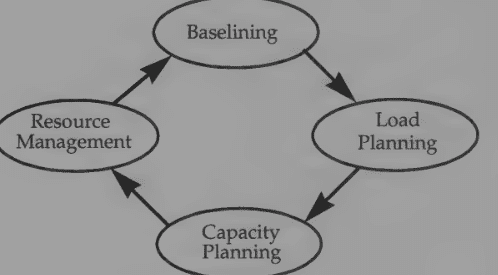

**图 2-1** 性能管理的四阶段方法

每个阶段的输出都将作为下一阶段的输入。每个阶段必须达到一个稳定状态，以便结果可以被发布并传输到下一阶段。一旦四个阶段确定下来且所有结果都经过了验证，这些结果就会输入到下一代阶段中。下一节将详细讨论每个阶段。

在性能管理交付物中集成一个相对简单的变更和配置管理过程，可以大大提高性能管理的效率和准确性。这种变更管理可以简单到仅需为所产生的文档和报告生成并维护修订版本。

历史版本应当被保留，以备未来进行检查和变更分析。这些版本还提供了所分析数据及其得出结论的变化历史。这些历史数据和结论的汇编有助于减少重复性工作，并作为指南，展示过去负载规划和容量规划的影响（包括正面和负面影响）。

## 基准建立

基准建立创建了系统当前的状态快照，并生成描述系统性能和所测负载特征的报告。为了对系统建立基准，我们首先在服务架构的每个层级通过吞吐量、延迟和利用率描述系统性能目标。

必须首先定义所建立负载的服务的业务需求。这些终端用户服务级需求可能包括：

- 事务率

- 事务量

- 运行小时

- 处理批加载的关键时间范围

- 并发用户会话需求

这些与 `SLA` 中定义的业务需求相同，`SLA` 在第三章“建议流程”中有详细解释。

配置清单建立了服务架构五层当前状态记录，并为修改该架构提供了参考。包含硬件、软件和操作系统版本的准确表示对于创建准确的清单至关重要。该配置清单在基准建立过程的生命周期内被视为“锁定”。这导致对操作环境的所有变更都被视为一种调优事件，会导致当前系统状态失效并触发新的基准循环。

此时，将根据 `SLA` 中定义的目标对服务性能进行监控和测量。此外，还将根据第三章提到的关键性能指标（`KPI`）中定义的资源消耗阈值对系统性能进行监控和测量。

如果在系统性能的五层中识别出任何调优机会，则实施对系统或架构的识别出的变更，并针对之前的快照进行重新测量。这有助于确定这些变更对系统性能的正正面或负面影响。旧快照作为配置和相应性能指标的历史记录保留，新快照成为工作基准。

负载规划考虑了系统的变更或新需求。收集并分析任何描述变更和新需求的可用数据。通过对相似负载或开发阶段的负载建立基准来获取可能的测量值。对新负载或现有负载的变更进行剖析，为容量规划阶段提供输入（见图 2-2）。负载数据收集和剖析。在对收集的数据做出有效假设之前，这些活动每个可能需要重复多次。


图 2-2 负载规划

负载评估识别了如何量化新需求。如果有一批新的终端用户迁移到某个应用程序，负载评估将确定用户位于何处、他们将如何访问环境、他们在环境中做什么以及他们执行的频率。这些信息随后可以驱动基准测试的创建，以测试这种新需求对现有环境的影响。

负载数据收集收集基准内事务的原始统计数据。这种收集可以通过许多方式完成，取决于关注的层。这些统计通常比基准建立活动期间测量的数据详细得多，且时间间隔更短。这些测量通常在隔离的开发环境或测试环境中进行。

负载剖析根据负载收集数据创建一个模型。该模型将代表在该特定周期内应用于系统的典型负载。

容量规划将负载规划分析的结果应用于系统基准和来自基准建立阶段的性能报告。容量规划阶段产生新的新的系统和服务架构，以满足在负载规划阶段建立的需求。基准建立和负载规划阶段收集的数据准确性直接关系到容量规划模型的准确性。

系统容量和资源消耗将针对当前基准数据进行建模、校准和验证。模型比较了相对资源消耗（在基准建立阶段的性能报告中测量）与系统架构的相对性能特征（在基准建立过程的配置清单期间建立）。资源消耗与系统架构之间的关系产生了负载特征，用于建模和预测对所测环境的变更（增量）的影响。

系统性能特征被建立并投影到场景模型中，这些场景包括预测的负载增长、系统架构和硬件变更以及负载资源分配。

一旦模型被确定是准确的并代表所测负载特征，则使用该模型来预测负载规划阶段引入的变更的影响。根据需要调整操作环境，以满足 `SLA` 和 `KPI` 中定义的性能需求。

应用磁盘布局、磁盘架构模型、`CPU` 速度、缓存大小、内存大小和负载混合可以在系统模型中进行调整和投影。新负载在迭代过程中投影到新的系统环境中，直到找到系统业务需求和性能目标。这一迭代过程产生了新负载的利用率、延迟和吞吐量预测，以及能够在满足计划变更和增长的同时为终端用户社区提供可预测服务的系统架构和操作环境。

资源管理定义了在实施的生产环境中管理负载所需的控制、共享、配额和优先级。根据需要对共享和配额进行强制和监控。此外，系统资源核算为创建新的性能基准提供输入。系统资源规划还提供了额外的校准

反馈到下一阶段负载规划和容量规划，以提高模型准确性。请参阅《Sun Blueprints》中的《资源管理》一书获取资源管理的全面视图。

随着 `Sun` 服务器和软件性能以及 `RAS`（可靠性、可用性、可维护性）的提高，`Solaris`™ 操作系统（或基于 `Solaris` `OE` 的服务器）正进入传统上属于关键任务应用程序的大型机工作领域。`Sun` 服务器在企业中这种相对较新的定位，使得 `IT` 部门有必要将大型机方法论应用于 `UNIX` 服务器。大型机环境中的一个核心要素——而这对于 `Solaris` `OE` 而言仍然是较新的概念是服务水平协议（`SLA`）。这些协议概述了部门与最终用户之间关键任务服务的可用性水平。

本节描述了 `SLA` 的原则；第 26 页的“服务水平管理”章节概述了 `IT` 部门在分析最终用户计算资源需求、`IT` 架构能力以及制定协议时应采取的步骤。

`SLA` 仅仅是针对特定服务的期望列表。此外，它还是维护服务可用性的工具。它定义了服务的事务能力、网络延迟预测、可用性要求、维护窗口、升级程序以及评审流程。

当服务水平没有被明确定义时，用户将不得不自发地形成他们对服务水平的理解。很多情况下，用户自行创建的服务水平与 `IT` 部门的标准并不相符。未建立服务水平所带来的负面影响是沟通不畅和混乱。如果提供者和消费者之间没有进行适当沟通，`SLA` 可能会变成双方斗争的武器，从而消除适当的沟通和谈判。


当使用良好时，`SLA`成为`IT`部门与服务消费者之间理解的桥梁。这些协议应作为所有相关方之间理解的基础，并定义各方讨论并达成一致的关键角色、责任和期望。此外，`SLA`应该定期审查和修改，并被视为一份动态文档。任何拟定的修改应在纳入`SLA`之前由所有方讨论并达成一致。

在大多数成熟的计算环境中（如更传统的数据中心），`SLA`长期以来一直是生活的重心。然而，在客户端/服务器世界，`SLA`的引入通常意味着重大的文化变革。通常情况下，传统的以技术为中心的管理需要让位于基于用户满意度的管理。

`SLA`应该回答五个关键问题：

- 用户对服务有何期望？
- 提供者对服务有何期望？
- 用户期望服务提供者（`IT`部门）提供什么？
- 服务提供者从用户处期望什么？
- `SLA`如何改进业务流程、影响底线并提高可用性？

这些问题的答案看起来可能简单得惊人，但现实中，解决这些问题可能需要数月的谈判。

不存在或定义不当的`SLA`可能会导致不愉快的体验，其中至少包括：

- 由于`IT`部门未能满足最终用户未记录的期望，导致用户认为服务很糟糕
- 最终用户与`IT`人员之间产生敌对的工作关系
- `IT`人员提供主动支持，但其价格可能是最终用户不愿支付的（这种认同的负面影响是，`IT`部门可能在“找事情”，从而成为新预算限制的目标）
- 支持不一致，以及在`IT`人员与最终用户之间可能存在偏袒的印象

`SLA`未被广泛使用的原因有许多。一些最常见的原因源于缺乏与最终用户的沟通以及`IT`部门的文化变革。然而，`SLA`的许多长期利益包括提高最终用户满意度、更准确的资源核算以及更高效的优先级排序。以下问题是`SLA`最常见的失败原因：

- `IT`部门和最终用户层没有投入大量的时间和人力。
- `IT`部门与最终用户社区之间没有建立通信渠道。
- `IT`管理人员无法简洁地定义、鉴定和量化`IT`服务及成本。
- `IT`管理人员缺乏在内部外部识别、定价和销售`IT`服务的营销技能。
- 最终用户并不确切知道自己想要什么或什么时候想要。
- `IT`部门未能对现有服务设置基准并运行基准测试，导致对未来服务的预测不准确。
- `SLA`不符合实际，导致测试数据失败。

然而，只要具备正确的`IT`技能（无论是来自内部`IT`部门还是外部咨询机构），所有障碍都可以被克服。

创建第一个`SLA`对于任何`IT`部门来说可能是一项挑战性任务。它要求对服务进行重新审视，这在很大程度上是从最终用户的角度出发的，是一个困难的文化变革。

然而，出于几个原因，建立和维护`SLA`的回报是值得的。一个沟通良好的`SLA`有助于提高服务可用性、获得更高的最终用户满意度并更高效地利用计算资源。此外，对`IT`预算和长期预算的优越控制也是`SLA`的直接收益。

此外，`SLA`基于用户和`IT`部门的输入创建的框架为`IT`管理提供了许多益处。通过`SLA`，`IT`管理人员可以更有效地为资源分配人员。通过人员限制（无论是由于人员配置不足还是技能限制），可以通过招聘或培训来解决。该框架还为优化企业`IT`支出、再投资和优先级的协调提供了洞察。这种洞察因此揭示了`IT`服务交付与该服务产生成本之间的联系。

成功的生产环境实施是周密规划和设计的成果。生产环境工程和数据中心生产环境主题已经研究和分析了数十年。平衡业务目标、互联网业务的爆炸式增长以及关键服务的完整性与安全无疑可以归类为

本节通过`ISO` `FCAPS`模型、`ITIL`（信息技术库）框架、基础`IT`参考模型以及通往生产环境`Sun` `Ready`路线图解决了数据中心生产环境的需求，为成功启动、管理和维护新数据中心或刷新旧数据中心的基础设施和时间表提供了全面的视图。

传统的“玻璃房”数据中心经理通常熟悉操作策略和程序的生产环境标准概念，但对快速发展的点点市场所经历的指数级增长尚未做好准备。这些玻璃房经理必须学习：

- 适应快速迭代的互联网经济
- 准备好快速适应即时和直接接触客户的新模式
- 适应指数级增长已成为成功创业企业标准的环境

他们还必须意识到，传统的多层销售和分销零售市场正面临新访问模式的挑战，这种模式包括企业`IT`系统与客户之间的直接互动，而竞争仅一点击之遥。

点点初创互联网业务面临着相关的挑战。虽然他们的业务在竞争激烈的互联网业务环境中依赖指数级增长来生存，但他们往往缺乏数据中心政策、程序和经验，来通过一些成功的互联网业务近年来展示的增长管理数据中心生产环境。通过从更激进的传统先驱那里学习积累的经验，点点公司可以实施生产环境架构的最佳实践，同时保留在不断扩张的市场中生存所需的灵活性。

`IT`框架定义了生产环境的覆盖范围，由一组在该环境中设计和实施的通用主题组成。框架还帮助根据广泛的`IT`服务类别确定人员配置和组织需求。一些传统的主题示例包括：

- 备份与恢复
- 控制
- 安全
- 性能/容量管理
- 系统管理
- 应用管理
- 网络管理
- 灾难恢复
- 设施管理

框架中定义的某些类别是全公司范围的，有些是针对特定数据中心的，有些是针对特定系统的，还有一些是针对应用程序的。例如，安全组可以管理整个公司的安全策略和管理，而设施管理资源可以被分配给多个不同的数据中心。此外，应用管理资源可以专门用于单个服务器或跨越多个数据中心的一组服务实例。

国际标准化组织（`ISO`）在其包含《开放系统互连模型（`OSI`）：管理信息结构》标准中的《管理对象定义指南》中，为网络化企业中的受管对象定义了一个框架。`OSI`结构定义了五类管理对象，涵盖了企业支持运营的基本类别（图 2-3）。


图 2-3 `FCAPS`高级`IT`框架

这些类别可以应用于网络管理系统（这是其预期目的），也可以扩展到包含数据中心运营和管理中的技能、工具和能力。

# `IT`扩展框架

`IT`框架中的每个类别都可以拆分为更小的部分，描述提供与该类别相关服务的组的职责。这种扩展的`IT`能力列表被称为`IT`扩展框架（`ITEF`）。表 2-2 显示了一个示例。

表 2-2 `IT`扩展框架

| 故障管理 | 客户服务 |
| :--- | :--- |
| 事件管理 | 备份与恢复 |
| 灾难恢复 | 系统管理 |
| 故障保护 | |

`ITEF`为数据中心能力、技能集和产品覆盖提供了一个极佳的清单。它还为建立数据中心策略和程序的逻辑结构提供了框架，该结构独立于操作系统、服务器类型或应用程序类型。`ITEF`建立的`IT`服务类别可以分配多个级别的关键性，例如：任务关键、业务关键、业务支持和偶发性。这些关键性级别有助于确定特定类别所需的`IT`支持级别。

`ITEF`可以进一步划分，以建立职能职责并并提供有关`ITEF`所提供服务的更详细信息。这些职能职责可以表示为部门职责表（见表 2-3），也可以在定义部门职责的`IT`服务覆盖文档中明确声明。

表 2-3 `FCAPS` `IT`扩展框架划分

| 备份与恢复 | 磁带库管理 |
| :--- | :--- |
| 用户数据恢复 | 系统备份 |
| 数据备份完整性测试 | 异地磁带存档轮 |

通过将`FCAPS` `IT`框架扩展到包含描述性的`IT`服务覆盖类别，我们可以基于`FCAPS`定义一个`ITHF`。这种`IEF`最好用树形结构表示，并显示为一系列`Web`页面，允许用户轻松地导航到所需的详细级别。这种钻取结构对于在易于访问的共享演示中实现`ITHF`，以及将`IEF`包含在线系统运行手册（`runbooks`）中非常重要。

图 2-4 显示了`ISO` `FCAPS` `IT`扩展框架。

| 支持运营 | 配置管理 | 计费管理 | 性能管理 | 安全管理 |
| :--- | :--- | :--- | :--- | :--- |
| 客户服务 | 变更管理 | `MIS`成本控制 | 应用管理 | 系统安全 |
| 事件管理 | 工作负载管理 | 用户账户管理 | 机器管理 | 用户账户安全 |
| 备份与恢复 | 配置管理 | 系统使用管理 | 容量规划 | 访问控制 |
| 灾难恢复 | 资源管理 | 许可计费 | 负载规划 | 归档与检索 |
| 系统管理 | 资产跟踪 | | 采购采购 | 安全策略 |
| 故障预防 | 许可管理 | | | 安全管理 |
| | 运行验收 | | | |

**图 2-4** `ISO` `FCAPS` `IT`扩展框架

对逻辑架构进行清晰的陈述，对于向终端用户服务消费组织以及业务级管理层展示统一的管理和运营策略至关重要。这种展示也有助于准确创建`SLA`和阐释服务能力。以下示例提供了一个用于变更管理的示例`IT`服务覆盖文档摘要。

`IT`服务覆盖文档应该包含一个描述覆盖类别的通用陈述，还应包括描述`IT`环境中单独服务和权限范围的陈述。服务覆盖文档可以为工具选择以及人员配备和培训需求提供帮助。通过建立覆盖类别，`IT`部门提供的服务得到了明确定义，从而允许在`IT`运行环境中建立执行和审计策略。

变更管理系统是记录、授权、监控和报告开放系统环境中所有更改的载体。提供的主要服务和职责包括：

- 与企业管理系统集成的处理所有更改的单一可审计机制
- 包含所有相关方的、用于授权更改的审查流程
- 确保所有更改都经过测试和验证，并带有经过测试的回滚程序的流程
- 整合在`SLA`报告流程中的变更过程报告程序
- 审查所有未通过变更管理程序授权更改的机制
- 对应用程序和软件包进行软件开发和维护，包括源代码、可执行代码和参数文件，以及发布管理和审计控制
- 以受控和审计的方式将应用程序、操作系统和软件包分发到分布式平台

`IT`服务模型（`ITSM`）为`ITSM`引入了关键性级别、服务级别和“大规则”。这种多级方法扩展了`IT`服务的自然钻取结构（见图 2-5）。

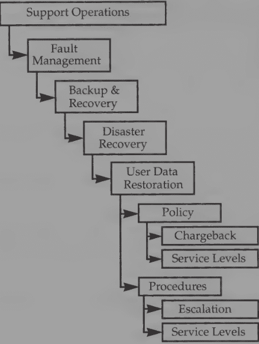

图 2-5 钻取`IT`文档层级

`ITSM`可以跨平台实施，并用于在终端用户消费组织与`IT`资源提供组织之间的`SLA`创建服务级别描述。在适当的情况下，可以为不同级别的`IT`服务产生计费结构。一旦定义，`ITSM`有助于产生自动化、标准化、可重复且简化的`SLA`创建和审计流程。

以下是用户数据备份的服务级别描述示例，可以作为指南；应根据当地本地数据中心策略进行修改。

服务：

用户数据备份

服务计划：

维护窗口任务

**任务关键**

用户数据将通过每日全备份备份到中央备份管理系统。

计费：每月 $1000 + $80 + 100 GB

**业务关键**

用户数据将通过每周全备份和每日增量备份备份到中央备份管理系统。

计费：每月 $500 + $60 + 100 GB

**业务支持**

用户数据将通过每周全备份和每日增量备份备份到本地连接的磁带系统。

计费：每月 $200 + $40 + 100 GB

英国中央计算与电信机构（`CCTA`）于 1978 年开始发布其既定的`IT`运营最佳实践卷册。这 24 卷名为《信息技术基础库》（`ITIL`），描述了`CCTA`的操作程序，并讨论了它们在生产级数据中心环境中的应用和物流管理。

`ITIL`在多年来不断演变，被许多`IT`组织和管理工具供应商进行研究、采用和调整。荷兰考试协会（`EXIN`）已建立认证计划，为服务支持、服务交付和`IT`管理类别提供基础级、专业人员级和大师级的专业知识认证。

`ITIL`的一个核心优势是，它帮助识别了`IT`管理组织中固有的相互依赖关系。以下是备份过程中内部依赖关系的一个示例：

1. 备份必须首先通过批处理作业调度系统进行计划。
2. 备份的状态和任何错误必须通过企业监控和管理系统进行报告。
3. 监控和管理系统必须将备份的状态和任何错误传输给服务台（`Service` `Desk`）。
4. 服务台必须将状态和任何错误通知技术所有者或系统管理员。

通过组织良好的`IT`框架和扩展框架，这些相互依赖关系和流程就可以被记录。此外，实施和运行的程序可以集成到描述服务的文档中。

`ITIL`建立的是策略，而非实现。它独立于操作系统、硬件平台和应用程序，但可以作为创建在`ITHF`中使用的“大规则”的指南。`ITEF`可以根据服务水平、操作系统、硬件和应用程序的能力进行实施。

使用以下资源为在`ITEF`中实施既定策略提供必要的知识：

- `IT` `Staff`的集体经验
- 技术出版物和会议
- `Sun`教育服务（`Sun` `Education` `Services`）
- `Sun`专业服务（`Sun` `Professional` `Services`）

`FCAPS`框架最初源于`ITIL`。`Sun`专业服务（`SunPS`）团队开发了一套应用`FCAPS`框架的项目方法论。该方法为`ITIL`运营创建了一个统一的扩展框架。`SunPS`团队将`ITIL`作为关键任务环境中最佳实践的指南，创建了一系列用于实施的大规则。这些规则考量了为客户`IT`部门向特定服务的终端用户交付承诺的服务水平所需的各项任务的关键性。

通过对每个`IT`服务创建这种多级方法，`SunPS`团队可以建立一个评分模型，预测当前`IT`基础设施满足终端用户服务水平目标的能力。这种`IT`能力分析随后可用于开发`IT`基础设施的高层架构。这种新的、规划良好的架构可以在终端用户服务投入生产之前，补充现有的现有`IT`运营。因此，高层架构在应用程序开发生命周期的试点阶段之前就得到了优化创建。

补充服务能力的实施涵盖了从架构阶段到试点、开发、集成、部署和维护阶段的应用程序开发生命周期。`IT`服务能力随后可以与应用程序/功能、压力、崩溃和灾难恢复测试周期同步进行测试和评估。此外，`IT`服务能力可以与新的终端用户应用程序环境并行推向实时生产环境。

将`IT`基础设施开发生命周期与应用程序开发生命周期相结合，可以识别组织和资源之间的依赖关系。此外，此过程记录了为项目管理建立任务和交付物统一时间表所需的信息流。这确保了在终端用户引入生产环境之前，终端用户服务水平目标所需的底层`IT`服务已经就位。

服务水平管理是维护生产环境的关键。通过建立参与规则、支持服务水平目标所需的各种以及生产环境中的工具实施，可以对整个生产基础设施进行监控和衡量。违反`SLA`中定义的范围以及与约定的性能和管理标准的衡量异常情况，可以得到快速处理和解决，从而将对业务的影响降至最低。

在这个业务参考模型中（见图 2-6），信息流的定义是以服务台为管理信息的中心。服务台控制信息、调接请求、审计请求完成情况，并为`IT`服务管理组和业务服务终端用户社区提供服务水平报告服务。

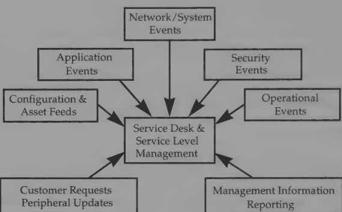

图 2-6 `IT`业务参考模型 - I

服务台还为内部和外部支持组织协调行动事项，并审计服务事件的完成情况、影响和时长（见图 2-7）。通过控制支持活动的派遣，可以监控受影响的终端用户服务水平。监控终端用户服务水平使供应商和终端用户对`SLA`和服务水平目标（`SLO`）进行调整、罚金评估、执行以及必要时的仲裁。

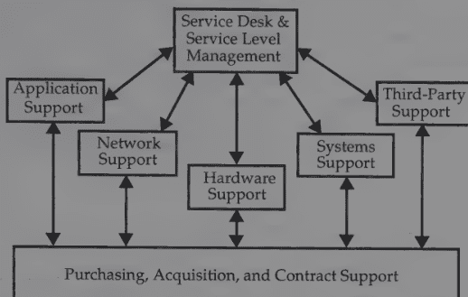

假设任何未被衡量的都是不受控的。

- 衡量业务，也要衡量计算机系统和人员。
- 衡量并记录性能、成本和可用性的趋势。
- 衡量你无打算调优或控制的事物。

尽管这可能显而易见，但仅仅测量某些东西本身就有益。人类有观察测量值的自然本能，当某个测量指标开始表现异常时，它会变得明显，因此可以在早期阶段进行纠正。

你不应该预先指定所有的测量；然而，在员工中鼓励端到端的测量文化是有益的。管理层规定了一些稳定且重要的测量定义；但此外，轻量级、临时和实验性的测量非常有用。

如果整个`IT`团队都建立了如何衡量他们所做的一切，并在他们的墙上装饰这些测量值的图表，那么大量的纠正反馈将自动覆盖运行业务的系统和流程。

应该建立一个系统，帮助`IT`自动或手动将任意数据记录到性能数据库中。这些数据库应该具有任何人都可以使用的摘要和图表绘制，并且应该尽可能简单。

必须做的一个重要权衡是决定三个相互冲突理想的优先级：快速、廉价或安全。谨慎决策以建立平衡。对每个组件单独进行参数化，并将它们组合成可用性层次结构。将每个组件评为 `%fast` `%+cheap` `%+safe` = 100 以获得相对比例。将组件组合成层次结构，使视图自动获得组合优先级。结合可靠性和可用性指标是广为人知的，但至少估计所做选择的相对成本和性能影响也是重要的。

生产环境工程和性能管理可能看似晦晦的艺术形式。通过研究传统数据中心社区的集体经验，并通过组织良好的定义的服务覆盖方法论应用经过验证的最佳实践，这种艺术可以转换为易于理解的科学，具有可预测的结果质量。为生产环境中数据中心服务的的设计、实施和集成创建可重用的模板、文档和流程，可以获得更高质量的服务、更低的交付成本以及更少的重复工作。在`IT`生产环境中定义框架、扩展框架、参考模型及其内部时间表，有助于交付具有可重复服务质量的终端用户服务。

下一章将提供服务水平管理的方法论，并探讨跨平台容量估算的一些问题。

在医学领域，预防几乎比治疗更有效，优化在预防医学上的支出以帮助减少疾病的发发生频率和严重程度是一个明智的举措。在企业计算环境中，您可以通过建立、监控和执行持续的实践和流程来实现类似的目的。

尽可能对系统的健康监控和报告实现自动化。通过自动化收集被测量服务的定性和定量属性数据，允许您创建基准和趋势信息，这些信息对于容量规划和负载规划过程具有重要价值。

开发实践会产生显著影响，因此我们建议在内部应用程序开发指南中包含性能考量。在应用开发环境中衡量并报告关键性能标准，有助于明确性能和容量的发布时间预期。这些实践还帮助您识别和发现正在开发的应用程序对性能影响的变化。为了建立最佳的内部应用程序指南，以下点非常重要：

- 定义技术和工具
- 使用通用的插桩和可用性架构
- 在应用程序进入生产环境之前进行测试和规模评估

这些工具、其使用规范以及达到测量阈值时需要执行的操作应当详细记录，并放置在系统运行手册（`system` `runbook`）中。该运行手册应为报告和处理多种类型的系统事件提供指南和标准流程。系统运行手册应包含足够的细节，以便在发生灾难时能够重建生产环境中的程序和操作环境。该运行手册的设计还应使一个不熟悉特定本地环境的`IT`员工能够成功实施描述的程序和阈值活动。

通过定义多级升级路径为规划留出缓冲余地。使用严格的变更控制流程，并安排分批变更以管理风险。在变更期间安排适当的人员在场，以便集中于救火工作。在快速变化的业务环境中，变更的数量将不断增加，必须管理并控制这种加速，而不阻碍变更。


# 服务水平协议（SLA）与关键性能指标（KPI）

本章强调了记录服务提供者与用户之间服务水平协议（SLA）的重要性。此外，本章还提供了容量估算和工作负载合并的最佳实践。

## 服务水平管理（SLM）

许多客户端/服务器环境通过 `CPU` 利用率、运行时间/停机时间、分页率、`I/O` 利用率、缓存命中率等来衡量其服务性能。虽然这些都很重要，但要理解终端用户的视角，还需要更多信息。用户对服务的端到端可用性以及对快慢的观感知更感兴趣。遗憾的是，这些感知很难量化。这需要传统数据中心监控与服务的端到端可用性的结合。这种结合被称为服务水平管理（`SLM`）。

当 `IT` 部门首次尝试实施 `SLM` 时，工具并不总是可用的。在这种情况下，衡量可以衡量的内容是恰当的。目标最终能够从终端用户的服务视角进行衡量。一旦 `IT` 部门对监控服务的新视角变得更加熟悉，就可以将服务水平目标（`SLOs`）扩展，以包含来自终端用户视角的额外指标。

### SLA 的定义与结构

服务水平协议是 `IT` 服务消费者和提供者之间协商的产物。单一业务单元与多个服务提供者（如网络、`IT` 基础设施、数据库和桌面工作站支持组）之间可能存在多个 `SLA`。某些提供者还可以与其他提供者拥有 `SLA`，包括其所使用的供应商和内部提供者组织。这些多级 `SLA` 结构有助于传递业务需求，并精炼 `IT` 基础设施的需求。它们还可以将能力向下传递到终端用户级，在业务背景下提供技术能力。

大多数 `SLA` 遵循相同的基本框架：

- 为服务建立背景；通常包括历史上提供的内容、拟议的服务以及拟议服务将提供的内容。
- 识别所有方。
- 识别服务。
- 预测预期的事务负载。
- 建立指标。
- 明确记录升级程序。
- 明确定义仲裁、成本、后果和条款。

请记住，成功 `SLA` 的关键之一是清晰的沟通，以及根据消费者需求表述的现实、可衡量的目标。

`SLA` 不应深陷于法律术语中；相反，它应该让任何熟悉该服务和特定业务领域的人都能轻松理解。`SLA` 应作为系统运行手册的一部分予以实施，并维护在使用服务的业务单元和维护服务的 `IT` 人员均可访问的区域。

以下列出了 `SLA` 中最常见的章节，并描述了每个章节应包含的内容：

- **背景（`Background`）**—— 提供 `SLA` 概述以及此前提供的服务的历史信息。此外，还应包括有关 `SLA` 的一般信息、业务流程和目标，以及新 `SLA` 对业务流程的影响。此部分应针对不熟悉该服务的读者。
- **双方（`Parties`）**—— 识别所有组的关键联系人及其各方的职责。明确定义受此服务影响的双方。谁是服务提供者，谁是消费者？是否有其他受影响的群体，需要谁的专业知识？
- **服务定义（`Service definition`）**—— 定义所涵盖的服务、服务位置（包括服务器和终端用户）、用户数量、预期的事务量以及服务容量。确定服务的覆盖范围和时间表，包括服务可用时间和维护窗口。确保包含服务的可衡量目标。
- **关键业务指标（`KBIs`）**—— 详细列出并发用户、单位时间（小时/分钟）事务量、事务类型、用户分布（`LAN` 和 `WAN` 链路及延迟）、与其他应用程序的资源竞争以及工作负载强度。此项应非常显式。
- **服务衡量（`Measurement of service`）**—— 定义衡量 `KBIs` 的方法，并跟踪对服务定义的遵循情况。
- **问题报告与升级（`Problem reporting and escalation`）**—— 建立问题报告流程和程序。
- **评审与报告（`Review and reporting`）**—— 建立定期服务报告和会议。
- **成本、内部收费与后果（`Costs, chargebacks, and consequences`）**—— 建立成本和内部收费流程。定义合规的奖励或惩罚。
- **争议解决与仲裁（`Resolution of disputes and arbitration`）**—— 建立解决争议的仲裁员。
- **SLA 的重新评估与更新（`Reassessment and update of SLAs`）**—— 建立定期评审周期。鉴于 `IT` 环境的动态性（新应用、更大的需求或额外的用户），有必要定期评审以修订和更新 `SLA`。
- **批准（`Approvals`）**—— 获取各方负责人对 `SLA` 的签名。
- **术语定义（`Definition of terms`）**—— 提供 `SLA` 中使用的术语词表。

每个 `SLA` 都应该是独一无二的，基于所提供的服务和用户需求。然而，这并不意味着一旦第一个 `SLA` 完成，就需要从头开始。

鉴于 `SLA` 以用户为中心的关注，定义这些协议需要销售和营销技巧、技巧和外交，以及管理和衡量 `IT` 资源的传统 `IT` 能力。

在识别首次实施 `SLA` 时，检查现有服务是否符合两个标准：

- 现有工具可以监控服务，并存在现有基准数据，包括服务可用性和历史性能指标。
- 服务的依赖关系可以明确定义，且提供服务组件的部门是可识别的（网络、打印、帮助台等）。

`SLA` 的实施对双方都有益，提供了资源消耗和计算规模评估信息。`SLA` 可以帮助 `IT` 部门预测系统规模规划的负载规划信息，帮助业务单元估计拟议服务变更的成本，并帮助财务部门为业务服务分配真实的成本估算。

### 服务定义

一旦定义了服务，就需要识别该服务的技术组件。包括服务器、网络、终端用户数量及其物理位置。详细说明系统的预期事务量和容量，以及可接受的阈值。目标是包含服务可接受且期望的平均事务延迟以及最大支持事务率。列出核心系统的可用时间段和计划的维护窗口。

服务定义应当是：

- 有意义的
- 可衡量的
- 易理解的
- 高效益的
- 可实现的

服务的指标将通过与终端用户的会议、基准测试以及历史数据（包括正常运行时间/停机时间、故障时间和性能）得出。所有这些指标都应由 `IT` 部门和用户达成一致，并要求具有具体的数字和可衡量的目标。`SLA`（服务水平协议）对终端用户和 `IT` 部门都应该是具有效益的，同时仍满足业务需求。最后，目标应该基于测试和历史性能是可以实现的。

#### 订单处理组示例

订单处理组有 300 名员工，全部集中位于堪萨斯市的设施。他们目前通过局域网（`LAN`）连接到同样位于堪萨斯市设施的 `Sun Enterprise 6500` 服务器上的数据库。订单处理组必须在每个月的第一周运行月报（针对上个月），在每个季度的第一周运行季报（针对上季度），并在新财年的第一周运行年度报告（针对上一年）。

**服务器规格示例：**

该环境的服务器架构包含以下：

- `Sun Enterprise 6500` 服务器
    - 1 组 16 个 `CPU`，4 GB 内存
- 700 GB `A3500` 磁盘
- 2 个连接到服务器 `LAN` 的 `FDDI` 网络适配器

注意，桌面电脑、网络基础设施、帮助热线、备份、恢复和打印机支持由另一份合同涵盖。

在确定服务特性并定义基础设施后，建立服务时间范围和维护窗口。服务规格应基于用户需求和从过去几年获得的性能数据（如果可用）。

- **工作时间**定义为东部标准时间（`EST`）06:00 至 20:00，周一至周日。
- **维护窗口**定义为 `EST` 20:30 至 00:30，周一至周日。在这些维护窗口期内，不允许进行任何事务。

如果在任何维护窗口期间需要进行事务，则需要获得 `IT` 经理和终端用户经理的提前批准。必须获得批准并在请求至少 7 天前提交给帮助热线。在任何时候都不允许事务处理需求损害数据或备份的完整性。

在紧急情况下，可能需要在正常维护窗口之外安排计划停机。在这种情况下，`IT` 部门将就停机的安排和时间寻求用户的批准。在可能的情况下，他们还将尝试合理地限制计划的服务停机对终端用户的影响。

如果发生需要恢复数据或恢复系统大部分部分的“灾难”，帮助热线将通知用户服务事件，并每隔 30 分钟提供一次定期更新，直到服务恢复。这些定义为“灾难”的事件将不计入可用性计算，但将记录在每月服务审查中。

目前对灾难级服务的恢复估计为：
- 系统级恢复两小时
- 应用程序数据恢复四小时
- 数据库系统恢复两小时

任何系统服务事件（包括灾难事件）都不会超过十二小时。

**停机定义**：指定义的工作时间内、紧急维护窗口之外，且期间系统无法进行事务的时间段。计划或安排的紧急维护不包含在停机计算中。
- **停机开始**：指检测到故障的时间，而非实际发生的时间。
- **停机终止**：指停机后服务可用的时间。

**可用性计算**：

系统应保持业务时间内 99.8% 的功能可用性。系统可用性由以下方程确定：

`覆盖范围 = 月内定义为“工作时间”的总分钟数`

`14 小时/天 × 60 分钟 × 30 天 = 25200 分钟`

`停机 = 每月停机分钟（33 分钟）`

`可用性 = (覆盖范围 – 停机)/覆盖范围 × 100`

`(25200 分钟)-(33 分钟) × 100 / (840 分 × 30 天) = 99.8%`

**性能目标**：

- 在高峰时段，95% 的查询将在 2 秒内完成（平均），最多有 300 用户在线。没有查询将超过 5 秒。
- 在高峰时段，95% 的所有订单事务将在 5 秒内完成（平均），最多有 300 用户在线。没有查询将超过 9 秒。
- 订单处理系统在工作时间内将维持每小时 30,000 次事务。

由于缺乏历史批处理相关性能数据，目前无法对批处理的性能提供保证。

## 关键性能指标（KPI）

`KPI` 文档长期以来一直是我们衡量服务器性能的标尺。虽然 `SLA` 是用业务服务术语指定的，但 `KPI` 是用系统管理员熟悉的语言定义的。它们通常测量可用 `CPU`、内存和 `I/O` 吞吐量，以及更细粒度的方面，如互斥锁计数、中断和上下文切换。`KPI` 不应被解释为通过/失败条件，而是为了报告服务器的整体性能状况，并指示服务何时可能没有足够的资源来满足 `SLA` 目标。

在创建服务定义后，将建立系统性能目标，以衡量资源利用率相对于资源容量。`KPI` 文档建立了资源阈值，并识别了资源消耗的警告和临界级别。

在衡量服务能力时，会在服务器上进行若干测试。

**表 3-1 列出了常见的阈值。**

| 资源 | 警告阈值 | 临界阈值 |
| :--- | :--- | :--- |
| `CPU` | 任何测量段利用率 > 70% | 任何测量段利用率 > 90% |
| 磁盘 | 任何测量段忙率 > 30% | 任何测量段忙率 > 50% |
| 内存扫描率 | 持续 5 分钟 > 1000 页/秒 | 持续 5 分钟 > 4000 页/秒 |

系统架构（硬件和软件）对应于容量。当硬件架构通过升级或补丁更改时，应重新审查 `KPI` 文档以确定新的阈值。

大多数 `IT` 部门选择不将 `KPI` 包含在实际 `SLA` 中，因为 `KPI` 文档中的细节适用于直接管理服务器的 `IT` 部门。这些 `KPI` 可以作为基准，比较修改服务程序、数据库和桌面系统后的性能测量。

在确定 `KPI` 后，确保 `KPI` 文档中概述了衡量它们的标准工具。

有很多工具可以帮助监控系统性能。`sar`、`iostat`、`vmstat`、`mpstat` 和 `netstat` 等工具已集成到 `Solaris OS` 中，以协助 `KPI` 测量。`Sun Management Center (SunMC)` 和 `SE-Toolkit` 等免费工具提供了监控单系统的图形化工具。商业监控工具如 `SunMC`、`BMC Patrol`、`BMC Best/1` 和 `TeamQuest` 可以配置为对大量系统测量、监控并报告性能状态和阈值。

**表 3-2 列出了与表 3-1 中的样本阈值对应的示例工具定义。**

**表 3-2 关键性能指标 (KPI) 的工具定义**

| 资源 | 工具 | 采样时间 |
|---|---|---|
| `CPU` | `sar` - 占用率由“%sys”和“%user”之和决定 | 20 分钟 |
| 磁盘 | `sar` - 占用率由“%busy”决定 | 20 分钟 |
| 内存（针对 `Solaris 7 OE`） | `vmstat` - 以“sr”列中报告的扫描速率 | 5 分钟 |
| 内存（来自 `Solaris 8 OE`） | `vmstat` - 以“free”列中报告的空闲内存 | 5 分钟 |

表 3-2 中的示例还说明了一个问题：某些指标取决于厂商发布版本，因此需要维护多个定义。

在汇总 `KPI` 数据时，请记住这些数据有不同的接收者。首先是系统管理员，他们通常擅长分析原始性能数据。其次是 `IT` 经理和财务规划师，他们可能对用于预算的数据摘要感兴趣。最后是终端用户，他们可能对系统的健康和性能感兴趣。后两组可能通过提供系统负载和性能图形化表示的网页获得更好的服务。图表和图形可以为非技术用户更好地展示系统健康状况。第 6 章“可观测性”更详细地讨论了性能信息的受众。

`KPI` 文档还可以包含用于立即缓解或解决性能事件的措施。这些措施可能包括停止、重新调度或重新调整运行批处理作业的优先级、停止被认为非业务关键的其他业务，或运行分析当前应用程序负载的实用程序。

# 问题报告与升级

为了最大程度地减少对用户的影响和困扰，请使用该服务现有的问题报告流程（如果该流程存在且可以进行适当修改）。该流程应列出严重性级别、帮助服务台的主要联系人以及针对未解决问题的升级矩阵。问题报告和升级程序应在系统运行手册（`runbook`）中有详尽记录。这些程序应根据需要进行测试和更新，以反映 `IT` 环境的变化。

问题的严重程度可以从单个用户响应缓慢到全球性故障不等。为了合理分配资源，应该定义严重性级别，并定义组织这些优先级的优先级。

**表 3-3 列出了严重性级别的样本定义。**

| 级别 | 可能的影响 |
|---|---|
| 1 – 紧急 | 潜在的客户损失；一个或多个地点的关键业务功能不可用；重大网络中断；超过 50% 的员工受影响；每小时可能损失超过 $100,000 的收入；每小时可能累积损失超过 $250,000 |
| 2 – 高级 | 关键业务功能未正常运行并严重影响了一个或多个地点；超过 25% 的员工受影响；每小时可能损失 $50,000 – $100,000 的收入；每小时可能累积损失 $50,000 – $250,000 |
| 3 – 中级 | 某项关键业务功能出现问题并限制了单个小组或地点的效率；至少 25 人的生产力损失；每小时可能损失 $20,000 – $50,000 |
| 4 – 低级 | 受影响人数少于 25 人；生产力损失；可能损失小于 $20,000 的收入；累积损失小于 $20,000 |
| 5 – 轻微 | 员工遇到不影响效率的问题；员工仅有轻微的生产力损失；对收入或成本无影响；客户信息查询 |

简单的联系表可能就足以联系信息。无论严重程度如何，所有电话都应通过主帮助服务台进行，以便于跟踪和升级。

在发生紧急和高级问题期间，帮助服务台除了联系负责解决的相应 `IT` 人员外，还应立即联系升级列表中的下一级。生产环境不同组件的联系信息应记录在系统运行手册中，包括如何联系帮助服务台、不同类别问题的所有者以及负责环境不同组件的供应商。

问题解决的延迟也会导致严重性级别的升级。是否向下一支持层发送自动通知取决于 `IT` 部门的升级方法。升级路径和导致升级的事件应在系统运行手册中有详尽记录。

## 样本问题报告表

以下示例是样本问题报告表的指南。

问题应通过电话 `(606) 555-5300` 报给 `IT` 帮助服务台，通过电子邮件 `help@helpdesk` 或通过传真 `(606) 555-5301` 报备。传真或电子邮件发送的故障报告将在指定的核心业务时间内，在收到报告后 30 分钟内接到帮助服务台工程师的电话；在核心业务时间之外 2 小时内。

请提供以下信息：

- 姓名
- 部门
- 地点
- 电话
- 电子邮件
- 问题描述（包括您遇到问题的桌面环境和应用程序）
- 受影响的用户数量

帮助服务台将根据问题描述（和影响）分配严重性级别，并联系相应的 `IT` 人员。

如果您的问题是 1 级（紧急）或 2 级（高级），帮助服务台将立即通知该服务的 `IT` 经理和相应的 `IT` 工程师。服务的 `IT` 经理将每 60 分钟收到一次问题通知，直到问题解决。

- 3 级问题如果在 3 个工作日内未解决将升级到 2 级。
- 4 级问题如果在 5 个工作日内未解决将升级到 3 级。

## 故障指标

服务描述还应包含与故障报告相关的指标。这些指标应包括帮助服务台的可用性（以客户来电等待时间衡量）以及帮助服务台的有效性（以接听电话的百分比衡量）。

## 报告与评审

定期报告面向终端用户、业务部门管理层和 `IT` 管理层，以说明 `IT` 部门实现服务描述目标的情况。通常，这些报告是每周、每月、每季度。报告时间取决于客户的需求。每月、季度和年度报告还应提供每月或季度的平均值。

在原始示例中，确定表 3-4 中列出的资源需要支持第一年的订单处理组。

**表 3-4 示例支持成本**

| 人员人数 | 所需折算人数 | 薪资* | 总计* |
|---|---|---|---|
| 服务台人员 1 | 1.00 | $45,000 | $45,000 |
| 服务台人员 2 | 0.50 | $45,000 | $22,500 |
| `UNIX` 管理员 | 0.45 | $80,000 | $36,000 |
| 数据库管理员 (`DBA`) | 0.25 | $80,000 | $20,000 |
| 运维员 | 0.50 | $50,000 | $25,000 |
| 网络管理员 | 0.25 | $80,000 | $20,000 |
| 经理 | 0.25 | $100,000 | $25,000 |
| 总计 | | $480,000 | $193,500 |

*注意，这些数字不包括税费、福利、额外培训等。

为了让终端部门聘用所需的人才，该部门每年需要花费约 $480,000。此外，这些资源将专属于该部门，没有支持结构（除了其他 `IT` 部门的导师），并且会有大量的空闲时间（除非服务出现大量问题）。

通过在集中的 `IT` 部门维护对服务的支持，终端业务部门可以以接近原始成本的 40% (`($193,500 + $480,000) × 100%`) 实现 `IT` 部门的覆盖。这种节省通过以下优势得到了增强：

- `IT` 员工并不一定专门负责单一服务；他们的时间通常在多个服务之间共享。
- 来自其他 `IT` 部门工程师的指导为整个支持团队提供了跨部门培训和技能提升。
- 数据中心环境而非独立环境，为备份、恢复、监控、管理和报告提供了更高质量、可共享、标准化的资源。
- `IT` 部门可以提供职业路径和培训，因此关键人才不会离开。
- 工程师可以统一数据中心领域的规范，从而实现从被动管理向更主动管理的转变。

通过识别工程师花费时间最长的项目，`IT` 经理可以识别反复出现的问题，找到纠正这些问题的方法，并减少工程师花费的时间。这增加了 `IT` 员工解决问题的能力。它增加了支持组织对供应商发挥的杠杆作用，同时降低了工具许可和支持合同费用等直接成本。


最后，满足或未能满足服务定义会有后果。在某些 IT 部门中，IT 员工的奖金与达到或超过既定的服务水平目标直接挂钩。在其他环境中，未能满足既定的服务目标会导致向终端用户提供折扣或免费服务。后果或奖励取决于企业支持和文化。

故障导致免费服务的示例如下：

`eBay`:

“对于任何持续两小时以上的硬停机，`eBay` 将自动将列表延长 24 小时，并自动退还受影响列表的所有费用。以下列表将符合延长和积分条件：

‘任何计划在硬停机期间结束的列表’

‘任何计划在硬停机结束后一小时内结束的列表’”

## 仲裁与冲突解决

即使有定期会议和清晰的沟通渠道，问题仍然会出现。这些问题可能是对服务定义的误解、未能满足建议的定义，或只是 IT 部门与终端用户之间的沟通中断。在这些期间，可能需要寻求仲裁来解决。

仲裁不需要是外部组织，尽管外部组织也可以。它可以是一个个人或委员会，可以审查问题并达成最终的、具有约束力的解决方案。由于仲裁的目的是解决，仲裁委员会的决定是最终的。

通常，仲裁委员会由 IT 部门副总裁、终端部门副总裁以及这两个组织之外的其他人（可能是财务官、人力资源总监或另一位总裁）组成。

在创建 `SLA` 时，识别仲裁委员会的成员并从一开始就获得他们的承诺。一旦获得批准，应在 `SLA` 中明确标识委员会，并让所有参与方遵守其决定。

> 自 `eBay, Inc.` 的“停机政策”，`http://pages.ebay.com/help/community/png-extn.html`；2000年2月26日。

## 重新评估与更新

IT 部门和终端用户的服务经理及代表应定期会面，审查现有的 `SLA` 并对协议提出更改。任何一方都可以提议更改，但双方必须批准这些更改。

通常，当与原始服务目标出现重大偏差、IT 环境发生实际或预期的变化，或有新的业务需求时，会要求更改。

还应对定期对协议进行检查，并在此时讨论终端用户或 IT 部门的增长计划（如果它们在之前的会议中尚未被讨论和解决）。由于 `SLA` 预计是持续的且无固定期限，这些会议是回顾上一阶段表现并为下一阶段建议更改的好时机。时间段和审查计划应记录在系统运行手册（`system runbook`）中。

## 企业盘点

在预测系统需求之前，你必须首先了解企业包含什么。必须创建一个基准，指定硬件平台和总成本。此外，此基准必须包括消耗的整体基础设施和计算资源。如 `Gartner` 集团的 `TCO` 工具可以提供估计和真实成本。总成本必须包括：

- 房地产
- 服务器和基础设施资产
- 折旧
- 租赁和租费用
- 支持
- 维护
- 专业服务
- 教育
- 培训
- 软件成本

在 `99/12/23` 的 `PST` 时间 `19:00`，测量到每小时峰值速率为 22,000 次目录系统查询。在此峰值小时内，目录系统查询的平均响应时间为 4.4 秒，最差的查询响应时间为 11.4 秒。

通过对具有代表性的业务流量期间的业务功能进行测量，我们可以建立定量和定性的指标。然后，可以使用收集到的指标来预测未来的需求和系统能力，并根据业务量设定用户和管理层对服务质量的预期。

通过创建特定业务服务性能特性的标量表示，我们实现了两个目标：

- 能够预测服务负载对应用的影响，帮助应用开发人员和数据库管理员识别同一服务器和应用程序软件中的瓶颈和低效之处
- 绘制特定服务的线性扩展性（或缺乏扩展性），以帮助预测业务功能增长的未来资源需求¹

## 容量估算与整合流程

本节概述了这些过程的般情况，第 5 章“容量估算”将提供这些过程实施的详细示例。

## 容量量化

工作负载性能分析和表征中最困难的任务之一是预测不同服务器平台能够支持的工作量。当所比较的服务器具有相同的底层架构（`UltraSPARC™`）或至少来自同一家供应商（`Sun Microsystems`）时，这一挑战会稍微降低。

如果存在紧密模仿你工作负载特性的行业标准基准，则使用该基准作为平台比较的指南。遗憾的是，极少业务实现能够接近流行的行业标准基准；或者更准确地说，极少行业基准标准在实际业务应用计算中具有真正的意义。

1. 该预测是通过应用阿姆达法则（`Amdahl's Law`）软件系统的并行扩展来实现。

几个用于性能监控和容量规划的相对商业软件包包含了各种操作系统环境的相对性能指标。我们可以作为市场产品示例的例子是 `BMC`（原 `BGS`）`Best/1` 和 `TeamQuest`。`Best/1` 和 `TeamQuest` 的性能监控功能实现了略有不同的容量指标方法，但这两个软件包都提供了相同的基本功能。

适用于 `UNIX` 的 `Best/1` 控制台具有硬件和操作系统能力的内部数据库，并为给定平台的处理和 `I/O` 能力分配相对指标。给定系统的性能被量化并可以作为 `BEST/1` 模型的输入进行系统选型。

`TeamQuest` 使用外部表来分配系统容量指标。可以记录系统性能并与所选平台的容量进行比较。这种手动过程在大型企业数据中心中可能有些繁琐，但它允许用户创建或扩展产品中的默认能力数据集。

## 整合工作负载

一旦建立了工作负载基准，整合工作负载的实际过程相当简单。要在单服务器平台上合并工作负载，会对工作负载基准指标求和，并对支持硬件进行选型以满足预期的计算需求。选择目标系统的峰值偏移和峰值小时建立这些时段的目标系统利用率。在没有实施严格资源管理的情况下，目标利用率的规则是 `70%`。在实施资源管理软件和策略后，可以安全地预测 `90%` 或更高的目标利用率。

如果测量得的工作负载表现出不可预测的行为（例如资源利用的间歇性波动或非周期资源趋势），可能会降低目标利用率以适应最坏情况的消耗期。工作负载性能指标的分析结合正式的 `SLA`，描述了计算功能的事务和服务级预期。

将业务和服务目标直接与服务器选型和管理考虑相关起来，是服务器整合项目的关键附加收益。业务增长预测和服务级预期可以与系统平台硬件、软件和许可需求相关联，用于项目生命周期的预算和 IT 资源规划。

## 资源管理

当单服务器平台内运行多个业务功能时，资源冲突几乎总是会出现。某些应用程序的并行化非常好，以牺牲共享平台上的其他工作负载为代价，更高效地运行其工作负载。为了减少这些资源冲突的影响，必须根据 `SLA` 指南建立并执行正式的资源管理策略。

`Enterprise` 10000 平台支持动态系统域（`DSD`），允许单服务器平台充当多个不同的服务器，具有独立的操作系统实例和独立的应用程序环境。系统资源可以在系统域之间进行手动迁移，允许管理员从低利用的域重新分配空闲资源到资源短缺的域。资源只能在系统板级进行迁移；此外，目前不支持自动或基于性能策略的动态重配置（`DR`）。

`Solaris OS` 处理器集（`processor sets`）允许管理员将应用程序绑定到一组定义的处理器上。处理器集为每个指定的域创建了 `CPU` 资源分配的硬墙。处理器集内的空闲 `CPU` 资源无法被该处理器集之外的工作负载使用；此外，处理器集外的空闲 `CPU` 资源也无法被其使用，它可以被动态调整；然而，不存在基于策略的 `CPU` 资源管理的自动过程。

`Solaris Resource Manager (SRM)` 为服务器资源提供了基于策略的资源框架，克服了处理器集和系统域的一些局限性。`SRM` 是一个公平的资源调度系统，能够管理 `CPU`、虚拟内存、时间、登录和磁盘配额等资源类别。

根据特定特性，资源被定义为静态或可再生。`CPU` 是再生资源的一个例子，因为 `CPU` 资源在任何给定时间都是动态的。`CPU` 功率没有有限限制；随着机器运行，始终会有新的处理可用。静态资源包括诸如允许的并发登录数和每个会话的连接时间。

通过 `SRM`，工作负载未在其份额内消耗的再生资源可供其他工作负载使用。资源消耗由分配给协作工作负载的相对份额支配。工作负载根据需要消耗空闲资源。当没有再生资源时，`SRM` 将强制超出定义份额的进程。

资源管理可以包括 `SRM`、处理器集和动态系统域的组合。这些工具可以相互补充，为资源管理提供良好的保障。此外，这些工具可以在 `SLA` 和 `KPI` 文档的指南范围内安全地控制资源利用率。有关 `SRM` 的更多信息，请参考 `Sun BluePrints` 书籍《Resource Management》。

## 无循环

就像系统和网络管理一样，性能和工作负载定义定义了一个循环。系统平台、操作系统、应用程序软件以及使用它们的业务功能处于持续演进中。为了正确整合服务器功能并满足业务需求，必须对企业有全面的理解。这种理解必须涵盖从业务视角到运行应用程序硬件的影响。

然而，当一个业务计算过程的成功实施完成后，庆祝是短暂的，因为一个系统实现的结束标志着底层架构持续管理的开始。良好的监控和管理的计算环境将直接影响架构演进下一个版本的建模和预测。此外，这种环境将确保为业务应用程序提供的计算资源将满足履行的服务水平所需的要求。

# 总结

本章强调了建立有效的服务水平管理的重要性，并展示了在服务提供者和用户之间定义并维护服务水平协议（`SLA`）的重要性。此外，还为企业盘点和建立业务服务基准提供了最佳实践。最后，本章建议了量化容量和整合负载的流程，并描述了使用跨平台行业基准进行容量估计的影响。

下一章将提供成功的场景规划方案，并介绍一种容量和负载建模的方法。

## 场景规划

通过管理输入和对替代场景，你可以预测负载组合变化、营销驱动的负载变化、性能调优以及硬件升级的影响。首先确定近期历史的趋势，然后使用业务输入进行向前预测，以预测未来的负载应该是什么样的。

趋势技术结合了跟踪配置变化的阶跃函数和有时被称为多变量自适应统计过滤（`MASF`）的技术。这一过程从你的数据中提取周期性变化，以便你可以看到潜在趋势。通过这种技术，你使用分析模型来预测由几类用户和交易类型组成的复杂负载的行为。

你不应该尝试为系统的每个部分构建详细的模型。此类模型太复杂、太难以校准，而且永远无法在有效的时间内完成。对主要负载进行建模；确保包含像订单输入这类为业务带来收入的负载。

本章提供了成功场景规划的指南，并提供了使用电子表格创建容量和负载模型的最佳实践。此外，本章还介绍了调整模型以提高准确性的方法。

# 成功场景规划的方案

成功的规划必须建立在坚实的基础上。尝试规划后又作为一种技术被放弃是非常常见的，因为投入的精力被误导了，而且投资回报率（即获得的有用规划结果）太低。本配方提供了该过程的逐步指南，并给出了每一步中需要记录的信息类型的示例。

## 1. 绘制简化的系统架构图。

你可能拥有一张整体系统架构图，显示了每个机器、每个网络以及各种其他细节。你需要通过寻找系统中的主要部分来降低复杂性。这些通常是受 `SLA` 约束或为业务盈利的流向。初始草图应基于现有的物理系统，因为这是最简单的开始点。当使用多个系统执行相同的工作时，请将它们显示为简单的重复集合，即使它们并不完全相同。在开始时要冷酷地将复杂性简化到最低。与其从过于复杂的架构开始并在尝试建模时陷入困潭，不如在这个方向上做得过，稍后再添加系统。`图 4-1` 显示了一个物理架构草图的示例。

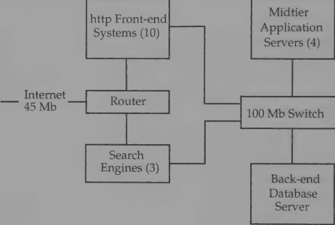

`图 4-1` 物理架构草图示例

物理草图通常需要数据流图（`图 4-2`）的补充，显示主要类用户和应用程序的连接方式。

## 图 4-2 数据流架构草图示例

这些草图提供了一个可以附加信息的框架。本配方的后续步骤将引用系统和流。

## 2. 确定主要瓶颈。

模型应该集中在主要接口上。仅查看中央数据库服务器上的 `CPU` 负载可能足够，取决于你的情况，你可能还需要监控网络容量或更广泛的系统。瓶颈会随时间变化，因此在每次建模场景时必须显式列出。

对于物理草图中识别的每个系统和网络接口，记录高峰使用期间的平均利用率。以百分比记录每个网络接口的利用率。对于共享网络组件，测量网络骨干或交换机的组合利用率。对于每个系统，你需要知道整体 `CPU` 利用率以及该系统最忙磁盘的利用率。你发现的最高利用率组件最可能成为主要瓶颈。`图 4-3` 显示了一个带有利用率的物理架构草图示例。

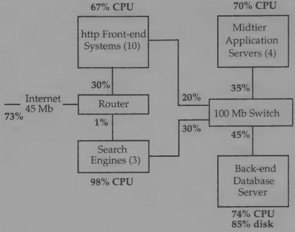

`图 4-3` 带有利用率的物理架构草图示例

`图 4-3` 所示示例说明了一个系统，主要的瓶颈似乎是后端数据库的 `CPU` 和磁盘，以及搜索引擎的 `CPU`。在其他主要从内存缓存运行的系统中，磁盘利用率非常。

## 3. 测量服务水平和负载强度。

如果你有 `SLA` 或对响应时间和吞吐量的某些估算，那么在可以确定或估算的地方，在数据流架构图上标注延迟和交易频率（见`图 4-4`）。

- 请求 `1000/秒`
- 响应 `8000/秒`

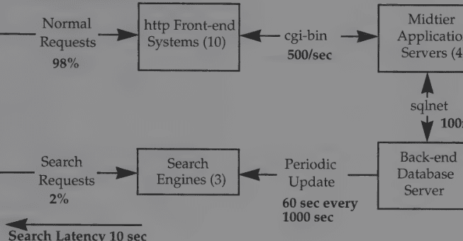

`图 4-4` 带有延迟和强度的数据流架构

## 4. 确定运行模式。

性能建模假设负载基本保持不变。因此，如果系统行为发生周期性变化，最好选出主要模式并对其进行单独测量和建模。主要模式之一是备份进行期间。在许多情况下，备份正在进行。

在图中所示的示例中，发生水平是不同的。每个模式下的利用率也不同，因此需要分别记录。

## 5. 选择一个瓶颈。

对单个系统建模非常简单，对整个网络建模极其复杂。然而，只要这保持不变，你就可以将所有交易转换为通用的交易速率。在示例中，后端数据库服务器是一个系统（或者是一对系统）；该系统成为瓶颈是很常见的。

## 6. 选择服务和利用率指标。

初始模型应该是规划的粗略且过度简化的基础。成功建模中最难学会的一点是放弃细节。只要你在包含和排除方面足够聪明，即使使用不完整和不准确的数据也可以建立非常有用的模型。

## 7. 选择一个大的时间尺度。

对于场景规划，我们感兴趣的是未来几天、几个月和几年将发生什么，而不是未来几秒钟——这就是为什么我们可以忽略许多细微细节。此外，引用大型机容量规划大师 `Pat` 的话：

> 要预测未来，你必须了解过去。

你需要观察两次同一个季节。缺乏数据并不是借口；然而，你应该立即开始计划，随着时间的推移，额外的历史数据将提高你预测的质量。

## 8. 执行规划过程。

在下一节中，场景建模和规划过程其余其余将通过一个简单的参数化电子表格进行说明。

## 9. 将预测与现实进行比较。

一旦你预测了未来几个月的事务率和系统利用率，你就需要测量并与现实进行比较。通过这种方式，你可以得知模型中的估计是乐观的还是悲观的，以及如何构建更好的模型。

## 10. 定期重新计算预测。

在每次预测之后（例如每月一次），你都会获得新的真实数据基准，必须重新计算模型的需求。

在下一节中将解释一个基于电子表格的简单场景规划模型。它应该是快速且易于实现的，至少它应该能帮助你更清晰地思考你在未来几个月和几年内所做的的假设。

# 容量与负载建模

本节解释了如何使用电子表格快速生成容量和负载的估计。通过结合各种因素对任何给定时间负载的预测影响（例如用户群增长和季节性变化），你可以生成一个预测系统未来总负载的模型。一个将当前容量作为基准，然后估计各种影响带来的性能改进的模型，可以与负载模型结合使用，以确定系统未来是否有能力支持所需的负载。

# 负载建模

后续章节中引入了影响负载的几种因素。对于每种影响，都提供了一个适用于预测未来行为的数学模型。这些模型适用于各种情况，但对于每种情况，也可以轻松修改以更好地建模特定环境。对于所提出的每种影响，可以使用描述中提供的公式创建一个电子表格，以估计从基准开始“增长因子”。如果有额外的因素对负载产生影响，可以按照下面描述的影响的方式进行计算，并与其他因素结合以获得总负载。此外，如果提供的模型不足，对于上述影响可以使用不同的模型。

这里提出的电子表格的基本思想是：给定时间任何影响的影响都可以表示为一个独立的增长因子。增长因子仅仅是原始（基准）负载必须乘以的因子，以获得问题时刻支持的估计负载。如果基准负载是在 `1月份` 测量的，而 `6月份` 的估计增长因子为 `2.0`，这意味着预计负载从 `1月份` 到 `6月份` 将增加一倍。

由于增长因子是以倍数表示的，因此单位是不重要的。负载被记录，但所有值都经过了归一化。这意味着它们被除以一个归一化值。对于重复的影响（如每日、每周或季节性变化），归一化值是存在的最高值。对于绝对（非重复）的影响，归一化值是原始（基准）负载。在任何情况下，所有值都除以归一化因子以获得增长因子。当发生这种情况时，测量单位相互抵消。然而，为了获得有意义的结果，每次测量应使用相同的单位，例如：每秒事务数、网络吞吐量或 `CPU` 使用率。在下面的示例中，测量的是 `CPU` 负载，因为 `CPU` 是瓶颈。确定适当的瓶颈见第47页的《成功场景规划配方》。这里概述的电子表格方法适用于只有一个显著瓶颈的系统。具有多个瓶颈的系统需要使用更复杂的方法。

一旦在电子表格中计算出所有影响，你就可以通过相乘每种影响的增长因子来组合它们。这种示例见表 `4-1` 和图 `4-5`。

对模型进行合理性检查（`sanity check`）也很重要。例如，如果容量规划显示在收集数据期间，连续几个月的增长率为每月 `2倍`，那么投影趋势可能并不合适。这种趋势会导致年底的负载估计为基准的 `4096倍`。由于许多不可衡量的因素影响增长，这种方法可能并不合适。然而，电子表格模型足够灵活，允许对模型进行定制。可以使用更复杂的公式，也可以针对不同的时间跨度使用不同的公式。例如，可以假设几何指数增长率随着目标人口中较高比例的人数的增加而在几个月后会放缓。这可以在电子表格中实现：前 `4` 个月使用一个增长因子，后续月份使用 `1.5`。有关修改电子表格以更好地估计所涉及系统的负载和容量，在第 `74` 页的《调整模型》中进行了讨论。

最后一个重要的考虑因素是，每个电子表格的时间尺度必须一致。例如，如果一个电子表格按天为单位衡量营销活动带来的增长，而另一个电子表格按月为单位衡量季节性影响带来的增长，则它们无法合并。每种影响的数据点（电子表格单元格）数量也应该是相同的。此外，季节性变化从正确的季节与基准开始是重要的。例如，如果基准是在 `4月份` 取的，那么电子表格中的季节性循环从 `4月份` 开始是非常重要的。

## 每日和每周变化

**注意** –尽管下文讨论了每日和每周变化，但示例并未实际使用它们，因为示例中的其他影响是按月为单位测量的。

`图 4-5` 中的图表显示了繁忙后端服务器从周二到周日的大部分时间（以每秒事务数计算）。每个查询都会更新数据库，是该系统活动水平的良好指标。你可以看到系统从未休息，但在工作日期间有一个预测的模式，而在周末期间下降。

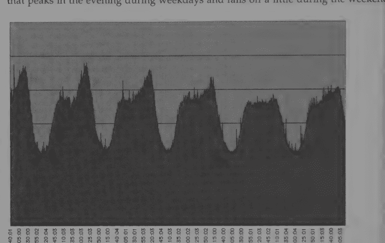

**图 4-5** 每日负载


## 峰值水平分析

重要的数据是峰值水平。如果按天绘制峰值，就会出现像表 4-1 所示的模式。从图 4-5 的详细信息中，你只需要典型的峰值水平。峰值是最重要的，因为在负载期间需要保证性能以让用户满意，并让他们更有可能访问网站。可以分析几周的实际数据来提取典型的每日变化或对其进行估计。

表 4-1 是电子表格的一部分；你在最右的列输入自己的分值来对每天进行评分。这些得分通过最忙的一天（在这种情况下为周一或周二）进行归一化。然后对这些数据绘图，以便看到重复的每日变化。

### 表 4-1 各日的 CPU 峰值负载因子

| 天 | 归一化峰值负载（峰值负载除以最大峰值负载） | 峰值负载 |
|---|---|---|
| 周日 | 0.64 | 0.70 |
| 周一 | 1.00 | 1.10 |
| 周二 | 1.00 | 1.10 |
| 周三 | 0.91 | 1.00 |
| 周四 | 0.91 | 1.00 |
| 周五 | 0.91 | 1.00 |
| 周六 | 0.55 | 0.60 |

图 4-6 显示了按天的峰值水平。在这种情况下，周一显示为最忙，周五稍低，周末较安静。周日通常比周六更忙，部分原因是位于加州的系统靠近国际日期变更界线；因此，当加州是周日时，亚太地区已经是周一了。

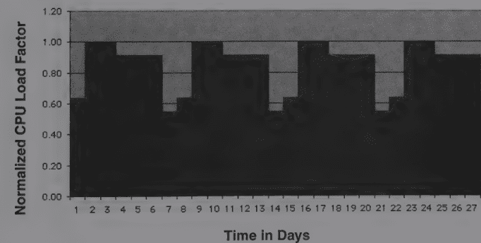

图 4-6 每日负载变化因子图表

获取工作日系数有三种方法。第一种是简单地猜测一个“看起来大致正确”的值。如果通过小组共识得出猜测，效果会更好。第二种是获取几周的测量数据，在电子表格中计算所有数据的平均值，并测量每日峰值。第三种方法是使用统计分析，特别是通过方差分析（通常称为 `ANOVA`）对数据进行拟合。这种技术在 `Joe Hellerstein` 等人在 1998 年计算机测量小组会议上发表的一篇论文中有所描述。该论文使用 `Adrian Cockroft` 在 1996 年在 `www.sun.com` 收集的数月量的 `Web` 访问率数据作为原始数据，并针对每日、每周和每月的变化拟合了一个日益复杂的模型。

## 季节性影响

除了每日的波动外，全年还存在从月到月的季节性影响。在本次场景规划的剩余部分中，数据是计划的基础。每个月内会有每日波动，但生产系统进行更改和升级的时间尺度是以月为单位衡量的。因此，峰值负载在给定的月份需要是可持续的。

如果你至少有一年的数据，就可以利用它来生成每月变化的估算值。请记住，如果历史数据有限，感知到的季节性影响可能是实际季节性影响与其他（可能是巨大的）影响（如几何指数增长）的结合。第 74 页的“调整模型”提供了如何通过简单的迭代微调方法使模型拟合数据的指南。

或者，你应该与同事达成共识并得出估算值。你可以将这些估算值以表 4-2 所示的形式作为评分输入电子表格。与之前一样，评分被归一化为最大 1.0。

### 表 4-2 按月划分的季节性负载变化

| 月份 | 归一化每月峰值负载（每月峰值负载除以最大峰值负载） | 峰值负载 |
|---|---|---|
| 一月 | 0.89 | 8.0 |
| 二月 | 0.72 | 6.5 |
| 三月 | 0.61 | 5.5 |
| 四月 | 0.56 | 5.0 |
| 五月 | 0.44 | 4.0 |
| 六月 | 0.39 | 3.5 |
| 七月 | 0.33 | 3.0 |
| 八月 | 0.33 | 3.0 |
| 九月 | 0.78 | 7.0 |
| 十月 | 0.89 | 8.0 |
| 十一月 | 1.00 | 9.0 |
| 十二月 | 1.00 | 9.0 |

图 4-7 显示了按月划分的季节性负载变化图。

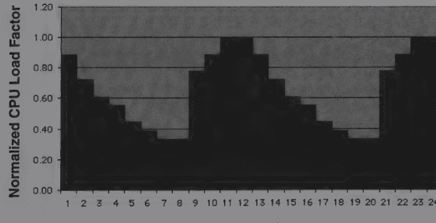

图 4-7 按月划分的季节性负载图

图 4-7 显示了两年的示例数据，从一月开始。该模式取决于外部事件以及业务性质。它必须根据业务指标进行确定和校准，但首先要考虑其他因素。这在接下来的几幅图中所示，这些图表共同形成了按月的预测负载水平。

## 几何指数增长

互联网的增长结合你对网站知名度的提高，可能会导致负载水平呈几何指数增长。这可以通过两个数字轻松地表示为某时间段内的增长因子。例如，增长可以表示为每季度增长 50%，或每年翻倍。

注意 - 此处描述的增长类型在数学上被称为几何增长。然而，由于它通常（某种不准确地）被称为指数增长，为了避免混淆，这里将其称为几何指数增长。

电子表格根据用户提供的增长率和持续时间，计算具有增长率月份的增长因子和每月因子。计算基于以下公式：

```
$L_t = L_0(G + 1)^{t-t_0}$
```

在这种情况下，`t` 是时间（使用你使用的任何单位）；`L_t` 是时间 `t` 的负载；`L_0` 是时间 `t_0` 的基准负载值，`G` 是每个时间单位的增长。如果容量规划人员测量了给定期间的增长（并安全地假设增长是几何的），他们就可以推算出特定时间的增长率（`G`）。

例如，表 4-3 显示了从 3 个月增长 1.5 倍外推出的每月增长。使用已知的 3 个月增长 1.5 倍，可以求出 `G` 并将其代入原始公式。由于 `G` 和 `L_0` 的值是已知的，特定时间的负载（`L_t`）仅根据时间（`t - t_0`）计算。如果 `t` 是相对于它测量的，则 `t_0` 的值为零。在下表中，使用的值为 `G = .22` 和 `L_0 = 1`，得出的如下公式：

```
$L_t = 1^t$
```

该公式位于容量规划电子表格中，用于生成后续章节中显示的值。该电子表格可以在 `http://www.sun.com/blueprints` 获取。

### 表 4-3 用户活动中的几何增长

| 月份 | 增长因子 |
|---|---|
| 0 | 1 |
| 1 | 1.1 |
| 2 | 1.3 |
| 3 | 1.5 |
| 4 | 1.7 |
| 5 | 2.0 |
| 6 | 2.3 |
| 7 | 2.6 |
| 8 | 2.9 |
| 9 | 3.4 |
| 10 | 3.9 |
| 11 | 4.4 |
| 12 | 5.1 |
| 13 | 5.8 |
| 14 | 6.6 |
| 15 | 7.6 |
| 16 | 8.7 |
| 17 | 10.0 |
| 18 | 11.4 |
| 19 | 13.0 |
| 20 | 14.9 |
| 21 | 17.1 |
| 22 | 19.6 |
| 23 | 22.4 |
| 24 | 25.6 |

## 营销活动

有很多公司运行的营销活动在获取新用户方面过于成功，导致系统过载。为了将这种影响加入未来的增长计划，我们开发了一个基于电子表格的模型，可以在 `http://www.sun.com/blueprints` 获取，该模型使用一个估算营销活动覆盖范围的公式。该公式在某些情况下适用；然而，取决于你的环境，其他公式可能更好地表示营销影响。大多数公式都可以轻松地实现在电子表格中，以与本程序的其他部分配合。

> 因为理解电子表格中实现的数学原理可能困难，以下公式有助于理解电子表格是如何推导出来的。然而，使用电子表格模型不需要理解这个公式。

时间 `t` 营销影响引起的负载变化（`L_t`）为：

```
$L_t = L_0S^{\left(\frac{e^{-L_t t-d}}{(t-d)!} \right)} + r$
```

表 4-4 显示了电子表格实现结果的示例，数值如下：

- 持续 (`L`) = 3.4 个月
- 规模 (`S`) = 3.0 倍
- 剩余水平 (`r`) = 1.2 倍
- 延迟 (`d`) = 4.0 个月

表 4-4 显示了营销活动负载提升系数的示例。

### 表 4-4 营销活动负载提升因子

| 月份 | 增长因子 |
|---|---|
| 1 | 1.00 |
| 2 | 1.00 |
| 3 | 1.00 |
| 4 | 1.30 |
| 5 | 1.54 |
| 6 | 1.78 |
| 7 | 1.86 |
| 8 | 1.76 |
| 9 | 1.58 |
| 10 | 1.41 |
| 11 | 1.30 |
| 12 | 1.24 |
| 13 | 1.22 |
| 14 | 1.21 |
| 15 | 1.20 |

图 4-9 以图形式表示了营销活动的负载提升。

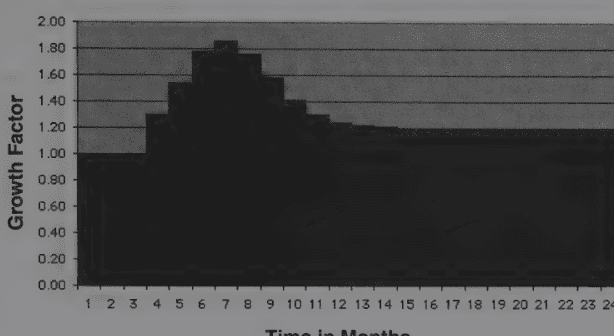

在图 4-9 中，营销活动从第四个月开始，以抵消预期的季节性负载下降。它持续了四个月，然后记忆逐渐消退，可以看到活动水平出现剩余的增加。短期收益和剩余收益应该是营销部门最初用于证明该活动合理性的依据，因此其影响可以以与其对业务的影响相同的方式进行建模。该活动在第二年没有重复进行：图 4-9 中的图表显示了为什么不需要再次进行。在实际中中，可能会对许多次较小的营销提升进行建模，而不是一个巨大的提升。

图 4-9 营销活动提升图

## 组合负载估算

当所有增加负载的因子相乘时（即季节性效应、几何指数工作负载增长和营销提升），将产生一个组合增长因子。在这种情况下（参见表 4-5），你可以看到两年后的最终点大约是起始点的 30 倍，这种提升主要发生在末，即季节性增长和几何指数增长相结合的地方。

### 表 4-5 组合负载计算

| 月份 | 工作负载 | 营销 | 季节性 | 总负载 |
|---|---|---|---|---|
| 1 | 1.14 | 1.00 | 0.89 | 1.02 |
| 2 | 1.31 | 1.00 | 1.00 | 1.31 |
| 3 | 1.50 | 1.00 | 0.61 | 0.92 |
| 4 | 1.72 | 1.30 | 0.56 | 1.24 |
| 5 | 1.97 | 1.54 | 0.44 | 1.35 |
| 6 | 2.25 | 1.78 | 0.39 | 1.56 |
| 7 | 2.58 | 1.86 | 0.33 | 1.59 |
| 8 | 2.95 | 1.76 | 0.33 | 1.73 |
| 9 | 3.38 | 1.58 | 0.78 | 4.15 |
| 10 | 3.86 | 1.41 | 0.89 | 4.86 |
| 11 | 4.42 | 1.30 | 1.00 | 5.77 |
| 12 | 5.06 | 1.24 | 1.00 | 6.30 |
| 13 | 5.80 | 1.22 | 0.89 | 6.27 |
| 14 | 6.63 | 1.21 | 0.72 | 5.78 |
| 15 | 7.59 | 1.20 | 0.61 | 5.58 |
| 16 | 8.69 | 1.20 | 0.56 | 5.80 |
| 17 | 9.95 | 1.20 | 0.44 | 5.31 |
| 18 | 11.39 | 1.20 | 0.39 | 5.32 |
| 19 | 13.04 | 1.20 | 0.33 | 5.22 |
| 20 | 14.93 | 1.20 | 0.33 | 5.97 |
| 21 | 17.09 | 1.20 | 0.78 | 15.95 |
| 22 | 19.56 | 1.20 | 0.89 | 20.86 |
| 23 | 22.39 | 1.20 | 1.00 | 26.87 |
| 24 | 25.63 | 1.20 | 1.00 | 30.75 |

图 4-10 以图形式显示了组合负载。

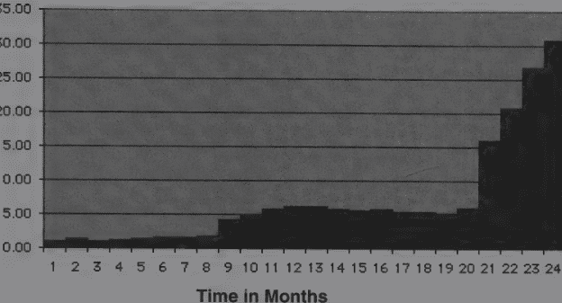

## 建模容量与负载

负载模型基于每个事务相对恒资源。在上面的示例中，`CPU` 使用是瓶颈，负载基于每个事务的平均 `CPU` 使用率。理想情况下，调优应用程序或将某些功能卸载到其他系统将减少每隔几个月使用的瓶颈资源量，从而可以将应用程序预期的（或期望）变化作为模型的一部分进行布局。

表 4-6 显示了深度调优对每个事务 `CPU` 使用率的影响。表 4-6 的第二列显示了每个事务的相对 `CPU` 使用量（将初始值基准为 1）。第三列显示的是它的倒数，代表了调优后应用程序的效率。

### 表 4-6 每个事务 CPU 使用量

| 月份 | 每个事务 CPU 使用量 | 效率因子（每个 CPU 的事务数） |
|---|---|---|
| 1 | 1.00 | 1 |
| 2 | 1.00 | 1 |
| 3 | 0.80 | 1.25 |
| 4 | 0.80 | 1.25 |
| 5 | 0.90 | 1.11 |
| 6 | 0.90 | 1.11 |
| 7 | 0.90 | 1.11 |
| 8 | 0.70 | 1.43 |
| 9 | 0.70 | 1.43 |
| 10 | 0.55 | 1.82 |
| 11 | 0.55 | 1.82 |
| 12 | 0.55 | 1.82 |
| 13 | 0.55 | 1.82 |
| 14 | 0.50 | 2 |
| 15 | 0.50 | 2 |
| 16 | 0.50 | 2 |
| 17 | 0.30 | 3.33 |
| 18 | 0.30 | 3.33 |
| 19 | 0.30 | 3.33 |
| 20 | 0.20 | 5 |
| 21 | 0.20 | 5 |
| 22 | 0.20 | 5 |
| 23 | 0.15 | 6.67 |
| 24 | 0.15 | 6.67 |

表 4-6 中的因子绘制在图 4-11 中。

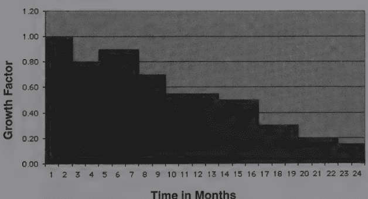

### 图 4-11 每个事务 CPU 使用量图

为了应对增加的负载水平，对应用程序进行了调优并升级了硬件。如果您的初始应用程序未经过调优，可能通过多年来对自定义应用程序和数据库进行调优和重新设计，逐步实现四倍或五倍的改进。在图 4-11 所示的图中，数据库调优或应用程序软件升级提供了前两次收益；随后由于引入了新的、更复杂的用户界面，出现了反转。

### 表 4-7 硬件升级容量增加因素（续）

| 月份 | 注释 | 假设利用率 70% 的性能 | 假设利用率 70% 的因子 | 假设利用率 100% 的因子 |
|---|---|---|---|---|
| 14 | `Solaris 7 OE` 升级 | 2000 | 2.0 | 2.86 |
| 15 | | 2000 | 2.0 | 2.86 |
| 16 | | 2000 | 2.0 | 2.86 |
| 17 | | 2000 | 2.0 | 2.86 |
| 18 | | 2000 | 2.0 | 2.86 |
| 19 | | 2000 | 2.0 | 2.86 |
| 20 | `CPU E10K 40 x 400 MHz + 8 MB` | 3000 | 3.0 | 4.29 |
| 21 | | 3000 | 3.0 | 4.29 |
| 22 | `Solaris OE/Oracle 64 位` 升级 | 3500 | 3.5 | 5.00 |
| 23 | | 3500 | 3.5 | 5.00 |
| 24 | | 3500 | 3.5 | 5.00 |

同时也考虑了 70% 容量利用率的假设水平，假设系统在开始前已处于 70% 忙状态。

对于图 4-12 中的图，某些系统配置和性能因素是假设的。

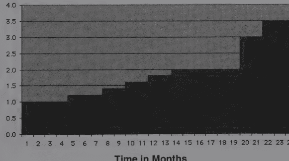

图 4-12 硬件升级容量增加因子图

在表 4-7 中，第三列显示了每个月的 `CPU` 利用率。这假设了一个起始点，在本例中，该点在电子表格中被输入为第 0 个月 70% 忙。利用率的计算考虑了下一节中解释的所有不同增长因子。

# 合并容量估算

容量增加的合并效应可以以类似于表 4-8 所示的合并负载增加的方式进行计算。这种计算可以很容易地通过电子表格完成。最后一列显示了每个月的利用率，它由总负载（来自表 4-5）除以下面计算出的能力得出。

### 表 4-8 合并能力计算

| 月份 | 假设利用率 100% 的硬件容量因子 | 应用效率 | 能力（硬件容量 $\times$ 应用效率） | (负载/容量) |
|---|---|---|---|---|
| 1 | 1.43 | 1 | 1.43 | 71% |
| 2 | 1.43 | 1 | 1.43 | 92% |
| 3 | 1.43 | 1.25 | 1.79 | 51% |
| 4 | 1.43 | 1.25 | 1.79 | 69% |
| 5 | 1.71 | 1.11 | 1.90 | 71% |
| 6 | 1.71 | 1.11 | 1.90 | 82% |
| 7 | 1.71 | 1.11 | 1.90 | 84% |
| 8 | 2.00 | 1.43 | 2.86 | 60% |
| 9 | 2.00 | | 1.43 | 145% |
| 10 | 2.29 | 1.82 | 4.16 | 117% |
| 11 | 2.29 | 1.82 | 4.16 | 139% |
| 12 | 2.57 | 1.82 | 4.68 | 135% |
| 13 | 2.57 | 1.82 | 4.68 | 134% |
| 14 | 2.86 | 2 | 5.71 | 101% |
| 15 | 2.86 | 2 | 5.71 | 98% |
| 16 | 2.86 | 2 | 5.71 | 101% |
| 17 | 2.86 | 3.33 | 9.52 | 56% |
| 18 | 2.86 | 3.33 | 9.52 | 56% |
| 19 | 2.86 | 3.33 | 9.52 | 55% |

### 表 4-8 合并能力计算（续）

| 月份 | 假设利用率 100% 的硬件容量因子 | 应用效率 | 能力（硬件容量 $\times$ 应用效率） | 利用率 (负载/容量) |
|---|---|---|---|---|
| 20 | 4.29 | 5 | 21.43 | 28% |
| 21 | 4.29 | 5 | 21.43 | 74% |
| 22 | 5.00 | 5 | 25.00 | 83% |


| 23 | 5.00 | 6.67 | 33.33 | 81% |
| 24 | 5.00 | 6.67 | 33.33 | 92% |

效率和硬件容量的组合可以绘制在同一轴上（图 4-13），以查看系统是否能够承受负载。

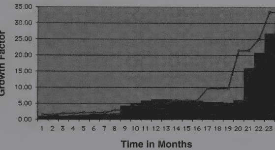

图 4-13 合并负载与能力图

图 4-13 中的图显示组合在初期过载。如果该模型是正确的，需要采取其他措施来维持这种状况。可以安装更快的系统，或者从系统中挤出更多效率。另一种选项是以某种方式拆分工作，可能按功能方面划分。如果你在对前端服务器、搜索引擎或应用服务器进行建模，你可以增加服务器的数量。

## 调整模型

之前使用的示例电子表格经过仔细调整，以提供能够良好跟踪负载的能力。当你将自己的数据和估算值输入电子表格时，你可能会发现前几个月后拟合效果很差。你需要花时间调整模型中的参数，尝试各种“假设”场景，直到你认为这些假设是合理的。在处理数据时，请记住分析是基于峰值负载而非平均负载。如果你每几分钟测量一次，可以对其取平均值；但一旦你扩大到小时或更长时间间隔，就需要该小时内的峰值。

## 预测未来

要查看预测结果，你可以简单地结合每周和每月预测来获得下周负载的估值。每月数据是基于月份峰值的，它可能发生在月份任何时候；因此你可以简单地假设每月峰值可能发生在与每周高峰一致的任何一天。例如，如果每周高峰是周一，那么每月峰值可能发生在该月的任何周一。这为你提供了一个稍微保守的估值。

## 通过调整使模型拟合数据

对于大型互联网网站，分析了每日流量以挑选出调用后端数据库的事务。这些计数被进一步减少，以获得八个月内每个月最忙的一天。这组数字随后被拟到基于电子表格的模型中，考虑了几何增长、季节性和营销相关的变化。

1. 将测量数据添加到规划电子表格中。第一步是创建一个新图，显示测量数据和预测数据，包括一个显示两者之间比例差异（拟合误差）的表格。
2. 调整几何指数增长。设置表 4-3 所示的工作负载参数，以获得整体长期增长率的初步近似。
3. 调整季节性。查看第一步中计算出的差异因子。当相隔一月的差异相似时，将该因子加到表 4-2 中的季节性负载估值中。
4. 继续调整。返回并改变指数增长因子，尝试使差异在逐年之后匹配得更好，并调整季节性因子，直到尽可能多的因子达到良好匹配。重复此循环几次。
5. 设置营销因子。任何无法用增长解释且不逐年重复的内容，如果是由于营销偏差引起的，都可以剔除。营销因子可以设置为抵消差异因子。
6. 继续改进。确保你没有年年重复的营销因子；这些值应该移动到季节性中。
7. 预测未来几个月。对未来几个月给出估值，与实际情况对比，完善模型以考虑新数据。

## 总结

基于电子表格的模型是一个很好的起点，但局限性极大且使用起来很麻烦。一旦你想对多个系统或多种工作负载进行建模，数学计算就会变得复杂。有几种工具可以处理多系统模型。

相比磁盘容量，`CPU`容量更容易建模，但大型磁盘系统昂贵且可能是应用程序的主要瓶颈。在下一章中，我们将引入一种可以处理复杂磁盘系统的简化磁盘性能模型。

> 1. 最新版本的 `SE` 工具包可在 `http://www.settoolkit.com` 获取。

这是标准做法，但必须在`/etc/system`中启用。`Solaris` 8 OE 为`vmstat`增加了一个新选项，用以列出分页的原因。如果是可执行代码被换出并释放，那么你的内存没有问题；然而，如果只是缓存被换出并释放，`Solaris` 8 OE 通过若干种方式改变了内存管理子系统，使得分页变得更易理解。`Solaris` 8 OE 不采用优先级分页，因为默认使用了更复杂的方案。你不应该看到页面回收，且`vmstat`报告的是一个更大的空闲内存值。在`Solaris` 8 OE 中，`vmstat`中的空闲值可以可靠地作为系统上新应用程序可用内存的衡量，因此它解决了容量估算问题。

由于许多具有不同扩展性特性的`CPU`，磁盘容量估计已变得非常复杂。因此，不同的特性导致了复杂的磁盘子系统。接下来的章节提供了系统资源建模的示例，并详细研究了`CPU`和磁盘子系统的容量规划问题。

## 系统测量框架

测量系统资源利用率的时间段是准确进行系统资源建模的关键。通过选择一个准确反映系统使用情况的代表性周期，你可以使用该模型来预测系统变更对系统利用率和负载规划的影响。

系统可以作为一个整体进行建模，也可以拆分为单独的服务，以为不同功能构建独立模型。一个主要的例子是在线事务处理（`OLTP`）订单处理系统，该系统晚上运行备份，并集成了数据库报告生成系统。对于系统维护任务期间的系统性能、业务期间的系统性能，以及系统维护任务和数据库批报告运行允许时长，可能存在不同的服务水平协议（`SLA`）。在这种情况下，应该创建模型来显示允许维护窗口内和外的交互式性能，以及备份系统和报告系统的“批处理负载”性能。

资源管理方案（如处理器组和`SRM`软件）用于控制备份和报告系统，以减少对`OLTP`的影响。此外，这些方案还可用于减少事务处理的影响，以确保备份和报告能够在指定的处理窗口内完成。在容量和性能管理周期的这一阶段，需要对所建模的业务系统有深入了解，以便对可能竞争系统资源的负载进行优先级排序。在这个系统利用率的简化示例（图 5-1）中，可以很容易识别出早上 8:00 到下午 6:00 之间客户交互的基本“消费者轮次”，以及凌晨 1:00 到凌晨 4:00 之间的维护任务轮次。

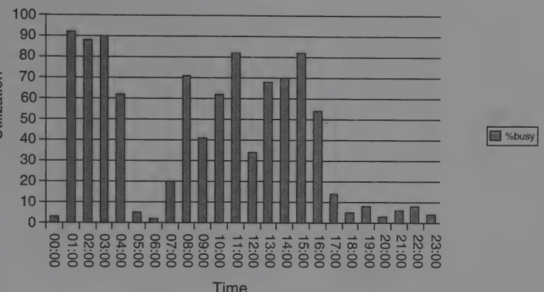

图 5-1 24 小时样本 `CPU` 利用率图

构建模型的第一步是选择合适的样本周期。对于消费者轮次处理，`SLA` 最可能是针对事务量和系统响应时间定义的。样本周期应该反映容忍系统性能下降的最长时间，并设定一个允许最大退化的临界阈值。在与业务付费客户直接交互的在线处理系统中，样本周期可以低至一小时。这些样本用于分析，并在较长的时间跨度内取平均值用于汇总报告。

在诸如计划报告生成和系统备份之类的批处理环境中，高系统利用率和由此导致的系统`OLTP`退化不会暴露给终端用户，而且实际上是预期并计划之中的。发生在消费者暴露的处理窗口之外的系统批处理将充分利用系统资源，以缩短批处理过程的运行时间。因此，系统利用率和事务处理的`SLA`定义阈值对于批处理窗口并不生效。

应尽可能避免批处理窗口和事务处理的重叠。批报告、数据库记录清理、系统备份和其他批处理系统维护应安排在与客户交互时间隔离的时间窗口内。在需要每天 24 小时、每周 7 天客户交互的系统中，需要平衡的系统资源管理。

对于事务处理与维护窗口重叠的系统，需要更复杂的建模。如`TeamQuest`和`BMC`的`Best/1`等容量管理套件能够准确分离多个竞争资源的负载处理，并对资源冲突建模。通过基础脚本，可以将这些工具简单模型结合处理器组使用，以监控共享负载环境，收集并展示系统资源数据。在这个示例中（图 5-2），批报告生成系统全天候运行，`OLTP`系统在早上 8:00 到下午 6:00 的峰值班次运行，而系统维护任务在凌晨 1:00 到凌晨 4:00 的系统维护窗口竞争系统资源。

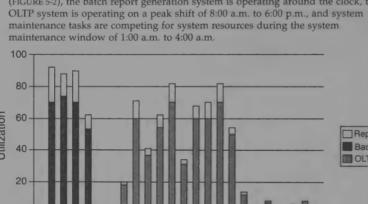

图 5-2 按负载划分的 `CPU` 利用率图

从该图中可以推出一个关于负载调度的直接更改。在系统维护窗口期间似乎有批报告在运行。通过将这些批报告移到定义的维护窗口之外，并为报告任务创建一个定义的轮次（另见图 5-3），我们可以通过发布的调度策略来强制执行资源管理。系统利用率随后通过策略而非系统强制执行来控制。这种简单的方法在开始时是最具成本效益（免费）的，但当负载可以在不产生竞争的情况下共存，或通过正确使用资源管理工具将竞争降至最低时，可能会导致系统资源利用率不足。

为了说明这种情况，允许在下午 12:00 到下午 6:00 之间进行午间报告。

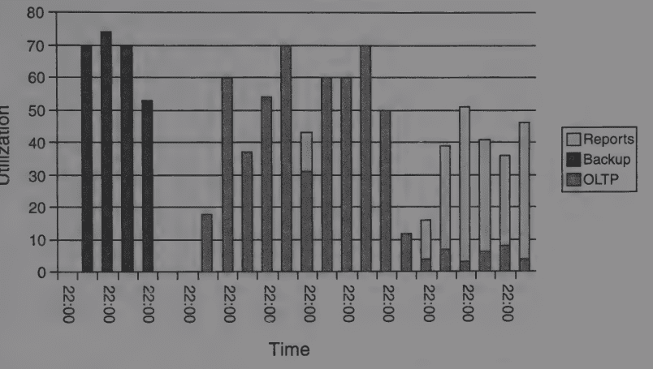

图 5-3 负载后的 `CPU` 利用率图

从该图中可以推出一个关于负载调度的直接更改。在系统维护窗口期间似乎有批报告在运行。通过将这些批报告移到定义的维护窗口之外，并为报告任务创建一个定义的轮次（另见图 5-3），我们可以通过发布的调度策略来强制执行资源管理。系统利用率随后通过策略而非系统强制执行来控制。这种简单的方法在开始时是最具成本效益（免费）的，但当负载可以在不产生竞争的情况下共存，或通过正确使用资源管理工具将竞争降至最低时，可能会导致系统资源利用率不足。

## Sun 性能指标 (SCPM) 值容量规划

在`Sun`，我们一直使用我们自己的方法（由`Brian`开发），该方法在多年的客户交互中不断精炼。该方法的基础是恒定性能指标（`SCPM`），它代表了服务器的能力。扩展`SCPM`的指标称为量子（`Q`）。

## 阿姆达定律

阿姆达定律提供了预测在可扩展多处理器环境中运行负载的收益的计算方法。我们可以应用基于阿姆达定律的简化计算方法来预测我们负载的可扩展性。

感兴趣的结果结果是你的测量负载的加速因子。加速因子是你负载的一个计算变量；它描述了你的应用程序并行工作并利用额外处理器的能力。

负载的加速率（Speed-up）是通过在单个`CPU`上运行选定负载以及在多个`CPU`上运行相同负载的测量结果得出的。最好是使用一系列加速率测量，并采用`CPU`数量的逻辑递增，以反映你系统架构可能的升级路径（1, 2, 4, 8, 12, 16, ...）。加速率是使用完成一组定义的集合（T）相同事务所需的时间计算的。对于单`CPU`和n个`CPU`的测量时间，使用以下公式：

```
$$Speed-up_{(n)} = \frac{T(1)}{T(n)}$$
```

对该公式进行简单的代数运算并使用固定时间范围进行测量，我们可以通过不同`CPU`数量的事务吞吐量来计算加速率。对于在固定时间内在单`CPU`和n个`CPU`上运行的给定负载的事务数量（N），使用以下公式：

```
$$Speed-up_{(n)} = \frac{N(n)}{N(1)}$$
```

## 几何扩展性 (Geometric Scalability)

通过单个`CPU`和两个`CPU`计算出的加速因子可以用于计算给定负载的扩展因子（S）。扩展因子是一个常量（与测量的负载相关），描述了该负载在包含更多相同类型`CPU`的机器上的运行情况。以下公式证明了扩展因子代表负载中并行化的百分比，而不是受有限资源限制：

```
$$S = Speed-up_{(2)} - 1
```

可以通过扩展因子以及对给定`CPU`数量的扩展性的叠加，预测给定机器对于给定负载的扩展性。如果存在资源竞争，扩展因子可能会降低。增加`CPU`会增加竞争，从而减少百分比收益。对于具有 $n$ 个`CPU`、扩展因子 $S$ 以及单`CPU`测量吞吐量 $T_{(1)}$ 的机器，使用以下公式：

```
$T(n) = T(1) + (S \times T(1)) + (S^2 \times T(1)) + \dots + (S^{n-1} \times T(1))$
```

图 5-4 显示了八`CPU`架构的 100%（线性扩展）、99.5%、98% 和 70% 的扩展因子；此外，图表还显示了增加`CPU`带来的相对性能提升。较低扩展性的架构决策向更宽的服务器架构发展，通过组合较小的服务器为最终用户提供服务。较高的扩展因子有助于引导架构决策向更深层的服务器发展，用更少的机器提供服务。

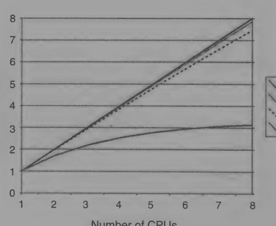

图 5-4 八`CPU`几何扩展性

更深层的架构通常更容易管理，且基础设施和支持成本较低。通过更深层的架构，应用程序架构的扩展性与潜在总成本（`TCO`）之间建立了直接关系。在扩展因子较低的情况下，增加额外`CPU`带来的性能收益逐级减少（见图 5-5），可能会超过管理更少系统所带来的潜在`TCO`节省。较大的系统架构通常提供更多的可靠性和可维护性功能。例如，“N+1”电源和冷却子系统提供了足够的电源和冷却能力以应对单个组件故障，以及其他冗余组件、冗余数据路径和冗余外适配器。因此，N+1 电源和冷却子系统增加了系统的潜在可用性。

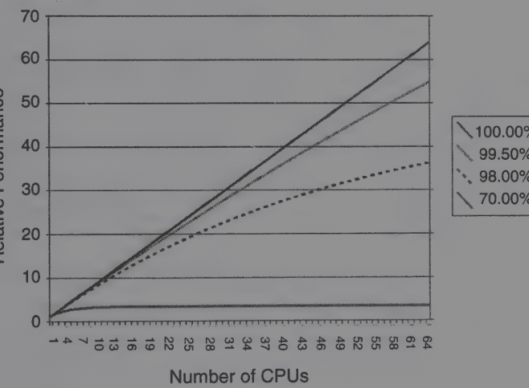

图 5-5 64`CPU`几何扩展性

任何特定软件在特定服务器上的扩展性可能显示出非几何扩展性特征。对于我们测量的大多数正常负载，其与几何扩展性曲线的偏差微乎其微。可能导致显著偏差的因素包括：

*   `CPU`缓存/代码效率 – 如果服务器应用程序执行的全部或大部分部分可以在`CPU`缓存内发生，而不需要对`CPU`缓存进行抢占或刷新，那么当应用程序中最频繁访问的部分能够放入组合的`CPU`缓存并跨越多个`CPU`时，该应用程序的扩展性将“跃升”。
*   应用程序软件线程限制 – 如果应用程序软件无法作为多个实例运行，或者用于提供服务的服务器线程数量有某些静态限制，那么增加`CPU`通常不会显著增加吞吐量或提高响应时间。
*   有限资源消耗 – 如果软件消耗的是一个或多个资源的有限集合，那么在某某一点，对资源的竞争实际上可能会降低整体吞吐量并增加响应时间。这是因为服务器应用程序的许多线程或实例可能相互竞争。资源竞争区域的示例包括独占访问资源的锁机制、数据`I/O`的单流水线，甚至是硬件设备和设备驱动程序的限制。

## 测量利用率 (Measuring Utilization)

`SCPM`容量规划过程应用利用率（Utilization Law）的基础来衡量在样本期间服务器消耗了多少资源。利用率¹定义为：

在一段时间（T）内，任务被提交到服务器。服务器处理任务，任务有有限的结论。服务器内部的组件资源（`CPU`时间、秒磁盘`I/O`）具有有限容量。处理消耗了服务器平台中可测量的资源。观测期间的服务器观察者可以识别出：

*   观测期间服务器组件处理任务的时间（B）
*   在时间段内完成的任务数（C）

这些测量得出了以下计算结果：

*   单位时间内服务器的输出速率或吞吐量

`Throughput = C / T`

*   完成任务的平均服务时间：

`Service Time = B / C`

*   观测期间服务器资源处理任务的百分比，称为服务器的利用率：

`Percent Utilization = B / T`

通过应用利用率，我们可以得出经验指标来表征测量的负载为：

> 1. “Queueing in Networks of Computers,” American Scientist 79, 3 (May–June)。

对于每小时 12,000 次目录查询的持续水平，测量`CPU`利用率为 62%，磁盘利用率为 22%。

幸运的是，常用的系统工具会报告利用率，但理解底层计算仍然很有用。

## SCPM 测量 (SCPM Measurement)

在`SCPM`过程中，一个工作单位被称为量子（Q）。具有工作能力的系统由(M)表示，它是量子的倍数。机器上执行的工作量是消耗的量子（QC），即测量系统利用率乘以(M)。图 5-6 是`SCPM`过程的一个示例。

```
heisenberg sar -s 08:00 -e 16:00 -i 3600 -f /var/adm/sa/sa27
SunOS heisenberg 5.8 sun4u          03/27/00
08:00:00  usr  %sys  %wio  idle
09:00:00   24     9       0      66
10:00:00   34     13       0      53
11:00:00   34     12       0      54
12:00:00   21      9       0      70
13:00:00   52     21       0      27
14:00:00   61     27       0      12
15:00:00   58     24       0      18
16:00:00   54     23       0      23
Average    42     17       0      41
```

图 5-6 示例 `SCPM` 过程

对`SCPM`过程的描述为了练习进行了简化。在使用`SCPM`过程进行性能基准时时许多其他考虑，但该过程的基本原理易于理解。通过测量负载及其相对于磁盘`I/O`、`CPU`、内存和网络的消耗，你可以预测该负载的有效资源消耗。你还可以将资源消耗投影到其他经过`SCPM`认证的平台上，或者修改模型中执行的工作量。

在这个示例中，从系统`sar`数据中提取了每小时的`CPU`利用率样本，以代表一个班次（shift）。开始时间为上午 8:00，结束时间为下午 5:00，或者说采样的小时点为 16:00。采样间隔为 1600 秒，即一小时。`sar`的输出可以很容易地导入电子表格进行进一步计算（见图 5-7）。

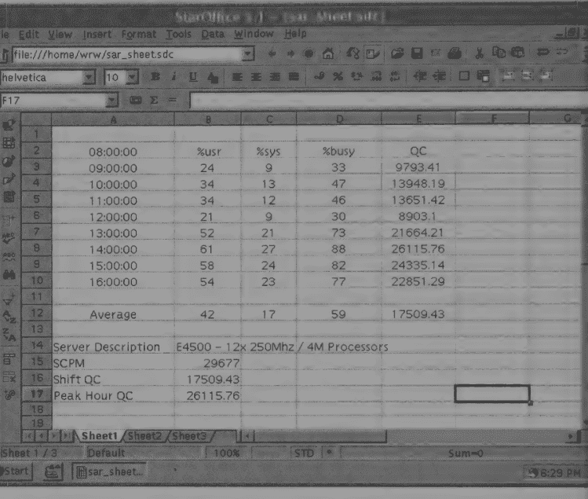

图 5-7 `SCPM` 进程示例电子表格

通过在`sar`生成的数据中添加`%usr`和`%sys`列，我们得到了每个采样期间的`%busy`列以及一个班次平均值。本次练习考虑了`%wio`列，因为`%wio`表示`CPU`正在等待（waiting）状态而不是正在处理。该过程衡量的是负载处理的“思考时间”（think time）；因此，等待磁盘活动将被视为“空闲”。`%wio`始终是磁盘子系统的函数，并在容量规划过程的任何地方都会降至最低。

如果我们的目标峰值小时利用率在`KPI`文档中定义为 70%，那么我们展示了超过目标四个小时的利用率。这可以用图表形式呈现（图 5-8），用于`SLA`和`KPI`报告的执行摘要。

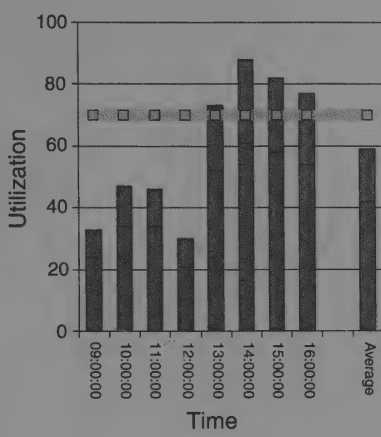

图 5-8 `CPU` 利用率图

我们还可以将测量的系统利用率投影到系统`SCPM`值中，以产生随时间变化的消耗量子数（QC）（见图 5-9）。这种表示方法有时比百分比利用率图更容易理解，因为它更多地关注系统资源消耗的目标，而不是系统的已用和未使用资源。基于利用率的图表有时可以被解释为：尽管利用率显示超过了设定的`KPI`目标，但系统仍有足够的容量。这些图表可以包含在`SLA`和`KPI`审查的执行概览文档中。


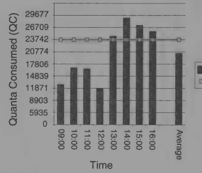

**图 5-9 系统消耗量子图**

我们现在可以将测量的工作负载投影到不同的平台上，投影该系统的系统利用率。在示例（图 5-10）中，我们从测量的平台（带有 12 x 250 MHz、4MB 缓存 `CPU` 的 `E4500`）升级到 `Sun Enterprise 4500` 服务器，其带有 12 x 400 MHz、8 MB 缓存 `CPU`。升级后的系统预测利用率为 `(QC + M)`。

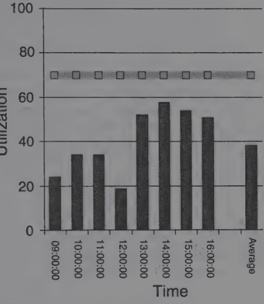

| | | `%busy` |
| :--- | :--- | :--- |
| 9793.41 | 21 | |
| 13948.19 | 30 | |
| 13651.42 | 29 | |
| 8903.1 | 19 | |
| 21664.21 | 46 | |
| 26115.5 | 56 | |
| 24335.14 | 52 | |
| 22851.29 | 49 | |

**图 5-10 升级后的 CPU 利用率图**

如果我们将给定平台的 `QC` 除以完成该工作的用户数，我们现在就得到了每个用户消耗的量子（`QC + User`）。然后你可以计算给定机器将支持的用户数：

`支持总用户数 = (SCPM × 目标利用率) + (QC + User)`

作为负载规划或服务器整合作业的一部分，`QC + User` 可以帮助帮助模型内的未来增长和负载变化，并预测各种可能场景的系统利用率。

## 测量磁盘存储容量

使用 `SCPM` 进行容量规划为测量、报告和预测 `CPU` 资源的消耗提供了一种简单的方法。这种方法可以稍作修改并应用于磁盘子系统。通过测量磁盘子系统的事务和利用率，并将其相对于被消耗子系统的能力进行投影，我们可以创建一个存储容量模型。

该方法使用的第一个可测量指标是测量的工作负载产生的每单位 I/O 活动总数（通常以秒为平均值，称为每秒 I/O 次，即 `IOPS`）。该指标可以使用 `istat`、`sar` 或其他系统工具进行测量和报告。为了确保这些指标的有效性和准确性，必须在稳态期间或事务流量相对恒且指示正常活动的时间范围内进行测量，这是至关重要的。

测量的活动仅与报告磁带驱动、网络文件系统 (`NFS`) 或 `CD-ROM` 的工具产生的磁盘活动有关，在使用这些容量规划之前必须进行清理。磁盘活动数被测量并报告为总磁盘活动，包括读取和写入 (`S`)，以及磁盘读取活动 (`Sr`) 和写入活动 (`Sw`) 的独立测量值。

对于表 5-1 所示的测量时段，磁盘活动总数 (`S`) 为 182，它是 `r+w/s` 列之和，排除了 `nfs1` 和 `sar` 设备（`NFS` 和磁带驱动利用率）。

### 表 5-1 sar 磁盘输出

| `00:00:01` | `device` | `%busy` | `avque` | `r+w/s` | `blks/s` | `aserv` |
| :--- | :--- | :--- | :--- | :--- | :--- | :--- |
| `Avg` | `nfs1` | 0.0 | 0 | 0 | .0 | 0.0 |
| `sd0` | 1 | 0.0 | 12 | 19 | .3 | 79.9 |
| `sd1` | 0 | 0.0 | 14 | 22 | .0 | 30.6 |
| `sd2` | 1 | 0.0 | 8 | 13 | .3 | 79.9 |
| `sd3` | 0 | 0.0 | 9 | 15 | .0 | 30.6 |
| `sd4` | 1 | 0.0 | 11 | 18 | .3 | 79.9 |
| `sd5` | 0 | 0.0 | 6 | 8 | .0 | 30.6 |
| `sd41` | 31 | 0.4 | 34 | 41 | .5 | 22.2 |
| `sd42` | 14 | 0.2 | | 16 | | 24.1 |
| `sd68` | 19 | 0.2 | | 25 | | 23.8 |

表 5-1 `sar` 磁盘输出 续

| `00:00:01` | `device` | `%busy` | `avque` | `r+w/s` | `blks/s` | `aserv` |
| :--- | :--- | :--- | :--- | :--- | :--- | :--- |
| `sd69` | 19 | 0.2 | | 26 | | 22.9 |
| `sd70` | 6 | 0.1 | | 17 | | 18.1 |
| `sd71` | 13 | | 4.3 | 19 | | |
| `st11` | 2 | | 4.3 | 122 | | 332.2 |

在我们的每月负载规划会议上，市场部预测下一财季的增长将达到 50%，这导致该服务的业务部门将其交易量和用户社区规模增加了 50% 以满足需求。

| `QC` | `(30,000 (QC))` | `* (1.5)` | `45,000 Q` |
| :--- | :--- | :--- | :--- |
| `Sw` | `(1500 (writes))` | `* (1.5)` | `2250 IOPS` |
| `SR` | `(3000 (reads))` | `* (1.5)` | `4500 IOPS` |
| `S` | `(4500 (I/Os))` | `* (1.5)` | `6750 IOPS` |
| `Disk` | `3.6 MB/sec` | `* (1.5)` | `5.4 MB/sec` |

现在我们可以将这些预测值结合系统能力，以预测运行新工作负载量时的系统利用率。运行负载的服务器 `SCPM` 值为 40,000 `Q`，而负载预测显示处理需求为 45,000 `Q`。从这些数值中显而易见，当前的服务器无法处理预测的负载。如果我们通过增加数量、升级 `CPU` 模块或通过“架空升级”到 `SCPM` 为 72,000 `Q` 的完全新机器来升级服务器，我们可以预测理想情况将我们在新服务器上运行当前测量的用户和交易负载，以验证我们的工作负载模型，但在快速增长的环境中这种情况很少见。以下公式预测了新工作负载量时的系统利用率：

`系统利用率 = QC + SCPM (Q)`

`45,000 + 72,000 = 62.5%`

同样，预测的磁盘利用率可以根据磁盘子系统（吞吐量和 `IOPS`）的能力，以及在应用负载规划过程中引入的增长后负载的预测吞吐量消耗和生成的 `IOPS` 来预测。

# 工作负载表征

在负载已定义但无法测量的情况下（例如，正在开发中的新系统），可以使用过去测量的系统的历史数据来表征可能的资源消耗，并达到合理的准确率。通过我们对该过程的应用以及对内部和外部客户数据的研究，我们能够根据负载类型的通用定义，识别并表征非常可预测的系统性能特征。无论实际应用如何，`OLTP` 服务器通常以相似的速率消耗 `CPU`、磁盘和内存资源。

通过应用 `SCPM` 过程、硬件外围行为的一些历史经验法则，以及对测量的负载应用阿姆达定律，我们可以为已知负载生成相当准确的系统容量模型。`SCMP` 过程已被证明在大量抽样机器建模和预测负载及资源消耗方面非常有效。某些负载确实打破了常规，并不像大多数负载那样可预测。

在某些情况下，应用程序将消耗某些关键资源或导致 `SCPM` 过程无法预测的竞争。这些边缘情况除了 `SCPM` 过程外，还将使用更准确、更密集（因此成本更高）的方法来考虑，而在非常准确的模型至关重要的地方。这些密集容量、性能测量和预测方法包括：

- 离散事件建模
- 仿真
- 队列理论应用
- 有限资源消耗仿真

`SCMP` 过程在作为服务器整合工作一部分的首次 `TCO` 分析中非常有用。可以计算预估的机器和负载特征，并针对计算环境进行预测，以支持企业当前和未来的计算需求。

# 复杂磁盘子系统的容量规划

`Adrian Cockcroft` 在《Sun Performance and Tuning》和 `Sun Blueprints` 系列书籍《Resource Management》书中深入介绍了磁盘测量值得出的细节。`Brian Wong` 在他的《Configuration and Capacity Planning for Solaris Servers》一书中描述了基于 `SCSI` 和光纤道的磁盘子系统的架构和性能特征。在这里，我们重点扩展扩展基于 `iostat` 的数据的使用，以考虑更复杂子系统的配置。

磁盘响应时间在接近 100% 忙碌时很慢，但通过条化卷或硬件 `RAID` 单元在高利用率下似乎仍然响应很快。这是因为更复杂的系统在响应时间、吞吐量和利用率方面并不遵循简单系统的相同规则。即使是简单的系统也不那么简单，因此我们开始查看单磁盘的可用测量值，然后观察组合，最后向您展示如何将可用测量值组合成容量估计。

## 单磁盘容量测量

单磁盘的规划非常简单，其性能特征通常可以从磁盘供应商的网站获得。每个磁盘的基本特征是其平均寻道时间（读和写可能不同）、平均格式化传输速率以及以 `RPM` 为单位的转速。例如，终端服务器 18.2 `GB` `FC-AL` 驱动器是 `Seagate ST318203FC`，具有 5.2 `ms` 读寻道、6.0 `ms` 写寻道、24.5 `MB/s` 传输速率和 10,000 `RPM`。

每个磁盘的基本特征是其平均寻道时间（读和写可能不同）、平均格式化传输速率以及以 `RPM` 为单位的转速。例如，终端服务器 18.2 `GB` `FC-AL` 驱动器是 `Seagate ST318203FC`，具有 5.2 `ms` 读寻道、6.0 `ms` 写寻道、24.5 `MB/s` 传输速率和 10,000 `RPM`。

在磁盘上最重要的测量值是平均传输大小。这取决于负载的稳定或波动。在某些情况下，你可能需要将一天分为不同的模式（例如，在线模式、备份模式），并对每个模式进行分析。

## 单磁盘的测量

设备驱动程序维护一个请求队列，磁盘逐个处理这些请求。利用率、服务时间、等待时间、吞吐量和队列长度在这一场景下有明确含义，对于单磁盘，这种设置（图 5-11）非常简单，适合基础队列模型。


图 5-11 磁盘模型

随着时间的推移，磁盘技术已经进步。如今，标准磁盘是基于 `SCSI` 的并带有控制器。磁盘驱动器包含一个微处理器和约 1 `MB` 内存。通过 `SCSI` 命令队列处理多达 64 个并发请求。系统使用 `SCSI` 主适配器 (`HBA`) 与磁盘通信。大型系统在 `RAID` 控制器中有另一层智能和缓冲。`iostat` 使用的磁盘模型术语可能会混乱。此外，相同的报告机制也用于 `Solstice DiskSuite` 或 `Veritas` 管理器 (`VxVM`) 设置的复杂磁盘卷。

过去，如果设备驱动程序向磁盘发送请求，磁盘在完成该请求之前什么都不做。花费的时间就是服务时间，平均服务时间是设备本身的属性。旋转越快的磁盘寻道越快（越好）。在如今的系统中，设备驱动程序发出请求，请求会在 `RAID` 控制器和磁盘驱动器内部进行队列，在第一个请求返回之前可以发送更多请求。由设备驱动程序测量的服务时间随负载和队列长度变化，无法与旧式磁盘驱动的服务时间直接对比。响应时间定义为队列中的总等待时间加上服务时间。遗憾的是，`i` 报告的是响应时间而非 `svc_t`。稍后我们将看到如何计算单磁盘的实际服务时间。

图 5-12 显示了忙碌磁盘如何比轻负载磁盘运行得更高效。区别在于，忙碌磁盘的服务时间更短，但响应时间更长。这种差异是因为所有请求在开始时就存在于队列中，因此最后一个请求的响应时间包含了等待其他所有请求完成的时间。在轻负载情况下，每个请求在到达时就会被处理，因此没有等待，且响应时间与服务时间相同。当你在桌面系统上启动应用程序并听到磁盘在咯咯作响时，这是因为磁盘正在来回寻道，正如第一个未利用 I/O 队列的磁盘活动示例所示。遗憾的是，启动应用程序往往会产生一个单线程的页入磁盘读取，并且在其中一个读取完成之前，下一个读取不会发出；因此，你最终得到了非常忙碌的磁盘，队列中只有一个请求，且它无法被优化。如果磁盘位于忙碌的服务器上，会有大量来自不同事务和不同用户的并行访问，因此你将获得一个满队列，并且整体磁盘利用率更高。

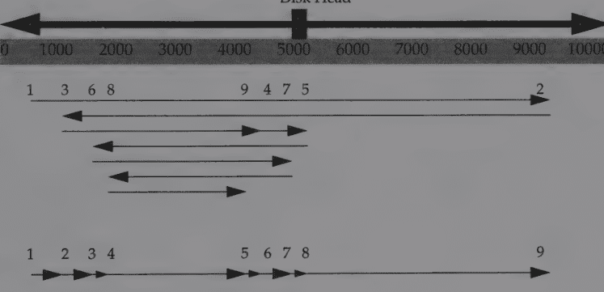

图 5-12 请求序列的磁盘头部移动

## Solaris OE 磁盘实例化

`Solaris OE` 提供的实例化通过显式测量两个阶段队列来考虑这种变化：一个位于设备驱动程序的队列，称为等待队列（`wait queue`），另一个位于设备自身的活动队列（`active queue`）。读或写命令被发送到设备驱动程序并留在等待队列中，直到 `SCSI` 总线和磁盘都准备就绪。当命令发送到磁盘设备时，它移动到活动队列，直到磁盘发送其响应。图 5-13 显示了 `Solaris 2.6 OE` 版本支持的常见格式中单个磁盘的示例 `iostat -x` 输出。

```
iostat -x 扩展设备统计

device        r/s  w/s  kr/s  kw/s  wait actv svc_t  %w %b
sd106        0.0  0.0   0.0   0.0   0.0  0.0   0.0 0.0  0
```

图 5-13 `iostat -x` 输出示例

图 5-14 显示了 `iostat -xn` 的输出，它将 `svc_t` 分为两个子组件，并为设备一个更有用的名称。这种格式是在 `Solaris 2.6 OE` 中引入的，同时底层内核数据源还添加了磁盘分区（`slices`）、磁带和 `NMS` 点。

```
iostat -xn 扩展设备统计

r/s   w/s   kr/s  kw/s wait  act  wsvc_t asvc_t %w   %b device
21.9  63.5  1159.1 2662.9 0.0  2.7  0.0    31.8  0    93  c3t15d0
```

图 5-14 `iostat -xn` 输出示例

`iostat` 的问题在于它尝试用某些原始术语来报告新的测量值。“等待服务时间”（`wait service time`）实际上是花费在“等待”（`wait`）队列中的时间。在任何情况下都不是服务时间的正确定义，而且“`wait`”一词被用于两种不同的含义（见图 5-15）。

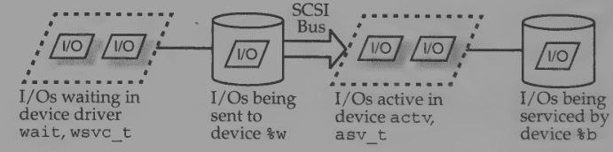

图 5-15 `Solaris 26 OE` 使用的双阶段磁盘模型

利用率（`U`）定义为忙碌时间（`B`）占总时间（`T`）的百分比，如下例所示：

```
$U_{wait} = 等待队列利用率 = iostat \%w = \frac{100 \times B}{T_{wait}}$
$U_{run} = 运行队列利用率 = iostat \%b = \frac{100 \times B}{T_{run}}$
```

现在，我们谈到了所谓的服务时间（`S`），但它并不是 `iostat` 输出并称为服务时间的那个。这才是真实的！以下示例证明它可以计算为忙碌时间（`B`）除以完成的访问次数，或者，计算为利用率（`U`）除以吞吐量（`X`）：

```
$S_{wait} = 毫秒平均等待队列服务时间 = \frac{B_{wait}}{C \times 10000}$
$S_{run} = 毫秒平均运行队列服务时间 = \frac{B_{run}}{X}$
```

`S_{run}` 的含义尽可能接近旧式的磁盘服务时间。记住，现代磁盘可以一次队列多个命令，并以不同于签发顺序顺序返回它们，这很明显它们不是同一种东西。要从 `iostat` 输出中计算它，将利用率除以读写总数，如下例中的值所示：

```
% iostat -xn
r/s   w/s   kr/s   sw wait activ wsvc_t asvc_t %w   %b device
21.9  63.5  1159.1 2662.9 0.0 2.7 0.0 31.8 0 93 c3t15d0
```

在这种情况下，`U=93\% (0.93)` 且吞吐量 `X=r/s+w/s=21.9+63.5=85.4`。服务时间 `S=U/X=0.011` `ms`，报告的响应时间 `R=31.8` `ms`。队列长度报告为 `2.7`；这是合理的，因为每个请求都必须在队列中等待其他几个请求被处理。

使用 `SE Toolkit`，在 `SE` 中编写的修改版 `iostat` 使用图 5-16 所示的格式输出响应时间和服务时间数据。

```
% siostat.se 10 | | --wait queue---- | --active queue---- |

| 03:42:50 | --throughput-- | | | | | | |
| disk | r/s | w/s | Kr/s | Kw/s qlen res svc_t %ut qlen res svc_t %ut |
| c3t15d0 | 0.0 | 0.1 | 0.0 | 0.0 | 0.02 | 0.01 | 15 |

| 03:43:00 | --throughput-- | --wait queue---- | --active queue---- | |
| disk | r/s | w/s | Kr/s | Kw/s qlen res svc_t %ut qlen res svc_t %ut |
| c3t15d0 | 0.0 | 0.2 | 0.0 | 0.0 | 0.02 | 0.27 | 22.4 |
```

图 5-16 基于 `SE` 重写 `iostat` 以正确显示服务时间

## 文本

我们可以得到 `iostat` 称为服务时间的数值。它被定义为 `iostat` 中带有“`wait`”和“`actv`”标题的长度（`Q`）除以吞吐量，但它实际上是停留或响应时间，如下所示：

- `R_{wait} = 平均等待队列服务时间 = \frac{Q}{X}`
- `R_{run} = 平均运行队列服务时间 = \frac{Q}{U}`

再次取我们的示例，`R = Q + X = 2.7 + 85.4 = 31.6` `ms`，这与 `iostat` 报告的几乎相同。差异是 31.6 `ms` 与 31.1 `ms` 之间，由于报告值 2.7 和 85.4 的舍入误差。

另一种表达响应时间的方法是使用服务时间和利用率。这种方法使用响应时间的理论模型，假设当利用率接近 100% 时，响应时间会趋于无限大，如下所示：

```
$R_{wait} = 等待队列服务时间预测 = \frac{S_{wait}}{U}$
```


```
$R_{run} = 运行队列服务时间预测 = \frac{S_{run}}{1-U}$
```

再次取我们的示例：`R = S + (1 - U) = 0.011 + (1 - 0.93) = 0.157` ms。这比测量的响应时间 31.8 ms 多得多，因此磁盘的运行情况比预测的要好。这种情况是因为磁盘比模型复杂得多，并且正在积极优化自己；服务时间不是恒定的，而且输入数据并不是模型随机的。

复杂的 I/O 子系统的一个重要特征是利用率测量可能会产生误导。当简单系统达到 100% 忙碌时，它已经达到了最大吞吐量，因为一次只处理一个。当被监控的设备是 `NFS` 服务器、硬件 `RAID` 磁盘子系统或条带卷时，利用率明显复杂得多。所有这些都可以并行处理许多请求。这种复杂性的简单视图近似了 `Solstice DiskSuite MetaDisk` 条带通过 `iostat` 报告的结果，如图 5-17 所示。`VxVM` 的作用相同，但它通过 `iostat` 不报告任何数据。¹

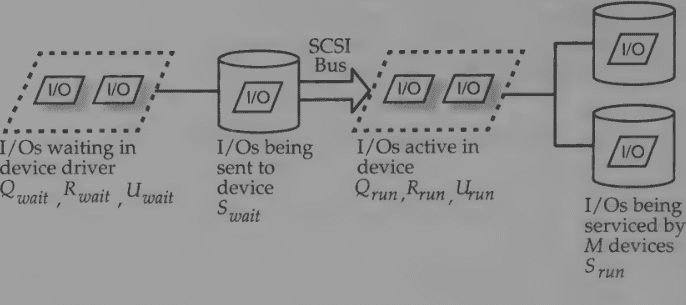

图 5-17 复杂的 I/O 设备队列模型

只要始终有一个特定的 I/O 正在被处理，`iostat` 报告的利用率就是 100%，这是合乎逻辑的，因为设备池始终在执行任务。然而，它有足够的容量来并行处理额外的 I/O。与简单设备相比，每个 I/O 的服务时间是相同的，但队列排空得更快，因此平均队列长度和响应时间更短，峰值吞吐量也随之增加。实际上，每块磁盘的负载被除以磁盘的数量，因此条带化磁盘卷的真实利用率实际上低于 100%。真实的利用率必须除以设备数量 `$M$` 分摊。底层驱动器的平均利用率远低于 `iostat` 报告的数值。吞吐量与服务时间的乘积通常被称为服务强度 `$\rho$`，它类似于一种可以超过 100% 的利用率。

对于该问题的另一种观点认为，如果多个请求可以同时被处理，当使用队列模型时，模型的工作方式就像服务时间按相同的倍数减少了一样，而利用率仍然只有 100%。

因此，在如何处理这种情况下这里存在一些困惑。必须将服务时间或利用率除以空闲磁盘的数量。这两种情况中的每一种实际上在不同情况下都是有效的。

对于第一种情况，我们假设每个 I/O 请求都是小的，无法进一步细分，并且它将访问单块磁盘。当请求大小小于条带长度时，通常此类如此。每个请求随机选择一个磁盘，然后提供通常的服务时间，因此总的，所有磁盘的利用率被因子 `$M$` 缩小了。

对于第二种情况，我们假设每个磁盘请求都是大的——理想情况下是全条带访问，它被细分为许多个命中整个磁盘组的较小请求。在这种情况下，所有磁盘都保持忙碌，因此每个单独磁盘的利用率与整个集合的利用率相同。然而，每个小请求的服务时间小于大请求的服务时间，因此我们看到服务时间的减少。

## 缓存磁盘子系统优化

引入缓存后，一定比例的访问将命中缓存，但通常无法获得该比例的测量值。缓存还允许许多优化发生，将许多小访问合并为更少的大访问。一些常见的优化包括：

- 读预取聚类 - 一个较小的读取会触发一个较大的读取到缓存中，然后随后的临的读写操作将由缓存满足。修改的缓存块被异步写回。第一次读取的服务时间将稍微增加，而随后的读写命中的服务时间将非常快。写回可能会导致延迟，减慢随后的访问。

- 异步写缓存 - 如果缓存是非易失的，则安全地立即确认写入并在稍后将数据写入磁盘。写入的服务时间将取决于缓存块何时可用。写回可能成为瓶颈，并导致块分配延迟，从而减慢写服务。

- 写入取消 - 当文件系统元数据更新时，经常发生对同一个数据块的多次写入。当块被缓存时，后续写入会取消第一次写入，并且在每次写回到磁盘时可能会发生多次更新。

- 写入合并 - 对相邻数据的多次写入被合并为一个单一较大的写入。如果这个较大的写入超过了底层的磁盘块大小，则不需要读取大块，因为它通过合并较小的写入来修改它，并将大块写回。

所有这些优化可以同时发生，而且磁盘子系统没有标准方法来报告其缓存中发生了什么。在大多数情况下，磁盘和缓存完全不收集此类信息。

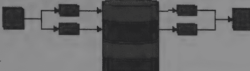

图 5-21 条带化磁盘访问示意图

当请求大小大于交织单元（interlace size）时，无论是单线程还是多线程请求都会被划分到 `N` 个磁盘上。`N` 由请求大小除以交织单元设置。这样可以获得 `N` 个磁盘的吞吐量。

每个底层条带上请求大小的减小缩短了大型传输的服务时间，但你需要等待所有磁盘完成，且最慢的磁盘将主导性能。当 `1MB` 的请求被分成 `128 K` 的交织单元时，这种操作非常高效。随着请求大小和交织单元的缩小，整体效率也会降低。

## 针对小请求的 `RAID5`

图 5-22 展示了针对小请求的 `RAID5`。

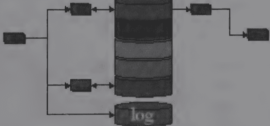

图 5-22 针对小请求的 `RAID5` 示意图

`RAID5` 的操作在 `Brian Wong` 编写的《Configuration and Capacity Planning for Sun Servers》中有了详细描述。本质上，在条带旁维护一个校验磁盘，以提供受故障保护的存储，而无需镜像的全量复制开销。写入操作必须计算在磁盘间循环的校验数据。写入必须执行以下操作：

1. 读取校验块和旧数据块。

2. 将小写入插入块中。

3. 计算新的校验数据。

4. 写入单独的日志以确保数据的一致性。

5. 将数据和校验数据写回磁盘。

问题在于，这个序列消耗的服务时间大约是普通写入的三倍，吞吐量仅为单个磁盘的三分之一。当工作负载包含许多小写入时，在 `DiskSuite` 和 `VxVM` 的软件 `RAID5` 实现中可能会遇到这种情况。

读取 `RAID5` 组合性能类似于普通条带，吞吐量为 `N-1` 个磁盘，服务时间为 `1`。

如果某个磁盘故障，读取必须通过执行额外的读取来重建丢失的数据；总而言，最好假设降级后的吞吐量大约相同。

## 针对大请求的 `RAID5`

图 5-23 展示了针对大请求的 `RAID5`。

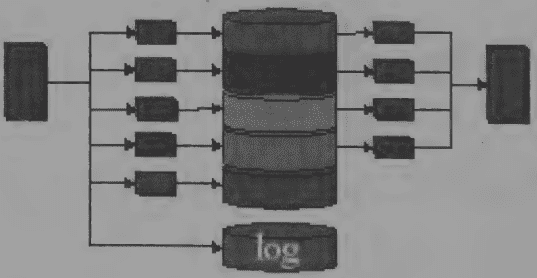

图 5-23 针对大请求的 `RAID5` 示意图

当写入足够大以包含整个条带宽度时，则无需读取任何数据，因此所有的写入和校验都可以立即写入。容量与条带相似；它具有相似的读写性能和 `N-1` 个磁盘的吞吐量。由于每次写入的大小按因子 `N-1` 缩小，传输的服务时间被缩短了。

总体而言，磁盘互连的负载小于保持镜像同步所需的负载。

如果磁盘在降级模式下故障，吞吐量和服务是的，因为整个条带作为一个单元被读取和写入。需要额外的 `CPU` 时间来重新生成丢失的数据。

## 缓存 `RAID5`

图 5-24 展示了缓存 `RAID5`。

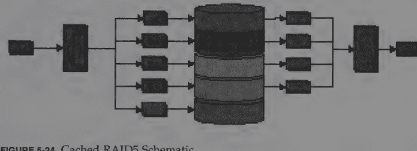

当在 `RAID5` 设置中添加非易失性 `RAM` 缓存时，它的工作效率高得多。不需要恢复日志磁盘，因为跟踪部分完成操作的日志可以存储在非易失性内存中。

缓存为所有写入提供了快速的服务时间。互连传输时间是唯一的组件。缓存优化了 `RAID5` 操作，因为它允许所有写入（无论大小）都转换为最优的全条带操作。

`RAM` 缓存通常没有足够大（与磁盘大小相比），无法为读取性能提供任何益处。

## 缓存条带

图 5-25 展示了缓存条带。

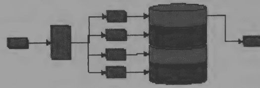

图 5-25 缓存条带示意图

条带的写入缓存极大地缩短了服务时间。对于小数据传输是值得的，但大传输不应被缓存。

对于 `A3500`，某些测试确认 `128 K` 是使用缓存和无缓存获得相同性能交叉点。对于持续较大的传输，不使用写入缓存可以获得更好的性能。对于较小的传输，使用写入缓存可以获得好得性能。

写入缓存还执行了一些实用的优化。反复写入同一个块会在缓存中被抵消，因此只需要进行一次写入。小顺序写入也会合并形成更少的大写入。

## 容量模型测量

测量值源自 `iostat` 输出和对磁盘子系统配置的了解。

下面显示了 `iostat -x` 的某些示例输出，以及从中得出的测量值：

| extended disk statistics | | | | | | | | |
| --- | --- | --- | --- | --- | --- | --- | --- | --- |
| disk | r/s | w/s | Kr/s | Kw/s wait actv | svc_t | % w | %b |
| sd9 | 33.1 | 8.7 | 271.4 | 71.3 | 0.0 | 15.8 | 0 | 27 |

- 利用率 `U = %b+100=0.27`

- 吞吐量 `X = r + s + w + s = 41.8`

- 大小 `K = Kr + s + Kw + s + X = 8.2K`

- 并发数 `N = activ = 2.3`

- 服务时间 `S = U + X = 6.5 ms`

- 响应时间 `R = svc_t = 15.8 ms`

该系统的配置参数为：

- 数据磁盘数量 `M = 4`（忽略镜像）

- 不包含 `RAID5` 校验

- 条带交织单元 `I = 64K`（未条带化时使用整个磁盘大小）

- 最大 `SCSI` 速率 `Brw = 40000K/s` 或 `FC-AL` `Br = 100000K/s`

- 最大磁盘数据速率 `D = 24500K/s`

## 磁盘和控制器容量

我们检查基于吞吐量的瓶颈；我们对该控制器上的所有磁盘使用控制器的 `kr/s` 和 `kw/s`。

```
iostat -xn                               extended device statistics
nr/s w/s kr/s kw/s wait actv svc_t %w %b
21.9 63.5 1159.1 2662.9 0.0 2.7 0.0 93
```

（注：源文件中提供的剩余文本高度混乱/重复，我处理了 OCR 提供的连贯部分。）

`$U_{iostat} + P = 0.93 + 6 = U_{stripe} = 0.16$`。对于此工作负载，该条带的利用率为 16%，剩余容量为 84%。平均服务时间实际上为 `$S = 0.16 + (21.9 + 63.5) = 1.9$` ms。

## 缓存性能影响因素

缓存对吞吐量的影响很难建模，因为没有监测工具来指示聚类（clustering）和写入取消（write cancellation）改进的发生。在数据与磁盘与缓存之间传输的过程中，还会存在微小的开销。你应该做出悲观假设，即缓存不会改变吞吐量。

缓存的主要益处是快速的响应时间。这种收益可以通过两个缓存效率因子来总结：`$E$` 和 `$H$`。

`$E$` 定义为缓存带来的读写服务速度加速。`$E=1.0$` 等同于未缓存状态。`$E = S_{disk} + S_{cache}$`，我们也可以假设 `$E_{read} = E_{write}$` 是足够精确的近似值，从而避免分别计算读取和写入的需要。

`$H$` 定义为缓存命中率。未缓存请求的 `$H=0.0$`，完全缓存请求的 `$H=1.0$`（即 100%）。`$H$` 随工作负载组合和强度的变化而大幅波动。必须分别对读取和写入计算，因为 `$H_{read}$` 和 `$H_{write}$` 的值差异很大。

## 服务时间与缓存命中率

通过已知磁盘和缓存的服务时间可以推断出缓存命中率。

从 `iostat` 数据计算出的测量服务时间为 `$S_{measured} = S_{disk}(1-H) + H \times S_{disk} + E$`；即缓存缺失的慢速比例加上缓存命中的快速比例。我们可以反转此计算，利用 `$E$` 和 `$S_{disk}$` 值的测量或估计来获得缓存命中率的估计：

`$H_{estimated} = (1 - S_{measured}/S_{disk}) + (1 - 1/E)$`

该计算对 `$S_{disk}$` 和 `$E$` 值的误差和波动敏感。如果估计结果超出了 `$H$` 的允许范围（0.0 到 1.0），那么你需要确保 `$S_{disk}$` 特别足够大。

`$S_{disk}$` 必须是最坏情况下的磁盘服务时间。

`$S_{disk} + E$` 必须是最极坏情况下的缓存命中服务时间。

固态硬盘的读写 `$H$` 均为 1.0，因为数据被缓存吸收了。其他类型的磁盘 `$H$` 值各异，但 `$E$` 具有特征值。一些缓存值的示例如下：

- 带有 `UltraSCSI` 接口的缓存磁盘阵列或固态硬盘，`$E = 10$`；带有 `FC-AL` 接口，`$E = 15$`

- `StorEdge Fast Cache` 产品使用镜像 `32 MB NVRAM` 缓存，无读取缓存，`$E = 500$`

- 文件系统读取缓存，即访问已在内存中的数据文件，不涉及设备，`$E = 5000$`

主内存为读取提供了最佳缓存，而 `NVRAM` 为写入提供了最佳缓存。`NVRAM` 缓存的唯一缺点是它是聚类的、高可用的磁盘子系统，由于它是每个系统内部的，因此无法无法使用。

## 注意事项

本讨论集中在一阶效应上。由于做了许多简化假设，因此不要依赖此模型进行精细的度量。你应该使用此模型来进入正确的“范围”，以便根据你的工作负载恰当配置磁盘子系统。

# 总结

本章关注了 `CPU`、内存、磁盘容量估计，以及创建复杂磁盘子系统的各种可扩展性特征。此外，本章还提供了系统示例。

下一章将关注可扩展性特征，以及可观测性需求。

## 可观测性

可观测性是性能管理和规划的基础需求。性能特征需要以关注者能够理解的方式呈现。不同的受众：

字体 运维

- 管理

- 工程

每个受众需要不同的输出。本节描述了如何使用可观测性提供这些视图。

### 运维视角

从 `iostat` 数据计算出的测量服务时间为 `$S_{measured} = S_{disk}(1-H) + H \times S_{disk} + E$`；即缓存缺失的慢速比例加上缓存命中的快速比例。我们可以反转此计算，利用 `$E$` 和 `$S_{disk}$` 值的测量或估计来获得缓存命中率的估计：

`$H_{estimated} = (1 - S_{measured}/S_{disk}) + (1 - 1/E)$`

该计算对 `$S_{disk}$` 和 `$E$` 值的误差和波动敏感。如果估计结果超出了 `$H$` 的允许范围（0.0 到 1.0），那么你需要确保 `$S_{disk}$` 特别足够大。

`$S_{disk}$` 必须是最坏情况下的磁盘服务时间。

`$S_{disk} + E$` 必须是最极坏情况下的缓存命中服务时间。

监控软件会发出问题状态的信号，此时你可以确认告警并调查原因。第一步是启用：

- 1. 启用规则。

### 管理视角

性能特征需要以关注者能够理解的方式呈现。例如，默认规则可能是为小系统设置的，在这种可能会产生虚假告警。它们也可能设置得太高，导致问题发生触发。

- 2. 设置阈值。

对于你所有的规则，你应该列出一个列表，列出其阈值和正常运行期间的典型指标。如果你能识别问题发生期间这些指标的值，就可以正确设置从绿色到黄色的告警转换。如果你从未见过特定指标出现问题，那么将其阈值设置得比你见过的最高值高一点。

### 工程视角

监控软件会发出问题状态的信号，此时你可以确认告警并调查原因。下一步是：

- 3. 监控并重置告警。

当告警条件发生时，如果没有通知或响应，告警就是无用的。告警日志应该归档。每天收集每个问题级别（例如黄色和红色）发生的告警数量，以便进行报告。

- 4. 分类问题。

将停机、告警和未触发告警的问题归入以下类别：

- 有相应告警的问题

- 计划停机

- 计划超时

- 故障停机

- 告警

- 警告

- 遗留已知问题

- 5. 执行根原因分析。

对于步骤4中统计的每个问题，尝试追踪其原因并记录你的发现。如果每天分析的问题数量与报告的问题数量相，说明你很好地控制了局面。

- 误报

- 虚假告警

- 告警规则修改（例如为了防止误报）

- 根因识别

- 根因修复通知

- 未发现故障通知

将问题和分析的数量及类型汇总到每日管理报告中。

## 使用 `Sun Management Center` 实现

本示例使用了 `SunMC`，是因为它作为 `Sun` 系统管理和监控的主要平台，其重要性日益增加。许多第三方工具也可以胜任这一角色。这些第三方工具的主要优势也是它们的主要缺点：它们不具针对性，可以管理来自多个供应商的各种系统。但由于它们不是针对 `Sun` 专用的，因此无法提供与 `SunMC` 类似的详细的、特定平台的活动管理和诊断功能。以下列表列了 `SunMC` 的选项和功能：

- `SunMC` 有第三方供应商支持管理基于 `Windows NT` 的系统和关系型数据库以执行系统管理功能。更多详情请联系 `Halcyon Inc.` (`www.halcyon.com`)。

- 与 `CA Unicenter`、`BMC Patrol` 和 `HP IT Operations`（等）的交互允许 `SunMC` 集成到现有的多供应商环境中。

- 最近的软件开发包（`SDK`）允许任何人开发代理模块和用户界面。

- `SunMC` 是安全的，默认使用公钥认证，并允许远程管理员安全地修改 `Sun` 配置。管理员角色定义和访问列表提供了灵活的控制。

- 通过 `SunMC` 可以获取完整的系统配置信息。这种能力并非毫无价值，但没有其他工具能提供类似的功能。它提供了逻辑视图和物理视图。最近新增的功能是支持显示和管理 `Sun Enterprise 10000` 系统服务处理器 (`SSP`) 和动态域 (`Dynamic Domains`)。

- 硬件产品和软件是并行开发的；许多新的硬件和软件产品将使用 `SunMC` 作为它们的主要管理控制台或接口。

- 诊断工具（如 `Sun` 的配置跟踪器 `CST`）使用了 `SunMC`。由于 `SunMC` 基于 `SNMP` 协议，它可以与网络管理工具紧密集成，而不仅仅是转发告警（`traps`）。`SunMC SNMP` 版本 `2` 在数据批量传输方面效率更高效，并为通用标准增加了安全性。

## 使用 `SunMC` 进行告警监控

可以使用 `SunMC` 监控系统以诊断问题。在本节中，截图说明了如何配置和使用 `SunMC` 执行对运维管理有用的基本监控操作。示例中的截图取自 `SunMC 2.1`，它是 `SunMC 2.0` 的一个更新版本，带有新功能。

## `SunMC` 健康监控器


# SunMC 健康监控

SunMC 包含一个系统健康监控模块，运维人员可以使用它查看系统是否有足够的资源来流畅运行。例如，如果 `CPU` 状态报告为红色，则该系统可能需要更多的 `CPU` 能力。同样，如果内存规则报告为红色，则系统可能需要更多内存。

SunMC 健康监控器基于一组规则对象。在首次安装 SunMC 时，健康监控默认未启用，因为只加载了基础模块。额外的规则对象实现了引用多个指标或对数据进行高级处理的复杂规则。

要加载健康监控模块，请使用默认管理员域启动 SunMC，选择系统，弹出菜单，然后从菜单中选择“Load Module”（加载模块）选项，如图 6-1 所示。

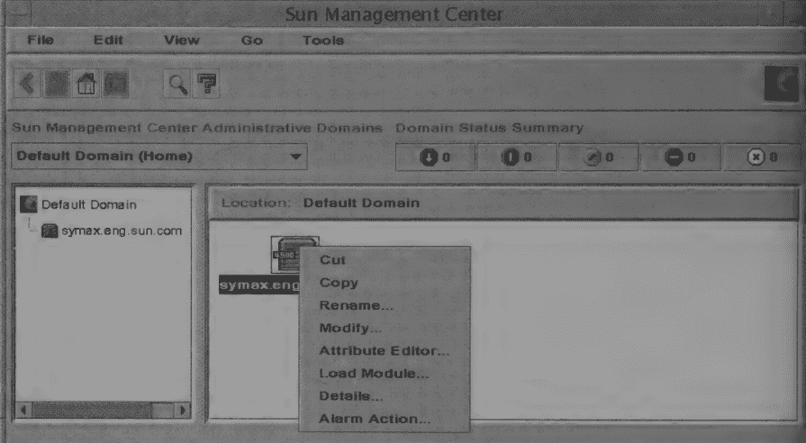

图 6-1 SunMC 控制台

接下来，向下滚动并选择 `Health Monitor`（健康监控）模块；如果 SunMC 已经过预配置，它可能已经加载。否则，选择它并点击 `OK` 按钮（见图 6-2）。

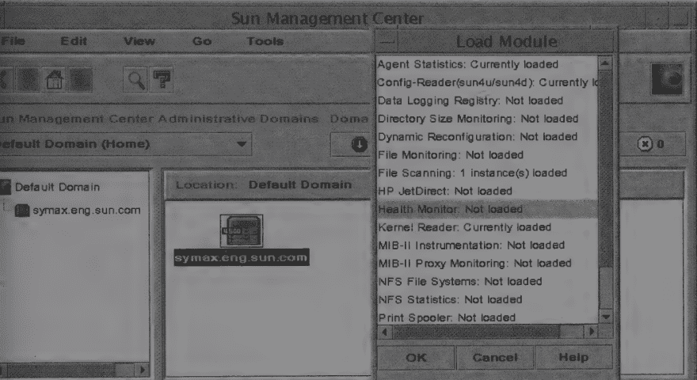

图 6-2 加载健康监控模块

## 运维实现

现在，该系统的任何健康监控告警都将被记录。你可以钻到导致告警的子系统，但我们预计目前还没有任何健康监控告警，而且该系统已经有一个无关的磁盘空间告警。因此，请选择系统并打开详细视图。`Details`（详情）菜单在之前打开 `Load Module` 窗口时见过。当选择它时，会打开一个针对被监控系统的特定窗口（见图 6-3）。

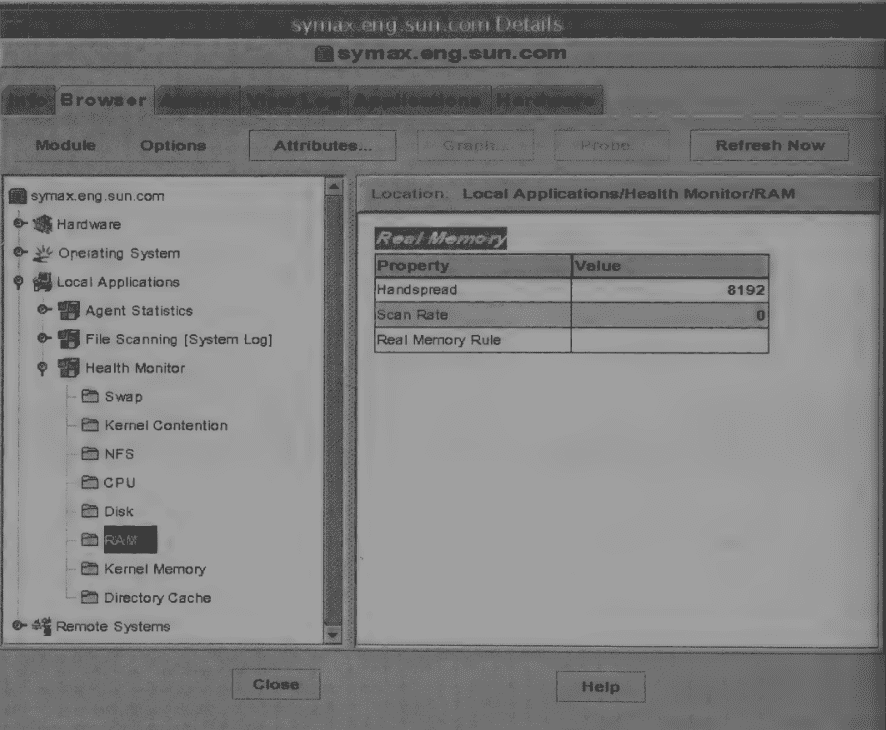

图 6-3 主机详情窗口

主机详情窗口的 `Browser`（浏览器）选项卡显示了已加载的模块。在 `Local Applications`（本地应用程序）下（点击其旁边的项目符号即可打开），你将找到 `Health Monitor` 模块，在模块内部你将找到用于监控多个系统组件的八条规则。每个规则显示几个变量；图 6-3 中显示的 `RAM` 规则显示当前扫描率为零，因此规则值为白色方框。如果扫描率与磁头扩展率（`headspread`）的百分比过高，且页面停留时间低于预设阈值，此框将变为红色，红色状态将向上层次结构传播。

你可以通过在规则值上弹出菜单来查看和编辑规则属性及阈值。使用这些规则的方法是增加阈值，直到运行良好的系统在正常运行时没有告警；然后随着时间推移负载增加，你将开始收到告警，报告哪个子系统可能是瓶颈。如果你的系统从一开始运行就不良好，那么这些规则应该帮助你排除一些问题区域，并建议关注哪些子系统。

浏览器模式可用于浏览内核为该系统提供的所有操作系统测量值，包括 `CPU` 使用率、分页率和磁盘利用率。

## 在 SunMC 中处理告警

SunMC 可以从单个控制台监控数百个系统。系统可以按层级分组；例如，按子网、应用程序或部门。SunMC 为每个组分配一个“云”图标；或者，你可以加载一张背景图像作为地图或建筑平面，并将图标放置在地图上。当问题发生时，状态会向上层次结构传播，导致云变为相应的颜色，以便你可以钻到单个系统。SunMC 控制台支持多个管理员域，供不同类型的用户查看被监控系统的不同视图。

当简单规则或健康监控规则之一产生告警时，SunMC 会记录它。在域级控制台上，会统计每个监控系统的最严重告警状态。这意味着如果只监控一个系统，只会指示一个告警。在我们的示例中，它处于黄色状态。

如果你点击图 6-4 所示带有“1”的黄色指示，将打开一个新窗口，显示该域内所有系统的告警。

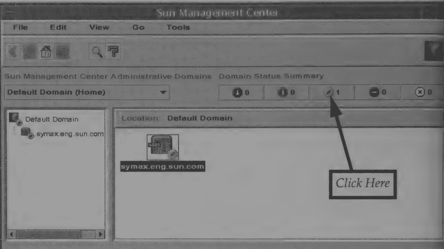

图 6-4 SunMC 控制台

图 6-5 显示仅处于黄色（警告）状态的系统或其他网络组件。在这种情况下，我们可以看到可用交换空间开始变得紧张。这种非常有用的过滤形式允许你通过选择域并优先处理该域内所有系统的关键问题，来处理来自大量系统的告警洪流。

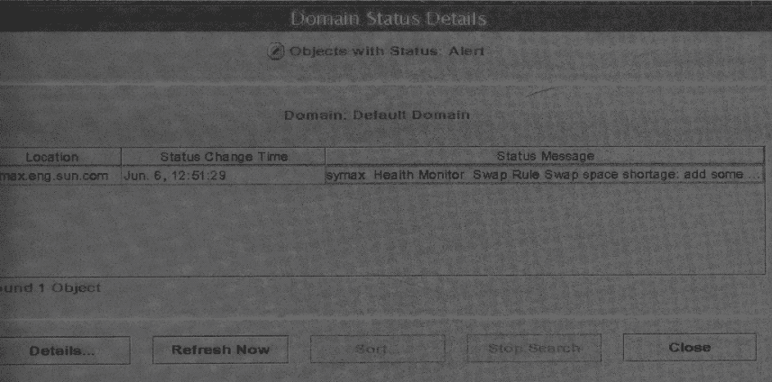

图 6-5 域状态详情窗口

如果您现在双击报警或选择该报警并点击“`Details`”（详细信息）按钮，将打开该系统的详细信息窗口，并选中“`Alarms`”（报警）选项卡，如图 6-6 所示。

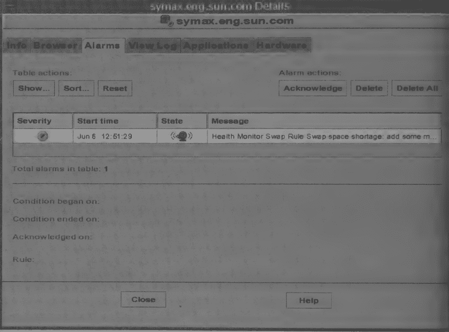

图 6-6 报警详细信息窗口

下一步是选择一个或所有报警，并通过点击“`Acknowledge`”（确认）按钮对其进行确认。最好选择所有报警并一次性确认。执行确认操作需要一些时间，因为它一直通信到被监控服务器上的代理程序（`agent`）。一旦报警被确认，其旁边就会出现一个对钩，如图 6-7 所示。

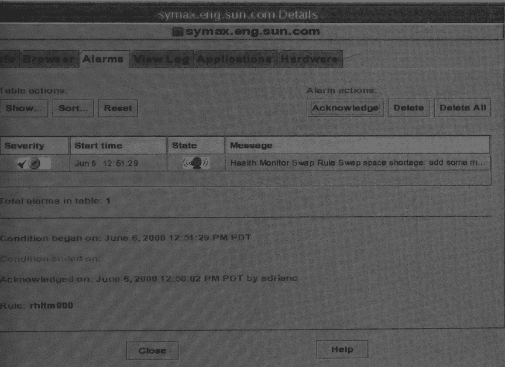

图 6-7 已确认的报警

如果现在关闭“`Alarms`”（报警详细信息）窗口并返回到“`Domain Status Details`”（域状态详细信息）窗口，后者可能没有发生变化。点击“`Refresh Now`”（立即刷新）按钮，报警条目将消失。您现在可以关闭此窗口。查看域控制台（`Domain Console`），注意服务器上不再有黄色标记，且域状态摘要全零。

《Sun BluePrints：资源管理》一书展示了如何使用 SunMC 分离并监控多个负载。使用此功能可以跟踪应用程序进程并定义报警，以便在出现问题时通知您——例如，当进程消失或负载开始消耗过多 `CPU` 时。

## 关键性能指标图表

运维人员必须能够访问显示系统主要组件每日数据的视图。这对问题诊断有很大帮助。一种简单的方法是将数据记录到表中，导入电子表格中并绘制关键指标图表。也可以使用如 `MRTG`（多路器流量图，www.mrtg.org）和 `Orca`（www.orca.net）等免费工具在 Web 页面自动生成图表。这些方法的缺点是它们不是实时运行的，需要手动刷新。几乎所有的商业性能工具都提供实时数据，并以适用于运行监控的方式显示。

一个实用的示例是使用 `SE` 工具包读取记录到文件中数据的电子表格。该电子表格可以在 `http://www.sun.com/blueprints/tools` 下载。在此电子表格中，图表涵盖单个系统的主要组件，如 `CPU`、磁盘、网络和内存。接下来的图中显示了图表：

- 图 6-8 和图 6-9 显示了 `CPU` 利用率、用户 `CPU` 时间与系统 `CPU` 时间的平衡，以及平均负载（运行作业数）相对于配置和在线 `CPU` 数量的情况。
- 图 6-10 显示了系统中繁忙磁盘的磁盘利用率以及系统中所有磁盘的平均利用率。该图显示了磁盘的倾斜程度，并突出了最可能的磁盘瓶颈。`KB/s` 写入吞吐量显示了数据传输特性。
- 图 6-11 显示了 `KB/s` 网络吞吐量。此数字可以通过监控 `TCP` 栈或监控网络接口获取。现在的监控器报告字节级计数器，但许多只读取包信息，考虑到各种可能性，这种信息价值低得多。
- 图 6-12 显示了内存和交换空间；它们可以画在一起，但需要进行不同的解释。交换空间必须始终可用，以便进程启动和增长，因为如果进程耗尽，系统将出现问题。主内存通过在达到低阈值后自我回收自身来管理，它往往会在该阈值附近波动。页停留时间（`page residence time`）是另一个有用的衡量标准，在此所示。

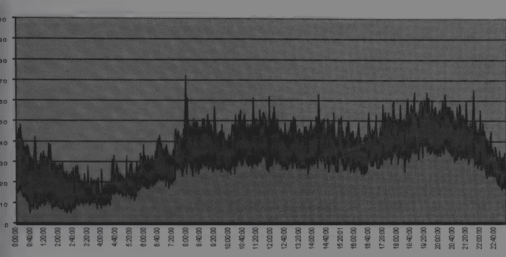
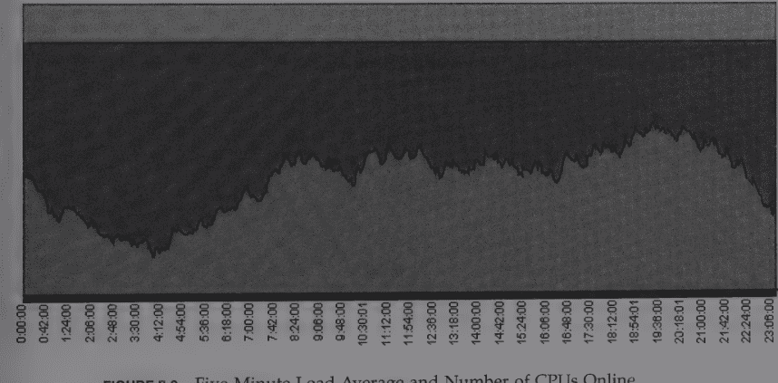
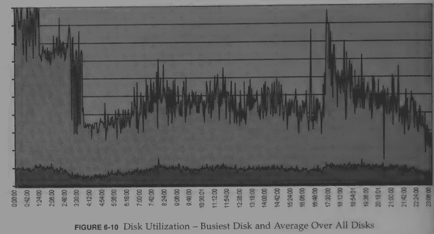
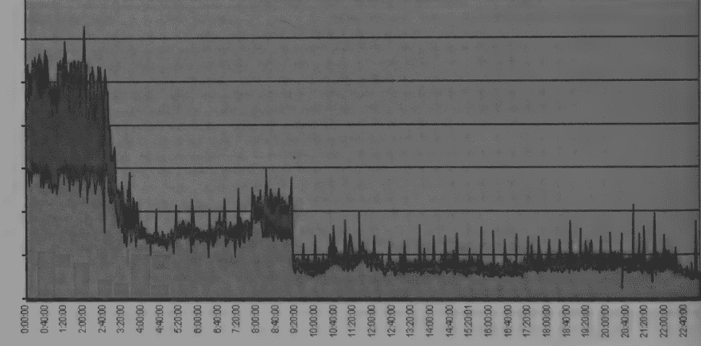

### 第 6 章 可观测性

## 图 6-12 全天网络吞吐量

网络图显示由于本地快速网络上进行的文件传输导致的几个高吞吐量峰值，但在这种情况下，它的整体形状与平均负载非常接近。这些图表的特征表明该系统一直处于活跃状态，其负载形状是许多网站的典型。系统在深夜很安静，白天变得繁忙并达到平台期，然后在傍晚早些时候达到高峰。`CPU` 和磁盘图还显示在夜间有额外的 `CPU` 时间，以及与在线备份相关的较高的磁盘数据率。其中一些图表已去除了坐标轴刻度，部分是为了掩盖数据源，部分是因为绝对值没有每天之间形状的变化重要。

下方的内存图显示了一个定期的批处理作业在创建和删除一个大文件，以及内存和交换空间被定期消耗和释放（见图 6-13）。在备份期间，停留时间下降到低水平的情况很少。该值通过将页扫描速率除以一个名为头部自旋页（`headspinlock pages`）的系统参数计算得出。由于扫描速率可能为零，系统会捕获除零错误，并对停留时间进行限制（见图 6-14）。

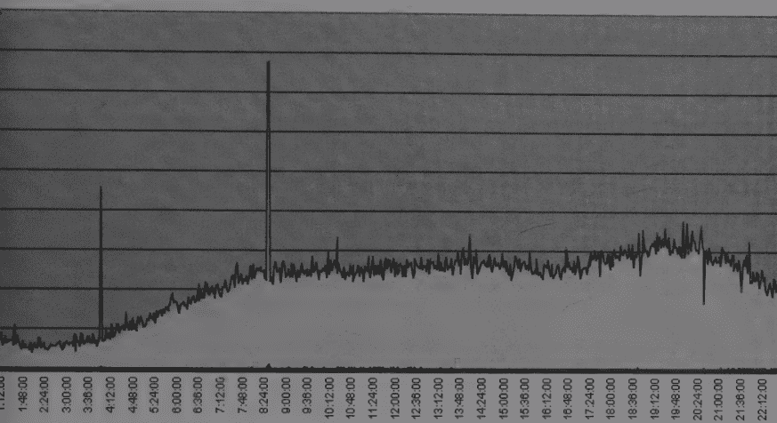

## 周报：2000年4月18日

上周的扫描运行得相当顺利。周一晚上刷新了 `253.8 Mbit/s` 的带宽新记录。14日、17日和18日，由于夜间备份影响到白间运行，导致了用户可见的问题。目前，在未获得负责此问题的团队批准之前，任何配置更改均不得引入站点。由于潜在的交货提前期影响，5月12日的硬件升级计划面临风险。

## 负载与容量增长场景及主要瓶颈利用率

| 日期 | 4月17日 | 5月12日 | 5月20日 | 6月14日 | 7月21日 | 8月23日 |
|---|---|---|---|---|---|---|
| 负载增长 | 事件 | 当前 | 硬件升级 | 操作系统升级 | 应用 V 2.6 | 数据库升级 | 应用 V 3.0 |
| 4月18日 | 当前 | 71% | 58% | 43% | 32% | 30% | 17% |
| 4月24日 | 新周一 | 65% | 53% | 39% | 34% | 27% | 15% |
| 5月29日 | 五周 | | 75% | 55% | 48% | 39% | 21% |
| 6月16日 | 主峰值 | | | 72% | 69% | 50% | 28% |
| 7月17日 | 三个月 | | | | 66% | 58% | 46% | 26% |
| 10月23日 | 六个月 | | | | | 78% | 64% | 43% |
| 4月17日 | 明年 | | | | | | |

## 上周状态、问题严重程度与计数及图表

| 问题及计数 | 4月10日(一) | 4月11日(二) | 4月12日(三) | 4月13日(四) | 4月14日(五) | 4月15日(六) | 4月16日(日) | 4月17日(一) | 4月18日(二) |
|---|---|---|---|---|---|---|---|---|---|
| 问题总计 | 15 | 14 | 14 | 13 | 12 | 18 | 16 | 12 | 10 |
| 已解决/新发生 | 6/1 | 3/2 | 3/1 | 4/3 | 7/5 | 1/4 | 2/3 | 7/1 | 5/3 |

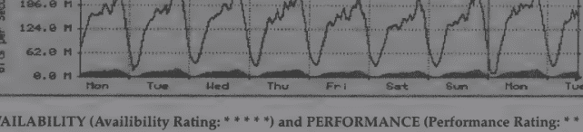

可用性（可用性评分：`****`）和 性能（性能评分：`****`）

| 页面下载成功百分比 | 平均下载时间 |
|---|---|
| 99.43% | 特定站点页面的成功下载 | 1.12 sec | 特定站点页面的下载时间 |
| 96.28% | 标准化页面的成功下载 | 2.55 sec | 标准化页面的下载时间 |

*图 6-15 示例管理状态报告*

## 周报

将本周的活动总结为四到五行文本（参见图 6-16）。

### 周报：2000年4月18日

站点上周运行顺利。周一晚上刷新了 `253.8 Mbit/s` 的带宽新记录。14日和18日，由于夜间备份超过了白天运行时间，导致了用户可见的问题。目前，在未获得负责此问题的团队批准之前，任何配置更改均不得引入站点。由于组件交货提前期的影响，5月12日的硬件升级计划面临风险。

图 6-16 管理报告：周摘要

此摘要表明，上周的用户可见问题是由于夜间备份时间过长并溢到高负载期间导致的，这影响了用户响应时间。它提到了下次站点升级可能会推期，因此高级人员可以参与应急计划会议以落实进度。

## 场景规划

整个容量规划在第4章“场景规划”中有更详细描述。场景规划过程包含了增加站点容量的升级事件以及预期负载增长。传递给管理层的重要信息是未来是否有足够的容量处理负载，以及如何管理资源以保持站点运行。

周报在周二交付，以便有时间针对下周一的峰值做出更改。整个容量规划每周重新计算一次，以当前数据为基准，并在第一列更新未来日期。

容量规划基于简单的瓶颈，显示为每个场景的百分比。由于推期，场景标记为黄色；容量充足的场景标记为绿色；超过 `90%` 的场景标记为红色。负载随时间增加，并考虑了季节性影响，即“`Mktg Push`”（营销活动）。负载起始为 `71%`，由于季节性波动略微下降至 `65%`。在5月29日的五周内，升级安排在5月12日，其影响显示在第二列。

### 第 6 章 可观测性

预计升级将带来 `22%` 的性能提升，如果在4月18日（周二）实施，将使 `71%` 的利用率降至 `58%`。如果下周实施硬件升级，将使 `65%` 的利用率降至 `53%`。然而，该升级计划面临风险，如果从 5月12日推期到 5月29日，将没有足够的容量应对负载（黄色状态指示）。同样，针对版本 2.6（“`App V2.6`”）的应用升级预计在 5月20日将带来 `36%` 的性能提升。这必须在“营销活动”之前安排。为了提供长期视图，状态指示可能会变为红色。这有助于识别时间。

| 日期 | 4月17日 | 5月12日 | 5月20日 | 6月14日 | 7月21日 | 8月23日 |
|---|---|---|---|---|---|---|
| 负载增长 | 事件 | 当前 | 硬件升级 | 操作系统升级 | 应用 V 2.6 | 数据库升级 | 应用 V 3.0 |
| 4月18日 | 当前 | 71% | 58% | 43% | 32% | 30% | 17% |
| 4月24日 | 新周一 | 65% | 53% | 39% | 34% | 27% | 15% |
| 5月29日 | 五周 | | 75% | 55% | 48% | 39% | 21% |
| 6月16日 | 主峰值 | | | 72% | 69% | 50% | 28% |
| 7月17日 | 三个月 | | | | 66% | 58% | 46% | 26% |
| 10月23日 | 六个月 | | | | | 78% | 64% | 43% |
| 4月17日 | 明年 | | | | | | |

图 6-17 管理报告：场景规划

## 周摘要

此部分提供了过去一周左右的事件视图（参见图 6-18），包括问题计数以及从上周一到上周二中午的活动图表。

| 问题状态及计数 | 4月10日(一) | 4月11日(二) | 4月12日(三) | 4月13日(四) | 4月14日(五) | 4月15日(六) | 4月16日(日) | 4月17日(一) | 4月18日(二) |
|---|---|---|---|---|---|---|---|---|---|
| 问题总计 | | | | | 12 | | 12 | 10 | |
| 已解决/新发生 | | | | | | | | | |

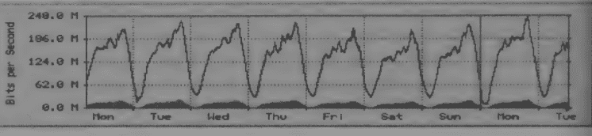

> 图 6-18 管理报告：周摘要

第一给出每天结束时未解决问题的总数。它还根据任何时间发生问题的严重程度对当天的整体状态进行颜色编码。在这种情况下，有三天显示为黄色，因为备份超时并影响了白天运行。

第二行显示一天内解决了多少问题以及注册了多少新问题。如果员工被这么多问题淹没导致无法进行分析和解决，那么第二行的状态将变为黄色或红色，第一行的问题计数将持续增加。问题在全周内平均以相对恒定的速率发生，但分析和解决倾向于在所有员工都在的周内进行。这意味着问题总数可能会在周末积累，并在周初下降。

图表与每日问题摘要对齐。此特定图表获取自免费工具 `MRTG`，该工具正在监控此站点的互联网连接带宽。带宽在周日午夜后下降至接近零；这种下降对应于计划中的停机维护。观察负载模式，我们发现这不是关机的好时间。最好在另一个时间安排停机，例如，周四晚上/周五早上。对于本站而言，这对应于周五负载最轻的时期，如果在维护期间或之后发生问题，对业务的影响也最小。此外，还有一个良好的管理原则：不要在周五期间进行任何更改，这样你就不必在周末加班解决任何问题了！

# 外部监控摘要

有几家公司为网站提供外部监控服务；最著名的是 `Keynote Corp` (www.keynote.com)。`Keynote` 使用来自互联网许多区域的连接来覆盖其终端用户群体样本。他们定期对被测试的联系站点进行测试，统计响应次数并测量响应时间。一个网站上的两种 Web 页面可以进行测试：标准化页面（允许网站之间进行比较）以及特定站点页面（用于测试实际网站以及任何可能涉及的后端系统的机功能）。该市场中的其他供应商包括 `Mercury Interactive` (www.mercury.com) 和 `Envice Corp` (www.envice.com)。除了测量正常运行时的可用性和性能外，`Mercury` 和 `Envice` 还提供了负载测试服务，可用于在上线前进行压力测试，或在低负载期间进行压力测试。

一份完整的 `Keynote` 报告涵盖了网站许多组件的性能，这些性能是从互联网的许多部分测量的。对于管理报告，单一测量值就足够了，如图 6-19 所示。

| 可用性(可用评级：`*****`) 和性能(性能评级：`*****`) | |
| :--- | :--- |
| 页面成功下载百分比 | 平均下载时间 |
| 特定站点页面成功下载率 99.43% | 特定站点页面下载时间 1.12 秒 |
| 标准化页面成功下载率 96.28% | 标准化页面下载时间 2.55 秒 |

图 6-19 管理报告：站点可用性与性能摘要

此报告的构建目的是说明本示例中涉及的原理。管理报告需要根据实际情况进行定制。


每个网络接口的默认统计数据仅包括包计数、错误计数器和冲突率。由于大多数现代网络都是交换式的，冲突很少发生。此外，诸如 `Sun 100 Mb以太网`、`qfe` 以及 `千兆以太网` 等接口收集了许多 `netstat` 工具未报告的详细指标。对于容量规划而言，获取字节计数吞吐量指标至关重要；此外，还有溢出计数器可以显示数据包何时因溢出而被丢弃。

### 卷管理器信息

此信息应显示每个卷的吞吐量。`Sun Solstice DiskSuite` 产品通过标准的 `iostat` 和 `kstat` 机制为这些卷提供支持，但某些工具无法正确理解或报告元数据视图 (`md`) 条目。`VxVM` 需要针对系统上配置的每个磁盘组单独运行 `vxstat` 命令。

### Web 服务器访问日志

这些日志提供了性能信息的有用来源。有时，可以配置日志来测量连接时间，以便直接测量响应时间。`HTTP` 协议的操作计数以及特定 `cgi-bin` 脚本的运行次数可以完整刻画出一个站的负载混合情况。

### 详细的 CPU 活动指标

这些指标仅由每个 CPU 的 `mpstat` 工具报告。特别是应该收集中断计数 (`intr`)、交叉调用 (`xcal`) 和互斥锁等待 (`smtx`)。

只要将收集间隔设置在合理水平（如 30 秒），并将数据直接记录到磁盘文件中，从 `sar`、`iostat`、`netstat`、`mpstat` 和 `vxstat` 等系统工具中收集数据的开销就很低。磁盘上的最佳组织方式是构建一个收集脚本，维护一个每日目录，其中包含每个工具每小时的数据文件，例如：

```
/var/adm/data/16-04-2000/10:00_iostat
```

数据每天很容易写入数兆字节，因此请确保有足够的空间并定期进行存档。

# SE Orcollator 日志

数据收集的一种方法是使用 `SE` 工具包构建自定义数据收集器，包含你喜欢的任何数据并以你认为方便的任何格式进行存储。最好的起点是 `orcollator.se` 脚本，它存在许多基于 `Sun` 的站点中。该脚本是由 Blair Zajac 在其 `GeoCities` 网站工作期间，根据 Adrian Cockroft 的原始 `orcollator` 脚本开发的。Blair 还开发了基于 `Web` 的 `Orca` 数据绘制工具。使用 `SE` 工具包的缺点它是不受支持的免费代码。你必须投入一些工程资源自己维护 `SE` 脚本，因为你可能已经有了收集性能数据的 `shell` 脚本，一些额外的脚本可能不是问题。

# SAS 数据导入与分析

`SAS` (`www.sas.com`) 是一种通用的统计软件包，广泛用于大型机世界分析和报告计算机性能数据。它作为整合许多其他工具数据的中心时特别有用。有两个主要的附加包可以将 `SAS` 定制为容量规划的工具：`SAS Service Vision` (`SAS/ITSV`) 程序包（它最初名为 `SAS/CPE`）；以及 Barry Merrill 开发的 `MXG` (`www.mxg.com`)。`SAS/ITSV` 具有非常好的图形和数据分析能力，但编写所需的将任意数据导入系统的数据导入工具是困难的。如果你购买了 `SAS`，购买一些 `SAS` 咨询服务来构建数据导入脚本将所有数据转换为 `SAS/ITSV` 格式将是一个好主意。`MXG` 主要侧重于面向大型机的数据导入和分析；然而，Adrian Cockcroft 和 Barry Merrill 之间进行过讨论，一些 `Sun/Solaris OE` 数据可以从 `orchestrator` 数据文件导入到 `MXG` 进行分析。

# 总结

本章侧重于面向不同受众的收集需求。文中提到了一些工具；下一章将对实用工具进行深入介绍。

# 工具概述与评估

`Sun` 的工具目前集中在系统管理和可用性。第三方工具包括数据库和建模功能。随着时间的推移，这些功能可能会集成到 `Sun` 的产品中。

# 用于性能管理的工具与产品

通过结合服务定义和持续的性能监控，`IT` 部门可以轻松识别网络和服务器内部的利用趋势。对这些信息的分析可能会发现许多系统在高峰期间利用不足或过载。幸运的是，有多种方法可以平滑地平衡系统负载。

# 服务器合并

服务器合并已成为 `IT` 部门减少空间、简化可靠性和降低成本的热门尝试。通过分析不同服务器的应用需求，你可能可以将服务合并到更少的机器上。

通过分析不同服务器的应用需求，你可能可以将这些服务合并到更少的机器上。

# 域动态重配置

在某些情况下，由于资源或应用程序限制，在单个 `Solaris OE` 实例上运行多个服务并不理想。当应用程序迁移到新版本时，需要支持多个版本的 `Solaris OE`。

在这种情况下，`Sun 10000` 服务器域和 `DR` 可能是理想解决方案。通过在 `Sun 10000` 服务器内部创建离散域（每个域拥有自己的 `Solaris OE` 版本），你可能合并许多不同的服务。`DR` 的额外优势允许你将包含内存和 `CPU` 的系统板移动到域。当一个域需要额外的计算能力（例如为了一个大报告），而另一个域处于空闲期且不需要额外资源时，此功能是理想的。

# Solaris 资源管理器

`Sun 10000` 服务器中的 `DR` 提供了离散的“硬”划分，而 `SRM` 软件提供了一种在单一 `Solaris` 镜像内为特定应用程序或用户分配 `CPU` 和虚拟内存的方法。这些资源分配充当了“软”划分的形式；即它们在单个 `Solaris` 实例中划分出资源，无论是在单个服务器还是 `Sun 10000` 服务器域上。

当你在单个服务器上结合负载应用程序时，这个工具可能非常有用。为了说明其工作原理，让我们看看以下示例：

在年底，管理员还需要运行年度报告。遗憾的是，今年的业务非常繁荣，导致批处理作业在夜间没有完成；因此，当用户第二天早上上班时，响应时间再次变得非常糟糕。此时，管理员实际上只有两种选择：1) 挂起报告，或 2) 让用户忍受。

`SRM` 软件允许管理员为 `CPU` 和虚拟内存资源建立资源使用策略，从而可以通过建立优先级来防止这些问题。通过在工作期间为交互式用户分配 80% 的资源份额，用户将度过正常的一天。当他们都去午饭或机器处于空闲时刻时，允许批处理使用这些空闲资源，因为 `CPU` 仅在过度订阅时才会对系统进行限制。当用户返回时，批作业会立即释放 `CPU` 供他们使用。在晚上，另一条规则让批处理获得大部分资源并限制交互式用户，从而在用户留过夜运行的某些 `CPU` 密集型任务时，赋予批处理优先权。

请注意，尽管示例中使用了数据库，但任何应用程序都可以由 `SRM` 软件控制。这种能力在用户群体“失控”时特别有用，并可用于限制网站上与 `CPU` 相关的拒绝服务问题。此外，它还可以确保付费订阅者获得比普通或访客用户更好的服务水平。当多个站点托管在单个服务器上时，常见问题是编写糟糕的 `cgi-bin` 脚本和搜索会饱和服务器并影响所有其他站点的性能。可以使用 `SRM` 软件为每个站点分配自己的份额，这样没有任何站点可以主宰系统。

## Solaris 带宽管理器

在许多方面，`Solaris 带宽管理器` (`SBM`) 软件为网络带宽提供的功能与 `SRM` 软件为 `CPU` 和虚拟内存提供的功能相同。它允许管理员控制应用程序、用户和部门允许使用的带宽量。`SBM` 软件为关键网络应用程序提供了服务质量 (`QoS`) 保证和 `SLA` 框架。

使用 `SBM` 软件确保符合 `QoS` 或 `SLA` 的示例可以是同时提供 `Web` 和 `ftp` 数据的企业内网。例如，在中午，用户决定 `ftp` 服务器上发现的每一个文件。当 `ftp` 服务器开始发送文件时，`Web` 用户将开始经历更大的延迟。通过在 `SBM` 软件中建立规则，管理员可以通过限制 `ftp` 流量来保证足够的带宽。根据流量的目的地进行管理也是可能的。可以专门用一个服务器为具有指定网络地址的某类用户提供最佳服务。这在企业内网中非常有用，也可以在不完全关闭网络的情况下限制网络拒绝服务攻击。例如，如果黑客使用大型 `ISP`（互联网服务提供商）通过数据包攻击你的网站，你可以很容易地拒绝来自该站点的所有访问，但这会让合法用户不快。通过 `SBM` 软件，你可以将来自某个 `ISP` 的接入带宽限制在你可以处理的数据速率，并努力过滤掉来自黑客的特定类型数据包。

## 负载共享设施和 Codeine

来自 `Platform Computing Corporation` 的负载共享设施 (`LSF`) 是一种利用网络上的空闲 `CPU` 周期来协助批处理的工具。该工具在具有密集技术批应用（如模拟）的环境中最有用。`LSF` 可能是 `IT` 部门满足 `SLA` 中批处理要求的正确方法。

`LSF` 使用集群模型实现。集群内可以为主机分配三种角色，主机可以拥有多个角色：

- 主机 (Master host) - 维护集群中所有其他主机和批队列的信息。
- 提交主机 (Submission host) - 接受用户对批处理的请求。
- 执行主机 (Execution host) - 处理请求（或请求的一部分）

`LSF` 允许用户提交批作业，并赋予管理员设置规则以优先处理请求的能力。

`Codeine` 是一个由 `Gridware` 开发的类似产品。2000 年中期，`Sun` 收购了 `Gridware` 并并将 `Codeine` 集成到 `Sun` 产品线中。

## Sun Management Center (SunMC)

该产品在第 120 页的“使用 Sun Management Center 实现”中有更详细的描述。要获取更多信息并下载适用于单系统的版本，请访问 `http://www.sun.com/software/sunmanagementcenter`。管理多个系统需要额外的许可证，`SunMC` 可从单个控制台管理运行 `Solaris 2.5.1`、`2`、`6`、`7` 和 `8` 操作系统的数百个系统。

## SunMC 硬件诊断套件 1.0

`SunMC Hardware Diagnostic Suite 1.0` 是一款全面的、感知网络的诊断工具，它通过在系统受影响之前检测硬件故障，以及通过计划测试减少例行系统维护来提高整体可用性。`http://www.sun.com/software/managementcenter/hwds/` 它是 `SunMC` 的附加组件。

`SunMC` 硬件诊断套件通过以下方式增强系统可用性：

- 在系统受影响之前发现硬件故障
- 减少（或消除）例行系统维护时间

`SunMC` 硬件诊断套件通过三个关键功能实现此目标：

- 在线测试以检测硬件故障
- 测试调度以检测潜在故障
- 与 `SunMC` 集成以统一系统管理

## 在应用程序运行时进行在线测试

通过在线测试，系统管理员可以快速诊断、检测和隔离故障的组件，减少由故障引起的停机时间。`SunMC` 诊断套件允许你在应用程序仍在运行时，在企业环境中运行全面的、数据安全的诊断。在线测试的类型包括：

- 功能测试 - 涵盖处理器、内存、网络接口、磁盘驱动器、通信端口（串口和并行）、机箱、`CD-ROM` 驱动器和带驱动器。
- 快速检查测试 - 提供检查设备是否连接。
- 测试调度 - 定期调度验证。

## SunMC 集成

`SunMC` 模块接入 `SunMC` 报警框架，以便用户执行修复脚本或程序。用户可以通过基于 `Java` 的 `SunMC` 控制台访问诊断，该控制台可在 `Solaris` 和 `Windows` 平台上运行。`SunMC 3.0` 是当前版本并具有许可证模式。基本功能适用于许多系统，但监控等额外功能现在作为附加包提供。

## Sun 配置和服务跟踪

`Configuration & Service Tracker` (`CST`) 是一种在线跟踪工具，持续跟踪其运行系统的配置更改。`CST` 可以从 `http://access.sun.com/Products/solaris/cst/` 免费获取。跟踪的信息通过浏览器插件以友好的格式呈现。

`CST` 填补了客户现场主动管理策略中的重要空白。它提供了长期由于故障或升级和服务模式导致的系统配置变化的宏观视图。`CST` 执行以下有利任务：

- 在安装及其他时间检查配置一致性
- 检测不兼容的升级
- 从远程环境获取可更换单元 (`FRU`) 信息
- 计算并跟踪可用性统计数据

在企业环境中，中间件服务器守护进程接收来自企业内部各种 `CST` 代理的更新。它将这些更新存储在中央仓库中。这使得即使主机临时无法访问，也可以对数据进行操作和查看。服务器支持一种 `API`（应用程序接口），允许用户在 `Web` 浏览器中调用 `Java Applet`，从而可以查看网络上任何主机的配置报告和变更日志。用户界面还允许用户输入服务注释以补充每个服务事件。除了查看配置或系统更改外，`CST` 还允许用户打印数据或通过电子邮件发送。

## BMC Patrol 和 Best/1

`BMC` 多年来一直销售 `Patrol` 应用管理框架，并最近收购了 `BGS` 和 `Best/1` 产品线。

## BMC Best/1

`BGS` 是一家口碑良好的公司，专门构建性能工具。它是性能建模的先驱，早在 20 多年前就在大型机上开始使用该技术，并在 1993 年发布了基于 `UNIX` 的产品。`Best/1` 产品有两个方面：一个是涵盖与许多其他产品相同范围的实时性能监控器，另一个是高端市场领先的性能分析和预测工具。`Best/1` 正在快速为大型机、微型计算机（`VAX` 和 `AS/400`）、`UNIX`（大多数厂商）和 `PC`（`NT` 和 `OS/2`）平台的系列工具添加功能。`BMC` 广泛的覆盖范围使其产品处于这样一个市场类别：大型企业在该类别中标准化供应商并在整个企业范围内安装工具。该功能的缺点是，入门成本处于规模的高端，无论是从财务角度还是从有效使用建模所需的时间和培训来看都是。

此工具可以用于生产环境系统监控，但也可以用于设置和自动化生成定期报告的整个过程，包括对替代未来场景的建模。

`Best/1` 拥有一个运行良好但易于使用的基于功能的 `GUI`。该工具的初始配置可能令人望畏。`BMC` 正在努力简化配置；在大型安装中，培训和咨询支持缓解了这一问题。`Best/1 for UNIX` 将数据导出到基于 `PC` 的 `Visualizer` 数据库。该数据库还从 `BMC` 拥有工具的所有其他类型系统提取数据。对于面向 `UNIX` 的用户来说，必须在系统之间切换以查看所有数据是非常麻烦的。`Visualizer` 可以自动生成可从 `Web` 浏览器查看的报告。

`Visualizer` 是少数几个可以根据周期波动分析趋势数据的工具之一。它实现了多变量自适应统计过滤（`MASF`），这是一种解决第 4 章“场景规划”中讨论的问题的复杂且自动的方法。

总结，如果你在大型机世界的容量规划方面有经验，并希望将这些知识与基于 `UNIX` 的系统和数据库性能监控相结合，这个工具可以胜任。如果你来自典型的 `UNIX` 系统管理员背景，或者正在寻找低价格的监控工具，你可能无法证明充分利用此产品所需的投资价值。

## BMC Patrol

`Patrol` 是一个分布式应用管理系统。性能管理只是要解决的问题的一部分；保持应用程序运行以及收集特定特定的指标也是 `Patrol` 的重要角色。该产品具有良好的底层架构可以在具有多个数据存储点和管理控制台的大型分布式环境中良好地扩展。

与 `SunMC` 和 `Best/1` 一样，`BMC` 通过评估每个节点上本地代理中的规则进行监控。`Patrol` 的规则更复杂，其预定义的知识模块理解如何管理从 `Oracle` 财务数据库到 `Netscape Web` 服务器的所有内容。

`Patrol` 曾被批评对被管理的系统施加更大的负载。他们最初的数据收集策略是运行标准系统实用程序（如 `vmsat`）并解析输出——这种策略比直接读取内核效率更低。最近，`Patrol` 和 `Best/1` 已经合并以使用相同的高效数据收集器。`Patrol` 数据可以使用 `Web` 浏览器查看，并且 `Patrol` 与许多网络和系统管理工具紧密集成。`Patrol` 不包含趋势和预测工具；然而，`Patrol` 和 `Best/1` 的未来版本将更加集成，以提供两个产品的优点。

`BMC` 网址为 `www.bmc.com`。

## Foglight Software (RAPS)

`Foglight Software` 最初名为 `Resolute Software`，最近已成为 `Quest Software` 的一个部门。它在应用管理领域与 `BMC Patrol` 竞争。`RAPS` 使用非常高效的数据收集器，并具有先进的分布式存储架构和良好的 `GUI`。Rich Pett 在 `Sun` 期间构建了首个 `SE` 工具包，现在是 `RAPS` 的首席性能架构师。`RAPS` 使用的规则集基于 `virtual_adrian.se` 脚本的超集，但该产品是一个完整的、分布式的多平台工具。人们有时会问是否有计划推出可以在 `Sun` 机器和其他平台上运行的完全支持的 `SE` 工具包，这就是你能得到的接近版本。

`Foglight Software` 网址为 `www.foglight.com`。

## SAS IT Service Vision (CPE)

`SAS` 拥有广泛的统计分析产品。`SAS/CPE` 多年来一直用于处理大型机和 `UNIX` 环境下的计算机性能数据。它比其他产品拥有更复杂的性能数据库，具有非常广泛的分析、报告和建模功能。它通常与其他供应商的性能监控产品结合使用，提供容量规划、性能预测和报告能力。`MXG Toolset` 是 `SAS/CPE` 功能的一个显著替代方案，它也运行在基础 `SAS` 平台上。

更多信息可以在 `www.sas.com` 和 `www.mxg.com` 找到。

## Hyperformix/CPE

`SES Workbench` 是一个口碑良好的性能工具。该公司最近更改了名称为 `Hyperformix`，并专注于增加专业服务能力以协助开发并为容量规划提供输入。为了更容易构建系统和网络模型，`SES Strategizer` 预配置了匹配系统类型的级组件。你仍然需要经验来有效使用该工具，但构建模型快得多。`SES Strategizer` 运行在 `Windows NT` 上。

`SES` 网址为 `www.ses.com` 和 `www.hyformix.com`。

`SarCheck` 是一个相对便宜的工具，对环境诊断非常有帮助。它运行在许多平台上，但在 `Solaris` 上它读取 `sar` 和 `ps` 数据，并像写文章一样解释它看到的内容。`SarCheck` 使用的规则基于 Adrian Cockcroft 的 `virtual_adrian.se` 工具。其输出带有 Adrian 的《Sun Performance and Tuning》书中特定页面的交叉引用。

`Aurora Software Inc.` 网址为 `http://www.sarcheck.com`。

## 使用 TeamQuest Model 进行容量规划


为了展示此类工具的能力，我们使用 TeamQuest Corporation (www.teamquest.com) 构建了一个示例产品。该产品已被 Sun 专业服务部门有效用于提供为期一个月左右的容量规划研究。

TeamQuest 性能工具套件包含许多简化性能管理过程的有用工具。性能数据实时监控并记录，具有报告和告警功能。可以实时查看系统和工作负载性能指标，此时数据正在记录到 TeamQuest 数据库中。之前记录期间的性能数据也可以在上下查看，具有调试性能问题的钻取能力。

TeamQuest 告警工具向中央控制台系统提供性能状态警报，提醒性能分析师、系统管理员或容量规划师检索关键期间的记录性能数据或分析实时状况。

# 创建模型

从记录的基准和系统清单中，我们可以创建一个系统性能模型，如图 7-1 所示。在基准过程中定义的负载可以进行细化，并分配批处理、交互式或事务型负载的属性。如果已知实际应用测量值，可以调整事务率和响应时间以代表这些值；或者根据负载的资源消耗通过相对计数来估估计。

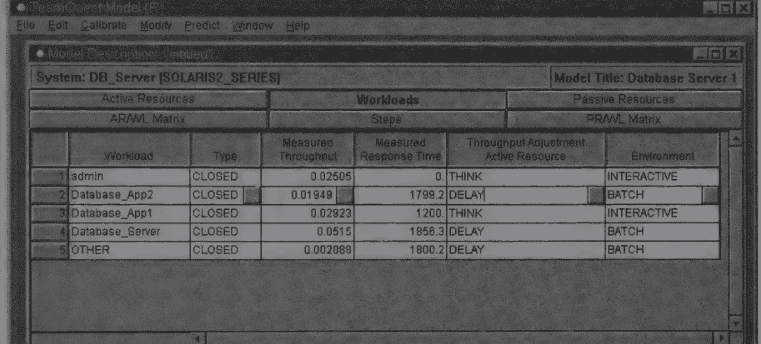

**图 7-1** TeamQuest 模型

被建模的系统是一个数据库服务器，数据库实例和两个中间件应用程序运行在同一系统上。`admin` 负载包含管理功能，包括可用性、性能以及应用测量和报告工具。`OTHER` 负载包括所有正在被测量但未分配给特定负载类别的其他工作。

现在可以对模型进行调整和求解，如图 7-2 所示，为每个样本周期将各种系统活动和被动资源分配给负载。

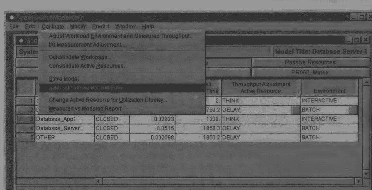

图 7-2 TeamQuest 模型：调整与求解

我们将尽可能准确地求解模型，并从报告窗口中提取结果，如图 7-3 所示。生成的标准报告包含几个用于进一步分析的有趣统计数据。主要结果（Principal Results）报告包含吞吐量、响应时间、数量、伸缩因子（stretch factor）以及被动资源（内存或最大多程序水平）资源的统计数据。

伸缩因子代表等待资源消耗的时间与处理事务或工作单元消耗的总时间之间的比较。较高的伸缩因子表示资源等待时间的相对数量较高。1.0 的伸缩因子表示负载没有等待资源，并且以最高可能的效率运行。大于 2.0 的伸缩因子应该被分析——它们表明资源存在严重短缺，处理时间等于等待时间。

活动资源报告（Active Resource report）包含了系统中监控的每个活动资源的资源统计数据，如吞吐量、服务时间、等待时间、平均队列长度和服务器实例数量。示例中的活动资源包括 CPU、控制器和磁盘。

| 系统: DB_Server(SOLARIS_2) | | | | | | | | |
|---|---|---|---|---|---|---|---|---|
| 活动资源 | | 负载 | | | 被动资源 | | | |
| HRWL 矩阵 | | | | | | PRWL 矩阵 | | |
| 负载 | 类型 | 测量吞吐量 | 测量响应时间 | 吞吐量调整活动资源 | 环境 | | | |
| `admin` | CLOSED | 0.02500 | 0 | INTERACTIVE | | | | |
| `Database_App2` | CLOSED | 0.01949 | 1799.2 | | BATCH | | | |
| `Database_App1` | CLOSED | 0.02923 | 1200 | INTERACTIVE | | | | |
| `Database_Server` | CLOSED | 0.09512 | 95 | | BATCH | | | |
| `OTHER` | CLOSED | 0.00208 | 1800.2 | | BATCH | | | |

| 模型标题: Database Server(SOLARIS_2) | | | | | | | | |
|---|---|---|---|---|---|---|---|---|
| 步骤名称: Step_1 | 求解于: 22:41:04.8 | 2000/04/24 由 MYAP 完成 | 第 1 步 | < > | | | | |
| 主要结果 | | AR 统计 | | PR 统计 | | | | |
| 按 AR 统计的负载 | | | 测量值 建模 | | | | | |
| 负载 | 测量数量 | 测量响应 | 建模 CPU | 吞吐量 | 建模响应 | 建模 CPU | | |
| `admin` | 47 | 0.02500 | 9.3 | 0.02500 | 1.1334 | 0.37426 | | |
| `Database_App2` | 35 | 0.01949 | 1799.2 | 22.392 | 177.28 | 31.393 | | |
| `Database_App1` | 55 | 0.02923 | 1200 | 0.2195 | 4.2092 | 32.199 | | |
| `Database_Server` | 95 | 0.05515 | 1956.3 | 0.05149 | 1837.91 | 4.2078 | | |
| `OTHER` | 0.00208 | 1800.2 | 0.75402 | 0.02026 | 1783.26 | 0.75356 | | |

图 7-3 TeamQuest 模型：带结果求解

按活动资源统计的负载（Workload by Active Resource Statistics）详细列出了系统活动资源报告中所报告的活动资源，并将消耗的资源与模型中配置的负载相关起来。每个活动资源的利用率都报告为系统总量的百分比，简化了相对进程权重的比较。现在可以对实际负载的独立资源消耗特征进行分析，也可以分析建模负载之间的资源消耗和可能的竞争。

使用 TeamQuest 模型进行容量规划 157

通过校准的模型，我们现在可以添加步骤来定义预测负载（见图 7-4）。在此示例中，所有负载都分配了每月 5% 的增长因子，该因子应用于事务率和活动资源访问。活动资源访问是指对 CPU、控制器或队列等给定资源的访问计数。

| 系统: DB_Server(SERIES2) | | | 负载 | 被动资源 |
|---|---|---|---|---|
| 活动资源 | | | | RAW-矩阵 |
| 步骤 | | | | |
| ARWL 矩阵 | 负载增长类型 | 1 月步 | 2 月步 | 3 月步 | 4 月步 | 5 月步 | 6 月步 |
| `admin` | 数量 | 47.228 | 49.509 | 52.068 | 54.672 | 57.408 | 60.276 |
| `admin` | 相对访问计数 | 1.05 | 1.1025 | 1.1576 | 1.2125 | 1.2673 |
| `Database_App2` | 数量 | 35.057 | 36.81 | 38.653 | 40.612 | 44.368 | 47.441 |
| `Database_App2` | 相对访问计数 | 1.05 | 1.1025 | 1.1576 | 1.2125 | 1.2673 |
| `Database_App1` | 数量 | 53.332 | 55.989 | 61.004 | 64.804 | 69.056 | 73.709 |
| `Database_App1` | 相对访问计数 | 1.05 | 1.1025 | 1.1576 | 1.2125 | 1.2673 |
| `Database_Server` | 数量 | 95.593 | 100.373 | 105.391 | 110.661 | 116.194 | 122.004 |
| `Database_Server` | 相对访问计数 | 1.05 | 1.1025 | 1.1576 | 1.2125 | 1.2673 |
| `OTHER` | 数量 | 3.7582 | 3.9461 | 4.1434 | 4.3508 | 4.5681 | 4.7965 |
| `OTHER` | 相对访问计数 | 1.05 | 1.1025 | 1.1576 | 1.2125 | 1.2673 |

图 7-4 TeamQuest 模型：复合增长步骤

包含新负载计算的校准模型现在可以导出到 Microsoft Excel 中创建性能数据的图表和表格。性能数据和资源消耗针对整个系统进行了绘图，并定义了每个负载。

我们将检查的第一个图表是按负载划分的伸缩因子图（见图 7-5）。该图显示了负载等待时间占总事务时间的预测增长。图表显示了代表每个步骤每个负载的列（在此示例中，每月复合增长 5%）。建模的“Database_App”负载在四月期间的某一步显示出远大于 2.0 的伸缩因子。伸缩因子从略高于 2.0 增加到远大于 4.0，代表六月的预测负载。

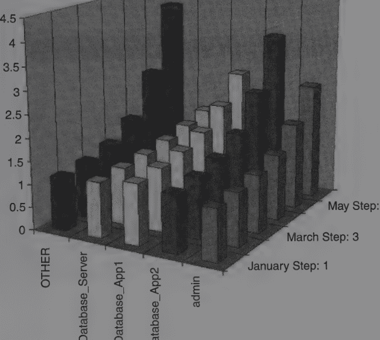

图 7-5 TeamQuest 模型：负载伸缩因子图

`Database_App2` 负载似乎出现了响应时间增加，这表明资源竞争问题。这是预期，伸缩因子表示相对队列等待时间和资源服务时间的增加。

我们还可以查看 `Database_App2` 负载的吞吐量数据和图表。从图 7-6 和随附电子表格提供的数据可以看出，注意到测量负载的吞吐量随步骤增加的。此外，注意到 `Database_App2` 负载吞吐量的增长速度没有建议的负载步骤“访问计数”或事务量的增长。

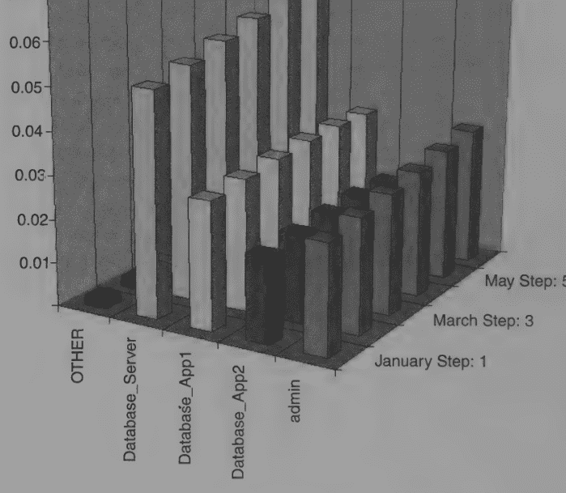

图 7-6 TeamQuest 模型：负载吞吐量图

我们可以使用 `Database_App2` 负载的响应时间组成部分图进一步分析此负载的行为。图 7-7 说明了负载内事务或工作单元消耗的时间以及在负载中花费的时间。这被细分为活动资源服务时间和活动资源队列延迟。这些图表之间给定负载活动之间（服务空闲时）的时间被称为 `DELAY` 时间，以便我们能够更好地分析实际资源消耗和资源请求延迟。


在图 7-8 所示的“活动资源利用率”图中，我们看到了最繁忙的系统活动资源，其中 CPU 利用率呈现出较高的上升趋势。这些值针对的是建模增长期间的 CPU，以及其他最繁忙的系统活动资源（在本例中为磁盘资源）。


**图 7-8** TeamQuest 模型：系统活动资源利用率图

当模型达到第六步（仅剩五个月）时，预计 CPU 资源利用平均利用率将超过 95%。第 1 步显示，我们目前的模型运行率约为 70%，实测工作负载的活动资源利用率显示出资源队列延迟时间非常短（表明活动资源不存在竞争）。在第 2 步，工作负载开始显示出一些竞争和 CPU 队列延迟，CPU 利用率刚刚超过 75%。这一趋势表明，我们应该将 KPI 最大 CPU 利用率阈值设定为 70%。

为了解决这一性能趋势，我们有几种选择：我们可以升级服务器以配备更多或更快的 CPU，或者可以将部分工作从该机器移动到另一台服务器。该建模系统是一台 Sun Enterprise 10000 服务器，配备 250 MHz UltraSPARC CPU 和 4 MB E 缓存。在本例中，选定的解决方案是使用图 7-9 所示的 TeamQuest 模型“更改 CPU 名称”功能，将系统的 CPU 一一升级为配备 8 MB E 缓存的 400 MHz UltraSPARC CPU。通过此解决方案，我们可以返回 TeamQuest 模型窗口，基于当前模型创建名为“假设框架（what if frames）”的备方案，并修改系统资源以预测不断增长的工作负载在新系统配置下的性能。


图 7-9 TeamQuest 模型：更改 CPU 定义

使用 TeamQuest 模型进行容量规划 163

在使用新的硬件配置重新计算步骤后，我们可以使用 MVAP（平均值近似程序包）求解器通过运行相同的工作负载步骤，预测新系统模型中的系统资源利用率、响应时间和队列延迟。检查新系统配置的“伸缩因子图”（见图 7-10），可以查看新系统模型中活动资源的相对队列延迟时间。


**图 7-10** TeamQuest 模型：升级后的系统伸缩因子图

伸缩因子图现在显示，所有建模工作负载在所有步骤中的伸缩因子均低于 2.0。此外，`Database_App2` 工作负载显示出每单位工作延迟时间在逐渐增加。我们可以通过检查“资源组件响应时间”图，深入研究新服务器系统上 `Database_App2` 负载的特征。

图 7-11 显示，由于升级，`Database_App2` 负载的 CPU 等待队列时间已显著减少；它还显示在增长模型的后期，单位工作的总响应时间也大大缩短了。


图 7-11 TeamQuest 模型：升级后的组件响应时间图

我们也可以通过查看电子表格数据或查看“活动资源利用率”图（见图 7-12）来检查系统总 CPU 利用率。CPU 和磁盘活动资源绘制了当前实测工作负载，以及新服务器平台模型中五个复合增长步骤的数据。


**图 7-12** TeamQuest 模型：升级后的系统活动资源利用率

新服务器平台的建模性能显示，在复合增长模型的第 5 步（即五个月后），CPU 利用率将接近 70%。通过预测这种增长，并使用实测工作负载在 70% CPU 利用率阈值出现性能下降之前的模型，我们可以计划在五个月后对系统进行下一次升级。我们可以通过增加增长步骤进一步预测模型，并使用其他硬件升级场景。为了最大化模型的准确性并考虑到工作负载中可能的软件更改，我们将继续监控并报告系统性能。此外，我们将在未来性能下降发生之前的某个时候建立一个新模型。

活动资源利用率图显示磁盘在整个模型过程中变得繁忙，且 `Database_Server`、`Database_App1` 和 `Database_App2` 工作负载开始出现磁盘资源队列延迟。我们可以返回模型并升级磁盘子系统以提供更多资源能力，或在它们之间增加工作负载资源。

166 第 7 章 工具概述与评估

# 总结

本章介绍了用于容量规划的工具的详细调查，并讨论了使用 Sun 和第三方工具的优势。此外，本章还提供了几种平衡系统内部及跨系统峰值负载的方法，以消除系统压力和利用不足。附录 A 包含若干表格，显示了使用 Solaris 2.5、2.5.1、7 和 8 配置的处理能力。

# 附录 A：Sun 恒定性能容量估算

恒定性能指标为容量规划而设计。它表示硬件和操作系统的处理能力。除了比较系统外，该指标提供了一种表达系统完成工作量的方便方法。该指标根据实测值进行缩放。在升级之前，应该检查操作系统的趋势，以为预测升级对性能可能产生的影响提供指导。下表提供了 Solaris 2.5、2.5.1、7 和 8 版本的完整容量估算列表。在表中，`NCPU` 代表 CPU 的数量。

## 估算表 A-1：Enterprise 3000 - 6500

| `NCPU` | 400/8MB | 400/4MB | 336/4MB | 250/4MB | 250/1MB | 167/512K |
| :--- | :--- | :--- | :--- | :--- | :--- | :--- |
| 1 | 4210 | 3900 | 3300 | 2750 | 2290 | 167 |
| 2 | 8420 | 7800 | 6600 | 5500 | 4580 | 334 |
| 3 | 12630 | 11700 | 9900 | 8250 | 6940 | 501 |
| 4 | 16840 | 15600 | 13200 | 11000 | 9160 | 668 |
| 5 | 21050 | 19500 | 16500 | 13750 | 11450 | 835 |
| 6 | 25260 | 23400 | 19800 | 16500 | 13740 | 1002 |
| 7 | 29470 | 27300 | 23100 | 19250 | 16030 | 1169 |
| 8 | 33680 | 31200 | 26400 | 22000 | 18320 | 1336 |
| 9 | 37890 | 35100 | 29700 | 24750 | 20610 | 1503 |
| 10 | 42100 | 39000 | 33000 | 27500 | 22900 | 1670 |
| 11 | 46310 | 42900 | 36300 | 30250 | 25190 | 1837 |
| 12 | 50520 | 46800 | 39600 | 33000 | 27480 | 2004 |
| 13 | 54730 | 50700 | 42900 | 35750 | 29770 | 2171 |
| 14 | 58940 | 54600 | 46200 | 38500 | 32060 | 2338 |
| 15 | 63150 | 58500 | 49500 | 41250 | 34350 | 2505 |
| 16 | 67360 | 62400 | 52800 | 44000 | 36640 | 2672 |
| 17 | 71570 | 66300 | 56100 | 46750 | 38930 | 2839 |
| 18 | 75780 | 70200 | 59400 | 49500 | 41220 | 3006 |
| 19 | 79990 | 74100 | 62700 | 52250 | 43510 | 3173 |
| 20 | 84200 | 78000 | 66000 | 55000 | 45800 | 3340 |


| 21 | 88410 | 81900 | 69300 | 57750 | 48090 | 3507 |
| 22 | 92620 | 85800 | 72600 | 60500 | 50380 | 3674 |
| 23 | 96830 | 89700 | 75900 | 63250 | 52670 | 3841 |
| 24 | 101040 | 93600 | 79200 | 66000 | 54960 | 4008 |

## 估算表 A-1 Enterprise 3000 – Enterprise 6500（续）

| NCPU | 400/8MB | 400/4MB | 336/4MB | 250/4MB | 250/2MB | 167/1MB | 167/512K |
|---|---|---|---|---|---|---|---|
| 25 | 71000 | 68700 | 58500 | 49500 | 30200 | 25200 | 20100 |
| 26 | 72700 | 70500 | 60100 | 50800 | 30700 | 25700 | 20400 |
| 27 | 74400 | 72200 | 61600 | 52100 | 31200 | 26100 | 20600 |
| 28 | 76000 | 73900 | 63000 | 53400 | 31600 | 26600 | 20900 |
| 29 | 77500 | 75500 | 64400 | 54600 | 32000 | 27000 | 21100 |
| 30 | 79000 | 77100 | 65800 | 55800 | 32400 | 27400 | 21300 |

## 估算表 A-2 Enterprise 10000 (Starfire)

| NCPU | 400/8MB | 400/4MB | 336/4MB | 250/4MB | 250/1MB |
|---|---|---|---|---|---|
| 1 | 3920 | 3630 | 2970 | 2360 | 2120 |
| 2 | 7780 | 7190 | 5900 | 4680 | 4180 |
| 3 | 11500 | 10600 | 8770 | 6960 | 6180 |
| 4 | 15300 | 14100 | 11500 | 9200 | 8120 |
| 5 | 18900 | 17400 | 14300 | 11400 | 10000 |
| 6 | 22600 | 20700 | 17000 | 13500 | 11800 |
| 7 | 26100 | 24000 | 19700 | 15700 | 13600 |
| 8 | 29600 | 27200 | 22300 | 17700 | 15300 |
| 9 | 33100 | 30300 | 24900 | 19800 | 16900 |
| 10 | 36500 | 33400 | 27400 | 21800 | 18600 |
| 11 | 39800 | 36400 | 29900 | 23800 | 20100 |
| 12 | 43100 | 39300 | 32300 | 25800 | 21600 |
| 13 | 46300 | 42200 | 34700 | 27700 | 23100 |
| 14 | 49500 | 45000 | 37000 | 29600 | 24500 |
| 15 | 52600 | 47800 | 39300 | 31400 | 25900 |
| 16 | 55700 | 50600 | 41500 | 33300 | 27300 |
| 17 | 58800 | 53200 | 43800 | 35100 | 28600 |
| 18 | 61700 | 55900 | 45900 | 36800 | 29900 |
| 19 | 64700 | 58500 | 48100 | 38500 | 31100 |
| 20 | 67600 | 61000 | 50100 | 40300 | 32300 |
| 21 | 70400 | 63500 | 52200 | 41900 | 33400 |
| 22 | 73200 | 65900 | 54200 | 43600 | 34600 |
| 23 | 76000 | 68300 | 56200 | 45200 | 35600 |
| 24 | 78700 | 70600 | 58100 | 46800 | 36700 |
| 25 | 81300 | 73000 | 60000 | 48300 | 37700 |
| 26 | 83900 | 75200 | 61900 | 49900 | 38700 |
| 27 | 86500 | 77400 | 63700 | 51400 | 39700 |
| 28 | 89100 | 79600 | 65500 | 52900 | 40600 |
| 29 | 91600 | 81700 | 67300 | 54300 | 41500 |
| 30 | 94000 | 83800 | 69000 | 55800 | 42400 |
| 31 | 96400 | 85900 | 70700 | 57200 | 43200 |
| 32 | 98800 | 87900 | 72400 | 58600 | 44100 |
| 33 | 101000 | 89900 | 74000 | 59900 | 44900 |
| 34 | 103000 | 91800 | 75600 | 61300 | 45700 |
| 35 | 105000 | 93700 | 77200 | 62600 | 46400 |
| 36 | 108000 | 95600 | 78800 | 63900 | 47100 |
| 37 | 110000 | 97400 | 80300 | 65200 | 47800 |
| 38 | 112000 | 99100 | 81800 | 66400 | 48500 |
| 39 | 114000 | 101000 | 83300 | 67600 | 49200 |
| 40 | 116000 | 102000 | 84700 | 68900 | 49900 |
| 41 | 118000 | 104000 | 86100 | 70000 | 50500 |
| 42 | 120000 | 106000 | 87500 | 71200 | 51100 |
| 43 | 122000 | 107000 | 88800 | 72400 | 51700 |
| 44 | 124000 | 109000 | 90200 | 73500 | 52300 |
| 45 | 126000 | 110000 | 91500 | 74600 | 52800 |
| 46 | 128000 | 112000 | 92800 | 75700 | 53400 |
| 47 | 130000 | 114000 | 94000 | 76800 | 53900 |
| 48 | 132000 | 115000 | 95300 | 77800 | 54400 |
| 49 | 133000 | 116000 | 96500 | 78900 | 54900 |
| 50 | 135000 | 118000 | 97700 | 79900 | 55400 |
| 51 | 137000 | 119000 | 98900 | 80900 | 55800 |
| 52 | 139000 | 121000 | 100000 | 81900 | 56300 |
| 53 | 140000 | 122000 | 101000 | 82800 | 56700 |
| 54 | 142000 | 123000 | 102000 | 83800 | 57100 |
| 55 | 144000 | 125000 | 103000 | 84700 | 57500 |
| 56 | 145000 | 126000 | 104000 | 85600 | 57900 |
| 57 | 147000 | 127000 | 105000 | 86500 | 58300 |

## 估算表 A-2 Enterprise 10000 (Starfire)（续）

| NCPU | 400/8MB | 400/4MB | 336/4MB | 250/4MB | 250/1MB |
|---|---|---|---|---|---|
| 58 | 148000 | 128000 | 106000 | 87400 | 58700 |
| 59 | 150000 | 130000 | 107000 | 88300 | 59100 |
| 60 | 152000 | 131000 | 108000 | 89200 | 59400 |
| 61 | 153000 | 132000 | 109000 | 90000 | 59800 |
| 62 | 155000 | 133000 | 110000 | 90800 | 60100 |
| 63 | 156000 | 134000 | 111000 | 91600 | 60400 |
| 64 | 157000 | 135000 | 112000 | 92400 | 60700 |

## 估算表 A-3 Enterprise 250 / 450

| NCPU | 400/2MB | 300/2MB | 250/2MB |
|---|---|---|---|
| 1 | 3250 | 2670 | 2130 |
| 2 | 6420 | 5260 | 4110 |
| 4 | 12200 | 10000 | 8000 |

## 估算表 A-4 Ultra-2 / Ultra-60 / Ultra-30

| NCPU | 360/2MB | 300/2MB | 200/2MB |
|---|---|---|---|
| 1 | 3150 | 2670 | 2160 |
| 2 | 5850 | 4950 | 4010 |

## 估算表 A-5 Ultra-5 / Ultra-10

| NCPU | 440/2MB | 360/512K | 300/512K | 266/512K |
|---|---|---|---|---|
| 1 | 2800 | 2070 | 1750 |

## 估算表 A-6 Ultra-1

| NCPU | 167/512K | 143/512K |
|---|---|---|
| 1 | 1220 | 1040 |

## 旧款 Sun 系统

### 估算表 A-7 SPARC1000E / SPARCserver1000

| NCPU | 85/1MB | 60/1MB | 50/1MB | 40/1MB |
|---|---|---|---|---|
| 1 | 648 | 562 | 398 | 349 |
| 2 | 1260 | 1090 | 747 | 653 |
| 3 | 1840 | 1600 | 1050 | 918 |
| 4 | 2380 | 2080 | 1320 | 1140 |
| 5 | 2900 | 2540 | 1560 | 1340 |
| 6 | 3390 | 2970 | 1770 | 1520 |
| 7 | 3850 | 3380 | 1950 | 1670 |
| 8 | 4290 | 3780 | 2120 | 1800 |

### 估算表 A-8 SPARCserver2000E / SPARCserver2000

| NCPU | 85/2MB | 60/2MB | 60/1MB | 50/2MB | 50/1MB | 40/1MB |
|---|---|---|---|---|---|---|
| 1 | 755 | 694 | 639 | 588 | 407 | 358 |
| 2 | 1480 | 1370 | 1260 | 1160 | 794 | 701 |
| 3 | 2190 | 2040 | 1870 | 1730 | 1160 | 1020 |
| 4 | 2880 | 2690 | 2470 | 2290 | 1500 | 1330 |
| 5 | 3550 | 3330 | 3060 | 2850 | 1830 | 1630 |
| 6 | 4200 | 3960 | 3640 | 3390 | 2150 | 1920 |
| 7 | 4830 | 4570 | 4210 | 3930 | 2450 | 2190 |
| 8 | 5440 | 5180 | 4760 | 4460 | 2730 | 2450 |
| 9 | 6030 | 5770 | 5300 | 4980 | 3000 | 2700 |
| 10 | 6600 | 6350 | 5840 | 5490 | 3250 | 2930 |
| 11 | 7160 | 6910 | 6360 | 6000 | 3490 | 3160 |
| 12 | 7700 | 7470 | 6870 | 6490 | 3720 | 3380 |
| 13 | 8220 | 8010 | 7370 | 6980 | 3940 | 3580 |
| 14 | 8730 | 8550 | 7860 | 7470 | 4150 | 3780 |
| 15 | 9220 | 9070 | 8340 | 7940 | 4340 | 3970 |
| 16 | 9700 | 9580 | 8820 | 8410 | 4530 |
| 17 | 10100 | 10000 | 9280 | 8870 | 4720 |
| 18 | 10600 | 10500 | 9730 | 9330 | 4880 |
| 19 | 11000 | 11000 | 10100 | 9770 | 5040 |
| 20 | 11400 | 11500 | 10600 | 10200 | 5190 |

### 估算表 A-9 SPARCstation20

| NCPU | 75/1MB | 60/1MB | 50/1MB |
|---|---|---|---|
| 1 | 576 | 478 | 363 |
| 2 | 1110 | 927 | 705 |

### 估算表 A-10 SPARCstation100 / SPARCserver600

| NCPU | 50/1MB | 40/64K |
|---|---|---|
| 1 | 305 | 256 | 184 |
| 2 | 593 | 498 | 365 |

### 估算表 A-11 SPARCstation / SPARCstationIP

| NCPU | 40/64K |
|---|---|
| 1 | 157 |

### 估算表 A-12 Enterprise 3000 – Enterprise 650

| NCPU | 400/8MB | 400/4MB | 336/4MB | 250/4MB | 250/1MB | 167/512K |
|---|---|---|---|---|---|---|
| 1 | 4210 | 3900 | 3300 | 2750 | 2290 | 1740 |
| 2 | 8350 | 7720 | 6550 | 5460 | 4580 | 3410 |
| 3 | 12400 | 11400 | 9740 | 6850 | 5820 | 5110 |
| 4 | 16400 | 15100 | 12800 | 8580 | 7160 | 6540 |
| 5 | 20300 | 18700 | 15900 | 10400 | 8700 | 8030 |
| 6 | 24100 | 22200 | 18900 | 12300 | 10150 | 9410 |
| 7 | 27900 | 25600 | 21400 | 14100 | 11700 | 10790 |
| 8 | 31600 | 29400 | 23600 | 16000 | 13200 | 12170 |
| 9 | 35300 | 33100 | 26200 | 17900 | 14700 | 13550 |
| 10 | 39000 | 36800 | 28700 | 19800 | 16300 | 14930 |
| 11 | 42700 | 39600 | 31300 | 21800 | 18000 | 16310 |
| 12 | 46300 | 43100 | 33900 | 23800 | 19800 | 17690 |
| 13 | 50000 | 46500 | 36500 | 25700 | 21400 | 19070 |
| 14 | 53600 | 50100 | 39200 | 27600 | 23100 | 20450 |
| 15 | 57300 | 53200 | 41900 | 29600 | 24700 | 21830 |
| 16 | 60900 | 56600 | 44500 | 31500 | 26400 | 23210 |
| 17 | 64600 | 59200 | 47100 | 33500 | 28100 | 24590 |
| 18 | 68300 | 62700 | 49700 | 35400 | 29700 | 25970 |
| 19 | 72000 | 66100 | 52400 | 37400 | 31400 | 27350 |
| 20 | 75700 | 69600 | 55100 | 39300 | 33100 | 28730 |
| 21 | 79400 | 72500 | 57700 | 41300 | 34800 | 30110 |
| 22 | 83100 | 75900 | 60300 | 43300 | 36500 | 31490 |
| 23 | 86800 | 79300 | 63000 | 45300 | 38200 | 32870 |


| 24 | 90500 | 82200 | 65700 | 47300 | 39900 | 34250 |

| 25 | 94200 | 85500 | 68400 | 49300 | 41700 | 35630 |

## 估算表 A-12 Enterprise 3000 – Enterprise 6500（续）

| NCPU | 400/8MB | 400/4MB | 336/4MB | 250/4MB | 250/1MB | 167/1MB | 167/512K |
|---|---|---|---|---|---|---|---|
| 26 | 88100 | 78800 | 68700 | 58400 | 35600 | 27600 | 22000 |
| 27 | 90700 | 81000 | 70800 | 60200 | 36300 | 28200 | 22300 |
| 28 | 93300 | 83200 | 72800 | 61900 | 36900 | 27800 | 22600 |
| 29 | 95900 | 85400 | 74700 | 63700 | 37600 | 29200 | 22900 |
| 30 | 98400 | 87500 | 76700 | 65300 | 38200 | 29700 | 23200 |

## 估算表 A-13 Enterprise 10000 (Starfire)

| NCPU | 400/8MB | 400/4MB | 336/4MB | 250/4MB | 250/1MB |
|---|---|---|---|---|---|
| 1 | 3920 | 3630 | 2970 | 2360 | 2120 |
| 2 | 7800 | 7210 | 5920 | 4690 | 4200 |
| 3 | 11600 | 10700 | 8830 | 7000 | 6230 |
| 4 | 15400 | 14200 | 11700 | 9290 | 8210 |
| 5 | 19100 | 17600 | 14500 | 11500 | 10100 |
| 6 | 22800 | 21100 | 17300 | 13800 | 12000 |
| 7 | 26400 | 24400 | 20100 | 16000 | 13800 |
| 8 | 30100 | 27700 | 22800 | 18200 | 15600 |
| 9 | 33600 | 31000 | 25500 | 20400 | 17400 |
| 10 | 37100 | 34200 | 28200 | 22500 | 19100 |
| 11 | 40600 | 37400 | 30800 | 24700 | 20800 |
| 12 | 44000 | 40600 | 33400 | 26800 | 22500 |
| 13 | 47400 | 43700 | 36000 | 28900 | 24100 |
| 14 | 50800 | 46700 | 38600 | 30900 | 25600 |
| 15 | 54100 | 49800 | 41100 | 33400 | 27200 |
| 16 | 57400 | 52700 | 43600 | 35000 | 28700 |
| 17 | 60600 | 55700 | 46000 | 37000 | 30100 |
| 18 | 63800 | 58600 | 48400 | 39000 | 31600 |
| 19 | 67000 | 61500 | 50800 | 41000 | 33000 |
| 20 | 70100 | 64300 | 53200 | 42900 | 34300 |
| 21 | 73200 | 67100 | 55600 | 44900 | 35700 |
| 22 | 76200 | 69900 | 57900 | 46800 | 37000 |
| 23 | 79200 | 72600 | 60100 | 48700 | 38300 |
| 24 | 82200 | 75300 | 62400 | 50500 | 39500 |

## 估算表 A-13 Enterprise 10000 (Starfire)（续）

| NCPU | 400/8MB | 400/4MB | 336/4MB | 250/4MB | 250/1MB |
|---|---|---|---|---|---|
| 25 | 85100 | 77900 | 64600 | 52400 | 40700 |
| 26 | 88000 | 80500 | 66800 | 54200 | 41900 |
| 27 | 90900 | 83100 | 69000 | 56000 | 43100 |
| 28 | 93700 | 85700 | 71200 | 57800 | 44200 |
| 29 | 96500 | 88200 | 73300 | 59600 | 45300 |
| 30 | 99300 | 90700 | 75400 | 61400 | 46400 |
| 31 | 102000 | 93100 | 77500 | 63100 | 47400 |
| 32 | 104000 | 93100 | 79500 | 64900 | 48500 |
| 33 | 107000 | 97900 | 81500 | 66600 | 49500 |
| 34 | 110000 | 100000 | 83500 | 68300 | 50500 |
| 35 | 112000 | 102000 | 85500 | 69900 | 51400 |
| 36 | 115000 | 104000 | 87500 | 71600 | 52400 |
| 37 | 117000 | 107000 | 89400 | 73200 | 53300 |
| 38 | 120000 | 109000 | 91300 | 74900 | 54200 |
| 39 | 122000 | 111000 | 93200 | 76500 | 55100 |
| 40 | 125000 | 113000 | 95000 | 78100 | 55900 |
| 41 | 127000 | 116000 | 96900 | 79700 | 56800 |
| 42 | 130000 | 118000 | 98700 | 81200 | 57600 |
| 43 | 132000 | 120000 | 100000 | 82800 | 58400 |
| 44 | 134000 | 122000 | 102000 | 84300 | 59200 |
| 45 | 137000 | 124000 | 104000 | 85800 | 59900 |
| 46 | 139000 | 126000 | 105000 | 87300 | 60700 |
| 47 | 141000 | 128000 | 107000 | 88800 | 61400 |
| 48 | 143000 | 130000 | 109000 | 90300 | 62100 |
| 49 | 145000 | 132000 | 110000 | 91700 | 62800 |
| 50 | 148000 | 134000 | 112000 | 93200 | 63500 |
| 51 | 151000 | 136000 | 114000 | 94600 | 64200 |
| 52 | 152000 | 137000 | 115000 | 96000 | 64800 |
| 53 | 154000 | 139000 | 117000 | 97400 | 65400 |
| 54 | 156000 | 141000 | 118000 | 98800 | 66100 |
| 55 | 158000 | 143000 | 120000 | 100000 | 66700 |
| 56 | 160000 | 145000 | 122000 | 101000 | 67300 |
| 57 | 162000 | 146000 | 123000 | 102000 | 67800 |
| 58 | 164000 | 148000 | 125000 | 104000 | 68400 |

## 估算表 A-13 Enterprise 10000 (Starfire)(续）

| NCPU | 400/8MB | 400/4MB | 336/4MB | 250/4MB | 250/1MB |
|---|---|---|---|---|---|
| 59 | 166000 | 150000 | 126000 | 105000 | 69000 |
| 60 | 168000 | 152000 | 127000 | 106000 | 69500 |
| 61 | 170000 | 153000 | 129000 | 108000 | 70000 |
| 62 | 172000 | 155000 | 130000 | 109000 | 70500 |
| 63 | 174000 | 156000 | 132000 | 110000 | 71000 |
| 64 | 175000 | 158000 | 133000 | 111000 | 71500 |

## 工作组服务器

## 估算表 A-14 Enterprise 250 / Enterprise 450

| NCPU | 400/2MB | 300/2MB | 250/2MB |
|---|---|---|---|
| 1 | 3920 | 3210 | 2570 |
| 2 | 7730 | 6340 | 4960 |
| 4 | 14800 | 12100 | 9650 |

## 桌面级服务器

## 估算表 A-15 Ultra-2 / Ultra-60 / Ultra-30

| NCPU | 360/2MB | 300/2MB | 200/2MB |
|---|---|---|---|
| 1 | 3790 | 3210 | 2600 |
| 2 | 7040 | 5970 | 4830 |

## 估算表 A-16 Ultra-5 / Ultra-10

| NCPU | 440/2MB | 360/512K | 300/512K | 266/512K |
|---|---|---|---|---|
| 1 | 3380 | 2490 | 2110 | 1900 |

## 估算表 A-17 Ultra-1

| NCPU | 167/512K | 143/512K |
|---|---|---|
| 1 | 1470 | 1250 |

| NCPU | 85/1MB | 60/1MB | 50/1MB | 40/1MB |
|---|---|---|---|---|
| 1 | 649 | 610 | 432 | 380 |
| 2 | 1260 | 1190 | 812 | 710 |
| 3 | 1840 | 1740 | 1140 | 997 |
| 4 | 2390 | 2260 | 1440 | 1240 |
| 5 | 2900 | 2760 | 1700 | 1460 |
| 6 | 3390 | 3230 | 1920 | 1650 |
| 7 | 3860 | 3680 | 2120 | 1810 |
| 8 | 4290 | 4100 | 2300 | 1960 |

## 估算表 A-19 SPARC2000 / SPARC2000

| NCPU | 85/2MB | 60/2MB | 50/2MB | 40/2MB |
|---|---|---|---|---|
| 1 | 820 | 755 | 694 | 589 |
| 2 | 1630 | 1500 | 1380 | 1270 |
| 3 | 2430 | 2230 | 2060 | 1890 |
| 4 | 3220 | 2960 | 2730 | 2510 |
| 5 | 4010 | 3690 | 3390 | 3120 |
| 6 | 4780 | 4400 | 4050 | 3720 |
| 7 | 5550 | 5110 | 4700 | 4320 |
| 8 | 6310 | 5800 | 5340 | 4910 |
| 9 | 7060 | 6500 | 5980 | 5550 |
| 10 | 7800 | 7180 | 6660 | 6080 |
| 11 | 8540 | 7850 | 7230 | 6650 |
| 12 | 9260 | 8520 | 7840 | 7210 |
| 13 | 9980 | 9180 | 8450 | 7770 |
| 14 | 10600 | 9840 | 9050 | 8330 |
| 15 | 11300 | 10400 | 9640 | 8870 |
| 16 | 12000 | 11100 | 10200 | 9410 |
| 17 | 12700 | 11700 | 10800 | 9950 |
| 18 | 13400 | 12300 | 11300 | 10440 |
| 19 | 14100 | 13000 | 11900 | 11000 |
| 20 | 14700 | 13600 | 12500 | 11500 |

## 估算表 A-20 SPARC20

| NCPU | 75/1MB | 60/1MB | 50/1MB |
|---|---|---|---|
| 1 | 626 | 519 | 385 |
| 2 | 1210 | 1000 | 767 |
| 4 | | 1450 |

## 估算表 A-21 SPARC10

| NCPU | 50/1MB | 40/1MB |
|---|---|---|
| 1 | 331 | 278 |
| 2 | 644 | 541 |
| 4 | 1210 | |

## 估算表 A-22 SPARCIPX

| NCPU | 40/64K |
|---|---|
| 1 | 156 |

## Solaris 7 和操作系统环境

## 估算表 A-23 Enterprise 3000 – Enterprise 6500

| NCPU | 400/8MB | 400/4MB | 336/4MB | 250/4MB | 250/1MB | 167/1MB | 167/512K |
|---|---|---|---|---|---|---|---|
| 1 | 4210 | 3900 | 3300 | 2710 | 2360 | 1880 | 1670 |
| 2 | 8360 | 7730 | 6550 | 5380 | 4620 | 3710 | 3260 |
| 3 | 12400 | 11400 | 9740 | 8000 | 6870 | 5560 | 4710* |
| 4 | 16400 | 15100 | 12800 | 10500 | 8870 | 7160 | 6240 |
| 5 | 20400 | 18700 | 15900 | 13100 | 10800 | 8800 | 7630 |
| 6 | 24300 | 22100 | 18900 | 15600 | 13700 | 10500 | 9160 |
| 7 | 28200 | 25700 | 21900 | 18000 | 15200 | 12400 | 10900 |
| 8 | 32000 | 29100 | 24800 | 20400 | 17300 | 14100 | 12200 |
| 9 | 35700 | 32400 | 27700 | 22800 | 19200 | 15600 | 13300 |
| 10 | 39400 | 35700 | 30500 | 25100 | 21600 | | |
| 11 | 43000 | 38800 | 33200 | 27400 | 23200 | | |
| 12 | 46600 | 42000 | 35900 | 29600 | 24700 | | |
| 13 | 50100 | 45000 | 38600 | 31800 | 26100 | | |
| 14 | 53600 | 48000 | 41200 | 34000 | 25500 | | |
| 15 | 57000 | 51000 | 43800 | 36100 | 26800 | | |
| 16 | 60300 | 53900 | 46300 | 38200 | 28100 | | |
| 17 | 63600 | 56700 | 48800 | 40300 | 29300 | | |
| 18 | 66900 | 59500 | 51200 | 42300 | 30400 | | |
| 19 | 70100 | 62200 | 53600 | 44300 | 31500 | | |
| 20 | 73300 | 64800 | 55800 | 46300 | 32600 | | |
| 21 | 76400 | 67400 | 58200 | 48200 | 33600 | | |
| 22 | 79500 | 70000 | 60500 | 50100 | 34600 | | |
| 23 | 82500 | 72500 | 62700 | 52200 | 35550 | | |
| 24 | 85500 | 74900 | 64900 | 53800 | 36400 | | |

## 估算表 A-23 Enterprise 3000 – Enterprise 6500（续接）

| NCPU | 400/8MB | 400/4MB | 336/4MB | 250/4MB | 250/1MB | 167/1MB | 167/512K |
|---|---|---|---|---|---|---|---|
| 26 | 91300 | 79700 | 69100 | 57400 | 38100 | 32500 | 25900 |
| 27 | 94100 | 82000 | 71200 | 59100 | 38900 | 33300 | 26400 |


| 28 | 96900 | 84300 | 73200 | 60800 | 39700 | 34000 | 26900 |

| 29 | 99700 | 86500 | 75200 | 62500 | 40400 | 34700 | 27300 |

| 30 | 102000 | 88700 | 77200 | 64100 | 41100 | 35400 | 27800 |

## 估算表 A-24 Enterprise 10000 (Starfire)

| NCPU | 400/8MB | 400/4MB | 336/4MB | 250/4MB | 250/1MB |
|---|---|---|---|---|---|
| 1 | 3920 | 3630 | 2970 | 2360 | 2120 |
| 2 | 7800 | 7220 | 5920 | 4700 | 4200 |
| 3 | 11600 | 10700 | 8840 | 7020 | 6250 |
| 4 | 15400 | 14200 | 11700 | 9330 | 8250 |
| 5 | 19200 | 17770 | 14600 | 11600 | 10200 |
| 6 | 22900 | 21100 | 17400 | 13800 | 12100 |
| 7 | 26600 | 24500 | 20200 | 16100 | 14000 |
| 8 | 30300 | 27800 | 23000 | 18300 | 15800 |
| 9 | 33900 | 31100 | 25700 | 20600 | 17600 |
| 10 | 37500 | 34400 | 28400 | 22800 | 19400 |
| 11 | 41000 | 37600 | 31100 | 25000 | 21100 |
| 12 | 44500 | 40800 | 33800 | 27100 | 22800 |
| 13 | 48000 | 43900 | 36400 | 29300 | 24500 |
| 14 | 51400 | 47000 | 39100 | 31400 | 26100 |
| 15 | 54900 | 50100 | 41600 | 33600 | 27700 |
| 16 | 58200 | 53100 | 44200 | 35700 | 29300 |
| 17 | 61600 | 56100 | 46700 | 37800 | 30800 |
| 18 | 64900 | 59100 | 49300 | 39800 | 32400 |
| 19 | 68200 | 62000 | 51700 | 41900 | 33800 |
| 20 | 71400 | 64900 | 54200 | 43900 | 35300 |
| 21 | 74600 | 67700 | 56600 | 46000 | 36700 |
| 22 | 77800 | 70600 | 59100 | 48000 | 38100 |
| 23 | 80900 | 73300 | 61400 | 50000 | 39500 |
| 24 | 84000 | 76100 | 63800 | 52000 | 40800 |

## 估算表 A-24 Enterprise 10000 (Starfire)

| NCPU | 400/8MB | 400/4MB | 336/4MB | 250/4MB | 250/1MB |
|---|---|---|---|---|---|
| 25 | 87100 | 78800 | 66100 | 53900 | 42100 |
| 26 | 90200 | 81500 | 68500 | 55900 | 43400 |
| 27 | 93200 | 84200 | 70800 | 57800 | 44600 |
| 28 | 96200 | 86800 | 73000 | 59800 | 45900 |
| 29 | 99100 | 89400 | 75300 | 61700 | 47100 |
| 30 | 102000 | 91900 | 77500 | 63600 | 48300 |
| 31 | 105000 | 94500 | 79700 | 65400 | 49400 |
| 32 | 107000 | 97000 | 81900 | 67300 | 50600 |
| 33 | 110000 | 99400 | 84000 | 69200 | 51700 |
| 34 | 113000 | 101000 | 86200 | 71000 | 52800 |
| 35 | 116000 | 104000 | 88300 | 72800 | 53800 |
| 36 | 119000 | 106000 | 90400 | 74700 | 54900 |
| 37 | 121000 | 109000 | 92500 | 76500 | 55900 |
| 38 | 124000 | 111100 | 94500 | 78200 | 56900 |
| 39 | 127000 | 113000 | 96600 | 80000 | 57900 |
| 40 | 129000 | 115000 | 98600 | 81800 | 58900 |
| 41 | 132000 | 118000 | 100000 | 83500 | 59800 |
| 42 | 135000 | 120000 | 102000 | 85200 | 60700 |
| 43 | 137000 | 122000 | 104000 | 87800 | 61600 |
| 44 | 140000 | 124000 | 106000 | 88700 | 62500 |
| 45 | 142000 | 126000 | 108000 | 90400 | 63400 |
| 46 | 145000 | 129000 | 110000 | 92100 | 64300 |
| 47 | 147000 | 131000 | 112000 | 93700 | 65100 |
| 48 | 150000 | 133000 | 114000 | 95400 | 65900 |
| 49 | 152000 | 135000 | 115000 | 97000 | 66700 |
| 50 | 154000 | 137000 | 117000 | 98700 | 67500 |
| 51 | 157000 | 139000 | 119000 | 100000 | 68300 |
| 52 | 159000 | 141000 | 121000 | 101000 | 69100 |
| 53 | 162000 | 143000 | 123000 | 103000 | 69800 |
| 54 | 164000 | 144000 | 124000 | 105000 | 70500 |
| 55 | 166000 | 146000 | 126000 | 106000 | 71200 |
| 56 | 168000 | 148000 | 128000 | 108000 | 71900 |
| 57 | 171000 | 150000 | 129000 | 109000 | 72600 |
| 58 | 173000 | 152000 | 131000 | 111000 | 73300 |

## 估算表 A-24 Enterprise 10000 (Starfire) （续接）

| NCPU | 400/8MB | 400/4MB | 336/4MB | 250/4MB | 250/1MB |
|---|---|---|---|---|---|
| 59 | 175000 | 154000 | 133000 | 112000 | 74000 |
| 60 | 177000 | 156000 | 134000 | 114000 | 74600 |
| 61 | 179000 | 157000 | 136000 | 115000 | 75200 |
| 62 | 181000 | 159000 | 138000 | 117000 | 75900 |
| 63 | 184000 | 161000 | 139000 | 118000 | 76500 |
| 64 | 186000 | 162000 | 141000 | 120000 | 77100 |

## 估算表 A-25 Enterprise 250 / 4MB

| NCPU | 400/2MB | 300/2MB |
|---|---|---|
| 1 | 3800 | 3450 |
| 2 | 4700 | 4200 |
| 3 | 5400 | 5200 |
| 4 | 6300 | 5800 |

## 估算表 A-26 Ultra 60 / Ultra

| NCPU | 400/2MB | 300/2MB |
|---|---|---|
| 1 | 6800 | 6100 |
| 2 | 7200 | 6800 |
| 3 | 8400 | 6600 |

## 估算表 A-27 Ultra-10

| NCPU | 440/2MB | 360/512K |
|---|---|---|
| 1 | 8200 | 7800 |
| 2 | 8400 | 8200 |

## 估算表 A-28 Ultra-1

| NCPU | 440/512K |
|---|---|
| 1 | 9500 |

## 估算表 A-25 SPARC 2000 / SPARC 2000

| NCPU | 85/2MB | 60/2MB | 50/1MB | 40/1MB |
|---|---|---|---|---|
| 1 | 8370 | 7700 | 6510 | 5970 |
| 2 | 9200 | 8400 | 7090 | 6400 |
| 3 | 10000 | 9000 | 7600 | 6900 |
| 4 | 11200 | 9600 | 8200 | 7400 |
| 5 | 12000 | 10200 | 8800 | 8000 |
| 6 | 13000 | 10800 | 9400 | 8600 |
| 7 | 14000 | 11400 | 10000 | 9200 |
| 8 | 14800 | 12000 | 10600 | 9800 |
| 9 | 15600 | 12600 | 11200 | 10400 |
| 10 | 16400 | 13200 | 11800 | 11000 |
| 11 | 17400 | 13800 | 12400 | 11600 |
| 12 | 18200 | 14400 | 13000 | 12200 |
| 13 | 19000 | 15000 | 13600 | 12800 |
| 14 | 19800 | 15600 | 14200 | 13400 |
| 15 | 20600 | 16200 | 14800 | 14000 |
| 16 | 21400 | 16800 | 15400 | 14600 |
| 17 | 22200 | 17400 | 16000 | 15200 |
| 18 | 23000 | 18000 | 16600 | 15800 |
| 19 | 24000 | 18600 | 17200 | 16400 |
| 20 | 24800 | 19200 | 17800 | 17000 |
| 21 | 25600 | 19800 | 18400 | 17600 |
| 22 | 26400 | 20400 | 19000 | 18200 |
| 23 | 27200 | 21000 | 19600 | 18800 |
| 24 | 28000 | 21600 | 20200 | 19400 |

场景规划 - 第一部分 (02/00) 作者：Adrian Cockcroft

讨论了用于帮助预测未来需求的场景规划技术。第一部分解释了如何将你的模型简化为单个瓶颈。

场景规划 - 第二部分 (03/00) 作者：Adrian Cockcroft

介绍了《场景规划》文章的第二部分，并解释了如何跟进基于电子表格的简单规划方法，该方法被用于分解问题并对替代方案进行实验。

# Sun 蓝图系列 (BluePrints)

其他相关的 Sun 蓝图书籍包括：

- `资源管理》，Richard McDougall, Adrian Cockcroft, Evert Hoogendoorn, Enrique Vargas, Tom Bialaski，Sun Press/Prentice Hall, 1999, ISBN 0-13-025855-5`

本书演示了如何管理系统资源以满足系统和性能服务水平。书中引入了资源管理理论，并详细分析了在 `Solaris OE` 中实施资源管理所需的条件。此外，《资源管理》包含了典型系统工作负载的示例，并描述了如何将 `SRM` 功能和产品应用于这些工作负载。这些负载包括数据库、文件服务、`Web` 服务器、批处理任务和 `ISP` 配置。

- `Solaris™ Windows NT 管理员指南》，Tom Bialaski, Sun Press/Prentice Hall, 1999, ISBN 0-13-025854-7`

描述了一种方法，让丰富的 `Windows NT` 管理员能够利用其网络专业知识，快速上手 `Solaris OE` 管理。该本书涵盖了 `Windows NT` 和 `Solaris OE` 集成的所有重要方面，包括文件、打印、电子邮件和 `Web` 服务。

- `Solaris™ PC NetLink：性能规模估算与部署》，Don DeVitt, Sun Press/Prentice Hall, 2000, ISBN 0-13-026686-8`

提供了相关信息，使系统规划人员和管理员能够安装、调优并使用他们的 `Solaris PC NetLink` 服务器，发挥其最大的功能和性能。本书包含了帮助系统规划人员将其 `Solaris PC NetLink` 服务器扩展到其本地 `PC` 环境的信息。

- `Sun Enterprise™ 服务器备份与恢复实践》，Stan Springfellow 和 Miroslav Kivansky，Michael Barto 译，Sun Press/Prentice Hall, 2000, ISBN 0-13-089401-X`

讨论了备份与恢复的最佳实践，是为负责实施或重构备份/恢复架构的 `IT` 组织提供的实用指南。书中包含了案例研究、方法论和示例运行手册（`runbooks`）。它解决了如可扩展性和恢复架构的性能、工具和技术选择标准以及必须考虑的权衡等问题。本书为规划满足服务水平的架构提供了技术指南，以及通用的建议和指导。

# SunPS 信息与网站

- `Sun` 专业服务 (`Sun Professional Services`): `http://www.sun.com/service/sunps/`

- `SunWorld Online`: `http://www.sunworld.com/`

# 性能工具网站

- `BMC` 公司（提供 `Best/1` 和 `Patrol`）：`http://www.bmc.com`

- `SES` 模拟软件：`http://www.ses.com`

- `TeamQuest` 公司：`http://www.teamquest.com`

- `SAS` 学院 (`The SAS Institute`): `http://www.sas.com`

# 其他相关书籍

- 《`Web` 性能容量规划》，`D. A. Menasco` 和 `B. Almeida`, `Prentice Hall`, 1998, `ISBN`: `0136938221`

- 《`Solaris` 服务器配置与容量规划》，`Brian Wong`, `Sun Press Prentice Hall`, 1997, `ISBN`: `0133499529`

- 《实用性能分析师》，`Dr. Neil Gunther`, `iUniverse`, 1997, `ISBN`: `05912674X`

- 《事务处理系统性能分析》，`W. H. Highman`, `Prentice Hall` 1989, `ISBN`: `0136570089`

  如果你正在寻找更详细的分析方法来分析数据库系统，推荐此本书。

- 《软件性能工程》，`Connie Smith`, `Addison-Wesley`, 1991, `ISBN`: `020153769`

  对于经理来说，这本书是必读。它描述了一种从一开始就对应用程序进行性能工程的方法，而不是在事后尝试修复。书中还包含了 `http://www.perfeng.com`

- 《实用队列分析》，`M. Tanner`, `Prentice Hall`, 1994, `ISBN`: `00791210`

- 《`Web` 性能调优》，`Patrick Killelea`, `O'Reilly`, 1998, `ISBN`: `15659237`

  如果你正在寻找更详细的分析方法来分析数据库系统，推荐此。

# 术语表 (Glossary)

访问控制列表 (`ACL`) 一个指定哪些用户可以访问特定资源（如文件系统）的文件。

计数 跟踪机器上的资源使用情况。`Solaris` 资源管理器 (`SRM`) 软件提供了计数功能。

`ACL` 见访问控制列表。

管理工具 图形界面 (`GUI`)，用于配置带宽管理器 (`SBM`) 的工具。

管理域 同一管理控制下的网络元素集合。

`ADOP` 见自动并行。

告警 当发生异常时发送通知机制。

替代路径 (`AP`) 一种与动态重构 (`DR`) 配合工作以提供冗余网络

应用程序资源测量 (`ARM`) 衡量系统端到端响应时间的手段。

`ASE` `Sybase` 自适应服务器。

连接 见动态重构 (`DR`)。

自动并行 (`ADOP`) `Oracle` 资源管理器的一项功能，通过自动调整查询操作的并行度来优化系统利用率。

填充 执行足够放入预留处理器空隙的作业，从而更高效地利用资源

`BBSRAM` 启动总线随机内存。

黑名单 一个允许指定不应配置到系统的组件（如系统板）。黑名单文件在启动时读取并处理。


# 术语与概念指南

## BMC Best/1
`BMC Best/1` 是 `BMC Software` 的产品，提供了跨 `OS/390`、`Parallel Sysplex`、`SAP R/3`、`Windows NT`、`VM` 和 `AS/400` 环境的工具。

## CBQ
见基于类的队列。

## CCMS
为 `SAP R/3` 提供信息，允许衡量关键用户事务的性能以及后端数据库的响应时间。

## CICS
见客户信息控制。

## CIM
见通用信息模型。

## 基于类的队列 (CBQ)
`带宽管理器 (SBM)` 软件使用的底层队列技术。

## 服务类别 (CoS)
`带宽管理器 (SBM)` 支持的一项功能，允许对网络流量进行组织，使紧急流量优先于不重要的流量。

## 分类器
`带宽管理器 (SBM)` 软件的一个组件，将数据包分配到类队列。当数据包到达时，分类器分析数据包协议、其服务类型 (`ToS`) 值、`URL` 信息和目的地，将其分配到类队列中等待处理。

## CLI
命令行界面，相对于图形界面 (`GUI`)。

## 集群
通过高速接口连接的计算机集合，允许环境表现像单一统一的计算资源。

## 集群缓存
一种 `Web` 页面缓存方法，多个服务器使用交互缓存协议 (`ICP`) 进行通信，并形成显式的节点和父级层次结构。如果负载超过了单个服务器或高
可用性非常重要，多个服务器被配置为兄弟节点。每个兄弟节点将其存储在自己的缓存中，但同时也使用 `ICP` 搜索其他兄弟节点的缓存。

## CMIP
一种基于 `OSI` 的可扩展网络管理协议，用于简单网络管理协议 (`SNMP`) 功能不足的场景。

## (CIM)
一种基于统一建模语言 (`UML`) 的元模型，提供一组具有属性和关联的类。`CIM` 提供了一个概念框架，在该框架内可以组织有关受管环境的信息。

## 通用信息模型

## 控制间隔
理论上，进行测量和应用修正的速率。

## CoS
参见服务类别 (classes of service)。

## 跨系统耦合设施 (XCF)
一种负载管理器 (`WLM`) 组件，用于在 `Sysplex` 节点之间通信策略、指标和数据。

## 客户信息控制系统

## CICS
来自 `IBM` 的一种交互式事务处理系统。

## DDI_ATTACH
一个由动态重构或 `DR`（从 `dr_driver` 调用）使用的函数，它提供了附加特定驱动程序实例的能力，而不影响服务于单独设备的实例。

## DDI_DETACH
一个由动态重构或 `DR`（从 `dr_driver` 调用）使用的函数，它提供了分离特定驱动程序实例的能力，而不影响服务于单独设备的实例。

## DDI/DKI
设备驱动程序/内核接口。这些是驱动程序应该实现的函数调用入口点，以完全支持动态重构 (`DR`)。`DDI/DKI` 在驱动程序开发者站点 `1.0` `AnswerBook` (`http://docs.sun.com/`) 的“编写设备驱动程序”章节中列出。

## DDI_RESUME
一个由动态重构或 `DR`（从 `dr_driver` 调用）使用的函数，它提供了分离包含内核笼 (`OpenBoot PROM`)、内核和不可分页内存的板卡的能力。只有在整个系统域的所有驱动程序或 `DSD`（而不只是正在卸载的板卡）都静默后，才能移动内核笼，以保证内核笼迁移的数据完整性。`DDI_RESUME` 在静默期后恢复驱动程序。

## DDI_SUSPEND
一个由动态重构或 `DR`（从 `dr_driver` 调用）使用的函数，它提供了分离包含内核笼 (`OpenBoot PROM`)、内核和不可分页内存的板卡的能力。只有在整个动态系统域的所有驱动程序或 `DSD`（而不只是正在卸载的板卡）都静默后，才能保证内核缓存迁移的数据完整性。`DDI_SUSPEND` 挂起数据以开始静默期。

## 衰减
历史使用折扣的时间。

## DEN
目录启用网络工作组。该组的目标是提供一种标准信息模型和目录体系，通过特定的关系将各种应用程序与网络元素、协议和服务项连接起来。通过遵循此信息模型和目录体系，不同的网络设备和应用供应商应该能够围绕中央目录构建互操作的网络元素。

## 分离 (detaching)
参见 `DR` (动态重构) `detach`。

## Diff-Serv
互联网工程任务组 (`IETF`) 的差异化服务 (`Diff-Serv`) 工作组。`Diff-Serv` 解决与多样复杂网络内端到端服务质量 (`QoS`) 有的网络管理问题。

## DIMM
直插内存模块。一种比 `SIMM`（单直内存模块）容量更大性能更快的内存模块。它目前用作所有 `Sun Microsystems` 平台的内存源。

## 直接控制
一种在你想要控制的资源上运行的控制手段。例如，`Solaris` 资源管理器 (`SRM`) 软件通过实现决定谁应该获得 `CPU` 份额的调度类来控制每个用户的 `CPU` 使用率。

## DISC
由负载管理器 (`WLM`) 创建的动态内部服务类。这些类允许 `WLM` 管理事务。每个 `DISC` 都是具有一个或多个普通服务类和给定服务器组件的服务类。使用每个路由的事务数量将允许对 `DISC` 进行相应的加权。如果未达到外部或标准服务类目标，则可以管理相关的 `DISC`（如果瓶颈就在那里的话）。

## 分布式队列系统

一种来自佛罗里达州立大学的批处理系统产品，在公有领域中可用。它理解的系统资源集包括主机（按名称）、系统架构、操作系统类型、内存量和 `CPU` 使用率。

## DMTF
桌面管理工作组。

## DQS
参见分布式队列系统。

## DR
参见动态重构 (dynamic reconfiguration)。

## DR attach
通过使用动态重构 (`DR`) 机制将系统板置于 `Solaris` 操作系统 (`OE`) 控制的过程。

## DR detach
通过使用动态重构 (`DR`) 机制将系统板从 `Solaris` 操作系统 (`OE`) 控制移除的过程。

## DSD
参见动态系统域 (dynamic system domains)。

## DSS
决策支持系统。

## DSS/DW
决策支持系统/数据仓库。

## 动态重构 (DR)
一种在 `Starfire` 和其他 `Sun Enterprise` 服务器上支持的 `Sun Microsystems` 技术，允许从单个服务器或域添加（附加）或移除（分离）系统板。

## 动态系统域 (DSD)
一种由其系统板逻辑关联形成的 `Starfire` 独立硬件实体。`Starfire` 上的每个域与其他域享有完全的硬件隔离，运行其自己的私有版本 `Solaris` 操作系统，并由系统服务处理器 (`SSP`) 进行中央管理。

## ELIM
扩展负载信息管理器。

## Enterprise 10000
参见 `Sun Enterprise 10000`。

## ERP
资源计划。

## 错误事件
一个离散的开启/关闭事件，而不是与限制比较的连续变量。

## 异常
一个表示问题的条件。

## 独占调度
负载共享设施 (`LSF`) 的一种调度类型，允许在主机上运行独占作业。独占调度独立运行。

## 扩展负载管理器 (ELIM)
负载共享设施 (`LSF`) 将其用监控工具。

## 公平共享
负载共享设施 (`LSF`) 的一种调度形式，防止单个用户使用所有可用槽位。公平共享调度将 `LSF` 集群的处理能力分配给用户和组。`LSF` 允许在队列级别定义公平共享策略，以便不同的队列有不同的共享方式。

## Gigaplane-XB
`Starfire` 上的互连通过点对点数据路由器提供内存访问，该路由器隔离了系统板之间的流量，并在禁用交织时最小化了任何性能下降。

## 目标
基于目标的策略是指令性的而非响应性的。目标可以转换为限制、优先级和相对重要性水平的混合。目标可以包括在无法满足目标时执行的操作。

## FlowAnalyzer (NetFlow)
一个使用 `FlowCollector` 输出的应用程序。它提供详细的处理、图表绘制和报告

## FlowCollector (NetFlow)
一个或多个 `NetFlow` 设备的 `NetFlow` 数据报消费者。这些设备仅指向运行 `FlowCollector` 的主机和端口号。`FlowCollector` 聚合这些数据、预处理和过滤，并提供多种将这些数据保存到磁盘（平面文件）的。网络分析、规划和计费等应用程序可以使用这些文件作为输入。

## HPC
高性能计算。

## HP OpenView
面向计算机的局域网通常通过简单网络管理协议 (`SNMP`) 管理，由 `Solstice SunNet Manager` 或 `HP OpenView` 产品收集并显示数据。这两个产品都对计算机内部发生的情况提供了一些可见性
网络上的系统，但它们侧重于网络拓扑结构。资源管理是按网络进行的，通过控制通过智能路由器和交换机中数据流的优先级来实现。

## HTTP

超文本传输协议。`HTTP` 用于 `Web` 服务器来托管内容并响应来自 `Web` 浏览器的 `HTTP` 请求。

## IBM Workload Manager

`WLM`) 一套用于 `MVS` 的综合工具集，它具有自动化的资源管理环境，由高层业务目标驱动，并且在许多情况下是自调优的。提供了相关工具来定义业务目标或任务、控制系统资源，并将有关资源的度量回传给资源控制器，该控制器尝试确保目标的实现。

## IETF

互联网工程任务组。

## 间接控制

指通过依赖于被控制资源的资源来起作用的控制手段。例如，可以测量 `I/O` 吞吐量并限制进程的 `CPU` 资源。

## 交叉存储（interleaving）

参见内存交叉存储（memory interleaving）。

## 亲密共享内存

`ISM`) 一种分配内存的方法，使其无法被分页。共享内存区域通常是数据库内存需求中最大的部分，也是数据库实例之间最易隔离的部分。由于亲密共享内存是硬连接的，分配给每个数据库实例的内存保持分配状态，一个实例无法从内存中抢占。

## Int-Serv

互联网工程任务组 (`IETF`) 的集成服务工作组。

## IP

网协议。`IP` 是 `TCP/IP` 架构的基础。它运行在网络层并支持路由。`IP` 允许数据包进行路由。

## ISM

参见亲密共享内存（intimate shared memory）。

## ISP

互联网服务提供商；提供互联网接入点服务的公司。

## ISPF

交互式系统生产设施；一种通用的 `MVS` 接口，操作员/管理员可以使用它来定义、激活和取消策略。

## Java 动态管理包

一个基于 `JavaBeans` 的框架，用于开发和部署基于动态管理的应用程序。自治智能体可以实时部署，为网络上的设备执行管理任务。

## Java 虚拟机

`JVM`) 用软件实现的机器镜像，`Java` 代码在其之上运行。

## JTAG

联合测试动作小组，`IEEE Std. 1149.1`。`JTAG` 是系统服务处理器 (`SSP`) 机器与企业 `10000` 服务器之间的另一种通信接口，当 `SSP` 和 `10000` 之间的标准网络连接不可用时使用。

## JVM

参见 Java 虚拟机（Java Virtual Machine）。

## 内核缓存

一个数据结构（通常包含单个系统板内）控制所有不可移动内存的动态增长，包括 `OpenBoot PROM (OBP)` 和内核内存。当使用动态重配置 (`DR`) 移除包含内核缓存的系统板时，必须让操作系统感知，以确保在内核缓存迁移期间不会发生任何 `I/O` 或内核活动。

## 内核内存

用于运行操作系统的内存。

## 内核模块

一个 `Solaris` 带宽管理器 (`SBM`) 软件模块，包含分类器和调度器。

## LAN

参见局域网（local area network）。

## 轻阻尼

如果在短的控制间隔内反馈很大比例的误差，则该系统被称为轻阻尼。轻阻尼系统对突然变化反应敏感，但可能会反复震荡。

## LIM

参见负载信息管理器（Load Information Manager）。

## 限制

具有单一输入测量值的简单规则。通常还会对同一测量值设置几个具有警告级别操作和临界级别的阈值。

## Inode

限制节点 (Limit node)；`Solaris` 资源管理器 (`SRM`) 软件使用的特殊资源树中的节点。`SRM` 围绕 `inode` 构建，`inode` 是 `Solaris` 内核的一个基本扩展。`Inode` 对应 `UNIX` `UID`（用户 ID），可以代表单个用户、用户组、应用程序和特殊需求。`Inode` 由 `UID` 索引，用于记录用户、用户组和应用程序进程的资源分配和累计资源使用数据。

## 负载信息管理器 (LIM)
负载共享设施使用的监控工具。运行在每个执行主机上的 `LIM` 负责收集：主机状态、队列长度、`CPU` 利用率、分页活动、可用交换空间、内存。

## 负载共享设施

`LSF`) 一种提供批处理和交互式作业能力的软件设施。

## 局域网

`LAN`) 一一组距离较的计算机。

## LPAR

逻辑分区；`Amdahl` 公司的技术，为大型机提供逻辑分区。

## LSF

参见负载共享设施（load sharing facility）。

## LWP

轻量级进程。

## 管理信息库

`MIB`) 一个包含网络变量的数据库，可以通过简单网络协议 (`SNMP`) 访问。

## 主主机

负载共享设施 (`LSF`) 队列所在的节点。当 `LSF` 初始化时，会选举一个节点作为主主机。这种选举基于配置文件列出的节点顺序。如果配置文件中的第一个节点不可用，则选择下一个。

## 最大带宽

由 `Solaris` 带宽管理器 (`SBM`) 软件分配给某个类的空闲带宽。

## MDF

多域设施；`Amdahl` 公司的技术，提供逻辑分区。

## 均值估计

`MVAP`) 配合 `TeamQuest` 的求解工具，用于预测系统利用率、响应时间和队列延迟。

## 内存交叉存储

一种使用计算机内存的方法，通过减少少数内存库的热点或竞争来提高内存子系统的性能。这通过分散到多个内存库来实现。

## 消息传递接口

`MPI`) 一种用于并行应用程序的行业标准接口。

## 微状态计数

一种资源使用统计方法，在每次状态更改、每次系统调用、每次页错误和每次调度更改时都会获取高分辨率时间戳。微状态计数比采样测量要准确得多。

## 多线程模式

`MTM`) 单个进程服务多个用户的数据库拓扑结构。

一种对系统反馈的方法，您获取期望值与实际结果之间的误差差，并将误差的反向发送到其他软件软件包，这些软件包可以在未来分析该误差。

## NetFlow

`Sun` 的产品，由 `Solaris` 带宽管理器 (`SBM`) 软件支持。`NetFlow` 允许进行详细的网络测量，并将其发送到其他软件包，这些软件包可以分析网络统计数据。

## 网络文件系统

`NFS`) 一种使用 `TCP/IP` 提供分布式文件服务的应用程序。

## 网络队列系统

`NQS`) 一种被许多硬件供应商增强的公共软件。`Sterling Software` 提供了针对 `NQS/Exec` 的分布式 `NQS` 版本，面向超级计算机环境。由于没有默认队列的概念（使用传统的推队列），因此负载均衡能力有限。也没有对交互与批处理作业的控制。

## OLTP
联机事务处理。

## operational policy
运营策略。一种作为运营管理一部分并手动实施的策略。例如，可用性策略可以包含一个运行时间目标，以及一种在特定时期内衡量和报告运行时间的自动方法。系统内部没有影响运行时间的直接控制，它由运维人员处理。

## Oracle8i Resource Manager
资源资源管理器。一种 `Oracle` 功能，可确保系统资源按照满足企业目标所需的水平被应用于企业最重要的任务中。

## PC NetLink
`Sun` 微系统公司（`Sun Microsystems`）的一款产品，基于 `AT&T Advanced Server for UNIX`。`PC NetLink` 通过 `Samba` 和 `SunLink`（又称 `Syntax TotalNET Advantage (Advanced Server)`）等产品，增加了此前在 `Solaris` 器上无法实现的功能，并使 `Solaris` 器能够充当 `Windows NT` 主域控制器 (`PDCs`) 或备份主域控制器 (`BDCs`)。对于混合使用 `NT` 和 `Solaris` 操作系统环境（`Solaris OE`）服务器和桌面的企业，`Solaris PC NetLink 1.0` 为利用硬件资源和最大限地减少系统管理开销提供了许多新选项。

## PDP
参见策略决策点。

## PEP
参见策略执行点。

## performance index
性能索引。完成的工作量与为实现目标应完成的工作量之间的比例。

## PIN
参见策略无知节点。

## platform computing load share facility
平台计算负载共享设施。参见策略共享设施。

## policy agent
策略代理。`Solaris` 带宽管理器（`SBM`）软件的一个组件，用于实现配置并处理与内核模块的通信。

## policy control
策略控制。应用规则决定是否授予特定资源的访问权限。

## policy decision point (PDP)
策略决策点。在策略管理中，做出策略决策的点。

## policy element
策略元素。策略对象的子划分。策略元素包含评估策略规则所需的单单元信息。策略元素的示例包括请求用户或应用程序的身份、用户或应用程序的凭据等。策略元素本身被认为将不依赖于所使用的何种服务质量（`QoS`）信号协议。

## policy enforcement point (PEP)
策略执行点。在策略管理中，执行策略决策的点。

## policy-ignorant node (PIN)
策略无知节点。不显式支持适用标准策略中定义的策略控制机制的网络元素。

## policy object
策略对象。一种包含包含策略相关信息（如策略元素）的对象，在与资源分配决策相关的请求或响应中传输。


`policy protocol`（策略协议）：策略决策点（PDP）与策略执行点（PEP）之间通信的协议。策略协议可以是简单网络管理协议（SNMP）和 `Telnet/CLI`（命令行界面）的任何组合。

`POST`：开机自检，一套硬件诊断测试套件，用于确保系统板的完整功能。

`preemptive scheduling`（抢占式调度）：一种调度方法，高优先级作业可以中断正在运行的低优先级作业。负载共享设施（LSF）提供资源控制，以优先考虑作业运行顺序。批处理作业可以按照先来后到、所有作业之间的公平共享以及抢占式调度来运行。

`priority`（优先级）：可以赋予系统执行工作的相对重要性级别，使某些活动的优先级高于其他活动。

`priority decay`（优先级衰减）：参见 优先级衰减。

`priority paging`（优先级分页）：一种通过不同内存类型设置不同重要因素来实现内存策略的方法。应用程序内存的分配优先级高于文件系统内存，防止文件系统从其他应用程序中夺取内存。优先级分页在 `Solaris 7` 操作系统（OE）中实现。

`process measurements`（进程测量）：显示每个用户和每个应用程序活动的测量值。

`process memory`（进程内存）：分配给进程和应用程序的内存。

`Process Monitor`（进程监控器）：`Sun Enterprise SysMon` 内的一个可选模块，可查看系统上的进程。进程监控器还可以配置为模式匹配并累积构成工作负载的所有进程。

`processor reservation`（处理器预留）：一种允许为并行作业预留槽位，直到有可用槽位启动作业的方法。当为作业预留槽位时，其他作业将无法使用该槽位。处理器预留有助于确保大型并行作业能够运行而不产生资源低利用。

`processor set`（处理器组）：系统可用的处理器集合。

`process priority decay`（进程优先级衰减）：`Solaris` 资源管理器（`SRM`）软件使用的一种进程衰减方法，其中每个进程的优先级根据固定间隔（秒）按照固定因子进行衰减。

## 206 互联网服务的容量规划

## Project StoreX 项目

太阳公司（Sun）正在开发的一种用于解决现代存储问题的技术。存储已在异构多供应商环境中开放访问，在该环境中，多个服务器和存储供应商均可连接到存储区域网络（SAN）。这是一项新兴技术，管理 SAN 的工具正在开发中。Project StoreX 基于分布式 Java 框架，可以运行在任何供应商的服务器上，与其他存储管理软件接口，并管理任何类型的附加存储。

## provider domain（提供者域）

在动态系统域（DSD）之间迁移资源时，“提供者域”是系统板从逻辑上断开，然后连接到“接收者域”的域。

## provider DSD（提供者 DSD）

动态重配置（DR）在 Starfire 上将系统板从提供者动态系统域或 DSD（借用资源的 DSD）逻辑上断开，并将同一系统板逻辑上连接到接收者 DSD（应用借用资源的 DSD）。

## proxy cache（代理缓存）

一种页面缓存方法。代理缓存 Web 服务器位于大量用户和互联网之间，将所有活动通过缓存进行流。代理缓存用于企业和互联网服务提供商（ISP）。当所有用户处于活跃状态时，无论他们连接到哪里，代理缓存服务器都会变得繁忙

## PR/SM™

处理器资源/系统管理器（Processor Resource/Systems Manager）；IBM S/390 硬件功能允许客户静态分配处理器和 I/O 资源。

## Q 参见 服务质量。

## quality of service（服务质量）

(QoS) 一种衡量速度的指标，带宽管理器（SBM）软件提供了管理资源的手段。质量 是一个网络范围的问题；如果网络任何地方发生拥塞，都会影响整体

## RAS 可靠性、可用性和可维护性。

## receptor domain（接收者域）

在动态系统域（DSD）之间迁移资源时，“接收者域”是系统板在逻辑断开后接收的域。

## receptor DSD（接收者 DSD）

动态重配置（DR）在 Starfire 上将系统板从提供者动态系统域或 DSD（借用资源的 DSD）逻辑上断开，并将同一系统板逻辑上连接到接收者 DSD（应用借用资源的 DSD）。

## repository access protocol（仓库访问协议）

用于策略仓库与仓库客户端通信的协议。LDAP 是仓库访问协议的一种。

## Resource Management Facility（资源管理器）

（RMF）负载管理器（WLM）的一个组件，用于跟踪指标相对于目标的进展。

## RMF 参见 资源管理器。

## RSVP

一种协议（IntServ 框架的一部分），为应用程序在跨网络交付时提供多级服务质量（QoS）的能力。RSVP 为应用程序提供了向网络通信所需服务的方式。端到端的每一跳必须启用 RSVP，包括应用程序本身（通过应用程序接口 API）。在传输之前在每一跳预留带宽，以确保连接期间有足够的资源。

## SAN 参见 存储区域网络。

## scheduler（调度器）

资源资源管理器（SRM）的一个组件，用于调度用户和应用程序。

## scheduler term（调度术语）

资源管理器（SRM）确保特定用户或应用程序获得其资源份额的时间

## security policy（安全策略）

一种策略，旨在防止访问某些资源或允许指定用户管理子系统。例如，Enterprise SRM 2.0 软件包含更改系统状态的操作的访问控制列表，多个网络域为不同的管理角色提供了所管理资源的视图。

## server consolidation（服务器整合）

数据中心的一种当前趋势，通过减少物理占用以及多供应商平台数量和管理成本来降低服务器所有权成本。服务器整合的基础是将多个服务器中的应用程序和数据合并到单个大型服务器中。

## service class（服务类）

一种定义了一组目标以及周期、持续时间和重要性的类别。许多单个进程和 CICS/IMS（客户信息系统/信息管理系统）事务可以被分配给某个服务类。它们将受到特定目标和约束的影响，包括任何订阅该类的资源施加的约束。本质上，这等同于 Solaris 资源管理器（SRM）的ode，它有效地定义了一个可以订阅的资源管理策略。

## service level agreement（服务水平协议）

（SLA）系统管理员与终端用户之间的书面协议，记录了终端用户、系统管理员、供应商和计算机系统之间的预期和交互。通常，许多额外的交互和假设并未被正式记录。

### 服务级别管理

服务级别管理 (SLM) 是对信息技术（IT）基础设施进行规划、设计和实施的过程，以提供满足业务或组织需求的功能水平、性能和可用性。

### 服务提供者

在网络策略中，服务提供者控制网络基础设施，并可能负责服务的计费和结算。

### 服务时间

I/O 设备处理请求所需的时间。这种时间的测量可能非常复杂。例如，对于如今的磁盘存储系统，设备驱动程序发出一个请求，该请求由 RAID 控制器和磁盘驱动器在内部进行队列，在第一个请求返回之前，可能会发送多个请求。由设备驱动程序测量的服务时间随负载水平和队列长度而变化，与旧式的简单磁盘驱动器服务时间没有可比性。

### SE Toolkit

一个用于开发自定义进程监控器的工具包。Solaris 软件可以提供大量的进程信息，这些信息不是通过 `ps` 命令或 Sun Enterprise SyMon 2.0 软件收集和显示的。这些数据可以通过自定义进程监控器进行查看和处理。你可以从头编写一个，也可以使用 SE Toolkit 提供的实验性脚本。SE Toolkit 是一个针对 Solaris 系统的免费但不受支持的产品。它可以从 `http://www.sun.com/sun-on-net/performance/se3` 下载。

### SEVM

Sun Enterprise 卷管理器；技术上等同于 Veritas Volume Manager (`VxVM`)。

### ShareII

来自 Softway 的一种资源管理产品。Solaris 资源管理器 (`SRM`) 软件基于 ShareII。

### 共享资源

不绑定到特定主机，而是与整个集群或集群内特定主机子集相关的资源。共享资源的示例包括：软件包的浮动许可、多台机器挂载的文件服务器上的磁盘空间，以及连接主机的物理网络。

### SHR调度器

Solaris 资源管理器 (`SRM`) 的一个组件，用于控制 CPU 资源。根据用户拥有的份额（类似于公司的股份）动态分配 CPU 时间，并与其最近的使用情况成反比。SHR 调度器的重要特性是，它在管理单个线程调度的同时，限制了用户之间的 CPU 资源。

### 简单网络管理协议

(SNMP) 基于 TCP/IP 的网络管理系统使用的开放网络协议。

### SLA

参见服务级别协议 (`service level agreement`)。

### SNIA

存储网络行业协会。

### SNMP

参见简单网络管理协议 (`Simple Network Management Protocol`)。

### Solaris 带宽管理器

(SBM) Sun 的一种产品，提供了管理网络资源的方法，为网络用户提供服务质量 (QoS)。它允许将网络流量分配到不同的服务类别 (CoS)，以便紧急流量获得比不重要的流量更高的优先级。不同的 CoS 可以保证部分网络带宽，从而产生更具预测性的网络负载和整体系统行为。可以定义服务级别协议 (SLAs) 并将其转换为 SMB 软件控制策略。工具和应用程序接口 (APIs) 为监控、计费和结算选项提供了接口。

### Solaris 管理控制台

(SMC) 一个提供通用框架的应用，用于收集操作系统管理工具并与行业标准倡议接口，例如基于 Web 的管理倡议 (`WebM`) 和通用信息模型 (`CIM`)。

## Solaris 资源管理器

(SRM) 一种用于为用户、组、应用程序启用资源的软件工具。SRM 软件提供了分配和控制 CPU、虚拟内存和进程数等主要系统资源的能力。SRM 软件是服务器整合和提高系统资源利用率的关键推动。

### Solstice SunNet Manager

面向计算机的局域和广域网通常使用简单网络管理协议 (SNMP) 管理，由 SunNet Manager 或 HP OpenView 产品收集并显示数据。这两个产品都提供了计算机系统内部发生情况的可见性，但它们侧重于网络拓扑。资源管理是按网络为基础的，通过控制智能路由器和交换机数据流的优先级来实现。

### SPARCCluster

一个高度集成的产品线，专注于提高商业环境的可用性。其管理工具最终成为 Sun Enterprise SYMON2.0 软件的扩展。对于高性能计算 (HPC)，Sun 服务器使用平台负载共享设施 (LSF) 在更大且更松耦合的集群上执行负载均衡。

SRM 参见 Solaris 资源管理器。

SRM (IBM) 这是工作负载管理器 (WLM) 的系统资源管理器。书中使用 SRM(IBM)是为了区分其于 Solaris 资源管理器。SRM(IBM) 提供了管理资源的算法，并适用于兼容模式与模式之间的动态切换。

## 互联网服务的容量规划

SSP 系统服务处理器；Starfire 的系统管理员和系统监控接口。SSP 通过私有以太链路配置 Starfire 硬件以创建域。SSP 收集硬件日志，提供启动功能，并为每个域生成控制台。

Starfire 参见 Sun Enterprise 10000。

静态资源 不随时间变化的主机信息，例如运行在主机上的进程可用的最大随机访问内存 (RAM)。

存储区域网络 (SAN) 一种复杂的管理存储系统，其中网络化存储光纤通道构成了多个服务器或集群与多个存储子系统之间的互互连接。SAN 可以像局域网或广域网一样包含交换机和路由器，但常用的协议是基于光纤的 SCSI 而不是基于以太网的 IP。SAN 还可以跨多个站点——例如用于灾难恢复的远程镜像。

StoreX Sun 开发的一种技术，能够管理异构分布式环境中的任何资源，从存储硬件设备和交换机，到存储软件备份解决方案和卷管理器。更多信息，请访问 `http://www.sun.com/sun-on-net/performance/se3`。

submission host Sun 开发的一种技术，能够管理异构分布式环境中的任何资源，从存储硬件设备和交换机，到存储软件备份解决方案和卷管理器。

Sun Enterprise 10000 一个高度集成的产品线，专注于提高商业环境的可用性。其管理工具最终成为 Sun Enterprise SYMON2.0 软件的扩展。对于高性能计算 (HPC)，Sun 服务器使用平台负载共享设施 (LSF) 在更大且松耦合的集群上执行负载均衡。

submission host 在典型的负载共享 (LSF) 配置中，submission host 是提交任务的节点。

Sun Enterprise 10000 一个高度集成的产品线，专注于提高商业环境的可用性。其管理工具最终成为 Sun Enterprise SYMON2.0 软件的扩展。对于高性能计算 (HPC)，Sun 服务器使用平台负载共享设施 (LSF) 在更大且松耦合的集群上执行负载均衡。

submission host Sun 开发的一种技术，能够管理异构分布式环境中的任何资源，从存储硬件设备和交换机，到存储软件备份解决方案和卷管理器。

Sun Enterprise 10000 一个高度集成的产品线，专注于提高商业环境的可用性。其管理工具最终成为 Sun Enterprise SYMON2.0 软件的扩展。对于高性能计算 (HPC)，Sun 服务器使用平台负载共享设施 (LSF) 在更大且松耦合的集群上执行负载均衡。

submission host Sun 开发的一种技术，能够管理异构分布式环境中的任何资源，从存储硬件设备和交换机，到存储软件备份解决方案和卷管理器。

Sun Enterprise 10000 一个高度集成的产品线，专注于提高商业环境的可用性。其管理工具最终成为 Sun Enterprise SYMON2.0 软件的扩展。对于高性能计算 (HPC)，Sun 服务器使用平台负载共享设施 (LSF) 在更大且松耦合的集群上执行负载均衡。

submission host Sun 开发的一种技术，能够管理异构分布式环境中的任何资源，从存储硬件设备和交换机，到存储软件备份解决方案和卷管理器。

Sun Enterprise 10000 一个高度集成的产品线，专注于提高商业环境的可用性。其管理工具最终成为 Sun Enterprise SYMON2.0 软件的扩展。对于高性能计算 (HPC)，Sun 服务器使用平台负载共享设施 (LSF) 在更大且松耦合的集群上执行负载均衡。

submission host Sun 开发的一种技术，能够管理异构分布式环境中的任何资源，从存储硬件设备和交换机，到存储软件备份解决方案和卷管理器。

Sun Enterprise 10000 一个高度集成的产品线，专注于提高商业环境的可用性。其管理工具最终成为 Sun Enterprise SYMON2.0 软件的扩展。对于高性能计算 (HPC)，Sun 服务器使用平台负载共享设施 (LSF) 在更大且松耦合的集群上执行负载均衡。

submission host Sun 开发的一种技术，能够管理异构分布式环境中的任何资源，从存储硬件设备和交换机，到存储软件备份解决方案和卷管理器。

## SyMON 健康监测器

一种 SyMON 模块，用于资源管理场景以判断系统是否有足够的资源。例如，如果 CPU 状态报告为“红色”，则可能需要更多的 CPU。同样，如果内存报告为“红色”，则系统可能需要更多内存。

-   系统级测量：一种测量类型。系统级测量显示内存系统的基本活动和利用率。某些网络测量（如 `TCP/IP` 吞吐量）在系统级可用。进程活动可以在系统级聚合，然后结合网络测量来衡量分布式应用。

-   Teamquest：一种工作负载分析过程。更多信息请访问 `www.teamquest.com`。

-   时间常数：在控制中，系统响应变化的速率。

-   TNF：参见跟踪格式 (`trace normal form`)。

-   ToS：参见服务类型 (`type of service`)。

-   跟踪格式 (TNF)：一种用于跟踪的格式（使得跟踪用户和内核进程的执行步骤成为可能）。Solaris 环境 (Solaris OE) 支持 Trace normal 提供了一种跟踪输出格式。TNF 允许将数据结构嵌入跟踪文件中，而无需对其类型和内容进行外部定义。

-   服务类型 (ToS)：IP 数据包中的头部字段。其目的是传达有关数据包应如何路由的信息。Solaris 带宽管理器 (SRM) 软件在分类数据包时可以使用这些信息，也可以更改这些信息以影响数据包的路由。

-   UDB：DB2 通用数据库。

-   使用衰减：Solaris 资源管理器 (SRM) 软件的一种衰减形式。用户调度器是 SRM 软件中最重要且可见的部分，它实现了控制长期 CPU 分配响应性的使用衰减。

-   虚拟内存：一种从中央资源池分配的内存，当应用程序向操作系统请求内存时消耗。虚拟内存与物理内存的使用没有直接关系，因为虚拟内存并不总是物理内存关联。例如，如果应用程序向操作系统请求 16 MB 内存，操作系统将在该应用程序的地址空间内创建 16 MB 内存，但在读取或写入该内存之前，不会为其分配物理内存。

虚拟 Web hosting 一种 Web 服务器配置，其中单个服务器被配置对数百或数千个 Internet 地址做出响应。虚拟 Web hosting 通常用于网站在大多数时间内活动很少或没有活动的情况。在这些情况下，为每个网站分配一个计算机系统通常太贵了。

-   WAN 见广域网。

-   WebM 基于 Web 的管理倡议。

-   广域网 (WAN) 一种提供跨越地理区域连接的网络。


- `WLM` 见 `IBM Workload Manager`。
- `Workload Manager` 见 `IBM Workload Manager`。
- `XCF` 见跨系统耦合设施。

# 索引

## 符号
- `etc/system`, 78
- `var/adm/sa`, 142
- `BMC Patrol`, 32, 120, 151
- 知识模块, 115
- 业务功能, 40
- 业务层, 5

## C
- 活动队列, 99
- 高级建模, 75
- 阿姆达尔定律, 82
- 分析, 相关性, 118
- `NOVA`, 58
- 应用层, 5
- 应用管理, 152
- `S/400`, 151
- 同步写入缓存, 105

### 可用性规范
- 示例, 30
- 缓存/代码效率, 85
- 缓存命中率, 115
- 缓存命中率, 26
- 缓存磁盘阵列, 116
- 容量估计, 77
- 容量增长, 70
- `CCTA` (中央计算与电信局), 20
- 中央计算与电信局 (`CCTA`), 20
- `cgi-bin` 脚本, 计数, 143
- 变更分析, 9
- 变更日志, 150
- 费用分摊, 27
- 基线, 82
- 基线基化, 7
- 批处理, 79
- `best/1`, 42, 151
- 性能控制台 (`Performance Console`), 42
- `GS`, 42, 151
- `GS Predict`, 153
- `MC`, 42
- `MC MC Best/1`, 32, 151
- `cron`, 142
- `iostat`, 32, 98, 143
- `iostat -x`, 100
- `iostat -xn`, 100
- `kstat`, 143
- `mpstat`, 32, 143
- `netstat`, 32, 142, 143
- `netstat -k eth0`, 77
- `netstat -s`, 142
- `sar`, 32, 77, 142, 143
- `vmstat`, 32, 77, 78
- `vxstat`, 143

### 通信端口
- 并行, 149
- 串口, 149

- 荷兰考试学院 (`EXIN`), 20
- 示例支持成本, 37
- `EXIN` (荷兰考试学院), 20
- 指数级增长, 60
- 用户活动, 61
- 复杂的磁盘子系统, 96
- 计算机测量组 (`Computer Measurement Group`), 58
- 级联磁盘, 108
- 配置与服务跟踪器 (`CST`), 150
- 配置清单, 7
- 合并服务器, 146
- 合并工作负载, 42
- 控制器容量, 113
- 企业内部网, 147
- 关系分析, 118
- `CPE`, 153
- `CPU` 缓存/代码效率, 323
- `CPU` 使用率, 68
- 应用, 69
- `CPU` 占用率, 26
- `cron` 命令, 142
- 跨进程调用 (`xcal`), 143
- 快速白色缓存, 116
- 肥型条带磁盘, 108
- `FC-AL` 驱动器, 97
- `FC-AL` 接口, 116
- `FCAPS`, 16
- 现场可更换单元 (`FRU`), 150
- 有限资源消耗, 86
- `Foglight Software RAPS`, 82
- 四阶段法, 6
- `FRU` (现场可更换单元), 150
- 功能诊断测试, 149
- `CST` (配置与服务跟踪器), 150

## D
- 差异值, 9
- 设备驱动程序, 99
- 诊断测试, 149
- 诊断测试, 150
- 磁盘驱动器, 149
- 磁盘测量, 96
- 动态系统域, 43

## H
- `Gartner` 组的 `TCO` 工具, 39
- `gege`, 77

## E
- 效率变化, 68
- 电子商务, 3
- `Enterprise 10000`, 43
- 动态系统域, 43
- `Envire Corp`, 141
- 升级, 27
- 硬分区, 146
- 硬件健康检查, 149
- 硬件层, 5
- 硬 `RAID`, 97
- 硬件升级, 70
- `HBA` (主机总线适配器), 97
- 健康监控, 25
- `hme`, 77
- 主机总线适配器 (`HBA`), 87
- `HP OpenView`, 32
- `http://access1.sun.com/Products/solaris/cst/`, 150
- `HTTP` 协议, 143
- 216 `Internet` 服务容量规划
- `hyperformix/SES Strategizer`, 153
- `hyperformix/SES Workbench`, 153

## K
- 信息技术基础库 (`ITIL`), 12, 20
- 基础设施层, 5
- 国际标准组织 (`ISO`), 14
- 开放系统互连 (`OSI`), 14
- 中断计数 (`intr`), 143
- `tr`, 143

### 企业盘点
- 基线化, 39
- `stat`, 32
- 命令, 98, 143
- 工具, 143
- `wait`, 102
- `stat -x` 命令, 100
- `stat -xn` 命令, 100
- `stat -xn` 输出, 100

- `KBI` (关键业务指标), 27
- 关键业务指标 (`KBI`), 27
- `Keynote`, 136
- `Keynote Corp`, 141
- 关键性能指标 (`KPI`), 7, 33, 130
- 应用负载, 33
- 测量, 32
- 图表
  - `CPU` 占用率, 131
  - 磁盘读写吞吐量, 132
  - 磁盘利用率, 132
  - 网络利用率, 133
- `KPI` (关键性能指标), 7, 32, 130
- `stat`, 77, 143
- 利用率, 26

- `ISO` (国际标准组织), 14
- 开放系统互连 (`OSI`), 14
- `FCAPS` 扩展框架, 16
- 概览, 14
- 信息技术基础库 (`ITIL`), 12, 20
- 服务文档, 17
- 服务模型, 18

## L
- 性能层, 5
- 延迟, 4
- 负载评估, 8
- 数据收集, 8
- 负载规划, 8
- 负载分析, 25
- `LSF` (负载调度器), 148
- 锁定, 7
- `LSF`, 148


跨进程调用 (`xcal`), 143

快速白色缓存, 116

肥型条带磁盘, 108

`FC-AL` 驱动器, 97

`FC-AL` 接口, 116

`FCAPS`, 16

现场可更换单元 (`FRU`), 150

有限资源消耗, 86

`Foglight Software RAPS`, 82

四阶段法, 6

`FRU` (现场可更换单元), 150

功能诊断测试, 149

`CST` (配置与服务跟踪器), 150

## D

差异值, 9

设备驱动程序, 99

诊断测试, 149

诊断测试, 150

磁盘驱动器, 149

磁盘测量, 96

动态系统域, 43

## H

`Gartner` 组的 `TCO` 工具, 39

`gege`, 77

## E

效率变化, 68

电子商务, 3

`Enterprise 10000`, 43

动态系统域, 43

`Envire Corp`, 141

升级, 27

硬分区, 146

硬件健康检查, 149

硬件层, 5

硬 `RAID`, 97

硬件升级, 70

`HBA` (主机总线适配器), 97

健康监控, 25

`hme`, 77

主机总线适配器 (`HBA`), 87

`HP OpenView`, 32

`http://access1.sun.com/Products/solaris/cst/`, 150

`HTTP` 协议, 143

216 `Internet` 服务容量规划

`hyperformix/SES Strategizer`, 153

`hyperformix/SES Workbench`, 153

## K

信息技术基础库 (`ITIL`), 12, 20

基础设施层, 5

国际标准组织 (`ISO`), 14

开放系统互连 (`OSI`), 14

中断计数 (`intr`), 143

`tr`, 143

企业盘点

基线化, 39

`stat`, 32

命令, 98, 143

工具, 143

`wait`, 102

`stat -x` 命令, 100

`stat -xn` 命令, 100

`stat -xn` 输出, 100

`KBI` (关键业务指标), 27

关键业务指标 (`KBI`), 27

`Keynote`, 136

`Keynote Corp`, 141

关键性能指标 (`KPI`), 7, 33, 130

应用负载, 33

测量, 32

图表

`CPU` 占用率, 131

磁盘读写吞吐量, 132

磁盘利用率, 132

网络利用率, 133

`KPI` (关键性能指标), 7, 32, 130

应用负载, 33

测量, 32

图表

`CPU` 占用率, 131

磁盘读写吞吐量, 132

磁盘利用率, 132

网络利用率, 133

`stat`, 77, 143

利用率, 26

`ISO` (国际标准组织), 14

开放系统互连 (`OSI`), 14

`FCAPS` 扩展框架, 16

`FCAPS` 扩展框架, 16

概览, 14

信息技术基础库 (`ITIL`), 12, 20

服务文档, 17

服务模型, 18

## L

性能层, 5

延迟, 4

负载评估, 8

数据收集, 8

负载规划, 8

负载分析, 25

`LSF` (负载调度器), 148

锁定, 7

`LSF`, 148

荷兰考试学院 (`EXIN`), 20

示例支持成本, 37

`EXIN` (荷兰考试学院), 20

指数级增长, 60

用户活动, 61

复杂的磁盘子系统, 96

计算机测量组 (`Computer Measurement Group`), 58

级联磁盘, 108

配置与服务跟踪器 (`CST`), 150

配置清单, 7

合并服务器, 146

合并工作负载, 42

控制器容量, 113

企业内部网, 147

关系分析, 118

`CPE`, 153

`CPU` 缓存/代码效率, 323

`CPU` 使用率, 68

应用, 69

`CPU` 占用率, 26

`cron` 命令, 142

跨进程调用 (`xcal`), 143

`SRM Solaris` 资源管理器, 43, 78, 146

`SSA` (`SPARC` 存储阵列), 106

状态, 6

`Sun` 配置与服务跟踪器 (`CST`), 150

`Sun` 静态性能指标 (`SCPM`), 81, 96

负载规划, 94

`Sun CST` (配置与服务跟踪器), 150

`Sun Enterprise 10000`, 43

域,

动态重配置, 146

动态系统域, 43

`Sun Enterprise SYMon`, 118, 121

`Sun` 快速写入缓存, 116

`Sun Management Center`, 148

`SunMC` 多系统许可证, 32

`SunMC` 单系统许可证, 32

`SunMC`, 148

报警框架, 149

报警

已确认, 129

详情窗口, 128

处理, 125

警报监控与，121

控制台, 126, 150

域状态, 129

硬件诊断套件 1.0, 149

健康监控器, 121

主机详情窗口, 124

实施, 120

集成, 149

指标, 121

`SNMP`, 121

软件开发包 (`SDK`), 120

`SunReady™`, 21

`Sun Solstice Disk`, 143

支持成本, 40

`svc_label`, 98

`SyMon 2.1`, 118, 121

系统批处理, 79

系统运行手册, 25, 27

## T

`TCO` (总拥有成本), 85, 96

`TeamQuest`, 32, 42, 154 - 166

警报工具, 154

数据库, 154

模型工具, 153

伸缩因子, 156

视图工具, 154

测试调度, 149

总拥有成本 (`TCO`), 85, 96

`TPC` 基准测试, 82

跟踪多个系统, 118

事务率, 7

事务量, 7

两级磁盘模型, 100

两级队列, 99

## U

`UltraSCSI` 接口, 116

运行/停机, 26

利用率, 4

利用率特性, 103

利用率法则, 86

利用率测量, 86

## V

`VAX`, 151

`Veritas` 卷管理器 (`VxVM`), 97

`virtual_adrian.se` 脚本, 121, 152

`vmstat`, 32, 77, 78

`vxstat`, 143

`VxVM` (`Veritas` 卷管理器), 97

## W

等待队列, 99

网站命中率, 58

工作负载表征, 95

每周变化, 58

写入取消, 105

写入合并, 105

`www.bmc.com`, 118

`www.env.com`, 141

`www.foglight.com`, 153

`www.hyperformix.com`, 153

`www.keynote.com`, 141

`www.mrtg.org`, 130

`www.mxg.com`, 144

`www.orca.net`, 130

`www.sas.com`, 144

`www.ses.com`, 153

`www.sun.com/blueprints/tools`, 130

`sunmanagementcenter`, 148

`www.sun.com/software/sunmanagementcenter/hwds/`, 149

`www.teamquest.com`, 154

所有跨调用, 143

## 来自你熟悉并信任的专家的 `InformIT` 解决方案。

免费文章库 电子书 专家问答 培训 职业中心 下载 我的`InformIT`

## 主题

`操作系统`

`Web 开发`

`编程`

`网络`

`认证`

以及更多...

## `www.informit.com`

- 免费、深入的文章和补充材料

- 在你需要的时候掌握你所需的技能

- 从行业领先的书籍、电子书和培训产品中进行选择

## 专家访问

咨询专家并获取以下问题的答案：

- 在需要时获取答案 - 访问现场专家或 `InformIT` 的综合库

- 获取行业认证并推进你的职业生涯

在需要时获取答案 - 来自现场专家或 `InformIT` 的综合库

获取行业认证并推进你的职业生涯

`Prentice Hall` 和 `InformIT` 是 `Pearson` 的商标

版权所有 © 2000 `Pearson`
