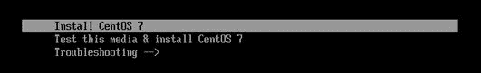
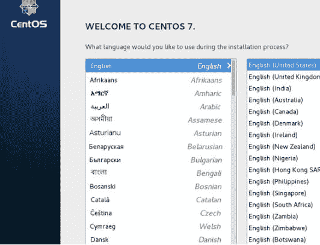
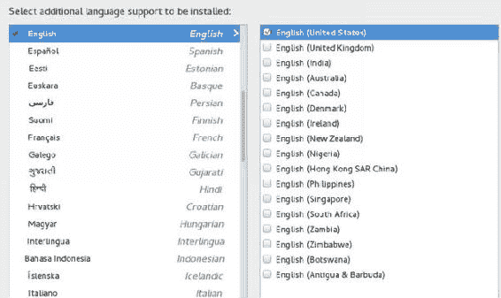

# CentOS 7.3 Linux 服务器指南


## 免责声明
尽管我们已尽力验证本书书中提供信息的准确性，但作者对其中包含的主题的错误、遗漏或与主题相反的解释不承担任何责任。本书中提供的信息仅供教育和娱乐目的。读者应对自己的行为负责，作者对因使用这些信息而导致的任何实际或感知的责任或损害均不承担任何责任。

书中使用的商标均未经任何许可，且这些商标的发布未经商标所有者的许可或支持。书中的所有商标和品牌仅用于说明目的，并归所有者所有，与本文档无关联。

# 序言
大多数公司和组织更加关注数据安全。这对于使用电脑的个人也是如此。Linux 服务器为你的数据提供了最好的安全保障。尽管存在安全问题，Linux 服务器还提供了极高的性能。这意味着与桌面版本的 Linux 相比，你可以在 Linux 服务器上做很多很多事情。这就是为什么你应该熟悉如何使用 Linux 服务器。本书是关于你如何使用 CentOS 7.3 Linux 服务器的极佳指南。它将引导你从基础步骤到设置和使用该系统中各种软件的高级步骤。祝阅读愉快！

# 第 1 章 安装
我们将展示如何如何在基于 UEFI 的机器上安装 CentOS 7.3。首先，通过按下特殊键（根据主板规格，按下 F1、F11 或 F12）简单进入主板 UEFI 设置。同时，确保你已禁用 `QuickBoot/FastBoot`（快速启动）和 `Secure Boot`（安全启动）选项。

随后可以按照以下步骤完成安装：

1.  开始下载 CentOS 7.3 ISO 镜像。你可以通过点击 `http://isoredirect.centos.org/centos/7/isos/x86_64/CentOS-7-x86_64-DVD-1611.iso` 找到它。下载完成后，将镜像刻录到 DVD 或直接制作一个与 UEFI 兼容的启动 USB 闪盘。这可以使用 `Rufus` 工具完成。

只需将 USB/DVD 插入适当的主板驱动器中，然后重启机器，通过简单按下特殊功能键（根据供应商规格，按下 F12 或 F10）指示 BIOS/UEFI 从 DVD/USB 启动。

ISO 镜像启动后，你将在机器输出上看到第一个屏幕。你可以从菜单中选择“Install CentOS 7”（安装 CentOS 7），然后按“Enter”继续。



2. 现在镜像已加载到机器的内存中，你将看到欢迎界面。选择你需要的语言，然后点击“Continue”（继续）按钮。



3. 选择 Date and Time（日期和时间），然后从提供的地图上选择地理位置。一旦日期和时间设置正确，点击“Done”（完成）按钮即可返回安装屏幕。

4. 按下键盘上的菜单以设置键盘布局。添加或选择键盘布局，然后点击“Done”（完成）继续。

5. 配置或添加系统语言支持，然后点击“Done”（完成）继续。



6. 在下一步中，你将被允许通过从提供的列表中选择安全配置文件为你的系统设置“Security Policy”（安全策略）。

你只需点击“Select profile”（选择配置文件）按钮来选择你所需的安全配置。然后你可以开启 Apply Security policy（应用安全策略）按钮。之后你可以点击“Done”（完成）按钮以继续安装。

7. 下一步中，该通过点击“Software Selection”（软件选择）按钮为基础机器配置环境了。由于我们需要服务器，请确保你选择了将要使用的服务器类型，它将被安装。

为了让你能够对系统进行后续的定制，只需选择“Minimal Install”（最小化安装），然后点击“Done”（完成）按钮继续。

8. 如果你需要带有图形用户界面的服务器，在左侧窗格选择“Server with GUI”（带有 GUI 的服务器），然后从右侧面板检查正确的附加项，这将取决于你的服务器向网络客户端提供的服务。

9. 如果你没有使用任何其他特定的网络位置，应将 Installation Source（安装源）保持默认设置。你可以点击“Installation Destination”（安装位置）来创建硬盘分区。

在 Device selection（设备选择）屏幕上，确保你勾选了本地硬盘。

10. 你可以点击 `KDUMP` 选项，如果需要内存则将其禁用。通过点击“Done”（完成）完成此操作，这将返回安装屏幕。

11. 为你的机器设置主机名，然后启用网络服务。点击“Network & Hostname”（网络与主机名），在 Host Name 输入完整域名，如果存在 DHCP 服务器，则启用网卡。

12. 点击“Configure”（配置）按钮以手动配置网络，点击“Save”（保存）应用更改。之后你可以点击“Done”（完成）按钮，这将返回安装程序页面。

13. 你可以检查你所做的配置，一旦确认无误，点击“Begin Installation”（开始安装）按钮以开始安装过程。

14. 安装过程一旦开始，你将看到设置用户的新界面。点击 `ROOT PASSWORD`（根密码），为根账户创建一个非常强有密码。完成后，点击“Done”（完成）按钮返回安装屏幕。

15. 注意，不建议从根账户使用系统。你应该通过点击“User Creation”（创建用户）创建一个新用户。输入该用户的详细信息，同时确保所有选项已启用，以便在需要登录系统时会提示输入密码。完成后，点击“Done”（完成）按钮，安装过程将完成。

16. 你将看到安装程序报告 CentOS 已成功安装。为了能够使用此系统，只需移除安装介质并重启机器。

17. 系统重启后，使用你的凭据登录系统，然后执行以下命令完全更新你的系统：

```bash
sudo yum update
```

对于包管理器向你提出的所有问题，只需回答 yes。更新完成后，重启系统以便将更改应用到内核。

# 第 2 章 安装 Memcached


Memcached 是一个用于分布式内存的对象缓存系统，本质上是通用的且提供高性能。它最初被开发是为了通过简单减轻数据库负载来帮助加速动态 Web 应用程序。该工具也有其他用途。

该工具有助于快速部署以及易于开发，你可以用它来解决许多与大数据缓存相关的问题。若要在您的 CentOS 7.3 服务器上安装其包，请运行以下命令：

```bash
yum install memcached
```

该命令将在您的机器上安装该包。下一步您应该对其进行配置。您需要配置的最部分是 `CACHESIZE`。它代表以兆字节（MB）为单位的缓存大小。这需要编辑 `/etc/sysconfig/memcached` 文件。考虑下面的配置，它使其使用 512 MB 的大小：

```bash
PORT="11211"
USER="memcached"
MAXCONN="1024"
CACHESIZE="512"
OPTIONS=""
```

运行以下命令在您的 CentOS 上启动 Memcached：

```bash
systemctl start memcached.service ## 更新后使用 restart
systemctl enable memcached.service
```

请记住我们的 Memcached 运行在端口 `11211`。我们可以使用该端口来检查 Memcached 是否正在运行。显示所示：

```bash
echo stats | nc localhost 11211
STAT pid 7599
STAT uptime 10
STAT time 1265288542
STAT version 1.4.4
STAT pointer_size 32
STAT rusage_user 0.003999
STAT rusage_system 0.052991
STAT curr_connections 10
STAT total_connections 11
STAT connection_structures 11
STAT cmd_get 0
STAT cmd_set 0
STAT cmd_flush 0
STAT get_hits 0
STAT get_misses 0
STAT delete_misses 0
STAT delete_hits 0
STAT incr_misses 0
STAT incr_hits 0
STAT decr_misses 0
STAT decr_hits 0
STAT cas_misses 0
STAT cas_hits 0
STAT cas_badval 0
STAT auth_cmds 0
STAT auth_errors 0
STAT bytes_read 6
STAT bytes_written 0
STAT limit_maxbytes 536870912
STAT accepting_conns 1
STAT listen_disabled_num 0
STAT threads 4
STAT conn_yields 0
STAT bytes 0
STAT curr_items 0
STAT total_items 0
STAT evictions 0
END
```

让我们从中获取一些值。我们必须使用以下命令：

```bash
echo get some_value | nc localhost 11211
END
```

没有找到任何值。我们可以再次检查统计信息：

```bash
echo stats | nc localhost 11211
STAT pid 7599
STAT uptime 10
STAT time 1265288542
STAT version 1.4.4
[...]
STAT cmd_get 1
STAT cmd_set 0
STAT cmd_flush 0
STAT get_hits 0
STAT get_misses 1
STAT delete_misses 0
[...]
STAT evictions 0
END
```

输出清楚地显示 Memcached 运行正常。我们可以继续使用某些 Web 应用程序来测试 Memcached。

首先在 Iptables 防火墙上打开 Memcached 端口，即 `11211`。首先，列出所有激活的防火墙区域。以下命令将有助于实现：

```bash
firewall-cmd --get-active-zones
```

您应该得到一个与所示密切相关的输出：

```
public
  interfaces: wlp1s0
```

然后应该向 firewalld 添加一条新规则。以下命令可以帮助您完成此：

```bash
firewall-cmd --permanent --zone=public --add --port=11211/tcp
```

现在您已经做了一些更改，应该通过重启 `firewalld.service` 来启用它们。以下命令可以帮助您实现这一点：

```bash
systemctl restart firewalld.service
```

然后您可以使用提供的命令测试远程连接：

```bash
echo stats | nc memcache_host_name_or_ip 11211
```

下一步应该涉及向您的 CentOS 服务器安装 Memcached PHP 模块或 Memcache。以下命令可以帮助您安装 Memcache 模块和 PHP：

```bash
yum install php php-pecl-memcache
```

Memcached 模块和 PHP 然后可以如下所示安装：

```bash
yum install php php-pecl-memcached
```

运行以下命令重启 Web 服务器：

```bash
/etc/init.d/httpd restart
```

## 或者

```bash
service httpd restart
```

# 第 3 章 安装 Nginx

Nginx 是一种提供极高性能的 Web 服务器软件。与 Apache HTTP 服务器相比，它更灵活且更轻量级。

在本章中，我们将向您展示如何在 CentOS 73 服务器上安装此服务器软件。为了能够安装此软件，您必须对使用的账户拥有 root 权限。

第一步涉及添加 Nginx 仓库。要获取 CentOS 7 EPEL 仓库，只需启动终端并运行以下命令：

```bash
sudo yum install epel-release
```

该命令将帮助您将 Nginx 仓库安装到服务器中。然后您可以运行以下命令来安装 Nginx：

```bash
sudo yum install nginx
```

在提示回答时，只需输入“yes”，Nginx 的安装将在您的私有服务器上完成。

注意，一旦 Nginx 安装完成，它不会自动启动。您必须通过输入以下命令启动它：

```bash
sudo systemctl start nginx
```

您可能在系统中使用防火墙。如果是这样，则需要您允许来自 HTTP 和 HTTPS 协议的流量。这可以通过执行提供的命令来实现：

```bash
sudo firewall-cmd --permanent --zone=public --add-service=http
sudo firewall-cmd --permanent --zone=public --add-service=https
sudo firewall-cmd –reload
```

进行抽检检查对您很有好处，可以确保一切都按照预期运行。您只需要在 Web 浏览器中访问服务器的公网 IP 地址。如果您不知道 IP 地址，请查找获取它的方法。

[`server_domain_name_or_IP/`](http://server_domain_name_or_IP/)

CentOS 7 Nginx 的默认 Web 页面将打开。这通常是为了向您提供所有必要的信息。如果您看到欢迎页面，只需知道服务器是正常且运行的即可。

启用 Nginx 对您来说也有好处，这样它可以在系统启动时自动启动。您只需要运行以下命令：

```bash
sudo systemctl enable nginx
```

您已安装了 Nginx，它现在正在运行。

 查找您的服务器的 IP 地址

要了解服务器的 IP 地址，首先通过简单执行以下命令查找机器的网络接口：

```bash
ip addr
```

在我的情况下，我得到了以下：

```
1\. lo: <LOOPBACK,UP,LOWER_UP> mtu 65536 qdisc noqueue state UNKNOWN
. .
2: eth0: <BROADCAST,MULTICAST,UP,LOWER_UP> mtu 1500 qdisc pfifo_fast state UP qlen 1000
. .
```

在这种情况下显示的接口数量将取决于您机器上的硬件数量。名为 `lo` 的接口代表环回接口，但我们对这个接口并不感兴趣。然而，`eth0` 代表以太网接口，这正是我们感兴趣的。

现在您已经知道了接口名称，有一个命令可以运行，以便您可以知道服务器的 IP 地址。显示所示：

```bash
ip addr show eth0 | grep inet | awk '{ print $2; }' | sed 's/\/.*$//
```

为了通过 Nginx 开始为自己的应用程序或页面提供服务，您必须知道默认服务器根目录和 Nginx 配置文件的位置。

您的默认服务器根目录应该在 `/usr/share/nginx/html` 位置。放置在该目录中的任何文件都必须由 Web 服务器提供。此类位置必须在随 Nginx 附的默认服务器块配置文件中指定，这可以在 `/etc/nginx/conf.d/default.conf` 目录中找到。

其他额外的服务器块（在 Apache 中称为虚拟主机）可以通过通过在 `/etc/nginx/conf.d` 中创建一些新配置文件来添加。此目录中以 `.conf` 结尾的任何文件将在 Nginx 启动时加载。


Nginx 的主配置文件位于 `/etc/nginx/nginx.conf`。设置应该在此处进行更改，例如允许执行 Nginx 守护进程的用户，以及当 Nginx 运行时将启动的工作进程数量。

# 第 4 章 - 设置 MongoDB

MongoDb 是一种 NoSQL 数据库，但它是面向文档的。它用于存储在结构上与 JSON 相同的文档。它具有高性能且具有良好的扩展性。在本章中，我们将向你展示如何在你的 CentOS 7.3 服务器上安装它：

## 添加仓库

默认情况下，CentOS 中没有 MongoDB 仓库。这就是为什么应该将其添加到本地机器中。。首先，使用 `VIM` 等文本编辑器打开 `/etc/yum.repos.d/mongodb-org.repo` 文件。只需执行以下命令：

```bash
vi /etc/yum.repos.d/mongodb-org.repo
```

这将为你提供以下输出：

```text
[mongodb-org-3.2]
name=MongoDB Repository
baseurl=https://repo.mongodb.org/yum/redhat/$releasever/mongodb-org/3.2/x86_64/
gpgcheck=1
enabled=1
gpgkey=https://www.mongodb.org/static/pgp/server-3.2.asc
```

确保你的文件看起来如上所示。一旦仓库已添加到本地机器，我们必须更新系统，以便我们的 `yum` 命令可以拉取并检查仓库信息。只需运行所示的 `yum update` 命令即可：

```bash
yum update
```

输出：

```text
Loaded plugins: fastestmirror
base                            | 3.6 kB            00:00
extras                          | 3.4 kB            00:00
mongodb-org-3.2                 | 2.5 kB            00:00
updates                         | 3.4 kB            00:00
mongodb-org-3.2/7/primary_db    | 54 kB             00:01
Determining fastest mirrors
* base: mirror.dhakacom.com
* extras: mirror.dhakacom.com
* updates: mirror.dhakacom.com
No packages marked for update
```

随后你将已经更新了系统。现在仓库已经设置好了，我们可以开始安装 MongoDB 了。

## 安装 MongoDB

此时，我们可以在我们的机器上安装 MongoDB 了。可以使用 `yum` 命令完成安装。只需运行下面的命令：

```bash
yum install mongodb-org
```

以下是命令输出的最后几行的部分：

```text
Retrieving key from https://www.mongodb.org/static/pgp/server-3.2.asc
Importing GPG key 0xEA312927:: "MongoDB 3.2 Release Signing <packaging@mongodb.com>"
Fingerprint: 4f3e95a2c4f08279c4960ad68f50fea312927
From: https://www.mongodb.org/static/pgp/server-3.2.asc
Is this ok [y/N]:y
Running transaction check
Transaction test
Running transaction
Installing: mongodb-org-server-3.2.11-1.el7.x86_64      1/5
Installing: mongodb-org-mongos-3.2.11-1.el7.x86_64     2/5
Installing: mongodb-org-tools-3.2.11-1.el7.x86_64      3/5
Installing: mongodb-org-shell-3.2.11-1.el7.x86_64    4/5
Installing: mongodb-org-3.2.11-1.el7.x86_64          5/5
Verifying: mongodb-org-shell-3.2.11-1.el7.x86_64      1/5
Verifying: mongodb-org-tools-3.2.11-1.el7.x86_64      2/5
Verifying: mongodb-org-mongos-3.2.11-1.el7.x86_64    3/5
Verifying: mongodb-org-server-3.2.11-1.el7.x86_64  4/5
Verifying: mongodb-org-3.2.11-1.el7.x86_64          5/5
Installed: mongodb-org.x86_64                       3.2.11-1.el7
Dependency: mongodb-org-mongos.x86_64               3.2.11-1.el7
Dependency: mongodb-org-server.x86_64             3.2.11-1.el7
Dependency: mongodb-org-shell.x86_64              3.2.11-1.el7
Dependency: mongodb-org-tools.x86_64              3.2.11-1.el7
Complete!
```

一旦你看到 "Complete!"，就说明一切都正常了。请注意，在安装过程中你会收到提示，若要继续只需输入 "yes" 即可。现在 MongoDB 已经安装，我们可以继续安装 MongoDB 服务。以下命令可以帮助我们启动它们：

```bash
systemctl start mongod
```

此外，虽然我们已经启动了服务，但检查它们的状态以确保万无一只需运行下面的命令：

```bash
systemctl status mongod
```

命令的输出应该与下面内容相关：

```text
mongod.service - SYSV: Mongo is a scalable, document-oriented database.
Loaded: loaded (/etc/rc.d/init/mongod)
Active: active (running) since Wed 2017-02-22 11:09:12; 12s
Docs: systemd-sysv-generator(8)
Process: 9901 ExecStart=/etc/rc.d/init/mongod (code=exited, status=0/SUCCESS)
Group: /system.slice/mongod
└─9912 /usr/bin/mongod -f /etc/mongod.conf
Feb 22 11:09:22 localhost.domain systemd[1]: Starting SYSV: Mongo is s...
Feb 22 11:09:22 localhost.domain runuser[9908]: pam_unix(runuser:session...
Feb 22 11:09:22 localhost.domain runuser[9908]: pam_unix(runuser:session...
Feb 22 11:09:22 localhost.domain mongod[9901]: Starting mongod: [ OK ]
Feb 22 11:09:22 localhost.domain systemd[1]: Started SYSV: Mongo is sc...
Hint: Some lines were ellipsized, use -l to show in full.
```

MongoDB 现在已经安装到系统中。此后我们可以通过执行下面的命令来重新加载配置：

```bash
systemctl reload mongod
```

使用以下命令停止 MongoDB 服务：

```bash
systemctl stop mongod
```

## 配置进程数量

进程数通常被设置为低至 `4096`。尝试运行所示的 `mongo` 命令：

```bash
mongo
```

该命令将给出如下错误：

```text
MongoDB shell version: 3.2.11
connecting to: test
Welcome to the MongoDB shell.
For interactive help, type "help".
For more comprehensive documentation, see
http://docs.mongodb.org/
Questions? Try the support group
http://groups.com/group/mongodb-user
Server has startup warnings:
2017-02-22T11:09:21.553+0530 I CONTROL [initlisten] WARNING: soft rlimits too low. rlimits set to 4096 processes, 64000 files. Number of processes should be at least 32000 : 0.5 times number of files.
2017-02-22T14:09:25.553+0530 I CONTROL [initlisten]
```

为了配置所需的进程数量，我们需要编辑名为 `20nproc.conf` 的文件。该文件位于 `/etc/security/limits.d/`。执行以下命令用 vim 器打开它：

```bash
vi /etc/security/limits.d/20nproc.conf
```

你将在上述命令中看到输出：

```text
# Default limit for number of user's processes to prevent
# accidental fork bombs.
# See rhbz #432903 for reasoning.
*           soft    nproc    4096
root        soft    nproc    unlimited
```

我们应该将 `4096` 的值改为 `32000`。如下所示：

```text
*           soft    nproc    32000
```

现在上述值已经更改，我们必须重启 MongoDB 服务以使更改生效。以下命令将帮助你重启系统：

```bash
systemctl restart mongod
```

## 创建管理员用户

我们需要为我们的 MongoDB 密码创建管理员用户。用户名将为 `admin`，对应的密码将为 `userpass`。一旦用户创建，我们将检查它们是否在数据库中。以下步骤将帮助我们创建用户：在终端上输入 `mongo` 命令：

```bash
mongo
```

这将给出如下输出：

```text
MongoDB shell version: 3.2.11
connecting to: test
Welcome to the MongoDB shell.
```

如如下所示输入命令 `use admin`：

```text
> use admin
switched to db admin
```

你可以在终端中输入以下代码：

```javascript
db.createUser(
```


```json
...  {
...     user: "admin",
...     pwd: "userpass",
...     roles: [ { role: "userAdminAnyDatabase", db: "admin" } ]
...  }
... )
```

成功添加用户：
```json
{
"user" : "admin",
"roles" : [
{
"role" : "userAdminAnyDatabase",
"db" : "admin"
]
}
}
```

我们收到通知用户已创建并添加到系统中。分配给该用户的角色意味着他能够对 MongoDB 中包含的任何数据库执行管理任务。我们可以运行以下命令来查看数据库中可用的用户，这将让我们知道该用户是否已创建：

`show users;`

```json
{
"_id" : "admin.admin",
"user" : "admin",
"db" : "admin",
"roles" : [
{
"role" : "userAdminAnyDatabase",
"db" : "admin"
}
]
}
```

就是这样！你已经完成了。你学习了如何将 MongoDb 数据库安装到你的 CentOS 7.3 服务器上，如何将进程数从 4096 改为 32000，以及如何添加新用户。我们为系统创建了一个管理员用户！

# 第 5 章 - LMP 安装

LEMP (Linux, Nginx, MySQL, PHP) 是一组共同安装的软件（开源），以便服务器主机托管 Web 应用和动态网站。该术语简单来说是一个缩写，代表 Linux 操作系统、作为 LAMP 中使用的 Apache Web 服务器替代品的 ENginix Web 服务器。网站数据必须存储在 MySQL 数据库中（它使用 MariaDB），而 PHP 用于处理动态内容。在本章中，我们将向你展示如何在你的 CentOS 7.3 服务器上进行设置。

## 在开始安装过程之前，你应该确保你的服务器上已经设置了一个非根账户。然后你可以按照下面给出的步骤进行安装：

## 安装 Nginx

为了能够向网站的访问者显示网页，我们必须使用 Nginx，这是一种现代且高效的 Web 服务器。记得我们在上一个章节中讨论过 Nginx 的安装。如果你还没有执行那些步骤，请再次遵循它们以安装 Nginx。一旦安装完成并启动服务，只需找到你服务器的 IP 地址即可。你也就完成了这一步。

## 安装 MySQL (MariaDB)

由于我们的 Web 服务器现在已经在运行，我们可以继续安装 MariaDB，它是 MySQL 的替代品。MariaDB 只是 MySQL 关系型数据库管理系统的社区开发分支。它为我们提供了一种访问系统可以存储和获取信息的方式。

可以使用 `yum` 命令获取并安装此软件。我们还将利用并安装一些辅助软件，以促进组件之间的通信。只需在终端上运行以下命令：

```bash
sudo yum install mariadb-server mariadb
```

该命令将 MariaDB 安装到我们的系统中。一旦安装完成，重启 MariaDB 对我们有利。这可以通过执行以下命令简单完成：

```bash
sudo yum install mariadb-server mariadb
```

此时，我们的数据库已经按照预期启动并运行了。我们可以继续执行一个安全脚本，该脚本将移除某些危害系统的默认设置，并以某种方式禁用对数据库系统的访问。只需运行以下命令启动交互式脚本：

```bash
sudo mysql_secure_installation
```

系统将提示你输入 root 密码。由于我们刚刚在系统中安装了 MySQL，你很可能还没有 root 密码，因此只需按回车键留空即可。然后会询问你是否需要设置 root 密码。输入 Y，然后按照下述指令操作：

`mysql_secure_installation` 提示：

Enter current password for root (enter for none):

OK, successfully used password, moving on...

设置 root 密码可以确保没有任何人在获得适当授权的情况下登录 MariaDB Root 用户。

New password: userpass

Re-enter new password: userpass

Password updated successfully!

Reloading privilege tables..

... Success!

对于其他设置，你应该按回车键接受默认值。这样一来，一些示例用户和数据库将被移除，远程登录将被禁用，并且将加载新规则，以便 MySQL 遵循新所做的更改。

完成后，我们应该启用 MariaDB 在系统启动时自动启动。以下命令将帮助我们实现这一点：

```bash
sudo systemctl enable mariadb
```

你已经设置好了数据库系统并准备好进行下一步。

## 安装 PHP

PHP 将负责处理和显示我们的动态内容。它能够处理我们的脚本，建立与 MySQL 数据库的连接以获取信息，并将信息传递给 Web 服务器以便显示。

我们可以利用 `yum` 系统来安装组件。这将包含 `php-mysql` 和 `php-fpm` 包。只需运行以下命令：

```bash besudo yum install php php-mysql php-fpm
```

## 配置 PHP 处理器

现在 PHP 处理器已安装到我们的系统中，我们最好继续对其进行配置，以保持一切安全。你应该使用 root 权限通过 `vi` 编辑器打开 php-fpm 。。只需运行以下命令：

```bash
sudo vi /etc/php.ini
```

文件将在 `vim` 编辑器中打开。我们正在寻找用于设置 `cgi.fix_pathinfo` 的参数。你会发现它被分号（`;`）注释掉了，且默认值被设置为 `1`。此设置用于告诉 PHP，如果 PHP 文件没有完全匹配，则运行或执行最接近的脚本。

此设置非常危险。有了这种设置，恶意用户可能会设计 PHP 脚本并在它们不被允许执行的情况下执行，从而使我们的系统面临风险。要更改此设置，我们通过删除分号来取消该行，然后将其值设置为 `0`。如下所示：

```
cgi.fix_pathinfo=0
```

一旦你将行改为上述内容，只需保存并关闭文件。然后你可以继续打开 `www.conf`，这是 php-fpm 的配置文件。以下命令将帮助你在 `vi` 编辑器中打开此文件：

```bash
sudo vi /etc/php-fpm.d/www.conf
```

你可以查找指定 `listen` 参数的行，然后将其更改为如下所示：

```
listen = /var/run/php-fpm/php-fpm.sock
```

接下来，查找指定 `listen.owner` 和 `listen.group` 参数的行并取消它们的注释。之后，它们看起来应该如下所示：

```
listen.owner = nobody
listen.group = nobody
```

你可以查找用于指定用户和组的参数，并将其值从“apache”更改为“nginx”。如下所示：

```
user = nginx
group = nginx
```

你就可以保存文件并退出。继续运行以下命令重启 PHP 处理器：

```bash
sudo systemctl start php-fpm
```

所需的更改已经完成。然后你可以继续启用 php-fpm，以便它在系统启动后运行。你只需运行下面给出的命令：

```bash
sudo systemctl enable php-fpm
```

## Nginx 配置

此时，我们已经安装了所有必要的组件。我们应该继续配置 Nginx，使其能够利用 PHP 处理器处理动态内容。

这需要在服务器块（server block）级别完成。只需输入以下命令以打开 Nginx 服务器块的默认配置文件：

```bash
sudo vi /etc/nginx/conf.d/default.conf
```


当移除注释后，你应该会在文件中找到以下内容：

```nginx
server {
    listen       80;
    server_name  localhost;
    location / {
        root  /usr/share/nginx/html;
        index  index.html index.htm;
    }
    error_page  500 502 503 504  /50x.html;
    location = /50x.html {
        root  /usr/share/nginx/html;
    }
}
```

通过此文件，我们的网站需要进行许多更改。必须添加 `index.php` 选项，使其成为 `index` 指令的第一个值，这样在请求目录后就可以提供 PHP 索引文件。

还应该修改 `server_name` 指令，使其能够指向我们服务器的 IP 地址或域名。

我们真实的配置文件中包含一些被注释掉的行，这些行用于处理错误例程。我们应该取消这些行的注释，以便利用这些功能。为了进行实际的 PHP 处理，另一个部分也必须取消注释。应该添加 `try_files` 指令，以防止 Nginx 将错误的请求传递给 PHP 处理器。

更新后的 `/etc/nginx/conf.d/default.conf` 配置文件应所示：

```nginx
server {
    listen       80;
    server_name  server_domain_name_or_IP;
    # 注意这些行最初源于 "location /" 块
    root  /usr/share/nginx/html;
    index index.php index.html index.htm;
    location / {
        try_files $uri $uri/ =404;
    }
    error_page 404 /404.html;
    error_page 500 502 503 504 /50x.html;
    location = /50x.html {
        root /usr/share/nginx/html;
    }
    location ~ \.php$ {
        try_files $uri =404;
        fastcgi_pass unix:/var/run/php-fpm/php-fpm.sock;
        fastcgi_index index.php;
        fastcgi_param SCRIPT_FILENAME $document_root$fastcgi_script_name;
        include fastcgi_params;
    }
}
```

现在你已经完成了上述所示的更改，可以保存文件并关闭。你可以使用以下命令重启 Nginx 并应用你刚刚做的更改：

```bash
sudo systemctl restart nginx
```

### 测试

现在是时候测试我们的系统配置是否正确了。这要求我们创建一个基础脚本并将其用于测试。该脚本将命名为 `info.php`。为了让 Apache 服务器能够定位此文件并正确使用它，它必须保存在特定的目录中，即 `web root` 目录。该目录可以在 `/usr/share/nginx/html/`找到。要在目录中创建文件，只需运行以下命令：

```bash
sudo vi /usr/share/nginx/html/info.php
```

上述命令将在 `vim` 文本编辑器中打开该文件。你可以向其中添加以下 PHP 代码行：

```php
<?php phpinfo(); ?>
```

完成后，只需保存并退出文件。现在是时候测试我们的服务器是否能够显示来自 PHP 脚本的内容了。这只需通过在网络浏览器中打开页面来实现。执行此操作我们需要服务器的公 IP 地址。只需打开浏览器，然后在 URL 栏输入以下 URL：

`http://your_server_IP_address/info.php`

注意，你必须将上述内容替换为你服务器的公 IP 地址。你将看到如下所示的 PHP 欢迎页面：


除了你正在使用的 PHP 版本外，你还会看到关于它的其他细节。这仅仅是从 PHP 视角查看的服务器信息。它将对你的调试工作有所帮助，并帮助你确保所有设置都符合预期。如果你在系统中看到上述页面，你可以确定一切正常，这意味着你已经成功设置了这些内容。

然而，该文件使系统面临安全风险。这是因为未经授权的用户可能会访问它并获取有关我们服务器的信息。这要求我们删除此文件。以下命令可以帮助我们实现这一目标：

```bash
sudo rm /usr/share/nginx/html/info.php
```

但是，如果你以后需要获取相同的信息，可以随时重新创建该文件。


```
rpm --import https://www.rabbitmq.com/rabbitmq-signing-key-public.asc
```

然后，你可以运行以下命令来安装 RabbitMQ 服务器：

```bash
yum install rabbitmq-server-3.6.1-1.noarch.rpm
```

该命令将给你与下面类似的输出：

```
Loaded plugins: fastestmirror
Examining rabbitmq-server-3.6.1-1.noarch.rpm: rabbitmq-server-3.6.1-1.noarch
Marking rabbitmq-server-3.6.1-1.noarch.rpm to be installed
Resolving Dependencies
--> Running transaction check
---> Package rabbitmq-server.noarch 0:3.6.1-1 will be installed
--> Finished Dependency Resolution
Dependencies Resolved
================================================================================
Package Arch Version Repository Size
================================================================================
Installing:
  rabbitmq-server noarch 3.6.1-1 /rabbitmq-server-3.6.1-1.noarch 5.5 M
Transaction Summary
================================================================================
Install 1 Package
Total size: 5.5 M
Installed size: 5.5 M
Is this ok [y/d/N]: y
```

如所示，一旦出现提示，只需输入“y”表示是，安装将继续。

## 访问管理控制台

此工具可以允许你通过网络浏览器监控服务器进程。可以通过执行以下命令启用 RabbitMQ 管理控制台：

```bash
rabbitmq-plugins enable rabbitmq_management
```

随后应接运行以下命令：

```bash
chown -R rabbitmq:rabbitmq /var/lib/rabbitmq/
```

然后，你可以启动浏览器并导航到给出的 URL 以访问 RabbitMQ 服务器管理控制台：

`http://ip-address:15672/`

注意，RabbitMQ 管理控制台带有默认用户名和密码，分别为“guest”和“guest”。如果你需要管理员用户，也可以直接创建一个。你只需要运行以下命令：

```bash
rabbitmqctl add_user admin admin
rabbitmqctl set_user_tags admin administrator
rabbitmqctl set_permissions -p / admin ".*" ".*" ".*"
```

然后，你可以输入用户名和密码以访问 RabbitMQ Web 控制台。你将被带到 RabbitMQ 的 Web 仪表板。你可以开始使用你的 RabbitMQ 服务器了！

# 第 7 章- Node.js 安装

Node.js 仅仅是一个 JavaScript 平台，可用于服务器端编程。通过它，用户能够创建后端功能所需的网络应用程序。当 JavaScript 同时用于客户端和服务器端语言时，开发过程将变得更加简单且一致。让我们讨论如何在我们的 CentOS 7.3 服务器上运行 Node.js。

### 从源码安装 Node

获取 Node.js 的一种方法是获取其源代码并进行编译。源代码必须从项目网站获取。一旦进入下载页面，只需右键点击源代码链接，然后选择“复制链接地址”或提供的任何其他相关选项。然后你可以在服务器上使用 `wget` 命令和该链接进行下载，如下所示：

```bash
wget http://nodejs.org/dist/v0.10.30/node-v0.10.30.tar.gz
```

然后你可以解压刚下载的压缩包并移动到新目录。如下所示：

```bash
tar xzvf node-v* && cd node-v*
```

会有许多包需要从 CentOS 仓库下载以编译代码。你可以通过 `yum` 命令获取它们：

```bash
sudo yum install gcc gcc-c++
```

然后你可以如下所示配置并编译你的软件：

```bash
./configure
make
```

编译此过程需要几分钟时间，请保持耐心。编译完成后，你可以通过运行以下命令安装软件：

```bash
sudo make install
```

如果你需要验证 Node.js 是否安装成功，只需运行以下命令检查其版本：

```bash
node –version
```

该命令将打印安装到系统中的 Node.js 版本。如果你看到了版本号，那么说明你的安装成功了。

### 从 Node 官网安装 Node.js

我们可以从 Node 的官方网站获取预构建的 二进制包并安装它们。你应该首先获取包含这些二进制文件的链接。之后，你应该使用该链接配合 `wget` 命令来安装二进制文件。如下所示：

```bash
cd ~
wget http://nodejs.org/dist/v0.10.30/node-v0.10.30-linux-x64.tar.gz
```

注意，我首先使用了切换目录命令以进入主目录。记住，你 URL 中的版本号不能与上面给出的相同，因为目前这只是最新版本。只需使用你从链接中获取的版本即可。

下载完成后，我们可以使用 `tar` 命令将包解压到系统的本地包层次结构中。注意，压缩包通常封装在一个带版本名的目录中，我们可以通过传递 `--strip-components 1` 选项消除这一点。我们将使用 `-C` 选项在命令中指定目标目录。如下所示：

```bash
sudo tar --strip-components 1 -xzvf node-v* -C /usr/local
```

注意，运行上述命令后，所有组件将安装在系统的 `/usr/local` 目录或分支下。要验证安装是否成功，我们只需要运行以下命令检查系统中的 Node 版本：

```bash
node –version
```

如果你看到了版本，只需知道安装成功了，你可以在 CentOS 服务器上开始使用 Node.js 了。

### 从 EPEL 仓库安装 Node

企业级 Linux 额外软件包（EPEL）可以帮助我们安装 Node.js，它适用于 CentOS 和其他 Linux 发行版。为了让你获得 EPEL 仓库的访问权限，必须修改安装的 `repo-list`。也可以通过安装名为 `epel-release` 的包来修改对该仓库的访问，这当前仓库中可用。以下命令可以帮助我们安装此包：

```bash
sudo yum install epel-release
```

这将授予你访问 EPEL 仓库的权限。然后如下所示使用 `yum` 命令安装 Node.js：

```bash
sudo yum install nodejs
```

上述命令应会将 Node.js 安装到你的服务器上，但运行查询版本的命令来确认安装是否成功是比较好的：

```bash
node –version
```

大多数人需要访问 `npm` 来管理他们的包。你可以使用以下命令从 EPEL 获取它：

```bash
sudo yum install npm
```

### 使用 Node 版本管理器安装 Node

Node 版本管理器（`nvm`）为我们提供了一种更灵活的安装 Node.js 的方式。通过这个工具，你可以安装并维护多个 Node 仓库以及与其相关的包。

要在你的 CentOS 机器上安装 Node.js，你必须访问 GitHub 上的项目页面，然后从主页显示的 `README` 文件中复制 `wget` 或 `curl` 命令。你将获得脚本最新点的指针。

在将命令传递给 bash 之前，你应该先审核脚本，以确保它只执行你同意执行的操作。要做到这一点，只需删除 `curl` 命令末尾的 `| bash` 部分。如下所示：

```bash
curl https://raw.githubusercontent.com/creationix/nvm/v0.13.1/install.sh
```


你应该仔细检查，并确保你对刚刚所做的更改非常满意。如果你满意了，只需继续，并在命令末尾添加 `| bash`。URL 会根据你正在安装的版本而变化，所以如果你发现此处有差异，请不要担心：

```bash
curl https://raw.githubusercontent.com/creationix/nvm/v0.13.1/install.sh | bash
```

执行上述命令后，将为用户账户安装 `nvm` 脚本。你需要引入 `.bash_profile` 以这样才能开始使用它。可以按照以下方式操作：

```bash
source ~/.bash_profile
```

然后，你可以运行以下命令来询问 `nvm` 它所感知的 Node 版本：

```bash
nvm list-remote
```

以下是上述命令的示例输出：

```
. . .
v0.10.29
v0.10.30
v0.11.0
v0.11.1
v0.11.2
v0.11.3
v0.11.4
v0.11.5
v0.11.6
v0.11.7
v0.11.8
v0.11.9
v0.11.10
v0.11.11
v0.11.12
v0.11.1
```

关于安装哪个版本的 Node，由你决定。如果你需要安装版本号 `v0.11.12` 的版本，只需要输入下面的命令：

```bash
nvm install v0.11.12
```

如果你需要切换到不同的 `nvm` 版本，可以使用以下命令：

```bash
nvm use version_number
```

你需要在上述命令中替换版本号。如果你需要将特定版本设置为默认版本，只需运行以下命令：

```bash
nvm alias default v0.101.12
```

如果你需要验证安装过程是否运行成功，只需像我们一直以来所做的那样，通过运行命令来检查系统中的可用版本即可。如下所示：

```bash
node –version
```

正如你所看到的，有多种方法可以使用 Node.js 来运行你的 CentOS 服务器！

# 结论

我们已经来到了本指南的末尾。CentOS 7.3 服务器可以执行许多任务。例如，你可以用它来安装包含 `Nginx` 和 PHP 的 LEMP 栈。如果你想使用 CentOS 7.3 服务器开发 Web 应用程序，这些都是很好的工具。你还可以在 CentOS 服务器上安装 `MariaDB`，它可以与 CentOS 服务器中的 `MySQL` 配合。

这将为你提供一个存储数据和信息的环境。你还可以在 CentOS 服务器上安装 `Memcached`，这将帮助你加速 Web 应用程序。正如本书中所讨论的，NoSQL 数据库 `MongoDB` 也可以安装在 CentOS 中。如果你不喜欢 `MySQL` 数据库，它也可以提供一种存储数据的方式。

如果你需要在 CentOS 服务器上进行一些服务器端脚本编写，你可以安装 `Node.js` 来帮助你实现这一目标。
