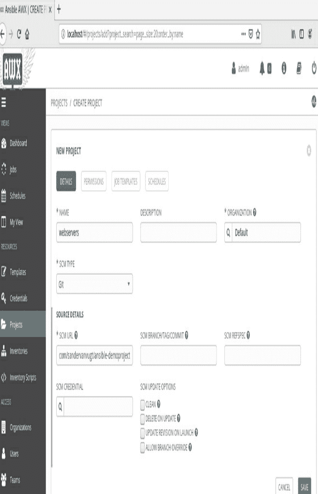
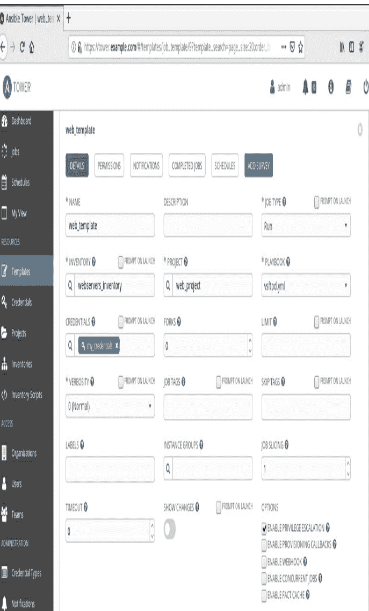
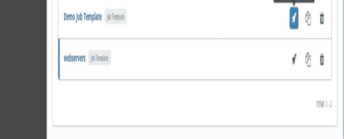

# 认证指南：Red Hat RHCE 8 (EX294)

SANDER VAN VUGT


## 编辑团队

- **总编**: Mark Taub
- **产品线经理**: Brett Bartow
- **执行编辑**: Denise Lincoln
- **开发编辑**: Ellie Bru
- **经理编辑**: Sandra Schroeder
- **高级项目编辑**: Tonya Simpson
- **文字编辑**: Chuck Hutchinson
- **索引员**: [未列出]
- **校对**: [未列出]
- **技术编辑**: John McDonough, William “Bo” Rothwell
- **出版协调**: Cindy Teeters
- **封面设计**: Chuti Prasertsith
- **排字员**: [未列出]

# 目录

- 引言
  - 目标与方法
  - 其他资源
  - 谁应该读这本书
  - 本书是如何组织的
  - 如何使用本书
  - 其他特性
- 书的组织结构、章节和附录
- 配套内容文件在哪里？
- 第一部分：Ansible 简介
  - 1 理解配置管理
    - “我已经掌握这些了吗？”测验
    - 基础知识
    - 理解自动化的核心组件
    - 理解 Ansible 用例
    - 总结
    - 考试准备任务
    - 回顾所有关键主题
  - 2 安装 Ansible
    - “我已经掌握这些了吗？”测验
    - 基础知识
    - 理解 Ansible 环境
    - 理解控制节点主机要求
    - 理解安装方法
    - 配置托管主机
    - 配置 Ansible 用户
    - 总结
    - 考试准备任务
    - 回顾所有关键主题
    - 记忆表
    - 定义关键术语
    - 复习题
    - 章末实验
      - 实验 2-1
  - 3 设置 Ansible 管理环境
    - “我已经掌握这些了吗？”测验
    - 基础知识
    - 理解项目
    - 配置静态清单
    - 动态清单操作
    - 在 `ansible.cfg` 中管理设置
    - 总结
    - 考试准备任务
    - 回顾所有关键主题
    - 记忆表
    - 定义关键术语
    - 复习题
    - 章末实验
      - 实验 3-1
  - 4 使用即时命令 (Ad Hoc Commands)
    - “我已经掌握这些了吗？”测验
    - 基础知识
    - 理解即时命令
    - 使用模块
    - 查阅模块文档
    - 从 Shell 中运行即时命令
    - 总结
    - 考试准备任务
    - 回顾所有关键主题
    - 记忆表
    - 定义术语
    - 复习题
    - 章末实验
      - 实验 4-1
  - 5 开始使用 Playbook
    - “我已经掌握这些了吗？”测验
    - 基础知识
    - 探索你的第一个 Playbook
    - 使用 YAML
    - 管理多个 Playbook
    - 总结
    - 考试准备任务
    - 回顾所有关键主题
    - 记忆表
    - 定义术语
    - 复习题
    - 章末实验
      - 实验 5-1
  - 6 变量和事实 (Facts)
    - “我已经掌握这些了吗？”测验
    - 基础知识
    - 理解 Ansible Playbook 中变量的使用
    - 操作 Ansible Facts
    - 变量
    - 使用 Vault 管理敏感值
    - 使用 `register` 捕捉命令输出
    - 总结
    - 考试准备任务
    - 回顾所有关键主题
    - 记忆表
    - 定义关键术语
    - 复习题
    - 章末实验
      - 实验 6-1
      - 实验 6-2
- 第二部分：常见的 Ansible 管理任务
  - 7 使用任务控制
    - “我已经掌握这些了吗？”测验
    - 基础知识
    - 使用循环和项
    - 使用 `when` 条件运行任务
    - 使用处理程序 (Handlers)
    - 处理故障
    - 总结
    - 考试准备任务
    - 回顾所有关键主题
    - 记忆表
    - 定义术语
    - 复习题
    - 章末实验
      - 实验 7-1
  - 8 部署文件
    - “我已经掌握这些了吗？”测验
    - 基础知识
    - 使用模块操作文件
    - 管理 SELinux 属性
    - 使用 Jinja2 模板
    - 总结
    - 考试准备任务
    - 回顾所有关键主题
    - 记忆表
    - 定义术语
    - 复习题
    - 练习答案
    - 章末实验
      - 实验 8-1: 生成 `/hosts` 文件
      - 实验 8-2: 管理 `vsftpd` 服务
  - 9 使用 Ansible 角色 (Roles)
    - “我已经掌握这些了吗？”测验
    - 基础知识
    - 使用 Ansible 角色
    - 使用 Ansible Galaxy 角色
    - 使用 RHEL 系统角色
    - 总结
    - 考试准备任务
    - 回顾所有关键主题
    - 记忆表
    - 定义术语
    - 复习题
    - 章末实验
      - 实验 9-1
      - 实验 9-2
  - 10 在大型环境中使用 Ansible
    - “我已经掌握这些了吗？”测验
    - 基础知识
    - 高级清单用法
    - 优化 Ansible 处理
    - 包含和导入文件
    - 总结
    - 考试准备任务
    - 回顾所有关键主题
    - 定义术语
    - 复习题
    - 章末实验
      - 实验 10-1
  - 11 故障排除 Ansible
    - “我已经掌握这些了吗？”测验
    - 基础知识
    - 管理 Ansible 错误和日志
    - 使用模块进行故障排除和测试
    - 使用标签
    - 常见场景故障排除
    - 总结
    - 考试准备任务
    - 回顾所有关键点
    - 记忆表
    - 定义关键术语
    - 复习题
    - 章末实验
      - 实验 11-1
- 第三部分：使用 Ansible 管理系统
  - 12 使用 Ansible 管理软件
    - “我已经熟悉这些了吗？”测验
    - 基础知识点
    - 使用模块管理软件包
    - 使用模块管理仓库和订阅
    - 实现 Playbook 管理软件
    - 总结
    - 考试准备任务
    - 回顾所有关键点
    - 记忆表
    - 定义关键术语
    - 复习题
    - 章末实验
      - 实验 12-1
      - 实验 12-2
  - 13 管理用户
    - “我已经熟悉这些了吗？”测验
    - 基础知识点
    - 使用 Ansible 模块管理用户和组
    - 管理 SSH 连接
    - 管理加密密码
    - 用户高级场景练习
    - 总结
    - 考试准备任务
    - 回顾所有关键点
    - 记忆表
    - 定义关键术语
    - 复习题
    - 章末实验
      - 实验 13-1
  - 14 管理进程和任务
    - “我已经熟悉这些了吗？”测验
    - 基础知识点
    - 管理服务
    - 管理启动过程
    - 管理启动过程和服务的高级练习
    - 总结
    - 考试准备任务
    - 回顾所有关键点
    - 记忆表
    - 定义关键术语
    - 复习题
    - 章末实验
      - 实验 14-1
  - 15 管理存储
    - “我已经熟悉这些了吗？”测验
    - 基础知识点
    - 发现存储相关事实
    - 管理分区和 LVM
    - 配置存储高级练习
    - 总结
    - 考试准备任务
    - 回顾所有关键点
    - 记忆表
    - 定义关键术语
    - 复习题
    - 章末实验
      - 实验 15-1
  - 16 最终准备
    - 通用技巧

# 关于作者

Sander van Vugt 自 1995 年起一直教授 Linux 课程，并编写了 60 多本关于不同 Linux 相关主题的书，包括畅销的 RHCSA-RHCE 7 认证指南和 RHCSA 8 认证指南。Sander 还是 25 多门视频课程的作者，包括他的 RHCSA 和 RHCE 完整视频课程、`Hands-On Ansible LiveLessons` 以及许多其他作品。他为全球客户授课，也是开源软件相关主要会议的定期演讲者。Sander 还是 Living Open Source Foundation 的创始人，这是一个在非洲国家教授开源课程的非营利组织。

# 献辞

本书献给我的家人：Florence、Franck 和 Alex。在过去的一年里，我们共同取得了巨大的成就。

# 致谢

这本书的完成离不开所有做出贡献的人的帮助。首先，我要感谢 Pearson 的同事们——特别是 Denise Lincoln 和 Ellie Bru。在过去的几年里，我们一起工作了很多，这本书是我们通往成功之路上的又一个里程碑！你们在短短两个月内就帮助我实现了这本书，这简直太棒了！

接下来，我要感谢我的技术评审员。非常感谢 Bo 和 John！感谢你们的极佳反馈，我能够对书的内容进行重要的改进。还要特别感谢来自新西兰的 Etienne Esterhuizen、Santos Venter Chibenga，以及来自非洲 Living Open Source Community 的 Robert Charles Muchendu，他们作为志愿者评审员给予了我帮助。最后，也要感谢我的导师和同事 Pascal van Dam，他帮助我完成了一些最后关头的重要改进。

# 关于技术评审员

John McDonough 拥有超过 30 年的开发经验；目前，John 是 `Cisco DevNet` 的开发者倡员。作为开发者倡员，John 编写代码并创建关于如何编写代码的 `DevNet Learning Labs`；编写关于代码的博客；并在 `Cisco Live`、`SXSW`、`AnsibleFest` 等其他行业活动上演讲。John 专注于 Cisco 计算系统产品、`Cisco UCS` 和 `Cisco Insight`。John 在 Cisco 的职业生涯从产品工程师、自定义应用开发人员、技术营销工程师，到现在的开发者倡员。

William “Bo” Rothwell 在 14 岁这个令人惊讶的年纪接触了 `TRS-80` 微型计算机系统（被亲切地称为“Trash 80”）。不久后，负责 Bo 的大人们犯了一个错误，让他独自与 `TRS-80` 相处。他立刻拆解了它，并开了第一节计算机课，向朋友们展示了这个“电脑东西”是如何工作的。

自从那次经历开始，Bo 对理解计算机原理以及与他人分享这些知识的热情使 IT 培训领域获得了丰厚的回报。他的经验涵盖 Linux、UNIX 以及 `Perl`、`Python`、`Tcl` 和 `BASH` 等编程语言。他是 `One Course Source` 的创始人兼总裁，这是一个 IT 培训机构。

# 我们想听听您的声音！

作为本书的读者，您是我们最重要的批评家和评论者。我们重视您的意见，并想知道我们做得好的地方、哪些可以做得更好、您希望看到我们出版哪些领域，以及任何其他愿意分享给我们的建议。

我们欢迎您的意见。您可以通过发送电子邮件或写信的方式告诉我们您对这本书的喜欢或不喜欢之处——以及我们如何改进书籍。

请注意，我们无法帮助解决与本书主题相关的技术问题。

在写信时，请务必包含书名和作者，以及您的姓名和电子邮箱。我们将仔细审查您的意见，并将其分享给本书的作者和编辑。

电子邮箱：`community@informit.com`

# 读者服务

请在 `www.pearsoncertification.com` 注册您的 Red Hat RHCE 8 (EX294) 指南，以便获取下载、更新和修正。要开始注册流程，请访问 `www.pearsoncertification.com/register` 并登录或创建账户。输入产品 ISBN `9780136872436` 并提交。处理完成后，您将在“注册产品”下找到所有可用内容。

*请勾选希望收到我们信息的复选框，以获得未来版本的专属折扣。

# 引言

欢迎阅读 Red Hat RH 8 (EX294) 认证指南！

随着 Red Hat Enterprise Linux 8 的发布，Red Hat 决定对 RHCE 考试采取完全不同的方向。现在的考试完全关于使用 Ansible 管理配置。这是一个非常棒的选择，因为在当前的 IT 领域，依靠专门技能调优单台服务器的系统管理员时代已经结束了。如今的工作完全是自动化，而 Ansible 已迅速成为这一领域最重要的解决方案之一。

作为拥有超过 25 年经验的 Linux 讲师，从 RHEL 4 开始的每一个 RHEL 版本，我都通过了 RHCSA 和 RHCE 考试的认证。亲自参加考试帮助我跟上考试的进展、新内容以及不同之处。我非常荣幸能在这本全面的认证指南与您分享我的知识，以便为您提供通过 RHCE RHEL 8 EX294 考试所需的指导。

正如您所见，本认证指南涵盖了更新后 RHCE 考试的每一个目标，包含 16 个章节、40 多项练习、4 套模拟考试（2 套印刷在书中，2 套在配套网站上）以及 2 小时的视频培训。这本红帽 RHCE 8 (EX294) 认证指南是你可以用来准备并通过考试的最佳资源。

## 目标与方法

为了学习书中所描述的主题，我建议你创建一个自己的测试环境，这将在第 2 章“安装 Ansible”中进行解释。如果不进行大量练习，你就无法成为 RHCE。为了熟悉章节中的主题，我建议采取以下方法：

- 阅读章节中的说明，并学习列表中提供的代码示例。为了方便起见，列表内容也提供在本书的 GitHub 仓库中：`https://github.com/sandervanvugt/rhce8-book`。学习这些示例并尝试理解它们的作用。

- 逐步完成书中所有带编号的练习。这些编号练习提供了分步指导说明，你应该跟随完成所有练习，以演练各项配置任务并学习如何管理特定功能。

- 在每个章节的末尾，都有一个章末实验。这个实验与你在考试中会遇到的实验作业非常相似。

在书中每个章节包含的练习中，你将找到理解考试内容以及彻底学习通过考试所需材料的所有示例。章节中的练习提供了分步的程序描述，你可以通过这些练习找到行的解决方案，从而在考试之前获得真实的经验。尽管你可能对某些主题很熟悉，但完成书中所有的练习是个好主意。RHCE 考试是实操性的，这在考试时会带来压力。每个章节的练习提供了你所需的练习，确保你在考试时不会出现细小的错误和意外。练习是确保你在考试前处理常见错误并从错误中学习的最好方法。

每个章节还包含一个章末实验。这些实验提出的问题与你在考试中可能遇到的问题相似，你可以用它们来练习。我刻意排除了这些实验的解决方案，原因如下：(1) 你需要训练自己在考试日之前验证自己的工作，因为考试时会要求你这样做；(2) 在考试期间，你需要亲自验证你的解决方案是否按预期工作；(3) 大多数实验有多个解决方案，我不想暗示我的解决方案是正确的而你的是错误的，仅仅因为你采用了不同的方法。只要你的解决方案完成了练习中的要求，你的方案就和我的一样好。

## 其他资源

本书包含了通过考试所需的一切，但如果你想获得更多的指导和练习，我提供了一些视频培训课程来帮助你学习，包括：

- Ansible 实操完整视频课程
- 红帽认证工程师 (RHCE) 3/ed 视频课程

除了这些产品，你可能还会喜欢我的网站：`rhatcert.com`。通过这个网站，我提供对备考者有用的任何更新。我建议你在网站上注册，以便我向你发送关于我发布的重要更新的消息。此外，你还可以在我的 YouTube 频道 `rhatcert` 上看到偶尔的视频更新。希望这些资源能让你以负担得起的方式通过红帽考试！祝你好运！

## 谁应该读这本书？

本书作为一份 RHCE 考试准备指南而编写。这意味着如果你想增加通过 RHCE 考试的概率，就应该阅读它。我写这本书也是为了帮助你熟悉 Ansible。所以，即使你完全对 RHCE EX294 考试不感兴趣，这本书也会告诉你开启 Ansible 职业生涯所需的所有知识。

那么，你为什么要考虑通过 RHCE 考试呢？这个问题答案很简单。Linux 已经成为一个非常重要的操作系统，全球范围内都在寻找合格的专业人士。如果你想作为 Linux 专业人士工作并证明你的技能，RHCE 证书非常有帮助。拥有证书会极大地增加你被聘为 Linux 专业人士的机会。注意，为了获得 RHCE 认证，你必须持有有效的 RHCSA 认证。你可以在获得 RHCSA 认证之前参加 RHCE EX294 考试，但只有在通过了 RHCSA 和 RHCE 考试后，你才能自称为 RHCE。

## 本书是如何组织的

本书作为一份参考指南，帮助你准备考试。如果你是这些主题的新手，可以从头到尾阅读。你也可以阅读书中你精进技能所需的特定章节。每个章节都从一个“我已经熟悉这个了吗？”测验开始。该测验针对每个章节涵盖的 10 个主题提问，并提供了一个简单的工具来检查你是否已经熟悉该章节的主题。不过，这些测验并不代表你在实际考试中会遇到的题目类型。

最好的备考体现在 RHCE 模拟考试中；这些是准备真实考试体验必不可缺的一部分。你可能能够为章节选择题提供正确答案，但这并不意味着你在考试时能够创建配置。我们在纸质版书中包含了两份模拟考试。书籍的配套网站还包含了另外两次模拟考试，以及根据书中词表创建的闪卡，以便你进一步测试自己的知识和技能。你还将获得来自我的红帽认证工程师 (RHCE) 3/ed 完整视频课程的两个小时视频。

章节涵盖了以下主题：

- 第 1 章“理解配置管理”：在本章中，你学习了作为解决方案的 Ansible。章节解释了 Ansible 可以做什么以及它如何关联配置管理。

- 第 2 章“安装 Ansible”：本章介绍了 Ansible 的安装。你学习了设置控制节点所需的内容以及软件的其他部分。

- 第 3 章“设置环境”：在本章中，你学习了如何开始节点管理。章节解释了管理节点所需的内容以及连接节点所需的 Ansible 配置文件。

- 第 4 章“使用临时命令”：在本章中，你学习了 Ansible 模块。模块是 Ansible 的核心，它们为 Ansible 能做的一切提供了解决方案，而使用这些模块简单的方法是通过临时命令。在本章中你学习了如何使用它们。

- 第 5 章“开始使用 playbook”：本章提供了使用 playbook 的介绍。你学习了用于编写 playbook 的 `YAML` 语言以及如何使用 `plays` 和 `tasks` 来结构化 `playbook`。

- 第 6 章“使用变量和事实”：在 Ansible 中，变量可以为特定的配置项提供动态值。使用变量允许你将 playbook 中的静态代码与主机特定信息分离。在本章中你学习了如何使用变量以及 Ansible 事实（自动节点自动设置的变量）。

- 第 7 章“使用任务控制”：为了让 Ansible 变得智能，必须应用任务控制。使用任务控制允许你根据条件运行任务，并且有多种方式实现。你学习了如何使用测试来检查特定条件，以及允许评估一系列项的循环，以及处理器（允许在另一个任务执行成功后才执行任务）。

- 第 8 章“部署集群”：Ansible 用于配置管理，而 Linux 上的配置存储在文件中。因此，管理文件是 Ansible 的关键技能。在本章中你学习了如何使用模块修改文件，以及如何使用模板根据事实或变量获取的特定参数自动设置配置文件。

- 第 9 章“使用 Ansible 角色”：当你使用 Ansible 时，代码可以复用是最好的。这就是 Ansible 角色的意义。在本章中你学习了如何使用角色，角色通过 `Ansible Galaxy` 提供，或作为 RHEL 系统角色提供。


**第 10 章，“在大规模环境中使用 Ansible”**：在大规模环境中使用 Ansible 工作时，你应该了解一些特定的技术。本章将介绍这些技术。你将学习如何通过修改可执行的并发任务数量来优化 Ansible。你还学学习了如何使用包含（`includes`）和导入（`imports`），这允许你构建起模块化的 `playbooks`。

**第 11 章，“Ansible 故障排除”**：在某些情况下，你的 `playbook` 可能无法带给你预期的结果。这时，你需要开始进行故障排除。本章包含了你了解故障排除所需的所有知识，包括开发 `playbooks` 时的某些最佳实践，还包含了一些用于简化故障排除的模块信息。

**第 12 章，“使用 Ansible 管理软件”**：这是关于你可以使用 Ansible 执行的特定常见任务的第一个章节。在本章中，你将学习如何设置存储库以及如何使用 Ansible 管理软件包。

**第 13 章，“用户管理”**：为了在 Linux 上执行任何操作，你都需要用户账户。在本章中，你将学习创建用户账户所需的所有知识，包括设置加密密码。

- 第 14 章，“管理进程和任务”：偶尔，你可能想要运行计划任务。这些任务将使用 `cron` 或 `at` 在特定时间执行。在本章中，你将学习如何做到这一点，还将学习如何管理 `systemd` 默认目标。

- 第 15 章，“存储管理”：在处理 Linux 时，设置存储是一项关键任务。在本章中，你将学习如何用 Ansible 自动化存储配置。你还将学习如何发现管理系统中可磁盘设备，以及如何使用分区、逻辑卷、文件系统和挂载对其进行设置。

- 第 16 章，“最终准备”：在本章中，你将获得一些期末准备任务。它包含了一些测试题以及许多帮助你最大化通过考试概率的技巧。

# 如何使用本书

为了帮助你利用这些书籍定制自己的学习时间，核心章节具有几个可以帮助你最有效地利用时间的功能：

- “我已经知道这些了吗？”测验：每章的开头都有一个测验，帮助你确定学习该章节需要花费的时间。

- **基础主题：** 这些是每章的核心部分。它们解释了该章节主题的协议、概念和配置。

- **考试准备任务：** 在每章的“基础主题”部分末尾，“考试准备任务”部分列出了章节结束时应完成的一系列学习活动。每章都包含了学习该章节主题最合理的活动。这些活动包括：

  - **回顾关键主题：** 在章节的“基础主题”部分中，最重要的条目旁边会显示“关键主题”图标。“关键主题回顾”活动列出了该章节的关键主题及其对应的页码。虽然整个章节的内容都可能出现在考试中，但你一定要掌握每个关键主题中列出的信息。

  - **凭记忆完成表格和列表：** 为了帮助你锻炼记忆并记住事实列表，章节中许多更重要的列表和表格包含在 DVD 和同伴网站上的一份文档中。该文档仅列出部分信息，允许你完成表格或列表。

  - **定义关键术语：** 此部分列出了章节中最重要的术语，要求你写下一个简短的定义，并将答案与书末的术语表进行比较。

  - **复习题：** 每章末尾的问题衡量了对该章讨论主题的洞察深度。

  - **章末实验：** 这些真实的实验让你对作业的样貌有一个正确的印象。章末实验是你发现考试任务真实面目的第一步。

# 其他功能

除了每个核心章节中的功能外，本书整体在同伴网站上提供了额外的学习资源，包括以下内容：

- 四份模拟考试：同伴网站包含四份模拟考试：书中提供了两份，另外两份在同伴网站上。

- 闪卡：同伴网站包含了根据书中术语创建的交互闪卡。

- 超过两小时的视频：同伴网站提供了超过两个小时的视频培训，以便你更好地学习知识并通过红帽认证工程师 (`RHCE`) 测试。

# 书籍结构、章节与附录

书中还包含了一个表格，详细说明如何更容易创建一个通过 `RHCE` 测试的计划。

`RHCE` 目标

| :--- | :--- | :--- |

## 配套内容文件在哪里？

注册此版本的红帽 `RHCE 8` (`EX294`) 认证指南纸质版，以在线访问赠送内容。

此书的纸质版附有一张包含配套内容的光盘。您可以按照以下步骤在线访问文件：

1. 访问 `www.pearsonITcertification.com/register` 并登录或创建新账户。
2. 输入 ISBN：`9780136872436`。
3. 回答挑战问题以证明购买。
4. 点击账户页面中“已注册产品”（`Registered Products`）部分下的“**访问赠送内容**”（`Access Bonus Content`）链接，即可跳转到可以下载相关内容的页面。

请注意，我们的许多配套内容文件可能很大，尤其是图像和视频文件。

如果您按照上述步骤无法找到该书的文件，请访问 `www.pearsonITcertification.com/contact` 并选择“站点问题/意见”（`Site Problems/Comments`）选项。我们的客户服务代表将为您提供帮助。

本书还包含一项独家优惠，购买该书的高级 `eBook` 和练习测试可享 7 折优惠。请参阅书中附的优惠码获取如何购买高级版的信息。

## 第一部分：Ansible 简介

## 第一章：理解配置管理

本章涵盖了以下主题：

- 理解自动化
- 理解 Ansible 核心组件
- 理解 Ansible 用场景

本章涵盖了以下 `RHCE` 考试目标：

- 理解 Ansible 的核心组件

## “我已经掌握了吗？”测试题

“我已经掌握了吗？”测试题让您评估自己是应该彻底阅读整个章节，还是应该跳到“考试准备任务”部分。如果您对这些问题的答案有疑问，或者对自己对这些主题知识的评估不确定，请通读整个章节。表 1-1 列出了本章的主要标题及其对应的“我已经掌握了吗？”测试题。您可以在附录 A“‘我已经掌握了吗？’测试题和复习题”中找到答案。

**表 1-1 “我已经掌握了吗？”章节与问题映射表**

| 基础知识章节 | 问题编号 |
|--- |--- |
| 理解自动化 | 1-5 |
| Ansible 核心组件 | 6-9 |
| 理解 Ansible 用场景 | 10 |

1. 下列哪些是使用 shell 脚本自动化的缺点？（选择两个。）
   a. 它们无法在任何目标管理的操作系统上运行。
   b. 需要高级技能。
   c. 如果配置发生变化，很难保证它们始终产生相同的结果。
   d. 只有在 `root` 权限下使用 shell 脚本才有意义。

2. 在 `DevOps` 中，应用生命周期通过关注不同的不同的关键方面来管理。下列哪个关键方面位于发布（`releasing`）之后？
   a. 测试
   b. 配置
   c. 监控
   d. 打包

3. 使用 `CVS` 管理用于基础设施即代码的机器读配置文件，以下哪些是其优点？
   a. 易于重现。
   b. 使升级变得容易。
   c. 使回滚变得容易。
   d. 以上全部正确。

4. Ansible 是一项自动化工具。还存在其他自动化解决方案。下列哪个不是之一？
   a. `Puppet`
   b. `SaltStack`
   c. `Satellite`
   d. `Chef`

5. 当你将 Ansible 与 `Puppet`、`SaltStack` 和 `Chef` 等竞争方案进行比较时，Ansible 提供了两个显著优势。它们是哪些？
   a. 速度
   b. 易于配置
   c. 无代理运行（`Agentless operation`）
   d. 价格

6. Ansible 提供了访问远程主机的不同解决方案。下列哪个不是之一？
   a. `Agent`
   b. `API` 访问
   c. `winRM`
   d. `SSH`

7. 允许你从 Web界面管理 Ansible 的免费开源项目名称是什么？
   a. Ansible Galaxy
   b. `OKD`
   c. `AWX`
   d. Ansible Tower

8. 下列哪个是对声明式方法（`declarative approach`）的最好描述？
   a. 在声明式方法中，你运行命令来获得特定的方法。
   b. Ansible 中的声明式方法是通过使用脚本实现的。
   c. 声明式方法让你关注为达到所需状态而进行的更改。
   d. 声明式方法使用剧本（`playbooks`）。

9. Ansible 可用于配置准备（`provisioning`）。以下不是 Ansible 常用的配置准备场景？
   a. 在云中部署实例
   b. 准备虚拟机
   c. 通过 `PXE` 启动裸机服务器
   d. 部署容器

10. Ansible 可用于不同的用途。以下哪个可以被认为是 Ansible 的核心功能？
    a. 配置管理
    b. 应用管理
    c. 配置准备
    d. 持续交付

## 基础知识主题

## 理解自动化

Ansible 经常被称为配置管理。这种描述并没有完全体现 Ansible 的功能。Ansible 更多是自动化的解决方案，允许系统管理员管理多个系统。在本节中，你将了解作为自动化工具的 Ansible。

## 什么是自动化？

在过去几年中，IT 的使用方式发生了变化。系统管理员通常负责服务器。随着 IT 的发展，公司从几台服务器变成了成百甚至上千台服务器。因此需要更有效的方法。

在许多站点，第一次尝试是使用 shell 脚本。基于系统管理员的深厚知识，可以使用 shell 脚本灵活地自动化许多任务。但也有一些缺点：

- Shell 脚本无法用于各种需要管理的设备。
- 很难编写出在任何情况下都能产生相同结果的 shell 脚本。

由于这些差异以及公司消费 IT 的方式，需要新的方法。

## 理解 DevOps 工作方式

多年来格局一直在变化。过去，IT 为终端用户提供优质服务。现在的格局已变为 IT 无处不在，多个应用程序可以解决同一个 IT 问题。

在这种新的工作方式，开发者负责构建应用程序，系统管理员负责将代码实现为运行应用程序。由于这种变化需要开发者和系统管理员之间的深度协作，产生了一个新角色：`DevOps`。在 `DevOps` 这一术语中，开发者和系统管理员的任务汇合在一起。`DevOps` 的常见定义是“一组旨在缩短提交更改到进入正常生产环境之间的时间，同时确保高质量的实践”（`Len Bass, Ingo Weber 和 Liming Zhu, DevOps: A Software Architect’s Perspective, Boston, MA: Addison-Wesley Professional, 2015`）。

随着这个新角色，“`DevOps` 工作方式”被引入。具体的定义并不总是相同，但通常来说，它涉及管理整个应用生命周期，由以下元素组成：


- 编码：开发和审查应用程序源代码
- **构建** (`Building`)：使用持续集成包含源代码中的更改并转换为可运行的应用程序
- **测试** (`Testing`)：使用工具链对应用程序进行测试，并确保在存在业务风险时提供反馈
- **打包** (`Packaging`)：通过将代码封装成包并在仓库中提供这些包，将代码交付给最终用户
- **发布** (`Releasing`)：批准、管理和自动化新软件发布
- **配置** (`Configuring`)：管理支持新代码的基础设施
- **监控** (`Monitoring`)：监控应用程序性能以及用户的体验

为了管理应用程序生命周期中的这些不同元素，引入了新的工具。Ansible 就是这些工具之一，它侧重于根据根据基础设施即代码的方法来管理被管理环境的配置。

`DevOps` 方法中的某些类别比其他类别更重要。最重要的元素是持续集成，其解决方案包括 `Jenkins` 和 `GitLab`，但也包括 `OpenShift` 甚至 Ansible。另一个主要组件是基础设施即代码，Ansible、`Puppet` 和 `Terraform` 是该领域重要的解决方案。

## 理解基础设施即代码

基础设施即代码的核心在于使用机器可读的代码（自动化语言）来描述被管理 IT 基础设施所需的状态。这被称为“期望状态”。随后，这些代码会被应用到基础设施上，以确保它确实处于该状态。

在这种方法中，机器可读的文件（基本上是简单的文本文件）应该像软件代码一样被管理，使用版本控制系统或并发版本系统（`CVS`）。这意味着开发者常用的工具也被实现用于管理基础设施即代码。通常，`Git` 仓库用于此目的。

将这些文件放在 `CVS` 中可以使管理变得简单。这种方法提供了一些优势，例如易于管理更改历史、升级和回滚。基础设施即代码是 `DevOps` 中开发者与操作人员汇合的地方。开发者可以轻松审查更改，而操作人员可以确保系统处于开发者期望的状态。

## 其他自动化解决方案

为了提供配置管理的自动化，Ansible 是最常见的解决方案之一。尽管它目前看起来是最广泛使用的的配置管理解决方案，但并不是唯一的。其他常见的解决方案包括 `Puppet`、`Chef` 和 `SaltStack`。

与 Ansible 类似，`Puppet` 也是最重要的自动化解决方案之一。然而，有几个原因导致 Ansible 正在占据 `Puppet` 的市场份额。原因之一是 `YAML`。Ansible 配置使用 `YAML` 编写，这是一种易用且易懂的语言。`Puppet` 使用它自己的语言，并没有那么易用。另一个主要区别是 Ansible 采用推模式模式，配置从控制节点发送到被管理节点。`Puppet` 则将拉取模式作为主要策略，被管理节点使用代理连接到 `Puppet` 主节点以获取其期望状态。

`Chef` 被设计为一种客户端/服务器解决方案，其中服务器部分运行在主机上，客户端部分作为代理实现在被管理的机器上。`Chef` 使用 `Ruby DSL` 提供配置，而 Ansible 使用用 `YAML` 编写的剧本（`playbooks`）。因此，Ansible 更容易学习，因为 `YAML` 是一种更易获取的数据格式。

`SaltStack` 是 Ansible 的另一个重要替代方案。Ansible 和 `SaltStack` 之间的主要区别是性能。`SaltStack` 使用 `ZeroMQ` 消息队列来实现 `SaltStack minion` 与主之间的通信，这看起来更快。`SaltStack` 使用用 `Jinja2` 编写的配置并使用代理，这使得上手 `SaltStack` 的学习曲线也更加复杂。

## 理解 Ansible 核心组件

现在你已经对 Ansible 及其工作原理有了简单了解，让我们来看看 Ansible 中使用的不同组件。在本节中，你将学习 `Python` 的角色、Ansible 架构、Ansible Tower 管理平台以及如何以 Ansible 的方式管理系统。

## Ansible 是 Python

IT 领域使用了许多编程和脚本语言。在开源领域，过去几十年看到了 `Python` 脚本语言的兴起。`Python` 已经成为各种解决方案（如 Ansible 和 `OpenStack`）的基础。这是因为 `Python` 相对容易学习。`Python` 的重点是代码的可读性，同时它能够以简单的方式完成任务。

Ansible 用 `Python` 编写，Ansible 中使用的大多数组件也是用 `Python` 编写的。安装在 Red Hat Enterprise Linux 7 默认 Ansible 版本基于 `Python 2.7`；`RHEL 8` 中使用的 Ansible 版本基于 `Python 3.6`。Ansible 版本与 `Python` 版本之间没有直接关系。最新版本的 Ansible 可以调用 `Python 2.x` 或 `Python 3.x`，但现在 `Python 3.x` 是更好的选择，因为 `Python 2` 已经过了它的支持生命终期。

Ansible 用 `Python` 编写这一事实使得将 Ansible 与自定义脚本集成变得更容易，因为 `Python` 是一种非常常见且广为人知的脚本语言。但这并不意味着你必须懂 `Python` 才能使用 Ansible。确实，如果你理解 `Python` 的工作原理，那么解释 Ansible 中的特定行为会变得更容易，但在不知道如何在 `Python` 中编写一个 `Hello World` 脚本的情况下，成为 Ansible 专家也是完全可能的。

## Ansible 架构

Ansible 中有两个主要的节点角色。控制节点（`controller node`）是运行 Ansible 软件并由操作人员发布 Ansible 命令的节点。控制节点可以是运行 Linux 的服务器、操作人员的笔记本电脑或运行 Ansible Tower 的系统。唯一的要求是控制节点必须是 Linux。

从控制节点访问被管理节点（`managed nodes`）。在控制节点上，维护着清单（`inventory`）以知道哪些被管理节点是可。Ansible 不需要使用任何代理（`agents`）。这意味着无需安装任何东西即可访问被管理节点。为了实现这一点，Ansible 使用被管理节点提供的原生访问解决方案。在 Linux 上，通过 `SSH` 实现；在 Windows 上，通过 Windows 管理 (`WinRM`) 实现；在网络设备上，可以通过 `SSH` 或 `API` 提供。

为了配置被管理节点，Ansible 使用剧本（`playbooks`）。剧本用 `YAML` 编写，包含一个或多个剧。每个剧由在被管理节点上执行的任务组成。

为了实现任务，Ansible 使用模块（`modules`）。模块是在被管理节点上执行实际工作的代码，有许多模块可用——已经超过 3000 个，并且数量仍在增加。Ansible 还提供了插件（`plug-ins`）。Ansible 插件用于通过额外功能扩展 Ansible 功能。

Ansible 剧本应该开发为是幂等的（`idempotent`）。这意味着即使在同一节点上启动多次，剧本也会产生相同的结果。

有多种解决方案可用。然而，如果你选择按照 Ansible Way（`The Ansible way`），制定正确的解决方案将变得简单得多。`Ansible Way` 围绕以下规则：

- **保持简单**（`Keep it simple`）：在发布时，Ansible 被定位为比其他方案更简单的解决方案。这对于你将开发的 `playbooks` 和解决方案也是如此。保持简单，将让其他人更容易理解你的思路。


- **保持可读性（Make it readable）**：像 `IT` 部门的任何事物一样，你可以将其变得非常复杂并使用紧凑的结构，以确保没人理解你想做什么。那种方法没有意义。你应该保持其可读性，这从你开发 `Ansible` `playbooks` 开始。

- **使用声明式方法（Use a declarative approach）**：在 `Ansible` 中，一切都取决于期望状态。`Ansible` 的目的是无论当前状态如何，都让受管资产处于期望状态，并仅进行必要的修改。期望状态在 `playbooks` 中实现，而使用 `playbooks` 使当前状态与期望状态一致，被称为声明式方法。

- **使用特定的解决方案 (Use specific solutions)**：在很多情况下，你会发现有多种解决方案可以达到特定的期望状态。例如，你可以使用命令来运行任意命令，这几乎可以完成任何事情。但你不应该这样做。为了确保获得预期的结果，请使用最特定的解决方案。例如，如果 `user` 模块允许你创建用户，请使用该模块，而不是使用 `command` 模块运行 `Linux` `useradd` 命令。

## 理解 Ansible 的用例

`Ansible` 的核心是配置管理。`Ansible` 模块和插件涵盖了广泛的功能，这意味着 `Ansible` 可用于配置管理及其他领域。以下是一些常见的用例。

## 使用 Ansible 进行配置管理

许多人只将 `Ansible` 视为一种配置管理解决方案，这是有原因的。`Ansible` 最初作为一种配置管理解决方案而生的，在大多数情况下它仍然被用于此类。在配置管理中，`Ansible` 用于管理配置文件、安装软件、创建用户并执行类似任务，以确保所有受管系统处于期望状态。

## 使用 Ansible 进行资源置 (Provisioning)

使用 `Ansible` 的另一个常见场景是部署和安装系统（资源置）。资源置在虚拟和云环境中特别常见，在那里，新机器最终只是需要推送到受管机器并从那里启动的配置文件。`Ansible` 并不提供 `PXE` 引导和启动裸金属服务器的功能，但它通常与可以处理这些的解决方案结合使用。在探索可用的不同模块时，你会发现有很多模块用于在不同的云环境中与 `Ansible` 工作。

## 使用 Ansible 进行持续交付

持续集成/持续交付 (`CI/CD`) 使得源代码可以很容易开发和更新，并且结果可以作为应用程序的新版本被部署。`Ansible` 本身无法处理整个 `CI/CD` 过程，但 `Ansible` `playbooks` 在 `CI/CD` 流水线的 `CD` 部分起着重要作用。

## 总结

在这一章中，你学习了通用的配置管理以及 `Ansible` 配置管理解决方案的作用。你还阅读了让 `Ansible` 独一无之处以及在哪些典型情况下使用 `Ansible`。在下一章中，你将学习如何基于 `Ansible` 构建自己的管理基础设施。

## 考试准备任务

正如引言中“如何使用本书”节所提到的，你有两种准备考试的选择：此处的练习（第 16 章“最终准备”）以及配套网站上的考试模拟题。

## 复习所有关键主题

复习本章中最重要的主题，这些主题在页外边缘用“关键主题”图标标记。表 1-2 列出了这些关键主题的参考列表及其所在的页码。


表 1-2 第 1 章的关键主题

| 列表 | Ansible Tower 为 Ansible Engine 增加的功能 |
| :--- | :--- |
| 列表 | Ansible Way 的规则 |

## 定义关键术语

定义本章中的以下关键术语并在表中检查你的答案：

- 自动化语言 (`automation` `language`)

- `CI/CD`

- 当前状态 (`current` `state`)

- `CVS`

- 声明式方法 (`declarative` `approach`)

- 期望状态 (`desired` `state`)

- `DevOps`

- `Git` 仓库 (`Git` `repository`)

- 等幂性 (`idempotent`)

- 基础代码 (`infrastructure` `as` `code`)

- 流水线 (`pipelines`)

- 资源置 (`provisioning`)

- `Python` 版本控制系统 (`Python` `version` `control` `system`)

## 第 2 章 安装 Ansible

本章涵盖了以下主题：

- 理解 `Ansible` 环境

- 理解控制主机要求

- 理解安装方法

- 配置受管主机

- 配置 `Ansible` 用户

本章涵盖了以下 `RHCE` 考试目标：

- 安装并配置 `Ansible` 控制节点
  - 安装所需的包
- 配置 `Ansible` 受管节点
  - 创建并分 `SSH` 密钥到受管节点
  - 在受管节点上配置权限提升

### “我已经知道了吗？”测验

“我已经知道了吗？”测验可以让你评估自己是否应该仔细阅读整个章节，还是直接跳到“考试准备任务”部分。如果你对这些问题的答案或对自己主题知识的评估有疑问，请通读整个章节。表 2-1 列出了本章的主要标题及其对应的“我已经知道了吗？”问题。你可以在附录 A“‘我已经知道了吗？测验和复习题的答案”中找到答案。

## 表 2-1 “我已经知道了吗？”章节与问题映射

| 基础主题章节 | 问题 |
| :--- | :--- |
| 理解 `Ansible` 环境 | 1, 2 |
| 控制主机要求 | 3, 5, 7 |
| 安装方法 | 6 |
| 配置受管主机 | 4, 8, 9 |
| 配置 `Ansible` 用户 | 10 |

1. 哪些项在 `Ansible` 受管节点上是需要的？

   a. 一个 `Ansible` `agent`
   b. `Python`
   c. `Root` 权限
   d. `SSH` 访问

2. 关于 `Ansible` 环境中 `Python` 的哪些陈述是正确的？（选择两个。）

   a. `Python` 只需要在控制节点上安装。
   b. 受管节点上需要安装 `Python`。
   c. `Python` `3` 是 `RHEL` `8` 的默认版本。
   d. 在 `CentOS` `8` 上安装 `Ansible` 时，你可以选择想要使用的 `Python` 版本。

3. 当你设置 `Ansible` 环境时，有几个要求。以下哪项不是强制性要求？

   a. 设置专用用户账户。
   b. 配置 `SSH` 密钥登录。
   c. 在受管主机上安装 `Python`。
   d. 在 `Ansible` 控制节点上安装 `Python`。

4. 关于 `sudo` 的哪种陈述是不？

   a. 在受管主机上，`Ansible` 用户必须能够在不输入密码的情况下提升权限。
   b. 不需要在控制节点上设置 `sudo`。
   c. 所有类型的受管节点都不需要设置 `sudo`。
   d. 应该设置权限提升以 `root` 身份运行任务。

5. 为了学习 `EX294` 而设置 `Ansible`，有不同的要求。以下哪项不是之一？

   a. `RHEL` 或 `CentOS` `8.x`
   b. `1` `GB` 或更多的内存
   c. `20` `GB` 或更多的磁盘空间
   d. `1` 个 `CPU`

6. `Ansible` 可以以不同的方式安装。以下哪项不是之一？

   a. 使用 `RHEL` `subscription` `manager` 从 `RHEL` `Ansible` 仓库安装。
   b. 在 `RHEL` 或 `CentOS` `8` 上使用 `EPEL`。
   c. 使用 `python-pip` 安装器。
   d. 使用 `Java` 安装器。

7. 以远程用户身份执行任务可以通过不同的方式确保安全。以下哪项不是之一？

   a. 使用密码口令保护 `SSH` 私钥。
   b. 使用基于密码的 `SSH` 登录。
   c. 禁止通过 `sudo` 执行 `root` 操作。
   d. 在使用 `sudo` 时强制使用密码。

8. 在 `CentOS` `8` 上安装 `Ansible` 时，以下哪项不是必须的设置任务？

   a. 添加 `EPEL` 存储库。
   b. 安装 `Python` `3`。
   c. 配置 `sudo`。
   d. 启用 `SSH` 访问。

9. 在 `Ansible` 管理的宿主机上需要开放哪些防火墙端口？（选择所有项）

   a. `22`
   b. `80`
   c. `443`
   d. `2022`

10. 使用 `ssh-keygen` 创建 `SSH` 公钥/私钥对后，下一步是什么？

   a. 配置 `sudo` 访问。
   b. 使用 `ssh-copy-id` 将私钥复制到受管主机。
   c. 将公钥复制到远程主机。
   d. 在受管主机上安装 `Python` `3`。

## 基础主题

在本章中，你将学习如何设置 `Ansible`。这个过程不仅涉及设置控制主机（`Ansible` 任务将从该主机在受管主机和设备上执行），还涉及受管主机。由于本书针对 `RHCE` `EX294` 编写，我们专注于构建一个用于管理 `RHEL/CentOS` `8` `Linux` 主机的环境。

## 理解 Ansible 环境

`Ansible` 用于管理各种不同类型的设备。为了实现这一点，你需要一个扮演管理器角色的主机。在书中，我们将其称为控制节点。控制节点运行 `Ansible` 软件；受管节点则不运行任何特定程序。受管节点的唯一要求是 `Ansible` 能够连接到它们。在 `Linux` 和许多网络设备上，这意味着你需要运行 `Secure` `Shell` (`SSH`)。在 `Windows` 上，这意味着你需要配置远程管理（`Remote` `Management`）或 `Windows` 版 `Secure` `Shell`。要使用 `Ansible`，你不需要在受管设备上运行或配置任何代理（`agent`）。

为了搭建本书的测试环境，你至少需要三个节点。这些节点的节点见表 2-2。其中一个节点用作控制节点；其他节点用作受管节点。请注意，在书中我选择同样不用 `Ansible` 来管理控制节点。控制节点是一个隔离环境，以减少意外更改导致其无法正常运行的风险。

请注意，具体的操作系统版本并不非常重要，这就是为什么表 2-2 提到了 `RHEL` 或 `CentOS` `8.x`。在编写本书时，我安装的是 `8.1` 版本。当你读到这里时，会有更新版本的操作系统可用。即使你是在 `RHEL` 或 `CentOS` `8.8` 上安装 `Ansible`，应该也没有影响。底层操作系统不会改变 `Ansible` 处理问题的方式。重要的是所使用的 `Ansible` 版本，对于 `RHCE` `EX294` 来说，那就是 `Ansible` `2.x`——更具体地说，是 `2.8` 或更高版本。

另外请注意，对于书中的节点设置，我使用了从 `CentOS` 和 `Red` `Hat` `Enterprise` `Linux` `ISO` 文件安装的虚拟机。你也可以使用不同的环境来创建本章描述的设置，例如用于 `RHEL` 或 `CentOS` 的云实例。当你使用云实例时，操作系统的配置将根据所使用的云平台而略有不同。我没有尝试在这一章中涵盖所有差异，因为要考虑的平台太多了。

书中的所有内容都基于虚拟机，因为你考试时也会在这种环境工作。因此，我建议你在虚拟机中设置测试环境，而不是在云端。

> 在生产环境中，你确实也应该用 `Ansible` 管理控制节点。你只需要设置一组剧本（`playbooks`），让你轻松地配置、更新和管理控制节点即可。

## 表 2-2 测试环境节点要求

| 项目 | 要求 |
| :--- | :--- |
| 操作系统 | `RHEL` `8.x` 或 `CentOS` `8.x` |
| 内存 | `1` `GB` 或更多 |
| 磁盘空间 | `20` `GB` 或更多 |
| 安装配置 | 最小安装 (`Minimal` `installation`) |

## 练习 2-1 设置测试网络

1. 使用表 2-1 中指定的规格建立由三台虚拟机组成的测试网络。确保使用以下名称：

   - `control.example.com`: `Ansible` 控制机
   - `ansible1.example.com`: 第一个受管节点
   - `ansible2.example.com`: 第二个受管节点

2. 在每个虚拟机中提供固定 `IP` 地址。使用与你当前网络环境匹配的 `IP` 地址。`IP` 地址应允许你的机器连接互联网。

3. 在安装过程中，创建一个名为 `ansible` 的用户账户。

4. 编辑三台虚拟机上的 `/etc/hosts` 文件，以便能够 `ping` 通其他所有虚拟机。查看列表 2-1 中的 `/etc/hosts` 内容示例。

## 列表 2-1 /etc/hosts 内容示例

```
127.0.0.1 localhost localhost.localomain localhost4
localhost4.localomain
::1 localhost localhost.localomain localhost6
localhost6.localomain
192.168.4.200 control.example.com. control
192.168.4.201 ansible1.example.com. ansible1
192.168.4.202 ansible2.example.com ansible2
```

## 理解控制主机

### 要求

为了在控制节点上安装 `Ansible`，你需要：

- `Python` `3.x`

- 一个 `SSH` 客户端

- `Ansible` 存储库访问权限

- 配置了 `sudo` 权限的专用用户

`Ansible` 用 `Python` 编写的，因此你需要在控制节点以及受管节点上都安装 `Python`。在旧版本的 `RHEL` 中，这是需要单独做的。在 `RHEL` `8` 中，`Python` 是自动安装的，所以你不需要做操作。

`Python` 是必要的，因为 `Ansible` 在管理主机时生成脚本。这些脚本通过 `ssh` 在远程主机上执行。受管设备是一个例外，因为它们通常不运行 `Python`。

目前 `Python` 有两个主要版本。`Python` `3.x` 在近年来已逐渐成为标准，但 `Python` `2.x` 在很多地方仍在使用。从 `Python` `2.x` 迁移到 `3.x` 并不总是容易的，因为脚本兼容。在 `RHEL` `8` 上，`Ansible` 默认使用 `Python` `3`。即使在技术上可以在 `RHEL` `8` 上使用 `Python` `2.x`，但这并不是考试要求的。

## 理解安装方法

`Ansible` 是开源软件，因此 `Ansible` 可以安装在许多平台上，每个平台都有自己的安装方法。在书中我们涵盖了在 `Red` `Hat` `Enterprise` `Linux` 或 `CentOS` `8` 上安装 `Ansible`。在这两个平台上，你都可以从发行版仓库或使用 `Python` `pip` 安装 `Ansible`。接下来的章节将介绍如何操作。

> 注意：使用与你所需的操作系统和安装方法相应的说明。因此不要执行练习 2-2、2-3 和 2-4，只需选择适用于你操作即可。

### 在 RHEL 8 上安装 Ansible

显然，为了参加 `RHCE` `8` 考试，你需要在 `Red` `Hat` `Enterprise` `Linux` 上运行所有作业。尽管在 `Red` `Hat` `Enterprise` `Linux` 上使用 `Ansible` 需要有效的许可证。你可以从 `https://developers.redhat.com` 申请免费的开发者许可证，使用此类许可证可以让你免费安装 `RHEL` `8` 以及 `Ansible`。在你设置好基础 `RHEL` `8` 环境后，剩下的设置过程非常简单；你只需要添加存储库，就可以安装 `Ansible`。练习 2-2 概述了在预装 `RHEL` `8` 机器上需要执行的步骤。

## 练习 2-2 在 RHEL 8 上安装 Ansible

1. 在 `RHEL` `8` 控制节点上，打开 `root` shell 并输入这将显示当前配置的存储库列表。你应该看到标准的 `RHEL` `8` 存储库。

2. `subscription-manager` `repos` `--enable` `ansible-2-for-rhel-8-x86_64-rpms` 以添加 `Ansible` `2.x` 仓库。

3. 使用 `yum` `install` `ansible` 安装 `Ansible` 软件。

4. 使用 `ansible` `--version` 验证 `Ansible` 软件已安装。

5. 输入 `rpm` `-qa` `|` `grep` `python` 验证是否安装了 `Python` `3`。

## 在 CentOS 8 上安装 Ansible

如果你正在使用 `CentOS` `8`，可以从 `EPEL` 仓库安装 `Ansible` 软件。`EPEL` 仓库包含企业级额外软件包（`Extra` `Packages` `for` `Enterprise` `Linux`）。`Ansible` 是 `EPEL` 软件包之一。在启用 `EPEL` 仓库访问权限后，你可以使用简单的 `yum` `install` `-y` `ansible` 安装 `Ansible`。练习 2-3 将引导你完成这一过程。

## 练习 2-3 在 CentOS 8 上安装 Ansible

1. 在 `CentOS` `8` 控制节点上，打开 `root` shell。

2. 输入 `yum` `install` `-y` `epel-release` 添加 `EPEL` 仓库。

3. 输入 `yum` `install` `-y` `ansible` 安装 `Ansible` 软件。

4. 输入 `ansible` `--version` 验证 `Ansible` 软件已安装。

## 使用 python-pip 安装 Ansible

`Ansible` 完全用脚本语言 `Python` 编写，而 `Python` 包含了它自带的包管理器：`python-pip`。因此，对于用 `Python` 编写的软件，你可以使用 `Linux` 仓库的包管理器，也可以使用 `python-pip` 软件管理器。由于 `Ansible` 是用 `Python` 编写的，这同样适用于 `Ansible`。

使用 `python-pip` 的优点是它是一种高级的软件管理方法，通常可以在软件进入发行版仓库之前就让你访问到其最新版本。缺点是该软件不受你的发行版控制，这使得通过通用接口管理软件更新变得更加困难。在练习 2-4 中，你将学习如何如何从 `python-pip` 安装器安装 `Ansible`。

## 练习 2-4 使用 python-pip 安装 Ansible

1. 在 `CentOS` 或 `RHEL` `8` 控制节点的 `root` shell 中，输入 `yum` `install` `-y` `python3-`


- 2. 输入 `alternatives --set python /usr/bin/python3`。这会创建一个名为 `python` 的符号链接，允许你启动 `python3` 二进制文件。
- 3. 退出 `root` shell，并作为你的 `Ansible` 用户打开 shell。在 `ansible` 用户 shell 中，输入 `pip3 install ansible --user`。
- 4. 一旦安装完成，输入 `ansible -version` 验证 Ansible 已安装。

## 配置托管主机


Ansible 环境中的托管主机不需要很多。与某些其他配置管理解决方案的要求相反，不需要在托管主机上安装任何代理（`agents`）。你只需要启用 `SSH` 访问并确保托管主机上可以使用 `Python` 即可。

如果你想管理非 `Linux` 节点，请注意可能需要额外的步骤。例如，要用 `Ansible` 管理 `Windows`，你必须启用 `Windows` 原生远程访问机制，如 `Windows` 管理 (`WinRM`) 或 `Windows` `SSH` 守护进程；如果你想管理网络设备，可能需要使用特定于设备的的要求。不过，这对于 `RHCE` `EX294` 无关，因为你只需要用 `Ansible` 管理 `Linux` 机器。练习 2-5 将引导你完成设置托管节点的过程。

## 练习 2-5 设置 RHEL 8 托管节点

- 1. 在你的 `RHEL` `8` 托管节点上，打开 `root` shell。
- 2. 输入 `systemctl status sshd` 验证 `SSH` 进程是否运行并可以接收传入的连接。在 `RHEL`/`CentOS` `8` 安装中，`SSH` 会自动安装并启动，因此不需要进一步操作。
- 3. 输入 `rpm -qa | grep python`。你现在应该看到软件包列表。通常，你不需要在 `RHEL` 或 `CentOS` `8` 上手动安装 `Python`，因为它是大多数安装类型默认配置的一部分。
- 4. 最后，输入 `firewall-cmd --list-all`。在服务列表中，你应该能看到出 `ssh`。这意味着远程主机也可以通过 `ssh` 访问。
- 5. 从控制机上，仍使用用户 `ansible`，输入 `ssh ansible1`。这会打开一个到 `ansible1` 机器的 `SSH` 会话，验证所有要求的项都已正常运行。

在练习 2-5 描述的过程中，你手动设置了一个托管节点。如果你正在配置大型 `Ansible` 托管环境，这种方法是不实行的，而且设置大型 `Ansible` 托管环境也不需要它。要使用更自动化的方法，可以使用 `raw` 模块。在第 12 章“使用 Ansible 管理软件”中，你将学习如何使用该模块配置托管节点。

## 配置 Ansible 用户

在用 `Ansible` 管理环境时，你需要一个专用的用户账户。在本书中，所有示例都使用一个名为“`ansible`”的用户。显然，在生产环境中，你可以选择任何你喜欢的用户名。由于书中的示例都使用了“`ansible`”这个用户名，我建议你也创建一个同名的用户。

`ansible` 用户用于在托管主机上运行 `ansible` 脚本。为了实现这一点，你会在底层发布一个 `ssh` 命令，这允许 `Ansible` 推送一个 `Python` 脚本，以在托管机器上执行所有配置任务。为了让此过程顺畅运行，设置 `ansible` 用户需要两个步骤：


- 1. 用户必须能够通过 `SSH` 登录托管主机。
- 2. 用户必须能够在托管主机上以 `root` 运行

### 为 Ansible 用户设置 SSH

设置 `SSH` 以允许 `ansible` 用户登录托管主机并不困难。使用 `SSH` 公私密钥对，但你应该考虑如何配置 `SSH`。

如果不配置密码，每次建立远程连接时都需要输入密码。虽然是安全的，但这并不方便，特别是在使用 `Ansible` 管理机器的环境中。

使用 `SSH` 公私密钥对连接托管机器是最方便的方法，公私密钥对是在用户连接的工作站上生成的（在我们的案例中是控制机）。生成公私密钥对后，需要将公钥复制到托管主机。在身份验证时，用户使用私钥生成身份令牌，该令牌发送到托管机器，并在那里与存储的公钥匹配。如果匹配成功，则通过验证。

为了使用公私密钥对，可以使用密码句来进一步保护私钥访问。通常，私钥应仅供所有者访问。如果有人能够复制用户私钥，身份将被盗取并被随意访问。因此，使用密码句保护私钥是有意义的。密码句就像密码；每次使用私钥时都需要输入。使用密码句会让公私密钥对的使用安全得多，但会让操作 `Ansible` 变得稍微不方便。因此，在 `RHCE` 考试中，你不需要为 `SSH` 设置密码句，可以使用无密码的私钥。在练习 2-6 中，你将学习如何设置允许 `ansible` 用户连接到托管机器的 `SSH` 密钥。

### 练习 2-6 设置 SSH 密钥身份验证

- 1. 在 `control.example.com` 上，作为用户 `ansible` 打开 shell。
- 2. 输入 `ssh-keygen`。按回车接受存储私钥的默认文件名。
- 3. 提示密码句时，按回车。这将配置无密码私钥。再次按回车确认。
- 4. 生成公私密钥对后，输入 `ssh-copy-id ansible1`。这会提示 `server1` 上的 `ansible` 用户密码，之后即可公钥复制到相应位置。对 `ansible2` 重复此步骤，使用 `ssh-copy-id ansible2`。
- 5. 验证无密码私钥已通过 `ssh ansible1` 正确配置。你应该可以直接获得 `ansible1` 的提示符访问，而无需输入密码或其他任何内容。

如果你想让环境比考试要求的更安全一些，可以按照以下步骤轻松地为用户账户设置短密码保护：

- 1. 在使用 `ssh-keygen` 生成 `SSH` 公钥/私钥对时，输入一个短密码来保护私钥。
- 2. 在每个 `Ansible` 会话开始时，输入 `ssh-agent /bin/bash`。
- 3. 接下来，输入 `ssh-add`。这会提示输入 `SSH` 私钥短密码，输入一次后，在会话剩余时间内，都可以从安全的 `SSH` 短密码缓存中获取该短密码。

> 在生产环境中，你可能想要考虑处理不同类型的 `Ansible` 项目。对于更敏感的任务，你可以考虑设置一个具有短密码保护私钥的高安全性用户账户，并使用低安全性用户账户，使其能够在不输入任何短密码的情况下运行特定任务。

## 为 Ansible 用户配置 sudo

在使用 `Ansible` 时，`ansible` 用户账户用于从受托管主机收集信息，还用于安装软件、更改配置以及执行其他需要 `root` 权限的任务。为了确保 `Ansible` 能完成这些任务，你必须配置权限提升。在 `Linux` 上实现此点的默认解决方案是使用 `sudo`。

设置 `sudo` 你有两种选择。你可以使用 `Linux` 的 `visudo` 命令将所需的配置写入 `/etc/sudoers` 文件。或者，你可以使用快入文件（`snapin files`）。这些文件是在 `/etc/sudoers.d/` 目录下创建的独立文件。使用这些快入文件是首选方法，因为它可以方便管理不同用户的设置，而无需更改主 `/etc/sudoers` 配置文件。

在设置 `sudo` 配置时（例如设置 `SSH` 登录时），你可以选择安全模式或方便模式。如果偶尔使用 `sudo`，通常的做法是要求用户在提升权限之前输入密码。在 `Ansible` playbooks 中，由于任务经常在许多主机上执行，如果每次在每台主机上都需要输入 `sudo` 密码，将非常不方便。这就是为什么通常会配置 `sudo` 使得无需输入密码即可获取 `root` 权限的原因。在练习 2-7 中，你将在引导下完成此操作。

### 练习 2-7 设置权限提升

- 1. 确保所有受托管节点上都存在 `ansible` 用户，并且已按照练习 2-6 描述配置了基于 `SSH` 密钥的访问。
- 2. 在所有受托管节点以及控制节点上，从 `root` shell 使用命令 `echo "ansible ALL=(ALL) NOPASSWD: ALL" > /etc/sudoers.d/ansible`。
- 3. 在所有受托管节点上，以 `ansible` 用户身份输入 `sudo ls -l /root/`。此命令应向你显示 `/root/` 目录的内容（仅 `root` 用户可访问），而无需提示密码。

> 如果在你的环境中无法接受无密码权限提升，你可能想要考虑使用 `Ansible` `Tower`。`Ansible` `Tower` 是一个基于 `AWX` 开源项目的 Web 平台，它的开发初衷是为了解决从命令行使用 `Ansible` 时遇到的一些不便之处。它的功能之一是安全地存储运行使用 `sudo` 命令时所需的密码。请阅读附录 B，“开始使用 `Ansible` `Tower`”以快速了解 `Ansible` `Tower` 的功能。

## 总结

在本章中，你学习了如何设置一个可以贯穿本书作为实验环境持续使用的环境。你安装了所需的虚拟机，创建并配置了 `ansible` 用户，确保了 `ansible` 用户允许在受托管节点上以 `sudo` `root` 权限运行任务。在下一章中，你将学习如何进一步设置你的 `Ansible` 管理环境。

## 备考任务

如引言中“如何使用本书”部分提到的，你有几种备考选择：本书中的此处的练习、第 16 章“最终准备”，以及配套网站上的考试模拟题。

## 复习所有关键主题

复习本章中最重要的主题，这些主题在页外边框用“关键主题”图标标出。表 2-3 列出了这些关键主题的参考及其所在的页码。


表 2-3 第二章关键主题

| 关键主题元素 | 描述 | 页码 |
| --- | --- | --- |
| 列表 | 在控制节点上安装 Ansible 的要求 | |
| 段落 | Ansible 中的受托管主机 | |
| 列表 | 设置 Ansible 用户 | |

## 记忆表格

打印一份附录 D，“记忆表格”（在配套网站上找到）的副本，或者至少打印本章的章节，并根据记忆完成表格和列表。同样位于配套网站上的附录 E，“记忆表格答案”包含了完成的表格和列表，以检查你的工作结果。

## 定义关键术语

定义本章中的以下关键术语，并在词表中检查你的答案：

- `Ansible` `Tower`
- `AWX`
- `controller` node（控制节点）
- `EPEL` 仓库
- `managed` node（受托管节点）
- `pip`
- `WinRM`

## 复习题

- 1. 在 `RHEL` `8` 上安装 `Ansible` 应该使用哪种安装方法？
- 2. 你想要用 `Ansible` 管理的 `CentOS` `8` 主机有什么要求？
- 3. 可用于 `Python` 安装 `Ansible` 的程序名称是什么？
- 4. 在 `RHEL` `8` 机器上需要运行哪个代理程序来管理它？
- 5. `Ansible` `Tower` 背后的开源项目名称是什么？
- 6. 如果用户想使用密钥连接但不想使用短密码，应该使用哪种方案？
- 7. 哪个目录可以用于创建特定用户的配置快入文件？
- 8. 为了配置受托管节点，可以使用哪种方案？
- 9. 在受托管节点上总是需要 `Python` 吗？
- 10. 用户想使用密钥但不想每次连接都输入密码，建议使用什么方案？

## 章节末练习

在本章中，你学习了如何配置你的控制节点以及 `Ansible` 节点。你现在可以在章节末练习中练习这些技能。注意，如果你已经完成了本章的练习，则不需要执行此练习。

## 实验 2-1

根据本章指示设置 `Ansible` 环境。确保此环境满足以下要求：

- 使用三台主机：`control.example.com`、`ansible1.example.com` 和 `ansible2.example.com`。
- 在所有主机上创建一个名为 `ansible` 的用户。
- 在 `ansible1` 和 `ansible2` 上允许 `ansible` 用户使用 `sudo` 运行命令，无需输入密码。
- 用户可以使用 `SSH` 登录 `ansible1` 和 `ansible2`。
- `Ansible` 软件安装在 `control` 上。

# 第3章 设置 Ansible 管理环境

本章涵盖了以下主题：

- 理解项目
- 配置静态清单
- 使用动态清单
- `ansible.cfg` 设置

本章涵盖了以下 `RHCE` 考试目标：

- 理解 `Ansible` 核心组件
  - 清单
  - 配置文件
- 安装并配置 `Ansible` 控制节点
  - 创建静态清单
  - 创建配置文件
  - 创建静态清单来定义主机组

## 我已经知道了吗？测验

“我已经知道了吗？”测验允许你评估自己应该是彻底通读本章，还是跳转到“备考任务”部分。如果你对这些问题的答案或对自己主题知识的评估有疑问，请通读全章。表 3-1 列出了本章的主要标题及其对应的“我已经知道了吗？”测验问题。你可以在附录 A，“‘我已经知道了吗？’测验与复习题答案”中找到答案。

表 3-1 章节与问题映射

| 基础主题章节 | 问题索引 |
|---|---|
| 理解项目 | 8 |
| 配置静态清单 | 1, 2, 3, 6 |
| 使用动态清单 | 4, 5 |
| ansible.cfg 设置 | 7, 9, 10 |

- 1. 下列哪种不是使用清单有效方法？
    - a. 如果没有指定，`Ansible` 会在当前目录下查找名为 `inventory` 的文件目录。
    - b. 在 `ansible.cfg` 中指定清单文件的名称。
    - c. 使用 `-i` 选项作为命令行参数指定清单文件的名称。
    - d. 使用 `/etc/ansible/hosts` 中的默认清单。

- 2. 如果没有指定清单文件，你会看到以下哪种现象？
    - a. `Ansible` 生成一条错误消息。
    - b. `Ansible` 告诉你是找不到任何清单主机。
    - c. `Ansible` 尝试对 `localhost` 运行命令。
    - d. `Ansible` 命令没有报错，只是没有返回任何结果。

- 3. 默认 `Ansible` 清单的名称是什么？
    - a. `/etc/hosts`
    - b. `/etc/inventory`
    - c. `/etc/ansible/inventory`
    - d. `/etc/ansible/hosts`

- 4. 下列哪项不是动态清单脚本必须满足的决条件？
    - a. 它必须是可执行的。
    - b. 它必须用 `Python` 编写。
    - c. 它必须遵守参数 `--list` 和 `--nhost`。
    - d. 它必须以 `JSON` 格式产生输出。

- 5. 关于使用多个清单文件，哪种说法是正确的？
    - a. `Ansible` 不支持使用多个清单文件。
    - b. 支持多个动态清单文件；不支持使用多个静态清单文件。
    - c. 当指定一个目录名称为必须使用的清单时，该目录中的所有文件都将用作清单。
    - d. 当使用多个清单文件时，每个文件都必须使用 `-i` 选项作为命令行选项单独指定。

- 6. 下列哪项不应该出现在清单文件中？
    - a. 适用于特定主机的变量
    - b. 主机组
    - c. IP 地址
    - d. 嵌套主机组

- 7. 关于权限提升的哪种说法是不正确的？
    - a. 权限提升可以在 `ansible.cfg` 文件中定义。
    - b. 权限提升可以在单个剧本（playbooks）中定义。
    - c. 权限提升参数可以在命令行上指定。
    - d. 权限提升可以在清单文件中指定。

- 8. 在使用 `Ansible` 管理数百台服务器和设备的大型中，清单文件应该存储在哪里？
    - a. 在 `/etc/ansible/hosts` 中
    - b. 在 `DNS` 中
    - c. 在项目目录中
    - d. 在 `Ansible` `Tower` 中

- 9. 关于 `remote_user` 设置的哪种说法是不正确的？
    - a. `remote_user` 通常在 `ansible.cfg` 的 `[defaults]` 部分定义。
    - b. `remote_user` 设置指的是在权限提升后用于在托管主机上运行所有任务的用户账户。
    - c. `remote_user` 设置也可以应用于命令行或剧本中。
    - d. 没有 `remote_user` 设置，`Ansible` 将无法正常工作。

- 10. 哪个参数可以禁用检查 `SSH` 主机密钥有效性的要求？
    - a. `host_key_checking`
    - b. `ssh_host_keys`
    - c. `verify_host_keys`
    - d. `verify_ssh_keys`

## 基础主题

在上一章中，你学习了关于 `Ansible` 托管环境的 `Linux` 要求。到此时，你的主机应该都符合这些要求，因此现在是关注配置中的 `Ansible` 部分了。在本章中，你将学习两个核心组件：清单（`inventory`）和 `ansible.cfg` 配置文件。但在之前，我们需要花时间谈谈 `Ansible` 项目。

## 理解项目

在某些情况下，较小的 IT 团队可能使用 `Ansible` 管理几台服务器。在其他一些情况下，`Ansible` 用于管理全球性组织中的多个 IT 项目。这些不同的用例对 `Ansible` 的使用方法有不同的要求。如果是在小规模使用，仅用一个 `Ansible` 配置来满足 IT 的所有需求并没有问题。然而，如果使用 `Ansible` 管理的是大规模环境，那么通过不同的项目目录进行工作将是一个好主意。

项目目录是一个自包含的环境，包含了在特定项目中进行工作所需的所有内容。剧本（`playbooks`）位于项目目录内。这些是用 `YAML` 编写的 `Ansible` 脚本，用于在托管主机上强制执行期望的配置。除了这些剧本外，项目目录中还可以找到其他组件，例如变量文件、用于包含任务的额外文件，以及清单和 `ansible.cfg` 配置文件。

将所有这些内容放在同一个项目目录中，便于在 `Ansible` 托管环境中委派任务。如果你只在几台服务器工作，这种方法可能意义不大，但一旦你的 `Ansible` 环境开始处理许多托管资产，你就会意识到使用项目目录的便利性。


使用项目目录有助于将相关的项放在一起。在使用项目目录时，你可以将 `ansible.cfg` 文件和清单文件放在特定的项目目录中。如果每个项目都有自己特定的配置文件，那么这种方法是合理的。或者，配置文件可以存于 Ansible 用户的家目录中。如果存在用于管理 Ansible 的不同用户账户，且每个用户都有自己的配置，那么这种方法是合理的。你也可以选择在系统层级管理所有的 Ansible 配置，此时清单和 `ansible.cfg` 对于你的整个系统都是相同的。表 3-2 总结了这些不同的选项。

## 表 3-2 存储配置文件的选项

| 位置 | 用途 |
|---|---|
| 项目目录 | 如果特定项目需要它们自己的配置文件，则很有用。项目目录可以在用户之间切换，或者对特定用户账户私有。 |
| 家目录 | 对于允许一个用户使用特定设置很有用。 |
| `/etc/ansible` | 适用于所有用户和项目配置相同的环境。 |

## 配置静态清单

Ansible 清单的目的是识别 Ansible 需要管理的主机。清单还可以用于其他目的：


- 列出主机
- 分主机
- 指定主机变量

## 列出主机

在最简单的形式中，清单只是 Ansible 用于识别该项目感兴趣的主机的列表。如果你倾向于面向项目的方法，可以在不同项目中使用不同的清单，因为在一个项目中处理的主机可能与其他项目不同。在项目方法中，每个项目目录应该有自己的清单文件。

在较小的托管环境中，可以使用 `/etc/ansible/hosts` 文件作为清单文件。如果此文件存在，则没有必要还有项目清单文件。

> 考试提示：如果你对考试中清单文件的行格式有疑问，请查看 `/etc/ansible/hosts`。它包含了如何在清单文件中指定主机的良好示例。

Ansible 清单可以是列表。你不需要指定解析信息，因为 DNS 或 `/etc/hosts` 文件应该会处理解析。除了列出主机名或 IP 地址外，清单文件还可以处理范围。例如，`server[1:6].example.com` 这一行将处理从 `server1` 到 `server6` 的所有服务器。

## 清单主机组

当你处理许多主机时，使用主机组非常方便。主机组可以在清单中定义，并且一个主机可以是多个主机组的成员。你还可以处理嵌套组，即一个组是另一个组的成员。列表 3-1 中的示例显示了主机组定义的样式。

## 列表 3-1 带有主机组的清单文件

```
ansible
ansible2
192.168.4.1
192.168.4.2

[web]
web1
web2

[db]
dbl1
db2

[servers:children]
web
db
```

在列表 3-1 中，你首先看到了主机 `ansible1` 和 `ansible2`，它们不属于任何特定组的成员。此外，你看到了两个 IP 地址。你允许包含 IP 地址（尽管不建议这样做）。接下来，定义了 `web` 组和 `db` 组。在示例中，你还看到了 `servers` 组，它包含了 `[web]` 组和 `[db]` 组中的所有主机。通常，使用组有三种不同的方法。`功能性组`用于能够特定的主机组，例如 Web 服务器和文件服务器。`区域性主机组`在处理面向区域的基础设施时非常方便，而`阶段性主机组`可以根据当前环境所处的阶段阶段来定义不同的主机。表 3-3 给出了主机组方法的总结。

## 表 3-3 主机组使用概述

| 组类型 | 示例名称 | 用途 |
|---|---|---|
| 功能性 | web, db, lamp | 按用途对主机分组。 |
| 区域性 | africa, europe | 按区域对主机分组。 |
| 阶段性 | test, development, prod | 按实施阶段对主机分组。 |

除了定义的主机组外，还有隐式的主机组，如表 3-4 所示。这些组名不需要定义，因为它们是隐式存在的。这些组是 `all` 和 `ungrouped`。此外，还有一个隐式的 `hostlocal`，它不需要在清单文件中指定。


## 表 3-4 隐式主机和主机组

| 名称 | 用途 |
|---|---|
| `localhost` | 指向当前主机。这可能可能是 Ansible 控制主机或任何未管理的主机。 |
| `all` | 清单文件中定义的所有主机。 |
| `ungrouped` | 所有不属于任何组的主机。 |

## 在命令中使用清单

清单文件是 Ansible 配置中不可或缺的组件，因为它标识主机并允许你将主机组合成组。要查看当前清单，可以使用 `ansible -i inventory <pattern> --list-hosts` 命令。注意 `-i inventory` 选项的使用，该选项是强制性的，用于指示必须使用特定的清单。另一个显示清单信息的命令是：

### `ansible-inventory`

- 使用 `ansible-inventory -i inventory --list` 以 JSON 输出格式列出清单中的主机。
- 使用 `ansible-inventory -i inventory --graph` 显示清单中主机的图形化概览。

如果你正在使用 Ansible 命令且不想使用 `/etc/ansible/hosts` 中的默认清单，你必须使用 `-i` 选项指向你想要使用的清单文件。这可以是绝对路径，也可以是相对路径，因此在示例 `ansible -i inventory --list-hosts` 中，指向的是本地目录中名为 `inventory` 的文件。作为替代方案，你也可以在 `ansible.cfg` 文件中设置默认使用的清单，这将在稍后讨论。

在**练习 3-1** 中，你将学习如何与主机组一起工作。

## 练习 3-1 使用主机组

1. 以 `ansible` 用户身份登录并使用命令 `mkdir base` 创建一个名为 `base` 的项目目录。使用 `cd base` 进入该目录。
2. 在此目录下，创建一个名为 `inventory` 的文件，并赋予它以下内容：

```
ansible1
ansible2

[web]
web1
web2

[db]
db
db2

[servers:children]
db
web
```

3. 输入 `ansible all --list-hosts`。你会收到失败消息，因为 `ansible` 命令没有找到包含主机的清单。
4. 输入 `ansible -i inventory all --list-hosts`。现在你看到了清单中所有的主机列表。
5. 输入 `ansible -i inventory ungrouped --list-hosts`。此命令显示所有不属于任何组的主机。
6. 使用 `ansible-inventory -i inventory --graph`。此命令显示清单的分级概览，包括关于哪些主机是哪些组成的信息。
7. 使用 `ansible-inventory -i inventory --list`。此命令以 JSON 格式显示清单的内容。

## 指定主机变量

在旧版本的 Ansible 中，清单文件用于定义特定主机变量变量。行为已被废弃，不应再使用。然而，你可能会看到仍然包含变量定义的清单文件，出于原因，本节描述了它是如何工作的。

列表 3-2 显示了一个包含主机变量的清单文件。

## 列表 3-2 带变量的示例清单

```
[lamp]
ansible1.example.com

[file]
ansible2.example.com

[win]
windows.example.com

[win:vars]
ans_user=ansible
ans_password=@ansible23
ans_connection=winrm
ans_winrm_server_cert_validation=ignore
```

如你所示，变量是在组级别设置的，使用 `[hostname:vars]`。不过你不应该再使用这种方法了。当前 Ansible 版本的变量应该使用 `host_vars` 和 `group_vars` 目录进行设置，正如第 6 章“使用变量和事实”中所解释的那样。

## 使用动态清单

在小型环境中，手动定义 Ansible 清单是常见的。如果你在大型和动态环境（如公有云环境）中使用 Ansible，你应该使用动态清单。动态清单使用脚本来发现主机。

## 动态清单脚本

在练习 3-2 中你将学习如何使用动态清单。

## 练习 3-2 使用动态清单脚本

1. 输入 `cd ~` 回到当前主目录，并输入 `sudo yum install -y git` 以安装 `git` 软件。
2. 输入 `git clone https://github.com/sandervanvug/rhce8-book` 来克隆本书的 GitHub 仓库。
3. 输入 `cd rhce8-book` 进入 `rhce8-book` 目录。
4. 输入 `alternatives --set python /usr/bin/python3`。此命令创建一个名为 `python` 的符号链接，指向 `python3` 二进制文件，从而确保所有配置为使用 `/usr/bin/python` 的脚本都能正常运行。
5. 输入 `./listing33.py --list` 显示 Python 脚本在独立运行时时的结果。然后你将看到未格式化的命令输出。
6. 通过输入 `sudo yum install perl-JSON-PP` 安装 `json_pp`。
7. 输入 `./listing33.py --list | json_pp` 显示以可读格式格式化的输出。
8. 输入 `ansible -i listing33.py all --list-hosts` 使用脚本显示所有主机。

## 使用多个清单文件

在大型环境中，访问多个清单文件可能非常有用。你可以通过将所有清单文件放在一个目录并指定要使用的清单文件文件名来轻松实现。如果是静态清单文件，你只需将其复制到清单目录。如果是动态清单文件，你同样需要执行此操作，并确保清单文件设置了执行权限。

## 在 `ANSIBLE.CF` 中管理设置

当你使用 Ansible 时，需要多个设置来连接并管理主机。表 3-5 列出了这些设置中最重要的。为了以持久的方式提供设置，使用了 `ansible.cfg` 配置文件。可以在当前项目目录中创建特定的 `ansible.cfg` 文件；通用的 `ansible.cfg` 文件位于 `/etc/ansible/ansible.cfg`。列表 3-4 显示了 `ansible.cfg` 文件的示例。


`/etc/ansible/ansible.cfg` 文件有详尽的注释，这使其成为 RHCE 考试的极佳资源。如果你对使用的特定参数有任何疑问，请检查 `/etc/ansible/ansible.cfg` 文件中的示例！

## 列表 3-4 示例 `ansible.cfg` 文件

```
[defaults]
remote_user = ansible
host_key_checking = false
inventory = inventory

[privilege_escalation]
become = True
become_method = sudo
become_user = root
become_ask_pass = False
```

如列表 3-4 所示，`ansible.cfg` 文件采用 `.ini` 文件格式布局，具有不同的章节。章节头部位于方括号之间，参数以 `key = value` 格式指定。`ansible.cfg` 中的常用章节有 `[defaults]` 和 `[privilege_escalation]`。在 `[defaults]` 章节中提供了通用信息。`[privilege_escalation]` 章节定义了 `ansible` 用户如何需要管理权限来连接到被管理主机。


## 表 3-5 `ansible.cfg` 常用设置

| 设置 | 用途 |
|---|---|
| `remote_user` | 指定连接到被管理机器的用户账户名称 |
| `inventory` | 指明使用哪个清单文件的相对或绝对文件名 |
| `become` | 是一个布尔值，指定是否需要提升权限 |
| `become_method` | 指明应使用哪种本地机制进行权限提升 |
| `become_user` | 指定 `become_method` 使用的用户账户名称 |
| `become_ask_pass` | 指定是否需要提示密码 |
| `host_key_checking` | 指定是否检查 SSH 密钥 |

`ansible.cfg` 中的常用章节是 `[defaults]` 和 `[privilege_escalation]`。在默认章节中，提供了通用信息。`privilege_escalation` 章节定义了 `ansible` 用户如何需要管理权限来连接到被管理主机。注意，`ansible.cfg` 中的设置也可以在 playbook 中定义。如果设置冲突，特定的设置将胜出。在练习 3-3 中，你将在家目录创建创建清单文件。

## 练习 3-3 创建 `ansible.cfg` 文件

1. 输入 `cd ~` 回到你的家目录。
2. 输入 `vim ansible.cfg` 创建一个新的 `ansible.cfg`。
3. 通过包含以下内容创建 `[defaults]` 章节：

```
[defaults]
remote_user = ansible
host_key_checking = false
inventory = inventory
```

4. 通过包含以下内容创建 `[privilege_escalation]` 章节：

```
[privilege_escalation]
become = True
become_method = sudo
become_user = root
become_ask_pass = False
```

5. 使用 `cp` 复制你的清单文件。
6. 输入 `ls -l` 查看你创建的文件。

## 总结

在本章中，你学习了 Ansible 的两个基本组件：清单文件和 `ansible.cfg` 文件。在下一章中，你将学习如何使用静态和动态清单文件以及这些设置。

## 考试准备任务

在本章中，你学习了关于清单文件和 `ansible.cfg` 的设置，正如在“简介”章节中所提到的。

## 回顾所有主题

回顾本章中最重要的主题，表 3-6 列出了这些主题及其所在的页码。


## 表 3-6 第三章主题

| 主题元素 | 说明 | 页码 |
|---|---|---|
| 清单 | 用途 | |
| 默认 | 组名称 | |
| `ansible.cfg` 提示 | | |
| 表 3-5 | `ansible.cfg` 常用设置 | |

## 记忆表

打印附录 D “记忆表”（位于网站），或者完成本章的列表。附录 E “记忆表答案”同样位于网站，可供检查。

## 定义关键术语

定义本章中的关键术语，并在词表中检查你的答案：

- `ansible.cfg`
- `inventory`
- `playbook`
- `project`
- `YAML`

## 回习问题

1. 在清单中使用什么语法定义名为 `all` 的组？
2. 在本地项目目录中创建的清单文件名应该是什么？
3. 默认清单是什么？
4. 如何定义一个名为 `linux` 的组，并将 `web` 和 `file` 为成员？
5. 动态清单脚本应该尊重哪两个命令行选项？
6. 在清单中如何引用 `web001` 到 `web010` 主机？
7. 如果主机不属于任何特定组，它们自动属于的默认组名称是什么？
8. 应该使用哪个命令显示清单主机的图形化概述？
9. 下列命令有什么问题？

```
ansible -i inventory --list-hosts
```

10. 在 `ansible.cfg` 中应使用哪个参数指定提升权限的机制？

## 章末实验

在前面的章节中，你设置了用于 Ansible 的基础 Linux 环境。现在是创建项目目录了。

## 实验 3-1

配置符合以下要求的项目目录：

* 所有主机都在静态清单文件中。
* 创建一个 Ansible 配置文件以处理以下内容：
  * 项目清单文件被视为默认清单。
  * 配置权限提升，以便使用 `ansible` 用户并使用 `sudo` 运行需要权限提升的任务。
* 设置完成后，使用适当命令列出清单中的所有主机。

## 第 4 章 使用即时命令 (Ad Hoc Commands)

本章涵盖了以下主题：

- 理解即时命令
- 模块操作
- 查阅模块文档
- 从 Shell 脚本运行即时命令

本章涵盖了以下 RHCE 考试目标：

- 理解 Ansible 的核心组件
  - 模块
  - 使用提供的文档查找有关 Ansible 模块和命令的特定信息
- 配置 Ansible 管理节点
  - 使用 Ansible 即时命令验证配置是否正常
- 编写管理任务的脚本
  - 创建简单的 Shell 脚本
  - 创建运行即时命令的简单 Shell 脚本
- 创建 Ansible Play 和剧本 (Playbooks)
- 了解如何使用常用的 Ansible 模块

## “我已经掌握这些了吗？”测试


“我已经掌握这些了吗？”测试可以让你评估自己是应该仔细阅读本章，还是跳到“考试准备任务”部分。如果你对自己对主题知识的评估有疑问，请阅读整个章节。表 4-1 列出了本章的主要标题以及对应的“我已经掌握这些了吗？”测试测题。你可以在附录 A“‘我已经掌握这些了吗？’测试与复习题”中找到答案。

### 表 4-1 “我已经掌握这些了吗？”章节与题目的映射

| 基础主题章节 | 题目 |
| --- | --- |
| 理解即时命令 | 1-3 |
| 模块操作 | 4-7 |
| 查阅模块文档 | 8,9 |
| 从 Shell 脚本运行即时命令 | 10 |

1. 使用即时命令在多种情况下都很有用。以下哪项不是其中之一？

- a. 方便以一致的方式重复任务
- b. 使用 `setup` 任务快速地将管理节点带到目标状态
- c. 执行快速测试以验证剧本是否执行成功
- d. 运行发现任务以验证节点是否符合某些标准

2. 下面的示例即时命令中有什么错误？

```
ansible all -a "rpm -qa | grep http"
```

- a. 无错误。
- b. 缺少 `-m` 选项来指定应该使用哪个模块。
- c. 它使用了 `command` 模块，但在参数中使用了管道 (`|`)。
- d. 它在参数规范中缺少了 `key=value` 格式。

3. 用户在已经存在用户 `lisa` 的主机上运行即时命令 `ansible all -m user -a "name=lisa"`。发生了什么？

- a. 创建了一个名为 `lisa_o` 的第二个用户。
- b. 移除当前用户 `lisa`，并创建一个新用户 `lisa`。
- c. 命令给出错误信息，没有发生变化。
- d. 命令显示 `SUCCESS` 结果，没有发生变化。

4. 如果你想运行一个将命令输出重定向到文件 `output.txt` 的 `shell` 命令，必须使用哪个模块？

- a. `command`
- b. `shell`
- c. `raw`
- d. `bash`

5. 你想在 `Ansible` 管理的 `Cisco` 路由器上运行一个命令。你应该使用哪个模块？

- a. `command`
- b. `shell`
- c. `raw`
- d. `bash`

6. 你想在一个有多个 `Linux` 发行版的网络中安装软件。在 `Ubuntu` 节点上你会使用哪个模块来实现此？

- a. `apt`
- b. `package`
- c. `software`
- d. `install`

7. 关于 `ping` 模块，以下哪项陈述最准确？

- a. 它测试与 `Ansible` 管理机器的连通性。
- b. 它测试主机当前是否运行。
- c. 它测试清单文件的内容。
- d. 它测试主机是否处于可管理状态。

8. 你应该使用哪个命令来获取控制节点上安装的所有模块的列表？

- a. `ansible-modules`
- b. `ansible -l`
- c. `ansible-doc --list`
- d. `ansible-modules --list`

9. 哪个命令向你显示可以与模块一起使用的参数列表，且格式可以直接用于剧本中？

- a. `ansible-doc`
- b. `ansible-doc -l`
- c. `ansible-doc -s`
- d. `ansible-doc -e`

10. 获取用于系统管理的模块列表的最佳方法是什么？

- a. 对 `ansible-doc -l` 的输出使用 `Grep`。
- b. 使用 `ansible-doc system`。
- c. 在 `docs.ansible.com` 中查找模块索引并导航到系统模块部分。
- d. 使用 `ansible-doc --system`。

## 基础主题

此时，你应该已经有一个可用的 `Ansible` 基础架构了，让我们开始使用它吧！在 `Ansible` 中，你通常处理剧本 (`Playbooks`)。剧本是用 `YAML` 编写的脚本，提供了让管理节点进入所需状态的所有指令。配置剧本将在第 5 章“开始使用剧本”中介绍。在本章中，我们将学习在开始使用剧本之前需要的一些基础知识。你将学习即时命令和模块，它们允许你在无需创建任何剧本的情况下在 `Ansible` 上执行快速任务。

### 理解即时命令

即时命令 (`Ad hoc command`) 是一种针对管理主机运行的 `Ansible` 任务，而不需要使用任何剧本文件或其他脚本类的解决方案。即时命令易于使用且速度快，因此它们被频繁使用。


即时命令通常用于以下情况：

- 将节点带到目标状态的 `setup` 任务
- 验证剧本是否执行成功的快速测试
- 验证节点是否符合某些标准的发现任务

让我们来看一个示例命令，并根据该示例理解即时命令需要什么：

`ansible all -m user -a "name=lisa"`

该命令包含了几个元素。首先是 `ansible` 命令，用于运行即时命令。接下来，`all` 部分指定了在哪些主机上运行该命令。第三个元素是模块，即 `user`。在示例中，通过 `-m` 选项调用模块。最后，你通过使用 `-a` 选项为模块提供参数。在即时命令中，参数位于引号内。如果有多个参数，所有都需要包含在引号内。

#### 表 4-2 即时命令的组件

| 命令 | 用途 |
| --- | --- |
| `ansible` | 运行即时命令的命令 |
| `all` | 执行命令的主机 |
| `-m user` | 要使用的模块 |
| `-a "name=lisa"` | 传递给模块的参数 |

运行即时命令时，你必须使用 `Ansible` 用户账户（而不是 `root`），并且必须位于包含清单文件和 `ansible.cfg` 文件的目录下。接下来，你运行命令 `ansible all -m user -a "name=lisa"`，连接清单中的所有主机以确保 `lisa` 存在。

在此过程中，`Ansible` 将所需状态（你刚刚在即时命令中指定的状态）与管理机的当前状态进行比较，如果需要，它将对主机进行更改。在列表 4-1 中你可以看到命令的输出。注意运行在 `ungrouped` 上，这指的是不属于任何组的主机。

### 列表 4-1 即时命令输出

```
[ansible@control ~]$ ansible ungrouped -m user -a "name=lisa"
ansible2 | SUCCESS => (
"ansible_facts": {
  "discovered_interpreter_python": "/usr/libexec/platform-python",
  "append": false,
  "changed": false,
  "comment": "",
  "group": 1002,
  "home": "/home/lisa",
  "move_home": false,
  "name": "Lisa",
  "shell": "/bin/bash",
  "state": "present",
  "uid": 1002
}

ansible1 | CHANGED -> {
  "ansible_facts": {
    "discovered_interpreter_python": "/usr/libexec/platform-python",
    "changed": true,
    "comment": "",
    "create_home": true,
    "group": 1001,
    "home": "/home/lisa",
    "name": "Lisa",
    "shell": "/bin/bash",
    "state": "present",
    "system": false,
    "uid": 1001
  }
}
```

这就是每个 `Ansible` 命令的工作原理。`Ansible` 命令是幂等的（`idempotent`），这意味着无论当前状态如何，`Ansible` 都会将受管主机带到期望状态。无论你运行该命令多少次，结果始终是相同的期望状态。这就是所谓的 `Ansible` 命令的幂等行为：即使你多次运行同一个命令，结果也始终保持一致。在练习 4-1 中，你可以尝试自己运行一个即时命令（`ad hoc command`）。

> **注意**
>
> 在接下来的练习中，你需要以非 `root` 用户身份执行任务。为此，根据第 2 章“安装 `Ansible`”中的设置说明，你已经创建了一个名称为 `ansible` 的用户。如果你创建了不同名称的用户，请确保使用该特定用户的名称代替 "user ansible"。

### 练习 4-1 运行即时命令

1. 在控制主机上以用户 `ansible` 身份打开 `shell`。
   确保你正处于包含练习 3-3 中创建的 `ansible.cfg` 配置文件的目录中。

2. 创建一个名为 `inventory` 的清单文件，并确保它包含以下内容：

3. 输入 `ansible all -m user -a "name=lisa"` 来指示 `user` 模块创建一个名为 `Lisa` 的用户。这会在所有受管主机上创建用户 `lisa`。

4. 观察命令输出，并确保所有主机都返回 `SUCCESS`（成功）状态或 `CHANGED`（已更改）状态。

5. 再次运行该命令。所有主机现在都返回 `SUCCESS` 状态，因为这次不需要进行任何更改：主机的当前状态已经符合期望状态。

6. 输入命令 `ansible all -m command -a "id lisa"`。在该命令中，你运行了 `command` 模块（一个允许你在受管机器上运行任意命令的模块），参数为 `id lisa`，实际上是在受管节点上执行的命令。

7. 观察命令输出，输出应显示用户 `lisa` 存在，并显示该用户所属的组。

8. 使用 `ansible all -m user -a "name=lisa state=absent"` 清理受管机器。
   > 此命令会连接到受管主机并再次删除用户 `lisa`。

### 使用模块

`Ansible` 的功能由模块提供。可用超过 3000 个模块来处理广泛的任务，允许管理员管理 `Linux` 服务器、`Windows` 服务器、云基础设施、云实例、容器、网络设备等。了解 `Ansible` 等于了解模块。为正确的任务找到正确的模块是一项关键技能，你了解的模块越多，使用 `Ansible` 就会越容易。

模块可以被最好地看作是在 `Ansible Playbook` 或使用即时命令时使用的插件程序。模块本身是用 `Python` 脚本编写的。不过，这并不意味着你必须掌握 `Python`。只有当你是一个想要开发自己模块的开发者时，才需要 `Python` 知识。

#### 探索核心模块

由于使用模块至关重要，让我们探索一些关键模块。表 4-3 提供了概览。

#### 表 4-3 `Ansible` 关键模块

| 名称 | 用途 |
| --- | --- |
| `command` | 运行任意命令，但不使用 `shell` |
| `shell` | 使用 `shell` 运行任意命令 |
| `raw` | 直接在 `SSH` 之上运行命令，不使用 `Python` |
| `copy` | 将文件或文本行复制到文件中 |
| `yum` | 管理 `RHEL` 系受管主机上的软件包 |
| `service` | 管理 `systemd` 和 `system-V` 服务的当前状态 |
| `ping` | 检查受管主机是否处于可管理状态 |

让我们仔细查看这些核心模块。

##### `command`

`command` 模块允许用户使用 `Ansible` 运行任意命令。由 `command` 模块运行的命令不会被 `shell` 解释。这意味着在使用 `command` 模块时，常见的 `shell` 功能（如管道和重定向）将无法工作。`ansible all -m command -a "rpm -qa | grep nmap"` 是不起的。

`command` 模块是默认模块。这意味着如果省略 `-m command` 选项，`Ansible` 默认将提供的参数解释为 `command` 模块的参数。如果需要另一个默认模块，可以在 `ansible.cfg` 中设置选项

```
module_name = module can be set in ansible.cfg.
```

> **考试提示**
>
> 你需要在 `RHCE` 考试中完成相当多的任务。无疑，最优雅的方法是使用相应的模块。然而，使用 `command` 模块或 `shell` 模块并不是错，只是不够优雅。如果是如此，在考试中，你无法使用为执行该任务而设计的模块来完成任务，直接使用命令即可。结果才重要，在考试中，你如何达到结果并不真正重要。

##### `shell`

`shell` 模块与 `command` 模块类似，允许你运行任意命令，但有一个重要区别：`shell` 模块会通过 `shell` 运行命令。这意味着在使用此模块时，常用的 `shell` 功能（如管道和重定向）可以生效。例如，比较命令 `ansible all -m shell -a "rpm -qa | grep nmap"` 与之前使用的命令。这一次它可以正常工作。

##### `raw`

第三个允许在受管节点上运行任意命令的模块是 `raw` 模块。使用 `shell` 和 `command` 模块时，会生成一个 `Python` 脚本，并通过 `SSH` 发送到受管主机上执行。然而，`raw` 模块不需要受管主机具备 `Python`；它直接通过 `SSH` 连接发送命令。这使得 `raw` 模块成为设置机器或在没有 `Python` 的受管机器上工作的极佳选择。

使用相应的选项，可以使用 `raw` 模块在受管主机上执行初始化任务。一个示例是命令 `ansible -u root -i inventory --ask-pass -m raw -a "yum install python"`，可以在尚未接收任何 `Ansible` 配置的主机上安装 `python`。注意，`raw` 模块可以作为 `command` 或 `shell` 模块的替代方案，但这种方法并不推荐。作为一条通用原则，你应该始终尝试使用与要完成的任务最相关的模块。

> **注意**
>
> `command`、`shell` 和 `raw` 模块都用于在受管主机上运行任意命令。在大多数情况下，建议避免使用它们。大多数其他模块都是幂等的并且易于跟踪更改。`command`、`shell` 和 `raw` 模块只是运行任意命令，很难跟踪具体更改了什么，并且难以保证幂等性。由于由于原因，你应该尽可能避免使用它们。

##### `copy`

正如其名，`copy` 模块用于复制内容。你可以用它复制文件，也可以用它将简单的文本行复制到文件中。一个示例是 `ansible -m copy -a 'content="hello world" dest=/etc/motd'`，这会将“hello world”复制到 `/etc/motd` 文件。

##### `yum`

`yum` 模块用于管理 `Red Hat` 及其发行版的软件包。例如，使用 `ansible all -m yum -a "name=nmap state=latest"` 在所有管理节点上安装最新版本的 `nmap` 软件包。注意 `yum` 并不是管理软件包的唯一模块。更通用的模块是 `package`，它的优点是适用于任何 `Linux` 发行版。在两者之间，如果你需要处理特定的 `yum` 命令功能，请使用 `yum` 模块；如果首要任务是管理不同发行版上的软件，请使用 `package` 模块。

##### `service`

`service` 模块用于通过旧的 `system V (init)` 过程或 `systemd` 管理服务的状态。在使用它时，请确保不仅使用参数 `state=started` 启动服务，还使用 `enabled=yes` 启用服务。如果你只使用 `state=started`，受管服务虽然现在会启动，但在重启后不会自动启动。

重启后再次出现。它正在使用 `systemctl start myservice`，而没有使用 `systemctl enable myservice`。

例如，使用 `ansible all -m service -a "name=httpd state=started enabled=yes"` 来启用并启动 `httpd` 服务。（显然，在执行此操作之前，你必须先使用 `yum` 模块来安装 `httpd` 服务。）

##### `ping`

`ping` 模块是一个简单的模块，可用于检查主机是否已正确配置以便用 `Ansible` 管理。因此，它不仅仅是测试连通性，还测试可管理性。它不需要任何参数。只需使用 `ansible -m ping` 即可检查清单文件中所有主机的连通性。列表 4-2 显示了可用主机的响应，同时也显示了当主机不可用时你会看到的内容。要获得相同的结果，只需在清单文件中添加主机 `ansible3` 即可。在练习 4-2 中，你可以练习使用该模块以及这里讨论的其他模块。

### 列表 4-2 分析 `ping` 模块输出

```
[ansible@control ~] ansible all -m ping
ansible3 | UNREACHABLE => {
  "changed": false,
  "msg": "Failed to connect to the host via ssh:
  Could not resolve hostname ansible3: Name or service not
known",
  "unreachable": true
}
ansible2 | SUCCESS => {
  "ansible_facts": {
    "discovered_interpreter_python":
    "/usr/libexec/platform-python"
  },
  "changed": false,
  "ping": "pong"
}
ansible1 | SUCCESS => {
  "ansible_facts": {
    "discovered_interpreter_python":
    "/usr/libexec/platform-python"
  },
  "changed": false,
  "ping": "pong"
}
```

### 练习 4-2 在即时命令中使用模块

1. 使用 `ansible all -m ping` 验证清单文件中的所有主机都处于可管理状态。


## 继续练习

2. 输入 `ansible ansible1 -m yum -a "name=httpd state=installed"` 在主机 `ansible1` 上安装 `httpd` 软件包。
3. 使用 `ansible all -m command -a "rpm -qa | grep httpd"` 验证软件包已安装。分析输出，你可以看到 `rpm -qa` 命令在被管理主机上成功运行，但管道被忽略了。
4. 使用 `ansible all -m shell -a "rpm -qa | grep httpd"`。在输出中，你可以看到节点 `ansible2` 给出了“非零返回码”消息，这意味着命令没有成功完成。你还可以在 `ansible1` 上看到匹配的软件包列表。最后，你会看到一条警告消息，说明你应该使用 `yum` 模块。注意，`shell` 模块和 `command` 模块都报告了已更改状态作为结果，即使实际上没有发生任何变化。
5. 使用 `ansible all -m yum -a "list=httpd"` 并将其输出与步骤 4 中使用的命令的输出进行比较。
6. 使用 `ansible all -m command -a "systemctl status httpd"` 验证 `httpd` 服务的当前状态。它应该显示 `ansible2` 上未找到服务，且 `ansible1` 上的服务处于活动且禁用状态。
7. 使用 `ansible all -m service -a "name=httpd enabled=yes state=started"` 在 `ansible1` 上启动并启用 `httpd` 服务。
8. 再次运行命令 `ansible all -m command -a "systemctl status httpd"` 以验证修改已应用。

## 浏览可用模块

如前所述，要成功使用 Ansible，你需要了解模块。当然，有很多模块，为了确定哪些模块可用，你可以使用 `ansible-doc -l`。此命令列出了安装在你的系统上的所有模块。当你在一个安装了默认 Ansible 的 CentOS 8.1 运行的系统上使用它时，你会发现安装的模块数量不少于 3387 个！

事实是，Ansible 有许多可用的模块——多到你永远用不完它们，而且多到在某些情况下，你可以在不同的模块之间选择来完成相同的任务。当你初次使用 Ansible 时，寻找合适的模块可能是困难的。通过学习本认证指南，你将学习一些最实用的模块，但始终建议你搜索是否有更好的模块。你可以通过使用 `ansible-doc -l` 并使用 Linux `grep` 工具过滤输出来实现这一点。例如，使用命令 `ansible-doc -l | grep vmware` 来查看 Ansible 中所有用于管理 VMware 环境的模块。

## 查阅模块文档

Ansible 模块有良好的文档。你可以使用 `ansible-doc` 命令找到所有安装模块的文档。除了 Ansible 安装中始终可用的 `ansible-doc` 命令外，你还可以访问 Ansible 文档网站，其地址为 `https://docs.ansible.com`。

> **考试贴士**
>
> 考试期间可以使用文档，所以请学习如何使用它。你可以访问 `ansible-doc` 命令。

## 使用 ansible-doc

`ansible-doc` 命令提供了关于所有模块的信息。列表 4-3 显示了 `ping` 命令的结果。

### 列表 4-3 分析 ping 命令输出

```text
PING (/usr/lib/python3.6/packages/ansible/modules/system/ping.py)
  一个简单的测试模块，它总是返回
'pong' 在被管理主机上成功。它不仅测试连通性，还测试可管理性。它不需要任何参数。这需要配置 Python
如 `/usr/libexec/platform-python`。
 选项 (=是强制的):

- data 返回 'ping' 返回值的数据。如果此参数设置为 'crash'，模块将引发异常。[默认: pong]类型

RETURN VALUES:
nping:
  description: 与 data 参数提供的值
  returned: success
  type: str
  sample: pong
```

接下来，你会看到是谁负责维护某个模块。这是一个非常重要的信息，可以帮助你根据特定目的选择最佳模块。通常情况下，寻找由 Ansible 团队（Ansible Core Team）维护的模块是一个好主意，但如果你正在处理特定的网络设备，使用该设备供应商提供的模块可能是更好的主意。

以下元素是所有选项的列表。大多数模块都有选项，且许多模块至少有一个强制性选项。如果你的模块有强制性选项，你会发现该选项被标记为 `=option`（而不是 `-option`）。接下来的“SEE ALSO”（另参阅）部分提供了有关相关和/或类似模块的信息。查看这个部分是一个好主意，因为可能还有另一个模块能更完美地完成你的任务。

在 `ansible-doc` 输出的末尾，你会找到作者的名字，以及最重要的用法示例。在大多数情况下，这些示例显示了示例 playbook 代码。当你需要找到最常见用例的示例以及在 playbook 中实现该模块所需的 playbook 代码时，这些信息是最有用的。一直到输出的最后，你都能找到返回值。该部分提供了关于从该模块预期输出类型的信息。

默认情况下，`ansible-doc` 命令提供关于模块的完整文档。在编写 playbook 时，你通常感兴趣的是如何在 playbook 中使用必需参数。要获取这些信息，你可以使用 `ansible-doc -s modulename`。该命令的结果显示了一个示例 playbook 结构，其中列出了可以使用的参数列表以及每个参数的简短描述。由于 `ansible-doc -s` 的结果没有完整输出那么让人眼目，许多人喜欢使用这种方法。列表 4-4 显示了该命令的部分示例输出。

### 列表 4-4 使用 ansible-doc -s 显示用法信息

| name: 管理服务 | # 额外参数 |
| :--- | :--- |
| `service:` | 在命令行中提供。 |
| `enabled:` | 服务之一是否应在启动时启动。*state 和 enabled 之间至少需要其中一个。* |
| `name:` | # (必填) 服务的名称。 |
| `pattern:` | # 如果服务对状态命令没有响应，指定一个要查找的子字符串（类似于 `'ps'` 命令输出中对应的字符串），作为状态结果的替代。如果找到了该字符串，则认为该服务已启动。 |

`runlevel:`

（仅限 Gentoo）。

```bash
## 用于 OpenRC 初始化脚本
```

该服务所属的运行级别。

`sleep:`

在 `'restarted'` 之后

```bash
## 如果服务正在
```

在停止和启动命令之间的秒数。这有助于处理那些在向进程发送停止信号后立即退出的表现良好的初始化脚本。并不是所有的服务管理器都支持 `sleep`，例如当使用 `systemd` 时，此将被忽略。

## 使用 https://docs.ansible.com

除了 `ansible-doc` 提供的系统本地文档外，在考试中你也可以访问 `docs.ansible.com` 网站（见图 4-1）。在该网站上，你可以找到关于 Ansible 所需的所有知识，但在某些情况下，在哪里可以找到这些信息并不显而易见。因此，你必须在参加考试之前练习使用文档。特别是，你需要使用屏幕左上角的搜索栏。在适当的情况下，你还会在书中找到关于如何查找特定类型信息的指南。你可以在练习 4-3 中练习与文档的交互。


## 练习 4-3 使用文档

所有当前拥有该文件读取权限的用户。接下来，你可以运行脚本。

要从当前目录运行脚本，你通常会使用命令 `./myscript.sh`。在这条命令中，点 `.` 指向当前目录。如果当前目录不在 `$PATH` 变量中，则必须使用这个点。如果你想在不输入 `./` 的情况下运行脚本，你需要确保它所在的目录在 `$PATH` 变量中。你可以通过将脚本复制到 `/usr/local/bin` 目录来实现，该目录对于普通用户来说在 `$PATH` 变量中。

## 练习 4-4 从脚本运行即时命令

1. 在包含 `inventory` 和 `ansible.cfg` 文件的目录中，输入 `vim setup.sh` 来创建一个设置脚本。
2. 确保脚本包含以下行并保存文件：

```bash
#!/bin/bash
ansible all -m yum -a "name=vsftpd state=installed"
ansible all -m service -a "name=vsftpd sta... 
```

3. 输入 `chmod +x setup.sh` 使脚本具有可执行性。
4. 输入命令 `./setup.sh` 运行脚本并在托管主机上执行选定的任务。

## 总结

在本章中，你学习了如何使用即时命令（ad hoc commands）来设置托管主机并对托管主机进行快速检查。你还学习了 Ansible 模块以及如何使用适当工具获取 Ansible 模块的信息。在下一章中，你将学习如何使用剧本（playbooks），它们允许你以一致的方式使用 Ansible。

## 考试准备任务

正如引言中“如何使用此书”部分提到的，你有几种准备考试的方案：此处的练习、第 16 章“最终准备”以及配套网站上的考试模拟题。

## 回顾所有关键主题

回顾本章中最重要的主题，这些主题在页外边上用“关键主题”（Key Topics）图标标记。表 4-5 列出了这些关键主题的参考及其所在的页码。


### 表 4-5 第 4 章关键主题

| 关键主题元素 | 说明 | 页码 |
| :--- | :--- | :--- |
| 列表 | 即时命令的使用 | |

## 记忆表格

打印附录 D “记忆表格”（在配套网站上找到）的副本，或者至少打印本章章节，并记忆完成表格和列表。同样在配套网站上的附录 E “记忆表格答案”包含了完整的表格和列表，以检查你的工作。

## 定义关键术语

定义本章中的以下关键术语，并在词表中检查你的答案：

- 即时命令 (`ad hoc command`)
- `bash` 脚本
- 当前状态 (`current state`)
- 期望状态 (`desired state`)
- 等幂性 (`idempotent`)
- 模块 (`module`)

## 复习题

1. 在什么情况下你会使用即时命令？
2. 在托管主机上安装 Python 应该使用哪个模块？
3. 运行 `rpm -qa | grep httpd` 命令应该使用哪个模块？
4. 在 RHCE 考试中，你找不到安装软件的特定模块，因此你决定使用 `command` 模块安装软件。这可以吗？
5. 使用 `service` 模块启动并启用 `httpd` 服务应该使用哪些参数？
6. 你在 `user` 模块上使用 `ansible-doc` 发现该模块无法在 Windows 上创建用户。查看文档的哪个部分可以找到在 Windows 上需要使用的命令？
7. 你是一个 Python 程序员，想要为你的环境优化一个模块。你在哪里获取模块源码？
8. 执行运行即时命令的脚本时，你收到“permission denied”（拒绝访问）错误消息。最可能的解释是什么？
9. 你如何更改即时命令中使用的默认模块？
10. 获取可用于特定模块的剧本代码示例的最好方法是什么？

## 章末实验

在章末实验中，这次你将创建一个在托管主机上运行某些即时命令的脚本。

### 实验 4-1

创建一个名为 `install.sh` 的脚本，确保托管主机满足以下要求。主机是否已经满足这些要求并不重要；你的脚本的设计应当是：如果主机尚未配置，则根据这些要求设置托管主机。

- 安装 `httpd` Web 服务器。
- 启动并启用 `httpd` Web 服务器。
- 创建名为 `anna` 的用户。
- 将控制机上的 `/etc/hosts` 文件复制到托管主机的 `/tmp/` 目录。

## 第 5 章 开始使用剧本 (Playbooks)

本章涵盖了以下主题：

- 探索你的剧本
- 使用 YAML
- 管理多剧本 (Multiplay Playbooks)

本章涵盖了以下 RHCE 考试目标：

- 理解 Ansible 的核心组件
  - Plays（任务）
  - Playbooks（剧本）
- 创建 Ansible plays 和 playbooks
  - 创建剧本将系统配置为指定状态

## “我认识这些了吗？”测验

“我认识这些了吗？”测验可以让你评估是否应该阅读本章的所有任务，还是直接跳到“考试准备任务”部分。如果你对这些问题的答案或对这些主题知识的评估有疑问，请阅读整个章节。表 5-1 列出了本章的主题及其对应的“我认识这些了吗？”测验问题。

### 表 5-1 “我认识这些了吗？”章节映射

| 主题章节 | 问题 |
| :--- | :--- |
| 探索你的剧本 | 1, 2 |
| 使用 YAML | 3, 6, 7 |
| 管理多剧本 | 4, 5, 8-10 |

1. 本的第一行通常发现以下哪项？
   a. play 的名称
   b. 所选的 hosts
   c. `---`
   d. `...`
2. 每个 play 必须包含以下哪项参数？
   a. `hosts`
   b. `tasks`
   c. `name`
   d. `become`
3. 关于缩进的哪些陈述是正确的？
   a. 缩进用于识别父子对象的关系。
   b. 不可以使用空格。
   c. 不可以使用制表符。
   d. 没有缩进的 play 难以阅读。
4. 如何撤销剧本所做的修改？
   a. 使用 `ansible-playbook -u`。
   b. 使用 `ansible-playbook --force`。
   c. 你无法撤销剧本进行的更改。
   d. 你可以创建一个相反的剧本。
5. 在运行修改了系统的任务时，你预期看到什么状态？
   a. `ok`
   b. `changed`
   c. `modified`
   d. `applied`
6. 关于剧本中的 YAML 列表，哪些陈述是正确的？
   a. 任何模块都可以 YAML 列表来指定需要处理的项目。
   b. YAML 列表可以在 play 层使用，不能在 tasks 层使用。
   c. `service` 模块不支持 YAML 列表来管理多个服务器。
   d. YAML 列表可以运行多个模块。
7. 使用哪种选项将多行文本输入到文件，同时保留换行符以确保格式正确？
   a. `|`
   b. `>`
   c. `:`
   d. `\`
8. 你可以使用以下哪项验证剧本中的任务将触发更改？
   a. `--syntax-check`
   b. `--dry-run`
   c. `-vvv`
9. 以下哪项表明是多剧本的最佳用例？
   a. 在 `server1` 安装 Web 服务器；在 `server2` 安装数据库服务器。
   b. 在 `server1` 安装 FTP 服务器，之后使用 `localhost` 测试该服务器的连接性。
   c. 任务必须使用不同的用户账户运行。
   d. 一个 play 必须使用不同的权限提升参数。
10. 以下哪项不是使用多剧本的好处？
    a. 可以寻址不同的 `hosts`。
    b. Plays 可以以不同的用户账户运行。
    c. Plays 可以单独调度。
    d. 某些 plays 可以配置为在不提升权限的情况下运行。

Ansible 的核心在于运行 playbook。在本节中，你将学习如何从在命令行输入临时命令（ad hoc commands）任务过渡到编写 Ansible playbook。

## 从临时命令到 Playbook

在深入了解使用这些功能的细节之前，让我们先探索一下，运行一个 playbook。在第 4 章“使用临时命令”中，你学习了如何操作临时命令，并且在列表 4-5 中，你创建了一个 Bash 脚本来对受管节点运行其中一些命令。列表 5-1 显示了这些命令。

### 列表 5-1 从脚本中运行临时命令

```bash
#!/bin/bash
ansible all -m yum -a "name=httpd state=installed"
ansible all -m service -a "name=httpd state=started enabled=yes"
```


你在此脚本中执行的所有操作都可以在 `playbook` 中完成。只需查看列表 5-2 中的 `playbook` 示例，即可看到 `playbook` 的样子。如果你观察得足够仔细，你会发现临时命令中指定的所有元素也都出现在 `playbook` 中。

### 列表 5-2 从 Playbook 配置主机

```yaml
---
- name: install start and enable httpd
  hosts: all
  tasks:
  - name: install package
    yum:
      name: httpd
      state: installed
  - name: start and enable service
    service:
      name: httpd
      state: started
      enabled: yes
```

## Playbook

`Playbook` 是 `play`（场）的集合。每个 `play` 针对特定的主机，并在每个 `play` 中指定一个任务列表。在列表 5-2 的示例 `playbook` 中，定义了一个名为“install start and enable httpd”的 `play`。

`Playbook` 使用 `YAML` 格式编写，通常以 `.yml` 或 `.yaml` 扩展名保存。`YAML` 格式本质上将对象指定为键值对。可以使用破折号来指定嵌入对象的列表。

在每个 `playbook` 的开头，你会看到三个破折号。使用这些字符可以方便地将 `playbook` 代码嵌入到其他内容中，并在包含它时轻松地隔离出 `playbook` 代码。

当你编写 `playbook` 时，目标主机是在 `play` 中指定的，而不是在运行 `playbook` 的命令中指定的（后者发生在临时命令中）。在你指定目标主机后，要指定一个任务列表。列表中的每一项都用连字符标识。对于每个任务，你需要指定该任务运行的 `Ansible` 模块和一个名称。注意，为任务使用名称不是强制的，但强烈建议这样做，因为使用名称的任务会稍微更容易识别哪些任务已成功运行。接下来，你应该识别任务应该运行的参数。

要识别 `playbook` 中的层级关系，你需要使用缩进。缩进的基本规则非常简单：

- 层级结构中相同层的数据元素必须具有相同的缩进。
- 作为另一个元素子节点（属性）的项目，其缩进比父元素深。

你使用空格来创建缩进。对于使用多少个空格没有要求，但使用两个空格是常见的。不允许使用制表符进行缩进。

在 `playbook` 内部，定义了一个或多个 `play`。`play` 是 `playbook` 中的最高层，每个 `play` 都以连字符开头。这是因为 `playbook` 定义了一个 `play` 列表，即使列表只包含一个 `play`，它也是有效的。`play` 的所有属性（`name`、`hosts` 和 `tasks` 单词）都在同一层级缩进，接下来是任务列表。任务列表是 `play` 的一个属性，这些任务比父项深缩进一层，以显示 `play` 和任务之间的层级关系。下一层缩进发生在任务参数级别，传递给任务的每个参数都会再深缩进一层。

> **提示**
>
> 为了让缩进工作更轻松，你可以配置 `vi` 编辑器。如果文件 `~/.vimrc` 中包含以下行内容，那么当 `vi` 检测到创建了 `YAML` 文件时，缩进会自动发生。注意，这需要你对文件使用 `.yaml` 或 `.yml` 扩展名。

```
autocmd FileType yaml setlocal ai ts=2 sw=2 et
```

在 `playbook` 中，你可能会发现一个或多个 `play`。每个 `play` 都有一些必需元素，列在表 5-2 中。

## 核心主题

**表 5-2 Playbook Play 必需键**

| 键 | 用途 |
| :--- | :--- |
| `hosts` | 执行此 `play` 的主机 |
| `name` | `play` 的名称 |
| `tasks` | 在此 `play` 中执行的一个或多个任务 |

## 运行 Playbook

要运行 `playbook`，你使用命令 `ansible-playbook listing52.yaml`。结果所示列表 5-3。请注意，取决于受管机器的状态，你可能会看到略有不同的结果，显示“changed”而不是“ok”。

### 列表 5-3 运行 Playbook 输出

```
[ansible@control ~]$ ansible-playbook listing52.yaml

PLAY [install start and enable httpd]
********************************************************************

TASK [Gathering Facts]
********************************************************************
ok: [ansible2]
ok: [ansible1]

TASK [install package]
********************************************************************
ok: [ansible1]
ok: [ansible2]

TASK [start and enable service]
********************************************************************
ok: [ansible2]
ok: [ansible1]

PLAY RECAP
************************************************
ansible1 : ok=3 changed=0 unreachable=0 skipped=0
ansible2 : ok=3 changed=0 unreachable=0 skipped=0
```

在 `playbook` 中，你可能会发现一个或多个 `play`。每个 `play` 都有某些必需元素，如表 5-2 所示。

1. 在此阶段，你可以开始定义任务了。第一个任务确保使用 `yum` 模块来定义 `vsftpd` 软件包。注意缩进，它表明该任务是 `play`（剧）的子元素：

```yaml
---
- name: install and start the vsftpd service
  hosts: all
  tasks:
    - name: install vsftpd
      yum:
```

2. 在此阶段，你可以指定 `yum` 模块的参数。因为这些参数是 `yum` 模块的子元素，你需要另一层缩进：

```yaml
---
- name: install and start the vsftpd service
  hosts: all
  tasks:
    - name: install vsftpd
      yum:
        name: vsftpd
        state: latest
```

3. 现在第一个任务已经定义完成，你可以指定下一个任务，该任务调用 `service` 模块来启动并启用 `vsftpd` 服务。注意该任务的缩进与 `yum` 任务处于同一级别：

```yaml
---
- name: install and start the vsftpd service
  hosts: all
  tasks:
    - name: install vsftpd
      yum:
        name: vsftpd
        state: latest
    - name: start and enable vsftpd service
      service:
        name: vsftpd
        state: started
        enabled: yes
```

4. 现在剧本（`playbook`）已完成，将你的更改写入文件并退出编辑器。接下来，使用 `ansible-playbook exercise51.yaml` 运行该剧本。

5. 观察剧本的输出，并验证所有内容执行正确。

## 使用 YAML

`YAML`（根据某些人的说法是 `YAML Ain’t Markup Language`，另一些人则认为是 `Yet Another Markup Language`）是一种易于阅读的数据序列化语言。`YAML` 是一种常用于配置文件的通用语言，不仅用于 `Ansible` 中，也用于 `Kubernetes` 以及某些 `Linux` 服务的配置中。`YAML` 并不难使用，但在处理 `YAML` 时，你应该了解以下几点。

## 缩进

首先，`YAML` 使用缩进。如之前讨论的，缩进标识了配置部分之间的关系，以便你轻松地看出哪些是父对象，哪些是子对象。缩进最重要的规则是必须使用空格而不是制表符（`tabs`）。

## 使用键值对

`YAML` 的核心是定义键值对，也称为字典。这种键值对的示例是 `name: vsftpd`。键值对可以通过两种方式定义：`key: value` 或 `key=value`。在这两种方法中，首选第一种，但第二种方法同样有效。

如果 `YAML` 中的某一个对象需要多个键值对来定义其属性，通常的做法是每行定义一个键值对。如果使用 `key=value` 格式，则可以在一行内定义所有多个键值对。列表 5-4 中的示例剧本展示了这样一个例子。

# 列表 5-4 定义键值对的多种方式

```yaml
---
- name: deploy vsftpd
  hosts: ansible2
  tasks:
    - name: install vsftpd
      yum: name=vsftpd
    - name: enable vsftpd
      service: name=vsftpd enabled=true
    - name: create readme file
      copy:
        content: "welcome to the FTP server\n"
        dest: /var/ftp/README
        force: no
        mode: 0044
...
```

在列表 5-4 的示例剧本中，定义了三个任务。在前两个任务中，所有的键值对都以 `key=value` 格式定义在所用模块名称的同一行。第三个任务以 `key: value` 格式单独定义了所有键值对。为了保持剧本的可读性，你应该只使用后一种方法。

> **注意**
>
> 在 `Ansible` 中，很多情况下可以使用不同的语法。本节仅作为使用 `YAML` 的介绍，而不是对该语言所有工作方式的完整概述。如果你需要更完整的 `YAML` 语法变体概览，请查阅 `Ansible` 文档中的“`YAML Syntax`”。

注意，在第三个任务中，使用了 `copy` 模块将一行文本复制到目标文件中。这是创建一个包含标准文本的配置文件的简单方法。还有其他模块可以管理需要复制到文件的文本；你将在第 8 章“部署文件”中学习它们。

## 理解 YAML 列表

当你在 `Ansible` 剧本中使用 `YAML` 时，键可以有一个值，而某些键可以有多个值。没有标准规则规定在什么情况下属于哪一种。键是否可以包含多个值取决于 `Ansible` 模块。例如，当你使用 `yum` 模块时，你可以为 `name` 键指定一个软件包列表。例如，当你使用 `service` 模块时，无法将列表作为 `name` 键的参数。模块文档通常会指示是否可以为特定键指定列表值。列表 5-5 展示了一个使用列表定义键值的剧本示例。

# 列表 5-5 使用列表安装多个软件包

```yaml
---
name: using lists
  hosts: all
  tasks:
    - name: install packages
      yum:
        name:
          - nmap
          - httpd
          - vsftpd
        state: latest
```

> **提示**
>
> `yum` 模块可以与不同的软件包状态配合。例如，你可以使用 `state: latest` 来确保软件包是最新版本。

## 使用字符串

在 `Ansible` 剧本中使用 `YAML` 时，经常会包含字符串。在 `YAML` 文件中使用字符串并不困难，因为字符串不需要使用引号来转义。然而，你仍然可以使用引号。这意味着以下写法都是有效的：

- `Line of text`
- `"Line of text"`
- `'Line of text'`

这里有两种处理多行字符串的方法。你可以使用 `|` 符号处理多行字符串以保留换行符。如果你希望多行字符串仅被视为文本，而不包含任何格式，可以使用 `>` 符号。使用 `|` 符号是因为你想保留格式；使用 `>` 符号是因为你想为了易读将文本拆分成多行。

## 验证语法

由于你很容易写错拼写或缩进错误的行，验证语法可能是明智的。`ansible-playbook` 命令提供了 `--syntax-check` 选项为此。列表 5-6 显示了该命令可能的输出。

```bash
[ansible@control ~]$ ansible-playbook --syntax-check listing54.yaml
ERROR! Syntax Error loading YAML.
mapping values are not allowed in this context
The error appears to be in '/home/ansible/listing54.yaml':
line 8, column 12, but may
else in the file depending on the exact syntax
The offending line appears to be:
name: httpd
state: latest
^ here
```

你可以看到，`ansible-playbook` 命令会对语法问题发生进行合理的猜测。根据具体的错误，这个猜测可能是准确的，也可能是完全不准确的。在这种情况下，它是准确的，如列表 5-7 所示（错误发生在早一行）。

> **提示**
>
> 书列表中相关的剧本代码可以在 `GitHub` 仓库中获取。

# 列表 5-7 错误的示例 YAML 文件

```yaml
---
- name: install start and enable httpd
  hosts: all
  tasks:
    - name: install package
      yum:
        name: httpd
        state: latest
    - service:
        name: httpd
        state: started
      enabled: yes
```

错误。你必须修复此错误并重新运行命令才能看到第二个错误。

关于 `--syntax-check` 的最后一点说明。它可能是一个很有用的选项，但你应该意识到 `ansible-playbook` 命令默认就会检查语法。因此，如果你刚刚运行了 `ansible-playbook listing56.yaml`，你将看到完全相同的消息。

## 执行 Playbook 的演练运行（Dry Run）

在实际运行 `playbook` 并对托管主机进行所有修改之前，执行演练运行是有意义的。你可以通过使用 `ansible-playbook -C myplaybook.yaml` 命令来实现。在执行演练运行期间，`ansible-playbook` 命令会向你显示哪些主机将在运行 `playbook` 时被更改，而不会实际应用更改。示例请参见列表 5-8。之后，你可以完成练习 5-2 来练习 `YAML` 技能。

## 列表 5-8 执行 Playbook 的演练运行

```
[ansible@control ~]$ ansible-playbook -C listing56.yaml

PLAY [using lists]
****************************************************

TASK [Gathering Facts]
****************************************************
ok: [ansible2]
ok: [ansible1]
```

```
TASK [install packages]
**************************************************
changed: [ansible2]
changed: [ansible1]

PLAY RECAP
**************************************************
ansible           : ok=2 changed=1
unreachable=0 failed=0 skipped=0 rescued=0
ignored=0
ansible           : ok=2 changed=1
unreachable=0 failed=0 skipped=0 rescued=0
ignored=0
```

## 练习 5-2 练习 YAML 技能

1. 打开编辑器创建文件 `exercise52.yaml`。通过包含以下行来定义 `playbook` 头部：


## 管理多 play Playbooks

到目前为止，你处理的是包含一个 play 的 playbook。然而，你在实际环境中发现的很多 playbook 都是包含多个 play 的。在 playbook 中使用多个 play 可以轻松地完成托管环境的完整设置，其中你可以为一组服务器设置特定的配置，并为另一组服务器设置另一种配置。当你处理包含多个 play 的列表时，每个 play 都有自己的要处理的主机列表。

### 多 play Playbook 的考虑因素

运行多 play playbook 的主要优势是，你可以配置多个应该在同一个过程中运行的 play。在每个 play 中，可以使用不同的连接性选项。首先，你可以定义不同的主机或主机组，但也可以使用不同的连接参数，这些参数甚至可以覆盖 `ansible.cfg` 文件中设置的默认参数。考虑像 `become: no` 这样的参数，它表示不需要权限提升，或者 `remote_user: bob`，它指示 playbook 以 `bob` 的身份运行远程任务，而不是使用默认用户账户。

在编写 playbooks 时，有很多选项可用。编写包含许多任务和多个 play 的巨大 playbook 似乎很有吸引力，但作为最佳实践，并不推荐这样做。总结最佳实践中最重要的准则：保持简单。如果没有必要将所有内容放在一个 playbook 中，就不要放。playbook 越大，排故障就越困难。

在许多情况下，编写多个较小的 playbook 并使用包含（includes）引入其他 playbook 的功能是更好的解决方案。一个优势是这种方法让排故障变得容易得多。另一个优势是，这种方法便于开发包含许多小型 playbook 的工具包，并以灵活的方式执行广泛的管理任务。你将在第 10 章“使用 Ansible 环境”中阅读更多关于这种方法。

### 多 play Playbook 示例

运行多 play playbook 的主要优势是，你可以配置多个应该在同一个过程中运行的 play。在每个 play 中，可以使用不同的连接性选项。首先，你可以定义不同的主机或主机组，但也可以使用不同的连接参数。

列表 5-9 显示了一个多 play playbook 的示例。第一个 play 设置了 `httpd` 服务。第二个 play 使用 `uri` 模块测试 Web 可访问性。预期状态码为 200，但由于事实并非如此，`uri` 模块返回了错误。你知道为什么吗？你现在不需要修复这个问题；你将在本章末尾的实验中解决它。

```yaml
- name: copy multiline text
  hosts: all
  tasks:
    - name: install package
      yum:
        name: httpd
        state: latest
    - name: start and enable
      service:
        name: httpd
        state: started
        enabled: yes

- name: test httpd
  hosts: localhost
  tasks:
    - name: test access
      uri: http://ansible
```

显示了运行 playbook 时会发生什么。`uri` 模块指示状态码为 -1，这表示无法访问 `httpd` 服务。预期退出码 200，但 `uri` 模块返回了错误。

## 列表 5-10 Playbook 结果

```text
[ansible@control ~]$ ansible-playbook listing59.yaml

PLAY [install and enable httpd]

**************************************************

TASK [Gathering Facts]

**************************************************

**************************************************

ok: [ansible2]

ok: [ansible]

TASK [install package]

**************************************************

ok: [ansible2]

ok: [ansible]

TASK [start and enable service]

**************************************************

ok: [ansible2]

ok: [ansible]
```

```text
PLAY [test httpd accessibility]

****************************************************

TASK [Gathering Facts]

****************************************************

ok: [localhost]

TASK [test httpd access]

****************************************************

fatal: [localhost]: FAILED! => {"changed": false,
"content": "", "elapsed": 0, "msg": "Status code was -1
and not [200]: Request failed: <urlopen error [Errno 113
No route to host]", "redirected": false, "status": -1,
"url": "http://ansible/"}

PLAY RECAP *****************************************************

ansible : ok=3 changed=0
unreachable=0 failed=0 skipped=0 rescued=0
ignored=0

ansible2 : ok=3 changed=0
unreachable=0 failed=0 skipped=0 rescued=0
ignored=0

localhost : ok=1 changed=0
unreachable=0 failed=1 skipped=0 rescued=0
ignored=0
```

## 增加输出详细性

当你分析 playbook 错误时，增加 playbook 输出的详细性可能会有所帮助。为此，你可以一次或多次使用 `-v` 命令行选项。表 5-3 给出了概览。

| 选项 | 用途 |
| --- | --- |
| `-v` | 显示任务结果 |
| `-vv` | 显示任务结果以及任务配置 |
| `-vvv` | 显示任务结果、任务配置以及与受托管主机连接的信息 |
| `-vvvv` | 与 `-vv` 相同，但还包含关于连接插件、用户账户和已执行脚本的详细程度选项 |

增加输出的详细程度（verbosity）可能很有用，并能为您提供额外信息。然而，必须节制使用详细输出。在大多数情况下，`-vv` 选项会让你被无关信息淹没。列表 5-11 显示了命令 `ansible-playbook -vv listing59.yaml` 的部分输出，列表 5-12 显示了命令 `ansible-playbook -vvvv listing59.yaml` 的部分输出。

## 列表 5-11 ansible-playbook -vv 部分输出

```text
[ansible@control ~] ansible-playbook -vv listing59.yaml

ansible-playbook 2.9.5

config file = /home/ansible/ansible.cfg

configured module search path =
['/home/ansible/ansible/plugins/modules',
'/usr/share/ansible/plugins/modules']

ansible python module location =
/usr/lib/python3.6/site-packages/ansible

executable location = /usr/bin/ansible-playbook

python version = 3.6.8 (default, Nov 21 2019, 19:31:43)

[GCC 8.3.1 20190507 (Red Hat 8.3.1-4)]

Using /home/ansible/ansible.cfg as config file
```

```text
PLAYBOOK: listing59.yaml

********************************************************************

2 plays in listing59.yaml

PLAY [install start and enable httpd]

********************************************************************

***

********************************************************************
```

```text
TASK [Gathering Facts]
********************************************************************
```

```text
task path: /home/ansible/listing59.yaml:2

ok: [ansible2]

ok: [ansible]

META: ran handlers
```

```text
TASK [install package]
********************************************************************
```

```text
task path: /home/ansible/listing59.yaml:5

ok: [ansible2] => (("changed": false, "msg": "Nothing to
do", "rc": 0, "results": []))

ok: [ansible] => (("changed": false, "msg": "Nothing to
do", "rc": 0, "results": []))
```

## 列表 5-12 ansible-playbook -vvvv 部分输出

```text
[ansible@control ~] ansible-playbook -vvvv listing59.yaml

ansible-playbook 2.9.5

config file = /home/ansible/ansible.cfg

configured module search path =
['/home/ansible/ansible/plugins/modules',
'/usr/share/ansible/plugins/plugins/modules']

ansible python module location =
/usr/lib/python3.6/site-packages/ansible

executable location = /usr/bin/ansible-playbook

python version = 3.6 (default, Nov 21 2019, 19:31:34)

(GCC 8.3.1 20190507 (Red Hat 8.3.1-4))

Using /home/ansible/ansible.cfg as config file

set up inventory plugins

host list declined parsing /home/ansible/inventory as as it
did not pass its verify_file() method
```

```text
script declined parsing /home/ansible/inventory as it did
not pass its verify_file() method

auto declined parsing /home/ansible/inventory as it did
not pass its verify_file() method

Parsed /home/ansible/inventory with ini

Loading callback plugin of type stdout from
/usr/lib/python3.6/ansible/plugins/callback/default.py

********************************************************************

PLAYBOOK: listing59.yaml

********************************************************************

Positional arguments: listing59.yaml

verbosity: 4

remote_user: ansible

connection: smart

timeout: 10

become: True

become: sudo

inventory: ('/home/ansible/inventory')

2 plays in listing59.yaml

PLAY [install start and enable httpd]

********************************************************************

****************************************************************

TASK [Gathering Facts]

********************************************************************

task path: /home/ansible/listing59.yaml:2

<ansible> ESTABLISH FOR USER: ansible

<ansible> SSH -vv -o ControlMaster=auto -o ControlPersist=60 -o StrictHostKeyChecking=no -o AuthenticationMethods= -o PreferredAuthentications=ssh,publickey -A /ansible@ansible

<ansible> SSH -vv -o ControlMaster=auto -o ControlPersist=60 -o StrictHostKeyChecking=no -o AuthenticationMethods= -o PreferredAuthentications=ssh,publickey -A /ansible@ansible"

<ansible> SSH -vv -o ControlMaster=auto -o ControlPersist=60 -o StrictHostKeyChecking=no -o AuthenticationMethods= -o PreferredAuthentications=ssh,publickey -A /ansible@ansible"
```


<ansible> `SSH -vv -o ControlMaster=auto -o ControlPersist=60 -o StrictHostKeyChecking=no -o AuthenticationMethods= -o PreferredAuthentications=ssh,publickey -A /ansible@ansible"`

<ansible> `SSH -vv -o ControlMaster=auto -o ControlPersist=60 -o StrictHostKeyChecking=no -o AuthenticationMethods= -o PreferredAuthentications=ssh,publickey -A /ansible@ansible"`

...

<ansible> `SSH -vv -o ControlMaster=auto -o ControlPersist=60 -o StrictHostKeyChecking=no -o AuthenticationMethods= -o PreferredAuthentications=ssh,publickey -A /ansible@ansible"`

```


### 考试提示

在目前为止你看到的故障排除选项中，输出详细程度（output verbosity）选项并不是最有用的。运用常识更为有效。playbook（剧本）中的大多数错误是逻辑错误导致的，即 playbook 中的任务流没有经过周全考虑。避免这类错误相对容易：不要在一个 play（副本）中包含过多的任务，也不要在 playbook 中包含过多的 play。这样，你就能很容易避免失去控制。

### 练习 5-3 你将编写一个多 play 的 playbook。

## 练习 5-3 创建多 play 的 playbook

- 1. 使用编辑器创建`exercise53.yaml`文件并创建第一个 play：

```yaml
---

- name: enable web server

  hosts: ansible1

tasks:

  - name: install stuff

    yum:

      - httpd

      - firewalld

  - name: create a welcome message

    copy:

      content: "welcome to the webserver\n"

      dest: /var/www/html/index.html

  - name: enable webserver

    service:

      name: httpd

      state: started

      enabled: true
```

```yaml
- name: enable firewall

  service:

    name: firewall

    state: started

    enabled: true

- name: open service in firewall firewalld:

  service: http

    permanent: true

    state: enabled

    immediate: yes
```


2. 继续添加第二个 `play` 来完成该 `playbook`。注意在 `uri` 模块使用了 `return_content`，这确保了在运行 `playbook` 时显示命令的结果：

```yaml
---
- name: enable web server
  hosts: ansible1
  tasks:
    - name: install stuff
      yum:
        name:
          - httpd
          - firewalld
    - name: create a welcome page
      copy:
        content: "welcome to the webserver\n"
        dest: /var/www/html/index.html
    - name: enable webserver
      service:
        name: httpd
        state: started
        enabled: true

- name: enable firewall
  service:
    name: firewalld
    state: started
    enabled: true

- name: open service in firewall
  firewalld:
    service: http
    permanent: true
    state: enabled
    immediate: yes

- name: test webserver access
  hosts: localhost
  become: no
  tasks:
    - name: test webserver access
      uri:
        url: http://ansible1
        return_content: yes
        status_code: 200
```

3. 使用 `ansible-playbook --syntax-check exercise53.yaml` 验证 `playbook` 语法。
4. 使用 `ansible-playbook -vv exercise53.yaml` 运行 `playbook`。

## 总结

在本章中，你学习了如何使用 `playbook`。首先，你运行了一个示例 `playbook` 并验证了其结果。接下来，你学习了 `playbook` 中使用的 `YAML` 文件格式及其重要特性。最后一部分介绍了如何处理多 `play` 的 `playbook`，并了解了何时使用它们是有意义的。

## 考试准备任务

如引言中“如何使用本书”部分所述，你有几种准备考试的选择：这里的练习、第 16 章“最终准备”以及配套网站上的考试模拟题。

## 复习所有核心主题

复习本章中最重要的主题，这些主题在页面外边页用“核心主题”图标标记。表 5-4 列出了这些核心主题引用及其对应的页码。


表 5-4 第 5 章核心主题

| 核心主题元素 | 描述 | 页码 |
| --- | --- | --- |
| 表 5-2 | Playbook Play Required Keys | |

## 记忆表

打印附录 D “记忆表”（配套网站找到）或至少打印本章节的部分，并记忆完成表格和列表。同样位于配套网站的附录 E “记忆表答案”包含完成的表格和列表，供你检查工作。

## 定义关键术语

定义本章的以下关键术语，并在术表中检查答案：

- `dictionary`（字典）
- `key-value`（键值对）
- `list`（列表）
- `play`（副本）
- `playbook`（剧本）
- `task`（任务）
- `YAML`

## 复习题

1. 你使用哪个选项向 `ansible-playbook` 命令显示最详细的输出？
2. `YAML` 文件中缩进必须使用什么字符？
3. 你如何验证 `Ansible` `playbook` 的语法？
4. 你可以使用哪个模块来验证与 Web 服务器的连通性？
5. 你可以使用哪个模块向文件添加几行文本？
6. 在 `playbook` 中指定文本字符串之前使用 `>` 符号的用例是什么？
7. 什么时候应该使用多个 `playbook` 而不是多 `play` 的 `playbook`？
8. 一个已成功执行但未触发任何更改的任务会显示什么？
9. 如果一个 `playbook` 运行了三个任务，
10. 你可以使用哪个模块来验证与 Web 服务器的连通性？

## 章末实验

在本章的章末实验中，分析以下内容的问题：

- 5-1 运行 `exercise53.yaml`。
- 5-2 哪一项是正确的？
- 5-3 哪一项是必要的？
- 5-4 哪一项不是有效的定义？

## 第 6 章 变量与事实

本章涵盖了以下主题：

- `playbook` 中的变量使用
- 事实（`Facts`）
- 变量的使用
- 敏感信息
- 结果输出

本章涵盖了以下考试目标：

- 理解 `Ansible` 的核心组件
- 变量
- 创建 `plays`
- 使用变量检索

## 你已经掌握了吗？测验

“你已经掌握了吗？”测验可以让你评估是否应该深入阅读本书，还是跳到“考试准备”部分。你对以下主题的答案

| 基础主题 | 题号 |
| --- | --- |
| playbook 中的变量使用 | 1 |
| 事实 | 2-4 |
| 变量的使用 | 5-7 |
| 敏感信息 | 8,9 |
| 结果输出 | 10 |

1. 用户想打印消息“lisa is created”，其中 `lisa` 指代变量的值。该变量在 `YAML` 代码中如何编写？
   a. `"{{ user }}"`
   b. `{{ user }}`
   c. `'{ user }'`
   d. `"{{ user }}"`

2. 使用哪个模块收集事实？
   a. `facter`
   b. `setup`
   c. `gather`
   d. `collect`

3. 有多种有效方法可以事实的值。以下哪种方法被认为是首选？
   a. `ansible_facts['ipv4']['address']`
   b. `ansible_facts.default_ipv4.address`
   c. `ansible_default_ipv4.address`
   d. `ansible_default_ipv4['address']`

4. 自定义事实有不同的要求。以下哪项不是之一？
   a. 自定义事实必须存储在管理机的 `/etc/ansible/facts.d` 目录下。
   b. 自定义事实文件必须是执行的。
   c. 自定义事实以 `INI` 或 `JSON` 格式写入。
   d. 自定义事实文件必须使用 `.fact` 扩展名。

5. 哪个变量名是正确的？
   a. `my.file`
   b. `1file`
   c. `my_file`
   d. `my-file`

6. 以下不是定义变量有效方法？
   a. 在 `playbook` 头部使用 `vars_files:`。
   b. 创建 `group_vars/groupname` 文件并包含适用于主机组的变量。
   c. 创建 `host_vars/hostname` 文件并包含适用于特定主机的变量。
   d. 在 `play` 头部定义 `variables:` 键并赋予其列表值。

7. 以下哪项被用作魔法变量且由于该原因不能被覆盖？
   a. `hostvars`
   b. `host_groups`
   c. `inventory`
   d. `config_file`

8. 你可以使用哪个命令来更改 `Ansible` `Vault` 加密文件的密码？
   a. `ansible-vault change`
   b. `ansible-vault rekey`
   c. `ansible-vault create`
   d. `ansible-vault password`

9. 使用 `ansible-vault` 命令时，哪个选项允许一个 `playbook` 解密多个具有不同密码的 `Ansible` `Vault` 加密文件？
   a. `--ask-vault-pass`
   b. `--vault-id @prompt`
   c. `--vault-password-file=password-file`
   d. 多次使用 `--ask-vault-pass`

10. 如何在 `Ansible` 中将命令的结果作为变量使用？
    a. 从 `Ansible` facts（事实）中获取。
    b. 使用 `command_facts` 模块。
    c. 使用 `register` 参数。
    d. 将标准输出重定向到文件并分析。

## 基础主题

# 理解 Ansible 中变量的使用

## Playbooks

到目前为止，你已经学习了如何使用 `playbooks`。虽然它们很方便，但一个仅处理静态数据的 `playbook` 并不令人印象深刻。这就是为什么使用变量是作为指向可以动态更改的数据标签，这使得 `Ansible` 变得非常灵活，特别是当变量与条件判断结合时（如第 7 章“使用任务控制”中所讨论的）。在详细学习变量和 `facts` 之前，让我们来看列表 6-1 中的示例，它展示了如何使用变量。

列表 6-1 变量示例

```yaml
---
- name: create a user using a variable
  hosts: ansible
  vars:
    users: lisa
  tasks:
    - name: create a user {{ users }} on host ({{ ansible_hostname }})
      user:
        name: "{{ users }}"
```

如你所示，列表 6-1 中的示例 `playbook` 有一个 `vars` 部分。在该部分中，使用常见的“键:值”语法定义了一个变量。接下来，在任务定义中，使用 `user` 模块处理该变量。要引用该变量，只需将定义放在双花括号之间。然而，在 `user` 模块的 `name` 参数中，变量位于双引号和双花括号之间。原因是这种情况下值是以变量开头的。如果值以变量开头，则变量必须放在双引号之间。如果行中不仅是变量名还指定了值，则以变量开头的整行必须放在双引号之间。

接下来你看到了变量 `ansible_hostname`，它在任何地方都没有定义。这是因为这个变量是一个 `Ansible` fact。`facts` 也被用变量，它们是根据受管理系统的属性自动设置的变量。`Ansible` 默认使用事实发现来发现 `Ansible` 可能知道关于机器的所有信息，以便用于条件判断。你不需要定义 `facts`；`facts` 是系统属性的一部分。

列表 6-2 显示了运行此 `playbook` 的命令输出。

# 列表 6-2 运行列表 6-1 示例 playbook

```text
[ansible@control ~] ansible-playbook listing61.yaml

PLAY [create a user using a variable]
********************************************************************
***
TASK [Gathering Facts]
*******************************************************************
ok: [ansible]
TASK [create a user lisa on host ansible]
********************************************************************
***
changed: [ansible]
PLAY RECAP
*******************************************************************
ansible                    : ok=2 changed=1
unreachable=0 failed=0 skipped=0 rescued=0
ignored=0
```

如列表 6-2 所示，`ansible-playbook` 命令显示了任务描述“create a user on host ansible”，其中 `playbook` 定义的变量与 `Ansible` fact `ansible_hostname` 一起使用，后者是揭示系统属性的发现变量。

# 使用 Ansible facts 操作

在 `Ansible` 中，有三种类型的变量。表 6-2 提供了概述。

# 表 6-2 Ansible 变量类型概述

| 类型 | 用途 |
|---|---|
| Fact | 包含描述特定系统属性的值的变量 |
| Variable | 由用户自行定义的变量 |
| Magic Variable | 自动设置的系统变量 |

`Ansible` facts 是 `Ansible` 在远程系统上执行时收集的系统属性。在收集到事实之后，可以将事实作为变量使用。除了作为系统属性存在的系统事实外，还有自定义事实（`custom facts`）。这些事实由管理员定义，并存储在受管理主机上的文件中。在接下来的章节中，你将学习如何在 `Ansible` 管理的系统上处理 `facts`。`Magic Variables` 是特定的系统变量，将在本章稍后部分讨论。

## 收集 Facts

当使用任何 `Ansible` `playbook` 时，它首先为所有受管理主机收集 `facts`。这是通过每个 `playbook` 中的一个隐式事实收集任务完成的。此过程的结果存储在 `ansible_facts` 变量中。让我们运行列表 6-3 中的简单 `playbook` 来分析事实收集。

# 列表 6-3 显示事实的简单 playbook

```yaml
- name: show fact gathering
  hosts: all
  tasks:
    - name: show all facts
      debug:
        var: ansible_facts
```

列表 6-3 中的 `playbook` 收集所有事实并将其存储在 `ansible_facts` 中。为了展示工作原理，列表 6-4 显示了部分结果。注意，当使用 `debug` 模块时，变量名不需要放在引号之间。

# 列表 6-4 部分结果

```text
***************************************************
TASK [show all facts] ***************************************************
ok: [ansible] => {
  "ansible_facts": {
    "year": "2020",
    "default_ipv4": {
      "address": "192.168.4.201"
    },
    "all_ipv6_addresses": [
      "fe80::e64:5033:ed4"
    ],
    "ansible_local": {
      "status": "disabled"
    },
    "architecture": "x86_64",
    "bios_date": "07/29/2019",
    "bios_version": "6.0",
    "cmdline": "(hd0,ms1)/vmlinuz-4.18.0-147.el8.x86_64 crashkernel=auto quiet=true rdm.lv=cl/",
    }, {
      "resume": "/dev/mapper/swap",
      "ro": true,
      "root": "/dev/mapper/root"
    },
    "date_time": {
      "date": "2020-03-30",
      "day": "30",
      "epoch": 1585579970,
      "hour": "10",
      "iso601": "2020-03-30T14:52:50Z",
      "iso601_basic": "20200330T1052503557",
      "iso601_basic_short": "20200330T105250",
      "iso601_micro": "2020-03-30T14:52:50.354Z",
      "minute": "52",
      "month": "03",
      "second": "50",
      "time": "10:52:50",
      "tz": "EDT",
      "tz_offset": "-0400",
      "weekday": "Monday",
      "weekday_number": "1",
      "weeknumber": "13"
    }
  }
}
```

```json
{"year": "2020",
"default_ipv4": {
  "address": "192.168.4.201"
}}
```


事实收集的结果存储在名为 `ansible_facts` 的多值变量中，它组织为字典（参见“使用多值变量”章节）。要访问此字典中的特定值，可以使用两种格式：

- 使用方括号的符号：`ansible_facts['default_ipv4']['address']`
- 点符号表示法：`ansible_facts.default_ipv4.address`

在这两种符号中，优先使用使用方括号的符号。

| 变量 | 用途 |
| --- | --- |
| `ansible_facts['hostname']` | 短主机名 |
| `ansible_facts['distribution']` | Linux 发行版 |
| `ansible_facts['default']['ipv4']['address']` | 主 IPv4 地址 |
| `ansible_facts['interfaces']` | 网络接口列表 |
| `ansible_facts['devices']` | 已连接存储设备列表 |
| `ansible_facts['devices']['sda']['partitions']['sda']['size']` | 分区 `/dev/sda` 的大小 |
| `ansible_facts['distribution_version']` | 当前发行版版本 |

注意，Ansible 默认会收集大量的事实（facts）。尽管如此，某些信息并未包含在，如果需要该类型的信息，可以使用额外的模块进行收集。要查看所有用于收集特定类型事实的可用模块概览，请输入 `ansible-doc -l | grep fact`。该命令显示有多种事实收集模块可用。其中一个模块是 `package_facts`，它负责收集受托管主机上安装的软件软件包的信息。

# 理解事实是如何显示的


在处理事实时，你可能会遇到两种不同的显示方式。在当前方式中，所有事实存储在一个名为 `ansible_facts` 的字典中，字典中的项使用方括号符号进行访问，如表 6-3 所示。在旧方式中，Ansible 事实是以单个变量的形式注入的，这些变量以 `ansible_` 字符串为前缀（例如 `ansible_hostname`），允许单独访问这些变量。这种方法被称为注入变量（injected variables）。

令人困惑的是，旧方法和新方法同时存在。例如，对比 `ansible -m setup` 的输出与显示 `ansible_fact` 变量内容的 playbook 输出（你在列表 6-4 中见过它）。如你所见，在列表 6-5 中，Ansible 事实是以变量注入的。

## 列表 6-5 ansible -m setup 显示注入为变量的事实

```
ansible | SUCCESS => {
  "ansible_facts": {
    "ansible_all_ipv4_addresses": [
      "192.168.122.1",
      "192.168.4.201"
    ],
    "ansible_all_ipv6_addresses": [
      "fe80::e564:5033:5dec:aead"
    ],
    "ansible_apparmor": {
      "status": "disabled"
    },
    "ansible_architecture": "x86_64",
    "ansible_bios_date": "07/29/2019",
    "ansible_bios_version": "6.00",
    "ansible_cmdline": (
      "BOOT_IMAGE": (hd0,msdos1)/vmlinux-4.18.0-147.el8.x86_64,
      "crashkernel": "auto",
      "quiet": true,
      "rd.lvm.lv": "cl/swap",
      "resume": "/dev/mapper/cl-swap",
      "rhgb": true,
      "ro": true,
      "root": "/dev/mapper/cl-root"
    ),
    "ansible_date_time": {
      "date": "2020-03-31",
      "day": "31",
      "epoch": "15856453666",
      "hour": "05",
      "iso8601": "2020-03-31T05:02:46Z",
      "iso8601_basic": "20200331T050246844129",
      "iso8601_micro_short": "20200331T050246",
      "31T09:02:46.842000Z",
      "minute": "02",
      "month": "03",
      "second": "46",
      "time": "05:02:46",
      "tz": "EDT",
      "tz_offset": "-0400",
      "weekday": "Tuesday",
      "weekday_number": "2",
      "weeknumber": "13",
      "year": "2020"
    },
    "ansible_default_ipv4": {
      "address": "192.168.4.201",
      "alias": "ens33",
      "broadcast": "192.168.4.255",
      "gateway": "192.168.4.2",
      "interface": "ens33",
      "macaddress": "00:0c:29:1f:c1:23",
      "mtu": 1500,
      "netmask": "255.255.255.0",
      "network": "192.168.4.0"
    },
    "type": "ether"
  }
}
```

当你处理事实时，推荐的方法是使用 `ansible_facts` 变量而不是注入的事实，因为在未来的某个时刻，注入变量将不再受支持。表 6-4 显示了注入变量与新的 `ansible_facts` 风格的对比。

## 表 6-4 ansible_facts 与注入变量事实的对比

| ansible_facts | 注入变量 |
| --- | --- |
| `ansible_facts['hostname']` | `ansible_hostname` |
| `ansible_facts['distribution']` | `ansible_distribution` |
| `ansible_facts['default']['ipv4']['address']` | `ansible_default_ipv4_address` |
| `ansible_facts['interfaces']` | `ansible_interfaces` |
| `ansible_facts['devices']` | `ansible_devices` |
| `ansible_facts['devices']['partitions']['sda']['size']` | `ansible_devices_sda_size` |
| `ansible_facts['distribution_version']` | `ansible_version` |

列表 6-6 和列表 6-7 显示了两个 playbook。列表 6-6 使用旧方式处理事实，而列表 6-7 使用 `ansible_facts` 变量使用新方式处理事实。为了确保你理解在这两种方法中可以使用不同的表示法，即点符号符号或方括号。

## 列表 6-6 使用注入变量处理事实

```yaml
---
- hosts: all
  tasks:
    - name: show IP address
      debug:
        msg: >
          This host uses {{ ansible_default_ipv4_address }}
```

## 列表 6-7 使用 ansible_facts 变量处理事实

```yaml
---
- hosts: all
  tasks:
    - name: show IP address
      debug:
        msg: >
          This host uses {{ ansible_hostname }}
```

> **提示**
> 如果出于某种原因你希望使用将事实注入变量的方法，可以在 `ansible.cfg` 的 `[defaults]` 部分设置 `inject_facts_as_vars=true`。

# 主题

- 自 Ansible 2.5 版本起，所有事实存储在 `ansible_facts` 中，这种方法用于收集事实。
- 在 Ansible 2.5 之前，事实被注入到变量中，例如 `ansible_hostname`。这种方法可能会发生。
- 事实可以使用点符号访问：`{{ ansible_facts.default.ipv4.address }}`。
- 或者，事实可以使用方括号访问：`{{ ansible_facts['default']['ipv4']['address'] }}`。这种表示法更优。

# 管理事实收集

默认情况下，执行每个 playbook 都会收集事实，这会降低速度，因此可以禁用事实收集。你可以在 playbook 头部使用 `gather_facts: no` 参数。如果在同一个 playbook 中需要收集事实，可以通过运行 `setup` 模块来实现。

即使可以对 Ansible 配置禁用事实收集，这种做法是不推荐的。许多 playbook 使用基于事实当前值的条件判断，如果禁用了事实收集，这些条件判断将失效。

为了更高效地处理事实，你可以使用事实缓存。为此你需要安装一个外部插件。目前有两个插件可用：`jsonfile` 和 `redis`。要使用 redis 插件配置缓存，首先需要安装它。以下步骤描述了如何操作：

1. 使用 `yum install redis`。
2. 使用 `service redis start`。
3. 使用 `pip install redis`。
4. 编辑 `/etc/ansible/ansible.cfg` 并确保它包含以下参数：

```ini
[defaults]
gathering = smart
fact_caching = redis
fact_caching_timeout = 86400
```

> **注意**
> 事实缓存虽然方便，但必须谨慎使用。例如，如果一个 playbook 仅在磁盘空间足够时安装某个软件包，它不应该基于可能是 24 小时前的信息进行操作。因此，在许多情况下使用事实缓存是不推荐的。

## 使用自定义事实

除了可以在情况下收集的事实外，Ansible 还提供了使用自定义事实选项。自定义事实用于为主机提供 Ansible 用于更改行为的任意值。自定义事实可以通过静态文件提供。这些文件必须是 INI 或 JSON 格式，以 `.fact` 结尾，并存储在托管主机的 `/etc/ansible/facts.d` 目录下。

或者，自定义事实可以通过脚本生成，在这种情况下，唯一的要求是脚本必须以 JSON 格式输出。动态自定义事实非常有用，因为允许在脚本运行时确定事实。列表 6-8 提供了一个静态自定义事实示例。

### 列表 6-8 自定义事实示例文件

```ini
[packages]
web_package = httpd
ftp_package = vsftpd

[services]
web_service = httpd
ftp_service = vsftpd
```

要在托管主机上获取自定义事实文件（facts files），你可以使用清单（playbook）。列表 6-9 提供了一个清单的示例，它可以将自定义事实文件（存在于当前 Ansible 项目目录中）复制到托管主机上的相应位置。注意，此清单使用了变量，变量将在“使用变量”（Working with Variables）章节中进行详细解释。

## 列表 6-9 复制自定义事实的示例清单

```yaml
- name: Install custom facts
  hosts: all
  vars:
    remote_dir: /etc/ansible/facts.d
    facts_file: listing68.fact

  tasks:
    - name: create remote directory
      file:
        state: directory
        recurse: yes
        path: "{{ remote_dir }}"

    - name: install new facts
      copy:
        src: "{{ facts_file }}"
        dest: "{{ remote_dir }}"
```

自定义事实存储在变量 `ansible_facts.ansible_local` 中。在该变量中，你使用自定义事实文件的文件名以及自定义事实文件中的标签。例如，在运行列表 6-9 中的清单后，在 `listing68.fact` 中定义的 `web_package` 事实可以通过以下方式访问：

```yaml
{{ ansible_facts['ansible_local']['listing67']['packages']['web_package'] }}
```

要进行验证，你可以使用带有 `filter` 参数的 `setup` 模块。注意，由于 `setup` 模块生成注入变量，因此使用的 ad hoc 命令应为 `ansible all -m setup -a "filter=ansible_local"`。命令 `ansible all -m setup -a "filter=ansible_facts['ansible_local']"` 是不起作用。在练习 6-1 中，你将练习处理事实的操作。

## 练习 6-1 使用 Ansible 事实

1. 创建名为 `custom.fact` 的自定义事实文件，内容如下：

```ini
[software]
package = httpd
service = httpd
state = started
enabled = true
```

2. 编写一个名为 `copy_facts.yaml` 的清单，内容如下：

```yaml
---
- name: copy custom facts
  hosts: ansible
  tasks:
    - name: create the custom facts directory
      file:
        state: directory
        recurse: yes
        path: /etc/ansible/facts.d

    - name: copy the custom facts
      copy:
        src: custom.fact
        dest: /etc/ansible/facts.d
```

3. 使用 `ansible-playbook copy_facts.yaml` 应用该清单。

4. 使用 `ansible all -m setup -a filter=ansible_local` 检查自定义事实的可用性。

5. 使用 ad hoc 命令确保任何托管服务器上都未安装 httpd 服务：`ansible all -m yum -a name=httpd state=absent`。

6. 创建一个名为 `setup_with_facts.yaml` 的清单，使用自定义事实安装并启用 httpd 服务：

```yaml
---
- name: install and start the web service
  hosts: ansible
  tasks:
    - name: install the package
      yum:
        name: "{{ ansible_facts['ansible_local']['custom']['software']['package'] }}"
        state: latest

    - name: start the service
      service:
        name: "{{ ansible_facts['ansible_local']['custom']['software']['service'] }}"
        state: "{{ ansible_facts['ansible_local']['custom']['software']['state'] }}"
        enabled: "{{ ansible_local['custom']['software']['enabled'] }}"
```


- 7. 使用`ansible-playbook setup_with_facts.yaml`运行清单以安装并设置服务。

- 8. 使用 ad hoc 命令验证服务正在运行：`ansible all -a "systemctl status httpd"`。

## 使用变量

在上一节中，你学习了如何使用 Ansible 事实来处理基于受托管主机上现有内容的动态值。在本节中，你将学习变量。通常，变量用于将静态数据与动态数据分离。通过将动态数据放在变量中，你可以更轻松地管理动态数据，特别是变量被从外部文件中排除在外。

变量可以用于引用广泛的动态数据，例如文件名、服务名、软件包、用户、特定服务器的 URL 等。

## 定义变量

要定义变量，你只需要在 play 头部的`vars`部分中使用`key: value`结构。在本节稍后将讨论定义和包含变量的其他方法。变量的定义可能类似于列表 6-10 中的示例。

### 列表 6-10 在清单头部中定义变量

```yaml
---
name: using variables
hosts: ansible
vars:
  ftp_package: vsftpd
tasks:
  - name: install package
    yum:
      name: "{{ ftp_package }}"
      state: latest
```

在列表 6-10 的示例中，play 头部中包含一个`vars`部分以定义变量`ftp_package`。该变量在随后的`yum`任务中被引用。由于变量是值中的第一个项，它的名称必须放在双大括号内，并放在双引号内。

在定义变量时，有几个要求：


- 变量名必须以字母开头。
- 变量名对大小写敏感。
- 变量名可以包含字母、数字和下划线。

## 使用包含文件

当你定义变量时，可以直接在 play 的头部定义它们。对于较小的清单，这种方法可行，但随着清单变得越来越大和复杂，你很容易失去控制。因此，通常将变量定义在包含文件中。你可以通过`vars_files`语句包含任意文件。注意`vars_files`参数可以接受单个值，也可以接受列表。如果使用列表，每个项都需要以破折号开头；请参见“使用多值变量”章节。当你从文件中包含变量时，建议使用独立的目录，这在项目增长时更容易管理。

列表 6-11 显示了一个示例清单，其中使用了`vars_files: vars/common`来包含`common`文件中的变量，其内容见列表 6-12。

### 列表 6-11 使用变量文件

```yaml
---
- name: using a variable file
  hosts: ansible
  vars_files: vars/common
  tasks:
    - name: install package
      yum:
        name: "{{ my_package }}"
        state: latest
```

### 列表 6-12 变量文件内容

```ini
my_package = nmap
my_ftp_service = vsftpd
my_file_service = smb
```

## 管理主机和组变量

在某些情况下，你可能为特定的主机或特定的主机组设置变量。你可以通过`host_vars`和`group_vars`包含来实现这一点。在旧版本的 Ansible 中，习惯在清单文件中设置主机变量和组变量，但这种做法现在已是过时的。

- 1. 在你的主目录下创建一个项目目录。输入`mkdir ~/chapter6`创建`chapter6`项目目录，并使用`cd ~/chapter6`进入该目录。
- 2. 输入`cp ../ansible.cfg`复制你之前使用的`ansible.cfg`文件。不需要对此文件进行任何修改。
- 3. 输入`vim inventory`创建名为`inventory`的文件，并确保它包含以下内容：

```
[webservers]
ible1

[dbservers]
ible2
```

- 4. 创建`web.yaml`文件，包含以下内容。注意，运行此 playbook 不会发生任何实际。它只是使用`debug`模块来显示变量的当前值。

```yaml
---
- name: configure web services
  hosts: webservers
  tasks:
    - name: this is the {{ web_package }} package
      debug:
        msg: "Installing {{ web_package }}"
    - name: this is the {{ web_service }} service
      debug:
        msg: "Starting the {{ web_service }}"
```

- 5. 创建`group_vars/webservers`文件，包含以下内容：

```
web_package: httpd
web_service: httpd
```

- 6. 使用`ansible-playbook -vv webservers.yaml`带有详细输出运行 playbook 以验证其是否工作正常。

正如你在练习 6-2 中看到的，即使 playbook 的任何地方都没有对包含的文件进行特定引用，主机组变量也会被自动拾取。

> 注意：这样使用主机和主机组变量是高效的，但同时也会令人困惑。在 Ansible 中，可以从多个位置获取变量和其他内容，因为在 playbook 中没有指定`group_vars`和`host_vars`的位置，很容易忽略变量的来源。因此，分析整个项目目录以理解 playbook 中正在发生什么是一个好主意。此外，使用这些包含也是为什么在项目目录工作是有意义的并确保这些项目目录不会变得过大的原因之一。

# 使用多值变量 (Multivalued Variables)

在 Ansible 中处理变量时，处理多值变量是很常见的。可以使用两种类型的多值变量：数组（也称为列表）和字典（也称为哈希）。每种都有其特定的使用场景。

在变量定义中，列表（也称为数组）是一个键，其值可以包含多个项目。列表中的每个项目都以破折号(-) 开头。列表中的单独项目可以使用索引数字（从零开始）访问，例如`{{users[1]}}`（这将打印出为`lisa`设置的键值对）。列表 6-13 显示了一个定义为数组的变量示例。

### 列表 6-13 数组示例

```yaml
users:
  - linda:
    username: linda
    homedir: /home/linda
    shell: /bin/bash
  - lisa:
    username: lisa
    homedir: /home/lisa
    shell: /bin/bash
  - anna:
    username: anna
    homedir: /home/anna
    shell: /bin/bash
```

在 Python 中，字典（也称为哈希）是项目的无序集合，即键值对的集合。在 Python 中，字典定义为`my_dict = {key1: 'car', key2: 'bike'}`。由于基于 Python，Ansible 允许使用字典作为数组的替代表示法，尽管字典的使用不如数组那样常见。字典值中的项目不以破折号开头。使用字典是一种方法；另一种方法是使用列表。列表 6-14 显示了一个定义为字典的变量示例。

### 列表 6-14 字典示例

```yaml
users:
  linda:
    username: linda
    homedir: /home/linda
    shell: /bin/bash
  lisa:
    username: lisa
    homedir: /home/lisa
    shell: /bin/bash
  anna:
    username: anna
    homedir: /home/anna
    shell: /bin/bash
```

多值变量在与循环等任务控制结构结合时特别有用，因为这允许你遍历变量的多个值。关于此的更多示例请阅读第 7 章。列表 6-15 显示了一个使用`debug`模块显示如何访问字典多值变量中不同键的示例 playbook。

### 列表 6-15 访问字典中的特定键

```yaml
- name: show dictionary also known as hash
  hosts: ansible
  vars_files:
    - vars/users-dictionary
  tasks:
    - name: print dictionary values
      debug:
        msg: "User {{ users.linda.username }} has homedirectory {{ users.linda.homedir }} and shell {{ users.linda.shell }}"
```

正如你在“处理 Ansible Facts”中看到的，多值变量可以通过两种方式进行访问。在列表 6-14 中使用了点符号表示法。在列表 6-16 中，你可以看到如何使用方括号表示法作为替代。在这两种表示法中，推荐使用方括号表示。

### 列表 6-16 使用方括号多值变量

```yaml
- name: show dictionary also known as hash
  hosts: ansible
  vars_files:
    - vars/users-dictionary
  tasks:
    - name: print dictionary values
      debug:
        msg: "User {{ users['linda']['username'] }} has homedirectory {{ users['linda']['homedir'] }} and shell {{ users['linda']['shell'] }}"
```

# 使用魔法变量 (Magic Variables)

除了管理员设置的变量或作为事实(`facts`) 发现的变量外，还有所谓的魔法变量。魔法变量是 Ansible 自动设置以反映内部状态的变量。大约有 30 个魔法变量；表 6-5 显示了某些常用魔法变量的概述。

## 表 6-5 魔法变量

| 变量 | 用途 |
| :--- | :--- |
| `hostvars` | 包含清单中所有的 |
| `groups` | 包含清单中所有的组 |
| `group_names` | 出此主机所属的组 |
| `inventory_hostname` | 指定当前主机的名称 |
| `inventory_file` | 指定当前清单的文件 |

## 理解变量优先级 (Variable Precedence)

由于变量可以设置在所有不同的位置，了解当变量在多个层级被设置时会发生什么是非常重要的。理解变量优先级并不总是容易的，因为它们可以在许多不同的层级进行设置。最重要的建议是保持简单，避免在不同层级上定义同名的变量。这样，你就不需要考虑变量优先级了。

即使同名变量在不同层级上被定义，最具体的变量总是获胜。在运行 playbook 命令时通过`-e key=value`命令行参数定义的变量优先级最高。在作为命令行选项传递的变量之后，会考虑 playbook 变量。接下来变量是为清单主机或主机组定义。请参阅 Ansible 文档中的“变量优先级”（Variable precedence）章节以获取更多细节，并了解设置变量的 22 个不同级别的概述以及变量优先级是如何运作的。

变量优先级概述


- 1. 通过命令行传递的变量
- 2. 在 playbook 中定义或从 playbook 中包含的变量
- 3. 清单变量

## 使用 VAULT 管理敏感值

在使用 Ansible 时，你有时必须处理敏感数据——例如 Web 密钥(`webkeys`)、密码以及其他你不应该以明文形式存储在 playbook 中的敏感数据类型。Ansible Vault 正是解决该问题的方案。你可以使用 Ansible Vault 对敏感数据进行加密和解密，使其不可读；只有在访问数据时，它才会要求输入密码进行解密。

# 了解 Vault

Ansible 可能需要访问需要密码、Web 密钥或其他身份验证令牌的环境。将这些元素以明文形式存储在 playbook 中将面临巨大的风险，因此 Ansible Vault 是解决方案。Ansible Vault 可用于加密和解密 Ansible 中的任何数据。

在使用 Ansible Vault 时通常采用以下方法：


- 1. 敏感数据作为值存储在单独变量文件中。
- 2. 使用`ansible-vault`命令对变量文件进行加密。
- 3. 从 playbook 访问变量文件时，输入密码进行解密。

## 管理加密文件

使用 Ansible Vault 的基础是创建加密文件。当命令`ansible-vault create secret.yaml`时，Ansible Vault 会提示输入密码并使用默认编辑器打开文件。或者，可以在密码文件中提供密码。在这种情况下，密码文件必须受到良好保护（例如，将其放在用户`root`根目录下）。如果使用了密码文件，可以使用`ansible-vault create --vault-password-file=passfile secret.yaml`创建加密变量文件。

除了使用`ansible-vault create`创建新的加密文件外，你还可以使用`ansible-vault encrypt`命令加密一个或多个现有文件。加密文件随后可以在 playbook 中使用，此时需要输入密码进行解密。或者，可以使用`ansible-vault decrypt`命令解密文件。表 6-6 给出了最常用的`ansible-vault`命令的概述。

### 表 6-6 `ansible-vault` 命令选项

| 命令 | 用途 |
| --- | --- |
| `create` | 创建新的加密文件 |
| `encrypt` | 加密现有文件 |
| `encrypt_string` | 加密字符串 |
| `decrypt` | 解密现有文件 |
| `rekey` | 更改加密文件的密码 |
| `view` | 显示加密文件的内容 |
| `edit` | 编辑现有的加密文件 |

## 在 Playbooks 中使用 Vault

当从 playbook 访问 Vault 加密的文件时，必须输入密码。要让`ansible-playbook`命令提示输入密码，你需要指定相应的选项。`--vault-id @prompt`选项提供了最优雅的选择，`ansible-playbook`命令会为每个可能使用的 Vault 加密文件提示密码。

使用`--vault-id @prompt`可以让 playbook 处理多个 Vault 加密文件，且允许这些文件设置不同的不同的密码。如果 playbook 引用的所有 Vault 加密文件都设置为同一个密码，你可以使用命令`ansible-playbook --ask-vault-pass`。

或者，你可以使用命令`ansible-playbook --vault-password=secret`从密码文件中获取 Vault 密码。密码文件应包含一个以单行存储在文件中的字符串。确保通过文件权限保护 vault 密码文件，使其未经授权的用户无法访问！

# 管理带有敏感变量的文件

在使用 Vault 加密变量文件时，将包含未加密变量的文件与包含加密变量的文件分离是良好的做法。实现这一点的好方法是使用`group_vars`和`host_vars`变量包含。你之前读到过在`group_vars`目录下可以使用以主机组命名的文件。同样，在`host_vars`目录下可以创建以主机命名的文件。

在分离加密和未加密文件时，你可以创建一个以主机或主机组命名的目录（而不是文件）。接下来，在该目录内，你可以创建一个名为`vars`的文件（包含未加密变量）以及一个名为`vault`的文件（包含 Vault 加密变量）。或者，可以使用`vars_files`参数从文件中包含 Vault 加密变量。在练习 6-3 中，你将练习使用 Ansible Vault 的技能。

## 练习 6-3 与 Ansible Vault 协作

- 1. 使用`ansible-vault create secrets.yaml`创建一个包含变量`user`和变量`password`加密值的秘密文件。输入密码并输入以下行：

```yaml
username: bob
pwhash: password
```


### 注意
在创建用户时，不能提供明文密码；它需要以哈希值提供。由于本练习侧重于 `Vault` 的使用，密码未以哈希值提供。在第 13 章“管理用户”中，你将学习如何创建带有正确哈希值的用户。

- 创建 `create-users.yaml` 文件并提供以下内容：
- 使用 `ansible-playbook --ask-vault-pass` 运行 playbook。提示时输入密码。
- 使用 `ansible-vault rekey secrets.yaml` 更改 `secrets.yaml` 的密码，并将密码设置为 `secretpassword`。
- 为了自动化输入密码的过程，使用 `echo secretpassword > vault-pass`。
- 使用 `chmod 400 vault-pass` 确保文件仅对用户可见；这是对该文件能做的最大保护。
- 使用 `ansible-playbook --vault-password-file=passfile create-users.yaml` 验证其运行正常。

## 使用 REGISTER 捕获输出

变量可以由用户或 Ansible 管理员设置。或者，可以使用 `register` 参数将命令的结果作为变量。让我们查看示例 6-18，以理解其工作原理：

**列表 6-18** 使用 `register` 的示例

```yaml
- name: test register
  hosts: ansible
  tasks:
    - shell: cat /etc/passwd
      register: passwd_contents
    - debug:
      var: "passwd_contents"
```

在列表 6-18 的示例中，`cat /etc/passwd` 命令由 `shell` 模块执行。注意此 playbook 中没有命名。命名不是强制性的，但在复杂的 playbook 中建议这样做，因为这种约定有助于识别任务。命令的全部内容随后存储在变量 `passwd_contents` 中。该变量包含了命令的输出，并以不同的键存储。表 6-7 提供了最常用键的概述，列表 6-19 显示了 `ansible-playbook listing618.yaml` 命令的部分结果。

**列表 6-19** 运行 `ansible-playbook listing618.yaml` 的结果

```bash
[ansible@control ~]$ ansible-playbook listing618.yaml

## 执行 [test register]
**********
*
#任务 [Gather Facts]
**********
**********
no: [ansible2]
ok: [ansible]

#任务 [shell]
**********
**********
changed: [ansible2]
changed: [ansible]

#任务 [debug]
**********
**********

ok: [ansible] => {
  "passwd_contents": {
    "changed": true,
    "cmd": "cat /etc/passwd",
    "delta": "0:00:00.004149",
    "end": "2020-04-02 02:28:10.692306",
    "failed": false,
    "rc": 0,
    "start": "2020-04-02 02:28:10.688157",
    "stderr": "",
    "stderr_lines": [],
  },
  "stdout": "root:x:0:root:/root:/bin/bash\nbin:x:1:1:bin:/bin:/sbin/nologin\ndaemon:x:2:2:daemon:/bin:/sbin/nologin\nadm:x:3:4:adm:/var/adm:/sbin/nologin\nlp:x:5:7:lp:/var/spool/lpd\nsbin:x:5:0:sbin:/bin:/sbin/sync\nshutdown:x:6:0:shutdown:/bin/sbin/halt:x:7:0:halt:/sbin/halt:x:1000:1000:home/ansible:/bin/bash\napache:x:48:48:/usr/share/httpd:/sbin/nologin\nlinda:x:1002:1002:/home/linda/bin/bash\nlisa:x:1003:/home/lisa/bash",
  "stdout_lines": [root:x:0:root:/root:/bin/bash\nbin:x:1:1:bin:/bin:/sbin/nologin\ndaemon:x:2:2:daemon:/bin:/sbin/nologin\nadm:x:3:4:adm:/var/adm:/sbin/nologin\nlp:x:4:7:lp:/var/spool/lpd\nsync:x:5:0:sync:/bin/sync",
}
```

```
"shutdown:x:6:0:shutdown:/sbin:/sbin/shutdown",
  "halt:x:7:0:halt:/sbin:/sbin/halt",
"ansible:x:1000:1000:ansible:/home/ansible:/bin/bash",
"apache:x:48:48:Apache:/usr/share/httpd:/sbin/nologin",
  "linda:x:1002:1002:/home/linda:/bin/bash",
  "lisa:x:1003:1003::/home/lisa:/bin/bash"
```

使用 `register` 在结合条件判断时特别有用，正如第 7 章讨论。通过这种方式，你可以确保任务只有在命令产生特定结果时才运行。

注意，`register` 显示的是特定任务返回的值。任务具有共同的返回值，但模块可能具有特定的返回值。这意味着你不能根据使用特定模块的示例结果，就假设你看到的返回值适用于所有模块。有关特定返回值的更多信息，请查阅模块文档。

## 总结

在本章中，你学习了如何以多种方式处理变量。首先，你阅读了关于 Ansible 事实（facts），这些是自动设置的包含许多不同系统参数的变量。你还学习了如何使用自定义事实（custom facts）来在主机上设置本地变量。接下来，你探索了变量的操作，并看到了单值变量和多值变量的使用方法。之后，你学习了如何使用 `Ansible Vault` 保护变量，在本章的最后一部分，你看到了如何使用 `register` 参数来存储在 playbook 中使用的命令的结果。

## 考试准备任务

正如引言中“如何使用本书”部分提到的，你为考试准备有了几个选择：此处的练习、第 16 章“结期准备”以及配套网站上的考试模拟题。

## 复习所有关键点

复习本章最重要的知识点，这些知识点在页面外侧边缘有“关键点”图标。表 6-8 列出了这些关键点的索引以及它们所在的页码。


**表 6-8** 第 6 章关键点

| 关键点元素 | 说明 | 页码 |
| :--- | :--- | :--- |
| 列表 | 事实符号 | | |
| 表 6-3 | 常用的 Ansible 事实 | | |
| 段落 | 使用事实 | | |
| 列表 | 引用事实 | | |
| 列表 | 定义变量 | | |
| 列表 | 变量优先级概述 | | |
| 列表 | Ansible Vault 方法 | | |

## 记忆表格

在本章中，配套网站上的附录 E“记忆表格”包含了本章的表格。

## 定义术语

定义以下术语：

- 数组 (array)
- 字典 (dictionary)
- 哈希 (hash)
- 列表 (list)
- 魔法 (magic)
- 注册 (register)

## 复习题

1. 自定义事实的要求是什么？
2. 使用哪个模块来运行自定义事实？
3. 变量需要如何处理？
4. 如何在 playbook 中包含变量？
5. 如何在清单（inventory）中使用事实？
6. 应该使用哪种类型的变量进行循环？
7. 如何使用加密文件？
8. 如何设置结果？
9. 本章涵盖了哪些考试目标？
10. 如何显示命令的结果？

## 章末实验

现在已经到了本章的末尾，是时候做一个更复杂的章末实验了。该实验由两部分组成：第一部分处理自定义事实，第二部分使用事实。

## 实验 6-1

配置一个使用自定义事实的 playbook 并满足以下要求：

- 使用项目目录。
- 创建清单，其中 `ansible1` 是文件组成员，`ansible2` 是主机组成员。
- 创建一个名为 `packages` 的自定义事实文件并设置以下变量：
  - `smb = samba`
  - `ftp = vsftpd`
  - `db = mariadb`
  - `web = httpd`
  - `firewall = firewall`
- 创建另一个名为 `services` 的自定义事实文件并设置以下变量：
  - `smb = smbd`
  - `ftp = vsftpd`
  - `db = mariadb`
  - `web = httpd`
  - `firewall = firewall`
- 创建一个名为 `copy_facts.yaml` 的 playbook，将这些事实复制到所有托管主机。在 playbook 中定义变量 `remote_dir` 以指定事实应该复制到的目录。使用变量 `fact_file` 复制事实文件。
- 运行 playbook 并验证其是否工作。

## 实验 6-2

复制事实后，创建一个使用事实设置剩余环境的 playbook。确保它满足以下要求：

- 使用名为 `allvars.yaml` 的变量包含文件并设置以下变量：
  - `web_root = /var/www/html`
  - `ft_root = /var/ftp`
- 创建一个设置文件服务和网络服务的 playbook。还要确保 playbook 打开了 `firewalld` 防火墙以访问这些服务器。
- 确保网络服务提供对文件 `index.html` 的访问，它包含“Welcome to the Ansible Web Server.”文本。
- 运行 playbook 并使用 ad hoc 命令验证服务已启动。

# 第二部分：常见的 Ansible 管理任务

# 第 7 章：任务控制

本章涵盖了以下主题：

- 使用循环和项（Items）
- 使用 `when` 条件条件运行任务
- 使用处理器（Handlers）
- 处理失败

本章涵盖了以下 RHCE 考试目标：

- 创建 Ansible plays 和 playbook
  - 使用条件控制 play 的执行
  - 配置错误处理
  - 创建 playbook 将系统配置到指定状态

如果你对这些问题的答案或对自己对这些主题知识水平的评估有疑问，请阅读整个章节。表 7-1 列出了本章的主要标题以及对应的“我了解这些吗？”测试题。你可以在附录 A，“我了解这些吗？测试题和复习题的答案”中找到答案。

## 表 7-1 “我了解这些吗？”章节到题映射

| 基础知识点章节 | 题目 |
| --- | --- |
| 使用循环和项 | 1,2 |
| 使用 when 根据条件条件运行任务 | 3-6 |
| 使用处理器 (Handlers) | 7-9 |
| 处理失败 | 10 |

- 1. 你应该使用以下哪项来遍历一个包含项列表作为值的变量？
  - a. `with_items`
  - b. `with_value`
  - c. `item`
  - d. `loop`

- 2. 关于在 `when` 条件语句中使用变量，以下哪个叙述是正确的？
  - a. `when` 语句中不能循环。
  - b. 在 `when` 语句中使用时，变量名不需要写在大括号里。
  - c. 在 `when` 语句中使用变量时，你始终需要将其写在大括号和双引号之间。
  - d. 在 `when` 语句中使用变量时，你需要使用 %%% 符号来引用它们。

- 3. 下列哪项显示了验证布尔变量是否为真的正确测试方法？
  - a. `variable is defined`
  - b. `variable = `
  - c. `variable = "true"`
  - d. `variable == 1`

- 4. 下列哪项显示了检查变量是否具有特定值的字符串正确语法？
  - a. `variable = value`
  - b. `variable == value`
  - c. `variable = "value"`
  - d. `variable == "value"`

- 5. 下列哪项显示了检查变量是否具有特定数值的测试的正确语法？
  - a. `key == "n"`
  - b. `key = "n"`
  - c. `key == n`
  - d. `key = n`

- 6. 你可以在 playbook 中使用什么在用户执行 playbook 时显示提示，要求用户为变量提供特定值？
  - a. `prompt`
  - b. `ask_vars`
  - c. `vars_prompt`
  - d. `prompt_vars`

- 7. 在 playbook 中可以使用哪项在任务成功执行后激活一个处理器？
  - a. `notify`
  - b. `alert`
  - c. `handler`
  - d. `call`

- 8. 在处理处理器时，适用不同的要求。以下哪项不是其中之一？
  - a. 如果 play 中的某一个任务失败，则将没有处理器会运行。
  - b. 处理器只有在 play 中的所有任务处理完毕后才会运行。
  - c. 处理器只有在任务结果为 `ok` 或 `changed` 状态时才会运行。
  - d. 处理器将按照 `handlers` 部分指定的顺序运行。

- 9. 下列哪项可用于确保当任何任务因错误结束时，处理器也会运行？
  - a. `force_handlers`
  - b. `ignore_errors`
  - c. `run_always`
  - d. `ignore_all`

- 10. 当发生特定失败时，应该使用哪个模块来生成特定的错误消息？
  - a. `failed_when`
  - b. `failed`
  - c. `fail`
  - d. `failure`

## 基础知识点

## 使用循环和项

某些模块允许你提供一个需要处理的列表。许多模块并不支持，在这些情况下，使用循环机制来迭代项列表是有意义的。以 `yum` 模块为例。在指定软件包名称时，你可以使用软件包列表。然而，如果你想对 `service` 模块执行类似的操作，你会发现这是不可行的。这就是循环派上用场的地方。在本节中，你将学习关于使用循环的所有知识。

### 循环的操作

为了帮助你理解循环的操作，列表 7-1 显示了一个简单的 playbook，它使用 `yum` 模块安装软件包，然后使用 `service` 模块确保从这些软件包中安装的服务已启动。

**列表 7-1** 使用 loop

```
----
- name: install and start services
  hosts: ansible
  tasks:
    - name: install packages
      yum:
        name:
        - vsftpd
        - httpd
        - samba
      state: latest
    - name: start the services
      service:
        name: "{{ item }}"
        state: started
        enabled: yes
loop:
  - vsftpd
  - httpd
  - smb
```

在列表 7-1 中，你可以看到循环在与 `service` 模块相同的层级。循环在列表（数组）语句中包含一个你以前见过的服务列表。可以使用系统内部变量 `item` 来访问循环中的项。在 playbook 的任何地方都没有定义变量 `item`；循环已经处理了这一点。

在列表 7-1 中，你还可以看到 `yum` 模块使用了不同的方法。`yum` 模块中的 `name` 是列表，因此它不需要循环。然而，`service` 模块一次需要一个名称，因此循环是必须的。

当你需要对多个项执行相同的操作时，循环是完成此任务的高效工具。`item` 变量是循环迭代中的占位符。

### 多值变量

如果你已经在变量中定义了一个列表，可以使用 `loop` 关键字使用该变量。这比直接在任务中硬编码列表要整洁。

**列表 7-2** 使用变量

```yaml
----
- name: install and start services
  hosts: ansible
  vars:
    services:
      - vsftpd
      - httpd
      - smb
  tasks:
    - name: install packages
      yum:
        name: "{{ item }}"
      state: latest
    - name: start the services
      service:
        name: "{{ item }}"
        state: started
        enabled: yes
```


```yaml
loop: "{{ services }}"
```

在列表 7-2 中，`services` 变量包含了服务列表。这种方法允许你在一处管理列表，使 `playbook` 更易于维护。

当你需要遍历字典时，你必须使用 `dictitems` 过滤器。这允许你在迭代期间同时访问键和值。

### 列表 7-3 字典循环

```yaml
---
- name: loop over users
  hosts: localhost
  vars:
    users:
      alice: admin
      bob: user
      charlie: guest
  tasks:
    - name: print user info
      debug:
        msg: "User {{ item.key }} has role {{ item.value }}"
      loop: "{{ users | dictitems }}"
```

在列表 7-3 中，`item.key` 指用户名，`item.value` 指角色。这是在 `Ansible` 中处理结构化数据的一种强大模式。

```
PLAY RECAP
**************************************************
ansible                  : ok=2    changed=1
unreachable=0    failed=0    skipped=0    rescued=0
ignored=0
```

## 理解 with_items

自 `Ansible 2.5` 起，使用 `loop` 已经成为遍历列表值的标准方式。在 `Ansible` 的早期版本中，使用的是 `with_keyword` 语句。在这种方法中，关键字被替换为 `Ansible` 查找插件（Look-up plug-in）的，但语法的其余部分非常相似。表 7-2 提供了了一些最常用选项的概述。请注意，在本书编写时，该语法仍然被支持，但在未来的 `Ansible` 版本中将被弃用。

表 7-2 `with_keyword` 选项概述

| 关键字 | 用途 |
|---|---|
| `with_items` | 用法类似于 `loop`，用于遍历列表中的值 |
| `with_file` | 用于遍历控制节点上的文件名列表 |
| `with_sequence` | 用于根据数值序列生成值列表 |

在列表 7-6 中，你可以看到如何将列表 7-2 中的 `playbook` 重写为使用 `with_items`。请注意，它只有一个变化：`loop` 被更改为 `with_items`。

## 列表 7-6 使用 with_items

```yaml
- name: install and start services
  hosts: ansible
  vars:
    services:
      - vsftpd
      - httpd
      - smb
  tasks:
    - name: install packages
      yum:
        name:
          - vsftpd
          - httpd
          - samba
        state: latest
    - name: start the services
      service: "{{ item }}"
        state: started
        enabled: yes
      with_items: "{{ services }}"
```

在练习 7-1 中，你将练习使用 `loop`。

## 练习 7-1 loop loop

1. 使用你的编辑器定义一个名为 `vars/packages` 的变量文件，内容如下：

```yaml
packages:
- name: httpd
  state: absent
- name: vsftpd
  state: installed
- name: mysql-server
  state: latest
```

2. 使用你的编辑器定义一个名为 `exercise71.yaml` 的 `playbook`，并创建 `play` 头部：

```yaml
- name: manage packages using a list
  hosts: ansible
  vars_files: vars/packages
  tasks:
```

3. 继续编写 `playbook`，添加 `yum` 任务来管理软件包，使用在 `vars/packages` 包含文件中定义的 `packages` 变量：

```yaml
- name: manage packages using a list
  hosts: ansible
  vars_files: vars/packages
  tasks:
    - name: install packages
      yum:
        name: "{{ item.name }}"
        state: "{{ item.state }}"
      loop: "{{ packages }}"
```

4. 使用 `ansible-playbook exercise71.yaml` 运行 `playbook`，并观察结果。在结果中，你应该看到它正尝试管理哪些软件包，以及试图让软件包处于什么种状态。

## 使用 WHEN 条件运行任务

在 `Ansible` 中，你可以使用 `when` 语句条件执行任务。可以使用 `when` 进行多项测试；例如，你可以测试变量是否具有特定值、文件是否存在、是否有最少可用内存等。

## 使用 when

让我们从一个简单的 `playbook` 开始，探索 `when` 的工作原理。在列表 7-7 的示例 `playbook` 中，你可以看到如何使用 `when` 语句根据 `Ansible` facts 中找到的 Linux 发行版为 Apache Web 服务器安装正确的软件包。请注意，当在 `when` 语句中使用时，被评估的变量不放在双大括号之间。

### 列表 7-7 使用 when 进行条件软件安装


```yaml
---
- name: conditional install
  hosts: all
  tasks:
    - name: install apache on Red Hat and family
      yum:
        name: httpd
        state: latest
      when: ansible_facts['os_family'] == "RedHat"
    - name: install apache on Ubuntu and family
      apt:
        name: apache2
        state: latest
      when: ansible_facts['os_family'] == "Debian"
```

对 `when` 的使用：由于它不是被用模块属性的一部分，因此 `when` 语句必须与模块本身保持相同的缩进级别。在列表 7-7 的示例中，使用字符串测试来检查 `Ansible` fact `ansible_os_family` 的值（在 `playbook` 中写为等效的 `ansible_facts['os_family']`）是否等于字符串 `RedHat`。因为这是一个字符串测试，字符串本身必须放在双引号之间。如果没有双引号，它将被视为整数测试。字符串测试只是可以执行的许多条件测试之一。表 7-3 提供了一些其他条件测试示例的概述。

列表 7-8 显示了列表 7-7 中 `playbook` 的输出。由于没有主机使用 Debian 系的 Linux 发行版，第二个任务报告的状态为 `skipped`（跳过）。

### 列表 7-8 条件 playbook 结果

```
[ansible@control ~] ansible-playbook listing77.yaml

PLAY [conditional install]
****************************************************
TASK [Gathering Facts]
****************************************************
ok: [ansible2]
ok: [ansible1]

TASK [install apache on Red Hat and family]
****************************************************
ok: [ansible1]
changed: [ansible2]

TASK [install apache on Ubuntu and family]
****************************************************
skipping: [ansible1]

PLAY RECAP
****************************************************
ansible1               ok=2    changed=0
unreachable=0    failed=0    skipped=1    rescued=0
ignored=0

ansible2               ok=2    changed=1
unreachable=0    failed=0    skipped=0
ignored=0
```

## 条件测试语句

在使用 `when` 时，使用条件测试语句。在列表 7-7 的示例中，你看到了字符串测试，但还有许多其他测试。表 7-3 给出了你可以执行的一些其他条件测试的概述。

表 7-3 条件测试

| 条件测试 | 示例 |
|---|---|
| 变量存在 | `variable defined` |
| 变量不存在 | `variable not defined` |
| 变量在列表中 | `variable in list` |
| 变量不在列表中 | `variable not list` |
| 等于（字符串） | `key == "value"` |
| 等于（数值） | `key == value` |
| 小于 | `key < value` |
| 小于等于 | `key <= value` |
| 大于 | `key > value` |
| 大于等于 | `key >= value` |
| 不等于 | `key != value` |

列表 7-8 显示了列表 7-7 中 `playbook` 的输出。由于没有主机使用 Debian 系的 Linux 发行版，第二个任务报告的状态为 `skipped`（跳过）。

### 列表 7-9 使用 when 检查变量是否存在

```yaml
---
- name: check existence of devices
  hosts: all
  tasks:
    - name: check if /dev/sda exists
      debug:
        msg: a disk device /dev/sda exists
      when: ansible_facts['devices']['sdb'] is defined
    - name: check if /dev/sdb exists
      debug:
        msg: a disk device /dev/sdb exists
      when: ansible_facts['devices']['sdb'] is defined
    - name: dummy test, intended to fail
      debug:
        msg: failing
      when: dummy is defined
    - name: check if /dev/sdc does not exist
      debug:
        msg: there is no /dev/sdc device
      when: ansible_facts['devices']['sdc'] is not defined
```

与 `is defined` 检查密切的是查找第一个变量值是否存在第二个变量列表中的检查。这种场景在列表 7-10 中演示，当变量 `my_answer` 在 `supported_packages` 中时，将执行 `debug` 任务。注意，在此列表中使用了 `vars_prompt`。这会停止 `playbook`，询问用户输入，并将输入存储在名为 `my_answer` 的变量中。

### 列表 7-10 检查变量是否出现在列表中

```yaml
- name: test if variable is in another variables list
  hosts: all
  vars_prompt:
    name: my_answer
    prompt: which package do you want to install
  vars:
    supported_packages:
      - httpd
      - nginx
  tasks:
    - name: something
      debug:
        msg: you are trying to install a supported package
        when: my_answer in supported_packages
```

下一种检查类型是布尔检查。这种检查适用于具有布尔值的变量，但这些变量并不常见。关于这种检查最重要的一点是，它不应该与存在性检查（check for existence）定义在一起。布尔检查用于检查变量的布尔值；而 `defined` 则用于检查变量是否已定义。

最后两种类型的检查是字符串比较和整数比较。你已经看到过列表 7-7 中的字符串测试。在整数比较中，你检查一个变量是否具有特定值。例如，你可以检查是否有大于 1 GB 的可用磁盘空间。在对可用磁盘空间可用内存进行检查时，请仔细查看期望值。内存默认以兆字节（megabytes）为单位显示，而磁盘空间以字节（bytes）表示。列表 7-11 显示了一个示例，当可用内存大于 50 MB 时，将安装 `vsftpd`。

### 列表 7-11 使用整数检查

```yaml
- name: conditionals test
  hosts: all
  tasks:
    - name: install vsftpd if sufficient memory available
      package:
        name: vsftpd
        state: latest
      when: ansible_fact['memory_mb']['real']['free'] > 50
```

## 测试多个条件

除了执行单项评估外，`when` 语句还可以用于评估多个条件。要做到这一点，你可以括号将条件分组并使用 `and` 和 `or` 关键字组合它们。列表 7-12 显示了一个使用 `and` 的示例，并在当两个条件都为真运行时运行任务。或者，考虑使用 `or` 允许任务在其中一个条件为运行时运行。

### 列表 7-12 组合多个条件

```yaml
- name: testing multiple conditions
  hosts: all
  tasks:
    - name: showing output
      debug:
        msg: using CentOS 8.1
        when: ansible_facts['distribution_version'] == "8.1"
          and ansible_facts['distribution'] == "CentOS"
```

除了列表 7-12 中简单的 `and` 语句，你可以通过括号分组创建更复杂的语句。列表 7-13 显示了一个示例。注意，在这个示例中，`when` 语句以 `>` 符号开头，因为为了可读性，语句跨越到了后面的五行。`>` 符号确保提供给 `when` 语句的所有值都被解释为一行，而不是五行。

### 列表 7-13 组合复杂语句

```yaml
---
- name: using multiple conditions
  hosts: all
  tasks:
    - package:
        name: httpd
        state: removed
      when:
        - ( ansible_facts['distribution'] == "RedHat" and
          ansible_facts['memfree_mb'] < 512 )
        or
        ( ansible_facts['distribution'] == "CentOS" and
          ansible_facts['memfree_mb'] < 256 )
```

## 循环 loop 和 when

虽然你使用 `when` 只在特定条件为真时执行任务，但你可以使用 `loop` 来遍历项目列表。为了充分发挥 `Ansible` `playbook` 的威力，你可以结合使用它们。列表 7-14 中的 `playbook` 仅在 `/boot` 位于专用挂载点且挂载点至少有 200 MB 可用空间时才执行内核更新。

### 列表 7-14 结合 loop 和 when

```yaml
---
- name: conditionals
```


# 列表 7-14 示例 Playbook 片段

```
hosts: all

tasks:

  - name: update the kernel if sufficient space is available in /boot

    package:

      name: kernel

      state: latest

    loop: "{{ ansible_facts['mounts'] }}"

    when: item.mount == "/boot" and item.size_available > 2000000000
```

由于列表 7-14 的示例 playbook 遍历了找到的所有挂载点，观察它的输出是非常有趣的。在列表 7-15 中，你可以看到任务首先跳过了 `/` 挂载点，接着在 `/boot` 挂载点上执行任务，因为它符合条件。稍在练习 7-2 中，你将练习使用 `when`。

## 列表 7-15 列表 7-14 任务结果

```
[ansible@control ~]$ ansible-playbook listing714.yaml

PLAY [conditionals test]

********************************************************************

******

# TASK [Gathering Facts]

********************************************************************************

********************************************************************************

ok: [ansible2]

ok: [ansible]

TASK [update kernel if sufficient space in /boot]

********************************************************************************

********************************************************************************

skipping: [ansible2] => (item={'mount': '/', 'device': '/dev/mapper/cl-root', 'fstype': 'xfs', 'options': 'rw,relatime,attr2,inode64,noquota', 'size_total': 18238390944, 'size_available': 13722013696, 'block_size': 4096, 'block_total': 445284, 'block_available': 335010201, 'inode_total': 891048, 'inode_available': 4790863, 'inode_used': 119985, 'uuid': 'ef0fb3c-5a29-4c0a-9152-73dd52c2'})

skipping: [ansible2] => (item={'mount': '/', 'device': '/dev/mapper/cl-root', 'fstype': 'xfs', 'options': 'rw,relatime,attr2,inode64,noquota', 'size_total': 18238390944, 'size_available': 1663508480, 'block_size': 4096, 'block_total': 4452864, 'block_available': 4061300, 'block_used': 391564, 'inode_total': 891048, 'inode_available': 8877221, 'inode_used': 33627, 'uuid': 'acdebf4c-c439-4030-b9ba-c21d480a'})

changed: [ansible2] => (item={'mount': '/boot', 'device': '/sda', 'fstype': 'ext4', 'options': 'rw,relatime', 'size_total': 1023303680, 'size_available': 81139072, 'block_size': 4096, 'block_total': 249830, 'block_available': 198032, 'block_used': 51798, 'inode_total': 65227, 'inode_available': 5536, 'inode_used': 309, 'uuid': 'cc870ab6-6e0e-4d27-9df3-9561dfa62'})

changed: [ansible2] => (item={'mount': '/boot', 'device': '/sda', 'fstype': 'ext4', 'options': 'rw,relatime', 'size_total': 1023303680, 'size_available': 803180544, 'block_size': 4096, 'block_total': 249830, 'block_available': 196089, 'block_used': 53741, 'inode_total': 65536, 'inode_available': 25227, 'inode_used': 309, 'uuid': '7ac6d5de-115f-499p-a02f-9036a1b8fffc'})

********************************************************************************

********************************************************************************

PLAY RECAP

********************************************************************************

********************************************************************************

ansible : ok=2 changed=1 failed=0 skipped=0

ansible2 : ok=2 changed=1 failed=0 skipped=0
```

# 结合 loop 和 register

在第 6 章“处理变量和 Facts”中，你学习了当使用 `register` 时，命令的结果可以存储在变量中。使用 `register`，你将命令的结果存储在一个多值变量中，并根据此结果运行另一个条件任务。在示例列表 7-16 中，你可以看到该语句如何在 playbook 中使用。

## 列表 7-16 结合 register 和 loop

```
---

- name: test register

  hosts: all

  tasks:

    - shell: cat /etc/passwd

      register: password_contents

      debug:

        msg: password contains user lisa

        when: password_contents.stdout.find('lisa') != -1
```

你可能注意到，在这个 playbook 中，`when` 语句使用了一些我们以前没见过的特定项。首先，它引用了 `password_contents.stdout.find`，但 `password_contents.stdout` 并不包含任何名为 `find` 的项。这里使用的结构是 `variable.find`，它允许任务在变量中搜索特定字符串。为了实现这一点，使用了 Python 中的 `find` 函数——毕竟 Ansible 是用 Python 编写的。当 Python `find` 函数未找到字符串时，它返回值 -1。如果找到了请求的字符串，`find` 函数返回一个整数，表示字符串被找到的位置。例如，如果在 `/etc/passwd` 中找到了字符串 `lisa`，它会返回一个意料之外的值 2604，这是字符串在文件中第一次被找到的位置，以从开头开始的字节偏移表示。

由于 Python `find` 函数的行为，为了让任务成功，`variable.find` 并不需要等于 -1。因此，不要写 `password_contents.stdout.find('lisa') = 0`（因为不是布尔值），而应写 `password_contents.stdout.find('lisa') != -1`。在练习 7-2 中，你将练习使用 `register` 处理条件判断。

> **关键点**
> **主题**

注意，当使用 `register` 时，你可能想定义一个运行会失败的命令的任务，以便捕获该命令的返回码，之后 playbook 应该继续执行。如果是这种情况，你必须确保在任务定义中使用 `ignore_errors: yes`。默认行为是，如果一个任务失败，playbook 的执行将中断，不会运行其他任务。

## 练习 7-2 使用 when

-   使用你的编辑器创建一个名为 `exercise72.yaml` 的新文件。按照如下方式编写 play 头部：

```
- name: restart sshd service if httpd is running

  hosts: ansible

  tasks: 
```

-   添加第一个任务，使用将要注册的命令输出来检查 `httpd` 服务是否正在运行。注意 `ignore_errors: yes` 的使用。此行确保了如果服务未运行，play 仍继续执行。

```
- name: restart sshd service if httpd is running

  hosts: ansible

  tasks:

    - name: get httpd service status

      command: systemctl is-active httpd

      ignore_errors: yes

      register: result
```

-   3. 添加一个 `debug` 任务显示命令的输出，以便你可以分析注册变量中当前的内容：

```
---

- name: restart sshd service if httpd is running

  hosts: ansible

  tasks:

  - name: get httpd service status

    command: systemctl is-active httpd

    ignore_errors: yes

    register: result

  - name: show variable contents debug

    msg: printing contents of the registered variable {{ result }}
```

-   4. 通过包含服务任务来完成该 playbook，该任务仅当 `result.rc`（已注册命令的返回码）包含 0 时才会启动。如果上一个命令执行成功，则会是此情况。

```
---

- name: restart sshd service if httpd is running

  hosts: ansible

  tasks:

  - name: get httpd service status

    command: systemctl is-active httpd

    ignore_errors: yes

    register: result

  - name: show result variable contents

    debug:

      msg: printing contents of the registered variable {{ result }}

  - name: restart sshd service

    service:

      name: sshd

      state: restarted

      when: result.rc == 0
```

-   5. 使用 ad hoc 命令来确保 `httpd` 服务已安装：`ansible ansible1 -m yum -a "name=httpd state=latest"`。

-   6. 使用 ad hoc 命令来确保 `httpd` 服务已停止：`ansible ansible1 -m service -a "name=httpd state=stopped"`。

-   7. 使用 `ansible-playbook exercise72.yaml` 运行 playbook 并分析结果。你应该能看到 playbook 跳过了服务任务。

-   8. 输入 `ansible ansible1 -m service -a "name=httpd state=started"` 并使用 `ansible-playbook exercise72.yaml` 再次运行 playbook。此时 playbook 的执行应该是成功的。

# 使用 HANDLERS（处理程序）

Playbooks 包含任务列表。任务总是按顺序执行，如果其中一个任务失败，则后续的所有任务都将不会执行。在某些情况下，你可能需要以更具体的方式管理执行依赖。这时 `handlers` 就能派上用场。`handler` 是一个由成功任务触发并执行的任务。

## 使用 Handlers

要使用 `handlers`，你应该在定义任务的级别定义一个 `notify` 语句。`notify` 语句应该列出要执行的 handler 名称，而 handlers 则列在 play 的末尾。确保 handler 的名称与 `notify` 语句中调用的项名称匹配，因为这就是 handler 正在查找的内容。

列表 7-17 显示了如何使用 handlers。这是一个多 play playbook，其中第一个 play 用于在 `localhost` 上定义 `index.html`。接下来，该文件在第二个 play 中用于设置 Web 服务器。

`handler` 从使用 `copy` 模块复制 `index.html` 文件的任务中触发。如果该任务成功，`notify` 语句就会调用 handler。

注意，handlers 可以指定为列表，因此一个任务可以调用多个 handlers。同样注意在列表 7-17 中定义了第二个任务，其意图是失败。

## 列表 7-17 使用 Handlers

```
---

- name: create file on localhost

  hosts: localhost

  tasks:

    - name: create index.html on localhost

      copy:

        content: "welcome to the webserver"

        dest: /tmp/index.html

- name: set up web server

  hosts: all

  tasks:

    - name: install httpd

      yum:

        name: httpd

        state: latest

    - name: copy index.html

      copy:

        src: /tmp/index.html

        dest: /var/www/html/index.html

      notify:

        - restart_web

    - name: copy nothing - intended to fail

      copy:

        src: /tmp/nothing

        dest: /var/www/html/nothing.html

handlers:

  - name: restart_web

    service:

      name: httpd

      state: restarted
```

列表 7-18 显示了命令 `ansible-playbook listing717.yaml` 的结果。

# 列表 7-18 ansible-playbook listing717.yaml 命令结果

```
[ansible]@control ~]$ ansible-playbook listing717.yaml

PLAY [create file on localhost]

****************************************************************

TASK [Gathering Facts]

****************************************************************

********

ok: [localhost]

TASK [create index.html on localhost]

****************************************************************

ok: [localhost]

PLAY [set up web server]
```


# 列表 7-18 命令执行结果

```
****************************************************************

****

TASK [Gathering Facts]

****************************************************************

****

ok: [ansible2]

ok: [ansible1]

TASK [install httpd]

****************************************************************

****

ok: [ansible2]

ok: [ansible1]

TASK [copy index.html]

****************************************************************

****

ok: [ansible2]

ok: [ansible1]

TASK [copy nothing - intended to fail]

****************************************************************

****

ERROR: [ansible1]: FAILED => {"msg": "file not found: /tmp/nothing", "changed": false, "failed": true, "skipped": false, "rc": 4}

```

```
RUNNING HANDLER [restart_web]
***************************************
```

```
PLAY RECAP
***************************************
ansible1               : ok=3 changed=2    reachable=0 failed=1 skipped=0
ansible2               : ok=3 changed=2    reachable=0 failed=1 skipped=0
localhost             : ok=2 changed=1    reachable=0 failed=0 skipped=0
```

如你在列表 7-18 的命令结果所示，直到 `index.html` 为止的任务都执行成功了。然而，`copy` 任务失败了，这就是 handler 没有运行的原因。解决方案似乎很简单：handler 没有运行是因为复制 `/tmp/nothing` 的任务失败了，因为源文件不存在。因此解决方案也很简单：在控制主机上使用 `touch /tmp/nothing` 创建源文件，然后再次运行任务。列表 7-19 显示了这种方法的结果。

# 列表 7-19 重新运行 Playbook 的结果

```
|****************************************************|

| ansible : ok=4 changed=1 |

| unreachable=0 failed=0 skipped=0 rescued=0 |

| ignored=0 |

| ansible2 : ok=4 changed=1 |

| unreachable=0 failed=0 skipped=0 rescued=0 |

| ignored=0 |

| localhost : ok=2 changed=0 |

| unreachable=0 failed=0 skipped=0 rescued=0 |

| ignored=0 |
```

如你所见，尽管可能与你预期的那样，在创建源文件并再次运行 playbook 后，handler（处理程序）仍然没有运行。原因是只有当触发它的任务返回了 `changed`（已更改）状态时，handler 才会运行，而在列表 7-19 中，并没有发生这种情况，因为该任务在运行列表 7-18 中的 playbook 时已经成功执行过了。若要看到 handler 被成功触发，你必须运行一个临时命令（ad hoc command）来删除受托管主机上的 `/var/www/html/index.html` 文件，然后再次运行 playbook。列表 7-20 显示了结果。

# 列表 7-20 @control ~ 成功运行列表 7-17

```bash
[ansible@control ~]$ ansible2 -m file -a "name=/var/www/html/index.html state=absent"
ansible2 | CHANGED => (
  "ansible_facts": {
    "discovered_interpreter_python":
    "/usr/libexec/platform-python"
  },
  "changed": true,
  "path": "/var/www/html/index.html",
  "state": "absent"
)
```

```bash
[ansible]@control ~]$ ansible-playbook listing717.yaml

PLAY [create file on localhost]
****************************************************

TASK [Gathering Facts]
****************************************************
**
ok: [localhost]

TASK [create index.html on localhost]
****************************************************

ok: [localhost]

PLAY [set up web server]
****************************************************
**

TASK [Gathering Facts]
****************************************************
**
ok: [ansible2]
ok: [ansible]

TASK [install httpd]
****************************************************
**
ok: [ansible2]
ok: [ansible]

TASK [copy index.html]
****************************************************
**
changed: [ansible2]
ok: [ansible]

TASK [copy nothing - intended to fail]
****************************************************

ok: [ansible2]
ok: [ansible]

RUNNING HANDLER [restart web]
****************************************************

changed: [ansible2]

PLAY RECAP
****************************************************

```

```
ansible          : ok=4 changed=0

unreachable=0 failed=0 skipped=0 rescued=0

ignored=0

ansible          : ok=5 changed=2

unreachable=0 failed=0 skipped=0 rescued=0

ignored=0

localhost         : ok=2 changed=0

unreachable=0 failed=0 skipped=0 rescued=0

ignored=0

```

## 理解 Handler 的执行与异常

当一个任务失败时，后续的所有任务都将不会执行。这让 handler 有何不同之处呢？handler 仅在任务成功时运行，但列表中的下一个任务也只有在在前一个任务成功时才会运行。那么，handler 的特殊之处何在？

区别在于 handler 的本质。handler 旨在当任务对主机进行更改时执行一个额外的操作。因此，在 playbook 的设计中，handler 应该被视为常规任务的扩展。它们是一种只有在在前一个任务成功后才运行的条件任务。

如果触发了 handler，但 play 中稍后的某个任务失败了，则 handler 将不会在发生故障任务的节点上执行。有两种方法可以防止这种情况。首先，你可以在 play 头部中使用 `force_handlers: true` 来确保 handler 仍然会运行。你也可以在 play 头部中使用更通用的 `ignore_errors: true` 语句来实现相同效果。由于 `force_handlers: true` 更具针对性，如果你只需要确保 handler 运行，则优先使用该选项。

在处理 handler 时，有几点细节需要注意：


- Handler 定义在 play 末尾的 handlers 部分中。
- handler 的运行顺序并不是它们在 handlers 部分中出现的顺序，也不是它们被触发的顺序。
- 只有当调用它们的任务产生 `changed` 状态时，handler 才会运行。
- 默认情况下，如果同一个 play 中的任何任务失败，handler 将不会运行，除非使用了 `force_handlers` 或 `ignore_errors`。
- handler 只有在激活了该 handler 的 play 中所有任务都已处理完毕后才会运行。你可能希望定义多个 play 来避免这种行为。

## 练习 7-3 使用 Handler

- 1. 打开一个名为 `exercise73.yaml` 的 playbook。

### 2. 定义 play 头部：

```yaml
---
- name: update the kernel
  hosts: all
  force_handlers: true
  tasks:
```

### 3. 添加一个更新当前内核的任务：

```yaml
---
- name: update the kernel
  hosts: all
  force_handlers: true
  tasks:
    - name: update kernel
      shell: yum update -kernel
      notify: reboot
```

### 4. 添加一个更新当前内核的 handler：

```yaml
---
- name: update the kernel
  hosts: all
  force_handlers: true
  tasks:
    - name: update kernel
      shell: yum update -kernel
      notify: reboot

handlers:
  - name: reboot
    shell: reboot
```

### 5. 使用 `ansible-playbook exercise73.yaml` 运行 playbook 并观察结果。

## 处理失败

在使用 playbook 时，你可能会得到意料之外的结果。为了处理这些情况，你需要深入理解。

## 任务执行

Ansible playbook 中的任务按照它们指定的顺序执行。如果 play 中的某个任务失败，handler 将不会运行。在这两种情况下，重要的是知道成功运行的任务会生成其结果。在某些情况下，你可能希望在遇到失败的任务时停止整个 playbook 在所有主机上的执行。通常情况下，任务可以产生三种不同的结果。表 7-4 给出了概述。

| 结果 | 解释 |
|---|---|
| `ok` | 任务执行成功但没有应用任何更改。 |
| `changed` | 任务执行成功且已应用更改。 |
| `failed` | 在运行任务时遇到了失败条件。 |

如你之前看到的，如果任务失败，所有执行将停止。这种结果可以通过使用 `ignore_errors` 和 `force_handlers` 来防止。如果你在任务中指定 `ignore_errors: yes`，playbook 在处理失败的任务后仍继续运行。同样，`force_handlers` 可用于确保即使遇到了失败的任务，handler 也会执行。列表 7-21 显示使用了 `ignore_errors` 的 playbook 示例。

```yaml
- name: restart sshd only if crond is running
  hosts: all
  tasks:
    - name: get the crond status
      command: /usr/bin/systemctl is-active crond
      ignore_errors: yes
      register: result

    - name: restart sshd based on crond
      service:
        name: sshd
        state: restarted
      when: result.rc == 0
```

这允许使用 `register` 来记录命令模块的结果。接下来，根据注册的命令结果的值重启 `sshd` 服务。

在列表 7-17 中，你学习了如何使用处理程序（handlers）。在此剧本（playbook）中，你还看到当执行（play）中的任何任务失败时，都不会触发处理程序。你可以通过在 play 头部中包含 `force_handlers` 来轻松地解决这个问题。列表 7-22 显示了应用此方法的修改后的 playbook。

## 列表 7-22 强制执行处理程序

```yaml
---
name: create file on localhost
hosts: localhost
tasks:
  - name: create index.html on localhost
    copy:
      content: "welcome to the webserver"
      dest: /tmp/index.html

- name: set up web server
  hosts: all
  force_handlers: yes
  tasks:
    - name: install httpd
      yum:
        name: httpd
        state: latest
    - name: copy index.html
      copy:
        src: /var/www/html/index.html
      notify:
        - restart_web
    - name: copy nothing - intended to fail
      copy:
        src: /tmp/nothing
        dest: /var/www/html/nothing.html

handlers:
  - name: restart_web
    service:
      name: httpd
      state: restarted
```

如你所见，无论 `copy nothing` 是否失败，由于使用了 `force_handlers`，处理程序仍然会被执行。

## 指定任务失败条件

如果一个任务成功运行了一个命令，根据 Ansible 的判断，它已经运行成功，即使命令输出本身指示失败。在这种情况下，设置失败条件是有意义的。你可以通过使用 `failed_when` 条件判断来实现。注意 `failed_when` 是一个真正的条件判断，因此它必须用于评估某些表达式。列表 7-23 显示了一个演示此条件的示例脚本。

## 列表 7-23 使用 failed_when

```yaml
---
- name: demonstrating failed_when
  hosts: all
  tasks:
    - name: run a script
      command: echo hello world
      ignore_errors: yes
      register: command_result
      failed_when: "'world' in command_result.stdout"
    - name: see if we get here
      debug:
        msg: second task executed
```

在列表 7-23 中，使用命令模块运行了一个简单的命令。由于它运行的是 `echo` 命令，命令本身会被认为是成功的。
然而，`register` 用于捕获命令输出，而 `failed_when` 用于在命令的 `stdout` 中出现文本“world”时将该命令定义为失败。这意味着该命令在所有情况下都会生成失败状态。同时，`ignore_errors: yes` 语句允许任务失败，之后 playbook 仍会继续。因此，在显示了第一个任务的失败后，第二个任务被执行了，如列表 7-24 所示。

## 列表 7-24 运行 ansible-playbook listing723.yaml 的结果

```bash
[ansible@control ~]$ ansible-playbook listing723.yaml
PLAY [demonstrating failed_when]
```


# TASK (Gathering Facts)

```
TASK (Gathering Facts)
****************************************************

******
ok: [ansible1]
ok: [ansible2]

TASK [run a script]
****************************************************

fatal: [ansible2] FAILED! => > ("changed": true, "cmd": "echo", "hello", "World", "delta": "0:00:00.004303", "end": "2020-04-06 03:44.748552", "failed_when_result": true, "rc": 0, "start": "2020-04-06 03:44:744249", "stderr": "", "stderr_lines": [], "stdout": "hello world", "stdout_lines": ["hello world"])
...ignoring

fatal: FAILED! [ansible] => {"changed": true, "cmd": "echo", "hello", "world", "data": "00:00:00.00426", "end": "2020-04-06 03:44:56.770166", "failed_when_result": true, "rc": 0, "start": "2020-04-06 03:44:56.765905", "stderr": "", "stdout_lines": [], "stdout": "hello world", "stdout_lines": ["hello world"]}
...ignoring

TASK [see we get here]
+   ok: [ansible1] => {
  "msg": "second task executed"
}

ok: [ansible2] => {
  "msg": "second task executed"
}

PLAY RECAP
| ansible | : ok=3 | changed=1 |
| unreachable=0 | failed=0 | skipped=0 | rescued=0 |
| ignored=1 | | | |
| ansible2 | : ok=3 | changed=1 |
| unreachable=0 | failed=0 | skipped=0 | rescued=0 |
| ignored=1 | | | |
```

或者，你也可以使用 `fail` 模块来指定任务失败的时机。只有当使用 `when` 来定义失败应该发生的精确条件时，使用该模块才有意义。列表 7-25 显示了如何使用 `fail` 模块重写列表 7-23 中的 playbook。

## 列表 7-25 使用 fail Module

```yaml
---
  - name: demonstrating the fail module
    hosts: all
    ignore_errors: yes
    tasks:
      - name: run a script
        command: echo hello world
        register: command_result
      - name: report a failure
        fail:
          msg: the command has failed
          when: "world" in command_result.stdout
      - name: see if we get here
        debug:
          msg: second task executed
```

注意，在列表 7-25 重写后的 playbook 中，`ignore_errors` 状态已从任务定义移动到 play 头部。如果没有这次移动，消息“second task executed”将永远不会显示，因为 `fail` 模块总是生成失败消息。

## 管理更改状态（Changed Status）

在 Ansible 中，管理更改状态对于避免运行 playbook 时出现意料之外的结果很有用。

```
| ansible | : ok=3 | changed=1 |
| unreachable=0 | failed=0 | skipped=0 | rescued=0 |
| ignored=1 | | | |
| ansible2 | : ok=3 | changed=1 |
| unreachable=0 | failed=0 | skipped=0 | rescued=0 |
| ignored=1 | | | |
```

## 列表 7-26 示例 Playbook

```yaml
---
- name: demonstrate changed status
  hosts: all
  tasks:
  - name: check local time
    command: date
    register: command_result
```

如你所见，无论 `copy nothing` 是否失败，由于使用了 `force_handlers`，处理程序仍然会被执行。

## 列表 7-27 运行 ansible-playbook listing726.yaml 的结果

```bash
[ansible@control ~]$ ansible-playbook listing726.yaml

PLAY [demonstrate changed status]
****************************************************

TASK (Gathering Facts)
****************************************************
******
ok: [ansible2]
ok: [ansible1]

TASK [check local time]
****************************************************
ok: [ansible2]
ok: [ansible1]

TASK [print local time]
****************************************************

ok: [ansible1] => {
  "msg": "second task executed"
}
ok: [ansible2] => {
  "msg": "second task executed"
}

PLAY RECAP
****************************************************
******
ansible                 : ok=3      changed=1
unreachable=0           failed=0    skipped=0   rescued=0
ansible2                : ok=3      changed=1
unreachable=0           failed=0    skipped=0   rescued=0
```

在某些情况下，管理更改状态对于避免运行 playbook 时出现意料之外的结果有用。列表 7-28 显示了如何使用 `changed_when` 对列表 7-26 中的 playbook 进行相应的修改，列表 7-29 显示了运行该 playbook 的结果。

## 列表 7-28 使用 changed_when

```yaml
---
- name: demonstrate changed status
  hosts: all
  tasks:
    - name: check local time
      command: date
      register: command_result
      changed_when: false
    - name: print local time
      debug:
        var: command_result
```

## 列表 7-29 运行 ansible-playbook listing728.yaml 的结果

```bash
[ansible@control ~]$ ansible-playbook listing728.yaml

PLAY [demonstrate changed status]
****************************************************

TASK (Gathering Facts)
****************************************************
******
ok: [ansible2]
ok: [ansible1]

TASK [check local time]
****************************************************
******
ok: [ansible2]
ok: [ansible1]

TASK [print local time]
****************************************************

ok: [ansible1] => {
  "command_result.stdout": "Mon Apr 6 04:15:26 EDT 2020"
}
ok: [ansible2] => {
  "command_result.stdout": "Mon Apr 6 04:15:26 EDT 2020"
}

PLAY RECAP
****************************************************
******
ansible                 : ok=3      changed=0
unreachable=0           failed=0    skipped=0   rescued=0
ansible2                : ok=3      changed=0
unreachable=0           failed=0    skipped=0   rescued=0
```

## 使用块（Blocks）

当你处理条件语句时，块（blocks）非常有用。块是一组要执行的任务，这里可以应用 `when` 语句。结果是如果单个条件为真，则可以执行多个任务。要实现这一点，在 play 头部文件中的 `tasks:` 语句与运行特定模块的实际任务之间，你可以插入一个 `block:` 语句。列表 7-30 显示了一个示例。

## 列表 7-30 使用 block 示例

```yaml
name: simple block example
hosts: all
tasks:
  name: setting up http
    block:
      name: installing http
      yum:
        name: httpd
        state: present
      name: restart httpd
      service:
        name: httpd
        state: started
    when: ansible_distribution == "CentOS"
```

为了理解列表 7-30 中的示例 playbook，请注意 `when` 语句与 `block` 定义应用在同一层级上。当你这样定义它时，只有当 `when` 语句为真时，block 中的任务才会被执行。

## 配合 rescue 和 always 语句使用 block

列表 7-30 显示了如何使用 block 将不同的任务组合在一起。block 也可以用于简单的错误处理，即如果 block 语句中定义的任何任务失败，则在 rescue 部分中定义的任务将会被执行。此外，可以使用 always 部分来定义无论 block 中的任务成功还是失败、都应该始终运行的任务。列表 7-31 显示了一个示例。

> **考试贴士**
>
> 在 RHCE 考试中，你绝对需要编写出一个能够处理复杂条件语句的 playbook。确保你完全理解如何使用 blocks，因为它们提供了一种极佳的方法。

## 列表 7-31 使用 blocks, rescue 和 always

```yaml
- name: using blocks
hosts: all
tasks:
  - name: intended to be successful
    block:
      - name: remove a file
        shell:
          cmd: rm /var/www/html/index.html
  - name: printing status
    debug:
      msg: block task was operated
  rescue:
    - name: create a file
      shell:
        cmd: touch /tmp/rescuefile
  - name: printing rescue status
    debug:
      msg: rescue task was operated
  always:
  - name: always write a message to logs
    shell:
      cmd: logger hello
  - name: always printing this message
    debug:
      msg: this message is always printed
```

在列表 7-32 中，你可以看到命令 `ansible-playbook listing731.yaml` 的输出。

## 列表 7-32 命令 ansible-playbook listing731.yaml 的输出

```
[ansible@control ~]$ ansible-playbook listing731.yaml

PLAY [using blocks]
********************************************************************************
******************

TASK [Gathering Facts]
********************************************************************************
******************

ok: [ansible2]
ok: [ansible1]

TASK [remove a file]
********************************************************************************
******************

[WARNING]: Consider using the file module with state=absent rather than running 'rm'.
If you need to use command because file is insufficient
You can add 'warn: false' to
this task or set 'command_warnings=False' in
ansible.cfg to get rid of this
message.
changed: [ansible2]
changed: [ansible1]

TASK [printing status]
********************************************************************************
******************

ok: [ansible1] => {
  "msg": "block task was operated"
}
ok: [ansible2] => {
  "msg": "block task was operated"
}
TASK [always write a message to logs]
****************************************************
changed: [ansible2]
changed: [ansible1]

TASK [always printing message]
****************************************************
ok: [ansible1] => {
  "msg": "this message is always printed"
}
ok: [ansible2] => {
  "msg": "this message is always printed"
}
PLAY RECAP
****************************************************
ansible          : ok=5 changed=2
  unreachable=0 failed=0 rescued=0
  ignored=0
ansible2         : ok=5 changed=2
  unreachable=0 failed=0 rescued=0
  ignored=0
```


正如你在列表 7-32 的输出所示，`block` 中的任务已成功执行，因此，`rescue` 部分的任务全部被跳过，而 `always` 部分的任务也成功执行了。由于此特定 `playbook` 代码的作用，下次使用相同的 `playbook` 时，它将无法运行 `block` 语句中的任务（因为文件在之前的运行中已被删除），并因此运行 `rescue` 语句中的任务以及 `always` 中的任务。你可以在列表 7-33 的输出中看到这一点。

## 列表 7-33 如果 `block` 中的任务失败，则执行 `rescue` 中的任务

```
[ansible@control ~]$ ansible-playbook listing731.yaml

PLAY [using blocks]
****************************************************
****************************************************

TASK [Gathering Facts]
****************************************************
****************

ok: [ansible2]
ok: [ansible]

TASK [remove a file]
****************************************************

[WARNING]: Consider using the file module with
state=absent rather than running 'rm'
If you need to use command because file is insufficient
You can add 'warn: false' to
this task or set 'command_warnings=False' in
ansible.cfg to get rid of this
message:
fatal: [ansible2]: FAILED! -> ("changed": true, "cmd": "rm
/var/www/html/index.html", "delta": "00:00.033018",
"end": "2020-04-06 05:16:29.81003", "msg": "non-zero
return code", "rc": 1, "start": "2020-04-06
05:16:29.80765", "stderr": "cannot remove
/var/www/html/index.html: No such directory",
"stderr_lines": ["cannot remove
/var/www/html/index.html: No such directory"]
/stdout": ["", "stdout_lines": []]

TASK [create a file]
****************************************************
changed: [ansible2]
changed: [ansible1]

TASK [printing rescue status]
****************************************************
ok: [ansible1] => {
  "msg": "rescue task was operated"
}
ok: [ansible2] => {
  "msg": "rescue task was operated"
}
TASK [always write a message to logs]
****************************************************
changed: [ansible2]
changed: [ansible1]

TASK [always printing message]
****************************************************
ok: [ansible1] => {
  "msg": "this message is always printed"
}
ok: [ansible2] => {
  "msg": "this message is always printed"
}
PLAY RECAP
****************************************************
ansible          : ok=5 changed=2
  unreachable=0 failed=1 rescued=1
  ignored=0
ansible2         : ok=5 changed=2
  unreachable=0 failed=1 rescued=1
  ignored=0
```

正如你在列表 7-33 的输出所示，`block` 中的任务失败了，这就是为什么 `rescue` 语句中的任务被执行。

在列表 7-32 以及列表 7-33 的输出中，显示了一个警告，因为使用了命令模块来运行一个可以使用文件模块执行的命令。这只是 Ansible 的一个警告，告知你有更好的解决方案。这涉及到与 Ansible 工作时的一个基本原则之一：如果存在特定模块，则不要使用命令模块。正如所示，你可以在 `ansible.cfg` 中设置 `command_warnings=False` 以避免看到此消息。或者你可以重写使用 `shell` 模块删除文件的任务（这并不是一种非常 Ansible 的做法）。最好使用文件模块并将其参数 `state` 设置为 `absent` 来删除文件。

> 注意
>
> `block` 很有用，但有一点不方便：你不能在循环中直接使用 `block`。如果你需要对一组值进行迭代，请考虑使用不同的解决方案。

## 总结

在本节中，你学习了在 Ansible 中使用条件语句。在第一部分，你探索了如何处理循环，允许对项目项列表进行迭代。接下来，你学习了如何使用 `when` 定义条件任务。之后，我们探索了处理器（handlers）的工作原理，它们允许根据条件执行任务。在本章的最后一部分，你学习了如何在 Ansible `playbook` 中管理错误处理，其中 `blocks` 的使用起着重要作用。

## 考试准备任务

正如引言中“如何使用本书”章节所提到的，你在准备考试时有几种选择：此处的练习题、第 16 章“最终准备”，以及配套网站上的考试模拟题。

### 复习所有关键主题

复习本章最重要的主题，这些主题在页外边缘已用“关键主题（Key Topic）”图标标记。表 7-5 列出了这些关键主题的索引及其所在的页码。


表 7-5 第 7 章关键主题

| 关键主题元素 | 描述 | 页码 |
| --- | --- | --- |
| 表 7-3 | 条件测试概述 | |
| 段落 | 条件语句类型 | |
| 段落 | 在失败的任务上使用 `register` | |
| 列表 | 使用处理器的技巧 | |

### 记忆表格

打印附录 D“记忆表格”（可在配套网站找到）的副本，或者至少打印本章章节，并根据记忆完成表格和列表。配套网站上的附录 E“记忆表格答案页”包含了完整的表格和列表，以供你检查答案。

### 定义关键术语

定义本章中的以下关键术语，并在术表中检查你的答案：

- `block`
- `failure condition`（失败条件）
- `handler`（处理器）
- `item`
- `lookup plug-in`（查找插件）
- `when`

## 复习题

1. 如果对变量 `{{ services }}` 的内容上循环，那么在迭代不同的值时应该使用的特定变量名称是什么？
2. 你应该如何循环遍历字典中的值？
3. 应该使用哪个语句来仅在特定条件为真时运行任务？
4. 你需要在 `playbook` 中包含什么，使其仅在变量 `myvar` 存在时才执行某个任务？
5. 如何编写一个 `when` 语句来测试变量 `myvar` 是否具有字符串值“myvalue”？
6. 你应该使用哪个条件测试来验证 `mypackage` 是否是列表 `mypackages` 中的一个值？
7. 你如何编写一个测试来检查 `var1` 的值为 `value1` 且 `var2` 的值为 `value2`，或者 `var3` 的值为 `value3` 且 `var4` 的值为 `value4`？
8. 你可以做什么来检查通过 `register` 变量 `cmd_out` 命令输出是否包含文本“error”？
9. 如何确保即使特定任务导致错误，`play` 也能继续？
10. 如果任何任务产生错误，如何停止整个 `playbook` 的执行？

## 末实验

现在我们到了本章的结束，让我们做一个实验。在这个实验中，你将安装并设置 Apache Web 服务器。

### 实验 7-1

编写一个满足以下要求的 `playbook`。以合理的方式使用多个 `play`。

- 编写第一个 `play`，在主机 `ansible2` 上安装 `httpd` 和 `mod_ssl` 包。
- 使用变量包含（variable inclusion）在单独的文件定义包名。
- 对待安装的包列表使用条件循环。
- 仅当当前操作系统为 CentOS 或 RedHat（但不包括 Fedora） 8.0 或更高版本时才安装包。如果不是如此，`playbook` 应带有错误消息“Host `hostname` does not meet minimal requirements”失败，其中 `hostname` 被替换为当前主机名。
- 在 Ansible 控制主机上创建文件 `/tmp/index.html`。该文件的内容必须为“welcome to my webserver”。
- 如果文件 `/tmp/index.html` 成功复制到 `/var/www/html`，则必须重启 Web 服务器进程。如果复制包失败，`playbook` 应该显示错误消息。
- 必须为 `http` 和 `https` 服务开启防火墙。

## 第 8 章 部署文件

本章涵盖了以下主题：

- 使用模块操作文件
- 管理 SELinux 属性
- 使用 Jinja2 模板

本章涵盖了以下 RHCE 考试目标：

- 用于系统管理任务的 Ansible 模块涉及：
  - 文件内容
- 使用高级 Ansible 特性
  - 创建并使用模板来创建自定义配置文件

## 我已经这些了吗？测验

“我已经这些了吗？”测试可以让你评估自己是应该仔细阅读整个章节，还是应该直接跳到“考试准备任务”部分。如果你对这些问题的答案或对这些主题知识掌握程度的评估有疑问，请阅读整个章节。表 8-1 列出了本章的主要标题及其对应的“我已经这些了吗？”测试题。你可以在附录 A“‘我已经这些了吗？’测试和考试题的答案”中找到答案。

### 表 8-1 “我已经这些了吗？”

| 基础主题 | 问题 |
| --- | --- |
| 使用模块操作文件 | 6 |
| 管理 SELinux 属性 | 7,8 |
| 使用 Jinja2 模板 | 9,10 |

1. 你应该使用哪个模块来检查权限？
   - `stat`
   - `file`
   - `sync`
   - `fetch`
2. 你可以使用哪个模块从托管节点复制文件？
   - `copy`
   - `file`
   - `sync`
   - `fetch`
3. 在设置 SELinux 上下文后，必须执行 `restorecon` 命令。你如何做到这一点？
   - 使用命令模块运行 `restorecon`。
   - 使用 `restorecon` 模块。
   - 使用 `selinux` 模块。
   - 不需要进一步操作；在使用适当的 SELinux 模块时会自动完成。
4. 你需要什么将变量的内容转换为 JSON 格式？
   - `linefile` 模块
   - Jinja2 模板
   - `filter`
   - `copy` 模块
5. 你在模板中使用什么来处理特定的主机属性？
   - `hostvars` 宏
   - `hostvars` 魔法变量
   - `hostvars` 模块
   - `hostvars` filter

`command`。当你在任何模块上使用此命令时，你总会在文档的另参见（SEE ALSO）部分看到相关的模块。

## 管理文件属性

如果你需要处理文件属性，`stat` 模块和 `file` 模块非常有用。`stat` 模块允许你检索文件状态信息。由于该模块仅获取状态信息而不更改任何内容，你主要用它来检查特定的文件属性，并在属性未按预期设置时执行操作。在列表 8-1 中，你可以看到一个使用 `stat` 和 `debug` 模块来探索 `stat` 模块具体操作的 `playbook`。列表 8-2 显示了运行 `ansible-playbook listing81.yaml` 时显示的输出。

### 列表 8-1 探索 stat 模块

```
---
- name: stat module tests
  hosts: ansible
  tasks:
  - stat:
      path: /etc/hosts
      register: st
  - name: show current value
    debug:
      msg: current value of the st variable is {{ st }}
```

### 列表 8-2 运行 ansible-playbook listing81.yaml

```
[ansible@control ~]$ ansible-playbook listing8.yaml

PLAY [stat module tests]
********************************************************************
****
TASK [Gathering Facts]
********************************************************************
****
ok: [ansible]

TASK [stat]
********************************************************************
****
ok: [ansible]

TASK [show current values]
********************************************************************
***
ok: [ansible] => {
  "msg": "current value of the st variable is {
    'changed': False, 'stat': {'exists': True, 'path':
    '/etc/hosts', 'mode': '0644', 'isdir': False, 'ischr': False,
    'isblk': False, 'isreg': True, 'isifo': False, 'uid': 0, 'gid': 0,
    'isnk': False, 'issock': False, 'uid': False, 'dev': 1,
    'size': 158, 'inode': 1680140, 'dev': 64768, 'nlink': 1,
    'atime': 158630060.147566, 'mtime': 1536580263.0,
    'ctime': 1584959818.7039, 'user': True, 'root': True,
    'xattr': False, 'wgrp': False, 'wgrp': True, 'xgrp': False,
    'roth': False, 'isgid': False, 'blocks': 8, block_size': 4096,
    'device_type': 0, 'readable': True, 'writable': True,
    'executable': False, 'pw_name': 'root', 'gr_name': 'root',
    'checksum': '73359992eb54c156756186bdfc46f64e0d5a4aa',
    'mimetype': 'text/plain', 'charset': 'us-ascii',
    'version': '408852077', 'attributes': [], 'attr_flags': []
  },
  'failed': False
}

PLAY RECAP
********************************************************************
ansible : ok=3 changed=0
unreachable=0 failed=0 skipped=0 rescued=0
ignored=0
```

如列表 8-2 所示，`stat` 模块返回了许多文件属性。它会测试设置了哪种权限模式、是否为链接、文件上设置了哪个校验和以及更多内容。要获得输出数据的完整列表，你可以查阅运行 `ansible-doc stat` 时提供的文档。

根据提供的输出，可以执行条件测试。列表 8-3 中的示例 `playbook` 显示了如何执行此操作，以及在未设置预期权限模式时，`playbook` 如何写入消息。

### 列表 8-3 使用 stat 模块执行文件状态测试


```
---
- name: stat module tests
  hosts: ansible
  tasks:
    - command: touch /tmp/statfile
    - stat:
        path: /tmp/statfile
        register: st
  - name: show current values
    debug:
      msg: current value of the st variable is {{ st }}
  - fail:
    msg: "unexpected file mode, should be set to 0640"
    when: st.stat.mode != '0640'
```

如列表 8-4 中的 playbook 输出所示，playbook 因未预期的文件模式消息而失败。还要注意列表 8-4 输出中的警告：它告诉你，对于你想要实现的操作有更好的解决方案。这种情况在很多情况下都会发生，即你选择的模块可能不是你想要执行的任务的最优解决方案。请记住：使用 `command` 模块在几乎所有情况下都有效，但通常有更好的解决方案。

## 列表 8-4 运行 `ansible-playbook` `listing83.yaml` 的结果

```
$[ansible@-]$ ansible-playbook listing83.yaml

PLAY [stat module tests]
**************************************************
****
TASK [Gathering Facts]
**************************************************
****
ok: [ansible]

TASK [command]
**************************************************
****
[WARNING]: Consider使用 state=touch 的 file 模块代替 'touch'。如果你需要，这里有实现你想要操作的更好方法。这种情况会多次发生，即你可能选择了一个并不是你想要执行的任务的最优解决方案。记住：使用 command 模块在几乎所有情况下都有效，但通常有更好的解决方案。
TASK [command]
**************************************************
****
[WARNING]: Consider使用 state=touch 的 file 模块代替 'touch'。如果你需要，这里有实现你想要操作的更好方法。这种情况会多次发生，即你可能选择了一个并不是你想要执行的任务的最优解决方案。记住：使用 command 模块在几乎所有情况下都有效，但通常有更好的解决方案。

TASK [stat]
**************************************************
****
ok: [ansible]

TASK [show current values]
**************************************************
***
ok: [ansible] => {
  "msg": "current value of the st variable is {
    'changed': False, 'stat': {'exists': True, 'path':
    '/etc/hosts', 'mode': '0644', 'isdir': False, 'ischr': False,
    'isblk': False, 'isreg': True, 'isifo': False, 'uid': 0, 'gid': 0,
    'isnk': False, 'issock': False, 'uid': False, 'dev': 1,
    'size': 158, 'inode': 1680140, 'dev': 64768, 'nlink': 1,
    'atime': 158630060.147566, 'mtime': 1536580263.0,
    'ctime': 1584959818.7039, 'user': True, 'root': True,
    'xattr': False, 'wgrp': False, 'wgrp': True, 'xgrp': False,
    'roth': False, 'isgid': False, 'blocks': 8, block_size': 4096,
    'device_type': 0, 'readable': True, 'writable': True,
    'executable': False, 'pw_name': 'root', 'gr_name': 'root',
    'checksum': '73359992eb54c156756186bdfc46f64e0d5a4aa',
    'mimetype': 'text/plain', 'charset': 'us-ascii',
    'version': '408852077', 'attributes': [], 'attr_flags': []
  },
  'failed': False
}

PLAY RECAP
********************************************************************
ansible : ok=3 changed=0
unreachable=0 failed=0 skipped=0 rescued=0
ignored=0
```

文件中的多行内容。在这种情况下，你可以使用 `blockfile` 模块。列表 8-7 提供了一个示例。

## 列表 8-7 使用 `blockfile` 操作多行文本

```
---
- name: modifying file
hosts: all
tasks:
- name: ensure /tmp/hosts
  file:
    path: /tmp/hosts
    state: touch
- name: add some lines to /tmp/hosts
  blockfile:
    path: /tmp/hosts
    block: |
      192.168.4.110 host1.example.com
      192.168.4.120 host2.example.com
    state: present
```

根据你目前所学的内容，`blockfile` 的用法应该很容易理解。只需记住在 `block:` 之后使用 `|`。该字符用于指定接下来的几行被视为行，并在行末添加换行符。或者，你可以使用 `block: >`，但这会在目标文件中添加一整长文本。

注意，当使用 `blockfile` 时，`block` 中指定的文本会带有开始和结束指示器进行复制。示例参见列表 8-8：

## 列表 8-8 `blockfile` 产生的文件修改

```
127.0.0.1  localhost localhost.localdomain localhost4
localhost4.localdomain4
:1        localhost.localdomain localhost6
localhost6.localdomain6
192.168.4.200      control.example.com,    control
192.168.4.201      ansible1.example.com  ansible1
192.168.4.202      ansible2.example.com  ansible2

# BEGIN ANSIBLE MANAGED BLOCK
192.168.4.110 host1.example.com
192.168.4.120 host2.example.com
# END ANSIBLE MANAGED BLOCK
```

## 创建和删除文件

在本章之前的示例中，你已经了如何使用 `command` 模块通过 Linux `touch` 命令创建新文件。在运行此 playbook 时，你看到了一个警告，提示你不应该这样做而应该使用 `file` 模块，这是完全正确的。

你可以使用 `file` 模块执行一些非常常见的任务：


- 创建新文件或目录
- 创建链接
- 删除文件
- 设置权限和所有者

列表 8-9 显示了一个示例 playbook，其中使用 `file` 模块创建一个新目录，并在该目录下创建一个空文件，随后再次使用 `file` 模块递归删除该目录。这种方法并不是很有用，但至少向你展示了 `file` 模块的一些常见用法。

## 列表 8-9 使用 `file` 模块创建和删除文件

```
---
name: using the file module
  hosts: ansible
  tasks:
    - name: create directory
      file:
        path: /newdir
        owner: ansible
        group: ansible
        mode: 770
        state: directory
    - name: create file in that directory
      file:
        path: /newdir/newfile
        state: touch
    - name: show the new file
      stat:
        path: /newdir/newfile
        register: result
    - debug:
        msg: |
          This shows that newfile was created
          "{{ result }}"
    - name: removing everything again
      file:
        path: /newdir
        state: absent
```

在列表 8-9 中，你可以看到最后一个任务被配置为删除目录。只需指定目录路径并设置 `state: absent` 即可递归删除该目录。你不需要在这里指定任何其他选项，也不需要 `recurse` 键。

## 移动文件

三个模块对于移动文件特别有用。`copy` 模块将文件从 Ansible 控制主机复制到受管机器。`fetch` 模块允许你执行相反的操作，而 `synchronize` 模块执行类似 Linux `rsync` 的任务，确保控制主机上的文件同步到受管主机上的同名文件。`copy` 和 `synchronize` 之间的主要区别是 `copy` 模块总是创建一个新文件，而 `synchronize` 模块则更新现有文件。在列表 8-10 中你可以看到这些模块是如何使用的。

## 列表 8-10 使用 Ansible 移动文件

```
---
name: file copy modules
  hosts: all
  tasks:
    - name: copy file demo
      copy:
        src: /etc/hosts
        dest: /tmp/
    - name: add some lines to /tmp/hosts
      blockfile:
        path: /tmp/hosts
        block:
          192.168.4.110 host1.example.com
          192.168.4.120 host2.example.com
        state: present
    - name: verify checksum
      stat:
        path: /tmp/hosts
        checksum_algorithm: md5
```

布尔值。Ansible 提供了几个允许更改 SELinux 配置的模块，如表 8-3 所示。

> 提示
>
> 在 Ansible 中操作 SELinux，您需要具备 SELinux 知识。这是任何想要参加 `EX294` 考试的人所需的 `RHCSA` 级别知识。本节将不会解释 SELinux 本身。有关 SELinux 的更多信息，请参阅 `Red Hat RHCSA Guide`。

### 表 8-3 管理 SELinux 变化的模块

| 模块 | 用途 |
|---|---|
| `file` | 管理文件的上下文，但不从 SELinux 策略中管理 |
| `secontext` | 管理 SELinux 策略中的文件上下文 |
| `command` | 使用 `secontext` 后需要它运行 `restorecon` 命令 |
| `selinux` | 管理当前的 SELinux 状态 |
| `boolean` | 管理 SELinux 布尔值 |

## 管理 SELinux 文件上下文

在使用 SELinux 保护文件时，需要理解的关键点是：设置在文件上的上下文类型定义了哪些进程可以处理这些文件。文件上下文类型可以直接设置在文件上，也可以设置在 SELinux 策略中。

当您操作 SELinux 时，所有属性都应设置在 SELinux 策略中。要实现这一点，您可以使用 Ansible 的 `secontext` 模块。尽管如此在策略中设置上下文类型不会自动应用到文件，您仍然需要运行 Linux `restorecon` 命令来实现；Ansible 未提供运行此命令的模块，需要使用 `command` 模块进行调用。

作为替代方案，您可以使用 `file` 模块来设置 SELinux 上下文。这种方法的缺点是上下文直接设置在文件上，而不是 SELinux 策略中。因此，如果随时从策略将默认上下文应用到文件系统，通过 Ansible `file` 模块设置的所有上下文都有被覆盖的风险。因此，在 Ansible 中管理 SELinux 上下文推荐的方法是使用 `secontext` 模块。

为了使用 Ansible `secontext` 模块和 Linux `restorecon` 命令，您还需要确保 Linux 上安装了相应的软件。该软件来自 `policycoreutils-python-utils` `RPM` 包，并不是所有安装模式都会默认安装它。

列表 8-11 显示了一个使用该模块管理 SELinux 上下文类型的示例 playbook。

## 列表 8-11 使用 `secontext` 管理 SELinux 上下文

```yaml
---
- name: show selinux
  hosts: all
tasks:
  - name: install required packages
    yum:
      name: policycoreutils-python-utils
      state: present
  - name: create testfile
    file:
      name: /tmp/selinux
      state: touch
  - name: set selinux context
    secontext:
      target: /tmp/selinux
      setype: http_sys_content_t
      state: present
notify:
  - run restorecon
handlers:
  - name: restorecon
    command: restorecon -v /tmp/selinux
```

在列表 8-11 的示例 playbook 中，首先安装所需的软件包。接下来，使用 `file` 模块创建一个测试文件；在下一个任务中使用 `secontext` 命令将新上下文写入策略。如果执行成功，该任务将触发处理器，使用 `command` 模块运行 Linux `restorecon` 命令。

不要忘记：只有当触发处理器的任务产生“已更改（`changed`）”状态时，处理器才会运行。如果当前状态已符合目标状态，则不会应用任何更改，处理器也不会运行！

> 考试提示
>
> 考试任务可能不会具体到要求您使用 SELinux 更改上下文。您可能只需要配置一个带有 `ondefaultroot` 的服务，这意味着 SELinux 将拒绝访问该服务。因此在 `EX294` 考试中，对于所有任务，您都应该问自己该任务是否需要从 SELinux 级别进行更改。

## 应用通用 SELinux 管理任务

还有一些额外的模块可用。`selinux` 模块允许您将 SELinux 的当前设置为 `permissive`（宽容）、`enforcing`（强制）或 `disabled`（禁用）。`boolean` 模块允许您使用布尔值轻松地启用或禁用 SELinux 中的功能。列表 8-12 显示了一个同时使用这些模块布尔值的 playbook 示例。

## 列表 8-12 修改 SELinux 状态和布尔值


## 使用 SELinux 布尔值

```yaml
- name: enabling SELinux and a boolean
  hosts: ansible
  vars:
    myboolean: httpd_read_user_content
  tasks:
    - name: enabling SELinux
      selinux:
        policy: targeted
        state: enforcing
    - name: checking current {{ myboolean }} Boolean status
      shell: getboolean -a | grep {{ myboolean }}
      register: bool_stat

- name: showing boolean status
  debug:
    msg: "the current {{ myboolean }} status is {{ bool_stat.stdout }}"
- name: enabling boolean
  seboolean:
    name: "{{myboolean}}"
    state: yes
    persistent: yes
```

在列表 8-12 的示例 playbook 中，首先使用 `selinux` 模块确保 `SELinux` 处于 `enforcing` 状态。在使用它时，使用 `seboolean` 模块来启用该布尔值。

### 更改 Web 服务器配置

```
+ - name: 使用 linefile 更改 web 服务器配置
  linefile:
    path: /etc/httpd/conf/httpd.conf
    regex: '^DocumentRoot "/var/www/html'
    line: DocumentRoot "/web"
+
+ - name: 使用 linefile 更改 web 服务器安全设置
  linefile:
    path: /etc/httpd/conf/httpd.conf
    regex: '^<Directory "/var/www">'
    line: '<Directory "/web">'
-
- name: 使用 secontext 在新的 documentroot 上设置上下文
```

# 5. 在最后的步骤中，你负责配置 SELinux 特定的设置：

```
+ - name: 使用 secontext 在新的 documentroot 上设置上下文
  sefcontext:
    target: '/web/(.*)?'
    stype: httpd_sys_content_t
    state: present
-
- name: 运行 restorecon 命令
  command: restorecon -Rv /web
-
- name: 允许 web 服务器运行用户内容
  boolean:
    name: httpd_read_user_content
```

# 6. 此时，完整的 playbook 应该如下所示：

```yaml
---
name: 管理 web 服务器 SELinux 属性
  hosts: ansible
  tasks:
    - name: 确保 SELinux 已启用并强制执行
      selinux:
        policy: targeted
        state: enforcing
    - name: 安装 web 服务器 yum:
      name: httpd
      state: latest
    - name: 启动并启用 web 服务器服务:
      name: httpd
      state: started
      enabled: yes
    - name: 开启防火墙服务 firewalld:
      service: http
      state: enabled
      immediate: yes
    - name: 创建 /web 目录文件
      name: /web
      state: directory
    - name: 在 /web 中创建 index.html 文件
      copy:
        content: 'welcome to the exercise82 web server'
        dest: /web/index.html
    - name: 使用 lineinfile 更改 web 配置
      lineinfile:
        path: /etc/httpd/httpd.conf
        regex: '^DocumentRoot "/var/www/html"
        line: DocumentRoot "/web"
    - name: 使用 lineinfile 更改 web 服务器
      lineinfile:
        path: /etc/httpd/httpd.conf
        regex: '^<Directory "/var/www">'
        line: '<Directory "/web">'
    - name: 使用 secontext 在新的 documentroot 上设置上下文
      secontext:
        target: '/web/(.*)?'
        stype: httpd_sys_content_t
        state: present
    - name: 运行 restorecon 命令
      command: restorecon -Rv /web
    - name: 允许 web 服务器运行用户内容
      seboolean:
        name: httpd_read_user_content
        state: yes
        persistent: yes
```

# 7. 使用 `ansible-playbook exercise82.yaml` 运行 playbook 并验证其输出。

8. 使用 `curl http://ansible` 验证 web 服务是否可访问。在这种情况下，它不应该能够正常工作。尝试分析原因。你可以在本章末尾、章节实验之前找到答案。

## 使用 JINJA2 模板

模板（`template`）是一个包含变量的配置文件，并根据这些变量，根据特定主机的要求在受管主机上生成。使用模板允许以结构化的生成配置文件，这比从特定文件中更改特定行要强大得多。`Ansible` 使用 `Jinja2` 来生成模板。

### 使用简单模板

`Jinja2` 是为 `Python` 开发者提供的通用模板语言。它被用于 `Ansible` 模板，但基于 `Jinja2` 的方法也出现在 `Ansible` 的其他部分。例如，根据 `Jinja2` 引用变量的方式。

在 `Jinja2` 模板中，可以使用三个元素。表 8-4 提供了概述。


**表 8-4 Jinja2 模板元素**

| 元素 | 示例 |
| --- | --- |
| data | 示例文本 |
| comment | [# 示例文本 #] |
| variable | `{{ ansible_facts['default_ipv4']['address'] }}` |
| expression | `\n{{ myhost }}\n` |

要使用模板，你必须创建一个用 `Jinja2` 编写的模板文件。接下来，该模板文件必须包含在使用模板模块的 `Ansible` playbook 中。列表 8-13 显示了模板文件可能的内容，列表 8-14 显示了调用模板的 playbook 示例。

### 列表 8-13 示例受管

```apache
# {{ ansible_managed }}
<VirtualHost :80>
  ServerAdmin webmaster@{{ ansible_facts['fqdn'] }}
  ServerName {{ ansible_facts['fqdn'] }}
  ErrorLog logs/{{ ansible_facts['hostname'] }}-
  CustomLog logs/{{ ansible_facts['hostname'] } }}-common.log
  DocumentRoot /var/www/vhosts/{{ ansible_facts['hostname'] }}/

  <Directory /var/www/vhosts/{{ ansible_facts['hostname'] }}>>
    Options +Indexes +FollowSymlinks +Includes
    Order allow,deny
    Allow from all
  </Directory>
</VirtualHost>
```

示例模板以 `{{ ansible_managed }}` 开头。该字符串通常用于标识文件是由 `Ansible` 管理的，以防止管理员意外更改文件内容。在处理模板时，该字符串会被替换为 `ansible_managed` 的值。在 `ansible.cfg` 中可以设置该变量。例如，`ansible_fqdn` 和 `ansible_hostname` 变量作为 `facts` 设置。要生成模板，你需要一个使用模板模块的 playbook。列表 8-14 显示了一个示例。

### 列表 8-14 示例受管

```yaml
---
name: 使用模板文件
  hosts: ansible
  tasks:
    - name: 安装 httpd
      yum:
        name: httpd
        state: latest
    - name: 启动并启用 httpd
      service:
        name: httpd
        state: started
        enabled: true
    - name: 模板文件
      template:
        src: listing13.j2
        dest: /etc/httpd/conf.d/vhost.conf
        owner: root
        group: root
        mode: '0644'
    - name: 重启 httpd
      service:
        name: httpd
        state: restarted
```

列表 8-14 中的示例 playbook 使用模板作为源文件，并根据模板在受管主机上生成文件。要进行验证，你可以使用 ad hoc 命令 `ansible2 -a "cat /tmp/hostports.txt"`。

### 在模板中使用 if 条件语句

`for` 语句可以在模板中用于迭代一系列值。`if` 语句可以用于在变量包含特定值或求值为布尔真时才包含文本。列表 8-17 显示了一个示例模板文件，其变量在列表 8-18 的示例 playbook 中设置。

#### 列表 8-17 if 模板示例

```jinja2

Welcome to Apache

Welcome to httpd

```

#### 列表 8-18 使用 if 使用模板

```yaml
---
- name: 使用 if 使用模板
  vars:
    apache_package: 'httpd'
  hosts: ansible2
  tasks:
    template:
      src: listing817.j2
      dest: /tmp/hostports.txt
```

## 使用 Jinja2

在 `Jinja2` 模板中，你可以使用过滤器。过滤器是在模板表达式的值（例如变量）上执行某些操作的方法。过滤器包含在变量定义本身，变量及其过滤器的结果将用于生成的生成文件中。表 8-5 概述了某些常用过滤器。练习 8-3 你将练习你的技能，并与使用条件语句的模板进行操作。

**表 8-5 常用过滤器概述**

| 过滤器示例 | 用途 |
| --- | --- |
| `{{ myvar | to_json }}` | 以 `JSON` 格式写入 `myvar` 的内容 |
| `{{ myvar | to_yaml }}` | 以 `YAML` 格式写入 `myvar` 的内容 |
| `{{ myvar | ipaddr }}` | 测试 `myvar` 是否包含 `IP` 地址 |

> **考试提示**
>
> `https://docs.ansible.com` 上的 `Ansible` 文档包含一个名为“常见问题（Frequently Asked Questions）”的章节。在该章节中，你可以找到“如何在模板内部遍历组中的主机列表”的问题。现在就阅读并学习它。这里的回答提供了一个在模板中使用条件语句的极佳示例，这些信息在考试中可能会很有用。

## 练习 8-3 在模板中使用条件语句

1. 使用你的编辑器创建文件 `exercise83.j2`。包含以下行代码以打开 `Jinja2` 条件语句：

```

```

2. 该语句定义了一个名为 `host` 的变量。该变量遍历魔术变量 `groups`，该变量持有清单（`inventory`）定义的所有 `Ansible` 主机组。在这些组中，`all` 组（包含所有清单主机名）被处理。

3. 添加以下行（请将其作为单行写入）；它将跨两行显示，但不要按回车键插入换行符：

```
{{ hostvars[host]['ansible_default_ipv4']['address'] }} {{ hostvars[host]['ansible_f_qdn'] }} {{ hostvars[host]['ansible_hostname'] }}
```

此行为每个清单主机写入单行，包含三个项目。为了实现这一点，你使用了魔术变量 `hostvars`，它可以用于识别在清单主机上发现的 `Ansible` 事实（`facts`）。`[host]` 部分被替换为当前主机的名称，之后引用特定的事实。结果是，为每个主机生成一行，包含 `IP` 地址、`FQDN`，紧接着是主机名。

4. 添加以下行来关闭 `for` 循环：

```

```

5. 验证完整文件内容如下所示，并保存退出文件：

```

{{ hostvars[host]['ansible_default_ipv4']['address'] }} {{ hostvars[host]['ansible_f_qdn'] }} {{ hostvars[host]['ansible_hostname'] }}

```

6. 使用你的编辑器创建文件 `exercise83.yaml`。它应该包含以下行：

```
---
- name: generate /etc/hosts file
  hosts: all
  tasks:
  - name:
    template:
      src: exercise83.j2
      dest: /tmp/hosts
```

7. 使用 `ansible-playbook exercise83.yaml` 运行 playbook。

8. 使用 `ansible all -a "cat /tmp/hosts"` 验证是否生成了 `/tmp/hosts` 文件。

## 总结

在本章中，你学习了如何使用 `Ansible` 操作文本文件。在第一部分，你学习了可以使用的最重要的 `Ansible` 模块。接下来，你学习了如何使用 `Ansible` 管理 `SELinux`。在本章的最后一部分，你学习了如何使用 `Jinja2` 模板生成配置文件。

## 考试准备任务

正如引言中“如何使用本书”部分提到的，你有几种准备考试的选择：此处的练习、第 16 章“最终准备”以及伴随性网站上的考试模拟题。

## 复习所有关键主题

复习本章中最重要的主题，这些主题在页面外边角标记有“关键主题（Key Topics）”图标。表 8-6 列出了这些关键主题引用及其对应的页码。

### 表 8-6 第 8 章关键主题

| 关键主题元素 | 描述 | 页码 |
|---|---|--|
| 列表 | `file` 模块任务 | |
| 表 8-4 | `Jinja2` 模板元素 | |

### 记忆表格

打印附录 D “记忆表格”（在伙伴网站上找到）的副本，或者至少打印本章的章节，并完成附录 E “记忆表格答案”（同样在伙伴网站上）中的表格和列表，其中包含了已完成的表格和列表供你检查工作。

### 定义关键术语

定义本章的以下关键术语，并在术表中检查你的答案：

- `Jinja2`
- `template`（模板）

### 复习习题

1. 你应该使用哪个模块来处理文件系统 `ACL`？
2. 你可以使用哪些模块根据正则表达式替换文本文件中的字符串？（列出两个。）
3. 你应该使用哪个模块来获取文件状态？
4. 列出三个使用 `file` 模块经常执行的任务。
5. 你应该使用哪个模块来管理 `SELinux`？
6. 使用 `file` 模块使用 `SELinux` 有什么问题？
7. 你可以使用哪个模块来更改 `SELinux`？
8. 一个 playbook 运行成功，但处理程序（handler）没有被触发。原因是什么？
9. 你如何使用 `Jinja2`？
10. `Jinja2` 的作用是什么？

### 练习答案

在执行练习 8-2 的所有步骤后，`SELinux` 的更改已完成，权限也设置正确。

## 章末实验

### 实验 8-1: 生成 /hosts 文件

编写一个 playbook 在所有主机上生成 `/hosts` 文件。满足以下要求：


清单中定义的所有主机都添加到 `/hosts` 文件。

# 实验 8-2: 管理 VSFTP 服务

编写一个 playbook 使用至少两个 play 来安装 `vsftpd` 服务、使用模板配置它并管理权限。满足以下要求：

- 安装、启动并启用 `vsftpd` 服务。同时在防火墙中打开端口以便访问。

- 使用 `/etc/vsftpd/vsftpd.conf` 生成模板。在该模板中，你应该使用以下变量进行设置。保持这些设置不变：
  - `anonymous_enable: yes`
  - `local_enable: yes`
  - `write_enable: yes`
  - `upload_enable: yes`

- 将 `/var/ftp` 的权限设置为 `077`。

- 配置 `ftpd_anon_write` Boolean 以允许匿名写入。

- 将 `/var/ftp` 的 SELinux 上文设置为 `public_content_rw_t`。

- 如果为了完成此操作需要任何额外任务，请处理它们。

## 第 9 章 使用角色（Roles）

本章涵盖了以下主题：

- 使用 Ansible Roles
- 使用 Ansible Galaxy Roles
- 使用 RHEL System Roles

本章涵盖了 RHCE 考试目标：

- 使用角色
- 创建角色
- 从 Ansible Galaxy 下载并使用角色

# 你已经熟悉了吗？测试题

“你已经熟悉了吗？”测试可以帮助你评估应该仔细阅读本章，还是跳到“考试准备任务”部分。如果你对这些问题的答案或对自己知识的评估有疑问，请阅读整个章节。表 9-1 列出了本章的主要标题及其对应的“你已经熟悉了吗？”测试题。你可以在 附录 A “‘你已经熟悉了吗？测试和考试题答案” 中找到答案。

# 表 9-1 “你已经熟悉了吗？”章节与题目映射

| 基础主题章节 | 题目 |
|---|---|
| 使用 Ansible Roles | 1–5 |
| 使用 Ansible Galaxy Roles | 6–8 |
| 使用 RHEL System Roles | 9, 10 |

- 1. 在哪个角色目录中定义不希望从 playbook 覆盖的角色变量？
  - a. `vars`
  - b. `meta`
  - c. `files`
  - d. `defaults`

- 2. 角色可以在许多位置找到。哪个位置不应该存储自定义角色？
  - a. `./roles`
  - b. `~/.ansible/roles`
  - c. `/etc/ansible/roles`
  - d. `/usr/share/ansible/roles`

- 3. 你可以在哪里找到 Ansible 社区提供的角色？
  - a. 在 Ansible registry 中
  - b. 在 Ansible Git 仓库中
  - c. 在 Ansible Galaxy 中
  - d. 在 Ansible 网站上

- 4. 你想定义一个在 playbook 中的处理器（handlers）之后执行的任务。你该如何做？
  - a. 你不能；处理器总是最后执行的。
  - b. 你将这些任务包含在一个 role 中。
  - c. 你确保这些任务定义在调用处理器的任务之后。
  - d. 你将它们包含在 `post_tasks` 部分中。

- 5. 哪个文件用于定义 role 的依赖关系？
  - a. role 目录下的 `README.md`
  - b. role 下的 `meta/main.yml`
  - c. 项目目录下的 `meta/main.yml`
  - d. Ansible playbook

- 6. 下列哪个命令允许你轻松地为自定义角色设置目录结构？
  - a. `mkdir`
  - b. `ansible init`
  - c. `ansible-galaxy init`
  - d. `ansible-galaxy setup`

- 7. 当使用 Ansible Galaxy 工作时，你可以指定一个需求文件。下列哪项指定了要使用的需求文件的正确方法？
  - a. 在调用 roles 的 playbook 中包含 `requirements_file: filename`。
  - b. 使用 `ansible-galaxy install -r filename`。
  - c. 在 playbook 中包含 `dependencies` 部分，并在该部分指定需求文件的名称。
  - d. 使用 `ansible galaxy -r filename` 命令。

- 8. 使用 `ansible-galaxy search` 命令时，必须使用哪个命令行开关来查找适用于 RHEL 和 CentOS 的角色？
  - a. `--platforms EL`
  - b. `--platforms RHEL-family`
  - c. `--platforms RHEL`
  - d. `--platforms CentOS`

- 9. RHEL Timesync System Role 中使用哪个变量来识别应该使用快速同步？
  - a. `iburst`
  - b. `fast_sync`
  - c. `hostname`
  - d. `timesync_ntp_servers`

- 10. 在 RHEL SELinux System Role 中应该使用哪些变量来管理文件上下文？（选择两个。）
  - a. `selinux_context`
  - b. `selinux_fcontext`
  - c. `selinux_dirs`
  - d. `selinux_restore_dirs`

## 基础主题

# 使用 ANSIBLE ROLES

在 Ansible 中，playbooks 用于执行常见任务。然而，Ansible 环境中的任务很少是唯一的。如果你编写了一个 playbook 来安装、启用并暴露最新版本的 Nginx，那么很可能已经有人做过这件事。这正是角色的意义所在。Ansible 角色是基于 playbook 的即用用 Ansible 解决方案，你可以轻松地将其包含在自己的 playbooks 中。社区角色通过 Ansible Galaxy 提供，但你也可以创建自己的角色。此外，Red Hat 还提供了 RHEL System Roles。在本章中，你将学习所有的角色。

使用 Ansible 角色有许多好处。最重要的优点是角色使得以可重用的方式提供 Ansible 代码成为可能。你可以在 role 中定义一个特定任务，并在 role 中定义之后，你可以轻松地重新分发它，并确保无论在何处执行，任务的处理方式都是相同的。角色可以为特定环境定制，也可以使用 Ansible Galaxy 提供的默认角色。

# 理解 Ansible Roles

使用 Ansible 角色的本质是它们通过包含文件（include files）工作。你在 playbook 中可能使用的所有不同组件都用于角色并存储在单独的目录中。在定义角色时，你不需要告诉角色它应该在这些特定目录中查找；它会自动完成。你唯一需要做的事情是告诉你的 Ansible playbook 它应该包含一个 role。在你执行此操作时，角色的组件存储在不同的子目录中。列表 9-1 显示了默认角色目录结构的示例。表 9-2 提供了这些子目录使用的概述，以及你会在哪里找到什么类型的文件。

# 列表 9-1 角色示例目录结构

```
ansible@control roles]$ tree tretestrole/
tretestrole/
-- defaults
  -- main.yml
-- files
-- handlers
  -- main.yml
-- meta
  -- main.yml
-- README.md
-- tasks
  -- main.yml
-- templates
-- tests
  -- inventory
  -- test.yml
-- vars
  -- main.yml
```

# 表 9-2 角色目录结构

| 目录 | 内容 |
| --- | --- |
| `defaults` | 默认变量，可能会被其他变量覆盖 |
| `files` | role 任务所需的静态文件 |
| `handlers` | 此角色中使用的处理器 |
| `meta` | 元数据，如依赖关系，以及许可证和维护者信息 |
| `tasks` | 角色任务定义 |
| `templates` | Jinja2 模板 |
| `tests` | 可选的清单和用于测试角色的 `test.yml` 文件 |
| `vars` | 不打算被覆盖的变量 |

大多数角色目录都有一个 `main.yml` 文件。这是用于定义角色中组件的入口 YAML 文件。

# 理解角色的位置

在创建自己的角色之前，你需要决定将它存储在何处。角色可以存储在不同的位置：

- `./roles`（包含 playbook 的项目中的 roles 目录）
- `~/.ansible/roles`
- `/etc/ansible/roles`
- `/usr/share/ansible/roles`

# 在 Playbooks 中使用角色

当角色被包含在 playbook 中时，执行顺序会发生变化。通常，playbook 中的所有任务都会被执行，然后会触发处理器。当包含角色时，你可能需要在角色 之前执行任务。为了做到这一点，你可以在 `pre_tasks` 部分中指定这些任务。此外，还可以使用 `post_tasks` 部分来包含在角色之后执行的任务。

# 创建自定义角色

创建角色并不困难；你只需要在特定位置提供组件即可。列表 9-3 显示了你在练习 9-1 中将创建的 motd 角色的示例。在开始练习之前，看看它是如何组成的。

# 列表 9-3 示例 motd 角色结构

```
motd
-- defaults
  -- main.yml
  ---
    # motd 的默认文件
    system_manager: anna@example.com
-- meta
  -- main.yml
  -- galaxy_info:
    author: Sander V
    description: your description
    company: your company (optional)
    license: license (GPL2, CC-BY, etc)
    min_ansible_version: 2.5
-- README.md
-- tasks
  -- main.yml
    ----
    # motd 的任务文件
    - name: copy motd file
      template:
        src: templates/motd.j2
        dest: /etc/motd
        owner: root
        group: root
        mode: 0444
-- templates
  -- motd.j2
    Welcome to {{ ansible_hostname }}

    This file was created on {{ ansible_time.date }}
    Disconnect if you have no business being here

    Contact {{ system_manager }} if anything is
    wrong
```

学习如何创建自定义角色的最好方法是实践。因此，让我们来看练习 9-1，它将引导你完成创建角色的流程。

# 练习 9-1 创建自定义角色

1. 使用 `mkdir roles` 在当前目录创建一个 roles 子目录，并使用 `cd roles` 进入该子目录。
2. 使用 `ansible-galaxy init motd` 创建该角色。
3. 使用编辑器打开 `motd/tasks/main.yml` 文件并确保其包含以下内容：

```
---
- name: copy motd file
template:
  src: templates/motd.j2
dest: /etc/motd
owner: root
group: root
mode: 0444
```

4. 创建文件 `motd/templates/motd.j2` 并赋予其以下内容：

```
Welcome to {{ ansible_hostname }}

This file was created on {{ ansible_date_time.date }}
Disconnect if you have no business being here

Contact {{ system_manager }} if anything is wrong
```

5. 向 `motd/defaults/main.yml` 文件中添加以下内容：

```
---
system_manager: anna@example.com
```

6. 打开 `motd/meta/main.yml` 文件并赋予其以下内容：

```
galaxy_info:
  author: student
  description: sample motd role
  company: mycompany
  license: license GPLv2
  min_ansible_version: 2.5
```

7. 这些就是你在角色中需要包含的所有内容。现在创建一个包含以下内容的 `exercise91.yaml` Playbook：

```
---
- name: use the motd role playbook
hosts: ansible2
roles:
  - role: motd
    system_manager: bob@example.com
```

8. 使用 `ansible-playbook exercise91.yaml` 运行 playbook。
9. 使用 ad hoc 命令 `ansible2 -a "cat /etc/motd"` 验证修改是否已正确应用。

# 管理角色依赖关系

角色可能会有依赖关系，这意味着一个角色可能需要另一个角色来完成所需的工作。例如，如果你开发了一个自定义角色，用于安装基于通用 Apache Web 服务器和通用 Mariadb 数据库服务器的电子商务解决方案，那么使用角色依赖就有意义了。在这种情况下，自定义角色应该触发依赖项，这可以在角色的 `meta/main.yml` 文件中完成。

当你处理依赖关系时，被依赖的角色会在依赖于它的角色之前执行。此外，它们只会执行一次。这意味着当 playbook 中使用的两个角色调用依赖项时，被依赖的角色将只执行一次。在调用依赖角色时，可以向该角色传递变量。此外，你还可以定义 `when` 语句以确保被依赖的角色仅在特定情况下执行。列表 9-4 显示了一个示例。

**列表 9-4** 在 `meta/main.yml` 中定义角色依赖关系

```
dependencies:
  role: apache
  port: 8080
  role: mariadb
  when: environment == 'production'
```

# 理解文件组织最佳实践

使用角色可以将角色的内容与通过 playbook 执行的任务隔离开。在 Ansible 中，将文件拆分存储在有意义的位置是常见做法，这种方法在《Ansible Best Practices》中有记录，你可以在 Ansible 文档网站找到它。在本节中，你将找到该文档一些最重要的最佳实践的总结。请注意，书中并没有应用使用项目目录的最佳实践。

- 在较大的环境中使用 Ansible 工作时，使用项目目录是一个好主意。使用项目目录更容易委派任务，并让正确的人负责正确的事情。
- 每个项目目录可以有它自己的 `ansible.cfg` 文件、清单文件（inventory file）和 playbook。
- 如果项目变大，可以使用变量文件和其他包含文件，它们通常存储在子目录中。
- 在顶层目录中创建主 playbook，其他 playbook 包含在其中。建议主 playbook 名为 `site.yml`。
- 使用 `group_vars/` 和 `host_vars/` 设置与主机相关的变量，不要在清单文件中定义它们。
- 考虑使用不同的清单文件来区分生产阶段和测试阶段。
- 使用角色来标准化通用任务。
- 使用角色时，角色中绝不应包含敏感信息。使用 Ansible Vault 以加密的方式存储敏感信息。
- 使用 `ansible-galaxy init` 创建角色的基础结构。删除你不需要的文件和目录。
- 不要忘记在角色的 `README.md` 和 `meta/main.yml` 文件中提供额外信息。
- 保持角色专注于特定的功能。使用多个角色执行多个任务会更好。
- 尝试以通用的方式开发角色，以便它们用于多种用途。

# 使用 ANSIBLE GALAXY 角色

作为 Ansible 用户或管理员，你可以开发自己的角色。然而，事实上，许多任务是通用的，需要在不同的环境中执行，因此你可能不需要自己开发角色。对于所有这些标准任务，都有 Ansible Galaxy。Ansible Galaxy 是 Ansible 内容的公共库，包含了数千个由社区成员提供的角色。

# 与 Galaxy 工作

使用 Ansible Galaxy 最简单的方法是使用网站 https://galaxy.ansible.com，如图 9-1 所示。

# 图 9-1 Ansible Galaxy 网站首页

在 Galaxy 网站的主页，你可以看到不同类别的内容。如果你在寻找特定的内容，可以使用搜索选项。这让你看到你正在寻找的内容（见图 9-2）。

# 图 9-2 使用搜索功能

在任何搜索操作的结果中，你会看到匹配结果列表。Ansible Galaxy 是 playbook、模块、角色和集合（collections）的集合。当你使用搜索时，需要提供一个字符串作为参数。这将显示有关角色的信息（见图 9-3）。

# 图 9-3 搜索结果

除了使用网站，你可以使用 `ansible-galaxy` 命令根据许多关键字查找角色。因为你可能会得到很多结果，所以过滤是有意义的。表 9-3 列了一些常用参数。


## 表 9-3 ansible-galaxy 有用选项

| 选项 | 用途 |
| --- | --- |
| `--platforms` | 要搜索的操作系统 |
| `--author` | 作者的 GitHub 用户名 |
| `--galaxy-tags` | 用于过滤的额外标签 |

找到角色后，你可以使用 `ansible-galaxy info` 获取有关角色的更多信息。列表 9-5 显示了这些信息的格式。

```
[ansible@control ~]$ ansible-galaxy info
geerlingguy.docker

Role: geerlingguy.docker

description: Docker for Linux.
active: True
commit: c943e27a7a16a85f2d73be386c16a9cfe8d4
commit_message: Allow rc1 on centos7 when waiting
commit_url: https://github.com/repos/geerlingguy/ansible-role-docker/
company: Midwestern Mac, LLC
created: 2017-02-22T14:13:02.804838
download_count: 531691
forks_count: 404
github_branch: master
github_repo: ansible-role-docker
github_server: https://github.com
github_user: geerlingguy
id: 15836
is_valid: True
issue_tracker_url: https://github.com/geerlingguy/ansible-role-docker/issues
license: license (BSD, MIT)
min_ansible_version: 2.4
modified: 020-04-12T14:53:22.695455-04:002020-04-12T14:53.22.705998Z
open_issues_count: 18
path: ('/home/ansible/.ansible/roles', '/usr/share/ansible/roles', '/etc/ansible')
role_type: ANS
stargazers_count: 596
travis_status_url: https://travis-ci/geerlingguy/ansible-role-docker.sv
```

## 列表 9-5 使用 ansible-galaxy 请求额外信息

一旦确定了所需的角色，你可以使用 `ansible-galaxy install` 来进行安装。此命令通常会将角色安装到 `~/.ansible/roles` 目录，因为在 `ansible.cfg` 的 `role_path` 设置中指定了这个角色。如果你想将角色安装在另一个目录，可以考虑更改此参数。或者，使用 `ansible-galaxy install` 配合 `-p` 选项将角色安装到不同的角色路径目录。

在使用 Ansible 角色时，你可以使用需求文件（requirements file）。需求文件是一个 YAML 文件，在使用 `ansible-galaxy` 命令时可以包含它。文件本身的内容非常简单，看起来就像列表 9-6 中的代码一样。你也可以从 Ansible Galaxy 以外的源添加角色，例如 Git 仓库或 tar 包。在这种情况下，你必须使用 `src` 选项指定角色的精确 URL。当你从 Git 仓库安装角色时，还需要 `scm` 关键字，并将其设置为 `git`。

## 列表 9-6 Ansible 角色需求文件示例

```
src: geeringlinguy.nginx
version: "2.7.0"
```

要使用需求文件安装角色，你可以像这样使用 `ansible-galaxy install` 命令的 `-r` 选项：`ansible-galaxy install -r roles/requirements.yml.`

要获取当前已安装角色的概览，你可以使用 `ansible-galaxy list` 命令。根据找到的角色名称，你可以使用 `ansible-galaxy remove` 命令从系统中删除角色。你可以在练习 9-2 中练习使用 `ansible-galaxy`。

### 练习 9-2 使用 ansible-galaxy 管理角色

1. 输入 `ansible-galaxy search --author geerlingguy --platforms` EL 来查看 geerlingguy 创建的角色列表。
2. 让命令更具体化，输入 `ansible-galaxy search nginx --author geerlingguy --platforms` EL 来查找 `geerlingguy.nginx` 角色。
3. 使用 `ansible-galaxy info geerlingguy.nginx` 请求有关该角色的更多信息。
4. 创建一个名为 `listing96.yaml` 的需求文件，并赋予该文件以下内容：

```
- src: geerlingguy.nginx
  version: "2.7.0"
```

5. 向 `ansible.cfg` 文件添加行 `roles_path = /home/ansible/roles`。
6. 使用命令 `ansible-galaxy install -r listing96.yaml` 从需求文件安装角色。可能在你运行此练习时，指定的版本 `2.7.0` 已经不再可用。如果是那样的话，请再次使用 `ansible-galaxy info` 找到仍然可用的版本，并相应地更改需求文件。
7. 输入 `ansible-galaxy list` 以验证新角色已成功安装到你的系统上。
8. 编写一个名为 `exercise92.yaml` 的 playbook，其中使用该角色并包含以下内容：

```
---
name: install nginx using Galaxy role
hosts: ansible2
roles:
  - geerlingguy.nginx
```

9. 使用 `ansible-playbook exercise92.yaml` 运行 playbook，并观察新角色是否从自定义角色路径安装。

# 使用 RHEL 系统角色

RHEL 操作系统的某些部分在不同 RHEL 版本之间发生了显著变化。例如网络部分，它已经从基于 init 的网络脚本转变为当前基于 NetworkManager 的解决方案。另一个例子是时间同步，它已经从基于 NTP 的解决方案演变为基于 Chrony 的解决方案。

为了在管理多个 RHEL 版本时能够采用统一的方法，红帽提供了 RHEL 系统角色（RHEL System Roles）。RHEL 系统角色使得管理操作系统的不同部分变得简单。表 9-4 提供了概览。

## 表 9-4 RHEL 系统角色概览

| 角色 | 用途 |
| --- | --- |
| `rhel-system-roles.kdump` | 配置 kdump 崩溃恢复服务 |
| `rhel-system-roles.network` | 配置网络接口 |
| `rhel-system-roles.postfix` | 使用 Postfix 将主机配置为邮件传输代理 |
| `rhel-system-roles.selinux` | 管理 SELinux 设置 |
| `rhel-system-roles.storage` | 配置存储 |
| `rhel-system-roles.timesync` | 配置时间同步 |

## RHEL 系统角色

RHEL 系统角色基于社区 Linux 系统角色（Linux System Roles），并提供统一的接口，以便在受管理操作系统版本之间存在显著差异时，使配置任务更加容易。RHEL 系统角色可用于管理 Red Hat Enterprise Linux 6.10 及更高版本，以及 RHEL 7.4 及更高版本和所有 RHEL 8 版本。表 9-4 列出的 RHEL 系统角色基于通用的 Linux 系统角色。虽然可以使用它们完成你想要执行的特定任务，但 RHEL 技术支持并不支持 Linux 系统角色。

### 安装 RHEL 系统角色

要使用 RHEL 系统角色，你需要通过 `sudo yum install rhel-system-roles` 在控制节点上安装 `rhel-system-roles` 软件包。该包可以在 RHEL 8 AppStream 仓库中找到。安装后，角色将被复制到 `/usr/share/ansible/roles` 目录，该目录是 Ansible `role_path` 设置的默认部分。如果在 `ansible.cfg` 中对 `role_path` 设置进行了修改，则角色将应用到 `role_path` 中列出的第一个目录。随着角色的，还安装了一些非常有用的文档；你可以在 `/usr/share/doc/` 中找到它们。

为了使用 RHEL 系统角色，你需要安装软件包。在大多数在配置 RHEL 系统角色时，可以使用 `ansible-galaxy` 来下载它们。

以应用正确的状态以及文件上下文。要设置适当的文件上下文，你首先需要定义 `selinux_fcontext` 变量。接下来，你必须定义 `selinux_restore_dirs`，以确保所请求上下文被正确应用。在列表 9-8 中，你可以看到一个 playbook 的样式；此示例将 `/web` 目录的类型设置为 `httpd_sys_content_t`。注意，这个 playbook 完全基于 `/usr/share/doc` 中的示例 playbook 编写的。最显著的变化是删除了不必要的行，并设置了两个变量的值。

## 列表 9-8 使用 SELinux RHEL 系统角色的示例 Playbook

```yaml
- hosts: ansible2
  vars:
    selinux_policy: targeted
    selinux_state: enforcing
    selinux_fcontexts:
      - target: '/web/(.*)?', setype: 'httpd_sys_content_t', ftype: 'd'
    selinux_restore_dirs:
      - /web

- prepare prerequisites which are used in this playbook
  tasks:
    - name: Creates directory
      file:
        path: /web
        state: directory
    - name: execute the role and catch errors
      block:
        - include_role:
            name: rhel-system-roles.selinux
```

当你使用 RHEL SELinux 系统角色时，某些更改需要重启托管主机。为了处理这个问题，使用了 `block` 结构，其中系统角色在 `block` 中运行。当应用了需要重启的更改时，SELinux 系统角色会设置变量 `selinux_reboot_required` 并导致执行失败。结果是，playbook 中的 `rescue` 部分将被执行。该 `rescue` 部分首先确保 playbook 是因为 `selinux_reboot_required` 变量被设置为 `true` 而失败的。如果是这种情况，将调用 `reboot` 模块来重启托管主机。在重启期间，playbook 的执行会等待重启的主机重新出现，当这种情况发生时，将再次调用 RHEL SELinux 系统角色来完成工作。列表 9-9 显示了处理此任务的示例 playbook 部分。

## 列表 9-9 需要时重启托管主机

```yaml
name: execute the role and catch errors
block:
  - include_role:
      name: rhel-system-roles.selinux
rescue:
  # Fail if failed for a different reason than
  selinux_reboot_required:
    - name: handle errors
      fail:
        msg: "role failed"
        when: not selinux_reboot_required

  - name: restart managed host
    shell: sleep 2 && shutdown -r now "Ansible updates triggered"
    async: 1
    poll: 0
    ignore_errors: true

  - name: wait for managed host to come back
    wait_for_connection:
      delay: 10
      timeout: 300

  - name: reapply the role
    include_role:
      name: rhel-system-roles.selinux
```

## 使用 RHEL TimeSync 系统角色

另一个 RHEL 系统角色示例是 TimeSync 角色。使用该角色既方便又相对简单，使用它的关键在调用该角色的 playbook 中设置适当的变量。需要更改的最重要设置是 `timesync_ntp_servers` 变量。该变量指定了指示应使用哪些时间服务器的属性。`hostname` 属性标识时间服务器 IP 地址的名称。`iburst` 选项用于通过 `timesync_ntp_servers` 变量启用或禁用快速初始时间同步。

使用此 RHEL 系统角色的所有其他好处都在后台自动完成。系统角色会识别正在使用哪个版本的 RHEL，并根据当前使用的版本配置 NTP 或 Chronyd。由于这是自动检测的，因此不需要采取进一步操作。在练习 9-3 中，你将练习如何使用 RHEL TimeSync 系统角色。

### 练习 9-3 使用 RHEL 系统角色管理时间同步

1. 使用 `cp /usr/share/doc/rhel-system-roles/timesync/example-playbook.yml exercise93.yaml` 将示例的同步同步（timesync） playbook 复制到当前目录。
2. 编辑 `exercise93.yaml` 文件，使其内容如下：

```yaml
---
hosts: ansible
vars:
  timesync_ntp_servers:
    hostname: pool.ntp.org
    iburst: yes
roles:
  - rhel-system-roles.timesync
```

3. 在 playbook 中添加时区模块和时区变量，以设置时区。完整的 playbook 应该如下：

```yaml
---
- hosts: ansible2
vars:
  timesync_ntp_servers:
    hostname: pool.ntp.org
    iburst: yes
  timezone: UTC
roles:
  - rhel-system-roles.timesync
  tasks:
    - name: set timezone
      timezone:
        name: "{{ timezone }}"
```

4. 使用 `ansible-playbook exercise93.yaml` 运行 playbook。观察其输出。注意某些消息以红色显示，但可以安全地忽略。
5. 使用 `ansible ansible2 -a “timedatectl show”` 并注意 `timezone` 变量已设置为 UTC。

## 总结

Ansible 角色（roles）使得使用 Ansible 变得更容易，因为它们提供了可以轻松包含在 playbook 中的标准代码块。Ansible 角色可以通过多种方式提供：你可以编写它们，可以从 Galaxy 获取，也可以通过 `rhel-system-roles` 软件包获取。

# 考试准备

正如“如何使用本书”部分提到的，你有几种选择：这里的练习、第 16 章“最终准备”。

## 复习关键主题

回顾本章最重要的主题，页面边角标记了这些。表 9-6 列出了这些主题及其所在页码。

### 表 9-6 第九章关键主题

| 关键主题元素 | 描述 | 页码 |
|---|---|---|

## 记忆表格

打印目录 E，“记忆表格”（位于网站上），或者至少打印本章的表格。

## 定义术语

定义本章的以下术语：

- `role`
- `Galaxy`
- `requirements file`
- `RHEL role`

## 复习问题

1. 如何指定将角色存储在非标准目录？
2. 在角色的哪里定义可以被覆盖的变量？
3. 哪个文件包含依赖规范？
4. 如果没有对存储角色的默认目录进行更改，新安装的角色位于哪个目录？
5. 你可以做什么确保在执行角色之前执行任务？
6. 你可以做什么让任务在角色以及所有其他任务和处理程序之后执行？
7. 使用哪个命令来定义角色的目录和结构？
8. 如何一次性从 Galaxy 安装多个角色？
9. 编写基于 RHEL 角色的 playbook 的最佳方法是什么？
10. 在研究如何修改系统角色时，应该先看什么？

## 章末实验

本章包含两个实验。第一个实验允许你练习使用 Ansible 角色，在第二个实验中，你应用一个系统角色。

# 实验 9-1


根据以下要求在`ansible1`上启动`Nginx` Web 服务器：

- 必须使用`requirements`文件来安装`Nginx` Web 服务器。不要使用最新版本的`Galaxy`角色，而是使用之前的版本。

- 必须使用同一个`requirements`文件安装最新版本的`postgresql`。

- `playbook`需要确保当前没有安装`httpd`或`mysql`。

# 实验 9-2

使用`RHEL SELinux`系统角色管理`SELinux`属性，符合以下要求：

- 设置布尔值以允许使用`cron`自动重标记`SELinux`。

- 创建`/var/ftp/uploads`目录，将权限设置为`777`，并将上下文设置为`public_content_rw_t`。

- 让`SELinux`允许 Web 服务器使用`82`端口而不是`80`端口。

- `SELinux`处于强制执行状态。

## 第 10 章 在大规模环境中使用 Ansible

本章涵盖了以下主题：

- 高级主机清单的使用
- 优化 Ansible 处理
- 包含与导入文件

本章涵盖了以下 RHCE 考试目标：

- 安装和配置 Ansible 控制节点
- 创建静态主机清单文件
- 能够并行性

### “我已经掌握这些了吗？”

“我已经掌握这些了吗？”测验可以帮助你评估是应该仔细读完本章，还是直接跳到“考试准备任务”部分。如果你对这些问题的答案不确定，或者对自己对这些主题的知识掌握有疑问，请阅读整个章节。表 10-1 列出了本章的主要标题及其对应的“我已经掌握这些了吗？”测验题。你可以在附录 A “我已经掌握这些了吗？”测验与考试题答案”中找到答案。

#### 表 10-1 “我已经掌握这些了吗？”章节与题目的映射

| 基础主题章节 | 题目 |
|---|---|
| 高级主机清单的使用 | 1–4 |
| 优化 Ansible 处理 | 5, 6 |
| 包含与导入文件 | 7–10 |

1. 下列主机名模式中无效的是？
   - a. `webservers*`
   - b. `192.168.4.200,web1`
   - c. `all,!web1`
   - d. `web&,file`

2. 动态清单脚本可以在许多环境中使用。以下哪个环境是不支持的？
   - a. Red Hat Satellite
   - b. Active Directory
   - c. OpenStack
   - d. 以上均不是

3. `ansible-inventory`命令可以配合不同的选项使用。以下哪一个不是其中？
   - a. `--list`
   - b. `--graph`
   - c. `--host`
   - d. `--all`

4. 动态清单脚本有一些要求。以下哪一个不是其中？
   - a. 使用 Python 编写
   - b. 输出 JSON 格式的内容
   - c. 实现了 `--list` 选项
   - d. 实现了 `--host <hostname>` 选项

5. 如何确保一个特定 `playbook` 中的所有任务在移动到下一组三个主机之前，在某一组三台主机上完全执行？
   - a. 在 `ansible.cfg` 中使用 `forks: 3`。
   - b. 使用 `--forks 3` 参数启动 play。
   - c. 在 `ansible.cfg` 中使用 `serial: 3`。
   - d. 在 play 头部使用 `serial: 3`。

6. 你如何提高性能并确保任务可以同时在 50 台主机上执行？
   - a. 在 `ansible.cfg` 中使用 `forks: 50`。
   - b. 使用 `--forks 50` 参数启动 play。
   - c. 在 `ansible.cfg` 中使用 `serial: 50`。
   - d. 在 play 头部使用 `serial: 50`。

7. 如果在某个特定条件为真时，需要在 `playbook` 中处理来自外部文件的内容，你应该使用哪种解决方案？
   - a. Role（角色）
   - b. Include（包含）
   - c. Import（导入）
   - d. Expansion（扩展）

8. 如果你想在开始执行 `playbook` 中的任何任务工作之前将任务包含在 `playbook` 中，你需要什么？
   - a. `import_playbook`
   - b. `import_tasks`
   - c. `include_playbook`
   - d. `include_tasks`

9. 当你使用 `include_tasks` 时，存在若干限制。以下哪一个不是其中？
   - a. 当你使用 `ansible-playbook --list-tasks` 时，被包含的任务不会显示。
   - b. 你不能使用 `ansible-playbook --start-at-task` 从包含的任务文件中的任务开始启动 playbook。
   - c. 你不能使用 `notify` 来触发位于包含的任务文件中的 handler。
   - d. 你不能对包含的任务文件使用条件语句。

10. 当你使用 `import_tasks` 时，存在若干限制。以下哪一个不是其中？
    - a. 不能使用循环（Loops）。
    - b. 如果使用变量来指定要导入的文件名，该变量不能是主机或组清单变量。
    - c. 不能使用 `ansible-playbook --start-at-task` 命令。
    - d. 对整个 `import_tasks` 文件使用 `when` 语句时，条件语句将应用于该文件中的每个任务。

## 基础主题

### 高级主机清单的使用

你已经学习了如何创建清单文件。到目前为止，你处理的是一个包含几台主机的小型清单文件，这些主机可以放入清单组中。当环境变大时，你可能希望清单文件具有更高的灵活性。本节介绍了高级清单的使用。你将学习如何通过使用主机名模式、动态清单和多个清单文件来提高清单的活性。

#### 使用主机名模式

要操作主机，你需要在清单中列出它们。这可以通过包含主机名以及 IP 地址来实现。如果你想在 `playbook` 中使用 IP 地址，必须在清单中按此指定 IP 地址。你不能使用仅基于 DNS 的 IP 地址。

引用主机最简单的方法是使用组（groups）。除此之外，还可以使用通配符。例如，你可以使用 `web*` 来匹配以 `web` 开头的主机。注意，在主机名中使用通配符时，将它们放在单引号之间是非常重要的。你可以通过包含符号（`&`）来指定逻辑与（AND），通过使用叹号（`!`）指定逻辑非（NOT）。位置并不重要，因此你可以将 `web,&file` 重写为 `&web,file`。注意，可以使用冒号（`:`）代替逗号（`,`），以避免在使用包含冒号的 IPv6 地址时产生混淆。

#### 配置动态清单

静态清单对于小型环境很好。然而，如果环境变得越来越大且动态，静态清单可能不再高效，因此可以考虑动态清单。动态清单是一种用于检测管理环境中是否添加了新主机的脚本。

> **关键主题**
>
> 动态清单由社区提供并存在于许多环境中。或者，编写自己的动态清单也非常简单。主要要求是动态清单脚本支持 `--list` 和 `--host <hostname>` 选项并产生 JSON 格式的输出。脚本必须具有执行权限。许多动态清单是用 Python 编写的，但这并不是要求。任何支持 `--list` 和 `--host` 选项并生成 JSON 输出的脚本都可以。

编写动态清单不是考试要求，但列表 10-1 显示了动态清单脚本的样子。

##### 列表 10-1 示例动态清单脚本

```python
#!/usr/bin/python

from subprocess import Popen, PIPE
import sys

try:
    import json
except ImportError:
    import simplejson as json

result = {}
result['all'] = {}

pipe = Popen(['get', 'hosts'], stdout=PIPE,
universal_newlines=True)

result['all']['hosts'] = []

for line in pipe.stdout.readlines():
    s = line.strip().split()
    result['all']['hosts']=result['all']['hosts']+s

result['all']['vars'] = []

if len(sys.argv) == 2 and sys.argv[1] == '--list':
    print(json.dumps(result))
elif len(sys.argv) == 3 and sys.argv[1] == '--host':
    print(json.dumps({result}))
else:
    print("Requires an argument, please use --list or --vars")
```

如列表 10-1 所示，脚本的核心是这一行 `pipe = Popen(['getent', 'hosts'], stdout=PIPE, universal_newline=True)`，它使用 `getent` 函数获取主机列表。这会查询 `/etc/hosts` 以及其他解析主机名的机制中的所有主机。要显示生成的主机列表，可以使用 `--list` 命令；要显示特定主机的详情，可以使用 `--host hostname` 选项。列表 10-2 显示了 JSON 格式的输出示例。

##### 列表 10-2 listing101.py 脚本的 JSON 输出

```
[ansible@rhce-8$] ./listing101.py --list
"all": {"hosts": "127.0.0.1", "localhost",
"localhost.localdomain", "localhost4",
"localhost4.localdomain", "127.0.0.1", "localhost",
"localhost.localdomain", "localhost6",
"localhost6.localdomain", "192.168.4.200",
"control.example.com", "control", "192.168.4.201",
"ansible.example.com", "ansible1", "192.168.4.202",
"ansible2.example.com", "ansible2", "vars": {}}
```

尽管列表 10-1 中的脚本非常简单，但它是很有益的，因为它能自动检测 DNS 是否添加了新主机或修改了 `/etc/hosts` 文件。动态清单脚本的激活方式与普通清单脚本相同：在 `ansible` 或 `ansible-playbook` 命令中使用 `-i` 选项将清单脚本的名称作为参数传递。

你只需要确保动态清单脚本设置了 Linux 执行权限。如果没有设置，请使用 `chmod +x scriptname`。

当在大环境中使用动态清单脚本时，你就能看到它的真实价值。这种环境可能使用了外部目录服务，该服务用于跟踪环境中的所有主机。此类目录服务可以基于多种解决方案，包括 FreeIPA、Active Directory 或 Red Hat Satellite。动态清单脚本也适用于基于虚拟机的架构，如 VMware 或 Red Hat Enterprise Virtualization，在这些环境中可以动态发现虚拟机。云环境是另一个可以找到清单脚本的主要区域，许多解决方案都提供了脚本，包括 AWS、GCE、Azure 和 OpenStack。

当你处理动态清单时，通常需要额外的参数。例如，要从 EC2 云环境获取清单，你需要输入 Web 密钥。为了传递这些参数，许多清单脚本都带有一个 `.ini` 格式的额外配置文件。例如，社区提供的 `ec2.py` 脚本就带有一个 `ec2.ini` 参数文件。

在许多清单脚本中看到的另一个功能是缓存管理。为了让清单脚本的工作更高效，你可以使用缓存来存储最近发现的主机名称和参数。如果提供了缓存，则存在管理缓存的选项，允许你确保清单信息确实是最近发现的。

#### 使用 ansible-inventory 命令

如列表 10-2 所示，动态清单脚本的默认输出是未格式化的。要显示脚本的格式化清单 JSON 输出，你可以使用`ansible-inventory`命令。除了 `--list` 和 `--graph` 选项外，该命令还使用 `--graph` 选项来显示主机列表，包括它们所属的主机组。在列表 10-3 中，你可以看到`ansible-inventory -i listing101.py --graph`的输出。记住，只有在动态清单文件设置了 Linux 执行权限时，它才能生效。

##### 列表 10-3 显示 ansible-inventory 命令的输出

```
[ansible@control rhce8-book]$ ansible-inventory -i
listing101.py --graph
[WARNING]: A duplicate localhost-like entry was found
(localhost). First found
localhost was 127.0.0.1
@all:
  |--ungrouped:
    |--127.0.0.1
    |--192.168.4.200
    |--192.168.4.201
    |--192.168.4.202
    |--ansible1
    |--ansible1.example.com
    |--ansible2
    |--ansible2.example.com
    |--control
    |--control.example.com
    |--localhost
    |--localhost.localdomain
    |--localhost4
    |--localhost4.locdomain4
    |--localhost6
    |--localhost6.locdomain6
```

#### 处理多个清单文件

> **关键主题**
>
> Ansible 支持与多个清单文件工作。使用多个清单文件的一种方法是在`ansible`或`ansible-playbook`命令中输入多个 `-i` 参数，以指定要使用的文件名称。因此，`ansible-inventory -i inventory -i listing101.py --list` 将产生一个基于 `inventory` 文件中的静态清单以及由 `listing101.py` Python 脚本生成的动态清单的输出列表。或者，你可以使用 `-i` 命令行选项指定目录名称。这种方法将使用目录中的所有文件。

##### 练习 10-1 使用多个清单

Ansible 支持与多个清单文件工作。使用多个清单文件的一种方法是在`ansible`或`ansible-playbook`命令中输入多个 `-i` 参数，以指定要使用的文件名称。因此，`ansible-inventory -i inventory -i listing101.py --list` 将产生一个基于 `inventory` 文件中的静态清单以及由 `listing101.py` Python 脚本生成的动态清单的输出列表。或者，你可以使用 `-i` 命令行选项指定目录名称。这种方法将使用目录中的所有文件。

1. 打开名为`inventories`的目录。
2. 将`listing101.py`拷贝到该目录。
3. 创建名为`inventory`的文件。
4. 在清单中添加以下主机：

```ini
[web]
server1
server2
```

5. 使用命令`ansible-inventory -i inventories --list`。
6. 观察输出：

```json
{
  "all": {
    "hosts": {
      "server1": {},
      "server2": {}
    },
    "children": {
      "web": {
        "hosts": {
          "server1": {},
          "server2": {}
        }
      }
    }
  }
}
```

7. 在清单中添加以下主机：

```ini
[db]
192.168.4.200
192.168.4.201
192.168.4.202
```

8. 再次使用命令`ansible-inventory -i inventories --list`。
9. 观察输出：

```json
{
  "all": {
    "hosts": {
      "server1": {},
      "server2": {},
      "192.168.4.200": {},
      "192.168.4.201": {},
      "192.168.4.202": {}
    },
    "children": {
      "web": {
        "hosts": {
          "server1": {},
          "server2": {}
        }
      },
      "db": {
        "hosts": {
          "192.168.4.200": {},
          "192.168.4.201": {},
          "192.168.4.202": {}
        }
      }
    }
  }
}
```

### 优化 Ansible 处理

为了优化 Ansible 的工作，你可以管理并行和串行执行。并行任务执行管理在主机上执行任务的数量。串行执行可以用于确保在主机上执行所有任务。

#### 管理并行任务执行


在处理 `playbook` 时，`Ansible` 可以同时对多个主机应用任务。理论上，`Ansible` 可以同时在所有主机上运行任务，在许多情况下这并不是问题，因为处理是在托管主机上执行的。如果涉及到网络设备或其他没有自带 `Python` 栈的节点，则需要在控制主机上进行处理。为了防止在这种情况下控制主机过载，默认的最大并发连接数设置为 5。你可以通过 `ansible.cfg` 中的 `forks` 参数来管理此设置。或者，你可以在 `ansible` 和 `ansible-playbook` 命令中使用 `-f` 选项。

# 管理串行任务执行

默认情况下，`Ansible` 按任务运行。这意味着它在所有主机上运行第一个任务，等完成后，再继续在所有主机上运行下一个任务。在某些情况下，这种行为是不希望的。例如，如果使用 `playbook` 以这种方式更新主机集群，这将导致旧软件已经更新，但新版本尚未启动，导致整个集群宕机。为了防止这种情况发生，你可以配置串行执行（serial execution）。要做到这一点，请在 `play` 的头部使用 `serial` 关键字。

例如，当在 `play` 头部使用 `serial: 3` 关键字时，所有任务将在三台主机上执行，在三台主机上完全运行所有任务后，再处理下一组三台主机。在练习 10-2 中，你将练习使用 `serial` 和 `forks` 参数。

## 练习 10-2 管理并行性

1. 按照第 2 章“安装 Ansible”中的说明，再添加两个名为 `ansible3.example.com` 和 `ansible4.example.com` 的托管节点。具体步骤见练习 2-1、2-5、2-6 和 2-7。
2. 使用编辑器打开清单文件（inventory file）并添加以下行：

```
ansible3
ansible4
```

3. 打开 `ansible.cfg` 文件，并在 `[defaults]` 部分添加行 `forks = 4`。
4. 编写名为 `exercise102-install` 的 `playbook`，用于安装并启用 Apache Web 服务器；编写另一个名为 `exercise102-remove` 的 `playbook`，用于禁用并移除 Apache Web 服务器。由于这是一个非常基础的任务，因此不提供具体说明。如果你对这些任务需要额外帮助，请参阅 GitHub 仓库（`https://github.com/sandervanvug/rhce8-book`）中的 `exercise102-install.yaml` 和 `exercise102-remove.yaml` 文件。
5. 运行 `ansible-playbook exercise102-remove.yaml` 以移除并禁用所有主机上的 Apache Web 服务器。这只是为了确保你从干净配置开始。
6. 使用 `time ansible-playbook exercise102-install.yaml` 运行 `playbook` 安装并运行 Web 服务器，注意运行 `playbook` 所花费的时间。
7. 再次 `ansible-playbook exercise102-remove.yaml` 回到干净状态。
8. 编辑 `ansible.cfg` 将 `forks` 参数更改为 `forks = 2`。再次运行 `time ansible-playbook exercise102-install.yaml` 命令查看现在需要多少时间；它应该花费长得多。注意，除了花费的时间外，你在 `playbook` 运行期间没有任何输出。
9. 编辑 `exercise102-install.yaml` `playbook`，在 `play` 头部包含行 `serial: 2`。
10. 再次运行 `ansible-playbook exercise102-remove.yaml` 命令以回到干净状态。
11. 再次运行 `ansible-playbook exercise102-install.yaml` 命令，并观察整个 `play` 仅在两台主机上执行，然后处理下一组两台主机。

## 包含和导入文件

当 `playbook` 变得越来越大时，建议将其拆分为单独的文件。这使得管理大型 `playbook` 变得容易，并允许将特定的管理任务分配给特定的管理员。此外，拆分文件在不同项目中复用 `playbook` 内容成为可能。

你已经看到如何使用角色（roles）来包含其他 `playbook` 中的通用代码。除了使用角色外，你还可以包含（include）和导入（import）文件。当内容被包含时，它会在 `Ansible` 到达该内容的时刻进行动态处理。如果内容被导入，`Ansible` 会在开始处理 `playbook` 中的任务之前执行导入操作。

文件可以在不同级别包含和导入：


- **Roles (角色)**：角色通常用于处理由角色提供的一整套指令。角色也有特定的结构。
- **Playbooks**：`playbook` 可以作为一个完整的 `playbook` 被导入。你不能在 `play` 内部这样做。`playbook` 只能在 `playbook` 的顶层导入。
- **Tasks (任务)**：任务文件仅仅是任务列表，可以被导入或包含在另一个任务中。
- **Variables (变量)**：如第 6 章“使用变量和事实”所述，变量可以维护在外部文件中并包含在 `playbook` 中。这使得管理通用多用途变量变得更容易。

## 导入 Playbook

导入 `playbook` 在使用一个主 `playbook` 的设置中很常见，从主 `playbook` 中包含不同的附加 `playbook`。根据 `Ansible` 最佳实践指南（`Ansible` 文档的一部分），主 `playbook` 可以命名为 `site.yaml`，它可以用于包含针对每组特定服务器的 `playbook`，例如。当一个 `playbook` 被导入时，它会替换整个 `play`。因此，你不能在任务级导入 `playbook`；它需要在 `play` 级进行。列表 10-4 给出了列表 10-5 中导入 `playbook` 的示例。在列表 10-6 中，你可以看到运行 `ansible-playbook listing105.yaml` 命令的结果。

## 列表 10-4 要导入的示例 playbook

```
- hosts: all
tasks:
  debug:
    msg: running the imported playbook
```

## 列表 10-5 导入一个 playbook

```
---
- name: run a task
  hosts: all
  tasks:
    debug:
      msg: importing a playbook
  import_playbook: listing104.yaml
```

## 列表 10-6 运行 ansible-playbook listing105.yaml

```
[PLAY, all] ***************************************************************

Gathering Facts for localhost: localhost ***********************************
localhost (reachable=1  gather=0  serial=1)

task: run a task ************************************************************
ok: [localhost] => changed=0  reachable=0  skipped=0

task: debug ****************************************************************
ok: [localhost] => changed=0  reachable=0  skipped=0

[RECAP] *****************************************************
localhost                  : ok=2    changed=0    unreachable=0  failed=0
```

触发在包含的任务文件中的处理程序的剧本。

> 提示

> 当你使用 `includes` 和 `imports` 来处理任务文件时，建议将任务文件存储在单独的目录。这样做可以更方便地将任务管理委托给特定的用户。

## 在导入和包含文件时使用变量

处理导入和包含文件的主要目标是让可重用代码的操作变得简单。为了确保实现这一目标，导入和包含的文件应该尽可能通用。这意味着，如果在不同的上下文中使用时可能会更改特定项目的名称，包含它们是不明智的主意。例如，考虑包、用户、服务等的名称。

为了以灵活的方式处理包含文件，你应该将特定项目定义为变量。例如，在 `include_tasks` 文件中，你引用了 `{{ package }}`，而在调用包含文件的主 `playbook` 中，你可以定义这些变量。显然，你可以使用直接定义变量的方法，也可以通过使用主机变量或组变量包含文件来使用这种方法。

> 你始终可以用一种非常精妙但相当复杂的方式来配置项目。在考试中，追求复杂并不是明智之举。只需保持你的解决方案尽可能简单。考试的唯一要求是让程序运行起来，至于具体如何实现并不重要。

在列表 10-7 到 10-10 中，你可以看到如何使用包含和导入文件来处理一个项目。列表 10-9 显示的主 `playbook` 定义了要使用的变量以及包含和导入文件的名称。列表 10-7 和 10-8 显示了包含文件的代码，这些代码使用了列表 10-9 中定义的变量。运行列表 10-9 中 `playbook` 的结果可以在列表 10-10 中看到。

## 列表 10-7 包含的任务 tasks/service.yaml 用于服务定义

```yaml
- name: install ({ package}})
  yum:
    name: "{{ package }}"
    state: latest
- name: start ({ service}})
  service:
    name: "{{ service }}"
    enabled: true
    state: started
```

列表 10-7 中的示例任务文件非常直观，它使用 `yum` 模块安装包，并使用 `service` 模块启动和启用该包。该文件引用的变量定义在列表 10-9 的主 `playbook` 中。

## 列表 10-8 导入的任务文件 tasks/firewall.yaml 用于防火墙定义

```yaml
- name: install the firewall
  package:
    name: "{{ firewall_package }}"
    state: latest
- name: start the firewall
  service:
    name: "{{ firewall_service }}"
    enabled: true
    state: started
- name: open the port for the service
  firewalld:
    service: "{{ item }}"
    immediate: true
    permanent: true
    state: enabled
    loop: "{{ firewall_rules }}"
```

在列表 10-8 的示例防火墙文件中，防火墙服务被安装、定义和配置。在 `firewalld` 服务的配置中，在变量 `firewall_rules` 上使用了循环。该变量显然定义在列表 10-9 中，该文件是定义特定特定内容（如变量）的文件。

## 列表 10-9 主 playbook示例

```yaml
---
- name: setup a service
  hosts: ansible2
  tasks:
  - name: include the services task file
    include_tasks: tasks/service.yaml
    vars:
      package: httpd
      service: httpd
      when: ansible_fact['os_family'] == 'RedHat'
  - name: import the firewall file
    import_tasks: tasks/firewall.yaml
    vars:
      firewall_package: firewalld
      firewall_service: firewall
      firewall_rules:
        - http
        - https
```

列表 10-9 中的主 `playbook` 显示了特定站点的配置。它执行了两个主要任务：定义变量以及调用一个包含文件和一个导入文件。定义的变量被包含和导入文件使用。`include_tasks` 语句在 `when` 语句中执行。注意，`firewall_rules` 变量包含一个列表作为其值，该值被导入文件中定义的循环使用。

## 列表 10-10 运行 ansible-playbook listing109.yaml

```bash
[ansible@control rhce8-book]$ ansible-playbook listing109.yaml

PLAY [setup a service]
****************************************************************
TASK [Gathering Facts]
****************************************************************
ok: [ansible2]

TASK [include the services task file]
****************************************************************
included: /home/ansible/rhce8-book/tasks/service.yaml for ansible2

TASK [install httpd]
********************************************************************
ok: [ansible2]

TASK [start httpd]
********************************************************************
***
changed: [ansible2]

TASK [install the firewall]
********************************************************************
changed: [ansible2]

TASK [start the firewall]
********************************************************************
ok: [ansible2]

TASK [open the port for the service] => item-http
********************************************************************
changed: [ansible2]

TASK [open the port for the service] => item-https
********************************************************************
changed: [ansible2]

PLAY RECAP
****************************************************************
ansible2              : ok=7 changed=3 unreachable=0 failed=0 skipped=0
```

在包含和导入的案例中，有趣的地方在于输出。

## 练习 10-3 使用 includes 和 imports

在此练习中，你将创建一个包含所有内容的主 `playbook`。

1. 打开 `exercise03-vars.yaml` 并按照如下方式定义三个变量：

```yaml
classname: vsftpd
servicename: vsftpd
firewall_servicename: ftp
```

2. 创建 `exercise03-ftp.yaml` 并赋予其以下内容以安装、启用和启动：

```yaml
- name: install the classname
  yum:
    name: "{{ classname }}"
    state: latest
- name: enable and start service
  service:
    name: "{{ servicename }}"
    state: started
    enabled: true
- name: open the service in the firewall
  firewalld:
    service: "{{ firewall_servicename }}"
    permanent: yes
    state: enabled
```

3. 创建 `exercise03-copy.yaml` 文件来管理 `/var/ftp/README` 并确保它包含以下内容：


4. 创建包含所有内容的 `exercise03.yaml` 主 playbook 并赋予其以下内容：

```yaml
---
- name: install vsftpd on ansible2
  vars_files: exercise03.yaml
  hosts: ansible2
  tasks:
  - name: install and enable vsftpd
    import_tasks: exercise03-ftp.yaml
  - name: copy the README file
    import_tasks: exercise03-copy.yaml
```

5. 运行 playbook 并验证其输出

6. 运行 ad hoc 命令验证 `/var/ftp/README` 文件是否已创建：

`ansible ansible2 -a "cat /var/ftp/README"`

## 总结

在本章中，你学习了如何在大型环境中使用 Ansible。我们关注了三个不同的方面。首先，你学习了如何使用动态主机和主机名模式有效地管理大量主机。接下来，你学习了如何通过修改并行主机数量以及串行任务执行来优化 Ansible。在本章的最后部分，你学习了如何对 play 和任务进行包含和导入。

## 考试准备任务

正如引言中“如何使用本书”节所提到的，你有两种选择进行考试准备：这里的练习、第 16 章“最终准备”以及配套网站上的考试模拟题。

## 复习所有关键点

复习本章中最重要的主题，这些主题在页外边距处有“关键点”图标标记。表 10-2 列出了这些关键主题及其所在的页码。

### Table 10-2 第 10 章关键点

| 关键主题元素 | 描述 | 页码 |
| :--- | :--- | :--- |
| 段落 | 动态清单脚本要求 | |
| 段落 | 多个清单文件的操作 | |
| 列表 | 使用 Includes 和 Imports | |
| 列表 | 导入任务注意事项 | |
| 列表 | 包含任务注意事项 | |

## 定义关键术语

定义本章中的以下关键术语，并在术语表中检查你的答案：

- `fork`（分叉）
- `import`（导入）
- `include`（包含）
- `parallel task execution`（并行任务执行）
- `serial task execution`（串行任务执行）

## 复习题

1. 你如何处理既是 `web` 组成员又是 `file` 组成员的主机？
2. 每个动态清单脚本必须实现哪两个参数？
3. 如果动态清单脚本需要额外的参数，你通常如何提供它们？
4. 你使用哪个命令来以树形输出显示所有当前已知的主机，包括它们所属的组？
5. 在运行 playbook 时，你可以使用 `ansible-playbook` 命令的哪个命令行选项来确保同时对 10 个主机进行配置？
6. 如何编写一个 playbook，使得所有任务在处理下一组三个主机之前，先在三个主机上执行？
7. 如果你想动态包含任务（`tasks`），你应该怎么做？
8. 假设你想将静态代码与动态参数分离，处理变量的推荐方法是什么？
9. 你将项目分成了不同的任务文件，但现在你无法再使用 `ansible-playbook --list-tasks` 了。你如何修复这个问题？
10. 导入 playbooks 而不是 tasks 的良好理由是什么？

## 章末实验

在本章的章末实验中，你将重新组织一个 playbook，使其使用多个不同的文件而不是一个大文件。请按照实验 10-1 中的说明进行操作。

## 实验 10-1

`lab82.yaml` 文件可以在本课程配套的 GitHub 仓库中找到，它是优化的理想人选。根据以下要求优化此 playbook：

- 使用 `includes` 和 `import` 使其成为模块化的 playbook，使用不同的文件来区分不同的任务。
- 优化此 playbook，使其同时运行的主机数量不超过两个，并且在这两个主机上完成整个 playbook 后再继续处理下一个主机。

# 第 11 章 Ansible 故障排除

本章涵盖以下主题：

- 管理 Ansible 错误和日志
- 使用模块进行故障排除和测试
- 使用标签（`Tags`）
- 常见场景的故障排除

本章涵盖了 RHCE 考试目标：

- 创建 Ansible plays 和 playbooks
- 配置错误处理

## “我已经学会了吗？”测验

“我已经学会了吗？”测验可以让你评估自己是应该仔细阅读整个章节，还是应该跳到“考试准备任务”部分。如果你对这些问题的答案有疑问，或者对自己对这些主题的知识评估有疑问，请阅读整个章节。表 11-1 列出了本章的主要标题及其对应的“我已经学会了吗？”测验题。你可以在附录 A，“‘我已经学会了吗？’测验和考试题答案”中找到答案。

### 表 11-1 “我已经学会了吗？”章节与题目映射

| 基础主题章节 | 题目 |
| :--- | :--- |
| 管理 Ansible 错误和日志 | 1-4 |
| 使用模块进行故障排除和测试 | 5-7 |
| 使用标签（`Tags`） | 8 |
| 常见场景的故障排除 | 9, 10 |

1. 以下哪项是为什么配置 Ansible 写入包含命令输出的日志文件没有意义的原因？
    a. 日志文件会迅速变大。
    b. 执行命令期间的所有相关输出都写入了 STDOUT。
    c. 写入日志文件需要 root 权限。
    d. Ansible 不与 rsyslogd 工作。

2. 你应该使用 `ansible-playbook` 命令的哪个命令行选项来预览？
    b. 如果文件被动态包含，你就看不见它的任务。
    c. playbook 使用了来自未显示的角色的角色和任务。
    d. 未在概览中显示的任务与未定义的变量配合工作。

5. 为了分析一个 play 正在做什么，你想包含关于哪里出现问题以及哪里运行良好的易于理解的消息。你应该使用以下哪个模块？
    a. `debug`
    b. `fail`
    c. `assert`
    d. `stat`

6. 你会使用哪个模块来检查 API 返回的值？
    a. `uri`
    b. `api`
    c. `url`
    d. `web`

7. 你想检查文件的所有者。你应该使用哪个模块？
    a. `file`
    b. `user`
    c. `mode`
    d. `stat`

8. 你想使用标签仅在被特别请求时运行调试任务，你决定使用 `tags: [debug, never]` 行来标记此任务。哪些命令会运行所有任务？
    a. `ansible-playbook --debug`
    b. `ansible-playbook --never`
    c. `ansible-playbook --tags debug`
    d. `ansible-playbook --tags debug,never`

9. 你可以使用 `ping` 模块来验证连接性。在使用检查模式（check mode）时，以下哪项不是的？
    a. `ansible-playbook --check`
    b. `ansible-playbook --diff`
    c. `ansible-playbook --tags`
    d. `ansible-playbook --list`

10. 在运行 playbook 时，你收到错误“Missing password（缺少密码）”。以下哪项是可能的解释？
    a. SSH 密钥未复制。
    b. `remote_user` 未设置。
    c. 未配置免密 sudo。
    d. 以上均不是。

# 基础主题

## 管理 Ansible 错误和日志

当处理 playbook 或执行即时命令时，Ansible 会产生输出。这些输出提供了情况的初步指示。在本节中将学习它们。

### 使用检查模式（Check Mode）

在实际运行 playbook 之前，你可以使用检查模式查看哪些更改。要做到这一点，你使用 `--check` 或 `-C` 参数。除了命令行参数外，你可以在 playbook 中的任何任务中使用 `check_mode: yes` 或 `check_mode: no`。如果使用了 `check_mode: yes`，任务始终以检查模式运行（不实施更改），无论是否使用 `--check` 选项。如果任务设置了 `check_mode: no`，它永远不会以检查模式运行并直接执行工作，即使整个 playbook 是通过 `--check` 选项启动的。如果对整个 playbook 使用检查模式产生不可预测的结果，那么对单个任务使用检查模式可能是一个好主意：你可以在几个任务上启用它，以确保在继续下一组任务之前它们运行成功。

注意 `check_mode` 参数是 Ansible 2.5 及更早版本中 `always_run` 选项的替代品。在当前的 Ansible 版本中，你不应使用 `always_run` 了。

另一个与 `--check` 选项经常一起使用的是 `--diff`。该选项报告模板文件的更改但不实际应用它们。列表 11-1 显示了一个示例 playbook，列表 11-2 显示了正在处理的模板，列表 11-3 显示了使用 `ansible-playbook listing111.yaml --check --diff` 命令运行 playbook 的结果。

```
TASK [Gathering Facts]
****************************************************
ok: [ansible2]
```

```
TASK [template]
****************************************************
------
  -- before
+++ after: /home/ansible/.ansible/ansible-local-493uxbpjule/tmp5gn7crg/listing112.j2
@@ -0,0 +1,3 @@
+Welcome to ansible2
+

changed: [ansible2]

****************************************************
```

```
PLAY RECAP
****************************************************
ansible2 : ok=2 changed=1
unreachable=0 failed=0 skipped=0 rescued=0
ignored=0
```

### 理解输出

当你运行 `ansible-playbook` 命令时，会生成输出内容。你可能之前已经略过它，但现在让我们以更具结构化的方式来看这些输出。列表 11-4 显示了运行 `ansible-playbook` 命令生成的某些典型示例输出。

#### 列表 11-4 ansible-playbook 命令输出

```
[ansible@control rhce8-book]$ ansible-playbook listing52.yaml

PLAY [install start and enable httpd]
****************************************************
```

```
TASK [Gathering Facts]
****************************************************
ok: [ansible2]
ok: [ansible1]
ok: [ansible3]
ok: [ansible4]
```

```
TASK [install package]
****************************************************
changed: [ansible2]
changed: [ansible1]
changed: [ansible3]
changed: [ansible4]
```

```
TASK [start and enable service]
****************************************************
changed: [ansible2]
changed: [ansible1]
changed: [ansible3]
changed: [ansible4]
```

```
PLAY RECAP
****************************************************
ansible1 : ok=3 changed=2
unreachable=0 failed=0 skipped=0 rescued=0
ignored=0
ansible2 : ok=3 changed=2
unreachable=0 failed=0 skipped=0 rescued=0
ignored=0
ansible3 : ok=3 changed=2
unreachable=0 failed=0 skipped=0 rescued=0
ignored=0
ansible4 : ok=3 changed=2
unreachable=0 failed=0 skipped=0 rescued=0
ignored=0
```

在任何 `ansible-playbook` 命令的输出中，你都可以看到不同的项目：

- 已启动的 play（执行）指示器
- 如果禁用，则为每个 play 执行的 `Gathering Facts`（收集事实信息）任务
- 每个单独的任务，包括指定的任务名称
- Play Recap（执行摘要），它总结了 play 的结果

在 Play Recap 中，可以显示不同的结果。表 11-2 提供了概览。

#### 表 11-2 Playbook 摘要概览

| 结果 | 说明 |
| :--- | :--- |
| `ok` | 管理节点当前状态已符合预期状态。 |
| `changed` | 应用了更改以实现预期状态。 |
| `unreachable` | 无法访问目标节点。 |
| `failed` | 任务包含错误且无法执行。 |
| `skipped` | 由于条件不匹配，任务被跳过。 |
| `rescued` | `block` 中的主任务失败，转而使用了 `block` 中定义的 `rescue`（补救）操作。 |
| `ignored` | 因为在 playbook 中使用了 `ignore_errors`，目标主机被忽略。 |

如前所述，当你使用 `ansible-playbook` 命令时，可以使用一个或多个 `-v` 选项来增加输出的详细程度。表 11-3 列出了这些选项的作用。对于通用的故障排除，你可能希望使用 `-vv`，它会显示输出以及输入数据。在特殊情况下，使用 `-vvv` 选项非常有用，因为它还会添加连接信息。

在许多情况下，`-vvvv` 选项会带来过多信息，但如果你需要分析执行了哪些具体的脚本，或者在权限提升过程中是否遇到了任何问题，它可能是非常有用的。不过，请确保将带有 `-vvvv` 运行的命令输出捕到文本文件中，以便于阅读。对于一个简单的 playbook，它可以轻松生成超过 10 个屏幕的输出。

#### 表 11-3 详细程度选项概览

| 选项 | 用途 |
| :--- | :--- |
| `-v` | 显示输出数据。 |
| `-vv` | 显示输出和输入数据。 |
| `-vvv` | 显示输出数据、输入数据和连接信息。 |
| `-vvvv` | 关于执行的脚本以及它们如何执行的信息。 |

在列表 11-5 中，你可以看到一个在托管主机上运行不同任务的小型 playbook 的输出。列表 11-5 显示了在主机 `ansible4` 上执行一个任务的详情，正如你所看到的，它显示的细节深度非常深。有一个组件值得关注，你可以在输出中看到提升成功了。这意味着权限提升是成功的，并且任务得以执行，是因为在 `ansible.cfg` 中定义了 `become_user`。权限提升失败是 playbook 执行出错的原因之一，因此值得关注。

#### 列表 11-5 分析权限 -vvvv 输出

```
<ansible> ESTABLISH CONNECTION FOR USER: ansible
<ansible> SSH: exec ssh -vvv -C -o ControlMaster=auto -o ControlPersist=60s -o StrictHostKeyChecking=no -o InteractiveAuthentication=no -o PreferredAuthentications=gssapi-with-mic,gssapi-keyex,hostbased,publickey -o PasswordAuthentication=no -o 'User=ansible' -o ConnectTimeout=10 -o ControlPath=/home/ansible/.ansible/cp/8595d267e3-ttansible4 /bin/sh -c "sudo -H -S -u root /bin/sh -c \"$@\" echo BECOME-SUCCESS" muvptdvqslnlegyhofricviljqcp; /usr/lib/exec/platform-python /home/ansible/.tmp/ansible-tmp-
```

```
1587544652.4716983-
118789810824208/AnsibleZ_systemd.py"# ~ ~ ~ ~ ~
sleep 0
Escalation succeeded
```

## 优化命令输出的错误格式


你可能已经注意到，Ansible 命令输出中的错误消息格式可能有点难以阅读。遗憾的是，通过在 `ansible.cfg` 文件中包含两个选项，可以轻松地让它更易读。这两个选项是 `stdout_callback = debug` 和 `stdout_callback = error`。在包含这些选项后，你会发现读取错误输出并区分其不同组件变得容易得多！

## 日志记录到文件

默认情况下，Ansible 不会向日志文件写入任何内容。原因是 Ansible 命令已经包含了所有可能将输出写入到 STDOUT 的选项。如果需要，始终可以使用 shell 重定向将命令输出写入文件。

如果你需要 Ansible 写入日志文件，可以在 `ansible.cfg` 中设置 `log_path` 参数。或者，Ansible 也可以日志记录到指定的 `$ANSIBLE_LOG_PATH` 变量参数的文件中。注意，Ansible 日志增长非常快，因此如果启用了输出文件日志，请确保配置了 Linux 日志轮转（log rotation），以确保文件不会超过特定大小。

## 逐个运行任务

在分析 playbook 行为时，可以逐个运行 playbook 任务，或从特定任务开始运行 playbook。`ansible-playbook --step` 命令按任务运行 playbooks，并在运行下一个任务之前提示确认。

或者，你可以使用 `ansible-playbook --start-at-task="task name"` 命令从特定任务开始执行 playbook 的执行。在使用此命令之前，你可能想先使用 `ansible-playbook --list-tasks` 来查看所有已配置任务的列表。为了高效地使用这些选项，你必须为每个任务配置其自有的的名称。在列表 11-6 中，你可以看到这种方式运行 playbook 的效果。该列表首先显示了如何列出 playbook 中的任务，接着显示了如何使用 `--start-at-task` 和 `--step` 选项。

## 列表 11-6 逐个运行任务

```bash
ansible@control rhce8-book]$ ansible-playbook --list-tasks exercise81.yaml

playbook: exercise81.yaml

play #1 (ansible): testing file manipulation skills.
TAGS: []
```

```
tasks:
create a new file TAGS: []
check status of the new file TAGS: []
for debugging purposes only TAGS: []
change file order if needed TAGS: []
```

```
play #2 (ansible): fetching a remote file. TAGS: []
tasks:
fetch file from remote machine. TAGS: []
```

```
play #3 (localhost): adding text to the file that is new
on localhost TAGS: []
tasks:
add a message. TAGS: []
```

```
play #4 (ansible2): copy the modified file to ansible2.
TAGS: []
tasks:
copy modified file. TAGS: []
[ansible@control rce8-book ~]$ ansible-playbook --start-at-step task "a message" exercise81.yaml
```

```
PLAY [testing file manipulation skills]

************************************

PLAY [fetching a remote file]

****************************************************

PLAY [adding text to the file that is now on localhost]

*************************************************

Perform task: TASK: Gathering Facts (N)o/(y)es/(c)inue:
```

在练习 11-1 中，你学习了在处理模板时如何应用检查模式（check mode）。

## 练习 11-1 在检查模式下使用模板

- 1. 定位文件 `httpd.conf`；你可以在 `rhce8-book` 找到它，你可以从 GitHub 仓库 `https://github.com/sandervanvug/rhce8-book` 下载它。

使用 `mv httpd.conf exercise111-httpd.j2` 将其重命名为 Jinja2 模板文件。

2. 使用编辑器打开 `exercise111-httpd.j2` 文件，并对现有参数进行修改，使其看起来如下：

```yaml
ServerRoot "{{ apache_root }}"
User {{ apache_user }}
Group {{ apache_group }}
```

3. 编写一个 playbook，完成完整的 Apache Web 服务器设置和安装、启动并启用服务、在防火墙中打开端口，并使用模板模块根据你在练习第 2 步中创建的模板创建 `/etc/httpd/httpd.conf` 文件。名为 `exercise111.yaml` 的完整 playbook 如下（确保你具有下所示完全相同的内容，不要修正任何拼写错误）：

```yaml
- name: perform basic apache setup
  hosts: ansible2
  vars:
    apache_root: /etc/httpd
    apache_user: httpd
    apache_group: httpd
  tasks:
    - name: install RPM package
      yum:
        name: httpd
        state: latest
    - name: copy template file
      template:
        src: exercise111-httpd.j2
        dest: /etc/httpd/httpd.conf
    - name: start and enable service
      service:
        name: httpd
        state: started
        enabled: yes
    - name: open port in firewall
      firewalld:
        port: 80
        permanent: yes
        immediate: yes
```

4. 运行命令 `ansible-playbook --check exercise111.yaml`。

5. 运行命令 `ansible-playbook --diff exercise111.yaml`。

6. 运行命令 `ansible-playbook --list-tasks exercise111.yaml`。

7. 编辑 `exercise111.yaml`，确保任务包含以下：

```yaml
dest: /etc/httpd/httpd.conf
```

8. 输入 `ansible-playbook --list-tasks exercise111.yaml` 来列出任务。

9. 为了避免运行整个 playbook，使用 `ansible-playbook --start-at-task="copy file" exercise111.yaml` 运行 playbook。

## 使用模块进行测试

在编写 playbook 时，你可以使用不同的模块进行调试。`debug` 模块在之前的章节中已经过，对于分析变量特别有用。其他模块在调试时可能有用。表 11-4 给出了概述。

### 表 11-4 调试概述

| 模块 | 用途 |
| :--- | :--- |
| `debug` | 输出调试信息，用于检查变量值 |
| `uri` | 测试来自 URL 的响应，用于 API 调用 |
| `fail` | 使用 `when` 条件判断何时应该失败 |
| `script` | 在受控主机上执行 shell 脚本 |
| `stat` | 收集文件的状态信息 |
| `assert` | 测试预期结果是否存在，否则失败 |

后续章节将讨论如何使用这些模块。

## 使用 debug 模块

`debug` 模块用于可视化 playbook 中某一点发生的情况。它接受两个参数：`msg` 参数可以打印消息，`var` 参数可以打印变量的值。注意，当你使用 `var` 参数时，不需要使用 `{{ varname }}` 结构引用，直接使用 `varname` 即可。如果在 `msg` 参数中使用变量，则必须以正常方式引用，即使用 `{{ varname }}` 语法。

由于你已经在本书第 6、7 和 8 章的许多示例中看到过 `debug` 模块的操作，因此这里没有包含新的示例。

## 使用 uri 模块

学习如何使用这些模块的最佳方法是查看示例。列表 11-7 展示了一个使用 `uri` 模块的示例。

### 列表 11-7 使用 uri 模块

```yaml
---
- name: test webserver access
  hosts: localhost
  become: no
  tasks:
    - name: connect to the web server
      url:
        url: http://ansible2.example.com
        return_content: yes
      register: this
    failed_when: "'welcome' not in this.content"
  debug:
    var: this.content
```

列表 11-7 中的 playbook 使用了 `uri` 模块连接到 Web 服务器。`return_content` 参数捕获 Web 服务器的内容，并使用 `register` 将其存储在变量中。接下来，`failed_when` 语句如果注册的变量中不包含“welcome”文本，将会该模块失败。为了调试目的，使用了 `debug` 模块来显示变量的内容。

在列表 11-8 中，你可以看到运行此 playbook 的部分结果。注意，playbook 并没有产生失败，因为 Apache Web 服务器显示的默认页面包含“welcome”文本。

## 列表 11-8 ansible-playbook listing117.yaml 命令结果

```
[ansible8control rhce8-book]$ ansible-playbook
listing117.yaml
PLAY [test webserver access]
****************************************************
TASK [Gathering Facts]
****************************************************
ok: [localhost]

TASK [connect to the web server]
****************************************************
ok: [localhost]

TASK [debug]
****************************************************
**********************************
ok: [localhost] => (
```

```
"html.content": "version1",
<!DOCTYPE html lang="utf-8">\n<head>
<title>Apache HTTP</title>
<meta charset="UTF-8">\n<meta name="viewport" content="width=device-width, initial-scale=1, shortcut-icon">
<link rel="stylesheet" href="https://www.centos.org/favicon.ico">
<link rel="stylesheet" href="common/css/bootstrap.min.css">
<link rel="stylesheet" href="common/css/style.css">
</head>
<<body>
<div class="container">
<div class="row">
<div class="header-grid v3
<div class="class-banner banner-center" role="banner">
<div class="graphic-inner">
<div class="banner-... href="https://www.centos.org/legal/">
<a> | <a href="https://www.centos.org/legal/privacy">
</a></p>
</div
</footer
</body></body>
</html>
```

使用 `uri` 模块可以用于简单的测试以检查 Web 服务器是否可用，但你也可以用它来检查可访问性或从 API 端点返回的信息。

## 使用 stat 模块

你可以使用 `stat` 模块来检查文件的状态。虽然该模块对于检查少量文件的状态有用，但它并不是为了大规模检查文件状态而开发的文件系统完整性检查。如果你需要大规模的文件系统完整性检查，应该使用如 `aide` 等 Linux 工具。

`stat` 模块结合 `register` 使用非常有用。在这种用法中，`stat` 模块用于注册特定文件的状态，并在 `when` 语句中检查文件状态是否符合预期。结合 `fail` 模块，如果文件不符合预期状态，你可以使用该模块生成失败和错误消息。列表 11-9 列表 11-10 显示了结果输出，你可以看到 `fail` 模块导致 playbook 失败，因为文件所有不是 `root`。

## 列表 11-9 使用 stat 检查预期文件状态

```yaml
name: create a file
  hosts: all
  tasks:
    - file:
        path: /tmp/statfile
        state: touch
        owner: ansible

name: check file status
  hosts: all
  tasks:
    - stat:
        path: /tmp/statfile
        register: stat_out
    - fail:
        msg: "/tmp/statfile file owner not as expected"
        when: stat_out.stat.pw_name != 'root'
```

## 列表 11-10 ansible-playbook listing119.yaml 命令结果


## 11-12 ansible-playbook listing1111.yaml

输出

```
[ansible@control rhce8-book]$ ansible-playbook listing119.yaml

PLAY [create a file]
****************************************************************

TASK [Gathering Facts]
****************************************************************
ok: [ansible2]
ok: [ansible1]
ok: [ansible3]
ok: [ansible4]
fatal: [ansible6]: UNREACHABLE! => {"changed": false,
msg: "Failed to connect to the host via ssh:
ansible@ansible6: Permission denied (publickey,gssapi-keyex,gssapi-with-mic.password.", "unreachable": true}
fatal: [ansible5]: UNREACHABLE! => {"changed": false,
msg: "Failed to connect to the host via ssh: ssh:
connect to host ansible5 port 22: No route to host,
"unreachable": true}

TASK [file]
****************************************************************

changed: [ansible2]
changed: [ansible1]
changed: [ansible3]
changed: [ansible4]

PLAY [check file status]
****************************************************************

TASK [Gathering Facts]
****************************************************************

ok: [ansible1]
ok: [ansible2]
ok: [ansible3]
ok: [ansible4]

TASK [stat]
****************************************************************

ok: [ansible2]
ok: [ansible1]
ok: [ansible3]
ok: [ansible4]

TASK [fail]
****************************************************************
fatal: [ansible2]: FAILED! => {"changed": "changed",
"msg": "/tmp/statfile file owner not as expected"}
fatal: [ansible1]: FAILED! => {"changed": "changed",
"msg": "/tmp/statfile file owner not as expected"}
fatal: [ansible3]: FAILED! => {"changed": "changed",
"msg": "/tmp/statfile file owner not as expected"}
fatal: [ansible4]: FAILED! => {"changed": "changed",
"msg": "/tmp/statfile file owner not as expected"}

****************************************************************
RECAP *****************************************************************
  ansible1: failed=1
  ansible2: failed=1
  ansible3: failed=1
  ansible4: failed=1
```

## 11-12 ansible-playbook listing1111.yaml

输出

```
[ansible@control rhce8-book]$ ansible-playbook listing1111.yaml

PLAY [localhost]
********************************************************************
***

TASK [Gathering Facts]
********************************************************************
ok: [localhost]

TASK [check if file size is valid]
********************************************************************
fatal: [localhost]: FAILED! => = {
  "assertion": "filesize <= 100",
  "changed": false,
  "evaluated_to": false,
  "msg": "file size must be between 0 and 100"
}

PLAY RECAP
********************************************************************
***
localhost                   : ok=1    changed=0
unreachable=0               failed=1 skipped=0 rescued=0
ignored=0
```

如你所示，使用`assert`模块定义的任务失败了，因为变量的值不在定义的最小和最大尺寸之间。

理解使用过滤器（filter）转换变量类型可能并非易事。因此，让我们来看看列表11-13，它展示了一个将会失败的`playbook`示例。你可以在列表11-14中看到执行该`playbook`的行为。

### 列表 11-13 列表 11-11 Playbook 的失败版本

```yaml
---
  hosts: localhost
  vars_prompt:
    name: filesize
    prompt: "specify a file size in megabytes"
  tasks:
    - name: check if file size is valid
      assert:
        - filesize <= 100
        - filesize >= 1
      fail_msg: "file size must be between 0 and 100"
      success_msg: "file size is valid, let's continue"
    - name: create a file
      command: dd if=/dev/zero of=/bigfile bs=1 count={{ filesize }}
```

### 列表 11-14 ansible-playbook listing1113.yaml

失败结果

```
[ansible@control rhce8-book]$ ansible-playbook listing1113.yaml
specify a file size in megabytes:

PLAY [localhost]
****************************************************
****************

TASK [Gathering Facts]
**************************************************
*
ok: [localhost]

TASK [check if file size is valid]
**********
fatal: [localhost]: FAILED => {"msg": "The conditional check filesize <= 100' failed. The error was: Unexpected templating type error occurred on ((if filesize <= 100 %) True False (% endif %)): '<=' is not supported between instances of 'str' and 'int'"}

PLAY RECAP
**********

localhost         : ok=1 changed=0
unreachable=0 failed=1 skipped=0 rescued=0
ignored=0
```

如你所示，列表11-13中的代码失败了，因为在字符串和整数之间不支持`<=`测试。

在练习11-2中，你将使用本节中讨论的一些模块模块。

### 练习 11-2 使用模块进行故障排除

1. 打开你的编辑器创建`exercise112.yaml`文件并定义`play`标头：

```yaml
---
- name: using assert to check if volume group
vgdata exists
  hosts: all
  tasks:
```

2. 添加一个使用命令`vgs vgdata`的任务，检查是否存在名为`vgdata`的卷组。该任务应使用`register`记录命令结果，并在卷组不存在时继续执行。

```yaml
  - name: check if vgdata exists
    command: vgs vgdata
    register: vg_result
    ignore_errors: true
```

3. 为了方便在下一步对右侧变量使用`assert`，请包含一个`debug`任务来显示变量的值：

```yaml
  - name: show vg_result variable
    debug:
      var: vg_result
```

4. 添加一个任务，根据第一个任务中`vgs`命令的结果打印成功或失败消息：

```yaml
  - name: print a message
    assert:
      that:
        - vg_result.rc == 0
      fail_msg: volume group not found
      success_msg: volume group was found
```

5. 使用命令`ansible-playbook exercise112.yaml`验证其内容。

   假设没有找到LVM卷组`vdgta`，它应该打印“volume group not found.”

6. 修改`playbook`以验证如果找到了请求的卷组，它将打印`success_msg`。你可以通过让运行`vgs cl`来实现，这在CentOS 8上应该得到一个积极的结果。

## 使用标签 (TAGS)

当你使用较大的`playbook`时，Ansible允许你使用`tags`属性。标签是应用于任务或其他条目（如`block`或`play`）的标记，在使用`ansible-playbook --tags`命令时，你可以指定需要执行哪些标签。列表11-15显示了一个使用标签的简单`playbook`示例，在列表11-16中你可以看到运行此`playbook`时生成的输出。

### 列表 11-15 在 Playbook 中使用 tags

```yaml
---
- name: using tags example
  hosts: all
  vars:
    service:
    - vsftpd
    - httpd
  tasks:
    - yum:
      name:
        - httpd
        - vsftpd
      state: present
      tags:
        - install
    - service:
        name: "{{ item }}"
        state: started
        enabled: yes
      loop: "{{ services }}"
      tags:
        - services
```

### 列表 11-16 ansible-playbook --tags "install" listing1115.yaml 输出

```
[ansible@control rhce-book]$ ansible-playbook --tags "install" listing1115.yaml

PLAY [using tags example]
************************************************

TASK [Gathering Facts]
**************************************************
ok: [ansible2]
ok: [ansible1]
ok: [ansible4]
ok: [ansible3]

TASK [yum]
**************************************************
ok: [ansible2]
ok: [ansible1]
changed: [ansible3]

PLAY RECAP
****************************************************
ansible2 : ok=1 changed=0
unreachable=0 failed=0 skipped=0 rescued=0
```

2. 使用`ansible-playbook --tags all exercise113.yaml`运行`playbook`。注意它没有运行调试（debug）任务。

3. 使用`ansible-playbook --tags all,debug exercise113.yaml`运行`playbook`。注意它现在也运行了调试任务。

# 常见场景的故障排除

除了`playbook`中可能出现的问题外，另一类型的错误与连接性问题有关。要连接到受管主机，必须正确配置SSH，并且身份验证和权限提升必须按预期工作。

## 分析连接性问题

为了能够连接到受管主机，你需要拥有IP网络连接。此外，你还需要确保主机已正确设置：

- 远程主机上可以访问SSH服务。
- 必须安装Python。
- 需要设置权限提升（privilege escalation）。

除了这些，还可以指定清单（inventory）设置来指示如何连接到远程主机。通常，清单只包含主机名。如果一个主机解析到多个IP地址，你可能希望指定具体如何连接到该远程主机。可以通过配置`ansible_host`参数来实现。例如，在清单中，你可以包含以下行以确保你的主机以正确的方式连接：

```
ansible5.example.com ansible_host=192.168.4.55
```

注意，这仅在主机可以通过多个不同的IP地址访问的环境才有意义。

要测试到远程主机的连接，你可以使用`ping`模块。它检查IP连通性、SSH服务的可用性、sudo权限提升以及Python栈的可用性。`ping`模块不需要任何参数。列表11-18显示了运行即时命令`ansible all -m ping`的结果，可用主机发送“pong”作为回复，对于不可用的主机，你会看到它们不可用的原因。

### 列表 11-18 使用 ping 模块验证连接

```
[ansible@control rhce8-book]$ ansible all -m ping
ans2 | SUCCESS => (
  "ansible_facts": {
    "discovered_interpreter_python": "/usr/libexec/platform-python",
    "changed": false,
    "ping": "pong"
  }
)
host1 | SUCCESS => {
  "ansible_facts": {
    "discovered_interpreter_python": "/usr/libexec/platform-python",
    "changed": false,
    "ping": "pong"
  }
}
host3 | SUCCESS => {
  "ansible_facts": {
    "discovered_interpreter_python": "/usr/libexec/platform-python",
    "changed": false,
    "ping": "pong"
  }
}
host4 | FAILED => {
  "msg": "Missing sudo password"
}
```

## 分析身份验证问题

在远程主机上执行任务时，有几个设置会影响身份验证：


- `remote_user`设置决定了在受管节点上使用哪个用户账户。
- 需要为`remote_user`配置SSH密钥以实现流畅的身份验证。
- `become`参数需要设置为`true`。


`become_user` 需要设置为 root 用户账户。

Linux `sudo` 需要正确设置。

在练习 11-4 中，你将进行一些常见场景的故障排除。

# 练习 11-4 故障排除连接性问题

1. 使用编辑器创建文件 `exercise114-1.yaml` 并赋予以下内容：

```yaml
---
name: remove user from wheel group
hosts: ansible4
tasks:
  - user:
    name: ansible
    groups: ''
```

2. 使用 `ansible-playbook exercise114-1.yaml` 运行 playbook，并使用 `ansible ansible4 -m reboot` 重启节点 `ansible4`。

3. 重启完成后，使用 `ansible all -m ping` 验证连接性。主机 `ansible4` 应该返回“Missing sudo password”错误。

4. 输入 `ansible ansible4 -m raw -a "usermod -aG wheel ansible" -u root -k` 让用户 `ansible` 再次成为 `wheel` 组成员。

5. 重复 `ansible all -m ping` 命令。你现在应该能够正常连接到主机 `ansible4`。

## 总结

在本章中，你学习了关于 `Ansible` 的故障排除。我们涵盖了四个不同的故障排除相关主题。首先，你学习了如何在运行任务时确保打印足够的故障排除信息。本节涵盖了处理日志文件、运行检查模式（check mode）以及增加详细级别。接下来，你学习了如何使用不同的模块，这些模块对于深入了解 playbook 的成功与很有帮助。第三个主题是关于使用标签（tags），这对于仅运行特定任务可能特别有用。在最后一个主题中，你学习了某些常见场景的故障排除。

## 考试准备任务

正如引言中“如何使用本书”部分提到的，你有几种准备考试的选择：这里的练习、第 16 章“终极准备”以及配套网站上的考试模拟题。

## 复习所有关键主题

回顾本章中最重要的主题，这些主题在页外边上用“关键主题”图标标记。表格 11-6 列出了这些关键主题的参考及其所在的页码。


### 表 11-6 第 11 章关键主题

| 关键主题元素 |  | 页码 |
| --- | --- | --- |
| 列表 | 在 `ansible-playbook` 命令输出中看到的项 |  |
| 列表 | 成功身份验证的要求 |  |

## 记忆表格

打印附录 D“记忆表格”（在配套网站上找到）或至少打印本章节，并记忆完成表格和列表。同样在配套网站上的附录 E“记忆表格答案页”包含了完整的表格和列表以供你检查工作。

## 定义关键术语

定义本章中的以下关键术语，并在术表中检查你的答案：

- `check mode`（检查模式）
- `filter`（过滤器）
- `tag`（标签）

## 复习题

1. 你可以做什么来确保任务不会在检查模式下运行？
2. 如果块中的主任务失败并转而执行救援（rescue）操作，你会在 playbook 输出中看到什么？
3. 你可以在 `ansible.cfg` 中设置哪个参数来指定 `Ansible` 命令的记录位置？
4. 你使用哪个模块来分析输出？
5. 你使用哪个模块来测试预期结果是否存在并在所有其他情况下失败？
6. 你如何将变量数据类型从字符串转换为整数？
7. 你使用哪个标签来确保任务除非专门请求否则不运行？
8. 一个任务被配置为 `debug, never`。你如何运行 playbook 以执行所有任务，包括此任务？
9. 你应该使用什么命令来验证与 `Ansible` 管理机器的连接？

## 章末实验

现在我们已经到了本章的末尾，让我们做一个实验吧！下面的实验让你练习故障排除技能。

# 实验 11-1

`lesson11-lab.yaml` playbook 包含一些错误。根据以下说明进行修复：

- 使用命令行工具和参数查找错误。不要仅通过读取 YAML 文件来修复，即使错误显而易见。
- 修复一个中的错误后，从下一个任务开始运行 playbook。尽量避免反复运行同一个任务。
- 在应用模板之前，使用干运行（dry-run）和差异（diff）查看模板将更改的内容。
- 在需要时使用 `debug` 模块。

本章包含了各个标题以及对应的“我了解过这些吗？”测试题。你可以在附录 A“‘我了解过这些吗？测试题和考试答案”中找到答案。

# 表 12-1 “我了解过这些吗？”章节到问题的映射

| 基础知识点章节 | 题目 |
| --- | --- |
| 使用模块管理包 | 1-5 |
| 使用模块管理仓库和订阅 | 6-8 |
| 实现 Playbook 管理软件 | 9, 10 |

1. 你应该使用哪个模块来设置对 `yum` 仓库的访问？
   - a. `yum`
   - b. `dnf`
   - c. `repository`
   - d. `yum_repository`

2. 你如何获取已安装在受管理机器上的软件包的事实（facts）？
   - a. 软件包事实通过 `setup` 模块执行的默认事实收集收集的。
   - b. 软件包事实需要使用 `package_facts` 模块单独收集。
   - c. 没有用于收集软件包事实的模块。请改用 `command` 模块。
   - d. 没有用于收集软件包事实的模块。请改用 `shell` 模块。

3. 使用 `yum_repository` 模块应使用哪个参数来指定在 RHEL 受管理机器上创建的仓库文件的名称？
   - a. `file`
   - b. `name`
   - c. `repofile`
   - d. `repofile`

4. 下面一行显示安装 AppStream 模块的正确语法？
   - a. `name: 'mymodule:1.2/devel'`
   - b. `name mymodle:1.2/devel`
   - c. `name: '@mymodule:1.2/devel'`
   - d. `name: @mymodule:1.2/devel`

5. 你如何对系统上的所有软件包执行更新？
   - a. 使用 `yum_update` 模块。
   - b. 使用 `update: all` 作为 `yum` 模块的参数。
   - c. 使用 `name: '*'` 和 `state: latest` 作为 `yum` 模块的参数。
   - d. 使用 `update: '*'` 作为 `yum` 模块的参数。

6. 在设置仓库服务器时，你可以使用哪个模块生成仓库元数据？
   - a. `yumrepository`
   - b. `command`
   - c. `createrepo`

7. 你可以使用 `yum` 模块通过 `download_only` 参数来下载软件包。关于使用该参数的以下陈述正确的是？
   - a. `download_only` 参数将软件包下载到当前目录。
   - b. `download_only` 参数将软件包下载到 `/var/lib/rpm` 目录。
   - c. `download_only` 参数将软件包下载到 `/tmp` 目录。
   - d. 使用 `download_only` 时，你还必须使用 `download_dir` 参数来指定软件包软件包的目录。

8. 你可以使用哪些模块在已通过 Subscription Manager 注册的 RHEL 系统上设置仓库访问？（选二）
   - a. `rhsm_repository`
   - b. `yum_repository`
   - c. `rhel_repository`
   - d. `redhat_subscription`

9. 你想使用 Playbook 配置一个新主机。为了实现这一点，你想将主机名设置为变量，以便其可以在 Playbook 中的所有 play 中使用。你如何做？
   - a. 在 Playbook 头部中设置变量。
   - b. 在第一个 play 的头部设置变量。
   - c. 使用 `vars_prompt` 提示输入变量值。
   - d. 使用 `-e varname=value` 选项在运行 Playbook 时作为启动选项提供变量。

10. 在 Ansible 中使用 `redhat_subscription` 模块，你必须设置用户名和密码。你应该如何提供它们？（选二）
    - a. 为 `redhat_subscription` 模块设置 `username` 和 `password` 参数。
    - b. 使用 `vars_prompt` 在 Playbook 运行时提示变量。
    - c. 使用 Ansible Vault 安全地存储这些变量的值。
    - d. 在使用 `ansible-playbook` 命令运行 Playbook 时，使用 `-e` 命令行选项指定变量。

## 基础知识点

# 使用模块管理软件包

在受管理节点上管理软件包软件包是使用 `Ansible` 的首要要求之一。有许多不同的模块可用。表 12-2 提供了概述。


### 表 12-2 软件管理模块概述

| 模块 | 用途 |
| --- | --- |
| `yum` | 管理 RHEL 和 CentOS 上的软件包 |
| `dnf` | 管理 Fedora 上的软件包 |
| `apt` | 管理 Ubuntu 上的软件包 |
| `package` | 管理任何 Linux 发行版上的软件包 |
| `yum_repository` | 管理仓库 |
| `package_facts` | 在 Ansible Facts 中包含软件包事实 |

## 配置仓库访问

在管理任何软件包之前，你需要设置对仓库的访问。为了实现这一点，提供了 `yum_repository` 模块。如果你以前在 `/etc/yum.repos.d/` 目录下处理过 `yum_repository` 文件，那么使用 `yum_repository` 模块并不困难，因为它使用了相同的信息。

### 列表 12-1 配置 仓库访问

```yaml
---
- name: 设置 yum 仓库访问
  hosts: all
  tasks:
    - name: 配置 yum 仓库
      yum_repository:
        name: myrepo
        baseurl: http://www.example.com/repo/
        enabled: yes
```

你可以使用 `yum` 模块通过 `download_only` 参数来下载软件包。关于使用该参数的以下陈述哪个正确？

- a. `download_only` 参数将软件包下载到当前目录。
- b. `download_only` 参数将软件包下载到 `/var/lib/rpm` 目录。
- c. `download_only` 参数将软件包下载到 `/tmp` 目录。
- d. 使用 `download_only` 时，你还必须使用 `download_dir` 参数来指定软件包软件包的目录。

你可以使用哪些模块在已通过 Subscription Manager 注册的 RHEL 系统上设置仓库访问？（选二）

- a. `rhsm_repository`
- b. `yum_repository`
- c. `rhel_repository`
- d. `redhat_subscription`

在设置仓库服务器时，你可以使用哪个模块生成仓库元数据？

- a. `yumrepository`
- b. `command`
- c. `createrepo`

你可以使用 `yum` 模块通过 `download_only` 参数来下载软件包。关于使用该参数的以下陈述哪个正确？

- a. `download_only` 参数将软件包下载到当前目录。
- b. `download_only` 参数将软件包下载到 `/var/lib/rpm` 目录。
- c. `download_only` 参数将软件包下载到 `/tmp` 目录。
- d. 使用 `download_only` 时，你还必须使用 `download_dir` 参数来指定软件包软件包的目录。

在设置仓库服务器时，你可以使用哪个模块生成仓库元数据？

# 仓库访问


### 表 12-3 `yum_repository` 参数

| 参数 | 用途 |
|---|---|
| `name` | 指定仓库的名称 |
| `description` | 提供关于仓库的描述信息 |
| `file` | 指定仓库文件路径 |
| `baseurl` | 指定仓库的 URL |
| `gpgcheck` | 指定是否检查 GPG 密钥 |

在设置仓库访问时，`gpgcheck` 是建议的但不是强制的。大多数仓库提供了 GPG 密钥以验证软件包未被篡改。然而，如果仓库没有设置 GPG 密钥，可以将该参数设置为 `no`。

# 使用 yum 管理软件

`yum` 模块可以管理软件包。你可以使用它来安装、删除或更新软件包。这适用于单个软件包，也适用于软件包组和模块。让我们看一些超出之前安装或删除范围的示例。

### 列表 12-2 使用 yum 执行系统更新

```yaml
---
- name: 更新所有软件包
  hosts: all
  tasks:
    - name: 系统更新
      yum:
        name: '*'
        state: latest
```

注意 `yum` 模块的 `name` 参数。它使用 `*` 作为参数。为了防止 shell 解析通配符，你必须将其放在单引号中。

### 列表 12-3 安装软件包组

```yaml
---
- name: 安装或更新软件包组
  hosts: all
  tasks:
    - name: 安装或更新软件包组
      yum:
        name: '@Virtualization Host'
        state: latest
```

当需要安装软件包组而不是单个软件包时，软件包组的名称需要以 `@` 符号开头，并将整个软件包组名称放在单引号中。同样注意列表 12-3 中的 `state: latest`。该行代码确保如果软件包组中的软件包尚未安装，则进行安装；如果它们已经安装，则将更新到最新版本。

RHEL 8 的一项新功能是 `AppStream` 模块。通过 Linux `yum modules list` 命令列出的模块可以使用 Ansible 的 `yum` 模块进行管理。使用模块的方法与使用软件包组的方法相似。在列表 12-4 的示例中，主要区别是模块名称中包含了版本号和安装配置。

### 列表 12-4 使用 yum 模块安装 AppStream 模块

```yaml
- name: installing an AppStream module
hosts: ansible2
tasks:
  - name: install or update an AppStream module
    yum:
      name: '@php:7.3/devel'
      state: present
```

> 注意
>
> 使用 yum 模块安装多个软件包时，你可以向 `name` 参数提供一个包含多个软件包的列表。或者，你也可以通过循环提供多个软件包。在这些解决方案中，始终优先选择将包含多个软件包的列表作为 `name` 的参数是推荐的。如果在一个列表中提供了多个包名，yum 模块必须为每一个包执行一次任务。如果将多个包名作为 `name` 的参数提供，yum 可以在单个任务中安装所有这些包。

# 管理软件包事实信息（Managing Package Facts）

当 Ansible 收集事实信息（facts）时，并不包含包信息。若要包含包信息，你需要运行一个单独的任务；也就是说，你需要使用 `package_facts` 模块。关于软件包已收集到的事实信息被存储在 `ansible_facts.packages` 变量中。Listing 12-5 中的示例 playbook 展示了如何使用 `package_facts` 模块。

### 列表 12-5 使用 package_facts 模块显示软件包详情

```yaml
---
name: using package facts
hosts: ansible2
vars:
  my_package: nmap
tasks:
  - name: install package
    yum:
      name: "{{ my_package }}"
      state: present
  - name: update package facts
    package_facts:
      manager: auto
  - name: show package facts for {{ my_package }}
    debug:
      var: ansible_facts.packages[my_package]
    when: my_package in ansible_facts.packages
```


如你所见，`package_facts` 模块不需要太多操作即可完成工作。这里使用的唯一参数是 `manager` 参数，它指定了与哪个包管理器通信。它的默认值 `auto` 会自动检测适当的包管理器并使用它。如果你需要，可以手动指定包管理器，例如任何如 `yum` 或 `dnf` 的包管理器。Listing 12-6 显示了运行 Listing 12-5 playbook 的输出，你可以在其中看到 `package_facts` 模块收集的详情。

# Listing 12-6 运行 `ansible-playbook listing125.yaml` 的结果

```bash
[ansible@control rhce8-book]$ ansible-playbook listing125.yaml
```

```
PLAY [using package facts]
****************************************************
****

TASK [Gathering Facts]
****************************************************
******
ok: [ansible2]

TASK [install package]
****************************************************
******
ok: [ansible2]

TASK [update package facts]
****************************************************
***
ok: [ansible2]

TASK [show package facts for my_package]
****************************************************
ok: [ansible2] => => (
  "ansible_facts.packages[my_package]": {
    "arch": "x86_64",
    "epoch": 2,
    "name": "nmap",
    "release": "5.el8",
    "source": "rpm",
    "version": "7.70"
  }
)

PLAY RECAP
****************************************************
****************
ansible2 : ok=4 changed=0
unreachable=0 failed=0 skipped=0 rescued=0
ignored=0
```

在练习 12-1 中，你可以练习使用 Ansible 提供的不同模块管理工具。

# 练习 12-1 管理软件软件包

1. 使用你的编辑器创建一个名为 `exercise121.yaml` 的新文件。

2. 编写一个 play reader 头部，定义变量 `my_package` 并将其值设置为 `virt-manager`：

```yaml
---
name: exercise121
hosts: ansible2
vars:
  my_package: virt-manager
tasks:
```

3. 添加一个任务，根据所提供的变量名安装该软件包：

```yaml
  - name: install package
    yum:
      name: "{{ my_package }}"
      state: present
```

4. 添加一个任务，收集已安装软件包的事信息：

```yaml
  - name: update package facts
    package_facts:
      manager: auto

  - name: show package facts for {{ my_package }}
    debug:
      var: ansible_facts.packages[my_package]
    when: my_package in ansible_facts.packages
```

5. 作为此练习的最后部分，添加一个任务显示你刚刚安装的软件包的事实信息：

6. 运行 `ansible-playbook exercise121.yaml` 并验证其输出。

# 使用模块管理仓库和订阅

为了处理软件软件包，你需要确保仓库（repositories）是可访问的并且订阅（subscriptions）是可用的。在上一节中，你学习了如何编写一个让你能够访问现有仓库的 playbook。在本节中，你将学习如何设置仓库的服务器端（如果还需要的话）。此外，你还将学习如何使用 Ansible 管理 RHEL 订阅。

# 设置仓库

大多数受控系统都会访问安装操作系统时提供的默认发行版。在某些情况下，外部仓库可能无法访问。如果发生这种情况，你需要自己设置仓库。然而，在此之前，了解什么是仓库是重要的。仓库是一个包含 RPM 文件的目录。

然而，Ansible 不提供一个特定的模块来设置仓库。你必须使用一组模块。例如，如果你想设置 FTP 仓库，你需要完成以下任务：

- 安装 FTP 软件包。
- 启动并启用 FTP 服务。
- 打开防火墙以允许 FTP。
- 确保仓库目录可用。
- 将软件包下载到仓库目录。
- 使用 Linux `createrepo` 命令生成索引。

Listing 12-7 提供了如何操作的示例。

# Listing 12-7 设置 FTP 仓库

```yaml
- name: install FTP to export
hosts: localhost
tasks:
  - name: install FTP server
    yum:
      name:
        - vsftpd
        - createrepo
      state: latest
  - name: start FTP server
    service:
      name: vsftpd
      state: started
      enabled: yes
  - name: open firewall for FTP
    firewalld:
      service: ftp
        state: enabled
        permanent: yes

- name: setup the repo
hosts: localhost
tasks:
  - name: make directory
    file:
      path: /var/ftp/repo
      state: directory
  - name: download packages
    yum:
      name: nmap
      download_only: yes
      download_dir: /var/ftp/repo
  - name: createrepo
    command: createrepo /var/ftp/repo
```

# 管理 GPG 密钥（Managing GPG Keys）

为了保证软件包的完整性，大多数仓库都使用了 GPG 密钥。这允许验证软件包在仓库服务器和客户端之间传输时没有被篡改。因此，如果从互联网上的仓库安装软件包，在使用 `yum_repository` 模块时应始终确保设置了 `gpgcheck: yes`。

然而，如果你想确保执行 GPG 检查，你需要确保客户端知道从哪里获取仓库密钥。为了帮助这一点，你可以使用 `rpm_key` 模块。你可以在 Listing 12-8 中看到如何这样做。注意这个 playbook 在

列表操作无效，因为没有可用的 GPG 保护仓库。设置 GPG 保护的仓库非常复杂，且超出了 EX294 目标的范围，因此此处未作介绍。

## 列表 12-8 使用 `rpm_key` 获取 RPM Key


```yaml
- name: use rpm_key in repository access
  hosts: all
  tasks:
    - name: get the GPG public key
      rpm_key:
        key: ftp://control.example.com/repo/RPM-GPG-KEY
        state: present
    - name: set up the repository client
      yum_repo:
      file: myrepo
      name: myrepo
      description: example repo
      baseurl: ftp://control.example.com/repo
      enabled: yes
      gpgcheck: yes
      state: present
```

## 管理 RHEL 订阅

在使用 `Red Hat Enterprise Linux` (`RHEL`) 时，仅使用之前描述的方法配置仓库访问是不够的。`Red Hat Enterprise Linux` 与订阅制工作，为了能够访问通过订阅权限提供的软件，你需要设置受管理系统来访问这些订阅。

> `RHEL` 和 `Ansible` 都有免费的开发者订阅。如果你想在 `RHEL` 上测试本节描述的主题，且你还没有有效的订阅，请访问 `https://developers.redhat.com` 注册并申请订阅。

要理解如何使用 `Ansible` 模块注册 `RHEL` 系统，你需要了解如何使用 `Linux` 命令行工具。当从 `Linux` 命令行管理订阅时，涉及到多个步骤。

1. 首先，你使用 `subscription-manager register` 命令提供你的 `RHEL` 凭据。例如，使用 `subscription-manager register --username=yourname --password=yourpassword`。

2. 接下来，你需要找到你的账户中有哪些可用池（pools）。池是你的账户可用的软件通道集合。使用 `subscription-manager list --available` 查看概述。

3. 现在你可以使用 `subscription-manager attach --pool=poolID` 连接到特定的池。请注意，如果你的账户中只有一个可用订阅，则不需要提供 `--pool` 参数。

4. 接下来，你需要使用 `subscription-manager repos --list` 查找你的账户还有哪些额外的可用仓库。

5. 要注册并使用额外的仓库，你使用 `subscription-manager repos --enable "repos name"`。然后你的系统就可以完全访问其订阅及相关仓库。

`Ansible` 提供了两个重要的模块：

- `redhat_subscription`: 该模块允许你在一个任务中完成订阅和注册。

- `rhsm_repository`: 该模块允许你添加订阅管理器仓库。

列表 **12-9** 显示了使用这些模块的 playbook 示例，用于完全注册一台 `RHEL 8` 机器并为受管理机器添加新仓库。请注意，此 playbook 无法直接运行，因为需要提供这些重要的额外信息。本节稍后“实现管理软件的 Playbook”章节中的练习 12-3 将引导你进入一个展示如何在生产中使用此代码的场景。

## 列表 12-9 使用 Subscription Manager 设置 Ansible

```yaml
---
  - name: use subscription manager to register and set up repos
    hosts: ansible5
    tasks:
      - name: register and subscribe ansible5
        redhat_subscription:
          username: bob@example.com
          password: verysecretpassword
          state: present
      - name: configure additional repo access
        rhsm_repository:
          name:
            - rh-gluster-3-client-for-rhel-8-x86_64-rpms
            - rhel-8-for-x86_64-appstream-debug-rpms
          state: present
```

在列表 12-9 的示例 playbook 中，你可以看到如何使用 `redhat_subscription` 和 `rhsm_repository` 模块。请注意 `redhat_subscription` 需要密码。在列表 12-9 中，用户名和密码以明文形式提供在 playbook 中。从安全角度来看，这是非常糟糕的做法。你应该使用 `Ansible Vault`。练习 12-3 将引导你完成此操作的设置。

在练习 12-2 中，你将通过引导完成设置自己的仓库并使用它的过程。该过程由两个不同的部分组成。在第一部分，你设置了一个基于 `FTP` 的仓库服务器。因为在 `Ansible` 中你经常需要配置并非主要关注的主题，所以你设置了 `FTP` 服务器并更改了它的配置。接下来，你编写第二个 playbook 来为客户端配置适当的仓库访问，并在安装一个包。

## 练习 12-2 设置仓库

1. 使用你的编辑器创建 `exercise122-server.yaml` 文件。

2. 定义设置基础 `FTP` 配置的计划。因为此时你对所有任务应该都熟悉了，所以你可以一次性输入所有任务：

```yaml
---
  - name: install, configure, start and enable FTP
    hosts: localhost
    tasks:
      - name: install FTP server
        yum:
          name: vsftpd
          state: latest
      - name: allow anonymous access to FTP
        linefile:
          path: /etc/vsftpd/vsftpd.conf
          regexp: '^anonymous_enable=NO'
          line: anonymous_enable=YES
      - name: start FTP
        service:
          name: vsftpd
          state: started
          enabled: yes
      - name: open firewall
        firewalld:
          service: ftp
          permanent: yes
          immediate: yes

handlers:
  - name: restart_ftp
    service:
      name: vsftpd
      state: restarted
```

3. 使用命令 `ansible-playbook exercise122-server.yaml` 设置。如果你没有拼写错误，就不会遇到任何问题。

4. 现在仓库服务器已经安装好了，是时候设置仓库客户端了。使用编辑器创建 `exercise122-client.yaml` 并编写以下头部：

```yaml
---
- name: configure repository
  hosts: all
  vars:
    my_package: nmap
  tasks:
```

5. 添加一个使用 `yum_repository` 模块配置新仓库的任务：

```yaml
- name: connect to example repo
  yum_repository:
    name: exercise22
    description: RH8 exercise 22
    baseurl: ftp://control.example.com/repo/
    gpgcheck: no
```

6. 设置仓库客户端后，你还需要确保客户端通过名称访问仓库服务器。添加下一个任务向 `/etc/hosts` 写入新行，以确保主机解析正确：

```yaml
- name: ensure control is resolvable
  linefile:
    path: /etc/hosts
    line: 192.168.4.200 control.example.com
    create: yes
- name: install package
  yum:
    name: "{{ my_package }}"
    state: present
```

7. 如果你使用 `package_facts` 模块，你需要在安装新包后更新它。添加以下任务来完成此：

```yaml
- name: update package facts
  package_facts:
    manager: auto
```

8. 作为最后一个任务，纯属趣味，使用 `debug` 模块结合包事实获取新安装包的信息：

```yaml
- name: show package facts for {{ my_package }}
  debug:
    var: ansible_facts.packages[my_package]
  when: my_package in ansible_facts.packages
```

9. 使用命令 `ansible-playbook exercise122-client.yaml -e my_package=redis`。没错，此命令覆盖了 playbook 中设置的 `my_package` 变量——这只是为了提醒你一下变量优先级的问题。

## 实现管理软件的 Playbook

在之前的章节中，你学习了如何使用不同的模块来管理软件。在本节中，你将在一个更高级的 playbook 示例中应用这些知识。你将在第 13 到 15 章中也会发现类似的高级示例，以便为 `EX294` 考试做好最好的准备。为了匹配考试风格的题目，示例是基于场景的，作业的格式为逐步演进的练习。与所有练习一样，这里讨论的完整剧本（playbook）可以在 `GitHub` 仓库获取：`https://github.com/sandervanugt/rhce8-book/exercise123.yaml`。

要在 `RHEL 8` 目标机器上运行此作业，你需要一个有效的 `RHEL 8` 订阅。如果你没有当前的订阅，可以从 `https://developers.redhat.com` 申请。

# 练习 12-3 配置新的 RHEL 管理节点

创建一个能够完全自动化设置新 `RHEL` 主机的剧本。请按照以下要求编写此剧本：

- 将新主机的信息添加到清单（inventory）和控制主机上的 `/etc/hosts` 文件中。

- 使用变量来处理要设置的主机名称。

- 以 `root` 用户身份连接到新主机。在运行剧本时，使用相应的选项运行，以便提示输入 `root` 密码。

- 在新主机上设置用户 `ansible`，并确保该用户是 `wheel` 组的成员。

- 同样，使用剧本为用户 `ansible` 设置密码。

- 修改 `sudoers` 文件，使用户 `ansible` 可以使用 `sudo` 运行 `root` 命令而无需输入密码。

- 自动用 `RHEL Subscription Manager` 注册主机。

- 使用 `Ansible Vault` 以安全的方式提供用户名和密码。

- 将新主机添加到 `rh-cluster-3-client-for-rhel-8-x86_64-rpms` 仓库和 `rhel-8-for-x86_64-appstream-debug-rpms` 仓库中。

- 使用标签（tags）以便运行剧本的各个部分。

1. 在控制主机上，使用 `sudo yum install sshpass` 安装 `sshpass` 包。该包允许你以非交互方式处理 `SSH` 密码，你需要它来在剧本环境中自动处理与 `SSH` 密码的操作。

2. 首先，你需要设置控制主机以包含新主机的信息。为了使此剧本具有灵活性，该剧本要求从命令行设置变量，因为这是确保变量在所有任务（plays）中都用的唯一方法。使用 `vars_prompt` 也是一种选择，但通过 `vars_prompt` 设置的变量仅适用于设置它的任务。要检查变量是否确实作为参数传递给 `ansible-playbook` 命令，使用如下 `fail` 模块来检查变量 `newhost` 和变量 `newhostip` 是否作为启动参数提供。创建一个名为 `exercise123.yaml` 的文件，如下：

```yaml
- name: add host to inventory
  hosts: localhost
  tasks:
    - fail:
      msg: "add the options -e newhost=hostname -e newhostip=ip.ad.dress and try again"
      when: (newhost is undefined) or (newhostip is undefined)
```

3. **为第一个任务编写任务。** 在这些任务中，你想要确保本地清单文件和 `/etc/hosts` 文件被修改。为了实现这一点，`lineinfile` 模块提供了很好的支持。注意第二次调用 `lineinfile` 模块时对 `line` 的使用。该行仅包含变量，因此整个变量字符串必须置于双引号之间。此外，在任务结束时，包含 `tags: addhost` 行，这使得在成功运行后，如果需要再次运行剧本，可以轻松地跳过此任务。请确保添加以下文本以完成第一个任务：

```yaml
- add new host to inventory linefile:
  path: inventory
  state: present
  line: "{{ newhost }}"
- add new host to /etc/hosts linefile:
  path: /etc/hosts
  state: present
  line: "{{ newhostip }} ({{ newhost }}"
tags: addhost
```

4. 此时，测试一切进展顺利是一个好主意。使用 `ansible-playbook -C exercise123.yaml` 并观察剧本输出。它应该会失败，因为命令行没有提供参数。使用 `ansible-playbook -C exercise123.yaml -e newhost=ansible5-e newhostip=192.168.4.205` 并再次尝试。

5. 此时第一个任务已就绪，是时候配置第二个任务了。此任务将在新主机上执行。目标主机名设置为变量 `newhost`，该变量是在运行 `ansible-playbook` 命令时定义的。同时注意 `remote_user` 和 `become` 语句必须设置，因为默认用户 `ansible` 尚未配置权限提升。按如下所示编写第二个任务的任务头部：

```yaml
- name: configure a new RHEL host
  hosts: "{{ newhost }}"
  remote_user: root
  become: false
  tasks:
```

6. 现在是为此任务添加任务以及标签了。在任务中，你需要确保用户 `ansible` 存在且是 `wheel` 组的成员。接下来，你使用 `sudo` 模块为用户 `ansible` 设置密码。这是一种粗略的方法，但它有效。在第 13 章“管理用户”中，你将学习如何以更优雅的方式实现。作为下一个任务，你使用 `lineinfile` 模块修改 `/etc/sudoers` 文件，并允许 `wheel` 组的成员提升权限。如下：

```yaml
- name: configure user
  user:
    name: ansible
    groups: wheel
    append: yes
    state: present
- name: set a password
  shell: 'echo password | passwd'
- name: enable sudo
  linefile:
    path: /etc/sudoers
    regexp: '^wheel'
    line: '^wheel ALL=(ALL) NOPWD: ALL'
```

7. 此时注册 `Ansible` 已经完成，但还缺少一个元素：还没有 `SSH` 密钥对。在第 13 章中你将学习更好的方法。现在你可以通过以下粗略的方法添加：

```yaml
- name: create SSH directory in ansible home
  file:
    path: /home/ansible/.ssh
    state: directory
- name: copy public key to remote
  copy:
    src: /home/ansible/.id_rsa.pub
    dest: /home/ansible/.ssh/authorized_keys
    owner: ansible
    group: ansible
    mode: '0600'
```

8. 此时可以测试第二个任务；使用 `ansible-playbook -C exercise123.yaml -e newhost=ansible5 -e newhostip=192.168.4.205`。注意 `-k` 使用。


- 9. 此时 `RHEL` 主机应该准备就绪。唯一缺失的是尚未注册。要执行这一点，你需要凭据。由于这些凭据是敏感信息，你应该使用 `Ansible Vault`。让我们开始创建文件。使用 `ansible-vault create exercise123.yaml` 并提供以下输入：

```yaml
rhsm_user: username
rhsm_password: yourpassword
```

- 10. 现在你已经创建了 Vault 文件，就可以为 `exercise123.yaml` 文件编写第三也是最后部分的头部了。该头部最重要的部分是 `vars_files`，它引用了 Vault 文件：

```yaml
- name: use subscription manager to register and set up repos
  hosts: "{{ newhost }}"
  vars_files:
    - exercise123-vault.yaml
  tasks:
```

- 11. 现在你可以完成剧本并添加剩余任务：

```yaml
- name: register and subscribe {{ newhost }}
  redhat_subscription:
    username: "{{ rhsm_user }}"
    password: "{{ rhsm_password }}"
    state: present
- name: configure additional repo access
  rhsm_repository:
    name:
      - rh-cluster-3-client-for-rhel-8-x86_64-rpms
      - rhel-8-for-x86_64-appstream-debug-rpms
    state: present
```

- 12. 此时剧本已准备就绪。将你编写的内容与 GitHub 仓库中的示例剧本 `exercise123.yaml` 进行对比并尝试。为此，使用命令 `ansible-playbook -k --ask-vault-pass exercise123.yaml -e newhost=ansible5 -e newhostip=192.168.4.205`。一切都应该运行顺利，但由于这是一个大型剧本，而且从一开始写没有任何拼写错误非常困难，你可能需要进行一些排错。为此，我建议使用为任务提供的标签。如果在此成功运行前两个任务后，第三个任务生成了错误，你可以再次运行该任务，使用

```bash
ansible-playbook --tags=registerhost exercise123.yaml -e newhost=ansible
```

(注意，此命令没有像你一分钟前使用的命令那样使用命令行选项，因为这些参数不适用于 `registerhost` 标签。)

## 总结

在本章中，你学习了如何处理软件相关工作。你阅读了用于管理软件包的各种模块，并学习了如何设置存储库和订阅。你还完成了一个高级场景练习，该场景实现了一个用于管理软件的 playbook。

## 考试准备任务

正如引言中“如何使用本书”部分提到的，你有几种准备考试的选择：此处此处的练习、第 16 章“最终准备”以及伴随网站上的考试模拟题。

## 复习所有关键主题

回顾本章中最重要的主题，这些主题在页外边缘处用“关键主题”图标标记出。表 12-4 列出了这些关键主题及其对应的页码。


**表 12-4** 第 12 章的关键主题

| 关键主题元素 | 描述 | 页码 |
|---|---|---|
| 表 12-2 | 软件管理模块概述 | |
| 表 12-3 | `yum_repository` 关键参数 | |

## 记忆表

打印附录 D“记忆表”（在伴随网站上找到）或至少打印本章章节，并根据记忆完成表格和列表。附录 E“记忆表答案页”同样位于伴随网站上，包含了完整的表格和列表供你检查工作。

## 定义关键术语

定义本章中的以下关键术语，并在词表中检查你的答案：

- `AppStream`
- `GNU Privacy Guard` (`GPG`)
- `pool`
- `subscription`

## 复习习题

1. 必须使用哪个 Ansible 模块来获取已安装软件包的信息？
2. 使用哪个模块来配置存储库客户端？
3. 在 playbook 中使用哪行代码来安装虚拟化主机（Virtualization Host）软件包组？
4. 使用哪个 Linux 命令来生成存储库元数据？
5. 你可以使用哪个模块从 `yum` 存储库下载软件包而不安装它们？
6. 你可以使用哪个模块从 URL 获取文件？
7. 你会使用哪个模块从 `yum` 存储库导入 `GPG` 密钥？
8. 你会使用哪个模块将 `RHEL` 系统注册到 Red Hat Subscription Manager？
9. 你会使用哪个模块添加一个通过 Red Hat Subscription Manager 提供的存储库？
10. 如何提供一个可以在多用户 playbook 的所有 play 之间使用的变量？

## 章末实验

在本次的章末实验中，你设置了一个用于管理 playbook 的配置。

## 实验 12-1

根据以下要求将 `control.example.com` 主机配置为存储库服务器：

- 创建名为 `/repo` 的目录，并在该目录下复制所有名称以 `nginx` 开头的软件包。
- 生成使该目录成为存储库的元数据。
- 配置 `Apache` Web 服务器提供对存储库服务器的访问。你只需要确保 `Apache` 中的 `DocumentRoot` 设置为 `/repo` 目录。

## 实验 12-2

根据以下要求编写 playbook 以配置所有受托管服务器：

- 所有主机都可以访问在实验 12-1 中创建的存储库。
- 使用同一个 playbook 安装 `nginx` 软件包。
- 不要启动服务。使用适当的模块收集已安装 `nginx` 软件包的信息，并让 playbook 打印包含 `nginx` 软件包名称及版本的消息。

## 第 13 章 管理用户

本章涵盖了以下主题：

- 使用 Ansible 模块管理用户和组
- 管理 `SSH` 连接
- 管理加密密码
- 用户管理高级场景练习

本章涵盖了以下 `RHCE` 考试目标：

- 使用 Ansible 模块执行系统管理任务，涉及：
  - 用户和组

### “我已经熟悉了吗？”测验

“我已经熟悉了吗？”测验可以让你评估自己是应该彻底阅读整个章节内容，还是跳到“考试准备任务”部分。如果你对这些问题的答案或对自己这些主题知识的评估有疑虑，请阅读整个章节内容。表 13-1 列出了本章的主要标题及其对应的“我已经熟悉了吗？”测验题。你可以在附录 A“‘我已经熟悉了吗？’测验和考试题的答案”中找到答案。

**表 13-1** “我已经熟悉了吗？”章节与题目映射

| 基础主题章节 | 题目 |
| --- | --- |
| 使用 Ansible 模块管理用户和组 | 1–3 |
| 管理 `SSH` 连接 | 4–6 |
| 管理加密密码 | 7–9 |
| 用户管理高级场景练习 | 10 |

1. 你使用哪个 Ansible 模块来管理现有或新用户的 `SSH known_hosts` 文件？
   a. `lineinfile`
   b. `ssh_key`
   c. `ssh_key`
2. 必须使用哪些参数使现有用户成为额外组的成员？（选择两个）
   a. `group`
   b. `groups`
   c. `append`
   d. `new`
3. 你可以使用哪些模块来管理 `sudoers` 文件？（选择两个）
   a. `lineinfile`
   b. `template`
   c. `user`
   d. `sudo`
4. 你可以使用哪个模块查找 `SSH` 公钥？
   a. `authorized_key`
   b. `authorized_hosts`
   c. `known_key`
   d. `known`
5. 你应该用什么来将文件拷贝到目标机器？
   a. `copy` module
   b. `lookup` module
   c. `copy-plugin`
   d. `lookup-plugin`
6. 以下哪些限制适用于 `authorized_keys`？
   a. 它不能从隐藏目录读取。
   b. 它仅对默认用户有效。
   c. 它需要权限为 `644`。
   d. 它在 `sudo` 下不起作用。
7. 存储在 `/etc/shadow` 中的加密密码由不同部分组成。以下不是其中之一的是
   a. 使用的哈希算法
   b. 用于加密的随机盐 (`salt`)
   c. 用户名
   d. 加密哈希
8. 可以使用不同的解决方案生成加密密码。以下不是其中之一的是
   a. 使用 `shell` 模块配合 `passwd --stdin` 命令将加密密码存储在变量中。
   b. 使用 `command` 模块配合 `passwd --stdin` 命令将加密密码存储在变量中。
   c. 使用 `ad hoc` 命令配合 `debug` 生成加密字符串。
   d. 创建一个使用 `debug` 模块生成加密字符串的任务。
9. 当你在 playbook 中处理加密密码时，必须有一种方法来确保安全性。以下哪种方案最好？
   a. 将密码存储在 Vault 文件中。
   b. 让 playbook 提示要使用的密码。
   c. 将密码存储在仅限 `root` 用户访问的文件中。
   d. 使用清单变量文件读取密码。
10. 创建多个用户账户的最佳方法是？
   a. 使用 `loop` 遍历用户列表。
   b. 在变量中定义用户并使用 `loop` 遍历该变量。
   c. 定义一个变量文件，其中以列表形式定义，并在 playbook 中使用 `loop` 遍历它。
   d. 使用 `vars_prompt` 让 playbook 提示要使用的变量名。

| 模块 | 描述 |
| --- | --- |
| `user` | 管理用户及其基础属性 |
| `group` | 管理组及其属性 |
| `pamd` | 通过 Linux 可插拔认证模块 (`PAM`) 管理高级身份验证配置 |
| `known_hosts` | 管理 `SSH` 已知主机 |
| `authorized_key` | 将用户的授权密钥复制到托管主机 |
| `lineinfile` | 修改配置文件 |

## 管理用户和组

管理用户和组是一个非常直观的程序，你使用 `user` 和 `group` 模块来设置用户账户所需的属性。列表 13-1 提供了一个示例。

### 列表 13-1 管理用户和组

```ansible
---

- name: creating a user and group

  hosts: ansible2

  tasks:

  - name: setup the group account

    group:

      name: students

      state: present

  - name: setup the user account

    user:

      name: anna

      create_home: yes

      groups: wheel,students

      append: yes

      generate_ssh_key: yes

      sh_key_bits: 2048

      sh_key_file: ~/.ssh/id_rsa
```

当你使用 `user` 模块时，有很多可用选项。大多数选项都是不言自明的；但有两个参数需要注意，它们是 `group` 和 `groups`。`group` 参数用于指定用户的主组。默认情况下，当你创建一个新用户时，会创建一个与该用户同名的新组，并将该组设置为主组。`groups` 参数用于使用户成为额外组的成员。在对现有用户使用 `groups` 参数时，请确保也包含 `append` 参数。如果不使用 `append` 参数，所有当前的次要组分配都将被覆盖。

另外请注意，`user` 模块具有某些无法通过 Linux `useradd` 命令正常管理的选项。如列表 13-1 所示，可以使用该模块来生成 `SSH` 密钥并指定其属性。

## 管理 sudo

当你在 Ansible 上设置新用户账户时，某些用户可能需要设置 `sudo` 权限。由于没有特定的 Ansible 模块专门用于管理 `sudo` 配置，你需要使用通用的 Ansible 模块。有两种方案。第一，

你可以使用 `template` 模块在 `/etc/sudoers.d` 目录中创建一个 `sudo` 配置文件。建议使用此类文件，因为该文件是独立管理的，因此没有被 `RPM` 更新覆盖的风险。另一种方法是使用 `lineinfile` 模块来管理 `/etc/sudoers` 主配置文件。

在列表 13-2、13-3 和 13-4 中，你可以看到一个 playbook 结构，在该结构中用户被创建并添加到从模板生成的 `sudo` 文件中。为了将静态代码与动态的特定的设置分开，列表 13-4 中的 playbook 使用了列表 13-2 所示的两个变量文件。

### 列表 13-2 管理 sudo 的变量

```bash
[ansible@control rhce8-book]$ cat vars/sudo

sudo_groups:

  - name: developers

    groupid: 5000

    sudo: false

  - name: admins

    groupid: 5001

    sudo: true

  - name: dbas

    groupid: 5002

    sudo: false

  - name: sales

    groupid: 5003

    sudo: true

  - name: account

    groupid: 5004

    sudo: false

[ansible@control rhce8-book]$ cat vars/users

users:

  - username: linda

    groups: sales

  - username: lori

    groups: sales

  - username: lisa

    groups: account

  - username: lucy

    groups: account
```

如你所见，`vars/users` 文件定义了用户以及他们所属的组。此外，`vars/sudo` 文件定义了新组，并为这些组中的每一个设置了 `sudo` 参数，该参数将用于列表 13-3 所示的模板文件。

### 列表 13-3 管理 sudo 的模板文件

```jinja2




{{ item.name }} ALL=(ALL:ALL) NOPASSWD:ALL




```

在列表 13-3 的模板文件中，使用 `for` 循环遍历 `vars/sudo` 文件中 `sudo_groups` 变量中定义的所有项。接下来，对于这些组中的每一个组，使用 `if` 语句检查布尔变量 `sudo` 的值。如果该变量设置为布尔值 `true`，则该组将作为 `sudo` 组添加到 `/etc/sudoers.d/sudogroups`。

### 列表 13-4 管理 sudo

```ansible
---

- name: configure sudo

  hosts: ansible2

  vars_files:

    - vars/sudo

    - vars/users

  tasks:

    - name: add groups

      group:
        name: "{{ item.name }}"
      loop: "{{ sudo_groups }}"

    - name: add users

      user:
        name: "{{ item.username }}"
        groups: "{{ item.groups }}"
      loop: "{{ users }}"

    - name: allow group members in sudo

      template:
        src: sudogroups.j2
        dest: /etc/sudoers.d/sudogroups
      validate: "/visudo -cf %s"
```

列表 13-4 中的 playbook 使用 `template` 模块为组和用户生成 `sudo` 配置。

要管理主机公钥，可以使用 Ansible 的 `known_hosts` 模块。接下来是用户的公钥/私钥对，用户使用它们进行身份验证。要管理此密钥对中的公钥，可以使用 Ansible 的 `authorized_key` 模块。

## 使用查找插件（Lookup Plug-in）

当你处理 `SSH` 公钥时，查找插件（lookup plug-in）起着至关重要的作用。Ansible 带有许多插件，用于扩展 Ansible 的核心功能。查找插件使 Ansible 能够从外部源访问数据。例如，你可以用它来读取文件系统，或者连接外部数据存储器和服务。

由插件执行的操作在 Ansible 控制主机上运行，插件工作的结果通常存储在变量或模板中。在处理 `SSH` 密钥时，查找插件在查找文件系统中的项时非常有用。列表 13-5 显示了一个简单的示例，该示例使用查找插件将变量的值设置为文件的内容。

### 列表 13-5 使用查找插件将变量值设置为文件内容

```yaml
---

- name: simple demo with the lookup plugin

  hosts: localhost

  vars:

    file_contents: "{{ lookup('file', '/etc/hosts') }}"

  tasks:

    - debug:
        msg: "{{ file_contents }}"
```


`var: file_contents`

## 设置 SSH 用户密钥

为了使用 SSH 从控制主机的用户账户连接到托管主机上的用户账户，你可能希望将本地用户的公钥复制到远程用户的 `~/.ssh/authorized_keys` 文件。如果目标 `authorized_keys` 文件只需要包含一个单一密钥，你可以使用 `copy` 模块将其拷贝过去。然而，如果你想在远程用户的 `authorized_keys` 文件中管理多个密钥，那么使用 `authorized_key` 模块会更好。从本质上，这个模块非常易用。

在列表 13-6 的示例中，你可以看到如何使用 `authorized_key` 模块为用户 `ansible` 拷贝 `authorized_key` 密钥。输入源使用了 `/home/ansible/.ssh/id_rsa.pub` 文件。使用查找插件来引用应该使用的文件内容。

### 列表 13-6 使用 authorized_key 模块

```yaml
---
- name: authorized_key simple demo
  hosts: ansible2
  tasks:
    - name: copy authorized key for ansible user
      authorized_key:
        user: ansible
        state: present
        key: "{{ lookup('file','/home/ansible/.ssh/id_rsa.pub') }}"
```

如果你理解列表 13-6 的工作原理，那么很容易增强该代码，使其对多个用户执行相同的操作。列表 13-7 显示了两个变量包含文件的内容，这些文件被应用于列表 13-8 的剧本中。

### 列表 13-7 列表 13-8 中变量文件

```bash
[ansible@control rhce8-book]$ cat vars/users
users:
  - username: linda
    groups: sales
  - username: lori
    groups: sales
  - username: lisa
    groups: account
  - username: lucy
    groups: account

[ansible@control rhce8-book]$ cat vars/groups
usergroups:
  - groupname: sales
  - groupname: account
```

### 列表 13-8 使用查找插件使用 authorized_key 模块

```yaml
---
- name: configure users with SSH keys
  hosts: ansible2
  vars_files:
```

列表 13-8 中最有趣的新部分是 `authorized_key` 模块，它被设置为对 `item.username` 进行操作，并对 `users` 变量使用循环。这种结构使得剧本能够应用于每个用户。注意，需要拷贝的 `id_rsa.pub` 文件预计存在 `files` 目录，该目录位于当前项目目录下。

将用户公钥拷贝到项目目录是解决一个难以处理的重要问题的方案：`authorized_key` 模块无法从隐藏目录读取文件。如果能使用 `key: "{{ lookup('file', '/home/' + item.username + '.ssh/id_rsa.pub') }}"` 就太好了，但这行不通。因此，为了让它运行，你需要应用一种变通方法。你在练习 13-2 的示例剧本中应用了这种变通方法。在开始练习之前，让我们先看看你在这个练习中具体要做什么。

在第一个任务中（见列表 13-9），你创建了一个本地用户并包含一个 SSH 密钥。因为 SSH 密钥应该包含其所应用的用户和主机名称，因此你需要使用 `generate_ssh_key` 参数以及 `ssh_key_comment` 参数向公钥中写入正确的注释。如果没有这些内容，密钥将具有通用内容且不被视为有效密钥。

### 列表 13-9 创建带有 SSH 密钥的用户

以这种方式创建 SSH 密钥后，你将无法直接从用户家目录获取密钥。为了解决这个问题，你在项目目录中创建一个与用户同名的目录，并使用 `shell` 模块从那里拷贝用户公钥。你可以在列表 13-9 中看到执行此操作的示例代码。

### 列表 13-10 将用户公钥拷贝到可以拷贝的位置

```yaml
- name: create directory to store the file
  file:
    path: "{{ item }}"
    state: directory
  loop:
    - "{{ user_home }}/.ssh"

- name: copy the User Public Key to Location It Can Be Copied
  shell: "cat {{ item }}/id_rsa.pub"
  loop:
    - "{{ user_home }}/.ssh"

- name: verify that file exists
  command: ls -l {{ item }}
  loop:
    - "{{ user_home }}/.ssh"
```

接下来，在第二个任务中，你创建用户并使用 `authorized_key` 模块从本地获取密钥，然后将其拷贝到远程用户家目录下的 `authorized_keys` 文件。

## 练习 13-2 使用密钥管理用户

1. 使用编辑器创建 `exercise132.yaml` 并编写第一个剧本，它在本地创建用户：

```yaml
---
- name: prepare localhost
  hosts: localhost
```

2. 注意使用了 `{{ username }}` 变量。运行剧本时，你需要通过 `-e username=sharon` 传递用户名。

3. 以下任务用于确保目录是可用的：

```yaml
- name: create directory to store the file
  file:
    path: "{{ item }}"
    state: directory
  loop:
    - "{{ user_home }}/.ssh"

- name: copy the user ssh key to temporary
  shell: "cat {{ item }}/id_rsa.pub > /tmp/rsa.pub"
  loop:
    - "{{ user_home }}/.ssh"

- name: verify that file exists
  command: ls -l {{ item }}
  loop:
    - "{{ user_home }}/.ssh"
```

4. 在此之后，用户公钥已创建，你可以编写第二个剧本。该第二个剧本使用 `user` 模块创建用户，并使用 `authorized_key` 模块从本地获取密钥，将其拷贝到远程用户家目录下的 `authorized_keys` 文件。

5. 此时，使用命令 `ansible-playbook exercise132.yaml -e username=radha` 为用户 `radha` 创建相应的 SSH 密钥。

6. 为了验证执行结果，在控制主机上使用 `sudo su - radha`，然后输入 `ssh` 命令。你应该不需要密码即可登录。

## 管理加密密码

在 Ansible 管理用户时，你可能还想设置用户密码。挑战在于，你不能直接将密码作为用户模块 `password` 参数的值，因为用户模块期望你使用加密字符串。

### 理解加密密码

当用户创建密码时，密码会被加密的。加密密码的哈希值存储在 `/etc/shadow` 文件中，该文件经过严格保护，只有 root 权限可以访问。字符串看起来像这样：`$$237687687$9809erhb8oywy48oih290u09`。这个字符串包含三个元素，用 `$` 符号分隔：

- 使用的哈希算法
- 加密密码时使用的随机盐
- 用户密码的加密哈希值

当用户设置密码时，使用随机盐是为了防止具有相同密码的用户在 `/etc/shadow` 中具有相同的条目。盐和未加密密码结合并加密，生成存储在的加密哈希值。

根据此字符串，用户输入的密码将与 `/etc/shadow` 中的密码字段进行比对，如果匹配，则该用户通过身份验证。

### 生成加密密码

在使用 Ansible 的 `user` 模块创建用户时，有一个 `password` 选项。该选项无法生成加密密码。它期望一个加密密码字符串作为输入。这意味着必须使用外部工具来生成加密字符串。该加密字符串必须存储在变量中以创建密码。由于该变量本质上是用户密码，因此该变量应安全地存储在（例如）Ansible Vault 安全的文件中。

要生成加密变量，你可以选择在创建用户账户之前创建该变量。或者，你可以在 playbook 中运行创建变量的命令，使用 `register` 将结果写入变量，然后使用该变量创建加密用户。如果你想预先生成变量，可以使用以下 `ansible` 命令：

```
ansible localhost -m debug -a "msg={{ 'password' | password_hash('sha512','myrandomomsalt') }}"
```

此命令生成了如列表 13-11 所示的加密字符串，该字符串随后可以在 playbook 中使用。此类 playbook 的示例如列表 13-12 所示。

#### 列表 13-11 生成加密密码字符串

```
[ansible@control ~]$ ansible localhost -m debug -a "msg={'password': password_hash('sha512','myrandomomsalt') }}"
localhost SUCCESS => (
"$6MyrandomomsaltSMcEB.xAVUe0/6XqZe8n/7k9VV/Gxndy9nIMLyQAi
PnyhoBctToMbWX2vA4f.Uv9PnPrAYUUc76ajlWAX6U10")
```

#### 列表 13-12 创建加密用户密码的示例 Playbook

这里使用的方法有效但并不优雅。首先，你需要预先手动生成加密密码。此外，加密密码字符串在 playbook 中是以可见方式使用的。通过查看加密密码和盐（salt），有可能获取原始密码，这就是为什么在安全环境中，密码不应该在 playbook 中可见。

在练习 13-3 中，你创建了一个提示用户密码并使用 `debug` 模块的 playbook，该模块在 playbook 内部配合列表 13-11 结合 `register` 使用，使得密码不再以明文形式可见。但在查看练习 13-3 之前，让我们先看另一种同样有效的替代方法。

> **考试技巧**
> 在创建用户账户时使用加密密码的过程记录在 Ansible 文档的“常见问题”中。由于考试时可以查阅文档，请确保你知道在哪里可以找到这些信息！搜索项目“我如何为 `user` 模块生成加密密码？”

### 使用替代方法

正如多次提到的，在 Ansible 中，对于同一个优雅的问题，通常有不同的解决方案。有时，除了最优雅的解决方案外，还有一种“快速且粗暴”的解决方案，这对于设置用户加密密码同样适用。与其使用上一节“生成加密密码”中描述的解决方案，不如你可以使用 Linux 命令 `echo password | passwd --stdin` 来设置用户密码。列表 13-13 显示了如何操作。请注意，此示例侧重于如何操作，而不是安全性。如果你想让 playbook 更安全，将密码存储在 Ansible Vault 中会更好。

#### 列表 13-13 设置用户密码：替代方案

```yaml
---
- name: create user with encrypted password
  hosts: ansible3
  vars:
    password: mypassword
    user: anna
  tasks:
    - name: configure user {{ user }}
      user:
        name: "{{ user }}"
        groups: wheel
        append: yes
        state: present
    - name: set a password for {{ user }}
      shell: 'echo {{ password }} | passwd --stdin {{ user }}'
```

### 练习 13-3 使用加密密码创建用户

1. 使用你的编辑器创建文件 `exercise133.yaml`。
2. 按照如下内容编写 play 头：

```yaml
---
- name: create user with encrypted password
  hosts: ansible3
  vars_prompt:
    - name: password
      prompt: which password do you want to use
  vars:
    user: sharon
  tasks:
```

3. 添加第一个使用 `debug` 模块的任务来生成加密密码字符串并使用 `register` 将字符串存储在变量 `mypass` 中：

```yaml
- debug:
    msg: "{{ password }}|password_hash('sha512','myrandomsalt') }}"
  register: mypass
```

4. 添加一个 `debug` 模块来分析注册变量的精确格式：

```yaml
- debug:
    var: mypass
```

5. 使用 `ansible-playbook exercise133.yaml` 首次运行 playbook，这样你就可以看到必须使用的变量精确名称。这段代码显示 `mypass.msg` 变量包含了加密密码字符串（参见列表 13-14）。

#### 列表 13-14 查找变量

```
TASK [debug] *************************************************
ok SUCCESS => {
    "msg": "$6MyrandomomsaltSMcEB.xAVUe0/6XqZe8n/7k9VV/Gxndy9nIMLyQAiPnyhoBctToMbWX2vA4f.Uv9PnPrAYUUc76ajlWAX6U10",
    "changed": false
}
```

6. 根据输出，现在可以使用该变量。添加以下任务：

```yaml
- name: configure user
  user:
    name: "{{ user }}"
    password: "{{ mypass.msg }}"
```

7. 使用 `ansible-playbook exercise133.yaml` 首次运行 playbook，以便你看到必须使用的变量的精确名称。

```
TASK [debug] *************************************************
ok SUCCESS => {
    "msg": "$6MyrandomomsaltSMcEB.xAVUe0/6XqZe8n/7k9VV/Gxndy9nIMLyQAiPnyhoBctToMbWX2vA4f.Uv9PnPrAYUUc76ajlWAX6U10",
    "changed": false
}
```

# 管理用户

## 高级场景

## 练习

现在是处理一个高级场景了。在练习中，你将创建几个用户。这些用户需要在本地主机和托管主机上创建，运行 playbook 后，本地创建的任何用户都通过 SSH 密钥登录远程主机而无需输入密码。请确保设置满足以下要求：

- `sharon`、`blair`、`ashley` 和 `ahmed`。
- 用户 `sharon` 和 `blair` 属于 `admins` 组；`ashley` 和 `ahmed` 属于 `students` 组。
- 在托管主机上，`admins` 组的成员应具有运行任何命令的 `sudo` 权限。
- 所有用户必须配置默认密码 “password”。

1. 这次你将使用不同的方法并先设置 playbook 的框架。这可以减少遗漏任何内容的概率。为此，使用你的编辑器创建一个名为 `exercise134.yaml` 的文件，并根据以下示例定义你打算用于每个任务的 play 头和模块：

```yaml
---
- name: create users on localhost
  hosts: localhost
  tasks:
    - name: create groups
      groups:
    - name: create users
      users:

- name: create users on managed hosts
  hosts: ansible4
  tasks:
    - name: create groups
      groups:
    - name: create users
      users:
    - name: copy authorized keys
      authorized_key:
    - name: modify sudo configuration
      template:
```

2. 现在既然你已经定义了全局结构，就可以开始填充细节。从第一个 play 开始，它应该从创建用户账户开始。首先，关注基础设置：

```yaml
---
- name: create users on localhost
  hosts: localhost
  vars:
    users:
```


### 3. 参与大项目：检查模式与模块修正

因为你这次正在参与一个大项目，现在是一个尝试的好时机。为此，请临时注释掉整个第二个剧（`play`），并使用 `ansible-playbook -C exercise134.yaml` 以检查模式运行剧本（`playbook`）。如果你输入了第 2 中列出的精确文本，你会在引用 `groups` 模块的地方遇到错误。没错——并没有 `groups` 模块；该名称应该是 `group`。纠正这一点并再次以检查模式运行剧本。

注意，在检查模式下你可能会得到错误的错误。只需再次检查，如果你确定自己的操作是正确的，请忽略该错误。注意，直接运行剧本也不会有害，因为稍后的任何修改都会被添加到配置中。

### 4. 完成第一个剧：用户任务配置

现在你准备好通过向第一个剧添加剩余任务来完成它。为此，你仍然需要做两件事，且所有操作都必须在 `user` 模块上完成：你需要设置用户密码，并且创建一个 SSH 密钥对。

为了生成密码，你需要生成一个加密字符串，将其作为 `user` 模块 `password` 参数的参数。要生成此字符串，请使用即时命令：`ansible localhost -m debug -a "msg={{ password_hash(sha512,'mysalt') }}"`。

只需复制生成的加密字符串（它以 `$6$` 开头），并在下一步中使用它。

### 5. 使用参数完善用户任务

使用 `generate_ssh_key` 和 `password` 参数完成第一个剧中的用户任务。完整的任务如下：

```yaml
- name: create users
  user:
    name: "{{ item.username }}"
    groups: "{{ item.groups }}"
    generate_ssh_key: yes
    password: $6$mysalt$khiuhihrb8y349hwbohhuoehr8bhqhohibhr8bohoiheoi
  loop: "{{ users }}"
  tags: setuplocal
```

在最后一行使用了 `tags: setuplocal`；此标签使得只运行剧本的特定部分变得更容易，这在随后的设置过程中可能非常方便。你现在可能想使用 `ansible-playbook exercise134.yaml --tags=setuplocal` 来运行剧本。

### 6. 创建变量文件

此时，设置的本地部分似乎已经完成，因此你可以处理第二个剧了。你应该首先观察你正尝试要做什么。在第二个剧中，有几个任务与第一个剧中的完全相同。因为重复相同的内容效率并不高，你可以创建导入（`imports`）并将现有代码移动到将被导入的文件中。

首先，创建 `exercise134-vars.yaml` 文件并赋予以下内容：

```yaml
users:
  - username: sharon
    groups: admins
  - username: blair
    groups: admins
  - username: ashley
    groups: students
  - username: ahmed
    groups: students
```

### 7. 创建任务文件

创建 `exercise134-tasks.yaml` 文件并赋予以下内容：

```yaml
- name: create groups
  group:
    name: "{{ item.groups }}"
    state: present
  loop: "{{ users }}"

- name: create users
  user:
    name: "{{ item.username }}"
    groups: "{{ item.groups }}"
    generate_ssh_key: yes
    ssh_key_comment: "{{ item.username }}@({{ ansible_fqdn }})"
    password: $6$mysalttskhiuhihr8y349hwbohbuoehr8bhqhoibhr8bohoiheioi
  loop: "{{ users }}"
```

### 8. 重写剧本

现在要重写剧本了，使整个剧本如下所示（注意最后两个任务仍然需要定义）：

```yaml
- name: create users on localhost
  hosts: localhost
  vars_files:
    - exercise134-vars.yaml
  tasks:
    - name: include user and group setup
      import_tasks: exercise134-tasks.yaml
      tags: setuplocal

- name: create users on managed hosts
  hosts: ansible4
  vars_files:
    - exercise134-tasks.yaml
  tasks:
    - name: include user and group setup
      import_tasks: exercise134-tasks.yaml
    - name: copy authorized keys
      authorized_key:
        user: "{{ item.username }}"
    - name: modify sudo configuration
```

### 9. 处理复制授权密钥任务

此时你可以处理 `copy authorized keys` 任务了。因为用户是在本地创建的，且每个用户都有自己的 SSH 密钥对，这一步看起来相当简单。此任务的挑战在于使用 `lookup` 插件。

完成 `authorized_key` 任务，使得第二个剧如下：

```yaml
- name: create users on managed hosts
  hosts: ansible4
  vars_files:
    - exercise134-tasks.yaml
  tasks:
    - name: include user and group setup
      import_tasks: exercise134-tasks.yaml
    - name: copy authorized keys
      authorized_key:
        user: "{{ item.username }}"
        key: "{{ lookup('file', '/home/' + item.username + '/.ssh/id_rsa.pub') }}"
      loop: "{{ users }}"
    - name: modify sudo configuration
```

### 10. 修复错误并完善本地用户配置

因为用户是在本地创建的，且每个用户都有自己的 SSH 密钥对，这一步看起来相当简单。此任务的挑战在于使用 `lookup` 插件。完成 `authorized_key` 任务，使得第二个剧如下：（见上文）

为了修复第 10 步发生的错误，你必须重写第一个剧。以下代码显示了第一个剧：

```yaml
---
- name: create users on localhost
  hosts: localhost
  vars_files:
    - exercise134-vars.yaml
  tasks:
    - name: include user and group setup
      import_tasks: exercise134-tasks.yaml
    - name: create a directory
      file:
        name: "{{ item.username }}/ssh"
        state: directory
      loop: "{{ users }}"
    - name: copy the ssh key
      shell: 'cat /home/{{ item.username }}/ssh/id_rsa.pub > /home/{{ item.username }}/ssh/authorized_keys'
      loop: "{{ users }}"
    - name: verify file exists
      command: ls -l {{ item.username }}/ssh/id_rsa.pub
      loop: "{{ users }}"
```


12. 现在是时候配置 `/etc/sudoers.d/` 中的 sudo 文件了。虽然你一直一直在设置剧本的大结构，但建议使用模板模块。但实际上需要创建的文件很简单，只需要包含 `%admins ALL=(ALL:ALL) NASSWD:ALL`。因为这是一个简单的任务，你不需要模板模块。只需使用拷贝模块即可，如下：

13. 在运行剧本之前，你可以通过 GitHub 仓库中的示例剧本 `https://github.com/sandervanvugt/rhce8-book/exercise134.yaml` 来验证你输入的内容。

14. 此时，你可以使用 `ansible-playbook exercise134.yaml` 运行剧本，你不应该遇到任何错误。

15. 为了验证所有工作运行正常，在控制主机上，输入 `sudo su - ahmed`，一旦进入用户 `ahmed` 的 shell，就输入 `ssh ansible2`。Ansible 应该允许用户登录而无需询问密码。

## 总结

在本章中，你学习了如何管理用户。虽然设置用户看起来是一个简单的任务，但某些相关的任务仍然具有挑战性。在本章中，你学习了如何处理这些任务。你现在应该能够创建用户和组账户、管理 SSH 授权密钥、处理加密密码以及管理相关的 sudo 配置。

复习本章最重要的主题，这些主题在页面外边页用“关键主题”（Key Topics）图标标记。表 13-3 列出了这些关键主题的参考及其所在的页码。


**表 13-3** 第 13 章关键主题

| 关键主题元素 | 描述 | 页码 |
| --- | --- | --- |
| 列表 | 用户登录 SSH 服务器时流程的简要概述 | |

## 记忆测试表 (MEM TABLES)

打印附录 D “记忆表”（在随附网站上找到）或至少打印本章的章节，并根据记忆完成表格和列表。同样在随附网站上的附录 E “记忆表答案密钥”（Memory Tables Answer Key）包含了已完成的表格和列表，用于对你的工作进行检查。

## 定义关键术语

定义本章中的以下关键术语，并在术表中检查你的答案：

- `authorized_keys`

1. 使用哪个模块来修改 sudo 配置？
2. 使用哪个模块可以扩展标准的 Linux 认证程序？
3. 使用哪个模块可以管理 SSH 已知主机（known hosts）？
4. 使用 `user` 模块的哪个参数来指定主组成员身份？
5. 使用 `user` 模块的哪个参数来管理次组成员身份？
6. 通常与 `authorized_keys` 模块配合使用以查找特定文件的插件名称是什么？
7. 当使用 `ansible user` 模块创建用户并创建 SSH 密钥对时，必须使用哪个额外参数来确保用户名包含在公钥文件中？
8. `authorized_keys` 模块的主要局限性是什么？
9. 存在哪两种方法可以生成加密密码哈希？
10. 当使用 `passwd --stdin` 方法生成加密密码时，必须使用哪个 Ansible 模块？

## 章末实验

在章末实验中，你将应用在本章中所学到的知识。

## 实验 13-1

编写一个按照以下规范创建用户 play-book：

- 创建用户 `kim`、`christina`、`kelly` 和 `bill`。
- 用户 `kim` 和 `kelly` 必须是 `prof` 组的成员；用户 `christina` 和 `bill` 是 `students` 组的成员。
- 在创建用户时，将加密密码设置为“password”。
- 确保 `prof` 组的成员具有 sudo 权限。

## 第 14 章 管理进程和任务

本章涵盖了以下主题：

- 管理服务
- 管理启动过程
- 管理启动过程和服务的高级练习

本章涵盖了以下 RHCE 考试目标：

- 使用 Ansible 模块进行系统管理任务，这些任务涉及：
    - 服务
    - 计划任务

## “我已经知道这些吗？”测验

“我已经知道这些吗？”测验可以让你评估自己是应该仔细阅读整个章节内容，还是直接跳到“考试准备任务”部分。如果你对这些问题的答案或对自己这些主题知识的评估有疑问，请阅读整章内容。表 14-1 列出了本章的主要标题及其对应的“我已经知道这些吗？”问题。你可以在附录 A “‘我已经知道这些吗？测验和复习题答案”中找到答案。

## 表 14-1 “我已经知道这些吗？”章节与问题映射

| 基础主题章节 | 问题 |
| --- | --- |
| 管理服务 | 1-6 |
| 管理启动过程 | 7-9 |
| 管理启动过程和服务的高级练习 | 10 |

1. 你应该使用哪个模块来屏蔽（mask）服务？
    a. `service`
    b. `systemd`
    c. `upstart`
    d. `init`
2. 关于服务属性的哪个描述是正确的？
    a. 默认不收集服务的属性。
    b. `systemd` 模块收集服务的属性；`service` 模块不收集。
    c. `service` 模块收集服务的属性；`systemd` 模块不收集。
    d. 你使用 `setup` 模块来收集服务的属性。
3. 你想使用 Ansible 管理一个应该启动一次的任务。你的 play 应该兼容 BSD init 系统，也兼容使用 systemd 作为其 init 系统的系统。你应该使用哪个模块？
    a. `service`
    b. `cron`
    c. `run`
    d. `at`
4. 下列哪些参数是 `systemd` 模块特有的，于 `service` 模块？（选择两个。）
    a. `mask`
    b. `enabled`
    c. `started`
    d. `daemon_reload`
5. 在旨在删除 cron 任务的任务中，以下哪些项需要使用 Ansible `cron` 模块进行定义？（选择两个。）
    a. `time`
    b. `user`
    c. `name`
    d. `state`
6. 你正在使用 Ansible `cron` 模块运行一个与另一个 cron 任务同名的 cron 任务。会发生什么？
    a. playbook 将生成错误，且不会发生任何变化。
    b. 新任务将添加到任务列表中。
    c. 新任务将覆盖旧任务。
    d. playbook 将显示 `ok` 状态且什么都不做，因为已经存在指定名称的任务。
7. 你使用哪个模块来更改受托管主机应该启动的默认 systemd target？
    a. `systemd`
    b. `file`
    c. `command`
    d. `target`
8. 你使用哪个模块从 playbook 管理重启？
    a. `systemd`
    b. `power`
    c. `reboot`
    d. `restart`
9. `reboot` 模块使用多个选项来指定超时。下列哪项用于定义 Ansible 应该尝试连接到重启主机的时间？
    a. `connect_timeout`
    b. `post_reboot_delay`
    c. `pre_reboot_delay`
    d. `reboot_timeout`
10. 你想使用 `cron` 模块将当前时间写入文件。你使用哪种格式？（选择两个。）
    a. `connect_timeout`
    b. `post_reboot_delay`
    c. `pre_reboot_delay`
    d. `reboot_timeout`

## 基础主题

### 管理服务

服务可以通过多种方式管理。你可以管理 `systemd`，但 Ansible 也允许使用 `cron` 和 `at` 进行管理。表 14-2 给出了与服务相关的模块概述。


**表 14-2** 与服务相关的模块

| 模块 | 用途 |
| --- | --- |
| `service` | 适用于多种系统，包括 BSD init、upstart 和 systemd |
| `service_facts` | 收集由 BSD init、upstart 或 systemd 启动的服务属性 |
| `cron` | 使用 Linux `cron` 调度服务 |
| `at` | 使用 Linux `at` 单次运行服务 |
| `systemd` | 管理 systemd 特有属性；与 `service` 模块有重叠 |
| `reboot` | 重启托管主机 |

### 管理 systemd 服务

在本书中你经常使用 `service` 模块。该模块允许你管理服务，无论使用何种 init 系统，因此适用于 System-V init、Upstart 以及 systemd。在许多情况下，你可以使用 `service` 模块处理任何相关任务。

如果需要处理 systemd 特有的问题，你必须使用 `systemd` 模块而不是 `service` 模块。此类 systemd 特有的功能包括 `daemon_reload` 和 `mask`。`daemon_reload` 强制 systemd 守护进程重新读取配置文件，这在应用更改（或在编辑服务文件目录而不使用 Linux `systemctl` 命令）后非常有用。`mask` 功能标记 systemd 服务，使其无法启动，即使是意外启动也不行。

### 管理 cron 任务

`cron` 模块可以管理 cron 任务。Linux cron 任务是由 `crond` 守护进程在特定时间定期执行的任务。`cron` 模块可以以不同的方式管理任务：

## 核心主题

- 直接将任务写入用户的 crontab
- 将任务写入 `/etc/crontab` 或 `/etc/cron.d` 目录下
- 将任务传递给 `anacron`，以便其每小时、每天、每周、每月或每年运行一次，而无需具体定义具体的执行时间

如果你熟悉 Linux cron，那么使用 Ansible 的 `cron` 模块非常简单。列表 14-2 显示了一个示例，该示例会在每天的 4:05 和 19:05 运行 `fstrim` 命令。

**列表 14-2** 运行 cron 任务

```yaml
---
name: run a cron job
hosts: ansible2
tasks:
  - name: run a periodic job
    cron:
      name: "run fstrim"
      minute: "5"
      hour: "4,19"
      job: "fstrim"
```

由于此清单（playbook），将为 `root` 用户创建一个 crontab 文件。要为另一个用户创建 crontab 文件，可以使用 `user` 属性。请注意，在使用 `cron` 模块管理 cron 任务时，指定了 `name` 属性。该属性是 Ansible 管理 cron 任务所需的，但对 Linux crontab 本身没有意义。例如，如果你以后想删除 cron 任务，必须使用任务名称作为标识符。

列表 14-3 显示了一个示例清单，用于删除列表 14-2 中创建的任务。注意，它仅指定了 `state: absent` 以及之前创建的任务名称；不需要其他参数。

**列表 14-3** 使用 `name` 属性删除 cron 任务

```yaml
name: run a cron job
hosts: ansible2
tasks:
  - name: run a periodic job
    cron:
      name: "run fstrim"
      state: absent
```

### 使用 at 任务任务

虽然你使用 Linux cron 按固定间隔调度任务，但你使用 Linux 来管理只需要运行一次的任务。为了与 Linux 的 `at` 命令进行衔接，Ansible 提供了 `at` 模块。表 14-3 概述了它用于指定如何执行任务的各个参数。

**表 14-3** `at` 模块参数概述

| 参数 | 用途 |
| --- | --- |
| `command` | 指定需要执行的命令 |
| `units` | 指明单位（分钟、小时、天、周），用于识别必须执行的未来时间 |
| `count` | 指定执行任务的单位数量 |
| `script_file` | 指明需要执行的脚本名称 |
| `state` | 使用 `added` 或 `deleted` 作为状态来添加或删除特定命令 |
| `unique` | 设置为 `yes` 以确保特定任务仅启动一次 |

在使用 `at` 时，最需要理解的一点是它被用于定义任务从现在起多久后执行。这是通过 `count` 和 `units` 实现的。例如，如果你想在五分钟后运行一个任务，你将通过参数 `count: 5` 和 `units: minutes` 指定该任务。还要注意 `unique` 参数的使用。如果设置为 `yes`，如果已经调度了类似的任务去运行，则该任务将被忽略。列表 14-4 显示了一个示例。

**列表 14-4** 使用 `at` 在未来运行命令

```yaml
---
- name: run an at task
  hosts: ansible2
  tasks:
    - name: run command and write output to file
      command: "date > /tmp/my-at-file"
      count: 5
      units: minutes
      unique: yes
      state: present
```

在练习 14-1 中，你将练习使用 `cron` 模块的技能。

## 练习 14-1 管理 cron 任务

1. 使用编辑器创建清单 `exercise141-1.yaml` 并赋予包含以下内容：

2. 使用 `ansible-playbook exercise141-1.yaml` 运行任务。

3. 使用命令 `ansible ansible2 -a "crontab -l"` 验证 cron 任务已添加。输出应如下：

```
ansible2 | CHANGED | rc=0 >>
#Ansible: run logger
0 * * * logger IT IS 5 AM
```

4. 创建一个名为 `exercise141-2` 的新清单，运行一个新的 cron 任务但使用相同的名称：

```yaml
---
- name: run a cron job
  hosts: ansible2
  tasks:
    - name: run a periodic job
      cron:
        name: "run logger"
        minute: "0"
        hour: "6"
        job: "logger IT IS 6 AM"
```

5. 使用 `ansible-playbook exercise141-2.yaml` 运行此新清单。注意任务以更改的状态运行。

6. 重复命令 `ansible ansible2 -a "crontab -l"`。这向你展示新的 cron 任务已覆盖了旧任务，因为它们使用了相同的名称。

7. 创建 `exercise141-3.yaml` 包含以下内容：

```yaml
---
- name: run a cron job
  hosts: ansible2
  tasks:
    - name: run a periodic job
      cron:
        name: "run logger"
        minute: "0"
        hour: "6"
        job: "logger IT IS 6 AM"
```

修改为：

```yaml
---
- name: run a cron job
  hosts: ansible2
  tasks:
    - name: run a periodic job
      cron:
        name: "run logger"
        state: absent
```

8. 使用 `ansible ansible2 -a "crontab -l"` 验证 cron 任务已添加。输出应如下：

```
ansible2 | CHANGED | rc=0 >>
#Ansible: run logger
0 * * * logger IT IS 5 AM
```

等等，重新整理翻译逻辑：

在处理 `at` 时，最需要理解的一点是它被用于定义任务从现在起多久后执行。这是通过 `count` 和 `units` 实现的。例如，如果你想在五分钟后运行一个任务，你将通过参数 `count: 5` 和 `units: minutes` 指定该任务。还要注意 `unique` 参数的使用。如果设置为 `yes`，如果已经调度了类似的任务去运行，则该任务将被忽略。列表 14-4 显示了一个示例。

**列表 14-4** 使用 `at` 在未来运行命令

```yaml
---
- name: run an at task
  hosts: ansible2
  tasks:
    - name: run command and write output to file
      command: "date > /tmp/my-at-file"
      count: 5
      units: minutes
      unique: yes
      state: present
```


## 核心主题

- 直接将任务写入用户的 crontab
- 将任务写入 `/etc/crontab` 或位于 `/etc/cron.d` 目录下
- 将任务传递给 `anacron`，以便其每小时、每天、每周、每月或每年运行一次，而无需具体定义具体的执行时间

如果你熟悉 Linux `cron`，那么使用 Ansible 的 `cron` 模块是非常简单。列表 14-2 显示了一个示例，该示例会在每天的 4:05 和 19:05 运行 `fstrim` 命令。

# 列表 14-2 运行 cron 任务

```yaml
---
name: run a cron job
hosts: ansible2
tasks:
  - name: run a periodic job
    cron:
      name: "run fstrim"
      minute: "5"
      hour: "4,19"
      job: "fstrim"
```

由于此清单，将为 `root` 用户创建一个 crontab 文件。要为另一个用户创建 crontab 文件，可以使用 `user` 属性。注意，在使用 `cron` 模块管理 cron 任务时，指定了 `name` 属性。该属性是 Ansible 管理 cron 任务所需的，但对 Linux crontab 本身没有意义。例如，如果你以后想删除 cron 任务，你必须使用任务名称作为标识符。

列表 14-3 显示了一个示例清单，用于删除列表 14-2 中创建的任务。注意，它仅指定了 `state: absent` 以及之前创建的任务名称；不需要其他参数。

# 列表 14-3 使用 name 属性删除 cron 任务

```yaml
name: run a cron job
hosts: ansible2
tasks:
  - name: run a periodic job
    cron:
      name: "run fstrim"
      state: absent
```

# 管理 at 任务

虽然你使用 Linux `cron` 按固定间隔调度任务，但你使用 Linux 来管理只需要运行一次的任务。为了与 Linux `at` 命令进行衔接，Ansible 提供了 `at` 模块。表 14-3 概述了它用于指定如何执行任务的各个参数。

## 表格 14-3 at 模块参数概述

| 参数 | 用途 |
| :--- | :--- |
| `command` | 指定需要执行的命令 |
| `units` | 指明单位（分钟、小时、天、周），用于识别必须执行的未来时间 |
| `count` | 指定执行任务的单位数量 |
| `script_file` | 指明需要执行的脚本名称 |
| `state` | 使用 `added` 或 `deleted` 作为状态来添加或删除特定命令 |
| `unique` | 设置为 `yes` 以确保特定任务仅启动一次 |

在使用 `at` 时，最需要理解的一点是它被用于定义任务从现在起多久后执行。这是通过 `count` 和 `units` 实现的。例如，如果你想在五分钟后运行一个任务，你将通过参数 `count: 5` 和 `units: minutes` 指定该任务。还要注意 `unique` 参数的使用。如果设置为 `yes`，如果已经调度了类似的任务去运行，则该任务将被忽略。列表 14-4 显示了一个示例。

# 列表 14-4 使用 at 在未来运行命令

```yaml
---
- name: run an at task
  hosts: ansible2
  tasks:
    - name: run command and write output to file
      command: "date > /tmp/my-at-file"
      count: 5
      units: minutes
      unique: yes
      state: present
```

在练习 14-1 中，你将练习使用 `cron` 模块的技能。

# 练习 14-1 管理 cron 任务

1. 使用你的编辑器创建清单 `exercise141-1.yaml` 并赋予包含以下内容：

2. 使用 `ansible-playbook exercise141-1.yaml` 运行任务。

3. 使用命令 `ansible ansible2 -a "crontab -l"` 验证 cron 任务已添加。输出应如下：

   ```
   ansible2 | CHANGED | rc=0 >>
   #Ansible: run logger
   0 * * * logger IT IS 5 AM
   ```

4. 创建一个名为 `exercise141-2` 的新清单，运行一个新的 cron 任务但使用相同的名称：

   ```yaml
   ---
   - name: run a cron job
     hosts: ansible2
     tasks:
       - name: run a periodic job
         cron:
           name: "run logger"
           minute: "0"
           hour: "6"
           job: "logger IT IS 6 AM"
   ```

5. 使用 `ansible-playbook exercise141-2.yaml` 运行此新清单。注意任务以更改的状态运行。

6. 重复命令 `ansible ansible2 -a "crontab -l"`。这向你展示新的 cron 任务已覆盖了旧任务，因为它们使用了相同的名称。

7. 创建 `exercise141-3.yaml` 包含以下内容：

   ```yaml
   ---
   - name: run a cron job
     hosts: ansible2
     tasks:
       - name: run a periodic job
         cron:
           name: "run logger"
           state: absent
   ```

# 模块

```
[ansible@control rhce8-book]$ ansible-playbook listing147.yaml

PLAY [reboot all hosts]

********************************************************************

TASK [reboot hosts]

********************************************************************

changed: [ansible2]

changed: [ansible1]

changed: [ansible3]

changed: [ansible4]

changed: [ansible5]

TASK [print message to show host is back]

********************************************************************

ok: [ansible1] => {
  "msg": "successfully rebooted"
}

ok: [ansible2] => {
  "msg": "successfully rebooted"
}

ok: [ansible3] => {
  "msg": "successfully rebooted"
}

ok: [ansible4] => {
  "msg": "successfully rebooted"
}

ok: [ansible5] => {
  "msg": "successfully rebooted"
}

PLAY RECAP

********************************************************************

ansible1                                                 ok=2 changed=1
  unreachable=0 failed=0 skipped=0 rescued=0
  ignored=0

ansible2                                                 ok=2 changed=1
  unreachable=0 failed=0 skipped=0 rescued=0
```


| ignored=0 | ok=2 | changed=1 |
| :--- | :--- | :--- |
| ansible unreachable=0 | failed=0 | skipped=0 | rescued=0 |
| ignored=4 | ok=2 | changed=1 |
| ansible unreachable=0 | failed=0 | skipped=0 | rescued=0 |
| ignored=5 | ok=2 | changed=1 |
| ansible unreachable=0 | failed=0 | skipped=0 | rescued=0 |
| ignored=0 |

## 练习 14-2 管理启动状态

- 作为此 playbook 的准备工作，为了使其能够实际更改受托管主机上的默认启动目标，请使用 `ansible ansible2 -m file -a "state=link src=/usr/lib/systemd/system/graphical.target dest=/etc/systemd/default.target"`
- 使用编辑器创建文件 `exercise142.yaml` 并编写以下 playbook 头部：

```yaml
---
- name: set default boot target and reboot
  hosts: ansible2
  tasks:
```

- 现在你将默认启动目标设置为 multi-user：

```yaml
- name: set default boot target
  file:
    src: /usr/lib/systemd/system/multi-user.target
    dest: /etc/systemd/system/default.target
    state: link
```

- 通过包含以下任务来完成 playbook 以重启受托管主机：

```yaml
- name: reboot hosts
  reboot:
    msg: reboot initiated by Ansible
    test_command: whoami

- name: print message to show host is back
  debug:
    msg: successfully rebooted
```

- 使用 `ansible-playbook exercise142.yaml` 运行 playbook。
- 使用 `ansible ansible2 -a "systemctl get-default"` 测试重启是否已成功执行。

## 管理启动过程和服务

### 高级练习

本次的高级练习 14-3 是一个相对简单的任务。你将被引导完成创建一个 playbook，该 playbook 在重启之前运行一个命令，在下次重启时调度一个 cron 任务，并使用该 cron 任务确保在重启后也使用特定的命令。为了确保你能看到发生了什么，你将操作一个临时文件并向其中添加行内容。

## 练习 14-3 管理启动过程和服务

- 使用编辑器创建文件 `exercise143.yaml` 并按如下所示编写 playbook 头部：

```yaml
---
- name: exercise143
  hosts: ansible2
  tasks:
```

- 编写第一个任务。此任务实际上并没有功能性，但它能让你检查 playbook 中剩余任务中正在发生的情况。在此任务中，你使用 `lineinfile` 模块向检查文件 `/tmp/rebooted` 的末尾添加一行。注意时间（包括秒指示器）是如何使用两个 Ansible 事实（facts）写入的。必须这样操作是因为没有哪一个单一事实直接包含 hh:mm:ss 格式的时间。按如下所示编写此任务代码：

```yaml
- name: add a line to file before rebooting
  lineinfile:
    create: true
    state: present
    path: /tmp/rebooted
    insertafter: EOF
    line: rebooted at {{ ansible_facts['date_time']['time'] }}:{{ ansible_facts['date_time']['second'] }}
```

- 此时，你可以添加一个在重启时运行的 cron 任务。运行的任务向 `/tmp/rebooted` 文件添加消息，为了确保其正常工作，你使用 bash shell 替换来打印 Linux `date` 命令的结果。注意这在 `cron` 模块中是可能的，因为命令是由 bash shell 执行的，但在之前使用 `lineinfile` 模块的任务中是不可能的，因为在那个任务中命令没有被 shell 处理。现在按如下所示添加任务：

- 添加另一个使用 `reboot` 模块来重启受托管主机任务：

```yaml
- name: reboot managed host
  reboot:
    msg: reboot initiated by Ansible
    test_command: whoami

- name: show reboot success
  debug:
    msg: just rebooted successfully
```

- 现在 playbook 已经完成，你可以使用 `ansible-playbook exercise143.yaml` 运行它。注意到这需要一分钟，因为它必须等待目标主机返回。当它返回后，使用 `ansible2 -a "cat /tmp/rebooted"`。你会看到两条重启消息都被写入了，并且重启前和重启后的命令之间大约有 30 秒。

## 总结

在本章中，你学习了如何管理任务。在第一部分中，你学习了如何使用相应的 Ansible 模块通过 `systemd`、`cron` 和 `at` 来管理任务。在下一部分中，你学习了如何管理默认 systemd 目标以及系统重启。

## 考试准备任务

如引言中“如何使用本书”章节所述，你有几种准备考试的策略：这里的练习、第 16 章“最终准备”以及伴随网站上的考试模拟题。

## 复习所有核心主题

复习本章中最重要的主题，这些主题在页边处用“核心主题”图标标记。表 14-4 列出了这些主题及其所在的页码。

| 核心主题元素 | 描述 | 页码 |
| :--- | :--- | :--- |
| 表 14-2 | 服务管理模块 | |
| cron 模块管理任务的不同方式 | | |
| reboot 参数 | | |

## 记忆表格

打印附录 D“记忆表格”（位于伴随网站上）或至少是本章章节，并凭记忆完成表格。附录 E“记忆表格答案”同样位于伴随网站上，用于检查你的工作。

## 定义术语

定义本章的以下术语，并在词表中检查你的答案：

- anachron
- init system

## 复习题

- 使用哪个模块打印 systemd 服务的属性？
- 你想编写一个适用于 Ubuntu 和 Red Hat 的通用 playbook 来启动 vsftpd 服务。你应该使用哪个模块？
- cron 模块必须使用哪个参数来允许 Ansible 管理 cron 任务？
- 使用哪个模块可以设置启动时进入的默认 systemd 目标？
- 使用 cron 模块应使用哪个参数来调度在系统重启后立即执行的任务？
- at 模块应使用哪些参数来指定从现在几分钟后的时间？
- reboot 模块应使用哪个参数来定义如何检查重启节点是否已返回？
- reboot 模块应使用哪个参数来指定 Ansible 在生成失败前应等待重启节点返回的最大时间？
- at 模块应使用哪个参数来执行一个脚本文件？
- 为什么不能在 lineinfile 模块中使用 bash 命令替换来处理命令的结果？

## 章末实验

在章末实验中，你将结合 `cron` 和 `reboot` 的使用。

### 实验 14-1

根据以下规范编写 playbook：

- 必须使用 cron 模块在每个日的凌晨 2 点重启你的服务器。
- 重启后，必须向 syslog 写入一条消息，内容为“CRON initiated reboot completed.”
- 默认 systemd 目标必须设置为 multi-user.target。
- 最后一个任务应使用服务事实显示 cron 进程的当前版本。

# 第 15 章 存储管理

本章涵盖了以下主题：

- 发现存储相关事实
- 管理分区和 LVM
- 存储配置高级练习

本章涵盖了以下 RHCE 考试目标：

- 使用 Ansible 模块执行系统管理任务，并涉及：
  - 存储设备

## 我已经掌握这些了吗？测验

“我已经掌握这些了吗？”测验可以让你评估自己是应该仔细通读整个章节，还是直接跳到“考试准备任务”部分。如果你对这些问题的答案或对自己这些主题知识的自评有疑问，请阅读整个章节。表 15-1 列出了本章的主要标题及其对应的“我已经掌握这些了吗？”测验题。你可以在附录 A 中找到答案，“‘我已经掌握这些了吗？测验与考试题的答案”。

**表 15-1** “我已经掌握这些了吗？”章节与题目的映射

| 基础主题章节 | 题目 |
|---|---|
| 发现存储相关事实 | 1-4 |
| 管理分区和 LVM | 5-9 |
| 存储配置高级练习 | 10 |

- 使用哪个模块可以以脚本化的方式管理分区？
  - a. fdisk
  - b. gpart
  - c. gdisk
  - d. parted
- 应该使用哪个 Ansible 模块来管理 LVM 中使用的卷（extent）大小？
  - a. lpv
  - b. lvg
  - c. lvm
  - d. lvol
- 使用 Ansible facts 时，应该查找什么来获取有关已发现磁盘的信息？
  - a. ansible_disks
  - b. ansible_devices
  - c. ansible_mounts
  - d. ansible_device_links
- 根据发现的 Ansible facts，你可以使用什么在任务内部设置变量？
  - a. set
  - b. set_vars
  - c. vars
  - d. set_facts
- 在一个磁盘上，你已经有一个大小为 2 GiB 的分区。你想创建第二个大小为 2 GiB 的分区。你必须使用 parted 模块的以下哪些参数？（选择所有适用）
  - a. part_end: 2GiB
  - b. part_end: 4GiB
  - c. part_start: 2GiB
  - d. part_start: 1MiB
- 在 parted 模块中必须使用哪个参数创建 GPT 分区？
  - a. label: gpt
  - b. type: gpt
  - c. table: gpt
  - d. state: gpt
- 下列哪项使用 filesystem 模块写入文件系统标签？
  - a. opts: label=mylabel
  - b. label: mylabel
  - c. fslabel: mylabel
  - d. setopts: label=mylabel
- 下列哪项可以确保文件系统现在被挂载并持久地添加到 /etc/fstab 中？
  - a. state: mounted
  - b. state: present
  - c. state: mounted, fstab: yes
  - d. state: present, fstab: yes
- 你使用哪个模块来启用交换空间（swap space）？
  - a. swap
  - b. mount
  - c. command
  - d. filesystem
- 你有一个浮点型（float）类型的值。在将其大小与预期大小进行比较之前，你需要做什么？
  - a. 使用 int 过滤器。
  - b. 什么都不用做；浮点数可以在 test 中使用。
  - c. 将变量名放在双引号之间。
  - d. 将变量名放在单引号之间。

## 基础主题

### 发现存储相关事实

在 Ansible 环境中处理存储时，你需要知道受管理节点上存在哪些设备。有多种存储设备可用，你可能需要根据特定的设备类型运行条件判断。一旦成功发现了设备类型，你就可以使用多个存储相关模块之一继续管理你的存储设备。表 15-2 显示了本章讨论的模块列表。还有许多依赖于厂商的存储管理模块可用；你可以使用 `ansible-doc -l` 来搜索特定厂商。

**表 15-2 管理存储的模块**

| 模块 | 用途 |
| --- | --- |
| parted | 以脚本化的方式管理分区 |
| lvg | 管理 LVM 卷组 |
| lvol | 管理 LVM 逻辑卷 |
| filesystem | 管理存储设备上的文件系统 |
| mount | 挂载已配置文件系统的存储设备 |
| vdo | 为 RHEL8 中可用的新 VDO 存储层接口 |

编写处理存储的 playbook 的挑战在于，可以使用许多存储设备，并且为它们可以使用不同的设备名称。因此，为了确保你的 playbook 应用到正确的设备上，你首先需要找到受管理系统上的可用设备。找到它们后，你可以使用条件判断来确保任务在正确的设备上执行。

### 使用存储相关事实

当 `setup` 模块收集受管理机器的 facts 时，存储事实会自动收集。相关信息存储在不同的 facts 中；表 15-3 给出了概述。

**表 15-3 存储相关事实**

| Fact | 用途 |
| --- | --- |
| ansible_devices | 显示所有可用存储设备，包括额外的设备信息 |
| ansible_device_links | 从不同视角显示存储设备，包括如何访问存储设备的信息 |
| ansible_mounts | 显示挂载点，包括挂载在特定位置的设备信息 |

要请求有关这些事实的特定信息，你可以使用带有过滤器的 `ansible -m setup` 命令。例如，使用 `ansible ansible1 -m setup -a 'filter=ansible_devices'` 来查找有关存储设备的通用信息。列表 15-1 显示此命令结果的一部分。

**列表 15-1 使用 ansible -m setup 发现存储事实**

```
[ansible@control]$ ansible -m setup -a 'filter=ansible_devices'

ansible | SUCCESS => {
  "ansible_facts": {
    "ansible_devices": {
      "sda": {
        "holders": [],
        "host": "SCSI controller: Broadcom / LSI 53c10 PCI-X Dual320 Ultra320 (rev 0)",
        "links": {
          "ids": [],
        }
      }
    }
  }
}

"masters": [],
"uuids": [],
"model": "VMware Virtual",
"partitions": {
  "sda": {
    "holders": [],
    "links": [
      "ids": [],
      "labels": [],
      "masters": [],
      "7ac665d6-115f-499f-a02f-9036a189fc"
    ],
    "sectors": "2097152",
    "sectorsize": 512,
    "size": "1.00 GB",
    "start": "2048",
    "uuid": "7ac665d6-115f-499f-a02f-9036a189fc"
  },
  "sdb2": {
    "holders": [
      "cl-swap",
      "cl-root"
    ],
    "links": [
      "ids": [],
      "labels": [],
      "masters": [
        "dm-0",
        "dm-1"
      ],
      "uuids": []
    ],
    "sectors": "39843840",
    "sectorsize": 512,
    "size": "19.00 GB",
    "start": "2099200",
    "uuid": null
  }
},

"removable": "0",
"rotational": "1",
"sas_address": null,
"sas_device_handle": null,
"scheduler_mode": "mq-deadline",
"sectors": "41943040",
"sectorsize": "512",
"size": "20.00 GB",
"support_discard": "0",
"vendor": "VMware",
"virtual": 1,

"sr0": {
  ...
},

"discovered_interpreter_python": "/usr/libexec/platform-python"
),
"changed": false
```


## 注意

`setup` 模块的过滤器参数使用 shell 风格的通配符来搜索匹配项，因此可以搜索最高层事实（例如 `ansible_devices`），但无法进一步指定搜索的内容。因此，对于 `setup` 模块的过滤器参数，你无法使用类似 `ansible1-m setup -a "filter=ansible_devices.sda"` 的结构，这种结构在条件语句中查找变量时很常见。

# 在条件语句中使用存储相关事实

当要在 Ansible playbook 中处理存储设备时，仅仅收集事实是不够的。让这些事实可以在条件语句中使用是有关重要的。有不同的方法可以使这些可以编写条件语句。例如，你可以使用 `assert` 模块，在设备不存在时显示错误信息，并在设备存在时执行某项任务。为了更简单的解决方案，你也可以使用 `when` 语句来查找设备是否存在。使用 `assert` 模块的优势在于，当条件不满足时，可以打印错误信息。

列表 15-2 显示了 `assert` 模块的使用位置；列表 15-3 显示了运行此 playbook 的结果。

> **重要提示**
>
> 对于本章中的实验和演示，确保 `ansible2` 和 `ansible3` 节点配置了额外的磁盘设备至关重要。如果尚未配置，请配置你的虚拟机，使其显示出第二个设备。示例使用了 `/dev/sdb` 设备名称。如果你的主机使用不同的设备名称（例如 KVM 虚拟机中的 `/dev/sdb`），请务必相应地修改本章以及 GitHub 仓库中的示例。或者，你也可以采用练习 15-1 所示解决方案来动态检测设备名称。

## 列表 15-2 使用 `assert` 仅在设备存在时运行任务

```yaml
---
name: search for /dev/sdb continue only if it is found
hosts: all
vars:
  disk_name: sdb
tasks:
  - name: abort if second disk does not exist
    assert:
      that:
        - "ansible_facts['devices[' + disk_name + ']'] is defined"
      fail_msg: second hard disk not found
  - debug:
      msg: "{{ disk_name }}" was found, lets continue
```

## 列表 15-13 运行 `ansible-playbook listing152.yaml` 的结果

```bash
[ansible8control rhce8-book]$ ansible-playbook listing152.yaml

PLAY [search for /dev/sdb continue only if it is found]

TASK [Gathering Facts]
ok: [ansible2]
ok: [ansible1]
ok: [ansible3]
ok: [ansible4]
ok: [ansible5]

TASK [abort if second disk does not exist]
fatal: [ansible1]: FAILED! => {
  "Assertion": "ansible_facts['devices']['sdb'] is not defined",
  "changed": false,
  "evaluated_to": false,
  "msg": "second hard disk not found"
}
ok: [ansible2] => {
  "changed": false,
  "msg": "All assertions passed"
}
ok: [ansible3] => {
  "changed": false,
  "msg": "All assertions passed"
}
fatal: [ansible4]: FAILED! => {
  "assertion": "ansible_facts['devices']['sdb'] is not defined",
  "changed": false,
  "evaluated_to": false,
  "msg": "second hard disk not found"
}
fatal: [ansible5]: FAILED! => {
  "assertion": "ansible_facts['devices']['sdb'] is not defined",
  "changed": false,
  "evaluated_to": false,
  "msg": "second hard disk not found"
}

TASK [debug]
ok: [ansible2] => {
  "msg": "sdb was found, lets continue"
}
ok: [ansible3] => {
  "msg": "sdb was found, lets continue"
}

PLAY RECAP
| ansible1 : ok=1 changed=0 | unreachable=0 failed=1 skipped=0 rescued=0 | ignored=0 |
| ansible2 : ok=3 changed=0 | unreachable=0 failed=0 skipped=0 rescued=0 | ignored=0 |
| ansible3 : ok=3 changed=0 | unreachable=0 failed=0 skipped=0 rescued=0 | ignored=0 |
| ansible4 : ok=1 changed=0 | unreachable=0 failed=1 skipped=0 rescued=0 | ignored=0 |
| ansible5 : ok=1 changed=0 | unreachable=0 failed=1 skipped=0 rescued=0 | ignored=0 |
```

为了确保分区操作得到正确处理，你必须检测使用了哪些设备。某些失败的（FAILED）托管主机具有多个磁盘设备，有时你面对的是 `/dev/sda`，但在其他时候，它可能是 KVM 虚拟磁盘的 `/dev/vda` 或 NVME 磁盘设备的 `/dev/nvme01`。为了做到这一点，你必须编写一个 playbook，首先找到磁盘设备的名称，并将其放入变量中，以便在 playbook 后续使用。`set_fact` 参数在此非常有用。你可以将其结合 `when` 条件语句使用，以将检测到的设备名称存储在变量中。在列表 15-4 中你可以看到这种写法，并在练习 15-1 中练习这种方法。

## 列表 15-4 将检测到的磁盘设备名称存储在变量中

```yaml
---
name: define variable according to diskname detected
hosts: all
tasks:
  - ignore_errors: yes
    set_fact:
      disk2name: sdb
  when: ansible_facts['devices']['sdb'] is defined
```

## 练习 15-1 处理不同的名称

1. 使用编辑器创建文件 `listing152.yaml` 并编写如下所示的文件头：

   ```yaml
   ---
   name: define variable according to diskname detected
   hosts: all
   tasks:
     - ignore_errors: yes
       set_fact:
         disk2name: sdb
     when: ansible_facts['devices']['sdb'] is defined
   ```

2. 添加第一个任务，如果检测到设备，则将 `disk2name` 设置为 `sdb`。注意使用了 `ignore_errors`，因为你需要继续执行。

3. 重复此操作，为任何其他磁盘设备创建任务（例如 `/dev/vda`, `/dev/nvme01`）。

4. 如果没有第二个设备，playbook 将停止。通过添加下一个任务来实现：

   ```yaml
   debug:
     msg: "{{ disk_name }}" was found, lets continue
   ```

5. 作为最后一个元素，添加一个 debug 任务来显示是如何找到设备的。

6. 如果可能，在运行 playbook 之前，你可以考虑在列表中添加其他设备名称以查看其工作效果。

```yaml
(ansible_facts['devices']['sdb']): 'dict object has no attribute 'sdb'

错误似乎出现在 /home/ansible/rhce8-book/exercise151.yaml': 第 5 行，第 5 列，但根据具体的语法问题也可能出现在文件的其他地方。

出错行似乎是：

 tasks: - ignore_error: yes

    ^ here"

...ignoring"
```

```yaml
TASK [set_fact] ********************************************
*******************************************
************************************

fatal: [ansible1]: FAILED! => {"msg": "nThe conditional check 'ansible_facts['devices']['nvme0n2']' failed. The error was: error while evaluating conditional (ansible_facts['devices']['nvme0n2']): 'dict object has no attribute 'nvme0n2

错误似乎出现在 /home/ansible/rhce8-book/exercise151.yaml': 第 9 行，第 5 列，但根据具体的语法问题也可能出现在文件的其他地方。

出错行似乎是：

    when: ansible_facts['devices']['sdb']

 - ignore_errors: yes

    ^ here"

...ignoring

fatal: [ansible2]: FAILED! => {"msg": "nThe conditional check 'ansible_facts['devices']['nvme0n2']' failed. The error was: error while evaluating conditional (ansible_facts['devices']['nvme0n2']): 'dict object has no attribute 'nvme0n2

错误似乎出现在 /home/ansible/rhce8-book/exercise151.yaml': 第 9 行，第 5 列，但根据具体的语法问题也可能出现在文件的其他地方。

出错行似乎是：

when: ansible_facts['devices']['sdb']

 - ignore_errors: yes ^ here("")"

...ignoring

fatal: [ansible3]: FAILED! => {"msg": "The conditional check 'ansible_facts['devices']['nvme02']' failed. The error or was: error while evaluating conditional (ansible_facts['devices']['nvme02']): 'dict object' has no attribute 'nvme02

错误似乎出现在 /home/ansible/rhce8-book/exercise151.yaml': 第 9 行，第 5 列，但根据具体的语法问题也可能出现在文件的其他地方。

出错行似乎是：

when: ansible_facts['devices']['sdb']

 - ignore_errors: yes ^ here("")"

...ignoring

fatal: [ansible4]: FAILED! => {"msg": "The conditional check 'ansible_facts['devices']['nvme02']' failed. The error or was: error while evaluating conditional (ansible_facts['devices']['nvme02']): 'dict object' has no attribute 'nvme02

错误似乎出现在 /home/ansible/rhce8-book/exercise151.yaml': 第 9 行，第 5 列，但根据具体的语法问题也可能出现在文件的其他地方。

出错行似乎是：

when: ansible_facts['devices']['sdb']

 - ignore_errors: yes ^ here\n"

...ignoring

fatal: [ansible5]: FAILED! => {"msg": "The conditional check 'ansible_facts['devices']['nvme02'] failed. The error was: error while evaluating conditional(ansible_facts['devices']['nvme02']): 'dict object has no attribute 'nvme02'

错误似乎出现在/home/ansible/rhce8-book/exercise151.yaml': 第 9 行，第 5 列，但根据具体的语法模式也可能出现在文件的其他地方。

出错行似乎是：\

 when: ansible_facts['devices']['sdb']

 - ignore_errors: yes

 ^ here\n"}

...ignoring

ok: [ansible6]
```

```yaml
TASK [getting out if there no second disk] ************************************
fatal: [ansible1]: FAILED! => {"changed": false, "msg": "there is second disk"}
skipping: [ansible2]
skipping: [ansible3-n]
fatal: [ansible4]: FAILED! => {"changed": false, "msg": "there is second disk"}
fatal: [ansible5]: FAILED! => {"changed": false, "msg": "there is second disk"}

skipping: [ansible6]

TASK [showing this is only for hosts with a second disk] *****************************
******************************
ok: [ansible2] => {
  "msg": "continuing with sdb"
}
ok: [ansible3] => {
  "msg": "continuing with sdb"
}
ok: [ansible6] => {
  "msg": "continuing with nvme0n2"
}
PLAY RECAP *****************************
*****************************

ansible1 : ok=3 unreachable=0 failed=1 skipped=0

ansible2 : ok=4 unreachable=0 failed=0 skipped=1

ansible3 : ok=4 unreachable=0 failed=0 skipped=1

ansible4 : ok=3 unreachable=0 failed=1 skipped=0

ansible5 : ok=3 unreachable=0 failed=1 skipped=0

ansible6 : ok=4 unreachable=0 failed=0 skipped=0
```


# 管理分区与 LVM

在检测到需要使用的磁盘后，你可以开始创建分区和逻辑卷。接下来的章节将解释如何使用 `parted` 模块进行分区、如何使用 `lvg` 和 `lvol` 模块管理 LVM 逻辑卷、如何使用 `filesystem` 模块创建文件系统并使用 `mount` 模块挂载它们，最后如何管理交换分区。

# 创建分区

如果你需要管理分区，Ansible 提供了 `parted` 模块。由于该模块的一些选项并不十分直观，表 15-4 提供了概览。


**表 15-4 `parted` 选项**

| 选项 | 用途 |
| --- | --- |
| `name` | GPT 必需；为分区指定唯一名称 |
| `label` | 指定要创建的分区类型：`mdos` 是默认值（用于 MBR 磁盘）；`gpt` 用于创建 GPT 分区 |
| `device` | 指定要创建分区的设备 |
| `number` | 指定分区号 |
| `state` | 使用 `present` 创建分区，使用 `absent` 删除分区 |
| `part_start` | 指定分区的起始位置，相对于磁盘的偏移量 |
| `part_end` | 指定分区的结束位置，相对于磁盘的偏移量 |
| `flags` | 设置分区属性，例如 LVM |

## 列表 15-6 使用 `parted` 分区

```yaml
---
name: create storage

hosts: ansible2

tasks:

  - name: create new partition
    parted:
      name: files
      label: gpt
      device: /dev/sdb
      number: 1
      state: present
      part_start: 1MiB
      part_end: 2GiB

  - name: create another partition
    parted:
      name: swap
      label: gpt
      device: /dev/sdb
      number: 2
      state: present
      part_start: 2GiB
      part_end: 4GiB
      flags: [ lvm ]
```

使用 `parted` 模块并不总是直观的。让我们来看 15-6 中的 playbook 内容。`parted` 模块的第一个参数是 `name`。如果创建的是 MBR 分区，则不需要此参数。但如果你想创建 GPT 分区，则必须指定名称。

你应该注意的下一个项目是 `label`。该参数用于设置分区类型，而不是文件系统标签。文件系统标签是文件系统的属性，因此它们由 `filesystem` 模块进行设置。

接下来，是大小指定。当你使用 `parted` 时，大小是以相对于磁盘起始部分的偏移量表示的。要创建分区，你应该使用 `part_start`。如果不使用这些参数，分区将从可用空间的 0% 开始到 100% 结束。当你指定 `part_start` 时，磁盘的前几个字节被用于元数据，因此你不能从磁盘开头开始分区。这就是为什么你看到第一个分区从 1 MiB 开始。还要注意第二个分区，其 `part_start` 被设置为 2 GiB。你需要输入这个值，因为 `parted` 模块并不足够智能到可以判断下一个分区应该在现有分区之后创建。

最后，是 `flags` 参数。该参数设置分区类型，如果你想创建 LVM 类型，它是必需的。

# 管理卷组和 LVM 逻辑卷

如果你需要管理 LVM 逻辑卷，可以使用 `lvg` 模块管理 LVM 卷组，并使用 `lvol` 模块管理 LVM 逻辑卷。创建卷组相对简单：使用 `vg` 参数设置卷组名称，并使用 `pvs` 参数识别用于创建卷组的物理卷（通常是分区或磁盘设备）。此外，你可能需要指定 `pesize` 来引用物理扇区的大小。列表 15-7 显示了一个创建卷组的任务。（列表 15-7 和后续的一些列表仅显示你应该包含的任务，而不是完整的 playbook！）

## 列表 15-7 创建 LVM 卷组

```yaml
- name: create a volume group
  lvg:
    vg: vgdata
    pesize: "g"
    pvs: /dev/sdb1
```

在创建 LVM 卷组后，你可以创建 LVM 逻辑卷。在创建逻辑卷时，可以使用许多选项。表 15-5 给出了一些最常用选项的概述，列表 15-8 显示了一个创建 LVM 逻辑卷的任务。

### 表 15-5 `lvol` 常用选项

| 选项 | 用途 |
| --- | --- |
| `lv` | 指定逻辑卷的名称。 |
| `pvs` | 指明一个用逗号分隔的物理卷列表。如果 PV 是分区，请确保它已设置了 Lvm 选项。 |
| `resizefs` | 表示当逻辑卷调整大小时，底层的文件系统必须自动调整大小。 |
| `size` | 指定逻辑卷的大小。 |
| `snapshot` | 如果此逻辑卷是快照，则指定名称。 |
| `vg` | 指定应创建逻辑卷的卷组名称。 |

### 列表 15-8 创建 LVM 逻辑卷

```yaml
name: create a logical volume
lvol:
  lv: lvdata
  size: 100%FREE
  vg: vgdata
```

## 创建和挂载文件系统

在创建存储设置的块设备层之后，必须在其上方放置文件系统。Ansible 提供了 `filesystem` 模块来执行此操作。该模块支持创建以及调整文件系统的大小。表 15-6 是其最常用选项的概述。


**表 15-6 `filesystem` 常用选项**

| 选项 | 用途 |
| --- | --- |
| `dev` | 指明块设备名称。 |
| `ftype` | 指定文件系统类型。包含了所有常见的 Linux 系统。 |
| `opts` | 标识应传递给底层 Linux `mkfs` 命令的选项。 |
| `resize` | 如果设置为 `yes`，则扩展文件系统。文件系统将扩展到当前的块大小。 |

`filesystem` 模块的选项相对较少。这是因为所有选项都直接传递给底层的 Linux `mkfs` 命令，并使用 `opts` 参数对其进行指定。**列表 15-9** 显示了如何创建文件系统。

### 列表 15-9 创建 XFS 文件系统

```yaml
- name: create an XFS filesystem
filesystem:
  dev: /dev/vgdata/lvdata
  fstype: xfs
```

文件系统创建后，可以进行挂载。要挂载文件系统，你可以使用 `mount` 模块。表 15-7 显示了该模块的常用选项，列表 15-10 显示了一个挂载文件系统的任务。


**表 15-7 `mount` 模块常用选项**

| 选项 | 用途 |
| --- | --- |
| `fstype` | 指定文件系统类型。注意 `fstype` 不会自动检测。 |
| `path` | 指明必须挂载文件系统的目录。 |
| `src` | 指定应被挂载的设备。 |
| `state` | 指定当前的挂载状态。使用 `mounted` 现在活动挂载设备（例如通过 `fstab`）。使用 `present` 在 `/etc/fstab` 中设置但不挂载。 |

### 列表 15-10 使用 `mount` 模块挂载文件系统

```yaml
- name: mount the filesystem
mount:
  src: /dev/vgdata/lvdata
  fstype: xfs
  state: mounted
  path: /mydir
```

## 配置交换空间

交换空间对于内存短缺的系统是一个非常有用的补充。交换空间是分配在磁盘上的模拟内存。要设置交换空间，你首先将设备格式化为交换空间，然后挂载它。要将设备格式化为交换空间，你使用 `filesystem` 模块。没有特定的 Ansible 模块来激活交换空间，因此你使用 `command` 模块运行 Linux `swapon` 命令。

由于添加交换空间并非总是需要的，因此可以在条件语句中执行。在语句中，使用 `ansible_swaptotal_mb` 检查是否需要交换空间。列表 15-11 显示了当当前数量小于 256 MB 时设置交换空间的示例。

### 列表 15-11 设置交换空间

```yaml
---
- name: setup swap
  block:
    - name: make the swap
      filesystem:
        fstype: swap
        dev: /devdb
    - name: activate swap
      command: swapon /devdb
  when: ansible_swaptotal_mb < 256
```

## 练习：配置存储解决方案

在本次练习中，你需要设置一个满足以下要求的存储解决方案：

- 此 playbook 中的任务应仅在存在设备 `/dev/sdb` 的主机上执行。
- 如果不存在设备 `/dev/sdb`，playbook 应该打印 `"device sdb not present"` 并停止在该主机上执行任务。
- 为该设备配置一个分区，并包含所有可用磁盘空间。
- 创建一个名为 `vgfiles` 的 LVM 卷组（volume group）。
- 如果卷组大于 5 GB，则创建一个名为 `lvfiles` 且大小为 6 GB 的 LVM 逻辑卷（logical volume）。注意，你必须检查 LVM 卷组的大小，而不是 `/dev/sdb1` 的大小，因为从理论上，一个卷组可能包含多个块设备。
- 如果卷组等于或小于 5 GB，则创建一个名为 `lvfiles` 且大小为 3 GB 的 LVM 逻辑卷。
- 使用 XFS 文件系统格式化卷。
- 将其挂载到 `/files` 目录。

1. 由于这是一个较大的 playbook，将开发拆分为不同的部分是明智的，这样就可以逐个测试不同的部分。如果这是 EX294 考试中的一项任务，那么明智的做法是从最具挑战性的任务开始，并在一个小型 playbook 中编写它，以便它可以独立运行。其原因是时间管理：如果你无法配置具有挑战性的任务，那么花时间在其他任务上就没有意义了。考虑到这一点，让我们关注需要检查卷组大小的情况。要开始所有为了让你能够测试需要创建的卷组而执行的任务，这可能不是最好的主意。不过，你可以编写一个可以在默认卷组上运行的测试，这正是你首先要做的，使用 CentOS 8 上默认卷组的名称 `"cl"`。其目的是测试构造，这就是为什么两个任务具有重叠的 `when` 语句并不重要。因此，创建一个名为 `exercise153-dev1.yaml` 的文件，并包含以下内容：

```yaml
---
- name: get vg sizes
  hosts: all
  tasks:
    - name: find small vgroup sizes
      debug:
        msg: volume group smaller than or equal to 20G
      when:
        - ansible_facts['lvm']['vgs']['cl'] is defined
        - ansible_facts['lvm']['vgs']['cl']['size_g'] <= 20.00

    - name: find large vgroup size
      debug:
        msg: volume group larger than equal to 19G
      when:
        - ansible_facts['lvm']['vgs']['cl'] is defined
        - ansible_facts['lvm']['vgs']['cl']['size_g'] >= 19.00
```

2. 使用 `ansible-playbook exercise153-dev1.yaml` 运行 playbook。你会发现它报错，错误如列表 15-12 所示。

**列表 15-12 `exercise153-dev1.yaml` 失败消息**

```text
TASK [find small vgroups sizes] ******
************************************
fatal: [ansible]: FAILED! => ("msg": "
The conditional check 'ansible_facts['lvm']['vgs']['cl']['size_g'] <= 20.00'
failed. The error was: Unexpected templating type error occurred on () True else False (): '<=' not supported between instances of 'AnsibleUnsafeText'
and 'float'\n\nThe error appears to be in '/home/ansible/rhce8-book/exercise153-dev1.yaml': line 5, column 5, but
may be elsewhere in the file depending on the syntax problem.\n\nThe offending line appears to be:\n\ntasks:\n - name: find small vgroup sizes\n   ^ here\n"
fatal: [ansible2]: FAILED! => {"msg":
"The conditional check 'ansible_facts['lvm']['vgs']['cl']['size_g'] <= 20.00'
failed. The error was: Unexpected templating type error occurred on ({{ if ansible_facts['lvm']['vgs']['cl']['size_g'] <= 20.00 }} True else False ()): '<=' not supported between instances of 'AnsibleUnsafeText'
and 'float'\n\nThe error appears to be in '/home/ansible/rhce8-book/exercise153-dev1.yaml': line 5, column 5, but
may be elsewhere in the file depending on the syntax problem.\n\nThe offending line appears to be:\n\ntasks:\n - name: find small vgroup sizes\n   ^ here\n"
fatal: [ansible3]: FAILED! => {"msg":
"The conditional check 'ansible_facts['lvm']['vgs']['cl']['size_g'] <= 20.00'
failed. The error was: Unexpected templating type error occurred on ({{ if ansible_facts['lvm']['vgs']['cl']['size_g'] <= 20.00 }} True else False ()): '<=' not supported between instances of 'AnsibleUnsafeText'
and 'float'\n\nThe error appears to be in '/home/ansible/rhce8-book/exercise153-dev1.yaml': line 5, column 5, but
may be elsewhere in the file depending on the syntax problem.\n\nThe offending line appears to be:\n\ntasks:\n - name: find small vgroup sizes\n   ^ here\n"
}
```

3. 通过 `ansible-playbook exercise153-dev1.yaml` 运行 playbook。你会注意到它以列表 15-12 所示的错误失败了。

```yaml
- name: create LVM on small volume groups
  # lvol:
  debug:
    msg: use when statement to create 3g lvol if vsize <= 5
- name: formatting the XFS filesystem
  # filesystem
  debug:
    msg: creating the filesystem
- name: mounting /dev/vgfiles/lvfiles
  # mount:
  debug:
    msg: mounting the volume
```


# 6. 像你刚刚定义的这种通用结构的优势在于，你可以随时运行测试

现在是填充内容的时候了。从`play`头部（play header）开始，然后检查受管理系统中是否存在`/dev/sdb`：

```yaml
---
- name: setup up hosts that have an sdb device
  hosts: all
  tasks:
    - name: getting out with a nice failure
      message if there is no second disk
      fail:
        msg: there is no second disk
        when: ansible_facts['devices']['sdb'] is not defined
```

## 7. 运行测试确认跳过逻辑

此时，我建议你运行一次测试，以确认该`playbook`确实跳过了所有没有第二个磁盘设备的主机。使用`ansible-playbook exercise153.yaml`来执行，并观察输出中是否有大量的跳信息。

## 8. 创建分区并创建逻辑卷组（VG）

如果到目前一切顺利，你可以继续创建分区并创建逻辑卷组（VG）。以下是你输入的任务。注意，在任何地方都没有指定大小，这意味着分区和卷组将允许增长到最大尺寸。

```yaml
- name: create a partition
  parted:
    device: /dev/sdb
    number: 1
    state: present
- name: create a volume group
  lvg:
    pvs: /dev/sdb1
    vg: vgfiles
```

## 9. 保存卷组大小到变量

此时，你可以将保存卷组大小的部分插入变量中，该变量可以在后续某个任务的`when`语句中使用。此外，由于在编写复杂的`playbook`时多检查是好习惯，请使用`debug`模块来验证结果。

## 10. 运行测试与排查错误

在这个重要步骤之后，是时候运行测试了。如果你需要，你可以在GitHub仓库<https://github.com/sandervanvug/rhce8-book>中找到一个名为`exercise153-step9.yaml`的当前状态样本`playbook`，但显然运行你自己的代码更好且更推荐！因此使用`ansible-playbook exercise153.yaml`来验证你目前获得的内容。注意，你必须确保在尚未任何配置的主机上运行它。如果已经存在配置，可能会给你虚假的正例！

如果你想确保环境完全干净，可以使用`ansible -a "dd if=/dev/zero of=/dev/sdb bs=1M count=10"`来擦除受管理主机上的`/dev/sdb`设备，然后使用`ansible -m reboot`在测试前重启所有主机。这一切的目的是为了在此时让你看到列表15-13显示的错误消息。在进入下一步之前，尝试理解哪里出了问题。

### 列表 15-13 练习 15-3 第10 步后的错误消息

```text
TASK [get vg size and convert to new variable] *********************************
fatal: [ansible2]: FAILED! => {"msg":
The task includes an option with an undefined variable. The error was: 'dict object' has no attribute 'vgfiles'
The error appears to be in '/home/ans/rhce8-book/exercise153-step9.yaml'
line 18, column 5, but may where in the file depending on the exact syntax problem.\n
The offending line appears to be:\n\n vg: vgfiles
 - name: get vg size and convert to integer in new value\n ^ here
fatal: [ansible3]: FAILED! => {"msg":
The task includes an option with an undefined variable. The error was: 'dict object' has no attribute 'vgfiles'
The error appears to be in '/home/ans/rhce8-book/exercise153-step9.yaml'
line 18, column 5, but may where in the file depending on the exact syntax problem.\n
the offending line appears to be:\nvg: vgfiles\n - name: get vg size and convert to integer in new variable\n ^ here\n"]
```

如你所见，你正尝试使用的变量还没有值。这是由于一个简单的原因：需要事实收集（fact gathering）来设置该变量，而事实收集发生在`playbook`的开始。此时，你需要添加一个任务，在创建卷组后运行`setup`模块，然后就可以再次尝试。在输出中，你必须查看`[show vgsize value]`任务，它现在看起来应该是没了，之后的所有内容都可以忽略。如果需要完整示例，请查看GitHub仓库中的`exercise153-step11.yaml`。

```yaml
# 在此列表中跳过 playbook 的第一部分
- name: create a volume group
  lvg:
    pvs: /dev/sdb1
    vg: vgfiles
- name: run the setup module so that we can update updated facts
  setup:
- name: get vg size and convert to integer in new variable
  set_fact:
    vgsize: "{{ ansible_facts['lvm']['vgs']['vgfiles']['size_g'] | int }}"
- name: show vgsize value
  debug:
    var: "{{ vgsize }}"
```


12. 假设一切顺利，你现在可以添加两个条件测试，根据 `vgsize` 的值，使用 `lvol` 模块来创建逻辑卷（LV）：

```yaml
- name: create an LVM on big volume groups
  lvol:
    vg: vgfiles
    lv: lvfiles
    size: 6g
  when: vgsize | int > 5
- name: create an LVM on small volume groups
  lvol:
    vg: vgfiles
    lv: lvfiles
    size: 3g
  when: vgsize | int <= 5
```

13. 添加任务用 XFS 文件系统格式化卷并挂载：

```yaml
- name: formatting the XFS filesystem
  filesystem:
    dev: /dev/vgfiles/lvfiles
    fstype: xfs
- name: mounting /dev/vgfiles/lvfiles
  mount:
    path: /dev/vgfiles/lvfiles
    state: mounted
```

14. 就这些了！`playbook` 现在已经准备就绪。

## 总结

在本章中，你学习了如何处理存储。设置存储是一个需要仔细考虑的任务，因为有很多可能出错！你首先学会了如何使用 Ansible facts 来获取配置信息。之后，你学会了如何使用相应的模块设置存储。

# 考试准备

正如引言中“如何使用本书”部分提到的，你有两种准备的选择：这里的练习、第 16 章“最终准备”，以及配套网站上的考试模拟题。

# 复习主题

复习本章最重要的主题，它们在页边留有关键主题图标标记。表 15-8 列出了这些主题及其页码。

| 关键主题元素 | 描述 | 页码 |
|---|---|---|
| Table 15-3 | 存储事实 | |
| Table 15-4 | `parted` 选项 | |
| Table 15-5 | `lvol`常用选项 | |
| Table 15-6 | `filesystem`常用选项 | |
| Table 15-7 | `mount`模块常用选项 | |

## 记忆表格

打印附录 D“记忆表格”（位于配套网站）的副本，或者至少本章章节，并记忆完成表格和列表。附录 E“记忆表格答案键”同样在配套网站上，包含了完整的表格和列表供你检查工作。

## 定义术语

本章没有术语。

## 复习题

1. 使用哪个 Ansible fact 可以获取当前挂载的概览？
2. 你需要编写一个在设备不存在时生成错误的 `playbook`。你可以使用哪两个模块来实现这个目的？
3. 使用哪个模块创建分区？
4. 使用哪个 `parted` 选项可以指定使用 GPT 分区？
5. 使用哪个 `parted` 选项来设置 `lvm` 分区类型？
6. 你想使用 `parted` 模块在已有 2 GB 的磁盘上创建一个分区。

partition. 你应该使用哪个选项来确保分区从正确的位置开始？

- 7. 你会使用哪个模块来管理 LVM 组（volume groups）？

- 8. 在使用 `lvol` 模块创建一个使用卷组所有可用空间的 LVM 卷时，为什么应该避免使用 `size: 100%FREE`？

- 9. 你在 `mount` 模块中使用哪个选项来指定你想要挂载的设备？

- 10. 给 `mount` 模块的 `state` 参数必须赋值什么值，以确保设备现在被挂载，同时通过 `/etc/fstab` 实现持久化挂载？

## 章末实验

在本章中，你处理了许多高级存储任务。现在，你将编写一个 `playbook`，用来清理你在本章练习中对所有主机所做的所有更改。

# 实验 15-1

编写一个 `playbook`，清理在本章中修改过的所有主机上的第二块硬盘。

## 第 16 章 最后的准备

恭喜！你已经读完了这本书，现在是时候为考试做最后的准备了。本章将帮助你准备参加并通过考试。在本章中，你将学习更多关于考试流程以及如何注册考试的内容。你还会获得一些有用的提示，帮助你在考试时避免常见的陷阱。

## 通用提示

在本节中，你将获得一些关于考试的通用提示。你将学习如何验证自己的就绪状态、如何注册考试以及在考试期间做什么。

### 验证你的就绪状态

只有在你认为准备好时才注册考试。这本书包含了大量帮助你验证考试就绪状态的内容。首先，你应该能够回答每章开头的“我已经知道这些了吗？”问题。你还应该成功完成所有章节中的练习。在每章的最后，你可以找到章末实验。这是测试你就绪状态的首种真实方式。章末实验题目的设定符合你对真实考试的预期，因此它们是发现你是否准备好考试的好方法。

现在你已经学习了书中的所有内容，已经准备好参加本章的模拟考试了。在注册考试之前，确保你可以完成模拟考试中的所有测试。

模拟考试不提供参考答案，这是刻意为之。在正式考试中，如果你在某个特定任务上失败，没有人会告诉你哪里做错了。你应该能够发现自己是否成功执行了特定任务。如果你对特定任务有疑虑，很可能你还没有准备好完成这些任务。核心思想是你是你应该确保自己对考试主题感到熟悉。如果你熟悉了，你就能验证你编写的 `playbook`。

# 注册考试

参加 RHCE 考试有两种方式。你可以参加教室考试（classroom exam）或自助机考试（kiosk exam）。教室考试通常只在周五举行，主要由红帽提供，作为课程结束后的考试。因此，与你坐在同一个考试教室的大多数人在参加考试前都参加了四天的课程培训，由于这个原因，教室考试的名额非常有限。

长期以来，教室考试是参加考试的唯一方式。但从以前起，红帽也提供了自助机考试。自助机考试是个人考试，你在自助机电脑上完成考试任务。这台受监控的电脑位于考试中心的隔间内，当你执行考试任务时，会有多个摄像头对你进行监控。自助机考试的优点是它是个人化的，而且你可以根据自己的方便自行安排考试的时间和地点。

你可以通过 `redhat.com` 或通过培训公司注册考试。从哪里购买并不重要，因为你最终参加的都是同一个考试。不过，通过当地培训公司预订可能会更容易获得折扣。通过红帽预订通常更快，因为你可以直接访问红帽。请注意，特定国家可能适用特定政策，并非所有选项都可用。

如果你预订了教室考试，你会收到考试安排的时间日期邀请。如果你预订了自助机考试，你将获得一个优惠代码，你可以自行预订考试场地、时间和日期。

# 考试当天

确保携带适当的身份证参加考试。要参加考试，你需要经过批准的政府身份证。通常，护照或驾照即可；你的国家可能也接受其他类型的证明。不要忘记带；没有身份证，你将不被允许考试。

此外，确保你准时。在考试预定开始时间半小时到达是一个好主意。如果你迟到了，通常会被允许进入考场，但不会获得额外时间。所以，请确保你准时。

在证明身份后，你将被介绍到考试环境。由于每位考生都与红帽签署了保密协议，我无法详细告诉你考试环境的具体样子。但我可以告诉你，将有一个必须在其中工作的环境。取决于你参加的考试，这由一个或多个服务器组成。

# 考试期间

你在考试期间处理的任务并不一定是以逻辑顺序呈现的。因此，在开始任务之前，先阅读一遍任务是一个好主意。为你自己确定最合适的顺序。

另一个重要的提示是仔细阅读。现在很少有人知道如何仔细阅读了，你可能就是其中之一。IT 管理员擅长扫描页面来获取所需信息。这种技能在考试中对你没有帮助。我怎么强调这一点都不为过。根据我的估计，40% 的考试格格是因为没有阅读（而是在扫读）。所以，让我给你一些关于如何阅读考试的提示：

- 如果英语不是你的母语，或者你精通一种或多种语言，你可以切换题目显示的语言。可能英语题目对你来说不清晰，但翻译成另一种语言的题目就很清晰。所以，如果有疑问，也看看翻译版。

- 英语题目是最常用的、最适合扫描的题目。考试题目是完美的，因为红帽为此付出了巨大的努力。考虑到大多数考生都使用英语题目，英语题目的质量是最好的。你可以自由使用翻译题目，但你应该将英语题目作为主要来源。

- 为了确保不漏掉任何内容，为每个题目列出一个任务列表。考试期间你随身带有有稿纸。用它列出你必须完成的任务简表，并逐一完成。这种方法有助于你专注于考试题目实际上在问什么。

- 在完成所有作业后，去喝杯咖啡（你可以在考试期间休息）。当你回来时，再次阅读所有题目，确保你没有漏掉任何内容。短暂的休息很重要；它让你从考试中抽离出来，之后你阅读题目时就像第一次看到它们一样。

RHCE 认证是目前 IT 领域最受期待的认证之一。它代表了真实的价值，因为参加 RHCE 考试的人员完成了一系列真实场景的任务，并知晓如何完成这项工作。帮助维护这种高价值符合每个人的利益。保密协议是其中的一个重要部分。RHCE 考试仍然代表了真实的技能，因为这些考试的内容是不公开的。请不要讨论你在考试中看到的题目，以帮助保持这些考试的价值。如果某人知道会问哪些问题，他们参加考试将比你参加时时更容易，这会导致证书的价值降低，也会让你的努力变得不再那么值。因此，请帮助保护你辛勤努力的成果，不要向任何人透露考试内容。

# 第四部分：练习题

# 练习题 A

此内容正在开发中。

# 练习题 B

此内容正在开发中。

# 练习题 C

此内容正在开发中。

# 练习题 D

此内容正在开发中。

# 第五部分：附录

## 附录 A：“我已经掌握了吗？”测试与复习题答案

### 第 1 章

### “我已经掌握了吗？”测试

- 1. A 和 C。使用 Bash shell 脚本管理 Windows 是不可通的。这只是让答案 A 正正确的一个例子。此外，如果被管理机器上的配置发生变化，很难保证 shell 脚本始终产生相同的结果。
- 2. B。在发布时，新软件变得可用。为了让它按预期工作，下一步是配置，以确保运行软件的系统符合预期。
- 3. D。将基础设施即代码（Infrastructure as code）配置文件放在 CVS 中有许多优点，包括该问题答案中提到的所有功能。
- 4. C。尽管 Red Hat Satellite 处理了一些自动化任务，但它不能被认为是完整的自动化工具，因为它缺少特定的功能。
- 5. B 和 C。大多数替代方案需要代理（agent），并使用更复杂的格式来创建配置。配置的简易性以及在无需安装代理的情况下管理资产的能力是 Ansible 的两个主要优势。
- 6. A。Ansible 使用原生远程访问连接被管理设备。这通常是 SSH。在 Windows 上，Windows 远程管理 (WinRM) 是默认设置，在网络设备上可以使用 API 访问。永远不需要代理。
- 7. C。AWX 是一个开源项目，提供了一个 Web 界面允许你在大型环境中管理 Ansible。Red Hat 将 Ansible 作为 AWX 的商业版本，并为其添加了支持许可。
- 8. C。虽然答案 D 并不严格错误，但 C 更好，因为它关于为了达到所需状态而仅进行所需的更改。
- 9. C。Ansible 可以在另一个系统的帮助下完美地将配置推送到执行了 PXE 启动的裸金属服务器，但 Ansible 本身无法执行 PXE 启动。
- 10. A。Ansible 起初是一个配置管理的解决方案，这就是大多数人仍然使用它的原因。Ansible 也可以用于其他场景，但配置管理仍然是它的功能。

### 第 2 章

### “我已经掌握了吗？”测试

- 1. B 和 D。Ansible 命令在被管理节点上作为 Python 脚本执行。为了将 Python 脚本推送到管理节点，需要 SSH 访问。
- 2. B 和 C。由于 Python 3 成为 RHEL 8 的默认 Python 版本，如果在 RHEL 8 上安装 Ansible，它也将基于 Python 3。Ansible 需要在管理节点上安装 Python，以便在这些主机上运行 Ansible 脚本。
- 3. B。即使推荐使用基于 SSH 密钥的登录，这不是强制性的。也支持基于密码的登录。
- 4. A。无密码权限提升是方便的，但不是强制性的。
- 5. B。大多数替代方案需要代理，并使用更复杂的格式来创建配置。配置的简易性以及在无需安装代理的情况下管理资产的能力是 Ansible 的两个主要优势。
- 6. A。Ansible 使用原生远程访问被管理设备。这通常是 SSH。在 Windows 上，Windows 远程管理 (WinRM) 是默认设置，在网络设备上可以使用 API 访问。永远不需要代理。
- 7. C。AWX 是一个开源项目，提供了一个 Web 界面允许你在大型环境中管理 Ansible。Red Hat 将 Ansible 作为 AWX 的商业版本，并为其添加了支持许可。
- 8. C。虽然答案 D 并不严格错误，但 C 更好，因为它关于为了达到所需状态而仅进行所需的更改。
- 9. C。Ansible 可以在另一个系统的帮助下完美地将配置推送到执行了 PXE 启动的裸金属服务器，但 Ansible 本身无法执行 PXE 启动。
- 10. A。Ansible 起初是一个配置管理的解决方案，这就是大多数人仍然使用它的原因。Ansible 也可以用于其他场景，但配置管理仍然是它的功能。

## 复习题

- 1. B 和 D
- 2. B 和 C
- 3. B
- 4. A
- 5. B
- 6. A
- 7. C
- 8. D
- 9. B
- 10. A

# 第 4 章

## “我已经认识这些了吗？”测试

- 1. 为了以一致的方式重复任务，请使用 `playbook`（剧本）。即时命令（ad hoc commands）通过命令行参数工作，并且不像通过 `playbook` 执行的任务那样易于以完全相同的方式再次运行。
- 2. 如果在即时命令中没有指定模块，将使用默认的 `command` 模块（命令模块）。然而，该模块不支持管道（pipes）等 shell 特性。请改用 `shell` 模块。
- 3. Ansible 是幂等（idempotent）的，这意味着 Ansible 会将即时命令或 `playbook` 中的期望状态与被管理主机当前的状态进行比较。如果当前状态与期望状态匹配，则不应用任何更改。
- 4. Shell 重定向是 shell 的特性，`command` 模块不支持 shell 特性。也可以可选地使用 `raw` 模块，但由于 `shell` 模块更具针对性，请改用 `shell` 模块。
- 5. `raw` 模块是唯一一个允许您在没有安装 Python 的被管理节点上运行命令的模块。
- 6. 在包含多个 Linux 发行版的环境中，您应该使用 `package` 模块（包模块）。只有在您只管理该特定发行版时，才使用特定发行版的模块。
- 7. Ansible `ping` 模块测试目标主机是否处于可管理状态。它不仅测试连接性，还测试 Python 是否安装正确。
- 8. `ansible-doc -l` 命令会生成已安装模块的列表。
- 9. 使用 `ansible-doc -s` 获取 `playbook`兼容格式的模块参数列表。
- 10. Ansible 文档网站将模块分为若干特定的功能类别。其中之一是系统模块类（system modules），在该类中您可以找到可以用于广泛系统管理任务的模块列表。

## 复习题

- 1. 用于执行快速检查和对主机进行初始设置
- 2. `raw` 模块
- 3. 这种方法是使用 `yum` 模块，因为推荐 Ansible 使用最具体的模块。然而，您也可以将此命令作为 `shell` 模块的参数运行。
- 4. 绝对可以！在考试中只评估结果，只要您通过 Ansible 获取了该结果，就没有问题。
- 5. `name=`、`state=` 和 `enabled=`
- 6. SEE ALSO（另请参阅）部分包含有关相关模块的信息。
- 7. 查看模块文档的第一行；它包含了 Python 脚本模块正在使用的位置。
- 8. 脚本没有设置执行权限。
- 9. 您将编辑 `/etc/ansible/ansible.cfg` 文件。
- 10. 查看 `ansible-doc` 输出中的 EXAMPLES（示例）部分，或使用 `ansible-doc -s` 后跟调查的模块名称。

# 第 5 章

## “我记得 Playbook 会以 --- 开头吗？”测试

- 1. C. `Playbook` 以 `---` 开头表示 `playbook` 的开始。
- 2. 在 `play` 头部（`play` header）中使用 `become` 参数是可选的。如果没有指定，将使用 `ansible.cfg` 中的默认参数。
- 3. A 和 C。缩进是 `playbook` 中的强制性元素，用于识别父父子对象之间的关系。只能使用空格，不能使用制表符（tabs）。
- 4. C 和 D。没有简单的方法可以撤销由 `playbook` 应用的更改。唯一的方法是编写一个执行完全相反操作 `playbook`。
- 5. B. 修改了被管理系统的任务显示“changed”（已更改）。不需要修改的任务显示“ok”（正常）。
- 6. C. YAML 列表仅由特定模块支持。`yum` 模块支持 YAML 列表；`service` 模块不支持。
- 7. A. 如果一个值包含要写入目标文件的文本，您应该在 `key:` 语法中使用 `|` 符号来指示必须保持后续行中的换行符。
- 8. D. 运行运行（dry run）显示任务在被管理主机上的结果。要触发干运行，请使用 `-C` 选项。
- 9. B. 配置一个多 `play` `playbook` 在不同 `play` 之间存在明确关系时是有意义的。如果 `play` 之间没有直接关系，在大多数情况下，运行独立的 `playbook` 更好，因为它们更容易独立管理。
- 10. C. 使用多 `play` `playbook` 有许多优势，但独立调度 `play` 并不是其中之一。

## 复习题

- 1. 使用 `-vvvv`。注意 `-vvvv` 也可以使用，但仅在管理 Windows 时才有意义。
- 2. 空格
- 3. 使用 `ansible-playbook --syntax-check`。
- 4. `uri` 模块
- 5. `copy` 模块；其他模块也可以使用，但本章未讨论
- 6. `>` 符号用于需要复制到目标文件的文本字符串前面。`>` 符号不保留文本中的换行符，这有利于可读性。
- 7. 如果 `playbook` 中的不同 `play` 之间没有直接的逻辑关系，应该使用多个 `playbook`。
- 8. OK
- 9. 四次，因为 `playbook` 默认也会作为一项任务在被管理主机上运行事实收集（fact-gathering）
- 10. 200

# 第 6 章

## “我已经认识这些了吗？”测试

- 1. D. 当输出以变量值开始时，必须将其放在双引号之间。虽然答案 A 看起来是正确的，但以 `ansible_` 开头的变量通常用于引用 Ansible 事实（facts）。这使得答案 D 更加正确。
- 2. B. 要收集事实，您使用 `setup` 模块。
- 3. A. 在 Ansible 2.5 之后，所有变量存储在 `ansible_facts` 字典中。引用变量使用方括号的方法更好。
- 4. B. 自定义事实可以作为静态文件提供，也可以作为动态文件。使用自定义事实时，这些文件不需要执行权限。
- 5. C. 变量包含字母、数字和下划线，且以字母开头。
- 6. D. 在 `play` 头部可以使用键。键的名称是 `vars`。
- 7. A. `hostvars` 魔法变量包含特定主机的许多设置。
- 8. B. 您可以使用 `ansible-vault rekey` 命令更改加密文件的密码。
- 9. B. 为了交互式提示密码，可以使用 `--ask-vault-pass` 选项，但如果包含多个不同密码的加密文件，则无效。在这种情况下，使用 `@prompt` 选项。
- 10. C. 您可以在任务中使用 `register` 参数将命令的标准输出存储在变量。

## 复习题

- 1. 自定义事实必须存储在 `/etc/facts.d` 目录下。存储事实的文件必须以 `.fact` 结尾。
- 2. 使用 `setup` 模块触发事实收集。
- 3. 您必须修改 `ansible.cfg` 中的一个参数，并启用一个允许缓存事实一段时间的插件。
- 4. 在 `play` 头部包含 `vars_files:`。
- 5. 在当前项目目录下创建 `group_vars` 目录。在该目录中，创建一个应用变量的主机组命名的子目录，并在其中定义变量。`playbook` 不需要进一步操作；变量会自动包含。
- 6. 使用数组；循环无法应用于字典中的变量。

在 Ansible 2.5 及更早版本中，使用的是 `with_items`，但该语法现在已弃用。

- 2. B. 在 `when` 语句中使用变量时，不需要将变量名放在双大括号之间。
- 3. B. 要测试布尔变量的值，只需提到变量名即可。
- 4. D. 要测试变量是否等于特定值，必须使用 `==`。在字符串测试中，值必须放在双引号之间。如果不加双引号，它会被解释为整数。
- 5. C. 要测试变量是否等于特定值，必须使用 `==`。如果该值是数值，则不能放在双引号之间。
- 6. C. 在 `playbook` 中使用 `vars_prompt` 让用户为特定变量提供值。
- 7. A. 要激活处理器（handler），请使用 `notify` 语句，并将要激活的处理器名称作为其参数。
- 8. C. 只有当调用处理器的任务状态变为改变（changed）时，处理器才会运行。
- 9. A 和 B. 如果 `playbook` 中的任务失败，`playbook` 的执行通常会停止。使用 `ignore_errors` 可以覆盖此行为。接下来，使用 `force_handlers` 确保即使任务失败，处理器也会运行。
- 10. C. 你可以使用 `fail` 模块来配置任务失败时应显示的特定错误信息。

## 复习题

- 1. 名字是 `item`。
- 2. 你不能对字典中的值进行循环。如果你确实需要此功能，请使用 `dict2items` 过滤器。
- 3. 使用 `when`。
- 4. 只需使用 `when myvar`，即可不需要其他内容。
- 5. `when myvar == "myvalue"`
- 6. 在 `mypackages` 中使用 `myvar`。
- 7. 使用 `(var1 == "value1" and var2 == "value2" or (var3 == "value3" and var4 == "value4"))`。
- 8. 使用 `when: cmd_out.stdout.find('error') != -1`。
- 9. 在 `play` 中使用 `ignore_errors`。
- 10. 使用 `any_errors_fatal`。

# 第 8 章

# “我这些这些了吗？”测试

- 1. A. 你可以使用 `stat` 模块请求有关文件属性的信息，包括当前的权限模式。
- 2. C. 你可以使用 `lineinfile` 模块替换文件中的特定行文本。你也可以用 `blockinfile` 模块实现此目的，但由于其使用起来更复杂，最好使用 `lineinfile` 模块。
- 3. C. 权限被写入变量 `st.stat.mode` 中。该变量包含一个字符串，因此你应该使用字符串测试操作符，这就是为什么值被放在单引号之间。
- 4. D. 在 `lineinfile` 模块中，使用 `regexp` 语句进行正则表达式。要表示该行应以识别出的文本开头，正则应该以 `^` 开头。
- 5. B. `file` 模块不能将一行文本复制到文件中。请改用 `lineinfile` 模块。
- 6. D. 你可以使用 `fetch` 模块将文件从受管节点复制到控制主机。
- 7. A. 你可以使用 `file` 模块设置 SELinux 文件属性，但通过 `file` 模块设置的任何属性都不会在 SELinux 策略中持久生效。请改用 `secontext`。
- 8. A. Ansible 未提供恢复上下文的特定模块。请使用 `command` 模块运行 `restorecon` 命令。
- 9. C. 要对模板内部的变量内容进行操作，请使用 Ansible 过滤器。
- 10. B. 你可以使用 `hostvars` 魔法变量来处理在特定主机上发现的事（facts）。

## 复习题

- 1. 使用 `acl`。
- 2. 使用 `lineinfile` 和 `replace`。
- 3. 使用 `stat`。
- 4. 你可以创建新文件或目录、创建链接、删除文件并设置权限和所有者。
- 5. 使用 `synchronize`。
- 6. 它将更改写入文件系统而不是策略。请使用 `secontext`。
- 7. 使用 `seboolean`。
- 8. 触发处理器的任务没有改变任何内容。
- 9. 使用 `{# comment line #}`。
- 10. 如果特定条件为真，它可以包含一行。它主要用于处理布尔变量。

# 第 9 章

# “我这些这些了吗？”测试

- 1. A. 角色变量可以存储在 `defaults` 目录或 `vars` 目录。`defaults` 中的变量可能会被 `playbook` 覆盖；而 `vars` 目录中的变量不应被覆盖。
- 2. D. `/usr/share/ansible/roles` 目录用于存储从 RPM 包安装的角色。自定义角色不应存储在此处。
- 3. C. 社区提供的角色可以在 Ansible Galaxy 上找到。
- 4. D. 通常情况下，`play` 中的处理器始终在 `play` 中的任务之后运行。要让任务在处理器之后运行，请将它们包含在 `post_tasks` 部分。
- 5. B. 角色依赖应该定义在 `meta/main.yml` 文件中。该文件是角色层次结构的一部分。
- 6. 它将更改写入文件系统而不是策略。请改用 `secontext`。
- 7. 使用 `seboolean`。
- 8. 触发处理器的任务没有改变任何内容。
- 9. 使用 `{# comment line #}`。
- 10. 如果特定条件为真，它可以包含一行。它主要用于处理布尔变量。

+ 2. C. 你应该使用 `--check` 选项来确保显示修改但不进行写入。你必须在该命令中添加 `--diff` 选项，以查看 `template` 模块将写入哪些修改。
+ 3. B. 如果任务因为条件判断中的要求未满足而没有执行，你会在 `playbook` 结果中看到“skipped”（已跳过）。
+ 4. B. 当任务被动态执行时，从一开始就无法知道确切执行了什么。
+ 5. C. 你使用 `assert` 模块来检查是否存在预期的结果，但在其他情况下会报告失败。在这两种情况下，它都可以用于编写易于理解的失败信息。
+ 6. A. `uri` 模块显示由网络服务或 RESTful API 返回的值。
+ 7. D. 你使用 `stat` 模块显示文件属性。
+ 8. C and D. 要运行一个配置了 `debug` 标签的任务，你必须特地提到 `debug` 或 `never` 标签。然而，你还需要运行所有其他任务，这是通过引用 `all` 或 `untagged` 标签来实现的（取决于其他任务如何使用标签）。
+ 9. D. 你使用 `ping` 模块测试 IP 连通性、SSH 可用性、sudo 配置以及 Python 栈的可用性。
+ 10. C. 错误“Missing sudo password”表示 sudo 无法成功使用。最可能的解释是 `remote_user` 未配置为无需输入密码即可运行 sudo 命令。请检查你的 Linux sudo 配置。

## 复习题

+ 1. 将 `check_mode: no` 作为任务的参数。
+ 2. `rescued`
+ 3. `log_path`
+ 4. `uri`
+ 5. `fail`
+ 6. `assert`
+ 7. 使用 `int` 过滤器。
+ 8. `never`
+ 9. 你需要使用 `ansible-playbook --tags all,debug` 特地调用此标签。
+ 10. `ansible all -m ping`

# 第 12 章

## “我已经知道这些了吗？”测验

+ 1. 要设置对 yum 仓库的访问，你应该使用 `yum_repository` 模块。没有通用的仓库模块。
+ 2. 默认情况下，Ansible 不收集有关包的信息。你应该使用 `package_facts` 模块来收集这些信息。
+ 3. A. 你可以使用 `yum_repository` 模块的 `file` 参数来指定将创建的仓库文件的名称。
+ 4. C. 当你用 `yum` 管理 AppStream 模块时，模块名必须以 `@` 符号开头，且整个字符串必须放在单引号之间。
+ 5. C. 你使用 `state: latest` 将已安装的包更新到最新的可用版本，或者如果尚未安装则安装包。如果你将此与 `name: '*'` 结合，则所有当前安装的包都将更新。
+ 6. B. 要创建仓库元数据，你需要 Linux 的 `createrepo` 命令。没有 Ansible 会运行此命令，因此你必须使用 `command` 模块。
+ 7. D. 要指定下载的包存储在何处，使用 `download_dir` 参数来指定包下载目录。
+ 8. A and B. 在使用 `redhat_subscription` 模块注册 RHEL 后，你使用 `rhsm_repository` 模块注册通过 Red Hat Subscription Manager 提供的仓库。其他仓库可以使用 `yum_repository` 处理。
+ 9. D. 使用 `-e` 命令行选项设置的变量适用于 `playbook` 中的所有 `play`。另一个选项是设置 `host_groups` 变量，但在这种情况下变量被用于添加新主机，那种方法不起作用的。
+ 10. B and C. 当 `vars_prompt` 提示变量值时，用户输入不会写入屏幕，也不会存储在历史记录中，这使其成为提供这些敏感值的一种安全方式。使用 Ansible Vault 也提供了一种安全方式。答案 D 是一个错误的回答，因为变量可以从 Linux shell 历史记录中读取。答案 A 更加糟糕，因为变量可以从 `playbook` 文件中读取。

## 复习题

+ 1. `package_facts`
+ 2. `yum_repository`
+ 3. `name: ‘@Virtualization Host'`
+ 4. `createrepo`
+ 5. 使用 `yum` 模块的 `download_only` 参数配合 `download_dir` 参数来指定包必须安装在哪个目录中。
+ 6. `fetch`
+ 7. `rpm_key`
+ 8. `redhat_subscription`
+ 9. `rhsm_repository`
+ 10. 使用 `-e varname` 将变量作为参数传递给 `ansible-playbook` 命令。

# 第 13 章

## “我已经知道这些了吗？”测验

+ 1. D. 你使用 `known_hosts` 模块管理用户的已知主机设置。
+ 2. B and C. 要让用户成为辅助组的成员，使用 `groups` 参数。为了确保当前的组分配不被覆盖，请添加 `append` 选项。
+ 3. A and B. Ansible 没有提供专门用于管理 sudo 配置文件的模块，因此你必须使用通用的 `lineinfile` 或 `template` 模块。如果对 `/etc/sudoers` 文件使用其中任何一个模块，不要忘记使用 `verify` 选项，让 Linux 的 `visudo` 命令验证修改文件时没有发生错误。
+ 4. D. 你使用 `authorized_key` 模块管理用户的 SSH 公钥。你使用 `known_host` 模块管理受控主机 `known_hosts` 文件中的服务器公钥。
+ 5. D. 你可以使用 `lookup` 插件动态查找值。
+ 6. A. `lookup` 是一个插件，而不是模块。
+ 7. C. 使用 `command` 模块 `stdin`。使用 `command` 模块来指定密码，因为它是从 shell 执行的。
+ 8. C. 你可以使用 Ansible `reboot` 模块从 `playbook` 重启托管节点，并在受控主机恢复后继续 `playbook`。
+ 9. D. `reboot_timeout` 选项指定等待机器重启并响应测试命令的秒数。默认设置为 600 秒。
+ 10. C and D. 在 `cron` 模块中执行的命令是通过 shell 执行的，因此你应该使用 shell 命令替换。

## 复习题

+ 1. 使用 `lineinfile` 针对 sudo 配置。
+ 2. `pam`
+ 3. 使用 `known_hosts`。
+ 4. 使用 `group`。
+ 5. 使用 `groups`。
+ 6. `lookup`
+ 7. `ssh_key_comment`
+ 8. 它无法从隐藏目录读取。
+ 9. 在 `command` 模块中使用 `stdin`。
+ 10. `shell`

5. 使用 `special_time`。
6. 使用 `units` 将单位设置为分钟；使用 `count` 指定分钟数数量。
7. `test_command`
8. `reboot_timeout`
9. `script_file`
10. 因为执行的任务并不是在 Bash shell 中执行的

# 第 15 章

# “我已经认识这些了吗？”测验

+ 1. D. 你使用 `parted` 模块来管理分区及其属性。
+ 2. B. Extents（区段）是 LVM 卷组的属性。要管理 LVM 卷组，你需要使用 `lvg` 模块。
+ 3. B. `ansible_devices` 选项提供了对所有发现设备列表列表，包括它们的属性。
+ 4. D. 要在任务中设置变量，你可以使用 `set_facts`。从那时起，该变量将作为 Ansible 本地事实（local fact）可用。
+ 5. B 和 C. 当使用 `parted` 创建分区时，你必须使用 `part_start` 和 `part_end` 参数通过指定从磁盘开始的偏移量来指定分区大小。因此，如果一个 2 GiB 的分区已经存在，则 `part_start` 必须设置为 2 GiB，以便该分区紧接现有分区开始。`part_end` 参数应为随其后的 2 GiB，因此 `part_end` 必须设置为 4 GiB。
+ 6. A. 分区标签参数不是关于文件系统标签（标签是在文件系统级别设置的）；它是关于分区表类型，因此你需要 `label:gpt` 来创建 GPT 类型的分区。
+ 7. A. `filesystem` 模块使用通用的 `opts` 参数将参数传递给底层的 Linux `mkfs` 命令。
+ 8. A. 你使用 `state: mounted` 来现在挂载设备，它还会在 `/etc/fstab` 中添加一行以实现持久化挂载。注意 `mount` 模块没有 `fstab` 参数。
+ 9. C. 没有用于激活交换区的模块。你应该使用 `command` 模块。
+ 10. A. 你不能对浮点数进行与大小相关的测试；它需要被转换为整数。你可以使用 `int` 过滤器来这样做。

## 复习题

+ 1. `ansible_mounts`
+ 2. 使用 `assert` 和 `fail`。
+ 3. `parted`
+ 4. `label: gpt`
+ 5. `flags: lvm`
+ 6. `part_start: 2GiB`
+ 7. `lvg`
+ 8. 它不是幂等的。下次你运行同一个模块时，它会认为 100%FREE 需求是一个尚未满足的需求，因此它将尝试应用新配置，因为卷组中没有更多可用空间而失败。
+ 9. `src: devicename`
+ 10. `state: mounted`

# 附录 B. 开始使用 Ansible Tower

在书中你已经学习了如何从命令行或 Red Hat 所称的 Ansible Engine 来使用 Ansible。虽然从命令行使用 Ansible 可以提供你可能需要的一切，但还有另一种替代方案可以让你从基于 Web 的环境中管理 Ansible。这种解决方案被称为 Ansible Tower。你在考试中可能找不到关于 Ansible Tower 的单一问题，但这个解决方案太重要了无法完全忽略，这就是为什么在本附录中，我将向你介绍如何使用 Ansible Tower。本附录涵盖了以下主题：

- 理解 Ansible Tower
- 安装 Ansible Tower
- 安装 AWX
- 使用 Ansible Tower 管理节点
- 理解 Ansible Tower 核心组件
- 在 Ansible Tower 中运行项目

# 理解 ANSIBLE TOWER

Ansible Tower 提供了一个基于 Web 的环境用于在大型环境中管理 Ansible。从此仪表板，你可以轻松地获取 Ansible 当前状态、作业活动以及最近作业的成功和失败的概述。它还提供其他优势：

- **工作流设计：** 使用 Ansible 工作流允许你在 Ansible Tower 中为复杂的 Ansible 建模。不同的 `playbook` 可以连接在一起，并使用不同的清单以及不同的凭据来运行 `playbook`。

- **活动日志：** Ansible Tower 提供活动日志。你可以轻松地找到哪个用户在什么特定时间运行了哪个作业。

- **可扩展性：** 你可以使用 Ansible Tower 构建集群。在集群中，多达 20 个集群节点共同工作，以可扩展的方式提供 Ansible 控制节点功能，并服务于多达 200,000 个节点。

- **通知：** 可以配置 Ansible Tower 向特定用户发送通知。

- **调度：** 在 Ansible Tower 中，你可以调度作业在特定时间运行。

- **集成清单：** 在 Ansible Tower 中，可以使用多个清单源并将其呈现为一个大的清单，无论清单中的主机来自何。

- **自服务：** 使用 Ansible Tower 可以轻松地将作业委托给特定用户。Ansible Tower 允许你创建用户账户并向特定作业授予特定的 Tower 权限。

- **远程执行：** Ansible Tower `run` 命令接口为远程命令执行提供了一个易于使用的界面，实际上它在选定的节点上运行即时命令。

- **REST API 和 Tower CLI 工具：** 除了 Web 界面，Ansible Tower 提供了 REST API 和 `towercli` 命令行工具，允许用户直接调用 API 而不使用 Web 界面。

Ansible Tower 是 Red Hat 产品，带有更新和支持的企业级许可。你可以在 `ansible.com` 请求 Tower 的限制评估版本。

# 安装 ANSIBLE TOWER

Ansible Tower 提供了一个基于 Web 的环境用于在大型环境中管理 Ansible。从此仪表板，你可以轻松地获取 Ansible 当前状态、作业活动以及最近作业的成功和失败。它还提供其他优势：

- **工作流设计：** 使用 Ansible 工作流允许你在 Ansible Tower 中为复杂的 Ansible 建模。不同的 `playbook` 可以连接在一起，并使用不同的清单以及不同的凭据来运行 `playbook`。

- **活动日志：** Ansible Tower 提供活动日志。你可以轻松地找到哪个用户在什么特定时间运行了哪个作业。

- **可扩展性：** 你可以使用 Ansible Tower 构建集群。在集群中，多达 20 个集群节点共同工作，以可扩展的方式提供 Ansible 控制节点功能，并服务于多达 200,000 个节点。

- **通知：** 可以配置 Ansible Tower 向特定用户发送通知。

- **调度：** 在 Ansible Tower 中，你可以调度作业在特定时间运行。

- **集成清单：** 在 Ansible Tower 中，可以使用多个清单源并将其呈现为一个大的清单，无论清单中的主机来自何。

- **自服务：** 使用 Ansible Tower 可以轻松地将作业委托给特定用户。Ansible Tower 允许你创建用户账户并向特定作业授予特定的 Tower 权限。

- **远程执行：** Ansible Tower `run` 命令接口为远程命令执行提供了一个易于使用的界面，实际上它在选定的节点上运行即时命令。

- **REST API 和 Tower CLI 工具：** 除了 Web 界面，Ansible Tower 提供了 REST API 和 `towercli` 命令行工具，允许用户直接调用 API 而不使用 Web 界面。

安装 Ansible Tower，需要：
- 4 GB RAM（推荐）
- 2 vCPUs
- 20 GB 磁盘空间
- RHEL 7 或 8

# 安装 AWX

AWX 的安装非常不同。AWX 以容器形式提供 OpenShift、Kubernetes 或 Docker-Compose。这些方法中，Docker-Compose 方法最简单，因为不需要设置像 OpenShift 或 Kubernetes 这样的完整容器平台。因此，在此过程中，你将学习如何在 Docker-Compose 之上设置 AWX。确保使用专用系统安装 AWX（不要尝试在安装 Ansible Tower 的机器上运行它）。

1. 使用 `sudo systemctl disable --now firewall` 禁用防火墙——并不是必须这样做，而是为了更容易开始使用 AWX。

2. 使用 `sudo setenforce 0` 禁用 SELinux。在 `/etc/sysconfig/selinux` 文件中包含 `SELINUX=disabled` 行来实现持久化。

安装 AWX 需要：
- Docker
- Docker-compose

1. 安装 Docker 和 Docker-compose:
`sudo yum install docker docker-compose`

2. 为 AWX 创建目录：
`mkdir awx && cd awx`

3. 创建名为 `docker-compose.yml` 的文件：
`vim docker-compose.yml`

添加以下内容：
```yaml


```yaml
version: '3'

services:

  db:
    image: postgres:12
    environment:
      POSTGRES_PASSWORD: password
      POSTGRES_USER: ansible_user
      POSTGRES_DB: awx
    volumes:
      - postgres_data:/var/lib/postgresql/data

  redis:
    image: redis:6
    volumes:
      - redis_data:/data

  awx_server:
    image: ansible/awx:latest
    ports:
      - "8000:8080"
    depends_on:
      - db
      - redis
    environment:
      POSTGRES_URL: postgres://ansible_user:password@db:5432/awx
      REDIS_URL: redis://redis:6379

volumes:
  postgres_data:
  redis_data:
```


4. 启动 AWX：
```
docker-compose up -d
```

5. 等待 AWX 启动：
```
docker-compose logs -f
```

6. 在 `http://<ip>:8000` 访问 AWX

* 使用 `sudo yum install epel-release` 安装 EPEL 仓库。
* 使用 `sudo yum install ansible` 安装 Ansible。
* 安装 Ansible 后，使用 `git clone https://github.com/ansible/awx` 克隆 AWX 的 GitHub 仓库。
* 现在，你需要安装一些支持性包。请使用 `sudo yum install utils device-mapper-persistent-data lvm2` 完成。
* 使用 `sudo yum config-manager --add-repo https://download.docker.com/linux/centos/docker-ce.repo` 添加 Docker 仓库。
* 使用 `sudo yum remove podman -y` 移除默认的 CentOS/RHEL 8 容器管理工具 `podman`。
* 使用 `sudo yum install docker-ce docker-cli containerd.io --nobest -y` 安装 Docker 社区版软件。
* 启用 Docker 守护进程。请使用 `sudo systemctl enable --now docker` 完成。
* 将当前用户账户加入 docker 组。使用 `sudo usermod -aG $(whoami)`。
* 使用 `newgrp` `docker` 使你的新组权限生效。
* 使用 `sudo ln -s /usr/bin/python3 /usr/bin/python` 创建启动 Python 的符号链接。
* 安装 Docker compose 软件。使用 `sudo pip3 install docker-compose`。
* 编辑 `~/awx/installer/inventory` 并确保其中包含 `pg_admin_password=password` 这一行。查找现有的 `pg_admin_password` 行并删除注释符号，以确保它位于文件的正确位置。
* 启动安装程序。首先，使用 `cd ~/awx/installer` 进入正确的目录，然后输入 `ansible-playbook -i inventory install.yml` 开始安装。
* 安装完成后，输入 `docker ps` 验证 Docker 容器是否已启动。
* 使用 `docker logs -f awx_task` 并确保它显示已完成（completed）。此过程可能需要五分钟。
* 任务完成后，访问 `http://localhost` 上的 AWX 网页。使用用户名 `admin` 和密码 `password` 登录。

此时，你应该已经可以访问 AWX 或 Ansible Tower 的主页面了。在接下来的章节中，你将学习如何从那里开始执行管理任务。

# 使用 ANSIBLE TOWER 管理节点

要使用 Ansible Tower 管理机器，你必须采取某些操作来连接这些机器。由于 Ansible Tower 仍然是 Ansible，因此从 Ansible Tower 连接到被管理机器的方法没有本质区别：

* 你需要为被管理主机设置名称解析。
* 你必须确保被管理主机运行着可以通过防火墙访问的 SSH 进程。
* 你需要一个具有 sudo 权限的用户账户。
* 你需要设置密码和 SSH 密钥。

如果你在读完本书的其他章节后阅读此附录，那么设置 Tower 非常简单。它由以下任务组成，所有任务都在 Tower 节点上执行：

* 创建一个 ansible 用户。
* 使用 `ssh-keygen` 生成 SSH 密钥对。
* 使用 `ssh-copy-id` 将公钥拷贝到被管理主机。

由于被管理主机之前已经设置，不需要额外的配置。如果你仍然需要设置被管理主机，请阅读第 2 章“安装 Ansible”以获取有关该过程的更多信息。你不需要配置清单（inventory）或 `ansible.cfg` 文件；这些功能由 Ansible Tower 代替。

# 理解 ANSIBLE TOWER 核心组件

要使用 Ansible Tower，你会使用一些关键资源。使用 Ansible Tower 意味着你需要能够正确地配置这些关键资源。让我们从概览开始：

* 组织（Organization）：在 Ansible Tower 中，组织是受管理设备的集合。注意，在 Ansible Tower 的评估版本中，只有一个组织可用。
* 用户（Users）：可以创建不同的用户，并为这些用户配置 RBAC（基于角色的访问控制）。
* 清单（Inventories）：清单是被管理的服务器。它们可以静态创建或动态创建。
* 凭据（Credentials）：凭据是你登录被管理机器所需的。它们通常包含 Ansible 控制节点的用户账户，包括 SSH 公钥和 sudo 权限。
* 项目（Project）：项目是从特定位置（如 GitHub）获取的剧本（playbooks）集合。
* 模板（Template）：模板是带有所有参数的作业定义。作业必须从模板中启动和调度。

# 在 ANSIBLE TOWER 中运行项目

现在你已经知道使用 Ansible Tower 所需的元素了，让我们在 Tower 中设置一个项目吧。要开始此项目，你需要确保某些 Ansible 管理的主机是可用的。你在整本书中使用的机器就可以，或者你可以安装新机器。只需确保在被管理的主机上设置了专用的 Ansible 用户账户，并且该账户已配置了 sudo 权限提升和 SSH 远程访问。

1. 登录 Tower Web 界面。从左侧面板中，选择 `Inventories` 并点击 + 号添加新清单。选择 `Inventory` 选项。
2. 输入 `webservers` 作为此清单的名称。点击 `Save`。
3. 保存新清单后，点击 `Hosts`。在显示的界面中，点击符号，添加你想添加的主机名称和可选的描述；然后点击 `Save` 保存新主机。对任何想要添加的其他主机重复此过程。
4. 从 Hosts 界面，向下滚动以验证主机已成功添加。
5. 添加主机后，你必须添加凭据。凭据包含了成功连接到被管理主机所需的账户和其他信息。要添加凭据，从左侧面板选择 `Credentials`。
6. 在 Credentials 界面中，点击 + 添加新凭据。需要提供不同的项目。首先，为凭据指定一个名称。接下来，确保 `Machine` 被选为凭据类型。
7. 输入凭据名称和类型后，你必须指定用户名。这是你在被管理主机上设置的远程用户。接下来，你必须指定如何作为该用户连接。要使用 SSH 公钥/私钥对进行身份验证，你需要确保 SSH 私钥位于 SSH PRIVATE KEY 字段中。最简单的方法是使用 GUI 图形界面的文件工具并将 `id_rsa` 文件拖入此字段。
8. 指定远程用户名和 SSH 密钥后，你需要配置权限提升。将其设置为 `sudo` 并将用户名 `root` 设置为权限提升用户。假设在被管理主机上运行 sudo 命令不需要密码，则你不需要输入其他任何内容。因此，此时你可以点击 `Save` 将凭据保存到你的系统中。
9. 既然凭据已经创建，你就可以创建一个项目了。在 Ansible Tower 项目中，你连接到要在 Ansible 项目中使用的 YAML 文件。标准是通过某些版本控制系统（如 GitHub）提供这些源文件。要配置项目，从左侧面板的 Resources 部分，点击 `Projects` 以打开图 B-9 所示的屏幕。

图 B-9 项目主界面

10. 从图 B-9 所示的 Projects 界面，点击 `+` 添加新项目。输入名称 `websservers` 并确保 Organization（组织）名称设置为 Default（默认）。接下来，从 SCM TYPE（SCM 类型）字段中选择 `Git`。这将向你添加几项新项，以连接到你想要使用的 Git 仓库。如果你有自己的 Git 仓库，可以随时使用；否则，请使用 `https://github.com/sandervanvugt/ansible-demoproject` 作为示例项目进行连接。注意，你的 SCM 可能需要额外的凭据才能连接；这些凭据未包含在**图 B-10**中。在**图 B-10**中，你可以看到目前为止输入的所有设置的概览。点击 `Save`（保存）将项目保存到 Tower。



图 B-10 创建项目

11. 现在你将创建一个模板。模板是所有连接发生并配置实际作业的地方。从左侧窗格中的 Resources（资源）部分，点击 `Templates`（模板），然后从那里点击 `+` 添加模板。选择 `Job Template`（作业模板）打开你在图 B-11 中所示的界面。


12. 要定义模板，首先从它的名称开始。

接下来，将 Job type（作业类型）设置为 `Run`（运行）。注意，你也可以选择 `Check`（检查），它将根据所选项目执行干运行和语法检查。接下来，使用 Inventory（清单）选项的下拉列表选择你之前创建的清单。然后使用 Project（项目）选项的下拉列表选择你之前创建的项目。选择项目后，你就可以访问它提供的 playbooks（剧本文件）。接下来，选择你之前创建的 credentials（凭据），然后选择 `Enable Privilege Escalation`（启用权限提升）选项以完成此模板所需的设置。参见图 B-12 以了解所选选项的概览。向下滚动并选择 `Save`（保存）按钮，将作业设置写入你的系统。



图 B-12 定义作业模板

13. 在指定所有模板选项后，它们将存储在系统中。将模板一直滚动到当前屏幕的底部（见图 B-13）。从那里，点击火箭图标以基于此模板启动作业。



**图 B-13** 访问已保存的模板

14. 启动作业后，会打开 Job status（作业状态）屏幕。从此屏幕，你可以看到作业是否成功运行。注意右侧窗格中的输出，这与你直接从命令行运行 Ansible 命令时看到的输出非常相似。如果过程确实出现错误（如图 B-14 输出所示），请阅读命令输出；然后尝试理解并修复它。


15. 修复问题后，再次启动火箭重启你的作业模板。如果一切顺利，到此时它应该显示 Successful（成功）状态。（如果你错过了，图 B-14 中显示的问题是 Ansible Tower 服务器上的 `/etc/hosts` 文件中未设置短主机名 `ansible1` 的主机名解析。）

## 总结

在本附录中，你学习了如何与 Ansible Tower 工作。你阅读了为什么使用 Tower 可能会很方便，以及如何设置由 Ansible Tower 管理的环境。你还学习了如何在 Ansible Tower 中运行项目。Ansible Tower 有许多更多功能可以提供，但本附录的介绍应该有助于你入门。

# 附录 C. Red Hat RHCE 8 (EX294) 指南考试更新

随着时间的推移，读者的反馈让 Pearson 能够判断哪些主题在考试时给读者带来最大的困难。为了帮助读者应对这些主题，作者创建了新材料来澄清和扩展这些棘手的考试主题。如引言所述，关于考试的额外内容在本书配套网站的一个 PDF 文件中，网址为 `http://www.pearsonitcertification.com/title/9780136872436`。

本附录旨在如果 Red Hat 对本书所依据的考试进行了微调，则为你提供更新的信息。当 Red Hat 发布完全全新的考试时，更改通常太广泛，无法在简单的更新附录中提供。在这种情况下，你可能需要咨询书籍的新版本以获取更新内容。本附录试图填补任何质版书中空白。特别是，本附录执行了以下操作：

* 提到书中其他地方可能未提及的技术项目
* 如果 Red Hat 随着时间推移增加了新内容，则涵盖新主题
* 提供获取考试内容最新信息的方法

# 始终在书籍产品页面获取最新信息

你阅读的是书籍印刷时可用的附录版本。然而，鉴于本附录的主要目的是成为一个活跃的、不断变化的文档。

# 技术内容

# 附录 D. 表格

## 第 2 章

表 2-2 测试环境

| 项目 | 要求 |
|---|---|
| RAM | RHEL 8 family 或 CentOS |
| 磁盘空间 | |
| 安装配置 | |

## 第 3 章

表 3-2 存储文件的选项

| 位置 | 用途 |
| --- | --- |
| | 如果特定项目需要自己的配置文件。项目目录可以随用户更改或私有。适用于配置相同的小环境。 |

表 3-3 分组使用概览

| 分组类型 | 示例名称 | 用途 |
| --- | --- | --- |
| 区域 | `web`, `db`, `lamp` | 根据用途分组 |
| | `test`, `development`, `prod` | 根据实施阶段分组 |

表 3-4 隐式主机和主机组

| 名称 | 用途 |
| --- | --- |
| `localhost` | |
| `all` | |
| `ungrouped` | |

表 3-5 `ansible.cfg` 常用设置

| 设置 | 用途 |
| --- | --- |
| | 指定连接管理机器的用户账户名称 |
| `inventory` | 布尔值，指定是否需要提升 |
| `become_method` | 指定由 `become_method` 执行提升命令的用户账户 |
| `become_ask_pass` | 指定是否检查 SSH 主机密钥 |

# 第 4 章

表 4-2 即时命令组件

| 命令 | 用途 |
| --- | --- |
| | 运行即时命令 |
| | 发送命令的管理节点 |
| | 使用的模块 |
| | 传递给模块的参数 |

表 4-3 Ansible 关键模块

| 名称 | 用途 |
|---|---|
| `shell` | 执行任意命令但不使用 shell |
| `copy` | 直接在 SSH 之上运行命令而不使用 Python |
| `service` | 在 RHEL 系列托管主机上管理包 |
| | 用于检查管理主机是否处于可管理状态 |

表 4-4 `ansible-doc` 输出元素

| 字段 | 用途 |
|---|---|
| 维护者信息 | 模块名称，包括实现此模块的 Python 脚本 |
| | 可用于此模块的所有选项（参数）列表 |
| | 相关模块的列表 |
| | 可用于 playbooks 的示例代码 |
| | 预期的结果类型 |

# 第 5 章

表 5-2 Playbook 必需键

| 键 | 用途 |
| --- | --- |
| | 执行此 play 的主机 |
| | 此 play 的名称 |
| | 应该在此 play 中执行的一个或多个任务 |

# 第 6 章

表 6-2 Ansible 变量类型概览

| 类型 | 用途 |
| --- | --- |
| | 包含描述特定系统属性值的变量 |
| | 由用户自行定义的变量 |
| | 自动设置的系统变量 |

表 6-3 常用 Ansible Facts（事实）

| 变量 | 用途 |
| --- | --- |
| | 短主机名 |
| | Linux 发版 |
| | 主 IPv4 地址 |
| | 网络接口列表 |
| | 存储设备列表 |
| | 分区 `/dev/sda1` 的大小 |
| | 当前发行版版本 |

### 表 6-4 将 `ansible_facts` 与注入事实作为变量对比

| `ansible_facts` | 注入变量 |
| --- | --- |
| `ansible_facts['hostname']` | `ansible_distribution` |
| `ansible_facts['default_ipv4']['address']` | `ansible_interfaces` |
| `ansible_facts['devices']` | |
| `ansible_facts['devices']['sda1']` | |
| `['partitions']['sda1']['size']` | `ansible_distribution_version` |

# 表 6-5 魔法变量概览

| 变量 | 用途 |
| --- | --- |
| | 包含清单中的所有主机及其分配的变量 |
| | 包含清单中的所有组 |
| | 列出此主机当前所属的组 |
| | 指定当前主机的清单主机名 |
| | 指定当前使用的清单文件名称 |

# 表 6-6 `ansible-vault` 命令选项

| 命令 | 用途 |
| --- | --- |
| `encrypt` | 创建一个新的加密文件 |
| | 加密字符串 |
| `decrypt` | 修改加密文件的密码 |
| | 显示加密文件的内容 |
| | 编辑现有的加密文件 |

# 表 6-7 与 `register` 使用的键

| 键 | 用途 |
| --- | --- |
| | 使用的命令 |
| | 命令的返回码；成功执行时应为 0 |
| | 如果适用，由命令生成的错误信息 |
| | 逐行显示的错误信息 |
| | 命令输出 |
| | 逐行显示的命令输出 |

# 第 7 章

表 7-2 `with_keyword` 选项概览

| 关键字 | 用途 |
| --- | --- |
| | 像 loop 一样遍历列表中的值 |
| | 用于遍历控制节点上的文件名列表 |
| | 用于根据数字序列生成值列表 |

表 7-3 条件测试概览

| 条件测试 | 示例 |
| - | - |
| | 变量已定义 |
| | 变量未定义 |
| | `ansible_distribution` 在 `distributions` 中 |
| | 变量 |
| 变量为假、0 或无时 | `key= 'value'` |
| | `key == value` |
| 小于 | `key <= value` |
| | `key > value` |
| 大于等于 | `key != value` |

# 表 7-4 任务结果概览

| 结果 | 说明 |
| - | - |
| | 任务运行成功，但未应用任何更改。 |
| | 任务运行成功，并已应用更改。 |
| | 在运行任务时遇到了失败条件。 |

# 第 8 章

表 8-3 管理 SELinux 更改的模块

| 模块 | 用途 |
|---|---|
| | 管理文件上下文但不在 SELinux 策略中管理 |
| | 管理 SELinux 策略中的文件上下文 |
| | 使用 selfcontext 后需要运行 restorecon 命令 |
| | 管理当前的 SELinux 状态 |
| | 管理 SELinux 布尔值 |

表 8-4 Jinja2 模板元素

| 元素 | 示例 |
|---|---|
| | 示例文本 |
| | `{# 文本 #}` |
| | `{{ ansible_facts['default_ipv4']['address'] }}` |
| | `` |
| | `{{ myhost }}` |
| | `` |

表 8-5 常用过滤器概览

| 过滤器示例 | 用途 |
|---|---|
| `{{ myvar \| to_json }}` | |
| `{{ myvar \| to_yaml }}` | |
| `{{ myvar \| ipaddr }}` | |

# 第 9 章

表 9-2 Role 目录结构

| 目录 | 内容 |
|---|---|
| | 可能被其他变量覆盖的默认变量 |
| | role 任务所需的静态文件 |
| | 在此 role 中使用的处理器（Handlers） |
| | 元数据（如依赖关系）、许可证和维护者信息 |
| | role 任务定义 |
| | Jinja2 模板 |
| | 可选的清单和测试 role 的 `test.yml` 文件 |
| | 不打算被覆盖的变量 |

表 9-3 `ansible-galaxy` 有用命令行选项

| 选项 | 用途 |
| --- | --- |
| | 用于搜索的操作系统平台 |
| | 作者的 GitHub 用户名 |
| | 用于过滤的额外标签 |

表 9-4 RHEL 系统角色概览

| 角色 | 用途 |
| --- | --- |
| | 配置 kdump 崩溃恢复服务 |
| | 配置网络接口 |
| | 使用 Postfix 配置组 |
| | 管理 SELinux |
| | 配置存储 |

表 9-5 SELinux 变量概览

| 变量 | 用途 |
| --- | --- |
| | 目标策略名称 |
| | SELinux 应处于的状态 |
| | 需要设置的布尔值 |
| | 应用于文件或目录 |
| | 使用 restorecon 命令的列表 |
| | SELinux 端口 |
| | SELinux 用户列表 |
| | 需要创建的角色 |

## 第 11 章

表 11-2 Playbook 回顾

| 结果 | 说明 |
|---|---|
| 任务运行成功，但未应用任何更改。 |
| 任务运行成功，并已应用更改。 |
| 在运行任务时遇到了失败条件。 |
| 状态符合预期状态。 |
| 更改已应用。 |
| 无法到达目标节点。 |
| 任务包含错误。 |
| 任务由于条件被跳过。 |
| 任务被忽略且未执行。 |

表 11-3 详细程度选项

| 选项 | 用途 |
|---|---|
| | 输出数据。 |
| | 输出和输入数据。 |
| | 显示连接信息。 |
| | 显示信息。 |

表 11-4 故障排除模块概览

| 模块 | 用途 |
| --- | --- |
| | 用于检查变量值的调试信息 |
| | 测试来自任何 URL 的结果 |
| | 使用时模块应失败 |
| | 在托管主机上执行脚本 |
| | 收集文件信息 |
| | 测试预期结果是否存在 |

表 11-5 特殊标签概览

| 标签 | 用途 |
| --- | --- |
| | 除非使用 `--skip-tags`，否则始终运行 |
| | 除非专门请求，否则不运行 |
| | 运行带标签的任务 |
| | 运行未标记的任务 |
| | 所有任务 |

# 第 12 章

表 12-2 软件管理模块

| 模块 | 用途 |
| --- | --- |
| | 在 RHEL 和 CentOS 上管理软件包 |
| | 在 Fedora 上管理软件包 |
| | 在 Ubuntu 上管理软件包 |
| | 在任何 Linux 发行版上管理软件包 |
| | 管理存储库 |
| | 包含软件包事实 |

表 12-3 `yum_repository` 键参数

| 参数 | 用途 |
| --- | --- |
| | 指定存储库名称 |
| | 提供有关存储库的详细信息 |
| | 在托管机器的 `/etc/yum.repos.d` 上创建的 repo 文件 |
| | 指定访问存储库的 URL |
| | 是否使用 GPG 密钥检查存储库文件 |

# 第 13 章

表 13-2 用户和组管理概览

| 模块 | 描述 |
| --- | --- |
| | 管理用户及其属性 |
| | 管理组及其属性 |
| | 通过 Linux 模块 (PAM) 管理高级身份验证 |
| | 管理 SSH 知主机 |
| | 将用户密钥拷贝到托管主机 |
| | 修改配置文件 |

# 第 14 章

表 14-2 与服务管理相关的模块

| 模块 | 用途 |
| --- | --- |
| | 支持多个初始化系统，包括 BSD init、upstart 和 systemd；允许服务的通用模块 |
| | 收集由 BSD init、upstart 或 systemd 启动的服务事实 |
| | 使用 Linux cron 服务调度服务 |
| | 使用 Linux 服务仅运行一次服务 |
| | 管理 systemd 特有的服务属性；与 service 模块有重叠 |
| | 重启托管主机 |

# 表 14-3 模块参数概述

| 参数 | 用途 |
|---|---|
| | 指定需要执行的命令 |
| | 指明单位（分钟、小时、天、周），用于识别必须执行任务的未来时间 |
| | 指定执行任务的单位数量 |
| | 指定需要执行的脚本名称 |
| | 使用 added（添加）或 deleted（删除）作为状态来添加或删除特定命令 |
| | 设置为 yes 以确保特定作业仅启动一次 |

# 第 15 章

# 表 15-3 存储相关的事实

| 事实 | 用途 |
|---|---|
| | 显示所有可用的存储设备，包括额外的设备信息 |
| | 从不同角度显示存储设备，包括如何访问存储设备的信息 |
| | 显示挂载点，包括挂载在特定位置的设备信息 |

# 表 15-4 `parted` 

| 选项 | 用途 |
| --- | --- |
| | GPT 分区所需的选项；指定分配给分区的唯一名称 |
| | 指定应创建的分区类型：mdsos 是默认值（用于 MBR 磁盘）；gpt 用于创建 GPT 分区 |
| | 指明应在哪个设备上创建分区 |
| | 指定分区编号 |
| | 使用 present 创建分区，使用 absent 删除分区 |
| | 指明起始分区，表示为从磁盘开始的偏移量 |
| | 指定分区的结束位置，表示为从磁盘开始的偏移量 |
| | 设置特定的分区属性，例如 LVM 分区类型 |

表 15-5 `lvol` 常用选项

| 选项 | 用途 |
| --- | --- |
| | 指定逻辑卷的名称 |
| | 指定逗号分隔的物理卷列表。如果 PV 是分区，请确保它已设置了 Lvm 选项 |
| | 指明当调整逻辑卷大时，底层的文件系统必须自动调整大小 |
| | 指定逻辑卷的大小 |
| | 如果此逻辑卷是快照，则指定一个名称 |
| | 指明应创建逻辑卷的卷组名称 |

表 15-6 `filesystem` 常用选项

| 选项 | 用途 |
| --- | --- |
| | 指明块设备名称 |
| | 指定文件系统类型。包含所有常见的 Linux 文件系统 |
| | 指明应传递给底层 Linux mkfs 命令的选项 |
| | 如果设置为 yes，则扩展文件系统。文件系统将扩展到当前的块大小 |

表 15-7 `mount` 模块常用选项

| 选项 | 用途 |
| --- | --- |
| | 指定文件系统类型。注意 ftype 不会自动检测。 |
| | 指明文件系统必须挂载的目录 |
| | 指定应挂载的设备 |
| | 指定当前的挂载状态。使用 mounted-atively 现在以及通过 fstab 活动挂载设备。使用 present 在 `/etc/fstab` 中设置但现在不挂载 |

# 附录 E. 内存表答案页

# 第 2 章

表 2-2 测试环境节点要求

| 项目 | 要求 |
| --- | --- |
| 操作系统 | RHEL 8.x 或 CentOS 8.x |
| 内存 | 1 GB 或更多 |
| 磁盘空间 | 20 GB 或更多 |
| 安装配置 | 最小安装 |

# 第 3 章

表 3-2 存储配置文件的选项

| 位置 | 用途 |
|---|---|
| 项目目录 | 如果特定项目需要自己的配置文件，则很有用。项目目录可以在用户之间更改，或对特定用户账户私有 |
| 目录 | 有助于允许一个用户使用其特定的设置 |
| `/etc/ansible` | 适用于小型环境，其中每个 Ansible 用户和每个项目的配置都是相同的 |

## 表 3-3 主机组使用概述

| 组类型 | 示例名称 | 用途 |
|---|---|---|
| 功能性 | `web`, `db`, `lamp` | 按用途对主机分组 |
| 区域性 | `africa`, `europe` | 按区域对主机分组 |
| 阶段性 | `test`, `development`, `prod` | 按实施阶段对主机分组 |

## 表 3-4 隐式主机和主机组

| 名称 | 用途 |
|---|---|
| `localhost` | 指代当前主机。这也可以是 Ansible 控制主机或任何未管理的宿主机 |
| `all` | 资源清单文件中定义的所有主机 |
| `ungrouped` | 所有不属于任何组的主机 |

## 表 3-5 `ansible.cfg` 常用设置

| 设置 | 用途 |
|---|---|
| `remote_user` | 指明用于连接到管理机器的用户账户名称 |
| `inventory` | 指明要使用的资源清单文件的相对路径或绝对路径 |
| `become` | 一个布尔值，指定是否需要权限提升 |
| `become_method` | 指明应使用哪种本地机制进行权限提升 |
| `become_user` | 指定由 `become_method` 执行提权命令的用户账户名称 |
| `become_ask_pass` | 指明在执行具有特权的任务时是否应提示密码 |
| `host_key_checking` | 指定是否应该检查 SSH 主密钥 |

# 第 4 章

表 4-2 临时性命令组件

| 命令 | 用途 |
|---|---|
| `ansible` | 运行临时性命令的命令 |
| `all` | 管理节点位于 |
| `-a` | 传递给模块的参数 |
| `-name` | 任务名称 |

表 4-3 Ansible 模块

| 名称 | 用途 |
| --- | --- |
| `command` | 执行非 shell 的任意命令 |
| `shell` | 使用 shell 执行任意命令 |
| `raw` | 直接通过 SSH 运行命令 |
| `copy` | 复制文件或文本 |
| `yum` | 管理 RHEL 族的包 |
| `service` | 管理 systemd 服务的状态 |
| `ping` | 检查管理主机是否可用 |

# 表 4-4 `ansible-doc` 元素

| 字段 | 用途 |
| --- | --- |
| Module name | 实现该模块的名称 |
| Maintainer | 关于维护人员或团队的信息 |
| Options | 可用于模块的所有参数 |
| See also | 相关模块 |
| Examples | 可用于 playbook 的示例代码 |
| Return values | 预期的返回类型 |

# 第 5 章

表 5-2 Playbook 必需键

| 键 | 用途 |
|---|---|
| `hosts` | 执行此 play 的主机 |
| `name` | play 的名称 |
| `tasks` | 在此 play 中执行的一个多个任务 |

# 第 6 章

表 6-2 Ansible 变量类型

| 类型 | 用途 |
|---|---|
| Fact | 描述系统属性的变量 |
| Variable | 用户定义的变量 |
| Magic Variable | 自动设置的系统变量 |

表 6-3 常用 Ansible 事实

| 变量 | 用途 |
|---|---|
| `ansible_facts['hostname']` | 短主机名 |
| `ansible_facts['distribution']` | Linux 发行版 |
| `ansible_facts['default_ipv4']['address']` | 主 IPv4 地址 |
| `ansible_facts['interfaces']` | 网络接口列表 |
| `ansible_facts['devices']` | 连接的存储设备列表 |
| `ansible_facts['devices']['sda']['partitions']['sda1']['size']` | 分区 `/dev/sda1` 的大小 |
| `ansible_facts['distribution_version']` | 当前发行版版本 |

### 表 6-4 对 `ansible_facts` 与注入变量
作为变量

| `ansible_facts` | 注入变量 |
|---|---|
| `ansible_facts['hostname']` | `ansible_hostname` |
| `ansible_facts['distribution']` | `ansible_distribution` |
| `ansible_facts['default_ipv4']['address']` | `ansible_default_ipv4['address']` |
| `ansible_facts['interfaces']` | `ansible_interfaces` |
| `ansible_facts['devices']` | `ansible_devices` |
| `ansible_facts['devices']['sda']['partitions']['sda1']['size']` | `ansible_devices['sda']['partitions']['sda1']['size']` |
| `ansible_facts['distribution_version']` | `ansible_distribution_version` |

# 表 6-5 魔法变量概览

| 变量 | 用途 |
|---|--- |
| `hostvars` | 包含清单中的所有主机及其分配的变量 |
| `groups` | 包含清单中的所有组 |
| `group_names` | 列出当前主机所属的组列表 |
| `inventory_hostname` | 指定当前主机的清单主机名 |
| `inventory_file` | 指定当前使用的清单文件名称 |

# 表 6-6 `ansible-vault` 命令选项

| 命令 | 用途 |
|---|--- |
| `create` | 创建新的加密文件 |
| `encrypt` | 加密现有文件 |
| `encrypt_string` | 加密字符串 |
| `decrypt` | 解密现有文件 |
| `rekey` | 更改加密文件的密码 |
| `view` | 显示加密文件的内容 |
| `edit` | 编辑现有的加密文件 |

# 表 6-7 与 `register` 使用的键

| 键名 | 用途 |
|--- |--- |
| `cmd` | 使用的命令 |
| `rc` | 命令的返回码；成功执行时应为 0 |
| `stderr` | 如果适用，命令生成的错误信息 |
| `stderr_lines` | 逐行显示的错误信息 |
| `stdout` | 命令输出 |
| `stdout_lines` | 逐行显示的命令输出 |

# 第 7 章

表 7-2 `with_keyword` 选项概览

| 关键字 | 用途 |
|--- |--- |
| `with_items` | 像 hope 循环一样用于遍历列表中的值 |
| `with_file` | 用于遍历控制节点上的文件名列表 |
| `with_sequence` | 用于根据数值序列生成值列表 |

表 7-3 条件测试概览

| 条件测试 | 示例 |
| --- | --- |
| 变量存在 | `variable is defined` |
| 变量不存在 | `variable is not defined` |
| 第一个变量存在于第二个提到的列表中 | `ansible_distribution in distributions` |
| 变量为真、1 或 yes | `variable` |
| 变量为假、0 或 no | `not variable` |
| 等于 (字符串) | `key=="value"` |
| 等于 (数值) | `key == value` |
| 小于 | `key<value` |
| 小于等于 | `key <=value` |
| 大于 | `key >value` |
| 大于等于 | `key >=value` |
| 不等于 | `key !=value` |

# 表 7-4 任务结果概览

| 结果 | 解释 |
| --- | --- |
| `ok` | 任务运行成功但未应用任何更改。 |
| `changed` | 任务运行成功并已应用更改。 |
| `failed` | 在运行任务期间遇到失败条件。 |

# 第 8 章

表 8-3 管理 SELinux 变更的模块

| 模块 | 用途 |
|---|--- |
| `file` | 管理文件的上下文，但不位于 SELinux 策略中 |
| `secontext` | 管理 SELinux 策略中的文件上下文 |
| `command` | 使用 secontext 后，需要运行 restorecon 命令 |
| `selinux` | 管理当前的 SELinux 状态 |
| `boolean` | 管理 SELinux 布尔值 |

表 8-4 Jinja2 模板元素

| 元素 | 示例 |
|---|--- |
| data | sample text |
| comment | `{# sample text #}` |
| variable | `{{ ansible_facts['default_ipv4']['address'] }}` |
| expression | 
```

{{ myhost }}

```
|

表 8-5 常用过滤器概览

| 过滤器示例 | 用途 |
| --- | --- |
| `{{ myvar \| to_json }}` | 以 JSON 格式写入 myvar 的内容 |
| `{{ myvar \| to_yaml }}` | 以 YAML 格式写入 myvar 的内容 |
| `{{ myvar \| ipaddr }}` | 测试 myvar 是否包含 IP 地址 |

# 第 9 章

表 9-2 角色目录结构

| 目录 | 内容 |
| --- | --- |
| `defaults` | 默认变量，可能会被其他变量覆盖 |
| `files` | 角色任务需要的静态文件 |
| `handlers` | 此角色中使用的处理器 |
| `meta` | 元数据，如依赖关系，以及许可证和维护者信息 |
| `tasks` | 角色任务定义 |
| `templates` | Jinja2 模板 |
| `tests` | 用于测试角色的可选清单和 `test.yml` 文件 |
| `vars` | 不打算被覆盖的变量 |

表 9-3 `ansible-galaxy` 有用命令行选项

| 选项 | 用途 |
| --- | --- |
| `~platforms` | 要搜索的操作系统平台 |
| `~author` | 作者的 GitHub 用户名 |
| `~galaxy-tags` | 用于过滤的额外标签 |

# 表 9-4 RHEL 系统角色概览

| 角色 | 用途 |
| --- | --- |
| `rhel-system-roles.kdump` | 配置 kdump 崩溃恢复服务 |
| `rhel-system-roles.network` | 配置网络接口 |
| `rhel-system-roles.postfix` | 使用 Postfix 将主机配置为邮件传输代理 |
| `rhel-system-roles.selinux` | 管理 SELinux 设置 |
| `rhel-system-roles.storage` | 配置存储器 |
| `rhel-system-roles.timesync` | 配置时间同步 |

# 表 9-5 SELinux 变量概览

| 变量 | 用途 |
| --- | --- |
| `selinux_policy` | 使用的策略名称；通常设置为 targeted |
| `selinux_state` | SELinux 应该的状态 |
| `selinux_booleans` | 需要设置的 SELinux 布尔值 |
| `selinux_fcontext` | 应该应用的文件或目录 |
| `selinux_restore_dirs` | 需要执行的恢复命令 |
| `selinux_ports` | SELinux 端口类型 |
| `selinux_logins` | SELinux 用户 |

## 第 11 章

表 11-2 Playbook 回顾

| 结果 | 解释 |
| --- | --- |
| `ok` | 托管节点的当前状态符合预期状态。 |
| `changed` | 已应用更改以实现状态。 |
| `unreachable` | 无法到达目标主机。 |
| `failed` | 包含错误。 |
| `skipped` | 由于条件不匹配，任务被跳过。 |
| `rescued` | 块中的主任务失败，使用了 rescue 操作。 |
| `ignored` | 由于使用了 ignore_errors，主机被忽略。 |

# 表 11-3 详细度选项

| 选项 | 用途 |
| --- | --- |
| `-v` | 显示输出数据。 |
| `-vv` | 显示输出和输入数据。 |
| `-vvv` | 显示输出数据、输入数据和连接信息。 |
| `-vvvv` | 关于执行的脚本及其方式。 |

# 表 11-4 故障排除模块

| 模块 | 用途 |
| --- | --- |
| `debug` | 调试信息，用于检查变量值 |
| `uri` | 测试来自任何 URL 的响应，用于 API 调用 |
| `fail` | 使用条件判断模块何时应视为失败 |
| `script` | 允许在托管主机上执行 shell 脚本 |
| `stat` | 收集文件的状态信息 |
| `assert` | 测试预期结果是否存在，否则失败 |

表 11-5 特殊标签概览

| 标签 | 用途 |
| --- | --- |
| `always` | 除非通过 `-skip-tags` 跳过，否则确保任务始终运行 |
| `never` | 除非专门请求，否则从不运行 |
| `tagged` | 运行所有带标记的任务 |
| `untagged` | 运行所有未标记的任务 |
| `all` | 运行所有任务 |

# 第 12 章

表 12-2 软件管理模块概览

| 模块 | 用途 |
|---|--- |
| `yum` | 在 RHEL 和 CentOS 上管理软件包 |
| `dnf` | 在 Fedora 上管理软件包 |
| `apt` | 在 Ubuntu 上管理软件包 |
| `package` | 在任何 Linux 发行版上管理软件包 |
| `yum_repository` | 管理仓库 |
| `package_facts` | 将软件包事实包含在 Ansible事实 中 |

表 12-3 `yum_repository` 键参数

| 参数 | 用途 |
|---|--- |
| `name` | 标识仓库名称 |
| `description` | 提供有关仓库的详细信息 |
| `file` | 指定在托管机器 `/etc/yum.repos.d` 上创建的 repo 文件，用于存储仓库信息 |
| `baseurl` | 标识如何访问仓库的 URL |
| `gpgcheck` | 表明是否使用 GPG 密钥检查仓库中的文件 |

| 模块 | 描述 |
| :--- | :--- |
| `user` | 管理用户及其基础属性 |
| `group` | 管理组及其属性 |
| `pam` | 通过 Linux 可插身份验证模块 (PAM) 管理高级身份验证配置 |
| `known_hosts` | 管理 管理 知主机 (known hosts) |
| `authorized_key` | 将用户的授权密钥复制到受托管主机 |
| `lineinfile` | 修改配置文件 |

## 第 14 章

表 14-2 与服务管理相关的模块

| 模块 | 用途 |
| :--- | :--- |
| `service` | 适用于多个 init 系统，包括 BSD init、upstart 和 systemd；一个允许管理服务的通用模块 |
| `service_facts` | 收集由 BSD init、upstart 或 systemd 启动的服务事实 (facts) |
| `cron` | 使用 Linux cron 服务调度服务 |
| `at` | 使用 Linux at 服务仅一次性运行一次服务 |
| `systemd` | 管理 systemd 特有的服务属性；与 service 模块有重叠 |
| `reboot` | 重启受托管主机 |

| 参数 | 用途 |
| --- | --- |
| `command` | 指定需要执行的命令 |
| `units` | 指明单位（分钟、小时、天、周），用于标识任务必须执行的未来时间 |
| `count` | 指定执行任务的单位数量 |
| `script_file` | 指明需要执行的脚本名称 |
| `state` | 使用 added（添加）或 deleted（删除）作为状态来添加或删除特定命令 |
| `unique` | 设置为 yes 以确保特定作业仅启动一次 |

## 第 15 章

| 事实 (Fact) | 用途 |
| --- | --- |
| `ansible_devices` | 显示所有可用存储设备，包括额外的设备信息 |
| `ansible_device_links` | 从不同维度显示存储设备，包括如何访问存储设备的信息 |
| `ansible_mounts` | 显示挂载点，包括挂载在特定位置的设备信息 |

| 选项 | 用途 |
| --- | --- |
| `name` | GPT 分区必需的；指定分配给分区的唯一名称 |
| `label` | 指定应创建的分区类型：modo 是默认值（并用于 MBR 磁盘）；gpt 用于创建 GPT 分区 |
| `device` | 指明应在哪个设备上创建分区 |
| `number` | 指定分区号 |
| `state` | 使用 present（存在）创建，使用 absent（不存在）删除 |
| `part_start` | 指明起始分区，表示为从磁盘开始的偏移量 |
| `part_end` | 指定分区的结束位置，表示为从磁盘开始的偏移量 |
| `flags` | 设置特定的分区属性，例如 LVM 分区类型 |

表 15-5 `lvol` 通用选项

| 选项 | 用途 |
| :--- | :--- |
| `lv` | 指定逻辑卷的名称。 |
| `pvs` | 指明物理卷的逗号分隔列表。如果 PV 是分区，请确保它已设置 lvm 选项。 |
| `resizefs` | 指明在调整逻辑卷大时必须自动调整底层文件系统。 |
| `size` | 指定逻辑卷的大小。 |
| `snapshot` | 如果此逻辑卷是快照，则指定一个名称。 |
| `vg` | 指明创建逻辑卷的卷组名称。 |

表 15-6 `filesystem` 通用选项

| 选项 | 用途 |
| :--- | :--- |
| `dev` | 指明块设备名称。 |
| `fstype` | 指定文件系统类型。包含所有常见的 Linux 文件系统。 |
| `opts` | 标识应传递给底层 Linux mkfs 命令的选项。 |
| `resizefs` | 如果设置为 yes，则扩展文件系统。文件系统将扩展到当前的块大小。 |

表 15-7 `mount` 模块通用选项

| 选项 | 用途 |
| --- | --- |
| `ftype` | 指定文件系统类型。注意 `fstype` 不会自动检测。 |
| `path` | 指明必须挂载文件系统的目录。 |
| `src` | 指定应被挂载的设备。 |
| `state` | 指定 当前的挂载状态。使用 `mounted` 立即通过现在以及 fstab 主动挂载设备。使用 `present` 写入 `/etc/fstab` 但现在不挂载。 |

## 附录 F. 学习计划

[此内容正在开发中。]

此内容正在开发中。

# 术语表

# A

**临时命令 (ad hoc command)** 一种使用模块应用所需状态，但不对受托管系统进行任何更改的 Ansible 命令。

**anacron** Linux cron 的辅助系统，确保任务每小时、每天、每周或每月定期启动一次，而无需具体定义何时何时运行。

**Ansible Tower** 一种基于 Web 的平台，允许从浏览器中管理 Ansible 环境。

**`ansible.cfg`** Ansible 用来获取所需设置信息的配置文件。`ansible.cfg` 中的参数可能会在 playbook 中被覆盖。

**AppStream** RHEL 8 中的软件包集合，提供对非必需软件包的访问权限。AppStream 中的包通过 `yum` 模块提供，这允许提供不同版本的包。

**数组 (array)** *另见 列表 (List)。*

**`authorized_keys`** 在用户家目录下的 `.ssh` 目录下为每个用户创建的文件名，包含公钥，在使用 `ssh-keygen` 生成公/私钥后，它允许远程用户进行无密码登录。

**自动化语言 (automation language)** 用于定义基础设施即代码的格式。

**AWX** Ansible 的开源上游项目。

# B

**块 (block)** 在处理条件时可以被视为单个实体的任务组。

# C

**检查模式 (check mode)** Ansible 在此模式下显示执行 playbook 会发生什么但不更改任何内容。由于一个任务的执行结果可能取决于另一个任务，因此在检查模式运行并不总是显示所有更改。

**CI/CD** 持续集成/持续交付；一种通过 CI/CD 流水线轻松开发软件并将新开发发布给终端用户的方法。

**控制节点 (controller node)** Ansible 配置中发布所有命令的节点。

**当前状态 (current state)** 受托管系统的当前配置。

**CVS** 并发版本系统，一种可以在代码开发时管理不同版本的系统。CVS 是实现版本控制系统的方法。

# D

**声明式方法 (declarative approach)** 一种使用配置文件（在 Ansible 中为 playbook）而非命令的工作方式，声明所需状态并以幂等的方式部署到托管目标。

**所需状态 (desired state)** 在 Ansible playbook 中定义并在需要在 Ansible 托管系统中实现的状态。

**DevOps** *开发者 (developers)* 和 *运维人员 (operators)* 词的缩写。这是一种新的工作方式，开发者在工作中集成运维任务，运维人员在工作中集成开发任务。

**字典 (dictionary)** Python 中的一种无序项集合；也称为哈希 (hashes)。它是键值对的集合。在 Python 中，字典定义为 `my_dict = {key1: 'car',key2:'bike'}`。因为基于 Python，Ansible 允许使用字典作为数组的替代表示。字典值中的项以破折号开头。使用字典是一种方法，另一种是使用列表 (list)。*另见 列表 (list)，以比较差异。*

# E

**EPEL 仓库** 企业级 Linux 额外软件包，一个包含来自 Fedora 项目并供 Red Enterprise Linux 或 CentOS 使用的软件包，但这些包尚未获得这些平台的官方批准。

# F

**失败条件 (failure condition)** 运行 Ansible playbook 时究竟什么情况被视为失败的定义。

**事实 (fact)** 在启动 playbook 时检测到的系统属性。

`filter` 一种可以对变量结果执行操作的工具。例如，过滤器可以将变量类型从字符串更改为整数。

`fork` 一个可以在并行任务执行中执行的任务。

# G

`Galaxy` Ansible 社区网站，地址为 `https://galaxy.ansible.com`，在该网站提供了 Ansible 角色（roles）和集合（collections）。

`Git repository` Git 仓库，开发者可以使用它来协调软件项目更改的在线仓库，包括版本控制功能，可以很容易地回滚到软件之前的状态。

`GPG` GNU 隐私守护器（GNU Privacy Guard）；PGP 的开源实现，其中可以使用公钥/私钥来增强安全性。在仓库中，仓库的 GPG 私钥用于对软件包进行签名。接下来，仓库客户端需要在安装软件包之前，导入该仓库的 GPG 公钥以验证软件包签名。

# H

`handler` 处理器一种特殊的任务类型，它只在被另一个任务触发时才运行。

**`hash`**（在键值对中）*参见*字典。

**`hash`**（在加密中）字符串的编码表示形式，其目的是保护原始字符串。

**`hashing algorithm`**（哈希算法）用于生成哈希值的数学公式。

**`idempotent`**（幂等的）一种工作方式，Ansible 确保多次运行相同的 playbook 将产生相同的代码。

**`import`**（导入）一种选项，允许在任何任务运行之前静态导入项。可以导入任务文件和剧单（plays）。

**`include`**（包含）一种选项，允许根据条件语句动态包含项。可以包含任务文件。

**`infrastructure as code`**（基础设施即代码）一种工作方式，将 IT 环境的整个基础设施定义为代码（如 Ansible playbooks），可以轻松地部署以实现新的目标状态。

**`init system`**（初始化系统）Linux 中用于在启动系统后启动基本系统组件的。常见的 init 系统有 BSD init（用于 RHEL 5）、Upstart（用于 RHEL 6）和 systemd（RHEL 7 之后的默认系统）。

**`inventory`**（主机清单）受管理主机的列表。它可以作为静态文件提供，也可以作为动态发现可管理主机的脚本（动态主机清单）。

**`item`**（项）变量列表中的元素。

# J

**`Jinja2`** 一种为 Python 开发者提供的通用模板语言。

# K

**`key-value`**（键值）在 YAML 字典中，键是待定义的特定项。键的示例是“name”。值是设置到该名称的特定值。

# L

**`list`**（列表）在变量定义中，一个可以有多个项作为值的键；也称为数组。列表中的每个项都以连字符（-）开头。列表中的单个项可以使用索引数字（从 0 开始）进行访问，例如 `{{ network_interfaces[1]}}`。将其与字典中指定键值对的方式进行比较。

**`local fact`**（本地事实）一种定义为局部变量并存储在受管理主机上的事实信息。

**`look-up plug-in`**（查找插件）一种允许访问外部数据源的插件。

# M—O

**`magic variable`**（魔法变量）一种保留的系统变量，作为默认值存储且不能被重写。

**`managed node`**（受管理节点）由 Ansible 管理的节点。

**`module`**（模块）由 Ansible 命令执行的命令。Ansible 模块为 Ansible 提供智能。

# P—Q

**`PAM`** 在 Linux 中指可插认证模块（Pluggable Authentication Modules）。一种高级框架，通过提供可供第三方安全解决方案开发者使用的库来增强标准的 Linux 安全性。

**`parallel task execution`**（并行任务执行）一种确定同时在多少主机上执行任务的过程。

**`pip`** Python 软件安装器。一种基于 Python 的、使用 Python（而不是 yum）存储库安装软件软件包的方法。

**`pipelines`**（流水线）参见* *CI/CD*。

**`play`**（剧单/执行单元）Ansible playbook 中在特定主机或主机组上执行的任务集合。每个 play 都有一个剧单表头（play header），提供了关于具体要做什么以及在哪些主机上执行的细节。

**`playbook`**（剧单）收集在 playbook 中的一个或多个 play 集合，其中包含要在特定主机上执行的任务。

**`plug-in`**（插件）用于增强 Ansible 核心功能的代码段。

**`pool`**（池）红帽订阅管理器（Red Hat Subscription Manager）中订阅提供的权限软件仓库集合。

**`project`**（项目）用于管理特定受管理环境的 playbook 和配置集合。

**`provisioning`**（配置）部署和安装系统。

**`public key fingerprint`**（公钥指纹）公钥的短表示形式，可用于验证公钥。

**`Python`** 一种常用的脚本语言。Ansible 是用 Python 写的。

# R

**`random salt`**（随机盐）根据加密算法定义添加到哈希函数的随机数据，用于生成哈希数据。

**`register`**（注册）一种允许将命令的结果存储在变量中的关键字。

**`requirements file`**（需求文件）用于定义应该安装的多个角色文件。

**`RHEL system role`**（RHEL 系统角色）由红帽创建的 Ansible 角色，用于跨不同版本的 Red Hat Enterprise Linux 标准配置任务。

**`role`**（角色）用于执行特定任务的变量、模板、模块和任务集合，可以很容易地嵌入 playbook 中。

# S

**`serial task execution`**（串行任务执行）一种确定在其他主机上执行任务之前，先在多少主机上执行所有任务的过程。

**`shell script`**（shell 脚本）用 ASCII 文本编写的可执行文件，包含由 Linux Bash shell 执行的命令。

**`subscription`**（订阅）使用红帽软件的权限。Red Hat Enterprise Linux 需要配合订阅使用。订阅用于让 RHEL 用户访问软件更新，可选地还提供支持。

# T–U

**`tag`**（标签）可以设置在任务、块、play 和角色上的标签，允许用户运行 playbook 的特定部分。

**`task`**（任务）配置所需状态所需的模块和特定参数。

**`template`**（模板）一种包含变量的配置文件，并根据变量按照主机特定需求在受管理主机上生成。

# V

**`vault`**（库）一种用于以加密方式存储变量的安全环境。

**`version control system`**（版本控制系统）一种允许开发者轻松处理软件代码并管理代码版本和补丁的结构。

# W–X

**`when`**（当）一种条件语句，允许 Ansible 只在特定条件为真时运行特定任务。

**`WinRM`** Windows 远程管理；可能用于 Ansible 管理 Windows 的 Windows 软件。

# Y–

**`YAML`** 用于编写 Ansible playbooks 的语言。
