# Cisco 网络学院课程：UNIX 基础实验指南

Dan Myers • Jim Lorenz

Dan Myers

Jim Lorenz

Dan Myers

Jim Lorenz

| 出版商 | John Wait |
| --- | --- |
| 总编辑 | John Kane |
| 执行编辑 | Carl Lindholm |
| 思科系统管理 | Michael Hakkert |
| | Tom Geiger |
| 制作经理 | William Warren |
| 高级项目编辑 | Patrick Kanouse | Sheri Cain |
| 校对 | Cris Mattison |
| 排版 | Missy Pluta |

# 作者简介

Dan Myers 是太阳物系统学术计划计划的课程与运营经理。此前，他是科罗拉多州丹佛授权太阳中心的高级技术讲师，教授系统管理、备份管理和 Lotus Domino 管理课程。他在俄亥州州立大学获得了技术教育学士学位，在科罗拉多州立大学获得了技术教育硕士学位。Dan 是太阳公司赞助的“UNIX 基础”课程开发的的领域专家，拥有 15 年的 UNIX 工作经验。

Jim Lorenz 是思科网络学院计划的高级技术作家和课程开发人员。他在信息系统领域拥有 20 多年的经验，并在多家财富 500 强公司担任过各种 IT 职位，包括 Allied-Signal、Honeywell 和 Motorola。他还是 Harcourt Brace 出版公司分部门的信息技术经理和 UNIX 系统管理员。Jim 15 年来为公立和私立机构开发并教授计算机及网络课程。他还是思科网络学院实验指南手册的作者。

Jim 是认证 Novell Netware 工程师 (CNE)、微软认证培训师 (MCT) 以及思科认证网络学院讲师 (CCAI)。Jim 在普雷斯柯特学院获得计算机信息系统学士学位。

# 致谢

非常感谢 Brad Johnson，他协调了该项目，并在每一个阶段都提供了建议、卓越的支持以及对内容进行了细致的技术审查。我们按照紧迫的时间表工作，如果没有 Brad 和课程开发团队的奉献，将是不可能的。

感谢思科网络学院计划的 Vito Amato 和 Matthias Giesler 提供的领导和管理支持。感谢 Cisco Press 的人员提供专业知识并帮助本书成为现实，感谢太阳教育服务、全球教育与研究中心以及 Solaris 营销小组对课程的远见和支持。

Dan 和 Jim

# 引言

本实验指南提供系列实验练习，旨在补充你对 UNIX 系统的学习。这些实验旨在提供命令行和公共桌面环境（CDE）的实践经验。在进行这些实验时，假设你拥有一台安装了当前版本 Solaris 操作系统的计算机。

这些实验是专门为补充由太阳物系统和思科系统赞助的网学院计划中的“UNIX 基础”课程而编写的，适用于任何寻求实践经验和对 UNIX 有良好介绍的人。虽然实验包含了关键概念的简要说明，但这并不是一本教科书。如果你在参加正式学习（如 UNIX 基础课程）的同时，结合思科出版社的书进行这些活动，将从中获得最大的收获：

如果这里介绍的概念对你来说是新的，你应该按照顺序完成练习。

在熟悉了这些概念和基本的 UNIX 命令后，你可以将重点放在特定的练习或挑战性实验上。以下是书中实验的列表，以及它们的简要描述、估计难度和完成所需的时间。

## 实验列表

此列表包含了书中实验实验的简要描述。

| 实验编号 | 标题 | 简要描述 | 难度 | 预计时间 |
|---|---|---|---|---|
| 1.4.3 | UNIX 计算环境 | 本实验有助于强化第1章“UNIX 计算环境”中介绍 UNIX 计算环境术语和概念。你将调查所在机构对 UNIX 的使用。 | 2 | 30 |
| 2.1.5 | 访问你的系统 | 在实验中，你将回顾 UNIX 登录 ID 和密码的要求。你练习登录带有 CDE 登录界面的 UNIX 系统。 | 2 | 30 |
| 2.2.7 | 熟悉 CDE | 在实验中，你将使用被称为公共桌面环境（CDE）的标准 UNIX 图形用户界面（GUI）。 | 1 | 30 |
| 2.4.2 | 自定义你的工作空间 | 在实验中，你将使用 CDE 样式管理器、应用程序管理器、子面板菜单、前面板和桌面来自定义你的工作空间环境。 | 2 | 30 |
| 3.1.6 | 使用 CDE 邮件工具 | 在实验中，你将使用称为 Mailer 的 CDE 邮件工具。 | 1 | 30 |
| 3.2.5 | 使用 CDE 日历管理器 | 在实验中，你将使用 CDE 日历管理器。 | 1 | 30 |
| 3.3.5 | 其他内置 CDE 应用程序 | 在实验中，你将使用公共桌面环境（CDE）包含的几个附加用户应用程序。你还将使用终端窗口来访问命令行。 | 2 | 30 |
| 4.1.4 | 使用 CDE 帮助 | 在实验中，你将使用 CDE 内置的若干帮助功能，协助用户执行与 CDE 相关的任务。 | 1 | 30 |
| 4.2.1 | 引用 AnswerBook2 帮助 | 在实验中，你将使用 Sun Solaris AnswerBook2 并熟悉各种在线在线手册集。 | 1 | 30 |
| 4.3.3 | 使用命令行帮助 | 在实验中，你将以 UNIX 手册页（man pages）的形式使用命令行帮助。 | 2 | 30 |
| 实验编号 | 标题 | 简要描述 | 难度 | 预计时间 |
|---|---|---|---|---|
| 5.3.1 | 基础命令行语法 | 在实验中，你将使用各种 UNIX 命令来培养对 UNIX 命令和语法的理解。 | 1 | 30 |
| 5.3.3 | 遍历文件系统 | 在实验中，你将使用课程设置的 UNIX 文件系统或目录树。 | 2 | 20 |
| 5.4.6 | 列出目录信息 | 在实验中，你将使用 `ls` 命令，该命令用于确定目录的内容。 | 2 | 30 |
| 5.5.2 | 使用元字符的目录列表 | 在实验中，你将使用各种元字符并结合 `ls` 使用它们来完善你的目录列表。 | 3 | 30 |
| 6.1.6 | 文件信息命令 | 在实验中，你将使用各种命令来发现有关文件的信息。 | 2 | 30 |
| 6.1.10 | 基础命令行文件管理 | 在实验中，你将从命令行使用文件管理命令。你还回顾了命名规范。 | 2 | 30 |
| 6.2.6 | 基础 CDE 文件管理器 | 在实验中，你将使用公共桌面环境（CDE）文件管理器。 | 2 | 30 |
| 7.1.2 | 复制文件和目录 | 在实验中，你将使用命令行界面和 `cp`（copy）命令执行更高级的文件和目录管理任务。 | 3 | 45 |
| 7.1.4 | 重命名和移动文件及目录 | 在实验中，你将使用 `mv`（move）命令重命名和移动文件以及目录。 | 3 | 45 |
| 7.1.6 | I/O 重定向和管道 | 在实验中，你将使用高级 UNIX 命令完成重定向和管道。 | 3 | 45 |
| 7.2.3 | 高级 CDE 文件管理器 | 在实验中，你将使用公共桌面环境（CDE）文件管理器的一些高级文件管理功能。 | 2 | 30 |
| 8.2.4 | 文件处理命令 | 在实验中，你将使用高级 UNIX 命令查找文件以及文件中包含特定字符串。 | 3 | 45 |
| 8.3.3 | 用户识别命令 | 在实验中，你将使用高级 UNIX 命令确定你的身份以及登录系统的其他用户的身份。 | 3 | 45 |
| 实验编号 | 标题 | 简要描述 | 难度 | 预计时间 |
|---|---|---|---|---|
| 9.1.8 | 使用 vi 编辑器 | 在实验中，使用 UNIX 环境中常用的文本编辑工具：`vi` 编辑器。 | 3 | 45 |
| 9.2.6 | CDE 编辑器 | 在实验中，你将使用公共桌面环境（CDE）文本编辑器。 | 2 | 30 |
| 10.2.4 | 确定文件系统权限 | 在实验中，你将熟悉文件系统权限。 | 3 | 30 |
| 10.3.3 | 从命令行更改权限 | 在实验中，你将使用命令行工具更改文件系统权限。 | 3 | 45 |
| 10.4.1 | 使用文件管理器更改权限 | 在实验中，你将使用公共桌面环境（CDE）文件管理器更改权限。 | 2 | 30 |
| 11.3.2 | 命令行打印 | 在实验中，你将使用 UNIX 命令发送作业到打印机并管理打印队列。 | 2 | 30 |
| 11.4.3 | 使用 CDE 打印管理器 | 在实验中，你将使用公共桌面环境（CDE）打印管理器控制打印。 | 1 | 30 |
| 12.4.1 | 命令行归档工具 | 在实验中，你将使用内置 UNIX 工具备份、压缩和恢复数据。 | 3 | 45 |
| 12.5.2 | CDE 归档工具 | 在实验中，你将使用公共桌面环境（CDE）工具备份、压缩和恢复文件夹。 | 2 | 20 |
| 13.3.2 | 管理系统进程 | 在实验中，你将使用 UNIX 命令识别系统进程。UNIX 操作系统通过进程管理任务。 | 3 | 50 |
| 14.2.5 | Korn Shell 特性 | 在实验中，你将使用 UNIX shell 来了解其特性。shell 是系统的主要用户界面。 | 2 | 45 |
| 15.2.1 | 自定义 Korn Shell | 在实验中，你将使用 UNIX 初始化文件来自定义你的 shell 登录环境。 | 3 | 45 |
| 16.4.4 | 网络命令 | 在实验中，你将使用 UNIX 和传输控制协议/网际协议（TCP/IP）网络命令。 | 2 | 45 |

# UNIX 基础实验指南

## LAB 1.4.3 – UNIX 计算环境

工作单

- 1. 识别计算机的四个主要硬件组件：

a. __________________________________________________________________________________

b. __________________________________________________________________________________

c. __________________________________________________________________________________

d. __________________________________________________________________________________

- 2. 在空白处填写以下三个术语之一：内核 (`kernel`)、壳 (`shell`) 或文件系统 (`file system`)。

a. ____________________ 代表用户界面，将请求转换为操作。

b. ____________________ 在用户之间管理并分配资源。

c. ____________________ 提供命令解释。

d. ____________________ 以分级结构构组织并存储数据。

e. ____________________ 执行内存管理。

f. ____________________ 组件包括文件和目录。

g. ____________________ 控制磁盘、磁带、打印机、终端、通信线路和其他设备。

- 3. UNIX 操作系统的四种优点是什么什么？（答案不固定。）

a. __________________________________________________________________________________

b. __________________________________________________________________________________

c. __________________________________________________________________________________

d. __________________________________________________________________________________

- 4. 列出 UNIX 操作系统的三个主要组件。

a. __________________________________________________________________________________

b. __________________________________________________________________________________

c. __________________________________________________________________________________

- 5. 内核管理哪三件事？

a. __________________________________________________________________________________

b. __________________________________________________________________________________

c. __________________________________________________________________________________

- 6. 三种主要的 UNIX 壳 (`shells`) 的名称及其各自的默认提示符是什么？

a. __________________________________________________________________________________

b. __________________________________________________________________________________

c. __________________________________________________________________________________

- 7. 文件系统由哪三个组件组成？

a. __________________________________________________________________________________

b. __________________________________________________________________________________

c. __________________________________________________________________________________

# UNIX 基础实验指南

## LAB 1.4.3 – UNIX 计算环境

工作单 – 续

8. 列出正在使用的各种桌面操作系统，并注明安装的桌面数量。你的导师或信息技术工作人员将提供这些信息。（答案不固定。）

| 操作系统名称和版本 | 硬件制造商 | 安装的桌面数量 |
| :--- | :--- | :--- |
| | | |
| | | |

9. 咨询你的导师或信息技术工作人员，了解你的机构或其他组织在何时以及何处使用 UNIX 服务器。列出 UNIX 版本、硬件制造商和服务器执行的功能。（答案不固定。）

| UNIX 版本 | 硬件制造商 | 服务器功能 |
| :--- | :--- | :--- |
| | | |
| | | |

10. 许多财富 500 强公司运行 Solaris 服务器来支持其网站并运行网络。进行网络搜索并列出其中五家公司。

# UNIX 基础实验指南

## Lab 2.1.5 – 访问系统

（预计时间：30 min。）

### 目标

- 出对以下内容的理解：

  - UNIX 登录 ID 要求

  - UNIX 密码要求

- 使用 CDE 登录 UNIX 系统

- 更改你的密码

- 正确退出或注销 UNIX 系统

### 背景

在本实验中，你将回顾 UNIX 登录 ID 和密码的要求。你将练习使用通用桌面环境 (CDE) 登录界面登录 UNIX 系统。然后你将更改密码，退出（或注销），并返回 CDE 登录界面。

### 工具 / 准备

在开始此实验之前，回顾思科网络学院课程：《UNIX 基础指南》的第2章。

你需要：

- 由导师分配的登录用户 ID（例如 `user2`）和密码。

- 一台运行带有 CDE 的 UNIX way系统的计算机。

### 网站资源

Sun Microsystems–www.sun.com/solaris

### 笔记

________________________________________________________________________________________________

________________________________________________________________________________________________

________________________________________________________________________________________________

________________________________________________________________________________________________

________________________________________________________________________________________________

________________________________________________________________________________________________


# UNIX 基础实验指南

## Lab 2.1.5 – 访问系统工作单

回答以下问题：

- 1. 列出至少两个 UNIX 登录 ID 的规则或要求。

  a. __________________________________________________________________

  b. __________________________________________________________________

  c. __________________________________________________________________

- 2. 列出至少三个 UNIX 密码的规则或要求。

  a. __________________________________________________________________

  b. __________________________________________________________________

  c. __________________________________________________________________

  d. __________________________________________________________________

  e. __________________________________________________________________

  f. __________________________________________________________________

  g. __________________________________________________________________

从你的导师处获取用户名和密码。你应该处于显示有 CDE 登录界面的 UNIX 工作站前。执行以下步骤完成本实验。

**第 1 步。**在提供的 CDE 输入框中使用导师分配的用户名登录。

**第 2 步。**输入导师分配的密码。

**第 3 步。**按照如下方式打开终端窗口：

a. 右键点击桌面。

b. 点击菜单中的“工具”`Tools`。

c. 从菜单中点击“终端”`Terminal`。

**第 4 步。**在提示符 `$` 输入允许你更改密码的命令。你输入了什么命令？

**第 5 步。**在提示时输入当前的登录密码。

**第 6 步。**在提示时输入新密码 `abc`。你能够将密码更改为 `abc` 吗？为什么？

**第 7 步。**在提示时输入另一个新密码 `abcdef`。你能够将密码更改为 `abcdef` 吗？为什么？

**第 8 步。**输入新密码 `unix123`。（注意：UNIX 密码区分大小写）。

**第 9 步。**再次输入新密码以确认。

你能够更改密码吗？你收到了什么确认此的消息？

**第 10 步。**在命令提示符 `$` 输入 `Exit` 或按下 `Ctrl` 和 `D` 键以关闭终端窗口。

**第 11 步。**点击 CDE 前面板右侧的退出 `Exit` 图标注销，并点击 `OK` 确认。你应该返回到 CDE 登录界面。

# UNIX 基础实验指南

## 实验 2.2.7 – 熟悉 CDE

（预计耗时：30 分钟）

### 目标

- 复习 CDE 前面板图标和菜单
- 管理 CDE 窗口
- 锁定显示
- 使用工作空间 `Workspaces`
- 使用工作空间菜单

### 背景

在实验中，你将使用公共桌面环境 `CDE`，这是标准的 UNIX 图形用户界面 `GUI`。你将熟悉前面板，并使用鼠标和键盘来管理窗口。你还将练习锁定显示、在工作空间之间切换以及使用工作空间菜单。

### 工具 / 准备

在开始实验之前，请复阅思科网络学院课程：《UNIX 基础指南》第 2 章。

你需要以下物品：

- 导师分配的登录用户 ID（如 `user2`）和密码
- 一台运行带有 CDE 的 UNIX 系统的计算机

### 网站资源

Sun Microsystems–`www.sun.com/solaris`

### 注意事项

# UNIX 基础实验指南

## 实验 2.2.7 – 熟悉 CDE

### 工作单

*约定：* 当指令要求单击、点击或双击时，请使用鼠标左键。当指令要求右击时，请使用鼠标右键。左单击或双击通常用于选择或执行图标，而右击通常用于打开与该图标相关的选项菜单。

执行以下步骤完成本实验。

**步骤 1. 登录 CDE**

在 CDE 输入框中输入导师分配给你的用户名和密码登录。

**步骤 2. 检查 CDE 前面板**

中间部分有四个工作空间按钮以及锁定 `Lock`、进入 `Go` 和退出 `Exit` 图标。中间部分左右各有五个图标。将鼠标光标悬停在这些图标的每一个上一到两秒，以确定它们的功能。在后续步骤中写下答案。

| 前面板左图标（从左到右） | 前面板右图标（从左到右） |
|---|---|
| | |
| | |
| | |

**步骤 3. 显示子面板菜单**

在上一步中列出的 10 个图标上方，每个图标都有一个带箭头的子面板菜单按钮。从左到右单击每一个按钮，并记录每个菜单的标题。双击每个菜单左上角的横线将其关闭。

| 前面板左子面板 | 前面板右子面板 |
|---|---|
| | |
| | |
| | |
| | |

**步骤 4. 显示系统信息**

单击 Hosts 子面板菜单，然后点击 System Info `系统信息` 图标。回答以下问题（答案因人而异）。点击 Close `关闭` 按钮或双击横线按钮关闭工作站信息窗口。

# UNIX 基础实验指南

## 实验 2.2.7 – 熟悉 CDE

### 工作单 – 接

- 工作站名称是什么？
- 这台工作站安装了多少物理内存 `RAM`？
- 安装了什么操作系统？

**步骤 5. 最小化前面板**

CDE 前面板的左上角有一个带横线的窗口菜单按钮。单击此按钮并最小化前面板（你也可以双击此按钮）。双击最小化的前面板图标将其恢复到原始大小。

**步骤 6. 打开和最小化窗口**

单击前面板上的文本备注 `Text Note` 图标以打开文本编辑器 `Text Editor` 窗口。

文本编辑器窗口打开后，通过最小化将其转换为图标。你可以点击左上角的横线按钮并选择 Minimize `最小化`，或单击右上角带点的按钮。双击最小化的图标将窗口恢复到原始大小。

**步骤 7. 最大化窗口**

使用左上角的横线按钮或右上角的方框按钮将文本编辑器窗口最大化。点击方框按钮将窗口恢复到原始大小，或使用横线菜单按钮。

**步骤 8. 调整窗口大小**

将光标移动到文本编辑器窗口的任何边缘（或角部）上。你将看到一个带箭头的细条。当细条和箭头显示时，按住鼠标按钮并拖动窗口侧面来放大它。

**步骤 9. 移动窗口**

用鼠标按钮单击文本编辑器窗口的标题（顶部）并按住按钮。将窗口拖到新位置。括号中的两个数字表示屏幕位置的 X 和 Y 坐标。开发者使用这些坐标在桌面特定位置弹出新窗口。你也可以使用横线菜单按钮并移动。

**步骤 10. 处理重叠窗口**

在文本编辑器窗口打开的情况下，点击前面板上的日历 `Calendar` 图标。新窗口会重叠或覆盖文本编辑器窗口。日历现在是前台进程。要将文本编辑器窗口移回前台，如果可以看到，请点击窗口的任何部分。如果看不到，点击日历横线菜单并在菜单中选择 Lower `下`。这将日历窗口移至后台并将文本编辑器窗口移至前台。

### 步骤 11. 关闭日历和文本编辑器窗口

关闭窗口，用鼠标按钮双击窗口左上角的横线。

### 步骤 12. 锁定你的工作站

如果你需要离开工作站一段时间，并希望桌面保持不变，可以锁定工作站。当你回来时，需要提供密码来解锁工作站。系统管理员也可以使用 `root` 或超级用户密码解锁任何工作站。

锁定你的工作站，然后解锁。你使用了哪个图标来锁定工作站？

### 步骤 13. 使用工作空间按钮

工作空间按钮允许你拥有多个桌面。你可以在一个工作空间打开一组应用程序，在另一个工作空间打开另一组应用程序。你可以点击每个工作空间按钮在工作空间之间切换。每个工作空间都有不同的背景。工作空间按钮编号为一到四，可以通过右键点击其中一个按钮进行重命名。默认打开工作空间一：

- a. 在工作空间中，打开文本编辑器窗口。
- b. 点击工作空间按钮二并打开日历任务 `Calendar Jobs` 窗口。
- c. 点击工作空间按钮三并打开打印任务 `Printer Jobs` 窗口。
- d. 点击工作空间按钮四并打开邮件 `Mail` 窗口。
- e. 点击每个工作空间按钮在四个窗口之间移动。
- f. 关闭运行在四个工作空间中的应用程序。
- g. 右键点击工作空间按钮一，将其重命名为你的名字并按回车。

### 步骤 14. 使用工作空间菜单

你可以在背景的任何位置右键点击访问工作空间菜单。显示的选项与子面板菜单相似，不同之处在于可以使用所有应用程序。

- a. 右键点击背景并在菜单中点击 Hosts。
- b. 点击 System Info。这是你之前看到的信息。

### 步骤 15. 退出 CDE

退出你的 CDE 会话并确认要注销。

# UNIX 基础实验指南

## 实验 2.4.2 – 定制你的工作空间

### 工作单

CDE 鼠标规范：当被指示单单击、单击或双击时，请使用鼠标左键。当被指示右单击时，请使用鼠标右键。左单击或双击通常用于选择或执行图标，而右单击通常会打开与该图标相关的选项菜单。

执行以下步骤以完成本次实验。

**步骤 1. 登录 CDE**

在 CDE 输入框中使用导师分配给你的用户名和密码登录。

**步骤 2. 访问样式管理器 `Style Manager`**

要访问样式管理器，点击 Desktop Controls 图标（位于前面板右侧），或点击 Tools 子面板并选择 Desktop Controls。然后，双击描述中带有“Style Manager”字样的任何图标，即可显示样式管理器窗口（以及一个包含你所点击选项的第二个窗口）。

**步骤 3 更改字体设置**

使用样式管理器更改字体大小将改变下次及后续打开窗口的显示字符大小。更改你当前的字体显示并打开一个 Terminal 窗口以验证更改。

**步骤 4 更改背景设置**

Backdrop 允许你更改当前工作区的背景。每个工作区都可以应用不同的背景。更改你当前工作区的背景，然后更改工作区三的背景。

**步骤 5 更改鼠标设置**

更改手性 `handedness` 将反转鼠标按钮 1 和 3。双击之间的最大时间也可以调整。这些更改将在新的登录会话中生效。你还可以调整鼠标的加速度和阈值速度。加速度改变指针在显示器上移动的速度。阈值指定了指针以加速速度移动之前，你必须一次移动鼠标的最小像素数。更改双击速度和加速度。

**步骤 6 更改启动设置**

如果注销确认对话框 `Logout Confirmation Dialog` 设置为开启 `On`，当你选择退出 `Exit` 时，系统会要求你确认是否注销。更改启动控制，以便在注销时不再提示确认。

**步骤 7 测试你所做的更改**

注销 `Exit` 然后重新登录以查看更改效果。

**步骤 8 向子面板添加应用程序图标**

应用程序管理器 `Application Manager` 窗口包含几个默认桌面文件夹，其中包含可以添加到子面板的图标。你可以通过从应用程序管理器窗口显示中拖动相应的图标并将其到子面板的图标区域，将应用程序添加到子面板菜单列表中。

- a. 点击 Applications 打开它。
- b. 点击 Applications 菜单选项打开应用程序管理器。
- c. 双击 Desktop_Apps 图标并滚动找到 Calculator `计算器` 图标。
- d. 点击前面板上的 Tools 子面板打开它。
- e. 将 Calculator 从 Desktop_Apps 窗口拖动到 Tools 子面板中的 Install Icon `安装图标`。这将把计算器作为 Tools 子面板的主选项添加。

**步骤 9 从子面板移除应用程序图标**

- a. 点击 Tools 子面板打开它。
- b. 右单击 Calculator 图标显示选项菜单。
- c. 从菜单选择 Delete `删除` 并点击 `OK` 确认。

**步骤 10 向前面板添加应用程序**

你可以将最常用的图标放置在前面板上。右单击点击前面板上的空白处并选择 Add Icon `添加图标`。这将为新图标打开图标空间。

- a. 将 Calculator 图标从 Desktop_Apps 窗口拖动到前面板上的图标区域。

**步骤 11 从前面板移除应用程序**

- a. 右单击 Calculator 图标。
- b. 从菜单中选择 Delete `删除` 图标并点击 `OK` 确认。

**步骤 12 向工作区桌面添加应用程序**

你也可以将常用的图标放置在桌面上。

- a. 将 Calculator 图标从 Desktop_Apps 窗口拖动到桌面上的任何位置。

**步骤 13 从工作区桌面移除应用程序**

- a. 右单击 Calculator 图标。
- b. 从菜单选择 Remove from Workspace `从工作区移除`。

**步骤 14 关闭桌面上的所有打开的窗口/应用程序**

要关闭窗口，用鼠标左键双击窗口左上角的条 `dash`。

# UNIX 基础实验指南

## 实验 3.1.6 – 使用 CDE 邮件工具

（预计耗时：30 min。）

### 目标

- 熟悉图形化 CDE 邮件工具
- 使用邮件工具帮助
- 编写并发送电子邮件消息和附件
- 回复消息
- 删除和恢复已删除 `undelete` 消息
- 为分发列表创建别名 `aliases`

### 背景

在本次实验中，你将使用通用桌面环境 `CDE` 邮件工具，也称为 Mailer。邮件工具是一个功能全图形化电子邮件管理程序。邮件工具是 Solaris CDE 的标准组件。通过邮件工具，你可以执行所有与电子邮件相关的正常功能。你可以读取邮件和附件，创建带有附件的新邮件，删除并使用邮箱管理你的电子邮件。

### 工具 / 准备

在开始本次实验之前，请复习思科网络学院课程：《UNIX 基础指南》的第 3 章。

你需要：

- 导师分配的登录用户 ID（例如 `user2`）和密码。

### 网络资源

`www.sun.com/solaris`

### 注释

# UNIX 基础实验指南

## 实验 3.1.6 – 使用 CDE 邮件工具

### 工作单

执行以下步骤以完成本次实验。

**步骤 1. 登录 CDE**

使用导师分配给你的用户名和密码登录。

**步骤 2. 访问样式管理器 `Style Manager`**

要访问样式管理器，点击 Desktop Controls 图标（位于前面板右侧），或点击 Tools 子面板并选择 Desktop Controls。然后，双击描述中带有“Style Manager”字样的任何图标，即可显示样式管理器窗口（以及一个包含你所点击选项的第二个窗口）。

**步骤 3 更改字体设置**

使用样式管理器更改字体大小将改变下次及后续打开窗口的显示字符大小。更改你当前的字体显示并打开一个 Terminal 窗口以验证更改。

**步骤 4 更改背景设置**

Backdrop 允许你更改当前工作区的背景。每个工作区都可以应用不同的背景。更改你当前工作区的背景，然后更改工作区三的背景。


# UNIX 基础实验指南

## 步骤 5 更改鼠标设置

更改手性将反转鼠标按钮 1 和 3。双击之间的最大时间也可以调整。这些更改将在新的登录会话中生效。你还可以调整鼠标的加速度和阈值速度。加速度改变指针在显示器上移动的速度。阈值指定了指针以加速速度移动之前，你必须一次移动鼠标的最小像素数。更改双击速度和加速度。

## 步骤 6 更改启动设置

如果注销确认对话框 `Logout Confirmation Dialog` 设置为开启 `On`，当你选择退出 `Exit` 时，系统会要求你确认是否注销。更改启动控制，以便在注销时不再提示确认。

## 步骤 7 测试你所做的更改

注销 `Exit` 然后重新登录以查看更改效果。

## 步骤 8 向子面板添加应用程序图标

应用程序管理器 `Application Manager` 窗口包含几个默认桌面文件夹，其中包含可以添加到子面板的图标。你可以通过从应用程序管理器窗口显示中拖动相应的图标并将其到子面板的图标区域，将应用程序添加到子面板菜单列表中。

- a. 点击 `Applications` 打开它。
- b. 点击 `Applications` 菜单选项打开应用程序管理器。
- c. 双击 `Desktop_Apps` 图标并滚动找到 `Calculator` 计算器图标。
- d. 点击前面板上的 `Tools` 子面板打开它。
- e. 将 `Calculator` 从 `Desktop_Apps` 窗口拖动到 `Tools` 子面板中的 `Install Icon` 安装图标。这将把计算器作为 `Tools` 子面板的主选项添加。

## 步骤 9 从子面板移除应用程序图标

- a. 点击 `Tools` 子面板打开它。
- b. 右单击 `Calculator` 图标显示选项菜单。
- c. 从菜单选择 `Delete` 删除并点击 `OK` 确认。

## 步骤 10 向前面板添加应用程序

你可以将最常用的图标放置在前面板上。右单击点击前面板上的空白处并选择 `Add Icon` 添加图标。这将为新图标打开图标空间。

- a. 将 `Calculator` 图标从 `Desktop_Apps` 窗口拖动到前面板上的图标区域。

## 步骤 11 从前面板移除应用程序

- a. 右单击 `Calculator` 图标。
- b. 从菜单中选择 `Delete` 删除图标并点击 `OK` 确认。

## 步骤 12 向工作区桌面添加应用程序

你也可以将常用的图标放置在桌面上。

- a. 将 `Calculator` 图标从 `Desktop_Apps` 窗口拖动到桌面上的任何位置。

## 步骤 13 从工作区桌面移除应用程序

- a. 右单击 `Calculator` 图标。
- b. 从菜单选择 `Remove from Workspace` 从工作区移除。

## 步骤 14 关闭桌面上的所有打开的窗口/应用程序

要关闭窗口，用鼠标左键双击窗口左上角的条 `dash`。

# UNIX 基础实验指南

## 实验 3.1.6 – 使用 CDE 邮件工具

预计耗时：30 min。

### 目标

- 熟悉图形化 CDE 邮件工具
- 使用邮件工具帮助
- 编写并发送电子邮件消息和附件
- 回复消息
- 删除和恢复已删除 `undelete` 消息
- 为分发列表创建别名

### 背景

在本次实验中，你将使用通用桌面环境 `CDE` 邮件工具，也称为 `Mailer`。邮件工具是一个功能全图形化电子邮件管理程序。邮件工具是 Solaris `CDE` 的标准组件。通过邮件工具，你可以执行所有与电子邮件相关的正常功能。你可以读取邮件和附件，创建带有附件的新邮件，删除并使用邮箱管理你的电子邮件。

### 工具 / 准备

在开始本次实验之前，请复习思科网络学院课程：《UNIX 基础指南》的第 3 章。

你需要：
- 导师分配的登录用户 ID 例如 `user2` 和密码。
- 一台运行该工具的计算机。

### 网络资源

`www.sun.com/solaris`

# UNIX 基础实验指南

## 实验 3.1.6 – 使用 CDE 邮件工具

工作单

执行以下步骤以完成本次实验。

### 步骤 1. 登录 CDE

使用导师分配给你的用户名和密码登录。

### 步骤 2. 访问样式管理器 Style Manager

要访问样式管理器，点击 `Desktop Controls` 图标 位于前面板右侧，或点击 `Tools` 子面板并选择 `Desktop Controls`。然后，双击描述中带有“Style Manager”字样的任何图标，即可显示样式管理器窗口 以及一个包含你所点击选项的第二个窗口。

### 步骤 3 更改字体设置

使用样式管理器更改字体大小将改变下次及后续打开窗口的显示字符大小。更改你当前的字体显示并打开一个 `Terminal` 窗口以验证更改。

### 步骤 4 更改背景设置

`Backdrop` 允许你更改当前工作区的背景。每个工作区都可以应用不同的背景。更改你当前工作区的背景，然后更改工作区三的背景。

### 步骤 5 更改鼠标设置

更改手性将反转鼠标按钮 1 和 3。双击之间的最大时间也可以调整。这些更改将在新的登录会话中生效。你还可以调整鼠标的加速度和阈值速度。加速度改变指针在显示器上移动的速度。阈值指定了指针以加速速度移动之前，你必须一次移动鼠标的最小像素数。更改双击速度和加速度。

### 步骤 6 更改启动设置

如果注销确认对话框 `Logout Confirmation Dialog` 设置为开启 `On`，当你选择退出 `Exit` 时，系统会要求你确认是否注销。更改启动控制，以便在注销时不再提示确认。

### 步骤 7 测试你所做的更改

注销 `Exit` 然后重新登录以查看更改效果。

### 步骤 8 向子面板添加应用程序图标

应用程序管理器 `Application Manager` 窗口包含几个默认桌面文件夹，其中包含可以添加到子面板的图标。你可以通过从应用程序管理器窗口显示中拖动相应的图标并将其到子面板的图标区域，将应用程序添加到子面板菜单列表中。

- a. 点击 `Applications` 打开它。
- b. 点击 `Applications` 菜单选项打开应用程序管理器。
- c. 双击 `Desktop_Apps` 图标并滚动找到 `Calculator` 计算器图标。
- d. 点击前面板上的 `Tools` 子面板打开它。
- e. 将 `Calculator` 从 `Desktop_Apps` 窗口拖动到 `Tools` 子面板中的 `Install Icon` 安装图标。这将把计算器作为 `Tools` 子面板的主选项添加。

### 步骤 9 从子面板移除应用程序图标

- a. 点击 `Tools` 子面板打开它。
- b. 右单击 `Calculator` 图标显示选项菜单。
- c. 从菜单选择 `Delete` 删除并点击 `OK` 确认。

### 步骤 10 向前面板添加应用程序

你可以将最常用的图标放置在前面板上。右单击点击前面板上的空白处并选择 `Add Icon` 添加图标。这将为新图标打开图标空间。

- a. 将 `Calculator` 图标从 `Desktop_Apps` 窗口拖动到前面板上的图标区域。

### 步骤 11 从前面板移除应用程序

- a. 右单击 `Calculator` 图标。
- b. 从菜单中选择 `Delete` 删除图标并点击 `OK` 确认。

### 步骤 12 向工作区桌面添加应用程序

你也可以将常用的图标放置在桌面上。

- a. 将 `Calculator` 图标从 `Desktop_Apps` 窗口拖动到桌面上的任何位置。

### 步骤 13 从工作区桌面移除应用程序

- a. 右单击 `Calculator` 图标。
- b. 从菜单选择 `Remove from Workspace` 从工作区移除。

### 步骤 14 关闭桌面上的所有打开的窗口/应用程序

要关闭窗口，用鼠标左键双击窗口左上角的条 `dash`。

# UNIX 基础实验指南

## 实验 3.1.6 – 使用 CDE 邮件工具

预计耗时：30 min。

### 目标

- 熟悉图形化 CDE 邮件工具
- 使用邮件工具帮助
- 编写并发送电子邮件消息和附件
- 回复消息
- 删除和恢复已删除 `undelete` 消息
- 为分发列表创建别名

### 背景

在本次实验中，你将使用通用桌面环境 `CDE` 邮件工具，也称为 `Mailer`。邮件工具是一个功能全图形化电子邮件管理程序。邮件工具是 Solaris `CDE` 的标准组件。通过邮件工具，你可以执行所有与电子邮件相关的正常功能。你可以读取邮件和附件，创建带有附件的新邮件，删除并使用邮箱管理你的电子邮件。

### 步骤 7. 回复消息

要回复你收到的消息，选择该消息并在 `Compose` 菜单中选择一个 `Reply` 回复选项。你可以可以选择回复发送者或回复消息的所有收件者。你可以选择包含原始消息。

### 删除邮件消息

选择删除消息不会立即将其删除。相反，这些消息将一直存储直到你关闭邮件窗口。这给了你决定不删除它们的机会。你可以点击 `Mailbox` 菜单中的 `Destroy Deleted Messages` 销删除消息，强制邮件程序删除任何之前已选择删除的邮件。

### 恢复已删除的消息

当你继续使用邮件程序时，可以查看删除消息列表并恢复一个或多个消息。要恢复刚刚删除的消息，从 `Message` 菜单中选择 `Unde Last` 恢复上。当消息被删除时，它将重新出现在收到的邮件列表中。

### 创建别名

邮件工具提供了一个工具，允许你为经常发送邮件的特定个人或小组设置别名。别名类似于许多邮件系统的组或分发列表。点击 `Options` 菜单中的 `Alias` 创建并管理邮件别名。为别名选择一个名称并输入要加入别名的所有用户的电子邮件地址。地址之间必须用逗号分隔。输入任何别名后，点击 `Add` 将其放入别名列表。完成创建别名后，点击 `OK`。

创建一个别名，包括三位同学，并向这些别名发送消息。

# UNIX 基础实验指南

## 实验 3.1.6 – 使用 CDE 邮件工具

工作单 – 续

### 第 11 步：创建备用邮箱

在 `CDE` 邮件工具中，你可以创建多个邮箱，用于存储邮件以便日后检索。这些邮箱可以进行命名，以反映你打算存储其中的内容。点击“邮箱” `Mailbox` 菜单中的“新建邮箱” `New Mailbox`，为你的系统添加另一个邮箱。创建新邮箱后，你可以使用“移动” `Move` 菜单将收到的邮件移入并保存以备将来参考。创建一个备用邮箱以用于保存消息。

### 第 12 步：退出邮件器应用程序

要关闭窗口，请用鼠标左键双击窗口左上角的虚线横条 `dash`。

### 可选练习

1. 设置 `CDE` 邮件程序，为所有发出的邮件插入签名 你的姓名、城市、州，并通过向自己发送一封邮件来验证其是否有效。你是如何做的？
2. 在邮件程序工具栏上添加“检查新邮件” `Check for New Mail` 按钮，使其成为第一个按钮。你是如何做的？
3. 复习 Cisco 网络学院课程《UNIX 基础实验配套指南》中的附录 E，“`mailx`”，并阅读如何发送、读取和删除邮件消息。此外，阅读如何退出 `mailx` 程序。
   a. 退出 `CDE` 并使用“命令行登录” `Command Line Login` 选项登录。
   b. 使用 `mailx` 命令行邮件程序向自己发送三封电子邮件。你是如何做的？
   c. 使用 `mailx` 程序读取你的邮件消息，删除其中一封，然后退出 `mailx` 程序。你是如何做的？
   d. 退出你的登录 `shell` 程序并使用 `CDE` 重新登录。

# UNIX 基础实验指南

## 实验 3.2.5 – 使用 CDE 日历管理器

预计耗时：30 分钟

### 目标

- 熟悉图形化的 `CDE` 日历管理器
- 使用日历管理器帮助
- 以多种方式查看日历
- 设置日历选项
- 处理预约 `appointments`
- 处理待办事项 `Do lists`
- 处理其他用户的日历

### 背景

在本实验中，你将使用公共桌面环境 `CDE` 日历管理器。日历管理器是一个功能全图形化日程和预约管理程序。它是 Solaris `CDE` 的标准组件。通过日历管理器，你可以执行所有标准的调度功能并与他人共享日历。你可以设置预约并创建待办事项。你还可以在别人的日历上查看预约并设置会议。

### 工具 / 准备

在开始实验之前，请复习 Cisco 网络学院课程《UNIX 基础实验配套指南》的第 3 章。

你需要：
- 讲师分配的登录用户 ID 例如 `user2` 和密码。
- 一台运行带有 `CDE` 的 UNIX 操作系统的计算机。
- 教室内的联网计算机。

### 网站资源

`Sun Microsystems–www.sun.com/solaris`

# UNIX 基础实验指南

## 实验 3.2.5 – 使用 CDE 日历管理器

工作单

执行以下步骤完成此实验。

### 第 1 步：登录 CDE

在 `CDE` 登录框中输入讲师分配给你的用户名和密码。

### 第 2 步：访问日历管理器

点击 `CDE` 前面板上的日历图标启动日历管理器。默认情况下，日历窗口显示你的日历按月视图。

### 第 3 步：访问日历管理器帮助

点击窗口右上角的“帮助”图标，然后点击“任务” `Tasks`。检查列出的任务。你想选择哪项任务来学习如何更改默认日历视图？

### 第 4 步：更改日历视图

可以通过点击窗口右上角的四个视图图标之一来更改视图。从默认的“月” `Month` 视图切换到“天” `Day`、“周” `Week` 和“年” `Year` 视图。

### 第 5 步：更改日历选项 – 编辑器默认设置

点击“文件” `File`、“选项” `Options`、“编辑器默认设置” `Editor Default Settings`。在编辑器窗口中，你可以根据个人偏好进行设置。
   a. 将时长从 60 分钟改为 30 分钟。
   b. 将选项更改为“仅查看” `See Only`。

### 第 6 步：更改日历选项 – 显示设置

点击“视图”菜单中的“显示设置” `Display Settings`。
   a. 将时间范围改为下午 6:00。
   b. 将视图改为“周” `Week`。

### 第 7 步：更改日历选项 – 访问列表

点击“类别”按钮并选择“访问列表” `Access List`。
   a. 允许任何人查看你的日历。
   b. 输入允许你访问的同学用户名 `user@hostx`，并将其添加到你的访问列表中。

### 第 8 步：查看打印设置

点击“类别”按钮并选择“打印设置” `Printer Settings`。默认打印机名称是什么？

### 第 9 步：更改日历选项 – 日期格式

点击“类别”按钮并选择“日期格式” `Date Format`。将日期排序从 `MM/DD/YY` 改为 `YYYY/MM/DD`。你可以按照你喜欢的格式更改日期。

### 第 10 步：使用预约图标添加预约

切换到日历的天视图。点击窗口左上角的“预约”图标添加预约。指定明天的日期、开始时间和结束时间以及预约内容。点击插入。查看明天的日期验证你创建的预约是否在那里。

### 第 11 步：通过点击日历添加预约

在天视图中，双击任何时间段设置预约。只需输入预约内容并点击插入。

### 第 12 步：添加循环预约

在天视图中，点击下周二的日期。添加一个每周二上午 9:00 行的定期会议 你可能需要点击“更多”按钮查看频率和提醒。检查未来的某周以验证每周会议在你的日历上。

### 第 13 步：创建待办事项列表

点击窗口左上角的“待办” `To` 按钮，添加一个下周二上午 9:00 提交的项目状态待办。点击插入将其添加到你的待办列表中。添加另一个下周四下午 6:00 取内物的待办。待办事项不会显示在日历上。要查看本周的任务列表，点击下周的周视图，点击“视图”菜单并选择“待办列表” `To List`。

### 第 14 步：查找预约

查找窗口允许搜索预约条目中的文本。你可以指定搜索的时间范围，给出开始和结束日期。找到预约后，你可以双击详情：从现在起的一个个月创建一个预约，并在“内容” `What` 区域输入“网络员会议”。返回今天的日期。要查找预约，点击“视图”菜单然后点击“查找” `Find`。输入要查找的文本为“net”。这将定位任何包含“net”字母的预约。

### 第 15 步：浏览其他用户的日历

有了正确的权限设置，你可以查看他人的日历。你可以比较预约时间以安排与现有预约冲突的会议。点击“浏览” `Browse` 菜单和“显示其他日历” `Show Other Calendar` 选项。输入允许你访问其日历的同学用户名 `user@hostx`。你应该至少能看到他们的日历。

### 第 16 步：关闭桌面上所有打开的窗口/应用程序

# UNIX 基础实验指南

## 实验 3.3.5 – 其他内置 CDE 工作单

请执行以下步骤完成本次实验。

### 步骤 1. 登录 CDE

在 `CDE` 登录框中输入导师分配给您的用户名和密码登录。

### 步骤 2. 创建语音便签

`Voice Note` 应用程序允许您个性化邮件消息。从“应用程序” `Applications` 子面板中选择 `Voice Note` 以录制语音输入。选择 `Voice Note` 将启动录音模式。此应用程序需要麦克风或语音输入设备。如果您具有语音输入功能，请录制一条语音便签。

### 步骤 3. 创建文本笔记

`Text Note` 允许您在工作区上创建便签风格的笔记。从“应用程序” `Applications` 子面板中选择 `Text Note` 以录制文本输入。笔记可以最小化并留在工作区上作为提醒。您可以将笔记作为邮件附件拖到邮件中。为自己创建一个短便签并将其最小化。它应该会留在您的桌面上。

### 步骤 4. 创建地址卡片

`Address Manager` 地址管理器允许您以电子卡片的形式组织联系人。您可以从电子卡片中安排预约、发送电子邮件和拨打电话。您可以通过两种方式之一访问 `Address Manager`：
- 您可以右键点击桌面调出工作区 `Workspace` 菜单，然后选择 `Cards/Address Manager`，或
- 您可以通过前面板 `Front Panel`/`Cards` 子面板，通过选择 `Find Card` 查找卡片选项来访问地址管理器。

通过右键点击桌面，选择 `Cards`，然后选择 `Address Manager`。从主菜单点击 `Card` 并选择 `New` 新建。系统将显示一个示例表单供您填写。输入您的个人信息，点击“另存为” `Save As` 并为卡片命名。


> 注意：请务必在卡片正文的制表位置输入信息，否则可能无法正确保存。

再创建几张卡片，并保存和命名每一张。您创建的卡片存储在主目录下的 `.addresses` 子目录下。完成卡片创建后，关闭 Address Manager。

## 步骤 5. 搜索地址卡片

点击 Cards 子面板并选择 Find Card（查找卡片）打开 Address Manager。这将弹出地址管理器。点击 Search（搜索）并确保勾选了“个人卡片”（Personal Cards）选项。

输入名称或卡片正文中的任何字符串并按回车。将显示匹配的第一张卡片。所有匹配您搜索的卡片应列在右侧的 Found 下拉列表中。

## 步骤 6. 使用计算器

计算器提供了一个快速计算的在线工具。它包含了基础计算器功能和更复杂的计算功能。您可以使用三种模式使用计算器：财务（Financial）、逻辑（Logical）和科学（Scientific）。您还可以在进制、二进制和十六进制显示模式之间切换。

您可以将计算器放在桌面上以便在需要时随时使用。要做到这一点，点击“应用程序”（Applications）子面板，然后点击“应用程序”打开应用程序管理器窗口。

计算器的默认模式是带有进制显示的科学模式。使用计算器练习加一些数字。接下来，输入十进制 255，然后点击进制按钮切换到二进制。十进制 255 等于二进制几？（忽略小数点及其右侧的零）。

## 步骤 7. 使用时钟

时钟提供了查看时间、日期和时区的图形化方法。要激活时钟，右键点击桌面并选择“应用程序”（Applications），然后选择 OW（Open Windows）时钟。时钟仅显示当前的时间/日期设置，不能用于更改它们。右键点击时钟查看可用选项。将显示从模拟切换到数字再切换回来。设置秒表并设置闹钟。

## 步骤 8. 打开终端窗口

在图形环境中可以打开终端（Terminal）窗口，为系统提供命令行界面。可以同时打开多个终端窗口。每个终端窗口代表一个新的 shell，并显示等待用户输入的提示符。

您可以在命令行中执行的任何操作都可以在终端窗口中完成。与命令行环境相比，终端窗口具有许多优势。首先，终端窗口是可以滚动的，这允许您查看之前输入命令的输出内容。其次，终端窗口中的退格键是自动启用的；而在命令行中，您必须输入一系列命令，退格键才能正常工作。在学习各种 UNIX 命令及其作用的过程中，您在本门课程的大部分时间内将在终端窗口中操作。

要打开终端窗口，右键点击桌面，点击“工具”（Tools），然后选择“终端”（Terminal）。如果您使用 Korn 或 Bourne shell，光标应位于美元符号提示符 `$` 。如果您使用 C shell，提示符应该是百分号 `%`。

- a. 输入 `date` 命令：响应是什么？___________________________________

- b. 输入 `cal` 命令：响应是什么？______________________________________

- c. 打开另一个终端窗口。您能够在两个窗口之间进行切换吗？______________________

## 步骤 9. 关闭桌面上的所有窗口/应用程序

要关闭窗口，用鼠标左键双击窗口左上角的横杠（dash）。也可以通过左键单击单击左上角，然后从窗口中选择“关闭”（Close）选项来关闭窗口。

# UNIX 基础实验指南

## 实验 4.1.4 – 使用 CDE 帮助

工作表 - 继续

## 步骤 5. 使用项目级帮助 (On-Item Help)

“项目级帮助”图标位于帮助（Help）子面板中。当选择此功能时，鼠标指针将从箭头变为一个底部带有箭头的问号。此时，可以将指针置在前面板的某个图标上，以访问该项目的相应帮助页面，该页面将在帮助查看器（Help Viewer）窗口中显示。一旦离开项目级帮助功能，鼠标指针将恢复为箭头。该功能仅在图标或应用程序管理器（Application Manager）窗口内有效。

从帮助子面板点击“项目级帮助”图标。将问号光标移动到前面板上的地球图标上（位于 Exit 按钮上方）并点击。

“项目级帮助”关于地球图标显示了什么？

## 步骤 6. 帮助的其他方式

在桌面上右键点击任何空白区域将显示工作空间（Workspace）菜单。从工作空间菜单中，你可以从子菜单选择“帮助”选项。这是点击前面板帮助图标调用帮助查看器的另一种方法。调用帮助查看器后，你可以像之前描述那样使用它。大多数窗口都有针对当前应用程序的“帮助”菜单选项。

右键点击工作空间并在菜单中选择“帮助”。有哪些可用选项？

点击前面板上的日历图标启动日历管理器（Calendar Manager）。点击窗口右上角的“帮助”菜单。有哪些可用选项？

## 步骤 7. 关闭桌面上所有打开的窗口/应用程序

### 可选练习

- 1. 使用帮助查看器搜索快捷键，并记录如何仅使用键盘（不使用鼠标）完成以下操作：

    - a. 将高亮区域移动到另一个窗口。

    - b. 将窗口或图标置于顶。

- 2. 使用帮助查看器搜索关于窗口操作的内容。

    - a. 列出使用鼠标方法可以复制和粘贴文本的四个地方。

    - b. 写下如何使用鼠标将文本复制并粘贴到窗口，但不使用 Edit Copy 和 Edit Paste 命令。

- 3. 练习这种复制/粘贴方法，从终端（Terminal）窗口将命令输出（`cal`, `date`, `ls`）复制到文本编辑器（Text Editor）应用程序。

# UNIX 基础实验指南

## 实验 4.2.1 – 参考 AnswerBook2 帮助

（预计时间：30 分钟）

### 目标

- 熟悉 AnswerBook2 界面

- 识别一些用户和管理员书籍集

- 使用浏览器搜索 AnswerBook2

- 搜索关于应用程序的信息

- 搜索关于 UNIX 命令、硬件和概念的信息

### 背景

在本实验中，你将使用 Sun Solaris AnswerBook2 并熟悉各种可用在线手册集。AnswerBook2 系统允许你使用浏览器查看许多印刷版 Solaris 手册的在线版本（包括图形）。默认情况下，AnswerBook2 使用 HotJava 浏览器显示信息。通过 AnswerBook2，你可以通过个人研究和自学来学习 Solaris。

由于 AnswerBook2 页面占用的磁盘空间巨大，你的系统管理员可能没有在计算机硬盘上安装 AnswerBook2。但是，你可以从光盘只读存储器（CD-ROM）或计算机网络上的远程服务器访问 AnswerBook2 文件。

### 工具 / 准备

在开始此实验之前，请复习思科网络学院课程：《UNIX 基础指南》第四章。

你将需要：

- 导师分配的登录用户 ID（如 `user2`）和密码

- 一台运行 UNIX 操作系统并带有 CDE 的计算机

- 在本地工作站或网络服务器上安装了 AnswerBook2

- 教室内的联网计算机。

### 网站资源

Sun Microsystems–www.sun.com/solaris

### Notes

# UNIX 基础实验指南

## 实验 4.2.1 – 参考 AnswerBook2 帮助工作表

执行以下步骤完成此实验。

## 步骤 1. 登录 CDE

在 CDE 输入框中输入导师分配给你的用户名和密码登录。

## 步骤 2. 访问 AnswerBook2

如果它安装在你的系统或网络服务器上，你应该会在帮助子面板上看到一个访问 AnswerBook2 系统的图标。点击帮助子面板并选择 AnswerBook2。你的网络浏览器将激活并作为访问 AnswerBook2 的主要界面。你可以通过浏览器按钮向前向后移动。

## 步骤 3. 调查 AnswerBook2 书籍集

有几个包含大量信息的在线书籍集，包括不同语言的书籍。列出作为 Solaris 用户或系统管理员可能感兴趣的一些书籍集。（答案可能有所不同。）

## 步骤 4. 搜索应用程序的指令

要在个人库中搜索关于日历管理器的信息，请在搜索窗口中输入单词 `calendar` 和 `manager`（搜索词可以大写或小写）。

- a. the the the the.

- a. 如果你想了解更多关于日历管理器的信息，

- a. 如果? wanted to use the,,，你会检查哪个部分。

- b. 如果你想了解更多关于日历管理器的信息，你会检查哪本书？

- c. 如果你想使用 the date，你会检查哪个部分？

- d. 如果你想使用 the date，你会检查哪本书的章节？

- e. 如果你想了解更多关于日历管理器的信息，你会检查哪本书？

- f. 如果你想使用 the date，在哪一个主题。

# UNIX 基础实验指南

## 实验 4.2.1 – 参考 AnswerBook2 帮助

工作表 - 继续

## 步骤 5. 搜索应用程序的信息

在之前的实验中，你使用 AnswerBook2 与 `man` 命令。要查看可用内容，请在搜索窗口中输入单词。

- a. The list of the.

- a. 如果你想了解更多关于日历管理器的信息，

- b. 如果你想使用 the date，你会检查检查哪个部分？

- b. 如果你想使用 the date，你会检查哪本书的章节？

- c. 如果你想了解更多关于日历管理器的信息，你会检查哪本书？

- a. 如果你想搜索硬件，

- b. 如果你想了解更多关于日历管理器的信息，你会检查哪本书？

- c. 如果你想使用 the date，你会检查哪个部分？

- d. 如果你想使用 the date，你会检查哪本书的章节？

- e. 如果你想了解更多关于日历管理器的信息，你会检查哪本书？

- f. 如果你想使用 the date，哪一个主题。

## 步骤 6. 搜索硬件

要搜索硬件，请在搜索窗口中输入单词。

- a. The list of the.

- a. The list of the.

- a. 如果你想了解更多关于日历管理器的信息，

- b. 如果你想使用 the date，你会检查哪个部分？

- b. 如果你想使用 the date，你会检查哪本书的章节？

- c. 如果你想了解更多关于日历管理器的信息，你会检查哪本书？

## 步骤 7. 搜索概念或主题

要搜索一个主题，请在搜索窗口中输入单词。

- a. The list of the.

- a. The list of the.

- a. 如果你想了解更多关于日历管理器的信息，

- b. 如果你想使用 the date，你会检查哪个部分？

- b. 如果你想使用 the date，你会检查哪本书的章节？

- c. 如果你想了解更多关于日历管理器的信息，你会检查哪本书？

## 步骤 8. 关闭 AnswerBook2 应用程序

双击左上角的 dash 菜单。

# UNIX 基础实验指南

## 实验 4.3.3 – 使用命令行帮助

（预计时间：30 分钟）

### 目标

- 熟悉 `man` 页的功能

- 使用 `man` 命令访问命令行帮助

- 使用 `man` 页确定 UNIX 命令的使用

- 浏览 `man` 页

### 背景

在本实验中，你将以 `man` 页的形式使用命令行帮助。《UNIX 程序员手册》（也称为 `man` 页）描述了你需要了解的系统。在线 `man` 页是 Solaris 计算环境（以及所有其他 UNIX 版本）的一部分并默认安装。

要访问 `man` 页，你需要处于提示符。你可以在命令行登录，或在公共桌面环境 (CDE) 中打开终端窗口并使用提示符（例如 `$`）。当你想要使用命令或工具但忘记了语法，或者需要如何使用命令或工具的信息时，`man` 页非常有帮助。某些命令不适用于所有的 shell。`man` 页将 Bourne shell 称为 `(sh)`，将 Korn Shell 称为 `(ksh)`，将 C Shell 称为 `(csh)`。

### 工具 / 准备

在开始此实验之前，请复习思科网络学院课程：

《UNIX 基础指南》第四章。

你将需要：

- 导师分配的登录用户 ID（如 `user2`）和密码

- 一台运行带有 CDE 的计算机，或可以访问远程计算机的命令行。

- `catman` 工具必须在每个主机上由 root 运行。

- 教室内的联网计算机。

## 步骤 1. 登录 CDE

在 CDE 输入框中输入导师分配给你的用户名和密码登录。

## 步骤 2. 访问 AnswerBook2

如果它安装在你的系统或网络服务器上，你应该会在帮助子面板上看到一个访问 AnswerBook2 系统的图标。点击帮助子面板并选择 AnswerBook2。你的网络浏览器将激活并作为访问 AnswerBook2 的主要界面。你可以通过浏览器按钮向前向后移动。

## 步骤 3. 调查 AnswerBook2 书籍集

有包含大量信息的在线书籍集，包括不同语言的书籍。列出作为 Solaris 用户或系统管理员可能感兴趣的一些书籍集。（答案可能有所不同。）

## 步骤 4. 搜索应用程序的指令

要在个人库中搜索关于日历管理器的信息，请在搜索窗口中输入单词 `calendar` 和 `manager`（搜索词可以大写或小写）。

- a. the the of the.

- a. the the of the.

- a. 如果你想了解更多关于日历管理器的信息，

- b. 如果你想使用 the date，你会检查哪个部分？

- b. 如果你想使用 the date，你会检查哪本书的章节？

- c. 如果你想了解更多关于日历管理器的信息，你会检查哪本书？

## 步骤 5. 搜索应用程序的信息

在之前的实验中，你使用 AnswerBook2 与 `man` 命令。要查看可用内容，请在搜索窗口中输入单词。

- a. the the of the.

- a. the the of the.

- a. 如果你想了解更多关于日历管理器的信息，

- b. 如果你想使用 the date，你会检查哪个部分？

- b. 如果你想使用 the date，你会检查哪本书的章节？

- c. 如果你想了解更多关于日历管理器的信息，你会检查哪本书？

## 步骤 6. 搜索硬件

要搜索硬件，请在搜索窗口中输入单词。

- a. the the of the.

- a. the the of the.

- a. 如果你想了解更多关于日历管理器的信息，

- b. 如果你想使用 the date，你会检查哪个部分？

- b. 如果你想使用 the date，你会检查哪本书的章节？

- c. 如果你想了解更多关于日历管理器的信息，你会检查哪本书？

# UNIX 基础实验指南

## 实验 4.3.3 – 使用命令行工作表

执行以下步骤以完成本次实验。

## 步骤 1. 登录 CDE

在 CDE 输入框中输入导师分配给你的用户名和密码登录。

### 步骤 2. 访问命令行

要访问 `man` 命令，你必须处于命令行提示符状态。要访问命令行提示符，可以直接在字符模式下登录，或者在 CDE 下打开 Terminal 窗口。如果你跳过 CDE 或通过 `telnet` 或登录到远程计算机，将直接访问命令行提示符。

注意：在本实验中，我们假设你正在运行 CDE，但无论如何命令都是相同的。课程中将介绍 `telnet` 和 `login`。

右键点击 Workspace 背景并点击 Tools（工具）。从菜单中选择 Terminal 打开 Terminal 窗口。如果你使用 Bourne 或 Korn shell，将看到美元符号 `$` 提示符。如果你使用 C shell，将看到百分号 `%` 提示符。

## 步骤 3. 浏览 man 页面

某些 `man` 页面的输出可能多达 10 到 20 页。在找到特定命令的页面之前，有几个键对于在 `man` 工具中移动很有帮助。在命令行中输入 `man intro` 并使用以下滚动命令进行移动。

| 空格键 (Space Bar) | 每次滚动一屏 |
| --- | --- |
| 回车键 (Return) | 每次滚动一行 |
| b | 向后 – 向后移动一屏 |
| f | 向前 – 向前移动一屏 |
| q | 退出 - 退出 `man` 命令 |
| /string | 搜索信息 |
| n | 下一个 – 找到 *string* 的下一次出现处 |
| h | 帮助 - 提供所有滚动功能的描述 |

## 步骤 4. 使用基础 man 命令

`man` 命令用于显示任何可用的数百个 UNIX 命令的在线 `man` 页面。基本形式是 `man name`，其中 `name` 是你想要获取信息的命令名称。

# UNIX 基础实验指南

## 实验 4.3.3 – 使用命令行帮助工作表 – 继续

输入以下命令：

```bash
$ man cal
```

- a. `cal` 命令显示的是哪种日历？

- b. 你需要做什么才能看到整年的的日历？

- c. 如果没有指定年份，会显示什么？

**步骤 5.** 使用 `man` 命令查找 `clear` 的作用

使用 `man` 命令查找 UNIX 命令 `clear` 的作用 `man clear`。

它是做什么的？

## 步骤 6. 使用 `man` 命令查找 `pwd` 的作用

使用 `man` 命令查找 UNIX 命令 `pwd` 的作用 `man pwd`。

它是做什么的？

## 步骤 7. 使用 `man` 命令查看所有 UNIX 命令列表

通过输入 `man intro` 命令，你可以获取所有 UNIX 命令列表及其简要描述。

输入以下命令：

```bash
$ man intro
```

关于 `man intro` 命令的描述说明了什么？

查看屏幕的左下角。黑底白字反转显示的是什么内容？

显示的百分比意味着什么？

按五次空格键。现在显示了多少百分比？

继续按空格键，直到你看到 `cal` 命令。它上面怎么说的？

# UNIX 基础实验指南

## 实验 4.3.3 – 使用命令行帮助工作表 – 继续

按 `Ctrl + c` 终止 `man intro` 命令的输出。

## 步骤 8. 使用 man 查看 man 命令的 man 页面

你甚至显示 `man` 命令本身的 `man` 页面。

输入以下命令：

```bash
$ man
```

你会使用哪个选项来搜索特定关键词的 `man` 页面？

## 步骤 9. 使用 man 搜索关键词


你可以搜索 `man` 页面以获取包含该关键词的所有 `man` 页面列表。

> 注意：在按关键词搜索 `man` 页面之前，必须运行 `catman` 实用程序。在某些系统上这可能需要一小时，通常由你的导师在课前完成。

输入以下命令：

```bash
$ man -k grep
```

- a. 列出找到 `grep` 命令的一些 `man` 页面。

| 命令 | 描述 |
| --- | --- |
| `grep` | 使用全正则表达式在文件中搜索模式 |
| `grep` | 在文件中搜索固定字符字符串 |
| `grep` | 在文件中搜索模式 |
| `grep` | 在可能压缩的文件中搜索正则表达式 |

# UNIX 基础实验指南

## 实验 4.3.3 – 使用命令行帮助工作表 – 继续

### 步骤 10. 解读 man 页面标题

典型的 `man` 页面包含许多不同的标题或信息区域。最常见的有以下：

- `NAME` – 命令的名称以及可能实现相同功能的命令
- `SYNOPSIS` – 显示命令的语法以及任何允许的选项和参数
- `DESCRIPTION` – 给出命令作用的概述
- `OPERANDS` – 命令的目标或命令将作用的对象，例如目录或文件
- `OPTIONS` – 改变命令功能或效果的开关。它们通常前面有一个破折号 `-` 或减号
- `SEE ALSO` – 引用其他相关的命令和主题

这些标题显示在 `man` 页面中。

- a. 输入 `clear` 的 `man` 命令并记下哪些标题。
- b. 输入 `pwd` 的 `man` 命令并记下哪些标题。
- c. 输入 `date` 的 `man` 命令并记下哪些标题。

### 步骤 11. 关闭你的 Terminal

双击左角的横。

## 可选练习题

- 1. 你会使用什么命令行来打印 `cal`？
- 2. 你会阅读哪些 `man` 页面来了解更多 Korn shell 的功能？
- 3. 列出两个用于显示工作站名称的命令。

# UNIX 实验基础指南

## 实验 5.3.1 – 基础命令行语法

工作单

执行以下步骤以完成本次实验。

### 步骤 1. 登录 CDE

在 CDE 输入框中输入导师分配给你的用户名和密码登录。

### 步骤 2. 访问命令行

要访问命令行提示符，请直接在字符模式下登录或在 CDE 下打开 Terminal（终端）窗口。如果你跳过 CDE，或者通过 `telnet` 或 `rlogin` 登录远程计算机，你将直接访问命令行提示符。在本实验中，我们假设你在 CDE 中打开了 Terminal 窗口，但无论如何，命令都是相同的。`Telnet` 和 `rlogin` 将在课程后期介绍。

右键点击 Workspace（工作区）背景并点击 Tools（工具）。从菜单中选择 Terminal 以打开终端窗口。如果你使用的是 Bourne 或 Korn shell，你将看到美元符号 `$` 提示符。如果你使用的是 C shell，你你将看到百分号符号 `%` 提示符。

### 步骤 3. 使用 cal 命令

输入以下命令：

```bash
$ cal
```

结果是什么？

### 步骤 4. 带参数使用 cal 命令

输入以下命令：

```bash
$ cal 2002
```

结果是什么？

注意：如果你使用的是终端窗口，可以向上滚动查看屏幕之外的月份。

输入以下命令：

```bash
$ cal 9 1752
```

这个日历有什么问题？

# UNIX 实验基础指南

## 实验 5.3.1 – 基础命令行语法

工作单 – 持续

为了弄明为什么如此，请使用 `man pages`（帮助手册）了解更多关于 `cal` 命令的信息。翻阅帮助手册并阅读 Notes（注释）部分，以找到关于 1752 年 9 月日历发生了什么的解释。

为什么 1752 年 9 月的日历缺少了 11 天？

### 步骤 5. 使用 date 命令

输入以下命令：

```bash
$ date
```

结果是什么？

你处于哪个时区？

### 步骤 6. 带选项使用 date 命令

输入以下命令：

```bash
$ date -u
```

- a. 结果是什么？

使用 `date` 命令时，时间以 24 小时制显示。比较步骤 5 和步骤 6 的结果。

- b. 你距离格林尼标准时间 `GMT` 几小时？
- c. 使用 `date` 命令的帮助手册查找 `-u` 选项对 `date` 命令做了什么。帮助手册告诉了你什么？

### 步骤 7. 带参数使用 banner 命令

输入以下命令：

```bash
$ banner "hi there"
```

结果是什么？

### 步骤 8. 使用 ls 命令

`ls` (list files) 命令至少需要两个部分：命令和参数。参数是你想要列出的文件或目录。如果你不指定参数，它将默认为当前目录。`ls` 命令将在稍后进行更详细介绍。

- a. 单独输入 `ls` 命令：`$ ls` 结果是什么？
- b. 带选项输入 `ls` 命令：`$ ls -l`（长格式列表）。结果是什么？
- c. 带选项和参数输入 `ls` 命令：`$ ls -l dir2`（`dir2` 目录的长格式列表）。

结果是什么？

### 步骤 9. 关闭所有打开的窗口和应用程序

## 可选练习

1. 进行一些网络研究，以了解更多关于 1752 年 9 月日历缺少 11 天的信息。使用 `www.google.com` 搜索引擎查找包含 `calendar 1752` 单词的文章。

# UNIX 实验基础指南

## 实验 5.3.3 – 文件系统导航

（预计时间：20 分钟）

### 目标

- 熟悉课程使用的文件系统树
- 使用 `pwd` 命令确定当前工作目录
- 使用绝对路径和相对路径名
- 使用 `cd` 命令在文件系统中从一个位置切换到另一个

### 背景

在本次实验中，你将对 UNIX 文件系统或目录树操作，该树已为课程设置好。你将学习如何确定自己在目录树中的当前位置，以及如何从一个目录切换到另一个。

记住你当前所在的目录通常很困难。`pwd` (print working directory) 命令将显示当前目录的绝对路径名。`pwd` 命令经常用于检查目录树或层次结构中的当前位置。

你可以使用 `cd` (change directory) 命令从一个目录移动到另一个。你想要切换的目录位置通过绝对或相对路径名指定。绝对路径名相对于整个层次结构指定文件或目录。层次结构从 `/` 根目录开始。绝对路径名始终从 `/` 根目录开始，并列出通目标文件（或目录）路径上的每个目录。

相对路径名相对于当前目录或目录树描述文件或目录的位置。如果你在一个目录中并向目录树移动，你可以输入从目录结构下一个目录名称开始的路径。相对路径名非常有用，因为它们通常比绝对路径名短。要使用相对路径，你必须知道当前在哪个目录，因为那是你的起点。这就会用到 `pwd` 命令。

#### 准备

在开始此实验之前，你需要：

- 导师分配的登录 ID 和密码。
- 一台运行 UNIX 操作系统的计算机。
- 通用桌面环境 `CDE`。

# UNIX 实验基础指南

## 实验 5.3.3 – 文件系统导航

工作单

使用以下文件系统树协助完成实验。

类文件结构

（图像：文件树）

### 步骤 1. 登录 CDE

在 CDE 输入框中输入导师分配给你的用户名和密码登录。

### 步骤 2. 访问命令行

右键点击 Workspace（工作区）背景并点击 Tools（工具）。从菜单中选择 Terminal 以打开终端窗口。

### 步骤 3. 使用 pwd 命令

要确定你当前所在的目录（即当前目录），请使用 `pwd` 命令。`pwd` 命令没有任何选项或参数。它显示绝对路径名以消除疑问。如果你刚刚登录，当前目录应该是家目录。

输入以下命令：

```bash
$ pwd
```

你的当前目录是什么？

# UNIX 实验基础指南

## 实验 5.3.3 – 文件系统导航

工作单 – 持续

### 步骤 4. 识别绝对和相对路径

使用类文件系统树回答以下问题：

- a. `dir2` 目录的绝对路径是什么？
- b. `planets` 目录的绝对路径是什么？
- c. `notes` 文件的绝对路径是什么？
- d. 从家目录开始，`dir4` 目录的相对路径是什么？
- e. 从家目录开始，`flowers` 目录的相对路径是什么？
- f. 如果你在 `dir1` 目录，`trees` 目录的相对路径是什么？
- g. 指定 `dir1` 所有子目录和文件的相对路径名。

### 步骤 5. 使用绝对路径使用 cd (切换目录) 命令

仅使用绝对路径名，不使用快捷方式。

- a. 切换到家目录。你使用了什么命令？
- b. 切换到 `dir2` 目录。你使用了什么命令？
- c. 验证你当前所在的目录。你使用了什么命令？
- d. 切换到 `dir4` 目录。你使用了什么命令？
- e. 回到家目录。你使用了什么命令？
- f. 切换到 `fruit` 目录。你使用了什么命令？
- g. 使用 `pwd` 命令验证你当前所在的目录。响应是什么？

# UNIX 实验学习指南

## 实验 5.3.3.3 – 文件系统导航

工作表 – 继续

### 步骤 6. 使用 cd（更改目录）命令和相对路径名

你可以使用 `cd` 命令配合绝对或相对路径名在目录层次结构中移动。请仅使用下表所示的路径、缩写或快捷方式。

| 缩写 / 快捷方式 | 含义 |
| :--- | :--- |
| `.` (点) | 当前（工作）目录。 |
| `..` (点/点) | 父目录；当前目录直接上方的目录。 |
| `~` (波浪号) | 用户家目录（Sh 和 C 壳）。 |
| `cd` | 单独使用 `cd` 会切换到你的家目录。 |

- a. 切换到你的家目录。你使用了什么命令？
- b. 切换到 `dir2` 目录。你使用了什么命令？
- c. 验证你当前所在的目录。你使用了什么命令？
- d. 切换到 `dir4` 目录。你使用了使用什么命令？
- e. 回到你的家目录。你使用了什么命令？
- f. 切换到 `fruit` 目录。你使用了什么命令？
- g. 使用 `pwd` 命令验证你当前所在的目录。响应是什么？
- h. 回到你的家目录。你使用了什么命令？
- i. 切换到根目录。你使用了什么命令？
- j. 回到你的家目录并输入 `ls` 命令。列出了哪些目录和文件？

### 步骤 7. 关闭终端并注销

双击屏幕左上角的减号按钮，然后点击前面板上的“退出”（Exit）图标。

## 可选练习题

- 1. 从 `trees` 目录切换到 `flowers` 目录的最快方法是什么？
- 2. 假设你远程登录到一个拥有许多用户账户的服务器。从你的家目录切换到位于用户 `elvis` 家目录下的 `hits` 子目录的最快方法是什么？

# UNIX 实验学习指南

## 实验 5.4.6 – 列出目录信息

（预计时间：30 分）

### 目标

- 学习显示目录和文件信息
- 使用带有各种选项的 `ls` 命令
- 显示隐藏文件
- 显示文件和文件类型
- 检查并解释长文件列表的结果
- 列出单个目录
- 递归列出目录

### 背景

在本实验中，你将使用 `ls`（列出文件）命令，该命令用于显示目录的内容。此命令将显示当前目录或指定目录内所有文件和目录列表。如果没有提供路径名作为参数，`ls` 将显示当前目录的内容。如果指定了路径名，`ls` 命令将列出当前工作目录中的任何子目录和文件。它还会默认使用宽列表命令，仅显示文件和目录名称。`ls` 命令有许多可以使用的选项，这使其成为最灵活且实用的 UNIX 命令之一。

命令格式：

```
ls [-option(s)] [pathname]
```

### 工具 / 准备

在开始实验之前，请复习 Cisco 网络学院课程第 5 章：

《UNIX 基础指南》。

你需要以下物品：

- 导师分配的登录用户 ID（例如 `user2`）和密码。
- 一台运行带有通用桌面环境 `CDE` 的 UNIX 操作系统的计算机。
- 教室中的联网计算机。

### 注意事项


# UNIX 实验学习指南

## 实验 5.4.6 – 列出目录信息

工作表

使用示例类文件系统目录树图辅助完成此实验。

### 类文件树结构

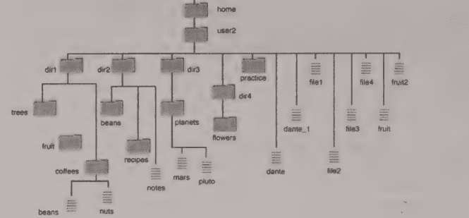

### 步骤 1. 登录 CDE

在 CDE 输入框中输入导师分配给你的用户名和密码登录。

### 步骤 2. 访问命令行

右键点击桌面背景并点击“工具”（Tools）。从菜单中选择“终端”（Terminal）打开终端窗口。

### 步骤 3. 使用基础 ls 命令

`ls` 命令单独使用时，将显示当前目录下所有文件和目录的列表。如果你刚刚登录，你的当前目录应该是你的家目录。

- 输入切换到家目录的命令。你使用了什么命令？
- 输入验证你所在目录的命令。你使用了什么命令？
- 输入以下命令：

```
$ ls
```

显示了什么？
- 你能判断列出的项目是目录还是文件吗？

# UNIX 实验学习指南

## 实验 5.4.6 – 列出目录信息

工作表 – 继续

### 步骤 4. 使用带参数的 ls 命令

`ls` 命令的参数可以是目录名（相对或绝对）和文件名。

- a. 从家目录开始，使用相对路径名显示 `dir2` 目录内容的命令。你使用了什么命令？
- b. 响应是什么？
- c. 使用绝对路径名列出 `/etc` 目录（根目录下的标准 UNIX 目录）中文件的命令。你使用了什么命令？
- d. 使用绝对路径名列出 `planets` 目录中文件的命令？你使用了什么命令？
- e. 输入命令列出你家目录中的文件。你使用了什么命令？

### 步骤 5. 使用 ls 命令查看隐藏文件

以点开头的名称是隐藏文件。以点开头的文件默认不会显示，它们经常用于自定义用户环境（例如 `.profile`, `.bashrc`）。当前目录链接和父目录链接也是隐藏的，因为它们以点开头。使用带有 `-a` 选项的 `ls` 命令可以列出所有文件，包括隐藏文件。*注意：* `a` 是小写的。你应该在家目录中。

- a. 输入基础 `ls` 命令。你看到任何隐藏文件（以点开头的文件）吗？
- b. 输入命令列出家目录中的所有文件。有多少隐藏文件？
- c. 输入以下命令创建一个空文件 `.hiddenfile`（确保第一个字符是点）：

```
$ touch .hiddenfile
```

# UNIX 实验学习指南

## 实验 5.4.6

工作表 – 继续

- d. 再次输入 `ls -a` 命令。`hiddenfile` 是否列出了？

### 步骤 6. 使用 ls 命令查看文件类型

单独使用 `ls` 命令时，可以获得目录列表，但无法区分哪些是文件哪些是目录。通过带有 `-F`（类型）选项的 `ls` 命令，可以显示带有符号的列表以指示文件类型。符号（如果存在）位于名称末尾。注意 `-F` 选项是大写的。有四种文件类型：目录、可执行、ASCII 文本文件和符号链接：

- 目录——名称后的斜杠 `/` 表示这是一个目录（子目录）。目录被视为一种文件类型。
- ASCII 文本——如果名称后没有符号，表示这是一个纯 ASCII 文本文件，其中没有格式字符。（ASCII 是信息标准交换编码）。ASCII 文本文件类似于 DOS 文本文件。
- 可执行——名称后的星号 `*` 表示这是一个可以执行的命令、应用程序或脚本文件。
- 符号链接——名称后的符号 `@` 表示这是一个符号链接，它是为文件提供别名的方法。符号链接将在课程后续部分介绍。

a. 从家目录开始，在不带任何的情况下输入基础 `ls` 命令。如果不是大多数目录名称中都有 `dir`，你能判断你看到的是文件还是目录吗？

b. 输入允许你查看家目录中文件名及其类型的命令。

列出目录名称：

c. 存在哪些类型的文件？

d. `/usr/bin` 目录包含许多 UNIX 可执行命令，其中你已经使用了一些。输入命令查看 `/usr/bin` 目录中的文件和类型。你使用了什么命令？

e. 存在哪些类型的文件？

f. `/etc` 目录包含许多类型的 UNIX 系统文件。输入命令查看 `/etc` 目录中的文件和类型。你使用了什么命令？

e. 你看到了哪些不同类型的文件？

# UNIX基础实验指南

## 实验 5.4.6 – 列出目录信息

工作单 – 续

### 步骤 7. 使用 ls 命令显示详细列表

之前的 `ls` 命令版本以宽格式（横跨整个屏幕）显示目录和文件的名称。`ls` 命令可以配合 `-l`（长格式）选项来查看每个文件或目录的更详细信息。`ls -l` 选项还会区分文件和目录。请注意 `-l` 选项是小写的 L。

以下是一个文件 `dante` 和目录 `dir1` 的详细列表示例。该列表的解释如下：显示的第一个位置表示该项是文件还是目录。小字母 `d` 表示目录；连字符 `-` 表示文件。

下一组字符（`r,w,x` 和连字符）是该文件或目录的权限。接其之后是链接数（`1, 5`），然后是文件所有者（`user2`）、文件访问组（`staff`）、文件大小（`320, 512`）、创建（或修改）日期时间，最后是文件或目录的名称。链接、所有者和组将在课程后续部分介绍。

```
-drwr-r-- 1 user staff 320 Dec 7 11:43 dante
drwxr-xr-x 5 user 512 Dec 4 13:43 dir1
```

- a. 从你的家目录，输入不带任何选项的基本 `ls` 命令。列出的每个文件或目录显示了哪些信息？
- b. 输入一个允许你查看家目录中文件名详细列表的命令。你输入了什么命令？
- c. 有多少个文件的大小大于 300 字节？
- d. 文件的所有者是谁？

使用 `-t`（时间）选项会将最近修改的文件列在列表顶部。要获取按时间排序（最近的在顶部）的详细（长格式）文件列表，请使用命令的 `ls -lt` 版本。

- e. 输入 `ls -lt` 命令。最近创建或修改的文件是哪一个？

### 步骤 8. 使用 ls 命令列出单个目录

使用 `ls -id` 显示目录的详细信息，但不显示其内容。当你只想查看目录的属性而不是其内容的信息时，这种方法非常有用。

- a. 从你的家目录，输入一个命令，提供 `dir2` 目录信息的详细列表。
- b. 从你的家目录，输入一个命令，使用相对路径提供 `fruit` 目录信息的详细列表。

### 步骤 9. 使用 ls 命令递归列出目录


使用 `ls -R`（递归）显示目录及其所有子目录的内容。递归意味着“反复执行”。如果你想查看目录树特定部分的所有目录、子目录及其内容，此选项就会很有用。如果是在目录结构的高层执行此操作，输出内容可能会非常巨大。请注意 `-R` 选项是大写的 R。

- a. 从你的家目录，输入一个命令，提供 `dir2` 目录的递归列表。

- b. 命令的结果是什么什么？

## 步骤 10. 关闭终端窗口并注销

双击屏幕左上角的减号按钮，然后点击前面板上的“退出”（Exit）图标。

## 可选练习

1. 查看 `ls` 命令的帮助页（`man` page），写下以下选项的作用，然后尝试每一个选项：

   - `-A`
   - `-n`

2. 在 `ls` 命令中添加哪个选项可以以单列的形式列出目录内容？

3. 比较 `ls -l` 和 `ls -n` 的输出。从输出来看，系统内部识别你的 UID 和 (GID) 数字分别是多少？系统从哪里获取你的 UID 和 GID 数字？

# UNIX基础实验指南

实验 5.5.5.2 – 使用通配符的目录列表

（预计时间：30 分钟）

## 目标

- 复习一些常用的通配符
- 配合通配符使用 `ls` 命令
- 使用星号 (`*`) 替换零或多个字符
- 使用问号 (`?`) 替换单个字符
- 使用方括号 `[]` 替换字符范围
- 使用分号在一条命令上执行多个命令

## 背景

在本实验中，你将使用各种通配符配合 `ls` 命令来完善你的目录列表。通配符是对 shell 具有特殊含义的键盘字符。通配符的通用定义是任何非字母数字的字符。通配符与 UNIX 命令配合使用提供了更大的灵活性。某些用于 UNIX 的通配符功能上与 DOS 中使用的相似。星号 (`*`) 和问号 (`?`) 是通称为通配符（wildcards）。在本实验中，你将使用 `ls` 以及以下常见的通配符。

| 通配符 | 名称 | 功能 |
| --- | --- | --- |
| ~ | 波浪号 | 快捷跳转到家目录 |
| * | 星号 | 字符替换（也称为 splat） |
| ? | 问号 | 字符替换 |
| [] | 方括号 | 范围定义 |

## 工具 / 准备

在开始实验之前，复习以下内容：

- 教师分配给你的登录用户（如 `user2`）和密码。
- 一台运行桌面环境 (CDE) 的计算机。
- 教室内的联网计算机。

你需要：

- 网络学院：《UNIX 基础指南》。

## 笔记

# UNIX基础实验指南

实验 5.5.2 – 使用通配符的目录列表

工作单

使用目录树图来辅助完成实验。

## 步骤1. 登录 CDE

使用分配给你的用户名和密码登录。

## 2. 访问命令行

右键点击工作区并点击“工具”。从菜单中选择“终端”。

## 步骤3. 使用基本命令

`ls`（列出文件）命令单独使用时将显示目录中的所有文件。如果你刚刚登录，当前目录应该是你的家目录。

a. 输入切换到家目录的命令。你输入了什么命令？

b. 输入验证你所在目录的命令。你输入了什么命令？

c. 输入以下命令：

```
$ ls
```

显示了什么？

## 步骤4. 使用星号 (*) 通配符使用 ls 命令

星号 (`*`) 是一个替换符号，代表零或多个字符（隐藏文件开头的点除外）。星号通常被称为通配符。如果目录下有很多文件，你只想查看以 pl 开头的项目文件，可以使用星号限制列出的数量。例如，命令 `ls*` 将列出所有以 pl 开始并带有后续字符的文件。星号可以放在测试字符串的任何位置（开头、中间或结尾），并且可以出现多次。如果你输入 `ls d*`，你将看到所有以 d 开的文件以及以 d 开头的子目录的内容。

a. 输入列出家目录中以 f 开头的文件和目录的命令。你输入了什么命令？

b. 列出了什么？

c. 输入列出家目录中以 d 开头的文件和目录的命令。你输入了什么命令？

d. 列出了什么？

e. 输入列出家目录中以数字 1 结尾的文件和目录的命令。你输入了什么命令？

f. 列出了什么？

g. 输入列出家目录中文件名任何位置包含 ru 字符的文件和目录的命令。你输入了什么命令？

h. 列出了什么？

i. 使用相对路径列出 `coffees` 目录中以 n 开头的文件和目录的命令。你输入了什么命令？

j. 列出了什么？

# UNIX 基础实验指南

实验 5.5.2 – 使用元字符列出目录

工作单 – 续

## 步骤 5. 使用带有问号的 ls 命令

问号（`?`）是一个替换字符，它可以匹配任意单个字符，但隐藏文件开头的点（`.`）除外。问号也被称为通配符。以下示例展示了 `ls` 命令在第四个位置使用问号。这意味着文件名或目录名必须以 `dir` 开头，但第四个位置可以是任何字符，且文件名长度不能超过四个字符。

```
$ ls ??dir?
```

- a. 输入命令，列出你主目录中符合以下条件的文件和目录：前四个位是字母 `file`，第五个位是任意字符，但总长度不超过超过五个字符。

你使用了什么命令？

列出了什么内容？

- b. 输入命令，列出你主目录中符合以下条件的文件和目录：长度不超过五个字符，第一位是字母 `f`，第二位和第三位是任意字符，最后两个字符是 `e3`。你使用了什么命令？

- c. 列出了什么内容？

## 步骤 6. 使用方括号的 ls 命令

方括号（`[]`）可用于匹配文件或目录中单个字符位置的字符集或范围。括号内的字符通常不需要特定的顺序；例如，`[abc]` 与 `[cab]` 相同。然而，如果你正在寻找一个字符范围，必须按照正确的顺序排列（例如 `[a-z]` 或 `[3-9]`）。如果你想搜索所有的字母（无论大小写），请使用模式 `[A-z]` 进行匹配。你可以使用字母或数字字符作为搜索模式。

以下示例使用了方括号配合星号通配符（`*`）。第一个示例定义了一个范围，并列出了所有以小写字母 `b` 到 `f` 开头且后续为任意字符的文件和目录。第二个示例指定第一个字符必须是字母 `a` 或 `f`，之后是任意字符：

```
$ ls [b-f]*
dante_ dir1 dir3 file1 file3 fruit practice
dante_1 dir2 dir4 file2 fruit42
```

```
$ ls [af]*
file1 file2 file3 file4 fruit2
```

- a. 输入命令，列出你主目录中符合以下条件的文件和目录：以字母 `f` 到 `p` 开头，其余位置为任意字符。你使用了什么命令？

- b. 列出了什么内容？

- c. 输入命令，列出你主目录中符合以下条件的文件和目录：以任意字符开头，但最后一位是数字 `1` 到 `3`。你使用了什么命令？

- d. 列出了什么内容？

- e. 输入命令，列出你主目录中符合以下条件的文件和目录：以 `d` 或 `p` 开头，其余位置为任意字符。你使用了什么命令？

- f. 列出了什么内容？

## 步骤 7. 使用分号分隔命令

分号（`;`）允许你在按下回车键之前在单行命令行上执行多个命令。分号也被称为命令分隔符。下面的示例展示了两个使用分号分隔命令的例子。在第一个示例中，`clear` 命令将清除屏幕，`cd` 命令将你返回主目录，而 `ls` 命令将列出目录中的文件。第二个示例将显示当前的日期时间以及当前月份的日历

```
$ clear;ls
dante_ dir1 dir3 file1 file3 fruit practice
dante_1 dir2 dir4 file2 fruit2
```

```
$ date;cal
Wed Feb 28 11:05:39 MDT 2001
February 2001
 M Tu W Th F S
  1 2 3 4 5 6 7 8 9 10
 11 12 13 14 15 16 17
 18 19 20 21 22 23 24
 25 26 27 28
```

在一行中输入一系列命令来清除屏幕、显示当前工作目录，然后列出主目录中文件的详细列表。你输入了哪些系列命令？

## 步骤 8. 关闭终端窗口并注销

双击屏幕左上角的横杠按钮，然后点击前面板上的退出（Exit）图标。

## 可选练习

- 1. 有什么快速方法可以切换到 `/usr/openwin/demo/kcms/images/tiff` 目录，而无需输入整个目录名？
- 2. `ls chap[1-9]` 命令会列出 `chap1` 到 `chap9` 文件。你会使用什么命令行来列出所有 20 多（20-29）和 30 多（30-39）的文件？
- 3. 你会使用什么命令行来列出所有名称仅为五个字符的文件和目录？

# UNIX 基础实验指南

实验 6.1.6 – 文件信息命令

（预计时间：30 分）

## 目标

- 使用控制字符执行特定任务
- 使用 `file` 和 `strings` 命令确定文件类型
- 使用 `cat` 和 `more` 命令显示文本文件内容
- 使用 `head` 和 `tail` 命令显示文本文件的部分
- 使用 `wc` 命令确定单词、行数和字符数
- 使用 `diff` 命令比较两个文件

## 背景

在本实验中，你将学习各种命令。这些命令很重要，因为它们允许你调查文件。你还将使用几个查看信息的命令。使用命令进行分析和管理文件对于深入学习 UNIX 打下坚实基础非常重要。许多操作系统管理任务都需要命令。

## 工具 / 准备

在开始实验之前，请复习思科学院：UNIX 基础指南第 6 章。

你需要：

- 导师分配的用户登录 ID（如 `user2`）和密码。
- 运行带有桌面环境（CDE）操作系统的计算机。
- 教室中的联网计算机。

# UNIX基础实验指南

6.1.6 – 文件信息命令

工作单

请参考示例文件系统目录树辅助完成实验。

## 步骤 1. 登录 CDE

使用导师分配的用户名和密码登录 CDE 输入框。

### 步骤 2. 访问命令行

右键点击桌面背景并点击 Tools。从菜单中选择 Terminal 打开终端窗口。

## 步骤 3. 使用控制字符执行特定任务

控制字符用于执行特定任务，例如停止和启动屏幕输出。大多数 PC 键盘有两个控制键，通常标记为 Ctrl，位于键盘的左下和右下。在 Sun 工作站上，左下角有一个标记为 Control 的控制键。在屏幕上显示时，控制键用脱号符号（^）表示。

要输入控制字符序列，按住 Ctrl 键并按下键盘上相应的字符。`Control-c` 是一个常见的控制字符序列，经常用于中断或取消进程。命令行中的实际字符显示为 `^C`，尽管你是同时按下 Control 键和 c 键。

# UNIX 实验助手基础

实验 6.1.6 – 文件信息命令

工作单 – 续

Control-c– 中断当前活动，经常用于中止或终止由 `man`、`cat` 或 `ls` 命令产生的长输出输出。如果你输入了无法识别的命令行（例如 `$ ls `）并且在 shell 中收到了次级提示符（`>`），使用 Control-c 也有助于恢复提示符。

显示 `ls` 命令的 man帮助页（`man ls`），然后用 Control-c 终止输出。

当你按下 Control-c 时发生了什么？

Control-d– 表示文件结束（EOF）或退出。Control-d 用于退出某些 UNIX 实用程序（如 `bc`、`write` 以及其他几个）、退出终端窗口，以及注销终端会话或命令行登录会话。通常情况下，当你卡住了，或者当 Control-c 不起作用时，请尝试 Control-d。例如：

- 1. 在 shell 提示符处输入 `bc` 启动基础计算器。
- 2. 将两个数字相乘（输入：`458*594` 并按回车）。
- 3. 按 Control-d 退出计算器。

在使用计算器时，你的提示符是什么？

Control-u– 擦除整个命令行。Control-u 最常用的用途如下：

- 快速擦除你决定不执行的命令行。
- 如果你登录到远程系统且退格键（backspace）不起作用时。
- 它可以确保你在登录时是从全新的用户 ID 和密码输入开始的。
- 因为在输入密码时看不到显示内容，所以当你知道自己输入了错误的字符时，使用 Control-u 擦除密码并重新开始。

如果你不小心输入了命令 `ls -R`，你会在按回车之前擦除该命令行。在按回车执行命令之前，输入命令并按 Control-u。

`ls -R /` 命令会执行什么？

## 步骤 4. 使用 file 命令确定文件类型

在 UNIX 系统上可以找到许多类型的文件。可以使用 `file` 命令确定文件类型。当用户尝试打开或读取文件时，此信息可能至关重要。确定文件类型可以帮助用户决定使用哪个程序或命令来处理该文件。此命令的输出通常是以下内容之一：文本、可执行文件或数据。

- **文本文件 (Text files)**–示例包括 ASCII 或英文文本、命令文本和可执行 shell 脚本。此类文件可以使用 `cat` 或 `more` 命令读取，并可以使用 vi或其他文本编辑器进行编辑。

使用 `file` 命令确定你主目录下 `dante` 文件的类型。它是什么类型的文件？

- **可执行文件（或二进制文件）Executable**–示例包括 32 位可执行文件、扩展链接格式 (ELF) 文件以及其他动态链接的可执行文件。此类文件类型表示文件是一个命令或程序。

使用 `file` 命令确定 `/usr/bin` 目录下 `cal` 文件的类型。它是什么类型的文件？

- **数据文件 (Data files)**–数据文件由运行在系统上的应用程序创建。在某些情况下会标明文件类型；例如 FrameMaker（桌面出版软件）文档。

使用 `file` 命令确定 `dir1/coffees` 子目录下 `beans` 文件的类型。它是什么类型的文件？

## 步骤 5. 使用 strings 命令

`strings` 命令可用于打印可执行文件或二进制文件中的可读字符。具有编程背景的人可以解释 `strings` 产生的输出。此处引入该命令仅作为演示可执行文件可打印字符的方法。必须使用 `strings` 命令读取如 `/usr/bin/cat` 等可执行文件。在大多数情况下，`strings` 命令还会显示命令的用法语法。

使用 `strings` 命令查看 `/usr/bin/cal` 文件中的可读字符。列出一些 `strings` 命令的输出。

## 步骤 6. 使用 cat 命令显示文件内容

`cat`（concatenate 的缩）命令在屏幕上显示文本文件的内容。它通常用于显示短文本文件，如脚本文件（类似于批处理）。如果文件超过一个屏幕，数据将滚出屏幕——除非你正在 CDE 环境内使用滚动窗口（例如终端窗口）。

- 使用 `cat` 命令显示你主目录下 `dante` 文件的内容。文本的显示发生了什么？

## 步骤 7. 使用 more 命令显示文件内容

`more` 命令是显示文本文件的首选方法，因为它会自动一次一个屏幕地显示文件内容。如果文件信息超过一个屏幕，屏幕底部会出现以下信息：--More--(n%)。按回车键可以逐行继续显示。按空格键可以一次一个屏幕继续显示。

- 使用 `more` 命令显示你主目录下 `dante` 文件的内容。文本的显示发生了什么？

## 步骤 8. 使用 head 命令显示文件部分

`head` 命令用于显示一个或多个文本文件的前 n 行。如果省略 `-n` 选项，默认显示前 10 行。当你无论文件长度如何，只想检查文件的前几行时，`head` 命令非常有用。

- 单用 `head` 命令显示主目录下 `dante` 文件的开头部分。显示了多少行？
- 使用 `head` 命令配合 `-n` 显示主目录下 `dante` 文件的前 20 行。你输入了什么命令？

## 步骤 9. 使用 tail 命令显示文件部分

使用 `tail` 命令显示文件的最后 n 行。如果启用了 -n 选项，默认显示最后 10 行。`tail` 命令对于检查日志文件的最新条目非常有用。备份程序经常将结果写入日志文件，显示备份了哪些文件以及时间。-n 选项显示文件的最后 n 行。

- 单用 `tail` 命令显示主目录下 `dante` 文件的结尾。显示了多少行？

## 步骤 10. 使用 wc 命令确定行、字和字符数

`wc`（word count）命令可用于显示文件的行数、字或字符数。此命令在确定文件特性或比较文件时非常有用。不带选项使用 `wc` 将得到文件的行数、字数和字节数。配合单个选项使用它可以确定你想查看哪些内容。

- 使用 `wc` 命令确定主目录下 `dante` 文件的行数、字数和字符数。有多少行、字和字符？

## 步骤 11. 使用 wc 统计目录条目

使用 `ls` 命令确定主目录下的条目（文件和目录）。要实现这一点，你必须将 `ls` 命令管道到 `wc` 命令。管道符号是与反斜线 (\) 在同一键上的竖线。在提示符处输入命令：`ls | wc -w`

有多少个文件目录名（字）？

# UNIX基础实验指南

实验 6.1.6 – 文件信息命令

工作表 – 继续

使用 `diff` 命令进行详细比较，并确定 `fruit` 和 `fruit2` 文件之间的差异。

`fruit` 文件中有哪些行（或水果）是 `fruit2` 文件没有的？

# 步骤 13. 关闭终端窗口并退出

双击屏幕左上角的减号按钮，然后点击前面板上的退出（Exit）图标。

## 可选练习

- 1. `cat` 命令：

  a. 对 `file2` 文件使用 `cat` 命令。
  b. 对 `file4` 文件使用 `cat` 命令。
  c. 输入命令行 `cat file2 file4 > filex`
  d. 对 `filex` 文件使用 `cat` 命令。上述命令行执行了什么？

     *提示：* 阅读 `cat` man 页面中“Description（描述）”部分下的第二个示例。`>` 特将在本实验指南的后续部分详细介绍。

- 2. 你可以使用哪两个命令来确定两个文件是否相同？

# UNIX基础实验指南

实验 6.1.10 – 基础命令行文件管理

（预计时间：30 分）

## 目标

- 复习文件和目录的命名规范
- 使用 `touch` 命令创建新文件


- 使用 `mkdir` 命令创建新目录

- 使用 `rm` 命令删除文件

- 使用 `rm -r` 命令删除目录

## 背景

在本实验中，你将通过命令行使用文件管理命令。我们将复习文件和目录的命名指南，即命名规范。你将创建一个简单的目录结构，然后在这些目录中创建一些文件。你将练习创建和删除文件以及目录。

了解如何使用命令管理文件和目录对于为进一步学习 UNIX 打下坚实基础非常重要。高级用户和管理员经常创建可执行脚本文件，这些文件是备份文件或创建新用户账户等自动化任务的重要工具。脚本文件是一系列 UNIX 命令，类似于其他网络操作系统使用的批处理文件。

## 工具 / 准备

*在开始本实验之前，请复习思科网络学院计划：《UNIX基础指南》的第6章。*

你将需要：

- 导师分配的登录用户 ID（如 `user2`）和密码。
- 一台运行带有通用桌面环境（CDE）的 UNIX 操作系统的计算机。
- 教室内的联网计算机。

## 注意事项


# UNIX基础实验指南

实验 6.1.10 – 基础命令行文件管理

工作表

使用示例类文件系统目录树图来辅助完成实验。

## 类文件树结构

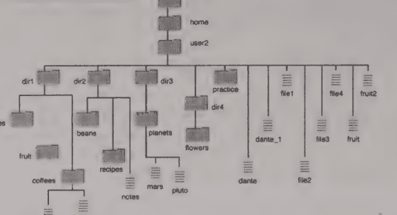

## 步骤 1. 登录 CDE

在 CDE 输入框中输入导师分配给你的用户名和密码登录。

### 步骤 2. 访问命令行

右键点击 Workspace（桌面）背景并点击 Tools（工具）。从菜单中选择 Terminal（终端）打开终端窗口。

# 步骤 3. 复习 UNIX 文件和目录命名规范

在本实验中，你将创建文件和目录，因此在开始之前，复习 UNIX 文件和目录的命名规则和指南非常重要：

- **最大长度** - 文件和目录的最大长度为 255 个字母数字字符。建议文件名尽可能短，但仍要具有意义。
- **非字母数字元字符** - 允许使用某些非字母数字或元字符：下划线 (`_`)、连字符 (`-`) 和点 (`.`)。这些元字符可以在文件或目录名中使用多次（例如，`Feb.Reports.Sales` 是一个有效的文件或目录名）。虽然 shell 允许在文件名中使用星号 (`*`)、问号 (`?`)、波浪号 (`~`)、中括号 (`[]`)、安培符号 (`&`)、管道符 (`|`)、引号 (`"`) 和美元符号 (`$`)，但不建议这样做，因为这些字符对 shell 具有特殊含义。分号 (`;`)、小于号 (`<`) 和大于号 (`>`) 符号是不被允许的。
- **文件名扩展名** - 文件名可以包含一个或多个扩展名。扩展名通常由应用程序添加到文件中。扩展名通常是一个到三个字符，附加文件名末尾，并以点 (`.`) 开头。你可以在命名文件时选择这种约定，但它并不是文件名的必要部分。
- **目录名扩展名** - 目录名通常不包含扩展名，但并没有禁止的规定。
- **大小写敏感** - UNIX 文件和目录名区分大小写。`Project1` 是区分大小写的。

# UNIX基础实验指南

实验 6.1.10 – 基础命令行文件管理

工作表 – 继续

- 文件名扩展名 – 文件名可以包含一个或多个扩展名。扩展名通常由应用程序添加到文件中。扩展名通常是一个到三个字符，附加文件名末尾，并以点 (`.`) 开头。你可以在命名文件时选择这种约定，但它并不是文件名的必要部分。
- 目录名扩展名 – 目录名通常不包含扩展名，但并没有禁止的规定。
- 大小写敏感 – UNIX 文件和目录名区分大小写。`Project1` 是区分大小写的。检查以下文件名并指示它们是否有效：

| 文件名 | 是文件还是目录？(是/否) |
| :--- | :--- |
| a. 123 | |
| b. hobbies | |
| c. 123 | |
| d. *201 | |
| e. 201 | |
| f. 201 | |

**步骤 4. 使用 touch 命令创建文件**

在本实验中，你将创建文件和目录，因此在开始之前，复习 UNIX 文件和目录的命名规则和指南非常重要：

**`touch`** 命令用于快速创建文件。你也可以使用 **`touch`** 命令更新文件的访问时间。

命令格式：

```
touch filename(s)
```

从主目录，使用相对路径进入练习目录。使用了什么命令？

- b. 输入 `pwd` 命令确认你所在的目录。响应是什么？
- c. 使用 `touch` 命令在该目录下创建一个名为 `newfile` 的文件。使用了什么命令？
- d. 使用 `touch` 命令在该目录下创建另一个新文件 `filenew`。使用了什么命令？
- e. 输入命令列出练习目录的文件。显示的文件是否存在？
- f. 文件的所有者是谁？
- g. 文件关联的组是什么？
- h. 创建日期和时间是什么？
- i. 文件的大小是多少？
- j. 使用 `file` 命令确定 `newfile` 的类型。它是什么类型的文件？
- k. 使用 touch 命令同时创建三个文件：`new1`、`new2` 和 `new3`。使用了什么命令？
- 1. 输入命令列出练习目录的文件。你创建的三个文件是否存在？

# 步骤 5. 使用 mkdir 命令创建新目录

The `mkdir`（make directory）命令用于创建目录或文件夹。目录包含其他目录（称为子目录），它们也可以包含文件。可以使用绝对路径或相对路径创建目录。你可以在同一行指定多个目录名称来创建多个新目录。你必须拥有创建目录的权限。（权限将在以后介绍。）

`mkdir -p`（父目录）选项可以在创建低级目录的同时创建父目录。你可以同时创建多级目录，包括路径中的所有目录。如果你使用 `-p` 选项并指定的路径中不存在某个目录，它将被创建：

```
mkdir [-p] directory_name(s)
```

# UNIX 基础实验指南

实验 6.1.10 – 基础命令行文件管理

工作单 – 继续

- a. 从你的主目录（home directory），使用相对路径切换到练习目录。你使用了什么命令？
- b. 使用 `mkdir` 命令在此目录下创建一个名为 `newdir` 的子目录。你使用了什么命令？
- c. 输入命令显示练习目录中文件和目录的详细列表。你创建的子目录显示在列表中中吗？
- d. 该目录的所有者是谁？
- e. 文件的大小是多少？
- f. 使用 `file` 命令确定 `newdir` 的文件类型。它是什么类型的文件？
- g. 如果名称中没有 `dir` 字符，你如何判断这是一个目录？
- h. 使用带有 `-p` 选项的 `mkdir` 命令创建一个名为 `high`、`medium` 和 `low` 的三级新目录结构。`medium` 应该是 `high` 的子目录，`low` 应该是 `medium` 的子目录。你输入了什么命令？
- i. 使用带有 `-R`（递归）选项的 `ls` 命令查看所有目录和子目录。所有新目录都按正确顺序列出了吗？

## 第 6 ：使用 rm 命令删除文件

`rm` 命令可以删除单个文件或多个文件。你可以在 `rm` 命令后指定多个文件名来同时删除多个文件，或者使用星号（`*`）和问号（`?`）元字符（通配符）。在 UNIX 系统上删除的文件是永久删除的，除非你正在使用 C 图形界面，否则无法恢复。`rm` 命令可以配合 `-i`（交互式）选项使用，它会在删除文件前提示用户。使用 `rm -i` 命令作为预防，避免意外删除文件：

```
rm {-i} filename
```

- a. 使用 `rm` 命令从练习目录删除你之前创建的 `newfile`。你使用了什么命令？
- b. 输入命令显示练习目录中文件的详细列表。你创建的文件消失了吗？
- 使用带有 `-i` 选项的 `rm` 命令从练习目录删除你之前创建的 `filenew`。交互选项做了什么？
- 删除你创建的名为 `new1`、`new2` 和 `new3` 的三个文件。使用问号（`?`）通配符通过一个命令删除所有三个。你使用了什么命令？
- 输入命令显示练习目录中文件的详细列表。这三个文件消失了吗？
- 你还有什么其他方法可以删除 `new1`、`new2` 和 `new3` 文件？

## 第 7 ：使用 rm -r 命令删除目录

`rm -r` 命令用于删除目录。它将删除目标目录，包括所有的子目录和文件。当 `rm` 命令配合 `-i` 选项使用时，它可以删除单个目录（无论是否为空）或目录树的整个部分。`rm` 命令可以配合 `-i` 选项使用，在删除目录前提示用户。

```
rm -r [i] directory_name(s)
```

- 删除你之前创建的 `newdir` 子目录。你使用了什么命令？
- 输入命令显示练习目录中文件和目录的详细列表。你创建的子目录消失了吗？
- 切换你之前创建的 `medium` 子目录。你输入了什么命令？
- 删除你之前创建的 `low` 子目录。你使用了什么命令？
- 使用相对路径和快捷方式切回 `practice` 子目录。你输入了什么命令？
- 用一个命令删除 `high` 和 `medium` 子目录。你使用了什么命令？

## 第 8：练习所学知识

通过在练习目录中创建一个简单的三级目录树，练习使用 `touch`、`mkdir` 和 `rm` 命令。尝试使用有意义的目录名称。记住你可以用一个命令创建一个整个目录结构。在每个目录中创建多个文件。记住你你可以用一个命令创建多个文件。删除文件，然后删除目录，以便在完成时你的练习目录中没有任何文件或目录。

## 第 9：关闭终端窗口并注销

双击屏幕左上角的减号按钮，然后点击前面板上的“退出”（Exit）图标。

## 可选练习

- 1. 系统内部通过一个称为用户标识（UID）的数字来识别你，该数字会被分配给你创建的每个文件和目录。当你执行详细列表（`ls -l`）时，显示的是你的用户名和主安全组名称，而不是内部的 UID 和组标识（GID）数字。
    - a. 阅读 `ls` 命令的帮助页（man page），确定使用哪个选项可以打印所有者的 UID 和组的 GID 数字，而不是关联的字符串（名称）。
    - b. 登录时读取哪个文件来确定你的用户名、UID 数字和 GID 数字？提示：参见思科网络学院课程：《UNIX 基础指南》第 2 章。
- 2. 切换目录到 `/usr/bin` 目录显示文件列表。
    - a. 通过回答 Y 来覆盖保护以删除其中一个文件。你成功了吗？你收到了什么消息？
    - b. 在 `/usr/bin` 目录下创建一个名为 `another.dir` 的新目录。你收到了什么消息？

# UNIX 基础实验指南

实验 6.2.6- 基础 CDE 文件管理器（预计时间：30 分钟）

## 目标

- 学习访问 CDE 文件管理器
- 识别图形化文件和目录图标
- 比较文件管理器选项与命令行管理
- 在文件夹之间切换
- 创建新文件和文件夹（目录）
- 通过将文件放入垃圾箱来删除文件
- 从垃圾箱恢复文件
- 通过粉碎（shredding）永久删除文件

## 背景

在本实验中，你将使用常用桌面环境（CDE）文件管理器。CDE 的文件和目录管理方法允许你执行许多之前在命令行执行的相同任务。CDE 为文件管理提供了图形化界面，并在后台执行大部分你从命令行使用的相同命令。文件管理器允许你通过图形化方式将文件组织成文件夹（目录）和子文件夹（子目录）的层次结构。你将努力熟悉文件和目录的图形化视图。你将创建新文件和文件夹，并练习删除和恢复文件。

## 工具 / 准备

在开始实验之前，请复思科网络学院课程：《UNIX 基础指南》第 6 章。

你将需要：

- 导师分配的登录用户 ID（如 `user2`）和密码。
- 一台运行带有 CDE 操作系统的计算机。
- 教室中的联网计算机。

## 注意事项

# UNIX 基础实验指南

实验 6.2.6– 基础 CDE 文件管理器

工作单

使用示例课程文件系统目录树图来辅助本实验。

## 课程文件树结构

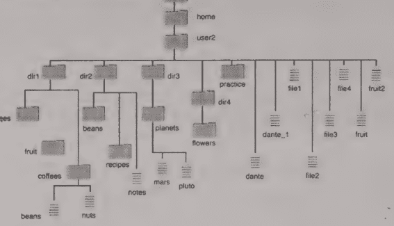

步骤 1. 登录 CDE

在 CDE 登录框中使用你的用户名和密码登录。

## 步骤 2 访问文件管理器

可以通过点击前面板上的文件抽图标或右键点击工作区桌面并选择“文件”菜单来访问文件管理器。文件管理器默认打开你的主目录视图。

注意：文件夹（folder）术语与目录（directory）和子目录（subdirectory）术通用。

从文件夹，你可以切换到层次结构中的任何其他文件夹以查看每个目录的内容。当前文件夹的路径始终显示在文件管理器窗口的上方。

- a. 点击前面板上的文件抽图标启动文件管理器。面板上方显示的目录路径是什么？

# UNIX 实验伙伴基础

实验 6.2.6– 基础 CDE 文件管理器

工作单 – 续

## 步骤 3 识别文件和文件夹图标

目录显示为文件夹图标。文件根据其类型显示相应的图标。文件类型基于其功能和创建它们的应用程序。文件类型的示例包括音频、二进制、核心（core）、图形、postscript 和标准（standard）类型。文件管理器根据文件内容显示不同的图标，以帮助区分和识别文件类型。最常见的文件图标是标准图标。如果文件与特定应用程序关联，当双击该图标时，该应用程序会自动启动。

- a. 使用窗口右侧的垂直滚动条向上和向下滚动。在你的主目录中看到了哪些类型的图标？
- b. 右键点击 `dante` 文件图标并从菜单中点击“属性（Properties）”。点击顶部的“信息（Information）”类别按钮。显示了哪些关于该文件的信息？
- c. 如果你在命令行界面，使用哪种 UNIX 命令可以获取关于 `dante` 文件的类似信息？
- d. 在 `dante` 文件的属性窗口打开的情况下，点击文件管理器中的“文件（File）”菜单并点击“打开终端（Open Terminal）”。你可能需要移动窗口以同时看到两个窗口。在终端窗口中，输入命令：`ls -d dante`。属性窗口中提供了哪些 `ls -d` 命令未显示的信息？

## 步骤 4 在文件夹之间切换

如果你双击文件夹图标，文件管理器将带进入该目录并显示其内容。你只能通过这种方式在文件系统层次结构中移动。文件和文件夹窗口的左上角始终有一个特殊的“向上（Go Up）”图标。双击此图标将带你移动到目录层次结构的下一级。完成以下练习，并将结果与课堂文件目录树图进行比较。

- a. 双击 `dir` 文件夹。这个文件夹里有什么？
- b. 双击 `coffees` 文件夹。这个文件夹里有什么？
- c. 窗口上方区域的路径指示你的当前目录是什么？
- d. 右键点击 `beans` 文件图标，选择“属性”，然后点击“信息”按钮。`beans` 是什么类型的文件？

关闭属性窗口。

- e. 反复双击“向上”图标直到返回主目录（`/home/userX`）。你双击了多少次回到主目录？
- f. 双击 `dir3` 文件夹，然后再次双击 `planets` 文件夹。`planets` 文件夹里有什么？
- g. 点击菜单中的“文件”选项并选择“回到主（Go Home）”。你现在哪个目录？

## 步骤 5 使用文件菜单选项

文件菜单选项允许你执行许多文件和目录管理中的常见任务。这些任务可以使用命令行完成。下表列出了文件菜单选项并提供了每个选项的简要描述。

| 文件菜单选项 | 描述 |
|---|---|
| 新文件夹 (New Folder) | 创建新的目录或子目录（权限足够的情况下） |
| 新文件 (New File) | 在你有权限的任何目录中创建新文件 |
| 回主 (Go Home) | 如果当前文件夹与主目录不同，则切换到主目录 |
| 向上 (Go Up) | 在目录树或层次结构中向上移动一层文件夹 |
| 转到 (Go To) | 切换到指定的目录 |
| 查找 (Find) | 根据名称或内容定位文件 |
| 打开终端 (Open Terminal) | 打开一个带有 shell 提示符的终端窗口，可以在其中输入 UNIX 命令 |
| 可移除介质管理器 (Removable Media Manager) | 提供对 CD ROM 和软盘等可移除介质的访问 |
| 打开软盘 (Open Floppy) | 驱动器（DOS 或 UNIX）中的软磁盘 |
| 关闭 (Close) | 关闭文件管理器窗口 |

- a. 在文件管理器内部点击“文件”菜单以访问可用选项。你会使用哪个选项在当前目录中创建目录？
- b. 点击“菜单（Menu）”选项回到主目录。你使用了哪个选项？
- c. 点击“菜单”选项切换到另一个目录并进入 `dir2/beans` 目录。你使用了哪个选项？

完成下表，列出完成与所列菜单选项相同任务的 UNIX 命令。

| 文件菜单选项 | 可比的 UNIX 命令 |
|---|---|
| 新文件夹 (New Folder) | |
| 新文件 (New File) | |
| 回主 (Go Home) | |
| 向上 (Go Up) | |
| 转到 (Go To) | |

## 步骤 6 创建新文件夹

当从文件菜单选择“新文件夹”选项时，会显示一个独立的窗口，你可以在其中输入新文件夹的名称。输入名称后，你可以选择左击“确定（OK）”或“应用（Apply）”。点击“确定”会添加新文件夹并关闭“新文件夹”窗口。点击“应用”会添加新文件夹并保持“新文件夹”窗口打开以便添加另一个文件夹。

- a. 在主目录中，点击“文件”菜单中的“新文件夹”选项并添加名为 `newcomer` 的新文件夹。双击你创建的新文件夹以进入它。`newfolder` 里有东西吗？
- b. 窗口顶部的路径显示你的当前文件夹是什么？
- c. 在 `newfolder` 中，创建一个名为 `subfolder` 的目录。双击 `subfolder`。现在窗口顶部的路径是什么？
- d. 点击“文件”菜单，然后点击“回到主”返回你的主目录。
- 注意窗口顶部的 home 和 `userX` 文件夹，它们图形化地显示了你当前目录的路径。home 文件夹图标上有一个划线的铅笔，而 `userX` 文件夹没有。home 文件夹图标上带线的铅笔意味着什么？

## 步骤 7 创建新文件


与“新文件”选项一样，会显示一个窗口，你在其中输入要创建的文件名称。如果你点击“确定”，文件将创建且窗口将关闭。如果你点击“应用”，文件将创建且窗口将保持打开以便你创建另一个新文件。

如果你尝试创建一个与现有文件夹或文件同名的文件夹或文件，“文件操作错误（File Manipulation Error）”窗口会提示你。点击“确定”，然后为要创建的文件夹或文件输入替代名称。

- 从主目录切换到之前创建的 `newfolder`。文件夹里有什么？

- 点击“文件”菜单中的“新文件”选项并创建一个名为 `newfile1` 的文件。点击“应用”并创建一个名为 `newfile2` 的新文件。关闭新文件窗口并注意 `newfolder` 目录的内容。文件的所有者是谁？

## 步骤 8 删除和恢复文件

文件管理器相对于命令行环境的一个优势是可以恢复被删除的文件。这被称为“撤销”功能。如果使用文件管理器删除文件，只要它没有被覆盖，就可以恢复它。在 CDE 中，任何被删除的文件或目录都会放入垃圾桶。可以通过从文件菜单选择“还原（Put Back）”选项恢复垃圾桶中的文件。垃圾桶还允许你粉碎（shred）垃圾桶内的文件或目录，从而永久删除这些文件。

- 切换到 `newfolder` 目录。选中 `newfile1`，点击“选中（Selected）”菜单并选择“放入垃圾桶”（或右键点击文件选择）。选中 `newfile2` 并将其放入垃圾桶。这些文件被永久删除了吗？

- 点击前面板上的垃圾桶图标并从菜单中点击“垃圾桶（Trash）”选项。你刚才删除的文件在那里吗？

- 选中 `newfile1`，点击“文件”菜单并从菜单中选择“还原（Put Back）”。文件应该被恢复。你能在文件管理器的 `newfolder` 中看到它吗？

# UNIX 实验指南基础

实验 6.2.6 – 基础 CDE 文件管理器

工作单 – 持续

- d. 点击 `newfile2` 选中它，点击 `File`（文件）菜单，从菜单中选择 `Shred`（粉碎）来永久删除它。结果是什么？

# 第 9 步 关闭终端窗口并注销

双击屏幕左角的横杠按钮，然后点击前面板上的 `Exit`（退出）图标。

# UNIX 实验指南基础

实验 7.1.1.2 – 复制文件和目录

（预计时间：45 min）

## 目标

- 练习使用 `cp` 命令复制文件和目录
- 在同一目录内复制文件创建备份
- 将文件复制到其他目录
- 在同一目录内复制目录
- 将目录复制到其他目录

## 背景

在本实验中，你将使用命令行界面和 `cp`（复制）命令执行更高级的文件和目录管理任务。复制文件是文件系统操作中的常见。文件可以在本地驱动器（如软磁盘、硬盘和 CD-ROM）之间复制。它们也可以在本地驱动器和服务器上的网络驱动器之间复制。复制命令的一个常见用途是对现有文件进行备份以安全保存，以便对原始文件进行修改。`cp` 命令还可以用于创建树形结构中目录或一组目录的本地备份。

## 工具 / 准备

在开始实验之前，请回顾思科网络学院课程的第 7 章：

《UNIX 基础指南》。

你需要以下物品：

- 导师分配的登录用户 ID（如 `user2`）和密码。
- 一台运行 UNIX 操作系统并带有通用桌面环境 (CDE) 的计算机。
- 教室内的联网计算机。

## 注意

# UNIX 实验指南基础

实验 7.1.2- 复制文件和目录

工作单

使用示例类文件目录树图来辅助本实验。

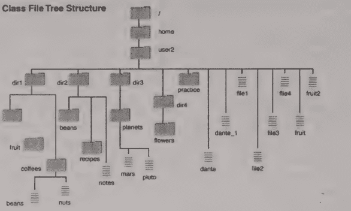

## 第 1 步 登录 CDE

在 CDE 登录框中输入导师分配给你的用户名和密码登录。

# 第 2 步 访问命令行

右键点击 `Workspace`（工作区）背景并点击 `Command Tools`（命令工具）。从菜单中选择 `Terminal`（终端）打开终端窗口。

# 复制文件–概述

文件可以通过多种方式复制：

- 可以在同一目录内创建一个不同名称的新文件。
- 文件可以复制到目录层次结构中的不同位置，可以使用相同或不同的名称。
- 文件还可以复制到不同的磁盘（如软磁盘）或中央服务器，并具有相同或不同的名称。

# 第 3 步 在目录内复制文件

如果你想在同一目录内复制文件并创建一个不同名称的新文件，请使用以下命令格式。你可以指定相对路径和绝对路径名：

```
cp source_file destination_file
```

此命令将从现有文件名（旧 `source_file`）复制到同一目录下的新文件名（`destination_file`）。注意：在同一目录中不能存在两个同名文件。然而，如果文件名之间至少有一个字符不同（例如用大写字母代替小写字母），那么文件名就是不同的。

# UNIX 实验指南基础

实验 7.1.2 – 复制文件和目录

工作单 – 持续

检查你是否在主目录中。你使用了什么命令？______________________

如果你不在主目录中，使用什么命令切换到主目录？______________________

复制 `dante` 文件并在你的主目录下创建一个名为 `dante.bak` 的新文件。此文件将作为 `dante` 文件的备份。你使用了什么命令？______________________

显示所有以字母 `d` 开头且后续位置为任何字符的文件的详细列表。列出了多少文件？______________________

使用 `touch` 命令在你的主目录中创建一个名为 `proj-template` 的新文件。复制此文件以创建另一个名为 `proj-b` 的新文件。你使用了什么命令？______________________

通过复制 `proj-b` 文件，在你的主目录中创建一个名为 `proj-b.bak` 的备份文件。你使用了什么命令？______________________

从你的主目录中删除 `proj-b` 文件，以模拟文件的删除或损坏。由于你有备份文件，可以使用什么命令来恢复丢失的 `proj-b` 文件？______________________

复制 `fruit` 文件以创建另一个新文件 `fruit;new`（在 `fruit` 和 `new` 之间有一个分号）。你成功创建了新文件吗？______________________

你收到了什么错误信息？______________________

你为什么会得到该错误？______________________

# 第 4 步 将文件复制到另一个目录

如果你想将一个或多个文件复制到另一个目录，请使用以下格式：

```
cp [-i] source_file(s) destination_directory
```

此格式将现有文件复制到目录结构中的另一个目录。以这种方式复制文件时，它在目标目录中的名称通常相同。你可以在目标目录后添加斜杠和文件名，以给文件起不同的名称。

# UNIX 实验指南基础

实验 7.1.2 – 复制文件和目录

工作单 – 持续

如果复制文件且目标目录名称不存在，则会创建一个以此名称命名的新文件；否则，文件将复制到指定的目录。当向一个目录复制多个文件时，`cp` 命令假设最后一个条目是目录名，之前的条目是文件。

从你的主目录，列出 `practice`（练习）目录的内容并记录其中的文件数量。

将当前主目录下的 `dante.bak` 文件复制到 `practice` 目录以安全保存。你使用了什么命令？______________________

如果 `practice` 目录中已存在 `dante.bak` 文件，哪种版本的 `cp` 命令可以防止覆盖 `dante.bak` 文件？

如果 `practice` 目录不存在，或者你输错了目录名称，上一个命令的结果将会是？______________________

使用通配符（元字符）并仅用一条命令，将主目录下所有以小写 `f` 开头且剩余字符为任何内容的文件复制到 `practice` 目录。你使用了什么命令？______________________

复制了多少文件？______________________

使用相对路径名从 `coffees` 子目录将 `beans` 文件复制到 `practice` 目录。你使用了什么命令？______________________

在主目录中，在 `practice` 目录下创建一个名为 `play` 的新目录。你使用了什么命令？______________________

使用相对路径名将 `dir2` 子目录下的 `notes` 文件复制到你创建的 `play` 子目录。你使用了什么命令？______________________

使用单个命令，将主目录下所有以字母 `f` 开头的文件复制到 `play` 子目录。你使用了什么命令？______________________

# 第 5 步 防止覆盖文件

如果你复制文件且目标名称已存在，将覆盖该文件。你将收到警告。为了防止覆盖现有文件，请使用 `cp -i`（交互式）选项作为安全措施。`-i` 选项仅在你准备覆盖现有文件时提示你。回答 `y` 将覆盖文件；回答

# UNIX 实验指南基础

实验 7.1.2 – 复制文件和目录

工作单 – 持续

回答 `n`（否）将返回 提示符而不复制。养成使用 `cp -i` 的习惯，它可以防止意外。

如果你修改了 `proj-b` 文件然后执行 `cp -b projtemplate`（后者已存在），`projtemplate` 会发生什么？

使用什么命令可以提示你要覆盖 `projtemplate` 文件？

输入上述问题的命令行并回答 `n` 以覆盖

# 第 6 步 在同一目录内复制目录

要复制目录及其内容到另一个目录，你必须使用 `cp -r`（递归）命令。如果目标目录不存在，则会创建。如果没有 `-r` 选项，目录包含的文件和子目录将不会被复制，你会收到错误。与 `-i` 选项配合使用时，`cp` 在覆盖现有文件前会确认。

这是命令格式：

```
cp r{-i} source_directory(s) destination_directory
```

验证你是否在主目录。你可以使用什么命令来实现？

复制 `dir2` 目录的内容，在你的主目录下创建一个名为 `dir2.bak` 的新目录。你使用了什么命令？______________________

使用 `ls` 命令验证 `dir2` 目录已复制。你看到 `dir2` 和 `dir2.bak` 吗？

# 第 7 步 将目录复制到另一个目录

使用相对路径名将 `dir2` 目录的内容复制到 `practice` 子目录。你使用了什么命令？

使用 `ls` 命令验证 `dir2` 目录已复制到 `practice` 子目录。你使用了什么命令？

使用绝对路径名，将 `planets` 目录的内容复制到你早些在 `practice` 目录下创建的 `play` 子目录。你使用了什么命令？

使用 `ls` 命令验证 `planets` 目录已复制到 `play` 子目录。你使用了什么命令？

# UNIX 基础实验指南

实验 7.1.2 – 复制文件和目录

工作单 – 续

**第 8 步：删除在本实验中创建的文件和目录**

参考类文件系统树形结构，删除在本实验期间在你的主目录下创建的所有文件和目录（包括在 `practice` 目录下创建的内容）。你将使用 `rm` 和 `rm -r` 命令。在删除文件和目录时使用 `-i` 选项，以确保这些确实是你想要删除的文件。

**第 9 步：关闭终端窗口并注销**

双击屏幕左角的减号按钮，然后点击前面板上的“退出”（`Exit`）图标。

## 可选练习

- 1. 切换目录到 `practice` 目录并验证你已处于该目录。
- a. 在留在 `practice` 目录的情况下，将你主目录下所有以 `fr` 开头的文件复制到当前目录的最有效命令行是什么？

提示：记住 `-` (波浪号 `~` ) 和 `.` (点) 的用途（参阅思科网络学院课程：UNIX 基础辅助指南》第 5 章）。

- b. 切回你的主目录。
- 2. 假设你下周将在 `practice` 目录中工作，且你不想反复指定主目录下 `file2` 文件的路径，因此你决定将 `file2` 文件链接到 `practice` 目录下一个名为 `myfile` 的文件。这允许你在编辑 `myfile` 文件时，实际上在编辑主目录下的 `file2` 文件。
- a. 对主目录下的 `file2` 使用 `cat` 命令并查看内容。
- b. 将 `file2` 链接到 `practice` 目录中的新文件 `myfile`。你使用了什么命令？

提示：参阅思科网络学院课程：UNIX 基础辅助指南》第 7 章。

- c. 通过查看 `myfile` 文件进行验证。它和 `file2` 相同吗？

# UNIX 基础实验指南

实验 7.1.4 – 重命名和移动文件及目录

（预计时间：45 分钟）

## 目标

- 熟悉使用 `mv` 命令重命名和移动文件
- 在当前目录下重命名文件
- 在非当前目录下重命名文件
- 将文件移动到目录结构中的另一个目录
- 在当前目录下重命名目录
- 将目录及其内容移动到目录结构中的另一个位置

## 背景

在本实验中，你将使用多功能的 `mv`（移动）命令来重命名和移动文件及目录。可以使用这一个多功能命令对文件和目录进行重命名并移动到目录结构中的其他位置。UNIX 中没有 `rename` 命令。`mv` 命令会更改原始文件的名称，而 `cp` 命令是复制文件并赋予其新名称，同时保留原始文件完整。

## 工具 / 准备

在开始实验之前，请复习思科网络学院课程：UNIX 基础辅助指南》第 7 章。

你需要以下内容：

- 导师分配的登录用户 ID（如 `user2`）和密码。
- 运行带有通用桌面环境 (CDE) 的 UNIX 操作系统的计算机。
- 教室中的联网计算机。

## 注意事项

# UNIX 基础实验指南

实验 7.1.4 – 重命名和移动文件及目录

工作单

使用示例类文件系统目录树图来辅助本实验。

## 类文件树结构

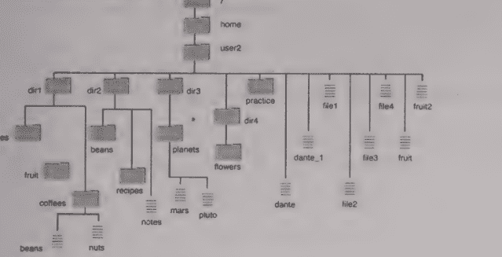

第 1 步：登录 CDE

在 CDE 登录框中使用导师分配给你的用户名和密码登录。

第 2 步：访问命令行

右键点击 `Workspace`（工作区）背景并点击“Tools”（工具）。从菜单中选择“Terminal”（终端）以打开终端窗口。

重命名和移动文件 – 概述

可以通过多种方式重命名或移动文件：

- 文件名可以更改（重命名）为新名称；
- 可以在当前目录下重命名文件；
- 可以在非当前目录下重命名文件；
- 将文件移动到目录结构中的另一个目录；
- 可以在当前目录下重命名目录并移动内容。

第 3 步：在当前目录下重命名文件

在当前目录下重命名文件的格式如下：将旧文件名重命名为新文件名。`mv` 命令可以使用 `-i` 选项来在重命名覆盖目标文件。`-i` 选项在移动时提供交互式确认。

```
mv -i 旧文件名 新文件名
```

a. 在你的主目录下创建一个名为 `test1` 的文件。你使用了什么命令？

b. 使用 `mv` 命令将 `test1` 重命名为 `test2`。你使用了什么命令？

c. 使用 `ls` 命令验证 `test2` 是否存在。

d. 使用 `mv` 命令将 `test2` 重命名为 `test3`。你使用了什么命令？

e. 使用 `mv` 命令将 `test3` 重命名为 `test4`。你使用了什么命令？

f. 使用 `ls` 命令验证 `test4` 是否存在。

# UNIX 基础实验指南

实验 7.1.4 – 重命名和移动文件及目录

工作单

第 4 步：在非当前目录下重命名文件

你可以通过指定路径在不离开当前目录的情况下重命名其他目录的文件。

- 从主目录，将 `practice` 目录下的 `file2` 重命名为 `myfile2`。你使用了什么命令？
- 使用 `ls` 命令验证重命名是否成功。
- 从主目录，使用绝对路径将 `practice` 子目录下的 `beans` 文件重命名为 `java`。你使用了什么命令？
- 使用 `ls` 命令验证重命名是否成功。
- 从主目录，使用相对路径将 `practice` 子目录下的 `java` 文件重命名为 `beans`。你使用了什么命令？

# UNIX 基础实验指南

实验 7.1.4 – 重命名和移动文件及目录

工作单

第 5 步：将文件移动到另一个目录

如果你想将文件移动到另一个目录，使用以下格式：

```
mv [i] 源文件(s) 目标目录
```

此格式将源文件(s) 移动到新目录。你可以在目标目录后添加斜杠和文件名，以赋予文件不同的名称。这种版本将源（移动对象）移动到目标目录名（目标位置）。

- a. 在 `practice` 目录下创建一个名为 `projects` 的子目录。你使用了什么命令？
- b. 进入 `projects` 子目录并列出内容。里面有文件或目录吗？
- c. 使用 `touch` 命令在 `projects` 子目录下创建名为 `June-1`、`June-2`、`July-1` 和 `July-2` 的四个新文件。一次性创建它们。你使用了什么命令？
- d. 你决定为七月份的项目文件创建一个独立的目录。再创建一个名为 `proj-07` 的新目录。你使用了什么命令？
- e. 使用通配符和相对路径，将七月份的项目文件（`July-1` 和 `July-2`）移动到你创建的新目录。你使用了什么命令？
- f. 命令 `mv* proj-07` 会仅将七月份的项目文件移动到 `proj-07` 子目录吗？

为什么？

- g. 创建一个名为 `proj-06` 的新目录，并将六月份的项目文件（`June-1` 和 `June-2`）移动到新目录。

# 第 6 步：在当前目录下重命名目录

`mv` 命令也可以用于重命名目录或将其移动到不同的位置。对于目录，`mv` 命令在用于重命名和移动时有两种基本格式。第一种格式是在当前目录下重命名目录。这是“从旧名称到新名称”的格式。

# UNIX 基础实验指南

实验 7.1.4 – 重命名和移动文件及目录

工作单 – 继续

以下是命令格式：

```
mv [i] source_directory (旧目录名) target_name (新目录名)
```

- a. 切换到 `projects` 目录并列出内容。`proj-06` 和 `proj-07` 目录都列出来了吗？

列出每个子目录的内容，以验证每个目录下是否有两个文件。


-   b. 你决定从现在起，你将为每个月的项目创建一个新文件夹，但你更倾向于使用月份名称而不是数字（例如，用 `proj-june` 代替 `proj-06`）。将现有的 `proj-06` 目录重命名为 `proj-june` 并将 `proj-07` 重命名为 `proj-july`。你使用了哪两条命令？

-   c. 列出 `projects` 文件夹的内容。现在两个项目都是按月份命名的了吗？

-   d. 因为你每个月都会为项目创建一个新目录，你意识到当年份变化时，项目目录将开始具有相同的名称。将 `proj-june` 重命名为 `proj-01-june`，并将 `proj-july` 重命名为 `proj-01-july`，使年份成为目录名的一部分。这将允许你区分今年和明年。你使用了哪些命令？

## 第 7 ：移动目录及其内容

这是 `mv` 命令的“移动什么到哪里”（Move What to Where）格式，用于将目录从一个位置移动到另一个位置。以这种方式移动目录时，如果目标目录位置存在，源目录将被复制到目标位置。如果该位置不存在，则源目录将被重命名。

以下是命令格式：

```
mv [i] source_directory (移动什么) target_directory (移动到哪里)
```

-   a. 切换到 `practice` 子目录并列出内容。`projects` 目录列出来了吗？

-   b. 列出 `projects` 目录的内容。`proj-01-june` 和 `proj-01-july` 目录都列出来了吗？

-   c. 你决定将项目子目录移动到你的家目录。输入执行此操作的命令。你使用了哪条命令？

## 第 8 ：删除在本实验中创建的文件和目录

参考类文件系统树结构，删除在此实验期间在家目录下创建的所有文件和目录（包括在 `practice` 目录下创建的）。你将使用 `rm` 和 `rm -r` 命令。在删除文件和目录时使用 `-i` 选项，以确保这些是你想要删除的文件。

## 第 9：关闭终端窗口并注销

双击屏幕左上角的减号按钮，然后点击前面板上的退出（Exit）图标。

# UNIX 基础实验指南

实验 7.1.6 – 重定向与管道

（预计耗时：45 分钟）

## 目标

-   熟悉输入/输出 (I/O) 重定向
-   重定向标准输出创建文件
-   防止通过重定向覆盖文件
-   将输出追加到现有文件
-   将一个命令的输出通过管道传递另一个命令进行进一步处理

## 背景

在本实验中，你将使用高级 UNIX 命令来完成重定向和管道操作。UNIX 命令有一个标准输入源和一个标准输出终点地。命令的输入通常来自键盘，尽管也可以来自文件。命令的输出通常去往显示器或屏幕。UNIX 计算环境允许使用重定向控制命令 I/O。当你尝试将命令的输出保存到文件中以便日后查看时，这非常有用。通过管道，你可以获取一个命令的输出并将其作为另一个命令的输入进行进一步处理。

## 工具 / 准备

在开始实验之前，请复习思科网络学院课程：《UNIX 基础指南》第 7 章。

你将需要：

-   由导师分配的登录用户 ID（如 `user2`）和密码。
-   一台运行 UNIX 系统并带有通用桌面环境 (CDE) 的计算机。
-   安装了类文件系统的教室内的联网计算机。

# UNIX 基础实验指南

实验 7.1.6 – 重定向与管道

工作单

使用示例类文件系统目录树图来辅助完成实验。


### 第 1 ：登录 CDE

在 CDE 登录框中使用导师分配给你的用户名和密码登录。

### 第 2 ：访问命令行

右键点击工作区背景并点击 Tools（工具）。从菜单中选择 Terminal（终端）以打开终端窗口。

### 输入/输出重定向 – 概述

使用了几个特殊字符作为重定向符号。输出重定向使用右角括号（`>`），它也称为大于符号。输入重定向使用左角括号（`<`）或小于符号。错误输出重定向使用右角括号前面的两个右角括号（`>>`）。本实验侧重于输出重定向。

以下是命令格式：

```
命令 重定向-符号 文件（文本文件或设备文件）
```

### 第 3：重定向标准输出以创建文件

标准输出重定向的频率比标准输入或标准错误得多。许多命令（如 `ls`、`cat`、`head` 和 `tail`）向屏幕生成标准输出，通常我们希望将此输出重定向到文件，以便日后查看、操作或打印。通过替换文件名，你可以捕获命令的输出。

右角括号（`>`）或大于符号允许将输出发送到文件。使用单右角括号（`>`）会创建一个文件，如果文件名已存在则会被覆盖。注意：命令、重定向符号和文件名之间的空格是可选的。

以下是命令格式：

```
命令 > 文件
```

-   a. 在家目录下确认输出是否存在。你使用了哪条命令？

如果你不在那里，使用哪条命令切换到家目录？

-   b. 将列表重定向到家目录下的新文件 `homdir.list`。
-   c. 使用 `ls` 命令验证文件是否存在。
-   d. 使用什么命令逐页查看刚刚创建的内容？
-   e. 使用 `head` 命令捕获 `homdir.list` 的前 10 行并创建一个新文件 `dhomdir.list-top-10`。使用了哪条命令？

使用 `more` 命令查看文件内容。

-   f. 使用 `tail` 命令捕获 `homdir.list` 的最后十行并创建一个新文件 `dhomdir.list-bot-10`。使用了哪条命令？
-   g. 将 `cal 2002` 命令的输出重定向到 `calendar` 文件。查看文件内容。你捕获了什么？
-   h. 将 `cal 2010` 命令的输出重定向到 `calendar` 文件，覆盖现有文件。查看文件内容。里面有什么？

2002 年的 `calendar` 发生了什么？

### 第 4：通过重定向防止覆盖文件

在 Korn shell 中，可以设置名为 `noclobber` 的选项来防止重定向时覆盖文件。这可以通过命令行使用 `$ set -o noclobber` 来。`o` 代表 options。

要重新启用覆盖，请使用 `$ set +o noclobber`。

在 C Shell 中启用/禁用覆盖，使用 `% set noclobber` 和 `% unset noclobber`。

-   a. 输入命令开启 Korn shell 的 `noclobber` 选项。你输入了什么命令？
-   b. 输入命令 `-l > homdir.list`。结果是什么？
-   c. 输入命令 `-l > homdir.list2`。结果是什么？

### 第 5：将输出追加到现有文件

如果你希望追加（在末尾添加）现有文件而不是覆盖它，可以使用双右角括号（`>>`）。如果文件不存在，此选项会创建一个新文件；如果已存在，则追加。

以下是命令格式：

```
命令 >> 文件
```

-   a. 输入命令显示 Happy Bday 的横幅，并使用重定向符号将输出捕获到名为 `bday4me` 的文件中。你使用了哪条命令？
-   b. 使用双重定向符号将输出追加到 `bday4me` 文件中，显示 `YOURNAME!`（无论你的名字是什么）。查看 `bday4me` 文件的内容。里面有什么？

# UNIX 基础实验指南

实验 7.1.6 – 重定向与管道

工作单 – 续

+   c. 输入命令显示你出生月份和年份的日历（如果你在 1965 年 6 月出生，请使用 `cal 6 1965`），并使用双重定向符号将输出追加到 `bday4me` 文件中。你使用了什么命令？
+   d. 查看 `bday4me` 文件的内容。注意三个命令的输出已合并在 `bday4me` 文件中。你出生在星期几？

## 步骤 6. 将管道从一个命令传输到另一个命令

最强大的元字符之一是管道 (`|`)。它接收一个命令的标准输出，并将其作为标准输入传递给后续的命令（通常是 `more` 命令、`lp`（行打印机）命令，或者像 `grep` 或 `sort` 等文件处理命令，这些将在第 8 章介绍）。管道符号有时被称为双竖线，位于退格键（Backspace）下方。你必须在管道的每一侧都至少有一个命令。命令与管道之间的空格是可选的。

以下是命令格式：

```
command | command
```

+   a. 使用管道元字符将 `ls -l` 命令的输出作为输入发送给 `more` 命令。（注意：如果你的当前目录中文件不多，请使用 `/etc` 目录进行长列表显示。）将输出管道到 `more` 命令后发生了什么？
+   b. 查看通过 `ls -l | more` 命令列出的文件，并注意其中某些创建或修改的日期。要查看在同一月份内创建或修改的文件或目录列表，你可以使用 `grep` 命令搜索该月份。指定的月份要与列表中显示的完全一致（例如，Oct）。输入命令 `ls -l | grep Oct`（或你正在查找的任何月份）。结果是什么？
+   c. 目录的大小始终为 512 字节。输入命令 `ls -l | grep 512`。结果列表中有什么？
+   d. 你可以使用多个管道来连接多个命令。输入一个命令，将长文件列表的输出管道到 `tail` 命令，然后管道到 `sort` 命令。你输入了什么命令？
+   e. `ps`（进程状态）命令用于查看 UNIX 系统上运行的进程。将 `ps -e` 命令的输出管道到 `more` 命令。`-e` 选项将显示系统中运行的所有进程。将输出管道到 `more` 命令后发生了什么？

## 步骤 7. 删除在本实验中创建的文件和目录

参考类文件系统树结构，删除在此实验期间在你主目录中创建的所有文件和目录（包括在练习目录下创建的内容）。

## 步骤 8. 关闭终端窗口并注销

双击屏幕左角的减号按钮，然后点击面板上的退出（Exit）图标。

## 可选练习

1. 你可以使用不指定选项的 `-o` 命令查看 `noclobber` 功能（以及所有其他 Korn shell 特性）是否开启。

+   a. 输入 `set -o .`。`noclobber` 功能是开启还是关闭的？如果是关闭的，请将其开启。你使用了什么命令？

2. 你可以使用 `>!`（大于号加感叹号）来覆盖 `noclobber` 特性。

+   a. 将 `cal` 命令的输出捕获到名为 `mytestfile` 的文件中。
+   b. 将 `date` 命令的输出捕获到名为 `mytestfile` 的文件中。起作用了吗？
+   c. 再次捕获 `date` 命令的输出，这次覆盖 `noclobber` 特性。你使用了什么命令？
+   d. 永久关闭 `noclobber` 功能。你使用了什么命令？

3. 你可以结合使用管道和重定向来获得所需的结果。输入命令创建一个名为 `top5list` 的文件，该文件仅包含主目录文件长列表的前五行。你使用了什么命令？

# UNIX 基础实验指南

实验 7.2.3 – 高级 CDE 文件管理器

（预计时间：30 分钟）

## 目标

- 学习使用 CDE 文件管理器的更高级的功能
- 使用拖放移动文件
- 使用拖放复制文件
- 使用“选择选项”（Selected Options）移动文件
- 使用“选择选项”（Selected Options）菜单复制文件
- 使用“选择选项”（Selected Options）菜单重命名文件
- 使用“选择选项”（Selected Options）菜单将文件放入工作区
- 设置视图选项

## 背景

在本实验中，你将使用常用桌面环境 (CDE) 文件管理器的一些高级功能和特性。你将执行更高级的文件和目录管理任务，就像之前在命令行执行的任务一样。你将使用拖放和菜单选项方法移动和复制文件。你还将重命名文件并将其复制到桌面。还将介绍查看文件管理器的方法。

## 工具 / 准备

在开始实验之前，请回顾思科网络学院课程：《UNIX 基础实验指南》的第 7 章。

你需要以下物品：

- 教师分配的登录用户 ID（例如 `user2`）和密码。
- 运行带有 CDE 的 UNIX 系统的计算机。
- 教室中安装了类文件系统的联网计算机。

## 注意

## 步骤 1. 登录 CDE

使用教师分配的名称和密码登录。

## 步骤 2. 访问文件管理器

可以通过点击桌面上的文件图标访问文件管理器。当前文件夹的路径显示在文件管理器窗口的顶部区域。

## 步骤 3. 使用拖放移动文件

移动文件可以使用选择、拖放技术来实现。要将文件从一个文件夹移动到另一个文件夹，请将鼠标置于文件图标上，按住左键并拖动到目标文件夹。当文件图标位于文件夹上方时，释放鼠标键，文件将被移动。

## 步骤 4. 使用拖放复制文件

复制文件可以使用选择、拖放技术来实现。如果你在选择文件之前按下 Control 键，并在拖放过程中保持按住状态，则文件将被复制而不是移动到另一个文件夹。

注意：你无法将文件图标移动或复制到文件管理器顶部显示的路径。如果你想将文件移动或复制到当前文件夹的父目录，可以将文件图标拖放到“向上”（Go Up）图标上。

## 步骤 5. 使用“选择选项”菜单移动文件

移动文件也可以使用文件管理器中的“选择”（Selected）菜单来实现。要将文件从一个文件夹移动到另一个文件夹，点击文件图标选中它。点击“选择”菜单，然后点击“移动到”（Move to）选项。

# UNIX 基础实验指南

实验 7.2.3 – 高级 CDE 文件管理器

工作单 – 继续

- 使用 Selected（已选）菜单中的 Move（移动）选项将 `myfile2` 移动到 `mydir2` 文件夹。你在目标文件夹中输入了什么？

### 第 6 步：使用 Selected 菜单复制文件

也可以使用文件管理器中的 Selected 菜单复制文件。要将文件从一个文件夹复制到另一个文件夹，点击文件图标进行选择。点击 Selected 菜单，然后点击 Copy（复制）选项。

- 使用 Selected 菜单中的 Copy 选项，将你主目录目录下的 `myfile1` 复制到 `mydir1`。你在目标文件夹中输入了什么？
- 在 `mydir3` 文件夹内部，使用 Selected 菜单中的 Copy 选项将 `myfile3` 复制到 `mydir4` 文件夹。你在目标文件夹中输入了什么？

### 第 7 步：使用 Selected 菜单重命名文件

也可以使用文件管理器中的 Selected 菜单重命名文件。

- 将 `myfile3` 重命名为 `newmyfile3`。当你选择 Rename（重命名）Selected 菜单时，图标发生了什么变化？
- 右键点击 `myfile3` 弹出一个小型选项菜单。你能从这里重命名文件吗？通过此菜单你可以对文件做什么？
- 在 Terminal（终端）窗口的命令行界面，用于重命名文件的命令是什么？

### 第 8 步：使用 Selected 菜单将文件放入工作区

- 在 `mydir3` 文件夹内部，使用 Selected 菜单中的 Put in Workspace（放入工作区）选项将 `myfile3` 复制到工作区（或桌面）。你在桌面上看到该文件吗？文件仍在 `mydir3` 文件夹中吗？
- 双击桌面上的 `myfile3`。激活了哪个应用程序打开此文件？
- 右键点击桌面上的 `myfile3` 并选择 Remove from Workspace（从工作区移除）。你在桌面上看到该文件吗？原始文件仍在 `mydir3` 文件夹中吗？

### 第 9 步：设置 View（视图）菜单选项

View 菜单允许你自定义文件管理器窗口。View 菜单上有许多可用选项。Set View Options（设置视图选项）菜单允许你更改文件管理器在窗口中显示文件和文件夹的方式。你还可以更改按名称、文件类型、日期或大小的显示排序。使用 Set View Options，文件系统可以单文件夹的形式或层级树的形式显示。通过对文件夹使用树形显示，可以更容易在文件系统的层次结构中移动。

- a. 使用 Set View Options 将文件和文件夹的表示方式从大图标改为名称、日期和大小列表。此列表与你在 Terminal 窗口中使用 `ls -l` 命令获得的列表有何不同？将视图更改为你喜欢的任何格式。
- b. 使用 Set View Options 将文件和文件夹的视图更改为树视图，先显示文件夹后显示文件。在树形视图中，文件和文件夹的默认表示方式是什么？

### 第 10 步：删除在本实验中创建的文件和目录

参考课程级文件系统树形结构，删除在本实验中创建的所有文件和目录。

参考课程级文件系统树形结构，删除在本实验中创建的所有文件和目录。参考课程级文件系统树形结构，删除在本实验中创建的所有文件和目录。注销。

# UNIX 基础实验指南

实验 7.2.3 – 高级 CDE 文件管理器

工作单 – 继续

## 可选练习

1. 复习与文件管理器相关的以下主题。（注意：使用课程级文件系统树作为参考）。

- 熟悉 `find` 命令。
- 按名称查找文件。
- 按类型查找文件。
- 按日期查找文件。
- 搜索特定字符串。
- 使用选项排序文件。

# UNIX 基础实验指南

实验 7.2.3 – 高级 CDE 文件管理器

工作单 – 继续

## 目标

- 熟悉 `find` 命令。
- 按名称查找文件。
- 按类型查找文件。
- 按日期查找文件。
- 搜索特定字符串。
- 使用选项排序文件。

## 背景

在本实验中，使用 `find` 命令来定位文件。`find` 命令从指定点开始，并搜索该点下的所有子目录。找到文件后，可以将其列出。`find` 命令有许多用途，包括根据特定标准删除、备份或打印文件。

### 准备工作

在开始实验之前，你需要：

- 一个波浪号 (`~`)，代表你的主目录。
- 一个点 (`.`)，代表当前目录。
- 一个绝对路径或相对路径，或者根目录 (`/`)。

### 第 1 步：登录

右键点击图标并选择 Terminal（终端）。

### 第 2 步：访问命令行

右键点击工作区并选择 Terminal（终端）。

### 查找文件 – 概述

`find` 命令用于定位本地驱动器或远程服务器上的文件。从根目录开始的 `find` 可能需要长时间。`find` 命令有很多选项和变体。格式为：

```
find path expression action
```

### 路径选项


路径名指定搜索开始的目录。路径可以是代表主目录的波浪号 (`~`)、代表当前目录的点 (`.`)、绝对路径或相对路径，或者是根目录。

### 搜索表达式选项

表达式是一个或多个搜索标准选项，指示要查找的内容。它由一个或多个值指定。基本的 `find` 选项包括文件名、类型和大小。选项必须以连字符 (`-`) 开头。注意：按文件名搜索时，可以使用星号 (`*`) 和问号 (`?`) 通配符，但你必须将字符串和通配符放在引号中（单引号或双引号）。

### 动作选项

命令末尾的动作（Action）是可选的，可以在找到所需文件后执行各种命令。

### 第 3 步：按名称查找文件

在以下示例中，搜索从 `/usr/bin` 目录开始，并查找所有以字母 c 开头的文件。

`find /usr/bin -name 'c*' or "c*"`

- a. 输入切换到主目录的命令。你输入了什么命令？
- b. 使用 `find` 命令在主目录下查找名为 `mars` 的文件。你使用了什么命令？
- c. 它位于哪个目录？
- d. 使用 `find` 命令在 `dir` 目录查找名为 `beans` 的文件。你使用了什么命令？
- e. 它位于哪个目录？
- f. 使用 `find` 命令从主目录开始查找课程文件系统树中所有以字母 p 开头的文件和目录。你使用了什么命令？

# UNIX 基础实验指南

实验 8.2.4 – 文件处理命令

工作单 – 续

- g. 找到了多少个目录和多少文件？
- h. 它们的路径和文件/目录名称是什么？

## 步骤 4. 按类型查找文件

在下面的示例中，搜索从 `/etc` 目录开始的、且所有类型为 `d`（目录）的文件：

```bash
find /etc -type d
```

- a. 使用 `find` 命令识别从你的家目录开始的、所有类型为 `d`（目录和子目录）的文件。你使用了什么命令？
- b. 识别出了多少个目录？

## 步骤 5. 按修改日期查找文件

在下面的示例中，搜索从用户的家目录开始的、并找到所有超过 30 天未修改过的文件：

```bash
find -mtime +30
```

- a. 使用 `find` 命令识别所有在过去 90 天内未修改过的文件。你使用了什么命令？
- b. 识别出了多少个文件？

## 步骤 6. 在文件中搜索字符串

`grep` 命令用于在文件或命令输出中搜索指定的文本字符串。字符串是一个或多个字符；它可以是一个字符、一个单词或一个句子。如果包含引号内，字符串可以包含空格或标点符号。`grep` 命令在文件中搜索字符字符串，并将所有包含该模式的行打印到屏幕上。`grep` 命令经常在管道中与其他命令配合使用。例如，你可以使用 `ps`（进程状态）命令并查找特定进程的所有出现处。`grep` 命令对大小写敏感，你必须按照大小写来匹配模式，除非你使用 `-i` 选项（该选项会忽略大小写）。`-v` 选项搜索所有不匹配指定字符串的行。

```bash
grep [option(s)] string path/filename
```

在下面的示例中，使用 `grep` 命令搜索当前目录（由 `./` 表示）中的所有文件（由星号 `*` 表示），以定位包含字符串 `xyz` 的文件。

```bash
grep xyz ./*
```

- a. 使用 `grep` 命令识别你家目录中所有包含 `mango` 单词的文件。你使用了什么命令？
- b. 列出了多少个文件？这些文件的名称是什么？
- c. 切换到家目录的父目录（`/home`）。你使用了什么命令？
- d. 使用 `grep` 命令搜索你家目录中的所有文件，并列出包含 `week` 单词的文件名和行。你使用了什么命令？
- e. 列出了多少个文件/行？这些文件的名称是什么？
- f. 将 `ls -l` 命令的输出通过给 `grep` 命令，并搜索所有由你用户 ID 拥的文件。你使用了什么命令？你是多少个文件的所有者？

## 步骤 7. 使用 sort 命令排序文件

`sort` 命令提供了一种按数字或字母顺序组织数据的快速、简便的方法。`sort` 命令仅适用于 ASCII 文本文件，对于可执行文件或由 FrameMaker 等应用程序创建的文件，将产生不可预测的结果。该命令使用 ASCII 字符集作为排序顺序，从左到右逐字符地进行。默认情况下，`sort` 依赖空格来分隔（划分）文件数据中的各个字段。`sort` 命令有许多可用选项。这些选项允许操作员定义要执行的排序类型以及从哪个字段开始排序。

以下是命令格式：

```bash
sort [options] [input_filename]
```

在下面的示例中，使用 `sort` 命令生成 ASCII 类型的排序，从 `file2` 的每行的第一个字符开始。

```bash
sort file2
```

- a. 显示你家目录中 `fruit` 文件的内容。你使用了什么命令？`fruit` 文件中的水果名称是字母顺序排序的吗？
- b. 使用 `sort` 命令对 `fruit` 文件的内容进行排序。你使用了什么命令？现在 `fruit` 文件中的水果名称按字母顺序排序了吗？

## 步骤 8. 使用 sort 选项排序文件

`sort` 命令可以配合许多选项。下面的示例在文件的第二个字段上进行数字（`n`）排序（使用 `+1` 语法跳过一个分隔符）：

```bash
sort +1n file
```

- a. 通过重定向 `ps -e`（进程状态 - 列表）每个进程的输出创建一个名为 `pslist` 的文件。重定向符号是大于号（`>`）。你使用了什么命令？
- b. 使用 `more` 命令显示你刚刚创建的 `pslist` 内容。有多少列信息？现在文件按这些任何一列进行排序了吗？
- c. 进程 ID 或数字是第一列。按第一列对文件进行排序（不需要选项）。`sort` 命令的输出按进程 ID 排序了吗？
- d. 进程名是最后一列或第四列。如果你想按第四列对此文件进行排序，并将输出重定向到文件 `pslist2`，你会输入什么命令？

## 步骤 9. 使用文件管理器查找文件

文件管理器上的 `find` 选项提供了根据各种搜索标准定位文件的工具。`Find` 可以执行许多 `find` 命令和 `grep` 命令的功能。标准可以是文件夹或文件的名称，如果是文件，则是其内容。

# UNIX 基础实验指南

实验 8.2.4 – 文件处理命令

工作单 – 续

- a. 点击前面板上的文件夹启动文件管理器，然后点击 File 菜单。哪个选项允许按名称或内容搜索？
- b. 在 Find 窗口中选择内容：查找位于：我的家目录。名称包含：file。设置好标准后点击 Find。找到了多少个文件？
- c. 再次启动搜索，但这次点击 Criteria 按钮。取消 Name 选项并点击 Content。点击 OK。在搜索字段中输入 `work`，设置好标准后点击 Find。包含该单词的文件名称是什么？
- d. 再次搜索。点击 Criteria 按钮。取消 Name 选项并点击 Size。选择 Greater Than并在搜索字段中输入 10（10 KB，约 10000 字节），设置好标准后点击 Find。`beans` 文件列出了吗？
- e. 导航到 `beans` 文件并右键点击。点击 Properties 然后点击 Information。`beans` 文件的精确大小是多少？

## 步骤 10. 删除实验创建的文件和目录

参考类文件树，使用命令行或文件管理器删除你在家目录中实验期间创建的文件和目录。

## 步骤 11. 关闭文件管理器窗口

点击窗口右上角的按钮。

## 步骤 12. 关闭终端窗口并注销

双击屏幕左角的按钮，然后点击前面板上的 Exit 图标。

## 可选练习

- 1. 什么命令显示文件系统状态信息（大小、容量、挂载点等）？
- 2. 如果你的家目录在 `/home`，它位于根（`/`）文件系统。根文件系统的容量是多少（或者如果你的家目录是 `/export/home/userx`）？
- 3. 输入一个命令，查找你家目录树中所有名为 `mars` 的文件和目录，并将结果放在名为 `found.mars` 的文件中。你使用了什么命令？
- 4. 输入命令 `ls -l | grep ^d`（`^` 是 Shift-6）。结果是什么？

`grep ^d` 告诉 shell 执行什么？提示：参见 Cisco Networking Academy Program: Fundamentals of UNIX Companion Guide 第 8 章。

# UNIX 基础实验指南

实验 8.3.3 – 用户识别命令

（预计时间：45 分钟）

## 目标

- 确定谁已登录
- 切换到另一个用户的账户
- 确定你的真实用户身份
- 确定你的有效用户身份

## 背景

在本次实验中，你将使用高级 UNIX 命令来确定你的身份以及登录系统的其他用户的身份。当你登录到 UNIX 系统时，你使用的是真实用户 ID（Real User ID，例如 `user4`）。你可以临时切换到另一个用户的账户进行测试或访问文件。当你切换到另一个用户的账户时，它就变成了你的有效用户 ID（Effective User ID）。在实验中，你将使用各种命令，这些命令允许你确定自己的真实用户 ID、有效用户 ID 并在两者之间切换。你还将查出谁远程登录了 UNIX 系统。

## 工具 / 准备

在开始实验之前，请复习思科网络学院课程《UNIX 基础实验指南》的第 8 章。

你需要以下物品：

- 导师分配的登录用户 ID（如 `user2`）和密码。
- 一台运行通用桌面环境（CDE）的 UNIX 操作系统计算机。
- 教室内安装了课程文件系统的网络化计算机。

## 注意事项

# UNIX 基础实验指南

实验 8.3.3 – 用户识别命令工作单

使用课程文件系统目录树图来辅助完成实验。

# 课程文件树结构

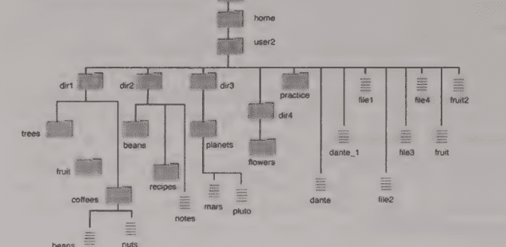

## 步骤 1. 登录 CDE

在 CDE 登录框中输入导师分配你的用户名和密码。

### 步骤 2. 访问命令行

右键点击工作区背景并点击“Tools”（工具）。从菜单中选择“Terminal”（终端）打开一个终端窗口。

### 步骤 3. 确定谁已登录

`who` 命令显示当前登录到本地系统的所有用户的信息。该命令列出了用户名、终端、登录时间、自终端行上次活动以来的已通过时间，以及用户登录的机器（主机）名称。UNIX 工作站通常只有一个用户登录（主用户），但 UNIX 服务器可以同时有多个用户登录。

如果你在工作站使用带有终端窗口的 CDE，你的用户 ID 可能会出现多次：一次针对控制台，一次 CDE 会话，以及针对你拥有的每个终端窗口。

使用 `who` 命令确定当前谁登录了你的系统。通常你的用户 ID 是唯一列出的项。如果其他用户在你的系统中拥有账户且当前远程登录，你可能会列出其他用户。命令的结果是什么？

- 使用 `who -H`（表头）命令在显示表头的情况下查看当前登录系统的系统的用户。显示的表头是什么？
- 使用 `who -q`（数量）命令查看登录用户的 ID 和用户计数。*注意：*如果你是唯一的登录用户，你的用户 ID 可能会被计算两次。
- c. 命令的结果是什么？
- d. （可选）如果教室里有带有学生账户的中央 UNIX 服务器，从导师处获取服务器的 IP 地址并 `telnet`（或登录）到该服务器。你需要提供登录 ID 和密码进行远程登录。在远程服务器上执行 `who` 命令。还有谁登录了？
- c. `telnet ip-address`（IP 地址是服务器的 32 位地址）。
- f. （可选）如果你在工作站上定义了其他用户账户，让你其中一个伙伴 `telnet` 到你工作站的 IP 地址并远程登录。如果你不知道自己的 IP 地址，请咨询导师。使用 `who` 命令查看登录用户的 ID。还有谁登录了？

**步骤 4. 切换到另一个用户的账户**

你可以使用 `su`（切换用户）命令临时切换到另一个用户的账户，以访问属于该用户的文件和目录。切换到另一个用户账户后，你将拥有与他们相同的文件权限。要切换用户 ID，你必须提供要切换到的用户的密码，除非你当前以 `root` 身份登录。当你切换到另一个用户账户时，你就变成了该用户，并拥有他们所有的访问权限和权限。要切换回之前的用户 ID，请输入 `exit`。

带有连字符的 `su` 命令允许你切换到另一个用户。如果你不使用连字符，你将保留原始身份。

- a. 使用不带连字符的 `su` 命令切换到工作站上设置的另一个账户（`guest` 或 `user`）。你使用了什么命令？系统提示了什么？

# UNIX 基础实验指南

实验 8.3.3 – 用户识别命令工作单 – 续

- b. 输入验证当前目录的命令。当前目录是什么？
- c. 尝试 `touch` 一个名为 `guest` 的文件并删除它。为什么你没有成功？
- d. 使用带有连字符的 `su` 命令切换到工作站上设置的另一个账户（`guest` 或 `user`）。你使用了什么命令？
- e. 输入验证当前目录的命令。当前目录是什么？

# 步骤 5. 确定你的用户 ID

你最初登录 UNIX 系统时使用的登录 ID 是你的真实用户 ID (RUID)。`who` 命令显示登录 ID、终端、登录日期/时间以及机器名称。

- a. 使用 `su` 命令并切换到工作站上设置的另一个账户（`guest` 或 `user`）。你使用了什么命令？
- b. 使用 `who` 命令（三个单词的命令）来确定你的 RUID。这应该是你的原始登录 ID。命令的结果是什么？
- c. 在命令行输入 `exit` 切换回自己的用户账户。再次输入 `who`。命令的结果是什么？

# 步骤 6. 确定你的有效用户 ID

当你切换到另一个用户 ID 时，你将拥有所切换账户的特性和权限。这现在你的有效用户 ID (EUID)。`who` 命令显示你的身份。`whoami`（一个单词）和 `id` 命令也可以配合 `-a`（所有）选项使用，显示有效用户所属的所有组。文件访问内容见思科网络学院课程《UNIX 基础实验指南》的第 10 章。

- a. 使用 `su` 命令并切换到工作站上设置的另一个账户（`guest` 或 `user`）。你使用了什么命令？
- b. 使用 `id` 命令确定你的 EUID。这应该是切换到的用户 ID。命令的结果是什么？
- c. 使用 `whoami` 命令确定你的 EUID。*提示：*你可能需要输入 `whoami` 的完整命令名：`/usr/ucb/whoami`。命令的结果是什么？
- d. 使用 `id -a` 命令确定你的 EUID。这应该是切换到的用户 ID。它还会显示主组以及该 EUID 所属的其他组（如果有）。命令的结果是什么？
- e. 在命令行输入 `exit` 切换回自己的用户账户。再次输入 `id`。命令的结果是什么？

**步骤 7. 关闭终端窗口并注销**

双击屏幕左上角的横条按钮，然后在前面面板上点击 Exit（退出）图标。

## 可选练习

假设你登录到一个有数百名用户登录的服务器：

- 1. 你会使用什么命令来快速查看你的朋友 `mmouse` 当前是否已登录？
- 2. 你会使用什么命令来显示所有当前登录的用户列表，且仅按字母顺序排序？

# UNIX 基础实验室

实验 9.1.8 – 使用 vi 编辑器

（预计耗时：45 分）

## 目标

- 熟悉 UNIX 文本编辑器
- 复习 vi 的三种模式
- 复习在 vi 模式之间切换的按键
- 使用 vi 创建新文件
- 使用 `showmode` 调用 vi
- 复习保存和退出命令
- 使用 `vedit` 打开现有文件
- 使用编辑命令
- 自定义你的会话
- 使用搜索命令

## 背景

在实验中，你将使用一种 UNIX 文本编辑工具：`vi` 编辑器（读音为 "vee eye"）。该编辑器主要用于创建和修改自定义你的工作环境的文件，以及编写脚本来自动化任务。系统管理员使用文本编辑器创建和修改用于网络、安全、应用程序共享等的文件。`vi` 编辑器在 UNIX 诞生后不久就成为 UNIX 操作系统的一部分，并在 UNIX 系统中通用。`vi` 编辑器是一个灵活且强大的编辑器，具有许多选项，这些选项将在实验中通过示例进行复习。

对于学习成为系统管理员的用户来说，知道如何使用 `vi` 非常重要。它有时是编辑关键系统文件的唯一全屏编辑器。这些示例包括脚本和环境控制文件。如果没有窗口系统，也需要使用 `vi` 的技能。在远程操作其他 UNIX 工作站或服务器时，`vi` 编辑器是一个非常有用的工具。管理员远程登录或 `telnet` 到另一台 UNIX 计算机，使用 `vi` 执行维护和故障排除任务。`vi` 的可用性和操作在所有 UNIX 平台上都是一致的。

## 工具 / 准备

在开始实验之前，复习思科网络学院计划第 9 章：

《UNIX 基础辅助指南》。

你需要：

- 导师分配的登录用户 ID（例如 `user2`）和密码。
- 一台运行 UNIX 操作系统系统的计算机。
- 教室中安装了课程文件系统的联网计算机。

## 注意事项

# UNIX 基础实验室辅助

实验 9.1.8 – 使用 vi 编辑器

工作单

使用示例课程文件系统的目录树图来辅助本实验。

# 课程文件树结构

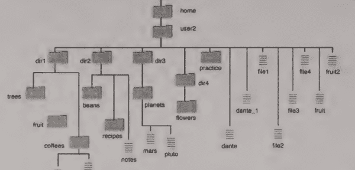

第 1 步登录 CDE

在 CDE 输入框中使用导师分配给你的用户名和密码登录。

第 2 步访问命令行

右键点击 Workspace 背景并点击 Tools（工具）。从菜单中选择 Terminal（终端）打开终端窗口。

第 3 步复习 vi vi模式

`vi` 有三种操作模式。理解这三种模式的功能是使用 `vi` 的关键。`vi` 中的所有命令都可以归类为三种模式之一。下表列出了这些模式及其简要描述。复习这三种模式并回答以下问题。

| 模式 | 功能 / 特性 |
| :--- | :--- |
| 命令模式 (Command mode) | 创建和编辑文件、光标定位以及修改现有文本的初始默认模式。所有命令都从此模式启动。 |


| 输入模式 (Entry mode) | 用于输入新文本。输入插入命令 `i` (插入)、`a` (追加) 和 `o` (打开新行) 将你从命令模式带到输入模式。输入命令是独立的，输入时无需按 Enter 键。 |

| 末行模式 (Last-line mode) | 用于保存工作、搜索和替换文本、移动和复制文本、设置 vi 偏好以及退出 vi。输入冒号 (`:`) 进入此模式。按 Enter 键或 `Esc` 键返回命令模式。 |

# UNIX 基础实验室辅助

实验 9.1.8 – 使用 vi 编辑器

工作单 – 继续

- 哪种模式主要用于输入新文本？
- 哪种模式用于保存工作并退出 vi？
- 当你启动 vi 编辑器时，默认模式是哪种？
- 哪些单字符字母命令会让 vi 进入输入模式？
- 哪个键位可以从末行模式或输入模式让 vi 返回到命令模式？
- 哪个命令会让 vi 进入输入模式？

# 第 4 步 复习在模式之间切换的按键

下表显示了如何切换模式以及从一个模式到另一个模式。在模式之间切换所需的按键，并回答以下问题。

| 从模式 | 到模式 | 命令 / 按键 |
| :--- | :--- | :--- |
| 命令 | 输入 | `i` (输入), `o` (打开行), `a` (追加到现有行)。 |
| 输入 | 命令 | 按 `Esc` (退出)。 |
| 命令 | 末行 | 冒号 (`:`)。 |
| 末行 | 命令 | 按 `Esc` 返回命令模式并输入冒号。 |
| 末行 | 输入 | 按 Enter 或 `Esc` 返回命令模式并输入插入命令。 |

- 哪些单字符字母命令会让 vi 进入输入模式？
- 哪个键位可以从末行模式或输入模式让 vi 返回到命令模式？
- 哪个命令会让 vi 进入输入模式？

# 第 5 步 使用 vi 创建新文件

`vi` 编辑器是通过文件名启动的。每当你调用 `vi` 时，请指定名称。如果文件不存在，则会创建它。

- 哪种模式主要用于输入新文本？
- 哪种模式用于保存工作并退出 vi？
- 当你启动 vi 编辑器时，默认模式是哪种？
- 哪些单字符字母命令会让 vi 进入输入模式？
- 哪个键位可以从末行模式或输入模式让 vi 返回到命令模式？
- 哪个命令会让 vi 进入输入模式？

# UNIX 基础实验指南

实验 9.1.8 – 使用 vi 编辑器

工作单 – 续

- a. 大多数的保存并退出命令是在哪种模式下输入的？________________
- b. 哪个命令可以让你退出 vi 且不保存任何更改？________________
- c. 表格列出的哪两个命令具有相同的功能？________________
- d. 哪个命令允许你将当前编辑的文件另另名保存，并保留在 vi 中继续编辑当前文件？________________

## 步骤 8. 使用 become 打开现有文件

如果你启动 `vi` 或使用 `become` 并指定一个已存在的文件，它将会被打开进行编辑。在这里，你将在输入模式（Entry mode）中添加新文本，并尝试几条光标定位命令。

- a. 打开你之前使用命令 `become myfile` 创建的 `mymyfile` 文件。文档屏幕看起来像什么样？
- b. 将光标移动到你名字的末尾，按下小字母 `a` 在你输入的行尾进行追加（Append）。输入一些文本，按 `Enter` 换行，然后再次输入一些文本。输入大约三行此类文本。你目前处于哪种模式？
- c. 按下 `Esc` 键退出追加模式并返回命令模式（Command mode）。在命令模式下，你可以移动光标进行额外的编辑吗？
- 你可以在各种输入模式下使用方向键移动光标，且你将保持在当前模式下。下表包含了一些常用的光标定位按键和命令。如果你在输入模式下使用字母命令，它们将作为文本被输入。你需要按下 `Esc` 进入命令模式才能使用它们。在编辑此文件时练习使用。哪个字符可以让你一次向后移动一个单词？

| 命令 | 含义 |
|---|---|
| `j` 或下方向键 | 向下移动一行 |
| `k` 或上方向键 | 向上移动一行 |
| 空格, `l` 或右方向键 | 向右移动一个字符 |
| `w` | 向前移动一个单词（包括标点） |
| `Backspace`, `h` 或左方向键 | 向左移动一个字符 |
| `B` | 向后移动一个单词（包括标点） |
| `S` | 移动到行尾 |
| `0` (零) 或 `^` | 移动到行首 |
| `Return` | 移动到下一行的开头 |

- c. 按上方向键移动光标，直到它位于第二行。使用 `j` (jump down) 命令向下移动，然后使用 `k` (kick up) 命令移回第二行。
- f. 输入小字母 `o` 在光标所在下方打开一个新行，并输入一些新文本。你现在处于哪种模式？
- g. 再次按下 `Esc` 键退出打开行输入模式并返回命令模式。
- h. 输入冒号 (`:`) 进入底行模式（Last-line mode）。完成后保存并退出此文件。如果这是一个真实文件，且你犯了一些错误并且不想保存所做的更改，你会使用哪个底行模式命令？
- i. 新文件将保存在你硬盘上的练习目录中。显示该目录的详细列表以验证文件是否存在。该文件的大小是多少字节？

## 步骤 9. 使用编辑命令

可以使用许多编辑命令来修改文件中的现有文本。这些包括删除和更改文本的命令。大多数此类命令是在命令模式下输入的。

- a. 使用 `become` 打开一个新文档。你给文件起了什么名字？
- b. 插入一些文本：添加五行或更多文本，并在每行末尾按回车。在输入时犯一些错误。
- c. 删除某些文本：在命令模式下，将光标移动到所需位置，并使用下表所示的选项删除某些错误。注意：这些命令均为小写，且无需按 `Enter` 键即可。

| 基础文本删除命令 |
| 命令 | 含义 |
|---|---|
| `x` | 删除光标处的字符 |
| `dw` | 删除单词（或光标右侧的单词部分） |
| `3dw` | 删除三个单词 |
| `dd` | 删除光标所在的行 |
| `3dd` | 删除三行 |

- d. 撤销和更改某些文本 - 要更改文本并撤销更改，请使用下表所示的命令。*注意*：许多命令会将你切换到插入模式，直到你按下 `Escape`。*注意*：这些命令均为小写。

## 撤销和更改命令

| 命令 | 含义 |
|---|---|
| `cw` | 更改光标位置的单词（或单词部分）到单词末尾 |
| `3cw` | 更改三个单词 |
| `R` | 将光标处的字符替换为另一个字符 |
| `U` | 撤销上一个命令 |

- e. 复制和粘贴文本：要复制和粘贴文本，请使用以下选项。

## 复制和粘贴文本

| 命令 | 含义 |
|---|---|
| `yy` | 复制（Yank）当前行并放入剪贴板 |
| `P` | 粘贴（Put）复制或删除的行到当前行下方 |
| `P` (大写) | 粘贴（Put）复制或删除的行到当前行上方 |

- f. 保存文件并退出 vi。你使用了哪个命令？

## 步骤 10. 自定义你的会话

`vi` 编辑器包含了自定义编辑会话的选项。这些选项总结在下表中。`set` 命令从底行模式调用用于控制这些选项。`set nu` 显示显示行号，编写程序和脚本文件时经常使用。行号不属于文件本身。

- a. 使用 `become` 打开你刚刚创建的文档。使用下表中的命令自定义你的 vi 会话。

## 会话自定义命令

| 命令 | 含义 |
| :--- | :--- |
| `:set nu` | 显示行号 |
| `:set nonu` | 隐藏行号 |
| `:set showmode` | 显示当前操作模式 |
| `:set noshowmode` | 关闭模式显示 |
| `:set` | 显示所有已设置的变量 |
| `:set all` | 显示所有 vi 变量及其当前设置 |

## 步骤 11. 使用搜索命令

下表中的命令允许你执行高级编辑，如查找行或进行文本搜索。正斜杠 (`/`) 和问号 (`?`) 搜索选项是底行命令，但不需要先输入冒号。在 `/string` 或 `?string` 命令找到你要的内容后，可以使用 `n` (next) 和 `n` (next previous) 命令。

## 基础搜索命令

| 命令 | 含义 |
| :--- | :--- |
| `G` (大写) | 转到文件末尾 |
| `/21` | 转到第21 行 |
| `/string` | 正向搜索字符串 |
| `?string` | 反向搜索字符串 |
| `n` | 查找下一个出现项 |

- a. 使用上表中的命令练习搜索特定的行或字符串。
- b. 不保存任何更改退出。你使用了哪个命令？

## 步骤 12. 删除实验中创建的文件和目录

## 步骤 13. 关闭终端窗口并注销

双击屏幕左上角的按钮，然后点击面板上的 Exit 图标。

## 可选练习

- 1. 使用 `spell` 命令列出 `file1` 中不在字典中的单词。你使用了哪个命令？有多少个单词不在字典中？
- 2. 使用 vi 器打开 `file1`，使用 vi 搜索功能查找拼写错误的单词 `magazi`（应为 magazine），修正它，保存并退出文件。
- 3. 在家目录下创建的哪个文件会在每次启动 vi 编辑器时被读取，并能自动开启行号和显示模式等功能？
- 4. 在家目录下创建 `.exrc` 文件，添加一行包含 **`set nu showmode`** 的内容，在 vi 编辑器中开启行号和显示模式。通过打开 `file1` 验证结果。左侧显示行号了吗？
- 5. 使用 `more` 命令查看家目录下的 `dante` 文件（`more dante`）。按下 `v` 键。在使用 `more` 命令查看文件时，`v` 键做什么？

# UNIX 基础实验指南

实验 9.2.6 – 使用 CDE 文本编辑器

（预计时间：30 分钟）

## 目标

- 访问 CDE 文本编辑器
- 打开新文件并输入文本
- 保存文件
- 使用“帮助”（Help）菜单中的选项
- 使用“编辑”（Edit）菜单
- 使用 Sun 工作站编辑快捷键（可选）
- 使用“查找/替换”（Find / Change）
- 选择并替换文本
- 使用“格式”（Format）菜单更改选项
- 使用“文本编辑器选项”（Text Editor Options）菜单

## 背景

在本实验中，你将使用常用桌面环境（CDE）文本编辑器。文本编辑器是一个全屏图形化文本编辑器，支持鼠标并可用于编辑文件。它类似于 Windows 记事本。与 vi 一样，此编辑器不会在文件中写入任何特殊的格式字符，适用于创建系统环境文件和脚本文件。

## 工具 / 准备

在开始实验之前，请复习思科网络学院课程第 9 章：《UNIX 基础实验指南》。

你将需要以下物品：

- 导师分配的登录用户 ID（例如 `user2`）和密码。
- 一台运行带有 CDE 的 UNIX 操作系统的计算机。
- 教室中安装了课程文件系统的联网计算机。

## 注意事项

# UNIX 基础实验指南

实验 9.2.6 – 使用 CDE 文本编辑器

工作单

使用示例文件系统目录树图来辅助本实验。

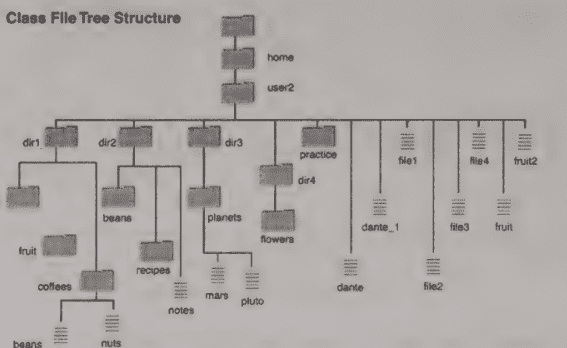

## 第 1 步 登录 CDE

在 CDE 输入框中输入导师分配的用户名和密码。

## 第 2 步 访问 CDE 文本编辑器

要启动 CDE 文本编辑器，点击前景面板上的“文本备注”（Text Note）子面板并打开一个已有的文本编辑器窗口。

- a. 点击前景面板 Text Note 图标上方的 Text Note 子面板启动 CDE 文本编辑器。打开的文件默认名称是什么？

## 第 3 步 输入文本

你可以在文本编辑器窗口中输入任何文本。如果你想在已经输入内容的区域插入字符，请将光标移动到想要插入文本的位置并点击鼠标左键。默认情况下，文本编辑器处于“插入”模式。这意味着当你打字时，字符将自动插入文本中，而不是覆盖光标右侧的现有字符。在使用文本编辑器期间，你可以随时通过点击“选项”（Options）菜单并选择“覆盖”（Overstrike）从插入模式切换到覆盖模式。

- a. 输入一小段文本，并在每行末尾按回车键。如果你不在每行末尾按回车键会发生什么？

# UNIX 基础实验指南

实验 9.2.6 – 使用 CDE 文本编辑器

工作单 – 继续

## 第 4 步 保存文件

- a. 点击“文件”（File）菜单并从菜单中选择“保存”（Save）。将文件命名为 `mycfile`。该文件默认保存目录是什么？
- b. 点击“文件”菜单并选择“关闭”（Close）退出 CDE 编辑器。
- c. 打开终端（Terminal）窗口并列出你的主目录内容。你刚刚创建的文件有多大？

## 第 5 步 使用“文件”菜单的帮助

- a. 点击“帮助”（Help）菜单并复习可用选项。在此处列出这些选项。
- b. 点击“帮助”菜单，选择“参考”（Reference），然后选择“文本编辑器文件菜单”（Text Editor File menu）查看每个菜单项的功能。“帮助”中关于“包含”（Include）选项是怎么说的？

## 第 6 步 使用“编辑”菜单

“编辑”菜单包含用于操作文本的标准选项，如剪切（Cut）、复制（Copy）和粘贴（Paste）。然而，如果没有选择文本，剪切和复制选项将不可用。许多“编辑”菜单功能可以通过选择你想要处理的文本并点击鼠标右键来实现。选择“编辑”并点击鼠标右键。


“编辑”菜单包含用于操作文本的标准选项，如剪切、复制和粘贴。然而，如果没有选择文本，剪切和复制选项将不可用。许多“编辑”菜单功能可以通过选择你想要处理的文本并点击鼠标右键来实现。选择“编辑”并点击鼠标右键。

（此处省略原文中重复的乱码部分，直接进入后续步骤）

## 第 7 步 使用 Sun 工作站编辑快捷键（可选）

Sun 工作站有一组编辑快捷键，可以执行剪切、复制等操作。通过这些快捷键，你可以无需菜单执行某些功能。

## 第 8 步 使用“查找/替换”

“查找”选项允许你查找并更改文本。它是区分大小写的，因此只有当你搜索的内容与文本精确匹配时才能找到。

## 第 9 步 选择并替换文本

文本可以通过以下方法进行选择：

- 按住鼠标左键拖动覆盖文本。
- 双击鼠标左键高亮一个单词。
- 三击鼠标左键高亮一个段落。
- 四次点击鼠标左键高亮文件中的所有文本。

使用上述任何一种方法选择文本后，通过键盘输入的内容将替换该文本。

## 第 10 步 使用“格式”菜单更改选项

“格式”菜单下的“设置”选项允许你更改边距和文本对齐方式，可以针对单个段落或整个文档。设置完成后，再次点击“格式”菜单提供了更改“段落”或“全部”设置的快捷方式。

## 第 11 步 使用文本编辑器选项菜单

“选项”菜单允许你在插入模式和覆盖模式之间进行切换。所选的模式将影响输入现有文本区域的任何新文本。“自动换行”模式通过在文本到达窗口边缘时自动换行或移动到下一行来格式化窗口中的文本。

## 第 12 步 删除本实验创建的文件和目录

## 第 13 步 注销

点击“文件”菜单并点击“关闭”退出 CDE 文本编辑器。关闭所有终端窗口。点击前景面板上的“退出”图标。

# UNIX 基础实验指南

实验 10.2.4 – 确定文件系统权限

（预计时间：30 分）

## 目标

- 显示文件系统权限
- 解释权限
- 确定文件的用户（User）权限
- 确定文件的组（Group）权限
- 确定文件的其他（Other/公共）权限
- 确定可执行文件的文件权限
- 创建具有默认权限的新文件
- 创建具有默认权限的新目录

## 背景

在本实验中，你将熟悉文件系统权限。文件系统安全是任何综合安全策略中的主要组成部分，它决定了谁可以访问哪些数据，以及他们可以对这些数据做什么。系统管理员根据用户、组和权限来设置文件安全。目录和文件的权限通过使用 `ls`（列出）命令配合 `-l`（长格式）选项来确定。你可以使用 `ls -l` 命令确定文件类型、权限、所有者和组。你将显示文件和目录的权限，解释结果，并评估其对不同用户类别的影响。

## 工具 / 准备

在开始此实验之前，请复习思科网络学院课程《UNIX 基础实验指南》第 10 章。

你需要以下物品：

- 导师分配的登录用户 ID（如 `user2`）和密码。
- 一台运行 UNIX 操作系统的计算机。
- 安装了课程文件系统的教室联网计算机。

## 注意事项

| |

| :--- |

| |

| |

| | |

| |

| | |

# UNIX 基础实验指南

### 实验 10.2.4 - 确定文件系统权限

工作单

使用示例课程文件系统目录树图来辅助此实验。

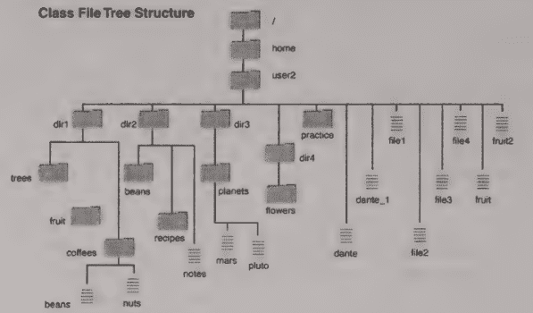

## 步骤 1. 登录 CDE

在 CDE 输入框中使用导师分配给你的用户名和密码登录。

### 步骤 2. 访问命令行

右键点击工作区背景并点击“Tools”（工具）。从菜单中选择“Terminal”（终端）打开终端窗口。

### 步骤 3. 显示权限

权限控制了对文件系统中的文件和目录可以的操作。可以使用带有 `ls`（列出）命令配合 `-l`（长格式）选项来确定目录和文件的权限。`ls -l` 命令显示目录内容的详细列出。如果包含了 `-a`（所有）选项，则显示所有文件，包括隐藏文件（以点符号开头的文件）。

下表提供了使用 `ls -l` 命令显示信息的复习。

*注意：*在处理权限时，文件类型、权限、所有者、组以及文件/目录名称是列表中最重要的信息。

- 在文件文件夹的 `ls -l` 列出中，第一个位置表示文件类型。`dante` 的文件类型是什么（文件还是目录）？
- 你是如何判断出来的？
- `ls -l` 输出中接下来的九个位置代表文件的权限。任何文件或目录的可能权限为：（小写）`r`、`w`、`x` 或横线（`-`）。`dante` 的权限是什么？

### 步骤 4. 解释权限

使用下表作为权限的复习。

*注意：*文件和目录的权限解释是不同的。

| 权限 | 符号 | 文件 | 目录 |
| :--- | :--- | :--- | :--- |
| 读取 (Read) | `r` | 可以显示 | 可以列出 |
| 写入 (Write) | `w` | 文件可以修改 | 可以添加或删除文件 |
| 执行 (Execute) | `x` | 文件可以执行 | 可以进入 (`cd`) |
| 无权限 | `-` | 拒绝访问 | 拒绝访问 |

# UNIX 基础实验指南

### 实验 10.2.4 – 确定文件系统权限

工作单 – 续上

- a. 对于文件来说，`r` 代表什么？
- b. 对于目录来说，`r` 代表什么？
- c. 对于文件来说，`x` 代表什么？
- d. 对于文件来说，`w` 代表什么？
- e. 对于目录来说，`w` 代表什么？
- f. 位置上的 `-` 代表什么？

### 步骤 5. 确定文件的用户权限

九个权限分为三组。每组三个总是 `r`（读取）、`w`（写入），然后是 `x`（执行）。第一组三个用户权限决定了所有者可以做什么。

- a. `dante` 的所有者是谁？
- b. 用户权限的前两个字符是什么？
- c. 在用户权限组中，第三个位置是什么？它取代了什么权限？
- d. 为什么这个字符在那个位置？
- e. 列出用户（所有者）对文件可以做的至少四件事。

### 步骤 6. 确定文件的组权限

系统为每个用户分配一个主组。第二组三个权限决定了组员可以做什么。

- a. 文件所有者属于哪个组？
- b. 组权限的第一个字符是什么？
- c. 这允许组的其他成员对文件做什么？
- d. 为什么第二、第三个位置是横线？

### 步骤 7. 确定文件的其他（公共）权限

最后一组字符被称为“其他”权限，是其他人拥有的权限。“其他”指的是既不是文件所有者也不是文件所属组成员、但可以访问系统的人。

- a. 所有者和组之外的人对 `dante` 文件拥有什么权限？

# 步骤 8. 确定可执行文件的权限

可执行文件（如 UNIX 工具和脚本文件）需要 `x`（执行）权限以便任何人运行命令或脚本。

- a. 从你的主目录显示 `/usr/bin` 目录下的 `pwd` 命令文件的详细列出。你使用了什么命令？
- b. 文件的权限是什么？
- c. 用户权限是什么？
- d. 组权限是什么？
- e. 其他权限是什么？
- f. 为什么没有任何用户类别拥有 `w`（写入）权限？

# 步骤 9. 创建具有默认权限的新文件

新文件以默认权限创建。使用 `touch` 命令在你的练习目录中创建一个新文件。

- a. 从你的主目录，在练习目录创建一个名为 `newfileperms` 的新文件。你使用了什么命令和路径？
- b. 从你的主目录列出练习目录的内容以查看 `newfileperms` 的权限。你使用了什么命令和路径？
- c. 分配给该文件的默认权限是什么？
- d. 所有者是谁？________
  主组是谁？________
- e. 主用户组的成员可以可以重命名这个文件吗？________________

## 第 10 步。创建一个默认权限的新目录

新目录在创建时将具有一组不同的默认权限。使用 `mkdir` 命令在你的练习目录中创建一个新目录。

- a. 从你的家目录，列出练习目录中名为 `newdirperms` 的新文件。
  你使用了什么命令和路径？________
- b. 从你的家目录，列出练习目录的内容以查看 `newdirperms` 的权限。你使用了什么命令和路径？________
- c. 分配给此目录的默认权限是什么？________
- d. 所有者是谁？________
  主组是谁？________
- e. 主用户组的成员可以向此目录中添加文件吗？________________

## 第 11 步。删除在本实验中创建的文件和目录

删除在此实验期间在家目录中创建的所有文件和目录。

## 第 12 步。关闭终端窗口并注销

双击屏幕左角的减号按钮，然后点击前面板上的退出（Exit）图标。

## 可选练习

1. 更多权限的经验。
- a. 回到你的家目录。
- b. 输入 `groups` 命令确定你所属的组。你属于哪些组？________
- c. 对 `file2` 使用 `more` 命令。里面有什么？________
- d. 对 `file2` 进行长列出（long listing）。权限是什么？________ 该文件的组所有权是什么？
- e. 在具有读权限的情况下，同一组的任何人对该文件可以做什么？________
- f. 切换用户到访客账户或系统上的其他账户。你使用了什么命令？________
- g. 使用 `id` 命令验证你是新用户。该用户属于哪些组，你使用什么命令找到？________ 你的普通用户和访客用户属于同一个组吗？________
- h. 尝试删除 `file2`。你成功了吗？为什么成功或失败？________
- i. 使用 `vi` 编辑 `file2` 并将名字加入列表。你成功了吗？为什么成功或失败？________ 修改该文件需要什么权限？________
- j. 退出访客账户并返回你的普通用户。

# UNIX 基础实验指南

实验 10.3.3 – 从命令行更改权限（预计时间：45 分钟）

## 目标

- 使用文件系统控制安全
- 复习 `chmod` 命令
- 使用符号模式（symbolic mode）更改权限
- 使用符号模式更改目录权限
- 确定八进制模式（octal mode）
- 使用八进制模式更改文件权限
- 使用八进制模式更改目录权限
- 使用 `vi` 编辑器创建脚本文件并使其可执行

## 背景

在本实验中，你将使用命令行工具分析并更改文件系统权限。可以使用 `chmod`（更改模式）命令更改文件和目录权限。通常，文件或目录的默认权限对于满足大多数安全需求，但你可能需要更改它们。默认情况下，所有文件创建时的权限都允许“其他”（Other）类别读取文件。这意味着任何登录的用户都可以查看和复制文件内容。对于机密文件和私有信息，你可以修改文件权限以防止他人访问。Shell 脚本是另一个你可能想要更改权限的例子。当你创建一个 Shell 脚本（或任何文件）时，默认权限即使对于所有者/创建者也不包含“执行”（Execute）。要运行 Shell 脚本，必须通过为用户（所有者）类别添加执行权限来更改权限。

## 工具 / 准备

在开始实验之前，请复习思科网络学院《UNIX 基础指南》第 10 章。你需要：

- 你的导师分配的登录 ID（如 `user2`）和密码。
- 一台运行 UNIX 操作系统的计算机。
- 安装了课程文件系统的教室联网计算机。

## 注意事项

# UNIX 基础实验指南

实验 10.3.3 – 从命令行更改权限

工作单

使用示例文件系统目录树图来辅助完成此实验。

## 类文件树结构

(img/bbe31e02758aa1c14da8c6f69725f6_170_0.png)

## 第 1 步。登录 CDE

在 CDE 登录框中使用导师分配给你的用户名和密码登录。

## 第 2 步。访问命令行

右键点击桌面桌面并点击 Tools（工具）。从菜单中选择 Terminal（终端）打开终端窗口。

## 第 3 步。复习 chmod 命令模式

文件所有者（或超级用户）使用 `chmod`（更改模式）命令更改文件权限。`chmod` 命令的两种操作模式是符号（相对）和八进制（绝对）。`chmod` 命令的通用格式所示。模式部分将取决于你使用的是符号模式还是八进制模式。

```
chmod mode filename
```

- 符号模式–使用字母和符号的组合为不同类别的用户添加或删除权限。符号模式也称为相对模式。
- 八进制模式–使用数字表示文件权限。八进制模式也称为绝对或数值模式。

a. 哪种 `chmod` 模式使用数字表示文件权限？
b. 哪种 `chmod` 模式使用字母（或符号）表示权限？
c. 八进制模式的另一种术语是什么？
d. 符号模式的另一种术语是什么？

## 第 4 步。使用符号模式更改文件权限

使用符号模式设置权限时，你通常针对一类用户进行操作，尽管你可以同时给所有类别相同的权限。这种模式被称为相对模式，因为你是相对于现有权限进行分配或删除。你可以为特定类别添加一个或多个权限，也可以移除它们。符号模式的命令格式使用字母和符号。

命令格式的模式部分由三部分组成：

- Who–正在操作的用户类别：`u` = user（用户）、`g` = group（组）、`o` = other（其他）或 `a` = all（所有）
- Op–运算符或你要做什么：设置（=）、移除(-）、赋予（(+)
- Permissions–要分配的权限 – `r` = read（读）、`w` = write（写）、`x` = execute（执行）

以下示例为其他（o）类别从文件 `dante` 移除移除读权限（r）。注意：`o`、`减` 和 `r` 之间没有空格。

```
chmod o-r dante
```

下一个示例为组（g）和其他（o）类别向文件 `dante` 添加(+)写权限（w）：

```
chmod go+w dante
```

a. 从你的家目录，使用相对路径在练习目录下创建一个名为 `chmoddir` 的新目录。你创建目录的命令是什么？
b. 进入 `chmoddir` 目录并创建一个名为 `symfile` 的新文件。你创建文件的命令是什么？
c. 使用 `ls -l` 确定 `symfile` 的权限。这些是文件的默认权限。用户、组和其他用户的权限分别是什么？
d. 你决定不想其他用户（你自己和你组的成员之外）能够查看或复制 `symfile`。使用符号模式下的 `chmod` 命令移除其他用户对文件的读权限。你使用的命令是什么？
e. 再次列出文件权限。现在其他用户类别的权限是什么？
f. 如果你想用一条命令移除组和其他类用户的读权限，你会使用什么命令？

# UNIX 实验指南基础

实验 10.3.3 – 从命令行更改权限

工作单 – 续

## 第 5 ：使用符号模式更改目录权限

回到你的练习目录（practice directory）。

- a. 你使用了什么命令？
- b. 在你的练习目录列表中，列出你之前创建的 `chmoddir` 目录的权限。这些是该目录的默认权限。用户（User）、组（Group）和其它用户（Other）的权限分别是什么？
- c. 除了你以外的用户或你组（staff）的成员可以从你的 `chmoddir` 目录中复制文件吗？
  为什么可以或为什么不可以？
- d. 你不希望其他用户能够从你的 `chmoddir` 目录中复制文件。回到你的练习目录，使用符号模式下的 `chmod` 命令移除 `chmoddir` 目录对其他（Other）用户类别的读（read）和执行（execute）权限。你使用了什么命令？
- e. 再次列出目录的权限。现在其他（Other）用户类的权限是什么？
- f. 你的主组（staff）的成员可以在你的 `chmoddir` 目录中创建新文件或将文件复制进去吗？
  为什么可以或为什么不可以？
- g. 回到你的练习目录，使用符号模式下的 `chmod` 命令为 `chmoddir` 目录你的主组添加写（write）权限。你使用了什么命令？
- h. 使用符号模式将权限改回默认权限。你使用了哪些命令？（提示：组和权限可以合并在一个命令中，也可以使用两个独立的命令。）

## 第 6 步：确定八进制权限

八进制提供了一种快速的数值方法，可以同时更改所有用户类别的权限，同时允许每组权限保持不同。对于每种类型的用户类别（用户、组、其它），每组权限有三种可能的组合（`r`、`w` 和 `x`）。根据允许的权限，每组权限可以分配一个数值（从 0 到 7）。

`r`（读）权限被赋值为 4，`w`（写）权限被赋值为 2，`x`（执行）权限赋值为 1。通过将这些数字相加，我们得到该用户类别（用户、组或其它）的权限总和。例如，如果一个文件的用户（所有者）权限是 `r w x`，我们加上 4（读） + 2（写） + 1（执行），等于 7。如果组具有 `r w -` 权限，则它们的权限为 4 + 2 + 0（无执行），总和为 6。如果其它只有 `r`，则它们的权限为 4 + 0 + 0（无写无执行），总和为 4。该文件或目录的 `octal_mode` 为 764。

- a. 通过将字符权限（`r,w,x,-`）转换为相应的等效值来填写下表。先转换每组权限（用户、组或其它），然后在“八进制模式权限”（Octal Mode Permissions）下输入八进制模式（三位数字）。

| 用户权限 | 八进制总和 | 组权限 | 八进制总和 | 其它权限 | 八进制总和 | 八进制模式权限 |
| :--- | :--- | :--- | :--- | :--- | :--- | :--- |
| `r w x` | | `r w -` | | `r w -` | | |
| `r w -` | | `r --` | | `r w -` | | |
| `r --` | | `r --` | | `r --` | | |
| `r - x` | | `r - x` | | `r - x` | | |

## 第 7 步：使用八进制模式更改文件权限

使用八进制时不需要指定用户类别，因为每个数字的位置代表了三类用户中的一种。八进制模式由三个数字组成，每个数字都是一个用户类别（用户、组或其它）的总和。将八进制值组合以识别用于 `chmod` 命令的八进制模式。

```
chmod octal_mode
```

- a. 回到练习目录，使用符号模式下的 `chmod` 命令创建一个名为 `chmodfile` 的文件。你使用了什么命令？


- b. 使用符号模式列出 `chmodfile` 的权限。如果文件的用户（所有者）权限是 r w x，我们加上 4（读） + 2（写） + 1（执行），等于 7。现在文件的用户（所有者）权限是什么？

- c. 你不希望其他用户能够从 `chmodfile` 中复制文件。使用八进制模式下的 `chmod` 命令移除 `chmodfile` 对其它（Other）用户类别的读和执行权限。你使用了什么命令？

- d. 再次列出文件的权限。现在其它（Other）用户类别的权限是什么？

## 第 8 步：使用八进制模式更改目录权限

使用八进制时不需要指定用户类别，因为每个数字的位置代表了三类用户中的一种。八进制模式由三个数字组成，每个数字都是一个用户类别（用户、组或其它）的总和。将八进制值组合以识别用于 `chmod` 命令的八进制模式。

```
chmod octal_mode directory
```

- a. 回到练习目录，使用八进制模式下的 `chmod` 命令创建一个名为 `chmoddir` 的目录。你使用了什么命令？

- b. 使用 `ls -l` 命令查看 `chmoddir` 的权限。这些是目录的默认权限。用户、组和其它用户的权限是什么？

- c. 使用八进制模式下的 `chmod` 命令移除 `chmoddir` 对其它（Other）用户类别的读和执行权限。记住使用 `-R` 选项可以更改 `chmoddir` 目录及其所有子目录和文件的权限。

- d. 使用八进制模式下的 `chmod` 命令移除 `chmoddir` 对其它（Other）用户类别的读权限。你使用了什么命令？

- e. 列出目录的权限。现在其它（Other）用户类别的权限是什么？

- f. 使用八进制模式下的 `chmod` 命令为 `chmoddir` 目录你的主组（staff）添加写（write）权限。你使用了什么命令？

- g. 使用符号模式将权限改回默认权限（rwxr-x）。你使用了哪些命令？（提示：组和权限可以合并在一个命令中，也可以使用两个独立的命令。）

## 第 9 步：创建脚本文件并赋予可执行权限

在这一步中，你将使用 `vi` 编辑器创建一个简单的脚本文件。然后，你需要使其具有可执行权限以便运行该脚本。脚本文件对于帮助自动化重复任务非常有用。

- a. 回到练习目录并使用 `vi` 启动编辑器。启动编辑器时，指定或打开名为 `myscript` 的新文件。按 `i` 进入插入模式并输入以下小写命令。每条命令后按回车。

```
clear
pwd -l
banner "my script"
```

- b. 按 `Esc` 返回命令模式，并输入冒号进入底行模式。按 `wq` 保存文件并退出 `vi`。

- c. 列出文件以确定其权限。权限是什么？

- d. 像执行命令一样输入 `myscript` 并按回车。响应是什么？

为什么它没有执行？

- e. 更改 `myscript` 文件的权限，使用户权限包含 x（执行），以便你作为所有者可以执行或运行该文件。你可以使用符号或八进制模式。你使用了什么命令更改权限？

- f. 列出文件以验证权限已更改。现在用户（所有者）的权限是什么？

## 可选练习

1. 更改默认权限。

- a. 使用什么命令来确定文件和目录的默认权限？

提示：阅读《思科网络学院课程：UNIX基础指南》第 10 章。

- b. 输入问题 1 中的命令。默认值是多少多少？____

- c. 在你的主目录下，使用 `touch` 命令创建一个名为 `umask.test.file` 的新文件。权限是什么？

- d. 在你的主目录下创建一个名为 `umask.test.dir` 的新目录。权限是什么？

- e. 使用什么 `umask` 值可以使所有新文件具有 640 权限，所有新目录具有 750 权限？

- f. 将 `umask` 设置为第 5 题计算出的值。你使用了什么命令？

- g. 使用 `touch` 命令创建一个新文件和一个新目录。验证新文件的权限为 644，新目录的权限为 750。

- h. 将默认 `umask` 值设回 022 并验证。

# UNIX 基础实验指南

实验 10.4.1 – 使用文件管理器更改权限

（预计时间：30 分钟）

## 目标

- 访问文件管理器以处理文件和目录权限
- 使用文件管理器确定文件权限
- 使用文件管理器更改文件权限
- 使用文件管理器确定文件夹权限
- 使用文件管理器更改文件夹权限

## 背景

在本次实验中，你将使用通用桌面环境 `CDE` 文件管理器来分析并更改文件系统权限。`CDE` 文件管理器工具提供了文件系统的图形界面，可用于查看或更改文件和文件夹的权限。

## 工具 / 准备

在开始实验之前，请复习《思科网络学院课程：UNIX基础指南》第 10 章。

你需要以下物品：

- 导师分配的登录用户 ID（如 `user2`）和密码。
- 一台运行带有 `CDE` 的 UNIX 操作系统的计算机。
- 安装了课程文件系统的教室联网计算机。

## 注意事项

______________________________________________________________________________________________________________________________________

______________________________________________________________________________________________________________________________________

______________________________________________________________________________________________________________________________________________________

______________________________________________________________________________________________________________________________________

________________________________________________________________________________________________________________________________________________

______________________________________________________________________________________________________________________________________

______________________________________________________________________________________________________________________________________________________

________________________________________________________________________________________________________________________________________________________________

______________________________________________________________________________________________________________________________________________________

# UNIX 基础实验指南

实验 10.4.1 – 使用文件管理器更改权限工作单

使用示例课程系统文件夹树图来辅助完成此实验。

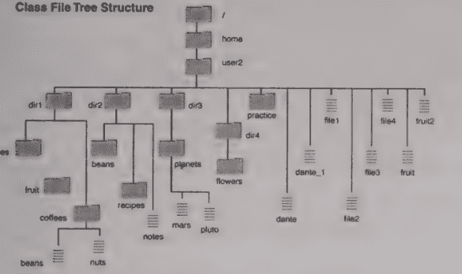

# 第 1 步。登录 CDE

在 `CDE` 输入框中输入导师分配给你的用户名和密码。

# 第 2 步。访问文件管理器

可以通过点击面板上的“文件抽屉”（File Drawer）图标，或右键点击工作桌面然后选择“文件”（File）菜单来访问文件管理器。文件管理器默认打开你的主文件夹视图（folder 一词与 folder 和 subfolder 交替使用）。从该文件夹，你可以切换到层次结构中向上或向下的其他文件夹，查看每个文件夹的内容。当前文件夹的路径始终显示在文件管理器窗口的上方。

- a. 点击面板上的“文件抽屉”图标启动文件管理器。面板上方区域显示的文件夹路径是什么？

# 第 3 步。使用文件管理器检查和更改权限

你可以通过从文件管理器窗口中选择文件或文件夹，然后从“已选择”（Selected）菜单中选择“属性”（Properties）来查看和更改属性。另一种方法是右键点击文件，然后从显示的菜单中选择“属性”。选择“属性”后，会弹出属性窗口。点击“信息”（Information）类别允许你查看文件信息，例如文件大小和最后修改日期。点击“权限”（Permissions）按钮允许查看和更改权限。要更改所有者（用户）、组（Group）和其他（Other）的权限，可以通过勾选框选择所需的权限。

- a. 点击 `dante` 文件，点击“已选择”菜单，然后点击“属性”选项。点击“权限”按钮。`dante` 文件的权限是什么？

# UNIX 基础实验指南

实验 10.4.1 – 使用文件管理器更改权限

工作单 – 继续

- b. 切换到练习文件夹（practice folder），使用“文件”菜单创建一个名为 `fmfile` 的新文件。右键点击此文件并从菜单中选择“属性”。点击“权限”按钮。该文件的权限是什么？

- c. 点击“其他用户读取访问”的复选框以取消（取消勾选）。现在你以外或你所在组的成员是否还能看到此文件的内容？

关闭 `fmfile` 的属性窗口。

- d. 使用文件管理器，向上文件系统结构导航到 `/usr/bin` 文件夹。找到 `cat` 命令文件。文件图标上的符号是什么？

- e. 点击 `cat` 文件，点击“已选择”菜单，点击“属性”选项，右键点击文件图标并选择“属性”。点击窗口顶部的“权限”按钮。`cat` 文件的权限是什么？

- f. 现在既然你已经看到了此文件的权限，你认为那个闪电符号意味着什么？为什么或为什么不？

- g. 点击“其他用户读取访问”的复选框以取消（取消勾选）。你成功了吗？为什么或为什么不？

- h. 关闭 `cat` 文件的属性窗口。

# 第 4 步。使用文件管理器检查和更改文件夹权限

- a. 使用文件管理器导航到你的主文件夹并点击练习文件夹进行选择。点击“已选择”菜单，然后点击“属性”选项。

- b. 点击“权限”按钮。练习文件夹的权限是什么？

- c. 切换到练习文件夹并创建一个名为 `fmfolder` 的新文件夹。右键点击此文件夹并从菜单中选择“属性”。点击“权限”按钮。该文件夹的权限是什么？

- d. 取消其他用户读取访问和执行访问的复选框。你以外或你所在组的成员还能看到此文件夹的内容或从中复制文件吗？

- e. 勾选你的组（staff）的写入访问。你组的成员能够更改 `fmfolder` 中的文件吗？

- f. 注意“应用更改到”（Apply changes to）选项。该选项的作用是什么？有哪些选择？

________________________________

- g. 关闭 `ffolder` 的属性窗口。

- h. 使用文件管理器向上文件系统结构导航到 `/usr/bin` 文件夹。此文件夹图标上的符号是什么？

________________________________________________

这意味着什么？

________________________________________________

# 第 5 步。删除实验创建的文件和目录

删除你在本次实验期间在主目录下创建的文件和目录。

# 第 6 步。注销

通过点击“文件”菜单并点击“关闭”退出 `CDE` 文件管理器。关闭任何终端窗口。点击面板上的“退出”（Exit）图标。

# UNIX 基础实验指南

实验 11.3.2 – 命令行打印

（预计时间：30 分钟）

## 目标

- 了解 UNIX 命令行打印
- 复习 UNIX 打印环境组件
- 使用 `lp` 命令打印文件
- 监控打印作业和队列状态
- 取消打印请求

# 背景

在在实验中，你将使用 UNIX 打印命令将作业发送到打印机并管理打印队列。打印服务是任何网络操作系统的核心组成部分。UNIX 提供了本地和远程打印功能。你将复习 UNIX 打印环境的主要组件，并使用 `lp` 命令通过命令行方法进行打印。`lpstat` 命令用于确定网络打印机的状态和可用性，确定打印请求 ID，并使用 `cancel` 命令删除打印请求。

## 工具 / 准备

在开始实验之前，请复习思科网络学院课程《UNIX 基础实验指南》第 11 章。

你需要以下内容：

- 教师分配的登录用户 ID（如 `user2`）和密码。
- 一台运行 UNIX 操作系统的计算机。
- 教室中安装了课程文件系统的联网计算机。
- 可用的网络打印机和运行中的打印服务器。

## 注意


# UNIX 基础实验指南

实验 11.3.2 – 命令行打印

工作单

使用示例课程文件系统目录树图来辅助本实验。

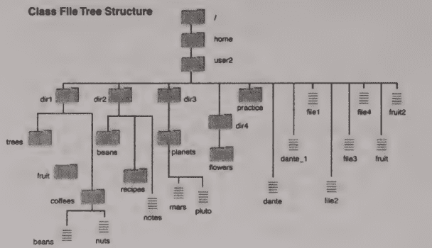

# 第 1 步登录 CDE

在 `CDE` 输入框中输入教师分配给你的用户名和密码。

# 第 2 步访问命令行

右键点击工作区背景并点击 Tools（工具）。从菜单中选择 Terminal（终端）打开终端窗口。

# 第 3 步复习 UNIX 打印环境组件

在 UNIX 打印环境中，用户可以将本地打印机连接到工作站，或打印到网络打印机。系统管理员通过安装打印机并定义支持它们的打印队列和服务器来设置环境。UNIX 打印环境包含三个主要组件：

- **打印机 (Printer)** – 物理打印设备。打印机可以连接到工作站或网络服务器，也可以通过集线器或交换机直接连接到网络。
- **打印机名称（队列）（Printer name (queue))** – 与物理打印机关联的打印队列名称。它是打印机的逻辑名称，由系统管理员分配。这是用户打印的目标名称。打印队列是计算机硬盘上的一个目录，用于存储用户的打印请求。
- **打印服务器 (Print server)** – 管理传入的打印请求并在打印机准备绪时释放请求的计算机。打印服务器运行打印守护进程 `lpsched`，用于管理打印请求。打印队列位于打印服务器的硬盘上。

打印请求或打印作业存储在硬盘上，直到打印完成后才被删除或清除。打印服务器可以是工作站也可以是网络服务器。本地计算机可以作为本地打印机的打印服务器。网络打印服务器通常是集中的，可以处理多个打印机和队列。

使用术 `printer`（打印机）、`printer name`（打印机名称）和 `print server`（打印服务器）来填充以下问题的空缺。

- a. 运行 `lpsched` 守护进程并在硬盘上持有打印队列中内容的设备是 _________________________
- b. _________________________ 输出打印材料的物理设备。
- c. 用户打印的逻辑名称是 _________________________。

# 第 4 步使用 lp 命令打印文件

可以使用命令行使用 `lp`（行式打印机）命令打印 ASCII 文本或 PostScript 文件。请勿使用此方法打印数据文件（在 FrameMaker 或 Sun 的 Star Office 等应用程序中创建的文件）或二进制文件。`lp` 命令的功能是为打印数据排队。带有可用的 `lp` 命令格式所示：

```
lp [-options] [filename(s)]
```

以下示例使用带有各种选项的 `lp` 命令打印文件。如果你未指定打印机，`lp` 将打印到你的默认打印机。管理员必须预先默认打印机。虽然这些示例只打印一个文件，但也可以同时向打印机发送多个文件。（也可以使用通配符元字符如 `*` 和 `?`。）

显示你的默认打印机名称：

```
$ lpstat -d
```

在默认打印机上打印主目录下的 `file2`：

```
$ lp ~/file2
```

使用 `-d` 选项指定另一个打印机（如果可用）：

```
$ lp -d staffp ~/file2
```

使用 `-o nobanner` 选项抑制标题页：

```
$ lp -o nobanner ~/file2
```

使用 **-n** 选项指定复制：

```
lp -n 3 file2
```

- a. 显示默认打印机的命令是什么？
- b. 显示打印队列的命令是什么？
- c. 显示特定打印机状态的命令是什么？
- d. 显示待处理请求的命令是什么？
- e. 显示哪些打印机接受请求的命令是什么？
- f. 显示所有打印机状态的命令是什么？
- g. 显示所有打印机完整状态的命令是什么？
- h. 显示所有打印机摘要的命令是什么？
- i. 列出特定打印机请求的命令是什么？
- j. 显示默认打印机状态的命令是什么？

# 第 5 步监控打印作业和队列状态


`lpstat`（打印机状态）命令用于显示打印队列状态。要查看特定打印机的请求，使用指定打印机名称的基本形式。如果没有指定打印机名称，将看到默认打印机的请求列表。

- 如果可能，关闭打印机或让教师临时停止 `lpsched`，以便你可以查看队列中的内容。
- 为你主目录下以 `file1`、`file2` 等开头的文件发送单独打印请求。你使用了什么命令？
- 使用下表记录在发送某些作业后使用列出的选项的结果。

### `lpstat` 打印队列选项

| 选项名称 | 含义 | 命令结果 |
| --- | --- | --- |
| 打印机名称 | 打印机（队列）名称 | 显示特定打印机队列的请求 |
| `-p` | 打印机 | 显示所有打印机的状态 |
| `-o` | 输出（待处理） | 显示所有输出或待处理打印请求的状态 |
| `-d` | 默认 | 显示哪个打印机是系统默认 |
| `-t` | 详细 | 显示所有打印机的完整状态信息 |
| `-s` | 摘要 | 显示所有打印机的状态摘要 |
| `-a` | 接受 | 显示哪些打印机正在接受请求 |

### 取消打印请求

需要从打印队列中移除打印请求时，会出现这种情况。如果打印作业尚未打印且仍在打印队列中，就可以取消它。你只能取消自己发起的打印请求。你无法删除其他用户的打印请求。只有系统管理员可以取消其他用户的打印作业。

`cancel` 命令允许你取消之前通过 `lp` 命令发送的打印请求。为此，你首先使用 `lpstat` 命令识别请求-ID。

# UNIX 基础实验指南

## 实验 11.3.2 – 命令行打印

工作单 – 续

- a. 使用 `lpstat` 命令确定队列中属于你的打印作业的请求 ID（`request-ID`）。你如何判断它们是属于你的打印作业？________________________________________________
- b. 记录下你其中一个打印请求的 `request-ID`，并使用 `cancel` 命令将其从打印队列中删除。你使用了什么命令？________________________________________________
- c. 再次使用 `lpstat` 命令确定你删除的那个打印作业的 `request-ID` 是否还在。它消失了吗？________________________________________________
- d. 使用 `lpstat` 和 `cancel` 命令从打印队列中删除所有属于你的剩余打印作业。________________________________________________

## 步骤 7. 删除在本次实验中创建的文件和目录

删除在本次实验期间在你的主目录下创建的所有文件和目录。

## 步骤 8. 关闭终端窗口并注销

双击屏幕左上角的横杠按钮，然后点击前面板上的退出（Exit）图标。

## 可选练习

- 1. 为 `lp` 命令添加哪个选项可以在打印作业完成后向用户发送电子邮件？
- 2. 如果你想尽可能快地打印一个文件，在将打印作业发送到打印机之前应该检查哪三件事？提示：阅读思科网络学院计划：UNIX基础指南》第11章。
- 3. 使用思科网络学院计划：UNIX基础指南》第11章中列出的 BSD 打印命令练习打印和管理打印作业。注意：如果 `/usr/ucb` 不在你登录 shell 的路径中，你可能需要指定 BSD 打印命令的完整路径。例如：使用 `/usr/ucb/lpr` 而不仅仅是 `lpr`。

# UNIX 基础实验指南

## 实验 11.4.3 – 使用 CDE 打印管理器

（预计时间：30 分）

### 目标

- 访问 CDE 打印管理器
- 检查打印机属性
- 监控打印队列
- 使用文件管理器打印文件
- 从队列中取消打印作业

### 背景

在本次实验中，你将使用常用桌面环境 (CDE) 打印管理器和文件管理器来控制你的打印环境。CDE 打印管理器是一个用于管理打印队列的图形工具。它执行许多与 `lpstat` 命令相同的功能。CDE 打印管理器实用程序提供了打印系统的图形界面，可查看或更改打印队列作业。文件管理器可以配合打印管理器使用来打印文件，它执行的功能与 `lp` 命令类似。

### 工具 / 准备

在开始实验之前，请复习思科网络学院计划：UNIX基础指南》第11章。

你将需要：

- 导师分配的登录用户 ID（例如 `user2`）和密码。
- 一台运行带有 CDE 的 UNIX 操作系统的计算机。
- 教室中安装了课程文件系统的联网计算机。
- 可用的网络打印机和正在运行的打印服务器。

### 注意

# UNIX 基础实验指南

## 实验 11.4.3 – 使用 CDE 打印管理器

工作单

使用示例课程文件系统文件夹树的图来辅助本次实验。

### 课程文件树结构

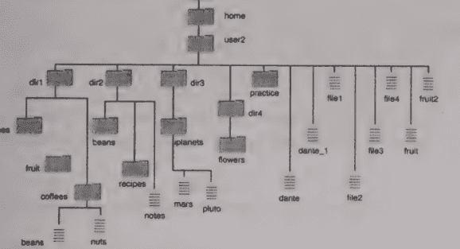

### 步骤 1. 登录 CDE

在提供的 CDE 登录框中，使用导师分配给你的用户名密码登录。

### 步骤 2. 访问 CDE 打印管理器

要激活打印管理器，点击前面板上的打印机图标。“打印作业”窗口将显示当前打印机列表。双击打印机图标将显示打印队列中任何待处理的打印请求。“打印作业”窗口中只会显示一个打印机图标。这代表了用户选择的打印机（这可能与系统默认打印机相同，也可能不同）。

- a. 点击前面板上的打印机图标以启动打印管理器。打开的窗口标题是什么？_________________________________________________\_\_\_\_\_\_\_\_\_\_\_\_\_\_\_\_\_\_\_\_\_\_\_\_\_\_\_ 
- b. 窗口中显示的打印机名称是什么？_________________________________________________________________________________________________________________________________________________________________\_\_\_\_\_\_\_\_\_\_\_\_\_\_\_\_\_\_\_\_ 
- c. 左下角显示的打印队列状态是什么？_________________________________________________________________________________________________________________________________________________________________________________________________________________________________________________

### 步骤 3. 检查打印机属性

a. 点击打印机进行选择。点击“已选择”（Selected）菜单并点击“属性”（Properties）。打印队列的名称是什么？_________________________________________________________________________________________________________________________________________________________________\_\_\_\_\_\_\_\_\_\_\_\_\_

设备名称是什么？_________________\_\_\_\_\_\_\_\_\_\_\_\_\_\_\_\_\_\_\_\_\_\_\_\_\_\_\_\_\_\_\_\_\_\_\_\_\_\_\_\_\_

b. 右键点击打印机并从菜单中选择“属性”。这与使用“已选择”菜单的效果相同吗？_________________________________________________________________________________________________________________________________\_\_\_\_\_\_\_\_\_\_\_\_\_\_\_\_\_

# UNIX 基础实验指南

## 实验 11.4.3 – 使用 CDE 打印管理器

工作单 – 续

### 步骤 4. 监控打印队列

如果可能，让你的导师登录并临时禁用打印机以便你可以看到队列。

- a. 打开终端窗口并对主目录下的文件发送打印请求，从 `file1`、`file2` 开始。你使用了什么命令？________________________________________________
- b. 在“打印作业”窗口中双击打印机图标查看打印作业。
- c. 选择一个打印作业并点击“已选择”菜单。从菜单中选择“属性”。
- d. 右键点击队列中的一个作业并从菜单中选择“属性”。要打印的文件大小是多少？_________________\_\_\_\_\_\_\_\_\_\_\_\_\_\_\_\_\_\_\_\_\_\_\_\_\_\_\_\_\_\_\_\_\_\_\_\_\_\_\_\_

### 步骤 5. 使用文件管理器打印文件

你可以通过将文件从文件管理器拖放到打印机图标，或直接拖入“打印作业”窗口来从文件管理器打印文件。一旦文件对象拖入“打印作业”窗口，将显示另一个窗口，你可以在其中指定打印选项。一旦点击“打印”按钮，文件将发送到相应的打印机。

- a. 点击前面板上的文件抽屉图标或右键点击工作桌面然后点击“文件”菜单来访问文件管理器。保持“打印作业”窗口打开。
- b. 导航到 `planets` 目录，选择 `mars` 文件，并将其拖到“打印作业”窗口。打印窗口中的选项与 `lp` 命令提供的选项相似吗？
- c. 点击“打印”按钮。接下来显示了什么窗口？
- d. 将 `Pluto` 文件拖到前面板上的打印机图标。得到的结果与将文件拖到“打印作业”窗口相同吗？

### 步骤 6. 从队列中取消打印作业

- a. 选择一个打印作业并点击“已选择”菜单。从菜单中选择“取消”（Cancel）。你得到了什么响应？________________________________________________
- b. 选择一个打印作业并点击“已选择”菜单。从菜单中选择“取消”（Cancel）。你得到了什么响应？________________________________________________
- c. 点击“是”按钮。打印作业是否从队列中删除？________________________________________________

# UNIX 基础实验指南

实验 12.4.1 – 命令行归档工具

（预计时间：45 分钟）

### 目标

- 了解备份和压缩工具
- 复习 `tar` 归档选项
- 使用 `tar` 备份选定的文件
- 使用 `tar` 备份目录
- 压缩文件
- 解压文件
- 备份并压缩你的主目录（`home directory`）
- 恢复你的主目录
- 使用 `jar` 进行归档和压缩

### 背景

在本实验中，你将使用 UNIX 内置的多功能实用程序，对数据进行备份、压缩和恢复，目的是为了创建重要文件的备份，或将多个文件从一个用户传输到另一个用户。

备份数据以妥善保存也被称为归档（archiving）。这是网络安全和支持中最重要的方面之一。备份是全面安全计划中的关键环节。

与其他用户之间频繁的文件传输通常使用电子邮件或文件传输命令（`ftp` 和 `rcp`）完成，这些将在第 16 章中介绍。

在本实验中，你将使用磁带归档 (`tar`)、压缩和 Java 归档 (`jar`) 工具来创建用于备份或传输给其他用户的文件。我们还将涵盖如何从 `tar` 或 `jar` 文件恢复文件。

### 工具 / 准备

在开始实验之前，请复习 Cisco Networking Academy 课程《UNIX 基础实验指南》第 12 章。

你需要：

- 导师分配的登录用户 ID（如 `user2`）和密码。
- 一台运行 UNIX 操作系统的计算机。
- 教室中安装了课程文件系统的联网计算机。

### 注意事项

# UNIX 基础实验指南

实验 12.a.4.1 – 命令行归档工具

工作单

使用示例课程文件目录树的图来辅助本实验。

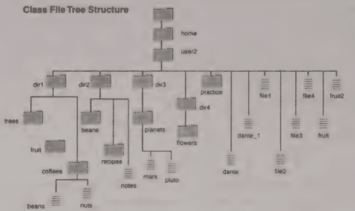

### 步骤 1. 登录 CDE

在 CDE 输入框中输入导师分配给你的用户名和密码登录。

### 步骤 2. 访问命令行

右键点击 Workspace 背景并点击 Tiles（平铺）。从菜单中选择 Terminal（终端）以打开终端窗口。

### 步骤 3. 复习 tar 归档选项

UNIX 操作系统具有多个集成工具，允许对多个文件进行备份和压缩。**`tar`**（磁带归档）命令允许你对层次结构中的单个或多个文件进行备份。**`tar`** 命令是所有版本 UNIX 操作系统的标准。尽管它最初是为磁带驱动器设计的，但 **`tar`** 可以将文件复制到硬盘、软磁盘或其他移动介质上的其他位置。**`tar`** 命令可以从单个文件创建归档，但它主要用于将多个文件（例如目录内容）合并成单个文件。如果以后需要，可以从文件中提取这些文件。**`tar`** 本身并不压缩文件。**`compress`** 命令用于压缩新创建的 tar 文件。接将介绍的较新的 **`jar`** 命令在封装文件时会自动进行压缩。命令语法在此所示：

```
tar function [modifier:] [output file] filename(s) / directory (s)
tar c v f files.tar file12
```

**`tar`** 命令最常用的选项是 **`c`**、 **`t`** 和 **`x`**（全小写）。没有必要像其他 UNIX 命令选项那样在这些选项前加减号（-），但也是允许的。

# UNIX 基础实验指南

实验 12.4.1 – 命令行归档工具

工作单 – 续

### tar 命令函数选项

| 函数 | 含义 | 执行的功能 |
| --- | --- | --- |
| `c` | 创建（合并） | 创建一个新的 tar 文件。 |
| `t` | 目录列表 | 列出 tar 文件的目录列表（内容）。 |
| `x` | 提取文件 | 从 tar 文件中提取指定的文件。 |

### tar 命令函数修饰符

| 修饰符 | 含义 | 修改的功能 |
| --- | --- | --- |
| `f` | 文件名 | 指定要创建的 tar 文件，可以是硬盘上的文件（例如 `/tmp/file.tar`），也可以输出设备的设备文件，如软磁盘（Solaris 中的 `/vol/dev/aliases/floppy0`）、光驱驱动器或磁带驱动器（Solaris 中的 `/dev/rmt0`）。 |
| `v` | 详细模式（查看） | 以详细模式执行。这允许用户查看 tar 命令在复制、显示目录列表或从备份文件或设备提取内容时正在执行的操作。此选项通常与 `c`、`t`、`x` tar 选项一起使用。 |

- a. 使用哪个修饰符可以归档一个或多个文件？
- b. 使用哪个修饰符可以指定新 tar 文件作为归档名称？
- c. 使用 `c`、`t` 或 `x` 选项时使用哪个修饰符可以查看 tar 命令的结果？

### 步骤 4. 使用 tar 备份选定的文件

要使用 `tar` 命令备份一组文件并创建一个单个 tar 文件，请使用以下语法。`cvf` 选项用于在详细（`v`）模式下创建（`c`）一个文件（`f`）。在这种情况下，被归档的文件（`tree tree2`）位于当前目录的硬盘上。要创建的 tar 文件（`tree.tar`）也将放置在当前目录的硬盘上，因为没有指定其他目录或设备（软磁盘或磁带设备）。你可以指定多个文件（允许通配符）或目录名称来归档所有内容。如果需要，以后可以提取这些文件。

```
tar c v f files.tar file2
```

- a. 在主目录中，使用什么命令创建 `tree.tar`？
- b. 使用什么命令创建一个名为 `tree2` 的新归档文件？
- c. 在当前目录中，使用什么命令配合 `c`、`t` 或 `x` 选项来查看 tar 命令的结果？
- d. 在主目录中，使用什么命令创建 `tree.tar` 归档？
- e. 使用什么命令归档目录中的所有文件（允许通配符）？
- f. 使用什么命令归档一个目录？
- g. 使用什么命令在当前目录中创建 `files.tar` 文件？
- h. 使用什么命令在当前目录中创建 `tree.tar` 归档？
- i. 使用什么命令归档以字母 `f` 开头的文件？
- j. 使用什么命令创建了 `files.tar` 文件？
- k. 使用什么命令查看哪些文件被归档了？
- l. 使用什么命令查看归档的详细过程？
- m. 使用什么命令归档了哪些文件？
- n. 使用什么命令查看 tar 文件的目录列表？
- o. 使用什么命令查看 `files.tar` 的目录列表？
- p. 使用什么命令逐页查看 `files.tar` 文件的归档的文件？

### 步骤 5. 使用 tar 备份目录

你也可以使用 `tar` 命令备份整个目录，包括其包含的所有子目录。

- a. 在主目录中，使用什么命令备份 `dir2` 目录并创建一个名为 `dir2.tar` 的 tar 文件？
- b. 结果是什么？
- c. 切换到 `dir2` 子目录。使用什么命令？
- d. 使用什么命令配合目录列表选项（`t`）、详细（`v`）和文件（`f`）修饰符查看 `dir2.tar` 的内容？
- e. `dir2.tar` 中包含多少个目录和文件？

### 步骤 6. 压缩文件

对一段时间未使用的文件进行归档然后压缩以节省空间通常是非常用的。在将文件传输给另一个用户（拥有解压 命令）之前，压缩文件也可以节省时间。任何文件（包括使用 `tar` 创建的归档）都可以压缩。

当使用 `compress` 命令压缩文件时，原始文件将被替换，但文件名末尾带有 Z 后缀。注意这是一个大写的 Z。当使用 `-v` 选项使用 `compress` 命令时，它将显示输入和输出文件的名称以及实现的压缩量。

```
compress option file2
compress -v file*
```

- a. 切换到主目录并创建一个名为 `compressdir` 的新目录。使用什么命令？


- b. 显示 `coffees` 子目录中文件的详细列表以查看它们的当前大小。使用什么命令？

- c. `beans` 文件的当前大小是多少？

- d. 使用相对路径切换到 `coffees` 子目录。使用什么命令？

- e. 使用什么命令可以找出 `beans` 文件的类型？

`beans` 文件是一个什么类型的文件？

# UNIX 实验指南基础

## 实验 12.4.1 – 命令行归档工具

### 工作单 – 继续

- f. 使用波浪号 (`~`) 表示主目录路径，将当前目录 (`coffees`) 下的 `beans` 文件复制到之前创建的 `compressdir` 子目录中。你使用了什么命令？

- g. 使用相对路径切换到 `compressdir` 子目录。你使用了什么命令？

- h. 使用详细模式 (`-v`) 选项压缩 `beans` 文件。你使用了什么命令？

- i. `compress` 命令的结果解是什么？

- j. 显示你当前目录 (`compressdir`) 中文件的详细列表以查看它们的当前大小。现在 `beans.Z` 文件的大小是多少？原始的 `beans` 文件仍然存在吗？

- k. 检查 `tardir` 目录中 `files.tar` 文件的大小，然后对其进行压缩。它压缩了多少空间？压缩后它的名字是什么？

## 第 7 步：解压缩文件 (Uncompress Files)

用于撤销 `compress` 命令反向效果的相应命令是 `uncompress`。文件无法以压缩的形式直接使用，因此需要使用 `uncompress` 命令将其恢复到原始大小。`uncompress` 命令是一个 UNIX 实用程序，只能用于解压缩用 UNIX `compress` 压缩的文件。

```
uncompress option file2
uncompress -v file
```

注意：使用 `uncompress` 命令不需要指定 `.Z` 扩展名。该命令可以解压缩多个文件，并支持使用通配符如 `?` 和 `*`。

- a. 切换到 `compressdir` 子目录。你使用了什么命令？

- b. 显示你当前目录 (`compressdir`) 中文件的详细列表以查看它们的当前大小。现在 `beans.Z` 文件的大小是多少？

- c. 使用详细模式 (`-v`) 选项解压缩 `beans` 文件。你使用了什么命令？

- d. 解压缩命令的结果是什么？

- e. 显示你当前目录 (`compressdir`) 中文件的详细列表以查看它们的当前大小。现在 `beans` 文件的大小是多少？`compressed.Z` 文件仍然存在吗？

## 第 8 步：备份并压缩你的主目录 (Backing Up and Compressing Your Home Directory)

对主目录进行定期每晚备份（或至少备份最重要的文件）是一个良好的习惯。本节描述了将主目录归档为 `tar` 文件的过程，并解释了在以后需要恢复某个文件时如何解压缩它。从 `tar` 文件恢复文件将在下一步中介绍。

- a. 切换到你的主目录并创建一个名为 `backup` 的新子目录。你使用了什么命令？

- b. 使用 `tar` 命令备份整个主目录，并在 `backup` 目录下创建一个名为 `home.tar` 的归档文件。使用命令 `tar cvf ~/backup/home.tar`

- c. 切换到 `backup` 目录并显示详细列表以验证 `home.tar` 是否存在。文件的大小是多少？

- d. 查看 `home.tar` 文件的目录。你使用了什么命令？

- e. 使用详细模式 (`-v`) 选项压缩 `home.tar` 文件。你使用了什么命令？

- f. 压缩命令的结果是什么？

- g. 显示详细列表并验证 `home.tar` 是否在那里。现在文件的大小是多少？

## 第 9 步：从 tar 文件恢复文件 (Restoring Files from a tar File)

在本节中，你将从之前创建的主目录压缩 `tar` 文件中恢复一个文件，以模拟从备份中恢复重要文件。正如 `tar` 可以将多个文件合并到一个归档文件中，它也可以恢复它们。在解压缩 `tar` 文件并提取原始文件后，你可以根据需要将它们移动到真实的主目录。

示例 1：

```
tar xvf trees.tar tree1 tree2
```

从 `trees.tar` 文件提取 `tree1` 和 `tree2` 文件。

示例 2：

```
tar xvf trees.tar
```

从 `trees.tar` 文件中提取所有文件。

- a. 切换到你的主目录并将 `file1` 和 `file2` 文件重命名为 `file1.xyz` 和 `file2.xyz`，为从 `home.tar` 恢复原始文件做准备。

- b. 删除 `file1` 和 `file2` 文件，模拟它们被意外删除并需要从备份中恢复。

- c. 切换到 `backup` 目录并解压缩 `home.tar.Z`（包含所有文件的备份），为恢复 `file1` 和 `file2` 文件做准备。你使用了什么命令？

- d. 查看 `home.tar` 文件的目录，仅列出以 `file` 开头的文件。你使用了什么命令？

- e. 记录 `file1`、`file2`、`file3` 文件的路径，与目录输出中的完全一致。

- f. 使用提取 (`x`) 选项以及详细模式 (`v`) 和文件 (`f`) 修饰符从 `home.tar` 文件提取 `file1` 和 `file2` 文件。你使用了什么命令？

- g. 提取的文件被放在哪个目录中？

- h. 将 `file1` 和 `file2` 文件移动到你的主目录，完成恢复。

- i. 重新压缩 `home.tar` 文件，因为你已经成功恢复了所需文件，很快就不需要 `home.tar`。

## 第 10 步：使用 jar 进行归档和压缩 (Using jar to Archive and Compress)

`jar` (java archive) 命令与 `tar` 命令类似，不同之处在于它同一步中压缩生成的文件。它是一个将多个文件合并到单个 `jar` 文件的 Java 程序。它也是基于 ZIP 和 ZLIB 格式的通用归档和压缩工具。`jar` 命令在 Solaris 系统中是标准配置，但在任何安装了 Java 虚拟机 (JVM) 的系统上都可用。其语法与 `tar` 命令几乎相同。以下是 `jar` 的示例：

```
jar
```

- a. 切换到你的主目录并使用 `jar` 命令在 `backup` 目录下创建一个名为 `fruit.jar` 的压缩归档文件（包含 `fruit` 和 `fruit2` 文件）。你使用了什么命令？

- b. `jar` 命令的结果是什么？

- c. 显示 `backup` 目录的详细列表。`jar` 文件在列表中吗？

- d. `fruit.jar` 文件的大小是多少？文件被压缩了吗？

- e. 原始文件还在你的主目录中？

- f. 切换到 `backup` 目录查看 `jar` 文件的目录。你使用了什么命令？

- g. 使用提取 (`x`) 选项以及详细模式 (`v`) 和文件 (`f`) 修饰符提取 `fruit.jar` 文件到 `backup` 目录。你使用了什么命令？

- h. `jar` 命令的结果是什么？

## 第 11 步：删除实验创建的文件和目录 (Removing Files and Directories Created in Lab)

删除实验期间在主目录下创建的文件和目录。

## 第 12 步：关闭终端窗口并注销 (Closing the Terminal Window and Logging Out)

双击屏幕左角的按钮，然后点击前面板上的退出图标。

## 可选练习

- 1. 与伙伴合作。每个学生创建一个 `dir1` 目录的压缩文件或 `jar` 文件并作为附件发送电子邮件。分离附件到新目录并提取文件。

- 2. 如果你有权访问磁带机，完成以下操作：

    - a. 使用 `tar cvf /dev/rmt/0` 命令将主目录的文件备份到磁带。

    - b. 查看磁带的目录。你使用了什么命令？

    - c. 从磁带恢复文件。

- 3. 将 `file1`、`file2` 和 `file3` 文件拷贝到软盘（此练习需要可覆盖的磁盘）。

    - a. 切换到主目录。

    - b. 使用 `fdformat -U /vol/dev/aliases/floppy0` 命令格式化软盘。

    - c. 输入卷检查 (`volcheck`) 命令使磁盘驱动器可用。驱动器灯应该闪烁一下。

    - d. `tar` 命令添加的 `f` 选项允许你指定磁带文件名 (`/dev/rmt/0`) 或软盘驱动 (`/vol/dev/aliases/floppy0`)。使用 `tar` 命令和软盘设备文件名将 `file1`、`file2` 和 `file3` 文件拷贝到软盘上。

- 4. 如果你经常使用软盘，应该创建别名来方便操作：

    - a. 创建一个用于格式化磁盘的别名 `format-a`。你使用了什么命令？

    - b. 创建一个用于查看软盘目录的别名 `dir-a`。你使用了什么命令？

# UNIX 基础实验指南

## 实验 12.5.2 – CDE 归档工具

（预计时间：20 min。）

### 目标

- 熟悉 CDE 图形备份、压缩和恢复功能

- 访问 Files（文件）子面板的 Archive（归档）选项

- 使用 Archive 选项归档文件

- 使用 Archive 选项归档文件夹

- 使用 File Manager（文件管理器）恢复归档的文件和文件夹

- 使用 Files（文件）子面板的 Compress（压缩）选项压缩文件

- 使用 File Manager 解压缩文件

### 背景

在本实验中，你将使用常用桌面环境（CDE）工具对文件和文件夹进行备份、压缩和恢复。前面板上的 Files 子面板结合 File Manager，可以对文件进行归档、压缩和恢复。这与使用 `tar`、`compress` 和 `uncompress` 命令的效果相同。

### 工具 / 准备

在开始实验之前，请复习《Cisco 网络学院课程：UNIX 基础实验指南》第 12 章。

你需要以下内容：

- 教师分配的登录用户 ID（如 `user2`）和密码。

- 一台运行带有 CDE 的 UNIX 系统的计算机。

- 教室中安装了课程文件系统的联网计算机。

- 可用的网络打印机和正在运行的打印服务器。

### 注意事项

________________________________________________________________________________________________________________________________________________

________________________________________________________________________________________________________________________________________________

________________________________________________________________________________________________________________________________________________

________________________________________________________________________________________________________________________________________________

________________________________________________________________________________________________________________________________________________

________________________________________________________________________________________________________________________________________________

________________________________________________________________________________________________________________________________________________

________________________________________________________________________________________________________________________________________________

________________________________________________________________________________________________________________________________________________

________________________________________________________________________________________________________________________________________________

# UNIX 基础实验指南

## 实验 12.5.2 – CDE 归档工具

### 工作单

使用示例课程文件系统树图辅助完成实验。

# 课程文件树结构

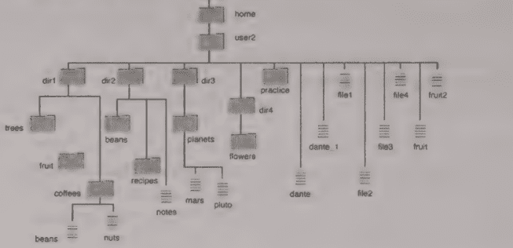

## 第 1 步 登录 CDE

在 CDE 登录框中输入教师分配给你的用户名和密码。

# 第 2 步 访问 Files 子面板的 Archive 选项

点击 CDE 前面板上的 Files 子面板并选择 Archive 菜单选项。将打开一个 Archive 窗口允许你输入以下信息：

- Folder for Archive（归档文件夹）——归档 (`tar`) 文件存放的文件夹。默认是你的主目录（例如 `/home/userX`）。

- Name for Archive（归档名称）——你想要给归档文件命。

- File or Folder to Archive（归档的文件或文件夹）——要合并为归档文件的文件夹、文件或文件组。

# 第 3 步 归档文件

- a. 点击 File Drawer（文件屉）图标上方 Files 子面板中的 Archive 选项。将 Folder for Archive 留空。归档存放的默认文件夹是什么？

b. Tab 切换到 Name for Archive 并输入 `dante.tar`。然后 切换到 File or Folder to Archive 并输入 `dante`。

c. 点击 OK 归档 `dante` 文件。点击 OK 时显示了什么窗口？

d. 关闭 Archive 状态窗口。

# UNIX 基础实验指南

## 实验 12.5.2 – CDE 归档工具

### 工作单 – 续

- 打开 File Manager 并检查你的主目录是否有新的归档文件。归档文件的图标是什么？

# 第 4 步 归档文件夹

- 点击 Files 子面板中的 Archive 选项。将 Folder for Archive 留空。归档存放的默认文件夹是什么？

- Tab 切换到 Name for Archive 并输入 `practice/dir2.tar`。此归档文件将放在何处？

- Tab 切换到 File or Folder to Archive 并输入 `dir2`。

- 点击 OK 归档 `dir2` 文件夹。点击 OK 时显示了什么窗口？

- 关闭 Archive 状态窗口。

- 打开 File Manager 并导航到你的 `practice` 文件夹。归档的文件夹在里面吗？

# 第 5 步 恢复归档的文件和文件夹

你可以使用 File Manager 快速恢复归档文件。

注意：如果原始文件存在于恢复归档文件的文件夹中，它将被恢复后的版本覆盖。

- 打开 File Manager 找到你之前从 `dante` 文件创建的 `tar` 文件。它应该在你的主目录里。

- 选择 `dante` 归档文件并点击 Selected（选中）菜单。菜单中的哪个选项允许你从 `tar` 文件中提取文件？

从菜单中选择 Archive Unpack（解包）选项。响应是什么？

- 导航到存放 `dir2` 归档文件的 `practice` 文件夹。

- 双击归档的 `dir2` 文件图标查看 `tar` 文件的目录。关闭 Archive 窗口。这与使用 `tar` 命令的 `t` 选项相同。

- 选择 `dir2` 归档文件，使用 Selected 菜单或右键点击鼠标并点击 Archive Unpack 选项。`dir2` 目录的内容解包了吗？

# UNIX 基础实验指南

## 实验 12.5.2 – CDE 归档工具

### 工作单 – 续

# 第 6 步 压缩和解压缩文件

你也可以使用 File Manager 压缩和解压缩文件。压缩后的文件将重命名为 `.Z` 扩展名，并位于压缩前的文件夹中（默认是主目录）。在将文件通过 ftp 或电子邮件发送给另一个 UNIX 用户之前，或者为了给常用文件节省磁盘空间，你应该先对文件进行压缩。

- a. 点击 CDE 前面板上的 Files 子面板并选择 Compress（压缩）菜单。将打开一个 Compress 窗口允许你输入要压缩的文件名。

- b. 输入 `beans` 文件的相对路径。你输入的路径是什么？________________

- c. 打开 File Manager 并导航到 `coffees` 文件夹。`beans` 文件的压缩名称是什么？________________

- d. 压缩文件的图标是什么？________________

- e. 使用 Selected 菜单或右键点击文件查看属性。点击 Information。你知道它是什么类型的文件吗？________________


- f. 关闭属性窗口再次右键点击压缩文件。点击 `Uncompress` 将 `beans` 文件还原为原始形式。

- g. 使用 `Selected` 菜单或右键点击文件查看属性。点击 `Information`。你知道它是什么类型的文件吗？________________

- h. 关闭 `Uncompress` 状态窗口。

# 第 7 步 删除实验中创建的文件和目录

删除在本实验期间在你主目录中创建的所有文件和目录。

# 第 8 步 退出

点击 `File` 菜单退出 `CDE File Manager`，关闭任何终端窗口。点击前面板上的 `Exit`（退出）图标。

## 可选练习

注意：这是与实验 7.2.3 相同的可选练习，在此处作为复习练习。如果你已经知道如何从 `File Manager` 复制文件到磁盘，请进行练习 2。

- 1. 使用 `File Manager` 将 `dante` 文件复制到软盘，并写下你经历的步骤。提示：阅读 `File Manager` 帮助中关于以下主题：查看磁盘上的文件和文件夹、将文件和文件夹复制到磁盘上、以及拖放文件和文件夹。

- 2. 使用 `CDE File Manager` 解压在 `PC` 上创建的 `zip` 文件。

a. 将 `zip` 文件（用 `Winzip` 或 `PKZip` 创建）从 `PC` 复制到软盘。

b. 将软盘插入 `Solaris` 系统的磁盘驱动器。

c. 使用 `CDE File Manager` 打开一个显示软盘内容的窗口。

d. 将 `zip` 文件复制到主目录下的 `practice` 目录中。

e. 在 `practice` 目录中双击 `zip` 文件解压文件。

# UNIX 实验指南基础

实验 13.3.2 – 管理系统进程

（预计时间：50 分钟）

## 目标

- 培养对 `UNIX` 进程管理的理解
- 复习系统进程概念
- 复习 `ps` 命令及其选项
- 列出当前 `shell` 中的进程
- 列出系统上运行的所有进程
- 通过命令名搜索特定进程
- 识别要终止的进程
- 使用 `kill` 命令终止进程
- 按用户查找查找并终止进程
- 按命令名终止进程

## 背景

在本次实验中，你将使用 `UNIX` 命令来识别和控制系统进程。`UNIX` 操作系统管理器使用进程来处理任务。进程可以由操作系统启动，也可以由用户启动。你在 `UNIX` 环境中执行的大多数任务都会启动一个进程。进程可以启动或派生子进程或子任务，创建一个类似于文件系统结构（具有父/子关系）的进程层次结构或树形结构。你将使用 `ps`（进程状态）命令来监控系统进程，使用 `kill` 命令来终止不需要的进程。你还将使用 `Solaris` 命令 `pgrep` (grep) 和 `pkill` (process kill)。

## 工具 / 准备

在开始实验之前，请复习思科网络学院课程第 13 章：

《`UNIX` 基础指南》。

你需要：

- 导师分配的登录用户 `ID`（如 `user2`）和密码。
- 一台运行 `UNIX` 操作系统系统的计算机。
- 教室中安装了类文件系统的联网计算机。

## 注意事项

________________________________________________________________________________________________

________________________________________________________________________________________________

________________________________________________________________________________________________

________________________________________________________________________________________________

________________________________________________________________________________________________

# UNIX 实验指南基础

实验 13.3.2 – 管理系统进程

工作单

使用示例类文件系统目录树图辅助完成实验。

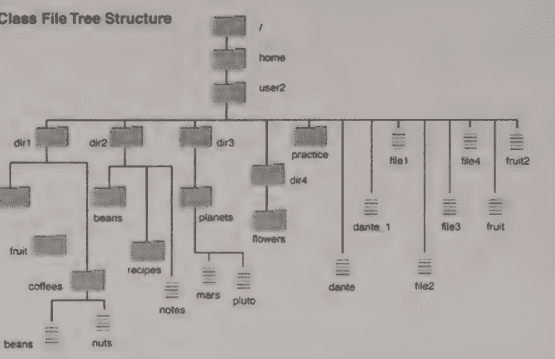

### 步骤 1 登录 CDE

在 `CDE` 输入框中输入导师分配给你的用户名和密码登录。

### 步骤 2 访问命令行

右键点击 `Workspace`（工作区）背景并点击 `Tools`（工具）。从菜单中选择 `Terminal`（终端）打开终端窗口。

### 步骤 3 复习系统进程概念

你运行的每个程序都会创建一个进程，并被分配一个唯一的进程标识符（`PID`）。系统使用 `PID` 来识别和跟踪进程，直到其完成。操作系统（`OS`）内核管理所有进程的启动和终止。每个进程在启动时都需要系统资源（如 `CPU` 时间和 `RAM`）来工作，并在进程结束时释放。`UNIX` 系统启动时启动的前两个进程是 `sched`（调度器）和 `init`（初始化），它们管理其他进程。`UNIX` 系统上有几种不同类型的进程：

- **Daemon（守护进程）** - 由 `UNIX` 内核启动并为了特定目的存在的进程。例如，`lpsched` 守护进程存在的唯一目的是处理打印作业。
- **Parent（父进程）** - 派生另一个进程的进程是其父进程。名为 `init` 的进程是第一个被调用的进程。除了 `init` 之外的每个进程被称为父进程。
- **Child（子进程）** 被另一个进程派生的进程是子进程。
- **Orphan（孤儿进程）** 在其返回输出之前父进程就已终止的进程。
- **Zombie（僵尸进程）** 未能将其输出返回给父进程的子进程。该进程会在系统中丢失。

# UNIX 实验指南基础

实验 13.3.2 – 管理系统进程

工作单 – 延续

根据上述信息，填空以下句子中的空白：

a. 几乎每个在 `UNIX` 系统上启动的进程都会被内核分配一个唯一的 ________，用于从开始到结束跟踪该进程。

b. 当新进程启动时，内核还会分配系统资源，如 ________ 和 ________。

c. 永远不向父进程返回输出的进程被称为 ________ 进程。

d. 由父进程派生的进程被称为 ________ 进程。

e. 派生另一个进程的进程是 ________。

f. 运行以服务的 `UNIX` 系统进程是 ________。

g. 如果一个进程在子进程完成之前结束，它会创建一个（n） ________ 进程。

# 步骤 4 复习 ps 命令及其选项

`ps`（进程状态）命令用于列出当前在系统上运行的进程。当某个进程运行时间过长或似乎已经停止时（以终端窗口无响应或挂起为标志），通常会执行此操作。通过列出进程，你可以看到启动该进程的命令或进程名称，以及它可能派生的任何子进程。通过多次执行 `ps` 命令，你可以通过查看进程的时间（即进程使用的 `CPU` 时间）来判断进程是否仍在运行。如果时间没有增加，则该进程可能已经停止。你可以使用 `ps` 命令检查进程的进程 `ID`（`PID`），如果它运行时间过长或已停止，则使用 `kill` 命令终止进程。

`ps` 命令的输出将显示 `PID` 号和与之相关的命令或程序。`PID` 号通常用于终止进程。`ps` 命令有三个主要选项，如下所示。

```
ps [-options]
```

# UNIX 实验指南基础

实验 13.3.2 – 管理系统进程

工作单 – 延续

| ps 选项 | 含义 |
| :--- | :--- |
| ps | 无选项。显示当前用户的信息。 |
| ps -e | Every。显示所有进程的信息。 |
| ps -f | Full。生成完整列表。 |
| ps -u | User。显示特定用户的信息。 |

| PID TTY TIME CMD |
| :--- |
| 785 pts/6 16:41 | db |
| 742 pts/6 0:00 | daemon |
| 689 pts/6 0:00 | shell |

| 数值 | 列标题 |
| :--- | :--- |
| UID | 启动进程的用户 `ID`。 |
| PID | 进程的进程标识符。`PID` 用于 ________。 |
| PPID | 父进程标识符。 |
| C | 进程的优先级。 |
| STIME | 进程的启动时间。 |
| TTY | 终端类型 - 进程的控制终端。 |
| TIME | 进程使用的 `CPU` 时间。 |
| CMD | 命令名或 ________ |

# UNIX 基础指南

13.3.2 – 管理进程

工作单 – 延续

# 步骤 5 列出当前 shell 中的进程

a. 在当前窗口中执行不带选项的 `ps` 命令。显示了什么信息？

b. 显示了多少个进程？

c. 进程 `ID` 是多少？

d. 启动该进程的命令（`CMD`）是什么？

# 步骤 6 列出系统上运行的所有进程

`ps -ef` 命令将列出所有进程并可能产生相当长的列表。

a. 在当前窗口中执行 `ps -ef` 命令。显示了哪些标题？（提示：你可以将 `ps -ef` 命令通过到 `more` 命令来查看。）

b. 显示了多少个进程？

c. 通过再次运行 `ps -ef` 命令并将输出通过到 `wc`（单词计数）命令来统计进程数量。第一个数字是显示的行数，也是进程数。你使用了什么命令？运行了多少个进程？

d. 逐页按 `PID` 数字排序所有进程的输出。你使用了什么命令？

e. `PID` 号为 1 的命令是什么？

# 步骤 7 通过命令名搜索特定进程

要停止进程，你必须找到 `PID`。在大多数系统中，运行着数百个进程，`ps -ef` 列表可能很大。如果你知道启动该进程的可执行程序名称，可以更快地找到它。通过将 `ps` 命令的输出通过管道 `grep`，你可以搜索要终止的特定进程并找到正确的 `PID`。正如你所记得的，`grep` 命令可以在其他命令的输出中搜索任何类型的字符字符串。`Solaris` 特有的 `grep` (process grep) 命令用于搜索特定进程。`-l`（长输出）选项将显示与找到的 `PID` 关联的进程名称。`-e` 选项显示 `PID` 和启动命令名称，允许 `grep` 在这些信息上进行搜索。

# UNIX 实验基础

实验 13.3.2 – 管理系统进程

工作单 – 继续

在您当前的终端（`Terminal`）窗口中，执行 `ps -e | grep lp` 命令来查找所有与行打印机调度守护进程相关的进程。

- a. 显示了多少个进程？
- b. 显示的进程中最小的进程 `ID`（`PID`）是多少？
- c. 在您当前的终端窗口中，执行 `pgrep -lp` 来查找所有与行打印机调度守护进程相关的进程。`ps` 和 `pgrep` 的输出有什么区别？

## 第 8 步：识别要终止的进程

`ps -ef` 命令显示每个进程的完整列表，包括 `PID` 和 `PPID`。当尝试终止一个程序或释放挂起的终端窗口时，仅杀死与无响应应用程序相关的 `PID` 可能不够。可能需要杀死该进程的父进程，在极少数情况下还需要杀死父进程的父进程。你必须能够查看 `PID` 和 `PPID`，以便从子进程向上追溯到生成它们的父进程。

你必须首先识别最底层无响应进程的 `PID`。通常情况下，你会尝试杀死这个进程。如果这没有停止该进程，你可能需要杀死它的父进程。杀死父进程会杀死由它产生的所有子进程。杀死父进程也比杀死几个子进程快得多。

- a. 在 `CDE` 的当前终端窗口中，输入 `ps` 命令。
- b. 运行了多少个进程？为什么进程这么少？
- c. 运行的进程名称是什么？它代表什么？
- d. 该进程的 `PID` 是多少？
- e. 输入命令 `csh` 在 `Korn Shell` 下打开一个 `C shell` 会话。现在你的提示符（prompt）看起来像什么样？
- f. 输入命令显示当前 `shell` 中运行的进程的完整信息。你使用了什么命令？现在正在运行哪些进程？
- g. `Korn shell` (`/bin/ksh`) 的 `PID` 是 `C shell` (`csh`) 的 `PPID` 吗？
- 输入命令 `sleep 1000 &` 创建一个挂执行 1000 秒的进程（约 15 分钟）。符号符号 `&` 在后台运行该命令并返回 `shell` 提示符，以便你可以继续工作。
- 再次输入 `ps -f` 命令。`C shell` (`csh`) 的 `PID` 是 `sleep` 命令的 `PPID` 吗？哪个 `PID` 是 `C shell` 的子进程？
- 退出 `C shell` 并再次输入 `ps -f` 命令。`sleep` 命令的父进程 `PID` 是多少？
`sleep` 进程被称为什么类型的进程？

## 第 9 步：使用 kill 命令终止进程

信号（`Signals`）用于终止、挂起和继续进程。使用 `Ctrl-c` 有时可以终止无响应的进程。这会向进程发送一个中断（`INT`）信号，终止它及其可能产生的任何子进程。

`kill` 命令提供了终止不需要的进程的直接方法。当你想要停止一个运行时间很长的命令，或者当你需要终止一个无法通过正常方式退出的进程时，它非常有用。指定 `PID` 通常会杀死一个进程。

```
kill [-signal] process-id
```

要使用 `kill` 命令终止进程，你首先需要输入 `ps` 来找到进程的 `PID(s)`，然后输入 `kill` 后跟跟 `PID(s)`。如果你在使用 `kill` 命令时不指定信号，则会向指定 `PID` 的进程发送信号 15 (`SIGTERM`)。这被称为“软杀”（soft kill），通常会导致进程终止。如果可能，最好是杀死一个进程，因为它可以正常关闭并优雅地终止进程(s)。

如果你需要强制终止一个进程，可以使用 `kill` 命令的 `-9` 选项。该选项被称为“强杀”（sure kill），对于杀死不响应任何其他终端信号的 `shell` 是有必要的。

```
kill -9 Process-id
```

注意：对于 `shell` 以外的进程，请将 `kill -9 (SIGKILL)` 命令作为最后手段，因为这是一种强制的方法，且不允许进程正常终止。（注：此处原文意指该方法是突然的且不进行清理工作）。

- 输入命令显示当前 `shell` 中运行的进程的完整信息。
你使用了什么命令？
现在正在运行哪些进程？
- 因为 `sleep` 进程现在是孤儿并已被 `init` 进程（`PID #1`）收养，输入命令对 `sleep` 的 `PID` 执行软杀。如果 `sleep` 已结束（超过 15 分钟），请重复步骤 7 到 7j，然后对 `sleep` 程序进行软杀。输入 `ps -f` 命令。现在正在运行哪些进程？
- 输入命令 `csh` 在 `Korn shell` 下打开另一个 `C shell` 会话。
- 输入命令显示 `shell` 中运行的进程的完整信息。现在正在运行哪些进程？
- `Korn Shell` (`/bin/ksh`) 的 `PID` 是 `C Shell` (`csh`) 的 吗？
- 再次输入 `ps -f` 命令。`C shell` (`csh`) 的 `PID` 是 `shell` 命令的 `PPID` 吗？
- 使用软杀命令杀死 `C shell` 的 `PID`。使用 `ps -f` 查看你是否杀死了该 `shell`。它死掉了吗？为什么或为什么没有？
- 使用强杀命令杀死 `C shell` 的 `PID`。`kill` 命令的响应是什么？

## 第 10 步：按用户查找并终止进程

`ps` 命令可以配合 `-u (user)` 选项查找你或另一个特定用户的进程。此命令比 `ps -ef` 使用更频繁，因为你通常只管理自己拥有的进程。你可以通过登录名或 `UID` 数字查找用户的进程。用户可以终止其进程（注：此处原文句式逻辑翻译为：此命令比 ps -ef 使用更频繁，因为你通常只管理自己拥有的进程。你可以通过登录名或 UID 数字查找用户的进程。用户可以终止其进程。） -> 用户可以终止用户的进程。你可以通过登录名或 `UID` 数字查找用户的进程。用户可以终止自己的进程。超级用户可以终止系统运行的任何进程。

```
ps -u
```

- 启动 `Clock`、`Calculator` 和 `Calendar` 应用程序。
- 使用 `-u` 选项查找登录 `ID`（例如，`user`）或数字 `UID`（例如，`1004`）的进程。`Clock` 进程的 `PID` 是多少？
- c. 使用软杀终止 `Clock` 进程。它仍在桌面上运行吗？
- d. 使用 `ps -u` 命令结合 `grep` 查找 `Calculator` 进程的 `PID`。你使用了什么命令？
- e. 终止 `Calculator` 进程。它仍在桌面上运行吗？
- f. 查找 `Calendar` 进程的 `PID` 并终止它。命令是什么？

## 第 11 步：按名称终止进程

`kill` 命令特定于 `Solaris`，与 `pgrep` 命令用法相同，只需通过进程名称终止进程。

```
kill name
```

- a. 启动 `C shell` (`csh`) 终端窗口中运行 `sleep 500 &`。
- b. 使用 `kill` 命令按名称杀死 `sleep` 进程。再次使用 `ps -f`。它死了吗？

## 第 12 步：删除实验创建的文件和目录

删除在主目录下实验期间创建的文件和目录。

## 第 13 步：关闭终端窗口并注销

双击屏幕左角的横按钮，然后点击面板上的退出图标。

## 可选练习

1. 使用作业控制管理后台和前景进程。
- a. 阅读教材第13章中的“后台进程”和“作业控制”部分。
- b. 命令行末尾加上什么符号告诉 `shell` 将命令（作业）放在后台运行？
- c. 使用 `vi` 编辑器文件并将其放入后台。你使用了什么命令？
- d. 输入 `jobs` 命令查看后台运行的作业。分配的后台作业号是多少？
- e. 将 `vi` 调回前台。你使用了什么命令？
- f. 挂起 `vi` 并在将其返回后台。你是怎么做的？
- g. 输入 `jobs` 命令查看作业状态。
- h. 在后台终止 `vi` 作业。你使用了什么命令？
- i. 输入 `jobs` 命令。作业状态如何？

2. 使用 `at` 命令调度在特定时间运行的命令。


- a. 阅读教材第13章中的“进程调度”部分。
- b. 调度一次性作业：对主目录的文件进行排序并将输出重定向到名为 `itworks` 的文件中，在现在三分钟后执行。你是怎么做的？
3. 使用进程管理器管理进程。
- a. 启动进程管理器（工作区菜单、工具、进程管理器）。
- b. 探索使用进程管理器管理进程。

# UNIX 基础实验指南

实验 14.2.5 – Korn Shell 特性

（预计时间：45 分）

## 目标

- 了解 Korn shell 的特性
- 复习 shell（命令解释器）
- 复习别名（aliases）
- 创建别名
- 显示别名
- 删除和跳过别名
- 显示命令历史记录
- 重新执行命令
- 编辑命令行
- 自定义你的 shell 提示符（prompt）

## 背景

在本次实验中，你将使用 Korn shell 来了解它的功能和能力。shell 是 UNIX 系统的主要用户界面。shell 的概念在第 1 章与其他关键的 UNIX 操作系统组件（内核和文件系统）一起被介绍。UNIX 环境支持许多内置（例如 Bourne、C 和 Korn）以及第三方 shell。本实验将简要回顾 shell 的功能，并重点介绍现今用于 UNIX 系统最广泛的 shell：Korn shell。它将更详尽地介绍 Korn shell 的独特特性，并提供让你成为更高效用户的机会。在本次实验中，你将涉及别名、历史记录、命令重新执行以及自定义提示符。

## 工具 / 准备

在开始实验之前，请复思科网络学院课程：

《UNIX 基础指南》第 14 章。

你需要：

- 你的导师分配的登录用户 ID（如 `user2`）和密码。
- 一台运行 UNIX 操作系统的计算机。
- 教室中安装了班级文件系统的联网计算机。

## 注意事项

# UNIX 基础实验指南

实验 14.2.5 – Korn Shell 特性

工作单

使用示例文件系统目录树图来辅助本次实验。

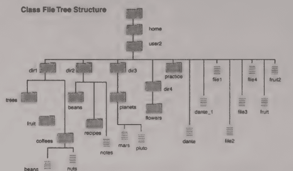

## 步骤 1. 登录 CDE

在 CDE 登录框中使用导师分配给你的用户名和密码登录。

### 步骤 2. 访问命令行

右键点击 Workspace（桌面）背景并点击 Tools（工具）。从菜单中选择 Terminal（终端）以打开终端窗口。

## 步骤 3. 复习 shell

shell 是用户与内核之间的接口。它充当解释器或翻译器的角色。换句话说，shell 接受你发出的命令，解释这些命令并执行相应的程序。shell 可以是命令行驱动的，也可以是图形化的。系统管理员在创建用户账户时决定哪种 shell 将作为用户的默认 shell。本实验将重点关注 Korn shell (`ksh`)，它是终端用户最广泛使用的 shell。你可以使用 `ps`（进程状态）命令查看你正在使用哪种 shell。

- **Bourne shell (`sh`)** - Bourne shell 是 UNIX 环境最初的 shell 程序。它是 Solaris 计算环境的默认 shell。Stephen Bourne 为 AT&T 的 System V.2 UNIX 环境开发了 Bourne shell。该 shell 不支持 alias（别名）或 history（历史）命令以及行编辑功能，主要供系统管理员使用。Bourne shell 的提示符是美元符号 (`$`)。
- **Korn shell (`ksh`)** - Korn shell 是 Bourne shell 的超集，由 Stephen Korn 在贝尔实验室开发。它具有了 Bourne shell 的许多功能，并添加了别名、历史记录和命令行编辑等功能。这是最广泛使用的 shell，也是系统用户的行业标准。Korn shell 的提示符也是美元符号 (`$`)。（注意：本中给出的示例主要基于 Korn shell。）
- **C shell (%)** - 基于 C 编程语言的 shell。像 Korn shell 一样，它具有别名和 it 等额外功能。C shell 由 Sun Microsystems 的 Bill Joy 开发，至今仍被广泛使用。C shell 的提示符是百分号 (`%`)。

根据前面的信息，填空以下句子中的空白：

- a. shell 充当用户与内核之间的解释器。
- b. 普通用户的默认 shell 是由 ____________ 决定的。
- c. 你可以通过执行 ______________ 命令来确定自己是哪种类型的 shell。
- d. ______________ 基于 C 编程语言，并由 Sun Microsystems 的 Bill Joy 开发。该 shell 使用百分号 (%) 作为提示符。
- e. ______________ shell 是最初的 shell，且不支持别名或历史记录？
- f. ______________ shell 使用美元符号 ($) 作为提示符，并支持别名、历史记录和命令行编辑。

## 步骤 4. 复习别名 (Aliases)

别名（alias）是一种为命令提供一个不同名称以便在 shell 中使用的方法。在运行 shell 命令时，别名是提高效率和生产力的绝佳方法。当从命令行设置时，别名仅在创建它的 shell 中激活。将别名添加到 `.kshrc` 文件中（在稍后的实验中介绍）将在登录时或每次打开新窗口或 shell 时激活它们。

```
alias name=value
```

在别名名称 (`aliasname`)、等号 (`=`) 和分配给别名的命令之间没有空格。对于带有选项、空格或其他特殊字符的命令，请使用单引号（示例如下）。

这里总结了使用别名的原因，并提供了一些创建别名的示例。此处显示的语法仅适用于 Korn shell：

- **用短命令代替长命令** - 你可以通过为常用的长命令创建别名，从而减少按键次数。

```
$ alias c=clear
```

- **为一系列命令创建单个命令** - 你可以将几条命令组合在一起，并为它们分配一个别名名称，以减少按键次数。

```
$ alias home='cd;ls
```

- **创建现有命令的替代形式** - 某些命令如 `rm`（删除）和 `cp`（复制）是危险的。通过别名可以为这些命令添加 `-i` 选项，以便在覆盖文件时提示用户。

```
alias copy='cp -i
```

根据前面的信息，填空以下句子中的空白：

- a. 别名是一种为 ________________ 提供不同名称以便在 shell 中使用的方法，并能提高效率。
- b. 当从命令行设置时，别名仅在创建它的 ________________ 中激活。
- c. 对于带有选项、空格或其他特殊字符的命令，使用 ________________。
- d. 在别名、等号 (=) 和分配给别名的命令之间没有 ________________。

## 步骤 5. 创建别名

- a. 创建名为 **h**（小写字母 h）的别名，用于替换 Korn shell 的 *history* 命令。你执行了什么命令？
- b. 尝试新的 **h** 别名。它有什么用？
- c. 创建一个名为 **p**（字母 p）的别名，可以一次屏幕地显示系统上运行的所有进程。你执行了什么命令？
- d. 尝试新的 p 别名。它有什么用？
- e. 创建名为 **mv** 的别名，用 `mv -i` 命令替换 `mv` 命令，以防止在移动文件时意外覆盖。你执行了什么命令？
- f. 尝试新的 mv 别名。首先将 dane 复制到练习目录，然后尝试使用 mv 别名将 dane 移动到练习目录。结果如何？

## 步骤 6. 显示别名

要显示别名，请使用无参数 `alias` 命令。单独使用 `alias` 命令将显示当前会话的所有别名。某些别名是 Korn shell 预定义的。

- a. 显示当前会话的所有别名。看到你之前创建的了吗？
- b. 使用 `alias` 命令并将输出传递到 `wc -l` 命令。这将统计 `alias` 命令输出的行数。从总数中减去你创建的。你的 Korn shell 预定义了多少其他别名？

## 步骤 7. 删除和跳过别名

你可以使用 `unalias` 命令取消之前定义的别名。这将删除你不再需要的别名，且该别名将不再出现在别名列表中。

```
unalias aliasname
```

- a. 删除或取消你之前定义的 h 别名。你执行了什么命令？
- b. 显示当前会话的所有别名。你看到 h 别名了吗？

# UNIX 实验指南基础

实验 14.2.5 – Korn Shell 特性

工作表 – 续接

你也可以临时跳过别名（alias）。要跳过别名并使用命令的原始版本，请在命令前使用反斜杠（`\rm file`）。例如，你可能设置了一个执行 `rm -i` 命令的 `rm` 别名，而你需要删除许多文件，且不想在每个文件上都收到提示。你可以跳过 `rm` 别名，这样当你使用 `rm` 命令时，它就不会带有交互式的 `-i` 选项执行。

- a. 使用跳过选项跳过你之前创建的 `mv` 别名，并使用 `mv` 命令的原始版本将 `dant` 文件从练习目录（practice directory）移动到你的主目录（home directory）。你是否收到了重写（overwriting）的提示？
- b. 在命令行中输入 `exit` 以关闭你的终端窗口，然后启动另一个新终端窗口。输入 `alias` 命令列出当前会话中定义的别名。你之前定义的任何别名现在那里吗？为什么在或为什么不在？

## 步骤 8：显示命令历史

历史（history）功能记录了在 Korn shell 中输入的命令。在 Korn shell 中，当用户首次进入 shell 时会自动设置历史。每当用户输入命令时，此函数就会将其记录在历史列表中。Korn shell 默认保留最后 16 条命令的记录。

```
history [options]
```

指定一个带有连字符的数字作为选项将显示该行数的行（例如，`-6` 将显示最后输入的六行命令）。指定一个不带连字符的数字将显示从该数字开始到最后一次输入的命令的历史行。

- a. 单独输入 `history` 命令。结果是什么？
- b. 使用 `-5` 选项显示历史的最后五行。最后显示的一行是什么？

## 步骤 9：重新执行命令

`r`（重新执行或重复）命令是 Korn shell 中许多预定义别名之一。它使用户能够从历史列表中重新执行命令。

```
r [argument(s)]
```

传递给 **r** 命令的参数是特定命令的历史行号，或者指示历史列表中以该字母开头的最近命令的字母。**r** 命令本身将重复最后一次输入的命令（`pwd`）。这类似于 DOS 中的 F3 键。

- a. 如前所述，**r** 命令是一个预定义的 Korn shell 别名。输入 **alias** 命令。检查别名列表，**r** 别名实际上执行的是什么命令？

如果你想了解更多关于 **fc** 命令的信息，可以输入什么命令？
- b. 在单独的命令行上逐个执行以下命令：**ls -l, banner HI, echo HI, clear, ls.**。现在输入 **history** 命令。识别你之前输入的某一个命令的命令号。该命令号和命令是什么？
- c. 使用 **r** 命令和历史行号重新执行该命令。你之前使用的命令重新执行了吗？
- d. 重复一个以字母 **a** 开头的之前的命令。在这种情况下，这将会重复 **alias** 命令。你使用了什么命令？

## 步骤 10：编辑命令行

内联编辑模式（inline edit mode）允许你通过使用偏好编辑器的按键，在当前命令行上编辑之前的命令。当你想要修改之前执行过的（有时很长的）命令行而不是重新输入它时，这很有帮助。启用后，此功能仅对当前 shell 有效。

```
set [-o] vi
```

使用 **set -o vi** 可开启命令行编辑并指定 vi 为你的偏好编辑器，而 **set +vi** 则将其关闭。一旦开启了编辑，按下 Esc 键即可激活内联编辑器。然后你就可以使用 vi 命令来遍历历史列表并修改之前执行的命令。下表显示了一些最常用的 vi 编辑命令。*注意：*在内联编辑期间不能使用方向键重新定位光标位置。

| vi 命令 | 含义 |
|---|---|
| k | 在历史列表中后移动 |
| j | 在历史列表中向前移动 |
| l | 向右移动一个字符 |
| h | 向左移动一个字符 |
| i | 插入字符 |
| r | 替换一个字符 |
| cw | 修改单词 |
| x | 删除一个字符 |

- a. 输入一个如 `more dir1/coffees/beans` 的命令，其中文件名 `beans` 拼写有误。按回车接收错误信息。
- b. 开启命令行编辑以便你可以编辑之前的命令行。按下 Esc 进入 vi 命令模式。按下 k 向上翻阅命令历史，直到找到包含错误的命令。
- c. 使用上表中的 vi 命令移动到命令中拼写错误的字符，并按 r 将 `d` 替换为字母 `s`。按回车执行命令。这次执行正确吗？
- d. 通过回溯和编辑之前的命令行，练习使用命令行编辑功能。

## 步骤 11：自定义你的 Shell 提示符

Korn shell 以 Bourne shell 为基础来构建其特性的。这些共享特性包括一个登录初始化文件和变量（用于自定义 shell 的信息占位符）。此外，Korn shell 还提供了别名（aliasing）、命令跟踪和命令行编辑，你到目前为止在实验中使用了这些功能。这些功能使用户能够更高的效率。用于存储这些信息的初始化文件是 `.kshrc`（Korn shell 运行控制）文件，存储在用户的主目录下。

Korn 的默认提示符是美元符号 (`$`)。用户可以使用 `PS1` 根据喜好自定义自己的 shell 提示符。

Korn 的默认提示符是美元符号 (`$`)。用户可以使用 `PS1` 根据喜好自定义自己的 shell 提示符。

此外，Korn shell 还提供了别名、命令跟踪和命令行编辑，你到目前为止在实验中使用了这些功能。这些功能使用户能够更高的效率。用于存储这些信息的初始化文件是 `.kshrc`（Korn shell 运行控制）文件，存储在用户的主目录下。

Korn 的默认提示符是美元符号 (`$`)。用户可以使用 `PS1` 根据喜好自定义自己的 shell 提示符。


Korn 的默认提示符是美元符号 (`$`)。用户可以使用 `PS1` 根据喜好自定义自己的 shell 提示符。

此外，Korn shell 还提供了别名、命令跟踪和命令行编辑，你到目前为止在实验中使用了这些功能。这些功能使用户能够更高的效率。用于存储这些信息的初始化文件是 `.kshrc`（Korn shell 运行控制）文件，存储在用户的主目录下。

`PS1` 可以包含宽范围的表达式，如字符字符串、命令或变量。尝试每一个这些：

```
$ PS1="Good morning $\$
```

这会将提示符赋值为字符字符串。

显示主机名 (`uname -n`)。这些反引号 (`' '`) 用于替换 `uname` 命令的输出，而不是将其字面解释。

```
$ PS1="$PWD "
```

提示将包含当前工作目录。双引号包围字符串并允许 `$PWD` 变量扩展，它跟踪当前工作目录。

## 步骤 12：删除实验中创建的文件和目录

删除你在实验期间在主目录下创建的所有文件和目录。

## 步骤 13：关闭终端窗口并注销

双击屏幕左上角的按钮，然后点击前面板上的退出图标。

## 可选练习

- 1. 为以下命令创建别名。决定你自己的名称。
  - a. 为 `ls -l` 命令创建别名。你使用了什么？
  - b. 为 `ls -F` 命令创建别名。你使用了什么？
  - c. 为 `more` 命令创建别名。你使用了什么？
- 2. 创建以下别名：
  - a. 创建名为 `bye` 的别名，执行 `exit` 命令。
  - b. 创建名为 `copy` 的别名，执行交互式 `copy` 命令。
  - c. 创建名为 `vi` 的别名，执行 `vi` 命令。
  - d. 创建名为 `calc` 的别名，执行后台运行计算器应用程序的命令。
- 3. 根据《Cisco 网络基础 UNIX 指南》，列出八种 Korn shell 特性。
- 4. 打开一个新终端窗口并启动 C shell。阅读《Cisco 网络基础 UNIX 学习指南》第 14 章，并练习自定义提示符、设置别名、重新执行命令以及命令行替换功能。
- 5. 从教科书中阅读“Shell Variables”部分到章节结束，尝试所有的命令和示例。你将使用 `set` 和 `unset` 命令，将 `PS1` 变量设置为 `"MyPrompt$\$"` 并将其导出，以及显示环境变量列表。
  - a. 本地变量和环境变量之间的区别是什么？
  - b. 要将仅在当前 shell 可用的本地变量转换为对所有 shell 都可见的环境变量，必须
  - c. `set` 命令用于显示本地变量，而 `export` 或 `env` 命令则显示所有环境变量。
  - d. 输入什么命令可以仅显示 HOME 变量的值（该变量存储了 `cd` [回车] 命令使用的主目录路径）？
  - e. 使用 `grep` 命令显示单个变量值的另一种方法是什么？

## 可选练习

继续
- c. `set` 命令用于显示本地变量，而 `export` 或 `env` 命令则显示所有环境变量。
- d. 输入什么命令可以仅显示 HOME 变量的值（该变量存储了 `cd` [回车] 命令使用的主目录路径）？
- e. 使用 `grep` 命令显示单个变量值的另一种方法是什么？

# UNIX 基础实验伴侣

实验 15.2.1 – 自定义 Korn Shell

（预计时间：45 分钟）

## 目标

- 培养对 Korn shell 自定义（customization）的理解
- 复习初始化文件、变量和命令
- 复习系统级初始化文件
- 复习用户特定的初始化文件
- 修改 `.kshrc` 文件
- 创建您的 `.kshrc` 文件
- 测试您自定义的初始化文件

## 背景

在本实验中，你将使用 UNIX 初始化文件来自定义你的 Korn shell 登录环境，并根据你的需求定制各种选项。在实验 14.2.5 中，你操作了别名（aliases）和自定义提示符（prompts），但这些设置仅对当前会话有效。当你关闭终端或注销时，自定义设置就会丢失。通过修改特定的初始化文件，这些以及其他功能可以在每次登录时自动生效。在本实验中，你将处理各种初始化文件，使这些更改在每次登录时生效。你还将复习系统级和用户特定的初始化文件及变量。

## 工具 / 准备

在开始实验之前，请复习思科网络学院课程：《UNIX 基础实验伴侣指南》第 15 章。

你需要：
- 由你的导师分配的登录用户 ID（例如 `user2`）和密码。
- 一台运行 UNIX 操作系统的计算机。
- 教室中安装了课程文件系统的联网计算机。

## 注意事项

# UNIX 基础实验伴侣

实验 15.2.1 – 自定义 Korn Shell

工作单

使用示例课程文件系统目录树图来辅助本实验。

# 课程文件树结构

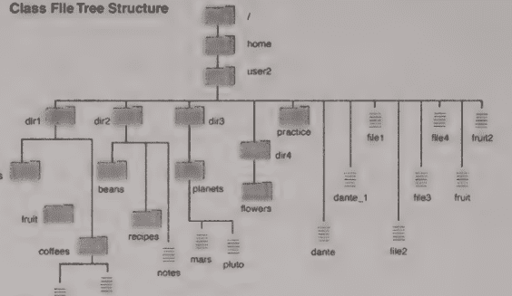

# 步骤 1 登录 CDE

在提供的 CDE 登录框中，使用导师分配给你的姓名和密码登录。

# 步骤 2 访问命令行

右键点击 Workspace（桌面）背景并点击 Tools（工具）。从菜单中选择 Terminal（终端）打开终端窗口。

# 步骤 3 复习初始化文件、变量和命令

初始化文件——初始化文件包含 shell 启动时执行的一系列命令和变量设置。这些文件不是可执行文件，但 shell 在用户登录时会读取它们以定制其环境。初始化文件分为两个层级。第一级是系统级的。系统初始化文件由系统管理员维护，并位于 `/etc` 目录下。第二级是用户特定的初始化文件，位于用户用户主目录下。Korn shell 有两个文件：`.profile` 和 `.kshrc`（Korn shell 控制）。这两个文件都以点（`.`）作为第一个字符，这意味着它们是隐藏文件。

变量——在上一个实验中，你操作了诸如 `PS1`（提示符字符串 1）之类的变量来自定义你的 Korn shell 提示符。由于这些是从命令行或在初始化文件中定义的，它们仅对当前 shell 有效。当该 shell 关闭时。通过本实验，你将编辑初始化文件并添加变量和命令，这些内容每次登录时都可用。变量要么是预定义的并在登录时自动设置，要么由用户（或系统管理员代表用户）设置。根据它们所在的初始化文件，它们可以仅适用于当前 shell（本地），也可以适用于所有 shell 和子 shell（全局）。用户可以通过将许多这些变量放在主目录的初始化文件中，为自己的环境进行自定义。为了使这些自定义生效于。

# UNIX 基础实验伴侣

实验 15.2.1 – 自定义 Korn Shell

工作单 – 继续

命令——与变量不同，命令（如别名）不能被导出（`export`）。如果命令要在子 shell 中可用，则必须放在它们所在的初始化文件中，例如 `.kshrc`。

使用上述信息，填空空白：
- a. 化文件的两个层级是：
- b. 用户特定的初始化文件位于用户的主目录下。
- c. 变量要么是预定义的并在登录时自动设置，要么由用户（或系统管理员代表用户）设置。
- d. 变量可以仅适用于当前 shell（本地）或适用于所有 shell 和子 shell（全局）。
- e. Korn shell 有两个文件：`.profile` 和 `.kshrc`。

# 步骤 4 复习系统级初始化文件

主要的系统级初始化文件是 `profile`，保留在 `/etc` 目录下。`/etc/profile` 文件在操作系统安装时默认创建，并由系统管理员编辑。当用户登录时，系统首先读取 `/etc/profile`，然后读取用户的 `.profile` 文件。

`/etc/profile` 执行多个功能，此处列出：
- 导出环境变量，例如 `LOGNAME`。
- 导出 `PATH` 变量的默认路径：默认路径是 shell 在执行命令时将查找的目录列表。

# UNIX 基础实验伴侣

实验 15.2.1 – 自定义 Korn Shell

工作单 – 继续
- 设置 `TERM` 变量默认类型：这定义了你工作站的屏幕和键盘特性。
- 显示 `/etc/motd` 文件内容：每日消息文件可以进行自定义，用以显示问候语或提供系统信息。
- 设置默认权限：设置新文件和目录的 `umask`。

# 步骤 5 复习用户特定的初始化文件

在读取了系统默认值的系统级初始化文件后，会读取 shell 的用户初始化文件。用户初始化文件为用户定制其环境提供了灵活性。登录初始化和定制可以通过单独使用系统级文件 `/etc/profile` 完成，也可以与用户特定的初始化文件结合使用。

用户初始化文件(s）`.profile` 和 `.shrc` 存储在用户的主目录下。`.kshrc` 文件是用于定制 Korn shell 用户环境的主要文件。

# UNIX 基础实验指南

实验 15.2.1 – 自定义 Korn Shell 工作单 – 续接

- 设置 `noclobber` – 防止在重定向时覆盖文件
- 设置命令路径 (`Set Command Path`) – 定义查找可执行文件的目录
- 定义自定义命令 (`Define Custom Commands`) – 如之前的实验所示，定义别名 (`aliases`)

根据上述信息，请填空下列句子中的空白：
- a. 在读取了系统级默认的 ____________________ 之后，将读取 shell 的 ____________________（配置/设置）。
- b. 登录初始化和定制可以使用系统级文件 `/etc/profile` 本身，或结合用户特定的初始化文件和 ____________________ 来完成。
- c. ____________________ 文件是用于自定义 Korn shell 用户环境的主要文件。
- d. 除外，`.kshrc` 初始化文件可用于如之前的实验所示定义 ____________________ 作为命令的替代品。

## 第 6 步：修改你的 .profile 文件

系统管理员在创建用户账户时会分配登录 shell。登录 shell 决定了在登录期间读取哪些初始化文件。Korn shell 使用两个用户特定的环境文件来设置用户环境：`~/.profile` 和 `~/.kshrc`。`~/.profile` 文件通常包含一次性的命令和变量定义。

当定义一个新的 Korn shell 用户时，会创建一个 `.profile` 文件的基础版本并将其放置在其主目录中。为了定制环境，用户需要修改 `.profile` 文件，并且必须如下所示定义 `ENV` 变量。`ENV` 变量定义了 `.kshrc` 文件的路径。这些命令通常被添加到 `.profile` 文件的末尾。它们通知系统在每次启动 Korn shell 时都读取该文件。此命令将环境变量指向 `$HOME` 目录下的 `.kshrc` 文件。`HOME` 是由系统定义的变量，是用户登录目录的绝对路径。

```bash
ENV=$HOME/.kshrc; export ENV
```

# UNIX 基础实验指南

实验 15.2.1 – 自定义 Korn Shell

工作单 – 续接

- a. 确认你正处于主目录，并使用 `ls -la`（列出包括隐藏文件在的所有文件——你可能需要将此命令通过给 `more` 命令）来确定 `.profile` 文件是否存在。大多数情况下，它在设置新用户账户时会自动创建（如果没有，你将需要创建）。`.profile` 文件的所有者是谁？你对该文件的权限是什么？你应该能够修改 `.profile` 文件的内容吗？注意此处的 `PATH` 变量。
- b. 使用 `more` 命令查看 `.profile` 的开头，它定义了系统在你执行命令时将查找的目录。`PATH` 变量被设置为什么？
- c. 该变量是否已导出 (`exported`) 以便在子 shell 中？
- d. `PATH` 变量定义中的路径由冒号 (`:`) 隔开。`/usr/bin` 是列出的路径之一吗？列出 `/usr/bin` 目录的内容并重定向到 `more` 命令。写下至少五个你熟悉的命令。
- e. 复制 `.profile` 文件以创建一个名为 `.profile.bak` 的备份。如果你犯了错误并需要备份，可以删除 `.profile` 并将 `.profile.bak` 重命名为 `.profile`。
- f. 使用 `vedit` 修改 `.profile` 文件。为了让系统感知 `.kshrc`，将上述所示的 `ENV` 和 `export` 命令在命令行添加到文件末尾，然后保存并退出 `vedit`。再次查看文件内容。你输入的命令存在吗？检查它们是否输入得正确。

## 第 7 步：创建你的 .kshrc 文件

Korn 命令和功能应该存放在 `.kshrc` (Korn shell 运行控制) 文件中。`.kshrc` 文件的内容通常包括：自定义的提示符、别名、shell 功能的激活以及自定义变量。

用户主目录下通常没有 `kshrc` 的基础版本，除非管理员放置了一个作为起点的模板。你必须创建一个，或者在某些情况下，你可以从其他用户那里复制现有的。

- a. 使用 `vedit` 创建一个新的 `.kshrc` 文件。你输入了什么命令？
- b. 如果你想保存更改并退出编辑器，你会使用哪条最后行的命令？
- c. 如果你想不保存任何更改的情况下退出编辑器，你会使用哪条最后行的命令？
- d. 将你的提示符设置为机器名称，后面跟着美元符号和一个空格。你输入了什么？*提示：参考 Cisco 网络学院计划第 14 章：UNIX 基础实验指南。*
- e. 设置激活 `vi` 编辑器以进行命令行编辑。你输入了什么？
- f. 创建一个名为 `h` 的别名作为 `history` 命令的快捷方式，以及另一个名为 `c` 的别名作为 `clear` 命令的快捷方式。
- g. 创建一个名为 `p` 的别名作为 `ps -ef | sort | more` 命令的快捷方式。你输入了什么命令？
- h. 创建一个名为 `cp` 的别名来替换普通的 `cp` 命令，如果你准备覆盖文件，它将进行交互提示。你输入了什么命令？
- i. 将更改保存到 `.kshrc` 文件并退出 `vi`。如果你想重新开始，可以在不保存更改的情况下退出。
- j. 将更改保存到 `.kshrc` 文件并退出 `vi`。

# UNIX 基础实验指南

实验 16.4.4 – 网络命令

（预计时间：45 分钟）

## 目标

- 开发对 UNIX 和 TCP/IP 网络命令的理解
- Ping 另一个 TCP/IP 主机
- Telnet 到另一台主机
- 远程登录另一台主机
- 从远程主机终止本地进程


- 使用 `login` 和 `pkill` 从挂挂的 CDE 会话中恢复
- 使用 `ftp` 从另一台主机检索文件
- 使用 `traceroute` 检查互联网路径（可选）

## 背景

在本次实验中，你将使用 UNIX 和传输控制协议/网协议（TCP/IP）网络命令。TCP/IP 为 UNIX 操作系统以及许多其他网络操作系统提供了网络连接支持。所有连接到互联网的主机都运行 TCP/IP 协议。可以使用多种网络命令来测试连通性，并连接到远程主机进行管理和故障排除。在本次实验中，你将使用 TCP/IP `ping` 故障排除工具、`telnet` 远程访问工具、文件传输协议 (`ftp`)、UNIX `login` 远程访问命令以及 `traceroute` 命令。

## 工具 / 准备

在开始实验之前，请复习思科网络学院课程——《UNIX 基础指南》第 16 章。

你需要：
- 你的教师分配的登录用户 ID（如 `user2`）和密码。
- 一台运行 UNIX 操作系统的计算机。
- 教室中安装了课程文件系统的联网计算机。

## 注意事项


# UNIX 基础实验指南

实验 16.4.4 – 网络命令

工作单

使用示例课程文件系统目录树图辅助完成实验。

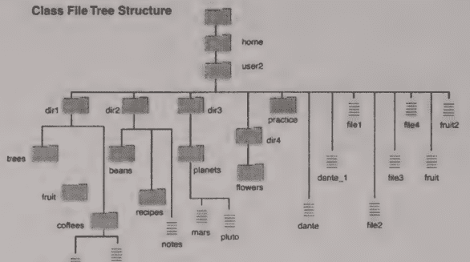

# 第 1 步。登录 CDE

在 CDE 输入框中输入教师分配给你的用户名和密码登录。

# 第 2 步。访问命令行

右键点击 Workspace 背景并点击 Tools（工具）。从菜单中选择 Terminal（终端）以打开终端窗口。

# 第 3 步。Ping 另一个 TCP/IP 主机

Ping（数据包分组程序）是基本 TCP/IP 协议包中的一个非常有用的工具，任何带有所有 TCP/IP 协议栈的 UNIX 系统都可以使用 `ping` 命令。

`ping` 命令是一个很好的底层故障排除工具，用于测试 OSI 第 1 到第 3 层。`ping` 命令通过向 TCP/IP 网络上的另一台计算机或主机发送 ICMP（互联网控制消息协议）回显请求来测试 TCP/IP 主机之间的基本连通性。如果目标主机有响应，你可以 `ping` 它作为基本的连通性测试。如果你无法在远程主机上运行应用程序，可以 `ping` 该计算机。如果没有得到响应，问题可能不在于应用程序，而是主机可能宕机或网络链路可能中断。*注意：*为了在 Solaris 中使用 `ping` 命令，你可能需要指定 `/usr/sbin/ping` 的完整路径。

任何运行 TCP/IP 协议的网络操作系统都可以发送和响应 ping。如果你有如域名系统服务（DNS）之类的命名服务，或者如果你在 `/etc/hosts` 文件中输入了主机名和 IP 地址，你就可以 `ping` 主机计算机的。如果没有，你可以直接 `ping` 主机的 IP 地址，因为这是一个更基础的连通性测试。

# UNIX 基础实验指南

实验 16.4.4 – 网络命令

工作单 – 续

IP 地址使用点十进制格式，例如 `172.16.238.15`。它是一个 32 位地址，分为四个部分，称为字节。每个字节由 8 位组成。为了可读性，它们没有直接显示 8 个二进制值（0 或 1），因为那些很难记忆，而是转换为十进制。每个字节的值可以是 0 到 255 之间的十进制，共有 256 种可能的组合（8 的次方）。

```
host_ip_address
```

或者

```
host_name (如果可用名称解析)
```

- a. 如果你在教室里有一台服务器，请从教师处获取 IP 地址并 ping 服务器的 IP 地址。你使用了什么命令？
- b. 响应是什么？
- c. 获取你的实验伙伴之一的 IP 地址并使用 `ping` 命令测试两台机器之间的连通性。`ping` 包完成路径必须经过哪些设备？
- d. 名称解析通过使用名称服务器或你计算机上的主机将主机转换为 IP 地址。如果名称解析可用，通过主机名 ping 你的实验伙伴机器的名字。你使用了什么命令？响应是什么？

# 第 4 步。Telnet 到另一台主机

Telnet 是一种客户端-服务器仿真程序，允许你连接到另一个系统。`telnet` 服务器提供终端，以便授权用户或 `telnet` 客户端连接到远程系统并在环境中工作。当你 `telnet` 到另一台主机时，系统会提示你输入远程系统的账户名称和密码。会话建立后，你输入的命令就像直接在控制台上输入的一样。你可以 `telnet` 到不同的主机，并打开多个 `telnet` 会话。

`telnet` 到另一台主机在以下情况下很有帮助：
- 访问另一台工作站的信息。
- 邮件。
- 杀死导致另一个用户工作站挂起的进程。

# UNIX 基础指南

实验 16.4.4 – 网络命令

工作单 – 续

Telnet 也被用网络故障排除工具。它是一种非图形化的通信工具，用于检查 OSI 模型的高层。它运行在第 7 层，即应用层。如果你在执行另一个应用程序时遇到困难，可以尝试 `telnet` 到主机或服务器以验证 TCP/IP 协议栈是否正常运行。记住，并不是所有的网络操作系统都支持 `telnet` 服务。例如，你可以从 Windows 9x 或 NT/2000 工作站 `telnet` 到 UNIX 服务器，但无法 `telnet` 到 Windows 工作站。

如果你有如 DNS 之类的命名服务，或者如果你在 `/etc/hosts` 文件中输入了主机名和 IP 地址，你就可以 `telnet` 主机。如果没有，你可以 `telnet` 主机的 IP 地址。使用 `telnet` 时，你可以执行：
- 在远程机器上打开会话。
- 在远程会话和本地会话之间切换。
- 在 UNIX 环境下访问。

```
telnet host_ip_address (hostname)
```

- a. 如果教室里有一台 UNIX 服务器（如果没有，请执行练习“d”），`telnet` 服务器的 IP 地址。你使用了什么命令？响应是什么：________________________________
- b. 什么命令显示你当前远程登录的系统名称？________________________________
- c. 输入 `exit` 或 `Ctrl-D` 终止 `telnet` 会话并返回本地系统。
- d. 现在使用你的用户 ID 或客账户（如果已创建）`telnet` 到你实验伙伴的系统。现在作为连接到另一个系统的远程终端时，你的提示符（prompt）是什么？________________________________
- e. 什么命令显示你当前远程登录的系统名称？________________________________
- f. 输入一些 UNIX 命令，如 `ls`、`id` 和 `pwd`，查看你在远程机器上处于哪个目录。你在哪个目录？________________________________
- g. 输入一个命令并尝试退格键（Backspace）。它有效吗？________________________________你可做什么让退格键生效？提示：请参阅思科网络学院课程——《UNIX 基础指南》第 1 章。

# UNIX 实验指南之基础

实验 16.4.4 – 网络命令

工作单 – 持续

h. 终止你到远程主机的 `telnet` 会话。响应是什么？

## 第 5 步远程登录到另一台主机

使用 `login` 命令在另一个 UNIX 主机上建立远程登录会话，该可以是服务器或工作站。在以下情况下，远程登录到另一个主机非常有帮助：
- 访问另一台工作站上的信息。
- 远程访问你的工作站以读取邮件。
- 杀死导致你或其他用户工作站挂起的进程。

只要你知道用户名和密码，你就可以登录任何 UNIX 系统。你可能在多个系统上拥有同名的账户，这允许你使用相同的账户名登录到另一个系统。

使用 `-l` 选项为远程登录会话指定不同的登录 ID。系统管理员可以设置来宾账户，以便用户能够远程登录服务器。在尝试作为不同用户远程登录到另一个系统之前，请确保你在目标远程机器上有一个账户。

```
login hostname -l username
```

- a. 如果你在教室里有一台 UNIX 服务器，请登录到服务器的主机名或 IP 地址。如果没有教室服务器，请登录到你伙伴的系统。响应是什么？
- b. 执行 `id` 命令。显示的用户 ID (`user id`) 是什么？
- c. 执行 `uname -n` 命令。结果是什么？
- d. 执行 `pwd` 命令。结果是什么？
- e. 在命令提示符输入 `exit` 或 `Ctrl-d` 终止到远程主机的登录会话。响应是什么？

## 第 6 步从远程主机终止本地进程

有时，你可能会启动一个进程（应用程序或命令行），导致系统锁死，此时你的键盘和鼠标无法工作，且无法打开终端（Terminal）来杀死该进程。在这种情况下，最好尝试从另一个系统登录或 `telnet` 到你的电脑，并在重启系统之前杀死问题进程。在成功杀死导致系统无响应的进程后，输入 `exit` 结束远程会话并返回你的系统。

如果你无法识别锁定系统的问题进程，请使用 `pkill -9 ksh` 命令（如果你的登录 shell 是 C shell 程序，则使用 `csh`）。这将终止你你系统上（包括 CDE）的登录会话并返回到 CDE 登录管理器（Login Manager）。

接下来的练习你将与伙伴合作完成。在第一个人完成步骤 a 到 e 之后，第二个人再完成相同的步骤。
- a. 启动 Clock（时钟）应用程序使其在屏幕上可见。
- b. 离开你的机器，与伙伴合作，从他们的机器以你的身份登录到你的机器。执行 `pwd` 命令验证你是否处于主目录。
- c. 终止 Clock 应用程序的进程。结果是什么？
- d. 保持远程登录到你的系统，并像系统无响应一样终止你的登录会话。你的系统返回到 CDE 登录管理器了吗？
- e. 返回你的系统并重新登录。

## 第 7 步使用 ftp 从另一台主机检索文件

文件传输协议 (`ftp`) 应用程序是 TCP/IP 协议族的一部分，是 UNIX 操作系统的标准配置。它可以使用 ASCII（用于文本文件）或二进制（用于所有其他类型的文件）模式，在使用相似或不同操作系统的系统之间传输文件。这提供了从一个文件系统传输到另一个文件系统的基本方法。记住，如果你使用默认的 ASCII（文本）模式传输二进制文件，复制的文件将无法使用。

大多数运行带有下载文件网站服务器的计算机有时会提供匿名 `ftp` 账户，用户可以从服务器获取文件。对于此类账户，在 Name 提示符处，输入 `anonymous` 单词而不是替换默认地址。如果匿名账户需要密码，它通常是你的完整电子邮件地址。

```
ftp host_ip_address
```

或者

```
ftp host_name (如果可用域名解析支持)
```

在成功使用 `ftp` 访问远程主机后，可以使用一些熟悉的文件和目录访问命令，例如 `cd` 和 `ls`。
- a. 使用 `ftp` 命令通过 IP 地址连接到教室服务器或你实验伙伴的系统。如果可用域名解析支持，你可以使用机器名。响应是什么？
- b. 如果你打算 `ftp` 的机器上有一个账户，你的登录名将自动作为账户名输入，系统会提示你输入密码。如果你在远程系统上没有账户名，系统会提示你输入登录名。输入远程系统上已知的账户名或 `anonymous` 作为登录名，并输入密码。
- c. 现在你的提示符是什么？
- d. 要查看可用的 `ftp` 命令列表，在 `ftp>` 提示符处输入 `?`。有哪些可用的 `ftp` 命令？
- e. 输入命令确定远程系统上的当前默认目录是什么。当前目录是什么？
- f. 如果站点管理员设置了允许用户查看目录内容，`ls` 命令将显示该目录中的文件。输入 `ls` 命令获取文件列表。识别一个要复制到你机器的文件及其文件类型。它是文本文件还是其他类型的文件（二进制）？
- g. 你使用什么命令来确定文件类型？
- h. 当你从远程系统复制文件 (`get`) 时，它被放置在本地系统的当前目录。当你将文件复制 (`put`) 到远程系统时，它被放置在远程系统的当前目录。使用 `cd` 命令切换远程目录，使用 `lcd`（本地切换目录）命令切换本地目录。追踪路径使用什么命令？
- i. 使用 `get` 命令从远程系统检索文件。根据文件类型设置模式。如果文件不是文本文件，需要做什么？
- j. 如果你有权限，使用 `put` 命令将文件复制到远程主机。
- l. 如果你设置了二进制模式但现在想复制文本文件，使用哪种 `ftp` 命令设置传输模式为 ASCII？
- m. 结束 `ftp` 会话并返回 shell 提示符。使用了什么 `ftp` 命令？
- n. 验证从远程系统复制的文件位于你的主目录。

## 第 8 步删除实验创建的文件和目录

删除主目录中创建的所有文件和目录。

## 第 9 步关闭终端窗口并注销

双击屏幕左上角的按钮，然后点击面板上的退出图标。

## 可选练习

- 1. 使用 `traceroute` 命令检查路径。`traceroute` 命令可以追踪数据包从你的主机到另一个互联网主机的路径。它检查数据包经过的路由器，这些路由器被称为跳（hops）。`traceroute` 命令运行在 OSI 第三层（网络层），并报告路由器遇到的情况。如果数据包未到达目的地，你可以确定哪个路由器阻止了它。根据你的防火墙设置，你可能无法接收 `traceroute` 命令的结果。有关 `traceroute` 命令的更多信息请查看手册页。

```
traceroute IP address
```

或者

```
traceroute hostname (例如，www.sun.com；如果可用域名解析支持:)
www.sun.com. 结果是什么？
```

- 2. 为了使用 `ping` 命令，在 Solaris 系统上必须输入完整路径名 `/usr/bin/ping`。你可以对 `.profile` 文件进行什么修改，以便直接输入 `ping` 而无需 `/usr/sbin/`？
- 3. 使用 `mput`（批量发送）和 `mget`（批量获取）命令练习在系统与远程系统之间 `ftp` 传输。更多信息请参见手册页。
- 4. `telnet` 和 `login` 命令在功能上是相同的。`telnet` 到伙伴的系统并执行一系列命令。然后登录到你伙伴的系统并执行相同的命令。这两个命令之间的主要区别是什么？

## 笔记

# 思科网络学院计划：

UNIX 基础

实验指南

《UNIX 基础》副标题

ISBN: 1-58713-044-0

通用网络技术类书籍

ISBN: 1-58720-045-7

ISBN: 1-58705-001-3

本书是思科网络学院计划系列丛的一部分。该系列产品支持并补充了思科网络学院计划。

ISBN 1-58713-045-9

ciscopress.com
