# 云计算：Linux 和 Android 平台的创新技术

**作者：**

Dr. S Anandmurugan  
Kongu Engineering College, Perundurai, Tamil Nadu

Ms. T. Priyaa  
Kongu Engineering College, Perundurai, Tamil Nadu

Mr. M.C. Arvind Babu  
Wipro Technologies, Chennai, Tamil Nadu

# 献给

我的妻子 S. Renukadevi 博士和我的儿子 A. Shrikarthhick 小士  
—Dr. S. ANANDAMURUGAN

我的丈夫 V. Ramesh 博士和我的儿子 R. Kiruthik Varshan 小士  
—Ms. T. PRIYAA

我的父亲 M.S. Chandrasekar 和我的母亲 M. C. Jeyanthi  
以及我的导师 Mrs. Premal Panneiselvam  
—Mr. C. ARVID BAB

# 前言

云计算是当今快速发展的信息技术（IT）行业中的一个热词。这项技术为整个业务社区和普通终端用户在整个 IT 开发和服务领域提供了一个全新的维度和极大的灵活性。在流行的不到十年的时间里，云计算在计算机平台上引发了一场巨大的革命。

所有即将出现的技术都与云平台步调一致。在未来几年里，云本身可以经历几层演进，以便在所有可能的场景下变得更加用户友好。云计算不再是一个未来或即将到来的术语，它现在几乎是一个真正的现实。一种基于客户端-服务器模型场景的基础互联网技术已转化为高效强大的动态虚拟云技术。云计算在未来几年内可以进一步对所有现有平台进行许多动态更改，终结所有的传统做法。

由于行业需要新技术来适应动态的工作文化并向客户提供强大的输出，年轻的技术人员和智能工程师也需要意识到所有新技术平台。因此，本书被编写成一本关于云计算的信息量丰富且具有创新的书籍，引入了可能的信息以满足所有类型读者的需求。书中几乎每个章节都展示了所有可能的稀有信息。除了云之外，书中还给予了 `Linux` 技术足够的重视，它是任何实时云项目的重要发射平台。`Linux` 无疑是一个全新的操作系统世界，专门用于以高度安全的方式进行所有网络及相关操作。

由于我们生活在极不安全且黑客横行的时代，`Linux` 正是每个应用程序的明智选择。通过云和 `Linux`，对 `Android` 技术进行了深入讨论。正如我们所知的，在智能技术设备移动设备时代，`Android` 几乎取代了传统的基于台式机的工作，转向无尽的移动应用。`Android` 为手机的使用定义了新的意义。今天，`Android` 应用程序开发已简单地对齐云技术。所有的 `Android` 应用都设计为支持云平台上的终端用户。

本书旨在满足基础读者和行业专家的需求与期望。它的呈现方式也满足了每一个动态 IT 行业的需求。学生、教师、学者、研究人员、技术专家，甚至是一个对计算技术中许多事情不了解的基础读者都可以使用本书。该主题以非常简单、精确且具有良好深度的方式呈现，涵盖了关于云技术及其所有支持平台的共同常识和创新事实的所有角落。

本书总共十四章，每章都从非常基础的点介绍到概念最先进的场景。它包含了十个关于云技术和 `Linux` 平台的章节，三个关于使用云平台的 `Android` 技术的章节，最后一章包含了五个案例研究，其中包括实际执行的项目。在整书中，讨论了许多基于云的工具和软件，并对一些印度本土的技术专家以及政府资助的云工具和项目进行了重要说明。如果该学科的学生和教师能从中受益，这种努力将是有成效的。随时欢迎对本书主题的任何建议。

—作者

# 致谢

首先，我们对 Kongu Engineering College 的主任 Thiru. V.K. Muthusamy 表示诚挚的感谢，感谢他为我们提供了开展这项工作的所有必要设施。

我们对 S. Kuppus 教授提供的强力支持表示极表感激。

# 云计算导论

## 1.1 概述

`云计算` 将大量的计算机服务器和其他资源汇集，并通常按需提供这些组合容量。`云计算` 网络的终端用户通常不知道服务器的物理位置在哪里，也不知道应用程序在何处执行或数据存储在何处；他们只需要启动应用程序并开始工作。

`云计算` 通过虚拟化技术和虚拟化设备完全实现。虚拟化设备是一个应用程序，它封装了运行所需的所有组件，并具有精简的操作。在 `云计算` 环境中，可以根据需要即时配置和拆除虚拟化设备，而无需对操作系统环境进行复杂的配置。

`云计算` 环境以较低的成本提供了计算资源的极佳灵活性和可用性。这项新兴技术为不同学科的电子服务开启了新纪元。今天，`云计算` 已成为 IT 领域的流行语，所有主要公司都在向这一技术迈进。早期采用这项技术的公司包括亚马逊、谷歌和微软。得益于互联网革命和 `Android` 系统，云的使用变得越来越简单、越发快速，且对用户更加友好。随着云革命，典型的 `Web` 技术正在向云平台演进。人们经常会对 `Web` 应用程序和动态云应用感到困惑。我们将在第 2 章第 2.7 节中查看它们的区别。因此，`Web` 2.0 的进步被视为 `云计算`。

`云计算` 为传统的客户端-服务器模式的互联网使用赋予了新的意义。对于供应商来说，`云计算` 更多是一种面向服务的技术，而不是专用技术。今天，所有企业 IT 公司都在转向这一技术，为业务世界带来了新的维度，即从对传统位置和工作空间的依赖变为现在的独立。企业 IT 公司从云中获得了许多优势。因此，所有公司都设计、开发并管理着自己的云，并与许多其他跨国公司（MNCs）建立了多次合作。

`img/8d09b92c1e10775c0b9a48c126969155_18_0.png`

图 1.1 典型的云。

## 1.2 云

`云计算` 是一种完全基于互联网使用的技术。`云计算` 的历史可以追溯到 1950 年，但其主要革命始于 2007 年底。随着 2008 年 `Android` 革命和 2009 年平板电脑的发展，云无疑被视为一种满足商业世界和终端用户需求的新网络技术。典型的云通过 `Web` 浏览器访问，类似于从浏览器访问我们的电子邮件。云技术旨在为终端用户提供服务。目前，每天都有云供应商进入市场。每个供应商都为终端和商业世界提供新功能。设计的每一个硬件产品都符合云技术和先进的网络技术。

云技术与 `Linux` 平台相关。由于 `Linux` 主要用于网络应用程序和服务器操作，`Linux` 完全支持 `云计算` 的所有概念和虚拟化技术。许多公司与 `Linux` 平台合作，并开发在这些平台上运行的工具。今天，`Linux` 被视为可以支持许多其他虚拟工具和软件的最佳平台。`Linux` 操作系统的服务器版本最适合所有的网络和高级计算技术。

截至 2013 年，`云计算` 正转向被称为移动计算云的移动 `Android` 系统。随着 `Android` 系统的革命，云的下一个目标是移动云技术。手机和平板电脑中的智能技术为它们从 `Windows` 平台的使用赋予了新的维度。数百万移动应用程序的设计是为了满足终端用户。这些应用程序与云技术相协调。应用程序可以轻松地连接到远程云服务器并完成所有用户任务。

### 1.2.1 云计算的历史

世界上的一切万物都有过去，在开始时没有什么能像今天这样。让我们在本节中使用 `云计算` 的整体历史。云技术的演进可以追溯到 1950 年代，当时资源共享的概念得以实现。互联网技术处于初始阶段。那个年代的计算机是一台巨大的机器，非常复杂，远没有今天这样先进。计算机技术的每项发明都改变了计算机的功能方式，并增加了其在终端用户中的应用。网络技术进一步使计算机技术增长得更快，使其成为通信目的的智能超级体并处理所有实时事务。

#### 1950 年的主机机

资源共享的概念可以追溯到 1950 年，当时企业内部发生了一场主机机革命。大型主机机被安装在一个特定的房间里，用户从那里共享数据存储和 `CPU` 功率。因此这是资源共享的首次实例。从这里，共享的概念诞生了。

#### 1970 年的 IBM

1970 年，`IBM` 开发了一种名为 `VM` 的操作系统，它可以运行多个带有客体操作系统的虚拟机。虚拟机可以定义为在同一块硬件上运行的几个操作系统，用户在其中工作时就像一次只运行了一个操作系统一样。它的目的是利用对昂贵主机计算机的投资。这一想法是允许多任务处理，同时为不同的用户运行多个应用程序和进程。因此，硬件虚拟化技术随之产生，多个虚拟机在同一个平台上运行。每个 `VM` 都可以带有内存、处理和网络技术运行客体操作系统。`IBM` 也是计算机硬件和网络技术的早期领导者。

#### 1990 年代的通信革命

90 年代初，电信公司开启了互联网的革命和通信领域基础设施的增长。用户连接到虚拟化的私有网络连接，这种连接提供了与专用对点连接相同的服务。因此，互联网革命已经开始，流量增加了无限倍。互联网本身经历了几层的进步和变化。`Web` 世界万维网（`WWW`）是 `Web` 技术革命的开始，也是在计算机技术里程碑上对人类服务的开始。`OSI` 层概念被制定为网络技术的标准。

电子邮件的概念由社会的几个部门实现。因此，互联网的增长处于全面革命中，计算机技术从传统方法的迁移也发生在这一时期。到 2000 年初，超级通信互联网已准备好接触终端用户。许多硬件设备被引入市场。每一种都有其特定的功能，使得终端用户的任务变得非常简单。大公司开始制造在尺寸、计算和终端用户任务效率方面先进的计算机。计算机的形状在 90 年代末的技术革命中也发生了重大变化。在 2000 年代后期，更便携的笔记本电脑开始取代台式机。

#### 2000 年代初及其影响

`云计算` 的概念开始出现。`Web` 2.0 的概念在 `Web` 技术革命中达到了顶峰。互联网的概念现在更加现实，成为随处可见的常见技术。在互联网革命的最初几年里，搜索引擎成为人们的主要用途。到 2003 年，更多的网页被添加到互联网技术池中。更多的企业 IT 公司涌现以解决终端用户任务。互联网成为一种常见的通信方式，每个组织的托管成为那个时代的时尚。由于市场中黑客和入侵者数量的增加，互联网的标准化也很大程度上实现了。因此的治理

互联网监控随着互联网管理中采用的一系列定义良好的协议而出现。互联网已成为一个巨大的海洋，将遥远地区的人连接在一起，并为终端用户提供服务。

随着 `Web` 2.0 的革命及其在终端用户的应用，互联网技术让生活变得如此先进。在线营销与广告、直播、博客等构成了 `Web` 2.0 的基础。在 2008 年后期，通过手移动设备访问互联网使这项技术变得易于使用且先进。传统的客户端-服务器模型被动态且异构的分布式计算技术所取代。分布式技术结合虚拟化催生了新 `云计算` 技术的时代的诞生。

面向服务的云技术在 2007 年引发了全面革命，多种开源云工具被引入市场。市场上也见证了许多云供应商的增长，以满足终端用户的需求。在 2000 年代初，`Windows` 操作系统是许多机器的共同配置。`Windows` 操作系统也经历了许多变化，并发布了新版本。由于对 `Windows` 操作系统安全性的担忧，开源 `Linux` 平台也在同步增长。

`云计算` 支持所有形式的操作系统。`Linux` 操作系统如 `Redhat`、`Fedora`、`Centos`、`Ubuntu` 等与 `云计算` 紧密合作，并支持所有云工具。自 2010 年以来，所有版本的高级 `Linux` 都是为支持 `云计算` 而设计的。`Linux` 平台与开源云工具的结合产生了基于新云的操作系统。其中一些 `Ubuntu` 和 `Eucalyptus` 云的结合在 2011 年诞生了 `Ubuntu` 企业云。2012 年，`Ubuntu` 与 `Openstack` 云结合开发了许多云平台和软件。在 `Windows` 平台上，2009 年的 `Windows` OS 7 和 2012 年的 `Windows` OS 8 被设计用于支持不断增长的网络技术。

今天，数百万个应用程序旨在满足终端用户。对于每一个功能，都有正在开发的移动 `App` 托管在 `Android` Web 市场，用户可以轻松地下载、安装并快速使用它们。今天的云技术是非常易于使用的，因为它是平台无关的。截至 2013 年，所有主要的 IT 公司都在转向云技术，以满足业务处理单元和终端用户的需求。

## 1.3 计算技术列表

在上一节中，我们看到了 `云计算` 的历史以及云技术进步的革命。现在，我们详细查看 `云计算` 从现代计算机中各种先驱计算技术的演变。`云计算` 演变自过去的各种计算技术。每种技术都改变了计算机及其应用的功能。每种技术都有优缺点。每种先驱技术在其时代成熟并流行。云共享了每种技术的属性并与之紧密相关。因此，云可以描述为所有以前技术的结合，并带有某些增强或消除以有效提高其使用的特征。先驱技术包括：

- 客户端-服务器模型——它是基础计算模型之一，也是常用的。随着互联网的增长，传统的客户端-服务器技术运而生。典型用户在客户端机器上查看前端，后端服务器机器主要包括数据库存储。它是网络概念的基础，并导致了其他高级计算技术的演变。该技术的一个很好的例子是早期阶段。这种技术的缺点是服务器饱和，导致由于高数据流量引起后端服务器崩溃，并且更容易受到黑客的攻击。

- 主机技术——这些是在办公室和其他业务组织中执行大量工作的大型计算机。`IBM` 主机为该平台带来了革命。今天，大多数主机是来自 `IBM` 开发的机器，它们经历了几个层次的进步，包括虚拟化概念，这是 `云计算` 的一项原则。现代主机可以同时运行多个操作系统的实例。这种虚拟机技术允许应用程序运行就像运行在物理机器上一样。主机技术用于大型研究实验室和高处理业务单元进行关键处理。缺点包括成本高、体积大和产生更多垃圾。

- 并行计算——处理器的进步导致了任务的并行处理。在并行计算中，大任务被分成较小的任务并并发解决。并行计算有几种形式，如任务级、指令级、数据级和位级。今天，所有的处理器都是为满足并行计算技术而设计的。它在计算机硬件设计上发生了巨大的革命。

- 分布式计算——它是网络中的组件，通过通信来实现共同目标。分布式系统的最佳例子是存根（`stub`）和骨架（`skeleton`）之间的远程过程调用（`RPC`），消息在两个系统的通信过程中进行封装和解包。分布式系统的另一个例子是文件系统，它是分布式的，以便于迁移到网络中的各种系统。

并发、并行计算和分布式计算这些术语的含义非常相似。并行计算可以被看作分布式计算的一种特定的紧耦合形式，而分布式计算可以被看作并行计算的一种松耦合形式。分布式计算的主要目标涉及资源的迁移、定位和复制。资源的迁移通过虚拟化概念进行。它们也具有高度扩展性。分布式技术的架构是二层或三层甚至多层，每层都有特定的功能。互联网和万维网（`WWW`）上的大多数应用程序都是分布式的。它使网络应用发生了重大转变。分布式系统是健壮的，并对过程中的任何故障具有容错性。分布式技术在 `云计算` 中起着重要作用。

- 集群计算——集群可以使用局域网（`LAN`）将计算机组合来实现用户的任务。计算机集群可以是连接两个计算机的简单双节点系统，也可以是超级计算机。该技术的最终目标是根据资源的可扩展性和需求提供高性能交付。消息传递和数据共享的概念是网络领域的另一个重要方面。

- 实用计算——共享 `云计算` 大多数特征的完美先驱技术是实用计算。实用计算涉及按计量方式租赁资源。资源包括数据、存储和计算服务。`云计算` 建立在按需付费场景的基础上。实用计算是面向服务的架构。它涉及分布式和虚拟化概念，通过这些概念为用户提供资源。`IBM`、`HP` 和微软是实用计算领域的早期供应商，其业务部门和研究人员致力于技术的架构、支付和开发。`Google`、亚马逊等开始领先，他们建立了自己的计算、存储和应用实用型服务。

- 网格计算——它可以被定义为所有系统相互作用以实现用户目标的分布式系统。它可以被认为是并行计算的一种特殊形式。网格往往是更松耦合、异构且地理位置分散的。网格通常使用中间件软件库构建。海量并行 `CPU` 容量的潜力是网格最具吸引力的特征之一。除了纯科学需求外，计算能力正在推动生物医学领域、金融建模、石油勘探、电影动画等行业的的新演进。网格被用于 `NASA` 等大型研究实验室和其他高计算项目以服务人类。它们被通俗地称为超级虚拟计算机。作业调度是

网格技术的一个常见示例。`Globus` 工具包是建立网格环境并分析其特性的常用软件工具包。网格应用程序是利用网格基础设施特定特定应用程序。

- 边缘计算 – 它与网格计算密切相关。它可以定义为将计算、内存、数据、存储和应用程序等服务从网络的中心位置推向网络的边缘节点。边缘计算有助于在分布式环境中复制信息。在拓扑结构上，边缘计算也分别称为网状计算（`mesh computing`）、点对点计算（`peer-to-peer computing`）、自愈计算和网格计算。

- 绿色计算 – 它是计算机技术的进步，使其更加环保。其目标包括减少有害材料的使用、在产品寿命期间实现效率最大化，以及促进废弃产品和工厂废料的可回收性或生物降解性。虚拟化概念是绿色计算的一种。环保意识正在各地更快地传播，因此绿色计算被视为我们计算机领域的当时之需。所有企业 IT 公司都将其部分利润投入到公司内外的环保措施中。

## 1.4 云计算的变革与成熟

在上一节中，我们看到了 `云计算` 从各种计算技术列表中出现出来。云源于这些技术，其特征与其中每种技术都密切相关。简单来说，我们可以说今天的云无非各种前身技术的结合。在这一节中，我们看到了云的成熟，以及这项技术如何成为每个终端用户的成功故事。技术的成熟度是指人们对它的认知程度，最终导致了它的使用。人们分析一项新技术与现有技术相比有多么高效和先进。如果不教人们如何使用这些技术，技术往往会失败。如果技术不符合用户习惯，或者在其核心功能上存在主要漏洞，它在某些其他额外的新功能面前就会在人们中失去光芒。

每种计算技术都必须应用于企业 IT 部门。成熟的概念本质上也是增增的。在 2-3 年的跨度内，相同的技术通过逐步推进的方法提供更高版本，以满足终端用户和商业界的需求。通常，一项技术需要一些时间才能达到完全成熟。增量方法是技术能够长期生存的最佳方式。如果一项技术在单一阶段内完全引入，如果它不能满足终端用户和商业社区，它将被完全拒绝并失去其最终目标。技术的成熟也标志着它在人们中全面变革并使其流行。商业界转向新技术，所有之前的工作都转换到新的技术工作空间。未来的工作在新的技术环境中进行。

### 1.4.1 2000 年代早期中期


在 2000 年代早期，云因其减少资本支出的能力而受到赞誉。云应用程序的实施、维护和升级成本更低。由于这些应用程序没有绑定到昂贵的硬件，并且定期更新，它们使 IT 团队解放了每年花费数十万美元用于维护和升级费用。因此，对于云的最早采用者来说，价格是价值主张的核心组成部分。

尽管那时云已经提供了很多，但由于其他领域的缺陷，买家通常将节省成本视为主要的利益。与任何新技术一样，通用知识的缺乏导致了误解，在某些情况下，人们只是不适应改变。但是，技术障碍如停机、无法定制产品、缺乏与本地软件的功能对等以及缓慢的时间都阻碍了云体验。

# 2000 年中期 - 2010 年

到 2000 年中期，关于云的对话发生了巨大变化，企业 IT 公司的知识和接触也随之改变。价值主张从纯粹的节省成本演变为，尽管这些在很大程度上仍赋予用户从任何地方访问数据的能力。此时，云不仅节省了大量的资金，而且实际上能够改变人们工作的方式。它深受业务处理单元的喜爱。在此期间的几次重大进展帮助极大地改变了价值主张。高速互联网的可用性和无处不在，以及 `Wifi` 等通信设备的革命。移动设备的演变让从任何地方工作成为可能，而云使其成为了现实。安卓技术革命开始影响更多人接触先进的计算技术。在云中，用户可以轻松从他们的笔记本电脑、智能手机、平板电脑或台电脑访问数据。硬件让位于软件之后。更多的云供应商进入市场。面向服务的云被深度分析以解决终端问题。

到 2000 年末，关于云的对话已从战术转向战略。云正从一种仅限理论导向的技术变成一种越来越基于实时的概念。它的重要性和需求得到了行业和用户的认可。

### 2010 年至今

今天，云的价值主张源于将不同的应用程序连接起来，形成一个无缝连接的 IT 网格。在 `100%` 的网络环境中，数十个应用程序的 API 可以集成，允许数据跨系统流动。

2000 年代后期手持设备的兴起互联网的无处不在导致了为了满足 `Salesforce.com` `App` `Exchange` 等市场非常特定需求的 `SaaS`（软件即服务）应用程序的泛滥。`Google` `Apps` `Marketplace` 甚至出现以支持这一增长的生态系统。虽然这些应用程序实现了它们的原始用途并为其终端用户带来了效率，但单个应用程序的

## 云计算简介

在一家组织的不同部门和设备上安装和使用的应用程序数量变得对 IT 部门而言不可管理且具有风险。通过使用不同应用程序的 API，公司可以跨部门集成和共享数据。云在这个时代的价值主张是显而易见的，因为它允许不同的应用程序相互通信，从而创造跨组织的效率。本质上，最新的 `SaaS` 提供商充当了将一切固定在一起的胶水。

自 `2010` 年以来，市场上推出了许多开源云，如 `Eucalyptus`、`Openstack`、`Cloudstack` 等。这些开源云在 `Linux` 平台上被广泛用于完成终端用户的任务。每年，开源云都会进行更新，并将更先进、免费的新版本提供给人们。最近，`Eucalyptus` 云 `3.4` 于 `2013` 年发布，`Openstack` 也引入了新版本。越来越多的应用程序根据终端用户的需求被设计并托管在远程云中。平台也经历了重大变化，以适应云技术。一个很好的例子是 `Windows` `OS` `7` 的设计，它使用 `metro` 语言来支持网络概念。

今天的云关于改变组织、员工和合作伙伴互动和工作的方式。使用云技术，我们不仅变得更高效、更有效，而且这项技术真正成为了协作的推动者。每天云都在取得一些进展。新供应商不断添加新功能以满足终端用户的需求。

## 1.5 云的特点

云表现出几个特征，使其非常独特，并且是终端用户和 IT 部门业务需求的先进计算技术。云的某些特征与计算技术相似，但增加了一些，忽略了一些。技术的特性决定了其解决用户问题的效率和核心功能。云的特点包括：

- 随时随地技术 – 典型的云可以用户随时随地使用，主要由于其使用高速互联网设备的动态云迁移能力。
- 按需付费 – 云资源根据用户的使用情况进行计费，使云技术变得具有经济性，通过共享资源而非专用资源减轻了用户的负担。
- 按需自服务 – 云资源可供用户根据需要从各种服务提供程序自动获取。
- 在线访问 – 整个云技术通过连接到各种设备的高速互联网运行。它涉及一个轻客户端技术和后端高位置的运行时服务器。

## 云计算

- `Resource` `pooling` (资源池化)——通过创建实例，将部署的资源以高度动态的方式同时提供给多个终端用户。在多租户模型和位置无关的情况下，根据用户需求对资源进行分配和重新分配。
- `Rapid` `elasticity` (快速扩展性)——云资源本质上具有高度弹性，用户可以根据需求动态地消耗和释放资源。用户可以认为资源是无限的，并且可以随时购买任何数量。
- `Scalability` (可扩展性)——云计算的基础具有很强的可扩展性。云提供商只需对云基础设施和软件进行细微修改，向云中添加新用户和服务器。
- `Reliability` (可靠性)——云计算通过使用多个冗余站点来实现。高可靠性使云成为灾难恢复和关键业务任务的完美解决方案。
- `Loosely` `coupled` (松耦合)——云中的资源是松耦合的，因此它们可以轻松迁移并根据用户需求进行扩展。
- `Multi` `tenancy` (多租户性)——云技术包含了连接到单个云提供商的广泛终端用户。
- `Cost` `effectiveness` (成本效益)——云计算的另一个特征是通过租赁和共享云中的所有资源，而不是购买所有昂贵的硬件、软件和其他资源来实现廉价经济。这对于所有小型业务组织特别有用。
- `Customization` (定制化)——云是一个可配置的环境，可以根据用户需求在基础设施和应用程序方面进行定制和调整。
- `High` `performance` (高性能)——与所有其他计算技术相比，云计算技术为用户提供了高性能计算环境。这归功于云基础设施巨大的存储和强大的计算资源。

`图` `1.2` 云的特性。

## 云计算简介

## 1.6 云计算的性

在前面的章节中，我们看到了云衍生的计算技术列表，以及它近年来在各个领域的成熟度。我们还看到了云的各种特性。现在让我们来看看这项技术的实际必要性。云技术的必要性可以描述为终端任务日益增长的需求。先前的技术未能满足当时所需的进步。另一个原因可能是由于与以前的技术相比，新技术更具用户友好性和高效。因此，我们采用满足时代进步且对企业 IT 部门友好的最佳技术，而不是固守过时的技术。

### 云的需求可能由于：

- `Economic` (经济性)——由于资源的共享，云计算降低了整体硬件和软件成本。毕竟，计算是基于按使用场景的概念的。
- `Automatic` `updating` (自动更新)——在传统软件中，用户经常被要求更新最新版本，但在云中，一切都会随提供给终端用户的更改而更新。
- `Synchronization` `with` `other` `technology` (与其他技术的同步)——云计算是一项新技术，它可以与其他技术的所有新旧平台协同工作。云与智能技术的移动应用程序一起工作，产生了移动云计算。云分别与 `Windows`、`Linux`、`Solaris`、`iOS` 平台协作。
- `Scalability` (可扩展性)——云在本质上是动态的，资源可以根据终端用户的需求向上或向下扩展。假设一个 IT 组织的硬件资源需求突然增加，我们需要添加额外资源。但在业务组织中使用基于云的工作空间，这并不是一个考虑因素。
- `Service` `oriented` `technology` (面向服务的技术)——与所有以前的计算技术相比，云计算在利用的基本点上与其很大不同。云是面向服务的，而不是一种专用技术。它有助于业务处理单元的需求和终端用户的愿望。
- `Advanced` `networking` (先进网络)——与所有以前的计算技术相比，云计算是网络技术更先进的形式。可以认为是它是所有以前技术的结合，满足了终端用户和业务世界的需求。
- `Remote` `access` (远程访问)——云中所有资源的轻松迁移使用户从任何地方访问云技术，具有位置无关性且对用户友好。
- `Robustness` (健壮性)——云技术在处理数据流量、硬件问题、资源安全等任何危机情况时，比传统的互联网要健壮得多。它是一种非常动态且更强大的计算技术。分布式技术的概念使云能够更好地处理数据流量。数据流量在网络系统中均匀分布，以处理任何网络崩溃。
- `Response` `Time` (响应时间)——云计算在大多数标准服务器和硬件上实现了更好的响应时间。如果响应时间太长，对终端用户来说是不够友好的。
- `Future` `technology` (未来技术)——在未来，如果计算技术有进一步的进步，新的计算技术将建立在云计算的基础上。因为云本身继承了过去的计算技术。人们无法将先前的技术与当前技术完全分离。毕竟，云已经利用了许多网络概念，并在功能上具有平台无关性。因此，云被预测为计算技术进一步进步的基础。

## 1.7 云架构

在这一节中，我们解释了云的基本架构布局。架构代表实体的骨架布局，提供了其各种组件的细节、它们之间的交互以及每个组件的整体功能。架构清晰地展示了特定功能如何以分阶段的方法实现。我们使用一组图来解释云架构，这可以很容易想象整体布局及其运行方式。

`图` `1.3` 连接到云的设备。

基础云架构涉及云中的池化资源，这表示为中心的一个字面云，所有设备都连接到云。设备可以是传统的台式电脑 `PC`、笔记本电脑、智能技术手机、平板电脑和其他高级硬件。云中池化的资源包括数据库存储、应用服务器、计算内存和终端用户所需的其他资源。

云中池化的资源通过创建实例并利用高速互联网向终端用户提供服务。云具有高度的可扩展性，可以根据用户需求进行调整。云足够健壮，可以在容量增加时克服网络中的任何故障或崩溃。资源以统一的方式进行分配和重新分配。

云涉及许多向终端用户提供服务的供应商。在当前情况下，每个新供应商都在进入市场为终端用户提供服务。因此，云一天一天变得越来越受欢迎。每个供应商在云中提供一些额外的或高级的功能，使其在终端用户和业务世界中流行。一些供应商提供免费服务，而一些则由供应商收费。云的所有用户根据情况通过良好定义的方式进行监控和管理。每个用户最初通过向供应商注册并通过安全凭据登录拥有单独的账户。任何可疑活动或滥用行为都可能导致供应商从云中移除注册用户。主要供应商包括 `Amazon`、`Google`、`Microsoft`、`IBM`、`HP` 等。今天，每个企业 IT 公司都与 `Amazon` 云合作，并与其合作以增强和解决所有业务功能。与其他服务相比，`Amazon` 被视为市场上主要的云供应商。

`图` `1.4` 云供应商。

云中的每个服务供应商为终端用户提供所需的基础设施，用于设计应用程序并托管到云平台，并在云中拥有所有资源。一个很好的例子可以是 `Amazon` `Elastic` `Compute` `EC2` 云和 `Microsoft` `Windows` `Azure`。它们是专有的，不能免费使用。（我们将在后续章节中详细介绍这些）


`图` `1.5` 云架构。

我们可以通过此图表来总结云计算架构。整体云提供了基础基础设施，用户通过该平台开发应用程序，并将其托管在远程虚拟云中。它通过赋能服务提供。云计算的核心原理是虚拟化技术。


`图` `1.6` 云架构概述。

## 云计算导论

## 摘要

- 云计算是 IT 平台的一项最新趋势，涉及通过连接到远程云来共享资源。
- 云涉及比静态网页内容更具动态性的资源共享，被视为先进的网络技术。
- 云计算涉及数据、软件、硬件、运行进程或应用程序的共享，甚至涉及更多。
- `NIST` 对云计算的定义是——云计算是一种模型，能够方便地、按需访问共享的可配置计算资源池（例如网络、服务器、存储、应用程序和服务），这些资源可以用最少的管理努力或与提供者的交互进行快速供应和释放。
- 云技术的演变可以追溯到 20 世纪 50 年代，当时实现了资源共享的概念，它始于 1950 年的主机革命，并于 1970 年引入了虚拟机连接。
- 1990 年，互联网革命开始，流量增长了无限倍。互联网本身经历了层层进步和变化。`Web` 领域——万维网（`WWW`）被视为网络技术革命的开始，它是计算机技术里程碑中对人类服务的体现。
- 2008 年，通过手持移动设备访问互联网使这项技术更加用户友好和先进。传统的客户端/服务器模型被动态和异构分布式计算所取代。
- 云计算演变自过去的各种计算技术。每种计算技术都改变了计算机及其应用程序的功能。计算技术包括客户端/服务器、主机技术、并行分布式计算、集群计算、公用计算、网格计算、边缘计算和绿色计算。
- 技术的成熟标志着它在人们中全面革命并使其普及。商业世界转向了新技术，所有之前的工作都转化到了新的技术工作空间。未来的工作在新的环境中进行。
- 在 21 世纪初到中期，云因其减少资本支出的能力而受到赞誉。云应用程序的实施、维护和升级成本更低。到 2000 年代末，围绕云的讨论已从战层面转变为战略层面。云正从一个仅仅面向理论的技术概念转变为一个越来越基于实时的概念。
- 自 2010 年以来，市场上引入了许多开源云，如 `Eucalyptus` 云、`Openstack` 云、`Cloudstack` 等。这些开源云被广泛用于 `Linux`。

## 云计算的原理与工作

云计算的原理。基础互联网技术源于万维网（`WWW`）或联盟会。互联网基于 `TCP/IP` 协议族。互联网上的所有网页都是使用各种脚本语言设计的，并托管在服务器上。互联网的架构模型是客户端-服务器模型。如今的互联网像是一片巨大的海洋，数据流量和拥堵日益严重。随着互联网海量内容的出现，互联网正在逐日增长。安全是当今互联网的首要关注问题。

早期的互联网或过时的互联网被称为 `Web` `1.0`。今天现代先进的互联网被称为 `Web` `2.0`。`Web` `2.0` 是一个用于描述第二代世界维网的术语，它侧重于人们在线协作和共享信息的能力。`Web` `2.0` 基本上指的是从静态 `Web` 向用户的转变。`Web` `2.0` 曾被用作语义网（`Semantic` `Web`）的同义词，尽管两者相似，但它们的含义并不相同。这种先进的互联网为更高计算技术，当然还有云计算铺平了道路。`Web` `2.0` 的概念通常包括三个主要部分：

- 富媒体网络应用 - 它定义了从桌面机到浏览器所带来的整体新体验，无论是从视觉角度还是可用性角度来看。与富媒体网络应用相关的常用术语有 `Ajax` 和 `Flash`。正是这些丰富且交互的网页让 `Web` `2.0` 变得流行。
- 面 `Web` 架构 - 它是 `Web` `2.0` 的关键部分，定义了 `Web` `2.0` 应用如何展示其功能，以便其他应用程序利用并整合这些功能，提供一系列更丰富的应用程序。它也可以被定义为高级 `Web` 技术。例如 `Feed`（`feeds`）、`RSS`、`Web` 服务（`Web` `Services`）、聚合（`mash-ups`）。
- 社交网络 - 定义了 `Web` `2.0` 如何与终端用户更多互动，并将终端用户成为不可或缺的一部分。在当今的现代世界，社交网络技术发生了一场巨大的变革。互联网上出现了越来越多的社交网络。人们可以通过其吸引人的特征轻松理解 `Web` `2.0` 的概念。

`图` `2.1` `Web` `2.0` 及其变革。

- `Web` 是平台 - 我们已经从 `PC` 上的安装软件转变为可以在线访问的软件服务。现在所有数据和软件都可以在线可用。不要将互联网与动态云混淆。
- `Web` 是功能 - `Web` 有助于信息和从从网站的传输。
- `Web` 是简单的 - 它通过用户界面促进了 `Web` 服务的访问和使用。
- `Web` 是轻量级的 - 开发模型、流程和业务模型变得轻量。这种轻量化与轻松共享信息和服务的能力有关，并通过实现直观的模块元素成为。
- `Web` 是社交的 - 人们通过社交并将成员逐渐从物理世界移动到在线世界来创建 `Web`。
- `Web` 是流动的（`fluxo`） - 用户被视为共同开发者，而 `Web` `2.0` 处于永久的测试阶段，即在无限期内处于测试开发阶段。
- `Web` 是灵活的 - 软件处于更先进的水平，因为它能够访问以前不可用的数字内容。这个想法与长尾内容（`Long` `Tail` `content`）类似，它关注以前无法访问的小众内容。
- `Web` 是可混合的 - 为了修改 `Web` 应用而扩展代码允许不一定是是计算机专业人士的个人混合应用程序以创建新应用。`Web` `2.0` 通过这种聚合（`mashup`）能力获得力量。
- `Web` 是参与性的 - `Web` `2.0` 采用了参与结构，鼓励用户在使用的同时增强应用程序，而不是保持僵化和受控。
- `Web` 在我们手中 - 它增加了信息的组织和表征，强调了其通过深度链接实现的对用户友好的交互。得益于社交标签（`social` `tagging`）等现象，信息总是变得越来越容易获取。

`Web` `2.0` 与传统的 `Web` `1.0` 之间最重要的区别之一是互联网用户与其他用户、内容提供者和企业之间更强大的协作。最初，数据被发布在网站上，用户简单地查看或下载内容。现在，用户对 `Web` 内容的性质和范围投入了更多投入，在某些情况下还对这些内容施加了实时控制。`Web` `1.0` 和 `2.0` 之间还有许多其他区别。一些包括：

- `Web` `2.0` 中更高脚本技术的使用和设计
- `Web` `2.0` 涉及完全的用户参与
- `Web` `2.0` 中的 `Web` 内容过于动态且更先进
- `Web` `2.0` 提供了更好的资源共享和通信
- `Web` `2.0` 应用非常丰富且与平台无关
- `Web` `2.0` 应用不仅可以从计算机轻松访问，还包括手机、平板电脑等手持设备

`图` `2.2` `web` `1.0` 和 `web` `2.0` 的对比。

从上表可以理解 `web` `1.0` 和 `web` `2.0` 应用及其核心功能的简单比较表。`Web` `2.0` 的变革导致了“互联网”一词的巨大流行。先进的 `Web` `2.0` 为更高网络和计算技术奠定了基础。

`Web` `2.0` 的客户端技术包括异步数据传输（`asynchronously`），这允许用户在不经历页面完整加载的情况下交互。`Ajax`、`Dojo` `Toolkit`、`MooTools`、`jQuery` 和 `Prototype` `JavaScript` 等框架是 `2.0` 的许多技术，，让用户无需等待服务器返回数据（`data` `back` `to` `the` `server`）。


# 云计算

## 云计算的工作原理

在服务器端，`2.0` 使用了 `PHP`、`Ruby`、`Perl` 以及企业 `Java` (`J2EE`) 和 `Microsoft.NET Framework` 等许多语言来动态输出文件和数据库。`2.0` 改变了数据格式。在互联网的早期，不同网站之间很少通信。在新的参与式 `Web` 或 `Web 2.0` 中，网站之间共享数据已成为基本能力。当一个网站的数据以这些格式之一可用时，另一个网站就可以将其部分功能整合到自身中。当这种设计实现时，最终会导致数据更容易查找和分类更彻底，这是 `2.0` 理念背后的标志。

`Web 2.0` 的一些交互特性包括：

- 互联网非常交互的通信功能，支持许多硬件设备，不仅限于桌面 `PC`，还支持手机、平板电脑和其他智能技术设备
- 大多数 `Web` 内容以在线文档的形式出现在网上，如报纸、杂志等。这些都减少了纸张浪费
- 用户可以使用某些 `Web` 应用进行离线工作，典型的例子是网页被下载后在浏览器中查看
- 大量在线聊天和通信服务，在互联网和移动版本上都有多个交互应用，并带有直播视频
- 社交网络时代，人们通过 `Facebook`、`Twitter`、`LinkedIn` 等社交网络网站彼此连接
- 许多跟踪位置和其他地图功能的在线应用，对旅行者来说非常实用，结束了从 `CD` 和其他小店看视频的时代
- 在线博客网站对于获取各个领域的各种非常有帮助
- 互联网上许多视频网站（如 `Youtube` 等）的视频流媒体，如今一切都以视频和图像的形式存在于此。

- 在线银行和货币交易。处理所有形式的货币用户交易的快速方法。
- 在线电子学习和教程网站，带有多个交互式论坛。
- `Web 2.0` 的另一大革命是所有票务的在线预订，包括铁路、航空、巴士、电影及所有其他预约。

`Web 2.0` 的功能更多，这只是冰一角。随着如今安卓系统的出现，互联网通过数百万应用程序改变了整个世界。

正如大家所知，云计算是利用互联网技术访问的。没有云计算，云服务就根本无法存在。`Web 2.0` 为高级计算技术奠定了基础。

## 2.3 虚拟化技术

在本节中，我们将详细介绍虚拟化技术、类型以及这项技术如何帮助云计算的整体运行。虚拟化是一个非常大的领域，具有广泛的意义。人们可以看到虚拟化的成熟为新的云计算领域铺平了道路。

虚拟化是云计算的一个非常重要且基础原理。“虚拟”一词指的是一个想象的或不存在但被假设存在的东西。虚拟化技术已经提出并发展了较长的一段时间。最早使用大型机计算机的是 `IBM`（1960年），旨在利用其对昂贵基础设施的投资。其想法是多任务处理，同时为不同的用户运行多个应用程序和进程。我们在本章中已经看到了。从技术角度上说，虚拟化的含义非常广泛，并根据其用途而异。有几种类型的虚拟化。根据类型的不同，虚拟化的真实含义及其底层功能也不同。我们将在本节之后介绍虚拟化的类型。

从云计算的角度来看，虚拟化可以定义为从远程云复制或复制资源并将其迁移到用户端。它通常被称为资源的实例（`instance`）。虚拟化中的资源包括硬件、内存、存储、操作系统、应用程序和网络。实例大量生成，并根据用户的需要一次性分配给每个用户。实例从远程云迁移到用户。实例的生成和迁移是云计算涉及的核心概念。对于这一过程，实时需要极高的内存和基础设施。

正是虚拟化技术让云计算变得更加动态和强强大。与之前所有的云计算技术相比，云计算可以通过虚拟化技术变得脱颖而出。在关于云计算的所有讨论中，“虚拟化”一词出现在每份材料或技术论文中。它是这项技术的整体骨干。虚拟化技术也非常环保，被视为绿色计算技术的基础。

虚拟化在实际场景中有效的原因有许多，包括：

- `服务器与应用合并` – 在虚拟化概念下，我们可以在同一台服务器上同时运行多个应用程序，从而更高效率地利用资源。
- `可配置性` – 虚拟化允许对更广泛的应用程序进行动态配置和捆绑，这在硬件层面是无法实现的。
- `提高应用程序可用性` – 快速迁移允许从未通知的停机中快速恢复，且不中断服务。它们具有更高的容错性。
- `提高响应速度` – 资源的供应、监控和维护可以自动化，常见的资源可以被缓存和重用。

`Linux` 是虚拟化技术的最佳平台。与 `Windows` 或任何其他操作系统相比，`Linux` 是进行实时工作和分析虚拟化概念的最佳操作系统。`Linux` 的整体架构设计为以非常用户友的方式与网络和虚拟化概念协同工作。我们可以在 `Linux` 平台上安装任何虚拟化工具并进行工作。所有的云工具都是基于虚拟化的。这就是为什么所有的云云平台都安装在 `Linux` 平台下。在安装任何云工具之前，我们必须在操作系统中启用虚拟化功能，否则在安装时就会失败。我们可以使用终端中的命令轻松启用虚拟化。我们也可以使用终端中的命令检查虚拟化何时启用或禁用。

虚拟化有几种类型。每种类型都有不同的功能和应用。类型如下：

- 硬件虚拟化
- 桌面虚拟化
- 网络虚拟化
- 数据虚拟化
- 应用虚拟化（包括操作系统和软件）
- 内存虚拟化
- 服务器虚拟化

以及更多类型的虚拟化。在所有类型中，我们将详细讨论硬件虚拟化。

硬件虚拟化是虚拟化的一种，多个应用程序或操作系统运行在单一硬件上。在我们看来，似乎多个应用程序在不同的内存中运行，但实际上它们运行在同一个内存中。一个很好的例子是 `VirtualBox` 软件，我们在软件内部安装了另一个操作系统，这被称为虚拟机（`guest machine`）。`VirtualBox` 本身是运行在基础机器宿主机（`host machine`）上的另一个软件。在宿主机硬件上创建虚拟机的软件称为 `Hypervisor`（虚拟机监控）或虚拟机管理器（`Virtual Machine Manager`）。`Hypervisor` 的示例包括：

### 云计算的原理与工作机制

| 类型 | 描述 | 供应商 |
|---|---|---|
| 应用虚拟化 | 应用虚拟化获取应用程序及其支持的操作系统能力，并为每个应用程序创建一个逻辑包，该包作为独立层运行在操作系统之上，因此应用程序不会相互影响或影响底层操作系统。 | `VMware`, `Microsoft`, `Citrix` |
| 桌面虚拟化 | 桌面虚拟化将整个 `PC` 环境放在虚拟机中，以便可以从通用的、集中存储的“镜像”提供给用户。 | `Citrix`, `VMware`, `Cedo`, `InstallFree`, `Xenode` |
| 服务器虚拟化 | 服务器虚拟化将整个服务器环境（操作系统、硬件和连接性）放入虚拟机中，以便其可以在任何兼容的服务器上运行 | `VMware`, `Microsoft`, `Oracle` |
| 存储虚拟化 | 存储虚拟化将物理数据汇类成逻辑分组 | `EMC`, `Fujitsu`, `IBM`, `NetApp` |
| `I/O` 和内存虚拟化 | 新兴的虚拟化类型包括 `I/O` 和内存虚拟化，两者都能增加硬件性能 | |
| 网络虚拟化 | 网络虚拟化在局域网（`LAN`）上创建独立的通道 | `Intel`, `AMD` |

**图 2.3 虚拟化的类型。**

`LynxSecure`, `RTSHypervisor`, `Oracle VM`, `Sun SVM`, `VMware ESXi`, `Xen`, `KVM`, `Microsoft HyperV` 和 `VMware Fusion`


**图 2.4 虚拟化。**

我们可以通过 `x86` 架构更好地理解硬件虚拟化。

### x86 架构的虚拟化

现在我们来看硬件虚拟化实际上是如何与 `x86` 架构工作的。`x86` 架构已被证明是企业计算中的主导平台，从桌面系统的微小起步到如今，驱动着运行在全球的大型企业应用程序。当代的 `x86 CPU` 具有许多功能，如具有 8 个或更多处理核心的大多线程、对于具有非统一内存访问（`NUMA`）和集成内存控制器的内存系统、高速 `CPU` 互连以及支持可靠性、可用性和可维护性（`RAS`）功能的芯片组。

为了提供安全的操作系统环境，`x86` 架构利用特权级概念提供了一种将用户应用程序与操作系统隔离的机制。在这种模型中，处理器提供了 4 个特权级，也称为环（`rings`），并从环 0 到环 3 呈分级排列。硬件虚拟化的整体概念涉及通称为环的特权级。

环 0 权限，对硬件具有完全访问权限并能够调用特权指令。操作系统运行在环 0，操作系统内核访问底层硬件。环 1、2 和环 3 运行在较低的特权级，被阻止执行保留给操作系统的指令。

在常用的操作系统（如 `Linux` 和 `Microsoft Windows`）中，操作系统运行在环 0，用户应用程序运行在环 3。环 1 和环 2 在历史上未被现代商业操作系统使用。这种架构确保运行在环 3 的受损应用程序无法发出特权系统调用，但运行在环 0 的操作系统如果遭到破解将暴露运行在较低特权级的应用程序。虽然这种模型对于传统的裸机部署很有益，但在虚拟化环境中面临挑战。

| 应用程序 | |
|---|---|
| 操作系统 | 操作系统 |
| 模拟硬件 | 模拟硬件 |
| `Hypervisor` 环 3 | |
| 物理硬件 环 0 | |

**图 2.5 x86 架构中的虚拟化。**

### 云计算的原理与工作机制

在虚拟化环境中，虚拟机监控程序（`hypervisor`）必须运行在最高权限级别，负责控制所有的硬件和系统功能。在这种模型中，虚拟机运行在较低的权限环中，通常在环 3 中。在环 3 中，我们可以看到虚拟机在虚拟硬件上运行着一个操作系统。由于操作系统最初设计为直接直接在硬件上运行，因此它期望运行在环 0 中，并会发出硬件会拦截的特权调用，而这些调用在环 3 中是不允许的。当操作系统发出这些特权调用时，硬件会捕获这些指令并发出故障（`fault`），这通常会导致虚拟机崩溃。

通常我们可以将硬件虚拟化分为两类：

- `全虚拟化 (Full virtualization)` - 在这种虚拟化中，整个硬件都被虚拟化。这使得多个虚拟系统可以在同一硬件上并发运行，彼此完全隔离。虚拟机监控程序或虚拟机管理器提供对内存、设备、网络包括 `CPU` 在内的访问。
- `半虚拟化 (Paravirtualization)` - 它要求对客户操作系统内核进行修改，使其感知虚拟机监控程序的存在，整个硬件环境并没有被虚拟化。如果客户操作系统运行在独立的系统上，则它们在各自的隔离域中执行。半虚拟化的性能优于全虚拟化。

| 虚拟机用户应用 | 虚拟机用户应用 | 虚拟机用户应用 | 虚拟机用户应用 |
|---|---|---|---|
| 未修改的客户 `OS` | 未修改的客户 `OS` | 修改过的客户 `OS` | 修改过的客户 `OS` |
| | 虚拟机管理扩展 | 修改过的硬件层相同硬件架构 | 管理扩展 |
| 虚拟机管理器 | | 虚拟机管理器 | |
| 基础物理机 | 硬件 | 基础物理机 | |
| 全虚拟化 | | | |

图 2.6 虚拟化的类型。

全虚拟化最适用于：

- 多用户共享一台计算机系统
- 用户相互隔离
- 仿真新硬件以提高可靠性、安全生产力

虚拟化是通过使用虚拟机监控程序在逻辑上分配和分离运行在同一硬件上的物理资源实现的。虚拟机监控程序允许运行在虚拟机上的客户操作系统表现得像它唯一控制着硬件一样，而不知道其他客户正在共享它。每个客户操作系统都受到彼此的保护，且不受其他系统任何不稳定或配置问题的影响。

让我们详细查看一些虚拟机监控程序及其功能。

`Xen` 虚拟机监控程序于 20 世纪 90 年代末在剑桥大学作为 `Xenerver` 研究项目的一部分创建。`Xen` 社区将 `Xen` 作为免费开源软件开发和维护。`Xen` 虚拟机监控程序的首次发布于 2002 年，截至 2013 年当前版本为 `4.3`。它可以被认为是一个成熟且稳定的产品。`XenSource` 提供商业支持。`Xen` 还由 `Red Hat`、`Novell` 和 `Sun` 等供应商作为虚拟化解决方案提供。`Xen` 目前由 `Citrix` 营销。

虚拟机监控程序的职责包括所有虚拟机的内存管理和 `CPU` 调度，以及启动最高权限域（通常称为 `dom0`，这是唯一一个默认具有硬件访问权限的虚拟机）。从 `dom0` 虚拟机监控程序可以启动未管理和特权域 `dom`。`Xen` 从如 `GNU GRUB` 等引导程序启动，然后通常将半虚拟化系统加载到主内存。

`Xen` 通常被认为是一种半虚拟化解决方案，尽管 `4.0` 版本增加了虚拟化功能。`Xen` 通过在特殊的高权限 `Xen` 域 (`dom0`) 中运行一个特殊的操作系统来处理设备。该操作系统处理所有设备请求，并针对可用硬件拥有优化的驱动程序。客户操作系统则必须修改以针对这些接口工作。需要使用任何虚拟化工具或云工具来启用虚拟机监控程序。

`Linux` 中有命令可以管理 `Xen` 及其所有功能。让我们在 `Ubuntu` 操作系统的终端查看这些命令及其如何工作。

`xm` - `Xen` 管理用户界面。命令的基本结构如下：`xm subcommand domain-id [OPTIONS]`

`xm` 程序是管理 `Xen` 客户域的主要接口。该程序可用于创建、启动、暂停、恢复、销和关闭域。它还可以用于列出客户域、启用或列出 `VCPUs`，以及挂载或卸载虚拟块设备。

随时可以使用 `xm` 命令的 `list` 选项来查看主机和客户系统的状态。

#### xm list

它显示主机和客户系统的列表及其当前状态，包括：

- `r` - running (运行中)：该域正在运行且状态健康。
- `b` - blocked (已阻塞)：该域被阻塞，未运行或不可运行。这可能是因为域正在等待 `I/O`（一种传统的等待状态）或因为没有其他事情可做而进入了睡眠。
- `p` - paused (已暂停)：该域已被暂停，通常是管理员运行 `xm pause` 命令的结果。在暂停状态下，该域仍消耗分配的资源（如内存），但不会被 `Xen` 虚拟机监控程序调度。
- `s` - shutdown (正在关闭)：客户已请求关闭、重启或挂起，该域正在响应并销毁。
- `c` - crashed (已崩溃)：该域已崩溃。通常这种状态只会在域未配置为崩溃时重启的情况下发生。
- `d` - dying (正在死亡)：该域处于死亡过程中，但尚未完全关闭或崩溃。

`VMware` 是一家大型公司，过去几年来一直致力于虚拟化和云计算领域。它在这些领域开发了许多产品和解决方案。它也是虚拟化和云计算领域的有力者。`VMware` 提供了一种名为 `ESX` 的商业虚拟机监控程序。

`ESX` 运行在裸机上，不需要独立的操作系统。相反，它带有一个内置的 `Linux` 内核，该内核启动并用于加载虚拟机监控程序所需的设备驱动和其他功能。`Linux` 内核通过这些驱动程序访问客户系统的所有设备。原则上，`VMware` 是那种虚拟化解决方案。然而，“执行前扫描”（`Scan-Before-Execution`，是 `VMware` 对其运行时预虚拟化的术语）允许客户系统在不经修改的情况下运行。

`ESX` 使用 `Linux` 内核加载额外代码，被称为 `vmkernel`。在发生硬件错误时，`vmkernel` 可以捕获机器检查异常（`Machine Check Exception`）。这会导致在紫色诊断屏幕上显示错误信息。这通俗地被称为紫色诊断屏幕或“死屏”。

`ESX` 中的实时迁移 (`vMotion`) 允许虚拟机在两个不同的主机之间移动。实时存储迁移 (`Storage Migration`) 允许对虚拟磁盘进行实时迁移。在 `vMotion` 实时迁移运行中的虚拟机 (`VM`) 期间，`VM` 的 `RAM`（内存）内容从运行的 `VM` 发送到新的 `VM`。内存内容本质上是捕获所有变化的。`ESX` 使用了一种系统，将内容发送到另一个 `VM`，它会检查哪些数据发生了变化并发送那些较小的块。在最后时刻，它会短暂冻结现有 `VM`，传输 `RAM` 内容最后的更改，然后启动新 `VM`。

它是最近进入市场的虚拟机监控程序技术。其功能和工作原理非常有趣且实用。`KVM` 由两部分组成：用于内存虚拟化的 `KVM` 模块和用于 `I/O` 虚拟化的模拟器 `QEMU`。`KVM` 提供了一种通过加载模块将 `Linux` 内核转换为虚拟机监控程序的解决方案。每个客户操作系统现在都是 `KVM` 虚拟机监控程序用户态的一个进程。

`KVM` 实现为可加载内核模块，将 `Linux` 内核转换为裸机虚拟机监控程序。`KVM` 项目采用的两个关键设计原则帮助其快速成熟为一个稳定且高性能的虚拟机监控程序。

首先，`KVM` 是在硬件辅助虚拟化出现之后设计的；它不需要实现由硬件提供的功能。`KVM` 虚拟机内核需要启用了 `Intel VT-X` 或 `AMD-V` 的 `CPU`，并利用这些特性来虚拟化 `CPU`。`KVM` 能够设计出优化的虚拟机监控解决方案，而不需要支持任何遗留硬件，也不需要对客户操作系统进行修改。

另一个设计原则是不重复发明已经存在的核心功能。由于 `Linux` 内核已经包含了虚拟机内核所需的核心功能，并且经过 15 年的支持和开发，它已经加固成了一个成熟且稳定的企业级平台，因此在该基础之上进行构建，比从头开始编写内存管理器、调度器等所有所需组件要高效得多。

`KVM` 团队做出的另一个关键决策是将 `KVM` 整合到 `Linux` 上游内核中。`KVM` 代码于 2006 年 12 月提交给 `Linux` 内核社区，并于 2007 年 1 月被纳入 `2.6.20` 内核。此时，`KVM` 已经成为 `Linux` 的核心部分，并能够继承 `Linux` 内核的关键特性。

在 `KVM` 架构中，虚拟机被实现为一个普通的 `Linux` 进程，由 `Linux` 调度器调度。每个虚拟 `CPU` 都表现为一个普通的 `Linux` 进程。这使得 `KVM` 能够从 `Linux` 内核的所有特性中受益。设备仿真由修改版本的 `QEMU` 处理，它模拟了 `BIOS`、`PCI` 总线、`USB` 总线以及 `IDE` 和 `SCSI` 磁盘控制器、网卡等标准设备。

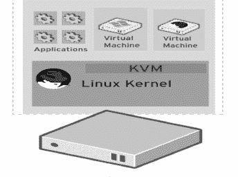

图 2.7 `KVM` 架构。

`KVM` 支持热迁移（`Live Migration`），它提供了在物理主机之间移动虚拟机而不中断服务的能力。热迁移对终端用户是透明的；当虚拟机迁移到新的物理主机时，虚拟机保持开启状态，网络连接保持激活，用户应用程序继续运行。

`KVM` 继承了 `Linux` 强大的内存管理功能。虚拟机的内存存储方式与其他任何 `Linux` 进程一样，可以被交换、可以使用大页来提高性能、可以共享或由磁盘文件支持。


KVM 可以使用 Linux 支持的任何存储设备来存储虚拟机镜像，包括带有 `IDE`、`SCSI` 和 `SATA` 的本地磁盘、包括 `NFS` 和 `SAMBA/CIFS` 在网络附属存储（`NAS`），或支持 `iSCSI` 和光纤道的存储区域网络（`SAN`）。可以使用多路 `I/O` 提高吞吐量并提供冗余。同样，由于 KVM 是 Linux 内核的一部分，它可以利用来自所有领先存储供应商的支持、经过验证且可靠的存储基础设施，其存储栈已在全球的生产部署中通过了验证。

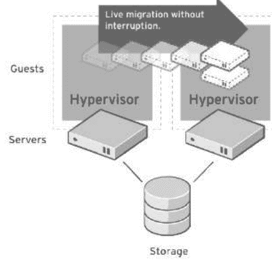

KVM 还支持在共享文件系统（如全局文件系统 `GFS2`）上的虚拟机镜像，允许虚拟机镜像在多个主机之间共享或使用逻辑卷。磁盘镜像支持按需分配（`provisioning`），通过仅在虚拟机需要时才分配存储，而不是预分配整个存储，从而提高了存储利用率。KVM 的原生磁盘格式是 `QCOW2`，它支持快照（允许多级快照）、压缩和加密。

Linux 中可以通过命令判断 CPU 是否支持硬件虚拟化。我们可以使用这些命令进行检查。我们将如何在 `Ubuntu` 操作系统中进行检查。在终端中输入这些命令检查 CPU 是否支持硬件虚拟化：

```bash
egrep 'vmx svm' /proc/cpuinfo
egrep -e 'vmx svm' /proc/cpuinfo
```

如果为 `0`，意味着你的 CPU 不支持硬件虚拟化。

如果为 `1` 或更多，表示支持，但你仍然需要确保在 `BIOS` 中启用虚拟化。

或者，也可以使用：

### `kvm-ok`

它的输出为：

### KVM acceleration can be used

或

### KVM acceleration can NOT be used

可以使用这两个命令中的任意一个。

虚拟化具有三个使其成为云计算理想选择的特性，这些分别是：

-   **分区（Partitioning）** – 通过虚拟化，你可以使用分区在单个物理系统中支持许多应用程序和操作系统。因此，我们可以通过虚拟化在单台硬件上运行许多应用程序。

-   **隔离（Isolation）** 因为每个虚拟机或应用程序之间都是相互隔离的，所以它们免受其他机器上崩溃和病毒的影响。

-   **封装（Encapsulation）** – 封装可以保护每个应用程序，使其不干扰其他应用程序。通过封装，虚拟机可以表示为一个单独的文件，从而易于识别并呈现给其他应用程序。

因此，这种虚拟化被应用于云计算，这一原理正作为该技术的支柱。有许多 IT 公司正从事虚拟化领域。该领域有更多的项目和机会。从事虚拟化领域的知名公司包括：

-   `Vmware`

-   `Citrix`

-   `Oracle`

-   `Red hat`

-   `EMC square`

-   `Virtual bridges`

-   `parallels`

等等。每天都有新的应用程序和工具被设计并引入市场。

## 2.4 分布式技术

另一个对云计算至关重要的原理是*分布式技术（distributed technology）*。这是一项广为人知的技术，在当今现代计算时代被广泛使用。我们一定在很多情况下经常与之交道。让我们详细查看这项技术以及帮助云计算高效运行的功能。

## 云计算的原理与工作

“分布式”一词从字面上是指小组内的共享。更准确地说，如今的 Web 比起网络更是一种分布式架构。分布式技术为所有高级计算提供了基础服务。无论是集群计算、公用计算还是网格计算，这些技术都源于这种本质。分布式系统的整体运行方式采用三层架构或多层架构。分布式系统旨在为用户提供服务。分布式系统可以定义为一组网络设备，如 `LAN`、交换机、路由器。分布式系统是为了终端用户和 IT 公司日益增长的需求和高期望。如今的远程应用程序是根据这些增长的需求设计的。分布式系统的计算广为人知的。

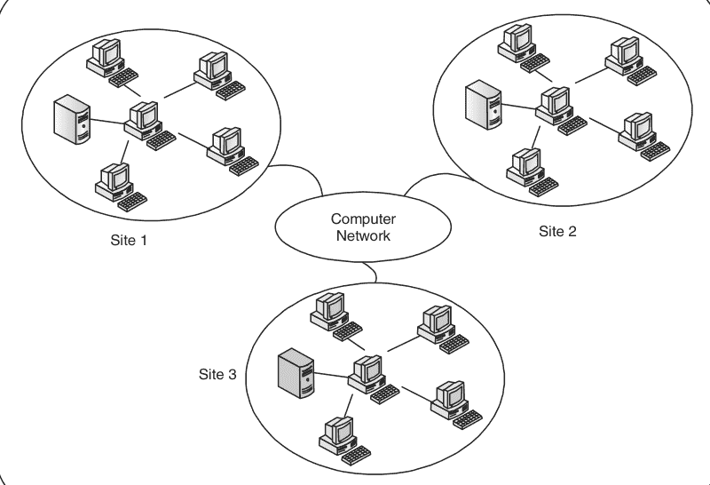

图 2.9 分布式系统。

分布式系统的整体运行方式采用三层架构或多层架构。常见的是三层架构。在三层架构中，前端是用户界面，用于用户处理和管理应用程序。在这一层中，所有用户应用程序运行。中间是处理阶段，用于处理所有的

## 云计算的原理与工作

用户请求在这一层是应用服务器。在后端，有数据库来存储所有的用户事务数据。这种模型非常基础且常见。但今天复杂的分布式应用是多层级的，以满足终端用户的所有复杂需求。分布式系统还有几种服务模型，它们包括集中式模型、客户端/服务器模型、点对点模型等。

在企业中，分布式计算通常意味着在计算机网络中最高效的地方执行业务流程中的各个步骤。在使用 3 层级架构的典型事务中，用户界面处理在用户所在处的 `PC` 上完成，业务处理在远程计算机上完成，而数据库访问和处理在另一台计算机上完成，该计算机为许多业务流程提供集中访问。通常，这种分布式计算使用客户端/服务器通信模型。

在为分布式系统设计应用程序时，我们需要考虑的一些问题包括：

- 计算系统的自主性

- 通信的透明性和开放性

- 异构性

- 它们在网络中必须具有容错能力

- 它们必须具有高度可靠性

- 本质上的灵活性

- 平台无关性

- 通信期间的高安全性

- 高可扩展性

- 高复制性

- 所有计算方面的高性能

“分布式（distributed）”、“并行（parallel）”和“并发（concurrent）”这些词有很多重叠。几乎这些词的意思相同。并行计算可以被视为一种紧耦合的分布式计算形式，而分布式计算可以被视为松耦合的并行计算形式。并行系统通常是粗粒度的分布式系统。在并行计算中，所有处理器都可以访问共享内存以在处理器之间交换信息。在分布式计算中，每个处理器都有自己的私有内存，被称为分布式内存。信息通过在处理器之间传递消息来交换。因此，不能将这些密切相关的技术及其功能混淆。

在分布式系统中运行的计算机程序被称为分布式程序，分布式编程是编写此类程序的过程。今天有多种算法可用于分布式计算。这些算法以高效的方式编写，以减少分布式系统通信的复杂性。

效率也是此类算法需要考虑的另一个标准。选择合适的分布式算法来解决特定问题取决于问题本身的特征，以及运行该程序的系统特征，例如处理器或链路故障的类型和概率、可以执行的进程间通信类型，以及不同进程之间的时间同步水平。必须不要忘记，算法是定义任何技术工作部分的根本概念。在技术上，它被称为算法代码，定义了系统执行的整体功能。算法可以进行修改或改进，以满足终端用户的需求和要求。

讨论分布式技术时的一个常用术语是远程过程调用（`RPC`）。它是一种进程间通信。它可以定义为两个称为存根（stub）和骨架（skeleton）的系统之间的通信，就像它们在本地演示中执行一样。消息在存根中打包并在骨架中解包。这在技术上被称为序列化（marshalling）和反序列化（unmarshalling）过程。使用面向对象的原则，`RPC` 被称为远程方法调用过程（`RMI`）。使用这种简单的技术，今天有数百万个应用程序被设计，而在过去则相当复杂。它或多程度上始于 1987 年的微系统开放网络计算（`ONC`）`RPC` 系统，作为其网络文件系统（`NFS`）的基本通信机制。`NFS` 支持 `UNIX`、`Linux` 和许多其他分布式操作系统。`NFS` 用于访问位于远程计算机上的目录和文件，就像这些目录和文件位于本地计算机一样。

实现语言无关和平台中立分布式计算的主要工作是由对象管理组（`OMG`）于 1989 年完成的。`OMG` 是一个包含 500 多个成员的联盟。1991 年，`OMG` 交付了第一版本的通用对象请求代理架构（`CORBA`），这是一种分布式对象平台。`CORBA` 允许位于网络不同部分并用不同编程语言编写的程序相互通信。对象请求代理（`ORB`）这一术语流行起来，用指实现分布式对象的底层软件。1996 年，`CORBA` 2 版本引入了互操作 `ORB` 协议（`IIOP`），作为核心分布式计算模型和分布式对象可以使用的高级服务的主要增强。`IIOP` 确立了 `CORBA` 在未来 5 年中计算计算中的主导地位，直到 Web 服务的出现。

微软于 1990 年左右启动了自身的分布式计算倡议。1996 年，微软交付了分布式组件对象模型（`DCOM`），它与之前的微软对象链接与嵌入（`OLE`）、非分布式 `COM`（或 `OLE2`）以及 `ActiveX`（用于 Web 应用程序的轻量级组件）紧密结合。为了与 `CORBA` 竞争，微软在第二年即 1997 年引入了 `COM+`，使 `DCOM` 更加接近 `CORBA` 分布式计算模型。

分布式技术的一些优势包括：

- 由于分布式技术，网络整体性能很高

- 它减少了网络连接所需的整体成本和精力

## 云计算的原理与工作

- 分布式技术的的主要优势之一是对网络中所有资源的复制，从而使所有用户都能使用

- 它具有高度的可扩展性，以满足网络需求

- 在这项技术中，所有系统在所有计算方面都是高度独立的

- 这项技术非常可靠，可以克服网络中的任何故障

- 分布式技术可以以增量的方式作为更高级网络技术的基础

## 2.5 瘦客户端技术

云计算的最后一个主要原理是瘦客户端技术。在之前的章节中，我们看到虚拟化和分布式技术正在帮助云计算的设计和整体运行。现在我们详细了解这种瘦客户端技术。

从计算能力来看，网络中的系统可以分为两大类，分别称为瘦客户端和厚客户端。这是一种非常有趣的技术。它告诉我们我们使用的机器在计算上相互依赖。它以非常用户友的方式提供了终端用户远程计算的蓝图。对于云计算，瘦客户端是计算机支持的一项重要特性。这一云计算原理在用户端自然可见。

从技术上说，瘦客户端也称为轻量机，是一个没有硬盘且无状态的系统。整体计算不在该机器上发生。它完全依赖于远程厚服务器。所有的用户任务和请求都在后端的厚机器上处理。瘦客户端的典型示例可以是带有用户界面应用程序（如 浏览器）的操作系统。它没有其他支持或完成用户任务的功能。使用瘦客户端计算模型，你不需要购买或升级硬件，而是可以轻松利用现有的硬件、操作系统、软件、网络和标准。瘦客户端/服务器计算延长了你的计算基础设施的寿命。可以想象一个巨大的网络，由终端用户访问多个客户端机器，这些机器由后端厚机器管理。

需要想象前端有一个带有用户界机器，所有的其他事务都在后端完成。这就是整个瘦客户端技术的工作原理。后端机器是智能的，其处理器拥有所有的计算能力。随着用户事务的执行，最终输出在前端机器显示给终端用户。用户感觉所有的操作都在自己的机器上进行，但实际上是在后端执行的。处理……的时间周期

用户请求也太短了，而且速度非常快，以至于用户感受不到瘦客户端技术的影响。应用程序逻辑在服务器端与用户界面分离，并传输到客户端机器。`MultiWin` 是 `Windows NT` 服务器的扩展，它允许多个并发的瘦客户端用户登录并在服务器上相互独立的、受保护的 `Windows` 会话中运行应用程序。

运行远程桌面协议（`RDP`）（如 `Citrix ICA` 和 `Windows` 终端服务）和/或虚拟化软件的瘦客户端机器，访问存储在数据中心服务器、刀片机等上的硬盘。瘦客户端、软件服务和后端硬件共同成了瘦客户端计算，这是一种替代性的桌面计算模型。


图 2.11 瘦客户端技术。

在云计算中，所有用户都连接到远程云。所有资源甚至高功率工作空间都迁移到用户机器中。“迁移”（Migration）一词指的是同时发送给多个用户的资源实例。所有的计算都发生在高功率的远程云中，这需要巨大的基础设施来支持它们。云瘦客户端计算随之出现。因此，所有用户任务都在远程虚拟云中执行，而不是用户机器上。所有资源都池化在远程云中以满足终端用户的需求。任务执行后，它会被再次保存回虚拟数据中心。必须想象大量的用户访问云、执行他们所有的任务并保存在云数据中心。这就是实时云的工作方式。

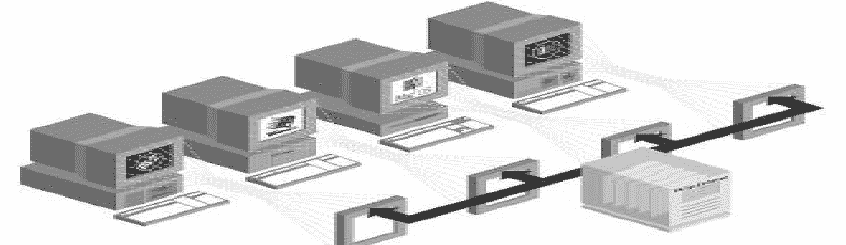

图 2.12 瘦客户端技术中的处理。

## 云计算的原理与工作

瘦客户端技术的一些主要优势包括：

- 降低客户端机器成本

- 无需硬件问题

- 后端服务器机器提供更稳健的硬件支持

- 在任何计算方面无大问题

- 更好的软件环境

- 无需对软件进行更新或维护

- 更快速访问 `GUI` 应用程序

- 支持异构系统

- 事务的集中管理

- 易于使用。

大多数 IT 专业人员明显倾向于像瘦客户端计算那样的单点控制。他们不想在公司内到处跑，为每个运行操作系统的桌面电脑提供支持。瘦客户端架构允许部门在同一位置整合数据库、文件服务器和应用程序服务器，并在该位置管理用户访问。这种整合意味着全球用户都可以访问相同的中心化信息，公司可以避免由于拥有广泛分散的数据库而涉及的安全性、成本、可靠性和管理等问题。

## 2.6 云计算的工作与迁移

到目前为止，我们已经看到了云计算的各种原理。我们看到了虚拟化、分布式和瘦客户端技术是如何帮助底层云技术的。现在，让我们来看看云技术的整体工作原理。我们将看到在云后端发生的两个重要事项：动态资源分配和实时机器迁移。

为了准确理解云计算是如何运作的，让我们考虑云主要由两个层组成：后端层和前端层。可以想象每个应用程序都有前端和后端。前端是应用程序的图形化用户界面，而后端是存储所有内容的数据库。前端层是您看到并与云中所有资源交互的部分。因此，前端是用户查看并实时感知云的视图。后端由硬件和所需的软件架构组成，它们交付了你在前端看到的数据和其他所有应用程序。云中的后端是大型虚拟云服务器，所有活动都发生在那里。

用户数据、应用程序和工作空间仅存储并处理在后端高度动态、远程且虚拟的云服务器中。后端在云中非常重要，因为它是所有活动发生的地方，即使云服务器被黑客意外或服务器宕机，用户数据也将完全无法访问，用户的工作将受到影响。因此，在云中存储和维护虚拟服务器是一项非常重要的任务。虚拟服务器位于非常远的地方，以至于用户可能不知道实际处理发生在哪里，这是云中的一个谜团。

在第一步中，用户向云供应商注册，用户输入所有的个人详细信息以及根据使用情况向供应商支付款的银行交易详情。只有在供应商确认用户注册后，才会创建单独的用户账户。在注册步骤中，用户必须在接受云使用之前确认与云供应商的所有服务水平协议（`SLA`）。之后，用户可以使用其凭据登录云，并使用云供应商提供的云中所有资源和工具。因此，云中的所有交互都是通过网络浏览器进行的，类似于互联网。用户可能会觉得所有操作都发生在他的本地机器上，但实际上它们发生在远程位置。

供应商可能会为用户提供一段时间的免费试用，稍后对所有使用收费。在月底，用户根据总资源使用情况从供应商处获得单单，并要求在给定时间内支付金额，否则账户将被锁定。供应商为云设置了多层安全防护，用户严禁篡改或参与云内部的任何不必要的可疑活动，否则用户的账户将被供应商禁用。

云使用网络层来连接终端设备、计算机、智能手机、平板电脑和其他所有硬件设备到池化在云中虚拟数据中心中的资源。

### 动态分配与调度

我们必须理解云计算是如何运作的，让我们考虑云主要由两个层组成：后端层和前端层。可以想象每个应用程序都有前端和后端。前端是应用程序的图形化用户界面，而后端是存储所有内容的数据库。前端层是您看到并与云中所有资源交互的部分。因此，前端是用户查看并实时感知云的视图。后端由硬件和所需的软件架构组成，它们交付了你在前端看到的数据和其他所有应用程序。云中的后端是大型虚拟云服务器，所有活动都发生在那里。

用户数据、应用程序和工作空间仅存储并处理在后端高度动态、远程且虚拟的云服务器中。后端在云中非常重要，因为所有活动发生的地方，即使云服务器被黑客意外攻击或服务器宕机，用户数据将完全无法访问，用户的工作将受到影响。因此，在云中存储和维护虚拟服务器是一项非常重要的任务。虚拟服务器位于非常远的地方，以至于用户可能不知道实际处理发生在哪里，这是云中的一个谜团。

在第一步中，用户向云供应商注册，用户输入所有的个人详细信息以及根据使用情况向供应商支付款项的银行交易详情。只有在供应商确认用户注册后，才会创建单独的用户账户。在注册步骤中，用户必须在接受云使用之前确认与云供应商的所有服务水平协议。之后，用户可以使用其凭据登录云，并使用云供应商提供的云中所有资源和工具。因此，云中的所有交互都是通过网络浏览器进行的，类似于互联网。用户可能会觉得所有操作都发生在他的本地机器上，但实际上它们发生在远程位置。

供应商可能会为用户提供一段时间的免费试用，稍后对所有使用收费。在月底，用户根据总资源使用情况从供应商处获得账单，并要求在给定时间内支付金额，否则账户将被锁定。供应商为云设置了多层安全防护，用户严禁篡改或参与云内部的任何不必要的可疑活动，否则用户的账户将被供应商禁用。

云使用网络层来连接终端设备、计算机、智能手机、平板电脑和其他所有硬件设备到池化在云中虚拟数据中心中的资源。

### 动态分配与调度

我们必须理解云计算是如何运作的，让我们考虑云主要由两个层组成：后端层和前端层。可以想象每个应用程序都有前端和后端。前端是应用程序的图形化用户界面，而后端是存储所有内容的数据库。前端层是您看到并与云中所有资源交互的部分。因此，前端是用户查看并实时感知云的视图。后端由硬件和所需的软件架构组成，它们交付了你在前端看到的数据和其他所有应用程序。云中的后端是大型虚拟云服务器，所有活动都发生在那里。

用户数据、应用程序和工作空间仅存储并处理在后端高度动态、远程且虚拟的云服务器中。后端在云中非常重要，因为它是所有活动发生的地方，即使云服务器被黑客意外攻击或服务器宕机，用户数据将完全无法访问，用户的工作将受到影响。因此，在云中存储和维护虚拟服务器是一项非常重要的任务。虚拟服务器位于非常远的地方，以至于用户可能不知道实际处理发生在哪里，这是云中的一个谜团。

在第一步中，用户向云供应商注册，用户输入所有的个人详细信息以及根据使用情况向供应商支付款项的银行交易详情。只有在供应商确认用户注册后，才会创建单独的用户账户。在注册步骤中，用户必须在接受云使用之前确认与云供应商的所有服务水平协议。之后，用户可以使用其凭据登录云，并使用云供应商提供的云中所有资源和工具。因此，云中的所有交互都是通过网络浏览器进行的，类似于互联网。用户可能会觉得所有操作都发生在他的本地机器上，但实际上它们发生在远程位置。

供应商可能会为用户提供一段时间的免费试用，稍后对所有使用收费。在月底，用户根据总资源使用情况从供应商处获得账单，并要求在给定时间内支付金额，否则账户将被锁定。供应商为云设置了多层安全防护，用户严禁篡改或参与云内部的任何不必要的可疑活动，否则用户的账户将被供应商禁用。

云使用网络层来连接终端设备、计算机、智能手机、平板电脑和其他所有硬件设备到池化在云中虚拟数据中心中的资源。


物理机（`PM`）的容量也可能是异构的因为数据中心中同时存在多个世代的硬件。

某些算法包含两个主要目标，包括：

- 避免过载 – `PM` 的容量应足以满足运行在其上的所有虚拟机（`VM`）的资源需求。否则，`PM` 将过载，并导致 `VM` 性能下降。

- 绿色计算 – 只要 `PM` 能够满足所有 `VM` 的需求，就尽可能减少使用的 `PM` 数量。空闲的 `PM` 可以关闭以节省能量。

动态资源分配基于云计算中的分布式多准则决策。它具有两个方面：首先采用分布式架构，将资源管理划分为独立任务，每个任务都由自主节点（`NA`）在三个活动的循环中执行：

- 虚拟机放置 – 找到能够运行给定 `VM` 的合适物理机（`PM`），然后将 `VM` 分配到该物理机。

- 监控 – 由 `NA` 监控所托管 `VM` 的总资源使用情况。

- 虚拟机选择 – 如果无法进行本地容纳，则 `VM` 需要迁移到另一台 `PM`，循环返回放置阶段。

其次，使用 `PROMETHEE` 方法，`NA` 通过多准则决策分析并行执行配置。这种方法在大规模数据中心比集中式方法更具可行性。

### 虚拟机实时迁移

另外，当用户工作时云中发生的另一个重要活动涉及虚拟机的实时迁移。这是一个非常有趣的概念，但前端用户在工作时并感知或感觉不到这些。

虚拟机（`VM`）的实时迁移是在不停止客户操作系统的情况下，将 `VM` 从一个虚拟机监控器（`VMM`）迁移到另一个的过程，通常发生在不同的物理机之间，它为计算领域开辟了新的机会。用户最初会意识到这些。它通过几个现有的虚拟化产品实现，我们在 2.3 节中已经介绍了几个 `Hypervisor`。实时迁移可以在以下方面帮助：

- 所有服务的高可用性

- 透明移动性

- 整合管理

- 工作负载均衡

虚拟机从一个 `VMM` 移动到另一个有许多方法。由于虚拟系统通常存储为数据中心磁盘上的普通文件，与停止系统相关的文件可以使用网络或便携式存储设备（如 `USB` 设备）复制到另一个 `VMM`。除了停止的虚拟系统的迁移外，许多流行的 `VMM` 都支持实时迁移，即在不停止客户操作系统的情况下，将 `VM` 从一个虚拟机监控器迁移到另一个的过程。

虽然不同的虚拟机监控器有不同的实时迁移协议，但底层算法是相似的。实时迁移技术通常通过网络将 `VM` 的内存页复制到目标端，此时 `VM` 在源 `VMM` 中继续运行。随着 `VM` 修改（弄脏）页面，该过程将持续进行。当源 `VMM` 达到阈值并认为页面传输没有取得进一步的重大进展时，它将停止 `VMM`，并信号目标 `VMM` 恢复 `VM` 的执行。`VMM` 决定停止源 `VMM` 并复制剩余页的点通常是特定于实现的启发式方法，试图平衡并最小化迁移持续时间和迁移虚拟机的停机时间。其他变体包括目标按需从源 `VMM` 请求 `VM` 页面。

虽然对于迁移 `VM` 镜像的网络并不是完全安全的假设在许多组织中更常见，但迁移路径可能会跨越多个连接性和地理距离。事实上，虚拟机已成功跨大陆迁移，应用停机时间低至 1 到 2 秒。此外，采用实时迁移的环境内部受损系统可能会导致对 `VM` 镜像的未经授权访问。查看或修改与实时迁移相关的数据或影响源和目标 `VMM` 迁移服务的能力引发了几个重要的安全问题。

虽然虚拟化和实时迁移实现了重要功能，但这种结合在底层引入了其他几个安全挑战。包含实时迁移功能脆弱实现的虚拟机监控器可能会使客户和主机操作系统暴露于攻击，并导致完整性受损。鉴于虚拟化技术巨大且不断增长的市场，全面理解虚拟迁移安全性至关重要。然而，必须对虚拟迁移安全性进行分析。

迁移过程中存在三类威胁：

- 控制平面 – `VMM` 用来启动和管理实时迁移的通信机制必须经过验证并能够抵抗篡改。攻击者可能操纵 `VMM` 的控制平面以影响实时迁移并获得客户操作系统的控制权。

- 数据平面 – 进行 `VM` 迁移的数据平面必须经过安全保护，防止对客户操作系统状态的嗅探和篡改。针对数据面的被动攻击可能导致客户操作系统泄露敏感信息，而主动攻击可能导致客户操作系统的完全被破解。

- 迁移模块 – 实现迁移功能的 `VMM` 组件必须具有抵御攻击的能力。如果攻击者能够利用迁移模块中的漏洞破坏 `VMM`，则攻击者可能会获得对 `VMM` 和任何客户操作系统的控制权。

因此，必须非常小心实时迁移的安全。

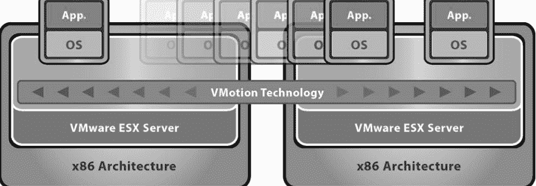

图 2.13 虚拟机实时迁移。

## 2.7 Web 技术与云技术

在目前整个章节中，我们看到了云计算的各种原理。这些原理如何帮助云的核心功能。特别是虚拟化、分布式和轻客户端发挥了重要作用。

在理解它们之间的区别之前，我们必须考虑一些问题：

- `Web` 技术和云技术是相互关联的吗？

- `Web` 应用在功能上有何不同？

- `Web` 托管和云托管有什么区别？

- `Web` 技术是处理互联网日益增长的数据和拥堵的解决方案吗？

- 随着各种计算技术的演进，`Web` 技术是过时的？

- `Web` 2.0 与云计算之间有什么关系？

- 云与传统技术相比，在哪些方面更先进、更动态？

- 云服务器与 `Web` 服务器相比是否更高效、更稳健？

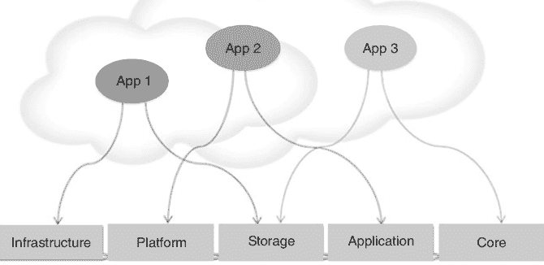

图 2.15 云应用。

让我们来看看通过多种方法区分`Web`技术与云技术。

### 技术原理

`Web`技术涉及简单的互联网协议和服务器相关原理，用于设计和托管`Web`应用。云技术是一个高级的网络领域，包含若干基础的`Web`原理以及更高级的技术，如虚拟化、分布式、薄客户端技术、面向服务技术等。

### 总体架构

`Web`技术通常涉及简单的客户端-服务器模型架构。虽然现在有许多先进的网络模型，但它们通常都是客户端-服务器模型。云技术涉及更高级、更先进的架构模型，称为服务模型。其中包括平台即服务 (`PaaS`)、基础设施即服务 (`IaaS`)、软件即服务 (`SaaS`) 等。

### 操作系统环境

设计和托管`Web`应用均可以在 `Windows` 和 `Linux` 操作系统环境中成功实现。但对于云计算而言，虚拟化概念只有在 `Linux` 环境下才能实时工作。几乎所有的云工具都只安装在 `Linux` 环境中。

### 运行差异

`Web`技术在核心功能上是相当静态的，尽管它们会不时更新。云计算是一种高度动态的技术，其整体功能根据终端用户的需要不断发生变化。它具有极高的灵活性、弹性和可扩展性。

## 云计算的原理与工作

### 资源共享

“共享”一词在两种技术中的含义截然不同。在`Web`技术中，只有静态的`Web`内容被共享给用户。而在云计算中，“共享”术语要广泛得多，将许多池化资源汇入云。池化资源的实例供注册的云用户使用。

### 数据存储与计算

`Web`应用与云应用之间的另一个主要区别在于存储和计算方面。在`Web`技术中，数据存储在普通的数据库服务器上，可以从后端轻松访问。所有的计算只在客户端机器上完成。在云技术中，所有计算都在虚拟远程云中完成。所有数据也存储在虚拟数据中心，这比简单的数据库服务器要先进得多。

## 基础设施

与云相比，`Web`技术对IT基础设施的需求较少。一个常用的服务器经过少量的配置就可以轻松托管和维护`Web`应用。云计算技术需要极高的基础设施，以支持同时为多个用户提供所有池化资源的高度虚拟化。资源的实例被创建并供所有注册用户同时使用。

## 可靠性

与先进的云相比，`Web`技术是一个非常基础的网络领域。`Web`应用有时会因为网络流量和拥塞导致崩溃或服务器宕。但云计算是一种非常稳健的技术，因为它涉及资源实例，并且本质上是分布式的，以克服任何崩溃或故障。云技术具有高度的灵活、容错性和可扩展性。因此，云比基于`Web`的技术更可靠。

## 可用性

与云技术相比，`Web`技术没有复制或分布。云应用通过虚拟化技术实现了更多的复制。同一资源的多个实例被创建供多个用户同时使用。因此，与`Web`应用相比，云应用不会因为网络流量和拥塞而崩溃或不可。

## 易用性

与所有`Web`应用及其用法相比，云应用要简单得多、用户友好，并以非常可靠的方式完成用户任务。云应用在整体功能上也更加先进。云技术正与 `Android` 技术相结合，为终端用户提供更先进的移动应用和技术。

## 经济问题

`Web`技术涉及将静态内容设计并托管到服务器上。用户需要花费资金购买和维护服务器以及其他`Web`工具包。云技术涉及一种“按需付费”的租赁模式。用户为所使用的资源付费。租赁模式比购买所有资源要便宜得多。

## 安全问题

基于`Web`的应用面临安全威胁。`Web`应用有时会因为网络流量和拥塞导致崩溃或服务器宕。但云计算是一种非常稳健的技术，因为它涉及资源实例，并且本质上是分布式的，以克服任何崩溃或故障。云技术具有高度的灵活、容错性和可扩展性。因此，云比基于`Web`的技术更可靠。

## 总结

字体 对于每一项新技术都有一个基础原理。

- 云计算主要基于虚拟化技术、分布式技术和薄客户端技术。

- 与云相关的主要的原理是互联网。之前的互联网或过时的互联网被称为 `Web` 1.0。今天的现代和先进互联网被称为 `Web` 2.0。`Web` 2.0 是用来描述第二代互联网的术语，侧重于人们在线协作和共享信息的能力。

- 远程过程调用 (`RPC`) 是一种进程间通信。它可以被定义为当远程系统在本地执行时，通过存根（`stub`）和骨架（`skeleton`）进行通信。消息在存根中打包，并在骨架中解包。这在技术上被称为序列化（`marshalling`）和反序列化（`unmarshalling`）过程。

- 瘦客户端（`Thin client`）也称为纤细机器，是一种没有任何硬盘且无状态的系统。整体计算并不发生在该机器上。它完全依赖于远程厚客户端服务器。所有的用户任务和请求都由后端的厚机器处理。

- 云主要由两层组成：后端和前端。前端是你看到并与云中所有资源交互的部分。因此，前端是用户实时查看和实现云的视图。后端由硬件和所需的软件架构组成，它负责交付你在前端看到的数据以及所有其他应用程序。后端位于大型云服务器中，所有活动都发生在那里。

- 如今已有许多高性能算法可用于调度资源，其中包括用于具有可抢占任务的云系统的自适应资源分配算法，此类算法根据实际任务执行的更新来调整资源分配。自适应列表调度（`ALS`）和自适应最小最小调度（`AMMS`）算法被用于任务调度，包括静态任务调度。

- 虚拟机（`VMMs`）的实时迁移是在不停止客户操作系统的情况下，将一个虚拟机从一个虚拟机监控器（`VMM`）转移到另一个位于不同物理机器上的过程，这为计算领域开启了新的机会。用户在前端感知不到这些操作。它通过几种现有的虚拟化产品实现。

- 设计`Web`应用程序的过程被称为 `Web` 设计（`web designing`）。用于在服务器上托管 `Web` 应用的称为 `Web` 托管（`web hosting`）。互联网上的网页通常被称为 网站（`web sites`）。

- 云计算是一个高度动态且先进的网络领域，资源在远程云中汇聚，主要基于面向终端用户的面向服务模型。云应用与传统 `Web` 应用之间存在几处差异。人们不要将两者混淆。

- `Web` 应用程序与云应用之间存在相似之处，关系如下：云应用源于基础 `Web` 应用，但并非 `Web` 应用都是云应用。

# 第 3 章

# 云的分类

## 目标

- 了解云的分类

- 学习并分析云的类型

- 学习云的管理以及各种管理工具

在最后两个章节中，我们看到了云计算的基础介绍以及这项新技术背后的各种原理。我们知道了传统的 `Web` 技术与动态云之间的区别。在本章中，让我们详细看看云是如何分类的。云的分类如何有助于该技术的安全和业务方面，以及如何根据其范围对云云。云的分类是分析其功能、局限性和应用的最佳方式。云的分类也可以帮助我们更有效地理解云中资源共享的概念。最后，我们将看到云的管理以及现有的各种云管理工具。

## 3. 云的类型

我们根据云可以访问的范围对其进行分类，并在该限制范围内对其进行访问和管理。正如我们已经学过的，云计算可以定义为一组设备以远程方式连接在一起以执行最终任务的技术。因此，我们必须定义云的边界，以便云能够被容易管理并防止边界之外的人员入侵。从技术上讲，边界可以定义为注册用户对云的可访问性。在定义云的边界时，我们需要考虑的问题包括：

- 我们如何为云定义边界？

- 定义边界是安全和管理云的正确方法吗？

- 如何管理云边界的资源？

- 云是否足够强大以防止未经授权的人员进入定义的边界？

# 云计算

在云中是否有定义边界的良好标准？

在云中定义边界会影响云的整体核心功能吗？

通过为云定义边界，我们是否在多个方面对其造成了限制？

通过在云中定义边界，是否无法在云之间进行集成或协商以提供更好的服务？

因此，我们必须定义边界来解决所有这些问题。我们必须定义足够健壮和智能的边界，以防止任何入侵者进入受保护的云。定义的边界必须满足整体基础设施以及企业 IT 公司或公共云供应商的能力。但边界的设计不能影响云的整体功能，否则这将违背新云技术的整个目标。安全和管理云本身是企业 IT 工作空间中的一项独立任务。所有的资源和技术空间在企业 IT 公司中都是安全良好的，因为它们是机密且属于他们。我们根据范围将云分为四类，定义了一个良好的边界，以非常用户友的方式来安全和管理云。云的类型包括：

- 私有云

- 公有云

- 混合云

- 社区云

因此，我们分类云主要是为了在定义的边界内对其云。我们将在接下来的章节中详细查看每种类型的云以及每种类型之间如何不同。它为我们提供了关于这项新技术的宏观视图。

| | 公有 |
| :--- | :--- |
| 私有云 | |
| 云平台 | |
| 内部私有 | 外部私有 |
| 内部 | 外部 |

# 云的分类

每种云都有某些优缺点。每种云都有自己的功能和局限性。根据用途，每种云都可以用于某些业务解决方案。云的分类有助于我们根据需求和要求为组织选择合适的云。分类还帮助我们实时分析云的功能。

## 3.2 私有云

现在让我们来看第一类云，即私有云。“私有”一词意味着某些并非人人所知。从技术上讲，私有云在受保护的组织内部得到良好管理。组织内部的私有云有定义的边界来保护云。私有云通常设置在组织的防火墙后面，以安全的方式防止黑客和入侵者的攻击。只有组织的本地员工才能使用正确的凭据访问云。私有云也被称为内部云。因此，私有云对组织而言在本质上是私有的。它有一个定义的边界，在该边界之外无法访问和使用私有云。任何在组织外访问云的尝试都会向 IT 公司的云管理员发送安全警报。私有云在同一组织的不同位置被访问。因此，该组织负责：

- 建立他们的私有云

- 管理私有云用户和功能

- 管理支持私有云所需的设施（存储和计算能力）

- 将所有所需资源汇聚到私有云中

- 跟踪个人员工和个人项目组对资源的使用情况

- 在私有云内部分配和重新分配资源

- 设计合适的应用程序以满足他们的云功能

- 将设计的应用程序部署到云中

- 定时更新应用程序和其他资源

- 根据需求扩展应用程序和资源

- 防止外部对私有云的攻击

- 定义一套标准和协议来管理云及其功能

- 保护云中内部机密信息的隐私和安全。

（内部机密信息可以定义为不能向公司内其他项目官员披露的信息）

- 管理私有云的整体资本支出

- 组建专门团队来管理组织内部私有云的所有方面

### 图 3.2 私有云。

这就是当组织想要拥有自己的私有云时需要进行的操作。有时，组织可能无法维护云的所有功能，或者他们将工作外包给某些第三方服务提供商。四种类型的私有云在安全性上都比公共云、混合云和社区云更安全。当我们考虑云资源时，可以将公有云想象成像 `Google` 或 `Amazon` 这样的巨人。为了解决安全和可用性问题，私有云是大多数 IT 公司的最佳选择。私有云的一个很好的例子是企业 IT 公司搭建并用于自身内部目的云。一些 IT 提供的私有云包括：

- `Wipro technologies cloud`

- `Cognizant technologies cloud`

- `Accenture cloud`

- `Cisco cloud` 等

全欧洲超过一半的地方政府和中央政府正在使用或计划使用由第三方托管的私有云。同时，56% 的地方政府和 42% 的中央政府将使用或在内部托管私有云。英国政府云计算被称为 `G-cloud`，它促进了政府对云计算的采用。

有许多云工具可以配置私有云。它们安装在 `Linux` 平台上。客户端机器被称为节点，服务器机器被称为云控制器。在 `Linux` 中设置私有云是一项相当繁琐的任务，因为它涉及大量需要遵循的步骤或指令。但今天，克服这些困难的方法是使用脚本文件安装法，所有步骤都包含在一个巨大的文件中，运行即可完成整个任务。这些工具会不断更新到新版本。通过使用这些工具，我们可以建立真实的私有云，并测试和分析云环境。它通常被所有研究人员和其他教育机构用于学习。（我们将在第 8 章详细介绍如何配置私有云）

## 云的分类

### 3.3 公有云

云的下一个分类是公有云。“公共”（`public`）一词字面意思是开放的或通用的。公有云对所有用户和业务世界开放。任何用户都可以向公有云供应商注册并成为云用户。与受限的私有云相比，公有云在结构方面和应用方面都要广泛得多。公有云比受限的私有云巨大。公有云必须支持来自不同位置的所有注册用户。它必须将所有资源汇聚到云中。它在本质上必须更加健壮和动态，以便在云用户之间进行分配和重新分配。一些人可能无法建立自己的私有云，因此他们依赖公有云供应商。它必须支持企业 IT 部门终端用户的需求和期望。公有云由云供应商设计和管理。

图 3.3 公有云。


云供应商可以是一个大型企业 IT 公司。这些大型 IT 公司通过用户友好的措施和随处可见的巨大广告使他们的云流行。IT 专业人员在特定的云技术领域接受招聘和培训。作为云提供商，大型企业 IT 公司的最佳案例是 `Amazon`。它是最受欢迎的云供应商之一，也是多个平台上的巨型公司。（我们将在第 7 章详细介绍）。供应商根据使用情况收取云费用。供应商可能会提供一段时间的资源免费访问作为用户的试用期，随后他们根据使用情况收费。供应商根据资源使用的定义的阶梯费率（`slab rates`）向用户收费。阶梯费率根据供应商的业务需求随时修订。

公有供应商必须推进汇聚到云中的计算资源……（注：原文中存在大量重复的"The public vendor must advance the computing resources pooled into the cloud"句子，翻译时已去重处理）。

| 功能 | 私有云 | 公有云 |
| :--- | :--- | :--- |
| 可访问性 | 仅限内部 | 任何地方可访问 |
| 可扩展性 | 容易扩展 | 容易扩展 |
| 数据安全 | 良好的安全 | 不太安全 |
| 资源共享 | 容易共享 | 容易共享 |
| 管理 | | 中等 |
| 资本支出 | 取决于组织 | 较高 |
| 数据备份 | 组织内部较容易 | 需要巨大的存储空间 |

## 云的分类

公有云的一些示例包括：

- `Amazon web services`
- `Google cloud`
- `Windows azure`
- `Salesforce`
- `Gogrid`
- `Cloudbees`

大多数云都是公共云，因为任何用户都可以轻松登录并使用。它们可能是免费的。

### 3.4 混合云

在前面的章节中，我们分别看到了两种云：私有云和公有云。现在让我们来看看云的第三类分类——混合云。混合云通过使用本地和远程资源对私有云进行扩展。它通常用于容量或云流量突然增加的情况。这被称为云爆发（`cloud bursting`）。它可以定义为多个用户同时对远程云的突然激增。因此，当远程资源整合到私有云中时，就创建了混合云。

想象一种情况：IT 公司从云中提取大量资源来完成所有任务。在某个阶段，云达到了饱和，汇聚资源无法满足所有云用户的请求。在这种情况下，私有云可以扩展或整合远程资源以满足云用户任务。因此，混合云的概念产生了。

从业务角度来看，混合云的优点包括：

- **优化利用**：通常云只使用 5% 到 20% 的资源。其余资源处于空闲状态。但在云爆发时期，云用户的需求非常高。混合云有助于优化云资源的利用，特别是在云爆发时期。

- **数据中心整合**：与其为最坏的情况提供容量或资源，私有云只需要为平均情况提供资源。这种爆发服务器的选择从而减少了运营成本。特别是这包括了硬件、电力、冷却、维护和管理的成本。因此，通过使用混合云，私有云变得依赖于其他云。

- **维护与风险** – 在私有云中，组织负责其维护以及它所面临的所有风险。当它与公共云提供商集成形成混合云时，部分任务将会减少。由公共云供应商负责维护云的所有服务，并确保这些服务运行不出现故障或宕机。

- **可用性** – 在企业数据中心确保高可用性是困难且昂贵的，因为这需要冗余、备份和地理分布。正如我们所知，企业 IT 公司数量庞大且地理位置分散。特别是在 IT 并非核心业务的公司中，在该领域的专业知识相当有限。在混合云环境中，如果公司的数据中心由于任何其他问题而变得不可用，公共云可以进行扩展或完全接管。

尽管云服务非常易于使用，但它们中也存在一些问题和挑战。这些挑战包括：

- **成本** – 从业务角度来看，混合云的缺点是相关的成本。它涉及来自公共云提供商的本地和远程资源。混合云基础设施的运营成本和设置成本也很高。根据利用率、数据中心成本以及云提供商的成本，企业必须决定迁移到云端是否盈利。减少额外成本的最佳方法之一是对公共云资源向用户进行单独的计费计量。

- **数据安全** – 公司的大多数数据都是高度机密的，不能泄露给他人。由于混合云是云提供商的组合以解决云突发流量，因此有很大概率的安全数据会在从安全的私有云传输到混合云的过程中丢失或被篡改。

- **可用性** – 尽管我们在混合云中将可用性视为一种优势，但可用性取决于公共资源如何集成到整个系统中。如果公共云仅用于云突发流量，即在高峰时段扩展本地资源，那么使用多个提供商可以显著限制风险。然而，如果云资源与重要的业务流程交织在一起，云故障的影响将会高得多。

- **互操作性** – 互操作性问题在混合云环境中尤为重要，因为它们集成了不同的云解决方案。虽然完全兼容的系统将允许透明地交换云提供商和虚拟镜像，但目前的混合云工具包必须处理许多现有的不兼容问题。如果云之间互不兼容，它们就无法集成以提供混合云解决方案。

如今，每个云提供商的平台都不相同，并有自己的运行方式。

## 云的分类

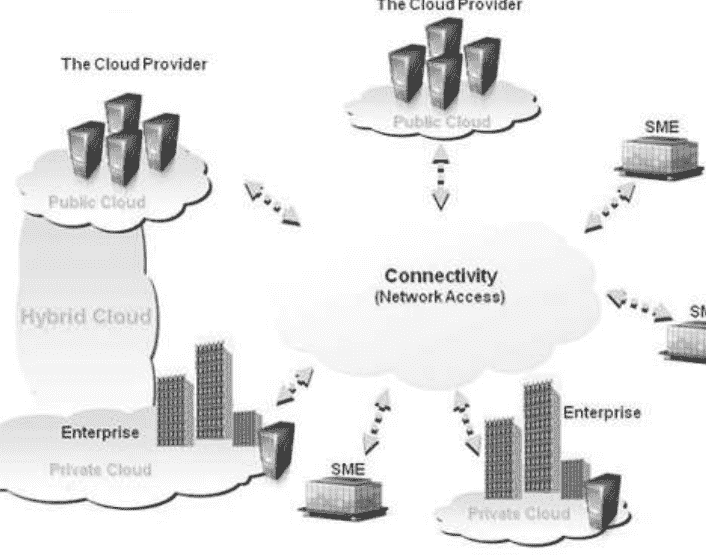

图 3.4 混合云。

混合云的一些示例包括：

- `Rackbackspace` 混合云
- `Red Hat Open` 混合云
- `VMware` 混合云服务

其他云的组合也是混合云的合适示例。

## 企业防火墙

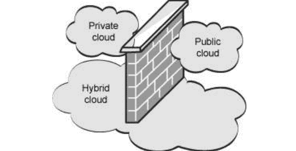

图 3.5 私有云、公共云和混合云的比较。

如果你需要不同级别的安全、控制和扩展性，混合云方案值得考虑的。确保所有内部 IT 资源和多个云提供商在设计时都考虑到标准操作程序，以构建完整的、互操作的云解决方案。

### 3.5 社区云

云的最后一个分类是社区云。嗯，社区云是云的一种，云服务作为服务提供给由供应商管理的有限数量的用户或组织。这些社区有共同的目标，并有实现其自身业务的目标。社区云也可以被定义为受限的且安全良好的公共云。社区云更安全，并且对使用资源和其他服务的用户有限制。社区云涉及各种组织根据其需求使用池化资源并支付费用。

社区云与私有云相似之处在于它是一个集体定义、拥有和管理的云环境，不是由单一组织，而是由一组组织。

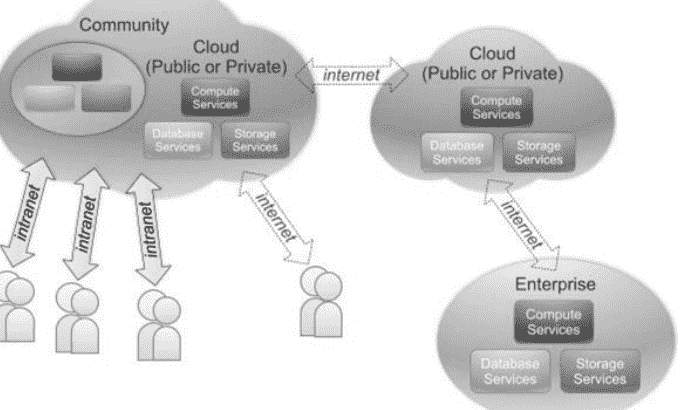

图 3.6 社区云。

社区云通常为开展联合项目、应用程序或研究的企业和组织设计，这需要一个云计算设施来构建、管理和执行此类项目，无论解决方案如何。有效社区云的关键在于有一个作为连接和持续运营枢纽的业务互连提供商。一个可以

想象一个典型的社区云是 IT 公司共享云资源的组合。社区云由另一个供应商或第三方管理。

社区的组织原则将，但社区成员通常共享相似的安全、隐私、性能和合规性需求。社区成员可能希望调用一种通常由他们运行的机制来进入社区。新成员根据其资源需求和要求加入社区云。新成员由服务提供商添加到社区云。

例如，考虑某个行业，如金融部门。一组银行可能希望建立一个社区云用于协作或共享信息、文档或其他类型的服务。这些银行将合作构建、拥有和演进这个环境，并共同承担责任。

社区云的主要优势是：

- **成本** – 与私有云相比，成本降低了。
- **控制** – 与公共云相比，控制更好。
- **共享** – 与私有云相比，共享更多。

研究显示社区云的增长是显著的。社区云的一些关键领域包括：

- 商业智能
- 企业级应用
- 医疗保健
- 金融保险服务业 (`BFSI`)
- 政府组织

# 云的分类

- 云中资源的计量和计费阶段
- 对云的妥善治理
- 云中的审计任务
- 云中所有资源和用户的良好跟踪系统
- 在云中进行良好规划的安全防护以及从任何意外错误中恢复

还有如此多等内容。

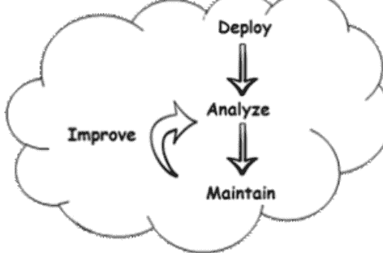

**图 3.7** 云管理。

如今，市场上已有多种云管理工具。所有公司在云管理方面都在使用它们。一些知名的云管理工具包括：

- **Cloudability** – 是一种用于监控和分析云支出的财务管理工具。它将支出汇总成报告，帮助识别降低成本的机会，通过短信和电子邮件提供预算警报和建议，并提供 `API` 将云账单和使用数据连接到任何业务或财务系统。

- **Cloudyn** – 帮助企业 IT 公司避免过度购买云资源。`Cloudyn` 的服务套件为用户提供仪表板，显示其所有虚拟机实例、数据库和存储的详细信息。`Cloudyn` 提供了对效率低下的洞察以及消除这些建议。

- **Dell boomi** – 是一种基于云的软件即平台 (`PaaS`)，适用于希望将其各种云端应用程序与其他以及本地应用程序集成的客户。新功能允许使用多个数据源，并在集成过程中为实时数据传输预留云资源。

- **Entstratius** 为公共云、私有云混合云提供跨平台云基础设施管理，可以与企业的治理和安全需求紧密结合。功能包括自助配置/取消配置、多币种成本/费用跟踪、可自定义基于角色的访问控制、单登录管理所有云资源，以及支持包括 `SAML 2.0` 和 `OpenID` 在内的企业认证系统。

- **Informatica** – 新的 `Informatica Cloud Masking` 服务降低了应用开发和测试期间数据泄露的风险。新的 `Informatica Cloud Extend` 工作流面向云端业务流程的创建和管理。

- **Mule soft** – 为 `CloudSoft` 提供基于云的集成服务平台 (`iPaaS`)，用于连接 `SaaS`、云和本地应用程序及 `API`，以及 `Mule ESB`（一种用于连接本地企业应用和云的开源企业业务服务）。

- **Opscode** – 让云管理员能够通过编程配置虚拟系统，从而减少重复的人工操作。它侧重于云资源的配置、配置和集成。

- **PuppetLabs** – 是一种自动化软件，赋予系统管理员自动化重复性任务、快速部署关键应用程序以及主动管理本地或云端基础设施变更的能力。该产品能够让系统管理员在 IT 基础设施生命周期的任何阶段以图形化方式查看并响应请求。新功能包括对第三方身份验证服务和 `Windows` 的支持。

- **RightScale** – 它是最早解决跨平台云管理的公司之一。其平台允许组织跨公共、私有和混合云轻松地部署和管理业务关键应用程序。`RightScale` 提供对云计算基础设施和应用程序的配置、监控、自动化治理。

在考虑云管理工具和技术时，还需要考虑的一些其他方面包括：

- **问题发现** – 如果云运行不正常，企业可能会损失数百万美元。云管理工具可以发现任何问题并尽早报告，防止资金或生产力损失。

- **SLA 报告** – 云管理工具可以监控云提供商遵守服务水平协议 (`SLA`) 的能力。主要包括延迟、响应时间等。当云整体输出任何下降时，云管理员会收到警告。

- **合规性管理** – 它涉及云的整体安全和合规性。云管理工具在遵守现有规则法规的同时提供了良好的防御，并向不断管理云技术的审计员进行报告。

- **意外恢复** – 云管理技术允许跟踪云系统的操作，包括故障发生之前发生的情况。因此，它们在发生任何故障或意外灾难时提供帮助。

# 云的分类

随着云计算变得越来越复杂，且已经在使用各种私有、混合和公共云基础的系统和基础设施，公司的云管理工具集合需要比其云计算策略更具灵活性和可扩展性。

## 总结

- 我们根据云可以访问和管理的范围对云进行分类。从技术上讲，边界词可以定义为注册用户对云的可访问性。

- 我们根据边界将云分类为私有云、公共云、混合云和社区云。每种云都有其优缺点，以及其功能和局限性。

- 私有云是受保护组织内部管理良好的云。组织内部的私有云有定义良好的边界来保护云。它们通常设置在组织的防火墙之后，以安全的方式防止黑客和入侵者的攻击。

- 在所有四种云中，私有云是比公共、混合和社区云更安全的云环境。（注：此处"private" 私有 可能为语境中"public" 公共的笔误）。

- 有许多云工具可以配置私有云。它们安装在 `Linux` 平台上。客户端机器被称为节点，服务器机器称为云控制器。通过使用这些工具，我们可以建立真正的私有云，并测试和分析云环境。它通常被所有研究人员和其他教育机构用于研究。

- 公共云向所有用户和商业世界开放。任何用户都可以注册到公共云并成为云用户。与受限的私有云相比，公共云在结构方面和应用方面更快。

- 云供应商可以是巨型 IT 公司。这些公司致力于通过用户友好的措施和随处可见的大量广告来使云流行起来。IT 专业人员在特定的云领域接受招聘和培训。

- 公共云必须检测任何疑活动，维护注册用户及其数据的隐私，不得操纵或篡改用户工作区。最重要的是，公共云供应商必须是值得信赖的。

- 混合云通过使用本地和远程资源对私有云进行扩展。它通常用于容量或云流量突然增加时。它被称为"云突发"（`cloud bursting`）。它可以被定义为多个用户为了其任务而突然增加对远程云的访问。

- 互操作性问题在混合云环境中特别为重要，因为它们集成了不同的云解决方案。而完全兼容的系统允许透明地交换云提供商和虚拟机镜像。

- 社区云是一种云，其云服务作为服务提供给有限的用户或组织，并由供应商管理。这些社区有共同的目标，并有实现其业务目标的计划。社区云也可以被定义为一种受限且安全良好的公共云。

- 社区云与私有云非常相似，因为它是一个集体定义、拥有和治理的云环境，不是由单一组织管理，而是由组成社区的组织团体管理。

- 云管理是指用于操作和监控位于远程虚拟云中的应用程序、数据、用户和所有服务的软件和技术。虚拟远程云需要对其功能和所有任务进行妥善管理。

- 所有类型的云（无论是私有云、公共云、混合云还是社区云）以及云所有的服务模型都需要云管理。云管理由云供应商或任何第三方供应商完成，而不是云中的注册用户。

# 第 4 章

# 云服务

| 目标 |
| --- |
| - 了解云的面向服务方面 |
| - 了解云的各种服务模型 |
| - 分析云立方模型 (`cloud cube model`) |

云的基本目标是为终端用户和业务世界提供服务。云本身的整体架构是面向服务的架构，使其能够基于服务的先进网络技术。以前的大多数技术在结构或功能方面并没有太多的服务模型特征。云技术在面向服务方面是相当独特的。在本章中，让我们看看云提供的各种服务以及面向服务的架构。以及这些服务是如何帮助推动这一全新的计算技术革命的。

## 4.1 面向服务的架构

正如我们一直所说的，从一开始开始，云计算就是基于面向用户的面向服务模型。在本节中，我们将详细介绍云架构是如何作为面向服务的模型运作的。

面向服务的架构（`SOA`）可以定义为一种支持服务之间通信的架构风格。"服务"一词指的是终端用户为了完成任务而可以的功能。在面向服务的模型中，服务由服务提供者的应用程序暴露，并由服务消费者调用。服务提供者和服务消费者之间通过服务合同和数据契约的概念松散耦合。它们使用消息进行良好的通信。"服务合同"术语可以定义为服务提供者和消费者之间交换通信消息的接口。

"数据契约"术语指的是服务与客户端之间关于交换数据的理解。服务消费者作为服务调用的一部分调用服务合同提供的操作，并根据数据契约交换数据。服务提供者将所有服务注册到服务注册表中，消费者通过查询该表来动态发现由提供者所提供的服务。

面向服务的架构因其友好的扩展性在企业 IT 公司中声名大噪。`SOA` 技术是高度可重用的元素，可以使用敏捷的 IT 基础设施进行集成。当 `SOA` 与云计算以及需要各种 IT 解决方案的企业结合时，`SOA` 可以提供一个极具吸引力的业务主张。

云计算与 `SOA` 之间的关系是，云计算提供了你可以按需利用的 IT 资源，包括托管数据、服务和流程资源。因此，你有能力将 `SOA` 扩展到企业之外，交给云提供商，并从中获益。也可以说云计算是带有按需服务的 `SOA` 扩展。

图 4.1 `SOA` 与云计算。

对云计算的兴趣也推动了对 `SOA` 的兴趣。`SOA` 和云在多个方面都是相互关联的。`SOA` 不仅是一种驱动更多重用和灵活性的机制，还提供了确定哪些应该留在本地、哪些应该在云端找到位置的能力。良好的 `SOA` 会导致良好的云计算策略，从而降低成本、增强灵活性，并为企业计算带来比我们长期以来见的更多的兴奋感。

## 4.2 云服务

云计算技术对终端用户充满了面向服务的模型。云服务提供商在云上提供作为服务的业务功能，这些功能可以被云用户消费。企业 IT 公司可以构建组织内所有员工都可以访问的服务和应用程序。让我们在本节查看云提供的所有服务。这是整个云计算技术最核心的特征。

云提供的服务通常被称为"万物即服务"（`SaaS`），包括所有虚拟化的物理资源、虚拟化基础设施，以及虚拟化中间件平台和业务应用程序都作为服务在云中提供和消费。虽然云提供了多种服务，但最常用且在云中经常提到的只有三个（列表中的最后三个）。每种服务都有多个供应商，即使是同一供应商也可能提供多种服务而不仅仅是一个。我们绝不能将这些服务与静态网页或在线应用程序混淆。云服务比基于 Web 的应用程序先进和动态得多。云服务在用法和核心功能方面也有更广泛的优势。各种服务包括：

- 存储即服务 (`Storage-as-a-service`)
- 数据库即服务 (`Database-as-a-service`)
- 信息即服务 (`Information-as-a-service`)
- 过程即服务 (`Process-as-a-service`)
- 集成即服务 (`Integration-as-a-service`)
- 安全即服务 (`Security-as-a-service`)
- 管理/治理即服务 (`Management/governance-as-a-service`)
- 测试即服务 (`Testing-as-a-service`)
- 网络即服务 (`Network-as-a-service`)
- 硬件即服务 (`Hardware-as-a-service`)
- 平台即服务 (`Platform-as-a-service`)
- 基础设施即服务 (`Infrastructure-as-a-service`)
- 软件即服务 (`Soft-as-a-service`)

还有许多可用服务。

- **存储即服务** - 从这种服务模型开始，云在远程云为用户提供所需的存储空间作为服务。用户可以将所有数据存储其中，并使用高速互联网轻松访问。无需携带优 盘、内存或其他任何存储设备。一切都存储在云端，只需通过网络连接即可访问。


- **数据库即服务** - 在这种服务模型中，云从远程云为所有用户操作提供数据库。看起来就像我们在本地数据库中工作，但所有工作都在远程虚拟云中心完成并保存。这与通常的在线数据库不同。基于云的数据库本质上更具分布式，可以被多个用户同时访问。

- **信息即服务** - 它包括终端用户从远程托管云利用的任何类型的信息。

- **过程即服务** - 它是一种可以将许多资源（如服务等）绑定在一起的远程资源。

- **集成即服务** - 它是从云交付完整集成栈的能力，包括与应用程序的接口、流控制和集成设计。

- **安全即服务** - 它是将所有安全特性作为捆绑服务在云中交付给终端的能力。

- **管理/治理即服务** - 它是任何提供管理一个或多个服务的按需服务。

- **测试即服务** - 它可以定义为云在云中提供所有测试功能作为服务的能力。

- **网络即服务** - 它涉及在云中作为服务提供的各种网络功能。

- **硬件即服务** - 它指的是在云中作为服务提供的各种硬件功能。

# 云服务

从企业 IT 公司的角度来看，`PaaS`（平台即服务）模型已成为一种非常友的服务模型。它最适合小企业组织环境。每家 IT 公司都需要几套软件和工具来完成客户任务。对于至少一个小型组织来说，购买所有授权软件可能并不经济，也不太符合实际需求。在当前场景下，创建一家公司很容易，但要购买有效创建高质量应用程序所需的所有硬件和软件资源变得非常昂贵。`PaaS` 充当中间件的角色，帮助组织创建和测试应用程序，而无需担心底层架构。`PaaS` 帮助开发者编写应用程序代码、在工作环境中进行测试、发布应用并持续修复漏洞，使其成为终端用户和商业世界的稳定产品。


图 4.2 `PaaS` 模型。

`PaaS` 服务由私有供应商提供，也可能包括巨型 IT 公司，其最终任务是为终端用户和商业世界提供云技术。`PaaS` 供应商提供的功能包括多租户、用户服务账户管理、订阅者管理、计量与分析以及资源管理。每天都有新的供应商带着更先进的功能进入市场，以满足终端用户和商业世界的需求。

`PaaS` 的益处主要由软件开发者、`Web` 开发人员、测试质量保证团队、维护团队等利用。`PaaS` 在开发新应用程序、维护现有应用程序以及在相应工作环境中托管应用程序方面都是非常有效的。`PaaS` 公司有时被称为云中间件提供商，因为它们的服务构成了云计算服务交付的三层架构中的中间层，被称为“云栈（cloud stack）”。`PaaS` 还提供了支持在云栈顶层进行 `SaaS`（软件即服务）交付的服务。对于任何专门从事软件的公司来说，`PaaS` 解决方案无一例外地创建了一个更安全的开发和测试环境。`PaaS` 提供的一些功能包括：

- 开发和设计工具
- 应用程序托管环境
- 测试和维护环境
- 数据库管理
- 服务端工作空间
- 存储设施
- 网络设施
- 正在运行的操作系统

这些每一项在软件开发行业中都至关重要。它为开发和测试创建了一个封闭环境，增强了防止外部渗透或入侵者和黑客导致简单数据丢失的保护级别。`PaaS` 为企业界提供的一些使其成为完美解决方案的优点包括：

- 独立于物理基础设施 – `PaaS` 模型为云用户提供完全作为服务的完全租赁物理工作环境。企业 IT 公司可以集中在构建、测试和维护应用程序上，而不是购买昂贵的服务器和存储硬件。因此，云技术公司可以使用虚拟硬件和软件满足其需求。
- 经济性 – `PaaS` 模型对业务的另一个重要优势是减少了公司完成任务所需的授权和专有软件的资金投入。租赁模式比购买所需资源要便宜得多，且要好得多。
- 动态且先进 – `PaaS` 模型的设计使得工作环境中的所有资源都能随着市场的进步轻松更新，以满足商业世界的需求。`PaaS` 还提供了多种类型的资源，而不是限于单一类型。这些资源对于终端用户来说是非常动态可用的。
- 灵活性 – 商业世界对在平台上安装哪些工具具有控制权，以创建所需的理想软件开发环境，从而满足客户需求。
- 适应性 – `PaaS` 特性高度业务友好型，并且对企业 IT 行业的变化和进步具有动态性。因此可以很容易适应业务需求。它们在开发者和客户之间提供了双赢局面。
- 地理上分离的团队协作 – 企业 IT 公司位于不同的地理位置，大量员工在同一个项目中工作，同一项目的每个模块分布在他们之间，在这种情况下，`PaaS` 模型在应用程序的开发、测试和维护中非常有用。
- 安全性 – `IaaS` 模型在云技术中提供作为服务的底层基础架构，确保数据安全（注：此处指通过云技术确保数据安全性）。

# 云服务


一些著名的 `IaaS` 供应商包括：

- `Microsoft Azure`
- `Google App Engine`
- `Amazon EC2`
- `Salesforce.com`
- `VMware`
- `CloudBees`
- `Orange`
- `Gridscape`

## 4.4 基础设施即服务（Infrastructure as a Service）

基础设施即服务（`IaaS`）是云技术中的下一种模型，它作为服务提供基础架构。云用户可以使用虚拟硬件和软件来满足需求。`IaaS` 提供了云技术中的多种方式，包括虚拟服务器、负载均衡等。

`IaaS` 这种设计方式使得工作环境中的所有资源都能随着市场的进步轻松更新，以满足商业世界的需求。`PaaS` 还提供了多种类型的资源，而不是限于单一类型。这些资源对于终端用户来说是非常动态可用的。

## 云服务

- **故障管理** – 得益云的冗余性，如果某台服务器或网络交换机故障，数据中心将由于其大量的硬件资源能够自然地重新路由活动水平而不受影响。即使整个数据中心发生故障，主机也有二级和三级中心来确保持续在线运行。这通常与 `Web` 技术不同，在 `Web` 技术中，服务器宕机或故障会导致整个用户活动受到影响。

云中一些显著的 `IaaS` 模型提供商包括：

- `Amazon web services` (亚马逊云服务)
- `Openstack cloud` (`OpenStack` 云)
- `Rackspace`
- `Ter بمعنى`
- `Savvis`
- `IBM`
- `CSC`
- `Gogrid`

现在让我们来看下云计算中 `PaaS` 和 `IaaS` 服务模型之间的对比。

| 特性 | 基础设施即服务 (IaaS) | 平台即服务 (PaaS) |
|---|---|---|
| 共享与多租户 | 多个用户 | 多个应用程序 |
| 可扩展性 | 根据需求扩展服务器 | 应用程序线性扩展 |
| 敏捷性与适应性 | 虚拟机放置 | 负载均衡和工作负载管理 |
| 可靠性与容错性 | 可靠的基础设施 | 可靠的应用程序 |
| 服务水平协议 (SLA) | 主动系统监控 | 分配资源以满足 `SLA` |
| API | 通过 `API` 管理基础设施 | 通过 `API` 管理应用程序 |
| 虚拟化 | 服务器虚拟化 | 应用程序虚拟化 |

## 4.5 软件即服务

在本节中，让我们详细了解一下云计算中的*软件即服务 (SaaS)* 模型。我们所有人应该听过计算机技术中的“软件”这一术语。为了完成计算机中的每项任务，我们需要一个与计算机内部硬件和其他平台的接口，这是通过被称为*软件*的编码用户界面来实现的。在云的 `SaaS` 服务模型中，所需的软件作为服务提供给终端用户和商业世界以完成他们的任务。云端用户任务的整个软件迁移是通过创建相同软件的多个虚拟实例并供云中的多个用户使用来实现。因此，在 `SaaS` 模型中，软件是以服务的形式交付的。它是终端用户和商业社区最常用的云服务之一。可以将 `SaaS` 模型想象为软件应用程序，它是如此动态且稳健，以至于被静态网页上的任何数量的在线用户使用。但可能不要将静态 `Web` 应用程序与动态云应用程序混淆。

云 `SaaS` 模型在 20 世纪 90 年代后期随着互联网革命和计算机硬件的进步开始成熟并流行。从那里开始，更多的在线应用程序开始兴起。随着 2007 年后期云技术的成熟，`SaaS` 模型被所有终端用户和商业世界广泛使用。供应商开始租赁软件供用户使用。通过这种方式，终端用户不再需要下载、安装和更新软件的过程。使用租用软件也比购买许可软件更具经济效益。在 `SaaS` 模型中，整个软件托管在云数据中心强大的虚拟服务器上创建。虚拟化技术使 `SaaS` 模型成为现实，用户任务的执行在远程云服务器上进行，但对终端用户来说，就像是在用户机器上执行一样。`SaaS` 模型非常用户友好且方便，使用网络浏览器连接互联网的用户可以访问所有的云软件和工具。在所有云服务模型中，`SaaS` 是最常用的一个。

从 IT 公司的角度来看，`SaaS` 是其业务运运的另一个利好。`SaaS` 模型非常有效，它减少了维护公司内部各种软件所需的时间和精力。在 `SaaS` 模型出现之前，必须购买、维护、更新并对所有许可软件进行故障排除。他们还需要专业的 IT 人员来管理公司内部的软件和工具。虽然 IT 公司使用其内部开发的工具和软件且具有相当机密性，但 `SaaS` 为商业世界的需求提供了正确的解决方案。与公司购买许可软件相比，`SaaS` 模型也更经济。`SaaS` 供应商拥有运行本地硬件或软件的场所。他们同样在在那里存储所有客户数据。客户随后在云环境中远程访问软件和数据。许多 `SaaS` 选项可以通过互联网浏览器使用，而另一些则需要在客户端计算机上安装简单的应用程序以访问软件并接收更新。这与 `PaaS` 和 `IaaS` 的独立性类似。

图 4.，`SaaS` 模型。

## 云服务

`SaaS` 模型涉及公司和终端用户对软件的订阅。公司中的项目团队可能会使用软件一段时间，直到工作完成，并根据使用限制支付租金。企业还支付月费或年费来利用供应商提供的服务，无论是云存储、项目管理还是自动更新。他们还将作为供应商每月维护服务的组成部分接收软件更新的访问权限。`SaaS` 供应商可以是拥有大量池化资源到远程虚拟云的巨型 IT 公司。他们拥有庞大的云基础设施，通过资源的虚拟实例同时支持大量的云用户。一些常见的 `SaaS` 模型包括：

- 下载软件
- 文字处理软件（通常为文本编辑器）
- 数据库和演示工具
- 虚拟 CPU 处理软件
- 应用程序开发工具
- 漏洞测试工具
- `Web` 开发和托管软件
- 移动应用程序软件
- 编程编译器
- 完整的操作系统
- 数据存储软件
- 日历、计算器等简单工具

这些是云技术 `SaaS` 模型中为终端用户和商业社区提供的各种工具。`SaaS` 模型的一些著名供应商包括：

- `Cloudswich`
- `Cloudtran`
- `Appenda`
- `Abiquo`
- `Accelops`
- `Cloud9`

`SaaS` 的主要关注之一是数据安全和所有权。如果供应商访问云中的机密业务数据，就会出现真实问题。云用户需要注意供应商或入侵者的恶意过程。在谈判服务水平协议 (`SLA`) 时，数据所有权并不交给供应商。`SLA` 通常规定了此类问题的参数，概述数据所有权、安全要求和典型的维护计划。供应商通常采取许多安全措施，从存储冗余到多层防火墙，以防止硬件故障和数据泄取。

软件即服务满足了许多公司和个人寻求的真实需求。将应用程序迁移到云环境不仅让企业也让个人能够以更优惠的月费访问企业级软件。作为一种软件产品和按需许可，它为许多客户提供了超出简单软件解决方案的收益，创造了真正的长期价值和节省。

## 云计算

## SaaS

`Google Doc`、财务、协作、通信、`CRM`、`HR`、`Zoho`、`Salesforce`。

## PaaS

`Java`、开发工具、中间件、`Windows`、`Aptana`。

## IaaS

`Amazon EC2`、`S3`、`Google Cloud`。

图 4.5 云服务模型及其示例。

| 特性 | IaaS | PaaS | SaaS |
|---|---|---|---|
| old | 基础设施 | 平台 | 软件 |
| 示例 | 计算、存储、网络 | 运行时、操作系统、中间件 | 应用程序、电子邮件、`CRM` |
| 管理 | 用户管理操作系统/应用 | 用户管理应用程序 | 供应商管理一切 |
| 可扩展性 | 高 | 中 | 低 |

## 4.6 云立方体模型 (CLOUD CUBE MODEL)

另一种理解管理云的各种服务模型、部署和其他属性的方法是使用由 `Jericho` 论坛提出的定义模型，称为云立方体模型。

图 4.7 云立方体模型。

云立方体模型说明了当今云服务中提供的许多组合，并提出了四个标准/维度，以区分不同的云形成及其提供者，以便理解云计算如何影响处理安全问题的方法。

云立方体模型还强调了理解和将云模型映射到控制框架和标准（如 `ISO/IEC 27002`）的挑战，该标准为组织内部启动、实施、维护和改进信息安全管理提供了一系列指南和通用原则。

标准在每项技术中都非常重要。标准定义了技术成型和治理的方式。任何对上述标准的偏离标志着违规活动。云安全也通过对标准流程的各种偏离进行监控和处理。

云立方体模型提供了云的整体参数，这在云的管理非常有帮助。人们可以想象云在技术和现实中的广阔性。从巨型 IT 公司到小型组织，大量用户在同一时间为了各种目的使用相同的池化资源。每个注册的云用户都使用相同的云资源实现各种目的。一些云供应商提供免费云，而另一些付费的被称为专有云。云类型通过定义一个安全的边界帮助我们管理它们。云有多种类型，如私有、公有、混合和社区云。根据用户的需求和期望，可以使用所需的云类型。由于云的开放本质，安全性是云的一个关键问题。只有安全良好的云才能被所有人信任和使用。

## 云计算

云由某些供应商或第三方供应商管理。供应商可以是像 `Google`、`Amazon` 和 `Microsoft` 等巨型公司。如果组织无法投入资源进行管理，有时会对云进行外包。

## 总结

- 服务面向的架构 (`SOA`) 可以被定义为支持服务之间通信的体系风格。“服务”一词指的是终端用户可用的用于完成任务的功能。
- 服务提供者和('消费者通过服务合同和数据合同的概念进行松耦合连接。
- “服务合同”术语可以定义为服务提供者与消费者之间交换通信消息的接口。“数据合同”术语指的是服务与客户端之间交换数据的理解。
- 云计算与 `SOA` 之间的关系是，云计算提供了你可以利用的 IT 资源，包括拥有数据、服务和的资源。云计算也驱动了对 `SOA` 的兴趣。`SOA` 和云在多个方面都是相互关联的。
- 云计算技术对终端用户来说充满了面向服务的模型。云服务可以提供作为云端服务的业务功能，这些功能可以被云用户消费。
- 云提供的服务通常被称为万一切即服务 (`XaaS`)，包括所有虚拟化的物理资源、虚拟化基础设施，以及虚拟化中间件平台和业务应用程序在云中作为服务被提供和消费。
- 平台即服务 (`PaaS`) 可以被定义为通过浏览器向软件开发者或终端用户提供的作为服务的开发环境。它帮助开发者在位置独立的情况下轻松完成他们的任务。
- `PaaS` 的工作就像中间件一样，帮助组织创建和测试应用程序，而不必担心底层架构。`PaaS` 帮助开发者编写应用程序代码、在工作环境中测试、启动应用并持续修复错误，为终端用户和商业世界提供一个稳定的产品。
- `PaaS` 的一些功能包括开发和设计工具、应用程序托管环境、测试和维护环境、数据库管理、服务器端工作空间、存储设施、网络设施以及运行的操作系统。

## 云的服务

- 基础设施即服务 (`IaaS`) 为终端用户任务的计算提供所需的基础设施作为服务。基础设施从虚拟数据中心、虚拟服务器、虚拟硬件、网络连接、负载均衡器等不等。
- `IaaS` 背后的核心思想是，各种任务所需的硬件作为从从远程中心提供的服务。远程中心由各种服务提供者管理，其中包括巨型 IT 公司。
- `IaaS` 的服务提供者需要维护由终端用户或业务社区所需的整个基础设施的大池。云中的数据中心和服务器必须足够强大，以便同时处理来自多个客户端的请求。它们必须足够健壮，以克服多个客户端使用期间的任何故障。
- 在云的 `SaaS` 模型中，所需的软件作为服务提供给终端用户和商业世界以完成他们的任务。云中用户任务的整个软件迁移通过创建相同软件的虚拟实例来实现，这些实例供云中的多个用户使用。
- 与公司购买许可软件相比，`SaaS` 模型也是非常经济的。`SaaS` 消除了对本地硬件或软件的需求。`SaaS` 供应商在自己的设施中运行软件。
- `SaaS` 模型涉及公司和终端用户对软件的订阅。公司的项目团队可能会使用软件一段时间，直到工作完成，并根据使用限制支付租金。企业还会支付每月或每年费用来利用供应商提供的服务。
- 云立方体模型说明了当今云服务中允许的组合，并提出了四个标准/维度，以区分不同的云形成及其提供者，以便理解云计算如何影响处理安全问题的方法。
- 云立方体模型还强调了理解和将云模型映射到控制框架和标准（如 `ISO/IEC 27002`）的挑战，该标准为组织内部启动、实施、维护和改进信息安全管理提供了一系列指南和通用原则。

## 第五章

## 云的应用

- 了解使用虚拟化技术在数据中心服务器上托管云应用
- 了解跨云的概念
- 了解云的各种应用以及未来的各种云模型

## 5.1 向云平台的迁移

我们已经看到了各种云类型和模型模型。我们不能忘记，在过去的十年里，云计算发生了巨大的变革，意味着我们一直在使用传统的 IT 方法和网络概念来完成用户任务，而不是先进的云计算技术。在本节中，让我们详细查看从传统方法迁移到云平台的整个过程、技术和方法论。

# 云端行动

技术工作并支持其整个工作环境。在迁移的初始阶段，新技术需要时间才能完全投入并让所有员工获得顺畅的操作方式。人们不能立即低估或高估底层技术和整体流程。它需要一些时间来完全成熟，其效果也会被所有用户认可。

“迁移”一词在这里是一个非常大的术语。迁移的完整含义涉及：

- 迁移所有数据、应用程序和服务
- 迁移整个工作空间
- 迁移整个基础设施


# 整个底层技术的迁移

它涉及一整套变更或转型，而不仅仅是平台的切换。虽然云迁移可能会带来许多挑战并引发安全疑虑，正如我们所知道的，数据安全和隐私是云计算中的一个大问题。云计算还让公司能够潜在地减少资本支出和运营成本，同时从云端计算提供的动态扩展、高可用性、多租户和有效的资源分配中获益。正如我们所知，云计算是一种面向服务的技术，它将所有池化的资源租用到这项新技术中。特别是对于小型企业而言，迁移到云端可以为其云端事业提供巨大助力。

考虑到 IT 公司的巨大规模，云迁移的过程是一项非常广泛的任务。在迁移过程中必须小心，因为在整个转型期间也会涉及一些意外之外的风险和事故。人们不要被整个迁移过程搞混乱，因为会有多个带有已修改和未修改平台的数据和工作平台。用户必须启动一个系统化的转型过程来实现所需的目标。事实上，云迁移过程可以按照非常系统化的方法遵循四个简单步骤。遵循这四个迁移步骤对于足够实现所需的目标，并且人们可以实现平稳的过渡。

## 1. 计划

- 确定关键业务驱动因素，这些通常取决于公司的视角
- 定义业务目标和整体需求
- 获得高层支持
- 设置项目指导原则和目标
- 建立由 IT 和业务代表组成的团队，并对底层工作有清晰的理解
- 为转型制定项目计划，其中包括：
  - 定义业务需求
  - 设置关键成功指标和评估参数
  - 设置完成任务的时间表
  - 识别决策权限

### 执行

- 执行计划并为实际实施铺定阶段
- 专注于原始项目范围，不要在执行过程中被其他问题分散注意力
- 记住始终遵循指导原则
- 定期与所有利益相关者沟通并更新底层工作
- 培训用户如何在新平台上工作以及所有其他限制

### 监控

- 监控新技术的采用情况
- 分析新技术的整个工作过程
- 跟踪初始规划阶段考虑的所有成功指标和所有评估参数
- 专注于工作的主要目标和目的
- 遵循指导原则和所有其他容错建议
- 仅根据可量化的业务需求和不断的需求实施变更

### 管理

- 新工作环境的妥善管理对于转型非常重要
- 未来所有的工作必须在新平台上启动和执行，而不是回到之前的平台
- 人们必须维护一套适当的参考资料和文档供未来使用
- 人们必须排除新平台中的所有新问题和故障
- 人们必须在环境中环境中完善和迭代底层工作，以稳定新环境
- 最后，人们必须对新工作环境获得良好的实践经验

因此，遵循这些系统化的步骤和方法对于转型来说就足够了。

一旦完成如此巨大的云技术迁移，就必须验证整体转型。从实践角度讲，与这种大规模迁移相关的有很多问题。因此，在全面的云迁移之后，需要对新平台中的所有工作、工具和技术进行彻底检查。人们可以列出所有测试用例并执行它们，以检查整个迁移过程的有效性。如果新平台以不同的方式执行相同的平台应用并给出错误的输出，这可能是一场灾难。简单的原因可能是新旧平台之间的不匹配。因此，如果没有完全的互操作性，整个迁移过程就完全白费了。

人们必须确保系统已迁移到新平台，且在功能和非功能需求上没有失真。在新迁移后满足了所需的系列问题。随着系统迁移到云端，有必要为它们分配正确的资源。计算实例、存储设备和网络带宽必须根据用户的需求与系统需求进行适当对齐。这标志着新平台上全功能工作环境的形成。

此外，人们还要考虑长期观点。如果未来几年出现了另一种新技术，并再次发生新技术的全面革命怎么办？当前迁移的云计算技术必须能够进一步支持该新技术的迁移。

## 5.2 云托管

现在在本节中，让我们详细讨论云计算中的一个常用术语——“云托管”（`cloud hosting`）。我们还将讨论“云服务器”这一术语。

我们很多人一定听过 `web hosting` 或 `application hosting` 这些术语。这些传统术语与 Web 技术更广泛的网络领域相关。现在在云计算中，我们使用云托管这一术语。我们可以简单地将云托管理解为：在合适的平台上设计的应用程序被托管在虚拟云中。正如我们所知的，云在技术意义上是非常广大的，包含了动态池化的资源。尽管人们不要将云托管与传统的 `web hosting` 混淆。

传统的 `web hosting` 是指在单服务器上托管用脚本语言编写的静态页面。而云在本质上是动态的，它可以从一个虚拟机迁移到另一个虚拟机，并且主要通过虚拟化和分布式技术，在每个站点对每个远程用户都非常可用。我们拥有非常先进且动态的服务器，被称为虚拟服务器。我们已经看到了 Web 技术和云技术之间的整体区别。

传统的托管有两种类型：

- **`shared hosting`**：用户之间共享服务托管内容。它非常便宜，但也缺乏灵活性。
- **`dedicated hosting`**：在这种情况下，用户购买一台专供自己使用的服务器。它不与他人共享。

云托管过程根据情况使用这两种托管类型。资源可以在云端扩展或缩小，使其更具灵活性，因此更具成本效益。当对服务器的需求增加时，容量可以自动增加以匹配需求，而无需永久付费。

云托管描述了根据用户甚至提供者的需要以非常灵活的方式配置虚拟服务器的最佳方法。它提供了更可靠、可扩展且更先进的网络基础设施。

云托管为用户提供了一个界面来控制存储在虚拟中的数据。安全数据、管理数据、编辑数据、创建新数据集、修改数据等。除此，它允许通过少数步骤创建新服务器、调整服务器大小以及其他网络操作。

# 云端操作

在构建其 Web 应用程序之前的环境。人们可以想象为在云环境中工作所需的底层基础设施。然而，在 `PaaS` 服务模型下，客户端或终端用户也获得了这种软件环境，如操作系统、数据库支持、Web 服务器软件和编程支持，他们可以直接在上面安装和开发自己的 Web 应用程序。它也可以定义为用户工作时所需的平台。对于复杂的 `IaaS` 基础设施和经验丰富的 IT 用户，他们可能希望拥有定制程度最高的 `IaaS` 服务模型，但其他人可能更倾向于 `PaaS` 服务模型的便利性。因此，云托管的示例可以最好地描述云的各种服务模型。

云托管另一个显而易见的例子涉及公共云模型的使用，即在虚拟服务器上托管网站或应用程序，这些服务器从与可用虚拟服务器相同的资源池中提取资源，并使用相同的公共网络传输数据。数据物理上存储在构成云资源的底层服务器上。人们可以想象像 `Google`、`Amazon` 和 `Microsoft` 这样的巨头提供的公共云产品。但现在，大多数云服务提供商都是收费的，并非免费提供。这些公共云将包含安全措施以确保数据的私密性，并满足大多数网站的安装需求。然而，在安全和隐私更受关注的情况下，企业可以转向私有云托管作为替代方案，使用围栏资源，无论是位于本地还是云服务提供商处。正如我们所知，私有云比公共云更安全。

云托管的一些功能或特性包括：

- **简单性** – 与基于 Web 技术的虚拟托管相比，云托管非常简单，只需几个步骤即可实现目标。
- **按需付费模式** – 像其他云计算工具一样，云托管也对使用的资源收费并按量计费。
- **可扩展性** – 云服务器根据用户需求具有高度的可扩展性，不像传统服务器。
- **可靠性** – 云服务器本质上是高度可靠的。云托管隔离每台服务器，确保某个服务器的可能压力不会影响任何服务器的性能。
- **可定制性** – 云托管非常用户友好，允许用户配置所有需求。用户可以指定服务器的处理能力、位置和操作系统，还可以配置服务器本身以最佳方式呈现您的内容。
- **安全性** – 与传统服务器相比，托管在云服务器的数据或应用程序安全得多。通过将服务器数据分布在冗余服务器上，托管在云中的信息可以受到任何硬件故障或其他事故的保护。自动备份和快照确保服务器内容保持安全和更新。

## 云服务器

当我们谈论云托管时，我们不能忘记另一个重要的概念，即云服务器。随着先进云技术的发展，基于传统服务器的网页托管时代现在几乎结束。虚拟化概念（主要是服务器虚拟化类型）为服务器的使用赋予了新的意义。对于云托管，我们通常使用被称为云服务器的高度动态的虚拟服务器。云服务器是在一个非常强大的服务器集群内部创建的非常强大的虚拟环境。云服务器具有许多专用服务器不提供的优势。

与传统服务器相比，云服务器在功能上要先进且独特得多。嗯，云服务器与传统服务器之间有很多区别。

| 云服务器 | 传统服务器 |
| :--- | :--- |
| 它们涉及虚拟化概念（主要是服务器虚拟化技术）以及所有的网络概念 | 它涉及最少的网络概念 |
| 本质上是高度动态且可扩展的，能更好地处理流量 | 虽然它们具有可扩展性，但在最坏情况下，服务器会在巨大流量下崩溃 |
| 其运行机制本质上具有弹性和冗余性 | 本质上具有冗余性 |
| 磁盘空间无限扩展 | 磁盘空间有限制 |
| 在云计算技术中，云服务器作为服务提供给用户或组织 | 它们是专用的，并由用户或组织所有 |
| 基于相同的模型，无需维护硬件或配置任何其他所需功能 | 需要一套定义良好的服务器维护和配置 |
| 它基于云计算的按需付费模式，非常有经济性 | 它们是专用的且价格昂贵 |

当我们选择云托管时，用户租用虚拟服务器空间，而不是我们通常那样租用或购买物理服务器。它们通常根据任何特定所需的容量按小时付费。正如我们所知，云计算中的按需付费模式或资源租赁。今天市场上上有数百万云服务器提供商。与传统互联网中的专用服务器不同，云服务器可以在 `hypervisor` 或虚拟机管理器上运行。监控程序的作用是控制操作系统的容量，以便将其分配到需要的地方。通过云托管，每个特定客户端都有多个云服务器可用。这允许在必要时将计算资源分配给特定的客户端。当流量巨大时，网站将临时访问额外的容量。云服务器还提供冗余。如果某台服务器故障，其他服务器将接替其工作，而且它们本质上更具动态性。

# 云端操作

云服务器是供应商和用户真正的双赢提供者。供应商通过更好的资源分配和更密集的的数据中心将减少的开销传递下去，而云在平台上提供了灵活的按小时租赁费用，以及根据需要随时进行缩放的益处。对于许多仍持有季节性高峰等折旧资产的企业来说，云服务器是所有业务组织非常明智的选择，特别是对于小微企业。

云服务器的优势与云托管几乎相同，包括：

- 云服务器中所有资源的按需可扩展性
- 与传统服务器相比，服务器的整体设置和配置非常简单
- 云服务器是完全可定制的，可以根据需要添加防火墙、负载均衡、快照和镜像等所有资源。完全支持 `Linux` 和 `Windows` 操作系统平台
- 云服务器通过云计算按需付费模式极具成本效益
- 云服务器通过高位置的数据备份和恢复系统，受到任何事故和灾难的高度的安全

## 5.3 虚拟数据中心

从整个对话从开始，我们一直在使用远程中心、虚拟数据中心等词汇，它们的意思是相同的。现在在本节中，我们将详细讨论虚拟数据中心这一术语。让我们先了解数据中心的整体目的和功能。

> 我们是否想过我们在互联网上看到的所有数据、内容、图像、视频等存储在哪里？
>
> 它们是从哪里在几秒钟内被获取的？

这发生在一个被称为数据中心的良好安全存储介质中。数据中心可以占据建筑的一个房间、一层或多个楼层，或整栋建筑，它们可以非常巨大，人们不能错误地认为它们只是几台计算机及其他设备。大多数设备通常安装在 19 英制机柜中的服务器形式，这些机柜通常成单排排列，中间留有走廊。这允许人们访问每个机柜的前后部。服务器的尺寸差异巨大，从占据标准机柜 42 个槽位之一的 `1U` 服务器，到占据地面上多块瓷砖的大型独立式存储仓储。

主机计算机和数据存储设备可能与机柜一样大，并放置在机柜旁边。大型数据中心在维修或升级时可能会使用装有 100 台或更多服务器的集装箱，他们只需更换整个集装箱。清洁、充足的电力也是至关重要的。数据中心需要保持其设备始终运行，绝不能意外关闭。数据中心仅在维护期间才会关闭。它们应该准备好应对过热甚至断电的情况。电力必须经过调节，并且必须配备备用电池和柴油发电机，以确保无论发生情况下都能持续供。

正如你所想象的，所有计算机运行都会产生大量热量。数据中心必须冷却设备产生的热量。最常见的冷却模式是空调，在条件允许的情况下（例如 `Washington` 州 `Columbia River` 沿的一些数据中心），水冷也是一种选择。不仅冷却环境，还能控制湿度以避免静电积聚。到网络骨干的网络连接和带宽至关重要，以处理整个服务器和存储单元集的输入输出。如果没有人访问，所有这些服务器将处于空闲状态。另一个重要方面是物理和逻辑的。

较大的数据中心是全球黑客的目标。某些独立式数据中心从“通过模糊实现安全”开始，掩盖该位置存在数据中心的事实。守卫、人行禁锁和先进的身份验证技术防止未经授权的人物理进入。`firewall`、`VPN` 网关、`intrusion detection` 软件等防止未经授权的人进入网络。最后，数据中心必须假设最坏的情况，并制定灾难恢复应急计划，以避免数据丢失，并在灾难发生时确保服务损失最小。

即使大型数据中心在技术上受到创新型黑客的攻击，对于用户和公司来说也彻底结束了。他们将在失去任何数据和已完成工作的情况下，回到石器时代。

嗯，当我们谈论云计算时，每个数据中心都需要支持虚拟化概念和云的所有原则。专门用于所有云端操作和存储的数据中心被称为虚拟数据中心。在云计算服务的语境下，虚拟数据中心存在于 `Infrastructure as a Service` (`IaaS`) 服务模型中。它使用户从服务提供商快速访问云基础设施。这意味着根据其功能，虚拟数据中心属于基于云的服务模型。

虚拟数据中心由云基础设施的存储、计算、网络和安全等虚拟化资源池组成，并通过用户访问的在线门户进行安全管理。

# 云计算行动

虚拟数据中心服务允许企业和其他组织推出按需托管、存储和计算，从而创建他们自己的私有云。

虚拟数据中心包含虚拟机模板的公共目录和私有目录，用户可以使用这些模板构建新的虚拟机，或者上传已经在内部环境中运行的虚拟机，或满足用户的所有其他需求。你还可以在虚拟数据中心内构建并维护虚拟应用程序。当你有一个需要多个虚拟机（`VM`）、自定义安全和网络设置、自定义启动参数的应用程序，并且希望从目录中存储和配置应用程序时，就会使用虚拟应用程序。

例如，你可能偶尔需要为其中一个网站创建一个实例，并带有 Web 服务器和特定的安全设置，以便于进行每次升级的测试。整个实例可以作为虚拟应用程序存储在目录中，稍后用于在你自己的虚拟数据中心中创建升级测试环境。测试完成后，你可以关闭虚拟应用程序。

图 5.1 虚拟数据中心。

带有虚拟服务器的虚拟数据中心比带有物理服务器的数据中心具有更多优势。其中一些包括：

- 热量产生较少 —— 嗯，我们知道虚拟化是一种绿色计算的形式，可以节能。在同一硬件上运行几台机器可以节省整体功耗，产生的热量也更少。数据中心的虚拟化通过减少所需的冷却机制，减少了那里运行的多台机器产生的热能。不要忘记公司在数据中心的冷却解决方案上花费了大量资金。
- 降低成本 —— 正如我们所知，硬件虚拟化节省了购买所有所需基础设施设备的投资资金。数据中心的虚拟化概念降低了整体成本。
- 部署更快 —— 与物理服务器相比，在带有虚拟服务器的虚拟数据中心中，所有用户内容和镜像只需几次点击和简单的配置设置即可部署。
- 备份更简单 —— 虚拟服务器的备份和恢复过程非常简单容易，因为虚拟服务器中的数据可以在发生意外或崩溃时轻松地从一台机器移动到另一台机器。
- 绿色计算 —— 嗯，正如我们所说，虚拟化是一种非常环保的绿色计算形式，从长期来看，我们只能看到使用虚拟服务器而非传统的物理服务器。考虑到全球变暖的大规模影响，这种形式的采用是当务之急。
- 测试环境 —— 另一个优势是虚拟平台上最佳的测试环境。你可以将这些测试环境与终端用户隔离开，同时保持其在线。当你完成工作后，将其部署为上线状态。虚拟服务器是在隔离环境中测试应用程序的良好平台，然后部署到真实环境中。
- 灾难恢复 —— 嗯，数据中心需要对任何形式的灾难做好充分准备，必须为任何情况做好准备。当你的数据中心虚拟化时，灾难恢复要容易得多。有了虚拟机的最新快照，你可以快速恢复所有数据并恢复运行。当灾难袭击数据中心本身时，只要能够重新创建网络方案，你就可以将这些虚拟机移动到其他地方。这种灵活性意味着你的灾难恢复计划可行并具有更高的成功率。
- 厂商独立性 —— 整个虚拟化概念的另一个优势是用户对厂商的独立。虚拟化的独特之处在于与软件和硬件层的抽象。这意味着用户不需要依赖于特定的厂商，虚拟机并不在乎运行在什么硬件上，用户不会被束缚在单一厂商、服务器类型甚至平台上。从而赋予用户平台独立性。
- 迈向云技术 —— 嗯，数据中心的虚拟化正是用户正迈向完整的云技术平台。通过转向虚拟机和虚拟化概念，你更接近于享受完整的云环境及其所有应用程序。你甚至可能达到这种程度：可以从你的数据中心部署和接收虚拟机，以创建一个强大的基于云的基础设施。除了实际虚拟机之外，这种虚拟化技术让你更接近云思维，使迁移变得更加容易。

## 5.4 跨云

在这一节中，让我们来看另一个被称为“跨云”（`inter cloud`）的有趣术语。我们将详细讨论云的结合以及这种需求。尽管跨云通常被视为云计算的未来前景。

我们都听过互联网被称为“网络的网络”这一术语，这在许多书中被经常使用。在云计算中，跨云或多个云的组合被称为“云之云”（`cloud of clouds`）。其背后的理念是，单一的通用功能可以通过云端的按需操作，将许多不同的个人云合并成一个无缝的整体。尽管人们绝不能将跨云与混合云（`hybrid type of cloud`）混淆。虽然这是一个非常新且属于云计算的未来观点，但这一概念仍处于非常初期的阶段；我们只能期待它在未来几年内发生革命性的成熟。

`Inter cloud` 系统是一家全球单一源增值服务提供商，面向企业 IT 企业和服务提供商。`Inter cloud` 提供云服务和托管服务、专业咨询服务以及语音、数据和光服务，以帮助其客户满足不断变化的技术需求。其工程、设计和维护服务支持一些最先进的企业级光纤以太网和无线网络的构建与运行。`Inter cloud` 为服务提供商和企业市场提供咨询和专业解决方案，支持电信业务的所有方面。`Inter cloud` 提供应用和业务，包括统一通信、交互式语音响应（`IVR`）和基于 `SIP` 的呼叫中心。

跨云场景基于一个关键点：每个单一云或云的服务提供者并不拥有无限的资源或支持所有需求的能力。想象一下，如果一个云本身被几个用户完全饱和，所有资源都被用尽了，达到了云的饱和点，会发生什么。在这种情况下，跨云的概念就进入了视野。当一个云的设施计算和存储资源达到饱和，或者被要求在其没有足迹的地理位置使用资源时，它仍然会收到来自客户的服务请求。跨云场景将有助于解决这种情况，即每个云都可以使用其他云基础设施的计算、存储或任何类型的资源。


因此，不同的云共同工作以克服它们的饱和问题。云相互结合以帮助相互实现其的完整功能。当其他云完全饱和时，通过使用跨云技术共享云平台，也有助于空闲云的充分运行。这与互联网的工作原理非常相似，连接到端点的服务提供商将访问或在源地址和目的地址之间传递流量，而这些地址通过互联网路由协议与其他与其有对等关系的服务提供商进行预先安排的交换。这也类似于移动运营商实现漫游和运营商间互操作的方式。这种形式的云交换、对等或漫游如果能够超越理论框架，可能会在云提供商之间带来新的业务机会。

跨云概念具有许多优势。当特定云发生任何事故或任何问题时，它可以帮助用户，将所有用户临时转移到另一个云。在发生任何维护或由于不可避免的情况导致云操作的情况下，这种云平台的分组或组合是一个准确的解决方案。从长远来看，我们可以看到谷歌、微软、亚马逊等云提供商汇聚在一起，提供跨云技术。

跨云的演变始于 2009 年。2009 年 7 月，在日本，启动了一项名为“全球跨云技术论坛”（`GICTF`）的努力，其陈述目标是促进网络协议以及云系统相互协作的接口的标准化，并能够提供比现有更可靠的云服务。截至 2012 年，他们拥有超过 85 家成员公司，并在云计算和跨云领域发布了用例以及技术文档。

2010 年 7 月，第一届 `IEEE` 云计算互操作性与服务研讨会（俗称为 `Inter cloud 2010`）举行，研究人员聚在一起发表了许多关于云计算各种创新的论文。不要忘记，2010 年云计算还处于非常初期的阶段。该研讨会变成了一项年度会议，随后在土耳其举行了 `Inter cloud 2011`，并在马德里举行了 `Inter cloud 2012`。

2011 年 2 月，`IEEE` 平台发布了一项名为 `P2302 - Intercloud Interoperability and Federation`（跨云互操作与联邦标准，`SII`）的技术标准。该工作小组的陈述目标是产生一种标准，该标准定义了云与云互操作性和联邦的拓扑、功能和治理。拓扑元素包括云、在云之间进行调解的根（`roots`）以及调节云间数据交换的网关。功能元素包括名称、空间、消息、资源本体论（包括标准化的计量单位）和信任基础设施。治理元素包括注册、地理独立性、信任锚点以及潜在的合规性和审计。该标准不涉及云内（云内部）操作，因为这取决于特定的云实现，它也不涉及专有的混合云实现。截至 2012 年，已有 50 多家成员公司，并在其中发布了工作草案 1.0。

2012 年 3 月，著名的跨云进入了《有线线杂志》（`Wired Magazine`）的术语观察名单，使其在整个技术和企业 `IT` 领域亮相。2012 年 6 月，在第 5 届国际云计算大会（`CLOUD 2012`）上，`IEEE` 宣布了一个跨云测试平台，其陈述目标是：该测试将是一个由参与大学和行业伙伴的资产组成的云基础设施。它将用于开发和测试将在 `IEEE P2302` 互操作标准中正式化的协议。

2013 年 10 月，`IEEE` 宣布了全球测试平台计划。来自美国、亚太地区和欧洲的云和网络服务提供商、云支持公司、学术和工业机构自愿提供自己的云实现和专业知识到共享测试平台环境。他们还将协作产生一个工作原型并开源跨云系统。

### 操作

为了理解云，我们根据其组织形式将其分为两大类，包括：

- **政府云（`Governmental`）**：这些由政府拥有和管理。从长远来看，我们看到政府投入资金用于计算机相关的解决方案和平台，以取代所有记录和文档的传统管理。
- **私有云（`Private`）**：像通常一样，它们是私有组织内部用于自身运行的云。

我们可以将跨云分为若干类，包括：

- **志愿者联邦（`Volunteer federation`）**：它可以被定义为云提供商之间的自愿协作，提供资源交换并以非常互动的方式共享所有的平台。
- **独立云（`Independent`）**：当应用程序或其代理使用多个云进行聚合时。这种方法本质上独立于云提供商，可以用于来自政府和私有云的资源。它们也被多云（`Multi-Cloud`）。

从架构角度来看，志愿者联邦可以进一步分类为：

- **集中式（`Centralized`）**：它在资源和平台共享中包含一个中心实体。因此它可以被定义为整个管理的存储库。
- **点对点（`Peer to peer`）**：在这一组中，云直接相互通信和谈判，没有任何调解者。这种通信是直接的。

独立云可以进一步分类为：

- **服务（`Services`）**：应用程序配置由服务完成，该服务可以由云客户托管或内部托管。大多数此类服务本身包含代理组件。通常，应用程序开发者指定一个 `SLA` 或一组配置规则，服务在后台执行部署和运行，并遵循这些预定义的属性。
- **库（`Libraries`）**：通常需要自定义的应用程序代理来直接负责跨云组件的配置和调度。通常此类方法利用跨云库，以统一的方式促进多个云的使用。

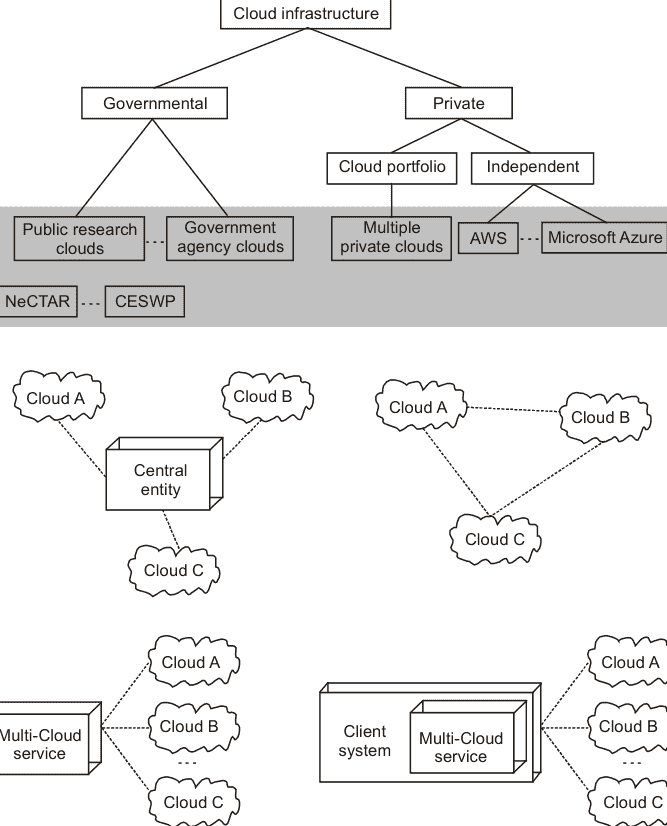

图 5.2 云云的分类。

云云环境具有一些要求，包括：

- **数据位置感知** – 理想情况下，应用程序的持久化数据和处理单元应该位于同一个数据中心，甚至可能位于数据中心的同一个机架上，并通过高速网络连接。如果它们存在于远程云，性能损耗可能是严重的。正如我们所知的，在云计算中，整个应用程序和工作空间都位于数据中心的远程服务器上。
- **客户端感知** – 除了数据之外，入站请求也需要被感知，以便在云间平台上进行更好的操作。理想情况下，请求应该调度在与其源地地理位置附近，以获得更好的性能。尽管我们在整个讨论中一直提到，云操作发生在非常远的地方，使用户感知不到任何后端位置，但如果操作在附近的云中心进行将更好。
- **定价问题** – 我们绝不能忘记，在云平台中，一切切都是收费的，没有免费的。对于部署在多个云中的所有类型应用程序，常见的考虑因素是定价问题。不同的供应商有不同的定价策略和机制，最小化整体托管价格是一项艰巨的任务。应用程序代理程序需要关于提供者价格和策略的详细且最新的信息，以便执行高效的配置。
- **立法和政策感知** – 在存储或对机密数据和内容进行任何云操作时，必须非常小心。对于某些应用程序，应用程序代理程序在配置和调度时应同时考虑法律和政治考量。例如，代理程序可以避免将部分数据存放在给定国家之外，或避免使用特定供应商的云服务。
- **本地资源感知** – 在云平台结合的庞大技术中工作，可能对特定云中的本地资源有良好的感知。在不知道单个云的真实状态的情况下，合并多个云或处理不同云的所有操作可能会带来许多实际问题和障碍。

## 5.5 云的应用

在本节中，让我们详细了解一下云计算的各种应用。我们将看到这项技术如何在各个领域被使用。在整本书的末尾，你会觉得我们已经以某种方式或在所有章节中介绍了云的所有应用。我们还根据用户的情况讨论了云计算的使用场景。从各个领域中一些常用的云应用中，包括：

- **数据存储** – 云技术使用的主要领域之一包括远程虚拟云中的数据存储。它帮助用户在任何时间任何随地访问和使用数据。
- **面向终端的软件和硬件** – 云端为终端用户提供了许多软件工具和硬件功能。它们帮助用户和业务社区根据机器软件安装和硬件配置的情况，随时随地方便地使用它们。今天，有许多先进的云软件和硬件设计为在虚拟服务器运行。软件一词包括操作系统、专用工具、编译器以及所有用户需要的项目。硬件指的是服务器、内存、网络以及所有其他所需的设施。
- **云数据库** – 云数据库为开发者和 `IT` 人员提供了一个强大且可扩展的即插用数据库。从基础设施到数据库软件，再到调优和监控，一切都是作为服务提供的。任何任务都需要数据库，今天这里有很多云数据库可用。
- **数据备份恢复** – 与云中的数据存储一起，它还被用于维护防止灾难和其他事故的数据安全副本。这是云计算的另一个主要用途。
- **邮件** – 电子邮件是另一个相当成熟且标准的关键任务应用，非常适合迁移到云端。多年来，首席信息官（`CIO`）一直希望将邮件外包给大型跨国公司，尽快将邮件迁移到云端以便进步。在个人层面，我们使用像 `Hotmail` 和 `Gmail` 这样的基于云的消费者邮件服务，并享受随地访问无需考虑容量或服务器可用时间的益处。每家企业都有正确的云解决方案，无论是针对小型企业的低成本邮件托管 `Exchange`，还是针对大客户的全托管 `Exchange` 环境。
- **共享工作空间** – 云计算在 `PaaS` 服务模型中的主要应用是共享所需的平台以完成所需任务。这对所有业务公司都有用。通过这种方式，远程用户可以交互并协作。
- **电子商务** – 可扩展性和可用性是在线商店的关键关注点。每分钟的停机都可能导致销售损失。网站缓慢可能会导致失去终身客户。电子商务也以季节性峰值著名，例如假日季节。在线商店不再需要为支持峰值时期支付费用并部署基础设施，云允许他们动态扩展流量规模。当电子商务网站的兴趣点激增时，需求可能会击或显著降低传统服务器，导致客户无法购买。云允许额外的资源来处理负载。当人潮涌来时，这些资源会被关闭。云还便于在不同位置部署 `Web` 服务器，以获得准确的本地页面加载时间并增加可用性。添加内容分发网络（`CDN`）服务可以以非常高效且具有成本效益的方式在全球范围内发图像和视频等高带宽内容。
- **测试与开发** – 云的所有服务模型都是为了满足企业 `IT` 公司内部应用程序的测试和整体开发。这些是云技术主要的且全面的用途。开发团队将受益于几分钟内创建实例的敏捷性和效率。

### 云的实践

- **私有云和混合云的使用** – 私有云为 `IT` 部门提供了具有隔离网络和计算的许多优势。通过各种技术的混合云允许 `IT` 部门连接公共云、本地私有云。例如，可以在公有云中设置 `Web` 服务器。
- **零售店中的云** – 云计算可以用于零售店中巨大的后端数据库的管理和整体维护。在各个领域使用云计算是非常独特且用户友好的。
- **电子政务** – 通过使用云技术的电子治理模型，所有的政府办公室、记录和其整个功能都可以成为所有人的一站式场所。可能在未来几年里，我们就能看到这种先进的治理方式。
- **电子学习** – 云计算可以用于学习目的，并由云服务器支持高度先进的学习方法。这种学习过程在几所机构中变得有名，也许这些是未来的学习教育系统。
- **电子投票** – 选举中的投票过程也可以使用云技术实现，并以高度安全和位置无关的方式进行。在线投票可以是现有选举过程的良好替代品。
- **医学研究** – 云计算也有效地用于医学领域，用于所有研究和高度先进的远程医疗目的。此外，云计算可存储医院的所有数据库并对所有记录进行有效管理。
- **农业中的云计算** – 在农业中，云服务越来越多地在来自外部提供商的高可用虚拟服务器系统使用。通过 `VPN` 客户端通过安全的 `Internet` 连接访问。我们正通过所有先进技术转向现代农业技术。
- **移动技术** – 云计算技术用于设计和使用所有的移动应用程序。今天，移动技术正在与云结合，提供移动云计算。两者相互对齐且非常先进。

云计算的应用还有非常多，但我们在此结束这段讨论。在接下来的章节中，你可以了解到更多关于云技术是如何被使用的。

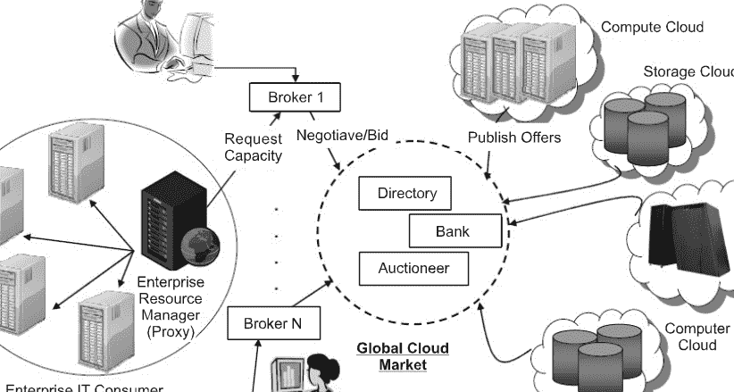

图 5.3 云计算的应用。

### 使用场景

精确地知道何时使用某项技术以及在何处避免使用至关重要。如果新用户没有意识到这些基本信息，可能会导致灾难；在错误的平台上做出错误的选择，可能会毁掉整个用户任务。从业务角度来看，了解确切的使用场景和适用于特定任务的正确平台是必不可少的。云计算的一些正确使用场景包括：

- 当进程、应用程序和数据是大型独立的时——当它们与其他应用程序或信息没有紧密耦合时。其理念是，如果它们是紧密耦合的，很难（甚至不可能）进行解耦，因此无法在远程平台上独立运行。如果它们是松耦合的，适配性就不是问题。松耦合的应用程序更适合云计算。在远程云应用中，只有当松耦合时，应用程序才能轻松迁移并在虚拟环境中工作。
- 当集成点被良好定义时——当应用程序内部有良好定义的点，使得应用程序可以在这些点共享数据、行为和进程。因此，它们很容易与企业内部的应用程序集成。云应用必须经过良好的集成，以便作为服务提供给最终用户。

### 云计算实战

- 当低级别的安全性即可满足需求时——当包含在云计算环境中的信息对安全性要求较低，且信息由于某种原因泄露时世界也不会终结。云计算系统通常提供足够的安全保障，尽管它们的安全性远比传统的互联网低得多。
- 当企业内部核心架构健康时——当你已经理顺了自己的“家务”，那么让云计算系统成为该架构的一部分就会变得容易得多。对于任何想要将云技术引入其职能组织，必须首先在现有方法上进行良好的设计和治理，而且采用云还可以防止在整个职能中产生大片混乱。
- 当 `Web` 是理想平台时——当你不介意在浏览器中部署用户界面。如今，随着富网络应用程序（`RIAs`）的出现，你拥有了外观和功能都像原生应用程序的浏览器应用。今天，有更多的技术和工具设计初衷就是与传统的互联网和浏览器保持一致。
- 当成本是一个问题时——正如讨论过的，云计算具有明确的成本效益。如果你正寻求廉价地构建和部署应用程序，云计算通常是可行之选。正如我们所知，云计算是基于计费模式的资源使用的按需付费模型。
- 当应用程序是新的时——在云平台上部署新应用程序比迁移现有应用程序要容易得多。到今天为止，越来越多的应用程序被设计为适应不断进步的技术。

## 何时不宜使用云计算

- 当进程、应用程序和数据在很大程度上耦合时——如果应用程序之间相互依赖，那么将其中任何一个移动到远程云平台都不是一个好主意。它们会很快崩溃或无法迁移，而这通常是云所预期的。记住，松耦合对云计算技术是有利的，紧密耦合对云计算是有害且必须避免。
- 当集成点未良好定义时——当缺乏良好的机制来同步云提供商托管的信息、进程与企业内部的系统时。在定义不明的地方集成此类系统，会在向云计算迁移的过程中带来巨大风险，并不适合。因此，云技术需要适当的同步和更好的集成。
- 当需要高水平安全性时——当安全风险大到你无法信任任何你无法完全控制的系统时。这类系统应该是极少数的。当控制权对你的业务至关重要时，最好避免云平台。
- 当企业内部核心架构需要改进时——如果你的企业架构功能失调，将其扩展到我们的云交付平台不是一个好主意。先理好你的家务，至少要达到将系统外化到云资源不会造成损害的程度。
- 当应用程序需要原生接口时——如果你需要利用如 `Win32` 等原生 `API`，且浏览器不是选项，那么云计算可能不是一个好的选择。
- 当成本是一个问题时——再次，要全面考虑成本。在很多情况下云计算是适合的，但在某些情况下则不是。云不适用于高经济效益敏感的复杂项目。
- 当应用程序是遗留系统时——正如新应用程序更容易迁移到云计算一样，旧应用程序或遗留应用程序并非如此，最好避免云。

## 5.6 云的应用模型

在上一节中，我们看到了了云的各种应用，现在在本节中，我们将详细介绍云计算的各种未来应用模型。我们提出了四种主要的未来应用模型，尽管还有更多。我们将详细讨论每一种。

## 云中的电子治理

如今，几乎所有政府机构都在转向基于计算机的工作环境，就像大型企业 `IT` 公司一样。使用传统的纸笔方法存储所有记录的时代已经过去，如今在很大程度上使用了基于计算机的数据系统来减少纸张浪费，这是纯粹的环保行为。

治理中基于计算机的数据系统的典型用途包括：

- 政府办公室存储大量数据
- 关于各个部门、计划和公告的信息
- 发出生证明、死亡证明、粮油卡、选民 `ID`、社区证明、电费、房产税等
- 为所有用户开账户
- 查看所有信息的状态

定义的透明运行方式。我们需要增强政府部门的整体职能，以促进国家的增长和繁荣。

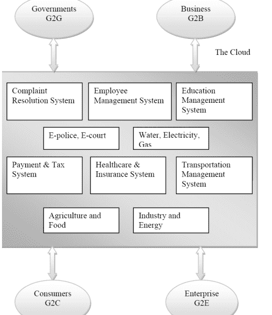

图 5.4 使用云计算的的电子治理模型。

## 基于云计算的在线学习

云计算应用的一种创新且独特的模型可以是使用云计算平台的在线学习方法论。

让我们首先理解“在线学习”（`e-learning`）这个术语。嗯，在线学习是一种使用电子方法而非传统书籍和其他物品的先进学习方式。在线学习是一个用于描述任何形式的基于电子的学习和教学的术语，包括教室内外的计算机辅助教学，例如在机构网站上直播大学讲座。在线学习是通过计算机和网络实现的技能和知识传递。

在线学习应用和过程包括基于 `Web`的学习、基于计算机的学习、虚拟教育机会和数字协作。内容通过互联网、音频或视频磁带、卫星电视和 `CD-ROM` 传输。它可以是自学的或由导师引导的，并包含文本、图像、动画、流视频和音频形式的媒体。它还包括使用多媒体技术学习的创新方法、使用基于 `PowerPoint` 的演示、使用 `CD` 和其他基于计算机的设备进行学习。其主要骨干是作为通信模式的互联网。在线学习越来越流行。随着挑战日益增长和激烈竞争，它是当务之急。

在线学习包含了所有形式的电子支持学习和教学方法论。信息通信系统（无论是否网络化）都作为电子化实施学习过程的特定媒体。这通常涉及通过技术进行的教室外和教室内的教育体验，甚至是设备和课程方面的先进进步。像 `CBT`（基于计算机的培训）、`IBT`（基于互联网的培训）或 `WBT`（基于 `Web` 的培训）等缩写已作为在线学习的同义词。

我们正在提出一种使用云计算的创新在线学习模型。这整个学习模型都是使用云计算技术进行的，取代了传统的互联网和其他网络技术。使用云计算的在线学习模型包括使用高度动态和虚拟的服务器来存储所有学习内容。我们已经知道传统服务器和云服务器之间存在许多差异。存储在云服务器中的数据由所有注册用户通过设计良好的门户访问。

在线学习内容对所有人开放。不仅是计算机，所有其他硬件设备都可以连接到远程虚拟云平台。因此，这种使用高性能计算的先进学习形式是一种非常明智的选择，也是当务之急。通过云计算，我们可以获得更好的存储、更好的流量管理和管理良好的在线学习平台。

使用云计算的在线学习模型可以由同一大学/学院维护，也可以外包给第三方供应商。这种使用云计算的在线学习模型在技术和在线学习模型方面都有几个优点。包括：

- 使用云计算进行整个在线学习的主要优势之一是降低整体成本。在线学习用户不需要高配置的计算机来运行在线学习应用。他们可以通过具有最低配置互联网连接的 `PC`、手机、平板电脑从云端运行应用程序。由于数据是在云端创建和访问的，用户不需要在本地机器的大型数据存储上花费更多钱。机构还需要按需付费，因此更便宜，且只需要为他们需要的空间付费。我们已经知道云计算是一项纯粹导向的技术，云用户根据页面场景支付极少费用。


- **性能提升**——由于云在线学习应用拥有云端最佳应用程序和流程，客户端机器在工作时不会产生性能问题。毕竟，云计算通过虚拟化和分布式技术具有高度的动态性。

- **数据存储**——云计算涉及高级虚拟服务器和数据存储技术的使用，使得数据存储比传统方法高效和先进得多。在线学习涉及各种格式的大量数据存储，基于云存储是明智的选择。

- **更好的基础设施**——支持在线学习技术的整体基础设施通过云计算的原理和工作得到了非常有效的支持。传统的在线学习方法极易出现流量拥堵和服务器崩溃。而底层的虚拟化和分布式技术适用于处理云技术中的所有这些问题。

- **软件更新与管理**——由于用于在线学习的云应用程序在云端运行，软件在云源自动更新。因此，在线学习者总能立即获得更新。因此，更新和管理任务的需求显著减少。

- **改进的文档兼容性**——某些文件格式在某些 `PC`/手机上无法正常打开，云驱动的在线学习应用无需担心这类问题。因为云在线学习应用是从云端打开文件。云计算在许多方面也是平台无关的。

- **对学生的益处**——学生从基于云的在线学习中获得更多优势。他们可以参加在线课程、参加在线考试、从导师那里获得有关课程的反馈，并通过在线向老师发送他们的项目和作业。教育的这种进步可以改变整个系统并减轻学生的负担。

- **对教师的益处**——教师从基于云的在线学习中也获得了许多益处。教师能够为学生准备在线测试，通过内容管理为学生处理和创建更好的内容资源，评估学生完成的测试、作业、项目，发送反馈并通过在线交流。因此，整个在线学习过程减轻了教师的负担。

- **数据安全**——一个非常大的关注点是数据安全，因为软件和数据位于远程服务器上，这些服务器可能会崩溃或消失。尽管这看起来非常合理，云计算为个人和公司提供了一些主要益处。

云计算最有趣的应用之一是基于教育的云平台。教育云计算可以将成千上万计算机的力量集中在一个问题上，允许研究人员比以往任何时候都更快地搜索和发现模型。它让事情变得更快、更容易且更具创新。大学还可以将其技术基础设施向私营、公共部门开放以促进研究进步，从而建立独立的平台。云计算的效率可以帮助大学跟上日益增长的需求和能源成本。学生期望他们的个人移动设备能够连接到校园服务进行教育。

由于大多数教育场所已经连接了设计良好且先进的无线设施。教职员工在将技术整合到课程中时，要求高效的访问和灵活性。研究人员希望即时访问高性能计算服务，而无需承担管理大型服务器和存储农场的责任。云计算在大学教育中的作用不应被低估，因为它可以在直接访问广泛不同的学术资源、研究应用和教育工具方面提供重要收益。

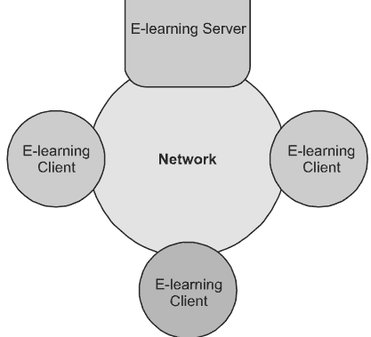

图 5.5 使用云计算的在线学习模型。

因此，有自己在教育领域实施高性能计算技术，以便为后代带来更好的研究、进步和整个教育领域的整体效率。

使用云计算的最先进的在线学习平台之一是 `http://www.doceseo.com/`。它非常先进，可以以多种方式使用。

截至2021年，基于云的在线学习系统已应用于泰米尔纳德州的公立学校。学校部门与非政府组织学习链接基金会（LLF）签署了谅解备录，该已成为该州技术将主要驱动学习的公立学校之一。学校获得了 11 台笔记本电脑、13 台平板电脑、一块交互式白板、一台投影仪和 Wi-Fi 连接。然而，主要的优势是引入了云解决方案，它为学校提供了从 VI 到 XII 年级 `Samacheer Kalvi` 大纲的数字化版本和英语。

## 云端中的电子投票

云计算技术可以进一步成为在线投票系统的骨干支撑。尽管这种模型还非常新颖，并且在未来几年内仍有很大的发展空间。现有投票系统的安全水平尚未达到标准，且存在许多争议。由于我们没有任何备份，考虑到电子投票机（`EVM`）数据的可靠性是无法得到保障的。`EVM` 是基于微控制器的，其程序和内存可以受到免受外部读取的保护，但这属于非常低级的安全，且会发生以芯片为中心的故障数据（`chip centric failure data`）。在许多投票系统中，候选人被限制在各自所在的地方投票。

互联网投票系统 `SERVE`（安全电子注册与投票实验）被发现容易受到拒绝服务攻击和网站钓鱼的影响。这可能会危及结果。此外，还存在许多技术问题，包括终端的身份验证与校验、保护投票系统免敌对势力破坏选举的不可避免的尝试，以及确保网络能够处理在数百万公民在短时间内投递电子选票时的流量洪暴。我们可以通过由云计算技术支持的在线投票系统来克服传统方法的缺点。

在所提的利用先进云计算技术的电子投票系统中，数据库的创建具有候选人指纹的缺陷，指纹作为身份验证的密钥（生物识别数据库）。在投递候选人指纹时，将其与现有数据库进行匹配。如果匹配成功，则允许候选人投票，否则将被拒绝。该系统提供了安全可靠的投票，远优于传统方式。云为所有经过验证的用户提供投票服务。

## 调度算法

投票处理应用可能每天需要处理数百万次交易，存储人们的生物信息。使用调度算法的主要目的是改进本地云服务器与许多终端之间的通信开销。由于并发工作流实例数量众多，算法应侧重于最小化所有过程的执行时间，以最大化整体吞吐量，而不是减少单个过程的执行时间。

执行时间是指从第一个任务开始到最后一个任务结束所花费的时间。吞吐量是资源在一段时间内处理一定数量实例的能力。它们可以被建模为具有大量通信开销的资源密集型云工作流。此类工作流的主要特征是具有大量相对简单的并发实例，这些实例可能涉及相关任务之间大量的通信开销。因此，在设计此类工作流的调度算法时，必须考虑具有通信开销的多个工作流的多个实例。在基于服务的云计算环境中，我们构建了一个专注于算法的仿真环境，使用了通过互联网连接位于不同地的测试节点，因此通信开销会有所不同。

## 云操作 (`CLOUD ACTION`)

在云计算技术中，我们可以存储人们的详情及其指纹。数据库的创建是带有候选人详情和指纹的，指纹作为身份验证的密钥（生物识别数据库）。在投票时，将候选人的指纹与现有数据库进行匹配。如果匹配成功，则允许候选人投票，否则将被拒绝。该系统提供了安全可靠的投票。云为所有经过验证的用户提供投票服务。云计算主要基于互联网设施运行。你的所有数据都存储在线，所以你不需要担心容量。

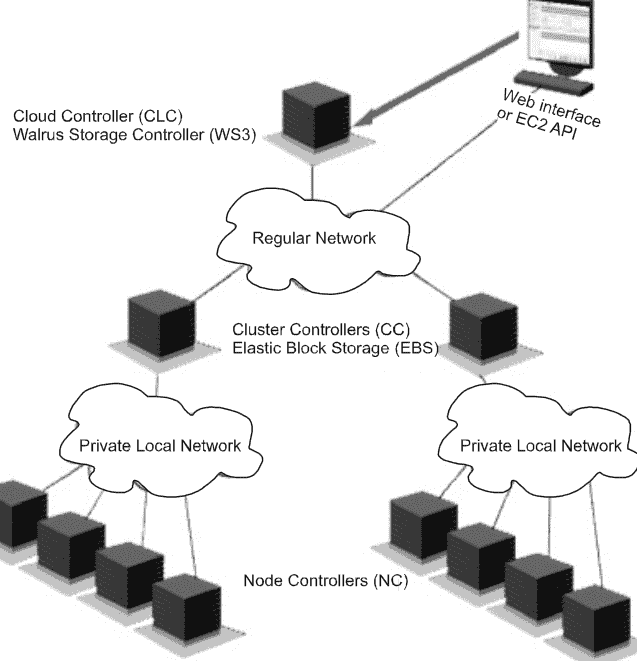

图 5.6 使用云计算的电子投票模型。

这就是整个投票过程在云计算中是如何进行的。尽管电子投票模型还有许多其他需要考虑的问题，但它未来可以成为投票目的的一项大工具。

## 云端企业资源计划

云计算是大型企业管理所有任务的另一项利器。可以想象一个拥有多个部门且各司其职的大型企业。在这种情况下，云计算凭借独特的原理和工作机制让这一切变得非常简单。传统的企业资源计划（`ERP`）系统有许多局限性。随着业务扩展，云技术提供了可扩展的资源可用性。此外，还存在许多技术问题，包括终端的身份验证与校验、保护投票系统免敌对势力破坏选举的不可避免的尝试，以及确保网络能够处理流量洪暴。

云计算主要基于互联网设施运行。你的所有数据都存储在线，所以你不需要担心容量。云为所有经过验证的用户提供投票服务。云技术，在，，，是可扩展的。因此，云技术可以解决所有问题。云为提供了提供了可扩展的资源。企业可以减少资本开支，并获得更高的投资回报率（`ROI`）和更短的回收周期。这对于预算有限的中型企业至关重要。云端工作形式是用户好的好的，对于许多员工使用各种工具。


图 5.7 使用云计算的 `ERP` 模型。

## 云行动 (`CLOUD IN ACTION`)

除了这些应用模型外，还有许多领域可以使用云技术来更好地帮助用户。在未来几年，我们可以看到云计算几乎成为现实，而不只是模型。

### 云计算的优势

现在在本节中，让我们详细讨论云计算的各种优势。这些优势有助于我们理解它：

- 成本：云计算的首要优势是经济性。正如我们所知，云计算完全是面向服务的技术，资源对用户可用。传统的桌面软件在财务方面增加了公司的成本。为多个用户增加许可费用可能非常贵。而云以更低廉的价格提供，因此可以显著降低 `IT` 费用。此外，还有许多一次性、按需付费和其他可扩展选项，这使得公司非常合理。

- 数据存储：云计算涉及将所有数据和工作空间存储在网上，使数据的位置和使用具有独立性。

- 备份与恢复：由于你的所有数据都存储在云端，备份和恢复它们比存储在物理设备上要容易得多。此外，大多数云服务提供商都有足够的能力处理恢复。因此，这使得整个备份和恢复过程比其他传统的存储方法简单得多。

- 健壮性与弹性：相比互联网，云计算更加健壮和强大，可以克服任何崩溃或技术故障。由于虚拟化和分布式技术，它在本质上具有高度弹性和活性。

- 高可扩展性和性能：可扩展性是云部署的内置功能。云实例在需要时会自动部署，结果是仅为您所需的应用程序和数据存储付费。另一方面，还有弹性，因为云可以扩展以满足不断变化的 `IT` 系统需求。在性能方面，系统利用分布式架构，提供了卓越的计算速度。

云计算

-   **最优资源利用率** – 由于云端由多个用户共享，服务器、存储和网络资源得到了更好的利用，从而在全球范围内减少了浪费。云计算更加环保且能效。它减少了停机时间，并实现了跨云资源的优化。

-   **自动软件集成** – 云计算的另一个优势是云服务提供商对云服务器上的软件进行自动更新和维护。这意味着你不需要额外精力根据自己的偏好定制和集成应用程序，这方面可以自动处理。不仅如此，云还允许你非常方便地自定义选项。因此，你可以挑选最适合你特定企业的服务和软件应用程序。

-   **动态技术** – 与所有以前的技术相比，云在功能上要动态得多，云资源对于所有从任何远程位置访问云的用户都是轻松的。

-   **易于访问** – 云的独特性和自由之处之一是，拥有网络的用户可以随时随地对云进行简单的注册和使用。这结束了对所有传统机器的依赖。

-   **快速部署** – 为云计算设计的应用程序可以快速快捷地部署到远程虚拟云中。一旦你选择了这种运行模式，你的系统可以在几分钟内完全投入运行。当然，所需的时间取决于你业务所需的特定类型。

-   **兼容性** – 云计算的另一个优势是与所有平台和技术的兼容性。云支持其所有先前的计算技术，并且对平台非常友好。假设一家公司决定转向云平台，其在以前技术和工作区中的所有工作都能得到云良好的支持，不会出现任何不匹配或技术问题。

-   **环保** – 云计算和虚拟化概念是高度环保的，属于绿色计算的一种。它通过使用虚拟平台运行节省了所有多余电力，在减少电子垃圾问题之前，减少了个人用户对硬件的使用。

-   **创新与研究** – 企业可以专注于创新，因为它们不需要管理硬件或资源。云计算促进了更快速的原型开发、测试和验证。用户需要协作完成某项任务/项目的研发计划或活动受益尤为。

-   **对业务友好** – 与所有其他技术相比，云是完全面向业务的业务。其所有原则、服务、使用方法和工作方式都与业务社区的需求和要求保持一致。对于小型业务组织来说，云计算是初创阶段的一项福音。

## 5.8 云计算的缺点

每种技术都有其缺点，并不是它们完全全优势的。云计算的一些缺点包括：

-   **安全疑虑** – 云计算最大的问题是与数据相关的整体安全性。用户需要谨慎并在云端中使用与业务相关的关键数据。这是该技术的一大主要缺点，尽管云提供的安全性比传统方法要先进得多。

-   **恶意攻击** – 如今入侵者和黑客的数量正在增加，整个云计算技术需要更加健壮，以克服黑客用来黑入所有机密数据和业务数据的任何先进策略。

-   **技术问题** – 虽然云端信息和数据可以随时随地从任何地方访问是事实，但有时该系统可能会出现严重的故障。你应该意识到这项技术总是容易停机和其他技术问题。即使是最好的云服务提供商，在保持维护标准的情况下也会遇到这类麻烦。此外，你需要非常好的互联网连接才能随时登录服务器。一旦出现网络和连接问题，你不可避免地会陷入困境。即使云服务器意外宕机，一个数据也无法访问。

-   **供应商依赖** – 云计算的要缺点之一是对提供商的隐性依赖。行业称之为“供应商锁定”，因为一旦你选择了某个提供商，想要迁移是非常困难的，有时是不可能的。如果用户希望切换到另一个提供商，那么从旧提供商向新提供商传输大量数据将非常痛苦且繁琐。这是为什么在选择供应商时应该仔细考虑所有选项的另一个原因。

-   **控制有限** – 由于应用程序和服务运行在远程的第三方虚拟环境中，公司和用户对硬件和软件的功能和执行控制是有限的。此外，由于使用了远程软件，它通常缺乏本地运行应用程序的功能。

-   **脆弱性** – 与前面提到的安全和隐私有关，请注意基于云的服务暴露在公共互联网上，因此对于恶意用户和黑客来说是一个更脆弱的目标。互联网上没有任何东西是完全安全的，即使是最大的巨头也会遭受严重的攻击和安全泄露。由于系统的相互依赖性，如果存储数据的机器之一被破解，个人信息可能会泄露给全世界。

-   **合规性** – 合规意味着，那些必须应对审计合规性问题的人可能会发现，云服务提供商没有提供你为了符合美国企业必须遵循的许多法律而所需的日志和审计功能。趋势是云服务提供商将在这方面做得更好，因此在继续之前，务必了解你的问题以及提供商提供了哪些解决方案。

-   **服务水平协议** - 服务水平协议记录了云提供商和云用户之间关于服务、优先级、责任、保证和保修的共同理解。许多云提供商不提供此类协议，但随着具有更严格要求的大型企业开始利用云计算，情况将会发生。趋势是云服务提供商将提供 `SLA`，但当然，它们是通过将风险成本转嫁给云计算消费者来实现。这是另一个需要考虑的问题。

## 总结

-   云迁移是指将以前技术或平台上完成的所有工作过渡到这个新的云计算平台。它涉及到公司数据、服务、应用程序、内部工具、工作区、官方数据等向远程虚拟云的过渡。

-   虽然云迁移可能会带来许多挑战并引发安全担忧，正如我们所知，云安全和隐私是云计算中的一个大问题。云计算还可以让公司潜在减少资本支出和运营成本，同时从动态扩展、高可用性、多租户和有效资源分配的优势中受益。

-   考虑到 `IT` 公司的规模，云迁移是一项巨大的任务。在迁移过程中必须小心，因为在整个过渡期间涉及一些意之外的风险和事故。不能盲目进行整个迁移过程，因为将会有多个具有已修改和未修改平台的多个和工作平台。

-   云托管是指将在合适平台上设计的应用程序托管到远程虚拟云中。

-   云托管描述了根据用户甚至提供商的要求，以非常灵活的方式配置虚拟服务器的最佳方法。它提供了用户动态按需所需的、更可靠、可扩展且更先进的基于网络的基础设施。

-   通过云托管，用户可以按需实时获取资源。资源不受限于单个服务器的容量或任何物理限制。

对于云托管，我们通常使用被称为“云服务器”的高度动态的虚拟服务器。云服务器是在强大的服务器集群内部创建的强大虚拟环境。云服务器具有许多专用服务器不具备的优势。

云服务器可以运行在虚拟机监控程序（`hypervisor`）或虚拟机管理器上。虚拟机监控程序的作用是控制操作系统的容量，以便将其分配到需要的地方。在云托管中，每个特定中心都有多个可用的云服务器。这允许在必要时将计算资源专门分配给特定的客户。

所有数据和其他工作空间都存储在这个大型远程数据中心中。数据中心由大量按特定格式排列的机器组成，用于存储所有内容。这些数据中心由大型 `IT` 巨头拥有并维护。会有多个数据中心，每个中心都位于非常偏远的地方，但通过穿过陆地和海洋的大数据电缆连接，提供了连通性。数据中心之所以位于非常特殊的位置，主要由于其高基础设施以及安全性考虑。

数据中心需要对任何形式的灾难做好充分准备，必须为任何最坏的情况做好准备。当你的数据中心虚拟化时，数据恢复会变得容易得多。通过虚拟机的最新快照，你可以快速恢复所有数据并重新运行。

云与云或云的组合被称为“云云”（`cloud of clouds`）。其背后的思想是通过一个单一的通用功能将许多不同的个人云集成成一个在按需操作方面的无缝整体。

云云场景基于一个核心概念，即单个云或云服务提供商并不拥有无限的物理资源或支持所有需求的能力。云的结合可以帮助彼此实现其全部功能。当其他云完全饱和时，通过使用跨云技术共享云平台，也有助于空闲云的运行。

云数据库为开发人员和 `IT` 部门提供了一个强大且可扩展的即插即用数据库。从基础设施到数据库软件，再到调优和监控，一切都作为服务完成。

私有云为 `IT` 部门提供了许多公有云的优势，并增加了隔离网络和计算资源，这带来了额外的安全性。`Rackspace` 提供私有云，让 `IT` 部门对部署的资源和架构具有更多的控制权。由各种底层技术支持的混合云允许 `IT` 部门连接公有云、私有云、专用托管和本地基础设施，以获得控制与敏捷性的最佳结合。

118

云计算

- 通过使用云技术的电子治理模型，所有的政府部门、记录及其整个功能都可以变成一个一站式场所。

- 云计算可以用于学习目的，由云服务器支持的高级学习方法论。这种学习过程在几所机构中非常有名，这些可能就是未来的学习教育系统。

- 选举中的投票过程也可以使用云计算技术，以高度安全且与位置无关的方式实现。

- 精确地知道何时使用某项技术以及在何处避免使用它同样重要。如果新用户不知道这些基础信息，这可能是一场灾难，选择错误的平台可能会毁掉用户的整个任务。

- 云计算的首要优势是该技术的经济性。正如我们所知，云计算是纯粹的面向服务的技术，资源以按需使用、计费的方式提供给用户。云计算可能是维护和升级最具成本效益的方法。

- 云计算涉及将所有数据和工作空间存储在网上并提供无限存储，使用使用户对数据位置和使用的独立性。

- 可扩展性是云部署的内置特性。云实例在需要时自动部署，因此你只需为你需要的应用程序和数据存储付费。另一方面，由于云可以扩展以满足不断变化的 `IT` 系统需求。在性能方面，系统利用分布式架构，提供了卓越的计算速度。

- 云计算最大的问题是与数据相关的整体安全性。需要小心在云中存储和使用与业务相关的关键数据。这是该技术的的主要缺点，尽管云提供的安全性远高于传统方法。

- 云计算的一个主要缺点是对提供商的隐性依赖。这就是行业所说的“供应商锁定”，因为一旦你选择了某个提供商，想要从那里迁移出来是困难的，有时是不可能的。

# 第 6 章

# 实时云及其应用

## 目标

- 了解各种云服务提供商

- 详细学习所有云产品及其功能

- 了解所有基于云的操作系统的列表


到目前，我们看到了云计算的介绍、云的原理、云的类型、各种服务模型等。在本章中，让我们讨论一些今天的实时云示例及其应用。我们还将看到世界上开发了许多云产品和业务解决方案的巨头公司。阅读这些内容可以让你对云技术及其应用有一个良好的了解。虽然大多数产品是专有的，我们需要付费使用，但也有一些免费的我们可以使用。今天一些免费的云应用正被许多人使用。

## 6.1 亚马逊云及其产品

当我们谈论云时，绝不能忘记使用“亚马逊”这个词。亚马逊是全球的一家大型 `IT` 公司，遍布多个国家，并在云方面开发了多种产品。亚马逊在其他几个领域也有工作，但它对云技术具有新的意义。亚马逊已成为当今云技术领域无可争议的领导者。亚马逊云服务（`AWS`）正式称为适用于所有规模业务的云计算平台。`AWS` 可以提供灵活、高效益的 `IT` 基础设施和服务，可以根据需要扩展或缩小。仅为所使用的部分付费。毕竟云计算是纯粹的面向服务的技术，采用按需付费模型。

此外，`AWS` 应用了先进的物理安全和数据隐私技术来保护用户数据。`AWS` 拥有安全认证和审计，如 `ISO27001`、`FISMA moderate`、`HIPAA` 和 `SAS 70 Type II`。`AWS` 是一个全面的服务平台，提供许多网络服务。它是开始运营云技术的 `IT` 巨头之一。几乎所有的亚马逊产品都是专有的。需要根据使用付费，并在免费试用期间会提示用户输入信用卡详情。

119

云计算

亚马逊开发并拥有的各种云产品和解决方案包括亚马逊弹性计算云（`EC2`）。亚马逊云服务使用 `EC2` 平台提供云托管服务。它允许使用 Web 服务接口启动具有各种操作系统的实例，加载自定义应用程序环境，管理网络访问权限，并根据用户意愿运行尽可能多或尽可能少的系统。它是专有的，不是免费的。用户必须根据按需付费模型按照亚马逊的费率付费。亚马逊 `EC2` 为构建当今世界所需的的可扩展、故障韧性的企业级应用程序提供了许多功能。要使用 `Amazon EC2`，请遵循以下步骤：

- 首先选择一个预配置的、模板化的亚马逊镜像 (`AMI`) 以立即运行，或创建一个包含您的应用程序、库、数据和相关配置设置的 `AMI`。

- 在 `Amazon EC2` 实例上配置安全和网络访问。

- 选择所需的实例类型，然后使用 Web 服务 `API` 或各种管理工具启动、终止并监控所需的数量的实例。

- 确定是否要在多个位置运行、使用静态 `IP` 端点或为实例附加持久存储。

- 仅为您消耗的资源付费。

### 亚马逊简单存储服务 (`S3`)

亚马逊简单存储服务允许用户将所有数据存储在云端。通过这些云存储，用户可以在任何地方访问数据，不受机器限制，并减少了对硬件存储设备的需求。亚马逊 `S3` 提供简单的 Web 服务接口，允许从网络上的任何地方、在任何时间存储和检索任意数量数据。它让任何开发者都能访问与 `Amazon` 运行其全球网站网络时相同的高扩展性、可靠、安全、快速且廉价的基础。该服务旨在最大化云的优势，并将这些优势传递给开发者。

存储在 `Amazon S3` 中的数据默认是安全的；存储桶（`bucket`）和对象所有者具有访问其创建的 `Amazon S3` 资源的权限。`Amazon S3` 支持多种访问控制机制，以及针对安全传输和磁盘存储的加密。通过 `Amazon S3` 的数据保护功能，你可以保护数据免受逻辑故障和物理故障的影响，防止因意外的用户操作、应用程序错误和基础设施故障导致的数据丢失。

### `Amazon Glacier`

`Amazon Glacier` 是一种极低成本的存储服务，为数据归档和备份提供安全且持久的存储。为了保持低成本，`Amazon Glacier` 对数据归档进行了优化，并提供数小时的检索时间。通过 `Amazon Glacier`，客户可以可靠地存储大量或少量数据，每月每 `GB` 费用仅需 `$0.01`，与本地解决方案相比节省了大量费用。`Amazon Glacier` 改变了数据归档和备份的游戏规则，因为你无需预付，只需支付极低的存储费用，并可以根据需要扩大或缩小使用量；`AWS` 处理所有数据留存的繁重运营工作。只需在 `AWS` 管理控制中点击几次即可设置 `Amazon Glacier`，然后你就可以上传选择任何数量的数据。

### `Amazon Virtual Private Cloud` (`VPC`)

它通过私有网络 (`VPN`) 将公司的 `IT` 基础设施连接到 `AWS` 云。`Amazon Virtual Private Cloud` (`VPC`) 允许用户为 `Amazon Web Services` (`AWS`) 云划分一个逻辑隔离的区域，可以在你定义的虚拟网络中启动 `AWS` 资源。你对自己的虚拟网络环境具有完全控制权，包括选择你自己的 `IP` 地址范围、创建子网以及配置路由表和网络网关。此外，你还可以在数据中心和 `VPC` 之间创建硬件私有网络 (`VPN`) 连接，并将 `AWS` 云作为公司数据中心的扩展。通过私有云，用户可以：

- 在 `AWS` 的可扩展基础设施上创建 `Amazon Virtual Private Cloud`，并从你选择的任何范围指定其 `IP` 地址范围。

- 将你的 `VPC` `IP` 地址范围划分为一个或多个公共或私有子网，以便在你的 `VPC` 中运行应用程序和服务。

- 使用网络访问控制列表控制各个子网的入站和出站访问。

- 将数据存储在 `Amazon S3` 中并设置权限，使只能从你的 `Amazon VPC` 内部访问。

- 为你 `VPC` 中的实例分配多个 `IP` 地址并为其挂载多个弹性网络接口。

- 为你 `VPC` 中的任何实例挂载一个或多个 `Amazon` 弹性 `IP` 地址，使其能够从内部直接访问。

- 使用加密的 `VPN` 连接桥接你的 `VPC` 和现场 `IT` 基础设施，将你的安全和管理策略扩展到你的 `VPC` 实例，就就像它们运行在你的基础设施中一样。

# 云计算

`Amazon CloudFront` 是一种内容分发服务，利用全球边缘节点网络以高速度和最小延迟传输客户数据。它与其他 `Amazon Web Services` 集成，为开发者和企业提供了一种简单的方法，向终端用户分发内容，具有高数据传输速度且无需任何承诺。

使用 `Amazon CloudFront`，除了 `CloudFront` 现有数据传输和请求费用外，提供动态内容没有额外费用，且使用时不需要长期承诺。它没有预付费用、没有每月平台费，无需雇佣昂贵的顾问来帮助配置。

### `Amazon Route 53`

`Amazon Route 53` 是一种高可用且可扩展的域名系统 (`DNS`) Web 服务。它的设计旨在为开发者和企业提供一种极其可靠且具有成本效益的方法，通过将 `www.example.com` 等名称转换为数字 `IP` 地址，将用户路由到互联网应用程序。它的设计使得计算机可以相互连接。`Route 53` 有效将用户请求连接到运行在 `AWS` 上的基础设施（如 `Amazon EC2` 实例、弹性负载均衡或 `Amazon S3` 存储桶），也可用于将用户路由到 `AWS` 基础设施。

### `Amazon` 关系数据库 (`Amazon RDS`)

`Amazon Relational Database Service` (`Amazon RDS`) 是一种 Web 服务，可以轻松地在云中设置和扩展关系型数据库。它在管理耗时的数据库管理任务的同时，提供具有成本效益且可扩展的容量，让你专注于自己的应用程序和业务。此类云数据库具有高度动态性并支持复制，允许多个用户同时使用。

`Amazon RDS` 使你能够访问 `MySQL`、`Oracle`、`Microsoft SQL Server` 或 `PostgreSQL` 等熟悉数据库的能力。它允许将目前与现有数据库使用的代码、应用程序和工具用于 `Amazon RDS`。`Amazon RDS` 会自动对数据库进行补丁更新并在用户定义的期间备份你的数据库。

# 实时云及其应用

`Amazon WorkSpaces` 是一种云端全托管桌面服务，允许客户使用其选择的设备（包括笔记本电脑、`iPad`、`Kindle Fire` 或 `Android` 平板电脑）访问所需的文档和应用程序。在 `AWS` 管理控制中点击几次，客户即可以与虚拟桌面基础设施 (`VDI`) 解决方案非常有竞争力的成本提供高质量的桌面体验。

`Amazon WorkSpaces` 为用户提供了一种提供全托管桌面体验的简单方法。你不需要担心配置或部署硬件或安装复杂的软件；`WorkSpaces` 负责管理硬件和软件的所有繁重工作，以及补丁和维护等任务，让你能够交付高质量的桌面体验。

`Amazon CloudSearch` 是 `AWS` 云中的一种全托管服务，可以轻松地为你的网站或应用程序设置、管理和扩展搜索解决方案。`Amazon CloudSearch` 允许你搜索大型数据集，如网页、文档文件、论坛帖子或产品信息。

通过 `Amazon CloudSearch`，你可以快速为你的网站添加搜索功能，而无需成为搜索专家，也无须担心硬件的配置、设置和维护。在 `AWS` 管理控制中点击几次，你可以创建一个搜索域，将你想要搜索的数据上传到 `Amazon CloudSearch`，搜索将自动提供所需的资源并部署一个经过调优的搜索索引。随着你数据量和流量的波动，`Amazon CloudSearch` 会无缝扩展以满足你的需求。你可以随时更改搜索参数、精调搜索相关性并添加新设置，而无需重新加载数据。

`Amazon CloudSearch` 允许客户分担运营和扩展搜索服务的管理负担和费用。通过 `Amazon CloudSearch`，无需担心硬件配置、数据分区或软件补丁。与所有 `AWS` 服务一样，`Amazon CloudSearch` 提供了低廉的按需付费定价，没有预付费用或长期承诺。

### `Amazon` 弹性 `Map Reduce`

`Amazon Elastic MapReduce` (`Amazon EMR`) 是一种 Web 服务，可以快速且具有成本效益地处理海量数据。`Amazon EMR` 使用开源框架 `Hadoop` 将你的数据和处理任务分发到可调整大小的 `Amazon EC2` 实例集群上。`Amazon EMR` 适用于多种应用程序，包括日志分析、网页索引、数据仓库、机器学习、财务分析、科学模拟和生物信息学。用户每年启动数百万个 `Amazon EMR` 集群。

## 6.2 谷歌云及其产品

另一家开发了热门搜索产品和服务的云公司是谷歌。这个词让我们联想起了流行的 `Google` 搜索引擎，但谷歌在多个领域还开发并拥有许多其他产品。谷歌在云端集成了许多应用程序，并为客户提供许多服务。这种集成使谷歌成为最好的服务供应商之一，因为它允许客户轻松完成任务。它节省了资金和时间，因为开发和维护提供所有这些服务和应用程序的软件是一个耗时且昂贵的过程。谷歌在云计算领域开发了许多产品，包括：

### `Google App Engine`

它属于云服务模型中的“平台即服务”（`PaaS`）概念，它为用户提供所需的软件工具，用于设计云应用程序、将应用托管到谷歌云上，并根据用户的设计进行扩展。使用这一概念，用户可以从其 `Google` 账户免费托管数十个应用程序。随着流量和数据存储的增长，`App Engine` 应用程序易于构建、维护和扩展。通过 `App Engine`，无需服务器来维护您的应用程序，它随时准备为用户提供服务。大多数应用是使用 `Eclipse` 软件设计的。我们将在案例研究 15 中详细介绍。

### `Google Compute Engine`

`Compute Engine` 是谷歌的“基础设施即服务”（`IaaS`）云服务模型。`Google Compute Engine` 是一种提供运行在谷歌基础设施上的虚拟机的服务。`Google Compute Engine` 提供了扩展性、性能和价值，允许在谷歌的基础设施上轻松启动大型集群。它不需要预先投资，并且可以在从头开始设计为快速且提供强性能一致性的系统上运行多达数个虚拟 `CPU`。实例是托管在谷歌基础设施上的虚拟机。所有实例都运行 `Linux`，使用 `Google Compute Engine` 提供的标准镜像，或由用户自定义的这些镜像的修改版本。用户可以选择选择一种机器类型，指定 `CPU` 数量、`RAM` 和其他属性。

### `Google Cloud Drive`

类似于亚马逊简单存储（`S3`）。谷歌开发了一种广流行的名为 `Google Drive`（谷歌云端硬盘）的存储介质，它在特定限制内是免费的，与亚马逊并不完全不同。它可以为用户存储约 `15 Gb` 的数据。我们可以获得额外的存储空间，但它是租用模式，此后就不免费了。它于 2012 年 4 月推出。用户可以存储任何想要的数据，并只需一个 `Google` 账户和网络设施即可在任何地方使用。使用这种先进的存储设施实现了机器的独立。`Google Drive` 与其他 `Google` 应用程序同步。用户可以在其中创建文件夹，与多人共享等。因此，与传统方法相比，使用云应用工作更舒适、更方便。

## 实时云及其应用

图 6.2 `Google` 账户。

### `Google Docs`

我们大多数人使用许多文字处理软件来撰写任何信件或内容。云计算通过在线云端软件让事情变得简单得多。人们可以使用 `Google Docs` 轻松地编写所有内容。它与 `Google Drive` 同步。`Google Docs` 是一个实时协作编辑的工具。该应用程序可以由多个用户同时共享、打开和编辑。用户无法收到更改通知，但当发表或回复评论或讨论时，应用程序可以通知用户，从而促进协作。然而，用户可以轻松地看到特定编辑器在文档或文件的哪个位置编写，在网站的大多数产品中，编辑器的当前位置用特定编辑器的颜色或光标表示。

此外，服务中的修订历史允许用户查看对文档所做的更改，并根据编辑器使用的特定颜色进行区分。应用程序支持两种 `ISO` 标准文档格式，即用于打开和导出的 `OpenDocument`（开放文档）以及仅用于打开的 `Office Open XML`。它还支持如 `.doc` 和 `.xls` 等专有格式。除了 `Google Docs`，谷歌还提供演示文稿、表格、表单和绘图软件。

### `Google Cloud SQL`

`Google Cloud SQL` 是运行在谷歌云基础设施中的 `MySQL` 数据库。它具有 `MySQL` 的所有能力和功能，带有一些附加功能和一些不支持的功能。`Google Cloud SQL` 易于使用，不需要任何软件安装或维护，是中小型应用程序的理想选择。在云中部署 `MySQL` 数据库没有任何问题。谷歌云平台为您提供运行快速、空间不会耗尽的强大数据库，并为您的应用程序提供所需的冗余、可靠的存储。

### `Google Cloud Storage`

`Google Cloud Storage` 允许在任何时间在全球范围内存储和检索任何数量的数据。它提供了一个简单的编程接口，使能够利用谷歌自己的可靠且快速的网络基础设施，在安全且具有成本效益的管理中执行数据操作。如果需要扩展，开发者可以从谷歌基础设施提供的扩展性中获益。虽然可以通过简单的 `API` 访问 `Cloud Storage`，但高级功能增加了灵活性和功能。对象版本控制、并行上传和基于 `CRC` 的完整性检查赋予了开发者创建强大、复杂应用程序的能力。用户可以直接使用 `XML` 或 `JSON` 使用 `API`，或者使用多种流行编程语言的库。

### `Google Cloud Datastore`

`Google Cloud Datastore` 提供了一套工具和客户端库，用于从运行在 `Google Cloud Engine` 实例或其他处的客户端访问和管理 `Google Cloud Datastore`。它提供一个基于 `RPC` 的 `API`，该由提供 `Google Maps`、`YouTube` 和 `Google Apps API` 的相同谷歌服务托管。用户可以将它与大多数应用程序和语言配合，例如运行在虚拟机中的 `node` web 应用或本地 `Java` 应用程序服务器。`Datastore` 是一个无模式对象数据库，为应用程序提供健壮、可扩展的存储，具有以下功能：无停机、原子事务、读写高可用性、读取和祖先查询的强一致性，以及所有查询的最终一致性。

### `Google Bigquery`

如果没有正确的硬件和基础设施，查询数据集可能会耗时且昂贵。`Google BigQuery` 通过利用谷歌基础设施的处理能力对仅追加表进行超快速的类 `SQL` 查询解决了这个问题。只需将数据移动到 `BigQuery`，它就会处理这些工作。查询使用 `BigQuery` 的 `SQL` 方言编写。`BigQuery` 同时支持同步和异步查询。方法由作业（`job`）处理，但同步方法会暴露一个超时，等待作业完成返回。

### `Google Cloud Print`

在 `Google Cloud Print` 的世界里，人们可以从任何设备打印到任何连接到云的打印机。`Google Cloud Print` 是一项将打印机连接到网络的技术。使用 `Google Cloud Print`，用户可以让家庭和工作打印机供用户和其他任何选择的用户使用，来自用户每天使用的应用程序。

## 云时间及其应用

在 `Google Cloud Print` 的世界里，人们可以从任何设备打印到任何连接到云的打印机。`Google Cloud Print` 是一项将打印机连接到网络的技术。使用 `Google Cloud Print`，用户可以让家庭和工作打印机供用户和其他任何选择的用户使用，来自用户每天使用的应用程序。

`Cloud Print` 可可在手机、平板电脑、`Chromebook` 或任何设备上。

当用户在 `SkyDrive` 上删除任何文件时，服务将允许用户撤销操作并从回收桶恢复到原始文件夹。回收桶中的项目不计入用户的 `SkyDrive` 存储限制。存储在回收桶中的所有项目至少保留 3 天，最多保留 30 天。如果用户回收桶的内容超过其存储限制的 10%，`SkyDrive` 将删除其

## 微软云及其产品

这个词让我们联想起操作系统，但微软是一个拥有多种技术、产品和服务的世界巨头。在过去的几年里，微软收购了几家公司，并开始在操作系统之外的其他领域工作。从桌面电脑开始，到服务器，现在是云计算。微软也是今天移动平台的主要参与者，对 `Android` 平台形成了激烈竞争。微软还开发了许多产品和解决方案，包括：

### `Skrieve`


类似于亚马逊存储服务（S3）和谷歌硬盘，微软开发了一种名为 `SkyDrive` 的云存储。它以前被称为 `Windows Skrive` 和 `Windows Live Folders`。该服务为新用户提供 7 GB 的免费存储，并在一年内为学生提供额外的 3 GB 存储。额外的存储可以购买。2012 年 4 月 22 日之前注册 `SkyDrive` 的用户可以限时选择 25 GB 的免费存储使用。该服务使用 `HTML5` 技术构建，高达 300 MB 的文件可以通过拖放上传到网页，或通过 `Windows` 和 `OS X` 的 `SkyDrive` 桌面应用程序上传高达 2 GB。`SkyDrive` 支持查看 `PDF` 文档格式以及开放文档格式（`odt`），这是一种基于 `XML` 的文件格式，被 `Microsoft Office`、`OpenOffice.org` 和 `Core's WordPerfect` 等许多文字处理器支持。`SkyDrive` 与 `Facebook`、`Twitter` 和 `LinkedIn` 等社交网络等其他网站集成，以便用户在这些社交网络上快速共享他们的文件。`SkyDrive` 与 `Bing` 的“保存与共享”集成，允许用户将搜索历史保存到 `SkyDrive` 文件夹中。

128

云计算

来自回收站的内容，前提是这些文件在回收站中至少保留了 3 天。从 `Windows 8` 开始，微软已将 `Skydrive` 本身作为一个内置应用程序。这个 `Windows 8` 被广被称为云支持操作系统。

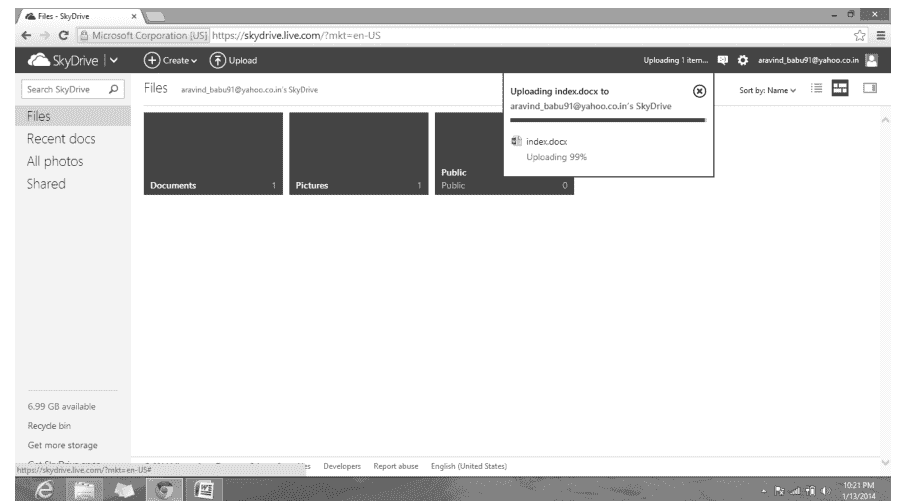

图 6.3 用于存储所有数据的 `Skydrive` 账户。

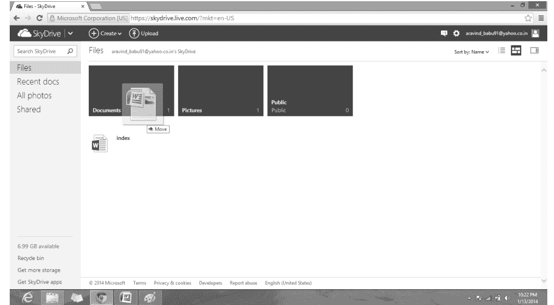

图 6.4 将数据移入 `Skydrive` 账户。

## 实时云及其应用

### Windows Azure

`Windows Azure` 是微软开发的一个专有云平台。`Windows Azure` 是微软创建的一种云云计算平台和基础设施，用于通过微软管理的数据中心构建、部署和管理应用程序及服务。它提供了 `PaaS` 和 `SaaS` 服务模型，并支持许多不同的编程语言、工具和框架，包括微软特定的软件和第三方软件及系统。`Windows Azure` 于 2010 年 2 月 1 日发布。`Windows Azure` 可用于构建在微软数据中心运行并存储数据的 `Web` 应用程序。它可以连接本地应用程序，或映射不同的身份信息集。其功能之一包括：

- 网站 – 它被用于在 `Windows Azure` 上快速部署高可扩展的网站。它允许网站管理员的代码使用语言和开源应用程序，并通过 `FTP`、`Git` 和 `TFS` 部署内容。与 `Windows Azure` 服务的集成包括 `SQL` 数据库、缓存、内容分发网络（`CDN`）和存储。对于网络呈现而言，这是一种优化解决方案，可以随着流量增长通过可扩展性、高可用性以及对性能和使用数据的内置监控来启动和扩展。这对于运行瞬态、短寿命和临时性网站、竞赛、促销、活动、原型、证明等也是一个完美的开箱即用。

- 虚拟机 – 它是 `Windows Azure` 的 `IaaS` 解决方案。这种急需且期待已久的能力使企业 `IT` 能够在几分钟内配置基础设施并部署虚拟机。管理员现在可以轻松在几分钟内部署和配置 `Windows Server` 和 `Linux` 虚拟机。在不修改现有代码和修改网络配置的情况下迁移工作负载，同时能够将虚拟机安全地连接到本地公司网络。

- 移动服务 – 它为移动应用程序提供了现成的开箱即用后端即服务。这项提供通过整合结构化存储、用户身份验证和推送通知加速了移动开发，并大幅缩短了流程。该方案用于移动应用程序开发和部署的投资回报率（`ROI`）几乎是时的。

- 媒体服务 – 它拥有向各种设备交付内容的能力，从 `Xbox`、`Windows Phone`、`Windows 8` 到 `macOS`、`iOS` 和 `Android`，同时通过按需和直播流传输能力接入、编码、转换和保护内容。`Media Azure` 日益成为业务和社交环境中交付的一部分，`Windows Azure Media Services` 带来了巨大的机遇和增长。

- 云服务 – 它是一项 `PaaS` 服务，提供按需运行时环境。发布的 `API` 允许开发者在 `Windows Azure` 上基于高可用性和弹性扩展构建或扩展企业级应用程序。这是一个 `PaaS` 环境。

苹果公司拥有的云计算平台是 `iCloud`。它仅在 2011 年引入，但现在已经非常流行。今天有数百万的人在使用它。众众所周知，苹果公司的应用程序仅限于其平台，外部人员或其他平台无法使用它们。`iCloud` 主要用于云存储，但也有其他功能。

## 实时云及其应用


`iCloud` 的一些功能包括：

- `iCloud` 帮助存储和查看用户从 `iTunes Store`、`App Store` 和电子书商店购买下载的音乐、电影、App、书籍等。它在所有 `Apple` 设备上自动可用，每当我们在一个设备上启动某个内容时，所有其他设备都会记住我们上次离开的地方。

- 使用 `iCloud` 可以通过 `Apple` 设备轻松与其他共享所有照片和视频。

- 苹果提供的非常重要的安全功能是丢失设备查找。人们无法轻易偷取某人的苹果产品并在市场上出售。有一个应用程序可以跟踪和查找丢失的苹果产品。

- `iCloud` 支持 `iWork` 应用，允许 `Apple` 用户随地工作。它支持所有的 `Apple` 平台。

- `iCloud` 支持数百万应用程序，帮助用户轻松使用它们并简化任务。这些应用程序涵盖各个领域，具有非常广泛的。

- 他们支持使用 `Safari` 进行简单且用户友好的浏览。`iCloud` 会让你的 `iPad`、`iPhone`、`iPod touch` 和 `Mac` 上 `Safari` 中打开的标签页保持更新。因此你可以从一个设备切换到另一个设备，并从离开的地方继续。`Safari` 还会在你的阅读列表中保存网页而不仅仅是链接，所以即使在没有连接互联网时也可以在任何设备上上进度。

- `iCloud` 支持一种名为钥匙串的独特功能。今天用户在各种网站上有多个账户，记住每个账户信息可能很困难。现在 `iCloud` 可以为用户跟踪账户、密码和信用卡号。

## 云计算

不记得它们时，它可以帮助创建它们。密码生成器为你的在线账户建议独特的、难以猜测的密码。然后，每当你需要登录或完成在线购买时，`Safari` 都可以自动输入你的密码。`iCloud` 钥匙串运行在所有 `iOS` 设备和运行 `OS X` 的 `Mac` 上。由于采用了 256 位 `AES` 技术，它是高度安全的。

- `iCloud` 支持电子邮件、日历、联系人、备忘录等内容的最佳云存储。它定期更新这些内容并在所有平台同步。

- `iCloud` 帮助所有数据的轻松备份和恢复。当用户设置新 `iOS` 设备或需要恢复现有信息时，`iCloud` 备份以非常简单的方式完成工作。将设备连接到 `Wi-Fi` 并输入 `Apple ID` 和密码。你的个人数据以及音乐、电视节目和书籍会自动出现在设备上。

- 当你注册 `iCloud` 时，会自动获得 5GB 的免费存储空间。你的 `iCloud` 存储用于 `iCloud` 备份、存储在 `iCloud` 中的应用数据和文档以及 `iCloud Mail`（`icloud.com` 邮箱）。如果你需要更多存储，可以轻松购买升级。

- `iCloud` 还提供了更好的安全和隐私。`iCloud` 通过在互联网上传输时加密、在服务器存储时使用加密格式存储以及使用安全令牌进行验证来保护你的数据。这意味着你的数据在传输到设备和存储在云端时都受到保护，防止未经访问。`iCloud` 使用 `AES` 加密技术。

## VMware 云及其产品

在虚拟化和云计算领域交付了许多产品和解决方案的著名公司是 `VMware`。当我们使用 `VMware` 这个词时，指的是虚拟操作系统软件。但它在云计算和虚拟化领域开发了许多产品。它最初是虚拟化技术的领导者，但今天在云计算技术方面也取得了同样的发展。一些云产品包括：

### vCloud Director

`VMware vCloud Director` 是一种软件解决方案，允许企业通过将资源池化到虚拟数据中心，并通过基于 `Web` 的门户和编程接口作为完全自动的、基于目录的服务暴露给用户，从而构建安全的多租户私有云基础设施。通过 `VMware vSphere` 和 `VMware vCloud Director` 构建安全高效的私有云，内部 `IT` 组织可以作为其支持的业务真正的的服务提供商，推动创新和敏捷性，同时提高 `IT` 效率并增强安全性。该解决方案提供了一条实实的路径到

## 实时云及其应用

云计算通过赋予客户利用现有投资的能力以及在云之间扩展容量的灵活性来实现。其功能特性包括：

- 创建虚拟数据中心 – 虚拟数据中心是逻辑构结构，包含计算、存储和网络能力，能够实现基础设施服务消耗与底层资源之间的完全抽象。

- 支持多租户环境 – 管理员可以将用户分组到组织中，这些组织可以代表任何策略组，例如业务部门、部门或子公司。每个组织都拥有隔离的虚拟资源、独立的 `LDAP` 认证、特定的策略控制和独特的目录。这些功能实现了安全的多租户环境和基础设施的安全共享。

- `vShield` 安全技术 – 集成的 `vShield Edge` 技术（如边界保护、端口级防火墙、网络地址转换和 `DHCP` 服务）提供了感知虚拟化的安全防护，简化了应用程序的部署，并强制执行了满足合规性标准所需的边界。升级到完整的 `vShield Edge` 解决方案可以增加高级服务，如站点到站点 `VPN`、网络隔离和 `Web` 负载均衡。

- 基础设施服务目录 – 用户可以从中心目录中通过点击按钮，部署和消费预配置的基础设施和应用程序服务，例如虚拟设备、虚拟机、操作系统镜像以及或其他介质。这使得 `IT` 团队能够标准化产品提供，简化故障排除、补丁更新和变更管理。

- 自助服务门户 – 用户可以通过用户友好的 `Web` 门户直接访问目录和虚拟数据中心。

- `vCloud API` 和开放虚拟化格式 – `vCloud API` 是一个开放的基于 `REST` 的 `API`，允许通过脚本化访问以消费云资源，例如 `vApp` 上传/下载、目录管理和其他操作。`vCloud API` 允许使用开放虚拟化格式（`OVF`）实现云之间的基础传输，该格式保留了应用程序属性、网络配置和其他设置。

- 自动化与编排 – 通过结合 `API` 与 `VMware vCenter Orche` 插件以及与其他编排和服务管理软件集成，管理员可以轻松地自动化常规任务、构建 `ITIL` 工作流并编写复杂操作脚本。

### vCloud 混合服务

`VMware vCloud Hybrid Service` 是一种安全的、专用的即服务基础设施云，由 `VMware` 拥有并运营，构建在 `vSphere` 的信赖基础和软件定义数据中心架构之上。该服务支持现有的工作负载和第三方应用程序，以及新的应用程序开发，并提供跨越您现有和新数据中心容量的统一网络。它还提供常用的管理和安全功能，以及您在内部 `VMware` 基础设施中期望的可靠性和性能。通过 `vCloud Hybrid Service`，对于您的本地和离线环境，寻求 `VMware` 支持只需拨打一个号码。

### 广泛的操作系统和应用程序支持

`vCloud Hybrid Service` 支持已认证可在 `vSphere` 上运行的数千个应用程序和数十种操作系统，因此您可以在无需任何更改的情况下在云中运行应用程序。这解决了许多其他云提供商产品的一个缺点：即为特定云提供商的平台重写应用程序所需的复杂性和精力。

### 无缝网络集成

`vCloud Hybrid Service` 构建在虚拟化网络之上，该网络可以快速自定义，以支持您的应用程序和安全需求。您可以将数据中心的第二层和第三层网络扩展到 `vCloud Hybrid Service`，而无需手动更改配置。网络虚拟化允许您像在数据中心内部一样配置防火墙和网络，以便您可以复制网络应用程序以进行运行。该服务在您的本地和离线环境中提供通用的身份和访问管理。

### 高性能、可靠平台

`vCloud Hybrid Service` 包含应用程序的自动复制、监控和高可用性，无需额外费用，因此您无需为了确保其可用性而重写或重新设计应用程序。利用您已经在内部运行的相同平台，您可以将管理工具扩展到云端，获得跨越数据中心和云的集成 `IT` 能力。通过利用您的投资、流程和专业知识，您可以降低总拥有成本。

### 服务选项选择

`vCloud Hybrid Service` 提供两种服务选项，可以单独部署或结合使用，为您提供满足组织需求所需的灵活性和可扩展性：

- 专用云 (`Dedicated Cloud`) 为您提供物理隔离的基础设施，为您提供私有云实例，并对您的资源拥有最大的控制权。此服务是生产工作负载的理想选择，包括任务关键型应用程序、新应用程序开发、安全和合规驱动型应用程序，以及将从物理隔离中受益的高性能应用程序。

- 虚拟私有云 (`Virtual Private Cloud`) 为您提供逻辑隔离的基础设施，包括完全私有的网络和资源池。此服务适用于短期项目、开发测试负载以及容量需求较低的项目。

### vSphere

`vSphere` 利用虚拟化力量将数据中心转换为简化的云计算基础设施，并使 `IT` 组织能够提供灵活可靠的 `IT` 服务。`vSphere` 将跨多个系统和虚拟资源池的底层物理硬件资源虚拟化并聚合到数据中心。作为一种云操作系统，`vSphere` 将 `CPU`、存储和网络等大量基础设施集合管理为一个无缝且动态的环境，并管理数据中心的复杂性。以下组件层构成了 `vSphere`。

### 基础设施服务

基础设施服务是一组用于抽象、聚合和分配硬件或基础设施服务的集合。基础设施服务分为几种类型。

- `vCompute`，包括从底层服务器资源中抽象的 `VMware` 能力。`vCompute` 服务聚合许多离散服务器上的这些资源，并将它们分配给应用程序。

- `vStorage`，是一系列允许在虚拟环境中高效使用和管理存储的技术set。

- `vNetwork`，是一系列用于简化和增强虚拟环境中网络的技术set。

### 应用程序服务

应用程序服务是一组确保可用性、安全性和可扩展性的服务。

### VMware vCenter Server

`VMware vCenter Server` 提供了一个单一控制点。它提供基本的数据中心服务，如访问、监控和配置。

### 客户端

用户可以通过客户端或 `Web` 浏览器访问 `vSphere`。

## 6. DROBOX

### 云计算

`Dropbox` 是另一种用于存储数据的云存储软件。`Dropbox` 于 2006 年由 `Drew Houston` 和 `Arashowsi` 作为 `Y Combinator` 初创公司创立。今天它非常流行，支持计算机、移动、平板等所有平台。`Dropbox` 提供文件同步和客户端。其功能包括：

- 加密 – 存储在 `dropbox` 中的文件使用 256 位 `AES` 加密和 `SSL`。

- 隐私 – `Dropbox` 隐私政策旨在保护收集、使用和披露团队信息。

- 安全 – 如果计算机丢失或有人离开公司，远程删除 `Dropbox` 文件夹以确保公司最重要的数据安全。

- 认证 – `Dropbox` 存储在 `Amazon S3` 上通过了 `SSAE16/SOC1`、`SOC2`、`ISO3402` 和 `ISO 27001` 认证，并可能在其他安全数据中心提供数据镜像。

- 双重验证 – `Dropbox` 通过密码和手机保护 `Dropbox` 账户提供了额外的安全层。

- 可靠 – 它通过设计具有 99.9% 耐用性的存储来确保工作安全。

# 实时云及其应用

137

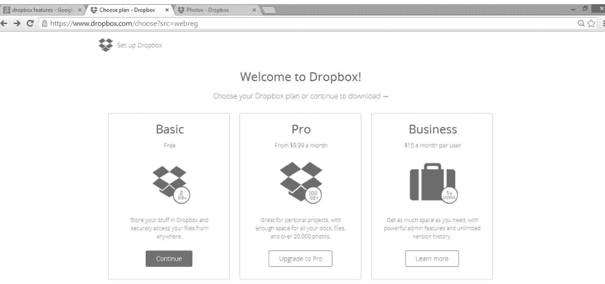

图 6.6 `Dropbox` 计划。

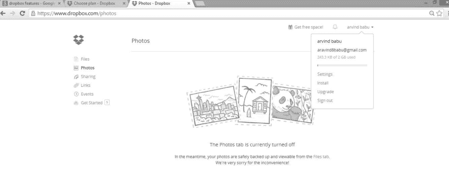

图 6.7 带有数据存储的 `Dropbox` 账户

138

云计算


图 6.8 `Dropbox` 轻松帮助存储来自本身的所有数据。

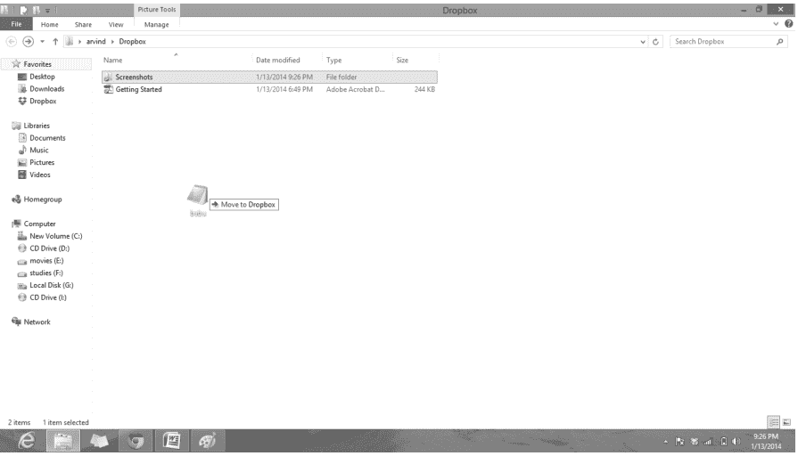

图 6.9 从系统将文件移动到 `Dropbox`。

# 实时云及其应用

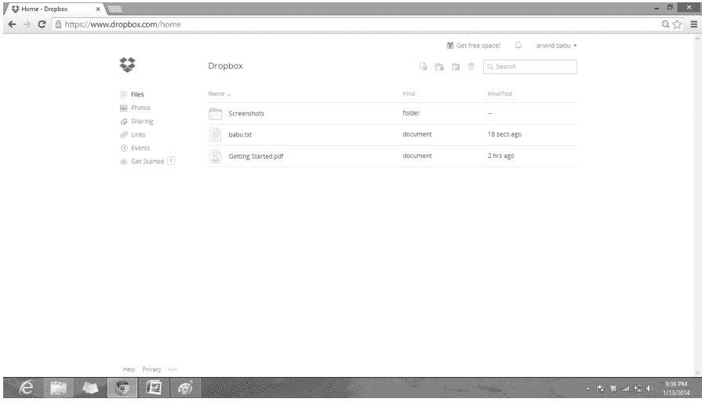

图 6.10 存储在 `Dropbox` 账户中的数据。

截至 2013 年 2 月，`Dropbox` 占全球互联网流量的 0.29%。2013 年，`Dropbox` 收购了用于 `iOS Mailbox` 的邮件管理应用以及移动优惠券 `Endorse`。2013 年 11 月 13 日，`Dropbox` 宣布其用户数已达到 2 亿。2013 年 11 月 21 日，`Dropbox` 发布了其 `iOS` 应用的新版本。新设计现在具有更洁白、更简单的用户界面，使该应用程序与 `iOS 6` 的其他产品保持一致。

## 6.7 RACKSPACE 云

云计算领域另一家做了大量工作的著名公司是 `Rackspace`。它为云开发了许多产品和解决方案。这些包括：

- 公共云、私有云和混合云

- 云服务器

- 云数据库

- 云文件

- 云站点

- 云文件和存储

- 云监控

- 云网络

- 云负载均衡器

### 云 DNS

- 云大数据平台

- 云队列

我们将详细讨论其中的一些产品。

### 云文件 (Cloud Files)

云文件是一种云托管服务，在实用程序计算的基础上为媒体提供先进的无限制存储和内容分发网络。它最初于 2008 年作为 `Mosso CloudFS` 发布，与亚马逊简单存储服务（`S3`）。可以上传高达 5 GB 的无限文件，通过在线控制面板或 `RESTful API` 进行管理，并可选地通过 `Akamai` 技术内容分发网络提供。除了在线控制面板外，还可以可以使用 `.NET`、`Python`、`PHP`、`Java` 和 `Ruby` 等语言的开源代码访问该服务。`Rackspace` 收购了 `Jungle Disk Clouds`，将其挂载为 `Linux`、`Mac OS X` 和 `Windows` 等支持的操作系统中的本地驱动器。

### 云服务器 (Cloud Servers)


云服务器是一项云基础设施服务，允许用户即时部署数百台云服务器，并创建类似于`Amazon EC2`的高级高可用架构。云服务器是运行在基于 Linux 实例的 `Xen` 虚拟机程序上的虚拟机，以及用于 Windows 和 Linux 实例的 `Citrix XenServer`。每个四核硬件具有 16 GB 到 32 GB 的内存，磁盘大小从 10 GB 到 620 GB 不等。磁盘和 CPU 分配随内存扩展，并支持多种 Linux 发行版，包括 `Arch`、`CentOS`、`Debian`、`Fedora`、`Gentoo`、`Red Hat Enterprise Linux` 和 `Ubuntu`。

该服务背后的技术是通过 `Rackspace` 在 2008 年收购 `Slicehost` 获得的，这些服务器以前被称为 slices。它们比传统的专用服务器便宜得多且更容易使用，尽管仍需要维护操作系统和解决方案栈，而这在云站点产品中需要的。这是这两个服务之间的许多区别之一，云服务器包含全 root 权限访问并允许更多自定义，而云站点产品的灵活性较低，但维护工作较少。

2010 年 12 月 14 日，`Rackspace` 开始为云服务器产品提供服务水平，增加了对操作系统和常用应用程序的额外支持，以及补丁和其他常规服务。然而，这种额外的支持是以成本增加为代价的。

云工具 (`Cloud Tools`) 是构建在 `Rackspace` 云上的应用程序和基础设施软件。列出的应用程序包括 `Zend`（一个 PHP 栈）、`CloudClicks`（云性能测试服务）、`CopperEgg`（实时云服务器和监控服务）、`Xeround`（MySQL 数据库）以及 `MongoLab`（流行的 NoSQL 数据库 `MongoDB` 的云版本）。

## 实时云及其应用

### 云站点 (Cloud Sites)

云站点是一种平台即服务提供 (`PaaS`)，类似于构建在水平可扩展硬件基础设施上的传统网络托管。固定的每月信用卡支付让用户访问该服务，并分配计算、存储和带宽资源。如果这些分配耗尽，后续使用将按照实用程序的基础上计费。这允许无限数量的站点、数据库和电子邮件账户，并包括计费和支持等转销选项。作为在云上支付站点最快的方法，它在数百台服务器上运行 Windows 或 Linux 应用程序。

云站点支持 `PHP 5`、`Perl`、`Python`、`MySQL`、`.NET 2.0+`、`ASP` 和 `Microsoft SQL Server 2008` 应用程序框架。

### OpenStack 云

2010 年，`Rackspace` 在 `Apache License` 下贡献了其云文件产品的源代码，以成为 `OpenStack` 的一部分。2012 年 4 月，`Rackspace` 宣布它将使用 `OpenStack` 作为云服务器产品的底层技术，提供数据库、块存储和虚拟网络。今天，`OpenStack` 是一个主要的云工具。

另一家设计了多种云产品和服务的著名云计算平台是 `Salesforce`。它通常被称为 `salesforce.com`。它是一家总部位于加利福尼亚州金山的美国公司。它被《财富》杂志评为美国最具创新的公司，并在《财富》百强工作场所中位列第 19。它收购了许多其他公司。

`Salesforce` 以其客户关系管理 (`CRM`) 产品闻名。智能公司依赖于提供完全自定义的 `CRM` 平台。为了让 `CRM` 高效工作，它必须具备三个特征：

- 高可靠性——可用性超过 99.9%
- 高性能——数据访问小于 300 毫秒
- 高安全性——`ISO 27001` 和 `SAS 70` `Type II` 等

有效的 `CRM` 基础设施基于多租户，多个客户共享技术并运行在最新版本上，类似于 `Amazon.com` 或 `Google`。通过多租户，您无需担心应用程序或基础设施升级，它们会自动发生。事实上，多租户让公司专注于管理 `CRM`，而不是管理技术。

从销售和营销的角度来看，对于销售经理来说，云端应用程序提供了团队活动的实时可见性，以便他们能够信心地预测销售。对于销售人员来说，云端应用程序轻松管理客户信息，使销售人员花在处理数据上的时间减少，花在客户身上的时间增加。对于营销人员来说，没有比跟踪通过网络、电子邮件或 `Google` 营销活动产生的线索销售额更重要的了。云端应用程序可以跟踪线索和来源，实时路由给正确的销售人员，并提供分析查看哪些是有效的，哪些可以改进。

### 服务云 (Service Cloud)

服务云允许在任何地方、任何时间、任何设备上提供革命性的客户服务。因此可以将触摸服务直接嵌入产品中。它是在您所在地提供的服务云的完整功能。

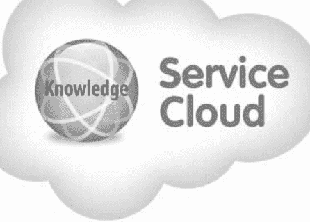

图 6.11 `Salesforce` 的服务云。

服务云提供了完全运行在先进多租户云平台上的全球企业级知识库。这意味着您获得了 `salesforce.com` 出名交付的所有云优势。无需昂贵的数据中心。无需软件。无需复杂的升级。只有强大的知识管理，而没有本地部署软件的烦恼。与独立应用程序不同，此知识库与服务云提供的其他所有功能完全集成。当您的知识库是 `CRM` 解决方案的核心部分时，您可以将其作为一个过程来管理知识，而不是一个时间点快照。你可以持续地创建、审核、交付、分析和改进你的知识。你的智能体变得更智能，你的客户获得更好的服务，你的成本也随之降低。

服务云 (`Service Cloud`) 为你提供了大规模管理知识所需的工具。但它还提供了 `Salesforce` 著称的极易用性。这意味着无论你的业务规模大小或复杂程度如何，你都能从中受益。

- `Rich knowledge articles` – 使用所见即所得 (`WYSIWYG`) 编辑器轻松创建文章，包含图像或视频和自定义格式。甚至添加标签页和目录等导航元素。
- `Review and approval workflows` – 包含了自动化授权、审核和审批过程所需的一切。分配知识任务、创建截止日期并更新文章状态。使用版本控制工具帮助你的组织保持同步。
- `Usage analytics` – 通过分析显示人们阅读特定文章的频率以及对文章的评分，以此监控哪些内容真正有用。
- `Ease of management` – 点点式管理工具让业务用户定义流程、设置维度并创建文章模板。

### 销售云 (Sales Cloud)

销售云为你提供了与客户建立所需所需，从完整、最新的帐户信息到社交洞察，全部整合在一个处，随时随地可访问。

你需要知道的一切都会实时自动推送给你，从联系人信息到交易更新和折扣审批。此外，信息会自动共享给需要它的团队成员。结果是，你能够更接近更多交易，并在重要事项上进行即时协作。

`Salesforce.com` 创建销售云是为了让它变得像 `Amazon` 这样的消费者网站一样简单易用，并构建了它以消除与传统软件相关的风险和费用。通过开创云计算概念，`salesforce.com` 表明任何应用程序都可以像电力输送到家中一样，通过互联网交付。凭借其开放的架构和自动更新，销售云消除了传统 `CRM` 软件的隐藏成本和冗长的实施过程。今天，它是全球超过 100,000 名客户信赖的销售应用。

通过持续创新并拥抱移动、协作和社交智能等技术，销售云一直处于竞争领先地位。现在，你可以及时掌握交易中发生的一切，关于人员、文档、帐户和交易的更新将自动投递到你的 `Chatter Feed` 中。通过针对 `Android`、`BlackBerry`、`iPad` 和 `iPhone` 平台的原生应用，无论你处于世界的何处，都能与你的客户和队友保持连接。

由于同时连接了正确的信息和同事，销售团队更加同步，性能得到了显著提高。

## 6.9 云操作系统

当我们使用“软件”这一术语时，不能忘记操作系统也是软件。云计算的屏垒并没有让它们例外。今天有许多云操作系统可用。人们不应将它们仅仅视为在线应用程序。这些操作系统可以在网页浏览器中运行，并内置了各种可用的软件。操作系统和软件基于拥有并管理该操作系统的公司。人们只需简单的账户和高速互联网即可在线轻松使用它们。这种云让生活变得如此先进和方便，以至于人们不会说：

> “我的系统中没有那个版本的软件”或“我没有在我的 PC 上安装那个软件”

一些云云操作系统包括：

### ZeroPC

`ZeroPC` 为用户提供 1GB 的免费存储空间，并允许连接 `Box`、`Dropbox`、`Google Drive`、`SkyDrive`、`SugarSync` 和 `4Shared` 等云存储服务，以访问所需的所有文件。`ZeroPC` 也适用于 `Android`、`iPhone` 和 `iPad`，让你随地访问。对于热爱照片的用户来说，它也是很强大的照片管理工具，链接了 `Facebook`、`Flickr`、`Instagram`、`PhotoBucket`、`Picasa` 和 `Recode` 等照片视频服务。它还拥有即时消息的原生应用、文本编辑器以及在线管理文档和电子表格的效率工具。

图 6.12 在网页浏览器中运行的 `ZeroPC` 云操作系统。

### Jolicloud

`Jolicloud` 提供 `Joli OS`，即使你的系统有 10 年历史，也可以下载并安装到系统中，或者在浏览器中使用。`Joli OS` 提供了完整的云体验，随时随地保留和使用你喜爱的应用程序，`Jolicloud` 拥有超过 15,000 个可以使用系统访问的 Web 应用。用户可以将 `Dropbox` 和 `Google Drive` 账户集成到 `Jolicloud`，还有一个 `Jolicoud Me` 版本，你可以在一个地方管理所有的在线生活。`Jolicloud Me` 目前支持 `Facebook`、`Flickr`、`Instagram`、`Picasa`、`Tumblr` 和 `Twitter`。

图 6.13 `Jolicloud OS`。

### Glide OS

当用户在小组作业时，`Glide OS` 是正确的云操作系统。`Glide` 团队提供 30GB 的免费存储空间，你可以在一个账户中最多添加 6 个用户。该操作系统并不非常漂亮，但非常实用；它具有电子邮件和个人资料等附加功能，以及日历、笔记、文本编辑器、演示文稿制作等处理文件所需的工具。`Glide` 操作系统还为 `Windows` 和 `Mac` 等所有其他操作系统提供同步软件。

图 6.14 在网页浏览器中运行的 `Glide OS`。

### SilverOS

`SilverOS` 是基于 `Silverlight` 构建的云操作系统。它也是流行操作系统之一。用户可以在任何浏览器中运行它。它内置了应用程序，你可以在听音乐、做笔记。它的问题在于它不提供任何存储空间，但它是长期工作的得手工具。它提供了并非其所拥有的应用程序。

图 6.15 在网页浏览器中运行的 `Silver` 云操作系统。

### Ipaces Cloud

`Ipaces` 云操作系统具有管理工作的基本功能，如浏览器、文件管理器、笔记、Office 套件等。它还拥有从任务栏访问的多个工作空间。它让你保持工作环境井井有序，从一个空间快速访问到另一个空间。你可以使用文件管理器处理 `Box` 和 `Dropbox` 中的文件。

图 6.16 在网页浏览器中运行的 `Ipaces` 云操作系统。

### Cloudou

`Cloudou` 是一个为了在浏览器中运行而有趣操作系统。它装满了如邮件、日历、音频播放器、RSS 阅读器、联系人管理器、文字处理器、记事本、命令行解释器、查找等应用程序。它提供了一个良好的操作系统界面，你可以在其中运行命令、安装应用、播放音乐等。它还提供了一个应用程序管理器，你可以用它在 `Cloudou` 中安装更多应用。

### xOS

`xOS` 没有提供很多自定义选项，但它们提供了一系列良好的个人使用应用程序。它提供了 Web 浏览器、文件管理器、文本编辑器、笔记、日历、画画、电子邮件客户端以及 `Canvas Rider` 游戏等。

图 6.17 在网页浏览器中运行的 `Cloudou` OS。

图 6.18 在网页浏览器中运行的 `xOS` 云操作系统。

### Jimdesk

`JimDesk` 是一个拥有许多应用程序和功能的云操作系统。它具有自定义壁、Office 套件、联系人管理器、RSS 阅读器、日历、邮件客户端、`FTP` 文件上传器等。

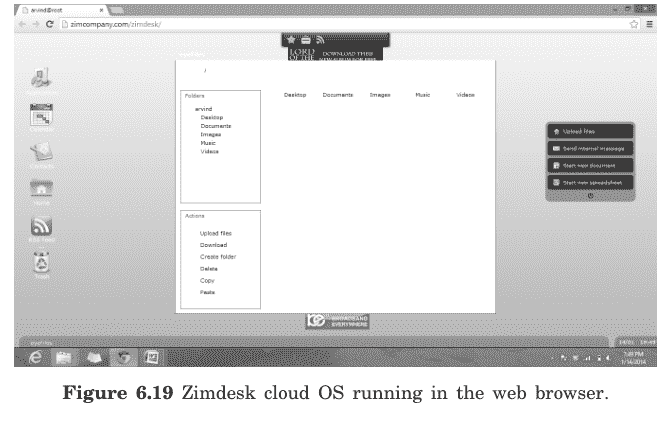

### The Places A

这是另一个云操作系统，提供广播、日历、文件管理器、书签管理器、笔记、电子邮件客户端等基础应用。你可以将 Web 应用作为链接添加到其中，这些链接将在新标签页中打开。云操作系统的独特之处在于，用户可以将所有的文档、设计、音乐、个人文件、照片和视频存储在网上，并通过虚拟工作环境进行访问。在云操作系统上工作，你只需要连接网络即可大功告成。

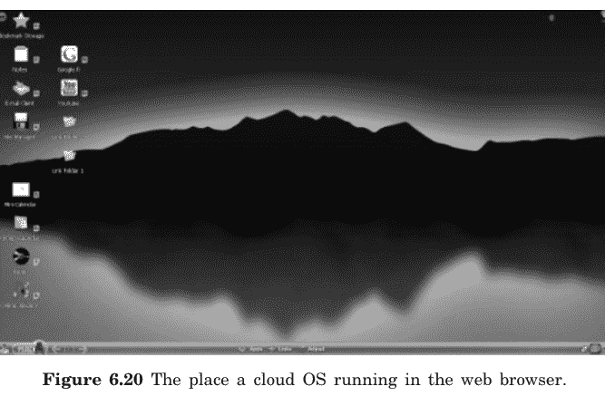

## 云计算

## 总结

- 亚马逊已成为当今云技术无可争议的领导者。亚马逊云服务（`AWS`），正式称为 `AWS`，为所有业务服务提供云计算平台。`AWS` 可以提供灵活、具有成本效益的 IT 基础设施和服务，并可以根据终端用户和公司的需求进行扩展或收缩。

- 亚马逊云服务使用 `EC2` 平台提供云托管服务。它允许使用 Web 服务接口启动具有各种操作系统平台的实例，加载自定义的应用程序环境，管理网络访问权限，并根据用户意愿运行任意数量或少数的系统镜像。

- 亚马逊简单存储服务（`S3`）允许用户将所有数据存储在云端。这些云存储用户可以随时随地访问数据，而不受机器的限制，并且减少了对硬件存储设备的需求。

- 谷歌整合了许多应用程序并为客户提供许多服务。这种整合使得谷歌成为最佳服务提供商之一，让客户能够轻松完成任务。

- 谷歌应用引擎（`Google App Engine`）属于云服务模型中的平台即服务（`PaaS`）概念，它要求用户使用软件开发工具来设计云应用、将云应用托管到 `Google` 云中并根据用户需求进行扩展。

- 类似于亚马逊简单存储服务（`S3`），谷歌开发了一种名为 `Google Drive` 的流行存储介质，它在特定限制内是免费的，而不像亚马逊存储那样需要完全租赁。它可以为用户免费存储约 15 GB 的数据。

- `Google Docs` 是一个用于实时协作编辑的工具。文档可以被多个用户同时共享、打开和编辑。用户无法收到更改通知，但当有人发表评论或讨论或回复时，应用程序可以通知用户，从而促进协作。它与 `Google` 同步。

- 使用谷歌云打印（`Google Cloud Print`），用户可以从任何设备将任何内容打印到任何打印机。谷歌云打印是一种将打印机连接到网络的新技术。通过谷歌云打印，用户可以将家里和工作的打印机供自己以及其他人在日常应用程序中使用。

- 类似于亚马逊简单存储服务（`S3`）和 `Google Drive`，微软开发了基于云的存储平台 `Skydrive`。它以前被称为 `Windows Sky Drive` 和 `Windows Live Folders`。该服务为新用户提供 7 GB 的免费存储，并为学生提供为一额外的 3 GB 免费存储。

- `Windows Azure` 是微软创建的云计算平台和基础设施，用于通过微软管理的数据中心构建、部署和管理应用程序和服务。它提供了云的 `PaaS` 和 `IaaS` 服务模型，并支持许多不同的编程语言、工具和框架。

- 苹果公司拥有的云平台是 `icloud`。它于 2011 年推出，但现在已非常流行。今天有数百万人在使用，`icoud` 主要用于云存储，也有其他功能。

- `VMware vCloud` 是一种软件解决方案，允许企业通过将基础设施资源池化到虚拟数据中心，并通过基于 Web 的门户和编程接口向用户开放，从而构建安全的、多租的私有云。

- `VMware vCloud Hybrid Service` 是一个安全的、专用的基础设施即服务（`IaaS`）云，由 `VMware` 拥有并运营，构建在 `vSphere` 的信任基础和软件定义数据中心架构之上。

- `Dropbox` 是另一个用于存储所有用户数据的云存储服务。`Dropbox` 公司由 `Drew Houston` 和 `Ashford` 于 2007 年创立。

- `Dropbox` 提供云存储、文件同步和客户端软件。`Dropbox` 允许用户在他们的每台电脑上创建一个特殊文件夹，然后 `Dropbox` 会同步该文件夹，因此无论使用哪台电脑查看，其内容都是相同的。放置在此文件夹中的文件可以通过网站和移动应用程序访问。

- `Cloud files` 是一种云托管服务，由 `Rackspace` 云提供的计算能力为媒体提供无限的在线存储和内容分发网络。它最初于 2008 年作为 `Mos CloudFS` 发布，类似于亚马逊简单存储（`S3`）。

- 2010 年，`RackSpace` 在 `Apache License` 下将其 `Cloud Files` 产品的源代码贡献给 `OpenStack` 云工具项目，使其成为 `OpenStack` 对象存储组件。从这里开始，`RackSpace` 成为云计算技术领域一个更具深远影响的参与者。

- `Salesforce` 以其客户关系管理（`CRM`）产品而闻名。`CRM` 云应用对于任何行业的销售、营销和服务专业人员来说都是都是易于使用的。

- `Service Cloud` 允许在任何地方、任何时间或通过任何设备提供革命性的客户服务。用户可以将触摸直接嵌入产品中。

- `Salesforce.com` 创建了销售云（`Sales Cloud`），使其像亚马逊的消费级一样易于使用，并在云端构建了它。

LINUX 与开源云

对系统中发生的一切事情具有完全控制权的是受信任的软件，而所有其他程序都被视为不受信任的软件。

- `用户模式 (User Mode)` – 用于执行用户所有的应用程序。这是一个非特权模式。因此，所有用户模式软件都通过系统调用（`system call`）请求使用内核，以执行如进程创建或输入输出操作等特权指令。

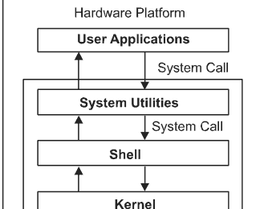

**图 7.1** `Linux` 架构及其组件。

`Linux` 操作系统的架构由五个主要部分组成：

- `内核 (Kernel)` – 它充当**操作系统与其他硬件资源之间的接口**。它是操作系统中首先加载并保留在内存中的主要部分。内核是操作系统的核心。当有人对内核文件进行任何更改时，会影响整个操作系统。它是应用程序与实际数据处理之间的桥梁，用于支持应用程序。它负责任务管理、内存管理和磁盘管理。它的主要功能是管理计算机资源并支持想要使用这些资源的其他程序。


Linux 内核为用户进程提供了一个虚拟接口。编写进程时不需要了解计算机上安装了什么物理硬件。Linux 内核将所有硬件抽象成一个一致的虚拟接口。此外，Linux 还支持对用户进程透明的多任务执行。每个进程都像是计算机上唯一的进程，独占使用主内存和其他硬件资源。内核实际上同时运行多个进程，并负责协调硬件资源的访问，以确保每个进程都能访问，同时维持进程间的安全性。

Linux 内核由五个主要的子系统组成，包括：

- **调度器 (`The scheduler`)** – 控制进程对 `CPU` 的访问。调度器执行一种策略，确保进程能够公平地访问 `CPU`，同时确保内核按时执行必要的硬件操作。

- **内存管理器 (`The memory manager`)** – 允许多个进程安全地共享主内存系统。此外，内存管理器支持虚拟内存，允许 Linux 支持使用超过系统可用内存的进程。未使用的内存通过文件系统交换到持久性存储中，在需要时换回。因此，内存通过换入换出（`swap in and swap out`）交换。

- **虚拟文件系统 (`The virtual file system`)** – 通过向所有设备提供通用接口来抽象各种硬件设备的细节。此外，`VFS` 支持几种与其他操作系统兼容的虚拟文件系统格式。

- **网络接口 (`The network interface`)** – 提供对多种网络标准和各种网络硬件的访问。大多数网络操作仅在 Linux 平台上完成。

- **进程间通信 (`The inter-process communication`)** – 这是一个支持单个 Linux 系统上进程与进程通信多种机制的子系统。

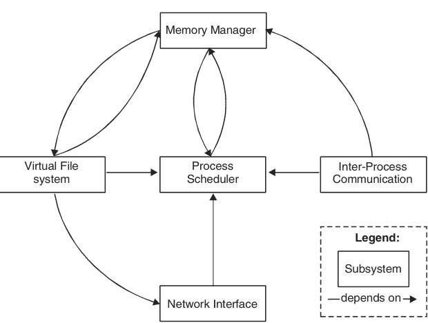

**图 7.2** Linux 内核及其子系统。

曾经在安装云工具期间，我们对内核文件进行了更改，意外地影响了整个操作系统，导致我们第二天无法启动操作系统。我们所有的工作都丢失了，证明这是一个错误。

- **Shell** – 它充当用户与操作系统之间的接口。它是为需要内核服务的操作系统用户提供接口的软件。当用户从命令行输入执行任何操作的命令时，请求会发送到 `Shell`。然后 `Shell` 将这些人类程序翻译成机器语言，并将请求传递给内核。内核接收 `Shell` 的请求，处理请求并在屏幕上显示结果。所有这些功能都由内核以透明的方式完成。操作系统的 `Shell` 分为两部分：执行命令行和 `GUI`。

## Linux 与开源云

### 命令行 (`Command Line`)

我们很多人知道 Linux 操作系统支持命令行界面，具有各种用于用户任务的命令。它是操作系统中接收并执行用户操作系统的指令的部分。命令被发送到内核执行。如果命令有效，内核开始执行；否则会产生错误。因此，可以将其想象为命令执行的中间环节。

### 图形用户界面 (`GUI`)

这为用户任务提供了一个用户友好的环境。用户无法记住所有命令的语法，因此有助于通过鼠标或其他用户执行所需的指向设备来简单地指出要执行的对象。这是一种类似于命令的桌面执行环境。

### 系统实用程序 (`System utilities`)

工具由各种系统中断和系统调用组成，用于将控制权传递给包含内核和 `Shell` 的用户模式代码，以进一步执行命令。可以使用系统调用转移控制。

系统调用是进程与操作系统之间的接口。简单来说，系统调用是用户请求运行任何程序以及在系统上执行其请求的任何操作。

#### 系统调用有几种不同类型

- 文件管理系统调用 – 用于执行打开、关闭、读取、写入以及所有文件操作。

- 进程控制系统调用 – 用于执行所有进程控制操作，如加载、执行和创建其他操作。

- 设备管理系统调用 – 用于执行请求设备、写入设备、释放设备和其他操作。

- 通信系统调用 – 用于执行发送消息、传输状态等操作。

- **用户应用程序 (`User application`)** – 包含了用户执行任务所需的所有应用程序。今天有数百万 Linux 应用程序可用，有些是内置的，有些可以下载等等。内核被用于生成进程。

- **硬件平台 (`Hardware platform`)** – 它包含了系统所有的硬件资源，如键盘、显示器、打印机等，用户借此进行输入输出。

## 7.2 Linux 与云计算

我们大家都熟悉 Linux 和 Windows 操作系统。我们大多数人都曾易在 Windows 的图形用户界面（`GUI`）环境中工作。在 Windows 操作系统中，常用的包括 `XP`、`Windows 7` 和 `Windows 8`。Linux 平台同时支持 `GUI` 和命令行。常用的 Linux 包括 `Red Hat`、`CentOS`、`Ubuntu`、`Fedora` 等。Linux 的整体架构与 Windows 完全不同。Linux 非常适合服务器端的网络操作。Linux 的桌面版本和服务器版本使其成为网络功能的理想选择。Linux 的工作环境非常有趣、有用，甚至比 Windows 更先进。Linux 非常适合虚拟化和云计算工具。Linux 是模块化的、强大的、高效的、可扩展的、开源的，世界上主要的云基础设施都是构建在 Linux 之上的。

> “每当你使用 Google 时，你在使用一台运行 Linux 内核的机器，”
>
> `Google` 的 `ChrisDiona`

使其成为云计算正确平台的特性包括：

- **Linux 架构** – Linux 内核在很大程度上支持组件化概念，这是任何其他操作系统无法有效支持的。Linux 内核支持各种形状的计算环境。Linux 支持的硬件类型比之前的任何操作系统都多。云提供商的另一个优势是他们可以根据需求和功能修改 Linux 的开源代码。Linux 也适用于网络领域和所有的存储介质。

- **兼容性 (`Compatible`)** – Linux 支持来自广泛平台的数百万应用程序。它具有高度的兼容性和友好性。Linux 是所有 `Web` 应用程序、数据库、服务器脚本以及云中其他开源项目的最佳架构。由于其开源、无处不在的质量，Linux 也是所有厂商的最佳部署。

- **许可问题 (`Licensing issue`)** – 存在一种相当误解，认为 Linux 总是免费的。事实上，绝大多数企业和政府部署都是经过商业许可并支持的。但对于云平台提供商来说，运行非商业发行版的选择确实，并且可能具有吸引力。平台提供商会选择这条路径，因为创建一个由数千或数万个受许可节点组成的云基础设施。

### Linux 与开源云

传统的单服务器或插槽（`socket`）模型是不符合经济效益的。通过利用这种低成本的方法，云提供商能够将节省的成本传递给客户。

- **电力经济** – 除了许多优点外，Linux 是计算机技术中功耗相当较低的平台。结合云数据中心内部的节能工作，Linux 正在帮助云客户降低解决方案的总成本。

- **管理** – 对于企业而言，资源和人员是技术部署和实施中的重要因素。除了评估特定产品或项目的优缺点外，组织还必须考虑现有技能如何与这些技术匹配。在 Linux 上进行管理和开发是通用的技能，Linux 在云平台中的无处不在意味着部署到云端可以避免系统管理员和开发人员昂贵的重新培训。因此，Linux 的整体管理更加容易，并不是一项艰巨的业务。除了重新利用现有人员外，已经针对 Linux 部署的 `IT` 管理系统也可以更好地用于基于 Linux 的云节点。

- **标准化** – 分析师和其他针对潜在云客户的顾问最担心的问题之一是缺乏标准，以及由此可能导致的潜在的供应商锁定风险。Linux 被认为是设计、部署和扩展云应用的正确标准。托管在云环境中 Linux 实例与托管在本地或数据中心的 Linux 实例之间的差异通常是地理上的而非技术上的。通过对 Linux 工作负载进行标准化，客户将根据经济效益和情况灵活地进行本地或远程部署。

- **虚拟化** – 它是云计算的核心原理之一。Linux 是处理虚拟化和实时云的正确平台。Linux 支持 `KVM` 和 `XEN` 等虚拟化工具。镜像或应用程序虚拟实例可以运行在 Linux 平台之上。Linux 还支持迁移的概念，通过迁移虚拟化可以从本地环境桥接到云硬件。与 Windows 或任何其他操作系统相比，Linux 是支持虚拟化的最佳选择。

在互联网革命之后，Linux 是新架构方法和新一代面向 `Web` 的业务的起点。因此，Linux 是计算技术进步和网络方法改进的先驱，帮助了企业 `IT` 业务和终端用户。

几乎所有的云供应商都直接或间接地利用 Linux 内核。许多 Linux 平台已与开源工具合作，开发了许多先进的云工具。一个最好的例子是 `Ubuntu` 在 2010 年与 `Eucalyptus` 云合作提供了 `Ubuntu` 企业级云 (`UEC`)。随后在 2012 年，`Ubuntu` 与 `OpenStack` 云联手，在 `Ubuntu 12.04` 版本中提供了稳定的云环境。事实是，Linux

## 云计算

是云计算领域事实上的首选操作系统。Linux 无疑是未来云平台赖赖的基础。

在 Linux 平台下开发的的一些云产品包括：

| 厂商 | 产品 | URL |
|---|---|---|
| `10gen` | `Mongo` | `http://www.10gen.com/` |
| `3Tera` | `AppLogic Cloud Computing Platformform` | `http://www.3tera.com/` |
| `Amazon EC2` | `Amazon EC2, Amazon S3, SimpleDB` | `http://aws.amazon.com/` |
| `Cassat Corporation` | `Cassative Active Response` | `http://www.cassatt.com/` |
| `CohesiveFT` | `Elastic Server` | `http://www.cohesiveFT.com/` |
| `Dell DCS` | `Cloud Computing Solutions` | `http://www.dell.com/cloudcomputing/` |
| `Elastra` | `Enterprise Cloud Server` | `http://www.elastera.com/` |
| `ElasticHosts Ltd.` | `ElasticHosts` | `http://www.elastichosts.com/` |
| `EMC` | `Mozy` | `http://www.mozy.com/` |
| `Enomoly` | `Elastic Computing Platform` | `http://www.enomoly.com/` |
| `Flexiccale` | `Cloud Computing On-Demand` | `http://www.flexiscale.com/` |
| `Google` | `Google Apps` | `http://www.google.com/apps/` |
| `IBM` | `Blue Cloud` | `http://www.ibm.com/ibm/cloud/` |
| `Media Template` | `(nt)` | `http://www.mediatemplate.net` |
| `Morph Labs` | `MorphExchange` | `http://www.morphexchange.com/` |
| `Mosso` | `Cloud Sites, Cloud Files` | `http://www.mosso.com/` |
| `SalesForce.com` | `Force.com Cloud Computing` | `http://www.salesforce.com/` |
| `VMware` | `vCloud` | `http://www.vmware.com/technology/cloud-computing.html` |
| `Zimory` | `Public Cloud` | `http://www.zimory.com/` |

图 7.3 Linux 平台下开发的云产品。

## 7.3 开源云列表

在前面的节中，我们看到了 Linux 环境及其用于云计算的平台。现在让我们看看今天常用的开源资源列表，用于建立实时云环境，以便在云环境中设计、部署和管理应用程序。正如我们所知，开源技术是免费的。教育机构、研究人员、学者甚至商业组织都可以使用它们。这些工具会定期更新。公司为所有用户提供了一个友好的博客，每个人都可以在那里发布他们的问题、困难和所有相关新闻。用户还可以发现工具中的任何 bug 并向公司报告。今天，数以百万的博客、教程视频和论坛供所有的开源云使用。

这些云工具可以安装在单台机器或任何虚拟操作系统软件中。为了在 Linux 平台上工作，必须了解一些基本命令并具有某些操作经验。用户还必须熟悉所有的网络概念和设置。用户必须跟进定期发布的 Linux 平台新版本。Linux 命令在不同版本之间不同，但基本上相似。

### Reservoir cloud

它是对私有厂商提供的许多虚拟机管理方案的开源回答，并可以与云基础设施工具及服务进行无缝对接。

- **异常弹性计算** – 一种面向中小型企业的可编程虚拟云基础设施。其弹性弹性云计算平台（`ECP`）帮助用户在云端设计、部署和管理虚拟应用程序，并显著减少了管理和系统工作量。基于浏览器的仪表板允许 `IT` 人员简单高效地规划部署、自动化虚拟机伸缩和负载均衡，并对云容量进行分析、配置和优化。

- **Nimbus** – `Nimbus` 部分在 `Globus Toolkit 4` 框架内开发，提供了基于 `WSRF` 协议集的虚拟机管理功能接口。它还是一种实现 `Amazon EC2 WSDL` 的另一种实现方案。它使用 `XEN` 作为虚拟化程序。

- **VNIX** – 它用于配置集群部署。通过 `VNIX`，管理员可以从单一的易用管理控制台快速在计算节点上部署各种虚拟机，并进行相关配置。此外，`VNIX` 还实现了几项特殊功能，包括易于监控、部署和外部配置。它也使用 `XEN` 作为虚拟化程序。

- **云时代** – 由于开源 `Hadoop` 框架在基于集群的数据密集型查询和其他任务中具有灵活性，它正越来越多地用于云部署。它由 `Apache` 软件基金会监督。`Cloudera` 是一家非常有前景的初创公司，专注于为 `Hadoop` 提供商业支持。

- **Puppet** – 虚拟机在云计算中日益兴起，`Reductive Labs` 基于传统的 `Cfgengine` 系统开发的开源软件深受许多系统管理员推崇，用于管理它们。你可以通过自动化程序管理大量的系统或虚拟机，而无需编写大量复杂的脚本。

- **红帽** – Linux 开源厂商红帽（`Red Hat`）正在迅速扩大其对云计算的关注。红帽拥有自己的开源计算论坛，其中包括许多关注开源云倡议的领军人物演讲。

- **Traffic server** – `Traffic Server` 是 `Yahoo` 内部用于管理流量的工具，它为整个云计算软件栈提供会话管理、认证、配置管理、负载均衡和路由。作为云服务的叠加层，`Traffic Server` 允许 `IT` 管理员分配资源，并发处理数千个虚拟化服务。

- **Joyent** – `Joyent` 云托管基础设施和云管理软件集成了许多用于私有云和公有云的开源工具。该公司还可以帮助你优化用于云端的快速实现开源 `MySQL` 数据库。

### Linux 与开源云

- **Reservoir** – 这是欧洲关于虚拟化基础设施和云计算的一项主要研究倡议。这是一个影响深远的项目，旨在开发用于云计算的开源技术，并帮助企业避免供应商锁定。

- **Usher** – `Usher` 的设计理念是提供一个接口，让用户和管理员可以通过此接口请求虚拟机操作，同时将这些管理任务委托给智能插件。`Usher` 的实现允许对系统中的几乎任何事件采取任意操作。

每天都有更多的云工具进入市场，并带有先进、用户友好型且新颖的功能。

我们对比了 `Eucalyptus`、`OpenNebula` 和 `Nimbus` 云的不同特性。

| `Eucalyptus` | `OpenNebula` | `Nimbus` |
|---|---|---|
| 磁盘镜像选项 | 管理员设置的选项 | 在私有云中，大多数 `libvirt` 选项都是开启的 | 取决于配置 |
| 磁盘存储 | `Walrus`，模拟 `Amazon S3` | 共享文件系统，默认为 `NFS`，通过 `SCP` | `Cumulus`（`GridFTP` 的最新更新） |
| 虚拟化程序 | `Xen`, `KVM`（非开源版本为 `VMware`） | `Xen`, `KVM` | `Xen`, `KVM` |
| 特有功能 | 用户管理界面 | 支持虚拟机迁移 | `Nimbus` 上下文代理 |

**图 7.4** 云工具对比。

在 Linux 中建立私有云是一项相当繁琐的任务，因为涉及需要遵循的步骤或指令。但今天为了克服这些困难，有了脚本安装方法，将所有步骤放在一个大文件中，运行文件即可完成整个任务和云配置。云工具经常更新到新版本。通过使用这些工具，我们可以搭建私有云，并测试和分析实时云。

云程度上有很多云可用，但在某些阶段有所不同。所有云工具的共同输出仅在特定网络 `IP` 地址的网页浏览器中查看。通常输出包含两个阶段：一个是面向管理员的，另一个面向注册云用户的。

管理员窗口通常包括：

- 管理员登录窗口

- 当前所有用户对云资源的使用情况

- 可用服务列表

- 为他们添加新用户和工作空间

- 云的所有用户列表

- 云中可用的虚拟机镜像或软件

- 云运行应用程序的可用虚拟内存规格（`flavors`）

用户窗口通常包括：

- 注册用户的登录窗口

- 用户可使用的可用活动镜像

- 创建镜像实例

- 镜像的活动实例及分配的 `IP`

- 对应用户对云的总体摘要

## 7.4 OpenStack 云

在上一节中，我们看到了许多云计算工具以及它们的整体输出将是怎样的。在本节中，我们将详细介绍目前几乎所有 `IT` 公司和用户最著名、使用频率最高的云工具——`OpenStack` 云。

到 2010 年，`Eucalyptus` 工具是最广泛使用的。但随后 `OpenStack` 现了视野。

开源云由 `NASA` 和 `Rackspace` 共同开发。`Rackspace` 贡献了他们的 `Cloud Files` 平台以支持对象存储部分，而 `NASA` 贡献了他们的 `Nebula` 代码以支持计算部分。`OpenStack` 通过兼容 `Amazon EC2` 的 `Web` 服务 `API` 提供服务。为 `AWS` 编写的客户端可以用于 `OpenStack`。`OpenStack` 既是一个社区和项目，也是构建公有云和私有云的开源软件。


**图 7.5** OpenStack 标志。

- 卷工作器 (`nova-volume`)
- 调度器 (`nova-scheduler`)

### Swift

`Swift` 是一个用于存储分布在通用硬件上的大量对象的对象存储。`Swift` 具有内置冗余和故障转移管理，并提供数据备份或归档、图形或视频服务等功能。它可以扩展到多个 PB 和数十亿个对象。`Swift` 为您的 Web 应用程序提供基于云存储的弹性和活性。

## 功能

- 存储机器镜像
- 作为独立的数据容器
- 冗余与故障转移
- 备份与归档
- 极强的扩展性

## Glance

OpenStack 镜像服务是一个虚拟机镜像的查找和检索系统。它可以配置为使用以下 3 存储后端之一：

- 使用 OpenStack 对象存储存储镜像
- 直接使用 S3 存储
- 使用对象存储作为 S3 访问的中间层 S3 存储

## 功能 (Glance)

- 提供镜像服务

## OpenStack 镜像服务的组件 (Glance)

- `Glance-api`
- `Glance-registry`

### Horizon

`Horizon` 为所有 OpenStack 服务提供模块化的 Web 端用户界面。通过这个 Web GUI，可以执行大多数云端启动实例、分配 IP 地址和设置访问控制等操作。

### Keystone

`Keystone` 为所有 OpenStack 服务提供身份验证和授权。它还提供了特定 OpenStack 云内部服务的服务目录。

## LINUX 与开源云

OpenStack 有一个非常活跃的论坛，人们可以在那里发布所有查询，这在使用 OpenStack 时非常有帮助。人们可以在 Ubuntu 平台上通过脚本文件安装轻松地部署 OpenStack 云。我们将在第 15 节案例研究中详细介绍 OpenStack 的安装。

就像每个软件都会从当前版本更新到更高版本一样，OpenStack 云也经历了多次版本更新。每个版本都比标准的五个组件更先进，并且包含更多几个组件。每个版本都有特定的名称，例如 OpenStack `Essex`、`Folsom` 等。截至 2013 年的最新版本是 `Grizzly`，`Nova` 是最近的另一个 OpenStack 版本。OpenStack 云的最新版本更加先进，而且非常用户友好。

## OpenStack 版本

| 系列 | 状态 | 日期 | 项目 |
|---|---|---|---|
| `Grizzly` | 开发中 | 2013年4月4日 | `Nova` `Swift` `Glance` `Keystone` `Cinder` |
| `Folsom` | 当前稳定版本 | 2012.2 / 2012年9月27日 | `Nova` `Swift` `Glance` `Keystone` `Cinder` |
| `Essex` | 已支持 | 2012.1 / 2012年4月5日 | `Nova` `Swift` `Glance` `Keystone` `Horizon` |
| | | 2012.1.1 / 2012年6月22日 | `Nova` `Glance` `Horizon` |
| | | 2012.1.2 / 2012年8月10日 | `Nova` `Glance` `Keystone` |
| `Diable` | 社区支持 | 2011.3 / 2011年9月22日 | `Nova` `Swift` `Glance` |
| | 安全支持 | 2011.3.1 / 2012年1月19日 | `Nova` `Glance` |
| `Cactus` | 已弃用 | 2011.2 / 2011年4月15日 | `Nova` `Swift` `Glance` |
| `Bexar` | 已弃用 | 2011.1 / 2011年2月3日 | `Nova` `Swift` `Glance` |
| `Austin` | 已弃用 | 2010.1 / 2010年10月21日 | `Nova` `Swift` |

> 图 7.7 各种 OpenStack 版本列表。

人们可以看到各种 OpenStack 版本的名称、产品状态、发布日期及其组件。

## 7.5 C-DAC 与产品

就像每个软件都会从当前版本更新到更高版本一样，OpenStack 云也经历了多次版本更新。每个版本都比标准的五个组件更先进，并且包含更多几个组件。每个版本都有特定的名称，例如 OpenStack `Essex`、`Folsom` 等。

C-DAC 如今已成为顶尖的研发机构，为经济和人类进步设计、开发和部署世界级的电子和 IT 解决方案。

## 云计算

作为一家高尖端研发（R&D）机构，C-DAC 一直处于 IT 革命的前沿，根据其母机构印度政府电子和信息技术部的授权，不断构建新兴/演进技术的能力。

资金、合作伙伴、用户和市场。

## LINUX 与开源云

C-DAC 如今已成为顶尖的研发机构，为经济和人类进步设计、开发和部署世界级的电子和 IT 解决方案。

- 多语言计算 – 涵盖了从字体、编码到语音和语言翻译的整个范围，包括印度语言的字体、编码标准、信息提取与检索、机器辅助翻译、语音识别与合成等。
- 专业电子设备 – 涵盖电子设备和嵌入式系统。该领域涉及水下电子设备、软件半径、无处不在计算。
- 信息与网络安全 – 包括入侵检测与防护、恶意软件分析、网络取证、网络安全等。
- 健康信息学 – 包括医院信息系统、电子病历、远程医疗和癌症网络。
- 软件技术 – 包括电子治理解决方案、在线学习技术、地理测绘、开源软件、无障碍访问等。

此外，他们还提供各种技术领域的教育和培训设施。

C-DAC 开发的一些产品和解决方案包括：

- PARAM 系列超级计算机
- Landscape，用于 Aadhar 唯一身份标识项目的搜索引擎
- Bharat 操作系统解决方案（BOSOS），一种基于 Linux 的通用操作系统
- TaxGrid，一种基于网格的分子系统发育学和药物发现系统
- GIST，基于图形和智能的脚本技术
- Anvaya，用于自动化基因组分析的工作流环境
- Darpan，是由 C-DAC Thiruvananthuram 开发的实时网络监控、可视化和服务水平协议（SLA）监控工具

他们在多个领域开发了许多产品。

### Garuda

C-DAC 启动了名为 `GARUDA` 的印度国家网格计划，愿景是为科学、工程和经济经济发展提供解决方案。`GARUDA` 是全球范围内科学技术人员的协作，该网格由计算节点、海量存储和科学仪器组成。其目标是提供为 21 世纪数据密集和计算密集型科学与工程应用所需的技术支持。`GARUDA` 面临的最挑战之一是在研究人员与将创新部署到当今所承担的复杂科学工程任务之间取得正确的平衡。

印度政府信息技术部（DIT）资助先进计算开发中心（C-DAC）部署了全国计算网格“`GARUDA`”，该网格将连接全国 17 个城市，旨在将“网格”联网计算带到实验室和工业界。在 `Garuda` 的概念验证阶段，已有 45 家机构建立了连接。

## LINUX 与开源云

`GARUDA` 的各个组件包括：

### 网格中间件工程

- 在 `GARUDA` 上启用 SOA
- 编译器服务工具
- 监控工具 - `Paryavekshanam`
- 集成开发环境 - `GIDE`
- 网格调试器 - `Gridhra`
- 网格服务生成器 - 自动网格服务生成器
- `GARUDA` 发行包 - `SIGMA`
- 门户
- IGCA - 印度网格认证机构
- 数据网格解决方案 - `SRB`

### 网格应用

- 灾难管理
- 蛋白质结构预测
- 欧印网格

### 网格用户

- `GARUDA` 网格运营与管理
- `GARUDA` 合作伙伴信息

### 网格基础设施

- `GARUDA` 主干 - `NKN`
- `GARUDA` 资源信息

印度网格认证机构（IGCA）提供 X.509 证书以支持网格计算中的安全环境。IGCA 是 APgridMA（亚太网格政策管理机构）的网格认证认证成员。IGCA 位于印度班加罗尔知识公园的先进计算开发中心（C-DAC）。

他们为 `GARUDA` 网格的用户、外国合作伙伴或与印度的网格研究及科学合作相关的机构提供用户证书和主机证书。IGCA 由 `Garuda` 网格中心（`www.garudaindia.in`）运营。

C-DAC 在班加罗尔、金奈纳、海得拉巴、德里、加尔答、莫哈利、孟买、浦那、特里凡凡塔普姆和诺伊设有办事处。总部位于浦那。C-DAC 在高级计算和软件开发领域提供多门课程。其中包括 htc 认证课程 C-DAC HPC 专业认证计划（CCHCP）、C-DAC 通过遍布印度的高级计算训练学校（ACTS）组织高级计算文凭课程、计算机教育 GIST 项目（PACE）以及企业培训。研究生课程包括嵌入式系统设计、VLSI 等专业。

C-DAC 开发的一些云工具包括：

### Cloud Vault

它具有一个 Web 服务接口，可以从网络上的任何地方在任何时间存储和检索任何数量的数据。存储大小（数个 PB）和存储容量（对象数量）具有极强的可扩展性。按需付费——无需用户或设备许可。

`Cloud Vault` 为学术和研究社区提供了一种方便且负担得起的存储数据方式，包括巨大的数据集。基于对象的系统和多种接口方法使得 `Cloud Vault` 对普通用户易用，同时也提供了一个灵活、可配置和可扩展的解决方案，以满足更高需求应用的需求。

云端可以存储任何大小的目录或文件，从小型文档到数 TB 的数据集。用户可以通过简单的用户界面上传、下载、删除和浏览文件及目录。由于按需存储，你永远不必担心空间不足，存储随需要扩展。一旦对象进入云端，即可立即通过网络提供给其他用户、公众或仅供你自己。

## HPC 任务提交门户

该门户提供了一个 Web 接口，用于向 Scientific Cloud 提供的 HPC 云计算环境提交顺序和并行任务。它还提供了任务状态监控以及查看/下载输出/错误数据的功能。该门户专门为云的科学应用开发者设计，让他们能够访问虚拟集群并运行任务，而无需陷入在命令行上输入命令的困难中。

主要特性：

- 通过 `Torque` 任务调度器提交任务。
- 任务监控以了解提交任务的状态。
- 可以从门户查看/下载输出/错误文件。
- 新用户创建功能：可以创建新用户以登录任务提交门户。

## 用于 HPC 的科学云

高性能计算（HPC）允许科学家和工程师解决需要极高计算能力、海量存储、高带宽和低延迟网络等复杂科学、工程和业务应用。科学家和工程师要么在长队列中等待访问共享集群资源，要么在组织内部获取昂贵的硬件（集群）。云计算是一种按需访问共享配置 HPC 资源池（例如服务器、存储、网络、应用、软件和服务）的有用模型，这些资源可以轻松配置。对于研究小组，云计算将提供便捷的高性能集群和存储，而无需购买和维护复杂的硬件。C-DAC 科学云是一种 IaaS 云，按需提供虚拟机和集群。

## 7.6 BOSS 操作系统

我们大多数人都用过 Windows、Linux、Apple 以及其他国家开发的操作系统。它们要么是开源的，要么是专有的。现在，让我们看看印度开发的操作系统——印度操作系统解决方案（BOSS）。我们将详细介绍该操作系统及其功能。

位于 C-DAC 金奈的国家自由开源软件资源中心（NRCFOSS）作为其目标之一，一直在基于 Debian 开发本地化的印度 GNU/Linux 发行版 `BOSS`。GNU Linux 提供桌面版、服务器版和 `EduBOSS`。`BOSS Linux` 的目标是政府部门、中小企业和学校。第二个目标群体是 Linux 发行版开发者，以便他们基于 `BOSS` 开发新的发行版。因此，开发 `BOSS` 的目的是推广印度技术以及印度工程师的卓越工作。

`BOSS` 的各个版本包括：

- `BOSSL1.0` (`Tarang`) - 2006年1月发布
- `BOSS 2.0` (`Anant`) - 2006年9月发布
- `BOSS 3.0` (`Tejas`) - 2008年9月发布
- `BOSS 4.0` (`Savir`) - 2011年4月发布
- 当前版本 `BOSS 5.0` (`anokha`) 内核 `3.2` GNOME `3.4` 桌面

## Boss GNU / Linux 5.0

`BOSS Linux 5.0` 具有最新的内核 `3.2.0-4`，支持 Intel 32 位和 64 位架构、3D 桌面环境、图形安装程序、办公应用套件 `LibreOffice 4`、互联网访问软件（例如：网络浏览器、电子邮件、聊天等）以及文件共享/转换器和多媒体应用程序。新版本配备了一个媒体中心，允许用户轻松地从硬盘、光盘、局域网和互联网浏览和查看视频、照片、播客和音乐。这里有一个人和小企业会计软件，以扩展 `BOSS GNU / Linux` 在中小企业的使用。

桌面版带有一个支持印度语言的屏幕键盘。智能通用输入法（Smart Common Input Method）为印度语言提供了支持 Unicode 6.1 的输入工具机制。`Orca` 屏幕阅读器、放大镜以及 `E-Speak` 帮助使用 `BOSS` 桌面的视障人士。批量文档转换器帮助人们轻松从一种操作系统迁移到 `BOSS GNU / Linux`。

目前，GNU Linux 支持所有印度官方语言，如阿萨姆语、孟加拉语、古吉拉语、印地语、坎纳德语、马拉雅拉语、马拉地语、奥里亚语、旁遮普语、梵语、泰米语、泰卢固语、博多语、乌尔德语、克什米尔语、梅泰，这将使当地非英语文字用户能够接触信息通信技术（ICT）并更有效地使用计算机。

`BOSS Linux 5.0` 封装在 DVD 中，并提供尝试选项，以及 PHP 脚本语言、字体等实用工具，所有内容封装在一张 DVD 中。`BOSS 5.0` 提供了 GUI / 网络 / 从 Windows / LTSP 的安装支持。除了新版本外，它主要关注 Linux 的安全性。它引入了新的 `BOSS` 安全机制来加固桌面，通过经过见证的密码安全、禁用不可用的服务、主机、端口等，禁用 USB、CD / DVD 端口，并启用审计和 `SELinux` 来监控用户。`BOSS GNU/Linux` 的活动由 C-DAC Chennai 协调，由 Shri.M.R.Rajagalan 博士和 25 名工程师团队领导，他们参与了 `BOSS GNU/Linux` 操作系统的开发。

## EduBOSS

`BOSS Linux` 的教育价值在于是一个功能齐全、易于使用的 Linux 系统，拥有了对学校（小学和高等层次）有用的教育应用。它改编自 `BOSS GNU/Linux`，具有图形化安装程序、办公应用套件、屏幕键盘、智能通用输入法、网络浏览器、教育游戏、绘画和图形工具、打字辅导、屏幕阅读器、文本转语音应用程序以及用于学习和教学的软件包工具。`EduBOSS` 以单 DVD 形式提供，可轻松安装在桌面上。它还带有附加应用程序的实用工具。

## 7.7 MEGHDOOT 云

现在在这一节中，我们看到由印度开发的云计算工具——`MEGHDOOT CLOUD`。它用于实时配置云环境。查看云、设计并将应用部署到云中。

C-DAC 建立了一个私有云环境，提供基础云服务（如软件即服务），以满足全印度范围内 C-DAC 应用的需求。研发活动的主要重点是开发开源云中间件，为云提供端到端的安全框架，实现各种云服务提供商之间的互操作性。C-DAC 开发了一套名为 `MEGHDOOT` 的完整开源免费软件套件，用于建立具有增值功能的云，将数据中心与云中心连接起来。该产品安装了

## LINUX 与开源云

`BOSS` 操作系统以及云栈。因此，该云作为基础组件集成到 `BOSS` 操作系统中。C-DAC 已成功地为政府和中小企业（SMEs）提供了各种实施和咨询服务，用于建立云、将现有应用迁移到云端以及开发云云应用程序。为企业、学术界、研究人员、学生和政府官员提供各种定制化培训计划。

目前正在进行的卓越活动之一是将私有云计算环境与本土的 `Garuda Grid`（印度国家网格计算倡议）集成。

`Meghdoom` 是完全使用自由和开源软件实现先进云环境的解决方案之一。该单套件包含了跨所有层的工具，以根据开放标准建立您自己的云。`Meghdoom` 是一种在对多种开源工具进行大量研究工作后开发的本土云。集成的 `Meghdoom` 包含了跨云所有层的增强开源工具，提供所有所需的功能，工具的安装对用户是抽象，云的配置通过图形用户界面完成。

所有云管理活动（包括从云中添加和删除资源）都以这种方式进行，确保单一位置即可通过 Web 端自助门户管理整个云资源和服务。云的整个运行过程完全自动化，减少了管理员的开销。核心特性和功能如下所示（但不限于）：可定制算法提供了快速伸性，可以跟踪虚拟机和应用程序。高可用性特征确保即使在主服务器故障时，所有云服务和云环境中的资源也始终对用户可用。它具有将用户拥有的软件包部署到云中的预留项功能。该云与许多其他云具有互操作性，并支持虚拟机的热迁移。虚拟机用户的存储卷可以进行自动格式化。在虚拟化层，可以将异构超虚拟化程序引入单个集群。

套件提供了完整的数据加密和高水平的数据可移植性。提供用户数据、应用程序和其他关键管理信息的备份，并在发生灾难时快速恢复整个云环境；支持在 `Meghdoom` 云中开发和部署的应用程序的协同和编排，支持自动收缩和扩展功能。`Meghdoom` 环境通过先进的安全机制完全保护，提供了足够的云安全框架。安全机制的核心在于：`Meghdoom` 云可以实现安全性、VM 级数据安全、基于 PKI - CA 签名证书的 VM 访问、具有双重身份验证的数据验证服务、带有客户端的加密服务、静态数据安全、云中的身份和访问管理、安全检测、静态数据残留提供数据清理、基于表单的身份验证和基于角色的访问控制机制，以及集成第三方 CAS 的预留。

该解决方案基于开放 API，可以进行扩展，并基于开放标准，研究组件贡献给开源社区。

![img/8d09b2c1e0775c0b9a48]

**图 7.9** `Meghdoom` 云栈。

`Meghdoom` 云组件包括：

- Linux 内核 – 2.6.32-5.0
- `Xen` 超虚拟化 – 4.0
- `Eucalyptus` – 2.0.2
- `Euca`
- 云管理界面（`Meghdoom` 门户）
- Linux 操作系统标准工具
- 云配置
- 监控工具

安装 `Meghdoom` 云的硬件要求：

- 硬盘 – 50 GB（未分区空间）
- 内存 – 4 GB
- DVD 光驱

## LINUX 与开源云


我们可以通过DVD安装Meghdoom云。将`Meghdoom`DVD插入驱动器，重启电脑并通过`BIOS`设置从DVD启动。屏幕出现三个选项：

- 启动`Meghdoom` (`BOSS CLOUD`) Live
- 安装`Meghdoom` (`BOSS CLOUD`) - 图形界面
- 安装`Meghdoom` (`BOSS CLOUD`) - 文本模式

因此我们可以选择所需的模式并安装`Meghdoom`云。

`Meghdoom`的成功部署包括：

### 印度银行社区云

`印度银行社区云`使用`Meghdoom`建立在技术开发与研究所（由印度银行建立）。该社区云由印度银行行长主持启动，目前已有6家银行的应用发布到`Meghdoom`云。

### 概念验证-政府

作为概念验证，`Meghdoom`部署在以下政府机构中：

- 喀拉拉邦政府（`KSITM` - `C-DAC Chennai` + `IITMK, Trivandrum`）
- 恰加拉特邦政府（`CHIPS, Raipur`）
- 阿萨姆邦政府（电子政务）
- 米纳拉拉邦州数据中心（`ELCOT, Chennai`）
- 胜维斯哈帕蒂海军港
- 银行技术开发与研究所，`Hyderabad`

在中小企业（`SME`）领域：

- `Y3 Technologies`（金奈和新加坡）

### 学术机构

在学术机构中，`C-DAC`在以下机构举办了研讨会并部署了云：

- 安纳大学，金奈
- 课程开发中心，埃纳库拉
- `P.S.G.`技术学院，科里巴托尔
- 斯里·文特德斯瓦拉工程学院，金奈
- 耶路撒冷工程学院，金奈
- 马德拉斯技术学院，金奈

## 企业培训

`C-DAC`还针对云技术（部署、管理、应用开发）开展企业培训，截至2013年11月，以下机构已接受了培训：

- `Y3 Technologies`，金奈里与新加坡
- 印度海军
- 印度政府通信和信息技术部`DEITY`
- 世界银行，金奈里
- `IBM`, `TCS`, `CTS`, `Tech Mahindra`, `WIPRO`, `HCL`：金奈里与班加罗尔
- `Sri Ramachandra`学院与研究学院，金奈里
- 全国范围内其他大学

来自以下地区的证书课程（共4批）：

## 委员会成员

`C-DAC`通过担任以下委员会的成员，为云的标准化做出贡献：

- `GI`云任务工作组 - 云应用商店（主席：印度政府通信和信息技术部`DEITY`额外秘书长）
- 云工作组 - 云标准化（主席：`Kris. Gopalakrishnan`）
- 云创新委员会 - 云中间件栈、互操作性（负责人：`Sam Pitroda`）
- 云工作组 – `IDRBT`，`Hyderabad`

我们出于各种目的浏览许多网站。据估计，2006年互联网上的数据总量为0.18泽字节（`zettabytes`），预计到2011年将增长十倍达到1.8泽字节。

## 7.8 HADOOP

在本章的最后一节中，让我们详细讨论另一个名为`Hadoop`的主要领域。

我们在网上看到了大量数据。不仅是数据本身，我们还有图像、视频等。我们出于各种目的浏览许多网站。据估计，2006年互联网上的数据总量为0.18泽字节，预计到2011年将增长十倍达到1.8泽字节。

人们必须思考：

`这一切是如何存储的？`

`我们如何管理它们？`

`我们如何检索它们？`

一些需要处理大数据的领域包括

## LINUX 与开源云

- 纽约证券交易所每天产生约`1TB`的新交易数据。
- `Facebook`托管了约100亿张照片，占用`1PB`（`petabytes`）的存储空间。
- 家谱网站`Ancestry`存储了约`2.5 PB`的数据。
- 互联网档案馆（`Internet Archive`）存储了`2PB`的数据，并以每月`20TB`的速度增长。
- 位于瑞士日内瓦附近的大型强子对撞机每年产生约`15PB`的数据。

近年来数据的指数级增长正成为所有`IT`公司面临的巨大挑战。为了解决这些问题，公司开始使用`Hadoop`平台。

`Hadoop`是一个用于编写和运行处理大量数据的分布式应用的开源框架。分布式计算是一个广泛且多样的领域，但`Hadoop`的核心区别在于：

- `可用性`：`Hadoop`运行在大型通用机器集群上，或运行在`亚马逊弹性计算云` (`EC2`) 等地点云服务上。
- `健壮性`：它旨在运行在通用硬件上，`Hadoop`的架构假设硬件会频繁发生故障。它可以优雅地处理大多数此类故障。因此，它具有极高的健壮性和容错能力。
- `可扩展性`：`Hadoop`通过向集群中添加更多节点来线性扩展以处理更大的数据。
- `简单性`：`Hadoop`允许用户快速编写高效的并行代码。

图 7.10 `Hadoop` 集群。

`Hadoop`集群是一组位于同一位置并通过网络连接在一起的机器。数据存储和处理都发生在这些机器内部。不同的用户可以从个人客户端向`Hadoop`提交计算作业，这些客户端可以是位于`Hadoop`集群远程位置的台式机。

`Hadoop`的易用性和简单性使其在编写和运行分布式程序方面具有明显优势。编写程序非常容易。即使是大学生也可以快速、廉价地创建自己的`Hadoop`集群。今天，`Hadoop`是许多网络公司（如`Yahoo`、`Facebook`、`LinkedIn`和`Twitter`）计算基础设施的核心部分。许多传统业务（如媒体和电信）也开始采用这一系统。

此外，`Hadoop`中有几个项目，包括：

- `Core`（核心）
  这是一套用于分布式文件系统和通用I/O过程（如序列化、`Java` `RPC`、持久化数据结构等）的组件和接口。
- `Avro`
  这是一个用于高效跨语言`RPC`和持久化数据存储的数据序列化系统。
- `MapReduce`
  这是一个分布式数据处理模型和执行环境，运行在大型通用机器集群上。它是`Hadoop`中流行的组件之一。
- `HDFS`
  这是一个运行在大型通用机器集群上的分布式文件系统。
  它是`Hadoop`中非常常用的组件。
- `Pig`
  是一种用于探索极大数据集的流语言和执行环境。`Pig`运行在`HDFS`和`MapReduce`集群上。
- `HBase`
  这是一个分布式、列式的数据库。`HBase`使用`HDFS`作为底层存储，并支持使用`MapReduce`进行批处理计算和点查询。
- `Zookeeper`
  这是一个分布式、高可用的协调服务。`ZooKeeper`提供分布式锁等原语，可用于构建分布式应用程序。
- `Hive`
  这是一个分布式数据仓库。`Hive`管理存储在`HDFS`中的数据，并提供基于`SQL`的查询语言，该语言由运行时引擎转换为`MapReduce`作业以查询数据。

## LINUX 与开源云

## 179

- `Chukwa`
  这是一个分布式收集系统。`Chukwa`运行在`HDFS`上并生成报告。

## Hadoop 分布式文件系统

`Hadoop`分布式文件系统（`HDFS`）是一种旨在存储大量数据的分布式文件系统。它围绕高可用性构建。

- `特大文件`
  特大指的是大小为数百兆字节（`MB`）、吉字节（`GB`）或太字节（`TB`）的文件。`Hadoop`将输入分成固定大小的分片，称为块（`blocks`）。`Hadoop`为每个分片创建一个`map`任务。
- `流数据`
  `Hadoop`设计用于高吞吐量。它没有针对低延迟访问进行优化。
- `通用硬件`
  `Hadoop`不需要昂贵的硬件。它设计运行在通用硬件上。
- `低延迟数据访问`
  需要毫秒级低延迟访问的应用在`HDFS`上运行效果不好。由于`name node`在内存中持有文件元数据，文件数量限于内存容量。根据经验，每个文件或块占用约150字节。
- `多文件修改`
  `HDFS`中的文件可能由单个写入者写入。不支持多个写入者或对偏移量进行修改。

### MapReduce

`Hadoop MapReduce`是一个软件框架，用于以可靠、容错的方式，在通用硬件的集群（数千个节点）上轻松编写并行处理海量数据（如数`TB`级数据集）的应用程序。

`MapReduce`通常将输入数据分成独立的块，由`map`任务处理，然后输入`reduce`任务。框架对`map`的输出进行排序，作业的输入和输出存储在文件系统中。框架负责调度任务、监控并重新执行失败的任务。

通常计算节点和存储节点是同一的，因为`MapReduce`框架和分布式文件系统运行在同一组节点上。这种配置允许框架有效地在数据已存在的节点上调度任务，实现跨集群的高带宽利用。

`MapReduce`作业是客户端想要执行的计算单元，它由输入数据、`MapReduce`程序和配置信息组成。`Hadoop`通过将作业分为任务来运行作业，任务分为两种：`map`任务和`reduce`任务。控制作业执行的节点有两种类型：`jobtracker`和多个`tasktracker`。`jobtracker`通过调度任务在`tasktracker`上运行来协调系统中所有的作业。`tasktracker`运行任务向`jobtracker`发送进度报告，后者会记录每个作业的总体进度。如果任务失败，`jobtracker`可以在另一个`tracker`上重新调度。

## LINUX 与开源云

181

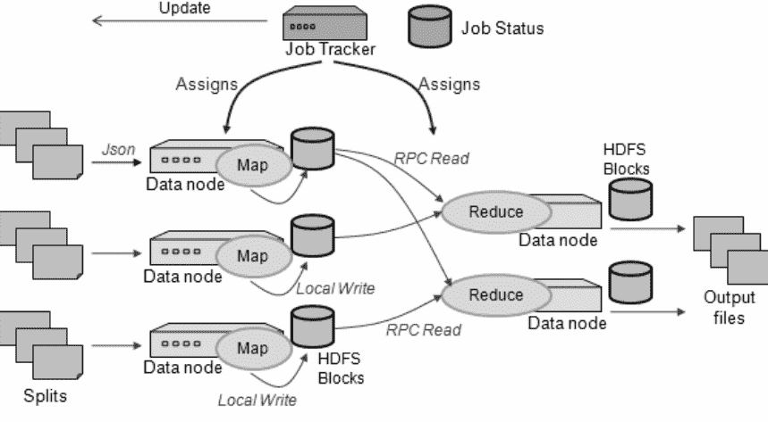

图 7.11 `MapReduce` 及其功能。

## 总结

- 在`Linux`操作系统通常有两种模式：首先是内核态（`Kernel mode`），用于执行所有的操作系统进程，它也被称为系统模式。其次是用户态（`User mode`），用于执行用户的所有应用程序，它是非特权模式。
- `Linux`内核由五个主要子系统组成，包括进程调度器、内存管理器、虚拟文件系统、网络接口和进程间通信。
- 系统调用（`System call`）是进程与操作系统之间的接口。系统调用总体分为不同的不同类型：文件管理系统调用、进程控制系统调用、设备管理系统调用和通信系统调用。
- `Linux`最适合服务器端所有的网络操作。`Linux`既有桌面`GUI`版本也有服务器版本，使其成为所有网络功能的理想选择。
- `Linux`最适合虚拟化和云计算工具。`Linux`具有模块化、高性能、高能效、可扩展、开源等特点，最重要的是，我们所有主要的云基础设施都是构建在`Linux`平台上的。
- 许多`Linux`平台与开源工具合作，并开发了许多高级云工具。一个最好的例子是`Ubuntu`与`Eucalyptus`合作在2010年推出了`Ubuntu`企业云（`UEC`）。2012年，`Ubuntu`与`OpenStack Cloud`合作，在`Ubuntu 12.04`版本中提供了稳定的云环境。
- 众所周知，开源技术是免费的。它可以被教育机构、研究人员、学者甚至商业组织使用。这些工具会定期更新，用于在云环境中设计、部署和管理应用程序。
- `OpenStack`云是由`NASA`和`Rackspace`云共同开发的。`Rackspace`贡献了他们的`Cloud Files`平台来支持`OpenStack`的对象存储部分，而`NASA`贡献了他们的`Nebula`云来支持计算部分。
- `OpenStack`由多个组件组成，每个组件都有特定的功能。它们包括`nova`、`swift`、`glance`、`horizon`和`keystone`。
- `C-DAC`代表高级计算开发中心，是印度信息技术部和政府下属的一个研发机构。
- `C-DAC`在多个领域开发了多项产品和研究工作，包括高性能计算、多语言计算、专业电子、信息与网络安全、健康信息、软件技术等。
- `C-DAC`启动了名为`GARUDA`的印度国家网格计算计划，愿景是为科学、工程和社会经济发展提供解决方案。`GARUDA`是全国范围内科学技术人员的合作，由计算节点、海量存储和科学仪器组成的网格组成。
- `C-DAC`科学云是一个`IaaS`云，提供按需虚拟机和集群。科学云`Web`门户为服务提供了`GUI`，用于创建、销毁和保存虚拟机。
- `Chennai C-DAC`的国家自由与开源软件资源中心（`NRCFOSS`）作为其目标之一，一直致力于基于`Debian`的印度版`GNU/Linux`发行版，称为印度操作系统解决方案（`BOSS`）。`BOSS GNU/Linux`提供桌面版、服务器版和`EduBOSS`版本。
- `BOSS Linux 5.0`特性包括内核`3.2.0-4`，支持`Intel 32`位和`64`位架构、`3D`桌面环境、图形化安装程序、`Office`应用程序套件`Libreoffice 4.0`、互联网访问软件、文件共享/互联网转换器以及多媒体应用。
- `C-DAC`推出了名为`MEGHDOOT`的完整开源免费软件套件，用于建立具有附加功能的云，将数据中心转换为云中心。该产品安装`BOSS`操作系统以及云堆栈。因此，该云与`BOSS`操作系统作为其基础组件集成在一起。
- `MEGHDOOT`是完全基于免费和开源软件实现尖端云环境的一站解决方案。该单一套件整合了跨所有层的工具，根据开放标准建立您的云世界。
- `Hadoop`是一个用于编写和运行处理大量数据的分布式应用的开源框架。它易于访问、健壮、可扩展且简单。
- `Hadoop`集群是位于同一位置的一组机器。数据存储和处理都发生在这些机器内部。不同的用户可以从各个客户端向`Hadoop`提交计算作业，这些可以是位于`Hadoop`集群远端的个人桌面机。
- `Hadoop`分布式文件系统（`HDFS`）是一种旨在存储大量数据并提供这些信息高吞吐量访问的分布式文件系统。文件以冗余方式存储在多台机器上，以确保对故障的耐用性和对并行应用程序的高可用性。
- `Hadoop MapReduce`是一个软件框架，用于轻松编写应用程序，以可靠、容错的方式在大型集群（数千个节点）的商品化硬件上并行处理数`TB`级的数据集等海量数据。

# 8

# UBUNTU 与云计算

- 了解`Ubuntu`的演变和工作环境
- 了解在终端工作的所有命令列表
- 了解`Ubuntu`对云计算平台的贡献
- 学习如何配置活动云

在本章中，我们将主要讨论`Ubuntu`操作系统及其产品。我们将看到`Ubuntu`如何用于云计算及其进展。让我们看看如何在命令行界面中通过一组预设的一系列各种命令进行工作。我们还将看到`Ubuntu`如何与许多云工具建立合作关系，并设计了操作系统以易于配置云环境。自2010年以来，由于与几家云公司的合作，`Ubuntu`在变革云计算方面发挥了重要作用。使用`Ubuntu`确实是一个非常有趣且良好的选择。`Ubuntu`还开发了许多云工具，可以使用这些工具有效地管理云。

## 8.1 UBUNTU 环境简介

在章节的第一部分，让我们详细了解`Ubuntu`操作系统及其变革。我们将看到`Ubuntu`是如何在其在`Linux`世界演变不到十年的时间里，成为`Linux`世界主要的操作系统来源。

`Ubuntu`是一个非洲词汇，意为“对他人的人性”，或者说“因为大家的存在，我才”。官方标志中的`Ubuntu`符号被称为“朋友之圆”（`Circle of Friends`），代表了自由、协作、精确和可靠。`Mark Shuttleworth`是`Ubuntu`项目的创始人。正如其创始人`Mark Shuttleworth`所说，`Ubuntu`全在于对日常用户的完全投入，让事情对他们来说易运行。它诞生于2004年。共有131个`Linux`发行版基于`Ubuntu`，其中77个目前处于活跃状态。`Ubuntu`的官方网站是`www.ubuntu.com`。

它有一个非常活跃的论坛，人们可以在那里讨论所有最新趋势和动态。正如我们所知，`Linux`平台是开源的，人们可以很容易从网站下载并安装`Ubuntu`操作系统。`Ubuntu`定期发布各种版本的操作系统。它支持基于`GUI`的桌面版本、命令行版本和服务器版操作系统。在每个版本的操作系统中，都会不断添加新的功能和进展。

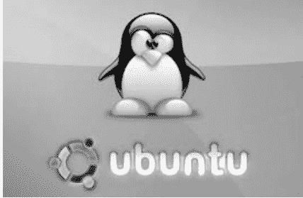

图 8.1 `Ubuntu` 符号。

`Ubuntu`背后的商业公司`Canonical Limited`以没有国家和地理边界的虚拟公司而闻名。根据其官方来源，`Canonical`在30个国家的200个城市拥有600多名员工，公司仅在五个地点设有办公室，包括伦敦、波士顿、蒙特利尔、上海、圣保罗和台北。大多数员工远程工作，通过`IRC`或电子邮件通信。版本名称由形容词和动物组合而成。版本名称按字母顺序选择，因此你可以根据版本名称判断哪个版本较新。

`Ubuntu`支持的各种平台：

- 计算机操作系统其他桌面、命令行和服务器版本
- 可用于手机
- 平板电脑也支持`Ubuntu`版本
- `Ubuntu`支持电视设备
- 云计算工具
- 服务器管理工具

`Ubuntu`是最常用的`Linux`操作系统之一。`Ubuntu Linux`一直为各种形式的虚拟化的数百万`PC`提供支持，使其成为云计算和其他网络技术的理想平台。自云革命以来，`Ubuntu`在过去几年中变得非常流行。

最大的桌面迁移案例是法国国家宪兵队的`IT`团队将85,000台桌面电脑从微软操作系统升级到`Ubuntu`。

`Ubuntu`拥有一个全面的包管理系统，用于安装、升级、配置和删除软件。除了为您的`Ubuntu`计算机提供超过35,000个软件包的组织良好的基础外，包管理设施还具备依赖解析能力和软件更新检查功能。截至`Ubuntu 13.04`，`Ubuntu`软件包的总数超过37,500个，总大小超过`45 GB`。根据调查，`dpkg`软件包在定期使用人数方面排名第一，而`ncursesbase`软件包在安装人数方面排名第一。

特定`Ubuntu`版本的版本号实际上是年份和月份。例如，第一个`Ubuntu`版本是`4.10`，因为它是在2004年10月份发布的。最近的`Ubuntu 13.10`是于2013年10月发布的。`Ubuntu`每六个月发布一个新版本，每第四个发布版本成为一个长期支持（`LTS`）版本。

`Google`的自动驾驶技术由一个精简版的`Ubuntu`驱动。众周知，`Google`是`Ubuntu`企业级服务`Ubuntu Advantage`的客户，使用修改版的`Ubuntu`来管理他们的`Google`桌面。


Ubuntu One 是与 Ubuntu 集成的个人云，运行在 Amazon S3 上。根据 `cloudmarket.com` 的数据，Ubuntu Linux 在 Amazon EC2 上的用户创建的镜像数量上排名第一；54% 创建的 EC2 镜像是 Ubuntu 镜像。在所有主要的云服务（无论是 Amazon、Rackspace、HP 等其他）中，Ubuntu 是首选客户操作系统。无论是从运行的实例总数衡量，还是从供应商提供的自定义镜像的多样性衡量，Ubuntu 都是大型机构和初创公司首选的客户操作系统。

如今，大多数云构建在 Linux 平台上，而不是任何其他操作系统。使用 Ubuntu 云端的关键优势包括：

- 兼容已有的云标准，包括 Amazon EC2 和 `OpenStack` API。这使得可以在不同云提供商之间自由移动，或根据需要将私有工作负载推送到公有云。
- 自由选择，支持更广泛的虚拟机管理器、网络组件、存储组件、显示技术等。
- 基于事实的大规模扩展性，云组件之间的轻量级消息传递。
- 高可用性，具有节点驱离（node evacuation）等功能，可以在组件故障或发生任何其他问题时保持云的正常运行。
- 来自全球社区的支持，该社区包含 70 多家领先科技公司和数万名开发者。该社区定期交付新的增值功能并在问题出现时进行修复。
- 访问 `Landscape` 等管理工具，无论您的工作负载位于公有云、私有云还是传统的裸机部署中，它都能提供报告和监控。

## UBUNTU 与云计算

- 使用 `Cloud Deck` 进行混合云协调，为您的组织员工提供一套单一凭据，通过单一云 API 提供对多个公有和私有云区域的受控访问，并带有配额和报告功能。

Ubuntu 在云技术方面比所有其他开源 Linux 操作系统具有明显优势。

为了在云计算平台上安装 `OpenStack` 云，我们使用 Ubuntu 12.04 LTS 服务器版。截至 2013 年，它被所有用户和 IT 公司广泛使用。LTS 代表长期支持，它将获得 5 年的支持。最近发布的 Ubuntu 版本是用于桌面的 13.10。Ubuntu 服务器版 12.04.03 LTS 是另一个常用版本。

Ubuntu Cloud 内置在 Ubuntu Server 12.04 中。与 Ubuntu 操作系统的其他部分一样，它没有许可限制，使 Ubuntu 能够履行开源软件的承诺，用户可以根据需要部署任意数量，而无需计算许可数量。灵活性帮助 Ubuntu 在 Web 和大数据的大规模部署中脱颖而出。

由于经过广泛认证并获得长期支持，Ubuntu 12.04 LTS 2017 是最可靠的平台，我们可以从试点或概念验证迁移到大规模生产部署。它提供了我们快速扩展底层云所需的稳健性和敏捷性，同时为支撑成功 `OpenStack` 部署的关键虚拟化技术提供顶级支持，并对 KVM 和 LXU 拥有最长的历史支持记录。从现在起至少几年内，Ubuntu 至少是 OpenStack 云计算的趋势。

新添加到 Ubuntu 12.04 LTS 的一些新功能包括：

- Unity Dash 的主界面发生了变化。现在它先显示“最近应用程序”（Recent Apps），最后显示“最近文件”（Recent Files），最后是您的“最近文档”（Recent Docs）。
- Unity Dash 现在支持快速列表，这非常棒且易于使用。
- Ubuntu 12.04 添加了新的主文件夹列表。
- 除了三个 Unity 视角（应用程序、文件和音乐）之外，现在还有一个额外的视频视角（快捷键 Super + V）。它允许您从本地源（从 YouTube 电影、BBCPlayer 和 TED 演讲等）中选择并播放视频。
- 抬头显示（俗称为 HUD）现在已是默认设置。早些时候说 HUD 将取代应用程序中的菜单选项，但尚未实现。
- 启动器图标的大小可以直接从“壁纸”菜单中更改。不再需要为了这一点而安装 `CCSM`。
- 默认启动器行为已更改。这也许是新 Unity 最可见的变化。启动器（默认情况下）将不再处于“避开窗口”（dodge windows）状态，而是将始终停靠（docked）。
- “避开窗口”甚至不再是一个选项了。它已被完全移除。
- 触发 Alt + Tab 会显示当前的窗口。

不可能记住所有内容，所以让我们讨论其中一些。

- 它允许从 tar 文件中存储和提取文件。

## 8.2 使用命令行

在上一节中，我们看到了 Ubuntu 环境及其使其受欢迎的功能。我们将看到一些用于工作的命令。尽管命令列表非常庞大，无法记住所有的。终端（Terminal）是 Linux 的核心部分。在操作系统的 GUI 模式下，一切都以图标的形式呈现。

Ubuntu 是一个安全的环境。当我们谈论 Linux 时，主要将其用于服务器相关功能和网络目的。印度前总统、科学家 APJ ABDUL KALAM 是开源技术的坚定支持者。他曾要求印度军队在所有机密工作 Linux 操作系统。

### 文件相关命令

- `ls` – 列出目录中的所有文件。
- `mv filename filename2` – 移动文件。
- `cp filename filename2` – 将内容从一个文件复制到另一个文件。
- `rm filename` – 删除文件。
- `cat filename` – 在标准输出设备上显示文件内容。
- `file filename` – 提供文件内的数据类型。
- `wc filename` – 告诉你有多少行、多少单词和字符。
- `emacs filename` – 是一个允许你创建和编辑文件的编辑器。
- `diff filename filename` – 比较文件并显示它们之间的差异。
- `chmod filename` – 允许更改文件的读、写、执行权限。
- `chown filename` – 更改文件的所有者。
- `ff` – 在系统范围内查找文件。
- `tail filename` – 显示文件的最后 n 行。
- `touch filename` – 创建一个指定名称的空文件。
- `tar filename` – 它允许从 tar 文件中存储和提取文件。

### 文件压缩

- `gzip filename` – 压缩文件，使其占用更少空间。

文件的大小和内容的性质。用于此目的其他工具包括 `compress`，但 `gzip` 通常具有最高的压缩率。`gzip` 生成的文件会在原始文件名后加上 `.gz` 后缀。

- `gunzip filename` – 解压由 `gzip` 压缩的文件
- `zcat filename` – 让你无需实际解压即可查看 gzipped 格式的文件。你可以使用 `zcat filename | lpr` 直接打印它。

## 打印

- `lpr filename` – 用于打印。如果你想使用默认打印机以外的打印机，请使用 `-P` 选项指定打印机名称。
- `lq` – 用于检查打印队列，例如获取删除所需的编号，或者查看在你之前还有多少个文件要打印。
- `lprm jobnumber` – 用于从打印队列中删除某些内容。你可以通过使用 `lq` 找到任务号。理论上你必须指定打印机名称，但只要你使用部门内的默认打印机，这就不需要了。
- `genscript` – 将纯文本文件转换为用于打印的 postscript 格式，并为你提供一些格式化选项。
- `dvips filename` – 用于打印 `.dvips` 文件，这些文件是由 LaTeX 生成的。你可以使用 `-select` 只打印选定的页面。

## 目录

- `mkdir dirname` – 用于创建一个新目录。
- `rmdir dirname` – 用于删除空目录。
- `cd dirname` – 用于更改目录。
- `cd` – 用于返回父目录。
- `pwd` – 告诉你当前所在的位置。

## 用户相关命令

- `w` – 告诉你谁登录了，以及他们在做什么。
- `who` – 告诉你谁登录了，以及来自哪里。
- `id` – 返回用户名。
- `su` – 切换到另一个用户账户。
- `finger username` – 提供关于该用户的大量信息，例如他们最后一次查看邮件的时间以及是否已登录。人们经常在 `.plan` 文件中提供其他实用信息，如电话号码和地址。

某些恶意命令，在不完全了解它们的情况下请勿使用

这些命令将擦除你的硬盘

```
sudo mkfs
```

```
sudo mkfs.ext3
```

```
sudo mkfs.bfs
```

```
sudo mkfs.cramfs
```

```
sudo mkfs.ext2
```

```
sudo mkfs.minix
```

```
sudo mkfs.msdos
```

```
sudo mkfs.reiserfs
```

```
sudo mkfs.vfat
```

这些命令可能会损坏你的操作系统。

```
sudo rm -rf /
```

```
sudo rm -rf *
```

```
rm -rf ~/
```

尽管还有许多命令可用，但我们已经讨论了一些对云安装有帮助的重点命令。在命令行提示符中操作最初很困难，但以后我们会习惯的。

## 8.3 UBUNTU（企业级云）


在上一节中，我们详细了解了 Ubuntu 操作系统的整体运行机制。我们还学习了各种命令及其在命令行操作系统中的用法。在这一系统中，我们将看到云工具与 Ubuntu 的集成。

在 2010 年之前，`Eucalyptus` 云是最著名的云工具。它分别被许多研究人员、教育机构和其他 IT 公司使用。它被安装在 `Linux` 的 `CentOS` 平台下。它包含了几条命令，且至少需要四个小时来安装云控制器。然后我们几乎通过几条命令以及所有必要的网络更改和合适的硬件来再次安装云节点。这非常繁琐、耗时，并且需要许多网络设置。这种安装形式对用户并不友好。它非常僵化，几乎很少人知道云安装的秘诀。它像是一个谜团，不容易分享给每个人，或者人们根本不知道安装 `Eucalyptus` 云时需要遵循的实际和标准步骤。更清楚地说，在 `CentOS` 中安装 `Eucalyptus` 云非常笨拙，是一条通往成功的艰难道路。

因此，为了克服云安装的艰难道路并解决其中的谜团，Ubuntu 与 `Eucalyptus` 云公司合作，设计了一种名为 Ubuntu Enterprise Cloud（Ubuntu 企业云，俗称为 `UEC`）的操作系统。`UEC` 是一种非常用户友好且简单的方法，使用 `Eucalyptus` 工具配置私有云。`Eucalyptus` 云工具合并到 Ubuntu 操作系统中生成 `UEC`。这整个全新的操作系统设计为仅用于安装云。用户可以利用 `UEC` 安装轻松地配置云控制器和节点。整个过程就像安装操作系统一样简单。随着 `UEC` 的革命，所有用户都避免了 `CentOS` 的云安装。从这个阶段开始，Ubuntu 被纯粹地视为云的未来。更多云工具和解决方案开始出现在 Ubuntu 平台中。在云计算革命方面，几乎所有其他 `Linux` 发行版都失去了对 Ubuntu 的竞争。

## Ubuntu 企业云

图 8.4 Ubuntu 企业云。

### 节点控制器 (NC)

`UEC` 节点是一个启用了 `VT` 虚拟化技术的服务器，能够运行 `KVM` 作为虚拟机程序。当用户选择安装 `UEC` 节点时，`UEC` 会自动安装 `KVM`。运行在虚拟机程序上并由 `UEC` 控制的虚拟机称为实例（`instances`）。`Eucalyptus` 支持其他比 `KVM` 更老的 `Xen` 等虚拟机程序，但 `Canonical` 公司已选择 `KVM` 作为 `UEC` 的首选虚拟机程序。

节点控制器 (`NC`) 运行在每个节点上，控制节点上运行实例的生命周期。`NC` 一侧与节点上运行的操作系统和虚拟机程序交互，另一侧与集群控制器 (`CC`) 交互。

它的功能包括：

- 收集与节点资源可用性和使用情况相关的数据，并将数据报告给 `CC`
- 实例生命周期管理。

### 集群控制器 (CC)

集群控制器 (`CC`) 管理一个或多个节点控制器，并在上面部署/管理实例。集群控制器还根据 `Eucalyptus` 的某些网络模式，管理运行在节点上的实例的网络。`CC` 一侧与云控制器 (`CLC`) 通信，另一侧与 `NC` 通信。

它的功能包括：

- 接收来自 `CLC` 的部署实例请求
- 决定使用哪些 `NC` 来部署实例
- 控制实例可用的虚拟网络
- 收集与其注册的 `NC` 信息并报告给 `CLC`

### Walrus 存储控制器 (WS3)

`WS3` 使用与 `S3 API` 兼容的 `REST` 和 `SOAP API` 提供持久的简单存储服务。

它的功能包括：

- 存储镜像（`machine images`）
- 存储快照（`snapshots`）
- 使用 `S3 API` 存储和提供 `les`

`WS3` 应被视为一个简单的存储系统。

### 存储控制器 (SC)

`SC` 为实例提供持久的块存储。这类似于 `AWS` 的弹性块存储 (`EBS`) 服务。

它的功能包括：

- 创建持久的 `EBS` 设备
- 通过 `AoE` 或 `iSCSI` 协议为实例提供块存储
- 允许创建卷快照

### 云控制器 (CLC)

云控制器 (`CLC`) 是整个云基础设施的入口。`CLC` 一侧为客户端工具提供符合 `EC2/S3` 标准的 `Web` 界面，另一侧与 `Eucalyptus` 基础设施的其他组件交互。`CLC` 还为用户提供 `Web` 界面以管理 `UEC` 基础设施的某些方面。

它的功能包括：

- 监控云基础设施中各个组件的可用性，包括用于配置实例的虚拟机节点
- 资源仲裁——决定为实例使用哪些集群
- 监控运行中的实例

简而言之，`CLC` 对云中资源的可用性和使用情况以及云的状态有全面的了解。

`UEC` 通常涉及两台用于管理云的服务器和一台客户端机器。通常我们需要 2 到 4 GB 的内存来安装 `UEC`。还需要大约 50 到 100 GB 的磁盘空间。需要无需任何防火墙的高速互联网。

## 云计算

我们在终端中输入命令时，它会从存储库下载所有所需的软件包和软件。即使某一个包没有下载成功，整个安装也会失败。我们必须启用虚拟化，否则 `UEC` 在安装过程中就会失败。为了安装 `UEC`，我们需要分别分配所需的 `IP` 范围和网关。我们需要使用网线连接它们。如果不 `Linux` 命令，安装云对用户来说是一个致命的错误。如果用户遇到某些问题，解决它们非常困难。`Linux` 是一个非常新且庞大的世界，在使用通用操作系统时我们不能低估它。

`UEC` 可以安装在虚拟机操作系统软件而不是物理机器上。在虚拟机操作系统中安装云是学习该技术和理解所有基础的良好开始。虚拟机操作系统具有物理机器相同的功能。但在后期阶段，最好在物理机器上安装，因为虚拟机操作系统只是软件内部操作系统的虚拟形式。与物理机器相比，使用虚拟机具有某些局限性。在使用物理机器时，用户必须具备完善的知识来处理网线、交换机、路由器等所有网络组件。

最后，通过输入相关的 `IP` 地址在网络浏览器中查看输出。最终，通过使用这些云工具，我们运行一个被称为镜像（`image`）的小型操作系统的虚拟机实例。从技术上说，镜像实际上从

# Ubuntu 与云计算

从服务器机器到客户端机器。在实时状态，我们看到了由这些云工具分发的虚拟化概念。在实时环境中工作并理解所有的网络概念是一个非常棒的体验。`UEC` 和 `OpenStack` 云的输出在某些阶段几乎相似。

`UEC` 安装中的一些常见错误包括：

- 硬件虚拟化错误
- 某个组件安装失败
- 分配的 `IP` 和网关有误
- 仪表板登录时的身份验证错误
- `IP` 地址处的仪表板显示错误
- 所有或部分云服务不可用或失败
- 无法创建用户或项目
- 云中镜像不可用
- 镜像处于非活动状态
- 物理机 `RAM` 不足，无法创建实例
- 物理机磁盘空间不足，无法运行 `UEC`
- 启动镜像实例失败
- `UEC` 本身可能存在某些问题，导致安装失败

等等其他错误。这些错误可能是由于某些底层漏洞，或由于安装时的任何其他故障导致的。失败可能是由于支持的软件包不可用或最初未安装。

关于云安装，有许多交互式论坛、讨论网站、教程、视频和其他博客可用。遇到任何错误时，人们可以在那里发布查询并向他们寻求解决方案。也可能在解决方案发布之前，已经许多人遇到了某些错误。当我们陷入某些问题时，可以使用此类提示。

## 8.4 Ubuntu 与 OpenStack

在上一节中，我们看到了基于 Ubuntu 平台的 `Eucalyptus` 云。我们看到了从 `CentOS` 平台迁移到 Ubuntu 平台的 `Eucalyptus` 云，并像 `UEC` 一样引发了革命。现在在本节中，我们看到 Ubuntu 与另一个名为 `OpenStack` 的云工具的集成。这是 2013 年云计算技术领域的当前趋势。Ubuntu 和 `OpenStack` 在未来几年拥有光辉的前途。

`Eucalyptus` 云在 2010 年曾处于 IT 行业的巅峰，但后来失去了地位。从 2011 年后期，由于各种技术和其他问题，`Eucalyptus` 开始衰落。到 2012 年，`OpenStack` 云开始在 IT 行业产生广泛影响。大量人员使用 `OpenStack` 进行云安装。`OpenStack` 与 Ubuntu 结合分别提供了更多的云工具和解决方案。

# 200 云计算

`HP`、`AT & T`、`Ericsson` 和 `Rackspace` 都在基于 Ubuntu 加 `OpenStack` 构建了它们的云，这是目前部署大规模云 `IAAS` 服务模型的组织的首选平台。`OpenStack` 是云计算技术中的热门词。几乎所有的 IT 公司和业务组织都在与他们合作，以建立云基础设施。Ubuntu 也具有足够的深度和质量来支撑大规模云基础设施。无论用户专注于将网格应用迁移到云端、集成云，还是结合其他高级网络技术提高中央 IT 供应系统的效率，公司一直使用 Ubuntu 来实现其私有云目标。因此，在未来一年，我们将看到更多大公司使用 Ubuntu 基础设施来设计、部署、测试和分析实时云。

图 8.6 Ubuntu 和 OpenStack。

Ubuntu 是 `OpenStack` 项目的参考操作系统，使其成为运行 `OpenStack` 云的最简单途径，无论是私有使用还是作为商业公共云提供服务。所有 `OpenStack` 代码都根据 `Apache 2.0` 许可证免费提供，因此任何人都可以运行、构建或为该项目做出贡献。这种开发模式培养了一个充满活力的社区，拥有最大的工具、解决方案和服务提供者生态系统。人们每天通过 `OpenStack` 开发者本身在 Ubuntu 上获得最的更新和安全修复，使 Ubuntu 成为 `OpenStack` 云测试最全面的平台。因此，在 2013 年，Ubuntu 被认为是安装 `OpenStack` 云的正确平台，而 `U` 已过时，不再被认为是云的正确选择。

Ubuntu 和 `OpenStack` 之间的关系如此重要，以至于两个品牌都专注于高质量治理、大规模计算平台、可预测的计划和健健发布。这两个项目的发布计划是同步的，确保 `OpenStack` 的更新和发布立即在广泛部署的 Ubuntu 版本可用。因此，Ubuntu 和 `OpenStack` 在许多方面都是相互关联的。

# Ubuntu 与云计算

201

Ubuntu 自 2009 年起就包含了云的 `IAAS` 服务模型。这就是为什么在 Ubuntu 上构建的云比任何其他 `Linux` 操作系统多。尽管其他操作系统同样致力于云计算技术，但 Ubuntu 领先于所有它们。从 2011 年开始，他们在 Ubuntu 发布中包含了最新版本的 `OpenStack`，并使其适用于最新的 `LTS`。一旦用户在 Ubuntu 的 `IaaS` 版本上部署了 `OpenStack`，用户就可以在不更改生产操作系统的情况下迁移到更高版本的 `OpenStack`。因此，`OpenStack` 和 Ubuntu 的集成对所有云技术用户来说都是非常友好的氛围。

Ubuntu 的 `OpenStack` 涵盖了计算、存储和网络，就像亚马逊的 `EC2` 和 `S3` 一样。`Canonical` 提供的 `Awesome` 组件为 `OpenStack API`，这些 API 也由亚马逊 Web Services 实现。

Ubuntu 为终端用户或业务组织部署 `IAAS` 云提供了多种优势。它提供两个级别的支持，包括标准支持和高级支持。

正如我们所学到的每项技术中标准的重要性。标准云支持对于考虑云计算的组织是理想的，也适用于那些刚刚开始部署私有云进行评估的人。标准云支持为小型基础的企业提供工作时间支持。它提供每台物理机以及无限数量的额外 Ubuntu 机器镜像。没有标准，这项技术从长期来看无法被任何组织接受。

高级云支持为生产 IT 环境提供 24 小时支持。它对 Ubuntu 云基础设施平台提供全面的覆盖，包括所有物理机和无限数量的额外 Ubuntu 实例。客户获得 Ubuntu 专家的直接支持，确保关键应用程序和服务的持续可用。

Ubuntu 集成云工具提供的其他一些优势包括：

- Ubuntu 的法律保障
- 管理云平台的新和新增工具
- 良好的知识库
- 更好的网络服务
- 良好的服务器安全
- 良好的软件包仓库
- 技术聚类
- 尽管发生故障仍具有高可用性。

`OpenStack` 有非常活跃的论坛来讨论所有问题、故障、技术帮助、技术意识、进展并直接报告所有漏洞。全球范围内有多个技术人员、研究人员和其他组织工作，以扩展和推进 `OpenStack` 的开源云技术。每年不定期地举办 `OpenStack` 会议，在会上讨论 `OpenStack` 的所有问题和困难。

202 云计算

所有的建议都被采纳，云工具得到更新，以向所有用户提供一个新的更先进的版本。

到 2013 年今天，`OpenStack` 云工具已与 `Red hat Linux` 平台以及 `Fedora Linux` 平台合作，开发出高度用户友好的云安装过程。除了 Ubuntu 之外，其他 `Linux` 平台也在开发更多的云解决方案和工具。我们可以期待其他 `Linux` 平台带来更多新的先进特性。我们将在最后一章的案例研究中看到如何安装和使用 `OpenStack` 云。

## 8.5 Ubuntu 中的云工具

在本节中，让我们看看一些由 Ubuntu 开发的云工具。Ubuntu 在变革云方面付出了努力。它首先与 `Eucalyptus` 合作，然后与 `OpenStack` 合作。它通过设计许多云工具为云技术做出了贡献。让我们分别查看各种工具的功能及其特性。

Ubuntu 开发的一些云工具包括：

- `Juju`
- 金属即服务 (`MAAS`)
- `Landscape`
- `Jumpstart`

等等。每个工具都有自己的功能和特性。

# JUJU

在云中配置容量的速度将效率的瓶颈从配置阶段转移到部署阶段。对于开发者来说，用新迭代的业务应用程序进行开发、测试和部署的速度是衡量能力、竞争力和有效性的关键标准。在应用的云部署中，除了设计和测试应用程序外，还需要更多关注。Ubuntu 通过一个名为 `juju` 的新编排工具进一步解决了部署问题。

`Juju` 是 Ubuntu 平台开发的一个非常独特的工具。它是一个分别适用于私有和公共云部署的单一编排工具。`Juju` 封装了安装、配置和管理你正在部署的服务智能。`Juju` 全在于重用和组合，你可以修改或更改重用他人的 `juju` 公式，并将多个服务组合在一起，构成作为一个单元运行的大型部署。`Juju` 公式可以表示部署最佳实践，通过共享和协作，`juju` 允许这些最佳实践高效地在社区中传播。在云中使用这种 `juju` 部署正变得越来越简单且是动态的。

`juju` 愿景的核心是一个可重用 `juju` 公式的公共仓库，用于流行的应用程序部署场景。这些公式是协作产生的，像一个

# Ubuntu 与云计算

Ubuntu 是一个传统的 `Linux` 发行版，并遵循与 Ubuntu 相同的治理模式。无论你需要部署什么，都可以从寻找一个可以改进的公式（`formula`）开始，或者从头开始。通过 `Juju`，你可以跨多个云或物理服务器部署服务，并通过少量命令对其进行管理，而这些都是构建在 Ubuntu Server 强大基础之上的。

`Juju` 的核心在于将基础设施实践提炼为代码，并将这些代码共享给同伴。这带来了许多优势，例如拥有可重复的、可审计的自动化的基础设施即代码（`IaC`）流程，并能够站在巨人的肩膀上，复用之前创建的工作。

`Juju` 的另一个吸引人的特性是使用 `charms`（插件）。`Charms` 赋予了 `Juju` 使用的真实价值。`Juju` 允许你使用 `charms` 将开发的应用程序架构部署到 `EC2`、`OpenStack`、`Azure`、`HP`、你的数据中心甚至你自己的 Ubuntu 操作系统。它们封装了应用程序配置，定义了服务如何部署、如何与其他服务连接以及如何进行扩展。`Charms` 易于共享，且 `charm` 商店中有多个可用的 `charm`。

一些常用的 `charms` 包括 `wordpress`、`Hadoop`、`Cassandra`、`ceph`、`DB`、`mysql`、`mediawiki` 等等。人们可以轻松地使用 `juju` 工作，从部署服务和立即建立关系开始。只需开始并将其添加到画布（`canvas`）中即可启动你的环境。这非常简单。

当你选择将基础设施模型作为 `juju` 服务进行构建时，你正在复用 `juju` 社区的基础设施专业知识。也许更有趣的是，`juju` 并不强制你学习另一种特定语言来为你的基础设施建模。相反，`juju` 为你提供了可以从任何编程或脚本语言调用的命令行工具。很快，`juju` 将提供 `Launchpad` 集成，允许社区搜索并利用其他社区成员编写的公式。你可以将其想象为基础设施服务的 `PPA`。

你必须安装 `juju`。它分别支持 Ubuntu 平台、苹果（`macOS`）和 `Windows` 操作系统。你也可以在浏览器本身中使用演示版本。你可以在命令行提示符中，也可以在 `GUI` 模式下与 `juju` 工作。云部署的每个组件都通过单个命令部署。每个组件都可以通过单个命令进行扩展。组件之间的每种关系都是单个命令。所有这些内容都可以保存为可复用的栈（`stack`）。这一切都能正常运行，且只需在终端中敲击命令即可。

让我们看看 `juju` 部署的各个步骤：

- 首先从 `charm` 商店中选择你需要的 `charm`

`Charm search juju`

- 通过提供实例数量、`CPU` 和名称来配置所选 `charms`

`Juju set mediawiki wiki = monoblock name='cloudapp'`

- 最后部署服务

`Juju deploy mysql`

在几个服务运行并激活后，在它们之间建立构建关系。每个 `charm` 都知道如何相互连接。

`Juju add-relation mysql wordpress`

监控已部署 `charm` 的状态，万一发生任何故障，将发布适当的通知。

`Juju status`

`Juju` 通过定义良好的日志提供了所有进行活动的详细信息。

`Juju debug-log`

通过 `Juju`，你可以简单地通过添加或删除服务单元来扩展应用程序，无需担心与其他服务的连接都会被自动处理。

`Juju add-unit postgres - 10`

通过 `Juju`，你可以轻松地保存和导出环境以移动到另一个云，在开发、测试和阶段环境之间移动，并与组织中的其他人共享你的单元。`Juju` 让你的整个架构变得完全可迁移。

### 裸金属服务 (MAAS)

在第 6 章中，我们看到了各种服务模型及其功能。类似地，Ubuntu 设计了一种服务模型，即 `MAAS`。裸金属服务（`MAAS`）是一个能够快速、方便地设置物理硬件以部署复杂可扩展服务的系统，例如 Ubuntu 的 `OpenStack` 云基础设施。通过 `MAAS`，你的新硬件可以在几分钟内成为你工作基础设施的一部分。


当云基础设施中的新节点启动时，`MAAS` 会提供节点所需的所有信息，重启它，并提供一个 `Ubuntu` 镜像供其安装。此外，`MAAS` 还可以处理特定的特定任务，如老化测试、固件升级和 `RAID` 升级，以及检查你的硬件是否通过了 `Ubuntu` 认证。这在管理云方面要自动化且更具动态得多。`MAAS` 提供了足够的抽象来克服硬件不兼容问题，使你免于昂贵的升级和供应商锁定。正如我们已经说过的，服务是具有成本效益且非常友好的。

裸金属服务 (`MAAS`) 提供了一个按需提供服务的物理管理层。与 `Juju` 一起，它允许你将负载部署到物理金属上，这些设备在云端中具有相同的负载，而无需虚拟化层。

通过 `Juju`，你可以在几秒钟内在你的 `MAAS` 集群中部署、编排和扩展服务。我们不需要花费几个小时来规划和实施服务部署。只需确定你的新服务需要多少节点，然后应用预先写的 `charm`。当你的需求变化时，你可以实时监控、扩展和调整部署参数，当你完成一个服务时，`Juju` 可以不留痕迹地将其移除。我们已经在上面的相同部分看到 `juju` 的工作原理了。

## `Ubuntu` 与云计算

### Landscape

Landscape 是 `Ubuntu` 的另一个独特工具。它允许你监控云环境、管理更新并生成及时准确的合规性报告。丰富的基于 Web 的 GUI 让你对云中发生的一切了一目了然，从硬件到负载。它是 `Ubuntu` 提供的最好的云管理工具之一。

Landscape 是 `Ubuntu` 的系统管理工具，包括在 `Ubuntu` 中的 `OpenStack`。它允许你轻松地管理、审计并报告你的 `Ubuntu OpenStack` 云以及运行在其上的服务，使你的整个环境更具成本效益。还有许多 `OpenStack` 管理工具可用。

通过 Landscape 系统管理工具，你可以从单一界面自动更新并管理物理、虚拟和云系统。它易于设置、易于使用且不需要特殊硬件。它的功能包括：

- 云的规模管理
- 向云部署或回滚安全更新
- 合规报告
- 基于角色的访问
- 信息丰富的监控

通过 Landscape，你可以在任何地方管理机器，通过完全可脚本的 API，你可以将其与当前的 Linux 管理工具集成，扩展它们的功能并让你用更少的资源完成更多工作。Landscape 已用于管理全球数十万台物理和虚拟机，每天为我们的客户节省费用。因此另一个设计良好的云管理工具。

### Jumpstart

Cloud Jumpstart 是一种快速、低风险的在现场部署私有云基础设施的途径。Jumpstart 由 `Canonical` 服务工程师通过为期五天的现场培训成本，在你的硬件上构建私有云。Jumpstart 为你提供一个与该架构兼容的私有云。生成的云将根据你对存储、网络和计算的偏好进行调整，并保持与我们的参考云对所有负载的兼容。这，它是一个设计良好的云工具。该活动包括：

- 用于做出基本核心架构决策的规划框架
- 种子 `Ubuntu OpenStack` 云部署，最多支持 20 台服务器
- 支持你云的工具和流程培训

我们的标准 Jumpstart 服务范围限于限于云部署和培训。额外的支持、保障、咨询、集成和专业服务可以根据需求从 `Canonical` 和第三方提供商处获得。

## 8.6 活云（LIVE CLOUD）

在本章的最后一节中，让我们详细查看活云的配置。这是一项完全不同的特性，也是设置云的新方法。我们还将看到 `Ubuntu` 中 `OpenStack` 活云的演示。

“Live”（现场）一词指的是当前可用或存在、并在消失时离线的。类似地，从技术角度上说，今天有很多现场解决方案可用于学习或分析某些技术解决方案。

对于云计算安装，与其完成所有的网络设置、遵循所有步骤、使用所有命令等，活云要简单得多，而且是现成的云。活云是学习云技术最简单的形式，它非常方便，因为它是一个虚拟操作系统软件，但一旦我们关闭系统，它就会消失。活云类似于安装在物理机上的云以及其中的虚拟构建云工具。这意味着用户不需要遵循任何安装步骤或进行任何网络设置。一切都已完成并准备好就绪。

现在让我们在 VMware 工作站软件中查看 `OpenStack` 活云的演示。VMware 工作站是专有软件，这意味着它不是免费的，必须付费使用。但它有30天的的免费试用期可以免费使用该软件。

`8.7` `Ubuntu` 活云。

## UBUNTU 与云计算

为了在 `Ubuntu` 中启动 `OpenStack` 云的 live cd 安装，用户必须下载 iso 或其他相关格式的操作系统。我们将下载的操作系统引导到 VMware 工作站软件，安装从这里开始。

第一个屏幕像这样：一个 `Ubuntu` 桌面环境，带有一个记事本文件，为我们如何使用 live cd 的提示。

在终端中输入命令开始配置 `OpenStack` 云组件。

`$ nova-setup.sh`

```bash
ubuntu@ubuntu:~
ubuntu@ubuntu:~$ pwd
/home/ubuntu
ubuntu@ubuntu:~$ 
ubuntu@ubuntu:~$ nova-setup.sh
ubuntu@ubuntu:~$ 
ubuntu@ubuntu:~$ _
```

图 8.8 带有 `OpenStack` 命令的 `Ubuntu` 提示符。

然后使用这些命令进行一些网络设置。

系统默认使用标准网络管理器进行网络配置。如果你的网络上有 `DHCP` 服务器，它会自动设置 `IP`，你可以跳过此步骤。在没有 `DHCP` 服务器或你只有 `WiFi` 连接的情况下，你需要手动设置网络。你可以通过网络管理器或使用标准 CLI 工具来完成：

`$ sudo ifconfig eth0 192.168.99.100 up`

如果此机器上没有任何其他连接，也请添加默认路由

`$ sudo route add default gw 192.168.99.1`

一旦网络设置好，就可以启动 `nova` 和 `glance` 服务了。

`$ start-OpenStack.sh`

```bash
ubuntu@ubuntu:~ -
ubuntu@ubuntu:~$ start-openstack.sh
Setting up dashboard...
Setting up Keystone...
[paste_deploy]
flavor = keystone
[paste_deploy]
flavor = keystone
Starting all openstack services...
nova-api start/running, process 3623
nova-compute start/running, process 3649
nova-network start/running, process 3676
nova-scheduler start/running, process 3694
nova-volume start/running, process 3719
nova-cert start/running, process 3733
glance-api start/running, process 3737
glance-registry start/running, process 3749
Done!
ubuntu@ubuntu:~ -
ubuntu@ubuntu:~$ _
```

图 8.8 `OpenStack` 安装完成。

因此，云的所有组件均已安装，`OpenStack` 云已准备好运行。`OpenStack` 云的输出在网页浏览器中查看。在网页浏览器中输入虚拟机的 `IP`，`OpenStack` 云将准备就绪并提示用户登录。默认凭据包括用户名为 `Ubuntu`，密码为 `Ubuntu`。

图 8.9 `OpenStack` 登录窗口。

至此云已配置完成。现在我们停止关于 `OpenStack` 安装的讨论。在第 5 章中，我们将详细查看如何使用 `OpenStack`。

## 总结

- `Ubuntu` 是一个非洲词，意为“对他人的仁爱”或“因为我们都在，所以我在”。官方标志中的 `Ubuntu` 符号被称为“朋友友谊之圆”，代表着自由、协作和可靠性。
- `Canonical Limited` 是 `Ubuntu` 背后的商业公司，因作为没有国界的虚拟公司而闻名。根据其官方来源，`Canonical` 在全球 30 个国家的近 200 个城市拥有 600 多名员工，而公司仅有六个地点。
- `Ubuntu One` 是与 `Ubuntu` 集成的个人存储。根据 `market.com`，`Ubuntu` 在亚马逊用户创建的 `EC2` 中排名第一；54% 的 `EC` 镜像是 `Ubuntu` 镜像。
- 终端是 `Linux` 环境的核心部分。而操作系统的 `GUI` 模式一切以图标的形式呈现。在 `Linux` 中，大多数工作通过终端中的命令完成，这被视为处理服务器操作的正确方式。
- `Ubuntu` 与 `Eucalyptus` 公司合作设计的操作系统俗称为 `UHD`。`UHD` 是一种使用 `Eucalyptus` 工具配置私有云非常友好且简单的方法。`Eucalyptus` 云工具被合并到 `Ubuntu` 操作系统以提供 `UHD`。
- `UHD` 节点是一个支持 `VT` 的服务器，能够运行 `KVM` 作为虚拟机管理程序。当用户选择安装 `UHD` 节点时，`UHD` 会自动安装 `KVM`。运行在虚拟机程序并由 `UHD` 控制的虚拟机称为实例。
- 到 2012 年，`OpenStack` 云在 `IT` 行业产生了广泛影响。大量人员使用 `OpenStack` 进行云安装。
- `HP`、`AT&T`、`Ericsson` 和 `Rackspace` 在 `Ubuntu` 加 `OpenStack` 上构建了他们的云，这是部署大型云服务模型的组织的选平台。
- `Ubuntu` 是 `OpenStack` 项目的参考操作系统，使得运行 `OpenStack` 云变得简单，无论是私有使用还是作为商业云提供。所有 `OpenStack` 代码均根据 `Apache 2.0` 许可证免费提供，任何人都可以运行它或为项目做出贡献。
- `Ubuntu` 与 `OpenStack` 之间的关系如此重要，两个品牌都专注于面向大规模计算、可预测调度和稳健发布的高质量平台。
- 截至 2013 年，`OpenStack` 云工具已与 `Red hat Linux` 平台以及 `Fedora Linux` 平台合作，开发高度用户友好的云安装过程。
- `Juju` 是 `Ubuntu` 平台设计的独特工具。它是一个适用于私有云和公有云部署的单一编排工具。`Juju` 封装了你正在部署的服务的安装、配置、连接和管理的智能。
- `Juju` 的另一个吸引人的特性是使用 `charms`（咒符）。`charms` 为 `Juju` 的使用赋予意义。`Juju` 允许你使用 `charms` 将开发的应用程序架构部署到 `EC2`、`OpenStack`、`Azure`、`HP` 数据中心以及你自己的 `Ubuntu` 操作系统。
- 裸即服务（`MAAS`）是一种能够快速地设置物理硬件的系统，以便在其上部署复杂的可扩展服务，如 `Ubuntu` 的 `OpenStack` 基础设施。有了 `MAAS`，你的新硬件可以在几分钟内成为工作基础设施的一部分。
- 裸即服务（`MAAS`）提供了一个按需提供机器的管理层。与 `Juju` 结合使用，可以将工作负载部署到物理金属上，具有与云负载相同的行为，而无需虚拟化层。
- Landscape 是 `Ubuntu` 的系统管理工具，包含 `OpenStack`。它允许你轻松地管理、审核和报告你的 `Ubuntu OpenStack` 云及其内部运行的服务，使整个环境更具成本效益。
- 云启动（Cloud Jumpstart）是一种在现场部署私有云基础设施的快速、低风险途径。Jumpstart 通过由 `Canonical` 服务工程师提供的为期五天的现场培训，在你的硬件上上构建私有云。Jumpstart 为你提供一个与该架构兼容的私有云，运行在你所选择的硬件上。

# 第9章

# 移动云计算

## 目标

- 学习移动技术与云技术的交叉领域
- 区分移动云与普通云
- 了解移动云计算 (`MCC`) 的架构
- 识别 `MCC` 的优缺点
- 解决云采纳中的问题

到目前为止，我们已经了解了云的各种特性、类型、实时云以及云计算的各种开源方案。让我们从不同的维度来看云。这会在我们脑海中引发一个问题：“为什么不将云的概念与移动结合起来呢？”这种理解催生了一个新的计算领域——“移动云计算”。

## 9.1 移动云计算概述

当我们对云有了更深入的理解时，就能弄清楚“什么是移动云计算？”云被用于移动应用的开发以及托管。移动云的独特特性使得移动云计算成为通过笔记本电脑、平板电脑、智能手机和其他便携设备访问的基于互联网的数据、应用程序和服务。移动端面临着严重的问题，如内存和存储限制、显示屏小、浏览器不稳定以及连接不稳。因此，移动应用主要依赖云来实现计算、内存或存储以及通信容错功能。移动云计算是云计算与移动网络的结合，其中移动应用使用云计算技术进行构建、驱动和托管。由于 `Android` 是一个开源系统，相比其他移动操作系统具有更大的优势，我们将在下一章看到云与移动（特别是 `Android`）的融合。

### 移动云计算的意义

移动云计算使得应用开发者能够构建专为手机设计的应用程序。可用在远程 Web 服务器上的移动云应用通常通过移动浏览器访问。这类应用不需要在接收手机上安装任何云应用。这种类型也被称为 `MoClo`，源于 `MobileCloud` 一词。

企业正根据需求转向移动云。移动用户要求为智能手机和平板电脑应用提供云应用，以便他们访问公司的关键应用。IT 公司的员工要求从他们的移动设备进行访问。`BlackBerry` 通过其流行的云端移动电子邮件程序利用了这一需求。由于移动云的这些特性，企业部门的工作模式也在发生变化。`Pew Internet` 调查了许多工业人士，他们认为到 2020 年，大多数互联网用户将主要通过网络设备访问的远程服务器上的移动应用进行工作。

随着模式和工作习惯的改变，移动生态系统由数万亿云就绪设备组成。`IBM` 预测到 2015 年将会有 1 万亿云就绪设备。移动计算可以被认为是移动开发与云计算的混合。云备份基础设施为移动用户提供了功能丰富的应用互联网。密集的计算能力和软件平台支持是大多数移动应用的关键因素。存储和平台支持是这些应用必不可少的，而这些是通过云提供的。

## 9.2 移动云 VS 普通云

理解移动云与普通云之间的关键区别有助于弄清新技术“移动云计算”。在移动中接收云服务被称为移动云。除了移动云和普通云之间的基础区别外，两者之间存在特征性的差异，列如所示。

### 移动云计算

| 差异 | 移动云 | 普通云 |
|---|---|---|
| 调整 | 需要根据所使用的移动设备进行调整。 | 无需调整 |
| 可访问性 | 移动设备随时可能离开范围，而服务从移动云传输。 | 独立设备不会移出范围。 |
| 容错通信 | 设计移动云时会采取额外的措施，因为可能有频繁中断通信的机会。 | 普通云中不考虑容错问题。 |
| 内存 | 移动设备中的固定内存 | 内存可扩展 |
| 网络延迟 | 敏感 | 不敏感 |
| 能量可用性 | 主要关注点 | 不是关键关注点。 |
| 测试 | 对于测试云和移动设备之间的数据同步至关重要。 | 无需测试。 |

## 9.3 移动云应用 VS 原生应用

原生应用与移动云应用之间的关键区别如下。

### 原生应用

原生应用是直接安装在智能手机上的应用。从开发者的角度来看，它是存储在移动设备上，或从应用商店下载并安装在移动设备上的应用。应用开发者在创建这些原生应用时，会考虑移动设备、`PC` 或平板电脑的版本。这种应用是针对特定设备及其操作系统开发的。与此原生应用相关的数据也存储在设备上。移动设备上的最新技术如 `GPS` 和相机可以被原生应用使用。

### 移动云应用

移动云应用可以与 Web 应用程序相关。移动云和 Web 应用的相似之处在于它们运行在服务器上，并需要使用移动设备上的浏览器来显示应用用户界面。此外，它们针对的是多个移动设备，而原生应用针对的是单个移动设备。Web 应用和云应用是相辅相成的。云端应用是运行在云中的应用程序，通过 Web 应用向接收移动设备提供请求的服务。与移动设备不同，云就绪设备运行的是云端 Web 应用而非原生应用。

214 云计算

移动用户订阅云服务，并通过互联网远程访问存储的应用程序及其相关数据。目前的趋势是日益趋向移动云，尽管移动设备运行着 Web 端云应用和原生应用的混合。不需要在移动设备上下载和安装移动云应用。移动云应用的 `UI` 可以由用户在远程设备的浏览器窗口中查看。使用移动云应用需要互联网连接。

为了在移动设备和云应用之间传输数据，使用 `JSON over HTTP`。`JSON` 代表 JavaScript 对象表示法，是一种理想的数据交换语言。它是语言无关的。少数机构提供应用程序的原生版本和移动云版本。

| 差异 | 移动云应用 | 原生应用 |
|---|---|---|
| 下载应用 | 不需要 | 需要 |
| 可访问性 | 访问远程呈现的应用 | 无法访问远程应用 |
| 目标群体 | 多个移动设备 | 单个移动设备 |
| 移动应用 | 运行在移动云服务器上 | 运行在移动设备上 |
| 通知 | 不支持 | 支持 |
| 获取最新技术 | 通过 `API` 间接访问 | 直接访问设备功能（如 `GPS`、声音、相机） |
| UI 速度 | 较慢 | 快 |

## 9.4 移动计算 (MCC) 架构

移动云计算为移动用户提供数据处理和存储服务。所有复杂的计算模块可以在云中处理。因此，接收者不需要强大的配置。移动设备通过不同的基站（如基收站 `BTS`、接入点或卫星）连接到移动网络，这些基站建立了网络与移动设备之间的连接和功能接口。移动用户的请求以及 `ID`、位置等信息被传输到提供移动网络服务的中央处理器中。移动网络运营商根据数据库中存储的主代理 (`HA`) 和用户数据，通过 `AAA`（认证、授权和计费）为移动用户提供服务。

# 移动云计算

# 215

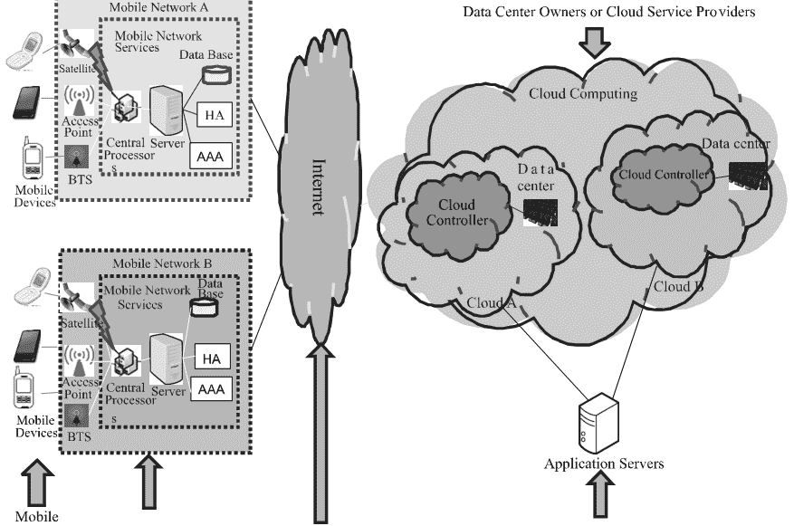

图 9.2 `MCC` 架构。

## 9.5 MCC 的优势

让云计算与移动设备协同工作具有某些优势。移动计算本身需要通过云计算的帮助来减少其电池寿命短、存储容量小以及处理能力可能较差等缺点。移动技术与云技术之间存在互利的关系。事实证明，这就是移动云计算的优势。在接下来，我们将讨论云计算如何让移动计算更具优势。

# 1. 延长电池寿命


## 2. 可靠性与可用性

由于移动设备丢失数据的概率较高，云也为该问题提供了解决方案。所有数据都存储并备份在云端，这最大限度地减少了移动端丢失数据的风险。因此，这提高了可靠性。一个简单的例子是将移动设备的所有联系人详情备份到云端，可以在需要时检索丢失的联系人。将数据和应用程序保留在云端减少了移动设备丢失的概率并增强了可靠性。MCC 可以设计为保护云中的版权数字内容。它还可以结构化为移动用户提供安全服务，如病毒扫描、恶意代码检测和身份验证。由于云端拥有数据和服务，即使用户在移动中，这些服务也始终可用。

## 3. 数据存储与处理能力

移动设备的另一个主要因素是非常有限的存储容量和处理能力。存储容量是移动设备的限制。MCC 提供了在具有巨大存储能力的云端上存储或访问大量数据的优势。像 Flickr 和 ShoZu 等许多照片共享应用在实施 MCC 方面非常成功。最流行的社交网站 Facebook 也为其每天分享近 4 亿条内容的移动用户提供云设施。有了移动云，用户可以在移动设备上节省大量的能量和存储空间，因为所有图像都在云端上进行共享和处理。移动应用程序利用了云的优势，因为它们的数据现在存储在云端。

## 4. 动态配置

移动用户具有随时随随地发送服务请求的权限。对于按需的需求，不需要先进的 MCC 方案来调用云。MCC 足够支持在细粒度的自服务基础上对资源进行动态按需配置。

## 5. 可扩展性

凭借云端的可扩展选项，多个用户可以订阅某项服务。移动应用程序运行并扩展以满足不可预测的需求。服务提供商可以轻松地添加和扩展服务。云计算的一个关键优势是它的可扩展性。根据需要尽可能扩大或缩小服务。大多数云服务提供商将允许增加现有资源以满足不断变化的业务需求。扩展现有基础设施也是按需的，这不会对您的系统造成昂贵的更改。

## 6. 灵活性

MCC 让 IT 员工更加灵活——无论是在办公室内还是室外。员工可以使用智能手机、笔记本电脑和平板电脑等移动设备访问文件。在互联网上同步共享文档和其他文件的能力也有助于支持内部和外部协作。许多雇主现在正在实施“自带设备（BYOD）”政策。BYOD 政策（或自带设备政策）是一套规则，规定公司 IT 部门对员工自有 PC、智能手机和平板电脑的支持。通过这种方式，移动云计算提供了高度的灵活性。

## 7. 多租户

多租户是一种单移动应用程序实例为多个客户服务的架构。每个客户被称为租户。可以允许租户自定义应用程序的某些部分，例如用户界面（UI）颜色或业务规则，但他们不能自定义应用程序的代码。由于共享了应用程序开发和维护成本，多租户架构是经济的。它可以与单租户形成对比，单租户是每个客户都有自己的软件实例并可能被允许访问代码的架构。通过多租户架构，供应商只需更新一次。这种多租户支持同步。服务提供商可以共享资源和成本来支持各种应用程序和大量用户。

## 8. 便于集成

来自不同提供者的多种服务可以通过云和互联网轻松集成，以满足用户的需求。在云端，软件集成通常是自动发生的。这意味着你不需要投入额外努力来根据你的喜好定制和集成你的应用程序。这方面通常会自动处理。不仅计算允许你非常方便地自定义选项，你还可以挑选出你认为最适合你移动设备的服务和移动应用程序。

## 9.6 MCC 的应用

### 1. 移动商务

移动商务简称为 M-commerce，是通过手机进行的电子货物买卖（商业交易）。它允许使用移动设备进行商业业务模式。此类商业交易的示例包括移动金融、移动广告、移动购物。M-commerce 应用面临低带宽、低处理速度等各种挑战。与云集成可以帮助解决这些问题。3G 与云结合产生更好的结果，提高数据处理速度和安全水平。

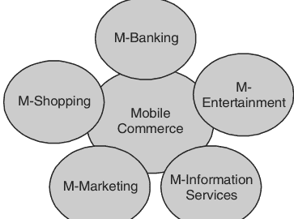

图 9.3 移动商务。

### 2. 移动学习

M-learning 提供了人们随身携带的学习。它结合了在线学习和移动性。传统的移动学习面临着设备/网络成本高、传输率低、教育资源有限等限制。基于云的移动学习可以解决这些局限性。它增强了师生之间的通信质量。这有助于学生学习远程学习材料。移动学习为协作学习建立了一个自然环境。许多企业正在为其员工提供这种培训。

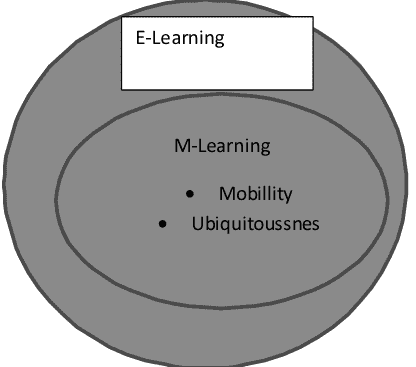

图 9.4 移动学习。

### 3. 移动医疗

尽管移动医疗仍处于婴儿阶段，但使用移动医疗的许多常见任务如维护日程、预约与护士互动、访问患者记录都是通过智能手机完成的。使用移动医疗的主要益处是减少传统医疗治疗的局限性，如存储有限、安全/隐私、医疗错误和无法联系医生。移动医疗为移动用户提供了方便访问患者记录等资源。

移动医疗为医院和医疗机构提供了各种按需服务。例如：综合健康监测服务、智能应急管理系统、可以检测脉搏、血压、酒精水平等的健康移动设备。

这种类型的医疗用于填补农村或欠发达地区医院和医疗服务的缺失。IBM 正在与波士顿儿童医院合作，将儿科置于云端。像 OPEN Pediatrics 这样的基于云的系统有助于访问知识，从而为全球患者提供更好的护理。预防新感染可以被传播以提高人们的普遍意识。医生们非常有兴趣适应这项新技术，因为无论距离远近，它都能拯救生命。

### 4. 移动游戏

移动游戏从简单的免费游戏到付费游戏不等。移动游戏是一个高潜力的市场，可以为服务提供者产生收入。最有趣的场景是移动游戏提供了多人游戏环境、独特的名称选择以及游戏中的存档点和关卡以便继续游戏。云游戏主要有两种类型：视频流和文件流。

在视频流中，实际游戏运行在云端服务器上。这类游戏的处理速度极快，因为每一比特的处理都在云端完成。文件流则完全相反，实际游戏位于用户的移动设备上。游戏的这一小部分最初下载到客户端机器上进行初始播放。用户在玩的同时，游戏的其余部分将进行下载。

### 5. 移动业务

由于移动云消减轻了管理硬件和软件的负担，所有业务都在向云端驱动。业务随地随地办公，移动云是不可避免的。扩大或缩小业务规模非常容易。升级是自动的。业务精英可以节省大量资金，因为他们只需为需要的内容付费。许多不同的业务应用，如客户关系管理 (CRM)、人力资源、会计、财务和采购，在云端运行得更多。云计算的最新创新正通过 Facebook 和 Twitter 等流行的社交网站使企业变得更具移动性和协作性。营销人员现在通过社交渠道分析客户需求。

### 6. 其他应用

移动云提供了共享照片/视频等功能。通过移动云可以实现实时的旅行、购物和活动管理。实际应用包括不同类型的搜索，如基于关键词的搜索、基于语音的、基于标签的搜索。通过移动云，我们可以监控建筑的不同角落，为视障人士检测交通灯和货币读器。Android 云打印应用程序帮助打印存储在云端的文档。为了存储和保护密码、登录和其他敏感信息，Safe Wallet 密码应用专为智能设备设计。自动备份联系人、照片和视频并同步到云端也是可能的。

## 9.7 自带设备 (BYOD)

BYOD 政策，或自带设备政策，是指公司扩展对员工拥有的 PC、智能手机和平板电脑支持的政策。这有助于促进“居家办公”。通过这种方式，员工可以轻松访问存储在自己移动设备中的公司数据。BYOD 政策可以采取许多不同形式。组织可以节省公司发放 PC 和笔记本电脑的费用，而是给员工提供津贴来购买和维护他们选择的技术设备。对公司关键数据的访问级别通常取决于用户在组织中的角色。


图 9.6 BYOD。

## 9.8 移动云采用面临的问题

我们感知计算和移动性的方式发生了很大变化。计算将提供基础层次的计算服务，这被认为是满足人们日常需求必需的。云计算是提出这一愿景的最新范式。由于移动性、通信和便携性等许多原因，它已被证明是移动计算非常有前景的解决方案。由于处理器速度的提高和移动设备尺寸的增大，电池消耗也增加了。因此，移动设备的电池寿命仍然是移动应用设计中的关键限制因素。

两个因素是电池容量有限以及用户对高耗能应用日益增长的需求。对于资源密集型应用，用户对电池的使用需求日益增长，例如在线视频游戏、视频流以及移动设备上的传感器，这些传感器会产生关于用户环境的持续数据流。根据微软自己的遥测数据，笔记本电脑电力的几乎 50% 用于 LCD 屏幕。电池寿命主要被更大、更亮的面板所消耗。这些剩余的能量输出几乎平均由 CPU、硬盘、显卡、网卡和芯片组分摊。

存储也是移动领域的另一个关注问题。存储消耗取决于移动设备上应用程序的数量。当我们只谈论移动计算时，存储和能量消耗是主要的关注点。

尽管移动云随着移动用户的增加而快速增长，但在采用移动云方面存在某些挑战。以下显示了移动端和云端合并后的局限性。

### 1. 安全

许多云应用涉及敏感信息。保护这种关键信息至关重要。数据丢失、恶意软件窃取数据、数据泄露、无法访问的接入点 (APs)、不安全的市场是一些安全考量因素。安全套接层 (SSL) 和数字证书是一些内置的安全措施。移动云提供了远程擦除被盗移动设备中数据的选项，以避免数据滥用。

### 2. 互操作性

移动设备的操作系统各异，如 Android、iOS 和 Symbian 等。每个移动操作系统都有多个版本。当为移动开发云应用时，开发者应该确保目标是哪种移动设备。此外，允许 BYOD 政策的公司通常需要处理互操作性挑战。因为 BYOD 政策可能根据员工的选择，涉及包括 iPhone、Android 等在内的不同移动设备组合。

### 3. 协作

在云端更新常规文档时，IT 不同部门（如工程、销售团队、开发人员和部署团队）之间的协作非常重要。这种协作在普通云中虽然容易实现，但在移动云中实施是困难的。移动平台缺乏如 Word、Excel 或电子表格等复杂的文档编辑工具。当即使接收者的移动设备是小屏幕或连接不稳定时，员工之间的多方视频会议也是一项相当繁琐的任务。

### 4. 完整性

维护完整性是移动云面临的主要挑战。BYOD 的员工通常需要将他们的设备与云端同步以维护完整性。当组织中的员工提取文档进行更新并未能同步回云端时，就会产生差异。因此，其他员工访问文档时将获得旧版本的文件。整个企业将受到这些问题的影响。

### 5. 可靠性

不仅如此，从手机的角度来看，移动云还需要面对许多其他挑战。当我们从移动端访问云时，可能会由于覆盖间隙导致连接丢失。与物理链路支持稳定网络带宽的固定网络不同，无线连接的特点是数据速率可变和间歇性连接。移动网络的动态特性导致了吞吐量需求、用户移动性以及天气等不可控因素会导致带宽和覆盖范围的变化。

### 6. 访问

如果私有云是原生的，那么为多个移动设备提供访问将具有挑战，因为私有云依赖于本地平台。虽然企业可以使用防火墙和 VPN 在公共和混合网络中添加安全功能，但跨私有云提供访问是一项困难的任务。

尽管移动云技术面临所有挑战，但它正随着手机市场的增长而极速增长。Gartner 预测到 2014 年，移动计算的市场价值将达到 95 亿美元。

## 9.9 移动云采纳解决方案

为了降低功耗，已经实施了一些解决方案。然而，这些解决方案需要改变移动设备的结构，或者需要新的硬件。

### 减少能量消耗

为了开发感知能量的应用程序，我们需要确定哪些类型的应用程序是消耗能量的。视频和游戏应用本身就能消耗 50 到 70 瓦。我们的游戏、相机、地图和流媒体视频是我们日常生活中欢迎和备推崇的补充，但我们必须牺牲它们明亮动画所需的能量。使用这些应用程序几小时，你将不可避免地需要充电器。

计算卸载是一种将大型计算和复杂处理从资源有限的设备迁移到资源丰富的设备的技术，从而避免移动设备消耗更多的时间和能量。远程执行可以通过 MAUI（基于基础设施的移动辅助）完成。大型任务的远程执行可以减少高达 50% 的功耗。通过 MAUI 将移动组件迁移到云端服务器可以为电脑游戏和象棋节省 27% 的能量消耗。

### 增强存储容量

存储也是移动设备的一个主要问题。移动云计算的目的是让使用户能够在云端存储和访问大量数据。Amazon Simple Storage Service（亚马逊）就是这样一个例子。它提供了一个简单的 Web 服务接口，可以从网络上的任何地方随时存储和检索任何数据。Flickr 和 Facebook 是基于 MCC（移动云计算）的应用程序。它允许用户通过移动设备和网页上传和分享照片。MCC 还帮助降低计算密集型应用程序的运行成本。云计算高效支持数据存储、管理和在线同步多个文档的各种任务。因此，由于数据现在存储在云端，移动设备不再受存储容量的限制。

### 服务的划分

移动设备的资源固有有限。因此，应用程序必须进行划分，以实现特定的性能目标，如低延迟、最小化数据传输、快速响应时间等。在云和移动设备之间对应用程序进行最优划分是处理大型任务的基本思想之一。还需要对网络状况进行自适应监控，以优化网络和设备成本，解决移动云采纳的问题。

## 总结

- 本章的核心思想是移动云计算及其意义。
- 在云服务被称为“移动云”。
- 移动云与普通云在调整、可访问性、容错通信、内存、网络延迟、能量可用性和测试方法方面有所不同。
- 移动云应用与原生应用在下载功能、可访问性、目标观众、移动应用、通知、访问最新技术和 UI 速度方面有所不同。
- 所有的复杂计算都在云服务器上完成，处理信息发送回移动端，这在移动云计算架构中有所描述。
- 移动云计算结合了移动和云技术的优点。
- MCC 的优势导致了各个领域应用的发展，如移动商务（M-Commerce）、移动学习（M-Learning）、移动医疗（M-Healthcare）、移动游戏（M-Gaming）、移动业务（M-Business）和其他应用。
- 许多公司正在提供自带设备（BYOD）功能以改进。
- 识别了 MCC 采纳中的安全性、互操作性、协作、完整性、可靠性和访问问题。
- 为了改进移动云采纳，可以减少移动设备的能量消耗，增强存储容量，并强制执行移动和云设备之间应用程序的最优划分。

# 10 云端 Android

## 10.1 智能手机

今天，智能手机已成为年轻一代身体的一部分。Android 手机在世界人们心中产生了如此巨大的影响。这类手机被所有人使用，不分年龄限制。从发送/接收电子邮件、即时消息、寻找 GPS 位置到像 Angry Birds、WhatsApp、Talking Tom 等各种有趣的 App，智能手机可以做任何事情。最重要的一点是它的成本更低。Android 统治着智能手机世界，据估计未来 3 年内它将占全球销量的 50% 以上。到 2015 年，全球销售的手机 50% 将由 Android 驱动。对于刚接触智能手机的人来说，起初可能会非常困惑。然而，智能手机有一些基本功能是该技术类别中几乎所有设备共有的。


图 10.1 智能手机。

智能手机最早的基础功能之一是它不仅具有接收电话、短信和语音邮件的能力，还具有访问互联网、玩在线游戏、访问数字媒体的能力。大多数智能手机都有内置浏览器，该浏览器是手机制造商专有的。然而，最近主流浏览器已开始开发其软件的版本，运行在智能手机操作系统上。这允许用户选择他们最习惯的互联网浏览器。智能手机能够运行名为 app 的小型计算机程序。这些应用可以执行各种功能。

## 10.2 为什么选择 Android 技术？

移动世界中的两种技术是 Android 和 iOS。因此，我们将我们最喜欢的 Android 与 iOS 进行比较。由于其灵活性多样性，Apple 的 iPhone 不是开源的，而 Android 是。Android 软件由 Google 管理，然后将其开放给三星、HTC、摩托罗拉、索尼、LG、华为等厂商。

## 10.3 Android 操作系统概述

Android 的历史非常有趣！你可能会好奇到底是谁发现了 Android。我们许多人认为是 Google 的发明。但 Android 公司最初是由 Andy Rubin 在 2003 年创立的。2005 年，Google 接管了 Android 公司，它计划用“Android”这一武器渗透手机市场。很有趣吧？

2007 年 11 月 5 日，开放手机联盟（Open Handset Alliance）——由 Broadcom 公司、Google、HTC、Intel、LG、Marvell Technology Group、摩托罗拉、Nvidia、高通、三星电子、Sprint、T-Mobile 和德州仪器等公司在媒体面前亮相。开放手机联盟的目标是为移动设备开发开放标准。同一天，该联盟还发布了他们的第一个产品 Android，这是一个构建在 Linux 内核（2.6 版本）上的移动设备平台。2008 年 12 月 9 日，加入了 14 个新成员，包括 ARM Holdings、Asustek Computer Inc、Garmin Ltd、华为技术、PacketVideo、Atheros Communications、Vodafone、Sony Ericsson、东芝公司。

Android，这个词对于从非技术人员到技术人员都具有许多非凡的意义。如今，智能手机以其操作系统“Android”而闻名。Android 在极短的时间已经在移动市场中赢得了声誉。让我们更多地了解 Android 的技术维度。Android 到底是什么？Android 是一个基于 Linux 的操作系统。它主要为智能手机和平板电脑等触摸屏移动设备设计。Android 为在 Android 平台上开发应用程序提供了工具和 API。我们所认为的 SDK 是什么？它是软件开发包（Software Development Kit），为我们提供了一个创建新应用程序、游戏和其他软件的平台。


## 10.1 开源 Android

关于 `Android` 的另一个迷人的点是它是开源的！`Android` 是一项由 `Google` 在开放手机联盟（`OpenHandset Alliance`）框架下领导、并采用 `Apache` 许可的开源倡议。这种开源代码和宽松的许可协议允许软件被自由修改。此外，`Android` 有一个庞大的开发者社区，他们编写代码来扩展操作系统的功能。这个开发者社区不仅编写修改操作系统的代码，还为 `Android` 设备开发免费应用程序。

`Android` 开源项目的目标是提供一个开放平台以改进用户的移动体验。`Android` 是第一个完整、开放且免费的移动平台。

## 10.2 Android 版本

由于代码的可用，`Android` 操作系统的版本正在不断动态变化。`Google` 随时发布更新的操作系统版本。`Android` 版本在代号下开发并按照字母顺序发布。让我们来看看 `Android` 操作系统的版本、`API` 级别和代号。

| 发布日期 | 平台版本 | API 级别 | 代号 |
| :--- | :--- | :--- | :--- |
| 2007年11月5日 | Beta | | |
| 2008年9月23日 | Android 1.0 | 1 | |
| 2009年2月9日 | Android 1.1 | 2 | |
| 2009年4月30日 | Android 1.5 | 3 | |
| 2009年9月15日 | Android 1.6 | 4 | Donut |
| 2009年10月26日 | Android 2.0 | 5 | Éclair |
| 2009年12月3日 | Android 2.0.1 | 6 | Éclair |
| 2010年1月12日 | Android 2.1 | 7 | Éclair |
| 2010年5月20日 | Android 2.2 | 8 | Froyo |
| 2011年1月18日 | Android 2.2.1 | 8 | Froyo |
| 2011年1月22日 | Android 2.2.2 | 8 | Froyo |
| 2011年11月21日 | Android 2.2.3 | 8 | Froyo |
| 2010年12月6日 | Android 2.3 | 9 | Gingerbread |
| 2010年12月 | Android 2.3.1 | 9 | Gingerbread |
| 2011年1月 | Android 2.3.2 | 9 | Gingerbread |
| 2011年2月9日 | Android 2.3.3 | 10 | Gingerbread |
| 2011年4月28日 | Android 2.3.4 | 10 | Gingerbread |
| 2011年7月25日 | Android 2.3.5 | 10 | Gingerbread |
| 2011年9月2日 | Android 2.3.6 | 10 | Gingerbread |
| 2011年9月21日 | Android 2.3.7 | 10 | Gingerbread |
| 2011年2月22日 | Android 3.0 | 11 | Honeycomb |
| 2011年5月10日 | Android 3.1 | 12 | Honeycomb |
| 2011年7月15日 | Android 3.2 | 13 | Honeycomb |
| 2011年9月20日 | Android 3.2.1 | 13 | Honeycomb |
| 2011年8月30日 | Android 3.2.2 | 13 | Honeycomb |
| 2011年12月 | Android 3.2.3 | 13 | Honeycomb |
| 2012年1月 | Android 3.2.4 | 13 | Honeycomb |
| 2012年2月 | Android 3.2.5 | 13 | Honeycomb |
| 2011年10月19日 | Android 3.2.6 | 13 | Ice Cream Sandwich |
| 2011年10月21日 | Android 4.0 | 14 | Ice Cream Sandwich |
| 2011年11月28日 | Android 4.0.1 | 14 | Ice Cream Sandwich |
| 2011年12月16日 | Android 4.0.2 | 14 | Ice Cream Sandwich |
| 2012年3月29日 | Android 4.0.3 | 15 | Ice Cream Sandwich |
| 2012年7月9日 | Android 4.0.4 | 15 | Ice Cream Sandwich |
| 2012年7月23日 | Android 4.1 | 16 | Jelly Bean |
| 2012年10月9日 | Android 4.1.1 | 16 | Jelly Bean |
| 2012年11月13日 | Android 4.1.2 | 16 | Jelly Bean |
| 2012年11月27日 | Android 4.2 | 17 | Jelly Bean |
| 2013年2月11日 | Android 4.2.1 | 17 | Jelly Bean |
| 2013年8月22日 | Android 4.2.2 | 17 | Jelly Bean |
| 2013年10月3日 | Android 4.3 | 18 | Jelly Bean |
| 2013年10月31日 | Android 4.3.1 | 18 | Jelly Bean |
| 2013年12月5日 | Android 4.4 | 19 | KitKat |
| 2013年12月9日 | Android 4.4.1 | 19 | KitKat |

`Android` 版本以食物命名，并且也是按字母顺序排列。`Google` 用甜点为不同的版本起了奇有趣的名字。

## 10.4 Android 架构

作为 `Android` 用户，必须了解基本功能，如拨打电话、发送短信、使用相机拍摄图像/视频、更改系统设置、安装或卸载应用等。这些细节对于普通手机用户来说是常见的。但作为开发者，我们需要了解常规活动之外的 `Android` 构造。`Android` 的起始说明如下。`Android OS` 是一个包含多个层的软件栈。我们可以通过边界查看各个层。为了更好地理解，`Android` 架构被分成若干层。在后续章节中我们将介绍各个层的用法。

### 10.4.1 应用程序

`Android` 架构的顶层是应用程序集合。我们的新应用程序将位于这一层。手机中预装的核心应用程序包括：

- 电子邮件客户端
- 短信程序
- 拨号器
- 日历
- 地图
- Web 浏览器
- 联系人管理器

开发者可以编写自己的应用，也可以修改现有的应用。我们并不限于访问任何特定功能。我们可以自由修改我们想要的应用。因此，`Android` 为现有应用开启了新的维度。

### 10.4.2 应用程序框架

应用程序框架是我们的应用程序直接交互的区块。它的设计旨在简化组件的使用。任何应用程序都可以发布其能力，任何其他应用程序都可以利用这些能力。该框架管理手机资源管理、语音通话管理等基本功能。

- 活动管理器（`Activity Manager`）管理不同活动的状态。
- 窗口管理器（`Window Manager`）负责组织屏幕。
- 内容提供者（`Content Providers`）允许应用程序访问其他应用程序的数据或共享它们的数据。
- 视图系统（`View System`）管理 `UI` 元素。
- 包管理器（`Package Manager`）管理当前安装在设备上的应用包。
- 电话管理器（`Telephony Manager`）处理接打电话。
- 资源管理器（`Resource Manager`）提供非代码资源（本地化字符串、图形和布局文件）的访问。
- 位置管理器（`Location Manager`）获取设备位置。
- 通知管理器（`Notification Manager`）允许所有应用程序在状态栏中显示自定义提醒。

### 10.4.3 库

下一层是库。`Android` 包含了一组 `Android` 系统各种组件使用的 `C/C++` 库。

- `Surface Manager` - 管理对显示系统的访问。
- `Media Framework` - 允许录制和播放不同的媒体格式，如音频、视频和静态图像文件。
- `SQLite` - 所有应用程序提供的强大轻量级关系型数据库引擎。
- `OpenGL` - 用于在屏幕上渲染 2D 或 3D 图形。
- `FreeType` - 位图和矢量字体渲染。
- `WebKit` - 它是显示 `HTML` 内容的浏览器引擎。
- `SGL` - 代表扩展图形库（`Scalable Graphics Library`）。它是 `Android` 使用的图形子系统。它是用原生代码实现的底层图形，负责渲染。
- `SSL` - 代表安全套接层（`Secure Socket Layer`），为网络通信提供安全。
- `libc` - 标准 C 系统库。

### 10.4.4 Android 运行时

#### 10.4.4.1 核心库

- 核心库是用 `Java` 语言编写的。
- 这些与 `Java SE` 和 `Java ME` 库不同。但这些库提供了 `Java SE` 库中定义的大部分功能。
- 核心库包含集合类、工具类、`I/O`。
- 核心库内部的 `API` 包括：
  - 数据结构
  - 工具类
  - 文件访问
  - 网络访问
  - 图形处理
  - 等

#### 10.4.4.2 Dalvik 虚拟机

`Dalvik` 虚拟机是用于在 `Android` 设备上运行应用程序的一种 `JVM`。它不运行 `.class` 文件，而是运行 `.dex` 文件。`Android` 应用程序通常用 `Java` 语言编写。

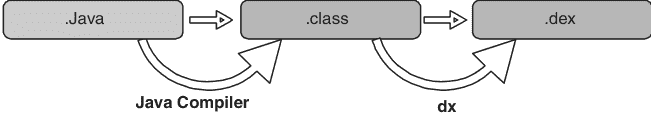

在 `Dalvik` 上编写的应用程序是一种运行在 `Linux` 内核之上的专为嵌入式使用设计的自定义虚拟机。在这里，`.java` 文件由 `Java` 编译器转换为 `.class` 文件。然后，`.class` 文件再由 `Dalvik` 虚拟机（`Dalvik` 执行器）转换为 `.dex`（`Dalvik` 可执行文件）。

### 10.4.5 Linux 内核

底层是 `Linux` 内核，它为 `Android` 构成了坚实的基础。`Android` 操作系统整体构建在 `Linux 2.6` 内核之上，并由 `Google` 进行了某些修改。`Linux` 内核负责电源管理、内存管理、驱动模型和安全等功能。它在硬件和软件栈的其他部分之间提供了一个抽象层。

至此，我们已经讨论了 `Android` 架构软件栈中的每个组件。在下一节中，我们将看到使用 `Android` 设备进行云计算。

## 10.5 结合 Android 设备的云计算

对于 `Android` 用户来说，云端起着重要作用。云端改变了我们对智能手机和电脑的认知。云计算已成功在技术领域确立了自己的地位。即使你没有电脑，共享信息和数据也不再是问题，你只需要一部智能手机，无论你在何处，都能保持信息更新并与现实世界连接。当云计算与移动计算融合时，`Android` 手机获得了更大的优势。我们使用智能手机发送和接收电子邮件，可能通过互联网拨打电话。为了备份联系人、频繁获取更新，我们使用 `USB` 连接电脑和手机。在云计算时代，移动设备不仅仅是一部手机。当智能手机通过 `3G`、`LTE`（长期演进）或 `4G` 或通过 `WiFi` 连接到互联网时，就可以获得大多数云计算功能。与电子邮件账户同步联系人详情、日历、任务和电子邮件。通过此功能，用户可以直接将状态、图片和视频分享到 `Google+`、`Facebook` 和 `Twitter` 等社交网络网站。云端还提供了搜索数据库、获取当地天气预报、订票、支付、玩多人游戏、分享广告等等功能。

### 数据库服务器

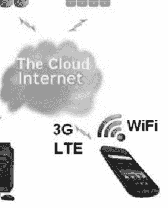

图 10.4 云与 `Android` 的工作原理。

这类智能手机不仅可以取代旧电脑，还可以取代其他电子设备，如相机、`MP3` 播放器、`GPS` 导航系统、口袋翻译器、手持游戏机等。`Android` 云兼具教育意义和娱乐性。

### 10.5.1 备份 API

在数据量小于 `1MB` 的情况下（例如用户偏好、笔记、游戏高分或其他状态），`Android` 云非常有用，此时备份 `API` 提供了一个轻量级的解决方案。备份 `API` 或云存储 `API` 是一种应用程序接口，它将原生应用程序连接到云云存储系统，用户可以向其发送数据并访问和处理存储在云端的数据。对于应用程序而言，云存储系统只是另一个存储设备。换句话说，如果新用户购买了新手机或重置了现有的手机，此备份 `API` 用于将用户之前的应用恢复到新手机或重置后的手机上。在初始化设置期间，与应用相关的之前的数据也会恢复。缺少云 `API` 可能会很难将数据从云端移动到目标设备。

## 10.6 基于云的 Android 应用 – 概述

云计算已用于开发各种移动应用程序。许多产品驱动型公司正在开发基于云的 `Android` 应用。移动应用程序软件嵌入在手机中。对于 `Android` 有许多云计算应用程序。作为这些云应用的开发者和消费者，我们应该关注并了解此类应用。

移动计算涉及将云计算引入手机环境。它提供了一种解决方案，使数据处理和存储发生在移动设备之外。以下是一些适用于 `Android` 的云计算应用。

### 1. Google Drive

`Google Docs` 是 `Google Drive` 的一部分。这是一个云计算应用，允许读者在与其他用户进行实时协作时在线阅读或编写文档。云计算使用户能够访问存储在云端的文档，并方便其阅读，而无需在手机上保留副本。通过使用此云计算应用，你可以上传照片、图片、视频等文件并与他人分享。该应用程序是由 `Google` 开发的免费软件，受 `Android` 操作系统支持，是最好的 `Android` 云计算应用之一。

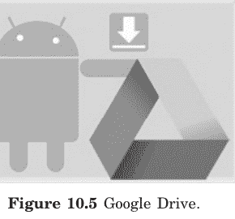

### 2. 电子邮件

它类似于在手机上提供电子邮件服务。云计算允许用户访问收件箱、撰写电子邮件并执行其他操作。云存储功能减少了手机的存储需求。这种云功能在 `Android` 手机上是非常有用的。


### 3. Google Print

`Google Print` 是云端的一种功能。`Google Print` 帮助用户在云端打印文件、电子邮件。`Android` 上的各种云应用可以让你从云端打印文档。


### 5. Safe Wallet

`Safe Wallet` 是一个云端密码管理器，帮助用户安全地存储凭据。它提供加密确保敏感信息免受未经授权的访问。使用 `Safe Wallet` 应用，用户可以从不同的设备访问。


图 10.8 `Safe Wallet`。

## 10.7 后端启动器

移动计算涉及在手机环境中引入云计算。它提供了一种解决方案，使数据处理和存储发生在移动设备之外。以下是一些适用于 `Android` 的后端启动器。

后端即服务（`BaaS`）是一种云服务，它促进了移动客户端与其后端服务之间的集成。通过 `BaaS`，减少了开发后端服务器的工作。平台即服务也是一种云服务，用于租用硬件、操作系统、存储和网络容量。

启动器解决方案提供了 `BaaS` 的优势。它结合了平台即服务的优势，如高可扩展性、可用性和扩展性。

后端启动器是在 `App Engine` 上部署和运行的应用程序。`App Engine` 是一个完整的开发栈，使用熟悉的技术在 `Google` 使用的设施上构建和托管应用程序。后端启动器为您的移动应用程序立即提供强大的后端功能。不需要任何服务器代码。

### 后端启动器的定义

后端启动器是一种一键部署的完整移动后端，允许您获得云后端的优势。它提供了一个准备就绪的通用云后端以及一个适用于 `Android` 的通用客户端框架。在不需要编写任何后端代码的情况下，您可以在后端启动器的帮助下为应用设置后端。它包含一个存储您的应用数据的服务器，以及一个用于 `Android` 的客户端库和示例应用。

### 移动后端启动器的特性

- 云端数据存储：云端为客户提供大量的存储空间。它允许在云端为每个用户存储任意数量的数据，以便随地访问。
- `Pub/Sub`（发布/订阅）消息：可以将数据从一个设备发送到另一个设备，或者发送到云端的任何或其他设备。此功能适用于各种应用程序，包括社交应用、论坛、聊天、游戏和小组协作。
- 推送通知：一个设备上更新的数据将通过 `Android` 的 `Google Cloud Messaging (GCM)` 自动推送到云端所有可用设备。
- 持续查询：服务器上持续运行的客户端会自动更新。
- `Google` 身份验证与授权：云端的身份验证和授权确保了数据的安全访问。可以实现按用户进行数据隔离，或在多个用户之间共享数据。


- 免费启动，按需扩展：最初对近数百个客户端免费使用，且服务可以扩展到任何数量的客户。

## 10.8 云到设备消息传递 (`C2DM`)

云到设备消息 (`C2DM`) 是一种 `Android` 服务，帮助将数据从服务器发送到 `Android` 设备上的应用程序。这是一种简单、轻量的机制，应用程序可以随时随地从服务器获取更新的数据。

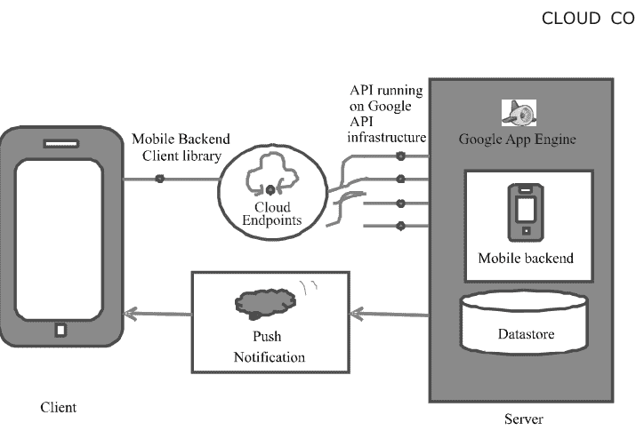

图 10.9 移动后端启动器。

### `C2DM` 的工作原理

- 第三方应用程序服务器可以向运行在目标设备上的 `Android` 应用程序发送轻量级消息。该消息服务的目标仅向目标设备发送关于服务器上更新数据的通知，而不是发送巨大的用户内容。

- `C2DM` 通知服务器中的数据更新。它不关心消息的投递和顺序。

- 当消息到达时，`C2DM` 通过 `Intent` 广播唤醒应用程序。但只有当广播接收器和权限设置妥当时，应用程序才会被唤醒。因此，`Android` 上的应用程序不需要始终接收消息。

- `C2DM` 不包含内置的用户界面或其他消息处理程序。`C2DM` 直接将原始消息数据传递给应用程序。转换原始数据并使用自定义用户界面进行显示是应用程序的任务。

- 目标移动设备应运行 `Android` `2.2` 或更高版本，并拥有 `Google` 账号。

## 10.9 用于 `Android` 的 `Google Cloud Messaging`

`Google Cloud Messaging` 允许将数据从服务器发送到目标设备，以及从设备发送到服务器。`GCM` 允许消息在服务器和移动设备之间传输。当服务器上的信息更新时，`GCM` 支持向目标移动设备发送通知。

### `GCM` 的特性

- `GCM` 帮助将信息从第三方应用程序发送到移动应用。

- `GCM` 支持通过 `Intent` 广播唤醒 `Android` 应用程序，因此应用程序不需要一直运行。

- 与 `C2DM`，它不支持内置界面。因此，显示原始数据的任务留给了 `Android` 应用程序。

- 它需要安装了 `Google Play` `Android` `2.2` 或更高版本。如果设备版本小于等于 `3.0`，则需要现有的 `Google` 账号。版本大于或等于 `4.0` 的 `Android` 不需要 `Google` 账号。

## 10.10 `C2DM` 和 `GCM` 的区别

| 特性 | `C2DM` | `GCM` |
| :--- | :--- | :--- |
| `API Key` | 客户端身份验证令牌。但已弃用。 | 来自 `Google` 控制台的简单 `API`。 |
| 发送者 `ID` | 只是一个电子邮件地址。 | 在 `Google` 控制台创建项目时获取的项目编号。 |
| `JSON` | 不支持。 | 支持 `JSON` |
| 多播 | 不支持 | 支持 |
| 多个发送者 | 不支持 | 多个发送者可以使用同一个注册 `ID` 向同一个应用发送消息 |
| 生存时间 (`TTL`) | 无。 | 范围从 `0` 到无限。`GCM` 将存储消息直到其过期。生存时间值为 `0` 的消息将不会存储在 `GCM` 服务器上。 |
| 带有负载的消息 | 发送轻量级消息以通知应用程序服务器上有新数据。 | 投递高达 `4Kb` 的消息。 |
| 规范 `ID` | 不支持。 | 支持。 |

## 10.11 从 `C2DM` 迁移到 `GCM`

到目前，我们已经看到了 `C2DM` 和 `GCM` 之间的区别。我们从 `C2DM` 迁移到 `GCM` 主要是为了方便地使用云功能并提高电池效率。`GCM` 提供了丰富的新 `API`，为从 `C2DM` 迁移到 `GCM` 铺平了道路。让我们从 `C2DM` 迁移到 `GCM` 的步骤。

从 `C2DM` 迁移到 `GCM` 非常简单，只需两个替换过程。一个是将 `C2DM` 中的电子邮件帐户替换为项目编号。另一个是将 `ClientAuth` 替换为 `API key`。

由于 `GCM` 中的发送者 `ID` 是项目编号，因此 `C2DM` 中的电子邮件帐户被替换为从 `Google` 控制台获取的项目编号。另一个主要变化是将已弃用的 `ClientAuth` 令牌替换为从 `Google` 控制台获取的 `API key`。下方的快照展示了如何获取 `GCM` 的项目编号和 `API key`。

在你的浏览器中打开 `URL` `https://cloud.google.com/console/project`。你需要输入你的 `Google` 账号的用户凭据。

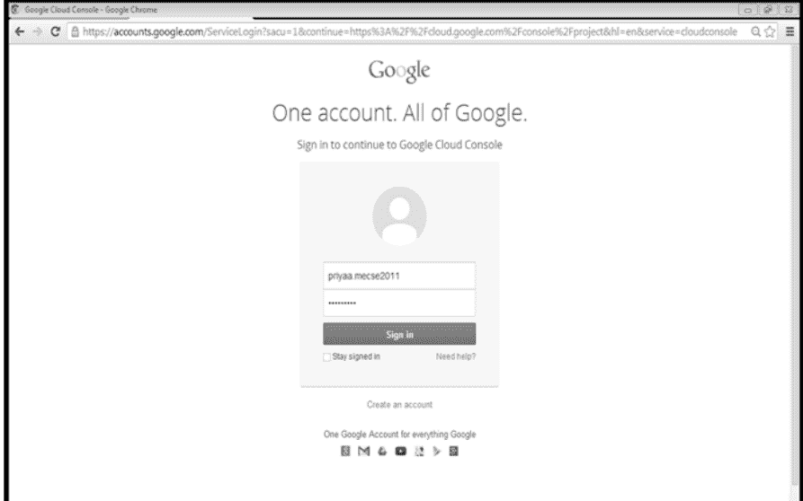

目前，你还没有任何项目... (此处对应原文截断)

## 云端中的 `Android`

构建成功的 `GCM` 应用所需的 `API` 密钥。在下一章中将讨论更多关于 `GCM`、其架构和实现。

## 总结

- `Android` 手机因为成本较低，在移动手机市场上产生了更大的影响。

- `Android` 操作系统是开源的，为开发不同版本的操作系统铺平了道路。

- `Google` 在 2005 年收购了 `Android`，它是由 `Andy Rubin` 在 2003 年开发的。

- `Android` 版本按字母顺序以甜点命名。目前，它已达到“`K`”，被称为“`KitKat`”。

- `Android` 架构包含一些核心部分，如应用程序、应用程序框架、库、`Android` 运行时和 `Linux` 内核。

- 开发了更多迷人的移动云端应用，如 `Google Drive`、邮件、`Google Cloud Print`、`Sugar Sync` 和 `Safe Wallet`。

- `Mobile Backend Starter` 是一种您可以一键在 `Google App Engine` 上部署和运行的应用程序。

- 云端设备消息 (`C2DM`) 是一种已废弃的 `Android` 服务，帮助从服务器向数据发送到 `Android` 设备上的应用程序。

- `Google Cloud Messaging` (`GCM`) 是目前的 `Android` 服务，帮助从服务器向设备以及从设备向服务器发送数据。

- 通过简单的两次替换即可有效地完成从 `C2DM` 到 `GCM` 的迁移。

# 11 针对 `Android` 的 `Google` 云端消息 (`GCM`)

| 目标 | |
| :--- | :--- |
| 学习 `GCM` 的组件和凭据 | |
| 了解 `GCM` 的架构 | |
| 识别 `GCM` 的生命周期 | |
| 实现 `GCM` | |
| 使移动设备在 `GCM` 上注册 | |

## 11.1 `GCM` 中的概念

这里有两个主要概念。

1. 在 `GCM` 中起关键作用的组件。

   (a) 客户端应用程序是运行在设备或模拟器上的启用了 `GCM` 的 `Android` 应用程序。

   (b) 第三方应用程序服务器——通过 `GCM` 连接服务器向运行在目标上的客户端应用发送信息的应用程序服务器。

   (c) `GCM` 连接服务器——这是客户端应用程序和第三方应用程序服务器之间的中间节点。这些是 `Google` 提供的服务器，从第三方应用程序服务器接收消息并到目标设备，反之亦然。

2. 确保所有方都经过验证和授权的凭据。

   (a) 发送者 `ID`——这是我们从 `Google Console` 获取的项目 `ID`。参考第 11 章中的快照获取项目 `ID`。

   (b) 应用 `ID`——用于唯一标识 `Android` 应用程序。

   (c) 注册 `ID`——这是用于识别从服务器接收消息的目标设备的 `ID`。它由 `Google` 服务器颁发。

   (d) `Google` 用户帐户——如果设备运行版本低于 `Android` `4.0.4`，至少需要一个 `Google` 账户才能让 `GCM` 工作。

   (e) 发送者身份验证令牌——这就是 `API` 密钥。获取 `API` 密钥请参考第 11 章快照。对于服务器授权访问 `Google` 服务，需要 `API` 密钥。

## 11.2 架构概览

`GCM` 实现包括第三方应用服务器、`GCM` 连接服务器和运行在目标设备上的 `Android` 客户端应用。`GCM` 连接服务器帮助从客户端应用向第三方应用服务器发送消息，反之亦然。

图 11.1 `GCM` 架构计算。

### 组件交互

- `GCM` 连接服务器从第三方应用服务器发送消息到启用了 `GCM` 的客户端应用。`HTTP` 和 `XMPP` 是 `Google` 提供的连接服务器。

- 第三方应用服务器向 `GCM` 连接服务器发送消息，连接服务器随后将其入队并存储，并在目标设备上线时发送。

- 为了接收存储的 `GCM` 消息，客户端应用必须在 `GCM` 处注册并获取注册 `ID`。如果使用 `XMPP` 连接服务器，客户端应用可以将消息发回到连接服务器，从而实现上行传输。

## 11.3 生命周期流程

- 启用 `GCM`

  运行在移动设备上的 `Android` 应用程序必须向 `GCM` 注册以接收消息。

- 发送消息——以下是发送消息时触发的事件序列。

  1. 第三方应用服务器向 `GCM` 服务器发送消息。

  2. `Google` 连接服务器将消息入队并存储，以防设备离线。

  3. 当设备在线时，`Google` 连接服务器将消息发送到设备。

  4. 设备接收消息后，通过具有适当权限的 `Intent` 广播将消息广播给指定的 `Android` 应用程序，以便目标 `Android` 应用程序获取消息。`Android` 应用程序不需要预先运行即可接收消息。`Intent` 广播即使在应用程序未运行时也会唤醒准确的应用程序。

  5. 目标应用程序将处理消息。

  6. 如果注册的 `Android` 应用程序不再想接收消息，它可以取消注册 `GCM`。

- 接收消息。

以下是安装在移动设备上的 `Android` 应用程序接收消息时发生的事件序列：

1. 系统接收传入的消息，并从消息负载中提取原始的键/值对（如果有的话）。

2. 系统将键/值对作为一组额外的 属性通过 `Intent` 传递给目标 `Android` 应用程序。

3. `Android` 应用程序通过键从 `Intent` 中提取原始数据并对其进行处理。

## 11.4 `GCM` 实现步骤

让我们看看 `GCM` 实现的 `get`。

# 创建 `Google` 项目 我们我们已经在上一章中看过了如何创建 `Google API`。创建 `Google` 项目的步骤：

1. 打开 `Google Console`。

2. 点击创建 (`Create`)。

3. 输入你的项目名称并点击创建 (`Create`)。

4. 项目创建后，将出现一个显示项目 `ID` 和编号的页面。

5. 复制你的编号以备后用。

以下是识别编号的屏幕。

# 针对 `Android` 的 `Google` 云端消息 (`GCM`)

### 启用 `GCM` 服务

启用 `GCM` 服务的两个步骤：

1. 在左侧边栏中选择 `API` 和验证 (`APIs & auth`)。

2. 在 `API` 选项卡中，将 `Google Messaging for Android` 开关打开。

快照显示了如何启用 `Google Messaging for Android`。启用时请同意条款。

在 `Google` 控制台中启用 `GCM` 服务已完成。

# 获取 `API` 密钥 下一步是获取 `API` 密钥。我们已经在第 11 章中看到了如何为服务器、浏览器、`Android` 和 `iOS` 等各种应用程序获取 `API` 密钥。让我们看看获取服务器密钥 `API` 的步骤。

# 针对 `Android` 的 `Google` 云端消息 (`GCM`)

1. 在你的项目控制台中选择 `API` 和验证 (`APIs & auth`)，然后在凭据 (`Credentials`)。

2. 在公共 `API` 下点击新建密钥 (`New key`)。

3. 在新建密钥对话框中，点击服务器密钥 (`Server key`)。

4. 在生成的配置对话框中，提供你服务器的 `IP` 地址。设置后将允许所有 `IP` 地址。

5. 点击创建 (`Create`)。

6. 在随后的页面中，复制 `API` 密钥。此 `API` 密钥稍后在你的应用程序中执行身份验证时会需要。如有必要，可以重新生成 `API` 密钥。

上述 `API` 密钥是为服务器应用程序生成的。也可以编辑允许的 `IP`。

有了项目编号、启用的 `GCM` 服务和生成的 `API` 密钥，我们可以开始实现 `GCM`。以下是基本步骤的概述：

- 选择 `GCM` 连接服务器 `HTTP` 或 `XMPP` (`CCS`)。

2. 实现与 `GCM` 连接服务器交互的第三方应用程序服务器。

3. 编写你的客户端。

## 11.5 `GCM` 注册

到目前为止，我们已经看到了 `GCM` 实现的要求。让我们看看如何在 `GCM` 中注册你的移动设备。

## 云计算

假设你已经使用 `ADT` 束安装了适用于 `Android` 的 `Eclipse`。为了实现客户端代码，需要 `Google Cloud Messaging API`，这需要安装 `Google Play` 服务。要安装 `Google Play` 服务，请点击 `SDK` 根目录下的 `Android SDK Manager` '`SDK Manager.exe`' 文件。在 `Android SDK Manager` 中如下所示选择 `Google Play Services`，并点击安装包。

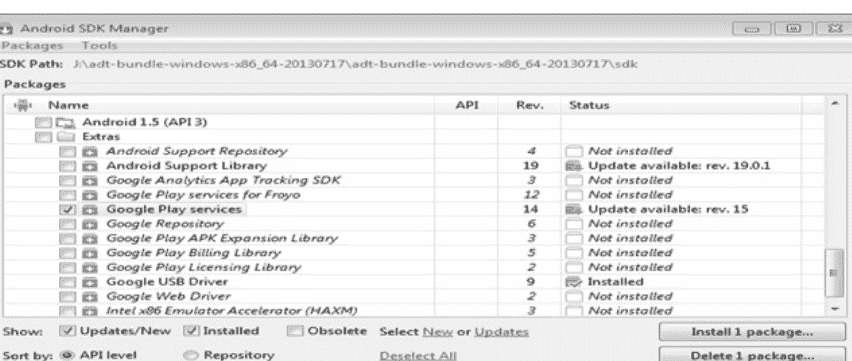

接受许进行安装。

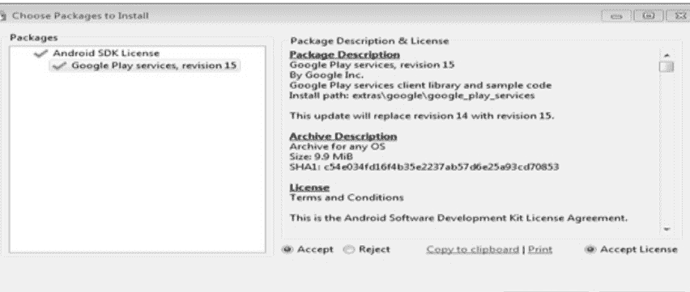

安装可能需要几分钟。然后按照如下所示安装兼容版本的 `Google API`。

## 适用于 `Android` 的 `Google` 云消息 (`GCM`)

257


包加载完成。点击安装已选数量的包。同意条款以安装 `GoogleAPIs`。

让我们看看如何向 `GCM` 注册移动设备。创建一个 `Android` 项目。使用目标 `Google APIs` 创建项目。为此，右键点击键项目 ->> `Build Path`（构建路径） -> `Configure Build Path`（配置构建路径） -> `Android`。然后将目标设为 `Google APIs`。下面是项目布局。

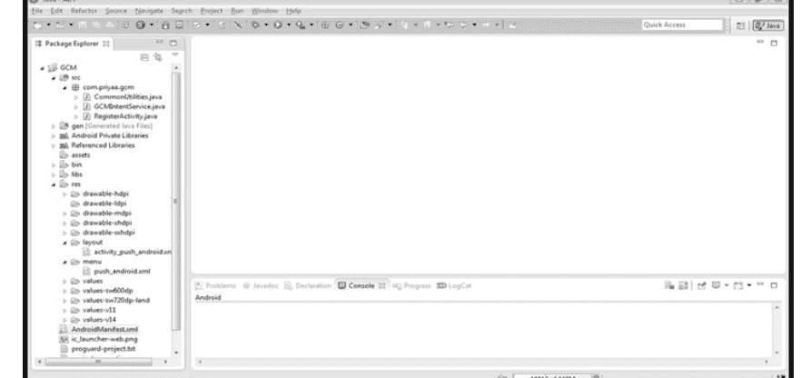

### `RegisterActivity.java`

`//这是一个帮助移动设备进行 GCM 注册的 java 文件。`

`package com.priyaa.gcm;`

```java
import static com.priyaa.gcm.CommonUtilities.SENDER_ID;
import android.app.Activity;
import android.os.Bundle;
import android.util.Log;
import android.widget.TextView;
import com.google.gcm.GCMRegistrar;

public class RegisterActivity extends Activity {
    private String TAG = "Register Activity";
    private TextView Reg_ID;

    @Override
    public void onCreate(Bundle savedInstanceState) {
        super.onCreate(savedInstanceState);
        //调用 checkNotNull 方法
        checkNotNull(SENDER_ID, "SENDER_ID");
        nGCMRegistrar.checkDevice(this);
        nGCMRegistrar.Manifest(this);
        setContentView(R.layout.activity_push_android);
        Reg_ID = (TextView) findViewById(R.id.textView);
        // 注册 ID
        final String regid = GCMRegistrar.getRegistrationID(this);
        Log.i(TAG, "registration id ===== " + regid);
        if (regid.equals("")) {
            nGCMRegistrar.register(this, SENDER_ID);
        } else {
            Log.v(TAG, "Already registered");
        }
        //将注册 ID 设置为 TextView
        Reg_ID.setText("Your Device Registration ID : "+regid);
    }

    //SendercheckNotNull 不是空
    private void checkNotNull(Object reference, String name) {
        if (reference == null) {
            throw new NullPointerException(getString(R.string.error_config, name));
        }
    }

    @Override
    protected void pause() {
        super.onPause();
    }
    // 使用 GCM 注销
    GCMRegistrar.unregister(this);
}
```

## 适用于 `Android` 的 `Google` 云消息 (`GCM`)

### `GCMIntentService.java`

`//这是一个作为 Intent 服务的 java 文件。你可以//在 AndroidManifest.xml 中添加该服务。`


```java
package com.priyaa.gcm;

import static com.priyaa.gcm.CommonUtilities.SENDER_ID;
import android.content.Context;
import android.content.Intent;
import android.util.Log;

import com.google.android.gcm.GCMBase;

public class GCMIntentService extends GCMBase {

    public GCMIntentService() {
        super(SENDER_ID);
    }

    private final String TAG = "GCMIntentService";

    @Override
    protected void onRegistered(Context arg0, String registrationID) {
        Log.i(TAG, "Device registered: " + registrationID);
    }

    @Override
    protected void onUnregistered(Context arg0, String arg1) {
        Log.i(TAG, "unregistered: " + arg1);
    }

    @Override
    protected void onMessage(Context arg0, Intent arg1) {
        Log.i(TAG, "new message=" + arg1);
    }

    @Override
    protected void onError(Context arg0, String errorID) {
        Log.i(TAG, "Received error: " + errorID);
    }

    @Override
    protected boolean onRecoverableError(Context context, String errorID) {
        return super.onRecoverableError(context, errorID);
    }
}
```

### `CommonUtilities.java`

```java
//此文件用于将项目 ID（从 Google 控制台获取）设置为 SENDER_ID。
package com.priyaa.gcm;

public class CommonUtilities {
    // 初始化发送者者 ID
    static final String SENDER_ID = "661572405665";
}
```

### `AndroidManifest.xml`

```xml
<?xml version="1.0" encoding="utf-8"?>
<manifest xmlns:android="http://schemas.android.com/apk/res/android"
    package="com.priyaa.gcm"
    android:versionCode="1"
    android:versionName="1.0">
    <uses-sdk
        android:minSdkVersion="8"
        android:targetSdkVersion="19" />
    <permission
        android:name="com.priyaa.gcm.permission.C2D_MESSAGE"
        android:protectionLevel="signature" />
    <uses-permission android:name="com.priyaa.gcm.permission.C2D_MESSAGE" />
    <uses-permission android:name="android.permission.GET_ACCOUNTS" />
    <uses-permission android:name="android.permission.WAKE_LOCK" />
    <uses-permission android:name="android.permission.INTERNET" />
    <application
        android:icon="@drawable/launcher"
        android:label="@string/app_name"
        android:theme="@style/AppTheme">
        <activity android:name="com.priyaa.gcm.RegisterActivity">
            <intent-filter>
                <action android:name="android.intent.action.MAIN" />
                <category android:name="android.intent.category.LAUNCHER" />
            </intent-filter>
        </activity>
        <receiver android:name="com.priyaa.gcm.GCMReceiver" />
        <service android:name="com.priyaa.gcm.GCMIntentService" />
    </application>
</manifest>
```

正在启动模拟器。

因此，设备已通过注册 ID 完成注册。设备已准备好接收消息。

开启设备注册后，设备可以接收来自 `GCM` 连接服务器的消息。

# 适用于安卓的谷歌云消息 (GCM)

## 输出

## 摘要

- 组件和凭据是 `GCM` 的两个主要概念。

- 客户端应用程序、第三方应用程序服务器和 `GCM` 连接服务器构成了 `GCM` 的组件。

- 发送者 ID、应用 ID、注册 ID、Google 用户账户、服务器验证令牌是帮助验证和授权的凭据。

- `GCM` 连接服务器在客户端应用和第三方应用程序服务器之间充当媒介。

- 启用 `GCM`、发送和接收消息是 `GCM` 生命周期周期中的三个关键活动。

- 安装 `Google Play` 服务以利用谷歌云消息 (`GCM`) `API` 的功能。

- 在 `Google` 控制台中创建 `Google` `API` 项目以生成项目 ID，该项目 ID 将用于在 `GCM` 中注册移动设备。

# 12

# 业务云计算

| 目标 |
| :--- |
| 学习和分析企业云计算术语 |
| 接触云计算在业务领域的应用 |
| 了解云计算的未来前景 |

在最后几个章节中，我们详细了解了云计算技术。我们看到了各种原理、应用、云的分类以及各种服务模型。我们还看到了云计算如何分别在 `Android` 和 `Linux` 平台上运行。我们看到了用于搭建实时云的云工具列表。现在，让我们详细看看云技术是如何被使用以及对业务世界产生影响的。在本章中，我们将讨论云技术的面向业务的和企业级含义。我们还详细查看了企业 `IT` 公司如何使用云中独特的面向业务的服务模型。

## 12.1 企业云计算

在这一节中，让我们详细了解“企业云计算”这一术语。我们将看到云计算技术是如何面向业务的，以及它是如何改变整个企业 `IT` 部门的。

每项技术都具有其价值。在非常宏观的范围内，每项技术价值必须是用户友好且对业务友好的。从理论和研究的技术角度来说，每项技术都必须实时应用于人类社会，并解决他们所有的问题。当一项技术最终被人们使用时，它的全部价值才能实现，技术背后才有真正的意义。为了让用户能够充分运行某项技术，需要行业的支持。只有工业专家才能最终帮助任何技术的实时实现。对于每个行业来说，利润是主要目标，或者是整个业务策略的一部分。因此，每项技术都必须以行业为导向并获得支持，而不是仅仅是一个研究课题。

# 业务云计算

对于面向导向的云计算术语，我们称之为企业云计算。“企业云计算”一词指的是业务相关的操作以及利用云计算技术来完成所有工作。云计算服务模型及其类型正在成为企业 `IT` 部门的新工作方式。每家主要的 `IT` 公司都在向这项技术转型。业务相关的企业 `IT` 部门与云计算的紧密结合，为“企业云计算”这一术语赋予了新的维度。今天，云计算改变了企业部门整个工作文化。事物进步非常快，而且更加可靠。所有处理问题及其解决方案的传统简单方法已经过去了。业务相关的操作和解决方案现在通过远程云基础设施及其独特能力得到了良好的处理和管理。

“企业云计算”术语还指的是所有与业务相关的关键操作和功能。企业计算涵盖了所有类型的企业软件，如公司相关的业务工具和解决方案、数据库管理、编程、测试、质量保证、关系管理等。它还包括公司的硬件和处理所有客户项目及其解决方案的大规模基础设施。企业计算通常被用作一组业务软件来解决资源管理和流程简化等问题。每家 `IT` 公司都必须有大量的员工、物理和技术上的基础设施、技术专家、管理专家和卓越的领导者来运营大型组织，应对任何重大问题。他们还必须拥有定义良好的业务经理，以定义的方式管理整体业务运营，并在双赢局面下谈判所有业务交易，使公司和客户双方受益。

> 虚拟化、标准化和服务管理，以释放运营预算用于新投资

> ....允许您优化新投资以获得直接业务收益

图 12.1 云计算的经济学。

企业云计算有时作为一个整个平台出售给企业，它可以应用于整个组织，并根据每个区域内用户的特定需求进行进一步定制。我们已经知道云计算是一种面向服务的技术，涉及将各种资源和工作空间从云供应商迁移到最终用户。这意味着分析、报告、数据库管理和其他应用程序在整个系统中是标准的，而每个区域使用的应用程序包和访问的数据将是不同的。从这个意义上说，企业云计算偏离了解决针对业务问题的单一软件解决方案（如库存或会计软件）。相反，企业云计算旨在为这些问题提供集成解决方案。因此，这种集成解决方案的形式是当今竞争激烈且动态变化的业务世界的迫切需求。

图 12.2 企业云计算。

当我们谈论企业云计算时，有四个我们需要理解的要素因素。企业云从传统方法改变了整体软件开发流程。企业云为所有业务活动提供了各种云服务列表，为最终用户问题和客户项目提供了实时解决方案。云的整体管理也需要由公司处理。云管理工具有助于云的整体性能和效率。让我们详细讨论每一个。

## 企业软件开发

当我们谈到 `IT` 公司和所有业务操作时，我们不能忘记“软件开发”这个术语。今天，有数百万 `IT` 公司从事各种软件的开发、管理、测试和支持。“企业软件部署”术语指的是为了让最终用户可以使用软件应用程序而发生的所有活动。从技术上说，企业软件部署在软件应用程序编写、封装并交付到企业之后开始。企业软件部署是软件开发周期中的一个循环阶段，因为它不断进行升级、修复错误或添加新功能。迭代方法是软件开发模型中的最佳方法。这使得企业软件部署成为企业 `IT` 管理的核心要素。传统的软件方法给企业 `IT` 资源带来了沉重负担，因为他们必须投入大量精力和精力到企业计算环境中所有应用程序的安装和维护。当底层软件出现任何问题时，情况会变得糟糕。相反，在 `SaaS`（软件即服务）软件交付模型下，云架构

## 业务云计算

为 `SaaS` 提供商提供了一种机制，使其能够通过互联网轻松交付软件，从而消除了传统软件交付模式下需要为每个应用程序用户部署软件的需要。`SaaS` 软件交付模型在劳动力利用以及软件部署和维护的运营费用方面为企业提供了巨大的成本节约机会。设计和实现软件的云服务模型非常简单方便。

在企业开发中，提到 `SaaS` 与 `SOA`（面向服务的架构）之间的关系至关重要。我们已经知道云计算是一种完美的面向服务的技术。`SOA` 是这种云技术中一个非常独特的特征。`SaaS` 和 `SOA` 是绝妙拍档，因为支持 `SOA` 的 `SaaS` 提供商能够通过推送到企业云的单个应用程序实例为成千上万客户提供服务。这使得软件交付变得无缝衔接，而且当 `SOA` 与 `SaaS` 结合时，还获得了额外的灵活性、可扩展性和版本控制。因此，使用 `SOA` 概念使云交付变成了一项非常简单的任务。

`SOA`（面向服务的架构）提供了一个框架，软件组件以服务的形式交付，这显著降低了软件部署和维护的成本。`SOA` 促进了根据需求将单个软件组件集成到无限数量的应用程序中。每个组件由其所有者维护。这为组织提供了虚拟构建整个应用程序的能力，而无需担心软件更新或升级，因为这些都是由 `Web` 服务提供商处理的。组织可以使用各种服务提供商提供的各种 `Web` 服务和 `API` 构建各种 `SaaS` 解决方案，并通过企业云进行交付。因此，可以简单地说，云的 `SaaS` 服务模型改变了 `IT` 公司内部的整体软件开发流程。它让事情变得更加简单和友好。

除了 `SaaS`（软件即服务）模型外，云中的其他服务模型如 `PaaS`（平台即服务）或 `IaaS`（基础设施即服务）对 `IT` 公司及其各个方面的功能都有帮助。可以非常有信地说，云计算无疑是一项成熟的面向业务的技术。这已被证明是解决企业 `IT` 部门问题和困难的一大工具。仅仅在过去几年的变革中，事物变化非常迅速，并与这项云技术保持一致。

## 企业云服务

企业云服务是指在私有云计算环境中将软件、硬件、基础设施和平台作为服务的扩展。我们已经知道云计算是一种面向服务的技术。企业云服务可以使用本地 `IT` 资源进行内部交付，也可以由第三方企业云服务提供进行进行交付。企业云服务可以为组织提供各种益处，有助于其日益增加使用，并成为企业内部交付 `IT` 服务的传统方法的替代。我们已经详细了解了私有云以及它们在组织内部的用处。

## 云计算

各种规模的组织都可以通过部署企业云服务，实现 `IT` 服务的显著成本节约，例如降低 `IT` 运营成本和 `IT` 资产的资本支出。特别是小型业务单元正在充分利用这项技术。使用云服务的组织不再需要投资服务器硬件基础设施或安全工具。相反，这些资源可以从第三方企业云服务提供商处以订阅的方式购买，成本仅为原有的一小部分，从而为其他业务用途释放了资金。按需付费模型或对云服务的租赁已成为所有 `IT` 公司的福音。

许多软件应用程序将不再需要维护或升级，因为软件可以以订阅的方式购买。这对于以前背负着不断升级或更换本地软件应用程序等需求的任何企业来说，提供了显著的成本节约。特别是新的初创公司和小型企业在采购 `IT` 资源方面的预算较小。因此，可以简单地说，云计算是 `IT` 公司的一种非常好的解决方案，主要归功于高成本节约。

部署企业云服务的组织可以实现各种运营收益，包括能够快速交付新服务或增强服务、能够在用高峰期间快速满足对 `IT` 硬件资源需求增长的能力，以及通过在私有云计算环境中引入虚拟化、自动化和服务管理方法来优化本地 `IT` 资源利用的能力。私有云也被证明是公司内部通信和资源共享的正确媒介。此外，托管在本地的企业云服务的另一大益处是，可以在不牺牲安全性的前提下，获得公有云服务的优势。这是因为与公有云服务不同，本地私有企业云可以设置防火墙，以限制针对组织 `IT` 资源的恶意攻击威胁。与公开的公共云相比，私有云在组织内部更安全。外部托管的企业云服务提供了更高水平的容错能力和灾难恢复能力，这是大多数企业 `IT` 部门无法比拟的。

企业云解决方案 (`Enterprise Cloud Solution`) 这一术语可能指云服务平台，也可能指通过云服务平台交付的各种云服务模型，如 `SaaS`（软件即服务）、`PaaS`（平台即服务）或 `IaaS`（基础设施即服务）。当企业云解决方案不是云服务平台时，它通常遵循传统的 `IT` 交付模式，设计用于处理特定的业务操作，如会计、文档存储、电子消息传递、软件开发等。基于云计算的高级先进操作与传统的 `IT` 工作文化之间存在许多差异。

作为云服务平台的企业云解决方案通过以下方式与其交付的 `SaaS`、`PaaS` 或 `IaaS` 产品相区别：它们扩展了

## 业务云计算

实际的云基础设施服务和云应用服务，这些是成功向企业交付 `SaaS`、`PaaS` 或 `IaaS` 产品所需要的。无论应用何种，企业云解决方案最终都必须在云框架内以集成化的方式提供执行所需功能的所有资源。云解决方案必须是高度稳健且可靠的，因为整个业务交易都依赖于它。在任何情况下，任何云的主要目标都是提供管理或支持特定一组业务功能的必要工具。

企业云解决方案可以在私有云或公有云中实施。对于必须进行哪种没有主要限制。当使用私有云时，组织对其企业云内每个云解决方案的交付承担全部责任。由于私有云在组织的控制下，提供更有效、更友好的方式是他们的职责。私有云也是公司内部所有业务活动的安全环境。相反，当组织使用公有云时，外部供应商必须将所需的平台扩展到互联网，以便向每个客户或组织交付其企业云解决方案。人们不要忘记公开平台涉及的整体安全问题。由于业务数据是机密的，必须意识到在公有云中处理和操作这些数据时的所有安全问题。外部供应商可以向企业交付任何类型的云解决方案，包括公有云内的私有企业云，该云仅供单个组织或实体访问。

## 企业云管理

除了企业云服务和解决方案之外，云的管理也是企业中的一项大任务。我们已经提到，云是一项非常巨大的技术，拥有大量的池化资源，供多个用户同时访问。企业云管理是指与建立和向用户客户交付企业云服务相关的必要任务执行，以非常简单可靠的方式进行。无论组织是否需要管理私有云或混合云，都需要采用云管理来促进其企业云资源的管理。企业云管理工具为企业云服务的中心化管理控制提供了平台和界面。企业可以使用企业管理工具有效管理内部和外部云资源，包括部署到企业云的虚拟化资源和业务策略。此外，管理工具以有效的方式有助于云的整体性能。企业云管理通过多种方式为企业增加了 `IT` 效率并节约了成本：

- `云管理工具`允许组织随时为整个企业云资源池和其他使用策略轻松建立并更改自动化规则，从而实现 `IT` 资源更高效、更具效益的利用。

- `云管理工具`可能被用于交付基础设施即服务（`IaaS`），从而实现按需对 `IT` 资源的配置和设置。将许多 `IT` 服务转变为自服务或自动化交付模式，可以消除各种耗时且重复的行政性 `IT` 工具，让人员能够将精力集中在更高层次的 `IT` 关注问题上。正如我们所知的，云计算涉及工作空间或技术基础设施的整体迁移，以完成最终用户的任务。企业级云管理工具还可以被用于按需交付数据安全服务，包括断电恢复援助等。


- 企业级云管理工具可以通过 `Web` 管理工具的可用性来提高 `IT` 效率。此类工具为企业云中存在的所有可用 `Web` 服务中央存储库提供了接口。`IT` 管理员可以轻松跟踪 `Web` 服务依赖关系和 `Web` 管理任务，从而更高效地处理企业云计算环境内的配置和变更管理任务。

- 企业级云管理工具还提供了自动化 `IT` 任务的能力，这些任务可能是为了满足行业监管机构的操作合规性所需的。组织可以使用云管理工具根据各种数据事件自动执行 `IT` 处理，这减少了手动 `IT` 监控流程、应用程序的需求，以及审计需求。对企业产生的潜在经济效益可能是巨大的，因为合规失败可能导致巨额罚款或法律费用，以保护企业免受违约诉讼等影响。

今天，有数百万种云工具和解决方案供公司内部业务使用。其中一些是免费的，一些是私有的等等。截至 2013 年，业务组织内部常用的一些云计算工具包括：

- `GitHub` – 它 是一个针对开源和私有开发项目的非常强大的协作、评审和代码管理平台。`GitHub` 是处理云技术所有编码方面的最佳方式。大多数云工具都可以在 `GitHub` 平台上找到。

- `Bitbucket` – 将所有的 `Git` 和云代码都存储在一个地方。包括问题跟踪、`wiki`、拉取请求（`pull requests`）、无限仓库，并对前 5 个用户免费。

- `Vagrant` – 用于创建和配置轻量级、可复制且可移植的开发环境。运行单一命令 `vagrant up`，然后 `Vagrant` 就会为你搭建好完整的开发环境。告别“工作机器”借口吧，因为 `Vagrant` 会为团队中的每个人创建完全相同的开发环境。

- `New Relic` – `New Relic` 是一款全位的 `Web` 应用性能工具，可以让你看到从终端用户体验通过服务器一直到应用程序代码行的性能。

## 业务云计算

- `Cloud 66` – `Cloud 66` 是在你的服务器或云上部署、监控和管理 `Ruby on Rails` 应用的最简单方法。

- `Capistrano` – 一个用 `Ruby` 编写的开源工具，用于在多个服务器上运行脚本，其主要功能是部署 `Web` 应用。它自动化了在一个或多个 `Web` 服务器上发布应用程序新版本的过程，包括支持检查数据库等任务。

## 12.2 业务部门云计算

在上一节中，我们详细查看了企业级云计算这一术语。我们看到了企业如何提供各种云服务、解决方案以及各种管理方面，这些都有助于公司内部的业务运营。现在在本节中，我们将详细查看云计算是如何在公司的业务部门内部使用的。我们还将看到云对于小规模企业非常有用。

云计算解决方案可以为所有行业领域以及大小大小的公司带来利益。将信息系统迁移到云平台从而消除了对大量云基础设施和传统方法的需求，并改变了使用商业智能来支持决策的方式，这使许多公司能够加速其产品开发流程并更快速地实现目标。它可以改变公司内部整体的工作文化和运行程序。这是许多业务领导者和分析师的感受。

在如今不断发展的时代，云计算被从个人到私有和公共组织的所有所有人使用，包括教育系统和政府，而不局限于大型企业 `IT` 部门或计算机解决方案。在业务云系统中，各种规模和种类的组织（从小型企业到跨国公司）都在使用。这种先进的计算技术在近期产生的影响是前所未有的。越来越多的人每天都在接触或访问这种先进的网络云技术。随着云的普及，人们日益接触或访问这种先进的网络云技术。

## 云业务

云机会可以被快速利用。随着需求的增长和技术的发展，业务部门需要转向这种技术。在各种情况下，云是相关的，不要忘记传统的方法。在这方面，云是用户友好且具有支持性的。云也是平台独立的。企业使用云计算通过任何兼容设备从任何地方访问信息。与在计算机或办公室服务器上存储信息不同，云是在互联网上存储数据。它通过一个中央枢纽让任何人在有凭据的情况下从任何地方访问。云计算同步所有连接到云的设备，保持其更新。

一个项目被划分为多个模块，每个项目都有多个来自不同地点的人在工作。高层人员和员工也可能来自不同的地点。在远程办公环境下，云技术是业务运营的强大工具。员工可以像在办公室一样使用应用程序，并在自己的设备上与云端的其他人一起进行同一个项目或演示。即使你离开了工作或无法访问办公室服务器，云端数据始终是最新的。

在云环境中，用户可以访问所有类型的文件、软件、硬件和工作空间。正如我们所知，对于当前的工作空间，云有助于将资源迁移到云平台。云计算服务的范围从数据存储到功能性程序，包括会计、客户服务、远程桌面托管等。

根据一项关注云计算的 `IT` 研究，54% 的组织使用云计算。在这些组织中，74% 使用不同类型的云组合，其中 40%-55% 使用同一类型的多种服务。

# 业务云计算

它涉及按需付费或按量计的付费模式。与购买专用资源的实际成本相比，这种方式非常廉。

- **更强大的功能和更高的性能** – 云服务提供商为许多公司提供服务，这些公司购买的高性能系统其性能水平超过了小型公司内部运行所负担得起的。他们通常拥有最先进的软件版本，站点许可证还可能允许以比专门购买低得多的成本访问某些功能。他们丰富的管理员往往比用户更可能知道如何优化性能。

- **总体支出** – 通过云服务和模型，组织的总资本支出得以减少。这主要归功于资源的租赁。毕竟，在任何业务中，都必须忘记利润和经济效益是终极目标。

- **业务敏捷性** – 云服务和底层技术帮助组织通过调整来适应不断增长的动态市场预期的需求和需要。

- **自动化** – 与其投入 `IT` 支持以保持您的文件存储系统的不断更新和维护相比，大多数使用云的应用程序会自动进行更新。

- **易用性** – 随着软件和硬件的租赁，公司业务部门内部不再需要承担维护或在出现任何问题时进行故障排除的最大任务。因此，公司可以将宝贵的精力投入到开发。

- **平台独立性** – 云计算对所有业务公司的另一个优势是这种技术是完全独立于平台的。它支持并为所有其他平台提供全面的协作。

- **备份和文件共享** – 云可以广泛用于存储与关键业务相关的机密数据，免受任何故障或灾难的影响。此类数据还可以以非常用户的方式分享给相关人员或客户。

- **人员配置效率** – 云服务通过外包关键技术规范并将其余部分留到内部处理，有助于维持正确的人员比例。

- **绿色维度** – 云中也有绿色方面，可以帮助公司在企业社会责任方面实现业务目标。这是因为云服务提供商可以大规模投资数据中心。这为公司提供了传统 `IT` 方法的绿色替代方案。此外，通过提供更多服务，由于不需要硬件，材料浪费减少。此外，现场基础设施的减少意味着需要管理或升级的设备更少。

云计算

- **业务方法** – 云技术允许公司在业务的所有部分增加冗余基础设施。去中心化允许应用程序和数据分散，这增加了业务灵活性并简化了恢复和网络。可扩展云计算的新方法通过将许多基本元素（包括存储、负载均衡、数据库和缓存）整洁地管理在设备或云实例中，简化您的 `IT` 基础设施。业务所有通常使用三种类型的云服务来存储数据并为他们提供服务：公共、私有和混合。

- **公有云** – 公有云服务构建在云提供商运行的外部平台之上。通过这种离线云服务，用户在共享基础设施中获得他们自己的云。提供者提供从您的云系统的安全和维护在内的一切服务。由于云服务由外部公司为大量客户管理，因此公有云系统适用于需要更多弹性、成本效益和最新技术的组织。

- **私有云** – 私有云服务是构建在您拥有的硬件和软件上的云。由于私有云由自己的内部 `IT` 团队管理，因此它对于希望获得独占云灵活性和对云有更多控制权的业务来说是理想的。然而，使用私有云需要构建自己的数据中心，这使其成为一种昂贵的云选项。

- **混合云** – 混合云服务同时采用私有云和公有云。混合云系统在内部管理组织的某部分云，其余部分则离线。例如，混合云系统对于一个希望在内部管理业务相关数据（如客户文件），但希望将不敏感的信息存储在第三方的组织是完美的。根据研究，所有类型的组织都会使用混合云系统，但超过 1000 名员工的大型组织使用的可能性高出 46%。

**图 12.3** 业务部门中的云计算。

# 业务云计算

现在从云计算对现有业务结构的改进方面来说，云提供了许多新功能，可用于提高公司的整体性能和生产力。其中一些包括：

- **数据复制** – 与维护成本高昂、不用说购买备份的物理服务器不同，云计算允许公司在各种虚拟服务器上拥有多份信息副本，工作流不受技术故障的影响。

- **访问控制** – 拥有相应技能的入侵者可以访问物理服务器并对其进行详细损坏。这种访问在云中是不可能的，因为云的安全性要高得多，而且与传统互联网相比非常先进。

- **创新** – 银行和培训机构等企业获得了一个平台，他们可以在平台上构建消费者可以轻松访问的新产品和服务。

- **外包** – 云使业务很容易将非核心业务活动（如客户服务）外包给线下甚至海外地点，这些地方更具成本效益。这可以专注于许多问题上。

- **远程办公** – 它允许员工在方便的位置开展工作，减少了因租赁场所和运输费用带来的成本。云计算是随时随随地的技术。

- **高效数据处理** – 与传统情况不同（数据访问可能会由于一个服务器的流量过大而变慢或受阻），云不会遭受这个问题。云计算基于虚拟化和分布式原理。

- **增加技术能力** – 云计算允许部署在传统设置中成本太高而无法使用的专业软件和工具。

现在从小企业的角度来看，云计算是一个非常好的早期创业机会。对于小型业务组织，云通过其所有的业务优势和面向服务的概念提供了正确的启动引导。与传统方法相比，云平台是业务发展的扩张的正确阶段。使用云技术，小型公司可以规模化发展。

云是可扩展的，因此允许小型企业在不进行大量投入的情况下利用云来制定增长计划。您可以从小开始，随着时间的推移增加使用量，同时按需支付服务。云还由应用程序自行管理，因此您可以在不减少业务竞争能力的情况下降低成本。如果您准备好让云为业务服务，可以从小开始，以便在不做出重大变更的情况下看到益处。随着时间的推移，您将发现使用并受益于云的方法。

- **节省源于：**

- 根据需求进行缩放的效率

- 共享服务减少利用率不足

**图 12.4** 云计算对业务公司的优势。

## 业务云计算

| 节省类型 | 节省金额 |
| :--- | :--- |
| `SaaS` | `PaaS` 收益 + 避免软件维护费用和昂贵的升级 | • 节省 25-40% 的实施成本<br>• 节省运营成本<br>• 总成本节省 50%+ |
| `PaaS` | 无需运行数据中心<br>无需维护基础设施软件（数据库和应用程序） | • 运营成本节省 30%<br>• 上市时间提升 2-3 倍 |
| `IaaS` | 内部数据中心与 `IaaS` 提供商之间的效率差异 | 节省程度取决于用例和替代成本<br>• 如果企业拥有管理良好的数据中心，节省可能并不显著 |

图 12.5 面向企业的云云服务模型。

## 12.3 业务处理即服务

在上一节中，我们详细了解了云计算如何在业务部门内部使用及其所有优势。为了进一步了解云计算如何在业务组织内部使用，还有一种单独的服务被称为*业务处理即服务*（`BPaaS`）。让我们详细讨论一下这种服务模型如何帮助业务组织。

虽然我们讨论的云计算是一种面向服务的技术。它有多种模型，其终极目标是通过云计算的几项基本原理为终端用户提供服务。我们已经讨论了各种模型的列表。我们还看到了这些模型在完成终端用户任务中的优势和整体用途。还有一种专门从业务角度出发的服务模型，其目标是针对所有关键的业务运营的。云计算中的其中一种服务模型就是*业务处理即服务*（`BPaaS`）。

业务处理即服务（`BPaaS`）是指在云中以服务形式提供的各种业务服务和服务。它的唯一目的是为终端用户提供服务。它与云的其他服务模型一样，也是基于面向服务的技术。它被所有用户和主要的 `IT` 公司使用。随着云计算的出现，业务的整体方法开始发生变化。公司越来越多地寻求更面向服务的方法，而不是传统方法。你不再需要一个包含业务逻辑、数据和流程的软件包应用程序，而是可以选择一个不限于单个应用程序的流程应用程序。对于小公司来说，至少在创业初期阶段，`BPaaS` 是一个很大的业务工具。`BPaaS` 术语也与*业务流程管理*（`BPM`）相关。

业务流程管理是一种旨在使公司工作流更加有效、高效并适应新发展的方法。它处理业务部门的整体敏捷性。这种工作流使企业更加灵活并减少支出。它指的是对业务的整体管理以及其随市场波动不断变化的动态变化。

**图 12.6** 业务处理即服务（`BPaaS`）。

传统的业务流程管理系统（`BPMS`）整合业务流程并跟踪这些流程的运行实例。`BPMS` 逐步管理业务流程的执行。每个流程都由 `BPMS` 监控，并为用户提供每个流程进展的洞察，显示它们是否成功完成，或发生了崩溃。在发生崩溃的情况下，`BPMS` 显示流程在何处出了问题。通过监控、评估和识别业务流程失败之处，公司有机会采取主动行动并优化其流程。这将导致更低的成本和更高的客户满意度。

流程即服务（`BPaaS`）是指任何通过云技术解决方案及其服务模型以服务形式交付的业务流程或服务。通过 `BPaaS`，一个或多个业务流程被上传到云服务中，由云服务来执行和监控它们。与其他云环境一样，`BPaaS` 为公司提供了按需付费模式使用云软件的机会，而无需投资硬件和维护。这与 `SaaS`、`IaaS`、`PaaS` 等其他服务模型是一样的。

传统方法与 `BPaaS` 的区别在于，公司越来越多地寻求更面向服务的方法，而不是传统方法。你不再需要一个包含业务逻辑、数据和流程的软件包应用程序，而是可以选择一个不限于单个应用程序的流程应用程序。对于小公司来说，至少在创业初期阶段，`BPaaS` 是一个很大的业务工具。

## 业务云计算

在第一步，它要求服务提供商开发更多的解决方案或咨询式销售行为。服务提供商需要投入时间来确定他们专长的少数目标市场，并对业务流程有深入的理解。服务提供商必须对所有终端用户和公司所有的技术和业务需求进行深入研究。服务提供商必须考虑现在和未来的技术。业务需求和需求本质上具有高度的敏捷性。考虑到所有问题，云供应商必须思考云端的 `BPaaS`（业务流程即服务）交付模型。

一旦确定了关键业务流程，服务提供商然后需要理解如何在云中支持并将其作为服务提供。希望云服务模型必须具备其他客户的益处以及所有其他云服务。云供应商提供的服务必须涵盖客户需求的所有方面。它还必须是平台无关的。它必须支持行业所需的所有技术和不同项目领域。`BPaaS` 模型解决方案对终端用户和其他所有利益相关者来说都必须是一个非常完整的解决方案。在这里，服务不需要独立运行，而是可以考虑参与专业供应商的生态系统，以开发出更完整的解决方案。这样，供应商的结合可以进一步提供具吸引力的功能和非常优秀的解决方案。

选择业务流程服务还必须有一个实际的原因。首先，组织可以选择一个符合其业务政策和整体要求的流程。它可以用于许多不同的应用环境和其他几个项目。这确保了组织内部存在一个定义良好的、更重要的是一个一致的流程。供应商最初也可以给组织提供一个试用期，以测试所有功能及其需求。例如，一家公司可能有一套复杂的薪资处理或货运管理流程。此服务可以与云中的其他服务（如 `SaaS`）以及数据中心中的应用程序连接起来。

像 `SaaS` 云一样，业务流程正在被设计成一种可以在混合模型下使用的包装产品。毕竟，所有的业务流程都是你为了向客户或利益相关者交付产品或服务而采取的步骤或执行的活动。这些业务流程可以是任何可以自动化的服务，包括电子邮件、寄包裹或管理客户信誉。

业务流程即服务（`BPaaS`）和业务流程管理（`BPM`）解决方案在当前的业务环境中正快速发展。预计 `BPaaS` 将从 2012 年的 8410 亿美元增长到 2016 年的 7470 亿美元，全球复合年增长率为 15%。

这些解决方案带来了云计算技术的经济效益，并定位为灵活且可扩展的解决方案，专注于通过跨所有垂直领域和其他地区的业务流程高效执行，来增强业务结果的价值。`BPaaS` 和 `BPM` 解决方案带来了成本效益和随时随地轻松访问之外的各种其他益处。

- `IaaS`：到 2013 年预计将占硬件/基础设施市场的 20%

- `PaaS`：到 2013 年预计将占中间件市场的 11%

- `SaaS`：到 2013 年预计将占应用市场的 13%

| 云分层 | 2009年估 | 2013年估 | (2009年估-2013年估) | 占占比 (2013年估) | 可投资空间 |
| :--- | :--- | :--- | :--- | :--- | :--- |
| `SaaS` | $7.5 | $14.4 | 18% | 13% | 按需型公司 |
| `PaaS` | $1.6 | $2.3 | 9% | 11% | 按需型公司 |
| `IaaS` | $1.6 | $8.4 | 52% | 2% | 网络和存储供应商 主机、集成商、赋能者 |

图 12 云服务模型的市场规模。

来源：`LCM`, `Gartner`

## 12.4 企业云及其用途

在本节中，我们将看到企业 `IT` 公司是如何使用公有云计算的。它们的目标、服务、策略以及关于其云的所有其他内部信息是什么。这将帮助我们更好地理解公司如何在其工作空间中拥有实时项目。

今天，有数百万 `IT` 公司正在使用云计算。今天，有数百万 `IT` 公司正在使用云计算。它们的目标、服务、策略以及关于其云的所有其他内部信息是什么。这将帮助我们更好地理解公司如何在其工作空间中拥有实时项目。

今天，有数百万 `IT` 公司正在使用云计算。它们的目标、服务、策略以及关于其云的所有其他内部信息是什么。这将帮助我们更好地理解公司如何在其工作空间中拥有实时项目。

今天，有数百万 `IT` 公司正在使用云计算。它们的目标、服务、策略以及关于其云的所有其他内部信息是什么。这将帮助我们更好地理解公司如何在其工作空间中拥有实时项目。

今天，有数百万 `IT` 公司正在使用云计算。它们的目标、服务、策略以及关于其云的所有其他内部信息是什么。这将帮助我们更好地理解公司如何在其工作空间中拥有实时项目。

今天，有数百万 `IT` 公司正在使用云计算。它们的目标、服务、策略以及关于其云的所有其他内部信息是什么。这将帮助我们更好地理解公司如何在其工作空间中拥有实时项目。

今天，有数百万 `IT` 公司正在使用云计算。它们的目标、服务、策略以及关于其云的所有其他内部信息是什么。这将帮助我们更好地理解公司如何在其工作空间中拥有实时项目。

今天，有数百万 `IT` 公司正在使用云计算。它们的目标、服务、策略以及关于其云的所有其他内部信息是什么。这将帮助我们更好地理解公司如何在其工作空间中拥有实时项目。


今天，有数百万 IT 公司正在使用云计算。它们的目标、服务、策略以及关于其云的所有其他内部信息是什么。这将帮助我们更好地理解公司如何在其工作空间中拥有实时项目。

## 业务云计算

埃哲是一家全球性的咨询公司，在 120 个国家拥有约 28 万员工。

## 云平台

BPaaS 模型解决方案对终端用户和其他所有利益相关者来说都必须是一个非常完整的解决方案。在这里，服务不需要独立运行，而是可以考虑参与专业供应商的生态系统，以开发出更完整的解决方案。这样，供应商的结合可以进一步提供具吸引力的功能和非常优秀的解决方案。

## 云基础设施

- 应用与平台
- 云基础设施
- 云策略

我们的敏捷应用与平台解决方案专注于以三种方式使用云：第一，平台即服务 (PaaS)，其次，应用程序现代化，第三，云驱动系统集成。在每种情况下，我们都能利用资产、方法、交付能力和关系，这些因素结合为埃哲提供了独特的客户价值主张。

## 云策略

埃哲的策略解决方案包含五个关键资产：

- **云机会评估工具** – 一套支持评估组织应用程序和基础设施的工具，以确定潜在的云机会、定义目标应用和基础设施架构并制定路线图。

### 业务云计算

- **云市场洞察** – 埃森持续监控全球云市场，以评估基础设施、平台、软件和业务流程服务的解决方案，以及支持工具和技术。该团队还维护着一个知识库，汇集了埃森集体的云策略专业知识。
- **云策略方法论** – 一种经过验证的方法论，用于支持您的云策略开发，重点关注业务与 IT 之间的一致性、理解业务和 IT 战略的必要性、目标云架构、实施路线图和业务案例，以及对 IT 运营模式的影响。
- **云企业架构** – 一种跨行业的云企业架构，代表了未来应用和基础设施架构的可能形态。随着云市场的演变，该企业架构由专门团队负责维护。
- **云赋型 IT 运营模式** – 一种关于 IT 组织如何运作以及向组织提供 IT 服务的验证蓝图，包括功能、流程、治理、角色和组织模型。该运营模式不断更新。

## 埃森 SaaS 服务模型

## 埃森 SaaS 业务解决方案套

埃森 SaaS 业务解决方案套用于帮助组织解决 SaaS 如何在策略与规划、执行与运营中发挥作用。对于 SaaS，将这三个领域结合起来比按顺序考虑更为重要。埃森 SaaS 业务解决方案套可应用于：

- 帮助组织评估并规划其 SaaS 策略，并在复杂的全球环境中将 SaaS 与现有系统集成。
- 跨越所有行业的许多计算平台，按部门或全企业范围。
- 解决人力资源、客户服务、间接和直接销售以及后台功能中的业务问题。

此外，埃森拥有所需的方法和工具，帮助从策略与规划到执行及持续运营，交付第三方 SaaS 解决方案。

### 策略与规划

- **应用组合评估工具包** – 它帮助分析确定哪些应用是云候选应用所需的技术、功能和财务信息，包括到供应商解决方案的映射，以及您的组织可以用于停止、迁移、重平台和保留关键应用程序的不同方法。作为实施这些变化的整体应用蓝图和路线图的关键输入。

### 敏捷执行

- `SaaS 价值验证加速器` – 这是您的组织可以使用的一种试点方法，在扩展到更大规模实施之前验证 SaaS 指标，帮助您后期交付经过验证的成果。
- `埃森交付工具包` – 它协助提供一种严谨的方法来一致地交付 SaaS 解决方案，无论工作是在境内还是境外执行，使用该方法对初始及后续版本和增强进行资源估计、范围、规划和部署。使用工具包有助于降低风险并提高解决方案的质量。
- `SaaS 全球部署加速器` – 帮助您的组织提供一种高效有效的方法来驱动全球或企业部署的一致性——涵盖核心解决方案和交付，同时兼顾两者的区域差异，例如文化方法、监管问题和进入市场的渠道。
- `合作伙伴关系管理快速启动工具` – 它通过预定义的实践流程、业务需求、培训、沟通模板和工作辅助，以及常见的业务驱动因素和指标，帮助您在最四周周内启动渠道计划。
- `云应用工厂` – 这是一种工业化的交付方法，通过可重复的交付流程、可扩展的交付资源以及经过验证的交付和开发工具，以更低的成本在云平台上更容易迁移或构建应用程序。

### 持续云运营

- `云应用维护` – 它帮助您的组织充分利用 SaaS 解决方案，包括旨在最大化每年发布次数的结构，度地降低成本并放大价值。

## 云安全

我们特定的安全服务分为四大大类：

- `安全策略与风险服务` – 我们帮助客户评估其安全和风险承受能力，为其云愿景确定合适的安全水平，并设计支持其业务目标的全面策略和架构。
- `应用与基础设施安全` – 我们的基础设施安全解决方案从在扩展企业和云生态系统中落实基础安全服务开始。我们的应用安全解决方案帮助客户设计、开发和部署安全的云端应用程序。
- `身份与访问管理` – 我们实施流程和工具，集中并简化对云及企业服务和应用的访问。

### 业务云计算

- `数据保护/主动防御` – 我们的数据保护解决方案确定要迁移正确的数据，在任何云模型中提供实现业务增长所需的平衡保护措施，同时保持在既定的风险承受范围内。

## 思科系统 (Cisco Systems)

思科系统是一家总部位于加州圣何何塞的美国跨国公司，负责设计、制造和销售网络设备。它是网络领域的领导者，非常受欢迎。让我们讨论它的私有云特性。

## 思科的云策略

思科的云策略是一系列能力，它将云业务应用、服务与思科统一数据中心和云智能网络地相结合。它将数据中心内的计算、网络和存储资源汇聚在一起，并连接中心中心，为终端用户提供高质量的云体验。

思科组合与行业领先的生态系统伙伴的技术相结合，提供集成解决方案和服务，包括协作、安全、`SaaS` 和云交付，并为私有云、公有云和混合云做好准备。

思科云安全通过 `CiscoX Architecture®` 帮助客户降低风险，该架构提供一致的安全策略和执行、最新的威胁情报、更大的扩展性以及改进的性能。思科安全帮助消除云障碍，使客户能够实现云计算的规模效应和效率。

思科云组合由思科合作伙伴交付给客户：这些受信任的专家将倾听您的挑战，设计并实施帮助您的业务繁荣和适应变化的解决方案。思科的云策略由云赋能服务组合（专业服务）支持，帮助设计、构建和管理思科及其合作伙伴提供的云解决方案和业务。

## 思科统一数据中心

思科统一数据中心将计算、网络、存储和管理统一到一个通用平台，旨在实现跨物理和虚拟资源的部署和管理，以获得卓越的 IT 服务敏捷性。思科统一数据中心架构包含三个主要部分：思科统一织网、统一计算和统一管理。

- `思科织网解决方案` – 灵活且全面的数据中心网络解决方案，为服务器、存储和应用程序提供网络服务，提供透明的收敛、可扩展性和复杂的智能。
- `思科统一计算解决方案` – 一种新型数据中心系统，将计算、网络、存储访问和虚拟化统一到一个协作系统中，旨在降低总成本并提高业务敏捷性。
- `思科统一管理解决方案` – 跨物理和虚拟资源的透明化管理，旨在简化并加速数据中心或云环境内 IT 服务的交付。思科提供了业界唯一的自助、开放式管理平台，用于集成所有数据中心资源，包括计算、应用、网络服务、安全、存储和云计算资源。

## 云智能网络

网络是您成功的关键组件，因为它将各个云连接在一起，并实现云内部、云与云之间以及云到终端客户的连接虚拟化。思科云智能网络释放了网络中的智能，能够实现更明明的决策和服务提供，并且无论用户位于何处以及服务交付中涉及多少个云平台，都能提供一致且安全的用户体验：

思科云智能网络策略涵盖了支持您的云服务的三个核心能力：

- `云到用户连接` – 促进从服务源到最终用户的企业级服务交付，同时通过面向业务的策略控制和上下文感知的安全能力，安全地提升服务质量。
- `云到云连接` – 解决连接云日益增长的需求，并优化从云内部去中心化中心获取数据和内容来源。这需要将数据中心织网扩展到多个数据中心和云中，并实施支持网络与云交付紧密集成的技术。
- `网络管理与自动化` - 由于云的动态特性对敏捷性的要求不断提高，这对云服务至关重要。

## 云应用与服务

随着内容和应用日益按需交付并面向移动用户，IT 重点正转向服务交付。关键因素是确保您的服务交付有效，并确保您的团队能够正常工作。思科致力于为云交付的每项服务提供极具吸引力的用户体验。这些服务可以在任何地方、任何设备、任何时间提供，并具备以往只有传统本地部署才拥的安全、性能和可靠性。

思科提供了一系列云业务应用程序和服务供企业直接消费或通过思科合作伙伴或服务提供商以服务的形式消费：

- `思科协作云组合` – 一套创新的应用和服务，允许用户享受丰富、互动式且富有吸引力的体验。这些体验由行业领先的思科统一通信、思科 `TelePresence®` 以及其他应用程序提供，涵盖客户接触、会议和即时消息等服务。
- `思科视频景观 (Cisco Videoscape)` - 一种创新的服务提供商解决方案，重塑了视频会议体验的交付。
- `思科云安全 (Cisco Cloud Security)` - 提供有效、可扩展且持续更新的网络和电子邮件安全解决方案。思科 `ScanSafe` 云 Web 分析请求恶意、不当或可接受的内容。思科 `IronPort` 云邮件安全防护垃圾邮件、病毒和混合威胁。
- 广泛的第三方云服务与应用程序 - 已针对思科云组合进行了预测试。

思科云应用与服务帮助公司在用户需要的时间、地点和方式提供其协作所需的资源。通过基于云供应的灵活部署模型，思科解决方案支持有效协作环境中的移动、社交、视觉和虚拟方面。

## 云赋能服务

云赋能服务支持云解决方案和应用的加速开发，包括专业和技术服务，以促进云端协作视频技术的优化运行。思科及其合作伙伴在策略、云规划与设计、云实施和云优化方面拥有深厚的专业知识。思科和我们的合作伙伴拥有经验和知识，可以帮助加速上市、降低成本并快速实现云投资回报。

- `构建 IaaS 云的云赋能服务` 提供定制化的策略、规划、设计、实施和优化。凭借交付安全端到端虚拟化数据中心的丰富经验，思科提供了一种全面的 `IaaS` 架构方法，考虑了涉及网络、计算和存储资源的人员、流程和技术。服务包括云策略服务、云规划与设计服务、云实施服务和云优化服务，所有服务都关注云安全。
- `采用云的云赋能服务` 提供您所需的专家帮助，根据您当前的环境和业务目标加速对公有云模型的采用。该服务允许企业优化现有基础设施，以实现公有云的全部优势。为了便于您做出云迁移决策，思科提供了云采纳策略服务和云采纳服务。

## 12.5 云计算的未来

在我们讨论的最后是云计算的未来，以及这项技术在未来几年的情况。让我们在本节中详细讨论云的未来发展。

对于生活中的每一个重大决策或任何重大活动，人们必须考虑长期战略。我们不能仅仅局限于现在。我们必须拥有非常开阔的未来视野，并提前做好未来规划。我们周围的事在不断变化，我们必须准备应对所有变化。某些未来的变化可能是好的，也可能是坏的。某些情况会将其推向困境，而另一些则会导致糟糕的经历。因此，我们必须准备面对这一切。

技术和技术方面会不不断更新。今天的新技术是明天的过时技术。进步和升级一切关乎技术。新技术已准备好以更先进的功能或特征击败旧技术。因此，这种迭代会持续下去。人们绝不能高估或低估事物。我们绝不能限制某项技术。让它成长、测试其所有功能、识别缺点，这种循环将持续。到那时，市场上会演化出新技术。某些技术具有长远前景且不可战胜。而另一些则在自身革命的中途就失去了竞争。一种好的技术必须不断不断升级、支持其他技术、具有协作性且平台独立。技术改进的迭代模型是竞争中和未来中生存的最佳模型。当今计算机领域是一个非常敏捷和动态的市场。它不断变化。市场需求和预期不断变化。因此，这种轮替会持续进行。

云计算作为先进的网络技术在十年前才开始全面使用，但今天已极大改变了生活。每个应用云的领域都有巨大的进步。除了 IT 领域，许多其他领域也在向这项技术转型。对于未来的未来一个简单的陈述是：

> “云计算最大的新闻是它将不再是新闻。它是我们今天进行计算的方式。”

让我们看看未来的未来意味着什么。关于云有几个未来预测，包括：

- `个人云将取代个人 PC` – Gartner 研究认为，个人云将比想象中更早（可能在 2014 年本身）成为我们数字生活的中心。客户端的主要趋势已将市场从关注个人电脑转向更广泛的设备视角，包括智能手机、平板电脑和其他消费设备。依赖单机的时代已经过去，趋势正向面向每个人的完美动态个人云发展。
- `混合云革命` – 就像过去几年向私有云的转型一样。许多公司开发了自己的私有云。但从现在起，未来的预测将是混合云，即私有云和公有云服务的结合。预测将到 2017 年，半数的主要机构将部署混合云解决方案。建议公司现在就开始采用混合云，学生在探索实习和职业规划时，应考虑具有混合云服务竞争优势的公司。
- `移动应用与云` - 随着基于 `Android` 的工作环境已经发生变革，预计未来几年将会有越来越多包含高度先进功能、面向所有业务且实用的方案的云端应用进入市场。同时，预计移动应用程序将完美契合云平台日益增长的需求和灵活性。
- `权力转移` - 随着云采纳的提高，`CIO` 和 `IT` 专家的角色将继续发生。`IT` 专家将从开发新技术的工作中出来，转而担任内部顾问的角色，负责访问和管理技术服务如何为不同行业提供效益。`CIO` 将关注新技术的构建，并更多地专注于对企业具有最大战略价值的技术的进行宏观识别。
- `业务增长` - 根据微软最近的一项研究，预计未来五年，中小企业在云服务上的支出将增长 20%。这些企业提到云解决方案提供的安全性优势，以及由于使用云节省了时间和成本，能够发现如更好的客户服务等新活动。也许中小市场云采纳率上升的原因是由于大型企业较早采用了云，因此较小的企业正在追随他们的成功之路。此外，当公司仍处于云初创创业阶段时，存在追求尖端技术和前瞻性颠覆的趋势。
- `应用开发者角色` - 对于任何技术的增长，应用开发者都起着至关重要的作用。如果没有他们的开发或改进，技术将无法发生变革。由于云应用对业务及许多其他领域至关重要，应用开发者的角色在收入增长方面变得同等重要。过去，由于成本高昂，公司会重新考虑应用开发，许多机构从其业务中剔除了应用开发，转而外包应用服务。然而，云计算为数据收集提供的灵活性已开始超过其成本，预计 2014 年将更多应用开发者被聘佣到大型公司，或分包云服务的专业机构的规模将会增长。因此，在未来几年中，我们将在市场上看到更多与云相关的应用，它们将被所有 IT 公司进一步使用。
- `云专业化` - 虽然 `亚马逊云服务 (AWS)` 被视为云计算领域的明确领导者，但技术专业人士期待开发更多差异化的云解决方案，例如专门针对医疗保健、金融、政府及许多其他部门的服务。直到最近，那里开发的大多数云技术仅在通用型平台和解决方案上。具有社区云解决方案或特定行业专业服务的公司出现虽然成熟较慢，但预计将在 2014 年取得突破并扩张。
- `零售购物` - 根据一项研究，零售云市场从 2011 年的超过 42 亿美元增长到 2015 年的 151 亿美元。随着这种增长，CIO 可以为零售购物者增强业务。通过云，原本散布在公司各处孤岛状态的客户数据将被整合以提高效率。因为客户期望被了解购物者，跨所有零售渠道的客户数据精简化将增强商品决策、营销策略和销售促销。在印度本土，随着过去几年大型零售店进入市场，购物趋势已发生显著变化。
- `澳大利亚的云趋势` - 根据最近的研究，澳大利亚是公共云解决方案的领先国家，位居美国之后。尽管仅欧洲的 IT 增长就超过澳大利亚，但该国正在以其采纳虚拟化和智能手机的方式（紧随美国）快速发展其公共云市场。报告还提到中国仍然落后于澳大利亚，仍处于虚拟化和整合的早期阶段。
- `云安全` - 我们都知道安全是云领域中的一个大问题。随着最近发现政府可以访问云提供者的网络，许多公司可能会切换到自动化安全，允许管理自己的加密密钥，而不是将责任委托给云供应商。随着混合云的兴起，公司将寻求能够保障私有云和公共云安全的供应商。预计到 2014 年底，未加密的数据将几乎消失。

# 12.6 云计算中的项目与研究

在这一节中，我们列出了全球范围内一些正在进行的云项目。通过这个项目列表，可以理解云计算领域的重要性以及正在进行的研究。

- `StratusLab 利用虚拟化和云技术增强网格基础设施` – `StratusLab` 专注于将云技术应用于网格基础设施（如欧洲网格基础设施 `EGI`）以增强其用途。该项目正在开发一个完整的开源的云发行版，允许网格和非网格资源中心提供并利用“基础设施即服务”的云服务。
- `VENUS-C 使用云基础设施的虚拟多学科环境` – `VENUSC` 旨在探索云计算如何应用于欧洲科学环境。它汇集了工业伙伴和科学社区，为欧洲开发、测试和部署工业级的云计算服务。该项目目前支持生物信息学、系统生物学、药物发现、土木工程、民防、应急以及科学领域的研究。
- `RESERVOIR 无障碍资源与服务虚拟化` – `RESERVOIR` 项目致力于实现大规模部署和管理复杂的 IT 服务。`OpenNebula` 开源工具包作为该项目的关键成果，现在正被几个新的欧洲项目（包括 `StratusLab`、`BonFire` 和 `4Caast`）用云计算的开放参考栈。
- `BonFire 为未来互联网研究与实验构建平台` – `BonFire` 项目将设计、建立和运营一个多站点设施，以支持未来互联网服务社区的应用、服务系统研究。`BonFire` 项目旨在为研究人员提供一个实验设施，实现系统和应用程序的扩展。
- `4Caast` – `4Caast` 项目旨在创建一个先进的 `PaaS` 云平台，支持互联网级多层应用程序的最优和弹性托管。`4Caast` 将允许不同提供者的应用程序针对不同用户进行定制、掩码并协同工作。它将提供易于使用的基础设施，极大简化了定制服务的设计和交付。


- **Contrail** – `Contrail` 项目旨在消除目前云系统中存在的限制。它将云联邦，允许公司和研究机构在不同的云供应商之间轻松切换。`Contrail` 将开发一个完整的、安全的云计算栈，包括平台即服务和基础设施即服务。

- **mOSAIC 用于多云的开源 API** – `mOSAIC` 项目旨在开发一个开源平台，允许应用程序根据用户需求协商云服务。`mOSAIC` 希望通过开发一个平台来展示用户可以如何确定并访问提供最佳服务的云供应商，从而解决供应商锁定的问题。

- **QMUL 云法律项目** – 伦敦玛丽大学（`QMUL`）的云法律项目为一个期三年的项目，旨在对云计算法律问题进行学术研究。该项目将产生一系列论文，作为云计算客户、供应商和监管机构需要解决的法律问题的参考性和实用指南。

- **VISION Cloud** – `VISION Cloud` 旨在为数据密集型存储服务及赋能器构建可扩展且灵活的基础。该基础设施将促进新的数据模型，以提高存储、数据迁移、计算以及以中心为中心的存储访问的抽象层次，并提供服务质量（`QoS`）、安全保障以及成本效益机制。

- **CLDS** – `CLOUDS` 关注跨境基础设施中的隐私保护，并确保对故障和攻击的韧性。`CLOUDS` 旨在构建原型规模的 `ICT` 基础设施，通过互联网提供虚拟化的计算、网络和存储资源，以实现可扩展性和成本效益。在原型开发中，首要任务是解决跨境隐私、终端用户可用性和接受度等挑战，这些对于此类基础设施的广泛应用至关重要。

- **S-CUBE** – `S-Cube`（欧洲软件服务与系统卓越网络）将建立一个集成的、多学科的充满活力的研究社区。这将使欧洲引领软件服务变革，并帮助形成基于软件服务的行业格局。

- **REMICS（遗留应用迁移至互操作云服务的迁移）** – `REM` 项目的主要目标是开发一种由工具支持的模型驱动方法，用于将应用程序迁移到互操作的服务云平台。`REMICS` 还旨在开发和扩展多项与知识发现、服务互操作性、云端服务建模以及测试和运行时管理相关的标准。

- **gSLM** – `gSLM` 项目致力于服务水平管理（`SLM`）和服务交付管理（`SDM`），试图从商业 `ITSM` 中引入经验和方法，并为网格和电子基础设施领域提供相应方案。

- **Cloud4SOA** – `Cloud4SOA` 旨在通过研究新的服务工程范式、方法和工具来应对新挑战，支持 `PaaS` 背景下云治理的开发。这种开发涵盖了云计算能力在语义化设置、构建、协商、获取、部署、运行、管理过程中涉及的决策流程、标准和策略。

- **OPTIMIS** – `OPTIMIS` 旨在使组织能够在混合模型将传感器自动外部化给可信且可审计的云提供商。因此，`OPTIMIS` 认为其活动将支持并促进一个供应商与消费者组成的生态系统，该系统将从服务和基础设施的最优运行中受益。

全球从事虚拟化和云计算领域的一些主要大学和教育中心包括：

## 商业云计算

### 波士顿大学

波士顿大学的研究人员正在探索“共存游戏”（`Collocation Games`, `CGs`）的优点，将其作为一个新型、经济合理的框架，新兴的云架构可以在此基础上实现。这项工作由国家科学基金会（`NSF`）的资款资助。它将共存游戏作为通用框架的基础，用于建模、分析和促进分布式/云环境中不同利益相关者之间的交互，在这些环境中，资源在开放市场上提供给有兴趣建立自己应用的独立理性方。

### 卡内基·梅隆大学

卡内基梅隆大学积极参与了多个云计算研究计划，是 `OpenCirrus` 项目的测试站点之一。他们的研究包括针对网页搜索引擎的多级索引、集成集群计算架构等的研究。

### 杜克大学

杜克大学的研究人员正在国家科学基金会（`NSF`）的资助下，与 `NCSU`、北卡罗来纳大学教堂希尔分校和北卡罗来纳州立大学合作，探索并测试可信云计算（`Trustworthy Cloud Computing`）。

### 佛罗里达国际大学

佛罗里达国际大学（`FIU`）的研究人员利用云计算，在国家科学基金会（`NSF`）的资助下在 `Google/IBM` 云上分析航空图像和物体，以帮助支持灾害缓解和环境保护。

### IBM/Google 学术云计算计划 (ACCI)

`IBM/Google` 学术云计算计划（`ACCI`）是一项联合大学倡议，旨在帮助计算机科学专业的学生获得构建云基础设施和应用程序所需的技能。`IBM/Google` 计划旨在为计算机科学学生提供一套完整的开源工具，使他们能够获得创新和解决云计算模型挑战所需的先进编程技能——该模型使用了许多通过开放标准网络连接在一起的计算机——并据此驱动互联网的下一阶段的增长。

### 印第安纳大学

印第安纳大学的研究人员在获得国家科学基金会（`NSF`）和美国国立卫生协会（`NIH`）的资助下，致力于多个云计算项目。他们的研究包括：基于共享底质的大规模分布式科学实验；探索利用云技术来克服医疗计算障碍（如长时间计算和大内存需求）；以及“未来网格”项目，该项目将提供一个能够容纳批处理、网格计算和云计算的实验平台。

### 马萨诸塞理工学院 (MIT)

`MIT` 团队与耶鲁大学和威斯康星大学麦迪逊分校合作，在国家科学基金会（`NSF`）的 `CluE` 资助下，研究基于集群的大规模数据分析方法。此外，他们还在独立研究用于教育的云计算基础设施和技术。

### NESSI

欧洲网络软件与服务倡议（`NESSI`）是专注于软件和服务的欧洲技术平台。`NESSI` 的总体目标是交付 `NEXOF`，这是一个连贯且一致的开放服务框架，利用基于服务的系统领域的研究来整合并促进服务导向型经济的创新。

### 北卡罗来纳农业技术州立大学

北卡罗来纳农业技术州立大学的团队正在国家科学基金会（`NSF`）的资助下，与 `NCSU`、杜克大学和北卡罗来纳大学教堂希尔分校合作，探索并测试值得信的虚拟云计算（`Worthworthy Virtual Cloud Computing`）。

### 北卡罗来纳州立大学

北卡罗来纳州立大学的研究人员正在从事由国家科学基金会（`NSF`）资助的多个云计算项目。其中包括两项关于“值得信的虚拟云计算”和“绿色云的混合机会性计算”的合作研究。此外，`NetApp` 为 `NCSU` 贡献了硬件、软件和服务，以扩展他们的虚拟计算实验室（`VCL`）并构建下一代云计算。

### Open Cirrus

`Open Cirrus` 是一个开放的云计算研究测试平台，旨在支持全球多数据中心规模的服务设计、配置和管理。该测试平台的开放性质鼓励对服务的各个方面进行研究。此外，他们希望围绕该测试平台培养一个协作社区，分享工具、经验以及在数据中心规模下比较不同方案的方法。

### 普渡大学

普渡大学的团队正在研究用于现代大规模系统的 `MapReduce` 抽象的语言扩展，特别关注处理大型非结构化图的应用。他们还为 `TeraGrid` 用户提供名为 `Wispy` 的云计算测试平台。

### 清华大学

清华云（`Tsinghua Cloud`）是由清华大学网格部门开发的一体化云解决方案。云由三部分组成：`Nova`（虚拟计算系统）、`Carrier`（分布式文件系统）和基于 `Carrier` 的 `Corsair`（分布式文件管理器：存储云），它们可以独立或组合使用。

### 梅梅大学

梅大学关于灵活可扩展 `IT` 基础设施的研究涵盖了云计算的多个主题。研究驱动因素是计算和数据密集型应用，它们需要弹性的局部感知基础设施来满足工业服务和大规模分布式环境快速变化的容量和局部性需求。研究成果包括自主管理系统和创建云应用的复杂工具。

### 加利福尼亚大学圣地亚哥分校

国家科学基金会资助了 `SDSC` 的人员，探索管理托管在大型集群（被称为“云”）上的极大数据集的新方法。这项研究将使用 `Open Topography` 托管的 `LiDAR` 数据作为用例，并关注云计算如何协助管理处理大规模空间数据集。

### 加利福尼亚大学圣圣芭拉分校

加州大学圣圣芭拉分校正积极追求云计算的若干进展。他们的集群大规模图（`MAGIC`）项目专注于开发能够高效回答极大型图数据集查询的软件基础设施。他们还设计了 `Google AppEngine` 接口的开源实现。

### 马里兰大学巴提莫分校

马里兰大学医学院基因组学院开发了一个名为 `CloVR` 的虚拟机设备，将先进的基因组工具集成到云计算平台上，提供稳健、易用且自动化的软件包。

`CLovR` 为病毒、原核、宏基因组学和真核测序项目提供了一套一键式的流水线，这将促进基因组学进一步整合到环境和生物医学研究中。

## 马里兰大学大学帕克校区

马里兰大学云计算帕克校中心的研究团队正在致力于一系列由国家科学基金会（`NSF`）资助的项目。这些项目包括：用于分布式文本检索的 `Hadoop` 工具包；数据密集型文本处理；基因组研究中的通用计算；以及一系列其他独立研究。

## 墨尔本大学

云计算与分布式系统（`CLOUDS`）实验室（原 `GRIDS` 实验室）是澳大利亚墨尔本大学计算机科学与软件工程系学院的一个软件研发小组。`CLOUDS` 实验室积极参与下一代计算系统和应用的设计与开发，这些系统根据可用性、能力、性能、成本以及用户的科学质量需求，来聚合或租赁分布式资源的服务。实验室正通过其旗舰项目 `Gridbus` 和 `Cloudbus` 实现这一愿景。

## 北卡罗来纳大学教堂希山分校

北卡罗来纳大学教堂希山分校的研究人员正在由国家科学基金会（`NSF`）资助，并与北卡罗来纳州立大学（`NCSU`）、杜克大学和北卡罗来纳州立大学合作，共同探索和测试可靠云计算。

## 弗吉尼亚大学

弗吉尼亚大学的团队正在开展几项由国家科学基金会（`NSF`）资助的云计算项目。这些项目包括：用于可预测科学的反馈控制虚拟化资源管理，以及使用数万亿参数的图像超分辨率。

## 威斯康星大学麦迪逊分校

威斯康星大学的团队设计了分级冗余解存储项目（`HaRD`），旨在研究混合闪存/磁盘存储集群的下一代存储软件。他们还在与麻理工学院和耶鲁大学合作，在国家科学基金会（`NSF`）拨款的支持，对基于集群的大规模数据分析方法进行对比研究。

## 弗吉尼亚理工学院

弗吉尼亚理工学院的团队正与北卡罗来纳州立大学合作，研究绿色云的混合机会计算。该项目由国家科学基金会（`NSF`）资助，探索了一种新的计算模型，即在正在为按需公用计算用户的活跃节点上提供云服务。

## 韦恩州大学

在韦恩州大学，他们正致力于开发一种统一的学习方法，即 `URL`，以自动化虚拟机以及运行在虚拟机上的应用程序的配置过程，并使系统配置适应云的动态变化。该研究由国家科学基金会（`NSF`）拨款资助。

## 耶鲁大学

耶鲁大学的团队正与麻理工学院和威斯康星大学麦迪逊分校合作，在国家科学基金会（`NSF`）拨款的支持下，对集群的大规模数据分析方法进行对比研究。

## 总结

- 对于工业导向的云计算术语，我们称为企业云计算。企业云计算是指与业务相关的操作以及在所有工作中对云计算技术的使用。

- 企业计算涵盖了所有类型的企业软件，如公司业务工具和解决方案、数据库管理、编程、测试、质量保证、关系管理等。它还包括用于处理所有客户项目及其解决方案的公司硬件和大规模 `IT` 基础设施。

- 企业软件部署指的是为了让软件应用程序供终端用户而必须进行的所有活动。从技术角度讲，企业软件部署在软件应用程序完成编写、测试、封装并交付给企业之后开始。

- 企业云服务指的是在私有云计算环境中对硬件、基础设施和平台即服务的扩展。

- 企业云服务可以使用本地 `IT` 资源进行内部交付，也可以由第三方企业云服务供应商进行外部交付。

- 企业云解决方案是一个术语，可能指云服务平台，也可能指通过云服务平台交付的各种云模型，如 `SaaS`（软件即服务）、`PaaS`（平台即服务）或 `IaaS`（基础设施即服务）。

- 企业云管理指的是以非常简单可靠的方式执行与建立和向终端用户或客户交付企业云服务相关的必要任务。

- 云计算解决方案可以为所有行业部门以及大、小公司带来益处。因此，将信息系统切换到云平台消除了对大量公司内部基础设施和传统方法的需求，并改变了使用商业智能来支持决策的方式。

- 云计算在业务导向的 `IT` 公司内部引发了一场新革命。它的服务模型、云类型和应用非常适合业务目标。这项技术与任何主要业务解决方案公司的需求和要求紧密结合。

- 业务流程即服务（`BaaS`）指的是作为云服务提供的各种业务服务和流程。它是云服务模型之一。其唯一目的是为终端用户提供服务。它和其他云服务模型一样，基于面向服务的技术。

- 传统的流程管理系统（`BPMS`）集成业务流程并跟踪这些流程的运行实例。`BPMS` 逐步协调业务流程的执行。每个流程实例都由 `BPMS` 监控，并为用户提供每个流程进展的洞。

- 云计算是一种先进的网络技术，在不到十年前才完全出现，但今天它极地改变了生活。每一个应用云的领域都有巨大的进步。今天，整个业务 `IT` 部门都与其接轨。

- 云计算最大的新闻是它将不再是新闻。它是我们今天进行计算的方式。

# 13

# 云计算中的问题与风险

## 目标

- 了解云计算中的各种问题和风险

- 了解云中有效的安全管理技术

- 了解调查中对云技术的观点

到为止，我们看到了云计算的所有积极特性和进步。我们详细了解了云架构、服务模型及其在业务社区的应用。在这一章中，让我们看看云计算的另一面，即涉及云计算的问题。每种技术都有缺点，并不是一切都能完全满足。同样，云在整体安全方面也存在一些漏洞。今天，云计算领域最大的研究是针对这项新技术的全方位安全。为了满足终端用户和业务社区，正在设计各种安全特性和高级算法。我们需要回答的一些问题是：

- 是否足够保护用户数据和其人员机密内容？

- 是否存在寻找企业 `IT` 部门云端数据的入侵者或间谍？

- 在忽略所有专用资源的情况下，面向服务的技术是下一代计算机的工具吗？

- 在各个方面切换到云技术是一个明智的选择吗

- 在将之前的技术和概念移动到服务模型云后，云技术是可靠的吗？

- 在其近期趋势技术不到十年完全投入运行后，云技术是否具有良好的定义？

- 从未来角度来看，我们可以依赖云技术而忽略所有之前的网络技术吗？

因此，这些就是我们在使云技术更安全、更可靠时需要考虑的问题。我们绝不能低估或高估某项技术，因为时间的推移意味着一切都在不断进步。毕竟，人们不能忘记，云技术本身是从过去的其他计算技术演变而来的。现在，让我们详细讨论所有的安全问题、风险以及应对方法。

## 13.1 云计算中的问题

尽管2013年今天，云计算已成为网络领域的新趋势。它被所有企业`IT`公司采用。它的面向服务的模型与其他技术的结合，使得终端用户的检查变得非常简单且友好。我们忘记了一个大问题，即该技术的安全和其他隐私漏洞。`IT`公司处理大量的机密业务数据和许多内部信息，这些信息不能披露给同一公司其他项目的员工。每家`IT`公司都有安全管理团队，其唯一功能是防止公司的整体机密和业务数据被错误的人获取。

每家`IT`公司都以非常明确的标准格式采取了多层安全检查。如果一家`IT`公司已经定义了如此多的安全层和标准，那么在美国使用的每种技术和产品中也有类似的方法来保证安全。公司还需要根据各种良好的参数和用户友型参数，在选择正确的技术和平台方面做出明智的选择。如果一个案例充满了问题，那么它就是一个完全失败的模型，会被`IT`公司拒绝。他们需要在选择底层基础技术方面做出明智的选择，因为公司内部的所有其他主要活动都在此基础上进行。

- **兼容性问题** – 云的另一个问题是与其他技术的兼容性。今天全球公认，云计算对公司来说是最成本效益的选择。然而，问题的产生在于，公司必须更换其大部分现有的`IT`基础设施，才能使系统与云兼容。多年来，公司一直与其他技术和平台一起工作，

## 云计算中的问题与风险

但今天他们突然需要转型到云端，这在实践上是非常困难的，在某种程度上也是非常琐的。因此，需要对整个基础设施进行大规模转型以迁移到云，这对于每家公司来说在初始阶段都是大问题。迁移到新技术还涉及在新技术之后对员工进行培训并提供所有技能。

- **数据丢失** – 同样，云中的整个操作都在远程虚拟服务器上进行，如果主虚拟机本身受到某些恶意活动或某些错误操作的影响会怎样？整个云都会受到影响，整个技术将面临重大失败的大问题。公司的数据（本质上存储在云的多个服务器上，有时跨越多个国家和大陆）会受到影响。除了公司数据外，所有个人用户数据也会受到影响。因此，在服务器完全恢复阻塞之前，所有数据都是无法访问的。这意味着如果云中的中心出现问题且无法访问，可能会给相关公司带来严重问题。如果数据存储在不同国家的服务器上或使用了云技术，这个问题将会加剧。人们可以相互连接以形成内部云的概念。由于这是一个潜在问题，公司需要与其供应商进行讨论，以确保在任何崩溃或带宽中断或其他问题期间的服务的可用性。

- **标准化** – 每项技术都必须有定义良好的标准，以便任何人都能访问其质量和整体状况。它可以作为从整体方面判断该技术的参数。云计算一个非常现实的问题是目前系统缺乏标准化。由于尚未为云计算设定恰当的标准，公司几乎无法确定其所提供服务的质量。为了避免这个潜在的陷阱，公司需要找出供应商是否使用了标准化技术。如果公司对提供的服务质量不满意，它可以更换供应商而无需产生额外费用。然而，这一点也需要公司在其最初的合同中予以明确。

- **监控问题** – 云计算的另一个问题是对云端数据的监控。在云存储中，所有数据都存储在远程虚拟云中。因此导致了数据访问、篡改或操纵的问题。当公司将云计算的责任交给服务提供商时，所有数据将由后者处理。这可能给公司带来监控问题，特别是当流程尚未建立起来时。业务数据是非常机密的。如果被泄露或操纵，将严重影响公司。因此，需要一个适当的标准来处理云中的数据监控问题。每年，公司在数据安全违规问题上花费了数百万美元。许多商业秘密被没收并被糟糕地泄露，严重影响了公司。一方面，由于大量黑客和入侵者导致的企业欺诈层出不穷。

- **病毒** – 那么，我们从不忘记每种网络技术中的根本威胁，病毒是一种恶意软件程序，其最终目标是给所有计算机资源和用户工作造成伤害。病毒最远的影响是在快速复制过程中快速传播到其他受感染的设备中。在云计算中，如果一个文件受到病毒攻击，存储在远程虚拟云中的所有文件都会受到影响。在跨云的情况下，它可能会传递到其他云，如果这种迭代持续下去，会对计算机领域造成大规模破坏。病毒的编码方式非常强大，以至于它们更改特定系统的整体功能。病毒每年给企业`IT`行业造成巨大损失，并因为它们导致了大量数据丢失。某些病毒在行动上非常强大且快速，非常难以管理。

## 13.2 云安全问题

现在在这一节中，我们详细了解与云相关的各种安全威胁和风险。云的风险包括：

- 数据完整性

- 数据盗窃

- 隐私问题

- 感染应用程序

- 数据丢失

- 供应商安全

- 用户级安全

- 云基础设施

让我们看看每一个：


### 数据完整性
我们知道数据存储在云中，人们相互连接以形成内部云的概念。如果有人修改或操纵数据，会发生什么？如果云中的中心出现问题且无法访问或被滥用，这可能会给相关公司带来严重问题。许多机密业务使用云平台，如果它们被篡改，可能会给公司带来巨大的灾难。

## 云计算中的问题与风险

### 数据盗窃
- 如今为了让人们复制和产生相同的，我们需要谨慎。对于存储此类工作，我们必须意识到数据正被任何入侵者获取。互联网充满了黑客和其他恶意攻击。`IT`行业每年都有大量数据被监视和被盗。

### 隐私问题
- 除了完整性和盗窃，我们需要维护云中所有用户数据的隐私。由于大多数服务器是外部的，供应商必须确保客户信息得到良好保护。供应商应该确保谁在访问数据。

### 感染应用程序
- 如果数据或工作受到任何恶意攻击，可能会给云供应商和所有其他用户带来大问题。这些病毒非常活跃，以至于很容易影响其他应用程序。它们的传播是无限的，无法被控制。因此，云供应商必须对上传或共享的数据进行检查。

### 数据丢失
- 如我们所讨论，如果供应商突然关闭公司或服务器受到攻击，所有存储的数据都会丢失。这可能会给云用户带来大问题。对于企业`IT`公司来说，数据丢失可能证明是一个灾难，因为会影响整个项目。数据丢失。特定的数据和相关文档对于维护、测试和现有云非常重要。云必须足够健壮以克服此类问题。

### 供应商级安全
- 供应商应确保服务器免受可能遇到的所有外部威胁。供应商必须在安全级别提供所有形式的检查。供应商负责维护一个强大且健壮的云基础设施，它是安全的，并满足终端用户的所有要求。毕竟，所有云用户都在向供应商支付这些费用。供应商必须管理所有云用户，他们的防止任何恶意攻击或入侵者获取账户、数据、池化资源等内容。供应商必须检测到任何发生的可疑活动，如果是，应设计适当的安全警报和缓解系统来处理这些活动。只有当供应商为客户提供了良好的安全保障时，云才是优质的。

### 用户层安全
- 尽管供应商已为云提供了良好的安全层，客户也应确保自己的行为不会导致其他使用同一云平台的用户遭受数据丢失或数据被篡改。云用户或客户必须足够成熟，不能由于有意或无意地参与任何可能导致供应商对用户采取行动的可疑工作。在发生此类安全警报时，供应商可能会挂起用户账户、暂停用户在云中的活动，并向用户发布安全警报信息。这对云用户来说可能是一个大问题。云用户不得篡改资源或进行任何违反供应商治理规定的活动。

### 云基础设施安全
- 众所周知，云是通过互联网访问的。如果跨越大陆的大型电缆受到影响或由于技术原因导致，整个云结构将会失效。因为云用户无法访问云中的所有数据、工作空间、池化资源和其他内容。云供应商公司必须提供足够稳健和强大的系统来克服任何故障。云中的服务器也必须受到外部威胁和其他病毒攻击的保护。池化资源不得被任何外部材料篡改，它必须在所有环境下运行以满足用户需求。总的来说，云结构应该在短时间内克服任何故障或误读，并且在任何极端环境下都是可管理的，以确保终端用户对云不会产生负面印象。

## 13.3 云安全管理

在之前的章节中，我们已经了与云相关的各种问题和风险。我们看到了云在各个方面是多么敏感。云的安全性也取决于用户、供应商和其他层级。在本节中，让我们看看如何管理云安全。本节将详细讨论用于维护云安全的所考虑的各种技术。其中，为了维护云安全而需要采取的步骤包括：

- 确保整个过程中具有有效的治理、风险控制和合规性
- 审计云中的操作和业务流程
- 管理参与云业务的人员、角色和身份
- 确保云中数据和信息的得到适当保护
- 实施隐私政策以维护机密内容

## 云计算中的问题与风险

- 评估云应用程序的安全措施
- 确保云网络和连接是安全的
- 评估物理基础设施和设施的安全控制
- 管理云服务水平协议（`SLA`）中的安全条款
- 理解流程的安全需求。

为了维护云安全，我们将其大致分为两个领域。这包括治理领域：

- 治理与企业风险管理
- 法律问题
- 合规性与审计
- 信息生命周期管理
- 可移植性与互操作性。

运营领域：

- 安全与数据恢复
- 数据中心运营
- 事件响应、通知和补救
- 应用程序安全
- 加密与密钥管理
- 身份与访问管理
- 虚拟化。

让我们详细讨论每一项。

### 治理与企业风险管理

每个组织，无论是小型公司还是巨型企业 `IT` 部门，必须具有定义良好的治理和标准。只有这样，才能在所有层级实现某些正式程序和组织的正常运行。从云安全问题来说，每家公司都必须有自己定义良好的治理政策，以克服任何安全违规行为。良好的信息安全治理计划应该是与业务可扩展的、在组织内可重复的、可衡量的、可持续的、可辩护的、持续改进的，并且在持续过程中具有成本效益。

云计算中治理和企业风险管理的核心问题涉及识别和实施适当的组织结构、流程和控制，以维护有效的信息安全治理、风险管理和合规。组织还应确保整个信息链的合理信息安全，包括云计算服务的提供者和客户以及他们的供应商。

如今每个巨型 `IT` 公司都拥有一套强大的安全团队，其唯一目的是监控公司内部的所有活动。安全团队经过良好培训以检查系统的入侵。所有项目工作空间和客户数据都保存在安全的环境中。任何情况下无人能操纵或篡改它们。官方邮箱不能包含或传输任何非官方材料，无论公司内外。每个成员都需要从离岸开发中心（`ODC`）到另一个 `ODC` 的安全访问，这是每个项目的环境。相关项目的员工已在该 `ODC`。

信息风险管理是将风险暴露程度和管理能力与数据所有者的风险承受能力对齐的行为。通过这种方式，它是信息技术资源保护信息机密性、完整性和可用性的主要决策支持。

云治理需要考虑的一些问题包括：

- 云服务节省的大部分成本必须投入到提高供应商的安全能力、安全控制的实施以及持续的评估和审计中，以确保持续满足需求。
- 无论服务或部署模式如何，计算服务的客户和供应商都应该开发稳健的信息安全治理。
- 用户组织在对潜在供应商进行尽调时，应将特定的信息安全治理结构和流程以及特定的安全控制纳入考虑。应对供应商的安全治理流程和能力的充分性、成熟性和与用户信息安全管理流程的一致性进行评估。供应商的信息安全控制应证明是基于风险的，并清晰地支持这些管理流程。
- 客户与供应商之间的协作治理结构和流程应被识别为必要的，既作为服务交付的设计和开发的一部分，也作为服务风险评估和风险管理协议的一部分，并纳入服务协议中。
- 安全部门在建立服务水平协议和合同义务期间参与。
- 在进入云之前，应建立衡量信息安全管理性能和有效性的指标和标准。至少，组织应该理解并记录当前的指标，以及当迁移到云时这些指标将如何变化，云供应商可能会使用不同的（可能不兼容的）指标。
- 尽可能将安全指标和标准（特别是与法律和合规要求相关的）包含在任何服务水平协议中。

协议与合同。这些标准和指标应当记录在案并具有可证明性（可审计）。

### 法律问题

云计算改变了组织与其信息之间关系的动态性，涉及了第三方云提供者的参与。这为理解法律如何适用于各种信息管理场景带来了新挑战。

对与云计算相关的法律问题进行全面分析，需要从功能、司法管辖权和合同三个维度进行考虑。

- 功能维度涉及确定云计算中的哪些功能和服务务对参与者和利益相关者具有法律影响。
- 司法管辖权维度涉及政府管理影响云计算服务、利益相关者和数据资产的法律法规的方式。
- 合同维度涉及合同结构、条款和条件以及执行机制，云计算环境中的利益相关者可以通过这些机制解决和管理法律及安全问题。

广义而言，云计算与传统外包有三个方面的不同：服务提供时间（按需且间歇性）、服务提供者身份的匿名性以及服务器位置的匿名性。在专门考虑 `IaaS` 和 `PaaS` 时，大量的编排、配置和软件开发是由客户完成的，因此大部分责任无法转移给云提供者。

全球范围内近期立法和行政要求的出现迫使律师与技术人员之间进行更紧密的协作。这在云计算领域尤为如此，因为与国际或外包基础设施相比，云的分布式特性可能会产生新的法律风险领域。美国和欧盟的许多法律法规要么要求分包商承担责任，要么要求业务实体通过合同要求分包商承担责任。

法院现在认为信息安全服务对于判断数字信息是否可以作为证据被采纳至关重要。虽然这是传统 `IT` 基础设施的问题，但在云计算领域这尤为令人担忧，因为云领域缺乏成熟的法律先例。

我们需要考虑的问题包括：

- 客户和云提供者必须对电子取证（electronic discovery）相关的角色和责任达成共识，包括如诉讼保全（litigation hold）、发现搜索、谁提供专家证词等活动。
- 建议云提供者确保其信息安全系统能够响应客户对于保护数据真实性和可靠性的要求，包括包括元数据和日志文件在内的原始信息和次级信息。
- 云服务提供者托管的数据必须获得与在其原始所有者或保管人手中同等的同等保护。
- 在合同谈判中，应为关系的预期和非预期终止制定计划，并对资产的有序归或安全处置做出计划。
- 将合同前职调查、合同条款谈判、合同后监控、合同终止以及数据托管权的交接，作为确保云服务中心履行“尽责义务”（duty of care）的组成部分。
- 了解云服务提供者将数据托管在哪里是实施必要措施以确保符合限制数据跨境流动的当地法律的前提。
- 作为公司其员工和客户个人数据以及公司其他知识资产的客户，使用云计算服务的公司应确保其以原始且真实的格式保留其对数据的所有所有权。
- 许多安全问题（如疑似的数据泄露）必须在服务协议的特定条款中予以解决，以明确云服务提供者和客户的要求的承诺。
- 云服务提供者和客户应该有一套应对传票、法律文书送达（service of process）和其他法律请求的统一流程。
- 云服务协议必须允许云服务客户或指定的第三方监控服务提供者的性能，并对系统进行测试。
- 云服务协议的双方应确保协议预见了合同终止后数据恢复的情况。

### 合规性与审计

云计算作为一种可行且具有成本效益的手段，使得整个系统甚至整个业务流程的合规性以及组织所属的法律要求变得更加难以实现，且难以向审计师和评估师证明。在组织必须遵守的许多法规中，很少是专门为云计算编写的。

建议包括：

- 引入法律和合同团队。云提供者的标准服务条款可能无法满足合规需求，因此尽早让法律和合同人员参与是有益的。
- 审计权。鉴于云和监管环境的动态性，客户通常需要对云提供者进行审计的能力。在使用客户承担合规责任的的服务时，应尽可能获得审计条款。
- 分析合规范围。确定组织所属的合规法规是否受到使用云服务的影响。
- 分析法规对数据安全的影响。云计算服务的潜在用户应考虑其迁移到云服务的应用程序和数据，以及受监管法规的程度。
- 审查相关合作伙伴和服务提供者。这是确保服务提供关系不产生不利影响的指南。评估哪些提供者处理受监管的数据，并确保服务提供者提供的安全控制是基础。
- 审计师的资质与选择。在许多情况下，组织对选择审计师或安全评估师没有发言权。如果组织拥有选择权，强烈建议选择“懂云”的审计师，因为许多人可能不熟悉云和虚拟化挑战。询问他们对 `IaaS`、`PaaS` 和 `SaaS` 术的熟悉程度是一个很好的起点。
- 云提供者的 `SAS 70 Type II`。提供者至少应此类此类报告，作为审计师的可识别参考。`SAS 70` 审计仅确保控制措施按记录执行，理解 `SAS 70` 审计的范围以及这些是否满足您的需求同样重要。
- `ISO/IEC 27001/27002` 路线图。寻求提供关键任务服务的云提供者应确保符合 `ISO/IEC 27001` 标准。如果提供者未获得 `ISO/IEC 27001` 认证，他们应证明符合 `ISO 27002` 实践。
- `ISO/IEC 27001/27002` 范围划分。云安全联盟正在发起行业行动，要求云提供者超越 `ISO/IEC 27001` 认证，以确保范围划分不遗漏关键标准。

一些关键建议包括：

- 理解如何维护完整性，以及如何检测完整性受损并将其报告给客户。在适当的情况下，同样的建议也适用于机密性。
- 云服务供应商必须向数据所有者保证，其根据服务水平协议（`SLAs`）中的规定对安全实践和程序提供充分披露。
- 确保对数据生命周期期间使用的所有控制措施进行特定标识。确保数据所有者与云服务提供商之间明确了每项控制措施的责任实体。
- 维护“了解数据存放位置”的基本哲学。确保你有感知存储地理位置的能力。在 `SLA` 和合同中规定此项。确保定义并执行了有关国家位置限制的适当控制措施。
- 数据所有者与云服务提供商之间的合同应包含一套严厉的惩罚机制。具体而言，受国家和国际数据泄露法保护的数据应由云服务提供商保护。
- 数据所有者负责决定谁应该访问数据、他们的权利和权限是什么，以及在什么种条件下提供访问权限。数据所有者应对数据所有者员工和云服务提供商维护“默认拒绝所有”策略。
- 云服务提供商应提供合同条款，保证将拒绝数据访问作为基本哲学（即“默认拒绝所有”）。这特别适用于云服务员工以及除数据所有者员工和授权人员以外的客户。
- 数据所有者的责任是定义和识别数据分类。云服务提供商的责任是根据数据分类执行数据所有者的访问要求。此类责任应体现在合同中，并进行执行和审计以确保合规性。
- 识别整个 `IT` 架构和抽象层中的信任边界。确保子系统仅在需要时跨越信任边界，并采取适当的保护措施防止数据未经授权的披露、篡改或破坏。
- 理解提供者采用了哪些隔离技术来将其客户相互隔离。提供者可能会根据所提供的服务类型和数量使用多种方法。
- 在尝试查看数据集“内部”以进行数据发现时，了解云提供商的数据搜索能力和局限性。
- 理解多租存储上如何管理加密。是所有数据所有者共用密钥、每个所有者一个密钥，还是每个所有者多个密钥？是否存在系统防止不同的数据所有者拥有相同的加密密钥？

- 数据所有者应要求云服务提供商确保其备份数据与其他云服务客户的数据不混合。
- 理解云提供商的退役流程。在多租环境中，数据销毁极其困难，云提供商应使用强力存储加密，当存储设备被回收、处置或通过授权应用程序、进程和实体之外的手段访问时，使数据处于不可读状态。
- 理解云提供商关于数据保留和销毁的政策和流程，以及它们与组织内部政策的对比。请注意，数据保留保证对于云提供商来说可能更容易证明，而数据销毁可能非常困难。
- 谈判由云提供商为数据泄露应支付的惩罚金，以确保此问题受到重视。如果可行，客户应作为提供商合同的一部分收回所有泄露成本。如果不可行，客户应探索其他风险转移工具（如保险）来收回泄露成本。
- 定期进行备份和恢复测试，以确保逻辑隔离和控制措施是有效的。
- 确保云提供商的人员控制到位，以提供逻辑上的职责分离。
- 理解多租存储上如何管理加密。是所有客户共享一个密钥、每个客户一个密钥，还是每个客户多个密钥？

#### 数据安全生命周期

### 可移植性与互操作性

组织在接触云服务时必须意识到，未来可能需要更换提供商。如果用户觉得服务不是很好，就无法固守同一个云提供商。可移植性和互操作性必须在作为任何云计划的风险管理和安全保障时提前考虑。大型云提供商可以提供云地理冗余，希望通过单一提供商实现高可用性。尽管如此，建议进行基本的业务连续性规划，以帮助尽可能地减少最坏情况的影响。未来，许多公司将突然发现自己由于各种原因急需切换云提供商，包括：

- 合同续约时成本不可接受的增加。
- 提供商停止业务运营。
- 提供商突然关闭正在使用的一个或多个服务，且没有可接受的迁移计划。
- 服务质量不可接受的下降，未能未能关键性能要求或实现服务协议（`SLAs`）。
- 云客户与提供商之间的业务纠纷。

一些关键建议包括：

- 在几乎所有情况下，更换云提供商对至少一方来说都是一次负面的业务交易，这可能会导致原有云提供商产生意想不到的负面反应。
- 理解云提供商托管的数据集规模。数据的庞量可能会导致转换期间的服务中断，或迁移期比预期的更长。许多客户发现，对于大型数据集，使用快递运送硬盘比电子传输更快。
- 记录单个安全控制措施的安全架构和配置，以便其能够支持内部审计，并促进迁移到新提供商。

### 安全与数据恢复

在传统物理安全、业务连续性规划和灾难恢复领域积累的知识对云计算仍然非常相关。云计算快速变化趋势和透明度的缺乏，要求传统的安全、业务连续性规划（`BCP`）和灾难恢复（`DR`）专业人员持续参与对所选云提供商的审查和监控。我们的挑战是协作进行风险识别、识别相互依赖关系，并以动态且有力的方式整合和利用资源。云计算及其配套基础设施有助于减少某些安全问题，但可能会增加其他问题，并且永远无法消除对安全的需求。业务和技术的重大转型持续，传统的安全原则依然存在。

一些关键建议包括：

- 云提供商应考虑将任何客户最严苛的要求作为安全基准。在这些安全实践不负面影响客户体验的范围内，从长期来看，通过减少风险以及客户驱动的审查，证明这些安全实践是有效的。
- 提供商应建立稳健的职责隔离，进行背景检查，对员工执行保密协议，并限制员工了解执行职责绝对所需的客户信息。
- 在可行的情况下，客户应对云提供商的设施进行现场检查。
- 客户应检查云提供商的灾难恢复和业务连续性计划。
- 客户应识别云基础设施中的物理依赖关系。
- 确保合同中有权威术语定义，以明确规定与安全、恢复和数据访问相关的合同义务。
- 客户应要求提供内部外部安全控制的文档，并遵循行业标准。

### 数据中心运营

随着业务和消费者 `IT` 服务迁移到云端，云提供商的数量继续增加。为了支持各种类型和规模的云计算服务，数据中心经历了显著增长，著名的技术领导者和数千家初创及新兴增长公司对这种有前景的 `IT` 服务交付方法进行了大规模投资。

共享 `IT` 资源以创造效率和规模效应并不是新概念。然而，如果对数据中心运营的传统巨大投资刻意扩大到超过周期峰值负载，云业务模式的效果最好，这意味着在正常或低需求期间，数据中心资源往往处于闲置或低利用状态。另一方面，寻求优化资源利用（包括力和技术），以获得竞争优势并实现利润最大化。

云服务消费者的挑战在于如何最好评估提供商交付适当且具有成本效益的服务的能力，同时保护客户的数据和利益。在公共传输交付模式（云计算是其形式）中，提供商通常对合同管理之外的客户数据或系统几乎没有访问或控制权。这无疑是应该采取的方法，但某些云架构可能会在客户数据完整性和安全方面采取客户不会的

当他们意识到情况时，他们会感到不安。消费者必须通过提出适当的问题并熟悉基础架构和潜在的安全漏洞区域，来对他们正在考虑的服务进行自我教育。

一些关键建议包括：

- 无论云提供商维护何种认证，获得进行客户或外部第三方审计的承诺或许可都是至关重要的。
- 云客户应该理解云提供商如何实现云计算的特性，以及技术架构和基础设施如何影响其满足服务水平协议（`SLA`）的能力。


- 虽然各云提供商的技术架构有所不同，但它们必须能够证明对系统、网络、管理、配置和人员进行全面的隔离。

- 了解您的云提供商内部是如何实现民主化的，以预测在您的业务波动期间最佳的系统可用性和性能。如果可行，调查云提供商的其他客户，以评估其业务波动可能对客户云云提供商体验的影响。然而，这不能替代确保服务水平协议有明确定义、可执行且满足您的需求。

- 云客户应该理解其云提供商的补丁管理政策和程序，以及这些程序如何影响他们的环境。这种理解应该反映在合同语言中。

- 持续改进在云环境中尤为重要，因为针对单个客户的策略、流程、程序或工具的任何改进都可以导致所有客户服务的改进。寻找具有持续改进流程的云提供商。

- 技术支持或服务台通常是客户了解提供商运营的窗口。为了给终端用户实现流畅且统一的客户支持体验，必须确保提供商的客户支持程序、工具和工作时间与您的要求兼容。

# 应急响应、通知与补救

云计算的性质使得在发生安全事件、数据泄露或其他需要调查和响应的事件时，确定联系谁变得更加困难。标准的安全事件响应机制可以经过修改，以适应共享报告责任所需的要求的变更。该领域提供了有关如何处理这些事件的指导。

云客户面临的问题是，部署到云织物中的应用程序并不总是考虑到数据完整性和安全而设计的。这可能导致部署到云环境中的应用程序存在易受性，从而触发安全事件。此外，基础设施架构的缺陷、加固过程中的错误以及简单的疏忽都对云运营构成了重大风险。当然，类似的漏洞也会危及传统数据中心的运行。

在处理事件时显然需要技术专业知识，但隐私和法律专家对云安全有很大贡献。重要的是要意识到，提供商在涉及通知、补救和可能的法律行动的事件响应方面也起着作用。考虑使用云服务的组织需要审查实施了哪些机制来解决不受用户协议和隐私政策的员工数据访问问题。不受云提供商应用程序管理的应用程序数据（例如 `SaaS` 和 `PaaS` 架构中），其控制措施通常与 `SaaS` 提供商应用程序管理的数据不同。

大型云提供商提供 `SaaS`、`PaaS` 和 `IaaS` 能力的复杂性导致了重大的事件响应问题，潜在客户必须对可接受的服务水平进行评估。在评估提供商时，重要的是知道提供商可能托管了数十万个应用程序实例。从事件监控的角度来看，任何外部应用程序都会扩展安全运营中心（`SOC`）的责任。通常，`SOC` 监控告警和其他指标（例如入侵检测系统和防火墙产生的指标），但在开放云环境中，必须监控的源数量和通知量可能会呈指数级增长，因此 `SOC` 可能需要监控客户之间的活动以及外部代理的活动。

组织需要了解其所选云提供商的事件响应策略。该策略必须涵盖识别和通知，以及对未经授权访问应用程序数据的补救方案。为了使问题变得更加复杂，应用程序数据管理和访问根据数据位置具有不同的含义和监管要求。例如，一个事件可能涉及德国的数据，而如果相同的数据存储在美国，则可能不会被视为问题。这种复杂性使得事件识别变得特别具有挑战性。

一些关键建议包括：

- 云客户需要明确定义并向云提供商沟通他们认为的事件（例如数据泄露）与仅仅是事件（例如可疑入侵告警）。

- 云客户对提供商事件响应活动的参与可能非常有限。因此，了解预先安排的通信路径至关重要。特殊的日志格式可能是调查（特别是涉及政府干预的调查）的主要障碍。

- 设计和保护不当的应用程序很容易淹没人的响应能力。对系统进行适当的风险管理并利用深度防御措施对于减少安全事件的可能性非常重要。

- 安全运营中心（`SOC`）通常假设单一治理模型，这对于多租环境是不适当的。一个健全且维护良好的安全信息事件管理（`SIEM`）过程识别可用数据源（应用程序日志、防火墙日志等）并将其合并到一个分析平台，可以帮助检测云平台内的事件。

- 为了极大便于离线分析，云提供商应能够提供客户整个虚拟环境的防火墙、网络（交换机）、系统、应用程序和数据的快照。

- 隔离是损害控制与证据收集之间的赛跑。关注机密性、完整性和可用性（`CIA` 三要素）的隔离方法是有效的。

- 补救强调了将系统恢复到较早状态的重要性，甚至需要恢复到十二个月前的良好配置。考虑到法律选择和要求，补救可能还需要支持事件数据的取证重建。

- 任何根据数据泄露法规分类为私密的数据应始终加密，以减少泄露事件的影响。客户应在合同中规定加密要求。

- 某些云提供商可能有大量具有独特应用程序的客户。这些提供商应该考虑应用层日志框架，以提供针对特定客户的细粒度缩小。这些提供商还应该按应用程序构建注册（`URL`、`SOA` 服务等）。

- 应用程序级防火墙、代理和其他应用程序日志工具是目前协助响应多户环境事件的关键能力。

# 应用程序安全

云环境由于其灵活性、开放性和公开可用性，挑战了许多应用程序安全的基本假设。这些假设有些为人知的，但许多并非如此。本节旨在记录云计算如何在从设计到运营到最终退役的应用生命周期内影响安全。本指南面向所有利益相关者，包括应用程序设计人员、安全专业人员、运营人员和技术管理人员，指导如何在云计算应用程序中最好地缓解和管理保障。

# 云计算中的问题与风险

一些关键建议包括：

- `IaaS`、`PaaS` 和 `SaaS` 为软件开发生命周期创建了不同的信任边界；在应用程序开发、测试和生产部署期间必须考虑这些因素。

- 对于 `IaaS` 而言，成功的关键因素是存在受信任的虚拟机镜像。最佳替代方案是能够提供符合内部策略的虚拟机镜像。

- 适用于 `DMZ`（脱敏区）内加固主机系统的最佳实践也应应用于虚拟机。将可用服务限制为支持应用栈所需的服务是恰当的。

- 确保主机间通信的安全必须成为规则；不能假设主机之间存在安全通道，无论是在公共数据中心内，还是在同一台硬件设备上。

- 管理和保护应用程序凭据及密钥材料至关重要。

- 对于用于应用程序日志和调试的文件管理，应格外小心，因为这些文件的位置可能是远程或未知的，且信息可能是敏感的。

- 在应用程序的威胁模型中考虑外部管理和多租户情况。

- 复杂到足以利用企业总线（`ESB`）的应用程序需要直接保护 `ESB`，并利用如 `WS-Security` 等协议。`PaaS` 环境中尚不支持切分 `ESB`。

- 应该应用指标来评估应用程序安全计划的有效性。可用的特定应用程序安全直接指标包括漏洞评分和补丁覆盖率。这些指标可以指示应用程序代码的质量。数据处理指标（如数据加密百分比）可以表明从应用程序架构的角度正在做出负责任的决策。

- 云提供商必须支持针对在其环境中托管的程序的动态分析 `Web` 应用安全工具。

# 加密与密钥管理

云客户和提供商需要防范数据丢失和泄露。如今，强烈建议对个人和企业数据进行加密，并且在某些情况下，这是全球法律法规的强制要求。云客户希望提供商对其数据进行加密，以确保无论数据物理位于何处都能得到保护。同样，云提供商也需要保护其客户的敏感数据。

带有密钥管理的强加密是云计算系统应用于保护数据的核心机制之一。虽然加密本身并不一定防止数据丢失，但法律法规中的安全港条款将丢失的加密数据视为未丢失。加密提供了资源保护，而密钥管理则实现了对受保护资源的访问。

**对网络传输中的数据进行加密** – 在互联网传输过程中，加密加密多用途凭据（如信用卡号、密码和私钥）是极其重要的。尽管云提供商可能比开放互联网更安全，但由于其架构本身由许多组件组成，且不同的组织共享云资源，因此，即使在云提供商的网络内部，保护这些传输中的敏感和受监管信息也是十分重要的。这通常可以在 `SaaS`、`PaaS` 和 `IaaS` 环境中同样容易地实现。

**对静态数据进行加密** – 对磁盘或实时生产数据库值中的数据进行加密，因为它可以防止恶意的云服务提供商或恶意共租户的攻击，还能防止某些类型的应用程序滥用。对于长期存档，客户加密自己的数据，然后以密文形式发送给云存储供应商。随后客户控制并持有加密密钥，并在必要时在自己的机房解密数据。在 `IaaS` 环境中，加密静态数据很常见，使用了各种提供商和第三方工具。在 `PaaS` 环境中加密静态数据通常更复杂，需要提供商人员的干预或特殊定制。在 `SaaS` 环境中加密静态数据是云客户无法直接实现的功能，需要向提供商请求。

**对备份介质上的数据进行加密** – 这可以防止丢失或被盗介质的损失。

理想情况下，云服务提供商应透明地实现。然而，作为数据的客户和提供商，你有责任验证加密是否已发生。加密基础设施的一个考虑因素是处理数据的生命周期。除了这些常见的加密用途外，针对云提供商的可能的奇特攻击也值得进一步探索加密动态数据的方法，包括留在内存中的数据。

现有的云服务提供商可能提供基本的加密密钥方案来保护云应用程序开发和服务，或者他们可能将所有保护措施留给客户。虽然云服务提供商正朝着稳健的密钥管理方案发展，但要克服采用障碍还需要更多工作。新兴标准在未来应该解决这个问题，但工作仍在进行中。云计算中存在几个密钥管理的问题和挑战：

**安全密钥库** – 密钥本身必须像任何其他敏感数据一样受到保护。它们在存储、传输和备份中都必须受到保护。不当的密钥存储可能导致所有密钥泄露。

**访问密钥库** – 对密钥库的访问必须限制在特定需要的实体。还应该有管理密钥库的策略，并使用分离。

**密钥备份与可恢复性** – 密钥丢失意味着数据丢失。保护关键任务数据对企业来说将是毁灭性的，必须实施安全的备份和恢复解决方案。

有许多适用于密钥管理的标准和指南。`OASIS` 密钥互操作协议（`KMIP`）是一种用于互操作密钥管理的新兴标准。`IEEE` 1619.3 标准涵盖了与存储相关的存储加密和密钥管理。

# 身份访问管理

管理企业应用程序的身份和访问控制仍然是今天 `IT` 面临的最大挑战之一。虽然企业可能制定良好的策略，但支持今天对不成熟云生态系统的激进采用，需要对组织安全云身份和访问管理（`IAM`）的准备情况进行诚实评估，并理解其能力。

**身份配置** – 采用云服务的组织面临的主要挑战之一，是对云端用户进行安全且及时的入职（配置）和离职（取消配置）。此外，在企业内部已有用户管理流程的，将寻求将这些流程扩展到云服务。

**身份验证** – 当组织开始利用云服务时，以可靠且可管理的方式验证用户是一项重要需求。组织必须面对身份相关的挑战，如凭据管理、强验证（通常定义为多因素身份验证）、委托验证以及跨所有类型云服务的信任。

**联邦** – 在云计算环境中，联邦身份管理起着关键作用，使组织能够使用其选择的身份提供者（`IdP`）验证其云服务用户。在此背景下，在服务提供商（`SP`）和云端的 `IdP` 之间交换身份属性也是一项重要需求。

**授权与用户管理** – 用户配置文件和访问控制策略的要求取决于用户是代表自己行动（如消费者），还是作为组织成员行动（如雇主、大学、医院或其他企业）。服务提供商环境中的访问控制要求包括建立可信的用户配置文件和策略信息，使用其控制云服务内部访问，并以可审计的方式进行。

## 虚拟化

在基础设施、平台或软件层面提供多租户云服务的能力，通常由提供某种形式的虚拟化以实现规模效应的支持。然而，这些技术的使用带来了额外的安全担忧。该领域缺乏安全问题。虽然有多种虚拟化形式，但到目前最常见的是虚拟化操作系统，这也是我们本版本指南的重点。如果云服务的基础设施使用了虚拟机（`VM`）技术，那么我们必须关注虚拟机系统的隔离（compartmentalization）和加固。

目前虚拟化操作系统管理实践的现实是，许多提供“默认安全”的都是缺失的，必须特别注意替换这些流程。核心虚拟化技术在管理程序（`hypervisor`）和其他管理组件中引入了新的攻击面，但更重要的是虚拟化对网络安全产生了深远影响。虚拟机之间通过硬件背板而非网络进行通信。因此，标准的网络安全控制对这类流量是盲目的，无法进行监控或内部阻塞。这些控制措施需要采取新形式才能在虚拟环境中发挥作用。

集中服务和存储库中的数据混用是另一个担忧。云计算服务提供的集中式数据库应该比分布在大量且混合终端上的数据具有安全性。然而，这也导致了风险的集中，增加了泄露的后果。

另一个担忧是不同敏感性和安全性的虚拟机之间的混用。在多租户虚拟环境中，除非能够实现新的安全架构且不为保护而“布线”任何网络依赖，否则所有租户将共享最低共同的安全标准。

一些关键建议如下：

- 识别您的云提供商使用了哪些类型的虚拟化（如果有）。

- 虚拟化操作系统应通过第三方安全技术进行增强，以提供分层安全控制，并减少对平台提供商的依赖。

- 虚拟机内部除内置的管理程序隔离外，还有哪些安全控制——例如入侵检测、防病毒、漏洞扫描等。必须通过遵循或超过现有的行业基准来确保默认安全配置。

- 了解虚拟机外部有哪些安全控制，用于保护暴露给客户的管理接口（基于 `Web` 的接口、`API` 等）。

## 云计算中的问题与风险

- 在使用任何源自云提供商的虚拟机镜像或模板之前，验证其谱系和完整性。

- 建立报告机制，提供隔离的证据，并在发生隔离违规时发出警报。

- 注意您的虚拟机的多租户情况，监管合规考虑可能需要进行隔离。

## 13.4 云计算中的安全调查

在最后一节中，我们使用了一些关于云计算的有趣调查。这些调查结果让我们对云技术的效率以及人们对其做出的反应有了初步了解。该调查由 `CA` `Technologies` 和 `Poneemon` `Institute` 开展。

以下是该研究中最显著的发现总结。

- 大多数云计算提供商不认为其组织将云服务的安全性视为竞争优势。此外，他们不认为云计算安全是他们最重要的责任之一，也不认为他们的产品或服务实质性地保护和确保了客户的机密或敏感信息。

- 大多数云提供商认为确保云安全是客户的责任而不是他们的。他们还表示，系统和应用程序在部署给客户之前并不总是经过安全威胁评估。

- 买者自慎——平均而言，云计算技术提供者将 `10%` 或更少的运营资源分配给安全，并且没有达到客户的安全需求。

- 调查中的云提供商表示，购买云资源的主要原因是成本更低和应用程序部署更快。相比之下，提高安全性或符合法规被认为是选择云服务不太可能的原因。我们研究中的大多数云提供商承认，他们没有专门的安全人员来监督云应用、基础设施或平台的安全。

- 私有云资源提供者似乎对其组织实现安全目标的能力更加重视且信心高于公有云和混合云解决方案提供者。

- 虽然目前很少向客户提供“真正的”云安全服务，但我们研究中三分之一的云提供商正在考虑将其作为新的收入来源。

## 332 云计算

- 云计算为组织与其信息之间的关系创造了新的动态，这涉及到第三方（云服务提供商）的参与。这为理解法律如何适用于各种信息管理场景带来了新的挑战。

- 可移植性和互操作性必须在项目开始时作为任何云计划的风险管理和安全保障的一部分进行提前考虑。大型云服务提供商可以提供云端的地理冗余，希望通过单一提供商就能实现高可用性。尽管如此，建议进行基础的连续性计划，以帮助最大限度地减少最坏情况的影响。

- 云服务消费者的挑战在于如何最好地评估提供商交付适当且具有成本效益的服务的能力，同时保护客户的数据和利益。

- 云环境凭借其灵活性、开放性，且通常是公开可的可用性，挑战了许多关于应用安全的根本性假设。

- 云客户和提供商需要防范数据丢失和窃取。今天，强烈建议对个人和企业数据进行加密，在某些情况下，全球范围内的法律法规也有强制要求。云客户希望其提供商对其数据进行加密，以确保无论数据物理位于何处都能得到保护。

- 支持目前对一个相当不成熟的云生态系统的激进采用，需要对组织执行基于云的身份和访问管理（`IAM`）的准备情况进行诚实评估，并了解该组织云计算提供商的能力。

## 14 案例研究

在书的最后一书中，我们将以案例研究的形式向你展示一些实时项目。这些案例研究可以帮你更好地理解云计算的所有概念。它们可以进一步帮助你在云端创建许多项目。这些案例研究的最终目标是激励人们在云计算领域开展实时项目。

## 14.1 案例 1：使用 OpenStack 云并启动微型客体操作系统

在第7章中，我们查看了云工具 `OpenStack` 的详细描述，在第8章中，我们看到了 `Ubuntu` 平台如何支持 `OpenStack` 云及其在线云安装。现在，在这个案例中，我们将为你详细介绍 `OpenStack` 云的配置及其功能。

配置 `OpenStack` 云有多种方法。它会经常更新。有一种使用脚本文件进行云安装的简单快捷的方法，我们将使用这种方法来安装云。脚本安装是安装云的一种简单方便的方法。所有命令都放在一个文件中，运行该文件即可完成整个安装。

### Devstack 方法

常用的脚本方法安装云的方法是 `OpenStack` 云的 `Devstack` 方法。它安装 `OpenStack` 版本的云。虽然其他版本也可用，但必须在安装时进行仔细检查。不要将各种云工具的版本以及操作系统的版本搞混淆。它们会经常更新。在安装任何云工具之前，必须在系统中启用虚拟化技术，否则会在安装步骤本身就会失败。你可以在物理机上安装云，甚至可以在虚拟操作系统软件中安装。我们可以使用脚本文件方法只需几步即可轻松配置云。但这种方法不推荐用于任何产品开发或或其他主要的研究目的。在情况下，需要按照相应的安装步骤遵循标准程序安装云。

云安装的主要要求之一是无防火墙阻塞的高速互联网。

我们通过以下步骤开始云安装：

- 安装 `OpenStack` 云首先选择 `Linux` 操作系统。`Devstack` 方法仅支持 `Ubuntu` 12.04 (`Precise`)、`Fedora` 20 和 `CentOS`/`RHEL` 6.5。`OpenStack` 也运行并封装在其他 `Linux` 发行版上，如 `OpenSUSE` 12.04 和 `Debian`。安装相应的操作系统。在本案例研究中，我们使用 `Ubuntu` 12.04。

- 第一步通过此命令更新 `Ubuntu` 操作系统。它会下载所有所需的包。

```
apt-get update
```

- 安装 `git` 包，因为 `Devstack` 方法需要它。

```
apt-get install -qq
```

- 在 `Ubuntu` 12.04 终端通过此命令下载 `devstack` 脚本文件。

```bash
git clone https://github.com/OpenStack-dev/devstack.git
```

- 它创建一个名为 `devstack` 的新目录。进入该目录。

```bash
cd devstack
```

- 现在我们准备好通过一个命令启动脚本文件安装云。

```bash
./stack.sh
```

这是一个巨大的步骤，因为它涉及到 `OpenStack` 云安装的所有包和组件。这一步骤需要极快的互联网，并可能需要 2 小时完成。最后，`OpenStack` 云 配置完成并可以使用。用户可以在终端看到一个 `URL`，将此 `URL` 粘贴到浏览器中，或使用默认的 `localhost` `127.0.0.1` 查看云输出。

现在我们使用所有的输出镜像来讨论云的输出。

- 第一步用管理员凭据进入 `OpenStack` 云。它在安装结束时显示在终端上。

- 初始云概述，没有创建任何用户或实例。它是空的。


- 云中尚未创建实例。它是空的。
- 系统信息显示了云提供的各种服务。可以在这里看到 `OpenStack` 云的所有组件。
- 管理员为用户创建一个新的工作空间。这是使云功能化的第一步。
- 显示所有项目以及默认项目。点击项目来创建一个新项目。
- 在相关的项目中添加一个新的云用户。
- 显示所有云用户以及默认用户。
- **镜像（Images）**：显示了云中可用的镜像或云应用程序。默认的是 `Cirros` 操作系统。它在安装时被上传。
- **规格（Flavors）**：显示了运行应用程序虚拟实例的各种规格。我们可以根据需求进行选择。
- 最后，注册的云用户使用相应的凭据登录。这标志着注册用户对云的完整使用。
- 用户登录后可以看到可用的云应用程序或镜像。只要它们基于内置接受的格式，我们也可以添加其他应用程序。

## 案例研究 341

最后，用户通过指定所需的规格（`flavor`）启动云应用程序的虚拟实例。

实例创建成功并处于激活状态。

### 342 云计算

我们可以看到控制台中正在启动的 `Cirros` 轻量型操作系统。

用户可以查看其账户的整体摘要和激活的实例。

## 案例研究

### 343 使用概览：`OpenStack Dashboard - Mozilla Firefox`

在管理员（`admin`）标签页下，可以在管理员账户下看到所有活跃用户列表及其实例详情。

管理员可以下载并查看云中所有用户的使用摘要。

### 344 云计算

使用摘要被下载并以表格的形式显示。

我们还可以使用 `SSH` 密钥并 `ping` 虚拟实例。因此，这就是管理员如何配置和管理 `OpenStack` 云的。

### 14.2 案例 2：使用 `CLOUDSIM` 实现云环境

在本案例研究结束时，你将能够：

- 什么是 `CloudSim`？
- `CloudSim` 的功能。
- 在 `Eclipse IDE` 中安装 `CloudSim`。
- 在 `CloudSim` 中运行示例代码。
- 时间分时调度器（Time Shared）与空间分时调度器（Space Shared）。
- 一个带有 3 个云节点（cloudlets）、云节点和虚拟机（`VMs`）空间分时策略的简单示例。

我们将使用完成后的快照解释整个过程。

#### 什么是 `CloudSim`？

`CloudSim` 是一个开源仿真工具包，有助于对云计算场景进行建模和仿真真的。该工具包最初由墨尔本大学的 `GRIDS` 实验室发现。对于不了解仿真的用户来说，仿真是在设计真实世界系统时为用户提供实际反馈的过程。

在本例中，真实世界系统是云系统。在系统构建之前，`CloudSim` 允许设计者确定设计的正确性和效率。设计真实云计算系统的总成本可以降低到一定程度，因为设计中的问题可以在仿真阶段得到解决。这消除了为了测试你的算法而开发云环境的需求，因为云环境搭建非常昂贵且耗时。`CloudSim` 的主要目标是提供一个通用且可扩展的仿真框架，能够对云设计进行建模、仿真和实验。`CloudSim` 对用户非常灵活，允许用户关注他们正在研究的特定系统设计，而无需了解云基础设施和服务的低级细节。

#### `CloudSim` 的益处

`CloudSim` 提供了许多功能。`CloudSim` 免费提供，可以支持以下内容的建模和仿真：

- `CloudSim` 帮助在单个节点上仿真数据中心硬件。
- `CloudSim` 帮助在单个节点上仿真数据中心硬件。数据中心是用于存储、管理和传播与特定业务的数据和信息的中央存储库。这有助于仿真由处理器、存储设备、内存和内部带宽组成的物理机器。
- 还可以进行虚拟机的创建和销毁。虚拟机软件物理上并不存在，而是为了模拟计算机的行为而创建。
- 可以使用 `CloudSim` 构建能源感知计算资源。虚拟化使得云在单个节点上运行多个虚拟机，从而导致了能源感知计算资源的设计。这增强了对功率感知和高效云计算的建模。
- 它支持内部数据中心拓扑结构和消息传递应用程序的建模。
- 它有助于仿真联邦云。联邦云是执行共同操作的多个外部云云计算服务的部署和管理。
- `CloudSim` 还可以动态插入仿真元素。仿真可以停止和恢复。
- `CloudSim` 还支持主机到虚拟机的分配。

#### 在 `Eclipse IDE` 中安装 `CloudSim`

从 `code.google.com` 下载 `CloudSim`。`CloudSim-3.0.3.zip` 是最新版本。此版本的 `CloudSim` 带来了增强的功率感知和高效云计算建模，还包含一个允许对内部数据中心拓扑结构和消息传递应用程序进行建模的新包。

### 346 云计算

`CloudSim` 目录结构：

```
bin/
docs/
examples/
jars/
sources/
```

`CloudSim-3.0.3.zip` 是最新版本。此版本的 `CloudSim` 带来了增强的功率感知和高效云计算建模，还包含一个允许对内部数据中心拓扑结构和消息传递应用程序进行建模的新包。

### 347 案例研究

将 `CloudSim-3.0.3.zip` 文件解压到目录。打开 `Eclipse IDE`。确保 `Java` 版本为 `1.6` 或更高。

### 349 案例研究

将 `CloudSim-3.0.3.zip` 文件解压到目录。打开 `Eclipse IDE`。确保 `Java` 版本为 `1.6` 或更高。

### 350 云计算

右键点击项目，点击“导入（Import）”。

### 351 案例研究

选择之前下载的 `commons-math-3.2`。点击“确定”。

以下是 `commons-math3-3.2` 可用的 jar 包列表：

```
commons-math3-3.2
commons-math3-3.2-javadoc
commons-math3-3.2-sources
commons-math3-3.2-tests
commons-math3-3.2-test-sources
```

在上述所有 jar 包列表中，我们只需要 `commons-math3-3.2` jar 文件。通过勾选相应的复选框包含该 jar。点击“完成”。

### 353 案例研究

为了构建 `java` 路径，右键点击项目并点击“属性（properties）”，这将打开包含已导入 jar 的选项。点击“库（Libraries）”选项卡，然后点击“添加 JAR”。选择我们刚刚导入的 `commons-math3-3.2.jar`。点击“确定”。

### 354 云计算

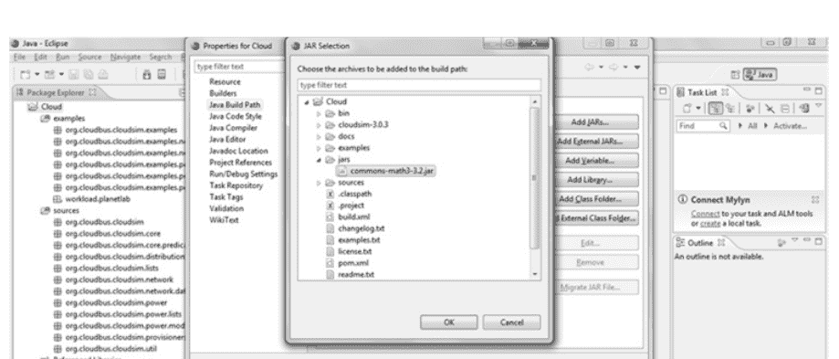

jar 包已成功添加到构建路径中。现在对带有样例示例的云项目进行执行和测试。

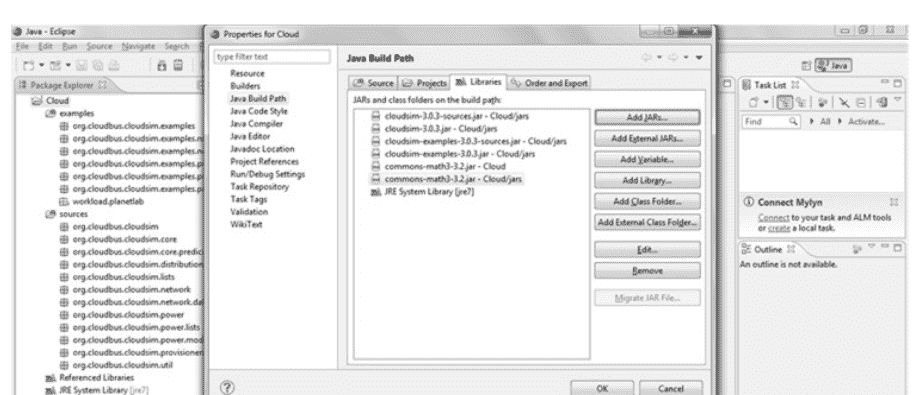

#### `CloudSim` 如何工作？

数据中心（`Datacenter`）由一组主机（`hosts`）组成。主机可以实例化虚拟机（`VM`）调度器。虚拟机调度器将处理器分配给各个虚拟机。云节点（`Cloudlets`）是在虚拟机中执行的任务。我们可以在虚拟机中添加尽可能多的云节点。

以下是在 `CloudSim` 中模拟云的逐步执行步骤：

1. 使用 `init()` 方法初始化 `CloudSim` 软件包。`init()` 方法用于初始化 `CloudSim` 库。
2. 使用 `createDatacenter()` 方法创建数据中心。当要执行任何云时，这是一个关键步骤；我们需要创建一个数据中心。
3. 使用 `createBroker()` 方法创建代理（`Broker`）。代理是消费者和提供者之间的接口。
4. 创建虚拟机并将虚拟机添加到 `VM` 列表中。我们可以根据需要创建任意的虚拟机。
5. 通过设置 `id`、`length`、`filesize` 等属性创建云节点。将创建的云节点添加到云节点列表中。
6. 将云节点提交给代理。
7. 启动模拟
8. 停止模拟
9. 显示输出

#### 在 `CloudSim` 中运行样例示例

让我们看看如何执行位于 `org.cloudbus.cloudsim.examples` 包下文件夹中的 `CloudSimExample1`。`CloudSimExample1.java` 是一个关于如何创建一个带有一个主机及其上方云节点的云的简单示例。

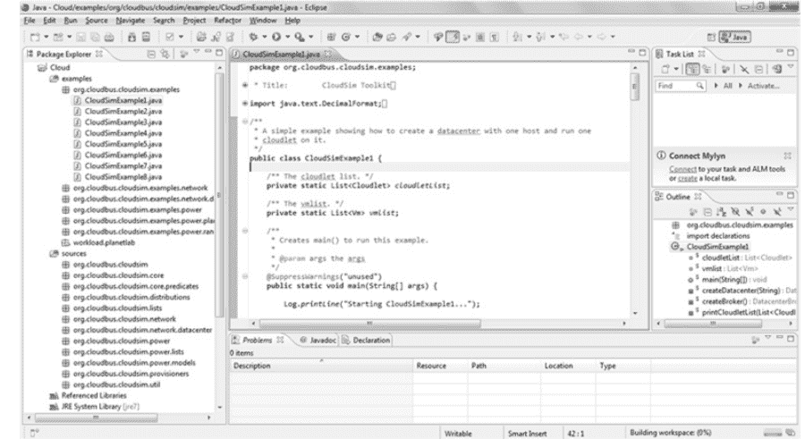

点击“文件 -> 运行方式 -> Java 程序”来运行 `CloudSimExample1.java`。

### 356 云计算

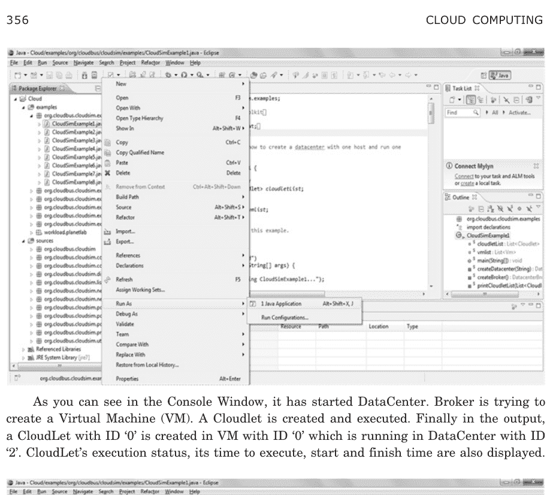

如你在控制台窗口中所示，代理正尝试创建一个虚拟机（`VM`）。一个云节点被创建并执行。最后在输出中，在 `ID` 为 `'0'` 的虚拟机中创建了一个 `ID` 为 `'0'` 的云节点，该虚拟机运行在 `ID` 为 `'2'` 的数据中心。云节点的执行状态、待执行状态、开始时间和完成时间也显示了出来。

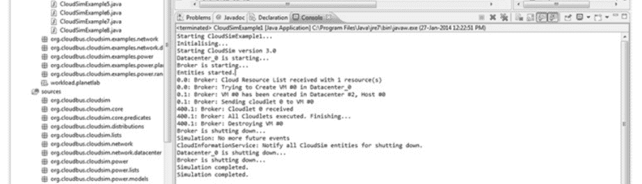

#### 案例研究

同样地，我们可以执行 `org.cloudbus.cloudsim.examples` 包中剩余的 7 个示例。该包包含了包含基础云模拟功能的基本 `Java` 类。

在 `cloudsim` 示例包的第二个示例中，它帮助创建一个带有一个主机的数据中心。该主机包含两个虚拟机，每个虚拟机执行两个云节点。

在第三种场景中，创建了一个具有两个主机的数据中心。`2` 个主机包含 `2` 个虚拟机（每个主机一个），用于运行 `2` 个云节点（每个虚拟机一个）。

在第四个示例中，它帮助你创建多个数据中心，每个数据中心有一个主机、一个虚拟机和一个云节点。

第 5 个示例与第四个相似，但区别在于创建了两个客户，他们尝试在不同的数据中心各执行 `2` 个云节点。这里每个数据中心与上一个示例一样有一个主机和一个虚拟机。

第 6 个示例有助于创建虚拟机列表并运行云节点列表。

在第 7 个示例中，展示了如何暂停和恢复模拟，并动态创建数据中心代理等实体。

第 8 个示例展示了如何使用全局管理器（`GlobalBroker`）在运行时创建模拟实体 `DatacenterBroker`。

#### 时间分片与空间共享调度器

时间分片（Time shared）策略有助于在许多用户之间共享计算资源。这有助于多编程。空间共享（Space shared）策略将资源分配给许多任务，使得任何任务的执行都不会影响其他任务的执行。使用这些调度策略可能存在四种情况：

1. 云节点和虚拟机均采用空间共享。
2. 云节点和虚拟机均采用时间分片。
3. 云节点采用空间共享，虚拟机采用时间分片。
4. 云节点采用时间分片，虚拟机采用空间共享。

#### 使用空间共享策略处理云节点和虚拟机的 3 个云节点简单示例


# 云计算

## 在 CloudSim 中运行样例示例

让我们看看如何执行位于 `org.cloudbus.cloudsim.examples` 包文件夹下的 `CloudExample1`。`CloudExample1.java` 是一个如何创建一个带有一个主机及其上方云节点的云的简单示例。

## 使用空间共享策略处理云节点和虚拟机的 3 个云节点简单示例

（373-375 页的剩余代码由碎片组成。以下是 `main` 方法开始部分的重建：）

```java
public class ThreeCloudletsDC {

    public static void main(String[] args) {
        System.out.println("StartingCloudletsDC...");
        // 1. 使用 init() 方法初始化 CloudSim。
        CloudSim.init();

        // 2. 使用 createDatenter() 方法创建数据中心。
        // （由于 OCR 中是碎片化的，省略了实现细节）
        Datacenter datacenter = createDatenter();

        // 3. 使用 createBroker() 方法创建代理。
        DatacenterBroker broker = createBroker();
        // ... 等
```

## 案例研究

### 创建数据中心

```java
/**
 * 创建数据中心。
 *
 * @param name  own
 *
 * @return 数据中心
 */
private static Datacenter createDatacenter(String name) {
```

### 创建 PowerDatacenter 步骤

```java
// 以下是创建 PowerDatacer 需要的步骤：
// 1. 我们需要创建一个列表来存储
// 我们的机器
List<Host> hostList = new ArrayList<Host>();
```

```java
// 2. 一个 Machine（机器）包含一个或多个 PE 或 CPU/核心。
// 在此示例中，它将只有一个核心。
List<Pe> peList = new ArrayList<Pe>();
int mips = 1000;
```

```java
// 3. 创建 PE 并将它们添加到列表中。
peList.add(new Pe(0, new ProvisionerSimple(mips))); // 需要存储
// Pe id 和 MIPRating
```

```java
// 4. 创建带有其 id 和 PE 列表的 Host（主机）并将它们添加到列表中
// hostId = 0;
int ram = 2048; // 主机内存 (MB)
long storage = 1000000; // 主机存储
int bw = 10000;
```

```java
hostList.add(
    new Host(
        hostId,
        new RamProvisionerSimple(ram),
        new BwProvisionerSimple(bw),
        storage,
        peList,
        new VmSchedulerSpaceShared(peList)
    ); // 这是我们的机器
```

```java
// 5. 创建一个 DatacenterCharacteristics 对象，用于存储
// 数据中心的属性：架构、操作系统、机器列表、
// 分配策略：时间共享或空间共享、时区
// 及其它的价格（G$/Pe 时间单位）。
String arch = "x86"; // 系统架构
String os = "Linux"; // 操作系统
String vmm = "Xen";
double timeZone = 10.0; // 该资源所在的时区
double cost = 3.0; // 在此资源上处理的成本
double costPerMem = 0.05; // 在此资源上使用内存的成本
double costPerBw = 0.0; // 在此资源上使用带宽的成本
// 资源
double costPerStorage = 0.01; // 在存储中 //存储的成本
LinkedList<Storage> storageList = new LinkedList<Storage>();
```

```java
DatacenterCharacteristics characteristics = new DatacenterCharacteristics(
arch, os, hostList, time_zone, cost, costPerMem,
costPerStorage, costPerBw);
```

```java
// 6. 最后，我们需要创建一个 PowerDatacenter 对象。
Datacenter datacenter = null;
try {
    datacenter = new Datacenter(name, characteristics, new
    VmAllocationPolicySimple(hostList, storageList, 0);
} catch (Exception e) {
    e.printStackTrace();
}

return datacenter;
```

### 创建 Broker

```java
/**
 * 创建 broker（代理）。
 *
 * @return 数据中心代理
 */
private static DatacenterBroker createBroker() {
    DatacenterBroker broker = null;
try {
    broker = new DatacenterBroker("Broker");
} catch (Exception e) {
    e.printStackTrace();
    return null;
}
return broker;
```


```java
/**
 * 打印 `Cloudlet` 对象。
 * @param list `Cloudlet` 列表
 */
private static void printCloudletList(List<Cloudlet> list) {
    int size = list.size();
    Cloudlet cloudlet;

    String indent = "";
    Log.println();
    Log.println("========== OUTPUT ==========");
    Log.println("Cloudlet ID" + indent + "STATUS" + indent +
        + "Data center ID" + indent + "VM ID" + indent + "Time" +
    indent
        + "Start Time" + indent + "Finish Time");

    DecimalFormat dt = new DecimalFormat("###.###");
    for (int i = 0; i < size; i++) {
        cloudlet = list.get(i);
        Log.print(indent + cloudlet.getCloudletId() + indent + indent);

        if (cloudlet.getCloudletStatus() == Cloudlet.SUCCESS) {
            Log.println("SUCCESS");
            Log.println(indent + indent + cloudlet.getResourceId()
                + indent + indent + indent +
                cloudlet.getVmId()
                + indent + indent
                + dt.format(cloudlet.getCPUTime())
                + indent
                + dt.format(cloudlet.getExecStartTime())
                + indent + indent +
                + dt.format(cloudlet.getFinishTime()));
        }
    }
}
```

# 屏幕截图

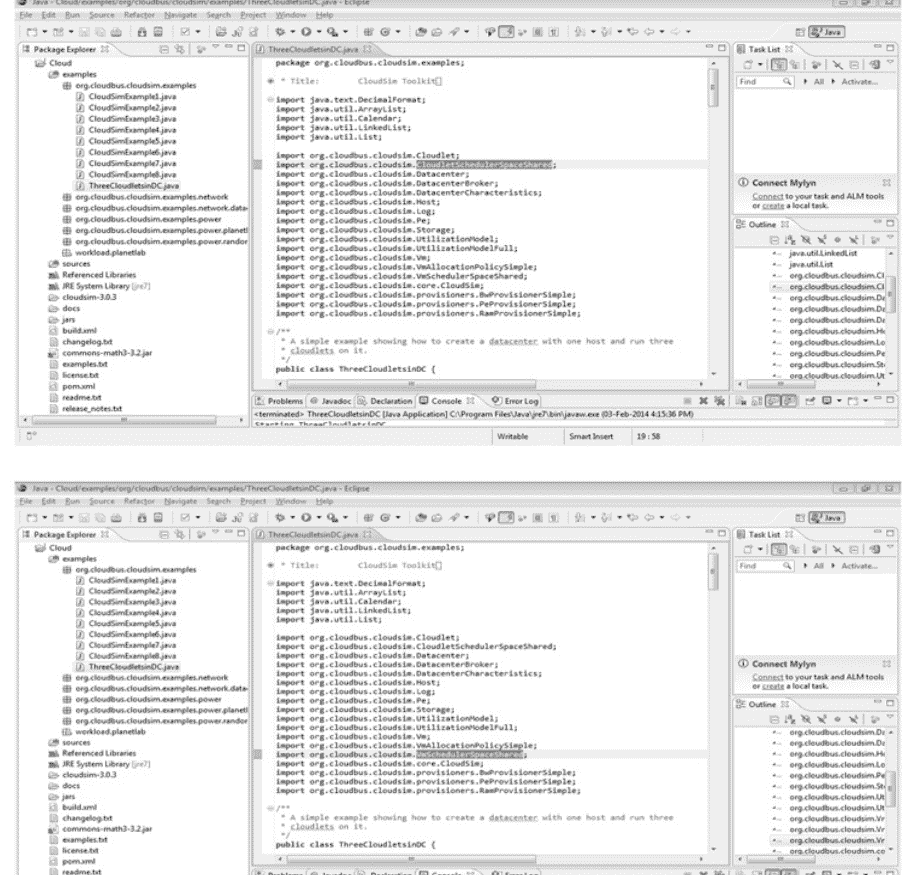

# 案例研究

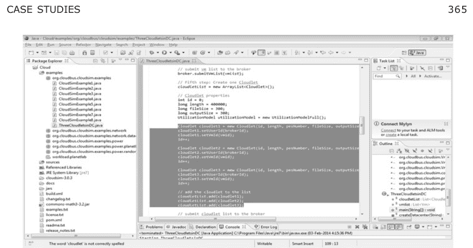

## 输出

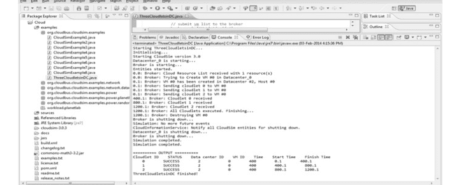

从输出中可以看到，它创建了 `id` 为 0, 1, 2 的 3 个 `cloudlet`，它们在 `VM ID` 0 上执行。时间均为 400。由于这是空间共享策略，每个 `cloudlet` 都分配了资源。许多研究可以通过 `CloudSim` 模拟任务调度、VM 调度和负载均衡。能量感知技术可以模拟计算。不同的拓扑模型可以用于模拟大规模云基础设施。此外，`CloudSim` 有助于在部署到真实云之前调整性能问题。

## 14.3 案例：使用 APP ENGINE ANDROID

在本研究中，我们将查看创建 `App Engine` 的步骤。在 `https://cloud.google.com/console` 创建项目。关于控制台的更多信息，请参考第 11 章。

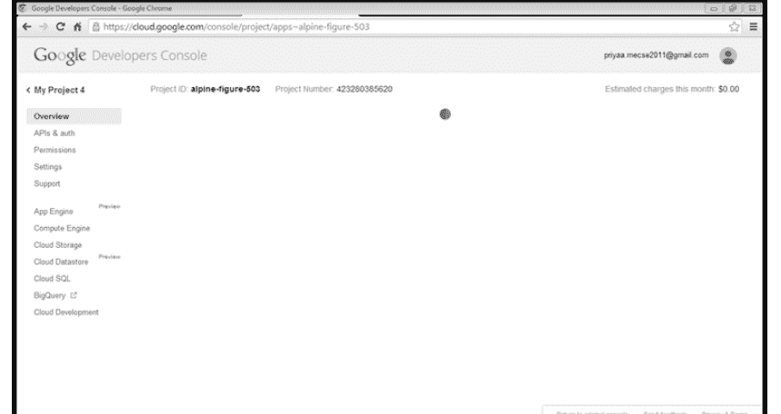

前往 `APIs`，为 Android 开启 `Google Cloud Messaging`。

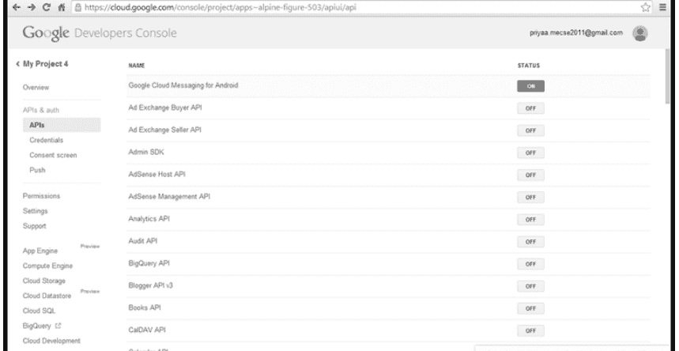

创建一个 `server key`。关于创建 `server key` 的更多细节，请参考第 12 章。

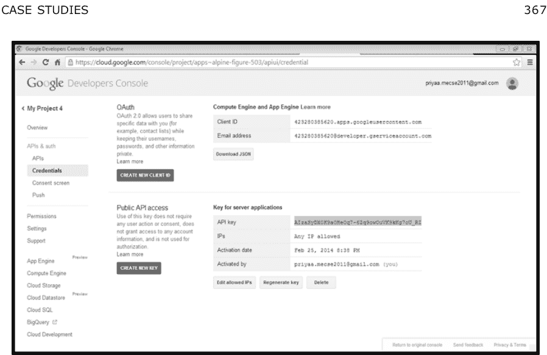

部署你的后端。需要时可以重新部署。部署成功后，你可以看到快。在 `Settings` 中，点击 `Authentication / Authorization` 下的“Development only”单选按钮。最初将锁定（禁用）。


按所示启用 `Google Cloud Messaging`。提供之前在 `Google Cloud Messaging API` 字段中获取的 `Server key`。最后保存设置。


创建 `AppEngine Android` 项目需要安装 `Google Play Services` 和 `Google API`。关于安装这两个，请参考第 12 章。此外，你需要点击 `Help -> Install New Software` 配置你的 SDK。会出现像下方所示的对话框。在下方指定的 `Work` 字段中使用 `http://dl.google.com/eclipse/plugin/4.2`。点击 `next` 并同意 Google 的条款。


现在准备好创建 `AppEngine Connected Android` 项目。在 `Eclipse package explorer` 中右键点击 `New -> Other` 创建 `AppEngine Android` 项目。


创建 `AppEngine Connected Android` 项目，点击 `Google` 下的 `AppEngine Connected Android Project`。点击 `next`。


提供一个项目名称和你自定义的包名。现在是使用我们之前从 `Google Console` 创建的 `API key` 和项目号了。


现在自动创建了 Android 项目和其 `AppEngine`，如下。


在 Android 项目中自动生成的 `EndpointUtils.java` 类中，将 `LOCAL_ANDROID_run` 改为 `true`。


右键点击 `Android Project->Google->Generate Endpoint Library`。


生成客户端库。


通过 `Google -> Deploy to App Engine` 将 `AppEngine` 项目部署到 `App Engine` 上。


`AppEngine` 项目已成功部署。记得从 `Eclipse` 登录 Google 账号。


右键点击 `AppEngine Project->run as Web Application`。


现在本地 `AppServer` 正在运行。


运行项目：点击 `Run As -> Android Application`。


创建一个目标为 `Google API` 的模拟器。在目标设置为 `Google API` 的模拟器上运行 Android 应用。


输出：

点击 `Register`（注册）将设备注册到云端。


对话框显示设备已通过 `GCM` 注册。


访问 `localhost:8888/index.html` 查看已注册设备的注册 `ID`（`Registration Id`）。你也可以发送消息。


注意，出现一个警告对话框通知已注册设备关于 Google 云消息（`Google Cloud Messaging`）。请使用你的 `gmail` 账户（创建项目的账号）登录以接收 `GCM` 消息。


消息正在带有服务器端点显示。


访问本地服务器 URL `http://localhost:8888_/ah/admin/datastore?kind=MessageData` 查找注册到设备的 `GCM` 消息。


访问 URL `http://localhost:8888_/ah/admin/datastore?kind=DeviceInfo` 查找已注册的设备信息。


点击 `Unregister`（注销）从 `GCM` 中注销。


以下是显示注销 `GCM` 成功对话框的截图。


根据需要，可以对 `Eclipse` 中的 Android 应用进行修改并在 `Google Console` 中重新部署修改后的应用程序。

## 14.4 案例 4：在 Eclipse 中与 VMware Cloud Foundry 集成工作

在这一案例研究中，让我们通过 `VMware` 产品 `cloud foundry` 集成详细查看平台即服务 (`PaaS`) 概念。

`VMware cloud foundry` 为用户提供了在远程 `VMware` 云中设计和托管应用程序的平台。用户必须拥有一个账户才能开始使用，它是免费的，就像所有其他 `VMware` 产品一样是收费的。我们可以在 `Eclipse` 或 `Spring tool suite` 中安装此工具。在本例中使用 `Eclipse`。

`Cloud Foundry Eclipse` 是一个扩展程序，允许 `Cloud Foundry` 用户从 `Eclipse` 或 `Spring Tools Suite` (`STS`) 在 `Cloud Foundry` 实例上部署和管理 Java 和 Spring 应用程序。该插件支持 `Eclipse` v3.8 和 v4.3（推荐使用 Java EE 版本），以及 `STS` 3.0 及更高版本。

我们将通过各种输出图像来解释 `VMware cloud foundry` 的 `PaaS` 概念。


第一步从 `Eclipse` 市场下载 `VMware` 插件。然后从新服务器向导创建新的 `VMware cloud foundry` 服务器。


它提示输入用户账户凭据，验证账户并完成服务器配置。


在组织（`organization`）和空间（`space`）下选择开发选项，以便设计和托管应用。


新的 `cloud foundry` 服务器已就绪并启动。创建一个新的动态 Web 项目，以便在云中设计和托管合适的应用程序。


新项目已创建并在项目资源管理器（`project explorer`）中可见。


在项目下创建所需的应用程序。双击 `VMware cloud foundry` 服务器并查看所有详情。


我们现在可以将应用程序发布到云端。只需将应用程序移动到 `cloud foundry` 服务器中。它会提升名称。


指定将应用程序托管到云端所需的 URL 和内存。


用户设计的应用程序已部署到云端。我们可以在控制台中中看到关于所有活动的信息。


最后，应用程序部署到云端并开始在服务器上运行。


点击应用程序以查看所有活动，在控制台中查看。


一旦我们选择了数量，就可以启动。我们也可以进行一些更改并更新重启 `cloud foundry`。


当我们重启服务器时，我们可以看到控制台。我们也可以看到云端的前端后端。


我们也可以可以为部署到云端的应用程序添加一些服务。


这是在 `Eclipse` 中创建的第一个页面并托管在 `cloud foundry` 服务器中。通过应用程序的映射 URL 我们可以看到 `PaaS` 概念是如何工作的。

## 14.5 案例 5：使用 Google App Engine 工作并托管应用程序

在这一案例研究中，我们将通过 Google 产品查看另一个 `PaaS` 概念。我们已经在第 7 章中见过的 Google 云产品。

`Google App Engine` 属于平台即服务 (`PaaS`) 概念，它提供了设计并将应用程序托管到 Google 云的平台。在本案例研究中，我们使用 `Eclipse` 软件与 `Google App Engine` 工作。

我们将通过输出图像来解释这一过程。


使用 `Eclipse` 软件时，我们从 `Eclipse` 市场下载 Google 插件。下载并安装所需的包到 `Eclipse` 中需要时间。


安装完成后，创建了一个带有 G 符号的新图标，包含了所有 Google 的功能。


选择创建新的应用程序项目以在云中设计和托管。选择创建新的应用程序项目。完成创建新应用程序项目。


我们可以在资源管理器中看到新项目并用它来设计应用程序。


当用户完成所需应用程序的代码后，将其部署到云端。要部署应用程序，点击“`deploy to app engine`”选项。

# 参考文献


## 参考文献

- 18. 云计算：尼槃是否隐藏在云雾之后？Erdogmus, Hakan, Software, IEEE 第26卷, 第2期, 2009年3月-4月, 页码: 4 – 6
- 19. 源自航母舰的多租户云计算线路，Kaliski, B., 可信基础设施技术会议, 2008. APTC '08. 第三次亚太会议，2008年10月14-17日, 页码: 4 – 4
- 20. 云端网络语义，Mika, P.; Tummarelo, G.; Intelligent Systems, IEEE 第23卷, 第5期, 2008年9月-10月, 页码: 82 – 87
- 21. 云计算的理由，Grossman, R.L.; IT Professional 第11卷, 第2期, 2009年3月-4月, 页码: 23 – 27
- 22. 云计算与IT即服务：机遇与挑战，Lin, G.; Dasmalchi, G.; Zhu; Web Services, 2008. ICWS '08. IEEE国际会议，2008年9月23-26日
- 23. 云计算：新酒还是新瓶？Voas, Jeffrey; Zhang, Jia; IT Professional 第11卷, 第2期, 2009年3月-4月, 页码: 15 – 17
- 24. 信息网络能为云计算做什么，Ohman, B.; Eriksson, A.; Rembar, R.; 关键技术：协作企业的基础设施，2009. WETICE .'98. 第18次IEEE国际研讨会，2009年6月29日-7月1日
- 25. CCO：云计算开放架构，Zhang, Liang-Jeie; Zhou, Cun; Web Services, 2009. ICWS 2009. IEEE国际会议，2009年7月6-10日, 页码: 607 – 616
- 26. Lasica, J.D.; 云计算时代的身份；Pearson出版公司。
- 27. `www.sun.com/cloud`
- 28. `云计算指导原则.pdf`，由业务安全联盟编写
- 29. 云计算的未来：2010年以后欧洲云计算的机遇，Keith Jeffrey和Neidecker Lutz 著
- 30. 云计算安全，Ngotong Guy Mollet，赫尔辛基梅特波利亚应用科学大学
- 31. 使用虚拟机进行云计算的动态资源分配，`EnvironmentZhenXiao`, IEEE高级成员, `Wejia Song`和`Qi Chen`
- 32. 云计算中基于优先级的动态分配，`Chandrashekhar S. Pawar`和`Rajnikant B. Wag`
- 33. 思科云战略的经济效益，ACG研究报告
- 34. `Eucalyptus`、`OpenNebula`和`Nimbus`的比较与批判，`Peter Sempololinski`和`Douglas Thain`，圣母院大学
- 35. 实时虚拟机迁移的实证利用，`John Overbeide`, `Vern Cooke`, `Farnam Jahanian`，密歇根大学
- 36. `瘦客户端.pdf`，来自 `www.citrix.com`

### 云计算

- 37. 企业显示出采用业务即服务 (`BaaS`) 作为模块化组件的迹象.pdf，由`equa terra`编写
- 38. 全球开放大学云计算实操实验室手册 - 眼云云计算操作系统分步安装指南，`Kefa Rabah`，`Global Versity`
- 39. `入门.pdf`，来自 `ubuntu live cloud`
- 40. 执法领域的云计算指导原则，由国际警察局长协会
- 41. 云计算是如何运作的，`Jonathan Strickland` 著
- 42. `Bogatin, Donna`. “谷歌CEO的新范式：‘云计算与广告并不谋’。”`ZNet`. 2008年3月11日. `http://blogs.zdnet.com/micro-markets/?p=369`
- 43. `Brodkin, Jon`. “`IBM`使用‘云计算’。”`Network World`. 2007年11月19日. 第24卷, 第45期. 第10页。
- 44. `Carr, Nicholas`. “全球计算触手可及。”今日美国. 2008年2月25日。
- 45. `Hicks, Michael`. “云计算落地了。”`eWeek`. 2008年1月21日. 第14页。
- 46. “`IBM`推出即插即用的云计算。”`IBM`. 2007年11月15日. `http://www-03.ibm.com/press/us/en/pressrelease/22613_all`
- 47. `Lohre, Steve`. “云计算与`EMC`的交易。”纽约时报. 2008年2月25日. C版第6页。
- 48. `Lohre, Steve`. “`谷歌`与`IBM`进行‘云计算研究’。”纽约时报. 2008年10月8日. C版第8页。
- 49. `Lohre, Steve`. “`IBM`将利用远端数据推动‘云计算’。”纽约时报. 2007年11月15日. C版第7页。
- 50. `McAllister, Neil`. “服务器虚拟化。”`InfoWorld`. 2008年2月12日. `http://www.infoworld.com/article/07/12/virtuals`
- 51. `Markoff, John`. “互联网批评者并非高科技领域的大人物。”纽约时报. 2001年4月9日. C版第6页。
- 52. `Markoff, John`. “通过互联网：`微软`。”纽约时报. 2007年9月3日. C版第1页。
- 53. “中间件。”卡内基梅隆大学软件工程研究所. 2004年3月12日. `http://www.sei.cmu.edu/str/middleware`
- 54. `Naone, Erica`. “云端的计算机。”`Technology Review`. 2008年9月18日. `http://www.technologyreview.com/Infotech/1937/`
- 55. “报告显示IT交付变革。”`IT Week`. 伦敦. 2007年11月5日。

### 参考文献

- 56. `Swanson, Bret` and `Gilder, George`. “释放流量。”华尔街日报. 2008年2月22日. A版第15页。
- 57. `Carl Mazzanti`, CEO. 云计算是如何运作的？`Technologies`
- 58. `Prof. Dr. Martin Schneider`. 混合云：云工具包对比研讨会论文，曼海姆大学
- 59. `Yazid Mohd Saman` and `Jabatan Sains`. 云计算：基础设施即服务
- 60. `Dan’Riordan`, France, `IBM`. 开发者通过云雾呈现云计算，`IBM`全球技术服务 领导力报告
- 61. `IBM`市场洞察. 云计算, 2009年7月
- 62. 技术趋势调查. 2010年10月. `www-03.ibm.com/press/us/en/release/3267.html`
- 63. `Open Group` `SOA` Research. `http://www.openg.org/soa/drafts/refch.html`
- 64. `Peter Mell` and `Tim Grace`, `NIST`云计算定义, 版本15, 2009年10月7日. `http://www.nist.gov/it/cloud/cloud-def-v1`
- 65. 使用`Eclipse`虚拟机安装`CloudSim`
- 66. `Mayank Mishra` and `Sujesha Sudelayam`. 云计算与虚拟化导论，孟理工学院
- 67. `Jiang Wang`, `Sameer Niphadkar`, `Angelos Stavrou` and `Anuk K. Ghosh`. 深度内核隔离虚拟化架构，安全信息系统，乔治梅森大学，弗吉尼亚州法法顿22030
- 68. `Harald Wilde`. `Linux`内核`SMP`问题，锁原语
- 69. `Alexander Kozlov`. 管理一个“动物园”：管理和监控分布式系统的工具，云
- 70. `Jan Kisz`, `Siemens AG`. 基于内核的虚拟机 (`KVM`)架构，西门子股份，`IT`企业中心，嵌入式`Linux`
- 71. `Majid F. Sakr`. 云计算入门
- 72. `http://code.google.com/edu/parallel/dsd-tutorial.html`
- 73. `http://www.ida.liu.se/~TDD25/lecture-notes/lect1.pdf`
- 74. `http://www.cs.rutgers.edu/~pxk/rutgers/notes/content/01-intro.pdf`
- 75. `http://www.computing.dcu.ie/~kpodasta/distributed/`
- 76. `http://www.cs.uregina.ca/~hamilton/courses/430/notes/notes1.htm`
- 77. `http://www.cs.vu.nl/~steen/courses/ds-slides/01.pdf`

### 云计算

- 78. `http://en.wikipedia.org/wiki/Middleware/Types_of-middleware`
- 79. `Amanda McPherson` 著. `Linux`：云的操作系统
- 80. `Jon Oberheide`. 利用实时虚拟机迁移，密歇根大学
- 81. 迁移到云的选项与机遇：理解软件服务、平台服务和基础设施服务
- 82. 开放云宣言：全球云计算社区的行动号召来自 `www.opencloudmanifesto.org`。
- 83. `Constantino Vázquez y BlancoBorja Sotomayor`. `OpenNebula`教程，`DSAResearch.org`/分布式系统架构研究小组，马德里大学
- 84. `B. Rochberger`, `J. Caceres`, `R.S. Montero`, `D. Breitand`, `E. Elmroth`, `A. Galis`, `E. Levy`, `I.M. Lorente`, `K. Nagin`, `Y. Wolf`. “用于开放联邦云计算的`RESERVOIR`模型与架构，”`IBM Systems Journal`, 第53卷, 第4期 (2009)
- 85. `B. Sotomayor`, `R. S. Montero`, `I. M. Lorente` and `I. Foster`. “私有和混合云中的虚拟基础设施管理，”`IEEE Internet Computing`, 2009年9月/10月（第13期第5）
- 86. `Openstack安装指南.pdf`
- 87. `http://www-sub-calculator.com/subnet.php?net-class=C`
- 88. `http://ukysadmin.wordpress.com/2012/03/28/screencast-video-of-an-install-of-openstack-on-ubuntu-12-04-virtualbox`
- 89. `http://www.talkalm.com/alm/blog/implementing-openstack-ubuntu-1204-virtualbox`
- 90. `http://damithkumarage.wordpress.com/2012/06/26/openstack-essex-cloud-setup/`
- 91. 在`ubuntu`中设置私有云

### 参考文献

- 102. `Foster, I.` and `Kesselman, C.`. “网格：新型计算基础设施的蓝图，” `Morgan Kaufmann Publishers Inc.`, `San Francisco, CA`, 1998
- 103. `http://www.globus.org/alliance/publications/papers/chapter2.pdf`
- 104. `Tanenbaum, A. S.` and `van Steen, M.`. “分布式系统：原理与范式”
- 105. `Anderson, R.`. “安全工程：构建可靠分布式系统指南，” 第 6 章
- 106. `Buyya` 等人. “面向市场的云计算计算：作为计算公用事业交付 `IT` 服务的展望、热点与现实，”
- 107. `http://www.gridbus.org/papers/hpcc2008_keynote_cloudcomputing.pdf`
- 108. `http://samj.net/2008-taxonomy-6-layer-cloud-computing.html`
- 109. `http://gridguy.net/tp-p10`
- 110. `Tutschko, K.` 等. “新兴互联网的网络与服务运营趋势，”`Int J Electron Commission (AEU)` (2007)
- 111. `Delic, K. A.` and `Walker, M. A.`. “学术云计算的兴起，”`Ubiquity` 9, 31 (2008年8月), 1-1.
- 112. `http://www.eu-eege.org/`
- 113. `http://www.opensciencegrid.org/`
- 114. `http://www.ndgf.org/`
- 115. `http://itu.int/ITU-R/conferences/rrc/rrc-06/`
- 116. `http://unosat.org/`
- 117. `ECW` 是一种为地理空间图像设计的增强型压缩小波格式。
- 118. `http://www.itu.int/emergencytelecom`
- 119. `http://setiathe.berkeley.edu/`
- 120. `http://folding.stanford.edu/`
- 121. `http://lhcathome.cern.ch/`
- 122. `http://boinc.berkeley.edu/`
- 124. `http://www.computerweekly.com/Articles/2006/09/26/218593/how-grid-power-pays-off-for-hsbc.htm`
- 125. `http://www.fsg-ship.edu/`
- 126. `http://www.gridipedia.edu/grid-computing-case-studies.html`
- 127. `http://gigaom.com/2008/02/28/how-cloud-utility-computing-are-different/`
- 128. `http://www.akamai.com/`
- 128. `http://www.limelightnetworks.com`
- 129. `Jaeger` 等人. "云计算与信息政策：政策云中的计算？”
- 130. `infoDev` 快速指南：面向发展中国地区的低成本计算设备和倡议，`http://infodeev.org/en/Publication.107.html`
- 131. 参见联合国贸易发展会议（`UNCTAD`）信息经济报告 2007-2008，`http://www.unctad.org/Templates/webflyer.asp?doc=9479&itemID=1397&lang=1&mode=highlights`，以及 `ITU` 世界电信/`ICT` 指标 2008（第 12 版），`http://www.itu.int/ITU-D/publications/world/world.html`
- 132. `http://www.eweck.com/a/Messaging-and-Collaboration/SAAS-From-Google-Microsoft-Proves-Cost-Effective-For-Up-to-15K-Seats/1/`
- 133. `http://www.3tera.com/`
- 134. `http://flexiscale.com/`
- 135. `http://www.mor.ph/`
- 136. `http://www.richtscale.com/`
- 137. `http://blog.jamesuresarch.com/2008/11/quick-guide-to-big-four-cloud-offerings.html`
- 138. `http://aws.amazon.com/what-is-aws/`
- 139. `http://code.google.com/intl/en/appengine/docs/whatgoogleapp.html`
- 140. `http://www.salesforce.com/`
- 141. `http://www.microsoft.com/azure/`
- 142. `Delaney` "Google 计划存储用户数据的服务，”`华尔街日报` `Gartner_Server_cloudcomputing_security_risks_1.html`
- 143. `http://www.infoworld.com/article/08/07/02`
- 144. `Greenberg` (`Forbes.com`) “桥接云，”`http://www.forbes.com/technology/2008/06/29/cloud-computing-3-tera-tech-cio-ag_06300tera.html`
- 145. `http://samj.net/2008/08/cloud-standards-not-so-fast.`
- 146. `http://www.ofoir.com/public/liaisons. Cloud Software Program tivit`
- 147. Understanding `Thin-Client/Server` `Joel Kanter`
- 148. Deploying `Ubuntu` `Cloud` Training Overview 来自 `ubuntu`
- 149. `Ubuntu` `Server` 来自 `ubuntu`
- 150. `Ubuntu` `11.04 server` 来自 `ubuntu`


# 参考文献

151. `http://www.opendacenteral.org/`
152. `http://www.capgemini.com/ctoblog/2011/01/the_new_data_centre_is_not_you/`
153. `http://www.capgemini.com/ctoblog/2011/02/generation-data-centre-`
154. `http://www.intel.com/itcenter/products/xe/7500/index`
155. `http://www.intel.com/itcenter/products/xeon/5600/index`
156. `http://www.intel.com/sites/datacentager/faqs`
157. `http://sites.amd.com/us/promo/server/Opteron-6000-series-new-models.aspx?lid=New_Models_of_Opteron`
158. `http://www.cio.com/article/63857/Virtualization_Meets_Organizational_Limit`
159. `http://wiki.xenource.com/xenwiki/HVM_Compatible_Processors` of `VT-x` and `AMD-V`
160. `http://southbrain.com/virtualization/3-xen-hypervisor-based.html` (opening slide)
161. `http://elite-itsolutions.com/images/diag-arch.png`
162. `http://en.wikipedia.org/wiki/ci`
163. `http://openecal.com/wiki/Eucalyptus_v2.0`
164. `http://www.canonical.com/sites/default/archive/Whitepaper-UbuntuArchitecture-v1`
165. `http://help.ubuntu.com/community/PackageInstall`
166. `http://software.intel.com/file/31966`
167. `Virtualization and Cloud Computing: Optimized Power, Cooling, and Management` Suzanne Niles and Donovan
168. `Application for Cloud Computing` `rpath`
169. `ZSL` 的创新服务与解决方案 `Ubuntu` `Platforms`
170. `http://www.huffington.com/bentsky/the-future-of-cloud-hosting_1_4622.html`
171. `http://www.cloudreviews.com/`
172. `http://www.cloudreviews.com/cat/hosting-services`
173. `http://www.cloud-loung.org/EN/how-do-work.html`
174. `http://www.cloudbook.net/research/cloud-computing.php`
175. `http://cdac.in/`
176. `http://apprend.com/`
177. `http://www.univ.com/it-solutions/blog/39318/Basic-Principles-of-Computing`
178. `http://www.webopedia.com/`
179. `http://www.techmedia.com/2/29691/trends/cloud-computing/5-things-to-consider-choosing-a-cloud-drive`
180. `http://www.businessnewsdaily.com/4553-cloud-based-tools-small-business.html`
181. `http://www.networkworld.com/supp/2013/enterprise3/060313-ecs3-private-cloud-failures-269845.html`
182. `http://gigaom.com/2009/11/06/10-open-source-resources-for-cloud-computing/`
183. `http://www.businessnewsdaily.com/4864-cloud-computing-terms.html`
184. `http://ss64.com/bash/`
185. `http://mally.stanford.edu/~sr/computing/basic-unix.html`
186. `http://oceanofweeb.com/architecture-of-linux-operating-system/`
187. `http://www.cloudpro.co.uk/private-cloud/3359/arriva-opts-for-private-cloud-to-deal-with-increasing-demands-on-ticketing`
188. `http://www.gartner.com/doc/259816/building-government-cloud-lessons-singapore`
189. `http://blog.softlayer.com/author/jklink/`
190. `http://www.techrepublic.com/blog/the-enterprise-cloud/cloud-app-vs-web-app-understanding-the-differences/`
191. `http://www.businessnewsdaily.com/4427-cloud-small-business`
192. `http://en.wikipedia.org/Main_Page`
193. `http://www.techeradar.com/news/cloud-explained-110568`
194. `http://www.colt.net/uk/en/index`
195. `http://cloudoutimes.org/`
196. `http://gevapery.typepad.com/main/2008/08/new-cloud.html`
197. `http://www.cloudbook.net/directories/product-services/cloud-directory`
198. `http://www.cloudvider.com/`
199. `http://venturebeat.com/2013/11/28/evolution-of-the-modern-cloud-the-clouds-value-position-is-changing/`
200. `http://howtouubuntu.org/how-to-execute-a-run-or-bin-file-in-ubuntu`
201. `http://www.hongkiat.com/cloud/hosting-how-does-it-work/`
202. `http://www.computerweekly.com/Cloud-storage-basics-The-Facts-about-cloud-storage`
203. `http://www.itnewsafrica.com/2011/04/cloud-vs-hosted-services`
204. `http://www.computerweekly.com/news/15101117/Community-cloud-computing-bends-and-drawbacks`
205. `http://socializedsoftware.com/2010/01/20/eleven-open-source-cloud-computing-projects-to-watch/`
206. `http://www.linuxjournal.com/content/effects-cloud-computing-open-source-compliance`
207. `http://www.itdonut.co.uk/`

210. `http://www.serverwatch.com/tutorials/article.php/3858961/Grow-Your-Own-Cloud-Servers-With-Ubuntu.htm`
211. `http://xmodulo.com/2013/10/interesting-facts-ubuntu-linux.html`
212. `http://searchstorage.techtarget.com/NetAppSponsoredNews/Is-OpenStack-Grizzly-Ready-for-Deployment`
213. `http://www.info.org/kernel_mode.html`
214. `http://oss.org.uk/osdocs/linux/a1/index.html`
215. `http://oceanofweebs.com/architecture-of-linux-operating-system`
216. `https://help.ubuntu.com/community/KVM/Installation`
217. `http://www.techtopia.com/Xen_using_the_xm_Command-line_Tool`
218. `http://www.cloudpro.co.uk/`
219. `http://www.therepublic.com/blog/the-enterprise-cloud/mini-glossary-cloud-computing-terms-you-should-know/2308/`
220. `http://www.cliqr.com/`
221. `http://2.2x.com/whitepapers/private-cloud-computing/`
222. `www.thecloudtutorial.com`
223. `www.yoyoclouds.com`
224. `http://www.networkworld.com/supp/2013/enterprise3/060313-ecs3-stack-269899.html`
225. `http://www.clouds360.com/paas.php`
226. `http://howubuntu.org/things-to-do-after-installing-ubuntu-12-04-precise-pangolin`
227. `http://blogs.oracle.com/constant/entry/blog_migration`
228. `http://smallbusinessblog.infostreet.com/2011/04-top-10-list-cloud-computing-benefits-for-your-small-business/`
229. `http://www.upubuntu.com/2012/12-20-terminal-commands-and-tools.html`
230. `http://blog.sudobits.com/2012/07/20/top-17-terminal-commands-every-ubuntu-user-should-know-about/`
231. `http://www.cloudpro.com/paas/cloud-deployment/3653/red-hat-launches-enterprise-linux-openstack-40-platform`
232. `http://www.businessnewsdaily.com/4863-what-is-paas.html`
233. `http://www.businessnewsdaily.com/4793-what-is-iaas-software-as-a-service.html`
234. `http://www.businessnewsdaily.com/4862-what-is-iaas.html`
235. `http://erpcloudnews.com/2010/07/web-based-saas-and-cloud-erp-benefits/`
236. `e-learning using cloud computing.pdf` by `Utpayal` and `Majid` `Ahmed`
237. `Using cloud computing for e-learning systems` by `Paul` `Kataria`, `Marius` `Vretican`, `Bucharest`
238. `cloud computing in support with smart client` by `Perumal`, `Rajasekaran`, `Vijay`
239. `cloud computing and SOA convergence in your enterprise` by `David` `Lin`, `Armando` `Escalante`
240. `handbook of cloud computing` by `ITU-T` `watch` `report`
241. `Hadoop in action` by `Boris` `Furkan`
242. `cloud computing strategies` by `Dimitris` `Nargiot`
243. `The Cloud at Your Service` by `John` `Rosenberg` and `Arthur` `Mateos`
244. `Cloud General State of the Union` by `David` `Salt` and `Mohammad` `Antonopoulos`
245. `cloud computing principles and software services` by `Syed` `Ali` and `Nick` `Gill`
246. `www.Google.com`
247. `www.Wikipedia.org`
248. `www.Amazon.com`
249. `www.Microsoft.com`
250. `www.Apple.com`
251. `www.vmware.com`
252. `www.dropbox.com`
253. `www.Rackspace.com`
254. `www.salesforce.com`

# 索引

### A

- 埃森哲 (`Accenture`) 284
- 云计算的优势 113
- 亚马逊云 (`Amazon` `Cloud`) 119
- 亚马逊弹性 `MapReduce` (`Amazon` `Elastic` `Map` `Reduce`) 122
- 亚马逊弹性 `MapScale` (`Amazon` `Elastic` `Map` `Scale`) 123
- 亚马逊深度存储 (`Amazon` `Glacier`) 121
- 亚马逊关系数据库服务 (`Amazon` `Relational` `Database` `Services`) 122
- 亚马逊简单存储服务 (`Amazon` `Simple` `Storage` `Service`) 120
- 亚马逊虚拟私有云 (`Amazon` `Virtual` `Private` `Cloud`) 121
- `Android` 架构 230
- `Android` 操作系统 227
- `Android` `Runtime` (`Android` `Runtime`) 232
- `Android` 技术 226

### B

- 备份 `API` (`Backup` `API`) 234
- `Boss` 操作系统 (`Boss` `Operating` `System`) 171

### C

- 思科统一数据中心 (`Cisco` `Unified` `Data` `Center`) 289
- 客户端位置感知 (`Client` `Location` `Awareness`) 98

### D

- `Dalvik` 虚拟机 (`Dalvik` `Virtual` `Machine`) 233
- 数据中心整合 (`Data` `Center` `Consolidation`) 59
- 数据位置感知 (`Data` `Location` `Awareness`) 98
- 数据面 (`Data` `Plane`) 45
- 数据存储与处理能力 (`Data` `Storage` `and` `Processing` `Power`) 216
- 数据存储与计算 (`Data` `Storage` `and` `Computation`) 49
- 专用主机 (`Dedicated` `Hosting`) 87
- `Dell` `Boomi` 65
- `Devstack` 方法 (`Devstack` `Method`) 33
- 云计算的缺点 (`Disadvantages` `of` `Cloud` `Computing`) 115
- 灾难恢复 (`Disaster` `Recovery`) 94
- 分布式计算 (`Distributed` `Computing`) 7
- 分布式技术 (`Distributed` `Technology`) 34
- `Dropbox` 135
- 动态配置 (`Dynamic` `Provisioning`) 216
- 动态资源分配 (`Dynamic` `Resource` `Allocation`) 42

### E

- 云治理 (`E-Governance` `in` `Cloud`) 364
- 电子学习 (`E-learning`) 101
- 云中轮询 (`E-polling` `in` `Cloud`) 110
- 集成便利 (`Ease` `of` `Integration`) 217
- 经济问题 (`Economic` `Issue`) 50


### 边缘计算

- 边缘计算 (Edge Computing) 9
- 企业云计算 (Enterprise Cloud Computing) 266
- 企业云管理 (Enterprise Cloud Management) 271
- 企业云服务 (Enterprise Cloud Services) 269
- 云中资源计划 (Enterprise Resource Planning in Cloud) 112
- 企业软件开发 (Enterprise Software Development) 268
- 延长电池寿命 (Extending Battery Lifetime) 215

### F

- 灵活性 (Flexibility) 216
- 全虚拟化 (Full Virtualization) 29
- 云计算的未来 (Future of Cloud Computing) 292

### G

- `GCM` 实现步骤 (`GCM Implementation Procedures`) 252
- `GCM` 注册 (`GCM Registration`) 255
- Google App Engine (`Google App Engine`) 124
- Google Bigquery 126
- Google Cloud Datastore (`Google Cloud Datastore`) 126
- Google Cloud Drive (`Google Cloud Drive`) 124
- Google Cloud Messaging (`Google Cloud Messaging`) 239
- Google Cloud Print (`Google Cloud Print`) 126, 236
- Google Cloud SQL (`Google Cloud SQL`) 125
- Google Cloud Storage (`Google Cloud Storage`) 126
- Google Compute Engine (`Google Compute Engine`) 124
- Google Docs (`Google Docs`) 125
- Google Drive (`Google Drive`) 235
- 图形用户界面 (Graphical User Interface) 155
- 绿色计算 (Green Computing) 9, 44
- 网格计算 (Grid Computing) 8

### H

- Hadoop (`Hadoop`) 176
- 高性能 (High Performance) 12
- 云计算的历史 (History of Cloud Computing) 74
- 混合云 (Hybrid Cloud) 59

### I

- 基础设施 (Infrastructure) 49
- 基础设施即服务 (Infrastructure as a Service) 75
- 完整性 (Integrity) 222
- 云间通信 (Inter Cloud) 95
- 进程间通信 (Inter-process Communication) 154
- 互联网与 `Web 2.0` (Internet and Web 2.0) 20
- 互操作性 (Interoperability) 221
- 云问题 (Issues in Cloud) 304

### K

- 原生应用 (Native Apps) 213
- 内核模式 (Kernel Mode) 152
- Keystone (`Keystone`) 164
- Nimbus (`Nimbus`) 160
- `KVM` 虚拟机 31

### L

- 生命周期流 (Life Cycle Flow) 251
- Linux 架构 (`Linux Architecture`) 141
- Linux 环境 (`Linux Environment`) 152
- Linux 内核 (`Linux Kernel`) 206
- 实时云 (Live Cloud) 206
- 本地资源 (Local Resources) 99
- 松散耦合 (Loosely Coupled) 12

### M

- 主机技术 (Mainframe Technology) 7
- 云的成熟度 (Maturity of Cloud) 9
- 裸金属服务 (`MAAS`) 204
- 按需付费 (Pay Per Usage) 72
- 微软云 (Microsoft Cloud) 127
- 迁移到 `GCM` (Migration DM to GCM) 240
- 迁移模块 (Migration Module) 46
- 向云平台迁移 (Migration towards Cloud Platform) 84
- 移动后端启动 (Mobile Backend Starter) 237
- 移动云采用 (Mobile Cloud Adoption) 223
- 移动云计算 (Mobile Cloud Computing) 211
- 移动游戏 (Mobile Gaming) 219
- 移动医疗 (Mobile Healthcare) 218
- 移动技术 (Mobile Technology) 101
- 监控 (Monitoring) 44

### R

- 远程访问 (Remote Access) 13
- 资源池化 (Resource Pooling) 12
- 丰富的互联网应用 (Rich Internet Application) 21
- 健壮性 (Robustness) 13

### S

- 安全用水 (Safe Water) 236
- 销售云 (Sales Cloud) 143
- `Salesforce` 云 (Salesforce Cloud) 141
- 可扩展性 (Scalability) 12, 13, 216
- 调度算法 (Scheduling Algorithm) 111
- 安全问题 (Security Issues) 50
- 云安全问题 (Security Issues in Cloud) 306
- 云安全管理 (Security Management in Cloud) 308
- 服务云 (Service Cloud) 142
- 服务面向对象架构 (Service Oriented Architecture) 69
- 服务面向对象技术 (Service Oriented Technology) 13
- 共享资源 (Shared Resources) 87
- 分享资源 (Sharing Resources) 49
- 智能手机 (Smart Phones) 225
- 社交网络 (Social Networking) 21
- 软件即服务 (Software as a Service) 77
- 存储控制器 (`SC`) 197

### T

- 技术 (Technology) 48
- 瘦客户端技术 (Thin Client Technology) 39
- 流量服务器 (Traffic Server) 160

### U

- `Ubuntu` 企业云 (`Ubuntu Enterprise Cloud`) 195
- 公用事业计算 (Utility Computing) 8

### V

- `vCloud Director` (`vCloud Director`) 132
- `vCloud` 混合服务 (`vCloud Hybrid Service`) 133
- 虚拟数据中心 (Virtual Data Center) 91
- 虚拟文件系统 (Virtual File System) 154
- 虚拟化技术 (Virtualization Technology) 25
- `VM` 放置 (`VM Placement`) 44
- `VM` 选择 (`VM Selection`) 44

# 关于本书

本书的编写旨在满足各种读者的需求——基础读者、行业专家以及学生、教师、学者、研究人员技术专家。此外，它还能不断变化的 `IT` 行业的需求。书中包含 14 章，即：云计算简介、云计算的原理与工作、云的分类、云服务、云实战、实时云及其应用、`Linux` 和开源云、`Ubuntu` 云计算、移动云、云中的 `Android`、`Android` 的 `Google` 云管理 (`GCM`)、业务计算、云计算的问题与风险以及案例研究。

# 关于作者

`D. S. Ananduram` 在马杜莱·卡马拉什大学 (`Madurai Kamaraj University`) 的“`Maharaja` 工程学院 (`Maharaja Engineering College – Avinashi`)”获得电子与电子工程学士学位，并在“`Sri Kalasam` (`Sri Kalasam of Engineering – Krishnan Kohli`)”获得计算机科学与工程硕士学位。他在安纳大学 (`Anna University`) 获得软件网络博士学位。他拥有 16 年的教学经验。目前担任 `ISTE`、`CSI` 和 `IEEE` 的助理教授（部门）。他曾获得两个奖：2007-08 年度“最佳员工”奖。他编写了 70 多本书。他在国际国内期刊上发表了 20 篇论文，在国际会议上发表了 10 篇论文。研究领域包括传感器网络和网络计算。他是国际计算学术研究期刊 (`IJCAR`) 的编辑委员会成员。

`T. Priya` 在“`Vellar` 工程学院 (`Vellar College of Engineering and Technology`)”获得信息技术学士学位，并在安纳大学的“`K. S. Ramaswamy` 学院学院 (`K. S. Ramaswamy College of Technology – Tiruchengundur`)”获得计算机科学与工程硕士学位。她在加罗尔的 `Torry Harris Business Solutions` 跨国公司获得了一年的工业经验。在此期间，她为印度电信公司开发了基于 `SOA` 的服务。她在 `Torry Harris Business Solutions` 完成了一个名为“支出管理器 (`Expense Manager`)”的安卓 内部项目。此外，她完成了一个采用 `Java`、`MySQL`、`JPA` 和 `Spring` 技术的“电信账户管理 (`TELECOM ACCOUNT MANAGEMENT`)”卓越项目。她是 `Sun Microsystems` 认证的 `Java` 工程师。她还拥有 `C`、`C++`、`.NET` 和 `C#` 的额外认证。目前她在泰米尔纳德邦的 `Kong` 工程学院 (`Kong Engineering College`) 担任助理教授。她曾领导过州级研讨会，并主持过两场国家级 `Android` 研讨会。

# 云计算

（一种 `Linux` 和 `Android` 平台的创新技术）
