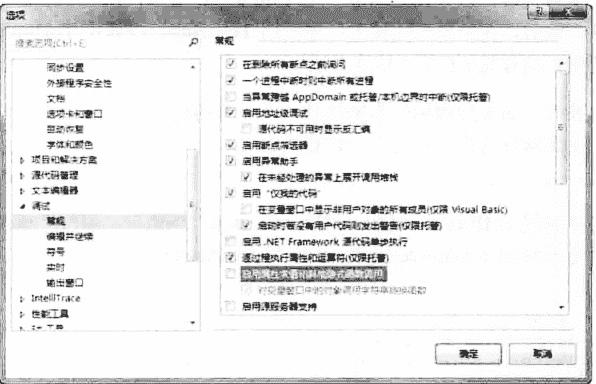

## 第十章　属性

**本章内容：**

- 无参属性
- 有参属性
- 调用属性访问器方法时的性能
- 属性访问器的可访问性
- 泛型属性访问器方法

本章讨论属性，它允许源代码用简化语法来调用方法。CLR 支持两种属性：**无参属性**，平时说的属性就是指它；**有参属性**，它在不同的编程语言中有不同的称呼。例如，C# 将有参属性称为**索引器**，Microsoft Visual Basic 将有参属性称为**默认属性**。还要讨论如何使用“对象和集合初始化器”来初始化属性，以及如何用 C# 的匿名类型和 **System.Tuple** 类型将多个属性打包到一起。

> 注：PowerShell 类和/或 `[pscustomobject]` 天然支持无参属性；但 PowerShell 类不支持 C# 的“索引器”（有参属性）语法，也没有匿名类型。本章关于索引器、匿名类型的内容在脚本层不适用，对应的惯用法见下文各节注。

### 10.1　无参属性

许多类型都定义了能被获取或更改的状态信息。这种状态信息一般作为类型的字段成员实现。例如，以下类型定义包含两个字段：

```powershell
class Employee {
    [string] $Name    # 员工姓名
    [int]    $Age     # 员工年龄
}
```

创建该类型的实例后，可以使用以下形式的代码轻松获取（get）或设置（set）它的状态信息：

```powershell
$e = [Employee]::new()
$e.Name = "Jeffrey Richter"    # 设置员工姓名
$e.Age = 45                    # 设置员工年龄

$e.Name                        # 显示 "Jeffrey Richter"
```

这种查询和设置对象状态信息的做法十分常见。但我必须争辩的是，永远都不应该像这样实现。面向对象设计和编程的重要原则之一就是**数据封装**，意味着类型的字段永远不应该公开，否则很容易因为不恰当使用字段而破坏对象的状态。例如，以下代码可以很容易地破坏一个 **Employee** 对象：

> 注：PowerShell 类不强制封装——属性默认对外可见，可用 `hidden` 关键字把成员从默认输出和 IntelliSense 中隐藏，但没有任何可访问性修饰符。要实现校验逻辑，应在属性 `set` 块内抛异常（如 `throw [System.ArgumentOutOfRangeException]::new(...)` 或调用参数验证特性），并遵循“字段私有、属性公开”的设计原则。

- 托管程序元数据中的属性定义。这一项必然生成。

以前面的 **Employee** 类型为例。编译器编译该类型时发现其中的 **Name** 和 **Age** 属性。由于两者都有 **get** 和 **set** 访问器方法，所以编译器在 **Employee** 类型中生成 4 个方法定义，这造成原始代码似乎是像下面这样写的：

```csharp
public sealed class Employee {
    private String m_Name;
    private Int32 m_Age;

    public String get_Name() {
        return m_Name;
    }

    public void set_Name(String value) {
        m_Name = value; // 实参 value 总是代表新设的值
    }

    public Int32 get_Age() {
        return m_Age;
    }

    public void set_Age(Int32 value) {
        if (value < 0) // value 总是代表新值
            throw new ArgumentOutOfRangeException("value",
                value.ToString(),
                "The value must be greater than or equal to 0");
        m_Age = value;
    }
}
```

> 注：PowerShell 类属性不会生成 `get_`/`set_` 访问器方法，也不会在元数据中登记 PropertyDef；`Get-Member` 看到的就是属性本身。此示例保留，用于说明 C# 编译器的属性实现。

编译器在你指定的属性名之前自动附加 get_ 或 set_ 前缀来生成方法名。C# 内建了对属性的支持。C# 编译器发现代码试图获取或设置属性时，实际会生成对上述某个方法的调用。即使编程语言不直接支持属性，也可调用需要的访问器方法来访问属性。效果一样，只是代码看起来没那么优雅。

除了生成访问器方法，针对源代码中定义的每一个属性，编译器还会在托管程序集的元数据中生成一个属性定义项。在这个记录项中，包含了一些标志（flags）以及属性的类型。另外，它还引用了 **get** 和 **set** 访问器方法。这些信息唯一的作用就是在“属性”这种抽象概念与它的访问器方法之间建立起一个联系。编译器和其他工具可利用这种元数据信息（使用 **System.Reflection.PropertyInfo** 类来获得）。CLR 不使用这种元数据信息，在运行时只需要访问器方法。

### 10.1.1 自动实现的属性

如果只是为了封装一个支持字段而创建属性，C# 还提供了一种更简洁的语法，称为**自动实现的属性**（Automatically Implemented Property，后文简称为 AIP），例如下面的 **Name** 属性：

```csharp
public sealed class Employee {
    // 自动实现的属性
    public String Name { get; set; }

    private Int32 m_Age;

    public Int32 Age {
        get { return(m_Age); }
        set {
            if (value < 0) // value 关键字总是代表新值
                throw new ArgumentOutOfRangeException("value",
                    value.ToString(),
                    "The value must be greater than or equal to 0");
            m_Age = value;
        }
    }
}
```

> 注：PowerShell 类属性天然是“自动实现”的存储槽，可直接读写，但不支持自定义 `get`/`set` 访问器，因此无法在 `set` 中做校验；需要校验时，应在方法或 `[Validate*]` 参数特性中进行。

声明属性而不提供 get/set 方法的实现，C# 会自动为你声明一个私有字段。在本例中，字段的类型是 String，也就是属性的类型。另外，编译器会自动实现 get_Name 和 set_Name 方法，分别返回和设置字段中的值。

和直接声明名为 Name 的 public String 字段相比，AIP 的优势在哪里？事实上，两者存在一处重要的区别。使用 AIP，意味着你已经创建了一个属性。访问该属性的任何代码实际都会调用 get 和 set 方法。如果以后决定自己实现 get 和/或 set 方法，而不是接受编译器的默认实现，访问属性的任何代码都不必重新编译。然而，如果将 Name 声明为字段，以后又想把它更改为属性，那么访问字段的所有代码都必须重新编译才能访问属性方法。

- 我个人不喜欢编译器的 AIP 功能，所以一般会避免使用它。理由是：字段声明语法可能包含初始化部分，所以要在一行代码中声明并初始化字段。但没有简单的语法初始化 AIP。所以，必须在每个构造器方法中显式初始化每个 AIP。
- 运行时序列化引擎将字段名持久存储到序列化的流中。AIP 的支持字段名称由编译器决定，每次重新编译代码都可能更改这个名称。因此，任何类型只要含有一个 AIP，就没法对该类型的实例进行反序列化。在任何想要序列化或反序列化的类型中，都不要使用 AIP 功能。
- 调试时不能在 AIP 的 get 或 set 方法上添加断点，所以不好检测应用程序在什么时候获取或设置这个属性。相反，手动实现的属性可设置断点，查错更方便。

还要注意，如果使用 AIP，属性必然是只读和可写的。换言之，编译器肯定同时生成 get 和 set 方法。这个设计的道理在于，只写字段不能读取值有什么用呢？类似地，只读字段肯定是有默认值的。另外，由于不知道编译器生成的支持字段到底是什么名字，所以代码只能用属性名访问属性。另外，任何访问器方法（get 或 set）要显式实现，两个访问器方法都必须显式实现，就不能使用 AIP 功能了。换言之，AIP 是作用于整个属性的；要么都用，要么都不用。不能显式实现一个访问器方法，而让另一个自动实现。

> 注：PowerShell 类没有“自动实现属性”与“手动实现属性”的编译期区分：直接写 `[string]$Name` 就等价于自动属性（引擎会生成隐藏的支持字段）；需要校验时写成带 `get`/`set` 块的完整属性。PowerShell 属性声明时可直接给默认值，不受“AIP 必须由构造器初始化”的限制，“两个访问器要么全用要么全不用”的限制也不存在。

### 10.1.2 合理定义属性

我个人不喜欢属性，我还希望 Microsoft .NET Framework 及其编程语言不要提供对属性的支持。理由是属性看起来和字段相似，但本质是方法。这造成了大量误解。程序员在看到貌似访问字段的代码时，会做出一些对属性来说不成立的假定，具体如下所示。

- 属性可以只读或只写，而字段访问总是可读和可写的（一个例外是 readonly 字段仅在构造器中可写）。如果定义属性，最好同时为它提供 **get** 和 **set** 访问器方法。
- 属性方法可能抛出异常；字段访问永远不会。
- 属性不能作为 **out** 或 **ref** 参数传给方法，而字段可以。例如以下代码是编译不了的：

```csharp
using System;

public sealed class SomeType {
    private static String Name {
        get { return null; }
        set {}
    }

    static void MethodWithOutParam(out String n) { n = null; }

    public static void Main() {
        // 对于下一行代码，C# 编译器将报告以下错误消息：
        // error CS0206: 属性或索引器不得作为 out 或 ref 参数传递
        MethodWithOutParam(out Name);
    }
}
```

> 注：属性不能作为 `out`/`ref` 实参是 C# 的编译期规则；PowerShell 的 `[ref]` 也只能作用于变量，不能直接引用属性求值结果，因此同样无法把属性传为 `[ref]`。

- 属性方法可能花较长时间执行，字段访问则总是立即完成。许多人使用属性是为了线程同步，这就可能造成线程永远终止。所以，要线程同步就不要使用属性，而要使用方法。此外，如果你的类可以被远程访问（例如从 **System.MarshalByRefObject** 派生），调用属性方法会非常慢。在这种情况下应该优先使用方法而不是属性。我个人认为从 **MarshalByRefObject** 派生的类永远都不应该使用属性。
- 连续多次调用，属性方法每次都可用返回不同的值，字段则每次都返回相同的值。**System.DateTime** 类的只读属性 **Now** 返回当前日期和时间。每次查询这个属性都返回不同的值。这是一个错误，Microsoft 现在很想修正这个错误，将 **Now** 改成方法而不是属性。**Environment** 的 **TickCount** 属性是 Microsoft 犯错的另一个例子。
- 属性方法可能造成明显的副作用①，字段访问则永远不会。类型的使用者应该能按照他/她选择的任何顺序设置类型定义的各个属性，而不会造成类型中（因为设置顺序的不同）出现不同的行为。
- 属性方法可能需要额外的内存，或者返回的引用并非指向对象状态一部分，造成对返回对象的修改作用不到原始对象身上。而查询字段返回的引用总是指向原始对象状态的一部分。使用会返回一个拷贝的属性很容易引起混淆，文档也经常没有专门说明。②

> ① 这里的副作用（side effect）是指，访问属性时，除了单纯设置或获取属性，还会造成对象状态的改变。如果存在多个副作用，程序的行为就要依赖于历史；或者要依赖于求值顺序。如果以不同的顺序设置属性，类型每一次的行为都不同，那么显然是不合理的。——译注  
> ② 指开发人员在文档中没有清楚地说明这是属性，而且返回的是一个 copy，造成别人在使用这个类时产生混淆。——译注

#### 属性和 Visual Studio 调试器

Microsoft Visual Studio 允许在调试器的监视窗口中输入一个对象的属性。这样一来，每次遇到一个断点，调试器都会调用属性的 get 访问器方法，并显示返回值。这个技术在查错时很有用，但也有可能造成 bug，并损害调试性能。例如，假定为网络共享中的文件创建了一个 FileStream，然后将 FileStream 的 Length 属性添加到调试器的监视窗口中。现在，每次遇到一个断点，调试器都会调用 Length 的 get 访问器方法，该方法内部向服务器发出一个网络请求来获取文件的当前长度！

类似地，如果属性的 get 访问器方法有一个 side effect，那么每次抵达断点，都会执行这个 side effect。例如，假定属性的 get 访问器方法每次调用时都递增一个计数器，这个计数器每次抵达断点时也会递增。考虑到可能有这些问题，Visual Studio 允许为监视窗口中显示的属性关闭属性求值。要在 Visual Studio 中关闭属性求值，请选择“工具”|“选项”|“调试”|“常规”。然后，在如图 10-1 所示的列表框中，清除勾选“启用属性求值和其他隐式函数调用”。注意，即使清除了这个选项，仍可将属性添加到监视窗口，然后手动强制 Visual Studio 对它进行求值。为此，单击监视窗口“值”列中的强制求值圆圈即可。



图 10-1　Visual Studio 的常规调试设置

我发现现在的人对属性的依赖有过之而无不及，经常是不管有没有必要都使用属性。仔细研究一下上面这个属性和字段差别列表，你会发现只有在极个别的情况下，定义属性才真正有用，同时不会造成开发人员的混淆。属性唯一的好处就是提供了简化的语法。和调用普通方法（非属性中的方法）相比，属性不仅不会提升代码的性能，还会妨碍对代码的理解。要是我参与 .NET Framework 以及编译器的设计，根本就不会提供属性；相反，我会让程序员老老实实地实现 GetXxx 和 SetXxx 方法。然后，编译器可以提供一些特殊的、简化的语法来调用这些方法。但是，我希望编译器使用有别于字段访问的语法，使程序员能真正理解他们正在做什么——是在调用一个方法！

> 注：本节“属性 vs 字段”的告诫同样适用于 PowerShell，而且更隐蔽——PowerShell 的 `.` 成员访问由引擎在运行时解析，属性访问器本身只是一次方法调用。`[datetime]::Now` 这类每次访问都返回新值的属性在 PowerShell 中同样存在；脚本性能分析用 `Measure-Command` 即可体现差异。

### 10.1.3 对象和集合初始化器

经常要构造一个对象并设置对象的一些公共属性（或字段）。为了简化这个常见的编程模式，C# 语言支持一种特殊的对象初始化语法。下面是一个例子：

> 注：PowerShell 没有 C# 的对象/集合初始化器语法。惯用法是哈希表加 `[pscustomobject]`（`[pscustomobject]@{ Name = 'Jeff'; Age = 45 }`），或 `New-Object -Property @{ ... }`；向集合添加元素用显式的 `.Add()` 或 `+=`。

```powershell
# PowerShell 用 [pscustomobject] 哈希表字面量模拟对象初始化器
$e = [pscustomobject]@{ Name = "Jeff"; Age = 45 }
```

这个语句做了好几件事情，包括构造一个 **Employee** 对象，调用它的无参构造器，将它的公共 **Name** 属性设为 "Jeff"，并将公共 **Age** 属性设为 45。事实上，这一行代码等价于以下几行代码。可以检查两者的 IL 代码来加以验证。

```powershell
$e = [pscustomobject]@{}
$e.Name = "Jeff"
$e.Age = 45
```

对象初始化器语法真正的好处在于，它允许在表达式的上下文（相对于语句的上下文）中编码，允许组合多个函数，进而增强了代码的可读性。例如，现在可以写这样的代码：

```csharp
String s = new Employee() { Name = "Jeff", Age = 45 }.ToString().ToUpper();
```

这个语句做的事情更多，首先还是构造一个 **Employee** 对象，调用它的构造器，再初始化两个公共属性。然后，在结果表达式上，先调用 **ToString**，再调用 **ToUpper**。要深入了解函数的组合使用，请参见 8.6 节“扩展方法”。

作为一个小的补充，如果想调用的本来就是一个无参构造器，C# 还允许省略起始大括号之前的圆括号。下面这行代码生成与上一行相同的 IL：

```csharp
String s = new Employee { Name = "Jeff", Age = 45 }.ToString().ToUpper();
```

> 注：PowerShell 没有对象初始化器表达式，`[pscustomobject]` 也不像示例中的 `Employee` 那样重写 `ToString`；此示例保留，用于说明 C# 的表达式组合语法。

如果属性的类型实现了 **IEnumerable** 或 **IEnumerable<T>** 接口，属性就被认为是集合，而集合的初始化是一种相加（additive）操作，而非替换（replacement）操作。例如，假定有下面这个类定义：

```powershell
class Classroom {
    [System.Collections.Generic.List[string]] $Students =
        [System.Collections.Generic.List[string]]::new()

    Classroom() {}
}
```

现在可以写代码来构造一个 **Classroom** 对象，并像下面这样初始化 **Students** 集合：

```csharp
public static void M() {
    Classroom classroom = new Classroom {
        Students = { "Jeff", "Kristin", "Aidan", "Grant" }
    };

    // 显示教室中的 4 个学生
    foreach (var student in classroom.Students)
        Console.WriteLine(student);
}
```


> 注：PowerShell 没有集合初始化器语法。等效做法是构造对象后连续调用 `.Add()`（见下），或直接使用数组/哈希表字面量。

编译上述代码时，编译器发现 **Students** 属性的类型是 **List<String>**，而且这个类型实现了 **IEnumerable<String>** 接口。现在，编译器假定 **List<String>** 类型提供了一个名为 **Add** 的方法（因为大多数集合类都提供了 **Add** 方法将数据项添加到集合），然后，编译器生成代码来调用集合的 **Add** 方法。所以，上述代码会被编译器转换成这样：

```powershell
$classroom = [Classroom]::new()
$classroom.Students.Add("Jeff")
$classroom.Students.Add("Kristin")
$classroom.Students.Add("Aidan")
$classroom.Students.Add("Grant")

# 显示教室中的 4 个学生
foreach ($student in $classroom.Students) {
    $student
}
```

如果属性的类型实现了 **IEnumerable** 或 **IEnumerable<T>**，但未提供 **Add** 方法，编译器就不允许使用集合初始化语法向集合中添加数据项；相反，编译器报告以下消息：**error CS0117: "System.Collections.Generic.IEnumerable<string>" 不包含 "Add" 的定义。**

有的集合的 **Add** 方法要获取多个实参，比如 **Dictionary** 的 **Add** 方法：

```csharp
public void Add(TKey key, TValue value);
```

> 注：这是泛型 `Dictionary.Add` 的签名；PowerShell 中直接调用 `$table.Add($key, $value)` 即可。

通过在集合初始化器中嵌套大括号的方式，可向 **Add** 方法传递多个实参，如下所示：

```csharp
var table = new Dictionary<String, Int32> {
    { "Jeffrey", 1 }, { "Kristin", 2 }, { "Aidan", 3 }, { "Grant", 4 }
};
```

> 注：PowerShell 没有集合初始化器语法；可用连续的 `.Add()`（见下），或哈希表字面量 `@{ "Jeffrey" = 1; ... }`。

它等价于以下代码：

```powershell
$table = [System.Collections.Generic.Dictionary[string, int]]::new()
$table.Add("Jeffrey", 1)
$table.Add("Kristin", 2)
$table.Add("Aidan", 3)
$table.Add("Grant", 4)
```

#### 10.1.4 匿名类型

利用 C# 的匿名类型功能，可以用很简洁的语法来自动声明不可变（immutable）的元组类型。元组①类型是含有一组属性的类型，这些属性通常以某种方式相互关联。在以下代码的第一行中，我定义了含有两个属性（**String** 类型的 **Name** 和 **Int32** 类型的 **Year**）的类，构造了该类型的实例，将 **Name** 属性设为 "Jeff"，将 **Year** 属性设为 **1964**。

```powershell
# 定义对象，构造实例，并初始化属性
$o1 = [pscustomobject]@{ Name = "Jeff"; Year = 1964 }

# 显示属性：Name=Jeff, Year=1964
"Name=$($o1.Name), Year=$($o1.Year)"
```

① 元组（tuple）一词来源于对顺序的抽象：single、double、triple、quadruple、quintuple、*n*-tuple。

第一行代码创建了匿名类型，我没有在 new 关键字后指定类型名称，所以编译器会自动创建类型名称，而且不会告诉我这个名称具体是什么（这正是匿名的含义）。这行代码使用上一节讨论的“对象初始化器”语法来声明属性，同时初始化这些属性。另外，由于我（开发人员）不知道编译时的类型名称，也就不知道变量 o1 声明为什么类型。但这不是问题，因为可以像第九章讨论的那样使用 C# 的“隐式类型局部变量”功能（var）。它的作用是告诉编译器根据赋值操作符（=）右侧的表达式推断类型。

现在，让我们将注意力放在编译器实际做的事情上。遇到下面这样的一行代码时：

```csharp
var o = new { property1 = expression1, ..., propertyN = expressionN };
```

> 注：这是 C# 编译器生成匿名类型的语法模板，属于编译期行为；PowerShell 用 `[pscustomobject]@{}` 创建类似的动态对象。

编译器会推断每个表达式的类型，创建推断类型的私有字段，为每个字段创建公共只读属性，并创建一个构造器来接受所有这些表达式。在构造器的代码中，会用传给它的表达式的求值结果来初始化私有只读字段。除此之外，编译器还会重写 Object 的 Equals、GetHashCode 和 ToString 方法，并生成所有这些方法中的代码。最终，编译器生成的类看起来像这样：

```csharp
[CompilerGenerated]
internal sealed class <>f__AnonymousType0<...> : Object {
    private readonly t1 f1;
    public t1 p1 { get { return f1; } }

    ...

    private readonly tn fn;
    public tn pn { get { return fn; } }

    public <>f__AnonymousType0<...>(t1 a1, ..., tn an) {
        f1 = a1; ...; fn = an; // 设置所有字段
    }

    public override Boolean Equals(Object value) {
        // 任何字段不匹配就返回 false，否则返回 true
    }

    public override Int32 GetHashCode() {
        // 返回根据每个字段的哈希码生成的一个哈希码
    }

    public override String ToString() {
        // 返回“属性名=值”对的以逗号分隔的列表
    }
}
```

> 注：上述编译器生成的匿名类型无法在 PowerShell 中复现；`[pscustomobject]` 是运行时动态对象，没有编译器生成的 `Equals`/`GetHashCode`。

编译器会生成 Equals 和 GetHashCode 方法，因此匿名类型的实例能放到哈希表集合中。属性是只读的，而非可读可写，目的是防止对象的哈希码发生改变。如果对象在哈希表中作为键使用，更改它的哈希码会造成再也找不到它。编译器会生成 ToString 方法来帮助进行调试。在 Visual Studio 调试器中，可将鼠标指针放在引用了匿名类型实例的一个变量上方。随后，Visual Studio 会调用 ToString 方法，并在一个提示窗口中显示结果字符串。顺便说一句，在编辑器中写代码时，Visual Studio 的“智能感知”功能会提示属性名，这是非常好用的一个功能。

编译器支持用另外两种语法声明匿名类型中的属性，能根据变量推断属性名和类型：

```powershell
$Name = "Grant"
$dt = [datetime]::Now
```

```powershell
# 有两个属性的一个对象
# 1. String Name 属性设为 "Grant"
# 2. Int32 Year 属性设为 dt 中的年份
$o2 = [pscustomobject]@{ Name = $Name; Year = $dt.Year }
```

在这个例子中，编译器判断第一个属性应该叫 **Name**。由于 **Name** 是局部变量的名称，所以编译器将属性类型设为与局部变量相同的类型：**String**。对于第二个属性，编译器使用字段/属性的名称：**Year**。**Year** 是 **DateTime** 类的一个 **Int32** 属性，所以匿名类型中的 **Year** 属性也是一个 **Int32**。现在，当编译器构造这个匿名类型的一个实例时，会将实例的 **Name** 属性设为 **Name** 局部变量中的值，使 **Name** 属性引用同一个 "Grant" 字符串。编译器还要将实例的 **Year** 属性设为与 **dt** 的 **Year** 属性返回的值相同。

编译器在定义匿名类型时是非常“善解人意”的。如果它看到你在源代码中定义了多个匿名类型，而且这些类型具有相同的结构，那么它只会创建一个匿名类型定义，但创建该类型的多个实例。所谓“相同的结构”，是指在这些匿名类型中，每个属性都有相同的类型和名称，而且这些属性的指定顺序相同。在前面的几个例子中，变量 **o1** 和 **o2** 就是同类型的，因为在定义匿名类型的两行代码中，都是先一个 **String** 类型的 **Name** 属性，再一个 **Int32** 类型的 **Year** 属性。

由于两个变量（o1 和 o2）的类型相同，所以可以做一些非常“酷”的事情，比如检查两个对象是否包含相等的值，并将对一个对象的引用赋给正在指向另一个对象的变量，如下所示：

```csharp
// 一个类型允许相等测试和赋值操作
Console.WriteLine("Objects are equal: " + o1.Equals(o2));
o1 = o2; // 赋值
```

> 注：PowerShell 的 `[pscustomobject]` 没有值相等语义，`$o1.Equals($o2)` 比较的是引用；要按字段比较需自行实现或转为哈希表比较。

另外，由于这种类型的同一性，所以可以创建一个隐式类型的数组（详情参见 16.1 节“初始化数组元素”），在其中包含一组匿名类型的对象。

```powershell
$people = @(
    $o1, # o1 的定义参见本节开头
    [pscustomobject]@{ Name = "Kristin"; Year = 1970 },
    [pscustomobject]@{ Name = "Aidan"; Year = 2003 },
    [pscustomobject]@{ Name = "Grant"; Year = 2008 }
)
```

```powershell
# 展示如何遍历对象数组
foreach ($person in $people) {
    "Person=$($person.Name), Year=$($person.Year)"
}
```

匿名类型经常与 LINQ（Language Integrated Query，语言集成查询）配合使用。可用 LINQ 执行查询，从而生成由一组对象构成的集合，这些对象都是相同的匿名类型。然后，可以对结果集合中的对象进行处理。所有这些都是在同一个方法中发生的。下例展示了如何返回“我的文档”文件夹中过去 7 天修改过的所有文件：

```powershell
$myDocuments = [Environment]::GetFolderPath('MyDocuments')
$query = Get-ChildItem -Path $myDocuments -File |
    Where-Object { $_.LastWriteTime -gt (Get-Date).AddDays(-7) } |
    Sort-Object LastWriteTime |
    Select-Object @{ n = 'Path'; e = { $_.FullName } }, LastWriteTime

foreach ($file in $query) {
    "LastWriteTime=$($file.LastWriteTime), Path=$($file.Path)"
}
```

匿名类型的实例不能泄露到方法外部。方法原型不能接受匿名类型的参数，因为无法指定匿名类型。类似地，方法也不能返回对匿名类型的引用。虽然可以将匿名类型的实例视为一个 Object（所有匿名类型都从 Object 派生），但无法设法将 Object 类型的变量转型回匿名类型，因为不存在匿名类型在编译时的名称。要传递元组，应该考虑使用下一节讨论的 System.Tuple 类型。

> 注：PowerShell 的 `[pscustomobject]` 可以当成“匿名对象”使用，但它是动态的（可随时 `Add-Member` 增减属性），没有 C# 匿名类型的值相等与结构相同语义，也不能在编译期保证属性存在。需要同时返回多个值并保证字段固定时，用数组、哈希表、`[pscustomobject]` 或 `[System.Tuple]::Create(...)` 均可；按“Item1/Item2”式语义传递时，建议改用显式命名的类型。

#### 10.1.5 System.Tuple 类型

在 System 命名空间，Microsoft 定义了几个泛型 Tuple 类型，它们全部从 Object 派生，区别只在于元数（泛型参数的个数）。下面演示了最简单和最复杂的 Tuple 类型：

```csharp
// 这是最简单的：
[Serializable]
public class Tuple<T1> {
    private T1 m_Item1;
    public Tuple(T1 item1) { m_Item1 = item1; }
    public T1 Item1 { get { return m_Item1; } }
}
```

```csharp
// 这是最复杂的：
[Serializable]
public class Tuple<T1, T2, T3, T4, T5, T6, T7, TRest> {
    private T1 m_Item1; private T2 m_Item2; private T3 m_Item3; private T4 m_Item4;
    private T5 m_Item5; private T6 m_Item6; private T7 m_Item7; private TRest m_Rest;
    public Tuple(T1 item1, T2 item2, T3 item3, T4 item4, T5 item5, T6 item6, T7 item7,
        TRest rest) {
        m_Item1 = item1; m_Item2 = item2; m_Item3 = item3; m_Item4 = item4;
        m_Item5 = item5; m_Item6 = item6; m_Item7 = item7; m_Rest = rest;
    }

    public T1 Item1 { get { return m_Item1; } }
    public T2 Item2 { get { return m_Item2; } }
    public T3 Item3 { get { return m_Item3; } }
    public T4 Item4 { get { return m_Item4; } }
    public T5 Item5 { get { return m_Item5; } }
    public T6 Item6 { get { return m_Item6; } }
    public T7 Item7 { get { return m_Item7; } }
    public TRest Rest { get { return m_Rest; } }
}
```

> 注：这是 .NET 中 `System.Tuple` 的源码；PowerShell 直接使用 `[System.Tuple]` 或 `[System.Tuple]::Create(...)`。

① 元数的英文是 arity。在计算机编程中，一个函数或运算（操作）的元数是指函数获取的实参或操作数的个数。它源于像 unary（arity=1）、binary（arity=2）、ternary（arity=3）这样的单词。——译注

和匿名类型类似，**Tuple** 创建好之后就不可变了（所有属性都只读）。虽然这里没有显示，但 **Tuple** 类还提供了 **CompareTo、Equals、GetHashCode** 和 **ToString** 方法以及 **Size** 属性。此外，所有 **Tuple** 类型都实现了 **IStructuralEquatable、IStructuralComparable** 和 **IComparable** 接口，所以可以比较两个 **Tuple** 对象，对它们的字段进行比对。请参考文档更多地了解这些方法和接口。

下面的示例泛型方法 **MinMax** 用一个 **Tuple** 类型向调用者返回两样信息：

```powershell
# 用 Item1 返回最小值，用 Item2 返回最大值
function Get-MinMax {
    param([int]$a, [int]$b)
    [System.Tuple]::Create([Math]::Min($a, $b), [Math]::Max($a, $b))
}
```

```powershell
# 调用方法并使用返回的 Tuple
$minmax = Get-MinMax 6 2

# Min=2, Max=6
"Min=$($minmax.Item1), Max=$($minmax.Item2)"
```

当然，很重要的一点是 **Tuple** 的生产者（写它的人）和消费者（用它的人）必须对 **Item#** 属性返回的内容有一个清楚的理解。对于匿名类型，属性的实际名称是根据定义匿名类型的源代码来确定的。对于 **Tuple** 类型，属性一律被 Microsoft 称为 **Item#**，我们无法对此进行任何改变。遗憾的是，这种名字没有任何实际的含义或意义，所以要由生产者和消费者为它们分配具体含义。这还影响了代码的可读性和可维护性。所以，应该在自己的代码中添加详细的注释，说明每个 **Item#** 代表着什么。

编译器只能在调用泛型方法时推断泛型类型，调用构造器时不能。因此，**System** 命名空间还包含了一个非泛型静态 **Tuple** 类，其中包含一组静态 **Create** 方法，能根据实参推断泛型类型。这个类扮演了创建 **Tuple** 对象的一个工厂的角色，它存在的唯一意义便是简化你的代码。下面用静态 **Tuple** 类重写了刚才的 **MinMax** 方法：

```powershell
# 用 Item1 返回最小值，用 Item2 返回最大值
function Get-MinMax {
    param([int]$a, [int]$b)
    # PowerShell 中两种写法都归为 Tuple.Create
    [System.Tuple]::Create([Math]::Min($a, $b), [Math]::Max($a, $b))
}
```

要创建多于 8 个元素的 **Tuple**，可为 **Rest** 参数传递另一个 **Tuple**，如下所示：

```powershell
$t = [System.Tuple]::Create(0, 1, 2, 3, 4, 5, 6, [System.Tuple]::Create(7, 8))
"$($t.Item1), $($t.Item2), $($t.Item3), $($t.Item4), $($t.Item5), $($t.Item6), $($t.Item7), $($t.Rest.Item1.Item1), $($t.Rest.Item1.Item2)"
```

> 注：PowerShell 可以直接使用 .NET 的 `[System.Tuple]::Create(...)` 或 `[ValueTuple]`（`[tuple]`/`[valuetuple]` 加速器），但普通的 `@(最小值, 最大值)` 在 PowerShell 中是一个 `[object[]]` 数组而不是元组。返回多个值时，数组、哈希表或 `[pscustomobject]` 往往比 Tuple 更直观。


> **注意** 除了匿名类型和 **Tuple** 类型，还可研究一下 **System.Dynamic.ExpandoObject** 类（在 **System.Core.dll** 程序集中定义）。这个类和 C# 的 **dynamic** 类型（参见 5.5 节“**dynamic** 基元类型”）配合使用，就可用另一种方式将一系列属性（键/值对）组合到一起。虽然实现不了编译时的类型安全性，但语法看起来不错（虽然得不到“智能感知”支持），而且还可以在 C# 和 Python 这样的动态语言之间传递 **ExpandoObject** 对象。以下是使用了一个 **ExpandoObject** 的示例代码：

```powershell
$e = [System.Dynamic.ExpandoObject]::new()
$e.x = 6           # 添加 Int32 属性 x，值为 6
$e.y = "Jeff"      # 添加 String 属性 y，值为 "Jeff"
$e.z = $null       # 添加 Object 属性 z，值为 null

# 查看所有属性及其值
foreach ($v in $e) {
    "Key=$($v.Key), Value=$($v.Value)"
}

# 删除 x 属性及其值
([System.Collections.Generic.IDictionary[string, object]]$e).Remove("x")
```

### 10.2 有参属性

在上一节中，属性的 **get** 访问器方法不接受参数，因此称为无参属性。由于用起来就像访问字段，所以很容易理解。除了这些与字段相似的属性，编程语言还支持有参属性，它的 **get** 访问器方法接受一个或多个参数，**set** 访问器方法接受两个或多个参数。不同编程语言以不同方式公开有参属性。另外，不同编程语言对有参属性的称呼也不同。C# 称为索引器，Visual Basic 则称为默认属性。本节主要讨论 C# 如何使用有参属性来公开索引器。

C# 使用数组风格的语法来公开有参属性（索引器）。换句话说，可将索引器看成是 C# 开发人员对 [] 操作符的重载。下面是一个示例 **BitArray** 类，它允许用数组风格的语法来索引由该类的实例维护的一组二进制位。

> 注：PowerShell 类不支持索引器（`this[...]`）语法，也不能定义静态索引器。需要“按下标访问”时，直接用 .NET 集合的索引语法（如 `$list[0]`、`$hash['key']`）；自定义类要提供类似能力，可定义 `GetItem([int]$i)`/`SetItem([int]$i, $v)` 之类的方法，或改用实现了索引器的 .NET 类型。

```csharp
using System;

public sealed class BitArray {
    // 容纳了二进制位的私有字节数组
    private Byte[] m_byteArray;
    private Int32 m_numBits;

    // 下面的构造器用于分配字节数组，并将所有位设为 0
    public BitArray(Int32 numBits) {
        // 先验证实参
        if (numBits <= 0)
            throw new ArgumentOutOfRangeException("numBits must be > 0");

        // 保存位的个数
        m_numBits = numBits;
        // 为位数组分配字节
        m_byteArray = new Byte[(numBits + 7) / 8];
    }

    // 下面是索引器（有参属性）
    public Boolean this[Int32 bitPos] {

        // 下面是索引器的 get 访问器方法
        get {
            // 先验证实参
            if ((bitPos < 0) || (bitPos >= m_numBits))
                throw new ArgumentOutOfRangeException("bitPos");

            // 返回指定索引处的位的状态
            return (m_byteArray[bitPos / 8] & (1 << (bitPos % 8))) != 0;
        }

        // 下面是索引器的 set 访问器方法
        set {
            if ((bitPos < 0) || (bitPos >= m_numBits))
                throw new ArgumentOutOfRangeException("bitPos",
                                                      bitPos.ToString());
            if (value) {
                // 将指定索引处的位设为 true
                m_byteArray[bitPos / 8] = (Byte)
                    (m_byteArray[bitPos / 8] | (1 << (bitPos % 8)));
            } else {
                // 将指定索引处的位设为 false
                m_byteArray[bitPos / 8] = (Byte)
                    (m_byteArray[bitPos / 8] & ~(1 << (bitPos % 8)));
            }
        }
    }
}
```

**BitArray** 类的索引器用起来很简单：

```csharp
// 分配含 14 个位的 BitArray 数组
BitArray ba = new BitArray(14);

// 调用 set 访问器方法，将编号为偶数的所有位都设为 true
for (Int32 x = 0; x < 14; x++) {
    ba[x] = (x % 2 == 0);
}

// 调用 get 访问器方法显示所有位的状态
for (Int32 x = 0; x < 14; x++) {
    Console.WriteLine("Bit " + x + " is " + (ba[x] ? "On" : "Off"));
}
```

在这个示例 **BitArray** 类中，索引器获取 **Int32** 类型的参数 bitPos。所有索引器至少要有一个参数，但可以有更多。这些参数（和返回类型）可以是除了 void 之外的任意类型。在 **System.Drawing.dll** 程序集的 **System.Drawing.Imaging.ColorMatrix** 类中，提供了一个有多个参数的索引器的例子。

经常要创建索引器来查询关联数组①中的值。**System.Collections.Generic.Dictionary** 类型就提供了这样的一个索引器，它获取一个键，并返回与该键关联的值。和无参属性不同，类型可提供多个重载的索引器，只要这些索引器的签名不同。

① 关联数组（associative array）使用字符串索引（称为键）来访问存储在数组中的值（称为值）。——译注

和无参属性的 **set** 访问器方法相似，索引器的 **set** 访问器方法同样包含了一个隐藏参数，在 C# 中称为 **value**。该参数代表想赋给“被索引元素”的新值。

CLR 本身不区分无参属性和有参属性。对 CLR 来说，每个属性都只是类型中定义的一对方法和一些元数据。如前所述，不同的编程语言要求用不同语法来创建和使用有参属性。将 **this[...]** 作为表达索引器的语法，这纯粹是 C# 团队自己的选择。也正是因为这个选择，所以 C# 只允许在对象的实例上定义索引器。C# 不支持定义静态索引器属性，虽然 CLR 支持静态有参属性。

由于 CLR 以相同的方式对待有参和无参属性，所以编译器会在托管程序集中生成以下两项或三项。

- 代表有参属性 **get** 访问器的方法。仅在属性定义了 **get** 访问器方法时生成。
- 代表有参属性 **set** 访问器的方法。仅在属性定义了 **set** 访问器方法时生成。
- 托管程序集元数据中的属性定义。这一项必然生成。没有专门的有参属性元数据定义表，因为对于 CLR 来说，有参属性不过就是属性。

对于前面的 **BitArray** 类，编译器在编译索引器时，原始代码似乎是像下面这样写的：

```csharp
public sealed class BitArray {

    // 下面是索引器的 get 访问器方法
    public Boolean get_Item(Int32 bitPos) { /* ... */ }

    // 下面是索引器的 set 访问器方法
    public void set_Item(Int32 bitPos, Boolean value) { /* ... */ }
}
```

> 注：PowerShell 类没有索引器，因此也不存在 `get_Item`/`set_Item` 访问器方法和对应的属性元数据；本节属于 C# 编译器的实现细节。

编译器在索引器名称之前附加 **get_** 或者 **set_** 前缀，从而自动生成这些方法的名称。由于 C# 的索引器语法不允许开发人员指定索引器名称，所以 C# 编译器团队不得不为访问器方法选择一个默认名称；他们最后选择了 **Item**。因此，编译器生成的方法名就是 **get_Item** 和 **set_Item**。

查看文档时，留意类型是否提供了名为 **Item** 的属性，从而判断该类型是否提供了索引器。例如，**System.Collections.Generic.List** 类型提供了名为 **Item** 的公共实例属性，它就是 **List** 的索引器。

用 C# 编程永远看不到 **Item** 这个名称，所以一般无需关心编译器选择的是什么名称。但如果为类型设计的索引器要由其他语言的代码访问，就可能需要更改索引器的 **get** 和 **set** 访问器方法所用的默认名称 **Item**。C# 允许向索引器应用定制特性 **System.Runtime.CompilerServices.IndexerNameAttribute** 来重命名这些方法，如下所示：

```csharp
using System;
using System.Runtime.CompilerServices;

public sealed class BitArray {
    [IndexerName("Bit")]
    public Boolean this[Int32 bitPos] {
        // 这里至少要定义一个访问器方法
    }
}
```

现在，编译器将生成名为 **get_Bit** 和 **set_Bit** 的方法，而不是 **get_Item** 和 **set_Item**。编译时，C# 编译器会注意到 **IndexerName** 特性，它告诉编译器如何对方法和属性的元数据进行命名。特性本身不会进入程序集的元数据。

以下 Visual Basic 代码演示了如何访问这个 C# 索引器：

- 构造 **BitArray** 类型的实例  
  `Dim ba as New BitArray(10)`
- Visual Basic 用 `()` 而不是 `[]` 指定数组元素  
  `Console.WriteLine(ba(2))`  ' 显示 True 或 False
- Visual Basic 还允许通过索引器的名称来访问它  
  `Console.WriteLine(ba.Bit(2))`  ' 显示的内容和上一行代码相同

C# 允许一个类型定义多个索引器，只要索引器的参数集不同。在其他语言中，**IndexerName** 特性允许定义多个相同签名的索引器，因为索引器各自可以有不同的名称。C# 不允许这样做，是因为它的语法不是通过名称来引用索引器，编译器不知道你引用的是哪一个索引器。编译以下 C# 代码将导致编译器报错：**error CS0111: 类型“SomeType”已定义了一个名为“this”的具有相同参数类型的成员。**

```csharp
using System;
using System.Runtime.CompilerServices;

public sealed class SomeType {
    // 定义 get_Item 访问器方法
    public Int32 this[Boolean b] {
        get { return 0; }
    }

    // 定义 get_Jeff 访问器方法
    [IndexerName("Jeff")]
    public String this[Boolean b] {
        get { return null; }
    }
}
```

显然，C# 将索引器看成是对 [] 操作符的重载，而 [] 操作符不能用来消除具有不同方法名和相同参数集的有歧义性。

顺便说一句，**System.String** 类型是改变了索引器名称的一个例子。**String** 的索引器的名称是 **Chars**，而不是 **Item**。这个只读属性允许从字符串中获得一个单独的字符。对于不用 `[]` 操作符语法来访问这个属性的编程语言，**Chars** 是更有意义的名称。

① 这个原因造成 **IndexerNameAttribute** 类不是 CLI 和 C# 语言的 ECMA 标准的一部分。

#### 选择主要的有参属性

C# 对索引器的限制引起以下两个问题。

- 如果定义类型的语言允许多个有参属性应该怎么办？
- 从 C# 中如何使用这个类型？

这两个问题的答案是：类型必须选择其中一个有参属性来作为默认（主要）属性，这要求向类本身应用 **System.Reflection.DefaultMemberAttribute** 的一个实例。要说明的是，该特性可应用于类、结构或接口。在 C# 中编译定义了有参属性的类型时，编译器会自动向类型应用该特性的实例，同时会考虑到你可能应用了 **IndexerName** 特性的情况。在 **DefaultMemberAttribute** 特性的构造器中，指定了要作为类型的默认有参属性使用的名称。

因此，如果在 C# 中定义包含有参属性的类型，但没有指定 **IndexerName** 特性，那么在向该类型应用的 **DefaultMember** 特性中，会将默认成员的名称指定为 **Item**。如果向有参属性应用了 **IndexerName** 特性，那么在向该类型应用的 **DefaultMember** 特性中，会将默认成员的名称指定为由 **IndexerName** 特性指定的字符串名称。记住，如果代码中含有多个名称不一样的有参属性，C# 将无法编译。对于支持多个有参属性的编程语言，必须从中选择一个属性方法名，并用 **DefaultMember** 特性来标识。这是 C# 代码唯一能访问的有参属性。

C# 编译器发现代码试图获取或设置索引器时，会生成对其中一个方法的调用。有的语言不支持有参属性。要从这种语言中访问有参属性，必须显式调用需要的索引器方法。对于 CLR，无参和有参属性没有区别，所以可用相同的 **System.Reflection.PropertyInfo** 类来发现有参属性和它的访问器方法之间的关联。

### 10.3 调用属性访问器方法时的性能

对于简单的 get 和 set 访问器方法，JIT 编译器会将代码内联（inline，或者说嵌入）。这样一来，使用属性（而不是使用字段）就没有性能上的损失。内联是指将方法（目前说的是访问器方法）的代码直接编译到调用它的方法中。这就避免了在运行时发出调用所产生的开销，代价是编译好的方法变得更大。由于属性访问器方法包含的代码一般很少，所以内联会使生成的本机代码变得更小，而且执行得更快。

> **注意** JIT 编译器在调试代码时不会内联属性方法，因为内联的代码会变得难以调试。这意味着在程序的发行版本中，访问属性时的性能可能比较快；在程序的调试版本中，可能比较慢。字段访问在调试和发布版本中，速度都很快。


### 10.4 属性访问器的可访问性

有时希望为 get 访问器方法指定一种可访问性，为 set 访问器方法指定另一种可访问性。最常见的情形是提供公共 get 访问器和受保护 set 访问器。

```csharp
public class SomeType {
    private String m_name;
    public String Name
    {
        get { return m_name; }
        protected set { m_name = value;}
    }
}
```

> 注：PowerShell 类属性没有独立的访问器可访问性，成员只分为公开和 `hidden` 两种状态，无法实现“public get / protected set”。

如上述代码所示，Name 属性本身声明为 **public** 属性，意味着 **get** 访问器方法是公共的，所有代码都能调用。而 **set** 访问器方法声明为 **protected**，只能从 SomeType 内部定义的代码中调用，或者从 SomeType 的派生类的代码中调用。

定义属性时，如果两个访问器方法需要不同的可访问性，C# 要求必须为属性本身指定限制最小的可访问性。然后，两个访问器只能选择一个来使用限制较大的。在前面的例子中，属性本身声明为 **public**，而 **set** 访问器方法声明为 **protected**（限制较 **public** 大）。

> 注：PowerShell 类的属性没有 `get`/`set` 的可访问性修饰符，也没有 `public`/`protected` 等关键字，只有 `hidden` 可以隐藏成员。需要限制写入时，可把真正的字段设为 `hidden`，再提供只读属性或 `SetXxx()` 方法，由脚本逻辑检查调用来源。

### 10.5 泛型属性访问器方法

既然属性本质上是方法，而 C# 和 CLR 允许泛型方法，所以有时可能想在定义属性时引入它自己的泛型类型参数（而非使用包含类型的泛型类型参数），但 C# 不允许。之所以属性不能引入它自己的泛型类型参数，最主要的原因是概念上说不通。属性本来应该表示可供查询或设置的某个对象特征。一旦引入泛型类型参数，就意味着有可能改变查询/设置行为。但属性不应该和行为沾边。公开对象的行为——无论是不是泛型——都应该定义为方法而非属性。

> 注：PowerShell 类同样不能定义泛型属性，而且 PowerShell 类的方法也不支持声明自己的泛型类型参数（没有 `<T>` 语法）。需要泛型行为时，可用参数化的普通方法处理 `[object]` 并做类型检查，或通过 `Add-Type` 以 C# 定义泛型类型/方法。

# 

- 1. ...
- 2. ...
- 3. ...

# 

- 1. ...
- 2. ...
- 3. ...


