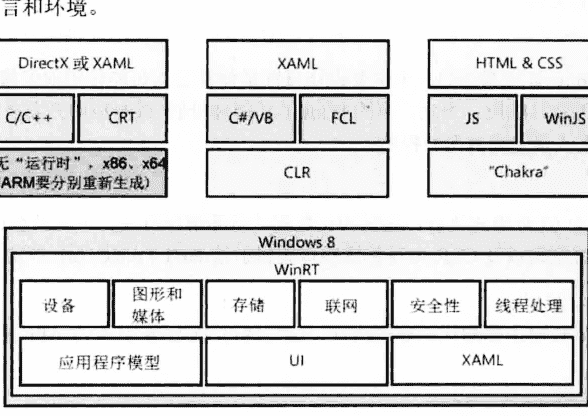
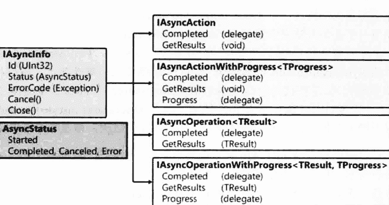

## 第二十五章 与 WinRT 组件互操作

本章内容：

- CLR 投射与 WinRT 组件类型系统规则
- 框架投射
- 用 C# 定义 WinRT 组件

> **编者说明**　本章讨论 .NET（CLR）与 Windows 运行时（WinRT）之间的互操作。原书以 C# 为例，是因为 WinRT 组件的“编写”必须使用能生成 .winmd 元数据的编译器（C#/VB/C++）。PowerShell 只能**使用** WinRT 组件，不能**定义** WinRT 组件：脚本无法生成 .winmd 文件，也无法声明 WinRT 类型。因此本章涉及“用 C# 定义/编写 WinRT 组件”的段落属于背景知识；PowerShell 相关的用法集中在 25.2 节，即在脚本中调用已有的 WinRT API。

Windows 8/8.1 带来了一个新类库，应用程序可通过它访问操作系统功能。类库正式名称是 Windows 运行时（Windows Runtime，WinRT），其组件通过 WinRT 类型系统访问。首次发布时，WinRT 的许多目标都和 CLR 相同，例如简化应用程序开发，以及允许代码用不同编程语言实现以简化互操作。特别是，Microsoft 支持在原生 C/C++、JavaScript（通过 Microsoft 的“Chakra”JavaScript 虚拟机）和 C#/Visual Basic（通过 CLR）中使用 WinRT 组件。

图 25-1 展示了 Windows 的 WinRT 组件所公开的功能，以及可以访问它们的 Microsoft 语言。对于用原生 C/C++ 实现的应用程序，开发人员必须为每种 CPU 架构（x86、x64 和 ARM）单独编译代码。相比之下，.NET 开发人员只需编译一次（编译成 IL，CLR 自行将其编译成与主机 CPU 对应的本机代码）。JavaScript 应用程序则自带了源代码，“Chakra”虚拟机解析这些源代码，把它编译成与主机 CPU 对应的本机代码。其他公司也可制作能与 WinRT 组件互操作的语言和环境。



图 25-1 Windows 的 WinRT 组件所公开的功能，以及访问它们的各种语言

Windows Store 应用和桌面应用程序可通过 WinRT 组件来利用操作系统的功能。Windows 配套提供的 WinRT 组件数量比 .NET Framework 类库小多了。但设计就是这样的，组件的目的就是公开操作系统最擅长的事情，也就是对硬件和跨应用程序的功能进行抽象。所以，大多数 WinRT 组件都只是公开了功能，比如存储、联网、图形、媒体、安全性、线程处理等。而其他核心语言服务（比如字符串操作）和较复杂的框架（比如 LINQ）不是由操作系统提供，而是由访问 WinRT 组件的语言提供。

WinRT 组件内部作为“组件对象模型”（Component Object Model，COM）组件来实现，后者是 Microsoft 1993 年推出的技术。COM 当年被认为过于复杂，规则过于难解，是一个很让人头疼的编程模型。但 COM 实际是有许多亮点的。多年来，Microsoft 对其进行了大量修订，显著地进行了简化。Microsoft 对 WinRT 组件进行了一个很大的调整，不是使用类库来描述 COM 组件的 API，而是使用元数据。你没有看错，WinRT 组件使用由 ECMA 协会标准化的 .NET 元数据格式（ECMA-335）来描述其 API。

这个元数据格式正是本书一直在讨论的。元数据比类库更有表现力，而且 CLR 已经对元数据有了全面理解。此外，CLR 一开始就通过运行时可调用包装器（Runtime Callable Wrapper，RCW）和 COM 可调用包装器（COM Callable Wrapper，CCW）实现了与 COM 组件的互操作。这使在 CLR 上运行的语言（如 C#，以及寄宿在 .NET 上的 PowerShell）能无缝地与 WinRT 类型和组件进行互操作。

在 C# 中引用 WinRT 对象，实际获得的是对一个 RCW 的引用，RCW 内部引用了 WinRT 组件。类似地，将一个 CLR 对象传给 WinRT API，实际传递的是一个 CCW 引用，CCW 内部容纳了对 CLR 对象的引用。

（在 PowerShell 中调用 WinRT API 时，情形相同：`[Windows.Storage.KnownFolders]::MusicLibrary.GetFileAsync('Song.mp3')` 返回的对象就是包装了 WinRT 组件的 RCW。但 PowerShell 7.x 运行在 .NET 5+ 上，而 WinRT 投影依赖的 `System.Runtime.WindowsRuntime` 等程序集并未随 .NET 5+ 提供。实测在 PowerShell 7.6 中，即使 `%WinDir%\System32\WinMetadata` 目录存在，`[Windows.Storage.KnownFolders]`、`[Windows.Foundation.Uri]` 等类型也一律报“找不到类型”。因此本章示例只能在 Windows PowerShell 5.1（基于 .NET Framework，并能加载 Windows.winmd 投影）中实际运行。）

WinRT 组件将元数据嵌入扩展名为 .winmd 的文件中（winmd 代表 Windows MetaData）。Windows 搭载的 WinRT 组件将元数据存储到各种 Windows.*.winmd 文件中，这些文件可在 %WinDir%\System32\WinMetadata 目录中找到。生成应用时要引用安装到以下目录的 Windows.winmd 文件①：

```text
%ProgramFiles(x86)%\Windows Kits\8.1\References\CommonConfiguration\Neutral\Windows.winmd
```

> ① 针对 Windows 8.1。——译注

Windows Runtime 类型系统的一个主要设计目标是使开发人员能使用他们擅长的技术、工具、实践以及约定写应用。为此，有的 WinRT 功能被投射²成对应的开发技术。针对 .NET Framework 开发人员主要有两种投射：

- **CLR 投射** CLR 投射由 CLR 隐式执行，通常和元数据的重新解释有关。下一节会讨论 WinRT 组件类型系统规则以及 CLR 如何将这些规则投射给 .NET Framework 开发人员。
- **Framework 投射** Framework 投射由你的代码显式执行，这是通过 FCL 新引入的 API 来执行的。

> ② 本章所说的投射（projection）和映射（mapping）是一回事。——译注

如果会利用继承。这意味着它们也没有利用多态。事实上，只有除 JavaScript 之外的其他语言所用的 WinRT 组件才会利用继承和多态。在随 Windows 发布的 WinRT 组件中，只有 XAML 组件（用于创建 UI）才利用了继承和多态。用 JavaScript 写的应用程序使用 HTML 和 CSS 来创建 UI。

- **结构**：WinRT 支持结构（值类型），它们的实例跨越 COM 互操作边界按值封送。和 CLR 的值类型不同，WinRT 结构只能包含核心数据类型或其他 WinRT 结构类型的公共字段①。另外，WinRT 结构不能有任何构造器或辅助方法（helper method）。为方便起见，CLR 将某些操作系统 WinRT 结构投射成原生 CLR 类型，后者确实提供了构造器和辅助方法。CLR 开发人员会觉得这些投射的类型更亲切。例子包括 Windows.Foundation 命名空间中定义的 Point、Rect、Size 和 TimeSpan 结构。

> ① 枚举也可以，但枚举本质上是 32 位整数。

- **可空结构**：WinRT API 可公开可空结构（值类型）。CLR 将 WinRT 的 `Windows.Foundation.IReference<T>` 接口投射成 CLR 的 `System.Nullable<T>` 类型。
- **枚举**：枚举值作为有符号或无符号 32 位整数传递。在 C# 中定义的 WinRT 枚举，基础类型只能是 int 或 uint。另外，有符号 32 位枚举被看成是离散值，而无符号 32 位枚举被看成是可以 OR 到一起的标志值。
- **接口**：对于 WinRT 接口的成员，其参数和返回类型只能是 WinRT 兼容的类型。
- **方法**：WinRT 提供了对方法重载的有限支持。具体地说，由于 JavaScript 使用动态类型，所以它分辨不了仅参数类型有区别的方法。例如，JavaScript 允许向原本期待字符串的方法传递数字。但 JavaScript 确实能区分获取一个参数和获取两个参数的方法。此外，WinRT 不支持操作符重载方法和默认参数值。另外，实参只能在封送进入或外出（marshal in or out）之间选择一个，永远都不能两者同时进行（marshal in and out）。这意味着不能向方法实参应用 ref，但应用 out 就是可以的。欲知详情，请参考下个列表的“数组”项目。
- **属性**：WinRT 属性的数据类型只能指定 WinRT 兼容类型。WinRT 不支持有参属性或只写属性。
- **委托**：WinRT 委托类型只能为参数类型和返回类型指定 WinRT 组件。向 WinRT 组件传递一个委托时，委托对象会用一个 CCW 包装，在使用它的 WinRT 组件释放 CCW 之前，

| WinRT 集合类型 | 投射的 CLR 集合类型 |
| --- | --- |
| （Windows.Foundation.Collections 命名空间） | （System.Collections.Generic 命名空间） |
| `IVectorView<T>` | `IReadOnlyList<T>` |
| `IMap<K, V>` | `IDictionary<TKey, TValue>` |
| `IMapView<K, V>` | `IReadOnlyDictionary<TKey, TValue>` |
| `IKeyValuePair<K, V>` | `KeyValuePair<TKey, TValue>` |

从上述列表可以看出，CLR 团队进行了大量工作，尽量保证了 WinRT 类型系统和 CLR 类型系统之间的无缝互操作，使托管代码的开发人员能在代码中更好地利用 WinRT 组件。①

> ① 欲知详情，请访问 http://msdn.microsoft.com/en-us/library/windows/apps/hh995050.aspx 并下载 CLRandtheWindowsRuntime.docx 文档。

### 25.2 框架投射

在 CLR 不能将一个 WinRT 类型隐式投射给 .NET Framework 开发人员的时候，开发人员就必须显式使用框架投射。主要有三种需要进行框架投射的技术：异步编程、WinRT 流和 .NET Framework 流之间的互操作以及需要在 CLR 和 WinRT API 之间传输数据块的时候。后续的小节将分别讨论这三种框架投射。由于许多应用程序都要使用这些技术，所以有必要很好地理解和高效地使用它们。

### 25.2.1 从 .NET 代码中调用异步 WinRT API

线程以同步方式执行 I/O 操作时，线程可能阻塞不确定的时间。GUI 线程等待一个同步 I/O 操作时，应用程序 UI 会停止响应用户的输入，比如触摸、鼠标和手写笔事件，造成用户对应用程序感到厌烦。为了防止应用程序出现不响应的情况，执行 I/O 操作的 WinRT 组件通过异步 API 公开其功能。事实上，凡是 CPU 计算时间可能超过 50 毫秒的功能，WinRT 组件都通过异步 API 来公开该功能。本书第 V 部分“线程处理”将详细讨论如何构建响应灵敏的应用程序。

由于如此多的 WinRT API 都是异步的，所以为了高效地使用它们，你需要理解如何从 .NET（含 PowerShell）调用这些 API。例如以下代码（C#）：

```csharp
public void WinRTAsyncIntro() {
    IAsyncOperation<StorageFile> asyncOp = KnownFolders.MusicLibrary.GetFileAsync("Song.mp3");
    asyncOp.Completed = OpCompleted;
    // 可选：在以后某个时间调用 asyncOp.Cancel()
}

// 注意：回调方法通过 GUI 或线程池线程执行
private void OpCompleted(IAsyncOperation<StorageFile> asyncOp, AsyncStatus status) {
    switch (status) {
        case AsyncStatus.Completed: // 处理结果
```



图 25-2 和执行异步 I/O 与计算操作有关的 WinRT 接口

.NET Framework 使用 System.Threading.Tasks 命名空间的类型来简化异步操作。我将在第二十七章“计算限制的异步操作”解释这些类型以及如何用它们执行计算操作，在第二十八章“I/O 限制的异步操作”解释如何用它们执行 I/O 操作。除此之外，C# 提供了 async 和 await 关键字，允许使用顺序编程模型来执行异步操作，从而大幅简化了编码。**（PowerShell 不支持 async/await 关键字，也没有对应的编译器转换；PowerShell 中要等待一个异步操作，可调用 Task 返回的异步对象的 `.GetAwaiter().GetResult()` 方法，或使用 `Task.Wait()` 同步等待。）**

以下代码重写了之前的 WinRTAsyncIntro 方法。这个版本利用了 .NET Framework 提供的一些扩展方法，将 WinRT 异步编程模型转变成更方便的顺序编程模型（其写法依赖 `async`/`await` 关键字，只有 C# 等支持该语法的语言才用得上；PowerShell 只能用 `.GetAwaiter().GetResult()` 同步等待）。

```csharp
using System;      // 为了使用 WindowsRuntimeSystemExtensions 中的扩展方法，
                   // 这些扩展方法称为框架投射扩展方法
.
.
public async void WinRTAsyncIntro() {
    try {
        StorageFile file = await KnownFolders.MusicLibrary.GetFileAsync("Song.mp3");
        /* Completed... */
    }
    catch (OperationCanceledException) { /* Canceled... */ }
    catch (SomeOtherException ex) { /* Error... */ }
}
```

C# 的 await 操作符导致编译器在 GetFileAsync 方法返回的 `IAsyncOperation<StorageFile>` 接口上查找 GetAwaiter 方法。该接口没有提供 GetAwaiter 方法，所以编译器查找扩展方法。幸好，.NET Framework 团队在 System.Runtime.WindowsRuntime.dll 中提供了能在任何一个 WinRT `IAsyncXxx` 接口上调用的大量扩展方法。

> **注意（PowerShell 适用性）**　上述 `GetAwaiter` 查找发生在 C# 编译期，PowerShell 没有这一步。在 PowerShell 中要等待 WinRT 异步操作，可以直接调用扩展方法并用 `.GetResult()` 同步取得结果；但由于 PowerShell 方法调用不自动应用 C# 扩展方法，通常需要通过 `[System.WindowsRuntimeSystemExtensions]` 的静态形式显式调用，或改用原生 C# 辅助类。这也是 PowerShell 中调用 WinRT 异步 API 最不直观的一点。

```csharp
namespace System {
    public static class WindowsRuntimeSystemExtensions {
        public static TaskAwaiter GetAwaiter(
            this IAsyncAction source);
        public static TaskAwaiter<TProgress> GetAwaiter<TProgress>(
            this IAsyncActionWithProgress<TProgress> source);
        public static TaskAwaiter<TResult> GetAwaiter<TResult>(
            this IAsyncOperation<TResult> source);
        public static TaskAwaiter<TResult, TProgress> GetAwaiter<TResult, TProgress>(
            this IAsyncOperationWithProgress<TResult, TProgress> source);
    }
}
```

最后，System.IO.WindowsRuntimeStreamExtensions 类提供了一些扩展方法能将 WinRT 流接口（例如 IRandomAccessStream，IInputStream 和 IOutputStream）“转型”为 .NET Framework 的 Stream 类型，或者反向转换。

```csharp
namespace System.IO { // 在 System.Runtime.WindowsRuntime.dll 中定义
    public static class WindowsRuntimeStreamExtensions {
        public static Stream AsStream(this IRandomAccessStream winRTStream);
        public static Stream AsStream(this IRandomAccessStream winRTStream, Int32 bufferSize);

        public static Stream AsStreamForRead(this IInputStream winRTStream);
        public static Stream AsStreamForRead(this IInputStream winRTStream, Int32 bufferSize);

        public static Stream AsStreamForWrite(this IOutputStream winRTStream);
        public static Stream AsStreamForWrite(this IOutputStream winRTStream, Int32 bufferSize);

        public static IInputStream AsInputStream(this Stream clrStream);
        public static IOutputStream AsOutputStream(this Stream clrStream);
    }
}
```

下列代码使用扩展方法将一个 WinRT IInputStream “转型”为 .NET Framework Stream 对象。

```csharp
XElement FromWinRTStreamToXElement(IInputStream winRTStream) {
    Stream netStream = winRTStream.AsStreamForRead();
    return XElement.Load(netStream);
}
```

注意，.NET Framework 提供的“转型”扩展方法幕后不仅仅是执行转型。具体地说，将 WinRT 流转换成 .NET Framework 流时，会在托管堆中为 WinRT 流隐式创建一个缓冲区。结果是大多数操作都向这个缓冲区写入，不需要跨越互操作边界，这提升了性能。涉及大量小的 I/O 操作（比如解析 XML 文档）时，性能的提升尤其明显。

使用 .NET Framework 流投射的好处是，在同一个 WinRT 流实例上多次执行一个 AsStreamXxx 方法，不用担心会创建多个相互没有连接的缓冲区，造成向一个缓冲区写入的数据在另一个那里看不见。.NET Framework 的 API 确保每个流对象都有唯一的适配器实例，所有用户共享同一个缓冲区。

虽然默认缓冲区大多数时候都能在性能与内存使用之间获得较好的平衡，但有时还是希望调整缓冲区的大小（而不是默认的 16 KB）。这时可以使用 AsStreamXxx 方法的重载版本来达到目的。例如，如果知道要长时间操作一个很大的文件，同时不会使用其他太多的缓冲流，就可为自己的流请求一个很大的缓冲区来获得进一步的性能提升。相反，有的应用程序要求低网络延迟，这时可能希望确保除非应用程序显式请求，否则不要从网络读取更多的字节。这时可考虑完全禁用缓冲区。为 AsStreamXxx 方法指定零字节的缓冲区，就不会创建缓冲区对象了。

### 25.2.3 在 CLR 和 WinRT 之间传输数据块

要尽量使用上一节讨论的框架投射，因为它们有不错的性能。但有时需要在 CLR 和 WinRT 组件之间传递原始数据块（raw blocks）。例如，WinRT 的文件和套接字流组件就要求读写原始数据块。另外，WinRT 的加密组件要对数据块进行加密和解密，位图像素也要用原始数据块来维护。


```csharp
public WinRTEnum AEnum;    // Really just a 32-bit integer
}

// Delegates must have WinRT-compatible types in the signature (no BeginInvoke/EndInvoke)
public delegate String WinRTDelegate(Int32 x);

// Interfaces can have methods, properties, & events but cannot be generic.
public interface IWinRTInterface {
    // Nullable<T> marshals as IReference<T>
    Int32? InterfaceProperty { get; set; }
}

// Members without a [Version(#)] attribute default to the class's
// version (1) and are part of the same underlying COM interface
// produced by WinMDExp.exe.
[Version(1)]
// Class must be derived from Object, sealed, not generic,
// implement only WinRT interfaces, & public members must be WinRT types
public sealed class WinRTClass : IWinRTInterface {
    // Public fields are not allowed

    #region Class can expose static methods, properties, and events
    public static String StaticMethod(String s) { return "Returning " + s; }
    public static WinRTStruct StaticProperty { get; set; }

    // In JavaScript 'out' parameters are returned as objects with each
    // parameter becoming a property along with the return value
    public static String OutParameters(out WinRTStruct x, out Int32 year) {
        x = new WinRTStruct { AEnum = WinRTEnum.None, ANumber = 333, AString = "Jeff" };
        year = DateTimeOffset.Now.Year;
        return "Grant";
    }
    #endregion

    // Constructor can take arguments but not out/ref arguments
    public WinRTClass(Int32? number) { InterfaceProperty = number; }

    public Int32? InterfaceProperty { get; set; }

    // Only ToString is allowed to be overridden
    public override String ToString() {
        return String.Format("InterfaceProperty={0}",
            InterfaceProperty.HasValue ? InterfaceProperty.Value.ToString() : "(not set)");
    }

    public void ThrowingMethod() {
        throw new InvalidOperationException("My exception message");

        // To throw a specific HRESULT, use COMException instead
        //const Int32 COR_E_INVALIDOPERATION = unchecked((Int32)0x80131509);
        //throw new COMException("Invalid Operation", COR_E_INVALIDOPERATION);
    }

    #region Arrays are passed, returned OR filled; never a combination
    public Int32 PassArray([ReadOnlyArray] /* [In] implied */ Int32[] data) {
        // NOTE: Modified array contents MAY not be marshaled out; do not modify the array
        return data.Sum();
    }

    public Int32 FillArray([WriteOnlyArray] /* [Out] implied */ Int32[] data) {
        // NOTE: Original array contents MAY not be marshaled in;
        // write to the array before reading from it
        for (Int32 n = 0; n < data.Length; n++) data[n] = n;
        return data.Length;
    }
}
```

```csharp
        // This code supports cancellation and progress reporting
        ct.ThrowIfCancellationRequested();
        if (progress != null) progress.Report(x * 10);
        await Task.Delay(1000); // Simulate doing something asynchronously
    }
    return DateTimeOffset.Now; // Ultimate return value
}

public IAsyncOperation<DateTimeOffset> DoSomethingAsync2() {
    // If you don't need cancellation & progress, use
    // System.WindowsRuntimeSystemExtensions' AsAsync[Action|Operation] Task
    // extension methods (these call AsyncInfo.Run internally)
    return DoSomethingAsyncInternal(default(CancellationToken), null).AsAsyncOperation();
}
#endregion

// After you ship a version, mark new members with a [Version(#)] attribute
// so that WinMDExp.exe puts the new members in a different underlying COM
// interface. This is required since COM interfaces are supposed to be immutable.
[Version(2)]
public void NewMethodAddedInV2() { }
}
```

以下 JavaScript 代码演示了如何访问前面的所有 WinRT 组件和功能。

```javascript
function () {
    // Make accessing the namespace more convenient in the code
    var WinRTComps = WinRTComponents;

    // NOTE: The JavaScript VM projects WinRT APIs via camel casing

    // Access WinRT type's static method & property
    var s = WinRTComps.WinRTClass.staticMethod(null); // NOTE: JavaScript pass "null" here!
    var struct = { anumber: 123, astring: "Jeff", aenum: WinRTComps.WinRTEnum.notNone };
    WinRTComps.WinRTClass.staticProperty = struct;
    s = WinRTComps.WinRTClass.staticProperty; // Read it back

    // If the method has out parameters, they and the return value
    // are returned as an object's properties
    var s = WinRTComps.WinRTClass.outParameters();
    var name = s.value; // Return value
    var struct = s.x; // an 'out' parameter
    var year = s.year; // another 'out' parameter

    // Construct an instance of the WinRT component
    var winRTClass = new WinRTComps.WinRTClass(null);
    s = winRTClass.toString(); // Call ToString()

    // Demonstrate throw and catch
    try { winRTClass.throwingMethod(); }
    catch (err) { }

    // Array passing
    var a = [1, 2, 3, 4, 5];
    var sum = winRTClass.passArray(a);

    // Array filling
    var arrayOut = [7, 7, 7]; // NOTE: fillArray sees all zeros!
    var length = winRTClass.fillArray(arrayOut); // On return, arrayOut = [0, 1, 2]

    // Array returning
    a = winRTClass.returnArray(); // a = [ 1, 2, 3]

    // Pass a collection and have its elements modified
    var localSettings = Windows.Storage.ApplicationData.current.localSettings;
```
